# Linux 完整指南

## 常用 Linux 命令总结

| 命令 | 操作 |
| :--- | :--- |
| `at` | 在指定的日期/时间执行命令 |
| `awk` | 模式处理语言 |
| `batch` | 当负载允许时执行命令 |
| `bc` | 交互式 C 风格计算器（仅限整数） |
| `cal` | 打印日历 |
| `calendar` | 调用提醒服务 |
| `cancel` | 取消打印机请求 |
| `cat` | 连接文件并显示其内容 |
| `cd` | 更改当前工作目录 |
| `chgrp` | 更改文件的组所有权 |
| `chmod` | 更改文件的访问模式（权限） |
| `chown` | 更改文件的用户所有权 |
| `clear` | 清屏 |
| `cmp` | 比较两个文件 |
| `copy` | 复制目录中的文件组 |
| `cp` | 复制文件 |
| `cpio` | 归档和提取文件 |
| `cron` | 时钟守护进程（执行 `batch` 和 `at` 命令） |
| `crontab` | 按固定间隔调度命令 |
| `crypt` | 加密、解密文件（限制分发） |
| `csh` | 调用 C shell |
| `csplit` | 将一个文件拆分为多个文件 |
| `cu` | 呼叫另一个 Unix 系统 |
| `cut` | 从文件的每一行中截取选定的字段 |
| `date` | 显示当前日期（如果为 root，允许更改日期） |
| `dd` | 转换并复制文件 |
| `df` | 报告文件系统中的空闲块 |
| `diff` | 比较两个文本文件 |
| `diff3` | 比较三个文本文件 |
| `dircmp` | 比较两个目录 |
| `du` | 报告磁盘使用情况 |
| `echo` | 在标准输出上回显参数 |
| `ed` | 面向行的编辑器 |
| `egrep` | `grep` 的“扩展”版本 |
| `eject` | 从驱动器弹出媒体（例如，CD-ROM） |
| `expr` | 求值布尔和算术表达式 |
| `false` | 返回非零（假）退出状态 |
| `fgrep` | `grep` 的“快速”版本 |
| `file` | 报告文件类型 |
| `find` | 查找匹配的文件并执行指定操作 |
| `finger` | 报告用户信息 |
| `format` | 格式化磁盘和盒式磁带 |
| `ftp` | 在远程系统之间传输文件 |
| `grep` | 在文件中搜索正则表达式匹配 |
| `groff` | 格式化文件以用于打印 |
| `head` | 显示文件的前几行 |
| `insmod` | 加载内核模块 |
| `join` | 显示两个文件的连接（具有公共字段的行） |
| `kill` | 向进程发送信号（默认情况下，终止该进程） |
| `ksh` | 调用 Korn shell |
| `line` | 读取一行（shell 脚本用法） |
| `ln` | 创建指向文件的链接 |
| `logout` | 获取登录名称 |
| `lp`, `lpr` | 向打印机发送请求 |
| `lpc` | 管理打印机队列 |
| `lpq` | 从打印队列中移除打印任务 |
| `lps` | 报告打印机状态 |
| `ls` | 列出目录内容 |
| `lsmod` | 列出已加载的内核模块 |
| `mail` | 发送和接收邮件 |
| `man` | 打印在线手册中的参考页 |
| `mesg` | 授予或拒绝接收其他用户写入消息的权限 |
| `mkdir` | 创建新目录 |
| `mknod` | 构建特殊文件 |
| `more` | 一次显示一页文件 |
| `mount` | 挂载特殊文件，或报告其状态 |
| `mtools` | 读取和写入 MS-DOS 或 Windows 磁盘 |
| `mv` | 移动（重命名）文件 |


## 致谢

感谢所有与我一起参与这个项目的 Sybex 编辑，包括 Ellen Dendy、Jeremy Crawford 和 Brianne Agatep。感谢 Leslie Higbee、Maureen Forsy、Rich Ganis、Tony Jonick 和 Alan Smistee 在此项目中不知疲倦的工作。也要感谢 Sybex 本身；我们 Linux 文档项目的人将从这本书中获得合理的一笔钱，更不用说对我们文本的更多修正了。

说到 LDP，作者 David Lawyer 值得我致谢，如果不是道歉的话；他多走了很多路以便他的 HOWTO 能及时更新用于这本书，结果却因为篇幅原因被删减了。提醒我哪天请你喝杯啤酒，David...

RMS、Larry 和 Linus 值得我脱帽致敬；在 Emacs、Perl 和 Linux 中，他们释放了一些非常出色的软件，没有它们，我可能主要修读英语专业（但无疑仍会写 1000 页的书）。

最后，特别感谢 Kelley，在我编写这本书的同时，她几乎独自计划并执行了我们的婚礼。我爱你，我承诺下次写本短书！

—Grant Taylor

`<gtaylor+lc@picante.com>`

- 附录 B · Linux 阅读清单 905
- 附录 C · Linux HOWTO 索引 919
- 附录 D · GNU 通用公共许可证 945
*索引* 953

### 引言

《Linux Complete》是一本独一无二的计算机书籍——其内容广度极具价值，且价格亲民。这本由 Linux 文档计划（[Linux Documentation Project](http://metalab.unc.edu/LDP/index.html)）编纂而成、篇幅达千页的信息集，对 Linux 操作系统进行了全面的介绍。

《Linux Complete》旨在提供你充分利用 Linux 所需的所有关键信息。

## 哪些人能从本书中受益？

《Linux Complete》旨在满足各类计算机用户的需求。因此，虽然你可以从头到尾阅读本书，但并非所有人都需要阅读每一章。目录和索引将指引你找到所需主题。

- **初学者** 即使你对 Linux 很陌生，这本书也能帮助你快速上手该操作系统。
- **中级用户** 你可能已经知道如何在 Linux 上执行常规操作。你也知道在高效使用 Linux 方面总有新的东西要学，并且希望了解 GNOME 等新特性。在这本书中，你将找到超越基础的操作说明。
- **高级用户** 如果你已广泛使用 Linux，你会把这本书当作参考资料，并将其作为进一步使用该操作系统的指南。

## 本书的组织结构

《Linux Complete》包含 16 章和 4 个附录。

### 第一部分：入门指南

本书的第一部分有两个目标：提供 Linux 的快速入门介绍，并提供有关如何获取和安装 Linux 的信息。

介绍 Linux 比较容易，我已经做到了。不幸的是，获取和安装 Linux 的方式多种多样，即使我填满了整本书来描述所有这些方式，仍会有许多技术和发行版未被提及。与其追求这个不可能的目标，我只收录了两篇简短的文章：一篇列出了众多可用的 Linux 发行版及其联系信息，另一篇则概述了典型的安装过程。

本节包含以下几章：

- 第 1 章 *Linux 简介*， reprint 自 Linux 文档计划的指南 *Linux 安装与入门*。它提供了 Linux 的介绍以及你在开始自行运行 Linux 前所需的其他信息。
- 第 2 章 *Unix 和互联网基础*，包含 Eric Raymond 编写的 Unix 和互联网基础 HOWTO。它概述了 PC 硬件、类 Unix 操作系统以及互联网的运作。如果你希望充分利用你的 Linux 体验，这些主题都会引起你的兴趣。
- 第 3 章 *发行版*，讨论可用的 Linux 发行版，并提供帮助你选择适合自己的一款的信息。大多数 Linux 发行版可通过互联网免费获取，或存放在仅需几美元的 CD 上，或者预装在来自 VA Research 或 Penguin Computing 等公司的新计算机中。
- 第 4 章 *安装 Linux*，包含 Eric Raymond 编写的安装 HOWTO 全文。它提供了将 Linux 安装到 PC 上的程序的非特定发行版概述。阅读完本章 *以及* 随你的发行版提供的文档后，你就准备好进行成功安装了。

## 第二部分：硬件

一旦你完成了 Linux 的基本安装，你就会希望配置新系统以充分利用你的硬件。与第一部分类似，没有足够的空间来记录所有类型的硬件或使用该硬件的所有方式。附录 C 列出了其他外围设备和硬件配置（如 IrDA 端口、即插即用设备、CD-ROM 驱动器、SCSI 适配器等）的文档来源。

本书的这一部分包括以下章节：

- 第 5 章 *XFree86*，涵盖在 Linux 上安装和配置 X Window 系统的 XFree86 实现。X Window 系统为图形软件提供了访问视频硬件的途径；这些程序可以运行在你的 Linux 机器上，也可以运行在网络上的任何其他机器上（该机器无需运行 Linux）。


### 第 6 章 `打印机`
涵盖在 Linux 下的打印。包括支持的和不支持的打印机列表，以及 `lpd` 打印作业监视器的配置。

# 第三部分：网络

运行 Linux 最流行的原因似乎是其网络功能，其中许多是 Windows 无法比拟的，即使配备了各种昂贵的第三方程序。不幸的是，Linux 继承了 Unix 配置困难的声誉，这使得许多家庭用户望而却步，转而花钱购买平庸的 Windows 软件来解决那些其实用 Linux 免费就能轻松解决的问题。

对于在家使用 Linux 的用户来说，家庭网络在许多方面与办公室环境中的网络相似，但存在几个重要区别。最大的区别是你的互联网连接将规模小得多——你可能只有通往 ISP 的 PPP 拨号连接，或者是电缆调制解调器或 DSL 连接。企业通常拥有更昂贵的专用线路。

在《`Linux Complete`》的这一部分中，你将了解 Linux 网络工具的众多功能，并深入了解你可能会遇到的具体情况：PPP、电缆调制解调器或 xDSL。我们还将涵盖相关主题 DHCP——一种你可能需要用于互联网连接的互联网协议。

再次说明，我们没有空间在此包含所有内容，但第 7 章 `网络概览` 提供了对大多数 Linux 网络功能的极佳介绍，并附带了帮助你了解的其他文档完整参考列表。

本书的这一部分包含以下章节：

- 第 7 章 `网络概览`，提供了 Linux 网络功能的完整概述，以及关于所有事项更多信息的指引。


## 第 8 章，Linux 网络

本章深入描述了如何配置 Linux 的互联网软件。在大多数情况下，本章的信息比您需要的还要多，但阅读起来确实很有趣。

## 第 9 章，PPP

描述了如何使用普通电话线和调制解调器将 Linux 计算机连接到互联网服务提供商（ISP）。此连接将作为您通往互联网的 lifeline（生命线）。

## 第 10 章，电缆调制解调器

描述了如何使用电缆调制解调器连接到互联网。电缆调制解调器通常是当今家庭连接互联网最快的方式；它们的类似 xDSL 连接的速度，但在提供区域中可用性更均匀。

## 第 11 章，DHCP

描述了使用因特网动态主机配置协议（DHCP）。您的 Linux 计算机将作为提供商服务器的 DHCP 客户端，或者您可能需要运行一个服务器来为您的内部主机分配互联网协议（IP）地址。本章告诉您如何执行这两项操作。

## 第 12 章，IP 伪装

描述了如何通过设计为一次仅支持一台主机的“住宅”连接，将局域网（LAN）上的多台机器连接到互联网。

# 第四部分：安全性

安全性在 Linux 中非常重要。本部分包含两章：

- **第 13 章，安全性**：提供安全性问题的良好概述，包括物理安全、用户级安全、网络安全、入侵恢复以及了解最新安全动态的技巧。

- **第 14 章，IP 链（IP Chains）**：介绍 Linux 2.2 的数据包过滤机制，如果您使用该内核，可以使用它来构建防火墙。Linux 2 使用一种称为 `ipfw` 的过滤系统；Linux 2.2 用更灵活的 `ipchains` 取代了它。

# 第五部分：桌面 Linux

由于 Linux 的 Unix 传统，您不需要使用图形化的、形而上的界面，但如果您愿意，也可以使用。

Linux 最流行的两个图形桌面环境是“K”桌面环境——KDE——和 GNU 网络对象模型环境——GNOME。两者都为基本功能提供了图形界面，并提供了用于构建进一步用户应用程序的完整工具包。它们在各种实现细节和年龄上有所不同——KDE 比 GNOME 稍早一点，并且至少目前更稳定一些（部分原因是它基于一个商业工具包）。另一方面，GNOME 最初设计时基础设施更强大，初始版本展现出巨大的前景。

本部分包含两章：

- **第 15 章，`GNOME`**：描述 GNOME 的基础知识。GNOME 1 于 1999 年 3 月 2 日发布，并已经过几次小更新。这是在此书出版时提供的最新用户指南——版本 1.0.5。

- **第 16 章，`K 桌面环境`**：描述 KDE 的基础知识。KDE 1.1 发布于与 GNOME 1 初始发布大致相同的时间。当您阅读本书时，这两个系统的稳定版本将在大多数 Linux 发行版中可用。

## 附录

本书包含四个附录：

- **附录 A**：常见用户命令、文件格式和管理命令的命令参考。

- **附录 B**：包含 Linux 和 Unix 的必读参考书籍。

- **附录 C**：列出当前可用的 Linux HOWTO 文档——详细描述配置或使用 Linux 的特定方面的文档。

- **附录 D**：GNU 通用公共许可证。

# 排版惯例

当操作需要从菜单或对话框中进行一系列选择时，使用 ► 符号引导您按照说明操作，例如：“选择 `程序` ► `附件` ► `系统工具` ► `系统信息`。” ► 符号分隔的项目可以是菜单名称、工具栏图标、复选框或 Linux 界面的其他元素——任何您可以进行选择的地方。

此字体用于标识文件名、路径、互联网 URL 和程序代码。**粗体字** 用于表示您需要输入文本框的内容。

您将在书中各处找到以下类型的特殊说明：


**提示**

您将看到提示——完成任务更快、更智能的方法，这些方法是作者基于使用 Linux 的经验总结出来的。


**注意**

您也会看到这类说明。它们通常代表完成任务的替代方法或需要突出的额外信息。


**警告**

在少数地方，您会看到像这样的警告。当您看到警告时，请予以重视！

# 更多信息...

请参阅 Linux 文档项目网站，`http://metalab.unc.edu/LDP/`，以了解更多关于用于编写 `Linux 完全指南` 的文档。

我们希望您喜欢这本书并觉得它有用。祝计算愉快！


# 第一部分

# 入门

## 第 1 章

### 引言：Linux

本章提供对 Linux 的引言，包括其历史、特性和硬件要求。本章还讨论了与 Linux 相关的版权问题以及它与其他操作系统的不同之处。本章最后提供了一些在线 Linux 资源以及如何寻求帮助的方法。

“引言：Linux” 重印自 Linux 文档项目的书 `Linux 安装与入门`，由 Matt Welsh 等人撰写（Specialized Systems Consultants, 1998）。

#### 什么是 Linux？

Linux 可能是自最初的 `Space War` 或更近期的 `emac` 以来最重要的自由软件成就。它已发展为一个用于商业、教育和个人生产力的操作系统。Linux 不再仅仅是为那些在发光的控制台前坐几个小时的 Unix 专家准备的（尽管我们向您保证，许多用户属于这一类别）。这本书将帮助您从 Linux 中获得最大收益。

Linux（发音为短音 `i`，读作 LIH-nucks）是一个运行在多种平台上的 Unix 操作系统克隆，特别是带有 Intel 80386 或更好处理器的个人计算机。它支持广泛的软件，从 TeX，到 X 窗口系统，到 GNU `C/C++` 编译器，到 TCP/IP。它是一个多功能、正宗的 Unix 实现，根据 GNU 通用公共许可证（见附录 D）自由分发。

Linux 可以将任何 80386 或更高级的个人计算机变成一个工作站，让您随心所欲地使用 Unix 的全部力量。企业在整个机器网络上安装 Linux，并使用该操作系统来管理财务和医院记录、分布式计算环境和电信。世界各地的大学使用 Linux 来教授操作系统编程和设计课程。世界各地的计算爱好者在家中编程、提高生产力以及进行全方位的 hacking（技术探索）。

使 Linux 与众不同的原因是它是 Unix 的一个自由实现。它过去是，现在仍然是由一个志愿者小组协作开发的，主要在互联网上，他们在开放式环境中交换代码、报告 bug 并修复问题。欢迎任何人加入 Linux 开发工作。只需要对黑客（hacking）一个自由 Unix 克隆有兴趣，并具备一些编程知识。您手中的书是您的导游。

### Linux 的简要历史

由于其庞大的支持基础和分发网络，Unix 是世界上最流行的操作系统之一。它最初在 AT&T 开发，作为 1970 年代小型计算机和大型机的多任务系统，但此后已发展成为全球使用最广泛的操作系统之一，尽管其界面有时令人困惑，且缺乏集中标准化。

许多黑客认为 Unix 是唯一的正确选择——唯一真正的操作系统。因此，一个不断壮大的 Unix 黑客群体开发出了 Linux，他们渴望亲手打造属于自己的系统。


Unix 的许多版本存在于各种系统中，从个人计算机到像 `Cray Y-MP` 这样的超级计算机。大多数用于个人计算机的 Unix 版本既昂贵又笨重。在本书撰写时，`386` 的单机版 `Unix System V` 价格约为 1,500 美元。

Linux 是一个免费的 Unix 版本，主要由芬兰赫尔辛基大学的 Linus Torvalds 开发，并得到互联网上众多 Unix 程序员和专家的协助。任何具备足够技能和决心的人都可以开发和修改该系统。Linux 内核不使用 AT&T 或其他专有来源的代码，Linux 上可用的许多软件是由位于马萨诸塞州剑桥的自由软件基金会的 GNU 项目开发而来的。然而，来自世界各地的程序员都对 Linux 软件库的不断壮大做出了贡献。

Linux 最初是 Linus Torvalds 的一个兴趣项目。它受到 Minix 的启发，Minix 是由 Andy Tanenbaum 开发的一个小型 Unix 系统。关于 Linux 的最早讨论发生在 Usenet 新闻组 `comp.os.minix` 上。这些讨论主要关注为那些需要更多功能的 Minix 用户开发一个小型的、学术性质的 Unix 系统。

Linux 的早期开发主要涉及 `80386` 保护模式接口的任务切换功能，全部都是用汇编代码编写的。Linus 写道：

> 在那之后，一切就顺风顺水了；虽然编码依然棘手，但我已经有了一些设备，调试也更容易了。在这个阶段，我开始使用 C 语言，这无疑加快了开发速度。这也是我刚开始认真对待我那种“制造一个比 Minix 更好的 Minix”的狂妄想法的时候。我当时希望能有一天能在 Linux 下重新编译 GCC...

> 基本设置用了两个月，但随后只用了稍微多一点的时间，我就有了磁盘驱动程序（虽然 bug 很多，但碰巧在我的机器上能工作）和一个小型文件系统。那时我正好发布了 0.01 版本（大约在 1991 年 8 月底）；它不完美，没有软盘驱动程序，也做不了什么。我不认为任何人曾经编译过那个版本。但到那时我已经上瘾了，不把我踢出局（意指不再使用 Minix）就不肯罢休。


Linux 0.01 版本从未正式发布过公告。0.01 的源代码甚至不可执行。它仅包含内核源代码的最初雏形，并假设你有一台 Minix 机器来编译和实验。

1991 年 10 月 5 日，Linus 宣布了 Linux 的第一个“官方”版本，即 0.02 版本。那时，Linus 能够运行 `bash`（GNU Bourne Again Shell）和 `GCC`（GNU C 编译器），但其他功能不多。同样，这是旨在作为黑客的系统。主要关注点是内核开发——用户支持、文档和分发尚未得到解决。如今，Linux 社区似乎仍然将这些问题视为次要与“真正的编程”——内核开发相比。

正如 Linus 在 `comp.os.minix` 中所写：

> 你是否怀念 Minix 1.1 的美好时光，那时男人还是男人，自己编写设备驱动程序？你是否厌倦了一个不错的项目，迫切地想要在一个你可以尝试修改以满足自己需求的操作系统上磨牙？当你发现 Minix 上的一切都工作得很好时，你是否感到沮丧？再也不需要通宵达旦才能让一个酷程序运行？那么这条帖子可能正是为你准备的。

> 正如我一个月前提到的，我正在为 AT-386 计算机开发一个免费的、外观像 Minix 的系统。它终于达到了可用的阶段（尽管取决于你想要什么，可能仍不可用），我愿意发布源代码以便更广泛地分发。这只是 0.02 版本...但我已经成功地在它下面运行了 `bash`、`GCC`、`gnu-make`、`gnu-sed`、`compress` 等。

在 0.03 版本之后，随着越来越多的人开始参与该系统的工作，Linus 将版本号提高到了 0.10。在随后的几次修订之后，Linus 在 1992 年 3 月将版本号增加到了 0.95，以反映他对系统即将正式发布这一预期。（通常，软件在理论上完整或无错误之前，不会分配 1.0 版本号。）将近一年零五个月后，即 1993 年 12 月底，Linux 内核仍处于 0.99.pl4 版本——渐近地接近 1.0。在本书撰写时，当前的稳定内核版本是 2.0 patchlevel 33，而 2.1 版本正在开发中。

大多数主要的、免费的 Unix 软件包已移植到 Linux，并且也有商业软件可用。支持的硬件比原始内核版本更多。许多人在 `80486` Linux 系统上执行基准测试，发现其性能可与 Sun Microsystems 和 Digital Equipment Corporation 的中端工作站相媲美。谁能想到这个“小”Unix 克隆会成长为能够挑战整个个人计算世界？

## 系统特性

Linux 支持在其他 Unix 实现中找到的功能，以及许多其他地方找不到的功能。在本节中，我们将对 Linux 内核的功能进行简单的参观。

Linux 是一个完整的多任务、多用户操作系统，就像其他所有版本的 Unix 一样。这意味着许多用户可以同时登录到同一台机器并运行程序。

Linux 系统在源代码级别与几个 Unix 标准（在 Unix 有标准的范围内）主要兼容，包括 IEEE `POSIX.1`、`Unix System V` 和 Berkeley System Distribution Unix。Linux 的开发考虑了源代码的可移植性，很容易找到由多个平台共享的常用功能。在互联网和其他地方可用的许多免费 Unix 软件在 Linux 下开箱即可编译。此外，Linux 系统的所有源代码，包括内核、设备驱动程序、库、用户程序和开发工具，都是可自由分发的。

Linux 的其他特定内部功能包括 `POSIX` 作业控制（用于 `csh` 和 `bash` 等 shell）、伪终端（`pty` 设备），以及对动态加载的国家或定制键盘驱动程序的支持。Linux 支持虚拟控制台，让你可以在同一系统控制台上切换登录会话。`screen` 程序的用户会发现 Linux 的虚拟控制台实现非常熟悉。

内核可以模拟 `387-FPU` 指令，没有数学协处理器系统可以运行需要浮点运算能力的程序。

Linux 支持各种用于存储数据的文件系统，例如专为 Linux 开发的 `ext2` 文件系统。还支持 `Xenix` 和 `Unix System V` 文件系统，以及硬盘或软盘上的 Microsoft `MS-DOS` 和 `Windows 95` `VFAT` 文件系统。还支持 `ISO 9660` CD-ROM 文件系统。我们将在后面详细讨论文件系统。

## 第一章

Linux 提供了完整的 `TCP/IP` 网络软件实现。这包括许多流行以太网卡的设备驱动程序、`SLIP`（串行线互联网协议）和 `PPP`（点对点协议）（它们通过串行连接提供对 `TCP/IP` 网络的访问）、`PLIP`（并行线互联网协议）以及 `NFS`（网络文件系统）。还支持完整的 `TCP/IP` 客户端和服务范围，包括 `FTP`、`Telnet`、`NNTP` 和 `SMTP`。我们将在后面详细讨论网络。

Linux 内核是为利用 Intel `80386` 及更高处理器的保护模式特性而开发的。特别是，Linux 使用了基于保护模式描述符的内存管理范式和其他高级功能。任何熟悉 `80386` 保护模式编程的人都知道，该芯片是为类 Unix 的多任务系统设计的。Linux 利用了这种功能。

内核支持按需分页的可执行文件加载。仅将程序实际使用的那些段从磁盘读入内存。此外，写时复制页面在可执行文件之间共享。如果同时运行同一程序的多个实例，它们共享物理内存，从而降低总体使用率。

为了增加可用内存量，Linux 还实现了磁盘分页。可以在磁盘上分配高达 1GB 的交换空间（最多 8 个分区，每个 128MB）。当系统需要更多物理内存时，它会将非活动页面交换到磁盘，让你能够运行更大的应用程序并支持更多用户。然而，将数据交换到磁盘无法替代物理 RAM，因为后者快得多。

Linux 内核还为用户程序和磁盘缓存实现了统一的内存池。所有空闲内存都用于缓存，当运行大型程序时会减少缓存使用。

可执行文件使用动态链接的共享库——来自磁盘上单个库的代码。这与 SunOS 共享库机制没有太大区别。可执行文件占用更少的磁盘空间，特别是那些使用许多库函数的程序。还有静态链接库用于对象调试，以及在未安装共享库时维护完整的二进制文件。库在运行时动态链接，程序员可以用自己的例程代替标准库例程。

为了便于调试，内核生成核心转储以用于事后分析。核心转储和带有调试支持链接的可执行文件允许开发人员确定导致程序崩溃的原因。

### 软件特性

几乎所有标准 Unix 实现中都有的实用工具，都已被移植到 Linux 上，包括 `ls`、`awk`、`tr`、`sed`、`bc` 等基本命令以及更多工具。其他 Unix 系统熟悉的运行环境在 Linux 上得到了复制。所有标准命令和实用程序均包含在内。（Unix 或 Linux 新手应参阅附录 B，其中推荐了介绍基本 Unix 命令的书籍。）


有多种文本编辑器可供选择，包括 `vi`、`ex`、`pico`、`jove` 以及 GNU `emacs`，还有像 `Lucid emacs` 这样的变体（它集成了 X Window System 的扩展功能），以及 `joe`。你习惯使用的文本编辑器很可能已经被移植到 Linux 上了。

选择哪种文本编辑器是一个有趣的话题。许多 Unix 用户偏好像 `vi` 这样简单的编辑器。（原文作者就是用 `vi` 编写本书的。）但由于年代久远，`vi` 存在许多局限性，而像 `emacs` 这样的现代编辑器越来越受欢迎。`Emacs` 支持一套完整的基于 Lisp 的宏语言和解释器、强大的命令语法以及其他扩展。有一些 `emacs` 宏包可以让你阅读电子邮件和新闻、编辑目录内容，甚至进行人工智能心理治疗（这对于压力巨大的 Linux 黑客来说是必不可少的）。

大多数基本的 Linux 实用工具都是 GNU 软件。GNU 实用工具支持 BSD 和 Unix System V 程序标准版本中找不到的高级功能。例如，GNU `vi` 的克隆版 `elvis` 包含一种与原始实现不同的结构化宏语言。然而，GNU 实用工具旨在与其对应的 BSD 和 System V 版本保持兼容。许多人认为 GNU 版本比原版更优越。

Shell（壳层）是一种读取并执行用户命令的程序。此外，许多 Shell 提供诸如作业控制（同时管理多个进程）、输入和输出重定向以及用于编写 Shell 脚本的命令语言等功能。Shell 脚本是用 Shell 命令语言编写的程序，类似于 MS-DOS 批处理文件。

Linux 支持多种类型的 Shell。Shell 之间最重要的区别在于命令语言。例如，C Shell（`csh`）使用的命令语言与 C 编程语言类似。经典的 Bourne Shell `sh` 使用另一种命令语言。Shell 的选择通常基于其提供的命令语言，并在很大程度上决定了你在 Linux 下工作环境的特性。

GNU Bourne Again Shell (`bash`) 是 Bourne Shell 的一个变体，包含许多高级功能，如作业控制、命令历史、命令和文件名补全、类似 emacs 的命令行编辑界面，以及对标准 Bourne Shell 语言的其他强大扩展。另一种流行的 Shell 是 `tcsh`（基于上下文“具有类似 bash 的高级功能的 C Shell 变体”，但严格遵循 OCR 识别的 "tesh" 可能是 `tcsh` 或 `bash` 的变体？"tesh" 很可能是 `tcsh`？不，"具有类似 bash 功能的 C Shell 版本" 指的是 `tcsh`。OCR 写的是 "tesh"。我将将其更正为 `tcsh`，因为它是标准的 C shell 变体。其他 Shell 包括 `zsh`（一种小型的类 Bourne Shell）、Korn Shell（`ksh`）、BSD 的 `ash`；以及 `rc`，即 Plan 9 shell。

如果你是系统中唯一的使用者，并且更喜欢仅使用 `vi` 和 `bash` 作为你的编辑器和 Shell，那么就没有理由安装其他编辑器或 Shell。这种亲力亲为的态度在 Linux 黑客和使用者中非常普遍。

#### 文本处理与文字处理

几乎每个计算机用户都需要一种准备文档的方法。在个人计算机领域，文字处理是常态。它包括在所见即所得（WYSIWYG）环境中编辑和操作文本，并生成包含图形、表格和装饰的文本打印副本。

Corel、Fractals 和 Star Division 的商业文字处理软件在 Unix 世界中可用，但文本处理（概念上截然不同）更为常见。在文本处理系统中，文本是以页面描述语言输入的，该语言描述了文本应如何格式化。你不需要在特殊的文字处理环境中输入文本，而是可以用任何编辑器（如 `vi` 或 `emacs`）修改文本。一旦完成源文本（排版语言）的输入，一个独立的程序会将源文本转换为适合打印的格式。这有点像用 C 等语言编程，然后将文档编译成可打印的形式。

Linux 上有许多文本处理系统。其中一个是 `groff`，它是经典 `troff` 文本格式化程序的 GNU 版本，最初由贝尔实验室开发，至今仍在全球许多 Unix 系统上使用。另一种现代文本处理系统是 TeX，由计算机科学领域的著名人物 Donald Knuth 开发。TeX 的方言，如 LaTeX，也可以使用。

像 TeX 和 `groff` 这样的文本处理器主要区别在于其格式化语言的语法。选择一种格式化系统而非另一种，取决于满足你需求的可用工具，以及个人喜好。

许多人认为 `groff` 的格式化语言略显晦涩，觉得 TeX 更易读。然而，`groff` 生成的 ASCII 输出更容易在终端上查看，而 TeX 主要是为输出到打印设备而设计的。从 TeX 格式化文档生成 ASCII 输出或将 TeX 输入转换为 `groff` 格式需要各种附加程序。

另一个程序是 `texinfo`，这是自由软件基金会用于软件文档开发的 TeX 扩展。`Texinfo` 可以从单个源文件生成打印输出或可在线浏览的超文本 Info 文档。Info 文件是 GNU 软件（如 `emacs`）使用的主要文档格式。

文本处理器在计算社区中广泛用于生成论文、学位论文、杂志文章和书籍。（本章是用 LaTeX 编写的。）将源语言作为文本文件处理的能力为文本处理器本身带来了许多扩展机会。由于源文档不以只有某一种文字处理器才能读取的晦涩格式存储，程序员可以为格式化语言编写解析器和转换器，从而扩展系统。

格式化语言是什么样子的？一般来说，格式化源文件主要由文本本身组成，外加用于产生字体和页边距变化、列表格式化等效果的控制代码。

考虑以下文本：

> Mr. Torvalds:
>
> We are very upset with your current plans to implement post-hypnotic suggestions in the Linux terminal driver code. We feel this way for three reasons:
>
> - Planting subliminal messages in the terminal driver is not only immoral; it is a waste of time;
> - It has been proven that post-hypnotic suggestions are ineffective when used upon unsuspecting Unix hackers;
> - We have already implemented high-voltage electric shocks, as a security measure, in the code for login.
>
> We hope you will reconsider.

#### Linux 简介 11


这段文本在 LaTeX 格式化语言中可能如下所示：

```latex
\begin{quote}
Mr. Torvalds:

We are very upset with your current plans to implement {\em post-hypnotic suggestions} in the {\bf Linux} terminal driver code. We feel this way for three reasons:

\begin{enumerate}
\item Planting subliminal messages in the terminal driver is not only immoral; it is a waste of time;
\item It has been proven that post-hypnotic suggestions are ineffective when used upon unsuspecting Unix hackers;
\item We have already implemented high-voltage electric shocks, as a security measure, in the code for {\tt login}.
\end{enumerate}

We hope you will reconsider.
\end{quote}
```

作者使用任何文本编辑器输入文本，并通过使用 LaTeX 处理源文本来生成格式化输出。乍一看，排版语言可能显得晦涩难懂，但实际上很容易理解。使用文本处理系统会在写作时强制执行排版标准。除非作者修改了枚举列表的定义，否则文档中所有的枚举列表看起来都会一样。其目的是让作者专注于文本内容，而不是排版惯例。

使用文本编辑器写作时，人们通常不会思考打印文本的外观。作者学会通过源文件中的格式化命令来想象最终文本的外观。


WYSIWYG 文字处理器因许多原因而具有吸引力。它们提供了易于使用的视觉界面来编辑文档。但这个界面仅限于用户可访问的文本布局方面。例如，许多文字处理器仍然提供特殊的格式语言来生成复杂的表达式，如数学公式。这也是文本处理，尽管规模小得多。

文本处理的一个不太明显的优点是，你可以精确指定所需的格式。在许多情况下，文本处理系统需要格式说明。文本处理系统还允许使用任何文本编辑器编辑源文本，而不是依赖格式代码

## 文本处理与格式化

在文字处理软件不透明的用户界面之下。此外，源文本可以轻松地转换为其他格式。这种灵活性和强大功能的代价是缺乏所见即所得（WYSIWYG）格式化功能。

一些程序允许你在打印前通过图形显示设备预览格式化后的文档。`xdvi` 程序在 X 环境下显示由 TeX 系统生成的设备无关文件。像 `xfig` 和 `gimp` 这样的应用程序提供了用于绘制图形和图表的所见即所得图形界面，随后这些图形会被转换为文本处理语言并包含在你的文档中。

像 `troff` 这样的文本处理器在所见即所得的文字处理出现之前就存在了。许多人仍然更喜欢其通用性和对图形环境的独立性。

有许多与文本处理相关的实用程序可用。用于设计 TeX 字体的强大 `METAFONT` 系统被包含在 TeX 的 Linux 移植版中。其他程序包括：

- `ispell`，一个交互式拼写检查器和纠正工具；
- `makeindex`，用于在 LaTeX 文档中生成索引；
- 以及许多其他基于 groff 和 TeX 的宏包，用于格式化各种类型的技术和数学文本。

用于在 TeX 或 groff 源文件与众多其他格式之间进行转换的程序也可用。

文本格式化的新手是 YODL，由 Karel Kubat 编写。YODL 是一种易于学习的语言，具有过滤器，可生成各种输出格式，如 LaTeX、SGML 和 HTML。

## 编程语言和实用工具

Linux 提供了一个完整的 Unix 编程环境，其中包括你期望在其他 Unix 系统中看到的所有标准库、编程工具、编译器和调试器。

支持 `POSIX.I` 等标准，这使得为 Linux 编写的软件可以轻松移植到其他系统。专业的 Unix 程序员和系统管理员使用 Linux 在家开发软件，然后将软件传输到工作中的 Unix 系统上。这不仅节省了大量的时间和金钱，还让你可以在舒适的家中工作。（其中一位作者使用他的系统在家开发和测试 X Window System 应用程序，这些可以直接在其他地方的工作站上编译。）计算机科学学生学习 Unix 编程并探索系统的其他方面，如内核架构。

在 Linux 上，你可以访问完整的库和编程实用工具集合，以及完整的内核和库源代码。

在 Unix 软件世界中，系统和应用程序通常用 C 或 C++ 编程。Linux 的标准 C 和 C++ 编译器是 GNU `GCC`，它是一个先进的现代编译器，支持包括 ATT 3.0 特性在内的 C++，以及 Objective-C，这是 C 的另一种面向对象方言。

除了 C 和 C++，其他编译型和解释型编程语言已被移植到 Linux 上，如 Smalltalk、FORTRAN、Java、Pascal、LISP、Scheme 和 Ada（如果你足够受虐狂去用 Ada 编程，我们不会阻止你）。此外，还有用于编写保护模式 80386 代码的各种汇编器，以及 Unix 黑客的常用工具，如 Perl（用于调用所有脚本语言的脚本语言）和 Tcl/Tk（一种类 Shell 命令处理系统，支持开发简单的 X Window System 应用程序）。

高级的 `gdb` 调试器可以逐行步进源代码，或检查核心转储以查找崩溃原因。`gprof` 性能分析实用程序提供你程序的性能统计数据，告诉你程序在哪里花费了大部分执行时间。如前所述，`emacs` 文本编辑器为各种编程语言提供交互式编辑和编译环境。其他工具包括 GNU `make` 和 `imake`，用于管理大型应用的编译，以及 `RCS`，这是一个用于源代码锁定和修订控制的系统。

最后，Linux 支持动态链接共享库（DLL），这使得二进制文件更小。通用例程代码在运行时链接。这些 DLL 允许你用自定义代码覆盖函数定义。例如，如果你希望编写自己版本的 `malloc()` 库例程，链接器将使用你的新例程而不是库中的那个。

## X Window System 简介

X Window System，或简称为 X，是 Unix 机器的标准图形用户界面（GUI），是一个支持许多应用程序的强大环境。使用 X Window System，你可以同时在屏幕上拥有多个终端窗口，每个窗口都有不同的登录会话。通常与 X 一起使用指向设备（如鼠标），但这并不是必须的。

已经编写了许多 X 特定应用程序，包括游戏、图形和编程实用工具以及文档工具。Linux 和 X 使你的系统成为一个名副其实的工作站。通过 TCP/IP 网络，你的 Linux 机器可以显示运行在其他机器上的 X 应用程序。

X Window System 最初由麻省理工学院开发，并可以自由分发。许多商业供应商也分发了对原始 X Window System 的专有增强版本。Linux 的 X 版本是 XFree86，这是 X11R6 的一个移植版，可以自由分发。XFree86 支持广泛的视频硬件，包括 VGA、超级 VGA 和加速视频适配器。XFree86 是 X Windows System 软件的完整发行版，包含 X 服务器本身、许多应用程序和实用工具、编程库和文档。

标准的 X 应用程序包括：

- `xterm`，一种终端模拟器，用于窗口内大多数基于文本的应用程序；
- `xdm`，用于处理登录；
- `xclock`，一个简单的时钟显示；
- `xman`，基于 X 的手册页阅读器；
- 以及 `xmore`。

Linux 可用的许多 X 应用程序之多无法在此一一提及，但它们包括电子表格、文字处理器、图形程序和像 Netscape Navigator 这样的 Web 浏览器。还有许多其他应用程序可单独获得。理论上，任何为 X 编写的应用程序都应该能在 Linux 下顺利编译。

X Window System 的接口主要由窗口管理器控制。这个用户友好的程序负责窗口的放置、调整大小和移动的用户界面、将窗口转换为图标，以及窗口框架的外观等任务。XFree86 包含 `twm`，经典的 MIT 窗口管理器，以及先进的窗口管理器，如 Open Look 虚拟窗口管理器（`olvwm`）也可用。Linux 用户中流行的是 `fvwm`——一个小的窗口管理器，所需的内存不到 `twm` 的一半。它为窗口提供三维外观和虚拟桌面。用户将鼠标移动到屏幕边缘，桌面就会像显示器实际比它大得多一样移动。`Fvwm` 具有高度可定制性，并允许通过键盘和鼠标访问功能。许多 Linux 发行版使用 `fvwm` 作为标准窗口管理器。`fvwm` 的一个版本称为 `fvwm95-2`，提供类似 Microsoft Windows 95 的外观和感觉。

XFree86 发行版包含编程库，供那些希望开发 X 应用程序的精明程序员使用。支持 Athena、Open Look 和 `Xaw3D` 等小部件集。包含所有标准字体、位图、手册页和文档。还支持 `PEX`（三维图形的编程接口）。

许多 X 应用程序开发人员使用专有的 Motif 小部件集进行开发。几家供应商销售 Motif 二进制版本的单用户和多用户许可证。由于 Motif 本身相对昂贵，没有多少 Linux 用户拥有它。然而，与 Motif 例程静态链接的二进制文件可以自由分发。如果你编写使用 Motif 的程序，你可以提供一个二进制文件，使没有 Motif 库的用户也能使用程序。

使用 X Window System 的一个主要注意事项是其硬件要求。基于 80386 的 CPU 和 4 兆字节 RAM 可以运行 X，但舒适使用需要 16 兆字节或更多的物理 RAM。更快的处理器也是不错的选择，但拥有足够的物理 RAM 更为重要。此外，为了实现真正流畅的视频性能，我们建议获取加速视频卡，如 VESA 局部总线（VLB）S3 芯片组卡。Linux 和 XFree86 已经取得了超过 300,000 xstones 的性能评级。使用适当的硬件，你会发现运行 X 和 Linux 的速度与其他 Unix 工作站上运行 X 一样快或更快。

在第 5 章中，我们将讨论如何在系统上安装和使用 X。

## 网络介绍

你想与世界沟通吗？Linux 支持两种主要的 Unix 网络协议：`TCP/IP` 和 `UUCP`。`TCP/IP`（传输控制协议/互联网协议）是允许世界各地系统在单一网络（即互联网）上通信的网络范式。借助 Linux、`TCP/IP` 和互联网连接，你可以通过电子邮件、`Usenet` 新闻和 `FTP` 文件传输与用户和机器通信。

大多数 `TCP/IP` 网络使用以太网作为物理网络传输介质。Linux 支持许多流行的以太网卡和接口，包括个人电脑用的口袋型和 PCMCIA 以太网适配器。

然而，由于并非每个人都有家里的以太网连接，Linux 还支持 `SLIP`（串行线路互联网协议）和 `PPP`（点对点协议），它们通过调制解调器提供互联网访问。许多企业和大学提供 `SLIP` 和 `PPP` 服务器。事实上，如果你的


如果您的 Linux 系统通过以太网连接到 Internet，并且拥有调制解调器，那么您的系统可以成为其他主机的 `SLIP` 或 `PPP` 服务器。

`NFS`（网络文件系统）让您的系统能够与网络上的其他机器无缝共享文件系统。`FTP`（文件传输协议）允许您与其他机器传输文件。`Sendmail` 通过 `SMTP` 协议发送和接收电子邮件；`C-News` 和 `INN` 是基于 `NNTP` 的新闻系统；而 `Telnet`、`rlogin` 和 `rsh` 允许您登录到网络上的其他机器并执行命令。`Finger` 允许您获取关于其他 Internet 用户的信息。

Linux 还支持通过 `Samba` 连接到 Microsoft Windows，以及通过 `AppleTalk` 和 `LocalTalk` 连接到 Macintosh。此外，它还包含对 Novell `IPX` 协议的支持。

完整的邮件和新闻阅读器可供选择用于 Linux，包括 `elm`、`pine`、`rn`、`nn` 和 `tin`。无论您的偏好如何，您都可以配置 Linux 系统从世界各地发送和接收电子邮件和新闻。

系统提供了标准的 Unix 套接字编程接口。几乎任何使用 `TCP/IP` 的程序都可以移植到 Linux。Linux `X` 服务器也支持 `TCP/IP`，运行在其他系统上的应用程序可以使用本地系统的显示器。

在《*Linux Complete*》第二部分中，我们讨论了 `TCP/IP` 软件的安装，包括 `SLIP` 和 `PPP`。

`UUCP`（Unix-to-Unix Copy）是一种较旧的机制，用于在 Unix 机器之间传输文件、电子邮件和电子新闻。历史上，`UUCP` 机器通过调制解调器使用电话线连接，但 `UUCP` 也能够通过 `TCP/IP` 网络传输数据。如果您无法访问 `TCP/IP` 网络或 `SLIP` 或 `PPP` 服务器，您可以配置系统使用 `UUCP` 发送和接收文件及电子邮件。`UUCP HOWTO` 提供了更多信息（参见 `http://metalab.unc.edu/LDP/HOWTO/UUCP-HOWTO.html`）。

## 电信和 BBS 软件

如果您有调制解调器，您将通过 Linux 可用的电信包与其他机器进行通信。许多人使用电信软件访问公告板系统（BBS）和 Prodigy、CompuServe、America Online 等商业在线服务。人们使用调制解调器连接到工作或学校的 Unix 系统。调制解调器可以发送和接收传真。

Linux 的一个流行通信包是 `seyon`，它在 `X` 下提供可定制的符合人体工程学的界面，并内置对 `Kermit` 和 `ZModem` 文件传输协议的支持。其他电信程序包括 `C-Kermit`、`pcomm` 和 `minicom`。这些与其他操作系统中的通信程序类似，使用起来非常容易。

如果您无法访问 `SLIP` 或 `PPP` 服务器（参见上一节），可以使用 `term` 来复用您的串行线路。`term` 程序允许您在调制解调器连接上打开多个登录会话。它允许您将 `X` 客户端连接重定向到通过串行线路的本地 `X` 服务器。另一个软件包 `KA9Q` 实现了类似的、类似 `SLIP` 的接口。

运营公告板系统（BBS）是许多人喜爱的爱好和收入来源。Linux 支持广泛的 BBS 软件，其中大多数比其他操作系统上可用的软件更强大。使用电话线、调制解调器和 Linux，您可以将系统变成 BBS，并为用户提供拨号访问。Linux 的 BBS 软件包括 `XBBS` 和 `MiniBoard BBS` 包。

大多数 BBS 软件将用户锁定在基于菜单的系统中，其中只有特定的功能和应用程序可用。BBS 访问的替代方案是完整的 Unix 访问，它允许用户拨入您的系统并正常登录。这需要系统管理员大量的维护，但提供公共 Unix 访问并不困难。除了 `TCP/IP` 组网之外，您还可以在系统上提供电子邮件和新闻访问。

如果您无法访问 `TCP/IP` 网络或 `UUCP` 信息源，Linux 允许您与 `FidoNet` 等 BBS 网络通信，后者允许您通过电话线交换电子新闻和邮件。您可以在在线找到关于电信和 BBS 软件的更多信息。

## 万维网

值得注意的是，Linux 包含 Web 服务器软件，以及 Web 浏览器。最常见的服务器是 `Apache`。如今，成千上万的 Linux 系统在 Internet 上运行 `Apache`。

Linux 发行版包含不同的 Web 浏览器，其他浏览器可以从 Internet 下载。可用的浏览器包括 `Lynx`、`Mosaic`、`Netscape`、`Arena` 和 `Amaya`。

Linux 为 `Java` 和 `CGI` 小程序提供完整支持，并且 `Perl` 是 Linux 编程环境中的标准工具。

## 接口和 MS-DOS

存在各种与 `MS-DOS` 接口的实用工具。最著名的应用程序是 Linux `MS-DOS` 模拟器，它允许您直接从 Linux 运行 `MS-DOS` 应用程序。虽然 Linux 和 `MS-DOS` 是完全不同的操作系统，但 80386 保护模式环境允许 `MS-DOS` 应用程序表现得像在它们原生的 8086 环境中运行一样。

`MS-DOS` 模拟器仍在开发中，但许多流行的应用程序可以在其上运行。可以理解的是，由于任何模拟器固有的局限性，使用系统奇特或生僻功能的 `MS-DOS` 应用程序可能永远不会得到支持。例如，您不应该期望运行使用 80386 保护模式功能的程序，如 Microsoft Windows（即在 386 增强模式下）。

标准的 `MS-DOS` 命令和实用工具，如 `PKZIP.EXE` 在模拟器下运行，`4DOS`（`COMMAND.COM` 的替代）、`FoxPro 2.0`、`Harvard Graphics`、`MathCad`、`Stacker 3.1`、`Turbo Assembler`、`Turbo C/C++`、`Turbo Pascal`、`Microsoft Windows 3.0`（在实模式下）以及 `WordPerfect 5.1` 也是如此。

`MS-DOS` 模拟器主要作为临时解决方案，供那些仅需少数应用程序使用 `MS-DOS` 而其他一切都使用 Linux 的人使用。它不是 `MS-DOS` 的完整实现。当然，如果模拟器不满足您的需求，您始终可以在同一系统上运行 `MS-DOS` 和 Linux。使用 `LILO` 引导加载程序，您可以在启动时指定要启动哪个操作系统。Linux 也可以与其他操作系统共存，如 `OS/2`。

Linux 提供了一个无缝接口，以便在 Linux 和 `MS-DOS` 之间传输文件。您可以在 Linux 下挂载 `MS-DOS` 分区或软盘，并像访问任何文件一样直接访问 `MS-DOS` 文件。

目前正在开发 `WINE`——Linux 下 `X` 窗口系统的 Microsoft Windows 模拟器。一旦 `WINE` 完成，用户将能够直接从 Linux 运行 MS-Windows 应用程序。这与 Sun Microsystems 的商业 `WABI` Windows 模拟器类似，后者也可用于 Linux。

## 其他应用程序

由于 Linux 是一个杂糅的操作系统，可以预见地，它拥有大量杂项程序和实用工具。Linux 的主要重点是 Unix 个人计算，但这不是它出色的唯一领域。商业和科学软件的选择正在扩大，商业软件供应商已开始为不断增长的 Linux 应用程序库做出贡献。

有多种关系数据库可供 Linux 使用，包括 `Postgres`、`Ingres` 和 `Mbase`。这些是功能齐全的、专业的客户/服务器数据库应用程序，类似于其他 Unix 平台上的那些。还有许多商业数据库系统可用。

科学计算应用程序包括 `FELT`（有限元分析）；`gnuplot`（数据绘图和分析）；`Octave`（一个类似于 MATLAB 的符号数学包）；`xspread`（电子表格计算器）；`xfractint`（流行的 Fractint 分形生成器的基于 `X` 的移植版）；以及 `xliostat`（统计）。其他应用程序包括 `SPICE`（电路设计和分析）和 `Khros`（图像和数字信号处理与可视化）。`Maple` 和 `MathLab` 等商业包也可用。

还有许多其他应用程序已移植到 Linux。如果您绝对找不到所需的软件，您可以尝试自行将该应用程序从其他平台移植到 Linux。无论您如何决定，将标准 Unix 应用程序移植到 Linux 都是直截了当的。Linux 完整的 Unix 编程环境足以作为任何科学应用程序的基础。

Linux 也有一定数量的游戏。这些包括经典的基于文本的地牢游戏，如 `Nethack` 和 `Moria`；`MUDs`（多用户地牢，允许许多用户在基于文本的冒险中交互），如 `DikuMUD` 和 `TinyMUD`；以及一系列 `X` 游戏，如 `xtetris`、`netrek` 和 `xboard`（`gnuchess` 的 `X11` 版本）。流行的射击街机风格游戏 `Doom` 也已移植到 Linux。

对于音频爱好者，Linux 支持各种声卡和相关软件，如 `CDplayer`，它使 CD-ROM 驱动器变成音频 CD 播放器；`MIDI` 音序器和编辑器，允许您为通过合成器或其他 `MIDI` 控制乐器播放而创作音乐；以及用于数字化声音的声音编辑器。

找不到您正在寻找的应用程序？Linux 软件地图列出了已编写或移植到 Linux 的软件包。`Freshmeat`（参见 `http://www.freshmeat.net`）是一个更及时更新的、基于 Web 的 Linux 软件列表。


大多数可自由分发的基于 Unix 的软件都可以在 Linux 上轻松编译。如果所有其他方法都失败，您可以自己编写该应用程序。如果您在寻找商业应用程序，可能会有一个免费的克隆版可用，或者您可以鼓励软件公司考虑发布

## 版权问题
Linux 受被称为 GNU 通用公共许可证（GPL）的协议保护。GPL 由自由软件基金会为 GNU 项目开发，其中详细规定了自由软件分发和修改的若干条款。此处的“自由”指的是分发，而非成本。GPL 一直备受误解。我们希望本摘要能帮助理解 GPL 的范围、目标及其对 Linux 的影响。GPL 的完整副本见附录 D。
最初，Linus Torvalds 发布 Linux 时采用的是比 GPL 更为严格的许可证，该许可证允许软件自由分发和修改，但禁止因软件的分发和使用而进行金钱交易。另一方面，GPL 允许人们销售自由软件并从中获利，但不允许他们以任何方式限制他人分发该软件的权利。
首先，必须说明受 GPL 保护的自由软件并不属于公共领域。从定义上讲，公共领域软件没有版权，字面意义上归公众所有。而另一方面，受 GPL 保护的软件受作者版权保护。该软件受标准国际版权法保护，并在法律上明确界定了作者。GPL 规定软件可以自由分发，但并不属于公共领域。
受 GPL 许可的软件也不属于共享软件（Shareware）。通常，共享软件由作者拥有版权，且要求用户为此付费使用。而受 GPL 保护的软件则可以免费分发和使用。
GPL 还允许人们获取、修改并分发自己的软件版本。然而，GPL 软件的任何衍生作品也必须受 GPL 保护。换句话说，一家公司不能获取 Linux、对其进行修改，然后在限制性许可下销售。如果软件衍生自 Linux，那么该软件也必须受 GPL 保护。
GPL 允许免费分发和使用自由软件。它也允许个人或组织收取费用分发 GPL 软件，甚至可以从其销售和分发中获利。然而，GPL 软件的发行商不能剥夺购买者的这些权利。如果你从第三方来源购买 GPL 软件，你可以免费分发该软件，也可以自行销售。
这听起来可能自相矛盾。既然 GPL 允许免费获取软件，为什么还要出售软件呢？假设一家公司决定在光盘上捆绑大量自由软件并加以分发。该公司需要为生产 CD-ROM 及分发的开销收费，甚至可能决定从软件销售中获利。这是 GPL 允许的。
销售自由软件的组织必须遵守 GPL 规定的某些限制。它们不能限制购买该软件的用户权利。如果你购买了一张包含 GPL 软件的光盘，你可以免费复制和分发该光盘，也可以自行转售。发行商必须向用户明确说明该软件受 GPL 保护。发行商还必须免费提供给所分发软件的完整源代码。这使得任何购买 GPL 软件的人都能对该软件进行修改。
允许公司分发和销售自由软件是一件好事。并非每个人都能访问互联网并免费下载软件。许多组织通过邮购方式销售磁盘、磁带或光盘上的 Linux，并从中获利。Linux 开发者可能永远无法看到这些利润；这是软件受 GPL 许可时开发者与发行商之间达成的共识。换言之，Linus Torvalds 知道公司可能希望销售 Linux，且他可能无法从利润中分得一分钱。
在自由软件世界中，关键问题不是金钱。自由软件的目标始终是开发并分发优秀的软件，让任何人能够获得和使用它。在下一节中，我们将讨论这一目标如何应用于 Linux 的开发。

### Linux 的设计与理念
新用户对 Linux 往往存在一些误解和错误的期望。为了有效使用 Linux，理解其理念与设计至关重要。我们将首先描述 Linux 的设计方式并非如何。

#### Linux 简介
在商业 Unix 开发机构中，整个系统是在严格的质量保证政策下开发的，利用源代码和修订控制系统、文档以及报告并解决 bug 的流程。开发人员不得擅自随意添加功能或修改代码的关键部分。他们必须验证这些修改是对某个 bug 报告的反应，随后将所有修改检入源代码控制系统，以便在必要时撤销这些修改。每位开发人员被分配系统代码的一个或多个部分，而在代码被检出期间（即代码处于其控制之下时），只有该开发人员可以修改这些代码部分。
在组织层面，质量保证部门会对每个新版本的操作系统进行严格的测试，并报告任何 bug。开发人员会修复这些被报告的 bug。一套复杂的统计分析系统被用于确保在下次发布前修复一定比例的 bug，并确保整个操作系统通过特定的发布标准。
软件公司理所当然地必须拥有定量证明，表明下一版操作系统已准备好发货——因此会收集和分析操作系统性能的统计数据。开发商业 Unix 系统是一项庞大的工作，通常需要雇佣数百甚至数千名程序员、测试人员、文档人员和行政人员。当然，没有两家商业 Unix 厂商是完全相同的，但情况大致如此。
Linux 的软件开发模式摒弃了有组织的开发、源代码控制系统、结构化的 bug 报告以及统计质量控制的概念。Linux 是，而且可能永远都是黑客的操作系统。（这里的黑客，我指的是那些狂热致力于利用计算机做有趣事情的优秀程序员。这是该术语的原始定义，与黑客作为计算机违法者或罪犯的暗示相反。）
没有单一的组织负责开发 Linux。任何具备足够技术知识的人都有机会帮助开发和调试内核、移植新软件、编写文档以及帮助新用户。在大多数情况下，Linux 社区通过邮件列表和 Usenet 新闻组进行交流。围绕开发工作形成了一些惯例。任何希望其代码被包含在官方内核中的人都会将其发送给 Linus Torvalds。只要代码不会破坏系统或违背系统的总体设计，他就会测试并将代码包含在内核中。
系统本身采用开放式、功能导向的方法进行设计。近期，新功能和系统重大关键变更的数量有所减少，一般规则是每隔几周就会发布一个新版本的内核。当然，这是一个粗略的数字。新的发布标准包括需要修复的 bug 数量、测试预发布版本代码的用户反馈，以及 Linus Torvalds 本周睡了多少觉。
足以说明的是，并非每个 bug 都会被修复，也并非所有问题都能在两次发布之间解决。只要该修订版似乎没有关键或反复出现的 bug，它就被视为稳定，并会发布新版本。Linux 开发的核心思想不是发布完美无缺的代码，而是开发一个自由的 Unix 实现。Linux 更多是为开发者服务的。
任何拥有新功能或软件应用程序的人，通常会以 Alpha 版本的形式提供——即测试版本，供那些愿意对初始代码中的问题进行“磨合”的勇敢用户使用。由于 Linux 社区主要基于互联网，Alpha 软件通常会被上传到一个或多个 Linux FTP 站点，并在其中一个 Linux Usenet 新闻组中发布关于如何获取和测试代码的消息。下载并测试 Alpha 软件的用户随后可以将结果、bug 修复和疑问发送给作者。
在修复了初始 bug 之后，代码会进入 Beta 测试阶段，此时它通常被视为稳定但尚未完整。它能够运行，但可能不具备所有功能。软件也可能直接进入最终阶段，此时软件被视为完整且可用。
请记住，这些只是惯例，而非规则。某些开发人员可能对自己的软件非常有信心，从而决定无需发布 Alpha 或测试版本。这些决定始终由开发人员做出。
人们可能会对这样一个由志愿者组成的无结构系统如何能够完成并调试完整的 Unix 系统感到惊讶。事实证明，这是有史以来最高效且最具动力的开发努力之一。整个 Linux 内核都是从头编写的，不包含任何专有来源的代码。将天下所有的自由软件移植到 Linux 上需要大量的工作。库被编写和移植，文件系统被开发，许多常见设备的硬件驱动程序被编写——所有这些都得益于志愿者们的辛勤工作。

## LINUX 与其他操作系统的区别
Linux 软件通常以发行版的形式发布，这是一组预包装的软件，构成了一个完整的系统。对于大多数用户来说，从零开始构建一个完整的系统——从内核开始，添加实用工具，再手动安装所有必要的软件——将非常困难。相反，有许多可用的软件发行版，它们包含了安装和运行完整系统所需的一切。没有单一的标准发行版——有许多发行版，每个都有各自的优缺点。我们将在第 4 章中描述各种 Linux 发行版的安装方法。
了解 Linux 与其他操作系统（如 MS-DOS、OS/2 以及其他面向个人计算机的 Unix 实现）之间的差异非常重要。首先，Linux 可以与其他操作系统在同一台机器上很好地共存。你可以在同一系统上同时运行 MS-DOS、OS/2 和 Linux，而不会遇到问题。正如我们将看到的，各种操作系统之间甚至有相互交互的方式。

### 为什么使用 Linux？
为什么使用 Linux 而不是那些知名、经过充分测试和文档齐全的商业操作系统？我们可以给你一千个理由。然而，最重要的原因之一是 Linux 是个人 Unix 计算的极佳选择。如果你是一名 Unix 软件开发者，为什么在家还要使用 MS-DOS？Linux 允许你在 PC 上开发和测试 Unix 软件，包括数据库和 X Window System 应用程序。如果你是学生，你的大学计算系统很可能运行的是 Unix。你可以运行自己的 Unix 系统并根据你的需求进行定制。如果你无法访问其他 Unix 机器，安装和运行 Linux 也是学习 Unix 的好方法。


但让我们不要忽视现实。`Linux`不仅仅适用于个人 Unix 用户。它足够稳健和完整，可以处理大型任务以及分布式计算需求。许多企业——尤其是小型企业——已经将其系统迁移到`Linux`，以替代其他基于 Unix 的工作站环境。大学发现`Linux`非常适合用于操作系统设计课程的教学。大型商业软件供应商开始意识到免费操作系统所能提供的机遇。

## Linux 与 MS-DOS 的对比

在同一系统上同时运行`Linux`和`MS-DOS`并不罕见。许多`Linux`用户依赖`MS-DOS`来处理像文字处理这样的应用程序。`Linux`提供了这些应用程序的对应替代品，但你可能有充分的理由同时使用`MS-DOS`和`Linux`。如果你的论文是用`MS-DOS`版本的`WordPerfect`编写的，你可能无法轻松将其转换为`TeX`或其他格式。许多`MS-DOS`商业应用程序尚未在`Linux`上可用，但没有任何理由表明你不能同时使用两者。

`MS-DOS`未能充分利用`80386`和`80486`处理器的功能，而`Linux`完全运行在保护模式下，并利用处理器的所有特性。你可以直接访问所有可用内存（甚至可以通过虚拟内存更多）。`Linux`提供了完整的 Unix 接口，而在`MS-DOS`下是无法实现的。你可以轻松地在`Linux`上开发和移植 Unix 应用程序，但在`MS-DOS`下，你仅限于 Unix 功能的一个子集。

`Linux`和`MS-DOS`是不同的实体。与其他商业操作系统相比，`MS-DOS`价格低廉，并在个人计算机领域拥有稳固的地位。没有其他面向个人计算机的操作系统能达到`MS-DOS`的普及程度，因为对于许多用户来说，为其他操作系统支付 1,000 美元的费用是不切实际的。然而，`Linux`是免费的，你终于有机会自己做出决定。

你可以根据你的期望和需求来判断`Linux`和`MS-DOS`哪个更好。`Linux`并不适合所有人。如果你一直渴望在家里运行一个完整的 Unix 系统，而不想承受其他面向个人计算机的 Unix 实现的高昂成本，那么`Linux`可能就是你在寻找的东西。

## Linux 与其他“对手”

PC 界有其他几种先进的操作系统变得流行起来。具体来说，IBM 的`OS/2`和 Microsoft `Windows`对于从`MS-DOS`升级的用户来说变得很流行。

`OS/2`和`Windows NT`都是功能齐全的抢占式多任务操作系统，就像`Linux`一样。`OS/2`、`Windows NT`和`Linux`支持大致相同的用户界面、网络和安全特性。然而，`Linux`与这些“对手”之间的真正区别在于，`Linux`是 Unix 的一个版本，并受益于整个 Unix 社区的贡献。

## Linux 与 Unix 的其他实现

是什么让 Unix 如此重要？它不仅是多用户机器上最流行的操作系统，也是自由软件世界的基础。互联网上可用的许多自由软件都是专门为 Unix 系统编写的。

来自许多供应商的 Unix 实现有很多。没有任何单一组织负责其分发。Unix 社区在标准化（以开放系统的形式）方面存在很大的推动力，但没有单一的组织控制这种设计。任何供应商（或者事实证明，任何黑客）都可以开发一个标准的 Unix 实现。

另一方面，`OS/2`和 Microsoft 操作系统是专有的。接口和设计由单一公司控制，该公司开发操作系统代码。从某种意义上说，这种组织形式是有益的，因为它为编程和用户界面设计制定了严格的标准，这在开放系统社区中即使找不到也能体现出来。

有几个组织试图完成将 Unix 编程接口标准化的艰巨任务。`Linux`尤其符合`POSIX.1`标准。随着时间推移，预计`Linux`系统将遵循其他标准，但标准化并不是`Linux`开发的主要目标。

还有其他几种 Unix 实现可用于`80386`或更高级的个人计算机。`80386`架构非常适合 Unix，供应商也利用了这一点。

个人计算机的其他 Unix 实现与`Linux`类似。几乎所有商业版本的 Unix 都支持大致相同的软件、编程环境和网络功能。然而，`Linux`与商业版本的 Unix 之间存在差异。

`Linux`支持比商业实现更广泛的硬件范围。通常，`Linux`支持大多数知名的硬件设备，但支持仍限于开发者拥有的硬件。商业 Unix 供应商倾向于在初期支持更多硬件，但`Linux`支持的硬件设备列表正在不断扩展。我们将在本章稍后以及第二部分中更详细地讨论`Linux`的硬件要求。

许多用户报告称，`Linux`至少与商业 Unix 系统一样稳定。`Linux`仍在开发中，但双轨发布理念使得可以在不阻碍开发的情况下提供稳定版本。

对于许多用户来说，最重要的因素是价格。如果你可以从互联网或其他计算机网络下载`Linux`软件，它是免费的。如果你没有互联网接入，你仍然可以通过邮寄订购软盘、磁带或 CD-ROM 以低廉的价格购买`Linux`。

当然，你可以从已经拥有该软件的朋友那里复制`Linux`，或者与他人分担购买成本。如果你计划在一台机器上安装`Linux`，你只需要购买一份软件副本——`Linux`不是以单机器许可证分发的。（注：原文此处逻辑可能是指批量安装时只需购买一份，但结合上下文“large number of machines”，译为“如果你计划在许多机器上安装`Linux`，你只需要购买一份软件副本”更通顺，但为了忠实原文“install Linux on a large number of machines”是复数，原文最后一句说“you need only purchase a single copy of the software—Linux is not distributed with a single-machine license”，意指可以无限次使用。此处直译。）

如果你计划在一台机器上安装`Linux`...（此处原文逻辑稍显矛盾，通常指“如果你计划在多台机器上安装...”，根据上下文意译）：如果你计划在许多机器上安装`Linux`，你只需要购买一份软件副本——`Linux`不是按单机器许可证分发的。

不应贬低商业 Unix 实现的价值。除了软件本身的价格外，人们通常还要为文档、支持和质量保证付费。对于大型机构来说，这些因素非常重要，但个人计算机用户可能不需要这些好处。无论如何，许多企业和大学发现，在低成本个人计算机组成的实验室中运行`Linux`，比在工作站组成的实验室中运行商业版本的 Unix 更优。`Linux`可以以极低的成本在个人计算机上提供工作站的功能。

`Linux`系统曾航行于北太平洋的高海，并为海洋研究船管理电信和数据分析。`Linux`系统也被用于南极洲的研究站。几家医院在`Linux`系统上维护患者记录。

还有其他免费或低成本 Unix 实现可用于`80386`和`80486`。其中最著名的是`386BSD`，它是`BSD` Unix 在`80386`上的实现。`386BSD`软件包在许多方面与`Linux`相当，尽管哪一个是更好的取决于你的需求和期望。我们能做出的唯一强烈区分是，`Linux`是开放开发的，任何志愿者都可以参与开发过程，而`386BSD`是由一个封闭的程序员团队开发的。因此，这两个项目之间存在严重的哲学和设计差异。`Linux`的目标是从头开发一个完整的 Unix 系统（并在过程中获得大量乐趣），而`386BSD`的目标之一是修改现有的`BSD`代码以用于`80386`。

`NetBSD`是`BSD NET/2`发行版向多台机器（包括`80386`）移植的另一个版本。`NetBSD`具有略微更开放的开发结构，在许多方面与`386BSD`相当。

另一个值得一提的项目是`HURD`，这是自由软件基金会（Free Software Foundation）致力于开发和分发适用于多种平台的自由版 Unix 的一项努力。关于此项目的更多信息，请联系自由软件基金会（地址见附录 D）。截稿之时，`HURD`仍处于开发阶段。

还有其他廉价版的 Unix，例如`Minix`，这是一种学术性质但很有用的 Unix 克隆，早期的`Linux`开发就是基于它的。其中一些实现主要具有学术意义，而另一些则是成熟的系统。

### 硬件要求

读到这里，你肯定已经意识到`Linux`有多么优秀，以及它能为你带来多少好处。然而，在你匆匆忙忙去安装`Linux`之前，你需要了解它的硬件要求和限制。

请记住，`Linux`是由用户开发的。这意味着，在大多数情况下，`Linux`支持的硬件是用户和开发者能够接触到的硬件。事实证明，大多数流行的个人电脑硬件和外围设备都得到支持。`Linux`支持的硬件比某些商业 Unix 实现更多。然而，一些不常见的设备尚未得到支持。

`Linux`下硬件支持的另一个缺点是，许多公司对其硬件接口保持专有。志愿的`Linux`开发者无法为这些设备编写驱动程序，因为制造商没有公开技术规格。即使`Linux`开发者能够为专有设备开发驱动程序，这些驱动程序也将属于拥有设备接口的公司，这违反了`GPL`（通用公共许可证）。维护专有接口的制造商为`MS-DOS`和 Microsoft `Windows`等操作系统编写自己的驱动程序。用户和第三方开发者不需要了解接口的细节。

在某些情况下，`Linux`程序员尝试基于对接口的假设编写简易的设备驱动程序。在其他情况下，开发者与制造商合作，试图获取有关设备接口的信息，成功程度不一。


在以下章节中，我们尝试总结 Linux 的硬件要求。Linux 硬件 HOWTO 文档（`http://metalab.unc.edu/LDP/HOWTO/hardware-HOWTO.html`）包含了 Linux 支持的硬件的更完整列表。


## 备注

许多用于 Linux 的硬件支持仍处于开发阶段。某些发行版可能支持也可能不支持实验性功能。本节列出的硬件已经支持了一段时间，并已知是稳定的。如有疑问，请参阅你的 Linux 发行版的文档。有关 Linux 发行版的更多信息，请参见第 3 章。

Linux 除了 Intel 80×86 系统外，还可用于许多平台。这些平台包括 Macintosh、Amiga、Sun SunSPARCstation 以及基于 Digital Equipment Corporation Alpha 的系统。然而，在本书中，我们专注于普通的 Intel 80386、80486 和 Pentium 处理器，以及 AMD、Cyrix 和 IBM 等制造商生产的克隆机。

### 主板和 CPU 要求

Linux 目前支持配备 Intel 80386、80486 或 Pentium CPU 的系统，包括 80386SX、80486SX、80486DX 和 80486DX2 等所有变体。非 Intel 的克隆 CPU 也兼容 Linux。Linux 还移植到了 DEC Alpha 和 Apple PowerMac 平台。

如果你使用的是 80386 或 80486SX，你可能希望使用数学协处理器，尽管这不是必须的。如果机器没有协处理器，Linux 内核可以执行 `FPU` 仿真。支持所有标准的 `FPU` 接口，包括 IIT、Cyrix FasMath 和 Intel。

大多数常见的 PC 主板基于 `PCI` 总线，但也提供 `ISA` 插槽。Linux 支持这种配置，同样支持 `EISA` 和 `VESA` 总线系统。IBM 的 MicroChannel (`MCA`) 总线（常见于大多数 IBM PS/2 系统）差异较大，最近也加入了支持。

### 内存要求

与其他高级操作系统相比，Linux 需要很少的内存。你至少应该有 4 MB 的 RAM，强烈建议配备 16 MB。内存越多，系统运行速度越快。某些发行版在安装时需要更多的 RAM。

Linux 支持处理器完整的 32 位地址范围。换句话说，它会自动使用你所有的 RAM。

Linux 仅使用 4 MB 的 RAM 即可运行，甚至包括 X 窗口系统和 `emacs` 等“噱头”功能。然而，拥有更多的内存几乎和拥有更快的处理器一样重要。对于一般用途，16 MB 就足够了，而对于用户负载较重的系统，可能需要 32 MB 或更多。

大多数 Linux 用户将硬盘的一部分划分为交换空间（`swap space`），用作虚拟 RAM。即使你的机器有超过 16 MB 的物理 RAM，你可能也建议使用交换空间。它不能完全替代物理 RAM，但可以通过将代码的非活动部分换出到磁盘，使你的系统能够运行更大的应用程序。你应该分配的交换空间量取决于多个因素；我们将在第 4 章中更详细地探讨这个问题。

### 硬盘控制器要求

虽然可以从软盘运行 Linux，或者对于某些发行版，可以从 CD-ROM 上的实时文件系统运行，但为了获得良好的性能，你需要硬盘空间。Linux 可以与其他操作系统共存——它只需要一个或多个磁盘分区。

Linux 支持所有 `IDE` 和 `EIDE` 控制器，以及较旧的 `MFM` 和 `RLL` 控制器。大多数但不全部 `ESDI` 控制器得到支持。对于非 SCSI 硬盘和软驱控制器的一般规则是：如果你能从 MS-DOS 或其他操作系统访问该驱动器，那么你也应该能从 Linux 访问它。

Linux 还支持许多流行的 SCSI 磁盘控制器。这包括大多数 Adaptec 和 Buslogic 卡，以及基于 NCR 芯片组的卡。

### 硬盘空间要求

当然，为了安装 Linux，你需要在硬盘上留有一定量的可用空间。Linux 支持在同一台机器上使用多块硬盘；如有必要，你可以将 Linux 的空间分配在多块驱动器上。

需要多少硬盘空间取决于你的需求和要安装的软件。作为 Unix 实现来说，Linux 相对较小。你可以在 20 MB 的磁盘空间中运行一个系统。然而，为了扩展以及 X 等大型软件包，你需要更多的空间。如果你计划让多人使用这台机器，你需要为他们的文件分配存储空间。现实的空间需求范围从 200 MB 到 1 GB 或更多。

此外，你很可能想要分配磁盘空间作为虚拟 RAM。

每个 Linux 发行版都附有文献，帮助你评估你的软件配置所需的精确存储量。查看随你的发行版提供的信息。

### 监视器和视频适配器要求

Linux 支持标准的 Hercules、CGA、EGA、VGA、IBM 单色、Super VGA 以及许多加速视频卡，以及用于默认基于文本的界面的监视器。一般来说，如果视频卡和监视器能在 MS-DOS 等操作系统下正常工作，那么它们在 Linux 下也应该能正常工作。然而，原始的 IBM CGA 卡在 Linux 下会出现“雪花”现象，视觉效果不佳。

如图形环境 X 这样的系统有自己独立的视频硬件要求。我们不在这里列出这些要求，而是将相关讨论留给第 5 章。常见的视频卡都得到支持，并且经常添加对新卡的支持。

### 其他硬件

你可能还拥有 CD-ROM 驱动器、鼠标或声卡等设备，并想知道 Linux 是否支持这些硬件。

#### 鼠标和其他指点设备

通常，鼠标仅用于像 X 这样的图形环境。然而，一些与图形环境无关的 Linux 应用程序也使用鼠标。

Linux 支持标准的串行鼠标，如 Logitech、MM 系列、Mousemann、Microsoft（两键）和 Mouse Systems（三键）。Linux 还支持 Microsoft、Logitech 和 ATIXL 总线鼠标，以及 PS/2 鼠标接口。

模拟鼠标的指点设备，如轨迹球和触摸板，也应该能正常工作。

#### CD-ROM 光驱

许多常见的 CD-ROM 光驱连接到标准 IDE 控制器。CD-ROM 的另一种常见接口是 SCSI。由于 SCSI 支持包括每个设备支持多个逻辑单元，因此您可以使用 CD-ROM 库（磁盘阵列）。此外，还支持一些专有接口，如 NEC CDR-74、Sony CDU-541 和 CDU-51a、Texas Instruments DM-3224 以及 Mitsumi。

Linux 支持 CD-ROM 的标准 `ISO 9660` 文件系统以及 High Sierra 文件系统扩展。

#### 磁带驱动器

如果支持 SCSI 控制器，则支持任何 SCSI 磁带驱动器，包括四分之一英寸、DAT 和 8MM 磁带驱动器。连接至软盘控制器的设备，如软盘磁带驱动器也得到支持，其他一些接口，如 QIC-02，也得到支持。

#### 打印机

Linux 支持完整的并行打印机系列。如果 MS-DOS 或其他操作系统能够从并行端口访问您的打印机，那么 Linux 也应该能够访问它。Linux 打印软件包括 Unix 标准的 `lp` 和 `lpr` 软件。如果您拥有网络，该软件允许您通过网络进行远程打印。Linux 还包含允许大多数打印机处理 PostScript 文件的软件。

有关具体支持的打印机列表，请参见第 7 章。

#### 调制解调器

与打印机支持一样，Linux 支持全系列串行调制解调器，无论是内置式还是外置式。Linux 上可用的电信软件非常多，包括 `Kermit`、`pcomm`、`minicom` 和 `seyon`。如果您的调制解调器可以在同一台机器上的其他操作系统中访问，那么您应该能够在 Linux 中毫不费力地访问它。

#### 以太网卡

Linux 支持许多流行的以太网卡和局域网适配器。Linux 还支持一些 FDDI、帧中继和令牌环卡，以及所有 Arnet 卡。您的发行版内核源代码中包含了受支持网卡的列表。

### Linux 信息源

还可以获取许多其他有关 Linux 的信息来源。特别是，许多关于通用 Unix 的书籍都会很有用，尤其是对不熟悉 Unix 的读者。我们建议您在试图深入探索 Linux 这片“丛林”之前，先浏览一下其中一本书。

在线也可获取电子形式的信息。您必须能够访问 Internet、Usenet 或 FidoNet 等在线网络才能访问这些信息。一个好的起点是 `http://MetaLab.unc.edu/LDP/HOWTO/META-FAQ.html`。如果您无法上线，您也许能够找到有人愿意为您提供这些文档的纸质复印件。

#### 在线文档

许多 Linux 文档可以通过匿名 FTP 从世界各地的 Internet 归档站点以及像 FidoNet 和 CompuServe 这样的网络获取。Linux CD-ROM 发行版也包含此处提到的文档。如果您可以向 Internet 站点发送电子邮件，您可能能够通过电子邮件接收 FTP 站点文档或文件的电子邮件 FTP 服务器之一来检索这些文件。


http://MetaLab.unc.edu/LDP/HOWTO/META-FAQ.html 列出了著名的 Linux 归档站点。为了减少网络流量，您应该使用在地理位置上离您最近的 FTP 站点。

附录 A 包含通过匿名 FTP 可获取的 Linux 文档的部分列表。文件名因站点而异。大多数站点在它们的 Linux 归档的 docs 子目录中保存与 Linux 相关的文档。例如，FTP 站点 MetaLab.unc.edu 将 Linux 文件保存在 `/pub/Linux` 中，而将 Linux 相关文档保存在 `/pub/linux/docs` 中。

可用的在线文档示例：

- Linux 常见问题解答（FAQ），关于 Linux 的常见问题集锦；
- Linux HOWTO 文档，描述系统的具体方面，如安装 HOWTO、打印 HOWTO 和以太网 HOWTO；
- Linux META-FAQ，即 Internet 上的信息源列表。

这些文档中的许多也定期发布在一个或多个与 Linux 相关的 Usenet 新闻组中；请参见下文“Usenet 新闻组”。

### Linux 在万维网上

Linux 文档项目主页位于万维网：http://metalab.unc.edu/LDP/。该网页列出了许多 HTML 格式的 HOWTO 和其他文档，以及指向其他对 Linux 用户感兴趣的站点的指针，如《*Linux Journal*》（一本月刊）。您可以在 http://www.ssc.com/ 找到该杂志。

### 书籍和其他出版作品

Linux 文档项目的书籍是通过 Internet 进行的一项努力的结果，旨在撰写和发行一套正宗的 Linux 手册，它们是商业 Unix 版本附带文档的对应物，涵盖安装、操作、编程、网络和内核开发。

Linux 文档项目手册可以通过匿名 FTP 和邮寄订单获取。http://Metalab.unc.edu/LDP/HOWTO/META-FAQ.html 列出了可获取的手册并说明了获取方法。

许多大型出版商，包括 Sytex、MIS-Press、Digital Press、O'Reilly Associates 和 SAMS，都已加入 Linux 热潮。请查阅计算机书店或 SSC 的网页 http://www.ssc.com/，或者有时在其站点 http://www.linuxjournal.com 上发布的《*Linux Journal*》中的书评。

大量关于通用 Unix 的书籍也适用于 Linux。在使用和编程接口方面，Linux 与其他 Unix 实现没有太大差异。关于使用和编程 Linux 您想要知道的大部分事情都可以在通用 Unix 文本中找到。事实上，这本书旨在补充当前可用的 Unix 书籍库。在这里，我们介绍了最重要的 Linux 特有细节，并希望您能参考其他来源获取更深入的信息。

有了好的 Unix 书籍以及本书，您应该能够处理几乎任何事情。附录 B 列出了几本强烈推荐 Unix 新手和专家阅读的 Unix 书籍。

《*The Linux Journal*》在全球发行，是了解 Linux 社区动态的绝佳方式，尤其如果您无法访问 Usenet 新闻。请访问 http://ssc.com/ 获取订阅《*Linux Journal*》的信息。

## Usenet 新闻组

*Usenet* 是一个全球性的电子新闻和讨论论坛，拥有多样化的 *新闻组*（newsgroups），即专门针对特定主题的讨论区域。许多关于 Linux 开发的讨论都在 Internet 和 Usenet 上进行。不出所料，有许多 Usenet 新闻组专门用于 Linux。

最初的 Linux 新闻组 alt.os.linux 是为了将一些关于 Linux 的讨论从 comp.os.minix 和各种邮件列表转移过来而创建的。很快，alt.os.linux 上的流量变得足够大，以至于在 comp 层级中创建一个新的新闻组是合理的。1992 年 2 月进行了一次投票，并创建了 comp.os.linux。

comp.os.linux 迅速成为 Usenet 小组中最受欢迎（也是最吵闹）的小组之一，比 comp.os 层级中的任何其他小组都更受欢迎。1992 年 12 月，进行了一次投票以拆分该新闻组以减少流量；只有 comp.os.linux.announce 通过了这次投票。1993 年 7 月，该小组最终被拆分到一个新的层级中。近 2,000 人参与了 comp.os.linux 重组的投票，使其成为有史以来规模最大的 Usenet 投票之一。

如果您没有 Usenet，对于下文列出的许多（如果并非全部）新闻组，都有可用的邮件转新闻网关。

- comp.os.linux.answers：用于发布 Linux FAQ、How-To、README 以及其他回答 Linux 相关问题的文档。这将有助于降低其他 c.o.l.* 组的流量，并将 comp.os.linux.announce 留给真正的公告。
- comp.os.linux.announce：一个受调节的新闻组，用于关于 Linux 的公告，包括错误报告和软件的重要补丁。如果您阅读任何 Linux 新闻组，请阅读这一个。通常，该组中的重要帖子不会交叉发布。该组还包含许多关于 Linux 的定期帖子，包括附录 C 中描述的在线文档。

发布到上述新闻组的内容必须得到调节员 Matt Welsh 和 Lars Wirzenius 的批准。如果您想提交一篇文章，只需像往常一样发布该文章；新闻软件会将该文章转发给调节员以获取批准。但是，如果您的新闻系统设置不正确，您可能需要直接将文章发送至 linux-announce@tc.cornell.edu。

- comp.os.linux.development.apps：一个不受调节的新闻组，用于讨论与 Linux 应用程序编写以及将应用程序移植到 Linux 相关的问题和讨论。

### Usenet 新闻组

- comp.os.linux.development.system：这是一个非 moder ated 的新闻组，用于讨论与内核、设备驱动程序和可加载模块相关的 Linux 系统开发。
- comp.os.linux.hardware：此新闻组专门用于针对特定硬件部件的问题和讨论，例如“这个系统能运行 Linux 吗？”、“我如何在这个 Linux 下使用这个磁盘驱动器？”等等。
- comp.os.linux.m68k：旨在进一步促进 Linux 移植到 Motorola 680x0 架构的兴趣与开发。
- comp.os.linux.misc：所有不适合归类到其他现有 Linux 组的讨论。所有非技术性关于 Linux 的元讨论都应在 comp.os.linux.misc 中进行。
- comp.os.linux.networking：涉及网络和通信的讨论，包括以太网板、SLIP 和 PPP。
- comp.os.linux.setup：涉及 Linux 安装和系统管理的问题和讨论。
- comp.os.linux.x：讨论 X Window 系统中 Linux 特有的功能，包括服务器、客户端、字体和库。
- comp.os.linux.advocacy：一个用于讨论 Linux 与其他操作系统相比优势的组。
- comp.os.linux.alpha：该新闻组应用于所有有关在基于 Digital Alpha 处理器的系统上购买、安装、运行、维护和开发 Linux 的讨论。

此列表远非详尽。当建议对讨论进行细分时，会创建新的组，并且在其他层次结构中也存在 Linux 组。

### 互联网邮件列表

如果您可以访问互联网电子邮件，您可以参加多个邮件列表，即使您没有 Usenet 访问权限。如果您不直接位于互联网上，只要您可以与互联网交换电子邮件（例如，通过 UUCP、FidoNet、CompuServe 或交换互联网邮件的其他网络），您就可以加入这些邮件列表中的一个。

有关 Linux 邮件列表的更多信息，请发送电子邮件至 majordomo@vger.rutgers.edu。

在消息正文中包含一行带有 `help` 这个词，您将收到一条返回消息，其中描述了如何订阅和退订各种邮件列表。在一行中单独使用 `lists` 这个词，将检索可以通过 `majordomo.vger.rutgers.edu` 服务器访问的邮件列表的名称。

还有几个专门用途的 Linux 邮件列表。了解这些列表的最佳方法是关注 Linux Usenet 新闻组的公告，以及阅读公开可用的邮件列表列表，该列表发布在 Usenet `news.answers` 组中。

## 获取 Linux 帮助

在您在 Linux 世界的探索中，您无疑会需要帮助。即使是 Unix 大师有时也会因 Linux 的某些奇怪特性而困惑。知道如何、在哪里以及何时寻求帮助非常重要。

获取帮助的主要途径是通过互联网邮件列表和新闻组。如果您无法访问这些资源，您可能能够找到可比的 Linux 讨论论坛，例如在线服务，如 BBS 和 CompuServe。在线还可用的是*Linux Journal*的最佳技术支持专栏，位于 http://www.linuxjournal.com/techsup.html。


一些企业提供 Linux 的商业支持。这些服务允许您支付订阅费，以便您致电顾问解决您的 Linux 问题。

牢记以下建议将极大改善您的 Linux 使用体验，并保证您在寻求帮助时更成功。

- 首先咨询所有可用的文档！当您第一次遇到问题时就应该这样做。`http://MetaLab.unc.edu/LDP/HOWTO/META-FAQ.html` 列出了各种信息来源。这些文档是费心为需要帮助解决 Linux 系统问题的人们（就像您一样）编写的。如上所述，为 Unix 编写的书籍也适用于 Linux，您也应该使用它们。
- 如果您可以访问 Usenet 新闻或任何与 Linux 相关的邮件列表，请务必在发帖之前阅读那里的信息。通常，对于难以在文档中找到的常见问题，新闻组和邮件列表中会有很好的介绍。如果您只向这些组发帖但不阅读它们，那就是在自找麻烦。
- 学会欣赏自力更生。您最初运行 Linux 时就已经要求了这一点。请记住，Linux 一切关于黑客行为和解决问题。它不是商业操作系统，也不试图成为。黑客行为不会杀死您。事实上，自己调查和解决问题将是具有启发性的——您甚至有一天可以自称为 Linux 大师。学会欣赏自己探索系统和解决问题的全部价值。您不应该期望运行一个完整的自制 Linux 系统而不进行一些手工操作。
- 保持冷静。用斧头——或者更糟，强电磁铁——攻击您的 Linux 机器不会带来任何好处。一个大拳击沙袋或一次长散步是缓解偶尔压力爆发的好方法。随着 Linux 的成熟和发行版变得更加可靠，我们希望这个问题会消失。然而，即使是商业 Unix 实现也可能很棘手。当其他方法都失败时，坐下来，深呼吸几次，当您感到放松时再回到问题上来。您的心智和良心会更加清晰。
- 避免仓促发帖。许多人犯过早发帖或发送邮件请求帮助的错误。遇到一个问题时，不要立即冲向最近的终端并向其中一个 Linux Usenet 组发布消息。首先尝试自己解决问题，并绝对确定问题是什么。您的系统在开机时没有响应吗？也许它是未插电源。
- 当您发帖寻求帮助时，使其有价值。请记住，阅读您帖子的人不一定是要帮助您的人。因此，重要的是尽可能保持礼貌、简洁和信息丰富。如何实现这一点？首先，您应该包含尽可能多关于您的系统和问题的相关信息。发布一个简单的请求“我似乎无法让电子邮件工作”可能不会有任何进展，除非您包含关于您的系统、您正在使用的软件、您迄今为止尝试过什么以及结果如何的信息。当您包含技术信息时，也是一个好主意包含关于您的软件版本的一般信息（例如，Linux 内核版本），以及您的硬件配置的简要摘要。但别过头了——如果您正在配置网络软件，您的监视器类型和品牌可能无关紧要。


## 第 2 章

### Unix 和互联网基础知识

本章用非技术语言描述了 PC 级计算机、类 Unix 操作系统和互联网的基础知识。它重新打印自 Eric S. Raymond 编写的 Unix 和互联网基础知识 HOWTO，1998 年 12 月 3 日第 1.1 版。

#### 简介

本章旨在帮助通过动手学习的 Linux 和互联网用户。虽然这是获取技能的好方法，但有时它会留下关于基础知识理解的奇怪空白——由于缺乏对实际发生的情况的清晰心理模型，这使得创造性思考或有效故障排除变得困难。

我将尝试用清晰、简单的语言描述这一切是如何工作的。演示将针对使用 PC 级硬件上的 Unix 或 Linux 的人进行调优。然而，我这里通常只是简单地称为 Unix，因为我描述的大部分内容在各平台和各 Unix 变体之间是恒定的。

我将假设您使用的是 Intel PC。如果您运行的是 Alpha、PowerPC 或其他 Unix 机器，细节略有不同，但基本概念是相同的。

在您第一次阅读时，最好只是略读；在您消化了所学内容之后，您应该回来重读几次。我不会重复事情，所以您必须集中注意力，但这也意味着您将从阅读的每个字中学习。

#### 相关资源

如果您正在阅读此内容以学习如何黑客化，您还应该阅读《如何成为一名黑客》常见问题解答（参见 `http://www.tuxedo.org/˜esr/faqs/hacker-howto.html`）。它包含指向其他一些有用资源的链接。

#### 本文档的新版本

Unix 和互联网基础知识 HOWTO 的新版本将定期发布到 `comp.os.linux.help`、`comp.os.linux.announce` 和 `news.answers`。它们还将上传到各个 Linux WWW 和 FTP 站点，包括 LDP 主页。

您可以通过 URL `http://Metalab.unc.edu/LDP/HOWTO/Fundamentals-HOWTO.html` 在世界范围内查看本文档的最新版本。如果您对此文档有任何问题或意见，请随时发送邮件至 Eric S. Raymond (`esr@thyrsus.com`)。我欢迎任何建议或批评。我特别欢迎指向单个概念更详细解释的超链接。如果您发现此文档有错误，请告诉我，以便我可以在下一个版本中更正。

#### 计算机的基本结构

你的计算机内部有一个处理器芯片，它负责执行实际的计算任务。它拥有内部内存（DOS/Windows 用户称之为 `RAM`，Unix 用户通常称之为 `core`）。处理器和内存都位于主板上，主板是你计算机的核心。

你的计算机配备有屏幕和键盘。它还有硬盘和软盘。屏幕和你的磁盘都有控制器卡，这些卡插入主板，帮助计算机驱动这些外部设备。（你的键盘结构足够简单，不需要单独的卡；控制器直接集成在键盘外壳中。）

我们稍后会详细介绍这些设备的工作原理。目前，请记住以下几点关于它们如何协同工作的基本知识。

你计算机内部的所有组件都通过总线连接。物理上，总线是你插入控制器卡的地方（例如视频卡、磁盘控制器，以及如果你有的话，声卡）。总线是处理器、屏幕、磁盘以及所有其他设备之间的数据高速公路。

处理器让其他一切部件运转，但它实际上不能直接“看到”其他任何部件；它必须通过总线与它们通信。它拥有真正快速、即时访问权限的唯一其他子系统是内存（`core`）。因此，为了让程序运行，程序必须位于 `core` 中。

当你的计算机从磁盘读取程序或数据时，处理器使用总线向你的磁盘控制器发送磁盘读取请求。稍后，磁盘控制器使用总线向计算机发出信号，表明它已读取数据并将数据放置在 `core` 中的某个特定位置。然后，处理器可以使用总线查看该内存位置。

你的键盘和屏幕也通过总线与处理器通信，但方式更简单。我们稍后会讨论这些内容。目前，你已经知道足够多的知识来理解当你打开计算机时会发生什么。

#### 打开计算机时会发生什么？

没有运行程序的计算机只是一堆无生命的电子设备。计算机开机后必须做的第一件事就是启动一个称为操作系统的特殊程序。操作系统的职责是处理控制计算机硬件的复杂细节，从而帮助其他计算机程序工作。

启动操作系统这个过程被称为引导（`booting`）（最初这被称为 `bootstrapping`，暗喻了“自己拉动皮靴带子站起来”的困难）。你的计算机知道如何引导，因为引导指令内置于它的一个芯片中，即 `BIOS`（基本输入/输出系统）芯片。

`BIOS` 芯片指示它在编号最低的硬盘（启动盘）上的固定位置查找一个称为引导加载器（`boot loader`）的特殊程序（在 Linux 中，引导加载器被称为 `LILO`）。引导加载器被调入 `core` 并启动。引导加载器的任务是启动真正的操作系统。

加载器通过查找内核、将其加载到 `core` 并启动它来完成这项工作。当你启动 Linux 并在屏幕上看到 `LILO` 随后出现一串点时，它正在加载内核。（每个点表示它已加载了另一块内核代码的磁盘块。）


##### 注

你可能会想知道为什么 `BIOS` 不直接加载内核——为什么要通过引导加载器的两步过程呢？好吧，`BIOS` 并不聪明。事实上它很愚蠢，而在引导时间之后，Linux 根本不使用它。它最初是为原始的 8 位 PC 编写的，这些 PC 有着很小的磁盘，并且（字面意义上无法）访问足够的磁盘空间来直接加载内核。引导加载器这一步还允许你从磁盘上的不同位置启动多个操作系统中的一个，以防万一 Unix 对你来说还不够好。

一旦内核启动，它必须四处查看，找到其余的硬件，并准备运行程序。它通过向 `I/O` 端口而不是普通内存位置进行“戳弄”来实现这一点——`I/O` 端口是特殊的总线地址，设备控制器卡可能正在监听这些地址等待命令。内核不会随机戳弄；它内置了大量关于它可能在哪里找到什么以及控制器如果存在将如何响应的知识。这个过程称为自动探测（`auto probing`）。

你在启动时看到的大多数信息是内核通过 `I/O` 端口自动探测你的硬件，弄清楚有哪些资源可用并适应你的机器。Linux 内核在这方面非常擅长，比大多数 Unix 都好，比 DOS 或 Windows 好得多。事实上，许多 Linux 老用户认为，Linux 启动时探测的巧妙性（这使得安装相对容易）是它从自由 Unix 实验中脱颖而出并吸引大量用户的关键原因之一。

但让内核完全加载并运行并不是引导过程的结束；它只是第一阶段（有时称为 `run level 1`）。


内核的下一步是检查你的磁盘是否正常。磁盘文件系统是很脆弱的东西。如果它们因硬件故障或突然断电而受损，在你的 Unix 完全启动之前采取恢复措施是有充分理由的。我们稍后会在“文件查找过程”中详细介绍部分内容。

内核的下一步是启动几个守护进程（daemons）。守护进程是一种像打印任务队列、邮件监听器或 WWW 服务器这样的程序，它们在后台潜伏，等待事情发生。这些特殊程序通常必须协调几个可能冲突的请求。它们被称为守护进程，因为编写一个持续运行并了解所有请求的程序通常比试图确保一堆副本（每个处理一个请求且同时运行）互不干扰要容易得多。你的系统启动的特定守护进程集合可能有所不同，但几乎总是包括一个打印任务队列（你打印机的守门人守护进程）。

一旦所有守护进程启动，我们就处于 `run level 2`。下一步是为用户做准备。内核启动一个名为 `getty` 的程序副本来监视你的控制台（可能还有更多副本来监视拨入串行端口）。这个程序就是向你的控制台发出登录提示（log in prompt）的程序。现在我们处于 `run level 3`，准备好让你登录并运行程序。

当你登录（提供用户名和密码）时，你向 `getty` 和计算机证明你的身份。然后它运行一个名为（理所当然地）`login` 的程序，该程序执行一些维护任务，然后启动命令解释器，即 `shell`。（是的，`getty` 和 `login` 可以是同一个程序。它们分开是因为历史原因，这里不值得深入探讨。）

在下一节中，我们将讨论当你从 `shell` 运行程序时会发生什么。

### 从 Shell 运行程序时会发生什么？

常规 `shell` 会给出你登录后看到的 `$` 提示符（除非你已将其自定义为其他内容）。我们这里不会讨论 `shell` 语法以及你在屏幕上能看到的简单内容；相反，我们将看一下幕后，从计算机的角度看看正在发生什么。

在启动后并且在你运行程序之前，你可以把你的计算机想象成包含了一个等待做事的进程动物园。它们都在等待*事件*。事件可以是按下按键或移动鼠标。或者，如果你的机器连接到网络，事件可以是通过网络进入的数据包。

内核是这些进程之一。它是特殊的，因为它控制其他用户进程何时运行，并且通常是唯一能直接访问机器硬件的进程。事实上，当用户进程想要获取键盘输入、向屏幕写入、从磁盘读取或写入，或者进行除了处理内存中位数据之外的几乎任何事情时，它们都必须向内核发出请求。这些请求被称为*系统调用*。

通常，所有 I/O 都通过内核，以便它可以调度操作并防止进程互相干扰。少数特殊的用户进程被允许绕过内核，通常是通过获得对 I/O 端口的直接访问权限。`X` 服务器（处理大多数 Unix 机器上其他程序屏幕图形请求的程序）是这种情况最常见的例子。但我们还没有到达 `X` 服务器；你正在查看字符控制台上的 `shell` 提示符。

`Shell` 只是一个用户进程，而且并不是特别特殊的。它等待你的按键，通过内核监听键盘 I/O 端口。当内核看到这些按键时，它会将它们回显到你的屏幕上，并将其传递给 `shell`。当内核看到回车键时，它会将你输入的那行文本传递给 `shell`。`Shell` 尝试将这些按键解释为命令。

假设你输入 `ls` 并按回车键调用 Unix 目录列表器。`Shell` 应用其内置规则来确定你想运行文件 `/bin/ls` 中的可执行命令。它发起一个系统调用，请求内核将 `/bin/ls` 作为新的*子进程*启动，并通过内核赋予它访问屏幕和键盘的权限。然后 `shell` 进入休眠状态，等待 `ls` 完成。

当 `/bin/ls` 完成时，它通过发出*退出系统调用*告知内核它已完成。然后内核唤醒 `shell` 并告诉它继续运行。`Shell` 发出另一个提示符并等待另一行输入。

当你的 `ls` 执行时，可能还有其他事情在发生（我们必须假设你正在列出一个非常长的目录）。例如，你可以切换到另一个虚拟控制台，在那里登录，并开始玩 `Quake` 游戏。或者，假设你连接到互联网，当 `/bin/ls` 运行时，你的机器可能正在发送或接收邮件。

### 输入设备和中断是如何工作的？

你的键盘是一个非常简单的输入设备，简单是因为它生成数据量很小且速度很慢（以计算机的标准来看）。当你按下或释放一个键时，该事件会通过键盘电缆上传信号以触发一个硬件中断。

操作系统的职责是监控此类中断。对于每种可能的中断类型，都会有一个中断处理程序，它是操作系统的一部分，负责暂存与其相关的数据（如你的按键/释放值），直到它可以被处理。

你的键盘的中断处理程序实际执行的操作是将键值提交到核心内存底部附近的一个系统区域。在那里，当操作系统将控制权传递给当前应当从键盘读取数据的程序时，这些数据可供检查。

更复杂的输入设备，如磁盘或网络卡，以类似的方式工作。上文提到磁盘控制器使用总线发出信号表明磁盘请求已完成。实际上发生的情况是磁盘触发一个中断。磁盘中断处理程序随后将检索到的数据复制到内存中，供发起请求的程序稍后使用。

每种类型的中断都有一个关联的优先级级别。低优先级中断（如键盘事件）必须等待高优先级中断（如时钟滴答或磁盘事件）。Unix 的设计旨在赋予那些需要快速处理以保持机器响应流畅的事件类型高优先级。

在你的操作系统启动信息中，你可能会看到关于 `IRQ` 编号的引用。你可能知道，配置硬件错误的一种常见方式是让两个不同的设备尝试使用同一个 `IRQ`，但你不清楚具体原因。

答案如下：`IRQ` 是 `Interrupt Request`（中断请求）的缩写。操作系统需要在启动时知道每个硬件设备将使用哪些编号的中断，以便它将适当的处理程序与每个中断关联起来。如果两个不同的设备试图使用同一个 `IRQ`，中断有时会被分派给错误的处理程序。通常这至少会导致设备死锁，有时甚至会让操作系统混乱到出错或崩溃。


### 我的计算机如何同时做几件事？

实际上，它并不能。计算机一次只能执行一个任务（或进程）。但计算机可以非常快速地切换任务，从而让反应迟钝的人类误以为它在同时做几件事。这被称为*时间共享*。

内核的工作之一是管理时间共享。它有一个称为*调度器*的部分，该部分维护你系统中所有其他（非内核）进程的信息。每隔 1/60 秒，内核中的计时器就会触发，生成一个时钟中断。调度器停止当前正在运行的任何进程，将其原地挂起，并将控制权交给另一个进程。

1/60 秒可能听起来时间不长。但在当今的微处理器上，这足以执行数万条机器指令，从而完成大量的工作。因此，即使你有很多进程，每个进程在其时间片内也能完成相当多的工作。

在实践中，一个程序可能无法获得其整个时间片。如果来自 I/O 设备的中断到来，内核实际上会停止当前任务，运行中断处理程序，然后返回到当前任务。高优先级中断的风暴可能会挤压掉正常的处理；这种错误行为被称为*抖动*，幸运的是，在现代 Unix 系统下很难诱发这种情况。

事实上，程序的速度很少受限于它们能获得的机器时间（这条规则有几个例外，如声音或 3D 图形生成）。更常见的情况是，当程序必须等待来自磁盘驱动器或网络连接的数据时，延迟就会产生。

能够常规支持许多同时进程的操作系统被称为*多任务*。Unix 家族操作系统从底层就是为多任务设计的，并非常擅长于此——比 Windows 或 Mac OS 更有效得多，后两者只是将多任务作为事后想法附加上去，且表现不佳。高效、可靠的多任务是 Linux 在联网、通信和 Web 服务方面优于其他系统的主要原因之一。

### 我的计算机如何防止进程互相干扰？

内核的调度器负责在时间上划分进程。你的操作系统还必须在空间上划分它们，以便进程不会踩到彼此的工作内存。你的操作系统为解决此问题所做的操作称为*内存管理*。

你系统中的每个进程都需要自己的一块核心内存区域，作为运行代码和保存变量及结果的地方。你可以将此集合想象为包含一个只读*代码段*（包含进程的指令）和一个可写*数据段*（包含进程的所有变量存储）。数据段是每个进程真正独有的，但如果两个进程运行相同的代码，Unix 会自动安排它们共享一个代码段，作为效率措施。

效率很重要，因为核心内存很昂贵。有时你拥有的内存不足以持有机器正在运行的程序的全部，特别是如果你正在使用像 `X` 服务器这样的大型程序。为了绕过这个问题，Unix 使用一种称为*虚拟内存*的策略。它不试图将进程的所有代码和数据都保持在核心内存中。相反，它只在核心中保持一个相对较小的工作集；进程的其余状态则留在硬盘上的一个称为*交换空间*的特殊区域中。

随着进程运行，Unix 试图预测工作集将如何变化，并只在其核心中保留所需的组件，从而减少处理时间。有效地做到这一点既复杂又棘手，所以我不会在此处描述所有内容——但它依赖于这样一个事实：代码和数据引用往往成群发生，每个新的引用很可能指向某个旧引用附近的位置。因此，如果 Unix 保留最常用（或最近使用）的代码或数据，你通常会在节省时间方面取得成功。

注意，过去核心内存的大小通常相对于运行程序的大小较小，因此交换非常频繁。如今内存便宜得多，即使是低端机器也有相当多的内存。在现代单用户机器上，如果拥有 64MB 或更多的核心内存，可以在不交换的情况下运行 `X` 和典型的工作组合。

即使在这种理想情况下，称为*内存管理器*的操作系统部分仍有很重要的工作要做。它必须确保


程序只能修改自己的数据段——也就是说，防止一个程序中的错误代码或恶意代码破坏另一个程序中的数据。为此，Unix 维护一个数据段和代码段的表。每当进程请求更多内存或释放内存时（后者通常在进程退出时发生），该表就会更新。

此表用于向基础硬件的一个专用部分发出命令，该部分称为 `MMU` 或*内存管理单元*。现代处理器芯片直接内置了 `MMU`。`MMU` 具有在内存区域周围设置围栏的特殊能力，因此越界引用将被拒绝并触发一个特殊中断。

如果你看到 Unix 消息说“Segmentation fault”（段错误）、“core dumped”（核心转储）或类似内容，这就正是发生的情况；运行中的程序试图访问其段以外的内存，从而触发了一个致命中断。这表明程序代码中存在错误；其留下的*核心转储*是旨在帮助程序员追踪问题的诊断信息。

## 我的计算机如何在磁盘上存储东西？

当你在 Unix 下查看硬盘时，你会看到由命名的目录和文件组成的树。通常你不需要看得更深，但如果磁盘崩溃且你需要尝试恢复文件，了解底层发生的事情是有用的。不幸的是，没有好方法从文件层向下描述磁盘组织，所以我必须从硬件向上描述。

### 低级磁盘和文件系统结构

你磁盘的数据存储表面被划分成类似飞镖靶——分成圆形轨道，这些轨道被切成扇区。因为靠近外缘的轨道比靠近磁盘中心的轨道面积更大，所以它们有更多的扇区切片。每个扇区（*或磁盘块*）大小相同，在现代类型的 Unix 中，通常是 1 个二进制 K（1024 个 8 位字）。每个磁盘块都有唯一的地址或*磁盘块编号*。

Unix 将磁盘划分为*磁盘分区*。每个分区是一段连续的块，独立于其他分区使用，要么作为文件系统或作为交换空间。编号最低的分区通常会被特殊处理——作为一个启动分区，你可以在其中放置用于启动的内核。

每个分区要么是*交换空间*（用于实现虚拟内存），要么是用于存放文件的*文件系统*。交换空间分区被视为一个线性的块序列。另一方面，文件系统需要一种将文件名映射到磁盘块序列的方法。由于文件会随时间增长、缩小和变化，文件的数据块不会是一个线性序列，而是可能分散在其分区的各处（即操作系统需要时能找到的任何有空闲块的地方）。

### 文件名和目录

在每个文件系统中，从名称到块的映射是通过一种称为*i-node*（索引节点）的结构来处理的。在每个文件系统的底部（编号最低的块附近）有一个这些对象的池（最底部的几个块用于我们这里不会描述的簿记和标记目的）。每个*i-node*描述一个文件。文件数据块位于*i-nodes*之上。

每个*i-node*都包含其所描述文件的磁盘块号列表。（实际上这是一个半真半假的说法，仅对小型文件准确，但其余细节在这里并不重要。）请注意，*i-node*并不包含文件名。

文件名存在于*目录结构*中。目录结构将名称映射到*i-node*号。这就是为什么在 Unix 中，一个文件可以有多个真实名称（或*硬链接*；它们只是恰好指向同一个*i-node*的多个目录条目）。

### 挂载点

在最简单的情况下，你整个 Unix 文件系统仅存在于一个磁盘分区中。虽然你在一些小型个人 Unix 系统上会看到这种配置，但这并不常见。更典型的情况是，文件系统分布在多个磁盘分区上，可能位于不同的物理磁盘上。因此，例如，你的系统可能有一个小分区存放内核，一个稍大的分区存放操作系统工具，以及一个大得多的分区存放用户主目录。

系统启动后立即可以访问的唯一分区是你的*根分区*，它（几乎总是）你用来启动的那个分区。它包含文件系统的根目录，即所有其他内容悬挂于此的顶层节点。

系统中的其他分区必须附加到这个根目录上，才能使你的整个多分区文件系统可访问。在启动过程的大约中间，你的 Unix 系统将使这些非根分区可访问。它会将其中的每一个挂载到根分区上的一个目录。

例如，如果你有一个名为 `/usr` 的 Unix 目录，它很可能是指向一个分区的挂载点，该分区包含许多随你的 Unix 安装但初始启动时并不需要的程序。

### 文件是如何被查找的

现在我们可以从上到下查看文件系统了。当你打开一个文件（例如，`/home/esr/WWW/1dp/fundamentals.sgml`）时，会发生以下情况。

你的内核从你的 Unix 文件系统根（位于根分区中）开始。它在那里查找名为 `home` 的目录。通常 `home` 是位于其他地方的一个大型用户分区的挂载点，因此它会前往那里。在该用户分区的顶层目录结构中，它会查找名为 `esr` 的条目并提取一个 `i-node` 号。它将前往该 `i-node`，注意到它是一个目录结构，并查找 `WWW`。提取那个 `i-node` 后，它将前往相应的子目录并查找 `1dp`。这将把它带到另一个目录 `i-node`。打开它后，它将找到 `fundamentals.sgml` 的一个 `i-node` 号。这个 `i-node` 不是目录，而是包含与该文件关联的磁盘块列表。

### 事情如何出错

之前我暗示过文件系统可能是脆弱的事物。现在你知道，要获取一个文件，你必须跳跃式地穿过可能任意长的目录和 `i-node` 引用链。现在假设你的硬盘出现了一个坏道？

如果你幸运，它只会损坏一些文件数据。如果不幸，它可能损坏一个目录结构或 `i-node` 号，使整个系统的子树悬而未决——或者更糟，导致损坏的结构指向多个不同的磁盘块或 `i-node`。这种损坏可以通过正常的文件操作传播，破坏原本不在坏道处的数据。

幸运的是，随着磁盘硬件变得更加可靠，这种情况已经相当不常见了。尽管如此，这意味着你的 Unix 系统将希望定期完整性检查文件系统，以确保没有问题。现代 Unix 在每次启动时、挂载之前会对每个分区进行快速的完整性检查。每隔几次重启，它们会执行一次更彻底的检查，这将多花费几分钟。

如果所有这些让 Unix 听起来极其复杂且易于出错，知道这些启动时检查通常能在问题变得真正灾难性之前捕捉并纠正常规问题可能会让你感到宽慰。其他操作系统没有这些机制，这加快了启动速度，但在尝试手动恢复时可能会给你带来更多问题（并且假设你一开始就有 Norton Utilities 或类似软件的副本）。

## 计算机语言是如何工作的？

之前，我们讨论了程序是如何运行的。每个程序最终都必须作为一串字节指令在你的计算机机器语言中执行。但人类并不擅长处理机器语言；这样做已成为一门罕见的黑魔法，甚至在黑客中也是如此。

如今，除了内核中少量直接的硬件接口支持代码外，几乎所有的 Unix 代码都是用高级语言编写的。（*高级*是一个历史性术语，旨在区别于低级汇编语言，后者基本上是机器代码的薄包装。）

有几种不同的高级语言。为了谈论这些语言，你会发现记住程序的源代码（人类创建、可编辑的版本）必须经过某种转换成为机器可执行的机器代码，会很有帮助。

### 编译型语言

最传统的语言类型是编译型语言。编译型语言通过一个被称为（逻辑上绰号）编译器的特殊程序，被转换成可执行的二进制机器代码文件。一旦生成了二进制文件，你就可以直接运行它，而无需再次查看源代码。（大多数软件都是以编译后的二进制形式提供的，由你看不到其源代码的代码生成。）

编译型语言往往具有出色的性能，并且对操作系统有最完整的访问权限，但也往往难以编程。Unix 是用 `C` 语言编写的，`C` 语言是其中最重要的一种（及其变体 `C++`）。`FORTRAN` 是另一种编译型语言，仍在工程师和科学家中使用，但它比现在更古老且更为原始。在 Unix 世界中，没有其他编译型语言在主流中使用。在 Unix 世界之外，`COBOL` 在金融和商业软件中被广泛使用。

曾经有许多其他的编译器语言，但其中大多数要么已经灭绝，要么严格来说是研究工具。如果你是一位使用编译型语言的新 Unix 开发人员，几乎可以肯定你使用的是 `C` 或 `C++`。

### 解释型语言

一种*解释型*语言依赖于一个解释器程序，该程序读取源代码并将其即时翻译成计算和系统调用。每次执行代码时，源代码都必须被重新解释（并且解释器必须存在）。

解释型语言通常比编译型语言慢，并且对底层操作系统和硬件的访问通常有限。另一方面，它们通常更容易编程，并且对编码错误的容忍度更高。

许多 Unix 实用程序，包括 `shell`、`bc`、`sed` 和 `awk`，实际上是小型的解释型语言。`BASH` 脚本通常被解释执行。`Tcl` 也是如此。历史上，最重要的解释型语言是 `LISP`（相比其大多数继任者，这是一个重大改进）。如今，`Perl` 被非常广泛地使用，并且越来越受欢迎。

### P-code 语言

自 1990 年以来，*p-code*（一种混合使用编译和解释的混合语言类型）变得越来越重要。P-code 语言类似于编译型语言，因为源代码被翻译成一种紧凑的二进制形式供你实际执行，但它不是机器代码。相反，它是*伪代码*（或 *p-code*），通常比真正的机器语言简单得多但更强大。当你运行程序时，你解释 `p-code`。

`P-code` 可以运行得几乎与编译的二进制文件一样快（`p-code` 解释器可以做得相当简单、小巧和快速）。但 `p-code` 语言可以保留良好解释器的灵活性和力量。

重要的 `p-code` 语言包括 `Python` 和 `Java`。


## 互联网是如何工作的？


为了帮助你理解互联网的工作原理，我们将探讨执行典型的互联网操作时发生的事情。当你使用网络浏览器访问 Linux 文档项目网站上本文档的第一页时，会发生什么？


### 注

本文档可以在 `http://MetaLab.unc.edu/LDP/HOWTO/Fundamentals.html` 找到。它位于主机 `MetaLab.unc.edu` 的万维网导出目录下的文件 `LDP/HOWTO/Fundamentals.html` 中。

### 名称和位置

你的浏览器要连接到本文档的在线版本，首先要做的是建立到文档所在机器的网络连接。为此，它首先必须找到主机 `MetaLab.unc.edu` 的网络位置（host 是 host machine 或 network host 的缩写；`MetaLab.unc.edu` 是一个典型的主机名）。对应的位置实际上是一个称为 **IP 地址**的数字（我稍后会解释这个术语中 IP 的部分）。

为了做到这一点，你的浏览器会查询一个称为**名称服务器**的程序。名称服务器可能运行在你的机器上，但更有可能运行在你与之通信的服务机器上。当你向 ISP 注册时，设置过程的一部分几乎肯定会涉及告诉你的互联网软件 ISP 网络上名称服务器的 IP 地址。

不同机器上的名称服务器彼此通信，交换并更新解析主机名（将它们映射到 IP 地址）所需的所有信息。在解析 `MetaLab.unc.edu` 的过程中，你的名称服务器可能会查询网络上的三或四个不同站点，但这通常发生得非常快（例如，不到一秒）。

名称服务器会告诉你的浏览器 Metalab 的 IP 地址是 `152.19.254.81`；知道了这一点，你的机器就能够直接与 Metalab 交换位了。

### 数据包和路由器

浏览器想要做的是向 Sunsite 上的 Web 服务器发送一个看起来像这样的命令：

```
GET /LDP/HOWTO/Fundamentals.html HTTP/1.0
```

它是这样发生的。该命令被制成一个**数据包**，就像电报一样的位块，它被三个重要的东西包裹着：*源地址*（你机器的 IP 地址）、*目标地址*（`152.19.254.81`），以及一个*服务编号或端口号*（在这种情况下是 `80`），指示这是一个万维网请求。

然后，你的机器将数据包通过线路（到 ISP 的调制解调器连接，或本地网络）发送，直到它到达一台称为路由器的专用机器。路由器内存中有一张互联网地图——并不总是完整的，但它完全描述了你的网络邻域，并且知道如何到达互联网上其他邻域的路由器。

你的数据包在前往目的地的途中可能会经过多个路由器。路由器很聪明。它们观察其他路由器确认收到数据包所花费的时间。它们利用这些信息通过快速链路引导流量。它们用它来注意其他路由器（或电缆）何时断开了网络，并尽可能通过寻找另一条路线来弥补。

有一个都市传说称互联网被设计为能经受住核战争。这是不正确的，但互联网的设计在不确定世界中从故障硬件中获取可靠性能方面非常出色。这是因为它的智能分布在数千台路由器中，而不是少数几个大型交换机（如电话网络）。这意味着故障倾向于被很好地定位，网络可以绕过它们进行路由。

一旦你的数据包到达目的地机器，该机器使用服务编号将数据包提供给 Web 服务器。Web 服务器可以通过查看命令数据包的源 IP 地址来知道回复到哪里。当 Web 服务器返回此文档时，它将被分解成多个数据包。数据包的大小将根据网络中的传输媒体和服务类型而变化。

### TCP 和 IP

要了解如何处理多数据包传输，你需要知道互联网实际上使用了两个协议，一个堆叠在另一个之上。

较低级别的 **IP**（互联网协议）知道如何将单独的数据包从源地址传输到目标地址（这就是为什么这些被称为 IP 地址的原因）。然而，IP 并不可靠：如果数据包丢失或丢弃，源和目标机器可能永远不知道这一点。在网络术语中，IP 是一个无连接协议；发送方只是向接收方发射数据包，并不期望确认。

尽管 IP 快速且廉价——有时快速、廉价且不可靠是可以接受的。当你玩网络版 Doom 或 Quake 时，每颗子弹都由一个 IP 数据包表示。如果其中一些丢失了，那也没关系。

较高级别的 **TCP**（传输控制协议）提供了可靠性。当两台机器协商 TCP 连接时（它们使用 IP 完成这一点），接收方知道将看到的数据包的确认发送回发送方。如果发送方在某个超时期限内未看到数据包的确认，它会重新发送该数据包。此外，发送方为每个 TCP 数据包分配一个序列号，接收方可以使用该序列号重新组装数据包，以防它们乱序到达。（如果在连接期间网络链路上下波动，这种情况可能会发生。）

TCP/IP 数据包还包含一个校验和，以检测由不良链路导致的数据损坏。因此，从任何使用 TCP/IP 和名称服务器的角度来看，它看起来像是主机名/服务编号对之间传递字节流的一种可靠方式。编写网络协议的人几乎不需要考虑底层发生的所有打包、数据包重组、错误检查、校验和以及重传。

### HTTP，一种应用层协议

现在让我们回到我们的例子。Web 浏览器和服务器使用一种运行在 TCP/IP 之上的应用层协议进行通信，仅仅将其作为来回传递字节串的一种方式。该协议称为 **HTTP**（超文本传输协议），我们已经看到其中一个命令——上面显示的 `GET`。

当 `GET` 命令带着服务编号 `80` 发送到 `MetaLab.unc.edu` 的 Web 服务器时，它将被分派给监听端口 `80` 的服务器守护进程。大多数互联网服务都是由服务器守护进程实现的，它们除了等待端口、监视并执行传入命令外什么也不做。

如果互联网的设计有一条总体规则，那就是所有部分都应该尽可能简单且易于人类访问。HTTP 及其相关协议（如用于在主机之间移动电子邮件的简单邮件传输协议，SMTP）倾向于使用简单的可打印文本命令，这些命令以回车/换行符结尾。

这在某种程度上是低效的；在某些情况下，使用紧密编码的二进制协议可以获得更多的速度。但经验表明，使命令易于人类描述和理解的好处超过了以让事物变得复杂和不透明为代价可能获得的边际效率提升。

因此，服务器守护进程通过 TCP/IP 发回给你的也是文本。响应的开头看起来像这样（省略了几个头部）：

```
HTTP/1.1 200 OK
Date:  Sat, 10 Oct 1998 18:43:35 GMT
Server:  Apache/1.2.6 Red Hat
Last-Modified:  Thu, 27 Aug 1998 17:55:15 GMT
Content-Length: 2982
Content-Type:  text/html
```

这些头部后面将跟随一个空行和 Web 页面的文本（之后连接断开）。你的浏览器只需显示该页面。头部告诉它如何显示（特别是，Content-Type 头部告诉它返回的数据实际上是 HTML）。

# 第 3 章

## 发行版

本章介绍了一些最受欢迎的 Linux 发行版，或商业预包装的操作系统提供方案。这些产品不仅消除了下载 Linux 和优质 Linux 实用程序所需的时间，而且许多供应商还选择互补整个套件的软件，为你提供一个相对完整的解决方案。

本章解释了发行版软件包之间的区别和相似之处，并概述了众多可用产品中的一些。

### 什么是发行版？

Linux 系统实际上是由数千个独立的组件构建而成的。你需要 Linux 内核、GNU C 库、各种标准的 GNU 实用工具、各种网络程序、一套启动脚本、X Window 服务器、一些要运行的应用程序等等。从所有这些部分中组装一个完整的系统实际上是一项相当耗时的工作（相信我——我做过！）。幸运的是，正如往常一样，哪里有耗时的工作，哪里就有人已经完成了它。他们为你组装了一个完整的系统，并提供了软件以便以相对自动化的方式进行安装。这些即装即用的 Linux 系统被称为*发行版*（distributions），而且有很多可供选择。你只需要选择一个即可。


**注意**

大多数发行版都以 CD 形式出售，价格仅需几美元，因此你可以尝试多个发行版，看看你最满意哪一个。

#### 相似之处

每个发行版都包含 Linux 内核、库和软件。大多数现代发行版都有一种机制，可以在新版本可用时更新组件。许多发行版还付出了一些努力，使安装过程变得简单。所有发行版都使用同一组自由软件组件。它们都附带 GNU 项目的库和实用工具、标准的 Linux 内核以及 XFree86 项目的 X Window 服务器，而且其中大多数都附带 KDE 和 GNOME 桌面环境中的一个或两个，等等。

实际上，几乎所有的发行版都提供一种机制，当新版本出现时，可以升级到该发行版的新版本。通常，这个过程是大部分或完全自动化的，并且会极力避免破坏旧软件。

#### 差异

发行版之间最大的差异在于其目标。一些发行版是由希望尽可能多销售副本的公司制作的；这些发行版通常面向标准桌面用户。其他发行版是由自由软件运动中的一群人制作的；这些人希望促进自由软件的增长。还有其他的发行版是为了简化特定任务下的 Linux 使用而制作的。


发行版之间的另一个差异在于它们包含的内容。一些商业发行版免费附带一些商业应用程序。最常添加的是商业 X Window 服务器。此类服务器有时支持比 XFree86 项目的免费服务器更多的视频卡（和更多笔记本电脑）。不过，随着 Red Hat 的 X Binary Free 等项目的出现，这种趋势正在减弱，该项目为某些流行但未记录在案的视频硬件提供免费的纯二进制服务器。

商业发行版通常包含少量的技术支持。它们允许你发送电子邮件提问，或者甚至提供电话支持。这听起来可能是一件好事，但实际上，你会从遇到相同问题的其他用户那里得到更好的答案。使用`net`是联系其他用户的最佳方式；首先，务必使用 Dejanews（[http://www.dejanews.com/](http://www.dejanews.com/)）搜索旧帖子，以防你的问题已经得到了回答。

发行版之间的一个大差异在于所使用的软件包系统类型。软件包系统使软件的安装和删除变得更加容易，并且帮助你追踪系统中安装了哪些软件。Red Hat、SuSE 和许多其他发行版使用`RPM`（Red Hat 软件包管理器），而 Debian、Linux Router Project 和其他一些发行版使用`dpkg`。两者的功能大致相当；两者都可以轻松地添加、删除和升级软件，并且都追踪软件包之间的相互依赖关系。问题在于，`RPM`无法安装`dpkg`包，`dpkg`也无法安装`RPM`包。然而，有一个程序可以将一种格式的软件包转换为另一种格式：`alien`。


> **注意**
>
> Linux 发行版的一个相同点是`软件兼容性`——Linux 发行版都运行相同的`应用软件`。

### Red Hat

Red Hat（[http://www.redhat.com/](http://www.redhat.com/)）是最流行的商业 Linux 发行版。Eric Troan 和 Marc Ewing 编写了许多其他发行版现在使用的`RPM`软件包管理器，他们不遗余力地简化安装过程。Red Hat 还在与 Dell、Intel、IBM 等大型制造商合作，以平滑企业采用 Linux 的过程。

Red Hat 之所以声名鹊起，主要因为它是最早明确说明升级路径的发行版。在`RPM`之前，升级通常意味着从新的 CD 完整重新安装系统。如今，尽管大多数发行版已经消除了升级过程中的大部分麻烦，但 Red Hat 继续提供新的安装功能，如 KickStart（允许你为一组电脑编写相同的安装脚本）和安装时探测（尝试自动识别你的硬件）。

作为第一家在财务上取得成功的 Linux 转售商之一，Red Hat 谨慎地为其他 Linux 业务树立了明确的先例：他们回馈其业务所依赖的 Linux 社区。Red Hat 将其几乎所有自制的软件在 GPL 下授权（参见附录 D），并为人力、硬件或资金向众多正在进行的 Linux 社区努力做出贡献，包括 GNOME 项目（参见第五部分）、Freshmeat（[http://www.freshmeat.net/](http://www.freshmeat.net/)）等。

#### Debian

Debian（[http://www.debian.org/](http://www.debian.org/)）是最受欢迎的非营利 Linux 发行版。它由一个名为“软件公共利益组织”（Software in the Public Interest, SPI）的团体组织，该团体与自由软件基金会（GNU 项目的协调者）关系密切。Debian Linux 发行版的实际构建工作由遍布世界各地的志愿者完成；互联网和一些复杂的软件使他们每个人都能在一个小程序上工作。

Debian 是最开放的 Linux 组织之一。任何人加入 Debian 项目，该项目拥有自己的宪法并定期选举项目领导者。这是 Linux 的真正精神——Debian 是由人民创建、为人民服务的软件。

由于其高度分布式的开发模式，Debian 发行版是最完整的发行版之一——其核心包含了几乎所有可用的自由软件，而其“contrib”、“non-free”和“non-us”区域包含了几乎所有其他合法可分发的软件。

Debian 基于`dpkg`的软件包系统类似于`RPM`，但当与前端的`dselect`一起使用时，它提供了一些其他大多数 Linux 发行版无法比拟的强劲功能。特别是，它不仅会告诉你安装某个程序的前提条件，还会推荐伴随程序和替代方案。此外，`dselect`会自动查找并下载你决定的软件并自动安装它。类似地，`dselect`可以检查你的系统并将其与 Debian 存档中可用的软件进行比较，从而提供一份可更新程序列表。大多数基于`RPM`的发行版不包含这些功能，因此你必须使用附加脚本来帮助查找和升级软件包。

Debian 的另一个特点是其开发是完全开放的。几乎所有的决策都是在公开可查阅的讨论列表上做出的。类似地，所有已知的 bug 都在一个公开可查阅的 bug 系统中进行跟踪；开发人员所知的一切都可供所有人查阅。这种开放的开发结构意味着 bug 不可能被掩盖。

Debian 的一个历史缺陷是，与其他发行版相比，首次安装并非那么容易。然而，在最近的版本中，在这方面取得了进步，一旦安装完成，Debian 肯定能提供一个易于维护和升级的系统。

### 专用发行版

专用发行版旨在使构建基于 Linux 的路由器或在寻呼机或大型并行超级计算机等非常规硬件上运行 Linux 变得更容易。

这些类型的发行版通常不像主要发行版那样长寿；有时新硬件会产生对特殊发行版的临时需求，有时主流发行版会采用较小发行版的特殊功能，使其过时。例如，UltraPenGin 发行版恰好经历了这样的生命周期；它为 UltraSPARC 用户提供服务，直到 Red Hat 提供对 UltraSPARC 架构的支持。

总体而言，这些专用发行版只有在你需要解决它们所解决的特定问题时才有用。

#### Linux Router Project

Linux Router Project（[http://www.linuxrouter.org/](http://www.linuxrouter.org/)）制作了一个可以放入单个软盘的 Linux 发行版。它旨在将一台廉价的 PC 变成全功能的路由器，而不需要持续使用硬盘（运动部件总是最先故障的）。

#### Trinux

Trinux（[http://www.trinux.org/](http://www.trinux.org/)）是一个紧凑的发行版，包含大量的网络管理和安全工具，其他内容不多。它旨在用于网络入侵监控、作为防火墙等。

# 第4章

## 安装 LINUX

本章描述了如何安装 Linux 软件。这是新用户开始使用 Linux 时应当阅读的第一份文档。它涵盖了硬件和软件要求、安装前需要采取的准备步骤，以及硬盘重新分区和启动 Linux 系统的具体细节。

本章转载自 1998 年 11 月 20 日版本的 Linux 安装 HOWTO（版本 4.15），作者为 Eric S. Raymond。

### 简介

本文档假设您已听说过并了解 Linux，现在希望将其运行起来。文档主要关注基于 Intel 的版本，这是最流行的版本，但其中的许多建议同样适用于 PowerPC、Sparc 和 Alpha 架构的机器。

### 其他信息来源

如果您是 Linux 的新手，有几处可以获取关于该系统基本信息来源。查找这些信息的最佳地点是位于 `http://MetaLab.unc.edu/LDP/linux.html` 的 Linux 文档项目（LDP）主页。您可以在 `http://MetaLab.unc.edu/LDP/HOWTO/Installation-HOWTO.html` 找到本章的最新版本。

您可能应该从浏览“通用 Linux 信息”下的资源开始：Linux INFO-SHEET（`http://MetaLab.unc.edu/LDP/HOWTO/INFO-SHEET.html`）和 Linux META-FAQ（`http://MetaLab.unc.edu/LDP/HOWTO/LINUX-FAQ.html`）。Linux 常见问题解答文档包含许多关于 Linux 的常见问题（以及答案！）——这是新用户必读的内容。

您可以在 USENET 新闻组 `comp.os.linux.help` 和 `comp.os.linux.announce` 上找到常见问题的帮助。

Linux 文档项目正在编写一套关于 Linux 的手册和书籍，所有这些都可以在网络上自由分发，并可在 LDP 主页上获取。

书籍《`Linux 安装与入门`》是一份完整的指南，涵盖了获取和安装 Linux 的方法，以及安装后如何使用该系统。书中包含了一份关于使用和运行系统的完整教程，以及比此处包含的更多信息。您可以从 LDP 主页（`http://MetaLab.unc.edu/LDP/`）浏览或下载副本。


最后，还有一份相当技术性的 x86 自举指南（`http://www.paranoia.com/~vax/boot.html`）。该文档侧重于 NetBSD 而非 Linux，但包含了关于多操作系统设置下磁盘配置和启动管理器的有用资料。

### 本文档的新版本

Linux 安装 HOWTO 的新版本将定期发布到 `comp.os.linux.help`、`comp.os.linux.announce` 和 `news.answers` 中。它们也将上传到各种 Linux WWW 和 FTP 站点，包括 LDP 主页。

您也可以在世界万维网 `http://MetaLab.unc.edu/LDP/HOWTO/Installation-HOWTO.html` 上查看本文档的最新版本。

### 反馈与更正

如果您对本文档有任何疑问或意见，请随时将邮件发送至 Eric S. Raymond 的 `esr@thyrus.com`。我欢迎任何建议或批评。如果您发现本文档有错误，请告知我，以便我在下一版中更正。谢谢。

请不要就安装过程中遇到的硬件问题如何解决给我发送邮件。请参阅《Linux 安装与入门》，联系您的供应商，或查阅 Linux 新闻组 `comp.os.linux.setup`。本 HOWTO 旨在作为常规安装的快速、无痛指南——关于硬件问题和诊断的独立 HOWTO 正在编写中。

### 最简单的选择：购买，而非构建

Linux 已经足够成熟，现在有一些系统集成商可以为您组装工作站，安装和配置 Linux，并在发货前进行严格的烤机测试以确保其稳定性。如果您比时间更富余，或者您对可靠性或性能有严格要求，这些集成商通过确保您不会得到容易出故障或使用两天就死机的硬件，提供了宝贵的服务。

有几家此类公司。我个人知道唯一一家这样的机构是 VA Research（`http://www.varesearch.com`）。

这些好心人用精美的 Tux（企鹅）标志在正面组装高端、高质量的 Linux 工作站。他们与 Linux 社区有着密切的联系（Debian 项目，`http://www.debian.org`，运行在他们后台的一台机器上，Linus 拥有他们的一台机器，他们偶尔还会向我们这位卑微的 HOWTO 维护者提供资源支持）。

对于像我们这样没有奢侈预算的人来说，本 HOWTO 的其余部分讲的是如何自己安装 Linux。


### 开始之前

在能够安装 Linux 之前，您需要确保您的机器具备运行 Linux 的能力，并选择要安装的 Linux 版本。Linux 安装前检查清单（`http://members.tripod.com/~alogog/lnxchk.htm`）可以帮助您在开始之前整理配置数据。

### 硬件要求

运行 Linux 需要什么类型的系统？这是一个好问题；系统的实际硬件要求会定期变化。Linux 硬件 HOWTO，`http://Metalab.unc.edu/LDP/HOWTO/Hardware-HOWTO.html`，提供了（大致）完整的受 Linux 支持的硬件列表。Linux INFO-SHEET，`http://Metalab.unc.edu/LDP/HOWTO/INFO-SHEET.html`，提供了另一个列表。

对于 Intel 版本的 Linux，任何 `80386`、`80486`、`Pentium` 或 `Pentium II` 处理器都可以。`80386` 及更高版本的非 Intel 克隆芯片通常也能工作。您不需要数学协处理器，但有一个会更好。

支持 ISA、EISA、VESA 局部总线（VLBUS）和 PCI 总线架构。MCA 总线架构（见于 IBM PS/2 机器）在最新的开发（`2.1.x`）内核中得到支持，但可能尚未完全准备好投入生产使用。

您的机器中至少需要 4 MB 内存。从技术上讲，Linux 只需要 2 MB 即可运行，但大多数安装和软件需要 4 MB。内存越多，您会越满意。如果您打算使用 X-Windows，我建议 8 或 16 MB。

当然，您需要一个硬盘和 AT 标准驱动器控制器。所有 MFM、RLL 和 IDE 驱动器及控制器应该都能工作。许多 SCSI 驱动器和适配器也得到支持；Linux SCSI-HOWTO 包含有关 SCSI 的更多信息。如果您是从零开始组装一台运行 Linux 的系统，SCSI 带来的额外性能 and 可靠性使其增加的少量成本物有所值。

您需要一个 3.5 英寸软驱。虽然 Linux 支持 5.25 英寸软盘，但它们很少使用，因此您不应指望磁盘镜像一定能容纳在它们上面。（简化版的 Linux 实际上可以运行在单个软盘上，但这仅用于安装和某些故障排除任务。）

您还需要 MDA、Hercules、CGA、EGA、VGA 或 Super VGA 显卡和显示器。一般来说，如果您的显卡和显示器在 MS-DOS 下工作正常，它们在 Linux 下也应该工作。但是，如果您希望运行 X-Windows，对支持的视频硬件还有其他限制。Linux XFree86-HOWTO，`http://MetaLab.unc.edu/LDP/HOWTO/XFree86-HOWTO.html`，包含有关运行 X 及其要求的更多信息。

您会想要一个 CD-ROM 驱动器。如果是 ATAPI、SCSI 或真正的 IDE，您应该没有使其工作的问题（但要注意那些宣传“IDE”接口但并非真正 IDE 的廉价驱动器）。如果您的 CD-ROM 使用专用接口卡，您即将从软盘启动的安装内核可能无法识别它——而一个无法访问的 CD-ROM 会使安装陷入僵局。此外，连接到并口的 CD-ROM 根本无法工作。如有疑问，请参阅 Linux CD-ROM HOWTO，`http://Metalab.unc.edu/LDP/HOWTO/CDROM-HOWTO.html`，以获取受支持硬件的列表和详细信息。

所谓的即插即用（Plug’n’Play）无跳线卡可能会带来问题。对这些卡的支持正在积极开发中，但在 `2.0.25` 内核中尚未完善。幸运的是，这通常只可能是声卡或网卡的问题。

如果您运行的是使用 Motorola 68k 处理器（包括 pre-PowerPC 的 Macintosh、Amiga、Atari 或 VMEbus 机器）的机器，请参阅 `http://www.clark.net/pub/1awrencec/linux/faq/Faq.html` 处的 Linux m68k FAQ，以了解最低要求及移植状态的信息。FAQ 现在称 m68k Linux 的稳定性和可用性已与 Intel 版本相当。

#### 空间要求与共存

您需要为硬盘上的 Linux 预留空闲空间。所需空间的量取决于您计划安装多少软件。大多数安装需要大约 200 到 500 MB 的空间。这包括软件空间、交换空间（用作机器的虚拟 RAM）、用户的空闲空间等。

理论上，您可以在 80 MB 或更少的空间内运行一个最小化的 Linux 系统（这在 Linux 发行版较小时很常见），也可以为所有 Linux 软件使用 500 MB 甚至更多的空间。数量的差异很大，取决于您安装软件的量以及您需要的空间量。我稍后将更详细地讨论这一点。

第一部分

Linux 将与其他操作系统（例如 MS-DOS、Microsoft Windows 或 OS/2）并存于你的硬盘上。（事实上，你甚至可以从 Linux 中访问 MS-DOS 文件并运行某些 MS-DOS 程序。）换言之，当你为 Linux 划分磁盘分区时，MS-DOS 或 OS/2 驻留在它们自己的分区中，而 Linux 则独立存在于自己的分区中。我们将在后文详细讨论这种双启动系统。

使用 Linux 并不要求你当前正在运行 MS-DOS、OS/2 或其他任何操作系统。Linux 是一个完全不同的、独立的操作系统，其安装和使用都不依赖于其他操作系统。

总体而言，Linux 的最小配置要求并不比当今售出的大多数 MS-DOS 或 Windows 3.1 系统高出多少（而且远低于 Windows 95 的最低要求！）。如果你拥有一台配有至少 4 MB RAM 的 386 或 486 处理器计算机，那么运行 Linux 你会很愉快。Linux 不需要大量的磁盘空间、内存或处理器速度。本 HOWTO 的作者 Matt Welsh 曾在一台 `386/16 MHz`（你能获得的最慢机器）且配备 4 MB RAM 的机器上运行 Linux，并且感到非常满意。你希望做的事情越多，你就需要越多的内存（以及更快的处理器）。根据我们的经验，一台运行 Linux 并配备 16 MB RAM 的 486 计算机的性能超越了多款昂贵的工作站机型。

### 选择 Linux 发行版

在安装 Linux 之前，你需要决定使用可用的其中一个 Linux 发行版。没有单一的、标准的 Linux 软件发行版本——有很多这样的发行版本。每个发行版都有自己的文档和安装说明。


Linux 发行版既可以通过匿名 FTP 获取，也可以通过邮购形式在磁盘、磁带和 CD-ROM 上购买。Linux 发行版 HOWTO，`http://MetaLab.unc.edu/LDP/HOWTO/Distribution-HOWTO.html`，包含了许多可通过 FTP 和邮购获得的 Linux 发行版的描述。

在撰写此 HOWTO 的早期（1992-93 年），大多数人通过曲折的方式获取 Linux，这涉及从互联网或 BBS 进行长时间下载并将其传输到他们的 DOS 机器上，随后是一个将下载内容传输到多张软盘上的复杂过程。然后，你会启动其中一张软盘并用于安装其余的十几张。如果有好运（且没有介质故障），你将在数小时后的安装完成后得到一个可用的 Linux。或者可能没有成功。

虽然这种途径仍然可行（你可以从 `http://MetaLab.unc.edu/pub/Linux/distributions/` 下载多个发行版中的任意一个），但现在有不太费力的方法。最简单的方法是购买其中一款在 CD-ROM 上分发的高质量商业 Linux 发行版，例如 Red Hat、Debian、Linux Pro 或 WGS。这些通常在你的当地书店或电脑商店以 50 美元以下的价格买到，并将为你节省许多小时的麻烦。

你还可以购买合辑 CD-ROM，例如 InfoMagic Linux 开发者资源套装。这些通常包括多个 Linux 发行版以及主要 Linux 归档站点（如 sunsite 或 tsx-11）的最新数据转储。

在本 HOWTO 的其余部分，我们将重点介绍从合辑 CD-ROM 或不含印刷版安装手册的低端商业 Linux 进行安装所需的步骤。如果你的 Linux 附带纸质手册，本 HOWTO 的部分内容可能提供有用的背景知识，但对于详细的安装说明，你应查阅手册。

### 安装概览

在安装之前收集你硬件的配置信息是明智之举。了解你机器中每张卡的供应商和型号；收集 IRQ 和 DMA 通道号。你可能不需要这些信息，但如果确实需要，你会非常急需它。

如果你想运行双启动系统（同时安装 Linux 和 DOS 或 Windows），请重新安排（重新分区）你的磁盘以为 Linux 腾出空间。如果你很明智，你会先备份所有内容！

### 首次安装步骤：简单方式

如果你有一台 EIDE/ATAPI CD-ROM（这些天来相当常见），请检查你的机器的 BIOS 设置，看看它是否具有从 CD-ROM 启动的能力。大多数在 1997 年中旬之后制造的机器都可以做到这一点。

如果你的机器属于这一类，请更改设置，使 CD-ROM 被首先检查。这通常在 BIOS 配置菜单中的 BIOS 功能子菜单中。

然后插入安装 CD-ROM。重新启动。你就开始了。

如果你有一台 SCSI CD-ROM，通常仍然可以从中启动，但这有点依赖于主板 BIOS 设置。那些知道花额外的钱购买 SCSI CD-ROM 驱动器的人，可能也足够聪明能弄清楚如何操作。

### 首次安装步骤：困难方式

- 1. 制作安装软盘。
- 2. 从软盘启动一个安装用的小型 Linux，以便能够访问 CD-ROM。

### 继续安装

- 1. 准备 Linux 文件系统。（如果你之前没有编辑磁盘分区表，你将在这个阶段进行编辑。）
- 2. 从 CD-ROM 安装基本的生产版 Linux。
- 3. 从硬盘启动 Linux。
- 4. （可选）从 CD-ROM 安装更多软件包。

### 安装套件的基本组成部分

以下是可安装发行版的基本组成部分：

- ➤ `README` 和 `FAQ` 文件。这些通常位于你的 CD-ROM 的顶层目录中，并且在硬盘在 Linux 下挂载后可读。（取决于 CD-ROM 的生成方式，它们甚至可能在 DOS/Windows 下可见。）为了了解重要的更新或更改，一旦你可以访问这些文件，阅读它们是个好主意。

- ➤ 多张启动盘映像（通常位于子目录中）。如果你的 CD-ROM 不可引导，其中一个文件是你将写入软盘以创建启动盘的文件。根据你系统中的硬件类型，你会选择上述启动盘映像之一。


**注意**

> 这里的问题是某些硬件驱动程序以奇怪的方式相互冲突，与其尝试调试系统上的硬件问题，不如使用一个仅启用你所需驱动程序的启动软盘映像更容易。（这将带来一个好处，即使你的内核变小。）

- 一张根盘映像（或可能两张）。如果你的 CD-ROM 不可引导，你将把其中一个写入软盘以创建安装盘。如今，根盘通常独立于你的硬件类型；它将假设使用 EGA 或更好的彩色屏幕。

- 一张救援盘映像。这是一个包含基本内核和灾难恢复工具的磁盘，以防你的硬盘内核或引导块出现问题。

- `RAWRITE.EXE`。这是一个 MS-DOS 程序，可以将文件（如启动盘或根盘映像）的内容直接写入软盘，而不考虑格式。如果你计划从 MS-DOS 系统创建启动和根软盘，则只需要 `RAWRITE.EXE`。如果你可以访问带有软驱的 Unix 工作站，则可以从那里使用 `dd(1)` 命令或供应商提供的构建脚本来创建软盘。请参阅 LDP 上关于 `dd(1)` 的 man 页，并向当地的 Unix 专家寻求帮助。

- CD-ROM 本身。启动盘的目的是使你的机器准备好加载根盘或安装盘，而这些盘仅仅是用于准备你的硬盘并将 CD-ROM 的部分内容复制到其中的设备。如果你的 CD-ROM 可引导，你可以启动它并直接跳到准备你的磁盘这一步。

### 安装详情

Linux 比 MS-DOS、Windows 或 NT 更有效地利用 PC 硬件，因此对配置错误的硬件容忍度更低。有一些事情你可以在开始之前做，以降低被此类问题阻止的可能性。

### 为安装做准备

首先，收集你拥有的任何硬件手册——主板、显卡、监视器、调制解调器等——并将它们放在手边。

其次，收集你硬件配置的详细信息。如果你正在运行 MS-DOS 5.0 或更高版本，一个简单的做法是从 Microsoft 诊断实用程序 `msd.exe` 打印一份报告（你可以省略 TSR、驱动程序、内存映射、环境字符串和操作系统版本部分）。除其他事项外，这将保证你获得完整和正确的信息

第一部分

关于你的显卡和鼠标类型，这些信息将在后续配置 X 时有所帮助。

第三，请检查你的机器是否存在支持硬件的配置问题，这些问题可能导致在 Linux 安装过程中发生无法恢复的死机。


**提示**

即使硬盘和 CD-ROM 驱动器的主/从跳线设置错误，使用 IDE 硬盘和 CD-ROM 的 DOS/Windows 系统仍可能正常工作。但 Linux 不会容忍这种情况。如果不确定，请检查你的主/从跳线！

你的任何外围硬件是否既没有配置跳线，也没有非易失性配置存储器？如果是，可能需要通过 MS-DOS 实用程序在启动时进行初始化才能启动，并且可能无法从 Linux 轻松访问。CD-ROM、声卡、网卡和低端磁带机都可能出现这个问题。如果是这种情况，你可能可以通过在启动提示符中添加参数来绕过；详情请参见 Linux 启动提示符 HOWTO：`http://MetaLab.unc.edu/LDP/HOWTO/BootPrompt-HOWTO.html`。


**警告**

其他一些操作系统允许总线鼠标与其他设备共享 IRQ。Linux 不支持这种操作；事实上，尝试这样做可能会导致你的机器死机。如果你正在使用总线鼠标，详情请参见 Linux 总线鼠标 HOWTO：`http://MetaLab.unc.edu/LDP/HOWTO/Busmouse-HOWTO.html`。

如果可能，请获取一位有经验的 Linux 用户的电话号码，以便在紧急情况下联系。十次中有九次你可能用不上，但拥有这样的联系方式会让人安心。

为安装预留时间。在裸机系统或转换为全 Linux 运行的系统上，大约需要一小时——对于双启动系统则可能需要长达三小时（双启动系统出现启动失败或挂起的情况更为常见）。

### 创建启动盘和根文件系统软盘

你的 Linux CD-ROM 可能附带安装辅助工具，可以引导你通过交互式提示构建启动盘、根盘和救援盘。这些可能是 MS-DOS 安装程序（例如 Red Hat 的 `redhat.exe` 程序）或 Unix 脚本，或者两者兼有。

#### 注意

只有当你无法从 CD-ROM 启动时才需要此步骤。

如果你有此类程序并且可以使用它，你应阅读本小节其余部分以获取信息。运行该程序以进行实际安装——其作者当然比我知道更多关于特定发行版的信息，这样你可以避免许多容易出错的手动输入步骤。

#### 提示

有关创建启动盘和根盘的更详细信息，请参见位于 `http://MetaLab.unc.edu/LDP/HOWTO/Bootdisk-HOWTO.html` 的 Linux 启动盘 HOWTO。


你的第一步将是选择适合你硬件的启动盘镜像。如果必须手动操作，你通常会发现：(a) CD-ROM 上的启动盘镜像以有助于你选择正确镜像的方式命名，或 (b) 附近有一个描述每个镜像的索引文件。

接下来，你必须使用所选的启动盘镜像以及根盘和救援盘镜像来创建软盘。这时 MS-DOS 程序 `RAWWRITE.EXE` 就派上用场了。

接下来，你需要准备两到三张经过 MS-DOS 格式化的软盘。（它们必须是同一类型；也就是说，如果你的启动软盘驱动器是 3.5 英寸驱动器，那么两张软盘都必须是高密度 3.5 英寸软盘。）你将使用 `RAWRITE.EXE` 将启动盘和根盘镜像写入软盘。

不带参数调用它，如下所示：

```
C:\ RAWRITE
```

回答提示以输入要写入的文件名和要写入的软盘（例如 `A:`）。`RAWRITE` 将逐块直接复制文件到软盘。同样，使用 `RAWRITE` 处理根盘镜像（例如 `COLOR144`）。完成后，你将有两张软盘：一张包含启动盘，另一张包含根盘。请注意，这两张软盘将不再能被 MS-DOS 读取（从某种意义上说，它们是 Linux 格式软盘）。

你可以在 Unix 系统上使用 `dd` 命令完成相同的工作。（为此，当然你需要一台带有软盘驱动器的 Unix 工作站。）例如，在软盘驱动器设备为 `/dev/rf00` 的 Sun 工作站上，你可以使用以下命令：

```
$ dd if=bare of=/dev/rf00 obs=18k
```

在某些工作站（例如 Sun）上，你必须提供适当的输出块大小参数（`obs` 参数），否则操作将失败。如果遇到问题，`dd(1)` 的手册页可能对你有启发。

请确保你使用的是全新的、无错误的软盘。软盘上不能有任何坏块。

请注意，安装 Linux 时不需要运行 Linux 或 MS-DOS。但是，运行 Linux 或 MS-DOS 会使从 CD-ROM 创建启动盘和根盘软盘变得更加容易。如果你的机器上没有操作系统，你可以使用他人的 Linux 或 MS-DOS 仅用于创建软盘并从中安装。

## 重新划分你的 DOS/Windows 驱动器

在大多数已使用的系统中，硬盘已经划分为 MS-DOS、OS/2 等的分区。你需要调整这些分区的大小以为 Linux 腾出空间。如果你打算运行双启动系统，强烈建议你阅读以下一个或多个迷你 HOWTO，它们描述了不同的双启动配置。

- DOS-Win95-OS2-Linux 迷你 HOWTO：http://MetaLab.unc.edu/LDP/HOWTO/mini/Linux+DOS+Win95+OS2.html
- Linux+Win95 迷你 HOWTO：http://MetaLab.unc.edu/LDP/HOWTO/mini/Linux+Win95.html
- Linux+NT-Loader 迷你 HOWTO：http://MetaLab.unc.edu/LDP/HOWTO/mini/Linux+NT-Loader.html

即使它们不直接适用于你的系统，它们也将帮助你理解涉及的问题。

请注意，某些类型的 Linux 可以安装到你的 MS-DOS 分区上的一个目录中。（这与*从* MS-DOS 分区安装不同。）相反，你使用 `UMSDOS` 文件系统，它允许你将 MS-DOS 分区的一个目录视为 Linux 文件系统。这样，你就无需重新划分驱动器。

我只建议在以下情况下使用此方法：你的驱动器已经有四个分区（DOS 支持的最大数量），且重新划分的麻烦程度大于其价值（由于文件名转换开销，这会减慢你的 Linux 速度）。或者，如果你想在重新划分之前先试用 Linux，这也是一个好方法。但在大多数情况下，你应该按照此处描述的方法进行重新划分。如果你确实计划使用 `UMSDOS`，你需要自行解决——这里没有详细记录。从现在起，我们假设你未使用 `UMSDOS`，并且你将进行重新划分。

*分区*只是硬盘中为特定操作系统预留的一部分。如果你只安装了 MS-DOS，你的硬盘可能只有一个分区，完全用于 MS-DOS。但是，要使用 Linux，你需要重新划分驱动器，以便有一个分区用于 MS-DOS，一个（或多个）用于 Linux。

分区分为三种类型：*主分区*、*扩展分区*和*逻辑分区*。简而言之，主分区是驱动器上四个主分区之一。但是，如果你希望每个驱动器拥有超过四个分区，你需要创建一个扩展分区，其中可以包含许多逻辑分区。你不会直接在扩展分区上存储数据——它仅用作逻辑分区的容器。数据仅存储在主分区或逻辑分区上。

换一种说法，大多数人只使用主分区。但是，如果你需要在驱动器上拥有超过四个分区，你就创建一个扩展分区。然后在扩展分区之上创建逻辑分区，这样就实现了每个驱动器超过四个分区。

请注意，你可以轻松地在系统上的第二个驱动器（MS-DOS 称为 `D:`）上安装 Linux。你只需在创建 Linux 分区时指定适当的设备名称即可。本章稍后将详细描述这一点。

回到重新划分你的驱动器。调整分区大小的问题是，没有（容易的）方法在不删除这些分区上数据的情况下完成。因此，在重新划分之前，你需要对系统进行完整备份。为了调整分区大小，我们只需删除分区并以较小的大小重新创建它们。

有一个名为 `FIPS` 的非破坏性磁盘重新划分器可用于 MS-DOS。查看 `http://Metalab.unc.edu/pub/Linux/system/install`。使用 `FIPS`、磁盘优化器（例如 Norton Speed Disk）以及一点运气，你应该能够在不破坏 MS-DOS 分区数据的情况下调整其大小。但仍建议你在尝试此操作之前进行完整备份。

然而，如果你没有使用 `FIPS`，修改分区的经典方式是使用 `FDISK` 程序。例如，假设你有一个 80 MB 的硬盘完全用于 MS-DOS。你想将其一分为二——40 MB 用于 MS-DOS，40 MB 用于 Linux。为了做到这一点，在 MS-DOS 下运行 `FDISK`，删除 80 MB 的 MS-DOS 分区，并在其位置重新创建一个 40 MB 的 MS-DOS 分区。然后你可以格式化新分区并从备份重新安装 MS-DOS 软件。驱动器的 40 MB 空间将留空。稍后，你在驱动器的未使用部分创建 Linux 分区。


简而言之，你应该执行以下步骤以使用 `FDISK` 调整 MS-DOS 分区的大小：

- 对系统进行完整备份。
- 创建一个可启动的 MS-DOS 软盘，使用诸如 `C:\> FORMAT /S A:` 这样的命令
- 将文件 `FDISK.EXE` 和 `FORMAT.COM` 复制到该软盘，以及你需要的其他实用程序（例如，用于从备份恢复系统的实用程序）。
- 启动 MS-DOS 系统软盘。
- 运行 `FDISK`，可能还需要指定要修改的驱动器（例如 `C:` 或 `D:`）。
- 使用 `FDISK` 菜单选项删除你希望调整大小的分区。*这将销毁受影响分区上的所有数据。*
- 使用 `FDISK` 菜单选项以较小的尺寸重新创建这些分区。
- 退出 `FDISK`，并使用 `FORMAT` 命令重新格式化新分区。
- 从备份恢复原始文件。

请注意，MS-DOS `FDISK` 会提供一个创建逻辑 DOS 驱动器的选项。逻辑 DOS 驱动器仅仅是硬盘上的一个逻辑分区。你可以将 Linux 安装在逻辑分区上，但你不希望使用 MS-DOS `FDISK` 创建该逻辑分区。因此，如果你当前正在使用逻辑 DOS 驱动器并希望在其位置安装 Linux，你应该使用 MS-DOS `FDISK` 删除逻辑驱动器，然后（稍后）在其位置为 Linux 创建一个逻辑分区。

用于重新划分 OS/2 和其他操作系统的机制类似。有关详细信息，请参阅那些操作系统的文档。

## 为 Linux 创建分区

在重新划分你的驱动器后，你需要为 Linux 创建分区。在描述如何执行此操作之前，我们将讨论 Linux 下的分区和文件系统。

### 分区基础

Linux 至少需要一个分区用于*根文件系统*，它将容纳 Linux 内核本身。

你可以将*文件系统*视为为 Linux 格式化的分区。文件系统用于存储文件。每个系统至少必须有一个根文件系统。然而，许多用户喜欢使用多个文件系统——目录树的每个主要部分使用一个文件系统。例如，你可能希望创建一个单独的文件系统来存储 `/usr` 目录下的所有文件。（注意，在 Unix 系统中，使用正斜杠来分隔目录，而不是像 MS-DOS 那样使用反斜杠。）在这种情况下，你既有根文件系统，也有 `/usr` 文件系统。

每个文件系统都需要自己的分区。因此，如果你同时使用根和 `/usr` 文件系统，你需要创建两个 Linux 分区。

此外，大多数用户会创建一个*交换分区*，它用于虚拟 RAM。如果你机器上有 4 兆字节内存和 10 兆字节交换分区，那么对于 Linux 来说，你共有 14 兆字节的虚拟内存。

当使用交换空间时，Linux 会将未使用的内存页移到磁盘上，允许你同时在系统上运行更多应用程序。然而，由于交换速度通常较慢，它无法替代物理 RAM。但是，需要大量内存的应用程序（如 X 窗口系统）如果你没有足够的物理 RAM，往往依赖交换空间。


几乎所有 Linux 用户都使用交换分区。如果你有 4 兆字节或更少的 RAM，安装软件时需要交换分区。强烈建议你拥有一个交换分区，除非你拥有大量物理 RAM。

你的交换分区大小取决于你需要多少虚拟内存。通常建议总虚拟内存至少为 16 兆字节。因此，如果你有 8 兆物理 RAM，你可能希望创建一个 8 兆字节的交换分区。注意，交换分区的大小不能超过 128 兆字节。因此，如果你需要超过 128 兆字节的交换空间，你必须创建多个交换分区。你总共最多可以拥有 16 个交换分区。

你可以在*Linux 分区 mini-HOWTO*（<http://MetaLab.unc.edu/LDP/HOWTO/mini/Partition.html>）中找到更多关于交换空间布局和磁盘划分理论的内容。

### 注意

在双启动系统中，Linux 和 Windows 95 之间共享交换分区是可能的，尽管有点棘手。有关详细信息，请参阅 Linux 交换空间 Mini-HOWTO，http://MetaLab.unc.edu/LDP/HOWTO/unmaintained/Swap-Space。

### 警告

陷阱 1：如果你有一个 EIDE 驱动器，其分区超过 504MB，你的 BIOS 可能不允许你启动安装在该位置 Linux。因此，请保持根分区在 504MB 以下。对于 SCSI 驱动器控制器，这通常不应成为问题，因为它们通常拥有自己的驱动器 BIOS 固件。有关技术细节，请参阅大型磁盘 Mini-HOWTO，http://MetaLab.unc.edu/LDP/HOWTO/mini/Large-Disk.html。

### 警告

陷阱 2：你正在混合使用 IDE 和 SCSI 驱动器吗？如果是，请小心。你的 BIOS 可能不允许你直接引导到 SCSI 驱动器。

## 分区大小设定

除了根分区和交换分区外，你还希望设置一个或多个分区来存放你的软件和主目录。

虽然在理论上，你可以从一个巨大的根分区运行所有内容，但几乎没有人这样做。拥有多个分区有几个优势：

- 它通常可以减少启动时文件系统检查所需的时间。
- 文件不能跨越分区边界扩展。因此，你可以使用分区边界作为防火墙，防止那些想要消耗大量磁盘空间的程序（如 Usenet 新闻），防止它们挤占你的内核和其他应用程序所需的文件空间。
- 如果你的磁盘出现坏道，格式化和恢复单个分区比从头开始重新做所有事情要少痛苦得多。

在当今的大容量磁盘上，一个好的基本设置是拥有一个小的根分区（小于 80 兆），一个中等大小的 `/usr` 分区（约 300 兆或更少）来容纳系统软件，以及一个 `/home` 分区，占据剩余可用空间用于主目录。

你可以变得更复杂。例如，如果你知道你要运行 Usenet 新闻，你可能希望给它一个独立的分区来控制其最大磁盘使用量。或者创建一个 `/var` 分区，将邮件、新闻和临时文件都放在一起。但在当今硬盘非常便宜且容量非常大的环境下，这些复杂性对于你的首次 Linux 安装似乎越来越没有必要了。特别是对于第一次安装，请保持简单。

## 启动安装磁盘

第一步是启动你生成的引导磁盘。通常你可以无人值守地启动；引导内核提示符会在 10 秒后自动填充。这是你通常从 IDE 磁盘启动的方式。

通过在内核名称后提供参数，你可以在启动 Linux 内核之前指定各种硬件参数，例如你的 SCSI 控制器的 IRQ 和地址，或驱动器几何形状。例如，如果 Linux 未检测到你的 SCSI 控制器或驱动器几何形状，这可能有必要。

特别是，许多无 BIOS 的 SCSI 控制器要求你在启动时指定端口地址和 IRQ。同样，IBM PS/1、ThinkPad 和 ValuePoint 机器不会在 CMOS 中存储驱动器几何形状，你必须在启动时指定它。（稍后，你将能够配置你的生产系统以自行提供此类参数。）

在系统启动时监视消息。它们将列出并描述你的安装 Linux 检测到的硬件。特别是，如果你有 SCSI 控制器，你应该看到检测到的 SCSI 主机列表。如果你看到消息

```
SCSI: 0 hosts 
```

你的 SCSI 控制器未被检测到，你将不得不弄清楚如何告诉内核它在哪里。

此外，系统将显示有关检测到的驱动器分区和设备的信息。如果其中任何信息不正确或缺失，你将必须强制硬件检测。

另一方面，如果一切顺利且你的硬件似乎已被检测到，你可以跳过到“使用根磁盘”部分。

为了强制硬件检测，你必须在启动提示符处输入适当的参数，使用以下语法：

```
linux <parameters...> 
```

### 使用根磁盘

有若干此类参数可用；下面列出其中一些最常见的。

#### 提示


现代 Linux 启动磁盘通常会提供选项，让您在启动前查看一个帮助屏幕，其中描述了内核参数。

- `hd=cylinders,heads,sectors`：指定驱动器几何参数。IBM PS/1、ValuePoint 和 ThinkPad 等系统需要此参数。例如，如果您的驱动器有 683 个柱面、16 个磁头和每磁道 32 个扇区，请输入：

  ```bash
  linux hd=683,16,32
  ```

- `tmc8xx=memaddr,irq`：指定无 BIOS 的 Future Domain TMC-8xx SCSI 控制器的地址和 IRQ。例如：

  ```bash
  linux tmc8xx=0xca00,5
  ```

### 注意


请注意，所有以十六进制给出的值都必须使用前缀 `0x`。这对以下所有选项都适用。

- `st0x=memaddr,irq`：指定无 BIOS 的 Seagate ST02 控制器的地址和 IRQ。
- `t128=memaddr,irq`：指定无 BIOS 的 Tranter T128B 控制器的地址和 IRQ。
- `ncr5380=port,irq,dma`：指定通用 NCR5380 控制器的端口、IRQ 和 DMA 通道。
- `aha152x=port,irq,scsiid,l`：指定无 BIOS 的 AIC-6260 控制器的端口、IRQ 和 SCSI ID。这包括 Adaptec 1510、152x 和 Soundblaster-SCSI 控制器。

### 注意


如果您对启动时选项有疑问，请阅读 Linux SCSI HOWTO，它应该可以在任何 Linux FTP 归档站点上找到。SCSI HOWTO 对 Linux SCSI 兼容性的解释更为详细。

启动启动磁盘后，系统会提示您插入根磁盘。此时应从驱动器中取出启动磁盘，并插入根磁盘。然后按 Enter 继续。您可能需要加载第二张根磁盘。

这里实际发生的情况是：启动磁盘提供一个微型操作系统，它（因为硬盘尚未准备好）使用部分 RAM 作为虚拟磁盘（合乎逻辑地被称为*ram disk*）。

根磁盘会将一组小型文件和安装工具加载到 `ram disk` 中，您将使用这些工具准备您的硬盘，并从 CD-ROM 上安装生产级 Linux。

#### 选择 EGA 或 X 安装

较早期的 Linux（包括 Slackware）在此时提供 shell，并要求您按照指定顺序手动输入安装命令。这仍然可行，但较新的版本则以运行面向屏幕的安装程序开始，该程序试图交互式地引导您完成这些步骤，并提供大量帮助。

您可能会有立即尝试配置 X 的选项，以便安装程序具有图形外观。如果您选择此路径，安装程序在正式安装之前会询问您的鼠标和显示器类型。一旦生产级 Linux 安装完成，这些设置将为您保存。您可以稍后调整显示器的性能，因此在此阶段选择基本的 640x480 SVGA 模式是合理的。

安装时不需要 X，但（假设您能顺利通过鼠标和显示器配置）许多人发现图形界面更容易使用。而且您最终还是希望启动 X，因此尽早尝试也是合理的。

只需按照程序中的提示操作即可。它会引导您完成准备磁盘、创建初始用户账户以及从 CD-ROM 安装软件包所需的步骤。

在接下来的小节中，我们将描述安装流程中的一些复杂区域，就像您是手动操作一样。这应该有助于您理解安装程序在做什么以及为什么这样做。

#### 使用 Fdisk 和 Cfdisk

根磁盘 Linux 启动后的第一步安装将是创建或编辑磁盘上的分区表。即使您之前使用 `FDISK` 设置了分区，您也需要返回分区表并插入一些 Linux 特定的信息。

为了创建或编辑 Linux 分区，我们将使用 Linux 版本的 `fdisk` 程序或其面向屏幕的姊妹程序 `cfdisk`。

通常，安装程序会查找现有的分区表，并提供为您运行 `fdisk` 或 `cfdisk` 的选项。在这两者中，`cfdisk` 绝对更容易使用，但当前版本对不存在或乱码的分区表的容忍度也更低。


因此，您可能会发现（特别是在全新硬件上安装时），您需要先使用 `fdisk` 以达到 `cfdisk` 可以处理的状态。尝试运行 `cfdisk`；如果它抱怨，则运行 `fdisk`。（如果您正在构建全 Linux 系统且 `cfdisk` 抱怨，一个好的处理方式是使用 `fdisk` 删除所有现有分区，然后启动 `cfdisk` 编辑空表。）

以下注释适用于 `fdisk` 和 `cfdisk` 两者。两者都接受一个参数，即您希望创建 Linux 分区的驱动器名称。硬盘设备名称如下：

- `/dev/hda`：第一 IDE 驱动器
- `/dev/hdb`：第二 IDE 驱动器
- `/dev/sda`：第一 SCSI 驱动器
- `/dev/sdb`：第二 SCSI 驱动器

例如，要在系统的第一 SCSI 驱动器上创建 Linux 分区，您将使用（或者安装程序可能从菜单选项生成）以下命令：

```bash
cfdisk /dev/sda
```

如果您不带参数使用 `fdisk` 或 `cfdisk`，它将假设 `/dev/hda`。

要在系统的第二驱动器上创建 Linux 分区，只需在运行 `fdisk` 时指定 `/dev/hdb`（对于 IDE 驱动器）或 `/dev/sdb`（对于 SCSI 驱动器）。

您的 Linux 分区不必都在同一个驱动器上。例如，您可能希望在 `/dev/hda` 上创建根文件系统分区，在 `/dev/hdb` 上创建交换分区。为了做到这一点，只需对每个驱动器运行一次 `fdisk` 或 `cfdisk`。

## 安装 Linux

在 Linux 中，分区根据其所属的驱动器命名。例如，驱动器 `/dev/hda` 上的第一个分区是 `/dev/hda1`，第二个是 `/dev/hda2`，依此类推。如果您有任何逻辑分区，它们的编号从 `/dev/hda5`、`/dev/hda6` 等开始。


> **警告**
>
> 使用 Linux `fdisk` 或 `cfdisk` 时，您不应该为除 Linux 以外的操作系统创建或删除分区。也就是说，不要使用此版本的 `fdisk` 创建或删除 MS-DOS 分区；请改用 MS-DOS 版本的 FDISK。如果您尝试使用 Linux `fdisk` 创建 MS-DOS 分区，MS-DOS 很可能无法识别该分区，无法正确启动。

下面是使用 `fdisk` 的一个例子。假设您有一个 MS-DOS 分区，在驱动器上使用了 61693 个块，其余部分留给 Linux。（在 Linux 中，一个块是 1024 字节。因此，61693 个块大约是 61 兆字节。）在这个教程示例中，您只需创建两个分区：交换和根分区。您可能应该根据上述建议将此扩展到四个 Linux 分区：一个用于交换，一个用于根文件系统，一个用于系统软件，以及一个主目录区域。

首先，使用 `p` 命令显示当前分区表。如您所见，`/dev/hda1`（`/dev/hda` 上的第一个分区）是一个 61693 个块的 DOS 分区。

```
Command (m for help): p
Disk /dev/hda: 16 heads, 38 sectors, 683 cylinders
Units = cylinders of 608 * 512 bytes

Device    Boot Begin Start End   Blocks Id System
/dev/hda1 *   1      203   61693 6 DOS 16-bit >32M

Command (m for help): 
```

接下来，使用 `n` 命令创建新分区。Linux 根分区大小为 80 兆字节。

```
Command (m for help): n
Command action
e extended
p primary partition (1-4)
p
```

这里系统询问您是否想要创建扩展分区还是主分区。在大多数情况下，您想要使用主分区，除非您需要在一个驱动器上拥有超过四个分区。有关更多信息，请参阅“重新分区您的 DOS/Windows 驱动器”部分。

第一个柱面应该是最后一个分区结束后的*下一个*柱面。在以下情况下，`/dev/hda1` 结束于柱面 203，因此我们在柱面 204 开始新分区。

```
Partition number (1-4): 2
First cylinder (204-683): 204
Last cylinder or +size or +sizeM or +sizeK (204-683): +80M
```

如您所见，如果使用符号 `+80M`，它指定一个 `80` 兆字节的分区。同样，符号 `+80K` 将指定一个 `80` 千字节分区，而 `+80` 将指定一个 `80` 字节分区。

如果您看到此警告，可以忽略它：

```
Warning: Linux cannot currently use 33090 sectors of this partition
```

这是旧限制遗留下来的，当时 Linux 文件系统只能有 `64` 兆字节的大小。然而，随着较新的文件系统类型，情况不再如此——分区现在可以高达 `4` 兆字节。

接下来，创建您的 `10` 兆字节交换分区，`/dev/hda3`。

```
Command (m for help): n
Command action
e extended
p primary partition (1-4)
p
```

```
Partition number (1-4): 3
First cylinder (474-683): 474
Last cylinder or +size or +sizeM or +sizeK (474-683): +10M
```

再次，显示分区表的内容。请务必记下这里的信息，特别是每个分区的块大小。您稍后需要这些信息。

```
Command (m for help): p
Disk /dev/hda: 16 heads, 38 sectors, 683 cylinders
Units = cylinders of 608 * 512 bytes
```

```
Device Boot Begin Start End Blocks Id System
/dev/hda1 * 1 1 203 61693 6 DOS 16-bit >=32M
/dev/hda2 204 473 82080 83 Linux native
/dev/hda3 474 474 507 10336 83 Linux native
```

注意 Linux 交换分区（这里，`/dev/hda3`）的类型是*Linux native*。我们需要将交换分区的类型更改为

设置为 Linux 交换分区，以便安装程序将其识别为交换分区。为此，请使用 `fdisk` 的 `t` 命令：

```
Command (m for help): t
Partition number (1-4): 3
Hex code (type L to list codes): 82
```

如果您使用 `L` 列出类型代码，会发现 `82` 是 Linux 交换分区的对应类型。

要退出 `fdisk` 并将更改保存到分区表中，请使用 `w` 命令。要退出 `fdisk` 而不保存更改，请使用 `q` 命令。

退出 `fdisk` 后，系统可能会提示您重启以确保更改生效。通常，在使用 `fdisk` 后没有必要重启——现代版本的 `fdisk` 和 `cfdisk` 足够智能，无需重启即可更新分区。

## 分区后的步骤

编辑分区表后，安装程序会询问是否查看这些表并为您启用交换分区。（安装程序不会自动执行此操作，以防您正在运行双启动系统，而您的某个非 Linux 分区可能恰好看起来像交换卷。）请让安装程序继续执行此操作。

接下来，程序将要求您将 Linux 文件系统名称（例如 `/`、`/usr`、`/var`、`/tmp`、`/home`、`/home2` 等）与您将要使用的每个非交换分区关联起来。

这只有一个硬性规定：必须有一个名为 `/` 的根文件系统，并且它必须是可引导的。您可以随意命名其他 Linux 分区。但关于如何命名它们有一些约定，这可能会简化您后来的生活。

前面我建议了一个基本的三分区配置，包括一个较小的根分区、一个中等大小的系统软件分区和一个较大的主目录分区。传统上，这些被称为 `/`、`/usr` 和 `/home`。反直觉的 `/usr` 名称是从早期 Unix 系统演变而来的遗留问题，当时（规模小得多的）Unix 系统将系统软件和用户主目录放在同一个非根分区上。有些软件依赖于它。

如果您有多个主目录区域，通常惯例是将它们命名为 `/home`、`/home2`、`/home3` 等。如果您有两个物理磁盘，可能会出现这种情况。例如，在我的个人系统中，当前的布局如下所示：

| 文件系统 | 1024-块 | 已用 | 可用 | 容量 | 挂载点 |
|---|---|---|---|---|---|
| /dev/sda1 | 30719 | 22337 | 6796 | 77% | / |


| `/dev/sda3` | 595663 | 327608 | 237284 | 58% | `/usr` |

| `/dev/sda4` | 1371370 | 1174 | 1299336 | 0% | `/home` |

| `/dev/sdb1` | 1000949 | 643108 | 306130 | 68% | `/home2` |

第二个磁盘（`sdb1`）并不完全是 `/home2`；`sda` 和 `sdb` 上的交换分区未在此显示中列出。但你可以看到 `/home` 是 `sda` 上的大型空闲区域，而 `/home2` 是 `sdb` 的用户区域。

如果您想创建一个用于临时文件、交换、临时文件、邮件和新闻文件的分区，请将其命名为 `/var`。否则，您可能需要创建 `/usr/var` 并创建一个名为 `/var` 的符号链接指向它（安装程序可能会为您执行此操作）。

## 安装软件包

一旦你完成了分区的准备工作，安装的其余部分应该是几乎自动的。你的安装程序（无论是 `EGA` 还是基于 `X` 的）将通过一系列菜单引导你，允许你指定要从中安装的 `CD-ROM`、要使用的分区等。

在这里，我们将不会记录安装此阶段的许多具体细节。这是 Linux 发行版之间差异最大的部分之一（供应商传统上在此处竞争增值），但也是最简单的部分。而且安装程序基本上是自解释的，具有良好的屏幕帮助。

### 软件包安装后

安装完成后，如果一切顺利，安装程序将引导你完成几个选项，以在首次从硬盘启动之前配置系统。

### LILO，Linux 引导加载程序

`LILO`（即 Linux Loader）是一个允许你从硬盘启动 Linux（以及其他操作系统，如 `MS-DOS`）的程序。

你可能会被提供在硬盘上安装 `LILO` 的选项。除非你正在运行 `OS/2`，否则请回答“是”。`OS/2` 有特殊要求；参见“自定义 `LILO` 配置”部分。将 `LILO` 安装为主要引导加载程序使得单独的启动磁盘变得不必要；相反，你可以告诉 `LILO` 在每次启动时启动哪个操作系统。

### 制作生产启动盘（可选）

你还可以有机会创建一个`标准启动盘`，你可以用它来启动新安装的 Linux 系统。（这是一种较旧且稍不方便的方法，它假设你通常启动 `DOS`，但使用启动盘来启动 Linux。）

为此，你需要一张空白的、高密度格式的 `MS-DOS` 磁盘，类似于你用来启动系统的磁盘类型。只需在提示时插入磁盘，就会创建一张启动盘。


#### 警告

这与安装启动盘不同，你不能用一个替代另一个！

### 杂项系统配置

安装后过程还可能引导你通过几个菜单项，允许你配置系统。这包括指定你的调制解调器和鼠标设备，以及你的时区。请跟随菜单选项。

它还可能提示你创建用户帐户或为 `root`（管理）帐户设置密码。这并不复杂，你通常只需按照屏幕说明操作即可。

### 启动你的新系统

如果一切按计划进行，你现在应该能够使用 `LILO` 从硬盘启动 Linux。或者，你应该能够启动你的 Linux 启动软盘（不是原来的启动磁盘软盘，而是安装软件后创建的软盘）。启动后，以 `root` 身份登录。

如果你使用 `LILO` 启动，尝试在启动过程中按住 `Shift` 或 `Ctrl`。这将向你显示一个启动提示符；按 `Tab` 键查看选项列表。通过这种方式，你可以直接从 `LILO` 启动 Linux、`MS-DOS` 等。

## 首次启动之后

你现在应该看到一个新 Linux 的登录提示符，刚刚从硬盘启动。恭喜！

### 开始系统管理

根据安装阶段的进行情况，你可能需要在此阶段创建帐户、更改主机名或（重新）配置 `X`。还有许多其他可以设置和配置的内容，包括备份设备、连接到互联网服务提供商的 `SLIP/PPP` 链路等。


**提示**

一本关于 Unix 系统管理的好书应该会有所帮助。（我建议 *Essential Systems Administration*，由 O'Reilly and Associates 出版。）你还应该阅读其他各种 Linux HOWTO，例如 `NET-3-HOWTO` 和 `Printing-HOWTO`，以了解其他配置任务的信息。

### 自定义 LILO 配置

`LILO` 是一个引导加载程序，可用于在启动时选择 Linux、`MS-DOS` 或其他操作系统。很有可能，你的发行版在安装阶段已经自动为你配置了 `LILO`（除非你正在使用 `OS/2`，否则这是你应该做的）。如果是这样，你可以跳过本节其余部分。

如果你安装了 `OS/2` 作为主要引导加载程序，它将处理驱动上所有操作系统的第一阶段启动过程。如果 `MS-DOS` 是你安装的唯一其他操作系统，这将运作良好。然而，你可能正在运行拥有自己的 Boot Manager 的 `OS/2`。在这种情况下，你希望 `OS/2` 的 Boot Manager 作为主要引导加载程序，并使用 `LILO` 仅用于启动 Linux（作为次要引导加载程序）。


**警告**

对于使用 `EIDE` 系统的人来说，有一个重要的陷阱：由于 BIOS 的限制，任何操作系统的引导扇区都必须位于前两个物理磁盘之一上。否则，无论你从哪里运行它，`LILO` 都会在写入 "LI" 后挂起。

如果你必须手动配置 `LILO`，这将涉及编辑文件 `/etc/lilo.conf`。下面展示了一个 `LILO` 配置的示例

文件，其中 Linux 根分区位于 `/dev/hda2`，`MS-DOS` 安装在 `/dev/hdb1`（位于第二块硬盘）

告诉 `LILO` 将其自身安装为 `/dev/hda` 上的主要引导加载程序：

```
boot  = /dev/hda
#### 要安装的引导映像；你可能不应该更改此项
install = /boot/boot.lilo
```

用于启动 Linux 的段落：

```
image = /vmlinux  # 内核位于 /vmlinux
label = linux  # 将其命名为 `linux'
root = /dev/hda2  # 使用 /dev/hda2 作为根文件系统
vga = ask    # 提示选择 VGA 模式
append = "aha52x=0x340,11,7,1" # 将此添加到启动选项中，
#### 用于检测 SCSI 控制器
```

用于启动 `MS-DOS` 的段落：

```
other = /dev/hdb1  # 这是 MS-DOS 分区
label = msdos    # 将其命名为 `msdos'
table = /dev/hdb  # 第二块硬盘的分区表
```

一旦编辑完 `/etc/lilo.conf` 文件，请以 `root` 身份运行 `/sbin/lilo`。这将把 `LILO` 安装到你的驱动器上。请注意，只要你重新编译内核，就必须重新运行 `/sbin/lilo`，以便引导加载程序能正确指向它（现在你不需要担心这个问题，但要牢记在心）。

注意我们在 `/etc/lilo.conf` 中如何使用 `append` 选项来指定启动参数，正如我们之前从硬盘启动时所做的那样。

现在你可以从硬盘重新启动系统。默认情况下，`LILO` 将启动配置文件列表中排在首位的操作系统，在本例中是 Linux。为了调出引导菜单以选择其他操作系统，请在系统启动时按住 `Shift` 或 `Ctrl` 键；你应该会看到类似的提示，例如

```
Boot:
```

> 在此处，输入要启动的操作系统名称（由配置文件中的 `label` 行指定——在本例中，可以是 `linux` 或 `msdos`），或者按 `Tab` 键获取列表。

现在假设你想将 `LILO` 用作次要引导加载程序——例如，如果你想像从 `OS/2` 的 Boot Manager 启动 Linux。不幸的是，为了从 `OS/2` 的 Boot Manager 启动 Linux 分区，你必须使用 `OS/2` 的 `FDISK`（而不是 Linux 的）来创建分区，并将分区格式化为 `FAT` 或 `HPFS`，以便 `OS/2` 能够识别它。（这就是 IBM 的风格。）

为了让 `LILO` 从 `OS/2` 的 Boot Manager 启动 Linux，你只需要将 `LILO` 安装在你的 Linux 根文件系统上（在上例中，是 `/dev/hda2`）。在这种情况下，你的 `LILO` 配置文件应该类似于以下内容：

```
boot = /dev/hda2
install = /boot/boot.b
compact

image = /vmlinuz
label = linux
root = /dev/hda2
vga = ask
```

注意 `boot` 行的变化。运行 `/sbin/lilo` 后，你应该能够将 Linux 分区添加到 Boot Manager 中。此机制也应该适用于其他操作系统使用的引导加载程序。

### 使用条款

本文档版权归 Eric S. Raymond 所有 © 1998。你可以自由使用、传播和复制它，但前提是你

- 不要省略或修改此版权声明。

- 不要省略或修改或省略版本号和日期。


- 不要省略或修改指向当前 WWW 版本的文档指针。

- 明确标记任何精简或修改的版本。

这些限制旨在保护潜在读者免受过时或损坏版本的影响。如果你认为有充分的理由例外，请询问我。

####### 致谢

我衷心感谢 Matt D. Welsh，他是本 HOWTO 的原作者。我删除了大量与 Slackware 相关的内容，并将文档的其余部分重新聚焦于 CD-ROM 安装，但很大一部分内容仍然是他的。

4.1 版本由 David Shao <dshao@best.com> 的一些建议进行了大幅改进。

# 第二部分

# 硬件


## 第 5 章

XFree86

在本章中，你将学习如何获取、安装和配置 Linux 系统的 X Window System (X11R6) Xfree86 版本的 5.3 版。

本章包含了 Linux XFree86 HOWTO 版本 5.10（1999 年 1 月 2 日）的完整文本，作者是 Eric S. Raymond。

98 第五章

### 引言

理解 XFree86 需要一点背景知识：XFree86 是 *X Window System* 的一个分支，这是一个庞大且功能强大（有些人可能会说它过于庞大且复杂）的 Unix 系统图形环境。最初的 X Window System 代码由 MIT 开发；此后，商业供应商使 X 成为 Unix 平台的行业标准。世界上几乎每台 Unix 工作站都运行着 X Window System 的某种变体。

一个由最初由 David Wexelblat (<dwex@XFree86.org>) 领导的程序员团队开发的、可自由分发的 MIT X Window System 版本 11 发布 6 版（X11R6）的移植版本，适用于 80386/80486/Pentium Unix 系统。该发布版称为 *XFree86*，可用于 System V/386、586BSD 以及其他 x86 Unix 实现，包括 Linux。它包含所有必要的二进制文件、支持文件、库和工具。

有关 XFree86 的完整信息可在 XFree86 网站获取，<http://www.XFree86.org>。

在本文档中，我们将逐步描述如何在 Linux 上安装和配置 XFree86，但你必须通过阅读随 XFree86 一起发布的文档来补充一些细节。（本文将在下面讨论。）但是，使用和定制 X Window System 远远超出了本书的范围——为此目的，你应该获取一本关于使用 X Window System 的好书。

### 其他信息来源

如果你以前从未听说过 Linux，有几个关于该系统的基本信息来源。找到这些信息的最佳地点是 Linux Documentation Project 主页，位于 <http://metalab.unc.edu/LDP/>。你可以在那里找到本文档的最新、最及时的版本，位于 <http://metalab.unc.edu/LDP/HOWTO/XFree86-HOWTO.html>。

### 本章的新版本

Linux XFree86 HOWTO 的新版本将定期发布到 comp.os.linux.help、comp.os.linux.announce 和 news.answers。它们还将上传到各个 Linux WWW 和 FTP 站点，包括 LDP 主页。

### 反馈和更正

如果你对本章有问题或评论，请随时致信 Eric S. Raymond，邮箱为 esr@thyrus.com。我欢迎任何建议或批评。如果你发现本章中有错误，请告诉我，以便我在下一个版本中更正。谢谢。

请勿给我发邮件询问如何让视频卡和显示器与 X 配合工作。本 HOWTO 旨在提供使用新的交互式配置程序进行正常安装的快速、无痛指南。

如果你遇到任何问题，请浏览 XFree86 Video Timings HOWTO，http://metalab.unc.edu/LDP/HOWTO/XFree86-Video-Timings-HOWTO.html。（这是 XFree86 VideoModes.doc 文件的最新 HTML 版本。）该文档包含了我所知道的所有关于配置故障排除的信息。如果它无法帮助你，我也无能为力。

### 硬件要求

随你的视频适配器提供的文档应指定所使用的芯片组。如果你正在寻找新的视频卡，或者购买了一台预装视频卡的新机器，请供应商确切查明视频卡的制造商、型号和芯片组。这可能要求供应商代你致电技术支持；通常供应商会很乐意这样做。许多 PC 硬件供应商会说视频卡是标准的 SVGA 卡，应该能在你的系统上工作。解释你的软件（提及 Linux 和 XFree86）并不支持所有视频芯片组，并且你必须获得详细信息。

你还可以通过运行 XFree86 发行版中附带的 SuperProbe 程序来确定你的视频卡芯片组。本章后续部分将更详细地介绍。XFree86 3.3.3 目前支持表 5.1 中列出的芯片组。

表 5.1：XFree86 3.3.3 支持的芯片组

| 制造商 | 芯片组 |
|---|---|
| Ark Logic | ARK100DPV, ARK1000VL, ARK2000PV, ARK2000MT |
| Alliance | AP6422, AT24 |

#### 表 5.1 续：XFree86 3.3-3 支持的芯片组

| 制造商 | 芯片组 |
| :--- | :--- |
| ATI | 18800, 18800-1, 28800-2, 28800-4, 28800-5, 28800-6, 68800-3, 68800-6, 68800AX, 68800LX, 88800GX-C, 88800GX-D, 88800GX-E, 88800GX-F, 88800XC, 264CT, 264ET, 264VT, 264GT, 264VT-B, 264VT3, 264GT-B, 264GT3 (此列表包含 Mach8, Mach32, Mach64, 3D Rage, 3D Rage II 和 3D Rage Pro) |
| Avance Logic | ALG2101, ALG2228, ALG2301, ALG2302, ALG2308, ALG4201 |
| Chips Technologies | 65520, 65525, 65530, 65535, 65540, 65545, 65546, 65548, 65550, 65554, 65555, 68554, 69000, 64200, 64300 |
| Cirrus Logic | CLGD5420, CLGD5422, CLGD5424, CLGD5426, CLGD5428, CLGD5429, CLGD5430, CLGD5434, CLGD5436, CLGD5440, CLGD5446, CLGD5462, CLGD5464, CLGD5465, CLGD5480, CLGD6205, CLGD6215, CLGD6225, CLGD6235, CLGD6412, CLGD6420, CLGD6440, CLGD7541(*), CLGD7543(*), CLGD7548(*), CLGD7555(*) |
| Cyrix | MediaGX, MediaGXm |
| Compaq | AVGA |
| Digital Equipment Corporation | TGA |
| Epson | SPC8110 |
| Genoa | GVGA |
| IBM | 8514/A (及其真正的克隆版), XGA-2 |
| IIT | AGX-014, AGX-015, AGX-016 |
| Matrox | MGA2064WV (Millennium), MGA10465G (Mystique 和 Mystique 220), MGA2164W (Millennium II PCI 和 AGP), G100, G200 |
| MX | MX68000(*), MX680010(*) |
| NCR | 77C22(*), 77C22E(*), 77C22E+(*) |
| NeoMagic | 2200, 2160, 2097, 2093, 2090, 2070 |
| Number Nine | I128 (I 系列和 II 系列), Revolution 3D (T2R) |
| NVIDIA/SGS Thomson | NV1, STG2000, RIVA128, Riva TNT |
| OAK | OTI067, OTI077, OTI087 |
| RealTek | RTG3106(*) |
| Rendition | V1000, V2x00 |


### 支持的显卡芯片组

| S3 | 86C911, 86C92A, 86C801, 86C805, 86C805I, 86C928, 86C864, 86C964, 86C732, 86C765, 86C764, 86C762, 86C775, 86C785, 86C868, 86C968, 86C325, 86C357, 86C375, 86C385, 86C988, 86C865, 86C260 |

| SiS | 86C201, 86C202, 86C205, 86C215, 86C225, 5597, 5598, 6326 |

| 3Dlabs | GLINT 500TX, GLINT MX, Permedia, Permedia 2, Permedia 2x |

| Tseng | ET3000, ET4000AX, ET4000/W32, ET4000/W32I, ET4000/W32p, ET6000, ET6100 |

| Trident | TVGA8800C5, TVGA8900B, TVGA8900C, TVGA8900CL, TVGA9000, TVGA9000I, TVGA9100B, TVGA9200CX, Cyber9320(*), TVGA9400CX, TVGA9420, TGUI9420DI, TGUI9430DI, TGUI9440AGI, TGUI9660XGI, TGUI9680, Pro Video 9682, Pro Video 9685(*), Cyber 9382, Cyber 9385, Cyber 9388, 3DImage975, 3DImage985, Cyber 9397, Cyber 9520 |

| Video 7/Headland Technologies | HT216-32(*) |

| Weitek | P9000, P9100 |

| Western Digital/Paradise | PVGA1 |

| Western Digital | WD90C00, WD90C10, WD90C11, WD90C24, WD90C24A, WD90C30, WD90C31, WD90C33 |

(*) 注意，以这种方式标记的芯片要么支持有限，要么其驱动程序不再积极维护。

表 5.1 中列出的所有芯片均支持 256 色模式，部分芯片支持单色和 16 色模式，还有部分芯片支持更高的色彩深度。

单色服务器还支持通用 VGA 显卡，使用 64K 视频内存（单 Bank），以及 Hercules 单色卡、Hyundai HGC1280、Sigma LaserView、Visa 和 Apollo 单色卡。

VGA16 服务器支持使用 ET4000、Trident、ATI、NCR、OAK 和 Cirrus 6420 芯片组的内存 Bank 机制，允许虚拟显示尺寸最大约为 1600 x 1200（需 1 MB 视频内存）。对于其他芯片组，显示尺寸限制在大约 800 x 600。

使用这些芯片组的显卡支持所有总线类型，包括 VLB 和 PCI。


您可以在 `http://www.xfree86.org/3.3.3/README3.html` 找到**受支持显卡**的最新列表。

XFree86 开发者面临的一个问题是，某些显卡制造商使用非标准机制来确定驱动显卡所需的时钟频率。这些制造商中的一些要么不发布描述如何编程该显卡的规格说明，要么要求开发者签署保密协议才能获得相关信息。这显然会限制 XFree86 软件的自由分发，而这正是 XFree86 开发团队不愿做的事情。长期以来，Diamond 制造的某些显卡一直存在这个问题，但自 XFree86 3.1 版本发布以来，Diamond 已开始与开发团队合作，为这些显卡发布免费驱动程序。

Linux 下 XFree86 的推荐配置是 486 或更高处理器，至少配备 8 MB RAM，以及一个上述列表中列出的芯片组显卡。为了获得最佳性能，我们建议使用加速卡，例如 S3 芯片组显卡。在您决定购买昂贵硬件之前，应查阅 XFree86 文档并确认您的特定显卡是否受支持。


顺便提一下，Matt Welsh（本常见问题解答的发起人）的个人 Linux 系统是 486DX2-66 处理器，20 MB RAM，配备 2 MB DRAM 的 VLB S3-864 芯片组显卡。他在这台机器以及 Sun Sparc IPX 工作站上运行了 X 基准测试。Linux 系统比 Sparc IPX 快大约七倍（对于好奇的人，Linux 下的 XFree86-3.1，配合该显卡，运行速度约为 171,000 xstones；而 Sparc IPX 约为 24,000）。通常，配备加速 SVGA 显卡的 Linux 系统上的 XFree86 提供的性能要远优于商用 Unix 工作站（后者通常使用简单的帧缓冲区进行图形处理）。

您的机器至少需要 4 MB 物理 RAM 和 16 MB 虚拟 RAM（例如 8 MB 物理内存和 8 MB 交换空间）。请记住，物理内存越多，系统在内存不足时向磁盘交换数据的频率就越低。由于交换本质上很慢（磁盘与内存相比非常慢），至少需要 8 MB RAM 才能舒适地运行 XFree86。16 MB 会更好。拥有 4 MB 物理 RAM 的系统可能会比拥有 8 MB 或更多 RAM 的系统慢得多（最多慢 10 倍）。

#### 安装 XFree86

您很可能是在 Linux 发行版中获取了 XFree86，在这种情况下，不需要单独下载该软件。或者，您可能能够获得为您机器构建的 RPM 二进制包，在这种情况下，您可以直接使用 `rpm(1)` 安装它们。在这两种情况下，您都可以跳过本节其余内容。

XFree86 的 Linux 二进制发行版可以在许多 FTP 站点上找到。在 XFree86 网站上，它位于 `ftp://ftp.xfree86.org/pub/XFree86/current/binaries/Linux-i386`。（撰写本文时，当前版本为 3.2A；新版本会定期发布。）

在进行其他操作之前，请先下载并运行 `preinst.sh` Shell 脚本。此脚本可能会告知您在继续安装之前需要满足的先决条件。

如果您正在直接下载 XFree86，表 5.2 列出了 XFree86-3.3 发行版中的文件以及所需的服务器。

##### 表 5.2：XFree86-3.3 文件及所需服务器

| XFree86-3.3 文件 | 所需服务器 |
| :--- | :--- |
| `X338514.tgz` | 用于基于 8514 的板卡的服务器 |
| `X33AGX.tgz` | 用于基于 AGX 的板卡的服务器 |
| `X33T128.tgz` | 用于 Number Nine Imagine 128 的服务器 |
| `X33Mac32.tgz` | 用于基于 Mac32 的板卡的服务器 |
| `X33Mac64.tgz` | 用于基于 Mac64 的板卡的服务器 |
| `X33Mac8.tgz` | 用于基于 Mac8 的板卡的服务器 |
| `X33Mono.tgz` | 用于单色视频模式的服务器 |
| `X33PPX.tgz` | 用于基于 PPOO 的板卡的服务器 |
| `X33S3.tgz` | 用于基于 S3 的板卡的服务器 |
| `X33S3V.tgz` | 用于 S3 VRGE 和 VIRGE/VX 的服务器（被视为 beta 版） |
| `X33SVGA.tgz` | 用于基于 Super VGA 的板卡的服务器 |
| `X33W32.tgz` | 用于基于 ET4000/W32 的板卡的服务器 |

如果您不知道该使用哪一个，请选择 VGA16 服务器，即 `X33VGA16.tgz`。无论如何您都需要下载这个文件，因为下一步运行自动配置工具时需要它。

表 5.3 列出了必需的文件。

##### 表 5.3：Xfree86-3.3 发行版必需文件

| 文件名 | 文件内容 |
| :--- | :--- |
| `preinst.sh` | 预安装脚本 |
| `postinst.sh` | 后安装脚本 |
| `X33bin.tgz` | 其余的 X11R6 二进制文件 |
| `X33cfg.tgz` | `xdm`, `xinit` 和 `fs` 的配置文件 |
| `X33doc.tgz` | 文档 |
| `X33man.tgz` | 手册页 |
| `X33fnts.tgz` | 75dpi, misc 和 PEX 字体 |
| `X33lib.tgz` | 共享 X 库和支持文件 |
| `X33set.tgz` | `XF86Setup` 工具 |
| `X33VG16.tgz` | 用于基于 VGA/EGA 的板卡的服务器 |

表 5.4 列出了可选文件。

##### 表 5.4：Xfree86-3.3 发行版可选文件

| 文件名 | 内容 |
| :--- | :--- |
| `X33f100.tgz` | 100dpi 字体 |
| `X33fCYR.tgz` | 西里尔字符字体 |


| `X33fnon.tgz` | 其他字体（中文、日文、韩文、希伯来文） |
| `X33fsc1.tgz` | 可缩放字体（Speedo 和 Type1） |
| `X33fsrv.tgz` | 字体服务器和配置文件 |
| `X33prog.tgz` | X 头文件、配置文件和编译时库 |
| `X33linkit.tgz` | X 服务器 LinkKit |
| `X33Linkit.tgz` | PC/98 X 服务器 LinkKit |
| `X33nest.tgz` | 嵌套 X 服务器 |
| `X33prt.tgz` | X 打印服务器 |
| `X33vfb.tgz` | 虚拟帧缓冲区 X 服务器 |
| `X33ps.tgz` | 文档的 PostScript 版本 |
| `X33html.tgz` | 文档的 HTML 版本 |

XFree86 目录应在 `RELNOTES` 文件中包含当前版本的发行说明。请查阅这些文件以获取安装详情。

要安装 XFree86，你只需获取上述文件，以 root 身份创建目录 `/usr/X11R6`，并执行类似以下命令，从 `/usr/X11R6` 解包这些文件：

```
gzip -dc X33bin.tgz | tar xfB -
```

请记住，这些 tar 文件是相对于 `/usr/X11R6` 打包的，因此将文件解包到该目录中非常重要。

你需要确保 `/usr/X11R6/bin` 在你的路径（`PATH`）中。你可以通过编辑系统默认的 `/etc/profile` 或 `/etc/csh.login`（基于你或系统上其他用户使用的 shell）来完成此操作。或者，你也可以通过修改 `.bashrc` 或 `.cshrc`（基于你的 shell）将目录添加到你的个人路径中。

你还必须确保 `/usr/X11R6/lib` 可以被 `ld.so`（运行时链接器）定位。为此，请将该行

```
/usr/X11R6/lib
```

添加到文件 `/etc/ld.so.conf` 中，并以 root 身份运行 `/sbin/ldconfig`。

### 配置 XFREE86

本节讨论 XFree86 的标准配置，然后深入故障排除、自定义配置以及为 16 位颜色配置 XFree86。

#### 常规配置

过去，正确配置 XFree86 以使用你的鼠标、键盘、显示器和显卡，曾经是一项颇具神秘感的技术——需要对复杂的配置文件进行大量的手工修改。然而——3.2/3.3 版本使这一过程变得几乎微不足道。你所需要做的只是启动 `XF86Setup` 程序。

该程序依赖于这样一个事实：如今所有新的 PC 硬件都附带支持 EGA/VGA 的显示器。它调用 `VGA16` 服务器，并利用它将 X 以 640 × 480 的最小公倍数模式启动。然后，它运行一个交互式程序，引导你完成一系列五个配置面板——鼠标、键盘、（视频）显卡、显示器和其他（杂项服务器选项）。整个过程非常轻松无痛。


**注意**

如果你正在运行 Red Hat Linux，你可能会看到一个名为 **xF86config** 的不同程序。它的工作方式与 `XF86Setup` 非常相似，但它本身不使用 X 接口和 `VGA16` 服务器。

有一点需要注意的是，如果你和大多数使用当前 PC 的人一样，你的键盘实际上是 `XF86Setup` 称为 *Generic 102-key PC (intl)* 的类型，而不是默认的 *Generic 101-key PC*。如果你选择默认设置（101），你键盘最右侧的按键集群（数字小键盘及其周边按键）可能会停止工作。

如果你不确定你的显示器类型，可以按顺序尝试列表中的选项。从上到下进行调整（上方的选项涉及较低的点时钟速度，对硬件要求较低）。如果出现散景或严重失真的图像，请改回默认设置。轻微的失真（图像稍大、稍小或略微偏离中心）没有问题；你稍后会有机会通过微调模式立即纠正这些问题。

此外，当程序启动 `xvidtune` 以允许你调整视频模式时，不要让初始的警告框让你感到紧张。现代多同步显示器（与它们固定频率的前身不同）不容易以这种方式损坏。

`XF86Config` 可能假设你的鼠标设备是 `/dev/mouse`。如果你发现这不起作用，你可能需要将 `/dev/mouse` 链接到 `/dev/ca[01]`（鼠标所在的位置）。如果你发现当 `gpm` 正在运行时 XFree86 报出“mouse busy”错误，你可能需要改为链接到 `/dev/ttyS[01]`。

配置过程通过选择与你的显卡通用类型相对应的服务器（例如 `XF86VGA16`、`XF86Mach64` 或 `XF86S3`）以及配置 `XF86Config`（服务器在启动时会读取它以获取你安装的具体参数）来操作。`XF86Config` 的位置因操作系统而异，但可以查看 `/etc/X11` 目录。

在旧版本的 XFree86 中，`XF86Setup` 直接将 X 命令链接到所选的服务器。在较新的版本中，X 转而链接到一个称为 `Xwrapper` 的 set-user-id 包装程序。其想法是，所有 setuid root 的部分都集中在 `Xwrapper` 中，以便服务器不必运行 setuid root。

#### 故障排除

偶尔，当你第一次启动 X 服务器时，某些地方可能不太对劲。这几乎总是由配置文件中的问题引起的。通常，显示器时序值不正确，或者显卡点时钟设置错误。轻微的问题可以用 `xvidtune` 修复；如果屏幕完全混乱，通常意味着你需要回到 `XF86Setup` 并选择能力较弱的显示器类型。

如果显示似乎滚动，或者边缘模糊，这是显示器时序值或点时钟错误的明显迹象。还要确保你正确指定了显卡芯片组，以及 `XF86Config` 中 Device 部分的其他选项。务必确保你使用的是正确的 X 服务器，且 `/usr/X11R6/bin/X` 是指向该服务器的符号链接。

如果其他方法都失败，请尝试以 *X bare* 模式启动；即使用类似以下的命令：

```
X > /tmp/x.out 2>1
```

然后你可以终止 X 服务器（使用 `Ctrl+Alt+Backspace` 组合键）并查看 `/tmp/x.out` 的内容。X 服务器将报告任何警告或错误——例如，如果你的显卡没有与你支持的显示器模式相对应的点时钟。

请记住，你可以使用 `Ctrl+Alt+数字 +` 和 `Ctrl+Alt+数字 –` 在 `XF86Config` 的 Screen 部分的 Modes 行列出的视频模式之间切换。如果最高分辨率模式看起来不正确，请尝试切换到较低的分辨率。这至少能让你知道 X 配置的这些部分工作正常。

另外，请检查显示器上的垂直和水平尺寸/保持旋钮。在许多情况下，启动 X 时需要调整这些设置。例如，如果显示似乎略微偏向一侧，你通常可以使用显示器控制来纠正这种情况。

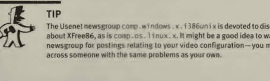

Usenet 新闻组 `comp.windows.x.1386unix` 专门讨论 XFree86，`comp.os.linux.x` 也是如此。关注该新闻组中与你的视频配置相关的帖子可能是一个好主意——你可能会遇到拥有与你相同问题的人。

## 第二部分

#### 自定义配置

如果你的显示器支持 1600 × 1200——`XF86Setup` 支持的最高预设分辨率为 1280 × 1024——你需要手工修改你的 X 配置以获得最佳性能。

如果你出于此原因或其他原因想手工修改视频配置，请查看 LDP 的 XFree86 Video Timings HOWTO，http://metalab.unc.edu/LDP/HOWTO/XFree86-Videomodes-HOWTO.html。（这是 XFree86 的 Videomodes.doc 文件的最新 HTML 版本。）

##### 使用 16 位颜色

默认情况下，X 使用 8 位颜色深度，提供 256 种颜色。为了绕过这一限制，许多应用程序分配自己的颜色映射，导致当光标在各自拥有颜色映射的两个窗口之间移动时出现突然的颜色跳变。Arena WWW 浏览器就是这样做的。

如果你想使用高级图形应用程序，256 种颜色可能不够。你可能需要转向 16 位颜色深度（65,536 种颜色）。但请注意，并非所有应用程序都能在 16 位颜色下正常工作。

你只需以如下方式启动 X 即可使用 65K 种不同颜色的 16 位颜色深度：

```
startx -- -bpp 16
```

或者将

```
exec X :0 -bpp 16
```

放入你的 `.xserverrc` 文件。然而，为了使此功能生效，你需要在 `XF86Config` 中有一个包含 `DefaultColorDepth 16` 的 screen 部分。

如果你正在使用 `xdm`，可能需要更改 `Xservers` 文件，该文件通常位于 `/etc/X11/xdm/`。典型的配置只有一行未注释的代码，看起来像

```
:0 local /usr/X11R6/bin/X
```

将

```
-bpp 16
```


添加到启动选项中：

```
:0 local /usr/X11R6/bin/X -bpp 16
```

此外，你还需要向你的 X 配置的 `screen` 部分添加一个 `Depth` 值为 `16` 的 `Display` 部分。通常，你只需复制 8 位 `Display` 部分并更改 `Depth` 字段即可。

更多的颜色意味着你的视频卡在相同时间内需要传输更多的数据。如果你的视频卡无法处理，那么分辨率或刷新率之一必须降低。默认情况下，`XFree` 会降低分辨率。如果你想保持分辨率不变并降低刷新率，你必须向 `XF86Config` 文件中插入一个新的合适的 `Modeline`。这定义了具有较低刷新率的那个分辨率。例如，用以下值替换旧值

```
Modeline '1024x768' 75 1024 1048 1184 1328 768 771 777 806 -hsync -vsync
```

为：

```
Modeline '1024x768' 65 1024 1032 1176 1344 768 771 777 806 -hsync -vsync
```

魔数 `75` 和 `65` 是相应的时钟频率，你可以在你的 `.X.err` 文件中找到 X 报告的这些数值。请查阅 XF86 文档中关于监视器的文件，以获取适用于你的视频卡在 16 位色深下能提供的最高时钟频率的 `Modelines`。

### 运行 XFree86

配置好你的 `XF86Config` 文件后，你就准备好启动 X 服务器并尝试一下了。首先，确保 `/usr/X11R6/bin` 在你的路径中。

启动 `XFree86` 的命令是

```
startx
```

这是 `xinit` 的前端（如果你习惯在其他 Unix 系统上使用 `xinit` 的话）。

该命令将启动 X 服务器并运行你的主目录中 `.xinitrc` 文件里找到的命令。`.xinitrc` 只是一个包含要运行的 X 客户端的 shell 脚本。如果该文件不存在，系统将使用默认文件 `/usr/X11R6/lib/X11/xinit/xinitrc`。

一个标准的 `.xinitrc` 文件看起来像这样：

```
#!/bin/sh

xterm -fn 7x13bold -geometry 80x32+10+50 &
xterm -fn 9x15bold -geometry 80x34+30-10 &
oclock -geometry 70x70-7+7 &
xsetroot -solid midnightblue &

exec fwm2
```

这个脚本将启动两个 `xterm` 客户端，一个 `oclock`，并将根窗口（背景）颜色设置为午夜蓝。然后它将启动 `fwm2`，即窗口管理器。请注意，`fwm2` 是通过 shell 的 `exec` 语句执行的；这会导致 `xinit` 进程被 `fwm2` 替换。一旦 `fwm2` 进程退出，X 服务器就会关闭。你可以通过使用根菜单来使 `fwm2` 退出：在桌面背景上按下鼠标按钮 1——这将显示一个弹出菜单，允许你退出 `fwm2`。

确保 `.xinitrc` 中的最后一个命令以 `exec` 启动，并且它没有被放入后台（行尾没有 `ampersand`）。否则，X 服务器将在启动 `.xinitrc` 文件中的客户端后立即关闭。

或者，你可以通过按下 `Ctrl+Alt+Backspace` 组合键来退出 X。这将直接终止 X 服务器，退出窗口系统。

上面是一个非常非常简单的桌面配置。通过在你的 `.xinitrc` 文件上稍加工作，有许多精彩的程序和配置可供使用。


> 如果你是 X Window System 环境的新手，我们强烈建议你阅读 *The Joy of X: An Overview of the X Window System*（X 的喜悦：X 窗口系统概览）等书籍，作者是 Niall Manchester (Addison-Wesley 1993, ISBN 0201-565129)。使用和配置 X 太深入了，无法在这里涵盖。请参阅 `xterm`、`oclock` 和 `fwm2` 的手册页以获取入门线索。

#### 使用条款

本文档版权归 Eric S. Raymond 所有 © 1996。你可以自由地使用、传播和复制它，前提是你：

- 不省略或修改此版权声明。
- 不省略或修改版本号和日期。
- 不省略或修改文档指向当前 WWW 版本的指针。
- 明确标记任何压缩或修改后的版本。

这些限制旨在保护潜在的读者免受过时或损坏版本的影响。如果你认为你有充分的理由获得例外，请向我提问。

##### 致谢

本文档由 Matt Welsh 在那个昏暗且落后的时代起源。谢谢，Matt！

#### 翻译

意大利语：http://www.pluto.linux.it/ildp/HOWTO/XFree86-HOWTO.html

斯洛文尼亚语：http://www.lugos.si/delo/slo/HOWTO-sl/XFree86-HOWTO-sl.html

克罗地亚语：http://meta.mioc.hr/XFree86-KAKO.html

# 第 6 章

## 打印机

本章包括 Linux 打印 HOWTO，这是一份关于如何在 Linux（及其他类型的 Unix）下生成、预览、打印和传真任何内容的信息集合。

这是 Linux 打印 HOWTO 的完整文本，版本 3.29，发布于 1999 年 3 月 9 日，作者是 Grant Taylor <gtaylor+ph t@picante.com>。

### 引言

打印 HOWTO 应该包含你在你的 Linux 机器上设置打印服务所需知道的一切。生活就是这样，它比微软和苹果的点对点点击世界稍微复杂一些，但它的灵活性也高一些，对于大型局域网的管理肯定也更容易。

本文档的结构使得大多数人只需要阅读前半部分。这里大多数更晦涩和依赖情况的信息都在后半部分，并且可以在目录中轻松定位，而通过“Vendor Solutions”（供应商解决方案）或“Ghostscript”部分的大多数信息可能是大多数人需要的。

由于版本 3.x 是一次完全的改写，以前版本中的许多信息已经丢失。这是有意为之，因为以前的 HOWTO 长达 60 个排版页面，其叙述流程就像一只死去的乌龟一样缓慢。如果你在这里找不到答案，我们鼓励你 (a) 在打印 HOWTO 主页（http://www.ppcante.com/~gtaylor/pht/）扫描以前的版本，以及 (b) 给我发一封邮件，说明这里应该有什么但没有。

打印 HOWTO 主页是查找最新版本的好地方；它当然也通过 Metalab <metalab.unc.edu> 和你友好的本地 LDP 镜像站分发。

### 历史

这是第三代，也就是说第三次完全改写，的打印 HOWTO。PHT 的历史可以如下记录：

1. 我写了 1992 年的打印 HOWTO，以回应 comp.os.linux 中过多的打印问题，并将其发布。这比 HOWTO 项目早几个月，是第一个被称为 HOWTO 的 FAQ 列表。这一版是纯 ASCII。
2. 加入 HOWTO 项目后，打印 HOWTO 与 Brian McCauley <B.A.McCauley@bham.ac.uk> 的 `lpd` FAQ 合并；我们继续共同编辑 PHT 大约两年。在某个时候，我们整合了 Karl Auer <Karl.Auer@anu.edu.au> 的工作。这一代 PHT 使用 TeXInfo 编写，并提供为 PS、HTML、ASCII 和 Info 格式。
3. 在让 PHT 腐烂和衰退了一年多，并未能成功让其他人维护它之后，这次改写发生了。这一代 PHT 使用 LinuxDoc DTD 和 SGML-Tools-l 包以 SGML 编写。从版本 3.27 开始，它包含了一个配套的打印机支持数据库的摘要；在 3.27 之前，这个 HOWTO 中从未有过打印机兼容性列表。

#### 版权

本章版权归 Grant Taylor 所有 ©1992-1999。你可以自由地复制和重新分发它，依据 GNU 通用公共许可证，修订 2 或更高版本。

#### 如何打印

如果你已经配置好 `lpd` 来打印到你的打印机，或者你的系统管理员已经这样做，或者你的供应商为你做了，那么你只需要学习如何使用 `1pr` 命令。打印使用 HOWTO（http://metalab.unc.edu/LDP/HOWTO/Printing-Usage-HOWTO.html）涵盖了这一点以及几个其他你应该知道的队列操作命令。

但是，如果你有一个新系统或新打印机，那么在你可以打印之前，你必须以某种方式设置打印服务。继续阅读！

#### 内核打印机设备

并行端口有两个完全不同的设备驱动程序；你使用的是哪一个取决于你的内核版本。驱动程序在 Linux 2.1.53 中改变。

对于这两种驱动程序风格，一些细节是相同的。最值得注意的是，许多人发现，除非他们在 PC BIOS 中禁用即插即用（Plug and Play），否则 Linux 无法检测他们的并行端口。（这并不令人惊讶；非 PCI 设备在 Windows 和其他地方的 PnP 记录简直是一场灾难）。


## lp 设备（内核 <=2.1.32）

假设你已经编译进或加载了 lp 设备（`cat /proc/devices` 的输出应该包含该设备 lp 如果已加载），提供 `/dev/lp0`、`/dev/lp1` 和 `/dev/lp2` 中的一个或多个。这些并非动态分配；相反，每个设备对应一个特定的硬件 I/O 地址。这意味着你的第一台打印机可能是 `lp0` 或 `lp1`，具体取决于你的硬件配置。请尝试两者。

少数用户报告称，如果使用较旧的单向打印机线缆，他们的双向 lp 端口无法被检测到。请检查你是否有合适的线缆。

在任何一个给定端口上（至少在 2.0 内核中），不能同时运行 `plip` 和 `lp` 驱动程序。不过，你可以手动或通过版本 2.x（以及后来的 1.5.x）内核，在任意时刻加载其中一个驱动程序。通过仔细设置中断等参数，据说你可以让 `plip` 运行在一个端口上，而 `lp` 运行在另一个端口上。有人通过编辑驱动程序实现了这一点；我迫切期待有人仅通过巧妙的命令行就成功做到这一点并报告结果。

有一个名为 `tunelf` 的小工具流传于世，作为 root 用户，你可以用它来调整 Linux 2.0 lp 设备的中断使用、轮询率以及其他选项。

当 `lp` 驱动程序被编译进内核时，内核将接受 `lp=` 选项以设置中断和 IO 地址。

当 `lp` 驱动程序被编译进内核时，你可以使用 `LILO/LOADLIN` 命令行来设置驱动程序将使用的端口地址和中断。语法如下

```
lp=port0[,irq0][,port1[,irq1][,port2[,irq2]]]
```

例如，

```
lp=0x378,0    或    lp=0x278,5,0x378,7
```


> **注意**
> 
> 对于那些（像我一样）在需要时总是找不到标准端口号的人来说，它们如上述第二个示例所示。另一个端口（`lp0`）位于 `0x3bc`。我不知道它通常使用什么中断。

请注意，如果使用此功能，你必须指定所有希望考虑的端口；没有默认值。你可以使用 `lp=0` 来禁用内置的驱动程序。

当作为模块加载时，可以在 `insmod` 命令行上（或在 `/etc/conf.modules` 中以影响内核）使用通常的模块参数语法指定 IO 地址和中断线。参数为 `io=port0,port1,port2` 和 `irq=irq0,irq1,irq2`。

Linux 2.0 并行端口驱动程序的源代码位于 `/usr/src/linux/drivers/char/lp.c`。

## 并行端口设备（内核 >= 2.1.33）

从内核 2.1.33 开始（并且可以作为内核 2.0.30 的补丁），`lp` 设备仅仅是新的 `parport` 设备的一个客户端。`parport` 设备的添加解决了困扰旧 `lp` 设备驱动程序的一系列问题——它可以与其他驱动程序共享端口，它动态地将可用的并行端口分配给设备编号，而不是强制 I/O 地址和端口编号之间固定的对应关系，等等。

`parport` 设备的出现催生了一整套新的并行端口驱动程序，用于 Zip 驱动器、背囊式 CD-ROM 和磁盘等。其中一些也有适用于 2.0 内核的版本；请在网络上查找。

就打印而言，你将会注意到的主要区别是，基于 `parport` 的内核动态地将 `lp` 设备分配给并行端口。因此，在 Linux 2.0 下的 `lp1` 在 Linux 2.2 下很可能变成 `lp0`。如果你从 `lp` 驱动程序内核升级到 `parport` 驱动程序内核，请务必检查这一点。

当我发现自己正在使用 `parport` 驱动程序时，我会更完整地介绍它，但在此期间，你可以阅读内核源代码中的 `Documentation/parport.txt` 文件，或者查看 `parport` 网站 (`http://www.cybertek.demon.co.uk/parport.html`)。

## 串行设备

串行设备在 Linux 下通常被称为 `/dev/ttyS1` 之类的名称。实用工具 `stty` 允许你交互式地查看或设置串行端口的配置；`setserial` 允许你控制一些扩展属性，并为非标准端口配置 IRQ 和 I/O 地址。有关 Linux 下串行端口的进一步讨论，请参阅 Serial HOWTO (`http://metalab.unc.edu/mdw/HOWTO/Serial-HOWTO.html`)。

当使用具有流量控制的慢速串行打印机时，你可能会发现一些打印任务被截断。这可能是由于串行端口造成的，其默认行为是在端口设备关闭后 30 秒内清除缓冲区中任何未传输的字符。缓冲区最多可以容纳 4,096 个字符，如果你的打印机使用流量控制且速度慢到无法在打印软件关闭串行端口后的 30 秒内接受缓冲区中的所有数据，那么缓冲区内容的尾部将会丢失。如果命令 `cat file /dev/ttyS2` 对短文件产生完整的打印输出，但对长文件产生截断的输出，你可能正处于这种状况。

30 秒的时间间隔可以通过 `serial`（2.12 版本及更高版本）的 `closingwait` 命令行选项进行调整。机器的串行端口通常由 `rc.serial` 启动文件中对 `serial` 的调用进行初始化。打印串行端口的调用可以修改以同时设置其关闭等待时间和其他参数。

## 支持的打印机

Linux 内核基本上支持任何可以插入串行或并行端口的打印机，但有一些需要注意的事项，以及一些你无法使用的打印机，尽管它们（从电气角度来说）可以与 Linux 通信。这些不兼容的打印机中，最主要的是那些被称为 Windows 或 GDI 打印机的设备。它们之所以被称为这样，是因为打印机控制语言的一部分或全部以及打印机制的设计细节未得到文档化。通常，厂商会提供 Windows 驱动程序并乐于只向 Windows 用户销售；这就是为什么它们被称为 Winprinters。在某些情况下，厂商也提供 NT、OS/2 或其他操作系统的驱动程序。

这些打印机中的许多在 Linux 下无法工作。少数可以工作，而有些则仅能部分工作（通常是因为有人反向工程了编写驱动程序所需的详细信息）。有关特定打印机的详细信息，请参见本章后面的打印机支持列表。

少数打印机处于中间状态。例如，NEC 的一些型号实现了标准打印机语言 PCL 的简单形式，允许支持 PCL 的软件以高达 300dpi 的速度打印，但只有 NEC 知道如何从这些打印机中获取完整的 600dpi。

请注意，如果你已经拥有一台这样的 Winprinter，有一些迂回的方法可以让 Linux 向其中一台打印，但它们相当麻烦，而且我本人从未尝试过。有关 Windows 专用打印机的更多讨论，请参阅本章的“Windows-Only Printers”部分。

### PostScript

至于哪些打印机*确实*与 Linux 兼容，最佳选择是购买具有原生 PostScript 支持的打印机。几乎所有产生可打印输出的 Unix 软件都以 PostScript 格式产生输出，因此显然拥有一台直接支持 PostScript 的打印机会很好。不幸的是，PostScript 支持在激光打印机领域之外很稀缺，并且有时是一个昂贵的附加功能。

Unix 软件以及整个出版业都已标准化，选择 PostScript 作为首选的打印机控制语言。这发生有几个原因：

**时机** PostScript 作为 Apple LaserWriter 的一部分出现，它是 Macintosh 的完美伴侣，而 Macintosh 在很大程度上促成了 80 年代的桌面出版革命。

**它是设备独立的** PostScript 程序可以运行以在像素屏幕、矢量屏幕、传真机或几乎任何类型的打印机制上生成输出，而无需更改原始程序。PostScript 输出在任何 PostScript 设备上看起来都一样，至少在该设备能力的限制范围内。在 PDF 创建之前，人们曾在线交换复杂的 PostScript 文件文档。这个标准未能流行的唯一原因是 Windows 机器通常不包含 PostScript 预览器，因此 Adobe 为 PostScript 指定了超链接和压缩，将其结果称为 PDF，分发预览器，并为其蒸馏工具创造了一个市场（Ghostscript 的 `ps2pdf` 和 `pdf2ps` 程序也提供了这些功能）。

**它是一门真正的编程语言** PostScript 是一门完整的编程语言；你可以编写软件来完成大多数事情。这主要用于在程序开始时定义子例程，以在整个文档中反复替换复杂的内容，比如背景中的徽标或大的*草稿*字样。

**它是开放的** PostScript 完全规定在一系列公开可用的书籍中，你可以在任何好的书店找到。虽然 Adobe 发明了它并提供主要的商业实现，但像 Aladdin 这样的其他厂商也生产独立编码的实现。

## 非 PostScript 支持


如果无法承担购买 PostScript 打印机的（较大）预算，你可以使用任何受 Ghostscript 支持的打印机。Ghostscript 是一个免费的 PostScript 解释器，用于替代实际的打印机 PostScript 支持。Ghostscript 主页（http://www.cs.wisc.edu/ghost/）列出了受支持的打印机以及关于新驱动和实验性驱动的状态信息。请注意，该页面列出的是最新版本的 Ghostscript 所支持的打印机，而由于许可证限制，大多数 Linux 发行版只能附带稍微过时的 Ghostscript 版本。幸运的是，每个发行版的 contrib 区域通常都会提供预打包且更新的 Ghostscript 版本。请按照页面要求报告你的成功和失败案例，以帮助改进 Ghostscript 的打印机支持页面。

Adobe 现在有一种新的打印机语言，称为 PrintGear。我认为它是一种大大简化了的二进制格式语言，带有一些 PostScript 的血统，但不具备 PostScript 兼容性。而且，我还没听说 Ghostscript 支持这种语言。不过，一些 PrintGear 打印机似乎支持另一种类似 PCL 的语言，这些打印机将能在 Linux 上工作（前提是该 PCL 功能是在打印机中实现的，而不是在 Windows 驱动程序中实现的）。

## 哪些打印机可用？

如果你打算购买打印机，可以在几个地方查看其是否兼容。协作维护的 Printing HOWTO 打印机数据库（http://www.pica.net.com/~gtaylor/phl/printer_list.cgi）旨在全面列出 Linux 打印机支持的状态。下文是其摘要；请务必在线查看更多详细信息以及关于应使用何种驱动的信息。

Ghostscript 的打印机兼容性页面（http://www.cs.wisc.edu/~ghost/printer.html）列出了一些可用的打印机，并提供指向其他页面的链接。此外，Dejanews 收录了数百条“可用”和“不可用”的用户见证。请尝试所有这三个资源，完成后，请检查数据库（http://www.pica.net.com/~gtaylor/phl/printer_list.cgi）中是否已正确列出你的打印机，以便未来本文档能正确显示该信息。

## 打印机兼容性列表

本部分是网络版本的摘要。网络版本包含基本规格、备注、驱动信息链接、用户维护的文档、制造商网页等。此列表的网络版本也是交互式的；人们可以且确实一直在添加打印机，因此请务必也去查看。最后，如果你的打印机未列出，请添加它！这里的打印机被分为四种类型：

- **完美（Perfectly）** 完美打印机表现完美——你可以利用打印机的全部功能进行打印，包括彩色、全分辨率等。在极少数情况下，具有未文档化的分辨率增强模式且该模式不起作用的打印机也会被列为“完美”；通常打印质量差异极小，不值得担忧。
- **基本（Mostly）** 你可以正常打印，但可能存在某种轻微限制，无论是打印方面还是其他功能方面。
- **部分（Partially）** 你可以打印，但可能不支持彩色，或只能以较低分辨率打印。有关限制信息，请参阅在线列表的备注列。
- **无用（Paperweight）** 你完全无法打印任何东西；通常这是因为缺乏驱动程序和/或关于如何编写驱动程序的文档。

在所有情况下，由于这些信息是由数十人提供的，因此不能保证完全正确。不过，通过驱动网页和制造商网站进行佐证应该很容易。

不多赘述，以下是打印机兼容性列表：

### Brother（兄弟）

完美：HL-10V, HL-660, HL-720, HL-760。
基本：HL-1050。

### Canon（佳能）

完美：BJ-10e, BJ-20, BJ-200, BJC-210, BJC-240, BJC-250, BJC-610, BJC-620, BJC-70, BJC-800, LBP-8II, LIPS-III。
基本：BJ-300, BJC-4000, BJC-4100, BJC-4200, BJC-4300, BJC-4400, BJC-7000, BJC-7004。
部分：BJC-4550, MultiPASS C2500, MultiPASS C3500。
无用：BJC-5000, LBP-460, LBP-660。

### Epson（爱普生）

完美：ActionLaser 1100, LP 8000, LQ 850, Stylus Color, Stylus Color 400, Stylus Color 500, Stylus Color 600, Stylus Color 640, Stylus Color 850, Stylus Color II, Stylus Color IIs, Stylus Pro XL。
基本：Stylus Color 800, Stylus Photo 750。
部分：Stylus Color 740。

### HP（惠普）

完美：2000Cs e, 2500C, DesignJet 650C, DeskJet 1200C, DeskJet 1600C, DeskJet 1600Cm, DeskJet 400, DeskJet 420C, DeskJet 500, DeskJet 550C, DeskJet 600, DeskJet 660Cs e, DeskJet 690C, DeskJet 850C, DeskJet 855C, DeskJet 870, DeskJet 870Cx i, DeskJet 890, LaserJet 1100, LaserJet 2100, LaserJet 2100N, LaserJet 4000N, LaserJet 4L, LaserJet 5, LaserJet 5L, LaserJet 5MP, LaserJet 6L, LaserJet 6MP, LaserJet 8000, LaserJet 8100, LaserJet 5000, Mopier 320, PaintJet XL300。
基本：HP 660C。
部分：DeskJet 1000C, DeskJet 670C, DeskJet 710, DeskJet 720C, DeskJet 722C, DeskJet 820C。
无用：LaserJet 3100。

### IBM

完美：Jetprinter 5852。

### Lexmark（利盟）

完美：Optra Color 1200, Optra Color 1275, Optra Color 40, Optra Color 45, Optra E, Optra E+, Optra 500, Optra S 1250。
部分：1020 Business, 3000, 5700, 7000。
无用：1000, 1020, 1100, 2030, 2050, 2070, 5000, 7200, Winwriter 100, Winwriter 150c, Winwriter 200。

### Minolta（美能达）

完美：PagePro 6, PagePro 8。

### NEC（新力/能率）

完美：P2X。
部分：SuperScript 100C, SuperScript 1260, SuperScript 150C, SuperScript 650C, SuperScript 750C, SuperScript 860, SuperScript 870。
无用：SuperScript 660i, SuperScript 660plus。

### Okidata

完美：OL 410e, OL 610e/PS, OL 810e/PS, Okipage 6e, Okipage 6ex, Okipage 8c。
基本：Okipage 4w。
无用：Okipage 8w, Okijet 2010。

### Olivetti（奥利维蒂）

完美：JP350S。

### Panasonic（松下）

完美：KX-P1123, KX-P4440, KX-P5400, KX-P8420, KX-P8475。
部分：KX-P6500。
无用：KX-P6100, KX-P8410。

### QMS

完美：2425 Turbo EX。

### Ricoh（理光）

完美：4801, 6000。

### Xerox（施乐）

完美：DocuPrint C55, DocuPrint N17, DocuPrint N32。

## 哪种打印假脱机软件？


直到最近，Linux 用户的选择很简单——大家都在运行同一个旧的 `lpd`（行打印机守护进程，Line Printer Daemon），它主要原封不动地取自 BSD 的 Net-2 代码。术语 `lpd` 在不同语境下既指守护进程，也指运行打印假脱机的整套程序。即使在今天，大多数供应商仍提供此软件。但情况正在开始改变。SVR4 类系统（包括 Sun 的 Solaris）附带一个完全不同的打印假脱机软件包，其核心是 `lpshcd`。而且，有迹象表明一些 Linux 厂商将转向提供 `LPRng`，这是一种远没有 `lpd` 那么陈旧且可自由获取的打印假脱机实现。`LPRng` 在大型安装环境中（即：多台打印机、任何串行打印机或任何特殊的非 `lpd` 网络打印机）更易于管理，并且其数据库不像标准 `lpd` 那样令人担忧地杂乱无章。它甚至可以诚实地声称是安全的——没有 SUID 二进制文件，并支持通过 PGP 或 Kerberos 进行身份验证。

目前，即使考虑到新的选项，`lpd` 对大多数 Linux 用户来说可能仍然适用。虽然它不是最花哨的系统，但一旦设置好，它就运行良好，而且在第三方 Unix 书籍中被广泛理解并大量记录。

如果你想要了解有关 `LPRng` 的更多信息，请查看 `LPRng` 网页（http://www.astart.com/Lprng/LPRng.html）。本 HOWTO 的未来版本将包含有关如何使用 `LPRng` 和普通 `lpd` 的信息。

## 工作原理：基础

为了使打印正常工作，你需要了解 `lpd` 系统是如何工作的。

`lpd` 在不同语境下既指守护进程，也指运行打印假脱机的整套程序。这些包括：

- `lpd` 假脱机守护进程。其中有一个运行以控制机器上的一切，而在打印机打印期间，每个打印机都会运行一个。
- `lpr` 用户假脱机命令。它联系 `lpd` 并将新的打印作业注入到假脱机队列中。
- `lpq` 列出打印队列中的作业。
- `lpc` `lpd` 系统控制命令。使用 `lpc` 你可以停止、启动、重新排序等打印队列。
- `lprm` 这将删除假脱机队列中的一个作业。

## 如何设置基础配置

本节讨论了设置 Linux 系统的最小要求。您将学习如何添加打印队列并打印文档。

### 传统的 lpd 配置

`lpd` 的最小配置会产生一个可以排队文件并打印它们的系统。它不会关注您的打印机是否能理解这些文件，而且可能无法让您产生美观的输出。尽管如此，它是理解的第一步，所以请继续阅读！

基本上，要向 `lpd` 添加一个打印队列，您必须在 `/etc/printcap` 中添加一个条目，并在 `/var/spool/lpd` 下创建新的 spool 目录。

`/etc/printcap` 中的一个条目如下所示：

```
# LOCAL  djet500
lpld:d|deskjet:\
:sd=/var/spool/lpd/dj:\
:mx#0:\
:1p=/dev/lp0:\
:sh;
```

这定义了一个名为 `lpd`、`dj` 或 `deskjet` 的 spool，位于目录 `/var/spool/lpd/dj` 中，没有每个作业的最大大小限制，打印到设备 `/dev/lp0`，并且在打印作业的开头不会添加横幅页（例如包含打印者姓名等信息）。

**提示**

此时，建议您阅读 `printcap` 的手册页。


上述配置看起来非常简单，但有一个陷阱——除非我发送 DeskJet 500 能够理解的文件，否则这台 DeskJet 会打印出奇怪的东西。例如，将普通的 Unix 文本文件发送到 DeskJet 会导致字面意义上的换行符被解释，并让我反复看到以下内容：

```
This is line one.
This is line two.
This is line three.
```

向此 spool 打印 PostScript 文件会得到 PostScript 命令的美观列表，以这种阶梯效果打印出来，但没有有用的输出。

显然需要更多东西，这就是过滤器的目的。阅读 `printcap` 手册页的您中更敏锐的人可能会注意到 spool 属性 `if` 和 `of`。好吧，`if`，即输入过滤器，正是这里所需要的。

如果您编写一个名为 `filter` 的小型 shell 脚本，在换行符前添加回车符，那么阶梯效果就可以消除。因此，您需要在上述 `printcap` 条目中添加一行 `if`：

```
lp|dj|deskjet:
    :sd=/var/spool/lpd/dj:\
    :mx#0:\
    :1p=/dev/lp0:\
    :if=/var/spool/lpd/dj/filter:\
    :sh:
```

一个简单的过滤脚本可能如下所示：

```
#!perl
##### 上面的行应该包含 perl 的完整路径
##### 此脚本必须是可执行的：chmod 755 filter
while(<STDIN>){chop; print "$_\r\n"};
##### 您可能还希望以换页符结束：print "";
```

如果您执行上述操作，您将拥有一个可以打印常规 Unix 文本文件并获得有意义结果的 spool。（是的，有数百万种更好的方法编写此过滤器，但很少有像这样具有说明性的。鼓励您更高效地实现它。）

剩下的唯一问题是，打印纯文本真的没什么特别之处——当然，能够打印 PostScript 和其他格式化或图形类型的输出会更好。好吧，是的，确实如此，而且很容易做到。该方法只是上述换行修复过滤器的扩展。如果您编写一个过滤器，它可以接受任意文件类型作为输入并为每种情况生成 DeskJet 可识别的输出，那么您就拥有了一个聪明的打印 spooler！

这样的过滤器被称为 magic filter（万能过滤器）。除非您打印奇怪的东西，否则不必自己编写一个——网络上已经有许多为您编写好的。APS Filter 是其中最好的之一，或者您的 Linux 发行版可能有一个打印机设置工具，使这一切变得非常容易。

#### 文件权限

应广大要求，我在下面列出了我系统上一些有趣文件的权限。有几种更好的方法来做这件事，理想情况下只使用 SGID 二进制文件，而不将一切都设置为 SUID root，但这是我的系统开箱即用的样子，而且对我有效。（坦率地说，如果您的供应商甚至不能提供一个可用的 `lpd`，您就有得忙了。）

```
-r-sr-sr-x 1 root   lp /usr/bin/lpr*
-r-sr-sr-x 1 root   lp /usr/bin/lprm*
-rwxr-x--- 1 root   root /usr/sbin/lpd*
-r-xr-xr-x 1 root   lp /usr/sbin/lpc*
drwxrwxr-x 4 root   lp /var/spool/lpd/
drwxr-xr-x 2 root   var /var/spool/lpd/lpr
```

目前 `lpd` 必须作为 root 运行，以便它可以绑定到低编号的 lpc 服务端口。绑定后，它应该可能变为 UID `lp.lpd` 或类似的东西，但我想它并没有这样做。太遗憾了。

### 获取打印软件

许多预先编写的过滤器软件包（和其他与打印机相关的软件）可以从 Metalab（ftp://metalab.unc.edu/pub/LINUX/system/printing/）获得。像 `pstrips`、`at2ps`、`mpaget`、`dvi2dvi` 和 `rpc` 这样的工具可以在那里找到。

曾经有一段时间，市面上有几个软件包都在努力使打印机配置更容易。它们可能现在仍然存在，但其中最好且最新的之一是 Andreas Klemm 的 APS Filter 软件包，它有一个菜单驱动的 `printcap` 配置器，并能处理几乎任何可以想象的输入类型。如果您的供应商没有提供不错的打印机设置工具，APS Filter 就是您要走的路。

## 厂商解决方案

按定义，本节是不完整的。欢迎发送您喜欢的发行版的详细信息。

### Red Hat

Red Hat 有一个 GUI 打印机管理工具（在控制面板中），它可以添加远程打印机和本地设备上的打印机。它允许您选择受 Ghostscript 支持的打印机类型和 Unix 设备文件进行打印，然后在 `/etc/`printcap` 中安装一个打印队列，并编写一个基于 `gs` 和 `nscript` 的简短 SolomonP-ASCII 万能过滤器。此解决方案运行相当良好，对于常见情况设置非常简单。


Red Hat 失败的地方在于，当您拥有一台不受其标准 Ghostscript 支持的打印机时（这是 GNU 版本的 Ghostscript，而不是 Aladdin Ghostscript，它支持的打印机更少）。如果发现使用标准 Red Hat 软件无法正常打印，请检查上述打印机兼容列表（或在线访问 `http://www.picate.com/~gstayor/print/printer_list.cgi`）。如果您的打印机不受 Red Hat 工具的支持，您可能需要安装贡献者版本的 Aladdin Ghostscript，并且使用知道最新型号 Ghostscript 支持的打印机的 `apsfilter` 软件包可能对您更有利。

### Debian

Debian 提供了在普通 `lpd` 和 `LPng` 之间选择；`LPng` 可能是更好的选择。我相信 Debian 也提供了打印机配置工具的选择；`apsfilter` 5 或更高版本可能是您最好的选择，因为该版本添加了对 `LPng` 和 Ghostscript 的 `uniprint` 驱动程序方案的支持。

### 其他发行版

请发送其他发行版的信息给我！

## GHOSTSCRIPT

Ghostscript（`http://www.cs.wisc.edu/~ghost/`）对于 Linux 打印来说是一个极其重要的程序。Unix 下的大多数打印软件生成 PostScript，这通常是打印机上一个价值 100 美元的选项。

然而，Ghostscript 是免费的，并且可以从 PostScript 生成您打印机的语言。当与您的 `lpd` 输入过滤器结合使用时，它为您提供了一个虚拟的 PostScript 打印机，极大地简化了生活。

Ghostscript 有两种形式。商业版本的 Ghostscript，称为 Aladdin Ghostscript，可以免费用于个人使用，但商业 Linux 发行版不得分发它。它通常比免费的 Ghostscript 领先一年左右；例如，目前它支持许多旧版 Ghostscript 不支持的彩色喷墨打印机。

免费的 Ghostscript 版本是 GNU Ghostscript，它是 Aladdin Ghostscript 的旧版本，被慷慨地赠送给 GNU。（向 Aladdin 致敬；如果有能力，更多的软件供应商应该以这种方式支持免费软件，即使他们无法处理其代码的完全 GPL 分发。）

无论您对 `gs` 做什么（参见 `http://www.picante.com/~gtaylor/phth/man/gs.1.html`），请务必使用禁用文件访问的选项（`-dSAFER`）运行它。PostScript 是一种功能完整的语言，糟糕的 PostScript 程序可能会给您带来相当大的麻烦。

说到 PDF，Adobe 的便携式文档格式实际上不过是压缩文件中有组织的 PostScript。Ghostscript 处理 PDF 输入就像处理 PostScript 一样。因此，您可以成为街区第一个拥有支持 PDF 打印机的用户。

### 调用 Ghostscript

通常，Ghostscript 将由您选定的任何万能过滤器运行（如果您的供应商没有提供适合您的东西，我建议使用 `apsfilters`），但对于调试目的，直接运行它通常很方便。

`Gs -help` 将提供选项和可用驱动程序的简明信息列表（请注意，此列表是编译进去的驱动程序列表，而不是所有可用驱动程序的主列表）。

您可能出于测试目的运行 `gs`，如下所示：`gs <options> -q -dSAFER -soutputFile=/dev/lp1 test.ps`

### Ghostscript 输出调整

如果 `gs` 的输出不满意，可以做一些事情（实际上，由于您拥有源代码，您可以做任何您高兴做的事）。


## 输出位置和尺寸

页面上图像的位置、尺寸和宽高比由 Ghostscript 中特定于打印机的驱动程序控制。如果您发现打印出来的页面过短、过长，或者尺寸因两倍系数而过大，您可能需要查看驱动程序源代码模块，并调整那些显而易见的参数。不幸的是，每个驱动程序都不同，所以我无法确切告诉您该调整什么参数，但大多数驱动程序都有相当完善的注释。

## 伽马、点大小等

大多数非激光打印机都因其打印点较大而存在问题。这会导致打印出的图片过于黑暗。如果您遇到此问题，应使用自定义的传输函数。只需在 Ghostscript 的 `lib` 目录中创建以下文件，并将其名称添加到实际文件之前的 `gs` 调用中。您可能还需要调整实际数值以适配您的打印机。较低的数值会产生更亮的打印效果。特别是如果您的驱动程序使用 Floyd-Steinberg 算法对颜色进行光栅化处理，较低的数值（0.2 - 0.15）可能是一个不错的选择。

```postscript
---8<----- gamma.ps ---8<-----

%!
%transfer functions for cyan magenta yellow black
[0.3 exp] [0.3 exp] [0.3 exp] [0.3 exp] setcolortransfer
---8<-------------------8<---
```

通过调整这些值，也可以修复某些存在颜色故障的打印机。如果您进行此类操作，我建议使用 Ghostscript 附带的文件 `colorcir.ps`（位于 `examples/` 子目录中）作为测试页。

对于许多较新的彩色喷墨机驱动程序，存在命令行选项或不同的 `up` 驱动程序文件，用于实现伽马和其他更改，以将打印机适配不同的纸张类型。在尝试使用 PostScript 修复问题之前，您应该先研究一下这方面内容。

## 如何通过网络打印到打印机

`lpd` 的一个特性是它支持通过网络向物理连接到其他机器的打印机进行打印。通过精心组合过滤脚本和各种实用工具，您可以让 `lpr` 透明地打印到各种网络上的打印机。

### 打印到 Unix/lpd 主机

为了允许远程机器向您的打印机打印，您必须在 `/etc/hosts.equiv` 或 `/etc/hosts.lpd` 中列出这些机器。（注意，`hosts.equiv` 还有许多其他影响；如果您在那里列出任何机器，请务必确认自己知道自己在做什么。）您可以使用 `rs` 属性仅允许其他机器上的特定用户向您的打印机打印；有关此功能的更多信息，请阅读 `lpd` 手册页。

### 使用 lpd

要打印到另一台机器，您需要创建一个如下所示的 `/etc/printcap` 条目：

```
##### REMOTE_djet500
lp:dj:deskjet:\
        :sd=/var/spool/lpd/dj:\
        :rm=machine.out.there.com:\
        :rp=printername:\
        :lp=/dev/null:\
        :sh:
```

请注意，本地机器上仍有一个由 `lpd` 管理的 spool 目录。如果远程机器繁忙或离线，来自本地机器的打印任务将在 spool 区域等待，直到可以发送为止。

### 使用 rlpr

您还可以使用 `rlpr` 将打印作业直接发送到远程机器上的队列，而无需配置 `lpd` 来处理它所带来的麻烦。这在您偶尔需要向多种打印机打印的情况下特别有用。根据 `rlpr` 的公告：

> Rlpr 使用 TCP/IP 将打印作业发送到网络任何位置的 lpd 服务器。

与 `lpr` 不同，它*不需要*远程打印机被您想要从中打印的机器显式识别（例如，通过 `/etc/printcap`），因此它更加灵活，管理需求更低。

`Rlpr` 可以在任何传统 `lpr` 可能使用的地方使用，并且与传统 BSD `lpr` 向后兼容。

`rlpr` 获得的主要优势是能够远程打印，并且*可以从任何地方打印到任何地方*，而无需考虑您希望从中打印的系统是如何配置的。`Rlpr` 可以像传统 `lpr` 一样作为过滤器工作，使得在远程机器上运行的客户端（如 nescape、xemacs 等）可以轻松地打印到您的本地机器。

`Rlpr` 可从 Metalab 获取（`ftp://metalab.unc.edu/pub/Linux/system/printing/`）。

### 打印到 Win95、WinNT、LANManager 或 Samba 打印机

那里有一份打印 Windows 的简略 HOWTO，其中包含比这里更多的信息。

可以通过 `smbclient` 程序（`samba` 套件的一部分）将 `lpd` 队列定向到基于 TCP/IP 的 SMB 打印服务。Samba 包含一个名为 `smbprint` 的脚本来执行此操作。简而言之，您将在 spool 目录中放置针对特定打印机的配置文件，并将 `smbprint` 脚本安装为 `if`。

`/etc/printcap` 条目如下所示：


```
lp|remote-smbprinter:\
\:lp=:/dev/null:sh:\
\:sd=/var/spool/lpd/lpd:\
\:if=/usr/local1/sbin/smbprint:
```

有关如何设置此功能的更多信息，您应该阅读 `smbprint` 脚本内部文档。

您还可以使用 `smbclient` 直接提交文件到 SMB 打印服务，而不涉及 `lpd`。请参阅 `smbclient(1)` 的手册页。

### 打印到 NetWare 打印机

`ncpls` 套件包含一个名为 `nprinit` 的实用工具，它提供与 `smbprint` 相同的功能，但适用于 NetWare。您可以从 Metalab 获取 `ncpls`（`ftp://metalab.unc.edu/pub/Linux/system/filesystems/ncpfs/`）。以下内容摘自版本 0.16 的 LSM 条目：

> 使用 `ncpfs`，您可以将 Linux 下 netware 服务器的卷挂载。您还可以打印到 netware 打印队列并将 netware 打印队列 spool 到 Linux 打印系统。您需要 kernel 1.2.x 或 1.3.54 及更高版本。`ncpfs` 不适用于任何低于 1.3.54 的 1.3.x kernel。

为了让 `nprint` 通过 `lpd` 工作，您需要编写一个小的 shell 脚本来在 NetWare 打印机上打印 stdin，并将其安装为 `lpd` 打印队列的 `if`。您会得到类似这样的配置：

```
sub2|remote-N\nprinter:\n:lp=/dev/null:sh:\n:sd=/var/spool/1pd/sub2:\n:if=/var/spool/1pd/nprint-script:
```

`nprint-script` 可能大致如下所示：

```bash
#!/bin/sh
##### You should try the guest account with no password first!
/usr/local/bin/nprint -5 net -U name -P passwd -q _print-name -
```

### 打印到 EtherTalk (Apple) 打印机

`netatalk` 包包含类似于 `nprint` 和 `smbclient` 的东西。其他人比我更好地记录了向 Apple 网络打印及从 Apple 网络打印的程序；请参阅 Linux Netatalk-HOWTO (`http://thehamptons.com/anders/netatalk/`)。

### 打印到 HP 或其他以太网打印机

HP 和其他一些打印机配有以太网接口，您可以使用 `lpd` 直接向其打印。您应该遵循随打印机或其网络适配器提供的说明，但通常，此类*打印机*正在运行 `lpd`，并提供一个或多个您可以向其打印的队列。例如，HP 可能可以使用如下 `printcap` 正常工作：

```
lj-5|remote-hplj:\n:lp=/dev/null:sh:\n:sd=/var/spool/1pd/lj-5:\n:nm=printer name:cm=rpw:
```

带有 Jet Direct 接口的 HP LaserJet 打印机通常支持两个内置的 `lpd` 队列——`raw`（接受 PCL（可能还有 PostScript））和 `text`（接受纯 ASCII（并自动处理阶梯效应））。如果您有一个 JetDirect Plus/3 三端口盒子，队列将命名为 `raw1`、`text2` 等。

**警告** 请注意，ISS 公司识别出了一系列挂起 HP JetDirect 接口的拒绝服务攻击。其中大多数问题已从 98 年秋季开始得到解决。

在大型环境中，特别是某些打印机不支持 PostScript 的大型环境中，建立一个专用的打印服务器可能很有用，所有机器都向该服务器打印，并且所有 Ghostscript 作业都在该服务器上运行。

这也允许您的 Linux 机器作为打印机的 spool 服务器，使您的网络用户可以快速完成打印任务并继续其他工作，而无需等待打印机处理其他人发送的任何其他作业。如果您有无法修复的旧款 HP JetDirect，这也建议这样做；它降低了打印机卡死的可能性。

要做到这一点，在您的 Linux 机器上设置一个指向配备以太网的 HP LJ 的队列（如上所述）。现在，将局域网上的所有客户端设置为指向 Linux 队列（例如，上述示例中的 `lq-5`）。

一些 HP 网络打印机似乎不理会客户端发送的横幅页设置；您可以通过 `telnet` 到打印机，按两次回车，输入 `banner: 0` 然后输入 `quit` 来关闭其内部生成的横幅页。您还可以通过这种方式更改其他设置；输入 `?` 以获取列表。

完整的设置范围可以使用 HP 的 WebJet32 软件进行控制（`http://www.hp.com/go/webjetadmin`）。此包作为守护进程运行，并在指定端口上接受 HTTP 请求。它提供表单和 Java 小程序，可以控制网络上的 HP 打印机。理论上，它还可以控制 Unix 打印队列，但它使用 `rexe` 服务，这完全是不安全的。我不建议使用该功能。

### 打印到旧款 HP

一些打印机（以及打印机网络黑盒）仅支持一种简陋的、涉及纯 TCP 连接的非协议。此类别中的著名代表包括早期型号的 JetDirect（包括某些 JetDirectEx）卡。基本上，要访问打印机，您必须打开到打印机指定端口的 TCP 连接（通常是 9100，或者对于三端口盒子是 9100、9101 和 9102），并将您的打印作业塞进去。`LPFng`（如果您正在阅读本节，真的应该使用它代替）内置了将打印作业塞入随机 TCP 端口的支持，但在 BSD `lpd` 中这就没那么容易了。这可以用其他方式实现，例如在 Perl 中：

```perl
#!/usr/bin/perl
##### Thanks to Dan McLaughlin for writing the original version
##### of this script (And to Jim W. Jones for sitting next to Dan
##### when writing me for help ;)

$file_name = @ARGV[0];
```

### 为远程打印机运行过滤器（If）

`lp-d` 的一个怪癖在于，过滤器（`if`）不会为远程打印机运行。如果你发现需要运行一个过滤器，可以通过设置双队列并请求任务来实现。举个例子，考虑以下打印机配置：

```
1j-5:\
:lp=/dev/null;sh:\
:sd=/var/spool/lpd/1j-5:\n:if=/usr/lib/lpd/filter-1j-5:
1j-5-remote:lp=/dev/null;sh:rm=printer.name.com:\n:rp=raw;sd=/var/spool/lpd/1j-5-raw:
```

结合下面的 `filter-1j-5` 脚本：

```
#!/bin/sh
gs <options> -q -dSAFER -SOutputFile== - | \
 1pr -P1j-5-remote -U$S
```

`lpr` 的 `-U` 选项仅在 `lpr` 作为守护进程运行时才有效，并且它会正确地在重新提交的队列中设置提交者的名称。你可能应该使用更健壮的方法来获取用户名，因为在某些情况下它并不是第 5 个参数。请参阅 `printcap(5)` 的手册页。

### 从 Windows

从 Windows（或者推测是 OS/2）客户端打印到 Linux 服务器，通过 SAMBA 包可以直接通过 SMB 支持，该包还支持将你的 Linux 文件系统共享给 Windows 客户端。

Samba 包含了相当完整的文档，并且有一个很好的 Samba 常见问题解答（FAQ）也涵盖了相关内容。你可以在 Linux 机器上配置一个魔术过滤器并打印 PostScript 数据，或者折腾在所有 Windows 机器上安装特定的打印机驱动程序，并为它们设置没有过滤器的队列。依赖 Windows 驱动在某些情况下可能会产生更好的输出，但如果有很多 Windows 机器，管理起来会稍微麻烦一点。所以先尝试 PostScript。

### 从 Apple

`Netatalk` 支持通过 EtherTalk 从 Apple 客户端进行打印。更多信息请参阅 Netatalk HOWTO 页面 (`<http://thehamptons.com/anders/netatalk/>`)。

### 从 Netware

`ncfs` 软件包包含一个名为 `pserver` 的守护进程，它可以用于为 NetWare 打印队列提供服务。据我了解，该系统需要一个基于 Bindery 的 NetWare，即 2.x、3.x 或启用了 bindery 访问的 4.x 版本。

有关 `ncfs` 及其 `pserver` 程序的更多信息，请参阅 `ncfs` FTP 站点 (`<ftp://ftp.gwdg.de/pub/linux/misc/ncfs/>`)。

### 仅限 Windows 的打印机


如前所述，有些打印机本质上是不受支持的，因为它们不说标准的打印机语言；而是使用计算机的 CPU 渲染位图，然后以固定速度将其管道传输到打印机。在少数情况下，这些打印机也讲某种标准的语言，如 `PCL`，但通常并非如此。在一些（非常低端的）情况下，打印机甚至不使用标准的并行连接，而是依赖厂商的驱动程序来模拟本应由硬件行为完成的功能（最重要的是流量控制）。

无论如何，如果你发现自己被困在这样一台“柠檬”（指有缺陷或不太好的设备）上，有几种可能的变通方法。

### Ghostscript Windows 重定向器

现在有一个可用的 Windows 打印机驱动程序（称为 `mswinpr2`），它会在最终打印之前通过 Ghostscript 运行打印任务。（很像 Unix `*lpd*` 中的 `*if*` 过滤器）。还有一个新的 Ghostscript 驱动程序可以使用 Windows GDI 调用进行打印。所有这些加起来，应该允许 Windows 机器通过厂商的驱动程序将 PostScript 打印到仅限 Windows 的打印机。

如果搞定了，你就可以按照上面介绍的从 Linux 通过网络打印到 Windows 打印机的说明，让 Unix（以及其他 Windows、Mac 等）主机打印到你这台“柠檬”打印机。

### Pbm2ppa 程序

一些 HP 打印机使用打印性能架构（这是营销术语，意思是“我们太吝啬，没有实现 PCL”）。这通过 Tim Norman 编写的 `pbm2ppa` 转换器间接得到支持。基本上，使用 Ghostscript 将 PostScript 渲染为 `pbm` 格式的位图图像，然后使用 `pbm2ppa` 将其转换为特定打印机的 `ppa` 格式位图，准备好后直接转储到打印机。该程序现在可能也提供 Ghostscript 驱动程序格式。

`ppa` 软件可以在 `ppa` 主页 (`http://www.http4tech.com`) 获取；`pbm2ppa` 支持 HP 720、820 和 1000 的一些型号；有关 `ppa` 打印机支持的更多细节，请阅读随包提供的文档。

### Pbm2l7k 程序

大多数廉价的 Lexmark 喷墨打印机使用专有语言，因此它们是 Winprinters（仅支持 Windows 的打印机）。然而，Henryk Paluch 编写了一个程序，可以在 Lexmark 7000 上进行黑白打印。希望他能研究出彩色并扩展支持到其他 Lexmark 喷墨打印机。更多信息请参阅 `http://bimbo.fjfi.cvut.cz/~paluch/l7kdriver/`。

本节列出传真程序并提供如何向传真机发送电子邮件消息的信息。

#### 使用传真调制解调器

有许多传真程序可以让你发送和接收传真文档。其中最复杂的一个是 Sam Leffler 的 `HylaFax`，可从 `ftp.sgi.com` 获取。它支持各种功能，从多调制解调器到广播。

SuSE 附带了一个 Java `HylaFax` 客户端，据说可以在任何 Java 平台（包括 Windows 和 Linux）上运行。大多数平台也有非 Java 的传真客户端；Linux 几乎肯定能满足你的网络传真需求。

也可用的，并且对大多数 Linux 机器来说是更好的选择，是 `efax`，一个简单的发送传真的程序。`getty` 程序 `ngetty` 可以接收传真（在某些调制解调器上甚至可以处理语音留言！）。

#### 使用远程打印服务

有一个实验性服务，可以让你发送一封电子邮件消息，其中包含你希望在其他地方的传真机上打印的内容。像 PostScript 这样的精美格式受到支持，因此尽管全球覆盖不全，这仍然可以是一个非常有用的服务。有关通过远程打印服务打印的更多信息，请参阅远程打印网站 (`http://www.tpc.int/`)。

#### 如何生成值得打印的内容

这里涉及一个真正的软件乱麻。基本上，Linux 可以以不同程度的成功运行许多类型的二进制文件：Linux/x86、Linux/Alpha、Linux/ Sparc、Linux/foo、iBCS、Win16/Win32s（使用 `dosemu` 以及未来的 `Wine`）、Mac/68k（使用 `Excutor`）和 Java。我只讨论原生 Linux 和常见的 Unix 软件。

**第二部分**

就 Linux 本身而言，选择主要局限于 Unix 通用可用的那些。

#### 标记语言

大多数标记语言更适合大型或重复性项目，在这些项目中，你希望计算机控制文本布局以使事物统一。

**Roff** 这是最早的 Unix 标记语言之一。`man` 手册页是用 `roff` 宏格式化的最常见示例；许多人誓死拥护它，但 `roff` 至少对我而言，语法比需要的更晦涩难懂，可能不是新作品的好的选择。不过，值得知道的是，你可以直接使用 `groff` 将 `man` 手册页排版到 PostScript 中。大多数 `man` 命令可以通过 `man -t foo | lpr` 为你完成此事。

**TeX** `TeX` 及其宏包 `LaTeX` 是 Unix 上使用最广泛的标记语言之一。技术作品经常用 `LaTeX` 编写，因为它极大地简化了布局问题，并且仍然是少数能完整且很好地支持数学排版的文本处理系统之一。`TeX` 的输出格式是 `dvi`，并使用 `dvips` 或 `dvilj` 转换为 PostScript 或惠普的 `PCL`。如果你希望安装 `TeX` 或 `LaTeX`，请安装完整的 `TeTeX` 软件包组；它包含一切。

**SGML** 至少有一个免费的 `SGML` 解析器可用于 Unix 和 Linux；它构成了 `Linuxdoc-SGML` 自有文档系统的基础。它也可以支持其他 DTD。

**HTML** 有人建议，对于简单的项目，可能只需将其写成 `HTML` 并使用 Netscape 打印出来即可。我不同意，但你的经验可能不同。

#### WYSIWYG 文字处理器

WYSIWYG 文字处理软件已不再短缺。有几套完整的办公套件可用，包括一套对个人用户免费的：`StarOffice`。

**StarOffice** 一家德国公司在网络上免费分发 Linux 版的 `StarOffice`。这个功能齐全的办公套件拥有你期望的所有功能，而且价格无可匹敌。有一个

那里有一个 mini-HOWTO，其中描述了如何获取和安装它。它可以生成 PostScript 或 `PCL`，因此它应该适用于大多数在 Linux 上正常工作的打印机。显然，它是 Office 的克隆版，而且相当臃肿。

**WordPerfect** Corel 为 Linux 免费提供 `WordPerfect 8` 的基础版本，并建议一旦移植完成，他们也将分发 `Corel Draw` 和 `Quattro Pro`。如果你有 ARM 机器，这可能是最好的选择；Corel 制造基于 ARM 的 Newfinder Linux 计算机，并且几乎可以肯定将提供所有产品的 ARM Linux 版本。你也可以购买完整版本和支持服务，可以一起购买，也可以单独购买。`Linux WordPerfect Fonts and Printers` (`http://www.channel11.com/users/rodsmith/wpfonts.html`) 页面提供了关于配置 `WordPerfect` 以使用 Ghostscript 或其内置打印机驱动（显然与 DOS 版 `WordPerfect` 驱动程序相同，如果你的打印机驱动未包含在 WP8 发行版中）的信息。

**Applix** `Applix` 是由 Applix 公司销售的跨平台（即 Unix、Windows 和其他各种版本）办公套件。当它是市场上唯一的选择时，Red Hat 和 SuSe 曾自行销售；如今销售权已回归 Applix。

**LyX** `LyX` 是 `LaTeX` 的前端，前景非常广阔。有关更多信息，请参阅 `LyX` 主页（`http://www.lyx.org/`）。有一个 KDE 风格的 `LyX` 版本，名为 `Klyx`；`LyX` 的作者和 KDE 的发起者是同一个人。

**Maxwell** `Maxwell` 是一个基于 MS RTF 格式的简单文字处理器，起初是商业产品，但现在在 GPL 许可下分发。

**Andrew 用户界面系统** `AUIS` 包括 `ez`，这是一个 WYSIWYG 风格的编辑器，具有最基本的文字处理器功能、`HTML` 功能以及完整的 MIME 电子邮件和新闻组支持。不幸的是，`AUIS` 不再得到维护。

**Koffice** KDE 项目正在致力于开发一套完整的办公套件。我认为它还没有准备好正式登场。文字处理器显然将是 `LyX` 的后继者。

**GNOME** GNOME 项目也在致力于开发各种 GNU 许可的类 Office 工具。但尚未有可用的工具。


Jeff Phillips <jeff@IRATUS.org> 使用 Caldera 为 Linux 开发的 WordPerfect 7（竟然是在 Slackware 上），并说它运行良好。显然它包括内置的打印机支持，这是意料之中的。Caldera 应该在 [http://www.caldera.com/](http://www.caldera.com/) 上有相关信息。你也可以直接从 Corel 选定的 Unix 移植公司购买更新版本的 WordPerfect。

其他供应商欢迎随时联系我，告知你们的产品。

### 在屏幕上预览可打印内容

在本节中，你将了解到几乎所有你可以打印的东西都可以在屏幕上进行预览。

#### PostScript

Ghostscript 有一个 X11 驱动程序，最好在 PostScript 预览器 `gv` 的管理下使用。这些程序的最新版本也应该能够查看 PDF 文件。注意，`gv` 已经取代了旧的预览器 `Ghostview`；新的用户界面比 Ghostview 朴素的 Athena GUI 更加美观和功能丰富。

#### TeX DVI

可以在 X11 下使用 `xdvi` 预览 TeX 设备无关文件。现代版本的 `xdvi` 调用 Ghostscript 来渲染 PostScript 特殊代码。

还有一个 VT100 驱动程序。它叫 `dgvt`。`Tmview` 在 Linux 和 `svgalib` 下工作，如果这是你唯一能做的，那就用它吧。

#### Adobe PDF

Adobe 的 Acrobat Reader 可用于 Linux；只需从他们的网站 [http://www.adobe.com/](http://www.adobe.com/) 下载即可。

你还可以使用 `xpdf`，它是免费的，附带源代码，而且我认为 Ghostview 现在已经支持通过 X11 下的 `gs` 查看 PDF 文件了。

### lpd 下的串行打印机

本节讨论如何设置和使用 lpd 下的串行打印机。

#### 在 Printcap 中设置

`lpd` 提供了五个属性，你可以在 */etc/printcap* 中设置这些属性来控制打印机所在的串行端口的所有设置。阅读 printcap 手册页，并注意 *br*、*fc*、*xs* 和 *xs* 的含义。这四个属性中的最后四个是位图，指示端口的设置。*br* 属性仅仅是波特率，即 *br9600*。

从 *stty* 设置到 printcap 标志设置的转换非常容易。如果需要，现在请查阅 *stty* 的手册页。

使用 *stty* 设置打印机端口，以便你可以将文件 cat 到该端口并正确打印。以下是我的第一个串行端口的 *stty* –a 输出示例：

```text
dina:/usr/users/andy/work/!lpd/!pd8stty -a </dev/ttyS2
speed 9600 baud; rows 0; columns 0; line = 0;
intr = ^C; quit = ^\\; erase = ^?; kill = ^U; eof = ^D;
eol = <undef>; eol2 = <undef>; start = ^Q; stop = ^S;
susp = ^Z; rprnt = ^R; werase = ^W; lnext = ^V; min = 1;
time = 0;
 -parenb -parodd cs8 hupcl -cstopb cread -clocal -crtscts
 -ignbrk -brkint -ignpar -parmrk -inpck -istrip -inlcr
 -igncr -icrnl ixon -ixoff -iuclc -ixany -imaxbel
 -opost -olcuc -ocrnl -onocr -onlcr -oxtabs -ofill -ofdel
 nl0 cr0 tab0 bs0 vt0 ff0 -isig -icanon -iexten -echo -echoe
 -echok -echoctl -noflsh -xcase -tostop -echoprt -echock
 -echoke
```

这与端口在启动时初始化方式之间的唯一区别在于 -clocal、-crtscts 和 -ixon。你的端口可能会不同，具体取决于你的打印机如何进行流控制。

你实际上以一种稍显奇特的方式使用 *stty*。由于 *stty* 操作与其标准输入连接的终端，因此你使用上述的 *<* 字符来操作给定的串行端口。

一旦你正确设置了 stty 参数，使得 cat `file > /dev/ttyS2`（在我的例子中）将文件发送到打印机，查看文件 `/usr/src/linux/include/asm-1386/termbits.h`。其中包含大量的定义和几个结构体（你可以选择将此文件 cat 到打印机上 [你确实让打印机工作了吧？] 并作为草稿纸使用）。转到以

```text
/* c_cflag bit meaning */
#define CBAUD 0000017
```

开头的部分。

这部分列出了 fc 和 fs 位的含义。你会发现那里的名称（在波特率之后）与 stty 输出中的一行相匹配。我说过这会容易吗？

注意在你的 stty 输出中哪些设置前面有 - 号。将这些数字相加（它们是八进制）。这代表了你想要清除的位，因此结果就是你的 fc 能力。当然，记住你清除位之后会直接设置位，所以你可以直接使用 fc0177777（我就是这样做的）。

现在对在你的 stty 输出中没有 - 号的设置（在此部分列出）执行相同的操作。在我的例子中，重要的有 CS8 (0000060)、HUPCL (0002000) 和 CREAD (0000200)。还要注意你的波特率的标志（我的是 0000015）。将它们全部相加，在我的例子中，你得到 0002275。这填入你的 fs 能力（在我的例子中 fs02275 运行良好）。

对头文件的下一节 c1flag 位执行相同的设置和清除操作。在我的情况下，我不需要设置任何内容，所以我只是使用 xc0157777 和 xs0。

#### 会丢失字符的旧式串行打印机

Jon Luceky 指出，一些带有廉价串行接口和小型缓冲区的旧式串行打印机，在提及流控制时确实是认真的。他发现，通过 setserial 禁用 Linux 机器上 16550 串行端口的 FIFO 解决了字符丢失的问题（显然只需将 uart 类型指定为 8250 即可实现这一点）。

##### 致谢

关于 smbrprint 的信息来自 Marcel Roelofs <marcel@paragon.nl> 的一篇文章。

关于使用 NetWare 打印机的 nprint 信息由 Michael Smith <mikes@bi.ox.ac.uk> 提供。

关于 lpd 下串行打印机的章节内容来自 Andrew Teft <teftta@engr.dnet.ge.com>。

关于 gs 中 gennas 等相关内容的简述由 Andreas <quasi@hub-fue.franken.de> 发送。

关于串行驱动程序 30 秒关闭等待的两段话由 Chris Johnson <cdj@netcom.com> 贡献。

Robert Hart 提供了几段关于设置打印服务器以连接网络 HP 打印机的优秀段落，我原样引用了。

特别感谢多年来指出文档中拼写错误、错误 URL 和其他错误的几十位人士。

# 第三部分 网络


## 第 7 章

### 网络概览

本章提供了 Linux 网络功能的完整概览。每个功能或可用的软件包都会进行简要描述，并指向更多信息以及工具本身。

每次遇到新的网络相关问题时，你都可以将本章作为参考。如今使用 Linux 的人非常多，因此肯定已经有人遇到过同样的问题，而且得益于 Linux 社区的精神，他们很可能已经与所有人分享了他们的解决方案。如果是这样，这里可能会有相关描述。

> “网络概览”重印自 1998 年 7 月 10 日的《Linux 网络概览 HOWTO》，版本 0.2，作者为 Daniel López Ridruejo。

#### 简介

本文档旨在概述 Linux 操作系统的网络功能。虽然 Linux 的优势之一在于几乎每个主题都有大量的信息可供查阅，但其中大多数都侧重于实现细节。大多数新用户，特别是那些来自 Windows 环境的人，并不了解 Linux 的网络可能性。本文档旨在通过简要描述每一种可能性以及进一步信息的指引，展示这些可能性的总体图景。信息汇集自许多来源：HOWTO、FAQ、项目的网页以及我个人的实践经验。我们向作者们致敬。没有他们和他们的程序，本文档既不可能存在，也没有存在的必要。

#### 什么是 Linux？

Linux 的主要作者是 Linus Torvalds。自他的原始版本以来，无数的人对它进行了改进。它是对 Unix 操作系统的一个克隆，完全从头开始编写。关于 Linux 一个更有趣的事实是，开发是在全球范围内同时进行的。


Linux 在 GNU 通用公共许可证条款下进行版权保护（见附录 D）。这是由自由软件基金会（FSF）编写的一种许可证，旨在防止人们限制软件的分发。简而言之，虽然可以为副本收费，但接收副本的人不能被阻止免费将其分发。这也意味着源代码必须是可用的。这对程序员很有用。任何人都可以修改 Linux，甚至可以分发他的/她的修改版本，前提是他们保持代码在相同的版权下。

## 是什么让 Linux 与众不同？

为什么要使用 Linux？Linux 通常比其他操作系统更便宜（或者至少不更贵），而且比许多商业系统更少出现问题。但让 Linux 与众不同的不是它的价格（毕竟，如果一个操作系统不够好，即使它是免费的，谁又想要呢？），而是其出色的功能：

- Linux 是一个真正的 32 位多任务操作系统，健壮且功能强大，足以被从大学到大型企业的各种组织使用。
- 它可以从低端的 386 机器运行到研究中心中大规模的超并行机器。
- 有现成的 Intel/ Sparc/ Alpha 架构版本，并且对 Power PC 和嵌入式系统（如 SGI, Ultra Sparc, AP1000+, Strong ARM, MIPS R5000/R4000 等）提供实验性支持。
- 最后，谈到网络时，Linux 是首选。不仅因为网络与操作系统本身紧密集成，且有大量应用程序可以免费获取，还因为其在重负载下的健壮性，这是仅在开源项目中经过多年调试和测试后才能实现的。

## 网络协议

Linux 支持许多不同的网络协议。

### TCP/IP

互联网协议最初是在二十年前为美国国防部（DoD）开发的，主要目的是连接不同品牌的计算机。TCP/IP 协议套件通过其分层结构，实现了应用程序与网络硬件的隔离。

虽然基于分层模型，但它更侧重于提供互连性，而不是严格遵循功能层。这是 TCP/IP 成为事实上的标准互联网协议而非 OSI 的原因之一。

TCP/IP 网络自 Linux 诞生之初就已存在。它是从头开始实现的。它是最健壮、快速且可靠的实现之一，也是 Linux 成功的关键因素之一。

### TCP/IP 版本 6

IPv6，有时也称为 IPng（下一代 IP），是 IPv4 协议的升级版本，解决了许多问题。这些问题包括：可用 IP 地址短缺、缺乏处理对时间敏感流量的机制、缺乏网络层安全性等。

地址空间的增加将伴随着扩展的寻址方案，这将对路由性能产生巨大影响。Linux 已经有一个 beta 版本的实现，预计在生产版本中，将随 2.2.0 Linux 内核发布。Linux IPv6 HOWTO 可以在 http://www.terra.net/ipv6/linux-ipv6.faq.html 找到，IPv6 主页可以在 http://playground.sun.com/pub/ipng/html/ipng-main.html 找到。

### IPX/SPX

IPX/SPX（互联网数据包交换/排序数据包交换）是 Novell 开发的一个专有协议栈，基于 Xerox 网络系统（XNS）协议。IPX/SPX 在 20 世纪 80 年代初随着 Novell Inc. 的 NetWare 成为重要部分而声名鹊起。NetWare 成为第一代局域网的事实标准网络操作系统（NOS）。Novell 通过商务导向的应用套件和客户端连接工具来补充其 NOS。

Linux 有一个非常干净的 IPX/SPX 实现，允许其被配置为：

- IPX 路由器
- IPX 网桥
- NCP 客户端和/或 NCP 服务器（用于文件共享）
- Novell 打印客户端，Novell 打印服务器

它还具有启用以下功能的能力：

- PPP/IPX，允许 Linux 机器充当 PPP 服务器/客户端
- 通过 IP 进行 IPX 隧道，允许通过仅支持 IP 的链路连接两个 IPX 网络

此外，Caldera（http://www.caldera.com）提供在 Linux 下对 Novell NetWare 的商业支持。Caldera 提供一个功能齐全的 Novell NetWare 客户端，基于从 Novell 公司获得技术许可构建。

该客户端提供对 Novell 3.x 和 4.x 文件服务器的完整客户端访问，并包含诸如 NetWare 目录服务（NDS）和 RSA 加密等功能。关于 IPX 的 HOWTO 可以在 http://MetaLab.unc.edu/mdw/HOWTO/IPX-HOWTO.html 找到。

### AppleTalk 协议套件

AppleTalk 是 Apple 的互联网协议栈的名称。它允许一种点对点网络模型，提供文件和打印机共享等基本功能。每台机器可以同时充当客户端和服务器，且所需的软件和硬件都包含在每台 Apple 计算机中。

Linux 提供完整的 AppleTalk 网络支持。Nettalk 是 AppleTalk 协议套件的内核级实现，最初为基于 BSD 的系统设计。它包括对路由 AppleTalk 的支持，通过 AFP（AppleShare）提供 Unix 和 AFS 文件系统服务，以及通过 PAP 提供 Unix 打印机和访问 Apple/Talk 打印机。

### 广域网网络：X.25, 帧中继等。

多家第三方为 Linux 提供 T-1, T-3, X.25 和帧中继产品。通常这些类型的连接需要特殊的硬件。提供硬件的供应商也提供支持协议驱动程序。你可以在 http://www.secretagent.com/networking/wan.html 找到 Linux 的广域网资源。

#### ISDN

Linux 内核内置了 ISDN 功能。Isdn4linux 控制 ISDN PC 卡，并可以使用 Hayes 命令集（“AT”命令）模拟调制解调器。其可能性范围从使用终端程序，到通过 HDLC（使用包含的设备）进行连接，到通过 PPP 完全连接到互联网，再到音频应用。你可以在 http://tsikora.tiac.net/i41-faq-eng-i41-faq.html 找到 isdn4linux 的 FAQ。

### PPP, SLIP, PLIP

Linux 内核内置了对 PPP（点对点协议）、SLIP（串行线 IP）和 PLIP（并行线 IP）的支持。PPP 是最流行的

个人用户访问其 ISP（互联网服务提供商）的方式。PLIP 允许两台机器以低成本连接。它使用并行端口和一条特殊电缆，可实现 10-20kbps 的速度。

- 本手册第 10 章中包含了 Linux PPP HOWTO。
- PPP/SLIP 模拟器可在 [http://*MetaLab.unc.edu/mdw/HOWTO/mini/SLIP-PPP-Emulator.html](http://*MetaLab.unc.edu/mdw/HOWTO/mini/SLIP-PPP-Emulator.html) 找到。
- 关于 PLIP 的信息可在 [《网络管理员指南》](http://*MetaLab.unc.edu/mdw/LDP/nag/nag.html) 中找到。

## 业余无线电

Linux 内核内置了对业余无线电协议的支持。特别是 AX.25 支持非常有意义。AX.25 协议提供连接模式和无连接模式，既可用于点对点链路本身，也可用于承载 TCP/IP 和 NetRdm 等其他协议。

它在结构上类似于 X.25 第 2 层，但有一些扩展，使其在业余无线电环境中更实用。业余无线电 HOWTO 可在 [http://*MetaLab.unc.edu/mdw/HOWTO/HAM-HOWTO.html](http://*MetaLab.unc.edu/mdw/HOWTO/HAM-HOWTO.html) 找到。

### ATM

Linux 对 ATM 的支持目前仍处于预发布（pre-alpha）阶段。有一个实验版本，支持原始 ATM 连接（PVC 和 SVC）、ATM 上的 IP 以及局域网仿真。你可以在 Linux ATM-Linux 主页 [http://*rcwww.epfl.ch/*linux-atm/](http://*rcwww.epfl.ch/*linux-atm/) 找到它。

## 支持的网络硬件

Linux 支持种类繁多的网络硬件，包括过时的硬件。一些有趣的文档可在 [硬件 HOWTO](http://*MetaLab.unc.edu/mdw/HOWTO/Hardware-HOWTO.html) 和 [以太网 HOWTO](http://*MetaLab.unc.edu/mdw/HOWTO/Ethernet-HOWTO.html) 中找到。

## 文件共享和打印

许多基于 PC 的局域网的主要目的是为用户提供文件和打印机共享服务。事实证明，将 Linux 用作企业文件和打印服务器是一个极好的解决方案。

### Apple 环境

如前几节所述，Linux 支持 AppleTalk 协议族。Linux netatalk 允许 Macintosh 客户端将 Linux 系统视为网络上的另一台 Macintosh，共享文件，并使用连接到 Linux 服务器的打印机。

Netatalk FAQ 和 HOWTO 可在以下位置找到：


- [http://thehamptons.com/anders/netatalk/](http://thehamptons.com/anders/netatalk/)
- [http://www.umi.ch.edu/~rsug/netatalk/](http://www.umi.ch.edu/~rsug/netatalk/)
- [http://www.umi.ch.edu/~rsug/netatalk/faq.html](http://www.umi.ch.edu/~rsug/netatalk/faq.html)

### Windows 环境

Samba 是一套应用程序，允许大多数 Unix 系统（特别是 Linux）作为客户端和服务器集成到 Microsoft 网络中。作为服务器，它允许 Windows 95、Windows for Workgroups、DOS 和 Windows NT 客户端访问 Linux 文件和打印服务。它可以完全取代 Windows NT 的文件和打印服务，包括向客户端自动下载打印机驱动程序。作为客户端，它允许 Linux 工作站挂载本地导出的 Windows 文件共享。根据 Samba Meta-FAQ：

> 许多用户报告称，与其他 SMB 实现相比，Samba 更稳定、更快，并与更多客户端兼容。

> 一些大型安装的管理员表示，Samba 是唯一可扩展至数万用户而不会崩溃的 SMB 服务器。

Samba 项目主页可在 [http://samba.anu.edu.au/samba/](http://samba.anu.edu.au/samba/) 找到。Samba HOWTO 可在 [http://Metalab.unc.edu/mdw/HOWTO/SMB-HOWTO.html](http://Metalab.unc.edu/mdw/HOWTO/SMB-HOWTO.html) 找到。打印 HOWTO 可在本手册第 6 章中找到。

### Novell 环境

如前几节所述，Linux 可以配置为 NCP 客户端或服务器，从而允许 Novell 和 Unix 客户端通过 Novell 网络使用文件和打印服务。IPX HOWTO 可在 [http://MetaLab.unc.edu/mdw/HOWTO/IPX-HOWTO.html](http://MetaLab.unc.edu/mdw/HOWTO/IPX-HOWTO.html) 找到。

### Unix 环境

在 Unix 网络环境中，共享文件的推荐方式是通过 NFS。NFS 代表网络文件共享，是 Sun Microsystems 最初开发的一种协议。它是一种在机器之间共享文件的方式，就像它们是本地文件一样。客户端“挂载”由 NFS 服务器“导出”的文件系统。挂载的文件系统将出现在客户端机器上，就好像它是本地文件系统的一部分一样。

可以在启动时挂载根文件系统，从而使无盘客户端能够启动并访问服务器上的所有文件。更明确地说，可以拥有一台没有硬盘但功能齐全的计算机。

以下是一些 NFS 相关文档的位置：

- [http://MetaLab.unc.edu/mdw/HOWTO/mini/NFS-Root.html](http://MetaLab.unc.edu/mdw/HOWTO/mini/NFS-Root.html)
- [http://MetaLab.unc.edu/mdw/HOWTO/mini/Diskless.html](http://MetaLab.unc.edu/mdw/HOWTO/mini/Diskless.html)
- [http://MetaLab.unc.edu/mdw/HOWTO/mini/NFS-Root-Client.html](http://MetaLab.unc.edu/mdw/HOWTO/mini/NFS-Root-Client.html)
- [http://www.redhat.com/support/docs/rhl/NFS-Tips/NFS-Tips.html](http://www.redhat.com/support/docs/rhl/NFS-Tips/NFS-Tips.html)
- [http://MetaLab.unc.edu/mdw/HOWTO/NFS-HOWTO.html](http://MetaLab.unc.edu/mdw/HOWTO/NFS-HOWTO.html)

#### 互联网/内部网

Linux 是作为互联网/内部网服务器的优秀平台。内部网（Intranet）一词指的是在组织内部应用互联网技术，主要目的是在公司内分发和提供信息。Linux 提供的互联网和内部网服务包括邮件、新闻、WWW 服务器等，这些将在下一节中详述。

##### 邮件

下一节涉及邮件服务器、远程邮件访问、邮件用户代理、邮件列表软件以及 fetchmail。

###### 邮件服务器

Sendmail 是 Unix 平台的公认标准邮件服务器程序。它健壮、可扩展，并且在正确配置并配备必要硬件的情况下，可以轻松处理数千用户。还有其他邮件服务器（MTA 邮件传输代理），如 smail 和 qmail，它们被设计为 sendmail 的替代品。Sendmail 的网站是 [http://www.sendmail.org/](http://www.sendmail.org/)。Smail FAQ 可在 [http://www.sbay.org/smail-faq.html](http://www.sbay.org/smail-faq.html) 找到。Qmail 的网站是 [http://www.qmail.org](http://www.qmail.org)。

Mail HOWTOs 可在以下位置找到：

- [http://MetaLab.unc.edu/mdw/HOWTO/Mail-HOWTO.html](http://MetaLab.unc.edu/mdw/HOWTO/Mail-HOWTO.html)
- [http://MetaLab.unc.edu/mdw/HOWTO/mini/Qmail+MH.html](http://MetaLab.unc.edu/mdw/HOWTO/mini/Qmail+MH.html)
- [http://MetaLab.unc.edu/mdw/HOWTO/mini/Sendmail+UUCP.html](http://MetaLab.unc.edu/mdw/HOWTO/mini/Sendmail+UUCP.html)
- [http://MetaLab.unc.edu/mdw/HOWTO/mini/Mail-Queue.html](http://MetaLab.unc.edu/mdw/HOWTO/mini/Mail-Queue.html)

###### 远程邮件访问

在组织或 ISP 中，用户很可能从他们的桌面远程访问邮件。Linux 中有几种替代方案，包括 POP（邮政协议）和 IMAP（互联网消息访问协议）服务器。POP 协议通常用于将消息从服务器传输到客户端。IMAP 也允许操作服务器上的消息、远程创建和删除服务器上的文件夹、并发访问共享邮件文件夹等。

IMAP 和 POP 之间的简要比较可在 [http://www.imap.org/imap.vs.pop.brief.html](http://www.imap.org/imap.vs.pop.brief.html) 找到。与邮件相关的 HOWTOs 可在 [http://MetaLab.unc.edu/mdw/HOWTO/Mail-HOWTO.html](http://MetaLab.unc.edu/mdw/HOWTO/Mail-HOWTO.html) 和 [http://MetaLab.unc.edu/mdw/HOWTO/mini/Cyrus-IMAP.html](http://MetaLab.unc.edu/mdw/HOWTO/mini/Cyrus-IMAP.html) 找到。


###### 邮件用户代理

Linux 中有许多 MUA（邮件用户代理），包括图形模式和文本模式。使用最广泛的包括：pine、elm、mutt 和 Netscape。有关邮件相关软件的列表，请访问 `http://www.linuxlinks.com/Software/Internet/Mail/` 或 `http://MetaLab.unc.edu/mdw/HOWTO/mini/TkRat.html`。

###### 邮件列表软件

在 Unix 以及特别是 Linux 上，有许多 MLM（邮件列表管理）程序可用。现有 MLM 的比较可在以下位置找到：

- `ftp://ftp.uu.net/usenet/news.answers/mail/list-admin/`
- Listserv 位于 `http://www.lsoft.com/`
- Majordomo 主页位于 `http://www.greatcircle.com/majordomo/`

###### Fetchmail


一个有用的邮件相关实用程序是 `fetchmail`。`Fetchmail` 是一个免费的、功能齐全的、健壮的、文档完善的远程邮件检索和转发实用程序，旨在通过按需 TCP/IP 链路（如 SLIP 或 PPP 连接）使用。它支持当前在互联网上使用的所有远程邮件协议。它甚至支持 IPv6 和 IPSEC。

`Fetchmail` 从远程邮件服务器检索邮件并通过 SMTP 转发，因此它可以由普通的邮件用户代理（如 `mutt`、`elm` 或 `BSD Mail`）读取。它允许系统 MTA 的所有过滤、转发和别名功能像处理普通邮件一样正常工作。

`Fetchmail` 可以作为整个 DNS 域的 POP/IMAP 到 SMTP 网关，从 ISP 的单个邮箱收集邮件，并根据头部地址进行 SMTP 转发。

小型公司可以将邮件集中在一个邮箱中，编程 `fetchmail` 收集所有发出的邮件，将其发送到互联网，并检索所有传入的邮件。

`Fetchmail` 的主页可在 `http://sagan.earthscape.net/~esr/fetchmail/` 找到。

## Web 服务器

大多数 Linux 发行版都包含 Apache（`http://www.apache.org`）。Apache 是互联网上排名第一的服务器（`http://www.netcraft.co.uk/survey/`）；超过一半的互联网网站运行 Apache 或其衍生版本。Apache 的优势包括其模块化设计、稳定性和速度。在适当的硬件和配置下，它可以支持最高的负载。Yahoo、AltaVista、GeoCities 和 Hotmail 都是基于该服务器的定制版本构建的。

可选的 SSL 支持（可实现安全交易）可在以下网址找到：

- `http://www.apache-ssl.org/`
- `http://raven.covalent.net/`
- `http://www.c2.net/`

相关的 HOWTO 文档可在以下网址找到：

- `http://MetaLab.unc.edu/mdw/HOWTO/WWW-HOWTO.html`
- `http://MetaLab.unc.edu/mdw/HOWTO/Virtual-Services-HOWTO.html`
- `http://MetaLab.unc.edu/mdw/HOWTO/Intranet-Server-HOWTO.html`

适用于 Linux 的 Web 服务器可在 `http://www.linuxlinks.com/Software/Internet/WebServers/` 找到。

## Web 浏览器

Linux 平台上有许多 Web 浏览器。`Netscape Navigator` 是早期的选择之一，而即将推出的 `Mozilla`（`http://www.mozilla.org`）将提供 Linux 版本。另一种流行的基于文本的 Web 浏览器是 `Lynx`。在没有图形环境可用时，它既快速又方便。

适用于 Linux 的浏览器软件可在 `http://www.linuxlinks.com/Software/Internet/WebBrowsers/` 和 `http://MetaLab.unc.edu/mdw/HOWTO/mini/Public-Web-Browser.html` 找到。

## FTP 服务器和客户端

FTP 代表文件传输协议（File Transfer Protocol）。FTP 服务器允许客户端连接到它并检索（下载）文件。Linux 上存在许多 FTP 服务器和客户端，通常包含在大多数发行版中。既有基于文本的客户端，也有基于 GUI 的客户端。适用于 Linux 的 FTP 相关软件（服务器和客户端）可在 `http://MetaLab.unc.edu/pub/Linux/system/network/file-transfer/` 找到。

## 新闻服务

Usenet（也称为 news）是一个大型电子公告板系统，涵盖各种主题，并采用层次化组织。互联网上的计算机网络（Usenet）通过 NNTP 协议交换文章。Linux 上存在多种实现方式；既适用于负载较重的站点，也适用于仅接收少量新闻组的小型站点。

INN 主页可在 `http://www.isc.org/` 找到。适用于 Linux 的新闻相关软件可在 `http://www.linuxlinks.com/Software/Internet/News/` 找到。

## 域名系统

DNS 服务器的工作是将名称（人类可读的）转换为 IP 地址。DNS 服务器并不知道世界上所有的 IP 地址；相反，它能够向其他服务器请求未知的地址。DNS 服务器要么将所需的 IP 地址返回给用户，要么报告该名称在表中找不到。

在 Unix（以及互联网上的绝大多数部分）上，名称服务是由一个名为 `named` 的程序完成的。这是 Internet Software Consortium 的 `bind` 软件包的一部分。

BIND 主页可在 `http://www.isc.org/` 找到。DNS HOWTO 文档可在 `http://www.MetaLab.unc.edu/LDP/HOWTO/DNS-HOWTO.html` 找到。

## DHCP, Bootp

DHCP 和 `bootp` 是允许客户端机器从服务器获取网络信息（例如它们的 IP 号）的协议。许多组织开始使用它，因为它简化了网络管理，特别是在大型网络或拥有大量移动用户的网络中。

## NIS

网络信息服务（NIS）提供了一种简单的网络查询服务，由数据库和进程组成。其目的是在网络上所有机器上提供必须全网知晓的信息。例如，它允许一个人登录到运行 NIS 的网络中任何机器，而不需要管理员在所有机器中为他在密码表中添加条目，只需在主数据库中操作即可。

NIS HOWTO 文档可在 `http://Metalab.unc.edu/~mdw/HOWTO/NIS-HOWTO.html` 找到。

## 认证

在混合网络中也有多种认证用户的方式。对于 Linux/Windows NT，请访问 `http://www.mindware.com.au/ftp/smb-NT-verify.1.1.tar.gz`。对于 PAM（可插拔认证模块），这是一种灵活的 Unix 认证方法，请访问位于 `http://www.kernel.org/pub/linux/libs/pam/index.html` 的 PAM 库。对于 Linux 中的 LDAP，请访问 `http://www.umich.edu/~dirs CVS/ldap/index.html`。

## 应用程序的远程执行

Unix 最令人惊叹的特性之一（也是对新用户来说最陌生的特性之一）是它对应用程序远程和分布式执行的强大支持。

### Telnet

`Telnet` 是一个程序，它允许用户像实际身处该地点一样使用远程计算机。`Telnet` 是 Unix 最强大的工具之一，允许真正的远程管理。从用户的角度来看，它也是一个有趣的程序，因为它允许从互联网的任意位置远程访问用户所有的文件和程序。结合一个 X 服务器，除了延迟之外，坐在控制台前和在地球另一端之间没有区别。大多数 Linux 发行版都包含 Telnet 守护程序和客户端。

通过 SSH（`http://www.cs.hut.fi/ssh/`）可以提供加密的远程 shell 会话，从而有效地允许安全的远程管理。有关 Telnet 相关的软件，请访问 `http://MetaLab.unc.edu/pub/Linux/system/network/telnet/`。

### 远程命令

在 Unix 中，特别是 Linux 中，存在远程命令，允许从 shell 提示符与其他计算机进行交互。两个例子是 `rlogin`，它允许以类似于 `telnet` 的方式从远程机器登录，以及 `rcp`，它允许在机器之间远程传输文件。最后，远程 shell 命令 `rsh` 允许在远程机器上执行命令，而无需实际登录到该机器。

### X 窗口

X 窗口系统于 20 世纪 80 年代末在 MIT 开发，正迅速成为 Unix 图形工作站工业标准的窗口系统。该软件可自由获取，非常通用，适用于广泛的硬件平台。任何 X 窗口系统都由两个截然不同的部分组成：X 服务器和一个或多个 X 客户端。重要的是要理解服务器和客户端之间的区别。服务器直接控制显示器，并负责通过键盘、鼠标或显示器进行的所有输入/输出。另一方面，客户端不直接访问屏幕——它们与服务器通信，由服务器处理所有输入和输出。是客户端执行“真正的”计算工作——运行应用程序或其他任务。客户端与服务器通信，导致服务器打开一个或多个窗口来处理该客户端的输入和输出。

简而言之，X 窗口系统允许用户登录到远程机器，执行进程（例如打开 Web 浏览器），并将输出显示在其自己的机器上。由于进程实际上是在服务器上执行的，因此客户端需要的 CPU 性能非常少。确实有可能拥有主要用途是充当纯 X 窗口服务器的计算机，它们被称为 X 终端。

Linux 上存在 X 窗口系统的自由移植版本，可在 `Xfree`（`http://www.xfree86.org/`）找到。它通常包含在大多数 Linux 发行版中。


相关的远程 X 应用 HOWTO 文档可在 `http://MetaLab.unc.edu/mdw/HOWTO/mini/Remote-X-Apps.html` 找到。

## 网络概述

163

## VNC

VNC 代表虚拟网络计算（Virtual Network Computing）。本质上，它是一个远程显示系统，允许你不仅在运行它的机器上，而且可以从互联网上的任何位置以及各种机器架构上查看计算“桌面”环境。Linux 以及许多其他平台都存在客户端和服务器。你可以在 Windows NT 或 95 机器上运行 MS Word，并将输出显示在 Linux 机器上。反之亦然。你可以在 Linux 机器上运行应用程序，并将输出显示在任何其他 Linux 或 Windows 机器上。存在一个 Java 客户端，它允许你在 Web 浏览器内运行远程显示。最后，一个使用 SVGAlib 图形库的 Linux 移植版本允许配备少至 4 MB RAM 的 386 处理器成为完全功能正常的 X 终端。VNC 网站可在 `http://www.orl.co.uk/vnc/` 找到。

## 网络互连

Linux 网络功能丰富。可以配置 Linux 盒子充当路由器、网桥等角色。下面描述了一些可用的选项。

### 路由器

Linux 内核内置了对路由功能的支持。Linux 盒子可以充当 IP 或 IPX 路由器，其成本仅为商用路由器的一小部分。近期内核包含专门针对主要充当路由器的机器的特殊选项：

- **多播**：允许 Linux 机器充当具有多个目标地址的 IP 包的路由器。这在 MBONE（位于互联网之上的高带宽网络，用于承载音频和视频广播）上是必需的。
- **IP 策略路由**：通常，路由器仅根据数据包的最终目标地址来决定如何处理接收到的数据包，但路由也可以考虑源地址和接收到数据包的网络设备。

有一些相关项目，包括一个旨在在一个软盘上构建完整运行 Linux 路由器的项目，可在 `http://www.psychohis.com/linux-router/` 找到。

第三部分

### 网桥（Bridge）

Linux 内核内置了作为以太网网桥的功能，这意味着与其连接的各个以太网段对于参与者而言看起来就像是一个以太网。多个网桥可以协同工作，利用 IEEE 802.1 生成树算法构建更大规模的以太网网络。由于这是一项标准，Linux 网桥能够与其他第三方的网桥产品良好地互操作。额外的软件包允许基于 IP、IPX 或 MAC 地址进行过滤。

相关的 HOWTO 文档可以在 `http://MetaLab.unc.edu/mdw/HOWTO/mini/Bridge+Firewall.html` 找到 [网桥+防火墙](http://MetaLab.unc.edu/mdw/HOWTO/mini/Bridge+Firewall.html)，以及 [网桥](http://MetaLab.unc.edu/mdw/HOWTO/mini/Bridge.html) 在 `http://MetaLab.unc.edu/mdw/HOWTO/mini/Bridge.html`。

### IP 伪装（IP Masquerading）

IP 伪装是 Linux 中正在发展的网络功能。如果一台 Linux 主机启用了 IP 伪装并连接到互联网，那么连接到它的计算机（无论是在同一局域网内还是通过调制解调器连接的）也能访问互联网，即使它们没有正式的已分配 IP 地址。这有助于降低成本，因为许多人可以通过单一调制解调器连接访问互联网，同时也提高了安全性（从某种角度看，该机器充当了防火墙的角色，因为非正式分配的地址无法从该网络外部访问）。

与 IP 伪装相关的页面和文档可以在以下位置找到：

- `http://www.tor.shaw.wave.ca/ambrose/`
- `http://www.indyramp.com/maq/links.pfhtml`
- `http://MetaLab.unc.edu/mdw/HOWTO/mini/IP-Masquerade.html`

#### IP 记账（IP Accounting）

Linux 内核的这一选项用于跟踪 IP 网络流量、记录数据包日志并生成一些统计数据。可以定义一系列规则，当特定数据包匹配某种模式时，计数器会增加，并且数据包会被接受/拒绝等。

#### IP 别名（IP Aliasing）

Linux 内核的这一特性允许在同一底层网络设备驱动程序上设置多个网络地址（例如在一块以太网上设置两个 IP 地址）。这通常用于根据监听地址表现不同的服务（例如“多宿主”、“虚拟域名”或“虚拟主机服务”）。

相关的 IP 别名 HOWTO 可以在 `http://MetaLab.unc.edu/mdw/HOWTO/mini/IP- Alias.html` 找到。

#### 流量整形（Traffic Shaping）

流量整形器是一种虚拟网络设备，它可以限制通过另一个网络设备发出的数据流速率。这在网络服务提供商（ISP）等需要控制并执行有关每个客户端使用多少带宽的政策的情况下特别有用。另一种替代方案（仅适用于 Web 服务）可能是某些限制客户端 IP 连接数或使用带宽的 Apache 模块。

#### 防火墙（Firewall）

防火墙是一种保护私有网络免受公共部分（整个互联网）侵害的设备。它旨在根据每个数据包中包含的源、目标、端口和包类型信息来控制数据包流。

Linux 也有不同的防火墙工具包，内核中也内置了支持。其他防火墙包括 TIS 和 SOCKS。这些防火墙工具包非常完整，结合其他工具可以阻止/重定向各种类型的流量和协议。不同的策略可以通过配置文件或 GUI 程序实现。

TIS 主页可以在 `http://www.tis.com` 找到。SOCKS 可以在 `http://www.socks.nec.com/socksfaq.html` 找到。防火墙 HOWTO 可以在 `http://metahub.unc.edu/LDP/` 找到。

#### 端口转发（Port Forwarding）

越来越多的网站通过具有访问某些数据库或其他服务的 cgi-bin 或 Java 小程序变得更加交互化。由于这种访问可能存在安全问题，包含数据库的机器不应直接连接到互联网。


端口转发可以为这种访问问题提供近乎理想的解决方案。在防火墙上，传入特定端口号的 IP 数据包可以被重写并转发给提供实际服务的内部服务器。来自内部服务器的回复数据包会被重写，使其看起来像是来自防火墙。

端口转发信息可以在 `http://www.ox.composoc.net/~steve/portforwarding.html` 找到。

#### 负载均衡（Load Balancing）

负载均衡的需求通常出现在数据库/Web 访问中，当许多客户端同时向服务器发出请求时。理想情况下，可以拥有多个相同的服务器，并将请求重定向到负载较轻的服务器。这可以通过网络地址转换（NAT）技术实现，IP 伪装是 NAT 的一个子集。网络管理员可以用逻辑服务器池替换提供 Web 服务——或任何其他应用程序——的单个服务器，这些服务器共享一个共同的 IP 地址。传入连接使用一种负载均衡算法导向特定的服务器。虚拟服务器重写传入和传出数据包，使客户端能够透明地访问服务器，就好像只有一个服务器存在一样。

Linux IP NAT 信息可以在 `http://www.cs.tu-chemnitz.de/~mha/linux-ip-nat/diplom/` 找到。

#### EQL

EQL 已集成到 Linux 内核中。如果存在到另一台计算机的两个串行连接（这通常需要两个调制解调器和两条电话线），并且它们使用 SLIP 或 PPP（通过电话线传输互联网流量的协议），使用此驱动程序可以使它们表现得像一个双倍速度的连接。自然，另一端也必须支持这一点。

EQL HOWTO 可以在 `http://www.abies.com/eql-howto.shtml` 找到。

#### 代理服务器（Proxy Server）

术语 *proxy*（代理）意味着代表某人做某事。在网络术语中，代理服务器计算机可以代表多个客户端进行操作。HTTP 代理是一台接收来自另一台机器（机器 A）的 Web 页面请求的机器。代理获取请求的页面并将结果返回给机器 A。代理可能有一个包含所请求页面的缓存，因此如果另一台机器请求相同的页面，将返回缓存中的副本。这允许高效利用带宽资源并缩短响应时间。作为一种副作用，由于客户机不直接连接到外部世界，这是保护内部网络的一种方式。配置良好的代理可以像良好的防火墙一样有效。

Linux 上有几种代理服务器。一种流行的解决方案是 Apache 代理模块，可以在 `http://www.apache.org` 找到。一种更完整且健壮的 HTTP 代理实现是 SQUID，可以在 `http://squid.nlanr.net/` 找到。

#### 按需拨号（Dial on Demand）


按需拨号的目的是使用户透明地感觉到他们与远程站点拥有永久连接。通常，有一个守护进程监控数据包流量，当有趣的数据包（“有趣”通常由一组规则/优先级/权限定义）到达时，它会与远程端建立连接。当信道在特定时间段内空闲时，它会断开连接。

Diald HOWTO 可以在 http://Metalab.unc.edu/mdw/HOWTO/mini/Diald.html 找到。

### 隧道、移动 IP 和虚拟专用网络（Tunnelling, Mobile IP, and Virtual Private Networks）

Linux 内核允许协议隧道（封装）。它可以进行通过 IP 的 IPX 隧道，从而通过仅 IP 链路连接两个 IPX 网络。它还可以进行 IP-IP 隧道（这对于移动 IP 支持至关重要）、多播支持以及业余无线电（参见 http://Metalab.unc.edu/mdw/HOWTO/NET-3-HOWTO-6.html#ss6.13）。

移动 IP 规定了增强功能，允许在因特网中透明地将 IP 数据报路由到移动节点。每个移动节点都通过其 home address（主地址）进行识别，无论其当前连接到因特网的哪个接入点。当移动节点位于其主网络之外时，它还关联一个 care-of address（代理地址），该地址提供关于其当前因特网接入点的信息。该协议提供了

向家庭代理注册护理地址。家庭代理将发往移动节点的分组数据通过隧道传输至护理地址。在到达隧道末端后，每个分组数据随后会被投递给移动节点。

点对点隧道协议（PPTP）是一种网络技术，允许将互联网用作安全的虚拟专用网络（VPN）。PPTP 与内置于 Windows NT 服务器中的远程访问服务（RAS）服务器集成在一起。借助 PPTP，用户可以拨号接入本地 ISP，或直接连接到互联网，并像在办公桌前一样访问其网络。PPTP 是一种封闭协议，其安全性最近已被攻破。强烈建议使用其他基于 Linux 的替代方案，因为它们依赖于经过仔细审查和测试的开放标准。

适用于 Linux 的 PPTP 客户端实现可在 `http://www.pdos.lcs.mit.edu/~cananian/Projects/PPTP/` 找到。

移动 IPS 可在 `http://www-uk.hpl.hp.com/people/jt/mip.html` 和 `http://anchor.cs.binghamton.edu/~mobielp/` 找到。

与虚拟专用网络相关的文档可在 `http://Metalab.unc.edu/mdw/HOWTO/mini/VPN.html` 和 `http://sites.inka.de/sites/bigred/develop/cipe.html` 找到。

## 网络管理

本节描述网络管理应用程序和 SNMP。

### 网络管理应用程序

网络管理和远程管理方面有大量令人印象深刻的工具。一些有趣的远程管理项目包括 linucxconf（可在 `http://solucor.solucorp.qc.ca/linucxconf/` 找到）和 webmin（可在 `http://webmin.com/webmin/` 找到）。

其他工具包括网络流量分析工具、网络安全工具、监控工具、配置工具等。许多此类工具的存档可在 Sunsite 的 `http://www.Metalab.unc.edu/pub/Linux/system/network/` 找到。

### SNMP

简单网络管理协议（SNMP）是一种用于互联网网络管理服务的协议。它允许对路由器、网桥、网卡、交换机等进行远程监控和配置。Linux 上拥有大量可用的库、客户端、守护进程以及基于 SNMP 的监控程序。关于 SNMP 和 Linux 软件的一个优秀页面可在 http://linas.org/linux/NMS.html 找到。

## 企业级 Linux 网络

在某些情况下，网络基础设施必须具备适当的机制，以确保网络可用性接近 100%。以下各节描述了相关技术。大部分相关资料可在 Linas 的优秀网站 http://linas.org/linux/index.html 以及 Linux 高可用性 HOWTO http://MetaLab.unc.edu/pub/Linux/ALPHA/linux-ha/High-Availability-HOWTO.html 中找到。

### 高可用性

冗余用于防止整个 IT 系统存在单点故障。只有一张网卡或单个 SCSI 磁盘的服务器存在两个单点故障。目标是向用户掩盖计划外中断，使用户能够继续快速工作。高可用性软件是一组脚本和工具，可自动监控和检测故障，采取适当步骤恢复正常操作，并通知系统管理员。

### RAID

RAID（廉价冗余磁盘阵列）是一种方法，通过磁盘条带化（RAID 0 级）和磁盘镜像（RAID 1 级）等技术将信息分布在多个磁盘上，以实现冗余、降低延迟、提高读写带宽以及从硬盘崩溃中恢复。已定义了六种不同的 RAID 配置类型。Linux 用户有三种可用的 RAID 隔离选项：软件 RAID、外部 DASD 盒和 RAID 磁盘控制器。

#### 软件 RAID

纯软件 RAID 在内核磁盘（块设备）代码中实现各种 RAID 级别。

#### 外部 DASD 解决方案

DASD（直接访问存储设备）是独立的盒子，配有自己的电源，提供用于容纳硬盘的机柜/机箱，并对 Linux 表现为另一个 SCSI 设备。在许多方面，这些提供了最稳健的 RAID 解决方案。

#### RAID 磁盘控制器

磁盘控制器是插入 ISA/EISA/PCI 总线的适配器卡。与普通磁盘控制器卡一样，通过电缆将其连接到磁盘驱动器。与普通磁盘控制器不同，RAID 控制器会在卡本身上实现 RAID，执行提供各种 RAID 级别所需的所有操作。

相关 HOWTO 可在以下位置找到：

- `http://MetaLab.unc.edu/mdw/HOWTO/mini/DPT-Hardware-RAID.html`
- `http://MetaLab.unc.edu/mdw/HOWTO/Root-RAID-HOWTO.html`
- `http://MetaLab.unc.edu/mdw/HOWTO/mini/Software-RAID.html`

Linas.org 上的 RAID：

- `http://linas.org/linux/raid.html`

### 冗余网络

#### IP 地址接管（IPAT）

当网络适配器卡故障时，其 IP 地址应由同一节点或另一节点中的正常工作网卡接管。

#### MAC 地址接管

当发生 IP 接管时，应确保网络中的所有节点更新其 ARP 缓存（IP 与 MAC 地址之间的映射）。

有关更多详情，请参阅位于 `http://MetaLab.unc.edu/pub/Linux/ALPHA/linux-ha/High-Availability-HOWTO.html` 的高可用性 HOWTO。

## 信息来源

您可以在以下位置获取更多资料：

- Linux：`http://www.linux.org`
- Linux 文档项目位于 `http://MetaLab.unc.edu/mdw/linux.html`（查看 *Linux 网络管理员指南*）
- Freshmeat：最新 Linux 软件发布位于 `http://www.freshmeat.net`
- Linux 链接位于 `http://www.linuxlinks.com/Networking/`

## 致谢与免责声明

本文档基于许多其他人的工作，是他们使 Linux 成为现在这样：最好的网络操作系统之一。所有功劳归于他们。在本文档上投入了大量精力，使其简单、准确、完整且不过分冗长。尽管如此，作者在任何情况下均不承担任何责任。请自行承担使用本文所含信息的风险。请随时通过电子邮件向我提出建议、更正或关于本文档的一般评论，以便我加以改进。未来修订版本中可能包含的其他主题可能包括 radius、Web/ftp 镜像工具（如 wget）、流量分析器、CORBA，以及许多其他可能提出且适用的主题。您可以通过 `ridruejo@es1.us.es` 联系我。

最后，我想感谢 FinnBjorn Av Teilgun `<efat@kampsax.dtu.dk>` 对本 HOWTO 进行的仔细“测试”。


# 第 8 章

## Linux 网络

Linux 操作系统拥有基于内核的网络支持，几乎完全从头编写。近年来内核中 TCP/IP 实现的性能使其成为甚至与同类最佳产品相媲美的有力替代方案。本文档旨在描述如何安装和配置 Linux 网络软件及相关工具。

本章适合所有人阅读。尽管如今大多数 Linux 发行版都提供用于配置以太网和 PPP 等常见网络类型的即点即用工具，但总会出现一些异常情况的时刻。在这些特殊情况下，即使是最基本关于其内部工作原理的背景知识也很有用。本章正是提供这样的内容：描述所有小型用户程序以及所有内核代码如何协同工作，为您的 Linux 系统提供强大的网络功能。


# Linux 网络

Linux 网络重印自 Terry Dawson 和 Alessandro Rubini 于 1998 年 8 月发布的 Linux NET-3 HOWTO 1.4 版。

## 引言

最初的 NET-FAQ 由 Matt Welsh 和 Terry Dawson 编写，用于回答在 Linux 文档项目正式启动之前关于 Linux 网络的常见问题。它涵盖了 Linux 网络内核的早期开发版本。NET-2-HOWTO 取代了 NET-FAQ，是 LDP 原始 HOWTO 文档之一。它涵盖了被称为第 2 版以及后来的 Linux 内核网络软件第 3 版的内容。本文档进而取代了它，仅涉及 Linux 网络内核的第 3 版。

由于该范围内的大量材料，本文档以前的版本变得相当庞大。为帮助减少这个问题，制作了许多针对特定网络主题的 HOWTO。本文档将在相关地方提供指向这些文档的指针，并涵盖尚未被其他文档覆盖的领域。

1998 年 4 月，由于工作负荷过重，Terry 离开了 NET-3 维护者的职位。Alessandro Rubini 是新的维护者，他希望保持文档之前的质量，尽管他对这类事情是新手。

## 反馈

我始终欢迎反馈，并特别重视贡献。

请通过电子邮件 `rubini@linux.it` 将任何反馈或贡献发送给我。

## 如何使用本 HOWTO 文档

本文档按自上而下的方式组织。前面的部分包含信息性材料，如果您不感兴趣，可以跳过；接下来是关于网络问题的通用讨论，在您进入更具体的部分之前，必须确保理解这部分内容。其余“特定技术”信息分为三个主要部分：以太网和 IP 相关信息、与广泛使用的 PC 硬件相关的技术，以及很少使用的技术。

建议的文档阅读路径如下：

- **阅读通用章节**：这些章节适用于后文描述的每一种或几乎每一种技术，因此对你理解至关重要。另一方面，我预计许多读者已经对此类内容相当熟悉。
- **考虑你的网络**：你应该了解你的网络现状或将来的设计，以及你确切将实现的硬件和技术类型。
- **如果你直接连接到局域网或互联网，请阅读“以太网和 IP”章节**：该章节描述了基本的以太网配置以及 Linux 为 IP 网络提供的各种功能，如防火墙、高级路由等。
- **如果你对低成本局域网或拨号连接感兴趣，请阅读下一个章节**：该章节描述了 PLIP、PPP、SLIP 和 ISDN，即个人工作站上广泛使用的技术。
- **阅读与你的需求相关的特定技术章节**：如果你的需求不同于 IP 和/或常见硬件，最后一章涵盖了非 IP 协议和特殊通信硬件的具体细节。
- **进行配置工作**：你实际上应该尝试配置你的网络，并仔细记录你遇到的任何问题。
- **如有需要，寻找更多帮助**：如果你遇到的问题是本文档无法协助解决的，请阅读关于获取帮助或报告 bug 的相关章节。
- **享受乐趣！**：网络很有趣。请享受它。

### 本文档中使用的约定

这里没有使用特殊的约定，但必须警告你关于命令显示方式。遵循经典的 Unix 文档惯例，你应该输入到 shell 的任何命令前都带有提示符。本 howto 使用 `user%` 作为不需要超级用户权限的命令的提示符，使用 `root#` 作为需要以 root 身份运行的命令的提示符。我选择使用 `root#` 而不是普通的 `#`，是为了避免与 shell 脚本中的快照混淆，因为在 shell 脚本中井号用于定义注释行。

当显示“内核编译选项”时，它们采用 `menuconfig` 使用的格式表示。即使你不习惯使用 `menuconfig`，它们也应该是可以理解的。如果你对选项的嵌套有疑问，运行一次程序不会带来任何伤害，反而会有帮助。

请注意，指向其他 HOWTO 的任何链接都是本地的，旨在帮助你浏览本地的 LDP 文档副本，前提是你正在使用本文档的 HTML 版本。如果你没有完整的文档集，每个 HOWTO 都可以从 `MetaLab.unc.edu` 目录 `/pub/Linux/HOWTO` 及其无数的镜像站点获取。

## Linux 网络通用信息

### Linux 网络内核开发简史

开发一个全新的 tcp/ip 协议栈内核实现，使其性能与现有实现相当，并非易事。决定不移植现有实现是在一个存在不确定性的时期，当时由于 U.S.L. 提起的诉讼案，人们不确定现有实现是否会受到限制性版权的束缚，而且当时大家对以不同甚至更好的方式进行开发抱有极大的热情。

最初负责领导内核网络代码开发的志愿者是 Ross Biro `<biro@yggdrasil.com>`。Ross 制作了一套简单、完整但主要可用的例程集，并补充了针对 WD-8003 网络接口卡的以太网驱动程序。这就足以让许多人开始测试和试验该软件，有些人甚至成功地将处于此配置下的机器连接到真实的互联网连接。Linux 社区内部推动网络支持的积极性日益高涨，最终，施加于 Ross 身上的一些不公平压力与他自己的个人承诺成本超过了他从中获得的利益，因此他退出了主要开发者的角色。Ross 在启动该项目以及在如此具有争议的情况下承担实际产出有用成果的责任方面的努力，催化了所有后续的工作，因此是当前产品成功的关键组成部分。

Orest Zborowski `<cobz@Kodak.COM>` 为 Linux 内核制作了原始的 BSD socket 编程接口。这是一个巨大的进步，因为它允许许多现有的网络应用程序无需重大修改即可移植到 Linux 上。

大约在这个时候，Laurence Culhane `<loz@holmes.demon.co.uk>` 开发了 Linux 支持 SLIP 协议的第一批驱动程序。这些驱动程序使许多无法访问以太网网络的人得以尝试新的网络软件。同样，一些人将这个驱动程序付诸应用，将其连接到互联网。这让更多人尝到了如果 Linux 拥有完整网络支持所能实现的潜力的滋味，并增加了主动使用和试验现有网络软件的用户数量。

Fred van Kempen `<waltje@uawalt.nl.mugnet.org>` 也是积极致力于构建网络支持任务的人之一。在 Ross 辞去主要开发者职位后的一段时间不确定性期间，Fred 贡献了他的时间和精力，并在很大程度上未经反对地接受了这一角色。Fred 对 Linux 网络软件的发展方向有一些雄心勃勃的计划，并开始向这些方向推进。Fred 制作了一系列名为“NET-2”内核代码的网络代码“NET”代码是 Ross 的，许多人可以相当实用地使用它。Fred 正式将许多创新纳入开发议程，如动态设备接口、业余无线电 AX.25 协议支持以及更具模块化的网络实现设计。Fred 的 NET-2 代码被相当大数量的爱好者使用，随着软件正常运行的消息传播，使用人数不断增加。此时，网络软件仍然是标准内核代码发布的许多补丁，并未包含在正式发布中。NET-FAQ 和随后的 NET-2 HOWTO 描述了当时相当复杂的操作过程，以使其全部正常工作。Fred 的重点在于开发标准网络实现的创新，这需要时间。用户社区越来越迫切地希望得到一个可靠运行并满足 80% 用户需求的东西，就像对 Ross 一样，Fred 作为主要开发者的压力也在上升。

Alan Cox `<alan@linux.org>` 提出了解决这一问题的方案。他提议接手 Fred 的 NET-2 代码并进行调试，使其可靠且稳定，以满足不耐烦的用户基础，同时减轻 Fred 的压力，使他能够继续他的工作。Alan 着手进行这项工作，取得了一些良好的成功，他的 Linux 网络代码第一版被称为“Net-2D(ebugged)”。该代码在许多典型配置下可靠运行，用户基础感到满意。Alan 显然有自己的想法和技能为项目做出贡献，随后引发了许多关于 NET-2 代码发展方向的讨论。Linux 网络社区随后出现了两个截然不同的派别，一个是“先让它工作，再让它更好”的哲学，另一个是“先让它更好”。Linux 最终进行了仲裁，支持 Alan 的开发工作，并将 Alan 的代码纳入标准内核源代码分发。这使得 Fred 处于困难的境地。任何持续的开发都将缺乏正在积极使用和测试代码的大型用户基础，这意味着进展将会缓慢且困难。Fred 继续工作了一段时间，最终放慢了脚步，Alan 成为 Linux 网络内核开发工作的新领导者。

Donald Becker `<becker@cesdis.gsfc.nasa.gov>` 很快在网络的底层方面展现了他的才华，并制作了范围广泛的以太网驱动程序；当前内核中包含的几乎所有驱动程序都是由 Donald 开发的。虽然还有其他人为项目做出了重大贡献，但 Donald 的工作多产，因此值得特别提及。

Alan 继续完善 NET-2-Debugged 代码一段时间，同时致力于处理“待办事项”列表中未解决的问题。到 Linux 1.3 时，内核源代码已经成熟，内核网络代码已迁移到 NET-3 发布版，当前版本即基于此。Alan 在网络代码的许多不同方面进行了工作，并借助 Linux 网络社区中一系列其他有天赋人士的协助，使代码朝各种方向增长。Alan 制作了动态网络设备以及第一个标准的 AX.25 和 IPX 实现。Alan 一直在摆弄代码，慢慢地重构和增强，直到它今天的样子。


PPP 支持由 Michael Callahan <callahan@maths.ox.ac.uk> 和 Al Longyear <longyear@nec.com> 添加。这对于增加主动使用 Linux 进行网络的人数也至关重要。

Jonathan Naylor <jsn@cs.nott.ac.uk> 通过显著增强 Alan 的 AX.25 代码，添加 NetRom 和 Rose 协议做出了贡献

支持。AX/25/NetRom/Rose 支持本身意义重大，因为没有其他操作系统（除 Linux 外）可以宣称对这些协议提供标准的原生支持。

当然，还有数百位其他人为 Linux 网络软件的开发做出了重大贡献。其中一些人在后文的技术特定章节中会被提及；其他人则贡献了模块、驱动程序、错误修复、建议、测试报告以及精神支持。在所有情况下，每个人都可以声称自己发挥了作用并提供了力所能及的贡献。Linux 内核网络代码是 Linux 无政府主义开发风格所能取得的成果的绝佳范例；如果它尚未让你惊讶，那么很快你就会感到惊奇。开发工作并未停止。

## 在哪里获取有关 Linux 网络的更多信息

有许多地方可以找到有关 Linux 网络的良好信息。

Alan Cox，Linux 内核网络代码的当前维护者，维护一个万维网页面，该页面包含 Linux 网络当前和新发展的亮点，位于 `www.uk.linux.org`。

另一个好去处是一本由 Olaf Kirch 撰写的书，题为*《网络管理员指南》*。它是 Linux 文档项目（见 `http://MetaLab.unc.edu/LDP/`）的一部作品，你可以交互式阅读其 HTML 版本（见 `http://MetaLab.unc.edu/LDP/nag/nag.html`），或者通过 ftp 从 MetaLab.unc.edu 的 LDP ftp 存档获取各种格式（见 `ftp://MetaLab.unc.edu/pub/linux/docs/LDP/network-guide/`）。Olaf 的书非常全面，提供了 Linux 下网络配置的良好高层概述。

在 Linux 新闻组层次结构中，有一个专门用于网络和有关事项的新闻组（见 `news:comp.os.linux.networking`）。

还有一个邮件列表可供订阅，你可以提出与 Linux 网络相关的问题。要订阅，你应该发送一条电子邮件：

致：`major-domo@vger.rutgers.edu`

主题：任意内容

正文：

`subscribe linux-net`

在各种 IRC 网络上，通常有 `#linux` 频道，在那里人们可以回答关于 Linux 网络的问题。

在报告任何问题之前，请记住包含尽可能多的关于问题的相关细节。具体而言，你应该指定你正在使用的软件版本，特别是内核版本，`ppp` 或 `dip` 等工具的版本，以及你正在经历的问题的确切性质。这意味着要注意你收到的任何错误消息的确切语法以及你发出的任何命令。

## 在哪里获取一些非 Linux 特定的网络信息

如果你寻求有关 TCP/IP 网络的一般基础教程信息，我建议你查看以下文档：

- **TCP/IP 简介** 此文档既有文本版本（见 `ftp://athos.rutgers.edu/runet/tcp-ip-intro.doc`），也有 PostScript 版本（见 `ftp://athos.rutgers.edu/runet/tcp-ip-intro.ps`）。

- **TCP/IP 管理** 此文档既有文本版本（见 `ftp://athos.rutgers.edu/runet/tcp-ip-admin.doc`），也有 PostScript 版本（见 `ftp://athos.rutgers.edu/runet/tcp-ip-admin.ps`）。

如果你寻求有关 TCP/IP 网络的更详细信息，我强烈推荐：

*《利用 TCP/IP 进行互连，第 1 卷：原理、协议和体系结构》*，Douglas E. Comer 著，ISBN 0-13-227836-7，Prentice Hall，第三版，1995 年。

如果你想了解如何在 Unix 兼容环境中编写网络应用程序，我也强烈推荐：

*《Unix 网络编程》*，W. Richard Stevens 著，ISBN 0-13-949876-1，Prentice Hall，1990 年。

该书的第二版即将出现在书架上；新书由三卷组成：请访问 Prentice-Hall 的网站（`http://www.phptr.com/`）进行进一步探究。

你也可以尝试 `comp.protocols.tcp-ip` 新闻组（见 `news:comp.protocols.tcp-ip`）。

有关互联网和 TCP/IP 协议套件的具体技术信息的一个重要来源是 RFC。RFC 是“Request for Comment”（请求评论）的首字母缩略词，是提交和记录互联网协议标准的标准方式。有许多 RFC 存储库。这些站点中的许多是 ftp 站点，其他提供万维网访问和相关的搜索引擎，允许你搜索 RFC 数据库中的特定关键字。

获取 RFC 的一个可能来源是 Nexor RFC 数据库（见 `http://pubweb.nexor.co.uk/public/rfcs/index/rfcl.html`）。

### 通用网络配置信息

在你实际尝试配置网络之前，你基本上需要了解并理解以下小节。它们是基本原则，无论你想部署的网络的确切性质如何，都适用。

### 开始需要哪些？

在你开始构建或配置网络之前，你需要一些东西。其中最重要的是：

#### 当前内核源代码

由于你当前运行的内核可能尚未支持你希望使用的网络类型或网卡，你可能需要内核源代码，以便使用适当的选项重新编译内核。

你总是可以从 `ftp.kernel.org`（见 `ftp://ftp.kernel.org/pub/linux/kernel`）获取最新内核源代码。请记住 `ftp.kernel.org` 严重超载：获取当前源代码的首选方式是下载补丁而不是完整的 tar 文件；此外，你应该首先尝试访问主要 ftp 站点的镜像，如 `ftp.funet.fi`（见 `ftp://ftp.funet.fi/mirrors/ftp.kernel.org/pub/linux/kernel`）；还要记住每个 Linux 站点通常都携带更新的内核源代码。

通常，内核源代码会解压缩到 `/usr/src/linux` 目录。关于如何应用补丁和构建内核的信息，你应该阅读《内核 HOWTO》（见 `Kernel-HOWTO.html`）。关于如何配置内核模块的信息，你应该阅读“模块 mini-HOWTO”。此外，内核源代码中的 README 文件和 Documentation 目录对勇敢的读者来说非常有信息量。

除非另有明确说明，我建议你坚持使用标准内核版本（版本号中第二位数字为偶数的那个版本）。开发版本内核（第二位数字为奇数的版本）可能包含结构或其他变更，这可能会导致与你系统上其他软件的问题。如果你不确定自己能否解决这些问题，就不要使用它们。

另一方面，此处描述的一些功能是在 2.1 内核开发期间引入的，因此你必须做出选择：你可以坚持使用 2.0 版本，等待 2.2 版本和带有每个新工具的更新发行版，或者你可以获取 2.1 版本并寻找利用新功能所需的各个支持程序。在我写这一段时，1998 年 8 月，2.1.115 是当前版本，2.2 预计很快会出现。

#### 当前网络工具

网络工具是你用来配置 Linux 网络设备的程序。这些工具允许你为设备分配地址并配置路由，例如。

大多数现代 Linux 发行版都附带网络工具，因此如果你是从发行版安装的，并且尚未安装网络工具，那么你应该安装它们。

如果你不是从发行版安装的，那么你需要自己获取源代码并编译工具。这并不困难。

网络工具现在由 Bernd Eckenfels 维护，可在以下位置获取：`ftp.inka.de`（见 `http://ftp.inka.de/pub/comp/Linux/networking/NetTools/`），并在以下位置有镜像：`ftp.uk.linux.org`（见 `http://ftp.uk.linux.org/pub/linux/Networking/base/`）。

务必选择最适合你希望使用的内核的版本，并按照包中的说明进行安装。要安装和配置本文写作时的当前版本，你需要执行以下操作：

```
user% tar xvzf net-tools-1.33.tar.gz
user% cd net-tools-1.33
```

此外，如果你计划配置防火墙或使用 IP 伪装（IP masquerade）功能，你将需要 `ipfwadm` 命令。可以从以下地址获取最新版本：`ftp.xos.nl`（参见 `ftp://ftp.xos.nl/pub/linux/ipfwadm`）。同样，有多个版本可供选择。务必选择与你内核版本最接近的版本。请注意，Linux 的防火墙功能在 2.1 版本开发期间发生了变化。这仅适用于 2.0 版本的内核。

要安装并配置本文撰写时的最新版本，你需要执行以下操作：


```
user% tar xvzf ipfwadm-2.3.0.tar.gz
user% cd ipfwadm-2.3.0
user% make
root# make install
```

请注意，如果你运行的是 2.2 版本（或 2.1 后期）的内核，`ipfwadm` 不是配置防火墙的正确工具。当前版本的 NET-3-HOWTO 尚未涉及新的防火墙配置。

## 网络应用程序

网络应用程序是诸如 `telnet` 和 `ftp` 及其各自服务器程序等软件。David Holland 曾负责管理这些最常见程序的分发包，该包现由 `netbug@ftp.uk.linux.org` 维护。你可以从以下地址获取该分布包：`ftp.uk.linux.org`（参见 `ftp://ftp.uk.linux.org/pub/linux/Networking/base`）。

1997 年 3 月，该包被拆分为几个较小的包，但在 1997 年 5 月，最基础的程序被合并到一个名为 `netkit-base-0.10` 的包中。你可能需要获取基础包和/或额外的包。

要安装并配置本文撰写时的最新版本，你需要执行以下操作：

```
user% tar xvzf netkit-base-0.10
user% cd netkit-base-0.10
user% more README
user% vi MCONFIG
user% make
root# make install
```

## 地址

互联网协议地址由四个字节组成。惯例是使用所谓的“点分十进制表示法”来书写地址。在这种格式中，每个字节转换为一个十进制数（0–255），除非该数为零，否则去掉前导零，并且每个字节之间用“.”字符分隔。按惯例，主机或路由器的每个接口都有一个 IP 地址。在某些情况下，同一台机器上的每个接口使用相同的 IP 地址是合法的，但通常每个接口会有其独立的地址。

互联网协议网络是连续的 IP 地址序列。网络内的所有地址在地址的某些位上具有相同的数字。网络内所有地址共有的地址部分称为地址的“网络部分”。剩余的位称为“主机部分”。网络内所有地址共享的位数称为网络掩码（`netmask`），网络掩码的作用是确定哪些地址属于它应用于的网络，哪些不属于。例如，考虑以下情况：

| 主机地址 | 192.168.110.23 |
| :--- | :--- |
| 网络掩码 | 255.255.255.0 |
| 网络部分 | 192.168.110. |
| 主机部分 | .23 |
| 网络地址 | 192.168.110.0 |
| 广播地址 | 192.168.110.255 |

任何与其网络掩码进行“按位与”运算的地址都会揭示其所属网络的地址。因此，网络地址始终是网络地址范围内编号最小的地址，并且其地址的主机部分始终编码为全零。

广播地址是一个特殊地址，网络上的每个主机除了监听其自己的唯一地址外，还会监听此地址。如果希望网络上的每个主机都收到数据报，就会向此地址发送数据。路由信息和警告消息等特定类型的数据是发送到广播地址的，以便网络上的每个主机都能同时接收到它们。关于广播地址应为何值，有两种常用标准。最广泛接受的一种是使用网络上最高可能的地址作为广播地址。在上面的例子中，这就是 192.168.110.255。出于某种原因，其他站点采用了使用网络地址作为广播地址的惯例。实际上，使用哪个并不太重要，但必须确保网络上的每个主机都配置了相同的广播地址。

出于管理原因，在 IP 协议开发的早期，一些任意的地址组被划分为网络类别，这些网络被分组为所谓的类。这些类提供了一定数量的标准尺寸网络供分配。分配的地址范围如下：

| 网络类别 | 网络掩码 | 网络地址 |
| :--- | :--- | :--- |
| A | 255.0.0.0 | 0.0.0.0–127.255.255.255 |
| B | 255.255.0.0 | 128.0.0.0–191.255.255.255 |
| C | 255.255.255.0 | 192.0.0.0–223.255.255.255 |
| 组播 | 240.0.0.0 | 224.0.0.0–239.255.255.255 |

你应该使用哪些地址取决于你具体正在做什么。你可能需要组合以下活动来获取所需的所有地址：

### 在现有 IP 网络上安装 Linux 机器

如果你希望将 Linux 机器安装到现有的 IP 网络上，你应该联系该网络的管理员，并向他们索取以下信息：

- 主机 IP 地址
- IP 网络地址
- IP 广播地址
- IP 网络掩码
- 路由器地址
- 域名服务器地址

然后，你应该使用这些详细信息配置你的 Linux 网络设备。你不能随意编造这些配置，否则你的设置将无法正常工作。

### 构建一个永远不会连接到互联网的崭新网络

如果你正在构建一个私有网络，并且从不打算将该网络连接到互联网，那么你可以选择任何喜欢的地址。然而，出于安全和一致性的原因，有一些 IP 网络地址已被专门保留用于此目的。这些在 RFC1597 中规定，如下表 8.1 所示：

| 网络类别 | 网络掩码 | 网络地址 |
| :--- | :--- | :--- |
| A | 255.0.0.0 | 10.0.0.0–10.255.255.255 |
| B | 255.255.0.0 | 128.16.0.0–172.31.255.255 |
| C | 255.255.255.0 | 192.168.0.0–192.168.255.255 |

你应该首先决定你的网络规模需要多大，然后选择你所需数量的地址。

*注：原文表格中 B 类地址范围写为 172.16.0.0–172.31.255.255，译文此处按原文翻译。*

### 我应该将配置命令放在哪里？

Linux 系统启动过程有几种不同的方法。内核启动后，它始终会执行一个名为“`init`”的程序。`init` 程序随后会读取其配置文件 `/etc/inittab` 并开始启动过程。周围有几种不同版本的 `init`，但大家现在正逐渐向由 Miguel van Smoorenburg 开发的 System V 版本靠拢。

尽管 `init` 程序始终相同，但每个发行版都会以不同的方式组织系统启动设置。

通常 `/etc/inittab` 文件包含如下所示的条目：

```
si::sysinit:/etc/init.d/boot
```

这一行指定了实际管理启动序列的 shell 脚本文件的名称。该文件在某种程度上相当于 MS-DOS 中的 AUTOEXEC.BAT 文件。

通常还有其他脚本由启动脚本调用，网络配置往往在这些众多脚本中的某一个中完成。

下表可以作为你系统的参考指南：

| 发行版 | 接口配置/路由 | 服务器初始化 |
| :--- | :--- | :--- |
| Debian | `/etc/init.d/network` | `/etc/rc2.d/*` |
| Slackware | `/etc/rc.d/rc.inet1` | `/etc/rc.d/rc.inet2` |
| Red Hat | `/etc/rc.d/init.d/network` | `/etc/rc.d/rc3.d/*` |

请注意，Debian 和 Red Hat 使用整个目录来存放启动系统服务的脚本，并且通常信息并不包含在这些文件中。例如，Red Hat 系统将所有系统配置存储在 `/etc/sysconfig` 下的文件中，启动脚本会从中检索配置。如果你想要了解启动过程的细节，我的建议是检查 `/etc/inittab` 和随 `init` 附带的文档。Linux Journal 也将发表一篇关于系统初始化的文章，一旦该文章在网络上可用，本文档将提供相关指引。

大多数现代发行版都包含一个程序，允许你配置许多常见类型的网络接口。如果你拥有这样的程序，那么在尝试手动配置之前，你应该先看看它是否能实现你想要的功能。

| 发行版 | 网络配置程序 |
| :--- | :--- |
| Red Hat | `/usr/bin/netcfg` |
| Slackware | `/sbin/netconfig` |

### 创建你的网络接口

在许多 Unix 操作系统中，网络设备在 `/dev` 目录中有相应的条目。但在 Linux 中并非如此。在 Linux 中，网络设备是通过软件动态创建的，不需要存在设备文件。

在大多数情况下，网络设备在设备驱动程序初始化并找到你的硬件时会自动创建。例如，以太网设备驱动程序在找到你的以太网硬件时，会依次创建 `eth[0...n]` 接口。找到的第一块以太网卡成为 `eth0`，第二块成为 `eth1`，等等。

在某些情况下，特别是对于 SLIP 和 PPP，网络设备的创建是由某个用户程序的操作促成的。同样的顺序设备编号规则适用，但这些设备不会在启动时自动创建。原因在于，与以太网设备不同，SLIP 或 PPP 活动设备的数量在机器运行期间可能会发生变化。这些情况将在后面的章节中详细讨论。

### 配置网络接口


当你拥有了所需的所有程序以及地址和网络信息后，你就可以配置网络接口了。当我们谈论配置网络接口时，指的是将适当的地址分配给网络设备，并设置网络设备其他可配置参数的适当值的过程。通常用于执行此操作的最常见程序是 `ifconfig`（接口配置）命令。

通常你会使用类似于以下内容的命令：

```
root# ifconfig eth0 192.168.0.1 netmask 255.255.255.0 up
```

在这种情况下，我配置了一个 IP 地址为 "192.168.0.1"，网络掩码为 "255.255.255.0" 的以太网接口 "eth0"。命令末尾的 "`u`" 表示接口应该变为活动状态，但通常可以省略，因为这是默认设置。若要关闭接口，只需调用 "`ifconfig eth0 down`" 即可。

在内核配置接口时，会假设某些默认值。例如，你可以指定接口的网络地址和广播地址，但如果你不指定，如我上面的例子所示，内核将根据你提供的网络掩码对它们应该是什么进行合理的猜测；如果你也不提供网络掩码，则根据所配置的 IP 地址的网络类别进行猜测。在我的例子中，内核将假设正在配置的是一个 C 类网络，并为接口配置网络地址 "`192.168.0.0`" 和广播地址 "`192.168.0.255`"。

`ifconfig` 命令还有许多其他选项。其中最重要的是：

- `up` 此选项激活一个接口（也是默认选项）。
- `down` 此选项去激活一个接口。
- `[-]arp` 此选项在此接口上启用或禁用地址解析协议的使用。
- `[-]allmulti` 此选项启用或禁用接收所有硬件多播数据包。硬件多播允许一组主机接收发送至特殊目的地的数据包。如果你正在使用桌面视频会议等通常不使用的类似应用程序，这可能很重要。
- `mtu N` 此参数允许你设置该设备的 `MTU`。
- `netmask <addr>` 此参数允许你设置该设备所属网络的网络掩码。
- `irq <addr>` 此参数仅适用于某些类型的硬件，允许你设置该设备硬件的中断请求号（IRQ）。
- `broadcast addr` 此参数允许你启用并设置接受发往广播地址的数据报，或禁用接收这些数据报。
- `pointopoint addr` 此参数允许你设置点对点链路远端机器地址，例如用于 `SLIP` 或 `PPP`。
- `hw <type> <addr>` 此参数允许你设置某些类型网络设备的硬件地址。这对于以太网通常不那么有用，但对于 `AX.25` 等其他网络类型则很有用。

你可以对任何网络接口使用 `ifconfig` 命令。像 `pppd` 和 `dip` 这样的某些用户程序在创建网络设备时会自动配置它们，因此无需手动使用 `ifconfig`。

### 配置你的名称解析器

“`名称解析器`”是 Linux 标准库的一部分。它的主要功能是为将人类易读的主机名（如 “`ftp.funet.fi`”）转换为机器易读的 IP 地址（如 `128.214.248.6`）提供服务。

#### 名字中有什么？

你可能熟悉互联网主机名的外观，但可能并不了解它们是如何构建或解析的。互联网域名在性质上是分层的，即具有树状结构。`域`（domain）是一个名称的家族或组。一个域可以划分为 `子域`（subdomain）。`顶级域`（top level domain）是指不是子域的域。顶级域在 RFC-920 中规定。以下是一些最常见的顶级域示例：

- COM 商业组织
- EDU 教育机构
- GOV 政府机构
- MIL 军事机构
- ORG 其他组织
- NET 互联网相关组织
- **国家标识符** 这些是代表特定国家的两字母代码。

出于历史原因，属于非基于国家的顶级域的大多数域名曾由美国境内的组织使用，尽管美国也有自己的国家代码 `us`。但现在对于 `.com` 和 `.org` 域名来说，这种情况已不再适用，它们通常被非美国公司使用。

每个顶级域都有子域。基于国家名称的顶级域通常进一步划分为基于 `com, edu, gov, mil` 和 `org` 的域名子域。因此，例如，在澳大利亚，商业和政府组织分别对应 `com.au` 和 `gov.au`；请注意，这不是一般规则，因为实际政策取决于每个域名的命名机构。

下一层级的划分通常代表组织的名称。进一步的子域性质各异，通常下一级子域基于组织的部门结构，但也可能基于网络管理员认为合理且有意义的任何标准。

名称的最左侧部分始终是分配给主机的唯一名称，称为 `主机名`（hostname）；主机名右侧的名称部分称为 `域名`（domainname）；完整名称称为 `完全限定域名`（Fully Qualified Domain Name）。以 Terry 的主机为例，其完全限定域名是 `perf.no.itg.telstra.com.au`。这意味着主机名是 `perf`，而域名是 `no.itg.telstra.com.au`。域名基于 Terry 所在国家澳大利亚的顶级域，并且由于 Terry 的电子邮件地址属于商业组织，因此下一层域名是 ".com"。公司名称是（曾经是）"telstra"，其内部命名结构基于组织结构；在这种情况下，该机器属于信息技术组的网络运营部。

通常，名称比较短；例如，我的 ISP 名为 "system.it"，我的非营利组织名为 "linux.it"，没有 com 和 org 子域，因此我自己的主机仅称为 "morgana.system.it"，而 rubini@linux.it 是一个有效的电子邮件地址。请注意，域的所有者有权注册主机名以及子域；例如，我所加入的 LUG 使用域名 "pluto.linux.it"，因为 "linux.it" 的所有者同意为 LUG 开放一个子域。

#### 你需要的信息

你需要知道你的主机名将属于哪个域。名称解析软件通过向 "域名服务器"（Domain Name Server）发起请求来提供此名称转换服务，因此你需要知道你可以使用的本地名称服务器的 IP 地址。

你需要编辑三个文件；我将依次介绍这些文件。

### `/etc/resolv.conf`

`/etc/resolv.conf` 是名称解析代码的主要配置文件。其格式相当简单。它是一个文本文件，每行包含一个关键字。通常使用三个关键字，它们分别是：

- `domain` 此关键字指定本地域名。
- `search` 此关键字指定用于搜索主机名的备用域名列表。
- `nameserver` 此关键字可以多次使用，指定解析名称时要查询的域名服务器的 IP 地址。

一个 `/etc/resolv.conf` 示例可能如下所示：

```
domain maths.wu.edu.au
search maths.wu.edu.au wu.edu.au
nameserver 192.168.10.1
nameserver 192.168.12.1
```


此示例指定，为未限定名称（即未包含域的主机名）添加的默认域名为 math.s.wu.edu.au，并且如果在该域名下未找到主机，则直接尝试 wu.edu.au 域名。提供了两个 nameserver 条目，名称解析代码可能会调用其中任意一个来解析名称。

### `/etc/host.conf`

`/etc/host.conf` 文件是配置名称解析代码行为相关项的地方。该文件的格式在 “resolv+” 手册页中有详细描述。在几乎所有的情况下，以下示例都适用：

```
order hosts,bind
multi on
```

此配置指示名称解析器在尝试查询 name server 之前先检查 `/etc/hosts` 文件，并且对于在 `/etc/hosts` 文件中找到的主机，返回其所有有效地址，而不仅仅是第一个。

### `/etc/hosts`

`/etc/hosts` 文件用于存放本地主机的名称和 IP 地址。如果将某主机放入此文件中，则无需查询域名服务器来获取其 IP 地址。这样做的缺点在于，如果该主机的 IP 地址发生变化，你必须自行保持此文件的更新。在一个管理良好的系统中，通常出现在此文件中的主机名仅包括回环接口的条目和本地主机名。

```
127.0.0.1 localhost loopback
192.168.0.1 this.host.name
```

如第一个条目所示，你可以在每行中指定多个主机名，这是回环接口的标准条目。

### 运行名称服务器

如果你想要运行一个本地的 name server，可以轻松地做到。请参阅 DNS-HOWTO 以及你版本的 BIND（Berkeley Internet Name Domain）中附带的任何文档。

### 配置回环接口


“回环”接口是一种特殊类型的接口，允许你与自己建立连接。你或许有各种理由想要这样做；例如，你可能希望测试某些网络软件，同时不干扰网络上的其他人。按照惯例，IP 地址 `"127.0.0.1"` 被专门分配用于回环。因此，无论你访问哪台机器，如果你打开到 `127.0.0.1` 的 `telnet` 连接，你总是会到达本地主机。

配置回环接口很简单，你应该确保这样做（但请注意，此任务通常由标准初始化脚本执行）。

```
root# ifconfig lo 127.0.0.1
root# route add -host 127.0.0.1 lo
```

我们将在下一节中更多讨论 `route` 命令。

## 路由

路由是一个很大的话题。关于它很容易写出大量文本。大多数你们将有相当简单的路由需求，有些人则不需要。我将只介绍路由的一些基本基础知识。如果你对更详细的信息感兴趣，我建议你参考文档开头提供的参考资料。

让我们从一个定义开始。什么是 IP 路由？这是我在使用的定义：

> IP 路由是具有多个网络连接的主机决定如何交付其接收到的 IP 数据报的过程。

用一个例子来说明可能很有用。想象一个典型的办公室路由器；它可能通过 `PPP` 链路连接到互联网，有多个以太网段连接工作站，还有另一条 `PPP` 链路连接到另一个办公室。当路由器在其任何网络连接上接收到数据报时，路由是它用来确定应将该数据报发送到哪个接口的机制。简单的主机也需要路由；所有 Internet 主机都有两个网络设备，一个是上述描述的回环接口，另一个是它用来与网络其余部分通信的接口，可能是以太网，也可能是 `PPP` 或 `SLIP` 串行接口。

好的，那么路由是如何工作的？每个主机都维护一个特殊的路由规则列表，称为路由表。此表包含行，通常至少包含三个字段：第一个是目标地址，第二个是数据报要路由到的接口名称，第三个是可选的，即下一台机器的 IP 地址，该机器将携带数据报进入网络中的下一步。在 Linux 中，你可以使用以下命令查看此表：

```
user% cat /proc/net/route
```

或使用以下任一命令：

```
user% /sbin/route -n
user% netstat -r
```

路由过程相当简单：接收到传入的数据报，检查目标地址（它是给谁的），并与表中的每个条目进行比较。选择与该地址最匹配的条目，数据报被转发到指定的接口。如果网关字段已填充，则数据报通过指定接口转发到该主机；否则，假设目标地址位于该接口支持的网络上。

操作此表使用一个特殊命令。该命令接受命令行参数，并将其转换为内核系统调用，请求内核添加、删除或修改路由表中的条目。该命令被称为 `route`。

一个简单的例子。假设你有一个以太网网络。被告知其为一个 C 类网络，地址为 `192.168.1.0`。你被分配了一个 `192.168.1.10` 的 IP 地址供你使用，并被告知 `192.168.1.1` 是一个连接到 Internet 的路由器。

第一步是按之前所述配置接口。你会使用类似以下的命令：

```
root# ifconfig eth0 192.168.1.10 netmask 255.255.255.0 up
```

现在你需要在路由表中添加一个条目，告诉内核所有地址匹配 `192.168.1.*` 的主机的数据报都应发送到以太网设备。你会使用类似于以下的命令：

```
root# route add -net 192.168.1.0 netmask 255.255.255.0 eth0
```

注意使用 `"-net"` 参数来告诉 `route` 程序这是一个网络路由。你在这里的另一个选择是 `"host"` 路由，这是一种针对单个 IP 地址的路由。

此路由使你能够与你的以太网段上的所有主机建立 IP 连接。但那不在你的以太网段上的所有 IP 主机怎么办？

如果要为每个可能的目标网络添加路由，这将是一项非常困难的工作，因此使用了一种特殊的技巧来简化此任务。该技巧称为 `default` 路由。`default` 路由匹配所有可能的目标，但匹配度较低，因此如果没有其他条目匹配所需地址，它将用于替代 `default` 路由。`default` 路由的想法很简单，就是允许你说“其他所有东西都应该去这里”。在我构造的示例中，你会使用类似以下的条目：

```
root# route add default gw 192.168.1.1 eth0
```

`gw` 参数告诉 `route` 命令下一个参数是网关或路由器机器的 IP 地址或名称，所有匹配此条目的数据报都应被指向该机器以进行进一步路由。

因此，你的完整配置看起来像这样：

```
root# ifconfig eth0 192.168.1.10 netmask 255.255.255.0 up
root# route add -net 192.168.1.0 netmask 255.255.255.0 eth0
root# route add default gw 192.168.1.1 eth0
```

如果你仔细查看你的网络 `rc` 文件，你会发现至少有一个文件看起来与此非常相似。这是一种非常常见的配置。

让我们现在看一个稍复杂的路由配置。假设我们正在配置之前提到的路由器，即支持连接到 Internet 的 `PPP` 链路和为办公室工作站提供服务的局域网段的路由器。假设路由器有三个以太网段和一个 `PPP` 链路。我们的路由配置看起来像这样：

```
root# route add -net 192.168.1.0 netmask 255.255.255.0 eth0
root# route add -net 192.168.2.0 netmask 255.255.255.0 eth1
root# route add -net 192.168.3.0 netmask 255.255.255.0 eth2
root# route add default ppp
```

每个工作站都会使用上面介绍的较简单形式；只有路由器需要单独指定每个网络路由，因为从工作站的 `default` 路由机制将捕获所有流量，让路由器负责适当地拆分它们。你可能会问为什么展示的默认路由没有指定 `gw`。原因很简单：`PPP` 和 `SLIP` 等串行链路协议在其网络上始终只有两个主机，一端各一个。指定链路另一端的主机作为网关是毫无意义且冗余的，因为没有其他选择，因此你不需要为这些类型的网络连接指定网关。以太网、`FDDI` 或令牌环等其他网络类型则需要指定网关，因为这些网络支持大量主机。


### 那么路由程序究竟做了什么？

上述描述的路由配置最适合那些只有单一可能路径通往目的地的简单网络拓扑。当你的网络结构变得更加复杂时，情况也会变得更加复杂。幸运的是，对大多数用户来说，这不会成为一个问题。

所谓“手动路由”或“静态路由”的主要缺点是，如果你的网络中某台机器或链路发生故障，那么如果你需要更改数据报的传输路径（假设存在其他路径），唯一的方法就是人工干预并执行相应的命令。显然，这种方法笨拙、缓慢、不切实际且容易出错。人们已经开发出多种技术，以便在网络发生故障且存在备用路由时，自动调整路由表；这些技术都松散地归属于“动态路由协议”这一术语的范畴。

你可能听说过一些更常见的动态路由协议。其中最常见的可能是 `RIP`（路由信息协议）和 `OSPF`（开放最短路径优先协议）。路由信息协议在小型网络上非常普遍，例如中小型企业网络或楼宇内部网络。`OSPF` 更为现代，处理大型网络配置的能力更强，更适合那些网络中可能存在大量路径的环境。这些协议的常见实现包括：`routed` - 支持 `RIP`；`gated` - 支持 `RIP`、`OSPF` 等。`routed` 程序通常随你的 Linux 发行版提供，或包含在上述详述的 `NetKit` 软件包中。

使用动态路由协议的位置和方式的一个示例可能类似于下一页中的图表：

我们有三个路由器 A、B 和 C。每个路由器支持一个以太网网段，该网段属于一个 C 类 IP 网络（子网掩码为 `255.255.255.0`）。每个路由器还与其他每个路由器之间拥有一条 `PPP` 链路。该网络形成一个三角形。

显然，路由器 A 上的路由表可能如下所示：

```
root# route add -net 192.168.1.0 netmask 255.255.255.0 eth0
root# route add -net 192.168.2.0 netmask 255.255.255.0 ppp0
root# route add -net 192.168.3.0 netmask 255.255.255.0 ppp1
```

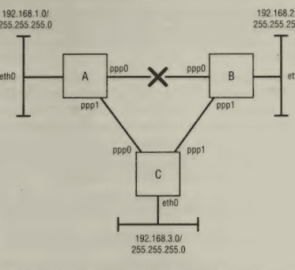


只要路由器 A 和 B 之间的链路没有故障，这种配置运行得非常好。如果该链路发生故障，那么如上所示的路由条目会导致 A 的以太网网段上的主机无法访问 B 的以太网网段上的主机，因为数据包会被定向到路由器 A 的 `ppp0` 链路上，而该链路已断开。它们仍然可以继续与 C 的以太网网段上的主机通信，并且 C 的以太网网段上的主机仍然可以与 B 的以太网网段上的主机通信，因为 B 和 C 之间的链路仍然完好。

但等等，如果 A 可以与 C 通信，而 C 仍然可以与 B 通信，为什么 A 不将发往 B 的数据报经由 C 进行路由，让 C 将它们发送给 B 呢？这正是 RIP 等动态路由协议旨在解决的那类问题。如果路由器 A、B 和 C 中的每一个都在运行路由守护进程，那么当网络中任何一条链路发生故障时，它们的路由表会自动调整以反映网络的新状态。配置这样的网络很简单：在每个路由器上，你只需要做两件事。以路由器 A 为例：

```
root# route add -net 192.168.1.0 netmask 255.255.255.0 eth0
root# /usr/sbin/routed
```

`routed` 路由守护进程启动时会自动查找所有活动的网络端口，并在每个网络设备上发送和监听消息，以便它能够确定并更新主机上的路由表。

以上是对动态路由及其使用场景的简要介绍。如果你需要更多信息，请参考文档顶部列出的建议参考书目。

与动态路由相关的重要要点如下：

- 只有当你的 Linux 机器有可能选择通往目的地的多条可能路径时，你才需要运行动态路由协议守护进程。
- 动态路由守护进程会自动修改你的路由表，以适配网络的变化。
- RIP 适用于小到中等规模的网络。

## 配置你的网络服务器和服务

网络服务器和服务是那些允许远程用户使用你的 Linux 机器的程序。服务器程序监听网络端口。网络端口是寻址特定主机上特定服务的手段，也是服务器区分传入的 telnet 连接和传入的 ftp 连接的方式。远程用户与你的机器建立网络连接，监听该端口的服务器程序（即网络守护进程程序）接受连接并执行。网络守护进程有两种工作方式。在实际应用中，这两种方式都很常见。这两种方式是：

**独立运行** 网络守护进程程序监听指定的网络端口，当有传入连接时，它自己管理该网络连接以提供服务。

**作为 inetd 服务器的从属** `inetd` 服务器 是一个特殊的网络守护进程程序，专门用于管理传入的网络连接。它有一个配置文件，告诉它在接收到传入连接时需要运行哪个程序。任何服务端口都可以配置为使用 `tcp` 或 `udp` 协议。这些端口在另一个文件中描述，我们很快就会讲到。

我们需要配置两个重要文件。它们分别是 `/etc/services` 文件，用于为端口号分配名称；以及 `/etc/inetd.conf` 文件，它是 `inetd` 网络守护进程的配置文件。

### /etc/services

`/etc/services` 文件是一个简单的数据库，将人类友好的名称与机器友好的端口号关联起来。其格式相当简单。该文件是一个文本文件，每一行代表数据库中的一个条目。每个条目由三个字段组成，字段之间用任意数量的空白字符（制表符或空格）分隔。字段包括：名称 端口/协议 别名 # 注释

- 名称 代表所描述服务的单个单词名称。
- 端口/协议 此字段分为两个子字段。
    - 端口 指定指定服务可用的端口号的数字。大多数常见服务都有分配的服务编号。这些在 RFC-1340 中有描述。
    - 协议 此子字段可以设置为 `tcp` 或 `udp`。
- 别名 可用于指代此服务条目的其他名称。

需要注意的是，`18/tcp` 的条目与 `18/udp` 的条目非常不同，而且没有技术原因要求同一服务必须同时存在于两者之上。通常常识起主导作用，只有当特定服务同时通过 `tcp` 和 `udp` 可用时，你才会看到两个条目。

任何出现在某行中 `##` 字符之后的文本都会被忽略，并被视为注释。

### /etc/Services 文件示例

所有现代 Linux 发行版都提供一个良好的 `/etc/services` 文件。以防你恰好是从头开始构建机器，这里是一份来自旧版 Debian 发行版（参见 http://www.debian.org/）提供的 `/etc/services` 文件的副本。

```
####### /etc/services:
####### $Id: services,v.1.3 1996/05/06 21:42:37 tobias Exp $
#
####### Network services, Internet style
#
####### Note that it is presently the policy of IANA to assign a
####### single well-known port number for both TCP and UDP; hence,
####### most entries here have two entries even if the protocol
####### doesn't support UDP operations.
####### Updated from RFC 1340, 'Assigned Numbers' (July 1992).
####### Not all ports are included, only the more common ones.

tcpmux	1/tcp		# TCP port service multiplexer
echo	7/tcp
		7/udp
discard	9/tcp		sink null
		9/udp		sink null
systat	11/tcp		users
daytime	13/tcp
		13/udp
daytime	17/tcp
		17/udp
qotd		17/tcp		quote
msp		18/tcp		# message send protocol
		18/udp		# message send protocol
chargen	19/tcp		tystst source
		19/udp		tystst source
ftp-data	20/tcp
ftp		21/tcp
ssh		22/tcp		# SSH Remote Login Protocol
		22/udp		# SSH Remote Login Protocol
telnet	23/tcp
####### 24 - private
smtpp	25/tcp		mail
####### 26 - unassigned
time	37/tcp		timeserver
		37/udp		timeserver
		39/udp		resource	# resource location
nameserver	42/tcp		name	# IEN 116
whois	43/tcp		nicname
re-mail-ck	50/tcp		# Remote Mail Checking Protocol
		50/udp		# Remote Mail Checking Protocol
domain	53/tcp		nameserver	# name-domain server
		53/udp		nameserver
mtop	57/tcp		# deprecated
bootps	67/tcp		# BOOTP server
		67/udp
bootpc	68/tcp		# BOOTP client
```

### 第三部分

| 服务 | 端口/协议 | 别名 | 注释 |
| :--- | :--- | :--- | :--- |
| bootpc | 68/udp | | |
| tftp | 69/udp | | |
| gopher | 70/tcp | | 因特网电子羊（Gopher） |
| gopher | 70/udp | | |
| rje | 77/tcp | netrjs | |
| finger | 79/tcp | | |
| www | 80/tcp | http | 万维网 HTTP |
| www | 80/udp | | 超文本传输协议 |
| link | 87/tcp | ttylink | |
| kerberos | 88/tcp | kerberos5, krb5 | Kerberos v5 |
| kerberos | 88/udp | kerberos5, krb5 | Kerberos v5 |
| supdup | 95/tcp | | |
| | 100/tcp | | 保留 |
| hostnames | 101/tcp | hostname | 通常来自 sri-nic |
| iso-tsap | 102/tcp | tsap | ISO20E 的一部分 |
| csnet-ns | 105/tcp | cso-ns | 也被 CSO 名称服务器使用 |
| csnet-ns | 105/udp | cso-ns | |
| rtelnet | 107/tcp | | 远程 Telnet |


| rtelnet | 107/udp | | |

| pop-2 | 109/tcp | postoffice | POP 版本 2 |

| pop-2 | 109/udp | | |

| pop-3 | 110/tcp | | POP 版本 3 |

| pop-3 | 110/udp | | |

| sunrpc | 111/tcp | portmapper | RPC 4.0 端口映射器 TCP |

| sunrpc | 111/udp | portmapper | RPC 4.0 端口映射器 UDP |

| auth | 113/tcp | authentication, tap, ident | |

| sftp | 115/tcp | | |

| uucp-path | 117/tcp | | |

| nntp | 119/tcp | readnews, untp | 新闻组（USENET） |

| ntp | 123/tcp | | |

| ntp | 123/udp | | 网络时间协议 |

| netbios-ns | 137/tcp | | NETBIOS 名称服务 |

| netbios-ns | 137/udp | | |

| netbios-dgm | 138/tcp | | NETBIOS 数据报服务 |

| netbios-dgm | 138/udp | | |

| netbios-ssn | 139/tcp | | NETBIOS 会话服务 |

| netbios-ssn | 139/udp | | |

| imap2 | 143/tcp | | 临时邮件访问协议 v2 |

| imap2 | 143/udp | | |

| snmp | 161/udp | | 简单网络管理协议 |

| snmp-trap | 162/udp | snmptrap | SNMP 陷阱 |

| cmip-man | 163/tcp | | IP 上的 ISO 管理（CMOT） |

| cmip-man | 163/udp | | |

| cmip-agent | 164/tcp | | |

| cmip-agent | 164/udp | | |

| xdmcp | 177/tcp | | X 显示管理器控制协议 |

| xdmcp | 177/udp | | |

| nextstep | 178/tcp | | NeXTStep 窗口服务器 |

| nextstep | 178/udp | | |

| bpg | 179/tcp | | 边界网关协议 |

| bpg | 179/udp | | |

| prospexo | 191/tcp | | Cliff Neuman 的 Prospexo |

| prospexo | 191/udp | | |

| irc | 194/tcp | | 因特网中继聊天 |

| irc | 194/udp | | |

| smux | 199/udp | | |

| at-rmp | 201/tcp | | AppleTalk 路由 |

| at-rmp | 201/udp | | |

| at-nbp | 202/tcp | | AppleTalk 名称绑定 |

| at-nbp | 202/udp | | |

| at-echo | 204/tcp | | AppleTalk 回显 |

| at-echo | 204/udp | | |

| at-2is | 206/tcp | | AppleTalk 区域信息 |

| at-2is | 206/udp | | |

| z3950 | 210/tcp | wais | NISO Z39.50 数据库 |

| z3950 | 210/udp | wais | |

| ipx | 213/tcp | | IPX |

| ipx | 213/udp | | |

| imap3 | 220/tcp | | 交互式邮件访问协议 v3 |

| imap3 | 220/udp | | |

| ulistsserv | 372/tcp | | UNIX 列表服务 |

| ulistsserv | 372/udp | | |

## UNIX 特定服务

| 服务 | 端口/协议 | 别名 | 注释 |
| :--- | :--- | :--- | :--- |
| exec | 512/tcp | | |
| biff | 512/udp | comsat | |
| login | 513/tcp | | |
| who | 513/udp | who | |
| shell | 514/tcp | cmd | 不使用密码 |
| syslog | 514/udp | | |
| printer | 515/tcp | spooler | 行式打印机缓冲器 |
| talk | 517/udp | | |
| ntalk | 518/udp | | |
| route | 520/udp | router, routed | RIP |
| timed | 525/udp | timeserver | |
| tempo | 526/tcp | newdate | |
| courier | 530/tcp | rpc | |
| conference | 531/tcp | chat | |
| netnews | 532/tcp | readnews | |
| netwall | 533/udp | | -- 用于紧急广播 |
| uucp | 540/tcp | uucpd | uucp 守护进程 |
| remote fs | 556/tcp | | Brunhoff 远程文件系统 |
| 服务 | 端口/协议 | 别名 | 注释 |
| :--- | :--- | :--- | :--- |
| klogin | 543/tcp | | Kerberized 'rlogin' (v5) |
| kshell | 544/tcp | krcmd | Kerberized 'rsh' (v5) |
| kerberos-admin | 749/tcp | | Kerberos 'kadmin' (v5) |
| webster | 765/tcp | | 网络词典 |
| webster | 765/udp | | |

```text
#
###### 来自“已分配号码”：
#
###### 注册端口不受 IANA 控制，
###### 在大多数系统上可由普通用户进程或
###### 由普通用户执行的程序使用。
#
###### 端口用于在 TCP [45,106] 中命名承载
###### 长期对话的逻辑连接的两端。
###### 为了向未知呼叫者提供服务，
###### 定义了服务联系端口。此列表指定
###### 服务器进程用作其联系端口的端口。
###### 虽然 IANA 不能控制这些端口的使用，但它
###### 确实为了方便社区而注册或列出这些端口的使用。
```

| 服务 | 端口/协议 | 别名 | 注释 |
| :--- | :--- | :--- | :--- |
| ingreslock | 1524/tcp | | |
| ingreslock | 1524/udp | | |
| prospero-np | 1525/tcp | | Prospero 非特权 |
| prospero-np | 1525/udp | | |
| rfe | 5002/tcp | | 无线电自由以太网 |
| rfe | 5002/udp | | 实际仅使用 UDP |
| bbs | 7000/tcp | | BBS 服务 |

```text
#
###### Kerberos (Project Athena/MIT) 服务
###### 注意，这些适用于 Kerberos v4，且非官方。
###### 运行 v4 的站点应取消注释这些条目，并注释掉
###### 上面的 v5 条目。
```

| 服务 | 端口/协议 | 别名 | 注释 |
| :--- | :--- | :--- | :--- |
| kerberos4 | 750/udp | kdc | Kerberos (服务器) udp |
| kerberos4 | 750/tcp | kdc | Kerberos (服务器) tcp |
| kerberos_master | 751/udp | | Kerberos 认证 |
| kerberos_master | 751/tcp | | Kerberos 认证 |
| passwd_server | 752/udp | | Kerberos 密码服务器 |
| krb_prop | 754/tcp | | Kerberos 从站传播 |
| krbupdated | 760/tcp | kreg | Kerberos 注册 |
| kpasswd | 761/tcp | kpwd | Kerberos "passwd" |
| kpop | 1109/tcp | | 带 Kerberos 的 Pop |


| knetd | 2053/tcp | | Kerberos 解复用器 |

| zephyr-srv | 2102/udp | | Zephyr 服务器 |

| 服务 | 端口/协议 | 别名 | 注释 |

| :--- | :--- | :--- | :--- |

| zephyr-clt | 2103/udp | | Zephyr serv-hm 连接 |

| zephyr-hm | 2104/udp | | Zephyr 主机管理器 |

| eklogin | 2105/tcp | | Kerberos 加密登录 |

### 非官方但必要（针对 NetBSD）的服务

| 服务 | 端口/协议 | 别名 | 注释 |

| :--- | :--- | :--- | :--- |

| supfilesrv | 871/tcp | | SUP 服务器 |

| supfiledbg | 1127/tcp | | SUP 调试 |

### 数据报交付协议服务

| 服务 | 端口/协议 | 别名 | 注释 |

| :--- | :--- | :--- | :--- |

| rtmp | 1/ddp | | 路由表维护协议 |

| nbp | 2/ddp | | 名称绑定协议 |

| echo | 4/ddp | | AppleTalk 回显协议 |

| zip | 6/ddp | | 区域信息协议 |

### Debian GNU/Linux 服务

| 服务 | 端口/协议 | 别名 | 注释 |

| :--- | :--- | :--- | :--- |

| rmtcfg | 1236/tcp | | Gracilis Packeten 远程配置服务器 |

| xtel | 1313/tcp | | 法国 minitel |

| cfinger | 2003/tcp | | GNU Finger |

| postgres | 4321/tcp | | POSTGRES |

| mandelspawn | 9359/udp | | 网络分形（曼德博） |

### 本地服务

在现实世界中，随着新服务的创建，实际文件始终在不断增长。如果您担心自己的副本不完整，我建议从最新的发行版中复制一份新的 `/etc/services`。

### `/etc/inetd.conf`

`/etc/inetd.conf` 文件是 `inetd` 服务器守护进程的配置文件。其功能是告诉 `inetd` 在收到特定服务的连接请求时该做什么。对于您希望接受连接的每个服务，您必须告诉 `inetd` 要运行哪个网络服务器守护进程以及如何运行它。

其格式也相当简单。它是一个文本文件，每一行描述您希望提供的服务。行中“`#`”之后的任何文本都会被忽略并视为注释。每一行包含由任意数量的空白字符（制表符或空格）分隔的七个字段。通用格式如下：

```
service socket_type proto flags user server_path server_args
```

`service` 是指与此配置相关的服务，取自 `/etc/services` 文件。

`socket_type` 此字段描述此条目将视为相关的套接字类型；允许的值为：`stream`、`dgram`、`raw`、`rdm` 或 `seqpacket`。这在技术上有点复杂，但作为一个经验法则，几乎所有基于 `tcp` 的服务都使用 `stream`，几乎所有基于 `udp` 的服务都使用 `dgram`。只有非常特殊的类型服务器守护进程才会使用其他任何值。

`proto` 被视为对此条目有效的协议。这应与 `/etc/services` 文件中的相应条目匹配，通常要么是 `tcp` 要么是 `udp`。基于 Sun RPC（远程过程调用）的服务器将使用 `rpc/tcp` 或 `rpc/udp`。

`flags` 此字段实际上只有两种可能的设置。此字段设置告诉 `inetd` 网络服务器程序在启动后是否释放套接字，从而决定 `inetd` 是否可以在下一个连接请求时启动另一个，或者 `inetd` 是否应该等待并假设已经在运行的任何服务器守护进程都会处理新的连接请求。再次说明，这有点棘手，但作为一个经验法则，所有 `tcp` 服务器都应将此条目设置为 `nowait`，大多数 `udp` 服务器应将此条目设置为 `wait`。我警告过存在一些显著的例外，因此如果您不确定，请让示例引导您。

`user` 此字段描述启动时哪个 `/etc/passwd` 中的用户账户将被设置为网络守护进程的所有者。如果您希望防范安全风险，这通常很有用。您可以将条目的用户设置为 `nobody` 用户，以便如果网络服务器安全被突破，可能的损害会最小化。不过，此字段通常设置为 `root`，因为许多服务器需要 root 权限才能正确运行。

`server_path` 此字段是为该条目要执行的实际服务器程序的路径名。

`server_args` 此字段组成行的其余部分，并且是可选的。此字段是您在启动服务器守护进程程序时想要传递任何命令行参数的位置。

#### `/etc/inetd.conf` 示例

与 `/etc/services` 文件类似，所有现代发行版都会提供一个可用的良好 `/etc/inetd.conf` 文件供你使用。为了完整性，以下是 Debian 发行版（参见 `http://www.debian.org/`）的 `/etc/inetd.conf` 文件：


# `/etc/inetd.conf`

```
###### /etc/inetd.conf: see inetd(8) for further informations.
#
###### Internet server configuration database
#
###### Modified for Debian by Peter Tobias
###### <tobias@et-inf.fh-oerlingen.de>
#
###### service_name sock_type proto flags user path args
#
###### Internal services
#
#echo stream tcp nowait root internal
#echo dgram udp wait root internal
discard stream tcp nowait root internal
discard dgram udp wait root internal
daytime stream tcp nowait root internal
daytime dgram udp wait root internal
#chargen stream tcp nowait root internal
#chargen dgram udp wait root internal
time stream tcp nowait root internal
time dgram udp wait root internal
#
###### These are standard services.
#
telnet stream tcp nowait root tcpd in.telnetd
ftp stream tcp nowait root tcpd in.ftpd
#fspd dgram udp wait root tcpd in.fspd
#
###### Shell, Login, exec and talk are BSD protocols.
#
shell stream tcp nowait root tcpd in.rshd
login stream tcp nowait root tcpd in.logind
#exec stream tcp nowait root tcpd in.execd
talk dgram udp wait root tcpd in.talkd
ntalk dgram udp wait root tcpd in.ntalkd
#
###### Mail, news and uucp services.
#
smtp stream tcp nowait root tcpd in.smtpd
#nttp stream tcp nowait news tcpd in.nttpd
#comsat dgram udp wait root tcpd in.comsat
###### Pop et al
#pop-2 stream tcp nowait root tcpd in.pop2d
#pop-3 stream tcp nowait root tcpd in.pop3d
###### 'cfinger' is for the GNU finger server available for
###### Debian. (NOTE: The current implementation of the 'finger'
###### daemon allows it to be run as 'root'.)
#cfinger stream tcp nowait root tcpd in.cfgingerd
#finger stream tcp nowait root tcpd in.fingerd
#netstat stream tcp nowait nobody tcpd /bin/netstat
#systat stream tcp nowait nobody tcpd /bin/ps -auwx
###### Tftp service is provided primarily for booting. Most sites
###### run this only on machines acting as 'boot servers.'
#
#tftp dgram udp wait nobody tcpd in.tftpd
#bootps dgram udp wait root bootpd bootpd -i -t 120
###### Kerberos authenticated services (these probably need to
###### be corrected)
#
#klogin stream tcp nowait root tcpd in.rlogind -k
#eklogin stream tcp nowait root tcpd in.rlogind -k -x
#kshell stream tcp nowait root tcpd in.rshd -k
###### Services run ONLY on the Kerberos server (these probably
###### need to be corrected)
#
#krbupdate stream tcp nowait root tcpd registerd
#kpasswd stream tcp nowait root tcpd kpasswdd
###### RPC based services
#
#mountd/1 dgram rpc/udp wait root tcpd rpc.mountd
#rstatd/1-3 dgram rpc/udp wait root tcpd rpc.rstatd
#rusersd/2-3 dgram rpc/udp wait root tcpd rpc.rusersd
#walld/1 dgram rpc/udp wait root tcpd rpc.walld
###### End of inetd.conf.
ident stream tcp nowait nobody identd identd -I
```

## 其他杂项网络相关配置文件

在 Linux 下，有一些与网络配置相关的杂项文件，你可能会感兴趣。你可能永远不需要修改这些文件，但了解它们的内容和用途是值得的。

### `/etc/protocols`

`/etc/protocols` 文件是一个将协议 ID 号映射到协议名称的数据库。程序员使用它以便在程序中按名称指定协议，某些程序（如 `tcpdump`）也使用它，以便在输出中显示名称而不是数字。该文件的一般语法如下：

```
protocol   name   number   aliases
```

Debian 发行版提供的 `/etc/protocols` 文件（参见 `http://www.debian.org/`）如下所示：

```
####### /etc/protocols: 
####### $Id: protocols,v 1.1 1995/02/24 01:09:41 murdock Exp $
#
####### Internet (IP) protocols
#
####### from: @(#)protocols    5.1 (Berkeley) 4/17/89
#
####### Updated from NetBSD based on RFC 1340, Assigned
####### Numbers (July 1992).
```

| 协议 | ID | 名称 | 别名/注释 |
| :--- | :--- | :--- | :--- |
| ip | 0 | IP | # internet protocol, pseudo protocol number |
| icmp | 1 | ICMP | # internet control message protocol |
| igmp | 2 | IGMP | # Internet Group Management |
| ggp | 3 | GGP | # gateway-gateway protocol |
| ipencap | 4 | IP-ENCAP | # IP encaps in IP (officially 'IP') |
| st | 5 | ST | # ST datagram mode |
| tcp | 6 | TCP | # transmission control protocol |
| egp | 8 | EGP | # exterior gateway protocol |
| pup | 12 | PUP | # PARC universal packet protocol |
| udp | 17 | UDP | # user datagram protocol |
| hmp | 20 | HMP | # host monitoring protocol |
| xns-idp | 22 | XNS-IDP | # Xerox NS IDP |


| rdp | 27 | RDP | # 'reliable datagram' protocol |
| iso-tp4 | 29 | ISO-TP4 | # ISO Transport Protocol class 4 |
| xtp | 36 | XTP | # Xpress Transfer Protocol |
| ddp | 37 | DDP | # Datagram Delivery Protocol |
| idpr-cmtp | 39 | IDPR-CMTP | # IDPR Control Message Transport |
| rsfp | 73 | RSFP | # Radio Shortest Path First |
| vmtp | 81 | VMTP | # Versatile Message Transport |
| ospf | 89 | OSPFIGP | # Open Shortest Path First |
| ipip | 94 | IPIP | # Yet Another IP encapsulation |
| encap | 98 | ENCAP | # Yet Another IP encapsulation |

### `/etc/networks`

`/etc/networks` 文件的功能类似于 `/etc/hosts` 文件。它提供了网络名称与网络地址之间的简单数据库。其格式有所不同，每行只能有两个字段，且字段编码方式为：

`networkname networkaddress`

一个示例可能如下所示：

```
loopnet 127.0.0.0
localnet 192.168.0.0
amrnet 44.0.0.0
```

当你使用如 `route` 命令等工具时，如果目标是一个网络，且该网络在 `/etc/networks` 文件中有条目，那么 `route` 命令将显示该网络名称而不是其地址。

## 网络安全与访问控制

让我先警告你，保护你的机器和网络免受恶意攻击是一门复杂的艺术。我并不认为自己是这个领域的专家，虽然我描述的以下机制会有所帮助，但如果你真的重视安全，我建议你自己就该主题做一些研究。互联网上有很多关于该主题的优秀参考资料，包括 Security-HOWTO。

一条重要的经验法则是：*“不要运行你不打算使用的服务器。”* 许多发行版都配置了各种服务并自动启动它们。为了确保最低限度的安全性，你应该查看你的 `/etc/inetd.conf` 文件，并将你不打算使用的服务条目注释掉（在行首添加“#”）。合适的候选服务包括：`shell`、`login`、`exec`、`uucp`、`ftp` 以及信息类服务，如 `finger`、`netstat` 和 `systat`。

有各种安全与访问控制机制。我将介绍其中最基础的几种。

### `/etc/ftpusers`

`/etc/ftpusers` 文件是一种简单的机制，允许你禁止某些用户通过 `ftp` 登录到你的机器。当 `ftp` 守护进程程序（`ftpd`）接收到传入的 `ftp` 连接时，会读取 `/etc/ftpusers` 文件。该文件是一个简单的列表，列出了被禁止登录的用户。它可能看起来像这样：

```
####### /etc/ftpusers - users not allowed to login via ftp
root
uucp
bin
mail
```

### `/etc/securetty`

`/etc/securetty` 文件允许你指定 `root` 被允许登录的 `tty` 设备。登录程序（通常是 `/bin/login`）会读取 `/etc/securetty` 文件。其格式是允许登录的 `tty` 设备名称列表；在其他所有设备上，`root` 登录是被禁止的：

```
####### /etc/securetty - tty's on which root is allowed to login
tty1
tty2
tty3
tty4
```

### Tcpd 主机访问控制机制

你在同一个 `/etc/inetd.conf` 中看到的 `tcpd` 程序，为它所配置保护的服务提供日志记录和访问控制机制。

当由 `inetd` 或 `xeninetd` 调用时，它会读取包含访问规则的两个文件，并相应地允许或拒绝访问它所保护的服务器。

它将在规则文件中搜索，直到找到第一个匹配项。如果没有找到匹配项，则假设应允许任何人访问。这些文件

#### `/etc/hosts.allow`

`/etc/hosts.allow` 文件是 `/usr/sbin/tcpd` 程序的配置文件。`hosts.allow` 文件包含规则，描述哪些主机被*允许*访问你机器上的服务。

文件格式非常简单：

```
###### /etc/hosts.allow
#
###### <service list>: <host list> [: command]
```

服务列表（service list）是一个以逗号分隔的服务名称列表，表示该规则适用于哪些服务。示例服务名称包括：*ftp*、*telnetd* 和 *fingerd*。

主机列表（host list）是一个以逗号分隔的主机名列表。你在这里也可以使用 IP 地址。此外，你还可以使用通配符来指定主机名或地址，以匹配一组主机。示例包括：*gw.vk2ktj.anpr.org* 用于匹配特定主机；*uts.edu.au* 用于匹配任何以该字符串结尾的主机名；以及 *44.* 用于匹配任何以这些数字开头的 IP 地址。还有一些特殊的标记可以简化配置。其中一些包括：*ALL* 匹配所有主机；*LOCAL* 匹配任何名称中不包含 “.” 的主机（即与你机器在相同域内）；以及 *PARANOID* 匹配任何主机名与其地址不匹配的主机（名称欺骗）。还有一个标记也很有用。*EXCEPT* 标记允许你提供一个包含例外的列表。这将在后面的示例中介绍。

命令（command）是一个可选参数。此参数是每当该规则被匹配时执行的命令的完整路径名。例如，它可以运行一个尝试识别登录到连接主机的用户的命令，或者尝试生成邮件消息或向系统管理员发出其他警告，表明有人试图连接。可以包含许多扩展。一些常见示例是：*%h* 扩展为连接主机的名称，或者如果该主机没有名称，则扩展为其地址；而 `%d` 是被调用的守护进程名称。

示例：

```
###### /etc/hosts.allow

###### Allow mail to anyone
in.smtpd:  ALL
###### All telnet and ftp to only hosts within my domain and my
###### host at home.
telnetd, ftpd: LOCAL, myhost.athome.org.au
###### Allow finger to anyone but keep a record of who they are.
fingerd:  ALL:  (finger @%h | mail -s "finger from %h" root)
```

#### `/etc/hosts.deny`

`/etc/hosts.deny` 文件是 `/usr/sbin/tcpd` 程序的配置文件。`hosts.deny` 文件包含规则，描述哪些主机被**禁止**访问你机器上的服务。

一个简单的示例可能看起来像这样：

```
###### /etc/hosts.deny

#
#
###### Disallow all hosts with suspect hostnames
ALL: PARANOID
#
###### Disallow all hosts.
ALL: ALL
```

`PARANOID` 条目实际上是多余的，因为另一个条目无论如何都会拦截所有内容。根据你特定的需求，这两个条目中的任何一个都可以作为合理的默认值。

在 `/etc/hosts.deny` 中拥有 `ALL: ALL` 默认值，然后在 `/etc/hosts.allow` 文件中具体启用你想要的那些服务和主机，这是最安全的配置。

#### `/etc/hosts.equiv`

`hosts.equiv` 文件用于授予某些主机和用户访问你机器上账户的权利，而无需提供密码。这在你可以控制所有机器的安全环境中是有用的，否则就是安全隐患。你机器的安全性仅取决于受信任主机中安全性最低的那一个。为了最大化安全性，不要使用这种机制，并鼓励你的用户也不要使用 `.rhosts` 文件。

#### 正确配置你的 ftp 守护进程

许多站点有兴趣运行匿名 `ftp` 服务器，允许其他人上传和下载文件，而无需特定的用户 ID。如果你决定提供此功能，请确保你正确配置 `ftp` 守护进程以支持匿名访问。大多数关于 `ftpd(8)` 的手册页都会详细描述如何进行此操作。你应该始终确保遵循这些说明。一个重要提示是不要在匿名账户的 `/etc` 目录中使用你的 `/etc/passwd` 文件的副本。确保你移除所有不必要的账户详细信息，只保留你必须有的，否则你将容易受到暴力密码破解技术的攻击。

#### 网络防火墙


不限制数据报甚至到达你的机器或服务器是一种出色的安全措施。防火墙 HOWTO（参见 http://metahlab.unc.edu/LDP/）对此有深入介绍。

## 其他建议

以下是一些其他的、可能有点“教条”的建议，供你考虑。

- **1. `sendmail`**：尽管它很流行，`sendmail` 守护进程经常出现在安全警告通告中。这由你决定，但我选择不运行它。

- **2. NFS 和其他 Sun RPC 服务**：小心这些服务。这些服务存在各种可能的利用方式。很难找到像 NFS 这样的服务的替代方案，但如果你配置它们，请确保仔细考虑允许挂载权限的对象。

## IP 和以太网相关信息

本节涵盖与以太网和 IP 相关的特定信息。这些子节被归为一组，因为我认为它们是原称为“技术特定”部分中最有趣的内容。任何拥有局域网的人都可以从这些好东西中受益。

### 以太网

以太网设备名称为 `eth0`、`eth1`、`eth2` 等。内核检测到的第一个网卡被分配 `eth0`，其余按检测顺序依次分配。

默认情况下，Linux 内核只探测一个以太网设备，你需要向内核传递命令行参数，才能强制检测更多的板卡。

要了解如何在 Linux 下让你的以太网网卡正常工作，你应该参阅 Ethernet-HOWTO（参见 http://meta.lab.unc.edu/LDP/）。

一旦你正确构建了支持你的以太网网卡的内核，那么配置该网卡就容易了。

通常你会使用类似以下内容（大多数发行版如果你配置它们支持你的以太网，它们已经为你做了）：

```
root# ifconfig eth0 192.168.0.1 netmask 255.255.255.0 up
root# route add -net 192.168.0.0 netmask 255.255.255.0 eth0
```

大多数以太网驱动程序由 Donald Becker <becker@CESDIS.gsfc.nasa.gov> 开发。

### EQL—多线路流量均衡器

EQL 设备名称为 `eq1.` 使用标准内核源代码，你每台机器可能只能有一个 EQL 设备。EQL 提供了一种利用多个点对点线路（如 PPP、SLIP 或 PLIP）作为单个逻辑链路来承载 TCP/IP 的方法。通常，使用多条较低速度的线路比安装一条高速线路更便宜。

#### 内核编译选项

- 网络设备支持 `-->`

  - [*] 网络设备支持

  - `<->` EQL（串行线路负载平衡）支持

配置相当直接。你从配置 EQL 接口开始。EQL 接口就像其他任何网络设备一样。你使用 `ifconfig` 实用工具配置 IP 地址和 MTU。这看起来像是

```
root# ifconfig eql 192.168.10.1 mtu 1006
```

接下来，你需要手动初始化你将使用的每条线路。这些可以是任何组合的点对点网络设备。你如何初始化连接取决于它们是什么类型的链接；请参阅相应部分以获取更多信息。

最后，你需要将串行链接与 EQL 设备关联。这被称为 “enslaving”（奴役），并使用 `eql_enslave` 命令完成，如下所示：

```
root# eql_enslave eql s10 28800
root# eql_enslave eql ppp0 14400
```

你提供给 `eql_enslave` 的 `estimated speed`（估算速度）参数本身并不直接做任何事情。它被 EQL 驱动用于确定该设备应接收多少份额的数据报。因此，你可以通过调整此值来微调线路的平衡。

要将线路与 EQL 设备解关联，你使用 `eql_emancipate` 命令，如下所示：

```
root# eql_emancipate eql s10
```

你添加路由的方式与其他点对点链接一样，只是你的路由应引用 `eql` 设备，而不是实际的串行设备本身。通常你会使用

```
root# route add default eql
```

EQL 驱动由 Simon Janes <s@nmc.com> 开发。

### IP 记账（针对 Linux-2）

Linux 内核的 IP 记账功能允许你收集和分析一些网络使用数据。收集的数据包括自上次重置数据以来累计的数据包数量和字节数。你可以指定各种规则来对数据进行分类，以满足你的任何目的。此选项已在内核 2.1.102 中被移除，因为旧的基于 `ipfwadm` 的防火墙已被 "ipchains" 取代。

**内核编译选项：**

- 网络选项 -->

  - [*] IP：记账

编译并安装内核后，你需要使用 `ipfwadm` 命令来配置 IP 流量统计。拆分统计信息的方法有很多种。我挑选了一个可能很有用的简单示例。更多详细信息请参阅 `ipfwadm` 的手册页。

场景：你有一个通过 PPP 链路连接到互联网的以太网。在你的以太网上，有一台机器提供了多种服务，你希望了解每种 FTP 和万维网（WWW）流量产生了多少数据，以及 TCP 和 UDP 流量的总数。

你可能使用类似以下内容的命令集（以 Shell 脚本形式展示）：

```bash
#!/bin/sh

###### 清空流量统计规则
ipfwadm -A -f

###### 设置快捷变量
localnet=44.136.8.96/29
any=0/0

###### 为本地网段添加规则
ipfwadm -A in -a -P tcp -D $localnet ftp-data
ipfwadm -A out -a -P tcp -S $localnet ftp-data
ipfwadm -A in -a -P tcp -D $localnet www
ipfwadm -A out -a -P tcp -S $localnet www
ipfwadm -A in -a -P udp -D $localnet
ipfwadm -A out -a -P udp -S $localnet
ipfwadm -A in -a -P udp -D $localnet
ipfwadm -A out -a -P udp -S $localnet

###### 默认规则
ipfwadm -A in -a -P tcp -D $any ftp-data
ipfwadm -A out -a -P tcp -S $any ftp-data
ipfwadm -A in -a -P tcp -D $any www
ipfwadm -A out -a -P tcp -S $any www
ipfwadm -A in -a -P udp -D $any
ipfwadm -A out -a -P udp -S $any
ipfwadm -A in -a -P udp -D $any
ipfwadm -A out -a -P udp -S $any

###### 列出规则
ipfwadm -A -l -n
```

名称 `ftp-data` 和 `www` 指的是 `/etc/services` 文件中的相应条目。最后一条命令列出每个流量统计规则并显示累计的总和。

分析 IP 流量统计时需要注意的一个重要点是：*所有匹配规则的总和都会被累加*，因此要获取差值数据，你需要进行相应的数学计算。例如，如果我想了解既不是 `ftp` 也不是 `www` 的数据量有多少，我需要从匹配所有端口的规则总和中减去各个特定规则的总和。

```bash
root# ipfwadm -A -l -n
```

IP 流量统计规则

| 数据包 | 字节 | 方向 | 协议 | 源地址 | 目标地址 | 端口 |
| :--- | :--- | :--- | :--- | :--- | :--- | :--- |
| 0 | 0 | 入 | tcp | 0.0.0.0/0 | 44.136.8.96/29 | * -> 20 |
| 0 | 0 | 出 | tcp | 44.136.8.96/29 | 0.0.0.0/0 | 20 -> * |
| 10 | 1166 | 出 | tcp | 0.0.0.0/0 | 44.136.8.96/29 | * -> 80 |
| 10 | 572 | 出 | tcp | 44.136.8.96/29 | 0.0.0.0/0 | 80 -> * |
| 252 | 10943 | 入 | tcp | 0.0.0.0/0 | 44.136.8.96/29 | * -> * |
| 231 | 18831 | 出 | tcp | 44.136.8.96/29 | 0.0.0.0/0 | * -> * |
| 0 | 0 | 入 | udp | 0.0.0.0/0 | 44.136.8.96/29 | * -> * |
| 0 | 0 | 出 | udp | 44.136.8.96/29 | 0.0.0.0/0 | * -> * |
| 0 | 0 | 入 | tcp | 0.0.0.0/0 | 0.0.0.0/0 | * -> 20 |
| 0 | 0 | 出 | tcp | 0.0.0.0/0 | 0.0.0.0/0 | 20 -> * |


| 10 | 1166 | 入 | tcp | 0.0.0.0/0 | 0.0.0.0/0 | * -> 80 |
| 10 | 572 | 出 | tcp | 0.0.0.0/0 | 0.0.0.0/0 | 80 -> * |
| 253 | 10983 | 入 | tcp | 0.0.0.0/0 | 0.0.0.0/0 | * -> * |
| 231 | 18831 | 出 | tcp | 0.0.0.0/0 | 0.0.0.0/0 | * -> * |
| 0 | 0 | 入 | udp | 0.0.0.0/0 | 0.0.0.0/0 | * -> * |
| 0 | 0 | 出 | udp | 0.0.0.0/0 | 0.0.0.0/0 | * -> * |

## IP 流量统计（适用于 Linux 2.2）

新的流量统计代码通过 “IP 防火墙链（IP Firewall Chains）” 访问。更多信息请参阅 IP `ichains` 主页（[http://www.aladei4w.net.au/~rusr/comp/ipchains/iphchains.html](http://www.aladei4w.net.au/~rusr/comp/ipchains/iphchains.html)）。除了其他更改外，你现在需要使用 `ipchains` 而不是 `ipfwadm` 来配置你的过滤器。（参见最新内核源码中的 `Documentation/Changes`）。

## IP 别名（IP Aliasing）

在某些应用场景中，能够为单个网络设备配置多个 IP 地址是非常有用的。互联网服务提供商（ISP）经常使用此功能，为客户的万维网和 FTP 服务提供“定制化”的域名。有关更多信息，请参阅 “IP-Alias 迷你 HOWTO”。

**内核编译选项：**

```text
Networking options -->
  ...
  [*] Network aliasing
  ...
  <>: IP; aliasing support
```

编译并安装带有 `IP_Alias` 的内核后，支持配置非常简单。别名被添加到与真实网络设备相关联的虚拟网络设备上。这些设备遵循一个简单的命名约定：`<设备名>::<虚拟设备号>`，例如 `eth0:0`、`ppp0:10` 等。请注意，`ifname:number` 设备只能在主接口设置好之后才能进行配置。

例如，如果你有一个同时支持两个不同 IP 子网的以太网，并且希望你的机器能直接访问这两个子网，你可以使用类似以下命令：

```bash
root# ifconfig eth0 192.168.1.1 netmask 255.255.255.0 up
root# route add -net 192.168.1.0 netmask 255.255.255.0 eth0

root# ifconfig eth0:0 192.168.10.1 netmask 255.255.255.0 up
root# route add -net 192.168.10.0 netmask 255.255.255.0 eth0:0
```

要删除别名，只需在其名称末尾添加 “-” 并引用它，操作非常简单：

```bash
root# ifconfig eth0:- 0
```

与该别名相关的所有路由也会自动被删除。

## IP 防火墙（适用于 Linux 2.2）

IP 防火墙及防火墙问题在 Firewall-HOWTO 中得到了更深入的探讨（参见 [http://metalab.unc.edu/](http://metalab.unc.edu/)）。IP 防火墙允许你通过过滤或允许来自或发往指定 IP 地址的数据报，来保护机器免受未授权的网络访问。规则分为三类：入站过滤、出站过滤和转发过滤。入站规则应用于网络接收到的数据报。出站规则应用于网络发送的数据报。转发规则应用于接收到的但不是发给本机（即会被路由转发）的数据报。

**内核编译选项：**

```text
Networking options --->
[*] Network firewalls
......
[*] IP: forwarding/gatewaying
......
[*] IP: firewalling
[ ] IP: firewall packet logging
```

IP 防火墙规则的配置是使用 `ipfwadm` 命令完成的。如前所述，我不是安全方面的专家，因此虽然我会提供一个可供使用的示例，但如果你对安全至关重要，建议你自己进行研究并制定属于自己的规则。

IP 防火墙最常见的用途之一是当你将 Linux 机器用作路由器和防火墙网关，以保护你的本地网络免受来自外部网络的未授权访问时。

以下配置基于 Arnt Gulbrandsen <agulbra@troll.no> 提供的贡献。

该示例描述了在 Linux 防火墙/路由器机器上配置防火墙规则的方法，如图中的示意图所示：

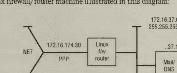

通常，以下命令应放置在 rc 文件中，以便系统每次启动时自动执行。为了获得最大安全性，这些操作应在配置网络接口之后，但在接口实际启动之前执行，以防止任何人在防火墙机器重启期间获得访问权限。

```bash
#!/bin/sh
###### 清空 'forwarding'（转发）规则表
###### 将默认策略更改为 'accept'（接受）
#
/sbin/ipfwadm -F -f
/sbin/ipfwadm -F -p accept

###### .. 以及针对 'Incoming'（入站）
#
/sbin/ipfwadm -I -f
/sbin/ipfwadm -I -P accept

###### 首先，封锁 PPP 接口
###### 我更喜欢使用 '-a reject' 而不是 '-a reject -y'，但那样做的话
###### 就不可能从该接口发起连接了。
###### -o 选项会导致所有被拒绝的数据报被记录。
###### 这是以磁盘空间换取对攻击或配置错误的感知。
#
/sbin/ipfwadm -I -a reject -y -o -P tcp -S 0/0 -D 172.16.174.30

###### 立即丢弃某些明显伪造的数据包类型：
###### 任何来自组播/任播/广播地址的数据都不应到达
#
/sbin/ipfwadm -F -a deny -o -S 224.0/3 -D 172.16.37.0/24
#
###### 并且来自回环网络的数据绝不应该出现在物理线路上
#
/sbin/ipfwadm -F -a deny -o -S 127.0/8 -D 172.16.37.0/24

###### 接受入站 SMTP 和 DNS 连接，但仅允许
###### 连接到邮件/域名服务器
#
/sbin/ipfwadm -F -a accept -P tcp -S 0/0 -D 172.16.37.19 25 53
#
###### DNS 既使用 UDP 也使用 TCP，因此也允许
###### 发给我们域名服务器的 UDP 查询
#
/sbin/ipfwadm -F -a accept -P udp -S 0/0 -D 172.16.37.19 53
#
###### 但不允许发往 NFS 以及 Larry McVoy 的 NFS 扩展等危险端口的
###### ‘应答’。如果你运行 squid，请在此添加其端口。
#
/sbin/ipfwadm -F -a deny -o -P udp -S 0/0 53 \
-D 172.16.37.0/24 2049 2050

###### 发往其他用户端口的应答是可以的
#
/sbin/ipfwadm -F -a accept -P udp -S 0/0 53 \
-D 172.16.37.0/24 53 1024:65535
```

### 拒绝传入的 identd 连接

这里我们使用 `reject`，以便立即告知连接主机不要继续尝试，否则我们会经历

ident 超时带来的延迟。

```
/sbin/ipfwadm -F -a reject -o -P tcp -S 0/0 -D 172.16.37.0/24 113
```

### 接受来自 192.168.64 和 192.168.65 网络的某些常见服务连接，它们是我们要信任的朋友。

```
/sbin/ipfwadm -F -a accept -P tcp -S 192.168.64.0/23 \
    -D 172.16.37.0/24 20:23
```

### 接受并放行所有源自内部的任何连接

```
/sbin/ipfwadm -F -a accept -P tcp -S 172.16.37.0/24 -D 0/0
```

### 拒绝并记录大多数其他传入的 TCP 连接

如果 ftp 无法正常工作，请追加 1:1023


```
/sbin/ipfwadm -F -a deny -o -y -P tcp -S 0/0 -D 172.16.37.0/24
```

### ... 同样也适用于 UDP

```
/sbin/ipfwadm -F -a deny -o -P udp -S 0/0 -D 172.16.37.0/24
```

良好的防火墙配置稍微有些棘手。这个示例应作为你的合理起点。`ipfwadm`手册页提供了一些关于如何使用该工具的帮助。如果你打算配置防火墙，务必四处咨询，并从你认为可靠的来源获取尽可能多的建议，并找一个人从外部对你的配置进行测试/合理性检查。

### IP 防火墙（适用于 Linux 2.2）

新的防火墙代码通过“IP 防火墙链”进行访问。有关更多信息，请参阅第 14 章“IP 链”。除此之外，你现在需要使用 `ipchains`而不是 `ipfwadm`来配置你的过滤器（参见最新内核源代码中的 `Documentation/Changes`）。

### IP/IP 封装

为什么你希望将 IP 数据报封装在 IP 数据报内？如果你从未见过其应用，这似乎是一件奇怪的事情。好吧，这里列举了几个常见的使用场景：移动 IP 和 IP 多播。业余无线电可能是最广泛的使用场景，尽管它也是知名度最低的。

#### 内核编译选项：

- Networking options --->
- [*] TCP/IP networking
- [*] IP: forwarding/gatewaying
- ...
- <--> IP: tunneling

IP 隧道设备被称为“`tun10`”、“`tun11`”等。

“但为什么呢？”好吧，好吧。传统的 IP 路由规则规定 IP 网络由网络地址和网络掩码组成。这产生了一系列连续的地址，它们都可以通过单个路由条目进行路由。这非常方便，但这意味着你只能在连接到其所属的特定网络部分时使用特定的 IP 地址。在大多数情况下这没问题，但如果你是一个移动网民，你可能无法一直停留在一个地方。IP/IP 封装（IP 隧道）允许你通过允许将发往你 IP 地址的数据报包装并重定向到另一个 IP 地址来克服这一限制。如果你知道将在另一个 IP 网络上运行一段时间，你可以在家庭网络上设置一台机器，以接受发往你 IP 地址的数据报，并将它们重定向到你实际临时使用的地址。

### 隧道网络配置

一如既往，我相信一张图可以省去大量的混淆文字，所以这是一张图：


该图说明了使用 IPIP 封装的另一个可能原因：虚拟专用网络。此示例假设你有两台机器，每台机器都有简单的拨号 Internet 连接。每个主机仅分配一个 IP 地址。在这些机器后面是配置了保留 IP 网络地址的一些私有局域网。假设你希望允许网络 A 上的任何主机连接到网络 B 上的任何主机，就好像它们通过网络路由正确连接到 Internet 一样。IP/IP 封装允许你做到这一点。请注意，封装并不解决如何让网络 A 和 B 上的主机与 Internet 上的其他设备通信的问题——你仍然需要使用 IP 伪装等技术。封装通常由充当路由器的机器执行。

Linux 路由器 "A" 将使用如下脚本进行配置：

```sh
#!/bin/sh
PATH=/sbin:/usr/sbin
mask=255.255.255.0
remotegw=fff.ggg.hhh.iii

###### Ethernet configuration
ifconfig eth0 192.168.1.1 netmask $mask up
route add -net 192.168.1.0 netmask $mask eth0

###### ppp0 configuration (start ppp link, set default route)
pppd
route add default ppp0

###### Tunnel device configuration
ifconfig tun10 192.168.1.1 up
route add -net 192.168.2.0 netmask $mask gw $remotegw tun10
```

Linux 路由器 "B" 将使用类似的脚本进行配置：

```sh
#!/bin/sh
PATH=/sbin:/usr/sbin
mask=255.255.255.0
remotegw=aaa.bbb.ccc.ddd

###### Ethernet configuration
ifconfig eth0 192.168.2.1 netmask $mask up
route add -net 192.168.2.0 netmask $mask eth0

###### ppp0 configuration (start ppp link, set default route)
pppd
route add default ppp0

###### Tunnel device configuration
ifconfig tun10 192.168.2.1 up
route add -net 192.168.1.0 netmask $mask gw $remotegw tun10
```

命令：

```
route add -net 192.168.1.0 netmask $mask gw $remotegw tun10
```

读取为：“将任何发往 **192.168.1.0/24** 的数据报放入目标地址为 **aaa.bbb.ccc.ddd** 的 IPIP 封装数据报中发送。”

注意，两端的配置是相互对应的。隧道设备使用路由中的 "`gw`" 作为其将要路由的已接收数据报所在的 IP 数据报的*目标*。该机器必须知道如何解封装 IPIP 数据报；也就是说，它也必须配置有隧道设备。

### 隧道主机配置

不一定非要路由整个网络。例如，你可以只路由单个 IP 地址。在这种情况下，你可以在 "*远程*" 机器上用其家庭 IP 地址配置 `tun1` 设备，并在 **A** 端使用主机路由（和代理 ARP），而不是通过隧道设备使用网络路由。让我们重新绘制并相应地修改配置。现在你只有一个主机 "B"，你希望它表现得好像既完全连接到 Internet，又是受主机 "A" 支持的远程网络的一部分：


Linux 路由器 "A" 将配置为：

```sh
#!/bin/sh
PATH=/sbin:/usr/sbin
mask=255.255.255.0
remotegw=fff.ggg.hhh.iii
#
###### Ethernet configuration
ifconfig eth0 192.168.1.1 netmask $mask up
route add -net 192.168.1.0 netmask $mask eth0
#
###### ppp0 configuration (start ppp link, set default route)
pppd
route add default ppp0
#
###### Tunnel device configuration
ifconfig tun10 192.168.1.1 up
route add -host 192.168.1.12 gw $remotegw tun10
#
###### Proxy ARP for the remote host
arp -s 192.168.1.12 xx:xx:xx:xx:xx:xx pub
```

Linux 主机 "B" 将配置为：

```sh
#!/bin/sh
PATH=/sbin:/usr/sbin
mask=255.255.255.0
remotegw=aaa.bbb.ccc.ddd
#
###### ppp0 configuration (start ppp link, set default route)
pppd
route add default ppp0
#
###### Tunnel device configuration
ifconfig tun10 192.168.1.12 up
route add -net 192.168.1.0 netmask $mask gw $remotegw tun10
```

这种配置更典型地用于移动 IP 应用。当单个主机希望漫游 Internet 并始终保持一个可用的 IP 地址时，应参考移动 IP 部分以了解实际操作中如何处理。

### 伪装（适用于 Linux 2）


许多人拥有简单的拨号账户来连接到 Internet。几乎所有使用这种配置的人都由 Internet 服务提供商分配单个 IP 地址。这通常足以允许一个主机完全访问网络。IP 伪装是一种巧妙的技巧，它通过使其他主机看起来像支持拨号连接的机器，从而使多台机器能够利用该单个 IP 地址——因此称为伪装。有一个小注意事项：伪装功能几乎总是仅在一个方向上有效。也就是说，被伪装的主机可以向外发起呼叫，但不能接受或接收来自远程主机的网络连接。这意味着像 `talk` 这样的某些网络服务无法工作，而像 `ftp` 这样的其他服务必须被配置为被动 `PASV` 模式以运行。幸运的是，最常见的网络服务，如 `telnet`、万维网和 `irc`，都能正常工作。

### 内核编译选项：

```text
代码成熟度级别选项 --->
[*] 询问开发中或未完成代码/驱动程序
网络选项 --->
[*] 网络防火墙
    ***
[*] TCP/IP 网络
[*] IP：转发/网关
    ***
[*] IP：伪装（实验性）
```

通常，你的 Linux 机器支持一条 SLIP 或 PPP 拨号线路，就像它是一台独立机器时那样。此外，它还会有另一个网络设备，也许是以太网，配置了其中一个保留的网络地址。要被伪装的宿主机位于这第二个网络上。这些宿主机中的每一台都会将 Linux 机器以太网端口的 IP 地址设置为它们的默认网关或路由器。

一个典型的配置可能如下所示：

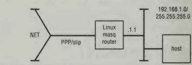

与此配置最相关的命令是：

```bash
###### 以太网路由
route add -net 192.168.1.0 netmask 255.255.255.0 eth0
#
###### 到互联网其余部分的默认路由。
route add default ppp0
#
###### 使 192.168.1/24 网络上的所有主机都被伪装。
fpfwd -F -a -m -S 192.168.1.0/24 -D 0.0.0.0/0
```

如果你是一个极简主义者兼懒惰的打字员（像我一样），并且你的伪装主机只有两个接口（因此所有被转发的数据包都必须被伪装），那么以下命令就足够了：

```bash
root# /sbin/ipfwadm -F -a accept -m
```

你可以从 IP 伪装资源页面（见 http://www.hwy401.com/achaup/ipmasq/）获取有关 Linux IP 伪装功能的更多信息。此外，一份关于伪装的非常详细的文档是“IP-Masquerade 小型 HOWTO”（其中还解释了如何配置其他操作系统以配合 Linux 伪装服务器运行）。

### IP 透明代理

IP 透明代理是一项功能，允许你将原本 destined 给另一台机器的服务器或服务重定向到本机的这些服务上。通常，当你有一台作为路由器的 Linux 机器，并且它也提供一个代理服务器时，这会有用。你会将所有远程 destined 给该服务的连接重定向到本地代理服务器。

### 内核编译选项：

```text
代码成熟度级别选项 --->
[*] 询问开发中或未完成代码/驱动程序
网络选项 --->
[*] 网络防火墙
...
[*] TCP/IP 网络
...
[*] IP：防火墙
...
[*] IP：透明代理支持（实验性）
```

透明代理功能的配置是使用 `ipfwadm` 命令完成的。

一个可能有用的示例如下：

```bash
root# ipfwadm -I -a accept -D 0 0/0 telnet -r 2323
```

此示例将导致任何针对任何主机的 `telnet` 端口（23）的连接尝试都被重定向到本机的 2323 端口。在该端口运行一个服务，你可以转发 `telnet` 连接，记录日志，或执行符合你需求的任何操作。

一个更有趣的示例是将所有 `http` 流量重定向通过本地缓存。然而，代理服务器使用的协议与原生 `http` 不同，在原生 `http` 中，客户端连接到 `www.server.com:80` 并请求 `/path/page`。当它连接到本地缓存时，它联系 `proxy.local.domain`: 8080 并请求 `www.server.com/path/page`。

为了通过本地代理过滤 `http` 请求，你需要通过插入一个名为 `transproxy` 的小型服务器来适应协议（你可以在万维网上找到它）。你可以选择让 `transproxy` 运行在 8081 端口，并执行以下命令：

```bash
root# ipfwadm -i -a accept -0 D/80 80 -r 8081
```

然后，`transproxy` 程序将接收所有旨在到达外部服务器的连接，并在修复协议差异后将它们传递给本地代理。

### IPv6

就在你以为自己开始理解 IP 网络时，规则变了！IPv6 是互联网协议版本 6 的简写。IPv6 的开发主要是为了解决互联网社区对 IP 地址很快会分配不足的担忧。IPv6 地址长度为 16 字节（128 位）。IPv6 包含许多其他更改，大多是简化措施，将使 IPv6 网络比 IPv4 网络更易于管理。

Linux 在 2.1.* 系列内核中已经拥有一个可工作但不完整的 IPv6 实现。

如果你希望实验这项下一代互联网技术，或者你有此需求，你应该阅读 IPv6-FAQ，该文档可在 `www.terra.net` 上获取（见 `http://www.terra.net/ipv6/`）。

### 移动 IP

术语“IP 移动性”描述了一种主机能力，即在不改变其 IP 地址或不失去连接性的情况下，将其网络连接从互联网的一个点移动到另一个点。通常，当 IP 主机改变其连接点时，它必须改变其 IP 地址。IP 移动性通过为移动主机分配一个固定的 IP 地址，并使用带有自动路由的 IP 封装（隧道）来克服这个问题，以确保 destined 给它的数据报被路由到它当前实际使用的 IP 地址。

目前正在进行一个项目，为 Linux 提供一套完整的 IP 移动性工具。项目和工具的状态可从：Linux 移动 IP 主页（见 `http://anchor.cs.binghamton.edu/~mobileip/`）获取。

### 组播

IP 组播允许位于不同 IP 网络上的任意数量的 IP 主机同时接收 IP 数据报。此机制被利用来提供全网范围内的“广播”材料，如音频和视频传输以及其他新颖的应用。

**内核编译选项：**

```text
网络选项 --->
  [*] TCP/IP 网络
  ...
  [*] IP：组播
```

需要一套工具和某些次要的网络配置。请查阅 Multicast-HOWTO（见 `Multicast-HOWTO.html`）以获取更多关于 Linux 中组播支持的信息。

### NAT—IP 网络地址转换

IP 网络地址转换设施基本上是 Linux IP 伪装设施的标准化“大哥”。它在 RFC-1631 中有详细规定，可在你附近的 RFC 存档中找到。NAT 提供了 IP 伪装所不具备的功能，使其更适合用于企业防火墙路由器设计和更大规模的安装。

针对 Linux 2.0.29 内核的 NAT 的 alpha 版本已由 Michael Hasenstein 开发 <`Michael.Hasenstein@informatik.tu-chemnitz.de`>。Michael 的文档和实现可从：Linux IP 网络地址网页（见 `http://www.csn.tu-chemnitz.de/HyperNews/get/linux-ip-nat.html`）获取。

较新的 Linux 2.1.* 内核也在路由算法中包含了一些 NAT 功能。

### 流量整形器—更改允许的带宽

流量整形器是一个驱动程序，它创建新的接口设备，这些设备以用户定义的方式限制流量。它们依赖于物理网络设备进行实际传输，并可用作网络流量的传出路由。

整形器在 Linux-2.1.15 中引入，并被反向移植到 Linux-2.0.36。（它出现在 Alan Cox 分发的 2.0.36-pre-patch-2 中，Alan Cox 是整形器设备的作者和 Linux 2.0 的维护者。）

流量整形器只能作为模块编译，并由 `shapcfg` 程序通过以下命令进行配置：

```bash
shapcfg attach shaper0 eth1
shapcfg speed shaper0 64000
```

整形器设备只能控制传出流量的带宽，因为数据包仅根据路由表通过整形器传输；因此，“基于源地址路由”功能可以帮助限制使用 Linux 路由器的特定主机的总体带宽。

Linux-2.1 已经支持此类路由。如果你需要用于 Linux 2.0，请检查 ftp.invlogic.com 上 Mike McLagan 的补丁。有关整形器的更多信息，请参阅 `Documentation/networking/shaper.txt`。


如果你想尝试（暂时的）对传入数据包进行整形，请尝试来自 `ftp.systemy.it` 的 `rshaper-1.01`（或更新版本）（见 `ftp://ftp.systemy.it/pub/develop`）。

## Linux-2.2 中的路由

Linux-2.1 的最新版本在路由策略方面提供了很大的灵活性。不幸的是，你必须等待该 HOWTO 的下一个版本，或者阅读内核源代码。

## 使用通用 PC 硬件

### ISDN

综合业务数字网（ISDN）是一系列指定通用交换式数字数据网络的标准。ISDN “呼叫”创建到目的地的同步点到点数据服务。ISDN 通常通过高速链路提供，该链路被分解为多个离散信道。有两种不同类型的信道：“B 信道”，它们实际承载用户数据，以及一个称为“D 信道”的信道，用于向 ISDN 交换局发送控制信息以建立呼叫和其他功能。例如，在澳大利亚，ISDN 可以通过 2Mbps 链路提供，该链路被分解为

将其划分为 30 个离散的 64kbps B 通道和一个 64kbps D 通道。可以在任意时间使用任意数量的通道，并以任意组合方式进行使用。例如，你可以以每个 64kbps 的速度向 50 个不同目的地建立 30 个独立呼叫，或者以每个 128kbps 的速度（每个呼叫使用两个通道）向 15 个不同目的地建立 15 个呼叫，或者仅建立少量呼叫，其余保持空闲。通道可用于 incoming 或 outgoing 呼叫。ISDN 的初衷是让电信公司为您的家庭或企业提供一种单一的数据服务，该服务可以提供电话（通过数字化语音）或数据服务，而无需您进行任何特殊的配置更改。

连接计算机到 ISDN 服务有几种不同的方法。一种方法是使用一种称为“终端适配器”（Terminal Adaptor）的设备，它插入到你的电信运营商在提供 ISDN 服务时安装的网络终端单元中，并提供一系列串行接口。其中一个接口用于输入命令以建立呼叫和配置，其他接口则实际连接到将在电路建立后使用数据电路的网络设备。Linux 在这种配置下无需修改即可工作；你只需将终端适配器上的端口像对待任何其他串行设备一样对待。另一种方法，也是内核 ISDN 支持所设计的目标，允许你将 ISDN 卡安装到你的 Linux 机器中，然后让你的 Linux 软件处理协议并自行建立呼叫。

### 内核编译选项

```
ISDN subsystem -->
<> ISDN support
[] Support synchronous PPP
[] Support audio via ISDN
< ICN 2B and 4B support
<> PCBIT-D support
<> Teles/NIccy1016PC/Creatix support
```

Linux 的 ISDN 实现支持多种不同类型的内置 ISDN 卡。这些卡列在 kernel 配置选项中：

- ICN 2B 和 4B
- Octal PCBIT-D
- Teles ISDN-cards 及兼容设备

其中一些卡需要下载软件才能使其运行。有一个独立的实用程序用于执行此操作。

关于如何配置 Linux ISDN 支持的完整详情，可以在 `/usr/src/linux/Documentation/isdn/` 目录中找到，专门针对 `isdn4linux` 的常见问题解答（FAQ）可在 `www.1rz-muenchen.de` 上找到（参见 `http://www.1rz-muenchen.de/ui161lab/www/isdn/`）。（你可以点击英国国旗图标获取英文版。）

关于 PPP 的说明。PPP 协议套件可以在异步或同步串行线路上运行。Linux 中常见分发的 PPP 守护进程 `pppd` 仅支持异步模式。如果你希望在你的 ISDN 服务上运行 PPP 协议，你需要一个特别修改的版本。有关在哪里找到它的详细信息，请参见上述文档。

## Linux 2 的 PLIP

PLIP 设备名称为 `plip0`、`plip1` 和 `plip2`。

### 内核编译选项

```
Network device support ---
<> PLIP (parallel port) support
```

PLIP（Parallel Line IP）类似于 SLIP，用于在两台机器之间提供 *点对点* 网络连接。然而，它被设计为使用机器上的并行打印机端口，而不是串行端口（布线图包含在本文档后面的布线图部分中）。由于并行端口可以一次传输多个位，因此 PLIP 接口可以比标准串行设备达到更高的速度。此外，即使是最简单的并行端口——打印机端口——也可以替代为串行端口购买相对昂贵的 16550AFN UART。与串行链接相比，PLIP 使用大量的 CPU，如果能够获得廉价的以太网卡，它肯定不是一个好的选择。但当没有其他可用时，它将有效工作，并且表现相当好。当链接运行良好时，你应预期数据传输速率约为每秒 20 千字节。

PLIP 设备驱动程序与并行设备驱动程序争用并行端口硬件。如果你希望同时使用两个驱动程序，则应将它们都编译为模块，以确保你可以选择用于 PLIP 的端口以及用于打印机驱动的端口。有关内核模块配置的更多信息，请参阅“Modules mini-HOWTO”。

请注意，一些笔记本电脑使用的芯片组无法与 PLIP 配合工作，因为它们不允许 PLIP 依赖但打印机不使用的某些信号组合。

Linux PLIP 接口与 *Craynwr Packet Driver PLIP* 兼容，这意味着你可以通过 PLIP 将 Linux 机器连接到运行任何类型 tcp/ip 软件的 DOS 机器。

在 2.0.* 系列内核中，PLIP 设备映射到 i/o 端口和 IRQ 如下：

| 设备 | i/o | IRQ |
|---|---|---|
| `plip0` | 0x3bc | 5 |
| `plip1` | 0x378 | 7 |
| `plip2` | 0x278 | 2 |

如果你的并行端口不匹配上述任何组合，你可以使用 `ifconfig` 命令和 "`irq=`" 参数更改端口的 IRQ（如果你的 ROM BIOS 支持此选项，请确保在打印机端口上启用 IRQs）。作为替代方案，如果你使用模块，可以在 `insmod` 命令行上指定 "`io=`" 和 "`irq=`" 选项。例如：

```
root# insmod plip.o io=0x288 irq=5
```

PLIP 操作由两个超时控制，其默认值在大多数情况下可能都是合适的。如果你有一台特别慢的计算机，你可能需要增加它们，在这种情况下 *需要增加的计时器实际上是在另一台机器上*。存在一个名为 `plipconf` 的程序，允许你重新编译内核而不必更改这些计时器设置。它随许多 Linux 发行版提供。

要配置 PLIP 接口，你需要调用以下命令（或将它们添加到你的初始化脚本中）：

```
root# /sbin/ifconfig plip1 localplip pointopoint remoteplip
root# /sbin/route add remotelip plip1
```

这里，使用的端口是 I/O 地址为 0x378 的那个；`localplip` 和 `remoteplip` 是在 PLIP 电缆上使用的名称或 IP 地址。我个人将它们保存在我的 `/etc/hosts` 数据库中：

```
###### plip entries
192.168.3.1 localplip
192.168.3.2 remoteplip
```

`pointopoint` 参数具有与 SLIP 相同的含义，即指定链路另一端机器的地址。

第三部分

在几乎各个方面，你可以将 `PLIP` 接口视为 `SLIP` 接口，只是 `dip` 和 `slattach` 不需要也不得被使用。

有关 PLIP 的更多信息可以在 “PLIP mini-HOWTO” 中获得。

## Linux-2.2 的 PLIP

在 2.1 内核版本的开发期间，对并行端口的支持更改为更好的设置。

**内核编译选项：**

```
General setup -->
[ ] Parallel port support
Network device support -->
<*> PLIP (parallel port) support
```

新的 PLIP 代码行为与旧的相同。使用与前面部分相同的 `ifconfig` 和 `route` 命令，但由于高级并行端口支持，设备初始化有所不同。

“第一个” PLIP 设备始终被称为 "`plip0`"，其中 *first* 是系统检测到的第一个设备，类似于以太网设备发生的情况。实际使用的并行端口是可用端口之一，如 `/proc/parport` 中所示。例如，如果你只有一个并行端口，你将只有一个名为 `/proc/parport/0` 的目录。

如果你的内核未能检测到端口使用的 IRQ 号，"`insmod plip`" 将会失败；在这种情况下，只需将正确的数字写入 `/proc/parport/0/irq` 并重新调用 `insmod`。


关于并行端口管理的完整信息可以在内核源代码中的文件 `Documentation/parport.txt` 中找到。

## PPP

PPP 设备名称为 `ppp0`、`ppp1` 等。设备按顺序编号，第一个配置的设备接收 `0`。

**内核编译选项：**

```
Networking options -->
<*> PPP (point-to-point) support
```

PPP 配置在 PPP-HOWTO 中详细阐述（参见 PPP-HOWTO.html）。

### 使用 `pppd` 保持与网络的持久连接

如果你有足够幸运，拥有一个半永久的网络连接，并且希望当连接丢失时你的机器能自动重新读取 PPP 连接，那么这里有一个简单的技巧可以实现这一功能。

配置 PPP 使得它可以通过 `root` 用户发起以下命令来启动：

```
###### pppd
```

*务必*在你的 `/etc/ppp/options` 文件中配置 `-detach` 选项。然后，在 `getty` 定义附近，向你的 `/etc/inittab` 文件中插入以下一行：

```
pd:23:respawn:/usr/sbin/pppd
```

这将使 `init` 程序生成并监控 `pppd` 程序，如果 `pppd` 终止，则自动重启它。

### slip 客户端

`slip` 设备被命名为 `sl0`、`sl1` 等。第一个配置的设备被分配 `0`，其余设备按配置顺序依次递增。

**内核编译选项：**

```
Network device support --->
[*] Network device support
<*> SLIP (serial line) support
[ ] CSLIP compressed headers
[ ] Keepalive and linefill
[ ] Six bit SLIP encapsulation
```

`slip`（串行线路互联网协议）允许你通过串行线路使用 TCP/IP，无论是通过电话调制解调器的拨号线路，还是某种租用线路。当然，要使用 `slip`，你需要能够访问你所在区域的 `slip-server`。世界各地的许多大学和 businesses 都提供 `slip` 访问服务。

`slip` 使用机器上的串行端口来传输 IP 数据报。为此，它必须接管串行设备的控制权。`slip` 设备名称被命名为 `sl0`、`sl1` 等。这些名称如何对应你的串行设备？网络工作代码使用一种称为 `ioctl`（输入/输出控制）的调用将串行设备转换为 `slip` 设备。提供有两个程序可以做到这一点：`dip` 和 `sattach`。

#### dip

`dip`（`Dial-up IP`，拨号 IP）是一个智能程序，能够设置串行设备的速度，命令你的调制解调器拨号到链路远端；自动登录远程服务器；查找服务器发送给你的消息并提取相关信息，如你的 IP 地址；并执行将串行端口切换为 SLIP 模式所需的 `ioctl`。`dip` 具有强大的脚本能力，你可以利用这一特性来自动化登录过程。

你可以在 `MetaLab.unc.edu` 上找到它（参见 `ftp://MetaLab.unc.edu/pub/Linux/system/Network/serial/dip/dip337o-uri.tgz`）。

要安装它，请尝试以下操作：

```
user% tar xvzf dip337o-uri.tgz
user% cd dip-3.3.70
user% vi Makefile
root# make install
```

`Makefile` 假设存在一个名为 `uucp` 的组，但你可能会根据配置将其更改为 `dip` 或 `SLIP`。

#### slattach

与 `dip` 不同，`slattach` 是一个非常简单的程序，使用非常简单，但它不具备 `dip` 的复杂性。它没有脚本能力；它所做的只是将串行设备配置为 SLIP 设备。它假设在你调用它之前，你已经拥有了所需的所有信息，并且串行线路已建立。`slattach` 非常适合在拥有到服务器的永久连接的场景下使用，例如物理电缆或租用线路。

#### 何时使用哪个？

当你到 SLIP 服务器的链路是拨号调制解调器或其他临时链路时，你会使用 `dip`。当你拥有租用线路（例如电缆）在机器和服务器之间，且无需特殊操作即可使链路工作时，你会使用 `slattach`。更多信息请参见章节“永久 SLIP 连接”。

配置 SLIP 类似于配置以太网接口（阅读上面“配置以太网设备”一节）。然而，有几个关键的区别。

首先，SLIP 链路与以太网网络不同，网络中只有两个主机，一个在链路的一端，另一个在另一端。与以太网不同（只要布线完成即可使用），对于 SLIP，根据你拥有的链路类型，你可能需要以特殊方式初始化网络连接。

如果你使用的是 dip，这通常不会在启动时完成，而是在你准备好使用链路的稍后时间完成。可以自动化此过程。如果你使用的是 slattach，你可能会想向 `rc.inet1` 文件添加一个部分。这很快就会描述。

有两种主要类型的 SLIP 服务器：动态 IP 地址服务器和静态 IP 地址服务器。几乎每个 SLIP 服务器在拨号连接时都会提示使用用户名和密码登录。`dip` 可以自动处理登录。

#### 带有拨号线路和 dip 的静态 SLIP 服务器

静态 SLIP 服务器是指你被分配了一个专属于你的 IP 地址的服务器。每次你连接到服务器时，你都会用该地址配置你的 SLIP 端口。静态 SLIP 服务器会响应你的调制解调器呼叫，可能会提示你输入用户名和密码，然后通过该连接将发往你的地址的数据报路由给你。如果你拥有静态服务器，你可能会希望将你的主机名和 IP 地址条目（因为你知道它将是什么）放入你的 `/etc/hosts`。你还应该配置其他文件，如 `rc.inet2`、`host.conf`、`resolv.conf` `/etc/HOSTNAME` 和 `rc.local`。请记住，在配置 `rc.inet1` 时，你不需要为 SLIP 连接添加任何特殊命令，因为 `dip` 为你完成了配置接口的所有繁重工作。你需要给 `dip` 提供适当的信息，它会命令调制解调器建立呼叫并登录到你的 SLIP 服务器后为你配置接口。

如果你的 SLIP 服务器是这样工作的，你可以转到“使用 dip”章节，学习如何正确配置 dip。

#### 带有拨号线路和 dip 的动态 SLIP 服务器

动态 SLIP 服务器是指每次登录时从地址池中随机分配给你一个 IP 地址的服务器。这意味着没有保证你每次都会有特定的地址，而且在你注销后，你的地址可能很快会被其他人使用。配置 SLIP 服务器的网络管理员会为 SLIP 服务器分配一个地址池。当服务器接收到新的传入呼叫时，它会找到第一个未使用的地址，引导呼叫者完成登录过程，然后打印一条包含其已分配 IP 地址的欢迎消息。在该呼叫期间，它将使用该 IP 地址。

配置此类服务器类似于配置静态服务器，不同之处在于你必须添加一个步骤，获取服务器为你分配的 IP 地址，并用该地址配置你的 SLIP 设备。

再次，`dip` 完成了繁重的工作，新版本足够聪明，不仅可以让你登录，还可以自动读取欢迎消息中打印的 IP 地址并将其存储起来，以便用它来配置你的 SLIP 设备。

如果你的 SLIP 服务器是这样工作的，你可以转到“使用 dip”章节，学习如何正确配置 dip。

##### 使用 dip

如前所述，`dip` 是一个强大的程序，可以简化并自动化拨号到 SLIP 服务器、登录、启动连接以及使用适当的 `ifconfig` 和 `route` 命令配置你的 SLIP 设备的流程。

基本上，使用 `dip` 需要编写一个“`dip` 脚本”，这基本上是一个命令列表，指定如何执行你想要它执行的每个操作。参见随 `dip` 提供的 `sample.dip` 以了解其工作原理。`dip` 是一个相当强大的程序，有许多选项。这里不会涉及所有选项，你应该查看你的 `dip` 版本随附的手册页、README 和示例文件。

你可能会注意到 `sample.dip` 脚本假设你使用的是静态 SLIP 服务器，因此你事先知道你的 IP 地址。对于动态 SLIP 服务器，较新版本的 `dip` 包含一个命令，你可以使用它自动读取动态服务器为你分配的 IP 地址并据此配置你的 SLIP 设备。以下示例是随 `dip337j-uri.tgz` 提供的 `sample.dip` 的修改版本，可能是一个很好的起点。你可能希望将其保存为 `/etc/dip.script` 并根据你的配置进行编辑：

```
#
###### sample.dip Dialup IP connection support program.
#
###### This file (should show) shows how to use the DIP.
###### This file should work for Annex type dynamic servers, if you
###### use a static address server then use the sample.dip file that
```


## 使用租用线路和 `slattach` 建立永久性 SLIP 连接

如果你在两台机器之间有一根电缆，或者你有幸拥有一条租用线路或其他永久串行连接（在你的机器和另一台机器之间），那么你就无需费尽心机去使用 `dip` 来设置串行链接了。`slattach` 是一个使用非常简单的实用程序，它允许你以足够多的功能来配置你的连接。由于你的连接将是永久性的，你需要向 `rc.inet1` 文件中添加一些命令。本质上，对于永久连接，你需要做的只是确保将串行设备配置为正确的速度，并将串行设备切换到 SLIP 模式。`slattach` 允许你通过一条命令来完成这些操作。请向你的 `rc.inet1` 文件中添加以下内容：

```bash
#
###### 挂载租用线路静态 SLIP 连接
#
###### 配置 /dev/cua0 为 19.2kbps 和 cslip
/sbin/slattach -p cslip -s 19200 /dev/cua0 &
/sbin/ifconfig s10 IPA.IPA.IPA.IPA pointpoint \
    IPR.IPR.IPR.IPR up
#
###### 结束静态 SLIP。
```

其中：

- `IPA.IPA.IPA.IPA` 代表你的 IP 地址。
- `IPR.IPR.IPR.IPR` 代表远端 IP 地址。

`slattach` 将第一个未分配的 SLIP 设备分配给指定的串行设备。`slattach` 从 `s10` 开始。因此，第一个 `slattach` 命令将 SLIP 设备 `s10` 挂载到指定的串行设备，下一次则是 `s11`，依此类推。

`slattach` 允许你通过 `-p` 参数配置多种不同的协议。在你的情况下，根据你是否需要使用压缩，你将使用 SLIP 或 cSLIP。注意：两端必须就是否使用压缩达成一致。

## SLIP 服务器

如果你有一台机器，它可能已连接到网络，你希望其他人能够拨入并使用其提供的网络服务，那么你需要将你的机器配置为服务器。如果你希望使用 SLIP 作为串行线路协议，那么目前你有三种选项来配置你的 Linux 机器作为 SLIP 服务器。我倾向于使用首先介绍的 `sliplogin`，因为它似乎是最容易配置和理解的。但我会对每个选项进行总结，以便你可以做出自己的决定。

### 使用 `sliplogin` 构建 SLIP 服务器

`sliplogin` 是一个程序，你可以用它来替代正常的登录 shell，用于 SLIP 用户，它将终端线路转换为 SLIP 线路。它允许你将 Linux 机器配置为*静态地址服务器*（用户每次拨入时都会获得相同的地址），或*动态地址服务器*（用户会被分配一个地址，该地址不一定与上次拨入时相同）。

调用者将按照标准的登录过程登录，输入他们的用户名和密码，但在登录完成后，他们不会被提供一个 shell，而是执行 *slogin*。然后 *slogin* 在其配置文件 `/etc/slip.hosts` 中搜索与调用者登录名匹配的条目。如果找到匹配的条目，它将线路配置为 8 位透明线路（8-bit clean line），并使用 *ioctl* 调用将线路规程转换为 SLIP。当这个过程完成后，配置的最后阶段发生，*slogin* 调用一个 shell 脚本，该脚本使用相关的 IP 地址、子网掩码来配置 SLIP 接口，并设置适当的路由。这个脚本通常被称为 `/etc/slip.login`，但与 *getty* 类似，如果你有某些需要特殊初始化的调用者，你可以创建名为 `/etc/slip.login.loginname` 的配置文件，这些文件将专门为他们运行，以替代默认脚本。

你需要配置三到四个文件才能使 *slogin* 为你工作。我将详细说明获取软件的方法以及每个文件的具体配置方式。这些文件包括：

- `/etc/passwd`，用于拨入用户账户。
- `/etc/slip.hosts`，包含每个拨入用户独有的信息。
- `/etc/slip.login`，管理需要为用户执行的路由配置。
- `/etc/slip.tty`，仅当你配置服务器用于*动态地址分配*时才需要，包含一个待分配地址表。
- `/etc/slip.logout`，包含在用户挂断或注销后执行清理工作的命令。

### 在哪里获取 `slogin`

你的发行版可能已经安装了 *slogin* 软件包，如果没有，你可以从以下地址获取 *slogin*：MetaLab.unc.edu（参见 `ftp://Metalab.unc.edu/pub/linux/system/Network/serial/slogin-2.1.1.tar.gz`）。该 tar 文件包含源代码、预编译的二进制文件和一个 *man* 手册页。

为了确保只有授权用户能够运行 *slogin* 程序，你应该在 `/etc/group` 文件中添加类似下面的条目：

```
slip::13:radio,fred
```

当你安装 *slogin* 软件包时，`Makefile` 会将 *slogin* 程序的所有者组更改为 `slip`，这意味着只有所在用户属于该组的用户才能执行它。上述示例仅允许用户 **radio** 和 **fred** 执行 *sliplogin*。

要将二进制文件安装到你的 `/sbin` 目录并将 *man* 手册页安装到第 8 节，请执行以下操作：

```
###### cd /usr/src
###### gzip -dc ../sliplogin-2.1.1.tar.gz | tar xvf -
###### cd sliplogin-2.1.1
###### <.edit the Makefile if you don't use shadow passwords..>
###### make install
```

如果你想在安装前重新编译二进制文件，请在 **make install** 之前添加一个 **make clean**。如果你想在其他位置安装二进制文件，你需要编辑 *Makefile install* 规则。

请阅读随包提供的 *README* 文件以获取更多信息。

### 为 SLIP 主机配置 `/etc/passwd`

通常，你会在 `/etc/passwd` 文件中为 SLIP 调用者创建一些特殊的登录账户。一个常见的约定是使用调用主机的主机名，并在前面加上大写字母 “S” 作为前缀。例如，如果调用主机名为 **radio**，那么你可以创建一个如下所示的 `/etc/passwd` 条目：

```
Sradi o: Fvkurok73:1427:1:radio SLIP login:/sbin/sliplogin
```

账户名称具体叫什么并不重要，只要对你有意义即可。

注意：调用者不需要任何特殊的家目录，因为他们不会从这台机器获得 shell。因此 **/tmp** 是一个不错的选择。另外请注意，*sliplogin* 被用来替代正常的登录 shell。

### 配置 `/etc/slip.hosts`

`/etc/slip.hosts` 文件是 *sliplogin* 搜索与登录名匹配的条目以获取该调用者配置详情的文件。在这个文件中，你指定将分配给调用者并供其使用的 IP 地址和子网掩码。对于两个主机的示例条目，一个是主机 **radio** 的静态配置，另一个是用户主机 **albert** 的动态配置，可能如下所示：

```
#
Sradi o 44.136.8.99 44.136.8.100 255.255.255.0 normal -1
Salbert 44.136.8.99 DYNAMIC 255.255.255.0 compressed 60
#
```

`/etc/slip.hosts` 文件的条目包括：

1. 调用者的登录名。
2. 服务器机器（即本机）的 IP 地址。
3. 分配给调用者的 IP 地址。如果此字段编码为 `DYNAMIC`，则将根据稍后讨论的 `/etc/slip.tty` 文件中包含的信息分配一个 IP 地址。*注意*：要使此功能正常工作，你必须使用至少 1.3 版本的 `sliplogin`。
4. 分配给调用机器的子网掩码，以点分十进制表示，例如 C 类网络掩码为 255.255.255.0。
5. SLIP 模式设置，允许你启用/禁用压缩和其他 SLIP 功能。这里允许的值是 `"normal"` 或 `"compressed."`。
6. 一个超时参数，指定在自动断开线路之前，线路可以保持空闲（未接收到数据报）的最长时间。负值将禁用此功能。
7. 可选参数。

注意：字段 2 和 3 可以使用主机名或点分十进制表示的 IP 地址。如果使用主机名，则这些主机必须是可解析的。也就是说，你的机器必须能够为这些主机名找到 IP 地址；否则脚本在调用时会失败。你可以通过尝试 `telnet` 到该主机名来测试这一点。如果你看到 “*Trying nnn.nnn.nnn.nnn...* ” 消息，说明你的机器已经能够为该名称找到 IP 地址。如果你看到 “*Unknown host,* ” 消息，则说明找不到。如果找不到，要么使用点分十进制表示的 IP 地址，要么修复你的名称解析器配置（参见“名称解析”部分）。


最常见的 SLIP 模式有：

- `normal` 以启用正常的非压缩 SLIP。
- `compressed` 以启用 van Jacobson 头部压缩 (`cSLIP`)。

自然地，这些模式是互斥的；你可以使用其中一个或另一个。有关其他可用选项的更多信息，请参阅 `man` 手册页。

## 配置 `/etc/slip.login` 文件

当 `sliplogin` 搜索 `/etc/slip.hosts` 并找到匹配的条目后，它将尝试执行 `/etc/slip.login` 文件，以使用其 IP 地址和子网掩码实际配置 SLIP 接口。`sliplogin` 包中提供的示例 `/etc/slip.login` 文件如下所示：

```
#!/bin/sh -
# 
###### @(#)/slip.login 5.1 (Berkeley) 7/1/90
#
###### generic login file for a SLIP line. sliplogin invokes this
###### with the parameters:
###### $1   $2   $3 $4, $5, $6 ...
###### SLIPunit tyspeed  pid  the arguments from the slip.host
###### entry
#
/sbin/ifconfig $1 $5 pointopoint $6 mtu 1500 -trailers up
/sbin/route add $6
arp -s $6 <hw_addr> pub
exit 0
#
```

你会注意到，此脚本简单地使用 `ifconfig` 和 `route` 命令使用其 IP 地址、远程 IP 地址和子网掩码配置 SLIP 设备，并通过 SLIP 设备为远程地址创建路由。这与你使用 `slattach` 命令时的做法完全一样。

还请注意使用 `Proxy ARP` 以确保与服务器机器在同一以太网上的其他主机知道如何到达拨入主机。`<hw_addr>` 字段应该是机器中以太网卡（Ethernet card）的硬件地址。如果你的服务器机器不在以太网网络上，那么你可以完全省略这一行。

## 配置 `/etc/slip.logout` 文件

当通话结束时，你希望确保串行设备恢复到其正常状态，以便未来的调用者能够正确登录。这是通过 `/etc/slip.logout` 文件来实现的。其格式相当简单，并像 `/etc/slip.login` 文件一样使用相同的参数调用。

```
#!/bin/sh -
#
###### slip.logout
#
/sbin/ifconfig $1 down
arp -d $6
exit 0
#
```

它所做的只是将接口 `down`（关闭），这将删除之前创建的手动路由。它还使用 `arp` 命令删除放置的任何代理 arp。同样，如果你的服务器机器没有以太网端口，则脚本中不需要 `arp` 命令。

## 配置 `/etc/slip.tty` 文件

如果你正在使用动态 IP 地址分配（即，`/etc/slip.hosts` 文件中有任何主机配置了 `DYNAMIC` 关键字），那么你必须配置 `/etc/slip.tty` 文件以列出哪些地址分配给哪个端口。只有当你希望服务器动态地向用户分配地址时才需要此文件。

该文件是一个表格，列出了将支持拨入 SLIP 连接的 tty 设备以及应分配给在该端口拨入的用户的 IP 地址。其格式如下：

```
###### slip.tty _ tty -> IP address mappings for dynamic SLIP
###### format: /dev/tty?? xxx.xxx.xxx.xxx
/
/dev/tty50  192.168.0.100
/dev/tty51  192.168.0.101
#
```

此表格表示，在端口 `/dev/tty50` 拨入且 `/etc/slip.hosts` 文件中的远程地址字段设置为 `DYNAMIC` 的调用者将被分配地址 `192.168.0.100`。

通过这种方式，对于不需要专用地址的所有用户，你只需要为每个端口分配一个地址。这有助于你将所需的地址数量保持在最低限度，以避免浪费。

## 使用 dip 的 SLIP 服务器

让我首先说明，下面的一些信息来自 `dip` 手册页，其中简要记录了如何运行 Linux 作为 SLIP 服务器。此外请注意，以下内容基于 `dip337o-uri.tgz` 包，可能不适用于 `dip` 的其他版本。`dip` 有一种输入操作模式，它会自动找到调用该命令的用户的条目，并根据在 `/etc/diphosts` 文件中找到的信息将串行线路配置为 SLIP 链接。这种输入操作模式是通过将 `dip` 作为 `diplogin` 调用来激活的。因此，通过使用 `diplogin` 作为登录 shell 创建特殊账户，就可以使用 `dip` 作为 SLIP 服务器。你需要做的第一件事是创建如下所示的符号链接：

```
###### ln -sf /usr/sbin/dip /usr/sbin/diplogin
```

然后你需要在 `/etc/passwd` 和 `/etc/diphopts` 文件中都添加条目。你需要创建的条目格式如下：若要通过 `dip` 将 Linux 配置为 SLIP 服务器，你需要为某些用户创建特殊的 SLIP 账户，其中 `dip`（输入模式）被用作登录 shell。一种建议的惯例是让所有 SLIP 账户都以大写字母 `"S"` 开头，例如 `"Sfredm"`。一个 SLIP 用户的 `/etc/passwd` 条目示例如下：

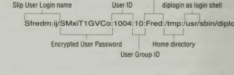

用户登录后，如果登录程序发现并成功验证了该用户，它将执行 `diplogin` 命令。当 `dip` 作为 `diplogin` 被调用时，它知道应当自动假设其正被用作登录 shell。当以 `diplogin` 启动时，它所做的第一件事是利用 `getuid()` 函数调用获取调用者的用户 ID。然后它会在 `/etc/diphopts` 文件中搜索第一个与用户 ID 或调用所在 tty 设备名称相匹配的条目，并相应地进行配置。通过明智地决定是否在 `diphopts` 文件中为用户创建条目，或者让用户使用默认配置，你可以构建服务器，从而允许静态分配和动态分配地址的用户混合使用。如果在输入模式下被调用，`dip` 会自动添加一个 `"Proxy-ARP"` 条目，因此你不需要担心手动添加此类条目。

## 配置 `/etc/diphopts`

`/etc/diphopts` 被 `dip` 用于查找远程主机的预设配置。这些远程主机可能是拨入你的 Linux 机器的用户，也可能是你用 Linux 机器拨入的其他机器。`/etc/diphopts` 的通用格式如下：

```
Suali:::145.71.34.1:145.71.34.2:255.255.255.0:SLIP wa1:t:CSLIP,1006 tyyS1:::145.71.34.3:145.71.34.2:255.255.255.0:Dymanic ttyS1:CSLIP,296
```

各字段含义如下：

1. `登录名`：由 `getpwuid(getuid())` 返回或 tty 名称。
2. `未使用`：为了与 `passwd` 兼容。
3. `远程地址`：呼叫主机的 IP 地址，可以是数字或名称。
4. `本地地址`：本机的 IP 地址，同样是数字或名称。
5. `子网掩码`：采用点分十进制表示法。
6. `注释字段`：此处可填入任意内容。
7. `协议`：`SLIP`, `CSLIP` 等。
8. `MTU`：十进制数字。

远程 SLIP 用户的 `/etc/net/diphosts` 条目示例可能如下：

```
Sfremd::145.71.34.1:145.71.34.2:255.255.255.0:SLIP wualt:SLIP,296
```

这指定了远程地址为 `145.71.34.1`、`MTU` 为 `296` 的 `SLIP` 链路，或者：

```
Sfremd::145.71.34.1:145.71.34.2:255.255.255.0:CSLIP wualt:CSLIP,1006
```

这指定了支持 `CSLIP` 的链路，远程地址为 `145.71.34.1`，`MTU` 为 `1006`。

因此，所有希望获得静态分配拨入 IP 访问权限的用户都应在 `/etc/diphosts` 中拥有条目。如果你希望拨入特定端口的用户能够动态分配详细信息，那么你必须为该 tty 设备创建条目，并且**不能**配置基于用户的条目。你应该记得为你的拨入用户使用的每个 tty 设备配置至少一个条目，以确保无论他们通过哪个调制解调器拨入，都有适当的配置可用。

当用户登录时，他们会收到常规的登录名和密码提示，此时他们应输入自己的 SLIP 登录用户 ID 和密码。如果验证通过，用户不会看到任何特殊消息，只需在他们那一端切换到 SLIP 模式即可。随后，用户应该能够成功连接，并根据 `diphosts` 文件中的相关参数进行配置。


## 使用 dSLIP 软件包实现的 SLIP 服务器

Matt Dillon <dillon@appollo.west.oic.com> 编写了一个软件包，它不仅可以拨入 SLIP，还可以拨出 SLIP。Matt 的软件包是一组用于管理你连接的小型程序和脚本的组合。你需要安装 `tcsh`，因为至少其中一个脚本需要它。Matt 提供了一个 `expect` 实用程序的二进制副本，因为该程序也被其中一个脚本所需要。你很可能需要一些 `expect` 的经验才能使这个软件包按你喜欢的方式运行，但不要因为这一点而却步。

Matt 在 `README` 文件中编写了一套很好的安装说明，所以我不必重复了。

你可以从其官方网站 `appollo.west.oic.com/pub/linux/dillon_src/dSLIP203.tgz` 获取 `dSLIP` 软件包

或从：`MetaLab.unc.edu`

`/pub/Linux/system/Network/serial/dSLIP203.tgz`

阅读 `README` 文件，并在执行 `make install` 之前创建 `/etc/passwd` 和 `/etc/group` 条目。

## 其他网络技术

以下小节针对特定的网络技术。包含在这些部分中的信息不一定适用于其他类型的网络技术。主题按字母顺序排序。

### ARCNet

ARCNet 设备名称为 `"arc0e"`、`"arc1e"`、`"arc2e"` 等，或 `"arc0s"`、`"arc1s"`、`"arc2s"` 等。内核检测到的第一张卡被分配为 `"arc0e"` 或 `"arc0s"`，其余则按检测顺序依次分配。末尾的字母表示你选择的是以太网封装数据包格式还是 RFC1051 数据包格式。

**内核编译选项：**

网络设备的配置 ---

[*] 网络设备支持

<*> ARCnet 支持

[ ] 启用 `arc0e` (ARCNet 'Ether-Encap' 数据包格式)

[ ] 启用 `arc0s` (ARCNet RFC1051 数据包格式)

一旦你正确编译内核以支持你的以太网卡，配置该卡就很简单了。

通常你可以使用类似这样的命令：

```
root# ifconfig arc0e 192.168.0.1 netmask 255.255.255.0 up
root# route add -net 192.168.0.0 netmask 255.255.255.0 arc0e
```

请参见 `/usr/src/linux/Documentation/networking/arcnet.txt` 和 `/usr/src/linux/Documentation/networking/arcnet-hardware.txt` 文件以获取更多信息。

ARCNet 支持由 Avery Pennarun <apenwarrr @foxtel.net> 开发。

### Appletalk (AF_APPLETALK)

Appletalk 支持没有特殊的设备名称，因为它使用的是现有的网络设备。

**内核编译选项：**

```
Networking options -->
<*> Appletalk DDP
```

Appletalk 支持使你的 Linux 机器能够与 Apple 网络协同工作。其重要用途之一是在你的 *Linux* 计算机和 Apple 计算机之间共享打印机和磁盘等资源。这需要额外的软件，称为 *netatalk*。Wesley Craig <netatalk@umich.edu> 代表密歇根大学的一个名为 "Research Systems Unix Group" 的团队，他们开发了 *netatalk* 软件包，该软件包提供了实现 Appletalk 协议栈及一些实用工具的软件。*netatalk* 软件包可能已随你的 Linux 发行版一起提供，或者你需要从其在密歇根大学的官方网站（参见 `ftp://terminator.rs.itd.umich.edu/unix/netatalk/`）通过 FTP 下载。

要构建并安装该软件包，请执行类似以下操作：

```
user% tar xvfZ .../netatalk-1.4b2.tar.Z
user% make
root# make install
```

你可能需要在实际使用 `make` 编译软件之前编辑 "`Makefile`" 。具体来说，你可能想要修改 `DEST-DIR` 变量，该变量定义了文件稍后将安装的位置。默认的 `/usr/local/atalk` 是相当安全的。

#### 配置 Appletalk 软件

为了让一切正常工作，你需要做的第一件事是确保 `/etc/services` 文件中存在适当的条目。你需要的条目是：

- `rtmp 1/ddp` # 路由表维护协议

- `nbp 2/ddp` # 名称绑定协议

- `echo 4/ddp` # AppleTalk 回声协议

- `zip 6/ddp` # 区域信息协议

下一步是在 `/usr/local/atalk/etc` 目录中（或你安装该软件包的位置）创建 Appletalk 配置文件。

第一个需要创建的文件是 `/usr/local/atalk/etc/atalkd.conf` 文件。最初，此文件只需要一行，该行给出支持你 Apple 机器所在网络的网络设备名称：

```
eth0
```

Appletalk 守护程序在运行后会自动添加更多详细信息。

#### 通过 Appletalk 导出 Linux 文件系统

你可以将 Linux 机器上的文件系统导出到网络，以便网络上的 Apple 机器可以共享它们。

为此，你必须配置 `/usr/local/atalk/etc/AppleVolumes.system` 文件。还有一个名为 `/usr/local/atalk/etc/AppleVolumes.default` 的配置文件，其格式完全相同，用于描述以访客权限连接的用户将接收哪些文件系统。

关于如何配置这些文件以及各种选项的详细说明可以在 `afpd` 手册页中找到。

一个简单的示例可能如下：

```
/tmp Scratch
/home/ftp/pub "Public Area"
```

这将把你的 `/tmp` 文件系统作为 AppleShare 卷 "Scratch" 导出，把你的 FTP 公共目录作为 AppleShare 卷 "Public Area" 导出。卷名称不是强制性的。守护程序会为你选择一些名称，但明确指定它们也无妨。

#### 通过 Appletalk 共享你的 Linux 打印机

你可以非常简单地将你的 Linux 打印机与 Apple 机器共享。你需要运行 `papd` 程序，它是 Appletalk 打印机访问

协议守护进程

运行此程序时，它将接受来自 Apple 机器的请求，并将打印任务排队发送到您本地的行式打印机守护进程进行打印。

您需要编辑 `/usr/local/atalk/etc/papd.conf` 文件来配置该守护进程。该文件的语法与您通常使用的 `/etc/printcap` 文件相同。您为定义赋予的名称将注册到 Appletalk 命名协议 NBP 中。

一个示例配置可能看起来像这样：

```
TricWriter:\n\tp=r:lp:op=cg:
```

这将使名为“TricWriter”的打印机在您的 Appletalk 网络上可用，所有接受的任务都会使用 `pd` 打印到 Linux 打印机“lp”（如 `/etc/printcap` 文件中定义）。条目“op=cg”表示 Linux 用户“cg”是该打印机的操作员。

#### 启动 Appletalk 软件

好的，现在您应该准备好测试这个基本配置了。`netatalk` 包附带了一个 `rc.atalk` 文件，应该可以正常工作，因此您只需要做的是：

```
root# /usr/local/atalk/etc/rc.atalk
```

然后所有服务都应该正常启动和运行。您应该看不到任何错误信息，软件会在启动过程中向控制台发送消息，指示每个阶段。

#### 测试 Appletalk 软件

要测试软件是否正常工作，请前往您的一台 Apple 机器，下拉 Apple 菜单，选择选择器（Chooser），单击 AppleShare，您的 Linux 机器应该会出现在列表中。

#### Appletalk 软件的注意事项

- 您可能需要在配置 IP 网络之前启动 Appletalk 支持。如果启动 Appletalk 程序时遇到问题，或者启动后 IP 网络出现问题，请尝试在运行 `/etc/rc.d/rc.inet1` 文件之前启动 Appletalk 软件。

- `afd`（Apple 文件协议守护进程）会严重搞乱您的硬盘。它在挂载点下方创建名为“Apple Desktop”和网络回收站文件夹的目录。然后，对于您访问的每个目录，它都会在下方创建一个 `.AppleDouble`，以便存储资源分叉等。因此，在导出 `/` 之前请三思。之后您将花大量时间清理。


`afpd` 程序期望从 Mac 获取明文密码。安全性可能是一个问题，因此在连接到 Internet 的机器上运行此守护进程时要非常小心。如果有人恶作剧做了坏事，那是您自己的责任。

现有的诊断工具，如 `netstat` 和 `ifconfig`，不支持 Appletalk。如果需要，原始信息可以在 `/proc/net/` 目录中找到。

## 更多信息

要获取关于如何为 Linux 配置 Appletalk 的更详细描述，请参见 Anders Brownworth 位于 thehamptons.com 的 Linux Netatalk-HOWTO 页面（见 http://thehamptons.com/anders/netatalk/）。

## ATM

Werner Almesberger <werner.almesberger@rcr.di.epfl.ch> 正在管理一个项目，为 Linux 提供异步传输模式（Asynchronous Transfer Mode）支持。该项目的最新状态信息可从 lrcwww.epfl.ch 获得（见 http://lrcwww.epfl.ch/linux-atm/）。

## AX.25 (AF_AX25)

在 2.0.* 内核中，AX.25 设备名称为 `s10`、`s11` 等；在 2.1.* 内核中为 `ax0`、`ax1` 等。

### 内核编译选项：

```
Networking options. --->
[*] Amateur Radio AX.25 Level 2
```

AX.25、Netrom 和 Rose 协议在 AX.25-HOWTO 中有介绍（见 http://metalab.unc.edu/LAP/）。这些协议被世界各地的业余无线电操作员用于分组无线电实验。

这些协议的大部分实现工作由 Jonathon Naylor <jsn@cs.nott.ac.uk> 完成。

## DECNat

DECNet 的支持目前正在进行中。预计它将在较晚的 2.1.* 内核中出现。

## FDDI

FDDI 设备名称为 `fddi0`、`fddi1`、`fddi2` 等。内核检测到的第一张卡被分配为 `fddi0`，其余的卡按检测顺序依次分配。

Larry Stefanici <stefani@ultranet.com> 为 Digital Equipment Corporation 的 FDDI EISA 和 PCI 卡开发了驱动程序。

### 内核编译选项：

- Network device support ----

  - [*] FDDI driver support

    - [*] Digital DEFA and DEFA adapter support

当您的内核构建以支持 FDDI 驱动程序并安装后，配置 FDDI 接口几乎与配置以太网接口相同。您只需在 `ifconfig` 和 `route` 命令中指定相应的 FDDI 接口名称即可。

## 帧中继

帧中继设备名称为 `dlci00`、`dlci01` 等（用于 DLCI 封装设备），以及 `sdla0`、`sdla1` 等（用于 FRAD）。

帧中继是一种新的网络技术，旨在适应具有突发或间歇特性的数据通信流量。您使用帧中继接入设备（FRAD）连接到帧中继网络。Linux 帧中继支持如 RFC-1490 中描述的帧中继上的 IP。

### 内核编译选项：

- Network device support ----

  - <> Frame relay DLCI support (EXPERIMENTAL)

    - (24) Max open DLCI

    - (8) Max DLCI per device

    - <> SDLA (Sangoma S502/S508) support

Mike McLagan <mike.mc.lagan@linux.org> 开发了帧中继支持和配置工具。

目前支持的唯一 FRAD 是 Sangoma Technologies（见 http://www.sangoma.com/）的 5502A、5502E 和 5508。

在重新构建内核后，要配置 FRAD 和 DLCI 设备，您需要帧中继配置工具。这些工具可从 ftp://ftp.invlogic.com 获取（见 http://ftp.invlogic.com/pub/linux/fr/frad-0.15.tgz）。编译和安装这些工具很简单，但由于缺少顶级 Makefile，过程相当手动：

```
user$ tar xvfz .../frad-0.15.tgz
user$ cd frad-0.15
user$ for i in common dcli frad; do make -C $i clean; make -C $i; done
root# mkdir /etc/frad
root# install -m 644 -o root -g root bin/* ../sm/etc/frad
root# install -m 700 -o root -g root frad/fradcfg $sbin
root# install -m 700 -o root -g root dcli/dliccfg $sbin
```

注意，上述命令使用 `sh` 语法。如果您使用的是 `csh` 变种（如 `tcsh`），`for` 循环看起来会不同。

安装工具后，您需要创建一个 `etc/frad/router.conf` 文件。您可以使用此模板，它是示例文件之一的修改版本：


### `/etc/frad/router.conf`

```
###### /etc/frad/router.conf

###### This is a template configuration for frame relay.
###### All tags are included. The default values are based on the code
###### supplied with the DOS drivers for the Sangoma S502A card.
#
###### A '#' anywhere in a line constitutes a comment
###### Blanks are ignored (you can indent with tabs too)
###### Unknown [] entries and unknown keys are ignored

[Devices]
Count=1       # number of devices to configure
Dev_1=sdla0   # the name of a device
#Dev_2=sdla1 # the name of a device

###### Specified here, these are applied to all devices and can be
###### overridden for each individual board.

Access=CPE
Clock=Internal
KBaud=64
Flags=TX

###### MTU=1500    # Maximum transit IFrame length, default is 4096
###### T391=10     # T391 value 5 - 30, default is 10
###### T392=15     # T392 value 5 - 30, default is 15
###### N391=6      # N391 value 1 - 255, default is 6
###### N392=3      # N392 value 1 - 10, default is 3
###### N393=4      # N393 value 1 - 10, default is 4

###### Specified here, these set the defaults for all boards
###### CIRfwd=16   # CIR forward 1 - 64
###### Bc_fwd=16   # Bc forward 1 - 512
###### Be_fwd=0    # Be forward 0 - 511
###### CIRbak=16   # CIR backward 1 - 64
###### Bc_bak=16   # Bc backward 1 - 512
###### Be_bak=0    # Be backward 0 - 511

#
#
###### Device specific configuration
#
#
###### The first device is a Sangoma S502E
#
[sdla0]
Type=Sangoma    # Type of the device to configure, currently only
                # SANGOMA is recognized

###### These keys are specific to the 'Sangoma' type
#
###### The type of Sangoma board - S502A, S502E, S508
Board=S502E
###### The name of the test firmware for the Sangoma board
###### Testware=/usr/src/frad-0.10/bin/sdla_tst.502
#
###### The name of the FR Firmware
###### Firmware=/usr/src/frad-0.10/bin/frfm_rel.502
#
Port=360        # Port for this particular card
Mem=C8          # Address of memory window, A0-EE, depending on card
IRQ=5           # IRQ number, do not supply for S502A
DLCIs=1        # Number of DLCI's attached to this device
DLCI_1=16       # DLCI #1's number, 16 - 991
###### DLCI_2=17
```

#### DLCI 配置默认值

以下配置参数适用于设备规格。在此指定的值将覆盖默认值。

- `Access=CPE` # CPE 或 NDE，默认为 CPE
- `Flags=TXIgnore,RXIgnore,BufferFrames,DropAborted,Stats,MC1,AutoDLCI`
- `# Clock=Internal` # External 或 Internal，默认为 Internal
- `# Baud=128` # 所附 CSU/DSU 的指定波特率
- `# MTU=2048` # 最大发送 IFrame 长度，默认为 4096
- `# T391=10` # T391 值 5 - 30，默认为 10
- `# T392=15` # T392 值 5 - 30，默认为 15
- `# N391=6` # N391 值 1 - 255，默认为 6
- `# N392=3` # N392 值 1 - 10，默认为 3
- `# N393=4` # N393 值 1 - 10，默认为 4

对于第二个设备（如果它是不同的卡类型），配置块 `[sdlai]` 指定：

- `Type=FancyCard` # 要配置的设备类型。
- `Board=` # Sangoma 板卡类型
- `Key=Value` # 特定于此类型设备的值

DLCI 默认配置参数可以在特定的 DLCI 配置中被覆盖：

- `CIRfwd=64` # 前向 CIR 1 - 64
- `# Bc_fwd=16` # 前向 Bc 1 - 512
- `# Be_fwd=0` # 前向 Be 0 - 511
- `# CIRbak=16` # 后向 CIR 1 - 64
- `# Bc_bak=16` # 后向 Bc 1 - 512
- `# Be_bak=0` # 后向 Be 0 - 511

DLCI 特定配置是可选的。命名约定为 `[DLCI_D<devicenum>_<DLCI_Num>]`。

##### `[DLCI_D1_16]`

- `# IP=`
- `# Net=`
- `# Mask=`
- `# Flags defined by Sangoma: TXIgnore,RXIgnore,BufferFrames`
- `# DLCIflags=TXignore,RXignore,BufferFrames`
- `# CIRfwd=64`
- `# Bc_fwd=512`
- `# Be_fwd=0`
- `# CIRbak=64`
- `# Bc_bak=512`
- `# Be_bak=0`

##### `[DLCI_D2_16]`

- `# IP=`
- `# Net=`
- `# Mask=`
- `# Flags defined by Sangoma: TXIgnore,RXIgnore,BufferFrames`
- `# DLCIflags=TXignore,RXignore,BufferFrames`
- `# CIRfwd=16`
- `# Bc_fwd=16`
- `# Be_fwd=0`
- `# CIRbak=16`
- `# Bc_bak=16`
- `# Be_bak=0`

构建好 `/etc/frad/router.conf` 文件后，剩下的唯一步骤是配置实际设备本身。这比普通网络设备配置稍微复杂一点。您需要记得在 DLCI 封装设备之前先启动 FRAD 设备。由于命令数量较多，最好将这些命令托管在一个 `shell` 脚本中。


```sh
#!/bin/sh
###### Configure the frad hardware and the DLCI parameters
/sbin/fradcqf /etc/frad/router.conf || exit 1
/sbin/dlcicfg file /etc/frad/router.conf

###### Bring up the FRAD device
ifconfig sda10 up

###### Configure the DLCI encapsulation interfaces and routing
ifconfig dlic100 192.168.10.1 pointopoint 192.168.10.2 up
route add -net 192.168.10.0 netmask 255.255.255.0 dlic100

ifconfig dlic101 192.168.11.1 pointopoint 192.168.11.2 up
route add -net 192.168.11.0 netmask 255.255.255.0 dlic100

route add default dev dlic100
```


### IPX (AF_IPX)

IPX 协议最常用于 Novell NetWare(tm) 局域网环境。Linux 包含对该协议的支持，并可以被配置为网络端点，或者作为 IPX 的路由器。

#### 内核编译选项

```text
Networking options --->
[*] The IPX protocol
[ ] Full internal IPX network
```

IPX 协议和 NCPFS 在 IPX-HOWTO（参见 `IPX-HOWTO.html`）中有更深入的讲解。

### NetRom (AF_NETROM)

NetRom 设备名称为 "`nr0`"`、`"nr1"` 等。

#### 内核编译选项

```text
Networking options --->
[*] Amateur Radio AX.25 Level 2
[ ] Amateur Radio NET/ROM
```

AX25、Netrom 和 Rose 协议在 AX25-HOWTO（参见 `http://metalab.unc.edu/LDP/`）中有介绍。这些协议被世界各地的业余无线电操作员用于分组无线电实验。

这些协议的大部分实现工作由 Jonathon Naylor `<jsn@cs.nott.ac.uk>` 完成。

### Rose 协议 (AF_ROSE)

在 2.1.* 内核中，Rose 设备名称为 "`rs0`"`、`"rs1"` 等。Rose 在 2.1.* 内核中可用。

#### 内核编译选项

```text
Networking options --->
[*] Amateur Radio AX.25 Level 2
<*> Amateur Radio X.25 PLP (Rose)
```

AX25、Netrom 和 Rose 协议在 AX25-HOWTO（参见 `http://metalab.unc.edu/LDP/`）中有介绍。这些协议被世界各地的业余无线电操作员用于分组无线电实验。

这些协议的大部分实现工作由 Jonathon Naylor `<jsn@cs.nott.ac.uk>` 完成。

### SAMBA——“NetBEUI”、“NetBios” 支持

SAMBA 是会话管理块协议（Session Management Block protocol）的一种实现。Samba 允许 Microsoft 及其他系统挂载和使用您的磁盘和打印机。

SAMBA 及其配置在 SMB-HOWTO（参见 `http://metalab.unc.edu/LDP/`）中有详细讲解。

### STRIP 支持 (Star MODE RADIO IP)

STRIP 设备名称为 `st0`、`st1` 等。

#### 内核编译选项

```text
Network device support -->
  [*] Network device support

 ....

 [*] Radio network interfaces
  < > STRIP (MetriCom starmode radio IP)
```

STRIP 是一种专门为一系列 Metricom 无线电调制解调器设计的协议，用于斯坦福大学正在进行的一个名为 MosquitoNet 项目的研究（参见 `http://mosquitonet.Stanford.EDU/mosquitonet.html`）。这里有很多有趣的阅读材料，即使您对该项目没有直接兴趣。

Metricom 无线电连接到串行端口，采用扩频技术，通常能够支持约 100kbps。Metricom 无线电的信息可以从 Metricom Web 服务器获取（参见 `http://www.metricom.com/`）。

目前，标准的网络工具不支持 STRIP 驱动程序，因此您必须从 MosquitoNet Web 服务器下载一些定制的工具。关于您需要哪些软件的详细信息可以在 MosquitoNet STRIP 页面（参见 `http://mosquitonet .Stanford.EDU/strip.html`）上找到。

配置摘要如下：您使用修改过的 `slattach` 程序将串行 tty 设备的线路规程设置为 STRIP，然后像配置 Ethernet 一样配置生成的 `st [0-9]` 设备，有一个重要的例外：由于技术原因，STRIP 不支持 ARP 协议，因此您必须为子网上的每台主机手动配置 ARP 条目。这应该不会太麻烦。

### 第三部分

### 令牌环

令牌环设备名称为 `tr0`、`tr1` 等。令牌环是 IBM 标准局域网协议，它通过提供一种机制来避免冲突，该机制允许局域网上的任何一次只有一个工作站拥有发送权。令牌由一个工作站在某时刻持有，持有令牌的工作站是唯一允许发送的工作站。当它发送完数据后，它将令牌传递给下一个工作站。令牌在所有活动工作站之间循环——因此得名“令牌环”。

#### 内核编译选项

```text
Network device support  ---
[*] Network device support
*
[*] Token Ring driver support
< > IBM Tropic chipset based adaptor support
```

令牌环的配置与以太网完全相同，除了要配置的网络设备名称。

### X.25

X.25 是由 C.C.I.T.T.（一个被世界大多数地区电信公司认可的标准机构）定义的基于电路的分组交换协议。X.25 和 LAPB 的实现正在开发中，最近的 `2.1.*` 内核包含正在进行的工作。

Jonathan Naylor `<jsn@cs.nott.ac.uk>` 正在领导开发，并且已经建立了一个邮件列表来讨论 Linux X.25 相关事项。要订阅，请发送一条消息给 `majordomo@vger.rutgers.edu`，消息正文中包含文本 `subscribe linux-x25`。

可以从 Jonathan 的 FTP 站点 `ftp.cs.nott.ac.uk`（参见 `ftp://ftp.cs.nott.ac.uk/jsn/`）获取配置工具的早期版本。

### WaveLAN

WaveLAN 设备名称为 "`eth0`"`、`"eth1"` 等。

#### 内核编译选项

```text
Network device support -->
[*] Network device support
...
[*] Radio network interfaces
...
<> WaveLAN support
```

WaveLAN 卡是一种扩频无线局域网卡。实际上，该卡看起来非常像以太网卡，配置方式也大体相同。

您可以从 Wavelan.com（参见 `http://www.wavelan.com/`）获取有关 WaveLAN 卡的信息。

### 电缆和布线

善于使用焊烙铁的人可能想自己制作电缆来互连两台 Linux 机器。以下布线说明将对此提供帮助。

#### 串行 Null Modem 电缆

并非所有的 Null Modem 电缆都一样。许多 null modem 电缆所做的只不过欺骗您的计算机认为所有适当的信号都存在，并交换发送和接收数据。这可以工作，但意味着您必须使用软件流量控制（XON/XOFF），其效率低于硬件流量控制。以下电缆提供了机器之间尽可能最佳的信号传输，并允许您使用硬件（RTS/CTS）流量控制。

| 引脚名称 | 引脚 | 连接 | 引脚 |
| :--- | :--- | :--- | :--- |
| Tx Data | 2 | -------- | 3 |
| Rx Data | 3 | -------- | 2 |
| RTS | 4 | -------- | 5 |


| CTS | 5 | -------- | 4 |
| Ground | 7 | -------- | 7 |
| DTR | 20 | \-- | 8 |
| DSR | 6 | / | |
| RLSD/DCD | 8 | \-- | 20 |
| | | \-- | 6 |

### 并口线（PLIP 电缆）

如果您打算在两台机器之间使用 PLIP 协议，那么无论您安装的是哪种并口，这根电缆都能满足您的需求。

| 引脚名称 | 引脚 | 引脚 |
| :--- | :--- | :--- |
| STROBE（选通） | 1* | |
| D0->ERROR（错误） | 2 | 15 |
| D1->SLCT（选择） | 3 | 13 |
| D2->PAPOUT（打印输出） | 4 | 12 |
| D3->ACK（确认） | 5 | 10 |
| D4->BUSY（忙） | 6 | 11 |
| D5 | | 7* |
| D6 | | 8* |
| D7 | | 9* |
| ACK（确认）->D3 | 10 | 5 |
| BUSY（忙）->D4 | 11 | 6 |
| PAPOUT（打印输出）->D2 | 12 | 4 |
| SLCT（选择）->D1 | 13 | 3 |
| FEED（换行） | | 14* |
| ERROR（错误）->D0 | 15 | 2 |
| INIT（初始化） | 16* | |
| SLCTIN（选择输入） | 17* | |
| GROUND（地线） | 25 | 25 |

- 请勿连接标有星号“*,”的引脚。
- 额外的接地引脚为 18、19、20、21、22、23 和 24。
- 对于使用金属屏蔽层的电缆，屏蔽层应仅在一端连接到金属 DB-25 外壳上。

*警告：接线错误的 PLIP 电缆可能会损坏您的控制器卡。请务必小心，并反复检查每一个连接，以确保不会给您带来不必要的工作量或麻烦。*

虽然您可能能够长距离使用 PLIP 电缆，但如果可以避免，最好还是不要这样做。电缆规范允许的电缆长度大约为 1 米。在铺设长距离 PLIP 电缆时，请务必非常小心，因为强电磁场源（如闪电、高压电线和无线电发射器）可能会干扰甚至有时损坏您的控制器。如果您真的想通过较远距离连接两台计算机，您确实应该考虑获取一对细网以太网卡并铺设一些同轴电缆。

### 10base2（细同轴电缆）以太网布线

10base2 是一种以太网布线标准，规定使用直径约为 5 毫米、阻抗为 52 欧姆的同轴电缆。在使用 10base2 布线互连机器时，有几条重要的规则需要牢记。首先，您必须在电缆的两端使用终端电阻器。终端电阻器是一个 52 欧姆的电阻，有助于确保信号在到达电缆末端时被吸收而不是反射。如果电缆两端没有终端电阻器，您可能会发现以太网不稳定或完全无法工作。通常，您会使用“T 型连接器”来互连机器，最终形成如下所示的结构：


其中，两端的竖线代表终端电阻器，平行线代表一段两端带有 BNC 插头的同轴电缆，而“T”代表“T 型连接器”或连接器。您应尽可能缩短“T 型连接器”与 PC 中实际以太网卡之间的电缆长度。理想情况下，“T 型连接器”应直接插入以太网卡。

### 双绞线以太网电缆

如果您只有两张双绞线以太网卡并希望连接它们，则不需要集线器。您可以直接布线连接这两张卡。展示如何操作的示意图包含在 Ethernet-HOWTO 中（参见 `Ethernet-HOWTO.html`）。

### 本文档使用的术语表

以下是本文档中使用的一些最重要术语的列表。

- **ARP** 这是*地址解析协议*的缩写，这是网络主机将 IP 地址与硬件地址关联的方式。
- **ATM** 这是异步传输模式（Asynchronous Transfer Mode）的缩写。ATM 网络将数据封装成标准大小的块，以便在点对点之间高效传输。ATM 是一种电路交换分组网络技术。
- **client（客户端）** 通常指系统末端用户所在的软件部分。对此有一些例外情况。例如，在 X11 窗口系统中，实际上是与用户交互的一方是服务器，而客户端运行在远程机器上。客户端是接收由服务器提供的服务的程序或系统末端。在 SLIP 或 PPP 等点对点系统中，客户端通常被认为是发起连接的一方，而被调用的远程端则被认为是服务器。
- **datagram（数据报）** 数据报是包含地址的数据和头部组成的独立数据包。它是 IP 网络中传输的基本单位。您可能也会听到将其称为“分组”。
- **DLCI** DLCI 是数据链路连接标识符（Data Link Connection Identifier），用于通过帧中继网络标识唯一的虚拟点对点连接。DLCI 通常由帧中继网络提供商分配。
- **Frame Relay（帧中继）** 帧中继是一种非常适合承载突发性或间歇性流量的网络技术。通过让许多帧中继客户共享相同的网络容量，并依赖他们在略微不同的时间使用网络，从而降低了网络成本。
- **Hardware address（硬件地址）** 这是在物理网络的数据链路层唯一标识主机的编号。此类地址的例子包括以太网地址和 AX.25 地址。
- **ISDN** 这是综合业务数字网（Integrated Services Digital Network）的缩写。ISDN 提供了一种标准化的手段，使电信公司能够向客户 premises 提供语音或数据信息。从技术上讲，ISDN 是一种电路交换数据网络。
- **ISP** 这是互联网服务提供商（Internet Service Provider）的缩写。这些是向人们提供互联网网络连接的机构或公司。
- **IP address（IP 地址）** 这是唯一标识网络中 TCP/IP 主机的编号。地址长度为 4 字节，通常用所谓的“点分十进制表示法”表示，其中每个字节以十进制表示，字节之间用点（"."）分隔。
- **MSS** 最大分段大小（Maximum Segment Size，MSS）是单次可以传输的最大数据量。如果您想防止本地分片，MSS 应等于 `mtu` 减去 IP 头部。
- **MTU** 最大传输单元（Maximum Transmission Unit，MTU）是一个参数，它决定了 IP 接口在不需分解为更小单元的情况下可以传输的最大数据报。MTU 应大于您希望不分片传输的最大数据报。请注意，这只是防止本地分片；路径中的其他链路可能具有较小的 MTU，数据报将在那里进行分片。典型值对于以太网接口为 1500 字节，对于 SLIP 接口为 576 字节。
- **route（路由）** 路由是您的数据报穿过网络到达其目的地所经过的路径。
- **server（服务器）** 通常指远离用户的系统末端或软件部分。服务器为一个或多个客户端提供某些服务。服务器的例子包括 ftp、网络文件系统或域名服务器。在 SLIP 或 PPP 等点对点系统中，服务器被认为是被调用的链路末端，而发起调用的末端被认为是客户端。
- **window（窗口）** 窗口是指在给定时间点接收方可以接受的最大数据量。

### 用于 ISP 的 LINUX？

如果您有兴趣将 Linux 用于 ISP 目的，我建议查看 Linux ISP 主页（参见 http://www.anime .net/linuxisp/），那里有一份很好的列表，指向您可能需要使用的信息。

#### 致谢

我想感谢以下人员为本文件做出的贡献（顺序不分先后）：Terry Dawson, Axel Boldt, Arnt Gulbrandsen, Gary Allpike, Cees de Groot, Alan Cox, Jonathan Naylor, Claes Ensson, Ron Nessim, John Minack, Jean-Pierre Cocatrix，以及 Erez Strauss。

### 版权声明

NET-5-HOWTO，有关如何为 Linux 安装和配置网络支持的信息，版权 © 1997 属于 Terry Dawson，1998 属于 Alessandro Rubini。

本程序是自由软件。您可以按照由自由软件基金会发布的 GNU 通用公共许可证的条款重新分发和/或修改它——无论是该许可证的第 2 版，还是（您选择的）任何后续版本。

本程序在希望它能有用的情况下分发，但没有任何担保，甚至没有适销性或特定用途适用性的默示担保。更多详情请参阅 GNU 通用公共许可证。

您应已随本程序收到一份 GNU 通用公共许可证的副本（GPL 作为本书的“附录 D”重新印刷）。如果没有，请致函自由软件基金会，675 Mass Ave., Cambridge, MA 02139, USA。

## 第 9 章

### PPP


本文档展示了如何将您的 Linux 电脑连接到 PPP 服务器，如何使用 PPP 将两个局域网（LAN）连接起来，并提供了一种将您的 Linux 电脑设置为 PPP 服务器的方法。该文档还为调试无法工作的 PPP 连接提供帮助。

如果您的互联网服务提供商（ISP）基于电话线和调制解调器，那么他们几乎肯定正在为您提供 PPP 服务。您肯定希望阅读本章，以全面了解 PPP 在 Linux 下是如何工作的。在某些情况下，开始设置可能会稍微棘手，但您所需要知道的一切都包含在这里，而且您只需要做一次，所以请不要放弃！

`PPP` 内容重述自 Robert Hart 撰写的《Linux PPP HOWTO》，1997 年 3 月 31 日第 3 版。

## 版权

本文档根据 GPL（GNU 公共许可证）的条款分发。

## 分发

随着文档新版本的发布，本文档将被发布到 `comp.os.linux.answers`。它也提供 HTML 格式，可在以下位置获取：

- Linux HOWTO 索引（参见 `http://MetaLab.unc.edu/mdw/Linux.html#howto`）

- PPP-HOWTO（参见 `http://www.interwft.com.au/other/ppp-HOWTO/ppp-howto.html`）

其他格式（SGML、ASCII、PostScript、DVI）可从“HOWTOs–其他格式”获取（参见 `ftp://MetaLab.unc.edu/pub/Linux/docs/HOWTO/other-formats`）。

由于 MetaLab.unc.edu 负载非常重，请使用离您较近的合适的镜像站点。

## 致谢

越来越多的人为本文档的编写提供了帮助。特别感谢 Al Longyear 对 PPP 本身的指导（如果此处有错误，那是我的错，而不是他的错），Greg Hankins（Linux Howto 系统的维护者），以及 MaximumAccess.com 的 Debi Tackett，感谢他们在风格、内容顺序、逻辑和解释清晰度方面提供的许多有用建议。

最后，感谢那些通过电子邮件联系我并发表评论的许多人——谢谢。与所有 HOWTO 作者一样，帮助他人的满足感就是我们收到的全部报酬，这已经足够了。通过编写这个 HOWTO，我在一定程度上偿还了我——以及所有其他 Linux 用户——对我们选择的操作系统（OS）的编写者和维护者所欠的债务。

## 引言

PPP（点对点协议，Point to Point Protocol）是一种在串行链路上创建和运行 IP（互联网协议）及其他网络协议的机制——无论该链路是直接串行连接（使用 null-modem 电缆）、通过已建立的 telnet 链路，还是使用调制解调器和电话线（当然也包括使用 ISDN 等数字线路）建立的链路。

使用 PPP，您可以将您的 Linux 电脑连接到 PPP 服务器，并访问该服务器所连接网络上的资源，几乎就像您直接连接到该网络一样。

您也可以将您的 Linux 电脑设置为 PPP 服务器，以便其他计算机可以拨入您的计算机，并访问您本地 PC 和/或网络上的资源。

由于 PPP 是点对点系统，您还可以在两台 Linux 电脑上使用 PPP，将两个网络（或将局域网连接到互联网）连接起来，创建一个广域网（WAN）。

PPP 与以太网连接之间的一个主要区别当然是速度——标准以太网连接的最大理论吞吐量为 10 Mbs（兆比特 [百万位] 每秒），而模拟调制解调器的工作速度最高可达 56 kbps（千比特 [千位] 每秒）。

此外，根据 PPP 连接类型的不同，某些应用程序和服务的使用可能存在一些限制。

## 客户端和服务器

PPP 严格来说是一个点对点协议；（从技术上讲）拨入的机器和被拨入的机器之间没有区别。然而，为了清晰起见，用服务器和客户端的概念来思考是有用的。

当您拨入某个站点以建立 PPP 连接时，您是客户端。您连接的机器是服务器。

当您设置一台 Linux 主机以接收和处理拨入的 PPP 连接时，您正在设置一个 PPP 服务器。

任何 Linux 主机都可以既是 PPP 服务器又是客户端——如果您拥有多个串行端口（以及在必要时还有调制解调器），甚至可以同时担任两者。如上所述，一旦连接建立，就 PPP 而言，客户端和服务器之间并没有真正的区别。

本文档将发起呼叫（即拨入）的机器称为客户端，而将接听电话、检查拨入请求认证（使用用户名、密码，可能还有其他机制）的机器称为服务器。

使用 PPP 作为客户端将一个或几个位于某地的机器连接到互联网，这很可能是大多数人感兴趣的应用场景——即将他们的 Linux 主机作为客户端使用。

本文档中描述的程序将允许您建立并自动化您的互联网连接。

本文档还将指导您如何设置您的 Linux 电脑作为 PPP *服务器*，以及如何使用 PPP 将两个局域网连接起来（具备完整路由功能）。（这通常被描述为建立广域网 [WAN] 链路。）

## 不同 Linux 发行版之间的区别

有许多不同的 Linux 发行版，它们都有各自的特点和做事方式。

特别是，Linux（和 Unix）计算机实际启动、配置其接口等有两种不同的方式。

这两种方式是 *BSD 系统初始化* 和 *System V 系统初始化*。如果您潜入一些 Unix 新闻组，您会发现这两个系统的支持者之间偶尔会爆发宗教战争。如果这种事情让您觉得有趣，那就尽情消耗带宽并加入进来吧！

可能使用最广泛的发行版是：

- *Slackware*，使用 BSD 风格系统初始化

- *Red Hat*（及其前关联公司 Caldera），使用 SysV 系统初始化（尽管是经过稍微修改的形式）

- *Debian*，使用 SysV 系统初始化

BSD 风格的初始化通常将其初始化文件保存在 */etc*/. . . 中。这些文件包括：

```
/etc/rc
/etc/rc.local
/etc/rc.serial
```

近年来，一些 BSD 系统初始化方案使用 */etc/rc.d*. . . 目录来存放启动文件，而不是将所有内容都放在 */etc* 中。

System V 初始化将其初始化文件保存在 */etc*/. . . 或 */etc/rc.d*/. . . 目录及其下的若干子目录中：

```
drwxr-x-x  2 root    root    1024 Jul  6 15:12 init.d
-rwxr-x-x  1 root    root     1776 Feb  9  05:01 rc
-rwxr-x-x  1 root    root      820 Jan  2  1996 rc.local
-rwxr-x-x  1 root    root     2567 Feb  5  20:30 rc.sysinit
drwxr-x-x  2 root    root     1024 Jul  6 15:12 rc0.d
drwxr-x-x  2 root    root     1024 Jul  6 15:12 rc1.d
drwxr-x-x  2 root    root     1024 Jul  6 15:12 rc2.d
drwxr-xr-x  2 root    root     1024 Jul 18  18:07 rc3.d
drwxr-xr-x  2 root    root     1024 May 27  1995 rc4.d
drwxr-xr-x  2 root    root     1024 Jul  6 15:12 rc5.d
drwxr-xr-x  2 root    root     1024 Jul  6 15:12 rc6.d
```

如果您试图追踪您的以太网接口及相关网络路由实际上是在哪里配置的，您需要在这些文件中追踪，以找到执行此操作的命令在哪里。

## 特定发行版的 PPP 配置工具

在一些安装环境中（例如 Red Hat 和 Caldera），有一个通过 X Windows 配置的 PPP 拨号系统。本 HOWTO 不涵盖这些特定发行版的工具。如果您在使用它们时遇到问题，请直接联系发行版提供商。

对于 Red Hat 4.x 用户，现在在 Linux 资源区域有 Red Hat PPP-TIP（参见 http://www.interweft.com.au），以及来自 Red Hat 软件（参见 http://www.redhat.com）的支持区域。

## IP 地址

每个连接到互联网的设备都必须拥有其自己唯一的 IP 地址。这些由每个国家指定的权威机构集中分配。

如果您要将局域网（LAN）连接到互联网，您必须对 LAN 上的所有计算机和设备使用从您自己的分配网络范围中获取的 IP 地址。您不能随意编造 IP 地址并在连接到另一个局域网（更不用说互联网了）时使用它们。在最坏的情况下，这不仅完全无法工作，还可能导致完全混乱，因为您“窃取”的 IP 地址开始干扰另一台已经使用您所随意选取的 IP 地址的计算机的通信。

请注意，本文档中使用的 IP 地址（有一些例外）来自“未连接网络号码”系列，该系列是为从未连接到互联网的网络保留使用的。


有一些 IP 地址专门用于不连接到互联网的局域网。IP 地址序列如下：

- 一个 A 类网络地址 10.0.0.0（子网掩码 255.0.0.0）


- 16 个 B 类网络地址 172.16.0.0~172.31.0.0（子网掩码 255.255.0.0）

- 256 个 C 类网络地址 192.168.0.0~192.168.255.0（子网掩码 255.255.255.0）

如果您拥有一个局域网（LAN），但所在国的授权机构*未*向您分配 IP 地址，您应该从上述序列中选择一个网络编号用于您的机器。

这些编号*绝不能*在互联网上使用。

然而，它们可以用于连接互联网的机器上的本地以太网。这是因为 IP 地址实际上是分配给网络接口，而不是分配给计算机的。因此，虽然您的以太网接口可能使用 10.0.0.1（例如），但当您通过 PPP 接入互联网时，服务器会给您的 PPP 接口分配另一个（且有效的）IP 地址。您的 PC 将拥有互联网连接，但您局域网中的其他计算机则没有。

不过，使用 Linux 和 IP 伪装（也称为 NAT [网络地址转换]）功能，以及 `ipfwadm` 软件，即使您的以太网上机器没有有效的 IP 地址，您也可以将局域网连接到互联网（尽管某些服务会受到限制）。

关于如何操作的更多信息，请参阅 Linux IP Masquerade mini HOWTO（见 http://Metalab.unc.edu/mdw/HOWTO/mini/IP-Masquerade）。

对于大多数通过 PPP 将单台机器连接到互联网服务提供商的用户来说，获取 IP 地址（或者更准确地说，网络编号）并非必要。

如果您希望将小型局域网连接到互联网，许多互联网服务提供商（ISP）可以为您提供其现有 IP 地址空间中的一个专用子网（一系列特定的 IP 地址）。或者，使用 IP 伪装。

对于通过 ISP 将单台 PC 连接到互联网的用户，大多数提供商使用*动态* IP 地址分配。也就是说，作为连接过程的一部分，您联系的 PPP 服务将告诉您的机器在当前会话期间 PPP 接口应使用哪个 IP 地址。每次连接到您的 ISP 时，这个地址都不会相同。

使用动态 IP 地址时，您每次连接时都*不会*被分配相同的 IP 地址。这对 Linux 机器上的服务器类型应用（如 *Sendmail*、*ftpd*、*httpd* 等）产生影响。这些服务基于这样一个前提：提供服务的计算机始终可以访问相同的 IP 地址（或者至少是相同的全限定域名--FQDN--，并且该名称到 IP 地址的 DNS 解析可用）。

由于动态 IP 地址分配造成的服务限制（以及可能的绕过方法）将在本文档后面讨论。

#### 本文档的目的

##### 设置 PPP 客户端

本文档为希望使用 Linux 和 PPP 拨打到 PPP 服务器并使用 PPP 建立 IP 连接的人提供指导。它假设 PPP 已在您的 Linux 机器上编译和安装（但简要涵盖了重新配置/重新编译内核以包含 PPP 支持的内容）。

虽然 DIP（创建 SLIP 连接的标准方式）可用于设置 PPP 连接，但 DIP 脚本通常相当复杂。因此，本文档*不*涵盖使用 DIP 来设置 PPP 连接。

相反，本文档描述了标准的 Linux PPP 软件（*chat/pppd*）。

##### 使用 PPP 连接两个局域网，或连接局域网到互联网

本文档提供了使用 PPP 连接两个局域网，或将局域网连接到互联网的基本信息。

##### 设置 PPP 服务器

本文档提供了如何将您的 Linux PC 配置为 PPP 服务器的指导（允许其他人拨打到您的 Linux PC 并建立 PPP 连接）。

您应该注意到，将 Linux 设置为 PPP 服务器有各种各样的方法。本文档给出了一种方法——即作者用于设置几个小型 PPP 服务器（每个服务器 16 个调制解调器）的方法。

已知此方法工作良好。然而，它不一定是最好的方法。

##### 通过直接 Null Modem 连接使用 PPP

本文档简要概述了使用 PPP 通过 null-modem 电缆连接两台 Linux PC。也可以以此方式将其他操作系统连接到 Linux。要做到这一点，您需要查阅您感兴趣的操作系统的相关文档。

##### 本文档目前不涵盖的内容...

- 编译 PPP 守护进程软件。请参阅您使用的 `pppd` 版本附带的文档。

- 详细连接和配置调制解调器到 Linux。请参阅 Serial-HOWTO，关于调制解调器特定的初始化，请参阅 Modem Setup Information (http://www.in.net/info/modems/index.html)，获取可能有助于您配置调制解调器的信息。

- 使用 DIP 进行 PPP 连接。请改用 `chat`。

- 使用 *socks* 或 IP 伪装。已经有非常好的文档覆盖这两个软件包。

- 使用 *diald* 设置自动连接。请参阅 `diald` 文档以获取相关信息。

- 使用 EQL 将两个调制解调器合并到一个单一的 PPP 链路中。

- 特定发行版的 PPP 连接方法（例如 Red Hat 2.4.x 网络配置工具）。请参阅发行版的文档以了解所使用的方法。

- 目前用于自动化 PPP 设置的工具数量日益增多。请参阅相关文档。

#### 涵盖的软件版本

本 HOWTO 假设您正在使用带有 PPP 2.1.2 软件的 Linux 1.2.x 内核，或使用 Linux 1.3.x/2.0.x 和 PPP 2.2。

在撰写本文时，Linux 可用的最新官方 PPP 版本是 `ppp-2.2f`。新版本（`ppp-2.3`）仍处于 beta 阶段。

可以使用 PPP 2.2.0 配合 1.2.13 内核。这需要内核补丁。建议 1.2.13 内核用户升级到 `ppp-2.2`，因为它包含若干错误修复和增强功能。

> 另外，您应特别注意到，您不能将 PPP 2.1.2 软件与 Linux 内核版本 2.0.x 一起使用。

请注意，本文档不涵盖因在 Linux 内核 2.0.x 中使用可加载模块而产生的问题。请参阅内核 mini-HOWTO 和 kernel/module 2.0.x 文档（位于 Linux 2.0.x 源码树中的 `/usr/src/linux/Documentation/...`）。

> 由于本文档旨在帮助新用户，强烈建议您使用已知可稳定配合工作的 Linux 内核版本和相应的 PPP 版本。

#### 其他有用/重要的文档

建议用户阅读

- PPP 软件包附带的文档。

- `pppd` 和 `chat` 的手册页（使用 `man chat` 和 `man pppd` 来探索这些）。

- Linux 网络管理指南（NAG）；请参阅 The Network Administrators' Guide (http://MetaLab.unc.edu/mdw/LDP-books/nag-1.0/nag.html)。

- Net-2/3 HOWTO；请参阅 Linux NET-2/3-HOWTO (http://MetaLab.unc.edu/mdw/HOWTO/NET-2-HOWTO.html)。

- 安装 Linux 源代码时安装在 `/usr/src/linux/Documentation` 中的 Linux 内核文档。

- 调制解调器设置信息页——请参阅 Modem Setup Information (http://www.in.net/info/modems/index.html)。

- O’Reilly and Associates 出版的优秀 Unix/Linux 书籍。请参阅 O’Reilly and Associates’ On-Line Catalog (http:// www.ora.com/)。如果您是 Unix/Linux 的新手，请立即（快跑）到您最近的计算机书店并投入购买其中几本！

由 Al Longyear 维护的 PPP-FAQ，可从 Linux PPP-FAQ (ftp://MetaLab.unc.edu/pub/Linux/docs/faqs) 获取；其中包含大量以问答形式提供的有用信息，对于弄清楚 PPP 为何工作不正常非常有帮助。

来自各种出版社和作者的日益增多的 Linux 书籍；我们积极鼓励您检查这些书籍的时效性。Linux 的开发和发行版往往演进得相当快，而书籍的修订（通常）要慢得多！购买一本现在已经过时的优秀书籍（虽然有很多好书）会给新用户带来极大的困惑和挫败感。

Linux 文档的最佳一般起点是 The Linux Documentation Project Home Page (http://MetaLab.unc.edu/mdw/)。HOWTO 往往定期修订。

虽然您可以使用本文档创建 PPP 连接而不阅读这些文档中的任何内容，但如果您阅读了它们，您对正在发生的事情会有更深刻的理解！您将能够自行解决问题（或者至少在 comp.os.linux 新闻组或 Linux 邮件列表中提出更明智的问题）。

这些文档（以及包括相关 RFC 在内的其他各种文档）提供了比本 HOWTO 可能提供的更详细和更多的解释。


如果您正在使用 PPP 将局域网连接到互联网，您需要了解相当数量的 TCP/IP 网络知识。除了上述文档外，您会发现 O'Reilly 的书籍《TCP/IP Network Administration》和《Building Internet Firewalls》大有裨益！

## 有用的 Linux 邮件列表

有许多 Linux 邮件列表作为不同水平用户之间沟通的手段。请随意订阅您感兴趣的列表，并贡献您的专业知识和观点。

谨以此言：一些列表专门针对“高端”用户和/或特定主题。虽然如果您潜水（订阅但不发布消息）没人会抱怨，但如果您向不合适的列表发布“新手”问题，很可能会招致激烈的评论（甚至直接的怒骂）。这并非因为专家级用户讨厌新用户，而是因为这些列表是为了在特定难度级别处理特定问题而存在的。

请务必加入那些提供公开订阅的邮件列表，但要确保你的评论与列表的主题相关！

了解 Linux 邮件列表的一个好的起点是 Linux 邮件列表目录（参见 `http://summer.snu.ac.kr/~djshin/linux/mail-list/index.shtml`）。

## 关于如何使 PPP 作为客户端正常工作所需的步骤概述

本文档包含大量信息——并且随着版本更新内容还在不断增加！

因此，本部分旨在简要概述你为使 Linux 系统作为客户端连接到 PPP 服务器所需采取的措施。

### 获取/安装软件

如果你的 Linux 发行版未包含 PPP 软件，你需要从 Linux PPP 守护程序（参见 `ftp://MetaLab.unc.edu/pub/Linux/system/Network/serial/ppp/ppp-2.2.0f.tar.gz`）获取该软件。

这是撰写本文时的最新正式版本。不过，请选择该网站上可用的最新版本（撰写本文时 `ppp-2.3` 处于 beta 阶段，且即将正式发布）。

PPP 软件包中包含了关于如何编译和安装软件的说明，因此*本 HOWTO 文档*不再重复！

### 将 PPP 支持编译进内核

Linux PPP 操作分为两部分：

- 上述提到的 PPP 守护程序
- 内核对 PPP 的支持

许多发行版似乎在默认安装的内核中提供了 PPP 内核支持，但其他发行版则没有。

如果在启动时，你的内核报告类似以下的消息：

```
PP Dynamic channel allocation code copyright 1995 Caldera, Inc.
PPP line discipline registered.
```

那么说明你的内核已经编译了 PPP 支持。

话虽如此，无论你的发行版如何，你可能都希望自行编译内核，以便根据你特定的硬件配置实现系统资源的最有效利用。值得记住的是，内核不能被换出内存，因此在内存有限的机器上，尽可能保持内核精简是有好处的。

本文档在“配置你的 Linux 内核”一节中提供了最低限度的内核重新编译说明。

如需更多细节，请参阅 The Linux Kernel HOWTO 中的 Kernel-HOWTO（`http://MetaLab.unc.edu/mdw/HOWTO/Kernel1-HOWTO.html`）。

### 从你的 ISP 获取信息

PPP 服务器的配置方式几乎是无穷无尽的。为了连接到你的 ISP（或访问你内网的公司 PPP 服务器），你需要获取关于该 PPP 服务器如何运作的信息。

由于你使用的是 Linux，你在某些 ISP 帮助台（以及基于工作场所的 PPP 内网服务器）可能会遇到一些困难，因为这些支持人员可能只了解 MS Windows 客户端。

然而，使用 Linux 提供服务的 ISP 数量正在迅速增长——Linux 也在企业环境中逐渐普及，因此如果你遇到问题，或许能侥幸得到支持。

“获取你所需的 PPP 服务器信息”一节告诉你需要了解的关于你所要连接的 PPP 服务器的信息——以及如何获取这些必要信息。

### 配置你的调制解调器和串行端口

为了连接到 PPP 服务器并获得尽可能高的数据传输速率，你的调制解调器需要正确配置。

同样，调制解调器和计算机上的串行端口也需要正确设置。

“配置你的调制解调器和串行端口”一节提供了相关信息。

#### 设置名称到地址解析（DNS）

除了运行 PPP 并执行自动登录到 PPP 服务器的文件外，还需要设置一些文本配置文件，以便你的计算机能够将诸如 `www.interweft.com.au` 这样的名称解析为实际用于联系该计算机的 IP 地址。这些文件是

- `/etc/resolv.conf`
- `/etc/host.conf`

有关设置此功能的详细信息，请参见“设置名称到地址解析（DNS）”一节。

特别是，你不需要在 Linux 机器上运行名称服务器即可连接到 Internet（尽管你可能希望这样做）。你只需要知道至少一个你可以使用的名称服务器的 IP 地址（最好是你的 ISP 站点的一个）。

#### PPP 和 root 权限

由于建立你的 Linux 计算机与另一个 PPP 服务器之间的 PPP 链接需要操作路由设备（PPP 接口是一个网络接口）和内核网络表，因此 `pppd` 需要 root 权限。

详细信息请参见“使用 PPP 和 Root 权限”一节。

#### 检查你的发行版 PPP 文件并设置 PPP 选项

需要设置多个配置和拨号文件才能使 PPP 正常运行。PPP 软件包中包含了一些示例，本部分展示你应该拥有的文件：

- `/etc/ppp/options`
- `/etc/ppp/scripts/ppp-on`
- `/etc/ppp/scripts/ppp-on-dialer`
- `/etc/ppp/options.tpl`

根据你使用 PPP 的具体目标，你可能需要创建一些额外的文件：

- `/etc/ppp/options.ttyXX`
- `/etc/ppp/ip-up`
- `/etc/ppp/pap-secrets`
- `/etc/ppp/chap-secrets`

此外，PPP 守护程序可以使用大量命令行选项，并使用正确的选项至关重要；因此本部分将带你了解标准的 PPP 选项，并帮助你选择应使用的选项。

有关此内容的详细信息，请参见“设置 PPP 连接文件”一节。

#### 如果你的 PPP 服务器使用 PAP（密码认证协议）

许多 ISP 和公司 PPP 服务器使用 PAP。如果你的服务器不要求你使用 PAP（如果你可以手动登录并收到标准的基于文本的用户名/密码提示，则说明它不使用 PAP），你可以放心跳过本节。

对于使用 PAP 的 PPP 服务器，当被提示输入用户名和密码时，它不需要基于文本的登录即可登录到此类服务器。

用户认证信息作为链路控制协议（LCP）的一部分进行交换，而 LCP 是建立 PPP 链接的第一部分。

“如果你的 PPP 服务器使用 PAP（密码认证协议）”一节提供了关于你需要设置哪些文件才能使用 PAP 建立 PPP 链接的信息。

#### 手动连接到 PPP 服务器

在设置好基本文件后，通过手动连接（使用 `minicom` 或 `seyon`）并在你的 Linux PC 上手动启动 `pppd` 来测试这些文件是一个好主意。

有关手动设置此操作的完整细节，请参见“手动设置 PPP 连接”一节。

#### 自动化你的 PPP 连接

一旦你能够手动登录，你就可以着手设置一组脚本来自动化连接的建立过程。

题为“自动化连接——创建连接脚本”的一节涵盖了如何设置必要的脚本，并详细讨论了使用 `chat` 以及脚本化 PPP 服务器登录过程的方法。

本部分讨论了用于用户名/密码认证的脚本，以及用于 PAP/CHAP 认证服务器的脚本。

#### 关闭链接

一旦你的链接建立并正常工作，你需要能够停用该链接。这在“关闭 PPP 链接”一节中进行了说明。

#### 如果你遇到问题

许多人在让 PPP 立即正常工作方面会遇到问题。PPP 服务器的差异以及它们对连接设置的要求变化巨大。同样，PPP 有许多选项——并且某些组合就是永远无法协同工作。

除了登录和启动 PPP 服务的问题外，调制解调器和实际的电话线路也存在一些问题！

题为“调试”的一节提供了一些关于常见错误、如何隔离和修复这些错误的基本信息。

这**并非**旨在提供超过基础内容的信息。Al Longyear 维护的 PPP-FAQ 包含有关此主题的更多信息！

#### 链接建立之后

一旦 PPP 链接运行正常（特别是，一旦 IP 层运行正常），Linux PPP 可以自动（以 root 用户身份）运行脚本，执行任何你可以通过编写脚本来完成的功能。

“链接建立之后——/etc/ppp/ip-up 脚本”一节提供了关于 `/etc/ppp/ip-up` 脚本的信息，包括它从 PPP 接收的参数，以及如何利用它执行诸如从 ISP 账户获取电子邮件、发送队列中等待传输的电子邮件等操作。

#### 动态 IP 号码 PPP 链接上的标准 IP 服务问题


正如引言中所述，动态 IP 号码会影响你的 Linux PC 作为 Internet 服务器的能力。

该章节“使用动态 IP 地址的互联网服务”提供了有关受影响的（主要）服务以及你可以采取的措施（如果有的话）来克服这些问题的信息。

### 配置你的 LINUX 内核

为了使用 PPP，你的 Linux 内核必须编译以包含 PPP 支持。如果你还没有，请获取你内核的 Linux 源代码——它应位于 Linux 标准文件系统的 `/usr/src/linux` 中。

查看此目录——许多 Linux 发行版在它们的安装过程中将安装源树（文件和子目录）。

在启动时，你的 Linux 内核会打印出大量信息。如果内核包含它，其中也包括关于 PPP 支持的信息。要查看此信息，请查看你的 `syslog` 文件，或使用 `dmesg | less` 将信息显示到屏幕上。如果你的内核包含 PPP 支持，你将看到类似如下的行

```
PPP Dynamic channel allocation code copyright 1995 Caldera, Inc.
PPP line discipline registered.
```

（这是针对 Linux 2.0.x 内核系列的）。

可以通过 ftp 从 `ftp.funet.fi` 或其镜像站点获取 Linux 内核源代码。

#### 安装 Linux 内核源代码

以下是获取和安装 Linux 内核源代码的简要说明。更多信息可以从 Linux 内核 HOWTO 获得（参见 http://ftp.funet.fi/pub/5linux/documents/HOWTO/）。

为了安装和编译 Linux 内核，你需要以 root 身份登录。

1. 更改目录到 `/usr/src` 目录 `cd /usr/src`。

2. 检查 `/usr/src/linux` 看看是否已经安装了源代码。

3. 如果你没有源代码，请从 Linux 内核源目录（`ftp://ftp.funet.fi/pub/5linux/kernel/v2.0`）或你最近的镜像获取。如果你正在寻找更早的内核版本（如 1.2.x），这些保留在旧 Linux 内核源目录中（ftp://ftp.funet.fi/pub/5linux/kernel/old）。

4. 选择适当的内核——通常是你正在寻找的最新可用版本。检索此版本并将源 tar 文件放在 /usr/src 中。


**注意**

tar 文件是一个归档文件——可能经过压缩（如 Linux 内核源 tar 文件），其中包含许多目录中的许多文件。它相当于 DOS 的多目录 zip 文件的 Linux 等效物。

5. 如果你已经安装了 Linux 源代码但正在升级到新内核，你必须删除旧的源代码。使用命令 `rm -rf /usr/src/linux`

6. 现在使用命令 `tar xzf linux-2.0.XX.tar.gz` 解压缩并提取源代码。

7. 现在，`cd /usr/src/linux` 并阅读 README 文件。其中包含关于如何配置和编译新内核的优秀说明。阅读此文件。（打印出来并在编译时手边备有一份是个好主意，直到你做过足够多次以至于熟悉其过程。）

#### 了解你的硬件

如果你要重新编译内核，你*必须*知道你的 PC 里有哪些卡/设备！！！对于某些设备（如声卡），你还需要知道各种设置（如 IRQ、I/O 地址等）。

#### 内核编译——Linux 1.2.13 内核

要开始配置过程，请遵循 README 文件中的说明正确安装源代码。你通过以下方式启动内核配置过程

```
make config
```

为了使用 PPP，你必须配置内核以包含 PPP 支持（PPP 需要 pppd 和内核对 PPP 的支持）。

PPP（点对点）支持 (CONFIG_PPP) [n] y

根据你的 PC 硬件和你想要的 Linux 操作系统功能回答其他 make config 问题。然后继续遵循 README 编译并安装你的新内核。

1.2.13 内核仅创建 4 个 PPP 设备。对于多端口串行卡，你需要编辑内核 PPP 源代码以获得更多端口。（请参阅 PPP-2.1.2 发行版中作为一部分提供的 `README.linux` 文件，以了解你需要进行的简单编辑的完整详细信息。）

> 注意
>
> 1.2.13 配置对话不允许你后退——因此如果你在 make config 对话中回答某个问题时出错，请按 CTRL+C 退出并重新开始。

#### 内核编译——Linux 1.3.x 和 2.0.x 内核

对于 Linux 1.3.x 和 2.0.x，你可以使用与 Linux 1.2.13 类似的过程。再次，请遵循 README 文件中的说明正确安装源代码。你通过以下方式启动内核配置过程

```
make config
```

然而，你也可以选择

```
make menuconfig
```

这提供了一个带在线帮助的基于菜单的配置系统，允许你在配置过程中前后移动。

还有一个强烈推荐的使用 X Windows 的配置接口

```
make xconfig
```

你可以将 PPP 支持直接编译到内核中，或作为可加载模块。

如果你只是在 Linux 机器运行时间内的一部分时间使用 PPP，则建议将 PPP 支持编译为可加载模块。使用 `kerneld`，当你在启动 PPP 链接过程时，你的内核将自动加载提供 PPP 支持所需的模块。这节省了宝贵的内存空间：内核的任何部分都不能交换出内存，但如果可加载模块未被使用，它们会自动移除。为此，你需要启用可加载模块支持：

启用可加载模块支持 (CONFIG_MODULES) [Y/n/?] y

为了添加 PPP 内核支持，回答以下问题：

PPP（点对点）支持 (CONFIG_PPP) [M/n/y/?]

对于 PPP 可加载模块，回答 M，否则对于作为内核一部分编译的 PPP，回答 Y。

与内核 1.2.13 不同，内核 2.0.x 按需创建 PPP 设备，完全不需要修改源代码来增加可用的 PPP 设备编号。

#### 关于 PPP-2.2 和 /proc/net/dev 的说明

如果你正在使用 PPP-2.2，你会发现 PPP 设备的“即时”创建的一个副作用是，如果在 /proc/net 文件系统中查看，在启动 pppd 创建设备之前，不会显示任何设备。

```
[harrt@archenland harrt]$ cat /proc/net/dev
Inter- |   Receive        |  Transmit
face  |bytes  errs drop fifo frame|bytes errs drop fifo colls carrier
lo:   92792 0 0 0 0 92792 0 0 0 0 0
eth0: 621737 13 13 0 23 501621 0 0 0 1309 0
```

一旦你启动了一个（或多个）PPP 服务，你将看到如下条目（来自 PPP 服务器）：

```
[root@kepler /root]# cat /proc/net/dev
Inter- |   Receive        |  Transmit
face  |bytes  errs drop fifo frame|bytes errs drop fifo colls carrier
lo:   428021 0 0 0 0 428021 0 0 0 0 0
eth0: 4788257 648 648 319 650 1423836 0 0 0 4623 5
ppp0:   2103 3 3 0 0 2017 0 0 0 0 0
ppp1: 10008 0 0 0 0 8782 0 0 0 0 0
ppp2:    305 0 0 0 0 297 0 0 0 0 0
ppp3:    620 7 7 0 0 7498 0 0 0 0 0
ppp4: 118231 725 725 0 0 117791 0 0 0 0 0
ppp5:  38915 5 5 0 0 28309 0 0 0 0 0
```

#### PPP 的总体内核配置考虑事项

如果你将你的 Linux PC 设置为 PPP 服务器，你必须编译 IP 转发支持。如果你想使用 Linux 连接两个局域网，或将你的局域网连接到互联网，这也是必需的。


如果你正在将局域网连接到互联网（或连接两个局域网），你应该关注安全性。在内核中添加 IP 防火墙支持可能也是必须的！

如果你希望使用 IP 伪装连接使用上述任何“未连接”IP 网络编号的局域网，你也需要这个。

为了启用 IP 伪装和 IP 防火墙，你**必须**回答 make config 过程中的第一个问题为是：

```
Prompt for development and/or incomplete code/drivers (CONFIG_EXPERIMENTAL)?
```


虽然这听起来可能让新用户有点却步，但许多用户正在积极使用 `Linux 2.0.XX` 内核的 `IP` 伪装和 `IP` 防火墙功能，没有遇到问题。

一旦你安装并重启了新内核，你就可以开始配置和测试你的 `PPP` 链接了。

## 获取关于 PPP 服务器所需的信息

在你能够与服务器建立 `PPP` 连接之前，你需要获取以下信息（来自 `PPP` 服务器的系统管理员/用户支持人员）：

- 用于该服务的电话号码。如果你处于 `PABX` 之后，你还需要 `PABX` 号码，它可以让你获得外线拨号音——这通常是数字零 `0` 或九 `9`。

- 服务器是使用动态还是静态 `IP` 编号？如果服务器使用静态 `IP` 编号，你可能需要知道 `PPP` 连接你这一端使用什么 `IP` 编号。如果你的 `ISP` 正在为你提供有效的 `IP` 编号的子网，你需要知道你可以使用的 `IP` 编号和网络掩码 `netmask`。大多数互联网服务提供商使用动态 `IP` 编号。如上所述，这对你可以使用的服务有一些影响。然而，即使你正在使用静态 `IP` 编号，大多数 `PPP` 服务器也不会（出于安全原因）允许客户端指定 `IP` 编号。你仍然需要知道这些信息！

- `ISP` 的域名服务器的 `IP` 编号是什么？应该至少有两个，尽管只需要一个。可能会有

这里有个问题。`MS Windows 95` 的 `PPP` 设置允许在连接过程中将 `DNS` 地址传递给客户端。因此，你的 `ISP`（或公司帮助台）很可能会告诉你不需要 `DNS` 服务器的 `IP` 地址。但对于 `Linux`，你确实需要至少一个 `DNS` 的地址。`Linux` 的 `PPP` 实现不允许在连接时动态设置 `DNS IP` 号码——而且很可能永远不会这样做。

**注意**

虽然 `Linux`（作为 `PPP` 客户端）无法从服务器接收 `DNS` 地址，但当它作为服务器时，可以使用 `dns-addr` `pppd` 选项将此信息传递给客户端。

- 服务器是否要求使用 `PAP/CHAP`？如果是这样，你需要知道连接时要使用的“`id`”和“`secret`”。（这些通常是你 `ISP` 处的用户名和密码。）

- 服务器是否自动启动 `PPP`，还是在你登录服务器后需要发出命令来启动 `PPP`？如果你必须发出命令来启动 `PPP`，那是什么命令？

- 服务器是否是 `Microsoft Windows NT` 系统，如果是，它是否使用 `MS PAP/CHAP` 系统？许多企业局域网似乎以这种方式使用 `MS Windows NT` 以提高安全性。仔细记下这些信息——你将会用到它们！

## 配置你的调制解调器和串行端口

你应该确保调制解调器已正确设置，并且你知道它连接到哪个串行端口。

请记住：

- `DOS com1:` = `Linux /dev/cua0`（以及 `/dev/ttyS0`）

- `DOS com2:` = `Linux /dev/cua1`（以及 `/dev/ttyS1`） 等等

也要记住，如果你有四个串行端口，标准的 `PC` 设置是让 `com1` 和 `com3` 共享 `IRQ4`，`com2` 和 `com4` 共享 `IRQ5`。

如果你在共享调制解调器 `IRQ` 的标准串行端口上有设备，你会遇到问题。你需要确保调制解调器的串行端口在其自身的唯一 `IRQ` 上。许多现代串行卡（以及质量更好的主板串行端口）允许你调整串行端口的 `IRQ`。

如果你运行的是 `Linux` 内核 `2`，你可以使用 `cat /proc/interrupts` 来检查正在使用的 `IRQ`，这将产生如下的输出：

```
0: 6766283 timer
1: 91545 keyboard
2: 0 cascade
4: 156944 + serial
7: 101764 WD8013
10: 134365 + BusLogic BT-958
13: 1 math error
15: 3671702 + serial
```

这显示了一个位于 `IRQ4`（鼠标）上的串行端口和一个位于 `IRQ15`（基于永久性调制解调器的互联网 `PPP` 链接）上的串行端口。（还有位于 `com2`、`IRQ5` 上的串行端口，以及位于 `IRQ10` 上的 `com4`，但由于它们未在使用，因此不会显示出来。）

警告——如果你想玩弄你的 `IRQ`，你需要知道自己在做什么！你不仅要打开电脑、拔下卡并摆弄跳线，还需要知道哪个 `IRQ` 上有什么。就我而言，这是一台完全基于 `SCSI` 的 `PC`，因此我可以禁用主板上的 `IDE` 接口，这些接口通常使用 `IRQ14` 和 `15`！

你还应该记住，如果你的 `PC` 启动其他操作系统，调整 `IRQ` 可能会让该 `OS` 无法正常启动——或者根本无法启动！

如果你将串行端口移动到了非标准 `IRQ`，则需要告诉 `Linux` 每个端口使用哪个 `IRQ`。这是使用 `setserial` 完成的，最好作为 `rc.local` 或 `rc.serial`（从 `rc.local` 调用）中启动过程的一部分，或者作为 `SysV` 初始化过程的一部分来完成。对于上面示例中的机器，使用的命令是：

```
/bin/setserial -b /dev/ttyS2 IRQ 11
/bin/setserial -b /dev/ttyS3 IRQ 15
```

但是，如果 `kernel` 正在按需加载你的串行模块，那么你不能在启动时设置一次 `IRQ` 等就忘。这是因为如果串行模块被卸载，`Linux` 会忘记这些特殊设置。

所以，如果你正在按需加载串行模块，你需要在每次加载模块时重新配置 `IRQ` 等。

### 关于串行端口和速度能力的说明

如果你使用的是高速（外部）调制解调器（`14,400 Baud` 或更高），你的串行端口需要能够处理此类调制解调器可能产生的吞吐量，特别是在调制解调器压缩数据时。

这要求你的串行端口使用现代 `UART`（通用异步收发器），例如 `16550(A)`。如果你使用的是旧机器（或旧串行卡），你的串行端口可能只有 `8250 UART`，这在配合高速调制解调器使用时会造成相当大的问题。

使用命令：

```bash
setserial -a /dev/ttySx
```

让 `Linux` 向你报告你拥有的 `UART` 类型。如果你没有 `16550A` 类型的 `UART`，请投资购买一个新的串行卡（价格低于 `$50`）。购买新卡时，确保你可以调整其 `IRQ`！

**注意**

`16550 UART` 芯片的早期版本存在一个错误。这一错误迅速被发现，并发布了芯片的修订版——`16550A UART`。然而，相对少量的故障芯片确实进入了流通。你不太可能会遇到这些故障芯片，但你应寻找显示 *`16550A`* 的响应，特别是在某些年代久远的串行卡上。

### 串行端口名称

历史上，`Linux` 使用 `cuax` 设备进行拨出，使用 `ttySx` 设备进行拨入。

内核版本 `2.0.x` 中需要此功能的内核代码已更改，你现在应使用 `ttySx` 进行拨入和拨出。我了解到 `cuax` 设备名称可能会在未来内核版本中消失。

## 配置你的调制解调器

你需要正确配置调制解调器以支持 `PPP`——为此*请阅读你的手册！* 大多数调制解调器都带有*出厂默认*设置，该设置选择 `PPP` 所需的选项。最低配置指定：

- 你应该调查的其他设置（在标准 `Hayes` 命令中）是：

| 命令 | 描述 |
| :--- | :--- |
| `E1` | 回声开启（`chat` 操作所必需） |
| `Q0` | 报告结果代码（`chat` 操作所必需） |
| `S0=0` | 自动应答关闭（除非你希望调制解调器接听电话） |
| `C1` | 仅在连接后开启载波检测 |
| `S0` | 数据设置就绪 `DSR` 始终开启 |
| `(取决于)` | 数据终端就绪 |

在 **modem setup information**（参见 **http://www.in.net/info/modems/index.html**）上有一个网站，提供日益增多的调制解调器品牌和型号的设置，这可能有助于你完成此任务。

还有价值研究的是你的计算机和调制解调器之间调制解调器的串行接口如何工作。大多数调制解调器允许你在串行接口以固定速度运行的同时，允许电话线路接口将其速度更改为它和远程调制解调器都能处理的最高速度。

这被称为分速操作。如果你的调制解调器支持此功能，请将调制解调器的串行接口锁定到其可用的最高速度（通常是 `115,200` 波特率，但对于 `14,400` 波特率调制解调器可能是 `58,400` 波特率）。

使用你的通信软件（例如 `minicom` 或 `seyon`）来了解你的调制解调器配置，并将其设置为 `PPP` 所需的状态。许多调制解调器响应 `ATV` 时会报告其当前设置，但你应查阅你的调制解调器手册。

如果你彻底搞乱了设置，你通常可以通过发出 `ATF`（返回出厂设置）来恢复正常。（对于我遇到过的绝大多数调制解调器，出厂设置包括 `PPP` 所需的所有内容——但你应进行检查。）

一旦你确定了所需的调制解调器设置字符串，请将其写下来。现在你有一个决定：你可以将这些设置存储在调制解调器的非易失性内存中，以便通过发出适当的 `AT` 命令来调用。或者，你可以作为 `PPP` 拨号过程的一部分将正确的设置传递给调制解调器。

如果你只从 `Linux` 使用调制解调器拨打你的 `ISP` 或公司服务器，最简单的设置是将你的调制解调器配置保存在非易失性 `RAM` 中。


另一方面，如果你的调制解调器被其他应用程序和操作系统使用，最安全的做法是在每次通话时将此信息传递给调制解调器，以保证调制解调器处于通话所需的正确状态。（这还有一个额外的优点，即记录调制解调器设置字符串，以防调制解调器丢失其 NV-RAM 的内容，这种情况确实会发生）。

## 关于串行流控的说明

当数据在串行通信线上传输时，可能会出现数据到达速度超过计算机处理速度的情况（计算机可能正忙于做其他事情——请记住，Linux 是一个多用户、多任务操作系统）。为了确保数据不丢失（如果输入缓冲区因数据过多而溢出，数据将被丢弃），需要某种方法来控制数据流。

在串行线上有两种方法可以做到这一点：

- 使用硬件信号（清除发送/请求发送——`CTS/RTS`）
- 使用软件信号（控制 S 和控制 Q，也称为 `XON/XOFF`）

虽然后者对于终端（文本）链接可能没问题，但 PPP 链接上的数据使用所有 8 位——因此很有可能数据中某处会有转换为 `Ctrl-S` 和 `Ctrl-Q` 的数据字节。所以，如果调制解调器设置为使用软件流控，事情可能会迅速失控！

对于使用 PPP（使用 8 位数据）的高速链接，硬件流控至关重要。

## 测试你的调制解调器进行拨出

现在你已经整理好了串行端口和调制解调器设置，确保这些设置确实有效是一个好主意，方法是拨打你的 ISP 并看看你是否能连接。

使用你的终端通信软件包（如 `minicom`），设置 PPP 所需的调制解调器初始化，并拨打你想要通过 PPP 会话连接到的 PPP 服务器。


**注意**

在这个阶段，我们*没有*试图建立 PPP 连接——只是为了确认我们有正确的电话号码，并找出服务器*确切*向我们发送什么以便我们登录并启动 PPP。

在这个过程中，你可以捕获（记录到文件）整个登录过程，或者仔细（*非常仔细*）地写下服务器提示你输入用户名和密码的确切提示（以及建立 PPP 连接所需的其他任何命令），以便知道何时该输入这些凭证。

如果你的服务器使用 `PAP`，你不应看到登录提示，而应看到链路控制协议的文本表示（看起来像*乱码*）开始显示在你的屏幕上。

几句警告：

- 一些服务器非常智能：你可以使用基于文本的用户名/密码登录，也可以使用 `PAP`。因此，如果你的 ISP 或公司站点使用 `PAP`，但你没有立即看到乱码出现，这可能并不意味着你做错了什么。
- 一些服务器要求你最初输入一些文本，*然后*再启动标准的 `PAP` 序列。
- 一些 PPP 服务器是被动的——也就是说，它们只是坐在那里不发送任何内容，直到拨入的客户端向它们发送有效的 `LCP` 数据包。如果你连接的 PPP 服务器运行在被动模式下，你永远都不会看到那些乱码！
- 一些服务器直到你按下*Enter*（回车键）才开始 PPP——因此，如果你正确登录了但没有看到乱码，值得尝试按此键！

值得至少拨号两次——一些服务器每次登录时都会改变它们的提示（例如，带有*时间！*）。你的 Linux 机器每次拨入时都需要能够识别的两个关键提示是：

- 要求你输入用户名的提示
- 要求你输入密码的提示

如果你必须发出一个命令来启动服务器上的 PPP，你还需要找出登录后服务器给出的提示，该提示告诉你现在可以输入启动 PPP 的命令了。

如果你的服务器自动启动 PPP，一旦你登录，你就会开始在屏幕上看到乱码——这是 PPP 服务器向你的机器发送信息以启动和配置 PPP 连接。

它应该看起来像这样：

`^y|#.|1|]!) })8|}|$)*}!|& ) } } )}&& . . .|)|'(*|)^ . ^y)`

（而且它还会继续不断出现！）

在某些系统上，必须在服务器上显式启动 PPP。这通常是因为服务器被配置为允许使用相同的用户名/密码对进行 PPP 登录和 Shell 登录。如果情况如此，一旦你登录，就发出此命令。同样，当 PPP 连接的服务器端启动时，你会看到乱码。

如果你在连接后没有立即看到这些（并且如果需要，登录后启动 PPP 服务器后），请按*Enter*（回车键）查看是否启动了 PPP 服务器。

此时，你可以挂断调制解调器（通常，快速输入 `+++`，然后当调制解调器响应 `OK` 时发出 `ATHO` 命令）。

如果你无法让调制解调器正常工作，请阅读你的调制解调器手册、通信软件的 `man` 页面以及 Serial HOWTO！一旦你解决了这个问题，请继续按照上述步骤操作。

## 设置名称到地址解析 (DNS)

尽管我们人类喜欢给事物起名字，但计算机真正喜欢数字。在 TCP/IP 网络（即互联网）上，我们通过特定的名称调用机器——并且每台机器都驻留在特定的域中。例如，我的 Linux 工作站名为 *archenland*，它位于 *interwift.com.au* 域中。因此，它的人类可读地址为 `archenland.interwift.com.au`（这被称为 `FQDN`——完全限定域名）。

然而，为了让这台机器在互联网上被其他计算机找到，当计算机在互联网上通信时，它实际上是通过其 IP 号来识别的。

将机器（和域）名称翻译（解析）为互联网上实际使用的数字是提供域名服务（DNS）的机器的工作。

发生的情况如下：

1. 你的机器需要知道特定计算机的 IP 地址；需要此信息的应用程序会请求你 Linux PC 上的解析器提供此信息。
2. 解析器查询本地主机文件（`/etc/hosts` 和/或它知道的域名服务器）；解析器的确切行为由 `/etc/host.conf` 决定。
   - 如果在主机文件中找到答案，则返回该答案。
   - 如果指定了域名服务器，你的 PC 将查询此机器。
   - 如果 DNS 机器已经知道所需名称的 IP 号，则返回它。如果没有，它会查询互联网上的其他名称服务器以查找信息。然后，名称服务器将此信息传回给请求的解析器——解析器将信息提供给请求的应用程序。

当你建立 PPP 连接时，你需要告诉你的 Linux 机器从哪里获取主机名到 IP 号（地址解析）信息，以便你可以使用机器名称，而你的计算机可以将这些名称翻译为它执行工作所需的 IP 号。

一种方法是将你想与之通信的所有主机输入 `/etc/hosts` 文件（如果你正在连接互联网，这在现实是不可能的）；另一种方法是使用机器 IP 号而不是名称（对于除最小局域网外的所有情况，这是一项不可能的记忆任务）。

最好的方法是设置 Linux，使其知道自动获取此名称到数字信息的位置。此服务由域名服务器（DNS）系统提供。只需将域名服务器的 IP 号输入你的 `/etc/resolv.conf` 文件即可。

### /etc/resolv.conf 文件

你的 PPP 服务器系统管理员/用户支持人员应为你提供两个 DNS IP 号。（只需要一个——但两个在发生故障时提供了一些冗余。）

如前所述，Linux 无法像 MS Windows 95 那样设置其名称服务器 IP 号。因此，你必须（礼貌地）坚持要求你的 ISP 提供此信息！

你的 `/etc/resolv.conf` 应该看起来像这样：

```
domain your.isp.domain.name
nameserver 10.25.0.1
nameserver 10.25.1.2
```

编辑此文件（必要时创建它）以表示你的 ISP 提供的信息。它的所有权和权限应如下所示：

```
-rw-r--r-- 1 root root 73 Feb 19 01:46 /etc/resolv.conf
```

如果你已经因为你在局域网（LAN）上而设置了 `/etc/resolv.conf`，只需将 PPP DNS 服务器的 IP 号添加到现有文件中即可。

### /etc/host.conf 文件

你还应该检查 `/etc/host.conf` 文件是否设置正确。它应该看起来像这样：

```
order hosts,bind
multi on
```

这告诉解析器在将查询发送给 DNS 进行解析之前，先使用主机文件中的信息。

## 使用 PPP 和 ROOT 权限

由于 PPP 需要设置网络设备、更改内核路由表等，因此需要 root 权限。

如果除了 root 之外的用户要设置 PPP 连接，则应将 `pppd` 程序设置为 uid root：

```
-rwsr-xr-x  1 root  root   95225  Jul 11 00:27  /usr/sbin/pppd
```

如果 `/usr/sbin/pppd` 没有这样设置，则作为 *root* 发出以下命令：

```
chmod u+s /usr/sbin/pppd
```

这样做的结果是使 `pppd` 以 root 权限运行，*即使*该二进制文件由普通用户运行。这允许普通用户以必要的权限运行 `pppd`，以设置网络接口和内核路由表。

以 root 身份运行的程序是潜在的安全漏洞，你应该非常谨慎地使程序“set uid root”。许多程序（包括 `pppd`）都经过精心编写，以最小化运行 suid root 的危险，因此使用这个应该是安全的（但不保证）。


根据你希望系统如何运作——特别是如果你希望系统中的*任何*用户都能发起 PPP 链路，你应该使你的 `ppp-on/off` 脚本具有全可读/可执行权限。（如果你的 PC 仅供你使用，这可能没问题。）

然而，如果你不希望任何人都能启动 PPP 连接（例如，你的孩子在你的 Linux PC 上有账户，你不希望他们在没有你监督的情况下接入互联网），你需要建立一个 PPP 组（作为 root，编辑 `/etc/group`）并且：

- 使 `pppd` 设置为 uid `root`，归属于（用户 `root` 和组 `PPP`，且该文件的“其他”权限为空。它应该看起来像：

```
-rwsr-x---  1 root  PPP   95225  Jul 11 00:27  /usr/sbin/pppd
```

- 将 `ppp-on/off` 脚本的所有者设为用户 `root` 和组 `PPP`

- 允许组 `PPP` 对 `ppp-on/off` 脚本拥有读取和执行权限

```
-rwxr-x-- 1 root PPP 587 Mar 14 1995 /usr/sbin/ppp-on
-rwxr-x-- 1 root PPP 631 Mar 14 1995 /usr/sbin/ppp-off
```

- 将 `ppp-on/off` 的其他访问权限设为无

- 在 `/etc/group` 中将需要放弃 PPP 权限的用户添加到 `PPP` 组

即使这样配置，普通用户仍然无法通过软件控制关闭链接。运行 `ppp-off` 脚本需要 `root` 权限。然而，任何用户都可以直接关闭调制解调器（或将电话线从内部调制解调器上断开）。

上述配置的一个替代方案（也是更好的方法）是使用 `sudo` 程序。这提供了更高的安全性，并允许你进行设置，使得任何（授权的）用户都可以通过脚本激活或停用链接。使用 `sudo` 可以让授权用户干净且安全地激活或停用 PPP 链接。

### 设置 PPP 连接文件

你现在需要以 `root` 身份登录，以创建目录并编辑设置 PPP 所需的文件，即使你希望所有用户都能访问 PPP。

PPP 使用多个文件来连接并设置 PPP 连接。这些文件在 PPP 2.1.2 和 2.2 之间的名称和位置有所不同。

对于 PPP 2.1.2，文件如下：

| 文件 | 描述 |
| :--- | :--- |
| `/usr/sbin/pppd` | PPP 二进制文件 |
| `/usr/sbin/ppp-on` | 拨号/连接脚本 |
| `/usr/sbin/ppp-off` | 断开连接脚本 |
| `/etc/ppp/options` | `pppd` 用于所有连接的选项 |
| `/etc/ppp/options.ttyXX` | 特定于该端口上连接的选项 |

对于 PPP 2.2，文件如下：

| 文件 | 描述 |
| :--- | :--- |
| `/usr/sbin/pppd` | PPP 二进制文件 |
| `/etc/ppp/scripts/ppp-on` | 拨号/连接脚本 |
| `/etc/ppp/scripts/ppp-on-dialer` | 拨号脚本的第 1 部分 |
| `/etc/ppp/scripts/ppp-off` | 实际的 `chat` 脚本 |
| `/etc/ppp/options` | `pppd` 用于所有连接的选项 |
| `/etc/ppp/options.ttyXX` | 特定于该端口上连接的选项 |

Red Hat Linux 用户应注意，标准的 Red Hat 4.x 安装将这些脚本放置在 `/usr/doc/ppp-2.2.0f-2/scripts` 中。

在你的 `/etc` 目录中应有一个 PPP 目录：

```
drwxr-x 2 root root 1024 Oct 9 11:01 ppp
```

如果它不存在，请以上述所有权和权限创建它。如果该目录已经存在，其中应包含一个名为 `options.tpl` 的模板选项文件。如果不存在，下面将包含此文件。请打印出来，因为它几乎解释了所有 PPP 选项。（这些内容与 `pppd` 手册页结合阅读很有用。）虽然你可以将此文件作为 `/etc/ppp/options` 文件的基础，但最好创建自己的选项文件，且该文件不包含模板中的所有注释——它会短得多，更容易阅读和维护。

如果你有多个串行线/调制解调器（通常是 PPP 服务器的情况），请创建一个通用的 `/etc/ppp/options` 文件，其中包含你在支持拨入/拨出的所有串行端口上共通的选项，并为每个将建立 PPP 连接的串行线设置包含该端口所需个别设置的单独选项文件。

这些端口特定的选项文件命名为 `options.ttyX1`, `options.ttyX2`，等等（其中 `x` 是你的串行端口的相应字母）。但是，对于单个 PPP 连接，你可以放心使用 `/etc/ppp/options` 文件。或者，你可以将所有选项作为参数放在 `pppd` 命令本身中。

维护使用 `/etc/ppp/options.ttySx` 文件的设置更容易。如果你使用 PPP 连接到许多不同的站点，你可以在 `/etc/ppp/options.site` 中为每个站点创建选项文件，然后在连接时（使用 `pppd` 命令行中的 `file` 选项 `-file` 参数）指定该选项文件作为 PPP 命令的参数。

#### 提供的 options.tpl 文件

一些 PPP 发行版似乎丢失了 `options.tpl` 文件，因此这里是完整的文件。建议你不要编辑此文件来创建你的 `/etc/ppp/options` 文件。相反，将其复制到一个新文件中，然后编辑该文件。如果你搞乱了编辑，你可以回到原始文件重新开始。

```
##### /etc/ppp/options - general options for ppp
##### created 13-Jul-1995 jmk
##### autodate: 01-Aug-1995
##### automix: 19:45
```

```
##### 使用指定的可执行文件或 shell 命令来设置串行
##### 线。此脚本通常使用 'chat' 程序拨打
##### 调制解调器并启动远程 ppp 会话。
#connect "echo You need to install a connect command."
```

```
##### 在 pppd 终止链接后运行指定的可执行文件或 shell 命令。
##### 例如，此脚本可以向调制解调器发出命令，在硬件
##### 调制解调器控制信号不可用的情况下挂断。
#disconnect "chat -- \d+\d\c OK ath\d OK"
```

```
##### 异步字符映射 -- 32 位十六进制；每位是一个
##### 需要转义以便 pppd 接收的字符。0x00000001
# 代表 "\x01"，0x80000000 代表 "\xff"。
#asynccmap 0
```

```
##### 要求对等方在允许发送或接收网络
##### 数据包之前先进行身份验证。
#auth
```

```
##### 使用硬件流控制（即 RTS/CTS）来控制串行端口上的数据流。
#crtscts
```

```
##### 使用软件流控制（即 XON/XOFF）来控制串行端口上的数据流。
#xonxoff
```

```
##### 当 IPCP 协商成功完成时，使用对等方
##### 作为网关，向系统路由表添加默认路由。
##### 当 PPP 连接断开时，此条目将被删除。
#defaultroute
```

```
##### 指定某些字符在传输时应该被转义
##### （无论对等方是否要求通过其异步控制
##### 字符映射进行转义）。要转义的字符
##### 指定为逗号分隔的十六进制数列表。请注意，
##### 与 asynccmap 选项不同，除了 asynccmap 选项仅允许指定控制字符外，
##### 几乎任何字符都可以为转义选项指定。
##### 不得转义的字符是十六进制值为 0x20-0x3f 或 0x5e 的字符。
##### escape 11,13,ff
```

```
##### 不使用调制解调器控制线。
##### local
```

```
##### 指定 pppd 应使用 UUCP 风格的锁在串行
##### 设备上，以确保对设备的独占访问。
##### lock
```

```
##### 使用调制解调器控制线。在 Ultrix 上，此选项意味着
##### 硬件流控制，类似于 crtscts 选项。（此选项
##### 未完全实现。）
##### modem
```

```
##### 将 MRU [最大接收单元] 值设置为 <n> 用于协商。
##### pppd 将要求对等方发送不超过 <n> 字节的数据包。
##### 最小 MRU 值为 128。默认 MRU 值为 1500。
##### 对于慢速链路，建议值为 296（TCP/IP 头部 40 字节 + 256 字节数据）。
##### mru 542
```

```
##### 将接口子网掩码设置为 <n>，"点分十进制"表示法的 32 位子网掩码
##### （例如 255.255.255.0）。
##### netmask 255.255.255.0
```


### `noipdefault`
当未指定本地 IP 地址时，禁用默认行为，即从主机名确定本地 IP 地址（如果可能）。使用此选项，对等方必须在 `IPCP` 协商期间提供本地 IP 地址（除非在命令行或选项文件中明确指定）。

### `passive`
在 `LCP` 中启用 `passive` 选项。使用此选项，`pppd` 将尝试发起连接；如果未从对等方收到回复，`pppd` 将只是被动地等待来自对等方的有效 `LCP` 数据包（而不是退出，像在没有此选项时的情况一样）。

### `silent`
使用此选项，`pppd` 将不会传输 `LCP` 数据包来发起连接，直到从对等方接收到有效的 `LCP` 数据包（类似于旧版本 `pppd` 中的 `passive` 选项）。

### `-all`
不请求或允许协商 `LCP` 和 `IPCP` 的任何选项（使用默认值）。

### `-ac`
禁用地址/控制压缩协商（使用默认值，即地址/控制字段禁用）。

### `-am`
禁用 `asynmap` 协商（使用默认 `asynmap`，即转义所有控制字符）。

### `-detach`
不分叉成为后台进程（否则，如果指定了串行设备，`pppd` 会这样做）。

### `-ip`
禁用 IP 地址协商（使用此选项，远程 IP 地址必须通过命令行上的选项或在选项文件中指定）。

### `-mn`
禁用魔术数字协商。使用此选项，`pppd` 无法检测回路线。

### `-mru`
禁用 `MRU` [最大接收单元] 协商（使用默认值，即 `1500`）。

### `-pc`
禁用协议字段压缩协商（使用默认值，即协议字段压缩禁用）。

### `+pap`
要求对等方使用 `PAP` 进行身份验证。这需要双向认证 - 不要将此用于向 `ISP` 的标准 `PAP` 认证链接，因为这要求 `ISP` 机器向你的机器进行身份验证（并且它无法做到）。

### `-pap`
不同意使用 `PAP` 进行认证。

### `+chap`
要求对等方使用 `CHAP` [加密握手认证协议] 进行认证。这需要双向认证 - 不要将此用于使用标准 `CHAP` 认证链接到 `ISP`，因为这将要求 `ISP` 机器向你的机器进行自我认证（而它通常无法做到）。

### `-chap`
不要同意使用 `CHAP` 进行认证。

### `-vj`
禁用 Van Jacobson 风格的 IP 头压缩协商（使用默认值，即不压缩）。

### `.debug`
增加调试级别（等同于 `-d`）。如果提供此选项，`pppd` 将以可读形式记录所有发送或接收的控制报文的内容。这些报文通过 `syslog` 记录，设施为 `daemon`，级别为 `debug`。通过适当设置 `/etc/syslog.conf`，可以将此信息重定向到一个文件中（参见 `syslog.conf(5)`）。（如果 `pppd` 在编译时启用了额外调试功能，它将使用 facility `local2` 而不是 `daemon` 来记录消息）。

### `.domain <d>`
为了认证目的，将域名 `<d>` 附加到本地主机名。例如，如果 `gethostname()` 返回名称 `porsche`，但完全限定域名是 `porsche.Quotron.COM`，你将使用 `domain` 选项将域名设置为 `Quotron.COM`。

### `.kdebug n`
启用内核级 `PPP` 驱动中的调试代码。参数 `n` 是以下数值的总和：`1` 用于启用通用调试消息，`2` 用于请求打印接收报文的内容，`4` 用于请求打印发送报文的内容。

### `.mtu <n>`
将 `MTU` [最大传输单元] 值设置为 `<n>`。除非对等方通过 `MRU` 协商请求较小的值，否则 `pppd` 将请求内核网络代码通过 `PPP` 网络接口发送不超过 `n` 字节的数据报文。

### `.name <n>`
将用于认证目的的本地系统名称设置为 `<n>`。如果你正在使用 `PAP/CHAP`，这可能需要设置为你 `ISP` 的用户名。

### `user <u>`
将使用 `PAP` 与对等方认证此机器时使用的用户名设置为 `<u>`。如果你上面使用了 `name`，请勿使用此选项！

### `usehostname`
强制使用主机名作为本地系统的认证名称（覆盖 `name` 选项）。

### `remotename <n>`
将用于认证目的的远程系统假定名称设置为 `<n>`。

### `proxyarp`
在此系统的 `ARP` [地址解析协议] 表中添加一个条目，包含对等方的 IP 地址和此系统的以太网地址。

### `login`
使用系统密码数据库来使用 `PAP` 认证对等方。

### `lcp-echo-interval <n>`
如果提供此选项，`pppd` 将每隔 `n` 秒向对等方发送一个 `LCP` echo-request 帧。在 Linux 下，当没有从对等方接收到报文 `n` 秒时，将发送 echo-request。通常，对等方应通过发送 echo-reply 来响应 echo-request。此选项可以配合 `lcp-echo-failure` 选项使用，以检测对等方是否不再连接。

### `lcp-echo-failure <n>`
如果提供此选项，`pppd` 将假定对等方已死，如果发送了 `n` 次 `LCP` echo-requests 而未收到有效的 `LCP` echo-reply。如果发生这种情况，`pppd` 将终止连接。使用此选项要求 `lcp-echo-interval` 参数具有非零值。此选项可用于使 `pppd` 在物理连接断开后（例如，调制解调器已挂断）终止连接，特别是在没有硬件调制解调器控制线的情况下。

### `lcp-restart <n>`
将 `LCP` 重启间隔（重传超时）设置为 `<n>` 秒（默认 `3`）。

### `lcp-max-terminate <n>`
将 `LCP` terminate-request 传输的最大次数设置为 `<n>`（默认 `3`）。

### `lcp-max-configure <n>`
将 `LCP` configure-request 传输的最大次数设置为 `<n>`（默认 `10`）。一些 `PPP` 服务器启动很慢。如果你不断收到 'serial line looped back' 错误，并且你确定你已经正确登录且 `PPP` 应该在服务器上启动，你可能需要增加此值。

### `lcp-max-failure <n>`
将 `LCP` configure-NAK 在开始发送 configure-Rejects 之前返回的最大次数设置为 `<n>`（默认 `10`）。

### `ipcp-restart <n>`
将 `IPCP` 重启间隔（重传超时）设置为 `<n>` 秒（默认 `3`）。

### `ipcp-max-terminate <n>`
将 `IPCP` terminate-request 传输的最大次数设置为 `<n>`（默认 `3`）。

### `ipcp-max-configure <n>`
将 `IPCP` configure-request 传输的最大次数设置为 `<n>`（默认 `10`）。

### `ipcp-max-failure <n>`
将 `IPCP` configure-NAK 在开始发送 configure-Rejects 之前返回的最大次数设置为 `<n>`（默认 `10`）。

### `pap-restart <n>`
将 `PAP` 重启间隔（重传超时）设置为 `<n>` 秒（默认 `3`）。


### 将 PAP authenticate-request 传输的最大次数设置
为 `<n>`（默认 10）。

`#pap-max-authreq` `<n>`

### 将 CHAP 重启间隔（挑战的重传超时）设置为 `<n>`
秒（默认 3）。

`#chap-restart` `<n>`

### 将 CHAP 挑战传输的最大次数设置为 `<n>`
（默认 10）。

`#chap-max-challenge`

### 如果提供此选项，pppd 将每隔 `<n>`
秒重新挑战对等方。

`#chap-interval` `<n>`

### 使用此选项时，pppd 将接受对等方关于我们本地 IP
地址的看法，即使本地 IP 地址是在选项中指定的。

`#ipcp-accept-local`

### 使用此选项时，pppd 将接受对等方关于其（远程）
IP 地址的看法，即使远程 IP 地址是在
选项中指定的。

`#ipcp-accept-remote`

## 第三部分

### 我应使用哪些选项？（无 PAP/CHAP）

嗯，像所有事情一样，这取决于具体情况（叹气）。这里指定的选项应该能与大多数服务器配合工作。

然而，如果不起作用，请阅读模板文件（`/etc/ppp/options.tpl`）和 `pppd` 手册页，并与运行你要连接的服务器的那些系统管理员/用户支持人员交流。

你还应注意，这里提供的连接脚本也使用了一些针对 `pppd` 的命令行选项，以使更改变得更加容易。

```
##### /etc/ppp/options (NO PAP/CHAP)
#
##### Prevent pppd from forking into the background
##### -detach
#
##### use the modem control lines
modem
#
##### use uucp style locks to ensure exclusive access to the serial
device
lock
#
##### use hardware flow control
crcts
#
##### create a default route for this connection in the routing table
defaultroute
#
##### do NOT set up any 'escaped' control sequences
asyncmap 0
#
##### use a maximum transmission packet size of 552 bytes
mtu 552
#
##### use a maximum receive packet size of 552 bytes
mru 552
#
#------END OF SAMPLE /etc/ppp/options (no PAP/CHAP)
```

### 如果你的 PPP 服务器使用 PAP（密码认证协议）

如果你连接的服务器要求 PAP 或 CHAP 认证，你需要多做一点工作。

在上述选项文件中，添加以下行：

```
#
#	force pppd to use your ISP user name as your 'host name'
#	during the authentication process
name <your ISP user name>	# you need to edit this line
#
#	If you are running a PPP *server* and need to force PAP or
#	CHAP uncomment the appropriate one of the following lines.
#	Do NOT use these if you are a client connecting to a PPP
#	server (even if it uses PAP or CHAP) as this tells the
#	SERVER to authenticate itself to your machine (which almost
#	certainly can't do - and the link will fail).
#-chap
#+pap
#
#	If you are using ENCRYPTED secrets in the /etc/ppp/pap-secrets
#	file, then uncomment the following line.
#	Note: this is NOT the same as using MS encrypted passwords as
#	can be set up in MS RAS on Windows NT.
#+papcrypt
```

### 使用 MSCHAP

Microsoft Windows NT RAS 可以设置为使用 CHAP（挑战/握手认证协议）的一种变体。在你的 PPP 源码压缩包中，你会发现一个名为 `READM E .MSCHAP80` 的文件，其中讨论了这一点。

你可以通过启用 `pppd` 的调试功能来确定服务器是否正在请求使用此协议进行认证。如果服务器正在请求 MS CHAP 认证，你将看到类似以下的行：

```
rcvd [LCP ConfReq id=0x2 <asyncmap 0x0> <auth chap 80> _<magic 0x46a3>]"
```

这里的关键信息是 `auth chap 80`。

若要使用 MS CHAP，您需要重新编译 `pppd` 以支持此功能。请参阅 PPP 源文件中的 `README.MSCHAP80` 文件，以了解如何编译和使用此变体的说明。

请注意，目前此代码仅支持 Linux PPP 客户端连接到 MS Windows NT 服务器。它**不**支持将 Linux PPP 服务器配置为从客户端使用 MSCHAP80 认证。

### PAP/CHAP 密钥文件

如果您正在使用 PAP 或 CHAP 认证，则还需要创建密钥文件。这些文件是：

- `/etc/ppp/pap-secrets`
- `/etc/ppp/chap-secrets`

出于安全考虑，它们必须由用户 `root`、组 `root` 拥有，且文件权限为 `740`。

关于 PAP 和 CHAP，首先要注意的是，它们的设计目的是认证计算机系统，而不是用户。

嗯？有什么区别？我听到你在问。

好吧，一旦你的计算机与服务器建立了 PPP 连接，你系统上的任何用户都可以使用该连接——而不仅仅是你。这就是为什么你可以使用 PPP 来建立连接两个 LAN（局域网）的 WAN（广域网）链路的原因。

PAP 和 CHAP（并且 CHAP 确实需要）要求双向认证——也就是说，参与的另一台计算机在每台计算机上都需要有效的名称和密钥。然而，这并不是大多数提供拨号 PPP PAP-PPP 认证连接的 PPP 服务器的运作方式。

话虽如此，你的 ISP（互联网服务提供商）可能已给你一个用户名和密码，以便你连接到他们的系统，进而连接到互联网。你的 ISP 对计算机的名称完全不感兴趣，因此你可能需要使用 ISP 提供的用户名作为你计算机的名称。这是通过使用 `pppd` 的 `name` `username` 选项来完成的。因此，如果你要使用 ISP 提供的用户名，请添加如下行：

```
name your_user_name_at_your_ISP
```

到你的 `/etc/ppp/options` 文件中。

从技术上讲，对于 PAP，你确实应该使用 `user ouruser nametaylorISP`，但 `pppd` 足够智能，如果需要使用 PAP，它会将 `name` 解释为 `user`。使用 `name` 选项的好处是，这也适用于 CHAP。

由于 PAP 用于认证计算机，从技术上讲，你也需要指定远程计算机的名称。然而，由于大多数人只有一个 ISP，你可以在密钥文件中对远程主机名使用通配符 `*`。

值得注意的是，许多 ISP 运营多个调制解调器池，连接到不同的终端服务器——每个服务器都有不同的名称，但都通过单个（轮换）拨入号码访问。因此，在某些情况下，提前知道远程计算机的名称可能相当困难，因为这取决于你连接到哪个终端服务器！

#### PAP 密钥文件

`/etc/ppp/pap-secrets` 文件看起来像这样：

```
###### Secrets for authentication using PAP
###### client     server   secret   acceptable_local_IP_addresses
```

这四个字段以空格分隔，最后一个可以为空白（这对于从你的 ISP 获取动态或可能的静态 IP 分配来说是必需的。）。

假设你的 ISP 给你的用户名是 `fred`，密码是 `flintstone`，你需要在 `/etc/ppp/options [..ttySx]` 中设置 `name fred` 选项，并如下设置你的 `/etc/ppp/pap-secrets` 文件：


### Secrets for authentication using PAP

```
###### client         server   secret    acceptable_local_IP_addresses
fred             *        flintstone
```

这表示对于本地机器名称 `fred`（即使它不是我们的本地机器名称，我们也告诉 `pppd` 使用它）以及任何服务器，使用密码（密钥）`flintstone`。

请注意，除非我们需要强制特定的本地静态 IP 地址，否则我们不需要指定本地 IP 地址。即使你尝试这样做，也不太可能成功，因为大多数 PPP 服务器（出于安全原因）不允许远程系统设置它们被分配的 IP 号码。

### CHAP 密钥文件

这要求你有相互认证方法——也就是说，你必须允许你的机器认证远程服务器，并且远程服务器认证你的机器。

因此，如果你的机器是 `fred`，远程机器是 `barney`，你的机器将在它们各自的 `/etc/ppp/options.ttySx` 文件中设置 `name fred` `remotename barney`，而远程机器将设置 `name barney` `remotename fred`。

`fred` 的 `/etc/ppp/chap-secrets` 文件看起来像这样：

```
###### Secrets for authentication using CHAP
###### client    server secret    acceptable local IP addresses
fred        barney flintstone
barney      fred wilma
```

而 `barney` 的则是：

```
###### Secrets for authentication using CHAP
###### client    server secret    acceptable local IP addresses
barney      fred flintstone
fred        barney wilma
```

特别需要注意的是，两台机器都必须有双向认证条目。这允许本地机器向远程机器认证自己，*并且*远程机器向本地机器认证自己。

### 处理多个 PAP 认证连接

一些用户拥有多个使用 PAP 的连接服务器。只要你在想要连接的每台机器上的用户名不同，这就不成问题。

然而，许多用户在两个（或更多——甚至所有）他们连接的系统中使用相同的用户名。这会在正确选择 `/etc/ppp/pap-secrets` 中的相应行时带来问题。

如你可能猜测的那样，PPP 提供了一种克服此问题的机制。PPP 允许你使用 `pppd` 的 `remotename` 选项为连接的远程（服务器）端设置一个“假设名称”。

让我们假设你使用用户名 `fred` 连接到两个 PPP 服务器。你设置的 `/etc/ppp/pap-secrets` 大致如下：

```
fred  pppserver1  barney
fred  pppserver2  wilma
```

现在，要连接到 `pppserver1`，你需要在 `ppp-options` 中使用 `name fred` `remotename pppserver1`，对于 `pppserver2` 则使用 `name fred` `remotename pppserver2`。

由于你可以使用 `file filename` 选项选择要用于 `pppd` 的 PPP 选项文件，因此你可以设置一个脚本来连接你的每个 PPP 服务器，正确选择要使用的选项文件，从而选择正确的 `remotename` 选项。

### 手动设置 PPP 连接

现在你已经创建了 `/etc/ppp/options` 和 `/etc/resolv.conf` 文件（以及如有需要的 `/etc/ppp/papchap-secrets` 文件），你可以通过手动建立 PPP 连接来测试设置。（一旦手动连接正常工作，我们将自动化这个过程。）

为此，你的通信软件必须能够在不重置调制解调器的情况下退出。`Minicom` 可以通过 `Alt-Q`（或在旧版本中为 `Ctrl-Alt-Q`）做到这一点。

确保你已登录为 `root`。

启动你的通信软件（如 `minicom`），拨号进入 PPP 服务器，并像往常一样登录。如果你需要发出命令在服务器上启动 PPP，请这样做。现在你将看到之前看到的乱码。

如果你使用的是 PAP 或 CHAP，那么仅仅连接到远程系统就会启动远程的 PPP，你将看到乱码而无需登录（尽管某些服务器可能不会发生这种情况——试着按 `Enter` 看看乱码是否启动）。

现在退出通信软件而不重置调制解调器（在 `minicom` 中为 `Alt-Q` 或 `Ctrl-Alt-Q`），并在 Linux 提示符下（作为 `root`）输入：

```
pppd -d /dev/ttySx 38400 &
```

`-d` 选项开启调试 - PPP 连接启动对话将被记录到系统日志中 - 如果你在遇到问题时这很有用。

你的调制解调器指示灯现在应该会闪烁，因为 PPP 连接正在建立。建立 PPP 连接需要一小段时间。

此时，你可以通过发出以下命令查看 PPP 接口：

```
ifconfig
```

除了你拥有的任何以太网和回环设备外，你应该会看到类似以下内容：

```
ppp0  Link encap:Point-Point Protocol
inetr addr:10.144.153.104 P-t-P:10.144.153.51
Mask:255.255.255.0
UP POINTOPOINT RUNNING MTU:552 Metric:1
RX packets:0 errors:0 dropped:0 overruns:0
TX packets:0 errors:0 dropped:0 overruns:0
```

其中：

- `inetr addr:10.144.153.10` 是你链路这一端的 IP 号码

- `P-t-P:10.144.153.5` 是 `SERVER` 的 IP 号码

（当然，`ifconfig` 不会报告这些 IP 号码，而是你的 PPP 服务器使用的号码。）

**注意**

`ifconfig` 还告诉你链路是 `UP` 和 `RUNNING` 状态！

如果你没有看到列出的 PPP 设备，或者看到类似以下内容：

```
ppp0  Link encap:Point-Point Protocol
inetr addr:0.0.0.0 P-t-P:0.0.0.0 Mask:0.0.0.0
POINTOPOINT MTU:1500 Metric:1
RX packets:0 errors:0 dropped:0 overruns:0
TX packets:0 errors:0 dropped:0 overruns:0
```

你的 PPP 连接尚未建立……请参阅后面关于调试的部分！

你还应该能够看到到远程主机（以及更远）的路由。为此，发出以下命令：

```
route -n
```

你应该会看到类似以下内容：

| 内核路由表 | 目标 | 网关 | 子网掩码 | 标志 | MSS | 窗口 | 使用 | 接口 |
| --- | --- | --- | --- | --- | --- | --- | --- | --- |
| | 10.144.153.3 | * | 255.255.255.255 | UH | 1500 | 0 | | 1 ppp0 |
| | 127.0.0.0 | * | 0.0.0.0 | U | 3584 | 0 | | 11 lo |
| | 10.0.0.0 | * | 255.0.0.0 | U | 1500 | 0 | | 35 eth0 |
| default | 10.144.153.3 | 0.0.0.0 | UG | 1500 | 0 | | 5 ppp0 |

这里特别重要的是，注意我们有两条指向我们的 PPP 接口的条目。

第一条是一个主机路由（由 `H` 标志指示），这允许我们看到我们连接到的主机——但不能再远。

第二种是默认路由（通过给 `pppd` 添加选项 `default route` 来建立）。这条路由指示我们的 Linux 系统将任何*未* destined 给本地以太网（对此我们有具体的网络路由）的数据包发送到 PPP 服务器本身。PPP 服务器随后负责将我们的数据包路由到互联网，并将返回的数据包路由回给我们。

如果你没有看到包含两个条目的路由表，那么说明有问题。特别是如果你的 `syslog` 显示一条消息，告知 `pppd` 正在替换现有的默认路由，那么说明你有一条指向以太网接口的默认路由——这**必须**被具体的网络路由所替换：**你只能拥有一条默认路由！！**

你需要检查系统初始化文件，以找出这条默认路由是在哪里设置的（它将使用 `route add default`… 命令）。将此命令更改为类似 `route add net`… 的内容。

现在通过 `ping` 服务器来测试链路，使用其由 `ifconfig` 输出报告的那个 IP 号，即：


```
ping 10.144.153.51
```

你应该会收到类似这样的输出：

```
PING 10.144.153.51 (10.144.153.51): 56 data bytes

64 bytes from 10.144.153.51: icmp_seq=0 ttl=255 time=328.3 ms
64 bytes from 10.144.153.51: icmp_seq=1 ttl=255 time=190.5 ms
64 bytes from 10.144.153.51: icmp_seq=2 ttl=255 time=187.5 ms
64 bytes from 10.144.153.51: icmp_seq=3 ttl=255 time=170.7 ms
```

此列表将持续不断——要停止它，请按 `Ctrl-C`，此时你会收到更多信息：

```
--- 10.144.153.51 ping statistics ---

4 packets transmitted, 4 packets received, 0% packet loss
round-trip min/avg/max = 170.7/219.3/328.3 ms
```

目前为止一切顺利。

现在尝试通过名称 `ping` 一个主机（不是 PPP 服务器本身的名称，而是位于另一个站点、你知道很可能正在运行的主机……）。例如：

```
ping MetaLab.unc.edu
```

这一次会稍微停顿一下，因为 Linux 会从你在 `/etc/resolv.conf` 中指定的 DNS 获取你 `ping` 的全限定主机名的 IP 号——所以不要担心（但你会看到调制解调器的指示灯闪烁）。很快你会收到类似这样的输出：

```
PING MetaLab.unc.edu (152.2.254.81): 56 data bytes

64 bytes from 152.2.254.81: icmp_seq=0 ttl=254 time=190.1 ms
64 bytes from 152.2.254.81: icmp_seq=1 ttl=254 time=180.6 ms
64 bytes from 152.2.254.81: icmp_seq=2 ttl=254 time=169.8 ms  
64 bytes from 152.2.254.81: icmp_seq=3 ttl=254 time=170.6 ms  
64 bytes from 152.2.254.81: icmp_seq=4 ttl=254 time=170.6 ms
```

同样，按 `Ctrl-C` 停止输出并获取统计信息。

```
--- MetaLab.unc.edu ping statistics ---  
5 packets transmitted, 5 packets received, 0% packet loss  
round-trip min/avg/max = 169.8/176.3/190.1 ms
```

如果你没有收到任何响应，请尝试 `ping` 你的 ISP 站点上的 DNS 服务器的 IP 地址。如果你从这个操作中得到了结果，那么看起来你遇到了 `/etc/resolv.conf` 方面的问题。

如果这也不起作用，说明你有路由问题，或者你的 ISP 在将数据包路由回给你时存在问题。检查上面所示的路由表，如果没问题，请联系你的 ISP。测试 ISP 的一个好方法是使用另一种操作系统进行连接。如果你可以用它绕过你的 ISP，那么问题就在你这边。

如果一切正常，通过输入以下命令关闭连接：

`ppp-off`

短暂的停顿后，调制解调器应该会自行挂断。

如果不起作用，要么关闭你的调制解调器，要么启动你的通信软件，输入 `+++` 中断调制解调器，然后在收到调制解调器的 OK 提示时输入 `ATH0` 挂断。

你可能还需要清理由 `pppd` 创建的锁文件

`rm -f /var/lock/LCK..ttySx`

### 自动化您的连接——创建连接脚本

虽然你可以继续像上面那样手动登录，但设置一些脚本来自动执行此操作要整洁得多。

一组脚本可以自动完成登录和 PPP 启动，这样你只需（作为 root 或作为 PPP 组的成员）发出单个命令即可启动你的连接。

### 用于用户名/密码身份验证的连接脚本

如果你的 ISP 不要求使用 PAP/CHAP，那么这些就是适合你的脚本！

如果 PPP 包安装正确，你应该有两个示例文件。对于 PPP 2.1.2，它们在 `/usr/sbin` 中；对于 PPP 2.2，它们在 `/etc/ppp/scripts` 中。它们被称为：

- 对于 PPP-2.1.2

  - `ppp-on`

  - `ppp-off`

- 对于 PPP-2.2.2

  - `ppp-off`

  - `ppp-on`

  - `ppp-on-dialer`

现在，如果你正在使用 PPP 2.1.2，我强烈建议你删除示例文件。这些文件存在潜在问题——别告诉我它们运行良好——我之前也使用过它们很久（并且在这个 HOWTO 的第一个版本中推荐过它们）！

为了 PPP 2.1.2 用户的利益，这里提供了来自 PPP 2.2 发行版中更好的模板版本。我建议复制并使用这些脚本，而不是旧的 PPP-2.1.2 脚本。

#### ppp-on 脚本

这是实际启动连接的一对脚本中的第一个。

```bash
#!/bin/sh
#
##### Script to initiate a PPP connection. This is the first part of the
##### pair of scripts. This is not a secure pair of scripts as the codes
##### are visible with the 'ps' command. However, it is simple.
#
##### These are the parameters. Change as needed.
TELEPHONE=555-1212    # The telephone number for the connection
ACCOUNT=george        # The account name for Iogon (as in 'George
                     # Burns')
PASSWORD=gracie       # The password for this account (and 'Gracie
                     # Allen')
LOCAL_IP=0.0.0.0      # Local IP address if known. Dynamic = 0.0.0.0
REMOTE_IP=0.0.0.0     # Remote IP address if desired. Normally 0.0.0.0
NETMASK=255.255.255.0  # The proper netmask if needed
#
##### Export them so that they will be available to 'ppp-on-dialer'
export TELEPHONE ACCOUNT PASSWORD
#
##### This is the location of the script which dials the phone and logs
##### in. Please use the absolute file name as the $PATH variable is not
##### used on the connect option. (To do so on a 'root' account would be
##### a security hole so don't ask.)
#
DIALER_SCRIPT=/etc/ppp/ppp-on-dialer
#
##### Initiate the connection
#
exec /usr/sbin/pppd debug /dev/ttySx 38400 \\
    $LOCAL_IP:$REMOTE_IP \\
    connect $DIALER_SCRIPT
```

这是 `ppp-on-dialer` 脚本：


```bash
#!/bin/sh
#
###### This is part 2 of the ppp-on script. It will perform the
###### connection protocol for the desired connection.
#
/usr/sbin/chat -v
    TIMEOUT     3
    ABORT       '\nBUSY\r'
    ABORT       '\nNO ANSWER\r'
    ABORT       '\nrINGING\r\n\nrRINGING\r'
    ABORT       '\r'
    '\rAT'
    'OK-\+c0:'  'ATH0'
    TIMEOUT     30
    OK          'ATDT$TELEPHONE'
    CONNECT     ''
    login:--     $ACCOUNT
    asword:--    $PASSWORD
```

对于 `PPP-2.2`，`ppp-off` 脚本看起来像这样：

```bash
#!/bin/sh
#####################################################################
#
##### Determine the device to be terminated.
if [ "$1" = "" ]; then
    DEVICE=ppp0
else
    DEVICE=$1
fi
#####################################################################
#
##### If the ppp0 pid file is present then the program is running.
##### Stop it.
if [ -r /var/run/$DEVICE.pid ]; then
	kill -INT `cat /var/run/$DEVICE.pid`
##### If the kill did not work then there is no process running for
##### this pid. It may also mean that the lock file will be left. You
##### may wish to delete the lock file at the same time.
	if [ ! "$?" = "0" ]; then
		rm -f /var/run/$DEVICE.pid
		echo "ERROR: Removed stale pid file"
		exit 1
	fi
fi
##### Success. Let pppd clean up its own junk.
	echo "PPP link to $DEVICE terminated."
	exit 0
fi
##### The ppp process is not running for ppp0
echo "ERROR: PPP link is not active on $DEVICE"
exit 1
```

## 编辑提供的 PPP 启动脚本

由于新脚本分为两部分，我们将依次编辑它们。

### `ppp-on` 脚本

你需要编辑脚本以反映你在 ISP 的*用户名*、你在 ISP 的*密码*以及你 ISP 的电话号码。

诸如 `TELEPHONE=` 这样的每一行实际上都设置了 shell 变量，其中包含“=”右边的信息（当然不包括注释）。因此，编辑这些行中的每一行，使其适用于你的 ISP 和连接。

此外，由于你在 `/etc/ppp/options` 文件中设置 IP 号（如果需要），请*删除*说明如下的一行：

`LOCAL_IP=$REMOTE_IP \`

此外，确保 shell 变量 `DIALERSCRIPT` 指向你实际要使用的拨号脚本的完整路径和名称。因此，*如果*你移动或重命名了该脚本，请确保在 `ppp-on` 脚本中正确编辑此行！

### `ppp-on-dialer` 脚本

这是实际建立我们 PPP 链接的脚本中的第二个。


**注意**

Chat 脚本通常都是单行写的；反斜杠用于允许跨多个物理行进行续行（为了便于人类阅读），它们不属于脚本本身的一部分。但是，详细查看它非常有用，这样我们才能理解它实际上（应该）在做什么！

#### 什么是 Chat 脚本

Chat 脚本是一系列 *期望字符串 发送字符串* 的配对。特别注意，我们在发送任何内容之前*总是期望某些东西*。

如果我们希望在*未*先接收任何内容的情况下发送某些内容，我们必须使用一个空的 *期望* 字符串（用 `""` 表示）；同样地，如果我们希望在不发送任何内容的情况下期望某些东西！此外，如果字符串包含多个单词（例如 NO CARRIER），你必须给字符串加上引号，以便 `chat` 将其视为一个单一实体。

我们模板中的 `chat` 行是：

```
exec /usr/sbin/chat -v
```

调用 `chat`，`-v` 告诉 `chat` 将*所有*输入/输出复制到系统日志中（通常是 `/var/log/messages`）。一旦你确信 `chat` 脚本能可靠工作，请编辑该行以移除 `-v`，从而避免在 syslog 中产生不必要的杂乱信息。

```
TIMEOUT 3
```

这将接收预期输入的超时时间设置为三秒。如果你使用的是速度极慢的调制解调器，可能需要将此值增加到五秒或十秒！

```
ABORT '\nBUSY\r'
```

如果接收到 *BUSY* 字符串，则中止操作。

```
ABORT '\nNO ANSWER\r'
```

如果接收到 *NO ANSWER* 字符串，则中止操作。

```
ABORT '\nRINGING\r\n\r\n\nRINGING\r'
```

如果接收到（重复的）*RINGING* 字符串，则中止操作。这是因为有人在拨打你的电话线！

```
""\rAT"
```

从调制解调器处不期望任何内容，并发送字符串 `AT`。

```
OK---+++\c--OK ATH0
```

这一行稍微复杂一些，因为它使用了一些 `chat` 的错误恢复功能。

它的含义是... 期望 `OK`；如果没有接收到（因为调制解调器不在命令模式下），则发送 `+++`（这是标准的兼容 Hayes 的调制解调器字符串，用于将调制解调器返回到命令模式），并期望 `OK`。然后发送 `ATH0`（调制解调器的挂断字符串）。这使得你的脚本能够应对调制解调器卡在在线状态的情况。

```
TIMEOUT        30
```

将脚本剩余部分的超时时间设置为 30 秒。如果你遇到 `chat` 脚本因超时而中止的问题，请将其增加到 45 秒或更多。

```
OK             ATDT$TELEPHONE
```

期望 `OK`（这是调制解调器对 `ATH0` 命令的响应）并拨打我们要呼叫的号码。

```
CONNECT
```

期望 `CONNECT`（我们的调制解调器在远程调制解调器应答时发送）并不回复任何内容。

```
login::--login:    $ACCOUNT
```

同样，这里也内置了一些错误恢复功能。期望登录提示符（`...login:`），但如果未在超时前接收到，则发送一个回车并再次查找登录提示符。当接收到提示符时，发送用户名（存储在 shell 变量 `ACCOUNT` 中）。

```
assord:        $PASSWORD
```

期望密码提示符并发送我们的密码（同样，存储在 shell 变量中）。

这个 `chat` 脚本具有合理的错误恢复能力。`Chat` 具有比这里展示的更多功能。更多信息请参阅 `chat` 手册页（`man 8 chat`）。

#### 在服务器端启动 PPP

虽然 `ppp-on-dialer` 脚本对于在登录后自动在服务器端启动 `pppd` 的服务器来说没问题，但有些服务器要求你明确地在服务器上启动 PPP。

如果你需要发出一个命令来启动服务器上的 PPP，*确实*需要编辑 `ppp-on-dialer` 脚本。

在脚本的末尾（在密码行之后）添加额外的 *期望 发送* 配对——这一对将查找你的登录提示符（注意在 Bourne shell 中具有特殊含义的字符——例如 `[` 和 `]`（左方括号和右方括号））。

一旦找到 shell 提示符，`chat` 必须发出你的 ISP PPP 服务器所需的**PPP 启动**命令。

在我的情况下，我的 PPP 服务器使用标准的 Linux Bash 提示符 `[harrt@kepler harrt]$`，并且需要我输入

`ppp`

来启动服务器上的 PPP。

在这里允许一点错误恢复是个好主意，所以在我的情况下我使用 `harrt--harrt    ppp` 这表示，如果我们在超时前未接收到提示符，则发送一个回车并再次查找提示符。

一旦接收到提示符，则发送字符串 *ppp*。


> **注意**
>
> 别忘了在上一行末尾添加 `\`，以便 chat 仍然认为整个行脚本是在一行中。

不幸的是，一些服务器会产生非常多变的提示符。你可能需要使用 *minicom* 登录几次以了解发生了什么，并挑选稳定的 *期望* 字符串。

### 用于 PAP/CHAP 认证连接的 Chat 脚本

如果你的 ISP 使用 PAP/CHAP，那么你的 chat 脚本要简单得多。你的 chat 脚本所需要做的只是拨号，等待连接，然后让 `pppd` 处理登录。

```
#!/bin/sh

#
###### This is part 2 of the ppp-on script. It will perform the
###### connection protocol for the desired connection.
#
exec /usr/sbin/chat -v
TIMEOUT         3
ABORT	'\nBUSY\r'
ABORT	'\nNO ANSWER\r'
ABORT	'\nRINGING\r\n\n\nRINGING\r'
"\n\n\n\nPAT" 'OK\n++\n\c-OK'	ATHO
TIMEOUT	30
OK	ATDT$TELEPHONE
CONNECT	''
```

### pppd 的 debug 和 file 选项

正如我们已经看到的，你可以使用 `pppd` 的 `-d` 选项开启调试信息日志记录。`debug` 选项与此等效。

由于我们正使用新脚本建立新连接，暂时保留 `debug` 选项。

**警告**

如果你的磁盘空间紧张，记录 `pppd` 交换可能会迅速扩大你的 syslog 文件并给你造成麻烦（但要做到这一点，你必须连接失败并持续尝试好几分钟）。

一旦你确信一切正常工作，你就可以移除此选项。

如果你的 PPP 选项文件名不是 `/etc/ppp/options` 或 `/etc/ppp/options.ttySx`，请使用 `pppd` 的 `file` 选项指定文件名——例如：

```
exec /usr/sbin/pppd debug file options.myserver /dev/ttyS0 38400
```

### 测试你的连接脚本

打开一个新的 root Xterm（如果你在 X 环境下）或打开一个新的虚拟控制台并以 root 身份登录。

在这个新会话中，发出命令：

```
tail -f /var/log/messages
```

（或者你的系统日志文件）。

在第一个窗口（或虚拟控制台）中发出命令：

```
ppp-on
```

（或者你编辑后的 `/usr/sbin/ppp-on` 版本的名字）。如果你不在命令末尾指定 `&` 将脚本放入后台，你将无法取回终端提示符，直到 PPP 退出（当链接终止时）。

现在切回到跟踪系统日志的窗口。

你会看到类似以下内容（前提是你给 `chat` 指定了 `-v` 并且给 `pppd` 指定了 `-d`）这是 `chat` 脚本和响应被记录到系统日志文件中，接着是 `pppd` 的启动信息：

```
Oct 21 16:09:58 hwlin chat[98668]: abort on (NO CARRIER)
Oct 21 16:09:59 hwlin chat[98668]: abort on (BUSY)
Oct 21 16:09:59 hwlin chat[98668]: send (ATZ\*M)
Oct 21 16:09:59 hwlin chat[98668]: expect (OK)
Oct 21 16:10:00 hwlin chat[98668]: ATZ\*\*M
Oct 21 16:10:00 hwlin chat[98668]: OK -- got it
Oct 21 16:10:00 hwlin chat[98668]: send (ATDT722298\*M)
Oct 21 16:10:00 hwlin chat[98668]: expect (CONNECT)
Oct 21 16:10:22 hwlin chat[98668]: \*M
Oct 21 16:10:22 hwlin chat[98668]: ATDT722298\*\*M
Oct 21 16:10:22 hwlin chat[98668]: CONNECT -- got it
Oct 21 16:10:22 hwlin chat[98668]: send (\*M)
Oct 21 16:10:22 hwlin chat[98668]: expect (login)
Oct 21 16:10:23 hwlin chat[98668]: kepler login: -- got it
Oct 21 16:10:23 hwlin chat[98668]: send (harrt\*M)
Oct 21 16:10:23 hwlin chat[98668]: expect (ssword:)
Oct 21 16:10:23 hwlin chat[98668]: harrt\*M
Oct 21 16:10:23 hwlin chat[98668]: Password: -- got it
Oct 21 16:10:23 hwlin chat[98668]: send (?????\*M)
Oct 21 16:10:23 hwlin chat[98668]: expect (harrt)
Oct 21 16:10:24 hwlin chat[98668]: [harrt -- got it
Oct 21 16:10:24 hwlin chat[98668]: send (ppp\*M)
Oct 21 16:10:27 hwlin pppd[98723]: pppd 2.1.2 started by root, uid 0
Oct 21 16:10:27 hwlin pppd[98723]: Using interface ppp0
Oct 21 16:10:27 hwlin pppd[98723]: Connect: ppp0 <>->/dev/cua1
Oct 21 16:10:27 hwlin pppd[98723]: fsm_sdslat(LCP): Sent code 1, id 1.
Oct 21 16:10:27 hwlin pppd[98723]: LCP, sending Configure-Request, id 1
Oct 21 16:10:27 hwlin pppd[98723]: fsm_rconfigure(LCP): Rcvd id 1.
Oct 21 16:10:27 hwlin pppd[98723]: lcp_reqci: rcvd MRU (1500) (ACK)
Oct 21 16:10:27 hwlin pppd[98723]: lcp_reqci: rcvd ASYNCMAP (0) (ACK)
Oct 21 16:10:27 hwlin pppd[98723]: lcp_reqci: rcvd MAGICNUMBER (a098B898) (ACK)
```

##### 10 月 21 日 16:10:27 hwfin pppd[19873]:

lcp-reqi: rcvd PCONPRESSION

(ACK)

lcp-reqi: rcvd ACOMPRESSSION

(ACK)

lcp-reqi: returning CONFACK.

fsm-data(IPCP): Sent code 2, id 1.

fsm_rconfack(LCP): Rcvd id 1.

fsm_rconfreq(IPCP): Sent code 1, id 1.

IPCP: sending Configure-Request, id 1

IPCP: Rcvd id 1.

1CP: received ADDR

(10.144.153.51)

(ACK)

IPCP: received COMPRESSTYPE

(45)

(ACK)

IPCP: returning Configure-ACK

fsm-data(IPCP): Sent code 2, id 1.

fsm-sdata(IPCP): Sent code 1, id 1.

IPCP: sending Configure-Request, id 1

fsm_rconfreq(IPCP): Rcvd id 255.

IPCP: received ADDR

(10.144.153.51)

(ACK)

IPCP: received COMPRESSTYPE

(45)

(ACK)

IPCP: returning Configure-ACK

fsm-sdata(IPCP): Sent code 2, id 255.

fsm_rconfupck(IPCP): Rcvd id 1.

IPCP: up

local IP address 10.144.153.104

remote IP address 10.144.153.51


## 注意

我使用的是静态 IP 地址——因此我的机器向 PPP 服务器发送了该地址；如果你使用的是动态 IP 地址，你将看不到这一行为。此外，该服务器需要一条特定命令才能在服务器端启动 PPP。

看起来没问题——因此像之前一样使用 `ping` 命令对 IP 地址和主机名进行测试。

启动你的 Web 浏览器或其他工具，开始冲浪吧——你已经连接上了。

### 关闭 PPP 链接

当你使用完 PPP 链接后，使用标准的 `ppp-off` 命令将其关闭（记住——你需要是 root 用户或 PPP 组的成员）。

在你的系统日志中，你会看到类似以下内容：

```
Oct 21 16:10:45 hwin pppd[19873]: Interrupt received: _
terminating link
Oct 21 16:10:45 hwin pppd[19873]: iccp: down
Oct 21 16:10:45 hwin pppd[19873]: default route
ioctl(SIOCDELRT): Bad address
Oct 21 16:10:46 hwin pppd[19873]: fsm_sdata(LCP): _
Sent code 5, id 2.
Oct 21 16:10:46 hwin pppd[19873]: fsm_rtermack(LCP).
Oct 21 16:10:46 hwin pppd[19873]: Connection terminated.
Oct 21 16:10:46 hwin pppd[19873]: Exit.
```

不要担心 `SIOCDELRT`——这只是 `pppd` 记录它正在终止，无需担心。

### 调试

连接无法正常工作有很多原因——`chat` 未能正确完成、线路有杂音等。因此，请检查你的 `syslog` 以查找指示。

### 我已将 PPP 支持编译进内核，但是...

一个非常常见的问题是，人们将 PPP 支持编译进内核，但当他们尝试运行 `pppd` 时，内核抱怨它不支持 PPP！造成这种情况的原因有很多。

#### 你正在启动正确的内核吗？

虽然你*确实*重新编译了内核以支持 PPP，但你并没有启动新的内核。如果你没有更新 `/etc/lilo.conf` 并重新运行 `lilo`，就会发生这种情况。

可以通过执行 `uname -a` 命令来检查内核，该命令应该产生如下行：

```
Linux archenland 2.0.28 #2 Thu Feb 13 12:31:37 EST 1997 i586
```

这给出了内核版本以及该内核编译的日期——这应该能让你对正在发生的情况有一个相当清晰的了解。

#### 你是否将 PPP 内核支持编译为模块？

如果你将内核的 PPP 支持编译为模块，但没有制作和安装这些模块，就会出现此错误。请检查内核 HOWTO 文档和 `/usr/src/linux` 中的 README 文件。

另一个与模块相关的可能性是，你期望所需的模块被自动加载，但没有运行内核守护进程（该守护进程会即时自动加载和卸载模块）。请查阅内核 mini-HOWTO 以获取有关设置内核的信息。

#### 你是否针对你的内核使用了正确版本的 PPP？

对于内核版本 2.0.x，你必须使用 `ppp-2.2`。对于内核版本 1.2.x，你可以使用 `ppp-2.2`（如果你对内核进行补丁处理）；否则你必须使用 `ppp-2.1.2`。

#### 你以 root 身份运行 pppd 吗？

如果你没有以 root 用户身份运行 `pppd`（且 `pppd` 未设置为 root suid），你可能会收到此消息。

#### 我的调制解调器已连接，但 PPP 从未启动

这种情况有无数种变体（查看 comp.os.linux.）。

一个非常常见的错误是你在脚本中打错了字。这里唯一要做的是确保你将 Linux 机器与服务器之间的 `chat` 对话记录到 `syslog` (`/var/log/messages`) 中，然后逐行检查。你可能需要手动拨入 PPP 服务器以再次检查情况。

你需要非常仔细地将日志与实际提示进行对照——请记住，我们人类倾向于阅读我们*以为*输入的内容，而不是*实际*存在的内容。

#### syslog 显示串行线路不是 8 位干净的...

这种情况也有变体——例如串行线路回环等，原因可能是某一个（或一系列）因素。


为了理解这里正在发生什么，有必要掌握 `pppd` 内部幕后的一些机制。

当 `pppd` 启动时，它会向远程机器发送 LCP（链路控制协议）数据包。如果收到有效响应，它将继续进行下一阶段（使用 IPCP – IP 控制协议数据包），只有当此协商完成后，才会启动实际的 IP 层，以便你可以使用 PPP 链接。

如果你的 PC 发送 LCP 数据包时，远端没有正在运行的 PPP 服务器，这些数据包的发送方（登录进程）会将其反射回来。由于这些数据包使用 8 位，反射过程会剥离第 8 位（记住，ASCII 是 7 位编码）。PPP 看到这种情况并相应地抱怨。

这种反射可能由几个原因引起：

##### 你未正确登录到服务器

当你的 `chat` 脚本完成时，`pppd` 在你的 PC 上启动。但是，如果你没有完成对服务器的登录过程（包括发送在服务器上启动 PPP 所需的任何命令），PPP 将不会启动。

因此，LCP 数据包被反射，你会收到此错误。

你需要仔细检查并更正（如果必要的话）你的 `chat` 脚本（见上文）。

##### 你未在服务器上启动 PPP

一些 PPP 服务器要求你在完成登录过程后输入命令和/或*回车*，远端才会启动 PPP。

检查你的 `chat` 脚本（见上文）。

如果你手动登录并发现你需要在此之后发送 RETURN 才能启动 PPP，只需在 `chat` 脚本末尾添加一个空的 expect/send 对（空的 *send* 字符串实际上会发送 *return*）。

##### 远程 PPP 进程启动缓慢

这一条有点棘手！

默认情况下，你的 Linux `pppd` 被编译为发送最多 10 个 LCP 配置请求。如果服务器启动有点慢，在远程 PPP 准备接收之前，所有 10 个这样的请求都可能已经发送出去了。

在你的机器上，`pppd` 看到所有 10 个请求被反射回来（第 8 位被剥离）并退出。

有两种解决方法：

- 在你的 PPP 选项中添加 `tcp-max-configure 30`。这增加了 `pppd` 发送的最大 LCP 配置数据包数量

在放弃之前尝试。对于速度非常慢的服务器，你可能需要更多的等待时间。

作为替代方案，你可以采用一些巧妙的方法。你可能已经注意到，当你手动登录到 PPP 服务器并且 PPP 在那里启动时，出现的 PPP 乱码的第一个字符总是波浪号字符（~）。利用这一知识，我们可以在聊天脚本的末尾添加一个新的 expect/send 对，期望收到一个波浪号但不发送任何内容。这看起来像这样：

```
\~
```


## 注意

由于波浪号字符在 shell 中具有特殊含义，因此必须对其进行转义（因此前面加了一个反斜杠）。

### 未设置默认路由

如果 `pppd` 拒绝设置默认路由，那是因为（正确地）它拒绝移除/替换现有的默认路由。

导致此错误出现的常见原因是，某些发行版通过你的以太网卡设置了默认路由，而不是设置特定的网络路由。

有关如何正确设置以太网卡及相关路由的信息，请参阅 Linux NAG 和 Net2/3 HOWTO。

另一种情况是你的局域网已经使用了网关/路由器，并且你的路由表已设置为将默认路由指向该网关。

解决最后这种情况可能需要相当多的 IP 网络知识，超出了本 HOWTO 的范围。建议你就此寻求专家建议（通过新闻组或向当地你可以咨询的人询问）。

### 其他问题

除了上述原因外，还有许多原因会导致 PPP 连接失败和/或无法正常工作。

查看 PPP FAQ（这实际上是一系列问答）。这是一份非常全面的文档，答案都在那里。根据我自己的（令人沮丧的）经验，如果你的问题的答案不在其中，那么问题不在 PPP 身上！在我的案例中，我使用的是一个 ELF 内核，但没有将其升级到相应的内核模块。在顿悟之前，我浪费了大约两天（以及大半夜）的时间咒骂那个曾经完美的 PPP 服务器！

### 彻底卡住时寻求帮助的途径

如果你无法让 PPP 链接工作，请回过头浏览本文档并检查所有内容——结合 `chat -v...` 和 `pppd -d` 在你的系统日志中生成的输出。

同时参阅 PPP 文档和 FAQ，以及本文档中提到的其他文档。

如果你仍然卡住了，请尝试 comp.os.linux.misc、comp.os.linux.networking 和 comp.protocols.ppp 新闻组，这些新闻组会定期由能够帮助你解决 PPP 问题的人浏览。


你可以尝试给我发个人电子邮件，但我有白天工作（还有生活），我并不能保证快速回复（甚至可能不回复），因为这取决于我当前的工作负载和我的私生活状况。

特别地——请不要向新闻组发布大量的调试输出，也不要将其通过电子邮件发送给我——前者会浪费大量的网络带宽，而后者将被丢弃到`/dev/null`（除非我特别要求提供）。

## 链接建立后常见问题

你会发现的一个问题是，许多服务提供商仅支持他们分发给新用户的连接软件包。这（通常）是针对 Microsoft Windows 的，许多服务提供商的帮助中心似乎对 Unix（或 Linux）一无所知。因此，请做好只获得有限协助的准备。

当然，你可以为个人帮个忙，教育他们了解 Linux。（任何 ISP 帮助中心的人员在互联网方面应该算是“跟得上潮流”的，这意味着他们应该有一台家用 Linux 机器——当然应该有。）

### 我无法连接到 PPP 服务器以外的资源

好吧——你的 PPP 连接已经建立并运行，你可以通过 IP 地址 ping 通 PPP 服务器（由`ifconfig pppd`显示的第二个*或远程* IP 地址），但你无法到达该服务器以外的任何地方。

首先，尝试 ping 你在`/etc/resolv.conf`中指定的作为名称服务器的 IP 地址。如果这有效，*你就能够看到你的 PPP 服务器之外的资源*（除非该服务器拥有与你连接的*远程* IP 地址相同的 IP 地址）。所以现在尝试 ping 你的服务提供商的完整互联网名称，例如

```
ping my.provider.net.au
```

如果这*不*起作用，说明你存在名称解析问题。这很可能是由于你的`/etc/resolv.conf`文件中有拼写错误。请仔细对照你通过致电服务提供商获取的信息进行检查。如果一切看起来都正常，请致电你的服务提供商并确认你记录的 IP 地址是否正确。

如果它*仍然*不起作用（且你的服务提供商确认他们的名称服务器正在运行），那么你在其他地方存在问题——我建议仔细检查你的 Linux 安装（特别留意文件权限）。

如果你*仍然*无法通过 IP 地址 ping 通你的服务提供商的 IP 名称服务器，*要么*它们已宕机（打个电话过去检查一下）*要么*你的服务提供商那一端存在路由问题。再次，请致电他们核实此情况。

一种可能性是*远端*是一个 Linux PPP 服务器，而在内核中没有指定 IP 转发选项！

一个好的通用测试方法是尝试使用大多数提供商提供的（呃）Microsoft Windows 软件连接到你的服务提供商。如果从另一个操作系统到完全相同的账户一切工作正常，那么问题出在你的 Linux 系统上，*而不是*你的服务提供商。

### 我可以发送邮件，但无法接收

如果你使用的是动态 IP 地址，这是完全正常的。请参阅“设置服务”章节。

### 为什么人们无法 Finger、WWW、Gopher、Talk 等我的机器？

同样，如果你使用的是动态 IP 地址，这是完全正常的。请参阅“设置服务”章节。

### 使用动态 IP 地址访问互联网服务

如果你使用的是动态 IP 地址（许多服务提供商除非你为连接支付显著更高的费用，否则只会给你一个动态 IP 地址），那么你必须认识到这带来的局限性。

首先，出站服务请求将正常工作。也就是说，你可以使用 Sendmail 发送邮件（前提是你已正确设置 Sendmail）、从远程站点 ftp 文件、finger 其他机器上的用户、浏览网页等。

特别是，你可以回复在你离线时下载到机器的邮件。邮件将只是停留在你的邮件队列中，直到你再次拨号连接到你的 ISP。

然而，你的机器并非 24 小时连接到互联网，并且在每次连接时也没有相同的 IP 地址。因此，你无法接收定向发送到你的机器的电子邮件，而且很难设置一个让你的朋友可以访问的 Web 或 ftp 服务器！就互联网而言，你的机器并不作为一个独特的、可永久联系的机器存在，因为它没有唯一的 IP 地址（记住——当其他机器被分配该 IP 地址时，它们也会使用该 IP 地址）。

如果你设置了一个 WWW（或任何其他服务器），互联网上的任何用户都*完全不知道*它的存在，*除非*他们知道你的机器已连接*以及*其实际（当前）IP 地址。有许多方式可以获取此信息，从你给他们打电话、给他们发电子邮件告知，到巧妙利用你服务提供商 shell 账户上的*plan*文件（假设你的提供商允许 shell 和 finger 访问）。

现在，对于大多数用户来说，这不是问题——大多数人想要的只是发送和接收电子邮件（使用你服务提供商账户上的邮件）并向互联网上的 WWW、ftp 和其他服务器发起出站连接。如果你*必须*拥有指向你服务器的入站连接，你应该真正获取一个静态 IP 地址。或者，你可以探索上面暗示的方法。

## 设置电子邮件

即使是对于动态 IP 地址，你也绝对可以在你的机器上配置 Sendmail 以发送你本地编写的所有电子邮件。Sendmail 的配置可能晦涩且困难——因此本文档不打算告诉你如何做。但是，你最好应该配置 Sendmail，使你的互联网服务提供商被指定为你的*智能中继*主机（`sendmail.cf`中的`DS`选项）。（有关更多 Sendmail 配置信息，请参阅 Sendmail 文档——并查看随 Sendmail 提供的 m4 配置。几乎肯定有一个能满足你的需求。）

也有优秀的关于 Sendmail 的书（特别是 O’Reilly 和 Associates 出版的“圣经”），但对于大多数用户来说，这些书几乎肯定都是大材小用了。

一旦你配置好了 Sendmail，你可能会希望在 PPP 连接建立后立即让 Sendmail 分发一直停留在出站邮件队列中的任何消息。要做到这一点，将以下命令添加到你的`/etc/ppp/ip-up`脚本中（参见下文）：

```
sendmail -q
```

入站邮件对于动态 IP 地址来说是一个问题。处理这个问题的方法是

- 配置你的邮件用户代理，使所有邮件都以*回复*标头发送，其中包含你互联网服务提供商处的电子邮件地址。如果可以的话，你还应该将*发件人*地址设置为你在 ISP 处的电子邮件地址。
- 使用`popclient`、`fetchmail`程序从你的服务提供商处检索你的电子邮件。或者，如果你的 ISP 使用 IMAP，请使用支持 IMAP 的邮件用户代理（如 pine）。

你可以通过将必要的命令放入`/etc/ppp/ip-up`脚本中（参见下文）来自动化拨号时的此过程。


## 配置本地名称服务器

尽管您可以非常愉快地使用位于您的 ISP 处的域名服务器，但您也可以设置一个本地缓存（辅助）名称服务器，该服务器通过`ip-up`脚本启动。运行本地（仅缓存）名称服务器的好处是，如果您在长时间在线会话期间频繁访问相同的站点，它将为您节省时间（和带宽）。

使用`named.boot`文件中的*forwards*行指向您的 ISP DNS 的仅缓存名称服务器的 DNS 配置相对简单。O'Reilly 的书（《*DNS and Bind*》）解释了你想要了解的所有内容。

还有一个可用的 DNS-HOWTO。

如果你正在运行一个可以通过你的 Linux 机器（例如使用 IP Masquerade）访问互联网的小型局域网，那么最好在链路激活时运行一个本地名称服务器（带有`forwards`指令），因为这将最小化与名称解析相关的带宽和延迟。

关于网络礼仪的一点：在你开始在 ISP 的域名中使用辅助的、仅缓存的名称服务器之前，请向你的 ISP 请求许可。正确配置后，你的 DNS 根本不会给你的 ISP 带来任何问题，但如果你做错了，它可能会导致问题。

## 使用 PPP 连接两个网络

将单台 Linux 机器连接到 PPP 服务器和使用 PPP 连接两个局域网（每个局域网各有一台机器）基本上没有区别。请记住，PPP 是一种*点对点*协议。

但是，你*绝对*需要理解路由是如何建立的。阅读`NET-2 HOWTO`和 Linux 网络管理员指南（NAG）。你也会发现*《TCP/IP 网络管理》*（由 O’Reilly and Assoc. 出版，ISBN 0-937175-82-X）非常有价值。

如果你打算在链路两侧的子网中划分子网号，你也会发现 Linux（草案）子网化迷你-HOWTO 很有用。这可以在`http://www.interwebt.com.au/other/`获取。

为了连接两个局域网，你必须使用不同的 IP 网络号（或同一网络号的子网），并且你需要使用静态 IP 号——或者使用 IP 伪装。如果你想使用 IP 伪装，请参见 IP 伪装迷你-HOWTO 以获取设置说明。

### 设置 IP 号

与另一个局域网的网络管理员协商将用于 PPP 接口每一端的 IP 号。如果你使用静态 IP 号，这可能还需要你拨打特定的电话号码。


现在编辑相应的 `/etc/ppp/options[.ttyXX]` 文件——为你的这一端为该连接使用特定的调制解调器和端口是一个好主意。这可能要求你更改你的 `/etc/ppp/options` 文件并为其他连接创建相应的 `options.ttyXX` 文件！

在相应的选项文件中，完全按照上文静态 IP 号的显示方式指定你这一端 PPP 链路的 IP 号。

### 设置路由

你必须安排使本地局域网上的数据包通过 PPP 链路建立的接口进行路由。这是一个两步过程。

首先，你需要建立从运行 PPP 链路的机器到链路远端网络的路线。如果链路连接到互联网，这可以通过 `ppp` 本身在连接端使用 `pppd` 的 `defaultroute` 选项建立的默认路由来处理。

然而，如果链路仅连接两个局域网，则必须为可以通过链路访问的每个网络添加特定的网络路由。这是通过在 `/etc/ppp/ip-up` 脚本中为每个网络使用 `route` 命令完成的（关于如何做到这一点，请参见“链路建立后——/etc/ppp/ip-up 脚本”部分）。

你需要做的第二件事是告诉局域网上的其他计算机，你的 Linux 计算机实际上是 PPP 链路远端网络的 *网关*。

当然，链路另一端的网络管理员也必须做所有这些工作。然而，由于他/她将把数据包路由到你的特定网络，需要的是 *特定网络路由*，而不是默认路由（除非链路远端的局域网通过你的连接连接到你以访问互联网）。


### 网络安全

如果你使用 PPP 将你的局域网连接到互联网——甚至只是连接到一个外部局域网，你需要考虑安全问题。我强烈建议你考虑设置防火墙！

你还应该 *在* 你开始通过这种方式连接到外部局域网或互联网之前，与你所在地点的局域网管理员交谈。不这样做可能会带来从没有反应到非常严重麻烦的任何后果。

## 链路建立后——/etc/ppp/ip-up 脚本

一旦 PPP 链路建立，`pppd` 会查找 `/etc/ppp/ip-up`。如果该脚本存在且可执行，PPP 守护进程将执行该脚本。这允许你自动执行任何可能需要的特殊路由命令以及你希望每次 PPP 链路激活时发生的任何其他操作。

这只是一个 shell 脚本，可以执行 shell 脚本能执行的任何操作（即几乎你想要做的任何事情）。

例如，你可以让 `Sendmail` 分发邮件队列中等待的外发消息。

类似地，你可以将命令插入 `ip-up` 以收集（使用 `pop`）等待你在你的 ISP 处的电子邮件。

`/etc/ppp/ip-up` 有一些限制：

- 它在一个故意受限的环境中运行以增强安全性。这意味着你必须为二进制文件等提供完整路径。
- 技术上，`/etc/ppp/ip-up` 是一个 *程序* 而不是脚本。这意味着它可以被直接执行——因此它需要标准的文件魔数（`#!/bin/bash`）在第一行的开头，并且必须可以被 root 读取和执行。

### 特殊路由

如果你正在连接两个局域网，你需要设置到“外部”局域网的特定路由。使用 `/etc/ppp/ip-up` 脚本可以很容易地做到这一点。唯一的困难是如果你的机器处理多个 PPP 链路。

这是因为 `/etc/ppp/ip-up` 对每一个建立的 PPP 连接都会执行，因此你需要仔细地为特定的建立起来的链路执行正确的路由命令——而不是当其他任何链路建立时！

### 处理电子邮件队列

当两个局域网之间的链路建立时，你可能希望确保在任一端排队的电子邮件被刷新——发送到其目的地。这是通过添加适当的 `sendmail` 调用来完成的。

使用 bash 的 `case` 语句对 `pppd` 传入脚本的适当参数进行操作可以实现这一点。例如，这就是我用来处理我们的 WAN 链路以及我家中以太网链路（也在同一 PPP 服务器上处理）的 `/etc/ppp/ip-up` 脚本。

### 一个 /etc/ppp/ip-up 脚本示例

下面的例子提供了多种用途示例。

```bash
#!/bin/bash

###### 根据 pppd 的需要处理路由问题的脚本
###### 只有到 Newman 的链路需要这种处理。
#
###### 当 ppp 链路建立时，该脚本用以下参数调用
###### $1 pppd 使用的接口名称 (例如 ppp3)
###### $2 tty 设备名称
###### $3 tty 设备速度
###### $4 接口的本地 IP 地址
###### $5 远程 IP 地址
###### $6 pppd 'ipparam' 选项指定的参数

case "$5" in
###### 处理到 Newman 校园服务器的路由
        202.12.126.1)
            /sbin/route add -net 202.12.126.0 gw 202.12.126.1
        # 并刷新邮件队列，以便尽快将他们的邮件送过去！
        /usr/sbin/sendmail -q &
        ;;
        139.130.177.2)
###### 我们的互联网链路
        # 当链路建立时，启动时间服务器并同步到世界，
        # 前提它是未在运行
        if [ ! -f /var/lock/subsys/ntpd ]; then
            /etc/rc.d/init.d/ntpd.init start &
        fi
        # 启动新闻服务器（如果未在运行）
        if [ ! -f /var/lock/subsys/news ]; then
            /etc/rc.d/init.d/news start &
        fi
        ;;
        203.18.8.104)
###### 在链路建立后尽快将邮件传送到我家中的机器
###### 不需要路由，因为我的家用以太网由 IP
###### 伪装和 proxyarp 路由处理。
        /usr/sbin/sendmail -q &
        ;;
*)
esac
exit 0
```

由于启动到我们的 Newman 校园的 PPP 链路以及此脚本，我们最终得到以下路由表条目。（这台机器也是我的通用拨号 PPP 服务器，并处理我们的互联网链路。）我在输出中穿插了注释以帮助解释每个条目：

```bash
[root@kelper /root]# route -n
Kernel routing table
Destination     Gateway         Gensmask        Flags  MSS  Window Use Iface
###### 到我们远程互联网网关的 HOST 路由
139.130.177.2   *               255.255.255.255 UH     1500   0     134 ppp4
###### 到我们 Newman 校园服务器的 HOST 路由
202.12.126.1    *               255.255.255.255 UH     1500   0     82  ppp5
###### 到我家用以太网的 HOST 路由
203.18.8.104    *               255.255.255.255 UH     1500   0     74  ppp3
###### 我们的两条通用拨号 PPP 线路
203.18.8.64     *               255.255.255.255 UH     552    0     0   ppp2
203.18.8.62     *               255.255.255.255 UH     552    0     1   ppp1
###### 到 Newman 校园局域网的特定网络路由
202.12.126.0    202.12.126.1    255.255.255.0   UG     1500   0     0   ppp5
###### 到我们本地以太网的路由（对两个相邻 C 类进行超网化）
203.18.8.0      *               255.255.254.0   U      1500   0     1683 eth0
###### 到回环设备的路由
127.0.0.0       *               255.0.0.0       U      3584   0     483 lo
###### 到互联网的默认路由
default         139.130.177.2 *                   UG     1500   0     3633 ppp4
```

### 处理电子邮件

上一节展示了如何处理 outgoing mail——只需在连接建立后刷新邮件队列即可。


如果你使用的是 WAN 连接，你可以与远程 LAN 的网络管理员协调，让他们执行完全相同的操作。例如，在我们 WAN 连接的 Newman Campus 一端，`/etc/ppp/ip-up` 脚本如下所示：

```bash
#!/bin/bash

###### 处理 pppd 所需的路由问题的脚本
###### 只有连接到 Hedland 的链接才需要此处理。

###### 当 ppp 连接建立时，此脚本将带以下参数被调用：
###### $1  pppd 使用的接口名称 (例如 ppp3)
###### $2  终端设备名称
###### $3  终端设备速度
###### $4  该接口的本地 IP 地址
###### $5  远程 IP 地址
###### $6  通过 pppd 的 'iparam' 选项指定的参数
case "$5" in
  203.18.8.4)
  /usr/sbin/sendmail -q
  ;;
  *)
esac
exit 0
```

然而，如果你只有一条具有动态 IP 的 PPP 连接到你的 ISP，你需要从 ISP 机器上的账户获取电子邮件。这通常使用 POP（邮局协议）完成。这个过程可以通过 `popclient` 程序处理——并且 `ip-up` 脚本也可以为你自动完成这个过程。

只需创建一个包含适当 `popclient` 调用的 `/etc/ppp/ip-up` 脚本。对于我运行的 Red Hat Linux 的笔记本电脑（我出差时随身携带），代码如下：

```bash
popclient -3 -c -u hartr -p <password> kepler.hedland.edu.au | formail -s proclaim
```

你可以使用 `slurp` 或其他工具来执行同样的操作，例如用于新闻组。请记住，`ip-up` 脚本只是一个标准的 `bash` 脚本，因此可以用于自动化*任何*每次相应 PPP 连接建立时需要完成的功能。

### 使用 `/etc/ppp/ip-down`

你可以创建一个脚本，当连接终止时执行。它存储在 `/etc/ppp/ip-down` 中。它可以用于撤销你在相应的 `/etc/ppp/ip-up` 脚本中做的任何特殊设置。

### 局域网上的路由问题

如果你连接到局域网，但仍希望在个人 Linux 机器上使用 PPP，你需要处理从你的机器到达局域网（通过以太网接口）以及到达远程 PPP 服务器及更远地方的数据包路由问题。

本节*不*试图教你关于路由的内容——它只涉及（静态）路由的一个简单、特殊情况。

如果你*不*熟悉路由，我强烈建议你阅读 Linux 网络管理员指南 (`NAG`)。此外，O'Reilly 的书籍 *TCP/IP 网络管理* 也以非常易懂的形式涵盖了这个主题。

静态路由的基本规则是，*默认* 路由应该指向*最多* 的网络地址。对于其他网络，进入路由表中的特定路由。

我在这里要涵盖的*唯一* 情况是你的 Linux 机器在一个未连接到互联网的局域网上——而你希望在仍然连接到局域网的同时，拨号连接到互联网进行个人使用。

首先，确保你的以太网路由设置为可用局域网特定的网络地址——*而不是* 设置为默认路由。通过发出 `route` 命令检查这一点；你应该看到类似以下内容：

```text
[root@win /root]# route -n
Kernel routing table
Destination     Gateway     Genmask     Flags MSS Window Use Iface
loopback        *         255.255.255.0 U   1936    0     50  lo
10.0.0.0        *         255.255.255.0 U   1436    0     565 eeth0
```

如果你的以太网接口 (`eth0`) 指向默认路由（第一列在 `eth0` 行显示 *default*），你需要更改你的以太网初始化脚本，使其指向特定的网络编号而不是默认路由（请参阅 Net2 HOWTO 和 `NAG`）。

这将允许 `pppd` 设置你的默认路由，如下所示：

```text
[root@hw1n /root]# route -n
Kernel routing table

Destination     Gateway     Genmask     Flags MSS Window Use Iface
10.144.153.51   *         255.255.255.255 UH 488 0      0   ppp0
127.0.0.0       *         255.255.255.0 U    1936 0      50  lo
10.1.0.0        *         255.255.255.0 U    1436 0      569 eth0
default         10.144.153.51               UG 488 0      3   ppp0
```

如你所见，我们有一个指向 PPP 服务器 (`10.144.153.51`) 的主机路由通过 `ppp0`，以及一个使用 PPP 服务器作为网关的默认网络路由。

如果你的设置需要比这更复杂，请阅读前面提到的路由文档并咨询现场专家。

如果你的局域网已有路由器，你已经建立了指向你所在站点可用的更广泛网络的网关。你应该仍将默认路由指向 PPP 接口——并使其他路由特定于它们服务的网络。

### 安全说明

当你在现有局域网上设置一台 Linux 机器以连接到互联网时，你实际上是将你的整个局域网暴露在互联网——以及那里的黑客。在此之前，我强烈建议你咨询你的网络管理员和站点安全策略。如果你的 PPP 连接被用于成功攻击你的站点，你至少会招致你同事用户和网络和系统管理者的强烈愤怒。你可能也会陷入更严重的麻烦！

在将局域网连接到互联网之前，你应该考虑即使是动态连接的安全影响——因此之前引用了 O'Reilly 的 *Building Internet Firewalls*。

### 设置 PPP 服务器

如前所述，有很多方法可以做到这一点。我在此展示的是我的方法（使用 Cyclades 多端口串行卡）和一个旋转拨号电话线路集合。


如果你不喜欢我在此展示的方法，请自行选择。然而，我很高兴在未来的 HOWTO 版本中包含其他方法。所以，请给我你的意见和方法。

请注意，本节仅涉及设置 Linux 作为 PPP 服务器。我不（曾经）打算包含设置特殊终端服务器等信息。

此外，我尚未尝试影子密码（但稍后会尝试）。目前提供的信息因此不包括影子套件所需的任何特殊功能。

### 内核编译

所有关于内核编译和内核版本相对于 `pppd` 版本的早期评论都适用。本节假设你已阅读本文档的早期部分！

对于 PPP 服务器，你的内核中*必须* 包含 IP 转发。你可能还希望包含其他功能（如 IP 防火墙、会计等）。

如果你使用多端口串行卡，显然你也必须在你的内核中包含必要的驱动。

### 服务器系统概览

我们提供拨号 PPP（和 SLIP）账户以及使用相同用户名/密码对的 shell 账户。这对我们有好处（对我们来说），用户只需要一个账户即可用于所有类型的连接。

由于我们是一个教育机构，我们不向员工和学生收取访问费用，因此不必担心会计和收费问题。

我们在我们的站点和互联网之间运行防火墙，这限制了一些用户访问，因为拨号线在我们的（互联网）防火墙内部（由于非常明显的原因，我们的其他内部防火墙的细节不在此处呈现，并且无论如何都是不相关的）。

用户建立与我们站点的 PPP 连接的过程（当然前提是他们拥有有效账户）是：

- 拨打我们的旋转拨号器（这是一个单电话号码，连接到一个调制解调器组——第一个空闲的调制解调器将被使用）。
- 使用有效的用户名和密码对登录。
- 在 shell 提示符下，发出 `ppp` 命令在服务器上启动 PPP。
- 在他们的 PC 上启动 PPP（无论是运行 Windows、DOS、Linux、Mac OS 或其他——那是他们的问题）。

服务器为每个拨入端口使用单独的 `/etc/ppp/options.ttyXX` 文件，设置远程 IP 号用于动态 IP 分配。

服务器用户通过 `pppd` 的相应选项为远程客户机设置 `proxyarp` 路由。这避免了路由或网关的需求。

当用户在他们的端挂断时，`pppd` 检测到此并告诉调制解调器挂断，同时断开 PPP 连接。

### 收集软件

你需要以下软件：

- Linux，正确编译以包含必要的选项。
- 适合你的内核的相应版本 `pppd`。
- 一个智能处理调制解调器通信的 `getty` 程序。我们使用 `gettys2.0.7h`，但 `mgetty` 也非常受推崇。我了解到 `mgetty` 可以检测使用 PAP/CHAP 的呼叫（PAP 是 Windows 95 的标准）并自动调用 `pppd`，但我尚未探索这一点。
- 可访问的用于你的拨入用户的有效域名系统 (`DNS`)。你应该在可能的情况下真正运行你自己的 `DNS`...

### 设置标准（shell 访问）拨号


在你设置 PPP 服务器之前，你的 Linux 机器必须能够处理标准拨入访问。

本文档不涵盖此设置。请参见你选择的 `getty` 的文档和 `serial HOWTO` 获取相关信息。

### 配置 PPP 选项文件

你需要在 `/etc/ppp/options` 中配置所有拨号端口的通用选项。我们使用的选项包括：

- `asyncmap 0`
- `netmask 255.255.254.0`
- `proxyarp`
- `lock`
- `crtscts`
- `modem`


> **注意**
>
> 我们*不*使用任何（明显的）路由——特别是*没有*默认路由选项。原因是，作为 PPP 服务器，你所需要做的只是将数据包*从* PPP 客户端路由到你的局域网/互联网，并将数据包从你的局域网及更远的地方路由到该客户端。

为此，只需一个指向客户端主机的主机路由，并在 `pppd` 中使用 `proxyarp` 选项即可。

`proxyarp` 选项会在 PPP 服务器的 ARP 表中设置一个（令人惊讶的）代理 ARP 条目，基本上是说“将所有发往该 PPP 客户端的数据包发给我”。这是为单个 PPP 客户端设置路由的最简单方法，但如果你在两个局域网之间进行路由，则不能使用此方法——你必须添加正确的网络路由，而代理 ARP 无法用于此目的。

你几乎肯定希望为你的拨号用户提供动态 IP 地址分配。你可以通过为每个拨号端口分配一个 IP 地址来实现这一点。现在，为每个拨号端口创建一个 `/etc/ppp/options.ttyXX` 文件。

在此文件中，只需填入本地（服务器）IP 地址和该端口将使用的 IP 地址。例如：

```
key1::slip01
```

特别需要注意的是，在此文件可以使用有效的主机名。（我发现我只记得网络上关键机器和设备的 IP 地址——名称更有意义。）

### 配置 pppd 以允许用户（成功）运行它

由于启动 PPP 链路意味着配置内核设备（网络接口）并操作内核路由表，因此需要特殊权限——事实上需要完整的 root 权限。

幸运的是，`pppd` 被设计为可以安全地设置 setuid 为 root。因此你需要执行：

```
chmod u+s /usr/sbin/pppd
```

当你列出该文件时，它应显示为：

```
-rwx--x-rx- 1 root    root    74224 Apr 28 07:17 /usr/sbin/pppd
```

如果未执行此操作，用户将无法设置其 PPP 链路。

#### 为 pppd 设置全局别名

为了简化我们的拨号 PPP 用户的操作，我们在 `/etc/bashrc` 中创建一个全局别名，这样用户登录后只需一条简单命令即可在服务器上启动 PPP。

这看起来像：

```
alias ppp='exec /usr/sbin/pppd -detach'
```

它的作用是：

- **`exec`** 表示用所运行的程序替换当前运行的程序（在此情况下是 shell）。
- **`pppd -detach`** 启动 `pppd`，但*不*分叉到后台。这确保了当 `pppd` 退出时，没有残留进程。

当用户以此方式登录时，他们在 `w` 命令的输出中显示如下：

```
6:24pm up 3 days, 7:00, 4 users, load average: 0.05, 0.03, 0.00
User    tty    login@    idle    JCPU    PCPU    what
harr    ttyC0    3:05am    9:14
```

这就完成了……我告诉过你，这是一个简单的基础 PPP 服务器系统。

#### 通过 null-modem（直接串行）连接使用 PPP

这非常简单——因为没有调制解调器阻挡，事情变得简单得多。

首先，选择其中一台机器作为“服务器”，在串行端口上设置 `getty`，以便你可以使用 `minicom` 访问“客户端”的串行端口来测试连接性。

一旦此设置正常工作，除非你想确保连接像拨号连接那样通过用户名/密码对进行验证，否则可以移除 `getty`。既然你对两台机器都有物理控制权，我假设你不希望这样做。

现在，在服务器上移除 `getty`，并确保使用 `setserial` 正确配置两台机器上的串行端口。

现在你只需要在两个系统上启动 `pppd`。我假设连接在两台机器上都使用 `/dev/ttyS3`。因此，在两台机器上执行命令：

```
pppd -detach crtscts lock <local IP>::<remote IP> /dev/ttyS3 38400 &
```

这将建立链路——但尚未指定路由。你可以通过 `ping` 两台机器来测试链路。如果成功，通过终止其中一个 `pppd` 进程来断开链路。

所需的路由当然取决于你具体想要做什么。通常，其中一台机器连接到以太网（及更远的地方），因此所需的路由与 PPP 服务器和客户端完全相同。

因此，在配备以太网的机器上，`pppd` 命令为：

```
pppd -detach crtscts lock proxyarp <local IP>::<remote IP> _ /dev/ttyS3 38400 &
```

在另一台机器上：

```
pppd -detach crtscts lock defaultroute <local IP>::<remote IP> _ /dev/ttyS3 38400 &
```

如果你在连接两个网络（使用串行链路）或有更复杂的路由需求，你可以使用 `/etc/ppp/ip-up`，正如本文档前面所述的方式。


## 第 10 章

### 线缆调制解调器

本章试图回答如何连接你的 Linux 机器到线缆调制解调器或线缆互联网提供商的基本问题。

如果你居住在一个可以使用双向（相对于电信回程）线缆调制解调器的地区，你应该认真考虑使用它。线缆调制解调器可以提供比 DSL 更快的服务，覆盖更均匀，在许多情况下成本低于其他服务。线缆调制解调器肯定比传统拨号上网快得多。

Linux 可以充分利用线缆调制解调器，本章描述了方法。它包括关于世界各地许多现行线缆调制解调器系统的具体信息，以及如何设置的通用信息。你还应该阅读本书的 DHCP 章节（第 11 章）以获取更多相关信息。

本章重印自 Vladimir Vuskau <vuskans@veus.hr> 编写的线缆调制解调器 mini-HOWTO，1998 年 12 月 6 日版本 3.15。

#### 引言

本文档的主要目标是让线缆调制解调器和线缆互联网提供商在你的系统上运行。不幸的是，许多提供线缆调制解调器服务的 ISP 仅提供 Windows 和 Macintosh 软件。

本文档试图解释如何在 Linux 中设置某些线缆调制解调器和互联网提供商，使其正确运行的技巧，以及避免陷入的陷阱。希望本文档能帮助你；然而，我们对所包含信息的准确性不做任何保证。

#### 本文档的新版本

本文档的新版本将定期发布在 **`comp.os`**.**`Linux`**.**`answers`** 上。它们也会被添加到归档此类信息的各个匿名 FTP 站点，包括 `ftp://MetaLab.unc.edu/pub/Linux/docs/HOWTO`。

此外，你通常可以在 Linux 文档项目页面 `http://MetaLab.unc.edu/LDP/` 上找到本文档。

#### 反馈

非常欢迎对本文档的反馈。没有你的提交和输入，本文档就不会存在。因此，请将你的补充、评论和批评发布到 **`vukasan@veus.hr`**。

#### 贡献者

以下人员为这个 mini-HOWTO 做出了贡献。

- Dan Sullivan <dssulli@home.com>
- Andrew Novick
- Michael Strates

#### 标准免责声明

对于本章内容不承担任何责任。使用其中的概念、示例和其他内容需自行承担风险。由于这是本文档的新版本，可能存在错误和不准确之处，可能会对你的系统造成损害。请谨慎操作，尽管损坏的可能性极低，但如果发生，我将不承担任何责任。

同时请记住，这不是*官方*信息。从许多 ISP 获取官方信息通常是不可能的。本章的许多内容基于假设，这些假设似乎对人们有效。使用这些信息需自行承担风险。

#### 版权信息

本文档受 © 1998 Vladimir Vukšan 版权所有，并按以下条款分发：

- ● Linux HOWTO 文档可以整体或部分复制和分发，在任何物理或电子介质中，只要在所有副本上保留此版权声明。允许并鼓励商业再分发；但是，作者希望得到此类分发的通知。
- ● 所有包含任何 Linux HOWTO 文档的翻译、衍生作品或汇编作品都必须受此版权声明覆盖。也就是说，你不能基于 HOWTO 制作衍生作品并额外限制其分发。在特定条件下可能会授予这些规则例外；请联系 `linux-howto@MetaLab.unc.edu` 处的 Linux HOWTO 协调员。

#### 设置你的以太网卡


以下所有设置都使用以太网卡（网卡）以某种方式将你连接到互联网。这就是为什么我们首先需要检查你的以太网卡是否工作正常，最重要的是它能否在 Linux 中使用（即“是否受支持”）。如果你想阅读全面的以太网 HOWTO，可以在 `http://MetaLab.unc.edu/LDP/HOWTO/Ethernet-HOWTO.html` 找到；否则，请尝试以下步骤。


启动进入 Linux 系统。在启动过程中，应该会显示如下消息：

```
eth0: 3c509 at 0x300 tag 1, 10baseT port, address 00 20 af ee 01 23, IRQ 10. 3c509.c:1.07 6/15/95 becker@csdisi.gsfc.nasa.gov
```

如果你错过了这条消息，请输入 `dmesg`。

如果你看到了类似的消息，说明配置已完成，你可以进入下一节。如果你没有看到类似的消息，可能有两种解释。第一种是你的以太网卡是 PnP（即插即用）的，你需要使用诸如 `isapnp` 等工具来使其被识别。（由于我没有 PnP 卡，所以我不太确定这一点，如果我说错了请指正。）另一种解释是你需要设置你的网卡。

目前大多数网卡都附带用于设置网卡配置的 DOS 程序。例如，为了让我的 3COM 3c509 正常工作，我只需启动进入 DOS 并使用实用工具配置网卡即可。通常会有一个“自动配置”选项。如果这不能解决你的问题，请尝试使用同一工具更改网卡的 IRQ。我发现通常 IRQ 10、11 和 12 工作良好。如果这些都无法解决你的问题，请阅读上文提到的以太网 HOWTO，或者发布到 `comp.os.linux.setup` 或 `comp.os.linux.networking` 等新sgroup。

### 你的 ISP

如果你认为网卡已被识别，现在你需要查看你的 ISP 的相关条目。我根据服务提供商对信息进行了分类，因为设置大多是针对特定 ISP 的。

#### MediaOne Express

MediaOne Express 是由 MediaOne 提供的互联网有线电视服务。硬件设置包括由 LanCiter 或 General Instruments 生产的有线调制解调器，通过 10BaseT (UTP-45) 电缆连接到以太网卡。IP 地址和其他网络信息的分配是使用 DHCP（动态主机配置协议）完成的。你唯一需要做的阅读 DHCP mini-HOWTO 并适当配置你的系统。没有其他必要的配置。DHCP mini-HOWTO 是本书的第 11 章，你也可以在 `http://MetaLab.unc.edu/LDP/HOWTO/mini/DHCP.html` 找到它。

关于 MediaOne 服务的信息可以在 `http://www.mediaone.com` 找到。

@Home 的使用设置与 MediaOne Express 类似。然而，正如贡献者所概述的那样，存在一些根本差异。由于 @Home 覆盖不同的地理位置，你可能会被分配不同类型的设备，并且拥有略微不同的设置。

在尝试任何事情之前，请前往“控制面板 ➔ 网络 ➔ 属性”中的网络卡片。记下所有信息。你稍后需要用到它们。

运营 @Home 的公司 TCl 为其所有客户发放 Etherlink III 3c509b 网卡。TCl 没有告诉你的是，当他们安装你的以太网卡时，它处于 PnP 模式。现在在 Slackware 中，如果你取消注释该卡片的正确行，一切看起来都会正常运行。不会有系统问题，但你 CyberSURFR 调制解调器上的“PC”指示灯永远不会亮起。如果你使用的是 Slackware，或者在 RedHat5 中遇到这个问题，请在 DOS 中重新启动并跳过下一段。

在 RedHat5 中，你的系统可能会在自动检测卡片时遇到麻烦。如果你尝试手动传递参数，系统将会挂起。应该很明显，你的卡片没有正确设置。在浪费任何时间之前，请在 DOS 中重新启动。（这是必须的，因为截至 1997 年 12 月 25 日，尚未有 Linux 下的实用程序可以关闭 PnP 并开启 ISA。）

TCl 不提供以太网卡的实用程序磁盘，因此你必须从 3Com 的站点之一下载实用程序。这里是 3COM 驱动程序下载页面的链接：

```
http://support.3com.com/~infoeli/tools/nic/index.htm
```

一旦你下载了驱动程序文件，你需要运行它们并禁用网络卡的 PnP 模式。

你现在所做的操作会导致你的以太网卡在 Windows 95 中损坏。你需要前往“控制面板 ➔ 网络”，移除网络卡和适配器。重新启动计算机，再次返回控制面板。前往“添加/删除新硬件”并等待自动检测。它将自动为你设置正确的 I/O 地址。你可能需要再次重新启动。现在你应该处于 Windows 95 状态，并且你的有线调制解调器上的 PC 指示灯已亮起。你还会注意到你的互联网应用程序似乎都不工作——你无法 ping，也无法解析 DNS。现在你必须返回“控制面板 ➔ 网络”，点击你的网络卡（而非适配器）的属性。重新输入你记下的所有数据，然后重新启动。

如果幸运的话，你的以太网卡应该在 Windows 95 中正常工作，并准备好在 Linux 中大显身手。

如果你住在弗吉尼亚州的汉普顿公路地区，你应该阅读一下 Mark Solomon 的小笔记：

在弗吉尼亚州汉普顿公路地区的 @Home 服务中，绝对有必要运行支持 `-h` 选项以指定计算机主机名的 `dhcpd-0.70`（或更高版本）。没有这个开关，@Home 的 `dhcpd` 服务器将不会分配地址。

有关使用 Intel Ether Express 网卡设置 `dhcpd-0.70` 和 @Home 服务的更多信息，可以在 `http://www.monmouth.com/~jay/Linux/` 找到。

在巴尔的摩和德克萨斯州的科利维尔，用户被分配 Intel EtherExpress Pro 10 网卡和静态 IP 地址。

关于 @Home 服务的信息可以在 `http://www.home.com` 找到。

#### RoadRunner

RoadRunner 是由 Excalibur Group（时代华纳）提供的互联网有线电视服务。硬件设置包括由 Motorola 和 Toshiba 生产的有线调制解调器，通过 10BaseT (UTP-45) 电缆连接到以太网卡。据我了解，RR 使用 DHCP 进行 IP 分配。为了设置 Linux 使用 DHCP，你需要阅读 DHCP mini-HOWTO 并适当配置你的系统。DHCP mini-HOWTO 是第 11 章，或者可以在 `http://MetaLab.unc.edu/LDP/HOWTO/mini/DHCP.html` 找到。

如果这对你不起作用，你应该查看俄亥俄州阿克伦的 `http://www.math.uakron.edu/RoadRunner/` 以及加利福尼亚州圣地亚哥的 `http://people.qualcomm.com/karn/rr/index.html`。这可能有助于解决你的问题。

有关 RoadRunner 服务的信息可以在 `http://www.rr.com` 找到。

#### Rogers Wave

硬件设置包括由 LanCity 生产的有线调制解调器，通过 10BaseT (UTP-45) 电缆连接到以太网卡。当 Rogers Wave 技术人员安装有线调制解调器时，你会被分配一个静态 IP 地址。他们还应该提供你的子网掩码、路由器（网关）编号和 DNS 编号的信息。如需更多信息，请访问 `http://home.on.rogers.wave.ca/mreid/rogave/index.html`。

有关 Rogers Wave 服务的其他信息可以在 `http://www.rogerswave.ca` 找到。

#### Sunflower Cablevision

以下信息由 Andrew Novick 提供：

我最近看到了你的有线调制解调器 howto，我有一些补充。Sunflower Cable 是一家严格位于堪萨斯州劳伦斯的公司，但由于堪萨斯大学的存在，我们有一个相当庞大的 Linux 社区。在我们当地的 LUG 邮件列表中，关于如何为有线调制解调器配置 Linux 机器的问题越来越多。这只是普通的静态寻址，调制解调器由 Zenith 制造。

要配置你的 Linux 机器，请确保你从 Cablevision 技术支持处获取所有相关信息，或者使用以下设置：

- IP 地址：由 Sunflower Cablevision 分配
- 子网掩码：`255.255.255.0`
- 网关（路由器）地址：`24.124.11.254`
- 主机名：由 Sunflower Cablevision 分配
- 域名：`lawrence.ks.us`
- 主 DNS 服务器（nameserver）：`24.124.0.1`
- 备用 DNS 服务器（nameserver）：`24.124.0.6`


在进行之前，请将这些数字写下来。要注册，请访问 `http://www.sunflower.com`。

要在 `lawrence.ks.us` 域中注册，请联系 `gladiatr@artorius.sunflower.com` 的 Stephen Spencer。

在 Red Hat 中，使用控制面板和网络配置输入这些数字。只需说“添加接口”，设备类型=以太网，设备名称=`eth0`（这是零，而不是 eth0 中的 O），并填写所有字段。然后点击“激活”。

在 Slackware 中，输入 `netconfig`。完成后，重启系统，您应该就能正常运行了。

如果这不起作用，请确保按照本文档开头的说明对网卡进行故障排查。

## Jones Intercable

此信息由 Bob Kimble 提供：

> Jones Internet Cable 提供混合电缆调制解调器，通过 10 BaseT 以太网连接您的机器/网络。他们为您的机器提供静态 IP 地址，并为调制解调器提供另一个静态 IP 地址。该调制解调器作为通往他们网络的网关。您的 IP 地址和调制解调器 IP 地址位于同一网络上，并拥有相同的网络掩码（在我的情况下为 `255.255.255.0` – 24 位）。他们还提供了两个 DNS IP 地址，您需要将其输入到配置中。我在安装 Red Hat Linux 5 时只是输入了这些数字，起初就运行得非常完美。从那以后，我配置了我的 Linux 机器以启用 IP 掩藏（IP masquerading）和域名服务，现在它充当我整个私有网络的路由器。我的其他机器通过一个使用 `192.168.0.x` 地址的私有网络连接。它们运行的是 Windows 95、Windows NT（Intel 和 Alpha）以及 OS/2。我的 Linux 机器有两个 IP 地址——一个来自电缆公司，另一个来自 `192.168.0.x` 私有网络。一切都运行得非常完美。所有六台机器可以同时浏览网页。甚至我的孩子们也能连接到他们最喜欢的游戏网站，来自 Sierra 的 The Realm。

## GTE Worldwind

此信息由 Mike Hughes 提供：

> 您提供的用于 Rogers Wave 的信息也适用于 GTE WorldWind 电缆调制解调器服务。然而，GTE 的服务速度极慢，仅比 ISDN 稍快。更多信息请参阅 `http://www.psi1ord.com`。

## SpeedChoice, Phoenix, Arizona

此信息来自 Micah <peenchee@asu.edu>：

> 只是想告诉大家，在我的地区（美国亚利桑那州菲尼克斯），有一家名为 SpeedChoice 的公司提供电缆调制解调器服务。该服务使用混合电缆调制解调器，设置与 HOWTO 中描述的 Jones Intercable 几乎相同。

请参见上方的“@Home”。如有其他问题，请致信 Micah。

## Cedar Falls Cybernet, Iowa

此信息感谢 Joe Breu <breu@cfu.net> 提供。

> 我们是位于爱荷华州锡达福尔斯的 ISP，在我们的自有混合光纤/同轴（HFC）系统上使用 Zenith HomeWorks Universal。我们的系统不使用专有的连接软件，而是直接的 TCP/IP 连接。我们使用 DHCP，但为了满足请求静态 IP 地址的客户（因为他们无法使用 DHCP）的需求，我们将提供静态 IP 地址。

## Telstra Bigpond Cable, Australia

此信息由 Geoff Conway <gconway@vic.bigpond.net.au> 提供。


**警告**

此处包含的信息与 Big Pond Cable、Telstra Multimedia、Telstra、IBM Global Services Australia 或任何相关公司无关，他们不承担任何责任。因尝试安装 Big Pond Cable Linux 软件而导致的任何损失或后果性损害，均由遵循这些说明的人个人负责。

Big Pond Cable 目前不支持 Linux，因此请勿向他们报告与 Linux 安装和/或操作任何方面相关的故障。

### Big Pond Cable Linux 安装说明。V 1.1 (1998/03/12)

> **注意**
>
> 修订说明 1.1 /1998年3月 – 修正了 `dhcpd` 和 `rrdhcpd` 的拼写

Big Pond Cable 官方并不支持 Linux。但是，TMM 电缆基础设施允许使用 Linux——只要使用适当的登录客户端。以下安装说明应该能让您毫无太多困难地安装 Linux 软件。

完整的 rrclientd 客户端发行版可从 `ftp://ftp.vortech.net/pub/rllinux/rrclientd-1.3.tar.gz` 获取

我运行的是 Red Hat Linux 版本 5，但文档表明它与其他版本兼容。

请注意，rrclientd 发行版中还有比此处记录更多的信息。

以下是安装步骤：

- 1. 将发行版文件 `rrclientd-1.3.tar.gz` 复制到您的 Linux PC。
- 2. 以下所有操作均需以 root 身份登录。
- 3. 解压发行版（使用 `gunzip`）并解包 `tar` 文件。
- 4. 在目录 `rrclientd-1.3/bin` 中，您会找到所需的所有可执行文件：`fetchmail`（未使用）、`kdestroy`、`kinit`、`rdte`、`rrclientd`、`rrdhcpd` 和 `rpasswd`。
- 5. 将 `/sbin/dhcpd` 重命名为 `/sbin/dhcpd.orig`。复制并重命名 `rrdhcpd` 为 `/sbin/dhcpd`。
- 6. 将 `kdestroy`、`kinit`、`rdte`、`rrclientd`、`rrdhcpd` 和 `rpasswd` 复制到 `/usr/local/bin`。
- 7. 将您的以太网卡设置为使用 DHCP 并重启系统。如果 DHCP 配置正常，将分配一个 IP 地址，详细信息将放置在 `/etc/dhcp/hostinfo-eth0` 和 `/etc/dhpc/resolv.conf` 中。

**注意**

您可能会看到关于找不到 `dhcp.conf` 的启动警告——这似乎并不重要。

- 8. 此时，您应该能够成功 `ping` `proxy-server`。（如果不行，您将无法后续登录。）
- 9. 将 `krb5.ini` 文件（来自您的 Win95 `\netmanag` 目录）复制到 `/etc/krb5.conf`。

您需要做以下更改（增加 2 个新的部分）

下例显示的是墨尔本 `krb5.ini` 文件——悉尼用户需要相应替换。

这在发行版的 `examples/` 子目录中也有记录。

```ini
[libdefaults]
   ticket_lifetime = 600
   default_realm = c3.telstra-mm.net.au

##### new 1
   kdc_req_checksum_type = 2
   ap_req_checksum_type = 2
   safe_req_checksum_type = 3
   ccache_type = 2
##### end of new 1

[realms]
   c3.telstra-mm.net.au = {
      kdc = dce-server
      admin_server = dce-server
      default_domain = c3.telstra-mm.net.au
   }

   wfh.c3.telstra-mm.net.au = {
      kdc = wfh.c3.telstra-mm.net.au
      admin_server = wfh.c3.telstra-mm.net.au
      default_domain = c3.telstra-mm.net.au
   }

   wfh1.c3.telstra-mm.net.au = {
      kdc = wfh1.c3.telstra-mm.net.au
      admin_server = wfh1.c3.telstra-mm.net.au
      default_domain = c3.telstra-mm.net.au
   }
```


```ini
wfch2.c3.telstra-mm.net.au = {
    kdc = wfch2.c3.telstra-mm.net.au
    admin_server = wfch2.c3.telstra-mm.net.au
    default_domain = c3.telstra-mm.net.au
}

wfch3.c3.telstra-mm.net.au = {
    kdc = wfch3.c3.telstra-mm.net.au
    admin_server = wfch3.c3.telstra-mm.net.au
    default_domain = c3.telstra-mm.net.au
}

wfch4.c3.telstra-mm.net.au = {
    kdc = wfch4.c3.telstra-mm.net.au
    admin_server = wfch4.c3.telstra-mm.net.au
    default_domain = c3.telstra-mm.net.au
}

wfhs5.c3.telstra-mm.net.au = {
    kdc = wfhs5.c3.telstra-mm.net.au
    admin_server = wfhs5.c3.telstra-mm.net.au
    default_domain = c3.telstra-mm.net.au
}

##### new 2

[domain_realm]
   .c3.telstra-mm.net.au = c3.telstra-mm.net.au

##### end 2
```

- 10. 将现有的 services 文件 `/etc/services` 保存为 `/etc/services.orig`。

- 11. 将 `examples/Nassau/services` 中的 services 文件复制到 `/etc/services`。

- 12. 创建一个新文件 `/etc/rppasswd`，其内容为您当前的 BPC 密码。

- 13. 按如下方式更改 `PATH` 环境变量：

    `PATH=$PATH:/usr/local/bin` ; export `PATH`。（这很可能不是必须的。）

- 14. 按如下方式登录 BPC：`rrclientd -u username /etc/rppasswd dce-server`。例如，如果您的用户名是 jsmith，则运行 `rrclientd -u jsmith /etc/rppasswd dce-server`

如果成功，您将在 `/var/log/messages` 中看到一条消息，指示操作正常。`tail /var/log/messages` 将显示文件的末尾。

- 15. 通过输入 `rrclientd -k` 从 BPC 注销。

- 16. 若要实现自动化，您需要设置 `PATH` 并在每次系统启动时调用 `rrclientd`。

- 17. 尚未测试过 `rrpaswd` 命令。

- 18. 就这些了。设置好您的 Linux Netscape 代理设置，然后开始使用吧！


######## 注意

根据文档，客户端将在凌晨 3 点自动注销然后重新登录。这一点尚未经过验证。

##### 问题

如果您未正确设置 `PATH`，登录将因 GSS-API 关于不支持的校验和类型的投诉而失败。

如果您未对 `krb5.conf` 进行所需的更改，也会出现类似的错误。

如果您使用 PC 在 W95/NT/Linux 之间进行多重启动，PC 的 CMOS 时钟会被 Linux 修改，导致如果您尝试使用 NT 登录时会持续出现 Kerberos 错误。您需要先使用 Win95 登录（这将修复 CMOS 时钟设置）；然后您可以通过 NT 登录。

请确保在 Linux 中正确设置 PC 的时间/时区。还要注意 `/var/log/messages` 的时间戳有点奇怪（可能是基于 GMT 的）。

#### Fibertel, Buenos Aires, Argentina

此信息由 Pablo Godel 提供。

> 我的名字是 Pablo Godel，我想报告我正在使用阿根廷布宜诺斯艾利斯的 Fibertel 有线服务，它与 Linux 配合完美。
>
> 他们给了我一个静态 IP。电缆调制解调器的品牌是 COM21，型号是 ComPort。
>
> 我正确地将它连接到网卡，在 Linux 中配置后，运行完美。

#### 加拿大 Videotron

关于 Videotron，除了他们使用 DHCP 来分配 IP 地址和其他网络信息外，我没有太多信息。只需阅读 DHCP 迷你 HOWTO（参见第 11 章）并相应地配置您的系统即可。没有其他必要的配置。

以下是来自 Mihai Petre `mihai@videotron.ca` 的补充信息：

> 是的，他们在 TCP 设置中使用 DHCP。他们的 FTP 服务器 `ftp://ftp.videotron.ca/pub/linux/` 上还包含了 DHCPd。当然，技术支持无法帮助你解决与 Linux 相关的问题。
>
> 他们不允许在你的机器上设置任何形式的服务器（端口 80, 21, 110, 25），所以唯一的方法是使用一些冷门的端口。

有关 Videotron 的信息可在 `http://www.videotron.ca` 上找到。

#### 奥地利 Telekom (Teleweb)

以下信息来自 Andreas Kostyrka。

> 奥地利 Telekom (Teleweb) ISP 支持 Linux。它似乎与 MediaOne Express（`3c509+dhcp` 等）非常相似。
>
> 有适用于 Linux 的 3COM 配置实用程序（但在繁忙的系统上不要乱玩；如果操作不当，`3c509` 可能会锁住总线）：
>
> - `ftp://ftp.redhat.com/pub/contrib/hurricane/SRPM/3c5x9utils-1.0-3.src.rpm`
> - `ftp://ftp.redhat.com/pub/contrib/readmes/3c5x9utils-1.0-1.READMIE`
>
> 有关 Telekom 的信息可在 `http://www.telekom.at/` 上找到。

#### 荷兰 Tebecai

根据 Frodo Looijaard 的说法，Tebecai 是另一家使用 LANCity 电缆调制解调器连接到 10BaseT 以太网卡的服务提供商。使用 DHCP 进行配置（参见第 11 章）。有关在 Linux 下安装电缆调制解调器的逐步指南可以在 `http://huien.dds.nl/~frodo/` 上找到。这是荷兰语的，但非常简单明了。你只需记住你的 IP 地址从互联网上不可见（它在私有的 10.x.y.z 子网上），因此你无法设置一个公共可用的服务器。

有关 Tebecai 的信息可在 `http://www.tebnet.nl`（仅限荷兰语）上找到。

#### 荷兰 A2000

此信息由 Johan List `J.A.List@speed.A2000.nl` 提供。

> 基本上，方法跟 Tebecai 一样。A2000 通过 LANCity 电缆调制解调器提供电缆互联网接入，连接到 10BaseT 以太网卡。这也适用于 3COM 的 Vortex/Boomerang 卡（我有一张 3COM Boomerang Fast EtherLink XL 10/100Mb TX 以太网适配器），前提是你编译了 Vortex/Boomerang 驱动程序。（参见 Linux 以太网 HOWTO。）
>
> 设置访问可以通过 DHCP 完成（参见第 11 章）。有关 A2000 互联网接入设置的荷兰语指南可在 `http://agvv.a2000.nl/LINUX/index.html` 上找到。
>
> 与 Tebecai 相反，你的 IP 号从互联网上是可见的，因此在设置使用 A2000 互联网接入的 Linux 机器时，请注意安全和防护措施！

#### 加拿大 Shaw Cable

这是来自 Peng F. Mok `pmok@shaw.wave.ca` 的信息：

我最近注册了加拿大这边的 Shaw Cable 提供的电缆调制解调器服务，他们称之为 Shaw Wave。他们似乎还有另一个名为 Shaw@Home 的服务，在某些地点使用。Shaw 已经升级他们的电缆网络大约一年半了，现在向加拿大各地的许多地点提供电缆调制解调器服务。有关 Shaw Wave 服务的信息可在 `http://www.shaw.wave.ca` 上找到，而有关 Shaw@Home 服务的信息可在 `http://shaw.home.com` 上找到。有关 Shaw Cable 的一般信息可在 `http://www.shaw.ca` 上找到。


我想给你写封短信告知你，你的 DHCP 迷你-HOWTO（`http://MetaLab.unc.edu/LDP/HOWTO/mini/DHCP.html`）对我设置 Linux 以配合我的电缆调制解调器服务非常有帮助，你可能想将 Shaw Wave（也许还有 Shaw@Home）添加到你的电缆调制解调器迷你-HOWTO 中，作为另一个条目解释如何为该服务设置 Linux。我目前没有关于 Shaw@Home 服务的具体信息，但根据我与 Shaw 技术支持的对话，Shaw@Home 似乎涉及与电缆调制解调器迷你-HOWTO 文档中“@Home”部分描述的功能和设置程序相同。

在这两种服务中，Shaw Cable 的技术人员会过来给你带来两件硬件：一个 Motorola CyberSURF 电缆调制解调器，以及一个 3Com EtherLink III 16-Bit ISA 3c509B-TPO 网卡和一个 Etherlink XL PCI 3c900-TPO 网卡。根据你的需求，你可以选择 ISA 或 PCI 卡，这些型号只有 RJ-45 (UTP) 连接器。ISA 卡默认启用 PnP 模式，因此可能需要进入 DOS，禁用 PnP 操作，并配置网卡到可用的基 I/O 地址和 IRQ 设置。完成此操作后，Linux 在启动时应该没有检测网卡的任何问题。由于我目前没有支持 PCI 或 PnP 的 PC，我不确定 PCI 卡需要做什么。

这是另一位用户留下的备注：

> Shaw 现在也发行 SMC PCI 以太网卡。他们没有包装盒或手册就发这些。我发现这些是 SMC Ether-Power PCI RJ45 卡（型号 8432T）。它们使用 DEC 21041 芯片，因此需要 `tulip` 以太网驱动程序。
>
> 如果你需要设置 POP3 邮箱，你可以在 `https://profile.home.net/Users/menu.htm` 进行，你可以登录并以这种方式设置 POP3 邮箱。
>
> 哦，为了记录，Shaw 的技术支持很糟糕。获取信息的最佳去处是 athome.users-unix 新闻组（连任何文档都没有提到它）或者请咨询 `http://www.ee.ualberta.ca/~pmok/linux/`。

### 加拿大 Cogeco Cable

此信息感谢 Terry O’Grady `togrady@cgocable.net` 提供。

> 我通过一家名为 Cogeco Cable 的公司拥有电缆调制解调器，该公司位于加拿大的各个地区。他们是 Wave 系统的一部分，包括 Rogers Cable 和 Shaw Cable。技术设置不同（网卡（该版本的型号后来有所变化，但我相信他们仍在使用 D-Link）和一个 Zenith 调制解调器）。IP 设置很简单，因为他们使用 DHCP，所以我所做的一切只是安装 DHCP 守护进程 [参见第 11 章]，然后就结束了。如果你愿意，你可以列出我的电子邮件地址 `togrady@cgocable.net` 供有任何问题的人参考。

### 纽约长岛 Optimum Online

此信息由 Seth Greenfield `lesf@nassau.cv.net` 提供。

**Optimum Online 在 Linux 中使用 DHCP 和 `rclientd`，由 John Clark 编写。查看 `http://www.netaxis.com/~wharris/optimsum/index.html` 了解如何在 Linux 上设置你的服务的说明。**

以前拥有私有 IP 但现在拥有公共 IP 的人应将 `/etc/resolv.conf` 更改为如下形式：**domain nassau.cv.net**（或者 **optonline.net**，取决于用户的心情），**nameserver 167.206.112.3, nameserver 167.206.112.4**。除此之外，设置程序是相同的。

**注意**

如果你告诉 `rclientd` 软件 `dce-server`，并指定域为 **optonline.net**，该软件将会工作。

此信息由 Jieyao `jieyao@letterbox.com` 提供：

**SCV 提供一个通过 UTP 电缆连接到网卡的 Motorola Cybersurfer 调制解调器。IP 设置很简单，因为他们使用 DHCP，所以你只需要安装 DHCP 守护进程。如果第一次无法访问，请关闭调制解调器然后再次打开。**

此信息由 Jerome Sautret `Jerome.Sautret@wanadoo.fr` 提供：

**我刚读了你的电缆调制解调器 HOWTO。我住在法国，使用 Cable Wanadoo，这是法国电信（France Telecom）的电缆服务，后者是法国主要的电信运营商。目前该服务在法国的少数几个城市可用，如昂热（Angers）和梅斯（Metz）。该服务通过 DHCP 提供动态 IP 地址。它使用一个插入 10baseT 以太网卡的 COM 21 调制解调器。IP 设置很简单：只需阅读 DHCP 迷你 HOWTO [参见第 11 章]。**

### 内华达州拉斯维加斯 Prime Cable Expressnet

此信息由 jedi `jedi@penguin.lvc.com` 提供。

他们使用 Com21，可以直接连接到你的 10BaseT 输入口，或插入路由器的下行输入口。每月 10 美元可提供静态 IP，通常的地址分配是通过 DHCP 进行的。

更多信息可从 `http://penguin.lvc.com` 获取。

### 比利时 TVD

此信息由 Pierre-Yves Keldermans `pykeldermans@usa.net` 提供。

在家里，我的有线电视公司是 TVD。它是比利时第一家在互联网上提供电缆服务的公司。

**硬件：**

LanCity 电缆调制解调器和 10BaseT 网卡（如果你从 TVD 购买，则是 DLink ISA）

**配置：**

DHCP

**价格：**

- **便宜：** 家庭使用，真实 IP 地址但动态的，DHCP 每 10 分钟过期一次，仅限 1 个用户（理论上），没有防火墙问题。我电脑上的 Web 服务器甚至可以从外部访问，从互联网下载速度快，上传速度慢。

- **不那么便宜：** 小型办公室使用，与“便宜”相同但不仅限于 1 个用户，且互联网上传速度更快。

- **昂贵：** 用于 Web 服务器、静态 IP 地址和到互联网的保留带宽。

**速度：**

- 从 TVD 镜像站点：高达 250Kbytes/秒——非常棒（是的，他们有一些 Linux 镜像，比如 Redhat）

- 从互联网：速度可变，但如果远程服务器没有过载，速度相当不错

更多信息，请访问 `http://www.tvd.be` 和 `http://www.tvd.net`。

## 第 11 章

### DHCP

本文档试图回答关于如何配置 Linux 系统作为 DHCP 服务器或 DHCP 客户端的基本问题。

DHCP（动态主机配置协议）通常用于以太网及类以太网网络，以便在启动时自动为主机分配 IP 地址和网络地址信息（主机需要这些信息才能在互联网上进行通信）。通常，分配的 IP 地址会在一段时间后过期，主机必须在其当前 IP 地址过期时请求新的地址；这就是 DHCP 中“动态”一词的由来。

非常小的网络通常不会费心去使用 DHCP，但办公室和城镇中的较大网络则经常使用。如果你的 Linux 主机是某个企业网络的一部分，或者你将接入有线电视调制解调器网络，你可能需要运行 DHCP 客户端。本章将告诉你该怎么做。

同样，如果你自己运营一个中型或大型网络，你可能希望运行 DHCP 服务器来为主机分配 IP 地址。这可以为你节省很多麻烦，尤其是当主机位置变动时。本章将告诉你该如何做。

本章重新摘自 1998 年 11 月 14 日 Vladimir Vuskan 编写的 DHCP mini-HOWTO 版本 2.6。

#### 简介

本引言部分包含本章的一般信息及作者的联系方式。

#### 标准免责声明

本章内容不承担任何责任。使用其中的概念、示例和其他内容需自行承担风险。由于这是该文档的新版本，可能存在错误和不准确之处，当然，这些可能对您的系统造成损害。请谨慎操作，虽然损坏的可能性极低，但如果发生，我也不会承担任何责任。

此外，请牢记这不是官方信息。本章中的许多内容基于假设，这些假设似乎对某些人有效。请自行承担使用这些信息的风险。

#### 文档的新版本

该文档的新版本将定期发布到 comp.os.linux.answers 版块。它们也会被添加到存档此类信息的各种匿名 FTP 站点，包括 `ftp://MetaLab.unc.edu/pub/linux/docs/HOWTO`

此外，你通常可以在 Linux 文档项目页面 `http://MetaLab.unc.edu/LDP/` 上找到本文档。

#### 反馈

非常欢迎对该文档的反馈。如果没有您的提交和意见，本文档就不会存在。所以，请将您的补充、评论和批评发布到 **vukasan@veus.hr**。

#### 贡献者


本章由 Paul Makeev 基于原版进行了修改。

以下人员为本文档（mini-HOWTO）做出了贡献。

- Heiko Schittertermann

- Jonathan Smith

- Dan Khabaza

- Hal Sadofsky

- Henrik Stoerner

- Paul Rossington

### 版权信息

本文档受 ©1998 Vladimir Vukan 版权保护，并按以下条款分发：

- Linux HOWTO 文档可以在任何介质上整体或部分复制和分发——无论是物理介质还是电子介质，只要在所有副本上保留此版权声明。允许并鼓励商业再分发；但是，作者希望在分发此类副本时得到通知。

- 所有包含任何 Linux HOWTO 文档内容的翻译、衍生作品或汇编作品都必须受此版权声明的约束。也就是说，你不能基于 HOWTO 制作衍生作品并对其分发施加额外的限制。在特定条件下，可能会授予这些规则例外；请通过下方提供的地址联系 Linux HOWTO 协调员。

- 如果您有问题，请联系 `linux-howto@MetaLab.unc.edu` 的 Linux HOWTO 协调员。


### DHCP

DHCP 是动态主机配置协议。它借助服务器来控制主机（运行客户端）的关键网络参数。DHCP 向后兼容 BOOTP。欲了解更多详情，请参阅 RFC 2131（旧版 RFC 1531）。（参见文档末尾的“互联网资源”部分）。你还可以阅读 DHCP FAQ（`http://web.syr.edu/~jmwebus/compfaqs/dhcp.faq.html`）。

本 mini-HOWTO 涵盖了 DHCP 服务器守护进程以及 DHCP 客户端守护进程。大多数人需要的是客户端守护进程，它被工作站用来从远程服务器获取网络信息。服务器守护进程由系统管理员用来向客户端分发网络信息，因此如果你只是普通用户，你需要的是客户端守护进程。

### 客户端设置

本节详细介绍了在不同 Linux 发行版上设置和故障排除 DHCP 客户端守护进程。

#### 下载客户端守护进程

- **2.0.x 内核** 无论你使用哪个发行版，你都需要下载 Linux 的 DHCP 客户端守护进程。你需要下载的包名为 `dhcpd`，当前版本为 0.70。你可以在 `ftp://metalab.unc.edu/pub/Linux/system/network/daemons/dhcpd-0.70.lsm` 阅读该包的描述。

- **2.1.x 内核** 由于 2.1.x 内核中 IPv4 网络包的变更（例如，设置某些字段默认值的方式），`dhcpd` 无法正常工作。大多数用户不运行实验性内核，所以这不应该是个问题。如果你确实使用了，你应该尝试 `dhcpd` 1.3.16，这是 Sergei Viznyuk `<sergei@phystech.com>` 编写的修改版。你可以从以下地址获取：

  - `http://phystech.dyn.ml.org/pub/`

  - `http://www.cps.msu.edu/~dunham/out/dhcpd-1.3.6.tar.gz`

##### Slackware

你可以从任何 Sunsite 镜像或以下地址下载最新的 `dhcpd` 副本：

- `ftp://ftp.cdrom.com/pub/linux/sunsite/system/network/daemons/`

- `ftp://MetaLab.unc.edu/pub/Linux/system/network/daemons`

- `ftp://ftp.kobe-u.ac.jp/pub/PC-UNIX/Linux/network/dhcpd`（日本主要站点）

下载最新的 `dhcpd.tar.gz` 版本后，请遵循以下步骤：

1. 解压：`tar -zxvf dhcpd-0.70.tar.gz`。

2. 进入目录并编译 `dhcpd`：`cd dhcpd-0.70` 和 `make`

3. 安装它（你必须以 root 身份运行以下命令）：`make install`

这将创建目录 `/etc/dhcpc`，`dhcpd` 将在此存储 DHCP 信息，并且 `dhcpd` 文件将被复制到 `/usr/sbin`。

为了使系统在启动时使用 DHCP 进行初始化，输入以下内容：

```sh
cd /etc/rc.d
mv rc.inet1 rc.inet1.OLD
```

这将移动旧的网络初始化脚本到 `rc.inet1.OLD`。你现在需要创建新的 `rc.inet1` 脚本。以下代码是你所需的全部内容：

```sh
#!/bin/sh

###### rc.inet1   This shell script boots up the base INET system.

HOSTNAME=`cat /etc/HOSTNAME`  #This is probably not necessary #but I will leave it in anyways

###### Attach the loopback device.
/sbin/ifconfig lo 127.0.0.1
/sbin/route add -net 127.0.0.0 netmask 255.0.0.0 lo

###### IF YOU HAVE AN ETHERNET CONNECTION, use these lines below
###### to configure the eth0 interface. If you're only using
###### loopback or SLIP, don't include the rest of the lines in
###### this file.

/usr/sbin/dhcpd
```

保存它并重新启动你的计算机。

完成后，前往“整合所有内容”部分。

##### Red Hat 5.x

Red Hat 5.0+ 下的 `dhcpd` 配置非常简单。你只需要输入 `control-panel` 启动控制面板。然后遵循以下步骤：

1. 选择“Network Configuration”（网络配置）。

2. 点击“Interfaces”（接口）。

3. 点击“Add”（添加）。

4. 选择“Ethernet”（以太网）。

5. 在“Edit Ethernet/Bus Interface”（编辑以太网/总线接口）中，选择“Activate interface at boot time”（在启动时激活接口），并将 DHCP 选择为“Interface configuration protocol”（接口配置协议）。

完成后，前往“整合所有内容”部分。

##### Red Hat 4.x 和 Caldera OpenLinux 1.1/1.2

`dhcpd` 以 RPM 包的形式包含在标准 Red Hat 发行版中，你可以在发行版 CD-ROM 的 RPMS 目录中找到它，或者从以下地址下载：

```text
ftp://ftp.redhat.com/pub/redhat/redhat-4.2/i386/RedHat/RPMS/
dhcpd-0.6-2.i386.rpm
```

并使用 `rpm -i dhcpd-0.6-2.i386.rpm` 进行安装。

或者，你可以按照 Slackware 部分中概述的步骤编译自己的版本。

以下信息由 Nothing <nothing@cc.gatech.edu> 提供给我。我移除了 `/etc/resolv.conf` 中的静态 IP 和主机名。不过，我保留了搜索行和两条 nameserver 行（出于某种原因，我的 `dhcpcd` 从未创建 `/etc/dhcpc/resolv.conf`，所以我必须使用静态的 `/etc/resolv.conf`）。

在 `/etc/sysconfig/network` 中，我移除了 `HOSTNAME` 和 `GATEWAY` 条目。其他条目（`NETWORKING`、`DOMAINNAME`、`GATEWAYDEV`）保持原样。

在 `/etc/sysconfig/network-scripts/ifcfg-eth0` 中，我移除了 `IPADDR`、`NETMASK`、`NETWORK` 和 `BROADCAST` 条目。`DEVICE` 和 `ONBOOT` 保持原样。

我将 `BOOTPROTO` 行改为 `BOOTPROTO=dhcp`。

保存文件。重启计算机。

完成后，请前往“将所有部分结合起来”章节。

##### Debian

`dhcpcd` 的 Deb 包位于 `ftp://ftp.debian.org/debian/dists/slink/main/binary-i386/net/dhcpcd_0.70-4.deb`，或者你可以遵循 Slackware 的安装说明。要解压 deb 包，请输入

```
dpkg -i /where/ever/your/debian/packages/are/dhcpcd.deb
```

看起来不需要任何 `dhcpcd` 配置。


> 发件人：Heiko Schlichtermann (heiko@os.inf.tu-dresden.de)

`dhcpcd` 包按照 Debian 软件包的惯例将其启动脚本安装到 `/etc/init.d/`包名，在此处为 `/etc/init.d/dhcpcd`，并将其链接到各个 `/etc/rc?/d/rc` 目录。

`/etc/rc?/d/` 目录中的内容将在启动时执行。如果你在安装后没有重启，应考虑手动启动该守护进程：

```
/etc/init.d/dhcpcd start
```

完成后，请前往“将所有部分结合起来”章节。

## LinuxPPC 和 MkLinux

以下部分由 R. Shapiro 撰写。

Yoichi Hariguchi 的 `dhcpd` 版本 0.65 和 0.70 应该在 MkLinux 和 LinuxPPC 内核 2.1.24 上正常工作，但需注意以下事项：

- 如果你想或需要从源码构建可执行文件，请注意 LinuxPPC 编译器假设 'char' 是 'unsigned char'，而 Hariguchi 源码假设 'char' 是 'signed char'。要从源码构建，你必须编辑 `Makefile` 以使 `CFLAGS` 包含选项 “`-fsigned-char`”。

- 当前的 LinuxPPC 稳定版本（也称为 linux-pmac）是 2.1.24，需要 2.1 补丁（[http://www.cro.net/vuksan/dhcp$patch](http://www.cro.net/vuksan/dhcp%24patch)）。MkLinux 的 DR2.1 和 DR3.0 版本使用 2.0 内核（2.0.35）并且不需要此补丁，尽管应用它是无害的。请注意，LinuxPPC CD-ROM 上的 `dhcpd` rpm 不包含 2.1 补丁，因此无法与该 CD 上的 Linux 一起工作！然而，它可以在 MkLinux 上工作。

- 在 LinuxPPC 2.1.24 中，你在 `dhcpd` 启动后不久会看到一个路由器警告。你可以忽略它。

- Hariguchi `dhcpd` 需要一段时间，大约 30 秒，来建立与服务器进行初始连接并设置路由。在 LinuxPPC 2.1.24 中，上述警告表示路由已就绪。

对于较新的 LinuxPPC 内核，任何版本的 Hariguchi `dhcpd` 都无法工作；你`必须`改用 Sergei Viznyuk 的版本（当前发布版本为 1.3.9；URL 见上文）。不幸的是，Viznyuk `dhcpd` 是为 glibc 2 编写的，而 LinuxPPC 2.1.19x 并非如此。因此，编译它有点棘手——请联系我获取详细信息。然而，一旦编译完成，它在较新的内核上工作正常（但在 MkLinux 或 LinuxPPC 2.1.24 上完全不工作）。

就 Viznyuk 版本的 `dhcpd` 而言，我有一个 Viznyuk `dhcpd` (v1.3.7) 可执行文件，它在最新的 LinuxPPC 内核中工作；2.1.102、103、115 和 119 已经过测试。可以从源码构建此文件，但我不知道具体细节。Viznyuk `dhcpd` 在 2.1.24 中不工作，但在该内核中打过补丁的 Hariguchi `dhcpd` 可以工作。

Hariguchi `dhcpd` 可以轻松地从源码构建。

简短总结：

| **Linux 版本** | **Hariguchi** | **Viznyuk** |
| :--- | :--- | :--- |
| MkLinux | 是 | 否 |
| 2.1.24 | 需补丁 | 否 |
| 2.1.102 | 否 | 是 |

请注意，Viznyuk `dhcpd` 直接写入 `/etc/resolv.conf`（在重命名现有文件后），因此无需从 `/etc/dhcpd` 复制或链接。还请注意，它通常安装在 `/sbin` 中，而不是 `/usr/sbin`，并且其命令行选项与 Hariguchi 版本略有不同。如果你通过这种方式启动 `dhcpd`，这些差异可能需要对 `ifup` 进行小的修改。

如果你想要 LinuxPPC 的预编译 `dhcpd`，请发送邮件至 *reshapiro@mediaone.net*。

我还提供了二进制 RPM 包，位于

`ftp://ftp.linuxppc.org/pub/linuxppc/contrib/linuxppc-R4/RPMS/`

不要使用该目录下的 `dhcpd-1.3.8-2.ppc.rpm`；它已损坏。此处可靠的版本是 `dhcpd-0.70-0.ppc.rpm`（用于 LinuxPPC 2.1.24）和 `dhcpd-1.3.8-3.ppc.rpm`（LinuxPPC 2.1.102 及更高版本）。1.5.9 的 RPM 应该很快就会出现在那里。我也有一个修改版的 1.5.9，其中包含了 -c 命令文件选项，如 0.65 和 0.70 中那样（标准的 Viznyuk `dhcpd` 不包含此选项）。

## 令牌环网络

如果你试图在令牌环网络中运行 `dhcpd`，它将无法工作。这是 Henrik Stoerner <henrikstoerner@olicom.dk> 提供给我的解决方案。

问题在于 `dhcpd` 只知道以太网卡。如果它找到一张令牌环卡，它会拒绝对其执行任何操作，并报告 "*接口不是以太网*"。

解决方案是对 `dhcpd` 源码应用一个简单的补丁。我建立了一个小网页，其中包含补丁、Red Hat RPM 文件和预编译的二进制文件，位于 *http://eollicom.dk/~sterner/dhcp/*。

该补丁已发送给 `dhcpd` 维护者，希望它能被纳入 `dhcpd` 的未来版本中。


## 将所有部分结合起来

计算机重启后，你的网络接口应该已经配置好。

```
ifconfig
```

你应该会得到类似以下内容：

```
lo    Link encap:Local Loopback
    inet addr:127.0.0.1  Bcast:127.255.255.255  Mask:255.0.0.0
    UP BROADCAST LOOPBACK RUNNING  MTU:3584  Metric:1
    RX packets:302  errors:0  dropped:0  overruns:0  frame:0
    TX packets:302  errors:0  dropped:0  overruns:0  carrier:0
    coll:0

eth0  Link encap:Ethernet  HWaddr 00:20:AF:EE:05:45
    inet addr:24.128.53.102  Bcast:24.128.53.255
          ^^^^^^^^^^^^^^^^^^^^^^
    UP BROADCAST NOTRAILERS RUNNING  MULTICAST  MTU:1500
    Metric:1
    RX packets:24783  errors:1  dropped:1  overruns:0  frame:1
    TX packets:11598  errors:0  dropped:0  overruns:0  carrier:0
    coll:96
    Interrupt:10  Base address:0x300
```

如果你在 `inet addr` 下看到一个正常的数字，那就设置成功了。如果你看到 `0.0.0.0`，不要灰心；这是 `dhcpd` 获取 IP 地址之前的临时设置。如果几分钟后你仍然看到 `0.0.0.0`，请查看“故障排除”章节。`dhcpd` 是一个守护进程，只要你的机器开着它就会一直运行。每三个小时它会联系 DHCP 服务器并尝试更新 IP 地址租约。它会将所有消息记录到 syslog 中（在 Slackware 中是 `/var/adm/syslog`，在 Redhat/OpenLinux 中是 `/var/log/syslog`）。

最后一件事。你需要指定你的 nameservers。有两种方法。你可以要求你的服务提供商提供你的 name server 地址，然后将这些地址放入 `/etc/resolv.conf`，或者 `dhcpd` 会从 DHCP 服务器获取列表并在 `/etc/dhcpd` 中构建一个 `resolv.conf`。我决定使用 `dhcpd` 的 `resolv.conf`，做法如下：

1. 备份你旧的 `/etc/resolv.conf`：

    ```
    mv /etc/resolv.conf /etc/resolv.conf.OLD
    ```

2. 如果目录 `/etc/dhcpd` 不存在，创建它：

    ```
    mkdir /etc/dhcpd
    ```

3. 从 `/etc/dhcpd/resolv.conf` 创建指向 `/etc/resolv.conf` 的链接：

    ```
    ln -s /etc/dhcpd/resolv.conf /etc/resolv.conf
    ```


如果这不起作用，请尝试此方法（由 Nothing <nothing@cc.gatech.edu> 提出修复建议，并由 Henrik Stoerner 稍作修正）。

只有当我的 `dhcpd` 没有创建 `/etc/dhcpd/resolv.conf` 时，我才需要执行这最后一步。在 `/etc/sysconfig/network-scripts/ifup` 中，我进行了以下修改（这是一个非常糟糕的变通方法，但对我有用）：

```
elif [ "$BOOTPROTO" = dhcp -a "$ISALIAS" = no ]; then
    echo -n "Using DHCP for $(DEVICE)..."
    /sbin/dhcpd -c /etc/sysconfig/.........
    echo "echo $! .........

if [ -f /var/run/dhcp-wait-$(DEVICE).pid ]; then

^ ^

echo 'failed.'
exit 1
```

我将其改为：

```
elif [ "$BOOTPROTO" = dhcp -a "$ISALIAS" = no ]; then
    echo -n "Using DHCP for $(DEVICE)..."
    /sbin/dhcpd
    echo "echo $! ...............

if [ ! -f /var/run/dhcp-wait-$(DEVICE).pid ]; then
^^^^^^

echo 'failed.'
exit 1
```

注意 `if [ ! -f /var/run/dhcp-wait-$(DEVICE).pid ];` 中的 `!`（bang）

现在坐下来享受吧。

### 各种注意事项

以下步骤并非必需，但可能对某些用户有用。

- 如果你偶尔才需要网络连接，你可以以 root 身份从命令行运行 `/usr/sbin/dhcpd` 来启动 `dhcpd`。
- 当你需要关闭（断开）网络时，输入 `/usr/sbin/dhcpd -k`。

### 故障排除

如果你已按照上述步骤操作但仍无法访问网络，可能有以下几种原因。

**你的网卡未正确配置** 在启动过程中，你的 Linux 系统会探测网卡，并应显示类似以下的内容：

```
eth0: 3c509 at 0x300 tag 1, 10baseT port, address 00 20 af ee 11 11, IRQ 10.
3c509.c:1.07 6/15/95 becker@cesdis.gsfc.nasa.gov
```

如果没有出现类似这样的消息，你的以太网卡可能未被 Linux 系统识别。如果你拥有一块通用以太网卡（如 NE2000 兼容卡），你应该收到一张包含 DOS 实用工具的光盘，你可以用它来配置该卡。尝试调整 IRQ 直到 Linux 识别你的卡（IRQ 9、10、12 通常是不错的选择）。

**你的 DHCP 服务器支持 RFC 1541** 尝试通过输入 `dhcpd -r` 来运行 `dhcpd`。

使用 `ifconfig` 检查你的网络接口是否已配置（等待几秒钟让配置过程完成；最初它会显示 Inet. addr=0.0.0.0）。

如果这解决了你的问题，请在启动脚本中添加 “-r” 标志——即，将 `/sbin/dhcpd` 更改为 `/sbin/dhcpd -r`。

**启动时我收到错误信息 "Using DHCP for eth0 ... failed"，但我的系统运行正常** 你很可能正在使用 Red Hat，并且没有仔细遵循说明。你在某个 `if` 语句中缺少了 `!`（感叹号）。参见“整合所有部分”最后一部分所需的脚本更改。

#### 我的网络运行几分钟后停止响应

有报道称 `gated`（网关守护进程）在 Linux 机器上会搞乱路由，从而导致上述问题。检查 `gated` 是否正在运行：

```
ps -auxww | grep gated
```

如果它在运行，尝试使用 Red Hat 的 RPM 管理器将其移除，或者移除 `/etc/rc.d` 中的相应条目。

#### 我的以太网卡在启动时被识别，但我仍在日志中看到“NO DHCP OFFER”消息；我碰巧拥有一块 PCMCIA 以太网卡

你需要确保网卡上的 10BaseT 端口（“电话”插头）已激活。验证的最好方法是在启动时检查你的网卡配置为何种连接器类型，例如，

```
eth0: 3c509 at 0x300 tag 1, 10baseT port, address 00 20 af ee 11 11, IRQ 10. 3c509.c:1.07 6/15/95 becker@cesdis.gsfc.nasa.gov
```

我收到过笔记本电脑用户遇到此类问题的报告，原因是 PCMCIA 实用工具（特别是 `ifport`）会将连接器类型设置为 10Base2（细缆）。你必须确保为你的连接使用 10BaseT。如果没有，请重新配置该卡并重启计算机。

#### 我的 DHCP 客户端广播请求但无人响应（由 Peter Amstutz 贡献）

在某些系统中，你需要将机器的某个主机名作为请求的一部分包含进去。使用 `dhcpcd` 时，可以通过 ‘`dhcpcd -h foohost`’ 来实现。所需的主机名很可能是你在网络上的账户用户名。

#### 我已完成所有步骤，但我的机器仍无法连接

电缆调制解调器通常会记忆你的以太网卡的地址，因此如果你连接新计算机或更换网卡，你需要以某种方式让电缆调制解调器识别新计算机/卡。通常你可以在计算机开机的情况下关闭调制解调器并重新启动它，或者你需要致电技术支持告诉他们你更换了计算机中的网卡。你有防火墙规则（`ipfwadm` 规则）禁止用于 DHCP 分发配置信息的 67/68 端口流量。请仔细检查你的防火墙规则。

**我使用 MediaOne Express 服务但仍无法连接** 似乎 MediaOne 向 DHCP 添加了一些不应存在的内容。据说这已不再是问题，但如果你遇到中断，请检查这些事项。如果你（不幸）在机器上使用 Windows NT，如果你在事件查看器中查看，你将看到如下警告：

> DHCP received an unknown option 067 of length 005. The raw option data is given below.
>
> 0000: 62 61 73 69 63 basic

如果这是问题所在，请访问 `ftp://vanbuer.dns.org/pub/` 下载二进制文件或获取更改的源代码。

##### DHCP 服务器设置

本节专注于设置 DHCP 服务器。

##### Unix 的 DHCP 服务器

针对类 Unix 操作系统，有几种可用的 DHCP 服务器，包括商业版和免费版本。其中更受欢迎的免费 DHCP 服务器之一是 Paul Vixie/ISC 的 `dhcpd`。最新版本是 1.0（建议大多数用户使用），而 2.0 版本正在测试中。你可以从以下地址获取它们：

```
ftp://ftp.isc.org/isc/dhcp/
```

下载其中任意一个后，你需要将其解包。进入发行版目录并输入 `./configure` 后，配置设置将需要一些时间。完成后，输入

```
make
```

然后输入

```
make install
```

##### 网络配置

安装完成后，输入 `ifconfig -a`。你应该看到类似以下内容：

```
eth0 Link encap:10Mbps Ethernet HWaddr 00:C0:4F:D3:C4:62
inet addr:183.217.19.43 Bcast:183.217.19.255
Mask:255.255.255.0
UP BROADCAST RUNNING MULTICAST MTU:1500 Metric:1
RX packets:2875542 errors:0 dropped:0 overruns:0
TX packets:218647 errors:0 dropped:0 overruns:0
Interrupt:11 Base address:0x210
```

如果未显示 MULTICAST，你应该重新配置内核并添加多播支持。在大多数系统上，你不需要这样做。

下一步是为 255.255.255.255 添加路由。以下内容引自 `dhcpd` 的 README：

> 为了使 `dhcpd` 能够与挑剔的 DHCP 客户端（例如，Windows 95）正确工作，它必须能够发送 IP 目的地址为 255.255.255.255 的数据包。不幸的是，Linux 坚持将 255.255.255.255 更改为本地子网广播地址（在此处为 192.5.5.223）。这导致了 DHCP 协议违规，虽然许多 DHCP 客户端不会注意到这个问题，但有些（例如，所有 Microsoft DHCP 客户端）会注意到。遇到此问题的客户端将表现为无法看到来自服务器的 DHCP-OFFER 消息。

输入

```
route add -host 255.255.255.255 dev eth0
```

如果你收到如下消息


```
'255.255.255.255: Unknown host'
```

你应该尝试在 `/etc/hosts` 文件中添加以下条目：

```
255.255.255.255 all-ones
```

然后，尝试

```
route add -host all-ones dev eth0
```

或者

```
route add -net 255.255.255.0 dev eth0
```

当然，`eth0` 是你正在使用的网络设备名称。如果不同，请相应修改。

### dhcpd 的选项

现在你需要配置 `dhcpd`。为此，你需要创建或编辑 `/etc/dhcpd.conf`。通常你想做的是随机分配 IP 地址。可以通过如下设置实现：

```
default-lease-time 600;
max-lease-time 7200;
option subnet-mask 255.255.255.0;
option broadcast-address 192.168.1.255;
option routers 192.168.1.254;
option domain-name-servers 192.168.1.1, 192.168.1.2;
option domain-name "mydomain.org";

subnet 192.168.1.0 netmask 255.255.255.0 {
    range 192.168.1.10 192.168.1.100;
    range 192.168.1.150 192.168.1.200;
}
```

这将导致 DHCP 服务器向客户端分配 `192.168.1.10` 到 `192.168.1.100` 或 `192.168.1.150` 到 `192.168.1.200` 范围内的 IP 地址。如果客户端未请求特定时间段，IP 地址的租约时间将为 `600` 秒。否则，允许的最大租约时间将为 `7200` 秒。服务器还将建议客户端使用 `255.255.255.0` 作为其子网掩码，`192.168.1.255` 作为其广播地址，`192.168.1.254` 作为路由器/网关，以及 `192.168.1.1` 和 `192.168.1.2` 作为其 DNS 服务器。

你还可以基于客户端的以太网地址分配特定的 IP 地址，例如，

```
host haagen {
    hardware ethernet 00:00:2b:4c:59:23;
    fixed-address 192.168.1.222;
}
```

这将为具有以太网地址 `08:00:2b:4c:59:23` 的客户端分配 IP 地址 `192.168.1.222`。

你还可以混合搭配，例如，你可以让某些客户端获得静态 IP 地址（例如，服务器），而另一部分被分配动态 IP（例如，使用笔记本电脑的移动用户）。还有其他许多选项，例如，`wins` 服务器地址、时间服务器等。如果你需要这些选项中的任何一个，请阅读 `dhcpd.conf` 手册页。

### 启动服务器

现在您可以调用 DHCP 服务器了。只需键入以下命令（或将其包含在启动脚本中）：

```
/usr/sbin/dhcpd
```

如果您想验证一切是否正常工作，首先应开启调试模式并将服务器置于前台运行。您可以通过输入以下命令来实现：

```
/usr/sbin/dhcpd -d -f
```

然后启动其中一个客户端，并查看服务器的控制台。您将看到许多调试消息出现。

## 第12章：IP 伪装（IP Masquerading）

本文档描述了如何在 Linux 主机上启用 IP 伪装功能，从而允许那些没有注册互联网 IP 地址的计算机通过您的 Linux 机器连接互联网。

如果您只有一个互联网连接但有多台计算机，那么 IP 伪装（也称为网络地址转换，即 NAT）可能适合您。它会使您的所有主机通过由您的连接互联网的 Linux 机器所使用的单一 IP 地址来访问互联网。（在 Windows 世界中，实现此功能的产品被称为“互联网连接共享”。而在 Linux 中，这是操作系统的标准组成部分，且运行速度更快。）

> “IP Masquerading” 重新印自 Ambrose Au <ambrose@writeme.com> 和 David Ranch <dranch@trinnet.net> 编写的 1999 年 2 月 7 日版本的 Linux IP Masquerade 迷你 HOWTO，v1.50。

### 简介

本文档描述了如何在 Linux 主机上启用 IP 伪装功能，从而允许那些没有注册互联网 IP 地址的计算机通过您的 Linux 机器连接互联网。可以使用以太网或其他类型的连接（如拨号 PPP 链接）将您的机器连接到 Linux 主机。由于以太网连接是最常见的情况，因此本文档将重点介绍以太网连接。

本文档面向使用稳定内核 `2.2.x` 和 `2.0.x` 的用户。较旧的内核（如 `1.2.x`）不在涵盖范围内。

### 前言与反馈致谢

作为一个在新内核（即 `2.x` 内核）上配置 IP 伪装的新用户，我发现这非常令人困惑。虽然有关于它的常见问题解答（FAQ）和邮件列表，但没有专门针对它的文档。邮件列表上有一些关于编写此类 HOWTO 的请求，因此我决定以此作为起点为编写者提供指导，并为有知识的用户构建文档基础。如果您认为我做得不够好，请随时告诉我，以便我进行改进。

本文档大量基于 Ken Eves 的原始常见问题解答以及 IP 伪装邮件列表中的许多有用消息。特别感谢 Matthew Driver 先生，他的邮件列表消息激励我设置 IP 伪装并最终撰写了本文。

如果我们提供的信息有误或缺少任何信息，请随时将反馈或评论发送至 `ambrose@writeme.com` 和 `dranch@trinnet.net`。您宝贵的反馈必将影响本 HOWTO 的未来！

**注意**


本 HOWTO 旨在成为一份快速指南，以便在尽可能短的时间内让您的 IP 伪装工作起来。由于我不是技术作家，您可能会发现本文档中的信息不如它本可以那样通用和客观。最新的新闻和信息可以在我们维护的 IP 伪装资源网页（[http://ipmasq.cjb.net/](http://ipmasq.cjb.net/)）上找到。如果您有关于 IP 伪装的任何技术问题，请加入 IP 伪装邮件列表，而不是给我发送电子邮件，因为我的时间有限，而 IPMasq 的开发者更有能力回答您的问题。

本文档的最新版本可在 IP 伪装资源页面找到，该页面还包含 HTML 和 PostScript 版本。该页面的 URL 为：

- http://ipmasq.cjb.net/

- http://ipmasq2.cjb.net/

请参见 IP 伪装资源镜像站点列表以了解其他可用的镜像站点：

- http://ipmasq.cjb.net/index.html#mirror

### 版权与免责声明

本文档的版权属于 ©1999 Ambrose Au，且是免费的。您可以按照 GNU 通用公共许可证的条款重新分发它。

本文档中的信息和其他内容据我所知是正确的。然而，IP 伪装是*实验性*的，并且我可能会犯错误；因此，您应该自行决定是否遵循本文档中的信息。

我们中的任何人都不对因使用本文档中的信息而导致的计算机损坏或其他任何损失负责；也就是说，作者和维护者不对因基于本文档中的信息采取行动而产生的任何损害负责。


### 什么是 IP 伪装？

IP 伪装是 Linux 中的一项网络功能。如果一台启用了 IP 伪装的 Linux 主机连接到互联网，那么连接到它的计算机（无论是同一局域网上的还是通过调制解调器连接的）也可以访问互联网，即使它们*没有官方分配的 IP 地址*。

这使得一组机器可以*不可见地*访问互联网，隐藏在一个网关系统之后，该系统看起来是唯—使用互联网的系统。破坏一个设置良好的伪装系统的安全性，应该比破坏一个良好的基于数据包过滤的防火墙要难得多（假设两者都没有漏洞）。

### 当前状态

IP 伪装已经存在了好几年，随着 Linux 迈向 `2.2.x` 阶段，它正在逐渐成熟。自 `1.3.x` 以来的内核都具有内置支持。许多个人甚至企业都在使用它，并取得了令人满意的结果。

报告称，浏览网页和 Telnet 通过 IP 伪装运行良好。加载某些模块后，FTP、IRC 和收听 Real Audio 也能正常工作。流式音频（如 True Speech 和 Internet Wave）也能正常工作。邮件列表上的一些同行用户甚至尝试了视频 conferencing 软件。随着新可用的 ICMP 补丁，Ping 现在也能工作了。


**注意**

请参见第 4 章中的“开始之前”部分，以获取支持软件的更完整列表。


IP 伪装在几种不同的操作系统和平台上的“客户端机器”上运行良好。使用 Unix、Windows 95、Windows NT、Windows for Workgroups（附带 TCP/IP 包）、OS/2、配备 Mac TCP 的 Macintosh OS、Mac Open Transport、配备 NCSA Telnet 包的 DOS、配备 Linux 的 VAX、Alpha 以及甚至配备 AmiTCP 或 AS225-stack 的 Amiga 的系统都有成功的案例。这个列表还在继续；要点是，如果您的操作系统支持 TCP/IP，它应该能与 IP 伪装配合使用。

## 谁可以从 IP 伪装中受益？

如果满足以下条件，您可以从 IP 伪装中受益：

- 您有一台连接到互联网的 Linux 主机。
- 您有一些运行 TCP/IP 的计算机连接到该 Linux 机器所在的本地子网，和/或
- 您的 Linux 主机拥有多个调制解调器，并作为 PPP 或 SLIP 服务器连接其他设备。
- 这些其他机器没有官方分配的 IP 地址。
  - （这些机器在此后文中由*其他机器*表示。）
- 您希望这些其他机器能够上网而不必额外花费。

## 谁不需要 IP 伪装？

如果您符合以下情况，则不需要 IP 伪装：

- 您的机器是一台独立连接到互联网的 Linux 主机。
- 您已经为您的其他机器分配了地址。
- 您不喜欢“搭便车”的概念。

## IP 伪装是如何工作的？

以下内容摘自 Ken Eves 的 IP 伪装常见问题解答。以下是最简单设置的示意图。


在上述图中，一台安装了 IP 伪装并正在运行的 Linux 机器通过使用 `modem1` 的 SLIP 或 PPP 连接到互联网。它有一个分配的 IP 地址 `111.222.333.444`。它被设置得使得 `modem2` 允许呼叫者登录并启动 SLIP 或 PPP 连接。

第二个系统（它不一定运行 Linux 系统）会调用 Linux 机器并启动一个 SLIP 或 PPP 连接。它在互联网上没有被分配 IP 地址，因此它使用 `192.168.1.100`（见下文）。

只要正确配置了 IP 伪装（IP Masquerade）和路由，Anybox 机器就可以像在真正连接互联网时一样与其交互（除少数例外情况外）。

引用 Pauline Middelink 的话：

> 不要忘记提及，Anybox 应将 Linux 机器作为其网关（无论是作为默认路由还是仅仅是子网都无所谓）。如果 Anybox 无法做到这一点，那么 Linux 机器应为所有被路由的地址执行代理 ARP（proxy arp），但代理 ARP 的设置超出了本文档的范围。

以下是来自 `comp.os.linux.networking` 帖子的一段摘录，已根据上文示例中使用的名称进行了编辑：

> 我告诉机器 Anybox，我的使用 SLIP 连接的 Linux 机器是它的网关。
>
> 当一个数据包从 Anybox 进入 Linux 机器时，它会将分配一个新的源端口号，并在数据包头部打上自己的 IP 地址，同时保存原始信息。然后，它将通过 SLIP 或 PPP 接口将修改后的数据包发送到互联网。
>
> 当一个数据包从互联网到达 Linux 机器时，如果端口号是上述已分配的端口之一，它会恢复原始端口和 IP 地址，将它们放回数据包头部，并将数据包发送到 Anybox。
>
> 发送该数据包的主机永远不会察觉任何差异。

### IP 伪装示例

下图给出了一个典型的示例。

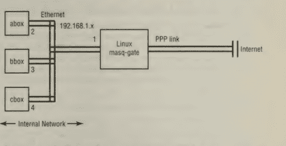

在这个例子中，我们关注四个计算机系统。（当然，最右侧还有承载你互联网 IP 连接的某些设备，以及在互联网上与你进行信息交换的某个远端目标。）Linux 系统 `masq-gate` 是内部网络中 `abox`、`bbox` 和 `cbox` 机器访问互联网的伪装网关。内部网络使用已分配的私有网络地址之一，在本例中为 C 类网络 `192.168.1.0`，Linux 机器的地址为 `192.168.1.1`，其他系统在该网络中也有各自的地址。

这三台机器 `abox`、`bbox` 和 `cbox`（顺便一提，它们可以运行任何操作系统，只要支持 IP 协议即可——例如 Windows 95、Macintosh OS，甚至另一台 Linux 机器）可以连接到互联网上的其他机器；然而，伪装系统 `masq-gate` 会将它们所有的连接进行转换，使其看起来像是从 `masq-gate` 发起的，并将返回的数据安排到伪装连接中并传回给源系统。因此，内部网络中的系统看到一条通往互联网的直通路径，并且不会意识到它们的数据正在被伪装。

### 在 Linux 2.2.x 上使用 IP 伪装的要求

在 Linux 2.2.x 上使用 IP 伪装的要求如下：

- `Kernel 2.2.x` 源代码，可从 `http://www.kernel.org/` 获取。（大多数现代 Linux 发行版，例如 Red Hat 5.2——随附 2.0.36 内核——都有一个模块化内核，其中所有 IP 伪装内核选项均已编译。在这种情况下，无需再次编译。如果你正在升级内核，则应了解你需要什么，这在 HOWTO 的后文中会有提及。）
- 可加载内核模块，最好是 2.1.121 或更新版本。
- 一个配置良好的 TCP/IP 网络，如 Linux NET-3 HOWTO（见第 8 章）和网络管理员指南（`http://metalab.unc.edu/mdw/LDP/nag/nag.html`）所述。还可查看 Trinity OS Doc（`http://www.ecst.csucsb.edu/~dranch/LINUX/TrinityOS.wri`），这是一份关于 Linux 网络的非常全面的指南。
- 你的 Linux 主机连接到互联网的要求，详见 Linux ISP Hookup HOWTO（`http://metalab.unc.edu/mdw/HOWTO/ISP-Hookup-HOWTO.html`）、Linux PPP HOWTO（见第 9 章）、Linux DHCP 迷你 HOWTO（见第 11 章）和 Linux 电缆调制解调器迷你 HOWTO（见第 10 章）。
- `IP Chains 1.3.8` 或更新版本，可从 `http://www.rustcorp.com/linux/ipchains/` 获取。有关版本要求的更多信息请参见 Linux IP Firewalling Chains 页面。

> **注意**
>
> 如需了解其他选项和最新信息，请查看位于 `http://ipmasq.cjb.net/` 的 Linux IP 伪装资源。

### 在 Linux 2.0.x 上使用 IP 伪装的要求

在 Linux 2.0.x 上使用 IP 伪装的要求如下：

- `Kernel 2.0.x` 源代码，可从 `http://www.kernel.org/` 获取。（大多数现代 Linux 发行版，例如 Red Hat 5.2，都有一个模块化内核，其中所有 IP 伪装内核选项均已编译。在这种情况下，无需再次编译。如果你正在升级内核，则应了解你需要什么，这在 HOWTO 的后文中会有提及。）
- 可加载内核模块，最好是 2.0.0 或更新版本，可从 `http://www.pi.se/blox/modules/modules-2.0.0.tar.gz` 获取（`modules-1.3.57` 是最低要求。）
- 一个配置良好的 TCP/IP 网络，如 Linux NET-3 HOWTO（见第 8 章）和网络管理员指南（`http://metalab.unc.edu/mdw/LDP/nag/nag.html`）所述。还可查看 Trinity OS Doc（`http://www.ecst.csumicho.edu/~dranch/LINUX/TrinityOS.wri`），这是一份关于 Linux 网络的非常全面的指南。
- 你的 Linux 主机连接到互联网的要求，详见 Linux ISP Hookup HOWTO（`http://metalab.unc.edu/mdw/HOWTO/HOWTO-Hostup-ISITO.html`）、Linux PPP HOWTO（见第 9 章）、Linux DHCP 迷你 HOWTO（见第 11 章）和 Linux 电缆调制解调器迷你 HOWTO（见第 10 章）。
- `Ipfwadm 2.3` 或更新版本，可从 `ftp://ftp.xos.nl/pub/linux/iptfadm/iptfadm-2.3.tar.gz` 获取。有关版本要求的更多信息请参见 Linux Iptfwadm 页面 `http://www.xos.nl/linux/iptfadm/`。

你可以选择性地应用一些 IP 伪装补丁以启用其他功能。更多信息可参见位于 `http://ipmasq.cjb.net/` 的 IP 伪装资源。（这些补丁适用于所有 2.0.x 内核。）

### 配置 IP 伪装


如果你的私有网络包含任何重要信息，请在使用 IP 伪装前仔细考虑。这可能是你访问互联网的网关，反之——也可能成为世界另一端的人进入你网络的入口。

# 编译支持 IP 伪装的内核

如果你的 Linux 发行版已经编译了上述提到的所需功能和模块（大多数模块化内核将包含你需要的一切），那么你不需要重新编译内核。仍然强烈建议阅读本节，因为它包含其他有用的信息。

## Linux 2.2.x 内核

1. 首先，你需要 `2.2.x` 的内核源代码。


**提示**

如果你第一次编译内核，不要害怕。这相当容易，并且已在 Linux Kernel HOWTO 中介绍：[http://metalab.unc.edu/mdw/HOWTO/Kernel1-HOWTO.html](http://metalab.unc.edu/mdw/HOWTO/Kernel1-HOWTO.html)。

2. 使用命令 `tar xvzf linux-2.2.x.tar.gz -C /usr/src/` 将内核源代码解压到 `/usr/src/`，其中 `x` 是 2.0 之后的补丁级别（请确保有一个名为 `linux` 的目录或符号链接）。

3. 应用相应的补丁。由于不断有新补丁发布，此处将不包含详细细节。请参阅 IP 伪装资源（[http://ipmasq.cjb.net/](http://ipmasq.cjb.net/)）获取最新信息。

4. 参考内核 HOWTO 和内核源代码目录中的 README 文件，了解有关编译内核的进一步说明。

以下是你需要编译进去的选项。对以下选项选择 **是**：

- `询问开发中或不完整的代码/驱动 CONFIG.EXPERIMENTAL` – 这将允许你选择编译进内核的实验性 IP 伪装代码
- `启用可加载模块支持 CONFIG_MODULES`
  - 允许你加载诸如 `ip_masq_ftp.o` 的 ipmasq 模块
- `网络支持 CONFIG_NET`
- `网络防火墙 CONFIG_FIREWALL`
- `TCP/IP 网络 CONFIG_INET`
- `IP：转发/网关 CONFIG_IP_FORWARD`
- `IP：防火墙 CONFIG_IP_FIREWALL`
- `IP：伪装 CONFIG_IP_MASQUERADE`
- `IP：ipportfw 伪装支持 CONFIG_IP_MASQUERADE_IPPORTFW`
  - 推荐
- `IP：ipautofw 伪装支持 CONFIG_IP_MASQUERADE_IPAUTOFW`
  - 可选
- `IP：ICMP 伪装 CONFIG_IP_MASQUERADE_ICMP`
  - 支持 ICMP 数据包的伪装，推荐。
- `IP：始终碎片重组 CONFIG_IP_ALWAYS_DEFRAG`
  - 高度推荐
- `Dummy 网络驱动支持 CONFIG_DUMMY`
  - 推荐
- `IP：ip fwmark 伪装转发支持 CONFIG_IP_MASQUERADE_MFW`
  - 可选


### 注意

这些仅仅是 IP 伪装所需的组件；请根据您特定的配置选择其他所需的选项。

5. 编译内核后，你应该编译并安装模块：

```
make modules; make modules_install
```

6. 然后，你应该在 `/etc/rc.d/rc.local` 文件（或你认为合适的任何文件）中添加几行代码，以便在每次重启时自动加载位于 `/lib/modules/2.2.x/ipv4/` 目录下的必需模块：

```
/sbin/depmod -a
/sbin/modprobe ip_masq_ftp
/sbin/modprobe ip_masq_raid
/sbin/modprobe ip_masq_irc
```

###### （如果你已应用补丁，还有其他模块如 `ip_masq_cuseeme`、`ip_masq_vdolive`）

### 警告

在 `2.2.x` 内核中，IP 转发默认是禁用的。请确保通过运行 `echo "1" > /proc/sys/net/ipv4/ipforwarding` 来启用它。对于 Red Hat 用户，你可以尝试在 `/etc/sysconfig/network` 中将 `FORWARDIPV4=false` 更改为 `FORWARDIPV4=true`。

7. 重启 Linux 机器。

## Linux 2.0.x 内核

1. 首先，你需要内核源代码（最好是最新版本 `2.0.36` 或更高版本）。

### 提示

如果你是第一次编译内核，请不要害怕。这相当简单，并且在 Linux 内核 HOWTO 中有详细说明：http://metalab.unc.edu/mdw/HOWTO/Kernel-HOWTO.html。

2. 使用命令 `tar xvfz linux-2.0.x.tar.gz -C /usr/src/` 将内核源代码解包到 `/usr/src/` 目录，其中 `x` 是 2.0 之后的补丁级别（确保有一个名为 `linux` 的目录或符号链接）。

3. 应用适当的补丁。由于新补丁不断发布，这里不会包含详细信息。请参阅 IP 伪装资源（`http://ipmasq.cjb.net/`）获取最新信息。

4. 参考内核 HOWTO 和内核源代码目录中的 README 文件，了解关于编译内核的进一步说明。

以下是你需要编译的选项。对以下选项回答“是”：

- 提示开发中/或不完整的代码/驱动程序
  - `CONFIG_EXPERIMENTAL`
  - – 这将允许你选择编译进内核的实验性 IP 伪装代码
- 启用可加载模块支持
  - `CONFIG_MODULES`
  - – 允许你加载模块
- 网络支持
  - `CONFIG_NET`
- 网络防火墙
  - `CONFIG_FIREWALL`
- TCP/IP 网络
  - `CONFIG_INET`
- IP：转发/网关
  - `CONFIG_IP_FORWARD`
- IP：防火墙
  - `CONFIG_IP_FIREWALL`
- IP：伪装（实验性）
  - `CONFIG_IP_MASQUERADE`
  - – 虽然是实验性的，但它是“必须”的
- IP：ipautofw 伪装支持（实验性）
  - `CONFIG_IP_MASQUERADE_IPAUTOFW`
  - – 推荐
- IP：ICMP 伪装
  - `CONFIG_IP_MASQUERADE_ICMP`
  - - 支持 ICMP 数据包的伪装，可选。
- IP：始终重组分片
  - `CONFIG_IP_ALWAYS_DEFRAG`
  - - 强烈推荐
- 虚拟网络设备驱动支持
  - `CONFIG_DUMMY`
  - - 推荐


### 注意

这些仅仅是 IP 伪装所需的组件。请根据你特定的配置选择其他所需的选项。

5. 编译内核后，你应该编译并安装模块：

```
make modules; make modules_install
```

6. 然后，你应该在 `/etc/rc.d/rc.local` 文件（或你认为合适的任何文件）中添加几行代码，以便在每次重启时自动加载位于 `/lib/modules/2.0.x/ipv4/` 目录下的必需模块：

```
/sbin/depmod -a
/sbin/modprobe ip_masq_ftp
/sbin/modprobe ip_masq_audiod
/sbin/modprobe ip_masq_irc
```

###### （如果你已应用补丁，还有其他模块如 `ip_masq_cuseeme`、`ip_masq_vdolive`）


### 警告

从 `2.0.34` 内核开始，IP 转发默认是禁用的。请确保通过运行 `echo '1' > /proc/sys/net/ipv4/ipforward` 来启用它。Red Hat 用户，你可以尝试在 `/etc/sysconfig/network` 中将 `FORWARDIPV4=false` 更改为 `FORWARDIPV4=true`。

7. 重启 Linux 机器。

## 分配私有网络 IP 地址

由于其他所有机器都没有官方分配的地址，必须有一种正确的方法来为这些机器分配地址。

以下信息来自 IP 伪装 FAQ。有一个 RFC（1597，现在可能已经过时）说明了在非连接网络上使用哪些 IP 地址。有三个数字块专门为此目的预留。我使用其中的一个是 255 个 C 类子网，范围从 `192.168.1.n` 到 `192.168.255.n`。


# 以下内容来自 RFC 1597：

## 第 3 节：私有地址空间

互联网号码分配机构（IANA）已保留以下三个 IP 地址空间块用于私有网络：

```
10.0.0.0        -    10.255.255.255
172.16.0.0      -    172.31.255.255
192.168.0.0     -    192.168.255.255
```

我们将第一个块称为“24 位块”，第二个称为“20 位块”，第三个称为“16 位”块”。请注意，第一个块只是一个单一的 A 类网络号，第二个块是一组 16 个连续的 B 类网络号，第三个块是一组 255 个连续的 C 类网络号。

因此，如果你使用的是 C 类网络，你应该将机器命名为 `192.168.1.1`、`192.168.1.2`、`192.168.1.3`、...、`192.168.1.x`。

`192.168.1.1` 通常是网关机器，即你的连接互联网的 Linux 主机。请注意，`192.168.1.0` 和 `192.168.1.255` 分别是网络地址和广播地址，它们是保留的。避免在你的机器上使用这些地址。

### 配置其他机器

除了为每台机器设置适当的 IP 地址外，你还应该设置适当的网关。通常，这相当直接。你只需输入你的 Linux 主机（通常是 `192.168.1.1`）的地址作为网关地址。

对于域名服务（DNS），你可以添加任何可用的 DNS。最明显的应该是你的 Linux 主机正在使用的那个。你可以选择性地添加任何域名搜索后缀。

在重新配置这些 IP 地址后，请记得重启相应的服务或重启你的系统。

以下配置说明假设你使用的是以 `192.168.1.1` 作为 Linux 主机地址的 C 类网络。请注意，`192.168.1.0` 和 `192.168.1.255` 是保留的。

#### 配置 Windows 95

1. 如果你还没有安装你的网卡和适配器驱动程序，请现在进行安装。
2. 进入控制面板/网络。
3. 如果你还没有，请添加 TCP/IP 协议。
4. 在 TCP/IP 属性中，进入 IP 地址，将 IP 地址设置为 `192.168.1.x`（`$x$` 从 1 到 255），然后将子网掩码设置为 `255.255.255.0`。
5. 在网关下添加 `192.168.1.1` 作为你的网关。
6. 在 DNS 配置/DNS 服务器搜索顺序下添加你的 Linux 主机使用的 DNS（通常在 `/etc/resolv.conf` 中找到）。可选地，你可以添加适当的域名搜索后缀。
7. 保持其他所有设置不变，除非你知道自己在做什么。
8. 在所有对话框中点击确定并重启你的系统。
9. Ping Linux 机器以测试网络连接：开始/运行，输入 `ping 192.168.1.1`。（这仅用于测试局域网连接，你暂时还无法 ping 外部世界。）
10. 你可以选择性地创建 windows 目录中的 HOSTS 文件，这样你就可以使用局域网中机器的主机名。Windows 目录中有一个示例文件名为 HOSTS.SAM。

#### 配置 Windows 3.11 工作组版

1. 如果你还没有安装你的网卡和适配器驱动程序，请现在进行安装。
2. 如果你没有，请安装 TCP/IP 32b 软件包。
3. 在主/Windows 设置/网络设置中，点击驱动程序。
4. 在网络驱动程序部分中高亮 Microsoft TCP/IP 32 3.11b，然后点击设置。
5. 将 IP 地址设置为 `192.168.1.x`（1 ≤ x ≤ 255），然后将子网掩码设置为 `255.255.255.0`，默认网关设置为 `192.168.1.1`。
6. 不要启用自动 DHCP 配置，也不要在那些 WINS 服务器输入区域中输入任何内容，除非你在 Windows NT 域中并且你知道自己在做什么。
7. 点击 DNS，填写前一节步骤 6 中提到的适当信息，完成后点击确定。
8. 点击高级，并勾选为 Windows 名称解析启用 DNS 以及如果正在使用类似于前一节步骤 10 中提到的查找主机文件，则勾选启用 LMHOSTS 查找。
9. 在所有对话框中点击确定并重启你的系统。
10. Ping Linux 机器以测试网络连接：文件/运行，输入 `ping 192.168.1.1`。（这仅用于测试局域网连接；你暂时还无法 ping 外部世界。）

#### 配置 Windows NT

1. 如果你还没有安装你的网卡和适配器驱动程序，请现在进行安装。
2. 进入主/控制面板/网络。
3. 如果你还没有安装 TCP/IP 服务，请从添加软件菜单中添加 TCP/IP 协议和相关组件。
4. 在 `Network Software and Adapter Cards` 部分下，在 `Installed Network Software` 选择框中高亮显示 `TCP/IP Protocol`。
5. 在 `TCP/IP Configuration` 中，选择适当的适配器，例如 `[1]Novell NE2000 Adapter`。然后将 IP 地址设置为 `192.168.1.x`（1 < x < 255），接着将 `Subnet Mask` 设置为 `255.255.255.0`，将 `Default Gateway` 设置为 `192.168.1.1`。
6. 除非你处于 Windows NT 域中并且清楚自己在做什么，否则不要启用 `Automatic DHCP Configuration`，也不要向那些 `WINS Server` 输入区域输入任何内容。
7. 单击 `DNS`，填入“配置 Windows 95”部分第 6 步中提到的适当信息，完成后单击 `OK`。
8. 单击 `Advanced`，如果你正在使用查找主机文件（类似于“配置 Windows 95”部分第 10 步中提到的文件），请勾选 `Enable DNS for Windows Name Resolution` 和 `Enable LMHOSTS lookup`。
9. 在所有对话框中单击 `OK`，然后重新启动你的系统。
10. Ping Linux 机器以测试网络连接：`File/Run`，输入 `ping 192.168.1.1`。（这仅用于局域网连接测试；你目前还无法 ping 外部世界。）

#### 配置基于 Unix 的系统

1. 如果你还没有安装网卡并重新编译内核以包含适当的适配器驱动程序，请现在执行此操作。
2. 安装 `TCP/IP` 网络功能，例如 `nettools` 软件包，如果你尚未安装的话。
3. 将 `IPADDR` 设置为 `192.168.1.x`（1 < x < 255），然后将 `NETMASK` 设置为 `255.255.255.0`，`GATEWAY` 设置为 `192.168.1.1`，`BROADCAST` 设置为 `192.168.1.255`。例如，你可以在 Red Hat Linux 系统上编辑 `/etc/sysconfig/network-scripts/ifcfg-eth0` 文件，或者简单地通过控制面板进行操作。（SunOS、BSDI、Slackware Linux 等系统的操作有所不同。）
4. 在 `/etc/resolv.conf` 中添加你的 `domain name service (DNS)` 和 `domain search suffix`。
5. 根据你的设置，你可能需要更新你的 `/etc/networks` 文件。
6. 重启相应的服务，或者直接重启你的系统。
7. 发出 `ping` 命令（`ping 192.168.1.1`）以测试与网关机器的连接。（这仅用于局域网连接测试；你目前还无法 ping 外部世界。）

#### 使用 NCSA Telnet 软件包配置 DOS

1. 如果你还没有安装网卡，请现在安装。
2. 加载适当的包驱动程序。对于 NE2000 网卡，发出 `nwpd 0x60 10 0x300`，并将你的网卡 IRQ 设置为 10，硬件地址设置为 `0x300`。
3. 创建一个新的目录，然后解压缩 NCSA Telnet 软件包：`pkunzip tel2308B.zip`。
4. 使用文本编辑器打开 `config.tel` 文件。
5. 设置 `myip=192.168.1.x`（1 < x < 255）和 `netmask=255.255.255.0`。
6. 在此示例中，你应该设置 `hardware=packet`、`interrupt=10` 和 `ioaddr=60`。
7. 你应该至少有一个单独的主机配置设置为网关，即 Linux 主机：
   - `name=default`
   - `host=yourlinuxhostname`
   - `hostip=192.168.1.1`
   - `gateway=1`
8. 为域名服务添加另一个配置：


- `name=dns.domain.com ; hostip=123.123.123.123; nameserver=1`
- 替换为你 Linux 主机使用的适当 DNS 信息。

9. 保存你的 `config.tel` 文件。

10. Telnet 到 Linux 机器以测试网络连接：`telnet 192.168.1.1`。

### 配置运行 MacTCP 的 Macintosh

1. 如果你还没有为你的以太网适配器安装适当的驱动程序软件，现在是一个非常合适的时机。

2. 打开 MacTCP 控制面板。选择适当的网络驱动程序（Ethernet，而非 EtherTalk），并单击 More... 按钮。

3. 在 Obtain Address 下，单击 Manually。

4. 在 IP Address 下，从弹出菜单中选择类别 C。忽略该对话框的其余部分。

5. 在 Domain Name Server Information 下填入适当的信息。

6. 在 Gateway Address 下输入 `192.168.1.1`。

7. 单击 OK 以保存设置。在 MacTCP 控制面板的主窗口中，在 IP Address: 框中输入你 Mac 的 IP 地址（192.168.1.x，1 < x < 255）。

8. 关闭 MacTCP 控制面板。如果弹出对话框通知你，请重新启动系统。

9. 你可以选择 ping Linux 机器以测试网络连接。如果你有免费软件 MacTCP Watcher，请单击 Ping 按钮，并在弹出的对话框中输入你的 Linux 机器地址（192.168.1.1）。（这仅用于局域网连接测试；你目前还无法 ping 外部世界。）

10. 你可以选择在 System Folder 中创建一个 Hosts 文件，以便使用局域网中机器的主机名。该文件应该已经存在于你的 System Folder 中，并且应包含一些（被注释掉的）示例条目，你可以根据需要进行修改。

### 配置运行 Open Transport 的 Macintosh

1. 如果你还没有为你的以太网适配器安装适当的驱动程序软件，现在是一个非常合适的时机。

2. 打开 TCP/IP 控制面板，并从编辑菜单中选择 User Mode...。确保用户模式至少设置为 Advanced，然后单击 OK 按钮。

3. 从文件菜单中选择 Configurations...。选择你的默认配置，然后单击 Duplicate... 按钮。在 Duplicate Configuration 对话框中输入 IP Masq（或任何能让你知道这是一个特殊配置的内容）；它可能会显示类似 Default copy 的内容。然后单击 OK 按钮和 Make Active 按钮。

4. 从 Connect via: 弹出菜单中选择 Ethernet。

5. 从 Configure: 弹出菜单中选择适当的项。如果你不知道该选择哪个选项，最好重新选择你的默认配置并退出。我使用 Manually。

6. 在 IP Address: 框中输入你 Mac 的 IP 地址（192.168.1.x，1 < x < 255）。

7. 在 Subnet mask 框中输入 255.255.255.0。

8. 在 Router address 框中输入 `192.168.1.1`。

9. 在 Name server addr. 框中输入你的域名服务器的 IP 地址。

10. 在 Implicit Search Path 下的 Starting domain name 框中输入你的互联网域名（例如，microsoft.com）。

11. 以下步骤是可选的。错误的值可能会导致行为异常。如果你不确定，最好让它们保持空白、未选中或未选择。如有必要，请删除这些字段中的信息。据我所知，在 TCP/IP 对话框中没有方法告诉系统不要使用之前选定的备用 Hosts 文件。如果你知道的话，我会很感兴趣。如果你的网络需要 802.3 帧类型，请勾选 802.3。

12. 单击 Options... 按钮以确保 TCP/IP 处于活动状态。我使用 Load only when needed 选项。如果你在不重启机器的情况下多次运行和退出 TCP/IP 应用程序，你可能会发现取消勾选 Load only when needed 选项可以防止/减少对你机器内存管理的影响。在未勾选该项时，TCP/IP 协议堆栈始终处于加载和可用状态。如果勾选该项，TCP/IP 堆栈会在需要时自动加载，在不需要时卸载。正是加载和卸载过程可能导致你的机器内存变得碎片化。

13. 你可以 ping Linux 机器以测试网络连接。如果你有免费软件 MacTCP Watcher，请单击 Ping 按钮，并在弹出的对话框中输入你的 Linux 机器地址（192.168.1.1）。（这仅用于局域网连接测试；你目前还无法 ping 外部世界。）

14. 你可以在 System Folder 中创建一个 Hosts 文件，以便使用局域网中机器的主机名。该文件可能已经存在于你的 System Folder 中，也可能不存在。如果存在，它应该包含一些（被注释掉的）示例条目，你可以根据需要进行修改。如果不存在，你可以从运行 MacTCP 的系统获取该文件的副本，或者自己创建（它遵循 Unix `/etc/hosts` 文件格式的一个子集，见 RFC952）。一旦你创建了该文件，请打开 TCP/IP 控制面板，单击 Select Hosts File... 按钮，并打开 Hosts 文件。

15. 单击关闭框，或从文件菜单中选择 Close 或 Quit，然后单击 Save 按钮以保存你所做的更改。

16. 更改立即生效，但重启系统也无妨。

### 使用 DNS 配置 Novell 网络

1. 如果你还没有为你的以太网适配器安装适当的驱动程序软件，现在是一个非常合适的时机。

2. 从 `ftp.novell.com/pub/updates/unixconn/1wp5` 下载 `tcpipl6.exe`。

3. 编辑 `c:\nwclient\startnet.bat`。（以下是我的一份副本。）

```
SET NWLANGUAGE=ENGLISH
LH LSL.COM
LH KTC2000.COM
LH IPXODI.COM
LH tcpi
LH VLM.EXE
F:
```

4. 编辑 `c:\nwclient\net.cfg`。（将链接驱动程序更改为您的驱动程序，即 NE2000。）

```
Link Driver KTC2000
   Protocol IPX 0 ETHERNET_802.3
   Frame ETHERNET_802.3
   Frame Ethernet_II
   FRAME Ethernet_802.2
```

```
NetWare DOS Requester
   FIRST NETWORK DRIVE = F
   USE DEFAULTS = OFF
   VLM = CONN.VLM
   VLM = IPXNCP.VLM
   VLM = TRAN.VLM
   VLM = SECURITY.VLM
   VLM = NDS.VLM
   VLM = BIND.VLM
   VLM = NWP.VLM
   VLM = FIO.VLM
   VLM = GENERAL.VLM
   VLM = REDIR.VLM
   VLM = PRINT.VLM
   VLM = NETX.VLM
```

```
Link Support
   Buffers 8 1500
   MemPool 4096
```

```
Protocol TCPIP
   PATH SCRIPT    C:\NET\SCRIPT
   PATH PROFILE    C:\NET\PROFILE
   PATH LWP_CFG    C:\NET\HSTACC
   PATH TCP_CFG    C:\NET\TCP
   ip_address       xxx.xxx.xxx.xxx
   ip_router        xxx.xxx.xxx.xxx
```

5. 最后，创建 `c:\bin\resolv.cfg`。

```
SEARCH DNS HOSTS SEQUENTIAL
   NAMESERVER 207.103.0.2
   NAMESERVER 207.103.11.9
```

6. 希望这能帮助一些人将他们的 Novell 网络接入互联网；这可以使用 NetWare 3.1x 或 4.x 来实现。

### 配置 OS/2 Warp

- 如果你尚未安装适用于以太网适配器的相应驱动程序，现在正是安装的好时机。
- 如果你还没有安装 TCP/IP 协议，请安装它。
- 前往 程序 / TCP/IP (LAN) / TCP/IP 设置
- 在网络中，添加你的 TCP/IP 地址并设置你的子网掩码（255.255.255.0）。


- 在路由下，点击添加。将类型设置为默认，并在路由器地址字段中输入你的 Linux 主机的 IP 地址（`192.168.1.1`）。

- 在 Hosts 中设置与你的 Linux 主机使用的相同的 DNS（名称服务器）地址。

- 关闭 TCP/IP 控制面板。对接下来的问题回答“是”。

- 重启你的系统。

- 你可以 `ping` Linux 主机以测试网络配置。在 `OS/2` 命令提示窗口中输入 `ping 192.168.1.1`。当接收到 ping 数据包时，说明一切正常。

## 配置其他系统

相同的逻辑也应适用于设置其他平台。请查阅上述章节。如果你有兴趣撰写关于尚未涵盖的系统的文章，请向 `ambrose@writeme.com` 和 `dranch@trinnet.net` 发送详细的设置说明。

## 配置 IP 转发策略

此时，你应该已经安装了内核和其他必要的软件包，并且已加载了你的模块。此外，其他机器上的 IP 地址、网关和 DNS 应该也都设置好了。

现在，唯一剩下的事情是使用 IP 防火墙工具将适当的数据包转发到适当的机器。

这可以通过许多不同的方式实现。以下建议和我使用的示例对我有效，但你可能有不同的想法；请参考本章中的“IP 防火墙管理（`Ipfwadm`）”以及 `iptables(2.2.x)` 和 `ipfwadm(2.0.x)` 的 `man` 页面以获取详细信息。

**注意**

本节仅提供了让 IP 伪装（IP Masquerade）工作的最基本规则集，未考虑安全问题。强烈建议你花一些时间来应用适当的防火墙规则以加强安全性。


### Linux 2.2.x 内核

`Iptables` 不再是用于操作 2.2.x 内核的 `iptables` 规则的工具；请使用 `iptables`。

```bash
iptables -P forward DENY
iptables -A forward -s yyy.yyy.yyy.yyy -j MASQ
```

其中 x 是以下数字之一，取决于你的子网类别，而 `yyy.yyy.yyy.yyy` 是你的网络地址。

| 子网掩码 | x | 子网 |
| :--- | :--- | :--- |
| 255.0.0.0 | 8 | A 类 |
| 255.255.0.0 | 16 | B 类 |
| 255.255.255.0 | 24 | C 类 |
| 255.255.255.255 | 32 | 点对点 |

你也可以使用格式 `yyy.yyy.yyy.xxx.xxx.xxx`，其中 `xxx.xxx.xxx.xxx` 指定你的子网掩码，例如 `255.255.255.0`。

例如，如果我在 C 类子网上，我会输入

```bash
iptables -P forward DENY
iptables -A forward -s 192.168.1.0/24 -j MASQ
```

或者

```bash
iptables -P forward DENY
iptables -A forward -s 192.168.1.0/255.255.255.0 -j MASQ
```

你也可以基于每台机器进行操作。例如，如果我希望 `192.168.1.2` 和 `192.168.1.8` 能够访问互联网，而其他机器不能，我会输入

```bash
iptables -P forward DENY
iptables -A forward -s 192.168.1.2/32 -j MASQ
iptables -A forward -s 192.168.1.8/32 -j MASQ
```

不要将默认策略设置为伪装（masquerading）——否则，任何能够操纵其路由的人都将能够通过你的网关直接穿隧回去，利用它来伪装他们的身份！

同样，你可以将这些行添加到 `/etc/rc.local` 文件、你喜欢的某个 rc 文件中，或者每次需要 IP 伪装时手动执行。

有关 `ipchains` 的详细用法，请参考第 14 章中的 Linux IPCHAINS HOWTO。

### Linux 2.0.x 内核

```bash
ipfwadm -F -p deny
ipfwadm -F -a m -S yyy.yyy.yyy.yyy/x -D 0.0.0.0/0
```

或者

```bash
ipfwadm -F -p deny
ipfwadm -F -a masquerade -S yyy.yyy.yyy.yyy/x -D 0.0.0.0/0
```

其中 x 是以下掩码数字之一，取决于你的子网类别，而 `yyy.yyy.yyy.yyy` 是你的网络地址。

| 子网掩码 | x | 子网 |
| :--- | :--- | :--- |
| 255.0.0.0 | 8 | A 类 |
| 255.255.0.0 | 16 | B 类 |
| 255.255.255.0 | 24 | C 类 |
| 255.255.255.255 | 32 | 点对点 |

你也可以使用格式 `yyy.yyy.yyy.yyy/xxx.xxx.xxx.xxx`，其中 `xxx.xxx.xxx.xxx` 指定你的子网掩码，例如 `255.255.255.0`。

例如，如果我在 C 类子网上，我会输入

```bash
ipfwadm -F -p deny
ipfwadm -F -a m -S 192.168.1.0/24 -D 0.0.0.0/0
```

由于一旦客户端不了解 `bootp` 请求数据包，它们就会在没有有效 IP 的情况下发送，因此在伪装/防火墙机器上拥有 `bootp` 服务器的人需要在 deny 命令之前使用以下内容：

```bash
ipfwadm -I -a accept -S 0/0 68 -D 0/0 67 \
    -W bootp_clients.net_if_name -P udp
```

你也可以基于每台机器进行操作。例如，如果我希望 `192.168.1.2` 和 `192.168.1.8` 能够访问互联网，而其他机器不能，我会输入

```bash
ipfwadm -F -p deny
ipfwadm -F -a m -S 192.168.1.2/32 -D 0.0.0.0/0
ipfwadm -F -a m -S 192.168.1.8/32 -D 0.0.0.0/0
```

似乎常见的错误是将第一条命令设为 `ipfwadm -F -p masquerade`。不要将默认策略设置为伪装（masquerading）——否则，任何能够操纵其路由的人都将能够通过你的网关直接穿隧回去，利用它来伪装他们的身份！

同样，你可以将这些行添加到 `/etc/rc.local` 文件、你喜欢的某个 rc 文件中，或者每次需要 IP 伪装时手动执行。

请阅读第 4 章中的“安装概述”以获取 `ipfwadm` 的详细指南。

## 测试 IP 伪装

经过所有这些艰苦的工作，现在是时候尝试一下了。确保你的 Linux 主机到互联网的连接正常。

你可以尝试在其他机器上浏览一些网站，看看是否成功。我建议在第一次尝试时使用 IP 地址而不是主机名，因为你的 DNS 设置可能不正确。

例如，你可以通过访问 `http://152.19.254.81/mdw/linux.html` 来访问 Linux 文档项目网站，对应于 `http://metalab.unc.edu/mdw/linux.html`。

如果你看到了 Linux 文档项目主页，那么恭喜！它起作用了！然后你可以尝试使用主机名，接着尝试 `ping`、`Telnet`、`ssh`、`FTP`、`Real Audio`、`True Speech` 以及 IP 伪装支持的任何其他功能。

到目前为止，我对上述设置没有遇到任何问题，这完全归功于那些花时间让这项出色功能正常工作的人们。

## 其他 IP 伪装问题和软件支持

本节涉及围绕 IP 伪装的多种问题。

### IP 伪装的问题

目前，某些协议无法与伪装配合使用，因为它们要么假设端口号的情况，要么在数据流中对地址和端口进行编码——这些后一类协议需要在伪装代码中构建特定的代理才能使它们工作。

### 传入服务

伪装（Masquerading）完全无法处理传入服务。允许这些服务有几种方法，但它们与伪装完全无关，实际上是标准防火墙实践的一部分。

如果你对安全性要求不高，可以简单地进行端口重定向。实现这一点有几种方式。我使用了一个修改过的 `redir` 程序（希望很快能在 sunsite 及其镜像站点上获取）。如果你希望在接受传入连接时使用某种级别的授权，可以在 `redir`（0.7 或更高版本）之上使用 `TCP wrappers` 或 `Xinetd`，以仅允许特定 IP 地址通过，或者使用其他工具。`TIS` 防火墙工具包是查找工具和信息的不错起点。

更多详细信息可在 IP Masquerade Resource（`http://ipmasq.cjb.net/`）中找到。

### 支持的客户端软件和其他设置说明


以下列表已不再维护。关于通过 Linux IP 伪装工作的应用程序的信息，请参阅 http://dijon.nais.com/~nevo/masq/，更多细节请参阅 IP Masquerade Resource（http://ipmasq.cjb.net/）。

通常，使用 TCP 和 UDP 的应用程序应该能正常工作。如果你有任何关于 IP 伪装应用程序的建议、提示或问题，请访问 Lee Nevo 维护的 http://dijon.nais.com/~nevo/masq/。

### 可工作的客户端

#### 通用客户端

- `HTTP`：所有支持的平台，浏览网页
- `POP/SMTP`：所有支持的平台，电子邮件客户端
- `Telnet`：所有支持的平台，远程会话
- `FTP`：所有支持的平台，需加载 `ipmasqftp.o` 模块（并非所有网站都能与某些客户端配合工作；例如，某些网站无法使用 wstftp32 访问，但可以使用 Netscape）
- `Archie`：所有支持的平台，文件搜索客户端（并非所有 archie 客户端都受支持）
- `NNTP (USENET)`：所有支持的平台，USENET 新闻客户端
- `VRML`：Windows（可能包括所有支持的平台），虚拟现实浏览
- `traceroute`：主要适用于基于 Unix 的平台，某些变体可能无法工作
- `ping`：所有平台，需使用 ICMP 补丁
- 基于 IRC 的任何工具：所有支持的平台，需使用 `ipmasqirc.o` 模块
- `Gopher` 客户端：所有支持的平台
- `WAIS` 客户端：所有支持的平台

#### 多媒体客户端

- `Real Audio Player`：Windows，网络流式音频，需加载 `ipmasqradio` 模块
- `True Speech Player 1.1b`：Windows，网络流式音频
- `Internet Wave Player`：Windows，网络流式音频
- `Worlds Chat 0.9a`：Windows，客户端-服务器 3-D 聊天程序
- `Alpha Worlds`：Windows，客户端-服务器 3-D 聊天程序
- `Internet Phone 3.2`：Windows，点对点音频通信，只有在你发起呼叫时人们才能联系到你，但人们不能拨打你的电话
- `Powwow`：Windows，点对点文本、音频和白板通信，只有在你发起呼叫时人们才能联系到你，但人们不能拨打你的电话
- `CU-SeeMe`：所有支持的平台，需加载 `cuseeme` 模块，详情请参阅 IP Masquerade Resource（http://ipmasq.cjb.net/）
- `VDOlive`：Windows，需使用 `vdolive` 补丁

#### 其他客户端

- `NCSA Telnet 2.3.08`：DOS，包含 Telnet、FTP、Ping 等在内的工具套件
- `PC-anywhere for windows 2.0`：MS-Windows，通过 TCP/IP 远程控制 PC，仅当它作为客户端工作时有效，不能作为主机
- `Socket Watch`：使用 NTP –（网络时间协议）
- `Linux net-acc t` 包：Linux，网络管理-账户包

### 不可工作的客户端

- `Intel Internet Phone Beta 2`：可以连接，但语音仅单向（输出）传输
- `Intel Streaming Media Viewer Beta 1`：无法连接到服务器
- `Netscape CoolTalk`：无法连接到对端
- `talk, ntalk`：无法工作——需要编写内核代理。
- `WebPhone`：目前无法工作（它对地址做了无效的假设）
- `X`：未测试，但我认为除非有人构建 X 代理，否则无法工作，这通常是伪装代码之外的外部程序。实现这一点的一种方法是使用 ssh 作为链接，并使用内部 X 代理。

### 在其他机器上测试过的平台/操作系统

- Linux
- Solaris
- Windows 95
- Windows NT（工作站和服务器版）
- Windows For Workgroup 3.11（带有 TCP/IP 包）
- Windows 3.1（带有 Chameleon 包）
- Novell 4.01 服务器
- OS/2（包括 Warp v3）
- Macintosh OS（带有 MacTCP 或 Open Transport）
- DOS（带有 NCSA Telnet 包，DOS Trumpet 部分工作）
- 带有 AmiTCP 或 AS225-stack 的 Amiga
- 带有 UCX（VMS 的 TCP/IP 堆栈）的 VAX 工作站 3520 和 3100
- 运行 Linux/Redhat 的 Alpha/AXP
- SCO OpenServer（v3.2.4.2 和 5）
- 运行 AIX 的 IBM RS/6000

基本上所有操作系统平台都支持 TCP/IP，并允许你指定网关/路由器如何与 IP 伪装一起工作。

### IP 防火墙管理 (`ipfwadm`)

本节提供了使用 `ipfwadm` 的更深入的指南。

以下是在具有静态 PPP 地址的 PPP 链接后方的防火墙/伪装系统的配置。一个受信任的接口是 `192.168.255.1`；PPP 接口已被修改以保护当事人隐私。我分别列出了每个传入和传出接口，以捕获 IP 欺骗以及填充路由和/或伪装。此外，任何未明确允许的内容都是禁止的！


# 防火墙配置脚本

```bash
#!/bin/sh
#
###### /etc/rc.d/rc.firewall, 定义防火墙配置
###### 从 rc.local 调用。
#
PATH=/sbin:/bin:/usr/sbin:/usr/bin

###### 测试，稍等片刻然后清除所有防火墙规则。
###### 如果你希望防火墙在 10 分钟后自动禁用，请取消以下行的注释。
# (sleep 600; \
# ipfwadm -I -f; \
# ipfwadm -I -p accept; \
# ipfwadm -O -f; \
# ipfwadm -O -p accept; \
# ipfwadm -F -f; \
# ipfwadm -F -p accept; \
###### ) &

###### 传入，清空并设置默认策略为拒绝。实际上，
###### 默认策略无关紧要，因为有一条拒绝并记录日志的
###### 兜底规则。

ipfwadm -I -f
ipfwadm -I -p deny
###### 本地接口，本地机器，去任何地方都是有效的
ipfwadm -I -a accept -V 192.168.255.1 -S 192.168.0.0/16 \
 -D 0.0.0.0/0
###### 远程接口，声称是本地机器，
###### IP 欺骗，走开
ipfwadm -I -a deny -V your.static.PPP.address \
 -S 192.168.0.0/16 -D 0.0.0.0/0 -o
###### 远程接口，任意源，去永久
###### PPP 地址是有效的
ipfwadm -I -a accept -V your.static.PPP.address \
 -S 0.0.0.0/0 -D your.static.PPP.address/32
###### 回环接口是有效的。
ipfwadm -I -a accept -V 127.0.0.1 -S 0.0.0.0/0 -D 0.0.0.0/0
###### 兜底规则，所有其他传入都被拒绝并记录。
###### 遗憾的是策略上没有日志选项，但这
###### 起到了相同的作用。
ipfwadm -I -a deny -S 0.0.0.0/0 -D 0.0.0.0/0 -o

###### 传出，清空并设置默认策略为拒绝。实际上，
###### 默认策略无关紧要，因为有一条拒绝并记录日志的
###### 兜底规则。
ipfwadm -O -f
ipfwadm -O -p deny
###### 本地接口，任意源去本地网络是有效的
ipfwadm -O -a accept -V 192.168.255.1 -S 0.0.0.0/0 \
 -D 192.168.0.0/16
###### 从远程接口传出到本地网络，填充路由，
###### 拒绝
ipfwadm -O -a deny -V your.static.PPP.address -S 0.0.0.0/0 \
 -D 192.168.0.0/16 -o
###### 从本地网络通过远程接口传出，填充
###### 伪装，拒绝
ipfwadm -O -a deny -V your.static.PPP.address \
 -S 192.168.0.0/16 -D 0.0.0.0/0 -o
###### 在远程接口上的其他任何传出都是有效的
ipfwadm -O -a accept -V your.static.PPP.address \
 -S 0.0.0.0/0
###### 回环接口是有效的。
ipfwadm -O -a accept -V 127.0.0.1 -S 0.0.0.0/0 -D 0.0.0.0/0
###### 兜底规则，所有其他传出都被拒绝并记录。
###### 遗憾的是策略上没有日志选项，但这起到了
###### 相同的作用。
ipfwadm -O -a deny -S 0.0.0.0/0 -D 0.0.0.0/0 -o

###### 转发，清空并设置默认策略为拒绝。实际上，
###### 默认策略无关紧要，因为有一条拒绝并记录日志的
###### 兜底规则。
ipfwadm -F -f
ipfwadm -F -p deny
###### 从本地网络通过本地接口伪装到任何地方。
ipfwadm -F -a masquerade -W ppp0 -S 192.168.0.0/16 \
 -D 0.0.0.0/0
###### 兜底规则，所有其他转发都被拒绝并记录。
###### 遗憾的是策略上没有日志选项，但这起到了
###### 相同的作用。
ipfwadm -F -a deny -S 0.0.0.0/0 -D 0.0.0.0/0 -o
```

你可以使用 `-I`、`-O` 或 `-F` 来阻止对特定站点的流量。请记住，规则集是从上到下扫描的，而 `-a` 表示“追加”到现有规则集，因此任何限制都需要在全局规则之前。以下是一些（未测试的）示例：

## 使用 -I 规则

这可能是最快的方法，但它只阻止本地机器；防火墙本身仍然可以访问被禁止的站点。当然，你可能希望允许这种组合。

```bash
.. start of -I rules ..
###### 拒绝并记录本地接口，本地机器去
###### 204.50.10.13
```

**注意**

一些客户端，如 iPhone 和 Powwow，即使不是由你发起的呼叫，也可以通过使用 `ipatow` 包来工作（参见第 4 章中的“引导你的新系统”）。

## 使用 -I 规则

这种方式最慢，因为数据包首先会经过伪装（masquerading）处理，但此规则甚至能阻止防火墙访问被禁止的网站。

```
###### start of -I rules
###### reject and log from local net to 204.50.10.13
ipfwadm -I -a reject -V 192.168.255.1 -S 192.168.0.0/16 \
                -D 204.50.10.13/32 -o
###### local interface, local machines, going anywhere is valid
ipfwadm -I -a accept -V 192.168.255.1 -S 192.168.0.0/16 \
                -D 0.0.0.0/0
... end of -I rules ...
```

## 使用 -O 规则

这种方式最慢，因为数据包首先会经过伪装（masquerading）处理，但此规则甚至能阻止防火墙访问被禁止的网站。

```
###### start of -O rules
###### reject and log outgoing to 204.50.10.13
ipfwadm -O -a reject -V your.static.PPP.address \
                -S your.static.PPP.address/32 -D 204.50.10.13/32 -o
###### anything else outgoing on remote interface is valid
ipfwadm -O -a accept -V your.static.PPP.address \
                -S your.static.PPP.address/32 -D 0.0.0.0/0
###### end of -O rules
```

## 使用 -F 规则

这种方式可能比 `-I` 慢，并且仍然只能阻止被伪装的主机（即内部主机）；防火墙本身仍可以访问被禁止的网站。

```
###### start of -F rules
###### Reject and log from local net on PPP interface
###### to 204.50.10.13.
ipfwadm -F -a reject -W ppp0 -S 192.168.0.0/16 \
                -D 204.50.10.13/32 -o
###### Masquerade from local net on local interface to anywhere.
ipfwadm -F -a masquerade -W ppp0 -S 192.168.0.0/16 \
                -D 0.0.0.0/0
###### end of -F rules
```

无需设置特殊规则来允许 `192.168.0.0/16` 访问 `204.50.11.0`；这已由全局规则覆盖。

上述规则中对网络接口的编码方式不止一种。例如，你可以使用 `-W eth0` 替代 `-V 192.168.255.1`；可以使用 `-W ppp0` 替代 `-V your.static.PPP.address`。个人偏好和文档记录比什么都重要。

## IP 防火墙链（ipchains）

这是主要面向 2.2.x 内核的防火墙规则集操纵工具（有一个补丁使其能在 2.0.x 上工作）。


我们将很快更新本节，提供关于 `ipchains` 用法的几个示例。

请参阅 [Linux IP 防火墙链页面](http://www.rustcorp.com/linux/ipchains/) 以及《Linux IPCHAINS HOWTO》（参见第 14 章）以获取详细信息。

## IP 伪装与拨号入网

如果您希望将网络设置为自动拨号连接互联网，`diald` 按需拨号软件包将非常有用。

- 若要设置 `diald`，请查看 [为 Linux 设置 Diald](http://home.pacific.net.sg/~harish/diald.config.html) 页面。
- 一旦 `diald` 和 IP 伪装设置完成，你可以进入任何客户端机器并发起 Web、Telnet 或 FTP 会话。
- `diald` 将检测到传入的请求，然后拨打你的 ISP 并建立连接。
- 首次连接时会发生超时。如果你使用的是模拟调制解调器，这是不可避免的。建立调制解调器链路和 PPP 连接所需的时间会导致你的客户端程序超时。如果你使用的是 ISDN 连接，则可以避免这种情况。你只需要终止客户端上的当前进程并重新启动即可。

## IPautofw 数据包转发器

`IPautofw` (`ftp://ftp.netis.com/pub/members/rlynch/ipautofw.tar.gz`) 是用于 Linux 伪装的通用 TCP 和 UDP 转发器。通常，要利用需要 UDP 的软件包，需要加载特定的 `ipmasq` 模块，如 `ipmasqaid`、`ipmasquseeme` 等。`IPautofw` 以更具通用性的方式运行；它转发任何类型的流量，包括那些特定应用程序模块不会转发的流量。如果管理不当，这可能会造成安全漏洞。

## CU-SeeMe 与 Linux IP 伪装

以下内容由 Michael Owings <mikey@swampgas.com> 提供。

### 简介

本节将解释使 CU-SeeMe（康奈尔大学和 White Pine 版本）与 Linux IP 伪装配合工作所需的步骤。

CU-SeeMe 是一个桌面视频 conferencing 软件包，适用于 Windows 和 Macintosh 客户端。康奈尔大学提供免费的版本（http://cu-seeme.cornell.edu）。White Pine Software 提供功能显著增强的商业版本（http://www.wpinc.com）。

IP 伪装允许局域网上的一个或多个工作站伪装在单台连接到互联网的 Linux 机器之后。局域网上的工作站几乎可以透明地访问互联网，即使没有有效的 IP 地址。Linux 机器重写来自局域网发往互联网的数据包，使其看起来像是从 Linux 机器发出的。返回的响应数据包被重写并路由回局域网中正确的工作站。这种安排使得许多互联网应用程序可以从局域网工作站透明地运行。然而，对于其他一些应用程序（如 CU-SeeMe），Linux 伪装代码需要一点帮助才能正确路由数据包。这种帮助通常以特殊的内核可加载模块的形式出现。有关 IP 伪装的更多信息，请参阅 [Linux IP 伪装网站](http://www.indyramp.com/masq/)。

### 使其运行

首先，你需要一个配置正确的内核。你应该为 IP 伪装和 FTP 自动转发（FTP Auto-forwarding）都编译进完整支持。如果 FTP 自动转发在 2.0.30 及更高版本的内核中作为配置选项可用——你需要为早期内核打补丁。请参阅 [Linux IP 伪装资源](http://ipmasq.cjb.net) 以获取关于 FTP 自动转发材料的指引。

接下来，你需要获取 `ipmasqcusseemec` 的最新版本。最新版本可通过匿名 FTP 从 `ftp://ftp.swampgas.com/swamp/cuseppe/pub/cuseme/ipmasq_cuseemec` 获取。这个新模块也将包含在内核 2.0.31 发行版中。你应该用这个新版本替换你内核发行版中的版本。`ipmasqcuseme.c` 通常位于 Linux 源码树中的 `net/ipv4` 目录下。你应该编译并安装此模块。

现在，你应该按照以下设置 UDP 端口 7648–7649 的 IP 自动转发：

```
ipautofw -A -r udp 7648 7649 -c udp 7648 -u
```

或者

```
ipautofw -A -r udp 7648 7649 -h www.xxx.yyy.zzz
```

第一种形式将允许与最后那个工作站之间的呼叫使用端口 7648（CU-SeeMe 的主端口）。第二次调用 `ipautofw` 将允许 CU-SeeMe 的呼叫仅在 `www.xxx.yyy.zzz` 之间进行。我更喜欢前者，因为它更灵活，因为不需要指定固定的工作站 IP。然而，这种调用也要求工作站之前必须发起过外呼才能接收呼入。

请注意，这两种调用都使客户端机器上的 UDP 端口 7648–7649 对外部世界开放——虽然这并不构成巨大的安全隐患，但你应该谨慎使用。

最后，按照以下方式加载新的 `ipmasqcuseme` 模块：

```
modprobe ip_masq_cuseme
```

现在，你应该能够从局域网中某台被伪装的机器上启动 CU-SeeMe，并连接到远程中继器或另一个 CU-SeeMe 用户。你也应该能够接收呼入。请注意，外部呼叫者应使用你的 Linux 网关的 IP 进行呼叫，而不是被伪装工作站的 IP。

### 限制/注意事项

#### 受密码保护的中继器

无论怎么做都不行。不行。否定。White Pine 使用源 IP（由客户端程序计算）在传输前对密码进行加密。由于我们必须重写该地址，中继器最终会使用错误的源 IP 进行解密，从而导致密码无效。只有当 White Pine 更改其密码加密方案（我已提出建议），或者他们愿意公开其密码加密例程以便我能在 `ipmasqcuseme` 中添加修复措施时，这个问题才能得到解决。虽然后一种解决方案的可能性微乎其微，但我鼓励阅读本文的任何人都联系 White Pine，建议采用前一种方法。由于该页面的流量相对较高，我怀疑我们可以产生足够的电子邮件，使这个问题在 White Pine 的优先事项列表中提升优先级。

感谢 Thomas Grienwka 让我注意到这个问题。


#### 运行中继器（Reflector）

你不应该尝试在已经加载了用于端口 7648 的 `ipmasqseeme` 和 `ipautoforwardad` 的同一台机器上运行中继器。它根本不会工作，因为两种配置都要求使用端口 7648。要么在另一个可访问互联网的主机上运行中继器，要么在运行中继器之前卸载 CU-SeeMe 客户端支持。

#### 多个 CU-SeeMe 用户

目前，你无法在局域网（LAN）上有多个同时在线的 CU-SeeMe 用户。这主要归因于 CU-SeeMe 固执地坚持总是发送到端口 7648，而该端口每次只能轻松重定向到一台局域网工作站。

使用上面提到的 `ipautofw` 的 `-c`（控制端口）调用方式，你可以避免必须指定允许使用 CU-SeeMe 的固定工作站地址——第一个在控制端口 7648 上发送任何内容的将被指定为接收 7648–7649 端口的流量。大约五分钟后，如果该工作站仍在端口 7648 上处于非活动状态，另一台工作站就可以加入并使用 CU-SeeMe。

#### 关于设置 CU-SeeMe 的帮助

欢迎将任何评论或问题通过电子邮件发送至 <mikey@swampgas.com>。或者，如果你愿意，可以通过 CU-SeeMe 给我打电话（http://www.swampgas.com/vc/vc.htm）。

## 其他相关工具

我们将很快更新本节以涵盖更多与 `ipmasq` 相关的工具，例如 `ifportfw` 和 `masqadmin`。

## 常见问题解答（FAQ）

如果你能想到任何有用的常见问题，请将它们发送给 ambrose@writeme.com 和 dranch@trinnet.net。请清晰地陈述问题和适当的回答。谢谢！

### IP 伪装（IP Masquerade）支持动态分配的 IP 吗？

是的，它支持由 ISP 通常通过 DHCP 服务器分配的动态 IP。只要你有有效的互联网 IP 地址，它就应该能工作。当然，静态 IP 也可以。

### 我能否使用电缆调制解调器、DSL、卫星链路等连接互联网并使用 IP 伪装？

当然可以，只要 Linux 支持该网络接口，它就应该能工作。

### 哪些应用程序支持 IP 伪装？


很难跟踪一份能正常工作的应用程序列表。然而，大多数普通的互联网应用程序都得到支持，例如浏览互联网（Netscape、MSIE 等）、FTP（如 WSFTP）、Real Audio、Telnet、SSH、POP3（接收电子邮件——Pine、Outlook）、SMTP（发送电子邮件）等等。

涉及更复杂协议或特殊连接方式的应用程序，例如视频会议软件，需要特殊的辅助工具。

更多细节，请参阅 Lee Nevo 的 `http://dijon.nais.com/~nevo/masq/`，该页面介绍了通过 Linux IP 伪装工作的应用程序。

## 如何在 Red Hat、Debian、Slackware 等系统上运行 IP 伪装？

无论你使用哪种 Linux 发行版，本 HOWTO 中提到的设置 IP 伪装的步骤都应该适用。一些发行版可能有图形界面或特殊配置文件，使设置更容易。我们尽力将 HOWTO 写得尽可能通用。

## 我刚刚升级到 2.2.x 内核；为什么 IP 伪装不工作？

假设你的 Linux `ipmasq` 机器已经拥有到互联网和你局域网的正确连接，你应该检查以下几件事：

- 确保你已编译并加载了必要的功能和模块。详见前面章节。
- 检查 `/usr/src/linux/Documentation/Changes`，确保你安装了网络工具的最小要求。
- 确保你已启用 IP 转发。尝试运行 `echo 1 > /proc/sys/net/ipv4/ipforwarding`。
- 你应该使用 `ipchains` (`http://www.rustcorp.com/linux/ipchains/`) 来操作 `ipmasq` 和防火墙规则。
- 再次检查所有设置和配置步骤！很多时候只是你忽略的拼写错误或愚蠢的错误。

## 我刚刚升级到 2.0.30 或更高版本的内核；为什么 IP 伪装不工作？

假设你的 Linux `ipmasq` 机器已经拥有到互联网和你局域网的正确连接，你应该检查以下几件事：

- 确保你已编译并加载了必要的功能和模块。详见前面章节。
- 检查 `/usr/src/linux/Documentation/Changes`，确保你安装了网络工具的最小要求。
- 确保你已启用 IP 转发。尝试运行 `echo 1 > /proc/sys/net/ipv4/ipforward`。
- 你应该使用 `ipfwadm` (`http://www.xos.nl/`) 来操作 `ipmasq` 和防火墙规则。你需要修补 2.0.x 内核以使用 `ipchains`。
- 再次检查所有设置和配置步骤！很多时候只是你忽略的拼写错误或愚蠢的错误。

## 我无法让 IP 伪装工作！在 Windows 平台上我有什么选择？

放弃一个免费的、可靠的、高性能的且在最低配置硬件上即可运行的解决方案，转而支付巨额费用去使用需要更多硬件、性能更低且可靠性较差的东西？（是的，我在这方面有真实的经验。）

好吧，这是你的决定。搜索 MS Proxy Server、Wingate，或者查看 `www.winfiles.com`。不要告诉任何人是我推荐给你的。

## 我已经检查了所有配置，但仍然无法让 IP 伪装工作。我该怎么做？

- 保持冷静。给自己泡杯茶休息一下，然后尝试下面提到的建议。
- 查看 IP 伪装邮件列表存档 (`http://home.indyramp.com/lists/masq/`)；很可能你的答案在那里等着你。
- 将你的问题发布到 IP 伪装邮件列表；然后参见常见问题以获取详细信息。请只有在无法在邮件列表存档中找到答案时才尝试此操作。
- 将你的问题发布到相关的 Linux 网络新闻组。
- 发送电子邮件给 `ambrose@writeme.com` 和 `dranch@trinnet.net`。如果你给我们两人都发送，得到回复的机会更大。David 通常很善于回复，而我不想评论我的响应时间。
- 再次检查你的配置。

## 我如何加入 IP 伪装邮件列表？

通过向 `masq-subscribe@indyramp.com` 发送电子邮件来加入 Linux IP 伪装邮件列表。

消息的主题和正文会被忽略。这将让你收到列表发出的每条消息。如果你需要，可以使用此格式，但如果你能承受摘要（digest），请选择它。摘要对列表服务器的负载较小。注意，你只能从你订阅的账户/地址发布消息。

更多命令，请向 `masq-help@tori.indyramp.com` 发送电子邮件。

## 我想参与 IP 伪装开发。我能做什么？

通过向 `masq-dev-subscribe@tori.indyramp.com` 发送电子邮件加入 Linux IP 伪装开发者（DEVELOPERS）列表，并询问那里优秀的开发者（或者使用摘要格式，请发送至 `masq-dev-digest-subscribe@tori.indyramp.com`）。

请勿在该列表中询问与 IP 伪装开发无关的问题。

## 我在哪里可以找到更多有关 IP 伪装的信息？

你可以在由 David 和我共同维护的 Linux IP 伪装资源库中找到更多有关 IP 伪装的信息。参见 6.2 节了解可用性。

你也可以在由 Indyramp Consulting 维护的“半原创 Linux IP 伪装”网站 (`http://www.indyramp.com/masq/`) 上找到更多信息，该网站也提供 `ipmasq` 邮件列表。

## 我想将此 HOWTO 翻译成另一种语言。我该怎么做？

确保你想翻译的语言没有被其他人覆盖。可用的 HOWTO 翻译列表可以在 Linux IP 伪装资源库 (`http://ipmasq.cjb.net/`) 上找到。

向 `ambrose@writeme.com` 发送电子邮件，我将发送最新版 HOWTO 的 SGML 源文件给你。

## 这个 HOWTO 似乎过时了。你仍在维护它吗？

是的，这个 HOWTO 仍在维护中。我因为忙于两份工作而内疚，没有太多时间处理这个；我很抱歉。不过，随着 David Ranch 加入作为 HOWTO 的主要维护者，情况应该会改善。

如果你想到可以包含在 HOWTO 中的主题，请给 David 和我发送电子邮件。如果你能提供该信息会更好。如果合适，David 和我将把信息包含在 HOWTO 中。非常感谢你的贡献。

我们有很多新的想法和计划来改进 HOWTO，例如涵盖涉及 IP 伪装的不同网络配置的案例研究、更多安全性内容、`ipchains` 的使用、`ipfwadm`/`ipchains` 规则集示例，

更多的常见问题解答，更多关于协议和端口转发工具（如 masqadmin）的覆盖范围，等等。如果您认为您能提供帮助，请尽管参与。谢谢。

## 我已经让 IP 伪装（IP Masquerade）运行起来了，太棒了！我想感谢你们。我可以做些什么？

感谢开发人员，并珍惜他们为此付出的时间和精力。给我们发一封电子邮件，告诉我们您有多开心。向其他人介绍 Linux，并在他们遇到问题时帮助他们。

## 杂项

本节包含一个有用资源的列表，关于 IP 伪装资源页面的信息，以及致谢。

### 有用资源

- IP 伪装资源页面（IP Masquerade Resource page）应包含足够的信息来设置 IP 伪装：`http://ipmasq.cjb.net/`。
- IP 伪装邮件列表存档（IP masquerade mailing list archive）包含发送给邮件列表的一些最近消息：`http://www.indyramp.com/masq/list/`。
- 适用于内核 2.2.x 和 2.0.x 的 Linux IP 伪装迷你 HOWTO（Linux IP Masquerade mini-HOWTO）：`http://ipmasq.cjb.net/ipmasq-HOWTO.html`。
- 如果您使用的是较旧的内核，请参阅适用于内核 1.2.x 的 IP 伪装 HOWTO（IP Masquerade HOWTO）：`http://ipmasq.cjb.net/ipmasq-HOWTO-1.2.x.txt`。
- IP 伪装常见问题解答（IP masquerade FAQ）包含一些通用信息：`http://www.indyramp.com/masq/ip_masquerade.txt`。
- Linux IPCHAINS HOWTO（参见第 14 章）以及 `http://www.rustcorp.com/linux/ipchains/` 提供了大量关于 ipchains 使用的信息，以及 ipchains 的源代码和二进制文件。
- X/OS Ipfwadm 页面包含关于 ipfwadm 包的源代码、二进制文件、文档和其他信息：`http://www.xos.nl/linux/ipfwadm/`。
- Lee Nevo 撰写的关于通过 Linux IP 伪装（Linux IP masquerading）运行的应用程序的页面提供了有关使应用程序与 IP 伪装配合使用的提示和技巧：`http://dijon.nais.com/~nevo/masq/`


- 对于尝试设置网络的初学者来说，LDP 网络管理员指南（LDP Network Administrator's Guide）是必读之作：http://metalab.unc.edu/mdw/LDP/nag/nag.html。

- Trinity OS 文档，一份非常全面的 Linux 网络指南：http://www.ecst.csuchico.edu/~dranch/LINUX/TrinityOS.wri。

- Linux NET-3 HOWTO 还包含大量关于 Linux 网络（参见本书第 8 章）的有用信息：http://metalab.unc.edu/mdw/HOWTO/NET-3-HOWTO.html。

- Linux ISP 连接 HOWTO 和 Linux PPP HOWTO（参见第 9 章）提供了有关如何连接您的 Linux 主机到互联网的信息：http://metalab.unc.edu/mdw/HOWTO/ISP-Hookup-HOWTO.html。

- 您可能还对 Linux 防火墙和代理服务器 HOWTO（Linux Firewalling and Proxy Server HOWTO）感兴趣：http://metalab.unc.edu/LDP/。

- Linux 内核 HOWTO（Linux Kernel HOWTO）将引导您完成内核编译过程：http://metalab.unc.edu/mdw/HOWTO/Kernel-HOWTO.html。

- 其他 Linux HOWTO；请参阅附录 C 中列出的所有 HOWTO 列表。

- 向 USENET 新闻组投稿：`comp.os.linux.networking`。

### Linux IP 伪装资源

Linux IP 伪装资源是一个专门致力于 Linux IP 伪装信息的网站，由 David Ransch 和笔者维护。它通常包含与 IP 伪装相关的最新信息，可能包含未收录在 HOWTO 中的信息。

您可以在以下位置找到 Linux IP 伪装资源：

- http://ipmasq.cjb.net/，主站点，重定向至 http://www.tor.shaw.wave.ca/~ambrose/

- http://ipmasq2.cjb.net/，副站点，重定向至 http://www.geocities.com/SiliconValley/Heights/2288/

#### 致谢

- David Ranch，<dranch@trinnet.net>，感谢他帮助维护本 HOWTO、Linux IP 伪装资源页面以及此处无法列举的其他众多站点

- Michael Owings，<mikeys@swampgas.com>，感谢他提供 CU-SeeMe 和 Linux IP-Masquerade Tiny How-To 的相关章节

- Gabriel Beidler，<gbeidler@acis.corp.com>，感谢他提供“使用 DNS 配置 Novell 网络”章节

- Ed Doolittle，<doolittle@math.toronto.edu>，感谢他建议 `ipfwadm` 命令中的 `-V` 选项以提高安全性

- Matthew Driver，<mdriver@cfmeu.asn.au>，感谢他对本 HOWTO 的广泛协助以及提供“配置 Windows 95”章节

- Ken Eves，<ken@eves.com>，感谢他提供的问题解答为本 HOWTO 提供了无价的信息

- Ed Lott，<edlott@neosoft.com>，感谢他提供已测试系统和软件的长列表

- Nigel Metheringham，<Nigel.Metheringham@theplanet.net>，感谢他贡献其版本的 IP 数据包过滤和 IP 伪装 HOWTO，使本 HOWTO 成为更深入的文檔

- Keith Owens，<kaos@ocs.com.au>，感谢他提供优秀的 `ipfwadm` 指南，纠正 `ipfwadm -deny` 选项（避免安全漏洞），并阐明了 IP 伪装下 ping 的状态

- Rob Pelkey，<rpelkey@abacus.bates.edu>，感谢他提供两个章节：“配置运行 MacTCP 的 Macintosh”和“配置运行 Open Transport 的 Macintosh”

- Harish Pillay，<h.pillay@ieee.org>，感谢他提供“IP 伪装和按需拨号”章节

- Mark Purcell，<purcell@rmcs.cranfield.ac.uk>，感谢他提供 "IPatowfw Packet Forwader" 章节

- Ueli Rutherford，<ruthi@ibm.net>，感谢他提供 "Configuring OS/2 Warp" 章节

- John B. (Brent) Williams，<forerunner@mercury.net>，感谢他提供 "Configuring a Macintosh Running Open Transport" 章节

- Enrique Pessoa Xavier，<enrique@labma.ufrj.br>，感谢他提供启动设置建议

- IP 伪装的开发人员，感谢这一伟大的功能：

  - Delian Delchev <delian@wfp.a.acad.bg>

  - Nigel Metheringham <Nigel.Metheringham@thelanet.net>

  - Keith Owens <kaos@ocs.com.au>

  - Jeanette Pauline Middlelink <middlelin@polyware.iaf.nl>

  - David A. Ranchor <trinety@value.net>

  - Miquel van Smoorenburg <miquels@q.cistron.nl>

  - Jos Vos <jos@xos.nl>

  - Paul Russell <Paul.Russell@rustcorp.com>

  - 以及我可能遗漏未提及的其他人（请让我知道）。

- 向邮件列表发送反馈和建议的所有用户，特别是那些报告文档中的错误以及受支持和不支持的客户端的用户

- 如果我没有包含一些其他用户发给我的一些信息，我深表歉意。有很多建议和图片发送给我，但我没有足够的时间去验证所有信息，并且我有时也记不清其中一些。我正在尽力将所有发送给我的信息纳入 HOWTO。感谢你们的努力，希望你们能理解我的处境。

#### 参考文献

- Ken Eves 撰写的 IP 伪装常见问题解答

- Indyramp Consulting 的 IP 伪装邮件列表存档

- X/OS 的 Ipfwadm 页面

- 各种与网络相关的 Linux HOWTO

# 第四部分

## 安全性

### 第 13 章：安全性

本文档概述了 Linux 系统管理员面临的安全问题。它涵盖了通用的安全哲学，以及许多如何更好地保护您的 Linux 系统免受入侵者的具体示例。还包括指向安全性相关材料和程序的指引。我们非常感谢任何改进建设性批评、补充和更正。请将您的反馈通过邮件发送给两位作者，并在主题中包含“Security HOWTO”。

Security 重印自 1999 年 4 月 25 日发布的 *The Linux Security HOWTO* 1.0.2 版本，作者为 Kevlin Fenzki <kevin@scrye.com> 和 Dave Wreski <dave@nic.com>。

#### 引言

本文档涵盖了影响 Linux 安全性的主要问题。讨论了通用哲学和网络资源。

许多其他 HOWTO 文档涉及安全问题，在适当的地方已指向这些文档。

本文档*并非*旨在作为最新的漏洞利用文档。大量新的漏洞利用时刻都在发生。本文档将告诉您在哪里查找此类最新信息，并提供一些防止此类漏洞利用发生的一般方法。

#### 本文档的新版本

本文档的新版本将定期发布到 `comp.os.linux.answers`。它们也会被添加到归档此类信息的各种匿名 ftp 站点中，包括 `ftp://metalab.unc.edu/pub/Linux/docs/HOWTO`。

此外，您通常可以通过 `http://metalab.unc.edu/mdw/linux.html` 在 Linux 万维网主页上找到本文档。

最后，本文档的最新版本应以各种格式从 `http://scrye.com/~kevin/1sh/` 获取。

#### 反馈

所有评论、错误报告、补充信息和各种形式的批评都应发送至 `kevin@scrye.com` 和 `dave@nic.com`。


> ### 注意
>
> 请向*两位作者*发送您的反馈。此外，请务必在主题中包含 *Linux, security,* 或 *HOWTO*，以避免被 Kevin 的垃圾邮件过滤器拦截。

#### 免责声明


对本文档的内容不承担任何责任。使用其中的概念、示例和其他内容需自负风险。此外，这是早期版本，可能存在许多不准确之处或错误。

许多示例和描述都使用了 Red Hat 的包布局和系统设置。您的实际情况可能会有所不同。

据我们所知，本文仅描述在特定条款下可用于个人目的或评估的程序。大多数程序将附带源代码，并依据 GNU 条款提供。（有关 GNU 公共许可证的更多信息，请参阅附录 D。）

## 版权信息

本文档受版权保护 ©1998, 1999，作者为 Kevin Fenzi 和 Dave Wreski，并按以下条款分发：

- Linux HOWTO 文档可以完整地或部分地以任何介质（物理或电子）复制和分发，前提是保留所有副本上的此版权声明。允许并鼓励商业再分发；然而，作者希望获知任何此类分发的情况。
- 所有翻译、衍生作品或包含任何 Linux HOWTO 文档的汇编作品都必须受此版权声明的保护。也就是说，您不能从 HOWTO 中创建衍生作品并对其分发施加额外限制。在特定条件下，可能会授予这些规则的例外；如有需要，请联系下方地址的 Linux HOWTO 协调员。
- 如果您有任何问题，请联系 Linux HOWTO 协调员 Tim Bynum，邮箱地址为 `t j b y n u m @ m e t a l a b . u n c . e d u`。

## 概述

本文档将尝试解释一些步骤和常用软件，以帮助您的 Linux 系统更加安全。在开始之前，先讨论一些基本概念并建立安全基础是很重要的。

### 为什么我们需要安全？

在全球数据通信不断变化、互联网连接廉价以及软件开发快速推进的世界中，安全正变得越来越成为一个问题。由于全球计算本身具有不安全性，因此安全现在是一项基本要求。例如，当您的数据从互联网上的 A 点传输到 B 点时，它可能会经过沿途的几个其他点，从而给其他用户提供了拦截甚至篡改它机会。甚至您系统上的其他用户也可能恶意将您的数据转换为非预期的内容。未经授权的访问者（也称为破坏者）可能会获得对您系统的未授权访问，他们利用高级知识冒充您、窃取您的信息，甚至阻止您访问您自己的资源。如果您想知道黑客（hacker）和破坏者（cracker）之间的区别，请参阅 Eric Raymond 的文档《如何成为一名黑客》，可在 `http://sagan.earthspace.net/esr/faqs/hacker-howto.html` 获取。

### 我的系统有多安全？

首先，请记住没有任何计算机系统能够完全安全。你能做的只是让入侵者更难攻破你的系统。对于普通家庭 Linux 用户来说，阻止 casual cracker（随意破坏者）并不需要太多工作。对于高知名度的 Linux 用户（银行、电信公司等），则需要付出更多的努力。

另一个需要考虑的因素是，系统越安全，其安全性就越具有侵入性。你需要决定在这个平衡中，你的系统在什么范围内仍然可用，同时又为你的目的保持安全。例如，你可以要求所有拨入你系统的用户使用回拨调制解调器在家庭号码回拨。这更安全，但如果有人不在家，这将使他们难以登录。你也可以设置你的 Linux 系统没有网络或互联网连接，但这限制了其有用性。

如果你是一个中大型站点，你应该制定一项安全政策，说明你的站点需要多少安全以及有哪些审计措施来检查它。你可以在 `http://ds.internic.net/rfc/rfc2196.txt` 找到一个著名的安全策略示例。它最近已更新，并包含了一个为你的公司建立安全策略的极好框架。

### 你试图保护什么？

在你试图保护你的系统之前，你应该确定你需要防御的威胁级别，你应该或不应承担的风险，以及你的系统因此变得多么脆弱。你应该分析你的系统，了解你在保护什么，为什么要保护它，它有什么价值，以及谁对你的数据和其他资产负责。

- 风险是指入侵者可能成功尝试访问你计算机的可能性。入侵者是否阅读或写入文件，或执行可能造成伤害的程序？他们是否能删除关键数据？他们是否能阻止你或你的公司完成重要工作？别忘了，某人获得你的账户或系统的访问权限也可能冒充你。

此外，如果你的系统上有一个不安全的账户，可能会导致整个网络被攻破。如果你允许单个用户使用 `.rhosts` 文件登录，或使用不安全的服务（如 tftp），你就要冒着让入侵者“撬开门缝”的风险。一旦入侵者在你的系统或他人的系统上拥有用户账户，它可以被用来访问另一个系统或另一个账户。

- 威胁通常来自有动机获取对您的网络或计算机未授权访问的人。你必须决定你信任谁访问你的系统，以及他们可能构成什么威胁。

有几种类型的入侵者，在你保护你的系统时，记住他们不同的特征是很有用的。

#### 好奇者

这种类型的入侵者基本上是想了解你拥有什么样的系统和数据。

#### 恶意者

这种类型的入侵者旨在使你的系统宕机、破坏你的 Web 页面，或强迫你花费时间和精力来恢复他造成的损害。

#### 高知名度入侵者

这种类型的入侵者试图利用你的系统来获得知名度和臭名。他可能会利用你高知名度的系统来展示他的能力。

#### 竞争者

这种类型的入侵者对你系统中的数据感兴趣。可能是某人认为你拥有对他有利（财务上或其他方面）的东西。

#### 借用者

这种类型的入侵者有兴趣在你的系统上建立据点并使用其资源供他们自己的目的。他们通常会运行 CHAT 或 IRC 服务器、色情归档网站，甚至 DNS 服务器。

#### 跳跃者

这种类型的入侵者只对你的系统感兴趣，并利用它进入其他系统。如果你的系统连接良好或是通往多个内部主机的大门，你很可能会看到这种类型试图攻破你的系统。

易受攻击性描述了你的计算机相对于另一个网络的受保护程度，以及有人获得未授权访问的可能性。

如果某人攻破你的系统，会有什么利害关系？当然，动态 PPP 家庭用户的担忧将与公司将机器连接到互联网或另一个大型网络的公司不同。

检索/重新创建丢失的数据需要多少时间？现在进行的初步时间投资，如果你必须重新创建丢失的数据，可以节省以后十倍的时间。你最近是否检查过你的备份策略并验证过你的数据？

### 制定安全策略

为你的系统创建一个简单的通用策略，让用户能够轻松理解并遵循。它应该保护你正在保护的数据以及用户的隐私。一些建议添加的内容包括：谁有权访问系统（我的朋友可以使用我的账户吗？）、谁被允许在系统上安装软件、谁拥有什么数据、灾难恢复以及系统的适当使用。

普遍接受的安全策略始于“凡未被许可者即禁止”这一原则。

这意味着，除非你授予用户访问某项服务的权限，否则该用户不应使用该服务，直到你授予访问权限为止。确保策略在你的常规用户账户上有效。说“啊，我搞不定这个权限问题，我就以 root 身份运行”可能会导致非常明显的安全漏洞，甚至是尚未被利用的漏洞。

`rfc1244` 是一份描述如何创建你自己的网络安全策略的文档（参见 `http://ds.internic.net/rfc/rfc1244.txt`）。

`rfc1281` 是一份展示带有详细步骤描述的安全策略示例的文档（参见 `http://ds.internic.net/rfc/rfc1281.txt`）。

最后，您可能希望查看科罗拉多州大学（Purdue University）的 COAST 策略归档库，位于 `ftp://coast.cs.purdue.edu/pub/doc/policy`，以了解一些现实生活中的安全策略是什么样子的。

### 保护你站点的手段

本文档将讨论你可以用来保护你所辛苦积累的资产的各种手段：你的本地机器、你的数据、你的用户、你的网络，甚至你的声誉。如果入侵者删除了你的一些用户数据，你的声誉会怎样？或者篡改你的网站？或者发布你们公司下季度的企业项目计划？如果你正在规划网络安装，在将一台机器添加到你的网络之前，你必须考虑许多因素。

即使你只有一个拨号 PPP 账号，或者只是一个小型站点，这并不意味着入侵者对你的系统不感兴趣。大型、高知名度的站点不是唯一的目标——许多入侵者只希望尽可能多地利用各种站点，无论其规模大小。此外，他们可能会利用你站点中的一个安全漏洞来访问你连接的其他站点。

入侵者有大量的时间，他们可以通过尝试所有可能性来避免猜测你如何隐藏了系统。入侵者对你的系统感兴趣的原因也有很多，我们将在后面讨论。

### 主机安全

管理员集中精力的安全领域之一可能是基于主机的安全。这通常涉及确保你自己的系统是安全的，并希望网络上其他每个人也这样做。选择好的密码、保护主机的本地网络服务、保持良好的审计记录以及升级存在已知安全利用的程序，是本地安全管理员负责做的事情。虽然这绝对是必要的，但一旦你的网络规模超过几台机器，它就可能会成为一项艰巨的任务。

### 网络安全

网络安全与本地主机安全同样必要。当同一个网络上有成百上千甚至更多的计算机时，你不能依赖每个系统都是安全的。确保只有授权用户才能使用你的网络，建立防火墙，使用强加密，并确保你的网络上没有流氓（即未受保护）机器，这些都是网络安全管理员的职责。

本文档将讨论保护你站点所用的一些技术，并希望你了解一些防止入侵者访问你试图保护的内容的方法。

### 通过隐匿获得安全


必须讨论的一种安全类型是“通过隐匿获得安全”。例如，这意味着将具有已知安全漏洞的服务移动到非标准端口，希望攻击者不会注意到它的存在，从而不会利用它。请放心，他们可以确定它在那里，并且会利用它。通过隐匿获得安全完全不算是安全。仅仅因为你的站点较小或知名度较低，并不意味着入侵者对你拥有的东西不感兴趣。我们将在下一节讨论你所保护的内容。

## 本文档的组织结构

本文档分为多个章节。它们涵盖几个广泛的安全问题。第一部分是“物理安全”，介绍你需要如何保护物理机器免受篡改。第二部分是“本地安全”，描述如何保护你的系统免受本地用户的篡改。第三部分是“文件和文件系统安全”，向你展示如何设置文件系统和文件权限。接下来，“密码安全和加密”讨论了如何使用加密来更好地保护你的机器和网络。“内核安全”讨论了为了使系统更安全，你应该设置或注意的内核选项。“网络安全”部分描述了如何更好地保护你的 Linux 系统免受网络攻击。“安全准备（上线前）”部分讨论如何在将机器上线之前做好准备。接下来，“在入侵期间和之后该做什么”部分讨论在检测到正在进行的系统妥协或检测到最近发生的系统妥协时该怎么做。在“安全资源”中，列出了一些主要的安全资源。问答部分，“常见问题”回答了一些常见问题，最后你会找到“结论”。

阅读本文档时，需要意识到的两个主要要点是：

- 意识到你的系统。检查系统日志，例如 `/var/log/messages`，并密切关注你的系统。
- 通过确保已安装当前版本的软件并根据安全警报进行升级，使系统保持最新。仅仅这样做就能使你的系统显著更安全。

## 物理安全

你需要考虑的第一层安全是你计算机系统的物理安全。谁对你的机器有直接的物理访问权限？他们应该有吗？你能保护你的机器免受他们的篡改吗？你应该这样做吗？

你的系统需要多少物理安全，非常取决于你的情况和/或预算。

如果你是家庭用户，你可能不需要太多（尽管你可能需要保护你的机器免受儿童或烦人的亲戚的篡改）。如果你在一个实验室，你需要更多，但用户仍然需要能够在机器上完成工作。下面许多章节将有所帮助。如果你在办公室，你可能需要也可能不需要在下班时间或你不在的时候保护你的机器。在某些公司，让控制台处于未保护状态是一种导致解雇的违规行为。

诸如门上的锁、线缆、锁着的柜子和视频监控等显而易见的物理安全措施都是好主意，但超出了本文档的范围。

### 计算机锁

许多现代 PC 机箱包含“锁定”功能。通常，这是机箱上的一个插座，允许你将附带的钥匙转到锁定或未锁定位置。机箱锁可以帮助防止有人偷走你的 PC，或者打开机箱直接操纵/偷走你的硬件。它们有时还可以防止有人使用自己的软盘或其他硬件重新启动你的计算机。

根据主板的支持情况和机箱的构造，这些机箱锁的功能各不相同。在许多 PC 上，它们使你必须破坏机箱才能打开它。在其他一些 PC 上，它们使你无法插入新的键盘和鼠标。请查阅你的主板或机箱说明书以获取更多信息。即使锁通常质量很差且攻击者容易通过开锁技术破坏，这有时仍是一个非常实用的功能。

一些机箱（最著名的是 SPARC 和 Mac）背面有一个插孔，如果你穿过一根线缆，攻击者必须剪断线缆或破坏机箱才能进入。仅仅在这些地方挂一把挂锁或组合锁，就可以很好地阻止有人偷走你的机器。

### BIOS 安全

BIOS 是配置或操纵基于 x86 硬件的最低层软件。LILO 和其他 Linux 启动方法访问 BIOS 以确定如何启动你的 Linux 机器。Linux 运行的其他硬件有类似的软件（Mac 和新版 Sun 上的 OpenFirmware、Sun 启动 PROM 等）。你可以使用 BIOS 来防止攻击者重新启动你的机器并操纵你的 Linux 系统。

许多 PC BIOS 允许你设置启动密码。这并不提供多少安全性（如果有人能进入机箱，BIOS 可以被重置或移除），但可能是一个很好的威慑（即它会花费时间并留下被篡改的痕迹）。类似地，在 S/LINUX（用于 SPARC 处理器机器的 Linux）上，你的 EEPROM 可以设置要求启动密码。这可能会减慢攻击者的速度。

许多 x86 BIOS 还允许你指定其他一些良好的安全设置。查看你的 BIOS 手册，或者下次开机时查看。例如，一些 BIOS 禁止从软盘启动，一些要求输入密码才能访问某些 BIOS 功能。


**注意**

如果你有服务器机器，或者你设置了启动密码，你的机器将无法无人值守启动。请记住，在发生电源故障时，你需要亲自到场并提供密码。

### 引导加载程序安全

各种 Linux 引导加载程序也可以设置启动密码。例如，LILO 有 `password` 和 `restricted` 设置；`password` 始终在启动时要求密码，而 `restricted` 仅在你在 LILO 提示符下指定选项（例如 `single`）时要求启动时密码。

在设置所有这些密码时，请记住你需要记住它们。也要记住，这些密码只会减慢坚定的攻击者。它们不能阻止某人从软盘启动并挂载你的根分区。如果你正在结合引导加载程序使用安全功能，最好在计算机的 BIOS 中禁用从软盘启动，并为 BIOS 设置密码保护。

如果任何人有关于其他引导加载程序的安全相关信息，我们将很乐意听到（`grub`, `silo`, `milo`, `linload` 等）。

#### 注意


如果你有一台服务器，并且设置了启动密码，那么你的机器将无法无人值守启动。请记住，在发生断电等意外情况下，你需要亲自到场输入密码。

### xlock 和 vlock

如果你时不时离开你的机器，能够“锁定”控制台是很好的，这样可以防止别人篡改或窥视你的工作内容。`xlock` 和 `vlock` 是执行此功能的两个程序。

`xlock` 是一个 X 显示锁。它应该包含在任何支持 X 的 Linux 发行版中。请查阅其 man 页面以获取更多选项，但通常你可以在控制台的任何 xterm 中运行 `xlock`，它会锁定显示并需要你的密码来解锁。

`vlock` 是一个简单的小程序，允许你锁定 Linux 系统中部分或所有虚拟控制台。你可以锁定当前正在使用的控制台，或者锁定所有控制台。如果你只锁定一个，其他人可以进来使用其他控制台；只是在你解锁之前，他们无法使用你的那个虚拟控制台。`vlock` 随 Red Hat Linux 提供，但具体情况因系统而异。

当然，锁定控制台可以防止他人篡改你的工作，但无法防止他们重启你的机器或以其他方式扰乱你的工作。它也无法防止他们通过网络中的其他机器访问你的机器并造成问题。

更重要的是，它无法阻止某人完全切换出 X 窗口系统，进入普通的虚拟控制台登录提示符，或者进入启动 X11 的虚拟控制台并挂起它，从而获取你的权限。因此，你可能只建议在 `xdm` 控制下使用它。

### 检测物理安全入侵

首先要始终注意检查机器是何时重启的。由于 Linux 是一个健壮且稳定的操作系统，你的机器重启的唯一时机应该是你将其关机以进行操作系统升级、硬件更换或类似操作时。如果机器在没有你操作的情况下重启了，这可能意味着入侵者已入侵该机器。你的机器被入侵的许多方式都要求入侵者重启或关闭你的机器。

检查机箱和计算机区域是否有被篡改的迹象。虽然许多入侵者会清除日志中他们存在过的痕迹，但查看所有日志并记录任何差异是一个好主意。

将日志数据存储在一个安全的位置也是一个好主意，例如位于受良好保护网络内的专用日志服务器。一旦机器被入侵，日志数据的用处就非常有限，因为入侵者很可能已经修改了这些数据。

`syslog` 守护进程可以配置为自动将日志数据发送到中央 `syslog` 服务器，但这通常是以明文数据发送的，允许入侵者在数据传输过程中查看数据。这可能会泄露关于你网络的信息，而这些信息并不旨在公开。市面上有可用的 `syslog` 守护程序，它们在发送数据时会对其进行加密。

也要意识到伪造 `syslog` 消息很容易——已经发布了利用程序。`syslog` 甚至接受声称来自本地主机的网络日志条目，而不显示其真实来源。

在你的日志中需要检查的一些事项：

- 短或不完整的日志
- 包含奇怪时间戳的日志
- 权限或所有权不正确的日志
- 重启或服务重启的记录
- 缺失的日志
- `su` 条目或来自陌生地点的登录

我们在“跟踪系统会计数据”部分讨论系统日志数据。

### 本地安全

接下来需要关注的是系统抵御来自本地用户攻击的安全性。我们刚才是不是说了“本地用户”？是的！

获取本地用户账户的访问权限是系统入侵者在利用 `root` 账户过程中尝试的首要事项之一。如果本地安全设置松懈，他们就可以利用各种漏洞和配置不当的本地服务，将其普通用户权限“提升”为 `root` 权限。如果你确保本地安全设置严密，入侵者将不得不跨越另一道障碍。

本地用户即使（尤其是）他们确实是其所声称的身份，也可能对系统造成很大的破坏。为你不认识或没有联系方式的人提供账户是一个非常糟糕的主意。

#### 创建新账户


你应确保为用户提供的账户仅包含执行其任务所需的最小要求。如果你给孩子（10岁）提供一个账户，你可能希望该孩子能够访问文字处理器或绘图程序，但无法删除非其所有的数据。

允许其他人合法访问你的 Linux 机器时，有几条很好的经验法则：

- 赋予他们完成任务所需的最小权限。
- 了解他们从何时/何地登录，或者应该从何处登录。
- 确保删除不活动的账户。
- 建议在所有计算机和网络上使用相同的用户 ID，以便于账户维护，同时也便于分析日志数据。
- 应绝对禁止创建组用户 ID。用户账户也提供了问责机制，这是组账户无法做到的。

许多在安全入侵中使用的本地用户账户是那些几个月甚至几年未使用的账户。由于没人使用它们，它们提供了理想的攻击载体。

## Root 安全

你的机器上最受追捧的账户是 `root`（超级用户）账户。此账户对整台机器拥有权限，这可能包括对网络上其他机器的权限。请记住，你应该仅在非常短且特定的任务中使用 `root` 账户，大多数时候应以普通用户身份运行。即使是在以 `root` 用户登录时犯的小错误也可能导致问题。你拥有 `root` 权限的时间越短，你就越安全。

作为 `root` 用户避免破坏系统的一些技巧：

- 执行复杂命令时，先尝试以非破坏性的方式运行——特别是使用通配符的命令：例如，如果你想执行 `rm foo*.bak`，先执行 `ls foo*.bak` 并确保你要删除的是你认为的那些文件。用 `echo` 替代破坏性命令有时也有效。
- 为你的用户提供 `rm` 命令的默认别名，以要求确认文件删除。
- 仅在执行单一特定任务时才获得 `root` 权限。如果你发现自己正在试图弄清楚如何做某事，请回到普通用户 shell，直到确定需要由 `root` 执行什么操作。
- `root` 用户的命令路径非常重要。命令路径（即 `PATH` 环境变量）指定了 shell 搜索程序的目录。请尽量限制 `root` 用户的命令路径，并且永远不要在 `PATH` 中包含 `.`（意味着“当前目录”）。此外，永远不要在你的搜索路径中拥有可写目录，因为这可能允许攻击者在你的搜索路径中修改或放置新的二进制文件，从而允许他们在下次你运行该命令时以 `root` 身份运行。
- 永远不要使用 `login`/`rsh`/`rexec` 工具套件（称为 r 实用工具）作为 `root`。它们容易遭受多种攻击，作为 `root` 运行时极其危险。永远不要为 `root` 创建 `.rhosts` 文件。
- `/etc/security` 文件包含了 `root` 可以登录的终端列表。默认情况下（在 Red Hat Linux 上），这仅设置为本地虚拟控制台（vtys）。在将此文件添加到其他地方时要非常小心。你应该能够以你的常规用户账户远程登录，然后在需要时 `su`（希望通过第 15.6.4 节或其他加密通道），因此没有必要直接以 `root` 身份登录。
- 作为 `root` 运行时，动作要慢且果断。你的行为可能会影响很多事情。打字前请思考！

如果你绝对需要允许某人（最好是高度可信的）获得你机器的 `root` 访问权限，有一些工具可以帮助。`sudo` 允许用户使用他们的密码以 `root` 身份访问有限的一组命令。例如，这允许你让一个用户能够弹出和挂载 Linux 机器上的可移动媒体，但没有其他 `root` 权限。`sudo` 还记录所有成功和失败的 `sudo` 尝试，允许你追踪谁使用了什么命令

做什么。因此，即使在许多人都拥有 root 权限的地方，sudo 也能很好地发挥作用，因为它有助于你追踪所做的更改。

尽管 `sudo` 可用于为特定用户授予特定任务的特定权限，但它确实存在一些不足之处。它仅应用于有限的一组任务，例如重启服务器或添加新用户。任何提供 shell 逃逸的程序都会向通过 `sudo` 调用该程序的用户提供 root 访问权限。这包括大多数编辑器。此外，即使是像 `/bin/cat` 这样无害的程序也可以被用来覆盖文件，这可能导致 root 权限被利用。将 sudo 视为一种问责手段，不要期望它能取代 root 用户并保持系统安全。

## 文件和文件系统安全

在将系统上线之前，花几分钟进行提前准备和规划，有助于保护系统以及存储在其上的数据。

- 用户的家目录绝不应该允许从中运行 SUID/SGID 程序。对于 root 以外的用户可写的分区，请在 `/etc/fstab` 中使用 `nosuid` 选项。你可能还希望对用户的家分区以及 `/var` 使用 `nosuid` 和 `noexec`，从而禁止执行程序以及创建字符或块设备，这些操作本来就不应该必要。
- 如果你正在使用 NFS 导出文件系统，请确保以尽可能严格的访问权限配置 `/etc/exports`。这意味着不使用通配符，不允许 root 写入权限，并尽可能导出为只读。
- 将用户的文件创建 `umask` 配置为尽可能严格的值。参见“`Umask 设置`”章节。
- 如果你正在使用 NFS 等网络文件系统挂载文件系统，请确保以适当的限制配置 `/etc/exports`。通常，使用 `nodev`、`nosuid`，也许还有 `noexec` 是理想的。
- 设置文件系统限制，而不是允许将 `unlimited`（无限）作为默认值。你可以使用资源限制 PAM 模块和 `/etc/pam.d/limits.conf` 来控制每个用户的限制。例如，组 `users` 的限制可能如下所示：

```
@users hard core 0
@users hard nproc 50
@users hard rss 5000
```

这表示禁止创建核心文件，将进程数限制为 50，并将每个用户的内存使用量限制为 5M。

- `/var/log/wtmp` 和 `/var/run/utmp` 文件包含系统中所有用户的登录记录。必须维护其完整性，因为可以利用这些信息确定用户（或潜在入侵者）何时以及从何处进入你的系统。这些文件的权限也应设为 644，且不影响系统的正常操作。
- 不可变位（immutable bit）可用于防止意外删除或覆盖必须受保护的文件。它还能防止有人创建指向该文件的符号链接（此类符号链接曾导致攻击，涉及删除 `/etc/passwd` 或 `/etc/shadow`）。有关不可变位的信息，请参阅 `chattr(1)` 手册页。
- 系统中的 SUID 和 SGID 文件是潜在的安全风险，应密切监控。因为这些程序会向执行它们的用户授予特殊权限，所以必须确保没有安装不安全的程序。黑客喜欢利用 SUID-root 程序，然后留下一个 SUID 程序作为“后门”，以便下次进入，即使原始的漏洞已被修补。

找出系统中的所有 SUID/SGID 程序，并记录它们是什么，以便你了解任何可能表明有潜在入侵者的更改。使用以下命令找出系统中的所有 SUID/SGID 程序：

```
root# find / -type f \( -perm -04000 -o -perm -02000 \)
```

Debian 发行版每晚运行一个任务来确定存在哪些 SUID 文件。然后将结果与前一晚的运行结果进行比较。你可以在 `/var/log/suid*` 中查找此日志。

你可以使用 `chmod` 移除可疑程序上的 SUID 或 SGID 权限，如果你觉得绝对必要，可以再更改回去。

- 全球可写文件，特别是系统文件，如果黑客获得系统访问权限并修改它们，可能成为安全漏洞。此外，全球可写的目录也是危险的，因为它们允许黑客随心所欲地添加或删除文件。要定位系统中所有全球可写的文件，请使用以下命令：

```
root# find / -perm -2 ! -type l -ls
```

并确保你清楚为什么这些文件是可写的。在正常操作过程中，一些文件是全球可写的，包括来自 `/dev` 的一些文件和符号链接，因此上一个查找命令中的 `! -type l` 用于排除这些文件。

- 无主文件也可能表明入侵者已访问你的系统。你可以使用以下命令定位系统中没有属主或不属于任何组的文件

```
root# find / -nouser -o -nogroup -print
```

- 查找 `.rhosts` 文件应作为常规系统管理职责的一部分，因为这些文件不应允许存在于你的系统中。请记住，黑客只需要一个不安全的账户就可能获得访问你整个网络的权限。你可以使用以下命令定位系统中所有 `.rhosts` 文件

```
root# find /home -name .rhosts -print
```

- 最后，在更改任何系统文件的权限之前，确保你理解自己在做什么。永远不要仅仅因为更改权限似乎是让事物运行的简单方式就去更改文件的权限。在更改文件权限之前，始终确定该文件具有该权限的原因。

## Umask 设置


`umask` 命令可用于确定系统的默认文件创建模式。它是所需文件模式的八进制补数。如果在创建文件时不考虑其权限设置，用户可能会无意中向不应拥有此权限的人授予读取或写入权限。通常 `umask` 设置包括 `022`、`027` 和 `077`（这是最严格的）。通常 `umask` 在 `/etc/profile` 中设置，因此它适用于系统中的所有用户。文件创建掩码可以通过从 `777` 中减去期望值来计算。换句话说，`umask` 为 `777` 会导致新创建的文件对任何人都不具有读取、写入或执行权限。掩码为 `666` 会导致新创建的文件具有 `111` 的掩码。例如，你可能有一行看起来像这样：

```
####### Set the user's default umask
umask 033
```

确保 `root` 的 `umask` 为 `077`，这将禁用其他用户的读取、写入和执行权限，除非使用

`chmod` 明确更改。在这种情况下，新创建的目录将具有 `744` 权限，这是通过从 `777` 中减去 `053` 得到的。使用 `053` `umask` 新创建的文件将具有 `644` 权限。

如果你使用的是 Red Hat，并遵循其用户和组 ID 创建方案（用户私有组），则只需使用 `002` 作为 `umask` 即可。这是因为默认配置是每组一个用户。

## 文件权限

确保系统文件不对不应执行此类系统维护的用户和组开放随意编辑非常重要。

Unix 根据三个特性对文件和目录的访问控制进行分离：属主、组和其他。始终恰好有一个属主，任意数量的组成员，以及其他人。

对 Unix 权限的简要解释：

- **所有权**—哪些用户和组保留节点及其父节点权限设置的控制权

- **权限**—可以设置或重置以允许某些类型访问的位。目录的权限可能与文件上同一组权限的含义不同。

- **读取**

  - 能够查看文件内容

  - 能够读取目录

- **写入**

  - 能够添加或更改文件

  - 能够删除或移动目录中的文件

- **执行**

  - 能够运行二进制程序或 shell 脚本

  - 能够搜索目录（需结合读取权限）

- **保存文本属性（针对目录）** 当应用于目录时，*sticky bit*（粘滞位）的含义与应用于文件时不同。如果目录设置了粘滞位，则用户

所有者仅能删除他拥有的文件，或已被授予明确写权限的文件，即使他对该目录具有写访问权限也是如此。这种设计旨在适用于 `/tmp` 等全局可写目录，在这些目录中，可能不希望允许任意用户随意删除文件。在长目录列表中，sticky 位显示为 `t`。

### SUID 属性（针对文件）

这描述了文件的 set user id（设置用户 ID）权限。当在所有者权限中设置了 set user ID 访问模式，且文件可执行时，运行该文件的进程将基于文件所有者（而非创建该进程的用户）的权限被授权访问系统资源。这是许多“缓冲区溢出”漏洞攻击的成因。

### SGID 属性（针对文件）

如果此位设置在组权限中，它控制文件的 set group id（设置组 ID）状态。其行为与 SUID 相同，只是受影响的是组。文件必须是可执行的，此属性才起作用。

### SGID 属性（针对目录）

如果在目录上设置了 SGID 位（使用 `chmod g+s directory`），在该目录中创建的文件其组将设置为该目录的组。

- Owner—文件的所有者

- Group—你所属的组

- Everyone—系统中非所有者且非组成员的任何人

#### 文件示例：

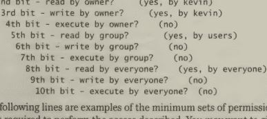

以下行是执行所描述访问所需的最小权限集示例。你可能希望给予比此处列出的更多权限，但以下内容应描述这些文件最小权限的作用：

| 权限 | 描述 |
| :--- | :--- |
| -r----- | 允许所有者读取文件 |
| -w----- | 允许所有者修改或删除文件 |
| | （注意，任何对该文件所在目录具有写权限的人都可以覆盖该文件，从而删除它） |
| --x--- | 所有者可以执行此程序，但不能执行 shell 脚本，后者仍需读权限 |
| -s----- | 以有效用户 ID 设置为所有者执行 |
| -g----- | 以有效组 ID 设置为组执行 |
| -rw---T | 不更新“最后修改时间”。通常用于交换文件 |
| ---t--- | 无影响。（ formerly sticky bit，即曾经的 sticky 位） |

#### 目录示例：

```
drwxr-xr-x 3 kevin users        512 Sep 19 13:47
.public_html/
第 1 位 - 是否为目录？       （是，包含许多文件）
第 2 位 - 所有者是否可读？   （是，kevin 可读）
第 3 位 - 所有者是否可写？  （是，kevin 可写）
第 4 位 - 所有者是否可执行？ （是，kevin 可执行）
第 5 位 - 组是否可读？     （是，users 组可读）
第 6 位 - 组是否可写？    （否）
第 7 位 - 组是否可执行？   （是，users 组可执行）
第 8 位 - 其他人是否可读？  （是，所有人可读）
第 9 位 - 其他人是否可写？  （否）
第 10 位 - 其他人是否可执行？ （是，所有人可执行）
```

以下行是执行所描述访问所需的最小权限集示例。你可能希望给予比此处列出的更多权限，但以下内容应描述这些目录最小权限的作用：

| 权限 | 描述 |
| :--- | :--- |
| dr------- | 可以列出内容，但无法读取文件属性 |
| d-x------ | 可以进入目录，并用于完整的执行路径 |
| dr-x----- | 所有者可以读取文件属性 |
| d-wx----- | 即使该目录不是当前目录，也可以创建/删除文件 |
| d-------x-t | 防止具有写访问权限的其他人删除文件。用于 /tmp |
| d---s-S--- | 无影响 |

系统配置文件（通常位于 `/etc` 中）通常权限为 `640`（`-rw-r-----`），且所有者为 `root`。根据你站点的安全要求，你可以调整此设置。切勿让任何系统文件对组或所有人可写。某些配置文件，包括 `/etc/shadow`，应仅允许 `root` 读取，`/etc` 中的目录至少不应被其他人访问。

### SUID Shell 脚本

SUID shell 脚本是一个严重的安全风险，因此内核不会尊重它们。无论你认为 shell 脚本多么安全，攻击者都可能利用它获得 root shell。

### 使用 Tripwire 进行完整性检查

检测本地（以及网络）攻击的另一种非常有效的方法是运行像 Tripwire 这样的完整性检查器。Tripwire 对所有重要二进制文件和配置文件运行多个校验和，并与以前的已知良好值的数据库进行比对作为参考。因此，任何文件的变化都会被标记出来。

建议将 Tripwire 安装到软盘上，然后物理上设置软盘的写保护。这样入侵者就无法篡改 Tripwire 本身或修改数据库。一旦设置了 Tripwire，建议将其作为正常安全管理职责的一部分定期运行，以检查是否有任何变化。

你甚至可以添加一个 `crontab` 条目，每晚从软盘运行 Tripwire，并在早晨将结果发送邮件给你。例如：

```
####### set mailto
MAILTO=kevin
####### run Tripwire
15 05 * * * root /usr/local/admin/tcheck/tripwire
```

这将在每天早晨 5:15 发送邮件报告给你。

Tripwire 在检测入侵者方面可能是一个福音，能让你在其他情况下未能察觉之前就发现它们。由于平均系统中许多文件会发生变化，你必须小心区分哪些是攻击者活动，哪些是你自己的操作。

你可以在 `http://www.tripwiresecurity.com` 找到 Tripwire，它是免费的。手册和支持服务可以购买。

### 特洛伊木马

“特洛伊木马”得名于荷马《伊利亚特》中著名的计谋。其想法是攻击者分发一个听起来很棒的程序或二进制文件，并鼓励其他人下载并以 root 身份运行。然后，当用户没有注意时，该程序可以破坏他们的系统。虽然他们以为刚下载的二进制文件只做一件事（并且可能确实如此），但它同时也破坏了他们的安全性。

你应该小心你安装在机器上的程序。Red Hat 在其 RPM 文件上提供 MD5 校验和和 PGP 签名，以便你可以验证你安装的是正版。其他发行版有类似的方法。你绝不应该以 root 身份运行任何你不熟悉且没有源码的二进制文件！很少有攻击者愿意公开源码以供公众审查。

虽然这可能很复杂，但请确保你从程序的真正发行站点获取源码。如果该程序将作为 root 运行，请确保你或你信任的人已经审查并验证了源码。

### 密码安全与加密


今天使用的最重要安全特性之一就是密码。对于你和所有用户来说，拥有安全、难以猜测的密码非常重要。大多数较新的 Linux 发行版包含 `passwd` 程序，这些程序不允许你设置容易猜测的密码。确保你的 `passwd` 程序是最新的，并具备这些特性。

关于加密的深入讨论超出了本文档的范围，但介绍是合适的。加密非常有用，在这个时代甚至可能是必要的。有各种加密数据的方法，每种方法都有其独特的特性。

大多数 Unix 版本（Linux 也不例外）主要使用一种称为 DES（数据加密标准）的单向加密算法来加密你的密码。该加密后的密码通常存储在（通常）`/etc/passwd`（或较少见的）`/etc/shadow` 中。当你尝试登录时，你输入的密码会被再次加密，并与存储你密码的文件中的条目进行比较。如果匹配，则必须是相同的密码，并允许你访问。虽然 DES 是一种双向加密算法（给定正确的密钥，你可以编码然后解码信息），但 Unix 版本使用的变体是单向的。这意味着应该不可能通过逆转加密从 `/etc/passwd`（或 `/etc/shadow`）的内容中获得密码。

暴力攻击，如 Crack 或 John the Ripper，除非你的密码具有足够的随机性（参见“Crack 和 John the Ripper”部分），否则通常可以猜测密码。PAM 模块（见下文）允许你对密码使用不同的加密例程（MD5 或类似物）。你也可以利用 Crack。考虑定期对你的密码数据库运行 Crack，以查找不安全的密码。然后联系违规用户，并指示他更改密码。

你可以访问 `http://consult.cern.ch/writewrite/security/security_3.html` 获取关于如何选择好密码的信息。

## PGP 和公钥密码学

公钥密码学，如 PGP 所使用的，使用一个密钥进行加密，另一个密钥进行解密。然而，传统密码学使用相同的密钥进行加密和解密；该密钥必须为双方所知，并以某种方式安全地从一方转移到另一方。

为了减轻安全传输加密密钥的需求，公钥加密使用两个独立的密钥：公钥和私钥。每个人的公钥对任何人都可用以进行加密，同时每个人保留自己的私钥以解密使用正确公钥加密的消息。

公钥和私钥密码学都有优点，你可以在 RSA 密码学常见问题解答（参见 `http://www.rsa.com/rsalabs/newfaq/`）中阅读这些差异。

PGP（Pretty Good Privacy）在 Linux 上得到良好支持。2.6.2 和 5 版本已知工作良好。关于 PGP 及其使用方法的优秀入门指南，请参阅 PGP 常见问题解答（`http://www.pgp.com/service/export/faq/55faq.cgi`）。

请务必使用适用于你所在国家的版本。由于美国政府出口限制，强加密禁止以电子形式传输到国外。

美国出口管制现由 EAR（出口管理条例）管理。它们不再受 ITAR 管辖。

还有一个逐步指南介绍如何在 Linux 上配置 PGP，可在 `http://mercury.chem.pitt.edu/~angel/LinuxFocus/English/November1997/article1.html` 找到。它是为 PGP 国际版编写的，但很容易适应美国版本

版本。对于某些最新的 Linux 版本，你可能还需要一个补丁；该补丁可在 `ftp://metalab.unc.edu/pub/Linux/apps/crypto` 获取。

有一个项目正在致力于 PGP 的开源免费重新实现。GnuPG 是 PGP 的完整且免费的替代品。由于它不使用 IDEA 或 RSA，因此可以在任何限制下使用。GnuPG 几乎符合 RFC2440（OpenPGP）。请参阅 GNU Privacy Guard 网页以获取更多信息（`http://www.gpg.org/`）。

关于密码学的更多信息可以在 `RSA 密码学 FAQ` 中找到，该 FAQ 可在 `http://www.rsa.com/rsalabs/newfaq/` 获取。在这里，你可以找到关于 `Diffie-Hellman`、`公钥密码学`、`数字证书` 等术语的信息。

## SSL、S-HTTP、HTTPS 和 S/MIME

用户经常询问各种安全性和加密协议之间的区别，以及如何使用它们。虽然这不是一个加密文档，但简要解释每个协议是什么以及如何找到更多信息是个好主意。

`SSL` `SSL`，或安全套接字层，是由 Netscape 开发的一种加密方法，旨在通过互联网提供安全性。它支持多种不同的加密协议，并提供客户端和服务器身份验证。SSL 在传输层运行，创建一个安全的加密数据通道，因此可以无缝加密多种类型的数据。这最常见于使用 Communicator 访问安全站点以查看安全在线文档时，并且作为 Communicator 以及许多其他 Netscape Communications 数据加密的安全通信基础。更多信息可在 `http://www.consensus.com/SSL-talk-faq.html` 找到。关于 Netscape 的其他安全实现的信息，以及这些协议的良好起点可在 `http://home.netscape.com/info/security-doc.html` 获取。

`S-HTTP` `S-HTTP` 是另一种在互联网上提供安全服务的协议。它旨在支持多方参与的每次交易通过选项协商支持多种密钥管理机制和加密算法，同时提供机密性、身份验证、完整性和不可否认性（不能被误认为是他人）。`S-HTTP` 仅限于实现它的特定软件，并对每个消息单独进行加密（引自 RSA 密码学 FAQ，第 138 页）。

`S/MIME` `S/MIME`，或安全多用途 Internet 邮件扩展，是一种用于加密电子邮件和其他类型 Internet 消息的加密标准。它是 RSA 开发的一个开放标准，因此我们可能很快会在 Linux 上看到它。关于 `S/MIME` 的更多信息可在 http://home.netscape.com/assist/security/smime/overview.html 找到。

## Linux IPSEC 实现

除了 CIPE 和其他形式的数据加密外，还有几种其他适用于 Linux 的 IPSEC 实现。IPSEC 是 IETF 的一项工作，旨在在 IP 网络层面创建加密安全的通信，并提供身份验证、完整性、访问控制和机密性。关于 IPSEC 和 Internet 草案的信息可在 http://www.ietf.org/html.charters/ipsec-charter.html 找到。你还可以找到涉及密钥管理的其他协议的链接，以及 IPSEC 邮件列表和存档。

亚利桑那大学正在开发的 x-kernel Linux 实现，使用一种称为 x-kernel 的基于对象的框架来实现网络协议，可在 http://www.cs.arizona.edu/xkernel/pcp-c-blue/linux.html 找到。最简单地说，x-kernel 是一种在内核级别传递消息的方法，这使得实现更加容易。

另一种可自由获得的 IPSEC 实现是 Linux FreeS/WAN IPSEC。他们的网页声明：

> 这些服务允许你通过不受信任的网络构建安全隧道。所有通过不受信任网络传输的数据都由 IPSEC 网关机器加密，并在另一端的网关处解密。结果是虚拟专用网络或 VPN。这是一个实际上私有的网络，即使它包含通过不安全的 Internet 连接的多个不同地点的机器。

它可以从 http://www.xs4all.nl/~freecswan/ 下载，截至本文撰写时，它刚刚达到 1.0 版本。

与其他形式的密码学一样，由于出口限制，默认情况下不随内核分发。

## ssh（安全 Shell）和 stelnet

`ssh` 和 `stelnet` 是允许你登录远程系统并拥有加密连接的程序。

`ssh` 是一组用作 login、rsh 和 rcp 的安全替代品的程序。它使用公钥密码学来加密两个主机之间的通信，并对用户进行身份验证。它可以用于安全地登录到远程主机或在主机之间复制数据，同时防止中间人攻击（会话劫持）和 DNS 欺骗。它会对你的连接执行数据压缩，并安全地处理主机之间的 X11 通信。`ssh` 主页可在 http://www.cs.hut.fi/ssh/ 找到。

你还可以从你的 Windows 工作站使用 `ssh` 连接到你的 Linux `ssh` 服务器。有几种可自由获得的 Windows 客户端实现，包括位于 http://guardian.htu.twu.ien.ac.at/therapy/ssh/ 的那个，以及 DataFellows 的商业实现，位于 http://www.datafellows.com。还有一个名为 `pst` 的开源项目重新实现了 `ssh`... 更多信息请参阅 http://www.net.tut.ac.uk/pst/。

SSLey 是 Netscape 安全套接字层协议的免费实现，由 Eric Young 开发。它包括几个应用程序，如安全 telnet、Apache 模块、几个数据库，以及包括 DES、IDEA 和 Blowfish 在内的几种算法。


使用这个库，创建了一个通过 telnet 连接进行加密的安全 telnet 替代品。与 `ssh` 不同，`stelnet` 使用 SSL，即由 Netscape 开发的安全套接字层协议。你可以从 SSLey FAQ 开始查找安全 telnet 和安全 ftp，该 FAQ 可在 `http://www.csu.ug.oz.au/~ftp/Crypto/` 获取。

`SRP` 是另一种安全 telnet/ftp 实现。以下段落摘自他们的网页：

> `SRP` 项目正在开发免费的全球安全 Internet 软件。从完全安全的 Telnet 和 ftp 分发开始，我们希望用不牺牲易用性的强大替代品支持弱网络认证系统。安全应该是默认设置，而不是选项！

更多信息，请访问 `http://srp.stanford.edu/srp`。

### PAM—可插入身份验证模块

较新版本的 Red Hat Linux 发行版附带一种称为 `PAM` 的统一身份验证方案。`PAM` 允许你随时更改你的身份验证方法和要求，并在不重新编译任何二进制文件的情况下封装所有本地身份验证方法。`PAM` 的配置超出了本文档的范围，但请务必查看 `PAM` 网站以获取更多信息（`http://www.kernel.org/pub/linux/libs/pam/index.html`）。

使用 `PAM` 你可以做的几件事包括：

- 对密码使用 `DES` 以外的加密（使暴力破解解码更困难）。
- 为所有用户设置资源限制，使他们无法执行拒绝服务攻击（进程数量、内存量等）。
- 随时启用影子密码（见下文）。
- 允许特定用户仅在特定时间从特定地点登录。

在几小时内安装和配置系统后，你可以在许多攻击发生之前阻止它们。例如，使用 `PAM` 通过在 `/etc/pam.d/rlogin` 中添加以下行来禁用用户主目录中 `.rhosts` 文件的系统范围使用：

```
####### Disable rsh/rlogin/rexec for users
#
login auth required pam_rhosts_auth.so no_.rhosts
```

### 加密 IP 封装（CIGE）

该软件的主要目标是为跨不安全分组网络（如 Internet）的安全子网互连提供机制（防窃听，包括流量分析和伪造消息注入）。

`CIGE` 在网络层加密数据。在网络上的主机之间传输的数据包被加密。加密引擎放置在发送和接收数据包的驱动程序附近。

这与 `ssh` 不同，`ssh` 在套接字层按连接加密数据。在不同主机上运行的程序之间的逻辑连接被加密。


`CIPE` 可用于隧道技术，以创建虚拟专用网络（VPN）。低层加密的优势在于，它可以在通过 VPN 连接的两个网络之间透明地工作，而无需对应用软件进行任何更改。

摘自 `CIPE` 文档的摘要：

> `IPSEC` 标准定义了一组协议，这些协议（除其他用途外）可用于构建加密的 VPN。然而，`IPSEC` 是一个相当沉重且复杂的协议集，拥有众多选项，完整协议集的实现仍然很少被使用，并且一些问题（例如密钥管理）仍未得到完全解决。`CIPE` 采用了一种更简单的方法，其中许多可参数化的事项（例如实际使用的加密算法的选择）在安装时是固定的。这限制了灵活性，但允许实现简单（因此高效且易于调试）。

更多信息可参见 `http://www.inka.de/~bigred/devel/cipe.html`。

与其他形式的密码学一样，由于出口限制，默认情况下不随内核分发。

### Kerberos

`Kerberos` 是由 MIT 雅典娜项目开发的身份验证系统。当用户登录时，`Kerberos` 验证该用户（使用密码），并向用户提供一种方法，以证明其身份给散布在网络中的其他服务器和主机。

随后，像 `rlogin` 这样的程序使用此身份验证，允许用户在登录到其他主机时无需输入密码（替代 `.rhosts` 文件）。这种身份验证方法也可由邮件系统使用，以确保邮件交付给正确的人，并保证发件人是其声称的身份。

`Kerberos` 及其随附的其他程序可防止用户让系统“伪装”相信他们是另一个人。不幸的是，安装 `Kerberos` 侵入性极强，需要修改或替换许多标准程序。

您可以通过查看 `Kerberos` FAQ（`http://www.cis.ohio-state.edu/hypertext/faq/usenet/kerberos-faq/general/faq.html`）来获取更多关于 `Kerberos` 的信息，代码可在 `http://nii.isi.edu/info/kerberos` 找到。

来源：Stein, Jennifer G., Clifford Neuman, 和 Jeffrey L. Schiller. “Kerberos: An Authentication Service for Open Network Systems.” USENIX 会议论文集，德克萨斯州达拉斯，1998 年冬季。

`Kerberos` 不应是您提高主机安全性的第一步。它相当复杂，并且不像 `ssh` 那样被广泛使用。

### 影子密码（Shadow Passwords）

影子密码是一种保护您的加密密码信息不被普通用户获取的手段。通常，这些加密密码存储在 `/etc/passwd` 文件中，供所有人读取。任何人都可以运行密码猜测程序来尝试确定它们的值。相比之下，影子密码保存在 `/etc/Shadow` 中，只有特权用户可以读取。为了使用影子密码，您需要确保所有需要访问密码信息的实用工具都重新编译以支持它们。`PAM`（上文提到）也允许您直接插入影子模块；它不需要重新编译可执行文件。如有必要，您可以参考 Shadow-Password HOWTO 获取更多信息。它位于 `http://metalab.unc.edu/LDP/HOWTO/Shadow-Password-HOWTO.html`。现在它已经相当过时，且对于支持 `PAM` 的发行版来说并非必需。

### Crack 和 John the Ripper

如果由于某种原因您的 `passwd` 程序没有强制执行难以猜测的密码，您可能希望运行密码破解程序，以确保用户的密码是安全的。

密码破解程序基于一个简单的原理：它们尝试字典中的每个单词，以及这些单词的变体，对每个进行加密并与您的加密密码进行检查。如果匹配成功，它们就知道您的密码是什么。

市面上有许多此类程序——其中最著名的是 `Crack` 和 `John the Ripper`（`http://www.false.com/security/jown/index.html`）。它们会占用大量您的 CPU 时间，但通过先自行运行并通知拥有弱密码的用户，您应该能够判断攻击者是否可以使用这些程序入侵。请注意，攻击者首先需要利用其他漏洞才能读取您的 `/etc/passwd` 文件，但这种漏洞比您想象的更常见。

因为安全性仅取决于最不安全的主机，所以值得一提的是，如果您的网络上有任何 Windows 机器，您应该查看 *L0ph4Crack*，这是 Windows 版本的 `Crack` 实现。它可从 `http://www.10pt.com` 获取。

### CFS—密码文件系统 和 TCFS—透明密码文件系统

`CFS` 是一种加密整个目录树并允许用户在其上存储加密文件的方法。它使用在本地机器上运行的 `NFS` 服务器。`RPM` 包可在 `http://www.replay.com/redhat/` 找到，关于其工作原理的更多信息在 `ftp://ftp.research.att.com/dist/mab/`。

`TCFS` 通过增加与文件系统的集成度来改进 `CFS`，使用户能够透明地感知文件系统被加密。更多信息可参见 `http://edu-gw.dia.unisa.it/tcfs/`。

它也不必应用于整个文件系统。它同样适用于目录树。

### X11、SVGA 和显示安全

以下三个部分讨论视频安全的组成部分。

#### X11


保护您的图形显示器以防止攻击者获取您输入的密码、读取您屏幕上的文档或信息，甚至利用漏洞获取 root 访问权限，这一点至关重要。通过网络运行远程 X 应用也可能充满危险，允许窃听者查看您与远程系统的所有交互。

# X 访问控制

X 具有多种访问控制机制。最简单的是基于主机的：您使用 `xhost` 来指定哪些主机可以访问您的显示器。这安全性极低，因为如果有人可以访问您的机器，他们可以使用 `xhost + their machine` 轻松进入。

此外，如果您必须允许来自不可信机器的访问，那里任何人都可以破坏您的显示器。

使用 `xdm` 登录时，您会得到一种更好的访问方法：MIT-MAGIC-COOKIE-1。会生成一个 128 位的 cookie 并存储在您的 `.Xauthority` 文件中。如果您需要允许远程机器访问您的显示器，您可以使用 `xauth` 命令和 `.Xauthority` 文件中的信息来仅为该连接提供访问权限。请参阅 Remote-X-Apps 小型 HOWTO，位于 [http://metalab.unc.edu/LDP/HOWTO/mini/Remote-X-Apps.html](http://metalab.unc.edu/LDP/HOWTO/mini/Remote-X-Apps.html)。

您还可以使用 `ssh` 来允许安全的 X 连接。其优势在于对最终用户也是透明的，并且意味着没有未加密的数据在网络上传输（参见章节“ssh [Secure Shell] and stlnter”）。

请参阅 Xsecurity 手册页以获取更多关于 X 安全的信息。稳妥的做法是使用 `xdm` 登录到控制台，然后使用 `ssh` 连接到您希望运行 X 程序的远程站点。

## SVGA

SVGAlib 程序通常是 SUID-root，以便访问您 Linux 机器的所有视频硬件。这使得它们非常危险。如果它们崩溃，您通常需要重新启动机器才能恢复可用的控制台。确保您运行的任何 SVGA 程序都是真实的，并且至少可以在某种程度上被信任。更好一点，根本不要运行它们。

## GGI（通用图形接口项目）

Linux GGI 项目试图解决 Linux 视频接口的几个问题。GGI 将把一小部分视频代码移入 Linux 内核，然后控制对视频系统的访问。这意味着 GGI 将能够随时将您的控制台恢复到已知良好的状态。它们还将允许使用安全注意键，因此您可以确定没有木马登录程序在您的控制台上运行（参见 [http://synergy.caltech.edu/~ggi/](http://synergy.caltech.edu/~ggi/)）。

# 内核安全

这是对与安全性相关的内核配置选项的描述，以及解释它们的作用和使用方法。

由于内核控制着你的计算机网络，因此它必须非常安全，绝不能被攻破。为了防止一些最新的网络攻击，你应该尽量保持内核版本为最新。你可以在 `tftp://ftp.kernel.org` 或你的发行版供应商处获取新的内核。

还有一个国际团体为主流 Linux 内核提供单一的加密补丁。该补丁为许多无法因出口限制而包含在主内核中的加密子系统及其他功能提供支持。更多信息请访问其 Web 页面（http://www.kernel1.org）。

## 2.0.x 内核编译选项

对于 2.0.x 内核，以下选项适用。你应该在内核配置过程中看到这些选项。这里的许多注释来自 `./linux/Documentation/Configure.help`，这正是在内核编译过程中使用 `make config` 阶段的帮助功能时参考的同一份文档。

- **网络防火墙** (`CONFIG_FIREWALL`)

  如果你打算在你的 Linux 机器上运行任何防火墙或伪装功能，此选项应该开启。如果它只是一个普通的客户机，则可以放心地说“否”。

- **IP：转发/网关** (`CONFIG_IP_FORWARD`)

  如果你启用 IP 转发，你的 Linux 机器本质上就变成了路由器。如果你的机器在一个网络上，你可能会将数据从一个网络转发到另一个网络，从而可能破坏原本用于阻止此行为的防火墙。普通的拨号用户希望禁用此功能，其他用户应关注这样做的安全影响。防火墙机器需要启用此功能，并与防火墙软件配合使用。

  你可以使用以下命令动态启用 IP 转发：

  ```
  root# echo 1 > /proc/sys/net/ipv4/ip_forward
  ```

  并使用以下命令禁用它

  ```
  root# echo 0 > /proc/sys/net/ipv4/ip_forward
  ```

  请注意，这些文件及其大小并不代表它们的实际大小，尽管它们可能表现为零长度，但实际上可能并非如此。

- **IP：SYN 饼干** (`CONFIG_SYN_COOKIES`)

  SYN 攻击是一种拒绝服务（DoS）攻击，它会耗尽你机器上的所有资源，迫使你重启。我们想不出通常不启用此功能的理由。在 2.1 内核系列中，此配置选项仅允许使用 SYN 饼干，但并未启用它们。要启用它们，你必须执行

  ```
  root# echo 1 > /proc/sys/net/ipv4/tcp_syncookies
  ```

- **IP：防火墙** (`CONFIG_IP_FIREWALL`)

  如果你打算将机器配置为防火墙，执行伪装，或者希望保护你的拨号工作站免受通过你的 PPP 拨号接口进入的人的攻击，此选项是必要的。

- **IP：防火墙数据包记录** (`CONFIG_IP_FIREWALL_VERBOSE`)

  此选项提供有关你防火墙接收到的数据包的信息，如发送者、接收者、端口等。

- **IP：丢弃源路由帧** (`CONFIG_IP_NOSIR`)

  应启用此选项。源路由帧在其数据包内部包含到达目的地的完整路径。这意味着数据包经过的路由器无需检查它，只需将其转发。这可能导致进入你系统的数据成为潜在的安全漏洞。

- **IP：伪装** (`CONFIG_IP_MASQUERADE`)

  如果你的局域网中有一台电脑，你的 Linux 机器充当其防火墙，并且它想要向外部发送某些内容，你的机器可以“伪装”成该主机，即它将流量转发到预期目的地，但让它看起来像是来自防火墙机器本身。更多详情请参阅 http://www.indyramp.com/masq。

- **IP：ICMP 伪装** (`CONFIG_IP_MASQUERADE_ICMP`)

  此选项在仅对 TCP 或 UDP 流量进行伪装的前述选项基础上增加了 ICMP 伪装。

- **IP：透明代理支持** (`CONFIG_IP_TRANSPARENT_PROXY`)

  这使得你的 Linux 防火墙能够透明地将来自本地网络并 destined for 远程主机的任何网络流量重定向到本地服务器，称为“透明代理服务器”。这使得本地计算机以为它们在与此远程端通信，而实际上它们连接的是本地代理。有关 IP-Masquerading HOWTO 和更多详细信息请参阅 http://www.indyramp.com/masq。

- **IP：始终进行重组** (`CONFIG_IP_ALWAYS_DEFRAG`)

  通常此选项是禁用的，但如果你正在构建防火墙或伪装主机，则需要启用它。当数据从一个主机发送到另一个主机时，它并不总是作为单个数据包发送，而是被分片为几个片段。问题在于，端口号仅存储在第一片段中。这意味着有人可以将不该出现在那里的信息插入到剩余的数据包中。这也可以防止针对尚未自身打补丁的内部主机的泪滴攻击。

- **数据包签名** (`CONFIG_NCPFS_PACKET_SIGNING`)

  这是在 2.1 内核系列中可用的选项，可以为 NCP 数据包进行签名以增强安全性。通常你可以保持关闭状态，但如果你需要，它在那里。

- **IP：防火墙数据包 netlink 设备** (`CONFIG_IP_FIREWALL_NETLINK`)

  这是一个非常棒的选项，允许你在用户空间程序中分析数据包的前 128 字节，以根据数据包的有效性决定是接受还是拒绝该数据包。

## 2.2 内核编译选项

对于 2.2.x 内核，许多选项相同，但开发了一些新的选项。这里的许多注释来自 `./linux/Documentation/Configure.help`，这正是在内核编译过程中使用 `make config` 阶段的帮助功能时参考的同一份文档。下面仅列出了新增加的选项。有关其他必要选项的列表，请查阅 2.0 的描述。2.2 内核系列中最重大的变化是 IP 防火墙代码。现在使用 `ipchains` 程序安装 IP 防火墙，而不是在 2.0 内核中使用的 `ipfwadm` 程序。

- **套接字过滤** (`CONFIG_FILTER`)

  对大多数人来说，对此选项说“否”是安全的。此选项允许你将一个用户空间过滤器连接到任何套接字，并决定数据包是否应被允许或拒绝。除非你有非常具体的需求并且有能力编程此类过滤器，否则应该选择“否”。此外请注意，截至本文撰写时，除了 TCP 之外，所有协议均受支持。

## 端口转发


# 端口转发

端口转发是 IP 伪装的一个补充功能，允许在某些端口上将数据包从外部转发到防火墙内部。这可能很有用，例如，如果你想在防火墙或伪装主机后面运行 Web 服务器，并且希望该 Web 服务器可以从外部世界访问。外部客户端向防火墙的 80 端口发送请求。防火墙将此请求转发到 Web 服务器，Web 服务器处理请求，结果通过防火墙发送回原始客户端。客户端认为防火墙机器本身正在运行 Web 服务器。如果你有一组相同的 Web 服务器位于防火墙后面，这也可以用于负载均衡。有关此功能的更多信息请参阅 `http://www.mommouth.demon.co.uk/ipsubs/portforwarding.html`。有关一般信息，请参阅 `ftp://ftp.comsoc.net/users/steve/ipportfw/linux21`。

### 套接字过滤（CONFIG_FILTER）

使用此选项，用户空间程序可以附加过滤器到任何套接字，从而告知内核它应允许或禁止某些类型的数据通过该套接字。目前，Linux 套接字过滤适用于除 TCP 以外的所有套接字类型。更多详情请参阅文本文件 `./Linux/Documentation/networking/filter.txt`。

### IP：伪装

2.2 内核的伪装功能已得到改进。它为伪装特殊协议等提供了额外支持。请务必阅读 IP Chains HOWTO 以获取更多信息。

### 内核设备

Linux 上有一些块设备和字符设备也可以帮助你的安全。

两个设备 `/dev/random` 和 `/dev/urandom` 由内核提供，以随时提供随机数据。

`/dev/random` 和 `/dev/urandom` 都足够安全，可用于生成 PGP 密钥、`ssh` 挑战及其他需要安全随机数的应用程序。攻击者应无法根据来自的任何初始数字序列预测下一个数字

这些来源。为确保从这些来源获取的数字在某种意义上都是随机的，人们付出了大量努力。

唯一的区别在于 `/dev/random` 的随机字节会耗尽，并且它会让你等待直到积累更多。请注意，在某些系统上，它可能会阻塞很长时间，等待新的用户输入被添加到系统中。因此，在使用 `/dev/random` 之前必须谨慎。（也许最好的做法是在生成敏感密钥信息时使用它，并告诉用户反复敲击键盘，直到打印出“OK, enough”为止。）

`/dev/random` 是高质量熵源，通过测量中断间隔时间等生成。它阻塞直到有足够的随机数据位可用。

`/dev/urandom` 与之类似，但当熵存储即将耗尽时，它将返回现有数据的强加密哈希值。虽然安全性略低，但对大多数应用程序来说已经足够。

你可以使用类似以下内容从设备中读取：

```
root# head -c 6 /dev/urandom | mencode
```

这将在控制台上打印六个随机字符，适用于密码生成。你可以在 mail 包中找到 `mencode`。

有关算法的说明，请参见 `/usr/src/linux/drivers/char/random.c`。

感谢 Theodore Y. Ts'o、Jon Lewis 以及 Linux-kernel 团队的其他成员帮助我（Dave）完成这项工作。

### 网络安全

随着人们花费越来越多的时间保持连接，网络安全变得越来越重要。破坏网络安全通常比破坏物理或本地安全更容易，且更为普遍。

有许多优秀的工具可以协助网络安全，并且越来越多的 Linux 发行版都附带了这些工具。

#### 数据包嗅探器

入侵者获取你网络上更多系统访问权限的最常见方式之一，是在已被攻陷的主机上部署数据包嗅探器。这个 `嗅探器` 只是在以太网端口上监听数据包流中的 `passwd`、`login` 和 `su` 等内容，随后记录流量。这样，攻击者就能获取他们甚至并未试图入侵的系统的密码。明文密码极易受到这种攻击。

示例：主机 A 已被攻陷。攻击者安装了一个嗅探器。嗅探器捕获到管理员从主机 C 登录主机 B 的行为。它在管理员登录 B 时获取了管理员的个人密码。然后，管理员执行 `su` 以修复某个问题。现在攻击者拥有了主机 B 的 root 密码。稍后，管理员允许某人从其账户 telnet 到另一站点的主机 Z。现在攻击者拥有主机 Z 的密码/登录信息。

在当今时代，攻击者甚至不需要攻陷任何系统就能做到这一点；他们也可以将笔记本电脑或 PC 带入大楼并接入你的网络。

使用 `ssh` 或其他加密密码方法可以防止这种攻击。像 APOP 这样的 POP 账户机制也能防止此攻击。（普通的 POP 登录极易受到此攻击，任何通过网络发送明文密码的行为都是如此。）

#### 系统服务和 tcpwrappers

在将 Linux 系统连接到任何网络之前，首先要查看的是你需要提供哪些服务。不需要提供的服务应予以禁用，这样你少了一件担心的事，攻击者少了一个寻找漏洞的地方。

在 Linux 下有几种禁用服务的方法。你可以查看 `/etc/inetd.conf` 文件，看看你的 `inetd` 提供了哪些服务。通过注释掉（在行首加 #）来禁用那些不需要的服务，然后向你的 `inetd` 进程发送 SIGHUP 信号。

你还可以移除（或注释掉） `/etc/services` 文件中的服务。这意味着本地客户端也将无法找到该服务（即，如果你移除 ftp，并尝试从该机器 ftp 到远程站点，它将因“未知服务”而失败）。移除服务通常不值得麻烦，因为它不提供额外的安全性。如果本地人员希望使用 ftp，即使你将其注释掉了，他们也会制作一个使用常见 ftp 端口的自己的客户端，它仍然会正常工作。

你可能希望保留启用的某些服务包括：

- ftp
- telnet（或 ssh）
- mail，如 pop-3 或 imap
- identd

如果你确定不使用某些特定软件包，也可以完全删除它。在 Red Hat 发行版下，`rpm -e packagename` 将删除整个软件包。在 Debian 下，`dpkg --Remove` 执行相同操作。

此外，你确实希望禁用 rsh/rlogin/rcp 实用程序，包括从 `/etc/inetd.conf` 中启动的登录（由 rlogin 使用）、shell（由 rcp 使用）和 exec（由 rsh 使用）。这些协议极不安全，过去曾导致过漏洞利用。

你应该检查 `/etc/rc.d`（其中 N 是你系统的运行级别），看看该目录中启动的任何服务器是否不需要。`/etc/rc.d/rcN.d` 中的文件实际上是指向 `/etc/rc.d/init.d` 目录的符号链接。重命名 init.d 目录中的文件具有禁用 `/etc/rc.d/rcN.d` 中所有符号链接的效果。如果你只想在特定的运行级别禁用服务，将相应文件中的大写 S 替换为小写 s，如下所示：

```
root# cd /etc/rc6.d
root# mv S45dhcpd s45dhcpd
```

如果你有 BSD 风格的 rc 文件，你需要检查 `/etc/rc*` 中你不需要的程序。

大多数 Linux 发行版附带使用 tcpwrappers “包装” 所有 TCP 服务。`tcpwrapper` (`tcpd`) 由 `inetd` 调用，而不是真正的服务器。`tcpd` 然后检查请求服务的客户端主机，要么执行真正的服务器，要么拒绝该主机的访问。`tcpd` 允许你限制对 TCP 服务的访问。你应该创建一个 `/etc/hosts.allow`，并只添加那些需要访问你机器服务的主机。

如果你是一个家庭拨号用户，我们建议你拒绝所有访问。`tcpd` 还会记录访问服务的失败尝试，因此如果你正在遭受攻击，它会向你发出警报。如果你添加了新服务，请确保如果它们是基于 TCP 的，要配置它们使用 tcpwrappers。例如，普通的拨号用户可以防止外部人员连接到他的机器，同时仍具有检索邮件和建立互联网网络连接的能力。为此，你可能会在 `/etc/hosts.allow` 中添加以下内容：

`ALL: 127.`

当然，`/etc/hosts.deny` 将包含

`ALL: ALL`

这将阻止外部连接到你的机器，但仍允许你从内部连接互联网上的服务器。

请记住，`tcpwrappers` 仅保护由 `inetd` 执行的服务以及少数其他服务。你的机器上很可能正在运行其他服务。你可以使用 `netstat -ta` 查找你机器提供的所有服务列表。

### 验证你的 DNS 信息

保持网络上所有主机最新的 DNS 信息有助于提高安全性。如果未经授权的连接到你的网络，你可以通过其缺乏 DNS 条目来识别它。许多服务可以配置为不接受来自没有有效 DNS 条目的主机的连接。

### identd

`identd` 是一个通常从你的 `inetd` 服务器运行的小型程序。它跟踪哪个用户正在运行哪个 TCP 服务，并向请求者报告此信息。

许多人误解了 `identd` 的有用性，因此禁用了它或阻止了所有外部请求。`identd` 并不是为了帮助远程站点而存在的。没有办法知道你从远程 `identd` 获得的数据是否正确。`identd` 请求没有身份验证。


那你为什么要运行它？因为它对你有帮助，并且是跟踪过程中的另一个数据点。如果 `identd` 未被攻陷，那么你知道它在向远程站点告知使用 TCP 服务的用户名或 `uid`。如果远程站点的管理员回来告诉你某个用户在试图入侵他们的站点，你可以轻松地对那个用户采取措施。如果你没有运行 `identd`，你将不得不查看大量的日志，确定当时谁在线，并总体上花更多时间来追踪该用户。

## SATAN、ISS 及其他网络扫描器

大多数发行版附带的 `identd` 比许多人想象的要更具可配置性。你可以为特定用户禁用它（他们可以通过创建 `.no_ident` 文件来实现），你可以记录所有 `identd` 请求（我们建议这样做），你甚至可以让 `identd` 返回一个 `uid` 而不是用户名，或者返回 NO-USER。

市面上有很多不同的软件包用于对机器或网络进行基于端口和服务的扫描。`SATAN`、`ISS`、`SAINT` 和 `Nessus` 是其中一些较知名的工具。这些软件会连接目标机器（或网络中所有目标机器）上所有可连接的端口，并尝试确定正在运行的服务是什么。基于这些信息，你可以判断该机器是否容易受到特定漏洞利用的攻击。

`SATAN`（Security Administrator’s Tool for Analyzing Networks，安全管理员网络分析工具）是一个带有 Web 接口的端口扫描器。它可以配置为对机器或机器网络进行轻度、中度或强力的检查。获取 `SATAN` 并扫描你的机器或网络，然后修复其发现的问题是个好主意。确保你从 `metalab`（`http://metalab.unc.edu/pub/packages/security/Satan-for-Linux/`）或信誉良好的 ftp 或网站获取 `SATAN` 的副本。网络中曾流传过一个 `SATAN` 的木马副本（`http://www.trouble.org/zen/satan/satan.html`）。请注意，`SATAN` 已经很久没有更新了，下面列出的一些其他工具可能表现更好。

`ISS`（Internet Security Scanner，互联网安全扫描器）是另一个基于端口的扫描器。它比 `SATAN` 更快，因此可能更适合大型网络。然而，`SATAN` 往往能提供更多信息。

`Abacus` 是一套提供基于主机的安全性和入侵检测的工具。请在网络上查看其主页以获取更多信息（`http://www.psionic.com/abacus/`）。

`SAINT` 是 `SATAN` 的更新版本。它基于 Web，比 `SATAN` 拥有更多最新的测试项。你可以在以下地址了解更多：`http://www.wvdsi.com/saint`。

`Nessus` 是一个免费的安全扫描器。它具有 GTK 图形界面，易于使用。它还设计了非常好的插件机制，用于新的端口扫描测试。欲了解更多信息，请访问 `http://www.nessus.org`。

## 检测端口扫描

有一些工具专门设计用于提醒你注意来自 `SATAN`、`ISS` 及其他扫描软件的探测。然而，如果你大量使用 `tcpwrappers`，并确保定期查看日志文件，你就应该能够注意到此类探测。即使在最低设置下，`SATAN` 在标准的 Red Hat 系统日志中仍会留下痕迹。

还有*隐身*端口扫描器。设置了 TCP ACK 位的数据包（如在已建立的连接中那样处理）很可能通过包过滤防火墙。从*没有已建立会话*的端口返回的 RST 数据包可以被视为该端口存活证明。我认为 `tcpwrappers` 无法检测到此情况。

## sendmail、qmail 和 MTA

你可以提供的最重要的服务之一是邮件服务器。不幸的是，由于它必须执行的任务数量及其通常所需的权限，它也是最容易遭受攻击的服务之一。

如果你正在使用 `sendmail`，紧跟当前版本非常重要。`sendmail` 拥有很长很长的安全漏洞历史。请务必确保你正在运行来自 `http://www.sendmail.org` 的最新版本。

请记住，即使 `sendmail` 没有运行，你也可以发送邮件。如果你是家庭用户，可以完全禁用 `sendmail`，简单地使用邮件客户端发送邮件。你也可以选择从 `sendmail` 启动文件中移除 `-bd` 标志，从而禁用传入的邮件请求。换句话说，你可以在启动脚本中使用以下内容来执行 `sendmail`：

```
####### /usr/lib/sendmail -q15m
```

这将使 `sendmail` 每 15 分钟刷新一次邮件队列，以处理首次尝试未能成功投递的任何消息。

许多管理员选择不使用 `sendmail`，而是选择其他邮件传输代理（MTA）之一。你可以考虑切换到 `qmail`。`qmail` 从设计之初就考虑了安全性。它快速、稳定且安全。可以在 `http://www.qmail.org` 找到 `qmail`。

与 `qmail` 直接竞争的是 `postfix`，由 Wietse Venema 编写，他同时也是 `tcpwrappers` 和其他安全工具的作者。它以前称为 `vmailer`，并由 IBM 赞助，这也是一个从设计之初就考虑安全性的邮件传输代理。你可以在 `http://www.postfix.org` 找到更多关于 `vmailer` 的信息。

## 拒绝服务攻击

“拒绝服务”（DoS）攻击是指攻击者试图使某些资源忙于无法响应合法请求，或拒绝合法用户访问你的机器。

近年来，拒绝服务攻击大大增加。以下是一些较流行且较新的攻击示例。请注意，新的攻击类型层出不穷，因此这仅是几个例子。阅读 Linux 安全列表和 *bugtraq* 列表及其归档以获取更及时的信息。

- SYN 洪水：SYN 洪水是一种网络拒绝服务攻击。它利用了 TCP 连接创建过程中存在的一个漏洞。较新的 Linux 内核（2.0.50 及更高版本）具有几个可配置选项，以防止 SYN 洪水攻击阻止人们访问你的机器或服务。请参见“内核安全”部分以了解正确的内核保护选项。

- Pentium “FOOF” 漏洞：最近发现，向真正的 Intel Pentium 处理器发送一系列汇编代码会导致机器重启。这影响所有装有 Pentium 处理器（非克隆版，非 Pentium Pro 或 PII）的机器，无论其运行何种操作系统。Linux 内核 2.0.32 及更高版本包含此漏洞的变通方法，防止其导致机器死锁。内核 2.0.33 包含改进的内核修复版本，建议优先于 2.0.32。如果你使用的是 Pentium，你应该立即升级！

- Ping 洪水：Ping 洪水是一种简单的暴力拒绝服务攻击。攻击者向你的机器发送大量 ICMP 数据包。如果他们使用的宿主机的带宽优于你的，你的机器将无法在网络上发送任何内容。这种攻击的一种变体称为*smurf*，它将 ICMP 数据包发送到具有你机器返回 IP 的宿主，从而以更低检测难度的方式向你发送大量数据。你可以在 `http://www.quadrunner.com/~chuegen/smurf.txt` 找到关于“smurf”攻击的更多信息。

如果你曾经遭受 Ping 洪水攻击，请使用 `tcpdump` 等工具确定数据包来自哪里（或看起来来自哪里），然后使用此信息联系你的服务商。Ping 洪水最容易在路由器级别或通过防火墙阻止。

- Ping 之死亡（Ping o' Death）：Ping 之死亡攻击发送的 ICMP ECHO REQUEST 数据包过大，无法容纳在旨在存储它们的内核数据结构中。由于向许多系统发送单个大（65,510 字节）ping 数据包会导致它们挂起甚至崩溃，这个问题迅速被称为“Ping 之死亡”。这个问题早已修复，不再值得担忧。

- TearDrop / New Tear：最近的一个利用漏洞涉及 Linux 和 Windows 平台 IP 分片代码中存在的错误。它在内核版本 2.0.33 中已修复，且不需要选择任何内核编译时选项即可利用该修复。显然，Linux 不受 *newtear* 漏洞利用的影响。

你可以在 `http://www.rootshell.com` 使用其搜索引擎找到大多数漏洞利用代码以及如何运作的更深入描述。

## NFS（网络文件系统）安全

NFS 是一个非常广泛使用的文件共享协议。它允许运行 `nfsd` 和 `mountd` 的服务器将整个文件系统“导出”到使用内核中内置的 NFS 文件系统支持（如果它们不是 Linux 机器，则使用其他客户端支持）的其他机器。`mountd` 在 `/etc/mtab` 中跟踪已挂载的文件系统，并可以通过 `showmount` 显示它们。

许多站点使用 NFS 向用户提供主目录，这样无论他们登录集群中的哪台机器，都将拥有所有主目录文件。

在导出文件系统时允许少量安全性配置。你可以让你的 `nfsd` 将远程 root 用户（`uid=0`）映射到 `nobody` 用户，拒绝他们对导出文件的完全访问权限。然而，由于单个用户可以访问他们自己的（或至少具有相同 uid 的）文件，远程 root 用户可以 `login` 或 `su` 到他们的账户并获得对其文件的完全访问权限。对于能够挂载你的远程文件系统的攻击者来说，这只是一个小小的阻碍。

如果你必须使用 NFS，请确保只导出你真正需要的那些机器。永远不要导出你的整个根目录；只导出你需要导出的目录。


关于 NFS 的更多信息，请参见 NFS HOWTO，可在此处获取：`http://metalab.unc.edu/mdw/HOWTO/NFS-HOWTO.html`。

## NIS（网络信息服务）

*(原称 YP)*

网络信息服务（Network Information Service，原称 YP）是一种向一组机器分发信息的机制。NIS 主服务器持有信息表，并将其转换为 NIS 映射文件。这些映射随后通过网络提供服务，允许 NIS 客户端机器获取登录、密码、主目录和 Shell 信息（即标准 `/etc/passwd` 文件中的所有信息）。这允许用户只需修改一次密码，即可使其在 NIS 域中的所有机器上生效。

NIS 安全性极低。它从一开始就没有被设计为安全的。它的设计初衷是方便和实用。任何能猜测到你 NIS 域名称的人（网络上的任何地方）都可以获取你的 passwd 文件副本，并使用 Crack 和 John the Ripper 工具攻击你用户的密码。此外，还可以对 NIS 进行伪装（spoofing），实施各种恶意操作。如果你必须使用 NIS，请务必了解其中的危险。

NIS 有一个更安全且功能更强大的替代方案，称为 NIS+。请查阅 NIS HOWTO 以获取更多 [信息](http://metalab.unc.edu/mdw/HOWTO/NIS-HOWTO.html)。

## 防火墙

防火墙是控制哪些信息允许进入和离开你本地网络的一种手段。通常，防火墙主机同时连接到互联网和你的本地局域网（LAN），并且从你的局域网到互联网的唯一访问路径就是通过防火墙。这样，防火墙就可以控制互联网和你的局域网之间来回传输的内容。

有几种类型的防火墙和配置方法。Linux 机器是不错的防火墙。防火墙代码可以直接集成到 2.0 及更高版本的内核中。对于 2.0 内核，使用 `ipfwadm`；对于 2.2 内核，使用 `ipchains`。这些用户空间工具允许你即时更改允许的网络流量类型。你还可以记录特定类型的网络流量。

防火墙是保护网络非常有用且重要的技术。然而，千万不要认为有了防火墙就不需要保护位于其后的机器。这是一个致命的错误。请查阅最新 metalab 存档上的非常出色的 [防火墙 HOWTO](http://metalab.unc.edu/mdw/HOWTO/Firewall-HOWTO.html) 以获取更多关于防火墙和 Linux 的信息。

也可以在 IP-Masqerade mini-HOWTO 中找到更多 [信息](http://metalab.unc.edu/mdw/HOWTO/mini/IP-Masquerade.html)。

关于 `ipfwadm`（允许你更改防火墙设置的工具）的更多 [信息](http://xos.nli-linux/ipfwadm/) 可以在其主页找到。

如果你没有防火墙经验，并且计划建立不仅仅是简单安全策略的防火墙，那么由 O'Reilly and Associates 出版的*防火墙*一书或其他在线防火墙文档是必读物。请查阅 `http://www.ora.com` 以获取更多信息。美国国家标准与技术研究院（NIST）也整理了一份关于防火墙的优秀文档。虽然发布于 1995 年，但至今仍相当不错。你可以在 `http://csrc.nist.gov/nistpubs/800-10/main.html` 找到它。以下内容也值得一看：

- **Freefire 项目** 这是一个免费可用的防火墙工具列表，可在 `http://sites.inka.de/sites/lina/freefire-1/index_en.html` 获取。
- **SunWorld 防火墙设计** 由 O'Reilly 书籍的作者撰写，这提供了不同类型防火墙的大致介绍。可在 `http://www.sunworld.com/` 获取。

### IP 链——Linux 内核 2.2.x 的防火墙

Linux IP 防火墙链是 2.2 内核对 2.0 Linux 防火墙代码的更新。它比以前的实现拥有更多的功能，包括：

- 更灵活的包处理
- 更复杂的记账
- 可以原子化地执行简单的策略更改
- 可以显式地阻止、拒绝等片段
- 记录可疑数据包
- 可以处理 ICMP/TCP/UDP 以外的协议

如果你目前在内核 2.0 上使用 `ipfwadm`，有脚本可以将 `ipfwadm` 命令格式转换为 `ipchains` 使用的格式。

务必阅读 IP 链 HOWTO 以获取 [更多信息](http://www.rustcorp.com/linux/ipchains/HOWTO.html)。

### VPN——虚拟专用网络

VPN 是一种在现有网络之上建立*虚拟*网络的方式。这个虚拟网络通常经过加密，并且仅将流量传输给已加入网络的已知实体。VPN 通常用于通过加密的虚拟网络，将*在家工作*的人员通过公共互联网连接到公司内部网络。

如果你正在运行 Linux 伪装防火墙，并且需要传递 MS PPTP（微软的 VPN 点对点协议）数据包，有一个 Linux 内核补丁可以实现这一功能。请参阅 ftp://ftp.rubyriver.com/pub/jhardin/masquerade/ip_masq_vpn.html 上的 `ip-masq-vpn`。

目前有几种可用的 Linux VPN 解决方案：

- `vpnd` 参见 http://www.crosswinds.net/nuremberg/~anstein/unix/vpnd.html。
- *Free S/Wan* 可在 http://www.xs4all.nl/~freeswan/ 获取。
- `ssh` 可用于构建 VPN。参见 VPN mini-HOWTO 以获取更多信息。
- `vps`（*虚拟专用服务器*）位于 http://www.strongcrypto.com。

另请参阅关于 IPSEC 的章节以获取指引和更多信息。

## 安全准备（上线前）

好的，你已检查过你的系统，并确定其安全性尽可能高，准备让它上线。你应该再做几件事来为入侵做准备，这样你才能快速禁用入侵者，并使系统恢复运行。

### 对机器进行完整备份

关于备份方法和存储的讨论超出了本文档的范围，但这里有几处关于备份和安全性的说明。

如果要在分区上存储的数据少于 650 兆字节，CD-R 数据副本是一个不错的选择（因为它很难在之后被篡改，并且如果存储得当，可以保存很长时间）。磁带和其他可重写介质应在备份完成后立即进行写保护，并进行验证以防止篡改。务必将备份存储在安全的离线区域。良好的备份将确保你有一个已知的良好恢复点来恢复系统。

### 选择良好的备份计划

六磁带循环容易维护。其中包括四盘工作日磁带，一盘用于偶数周五，一盘用于奇数周五。每天执行增量备份，并在相应的周五磁带上执行全量备份。如果你进行了特别重要的更改或向系统添加了重要数据，全量备份可能是必要的。

### 备份 RPM 或 Debian 文件数据库

在发生入侵的情况下，你可以像使用 `tripwire` 一样使用你的 RPM 数据库，但前提是你必须确保该数据库未被修改。你应该将 RPM 数据库复制到软盘，并始终保持该副本离线。Debian 发行版可能也有类似的东西。

文件 `/var/lib/rpm/fileindex.rpm` 和 `/var/lib/rpm/packages.rpm` 很可能无法存储在单个软盘上。但如果进行压缩，每个文件应该可以分别存储在一个软盘上。

现在，当你的系统被入侵时，你可以使用命令 `root# rpm -Va` 来验证系统中的每个文件。请参阅 `rpm` 手册页，因为还有几个其他选项可以包含以减少输出冗余。请记住，你还必须确保你的 RPM 二进制文件未被入侵。

这意味着每次向系统添加新的 RPM 时，RPM 数据库都需要重新归档。你需要权衡利弊。

### 跟踪系统记账数据

来自 `syslog` 的信息未被篡改非常重要。将 `/var/log` 中的文件设置为仅允许有限数量的用户读写是一个良好的开端。


务必关注写入其中的内容，特别是在 auth 设施下。例如，多次登录失败可能表明有人试图突破入侵。

查找日志文件的位置取决于你的发行版。在符合 Linux 文件系统标准（如 Red Hat）的 Linux 系统中，你需要查看 `/var/log` 并检查 `messages`、`mail.log` 和其他文件。

你可以通过查看你的 `/etc/syslog.conf` 文件来了解你的发行版日志记录到哪里。这个文件告诉 `syslogd`（系统日志守护进程）将各种消息记录在哪里。

你可能还想配置日志轮转脚本或守护进程，以便保留日志更长时间，以便你有时间检查它们。查看最新 Red Hat 发行版上的 `logrotate` 软件包。其他发行版可能具有类似的过程。

如果你的日志文件被篡改，请尝试确定篡改开始的时间以及哪些内容似乎被篡改了。是否有大段时间无法解释？检查备份磁带（如果有的话）中未经篡改的日志文件是一个好主意。


入侵者通常会修改日志文件以掩盖其踪迹，但仍然应该检查是否有异常发生。你可能会注意到入侵者试图获得入口，或利用程序来获取 `root` 账户。你可能会看到入侵者来得及修改之前的日志条目。

你还应确保将 `auth` 设施与其他日志数据隔离，包括使用 `su` 切换用户的尝试、登录尝试和其他用户记账信息。

如果可能，配置 `syslog` 将最重要的数据副本发送到安全系统。这将防止入侵者通过删除其登录/`su`/`ftp` 等尝试来掩盖踪迹。请参阅 `syslog.conf` 手册页，并参考 `@` 选项。

还有几个更高级的 `syslogd` 程序。查看 http://www.core-sdi.com/syslog/ 以了解 Secure Syslog。Secure Syslog 允许你加密 `syslog` 条目并确保没有人篡改过它们。

另一个功能更丰富的 `syslogd` 是 `syslog-ng`。它为你的日志记录提供了更大的灵活性，并且可以对你远程的 `syslog` 流进行哈希处理以防止篡改。

最后，如果没人查看，日志文件的作用就大打折扣了。请偶尔抽出时间查看你的日志文件，了解它们在正常情况下是什么样子。知道这一点有助于突出显示异常事件。

## 应用所有新的系统更新

大多数 Linux 用户通过 CD-ROM 安装系统。由于安全修复的更新速度很快，新的（已修复的）程序总是会被发布。在将你的机器连接到网络之前，最好检查一下你的发行版的 FTP 站点，并获取自你收到发行版 CD-ROM 以来所有已更新的软件包。这些软件包通常包含重要的安全修复，因此将它们安装上是个好主意。

## 在入侵期间和之后该做什么

所以，你遵循了这里（或别处）的一些建议，并检测到了入侵？首先要做的是保持冷静。仓促行动造成的损害可能比攻击者造成的更大。

### 安全破坏正在进行中

发现正在进行的安全破坏可能是一项紧张的工作。你的反应可能会产生巨大后果。

如果你看到的安全破坏是物理上的，很可能你发现有人闯入了你的家、办公室或实验室。你应该通知当地执法部门。在实验室里，你可能发现有人试图打开机箱或重启机器。根据你的权限和程序，你可以要求他们停止，或联系当地的安全人员。

如果你检测到本地用户试图破坏你的安全，首先要做的是确认他们确实是你认为的那个人。检查他们登录的站点。那是他们通常登录的站点吗？如果不是，请使用非电子手段联系他们。例如，打电话给他们，或走到他们的办公室/家里和他们谈谈。如果他们承认在线，你可以要求他们解释正在做什么，或告诉他们停止这样做。如果他们不在线，对你说的事情毫无头绪，那么很可能此事件需要进一步调查。调查此类事件，并在提出任何指控之前掌握大量信息。

如果你检测到网络入侵，首先要做的是（如果可能的话）断开网络连接。如果他们通过调制解调器连接，请拔掉调制解调器线缆；如果他们通过以太网连接，请拔掉以太网线缆。这将防止他们造成进一步损害，而且他们很可能会将其视为网络问题，而不是被检测到。

如果你无法断开网络连接（如果你有一个繁忙的站点，或者你没有对机器进行物理控制），下一步最好的做法是使用诸如 `tcpwrappers` 或 `ipfwadm` 之类的工具来拒绝来自入侵者站点的访问。

如果你不能拒绝与入侵者相同站点的所有人，那么锁定用户的账户将是一个权宜之计。请注意，锁定账户并不是一件简单的事。你必须牢记 `.rhosts` 文件、`FTP` 访问以及众多可能的后门。

在你完成上述任何一项操作（断开网络连接、拒绝来自他们站点的访问，和/或禁用他们的账户）后，你需要终止他们的所有用户进程并注销他们。

在接下来的几分钟内，你应该密切监控你的站点，因为攻击者会试图再次进入——也许使用不同的账户，和/或来自不同的网络地址。

### 安全破坏已经发生

所以，你要么检测到已经发生的破坏，要么已经检测到并（希望如此）将违规攻击者锁在你的系统之外。现在该怎么办？

#### 堵住漏洞

如果你能确定攻击者使用何种手段进入你的系统，你应该尝试堵住那个漏洞。例如，也许你看到用户在登录前有几条 `FTP` 条目。禁用 `FTP` 服务，并检查是否有更新版本，或任何列表是否知道修复方法。

检查你的所有日志文件，并访问你的安全列表和页面，看看是否有你可以修复的任何新的常见漏洞。你可以在 http://www.caldera.com/tech-ref/security/ 找到 Caldera 的安全修复。Red Hat 尚未将其安全修复与 bug 修复分开，但其发行版勘误表可在 http://www.redhat.com/errata 获取。

Debian 现在拥有一个安全邮件列表和网页。更多信息请参阅 http://www.debian.com/security/。

如果某个供应商发布了安全更新，大多数其他 Linux 供应商也很可能会发布。

现在有一个 Linux 安全审计项目。他们正在有条不紊地审查所有用户空间实用程序，寻找可能的安全漏洞和溢出。来自他们的公告：

> 我们试图对 Linux 源代码进行系统审计，目标是达到 OpenBSD 的安全级别。我们已经发现（并修复）了一些问题，但欢迎提供更多帮助。该列表未经过滤，也是通用安全讨论的有用资源。列表地址是：`security-audit@ferret.lmh.ox.ac.uk`。要订阅，请发送邮件至：`security-audit-subscribe@ferret.lmh.ox.ac.uk`。

如果你不将攻击者锁在外面，他们很可能会回来。不仅是回到你的机器，而是回到你网络中的某个地方。如果他们运行过数据包嗅探器，那么他们很可能访问了其他本地机器。

#### 评估损害

首先要评估损害。什么被破坏了？如果你正在运行完整性检查器（如 `Tripwire`），你可以用它来执行完整性检查，它应该有助于告诉你情况。如果没有，你将不得不检查你所有的关键数据。

由于 Linux 系统安装变得越来越容易，你可能需要考虑保存你的配置文件，然后擦除磁盘并重新安装，最后从备份中恢复你的用户文件和配置文件。这将确保你拥有一个干净的新系统。如果你必须从被破坏的系统中备份文件，请特别小心恢复的任何二进制文件，因为它们可能是入侵者放置的特洛伊木马。

一旦入侵者获得 `root` 访问权限，应考虑重新安装是强制性的。此外，你希望保留任何存在的证据，因此将备用磁盘放在保险箱中可能很有意义。

然后，你不得不担心破坏发生的时间有多久，以及备份中是否包含任何损坏的工作。稍后会更详细地讨论备份。

### 备份、备份、再备份！

定期备份对于安全事项来说是天赐之物。如果你的系统被破坏，你可以从备份中恢复需要的数据。当然，一些数据对攻击者也有价值，他们不仅会销毁数据，还会窃取并拥有自己的副本；但至少你仍然会保留数据。

在恢复被篡改的文件之前，你应该检查过去多个备份。入侵者可能很早就破坏了你的文件，而你可能已经成功备份了被破坏的文件很多次！！！

当然，备份也存在一系列安全顾虑。确保你将其存储在安全的地方。知道谁有访问权限。（如果攻击者能获取你的备份，他们就可以访问你所有的数据，而你却毫不知情。）

### 追踪入侵者

好吧，你已经将入侵者锁在外面，并恢复了你的系统，但你还没有完全结束。虽然大多数入侵者不太可能被抓获，但你应该报告这次攻击。

你应该向攻击者攻击你系统的站点管理员联系人报告此攻击。你可以使用 `whois` 或 Interim 数据库查找此联系人。你可能会发送一封电子邮件，附上所有相关的日志条目以及日期和时间。发送电子邮件后，如果你愿意，可以随后打个电话跟进。如果该管理员随后发现了你的攻击者，他们可能与攻击者来源站点的管理员沟通，等等。

优秀的破解者通常使用许多中间系统，其中一些（或许多）可能甚至不知道自己已被破坏。试图将破解者追踪回其主系统可能很困难。对与之交谈的管理员保持礼貌可以在很大程度上帮助获得他们的协助。

你还应该通知你所属的任何安全组织（如 CERT [http://www.cert.org/] 或类似组织），以及你的 Linux 系统供应商。

## 安全资源

关于 Unix 安全以及 Linux 安全，目前有许多优秀的网站。订阅一个（或多个）安全邮件列表并随时关注安全补丁的更新至关重要。大多数此类邮件列表的发送频率很低，但信息量非常充实。

### FTP 站点

CERT 是计算机应急响应团队。他们经常发布关于当前攻击和安全修复的警报。详情请参见 ftp://ftp.cert.org。

Replay（http://www.replay.com）存档了许多安全程序。由于该机构位于美国境外，因此无需遵守美国的加密限制。

Matt Blaze 是 CFS 的作者，也是一位卓越的安全倡导者。Matt 的存档可以在 ftp://ftp.research.att.com/pub/mab 获取。

tue.nl 是荷兰一个很棒的安全 FTP 站点（ftp.win.tue.nl）。

### 网站

- [黑客常见问题解答（Hacker FAQ）](http://www.solon.com/~sebs/faqs/hacker.html) 是一份关于黑客的常见问题解答。

- [COAST 存档](http://www.cs.purdue.edu/coast/) 包含大量 Unix 安全程序和信息。

- SuSE 安全页面：http://www.suse.de/security/。


进入`/path/to/xxx`目录，找到`xxx.json`。

在表达式`cvar = avar + bvar`中，加法运算符（`+`）将`avar`与`bvar`相加，得到它们的和`cvar`

在`List.of(arg0, arg1, arg2)`中，`List`接口的工厂方法`of()`接受一系列的元素，返回包含它们的只读列表。

之后我们这样调用`cmd`命令：`cmd arg0 arg1 arg2`。

```
if (condVar > someVal) {console.log("xxx")}
```


要启用 shadow 密码，请以 root 身份运行 `pwpconv`，此时 `/etc/shadow` 应当已存在，供应用程序使用。既然您使用的是 RH 4.2 或更高版本，PAM 模块将自动适应从普通 `/etc/passwd` 到 shadow 密码的变化，无需其他更改。

既然您有兴趣加强密码安全，也许您也会感兴趣于从一开始就生成良好的密码。为此您可以使用 `pamcracklib` 模块，它是 PAM 的一部分。它运行 Crack 库来测试您的密码，以帮助您判断该密码是否容易被密码破解程序猜解。

## 4. 我如何启用 Apache SSL 扩展？

**答案：**

1. 从 `ftp://ftp.psy.uq.oz.au/pub/Crypto/SSL` 获取 SSLeay 0.8.0 或更高版本。
2. 构建、测试并安装它！
3. 获取 Apache 1.2.5 源码。
4. 从以下地址获取 Apache SSLeay 扩展：`ftp://ftp.ox.ac.uk/pub/crypto/SSL/apache_1.2.5+ssl_1.13.tar.gz`。
5. 在 apache-1.2.5 源码目录中解压它，并按照 README 中的说明修补 Apache。
6. 配置并构建它。

您也可以尝试 Replay Associates (`http://www.replay.com`)，它有许多预构建的包，并且位于美国境外。

## 5. 我如何管理用户账户，同时保持安全性？

**答案：** Red Hat 发行版，特别是 RH 5.0，包含大量用于更改用户账户属性的工具。

- `pwconv` 和 `ntpwconv` 程序可用于在 shadow 和非 shadow 密码之间进行转换。
- `pwck` 和 `grpck` 程序可用于验证 passwd 和 group 文件的正确组织。
- `useradd`、`usermod` 和 `userdel` 程序可用于添加、删除和修改用户账户。`groupadd`、`groupmod` 和 `groupdel` 程序对组执行相同操作。
- 可以使用 `gpasswd` 创建组密码。

所有这些程序都具有 shadow 意识——也就是说，如果您启用 shadow，它们将使用 `/etc/shadow` 来存储密码信息，否则不会。

请参阅相应的 man 页面以获取更多信息。

## 6. 我如何使用 Apache 对特定的 HTML 文档进行密码保护？

我敢打赌你不知道 http://www.apacheweek.org，对吧？

您可以在 http://www.apacheweek.com/features/userauth 找到有关用户身份验证的信息，以及从 http://www.apache.org/docs/misc/security_tips.html 获得的其他 Web 服务器安全提示。

## 结论

通过订阅安全警报邮件列表并保持信息更新，你可以为保护你的机器做很多事情。如果你关注日志文件并定期运行诸如 tripwire 之类的工具，你可以做得更多。

在家庭机器上维持合理水平的计算机安全性并不难。在业务机器上需要付出更多努力，但 Linux 确实可以成为一个安全的平台。由于 Linux 开发的特点，安全补丁通常比商业操作系统更快发布，使得当安全性是需求时，Linux 成为一个理想的平台。

## 致谢

这里的信息收集自许多来源。感谢以下直接或间接做出贡献的人：

- Rob Riggs <rob@DevilsThumb.com>
- S. Coffin <scoffin@netcom.com>
- Viktor Przebinda <viktor@CRYSTAL.MATH.ou.edu>
- Roelof Oisinga <roelof@eboa.com>
- Kyle Hasselbacher <kyle@carefree.quux.soltc.net>
- David S. Jackson <dsj@dsj.net>
- Todd G. Rusell <ruskell@boulder.nist.gov>
- Rogier Wolff <R.E.Wolff@BibiWizard.nl>
- Antonomasis <ant@notatla.demon.co.uk>
- Nic Bellamy <sky@wibble.net>
- Eric Hanchrow <offbyl@blarg.net>
- Robert J. Berger <rberger@ibd.com>
- Ulrich Alpers <lurchi@cdrom.uni-stuttgart.de>
- David Noha <dave@c-c-s.com>

以下人员将此 HOWTO 翻译成了其他各种语言！特别感谢他们所有人帮助传播 Linux 的理念。

- 波兰语：Ziemek Borowski <ziembor@FAQ-bot.ZiemBor.Waw.PL>
- 日语：FUJIWARA Teru Yoshi <fjwr@mtj.biglobe.ne.jp>
- 印度尼西亚语：Tedi Heriyanto <22941219@students.ukdw.ac.id>

# 第 14 章

## IP CHAINS

**Linux** 的数据包防火墙功能对于您的 Linux 机器连接到专用互联网连接（如电缆调制解调器、DSL 线路或连接式办公环境中的以太网）来说是必不可少的。对于此类应用，您几乎肯定应该使用最新的 2.2.*x* Linux 内核，它包含“ipchains”数据包过滤系统。

本文档旨在描述如何获取、安装和配置 Linux 的增强 IP 防火墙链软件，以及一些关于您如何使用它们的想法。

本文档重新印自 Linux IPCHAINS HOWTO，版本 1.0.6，1999 年 1 月 18 日，作者 Paul Russell <Paul.Russell@rustcorp.com.au>

### 介绍

这是 Linux IPChains-HOWTO。您也应该阅读 Linux NET-3-HOWTO（见第 8 章）、IP 伪装 HOWTO（见第 12 章）、PPP HOWTO（见第 9 章）、以太网 HOWTO（见 http://metalab.unc.edu/LDP/）和防火墙 HOWTO（http://metalab.unc.edu/LDP/）。（当然，alt.fan.bigFoot 的 FAQ 也是如此。）

如果您对数据包过滤很陌生，请阅读本章稍后的“为什么？”和“如何？”部分，并浏览本章稍后“IP 防火墙链”中的标题。

如果您是从 ipfwadm 转换过来的，请阅读本章稍后的“什么是”、“如何”、“ipchains 和 ipfwadm 之间的区别”以及“使用 ipfwadm-wrapper 脚本”部分。

#### 什么是？

Linux ipchains 是对 Linux IPv4 防火墙代码（主要窃取自 BSD）的重写，也是 ipfwadm 的重写，我认为后者是 BSD ipfw 的重写。它是管理 Linux 内核版本 2.1.102 及以上版本的 IP 数据包过滤器所必需的。

#### 为什么？

较旧的 Linux 防火墙代码不处理分片；具有 32 位计数器（至少在 Intel 上）；不允许指定 TCP、UDP 或 ICMP 以外的协议；不能原子性地执行大型更改；不能指定逆规则；存在一些怪癖；且难以管理（容易使用户犯错）。

#### 如何？

目前，该代码存在于 2.1.102 的主流内核中。对于 2.0 内核系列，您需要从网页下载内核补丁。如果您的 2.0 内核比提供的补丁更新，旧补丁应该没问题；2.0 内核的这一部分相当稳定（也就是说，2.0.34 内核补丁在 2.0.35 内核上运行良好）。由于 2.0 补丁与 ipportfw 和 ipautosfw 补丁不兼容，我不建议您应用它，除非您确实需要 ipchains 提供的功能。

### 在哪里？

在 Linux IP 防火墙链页面（<http://www.adeleade.net.au/~rustcorp/linux/ipchains>），您可以找到用于错误报告、讨论、开发和使用的邮件列表。通过发送包含单词“subscribe”到 `wantree.com.au` 的 ipchains-request 来加入邮件列表。要发送邮件到列表，请使用“ipchains”而不是“ipchains-request”。

### 数据包过滤基础

以下部分描述了数据包过滤、内核和 ipchains 的什么、为什么和如何。

#### 什么是？

通过网络传输的所有流量都以数据包的形式发送。例如，下载此包（假设其长度为 50k）可能会使您收到大约 36 个数据包，每个 1460 字节。

每个数据包开头说明了它要去哪里、从哪里来、数据包的类型以及其他管理细节。数据包的开头称为头部。数据包的其余部分，包含实际传输的数据，通常称为正文。


一些协议（例如 `TCP`，它用于 Web 流量、邮件和远程登录）使用连接的概念。这意味着在发送任何带有实际数据的数据包之前，会交换各种设置数据包（带有特殊头部），说明“我想连接”、“好的”和“谢谢”。然后交换正常数据包。

数据包过滤器是一段软件，它查看通过的数据包头并决定整个数据包的去向。它可能决定拒绝数据包（即丢弃数据包，好像从未收到过它一样），接受数据包（即让数据包通过），或反射数据包（类似于拒绝，它丢弃数据包，但也告知数据包来源它已这样做）。

在 Linux 下，数据包过滤已内置于内核中。我们可以对数据包做几件棘手的事情，但查看头部并决定数据包去向的一般原则仍然存在。


## 为什么？

控制。安全。警觉。

- **控制** 当你使用一台 Linux 机器将内部网络连接到另一个网络（例如互联网）时，你有一个机会来允许某些类型的流量并阻止其他流量。例如，数据包的报头包含数据包的目的地址，因此你可以阻止数据包前往外部网络的特定部分。举个例子，我使用 Netscape 访问 Dilbert 存档。页面上有来自 doubleclick.net 的广告，Netscape 愉快地下载它们，浪费了我的时间。告诉数据包过滤器不要允许任何来自或去往 doubleclick.net 拥有的地址的数据包，就解决了这个问题（虽然还有更好的方法）。

- **安全** 当你的 Linux 机器是互联网混乱世界和你井然有序的网络之间唯一的屏障时，知道你可以限制什么进来是很有用的。例如，你可能允许任何内容从你的网络出去，但你可能会担心来自恶意外部人员的著名“死亡之 Ping”。另一个例子是，你可能不希望外部人员 telnet 到你的 Linux 机器，即使你所有的账户都有密码；也许你（像大多数人一样）希望成为互联网的观察者，而不是服务器（自愿或非自愿）。要做到这一点，只需通过让数据包过滤器拒绝用于建立连接的入站数据包，不让任何人连接进来即可。

- **警觉** 有时，本地网络上配置不当的机器会决定向外部世界发送数据包。告诉数据包过滤器在发生任何异常时通知你，这是很有用的；也许你可以对此做些什么，或者也许你天生就是好奇的。

## 如何？

### 具有数据包过滤的内核

你需要一个包含新的 IP 防火墙链的内核。你可以通过查找文件 `/proc/net/ipfwchains` 来告诉你当前运行的内核是否已安装此功能。如果它存在，那你就没问题了。

如果不存在，你需要制作一个具有 IP 防火墙链的内核。首先，下载你想要的那个内核的源代码。如果你的内核编号为 2.1.102 或更高，你不需要打补丁（它现在主流内核中已经包含了）。否则，应用之前列出的网页上的补丁，并按照以下详细说明设置配置。如果你不知道怎么做，不要惊慌；阅读 Kernel-HOWTO。

对于 2.0 系列内核，你需要设置以下配置选项：

```
CONFIG_EXPERIMENTAL=y
CONFIG_FIREWALL=y
CONFIG_IP_FIREWALL=y
CONFIG_IP_FIREWALL_CHAINS=y
```

对于 2.1 或 2.2 系列内核：

```
CONFIG_FIREWALL=y
CONFIG_IP_FIREWALL=y
```

工具 `ipchains` 与内核通信，告诉它过滤哪些数据包。除非你是程序员，或者过于好奇，否则这就是你控制数据包过滤的方式。

### ipchains

此工具取代了 `ipfwadm`，后者用于旧的 IP 防火墙代码。该包还包含一个名为 `ipfwadm-wrapper` 的 shell 脚本，允许你像以前那样进行数据包过滤。除非你希望快速升级使用 `ipfwadm` 的系统（它速度较慢，不检查参数等），否则你不应该使用此脚本。在那种情况下，你也不太需要这个 HOWTO。有关 `ipfwadm` 问题的更多细节，请参见本章后面“ipchains 和 ipfwadm 之间的区别”部分。

### 我困惑了！路由、伪装、端口转发、自动防火墙……

这个 HOWTO 是关于数据包过滤的。这意味着决定数据包是否应该被允许通过。然而，Linux 作为黑客的游乐场，你可能想做的不仅仅是这些。

一个问题在于，相同的工具（`ipchains`）被用来控制伪装和透明代理，尽管这些概念上独立于数据包过滤。（当前的 Linux 实现将这些非自然地模糊在一起，给人留下了它们密切相关的印象。）

伪装和代理由单独的 HOWTO 涵盖，自动转发和端口转发功能由单独的工具控制，但由于很多人一直问我关于它的问题，我会包括一组常见场景，并指出何时应应用每一种。这里不会讨论每种配置的安全优点。

### Rusty 的三行伪装指南

这假设你的外部接口称为 `ppp0`。使用 `ifconfig` 查找并根据喜好进行调整。

```
echo 1 > /proc/sys/net/ipv4/ip_forward
ipchains -P forward -j DENY
ipchains -A forward -i ppp0 -j MASQ
```

### 无偿推广：WatchGuard 规则

你可以购买现成的防火墙。一个优秀的选择是 WatchGuard 的 FireBox。它很优秀，因为我喜欢它，它安全，它是基于 Linux 的，而且他们还资助了 `ipchains` 以及新的防火墙代码（面向 2.3）的维护。简而言之，WatchGuard 正在为我吃饭买单，而我在为你工作。所以请考虑一下他们的产品。Watchguard 的 URL 是：http://www.watchguard.com。

### 常见的防火墙类似配置

你运行 littlecorp.com。你有一个内部网络和一条到互联网的单一拨号（PPP）连接（`firewall.littlecorp.com`，即 `1.2.3.4`）。你在本地网络运行以太网，你的个人机器名为“myhost”。

### 私有网络：传统代理

在这种场景中，来自私有网络的数据包永远不会遍历互联网，反之亦然。私有网络的 IP 地址应从 RFC1597 私有网络分配中分配（即 `10.*.*`, `172.16.*.*` 或 `192.168.*.*`）。

#### IP Chains

连接到互联网的唯一方式是连接到防火墙，它是两个网络上唯一继续向外连接的机器。你在防火墙上运行一个称为代理的程序来做到这一点（有用于 FTP、Web 访问、telnet、RealAudio、Usenet 新闻和其他服务的代理）。请参阅防火墙 HOWTO。

你希望互联网访问的任何服务必须位于防火墙上。（但请参见本章后面的“有限的内部服务”部分。）

示例：允许私有网络访问互联网进行 Web 访问。

- 私有网络被分配 `192.168.1.*` 地址，`myhost` 为 `192.168.1.100`，防火墙的以太网接口被分配 `192.168.1.1`。

- 在防火墙上安装并配置一个 Web 代理（例如，“squid”），运行在端口 `8080` 上，比如。

- 私有网络上的 Netscape 配置为使用防火墙端口 `8080` 作为代理。

- 私有网络上不需要配置 DNS。

- 防火墙上需要配置 DNS。

- 私有网络上不需要配置默认路由（又称网关）。

`myhost` 上的 Netscape 读取 `http://slashdot.org`。

1. Netscape 连接到防火墙端口 `8080`，使用 `myhost` 上的端口 `1050`。它请求 `http://slashdot.org` 的 Web 页面。

2. 代理查找名称 `slashdot.org`，得到 `207.218.152.131`。然后它打开到该 IP 地址的连接（使用防火墙外部接口上的端口 `1025`），并请求 Web 服务器（端口 `80`）的 Web 页面。

3. 当它从与 Web 服务器的连接接收到 Web 页面时，它将数据复制到来自 Netscape 的连接。

4. Netscape 渲染页面。

从 `slashdot.org` 的角度来看，连接是从 `1.2.3.4`（防火墙的 PPP 接口）端口 `1025` 到 `207.218.152.131`（`slashdot.org`）端口 `80` 建立的。从 `myhost` 的角度来看，连接是从 `192.168.1.100`（`myhost`）端口 `1050` 到 `192.168.1.1`（防火墙的以太网接口）端口 `8080` 建立的。


### 私有网络：透明代理

在这种场景中，来自私有网络的数据包永远不会遍历互联网，反之亦然。私有网络的 IP 地址应从 RFC1597 私有网络分配中分配（即 `10.*.*.*`, `172.16.*.*` 或 `192.168.*.*`）。

连接到互联网的唯一方式是连接到防火墙，它是两个网络上唯一向外连接的机器。你在防火墙上运行一个称为透明代理的程序来做到这一点；内核将出站数据包发送到透明代理，而不是继续发送（也就是说，它扭曲了路由）。

透明代理意味着客户端不需要知道有代理参与。


你希望互联网访问的任何服务必须位于防火墙上。（但请参见本章后面的“有限的内部服务”部分。）

示例：允许私有网络访问互联网进行 Web 访问。

1. 私有网络被分配 `192.168.1.*` 地址，`myhost` 为 `192.168.1.100`，防火墙的以太网接口被分配 `192.168.1.1`。

2. 在防火墙上安装并配置一个透明 Web 代理（我相信有用于 `squid` 的补丁，允许它以此方式运行，或者尝试“`transproxy`”），运行在端口 `8080` 上，比如。

3. 使用 `ipchains` 告知内核将连接到端口 `80` 的连接重定向到代理。

4. 私有网络上的 Netscape 配置为直接连接。

5. 私有网络上需要配置 DNS（也就是说，你需要在防火墙上运行一个 DNS 服务器作为代理）。

6. 需要在私有网络上配置默认路由（又称网关），以将数据包发送到防火墙。

`myhost` 上的 Netscape 读取 `http://slashdot.org`。

1. Netscape 查找名称 `slashdot.org` 并得到 `207.218.152.151`。然后它打开到该 IP 地址的连接，使用本地端口 `1050`，并请求 Web 服务器（端口 `80`）的 Web 页面。

当数据包从 `myhost`（端口 `1050`）发往 `slashdot.org`（端口 `80`）并通过防火墙时，它们被重定向到等待中的透明代理，端口为 `8080`。透明代理使用本地端口 `1025` 打开与 `207.218.152.131` 端口 `80` 的连接（即原始数据包的目标地址）。

当代理从与 Web 服务器的连接中接收到网页时，它将数据复制到来自 Netscape 的连接中。

Netscape 渲染该页面。

从 `slashdot.org` 的角度来看，连接是从 `1.2.3.4`（防火墙的 PPP 接口）端口 `1025` 到 `207.218.152.131`（`slashdot.org`）端口 `80` 建立的。从 `myhost` 的角度来看，连接是从 `192.168.1.100`（`myhost`）端口 `1050` 到 `207.218.152.131`（`slashdot.org`）端口 `80` 建立的，但实际上它是在与透明代理通信。

# 私有网络：伪装

在此场景中，来自私有网络的数据包在没有特殊处理的情况下永远不会穿越互联网，反之亦然。私有网络的 IP 地址应从 RFC1597 私有网络分配中指派（即 `10.*.*.*`、`172.16.*.*` 或 `192.168.*.*`）。

不使用代理，我们使用一种称为*伪装*的特殊内核功能。伪装在数据包通过防火墙时重写它们，使它们看起来总是来自防火墙本身。然后它重写响应，使其看起来像是发送给原始接收者。

伪装有独立的模块来处理“棘手”的协议，如 FTP、RealAudio、Quake 等。对于真正难以处理的协议，自动转发功能可以通过为相关端口组自动设置端口转发来处理其中的一些：查找 `ipportfw`（2.0 内核）或 `ipmasqadm`（2.1 内核）。

希望互联网访问的任何服务必须位于防火墙上。（但请参阅本章后面的“有限的内部服务”部分。）示例：允许私有网络访问互联网上的 Web。

- 私有网络被指派 `192.168.1.*` 地址，其中 `myhost` 是 `192.168.1.100`，防火墙的以太网接口被指派 `192.168.1.1`。

- 防火墙被设置为伪装所有来自私有网络并流向互联网主机端口 `80` 的数据包。

- Netscape 被配置为直接连接。

- 私有网络上的 DNS 必须正确配置。

- 防火墙应是私有网络的默认路由（又称网关）。

`myhost` 上的 Netscape 读取 `http://slashdot.org`。

- Netscape 查找名称 `slashdot.org`，得到 `207.218.152.131`。然后它使用本地端口 `1050` 打开到该 IP 地址的连接，并向 Web 服务器（端口 `80`）请求网页。

- 当数据包从 `myhost`（端口 `1050`）发往 `slashdot.org`（端口 `80`）并通过防火墙时，它们被重写为来自防火墙的 PPP 接口，端口 `65000`。防火墙有一个有效的互联网地址（`1.2.3.4`），因此来自 `www.linuxhq.com` 的回复数据包可以被正确地路由回来。

- 当数据包从 `slashdot.org`（端口 `80`）到达 `firewall.littlecorp.com`（端口 `65000`）时，它们被重写为发往 `myhost`，端口 `1050`。这是伪装的真正魔力所在：它记得何时重写出站数据包，以便在回复到达时可以将其写回。

- Netscape 渲染该页面。

从 `slashdot.org` 的角度来看，连接是从 `1.2.3.4`（防火墙的 PPP 接口）端口 `65000` 到 `207.218.152.131`（`slashdot.org`）端口 `80` 建立的。从 `myhost` 的角度来看，连接是从 `192.168.1.100`（`myhost`）端口 `1050` 到 `207.218.152.131`（`slashdot.org`）端口 `80` 建立的。

# 公共网络

在此场景中，你的个人网络是互联网的一部分：数据包可以在两个网络之间无变化地流动。内部网络的 IP 地址必须通过申请一块 IP 地址块来指派，以便网络的其余部分知道如何将数据包发送给你。这意味着一个永久连接。

在此角色中，使用数据包过滤来限制可以在你的网络和互联网的其余部分之间转发哪些数据包，即限制互联网的其余部分只能访问你的内部 Web 服务器。

示例：允许私有网络访问互联网上的 Web。

- 你的内部网络根据你注册的 IP 地址块进行指派（例如 `1.2.3.*`）。

- 防火墙被设置为允许所有流量。

- Netscape 被配置为直接连接。

- 你的网络上的 DNS 必须正确配置。

- 防火墙应是私有网络的默认路由（又称网关）。

`myhost` 上的 Netscape 读取 `http://slashdot.org`。

- Netscape 查找名称 `slashdot.org`，得到 `207.218.152.131`。然后它使用本地端口 `1050` 打开到该 IP 地址的连接，并向 Web 服务器（端口 `80`）请求网页。

- 数据包通过你的防火墙，就像它们通过你和 `slashdot.org` 之间的几个其他路由器一样。

- Netscape 渲染该页面。

只有一个连接：从 `1.2.3.100`（`myhost`）端口 `1050` 到 `207.218.152.131`（`slashdot.org`）端口 `80`。

# 有限的内部服务

有一些技巧可以让你允许互联网访问你的内部服务，而不是在防火墙上运行这些服务。这些技巧适用于基于代理或基于伪装的出站连接方法。

最简单的方法是运行一个重定向器，这是一种简易的代理。它在一个给定端口上等待连接，打开到一个固定的内部主机和端口的连接，然后在两个连接之间复制数据。`redir` 程序就是一个例子。从互联网的角度来看，连接是建立到防火墙的。从内部服务器的角度来看，连接是从防火墙的内部接口建立到服务器的。

另一种方法（需要一个修补了 `ipportfw` 的 2.0 内核，或 2.1 或更高版本的内核）是使用内核中的端口转发。它以不同的方式完成与 `redir` 相同的工作：内核在数据包通过时重写它们，改变其目标地址和端口，使它们指向内部主机和端口。从互联网的角度来看，连接是建立到防火墙的。从内部服务器的角度来看，直接连接是从互联网主机建立到服务器的。

# IP 防火墙链

本节描述了构建满足你需要的数据包过滤器所需了解的所有真正必要的知识。

## 数据包如何通过过滤器

内核从三个规则列表开始；这些列表被称为防火墙链或简称链。这三个链被称为 `input`、`output` 和 `forward`。当数据包进入时（例如，通过以太网卡），内核使用 `input` 链来决定其命运。如果它在其中存活下来，内核决定将数据包接下来发送到哪里（这被称为路由）。如果它是为另一台机器准备的，它查阅 `forward` 链。最后，就在数据包即将发出时，内核查阅 `output` 链。

一个链是一个规则清单。每条规则说‘如果数据包头部看起来像这样，那么这就是如何处置数据包的方法’。如果规则不匹配数据包，则查阅链中的下一条规则。最后，如果没有更多规则可查阅，内核查看链策略以决定该怎么办。在注重安全的系统中，该策略通常告诉内核拒绝或否认数据包。

以下内容及图 14.1 显示了数据包进入机器的完整路径。

以下是每个阶段的逐步描述：

- **校验和**：这是测试数据包是否以某种方式损坏。如果是，则被拒绝。

- **健全性**：实际上在每个防火墙链之前都有一个这样的健全性检查，但 `input` 链的是最重要的。一些格式错误的数据包可能会使规则检查代码困惑，这些在此处被拒绝（如果发生这种情况，消息会打印到 `syslog`）。

## IP 链

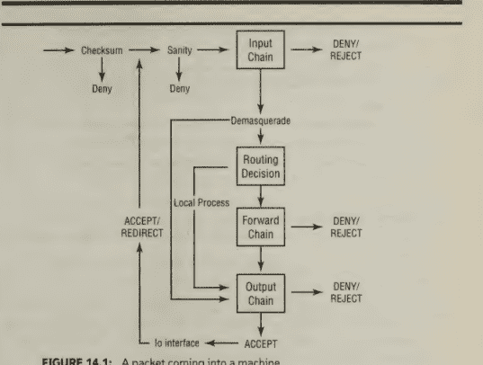

**图 14.1：** 进入机器的数据包


## 输入链
这是数据包将要被测试的第一个防火墙链。如果该链的判定结果不是 `DENY` 或 `REJECT`，数据包将继续传递。

## 去伪装（De-masquerade）
如果该数据包是之前某个伪装（masqueraded）数据包的响应，它将进行去伪装处理，并直接跳至 `output`（输出）链。如果您不使用 IP 伪装功能，可以从脑海中删除图表中的这一部分。

## 路由决策
路由代码会检查目标字段，以决定该数据包是应该交给本地进程（参见下文对“local process”的定义），还是转发到远程机器（参见“`forward`”定义）。

## 本地进程
运行在机器上的进程可以在路由决策步骤之后接收和发送数据包。（这些数据包将经过路由决策步骤，然后遍历 `output` 链。）

## Lo 接口
此接口用于那些源自本地进程且目的地也是本地进程的数据包。它们将以接口设置为 `lo` 的方式遍历 `output` 链，然后通过接口同样为 `lo` 的输入链返回。`lo` 接口通常被称为环回接口。

## Local
如果数据包不是由本地进程创建的，则检查 `forward chain`（转发链），否则数据包将进入 `output chain`（输出链）。

## Forward chain
任何试图通过本机到达另一台机器的数据包都将遍历此链。

## Output chain
所有数据包在发出之前都会遍历此链。

# 使用 ipchains

首先，检查您拥有的 `ipchains` 版本是否与本文档所述的版本一致：

```
$ ipchains --version
ipchains 1.3.8, 27-Oct-1998
```

`ipchains` 拥有一个相当详细的手册页（man `ipchains`），但如果您需要更多具体细节，可以查阅编程接口（man 4 `ipfw`）或 2.1.x 内核源代码中的 `net/ipv4/ipfw.c` 文件，后者（显然）是权威依据。

源软件包中还有一张由 Scott Bronson 编写的优秀快速参考卡片，提供 A4 和 US Letter PostScript™ 两种格式。

`ipchains` 支持几种不同的操作。首先，有用于管理整个链的操作。您从三个内置链 `input`、`output` 和 `forward` 开始，这些链无法删除。用于整个链操作的命令行选项包括

- 创建新链 `-N`
- 删除空链 `-X`
- 更改内置链的策略。 `-P`
- 列出链中的规则 `-L`
- 清空链中的规则 `-F`
- 重置链中所有规则的包计数器和字节计数器 `-Z`

有几种方法可以操作链内的规则：

- 向链末尾添加新规则 `-A`
- 在链中的某个位置插入新规则 `-I`
- 替换链中某个位置的规则 `-R`
- 删除链中某个位置的规则 `-D`
- 删除链中第一个匹配的规则 `-D`

有几种用于伪装的操作，由于缺乏更好的放置位置，它们被包含在 `ipchains` 中：

- 列出当前伪装连接 `-M-L`
- 设置伪装超时值 `-M-S`（但请阅读本章后面“常见问题”部分关于常见伪装超时问题的说明。）

最后一个（也许是最有用的）功能允许您检查如果某个特定数据包遍历特定链会发生什么。

# 单条规则的操作

这是 `ipchains` 的核心——操作规则。通常情况下，您可能会使用追加 `-A` 和删除 `-D` 命令。其他命令（用于插入的 `-I` 和用于替换的 `-R`）是这些概念的简单扩展。

每条规则指定了一组数据包必须满足的条件以及满足这些条件时采取的操作（目标）。例如，您可能想要拒绝所有来自 IP 地址 127.0.0.1 的 ICMP 数据包。在这种情况下，我们的条件是协议必须是 ICMP，且源地址必须是 127.0.0.1。我们的目标是 `DENY`。

127.0.0.1 是环回接口，即使您没有真实的网络连接，它也存在于系统中。您可以使用 `ping` 程序生成此类数据包（它只是发送 ICMP 类型 8 [echo request]，所有合作的宿主都应依请求用 ICMP 类型 0 [echo reply] 数据包予以响应）。这使得它非常适合用于测试。

```
######## ping -c 1 127.0.0.1
PING 127.0.0.1 (127.0.0.1): 56 data bytes
64 bytes from 127.0.0.1: icmp_seq=0 ttl=64 time=0.2 ms

--- 127.0.0.1 ping statistics ---
1 packets transmitted, 1 packets received, 0% packet loss
round-trip min/avg/max = 0.2/0.2/0.2 ms
######## ipchains -A input -s 127.0.0.1 -p icmp -j DENY
######## ping -c 1 127.0.0.1
PING 127.0.0.1 (127.0.0.1): 56 data bytes

--- 127.0.0.1 ping statistics ---
1 packets transmitted, 0 packets received, 100% packet loss
#
```

可以看到，第一个 `ping` 成功（`-c 1` 指示 `ping` 只发送单个数据包）。

然后，我们在 `input` 链中追加 `-A` 一条规则，规定对于来自 127.0.0.1 `-s 127.0.0.1` 且协议为 ICMP `-p icmp` 的数据包，应跳转至 `DENY` `-j DENY`。

接着，我们使用第二个 `ping` 来测试我们的规则。程序会在放弃等待永远不会到来的响应之前暂停一段时间。

我们可以用两种方法删除该规则。首先，由于我们知道它是 `input` 链中唯一的规则，我们可以使用编号删除，例如：

```
######## ipchains -D input 1
```

这将删除 `input` 链中的第 1 号规则。

第二种方法是镜像 `-A` 命令，但将 `-A` 替换为 `-D`。当您拥有一串复杂的规则，且不想通过计数来确定要删除的是第 37 号规则时，这种方法非常有用。在这种情况下，我们将使用：

```
######## ipchains -D input -s 127.0.0.1 -p icmp -j DENY
```

`-D` 的语法必须与 `-A`（或 `-I` 或 `-R`）命令具有完全相同的选项。如果同一链中存在多个相同的规则，只有第一个会被删除。

# 过滤规范

我们已经看到使用 `-p` 指定协议和 `-s` 指定源地址，但还有其他可用于指定数据包特征的选项。以下是一份详尽的汇总。

### 指定源和目标 IP 地址
源 `-s` 和目标 `-d` IP 地址可以通过四种方式指定。最常见的方式是使用完整名称，例如 `localhost` 或 `www.linux.com`。第二种方式是直接指定 IP 地址，例如 127.0.0.1。

第三种和第四种方式允许指定一组 IP 地址，例如 199.95.207.0/24 或 199.95.207.0/255.255.255.0。这两种方式都指定了从 199.95.207.0 到 199.95.207.255（含）的任何 IP 地址；斜杠“/”后面的数字指示 IP 地址中哪些部分是重要的。`/32` 或 `/255.255.255.255` 是默认值（匹配整个 IP 地址）。若要指定任意 IP 地址，可以使用 `/0`，如下所示：

```bash
######## ipchains -A input -s 0/0 -j DENY
#
```

这很少被使用，因为上述效果与完全不指定 `-s` 选项相同。

### 指定取反
许多标志，包括 `-s` 和 `-d` 标志，可以在其参数前加上 `!`（读作“非”）来匹配不等于给定地址的情况。例如，`-s ! localhost` 匹配任何不来自 `localhost` 的数据包。

### 指定协议
可以使用 `-p` 标志指定协议。协议可以是数字（如果您知道 IP 的数字协议值），也可以是 `TCP`、`UDP` 或 `ICMP` 这些特殊情况下的名称。大小写不敏感，因此 `tcp` 和 `TCP` 都有效。

协议名称前可以加 `!` 进行取反，例如 `-p ! TCP`。

### 指定 UDP 和 TCP 端口
对于协议为 `TCP` 或 `UDP` 的特殊情况，可以有一个额外参数指示 `TCP` 或 `UDP` 端口或端口范围（含边界）（但请参见本章后面“处理分片”部分）。范围使用 `:` 字符表示，例如 6000:6010，覆盖从 6000 到 6010（含）的 11 个端口号。如果省略下限，默认为 0。如果省略上限，默认为 65535。要指定来自 1024 以下端口的 `TCP` 连接，语法为 `-p TCP -s 0.0.0.0/0 :0.1023`。端口号也可以用名称指定，例如 `www`。

请注意，端口规范前可以加 `!`，表示取反。因此，要指定除 `www` 数据包外的所有 `TCP` 数据包，应指定 `-p TCP -d 0.0.0.0/0 ! www`。


重要的是要意识到，规范 `-p TCP -d ! 192.168.1.1 www` 与 `-p TCP -d 192.168.1.1 ! www` 非常不同。

前者指定发往除 `192.168.1.1` 之外任何机器的 `www` 端口的任何 TCP 数据包。后者指定发往 `192.168.1.1` 上除 `www` 端口外任何端口的任何 TCP 连接。

最后，表示既不是 `www` 端口也不是 `192.168.1.1` 的情况：`-p TCP -d ! 192.168.1.1 ! www`。

## 指定 ICMP 类型和代码

ICMP 也允许一个可选参数，但由于 ICMP 没有端口（ICMP 具有类型和*代码*），它们的含义有所不同。

你可以将 `-s` 选项后的 ICMP 名称（使用 `ipchains -h icmp` 列出名称）指定为 ICMP 名称，或者将数字 ICMP 类型和代码指定，其中类型跟随 `-s` 选项，代码跟随 `-d` 选项。

ICMP 名称相当长；你只需要使用足够的字母使该名称与其他名称区分开来。

下面是一个表格，列出了最常见的一些 ICMP 数据包。

| 编号 | 名称 | 所需用途： |
|:-------|:-----|:-------------|
| 0 | echo-reply | ping |
| 3 | destination-unreachable | 任何 tcp/udp 流量 |
| 5 | redirect | 如果未运行路由守护进程，则用于路由 |
| 8 | echo-request | ping |
| 11 | time-exceeded | traceroute |

请注意，目前 ICMP 名称前面不能加 `!`。


### 警告

不要阻止所有 ICMP 类型 3 消息！（参见本章后面“ICMP 数据包”一节）。

## 指定接口

`-i` 选项指定要匹配的接口名称。*接口*是数据包进入或离开的物理设备。你可以使用 `ifconfig` 命令列出已启用（即目前*正在工作*）的接口。

对于传入数据包（即穿过输入链的数据包），其接口被视为它们进入的接口。逻辑上，传出数据包（穿过*输出*链的数据包）的接口是它们将离开的接口。穿过*转发*链的数据包的接口也是它们将离开的接口（在我看来，这是一个相当随意的决定）。

指定一个当前不存在的接口是完全合法的；在接口建立之前，规则将不会匹配任何东西。这对于拨号 PPP 链接（通常是接口 `ppp0`）等非常有用。

作为一种特殊情况，以 `+` 结尾的接口名称将匹配所有以该字符串开头的接口（无论它们当前是否存在）。例如，要指定一条匹配所有 PPP 接口的规则，将使用 `-i ppp+` 选项。

接口名称前面可以加 `!` 以匹配不匹配指定接口的数据包。

## 仅指定 TCP SYN 数据包

有时，允许单向 TCP 连接而阻止另一方向是有用的。例如，你可能想允许连接到外部 WWW 服务器，但不允许从该服务器发起连接。

朴素的方法将是阻止来自服务器的 TCP 数据包。不幸的是，TCP 连接需要双向数据包才能工作。

解决方案是仅阻止用于请求连接的数据包。这些数据包称为 SYN 数据包（好吧，严格来说，它们是设置了 SYN 标志且清除 FIN 和 ACK 标志的数据包，但我们称它们为 SYN 数据包）。通过仅不允许这些数据包，我们可以阻止尝试中的连接。

`-y` 标志用于此目的；它仅对指定 TCP 为其协议的规则有效。例如，要指定来自 `192.168.1.1` 的 TCP 连接尝试：`-p TCP -s 192.168.1.1 -y`

同样，通过在标志前加 `!` 可以反转此标志，这意味着除了连接发起之外的每个数据包。

## 处理分片

有时数据包太大，无法一次性通过线路传输。当这种情况发生时，数据包被划分为分片并作为多个数据包发送。另一端将分片组装以重建完整的数据包。

分片的问题在于，上面列出的一些规格（特别是源端口、目标端口、ICMP 类型、ICMP 代码或 TCP SYN 标志）需要内核窥视数据包的开头，而这仅包含在第一个分片中。

如果你的机器是连接外部网络的唯一连接，那么你可以通过将内核编译为将 `IP: always defragment` 设置为 Y 来告诉 Linux 内核重组通过它的所有分片。这巧妙地解决了这个问题。

否则，理解分片如何被过滤规则处理非常重要。任何请求我们没有的信息的过滤规则都将不会匹配。这意味着第一个分片像其他数据包一样被处理。第二个及后续分片则不然。因此，一条规则 `-p TCP -s 192.168.1.1 www`（指定源端口为 `www`）将永远不匹配分片（除第一个分片外）。相反的规则 `-p TCP -s 192.168.1.1 ! www` 也是如此。

然而，你可以使用 `-f` 标志专门指定针对第二个及后续分片的规则。显然，在这样的分片规则中指定 TCP 或 UDP 端口、ICMP 类型、ICMP 代码或 TCP SYN 标志是非法的。

通过在 `-f` 前加 `!` 也可以指定规则不适用于第二个及后续分片。

通常，让第二个及后续分片通过被认为是安全的，因为过滤会影响第一个分片，从而阻止目标主机上的重组。然而，已知有漏洞会导致机器仅通过发送分片而崩溃。由你决定。

网络头部请注意：格式错误的数据包（对于防火墙代码读取端口或 ICMP 代码和类型而言过短的 TCP、UDP 和 ICMP 数据包）也被视为分片。只有从位置 8 开始的 TCP 分片会被防火墙代码显式丢弃（如果发生这种情况，syslog 中应出现一条消息）。

作为一个例子，以下规则将丢弃任何去往 `192.168.1.1` 的分片：

```
ipchains -A output -f -D 192.168.1.1 -j DENY
```

## 过滤副作用

好的，现在我们知道所有使用规则匹配数据包的方式。如果数据包匹配一条规则，则会发生以下事情：

- 该规则的字节计数器增加数据包的大小（包括头部）。
- 该规则的数据包计数器增加。
- 如果规则要求，则记录数据包。
- 如果规则要求，则修改数据包的 Type of Service 字段。
- 如果规则要求，则标记数据包（在 2.0 内核系列中未实现）。
- 检查规则目标以确定接下来如何处理数据包。

我将按重要性顺序讨论这些事项。

## 指定目标

*目标*告诉内核如何处理匹配规则的数据包。`iptables` 使用 `-j`（想想“跳转到”）来指定目标。

最简单的情况是未指定目标。这种类型的规则（通常称为计数规则）用于简单地计算某种类型的数据包数量。无论此规则是否匹配，内核只需检查链中的下一条规则。例如，要计算来自 `192.168.1.1` 的数据包数量，我们可以这样做：

```
iptables -A input -s 192.168.1.1
```

（使用 `iptables -L -v` 我们可以看到与每条规则关联的字节和数据包计数器。）

有六个特殊目标。前三个，`ACCEPT`、`REJECT` 和 `DENY` 相当简单。`ACCEPT` 允许数据包通过。`DENY` 丢弃数据包，就好像它从未被接收一样。`REJECT` 丢弃数据包，但（如果它不是 ICMP 数据包）生成一个 ICMP 回复给源，告诉它目的地不可达。

下一个，`MASQ`，告诉内核伪装数据包。要使此功能正常工作，你的内核必须编译启用 IP 伪装。有关此功能的详细信息，请参阅第 12 章中的 Masquerading-HOWTO 以及本章后面“`iptables` 和 `ipfwadm` 之间的区别”一节。此目标仅对穿过转发链的数据包有效。

另一个主要的特殊目标是 `REDIRECT`，它告诉内核将数据包发送到本地端口，而不是其原本要去的任何地方。这只能为指定 TCP 或 UDP 为其协议的规则指定。可选地，可以在 `-j REDIRECT` 后指定一个端口（名称或编号），这将导致数据包被重定向到该特定端口，即使它原本被寻址到另一个端口。此目标仅对穿过 `input` 链的数据包有效。

最后一个特殊目标是 `RETURN`，它立即等同于从链的末尾掉出（参见本章后面“设置策略”一节）。

其他任何目标都指向用户自定义链（如本章后面“伪装操作”一节所述）。数据包将开始遍历该链中的规则。如果该链未能决定数据包的命运，那么在该链的遍历结束后，遍历将恢复在当前链的下一条规则上继续。

考虑图 14.2 中的两个（滑稽的）链：`input`（内置链）和 `Test`（用户自定义链）。

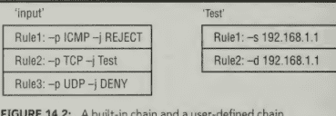


假设有一个来自 `192.168.1.1`、去往 `1.2.3.4` 的 TCP 数据包。它进入 `input` 链，并与 `Rule1` 进行匹配测试——未匹配。`Rule2` 匹配成功，其目标是 `Test`，因此接下来检查的规则是 `Test` 的开头。`Test` 中的 `Rule1` 匹配成功，但未指定目标，因此检查下一条规则，即 `Rule2`。该规则未匹配，因此我们到达了链的末尾。我们返回到 `input` 链，此时我们刚刚检查了 `Rule2`，所以现在检查 `Rule3`，该规则也未匹配。

数据包的路径如图 14.3 所示。

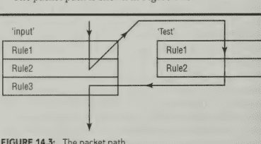

请参见本章后面“如何组织您的防火墙规则”一节，了解如何有效使用用户自定义链。

## 记录数据包

匹配规则的一个副作用是，您可以使用 `-l` 标志记录匹配到的数据包。通常您不希望对常规数据包这样做，但如果想要查找异常事件，这是一个非常有用的功能。

内核会记录此信息，其格式如下：

```
Packet log: input DENY eth0 PROTO=17  192.168.2.1:53
    192.168.1.1:1025 L=34 S=0x00 I=18 F=0x0000 T=254
```

此日志消息旨在简洁，并包含仅对网络专家有用的技术信息，但对于我们其他人来说也有用处。其含义分解如下：

- `input`：包含导致该日志消息匹配的规则的链。
- `DENY`：规则指示对数据包执行的操作。如果此处为“*”（星号），则表示规则完全未影响该数据包（即用于统计的规则）。
- `eth0`：接口名称。由于这是 `input` 链，这意味着数据包是通过 `eth0` 进入的。
- `PROTO=17`：数据包协议号为 17。协议号列表可在 `/etc/protocols` 中找到。最常见的协议号是 1（ICMP）、6（TCP）和 17（UDP）。
- `192.168.2.1`：数据包的源 IP 地址是 `192.168.2.1`。
- `:53`：源端口为 53。在 `/etc/services` 中查找可知，这是域名服务端口（即这很可能是一个 DNS 响应）。对于 UDP 和 TCP，此数字表示源端口。对于 ICMP，它表示 ICMP 类型。对于其他协议，该值将为 65535。
- `192.168.1.1`：目的 IP 地址。
- `:1025`：目的端口为 1025。对于 UDP 和 TCP，此数字表示目的端口。对于 ICMP，它表示 ICMP 代码。对于其他协议，该值将为 65535。
- `L=34`：数据包总长度为 34 字节。
- `S=0x00`：服务类型（Type of Service）字段（除以 4 即可得到 `ipchains` 使用的服务类型）。
- `I=18`：IP 标识符。
- `F=0x0000`：16 位分片偏移量加上标志。以 `0x4` 或 `0x5` 开头的值表示“禁止分片”（Don’t Fragment）位已置位。`0x2` 或 `0x3` 表示“更多分片”（More Fragments）位已置位；预计在此之后还有更多分片。数字的其余部分表示此分片的偏移量，除以 8。
- `T=254`：数据包的生存时间（Time to Live）。每经过一跳，该值减 1；通常起始值为 15 或 255。

在标准 Linux 系统上，此内核输出由 `klogd`（内核日志守护进程）捕获，然后交给 `syslogd`（系统日志守护进程）。`/etc/syslog.conf` 通过为每个日志设施（在本例中为 `kernel`）和级别（对于 `ipchains`，使用的级别是 `info`）指定目的地来控制 `syslogd` 的行为。

例如，我的（Debian）`/etc/syslog.conf` 包含两行匹配 `kern.info` 的内容：

```
kern.*                              -/var/log/kern.log
*,=info;*,=notice;*,=warn;\
auth,authpriv.none;\
cron,daemon.none;\
mail,news.none            -/var/log/messages
```

这意味着消息会同时记录在 `/var/log/kern.log` 和 `/var/log/messages` 中。更多细节请参见 `man syslog.conf`。

## 操纵服务类型

IP 报头中有四个很少使用的位，称为服务类型（TOS）位。它们影响数据包的传输方式；这四个位分别是：最小延迟（Minimum Delay）、最大吞吐量（Maximum Throughput）、最大可靠性（Maximum Reliability）和最小成本（Minimum Cost）。只允许设置其中一个位。TOS 修改代码的作者 Rob van Nieuwkerk 是这样描述的：

> 尤其是“最小延迟”对我来说很重要。我在上游（Linux）路由器中为“交互式”数据包开启了该选项。我使用的是 336k 调制解调器链路。Linux 将数据包在 3 个队列中优先级排序。这样，在进行全速下载的同时，我也可以获得可接受的交互式性能。（如果串行驱动中的队列没有这么大，性能甚至会更好，但目前的延迟被控制在 1.5 秒以内。）

**注意**

显然，您无法控制传入的数据包；您只能控制离开您机器数据包优先级。要与对端协商优先级，必须使用 RSVP 之类的协议（我对这知之甚少，所以别问我！）。

最常见的用法是将 telnet 和 ftp 控制连接设置为最小延迟，将 FTP 数据设置为最大吞吐量。操作如下：

```
ipchains -A output -p tcp -d 0.0.0.0/0 telnet -t 0x01 0x10
ipchains -A output -p tcp -d 0.0.0.0/0 ftp -t 0x01 0x10
ipchains -A output -p tcp -S 0.0.0.0/0 ftp-data \ -t 0x01 0x08
```

`-t` 标志接受两个额外的十六进制参数。这允许对 TOS 位进行复杂的调整：第一个掩码与数据包当前的 TOS 进行 AND 运算，然后第二个掩码与之进行 XOR 运算。如果这太令人困惑，请仅使用下表：

| **TOS 名称** | **值** | **典型用途** |
| :--- | :--- | :--- |
| 最小延迟 | `0x01 0x10` | ftp, telnet |
| 最大吞吐量 | `0x01 0x08` | ftp-data |
| 最大可靠性 | `0x01 0x04` | Snmp |
| 最小成本 | `0x01 0x02` | nntp |

Andi Kleen 进一步指出了以下内容（为历史记录稍作编辑）：

> 也许在讨论 TOS 位时，补充提及 `ifconfig` 的 `txqueuelen` 参数会很有用。默认的设备队列长度是针对以太网卡调优的，在调制解调器上它太长，导致基于 TOS 分队的三频调度器工作次优。在调制解调器或单 B 通道 ISDN 链路上，将其设置为 4-10 之间的值是不错的选择；在捆绑设备上则需要更长的队列。

> 这是一个 2.0 和 2.1 内核的问题，但在 2.1 中它是一个 `ifconfig` 标志（使用较新的 nettools），而在 2.0 中需要修改设备驱动程序中的源代码补丁。

因此，要在调制解调器 PPP 链接中获得 TOS 操纵的最大好处，请在 `/etc/ppp/ip-up-script` 中执行 `ifconfig $1 txqueuelen`。使用的数值取决于调制解调器的速度和调制解调器内部的缓冲区量；再次引用 Andi 的话来纠正我的观点：

> 对于给定配置的最佳值需要通过实验确定。如果路由器上的队列太短，数据包将会丢失。当然，即使不进行 TOS 重写也能获得好处，只是 TOS 重写有助于将好处赋予那些不配合的程序（但所有标准的 Linux 程序都是配合的）。

## 标记数据包

这允许与 Alexey Kuznetsov 新的服务质量（QoS）实现进行复杂而强大的交互，同时也适用于后期 2.1 系列内核中基于标记的转发。随着新消息的到来，我会提供更多资讯。在 2.0 内核系列中，此选项会被完全忽略。

## 对整个链的操作

`ipchains` 的一个非常实用的功能是将相关规则分组到链中。您可以将链命名为任何您想要的名称，只要名称不与内置链（`input`、`output` 和 `forward`）或目标（`MASQ`、`REDIRECT`、`ACCEPT`、`DENY`、`REJECT` 或 `RETURN`）冲突即可。我建议完全避免使用大写字母标签，因为我可能会在未来扩展中使用这些字母。链的名称最长可达 8 个字符。

## 创建新链

让我们创建一个新链。因为我是一个富有想象力的人，我会把它命名为 `test`。

```
ipchains -N test
```

就这么简单。现在您可以像之前详述的那样在其中添加规则。

## 删除链


删除链也很简单。

```
######## ipchains -X test
#
```

为什么是 `-X`？好吧，所有好的字母都被占用了。

删除链有一些限制：链必须是空的（参见下一节“清空链”），并且不能是任何规则的目标。您不能删除三个内置链中的任何一个。

## 清空链

使用 `-F` 命令可以通过简单的方式清空链中的所有规则。

```
######## ipchains -F forward
#
```

如果你没有指定链，则所有链都会被清空。

## 列出链

你可以使用 `-L` 命令列出链中的所有规则。

```
######## ipchains -L input
Chain input (refcnt = 1): (policy ACCEPT)
target prot opt source destination ports
ACCEPT icmp ---- anywhere anywhere any
######## ipchains -L test
Chain test (refcnt = 0):
target prot opt source destination ports
DENY icmp ---- localnet/24 anywhere any
#
```

`test` 中列出的 `refcnt` 是指以 `test` 为目标（target）的规则数量。在删除该链之前，此值必须为零（且该链为空）。

如果省略链名称，则列出所有链，包括空链。

有三个选项可以伴随 `-L` 使用。`-n`（数字）选项非常有用，因为它阻止 `ipchains` 尝试查找 IP 地址。如果你像大多数人一样使用 DNS，且你的 DNS 配置不当或你已过滤掉 DNS 请求，这可能会导致较大的延迟。它还会使端口以数字形式而非名称形式打印出来。

`-v` 选项会显示规则的所有详细信息，例如数据包和字节计数器、TOS 掩码、接口以及数据包标记。否则，这些值将被省略。例如：

```
######## ipchains -v -L input
Chain input (refcnt = 1): (policy ACCEPT)
pkts bytes target prot opt tos tosX
10 840 ACCEPT icmp ---- 0xFF 0x00
ifname mark source destination ports
lo anywhere anywhere any
```

请注意，数据包和字节计数器使用后缀 K、M 和 G 分别表示 1000、1,000,000 和 1,000,000,000。使用 `-x`（扩展数字）标志也会打印出完整的数字，无论它们多大。

## 重置（清零）计数器

能够重置计数器很有用。这可以通过使用 `-Z`（清零计数器）选项来完成。例如：

```
######## ipchains -v -L input
Chain input (refcnt = 1): (policy ACCEPT)
pkts bytes target prot opt tos tos
10 840 ACCEPT icmp ------ 0xFF 0x00
ifname mark source destination ports
lo anywhere anywhere any

######## ipchains -Z input
######## ipchains -v -L input
Chain input (refcnt = 1): (policy ACCEPT)
pkts bytes target prot opt tos tos
0 0 ACCEPT icmp ------ 0xFF 0x00
ifname mark source destination ports
lo anywhere anywhere any
#
```

这种方法的问题是，有时你需要在重置前立即知道计数器的值。在上面的例子中，在 `-L` 和 `-Z` 命令之间可能有数据包通过。因此，你可以将 `-L` 和 `-Z` 一起使用，在读取计数器的同时重置它们。不幸的是，如果你这样做，无法仅针对单个链进行操作；你必须同时列出并清零所有链。

```
######## ipchains -L -v -Z
Chain input (policy ACCEPT):
pkts bytes target prot opt tos tos
10 840 ACCEPT icmp ------ 0xFF 0x00
ifname mark source destination ports
lo anywhere anywhere any

Chain forward (refcnt = 1): (policy ACCEPT)
Chain output (refcnt = 1): (policy ACCEPT)
Chain test (refcnt = 0):
0 0 DENY icmp ------ 0xFF 0x00 ppp0
0 localNet/24 anywhere any
######## ipchains -L -v
Chain input (policy ACCEPT):
pkts bytes target prot opt tos tos
10 840 ACCEPT icmp ------ 0xFF 0x00
ifname mark source destination ports
lo anywhere anywhere any

Chain forward (refcnt = 1): (policy ACCEPT)
Chain output (refcnt = 1): (policy ACCEPT)
```

Chain test (refcnt = 0):

| pkts | bytes | target | prot | opt | tos | tos |

| :--- | :--- | :--- | :--- | :--- | :--- | :--- |

| 0 | 0 | DENY | icmp | ------ | 0xFF | 0x00 |

| ifname | mark | source | destination | ports |

| :--- | :--- | :--- | :--- | :--- |

| ppp0 | | localNet/24 | anywhere | any |

## 设置策略

在本章前面“指定目标”部分，当我们讨论数据包如何遍历链时，我们略去了当数据包命中内置链末尾时会发生什么。在这种情况下，链的策略决定了数据的命运。只有内置链（`input`、`output` 和 `forward`）具有策略，因为如果数据包掉落到用户定义链的末尾，遍历将在前一个链中恢复。

策略可以是前四个特殊目标中的任意一个：`ACCEPT`、`DENY`、`REJECT` 或 `MASQ`。`MASQ` 仅对 `forward` 链有效。

还值得注意的是，在内置链的规则中，`RETURN` 目标对于当数据包匹配规则时显式指向链策略非常有用。

## 伪装（Masquerading）操作

有几个参数可以调整 IP 伪装。它们与 `ipchains` 捆绑在一起，因为不值得为它们编写单独的工具（尽管这将会改变）。

IP 伪装命令是 `-M`，它可以与 `-L` 结合使用以列出当前被伪装的连接，或与 `-S` 结合使用以设置伪装参数。

`-L` 命令可以伴随 `-n`（显示数字而非主机名和端口名）或 `-v`（显示被伪装连接的序列号差异，以防你关心这一点）。

`-S` 命令后面应跟随三个超时值，均以秒为单位：分别针对 TCP 会话、FIN 数据包后的 TCP 会话，以及 UDP 数据包。如果你不想更改其中任何值，只需给出值为 0 即可。

默认值列在 `/usr/include/net/ipmasq.h` 中，目前分别为 15 分钟、2 分钟和 5 分钟。

最常更改的值是第一个，用于 FTP。（参见本章后面“FTP 噩梦”部分。）

请注意本章后面“常见问题”部分中列出的关于设置伪装超时的问题。

## 检查数据包

有时你想看看当特定数据包进入你的机器时会发生什么。`ipchains` 有 `-C` 命令允许这样做，它使用内核用来诊断真实数据包的完全相同的例程。

通过在 `-C` 参数后跟链名来指定测试数据包的链。尽管内核始终从 `input`、`output` 或 `forward` 链开始遍历，但为了测试目的，允许你从任何链开始遍历。

数据包的细节使用与指定防火墙规则相同的语法来指定。特别是，协议（`-p`）、源地址（`-s`）、目标地址（`-d`）和接口（`-i`）是强制的。如果协议是 TCP 或 UDP，则必须指定单个源端口和单个目标端口；对于 ICMP 协议，必须指定 ICMP 类型和代码（除非指定了 `-f` 标志表示片段规则，在这种情况下这些选项是非法的）。

如果协议是 TCP（且未指定 `-f` 标志），可以指定 `-y` 标志表示测试数据包应设置 SYN 位。


这是一个示例，测试从 192.168.1.1 端口 60000 到 192.168.1.2 端口 www 的 TCP SYN 数据包，通过 eth0 接口进入 `input` 链（这是一个经典的传入 WWW 连接发起）：

```
# ipchains -C input -p tcp -y -i eth0 -s 192.168.1.1 60000 \
 -d 192.168.1.2 www
packet accepted
```

## 一次多条规则及观察发生的事情

有时单个命令行会导致多条规则生效。这通过两种方式实现。首先，如果你指定一个通过 DNS 解析为多个 IP 地址的主机名，`ipchains` 会表现得好像你输入了多个命令，每个命令使用地址的每种组合。

因此，如果主机名 `www.foo.com` 解析为三个 IP 地址，而主机名 `www.bar.com` 解析为两个 IP 地址，那么命令 `ipchains -A input -j reject -s www.bar.com -d www.foo.com` 将向 `input` 链追加六条规则。

让 `ipchains` 执行多个操作的另一种方式是使用双向标志 `-b`。此标志使 `ipchains` 表现得好像你输入了两次命令；第二次时交换了 `-s` 和 `-d` 参数。因此，为了避免向 192.168.1.1 转发或从其转发，你可以执行以下操作：

```
######## ipchains -b -A forward -j reject -s 192.168.1.1
#
```

*我个人不太喜欢 `-b` 选项；如果你想要便利性，请参见本章后面“使用 ipchains-save”部分。*

`-b` 选项可以与插入 `-I`、删除 `-D` 以及不带规则编号的变体、追加 `-A` 和检查 `-C` 命令一起使用。

另一个有用的标志是 `-v`（详细模式），它打印出 `ipchains` 对你的命令所执行的确切操作。如果你处理可能影响多条规则的命令时，这很有用。例如，在这里我们检查 192.168.1.1 和 192.168.1.2 之间片段的行为。

```
# ipchains -v -b -C input -p tcp -f \
-s 192.168.1.1 -d 192.168.1.2 -i lo
tcp opt ---f tos 0xFF 0x00 via lo
192.168.1.1 -> 192.168.1.2 * -> *
packet accepted
tcp opt ---f tos 0xFF 0x00 via lo
192.168.1.2 -> 192.168.1.1 * -> *
packet accepted
#
```

## 实用示例

我有一个拨号 PPP 连接 `-i ppp0`。每次拨号时，我都会获取新闻 `-p TCP -s news.virtuel.net.au nntp` 和电子邮件 `-p TCP -s mail.virtuel.net.au pop3`。我经常使用 Debian 的 FTP 方法更新我的机器 `-p TCP -y -s ftp.debian.org.au ftp -data`。在此期间，我通过我的 ISP 代理浏览网页 `-p TCP -d proxy.virtuel.net.au 8080`，但讨厌 Dilbert 存档中来自 doubleclick.net 的广告 `-p TCP -y -d 199.95.207.0/24 & -p TCP -y -d 199.95.208.0/24`。

我不介意人们在我不在线时尝试 ftp 到机器上 `-p TCP -d $LOCALIP ftp`，但我不想让外部人员假装拥有我内部网络的 IP 地址 `-S 192.168.1.0/24`。这通常被称为 IP 欺骗，对于 2.1.x 及以上的内核，有更好来自我保护的方法（参见本章后面“如何设置 IP 欺骗保护”部分）。

这种配置相当简单，因为目前我的内部网络上没有其他任何设备。

我不希望任何本地进程（即 Netscape、Lynx 等）连接到 doubleclick.net：

```
######## ipchains -A output -d 199.95.207.0/24 -j REJECT
######## ipchains -A output -d 199.95.208.0/24 -j REJECT
```

现在我想为各种出站数据包设置优先级（对入站数据包这样做没什么意义）。由于我有相当多的这些规则，将它们全部放入一个名为 ppp-out 的链中是合理的。

```
######## ipchains -M ppp-out
######## ipchains -A output -i ppp0 -j ppp-out
```

Web 流量和 telnet 的最小延迟。

```
# ipchains -A ppp-out -p TCP -d proxy.virtual.net.au 8080 \
    -t 0x01 0x10
```

```
######## ipchains -A ppp-out -p TCP -d 0.0.0.0 telnet -t 0x01 0x10
```

ftp 数据、nntp、pop-3 的低成本：

```
# ipchains -A ppp-out -p TCP -d 0.0.0.0/0 ftp-data \
    -t 0x01 0x02
######## ipchains -A ppp-out -p TCP -d 0.0.0.0/0 nntp -t 0x01 0x02
######## ipchains -A ppp-out -p TCP -d 0.0.0.0/0 pop-3 -t 0x01 0x02
```

进入 ppp0 接口的数据包有一些限制。让我们创建一个名为 ppp-in 的链：

```
######## ipchains -N ppp-in
######## ipchains -A input -i ppp0 -j ppp-in
```

现在，进入 ppp0 的数据包不应声称源地址为 192.168.1.*，因此我们记录并拒绝它们：

```
######## ipchains -A ppp-in -s 192.168.1.0/24 -l -j DENY
```

我允许 UDP 数据包进入用于 DNS（我运行一个缓存域名服务器，将所有请求转发到 203.29.16.1，因此我只期望收到来自它们的 DNS 回复），入站 ftp，以及仅返回 ftp 数据（这应该去往 1023 以上的端口，而不是 6000 左右的 X11 端口）。

```
# ipchains -A ppp-in -p UDP -s 203.29.16.1 \
    -d $LOCALIP dns -j ACCEPT
# ipchains -A ppp-in -p TCP -s 0.0.0.0/0 ftp-data \
    -d $LOCALIP 1024:5999 -j ACCEPT
# ipchains -A ppp-in -p TCP -s 0.0.0.0/0 ftp-data \
    -d $LOCALIP 6010: -j ACCEPT
######## ipchains -A ppp-in -p TCP -d $LOCALIP ftp -j ACCEPT
```

最后，本地到本地的数据包是允许的：

```
######## ipchains -A input -i lo -j ACCEPT
```

现在，我的 input 链的默认策略是 DENY，因此其他所有内容都会被丢弃：

```
######## ipchains -P input DENY
```


## 使用 ipchains-save

按照你的意愿设置防火墙链，然后尝试记住你使用的命令以便下次操作，这很痛苦。

因此，`ipchains-save` 是一个脚本，它读取当前的链配置并将其保存到文件中。目前，关于 `ipchains-restore` 的作用，我暂时保留悬念。

`ipchains-save` 可以保存单个链或所有链（如果未指定链名称）。目前唯一允许的选项是 `-v`，它在保存时将规则打印到标准错误 `stderr`。链的策略也会为 `input`、`output` 和 `forward` 链保存。

```
$ ipchains-save > my_firewall
Saving 'input'.
Saving 'output'.
Saving 'forward'.
Saving 'ppp-in'.
Saving 'ppp-out'.
$
```

## 使用 ipchains-restore

`ipchains-restore` 恢复使用 `ipchains-save` 保存的链。它可以接受两个选项：`-v`，描述添加的每条规则；以及 `-f`，强制刷新用户定义的链（如果存在），如下所述。


如果在输入中发现用户定义的链，`ipchains-restore` 会检查该链是否已存在。如果存在，系统将提示是否应该刷新链（清除所有规则）还是跳过恢复该链。如果在命令行中指定了 `-f`，则不会提示；链将被刷新。

必须具有 `root` 权限才能运行此脚本；它使用 `ipchains` 尝试恢复规则。

例如：

```
######## ipchains-restore < my_firewall

  Restoring 'input'.

  Restoring 'output'.

  Restoring 'forward'.

  Restoring 'ppp-in'.

  Chain 'ppp-in' already exists. Skip or flush? [S/f]? s

  Skipping 'ppp-in'.

  Restoring 'ppp-out'.

  Chain 'ppp-out' already exists. Skip or flush? [S/f]? f

  Flushing 'ppp-out'.
```

## 杂项

本节包含我无法放入上述结构中的所有信息和常见问题解答（FAQs）。

### 如何组织防火墙规则

这个过程需要一些思考。你可以尝试组织它们以优化速度（为最常见的数据包最小化规则检查次数）或提高可管理性。

如果你有一个间歇性链接，例如 PPP 链接，你可能希望将 `input` 链中的第一条规则在启动时设置为 `-i ppp0 -j DENY`，然后在你的 `ip-up` 脚本中包含类似以下内容：

```
######## Re-create the 'ppp-in' chain.
ipchains-restore -f < ppp-in.firewall
```

```
######## Replace DENY rule with jump to ppp-handling chain.
ipchains -R input 1 -i ppp0 -j ppp-in
```

你的 `ip-down` 脚本看起来像这样：

```
ipchains -R input 1 -i ppp0 -j DENY
```

### 不要过滤掉什么

在你开始过滤掉所有不想要的内容之前，有一些事情你应该知道。

#### ICMP 数据包

`ICMP` 数据包（除其他用途外）用于指示其他协议（如 `TCP` 和 `UDP`）的故障，特别是“Destination-unreachable”数据包。阻止这些数据包意味着你永远不会收到“Host unreachable”或“No route to host”错误；任何连接都只是等待一个永远不会到来的回复。这令人烦恼，但很少是致命的。

更糟糕的问题是 `ICMP` 数据包在 `MTU` 发现中的作用。所有好的 `TCP` 实现（包括 Linux）都使用 `MTU` 发现来确定能够到达目的地而不会分片的最大数据包大小。（分片会降低性能，特别是当偶尔丢失分片时。）`MTU` 发现的工作原理是发送设置了“Don't Fragment”位的数据包，如果收到指示“Fragmentation needed but DF set”（需要分片但设置了 DF）的 `ICMP` 数据包，则发送较小的数据包。这是一种“Destination-unreachable”数据包，如果从未收到它，本地主机不会降低 `MTU`，性能将极差或不存在。

#### TCP 到 DNS（名称服务器）的连接

如果你试图阻止出站 `TCP` 连接，请记住 `DNS` 并不总是使用 `UDP`；如果来自服务器的回复超过 512 字节，客户端使用 `TCP` 连接（仍然去往端口号 53）来获取数据。

这可能是一个陷阱，因为如果你不允许此类 `TCP` 传输，`DNS` 大部分时候仍然可以工作；如果你这样做，可能会遇到奇怪的长延迟和其他偶发的 `DNS` 问题。

如果你的 `DNS` 查询始终指向同一个外部源（无论是通过 `/etc/resolv.conf` 中的 `nameserver` 行直接指向，还是通过使用处于转发模式的缓存名称服务器），那么你只需要允许来自本地域名端口（如果使用缓存名称服务器）或来自高位端口（1023 以上，如果使用 `/etc/resolv.conf`）到该名称服务器的 `domain` 端口的 `TCP` 连接。


#### FTP 的噩梦

经典的包过滤问题是 `FTP`。`FTP` 有两种模式；传统的称为主动模式（active mode），较新的称为被动模式（passive mode）。Web 浏览器通常默认使用被动模式，但命令行 `FTP` 程序通常默认使用主动模式。

在主动模式下，当远端想要发送文件（甚至 `ls` 或 `dir` 命令的结果）时，它试图打开到本地机器的 `TCP` 连接。这意味着你无法在不破坏主动 `FTP` 的情况下过滤掉这些 `TCP` 连接。

如果你有使用被动模式的选项，那就很好；被动模式使得数据连接从客户端到服务器，即使是入站数据。否则，建议只允许去往 1024 以上端口的 `TCP` 连接，且不要允许 6000 到 6010 之间（6000 用于 X Windows）。

#### 过滤掉“死亡之 Ping”

Linux 机器现在对臭名昭著的“死亡之 Ping”具有免疫力，这种攻击涉及发送非法大的 `ICMP` 数据包，导致接收方 `TCP` 堆栈中的缓冲区溢出并造成混乱。

如果你正在保护可能易受攻击的机器，你可以简单地阻止 `ICMP` 分片。正常的 `ICMP` 数据包不够大，不需要分片，因此除了大型 ping 之外，你不会破坏任何东西。我听说（未经证实）有些系统只需要超大 `ICMP` 数据包的最后一个分片来使它们损坏，因此仅阻止第一个分片是不推荐的。

虽然我看到的利用程序都使用 `ICMP`，但使用 `TCP` 或 `UDP` 分片（或未知协议）进行此攻击也是没有理由的，因此阻止 `ICMP` 分片只是暂时的解决方案。

#### 过滤掉 Teardrop 和 Bonk

`Teardrop` 和 `Bonk` 是两种攻击（主要针对 Microsoft Windows NT 机器），它们依赖于重叠的分片。让你的 Linux 路由器执行去分片，或禁止所有分片到你的易受攻击的机器，是其他选项。

#### 过滤碎片炸弹

据称，一些可靠性较低的 `TCP` 协议栈在处理大量数据包碎片时存在问题，尤其是在未接收到所有碎片的情况下。Linux 没有这个问题。你可以过滤掉碎片（这可能会破坏合法的用途），或者在编译内核时将 `IP: always defragment` 设置为 `Y`（仅当你的 Linux 机器是这些数据包唯一可能的路由时才这样做）。

### 更改防火墙规则

更改防火墙规则涉及一些时序问题。如果不谨慎，你可能会在更改过程中让数据包通过。一种简单的做法如下：

```bash
######## ipchains -I input 1 -j DENY
######## ipchains -I output 1 -j DENY
######## ipchains -I forward 1 -j DENY
```

... 进行更改 ...

```bash
######## ipchains -D input 1
######## ipchains -D output 1
######## ipchains -D forward 1
```

这会在更改期间丢弃所有数据包。

如果你的更改仅限于单个链，你可能希望创建一个包含新规则的新链，然后使用替换命令（`-R`）将指向旧链的规则替换为指向新链的规则。之后，你可以删除旧链。这种替换将是原子的。

### 如何设置 IP 欺骗保护？

`IP` 欺骗是一种技术，主机发送声称来自另一主机的数据包。由于包过滤基于此源地址做出决策，`IP` 欺骗被用于欺骗包过滤器。它还用于隐藏使用 `SYN` 攻击、`Teardrop`、`Ping of Death` 等的攻击者的身份（如果你不知道它们是什么，不用担心）。

防止 `IP` 欺骗的最佳方法称为源地址验证；它由路由代码完成，根本不需要防火墙。查找名为 `/proc/sys/net/ipv4/conf/all/rp_filter` 的文件。如果该文件存在，那么在每个启动时开启源地址验证就是适合你的正确解决方案。为此，请在初始化脚本中网络接口初始化之前（例如，Debian 用户可以将其放入 `/etc/init.d/netbase`，如果它们尚未存在）插入以下行：


# 最佳方法：开启源地址验证，并在所有当前和未来接口上获得欺骗保护

```bash
######## 这是最佳方法：开启源地址
######## 验证，并在所有当前和未来接口上
######## 获得欺骗保护。
if [ -e /proc/sys/net/ipv4/conf/all/rp_filter ]; then
    echo -n "Setting up IP spoofing protection..."
    for f in /proc/sys/net/ipv4/conf/*/rp_filter; do
        echo 1 > $f
    done
    echo "done."
else
    echo PROBLEMS SETTING UP SPOOFING PROTECTION. BE WORRIED.
    echo "CONTROL-D will exit this shell and continue startup."
    echo
    # 在控制台上启动单用户 shell
    /sbin/sulogin $CONSOLE
fi
```

如果你无法这样做，可以手动插入规则来保护每个接口。这需要了解每个接口。2.1 内核会自动拒绝声称来自 `127.*.*.*` 地址的数据包（这些地址保留给本地回环接口 `lo`）。

例如，假设我们有三个接口：`eth0`、`eth1` 和 `ppp0`。我们可以使用 `ifconfig` 来告诉我们接口的地址和子网掩码。假设 `eth0` 连接到 `192.168.1.0` 网络，子网掩码为 `255.255.255.0`，`eth1` 连接到 `10.0.0.0` 网络，子网掩码为 `255.255.0.0`，而 `ppp0` 连接到互联网（除保留的私有 IP 地址外，允许任何地址），我们将插入以下规则：

```bash
######## ipchains -A input -i eth0 -s ! 192.168.1.0/255.255.255.0 -j DENY
######## ipchains -A input -i ! eth0 -s 192.168.1.0/255.255.255.0 -j DENY
######## ipchains -A input -i eth1 -s ! 10.0.0.0/255.255.0.0 -j DENY
######## ipchains -A input -i ! eth1 -s 10.0.0.0/255.255.0.0 -j DENY
```

这种方法不如源地址验证方法好，因为如果网络发生变化，你必须更改防火墙规则以跟上。

如果你运行的是 2.0 系列内核，你可能还想保护回环接口，使用如下规则：

```bash
######## ipchains -A input -i ! lo -s 127.0.0.0/255.0.0.0 -j DENY
```

# 高级项目

我编写了一个随源代码分发包含的用户空间库，名为 `libfw`。它利用 IP Chains 1.5 及更高版本将数据包复制到用户空间的能力（使用 `IPT_FIREWALL_NETLINK` 配置选项）。

使用此库可以在用户空间实现有状态检查（我更倾向于使用动态防火墙这一术语）。其他新奇的想法包括通过在用户空间守护进程中进行查找来按用户控制数据包。这应该相当容易。

防火墙的标记功能未得到充分利用；它可以轻松地用于表示服务质量代码的优先级，从而使控制数据包优先级变得简单。

# 未来增强

防火墙和 NAT 正在为 2.3 重新设计。计划和讨论可在 `netdev` 存档中获取。这些增强应能解决许多未决的可用性问题是问题（真的，防火墙和伪装不应该这么难），并允许更灵活的防火墙发展。

# 常见问题

- `ipchains -L` 卡住了！你很可能正在阻止 DNS 查找；最终它会超时。尝试对 `ipchains` 使用 `-n`（数字）标志，它会抑制名称查找。

- 伪装/转发不工作！确保已启用数据包转发（在较新的内核中默认禁用，意味着数据包甚至不会尝试穿越 `forward` 链）。你可以通过键入以下内容来覆盖此设置（作为 root）：

  ```bash
  # echo 1 > /proc/sys/net/ipv4/ip_forward
  ```

  如果这对你有效，你可以在启动脚本中某处放置此内容，以便每次启动时都启用；不过，你希望在此命令运行之前设置好防火墙，否则数据包会有溜网的机会。

- 通配符接口不工作！2.1.102 和 2.1.103 内核版本（以及我生成的一些旧补丁）中存在一个 bug，导致指定通配符接口（如 `-i ppp+`）的 `ipchains` 命令失败。这已在较新的内核中修复，并在网站上的 2.0.34 补丁中修复。你也可以通过手动修改内核源代码来修复，更改 `include/linux/ipfw.h` 中第 63 行左右的内容：

  ```c
  #define IP_FW_F_MASK 0x002F /* All possible flag bits mask */
  ```

  这应该读取 `0x005F`。修复此问题并重新编译内核。

- `TOS` 不工作！这是我的错误：在 2.1.102 到 2.1.111 内核版本中，设置服务类型（Type of Service）字段实际上并未设置内核中的服务类型。这个问题在 2.1.112 中已修复。

- `ipautofw` 和 `ipporfW` 不工作！对于 2.0.x 版本，确实如此；我没有时间为 `ipchains` 和 `ipautofw`/`ipporfW` 创建和维护一个大补丁。对于 2.1.x 版本，从 `http://juanjoex.linuxhq.com/` 下载 Juan Carlarante 的 `ipmasqadm`，并完全按照使用 `ipautofw` 或 `ipporfW` 的方式使用它，除了将 `ipporfW` 输入改为 `ipmasqadm portfw`，将 `ipautofw` 输入改为 `ipmasqadm autofw`。

- `xosview` 损坏了！升级到 1.6.0 或更高版本，该版本对于 2.1.x 内核不需要任何防火墙规则。这似乎在 1.6.1 版本中再次损坏；但这是我的错！

- 使用 `-j REDIRECT` 时出现段错误！这是 `ipchains` 版本 1.3.3 中的一个 bug。请升级。

- 我无法设置伪装超时！这是真的（对于 2.1.x 内核），直到 2.1.123 版本。在 2.1.124 中，尝试设置伪装超时会触发内核查找（更改 `net/ipv4/ipfw.c` 第 1328 行中的 `return` 为 `ret =`）。在 2.1.125 中，它工作正常。

- 我想对 IPX 进行防火墙过滤！似乎还有很多人也想这样做。不幸的是，我的代码仅涵盖 IP。往好处想，所有用于防火墙过滤 IPX 的挂钩都存在！你只需要编写代码；我会在可能的情况下乐意提供帮助。

# IPCHAINS 和 IPFWADM 之间的差异

这些更改中有些是内核更改的结果，有些是 `ipchains` 与 `ipfwadm` 不同的结果。

- 许多参数已被重新映射；现在大写表示命令，小写表示选项。

- 支持任意链，因此即使是内置链也有完整名称，而不是标志（例如，`input` 而不是 `-I`）。

- `-k` 选项已消失；请使用 `!-y`。

- `-b` 选项实际上插入/追加/删除两条规则，而不是单条双向规则。

- 可以将 `-b` 选项传递给 `-C` 以执行两项检查（每个方向一项）。

- `-I` 的 `-x` 选项已被 `-v` 取代。

- 不再支持多个源端口和目标端口。希望能够否定端口范围能在一定程度上弥补这一点。

- 只能按名称指定接口（不能按地址）。在 2.1 内核系列中，旧语义无论如何都已被静默更改。

- 检查碎片，而不是自动允许通过。

- 已废弃显式记账链。

- 不测试 IP 上的任意协议。

- SYN 和 ACK 匹配的旧行为（之前对非 TCP 数据包忽略）已更改；SYN 选项对非 TCP 特定规则无效。

- 在 32 位机器上，计数器现在是 64 位，而不是 32 位。

- 现在支持反向选项。

- 现在支持 ICMP 代码。

- 现在支持通配符接口。

`TOS` 操作现在会进行合理性检查；旧的内核代码会悄无声息地阻止你（非法地）操作必须为零（Must Be Zero）的 `TOS` 位；`ipchains` 现在如果你尝试这样做，以及其他非法情况，都会返回错误。

# 快速参考表


**注意**

伪装（Masquerading）通过 `-j MASQ` 指定；它与 `-j ACCEPT` 完全不同，并且（与 `ipfwadm` 不同）不被视为仅仅是副作用。主要区别在于，命令参数是**大写字母**，而选项参数是小写字母。

| IPFWADM | IPCHAINS | 备注 |
| :--- | :--- | :--- |
| -A [both] | -N acct | 创建 acct 链并让输出和输入数据包穿过它 |
| | & -I 1 input -j acct | |


| | & -I 1 output -j acct | |
| | & acct | |
| -A in | input | 没有目标的规则 |
| -A out | output | 没有目标的规则 |
| -F | forward | 将此作为 [链名] 使用 |
| -I | input | 将此作为 [链名] 使用 |
| -O | output | 将此作为 [链名] 使用 |
| -M -L | -M -L | |
| -M -S | -M -S | |
| -a policy | -A [链名] -j POLICY | （但请参考 `-r` 和 `-m`） |
| -d policy | -D [链名] -j POLICY | （但请参考 `-r` 和 `-m`） |
| -i policy | -I 1 [链名] -j POLICY | （但请参考 `-r` 和 `-m`） |
| -l | -L | |
| -Z | -Z | |
| -f | -F | |
| -p | -P | |
| -C | -C | |
| -S | -s | 仅接受单个端口或范围，不接受多个 |
| -D | -d | 仅接受单个端口或范围，不接受多个 |
| -V | <无> | 使用 -I [名称] |
| -W | -I | |
| -b | -b | 现在实际创建 2 条规则 |
| -e | -v | |
| -k | ! -y | 除非同时指定 -p tcp，否则无效 |
| -m | -j MASQ | |
| -n | -n | |
| -o | -l | |
| -r [redirpt] | -j REDIRECT [redirpt] | |
| -t | -t | |
| -v | -v | |
| -x | -x | |
| -y | -y | 除非同时指定 -p，否则无效 |

# 转换后的 ipfwadm 命令示例

- 旧命令：`ipfwadm -F -p deny`；新命令：`ipchains -P forward DENY`
- 旧命令：`ipfwadm -F -a m -S 192.168.0.0/24 -D 0.0.0.0/0`；新命令：`ipchains -A forward -j MASQ -s 192.168.0.0/24 -d 0.0.0.0/0`
- 旧命令：`ipfwadm -I -a accept -V 10.1.2.1 -S 10.0.0.0/8 -D 0.0.0.0/0`；新命令：`ipchains -A input -j ACCEPT -i eth0 -s 10.0.0.0/8 -d 0.0.0.0/0`


**注意**

没有指定按地址接口的等效方法；请使用接口名称。在这台机器上，10.1.2.1 对应 eth0。

# 使用 IPFWADM 包装脚本

`ipfwadm-wrapper` shell 脚本应该是 `ipfwadm` 的一个插件式替代品，用于与 `ipfwadm` 2.3a 保持向后兼容。

它确实无法处理的唯一功能是 `-V` 选项。当使用此选项时，会给出警告。如果同时也使用了 `-W` 选项，则 `-V` 选项会被忽略。否则，脚本会尝试使用 `ifconfig` 查找与该地址关联的接口名称。如果失败（例如对于已禁用的接口），则会显示错误消息并退出。

通过将 `-V` 更改为 `-W`，或者将脚本的标准输出重定向到 `/dev/null`，可以抑制此警告。

如果你发现此脚本有任何错误，或者真实 `ipfwadm` 与此脚本之间的任何差异，请向我报告 bug：发送电子邮件到 `ipchains@wantree.com`，主题中包含“BUG-REPORT”。请列出你旧版本的 `ipfwadm`（`ipfwadm -h`）、你的 `ipchains` 版本（`ipchains -version`）以及 `ipfwadm-wrapper` 包装脚本的版本（`ipfwadm-wrapper --version`）。同时发送 `ipchains-save` 的输出。提前致谢。

混合使用 `ipchains` 和此 `ipfwadm` 包装脚本的风险由你自己承担。

## 致谢

非常感谢 Michael Neuling，他在为我工作期间编写了 IP chains 代码的第一个可发布版本。对于混合使用他的结果缓存（result-caching）想法，我在此公开道歉，该想法后来由 Alan Cox 提出，我终于开始实现，在认清了自己做法的错误之后。

感谢 Alan Cox 提供 24 小时的电子邮件技术支持和鼓励。

感谢 *ipfw* 和 *ipfwadm* 代码的所有作者，特别是 Jos Vos。站在巨人的肩膀上，诸如此类... 这也适用于 Linus Torvalds 以及所有的内核和用户空间黑客。

感谢勤勉的测试人员和 bug 猎人，特别是 Jordan Mendelson, Shaw Carruthers, Kevin Moule, Dr. Liviu Daia, Helmut Adams, Franec Sicard, Kevin Littlejohn, Matt Kemner, John D. Hardin, Alexey Kuznetsov, Leos Bitto, Jim Kunzman, Gerard Gerritsen, Serge Suvkov, Andrew Burgess, Steve Schmidtke, Richard Offer, Bernhard Weis-shuhn, 和 Pavel Krauz，他们在 TCP DNS 方面帮我理清了思路。

# 第五部分

# 桌面上的 LINUX


# 第 15 章

## GNOME 用户指南

### 介绍 GNOME

GNOME 是一个用户友好的桌面环境，使用户能够轻松地使用和配置他们的计算机。GNOME 包括一个面板（用于启动应用程序和显示状态）、一个桌面（可以放置数据和应用的地方）、一套标准的桌面工具和应用，以及一套使应用程序能够协作并保持一致性的约定。其他操作系统或环境的用户在使用 GNOME 提供的强大图形驱动环境时会感觉宾至如归。

GNOME 是完全开源的（自由软件，源代码由来自世界各地的数百名程序员自由可用地开发）。如果你想更多地了解 GNOME 项目，请访问 GNOME 网站：http://www.gnome.org。

GNOME 对用户有很多优势。GNOME 使使用和配置应用程序变得容易，而无需使用纯文本界面。

GNOME 高度可配置，允许你将桌面设置为你想要的外观和感觉。GNOME 的会话管理器会记住先前的设置，因此一旦你按照自己的喜好设置了，它们就会保持那样。GNOME 支持多种人类语言，你可以添加更多语言而无需更改软件。GNOME 甚至支持多种拖放协议，以最大限度地与不兼容 GNOME 的应用程序互操作。

GNOME 对开发者也有很多优势，这也间接帮助了用户。开发者不需要购买昂贵的软件许可证来使他们的商业应用兼容 GNOME。实际上，GNOME 是厂商中立的——界面的任何组件都不由一家公司单独控制，也不限制修改和重新分发。GNOME 应用程序可以使用多种计算机语言开发，因此你不会被限制在单一语言中。GNOME 使用公共对象请求代理体系结构（CORBA）允许软件组件无缝互操作，无论它们使用哪种计算机语言实现，甚至运行在什么机器上。最后，GNOME 运行在多种类 Unix 操作系统上，包括 Linux。

GNOME 是 GNU Network Object Model Environment 的首字母缩写，因此 GNOME 是更大的 GNU 项目的一部分。GNU 项目始于 1984 年，旨在开发一个完全免费的类 Unix 操作系统。如果你想更多地了解 GNU 项目，你可以访问 http://www.gnu.org 阅读相关资料。

### 关于本指南

本用户指南旨在帮助你轻松地在 GNOME 中导航。计算机新手和经验丰富的用户都可以从本指南中受益。如果你是 GNOME 的新手，甚至计算机新手，你将了解如何使用你的桌面。如果你是高级用户，你可以利用专家提示，帮助你熟悉 GNOME。

虽然本指南最初是用英语编写的，但现在或近期内有很多翻译版本可用。如果你想以其他语言阅读本指南，你应该检查你的操作系统发行版或访问 GNOME 网站，以获取更多关于翻译的信息。

### GNOME 快速入门

图 15.1 显示了 GNOME 运行示例。GNOME 非常可配置，因此你的屏幕可能会看起来大不相同。

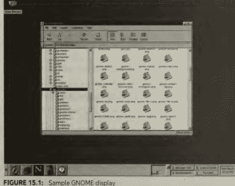

**图 15.1：** 示例 GNOME 显示

图 15.1 底部的长条是一个 GNOME 面板，其中包含一组有用的面板小部件和菜单。面板小部件是设计用于放置在面板中的微型程序；例如，最右侧的时钟小部件显示当前时间。面板两侧的箭头用于隐藏（并取消隐藏）面板。


面板中包含一个风格化愚者图案的按钮是主菜单按钮。只需点击主菜单按钮，您就会看到一个预装应用程序和操作的菜单，其中包含注销命令。

屏幕剩余的可用空间被称为*桌面*。只需将您最常用的项目放置在桌面上，然后双击该项目（使用鼠标左键）即可使用。当您双击该项目时，会发生以下情况：

- 如果该项目是程序，该程序将启动。
- 如果该项目是数据，相应的程序将加载该数据并启动。
- 如果该项目是目录，文件管理器应用程序将启动并显示该目录的内容。您的桌面上可能有一个标有“主目录”的文件夹图标。双击它将在您的主目录启动文件管理器。

文件管理器应用程序允许您管理文件。其窗口的左侧显示目录，右侧显示所选目录的内容。您可以通过以下方式管理文件：

- 若要移动文件或目录，只需拖放即可。
- 若要复制文件，请在拖拽时按住控制键（Control key）。
- 若要运行程序或编辑数据文件，请双击它。
- 若要执行文件的其他操作（如重命名或删除），请使用鼠标右键选择它。
- 若要一次选择多个项目，请在单击第一个项目后，按住 Shift 键单击其他项目。

您可以轻松地在目录之间移动或复制文件：只需启动两个文件管理器应用程序，每个显示不同的目录即可。如果您想将文件放到桌面上，只需将其从文件管理器拖到桌面上即可。事实上，在 GNOME 中，将项目拖放到其他项目上通常能“做正确的事”，使完成工作变得更加容易。

GNOME 具有高度可配置性；例如，您可以拥有多个面板（水平和垂直），选择放入其中的内容，并让它们自动隐藏。您可以将许多面板小部件包含在您的面板中。您还可以更改屏幕的外观——本文档后续部分将介绍如何操作。

GNOME 遵循一些您应该了解的 Unix 约定。鼠标左键用于选择和拖拽项目。鼠标右键为选定的对象调出菜单（如果适用）。大多数 Unix 鼠标有三个按钮，中键用于粘贴文本（如果在文本区域内）或移动对象。如果您只有两个按钮，请同时按下左键和右键来模拟中键。若要复制文本，请使用左键在要复制的文本上拖拽，移动到希望文本出现的位置，然后按下中键。

当应用程序窗口显示时，其边框中会有一些用于控制窗口的按钮。这些包括最小化、最大化和关闭窗口按钮。它们的外观可以配置，由称为窗口管理器的组件控制。

两种边框风格的示例是 Clean 风格（图 15.2）和 ICE 风格（图 15.3）：

- 在 Clean 边框风格中，下划线用于最小化，方块用于最大化（使用整个屏幕），X 按钮用于关闭窗口。
- 在 ICE 风格中，X 按钮将关闭窗口。使用鼠标左键点击箭头会最小化窗口，而使用鼠标右键点击则会显示其他选项的菜单。


图 15.2：Clean 边框风格


图 15.3：ICE 边框风格

如果您使用的是 GNOME 的默认安装，您可能会注意到最小化窗口实际上会导致该窗口从桌面上消失。为了重新获取该窗口，您可以使用位于面板上的 GNOME 分页器（Pager）。分页器会显示哪些任务正在运行以及它们位于您的哪些桌面上。您会在 GNOME 分页器右侧的任务列表（图 15.4）中找到已最小化的应用程序。按下该应用程序的按钮，它就会返回到桌面上。


后续章节将更详细地描述系统的每个组件。

### 窗口管理器与 GNOME

#### 关于窗口管理器

窗口管理器是控制 X 窗口环境中窗口的软件部分。任何窗口的位置、边框和装饰都由窗口管理器管理。这与许多其他操作系统非常不同，且 GNOME 处理窗口管理器的方式与其他桌面环境不同。

如本指南前文所述，GNOME 不依赖于任何特定的窗口管理器。这意味着当您决定切换窗口管理器时，您的桌面环境的主要部分不会发生变化。GNOME 与窗口管理器协同工作，为您提供最便捷的工作环境。GNOME 不关注窗口放置，而是从窗口管理器获取有关其位置的信息。GNOME 分页器仅与符合 GNOME 标准的窗口管理器配合使用，桌面上的拖放功能也是如此。

在本版 GNOME 用户指南发布时，Enlightenment 窗口管理器是唯一 100% 符合标准的窗口管理器。还有许多其他窗口管理器是部分符合标准的，或者正在努力达到标准。

在本版 GNOME 用户指南发布时，部分到完全符合标准的窗口管理器包括：

- Enlightenment ([http://www.enlightenment.org](http://www.enlightenment.org))
- Iccwm ([http://www.kiss.uni-lj.si/~k4fr0235/icewm/](http://www.kiss.uni-lj.si/~k4fr0235/icewm/))
- Window Maker ([http://www.windowmaker.org](http://www.windowmaker.org))
- FVWM ([http://www.fvwm.org/](http://www.fvwm.org/))

#### 更改窗口管理器

在任何时候，您都可以通过使用 GNOME 控制中心中的窗口管理器小部件来更改正在使用的窗口管理器。您可以在本章稍后的“窗口管理器小部件”部分阅读有关此小部件的更多信息。


注意

请记住，您选择使用的窗口管理器可能不符合 GNOME 标准，如果您使用它，可能无法享受某些 GNOME 功能。

### 使用 GNOME 面板

面板是 GNOME 界面的核心，充当所有系统应用程序、小部件和主菜单的存储库。面板还设计为高度可配置。面板为您提供了一个始终包含您所需菜单和应用程序的位置。

#### 基础知识

使用 GNOME 面板非常简单，任何使用过图形化操作系统的人都能轻松上手。您可以添加新面板、向面板添加应用程序以及添加各种小部件。本节将描述这些功能及更多功能。

##### 使用主菜单

要启动任何预装应用程序，请按下主菜单按钮（图 15.5）。主菜单有一个风格化脚的图片，首次使用时位于屏幕左下角。按下主菜单按钮后，您应该松开鼠标按钮，以便您可以利用主菜单中的其他功能（如右键单击和从菜单拖放）。


主菜单是系统中所有应用程序的起点。稍后在本手册中，您将学习如何自定义主菜单以适应您的工作环境，但就目前而言，您可以使用安装 GNOME 时建立的菜单。主菜单的工作方式与其他图形桌面环境中可能使用过的其他菜单一样。只需按下主菜单按钮，然后从弹出的菜单中进行选择。

#### 隐藏面板

在任何时候，您都可以通过按下隐藏按钮（见图 15.6）来隐藏 GNOME 面板。


这将沿隐藏按钮上箭头的方向隐藏 GNOME 面板。面板两侧可能有隐藏按钮，因此您可以向任意方向隐藏它。

您可能决定希望面板在您不使用它时自动隐藏。如果您无法以高分辨率运行系统，这可能是一个有用的功能。您可以稍后在本章的“配置面板”部分了解如何自动隐藏面板。

#### 移动和添加面板

您可以使用鼠标中键（或同时按下鼠标左右键）将桌面上的任何面板拖拽到屏幕的期望边缘来移动它。如果您没有中键或未配置鼠标模拟中键，也可以通过更改面板配置对话框中的位置来移动面板。您可以稍后在本章的“配置面板”部分阅读更多相关内容。

您也可以从主菜单的面板菜单中选择“添加新面板”来向桌面添加新面板。您将收到选择

边缘面板或角落面板。这两种面板类型在下面都有描述：

**边缘面板** 边缘面板与使用 GNOME 启动时的主面板完全相同。通过选择此类型的面板，您可以在屏幕的另一侧添加一个新的面板，从而为自己提供更多功能。

**角落面板** 角落面板是一个小型面板，不会拉伸到其所处屏幕的边缘。不过，角落面板会拉伸以容纳其中包含的图标和小程序组件。

> 注意
>
> 隐藏按钮在角落面板上的工作方式略有不同。离屏幕边缘最近的隐藏按钮会按常规隐藏面板，但另一个隐藏按钮会将整个面板发送到对侧。执行此移动操作后，它不会隐藏面板，因为这是改变面板所在的屏幕侧边。如果您想隐藏它，必须再次按下隐藏按钮。

随时可以通过从弹出菜单中选择“转换为边缘面板”或“转换为角落面板”选项，将当前面板更改为对面类型。可用的选择取决于您右键单击的是哪种类型的面板。显示的选项将是当前面板的相反类型。

#### 将应用程序和小程序组件添加到面板

##### 添加应用程序启动器

如果您想将应用程序启动器（用于启动特定应用程序的图标）添加到面板，请右键单击面板并从弹出菜单中选择“添加新启动器”。

选择“添加新启动器”菜单项后，您将看到一个对话框，允许您设置希望添加的应用程序启动器的属性（见图 15.7）。

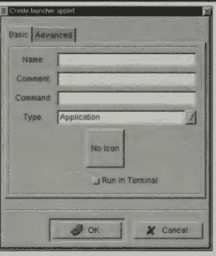


# 图 15.7：创建启动器对话框

在“创建启动器”小程序组件对话框中，您可以为启动器添加名称、包含注释、使用命令行启动应用程序以及定义应用程序类型。您还可以按下“图标”按钮，并从图标选择器中选择一个图标来代表该应用程序。如果未选择图标，将使用默认图标。

将应用程序启动器添加到面板的一种更快捷的方法是进入主菜单并右键单击应用程序菜单项。您会看到另一个菜单选择，其中包含“将此启动器添加到面板”项。如果您选择此菜单项，它将自动为该应用程序添加一个启动器到您调用主菜单所在的面板。此时，您可以右键单击该启动器并选择“属性”菜单项来更改该启动器的任何选项。

## 使用抽屉对项进行分组

如果您希望将一部分应用程序分组在一起，可以使用抽屉（见图 15.8）。抽屉只是一个位于面板上的类似菜单的小按钮，它在一个位置对应用程序启动器进行分组。一旦您在面板上放置了抽屉，您可以单击它来显示应用程序菜单，再次单击则将其隐藏。


**图 15.8：** 面板上运行的抽屉

将抽屉放置到面板上有几种方法。首先，您可以右键单击面板并从弹出菜单中选择“添加抽屉”。其次，如果您希望将主菜单中的整个子集变为抽屉，可以右键单击该菜单的标题栏，并从弹出菜单中选择“将此作为抽屉添加到面板”。

您可以以与添加抽屉相同的方式将菜单添加到面板。菜单与抽屉非常相似，只是它们不使用大图标来表示应用程序启动器；相反，它们使用类似主菜单的样式（即小图标和应用程序名称）。您可以通过右键单击菜单的标题栏并从弹出菜单中选择“将此作为菜单添加到面板”来添加菜单。您还可以通过从 GNOME 文件管理器中拖出目录并将其放置在面板上，将系统目录作为菜单添加到面板。

### 添加小程序组件

您可以将许多小程序组件添加到面板。小程序组件是可以在面板本身内执行任务的小型应用程序。您可以添加的小程序组件在 GNOME 文档中有更详细的介绍。以如何添加小程序组件为例，您可以将另一个时钟小程序组件添加到面板。要将时钟小程序组件（见图 15.9）添加到您的面板：

1. 右键单击面板。
2. 从弹出菜单中选择“添加新小程序组件”菜单项。这将显示更多级别的弹出菜单。
3. 选择“实用程序 > 时钟”菜单项。时钟将被添加到您的面板。


**图 15.9：** 时钟小程序组件

若要删除您添加的时钟小程序组件，可以右键单击时钟并从弹出菜单中选择“从面板中移除”。

## 运行应用程序

在 GNOME 中有许多方式可以启动应用程序。请记住，GNOME 的一大优势是允许您仅使用易于使用的图形界面来启动和控制应用程序。有许多方法可以启动您希望使用的应用程序。

正如您在上一节中看到的那样，您可以使用主菜单来查找预加载的应用程序或您使用菜单编辑器提供的应用程序。您可以在本章后面的“编辑主菜单”部分中阅读更多关于菜单编辑器的内容。

您还可以从面板添加应用程序启动器（见本章前面的“添加应用程序启动器”）。

如果您正在使用 GNOME 文件管理器，您可以双击任何可执行文件，它将运行。

您可以使用 GNOME 运行程序来启动任何应用程序。若要使用它，请从主菜单中选择“运行程序”。这将启动一个简单的对话框，允许您输入启动应用程序的命令。例如，如果您想启动 Emacs 编辑器，但它不在菜单中或您的面板上，您可以启动 GNOME 运行程序并在对话框中的文本框中输入 `emacs`。

## 注销 GNOME

GNOME 提供了几种方便的注销方法。您可以使用“注销”菜单项或“注销”按钮。

“注销”菜单项是主菜单中的第一个菜单项。只需选择“注销”，系统就会提示您是否要注销。选择“是”，您的 GNOME 会话将结束。

您可以将“注销”按钮添加到面板。这只是另一种注销方法，除了一个漂亮的按钮外，它没有提供比“注销”菜单项更多的功能。要将“注销”按钮添加到面板，请右键单击面板并从弹出菜单中选择“添加注销按钮”。按钮就位后，您可以按下它来注销。

**注意**

如果您运行的是符合 GNOME 标准的窗口管理器，注销功能将同时终止窗口管理器和 GNOME。如果您没有运行这样的窗口管理器，您将必须自己结束该窗口管理器。

注销对话框（图 15.10）将在您注销 GNOME 时显示。此对话框会询问您是否真的要注销。它还为您提供不同的方法来退出 GNOME。您有三种选择来退出 GNOME。您可以注销（这将简单地带您到终端）、关机（这将关闭整个系统）或重新启动（这将重新启动整个系统）。

如果您不想注销，请按下“否”按钮，您将返回到 GNOME 会话。

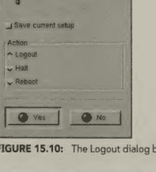

在注销对话框中，在离开 GNOME 之前有一个您可以选择的选项。

如果您想保存当前的设置，请选择“保存当前设置”复选框。这将保存您打开的程序以及面板的配置。

## GNOME 桌面

GNOME 桌面为您提供任何传统操作系统桌面的所有功能。您可以将文件、程序和目录文件夹拖放到桌面上。您还可以将这些项目拖回符合 GNOME 标准的应用程序中。


### 注意

GNOME 桌面实际上是由 `GNOME 文件管理器` 中的后端进程提供的。如果由于某种原因该后端进程停止运行，您可以再次启动 GNOME 文件管理器，您的桌面将恢复。如果您确实需要这样做，您不需要保持 GNOME 文件管理器窗口开启以启用桌面。

### 使用桌面

使用桌面很简单，只需常规地将您希望使用的项目拖到桌面上。默认桌面将包含您主目录（`/home/{user_name}`）的一个文件夹。默认情况下，GNOME 文件管理器窗口也将出现，供您访问系统的其他区域。

要利用拖放功能，您需要使用符合 GNOME 标准的应用程序或 Motif 应用程序。GNOME 兼容 Motif 拖放，因此您会发现它适用于许多已安装的应用程序。

存储在桌面上的所有项目都位于以下目录中：

```
/home/{user_name}/.gnome-desktop/
```

当您希望某个项目在桌面上显示，但又无法对其使用拖放功能时，记住这一点很有帮助。

一旦启动 GNOME，您会注意到连接到系统的任何驱动器都会以相应的图标显示在桌面上。您可以利用这些图标来挂载和访问这些驱动器。


### 注意

在利用这些图标之前，您必须具有挂载桌面上所示设备的权限。您必须有 root 密码才能完成此操作。如果您没有此密码，应咨询您的系统管理员。

如果你的机器上安装了 `linxconf`，获取挂载访问权限会非常容易。只需在“访问本地驱动器”部分选择你想要访问的驱动器。从“选项”选项卡中，选择“用户可挂载”。这样，你的驱动器现在就可以被用户挂载了。

如果你没有 `linxconf`，则必须编辑 `/etc/fstab` 以包含用户访问权限。这是通过为驱动器添加用户访问权限来实现的。例如，如果你的 fstab 文件看起来像这样

```
/dev/cdrom  /mnt/cdrom  iso9660  exec,dev,ro,noauto 0 0
```

add "user" to the fourth column, as follows:

```
/dev/cdrom  /mnt/cdrom  iso9660  user,exec,dev,ro,noauto 0 0
```

根据系统和工作环境的不同，这可能涉及一些安全风险。在使任何驱动器可被用户挂载之前，请咨询你的系统管理员。

一旦你获得了挂载驱动器的权限，你可以右键单击桌面上的驱动器图标。这将弹出一个小的弹出菜单。选择“挂载设备”来挂载它，选择“弹出设备”来弹出它。一旦挂载完成，你可以双击它，或者从弹出菜单中选择“打开”，以打开一个 GNOME 文件管理器窗口，从而查看设备的内容。

如果缺少你可能已添加到机器上的任何驱动器，你可以右键单击桌面上的空白区域，并从弹出菜单中选择“重新扫描可挂载设备”。

### 桌面区域

桌面区域允许你在同时执行许多任务时保持系统井井有条。就像当你东西太多一张桌子放不下时增加一张新桌子一样，桌面区域允许你切换到另一个区域以启动更多程序。

即使桌面区域是由另一个名为窗口管理器的软件程序控制的，GNOME 也了解桌面区域。你可以在正在使用的窗口管理器的配置中设置桌面区域的数量。如果你使用的是默认窗口管理器，或者你的窗口管理器具有图形配置工具，你可能可以从“窗口管理器”小程序中启动它。你可以在本稍后的“窗口管理器”部分阅读更多关于该小程序的信息。


**注意**


大多数窗口管理器都会提供拥有多个桌面的选项，这与桌面区域不同。桌面区域是一个桌面的虚拟扩展；而多个桌面实际上是独立的桌面。

GNOME 的默认设置是使用只有一个桌面的桌面区域。这是因为在旧的应用程序（如使用 Motif 的应用程序）中，用户在跨桌面进行某些拖放功能时可能会遇到问题。

### 其他桌面菜单

在 GNOME 中，你可以从几个桌面菜单中选择。这些菜单通过右键单击桌面上的任何空白区域来访问。这将弹出包含以下项目的菜单：

- **新建 > 终端**：这将启动一个新的 GNOME 终端窗口，并自动导航到 `~/.gnome-desktop` 目录。
- **新建 > 目录**：这允许你在桌面上创建一个新的目录。如果你希望将文件放入新目录以整理桌面，这将是一个方便的工具。
- **新建 > 启动器**：这允许你在桌面上放置一个新的应用程序启动器。选择此菜单项将启动一个应用程序启动器对话框，允许你指定应用程序及其属性。
- **新建 > [应用程序]**：一些应用程序可能会在新建菜单中为你添加项目。例如，Numeric 电子表格会在“新建”菜单中添加“新建 Numeric 电子表格”菜单项，以便你可以轻松启动一个新的电子表格。
- **排列图标**：这将自动排列你的桌面图标。
- **创建新窗口**：这将启动一个新的 GNOME 文件管理器窗口，显示你的主目录。
- **重新扫描可挂载设备**：这将重新扫描机器上的可挂载设备，并显示它可能发现的任何新设备的图标。
- **重新扫描桌面**：这将重新扫描 `~/.gnome-desktop` 目录中的文件。

### GNOME 文件管理器

GNOME 包含一个文件管理器，允许你在舒适、功能强大的图形环境中操作系统中的文件。该文件管理器被称为 GMC，即 GNU Midnight Commander。GMC 基于可在终端中运行的 Midnight Commander 文件管理器。

Midnight Commander 长期以来以其强大功能和易用性著称。GMC 从 MC 中继承了这种强大功能和易用性，并添加了 GNOME 图形前端。

如前一章所述，GNOME 文件管理器（见图 15.11）为 GNOME 提供桌面功能。GNOME 文件管理器还通过 GNOME 文件管理器窗口提供了一个操作系统中文件的地方。

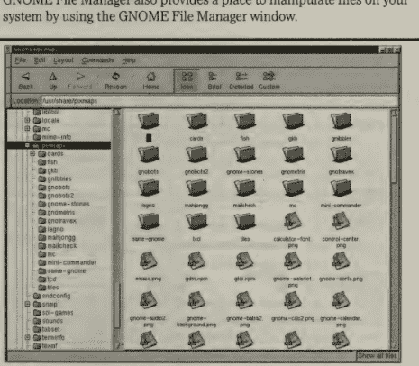

**图 15.11：** GNU Midnight Commander——GNOME 文件管理器

GNOME 文件管理器中有两个主要窗口。左侧是树视图，它以层次结构表示系统中的所有目录。右侧是目录窗口，将显示你在树视图中所选目录的内容。

要在树视图中选择一个目录，只需单击该目录。这将改变主目录视图，显示你所选目录中的文件。如果目录中包含子目录，你可以单击树视图中的加号来展开目录。你可能希望利用主文件视图中的图标视图和详细视图。图标视图是默认视图，将为每个文件显示大图标。简要视图以列表形式显示文件和目录，但不显示额外信息。详细视图将以列表形式显示目录中的文件及其信息。自定义视图是一个列表视图，允许你选择要查看的文件信息。

在简要、详细和自定义视图中，你可以单击窗口顶部的某个信息标题，文件将根据该信息进行排序。例如，如果你想找到目录中最大的文件，你可以单击“大小”标题，文件将按大小从最大到最小排序。再次单击“大小”标题将改变排序，从最小到最大。

#### 在 GNOME 文件管理器中移动

在 GNOME 文件管理器中，“位置”和主文件窗口上方有一个位置文本框。在此文本框中，你可以输入要在主窗口中查看的文件的径路径。GNOME 文件管理器还配备了查看 FTP 站点功能。要查看 FTP 站点，你需要通过拨号账户或网络连接到 Internet。在位置文本框中输入 FTP 地址，GNOME 文件管理器将尝试连接到该站点。

请确保按照以下方式输入 FTP 地址：

```
ftp://[site address]
```

位置文本框旁边有你可能希望使用的导航按钮。这些带有箭头图标的按钮允许你在当前目录的相邻目录中移动。左侧按钮会带你去你所在的 previous 目录，中间按钮会带你向上提升一级目录层次，右侧按钮会在你刚刚向后移动时带你去下一个目录。

> **提示**
>
> 你可以使用鼠标中键在任何目录上打开辅助窗口。在主窗口中的目录上按下鼠标中键（如果模拟中键，则同时按下左键和右键），将打开一个新窗口，显示你所点击目录的内容。

#### 选择文件

在 GNOME 文件管理器中，通过单击文件或文件来选择文件。选中的文件会突出显示，以表明它已被选中。有几种方法可以选择多个文件。一种方法是使用“橡皮筋”选择（见图 15.12），即单击并拖动鼠标光标围绕多个文件。此操作会产生一条小虚线，即“橡皮筋”，以显示将选择文件的区域。

如果你希望更精确地选择文件，或者你需要选择的文件彼此不相邻，你可以使用 Control 键在选择更多文件时保持已选文件。其工作原理是选择一个文件，按下并保持 Control 键，然后选择另一个文件。当按下 Control 键时，你可以添加到已选文件的“列表”中。一旦你通过任一方法选择了多个文件，你可以复制或移动这些文件。

你还可以通过从“编辑”菜单中选择“全选”菜单项来选择目录中的所有文件。你还可以通过使用“编辑”菜单中的“选择文件”菜单项来过滤选择。使用“选择文件”将显示一个简单的对话框，允许你输入选择条件。在此字段中，符号 `*` 被解释为通配符（例如，它匹配任何字符串）。例如，如果你想选择目录中所有以字母 D 开头的文件，你可以输入 `D*`（注意 Unix 中的文件名区分大小写）。


#### 复制和移动文件

在 GNOME 文件管理器中，拖放操作默认是移动文件。但你也可以按下列操作使用拖放来复制文件

按住 Shift 键同时拖动文件。这种方式对于拖放到桌面上的任何文件都有效。你还可以通过使用鼠标中键拖动文件或按住 Alt 键拖动文件来切换菜单，该菜单可让你决定拖动时执行的操作。一旦释放拖动，你会看到一个弹出菜单，其中包含“复制”、“移动”、“链接”和“取消拖动”选项。

复制或移动文件的另一种方法是利用右键单击弹出菜单。右键单击你要复制或移动的文件，并从弹出菜单中选择“移动/重命名”或“复制”。这将打开一个对话框（参见图 15.13），用于执行这些任务。

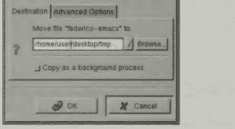

**图 15.13：** 移动对话框

要使用移动对话框，只需输入你希望移动文件的目标路径即可。如果你想要重命名文件，可以在路径字符串中输入文件的新名称。复制对话框的外观和移动/重命名对话框的工作方式完全相同。

如果你要移动的文件与之关联有符号链接——即指向文件实际位置的虚拟链接——你可以选择“高级选项”标签页并选择“保留符号链接”。选中此项可确保尽管发生移动，链接仍被保留。如果文件与之关联有符号链接，建议使用此方法来移动文件。

#### 重命名文件

在 GNOME 文件管理器窗口或桌面上重命名文件可以通过两种方法实现。重命名文件的一种方法是右键单击该文件，并从弹出菜单中选择“属性”。在文件名文本框中，你可以输入希望其显示的新名称（参见图 15.14）。

重命名文件的快捷方法是缓慢地双击该文件。请确保操作缓慢，以免启动该文件，而只是高亮显示它，然后再点击一次。此时，文件名将进入编辑模式，光标会变为编辑线，你可以输入新名称。

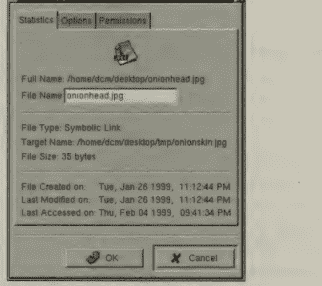

**图 15.14：** 文件属性

#### 从 GNOME 文件管理器启动应用程序

GNOME 文件管理器允许你通过双击与应用程序关联的文件来从主窗口启动应用程序。你可以通过阅读“GNOME MIME 类型”部分来更改文件类型的处理方式。如果文件没有关联的应用程序，你可以右键单击该文件并从弹出菜单中选择“打开方式”。这将打开一个对话框，允许你定义启动该文件的应用程序。例如，如果你想使用 Emacs（一种流行的文本编辑器）编辑名为 test.txt 的文件，你可以右键单击 test.txt 并选择“打开方式”。当出现“打开方式”对话框时（参见图 15.15），只需在 test.txt 文件名前输入 emacs。当你按下确定时，Emacs 将打开该文件。

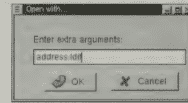

**图 15.15：** 打开方式对话框

#### 文件属性和操作

对于主文件显示中的任何文件，你可以右键单击它，并从弹出菜单中选择多种属性和操作：

- **打开** 这将使用与该文件关联的适当应用程序打开该文件。你可以在“GNOME MIME 类型”部分阅读更多关于编辑这些关联的内容。
- **打开方式** 使用此菜单项，你可以使用任何应用程序打开文件。你可以在“从 GNOME 文件管理器启动应用程序”部分阅读更多关于此内容的信息。
- **查看** 这将使用基本文本查看器查看该文件。


### 编辑
这将启动编辑器以编辑该文件。启动的编辑器由与该文件类型关联的应用程序决定。你可以在“GNOME MIME 类型”部分阅读更多关于编辑此关联的内容。

### 复制
这会将文件复制到剪贴板，以便粘贴到其他位置。

### 删除
这将删除该文件。

### 移动
这将打开移动对话框，允许你移动该文件。你可以在“复制和移动文件”部分阅读更多关于此对话框和移动文件的信息。

### 属性
属性菜单项将启动属性对话框。属性对话框允许你编辑和查看所选文件的属性。

属性对话框（参见图 15.16）由三个标签页组成：统计信息、选项和权限。

#### 统计信息
此标签页将显示文件信息，包括名称、类型、大小和历史记录。你可以在文件名文本框中更改文件名。

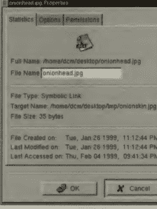

#### 选项
此标签页允许你更改文件的处理方式。你可以定义如何打开、查看和编辑文件。如果需要，你可以在终端窗口中打开它，你可以选中“在终端中运行”复选框。

###### 注意
如果你从桌面上的图标打开属性对话框，你可以在选项标签页中更改该文件的图标。

#### 权限
此标签页允许你更改文件的权限和所有权（如果你有相应的权限）。你可以为所有者、组和其他用户选择读取、写入和执行权限。你还可以使用 `UID`、`GID` 和粘滞位来定义文件的拥有者。

## 更改文件管理器首选项
你可以为 `GNOME` 文件管理器配置许多设置。这些设置通过 `GMC` 首选项对话框访问。你可以通过从编辑菜单中选择“首选项”来启动此对话框。

`GMC` 首选项对话框分为五个主要部分：文件显示、确认、自定义视图、缓存优化和 `VFS`。

### 文件显示
文件显示标签页（图 15.17）允许你更改 `GMC` 中文件的显示方式。

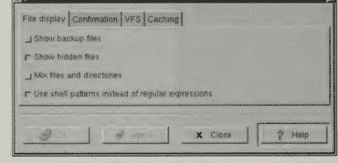

**图 15.17：** 文件显示首选项

**显示备份文件** 这将显示系统中的任何备份文件。

**显示隐藏文件** 这将显示所有“点文件”或以点开头的文件。这些文件通常包括配置文件和目录。

**混合文件和目录** 此选项将按照你排序的顺序显示文件和目录，而不是始终让目录显示在文件之上。

**使用 Shell 模式而非正则表达式** 此选项仅适用于高级用户。如果你不熟悉正则表达式，你不应该使用此选项。如果你熟悉如何创建正则表达式，你可以选择此选项在排序和筛选中使用它们。

### 确认
此标签页（参见图 15.18）允许你更改哪些功能在继续前需要你的确认。

**删除文件时确认** 这将在删除文件之前弹出确认屏幕。

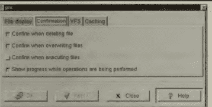

**图 15.18：** 确认首选项

- **覆盖文件时确认** 这将在覆盖文件之前弹出确认屏幕。
- **执行文件时确认** 这将在执行文件之前弹出确认屏幕。
- **操作执行时显示进度** 这将在执行某些操作（如复制、移动、删除等）时显示进度条。

### VFS
此标签页（参见图 15.19）允许你配置虚拟文件系统的选项。

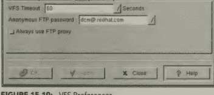

**图 15.19：** VFS 首选项

虚拟文件系统允许你操作那些不位于本地文件系统上的文件。`VFS` 有不同的版本，包括 `ftpfs` 和 `tarfs`。`ftpfs` 允许你在 `FTP` 站点上工作，而 `tarfs` 让你能够访问 `.tar` 文件内部。


###### 注意
`.tar` 文件是标准的 Unix 归档格式

你在 `VFS` 标签页上有以下选项：

- **VFS 超时** 这将决定你在没有任何活动的情况下保持连接到任何 `VFS` 的时间。超时时间以秒为单位测量。
- **匿名 FTP 密码** 这允许你为登录匿名 `FTP` 站点设置密码。通常你会希望将其设置为你的电子邮件地址。
- **始终使用 FTP 代理** 如果你需要使用代理连接到 `FTP` 站点，你会希望启用此选项。

### 缓存
此标签页允许你配置通过缓存增强 `GMC` 速度的项目（参见图 15.20）。

- **快速目录重新加载** 此选项将目录信息存储在缓存中，以便更快地加载。

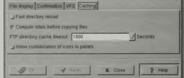

**图 15.20：** 缓存首选项


###### 注意
如果你启用快速目录重新加载，可能会遇到无法看到已添加到目录中的新文件的问题。

### 自定义视图
**复制文件前计算总计** 这将使 `GMC` 在执行任务之前确定正在复制的文件数量，从而能够在此过程中向您提供相关信息。

**FTP 目录缓存超时** 此选项将使最近访问的 `FTP` 站点信息在缓存中保留您指定的时间。时间以秒为单位。

**允许在图标视图中自定义图标** 这允许您通过右键点击图标并选择“属性”菜单项来更改图标视图中的图标。您始终可以更改桌面上项目的图标，但只有在此选项开启时，才能更改图标视图中的图标。

> **注意**
> 开启**允许在图标视图中自定义图标**功能可能会导致系统变慢。

自定义视图对话框（参见图 15.21）允许您设置 `GNOME` 文件管理器中自定义视图的外观。

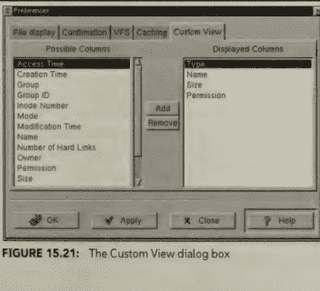

自定义视图选项卡中有两个主要列：可能的列和显示的列。

可能的列列表包含所有可显示的信息类型。如果您希望包含某种信息类型，可以按“添加”按钮，它将被添加到显示的列列表中。

显示的列列表显示了将包含在自定义视图中的当前信息类型。如果您希望移除任何项，请按“移除”按钮。

如果您想要重新排列显示的列列表中的项目，请用鼠标将它们拖动到所需的位置。

## GNOME 文件管理器菜单指南
本节描述 `GNOME` 文件管理器中的每个菜单项。


> **提示**
> `GNOME` 文件管理器中的所有菜单都启用了可撕离功能。如果您希望任何菜单在其自己的窗口中“浮动”在桌面上，只需选择菜单顶部的虚线即可。

### 文件
文件菜单包含与文件和更高级别活动相关的项。

- **新建窗口** 这将打开一个新的文件管理器窗口。
- **打开** 这将使用鼠标光标打开您选定的文件。
- **复制** 这将启动“复制”对话框，使您能够将选定的文件复制到您选择的目的地。
- **移动** 这将启动“移动/重命名”对话框，使您能够将选定的文件移动或重命名到您选择的目的地。
- **删除** 这将删除您选定的文件。
- **关闭** 这将关闭 `GNOME` 文件管理器

### 编辑
编辑菜单包含与编辑和选择文件相关的项。

**全选** 这将选择您当前在 `GNOME` 文件管理器中正在操作的目录中的所有文件。

**选择文件** 这将启动一个简单位框，允许您指定文件选择范围。例如，如果您希望选择所有以字母 D 开头的文件，您只需输入 `D*` 并按“确定”。

**反选** 这将反转当前选择。例如，如果在一个包含 10 个文件的目录中选中了 7 个文件，选择“反选”将选中剩余的 3 个文件并取消对之前选中的 7 个文件的选择。

**重新扫描目录** 如果目录中的文件已更改，这将重新扫描当前目录。

**偏好设置** 这将启动偏好设置对话框，以便您可以自定义 `GNOME` 文件管理器。

### 布局
此菜单包含与 `GNOME` 文件管理器中的布局相关的项。

**排序方式** 这将启动一个对话框，允许您选择希望在当前目录中如何对文件进行排序。您可以按以下任一项排序：名称、文件类型、大小、最后访问时间、最后修改时间或最后更改时间。

**筛选视图** 这将弹出一个简单位框，允许您仅查看具有特定属性的文件。例如，如果您希望仅查看目录中以字母 D 开头的文件，您可以向对话框中输入 `D*` 并按“确定”。如果您希望再次查看所有文件，您将需要再次启动筛选视图对话框并清空该框或输入 `*`。

**图标视图** 选择此项将以大图标形式在主视图中显示文件。

**部分视图** 选择此项将以仅包含文件名的列表形式在主视图中显示文件。

**完整视图** 选择此项将以包含所有文件信息的列表形式在主视图中显示文件。

**自定义视图** 自定义视图的主要项将您的视图切换到自定义视图，这是一种列表视图，显示您指定的文件信息。要自定义视图，您需要使用偏好设置对话框中的自定义视图编辑器。您可以在“更改文件管理器中的偏好设置”部分阅读更多关于偏好设置对话框的内容。

### 命令
命令菜单包含用于在 `GNOME` 文件管理器中对文件运行命令的项。

**查找文件** 查找文件弹出一个对话框，允许您在系统中搜索特定文件。


### 编辑 MIME 类型
此选项将启动允许您编辑 GNOME MIME 类型的 GNOME 控制中心小工具。MIME 类型除了其他用途外，还决定了哪些应用程序将处理特定的文件类型。您可以稍后在本章的“GNOME MIME 类型”部分阅读更多关于 MIME 类型的内容。

### 运行命令
此菜单项允许您从 GMC 运行命令。

### 在面板中运行命令
此菜单项允许您在当前所在目录内运行预加载的命令或您指定的命令。这些命令包括查找 SUID 或 SGID 程序以及其他命令。

### 退出
这将允许您退出 GNOME 文件管理器。

> **注意**
> 退出命令将退出所有包含 GNOME 桌面的 GNOME 文件管理器进程。如果您退出，将失去桌面上的所有功能。不推荐此选项。

## GNOME 拖放之旅
GNOME 桌面有许多技巧和小窍门。拖放功能延伸到 GNOME 的许多领域，使得以许多有趣的方式互连 GNOME 变得容易。以下是一系列使用 GNOME 拖放技巧。这是一个良好的 GNOME 之旅，将展示如何充分利用 GNOME。

**将颜色拖到面板上** 每当显示颜色选择器时，您可以从选定的颜色条中将颜色拖到面板上，它将把面板更改为该颜色。

**将像素图拖到背景选择器** 如果您希望将背景更改为图像，您可以从 GNOME 文件管理器中将图像拖到控制中心的背景小工具中的监视器图像，它将更改为该图像。

**拖放到应用程序** 许多符合 GNOME 规范的应用程序都接受拖放。如果您希望在 Gnumeric（一个符合 GNOME 规范的电子表格应用程序）中打开一个文件，请将文件从 GNOME 文件管理器拖到 Gnumeric 上，它将打开该文件。对于使用 Motif 构建的应用程序也是如此。您可以将保存的 URL 拖到 Netscape 4.x 上，它将打开该 URL。如果您在 GNOME 文件管理器中工作并希望快速打开文件，这将非常有用。

**向面板添加应用程序启动器** 如果您希望向面板添加应用程序启动器，您可以从 GNOME 文件管理器或桌面将任何可执行文件拖放。这将显示创建启动器小工具对话框，允许您为该启动器选择名称和图标。

**拖放文件** 有许多方式可以使用拖放来帮助您管理系统。您可以打开两个指向不同目录的 GNOME 文件管理器窗口，然后在两个窗口之间拖放文件以复制、移动或链接文件。您可以将文件从文件管理器拖到桌面上，使其更易于访问。使用鼠标中键或同时使用鼠标右键和左键将目录文件夹拖到桌面上。从弹出菜单中选择链接选项以创建指向桌面的链接。这将为您提供快速启动文件管理器进入该目录的方式。

**拖放目录** 您可以将目录从 GNOME 文件管理器中拖出并放置在面板上。这将创建一个新菜单，使您可以轻松访问该目录中的文件。


### 配置面板
您可以从主菜单中拖动任意子菜单到面板上，面板上将添加一个新的菜单启动器。这使得访问该菜单子集更加便捷。

GNOME 面板高度可配置，并配备了多种图形工具以帮助您完成配置。在本节中，您将学习如何按自己的喜好配置任意 GNOME 面板。

#### 面板全局属性
要开始配置 GNOME 面板，请右键单击面板并选择“全局属性”菜单项。您也可以通过按主菜单按钮并选择“面板 > 全局属性”菜单项来实现。

这将打开“全局面板配置”对话框（图 15.22）。通过此对话框，您可以为当前使用的所有面板以及未来添加的面板设置全局属性。

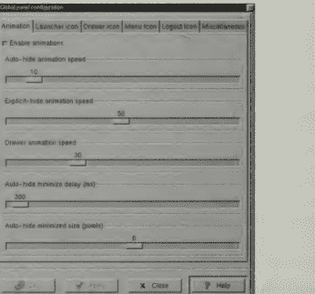

**图 15.22：** 全局面板配置对话框

“全局面板配置”对话框包含六个选项卡，用于帮助配置 GNOME 面板的全局属性：动画、启动器图标、抽屉图标、菜单图标、注销图标以及其他。以下分别解释每个选项卡。

##### 动画选项卡
- **启用动画**：此选项允许在此选项卡上配置动画可见。必须启用动画才能使用此选项卡的其他功能。默认位置为开启。
- **自动隐藏动画速度**：如果您的面板设置为自动隐藏，此选项将控制其发生的速度。
- **显式隐藏动画速度**：此选项控制当您按下面板的“隐藏按钮”时的隐藏速度。
- **抽屉动画速度**：如果您使用抽屉面板，此选项将控制抽屉菜单弹出的速度。
- **自动隐藏最小化延迟（ms）**：如果面板设置为自动最小化，此选项允许您控制在最小化前经过的时间。一旦鼠标不再悬停在面板上，面板即开始计时。当鼠标移动至面板恢复时所占用的区域时，它将重新出现。此时间以毫秒为单位。
- **自动隐藏最小化尺寸（像素）**：如果面板设置为自动隐藏，此选项确定面板最小化时显示的像素数量。

##### 启动器图标选项卡
- **启用图块**：此复选框将为面板上的所有图标启用背景图块。
- **图块文件名（向上）**：这是您希望用于“向上”位置（非激活、未按下）图块的图像文件的名称和路径。您可以按“浏览”按钮搜索文件。必须启用图块才能访问此选项。
- **图块文件名（向下）**：这是您希望用于“向下”位置（激活、按下）图块的图像文件的名称和路径。您可以按“浏览”按钮搜索文件。必须启用图块才能访问此选项。
- **边框宽度（仅图块）**：此选项确定图标周围边框的宽度。如果您有一个通常会被图块遮盖的图标，这会非常有用。您可以将边框设置为较小的尺寸，同时仍能看到图块。
- **深度（按下时的位移）**：此选项确定按下图标时图标位移的深度。必须启用图块才能访问此选项。

##### 抽屉图标选项卡
- **启用图块**：此复选框将为面板上的所有抽屉启用背景图块。
- **图块文件名（向上）**：这是您希望用于“向上”位置（非激活、未按下）图块的图像文件的名称和路径。您可以按“浏览”按钮搜索文件。必须启用抽屉图块才能访问此选项。
- **图块文件名（向下）**：这是您希望用于“向下”位置（激活、按下）图块的图像文件的名称和路径。您可以按“浏览”按钮搜索文件。必须启用抽屉图块才能访问此选项。
- **边框宽度（仅图块）**：此选项确定图块周围边框的宽度。必须启用抽屉图块才能访问此选项。
- **深度（按下时的位移）**：此选项确定按下时图块位移的深度。必须启用抽屉图块才能访问此选项。

##### 菜单图标选项卡
- **启用图块**：此复选框将为面板上的主菜单按钮启用背景图块。
- **图块文件名（向上）**：这是您希望用于“向上”位置（非激活、未按下）图块的图像文件的名称和路径。您可以按“浏览”按钮搜索文件。必须启用菜单图块才能访问此选项。
- **图块文件名（向下）**：这是您希望用于“向下”位置（激活、按下）图块的图像文件的名称和路径。您可以按“浏览”按钮搜索文件。必须启用菜单图块才能访问此选项。
- **边框宽度（仅图块）**：此选项确定图块周围边框的宽度。必须启用菜单图块才能访问此选项。
- **深度（按下时的位移）**：此选项确定按下时图块位移的深度。必须启用菜单图块才能访问此选项。

##### 注销图标选项卡
- **启用图块**：此复选框将为面板上的所有注销按钮启用背景图块。
- **图块文件名（向上）**：这是您希望用于“向上”位置（非激活、未按下）图块的图像文件的名称和路径。您可以按“浏览”按钮搜索文件。必须启用注销按钮图块才能访问此选项。
- **图块文件名（向下）**：这是您希望用于“向下”位置（激活、按下）图块的图像文件的名称和路径。您可以按“浏览”按钮搜索文件。必须启用注销按钮图块才能访问此选项。
- **边框宽度（仅图块）**：此选项确定图块周围边框的宽度。必须启用注销按钮图块才能访问此选项。
- **深度（按下时的位移）**：此选项确定按下时图块位移的深度。必须启用注销按钮图块才能访问此选项。

##### 其他选项卡
- **启用工具提示**：此选项为面板上的项目启用工具提示。工具提示是当光标悬停在面板元素上时出现的弹出帮助对话框。
- **显示小图标**：此选项将在主菜单中启用小图标。
- **显示“...”按钮**：此选项将为启动对话框的主菜单项启用三个小圆点。
- **在面板外显示弹出菜单**：当面板开启时，此选项允许弹出菜单在远离面板的位置出现。关闭时，弹出菜单将显示在面板上。这对较小的屏幕或杂乱的桌面很有用。
- **将菜单保留在内存中**：此选项将您的菜单保留在内存中，以免其重新扫描新增项目。这可以提高 GNOME 的速度，但也可能导致您遗漏菜单中符合 GNOME 标准的新项目。
- **交换移动**：此选项允许面板上的启动器按钮在移动时与其他图标交换位置。
- **自由移动（不打扰其他小部件）**：此功能锁定面板上图标的排列方式。如果您喜欢图标的当前排列方式，这是一个很好的功能。
- **注销前提示**：此选项将弹出一个“是/否”对话框，询问您是否确实希望注销。
- **鼠标悬停时提升面板**：如果您使用的窗口管理器不符合 GNOME 标准，它将不理解与面板的关系。这可能会导致面板被应用程序遮盖。如果启用此功能，当鼠标悬停在面板上时，面板会自动提升。


### 保持面板在窗口下方
如果您使用的窗口管理器符合 GNOME 标准，窗口管理器将理解其与面板的关系。如果选择此功能，窗口管理器和 GNOME 将允许应用程序出现在面板上方。这对较小的屏幕很有用。

### 如果按下抽屉内的启动器则关闭抽屉
默认情况下，选择抽屉内的某项目时，抽屉将保持打开状态。这可能很烦人，因为抽屉会保持打开状态直到您点击关闭。选中此选项后，选择抽屉内的任何项目时，抽屉将自动关闭。

### 小部件填充
此选项更改图标和小部件之间的空间（填充）量。

### 此面板属性

每个面板的属性都可以单独配置。要更改当前活动面板的配置，请右键单击面板并从弹出菜单中选择“此面板属性”。你也可以按下主菜单按钮，然后选择“面板 > 此面板属性”。这将打开如图 15.23 所示的“面板属性”对话框。在此框中，你可以更改当前活动面板的属性。

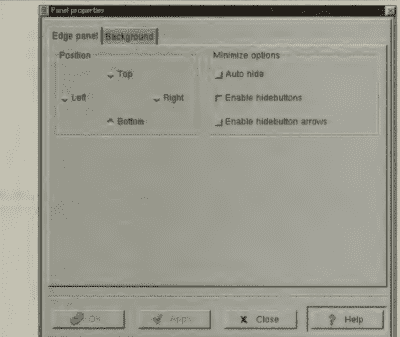

**图 15.23**：“此面板属性”对话框

“面板属性”对话框包含两个选项卡，帮助你设置活动面板的属性：“边缘面板”和“背景”。以下是对这两个选项卡的说明。

#### 边缘面板选项卡

**位置** 这用于更改面板在屏幕上的位置。你可以选择顶部、右侧、左侧或底部。当你按下“应用”按钮后，面板位置将发生改变。

**最小化选项** 此处的选项允许你使用隐藏按钮手动隐藏面板，或者在鼠标未悬停在面板上时自动隐藏。如果你选择“自动隐藏”，你可能还需要在此处禁用隐藏按钮。你也可以禁用面板上的隐藏按钮箭头图形。

#### 背景选项卡

**背景** 这些选项允许你更改面板本身的背景。你可以根据需要选择标准、像素图或颜色背景。面板的标准外观由你当时正在运行的 GTK 主题决定。像素图选项允许你选择一张图像进行平铺或缩放以适应面板。颜色选项允许你为面板指定特定的颜色。


> **注意**
>
> 更改面板背景的一种更简单方法是：从 GNOME 文件管理器中拖放一个图像文件到面板上。这将自动将面板背景更改为该图像。

**图像文件** 如果你选择使用像素图作为面板背景，此处将允许你选择要使用的图像。如果你按下“浏览”按钮，你可以搜索想要使用的文件。

**将图像缩放到适合面板** 这允许背景图像缩放到面板的大小。如果未选中此选项，图像将平铺到面板上。

**背景颜色** 如果你希望面板为单一颜色，此按钮将启动一个对话框，允许你指定要使用的颜色。

### 编辑主菜单

主菜单是你应用程序的存储库，位于面板上。主菜单在 GNOME 中预装了常用项，但可以根据你的工作习惯进行配置。主菜单分为两个主要子目录：系统菜单和用户菜单。菜单编辑器可用于向主菜单添加新应用程序，但如果你不是系统管理员（root），则不能向系统菜单添加应用程序。在本节中，你将学习如何配置主菜单，以便添加你希望日常使用的应用程序。

#### 配置主菜单

如果你想更改主菜单或面板上其他任何菜单的属性，请右键单击该菜单按钮并选择“属性”。这将启动如图 15.24 所示的“菜单属性”对话框。

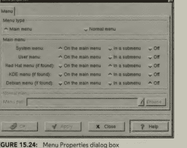

“菜单属性”对话框中的第一个选择项是“菜单类型”。这允许你将菜单从主菜单更改为普通菜单。

“菜单属性”对话框中的其他选项是主菜单的子菜单选择。这些选择允许你选择在子菜单中包含哪些内容，或者设为关闭：

- **系统菜单** 这些菜单项是随 GNOME 附带的默认应用程序。
- **用户菜单** 这里包含使用菜单编辑器为你的用户账户添加的任何菜单项。
- **另一层菜单** 如果你使用的是 Red Hat Linux 构建版本，这是随该版本附带的应用程序默认集。
- **KDE 菜单** 如果你是 KDE 桌面环境的用户，你可以选择包含 KDE 菜单中的应用。
- **Debian 菜单** 如果你使用的是 Debian Linux 构建版本，这是该版本默认附带的应用程序集。

#### 使用菜单编辑器

菜单编辑器是主菜单的配置工具。它在根据需求设置系统时非常有用。通过单击主菜单启动器并从主菜单中选择“设置 > 菜单编辑器”来启动菜单编辑器。这将启动如图 15.25 所示的菜单编辑器。

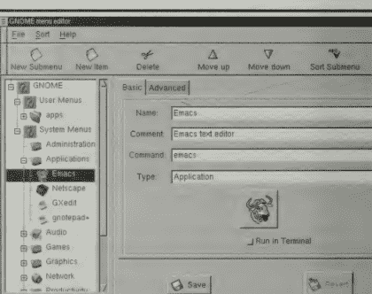

菜单编辑器分为两个主要面板。左侧包含默认状态下的菜单。右侧包含一个带选项卡的对话框，允许你向菜单添加新应用程序。

在左侧的菜单树中，注意有两个主要菜单列表，一个是用户菜单，另一个是系统菜单。用户菜单属于当前用户，而系统菜单属于系统上的所有用户。预打包的应用程序都位于系统菜单中。在左侧的菜单列表中，你可以通过单击菜单旁边的小加号来打开和关闭文件夹，并查看当前菜单的内容。

##### 添加新的菜单项

如果你想添加一个新的菜单项，请按下工具栏上的“新建项”按钮。新的菜单项将放置在当前高亮的菜单位置。如果没有高亮的菜单，它将被放置在菜单树的顶部。选中新项目，并在右侧对话框中输入该项目的信息。信息完成后，按下“保存”按钮，新的菜单项将插入右侧菜单树中光标所在的位置。然后你可以按下工具栏上的向上或向下按钮来移动菜单项。你也可以使用鼠标左键拖动来移动菜单项。


> **注意** 请记住，除非你以 `root` 身份登录，否则你不能更改系统菜单。如果不是 `root`，你只能添加和编辑用户菜单。

##### 主菜单中的拖放

菜单编辑器支持拖放功能，这将使你的工作更轻松。你可以将应用程序拖放到希望其驻留的文件夹中，或者完全重新排列你的文件夹。

如果你希望将菜单项放置到面板上，你可以将该项从菜单拖放到面板上，它将在那里放置一个启动器，并为你设置好所有适当的属性。如果你不想使用拖放，你也可以右键单击菜单项，并从弹出菜单中选择“将此启动器添加到面板”。

### GNOME 控制中心

GNOME 控制中心（见图 15.2.6）允许你使用称为*控制项*的一组工具来配置系统的各个部分。

#### 第十五章

这些控制项可能与核心 GNOME 应用程序集或开发人员已编写控制项的其他应用程序相关联。

根据你的系统上安装的应用程序不同，你的控制中心可能包含比此处记录更多的控制项。

控制中心分为两个主要部分：可配置控制项的菜单和主要工作区。

操作控制中心只需从左侧菜单中选择一个控制项并双击它即可。完成后，工作区将更改，允许你配置该项目。

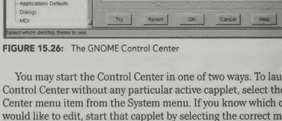

**图 15.26**：GNOME 控制中心

你可以通过两种方式启动控制中心。要在没有特定活动控制项的情况下启动控制中心，请从系统菜单中选择“控制中心”菜单项。如果你知道要编辑哪个控制项，请通过选择控制中心菜单中相应的菜单项来启动该控制项。

#### 桌面控制项

##### 背景属性控制项

你的背景图像的属性可以在“背景属性”控制项中设置（见图 15.27），方法是通过选择颜色或图像。如果你选择颜色，你可以选择纯色或渐变色。如果你选择渐变色，你可以选择垂直或水平渐变，你可以选择渐变的结束颜色。

如果你决定使用图像作为壁纸，你可以浏览并选择想要使用的图像。找到图像后，你需要决定是平铺、居中、保持宽高比缩放，还是简单缩放。更改背景属性后，你可以按控制中心底部的“尝试”按钮来应用更改。

如果你想通过其他方式设置背景，请选择“禁用背景选择”来禁用此组件。

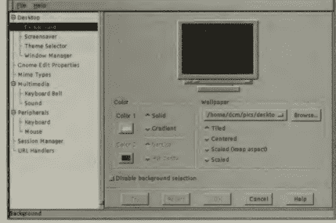

图 15.27：背景属性组件

##### 屏幕保护程序组件

在屏幕保护程序组件（见图 15.28）中，你可以更改屏幕保护程序属性。此组件包含一个可用屏幕保护程序列表和一个演示窗口。在这两个对话框下方，你将看到一组用于更改全局屏幕保护程序属性设置的工具。如果所选屏幕保护程序有特定设置，你可以通过按屏幕保护程序列表下方出现的“设置”按钮来更改这些设置。

在组件的全局屏幕保护程序设置部分，你可以更改时间、密码和电源管理属性。你可以通过在“启动延迟”文本框中输入分钟数来决定屏幕保护程序等待多久后启动。如果你希望返回桌面时需要密码，请点击“要求密码”按钮。你的账户登录密码即为屏幕保护程序的密码。

如果显示器支持，你还可以选择使用电源管理。你可以在“关闭显示器”文本框中输入时间来设置显示器关闭前的等待时间。

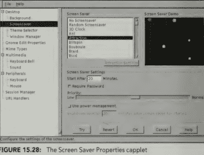

**图 15.28：** 屏幕保护程序属性插件

#### 主题选择器


# 外观插件

外观插件包含主题选择器（见图 15.29），允许你选择想要运行的 GTK 主题。GTK 主题是一种允许 GTK 小部件集更改外观和感受的主题。小部件集是提供按钮、滚动条、复选框等给应用程序的工具集。遵循 GNOME 规范的应用程序使用 GTK 工具集，因此大多数 GNOME 应用程序在更改 GTK 主题时会改变外观和感受。

要更改你的 GTK 主题，请从主工作区左侧的“可用主题”列表中选择一个主题。如果你选择了自动预览，你将能够在预览窗口中看到该主题的外观。如果你喜欢该主题，请按 GNOME 控制中心底部的“尝试”按钮来安装它。

安装 GNOME 时，会预装几个 GTK 主题。如果你想要更多主题，可以查看互联网上的资源（例如 `http://gtk.themes.org`）。找到并下载喜欢的主题后，按“安装新主题”按钮。这将启动一个文件浏览器，允许你找到刚刚下载的主题。主题文件应该是 `tar.gz` 或 `tgz` 格式（也称为“tar 包”）。找到主题目录后，按“确定”按钮，它将自动为你安装该主题。现在你可以在“可用主题”列表中找到已安装的主题。

主题解压缩到主题目录后，下次启动 GNOME 控制中心时，它将列在可用主题窗口中。

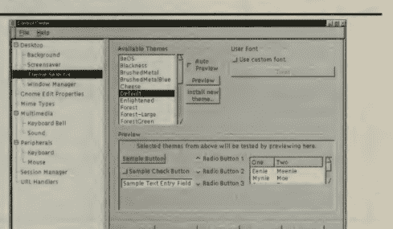

主题选择器组件

如果你想要更改当前主题中使用的字体，请选中“使用自定义字体”复选框，并通过“字体”按钮选择字体。这将弹出一个字体选择对话框，允许你指定字体、样式和大小。

## 窗口管理器组件

由于 GNOME 不依赖于任何特定的窗口管理器，窗口管理器组件允许你选择要使用的窗口管理器。窗口管理器组件（见图 15.30）并不决定你有哪些可用的窗口管理器，而是允许你定义它们是什么以及在哪里。

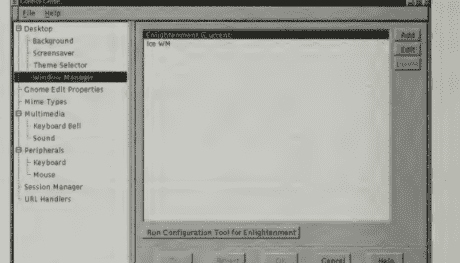

图 15.30：窗口管理器组件

窗口管理器组件有一个当前可供选择窗口管理器的主列表。当前激活的窗口管理器通过*当前*一词进行标注。如果你希望向主列表添加新的窗口管理器，请按“添加”按钮。这将启动图 15.31 中所示的“添加新窗口管理器”对话框。

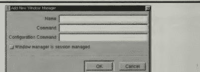

图 15.31：添加新窗口管理器对话框

在“添加新窗口管理器”对话框中，你可以指定希望给予窗口管理器的名称、启动该窗口管理器的命令，以及启动可能可用的配置工具的命令。如果你知道该窗口管理器完全符合 GNOME 规范并且可以进行会话管理，你可以选择“窗口管理器受会话管理”按钮。如果不确定，你应该查阅窗口管理器的文档。完成后按“确定”。

完成添加新窗口管理器后，你将看到它出现在窗口管理器主列表中。如果你需要更改在“添加新窗口管理器”对话框中设置的任何属性，你可以从主列表中选择该窗口管理器并按“编辑”按钮。

你还可以通过选择某个窗口管理器并按“删除”按钮来删除主列表中的任何窗口管理器。

如果你准备切换当前窗口管理器，请从主列表中选择要运行的管理器并按“尝试”按钮。如果你希望在切换前后运行配置工具，请确保选择了要配置的管理器，并按“运行 [窗口管理器名称] 配置工具”按钮。

## GNOME 编辑属性

GNOME 编辑属性组件（见图 15.52）允许你选择在使用 GNOME 时哪个编辑器作为默认编辑器。这将允许应用程序使用 GNOME 文件管理器在你尝试打开与编辑相关的文件时启动正确的编辑器。所有流行的可用编辑器都包含在选择列表中。此组件与 MIME 类型组件非常相似，但与某些应用程序相关联。

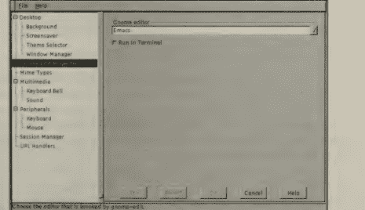

**图 15.52：** GNOME 编辑属性。

## GNOME MIME 类型

GNOME MIME 类型组件（见图 15.33）允许你确定希望如何处理某些文件类型或 MIME 类型。MIME 代表多用途互联网邮件扩展，最初开发是为了让电子邮件能够携带各种形式的数据。在 GNOME 中，你可以定义某些 MIME 类型按你希望的任何方式处理。例如，如果你经常使用 .sgml 文件并希望始终使用 Emacs 来编辑它们，你可以配置 .sgml MIME 类型始终由 Emacs 处理。这意味着任何希望为你启动该 MIME 类型的程序都会调出 Emacs。这包括在 GNOME 文件管理器中双击该文件类型。

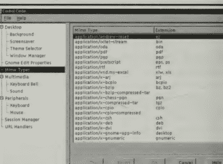

**图 15.33：** GNOME MIME 类型组件

要添加新的 MIME 类型，请按“添加”按钮。这将显示“添加新 MIME 类型”对话框，你可以在其中定义新的 MIME 类型。要编辑现有的 MIME 类型，请使用光标选中该 MIME 类型并按“编辑”按钮。这将调出“设置操作...”对话框。你可以定义用于该 MIME 类型的图标、打开操作、查看操作和编辑操作。

## 多媒体插件

### 键盘铃声

键盘铃声组件（见图 15.34）允许你更改当发送键盘错误或消息时，由 CPU 扬声器产生的铃声声音。

- **音量**：更改铃声的实际音量。
- **音调滑块**：更改所播放音符的音调。默认设置为 440Hz，即中央 C 上方的 A。
- **持续时间**：更改音调播放的时间长度。
- **测试**：允许你听到当前键盘铃声设置的效果。

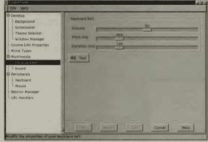

**图 15.34：** 键盘铃声组件

### 声音组件

声音组件（见图 15.35）允许你为 GNOME 会话设置系统声音。声音组件中有两个选项卡可选：通用和声音事件。

- **通用**：此时你在通用选项卡中有两个选项可供选择：启用 GNOME 声音和启用声音针对事件。如果你选择为 GNOME 启用声音，那么每次启动 GNOME 会话时，GNOME 的声音引擎（ESD）都会随之启动。为事件启用声音会在相关事件发生时播放你在声音事件选项卡中设置的声音文件。启用这两项后，你将能够利用 GNOME 的会话管理功能，该功能会在你登录或注销时记住你的声音设置。

### 声音事件

此选项卡允许你浏览 GNOME 中的声音事件并更改其声音。

要更改与 GNOME 事件关联的声音，请在左侧的层次结构列表中选中该事件，然后按“浏览”按钮以在系统中查找你希望与该事件关联的声音文件。找到声音文件后，按“播放”按钮测试该声音，看看你是否喜欢它，是否愿意在每次该事件发生时听到它。

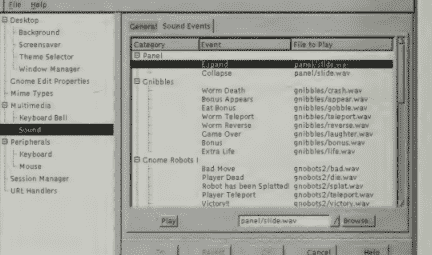

图 15.35：声音配置项

## 外围设备

控制中心此部分的配置项将帮助你配置硬件输入设备，包括键盘和鼠标属性。

### 键盘属性配置项

键盘属性配置项目前有两项设置（见图 15.56）：自动重复和键盘敲击声。你可以更改自动重复和键盘敲击声的属性。自动重复允许你按住某个键，使其以你在此配置项中设定的速率和延迟重复输入字符。键盘敲击声会在每次按键时播放轻微的敲击声。

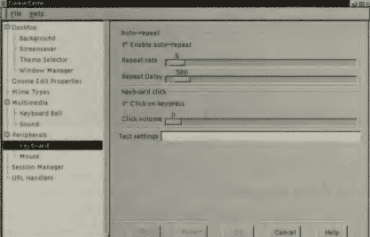

**图 15.56：** 键盘属性配置项

### 鼠标属性配置项

鼠标属性配置项（见图 15.57）允许你在左手和右手鼠标按键之间切换，并定义加速和阈值属性。

加速设置允许你更改鼠标在屏幕上移动的速度与在鼠标垫上移动之间的关系。阈值设置允许你设定鼠标开始按你在加速设置中定义的加速速度移动之前所需的移动速度。

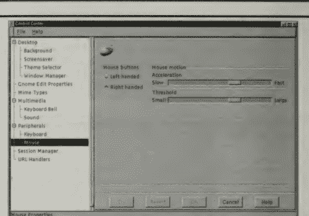

图 15.37：鼠标属性配置项

## 会话管理器

会话管理器配置项（见图 15.38）允许你控制 GNOME 会话管理。这包括哪些程序启动、如何保存你的 GNOME 配置以及如何注销。你可以在本章后面关于“会话管理”的章节中了解有关会话管理的更多信息。

- **注销时提示** 此选项允许你禁用注销时的提示
- **自动保存会话更改** 这将使会话管理在你注销时始终保存对你 GNOME 会话所做的更改。
- **非会话管理的启动程序** 这允许你在每次启动 GNOME 会话时启动非会话管理的应用程序。


**注意** 不符合 GNOME 规范的应用程序不受会话管理，因此你不需要将 GNOME 应用程序放在这里；你只需让它们保持运行，并在注销时保存当前会话即可。

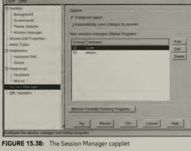

图 15.38：会话管理器配置项

如果你想向非会话管理的启动程序列表中添加一个新程序，请按“添加”按钮。这将启动一个简单的对话框，允许你指定启动应用程序的命令以及它将获得的优先级。


大多数你希望启动的应用程序的优先级为 50。如果你有一个需要在其他应用程序之前启动的应用程序（如窗口管理器），请将优先级设置为较小的数字。

**注意**

此选项供高级用户使用。除非你熟悉优先级设置，否则应让你的应用程序以优先级 50 运行。

**浏览当前运行的程序** 此功能允许你查看当前正在运行的应用程序。如果你希望，可以关闭这些应用程序，这些应用程序将从你的 GNOME 会话中移除。此列表中的应用大多是高级别应用程序，不应关闭。但是，如果你不想要 GNOME 的某些部分（如面板），你可以在此处暂时关闭它，以及在下一次 GNOME 会话中关闭它。

### 用户界面选项

用户界面选项允许你更改符合 GNOME 规范的应用程序的外观。你可能会将这些应用程序识别为 GNOME 预安装的应用程序，或者标有使用 GTK（GIMP 工具包）构建的应用程序。

#### 应用程序默认值配置项

应用程序默认值配置项（见图 15.39）允许你更改符合 GNOME 规范的应用程序的某些用户界面方面。

**注意**

虽然此配置项让你能够很好地控制应用程序的外观和感觉，但你应考虑将其仅用于高级用途。

1. **可分离和移动工具栏** 默认情况下，GNOME 应用程序中的工具栏可以从其通常位置拖动，并放置在应用程序或桌面上的任何位置。如果你不想使用此功能，可以将其关闭。
2. **可分离和移动菜单栏** 默认情况下，GNOME 应用程序中的菜单栏可以从其通常位置拖动，并放置在应用程序或桌面上的任何位置。如果你不想使用此功能，可以将其关闭。
3. **菜单栏有凸出边框** 默认情况下，菜单栏有凸出边框。如果你不喜欢这种外观，可以关闭此功能。
4. **工具栏有凸出边框** 默认情况下，工具栏有凸出边框。如果你不喜欢这种外观，可以关闭此功能。

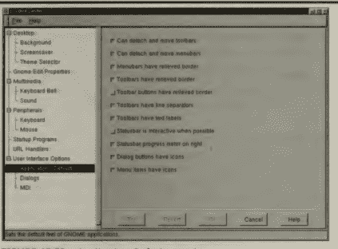

图 15.39：应用程序默认值配置项

**工具栏按钮有凸出边框** 默认情况下，工具栏按钮在其自然状态下没有凸出边框。但是，当鼠标悬停在它们上面时，它们会发生变化。如果你希望它们始终有凸出边框，可以开启此功能。

**工具栏有线条分隔符** 默认情况下，工具栏按钮之间有小的线条分隔符。如果你不希望有线条分隔符，可以关闭此功能。

**工具栏有文本标签** 默认情况下，工具栏按钮有图像和文本以标识它们。如果你熟悉这些按钮，不需要文本，可以开启此功能。

**状态栏在交互式时分离** 某些应用程序可以将其底部的状态栏分离到其自己的窗口中。如果你希望这些应用程序将状态栏分离到另一个窗口，可以开启此选项。

**状态栏进度条在右侧** 某些应用程序的状态栏中有进度条。默认情况下，这些进度条位于状态栏的右侧。如果你希望它们在左侧，可以关闭此功能。

**对话框按钮有图标** 某些对话框按钮（例如“确定”按钮）可以有图标。默认情况下，提供此功能的应用程序已开启图标。如果你不希望看到它们，可以关闭此功能。

**菜单项有图标** 应用程序中的一些菜单项将有图标。如果你不希望在使用这些功能的应用程序中看到这些图标，可以关闭此功能。

#### 对话框配置项

对话框配置项（见图 15.40）允许你更改符合 GNOME 规范的应用程序中对话框的默认设置。对话框是由应用程序启动以协助执行该应用程序所需任务的窗口。例如，当你按下“打印”按钮时出现的打印对话框就是一个对话框示例。对话框允许你设置打印选项并启动打印过程。对话框配置项允许你更改以下选项：

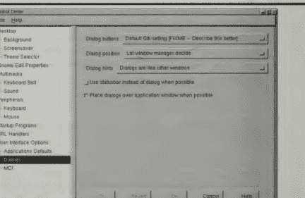

**图 15.40：** 对话框配置项

**对话框按钮** 选择使用默认按钮、分散按钮、将按钮放在边缘、将按钮放在左侧并左对齐，以及将按钮放在右侧并右对齐。

##### 默认位置

这将让你选择对话框启动时的显示方式。你可以让窗口管理器为你决定（或按照你在窗口管理器配置中定义的方式），将对话框居中显示在屏幕上，或者将对话框放置在启动时鼠标指针所在的位置。

##### 对话框提示

这将允许你更改对话框提示的行为。对话框提示是你将鼠标移到按钮或对话框某部分上时出现的工具提示。你可以选择让提示像其他窗口一样处理，或者让窗口管理器决定如何显示它们。

你可以告诉应用程序使用状态栏代替对话框，前提是应用程序支持此功能。这只适用于提供信息而非需要用户交互的对话框。

你可以选择在可能的情况下将对话框放置在应用程序上方，这有助于你在屏幕上整理窗口。如果你熟悉其他操作系统，你可能会希望保留此选项，因为大多数操作系统都是这样处理对话框的。


> **注意**
>
> 尽管这个小工具能让你很好地控制应用程序的外观和感觉，但你应该认为这些工具仅适用于高级使用。

#### MDI 小工具

MDI 小工具（见图 15.41）允许你更改 GNOME 应用程序的 MDI 模式。MDI 代表多文档界面（Multiple Document Interface），指的是在 GNOME 应用程序中如何显示多个文档。


> **注意**
>
> 尽管这个小工具能让你很好地控制应用程序的外观和感觉，但你应该认为这些工具仅适用于高级使用。

在符合 GNOME 规范的应用程序中，MDI 的默认样式通常是选项卡或“笔记本”。如果你不喜欢选项卡的外观，可以在此处更改。

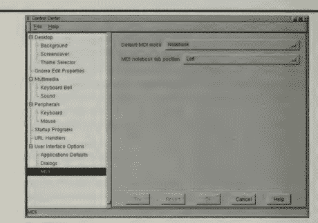

**图 15.41：** MDI 小工具

除了“笔记本”外，你还会发现“顶层”和“模态”选项。“笔记本”是默认的选项卡外观，“顶层”仅在顶层视图中显示活动文档直到其关闭，而“模态”只有一个顶层窗口，可以在任何时间包含任何文档；但一次只能显示一个。如果你曾使用过 Emacs，模态模式与 Emacs 处理缓冲区的方式非常相似。

如果你选择使用“笔记本”样式，然后可以决定希望在应用程序中何处显示选项卡。你可以将它们放置在应用程序的顶部、左侧、右侧或底部。请记住，这些选择仅在符合 GNOME 规范的应用程序中有效。

#### 关于会话管理

在阅读关于 GNOME 的内容时，你可能已经了解了一些关于会话管理的内容。会话管理在 GNOMe 及其应用程序的使用中可能是一个非常有用的工具。

会话管理的主要思想是，当你注销 GNOME 时，你的工作将会被保存。当前，当你注销时，你的 GNOME“会话”会被保存；然而，你可能没有注意到它能做的所有事情。

会话管理最有用的功能之一是能够在你注销 GNOME 时重新启动当时打开的应用程序。这在退出 GNOME 并再次进入时很容易得到体现。你会看到你的应用程序重新出现在桌面上注销时的相同位置。

如果你希望某些应用程序在每次登录时启动，即使在上次保存会话时它们没有打开，你也可以将它们添加到本章前面“会话管理器”部分中讨论的会话管理器小工具中。

> **注意**
>
> 如果你听说过应用程序数据被会话管理，那你已经了解到了 GNOME 的未来。为了正确保存应用程序数据，你必须使用完全符合 GNOME 规范的应用程序。截至本书出版时，没有任何应用程序为你的数据提供完整的会话管理。直到有应用程序具备此功能且你了解其能力之前，你不应该依赖会话管理来保存你的应用程序数据。

#### 重置 GNOME 会话

GNOME 会话管理器的一项高级功能是，如果出现问题，可以恢复“干净会话”。要做到这一点，必须在登录 GNOME 时按住 Control 和 Shift 键。这将弹出一个对话框，提供两种不同的恢复 GNOME 会话的选项（见图 15.42）。

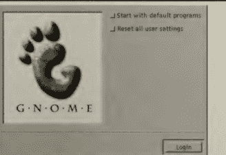

**图 15.42：** 重置 GNOME 会话的登录屏幕

第一个选项是“以默认程序启动”。此选项将删除与应用程序相关的所有会话配置设置。这只将擦除上次注销时正在运行的应用程序的 GNOME 会话数据；它不会更改你在 GNOME 控制中心的会话管理器小工具中可能已设置的任何信息。

第二个选项是“重置所有用户设置”。这将重置所有 GNOME 应用程序和核心配置数据。此选项将破坏你对面板、GNOME 文件管理器、会话管理器小工具以及任何 GNOME 应用程序所做的任何配置。此选项不会删除桌面上的文件。


> **注意**
>
> 这些选项适用于高级用户，且仅应在 GNOME 会话出现问题时使用。如果你利用这些选项提供的功能，可能会丢失许多应用程序的数据。

## 第 16 章

### K 桌面环境

本章从用户角度对 K 桌面环境进行了完整文档化。K 桌面环境是一组工具，将使你的 Unix 生活更轻松、更愉快。

本章转载自 KDE 团队 1999 年 2 月 24 日的 K 桌面环境 1.1 版本。

#### 关于此预览


尽管这些信息在 KDE 最终版本中需要重写，但我希望这个预览版本对解答新 KDE 用户可能提出的一些问题有所帮助。

## 本章状态

本章包括完整的介绍、KDE 安装指南、用户界面描述、关于如何使用 KDE 进行日常工作的三个实际示例，以及如何自定义 KDE 桌面的描述。还包括快捷方式表和一些技巧与窍门。

### 简介

> 640 kB 对每个人来说应该都足够了。
>
> –某大型软件公司 CEO，20 世纪 80 年代初

自 Unix 开发开始以来，一直有稳定的内核和良好、强大的软件，但存在一个巨大问题：只有少数人能够使用 Unix，因为它主要是为长期研究该系统的学生和专业人士编写的。例如，阅读 USENET 新闻的标准方法是：

```
find /var/spool/news -name '[0-9]*' -exec cat {} \
```

然而，今天这个问题已经得到解决。有许多好的前端可用，如 tin 和 knews，它们提供了易于使用的直观图形用户界面（GUI）。不幸的是，这些 GUI 缺乏共同的“外观和感觉”。面向程序员的可商用库，如 Motif，承诺了解决方案，但这些库仍然太昂贵且太慢。

程序的配置通常也很困难。编译通常通过以下方式完成：

```
./configure && make && make install
```

只有极少数程序可以通过菜单或脚本进行配置。在大多数情况下，你必须自己编辑文本配置文件。经常发生的情况是，一个位置错误的错误毁掉了整个文件，迫使你重新开始配置过程。每当你需要更改设置或重新配置程序时，这个问题就会再次出现。

所有这一切都导致 Linux 和其他版本的 Unix 难以触达更广泛的受众。与此同时，许多人对自己当前的操作系统并不满意，主要原因是这些操作系统在稳定性和性能方面存在不足。另一些人讨厌每次无法离开的程序发布新版本时都要购买新电脑，因为这些新版本需要更多的内存和磁盘空间。通常情况下，新版本提供的功能并不是很多人真正需要的。

KDE 与众不同。虽然我们并非试图取代标准的 Unix shell，但我们正在开发一种能简化 Unix 使用的工具。我们也希望吸引更多用户进入 Unix 环境。简单的事情将被简化，复杂的事情仍将可实现。此外，我们将提供一个统一界面，替代目前所需的数十种界面。

## KDE 能为你做什么

我们设计 KDE 主要面向 Unix 初学者，以及其他希望避免学习旧操作系统中不存在的复杂新技术和命令的人。不过，我们也为经验丰富的 Unix 用户提供了某些便利。

如果你是 Unix 新手，甚至不要尝试使用其他任何东西，因为正是我们为你编写了这款软件。:-) 对于你，我们提供：

- 美观且易用的窗口环境
- 强大且易用的文件管理器
- 简单且集中的配置
- 在任何情况下都能支持你的在线帮助

如果你已经有 Unix 使用经验，你会欢迎 KDE 提供的新功能：

- 良好、便捷且快速的窗口管理器
- 应用程序的一致界面。你再也不需要猜测是左键还是右键执行你期望的操作
- 一个精悍的终端模拟器，在同时打开多个窗口时不会占满你的内存
- 时尚桌面，会让你的朋友们羡慕

### KDE 的背景

1996年10月，德国 LyX 开发者 Matthias Ettrich 通过一条 USENET 帖子启动了 KDE 的开发。不久之后，几位感兴趣的开发者开始规划并编写新项目的部分代码。一年后，窗口管理器、文件管理器、终端模拟器、帮助系统和显示配置工具被发布，以进行 ALPHA 和 BETA 测试，并证明相对稳定。

1998年7月，KDE 1.0 发布。此后六个月内它一直是一个稳定版本，而开发者继续在没有稳定性约束的情况下改进 KDE。1999年1月，这些改进被整合集成，生成了 KDE 1.1，新的标准稳定版本。

开发者和感兴趣的用户通过本章节后面“联系作者”部分所述的几个邮件列表进行交流。

#### 法律声明

KDE 是自由软件，受 GNU 通用公共许可证（见附录 D）保护，该许可证随每个 KDE 组件一起提供。你可以随意复制和分发 KDE 及其组件，只要始终包含完整的源代码即可。

### 如何获取新组件

KDE 的主站点是 [http://www.kde.org/](http://www.kde.org/)。在这里，你可以找到与 KDE 相关的所有重要信息，包括公告、bug 修复、开发者信息、样式指南、文档等。对于软件升级，请访问我们的 ftp 站点 [ftp://ftp.kde.org/](ftp://ftp.kde.org/)，或者如果附近有镜像站点就使用镜像站点。（镜像站点列表见 [www.kde.org/](www.kde.org/).）

`unstable` 目录始终包含最新的软件，但它经常未经测试，甚至可能无法编译。如果你在寻找更可靠的组件，请查看 `stable` 目录，我们在那里放置 Beta 版和正式版。

如果你有兴趣自行开发 KDE 应用程序，还应访问 Troll Tech 的服务器（[http://www.troll.no/](http://www.troll.no/)），该服务器提供了大量关于 KDE 所使用的 Qt 库的信息。对于开发工作，也建议加入 KDE 邮件列表。（详见本章节末尾的“其他帮助来源”部分。）

### 联系作者

关于本章的疑问和批评，请联系 `rwilliam@kde.org`。由于有几个人参与了本章的资料贡献，每个人也在本章末尾的“K 文档工作组”部分中列出。

# 安装

> 核心转储 fsck 的事总会让我紧张。
>
> ——林纳斯·托瓦兹，在发现他的文件系统被新的 Beta 内核破坏之后！

别担心！尽管使用一些 Beta 软件可能会带来相当大的麻烦，但安装 KDE 不太可能破坏你的硬盘。实际上，本章旨在引导你完成安装过程，以便你能尽快（并以最小的痛苦）查看你的新桌面。与所有新的窗口管理器安装一样，建议你在开始安装之前备份所有 X11 相关的配置文件。如果你不知道它们的确切位置，尝试主目录中所有隐藏文件（*.*）以及 `/usr/X11/lib/X11/.xdm` 目录下的文件。


**警告**

由于软件目前处于 *Beta* 阶段，我们强烈建议你备份硬盘上的所有关键数据。我们不对因安装和使用 KDE 造成的任何损害承担责任！

### 需求

在安装 KDE 之前，请确认你的系统满足以下要求：

- 一个正在运行的 POSIX 兼容 Unix 系统。已知可与 KDE 配合工作的 Unix 版本包括：Linux、FreeBSD、Solaris、HP-UX 和 MkLinux。我们正在努力尽快让 KDE 支持更多平台。
- 在将创建 `/opt/kde` 的分区上预留一些硬盘空间。如果你的系统支持共享库，我们建议预留大约 50MB；如果不支持，则需预留更多。由于当前软件处于 Beta 阶段，需求可能会从一周变化到另一周。我建议你为即将到来的 KDE 应用预留额外空间。如果你需要或想要从源代码树构建 KDE，请记得在 `/usr/src` 中预留大约 100MB。
- 一个带或不带 xdm 的正在运行的 X11 系统。如果你尚未安装 X 窗口系统，请先检查你的 Unix 安装介质中是否有可安装的版本。如果你找不到任何可工作的版本，请访问位于 `http://www.xfree86.org/` 的 XFree86 网站了解有关如何获取和安装 X 窗口系统的更多信息，或联系你的 Unix 厂商支持。
- qt 库，版本 1.42。你可以在 Troll Tech 的 FTP 服务器 `ftp://ftp.troll.no/pub/qt/` 获取，提供 `rpm` 和 `tgz` 两种格式。

开始前的警告：在从以前的 KDE 版本升级之前，我们建议你执行以下操作：

```bash
cd /opt/kde
tar cfvz ~/KDE-old-version-backup.tar.gz *
```

### Linux：为 Red Hat、Caldera 和 SuSE 安装 RPM

使用 RPM 是启动和运行 KDE 最简单的方法。只需访问你喜欢的 KDE 镜像站点并访问 `/pub/kde/stable/distribution/rpm` 目录。在那里，你可以看到针对不同操作系统的目录。目前支持 i386、alpha 和 sparc 架构。RPM 包也可以在 Red Hat 贡献站点如 `MetaLab.uns.cc` 或 `ftp.redhat.com` 上找到。

基本系统由文件 `kde-(component).(architecture).rpm` 组成。你至少需要 `kdesupport`、`kdllibs` 和 `kdebase`。获取基本发行版后，你可以随意下载你认为可能用得到的其他 RPM。

接下来，从基础包开始安装。如果你第一次安装 KDE，请使用：

```bash
rpm -i kdesupport.arch.rpm
rpm -i kdllibs.arch.rpm
rpm -i kdebase.arch.rpm
```

**注意**


这些组件必须按列出的顺序安装，并且必须在任何其他 KDE 组件之前安装。

如果你从以前的版本升级，请尝试：

```bash
rpm -Uvh kde-component.arch.rpm
```

同样，上述顺序应保持不变，并且给定组件应在任何其他 KDE 组件之前安装。

这会解包基础发行版并将其安装在 `/opt/kde`。如果基础包的安装成功，你可以以相同的方式安装其余的软件包（为了更新现有版本，再次使用 `-Uvh` 而不是 `-i`）。

### Linux：在 Debian/GNU Linux 发行版上安装

开始前的一个重要说明：由于 Linux 文件系统标准导致的各种问题，构建 `*.deb` 包非常复杂。因此，你可能找不到最新版本。如果你想查看 KDE 开发的最新内容，我们建议你获取源码发行版（详细请参阅下文“在其他系统上使用 TGZ 安装”部分）。

为了在你的 Debian/GNU Linux 系统上安装 KDE，请依次获取以下文件。你可以在 `/pub/kde/unstable/distribution/dpkg` 中找到它们。

- `libgif22.3-1i386.deb`
- `libkde00.10.01-1i386.deb`
- `kdeapps0.10.01-2i386.deb`

此外，KDE 还需要以下软件包的组件。请确保在开始安装 KDE 之前已安装这些组件：

- `qt1.42`
- `libjpeg6`
- `libg++27`

#### 注意

我们强烈建议你在安装 KDE 之前安装 Debian 菜单软件包（这会使 kpanel 用起来更加舒适）。

要安装 kde，请使用 dselect 或手动使用以下命令：

```bash
dpkg -i ibgif2.2.3-1_i386.deb
dpkg -i libkde0_0.10.01-1_i386.deb
dpkg -i kdeapps_0.10.01-2_i386.deb
```

如果 `dpkg` 报告依赖项错误，你需要找到上述列表中 KDE 依赖的软件包，安装它们，然后重新运行 `dpkg` 命令。

### 使用 TGZ 在其他系统上安装

如果你的 Linux 发行版没有提供 RPM 或 DEB 存档格式，或者你根本不在使用 Linux，则必须自行编译 KDE。未来，我们计划提供一个包含其自身安装程序的二进制发行版。

为了正确编译和安装 KDE，你需要在硬盘上安装以下项目：

- 一个 ANSI-C 编译器，例如 GNU C 编译器
- 一个 ANSI-C++ 编译器，例如 GNU C++
- `make` 实用工具
- Qt 开发版 1.41 或更高版本
- X11 开发版（通常缺少头文件）

一旦你拥有了所有所需的辅助应用程序，请前往你喜爱的 KDE 镜像站点，并从 `/pub/kde/stable/`（最新版本）目录中获取以下文件：

- `kdesupport-(version).tar.gz`
- `kdelibs-(version).tar.gz`
- `kdebase-(version).tar.gz`
- 其他任何你想要安装的程序包（建议你至少获取 `kdeutils`）

在上述文件名中，“`(version)`” 代表当前版本号。下载完所有需要的文件后，将这些文件解压到 `/usr/src`。此过程应生成以下目录结构：

- `/usr/src/kdesupport`
- `/usr/src/kdelibs`
- `/usr/src/kdebase`
- `/usr/src/...` （其他任何程序包）

确保你对 `/opt/kde` 具有写权限。接下来，你必须使用以下方法编译并安装程序包：

- `cd` 进入你要安装的程序包目录（参见上方列表）
- `./configure` （应用你想要的选项）
- `make`
- `make install`

对上述每个你想安装的程序包都执行上述步骤。（这些说明几乎适用于所有可用的源代码程序包。）

每个 `configure` 脚本都有多个可用选项。一些选项在程序包之间是通用的，而另一些则是特定于单个程序包的。以下是 `kdebase` 中运行 `configure --help` 的结果：

```text
% configure --help

    --enable-debug      创建调试代码
                        [默认=否]
    --disable-nls       不使用本地语言支持
    --with-qt-dir       qt 安装根目录的位置
    --with-qt-includes  qt 头文件所在位置
    --with-qt-libraries qt 库安装位置
    --with-extra-includes
                        添加非标准头文件路径
    --with-extra-libs   添加非标准库路径
    --disable-path-check 不尝试确定安装位置
```

| 选项 | 描述 |
|---|---|
| `--with-install-root` | 安装根目录 [默认=/] |
| `--disable-rpath` | 不使用 ld 的 rpath 功能 |
| `--with-xmldir` | 如果无法自动找到 xdm 配置目录 |
| `--without-pam` | 禁用可插拔身份验证模块 |
| `--with-shadow` | 如果你想要 shadow 密码支持 |
| `--without-gl` | 禁用 3-D GL 模式 |
| `--without-xpm` | 禁用颜色像素图 XPM 测试 |

有些选项不是必需的，并且仅作为已知问题的变通方案（例如 `--disable-path-check`）。由于某些选项非常重要，例如 `--with-Shadow`，你应该始终检查可用选项。

一个重要选项是 `--prefix`。此选项指定 `configure` 应该安装的路径（对于 `kdesupport` 和 `kdellibs`）或者查找库的路径（对于其他程序包）。默认情况下，`configure` 会在 `/usr/local/kde` 中查找。如果你想要将 KDE 安装到 `/opt/kde`，你必须使用 `configure --prefix /opt/kde`。

如果你将 Qt 库安装在不寻常的位置，例如 `$HOME/src/qt`，你必须使用 `configure --with-qt-dir=$HOME/src/qt`。默认情况下，`configure` 在放弃之前会先在最常见的地方查找 QT。

如果你遇到无法解决的问题，请将文件 `config.log` 的副本发送到出错程序包中 README 文件里列出的地址。

你必须按以下顺序安装 KDE：`kdesupport`、`kdellibs`，然后是应用程序包（例如 `kdbase`）。所有应用程序包都应该只依赖于 `kdellibs`，因此你可以同时编译它们（如果你有一台性能强大的机器）。

如果你想利用多处理器系统，请尝试使用 `make -j <处理器数量>` 代替 `make`。

### Linux 平台特定的构建说明

对于 Linux，构建 KDE 所需的大多数实用工具都可以在 `ftp://Metalab.unc.edu/pub/Linux/GCC` 或 `ftp://Metalab.unc.edu/pub/GNU` 找到。Qt 库可以在 `ftp://ftp.troll.no/pub/qt/linux` 找到，可供 Linux 使用，提供源代码或 RPM 格式。两者都包含有关如何安装它们的详细说明。X11 程序的头文件应在 `ftp://ftp.xfree86.org` 的 "xdevel" 部分中找到。

如果你想使用 `kdm` 在运行级别 3 启动系统，你需要用 `/opt/kde/bin/kdm` 替换 `/etc/rc.d/xdm` 中的 `xdm` 调用。无论如何，这里有一个应该能正常工作的版本：


```sh
#! /bin/sh
###### Copyright (c) 1996 S.u.S.E. GmbH Fuerth, Germany.
###### All rights reserved.
#
###### Author: Florian La Roche <florian@suse.de>, 1996
###### Werner Fink <werner@suse.de>, 1996
#
###### Modified on October, 13th by
###### Andreas Buschka <andi@bonn-online.com>, 1997
###### for the KDE documentation project.

###### /sbin/init.d/xdm

. /etc/rc.config

case "$1" in
    start)
        echo "Starting kdm."
        /opt/kde/bin/kdm
        ;;
    stop)
        echo -n "Shutting down kdm:"
        killproc -TERM /opt/kde/bin/kdm
        echo
        ;;
    *)
        echo 'Usage: $0 {start|stop}'
        exit 1
esac

exit 0
```

你还需要将 `/etc/inittab` 中的默认运行级别更改为 `3`，以便在系统启动时启动 `kdm`。

### 注意

不要忘记重新登录，以便系统读取你的新配置设置！

### 对配置文件所需进行的更改

将你已放置 KDE 二进制文件到目标目录后，你需要对启动脚本进行一些调整。

以下操作在 SuSE Linux 5.0 上进行了测试，并且应该与其他流行版本的 Unix 兼容。

### 注意

在更改配置文件之前，务必先备份它们！

在 `/etc/profile` 的末尾添加以下内容：

```shell
export PATH=$PATH:/opt/kde/bin
export KDEDIR=/opt/kde
```

接下来，编辑主目录中的 `.xinitrc` 文件。查找调用你的窗口管理器的行并将其替换为 `startkde`。

现在，所有运行 KDE 所需的组件都已安装完毕，你可以继续第 4 章，在那里你将首次启动 KDE。如果出现问题，你可能需要自行编译 KDE。阅读本章前面提到的“Linux 平台特定的构建说明”以获取更多详细信息。

我们尽可能使安装过程稳固可靠，因此除非你的配置非常特殊，否则你不应该遇到任何严重问题。如果你确实遇到困难，请随时使用 KDE 邮件列表（参见本书末尾的“其他帮助来源”部分）。

## 第一印象

> 你看海，却发现你能看到的只有海。
>
> -- 来源不明

第一印象如此重要——这不仅适用于阿加莎·克里斯蒂著名的惊悚小说*《捕鼠器》*，也适用于 KDE。正如我们之前提到的，KDE 旨在成为可用的最直观、最容易学习的用户界面。事实上，当用户不再需要这本书来使用 KDE 时，我们就实现了我们的目标，这也意味着作者们失去了他们（无薪且自愿的）文档编写工作。

### 启动 KDE

当你启动 Unix 系统时，应该会发生以下两种情况之一。（如果系统正常工作的话；其他情况都是未记录的错误状态。）要么你停留在文本模式并获得登录提示，要么你会看到一个图形登录窗口。在前一种情况下，你必须登录系统并输入：

```
startx
```

如果安装成功，在几秒钟的初始化后，KDE 桌面应该会出现在屏幕上。

如果显示的是图形登录窗口，那么只需要输入你的登录名和密码即可。假设 KDE 安装成功，KDE 应该无需进一步干预即可启动。

如果你尚未这样做，我们建议你将从 `xdm` 改为 `kdm` 作为你的 X 显示管理器，`kdm` 包含相同的功能，但具有 K 桌面环境的先进特性。

### 桌面组件

一切就绪后，花些时间探索这个新环境。如果你已经使用过 Windows 95 或 OS/2 Warp 4，很多事情看起来应该都很熟悉。KDE 桌面的三个主要部分是桌面本身、面板和任务列表。

#### 面板

当你第一次启动 KDE 时，面板位于屏幕底部。从这里，你可以启动你的程序并在虚拟屏幕之间切换。

- **K 按钮** 点击此按钮会将面板从屏幕上移除，并用一个迷你面板替换它。K 按钮会留在屏幕上，以便你可以把主面板带回来。此功能仅适用于当前桌面；其他桌面将保留迷你或主面板。


#### 注意

当面板被最小化时，应用程序菜单和任务列表将位于任务栏上方，功能保持不变，但占用空间更小。

**应用程序启动器** K 键旁边的按钮是 KDE 桌面上最重要的位置之一。从这里，你可以启动所有已安装的 KDE 应用程序。稍后，当你学会如何使用程序（见本章后面的“程序”一节）时，你也可以在此添加其他程序。要启动一个程序，只需单击该按钮即可。你会看到一个不同的类别列表以及一些特殊条目。每当鼠标悬停在带有右侧箭头的条目上时，就会显示一个新菜单。找到想要启动的程序后，直接用鼠标左键单击它即可。

**任务列表** 位于应用程序菜单右侧（带有显示器图标的那个）的按钮是一个菜单，其中包含桌面上所有活动窗口，按桌面名称排序。此功能使你能够轻松快速找到特定窗口，并减少在打开许多窗口时的桌面杂乱感。

**注销按钮** 在活动窗口列表右侧还有两个按钮。顶部那个看起来像个大“X”的按钮用于退出当前 KDE 会话。如果仍有其他应用程序处于打开状态，可能会发生以下三种情况：

- 1. 为 KDE 编写的应用程序会提示你保存工作。当你再次启动 KDE 时，所有 KDE 窗口都会重新打开，你可以从之前离开工作站的地方继续工作。
- 2. 未专门针对 KDE 编写，但符合 X 窗口系统标准的应用程序也会提示你保存工作。
- 3. 不完全符合此标准的应用程序（如 Netscape Navigator 4.03）无法询问你是否要保存工作。KDE 会警告你这些程序，并为你提供停止注销过程的选项。

请记住，使用 Web 浏览器时通常没有太多需要保存的内容，但例如，加载了宝贵绘图的 CAD 程序应在注销前使用其自身菜单退出。

**锁屏按钮** 如果你家里有其他无法停止窥视你工作的人，这个按钮可能很有用。单击一次即可锁定屏幕，防止未经授权的人阅读你的私人邮件或干扰你的工作。


#### 警告

X 窗口系统仍可通过 `Ctrl+Alt+Backspace` 终止，但这将摧毁你在 KDE 桌面上的所有工作。如果你不禁止使用 `Ctrl-Alt-Enter`、`Ctrl-Alt-Backspace` 以及切换到文本控制台的按键；这种保护是不安全的！

**桌面按钮** 第一次启动 KDE 时，请注意四个标记得当的按钮：“One”、“Two”、“Three”和“Four”。这些代表你的四个桌面。只需单击其中一个即可。别担心，尽管它们似乎“消失”了，但任何打开的窗口仍然处于活动状态（查看任务列表即可！）。使用多个桌面是 KDE 和 X 窗口系统最强大的功能之一。不像在 Windows 或 OS/2 中那样将一个窗口叠放在另一个之上，你可以说：“好吧，在第一个桌面上我将编写 KDE 用户指南。在第二个桌面上我将运行 `sgm2l2latex` 编译器并查看结果，同时在第三个桌面上编译我的 linux 内核，而在第四个桌面上我将阅读电子邮件。”

**图标栏** 有些人如此懒惰，以至于认为甚至通过应用程序菜单的两三次操作都太多了（包括我自己在内）。对于他们来说，可以在桌面按钮旁边放置额外的按钮（例如，指向主目录、回收站、`kvt` 终端仿真器以及常用文档的快捷方式）。关于如何向任务栏添加图标的信息，请参阅本章后面的“快捷图标”一节。

**时间和日期** 在 KDE 面板的最右端，你始终可以看到时间和日期。

**任务列表** 将鼠标移至屏幕左上角。在那里，你会找到每个打开窗口的按钮。只需单击对应于你想打开的窗口的按钮即可。这是使用 KDE 面板上任务列表的一种替代方法。

#### 使用窗口

当 KDE 启动时，第一个打开的窗口包含你的主目录。我们稍后涵盖此窗口的内容。现在，让我们研究实际的窗口小部件。

**窗口菜单** 在每个窗口的左上角，你可以看到一个窗口操作图标。单击它时，会出现一个包含窗口操作命令的上下文菜单。最大化将窗口扩展到最大可能的尺寸。


> **注意** KDE 将采用虚拟桌面的大小，这意味着窗口可能会比你的屏幕大。


图标化将使窗口不可见。查看任务栏。你会注意到窗口标题现在用括号显示。要将窗口重新调回到桌面上，请单击窗口标题。移动让你可以用鼠标移动窗口。当窗口位于你想要的位置时，单击鼠标左键。调整大小允许你缩小或放大窗口。移动鼠标并单击，直到你对新尺寸满意为止。固定将窗口固定在你的桌面上。每当你切换桌面时，“固定”窗口都会随之移动。要停止此效果，请选择取消固定。


> **注意** 取消固定非常有用，例如，当你调试程序或网络问题，并且始终希望查看日志文件 `tail -f` 窗口时。

发送到桌面… 允许你将窗口发送到另一个桌面。选择你希望窗口所在的桌面。窗口会立即消失。要再次看到你的窗口，请在任务栏中选择其名称，或单击 KDE 面板上相应的桌面按钮。关闭将关闭窗口。有时应用程序会允许你保存工作，但在某些情况下（例如，旧的 X11 应用程序）这不起作用。最好使用应用程序自身的命令关闭它，仅将此菜单项作为最后的手段。

**固定按钮** 这个按钮看起来像一个大头针。它执行与窗口菜单中固定命令相同的操作，但需要更少的步骤来调用。

**标题栏** 包含窗口名称的标题栏可以双击以最大化窗口。使用鼠标右键：窗口菜单将重新出现，允许你（取消）最大化、图标化、移动、调整大小、（取消）固定窗口，以及将其移动到另一个桌面（这比使用固定按钮的方法更快）。当程序不再响应时，你可以关闭它（这有时给你机会保存你的工作）。

**图标化、最大化和关闭按钮** 在标题栏右侧，有三个按钮也可用于图标化、最大化和关闭窗口（这比使用窗口操作菜单更快）。图标化的窗口可以通过单击任务栏来恢复。

要移动窗口，将光标放在标题栏上并按住鼠标左键。在不释放鼠标的情况下，将窗口移动到你选择的位置，然后释放鼠标。如果要调整窗口大小，将鼠标光标移动到你希望改变的窗口边缘。一旦到达正确位置，光标将从箭头变为括号和箭头。按住鼠标左键并拖动相关边到你希望的位置，然后释放按钮。请注意，你可以拖动边或角，这将同时调整两个维度的大小。

使用每个 KDE 窗口的菜单栏很简单。只需单击你想做的操作，它就会执行。但菜单栏还能为你做更多。注意菜单和图标栏左侧的闪烁条纹吗？按下鼠标右键，会出现一个上下文菜单，允许你将菜单栏置于窗口的顶部或底部。你甚至可以取出菜单栏，让它“浮动”在周围。


在菜单栏下方，有一组工具符号，您可以使用它们来执行命令。当光标悬停在它们上方时，对应的图标会高亮显示。您还可以将工具栏放置在任意位置：左侧、右侧、顶部、底部或浮动模式。

### 获取帮助

基本上在每个地方都可以找到帮助。在桌面上，只需使用鼠标右键并选择“桌面帮助”。在 KDE 面板上，打开应用程序菜单并选择“帮助”。每个 KDE 程序都有帮助菜单。由于所有帮助内容都是基于 HTML 的，因此使用帮助系统就像使用您喜欢的 Web 浏览器一样简单！

### 入门指南

> *仅凭你看到的，你能从 A 点走到 B 点吗？*
>
> ——来自《The 7th Guest》中最难解谜之一帮助文本

至此，KDE 可能看起来仅仅只是一个带有便捷桌面功能的其他窗口管理器。但请坐稳；在接下来的几个部分中，我们将向您介绍一些功能，这些功能将让您确信，再也无法在没有 KDE 的情况下操作 Unix 系统了！

## 编辑文件

由于您的系统上不仅安装了 KDE 应用程序，您很可能已经知道编辑 ASCII 风格配置文件的混乱状况。但还有许多其他类型的文件需要以这种方式进行编辑。例如，本指南的原始 SGML 源代码是以 ASCII 风格编写的，KDE 程序本身的源代码也是如此。现在我们将向您展示如何使用 KDE 中的 KEdit 设施来编辑您自己的 ASCII 文件。

### 打开包含用户主目录的窗口

点击应用程序启动器并选择“主目录”。一个显示主目录内容的窗口将会弹出。若要查看主目录中文件的更详细列表，请执行以下操作：

- 从“查看”菜单中选择**显示隐藏文件**
- 从“查看”菜单中选择**显示树形视图**

在屏幕左侧，应该会出现一个文件系统结构的树形视图，其中包括任何“隐藏文件”（以点号开头的文件或目录）。

### 文件管理器界面

我们努力让文件管理器尽可能易用，如果您熟悉其他窗口管理器（包括其他操作系统内置的集成文件管理功能），那么以下许多概念对您来说应该都很熟悉。

在顶部，有一个“文件”菜单，其中包含打开和关闭文件管理器窗口的功能。您还可以打印当前内容。

> **注意**
>
> 想访问互联网吗？只需选择“文件” ⇒ “打开位置”（或按 Alt+L）并输入一个 URL。例如，如果您想访问 KDE 首页，请输入 `http://www.kde.org`。您也可以通过这种方式快速 FTP 文件。KDE 是“互联网就绪”的，这意味着您可以不仅在本地硬盘上加载和保存文件，还可以在远程 FTP 和 HTTP 服务器上操作。虽然其他操作系统和桌面环境区分本地和远程文件系统，但 KDE 并不区分。

“编辑”菜单提供了选择、复制和移动文件的功能。我们稍后会用到它们。既然已经使用过“查看”菜单，您可能已经发现可以用许多不同的方式查看内容。不妨多尝试一下，看看会发生什么。

您无疑会发现书签非常有用。现在，您可以记住几乎任何链接，无论是在本机还是互联网的某个角落。

“工具”菜单可以帮助您查找那些“我记得放在某处但再也不记得具体在哪”的著名文件。

### 浏览目录

现在我们将选取一个您的配置文件并进行编辑。首先，必须更改文件管理器中的目录。向下滚动屏幕左侧的树形视图，直到找到 `/etc` 目录。双击 etc。您将看到右侧窗口中显示该目录下的文件列表。

### 编辑文件

向下滚动直到找到 `motd` 文件，并用鼠标右键点击它。在上下文菜单中，选择*打开方式*。在弹出的新窗口中，输入：

```
kedit
```

然后点击*确定*或按*Enter*键。瞧！

### 编辑器界面

您使用 *KDE* 越多，就越会注意到大多数屏幕和应用看起来和感觉都非常一致。*KEdit* 的“文件”菜单就是这一点的绝佳例子。几乎每个其他 *KDE* 程序都有相同的菜单，允许您创建新文件、从本地文件系统打开现有文件（即将支持）甚至 *Web* 上的文件、保存它们（很快也支持保存到 *Web*！），以及打印或将其邮件发送给他人。*编辑* 菜单也可以在大多数 *KDE* 应用程序中找到，允许您在程序之间剪切和粘贴信息。您还可以搜索和替换文本。使用 *选项* 菜单，您可以以许多不同的方式自定义编辑器。例如，您可以增加*字体*大小以适应您的显示器分辨率和视力。当然，如同其他任何 *KDE* 应用程序一样，您会发现一个 *帮助* 菜单，随时为您提供在线帮助。

### 使用编辑器

大多数 `motd` 文件包含无用的内容，例如“不要忘记备份数据”或“不要骚扰系统管理员”。很无聊。让我们更改文本，以便登录用户能够获取真正重要的信息。您可以使用箭头键在文本中导航，并使用 *Shift*+*箭头* 或按住鼠标左键来选择文本部分。使用*编辑*菜单剪切和粘贴文本。输入您想要的内容，或使用以下（很棒的）示例：

欢迎！

```
This machine now has KDE installed, providing you with a
 great, easy-to-use interface and a consistent Look-and-Feel
for all your applications. For more information on how to get
KDE running on your account, please e-mail the administrator.
```

### 保存您的工作

既然您已更改了 `motd` 文件，现在是时候保存文件，使更改生效了。为此，您可以使用*文件*菜单，或者使用工具栏上的保存图标。最后，通过关闭编辑器和文件管理器窗口来完成工作。您可以通过点击窗口右上角的“X”按钮、使用标题栏的窗口菜单，或选择“文件” ⇒ “退出”来实现。简单而优雅，不是吗？

### 使用拖放移动文件

正如您在上一节所见，处理文件简单得就像 1-2-3 一样。然而，当您想要复制和移动文件时，整个复制粘贴的过程可能会变得烦人。别担心——一种称为“拖放”的过程允许您快速轻松地复制和移动文件。

#### 打开两个文件管理器窗口

在开始之前，您需要打开两个文件管理器窗口。打开新窗口最简单的方法是按下图标栏右侧的白色滚轮按钮。如果在新窗口中看不到树形视图，请激活它（查看 ⇒ 树形视图）。

#### 将一个文件从一个窗口拖到另一个窗口

在第一个窗口中，打开 `/etc` 文件夹并滚动直到看到我们在上一部分修改的 `motd` 文件。在第二个窗口中，打开您的主目录。点击 `motd` 文件。按住鼠标左键并将文件拖入您的主目录。释放鼠标左键（这被称为“放下”文件）。您将看到三个选项：复制、移动和链接。链接将创建到该文件的符号链接，而复制和移动则如其名所示。选择“复制”。此时，您的主目录中应该有一个 `motd` 文件的副本。


## 使用命令线和终端

到目前为止，您只使用了 KDE 提供的工具和程序。毫无疑问，您也会希望使用其他 Unix 程序。运行它们有两种方式：快速命令行和终端。

### 快速命令行

按 `Alt+F2` 会弹出一个窗口，您可以在其中输入要运行的命令。请注意，您不会看到以这种方式启动的程序产生的任何文本输出！此方法仅推荐用于启动 X 窗口系统程序或运行那些您不需要看到或输入任何内容的工具。对于其他程序，您仍然需要使用终端。

### Unix 终端模拟器

从应用程序菜单中，选择“实用工具” » “终端”。将打开一个终端窗口。在这里，您可以使用常规的 Unix shell 命令：`ls`、`cat`、`less` 等等。使用选项菜单，您可以自定义终端模拟器以满足您的需要。

### 查找丢失的文件

每个人无疑都遇到过以下问题：您启动 `ftp`，登录到一个像 `ftp.kde.org` 这样的优秀站点并开始下载文件。深夜，您完成传输后关闭机器。第二天早上，您再次坐在键盘前，开始疑惑刚才传输的文件放在了哪个目录中。使用 KDE 的 `KFind` 工具，查找这些丢失的文件将易如反掌。

### 启动 KFind

启动 `KFind` 很简单：在应用程序启动器中选择“查找文件”。`KFind` 使用您可能还不太熟悉的界面部件：标签页。当 `KFind` 启动时，您会看到“名称 位置”被选中。当您点击“修改日期”时，标签页内容会改变。由于您从未运行过搜索，工具栏上的大多数图标和大多数菜单项都是禁用的。我们现在来改变这一点。

### 根据部分文件名查找文件

只要您知道文件名的一部分，搜索就很容易。选择“名称 位置”标签页，并输入文件名。必要时可以使用通配符。作为测试，输入 `*.tar.gz`。默认情况下，搜索从您的主目录开始，但您可以通过点击“查看位置”或“浏览...”来选择任何您希望的起始目录。要开始搜索，点击工具栏左侧那个看起来像放大镜在纸张上的图标。片刻之后，搜索结果窗口中将出现一个文件列表。如果没有出现，说明您在错误的目录中启动了搜索、在名称字段中拼写错误，或者您的机器上没有以 `.tar.gz` 结尾的文件。

## 使用更复杂的条件查找文件

你可以使用许多类别来使你的搜索更加精确。你对文件了解得越多，找到它的机会就越大。

- **修改日期**：在这里，你可以指定你只想查看在给定时间段内最后一次被访问过的文件，或者指定自几个月或几天前以来被访问过的文件。
- **文件类型**：如果你知道该文件属于特殊类型（例如 tar/gzip 归档文件或 jpeg 图片），你可以告诉 `KFind` 仅查找此类型的文件。
- **文本字符串**：你可以指定文件必须包含的文本。
- **大小**：如果你知道文件大小，你也可以在此方面限制你的搜索。

## 使用多个桌面

使用多个桌面有助于你整理工作。你可以将程序放置在不同的桌面上，并给桌面命名，以便你知道在那里做什么。这会增加并优化你的工作区。当你正在上网而不是工作时老板走进来时，这也会有帮助。但当然，这种情况很少见——至少在我工作的办公室里是如此。

你可以通过点击 KDE 面板上的桌面按钮来切换桌面。如果你想重命名它们，可以双击它们来完成。

你可以在多个桌面上使用窗口。如果你希望某个窗口在所有地方都存在，只需点击窗口左上角的“粘附”按钮。要将窗口发送到另一个桌面，请用鼠标右键点击标题栏，选择“到桌面”，然后选择你希望移动该窗口的目标桌面。

## 退出 KDE

若要停止使用 KDE，你可以使用应用程序启动器菜单中的“注销”项或面板上对应的按钮。系统会询问你是否真的想退出 KDE。退出将关闭所有窗口并返回到控制台或显示管理器。有关程序如何在注销时保存你的工作的信息，请阅读本章前面“面板”部分中关于注销按钮的内容。

## 关于你的桌面

> *奶奶，你的眼睛真大啊。*
> —小红帽
>
> *这样我可以更好地看到你。*
> —大灰狼

你看得越多，就能越高效地使用你的桌面。KDE 给了你让桌面看起来和工作起来符合你偏好的机会，使你能够工作得更快、更具生产力。它甚至让你有机会在狼试图吃掉你时收到警告，或者（如果你碰巧是奶奶）当小红帽带着好东西来拜访你时提醒你。这就是服务。

### 自动启动文件夹

在我发现自动启动文件夹之前，我每天使用 KDE 的启动例程包括：启动 KDE，启动 `KEdit`，启动 `kvt`，启动 `Netscape`，以及启动 `kscd`。这花了我本可以更好利用的时间。从第一个 Beta 版本发布开始，在会话结束时保持打开状态的本地 KDE 程序会保存其状态，并在你再次登录时重新出现，但有一些程序（如 `Netscape`）不会这样。你可以使用自动启动文件夹来处理这些程序。

要在 KDE 启动时启动程序，请执行以下操作：

1. 打开位于桌面左上角的自动启动文件夹。
2. 打开一个包含你想要添加的程序的文件夹管理器窗口。如果你不知道如何做到这一点，请参见本章前面“文件管理器屏幕”部分。
3. 将所需的程序从源文件夹拖放到自动启动文件夹中。当被询问时，选择“链接”以创建符号链接，而不是完整副本。这将节省大量磁盘空间。
4. 对你希望在 KDE 启动时开始的每个程序重复此步骤。当然，你可以选择非 KDE 本地应用程序，包括 `Netscape`、`tin`、`pine` 以及许多其他应用。
5. 重启 KDE。

现在，你的程序应该在 KDE 重新启动时自动启动。如果你想添加一些特别的东西（例如，你希望在系统启动时看到某个网站），请阅读本章后面“使用模板”部分。那里描述的操作适用于任何文件夹，因此你也可以将其应用于自动启动文件夹。

### 向你的面板添加程序和快捷方式图标

KDE 面板并不局限于安装 KDE 后找到的默认设置。KDE 面板设计为可扩展，有两种方式可以实现扩展：添加新程序和添加快捷方式图标。

#### 程序

要将你喜爱的程序添加到 KDE 面板，你必须使用 KDE 菜单编辑器。要启动它，请使用应用程序启动器并选择“工具”➔“菜单编辑器”。将出现一个包含一个空白按钮的窗口。要更改它，请用鼠标右键点击它并选择“更改”。接下来，你应该看到另一个包含各种可设置选项的窗口。“类型”下拉菜单包含一些你可以创建的链接类型。选择“应用程序”。现在选择“名称”字段并输入将出现在应用程序启动器中的描述。例如，你可以输入“Netscape Communicator”。接下来，使用鼠标左键点击大图和小图，然后为应用程序选择图标。在“注释”字段中，你可以选择性地输入有关该应用程序的备注。务必选择一个有用的注释，因为它将作为工具提示出现在应用程序启动器中。对于 `Netscape`，你可以输入 **带有邮件和新闻软件的 WWW 浏览器**。

如果尚未选中，请选择“执行”选项卡并进入“执行”字段。在这里，你必须输入应用程序的完整路径，例如 `/usr/local/netscape/netscape`。将“工作目录”设置为一个有意义的值，例如 `/usr/local/netscape`。如果你的应用程序在终端中运行，你必须选择“在终端中运行”并指定“终端选项”。终端选项是 `kvt` 的命令行开关；你可以在终端窗口中使用以下命令查看它们：

```
kvt --help
```

完成所有必要的调整后，选择“确定”按钮，并从主菜单中选择“文件”➔“保存”。接下来，通过从应用程序启动器中选择“面板”➔“重启”来重启你的面板。你现在应该能找到一个新的包含新菜单项的“个人”项。

#### 快捷方式图标

虽然 KDE 比一般的 Unix 窗口管理器更舒适，但每个人都希望找到一种一键启动程序的解决方案。稍后，你将学习如何在桌面上创建链接和文件，但这也有一些缺点：有时你的所有桌面都充满了窗口，你不最小化覆盖它们的窗口就无法到达你的图标。对于常用的程序，你可以通过在 KDE 面板上创建快捷方式图标来最小化这个问题并加快访问速度。

要在 KDE 面板上创建快捷方式，请执行以下操作：

1. 点击*应用程序启动器*并选择“面板”➔“添加应用程序”。
2. 你将再次看到应用程序启动器的顶级菜单。浏览菜单以找到你想要创建快捷方式的程序，例如“主目录”或“kvt”。点击你想要的程序。

一个新的图标将出现在 KDE 面板上。点击它，程序将启动。如果你想移动该图标，请用鼠标右键点击它并选择“移动”。将图标移动到你想要的位置，然后按下鼠标左键。如果你希望删除该图标，请用鼠标右键点击它并选择“移除”。

### 在你的桌面上创建新文件

你的桌面可以是一个高效的工作场所。每次你启动 KDE 时，你都可以看到你经常使用的完整文件、文件夹和 URL。

有两种方法可以在桌面上创建和编辑文件。在任何应用程序中，你可以说明你想将工作保存在主目录的桌面子文件夹中。例如，我的主目录是 `/home/stupiddog`，所以我的桌面目录是 `/home/stupiddog/Desktop`。你在那里保存的一切都会显示在你的桌面上。


如果你想将现有文件移动到桌面上，实现这一目标的最佳方法是使用 `K` 文件管理器（`kfm`）。打开一个文件管理器窗口，并将你需要的文件拖到你的桌面上。如果你希望将常用物品都保留在桌面上，你可以选择复制它们；或者，你可以为实际文件创建符号链接。你在链接文件中进行的任何更改都将在原始文件中自动更新。有关如何使用拖放和文件管理器的更多信息，请参见本章前面“使用拖放移动文件”部分。

### 在桌面上放置链接

将文件放置在桌面上可能会缩短你需要输入的路径。但是，有时如果你能直接启动 `KEdit` 并让常用编辑的文件已经打开在其中，那该多好啊。还有，当你浏览无尽的书签列表以寻找你经常访问的网站时，感到挫败的频率有多高？如果点击一个图标就能自动完成访问该网站所需的一切操作，那该多好啊？

### 使用模板

模板为执行上述任务提供了便利的机制。模板还可用于将特定的文件扩展名与特定应用程序关联。当双击以已知扩展名结尾的文件时，与该扩展名关联的应用程序会自动启动。简而言之，模板帮助你充分利用 `KDE`。

示例：你想在桌面上放置一个访问 `KDE` 网站的图标。

1. 打开桌面上的模板文件夹。在这里，你可以看到所有可用于创建新链接和资源的模板。`Ftpurl` 是一个可用于创建指向 `FTP` 站点甚至特定目录的链接的模板。例如，你可以直接创建一个指向 `ftp://ftp.kde.org/pub/kde/stable` 的链接，以便在新版本可用时获得通知。`MIMEType` 是一个功能非常强大的工具。由于其复杂性，我决定在下面的“使用 `MIME` 类型”一节中解释它。`Program` 是一个通用模板，可用于带参数启动特定程序。例如，你可以使用它来启动 `/usr/src/linux/` `make xconfig` 以配置内核。`URL` 也是一个通用的东西：它是一个指向不以 `http://` 或 `ftp://` 开头的 `URL` 的链接。请确保你的链接是有意义的；`kfm` 目前无法处理 `Quake` 服务器。`WWWURL` 是我们现在将使用的模板。它创建指向特定网站的链接。


**警告**

如果你以系统管理员（`root`）身份启动了 `KDE`，请确保除非你确切知道自己在做什么，否则不要更改模板！如果你破坏了一个模板，只有重新安装 `KDE` 才能重建它！

2. 将 `WWUrl` 拖到桌面上。当被询问时，选择“复制”以创建你可以操纵的模板副本。


**注意**

如果你不知道如何使用拖放，请参阅本章前面“使用拖放移动文件”部分以获取更多信息。

3. 使用鼠标右键点击该模板副本，然后选择“属性”。

4. 在出现的对话框中，你会看到三个选项卡：`Program`、`Permission` 和 `URL`。根据需要修改文件名和权限，然后点击 `URL` 选项卡。

5. 在 `URL` 字段中，你必须输入点击图标时希望显示的 `URL`。对于我们的示例，请输入 `http://www.kde.org`。

6. 你可以点击该图标来更改此新快捷方式的图标。

7. 如果你满意了，点击“确定”以保存你的更改。

这将更新图标。当你点击它时，你会被转移到 `KDE` 主页。我建议你对模板稍作尝试。它们极其强大，几乎可以为任何需求进行定制。

### 使用 MIME 类型

`MIME` 类型非常强大。使用它们，你可以轻松定制系统，使得点击特定类型的文件时启动与该文件类型关联的应用程序。例如，所有 `.mod` 文件都可以设置为启动 `kmoplayer`，`.html` 文件可以打开一个显示该文件的 `kfm` 窗口，而 `core` 文件可以通过简单点击 `core` 文件使用十六进制编辑器查看。


**警告**

尽管 `MIME` 类型非常强大，但它们并非没有危险。以系统管理员（`root`）身份随意操作 `MIME` 类型可能会严重损坏 `KDE` 系统，甚至导致其无法重启！

在此示例中，你将创建你个人的 `MIME` 样式，这只对你相关。只有当你将其复制或移动到 `/opt/share/mime/lnk` 时，才会影响其他用户。

要将特定的文件类型与特定应用程序关联：

1. 确保你要关联到该文件类型的应用程序在 `KDE` 面板中有条目。如果缺失，请参阅本章前面“程序”部分中创建条目的说明。

2. 在 `kfm` 文件管理器窗口中选择 编辑 > `MIME types`。

3. 思考你要创建条目的文件类型。默认情况下，有五种顶级类型：`Application` 适用于通常由特定应用程序创建或编辑的文件，例如 `tar`、`gzip` 和 `pdf`。`Audio` 适用于产生任何类型音调和文件：波形、`midi`、`mod` 等。`Image` 适用于任何图形文件，如 `gif`、`jpeg` 或 `tiff`。`Text` 适用于所有文本内容，例如纯文本、`html`、`C` 和 `Pascal` 源代码、`tex` 文档和 `tcl` 脚本。最后，`Video` 适用于任何类型的视频流，如 `mpeg`。决定你的类型属于哪个类别，并切换到相应的目录。

4. 打开模板文件夹，它作为桌面上的图标可访问。

5. 将 `Mimetype` 图标拖放到另一个窗口中并复制它。

6. 右键点击复制的图标并选择“属性”。编辑你类型的属性。

7. 点击“绑定”。你将看到一个需要五个条目的掩码。

8. 第一个字段必须填写文件后缀。例如，如果你想为 `SGML` 文档创建新类型，你应该在此输入 `*.sgml; *.SGML;`。现在，任何以 `.sgml` 或 `.SGML` 结尾的文件都将由新类型处理。

9. 在 `Comment` 字段中输入该类型的描述。对于 `SGML` 示例，可以是“`SGML document`”。

10. 输入 `MIME` 类型。它由目录（对于 `SGML` 示例为 `text/`）和你选择的名称组成。（对于 `SGML` 示例，你应输入 `text/sgml` 作为 `MIME` 类型。如果已有关于该类型前缀使用的约定，`KDE` 会通知你。`kfm` Web 浏览器在你从此类文档下载时也将依赖此设置！）

11. 从下拉菜单中选择用于编辑此文件的应用程序。对于 `SGML` 示例，我们简单地使用 `Editor`。

12. 点击图标进行选择。在文件管理器窗口中显示时，所有匹配你所输入后缀的文件都会显示此图标。

13. 点击“确定”以保存新类型。

尝试你的新关联，打开一个包含你刚才选择的类型文件的目录。点击文件，应该启动编辑该文件所需的程序。如果出现问题或你的系统甚至无法再启动，请使用文本控制台（或 `kdm` 的紧急 `shell` 功能）删除链接。那应该能解决所有问题。

### 定义你自己的模板

默认情况下，`KDE` 为你提供五个默认模板，可用于在桌面上构建新链接。然而，有时你会想创建一个新模板。这样做很简单：

1. 以 `root` 权限登录。

2. 像平常一样创建文件。

3. 将其移动或复制到模板文件夹。

4. 每当你想重新使用你的新模板时，从模板文件夹将其复制到桌面或目录，重命名它，然后使用它。由于模板文件夹仅对你可写，没有人会意外破坏模板（也就是说，除非那个人是你。为了防止意外损坏它，防止你也能写入此文件可能是个好事）。

### 使用字体管理器

`KDE` 字体管理器确保你只使用你真正需要的字体。你可以决定是否使用 `X11` 字体目录中的字体集。你可以使用应用程序启动器启动字体管理器。字体管理器可以在 `System` 文件夹中找到。启动它时，你会在左窗口中看到可用的 `X11` 字体列表，在右窗口中看到 `KDE` 使用的字体。如果你希望添加或移除在 `KDE` 中使用这些字体的能力，点击其中任何一个并决定添加或移除它。

`Font Test` 选项卡可用于预览字体的外观。选择字体族、子类型、大小和属性，你将获得预览。

### 理解原始 X11 字体列表

当你点击 `raw X11 fonts` 选项卡时，有很多条目。`KDE` 字体管理器已经向你展示了有意义的组合，并让你看到哪些条目对它是无用的。除了查看该列表外，你无法对其做任何其他操作。

### 使用回收站

在正常 `circumstances` 下，在 `Unix` 下删除文件是无法撤销的。但是，使用 `KDE` 文件管理器，你可以选择“移到回收站”而不是“删除”。这将把文件移动到回收站文件夹，默认情况下，该文件夹作为桌面上的图标可访问。在回收站文件夹中，你可以始终恢复已删除的文件。请记住定期清空回收站，方法是使用鼠标右键点击它，然后选择“清空回收站”，否则你可能因为文件仍然占用空间而耗尽磁盘空间。然而，请注意，一旦你清空回收站文件夹，其中包含的文件将永久丢失。

### 定制 KDE：K 控制中心

> “实际上，我们谈论的只是花生（琐事）。
>
> – 一家著名德国银行行长在围绕 Jürgen Schneider 博士的财务丑闻后说道”

`K` 控制中心让你完全控制你的桌面，通过改变所有那些小花生（设置）的设置，赋予它个性化的风格。

#### 桌面


启动它，从应用程序启动器中选择 KDE 控制面板。K 控制中心将会出现，并提供有关您系统的一些基本信息。

当您第一次启动 KDE 时，可以看到白色背景和桌面的按钮。您可能会同意我的观点，即这看起来并不太吸引人，因此我们需要一些东西来改变它。在选择列表中点击“桌面”。

## 背景

也许是每个人想要自定义的第一个功能，背景选项卡为您提供了对当前使用背景的完全控制。有两种类型的背景：颜色（以及颜色渐变）和“真实”的背景图像。您可以通过使用左右箭头选择每个桌面来单独更改每个桌面的设置。

首先注意颜色窗口。您可以看到当前选择的颜色（如果您尚未自定义 KDE，则通常是某种灰色或白色）以及“平坦”和“渐变”选项。如果选择“平坦”，那么您的背景将仅由您可以选择的单一、未修改的颜色组成。尝试选择“渐变”。您会看到另一个颜色选择器以及另外两个选项出现。点击颜色选择器并选择您喜欢的颜色。当您返回时，您已经可以看到屏幕看起来如何的预览。如果选择纵向，颜色渐变将是垂直的（从屏幕顶部到底部），否则它将水平绘制（从左到右）。

如果您更喜欢使用“真实”的背景图像而不是颜色渐变，请查看窗口右端。


> **注意**
>
> 请务必禁用颜色渐变，否则背景图片不会出现！

有一个下拉控件，您可以从中选择一个背景图片。KDE 为您提供三个示例，但您可以使用“浏览...”按钮使用任何您拥有的图片。接下来，您应该选择如何处理无法完全适配屏幕的图片（这几乎每次都会发生）。如果您的图片太小，“平铺”是一个很好的解决方案。您的图片将被复制尽可能多次以填满屏幕。这是默认设置。“居中”会将您的图片放置在屏幕中间。其余部分将用您之前选择的颜色绘制（确保其状态设置为“平坦”）。最后一个选项“缩放”将拉伸图片直到其尺寸匹配桌面。

### 颜色

如果背景没有提供您所需的个性化程度，这些选项肯定能做到。点击“颜色方案”选项卡。在这里，您可以单独设置所有屏幕元素的颜色。点击左侧的组件框并选择要更改颜色的元素。如果您不知道每个元素是什么，也可以点击样本。接下来，点击组件框下方的颜色选择器并选择您喜欢的颜色。多玩一会儿，看看您最喜欢什么。如果没有得到您想要的结果，您还可以尝试右侧列表框中的一个预定义方案。一旦您将其调整为您想要的方式，务必使用“保存”按钮保存。您还可以设置颜色方案的对比度级别；如果您使用便携式计算机并且光线使显示屏难以辨认，这特别有用。

### 屏幕保护程序

许多较旧的显示器有一个非常糟糕的习惯，如果您在离开房间时忘记关闭它们；当它们显示图片太长时间时，它们倾向于如此喜欢它，以至于希望永远将其作为阴影显示。不幸的是，没有方法可以阻止您的显示器和图片之间这种不圣洁的友谊，但有方法预防它：屏幕保护程序。

点击“屏幕保护程序”选项卡。在这里，您可以设置屏幕保护程序的延迟。您还可以为屏幕保护程序设置密码保护，这样将继续使用就需要输入密码。如果您决定设置此功能，请确保等待时间不要设置得太短！因为屏幕保护程序在您思考某个项目时启动而每分钟前必须输入密码是很烦人的。优先级滑块使您可以控制屏幕保护程序允许占用的 CPU 时间量。如果您在后台编译大型程序或将您的 Unix 机器用作服务器，最好将此设置为低。

接下来，在屏幕保护程序列表中四处点击，选择一个您喜欢的保护程序。您可以使用位于屏幕保护程序列表右侧的“测试”按钮来测试它。许多屏幕保护程序都有可以通过使用“设置”按钮进行配置的额外选项。

### 样式

如果您更喜欢看起来更像 Windows 95 的桌面，可以更改 KDE 控件（“组件”）的整体外观。您还可以设置默认字体。例如，如果您的显示器较小且分辨率较高，您可能会发现这很有用。

### 标题栏

安装后，KDE 应用程序始终拥有完整的 KDE 标题栏，包含窗口菜单、粘附按钮、标题栏本身、最小化、最大化和关闭按钮。如果您不想拥有所有这些按钮或希望更改它们的位置，可以在选项卡按钮中更改标题栏设置。选择您是否希望在左侧或右侧有按钮或菜单。“关闭”意味着它根本不会显示。


> **警告**
>
> 如果您不知道窗口操作的替代方法（如本章稍后介绍的“快捷键表”），使用桌面时可能会遇到严重问题。小心！

“外观”选项卡包含两个设置：首先，您可以决定窗口标题栏是使用颜色渐变绘制还是仅使用纯色（速度更快）。如果窗口标题比标题栏宽，文本将从左向右滚动，然后反向滚动。通过“标题动画”设置，您可以决定这发生的速度。

### 窗口

以下内容将改变窗口本身的行为：

- **窗口移动** 您可以告诉 KDE 连同其整个内容移动窗口（这在您的机器上可能会很慢）或者仅移动不透明部分，这会稍快一些。
- **大小调整动画** 这将在您调整窗口大小时对窗口进行动画处理。如果 KDE 变得太慢，请关闭此功能。
- **焦点策略** 有时能够不按键即可切换到窗口会很有帮助。如果您希望做到这一点，请选择“焦点跟随鼠标”并设置等待多少秒后再提升鼠标光标下的窗口。
- **最大化样式** 出于某种原因，您可能希望窗口仅垂直最大化。请参阅本章稍后的“快捷键”部分，了解如何使用鼠标和键盘实现相同效果。

### 声音系统

使用声音系统面板，您可以轻松调整 KDE 及其应用程序产生的声音输出设置。

### 铃声

KDE 在您犯错误时会生成各种警告信号，称为蜂鸣声（*例如*，将文件复制到没有访问权限的文件夹）。您可以在此调整这些蜂鸣声的设置：

- **音量** 设置蜂鸣声的音量。您可以将其从 0（无蜂鸣）设置为 100（在此设置后犯错误前，您应该仔细考虑。）
- **音高** 调整音调的频率。范围从 0（无蜂鸣）到 2000（除非您周围没有宠物，如狗或蝙蝠，否则不应设置此值。）
- **持续时间** 告诉 KDE 音调播放多久。

## 输入设备

您可以使用多个输入设备与 X Window 系统（因此也与 KDE）。您可以在此更改它们的设置：

### 键盘

在这里，您可以设置在您持续按住某个键时字符是否重复。如果您的键盘有故障，并且在按键后需要点击声，您也可以打开键点击音量。

#### 鼠标

鼠标是周围最常用的指点设备，对于大多数计算机所有者来说，也是导航 KDE 最直观的方法。（对于某些拥有劣质鼠标的用户来说，这也是经常看医生的原因；请参阅本章前面“使用拖放移动文件”部分以获取信息。）

##### 加速

设置鼠标的速度。设置值越高，鼠标在屏幕上移动的速度就越快。

##### 阈值

阈值是指光标在加速移动发生前必须移动的距离（在短时间内）。设置为 0 表示禁用该功能。

请尝试调整这些设置；正确的组合将允许你在短距离内精确指向，并在长距离上快速移动。

### 面板设置

你还可以通过选择应用启动器并选择“面板 > 配置”来访问面板设置。此时会弹出一个包含三个选项卡窗口的新窗口。

#### 面板和任务栏

在第一个选项卡上，你可以告诉 KDE 你希望面板和任务栏显示在哪里。如果屏幕显示内容总是过于拥挤，你也可以使用下拉字段来设置面板栏的大小。

#### 选项

在此选项卡中，你可以启用或禁用工具提示。如果启用了工具提示，你应该设置鼠标悬停在菜单上到该菜单的工具提示弹出之间的持续时间。接下来，你可以设置是否希望面板栏和/或任务栏在鼠标未悬停在它们上方时自动隐藏。最后一个选项允许你将时钟设置为 24 小时制或 AM/PM 格式。


> **注意**
>
> 上述信息涉及 KPanel 配置窗口。K 控制中心的相关部分将更新。

#### 桌面

如前所述，桌面为你提供了更多空间，并有助于整理你的工作。通过点击桌面选项卡，你可以自定义它们。请注意窗口底部的两个滑块。可见滑块允许你设置可以访问的桌面数量。宽度设置它们在面板栏上图标的大小。激活你所需要的桌面数量。现在你可以编辑窗口上部的名称。

#### 系统信息

这里没有需要更改的设置。相反，你将获得关于可用内存和处理器信息的信息。

#### 网络

KDE 通过 KDE 控制中心（Kcc）为你提供完整的网络管理。请注意，Kcc 仍在开发中。这使得你作为潜在的 Unix 系统管理员的生活变得非常轻松：从现在开始，配置服务器将更快、更容易。由于配置更容易，由配置错误导致的安全问题也会更少。

#### Samba 网络状态

此部分提供关于通过 SMB（服务器消息块）协议连接到你的 Unix 系统的用户信息。SMB 是 Windows 95 和 Windows NT 机器主要用于共享文件和文件夹的协议。

#### 日常工作的小窍门

> *每个人都能用鸡蛋做蛋卷。诀窍是做一个没有鸡蛋的。*
>
> — 幸运饼干

几乎每个人都可以使用 KDE，这就是开发人员制作它的原因。没有晦涩难懂的开关需要处理，也几乎没有需要以 ASCII 风格编辑的配置文件。然而，有一些方法可以让你更优雅地完成工作，从而为你节省时间，用于真正重要的事情，比如俄罗斯方块。

#### 快捷键


## 快捷键

- `Alt+Esc` 或 `Control+Esc`：显示 KDE 会话管理器，你可以从中切换到特定应用程序或注销 KDE。
- `Alt+Tab` 或 `Alt+Shift+Tab`：循环切换窗口
- `Ctrl+Tab` 或 `Ctrl+Shift+Tab`：循环切换桌面
- `Alt+F2`：命令行
- `Alt+F3`：窗口菜单
- `Alt+F4`：关闭当前窗口
- `Ctrl+F1-F8`：切换到特定桌面
- `Ctrl+Alt+Esc`：窗口销毁器（你点击的每个窗口都会被销毁）
- `Ctrl+Alt+Backspace`：退出 KDE（不保存！）；请仅在万不得已时使用此功能
- `Ctrl+Alt+Numpad +`：切换到下一个屏幕分辨率
- `Ctrl+Alt+Numpad −`：切换到上一个屏幕分辨率

### 鼠标技巧

- **点击边框或标题栏**：左键：激活并提升窗口，中键：激活并降低窗口，右键：如果窗口处于活动状态则显示窗口菜单，否则激活该窗口。
- **双击窗口标题**：最大化窗口
- **拖动标题栏**：移动窗口
- **拖动角点或边缘**：调整窗口大小
- **Alt+左键**：移动窗口
- **Alt+中键**：提升窗口
- **Alt+右键**：调整窗口大小
- **点击左上角的图标**：窗口菜单
- **点击粘滞按钮**：切换粘滞状态
- **点击最大化**：左键：最大化窗口，中键：仅垂直最大化，右键：水平最大化
- **点击关闭**：关闭窗口，程序会询问你是否要保存工作。

### 通过将鼠标移动到角落激活屏幕保护程序

除了 K 面板上的锁定屏幕按钮外，还有另一种方法可以调用 K 屏幕保护程序：进入屏幕保护程序设置（应用启动器 ► 系统 ► 屏幕设置），并点击示例屏幕的一个角落。将提供三个选项。忽略将忽略鼠标进入该角落的任何移动。保存将在鼠标指针停留在角落超过 5 秒后调用屏幕保护程序。锁定将与保存执行相同的操作，但它会要求输入登录密码。

## 关于 KDE 的常见问题

> 你们是谁？  
> 我是你最糟糕的噩梦。
> *—《蝙蝠侠》动画系列*

在 KDE 邮件列表上总会有一些问题被反复提出。为了尽可能减少流量（使列表更易读），我们将这些问题包含在此部分。因此，请不要再在邮件列表中询问这些问题——想想上面的引言！

### “KDE”代表什么？

KDE 代表 K 桌面环境，它本身旨在成为一个小工具集合、一个窗口管理器、一个文件管理器以及将这些所有东西整合在一起的工具。它的设计目的是使你在 Unix 上的生活更容易。

### 我无法编译包 XXX

请始终确保你安装了最新版本的 KDE 库。软件处于持续开发中，因此依赖项可能会一天一变。你可能会发现本章前面的“使用 TGZ 在其他系统上安装”部分很有帮助。另一个问题可能是你使用的是为非常旧版本的 KDE 编写的程序，它依赖于过时的包含文件。请检查文件日期。它们应该比你当前 KDE 版本的日期更新。

### KDE 不稳定

KDE 正在两个分支上进行开发，一个用于前沿开发，另一个用于正常使用（稳定性被认为很重要）。一般来说，可以通过多种方式获取 KDE。获取带有特定版本标签（例如 1.1）的预编译二进制软件包格式（rpm、deb、tgz）是鼓励在你的 KDE 桌面上实现稳定性的最佳方式。

稳定性的代价是，为了获得新功能，必须等待每次发布。如果你想获取最新且最棒的软件版本，你可能必须使用源代码，甚至可能达到 CVS 快照的程度。这些是开发人员正在工作的每日快照，其中一些功能保证会被破坏。


> **警告**
> 不要依赖 CVS 快照来维护运行中的桌面！你最终会吃亏的！

### 其他帮助来源

请查看 `http://www.kde.org` 上的 KDE 网站，以获取关于 KDE 的最新网络信息。你也可能想要订阅我们的邮件列表。

发送邮件到指定地址，主题行中包含“订阅你的邮箱地址”即可订阅：

- KDE 通用邮件列表：`kde-request@kde.org`
- KDE 开发人员邮件列表：`kde-devel-request@kde.org`
- KDE 外观和感觉讨论：`kde-look-request@kde.org`
- KDE 公告：`kde-announce-request@kde.org`
- KDE 许可问题：`kde-licensing-request@kde.org`
- KDE 用户列表：`kde-user-request@kde.org`
- KDE 文档列表：`kde-doc-request@kde.org`

## 尾声

> 她曾有过辉煌时刻，她有着自己的风格，镇上最盛大的演出是那些在“罗萨达之家”（Casa Rossada，埃娃·贝隆故居）外呼喊“埃娃·贝隆”的人群；但这一切都已逝去。
> ——《贝隆夫人》（Evita）尾声

我们希望您觉得本文档有用、信息丰富，甚至有趣。如果您希望告诉我们您的意见或建议改进之处，请参见本章前文的“联系作者”部分以获取更多信息。以下内容对于理解 KDE 桌面环境并非必需，但您可能仍希望阅读。

### KDE 文档团队

- **Andreas Buschka** 负责本文档大部分内容的人。他在德国计算机杂志《c't》中读到了关于 KDE 的文章，从此便迷上了它。喜欢：意大利食物、游泳、角色扮演游戏（GURPS, DSA）、Sabrina Setzer 的音乐以及所有与浪漫有关的事物。讨厌：周一、看到 KDE 无法编译、晴朗的天气、无意义的歌词、一家来自 Fremd 的知名软件公司。电子邮件：`andi@circe.tops.net`。
- **Robert D. Williams** 创建第一个版本并担任现任协调员。电子邮件：`rwil@amd.ac.uk.org`
- **Poul Gerhard** 提供了更正和修改
- **John Waalkes** 提供了更正和修改
- **Vernon Wells** 提供了更正和修改
- **Kay Lutz** 提供了更正和修改
- **Stephan Kulow** 我们的职业安装专家。电子邮件：`cool@kde.org`
- **法语翻译** John B. Perr. 电子邮件：`jperr@mail.change-escape.fr`
- **德语翻译** Oliver Hensel. 电子邮件：`Oliver.Hensel@gmx.net`
- **意大利语翻译** Antonio Esposito. 电子邮件：`antonio.esposito@star1.change-espace.fr`
- **波兰语翻译** Piotr Roszatycki. 电子邮件：`dexter@fnet.com.pl`
- **葡萄牙语翻译** Goncalo Valverde. 电子邮件：`grumbler@esoterica.pt`
- **西班牙语翻译** Gustavo Cavazos. 电子邮件：`gcavazos@yahoo.com`
- **俄语翻译** Sergey Orlovsky. 电子邮件：`cyberian@cyberia.math.msc.ru`
- **英语审阅者** Peter Silva. 电子邮件：`Peter.Silva@kde.org`

### 我们仍然需要人手！

KDE 是一个庞大的项目，所有 KDE 支持者都已经意识到了这一点。我们所有人都在非常努力地创建一个易于使用的用户界面，并且它可能还具有使 Unix 适合桌面 PC 的潜力。您也有机会参与这个项目，如果您愿意这样做，我们将不胜感激。开发人员和感兴趣的用户通过本章前文“其他帮助来源”部分中描述的多个邮件列表进行沟通。如果您愿意帮忙，请一定这么做！我们仍在以下部门寻找帮手：

- 开发（库和应用）
- 文档
- 图形
- Beta 测试
- 以及其他所有地方 :-)

### 法律声明

本文档可以根据 GNU 通用公共许可证的条款自由发布（见附录 D），并包含来自 Andreas Buschka、Gerhard Poul 和 Robert David Williams 的受版权保护材料。提到的所有商标和品牌名称均为其合法所有者的财产。

### 本章创建过程中使用的信息来源

在创建本文档的过程中，作者使用了以下信息来源：

- KDE 邮件列表
- 随 KDE 组件附带的各种 README 和 HTML 帮助文件
- ksqml2html 用于创建本文档的网络版本

### 致谢

Andreas Buschka

为保持我的工作状态：Robert David Williams


在工作期间提供的音乐支持：Madonna（以及 *Evita* 原声带）、Enigma（以及 *MCMXC*、*The Cross Of Changes* 和 *Le Roi Est Mort*, *Vive Le Roi*!）、Verve（以及 *Bittersweet Symphony*）、Sabrina Setlur（以及 *Die neue S-Klasse*）

没有感谢的对象：一家位于美国雷德蒙德的知名软件公司。Severin：“停止这些无聊的事情，去打排球吧。” L.

Stefan：“你不会真的以为他们会接受这该……的吧，”L.

## 附录


### 附录 A

#### 命令参考

本附录包含常用命令以及本书中讨论的一些其他命令的参考文档。这种文档风格被称为 *man 页面*。Unix 系统上的每个命令都附带一个 man 页面。您可以使用命令“`man` 程序名”查看程序的 man 页面。

命令的数量远多于本章所记录的，且您系统中的某些命令可能比此处记录的版本更新，因此建议您检查特定系统中的页面以获取更新。

Man 页面按“节”组织。这里我们包括来自以下节的页面：

- 1–用户命令
- 5–文件格式
- 8–管理命令

Man 页面会按特定顺序搜索各节，因此如果同时存在 `foo(1)` 和 `foo(8)`，您很可能会看到 `foo(1)`。有关此信息及如何指定 `foo(8)` 的更多详细信息，请阅读 `man(1)` 的 man 页面。

##### 用户命令

###### AT(1)

`名称`

`at`, `batch`, `atq`, `atrm` 为稍后执行而排队、检查或删除作业。

`概要`

```
at [-V] [-q queue] [-f file] [-mldbV] TIME at -c job [job...] 
atq [-V] [-q queue] [-v] 
atrm [-V] job [job...] 
batch [-V] [-q queue] [-f file] [-mv] [TIME]
```

`描述`

`at` 和 `batch` 从标准输入或指定文件中读取命令，这些命令将在稍后使用 `/bin/sh` 执行。

- `at` 在指定时间执行命令。
- `atq` 列出用户的待处理作业，除非用户是超级用户；在这种情况下，将列出所有用户的作业。
- `atrm` 删除作业。
- `batch` 当系统负载水平允许时执行命令；换句话说，当负载平均值降至 0.8 以下，或降至 `atrun` 调用中指定的值时执行。

`at` 允许相当复杂的时间指定，扩展了 POSIX.2 标准。它接受 `HH:MM` 格式的时间，以便在一天中的特定时间运行作业。（如果该时间已经过了，则假定是第二天。）您还可以指定 `midnight`（午夜）、`noon`（中午）或 `teatime`（下午 4 点），并且可以在时间后加上 `AM` 或 `PM` 后缀，分别表示在早晨或晚上运行。您还可以通过提供 `月`-日 格式（可选年份）或 `MMDDYY` 或 `MM/DD/YY` 或 `DD.MM.YY` 格式的日期来指定作业将在哪一天运行。日期的指定*必须*在时间指定之后。您还可以给出如 `now + count` `time-units` 这样的时间，其中 `time-units` 可以是 `minutes`（分钟）、`hours`（小时）、`days`（天）或 `weeks`（周）。您还可以通过在时间后加 `today` 后缀让 `at` 在今天运行作业，或通过在时间后加 `tomorrow` 后缀让作业在明天运行。

例如，要在三天后的下午 4 点运行作业，您应执行 `at` `4pm + 3 days`；要在 7 月 31 日上午 10 点运行作业，您应执行 `at` `10am Jul 31`；要在明天凌晨 1 点运行作业，您应执行 `at` `1am tomorrow`。

时间指定的确切定义可以在 `/usr/doc/at-3.1.7/timespec` 中找到。

对于 `at` 和 `batch`，命令从标准输入或 `-f` 选项指定的文件中读取并执行。工作目录、环境变量（除 `TERM`、`DISPLAY` 和 `_` 变量外）和 umask 从调用时保留。从 `su(1)` shell 调用的 `at` 或 `batch` 命令将保留当前用户。用户将通过邮件收到*其*命令的标准错误和标准输出（如果有）。邮件将使用 `/usr/sbin/sendmail` 命令发送。如果 `at` 从 `su(1)` shell 执行，登录 shell 的所有者将收到邮件。超级用户在任何情况下都可以使用这些命令；对于其他用户，使用 `at` 的权限由文件 `/etc/at.allow` 和 `/etc/at.deny` 决定。

如果文件 `/etc/at.allow` 存在，只有其中提到的用户名允许使用 `at`。

如果 `/etc/at.allow` 不存在，则检查 `/etc/at.deny`，其中未提到的每个用户名都允许使用 `at`。

如果两者都不存在，只有超级用户允许使用 `at`。

空的 `/etc/at.deny` 意味着每个用户都允许使用这些命令；这是默认配置。

`选项`

- `-V` 将版本号打印到标准错误。
- `-q` `queue` 使用指定的队列。队列指定符由单个字母组成；有效的队列指定符范围从 a 到 z 以及 A 到 Z。a 队列是 `at` 的默认队列，b 队列是 `batch` 的默认队列。字母越大的队列以增加的 nice 值运行。特殊队列 "*=" 保留给当前正在运行的作业。

如果将作业提交到以大写英文字母命名的队列，则该作业被视为当时提交到 `batch` 队列。如果 `atq` 指定了特定队列，它将只显示该队列中处于等待状态的作业。
- `-m` 即使没有输出，也在作业完成时向用户发送邮件。
- `-f` 文件 从文件而不是标准输入读取作业。
- `-l` 是 `atq` 的别名。
- `-d` 是 `atrm` 的别名。
- `-v` 对于 `atq`，显示已执行但尚未从队列中删除的作业；否则显示作业的预计执行时间。

显示的时间格式为“1997-02-20 14:50”，除非设置了环境变量 `POSIXLY_CORRECT`；如果设置了该变量，则格式为“Thu Feb 20 14:50:00 1996”。
- `-c` 将命令行列出的作业输出到标准输出。

`文件`

- `/var/spool/at`
- `/var/spool/at/spool`
- `/proc/loadavg`
- `/var/run/utmp`
- `/etc/at.allow`
- `/etc/at.deny`

`参见`

`cron(1)`, `nice(1)`, `sh(1)`, `umask(2)`, `atd(8)`

`缺陷`

`batch` 在 Linux 上的正确运行依赖于挂载在 `/proc` 上的 `proc` 类型目录的存在。

如果文件 `/var/run/utmp` 不可用或已损坏，或者在调用 `at` 时用户未登录，则邮件将发送至环境变量 `LOGNAME` 中找到的用户ID。如果该变量未定义或为空，则假定使用当前用户ID。

目前实现的 `at` 和 `batch` 不适合用户竞争资源的情况。如果您的站点存在这种情况，您可能需要考虑其他批处理系统，例如 `nqs`。

`作者`

`at` 主要由 Thomas Koenig（`ig25@rz.uni-karlsruhe.de`）编写。

###### CAL(1)

`名称`

- `cal` 显示日历。

`概要`

- `cal` [-jy] [month [year]]

`描述`

`Cal` 显示一个简单的日历。如果未指定参数，则显示当前月份的日历。选项如下：

- `-j` 显示儒略日（从 1 开始的天数，从 1 月 1 日起编号）。
- `-y` 显示当前年份的日历。

单个参数指定要显示的年份（1~9999）；注意，年份必须完整指定：“`cal 89`” *不会* 显示 1989 年的日历。两个参数表示月份（1~12）和年份。如果未指定任何参数，则显示当前月份的日历。

一年从 1 月 1 日开始。

假设格里高利历改革于 1752 年 9 月 3 日发生。到那时，大多数国家已承认该改革（尽管直到 20 世纪初仍有少数国家未承认）。改革消除了该日期之后的十天，因此该月的日历稍显特殊。

##### 历史

`cal` 命令出现在 Version 6 AT&T Unix 中。

###### CAT(1)

`名称`

`cat` 连接文件并输出到标准输出。

`概要`


```
cat [-benstuvAET] [-number] [-number-nonblank]
[-squeeze-blank] [-show-nonprinting] [-show-ends]
[-show-tabs] [-show-all] [-help] [-version] [file...]
```

# 描述

本文档不再维护，可能不准确或不完整。Texinfo 文档现在是权威来源。

本手册页文档化了 GNU 版本的 `cat`。`cat` 将每个给定文件的内容、如果未给定文件则标准输入的内容、或名为 `-` 的文件的内容，写入标准输出。

# 选项

- `-b, --number-nonblank` 为所有非空白输出行编号，从 1 开始。
- `-e` 等同于 `-vE`。
- `-n, --number` 为所有输出行编号，从 1 开始。
- `-s, --squeeze-blank` 将多个相邻的空行替换为单个空行。
- `-t` 等同于 `-vT`。
- `-u` 被忽略；用于 Unix 兼容性。
- `-v, --show-nonprinting` 使用 `^` 表示法显示除 LFD 和 TAB 外的控制字符，并在具有高位设置的字符前加 `M`。
- `-A, --show-all` 等同于 `-vET`。
- `-E, --show-ends` 在每行末尾显示 `$`。
- `-T, --show-tabs` 将 TAB 字符显示为 `^T`。
- `--help` 打印用法消息并以表示成功的状态码退出。
- `--version` 在标准输出上打印版本信息，然后退出。

### DATE(1)

# 名称

`cp` 复制文件。

# 概要

```
cp [options] source dest
cp [options] source... directory
```

选项：

`[--abdfilprsuvxPR] [-S backup-suffix] [-V [numbered,existing,simple]] [--backup] [--no-dereference] [--force] [--interactive] [--one-file-system] [--preserve] [--recursive] [--update] [--verbose] [--suffix=backup-suffix] [--version-control=[numbered,existing,simple]] [-archive] [--parents] [-link] [--symbolic-link] [--help] [version]`

# 描述

本文档不再维护，可能不准确或不完整。Texinfo 文档现在是权威来源。

本手册页文档化了 GNU 版本的 `cp`。如果最后一个参数命名了一个现有的目录，`cp` 会将其他给定的每个文件复制到该目录中同名文件中。否则，如果只给出了两个文件，它将第一个文件复制到第二个文件。如果最后一个参数不是目录且给出了两个以上的文件，则出错。默认情况下，它不复制目录。

# 选项

- `-a, --archive` 在副本中尽可能保留原始文件的结构和属性。等同于 `-dpR`。
- `-b, --backup` 为即将被覆盖或删除的文件创建备份。
- `-d, --no-dereference` 将符号链接作为符号链接复制，而不是复制它们指向的文件，并在副本中保留源文件之间的硬链接关系。
- `-f, --force` 删除现有的目标文件。
- `-i, --interactive` 询问是否覆盖现有的常规目标文件。
- `-l, --link` 为非目录创建硬链接而非副本。
- `-P, --parents` 通过在目标目录后追加斜杠和源文件的指定名称来形成每个目标文件的名称。给 `cp` 的最后一个参数必须是现有目录的名称。例如，命令 `cp -parents a/b/c existing_dir` 将文件 `a/b/c` 复制到 `existing_dir/a/b/c`，并创建任何缺失的中间目录。
- `-p, --preserve` 保留原始文件的所有者、组、权限和时间戳。
- `-r` 递归复制目录，将所有非目录项视为常规文件进行复制。
- `-s, --symbolic-link` 为非目录创建符号链接而非副本。除非目标文件位于当前目录中，否则所有源文件名必须是绝对路径（以 `/` 开头）。在不支持符号链接的系统上，此选项会产生错误消息。
- `-u, --update` 不复制具有相同或较新修改时间的现有目标的非目录项。
- `-v, --verbose` 在复制每个文件之前打印其名称。
- `-x, --one-file-system` 跳过位于不同文件系统上的子目录（相对于开始复制的文件系统）。
- `-R, --recursive` 递归复制目录。
- `--help` 在标准输出上打印用法消息并成功退出。
- `--version` 在标准输出上打印版本信息，然后成功退出。
- `-S, --suffix backup-suffix` 用于创建简单备份文件的后缀可以通过环境变量 `SIMPLE_BACKUP_SUFFIX` 设置，该环境变量可由此选项覆盖。如果未提供这些值，默认值为 `,`（与 Emacs 相同）。
- `-V, --version-control {numbered,existing,simple}` 备份类型可以通过环境变量 `VERSION_CONTROL` 设置，该环境变量可由此选项覆盖。如果 `VERSION_CONTROL` 未设置且未提供此选项，默认备份类型为 *existing*。环境变量 `VERSION_CONTROL` 的值和此选项的参数类似于 GNU Emacs 的 *version-control* 变量；它们还识别更具描述性的同义词。有效值为（接受唯一缩写）：

  - `t` 或 `numbered` 始终创建编号备份。
  - `nil` 或 `existing` 为已有编号备份的文件创建编号备份，为其他文件创建简单备份。
  - `never` 或 `simple` 始终创建简单备份。

### CRONTAB(1)

# 名称

`crontab` 维护个人用户的 crontab 文件（V3）。

# 概要

`crontab` [-`u user`] file

`crontab` [-`u user`] [ -l | -r | -e ]

### 说明

`Crontab` 是用于安装、卸载或列出在 Vixie Cron 中驱动 `cron(8)` 守护进程所使用表格的程序。每个用户都可以拥有自己的 crontab，尽管这些文件位于 `/var` 目录下，但不建议直接编辑它们。

如果 `allow` 文件存在，则你必须列在其中才能使用此命令。如果 `allow` 文件不存在但 `deny` 文件存在，则你不得列在 `deny` 文件中才能使用此命令。如果这两个文件都不存在，则取决于站点相关的配置参数，只有超级用户允许使用此命令，或者所有用户都可以使用此命令。

如果指定了 `-u` 选项，它指定了要调整的 crontab 所属用户的名称。如果未指定此选项，`crontab` 将检查“你的”crontab，即执行该命令的人的 crontab。请注意，`su(8)` 可能会混淆 `crontab`，因此如果你在 `su(8)` 内部运行，出于安全考虑，你应始终使用 `-u` 选项。

此命令的第一种形式用于从某个命名的文件或标准输入安装新的 crontab，如果给出了伪文件名 “-”。`-l` 选项会导致将当前 crontab 显示在标准输出上。

`-r` 选项会导致删除当前 crontab。

`-e` 选项用于使用 `VISUAL` 或 `EDITOR` 环境变量指定的编辑器编辑当前 crontab。退出编辑器后，修改后的 crontab 将自动安装。

# 参见

`crontab(5)`, `cron(8)`

# 文件

`/etc/cron.allow`

`/etc/cron.deny`

### 标准

`crontab` 命令符合 IEEE Std1003.2-1992 (POSIX)。这个新的命令语法与之前版本的 Vixie Cron 以及经典的 SVR3 语法不同。

# 诊断信息

如果你使用错误的命令行运行它，会出现一个相当有信息量的用法消息。

# 作者

Paul Vixie <paul@vix.com>

### DATE(1)

# 名称

`date` 打印或设置系统日期和时间。

# 概要


```
date [-u] [-d datestr] [-s datestr] [--utc] [--universal]  
[--date=datestr] [--set=datestr] [--help] [--version]  
[+FORMAT] [MMDdhhmm[[CC]YY][.ss]]
```

# 说明

此文档不再维护，可能不准确或不完整。Texinfo 文档现在是权威来源。本手册页记录了 GNU 版本的 `date`；不带参数的 `date` 打印当前时间和日期（格式为下文描述的 `%c` 指令）。如果给定一个以 `+` 开头的参数，它会以该参数控制的格式打印当前时间和日期，该格式与传递给 `strftime` 函数的格式字符串具有相同的格式。除了以 `%` 开头的指令外，该字符串中的其他字符将原样打印。

指令如下：

- `%`
  - 字面量 `%`
- `n`
  - 换行符
- `t`
  - 水平制表符

## 时间字段

- `%H`
  - 小时（00..23）
- `%I`
  - 小时（01..12）
- `%k`
  - 小时（ 0..23 ）
- `%l`
  - 小时（ 1..12 ）
- `%M`
  - 分钟（ 00..59 ）
- `%p`
  - 区域设置的 AM 或 PM
- `%r`
  - 时间，12 小时制（hh:mm:ss [AP]M）
- `%s`
  - 自 1970-01-01 00:00:00 UTC 起的秒数（一个非标准扩展）
- `%S`
  - 秒（ 00..61 ）
- `%T`
  - 时间，24 小时制（hh:mm:ss）
- `%X`
  - 区域设置的时间表示法（%H:%M:%S）
- `%Z`
  - 时区（例如，EDT），如果无法确定时区则为空

## 日期字段

- `%a`
  - 区域设置的缩写星期名称（Sun..Sat）
- `%A`
  - 区域设置的完整星期名称，变长（Sunday..Saturday）
- `%b`
  - 区域设置的缩写月份名称（Jan..Dec）
- `%B`
  - 区域设置的完整月份名称，变长（January..December）
- `%c`
  - 区域设置的日期和时间（Sat Nov 04 12:02:35 EST 1989）
- `%d`
  - 月内的日期（ 01..31 ）
- `%D`
  - 日期（mm/dd/yy）
- `%h`
  - 同 `%b`
- `%j`
  - 年内的第几天（ 001..366 ）
- `%m`
  - 月份（ 01..12 ）
- `%U`
  - 一年中的第几周，周日为一周的第一天（00..53）
- `%w`
  - 星期几（ 0..6 ），0 对应周日
- `%W`
  - 一年中的第几周，周一为一周的第一天（00..53）
- `%x`
  - 区域设置的日期表示法（mm/dd/yy）
- `%y`
  - 年份的最后两位数字（00..99）
- `%Y`
  - 年份（1970...）

默认情况下，`date` 用零填充数字字段。GNU `date` 识别以下非标准的数字修饰符：

- `(连字符)` 不填充字段。
- `(下划线)` 用空格填充字段。

如果给定一个不以 `+` 开头的参数，`date` 将系统时钟设置为该参数指定的日期和时间。该参数必须完全由数字组成，其含义如下：

| MM | 月份 |
| DD | 月内的日期 |
| hh | 小时 |
| mm | 分钟 |
| CC | 年份的前两位数字（可选） |
| YY | 年份的后两位数字（可选） |
| ss | 秒（可选） |

只有超级用户可以设置系统时钟。

## 选项

- `-d datestr`, `--date datestr` 显示 `datestr` 中指定的日期和时间，其格式几乎可以是任何常见格式。显示采用默认输出格式，或者如果给 `date` 提供了一个以 `+` 开头的参数，则采用该参数指定的格式。
- `-help` 在标准输出上打印用法消息并成功退出。
- `-s datestr`, `--set datestr` 将日期和时间设置为 `datestr`，其格式几乎可以是任何常见格式。它可以包含月份名称、时区、am 和 pm 等。
- `-u`, `--universal` 以协调世界时（也称为格林尼治标准时间）打印或设置日期和时间，而不是本地（挂钟）时间。
- `--version` 在标准输出上打印版本信息，然后成功退出。

## 示例

打印前天的日期：

```
date --date '2 days ago'
```

打印三个月又一天后的日期：

```
date --date '3 months 1 day'
```

打印当前年份圣诞节的年内第几天：

```
date --date '25 Dec' +%j
```

以包含完整月份名称和月内日期的格式打印当前日期：

```
date '+%B %d'
```

但这可能不符合你的预期，因为对于该月的头九天，`%d` 会展开为补零的两位数字字段，例如 `date -d 1-may +%B %d` 将打印 May 01。

要打印相同的日期，但去掉个位数字日期的前导零，可以使用非标准的 `-` 修饰符来完全抑制填充。

```
date -d 1-may '+%B %-d'
```

### DF(1)

# 名称

`df` 总结可用磁盘空间。

# 概要

```
df [-a -i -k -P -v] [-t fstype] [-x fstype] [--all] [-inodes]
   [--type=fstype] [--exclude-type=fstype] [--kilobytes]
   [--portability] [--print-type] [--help] [--version] [filename...]
```

# 说明

此文档不再维护，可能不准确或不完整。Texinfo 文档现在是权威来源。

本手册页记录了 GNU 版本的 `df`。`df` 显示包含每个文件名参数的文件系统中的可用磁盘空间。如果未给出文件名，则显示所有当前挂载文件系统中的可用空间。磁盘空间默认以 1K 块显示，除非设置了环境变量 `POSIXLY_CORRECT`，在这种情况下使用 512 字节块。

如果参数是包含已挂载文件系统的磁盘设备节点的绝对文件名，`df` 将显示该文件系统中的可用空间，而不是包含该设备节点的文件系统中的可用空间（后者总是根文件系统）。此版本的 `df` 无法显示未挂载文件系统中的可用空间，因为在大多数类型的系统中，这样做需要对文件系统结构进行非常缺乏可移植性的深入了解。

## 选项

- `-a`, `--all` 在列表中包括块数为 0 的文件系统，这些文件系统默认被省略。此类文件系统通常是特殊用途的伪文件系统，例如自动挂载器条目。在某些系统中，类型为 “ignore” 或 “auto” 的文件系统也默认被省略，并通过此选项包含在列表中。
- `-i`, `--inodes` 列出 inode 使用情况信息，而不是块使用情况。inode（“索引节点”的缩写）是一种特殊的磁盘块，包含有关文件的信息，例如其所有者、权限、时间戳以及磁盘上的位置。
- `-k`, `--kilobytes` 以 1K 块而非 512 字节块打印大小。这会覆盖环境变量 `POSIXLY_CORRECT`。
- `-P`, `--portability` 使用 POSIX 输出格式。这与默认格式类似，但每个文件系统的相关信息始终打印在一行上；挂载设备永远不会单独占一行。这意味着如果挂载设备名称超过 20 个字符（某些网络挂载就是这样），列会错位。

## 选项

- `-T`, `--print-type`：打印每个文件系统的类型字符串。任何打印出的文件系统类型名称都可以用作 `--type=` 或 `--exclude-type=` 选项的参数。
- `-t`, `--type=fstype`：将列表限制为 `fstype` 类型的文件系统。通过给出多个 `-t` 选项，可以显示多个文件系统类型。默认情况下，列出所有文件系统类型。
- `-x`, `--exclude-type=fstype`：将列表限制为不是 `fstype` 类型的文件系统。通过给出多个 `-x` 选项，可以排除多个文件系统类型。默认情况下，列出所有文件系统类型。
- `-v`：被忽略；用于与 System V 版本的 `df` 保持兼容。
- `--help`：在标准输出上打印使用信息并成功退出。
- `--version`：在标准输出上打印版本信息然后成功退出。

### DU(1)

# 名称

`du`：汇总磁盘使用情况。

## 用法


```du [-abcKLsxDSlX] [--all] [--total] [--count-links] [--summarize] [--bytes] [--kilobytes] [--one-file-system] [--separate-dirs] [--dereference] [--dereference-args] [--help] [--version] [filename...]```

# 描述

本文档不再维护，可能不准确或不完全。Texinfo 文档现在是权威来源。本手册页记录的是 GNU 版本的 `du`。`du` 显示每个参数以及目录参数中每个子目录占用的磁盘空间。空间默认以 1K 块为单位进行测量，除非设置了环境变量 `POSIXLY_CORRECT`，在这种情况下则使用 512 字节的块。

# 选项

- `-a`，`--all`：显示所有文件的计数，而不仅仅是目录。
- `-b`，`--bytes`：以字节为单位打印大小。
- `-c`，`--total`：在所有参数处理完毕后，写入所有参数的总和。这可用于查找目录的磁盘使用情况，并排除某些文件。
- `-k`，`--kilobytes`：以千字节为单位打印大小。这将覆盖环境变量 `POSIXLY_CORRECT`。
- `-l`，`--count-links`：计算所有文件的大小，即使它们已经通过另一个硬链接出现过。
- `-s`，`--summarize`：仅为每个参数显示总计。
- `-x`，`--one-file-system`：跳过位于不同文件系统上的目录（即当前处理的参数所在的文件系统不同）。
- `-D`，`--dereference-args`：引用作为命令行参数的符号链接。不影响其他符号链接。这对于查找 `/usr/tmp` 等目录的磁盘使用情况很有帮助，因为它们可能是符号链接。
- `-L`，`--dereference`：引用符号链接（显示链接指向的文件或目录占用的磁盘空间，而不是链接本身占用的空间）。
- `-S`，`--separate-dirs`：单独计算每个目录的大小，不包括子目录的大小。
- `--help`：在标准输出上打印使用信息并成功退出。
- `--version`：在标准输出上打印版本信息然后成功退出。

# 错误

在 BSD 系统上，`du` 报告从 HP-UX 系统通过 NFS 挂载的文件的大小时，值为正确值的一半。在 HP-UX 系统上，它报告从 BSD 系统通过 NFS 挂载的文件的大小时，值为正确值的两倍。这是由于 HP-UX 的一个缺陷造成的；这也影响了 HP-UX 的 `du` 程序。

# EJECT(1)

# 名称

`eject`：弹出可移动介质。

# 用法

```
eject -h
eject [-f][-u][-v]
eject [-f][-u][-v] <nickname>
eject [-f][-u][-v] <device-name>
eject -d
eject -n
eject -a on | 1 | off | 0 [-v]
eject -c <slot> [-v]
```

# 描述

`eject` 允许在软件控制下弹出可移动介质（通常是 CD-ROM、软盘，或 Iomega Jaz 或 Zip 盘）。该命令还可以控制某些多盘 CD-ROM 换碟机以及某些设备支持的自动弹出功能。

如果未指定设备，则使用默认设备。环境变量 `CDROM` 可用于设置默认设备，否则使用编译时设定的默认值。

其他设备可以通过使用完整的设备名称（例如 `/dev/cdrom`）或昵称来指定。

# 命令行选项

- `-h`：此选项使 `eject` 显示命令选项的简要描述。
- `-f`：通常，如果 `eject` 确定设备正在被用于已挂载的文件系统，它不会弹出该设备。此选项会覆盖该行为，即使对于已挂载的设备也尝试强制弹出。
- `-u`：此选项指示 `eject` 在弹出设备之前先尝试卸载该设备。
- `-v`：使 `eject` 以详细模式运行；显示关于命令正在执行的更多详细信息。
- `-d`：如果与此选项一起调用，`eject` 将列出默认设备。
- `-n`：如果使用此选项，`eject` 将列出支持的昵称及其对应的设备。
- `-a on | off | 0`：此选项控制某些设备支持的自动弹出模式。
- `-c <slot>`：通过此选项可以从 ATAPI/IDE CD-ROM 换碟机中选择一个 CD 插槽。使用此功能需要 Linux 2.0 或更高版本。为了执行换碟请求，CD-ROM 驱动器不能处于使用状态（例如挂载了数据 CD 或正在播放音乐 CD）。请注意，换碟机的第一个插槽被称为 0，而不是 1。

# 错误/限制

`eject` 仅适用于支持 CDROMEJECT 或 FDEJECT ioctl 的设备。它也可以使用标准的 SCSI 命令与 Jazz 和 Zip 驱动器配合使用。大多数 Linux 下的 CD-ROM 驱动器都应该能正常工作。经过测试的唯一可弹出软盘设备是在 SPARC 平台上运行 Linux 的 Sun 工作站驱动器。

`eject` 并不总能确定设备是否已挂载（例如，如果它有几个名称）。如果设备名称是符号链接，`eject` 将跟随该链接并使用其指向的设备。它还会正确检查您试图弹出的设备的任何分区是否已挂载（在 Jazz、Zip 甚至 CD-ROM 上确实可能出现这种情况）。

如果启用了自动弹出功能，则即使在使用了 `-f` 选项且设备已挂载的情况下，运行此命令后驱动器也总是会被弹出。并非所有 Linux 内核 CD-ROM 驱动程序都支持自动弹出模式。昵称是在编译 `eject` 时设置的。

没有方法可以查询自动弹出模式的状态。您可能不应该弹出已挂载的光盘，但大多数内核驱动程序允许这样做。

`-u` 选项只有在用户拥有运行 `unmount(8)` 的特权，或者 `eject` 被安装为 setuid root 且设备未繁忙时，才能成功卸载。

# 作者

`eject` 由 Jeff Tranter <jeff.tranter@pobox.com> 编写，并根据 GNU 通用公共许可证的条件发布。有关详情，请参阅文件 `COPYING` 和源代码中的注释。

对于建议补丁，特别感谢：Ben Galliard <bgallia@luc.edu>, Dick Streefland, Donnies Barnes <djb@redhat.com>, Doug L. Hoffman <hoffman@cs.unc.edu>, Grant Guenther <grant@torque.net>, Mark Lord <mlord@pobox.com>, Markus Pilzuecker <markus.pilzuecker@rhein-neckar.netsurf.de>

# 参见

- `mount(2)`, `umount(2)`, `mount(8)`, `umount(8)`
- `/usr/src/linux/Documentation/cdrom/`

# GREP(1)

# 名称

`grep`，`egrep`，`fgrep`：打印匹配模式的行。

# 用法

```
grep [-tAB] num] [-CEFGHbVchiLInqswvxUu] [-e pattern | -f file] [--extended-regexp] [--fixed-strings] [--basic-regexp] [--regexp=PATTERN] [--file=FILE] [--ignore-case] [--word-regexp] [--line-regexp] [--no-messages] [--revert-match] [--version] [--help] [--byte-offset] [--line-number] [--with-filename] [--no-filename] [--quiet] [--silent] [--files-without-match] [--files-with-matches] [--count] [--before-context=NUM] [--after-context=NUM] [--context] [-binary] [-unix-byte-offsets] files...
```

# 描述

`grep` 在指定的输入 `files`（如果未指定文件，则标准输入，或给定文件名 `-`）中搜索包含 `给定模式` 匹配的行。默认情况下，`grep` 打印匹配的行。

`grep` 有三种主要变体，由以下选项控制：

- `-G`，`--basic-regexp`：将 `pattern` 解释为基本正则表达式（见下文）。这是默认行为。


## 选项

- `-E`，`--extended-regexp`：将 `pattern` 解释为扩展正则表达式（见下文）。
- `-F`，`--fixed-strings`：将 `pattern` 解释为用换行符分隔的固定字符串列表，其中任何字符串都可以进行匹配。

此外，还有两个变体程序 `egrep` 和 `fgrep`。`egrep` 类似于（但不完全相同于）`grep -E`，并与历史上的 Unix `egrep` 兼容。`fgrep` 等同于 `grep -F`。

`grep` 的所有变体都理解以下选项：

- `-num`：匹配项将与 `num` 行前导和尾部上下文一起打印。但是，`grep` 绝不会打印任何给定行超过一次。
- `-A` `num`，`--after-context`=`NUM`：在匹配行之后打印 `num` 行尾部上下文。
- `-B` `num`，`--before-context`=`NUM`：在匹配行之前打印 `num` 行前导上下文。
- `-C`，`--context`：等同于 `-2`。
- `-V`，`--version`：向标准错误输出打印 `grep` 的版本号。所有 bug 报告（见下文）中应包括此版本号。
- `-b`，`--byte-offset`：在每行输出之前，打印输入文件中的字节偏移量。
- `-c`，`--count`：抑制正常输出；改为打印每个输入文件的匹配行计数。对于 `-v`，`--invert-match` 选项（见下文），计数非匹配行。
- `-e` `pattern`，`--regexp`=`PATTERN`：使用 `pattern` 作为模式；这对于保护以 `-` 开头的模式非常有用。
- `-f` `file`，`--file`=`FILE`：从 `file` 中获取模式。
- `-h`，`--no-filename`：在搜索多个文件时，抑制输出中的文件名前缀。
- `-i`，`--ignore-case`：在模式文件和输入文件中均忽略大小写区别。
- `-L`，`--files-without-match`：抑制正常输出；改为打印每个未产生任何正常输出的输入文件的文件名。扫描将在第一次匹配时停止。
- `-l`，`--files-with-matches`：抑制正常输出；改为打印每个会产生正常输出的输入文件的文件名。扫描将在第一次匹配时停止。
- `-n`，`--line-number`：在输出的每一行前加上该行在输入文件中的行号。
- `-q`，`--quiet`：安静模式；抑制正常输出。扫描将在第一次匹配时停止。
- `-s`，`--silent`：抑制关于不存在或不可读文件的错误消息。
- `-v`，`--invert-match`：反转匹配的含义，以选择非匹配的行。
- `-w`，`--word-regexp`：仅选择包含构成完整单词的匹配项的行。测试条件是匹配的子串必须位于行的开头，或者由非单词成分字符分隔。同样，它必须位于行的末尾，或者由非单词成分字符跟随。单词成分字符包括字母、数字和下划线。
- `-x`，`--line-regexp`：仅选择与整行完全匹配的项。
- `-y`：`-i` 的过时的同义词。
- `-U`，`--binary`：将文件视为二进制文件。默认情况下，在 MSDOS 和 MS-Windows 下，`grep` 通过查看从文件读取的前 52KB 内容来猜测文件类型。如果 `grep` 决定文件是文本文件，它会从原始文件内容中去除 CR 字符（以使带有 `^` 和 `$` 的正则表达式正确工作）。指定 `-U` 会覆盖这种猜测，导致所有文件被完整读取并传递给匹配机制；如果文件是每行末尾带有 CR/LF 对文本文件，这将导致某些正则表达式失败。此选项仅支持 MS-DOS 和 MS-Windows。
- `-u`，`--unix-byte-offsets`：报告 Unix 风格的字节偏移量。此开关使 `grep` 报告字节偏移量时，仿佛文件是 Unix 风格的文本文件，即去除 CR 字符。这将产生在 Unix 机器上运行 `grep` 时相同的結果。除非同时使用 `-b` 选项，否则此选项无效；它仅支持 MS-DOS 和 MS-Windows。

### 正则表达式

正则表达式是描述一组字符串的模式。正则表达式类似于算术表达式，通过使用各种运算符组合较小的表达式来构建。

`grep` 理解两种不同版本的正则表达式语法：“基本”`basic` 和“扩展”`extended`。在 GNU `grep` 中，使用这两种语法在可用功能上没有区别。在其他实现中，基本正则表达式的功能较弱。以下描述适用于扩展正则表达式；基本正则表达式的差异将在之后总结。

基本构建块是匹配单个字符的正则表达式。大多数字符（包括所有字母和数字）都是匹配自身的正则表达式。任何具有特殊含义的元字符都可以通过在前面加反斜杠进行引用。

由 `[` 和 `]` 包围的字符列表匹配该列表中的任何单个字符；如果列表的第一个字符是 caret `^`，则匹配列表中*不*包含的任何字符。例如，正则表达式 `0-9` 或 `[0123456789]` 匹配任何单个数字。可以通过指定第一个和最后一个字符（用连字符分隔）来指定 ASCII 字符范围。最后，某些预定义的字符命名类。它们的名称不言自明，它们是：`[:alnum:]`，`[:alpha:]`，`[:cntrl:]`，`[:digit:]`，`[:graph:]`，`[:lower:]`，`[:print:]`，`[:punct:]`，`[:space:]`，`[:upper:]`，和 `[:xdigit:]`。例如，`[[:alnum:]]` 意为 `[0-9A-Za-z]`，但后者依赖于 ASCII 编码，而前者是可移植的。（注意：这些类名中的括号是符号名称的一部分，除了界定方括号列表的括号外，必须包含在内。）大多数元字符在列表内失去其特殊含义。要包含字面 `]`，将其放在列表的第一个位置。类似地，要包含字面 `^`，将其放在除第一个位置以外的任何位置。最后，要包含字面 `-`，将其放在最后。

句号 `.` 匹配任何单个字符。符号 `\w` 是 `[[:alnum:]_]` 的同义词，`\W` 是 `[[:^alnum:]_]` 的同义词（或者根据实现细节是 `[[:^alpha:][:digit:]_]`，但标准 POSIX 规定 `\W` 是 `[[:^alnum:]_]`）。caret `^` 和美元符号 `$` 是元字符，分别匹配行首和行尾的空字符串。符号 `\<` 和 `\>` 分别匹配单词开头和结尾的空字符串。符号 `\b` 匹配单词边缘的空字符串，`\B` 匹配不在单词边缘的空字符串。

匹配单个字符的正则表达式后面可以跟随几种重复运算符之一：

- `?` 前面的项是可选的，最多匹配一次。
- `*` 前面的项将匹配零次或多次。
- `+` 前面的项将匹配一次或多次。
- `{n}` 前面的项恰好匹配 n 次。
- `{n,}` 前面的项至少匹配 n 次。
- `{m,n}` 前面的项至少匹配 m 次，但不超过 n 次。
- `{n,m}` 前面的项至少匹配 n 次，但不超过 m 次。

可以连接两个正则表达式；结果正则表达式匹配由分别匹配连接的子表达式的两个子串连接形成的任何字符串。

两个正则表达式可以通过中缀运算符 `|` 连接；结果正则表达式匹配匹配任一子表达式的任何字符串。重复优先于连接，而连接又优先于选择。可以用括号包围整个子表达式以覆盖这些优先规则。

反向引用 `\n`（其中 n 是单个数字）匹配之前由正则表达式的第 n 个括号子表达式匹配的子串。

在基本正则表达式中，元字符 `?`、`+`、`{`、`(` 和 `)` 失去其特殊含义；相反，使用带反斜杠的版本 `\?`、`\+`、`\{`、`\(` 和 `\)`。

在 `egrep` 中，元字符 `{` 失去其特殊含义；相反，使用 `\{`。

### 诊断

通常情况下，如果找到匹配项，退出状态为 0，如果未找到匹配项，则为 1。` -v ` 选项反转退出状态的含义。如果模式中存在语法错误、不可访问的输入文件或其他系统错误，退出状态为 2。

### 缺陷


请将缺陷报告电子邮件发送至 `bug-gnu-utils@prep.ai.mit.edu`。务必在 Subject: 字段中的某处包含单词 “grep”。

`{m, n}` 结构中的大重复计数可能导致 `grep` 使用大量内存。此外，某些其他晦涩的正则表达式需要指数级的时间和空间，并可能导致 `grep` 内存不足。

反向引用非常慢，可能需要指数级时间。

# GZIP(1)

## 名称

`gzip`、`gunzip`、`zcat` 压缩或解压文件。

## 概要

```
gzip [-acdflhLlnNrtVv19] [-S suffix] [name ...]
gunzip [-acdflhLlnNrtVv] [-S suffix] [name ...]
zcat [-fhLV] [name ...]
```

## 描述

`gzip` 使用 Lempel-Ziv 编码 (`LZ77`) 减少指定文件的大小。尽可能时，每个文件将被替换为扩展名为 `.gz` 的文件，同时保持相同的拥有者模式、访问和修改时间。（VMS 的默认扩展名为 `.gz`，MSDOS、OS/2 FAT、Windows NT FAT 和 Atari 的为 `z`。）如果未指定文件，或文件名为 `-`，则标准输入将被压缩到标准输出。`gzip` 仅尝试压缩常规文件。特别是，它将忽略符号链接。

如果压缩后的文件名对于其文件系统来说太长，`gzip` 会截断它。`gzip` 尝试仅截断文件名中超过三个字符的部分。（部分由点分隔。）如果名称仅由小部分组成，则截断最长的部分。例如，如果文件名受限

至 14 个字符，`gzip.msdos.exe` 被压缩为 `gzi.msd.exe.gz`。在文件名长度没有限制的系统中，文件名不会被截断。默认情况下，`gzip` 会在压缩文件中保留原始文件名和时间戳。这些元数据在使用 `-N` 选项解压文件时会被使用。这在压缩文件名被截断，或者文件传输后时间戳未保留时非常有用。

可以使用 `gzip -d` 或 `gunzip` 或 `zcat` 将压缩文件恢复为其原始形式。如果压缩文件中保存的原始名称不适合其文件系统，将根据原始名称构造一个新名称以使其合法。

`gunzip` 接收命令行上的文件列表，并替换每个以 `.gz`、`.Z`、`.zip`、`.tar.Z` 或 `.Z` 结尾的文件，或者以正确的魔数开头的文件，生成一个去掉原始扩展名的未压缩文件。`gunzip` 还识别特殊扩展名 `.tgz` 和 `.tar.z`，它们分别是 `.tar.gz` 和 `.tar.Z` 的简写。在压缩时，如果需要，`gzip` 会使用 `.tgz` 扩展名，而不是截断带有 `.tar` 扩展名的文件。

`gunzip` 目前可以解压缩由 `gzip`、`zip`、`compress`、`compress -H` 或 `pack` 创建的文件。输入格式的检测是自动的。当使用前两种格式时，`gunzip` 会检查 32 位 CRC。对于 `pack`，`gunzip` 会检查未压缩长度。标准 `compress` 格式的设计并不允许进行一致性检查。然而，`gzip` 有时能够检测出有问题的 `.Z` 文件。如果你在解压 `.Z` 文件时遇到错误，不要仅仅因为标准 `uncompress` 不报错就认为该 `.Z` 文件是正确的。这通常意味着标准 `uncompress` 不检查其输入，并愉快地生成垃圾输出。SCO `compress -H` 格式（lzh 压缩方法）不包含 CRC，但也允许进行一些一致性检查。

由 `zip` 创建的文件只有在它们包含单个成员且使用“deflation”方法压缩时，才能被 `gzip` 解压缩。此功能仅旨在帮助将 `tar.zip` 文件转换为 `tar.gz` 格式。要提取包含多个成员的 `zip` 文件，请使用 `unzip` 而不是 `gunzip`。

`zcat` 等同于 `gunzip -c`。（在某些系统上，为了保留对 `compress` 的原始链接，`zcat` 可能会安装为 `gzcat`。）`Zcat` 解压缩命令行上的文件列表或其标准输入，并将未压缩的数据写入标准输出。无论文件是否具有 `.gz` 后缀，只要它们具有正确的魔数，`Zcat` 就会解压缩这些文件。

`gzip` 使用 `zip` 和 `PKZIP` 中使用的 Lempel-Ziv 算法。获得的压缩量取决于输入的大小和常见子字符串的分布。通常，诸如源代码或英语文本之类的文本会减少 60–70%。压缩率通常优于 LZW（如 `compress` 中使用）、Huffman 编码（如 `pack` 中使用）或自适应 Huffman 编码（`compact`）所达到的水平。

即使压缩文件比原始文件稍大，压缩也总是被执行。最坏情况下的扩展是 `gzip` 文件头的几个字节，加上每个 32K 块的 5 字节，对于大文件而言，扩展率为 0.015%。请注意，实际使用的磁盘块数量几乎从未增加。在压缩或解压缩时，`gzip` 保留文件的模式、所有权和时间戳。

## 选项

- `-a, --ascii`：Ascii 文本模式：使用本地约定转换换行符。此选项仅在某些非 Unix 系统上受支持。对于 MSDOS，压缩时将 CR LF 转换为 LF，解压缩时将 LF 转换为 CR LF。

- `-c, --stdout, --to-stdout`：将输出写入标准输出；保持原始文件不变。如果有多个输入文件，输出将由一系列独立压缩的成员组成。为了获得更好的压缩，请在压缩之前连接所有输入文件。

- `-d, --decompress, --uncompress`：解压缩。

- `-f, --force`：强制压缩或解压缩，即使文件有多个链接或对应文件已存在，或者压缩数据是从终端读取或写入终端。如果输入数据不是 `gzip` 识别的格式，并且同时给出了 `--stdout` 选项，则将输入数据原样复制到标准输出：让 `cat` 的行为像 `cat`。如果未给出 `-f`，且未在后台运行，`gzip` 会提示验证是否应覆盖现有文件。

- `-h, --help`：显示帮助屏幕并退出。

- `-l, --list`：对于每个压缩文件，列出以下字段：

  - `compressed_size`：压缩文件的大小

  - `uncompressed_size`：未压缩文件的大小

  - `ratio`：压缩率（如果未知则为 0.0%）

  - `uncompressed_name`：未压缩文件的名称

在与 `-verbose` 选项结合使用时，还显示以下字段：

- `- method`：压缩方法

- `- crc`：未压缩数据的 32 位 CRC

- `- date & time`：未压缩文件的时间戳

当前支持的压缩方法包括 `deflate`、`compress`、`lzh`（SCO `compress -H`）和 `pack`。对于非 `gzip` 格式的文件，CRC 显示为 `fffffff`。

使用 `--name` 时，未压缩的名称、日期和时间是压缩文件中存储的那些（如果存在）。

使用 `-verbose` 时，除非某些大小未知，否则也会显示所有文件的大小总和和压缩率。使用 `-quiet` 时，标题行和总计行将不显示。

- `-L, -license`：显示 `gzip` 许可证并退出。

- `-n, --no-name`：解压缩时，默认情况下不保存原始文件名和时间戳。（如果名称必须被截断，则始终保存原始名称。）解压缩时，如果存在原始文件名，则不恢复（仅从压缩文件名中移除 `gzip` 后缀），如果存在原始时间戳，则不恢复（从压缩文件复制）。这是解压缩时的默认选项。

- `-N, --name`：压缩时，始终保存原始文件名和时间戳；这是默认行为。解压缩时，如果存在，恢复原始文件名和时间戳。此选项在具有文件名长度限制的系统上，或在文件传输后时间戳丢失时很有用。

- `-q, --quiet`：抑制所有警告。

- `-r, --recursive`：递归遍历目录结构。如果命令行指定的任何文件名是目录，`gzip` 将进入该目录并压缩在那里找到的所有文件（在 `gunzip` 的情况下则解压缩它们）。

- `-S .suf, --suffix .suf`：使用后缀 `.suf` 代替 `.gz`。可以给出任何后缀，但为了避免在将文件传输到其他系统时产生混淆，应避免使用 `.z` 和 `.gz` 以外的后缀。空后缀强制 `gunzip` 尝试解压缩所有给定的文件，无论后缀如何，例如：

```
gunzip -S "" * (*.* for MSDOS)
```

`gzip` 的早期版本使用 `.z` 后缀。这已更改以避免与 `pack(1)` 冲突。

- `-t, --test`：检查压缩文件的一致性。

- `-v, --verbose`：显示每个压缩或解压缩文件的名称和减少百分比。

- `-V, --version`：显示版本号和编译选项然后退出。

- `#, --fast, --best`：使用指定的数字 `#` 调节压缩速度，其中 `-1` 或 `--fast` 表示最快的压缩方法（压缩率较低），而 `-9` 或 `--best` 表示最慢的压缩方法（最佳压缩率）。默认压缩级别是 `-6`（即偏向于以速度为代价的高压缩率）。

### 高级用法

可以连接多个压缩文件。在这种情况下，`gunzip` 将一次提取所有成员。例如：


```
gzip -c file1 > foo.gz
gzip -c file2 >> foo.gz
```

然后

```
gunzip -c foo
```

等效于

```
cat file1 file2
```

如果 `.gz` 文件中的一个成员损坏，其他成员仍然可以恢复（如果移除损坏的成员）。然而，你可以一次压缩所有成员以获得更好的压缩率：

```
cat file1 file2 | gzip > foo.gz
```

比

```
gzip -c file1 file2 > foo.gz
```

压缩效果更好。

如果你想要重新压缩连接的文件以获得更好的压缩率，请执行以下操作：

```
gzip -cd old.gz | gzip > new.gz
```

如果压缩文件由多个成员组成，由 `--list` 选项报告的未压缩大小和 CRC 仅适用于最后一个成员。如果你需要所有成员的未压缩大小，你可以使用

```
gzip -cd file.gz | wc -c
```

如果你希望创建一个包含多个成员的单个存档文件，以便稍后可以独立提取成员，请使用 `tar` 或 `zip` 等存档工具。GNU `tar` 支持 `-z` 选项以透明地调用 `gzip`。`gzip` 被设计为 `tar` 的补充，而不是替代。

### 环境变量

环境变量 `GZIP` 可以保存 `gzip` 的一组默认选项。这些选项首先被解释，并且可以被显式的命令行参数覆盖。例如：

- 对于 `sh`：`GZIP="-8v -name"; export GZIP`
- 对于 `csh`：`setenv GZIP "-8v -name"`
- 对于 `MSDOS`：`set GZIP=-8v --name`

在 Vax/VMS 上，环境变量的名称为 `GZIP_OZP`，以避免与用于调用程序的符号集冲突。

### 参见

`znew(1)`, `zcmp(1)`, `zmore(1)`, `zforce(1)`, `gzexe(1)`, `zip(1)`, `unzip(1)`, `compress(1)`, `pack(1)`, `compact(1)`

### gz(1)

退出状态通常为 `0`；如果发生错误，退出状态为 `1`。如果发生警告，退出状态为 `2`。

#### 用法

`gzip [-cdfhlLnNrtvV19] [-S suffix] [file ...]`

- **命令行中指定了无效的选项。**
- **file: not in gzip format** 指定给 `gunzip` 的文件未进行压缩。
- **file: Corrupt input. Use zcat to recover some data.** 压缩文件已损坏。可以使用 `zcat file > recover` 恢复故障点之前的数据。
- **file: compressed with xx bits, can only handle yy bits** 文件由能够处理比本机 decompress 代码更多位数的程序（使用 LZW）压缩而成。请使用 `gzip` 重新压缩文件，`gzip` 的压缩效果更好且内存占用更少。
- **file: already has .gz suffix--no change** 假设文件已经压缩。请重命名文件后重试。
- **file already exists; do you wish to overwrite (y or n)?** 如果希望替换输出文件，请回答“y”；否则回答“n”。
- **gunzip: corrupt input** 检测到 SIGSEGV 违规，通常意味着输入文件已损坏。
- **xx.x%** 压缩节省的输入百分比。（仅对 `-v` 和 `-l` 有效。）
- **--not a regular file or directory: ignored** 当输入文件不是常规文件或目录（例如符号链接、套接字、FIFO、设备文件）时，它保持不变。
- **--has xx other links: unchanged** 输入文件有链接；它保持不变。更多信息请参阅 `ln(1)`。使用 `-f` 标志强制压缩多链接文件。

### 注意事项

当向磁带写入压缩数据时，通常需要用零填充输出直到块边界。当读取数据且整个块传递给 `gunzip` 进行解压时，`gunzip` 会检测到压缩数据之后有多余的尾部垃圾数据，并默认发出警告。必须使用 `--quiet` 选项来抑制该警告。可以在 `GZIP` 环境变量中设置此选项，例如：

```bash
for sh: GZIP="-q" tar -xzf -block-compress /dev/rst0
for csh: (setenv GZIP -q; tar -xzf -block-compr /dev/rst0)
```

在上面的例子中，`gzip` 通过 GNU `tar` 的 `-z` 选项隐式调用。确保在磁带上读取和写入压缩数据时使用相同的块大小（`tar` 的 `-b` 选项）。（此示例假设你正在使用 GNU 版本的 `tar`。）

### 错误

如果大小超过 2 吉字节，`-l` 列表选项会报告错误的大小。如果压缩文件位于不可寻址的媒体上，`-l` 列表选项会将大小报告为 `-1`，将 crc 报告为 `fffffff`。

在某些罕见情况下，`-b` 选项给出的压缩率比默认压缩级别 `-6` 更差。对于某些高度冗余的文件，`compress` 的压缩效果比 `gzip` 更好。

### ln(1)

#### 名称

`ln` - 在文件之间建立链接。

#### 概要

`ln` [options] source [dest]  
`ln` [options] source... directory

#### 选项

- `-b` `backup-suffix`
- `-B` `backup-suffix`
- `-V` [numbered,existing,simple]
- `--version-control=` [numbered,existing,simple]
- `--backup`
- `--directory`
- `--force`
- `--interactive`
- `--no-dereference`
- `--symbolic`
- `--verbose`
- `--suffix=` `backup-suffix`
- `--help`
- `--version`

#### 描述

本文档不再维护，可能不准确或不完整。Texinfo 文档现在是权威来源。本手册页记录的是 GNU 版本的 `ln`。

如果最后一个参数指定了一个现有目录，`ln` 将每个其他给定的文件链接到该目录中具有相同名称的文件。如果只给出一个文件，则将该文件链接到当前目录。否则，如果只给出两个文件，则将第一个文件链接到第二个文件。如果最后一个参数不是目录且给出了超过两个文件，则是一个错误。默认情况下，它创建硬链接。默认情况下，它不删除现有文件。

#### 选项

- `-b, --backup` 为即将删除的文件创建备份。
- `-d, -F, --directory` 允许超级用户向目录创建硬链接。
- `-f, --force` 删除现有的目标文件。
- `-i, --interactive` 提示是否删除现有的目标文件。
- `-n, --no-dereference` 当指定的目标是目录的符号链接时，尝试替换该符号链接，而不是将其解引用以在它所指向的目录中创建链接。此选项在与 `--force` 配合使用时最为有用。
- `-s, --symbolic` 创建符号链接而不是硬链接。在不支持符号链接的系统上，此选项会产生错误消息。
- `-v, --verbose` 在链接每个文件之前打印该文件的名称。
- `--help` 在标准输出上打印用法消息并成功退出。
- `--version` 在标准输出上打印版本信息，然后成功退出。
- `-S, --suffix backup-suffix` 用于创建简单备份文件的后缀可以通过环境变量 `SIMPLE_BACKUP_SUFFIX` 设置，该变量可以被此选项覆盖。如果两者都未给出，默认为 `~`，如同在 Emacs 中一样。
- `-V, --version-control {numbered,existing,simple}` 备份类型可以通过环境变量 `VERSION_CONTROL` 设置，该变量可以被此选项覆盖。如果未设置 `VERSION_CONTROL` 且未给出此选项，默认备份类型为 "existing"。环境变量 `VERSION_CONTROL` 的值和此选项的参数类似于 GNU Emacs 的 `version-control` 变量；它们也识别更具描述性的同义词。有效的值为（接受唯一的缩写）：
  - **t 或 numbered** 始终创建编号备份。
  - **nil 或 existing** 为已有编号备份的文件创建编号备份，为其他文件创建简单备份。
  - **never 或 simple** 始终创建简单备份。

### lpq(1)

#### 名称


# `lpq` - 打印队列检查程序。

## 概要

```
lpq [-l] [-Pprinter] [job# ...] [user ...]
```

## 描述

`lpq` 检查由 `lpd(8)` 用于在线打印机上打印文件的 spooling 区域，并报告指定作业或与用户关联的所有作业的状态。不带任何参数调用 `lpq` 时，它会报告当前队列中任何作业的情况。

## 选项

- `-P` 指定特定打印机，否则使用默认的行式打印机（或环境变量中 `PRINTER` 变量的值）。提供的所有其他参数都被解释为用户名或作业编号，以过滤出仅显示感兴趣的作业。
- `-l` 打印组成作业项的每个文件的信息。通常，仅显示适合一行显示的信息量。

对于每个提交的作业（即 `lpr(1)` 的调用），`lpq` 会报告用户名、当前在队列中的排名、组成作业的文件名、作业标识符（可以作为数字提供给 `lprm(1)` 以删除特定作业），以及总字节大小。作业顺序取决于用于扫描 spooling 目录的算法，并假设为 FIFO（先进先出）。组成作业的文件名可能不可用（当 `lpr(1)` 作为管道中的汇点使用时），在这种情况下，文件被指示为 ⟨standard input⟩。

如果 `lpq` 警告没有守护进程存在（即由于某种故障），可以使用 `lpc(8)` 命令重启打印机守护进程。

### 环境

如果存在以下环境变量，`lpq` 将使用它：

`PRINTER` 指定替代的默认打印机。

## 文件

- `/etc/printcap` 用于确定打印机特性。
- `/var/spool/*` spooling 目录，从 printcap 确定。
- `/var/spool/*/cf/*` 指定作业的配置文件。
- `/var/spool/*/lock` 用于获取当前活动作业的锁文件。
- `/usr/share/misc/termcap` 用于操纵屏幕以进行重复显示。

## 参见

`lpr(1)`, `lprm(1)`, `lpc(8)`, `lpd(8)`

## 历史

`lpq` 出现在 3BSD 中。

## 错误

由于 spooling 目录中信息的动态性质，`lpq` 可能报告不可靠。输出格式对终端的行长敏感；这可能导致列间距过宽。

## 诊断

无法打开各种文件。锁文件格式错误。当没有守护进程活动但 spooling 目录中有文件时的垃圾文件。

# LPR(1)

## 名称

`lpr` - 离线打印。

## 概要

```
lpr [-Pprinter] [-#num] [-C class] [-J job] [-T title] [-U user] [-i [numcols]] [-l 234 font] [-w num] [-cdghijlnmpqrstuv] [name ...]
```

## 描述

`lpr` 使用 spooling 守护进程在设施可用时打印命名文件。如果没有出现名称，则假设是标准输入。

以下单字母选项用于通知行式打印机 spooler 文件不是标准文本文件。Spooling 守护进程将使用适当的过滤器相应地打印数据。

- `-c` 假设文件包含由 `cifplot(1)` 产生的数据。
- `-d` 假设文件包含来自 `tex` 的数据（来自 Stanford 的 DVI 格式）。
- `-f` 使用解释每行第一个字符作为标准 FORTRAN 回车控制字符的过滤器。
- `-g` 假设文件包含由绘图例程产生的标准绘图数据（另请参阅用于打印机 spooler 的过滤器的 plot）。

### 选项

- `-1` 使用一种过滤器，允许打印控制字符并抑制换页。
- `-n` 假设文件包含来自 *troff*（独立于设备的 troff）的数据。
- `-p` 使用 `pr(1)` 格式化文件（等效于 print）。
- `-t` 假设文件包含来自 `troff(1)` 的数据（光排命令）。
- `-v` 假设文件包含类似 Benson Varian 设备的位图图像数据。

这些选项适用于打印作业的处理：

- `-P` 强制输出到特定的打印机。通常，使用默认打印机（取决于站点配置），或使用环境变量 `PRINTER` 的值。
- `-h` 抑制打印爆发页。
- `-m` 完成时发送邮件。
- `-r` 在 spooling 完成或打印完成（使用 `-s` 选项时）后删除文件。
- `-s` 使用符号链接。通常文件会被复制到 spool 目录。`-s` 选项使用 `symlink(2)` 链接数据文件而不是尝试复制它们，因此可以打印大文件。这意味着文件在打印之前不应被修改或删除。

其余选项适用于副本、页面显示和页眉：

- `-#num` 数量 *num* 是指定文件名的每个文件所需的副本数量。例如，

```
lpr -#3 foo.c bar.c more.c
```

结果将是文件 `foo.c` 的 3 个副本，随后是文件 `bar.c` 的 3 个副本，等等。另一方面，

```
cat foo.c bar.c more.c | lpr -#3
```

将产生这些文件连接内容的三个副本。通常站点会禁用此功能，以鼓励使用复印机。

- `-l[234]font` 指定挂载在字体位置 *i* 的 *字体*。守护程序将构建一个引用字体文件路径的 .railmag 文件。
- `-C class` 在爆发页上使用的作业分类。例如，

```
lpr -C EECS foo.c
```

导致爆发页上的系统名称（由 `hostname(1)` 返回的名称）被替换为 EECS，并打印文件 `foo.c`。
- `-J job` 打印在爆发页上的作业名称。通常使用第一个文件的名称。
- `-T title` `pr(1)` 的标题名称，代替文件名。
- `-U user` 打印在爆发页上的用户名，也用于记账目的。此选项仅在真实用户 ID 为 daemon（或 `prinrpc` 文件中指定的除 daemon 外的值）时生效，旨在用于打印过滤器希望将作业放入队列的那些场景。
- `-i [numcols]` 输出缩进。如果下一个参数是数字（`numcols`），则用作每行前打印的空格数；否则，打印 8 个字符。
- `-w num` 使用 `num` 作为 `pr(1)` 的页面宽度。

## 环境变量

如果存在以下环境变量，则 `lpr` 会使用该变量：

`PRINTER` 指定备用默认打印机。

## 文件

| 文件 | 描述 |
| :--- | :--- |
| `/etc/passwd` | 个人识别信息。 |
| `/etc/printcap` | 打印机能力数据库。 |
| `/usr/sbin/lpd*` | 行打印机守护程序。 |
| `/var/spool/output/*` | 用于 spooling 的目录。 |
| `/var/spool/output/*/cf*` | 守护程序控制文件。 |
| `/var/spool/output/*/df*` | "cf" 文件中指定的数据文件。 |
| `/var/spool/output/*/tf*` | "cf" 文件的临时副本。 |

## 参见

`lpq(1)`, `lprm(1)`, `pr(1)`, `symlink(2)`, `printcap(5)`, `lpc(8)`, `lpd(8)`

## 历史

`lpr` 命令出现在 3BSD 中。

## 诊断

如果你尝试 spooling 过大的文件，它将被截断。`lpr` 会反对打印二进制文件。如果非 root 用户打印文件且 spooling 已禁用，`lpr` 将打印一条消息说明这一点，并且不会将作业放入队列。如果无法与本地机器上的 `lpd(1)` 建立连接，`lpr` 将说无法启动守护程序。`lpd(1)` 关于缺失 spool 文件的诊断信息可能打印在守护程序的日志文件中。

## 错误

`troff(1)` 和 `tex` 的字体驻留在打印机所在的宿主上。目前无法使用本地字体库。

# LPRM(1)

## 名称

`lprm` 从行打印机 spooling 队列中移除作业。

## 概要

```
lprm [-P printer] [-] [job # ...] [user ...]
```

## 描述

`lprm` 将从打印机的 spool 队列中移除一个或多个作业。由于 spooling 目录对用户受保护，使用 `lprm` 通常是用户移除作业的唯一方法。作业的拥有者由调用 `lpr(1)` 命令的机器上的用户登录名和主机名确定。

## 选项和参数

- `-P printer` 指定与特定 *打印机* 相关联的队列（否则使用默认 *打印机*）。
- `-` 如果给出单个 `-`，`lprm` 将移除用户拥有的所有作业。如果超级用户使用此标志，spool 队列将被完全清空。


# lprm

- `user` 使 `lprm` 尝试移除属于该用户（或这些用户）的任何排队作业。这种调用 `lprm` 的形式仅对超级用户有用。
- `job #` 用户可以通过指定其作业编号来取消单个作业的排队。此编号可从 `lpq(1)` 程序获得，例如：

```
% lpq -l
1st:ken [job 013ucbarpa]
(standard input) 100 bytes
% lprm 13
```

如果未给出任何参数或选项，`lprm` 将删除当前活动的作业（如果该作业由调用 `lprm` 的用户拥有）。
`lprm` 会宣布它移除的任何文件的名称，如果队列中没有匹配请求列表的作业，则保持沉默。
`lprm` 在移除任何 spooling 文件之前，如有必要，会终止活动的守护程序。如果守护程序被终止，在文件移除完成后会自动重启一个新的守护程序。

## 环境变量

如果存在以下环境变量，则 `lprm` 会使用该变量。

* `PRINTER` 如果环境变量 `PRINTER` 存在，且未通过 `P` 选项指定打印机，则默认打印机从 `PRINTER` 中假定。

## 文件

- `/etc/printcap` 打印机特性文件。
- `/var/spool/*` Spooling 目录。
- `/var/spool/*/lock` 用于获取当前守护程序 pid 和当前活动作业编号的锁文件。

## 参见

`lpr(1)`, `lpq(1)`, `lpd(8)`

## 诊断

如果用户尝试移除非其自身的文件，则显示“权限被拒绝”。

## 错误

由于更新锁文件时可能存在竞争条件，当前活动作业可能会被错误识别。

## 历史

`lprm` 命令出现在 3.0BSD 中。

# ls

## 名称

`ls`, `dir`, `vdir` 列出目录内容。

## 概要

`ls [-abcdgiklmnnpqrstuxABCDFGLNQRSUX1] [-w cols] [-T cols] [-l pattern] [-all] [-escape] [-directory] [-node] [-kilobytes] [-numeric-uid-gid] [-no-group] [-hidecontrol-chars] [-reverse] [-size] [-width=cols] [-tabsize=cols] [-almost-all] [-ignore-backups] [-classify] [-file-type] [-full-time] [-ignore=pattern] [-dereference] [-literal] [-quote-name] [-recursive] [-sort= {none,time,size,extension}] [-format={long,verbose,commas,across,vertical,single-column}] [-time={time,access,use,ctime,status}] [-help] [-version] [-color[={yes,no,tty}]] [-colour={yes,no,tty}] [name...]`

## 描述

此文档不再维护，可能不准确或不完整。Texinfo 文档现在是权威来源。
本手册页记录了 GNU 版本的 `ls`；`dir` 和 `vdir` 是 `ls` 的具有不同默认输出格式的版本。这些程序列出每个给定的文件或目录名称。目录内容按字母顺序排序。对于 `ls`，如果标准输出是终端，文件默认按列列出，垂直排序；否则每行列出。对于 `dir`，文件默认按列列出，垂直排序。对于 `vdir`，文件默认按长格式列出。

## 选项

- `-a, --all` 列出目录中的所有文件，包括所有以 `'` 开头的文件。
- `-b, --escape` 使用 C 中使用的字母和八进制反斜杠序列来引用文件名中的非图形字符。
- `-c, --time=ctime, --time=status` 根据文件的状态更改时间而不是修改时间对目录内容进行排序。如果使用长列表格式，打印状态更改时间而不是修改时间。
- `-d, --directory` 像其他文件一样列出目录，而不是列出其内容。
- `-f` 不对目录内容进行排序；按它们在磁盘上存储的顺序列出。相当于启用 `-a` 和 `-U`，并禁用 `-L`、`-s` 和 `-t`。
- `--full-time` 以完整形式列出时间，而不是使用标准的缩写启发式方法。
- `-g` 被忽略；用于 Unix 兼容性。
- `-i, --inode` 在每个文件名的左侧打印每个文件的索引号。
- `-k, --kilobytes` 如果列出文件大小，则以千字节为单位打印。这覆盖了环境变量 `POSIXLY_CORRECT`。
- `-l, --format=long, --format=verbose` 除了每个文件的名称外，还打印文件类型、权限、硬链接数、所有者名称、组名称、字节大小和时间戳（除非选择了其他时间，否则为修改时间）。对于时间超过六个月或超过
- `-m, --format=commas` 水平打印文件，每行尽可能多地显示，以逗号分隔。
- `-n, --numeric-uid-gid` 列出数字 UID 和 GID，而不是名称。
- `-p` 在每个文件名后附加一个字符，以指示文件类型。
- `-q, --hide-control-chars` 在文件名中用问号代替不可打印字符。
- `-r, --reverse` 反向排序目录内容。
- `-s, --size` 在文件名左侧以 1K 块为单位打印每个文件的大小。如果设置了环境变量 `POSIXLY_CORRECT`，则改用 512 字节块。
- `-t, --sort=time` 按时间戳而不是按字母顺序对目录内容进行排序，最新的文件排在最前面。
- `-u, --time=atime, --time=access, --time=use` 根据文件的最后访问时间而不是修改时间对目录内容进行排序。如果使用长列表格式，则打印最后访问时间而不是修改时间。
- `-x, --format=across, --format=horizontal` 按列列出文件，按水平方向排序。
- `-A, --almost-all` 列出目录中的所有文件，但“.” 和“..”除外。
- `-B, --ignore-backups` 不列出以 ~ 结尾的文件，除非它们在命令行中给出。
- `-C, --format=vertical` 按列列出文件，按垂直方向排序。
- `-F, --classify` 在每个文件名后附加一个字符，以指示文件类型。对于可执行普通文件，附加 *。文件类型指示符为：/ 表示目录，@ 表示符号链接，| 表示 FIFO，= 表示套接字，普通文件则不附加任何字符。
- `-G, --no-group` 禁止在长格式目录列表中显示组信息。
- `-L, --dereference` 列出符号链接指向的文件，而不是列出链接本身的内容。
- `-N, --literal` 不对文件名加引号。
- `-Q, --quote-name` 用双引号包围文件名，并像 C 语言那样对不可打印字符加引号。
- `-R, --recursive` 递归地列出所有目录的内容。
- `-S, --sort=size` 按文件大小而不是按字母顺序对目录内容进行排序，最大的文件排在最前面。
- `-U, --sort=none` 不排序目录内容；按它们在磁盘上存储的顺序列出。此选项未命名为 `-f`，因为 Unix 的 `ls -f` 选项同时也启用了 `-a` 并禁用了 `-l`、`-s` 和 `-t`。将这些不相关的事情组合在一个选项中似乎既无用又丑陋。由于此选项不会那样做，因此它有另一个名称。
- `-X, --sort=extension` 按文件扩展名（最后一个“.”之后的字符）对目录内容进行字母排序；没有扩展名的文件排在最前面。
- `-1, --format=single-column` 每行列出一个文件。
- `-w, --width cols` 假设屏幕宽度为 `cols` 列。默认值若可能则从终端驱动程序获取；否则，如果设置了环境变量 `COLUMNS`，则使用该变量的值；否则默认为 80。
- `-T, --tabsize cols` 假设每个制表符（tabstop）宽度为 `cols` 列。默认为 8。
- `-I, --ignore pattern` 不列出文件名与 shell 模式 `pattern` 匹配的文件，除非它们在命令行中给出。与 shell 类似，文件名开头的“.” 不会匹配模式开头的通配符。
- `--color, --colour, --color=yes, --colour=yes` 根据文件类型对文件名进行着色。参见下方的“显示着色”。


- `--color=tty`, `--colour=tty` 与 `--color` 相同，但仅当标准输出是终端时生效。这对于 shell 脚本和命令别名非常有用，尤其是当您喜欢的分页器不支持颜色控制代码时。

- `--color=no`, `--colour=no` 禁用着色。这是默认设置。提供此选项是为了覆盖之前的颜色选项。

- `--help` 在标准输出上打印使用消息并成功退出。

- `--version` 在标准输出上打印版本信息，然后成功退出。

## 显示着色

使用 `--color` 选项时，此版本的 `ls` 会根据文件的名称和类型对打印出的文件名称进行着色。默认情况下，这种着色仅基于类型，使用的代码符合 ISO 6429 (ANSI) 标准。

您可以通过定义环境变量 `LS_COLORS`（或 `LS_CLOURS`）来覆盖默认颜色。此变量的格式类似于 `termcap(5)` 文件格式；它是一系列用冒号分隔的表达式，形式为“`xx=string`”，其中 *xx* 是一个两字符的变量名。具有相关默认值的变量如下：

| 变量 | 默认值 | 描述 |
| :--- | :--- | :--- |
|  | 0 | 普通（非文件名）文本 |
| fi | 0 | 普通文件 |
| di | 32 | 目录 |
| ln | 36 | 符号链接 |
| pi | 31 | 命名管道 (FIFO) |
| so | 33 | 套接字 |
| bd | 44;37 | 块设备 |
| cd | 44;37 | 字符设备 |
| ex | 35 | 可执行文件 |
| mi | (无) | 缺失的文件 (默认为 fi) |
| or | (无) | 孤立的符号链接 (默认为 ln) |
| lc | \[e | 左代码 |
| rc | m | 右代码 |
| ec | (无) | 结束代码 (取代 lc+no+rc) |

您只需要包含那些希望从默认值更改的变量。

文件名称也可以根据文件扩展名进行着色。这在 `LS_COLORS` 变量中通过语法 “`*ext=string`” 指定。

例如，使用 ISO 6429 代码，若要使所有 C 语言源文件变为蓝色，可以指定 “`*.c=34`”。这将把所有以 .c 结尾的文件着成蓝色 (34)。

控制字符可以使用 C 风格的转义表示法，或者使用类似 `stty` 的 ^-表示法。C 风格表示法为 Escape 添加了 `\e`，为普通空格字符添加了 `\`，为 Delete 添加了 `\d`。此外，可以使用转义字符来覆盖对 ^ 和 = 的默认解释。

每个文件将被写为 `<lc> <color code> <rc> <filename> <ec>`。如果 `<ec>` 代码未定义，则将使用序列 `<lc> <no> <rc>` 代替。这通常更方便使用，但通用性较差。提供左、右和结束代码是为了避免您反复输入常见的部分，并支持特殊的终端；除非您的终端不使用 ISO 6429 颜色序列而是使用其他系统，否则您通常完全不需要更改它们。

如果您的终端确实使用 ISO 6429 颜色代码，您可以组合类型代码（即除 `lc`、`rc` 和 `ec` 代码之外的所有代码），由分号分隔的数字命令组成。最常见的命令是：

- `0` 恢复默认颜色
- `1` 更亮的颜色
- `4` 下划线文本
- `5` 闪烁文本
- `30` 黑色前景
- `31` 红色前景
- `32` 绿色前景
- `33` 黄色（或棕色）前景
- `34` 蓝色前景
- `35` 紫色前景
- `36` 青色前景
- `37` 白色（或灰色）前景
- `40` 黑色背景
- `41` 红色背景
- `42` 绿色背景
- `43` 黄色（或棕色）背景
- `44` 蓝色背景
- `45` 紫色背景
- `46` 青色背景
- `47` 白色（或灰色）背景

并非所有命令在所有系统或显示设备上都能正常工作。一些终端程序不能正确识别默认的结束代码。如果您执行目录列表后所有文本都变成了彩色，请尝试将 `no` 和 `fi` 代码从 0 更改为您标准前景和背景颜色的数字代码。

## 缺陷

在 BSD 系统上，`-s` 选项报告的大小对于从 HP-UX 系统通过 NFS 挂载的文件来说是正确值的一半。在 HP-UX 系统上，它报告的大小对于从 BSD 系统通过 NFS 挂载的文件来说是正确值的两倍。这是由于 HP-UX 的一个缺陷所致；这也影响了 HP-UX 的 `ls` 程序。

如果英语有一个单一的标准，就不需要支持冗余的拼写方式了。

## LSMOD(1)

### 名称

`lsmod` 列出已加载的模块。

### 概要

`lsmod`

### 描述

`Lsmod` 显示关于所有已加载模块的信息。

格式为：名称、大小、使用次数、引用模块列表。显示的信息与从 `/proc/modules` 获取的信息相同。

### 参见

`insmod(1)`, `modprobe(1)`, `depmod(1)`, `rmmod(1)`, `ksyms(1)`, `modules(2)`

### 历史

模块支持最初由匿名人士构思。

Linux 初始版本由 Bas Laarhoven `<bas@vimec.nl>` 编写。

0.99.14 版本由 Jon Tombs `<jon@tex02.us.es>` 编写。

由 Björn Ekwall `<bjor@b1ox.se>` 扩展。

为 2.1.17 更新由 Richard Henderson `<rth@tamu.edu>` 完成。

## MAKE(1L)

### 名称

`make` GNU make 实用程序，用于维护程序组。

### 语法

```
make [ -f makefile ] [ option ] ... target ...
```

#### 警告

本手册页是 *GNU make* 文档的摘录。由于 GNU 项目不使用 roff，因此本页面仅偶尔更新。有关完整、最新的文档，请参阅由 Texinfo 源文件 `make.texinfo` 生成的 Info 文件 `make` 或 DVI 文件 `make.dvi`。

### 描述

`make` 实用程序的目的是自动确定大型程序中哪些部分需要重新编译，并发出重新编译它们的命令。本手册描述了由 Richard Stallman 和 Roland McGrath 编写的 GNU `make` 实现。我们的示例展示了 C 程序，因为它们最为常见，但您可以使用 `make` 处理任何其编译器可通过 shell 命令运行的编程语言。事实上，`make` 并不局限于程序。您可以使用它来描述任何任务，其中某些文件必须根据其他文件的变化自动更新。

为了准备使用 make，您必须编写一个称为 `makefile` 的文件，该文件描述了您程序中文件之间的关系，并说明了更新每个文件的命令。在程序中，可执行文件通常由目标文件更新，而目标文件又是由编译源文件生成的。

一旦存在合适的 makefile，每次您更改某些源文件时，这个简单的 shell 命令

`make`

就足以执行所有必要的重新编译。`make` 程序使用 makefile 数据库和文件的最后修改时间来决定哪些文件需要更新。对于这些文件中的每一个，它会发出数据库中记录的命令。

`make` 执行 makefile 中的命令以更新一个或多个目标 *名称*，其中 *名称* 通常是程序。如果没有 `-f` 选项，`make` 将按顺序查找 makefiles `GNUmakefile`、`makefile` 和 `Makefile`。

通常，您的 makefile 应命名为 `makefile` 或 `Makefile`。（我们推荐 `Makefile`，因为它在目录列表的开头显著位置，紧邻其他重要文件，如 `README`。）首先检查的名称 `GNUmakefile` 不推荐用于大多数 makefile。如果您有一个专门用于 `GNU make` 的 makefile，而其他版本的 `make` 无法理解，则应使用此名称。如果 `makefile` 是 -，则读取标准输入。

如果目标依赖于自目标上次修改以来已被修改的先决条件文件，或者目标不存在，则 `make` 会更新该目标。

### 选项

- `-b -m` 这些选项为了与其他版本的 `make` 兼容而被忽略。
- `-C dir` 在读取 makefiles 或执行其他任何操作之前，切换到目录 `dir`。如果指定了多个 -C 选项，每个选项都相对于前一个选项进行解释：`-C / -C` 等等相当于 `-C /etc`。这通常用于 `make` 的递归调用。
- `-d` 除了正常处理外，打印调试信息。调试信息说明了哪些文件正在被考虑重新构建，哪些文件正在比较及其结果，哪些文件实际上需要重新构建，考虑了哪些隐式规则以及应用了哪些规则——关于 make 如何决定做什么的所有有趣信息。


# make 选项

- `-e` 给予来自环境的变量优先于来自 makefiles 的变量。

- `-f *file*` 使用`*file*` 作为 makefile。

- `-i` 忽略执行重新构建文件的命令中的所有错误。

- `-I *dir*` 指定搜索包含的 makefiles 的目录`*dir*`。如果使用多个 `-I` 选项来指定多个目录，目录将按指定的顺序搜索。与`*make*`其他标志的参数不同，`-I` 标志指定的目录可以紧跟在标志之后：允许`-I*dir*`，也允许`-I *dir*`。这种语法是为了与 C 预处理器`-I` 标志的兼容性而允许的。

- `-j *jobs*` 指定同时运行的作业（命令）数量。如果有多个 `-j` 选项，最后一个有效。如果给出 `-j` 选项但没有参数，`*make*` 将不限制可以同时运行的作业数量。

- `-k` 在错误发生后尽可能继续。虽然失败的目标及其依赖项无法重新构建，但其他依赖项仍然可以处理。

- `-l -l *load*` 指定如果其他作业正在运行且负载平均值至少为`*load*`（一个浮点数），则不应启动新的作业（命令）。如果没有参数，则移除先前的负载限制。

- `-n` 打印将要执行的命令，但不执行它们。

- `-o *file*` 即使文件`*file*`比其依赖项旧，也不要重新构建它，并且由于`*file*`的变化而不要重新构建任何东西。本质上，该文件被视为非常旧，其规则被忽略。

- `-P` 打印读取 makefiles 后生成的数据库（规则和变量值）；然后按常规或其他方式指定执行。这也会打印由 `-v` 开关（见下文）给出的版本信息。要打印数据库而不尝试重新构建任何文件，请使用`make -p -f /dev/null`。

- `-Q "Question mode".` 不运行任何命令，也不打印任何内容；只返回一个退出状态，如果指定的目标已经是最新的，则为零，否则为非零。

- `-R` 消除使用内置的隐式规则。同时清空后缀规则的后缀默认列表。

- `-S` 静默操作；不打印正在执行的命令。

- `-S` 取消 `-k` 选项的效果。除了在递归`*make*`中 `-k` 可能通过 `MAKEFLAGS` 从顶层`*make*`继承，或者如果您在环境中将 `-k` 设置在 `MAKEFLAGS` 中，否则这是不必要的。

- `-T` 代替运行命令，触摸文件（标记它们为最新，而不真正改变它们）。这用于假装命令已完成，以欺骗未来`*make*`的调用。

- `-V` 打印`*make*` 程序的版本、版权信息、作者列表以及无保修声明。打印此信息后，处理正常继续。要获取此信息而不执行其他操作，请使用`make -v -f /dev/null`。

- `-W` 在其他处理之前和之后，打印包含工作目录的消息。这对于追踪来自复杂嵌套递归`*make*`命令的错误可能很有用。

- `-W *file*` 假装目标`*file*`刚刚被修改。当与 `-n` 标志一起使用时，这会显示如果您修改`*file*`会发生什么。如果没有 `-n`，这几乎等同于在运行`*make*`之前在给定文件上运行`*touch*`命令，只是修改时间仅在`*make*`的想象中改变。

## 参见

`/usr/local/doc/gnumake.dvi` The GNU Make Manual（GNU Make 手册）

## 错误

参见 The GNU Make Manual 中的“Problems and Bugs”（问题和错误）章节。

## 作者

本手册页由斯坦福大学的 Dennis Morse 贡献。由 Roland McGrath 重新整理。

## MAN

## 名称

`man` 格式化和显示在线手册页 `manpath` -确定用户搜索手册页的路径。

## 语法

`man [-acdfhkKtwW] [-m system] [-p string] [-C config_file] [-M path] [-P pager] [-S section_list] [section] name ...`

## 描述

`man` 格式化和显示在线手册页。此版本了解 `MANPATH` 和 `(MAN)PAGER` 环境变量，因此您可以拥有一套个人的手册页，并选择任何喜欢的程序来显示格式化的页面。如果指定了 section，`man` 仅在该手册部分中查找。您还可以通过命令行选项或环境变量指定搜索条目的部分顺序以及要运行的源文件预处理器。如果 name 包含 `/`，则首先将其作为文件名尝试，因此您可以执行 `man ./foo.5` 甚至 `man /cd/foo/bar.1.gz`。

## 选项

- `-C config_file` 指定要使用的 `man.config` 文件；默认是 `/etc/man.config`。参见 `man.config(5)`。

### man

- `-M path` 指定搜索手册页的目录列表。如果未给出此选项，则使用环境变量 `MANPATH`。如果未找到该环境变量，则通过查阅 `/etc/man.config` 来查找默认列表。`MANPATH` 中的空子串表示默认列表。

- `-P pager` 指定要使用的分页器。此选项覆盖 `MANPAGER` 环境变量，而后者又覆盖 `PAGER` 变量。默认情况下，`man` 使用 `/usr/bin/less`。

- `-S section_list` `List` 是冒号分隔的手册部分列表，用于指定搜索范围。此选项覆盖 `MANSECT` 环境变量。

- `-a` 默认情况下，**man** 在显示找到的第一个手册页后退出。使用此选项可强制 **man** 显示所有与 *name* 匹配的手册页，而不仅仅是第一个。

- `-c` 即使存在最新的 cat 页，也重新格式化源手册页。如果 cat 页是为具有不同列数的屏幕格式化的，这可能会很有用。

- `-d` 不实际显示手册页，但打印大量调试信息。

- `-D` 同时显示手册页和打印调试信息。

- `-f` 等同于 `whatis`。

- `-h` 打印一行帮助信息并退出。

- `-k` 等同于 `apropos`。

- `-K` 在*所有*手册页中搜索指定字符串。警告：这可能非常慢！指定一个部分会很有帮助。（仅为提供一个大致概念，在我的机器上，每 500 个手册页大约需要一分钟。）

- `-m system` 根据给定的系统名称，指定一组要搜索的替代手册页。

- `-p string` 指定在运行 *nroff* 或 *troff* 之前要运行的预处理器序列。并非所有安装都有完整的预处理器集。一些预处理器及其指定字符如下：`eqn` (e)、`grap` (g)、`pic` (p)、`tbl` (t)、`vgrind` (v)、`refer` (r)。此选项覆盖 `MANROFFSEQ` 环境变量。

- `-t` 使用 `/usr/bin/groff -Tps -mandoc` 格式化手册页，并将输出传递到标准输出。`/usr/bin/groff -Tps -mandoc` 的输出在打印前可能需要通过某种过滤器。

- `-w or --path` 不实际显示手册页，但打印将要被格式化或显示的文件位置。如果未给出参数：在标准输出显示 **man** 用于搜索手册页的目录列表。如果 **manpath** 是 man 的链接，那么 `manpath` 等同于 `man --path`。

- `-W` 类似于 -w，但每行打印一个文件名，没有附加信息。这在诸如 `man -aW man | xargs ls -l` 这样的 shell 命令中非常有用。

## CAT PAGES

`man` 会尝试保存格式化后的手册页，以便在下次需要这些页面时节省格式化时间。传统上，`DIR/manX` 中页面的格式化版本保存在 `DIR/catX` 中，但可以在 `/etc/man.config` 中指定从 man 目录到 cat 目录的其他映射。当所需的 cat 目录不存在时，不会保存任何 cat 页。

可以让 man 对用户 man 设置为 suid。此时，如果一个 cat 目录的所有者是 man 且模式为 0755（仅 man 可写），并且 cat 文件的所有者是 man 且模式为 0644 或 0444（仅 man 可写或完全不可写），那么普通用户无法更改 cat 页或在 cat 目录中放入其他文件。如果 **man** 没有设置为 suid，那么如果所有用户都应能在其中留下 cat 页，cat 目录的模式应为 0777。

选项 `-c` 强制重新格式化页面，即使最近的 cat 页已存在。

## ENVIRONMENT

- `MANPATH`


如果设置了 `MANPATH`，其值将用作搜索手册页的路径。

- `MANROFFSEQ`
  如果设置了 `MANROFFSEQ`，其值将用于确定在运行 `nroff` 或 `troff` 之前运行的预处理器集。默认情况下，页面在传递给 `nroff` 之前会先经过表格预处理器。

- `MANSECT`
  如果设置了 `MANSECT`，其值将用于确定要搜索哪些手册部分。

- `MANWIDTH`
  如果设置了 `MANWIDTH`，其值将用作手册页显示时的宽度。否则，页面可能会在整个屏幕宽度上显示。

- `MANPAGER`
  如果设置了 `MANPAGER`，其值将用作显示 `man` 页所使用的程序名称。如果没有设置，则使用 `PAGER`。如果 `PAGER` 也没有值，则使用 `/usr/bin/less`。

- `LANG`
  如果设置了 `LANG`，其值定义了 man 首先查找手册页的子目录名称。因此，命令 `LANG=dk man 1 foo` 会导致 man 在 `.../dk/man1/foo.1` 中查找手册页文件，如果未找到该文件，则会在 `.../man1/foo.1` 中查找，其中 `...` 是搜索路径上的一个目录。

- `NLSPATH, LC_MESSAGES, LANG`
  环境变量 `NLSPATH` 和 `LC_MESSAGES`（或当后者不存在时的 `LANG`）在定位消息目录中发挥作用。（但英语消息是编译在内的，对于英语不需要目录。）请注意，由 man 调用的诸如 `col(1)` 之类的程序也使用例如 `LC_CTYPE`。

- `PATH`
  `PATH` 用于构建手册页的默认搜索路径。

- `SYSTEM`
  `SYSTEM` 用于获取默认备用系统名称（用于与 `-m` 选项一起使用）。

## SEE ALSO

`apropos(1)`, `whatis(1)`, `less(1)`, `groff(1)`。

## BUGS

`-t` 选项仅在安装了类 troff 程序时有效。

如果你看到闪烁的 55 或 `<AD>` 而不是连字符，请在你的环境中设置 `'LESSCHARSET=l latin1'`。

### MKDIR(1)

#### NAME

`mkdir` 创建目录。

#### SYNOPSIS

```
mkdir [-p] [-m mode] [--parents] [--mode=mode] [-help] [--version] dir...
```

#### DESCRIPTION

本说明不再维护，可能不准确或不完整。Texinfo 文档现在是权威来源。本手册页记录了 `mkdir` 的 GNU 版本。`mkdir` 为每个给定的名称创建一个目录。默认情况下，创建目录的模式为 0777 减去 umask 中设置的位。

#### OPTIONS

- `-m, --mode mode`
  将创建的目录模式设置为 mode，mode 在 `chmod` 中是符号性的，并使用默认模式作为出发点。

- `-p, --parents`
  确保每个给定的目录存在。为每个参数创建任何缺失的父目录。父目录默认为由 `u+wx` 修改后的 umask。不将已存在的目录参数视为错误。

- `-help`
  在标准输出上打印用法消息并成功退出。

- `-version`
  在标准输出上打印版本信息，然后成功退出。

### MORE(1)

#### NAME

`more` CRT 查看的文件浏览过滤器。

#### SYNOPSIS

```
more [-dlfpcsu] [-num] [+/ pattern] [+ linenum] [file ...]
```

#### DESCRIPTION

`more` 是一个过滤器，用于一次显示一屏文本。这个版本特别原始。用户应意识到 `less(1)` 提供了 more(1) 模拟和大量增强功能。

#### OPTIONS

命令行选项在下文中描述。选项也可以从环境变量 `MORE` 中获取（确保在前面加上连字符 `-`），但命令行选项将覆盖它们。

- `-num`
  此选项指定一个整数，即屏幕大小（以行为单位）。

- `-d`
  `more` 将提示用户显示消息“[Press space to continue, *q* to quit.]”（按空格继续，*q* 退出），并在按下非法按键时显示“[Press *h* for instructions.]”（按 *h* 查看说明），而不是响铃。

- `-l`
  `more` 通常将 `^L`（换页符）视为特殊字符，并在包含换页符的任何行之后暂停。-l 选项将防止此行为。

- `-f`
  导致 `more` 计算逻辑行而不是屏幕行（即，长行不折叠）。

- `-p`
  不滚动。相反，清除整个屏幕，然后显示文本。

- `-c`
  不滚动。相反，从顶部绘制每个屏幕，并在显示每行时清除该行的剩余部分。

- `-s`
  将多行空白压缩为一行。

- `-u`
  抑制下划线。

- `+/ pattern`
  -+/ 选项指定在显示每个文件之前要搜索的字符串。

- `+num`
  从行号 `num` 开始。

#### 命令

交互式命令基于 vi(1)。部分命令前可加一个十进制数字，在下述说明中称为 k。在以下说明中，^X 表示 Ctrl-X。

- h 或 ?
  帮助：显示这些命令的摘要。如果你忘记了其他所有命令，请记住这个。

- SPACE（空格）
  显示接下来 k 行文本。默认为当前屏幕大小。

- z
  显示接下来 k 行文本。默认为当前屏幕大小。参数会成为新的默认值。

- RETURN（回车）
  显示接下来 k 行文本。默认为 1。参数会成为新的默认值。

- d 或 ^D
  滚动 k 行。默认是当前滚动大小，初始值为 11。参数会成为新的默认值。

- q 或 Q 或 INTERRUPT
  退出。

- s
  跳过前 k 行文本。默认为 1。

- F
  跳过前 k 屏文本。默认为 1。

- B 或 ^B
  跳过前 k 屏文本。默认为 1。

- '
  回到上一次搜索开始的位置。

- =
  显示当前行号。

- /pattern
  搜索正则表达式的第 k 次出现。默认为 1。

- N
  搜索最后一个正则表达式的第 k 次出现。默认为 1。

- !<cmd> 或 :!<cmd>
  在子 shell 中执行 <cmd>

- V
  在当前行启动 `/usr/bin/vi`

- ^L
  重绘屏幕

- :n
  前往 *第 k 个* 下一个文件。默认为 1。

- :p
  前往 *第 k 个* 上一个文件。默认为 1。

- :f
  显示当前文件名和行号

- .
  重复上一条命令

#### 环境变量

`more` 利用以下环境变量（如果它们存在）：

- `MORE`
  此变量可设置为 `more` 的首选选项。

- `SHELL`
  当前使用的 shell（通常由 shell 在登录时设置）。

- `TERM`
  指定终端类型，more 使用它来获取操作屏幕所需的终端特性。

#### 参见

`vi(1)` `less(1)`

#### 作者

Eric Shienbrood, UC Berkeley。

由 UCB 的 Geoff Peck 修改，以添加下划线和单倍行距。

由 UCB 的 John Fodero 修改，以添加 -c 和 MORE 环境变量。

#### 历史

`more` 命令出现在 3.0BSD 中。本 man 页记录了 `more` 版本 5.19（Berkeley 6/29/88），目前正在 Linux 社区中使用。文档是根据 man 页的几个其他版本以及对源代码的广泛检查编写的。

### MTOOLS.1(3)

#### 名称

`mtools` 用于在 Unix 中访问 DOS 磁盘的工具。

#### 简介

Mtools 是一组公共领域工具，允许 Unix 系统处理 MS-DOS 文件：读取、写入以及在 MS-DOS 文件系统（通常是软盘）上移动文件。在合理的情况下，每个程序都试图模拟 MS-DOS 等效命令。但是，不会模拟 DOS 中不必要的限制和怪癖。例如，可以将子目录从一个子目录移动到另一个子目录。

#### 所有 MTOOLS 命令的通用特性

##### 选项和文件名


MS-DOS 文件名由驱动器字母、冒号、子目录和文件名组成。只有文件名部分是强制性的，驱动器字母和子目录是可选的。没有驱动器字母的文件名指代 Unix 文件。子目录名称可以使用 `/` 或 ``` 分隔符。使用 ``` 分隔符或通配符时，需要用引号将名称括起来，以保护它们免受 shell 的影响。然而，Unix 文件名中的通配符不应加引号，因为这里`*`希望* shell 展开它们。正则表达式“模式匹配”例程遵循 Unix 风格规则。例如，`*` 代替 `*` 匹配所有 MS-DOS 文件。在模式匹配期间，归档、隐藏、只读和系统属性位会被忽略。

所有选项都以 `-`（减号）作为第一个字符，而不是你在 MS-DOS 中预期的 `/`。

大多数 `mtools` 命令允许多个文件名参数，这不符合 MS-DOS 惯例，但更用户友好。

大多数 `mtools` 命令允许选项来指示如何处理文件名冲突。有关这些选项的更多详情，请参见“名称冲突”部分。所有命令都接受 `-V` 标志，用于打印版本信息；大多数命令接受 `-v` 标志，用于开启详细模式。在详细模式下，除非另有说明，这些命令会打印其操作涉及的 MS-DOS 文件的名称。有关特定于每个命令的选项的描述，请参见“命令”部分。

## 驱动器字母

驱动器字母的含义取决于目标架构。然而，在大多数目标架构中，驱动器 A 是第一个软驱，驱动器 B 是第二个软驱（如果可用），驱动器 J 是 Jaz 驱动器（如果可用），驱动器 Z 是 Zip 驱动器（如果可用）。在设备名称源自 SCSI id 的系统中，Jaz 驱动器假定为 SCSI 目标 4，Zip 假定为 SCSI 目标 5（工厂默认设置）。在 Linux 中，两个驱动器都假定是 SCSI 总线上的第二个驱动器（`/dev/sdb`）。默认设置可以通过配置文件更改（参见“配置”部分）。

### 当前工作目录

`mcd` 命令（`mcd`）用于建立设备和当前工作目录（相对于 MS-DOS 文件系统），否则默认为 `A:\` 。但是，与 MS-DOS 不同，所有驱动器只有一个工作目录，而不是每个驱动器一个。

## VFAT 风格长文件名

此版本的 `mtools` 支持 VFAT 风格长文件名。如果 Unix 文件名太长而无法适应短 DOS 名称，则将其存储为 VFAT 长文件名，并生成配套的短文件名。当你使用 7 之前的 DOS 版本检查磁盘时，看到的是这个短文件名。下表显示了一些短文件名的示例：

| 长文件名 | MS-DOS 名称 | 更改原因 |
| --- | --- | --- |
| thisisatest | THISIS~1 | 文件名过长 |
| alain.knaff | ALAIN~1.KNA | 扩展名过长 |
| prn.txt | PRN~1.TXT | PRN 是设备名称 |
| .abc | ABC~1 | 空文件名 |
| hot+cold | HOT_CO~1 | 非法字符 |

如你所见，为了推导短文件名，会发生以下转换：

- 非法字符被下划线替换。非法字符是 `;:+[ ] ' </\?>`。
- 移除无法解释为主名称/扩展名分隔符的额外点
- 生成 `~n` 数字
- 缩短名称以符合 `8+3` 限制

初始的 Unix 风格文件名（无论长短）也称为主名称，而推导出的短文件名也称为次名称。

## 附录 A

示例：

```
mcopy /etc/motd a:RealllylongNAME
```

`Mtools` 为 `Realllylongname` 创建一个 VFAT 条目，并使用 `REALLYLO` 作为短名称。`Realllylongname` 是主名称，`REALLYLO` 是次名称。

```
mcopy /etc/motd a:motd
```

`Motd` 符合 DOS 文件名限制。`Mtools` 不需要推导另一个名称。`Motd` 是主名称，没有次名称。简而言之：主名称是长名称（如果存在），或者如果没有长名称则是短名称。

虽然 VFAT 比 FAT 灵活得多，但仍有一些名称即使在 VFAT 中也不被接受。仍然有一些非法字符（`*\^</?:|`），且设备名称仍然保留。

| Unix 名称 | 长名称 | 更改原因 |
|---|---|---|
| prn | prn-1 | PRN 是设备名称。 |
| ab:c | ab_c-1 | 非法字符。 |

如你所见，如果长名称非法，会发生以下转换：

- 非法字符被下划线替换。
- 生成 `-n` 数字。

## 名称冲突

当向磁盘写入文件时，其长名称（主名称）或短名称可能与已存在的文件或目录发生冲突。对于所有创建新目录项的命令（如 `mcopy`、`mmd`、`mren`、`mmv`、`mwrit` e 和 `mread`）都可能发生这种情况。当发生名称冲突时，`mtools` 会询问你应如何处理。它提供几个选择：

- overwrite

  覆盖现有文件。无法用文件覆盖目录。
- rename

  重命名新创建的文件。`Mtools` 提示输入新文件名
- autorename

  重命名新创建的文件。`Mtools` 自行选择名称，无需提示。
- skip

  放弃此文件，并继续处理下一个（如果有）。

要选择其中一个操作，在提示符处输入其首字母。如果使用小写字母，则该操作仅适用于此文件；如果使用

一个大写字母，该操作将应用于所有文件，并且系统不会再提示您。

在调用 `mtools` 时，您也可以选择在命令行中执行的操作（适用于所有文件）：

- `-o` 默认情况下覆盖主要名称。
- `-O` 默认情况下覆盖次要名称。
- `-r` 默认情况下重命名主要名称。
- `-R` 默认情况下重命名次要名称。
- `-a` 默认情况下自动重命名主要名称。
- `-A` 默认情况下自动重命名次要名称。
- `-s` 默认情况下跳过主要名称。
- `-S` 默认情况下跳过次要名称。
- `-m` 询问用户如何处理主要名称。
- `-M` 询问用户如何处理次要名称。

默认情况下，如果主要名称发生冲突，系统会提示用户，而次要名称会被自动重命名。

如果在 Unix 目录中发生名称冲突，`mtools` 只会询问是覆盖文件还是跳过文件。

## VFAT 文件系统的字母大小写敏感性

VFAT 文件系统能够记忆文件名的字母大小写。但是，仅大小写不同的文件名不允许在同一目录中共存。例如，如果您在 VFAT 文件系统中存储一个名为 `LongFileName` 的文件，`mdir` 会显示该文件为 `LongFileName`，而不是 `Longfilename`。然而，如果您随后尝试向同一目录添加 `LongFilename`，会被拒绝，因为在冲突检查中忽略大小写。

VFAT 文件系统允许您将文件名的字母大小写存储在属性字节中，前提是文件名的所有字母大小写相同，且扩展名的所有字母大小写也相同。`mtools` 在显示文件时使用此信息，并在复制到 Unix 目录时用于生成 Unix 文件名。当应用于使用 7.0 之前版本的 DOS 写入的文件时，这可能会导致意外结果：确实，旧式文件名对应全大写。这与旧版本 `mtools` 生成小写 Unix 文件名的行为不同。

## 大容量格式

`Mtools` 支持多种允许您在磁盘上存储比通常更多数据的格式。由于不同操作系统的能力差异，这些格式并非在所有操作系统中都受支持。在受支持的环境中，`mtools` 会透明地识别这些格式。为了格式化这些磁盘，您需要使用特定于操作系统的工具。对于 Linux，可以在以下位置找到合适的软盘工具，它们位于 `fdutils` 软件包中：

`ftp://linux.wauuuog.org/pub/knaff/fdutils/`

`ftp://tsx-11.mit.edu/pub/linux/sources/sbin/fdutils*`

`ftp://sunsite.unc.edu/pub/linux/system/Misc/fdutils-*`

有关更多详情，请参阅该软件包中包含的手册页：使用 `superformat` 来格式化除 XDF 以外的所有格式，并使用 `xdfcopy` 来格式化 XDF。

### 更多扇区

在磁盘上容纳更多数据的最古老方法是使用更多的扇区和更多的磁道。虽然标准格式使用 80 个磁道和 18 个扇区（在 3.5 英寸高密度磁盘上），但可以使用多达 83 个磁道（在大多数驱动器上）和多达 21 个扇区。这种方法允许在 3.5 英寸 HD 磁盘上存储多达 1743K。然而，21 扇区的磁盘速度比标准 18 扇区磁盘慢两倍，因为扇区排列得太紧密，我们需要将它们交错排列。20 扇区格式不存在这个问题。

许多 DOS 共享软件实用程序（如 `idformat` 和 `vgcoppy`）都支持这些格式。比尔·盖茨（Bill Gates）出于无限的自负，认为这是他发明的，并称之为“DMF 磁盘”或“Windows 格式化磁盘”。但事实上，它在几年前就已经存在了！`Mtools` 在 Linux、SunOS 和 Dell Unix PC 上支持这些格式。

### 更大的扇区


通过使用更大的扇区，可以超越标准 512 字节扇区所能获得的容量。这是因为扇区头的原因。无论扇区中包含多少数据字节，扇区头的大小都是相同的。因此，通过使用更少但更大的扇区，我们可以节省一些空间。例如，1 个 4K 的扇区只占用一次头部空间，而 8 个 512 字节的扇区则占用 8 个头部空间，用于相同数量的有效数据。

这种方法允许您在 3.5 英寸 HD 磁盘上存储多达 1992K。Mtools 仅在 Linux 上支持这些格式。

## 2m

2m 格式最初由 Ciriaco Garcia de Celis 发明。它也使用比通常更大的扇区，以便在磁盘上容纳更多数据。

然而，它在第一个圆柱面上使用标准格式（18 个扇区，每个 512 字节），以使这些磁盘更容易被 DOS 处理。确实，这种方法允许使用标准大小的引导扇区，其中包含如何读取磁盘其余部分的说明。

但是，这种方法的缺点是第一个圆柱面能容纳的数据比其他圆柱面少。不幸的是，DOS 只能处理每个磁道包含相同数据量的磁盘。因此，2m 通过使用 *shadow FAT*（影子 FAT）来掩盖第一个磁道包含较少数据的事实。（DOS 通常将 FAT 存储为两个相同的副本，以增加安全性。XDF 只存储一个副本，并告诉 DOS 它存储了两个。因此，原本会被第二个 FAT 副本占用的空间就被节省了。）这也意味着您*永远不要将 2m 磁盘用于存储除 DOS 文件系统之外的任何内容*。

Mtools 仅在 Linux 上支持这些格式。

### XDF

XDF 是 OS/2 使用的一种大容量格式。每张磁盘可容纳 1840K。这低于最佳的 2m 格式，但它的主要优势在于速度快：每磁道 600 毫秒。这比 21 扇区格式快，几乎与标准 18 扇区格式一样快。为了访问这些磁盘，请确保 mtools 已使用 XDF 支持进行编译，并在配置文件中为驱动器设置 `use_xdf` 变量。有关如何执行此操作的详细信息，请参阅“编译 mtools 和杂项变量”章节。快速 XDF 访问仅适用于比 1.1.34 更新的 Linux 内核。

Mtools 仅在 Linux 上支持此格式。

## 警告


注意/发行版作者请注意：如果 mtools 是在比 1.3.34 更新的 Linux 内核上编译的，它将无法在较旧的内核上运行。但是，如果它是在较旧的内核上编译的，它仍然可以在较新的内核上运行，除了 XDF 访问速度较慢外。建议发行版作者仅在 2.x 版本发布之前包含在 1.3.34 之前内核上编译的 mtools 二进制文件。当 2.x 版本发布时，可以（并且应该）分内在较新内核上编译的 mtools 二进制文件。在 1.3.34 之前内核上编译的 mtools 二进制文件将无法在任何 2.x 内核或更新的内核上运行。

### 退出代码

所有 Mtools 命令成功时返回 0，完全失败时返回 1，部分失败时返回 2。所有 Mtools 命令在进行操作之前会执行一些完整性检查，以确保磁盘确实是 MS-DOS 磁盘（而不是例如 ext2 或 minix 磁盘）。

这些检查可能会拒绝部分损坏的磁盘，尽管这些磁盘可能仍然可读。为了避免这些检查，请设置 `MTOOLS_SKIP_CHECK` 环境变量或对应的配置文件变量（参见“全局变量”章节）。

## 错误

不猜测正确设备（当支持多种磁盘容量时）的一个不幸副作用是来自设备驱动的偶尔错误消息。这些消息可以安全地忽略。

FAT 检查代码在处理使用 2.0.7 之前的 mtools 格式化的 1.72 MB 磁盘时会出错。设置环境变量 `MTOOLS_FAT_COMPATIBILITY`（或对应的配置文件变量，全局变量）以绕过 FAT 检查。

### 如何为您的环境配置 MTOOLS

## 描述

本节解释 mtools 配置文件的语法。配置文件名为 `/usr/local/etc/mtools.conf` 和 `"~/.mttoolsrc"`。如果设置了环境变量 `MTOOLSRC`，其内容将用作第三个配置文件的文件名。这些配置文件描述以下项目：

- 全局配置标志和变量
- 每个驱动器的标志和变量
- 字符转换表

## 配置文件的位置

`/usr/local/etc/mtools.conf` 是系统范围配置文件，而 `"~/.mttoolsrc"` 是用户私有配置文件。

在某些系统中，系统范围配置文件称为 `/etc/defaults/mtools.conf`。

## 通用配置文件语法

配置文件由部分组成。每个部分以标识该部分的关键词开头，后跟一个冒号。然后是变量赋值和标志。变量赋值采用以下形式：`name=value`

标志是单独的关键字，后面不跟等号和值。部分要么在文件末尾结束，要么在下一个部分开始时结束。

### 默认值

以井号（`#`）开头的行是注释。换行符等同于空白字符（除了用于结束注释的情况）。配置文件不区分大小写，但引号内的项目（如文件名除外）。

对于大多数平台，mtools 包含针对物理软驱的合理预编译默认值。因此，如果你只想使用 mtools 访问软驱，通常不需要麻烦配置文件。另一方面，如果你还想使用 mtools 访问硬盘分区和 DOS 镜像文件，则需要使用配置文件。

### 全局变量

全局变量可以设置为 1 或 0。

识别以下全局标志：

- `MTOOLS_SKIP_CHECK` 如果设置为 1，mtools 将跳过大部分合理性检查。这是读取某些早期 ROM 创建的、否则无法识别的 Atari 磁盘所必需的。
- `MTOOLS_FAT_COMPATIBILITY` 如果设置为 1，mtools 将跳过 FAT 大小检查。有些磁盘的 FAT 比实际需要的要大。如果未设置此选项，这些磁盘将被拒绝。
- `MTOOLS_LOWER_CASE` 如果设置为 1，mtools 会将全大写的短文件名显示为小写。这样做是为了实现与早期 mtools 版本（那些版本不知道大小写位）行为的一致性。
- `MTOOLS_NO_VFAT` 如果设置为 1，mtools 不会为混合大小写但其他方面合法的 DOS 文件名生成 VFAT 条目。这在处理无法识别 VFAT 长文件名的 DOS 版本（如 Caldera 的 FreeDOS）时很有用。

示例：将以下行插入配置文件中，指示 mtools 跳过合理性检查：

```
MTOOLS_SKIP_CHECK=1
```

也可以通过环境变量设置全局变量：

```
export MTOOLS_SKIP_CHECK=1
```

### 每驱动器标志和变量

#### 通用信息

每驱动器的标志和值可以在驱动器部分中描述。驱动器部分以驱动器 `"driveletter":` 开始。

随后是变量-值对和标志。

这是一个示例驱动器描述：

```
drive a: file="/dev/fd0" use_xdf=1
```

#### 磁盘几何结构配置

几何结构信息描述磁盘的物理特性。它有三个目的：

- `格式化` 几何结构信息被写入新制作磁盘的引导扇区中。但是，你也可以在命令行上描述几何结构信息。有关详细信息，请参阅 format 章节。
- `过滤` 在某些版本的 Unix 中，只支持一种物理几何结构的设备节点存在。例如，你可能需要不同的节点来将磁盘作为高密度或低密度访问。几何结构与存储在引导扇区中的实际几何结构进行比较，以确保该设备节点能够正确读取磁盘。如果几何结构不匹配，此驱动器条目失败，并尝试下一个具有相同驱动器字母的驱动器条目。有关为一个驱动器字母提供多个描述的更多详细信息，请参阅“多个描述”章节。

如果配置文件中未提供几何结构信息，则接受所有磁盘。在 Linux（以及 SPARC 上），存在具有可配置几何结构的设备节点（`'/dev/fd0' '/dev/fd1'` 等），因此对于磁盘驱动器，不需要（且忽略）过滤。Mtools 仍然在 Linux 中对普通文件（磁盘镜像）执行过滤：这主要是为了测试目的，因为我无法访问实际需要过滤的 Unix 系统。
- `初始几何结构` 几何结构信息（如果可用）也用于在可配置设备节点上设置初始几何结构。使用此初始几何结构来读取包含实际几何结构的引导扇区。如果配置文件中未提供几何结构信息，则不进行初始配置。在 Linux 上，这也不太需要，因为可配置设备能够足够准确地自动检测磁盘类型（对于大多数常见格式）以读取引导扇区。

错误的几何结构信息可能导致非常奇怪的错误。因此，我强烈建议除非你确实需要，否则不要使用几何结构配置。

以下可用的几何结构相关变量：

- `cylinders` 柱面数。（`cylinders` 是首选形式，`tracks` 被认为已过时。）
- `heads` 磁头数（侧面）。
- `sectors` 每磁道扇区数。

例如，以下驱动器部分描述了一个 1.44M 驱动器：

```text
drive a:\file=""dev/fd0H1440"
  fat_bits=12
  cylinders=80 heads=2 sectors=18
```


以下是可用的简短几何结构描述：

- `1.44m` 高密度 3.5 磁盘。等同于：`fat_bits=12` `cylinders=80` `heads=2` `sectors=18`
- `1.2m` 高密度 5.25 磁盘。等同于：`fat_bits=12` `cylinders=80` `heads=2` `sectors=15`
- `720k` 双密度 3.5 磁盘。等同于：`fat_bits=12` `cylinders=80` `heads=2` `sectors=9`
- `360k` 双密度 5.25 磁盘。等同于：`fat_bits=12` `cylinders=40` `heads=2` `sectors=9`

简短的格式描述可以补充。例如，`360k sectors=8` 描述了一个 320k 磁盘，等同于：`fat_bits=12` `cylinders=40` `heads=2` `sectors=8`

## 打开标志

此外，还有以下可用标志：

- `sync` 所有 i/o 操作都是同步进行的
- `noDELAY` 设备或文件使用 `O_NDELAY` 标志打开。这在某些非 Linux 架构上是必需的。
- `exclusive` 设备或文件使用 `O_EXCL` 标志打开。在 Linux 上，这确保了软驱的独占访问。在大多数其他架构上，以及对于普通文件，它完全没有效果。

## 通用驱动器变量

以下是可用的通用驱动器变量：

- `file` 持有磁盘镜像的文件或设备的名称。这是强制性的。文件名应该用引号括起来。
- `use_xdf` 如果设置为非零值，mtools 也会尝试将此磁盘作为 XDF 磁盘访问。XDF 是 OS/2 使用的一种大容量格式。默认是关闭的。有关更多详细信息，请参阅“XDF”章节。
- `partition` 告诉 mtools 将驱动器视为分区设备，并使用给定的分区。仅能通过此方法访问主分区，且编号从 1 到 4。对于逻辑分区，使用更通用的 `offset` 变量。`partition` 变量旨在用于 Syquest、ZIP 驱动器和磁光盘等可移动介质。虽然传统 DOS 将 Syquest 和磁光盘视为'*巨大的未分区软盘*'，但 OS/2 和 Windows NT 将其像硬盘一样处理，即分区设备。`partition` 标志对 DOSEMU hdisks 也很有用。不推荐用于可以通过挂载直接访问分区的硬盘。
- `scsi` 当设置为 1 时，此选项告诉 mtools 使用原始 SCSI I/O 而不是标准的 read/write 调用访问设备。目前，这在 HP/UX、Solaris 和 SunOS 上受支持。这是必要的，因为在某些架构（如 SunOS 或 Solaris）上，PC 介质无法使用 `read` 和 `write` 系统调用访问，因为操作系统期望它们包含 Sun 特定的“磁盘标签”。

由于原始 SCSI 访问总是使用整个设备，因此你还需要指定 `partition` 标志。

在某些架构（如 Solaris）上，mtools 需要 root 权限才能使用 `scsi=1` 选项。因此，如果你想访问 Zip/Jaz 驱动器，mtools 应在 Solaris 上安装为 set uid root。Mtools 使用其 root 权限打开设备并发出实际的 SCSI I/O 调用。此外，root 权限仅用于在系统范围配置文件（如 `/usr/local/etc/mtools.s.conf`）中描述的驱动器，而不适用于在 `~/.mtoolsrc` 或 `$MTOOLSRC` 中描述的驱动器。
- `privileged` 当设置为 1 时，此指示 mtools 使用其 set-uid 和 set-gid 权限打开给定的驱动器。此选项仅对在系统范围配置文件（如 '/usr/local/etc/mtools.conf'，而不是 "~.mtoolsrc" 或 "$MTOOLSRC"）中描述的驱动器有效。显然，如果 mtools 未以 setuid 或 setgid 安装，此选项也是一个空操作。此选项由 "scsi=1" 隐含，但再次仅限于在系统范围配置文件中定义的驱动器。Privileged 也可以显式设置为 0，以告诉 mtools 即使设置了 scsi=1，也不要为给定的驱动器使用其权限。

只有在使用 privileged 或 scsi 驱动器变量时，才需要将 Mtools 安装为 setuid。如果你不使用这些选项，即使 mtools 未安装为 setuid root，也能完美工作。
- `no lock` 指示 mtools 不在此驱动器上使用锁定。这在具有有缺陷的锁定语义的系统上是必需的。然而，启用此选项会在多个用户可能同时访问同一文件的情况下使操作变得不安全。
- `offset` 描述 MS-DOS 文件系统何时在文件开始。这对于 DOSEMU hdmages 中的逻辑分区和 ATARI 磁盘很实用。默认情况下，这是零，意味着文件系统正好在设备或文件的开头开始。
- `fat bits` FAT 位数。这可能是 12 或 16。这非常不常需要，因为它几乎总是可以从引导扇区中的信息推断出来。相反，如果你搞错的话，描述 fat 位数实际上可能是有害的。只有当 mtools 错误地自动检测 fat 位数，或者你想要 mformat 一个具有奇怪 fat 位数磁盘时，你才应该使用它。
- `precmd` 在某些 Solaris 变体中，在打开软设备之前调用 "`volcheck -v`" 是必要的，以便系统注意到驱动器中确实有磁盘。驱动器子句中的 `precmd="volcheck -v"` 建立所需的行为。

只有 `file` 变量是强制性的。其他参数可以省略。在这种情况下，使用默认值或自动检测的值。

## 为驱动器提供多个描述

可以为驱动器提供多个描述。在这种情况下，描述是

## 字符集转换表

如果您居住在美国、西欧或澳大利亚，可以跳过本节。

### 为什么需要字符集转换表

DOS 使用的字符代码映射与 Unix 不同。七位字符的含义保持不变，只有设置了八位（high-bit）的字符会受到影响。雪上加霜的是，根据您所在的国家，存在多种不同的转换表。字符的外观是由代码页（code pages）定义的。这些代码页对于所有国家来说并不相同。例如，某些代码页不包含带重音符号的大写字符。另一方面，某些代码页包含 Unix 中不存在的字符，例如某些制表符或东欧某些国家使用的带重音符号的辅音。这会影响与文件名相关的两件事：

- `大写字符`：在短文件名中，只允许使用大写字符。带重音符号的字符也适用此规则。例如，在某个不包含带重音符号大写字符的代码页中，带重音符号的小写字符会被转换为不带重音符号的对应字符。
- `长文件名`：微软终于变得通情达理了，在长文件名中使用了更标准的映射。他们使用的是 Unicode，这基本上可以说是 ASCII 的 32 位版本。它的前 256 个字符与 Unix ASCII 相同。因此，代码页也会影响长文件名中使用的代码与短文件名中使用的代码之间的对应关系。

Mtools 将命令行中输入的文件名视为具有 Unix 映射，并翻译字符以获取短文件名。默认情况下，使用带有瑞士语大小写映射的代码页 850。我选择这个代码页，是因为它现有的字符集与 Unix 最接近。此外，该代码页涵盖了在美国、澳大利亚和西欧使用的大多数字符。不过，仍然可以选择不同的映射。有两种方法：`country` 变量和显式表格。

### 使用 Country 进行配置

`COUNTRY` 变量推荐给那些也可以访问 MS-DOS 系统文件和文档的人员。如果没有访问权限，我建议最好使用显式表格。

语法：`COUNTRY="country[_codepage][_country-file]"`

这告诉 mtools 使用与 `codepage` 匹配的 Unix 到 DOS 转换表，以及用于 `country` 的小写到大小写转换表，并使用 `country-file` 文件获取小写到大小写转换表。国家代码通常是该国家的电话区号。有关更多详细信息，请参阅 DOS 帮助页中的“country”。`codepage` 和 `country-file` 参数是可选的。请不要输入方括号，它们只是为了说明哪些参数是可选的。`country-file` 文件随 MS-DOS 提供，通常名为 `COUNTRY.SYS`，并存储在 `C:\DOS\` 目录中。在大多数情况下，您不需要它，因为最常见的转换表已编译到 mtools 中。因此，如果您运行的是没有此文件的纯 Unix 系统，请不要担心。

如果未指定 `codepage`，则使用每个国家的默认代码页。如果未指定 `country-file` 参数，则使用编译内置的默认值作为小写到大小写转换表。这对于 Linux 以外的 Unix 版本很有用，这些版本可能没有可用的在线 `COUNTRY.SYS` 文件。


Unix 到 DOS 的表格不包含在 `COUNTRY.SYS` 文件中，因此 `mtools` 始终使用编译内置的默认值。因此，仅支持有限数量的代码页。如果您所需的代码页缺失，或者如果您知道包含此映射的 Windows 95 文件的名称，请致信 Alvin.Knapp@popobox.com。也可以通过环境变量设置 `COUNTRY` 变量。

## 使用显式转换表进行配置

转换表可以在配置文件中逐行描述。需要两个表格：首先是 DOS 到 Unix 的表格，然后是小写到大小写的表格。DOS 到 Unix 的表格以 `tounix` 关键字开头，后跟冒号和 128 个十六进制数字。

小写到大小写的表格以 `fucase` 关键字开头，后跟冒号和 128 个十六进制数字。

表格只显示代码大于 128 的字符的翻译，因为低代码的翻译是显而易见的。

## 示例

```
tounix    0xc7 0xfc 0x9e 0x8d 0xa4 0xa0 0x00
          0xa8 0xa1 0xb0 0xc2 0xa5 0xb5 0x5f 0xa4 0xff 0x4c 0x9a
          0x84 0x99 0xe7 0x26 0x1b 0x8a 0xb5 0x3d 0x74 0xd7 0x84
          0x3f 0xb8 0x9d 0x57 0xd6 0xc5 0xa4 0x69 0x34 0xd8 0x7f
          0x04 0x14 0x9e 0xa3 0x94 0xa5 0x01 0xd1 0x8f 0xd3 0x39
          0xe3 0xfa 0xf1 0x9f 0xb5 0xf4 0x9c 0xa8 0x67 0x83 0x0f
          0xf5 0x34 0xf5 0x42 0xa5 0x9e 0x45 0xa9 0x21 0x74 0x2e
          0x14 0x2b 0xa4 0x82 0xc8 0xb3 0x57 0x9b 0x05 0x5f 0x57
          0x3f 0xd1 0x8b 0x63 0x00 0x04 0x68 0x2d 0x16 0x8d 0x98
          0x99 0x09 0xb9 0x0a 0x05 0x37 0x92 0x08
```

```
fucase    0x8a 0x80 0x89 0x8d 0x04 0x10 0x79 0xb4
          0x3d 0x4f 0xd2 0x58 0xdf 0x3c 0x44 0xf7 0xa1 0x19 0x7f
          0x09 0x90 0x99 0x2e 0xf1 0xd9 0x2f 0xd2 0x67 0x8f 0x9c
          0x94 0x9f 0xd6 0x82 0x0a 0x86 0x3b 0x5f
          0x9f 0xb5 0xd6 0xe0 0xe9 0xa5 0xa5 0xa6 0x17 0xa8 0x9a
          0xaa 0xab 0xac 0xad 0xae 0xaf 0xb0 0xb1 0xb2 0xb3 0xb4
          0xb5 0xb6 0xb7 0xb8 0xb9 0xba 0xbb 0xbc 0xbd 0xbe 0xbf
          0xc0 0xc1 0xc2 0xc3 0xc4 0xc5 0xc6 0xc7 0xc8 0xc9 0xca
          0xcb 0xcc 0xcd 0xce 0xcf 0xd1 0xd2 0xd3 0xd4 0xd5 0xd6
          0xd7 0xd8 0xd9 0xda 0xdb 0xdc 0xdd 0xde 0xdf 0xe0 0xe1
          0xe2 0xe3 0xe4 0xe5 0xe6 0xe7 0xe8 0xe9 0xea 0xeb 0xec
          0xed 0xee 0xef 0xf0 0xf1 0xf2 0xf3 0xf4 0xf5 0xf6 0xf7
          0xf8 0xf9 0xfa 0xfb 0xfc 0xfd 0xfe 0xff
```

第一个表格将 DOS 字符代码映射到 Unix 字符代码。例如，DOS 字符编号 129。这是一个上面有两个点的 u。要将其转换为 Unix，我们查看第一个表格中的字符编号 1（1 = 129 - 128）。这是 0xfc。（请注意，编号从 0 开始。）第二个表格将小写 DOS 字符映射到大写 DOS 字符。相同的小写带点 u 映射到字符 0x9a，在 DOS 中这是带点的大写 U。

## 大于 256 的 Unicode 字符

如果现有的 MS-DOS 名称包含大于 256 的 Unicode 字符，这些字符将被转换为下划线或外观相近的字符。例如，带重音符号的辅音将被转换为不带重音符号的对应字符。这种翻译用于 `mkdir` 以及 `mcopy` 生成的 Unix 文件名。Linux 也支持 Unicode，但不幸的是，目前支持它的应用程序太少，不值得在 `mtools` 中为此费心。最重要的是，`xterm` 还不能显示 Unicode。如果有足够的需求，我可能会在 Unix 文件名中也包含 Unicode 支持。

### 警告

使用 `mtools` 删除文件时，下划线匹配所有无法在 Unix 中表示的字符。使用 `mdel` 时要小心！

## 配置文件的位置和解析顺序

配置文件按以下顺序解析：

1. 编译内置的默认值
2. `/usr/local/etc/mtools.conf`
3. `/etc/mtools`（仅用于向后兼容，并且仅在 `mtools.conf` 不存在时才会解析）
4. `~/.mtoolsrc`
5. `$MTOOLSRC`（由环境变量 `MTOOLSRC` 指向的文件）

后续文件中描述的选项会覆盖之前文件中描述的选项。如果之前文件中定义的驱动器没有在后续文件中被覆盖，则它们将保留。例如，驱动器 A 和 B 可以在 `/usr/local/etc/mtools.conf` 中定义，而驱动器 C 和 D 可以在 `/.mtoolsrc` 中定义。然而，如果 `/.mtoolsrc` 也定义了驱动器 A，那么这个新描述将覆盖 `/usr/local/etc/mtools.conf` 中驱动器 A 的描述，而不是补充它。如果你想为之前文件中已经描述的驱动器添加新的描述，你需要使用 `+drive` 或 `drive+` 关键字。

### 与旧配置文件语法的向后兼容性

本文档描述的语法在 `mtools-3.0` 版本中是新的。旧的面向行的语法仍然得到支持。每个以单个字母开头的行都被视为使用旧语法的驱动器描述。为了使升级更容易，旧样式和新样式的驱动节可以在同一个配置文件中混合使用。最终将逐步淘汰对旧语法的支持，为了阻止其使用，我故意在此省略了其描述。

### 命令列表

本节介绍了可用的 `mtools` 命令，以及每个命令接受的命令行参数。所有 `mtools` 命令共用的选项在此不做描述，请参阅 `arguments` 部分以了解这些选项的描述。

#### MATTRIB

`Mattrib` 用于更改 MS-DOS 文件属性标志。它具有以下语法：

```
mattrib [-a][+a] [-h][+h] [-r][+r] [-s][+s] msdosfile
            [ msdosfiles ... ]
```

- `r` 只读位。用于指示只读文件。设置了此位的文件不能被 `DEL` 删除，也不能被修改。
- `s` 系统位。MS-DOS 用它来指示操作系统文件。
- `h` 隐藏位。用于使文件在 `DIR` 中隐藏。

#### MBADBLOCKS

`mbadblocks` 命令用于扫描 MS-DOS 软盘并将其未使用的坏块标记为坏块。它使用以下语法：

```
mbadblocks drive
```

`Mbadblocks` 扫描 MS-DOS 软盘以查找坏块。所有未使用的坏块都会在 FAT 中标记为坏块。这旨在用于 `mformat` 之后立即使用。它不旨在修复坏盘。

#### 缺陷

`Mbadblocks` 应该（但尚未做到 :-) ）也尝试通过反复读取正在使用的坏块来修复它们，然后将它们标记为坏块。

#### MCD

`mcd` 命令用于更改 `mtools` 在 MS-DOS 磁盘上的工作目录。它使用以下语法：

```
mcd [msdosedirectory]
```

如果没有参数，`mcd` 会报告当前设备和工作目录。否则，`mcd` 会相对于 MS-DOS 文件系统更改当前设备和当前工作目录。

环境变量 `MCWD` 可用于定位存储设备和工作目录信息的文件。默认值为 `$HOME/.mcd`。如果该文件超过 6 小时，则文件中的信息将被忽略。

`Mcd` 成功时返回 0，失败时返回 1。

与 MS-DOS 版本的 `CD` 不同，`mcd` 可用于更改到另一个设备。在注销时删除旧的 `.mcd` 文件可能是明智之举。

#### MCOPY


`mcopy` 命令用于在 Unix 和 MS-DOS 文件之间进行复制。它使用以下语法：

```
mcopy [-tnvmoOsSfRA] sourcefile targetfile
```

```
mcopy [-tnvmoOsSfRA] sourcefile [ sourcefiles... ] - targetdirectory
```

```
mcopy [-tnvm] MSDOSsourcefile
```

`Mcopy` 将指定的文件复制到目标文件中，或将多个文件复制到指定的目录中。源和目标可以是 MS-DOS 文件或 Unix 文件。

在 MS-DOS 文件上使用驱动器字母标识（例如 `'a:'`）决定了传输的方向。缺少驱动器标识意味着路径从当前目录开始的 Unix 文件。如果指定了源驱动器字母但没有附带文件名（例如 `mcopy a:: .`），则从该驱动器复制所有文件。

如果只提供一个单独的 MS-DOS 源参数（例如 `"mcopy a:\foo.exe"`），则假设目标目录为当前目录 `'.'`。文件名为 `'-'` 表示标准输入或标准输出，具体取决于其在命令行上的位置。

`Mcopy` 接受以下命令行选项：

- `q` 在复制多个文件时，一旦某个复制失败（例如由于目标磁盘存储空间不足）即退出。
- `t` 文本文件传输。`Mcopy` 将传入的回车/换行符转换为换行符。
- `n` 覆盖 Unix 文件时不确认。`Mcopy` 在覆盖现有 Unix 文件时不会警告用户。若要关闭 DOS 文件的确认，请使用 `-o`。
- `m` 保留文件修改时间。如果目标文件已存在，且 `-n` 选项未生效，`mcopy` 会询问是否覆盖该文件或重命名新文件（'名称冲突'）以获取更多详细信息。

### 缺陷

与 MS-DOS 不同，MS-DOS 中的 `'+'` 运算符（追加）不受支持。但是，你可以使用 `mtype` 产生相同的效果：

```
mtype a:file1 a:file2 a:file3 >unixfile
mtype a:file1 a:file2 a:file3 | mcopy - a:msdosfile
```

### MDEL

`mdel` 命令用于删除 MS-DOS 文件。其语法为：

```
mdel [-v] msdosfile [msdosfiles ... ]
```

`Mdel` 删除 MS-DOS 文件系统上的文件。

`Mdel` 在删除只读文件之前会请求验证。

### MDELTREE

`mdeltree` 命令用于删除 MS-DOS 文件。其语法为：

```
mdeltree [-v] msdosdirectory [msdosdirectories...]
```

`Mdeltree` 从 MS-DOS 文件系统上移除目录及其包含的所有文件和子目录。如果要删除的目录不存在，则会发生错误。

### MDIR

`mdir` 命令用于显示 MS-DOS 目录。其语法为：

```
mdir [-w] msdosdirectory
mdir [-f] [-w] [-a] msdosfile [msdosfiles...]
```

`Mdir` 显示 MS-DOS 目录的内容。

`Mdir` 支持以下命令行选项：

- `-w` 宽输出。使用此选项时，`mdir` 会在页面上横向打印文件名，而不显示文件大小或创建日期。
- `-a` 同时列出隐藏文件。
- `-f` 快速。不尝试查找可用空间。在较大的磁盘上，查找可用空间量需要花费一些不可忽略的时间，因为必须读取并扫描整个 FAT。`-f` 标志跳过了这一步。在 FAT32 文件系统中不需要此标志，因为它们显式存储大小。

如果路径的某个组件不是目录，则会发生错误。

### MFORMAT

`mformat` 命令用于在已进行低级格式化的磁盘上添加 MS-DOS 文件系统。其语法为：

```
mformat [-t cylinders] [-h heads] [-s sectors] [-l volume_label]
[-F] [-1 fsVersion] [-S sizetode] [-2 sectors_on_track_0]
[-M software_sector_size] [-a] [-X] [-C] [-H hidden_sectors]
[+- root_sectors] drive:
```

`Mformat` 向已经由 Unix 低级格式化的磁盘添加最小的 MS-DOS 文件系统（引导扇区、FAT 和根目录）。

支持以下选项：（如果此 `mtools` 副本在编译时未包含 `USE_2M` 选项，则 `S`、`2`、`1` 和 `M` 选项可能不存在。）

- `-t` 柱面数。
- `-h` 磁头（面）数。
- `-s` 每轨道扇区数。如果给出了 `2m` 选项，则为通用轨道（即非 0 头 0 轨道）上的 512 字节扇区等价数量。如果没有给出 `2m` 选项，则为每轨道的物理扇区数（可能大于 512 字节）。
- `-l` 可选的卷标。
- `-S` 大小代码。扇区大小为 `2^(sizecode + 7)`。
- `-2` 2m 格式。此选项的参数描述了 0 轨道 0 头上的扇区数。此选项推荐用于比正常大的扇区。
- `-1` 不使用 2m 格式，即使磁盘的当前几何形状是 2m 几何形状。
- `-M` 软件扇区大小。此参数描述了 MS-DOS 文件系统使用的扇区大小（以字节为单位）。默认情况下，它是物理扇区大小。
- `-a` 如果给出此选项，将生成 Atari 风格的序列号。Ataris 将它们的序列号存储在 OEM 标签中。
- `-X` 将磁盘格式化为 XDF 磁盘。更多详情请参见 `"XDF"` 章节。磁盘必须首先使用 `fdtutils` 包中包含的 `xdfcopy` 工具进行低级格式化。
- `-C` 创建磁盘镜像文件，以在其上安装 MS-DOS 文件系统。显然，这对于软盘和硬盘分区等物理设备来说是无用的。
- `-H` 隐藏扇区数。此参数对于格式化未对齐轨道边界（即第一个轨道的第一个磁头不属于该分区，而是包含分区表）的硬盘分区很有用。在这种情况下，隐藏扇区数通常等于每柱面的扇区数。这未经测试。
- `-n` 序列号

| 选项 | 描述 |
| :-- | :--- |
| F | 将分区格式化为 FAT32（实验性）。 |
| I | 在格式化 FAT32 驱动器时设置 `fsVersion` id。为了查明此信息，请在现有的 FAT32 驱动器上运行 `minfo`，并将其告知我，以便我能在未来版本的 `mttools` 中包含正确的值。 |
| c | 设置簇的大小（以扇区为单位）。如果该簇尺寸会生成一个相对于其位数来说过大的 FAT，`mtools` 会自动增加簇尺寸，直到 FAT 足够小为止。 |
| r | 设置根目录的大小（以扇区为单位）。仅适用于 12 位和 16 位 FAT。 |

若要将以非默认密度格式化软盘，您必须提供（至少）那些与默认值不同的命令行参数。

`Mformat` 成功时返回 `0`，失败时返回 `1`。

它不会向 Fat 记录坏块信息，请使用 `mkmanifest` 来处理该功能。

### MKMANIFEST

`mkmanifest` 命令用于创建一个 shell 脚本（打包列表），以恢复 Unix 文件名。其语法如下：

```
mkmanifest [files]
```

`Mkmanifest` 创建一个 shell 脚本，用于辅助恢复被 MS-DOS 文件名限制破坏的 Unix 文件名。MS-DOS 文件名限制为 8 个字符的名称、3 个字符的扩展名、仅大写、无设备名称，且无非法字符。

`mkmanifest` 程序与 `pcomm`、`arc` 和 `mtools` 中用于将完美的 Unix 文件名修改以符合 MS-DOS 限制的方法相兼容。仅当读取该软盘的目标系统无法处理 `vfat` 长文件名时，此命令才有用。

### 示例

您想要将以下 Unix 文件复制到 MS-DOS 软盘（使用 `mcopy` 命令）。

- `very_long_name`
- `2.many.dots`
- `illegal:`
- `good.c`
- `prn.dev`
- `Capital`

`Mcopy` 将名称转换为：

- `very_1on`
- `2xmany.dot`
- `illegal`
- `good.c`
- `xprn.dev`
- `capital`

该命令

```
mkmanifest very_long_name 2.many.dots illegal: good.c prn.dev Capital > manifest
```

将产生以下内容：

- `mv very_1on very_long_name`
- `mv 2xmany.dot 2.many.dots`
- `mv illegal: illegal:`
- `mv xprn.dev prn.dev`
- `mv capital Capital`

请注意，`good.c` 无需转换，因此它未出现在输出中。


假设我已从软盘将这些文件复制到另一个 Unix 系统，现在我希望文件恢复其原始名称。如果文件“manifest”（上述捕获的输出）已随这些文件一起发送，它可以用于转换文件名。

## 错误

`mkmanifest` 生成的短名称遵循旧惯例（来自 `mtools-2.0.7`），而不是来自 Windows 95 和 `mtools-3.0` 的惯例。

## MINFO

`minfo` 命令打印 Dos 文件系统的参数，如扇区数、磁头和柱面。它还打印一条 `mformat` 命令行，可用于在另一个介质上创建类似的 Dos 文件系统。然而，这不适用于 2m 或 Xdf 介质，也不适用于 Dos 1.0 文件系统的 `minfo drive`。

`Mlabel` 支持以下选项：

- `v` 除了其他信息外，打印引导扇区的十六进制转储

## MLABEL

`mlabel` 命令向磁盘添加卷标。其语法为：

```
mlabel [-vcs] drive:[new_label]
```

`Mlabel` 显示当前卷标（如果存在）。如果未提供 `new_label`，且未设置 `c` 或 `s` 选项，它会提示用户输入新的卷标。若要删除现有的卷标，请在提示符处按回车键。

会采取合理措施以创建有效的 MS-DOS 卷标。如果指定的标签无效，`mlabel` 将更改标签（如果设置了详细模式，还会显示新标签）。`mlabel` 成功时返回 0，失败时返回 1。

`mlabel` 支持以下选项：

- `c` 清除现有标签，不提示用户。
- `s` 显示现有标签，不提示用户。

### MMD

`mmd` 命令用于创建 MS-DOS 子目录。其语法为：

```
mmd [ -voOsSrRA ] msdosdirectory [ msdosdirectories... ]
```

`mmd` 在 MS-DOS 文件系统上创建新目录。如果目录已存在，则会发生错误。

### MMOUNT

`mmount` 命令用于挂载 MS-DOS 磁盘。它仅在 Linux 上可用，因为只有当操作系统内核允许您配置磁盘几何参数时，它才有用。其语法为：

```
mmount msdosdrive [ mountargs ]
```

`mmount` 读取 MS-DOS 磁盘的引导扇区，配置驱动器几何参数，最后通过向 `mount` 传递 `mountargs` 来挂载它。如果未指定挂载参数，则使用设备名称。如果磁盘写保护，则自动以只读方式挂载。

### MMOVE

`mmove` 命令用于移动或重命名现有的 MS-DOS 文件或子目录。其语法为：

```
mmove [ -voOsSrRA ] sourcefile targetfile
mmove [ -voOsSrRA ] sourcefile [ sourcefiles... ] targetdirectory
```

`mmove` 移动或重命名现有的 MS-DOS 文件或子目录。与 MS-DOS 版本的 `MOVE` 不同，`mmove` 能够移动子目录。

### MPARTITION

`mpartition` 命令用于将 Linux MS-DOS 文件系统创建为分区。这旨在用于非 Linux 系统，即 fdisk 和对 SCSI 设备的易访问性不可用的系统。此命令仅适用于设置了分区变量的驱动器。其语法为：

```
mpartition -p drive
mpartition -r drive
mpartition -I drive
mpartition -a drive
mpartition -d drive
mpartition -c [-s sectors] [-h heads] [-t cylinders] [-v [-T type]] [-b begin] [-l length] [-f]
```

`Mpartition` 支持以下操作：

- `p` 打印用于重建该驱动器分区的命令行。如果未定义该驱动器的分区，或检测到不一致，则不打印任何内容。如果同时设置了 verbose (`-v`)，则打印当前的分区表。
- `r` 删除由 `drive` 描述的分区。
- `I` 初始化分区表，并删除所有分区。
- `c` 创建由 `drive` 描述的分区。
- `a` “激活” 分区，即使其可引导。一次只能有一个分区可引导。
- `d` “停用” 分区，即使其不可引导。

如果未指定任何操作，则打印当前设置。

对于分区创建，可使用以下选项：

- `s sectors` 分区每磁道扇区数（这也是整个驱动器每磁道扇区数）。
- `h heads` 分区的磁头数（这也是整个驱动器的磁头数）。默认情况下，几何信息（扇区数和磁头数）是从相邻的分区表条目中得出的，或是根据大小猜测的。
- `t cylinders` 分区的柱面数（不是整个驱动器的柱面数）。
- `b begin` 分区的起始偏移量，以扇区为单位。如果未提供 `begin`，`mpartition` 将让分区从磁盘开始处（分区编号 1）或前一个分区结束处立即开始。
- `l length` 分区的大小（长度），以扇区为单位。如果未提供 `end`，`mpartition` 会根据扇区数、磁头数和柱面数计算出大小。如果这些也未提供，它会考虑磁盘大小和下一个分区的起始位置，给予分区尽可能大的尺寸。

以下选项适用于所有修改分区表的操作：

- `f` 通常，在将任何更改写回分区之前，`mpartition` 会执行某些一致性检查，例如检查重叠和分区的适当对齐。如果这些检查中的任何一个失败，分区表将不会被更改。`-f` 允许您覆盖这些安全措施。

以下选项适用于所有操作：

- `v` 与 `-p` 一起使用时，打印当前的分区表（无更改操作），或修改后的分区表。
- `vv` 如果详细标志给出两次，`mpartition` 将在从设备读取分区表和向设备写入分区表时打印分区表的十六进制转储。

## MRD

`mrD` 命令用于删除 MS-DOS 子目录。其语法为：

```
mrd [-v] msdosdirectory [msdosdirectories...]
```

`MrD` 从 MS-DOS 文件系统中删除目录。如果目录不存在或非空，则会发生错误。

## MREN

`mren` 命令用于重命名或移动现有的 MSDOS 文件或子目录。其语法为：

```
mren [-voOsSrRA] sourcefile targetfile
```

`Mren` 重命名 MS-DOS 文件系统上的现有文件。

在详细模式下，`mren` 会显示新文件名，如果提供的名称无效。

如果使用第一种语法（只有一个 `sourcefile`），且目标名称不包含任何斜杠或冒号，则文件（或子目录）将在同一目录中重命名，而不是像使用 `mmove` 时那样移动到当前 `mcd` 目录。与 MS-DOS 版本的 `REN` 不同，`mren` 可用于重命名目录。

## MTOOLSTEST

`mtoolltest` 命令用于测试 mtools 配置文件。调用时，只需输入 `mtoolltest`，无需任何参数。`Mtoolltest` 读取 mtools 配置文件，并将累计配置打印到 `stdout`（标准输出）。该输出本身可作为配置文件使用（不过你可能希望移除冗余条款）。你可以使用此程序将旧式配置文件转换为新式配置文件。

## MTYPE

`mtype` 命令用于显示 MS-DOS 文件的内容。其语法如下：

```
mtype [-ts] msdosfile [msdosfiles...]
```

`Mtype` 在屏幕上显示指定的 MS-DOS 文件。

除了标准选项外，`Mtype` 还支持以下命令行选项：

- `t`: 文本文件查看模式。`Mtype` 将输入的换行回车符（CR/LF）转换为换行符（LF）。
- `s`: `Mtype` 从数据中去除最高位。

可以使用 `mcd` 命令来建立设备和当前工作目录（相对于 MS-DOS），否则默认为 `A:/`。`Mtype` 在成功时返回 0，完全失败时返回 1，部分失败时返回 2。与 MS-DOS 版本的 `TYPE` 不同，`mtype` 允许使用多个参数。

## MZIP

`mzip` 命令用于在 Solaris 或 HP-UX 上发出 ZIP 磁盘专用命令。其语法如下：

```
mzip [-eprwx]
```

`Mzip` 支持以下命令行选项：

- `e`: 弹出磁盘。
- `f`: 强制弹出，即使磁盘已挂载。
- `r`: 写入保护磁盘。
- `w`: 解除写入保护。
- `p`: 密码写入保护。
- `x`: 密码保护。
- `q`: 查询状态。

若要移除密码，请将其设置为无密码模式之一 `-r` 或 `-w`，`mzip` 随后会提示输入密码并解锁磁盘。如果你忘记了密码，可以通过低级格式化磁盘来清除密码（使用你的 SCSI 适配器的 BIOS 设置）。随驱动器附带的 ZipTools 磁盘也受密码保护。一旦安装了 ZipTools，该密码会自动移除。

## XCOPY

`xcopy` 脚本用于将一个目录递归复制到另一个目录。其语法如下：

```
xcopy sourcedirectory targetdirectory
```


如果 `targetdirectory` 不存在，它将被创建。如果它已存在，`sourcedirectory` 中的文件将被直接复制进去，而不会创建名为 `sourcedirectory` 的子目录，这与 `cp -rf` 的行为不同。

# BUGS

该命令是一个粗糙的解决方案。正确的实现需要对 `mtools` 的显著部分进行重构，但不幸的是，我现在没有时间做这件事。这种实现的主要缺点是，在某些体系结构上效率低下（需要对 `mtools` 进行多次连续调用，这破坏了 `mtools` 的缓存机制）。

# ARCHITECTURE SPECIFIC COMPILATION FLAGS

要编译 `mtools`，请先在执行 `make` 之前调用 `./configure`。除了标准的 `autoconf` 标志外，还有两个特定于体系结构的可用标志。

`./configure --enable-xdf`

`./configure --disable-xdf`

启用对 `XDF` 磁盘的支持。默认情况下是开启的。详细信息请参阅“XDF”章节。

`./configure --enable-vold`

`./configure --disable-vold`

启用对 Solaris 上 `vold` 的支持。当与 `vold` 配合使用时，`mtools` 应使用不同于直接访问的设备节点。

# PORTING MTOOLS TO ARCHITECTURES WHICH ARE NOT SUPPORTED YET

本章仅对希望将 `mtools` 移植到尚未支持的体系结构的人感兴趣。对于大多数常见系统，默认驱动器已经定义。如果你想为尚未支持的系统添加默认驱动器，请运行 `config.guess`，查看 `autoconf` 对该系统使用的标识。该标识的形式为 `cpu-vendor-os`（例如，`sparc-sun4suns`）。`cpu` 和 `os` 部分将作为预处理器标志传递给编译器。

`OS` 部分以三种形式传递给编译器：

1. 完整的 `os` 名称，其中的点替换为下划线。`sco5.2v2` 将产生 `sco5_2v2`。
2. 基础 `os` 名称。`sco3.2v2` 将产生 `sco`。
3. 基础 `os` 名称加上其主要版本号。`sco3.2v2` 将产生 `sco3`。

如果这三个版本不同，则全部传递。

要定义设备，请使用已存在的系统的条目作为模板。通常，它们具有以下形式：

```c
#if defined (my_cpu) && defined(my_os)
#define predefined_devices
struct device devices[]={
{  "/dev/first_drive", 'drive_letter', drive_description},
{ '/dev/last_drive',  'drive_letter', drive_description}
}
#define INIT_NOOP
#endif
```

`"/dev/first_drive"` 是代表驱动器的设备或映像文件的名称。`Drive_letter` 是表示访问该驱动器的字母，范围从 `a` 到 `z`。`Drive_description` 描述驱动器的类型：

| 驱动器描述 | 说明 |
| :--- | :--- |
| ED312 | 高密度 (2.88M) 3½" 磁盘 |
| HD312 | 高密度 3½" 磁盘 |
| DD312 | 双密度 3½" 磁盘 |
| HD514 | 高密度 5¼" 磁盘 |
| DD514 | 双密度 5¼" 磁盘 |
| Ddsmall | 8 扇区双密度 5¼" 磁盘 |
| SS514 | 单面双密度 5¼" 磁盘 |
| Sssmall | 单面 8 扇区双密度 5¼" 磁盘 |
| GENFD | 通用软盘驱动器 (12 位 FAT) |
| GENHD | 通用硬盘 (16 位 FAT) |
| GEN | 通用设备 (所有参数匹配) |
| ZIPJAZ(flags) | 使用常规访问的通用 ZIP 驱动器。这使用分区 4。Flags 是传递给 open 的任何特殊标志。 |
| RZ1PJAZ(flags) | 使用原始 SCSI 访问的通用 ZIP 驱动器。这使用分区 4。Flags 是传递给 open 的任何特殊标志。 |

条目可以描述得更详细：

`fat_bits, open_flags, cylinders, heads, sectors, DEF_ARG0`

或者，如果你需要描述偏移量（文件系统不从文件系统的开头开始）：

`fat_bits, open_flags, cylinders, heads, sectors, offset, DEF_ARG0`

- `fat_bits`: 可以是 12、16 或 0。0 表示该设备接受两种类型的 FAT。
- `open_flags`: 可以包含诸如 `O_NDELAY` 或 `O_RONLY` 等标志，这些可能在打开设备时是必需的。0 表示不需要特殊标志。
- `cylinders`, `heads`, `sectors`: 描述磁盘的几何结构。如果 `cylinders` 为 0，则忽略 `heads` 和 `sectors` 参数，并且驱动器接受任何几何结构。
- `offset`: 当 DOS 文件系统不位于设备或映像文件的开头时使用。这对于 Atari Ram 磁盘（在文件开头包含其设备驱动程序）或 DOS 模拟器映像（可能代表分区设备）特别有用。

只有在大量此类主机上都发现了这些相同设备时，才应在设备文件中定义默认值。在这种情况下，你能否让我知道你的新定义，以便我将其纳入下一个发布版本？对于纯本地文件，建议使用 `/usr/local/etc/mttools.conf` 和 `~/mttoolsrc` 配置文件。

然而，设备文件也允许你提供几何设置例程。如果你想要访问高容量磁盘，这是必需的。

应提供两个例程：

1. 读取当前参数：

```c
static inline int get_parameters(int fd, struct generic_floppy_struct *floppy)
```

这探测当前配置的几何结构，并在结构体 `generic_floppy_struct`（也必须声明）中返回它。`fd` 是设备的打开文件描述符，`buf` 是已经填充的 `stat` 结构，可能有用。

如果探测失败，该例程应返回 1，否则返回 0。

2. 设置新参数：

```c
static inline int set_parameters(int fd, struct generic_floppy_struct *floppy, struct stat *buf)
```

这在文件描述符 `fd` 上配置 `floppy` 中包含的几何结构。`buf` 是 `stat` 调用的结果（已填充）。如果无法配置新几何结构，应返回 1，否则返回 0。

还应提供一定数量的预处理器宏：

- `TRACKS(floppy)`: 指软盘结构体中的 `track` 字段
- `HEADS(floppy)`: 指软盘结构体中的 `heads` 字段
- `SECTORS(floppy)`: 指软盘结构体中的每 `track` 扇区字段
- `SECTORS_PER_DISK(floppy)`: 指软盘结构体中的每磁盘扇区字段（如果适用，否则保持未定义）
- `BLOCK_MAJOR`: 当被视为块设备时，软盘设备的主设备号

# CHAR

当作为字符设备（也称为“raw”设备，用于 `fsck` 检查）查看时，软驱设备的主设备号。（如果你的操作系统没有 `raw` 设备，请保持此字段未定义。）

对于真正的高容量格式（`XDF`、`2m` 等），目前还没有清晰且文档化的接口。

# 参见

- `mattrib`
- `mbadblocks`
- `mcd`
- `mcopy`
- `mdel`
- `mdeltree`
- `mdir`
- `mformat`
- `mkenvfile`
- `mkisofs`
- `mm`
- `mmd`
- `mmount`
- `mmove`
- `mrd`
- `mread`
- `mren`
- `mtoolstest`
- `mtype`
- `mwrite`

# MV(1)

## 名称

`mv` 重命名文件

## 概要

`mv [选项] 源 目标`

`mv [选项] 源... 目录`

## 选项

`[-b|fiuv] [-S 备份后缀] [-V [numbered,existing,simple]]`

`[-backup] [-force] [--interactive] [--update] [-verbose]`

`[-suffix=备份后缀] [--version-control= {numbered, existing,simple}] [-help] [-version]`

## 描述

本文档不再维护，可能不准确或不完整。`Texinfo` 文档现在是权威来源。


本手册页记录了 GNU 版本的 `mv`。如果最后一个参数是一个已存在的目录名称，`mv` 会将其他给定的每个文件移动到该目录中同名的文件。否则，如果只给出了两个文件，它会将第一个文件移动到第二个文件上。如果最后一个参数不是目录且给出了多于两个文件，则视为错误。它只能在文件系统之间移动常规文件。

如果目标文件不可写，标准输入是 tty，且未给出 `-f` 或 `--force` 选项，`mv` 会提示用户是否覆盖该文件。如果响应不以 'y' 或 'Y' 开头，该文件将被跳过。

# 选项

- `-b, --backup` 为即将删除的文件创建备份。
- `-f, --force` 删除已存在的目标文件，并且从不提示用户。
- `-i, --interactive` 提示是否覆盖每个已存在的目标文件。如果响应不以 'y' 或 'Y' 开头，该文件将被跳过。
- `-u, --update` 不移动那些具有相同或较新修改时间的已存在目标的非目录项。
- `-v, --verbose` 在移动每个文件之前打印其名称。
- `--help` 在标准输出上打印使用信息并成功退出。
- `--version` 在标准输出上打印版本信息然后成功退出。
- `-S, --suffix` 备份后缀 用于创建简单备份文件的后缀可以通过环境变量 `SIMPLE_BACKUP_SUFFIX` 设置，该选项可以覆盖它。如果两者都未给出，默认值为 '~'，如在 Emacs 中那样。
- `-V, --version-control (numbered,existing,simple)` 制作的备份类型可以通过环境变量 `VERSION_CONTROL` 设置，该选项可以覆盖它。如果未设置 `VERSION_CONTROL` 且未给出此选项，默认备份类型为 'existing'。环境变量 `VERSION_CONTROL` 的值以及此选项的参数类似于 GNU Emacs 的 'version-control' 变量；它们也识别更具描述性的同义词。有效值为（接受唯一缩写）：
    - 't' 或 'numbered' 始终创建带编号的备份。
    - 'nil' 或 'existing' 为已有带编号备份的文件创建带编号备份，为其他文件创建简单备份。
    - 'never' 或 'simple' 始终创建简单备份。

## PASSWD(1)

# 名称

`passwd` 更新用户的认证令牌。

# 概要

```
passwd [-u] [username]
```

# 描述

`passwd` 用于更新用户的认证令牌。只有超级用户可以通过提供 `username` 来更新其他用户的密码。选项 `-u` 用于指示更新应仅针对已过期的认证令牌（密码）；用户希望保留其未过期的令牌不变。

`passwd` 配置为通过 `Linux-PAM` API 工作。基本上，它将自己初始化为一个 "passwd" 服务，使用 `Linux-PAM` 并利用配置的 `password` 模块进行身份验证，然后更新用户密码。该服务在 `Linux-PAM` 配置文件中的简单条目如下：

```
#
###### passwd 服务条目，在更新建议的密码之前执行强度检查。
#

passwd    password    requisite     pam_cracklib.so    retry=3
passwd    password    required      pam_pwhq.so    use_authtok #
```

注意，该应用程序的正确运行不需要其他模块类型。

# 退出代码

在成功完成任务后，`passwd` 将以退出代码 0 完成。退出代码 1 表示发生错误。文本错误写入标准错误流。

# 符合标准

`Linux-PAM`（Linux 可插拔认证模块）

# 文件

- `/etc/pam.conf` `Linux-PAM` 配置文件

# 错误

无已知错误。

# 参见

`pam(8)`，以及 `pam_chauthtok(2)`。

有关如何使用 `Linux-PAM` 配置此应用程序的更完整信息，请参见位于

<http://parc.power.net/morgan/Linux-PAM/index.html> 的 `Linux-PAM` 系统管理员指南。

## RM(1)

# 名称

- `rm` 删除文件。

# 概要

- `rm [-dirVR] [-directory] [-force] [-interactive] [-recursive] [-help] [-version] [-verbose]` 名称...

# 描述

本文档不再维护，可能不准确或不完整。Texinfo 文档现在是权威来源。

本手册页记录了 GNU 版本的 `rm`。`rm` 删除每个指定的文件。默认情况下，它不删除目录。

如果文件不可写，标准输入是 tty，且未给出 `-f` 或 `--force` 选项，`rm` 会提示用户是否删除该文件。如果响应不以 ‘y’ 或 ‘Y’ 开头，该文件将被跳过。

GNU `rm` 与所有使用 `getopt` 函数解析参数的程序一样，允许你使用 `--` 选项来表示所有后续参数均为非选项。要删除当前目录下名为 '-f' 的文件，你可以输入

```
rm - - -f
```

或者

```
rm . / -f
```

Unix `rm` 程序使用单个 '-' 用于此目的，早于 `getopt` 标准语法的开发。

# 选项

- `-d, --directory` 使用 'unlink' 而不是 'rmdir' 删除目录，并且在尝试 unlink 目录之前不要求目录为空。仅对超级用户有效。由于解除目录的链接会导致已删除目录中的任何文件变得无法引用，因此在此操作之后对文件系统执行 `fsck` 是明智的。
- `-f, --force` 忽略不存在的文件，并且从不提示用户。
- `-i, --interactive` 提示是否删除每个文件。如果响应不以 'y' 或 'Y' 开头，该文件将被跳过。
- `-r, -R, --recursive` 递归删除目录内容。
- `-v, --verbose` 在删除每个文件之前打印其名称。
- `--help` 在标准输出上打印使用信息并成功退出。
- `--version` 在标准输出上打印版本信息然后成功退出。

## RMDIR(1)

# 名称

`rmdir` 删除空目录。

# 概要

`rmdir` `[-p] [--parents] [-help] [-version]` 目录...

# 描述

本文档不再维护，可能不准确或不完整。Texinfo 文档现在是权威来源。

本手册页记录了 GNU 版本的 `rmdir`。`rmdir` 删除每个给定的空目录。如果任何非选项参数不指向一个已存在的空目录，则视为错误。

# 选项

`-p`, `--parents` 如果参数文件中显式提到的父目录在参数文件被删除后变为空，则删除这些父目录。

`--help` 在标准输出上打印使用信息并成功退出。

`--version` 在标准输出上打印版本信息然后成功退出。

## SSH(1)

# 名称

`ssh` 安全 shell 客户端（远程登录程序）

# 概要

```bash
ssh [-1 登录名] 主机名 [命令]
ssh [-a] [-c idea|des|3des|arcfour|tss|none]
    [-e 转义字符] [-i 身份文件] [-1 登录名] [-n]
    [-o 选项] [-p 端口] [-q] [-t] [-v] [-x] [-C] [-L 端口:主机:主机端口]
    [-R 端口:主机:主机端口] 主机名 [命令]
```

# 描述

`ssh` (Secure Shell) 是一个用于登录远程机器并在远程机器上执行命令的程序。它旨在替代 `rlogin` 和 `rsh`，并在两个不受信任的主机之间通过不安全的网络提供安全的加密通信。X11 连接和任意的 TCP/IP 端口也可以通过安全通道转发。

`ssh` 连接到指定的主机名并登录。用户必须使用多种方法之一向远程机器证明其身份。首先，如果用户登录所在的机器列在 `/etc/hosts.equiv` 或远程机器上的 `/etc/hosts.equiv` 中，且双方用户名相同，则用户被立即允许登录。其次，如果远程机器上用户主目录中存在 `.rhosts` 或 `.shosts` 文件，且包含一行，该行含有客户端机器的名称以及该机器上用户的名称，则允许用户登录。仅凭这种认证方式通常是不被服务器允许的，因为它并不安全。


## 第二种认证方法

第二种（也是主要的）认证方法是结合基于 RSA 的主机认证的 `.rhosts` 或 `.hosts.equiv` 方法。这意味着，如果登录被 `.rhosts`、`.shosts`、`/etc/.hosts.equiv` 或 `/etc/hosts.equiv` 允许，并且 `ssh` 能够验证客户端的主机密钥（参见“文件”部分的 `$HOME/.ssh/known_hosts` 和 `/etc/ssh/.rhosts`），才会允许登录。此认证方法封闭了因 IP 欺骗、DNS 欺骗和路由欺骗而导致的安全漏洞。[管理员注意：`/etc/hosts.equiv`、`.rhosts` 以及一般的 `login/rsh` 协议本身是不安全的，如果希望安全，应将其禁用。]

## 第三种认证方法

作为第三种认证方法，`ssh` 支持基于 RSA 的认证。该方案基于公钥密码学：存在一些密码系统，加密和解密使用不同的密钥，且无法从加密密钥推导出解密密钥。RSA 就是这样一个系统。其核心思想是每个用户为认证目的创建一个公钥/私钥对。服务器知道公钥，只有用户知道私钥。文件 `$HOME/.ssh/.authorized_keys` 列出了允许登录的公钥。当用户登录时，`ssh` 程序告知服务器希望使用哪个密钥对进行认证。服务器检查该密钥是否被允许，如果是，则向用户（实际是代表用户运行的 `ssh` 程序）发送一个挑战，即一个用用户的公钥加密的随机数。该挑战只能用正确的私钥解密。用户的客户端随后使用私钥解密该挑战，证明其知道私钥，同时不向服务器泄露私钥。

## RSA 认证实现

`Ssh` 自动实现了 RSA 认证协议。用户通过运行 `ssh-keygen(1)` 创建其 RSA 密钥对。这将私钥存储在用户主目录的 `.ssh/identity` 中，将公钥存储在 `.ssh/identity.pub` 中。用户随后应将 `identity.pub` 复制到远程机器上其主目录的 `.ssh/authorized_keys` 中。(`authorized_keys` 文件对应传统的 `.rhosts` 文件，每行包含一个密钥，尽管行可以非常长。) 完成后，用户可以在不提供密码的情况下登录。RSA 认证比 `rhosts` 认证安全得多。

使用 RSA 认证最方便的方式可能是使用认证代理。更多信息请参见 `ssh-agent(1)`。

如果其他认证方法失败，`ssh` 会提示用户输入密码。密码发送到远程主机进行检查；然而，由于所有通信都是加密的，监听网络的人无法看到密码。

当用户的身份被服务器接受后，服务器要么执行给定的命令，要么登录机器并在远程机器上给用户一个正常的 shell。与远程命令或 shell 的所有通信将自动加密。

如果已分配伪终端（正常登录会话），用户可以使用 `~^.` 断开连接，并使用 `~^Z` 挂起 `ssh`。使用 `~#` 可以列出所有转发的连接。如果会话因等待转发的 X11 或 TCP/IP 连接终止而阻塞，可以使用 `~&` 将其置于后台（当用户 shell 处于活动状态时不应使用此功能，因为它可能导致 shell 挂起）。使用 `~?` 可以列出所有可用的转义字符。

单个波浪号字符可以作为 `~~` 发送（或者通过在波浪号后跟随除上述字符外的其他字符来发送波浪号）。转义字符必须紧跟在新行之后才会被解释为特殊字符。转义字符可以在配置文件中或命令行上更改。

如果未分配伪 tty，会话将是透明的，可用于可靠地传输二进制数据。在大多数系统上，将转义字符设置为 "none" 将使会话即使使用 tty 也变为透明。

当远程机器上的命令或 shell 退出，且所有 X11 和 TCP/IP 连接都已关闭时，会话终止。远程程序的退出状态将作为 `ssh` 的退出状态返回。

如果用户使用 X11（设置了 `DISPLAY` 环境变量），到 X11 显示器的连接将自动以这样一种方式转发到远程端：从 shell（或命令）启动的任何 X11 程序都将通过加密通道运行，并且到真实 X 服务器的连接将从本地机器建立。用户不应手动设置 `DISPLAY`。X11 连接的转发可以在命令行或配置文件中配置。

`ssh` 设置的 `DISPLAY` 值将指向服务器机器，但显示编号大于零。这是正常的，因为 `ssh` 在服务器机器上创建了一个“代理” X 服务器，用于通过加密通道转发连接。

`ssh` 还会自动在服务器机器上设置 Xauthority 数据。为此，它将生成一个随机的授权 cookie，将其存储在服务器的 Xauthority 中，并验证任何转发的连接都携带此 cookie，并在连接打开时将其替换为真实的 cookie。真实的认证 cookie 永远不会发送到服务器机器（并且不发送纯明文 cookie）。

如果用户使用了认证代理，除非在命令行或配置文件中禁用，否则到代理的连接将自动转发到远程端。

通过安全通道转发任意 TCP/IP 连接可以在命令行或配置文件中指定。TCP/IP 转发的一个可能应用是建立到电子钱包的安全连接；另一个应用是穿过防火墙。

`Ssh` 自动维护并检查一个包含基于 RSA 的身份识别信息的数据库，涵盖所有曾经使用过的所有主机。该数据库存储在用户主目录的 `~/.ssh/known_hosts` 中。此外，文件 `/etc/ssh/known_hosts` 会自动检查已知主机。任何新主机都会自动添加到用户文件中。如果主机的身份识别信息发生更改，`ssh` 会对此发出警告并禁用密码认证，以防止特洛伊木马获取用户密码。此机制的另一个目的是防止中间人攻击，否则该攻击可能被用来规避加密。`StrictHostKeyChecking` 选项（见下文）可用于阻止登录到主机密钥未知或已更改的机器。

## OPTIONS

- `-a` 禁用认证代理连接的转发。这也可以在配置文件中按主机基础指定。
- `-c idea | des | 3des | arcfour | tss | none` 选择用于加密会话的加密算法。`idea` 是默认使用的算法。它被认为是安全的。`des` 是数据加密标准，但可被政府、大型企业和主要犯罪组织破解。`3des`（三重 des）是使用三个不同密钥的加密-解密-加密三重操作。它据信比 DES 更安全。如果双方都不支持 IDEA，则默认使用它。`arfour` 是 1995 年在 Usenet News 中发布的一种算法。该算法据信与 RSA Data Security 的 RC4 密码等效（RC4 是 RSA Data Security 的商标）。这是当前支持的最快算法。`TSS` 是一种基于 MD5 的快速自研算法。`none` 完全禁用加密；它仅用于调试，并使连接不安全。
- `-ch '^ch'|none` 为使用 tty 的会话设置转义字符（默认：`~`）。转义字符仅在行首被识别。转义字符后跟一个点 (.) 会关闭连接，后跟 control-Z 会挂起连接，后跟自身则发送一次转义字符。将字符设置为 'none' 会禁用任何转义并使会话完全透明。
- `-f` 请求 `ssh` 在认证完成且转发建立后进入后台。这在用户需要输入密码或口令但希望其在后台运行时很有用。这在脚本中也可能很有用。这隐含了 `-n`。在远程站点启动 X11 程序的推荐方式是使用类似于 "`ssh -f host xterm`" 的命令。
- `-i identity_file` 选择读取 `RSA` 认证身份（私钥）的文件。默认是用户主目录中的 `~/.ssh/identity`。身份文件也可以在配置文件中按主机基础指定。可以拥有多个 -i 选项（并在配置文件中指定多个身份）。
- `-l login_name` 指定在远程机器上登录的用户名。这也可以在配置文件中按主机基础指定。
- `-n` 将标准输入重定向到 `/dev/null`（实际上，防止从标准输入读取）。当 `ssh` 在后台运行时必须使用此选项。一个常见的技巧是使用此功能在远程机器上运行 X11 程序。例如，"`ssh -n host.fu.emacs.cs.hu.fi emacs &`" 将在 `shadows.cs.hu.fi` 上启动一个 `emacs`，并且 X11 连接将通过加密通道自动转发。`ssh` 程序将被置于后台。（这不会
若 `ssh` 需要提示输入密码或密钥短语，则无法正常工作；请参阅 -f 选项。）
- `-o 'option'` 可用于按照配置文件中的格式指定选项。这对于指定没有独立命令行标志的选项非常有用。选项的格式与配置文件中的某一行相同。
- `-p port` 远程主机上要连接的端口。可以在配置文件中基于单个主机进行指定。
- `-q` 静默模式。会抑制所有警告和诊断消息。仅显示致命错误。
- `-t` 强制分配伪终端。这可用于在远程机器上执行任意基于屏幕的程序，例如在实现菜单服务时非常有用。
- `-v` 详细模式。会让 `ssh` 打印关于其进度的调试消息。这在调试连接、身份验证和配置问题时很有帮助。
- `-x` 禁用 X11 转发。也可以在配置文件中基于单个主机进行指定。


- `-C` 请求压缩所有数据（包括 stdin、stdout、stderr，以及转发的 X11 和 TCP/IP 连接数据）。压缩算法与 `gzip` 使用的相同，“级别”可以通过 `CompressLevel` 选项（见下文）来控制。在调制解调器线路和其他慢速连接上，压缩是可取的，但在快速网络上只会使事情变慢。默认值可以在配置文件中基于主机逐个设置；请参阅下面的 `Compress` 选项。

- `-L localport:host:hostport` 指定本地（客户端）主机上的给定端口将被转发到远程端上的给定主机和端口。这是通过分配一个套接字在本地监听 `port` 来实现的，每当有连接到此端口时，该连接将通过安全通道转发，并从远程机器建立到 `host:hostport` 的连接。端口转发也可以在配置文件中指定。只有 root 可以转发特权端口。

- `-R port:host:hostport` 指定远程（服务器）主机上的给定端口将被转发到本地端上的给定主机和端口。这是通过分配一个套接字在远程监听 `port` 来实现的，每当有连接到此端口时，该连接将通过安全通道转发，并从本地机器建立到 `host:hostport` 的连接。端口转发也可以在配置文件中指定。只有当以 root 身份登录远程机器时，才能转发特权端口。

### 配置文件

`Ssh` 从以下来源（按此顺序）获取配置数据：命令行选项、用户的配置文件（`$HOME/.ssh/config`）以及系统范围的配置文件 `/etc/ssh_config`。对于每个参数，将使用获取的第一个值。配置文件中包含由“Host”规范限定的部分，该部分仅应用于匹配规范中给出的模式之一的主机。匹配的主机名称是命令行上给出的名称。由于每个参数使用获取的第一个值，因此更具体的主机声明应放在文件的前部，而通用默认值应放在文件末尾。

配置文件格式如下：

- 空行和以 `#` 开头的行是注释。
- 否则，行的格式为“`keyword arguments`”。可能的关键字及其含义如下（注意配置文件区分大小写）：

`Host` 限制以下声明（直到下一个 `Host` 关键字）仅适用于匹配关键字后给出的模式之一的主机。模式中的 `*` 和 `?` 可以作为通配符使用。单个 `*` 模式可用于提供所有主机的全局默认值。主机是命令行上给出的 `hostname` 参数（即，名称在匹配之前不会被转换为规范化主机名）。

`BatchMode` 如果设置为“`yes`”，将禁用密钥短语/密码查询。此选项适用于脚本和其他批处理作业，此时没有用户可以提供密码。参数必须是“`yes`”或“`no`”。

`Cipher` 指定用于加密会话的密码。目前支持 idea、des、3des、arcfour、tss 和 none。默认值是 "idea"（如果两个主机都不支持 "idea"，则为 "3des"）。使用 "none"（不加密）仅用于调试，并且会使连接变得不安全。

`Compression` 指定是否使用压缩。参数必须是 "yes" 或 "no"。

`CompressionLevel` 指定如果启用压缩，要使用的压缩级别。参数必须是 1（最快）到 9（最慢，最佳）之间的整数。默认级别是 6，这对大多数应用程序都很好。这些值的含义与 GNU GZIP 中相同。

`ConnectionAttempts` 指定在回退到 rsh 或退出之前尝试的次数（每秒一次）。参数必须是整数。如果连接有时失败，这在脚本中可能很有用。

`EscapeChar` 设置转义字符（默认：`~`）。转义字符也可以在命令行上设置。参数应该是单个字符、“^”后跟一个字母，或者 "none" 以完全禁用转义字符（使连接对二进制数据透明）。

`FallBackToRsh` 指定当通过 ssh 连接因连接被拒绝错误而失败（远程主机上没有 sshd 在监听）时，应自动使用 rsh 代替（在关于会话未加密的适当警告之后）。参数必须是 "yes" 或 "no"。

`ForwardAgent` 指定是否将到认证代理（如果有）的连接转发到远程机器。参数必须是 "yes" 或 "no"。

`ForwardX11` 指定是否自动通过安全通道重定向 X11 连接并设置 DISPLAY。参数必须是 "yes" 或 "no"。

`GlobalKnownHostsFile` 指定用于替代 /etc/ssh_known_hosts 的文件。

`HostName` 指定要登录的实际主机名。这可用于指定主机的昵称或缩写。默认是命令行上给出的名称。也允许数字 IP 地址（既可以在命令行上，也可以在 `HostName` 规范中）。

`IdentityFile` 指定从中读取用户 RSA 认证身份的文件（默认：用户主目录中的 .ssh/identity）。此外，认证代理表示的任何身份也将用于认证。文件名可以使用波浪号语法来引用用户的主目录。可以在配置文件中指定多个身份文件；所有这些身份都将按顺序尝试。

`KeepAlive` 指定系统是否应向另一方发送 keepalive 消息。如果发送，连接死亡或其中一台机器崩溃将被正确检测到。然而，这意味着如果路由暂时中断，连接将会断开，有些人觉得这很烦人。默认是 "yes"（发送 keepalives），如果网络中断或远程主机死亡，客户端将注意到。这对脚本很重要，许多用户也希望如此。要禁用 keepalives，应在服务器和客户端配置文件中将值设置为 "no"。

`LocalForward` 指定本地机器上的安全 IP 端口通过安全通道转发到远程机器的给定 host:port。第一个参数必须是端口号，第二个必须是 host:port。可以指定多个转发，并且可以在命令行上给出额外的转发。只有 root 可以转发特权端口。

`PasswordAuthentication` 指定是否使用密码认证。此关键字的参数必须是 "yes" 或 "no"。

`Port` 指定在远程主机上连接的端口号。默认是 22。

`ProxyCommand` 指定用于连接到服务器的命令。命令字符串延伸到行尾，并使用 /bin/sh 执行。在命令字符串中，%h 将被替换为要连接的主机名，%p 将被替换为端口。命令基本上可以是任何东西，应该从其 stdin 读取并向其 stdout 写入。它最终应连接到在某台机器上运行的 `sshd` 服务器，或在某处执行 `sshd -i`。主机密钥管理将使用正在连接的主机的 HostName 完成（默认为用户输入的名称）。请注意，ssh 还可以配置为使用 --with-socks 编译时配置选项支持 SOCKS 系统。

`RemoteForward` 指定远程机器上的 TCP/IP 端口通过安全通道转发到本地机器的给定 host:port。第一个参数必须是端口号，第二个必须是 host:port。可以指定多个转发，并且可以在命令行上给出额外的转发。只有 root 可以转发特权端口。

`RhostsAuthentication` 指定是否尝试基于 rhosts 的认证。注意，此声明仅影响客户端，对安全性没有任何影响。禁用 rhosts 认证可能会减少在不使用 rhosts 认证时慢速连接上的认证时间。大多数服务器不允许 RhostsAuthentication，因为它不安全（参见 RhostsRSAAuthentication）。此关键字的参数必须是 `yes` 或 `no`。

`RhostsRSAAuthentication` 指定是否尝试带有 RSA 主机认证的基于 rhosts 的认证。这是大多数站点的主要认证方法。参数必须是 `yes` 或 `no`。

`RSAAuthentication` 指定是否尝试 RSA 认证。此关键字的参数必须是 `yes` 或 `no`。只有当身份文件存在或认证代理正在运行时，才会尝试 RSA 认证。

`StrictHostKeyChecking` 如果将此标志设置为 `yes`，ssh 将永远不会自动将主机密钥添加到

SSH_HOME/.ssh/known_hosts 文件，并拒绝连接主机密钥已发生变化的主机。这提供了针对特洛伊木马攻击的最高级别防护。但是，如果您没有安装良好的 /etc/ssh_known_hosts 文件且经常连接新主机，这可能会带来些许不便。基本上，此选项强制用户手动添加任何新主机。通常，此选项是禁用的，新主机将自动添加到已知主机文件中。无论哪种情况，已知主机的密钥都会自动进行验证。参数必须为 "yes" 或 "no"。

`User`

指定要登录的用户名。如果您在不同机器上拥有不同的用户名，这将非常有用。这省去了在命令行中记忆并输入用户名的麻烦。

`UserKnownHostsFile`

指定要使用的文件，以替代 SSH_HOME/.ssh/known_hosts。

`UseRsh`

指定针对此主机使用 login/rsh。该主机可能完全不支持 ssh 协议。这将导致 ssh 立即执行 rsh。如果指定了此选项，除 HostName 外的所有其他选项都将被忽略。参数必须为 "yes" 或 "no"。

### 环境变量

ssh 通常会设置以下环境变量：


## 环境变量

### `DISPLAY`
`DISPLAY` 变量指示 X11 服务器的位置。`ssh` 会自动将其设置为 `"hostname:n"` 格式的值，其中 `hostname` 指示运行 shell 的主机，`n` 是一个 >= 1 的整数。`Ssh` 使用此特殊值通过安全通道转发 X11 连接。用户通常不应显式设置 `DISPLAY`，因为这会使 X11 连接不安全（并且要求用户手动复制所需的授权 cookie）。

### `HOME`
设置为用户的家庭目录路径。

### `LOGNAME`
`USER` 的同义词；为了与使用此变量的系统保持兼容而设置。

### `MAIL`
设置为指向用户的邮箱。

### `PATH`
设置为默认 `PATH`，如编译 `ssh` 时指定，或者在某些系统中为 `/etc/environment` 或 `/etc/default/login`。

### `SSH_AUTHENTICATION_FD`
如果您使用身份验证代理且与其建立的连接已被转发，则此值会被设置为一个整数值。该值指示用于与代理通信的文件描述符编号。在某些系统上，可能会改用 `SSH_AUTHENTICATION_SOCKET` 来指示用于与代理通信的 unix 域套接字路径。（这种方法安全性较低，仅在不支持第一种方法的系统上使用。）

### `SSH_CLIENT`
标识连接的客户端端。该变量包含三个以空格分隔的值：客户端 IP 地址、客户端端口号和服务器端口号。

### `SSH_TTY`
设置为与当前 shell 或命令关联的 tty 的名称（设备路径）。如果当前会话没有 tty，则不设置此变量。

### `TZ`
如果守护进程启动时设置了时区变量，则它会被设置以指示当前时区（即，守护进程会将该值传递给新连接）。

### `USER`
设置为正在登录的用户的名称。

此外，`ssh` 会读取 `/etc/environment` 和 `$HOME/.ssh/environment`，并将格式为 `VARNAME=value` 的行添加到环境中。某些系统可能仍有其他设置环境的机制，例如 Solaris 上的 `/etc/default/login`。

## 文件

### `$HOME/.ssh/known_hosts`
记录用户登录过的所有主机的主机密钥（不在 `/etc/ssh/ssh_known_hosts` 中的主机）。请参阅 `sshd` 手册页。

### `$HOME/.ssh/random_seed`
用于初始化随机数生成器。此文件包含敏感数据，应仅对用户可读/可写，其他用户不可访问。此文件在程序首次运行时创建并自动更新。用户无需读取或修改此文件。

### `$HOME/.ssh/identity`
包含用户的 RSA 身份验证标识。此文件包含敏感数据，应仅用户可读，其他用户不可访问。生成密钥时指定口令是可能的；该口令将用于在 `IDEA` 下加密此文件的敏感部分。

### `$HOME/.ssh/identity.pub`
包含用于身份验证的公钥（以人类可读形式呈现标识文件的公钥部分）。此文件的内容应添加到希望使用 RSA 身份验证登录的所有机器上的 `$HOME/.ssh/authorized_keys` 中。此文件不敏感，可以（但不需要）由任何人读取。此文件从不自动使用，也不是必需的；它仅提供给用户以方便使用。

### `$HOME/.ssh/config`
这是每用户的配置文件。此文件的格式如上所述。此文件由 `ssh` 客户端使用。此文件通常不包含任何敏感信息，但推荐的权限是用户可读/可写，其他用户不可访问。

### `$HOME/.ssh/authorized_keys`
列出可用于作为此用户登录的 RSA 密钥。此文件的格式在 `sshd` 手册页中描述。在最简单的形式中，格式与 `.pub` 标识文件相同（即，每行包含 n 模数的位数、公共指数、模数和注释字段，以空格分隔）。此文件不高度敏感，但推荐的权限是用户可读/可写，其他用户不可访问。

### `/etc/ssh_known_hosts`
系统范围的已知主机密钥列表。此文件应由系统管理员准备，包含组织中所有机器的公共主机密钥。此文件应允许所有用户读取。此文件包含公钥，每行一个，格式如下（字段以空格分隔）：系统名称、n 模数的位数、公共指数、模数和可选的注释字段。如果对同一台机器使用了不同的名称，应列出所有这些名称，以逗号分隔。该格式在 `sshd` 手册页中描述。

`sshd` 使用规范系统名称（由名称服务器返回）在登录时验证客户端主机；需要其他名称是因为 `ssh` 在检查密钥之前不会将用户提供的名称转换为规范名称，否则能够访问名称服务器的人就可以欺骗主机身份验证。

### `/etc/ssh/ssh_config`
系统范围的配置文件。此文件为未在用户配置文件中指定的值提供默认值，以及为没有配置文件的用户提供默认值。此文件必须允许所有用户读取。

### `$HOME/.rhosts`
此文件用于在 `.rhosts` 身份验证中列出允许登录的主机/用户配对。（请注意，此文件也被 `rlogin` 和 `rsh` 使用，这使得使用此文件是不安全的。）文件的每一行包含一个主机名（以名称服务器返回的规范形式），然后是该主机上的用户名，以空格分隔。此文件必须归用户所有，且不能具有其他任何人的写入权限。推荐的权限是用户可读/可写，其他用户不可访问。

请注意，默认情况下 `sshd` 将安装为要求在允许 `.rhosts` 身份验证之前成功完成 RSA 主机身份验证。如果您的服务器机器在 `/etc/ssh/known_hosts` 中没有客户端的主机密钥，您可以将其存储在 `$HOME/.ssh/known_hosts` 中。执行此操作的最简单方法是从服务器机器使用 `ssh` 连接回客户端；这将自动将主机密钥添加到 `$HOME/.ssh/known_hosts`。

### `$HOME/.shosts`
此文件的使用方式与 `.rhosts` 完全相同。拥有此文件的目的，是为了能够在 `ssh` 中使用 rhosts 身份验证，同时不许可使用 `rlogin` 或 `rsh` 登录。

### `/etc/hosts.equiv`
此文件在 `.rhosts` 身份验证期间使用。它包含规范的主机名称，每行一个（完整格式在 `sseq` 手册页中描述）。如果在此文件中找到客户端主机，只要客户端和服务器用户名相同，登录就会自动获得许可。此外，通常要求成功完成 RSA 主机身份验证。此文件应仅允许 root 写入。

### `/etc/.shosts.equiv`
此文件的处理方式与 `/etc/hosts.equiv` 完全相同。此文件可能有用，允许使用 `ssh` 登录，但不允许使用 `rsh/rlogin`。

### `/etc/sshrc`
此文件中的命令由 `ssh` 在用户登录时、在启动用户的 shell（或命令）之前执行。有关更多信息，请参阅 `sshd` 手册页。

### `$HOME/.ssh/rc`
此文件中的命令由 `ssh` 在用户登录时、在启动用户的 shell（或命令）之前执行。有关更多信息，请参阅 `sshd` 手册页。

## 安装

`Ssh` 通常安装为 suid root。它仅在 rhosts 认证时需要 root 权限（rhosts 认证要求连接必须来自特权端口，而分配此类端口需要 root 权限）。它还需要能够读取 `/etc/ssh_host_key` 以执行 `RSA` 主机认证。可以在没有 root 权限的情况下使用 `ssh`，但 rhosts 认证将被禁用。`Ssh` 在建立与远程主机的连接后立即放弃任何额外权限。

在确保 `ssh` 的安全性方面投入了大量工作。但是，如果您发现安全问题，请立即向 `<ssh-bugs@cs.hut.fi>` 报告。

## 作者

Tatu Ylonen `<ylo@cs.hut.fi>`

关于新版本的信息、邮件列表以及其他相关问题，可以在 `ssh` `WWW` 主页 `http://www.cs.hut.fi/ssh` 上找到。

## 参见

`sshd(8)`, `ssh-keygen(1)`, `ssh-agent(1)`, `ssh-add(1)`, `scp(1)`, `make-ssh-known-hosts(1)`, `rlogin(1)`, `rsh(1)`, `telnet(1)`

## `su`

### 名称
`su` 以替代的用户和组 ID 运行 shell。

### 概要
```
su [-flmpP] [-c command] [-s shell] [--login] [--fast] [--preserve-environment] [-command=command] [--shell=shell] [-] [-help] [-version] [user [arg...]]
```

### 描述
本文档不再维护，可能不准确或不完整。Texinfo 文档现在是权威来源。


本手册页记录 GNU 版本的 `su`。`su` 允许一个用户暂时成为另一个用户。它运行具有 `USER` 的实际和有效用户 ID、组 ID 和辅助组的 shell。如果没有给出 `USER`，默认是 `root`（超级用户）。运行的 shell 取自 `USER` 的密码条目，如果在那里没有指定，则默认为 `/bin/sh`。如果 `USER` 有密码，除非是由实际用户 ID 为 0（超级用户）的用户运行，否则 `su` 会提示输入密码。

默认情况下，`su` 不更改当前目录。它从 `USER` 的密码条目设置环境变量 `HOME` 和 `SHELL`，如果 `USER` 不是超级用户，则将 `USER` 和 `LOGNAME` 设置为 `USER`。默认情况下，shell 不是登录 shell。

如果提供一个或多个 `ARG`，它们将作为附加参数传递给 shell。

`su` 不会特殊处理 `/bin/sh` 或其他 shell（例如将 `argv[0]` 设置为 "-su"，仅向某些 shell 传递 `-c` 等）。

在具有 `syslog` 的系统中，可以编译 `su` 以使用 `syslog` 报告失败的，以及可选的成功的 `su` 尝试。

## 选项

- `-c` *COMMAND*, `--command=COMMAND` 将 *COMMAND*（单个命令行）通过 `-c` 选项传递给 shell，而不是启动交互式 shell。
- `-f`, `--fast` 将 `-f` 选项传递给 shell。这通常仅对 `csh` 和 `tcsh` 有意义，对于这些 shell，`-f` 选项可以防止读取启动文件（`.cshrc`）。对于 Bourne 类 shell，`-f` 选项会禁用文件名模式扩展，这通常不是期望的行为。
- `-help` 在标准输出上打印用法消息并成功退出。
- `-l`, `--login` 将 shell 设为登录 shell。这意味着：取消设置除 `TERM`、`HOME` 和 `SHELL`（如上所述进行设置）以及 `USER` 和 `LOGNAME`（如上所述进行设置）之外的所有环境变量。如果运行 `su` 的用户不是超级用户，且 `USER` 的 shell 受到限制，则受限 shell 是指未列在 `/etc/shells` 文件中或内部编译的文件列表中且该文件不存在的 shell。此选项的部分行为可以被 `--login` 和 `--shell` 覆盖。
- `-m`, `-p`, `--preserve-environment` 不更改环境变量 `HOME`、`USER`、`LOGNAME` 或 `SHELL`。运行环境变量 `SHELL` 中指定的 shell，而不是来自 `/etc/passwd` 的 `USER` 的 shell，除非运行 `su` 的用户不是超级用户且 `USER` 的 shell 受到限制。受限 shell 是指未列在 `/etc/shells` 文件中或内部编译的文件列表中且该文件不存在的 shell。此选项的部分行为可以被 `--login` 和 `--shell` 覆盖。
- `-s`, `--shell` *shell* 运行 `SHELL`，而不是来自 `/etc/passwd` 的 `USER` 的 shell，除非运行 `su` 的用户不是超级用户且 `USER` 的 shell 受到限制。
- `--version` 在标准输出上打印版本信息并成功退出。

### TAR(1)

## 名称

`tar` GNU 版本的 `tar` 归档实用工具。

## 概要

```
tar [ -1 ] A --catenate --concatenate | c --create | d --diff --compare | r --append | t --list | u --update | x --extract --get [ --time-preserve ] [ -b, --block-size N ] [ -B, --read-full-blocks ] [ _-c, --directory DIR ] [ --checkpoint ] [ -f, --file [HOSTNAME:]]F ] [ --force-local ] [ -F, --info-script F --new-volume-script F ] [ -G, --incremental ] [ -g, --listed-incremental F ] [ -h, --dereference ] [ -i, --ignore-zeros ] [ --ignore-failedread ] [ -k, --keep-old-files ] [ -K, --starting-file F ]
[ -I, --one-file-system ] [ -L, --tape-length N ]
[ -m, --modification-time ] [ -M, --multi-volume ]
[ -N, --after-date DATE, --newer DATE ]
[ -o, --old-archive, --portability ] [-O, --to-stdout ]
[ -p, --same-permissions, --preserve-permissions ]
[ -P, --absolute-paths ] [ --preserve ] [ -R, --record-number ]
[ --remove-files ] [ -s, --same-order, --preserve-order ]
[ --same-owner ] [ -S, --sparse ] [ -T, --files-from F ] [ --null ]
[ --totals ] [ -v, --verbose ] [ -V, --label NAME ] [ --version ]
[ -w, --interactive, --confirmation ] [ -W, --verify ] [ --exclude FILE ]
[ -X, --exclude-from FILE ] [ -Z, --compress, --uncompress ]
[ -z, --gzip, --ungzip ] [ --use-compress-program PROG ]
[ --blockcompress ] [ [-0-7] ] [ mbh ]

filename1 [ filename2, ... filenameN ]
directory1 [ directory2, ... directoryN ]
```

## 描述

本手册页记录 GNU 版本的 `tar`，这是一个旨在从称为 `tarfile` 的归档文件中存储和提取文件的归档程序。`tarfile` 可以制作在磁带驱动器上，但也很常见将 `tarfile` 写入普通文件。`tar` 的第一个参数必须是选项之一：`A` `c` `d` `r` `u`，后跟任意可选功能。`tar` 的最后一个参数是应归档的文件或目录的名称。使用目录名始终意味着应包含其下的子目录。

### 功能字母

必须使用以下选项之一：

- `-A`, `--catenate`, `--concatenate` 将 `tar` 文件追加到归档中。
- `-c`, `--create` 创建新的归档。
- `-d`, `--diff`, `--compare` 查找归档与文件系统之间的差异。
- `-delete` 从归档中删除（不适用于磁带！）。
- `-r`, `--append` 将文件追加到归档末尾。
- `-t`, `--list` 列出归档的内容。
- `-u`, `--update` 仅追加比归档中副本更新的文件。
- `-x`, `--extract`, `--get` 从归档中提取文件。

## 其他选项

- `--atime-preserve` 不更改已转储的 `FILES` 的访问时间。
- `-b`, `--block-size` *N* 块大小为 `Nx512` 字节（默认 `N=20`）。
- `-B`, `--read-full-blocks` 读取时重新分块（用于读取 4.2BSD 管道）。
- `-C`, `--directory` *DIR* 更改到目录 `DIR`。
- `--checkpoint` 在读取归档时打印目录名称。
- `-f`, `--file` [*HOSTNAME:*]*F* 使用归档文件或设备 `F`（默认 `/dev/rmt0`）。
- `--force-local` 即使归档文件包含冒号，也视为本地文件。
- `-F`, `--info-script` *F* `--new-volume-script` *F* 在每盘磁带结束时运行脚本（隐含 `-M`）。
- `-G`, `--incremental` 创建/列出/提取旧 GNU 格式的增量备份。
- `-g`, `--listed-incremental` *F* 创建/列出/提取新 GNU 格式的增量备份。
- `-h`, `--dereference` 不转储符号链接；转储它们指向的文件。
- `-i`, `--ignore-zeros` 忽略归档中的零块（通常意味着文件结束）。


# tar 选项

- `--ignore-failed-read` 在遇到不可读 `FILES` 时不以非零状态退出。
- `-k`, `--keep-old-files` 保留现有文件；不从归档中覆盖它们。
- `-K`, `--starting-file` `F` 从归档中的文件 `F` 开始。
- `-l`, `--one-file-system` 在创建归档时停留在本地文件系统中。

## tar 选项

- `-L`、`--tape-length` `N`：在写入 `N`* 1024 字节后更换磁带。
- `-m`、`--modification-time`：不提取文件的修改时间。
- `-M`、`--multi-volume`：创建/列出/提取多卷归档。
- `-N`、`--after-date` `DATE`、`--newer` `DATE`：仅存储比 `DATE` 更新的文件。
- `-o`、`--old-archive`、`--portability`：写入 `V7` 格式归档，而非 `ANSI` 格式。
- `-O`、`--to-stdout`：将文件提取到标准输出。
- `-p`、`--same-permissions`、`--preserve-permissions`：提取所有权限信息。
- `-P`、`--absolute-paths`：不删除文件名中的前导 `/`。
- `--preserve`：等同于 `-p -s`。
- `-R`、`--record-number`：在每条消息中显示归档内的记录编号。
- `--remove-files`：将文件添加到归档后删除原文件。
- `-s`、`--same-order`、`--preserve-order`：排序待提取的文件名列表以匹配归档。
- `--same-owner`：创建提取的文件时保持相同的属主。
- `-S`、`--sparse`：高效处理稀疏文件。
- `-T`、`--files-from` `F`：从文件 `F` 中获取要提取或创建的名称。
- `--null`：`-T` 读取以 null 结尾的名称，禁用 `-C`。
- `--totals`：在使用 `--create` 时打印写入的总字节数。
- `-v`、`--verbose`：详细列出处理过的文件。
- `-V`、`--label` `NAME`：创建带有卷名 `NAME` 的归档。
- `--version`：打印 `tar` 程序版本号。
- `-w`、`--interactive`、`--confirmation`：对每个操作请求确认。
- `-W`、`--verify`：写入归档后尝试验证归档。
- `--exclude` `FILE`：排除文件 `FILE`。
- `-X`、`--exclude-from` `FILE`：排除 `FILE` 中列出的文件。
- `-Z`、`--compress`、`--uncompress`：通过 `compress` 过滤归档。
- `-z`、`--gzip`、`--ungzip`：通过 `gzip` 过滤归档。
- `--use-compress-program` `PROG`：通过 `PROG` 过滤归档（必须支持 `-d` 参数）。
- `--block-compress`：为磁带阻塞压缩程序的输出。
- `-[0-7][lmh]`：指定驱动器和密度。

# UNZIP(1L)

## 名称

`unzip` 列出、测试和提取 `ZIP` 归档中的压缩文件。

## 概要

```
unzip [-Z] [-cfllptuvxZ[abjnoqsCLMVX$] file.zip [file(s) ...]
[-x xfile(s) ...] [-d xdir]
```

## 描述

`unzip` 用于列出、测试或从 `ZIP` 归档中提取文件，这种归档常见于 `MS-DOS` 系统。默认行为（不带选项）是从当前目录（及其下级子目录）中提取指定 `ZIP` 归档中的所有文件。配套程序 `zip(1L)` 用于创建 `ZIP` 归档；这两个程序均与 `PKWARE` 为 `MS-DOS` 编写的 `PKZIP` 和 `PKUNZIP` 创建的归档兼容，但在许多情况下，程序选项或默认行为有所不同。

## 参数

`file[.zip]` `ZIP` 归档的路径。如果文件规格是通配符，则按操作系统（或文件系统）决定的顺序处理每个匹配的文件。只有文件名可以是通配符；路径本身不可以。通配符表达式类似于 `Unix egrep(1)`（正则）表达式，可能包含：

- `*` 匹配 0 个或多个字符序列
- `?` 恰好匹配 1 个字符
- `[...]` 匹配括号内找到的任意单个字符；范围通过起始字符、连字符和结束字符指定。如果左括号后紧跟感叹号或脱字符（`'!'` 或 `'^'`），则括号内的字符范围被补集（即，*除了*括号内的字符以外的任何内容都被视为匹配）。

（务必对可能由操作系统解释或修改的任何字符加引号，特别是在 `Unix` 和 `VMS` 下。）如果没有找到匹配项，则假设规格是字面文件名；如果这也失败，则添加后缀 `.zip`。注意支持自解包 `ZIP` 文件，与其他任何 `ZIP` 归档一样；只需明确指定 `.exe` 后缀（如果有的话）。

`[file(s)]` 要处理的归档成员可选列表，用空格分隔。（使用 `VMCLI` 定义的 `VMS` 版本必须用逗号而不是空格分隔文件。见下文选项中的 `-v`。）可以使用正则表达式（通配符）匹配多个成员；见上文。再次注意，务必对否则会被操作系统展开或修改的表达式加引号。

`[-x xfile(s)]` 要从处理中排除的归档成员可选列表。由于通配符字符匹配目录分隔符（`'/'`），此选项可用于排除任何位于子目录中的文件。例如，“`unzip foo.*.[ch] -x */*`” 将提取主目录中的所有 `C` 源文件，但不提取任何子目录中的文件。如果没有 `-x` 选项，则会提取 `zipfile` 中所有目录内的所有 `C` 源文件。

`[-d exdir]` 提取文件的可选目录。默认情况下，所有文件和子目录都在当前目录中重新创建；`-d` 选项允许在任意目录中提取（始终假设拥有写入该目录的权限）。此选项不必出现在命令行末尾；它也被接受在 `zipfile` 规格（带正常选项）之前、紧随 `zipfile` 规格之后、或 `file(s)` 和 `-x` 选项之间。该选项和目录可以拼接在一起，中间没有任何空格，但请注意，这可能会抑制正常的 shell 行为。特别是，“`-d ~`”（波浪号）在 `Unix C shell` 中会展开为用户主目录的名称，但“-d ~”被视为当前目录的字面子目录“~”。

## 选项

请注意，为了支持过时硬件，`unzip` 的使用屏幕限制为 22 或 23 行，因此应仅视为基本 `unzip` 语法的提醒，而非所有可能标志的详尽列表。详尽列表如下：

- `-Z` `zipfile/l(1L)` 模式。如果命令行上的第一个选项是 `-Z`，则其余选项被视为 `zipfile(l)` 选项。有关这两个选项的描述，请参阅相应的手册页。
- `-A` `[OS/2, Unix DLL]` 打印 `DLL` 编程接口（`API`）的扩展帮助。
- `-c` 将文件提取到 `stdout`/屏幕（“`CRT`”）。此选项类似于 `-p` 选项，但在提取时打印每个文件的名称，允许使用 `-a` 选项，并且如果适当会自动执行 `ASCII-EBCDIC` 转换。此选项未在 `unzip` 使用屏幕中列出。
- `-f` 刷新现有文件，即仅提取磁盘上已经存在且比磁盘副本更新的文件。默认情况下 `unzip` 在覆盖前会询问，但可以使用 `-o` 选项来抑制询问。注意在许多操作系统下，必须正确设置 `TZ`（时区）环境变量，`-f` 和 `-u` 才能正常工作（在 `Unix` 下，变量通常自动设置）。其中的原因有些微妙，但与 `DOS` 格式文件时间（始终是本地时间）和 `Unix` 格式时间（始终是 `GMT/UTC`）之间的差异以及比较两者的必要性有关。典型的 `TZ` 值是 “`PST8PDT`”（自动调整夏令时或“夏时制”的美国太平洋时间）。
- `-l` 列出归档文件（短格式）。打印指定文件的名称、未压缩文件大小以及修改日期和时间，以及所有指定文件的总计。如果 `UnZip` 编译时定义了 `OS2_EAS`，则 `-l` 选项还列出保存的 `OS/2` 扩展属性（`EAs`）和 `OS/2` 访问控制列表（`ACLs`）大小的列。此外，如果有的话，还会显示 `zipfile` 注释和单个文件注释。如果文件是从单例文件系统（例如，旧的 `MS-DOS FAT` 文件系统）归档的，且给出了 `-L` 选项，则文件名被转换为小写，并以前缀脱字符 `^` 开头。
- `-p` 将文件提取到管道（`stdout`）。除了文件数据外，没有内容发送到 `stdout`，并且文件始终以二进制格式提取，正如它们存储的那样（无转换）。
- `-t` 测试归档文件。此选项在内存中提取每个指定文件，并将展开文件的 `CRC`（循环冗余校验，一种增强校验和）与其存储的原始文件 `CRC` 值进行比较。
- `-T` `[仅限 Unix]` 将归档的时间戳设置为其中最新文件的时间戳。这对应于 `zip` 的 `-go` 选项，除了它可以用于通配符 `zipfile`（例如，“`unzip -T *.zip`”）并且速度快得多。


### `-u` 更新现有文件，并在需要时创建新文件
此选项执行与 `-fo` 选项相同的功能，提取（带有询问）比磁盘上同名文件更新的文件，此外还提取磁盘上尚不存在的文件。有关正确设置时区的信息，请参见上文 `-f`。

### `-v` 详细模式或打印诊断版本信息
此选项已经演变，现在既作为选项又作为修饰符。作为选项，它有两个目的：当指定 zipfile 且没有其他选项时，`-v` 详细列出归档文件，在基本的 `-l` 信息基础上添加压缩方法、压缩后大小、压缩率和 32 位 CRC。当未指定 zipfile 时（即完整命令仅为 `unzip -v`），打印诊断屏幕。除了包含发布日期和版本号的正常标题外，`unzip` 还列出主 Info-ZIP ftp 站点以及查找其他 ftp 列表的位置

以及非 FTP 站点；为其编译的目标操作系统，以及（可能）编译时所使用的硬件、使用的编译器及版本、以及编译日期；任何可能影响程序运行的特殊编译选项（另见下文中的 **解密**）；以及存储在环境变量中可能产生同样效果的任何选项（见下文中的 **环境变量选项**）。作为一个修饰符，它与其他选项（例如，`-t`）配合使用，以产生更详细或用于调试的输出；此功能尚未完全实现，但将在未来的版本中实现。

仅显示存档注释。

### 修饰符

转换文本文件。通常情况下，所有文件都会按存储原样（作为“二进制”文件）提取。`-a` 选项会导致由 zip 识别为文本文件的文件（即在 `zipinfo` 列表中带有 `t` 标签而非 `b` 标签的文件）自动按文本文件提取，必要时进行换行符、文件结束符以及字符集本身的转换。（例如，Unix 系统使用换行符（LF）作为行尾（EOL），且没有文件结束（EOF）标记；Macintosh 使用回车符（CR）作为 EOL；大多数 PC 操作系统使用 CR+LF 作为 EOL，并使用 Control-Z 作为 EOF。此外，IBM 大型机和密歇根终端系统使用 EBCDIC 而非更常见的 ASCII 字符集，且 NT 支持 Unicode。）请注意，zip 对文本文件的识别远非完美；某些“文本”文件实际上可能是二进制的，反之亦然。因此，当使用 `-a` 选项时，`unzip` 会为每个提取的文件打印 `[text]` 或 `[binary]` 作为视觉检查。`-aa` 选项强制将所有文件作为文本提取，无论假设的文件类型如何。

- [非 VMS] 将所有文件作为二进制处理（不进行文本转换）。这是 `-aa` 的快捷方式。
- [VMS] 自动将二进制文件（见上述 `-a`）转换为固定长度、512 字节记录格式。重复该选项（`-bb`）会强制所有文件以此格式提取。

### `-B` [仅限 Unix，且仅在编译时定义了 UNIXBACKUP 的情况下有效]
在文件名后添加波浪号保存每个被覆盖文件的备份副本（例如，"Foo" 的旧副本被重命名为 "Foo~"）。这与许多位置中 `emacs(1)` 的默认行为类似。

### `-C` 不区分大小写地匹配文件名
`unzip` 的理念是“你请求什么就得到什么”（这也导致了 `-L`/`-U` 的变化；见下文相关选项）。由于某些文件系统是完全区分大小写的（特别是 Unix 操作系统下的那些），且 ZIP 存档和 `unzip` 本身都是跨平台可移植的，`unzip` 的默认行为是区分大小写地匹配通配符和字面量文件名。也就是说，在命令行中指定 *makefile* 将仅匹配存档中的 *Makefile*，而不匹配 “Makefile” 或 “MAKEFILE”（通配符规范同理）。由于这与许多其他操作系统文件系统的行为不对应（例如，保留混合大小写但不区分大小写的 OS/2 HFS），可以使用 `-C` 选项强制所有文件名匹配不区分大小写。在上面的示例中，这三个文件都将匹配 *make*file*（或 *make*<sup>*</sup>*s*，或类似形式）。`-C` 选项影响正常文件列表和排除文件列表（xlist）中的文件。

### `-j` 丢弃路径
不重建存档的目录结构；所有文件都放置在提取目录中（默认为当前目录）。

### `-L` 将源自仅大写操作系统或文件系统的文件名转换为小写
（在 5.51 之前版本中，这是 `unzip` 的默认行为；新的默认行为与旧版本中带有 `-U` 选项的行为相同，该选项现已过时并将在未来版本中移除。）根据归档工具的不同，在单大小写文件系统中归档的文件（VMS、旧版 MS-DOS FAT 等）可能存储为全大写名称；这在提取到保留大小写的文件系统（如 OS/2 HPFS）或区分大小写的文件系统（如 Unix 下的文件系统）时可能显得难看或不方便。默认情况下，`unzip` 完全按照存储原样列出和提取此类文件名（除了截断、不支持字符的转换等）：此选项会导致来自某些系统的所有文件名转换为小写。

### `-M` 将所有输出通过内部分页器传输
类似于 Unix `more(1)` 命令。在一屏输出结束时，`unzip` 会暂停并显示 "--More--" 提示；按下 Enter（Return）键或空格键即可查看下一屏。按下 "q" 键即可终止 `unzip`，在某些系统上，按下 Enter/Return 键也可终止。与 Unix `more(1)` 不同，没有向前搜索或编辑功能。此外，`unzip` 不会检测到长行在屏幕边缘换行，这实际上会导致打印两行或更多行，并且有些文本可能在被查看之前从屏幕顶部滚动消失。在某些系统上，无法检测屏幕上的可用行数，在这种情况下，`unzip` 假设高度为 24 行。

### `-n` 从不覆盖现有文件
如果文件已存在，则在提示用户之前跳过该文件的提取。默认情况下，`unzip` 在提取任何已存在的文件之前都会进行询问；用户可以选择仅覆盖当前文件、覆盖所有文件、跳过当前文件的提取、跳过所有现有文件的提取，或重命名当前文件。

### `-N` [Amiga] 将文件注释提取为 Amiga 文件笔记
文件注释是通过 `zip(1L)` 的 `-c` 选项创建的，或者是通过 Amiga 版 `zip(1L)` 的 `-N` 选项（该选项将文件笔记存储为注释）创建的。

### `-O` 不提示即覆盖现有文件
这是一个危险的选项，请谨慎使用。（不过，它通常与 `-f` 一起使用，也是在 OS/2 下覆盖目录 EA 的唯一方法。）

### `-P` *密码* 使用 *密码* 解密加密的 zip 文件条目（如果存在）
**这是不安全的！** 许多多用户操作系统提供了任何用户查看其他用户当前命令行的方式；即使在独立系统中，也存在他人窥视的威胁。在自动化脚本中将明文密码作为命令行的一部分存储更加糟糕。只要可能，请使用非回显的交互式提示输入密码。（并且在安全真正重要时，使用强加密（如 Pretty Good Privacy）而非标准 zip 文件工具提供的相对较弱的加密。）

### `-q` 安静地执行操作（`-qq` = 更安静）
通常 `unzip` 会打印其正在提取或测试的文件名、提取方法、存档中可能存储的任何文件或 zip 文件注释，以及可能每个存档完成后会打印的摘要。`-q`[**-q**] 选项会抑制这些消息中的一部分或全部打印。

### `-s` [OS/2, NT, MS-DOS] 将文件名中的空格转换为下划线
由于所有 PC 操作系统都允许文件名中包含空格，`unzip` 默认按原样提取包含空格的文件名（例如，"E DATA . SF" ）。然而，这可能会很麻烦，特别是 MS-DOS 并不优雅地支持文件名中的空格。在某些情况下，将空格转换为下划线可以消除这种麻烦。

### `-U` （已过时；将在未来版本中移除。）
如果文件名是在 MS-DOS、VMS 等下创建的，则保留文件名的大写。见上文中的 `-L`。

### `-V` 保留（VMS）文件版本号
VMS 文件可以带版本号存储，格式为 `file .ext ; ##` 。默认情况下会去除 " ; ##" 版本号，但此选项允许保留它们。（在将文件名限制为特别短长度的文件系统中，无论此选项如何，版本号都可能被截断或去除。）

### `-X` [VMS, Unix, OS/2, NT] 在 VMS 下恢复所有者/保护信息（UICs），在 Unix 下恢复用户和组信息（UID/GID），在启用了网络的某些 OS/2 版本（带有 IBM LAN Server/Requester 3.0 到 5.0 的 Warp Server；带有 IBM Peer 1.0 的 Warp Connect）下恢复访问控制列表（ACLs），或在

### 环境选项

`unzip` 的默认行为可以通过放置在环境变量中的选项进行修改。这可以使用任何选项完成，但使用 `-a`、`-L`、`-C`、`-q`、`-o` 或 `-n` 修改符可能最有用：使 `unzip` 默认自动转换文本文件，使其将大写字母系统下的文件名转换为小写，使其不区分大小写地匹配名称，使其更安静，或者使其在提取时始终覆盖或从不覆盖文件。例如，为了使 `unzip` 尽可能安静地运行，仅报告错误，可以使用以下任一命令：

```
UNZIP=-qq; export UNZIP
```
Unix Bourne shell

```
setenv UNZIP -qq
```
Unix C shell

```
set UNZIP=-qq
```
OS/2 或 MS-DOS


- define `UNZIP_OPTS` "-qq" `VMS`（*小写字母*需要引号）

环境选项实际上被视为与其他命令行选项一样，只是它们有效地是命令行上的第一个选项。要覆盖环境选项，可以使用“减号运算符”将其移除。例如，要覆盖上述示例中的安静标志之一，请使用命令

`unzip -q`[其他选项] 压缩文件

第一个连字符是常规的开关字符，第二个是减号，作用于 q 选项。因此，这里的效果是取消一个安静程度的量。要取消两个安静标志，可以使用两个（或更多）减号：

`unzip -t-q` 压缩文件

`unzip ---qt` 压缩文件

（这两者是等价的。）这看起来可能很笨拙或令人困惑，但它是相当直观的：只需忽略第一个连字符，然后从那里继续。这也与 Unix `nice(1)` 的行为一致。

如上例所示，默认变量名称在 `VMS` 中为 `UNZIP_OPTS`（否则用于安装 `unzip` 作为外部命令的符号会与同名环境变量混淆），而在所有其他操作系统中为 `UNZIP`。为了与 `zip(L)` 兼容，也接受 `UNZIPOPT`。（别问。）然而，如果 `UNZIP` 和 `UNZIPOPT` 都已定义，`UNZIP` 具有优先级。`unzip` 的诊断选项（不带压缩文件名的 `-v`）可用于检查所有四个可能的 `unzip` 和 `zipfile` 环境变量的值。

时区变量 (`TZ`) 应根据当地时区进行设置，以便 `-f` 和 `-o` 能正确运行。有关详细信息，请参见上文对 `-f` 的描述。此变量也可能需要正确设置提取文件的时戳。在 Windows 95/NT 下，即使 `TZ` 未设置，`unzip` 也应该知道正确的时区，假设时区已在控制面板中正确设置。

### 解密

加密的归档文件得到 Info-ZIP 软件的全面支持，但由于美国出口限制，加密和解密源代码并未包含在常规的 `unzip` 和 `zip` 发行版中。然而，由于加密源代码是由欧洲人编写的，它们在世界各地均可免费获取；请参见任何 Info-ZIP 源代码或二进制发行版中的“Where”文件，了解美国和境外的位置。

由于单独分发，并非所有编译版本的 `unzip` 都支持解密。要检查版本是否支持 `crypt`，可以尝试测试或提取一个加密归档，或者检查 `unzip` 的诊断屏幕（见上文的 `-v` 选项），查看“[decryption]”是否作为特殊编译选项之一出现。

如前所述，`-P` 选项可用于在命令行上提供密码，但会以安全为代价。首选的解密方法只是正常提取；如果压缩文件成员是加密的，`unzip` 将提示输入密码，且不回显所输入的内容。只要密码看起来有效，`unzip` 就会继续使用该密码，通过测试每个文件的 12 字节头来实现。正确的密码始终会通过头的验证，但错误的密码通过验证的概率是 2^56 分之一。（这是 PKWARE 压缩文件格式的安全特性；它有助于防止否则可能通过仅测试头而获得巨大速度优势的暴力攻击。）如果给出了错误的密码但通过了头测试，要么提取数据会生成错误的 CRC，要么 `unzip` 会在提取过程中失败，因为“解密”后的字节不构成有效的压缩数据流。

如果第一个密码在某个文件上的头检查失败，`unzip` 将提示输入另一个密码，依此类推，直到所有文件提取完毕。如果不知道密码，输入空密码（即仅回车或“Enter”）被视为跳过所有后续提示的信号。之后将仅提取归档中的未加密文件。（实际上，这并不完全正确；旧版本的 `zip[1]` 和 `zipcloak[1]` 允许空密码，因此 `unzip` 会检查每个加密文件以查看空密码是否有效。这可能导致“误报”和提取错误，如上所述。）

使用 8 位密码加密的归档（例如，包含重音欧洲字符的密码）可能在系统之间和/或其他归档器之间不可移植。此问题源于此类字符的多种编码方法的使用，包括 Latin-1 (`ISO 8859-1`) 和 OEM 代码页 850。DOS `PKZIP 2.04g` 使用 OEM 代码页；Windows `PKZIP 2.5` 使用 Latin-1（因此与 DOS `PKZIP` 不兼容）；Info-ZIP 在 DOS、OS/2 和 Win3.x 移植版上使用 OEM 代码页，但在其他地方使用 Latin-1；而 Nico Mak 的 `WinZip 6.x` 根本不允许 8 位密码。`UnZip 5.3` 试图首先使用默认字符集（例如，Latin-1），然后使用备用字符集（例如，OEM 代码页）来测试密码。在 EBCDIC 系统上，如果这两者都失败，EBCDIC 编码将作为最后的手段进行测试。（由于没有已知的归档器使用 EBCDIC 编码进行加密，因此在非 EBCDIC 系统上不会测试 EBCDIC。）不支持 Latin-1 以外的 ISO 字符编码。

### 示例

使用 `unzip` 将归档 `letters.zip` 的所有成员提取到当前目录及其下的子目录中，必要时创建任何子目录：

```
unzip letters
```

将 `letters.zip` 的所有成员仅提取到当前目录：

```
unzip -j letters
```

测试 `letters.zip`，仅打印一条摘要消息，指示归档是否完好：

```
unzip -tq letters
```

测试当前目录中的所有压缩文件，仅打印摘要：

```
unzip -tq .\*
```

（只有当 shell 扩展通配符时，如 Unix 中那样，星号前的反斜杠才是必需的；也可以使用双引号，如下面的源示例中所示。）将 `letters.zip` 中所有以 `.tex` 结尾的成员提取到标准输出，自动转换为本地行结束约定，并将输出管道传输到 `more(1)`：

```
unzip -ca letters .tex | more
```

将二进制文件 `paper1.dvi` 提取到标准输出，并管道传输到打印程序：

```
unzip -p articles paper1.dvi | dvips
```

将所有 FORTRAN 和 C 源文件-*.f, *.c, *.h 以及 Makefile - 提取到 `/tmp` 目录：

```
unzip source.zip "*.\[fch]" Makefile -d /tmp
```

（双引号仅在 Unix 中且仅当启用 globbing 时是必要的。）提取所有 FORTRAN 和 C 源文件，不区分大小写（例如，包括 `.c` 和 `.C`，以及任何 makefile、Makefile、MAKEFILE 或类似文件）：

```
unzip -C source.zip "*.\[fch]" makefile -d /tmp
```

提取此类文件，但将任何大写的 MS-DOS 或 VMS 名称转换为小写，并将所有文件的行结束转换为本地标准（无论文件是否被标记为“二进制”）：

```
unzip -aaCL source.zip "*.\[fch]" makefile -d /tmp
```

仅提取当前目录中已存在文件的新版本，无需查询（注意：要小心在某一时间区解压由另一时间区创建的 zip 文件——除了 Zip 2.1 创建的那些归档外，其他 ZIP 归档

#### 附录 A 782

或者更晚生成的文件可能不包含时区信息，并且来自东边时区的“较新”文件实际上可能更旧：

```
unzip -fo sources
```

要提取当前目录中已存在文件的新版本，并创建尚不存在的文件（与上一个示例相同的注意事项）：

```
unzip -uo sources
```

要显示诊断屏幕，展示存储在环境变量中的 `unzip` 和 *zipinfo* 选项，是否编译了解密支持，`unzip` 是用哪个编译器编译的等信息：

```
unzip -v
```

在最后五个示例中，假设 `UNZIP` 或 `UNZIP_OPTS` 被设置为 `-q`。要进行单次静默列表：

```
unzip -l file.zip
```

要进行双重静默列表：

```
unzip -ql file.zip
```

（请注意“-ql.zip”通常是不必要的。）要进行标准列表：

```
unzip -qql file.zip
```

或者

```
unzip -l -q file.zip
```

或者

```
unzip -l -q -q file.zip
```

多出来的减号不会造成伤害。

### 提示

现任维护者，作为一个懒人，觉得定义一对别名非常有用：*tt* 代表“`unzip -tq`”，*ii* 代表“`unzip -Z`”（或“`zipinfo`”）。那么只需输入“*tt zipfile*”即可测试归档文件，这值得养成习惯。如果运气好，`unzip` 会报告“**未在 zip-file.zip 的压缩数据中检测到错误，**”，这时就可以松一口气了。

维护者还觉得将 `UNZIPINFO` 环境变量设置为“-AL”很有用，并且很想加上“-C”。他的 `UNZIPINFO` 变量被设置为“-Z”。

### 诊断信息

退出状态（或错误级别）近似 PKWARE 定义的退出码，除了 VMS 环境外，取值如下：

- 0 正常；未检测到错误或警告。
- 1 遇到一个或多个警告错误，但处理仍然成功完成。这包括 ZIP 文件中的一个或多个文件因不支持的压缩方法或使用未知密码的加密而被跳过的情况。
- 2 检测到 ZIP 文件格式的一般性错误。处理可能仍然成功完成；某些由其他归档工具创建的损坏 ZIP 文件有简单的变通方法。


### 错误代码

- 3 检测到 ZIP 文件格式的严重错误。处理很可能立即失败。
- 4 在程序初始化期间，`unzip` 无法为一个或多个缓冲区分配内存。
- 5 在读取解密密码时，`unzip` 无法分配内存或无法获取 tty。
- 6 在解压到磁盘时，`unzip` 无法分配内存。
- 7 在内存中解压时，`unzip` 无法分配内存。
- 8 [当前未使用]
- 9 未找到指定的 ZIP 文件。
- 10 命令行中指定了无效的选项。
- 11 未找到匹配的文件。
- 50 在提取过程中磁盘已满（或曾经已满）。
- 51 过早遇到了 ZIP 归档的结尾。
- 80 用户通过 Control-C（或类似操作）过早中止了 `unzip`。
- 81 由于不支持的压缩方法或不支持的解密，未找到文件。（然而，如果有一个额外的文件处理成功，退出状态仍为 1。）
- 82 由于错误的解密密码，未找到文件。（如果由于不支持的压缩和错误密码的组合导致未找到文件，这也是退出状态。然而，与之前的情况一样，单个成功处理的文件会导致退出状态为 1。）

VMS 将标准 Unix（或 PC）返回值解释为其他看起来更可怕的东西，因此 `unzip` 将它们映射为 VMS 风格的状态码。当前的映射如下：正常退出为 1（成功），警告错误为 `0x7fff0001`，所有其他错误为 `(0x7fff0007 + 16 * normal_unix_exit_status)`，其中 ? 在 `unzip` 值为 2, 9–11 和 80–82 时为 2（错误），在剩余情况（3–8, 50, 51）下为 4（致命错误）。此外，有一个编译选项可以扩展此行为：定义 `RETURN_DECODES` 会产生错误状态含义的人类可读解释。

## 错误

多卷归档尚未支持，除非与 `zip` 配合使用。（所有卷必须按顺序连接，然后必须在连接的归档上执行 `zip -F` 以“修复”它。）这肯定会在下一个主要版本中得到修正。

从标准输入读取的归档尚未支持，除非使用 `funzip`（然后只能提取归档的第一个成员）。

使用 8 位密码（例如，带有重音欧洲字符的密码）加密的归档可能无法在不同系统和/或其他归档工具之间移植。请参阅上文关于解密的讨论。

`unzip` 的 `-M`（“more”）选项在处理屏幕输出时过于简单；如上所述，它未能检测到长行的换行，因此可能导致屏幕顶部的行在被阅读之前被滚动出去。`unzip` 应该检测并将每次换行视为多打印的一行。这需要知道屏幕的宽度以及高度。此外，`unzip` 应该在所有系统上检测真实的屏幕几何形状。

存储的目录的日期、时间和权限仅在 Unix 下恢复。

[MS-DOS] 从有缺陷的软盘归档中提取或测试文件时，如果从 DOS 的“Abort, Retry, Fail?”消息中选择了“Fail”选项，旧版本的 `unzip` 可能会使系统挂起，需要重新启动。这个问题似乎已修复，但仍可使用 Control-C（或 Control-Break）终止 `unzip`。

[DEC Ultrix] 在 DEC Ultrix 下，`unzip` 有时会在长 ZIP 文件上失败（坏的 CRC，并不总是可重现的）。这显然要么是由于硬件 bug（缓存内存），要么是由于操作系统 bug（页面错误处理不当？）。由于 Ultrix 已被 Digital Unix（OSF/1）取代，这可能不再是一个问题。

[Unix] 即使 ZIP 文件中以某种方式表示，Unix 特殊文件，如 FIFO 缓冲区（命名管道）、块设备和字符设备也不会被恢复，硬链接文件也不会重新链接。基本上，`unzip` 恢复的唯一文件类型是常规文件、目录和符号（软）链接。

[OS/2] 现有目录的扩展属性只有在给定 `-o`（"覆盖所有"）选项时才会更新。这是操作系统的限制；因为目录仅关联创建时间，`unzip` 没有方法确定存储的属性是比磁盘上的属性更新还是更旧。实际上，这可能意味着需要采用双通道方法：首先正常解包归档（无论是否刷新/更新现有条目），然后仅覆盖目录条目（例如，`unzip -o foo * /`）。

[VMS] 当提取到另一个目录时，`-d` 选项仅接受 `[foo:foo]` 语法；简单的 Unix `foo` 语法被静默忽略（较少见的 VMS `foo.dir` 语法也是）。

[VMS] 当要提取的文件已经存在时，`unzip` 的查询仅允许跳过、覆盖或重命名；还应有一个创建文件新版本的选项。事实上，“覆盖”选择确实创建了一个新版本；旧版本没有被覆盖或删除。

## 另请参阅

- `funzip(1L)`, `zip(1L)`, `zipcloak(1L)`, `zipgrep(1L)`, `zipinfo(1L)`, `zipnote(1L)`, `zipsplit(1L)`

### URL

Info-ZIP 的主页目前位于 `http://www.cdrom.com/pub/infozip/`。

## 作者

Info-ZIP 的主要作者（Zip-Bugs 工作组目前的半活跃成员）包括：Greg "Cave Newt" Roelofs（UnZip）；Onno van der Linden（Zip）；Jean-loup Gailly（压缩）；Mark Adder（解压缩，fnZip）；Christian Spieler（VMS, MS-DOS, Windows 95, NT, 共享代码，通用 Zip 和 UnZip 集成及优化）；Mike White（Windows GUI, Windows DLLs）；Kai Uwe Rommel（OS/2）；Paul Knitz（Amiga, Windows 95）；Chris Herborsth（BeOS, QNX, Atari）；Jonathan Hudson（SMS/QDOS）；Karl Daws 和 Sergio Monesi（Acorn RISC OS）；Harald Dencer（Atari, MVS）；John Bush（Solaris, Amiga）；Hunter Goatley（MVS）；Steve Salisburg（Windows 95, NT）；Steve Miller（Windows CE GUI）；Johnny Lee（MS-DOS, Windows 95, NT）；以及 Robert Heath（Windows GUI）。Info-ZIP 所基于的原始 `unzip` 代码的作者是 Samuel H. Smith；Carl Mascott 完成了第一次 Unix 移植；David P. Kirschbaum 在 Info-ZIP 早期负责组织和领导，由 Keith Petersen 在 WSMr:PlimTef2 托管原始邮件列表。UnZip 贡献者的完整列表已经变得非常大：请参见 UnZip 源代码发行版中的 `CONTRIB` 文件，以获得相对完整的版本。

### 版本

| 版本 | 日期 | 维护者 |
| :--- | :--- | :--- |
| v1.2 | 1989 年 3 月 15 日 | Samuel H. Smith |
| v2.0 | 1989 年 9 月 9 日 | Samuel H. Smith |
| v2.x | 1989 年秋 | 许多 Usenet 贡献者 |
| v3.0 | 1990 年 1 月 5 日 | Info-ZIP (DPK, 整理者) |
| v3.1 | 1990 年 8 月 15 日 | Info-ZIP (DPK, 整理者) |
| v4.0 | 1990 年 12 月 1 日 | Info-ZIP (GRR, 维护者) |
| v4.1 | 1991 年 5 月 12 日 | Info-ZIP |
| v4.2 | 1992 年 3 月 20 日 | Info-ZIP (Zip-Bugs 小组, GRR) |
| v5.0 | 1992 年 8 月 21 日 | Info-ZIP (Zip-Bugs 小组, GRR) |
| v5.01 | 1993 年 1 月 15 日 | Info-ZIP (Zip-Bugs 小组, GRR) |
| v5.1 | 1994 年 2 月 7 日 | Info-ZIP (Zip-Bugs 小组, GRR) |
| v5.11 | 1994 年 8 月 2 日 | Info-ZIP (Zip-Bugs 小组, GRR) |
| v5.12 | 1994 年 8 月 28 日 | Info-ZIP (Zip-Bugs 小组, GRR) |
| v5.2 | 1996 年 4 月 30 日 | Info-ZIP (Zip-Bugs 小组, GRR) |
| v5.3 | 1997 年 4 月 22 日 | Info-ZIP (Zip-Bugs 小组, GRR) |
| v5.31 | 1997 年 5 月 31 日 | Info-ZIP (Zip-Bugs 小组, GRR) |

#### 文件格式

### ALIASES(5)

**名称**

`aliases`

Sendmail 的别名文件。

**概要**

`aliases`

**描述**

此文件描述了 `/usr/sbin/sendmail` 使用的用户 ID 别名。该文件位于 `/etc` 目录下，其格式是一系列如下形式的行：


`name: name_1, name_2, name_3, ...`

其中 `name` 是要建立别名的名称，`name_n` 是该名称的别名。以空白字符开头的行是续行。以 '#' 开头的行是注释。

别名仅对本地名称生效。由于不会向任何人发送多次消息，因此不会发生循环。

在执行别名替换后，家目录中存在 `.forward` 文件的本地有效收件人，其消息将被转发到该文件中定义的用户列表。

这只是原始数据文件；实际的别名信息会被转换成二进制格式并存储在 `/etc/aliases.db` 文件中，转换过程使用 `newaliases(1)` 程序。每次修改 `aliases` 文件后，都应执行 `newaliases` 命令以使更改生效。

**参见**

- `newaliases(1)`, `dbopen(3)`, `dbm(3)`, `sendmail(8)`
- `SENDMAIL` 安装与操作指南。
- `SENDMAIL`：一个互联网邮件路由器。

### 错误

如果你编译 `sendmail` 时使用的是 DBM 支持而不是 NEWDB，你可能会遇到 `dbm(5)` 中限制单个别名约 1000 字节信息的问题。你可以通过“链接”来获取更长的别名；即，使别名列表中的最后一个名称成为一个作为续行别名的虚拟名称。

### 历史

`aliases` 文件格式首次出现在 4.0BSD 中。

# CRONTAB(5)

## 名称

`crontab` 用于驱动 cron 的表格。

## 描述

`crontab` 文件包含向 `cron(8)` 守护进程发出的指令，其一般形式为：“在此日期和此时间运行此命令”。每个用户拥有*他们*自己的 *crontab*，任何给定的 *crontab* 中的命令都将作为拥有该 *crontab* 的用户执行。Ucp 和 News 通常会有它们自己的 *crontabs*，从而无需作为 cron 命令的一部分显式运行 `su(1)`。

空行以及开头的空格和制表符将被忽略。首个非空格字符为井号 (`#`) 的行是注释，将被忽略。请注意，cron 命令所在行不允许有注释，因为它们会被视为命令的一部分。类似地，环境变量设置所在行也不允许有注释。

`crontab` 中的有效行要么是环境变量设置，要么是 cron 命令。环境变量设置的形式为：

`name = value`

其中等号 (`=`) 周围的空间是可选的，而 `value` 中后续的非前导空格将成为分配给 `name` 的值的一部分。`value` 字符串可以放在引号中（单引号或双引号，但必须匹配）以保留前导或尾随空格。

几个环境变量由 `cron(8)` 守护进程自动设置。`SHELL` 被设置为 `/bin/sh`，`LOGNAME` 和 `HOME` 从 crontab 所有者的 `/etc/passwd` 行中设置。`HOME` 和 `SHELL` 可以通过 crontab 中的设置覆盖；`LOGNAME` 不可以。（另注：`LOGNAME` 变量在 BSD 系统上有时称为 `USER`……在这些系统上，`USER` 也会被设置。）

除了 `LOGNAME`、`HOME` 和 `SHELL` 之外，`cron(8)` 还会查看 `MAILTO`，如果运行“此” crontab 中的命令导致有理由发送邮件的话。如果定义了 `MAILTO`（且非空），则邮件将发送给该指定用户。如果定义了 `MAILTO` 但为空（`MAILTO=""`），则不发送任何邮件。否则，邮件将发送给 crontab 的所有者。如果你在安装 cron 时决定使用 `/bin/mail` 而不是 `/usr/lib/sendmail` 作为邮件器，此选项非常有用——`/bin/mail` 不进行别名替换，且 UUCP 通常不读取其邮件。

cron 命令的格式很大程度上遵循 V7 标准，并带有若干向上兼容的扩展。每行有五个时间和日期字段，如果是系统 crontab 文件，则后面跟着用户名，最后跟着命令。当分钟、小时和月份字段与当前时间匹配，且至少两个日期字段（月份日期或星期几）之一与当前时间匹配时，`cron(8)` 将执行命令（见下文“注意”）。`cron(8)` 每分钟检查一次 cron 条目。时间和日期字段如下：

| 字段 | 允许值 |
| :--- | :--- |
| 分钟 | 0-59 |
| 小时 | 0-23 |
| 月份日期 | 0-31 |
| 月份 | 0-12（或名称，见下文） |
| 星期几 | 0-7（0 或 7 是星期日，或使用名称） |

字段可以是星号 (`*`)，它始终代表“首次-末次”。允许数字范围。范围是用连字符分隔的两个数字。指定的范围是包含两端的。例如，“hours”条目中的 `8-11` 指定在 8、9、10 和 11 点执行。

允许使用列表。列表是由逗号分隔的一组数字（或范围）。示例：“`1,2,5,9`” 和 “`0-4,8-12.`”

步进值可与范围一起使用。在范围后跟随“`/number`”表示通过范围跳过该数值。例如，“`0-23/2`”可用于小时字段，指定每隔一小时执行命令。（V7 标准中的替代方式是“`0,2,4,6,8,10,12,14,16,18,20,22`”。）星号后也允许使用步进值，因此如果你想表示“每隔两小时”，只需使用“`*/2`”。

“月份”和“星期几”字段也可以使用名称。使用特定日期或月份的前三个字母（大小写不敏感）。不允许名称的范围或列表。

“第六”个字段（行的剩余部分）指定要运行的命令。行的整个命令部分，直到换行符或 `%` 字符为止，将由 `/bin/sh` 或 crontile 中 `SHELL` 变量指定的 shell 执行。命令中的百分号 (`%`)，除非用反斜杠 `\` 转义，否则将被更改为换行符，且第一个 `%` 之后的所有数据将作为标准输入发送给命令。


### 注意

> 命令执行的日期可以通过两个字段指定——月份日期和星期几。如果两个字段都受限（即不是 `*`），则当 *任一* 字段匹配当前时间时执行命令。例如，“`30 4 1,15 * 5`”会导致命令在每个月的 1 日和 15 日的上午 4:30 以及每个星期五执行。

### CRON 文件示例

```
######## 无论 /etc/passwd 怎么说，都用 /bin/sh 运行命令
SHELL=/bin/sh
######## 无论这是谁的 crontab，都将任何输出邮件给 'paul'
MAILTO=paul
#
######## 每天午夜后五分钟运行
5 0 * * * $HOME/bin/daily.job >> $HOME/tmp/out 2>&1
######## 每月 1 日下午 2:15 运行 -- 输出邮件给 paul
15 14 1 * * $HOME/bin/monthly
######## 工作日（周一至周五）下午 1-5 点运行，打扰 Joe
0 22 * * 1-5 mail -s 'It's 10pm' joe%Where%are%your%kids%
23 0-23/2 * * * echo 'run 23 mins after midn, 2, 4,..., daily'
5 4 * * sun echo 'run at 5 after 4 every sunday'
```

**参见**

- `cron(8)`, `crontab(1)`

### 扩展

指定星期几时，第 0 天和第 7 天都被视为星期日。BSD 和 ATT 对此似乎意见不一。

列表和范围允许在同一字段中共存。`“1-3,7-9”` 会被 ATT 或 BSD cron 拒绝——它们只希望看到 `“1-3”` 或 `“7,8,9”`。范围可以包含`“steps”`，因此 `“1-9/2”` 等同于 `“1,3,5,7,9”`。

月份或星期几的名称可以通过名称指定。

可以在 crontab 中设置环境变量。在 BSD 或 ATT 中，传递给子进程的环境基本上来自 `/etc/rc`。

命令输出将邮件发送给 crontab 所有者（BSD 无法做到这一点），或邮件发送给 crontab 所有者以外的其他人（SysV 无法做到这一点），或者可以关闭此功能且不发送任何邮件（SysV 也无法做到这一点）。

**作者**

- Paul Vixie <paul@vixie.com>

# HOST.ACCESS(5)

## 名称

`hosts_access` 主机访问控制文件的格式。

## 描述

本手册页描述了一种简单的访问控制语言，该语言基于客户端（主机名/地址，用户名）和服务器（进程名，主机名/地址）模式。文末提供了示例。心急的读者可以跳到“示例”部分以快速了解。

`hosts_options(5)` 文档中描述了该访问控制语言的扩展版本。这些扩展在程序构建时通过添加 `-DPROCESS_OPTIONS` 进行编译来启用。

在下文中，*daemon*（守护进程）是网络守护进程的名称，*client*（客户端）是请求服务的客户端主机的名称和/或地址。网络守护进程名称在 `inetd` 配置文件中指定。

### 访问控制文件

访问控制软件会查询两个文件。搜索在第一次匹配时停止：


当 (`daemon`, `client`) 对匹配 `/etc/hosts.allow` 文件中的条目时，将授予访问权限。

否则，当 (`daemon`, `client`) 对匹配 `/etc/hosts.deny` 文件中的条目时，将拒绝访问。

否则，将授予访问权限。

不存在的访问控制文件被视为空文件。因此，通过不提供任何访问控制文件即可关闭访问控制。

## 访问控制规则

每个访问控制文件由零个或多个文本行组成。这些行按出现顺序进行处理。找到匹配项时，搜索终止。

- 如果换行符前面有一个反斜杠字符，则忽略该换行符。这允许你拆分长行，以便于编辑。
- 空白行或以 `#` 字符开头的行将被忽略。这允许你插入注释和空白，使表格更易于阅读。
- 所有其他行都应满足以下格式，方括号 `[]` 中的内容为可选：

```
daemon_list : client_list [ : shell_command ]
```

`daemon_list` 是一个或多个守护进程名称（`argv[0]` 值）或通配符（见下文）的列表。

`client_list` 是一个或多个主机名、主机地址、模式或通配符（见下文）的列表，这些内容将与客户端主机名或地址进行匹配。

更复杂的形式 `daemon@host` 和 `user@host` 分别在“服务器端点模式”和“客户端用户名查找”章节中解释。

列表元素应使用空格和/或逗号分隔。

除了 NIS (YP) netgroup 查找外，所有访问控制检查都是不区分大小写的。

## 模式

访问控制语言实现以下模式：

- 以 `.` 字符开头的字符串。如果主机名的最后一部分组件与指定模式匹配，则匹配该主机名。

  例如，模式 `.tue.nl` 匹配主机名 `wzw.win.tue.nl`。
- 以 `.` 字符结尾的字符串。如果主机地址的前几个数字字段与给定字符串匹配，则匹配该地址。例如，模式 `131.155.` 匹配埃因霍温大学网络（`131.155.x.x`）中（几乎）所有主机的地址。
- 以 `@` 字符开头的字符串被视为 NIS（以前称为 YP）netgroup 名称。如果主机是指定 netgroup 的主机成员，则匹配该主机名。Netgroup 匹配不支持用于守护进程名称或客户端用户名。
- 形式为 `n.n.n.n/m.m.m.m` 的表达式被解释为 `net/mask`（网络/掩码）对。如果 `net` 等于地址与 `mask` 的按位 AND，则匹配该主机地址。例如，net/mask 模式 `131.155.72.0/255.255.254.0` 匹配 `131.155.72.0` 到 `131.155.73.255` 范围内的所有地址。

## 通配符

访问控制语言支持显式通配符：

- `ALL` 通用通配符，始终匹配。
- `LOCAL` 匹配名称中不包含点字符的任何主机。
- `UNKNOWN` 匹配名称未知的任何用户，以及名称或地址未知的任何主机。应谨慎使用此模式：由于临时的名称服务器问题，主机名可能无法获取。当软件无法确定其正在与之通信的网络类型时，网络地址也将无法获取。
- `KNOWN` 匹配名称已知的任何用户，以及名称*和*地址均已知的任何主机。应谨慎使用此模式：由于临时的名称服务器问题，主机名可能无法获取。当软件无法确定其正在与之通信的网络类型时，网络地址也将无法获取。
- `PARANOID` 匹配名称与其地址不匹配的任何主机。当 `tcpd` 使用 `-DPARANOID`（默认模式）构建时，它会在查看访问控制表之前丢弃来自此类客户端的请求。如果你希望对此类请求拥有更多控制权，请在不使用 `-DPARANOID` 的情况下构建。

## 运算符

`EXCEPT` 预期使用形式为：'`list_1` EXCEPT `list_2`'；此结构匹配 `list_1` 匹配的任何内容，除非它同时匹配 `list_2`。`EXCEPT` 运算符可用于 `daemon_lists` 和 `client_lists` 中。`EXCEPT` 运算符可以嵌套：如果控制语言允许使用括号，‘`a` EXCEPT `b` EXCEPT `c`’ 将被解析为 ‘(`a` EXCEPT `b`) EXCEPT `c`’。

## Shell 命令

如果首个匹配的访问控制规则包含 shell 命令，则该命令将接受 `%<字母>` 替换（见下一节）。结果由 `/bin/sh` 子进程执行，其标准输入、输出和错误均连接到 `/dev/null`。如果你不希望等待命令完成，请在命令末尾指定 `&`。Shell 命令不应依赖 inetd 的 `PATH` 设置。相反，它们应使用绝对路径名，或者以显式的 `PATH=whatever` 语句开头。`hosts_options(5)` 文档描述了一种替代语言，它以不同且不兼容的方式使用 shell 命令字段。

## % 扩展

在 shell 命令中可用以下扩展：

- `%oa`（`%A`）客户端（服务器）主机地址。
- `%c` 客户端信息：`user@host`、`user@address`、主机名或仅为地址，取决于可用信息的多少。
- `%d` 守护进程名称（`argv[0]` 值）。
- `%h`（`%H`）客户端（服务器）主机名或地址（如果主机名不可用）。
- `%n`（`%N`）客户端（服务器）主机名（或“unknown”或“paranoid”）。
- `%p` 守护进程 ID。
- `%s` 服务器信息：`daemon@host`、`daemon@address` 或仅为守护进程名称，取决于可用信息的多少。
- `%u` 客户端用户名（或“unknown”）。
- `%%` 扩展为单个 `%` 字符。

`%` 扩展中可能使 shell 混淆的字符将被替换为下划线。

## 服务器端点模式

为了根据客户端连接到的网络地址来区分客户端，请使用以下形式的模式：

```text
process_name@host_pattern : client_list ...
```

当机器拥有不同的互联网地址和不同的互联网主机名时，可以使用此类模式。服务提供商可以利用此功能提供具有可能属于不同组织的互联网名称的 FTP、GOPHER 或 WWW 档案。另请参阅 `hosts_options(5)` 文档中的 'twist' 选项。某些系统（Solaris、FreeBSD）可以在一个物理接口上拥有一个以上的互联网地址；对于其他系统，你可能不得不依赖于存在于专用网络地址空间中的 SLIP 或 PPP 伪接口。

`host_pattern` 遵循与 `client_list` 上下文中主机名和地址相同的语法规则。通常，服务器端点信息仅在面向连接的服务中可用。

## 客户端用户名查找

当客户端主机支持 RFC 931 协议或其继承者（TAP、IDENT、RFC 1413）时，封装程序可以检索有关连接所有者的额外信息。客户端用户名信息（如果可用）将与客户端主机名一起记录，并可用于匹配类似以下的模式

```
daemon_list : ... user_pattern@host_pattern ...
```

守护进程封装程序可以在编译时配置为执行规则驱动的用户名查找（默认）或始终查询客户端主机。在规则驱动的用户名查找的情况下，上述规则仅当 `daemon_list` 和 `host_pattern` 都匹配时才导致进行用户名查找。

用户模式的语法与守护进程模式相同，因此适用相同的通配符（不支持 netgroup 成员资格）。然而，不应在用户名查找方面做得过火。

- 当最需要客户端用户名信息时（即客户端系统已被攻陷时），该信息不可信。一般而言，`ALL` 和 `(UN)KNOWN` 是唯一有意义的用户名模式。
- 用户名查找仅基于 TCP 的服务可能，且仅当客户端主机运行合适的守护进程时；在所有其他情况下，结果为 "unknown"。
- 一个著名的 Unix 内核 bug 可能会导致当防火墙阻止用户名查找时服务丢失。封装程序 README 文档描述了一种确定你的内核是否有此 bug 的方法。
- 用户名查找可能会给非 Unix 用户造成明显的延迟。用户名查找的默认超时时间为 10 秒：对于慢速网络来说太短，但对于 PC 用户来说又足够长以引起烦恼。

选择性用户名查找可以缓解最后一个问题。例如，类似以下的规则

```
daemon_list : @pcnetgroup ALL@ALL
```

将匹配 pc netgroup 的成员而不进行用户名查找，但会对所有其他系统执行用户名查找。

## 检测地址欺骗攻击


许多 TCP/IP 实现中序列号生成器的缺陷，使得入侵者能够轻松冒充受信任的主机，并例如通过远程 shell 服务进行入侵。`IDENT`（RFC931 等）服务可用于检测此类及其他主机地址欺骗攻击。在接受客户端请求之前，包装器（wrappers）可以利用 `IDENT` 服务发现客户端根本没有发送该请求。当客户端主机提供 `IDENT` 服务时，负的 `IDENT` 查询结果（客户端匹配 `UNKNOWN@host`）是主机欺骗攻击的有力证据。正的 `IDENT` 查询结果（客户端匹配 `KNOWN@host`）可信度较低。入侵者可能同时欺骗客户端连接和 `IDENT` 查询，尽管这样做比仅欺骗客户端连接要难得多。此外，也可能是客户端的 `IDENT` 服务器在说谎。


## 示例

该语言足够灵活，可以以最小的麻烦表达不同类型的访问控制策略。尽管该语言使用两个访问控制表，但最常见的策略可以使用其中一个表来实现，该表可以是微不足道的甚至是空的。

在阅读以下示例时，重要的是要认识到，允许表在拒绝表之前被扫描，当找到匹配时搜索终止，并且当根本没有找到匹配时授予访问权限。示例使用主机名和域名。它们可以通过包含地址和/或网络/子网掩码信息来改进，以减少临时名称服务器查找故障的影响。

### 默认关闭

在这种情况下，默认拒绝访问。仅明确授权的主机才被允许访问。

默认策略（无访问权限）通过一个简单的拒绝文件实现：

```
/etc/hosts.deny:
ALL: ALL
```

除非允许文件中的条目授予访问权限，否则这拒绝所有主机的一切服务。

明确授权的主机列在允许文件中。例如：

```
/etc/hosts.allow:
ALL: LOCAL @some_netgroup
ALL: .foo.bar.edu EXCEPT terminalserver.foo.bar.edu
```

第一条规则允许本地域（主机名中不含'.'）中的主机以及 `some_netgroup` 网组成员访问。第二条规则允许 `foo.bar.edu` 域中的所有主机访问（注意开头的点），但 `terminalserver.foo.bar.edu` 除外。

### 默认开放

在此，默认授予访问权限；仅明确指定的主机被拒绝服务。

默认策略（授予访问权限）使得允许文件变得多余，因此可以省略。明确未授权的主机列在拒绝文件中。例如：

```
/etc/hosts.deny:
ALL: some.host.name, .some.domain
ALL EXCEPT in.fingerd: other.host.name, .other.domain
```

第一条规则拒绝某些主机和域名的一切服务；第二条规则仍然允许来自其他主机和域名的 finger 请求。

### 陷阱

下一个示例允许本地域（注意开头的点）中的主机发起 `tftp` 请求。来自其他任何主机的请求均被拒绝。

代替请求的文件，会向违规主机发送一个 finger 探针。

结果将邮件发送给超级用户。

```
/etc/hosts.allow:
in.tftp: LOCAL, .my.domain

/etc/hosts.deny:
in.tftp: ALL: ( /some/where/safe_finger -l -0 %{h} | /usr/ucb/mail -s %d-%h root) &
```

`safe_finger` 命令随 `tcpd` 包装程序提供，应安装在合适的位置。它限制了由远程 finger 服务器发送的数据可能造成的损害。它比标准的 finger 命令提供更好的保护。

`%h`（客户端主机）和 `%d`（服务名称）序列的扩展在 shell 命令部分中进行了描述。

**警告**

除非您已准备好应对无限的 finger 循环，否则不要对您的 finger 守护程序设置陷阱。

在网络防火墙系统中，这种技巧可以进一步延伸。典型的网络防火墙仅向外部世界提供有限的一组服务。所有其他服务都可以像上面的 `ftpd` 示例那样被“设陷”。结果是一个优秀的早期预警系统。

### 诊断

当主机访问控制规则中发现语法错误时；当访问控制规则的长度超过内部缓冲区容量时；当访问控制规则未由换行符终止时；当 `%<letter>` 扩展的结果将溢出内部缓冲区时；当本不应失败的系统调用失败时；报告一个错误。所有问题都通过 `syslog` 守护进程报告。

### 文件

- `/etc/hosts.allow` 被授予访问权限的 (守护程序,客户端) 对
- `/etc/hosts.deny` 被拒绝访问权限的 (守护程序,客户端) 对

### 参见

- `tcpd(8)` tcp/ip 守护程序包装程序
- `tcpdchk(8)`, `tcpdmatch(8)`, 测试程序

### 错误

如果名称服务器查找超时，即使主机已注册，主机名将无法用于访问控制软件。

域名服务器查找不区分大小写；`NIS`（前称 `YP`）网组查找区分大小写。

### 作者

`Wietse Venema` <wietse@wzv.win.tue.nl>

数学与计算机科学系

埃因霍温理工大学

Den Dolech 2, P.O. Box 513

5600 MB Eindhoven, 荷兰

## PASSWD(5)

### 名称

`passwd` 密码文件。

### 描述

`passwd` 是一个 ASCII 文件，包含系统用户列表及其访问时必须使用的密码。密码文件应具有通用读权限（许多实用程序，如 `ls(1)` 使用它来将用户 ID 映射到用户名），但仅超级用户具有写访问权限。

在旧时代，这种通用读权限没有大问题。每个人都可以读取加密的密码，但硬件太慢，无法破解精心选择的密码，而且，基本假设曾经是友好的用户社区。如今，许多人运行某种版本的 shadow password 套件，其中 `/etc/passwd` 中有 "s" 而不是密码，加密的密码在仅 root 可读的 `/etc/shadow` 中。

创建新的登录时，保留密码字段为空，并使用 `passwd(1)` 填充。密码字段中的星号（*）意味着该用户不能通过 `login(1)` 登录。

每行有一个条目，每行的格式为：

```
login_name:passwd:UID:GID:user_name:directory:shell
```

字段描述如下：

- `login_name` 系统中用户的名称
- `password` 加密的可选用户密码
- `UID` 数字用户 ID
- `GID` 此用户的数字组 ID
- `user_name` （可选）注释字段（通常是完整的用户名。
- `Directory` 用户的 `$HOME` 目录
- `shell` 登录时运行的程序（如果为空，使用 `/bin/sh`）

> **注意**
>
> 如果你的根文件系统位于 `/dev/ram` 上，你必须在关闭系统之前将更改后的密码文件保存到你的根文件系统软盘上，并检查访问权限。如果你想创建用户组，它们的 GID 必须相等，并且 `/etc/group` 中必须有一个条目，否则组将不存在。

### 文件

`/etc/passwd`

### 参见

`passwd(1)`, `login(1)`, `group(5)`, `shadow(5)`

## PRINTCAP(5)

### 名称

`printcap` 打印机能力数据库。

### 概要

```
printcap
```

### 描述

`printcap` 功能是一个简化版的 `termcap(5)` 数据库，用于描述行式打印机。每当使用 spooling 系统时，它都会访问 `print-cap` 文件，允许动态添加和删除打印机。数据库中的每个条目都用于描述一个打印机。此数据库可能无法替代 `termcap`（这是可能的），因为它可能允许绕过记账。

默认打印机通常是 `lp`，尽管可以使用环境变量 `PRINTER` 来覆盖此设置。每个 spooling 实用程序都支持一个选项 `-P printer`，允许明确命名目标打印机。

有关如何为特定打印机设置数据库的完整讨论，请参阅 4.3 BSD 行式打印机 spooler 手册。

### 能力

关于文件布局的描述，请参阅 `termcap(5)`。

| 名称 | 类型 | 默认值 | 描述 |
|:----:|:----:|:-------:|:----------:|
| af | str | NULL | 记账文件名称 |
| br | num | none | 如果 lp 是 tty，设置波特率（ioctl(2) 调用） |
| cf | str | NULL | cifplot 数据过滤器 |
| df | str | NULL | tex 数据过滤器（DVI 格式） |
| fc | num | 0 | 如果 lp 是 tty，清除标志位（sgtty.h） |


# printcap 条目

| `ff` | `str` | `\f` | 用于换页发送的字符串 |
| `fo` | `bool` | `false` | 打开设备时打印换页符 |
| `fs` | `num` | `0` | 类似于 `fc` 但设置位 |
| `gf` | `str` | `NULL` | 图形数据过滤器（plot(5) 格式） |
| `hl` | `bool` | `false` | 最后打印突发标题页 |
| `ic` | `bool` | `false` | 驱动程序支持（非标准）ioctl 以缩进打印输出 |
| `if` | `str` | `NULL` | 执行记账的文本过滤器名称 |
| `lf` | `str` | `/dev/console` | 错误日志文件名 |
| `lo` | `str` | `lock` | 锁定文件名称 |
| `lp` | `str` | `/dev/lp` | 用于输出的打开设备名称 |
| `mx` | `num` | `1000` | 最大文件大小（以 BUFSIZ 块为单位），零 = 无限制 |
| `nd` | `str` | `NULL` | 队列列表的下一个目录（未实现） |
| `nf` | `str` | `NULL` | ditroff 数据过滤器（设备无关的 troff） |
| 名称 | 类型 | 默认值 | 描述 |
|---|---|---|---|
| `of` | `str` | `NULL` | 输出过滤程序名称 |
| `pc` | `num` | `200` | 每英尺或每页的价格（以 100 美分为单位） |
| `pl` | `num` | `66` | 页面长度（行数） |
| `pw` | `num` | `132` | 页面宽度（字符数） |
| `px` | `num` | `0` | 页面宽度（像素，水平方向） |
| `py` | `num` | `0` | 页面长度（像素，垂直方向） |
| `rf` | `str` | `NULL` | 用于打印 FORTRAN 风格文本文件的过滤器 |
| `rg` | `str` | `NULL` | 受限组。仅允许该组成员访问 |
| `rm` | `str` | `NULL` | 远程打印机的机器名称 |
| `rp` | `str` | `"lp"` | 远程打印机名称参数 |
| `rs` | `bool` | `false` | 将远程用户限制为拥有本地账户的用户 |
| `rw` | `bool` | `false` | 以读写方式打开打印机设备 |
| `sb` | `bool` | `false` | 短横幅（仅一行） |
| `sc` | `bool` | `false` | 抑制多份副本 |
| `sd` | `str` | `/var/spool/1pd` | 暂存目录 |
| `sf` | `bool` | `false` | 抑制换页符 |
| `sh` | `bool` | `false` | 抑制打印突发页页眉 |
| `st` | `str` | `status` | 状态文件名 |
| `tf` | `str` | `NULL` | troff 数据过滤器（输出到照排机） |
| `tr` | `str` | `NULL` | 队列清空时打印的结尾字符串 |
| `vf` | `str` | `NULL` | 光栅图像过滤器 |

如果本地线路打印机驱动程序支持缩进，守护进程必须理解如何调用它。

## 过滤器

`lpd`(8) 守护程序创建一个*过滤器*流水线，用于处理各种打印机类型的文件。所选过滤器取决于传递给 `lpr`(1) 的标志。建立的流水线如下：

| 标志 | 过滤器 | 描述 |
|---|---|---|
| `p` | `pr` | 如果是普通文本 + `pr`(1) |
| `none` | `if` | 普通文本 |
| `c` | `cf` | `cifplot` |
| `d` | `df` | DVI (tex) |
| `g` | `gf` | `plot`(3) |
| `n` | `nf` | ditroff |
| `f` | `rf` | Fortran |
| `t` | `tf` | troff |
| `v` | `vf` | 光栅图像 |

`if` 过滤器通过以下参数调用：

```
if [-C] -width -length -i -n -h host acct-file
```

仅当向 `lpr` 指定了 `-l` 标志（原样传递控制字符）时，才会传递 `-C` 标志。*width* 和 *length* 参数分别指定页面宽度和长度（分别来自 *pw* 和 *pl*），单位为字符。`-n` 和 `-h` 参数分别指定任务所有者的登录名和主机名。*acct-file* 参数来自 `af` printcap 条目。如果未指定 `if`，则改用 `of`，区别在于 *of* 仅打开一次，而 `if` 为每个单独任务打开。因此，`if` 更适合执行记账。`of` 仅接收 *width* 和 *length* 标志。

所有其他过滤器的调用方式为

```
filter -xwidth -ylength -n login -h host acct-file
```

其中 *width* 和 *length* 以像素表示，分别由 `px` 和 `py` 条目指定。

所有过滤器均以 *stdin* 为输入文件，*stdout* 为打印机，日志记录到 *stderr* 或使用 `syslog`(3)，且不得忽略 `SIGINT`。

## 日志记录

线路打印机程序本身（即 1p* 程序）生成的错误消息通过 `syslog`(3) 使用 LPR 设施记录。打印到某个过滤器 `stderr` 上的消息会被发送到相应的 1f 文件。当然，过滤器也可以自己使用 `syslog`。发送到控制台的错误消息除了换行符外，还会附加一个回车符，而不仅仅是换行符。

## 参见

- `termcap`(5), `lpc`(8), `lpd`(8), `pac`(8), `1pr`(1), `1pq`(1), `1prm`(1)
- 4.3 BSD 线路打印机暂存系统手册。

### 历史

printcap 文件格式出现于 4.2.BSD。

### 管理命令

# DUMP(8)

## 名称

`dump` 文件系统备份。

## 概要

```
dump [0123456789bbhusTd]n [argument ...] filesystem
dump [0123456789bbhusTd]n [argument ...] directory
```

## 描述

`Dump` 检查文件系统中的文件并确定哪些文件需要备份。这些文件会被复制到指定的磁盘、磁带或其他存储介质中以便安全保存（参见下方的 f 选项以执行远程备份）。如果 `dump` 的大小超过输出介质，将被分成多个卷。在大多数介质上，大小由写入直到返回介质结束指示来决定。对于无法可靠返回介质结束指示的介质（例如某些盒式磁带驱动器），每个卷具有固定大小；实际大小由下方磁带大小和密度选项和/或块计数选项决定。默认情况下，在提示操作员更换介质后，每个卷使用相同的输出文件名。

**dump** 支持以下选项。

- `0–9`
  - Dump 级别。级别 0，完全备份，保证整个文件系统被复制（但也请参见下方的 **h** 选项）。高于 0 的级别编号为增量备份，指示 `dump` 复制自上次较低级别 `dump` 以来新创建或修改的所有文件。默认级别为 9。

- `B records`
  - 每个卷的 `dump` 记录数（此值解释为以 KB 为单位的大小）。此选项覆盖基于长度和密度计算的磁带大小。

- `b blocksize`
  - 每个 `dump` 记录的千字节数。

- `h level`
  - 仅在给定 *level* 或更高级别的 `dump` 中尊重用户的“nodump”标志。默认的尊重级别为 1，因此增量备份省略此类文件，但完全备份保留它们。

- `f file`
  - 将备份写入 *file*；*file* 可以是特殊设备文件，如 `/dev/rmt12`（磁带驱动器）、`/dev/rsd1c`（磁盘驱动器）、普通文件或 `"-"`（标准输出）。可以指定多个文件名，作为由逗号分隔的单个参数。每个文件将按照列出的顺序用于一个 `dump` 卷；如果 `dump` 需要的卷数多于给定的名称数量，则在提示更换介质后，最后一个文件名将用于所有剩余卷。如果文件名形式为 `host:file` 或 `user@host:file`，**dump** 使用 `rmt`(8) 写入远程主机上的指定文件。

- `d density`
  - 将磁带密度设置为 *density*。默认为 `1600BPI`。

- `n`
  - 每当 **dump** 需要操作员关注时，通过类似 `wall`(1) 的方式通知组“operator”中的所有操作员。

- `s feet`
  - 尝试在特定密度下计算所需的磁带量。如果超过此量，**dump** 将提示输入新磁带。建议对此选项保守一些。默认磁带长度为 2500 英尺。

- `u`
  - 在成功的 `dump` 后更新文件 `/etc/dumpdates`。`/etc/dumpdates` 的格式对人可读，每行包含一个自由格式记录：文件系统名称、增量级别和 `ctime`(3) 格式的 `dump` 日期。每个文件系统在每个级别只能有一个条目。如有必要，可以编辑文件 `/etc/dumpdates` 以更改任何字段。

- `T date`


### 使用指定的日期作为 dump 的起始时间，而不是从查找 `/etc/dumpdates` 确定的时间。`date` 的格式与 `ctime(3)` 相同。此选项对于希望在特定时间段内执行 dump 的自动化 dump 脚本非常有用。`T` 选项与 `u` 选项互斥。

### `-W`

`dump` 告诉操作员哪些文件系统需要被 dump。这些信息从文件 `/etc/dumpdates` 和 `/etc/fstab` 中获取。`W` 选项使 `dump` 打印 `/etc/dumpdates` 中每个文件系统的最近 dump 日期和级别，并突出显示应该被 dump 的那些文件系统。如果设置了 `W` 选项，则忽略所有其他选项，并且 `dump` 立即退出。

### `-w`

类似于 `W`，但仅打印需要被 dump 的文件系统。

`dump` 在以下情况下需要操作员干预：磁带结束、`dump` 结束、磁带写错误、磁带打开错误或磁盘读错误（如果超过阈值的 32 个）。除了通过 `n` 键隐含通知所有操作员外，`dump` 在无法继续或某些事情严重出错时，会在 `dump` 的控制终端上与操作员交互。`dump` 提出的所有问题都必须通过键入 `"yes"` 或 `"no"` 来回答，视情况而定。

由于执行 `dump`（尤其是完全 dump）涉及大量的时间和精力，`dump` 在每个磁带卷开始时进行检查点。如果由于某种原因写入该卷失败，`dump` 将在操作员允许的情况下，在旧磁带倒带并移除且新磁带挂载后，从检查点重启自身。

`dump` 以定期间隔告诉操作员正在进行的操作，通常包括需要写入的块数估计、所需磁带数、完成时间以及更换磁带时间的估计。输出是冗长的，以便其他人知道控制 `dump` 的终端正忙，并且会持续一段时间。

#### 在发生灾难性磁盘事件时，通过错开增量转储的时间，可以将恢复所有必要备份磁带或文件到磁盘所需的时间降至最低。一种高效的错开增量转储以减少磁带数量的方法如下：

始终从 0 级备份开始，例如：

```
/sbin/dump 0uf /dev/nrstl /usr/src
```

这应在固定的时间间隔进行，例如每月一次或每两个月一次，并使用一套永久保存的新磁带。

在 0 级备份之后，活动文件系统的转储基于修改后的汉诺塔（Tower of Hanoi）算法每日进行，其转储级别序列为：

`3 2 5 4 7 6 9 8 9 9 . . .`

对于每日转储，应该可以使用每周循环使用的固定数量的每日磁带。每周进行一次 1 级转储，每日的汉诺塔序列从 3 开始重复。对于每周转储，每个被转储的文件系统使用另一组固定的磁带，也采用循环方式。

经过大约几个月后，每日和每周的磁带应退出转储周期，并引入新磁带。

#### 文件

- `/dev/rmt8` 默认转储目标磁带设备
- `/etc/dumpdates` 转储日期记录
- `/etc/fstab` 转储表：文件系统及频率
- `/etc/group` 查找组操作员

#### 参见

`restore(8)`, `rmt(8)`, `dump(5)`, `fstab(5)`

#### 诊断信息

大量且详尽。

`dump` 在成功时返回零状态。启动错误指示的退出码为 1；异常终止指示的退出码为 3。

#### 缺陷

如果文件系统上的读取错误少于 32 个，则被忽略。每个磁带卷都需要一个新进程，因此已经写入的磁带卷的父进程只是在那里等待，直到整个磁带写完为止。

使用 `W` 或 `w` 选项的 `dump` 不会报告从未在 `/etc/dumpdates` 中记录过的文件系统，即使它们列在 `/etc/fstab` 中。

如果 `dump` 能了解转储序列，记录写有数据的磁带，告诉操作员何时装载哪盘磁带，并为运行 `restore` 的操作员提供更多协助，那就更好了。

`dump` 的 Linux 移植版本尚无法生成正确的多卷备份。

#### 历史

`dump` 命令出现在 Version 6 AT&T Unix 中。

# ICONFIG(8)

## 名称

`iconfig` 配置网络接口。

## 语法

```
iconfig [interface]
```

```
iconfig interface [atype] options | address...
```

## 描述

`iconfig` 用于设置（并在之后维护）内核驻留的网络接口。它在启动时用于将大多数接口配置为运行状态。之后，通常只在调试或需要系统调优时才需要使用它。

如果没有给出参数，`iconfig` 仅显示当前定义接口的状态。如果仅给出一个 `interface` 参数，则仅显示给定接口的状态。否则，它假设需要设置某些内容。

## 地址族

如果接口名称后的第一个参数被识别为支持的地址族名称，则使用该地址族来解码和显示所有协议地址。当前支持的地址族包括 `inet`（TCP/IP，默认）、`ax25`（AMPR 分组无线电）、`ddp`（Appletalk Phase 2）、`ipx`（Novell IPX）和 `netrom`（AMPR 分组无线电）。

## 选项

- `interface` NET 接口的名称。这通常是一个像 `eth0`、`sl3` 或类似这样的名称：设备驱动程序名称后跟一个单元号。
- `up` 此标志用于激活接口。如果接口被分配新地址（见下文），则隐式指定此标志。
- `down` 此标志用于关闭该接口的驱动程序，当出现问题时很有用。
- `[-]arp` 在此接口上启用或禁用 ARP 协议的使用。如果存在减号 `-`，则标志被设置为 `OFF`。
- `[-]trailers` 启用或禁用以太网帧中尾部的使用。当前 NET 实现中不使用此功能。
- `[-]allmulti` 启用或禁用接口的 `promiscuous`（混杂）模式。这意味着所有传入帧都会发送到系统内核的网络层，从而允许进行网络监控。
- `metric N` 此参数设置接口度量值。目前未使用，但将来会实现此功能。
- `mtu N` 此参数设置接口的最大传输单元（MTU）。对于以太网，这是一个 1000-2000 范围内的数字（默认为 1500）。对于 SLIP，请使用 200 到 4096 之间的值。请注意，当前实现尚未处理 IP 分片，因此最好将 MTU 设置得足够大！
- `dstaddr addr` 在点对点链路（如 PPP）的情况下，设置“另一端”的 IP 地址。此关键字已被新的 `pointopoint` 关键字取代。
- `netmask addr` 设置此接口的 IP 网络掩码。此值默认为常见的 A 类、B 类或 C 类网络掩码（根据接口 IP 地址推断），但可以设置为任何值以用于子网划分。
- `irq addr` 设置此设备使用的中断线。许多设备不支持动态 IRQ 设置。
- `[-]broadcast [addr]` 如果也给出了地址参数，则设置此接口的协议广播地址。否则，它仅设置接口的 `IFF_BROADCAST` 标志。如果关键字前有一个减号 `-`，则清除该标志。
- `[-]pointopoint [addr]` 此关键字启用接口的点对点模式，意味着它是两台机器之间的直接链路，没有其他人在监听它（或者，至少我们希望是这样，咧嘴 :->）。如果也给出了地址参数，则设置链路另一端的协议地址，就像已过时的 `dstaddr` 关键字所做的那样。否则，它仅设置接口的 `IFF_POINTOPOINT` 标志。如果关键字前有一个减号 `-`，则清除该标志。
- `hw` 如果设备驱动程序支持此操作，则设置此接口的硬件地址。关键字后面必须跟随硬件类名称和硬件地址的可打印 ASCII 等效值。当前支持的硬件类包括 `ether`（以太网）、`ax25`（AMPR AX.25）、`ARCnet` 和 `netrom`（AMPR NET/ROM）。
- `multicast` 设置接口的多播标志。通常不需要这样做，因为驱动程序会自行正确设置该标志。
- `address` 该接口的主机名或 IP 地址（主机名将被解析为 IP 地址）。此参数是必需的，尽管语法目前不强制要求。

## 文件

- `/proc/net/socket`
- `/proc/net/dev`
- `/etc/init.d/network`

## 缺陷

虽然会显示 AppleTalk DDP 和 IPX 地址，但不能通过此命令更改它们。

## 作者

Fred N. Van Kempen <waltje@uwalt.nl.mugnet.org>; Alan Cox <Alan.Cox@linux.org>

# IPFWADM(8)

## 名称

`ipfwadm` IP 防火墙和记账管理。

## 语法

- `ipfwadm -A command parameters [options]`
- `ipfwadm -I command parameters [options]`


`ipfwadm -O` command parameters `[options]`

`ipfwadm -F` command parameters `[options]`

`ipfwadm -M [-I | -s] [options]`

# 描述

`Ipfwadm` 用于设置、维护和检查 Linux 内核中的 IP 防火墙和记账规则。这些规则可分为 4 个不同的类别：IP 数据包的记账、IP 输入防火墙、IP 输出防火墙以及 IP 转发防火墙。对于每个类别，都维护一个单独的规则列表。更多详情请参阅 `ipfw(4)`。

# 选项

`ipfwadm` 识别的选项可分为几个不同的组。

## 类别

以下标志用于选择给定命令所适用的规则类别：

- `-A [direction]` IP 记账规则。可选地，可以指定 *方向*（*in*、*out* 或 *both*），指示是否只应统计传入或传出数据包。默认方向是 *both*。
- `-I` IP 输入防火墙规则。
- `-O` IP 输出防火墙规则。
- `-F` IP 转发防火墙规则。
- `-M` IP 伪装（masquerading）管理。此类别只能与 `-l`（列出）或 `-s`（设置超时值）命令结合使用。

必须指定这些选项中的一个。

## 命令

接下来的选项指定要执行的具体操作。除非描述中另有说明，否则命令行中只能指定其中一个。

- `-a [policy]` 在所选列表的末尾追加一条或多条规则。对于记账链，不应指定策略。对于防火墙链，必须指定以下策略之一：*accept*、*deny* 或 *reject*。当源和/或目标名称解析为多个地址时，将为每个可能的地址组合添加一条规则。
- `-i [policy]` 在所选列表的开头插入一条或多条规则。有关更多详情，请参阅 `-a` 命令的描述。
- `-d [policy]` 从所选规则列表中删除一条或多条条目。语义与追加/插入命令相同。指定的参数应与追加或插入命令中给出的参数完全匹配，否则将不会找到匹配项，规则也不会从列表中移除。列表中只有第一条匹配的规则会被删除。

在列出其当前值之后。除非使用 `-x` 选项，否则数据包和字节计数器（如果列出）将显示为 `numberK` 或 `numberM`，其中 `1K` 表示 `1000`，`1M` 表示 `1000K`（四舍五入到最近的整数值）。请参阅 `-e` 和 `-x` 标志以获取更多功能。

- `z` 重置所选列表中所有规则的数据包和字节计数器。此命令可以与 `-l`（列出）命令组合使用。
- `f` 清空所选规则列表。
- `p policy` 更改所选类型防火墙的默认策略。给定的策略可以是 `accept`、`deny` 或 `reject` 之一。当未找到匹配的规则时，将使用默认策略。此操作仅对 IP 防火墙有效，即与 `-I`、`-O` 或 `-F` 标志组合使用时有效。
- `s tcp tcp|in udp` 更改用于伪装（masquerading）的超时值。此命令始终需要 3 个参数，分别代表 TCP 会话、接收 FIN 数据包后的 TCP 会话以及 UDP 数据包的超时值（以秒为单位）。超时值 `0` 表示保留对应条目的当前超时值。此操作仅允许与 `-M` 标志组合使用。
- `c` 检查该 IP 数据包是否会被所选类型的防火墙接受、拒绝或拒接。此操作仅对 IP 防火墙有效，即与 `-I`、`-O` 或 `-F` 标志组合使用时有效。
- `h` 帮助。给出命令语法的（目前非常简略的）描述。

# 参数

以下参数可与追加、插入、删除或检查命令组合使用：

- `P protocol` 规则或要检查的数据包的协议。指定的协议可以是 `tcp`、`udp`、`icmp` 或 `all` 之一。协议 `all` 将匹配所有协议，并且当省略此选项时默认使用。`all` 不能与检查命令组合使用。
- `S address[/mask] [port ...]` 源规范（可选）。`Address` 可以是主机名、网络名称或纯 IP 地址。*mask* 可以是网络掩码或纯数字，指定网络掩码左侧 1 的数量。因此，掩码 `24` 等同于 `255.255.255.0`。

源可以包含一个或多个端口规范或 ICMP 类型。其中每一个可以是服务名称、端口号或（数字）ICMP 类型。在本段其余部分，*port* 指端口规范或 ICMP 类型。这些规范之一可以是端口范围，格式为 *port:port*。此外，源地址和目标地址指定的端口总数不应大于 `IP_FW_MAX_PORTS`（当前为 10）。这里端口范围计为 2 个端口。

非 TCP、UDP 或 ICMP 数据包第一个分片的数据包始终被防火墙接受。为了会计目的，这些第二个及后续分片将得到特殊处理，以便以某种方式对其进行计数。端口号 `0xFFFF` (`65535`) 用于匹配 TCP 或 UDP 数据包的第二个及后续分片。为了会计目的，这些数据包将被视为其两个端口号均为 `0xFFFF`。数字 `0xFF` (`255`) 用于匹配 ICMP 数据包的第二个及后续分片。为了会计目的，这些数据包将被视为其 ICMP 类型为 `0xFF`。请注意，指定的命令和协议可能对要指定的端口施加限制。端口只能与 *tcp*、*udp* 或 *icmp* 协议组合指定。

当省略此选项时，使用默认地址/掩码 `0.0.0.0/0`（匹配任何地址）作为源地址。此选项与检查命令组合使用时是必需的，在这种情况下，还必须指定恰好一个端口。

- `-D` *address*/*mask* [*port* ...] 目标规范（可选）。关于语法的详细描述、默认值和其他要求，请参阅 `-S`（*source*）标志的描述。注意，`-D` 标志不允许与 ICMP 类型组合使用：ICMP 类型只能在 `-S` 标志之后指定。
- `-V` *address* 数据包接收或发送所经由的接口的可选地址。`Address` 可以是主机名或纯 IP 地址。当指定主机名时，它应解析为恰好一个 IP 地址。当省略此选项时，假设地址为 `0.0.0.0`，这具有特殊含义，将匹配任何接口地址。对于检查命令，此选项是强制性的。
- `-W` *name* 数据包接收或发送所经由的接口的可选名称。当省略此选项时，假设空字符串，这具有特殊含义，将匹配任何接口名称。对于检查命令，此选项是强制性的。

# 其他选项

可以指定以下额外选项：

- `-b` 双向模式。该规则将匹配两个方向上的 IP 数据包。此选项仅与追加、插入或删除命令组合使用时有效。
- `-e` 扩展输出。此选项使 `list` 命令也显示接口地址和规则选项（如果有的话）。对于防火墙列表，还将列出数据包和字节计数器（默认情况下仅对会计规则显示这些计数器）以及 TOS 掩码。当与 `-M` 组合使用时，还将列出与 delta 序列号相关的信息。此选项仅与 `list` 命令组合使用时有效。
- `-k` 仅匹配设置了 ACK 位的 TCP 数据包（对于其他协议的数据包，此选项将被忽略）。此选项仅与追加、插入或删除命令组合使用时有效。
- `-m` 伪装被接受转发数据包。当设置此选项时，被此规则接受的数据包将被伪装，就好像它们来自本地主机。此外，反向数据包将被识别出来，并自动取消伪装，从而绕过转发防火墙。此选项仅对具有 `accept` 策略的转发防火墙规则（或当指定 `accept` 为默认策略时）有效，且仅当内核编译时定义了 `CONFIG_IP_MASQUERADE` 时才能使用。
- `-n` 数字输出。IP 地址和端口号将以数字格式打印。默认情况下，程序将尝试
- `-o` 开启匹配数据包的内核日志记录。当为此规则设置此选项时，Linux 内核将通过 `printk()` 打印所有匹配数据包的一些信息（如大多数 IP 报头字段）。此选项仅在 Linux 内核编译时定义了 `CONFIG_IP_FIREWALL_VERBOSE` 时有效。此选项仅与追加、插入或删除命令组合使用时有效。
- `-r [port]` 将数据包重定向到本地套接字。当设置此选项时，被此规则接受的数据包将被重定向到本地套接字，即使它们被发送到远程主机。如果指定的重定向端口为 `0`（这是默认值），则将使用数据包的目标端口作为重定向端口。此选项仅对具有 `accept` 策略的输入防火墙规则有效，且仅当 Linux 内核编译时定义了 `CONFIG_IP_TRANSPARENT_PROXY` 时才能使用。
- `-t andmask xormask` 用于修改 IP 报头中 TOS 字段的掩码。当数据包被防火墙规则接受（无论是否伪装）时，其 TOS 字段首先与第一个掩码进行按位与运算，然后将该结果与第二个掩码进行按位异或运算。掩码应指定为十六进制 8 位值。此选项仅与追加、插入或删除命令组合使用时有效，当与用于拒绝或拒接数据包的会计规则或防火墙规则组合使用时将不产生任何效果。
- `-v` 详细输出。打印要添加、删除或检查的规则或数据包的详细信息。此选项仅对追加、插入、删除或检查命令有效。
- `-x` 展开数字。显示数据包和字节计数器的精确值，而不是仅显示四舍五入到 K（1000 的倍数）或 M（1000K 的倍数）的数值。此选项仅在计数器被列出时有效（请参阅 `-c` 选项）。


进入`/path/to/xxx`目录，找到`xxx.json`。

在表达式`cvar = avar + bvar`中，加法运算符（`+`）将`avar`与`bvar`相加，得到它们的和`cvar`

在`List.of(arg0, arg1, arg2)`中，`List`接口的工厂方法`of()`接受一系列的元素，返回包含它们的只读列表。

之后我们这样调用`cmd`命令：`cmd arg0 arg1 arg2`。

```
if (condVar > someVal) {console.log("xxx")}
```


mke2fs 可以从 `ftp.ibp.fr` 和 `tsx-11.mit.edu` 的 `/pub/linux/packages/ext2fs` 匿名 ftp 获取。

## 另请参阅

`dumpe2fs(8)`, `e2fsck(8)`, `tune2fs(8)`

## 作者

此版本的 `mke2fs` 由 Theodore T'so <ttys @mit.edu> 编写。

# MKSWAP(8)

## 名称

`mkswap` - 设置 Linux 交换区域。

## 概要

```
mkswap [-c] device [size-in-blocks]
```

## 描述

`mkswap` 在设备或文件中设置一个 Linux 交换区域。该设备通常采用以下形式：

- `/dev/hda[1-8]`
- `/dev/hdb[1-8]`
- `/dev/sda[1-8]`
- `/dev/sdb[1-8]`

`size-in-blocks` 参数是以块为单位的文件系统所需大小。如果省略此参数，`mkswap` 会自动确定该信息。块计数会向下取整，以便总大小是机器页大小的整数倍。仅允许 `MINCOUNT..MAXCOUNT` 范围内的块计数。如果块计数超过 `MAXCOUNT`，则会被截断为该值并发出警告消息。

交换区域的 `MINCOUNT` 和 `MAXCOUNT` 值为

```text
MINCOUNT = 10 * PAGE_SIZE / 1024
MAXCOUNT = (PAGE_SIZE - 10) * 8 * PAGE_SIZE / 1024
```

例如，在具有 4kB 页的机器上（例如，x86），我们得到：

```text
MINCOUNT = 10 * 4096 / 1024 = 40
MAXCOUNT = (4096 - 10) * 8 * 4096 / 1024 = 130752
```

由于每个块大小为 1kB，此示例中的交换区域大小可以是 40kB 到 127.6875MB 之间的任意值。如果您不知道机器使用的页大小，可以尝试使用 `cat /proc/cpuinfo` 进行查询。

对 `MAXCOUNT` 设置限制的原因是，在交换区域开头使用单个页来存储交换位图，其中每个位代表单个页。使用 -10 的原因是签名是 "SWAP-SPACE"——共 10 个字符。

要设置交换文件，必须在运行 `mkswap` 之前创建该文件。对于这个目的，使用类似以下序列的命令是合理的：

```
dd if=/dev/zero of=swapfile bs=1024 count=8192
mkswap swapfile 8192
sync
swapon swapfile
```

请注意，交换文件不能包含任何空洞（因此，使用 `cp(1)` 创建文件是不可接受的）。

## 选项

- `-c` 在创建文件系统之前检查设备是否有坏块。如果发现，则打印计数。此选项仅用于交换分区，不应用于常规文件！为了确保常规文件不包含坏块，包含常规文件的分区应使用 `mkfs -c` 创建。

## 参见

- `fsck(8)`, `mkfs(8)`, `fdisk(8)`

## 作者

Linus Torvalds <torvalds@cs.helsinki.fi>

# MOUNT(8)

## 名称

`mount` - 挂载文件系统。

## 概要

```
mount [-hV]

mount -a [-ffnNfrwv] [-t vfstype]

mount [-fnfrwv] [-o options [...]] device dir

mount [-fnfrwv] [-t vfstype] [-o options] device dir
```

## 描述

Unix 系统中所有可访问的文件都排列在一棵大树中，即文件层次结构，根节点为 `/`。这些文件可以分布在多个设备上。`mount` 命令用于将某设备上找到的文件系统附加到这棵大的文件树上。相反，`umount(8)` 命令会将其分离。

`mount` 命令的标准形式是

```
mount -t type device dir
```

这告诉内核将 `device`（类型为 `type`）上找到的文件系统附加到目录 `dir`。`dir` 的先前内容（如果有）以及所有者和模式将变得不可见，并且只要该文件系统保持挂载状态，路径名 `dir` 就指代 `device` 上文件系统的根目录。

有三种调用形式实际上并不挂载任何内容：

- `mount -h` 打印帮助消息
- `mount -V` 打印版本字符串
- `mount [-t type]` 列出所有已挂载的文件系统（类型为 `type`）。见下文。

`proc` 文件系统不与特定设备关联，挂载它时，可以使用任意关键字（如 `proc`）代替设备说明。（习惯选择 `none` 不太幸运：来自 `umount` 的错误消息 'none busy' 可能会造成混淆。）

大多数设备由文件名（块特殊设备）表示，如 `/dev/sda1`，但也有其他可能性。例如，在 NFS 挂载的情况下，`device` 可能看起来像 `knuth.cwi.nl:/dir`。

文件 `/etc/fstab`（参见 `fstab(5)`）可能包含描述通常在哪里使用哪些选项挂载哪些设备的行。此文件有三种用途：

1. 命令

   ```
   mount -a [-t type]
   ```

   （通常给出在启动脚本中）导致 `fstab` 中提到的所有文件系统（类型正确的）按照指示进行挂载，除了那些行中包含 `noauto` 关键字的文件系统。添加 `-F` 选项将使 mount 分叉，从而使文件系统同时挂载。

2. 当挂载在 fstab 中提到的文件系统时，只需提供设备或挂载点即可。

3. 通常，只有超级用户可以挂载文件系统。然而，当 `fstab` 的某一行中包含 `user` 选项时，任何人都可以挂载对应的系统。

因此，给定一行

```
/dev/cdrom /cd iso9660 ro,user,noauto,unhide
```

任何用户都可以使用命令

```
mount /dev/cdrom
```

或者

```
mount /cd
```

来挂载其 CDROM 上找到的 iso9660 文件系统。

更多详情，请参见 `fstab(5)`。

程序 `mount` 和 `umount` 在文件 `/etc/mtab` 中维护当前已挂载文件系统的列表。如果未给 `mount` 提供参数，则会打印此列表。当 `proc` 文件系统被挂载（例如挂载在 `/proc`）时，文件 `/etc/mtab` 和 `/proc/mounts` 的内容非常相似。前者包含稍多的信息，如使用的挂载选项，但不一定是最新的（参见下面的 `-n` 选项）。可以用指向 `/proc/mounts` 的符号链接替换 `/etc/mtab`，但这样会丢失一些信息，特别是使用 loop 设备会变得不太方便。

## 选项

`mount` 调用所使用的完整选项集由首先从 `fstab` 表中提取文件系统的选项，然后应用由 `-o` 参数指定的任何选项，最后应用 `-r` 或 `-w` 选项（如果存在）来确定。

`mount` 命令可用的选项：

- `-V` 输出版本。
- `-h` 打印帮助消息。
- `-v` 详细模式。
- `-a` 挂载在 `fstab` 中提到的所有文件系统（给定类型）。
- `-F`（与 `-a` 一起使用）为每个设备分叉出 mount 的新实例。这将在不同设备上并行执行挂载操作。优点在于它速度更快；此外 NFS 超时也是并行进行的。缺点在于挂载操作以未定义顺序执行。因此，如果您想同时挂载 `/usr` 和 `/usr/spool`，则不能使用此选项。
- `-f` 执行除实际系统调用外的所有操作；如果不明显，这“模拟”了文件系统的挂载。此选项与 `-v` 标志结合使用非常有用，可以确定 `mount` 命令试图做什么。它还可以用于添加此前使用 `-n` 选项挂载的设备的条目。
- `-n` 挂载时不写入 `/etc/mtab`。例如，当 `/etc` 位于只读文件系统上时，这是必需的。
- `-r` 以只读方式挂载文件系统。同义词是 `-o ro`。
- `-w` 以读写方式挂载文件系统。这是默认值。同义词是 `-o rw`。


进入`/path/to/xxx`目录，找到`xxx.json`。

在表达式`cvar = avar + bvar`中，加法运算符（`+`）将`avar`与`bvar`相加，得到它们的和`cvar`

在`List.of(arg0, arg1, arg2)`中，`List`接口的工厂方法`of()`接受一系列的元素，返回包含它们的只读列表。

之后我们这样调用`cmd`命令：`cmd arg0 arg1 arg2`。

```
if (condVar > someVal) {console.log("xxx")}
```


进入`/path/to/xxx`目录，找到`xxx.json`。

在表达式`cvar = avar + bvar`中，加法运算符（`+`）将`avar`与`bvar`相加，得到它们的和`cvar`

在`List.of(arg0, arg1, arg2)`中，`List`接口的工厂方法`of()`接受一系列的元素，返回包含它们的只读列表。

之后我们这样调用`cmd`命令：`cmd arg0 arg1 arg2`。

```
if (condVar > someVal) {console.log("xxx")}
```


进入`/path/to/xxx`目录，找到`xxx.json`。

在表达式`cvar = avar + bvar`中，加法运算符（`+`）将`avar`与`bvar`相加，得到它们的和`cvar`

在`List.of(arg0, arg1, arg2)`中，`List`接口的工厂方法`of()`接受一系列的元素，返回包含它们的只读列表。

之后我们这样调用`cmd`命令：`cmd arg0 arg1 arg2`。

```
if (condVar > someVal) {console.log("xxx")}
```


### `State` 套接字的状态
由于 `RAW` 没有状态，且 `UDP` 通常不使用状态，此行可能留空。通常，它可以是几个值之一：

- `ESTABLISHED` 套接字已建立连接。
- `SYN_SENT` 套接字正在积极尝试建立连接。
- `SYN_RECV` 连接正在初始化。
- `FIN_WAIT1` 套接字已关闭，连接正在关闭中。
- `FIN_WAIT2` 连接已关闭，套接字正在等待远程端关闭。
- `TIME_WAIT` 套接字在关闭后等待远程关闭重传。
- `CLOSED` 套接字未在使用。
- `CLOSE_WAIT` 远程端已关闭，等待套接字关闭。
- `LAST_ACK` 远程端已关闭，套接字已关闭。正在等待确认。
- `LISTEN` 套接字正在侦传入站连接。只有当设置 `-a`、`-l` 侦听开关时，才显示这些套接字。
- `CLOSING` 两个套接字都已关闭，但我们尚未发送完所有数据。
- `UNKNOWN` 套接字的状态未知。

### `User` 套接字所有者的名称或 UID。

### `Timer` （这部分需要撰写。）

## 活跃的 UNIX 域套接字

### `Proto` 套接字使用的协议（通常是 `unix`）。

### `RefCnt` 引用计数（即通过此套接字附加的进程）。

### `Flags` 显示的标志为 `SO_ACCEPTON`（显示为 `ACC`）、`SO_WAITDATA`（`W`）或 `SO_NOSPACE`（`N`）。`SO_ACCEPTON` 用于未连接套接字，当其对应进程正在等待连接请求时。其他标志通常不感兴趣。

### `Type` 有几种套接字访问类型：

- `SOCK_DGRAM` 套接字以数据报（无连接）模式使用。
- `SOCK_STREAM` 这是一个流（连接）套接字。
- `SOCK_RAW` 套接字作为原始套接字使用。
- `SOCK_RDM` 此套接字用于可靠传递的消息。
- `SOCK_SEQPACKET` 这是一个顺序包套接字。
- `SOCK_PACKET` 原始接口访问套接字。
- `UNKNOWN` 谁知道未来会给我们带来什么——只需在此处填写 :-)

### `State` 此字段将包含以下关键字之一：

- `FREE` 套接字未分配
- `LISTENING` 套接字正在侦听连接请求。只有当设置 `-a`、`-listen-ing` 开关时，才显示这些套接字。
- `CONNECTING` 套接字即将建立连接。
- `CONNECTED` 套接字已连接。
- `DISCONNECTING` 套接字正在断开连接。
- `*` 套接字未连接到另一个套接字。
- `UNKNOWN` 此状态不应发生。

### `Path` 这显示了套接字对应进程附加的路径名。

### `Active IPX sockets` （这部分需要由了解相关细节的人完成。）

### `Active NET/ROM sockets` （这部分需要由了解相关细节的人完成。）

### `Active AX.25 sockets` （这部分需要由了解相关细节的人完成。）

## 文件

- `/etc/services` 服务转换文件。
- `/proc/net/dev` 设备信息。
- `/proc/net/snmp` 网络统计信息。
- `/proc/net/raw` RAW 套接字信息。
- `/proc/net/tcp` TCP 套接字信息。
- `/proc/net/udp` UDP 套接字信息。
- `/proc/net/unix` Unix 域套接字信息。
- `/proc/net/ipx` IPX 套接字信息。
- `/proc/net/ax25` AX25 套接字信息。
- `/proc/net/appletalk` DDP (appletalk) 套接字信息。
- `/proc/net/nr` NET/ROM 套接字信息。
- `/proc/net/route` 内核 IP 路由信息。
- `/proc/net/ax25_route` 内核 AX25 路由信息。
- `/proc/net/ipx_route` 内核 IPX 路由信息。
- `/proc/net/nr_nodes` 内核 NET/ROM 节点列表。
- `/proc/net/nr_neigh` 内核 NET/ROM 邻居。
- `/proc/net/ip_masquerade` 内核伪装连接。

## 参见

`route(8)`, `ifconfig(8)`, `ipfw(4)`, `ipfw(8)`, `ipfwadm(8)`

## 缺陷

偶尔，如果在查看时套接字发生变化，可能会出现奇怪的信息。这种情况发生的可能性很小。`netstat -i` 选项的描述基于 nettools 软件包 BETA 版本代码清理后应如何工作的假设。

## 作者

`netstat` 用户界面由 Fred Baumgarten <ddc6iq@insul.etc.uni-karlsruhe.de> 编写，手册页主要由 Matt Welsh <mdw@tc.cornell.edu> 编写。Alan Cox <Alan.Cox@linux.org> 进行了更新，但仍需进一步工作。

# PING(8)

## 名称

`ping` 向网络主机发送 ICMP ECHO_REQUEST 数据包。

## 概要

```
ping [-dfnqrvR] [-c count] [-i wait]
     [-l preload] [-p pattern] [-s packetsize]
```

## 描述

`Ping` 利用 ICMP 协议的强制性 ECHO_REQUEST 数据报向主机或网关请求 ICMP ECHO_RESPONSE。ECHO_REQUEST 数据报（即“ping”）包含一个 IP 头和一个 ICMP 头，随后是一个 "struct timeval" 结构以及任意数量的 "pad" 字节，用于填充数据包。

## 选项

- `-c count`

  在发送（并接收）*count* 个 ECHO_RESPONSE 数据包后停止。

- `-d`

  在正在使用的套接字上设置 `SO_DEBUG` 选项。

- `-f`

  泛洪 ping。以尽可能快的速度输出数据包，或者每秒一百次（取两者中更快的速度）。每发送一个 ECHO_REQUEST，就输出一个点“.”；每接收一个 ECHO_REPLY，就输出一个退格符。这可以快速显示有多少数据包被丢弃。只有超级用户可以使用此选项。*这对网络可能产生很大压力，应谨慎使用。*

- `-i wait`

  在*发送每个数据包之间*等待 *wait* 秒。默认情况下，每个数据包之间等待一秒。此选项与 `-f` 选项不兼容。

- `-l preload`

  如果指定了 *preload*，`ping` 会以尽可能快的速度发送指定数量的数据包，然后进入其正常行为模式。只有超级用户可以使用此选项。

- `-n`

  仅显示数字输出。不会尝试查找主机地址的符号名称。

- `-p pattern`

  你可以指定最多 16 个“pad”字节来填充你发送的数据包。这对于诊断网络中的数据依赖性问题很有用。例如，`-p ff` 会使发送的数据包填满全 1。

- `-q`

  安静输出。除了启动时和完成时的汇总行外，不显示任何内容。

- `-R`

  记录路由。在 ECHO_REQUEST 数据包中包含 RECORD_ROUTE 选项，并显示返回数据包中的路由缓冲区。请注意，IP 头仅足够容纳九条这样的路由。许多主机忽略或丢弃此选项。

- `-r`

  绕过正常的路由表，直接发送到连接网络上的主机。如果主机不在直接连接的网络上，则会返回错误。此选项可用于通过没有路由经过的接口 ping 本地主机（例如，在接口被 routed(8) 丢弃之后）。

- `-s packetsize`

  指定要发送的数据字节数。默认值为 56，结合 8 字节的 ICMP 头数据，对应 64 字节的 ICMP 数据字节。

- `-v`

  详细输出。列出接收到的除 ECHO_RESPONSE 以外的 ICMP 数据包。

在使用 `ping` 进行故障隔离时，应首先在本地主机上运行，以验证本地网络接口是否已启用并正在运行。然后，应对越来越远的主机和网关进行“ping”。计算往返时间和数据包丢失统计信息。如果收到重复的数据包，它们不会被包含在数据包丢失计算中，但这些数据包的往返时间会用于计算最小/平均/最大往返时间数值。当指定数量的数据包已发送（并接收）或者程序被 SIGINT 终止时，将显示一个简短的汇总。


如果 `ping` 完全未收到任何回复数据包，它将退出并返回代码 `1`。出错时退出代码为 `2`。否则退出代码为 `0`。这使得可以通过退出代码来判断主机是否存活。

此程序旨在用于网络测试、测量和管理。由于它可能对网络造成负载，因此不建议在正常操作期间或从自动脚本中使用 `ping`。

### ICMP 数据包详情

不带选项的 IP 头长度为 `20` 字节。ICMP `ECHO_REQUEST` 数据包包含额外的 `8` 字节 ICMP 头，后跟任意数量的数据。当给出 `*packetsize*` 时，这指示了这部分额外数据的大小（默认值为 `56`）。因此，在类型为 ICMP `ECHO_REQUEST` 的 IP 数据包中接收的数据量将始终比请求的数据空间多 `8` 字节（即 ICMP 头）。

如果数据空间至少为 `8` 字节大，`ping` 将使用此空间的前 `8` 字节来包含一个时间戳，用于计算往返时间。如果指定的 pad 字节少于 `8` 字节，则不会给出往返时间。

### 重复和损坏的数据包

`ping` 会报告重复和损坏的数据包。重复的数据包不应发生，似乎是由不适当的链路级重传引起的。重复数据包可能在许多情况下发生，极少（如果有的话）是好兆头，尽管低水平的重复可能并不总是值得报警。

损坏的数据包显然是严重的警报原因，通常表明在 `ping` 数据包的路径中（网络中或主机中）某处的硬件已损坏。

### 尝试不同的数据模式

（子）网络层不应根据数据部分中包含的数据以不同方式处理数据包。不幸的是，数据依赖性问题已被发现混入网络并长期未被检测到。在许多情况下，有问题的特定模式通常缺乏足够的“转换”，例如全 `1` 或全 `0`，或者位于边缘的模式，例如几乎全为 `0`。在命令行上指定全 `0` 的数据模式可能并不足够，因为感兴趣的是数据链路层上的模式，而你输入的内容与控制器传输的内容之间的关系可能很复杂。

这意味着如果你有数据依赖性问题，你可能需要进行大量测试才能找到它。如果你幸运的话，你可能会找到一个无法通过你的网络发送或者传输时间比其他类似长度文件长得多文件。然后你可以检查该文件以查找可以使用 `ping` 的 `-p` 选项测试的重复模式。

### TTL 详情

IP 数据包的 TTL 值表示该数据包在被丢弃之前可以经过的最大 IP 路由器数量。在当前的实践中，你可以预期互联网中的每个路由器会将 TTL 字段精确地减一。

TCP/IP 规范规定 TCP 数据包的 TTL 字段应设置为 `60`，但许多系统使用较小的值（`4.3 BSD` 使用 `30`，`4.2` 使用 `15`）。

该字段的最大可能值为 `255`，大多数 Unix 系统将 `ICMP ECHO_REQUEST` 数据包的 TTL 字段设置为 `255`。这就是为什么你会发现你可以“ping”某些主机，但无法通过 `telnet(1)` 或 `ftp(1)` 访问它们的原因。

在正常操作下，`ping` 打印从接收的数据包中获取的 TTL 值。当远程系统接收到 ping 数据包时，它可以在响应中的 TTL 字段上执行以下三种操作之一：

- 不改变它；这是 `4.3BSD-Tahoe` 版本之前的 Berkeley Unix 系统所做的事情。在这种情况下，接收数据包中的 TTL 值将是 `255` 减去往返路径中路由器的数量。
- 将其设置为 `255`；这是当前 Berkeley Unix 系统所做的事情。在这种情况下，接收数据包中的 TTL 值将是 `255` 减去从远程系统到发起 ping 的主机路径中路由器的数量。
- 将其设置为其他值。一些机器对 ICMP 数据包使用与 TCP 数据包相同的值，例如 `30` 或 `60`。其他机器可能会使用完全随机的值。

### 错误

许多主机和网关忽略 `RECORD_ROUTE` 选项。最大的 IP 头长度对于 `RECORD_ROUTE` 等选项来说太小，无法完全发挥作用。然而，对此并没有太多办法可以解决。

通常不建议进行泛洪 ping，并且只应在非常受控的条件下对广播地址进行泛洪 ping。

### 参见

`netstat(1)`, `ifconfig(8)`, `routed(8)`

### 历史

`ping` 命令出现在 `4.3BSD` 中。

## PPPD(8)

### 名称

`pppd` 点对点协议守护进程。

### 概要

```
pppd [ tty_name ] [ speed ] [ options ]
```

### 描述

点对点协议（PPP）提供了一种在串行点对点链路上传输数据报的方法。PPP 由三部分组成：一种在串行链路上封装数据报的方法，一种可扩展的链路控制协议（LCP）以及一组用于建立和配置不同网络层协议的 *网络控制协议（NCP）*。

封装方案由内核中的驱动代码提供。`pppd` 提供基本的 LCP、身份验证支持，以及用于建立和配置 *Internet 协议（IP）* 的 NCP（称为 IP 控制协议，ICP）。

### 常用选项

- `<tty_name>` 通过指定名称的设备进行通信。如果有必要，字符串 `"/dev/"` 会被前置添加。如果没有提供设备名称，或者提供了连接到标准输入的终端名称，`pppd` 将使用该终端，并且不会派生自身以进入后台运行。如果使用 `noauth` 选项，此选项是特权选项。

- `<speed>` 将波特率设置为 `<speed>`（一个十进制数）。在 `4.4BSD` 和 `NetBSD` 等系统上，可以指定任何速率。其他系统（例如 `SunOS`）仅允许有限的一组速率。

- `active-filter` *filter-expression* 指定应用于数据报文的 *包过滤器*，以确定哪些报文应被视为链路活动，从而重置 *idle*（空闲）计时器，或在按需拨号模式下触发链路建立。如果链路中有定期发送或接收的报文（例如路由信息报文），否则会导致链路始终不会显示为空闲，那么结合使用 `idle` 选项时此选项非常有用。*filter-expression* 的语法如 `tcpdump(1)` 中所述，但不适用于 PPP 链路的限定符，例如 `ether` 和 `arp`，是不被允许的。通常，过滤表达式应使用单引号括起来，以防止表达式中的空白符被 shell 解释。此选项目前仅在 `NetBSD` 下可用，且前提是内核和 `pppd` 都定义了 `PPP_FILTER` 编译选项。

- `asyncmap` `<map>` 将异步字符映射设置为 `<map>`。此映射描述了哪些控制字符可能无法在串行线路上成功接收。`pppd` 会请求对等体将这些字符作为 `2` 字节的转义序列发送。参数是一个 `32` 位十六进制数，每个位代表一个需要转义的字符。位 `0` (`00000001`) 代表字符 `0x00`；位 `31` (`80000000`)：代表字符 `0x1f` 或 `^_`。如果给出多个 `asyncmap` 选项，它们的值将进行按位或（OR）运算。如果没有给出 `asyncmap` 选项，则不会为接收方向协商异步字符映射；此时对等体应转义所有控制字符。要转义发送的字符，请使用 `escape` 选项。

- `auth` 要求在允许发送或接收网络报文之前，对等体必须进行身份验证。

- `call` *name* 从文件 `/etc/ppp/peers/*name*` 中读取选项。即使 `pppd` 不是由 root 运行的，此文件也可能包含特权选项，例如 `noauth`。*name* 字符串不能以 `/` 开头，也不能包含 `..` 作为路径名组件。选项文件的格式在下方描述。

- `connect` *script* 使用 *script* 指定的可执行文件或 shell 命令来设置串行线路。该脚本通常使用 `chat(8)` 程序来拨号调制解调器并启动远程 `ppp` 会话。如果使用 `noauth` 选项，此选项是特权选项。

- `crtscts` 使用硬件流控（即 RTS/CTS）来控制串行端口上的数据流。如果未提供 `crtscts` 或 `nocrtscts` 选项，串行端口的硬件流控设置将保持不变。

- `defaultroute` 当 `IPCP` 协商成功完成时，使用对等体作为网关，向系统路由表添加一条默认路由。当 PPP 连接断开时，此条目将被移除。如果指定了 `nodefault-route` 选项，此选项是特权选项。

- `disconnect` *script* 在 `pppd` 终止链路后，运行 *script* 指定的可执行文件或 shell 命令。例如，该脚本可以向调制解调器发出命令，使其挂断（如果不可用硬件调制解调器控制信号）。如果调制解调器已经挂断，则不会运行 `disconnect` 脚本。如果使用 `noauth` 选项，此选项是特权选项。

- `escape` *xx,yy,...* 指定某些字符在传输时应该被转义（无论对等体是否通过其异步控制字符映射请求转义它们）。要转义的字符指定为以逗号分隔的十六进制数列表。注意，与 `asyncmap` 选项只允许指定控制字符不同，`escape` 选项几乎可以指定任何字符。不允许转义的字符是十六进制值为 `0x20 - 0x3f` 或 `0x5e` 的字符。


- `file` `name` 从 `file name` 中读取选项（格式在下方描述）。该文件必须对调用 `pppd` 的用户可读。

- `lock` 指定 `pppd` 应为串行设备创建 UUCP 风格的锁文件，以确保对该设备的独占访问。

- `mru` `n` 将 MRU [最大接收单元] 值设置为 `n`。`pppd` 将请求对等体发送的报文不超过 `n` 字节。最小的 MRU 值是 128。默认的 MRU 值是 1500。对于慢速链路，建议值为 296（40 字节 TCP/IP 头部 + 256 字节数据）。

- `mtu` `n` 将 MTU [最大传输单元] 值设置为 `n`。除非对等体通过 MRU 协商请求较小的值，否则 `pppd` 将请求内核网络代码通过 PPP 网络接口发送的报文不超过 `n` 字节。

- `passive` 在 LCP 中启用“passive”（被动）选项。使用此选项，`pppd` 将尝试发起连接；如果对等体没有响应，`pppd` 将仅仅被动等待来自对等体的有效 LCP 报文，而不是像没有此选项那样退出。

## 选项

- `<local_IP_address>:<remote_IP_address>` 设置本地和/或远程接口的 IP 地址。二者之一可以被省略。IP 地址可以用主机名或十进制点分表示法指定（例如 150.234.56.78）。默认本地地址是系统的（第一个）IP 地址（除非给出 `noipdefault` 选项）。如果在任何选项中未指定，远程地址可以从对等体获得。因此，在简单情况下，不需要此选项。如果通过此选项指定了本地和/或远程 IP 地址，除非分别给出 `ipcp-accept-local` 和/或 `ipcp-accept-remote` 选项，否则 `pppd` 不接受 IPCP 协商中来自对等体的不同值。

- `bsdcomp` `nr`, `nt` 请求对等体使用 BSD-Compress 方案压缩其发送的报文，最大代码大小为 `nr` 位，并同意使用最大代码大小为 `nt` 位压缩发送给对等体的报文。如果未指定 `nt`，则默认为 `nr` 给定的值。`nr` 和 `nt` 可以使用 9 到 15 范围内的值；较大的值提供更好的压缩，但会消耗更多的内核内存用于压缩字典。或者，`nr` 或 `nt` 的值为 0 将禁用相应方向的压缩。使用 `nobsdcomp` 或 `bsdcomp 0` 可完全禁用 BSD-Compress 压缩。

- `chap-interval` `n` 如果给出此选项，`pppd` 将每 `n` 秒重新质询对等体。

- `chap-max-challenge` `n` 将 CHAP 质询传输的最大次数设置为 `n`（默认 10）。

- `chap-restart` `n` 将 CHAP 重启间隔（质询的重新传输超时时间）设置为 `n` 秒（默认 5）。

- `debug` 启用连接调试功能。如果给出此选项，`pppd` 将以可读形式记录所有发送或接收的控制报文内容。报文通过 syslog 记录，设施为 `daemon`，级别为 `debug`。可以通过适当设置 `/etc/syslog.conf` 将此信息重定向到文件（参见 `syslog.conf(5)`）。

- `default-asyncmap` 禁用 asyncmap 协商，强制对传输和接收方向的所有控制字符进行转义。

- `default-mru` 禁用 MRU [最大接收单元] 协商。使用此选项，`pppd` 将使用默认的 MRU 值 1500 字节用于传输和接收方向。

- `deflate` `nr`, `nt` 请求对等体使用 Deflate 方案压缩其发送的报文，最大窗口大小为 2**`nr`** 字节，并同意使用最大窗口大小为 2**`nt`** 字节压缩发送给对等体的报文。如果未指定 `nt`，则默认为 `nr` 给定的值。`nr` 和 `nt` 可以使用 8 到 15 范围内的值；较大的值提供更好的压缩，但会消耗更多的内核内存用于压缩字典。或者，`nr` 或 `nt` 的值为 0 将禁用相应方向的压缩。使用 `nodeflate` 或 `deflate 0` 可完全禁用 Deflate 压缩。


### 注意

如果对端支持两者之一，`pppd` 优先请求 Deflate 压缩而非 BSD-Compress。

- `demand` 仅在需要时启动链路，即当存在数据流量时。使用此选项时，用户必须在命令行或选项文件中指定远程 IP 地址。`pppd` 最初将配置接口并使其启用 IP 流量，而不会连接到对端。当有流量可用时，`pppd` 将连接到对端并执行协商、认证等操作。完成后，`pppd` 将开始在链路上传递数据分组（即 IP 分组）。


### 注意

`demand` 选项隐含了 `persist` 选项。如果不需要此行为，请在 `demand` 选项之后使用 `nonpersist` 选项。`idle` 和 `holdoff` 选项与 `demand` 选项配合使用也很有用。

- `domain` `d` 将域名 `d` 附加到本地主机名用于认证目的。例如，如果 `gethostnam()` 返回的名称是 porsche，但完全限定域名是 porsche.Quotron.COM，你可以指定 `domain Quotron.COM`。然后 `pppd` 将使用名称 porsche.Quotron.COM 来查找 secrets 文件中的机密信息，并作为向对端进行自我认证时默认发送的名称。此选项具有特权属性。

- `holdoff` `n` 指定在链路终止后重新发起链路前等待的秒数。此选项仅在使用了 `persist` 或 `demand` 选项时才有影响。如果链路是因空闲而终止的，则不适用 holdoff 时间。

- `idle` `n` 指定如果链路空闲 `n` 秒，`pppd` 应断开连接。当没有数据分组（即 IP 分组）被发送或接收时，链路被视为空闲。


### 注意

不建议在没有 `demand` 选项的情况下将此前选项与 `persist` 选项一起使用。如果给出了 `active-filter` 选项，被指定活动过滤器拒绝的数据分组也被视为链路空闲。

- `ipcp-accept-local` 使用此选项时，即使本地 IP 地址已在选项中指定，`pppd` 也会接受对端关于我方本地 IP 地址的看法。

- `ipcp-accept-remote` 使用此选项时，即使远程 IP 地址已在选项中指定，`pppd` 也会接受对端关于其（远程）IP 地址的看法。

- `ipcp-max-configure` `n` 将 IPCP configure-request 传输的最大数量设置为 `n`（默认值为 10）。

- `ipcp-max-failure` `n` 将开始发送 configure-Rejects 之前返回的 IPCP configure-NAKs 的最大数量设置为 `n`（默认值为 10）。

- `ipcp-max-terminate` `n` 将 IPCP terminate-request 传输的最大数量设置为 `n`（默认值为 5）。

- `ipcp-restart` `n` 将 IPCP 重启间隔（重传超时）设置为 `n` 秒（默认值为 3）。

- `ipparam` `string` 为 `ip-up` 和 `ipdown` 脚本提供额外参数。如果给出此选项，提供的 `string` 将作为这些脚本的第 6 个参数传入。

- `ipx` 启用 IPXCP 和 IPX 协议。目前此选项仅在 Linux 下支持，且仅当内核被配置为包含 IPX 支持时有效。

- `ipx-network` `n` 将 IPXCP 配置请求帧中的 IPX 网络号设置为 `n`，这是一个十六进制数（无前导 0x）。没有有效的默认值。如果未指定此选项，网络号将从对端获取。如果对端没有网络号，则不会启动 IPX 协议。

- `ipx-node` `nm` 设置 IPX 节点号。两个节点号之间用冒号字符分隔。第一个数字 `n` 是本地节点号。第二个数字 `m` 是对端的节点号。每个节点号是十六进制数，最长 10 位。`ipx-network` 上的节点号必须是唯一的。没有有效的默认值。如果未指定此选项，则节点号将从对端获取。

- `ipx-router-name` `<string>` 设置路由器名称。这是一个字符串，并作为信息数据发送给对端。

- `ipx-routing` `n` 设置此选项将接收的路由协议。可以指定多个 `ipx-routing` 实例。可以指定 `none` 选项（0）作为 `ipx-routing` 的唯一实例。值可以是 0 表示 `NONE`，2 表示 `RIP/SAP`，4 表示 `NLSP`。


`ipxc-accept-local` 接受对端针对 `ipx-node` 选项中指定的节点号的 NAK。如果指定了非零的节点号，默认值是坚持使用该值。如果包含此选项，则将允许对端覆盖节点号的条目。

`ipxc-accept-network` 接受对端针对 `ipx-network` 选项中指定的网络号的 NAK。如果指定了非零的网络号，默认值是坚持使用该值。如果包含此选项，则将允许对端覆盖网络号的条目。

`ipxc-accept-remote` 使用对端在配置请求帧中指定的网络号。如果为对端指定了节点号但未指定此选项，对端将被强制使用你指定的值。

`ipxc-max-configure` `n` 将系统发送的 IPCXP 配置请求帧的最大数量设置为 `n`。默认值为 10。

`ipxc-max-failure` `n` 在本地系统拒绝选项之前，将本地系统发送的 IPCXP NAK 帧的最大数量设置为 `n`。默认值为 3。

`ipxc-max-terminate` `n` 在本地系统认为对端未监听之前，将 IPCXP 终止请求帧的最大数量设置为 `n`。默认值为 3。

`kdebug` `n` 启用内核级 PPP 驱动程序中的调试代码。参数 `n` 是以下值的总和：1 表示启用通用调试消息，2 表示要求打印接收到的分组内容，4 表示要求打印发送的分组内容。在大多数系统上，内核打印的消息由 `syslog(1)` 记录到文件中，如 `/etc/syslog.conf` 配置文件中所示。

`lcp-echo-failure` `n` 如果给出此选项，如果发送了 `n` 个 LCP echo-requests 而未收到有效的 LCP echo-reply，`pppd` 将假定对端已死。如果发生这种情况，`pppd` 将终止连接。使用此选项要求 `lcp-echointerval` 参数为非零值。此选项可用于使 `pppd` 在物理连接断开后（例如，调制解调器已挂机）终止连接，适用于没有硬件调制解调器控制线的情况。

`lcp-echo-interval` `n` 如果给出此选项，`pppd` 将每 `n` 秒向对端发送一个 LCP echo-request 帧。通常对端应通过发送 echo-reply 来响应 echo-request。此选项可以与 `lcp-echo-failure` 选项一起使用，以检测对端是否不再连接。

`lcp-max-configure` `n` 将 LCP configure-request 传输的最大数量设置为 `n`（默认值为 10）。

`lcp-max-failure` `n` 将开始发送 configure-Rejects 之前返回的 LCP configure-NAKs 的最大数量设置为 `n`（默认值为 10）。

`lcp-max-terminate` `n` 将 LCP terminate-request 传输的最大数量设置为 `n`（默认值为 3）。

`lcp-restart` `n` 将 LCP 重启间隔（重传超时）设置为 `n` 秒（默认值为 5）。

`local` 不使用调制解调器控制线。使用此选项时，`pppd` 将忽略来自调制解调器的 CD（载波检测）信号状态，并且不会更改 DTR（数据终端就绪）信号的状态。

`login` 使用系统密码数据库通过 PAP 认证对端，并在系统 `wtmp` 文件中记录用户。请注意，对端必须在 `/etc/ppp/pap-secrets` 文件中有条目，并且也要在系统密码数据库中有条目，才能被允许访问。

`maxconnect` `n` 当连接已可用于网络流量 `n` 秒时（即第一个网络控制协议启动后的 `n` 秒），终止该连接。

`modem` 使用调制解调器控制线。此选项是默认设置。使用此选项时，`pppd` 在打开串行设备时将等待来自调制解调器的 CD（载波检测）信号被置位（除非指定了连接脚本），并且它在连接终止后以及执行连接脚本之前，会短暂断开 DTR（数据终端就绪）信号。在 Ultrix 上，此选项意味着硬件流控制，类似于 `crtscts` 选项。

`ms-dns` `<addr>` 如果 `pppd` 作为 Microsoft Windows 客户端的服务器运行，此选项允许 `pppd` 向客户端提供一个或两个 DNS（域名服务器）地址。此选项的第一个实例指定主 DNS 地址；第二个实例（如果提供）指定辅助 DNS 地址。（在某些旧版本的 `pppd` 中，此选项曾以 `dns-addr` 的名称存在。）

`ms-wins` `<addr>` 如果 `pppd` 作为 Microsoft Windows 或“Samba”客户端的服务器运行，此选项允许 `pppd` 向客户端提供一个或两个 WINS（Windows 互联网名称服务）服务器地址。此选项的第一个实例指定主 WINS 地址；第二个实例（如果提供）指定辅助 WINS 地址。

`name` `name` 将本地系统的名称设置为 `name`，用于认证目的。这是一个特权选项。使用此选项时，在查找用于对等方认证的密钥时，`pppd` 将使用 secrets 文件中以 `name` 作为第二个字段的行。此外，除非通过 `user` 选项覆盖，否则 `name` 将用作向对等方发送的名称，以将本地系统认证给对等方。（注意 `pppd` 不会向 `name` 附加域名。）

`netmask` `n` 将接口子网掩码设置为 `n`，这是一个 32 位“点分十进制”表示法的子网掩码（例如 255.255.255.0）。如果指定了此选项，则指定的值将与默认子网掩码进行或运算。默认子网掩码基于协商的远程 IP 地址选择；它是远程 IP 地址所属类别的适当网络掩码，与系统中位于同一网络的非点对点网络接口的子网掩码进行或运算后的结果。

`noaccomp` 在两个方向（发送和接收）禁用地址/控制压缩。

`noauth` 不要求对等方进行身份验证。如果在 `/etc/ppp/options` 中指定了 `auth` 选项，则此选项具有特权。

`nobstdcomp` 禁用 BSD-Compress 压缩；`pppd` 不会请求或同意使用 BSDCompress 方案压缩数据包。

`noccp` 禁用 CCP（压缩控制协议）协商。仅在对等方存在缺陷并因 `pppd` 的 CCP 协商请求而混淆时，才需要此选项。

`nocrcts` 禁用串口上的硬件流控制（即 RTS/CTS）。如果未指定 `crtscts` 或 `nocrcts` 选项，则串口的硬件流控制设置保持不变。

`nodefaultroute` 禁用 `defaultroute` 选项。希望阻止用户使用 `pppd` 创建默认路由的系统管理员可以通过将此选项放入 `/etc/ppp/options` 文件中来实现。

`nodeflate` 禁用 Deflate 压缩；`pppd` 不会请求或同意使用 Deflate 方案压缩数据包。

`nodedtach` 不脱离控制终端。如果没有此选项，如果指定的串行设备不是标准输入上的终端，`pppd` 将 fork 以成为后台进程。

`noip` 禁用 IPCP 协商和 IP 通信。仅在对等方存在缺陷并因 `pppd` 的 IPCP 协商请求而混淆时，才需要此选项。

`noipdefault` 在未指定本地 IP 地址时，禁用默认行为（该默认行为是尝试根据主机名确定本地 IP 地址）。使用此选项时，对等方必须在 IPCP 协商期间提供本地 IP 地址（除非在命令行或选项文件中显式指定）。

`noipx` 禁用 IPXCP 和 IPX 协议。仅在对等方存在缺陷并因 `pppd` 的 IPXCP 协商请求而混淆时，才需要此选项。

`nomagic` 禁用魔术数字协商。使用此选项时，`pppd` 无法检测环路回线。仅在对等方存在缺陷时才需要此选项。

`nopcomp` 在接收和传输方向都禁用协议字段压缩协商。

`nopersist` 一旦连接建立并终止即退出。除非指定了 `persist` 或 `demand` 选项，否则这是默认行为。

`nopredictor1` 不接受或同意 Predictor-1 压缩。

`noproxyarp` 禁用 `proxyarp` 选项。希望阻止用户使用 `pppd` 创建代理 ARP 条目的系统管理员可以通过将此选项放入 `/etc/ppp/options` 文件中来实现。

`novj` 在传输和接收方向都禁用 Van Jacobson 风格的 TCP/IP 头部压缩。

`novjcomp` 禁用 Van Jacobson 风格 TCP/IP 头部压缩中的连接 ID 压缩选项。使用此选项时，`pppd` 不会省略 Van Jacobson 压缩 TCP/IP 头部中的连接 ID 字节，也不会要求对等方这样做。

`papcrypt` 指示 `/etc/ppp/pap-secrets` 文件中用于检查对等方身份的所有密钥都是加密的，因此 `pppd` 不应接受在加密前与 `/etc/ppp/pap-secrets` 文件中的密钥相同的密码。


`pap-max-authreq` `n` 将 PAP 认证请求传输的最大次数设置为 `n`（默认值为 10）。

`pap-restart` `n` 将 PAP 重启间隔（重传超时）设置为 `n` 秒（默认值为 3）。

`pap-timeout` `n` 将 `pppd` 等待对等方使用 PAP 进行身份认证的最大时间设置为 `n` 秒（0 表示无限制）。

`pass-filter` `filter-expression` 指定一个数据包过滤器，应用于发送或接收的数据包，以确定哪些数据包应被允许通过。被过滤器拒绝的数据包将被静默丢弃。此选项可用于防止特定的网络守护程序（如 `roust`）占用链路带宽，或提供基本的防火墙功能。`filter-expression` 语法如 `tcpdump`(1) 中所述，但不允许用于 PPP 链路不合适的限定符，例如 `ether` 和 `arp`。通常，应将过滤表达式用单引号括起来，以防止表达式中的空格被 shell 解释。注意，可以使用 `inbound` 和 `outbound` 限定符对传入和传出数据包应用不同的限制。目前此选项仅在 NetBSD 下可用，并且仅当内核和 `pppd` 都定义了 `PPP_FILTER` 编译时可用。

`persist` 连接终止后不退出；而是尝试重新打开连接。

`predictor1` 请求对等方使用 Predictor-1 压缩压缩其发送的帧，并在被要求时同意使用 Predictor-1 压缩传输帧。除非内核驱动程序支持 Predictor-1 压缩，否则此选项无效。

`proxyarp` 在此系统的 ARP [地址解析协议] 表中添加一个条目，包含对等方的 IP 地址和本系统的以太网地址。这将使对等方在其他系统看来位于本地以太网上。

`remotename` `name` 将假设的远程系统名称设置为 `name`，用于认证目的。

`refuse-chap` 使用此选项时，`pppd` 不会同意使用 CHAP 向对等方进行身份验证。

`refuse-pap` 使用此选项时，`pppd` 不会同意使用 PAP 向对等方进行身份验证。

`require-chap` 要求对等方使用 CHAP [质询握手认证协议] 进行身份验证。

`require-pap` 要求对等方使用 PAP [密码认证协议] 进行身份验证。

`silent` 使用此选项时，`pppd` 不会传输 LCP 数据包来启动连接，直到从对等方收到有效的 LCP 数据包为止（类似于旧版本 `pppd` 中的 'passive' 选项）。

`usehostname` 强制使用主机名（如果给定，则附加域名）作为本地系统的名称用于认证目的（覆盖 `name` 选项）。

`user` `name` 将用于对本地系统进行身份验证的名称设置为 `name`。

`vj-max-slots` `n` 将范·雅各布森（Van Jacobson）TCP/IP 头部压缩和解压缩代码所使用的连接槽数量设置为 `n`，该值必须在 2 到 16 之间（包含边界值）。

`welcome` `script` 在启动 PPP 协商之前（且在连接脚本（如果有）执行完毕后），运行由 `script` 指定的可执行文件或 shell 命令。如果使用 `novauth` 选项，此选项具有特权。

`xonxoff` 使用软件流量控制（即 XON/XOFF）来控制串行端口上的数据流。

### 选项文件

选项可以从文件以及命令行中读取。`pppd` 在处理命令行选项之前，会按顺序从 `/etc/ppp/options`、`~/...ppp.re` 和 `/etc/ppp/options.ttyname` 文件中读取选项。（实际上，在读取 `options.ttyname` 文件之前，会扫描命令行选项以查找终端名称。）在构成 `options.ttyname` 文件名时，会从终端名称中去除初始的 `/dev/`，并将其余的 `/` 字符替换为点号。

选项文件会被解析为一系列由空白字符分隔的单词。可以通过将单词用引号（"）括起来，在单词中包含空白字符。反斜杠引用其后的字符。井号（#）开始一个注释，该注释持续到行末。在选项文件中，对 `file` 或 `call` 选项的使用没有限制。

### 安全性

`pppd` 为系统管理员提供了足够的访问控制，使得可以在不担心损害服务器或其所在网络安全的情况下，向合法用户提供对服务器机器的 PPP 访问。这在一定程度上由 `/etc/ppp/options` 文件提供，管理员可以在其中放置选项以限制 `pppd` 的使用方式；同时在一定程度上由 PAP 和 CHAP 密钥文件提供，管理员可以在其中限制各个用户可能使用的 IP 地址集合。

设置 `pppd` 的正常方式是让 `auth` 选项位于 `/etc/ppp/options` 文件中。（这在后续版本中可能会成为默认行为。）

如果用户希望使用 `pppd` 拨号到一个拒绝自我进行身份验证的对等方（例如互联网服务提供商），系统管理员应在 `/etc/ppp/peers` 下创建一个选项文件，其中包含 `noauth` 选项、要使用的串行端口名称以及 `connect` 选项（如果需要），加上其他适当的选项。通过这种方式，可以设置 `pppd` 以允许非特权用户仅向受信任的对等方建立未进行身份验证的连接。

如上所述，某些安全敏感选项具有特权，这意味着普通非特权用户无法使用这些选项，无论是在运行 `setuid-root pppd` 时的命令行、用户的 `~/pppfile` 中，还是在使用 `file` 选项读取的选项文件中。特权选项可用于 `/etc/ppp/options` 文件或在使用 `call` 选项读取的选项文件中。如果 `pppd` 是由 `root` 用户运行的，则可以使用特权选项而不受限制。

### 身份验证

身份验证是一个对等方向另一个对等方证明其身份的过程。这涉及第一个对等方将其名称发送给另一个对等方，以及某种只能来自该名称的合法授权用户的秘密信息。在这种交换中，我们将第一个对等方称为“客户端”，将另一个称为“服务器”。客户端有一个用于向服务器自我识别的名称，服务器也有一个用于向客户端自我识别的名称。通常，真实的客户端与服务器共享某种秘密（或密码），并通过证明其知道该秘密来验证其身份。通常，用于身份验证的名称对应于对等方的互联网主机名，但这并不是必须的。

目前，`pppd` 支持两种身份验证协议：密码身份验证协议（PAP）和挑战握手身份验证协议（CHAP）。PAP 涉及客户端将其名称和明文密码发送给服务器以验证自身身份。相比之下，服务器通过向客户端发送挑战来发起 CHAP 身份验证交换（挑战包中包含服务器的名称）。客户端必须通过返回一个响应来回应，该响应包含其名称以及从共享秘密和挑战值推导出的哈希值，以证明其知道该秘密。

PPP 协议是对称的，允许两个对等方都要求对方进行身份验证。在这种情况下，将发生两个独立且互不相关的身份验证交换。这两个交换可以使用不同的身份验证协议，原则上，两个交换中可以使用的名称也可以不同。

`pppd` 的默认行为是，如果被要求则同意进行身份验证，且不要求对等方进行身份验证。然而，如果 `pppd` 没有可用于此目的的秘密，它不会同意使用特定协议进行自我身份验证。

`Pppd` 在密钥文件中存储用于身份验证的秘密（PAP 使用 `/etc/ppp/pap-secrets`，CHAP 使用 `/etc/ppp/chap-secrets`）。两个密钥文件具有相同的格式。密钥文件可以包含 `pppd` 用于向其他系统进行自我身份验证的秘密，也可以包含 `pppd` 用于对其他系统进行身份验证的秘密。

密钥文件中的每一行包含一个秘密。给定的秘密特定于特定的客户端和服务器的组合——只能由该客户端用于向该服务器进行自我身份验证。因此，密钥文件中的每一行至少包含 3 个字段：客户端名称、服务器名称和秘密。这些字段后面可以跟随一个 IP 地址列表，指定该客户端在连接到指定服务器时可以使用哪些 IP 地址。

密钥文件像选项文件一样被解析为单词，因此客户端名称、服务器名称和秘密字段必须各自为一个单词，嵌入的空格或其他特殊字符必须加引号或转义。同一行上的后续单词被视为该客户端可接受的 IP 地址列表。如果该行只有 3 个单词，或者第一个单词是“-”，则所有 IP 地址都不被允许。要允许任何地址，请使用“*”。以“!”开头的单词表示指定的地址不可接受。地址后面可以跟随“/n”和一个数字 `n`，以指示整个子网，即具有相同最高有效 `n` 位值的所有地址。请注意，客户端和服务器名称以及秘密中的大小写是有区别的。

如果秘密以“@”开头，则后续内容被认为是读取秘密的文件名。作为客户端或服务器名称的“*”匹配任何名称。在选择秘密时，`pppd` 选择最佳匹配，即通配符最少的匹配。

因此，密钥文件既包含用于向其他主机进行身份验证的秘密，也包含我们用于向他人进行自我身份验证的秘密。当 `pppd` 验证对等方（检查对等方的身份）时，它选择一个秘密，其中第一个字段是对等方的名称，第二个字段是本地系统的名称。本地系统的名称默认为主机名，如果使用 `domain` 选项，则会附加域名。此默认值可以被 `name` 选项覆盖，除非使用了 `usehostname` 选项。


当 `pppd` 选择一个秘密用于向对等方进行自我身份验证时，它首先确定将使用什么名称向对等方自我识别。此名称可以由用户使用 `user` 选项指定。如果未使用此选项，名称默认为本地系统的名称，其确定方法如上一段所述。然后 `pppd` 寻找一个秘密，其中第一个字段是此名称，第二个字段是对等方的名称。如果使用 `CHAP` 身份验证，`pppd` 将知道对等方的名称，因为对等方会在挑战包中发送它。然而，如果使用 `PAP`，`pppd` 将不得不从用户指定的选项中确定对等方的名称。用户可以直接使用 `remote` 选项指定对等方的名称。否则，如果远程 IP 地址是以名称（而非数字形式）指定的，该名称将用作对等方的名称。如果以上都不适用，`pppd` 将使用空字符串作为对等方的名称。

当使用 `PAP` 验证对等方时，首先将提供的密码与密钥文件中的秘密进行比较。如果密码与秘密不匹配，则使用 `crypt()` 对密码进行加密，并再次与秘密进行检查。因此，如果需要，验证对等方时使用的秘密可以以加密形式存储。如果提供 `papcrypt` 选项，则省略第一次（未加密的）比较，以提高安全性。

此外，如果指定了 `login` 选项，用户名和密码还会针对系统密码数据库进行检查。因此，系统管理员可以设置 `pap-secrets` 文件，仅允许特定用户访问 PPP，并限制每个用户可使用的 IP 地址集合。通常，在使用 `login` 选项时，`/etc/ppp/pap-secrets` 中的秘密为 `""`，这将匹配对等方提供的任何密码。这避免了在两个地方拥有相同秘密的需求。

在 `IPCP`（或任何其他网络控制协议）可以开始之前，身份验证必须成功完成。如果要求对等方进行身份验证，但其未能做到，`pppd` 将终止链路（通过关闭 `LCP`）。如果 `IPCP` 为远程主机协商出一个不可接受的 IP 地址，`IPCP` 将被关闭。只有当 `IPCP` 开启时，才能发送或接收 IP 数据包。

在某些情况下，即使本地主机通常要求身份验证，允许某些无法进行自我身份验证的主机连接并使用受限的一组 IP 地址也是可取的。如果对等方在被要求时拒绝进行自我身份验证，`pppd` 将其视为使用空字符串作为用户名进行 `PAP` 身份验证密码。因此，通过在 `pap-secrets` 文件中添加一行，指定客户端和密码为空字符串，即可允许那些拒绝进行身份验证的主机进行受限访问。

## 路由

当 `IPCP` 协商成功完成时，`pppd` 会将 `ppp` 接口的本地和远程 IP 地址通知内核。这对于创建到链路远端的主机路由已经足够，这将使对等体能够交换 IP 数据包。与其他机器的通信通常需要进一步修改路由表和/或 ARP（地址解析协议）表。在大多数情况下，`defaultroute` 和/或 `proxyarp` 选项就足够了，但在某些情况下需要进一步的干预。可以使用 `/etc/ppp/ip-up` 脚本来完成此任务。

有时希望通过远程主机添加一条默认路由，例如对于唯一通过 `ppp` 接口连接到互联网的主机。当 `IPCP` 建立时，`defaultroute` 选项会使 `pppd` 创建这样一条默认路由，并在链路终止时删除它。

在某些情况下，希望使用代理 ARP，例如在连接到局域网的服务器机器上，以便允许其他主机与远程主机通信。`proxyarp` 选项会使 `pppd` 查找与远程主机位于同一子网的网络接口（一个支持广播和 ARP、处于活动状态且非点对点或回环的接口）。如果找到，`pppd` 将创建一个永久的、已发布的 ARP 条目，其中包含远程主机的 IP 地址和找到的网络接口的硬件地址。

当使用 `demand` 选项时，在 `IPCP` 建立时，接口 IP 地址已经设置。如果 `pppd` 未能协商到与之前用于配置接口的地址相同的地址（例如，当对等体是使用动态 IP 地址分配的 ISP 时），`pppd` 必须将接口 IP 地址更改为协商后的地址。这可能会中断现有连接，因此不推荐与使用动态 IP 地址分配的对等体一起使用按需拨号。

## 示例

以下示例假设 `/etc/ppp/options` 文件包含 `auth` 选项（如在 `ppp` 发行版的默认 `/etc/ppp/options` 文件中所示）。

`pppd` 最普遍的用途是拨打 ISP。这可以通过如下命令完成：

```
pppd call isp
```

其中 `/etc/ppp/peers/isp` 文件由系统管理员设置，内容类似于：

```
ttySO 19200 crtscts
connect `/usr/sbin/chat/chat -v -f /etc/ppp/chat-isp' 
noauth
```

在此示例中，我们使用 `chat` 拨打 ISP 的调制解调器并完成所需的任何登录序列。`/etc/ppp/chat-isp` 文件包含 `chat` 使用的脚本；例如，它可以包含以下内容：

```
ABORT "NO CARRIER"
ABORT "NO DIALTONE"
ABORT "ERROR"
ABORT "NO ANSWER"
ABORT "BUSY"
ABORT "Username/Password Incorrect"
"at"
OK "at&d0c1"
OK "atd2468135"
"name: " "^Umyserid"
"word: " "^U"
"ispts" "^Upq"
"^_" "^Up" "^_"
```

有关 `chat` 脚本的详细信息，请参阅 `chat(8)` 手册页。

`pppd` 也可以用于为用户提供拨入 `ppp` 服务。如果用户已有登录账户，设置 `ppp` 服务最简单的方法是让用户登录其账户并运行 `pppd`（已设置为 `setuidroot`），命令如下：

```
pppd proxyarp
```

要允许用户使用 PPP 功能，您需要为该用户的机器分配一个 IP 地址，并在 `/etc/ppp/pap-secrets` 或 `/etc/ppp/chap-secrets` 中创建一个条目（取决于用户机器上的 PPP 实现支持的哪种身份验证方法），以便用户的机器能够进行身份验证。例如，如果 Joe 有一台名为 `"joespce"` 的机器，允许其拨入名为 `"server"` 的机器并使用 IP 地址 `joespce.my.net`，您需要在 `/etc/ppp/pap-secrets` 或 `/etc/ppp/chap-secrets` 中添加如下条目：

```
joespce server "Joe's secret" joespce.my.net
```

或者，您可以创建一个名为（例如）`"ppp"` 的用户名，其登录 shell 为 `pppd`，主目录为 `/etc/ppp`。以这种方式运行 `pppd` 时使用的选项可以放在 `/etc/ppp/ppprs` 中。

如果串行连接比一根导线更复杂，您可能需要安排对某些控制字符进行转义。特别是，使用 `asynmap 00000` 来转义 XON `^Q` 和 XOFF `^S` 通常很有用。如果路径包含 `telnet`，您可能还应该转义 `'^'`（`asynmap 200a0000`）。如果路径包含 `rlogin`，由于许多 `rlogin` 实现并不透明（它们会从流中移除序列 `[0xff, 0xff, 0x73, 0x73`，后跟任意 8 个字节]），因此您需要在运行 `rlogin` 客户端的一端使用 `escape ff` 选项。

## 诊断

消息使用设施 `LOG_DAEMON` 发送到 `syslog` 守护进程。（这可以通过重新编译 `pppd` 并将宏 `LOG_PPP` 定义为期望的设施来覆盖。）为了看到错误和调试消息，您需要编辑 `/etc/syslog.conf` 文件，将消息定向到期望的输出设备或文件。

`debug` 选项会导致记录所有发送或接收的控制报文的内容，即所有 `LCP`、`PAP`、`CHAP` 或 `IPCP` 报文。如果 PPP 协商不成功或身份验证失败，这可能很有用。如果在编译时启用了调试，`debug` 选项还会导致记录其他调试消息。

也可以通过向 `pppd` 进程发送 `SIGUSR1` 信号来启用或禁用调试。该信号起切换作用。

## 文件

- `/var/run/ppprn.pid`（BSD 或 Linux）、`/etc/ppp/pppn.pid`（其他系统）`ppp` 接口单元 n 上 `pppd` 进程的进程 ID。

- `/etc/ppp/auth-up` 在远程系统成功完成身份验证后执行的程序或脚本。它以以下参数执行：

```
interface-name peer-name user-name tty-device speed
```

并将其标准输入、输出和错误重定向到 `/dev/null`。该程序或脚本以将真实和有效用户 ID 设置为 `root` 的方式执行，并且环境为空。（注意，如果对等体未进行身份验证，例如使用 `noauth` 选项时，此脚本不会执行。）

- `/etc/ppp/auth-down` 当链路断开时，如果之前执行过 `/etc/ppp/auth-up`，则执行此程序或脚本。它以与 `/etc/ppp/auth-up` 相同的方式和参数执行。


进入 `/etc/ppp/ip-up` 目录，找到 `xxx.json`。

## `/etc/ppp/ip-up`

当链路可用于发送和接收 IP 数据包（即 IPCP 已建立）时执行的程序或脚本。它以参数 `interface-name` `tty-device` `speed` `local-IP-address` `remote-IP-address` `ipparam` 执行，并将其标准输入、输出和错误流重定向到 `/dev/null`。该程序或脚本以将真实和有效用户 ID 设置为 `root` 的方式执行。这样可以用于操作路由、运行特权守护进程（例如 `sendmail`）等。请注意，`/etc/ppp/ip-up` 和 `/etc/ppp/ip-down` 脚本的内容不应破坏您的系统安全。该程序或脚本在空环境中执行，因此您必须指定 `PATH` 或使用完整路径名。

## `/etc/ppp/ip-down`

当链路不再可用于发送和接收 IP 数据包时执行的程序或脚本。此脚本可用于撤销 `/etc/ppp/ip-up` 脚本的效果。它以与 `ip-up` 脚本相同的方式和参数调用，并且适用相同的安全注意事项。

## `/etc/ppp/ipx-up`

当链路可用于发送和接收 IPX 数据包（即 IPXCP 已建立）时执行的程序或脚本。它以参数 `interface-name` `tty-device` `speed` `network-number` `local-IPX-node-address` `remote-IPX-node-address` `local-IPX-routing-protocol` `remote-IPX-routing-protocol` `local-IPX-router-name` `remote-IPX-router-name` `ipparam` `pppd-pid` 执行，并将其标准输入、输出和错误流重定向到 `/dev/null`。

本地 IPX 路由协议和远程 IPX 路由协议字段可以是以下之一：

- `NONE`，表示没有路由协议
- `RIP`，表示应使用 RIP/SAP
- `NLSP`，表示应使用 Novell NLSP
- `RIP NLSP`，表示应同时使用 RIP/SAP 和 NLSP

该程序或脚本以 `root` 用户身份运行（实际用户 ID 和有效用户 ID 均设为 `root`），并运行于空环境中。这样做的目的是使其能够用于操作路由、运行特权守护进程（例如 `rpd`）等。请务必小心，确保 `/etc/ppp/ipx-up` 和 `/etc/ppp/ipx-down` 脚本的内容不会危害系统的安全性。

## `/etc/ppp/ipx-down`

当链路不再可用于发送和接收 IPX 数据包时执行的一个程序或脚本。此脚本可用于撤销 `/etc/ppp/ipx-up` 脚本的效果。它通过相同的方式、使用相同的参数被调用，且适用同样的安全注意事项。

## `/etc/ppp/pap-secrets`

用于 PAP 认证的用户名、密码和 IP 地址。此文件应由 `root` 拥有，且不可被其他用户读取或写入。如果情况并非如此，`pppd` 将记录一条警告日志。

## `/etc/ppp/chap-secrets`

用于 CHAP 认证的名称、机密和 IP 地址。与 `/etc/ppp/pap-secrets` 一样，此文件应由 `root` 拥有，且不可被其他用户读取或写入。如果情况并非如此，`pppd` 将记录一条警告日志。

## `/etc/ppp/options`

`pppd` 的系统默认选项，在读取用户默认选项或命令行选项之前读取。

## `~/ppprc`

用户默认选项，在读取 `/etc/ppp/options.ttyname` 之前读取。

## `/etc/ppp/options.ttyNAME`

用于当前使用的串行端口的系统默认选项，在读取 `~/ppprc` 之后读取。在构建该文件名的 `ttyname` 部分时，会从端口名称（如果存在）中去除开头的 `/dev/`，并将剩余部分中的斜杠转换为点。

## `/etc/ppp/peers`

一个包含选项文件的目录，这些文件可能包含特权选项，即使 `pppd` 是由非 `root` 用户启动的也是如此。系统管理员可以在此目录中创建选项文件，以允许非特权用户进行拨号，而无需对端进行身份验证，但仅限于某些受信任的对端。

## 参见

- `RFC1144` Jacobson, V. 针对低速串行链路压缩 TCP/IP 头部。1990年2月。
- `RFC1321` Rivest, R. MD5 消息摘要算法。1992年4月。
- `RFC1332` McGregor, G. PPP 互联网协议控制协议 (IPCP)。1992年5月。
- `RFC1334` Lloyed, B.; Simpson, W.A. PPP 认证协议。1992年10月。
- `RFC1661` Simpson, W.A. 点对点协议 (PPP)。1994年7月。
- `RFC1662` Simpson, W.A. 类 HDLC 封装中的 PPP。1994年7月。

## 注意事项

向 `pppd` 发送以下信号会产生指定的效果。

- `SIGHINT`, `SIGTERM` 这些信号会导致 `pppd` 终止链路（通过关闭 LCP），恢复串行设备设置并退出。
- `SIGHUP` 此信号会导致 `pppd` 终止链路，恢复串行设备设置并关闭串行设备。如果指定了 `persist` 或 `demand` 选项，`pppd` 会尝试重新打开串行设备并建立另一个连接（在冷却期之后）。否则，`pppd` 将退出。如果在冷却期内收到此信号，将导致 `pppd` 立即结束冷却期。
- `SIGUSR1` 此信号切换 `debug` 选项的状态。
- `SIGUSR2` 此信号导致 `pppd` 重新协商压缩。这在因致命解压错误而导致压缩被禁用后重新启用压缩时很有用。（致命的解压错误通常表示其中一个实现中存在 bug。）

## 作者

Paul Mackerras `<Paul.Mackerras@cs.anu.edu.au>`，基于 Drew Perkins、Brad Clements、Karl Fox、Greg Christy 和 Brad Parker 的早期工作。

## RESTORE(8)

### 名称

`restore` 从使用 `dump` 制作的备份中恢复文件或文件系统。

### 概要

```
restore key [name ...]
```

### 描述

`restore` 命令执行 `dump`(8) 的逆操作。可以恢复文件系统的完整备份，并在此基础上叠加后续的增量备份。可以从完整或部分备份中恢复单个文件和目录子树。`Restore` 可以跨网络工作；如需这样操作，请参见下文描述的 `-f` 标志。`restore` 的操作由给定的`键`控制，该键是一个字符串，包含最多一个功能字母和可能的一个或多个功能修饰符。命令的其他参数是文件或目录名称，指定要恢复的文件。除非指定了 `h` 键（见下文），目录名称的出现指的是该目录的文件及其（递归的）子目录。

键的功能部分由以下字母之一指定：

- `r` 恢复（重建文件系统）。在开始恢复初始 0 级备份之前，目标文件系统应使用 `newfs`(8) 创建为完好状态，挂载，并让用户 `cd` 到该完好文件系统。如果 0 级恢复成功，则可以使用 `r` 键恢复必要的增量备份叠加在 0 级之上。`r` 键排除了交互式文件提取，如果使用不当会对健康造成危害（更不用说磁盘了）。示例：

```
newfs /dev/rp09 eagle
mount /dev/rp0g /mnt
cd /mnt
restore rf /dev/rst8
```

### 注释

`restore` 会在根目录留下一个名为 `restore.rstemble` 的文件，以在增量恢复过程之间传递信息。当最后一个增量被恢复后，应删除此文件。

`Restore` 与 `newfs`(8) 和 `dump`(8) 配合使用，可用于修改文件系统参数，如大小或块大小。

- `c` `Restore` 读取备份并将其内容与磁盘上存在的文件进行比较。它首先将工作目录更改为已转储文件系统的根目录，并将其新的当前目录中的文件与磁带进行比较。这有助于检查备份是否正确。
- `R` `Restore` 请求多卷集中用于重启完整恢复的特定磁带（参见上述 `r` 键）。如果恢复已被中断，这将非常有用。
- `x` 从给定的介质中读取指定的文件。如果指定文件匹配的内容在备份中存在且未指定 `h` 键的目录，则递归提取该目录。恢复所有者、修改时间和模式（如果可能）。如果未给出文件参数，则提取根目录，这将导致提取备份的全部内容，除非指定了 `h` 键。
- `t` 如果指定文件出现在备份中，则列出其名称。如果未给出文件参数，则列出根目录，这将导致列出备份的全部内容，除非指定了 `h` 键。请注意，`t` 键取代了旧 `dumpt`(8) 程序的功能。


## 交互式恢复模式

此模式允许从转储中交互式地恢复文件。在从转储读取目录信息后，`restore` 提供一个类似 shell 的界面，允许用户在目录树中移动并选择要提取的文件。可用的命令如下；对于需要参数的命令，默认值为当前目录。

### `add [arg]`
将当前目录或指定参数添加到要提取的文件列表中。如果指定了目录，则将该目录及其所有后代添加到提取列表中（除非在命令行上指定了 `h` 键）。提取列表中的文件在被 `ls` 列出时前缀为 `*`。

### `cd arg`
将当前工作目录更改为指定参数。

### `delete [arg]`
将当前目录或指定参数从要提取的文件列表中删除。如果指定了目录，则将该目录及其所有后代从提取列表中删除（除非在命令行上指定了 `h` 键）。从目录中提取大部分文件的最快捷方法是先将目录添加到提取列表，然后删除那些不需要的文件。

### `extract`
提取列表上的所有文件从转储中提取。`restore` 会询问用户希望挂载哪个卷。提取少数文件的最快方法是从最后一个卷开始，向第一个卷方向操作。

### `help`
列出可用命令的摘要。

### `ls [arg]`
列出当前或指定目录。目录条目末尾添加 `/`。标记为提取的条目前缀为 `*`。如果设置了 verbose 键，还列出每个条目的 inode 号。

### `pwd`
打印当前工作目录的完整路径名。

### `quit`
立即退出 `restore`，即使提取列表不为空。

### `setmodes`
所有已添加到提取列表的目录的所有者、权限和时间戳都会被设置；不会从转储中提取任何内容。这在清理过早中止的恢复操作后非常有用。

### `verbose`
切换 `v` 键的含义。当设置该键时，verbose 键会使 `ls` 命令列出所有条目的 inode 号。它还会使 `restore` 在提取每个文件时打印出相关信息。

除了选择所需功能的字母外，还可以使用以下字符。

- `b` `restore` 的下一个参数用作介质的块大小（以 kilobytes 为单位）。如果未指定 `-b` 选项，`restore` 会尝试动态确定介质块大小。
- `D` `restore` 的下一个参数用作 `-C` 选项在比较中使用的文件系统名称。
- `f` `restore` 的下一个参数用作存档文件名，而不是 `/dev/rmt?`。如果文件名格式为 `host:file`，`restore` 将使用 `rmt(8)` 从远程主机上指定的文件读取数据。如果文件名是 `'-'`，`restore` 将从标准输入读取。因此，可以使用管道命令 `dump 0f - /usr | (cd /mnt; restore xf -)` 来转储和恢复文件系统，从而结合使用 `dump(8)` 和 `restore`。
- `h` `restore` 会提取实际的目录，而不是其引用的文件。这可以防止从转储中分层恢复完整的子树。
- `m` `restore` 将按 inode 号而不是文件名进行提取。如果只提取少量文件，并且希望避免重新生成到该文件的完整路径名，这将很有用。
- `N` `restore` 不会提取文件。它只会打印文件名。
- `s` `restore` 的下一个参数是一个数字，用于选择多文件转储磁带上的文件。文件编号从 1 开始。
- `T` `restore` 的下一个参数是用于存储临时文件的目录。默认值为 `/tmp`。当在从软盘启动后恢复文件时，此选项最有用。软盘文件系统上可能几乎没有或没有空间，但可能存在其他空间来源。
- `v` 通常 `restore` 静默地执行其工作。`v`（verbose）键会使其在显示每个处理的文件类型之前，先打印出该文件的名称。
- `y` `restore` 在遇到错误时不会询问是否应中止恢复。它总是尝试跳过损坏的块并尽可能继续执行。

## 诊断

关于无效键字符的抱怨。

如果遇到读取错误，它会发出抱怨。如果已指定 `y`，或者用户响应 `'y'`，`restore` 将尝试继续恢复。

如果使用多卷磁带制作了备份，`restore` 会在需要挂载下一卷时通知用户。如果已指定 `x` 或 `i` 键，`restore` 还会询问用户希望挂载哪一卷。提取少量文件的最快方法是最后一卷开始，然后逐渐返回到第一卷。

`restore` 可以列出许多一致性检查。大多数检查都是不言自明的或“绝不可能发生”。常见的错误如下所示。

### 转换为新的文件系统格式
从旧文件系统创建的转储磁带已加载。它会自动转换为新的文件系统格式。

### `<文件名>`: 磁带上未找到
指定的文件名列在磁带目录中，但在磁带上未找到。这是由查找文件时的磁带读取错误以及使用活动文件系统创建的转储磁带引起的。

### 预期下一个文件为 `<编号>`，但得到 `<编号>`
出现了未列在目录中的文件。这可能发生在使用活动文件系统创建的转储时。

### 增量转储级别过低
在执行增量恢复时，加载了一个早于上一个增量转储之前写入的转储，或者其增量级别过低的转储。

### 增量转储级别过高
在执行增量恢复时，加载了一个未从上一个增量转储结束处开始覆盖范围，或者其增量级别过高的转储。

### 恢复 `<文件名>` 时发生磁带读取错误，跳过 Inode `<编号>` 时发生磁带读取错误，尝试重新同步时发生磁带读取错误
发生了磁带（或其他介质）读取错误。如果指定了文件名，则其内容可能部分错误。如果在跳过 inode 或磁带尝试重新同步，则提取的文件未损坏，但可能找不到磁带上的文件。

### 重新同步恢复，跳过了 `<num>` 个块
在发生转储读取错误后，恢复可能需要重新同步自身。此消息列出了跳过的块数。

## 文件

- `/dev/rmt?` 默认磁带驱动器
- `/tmp/rstdir*` 包含磁带上目录的文件。
- `/tmp/rstmode*` 目录的所有者、权限和时间戳。
- `./restoresymtable` 在增量恢复之间传递的信息。

## 参见

`dump(8)`, `newfs(8)`, `mount(8)`, `mfs(8)`, `rmt(8)`

## 缺陷

`restore` 在从活动文件系统创建的转储执行增量恢复时可能会混淆。

在完全恢复后必须执行零级转储。由于 `restore` 在用户代码中运行，它无法控制 inode 分配；因此，即使文件内容未改变，也必须执行完整转储以获得反映新 inode 编号的新目录集合。

Linux 移植版的 `restore` 尚无法恢复多卷备份。

## 历史

`restore` 命令出现在 `4.2BSD` 中。

# ROUTE(8)

## 名称

`route` 显示 `/` 操作 IP 路由表。

## 概要

```
route [-n|ec]     route [-v] add [-net|-host] Target [netmask Nm] [gw Gw]
                  [metric N] [mss M] [window W] [irtt I] [reject] [mod] [dyn]
                  [reinstall] [[dev] I]
route [-v] del [-net|-host] Target [gw Gw] [netmask Nm]
                  [metric N] [[dev] I]
route [-V] [--version] [-h] [--help]
```

## 描述

`route` 操作内核的 IP 路由表。其主要用途是在使用 `ifconfig(8)` 程序配置接口后，设置到特定主机或网络的静态路由。

## 选项

- `-v` 是详细模式（未使用）的标志。
- `-n` 显示数字地址，而不是尝试确定符号主机名。这在试图确定为什么到 name server 的路由消失时很有用。
- `-e` 使用 `netstat(8)` 格式显示路由表。`-ee` 将生成包含路由表中所有参数的非常长的行。
- `-net` `Target` 是网络地址（通过 `getnetbyname(2)` 库函数在 `/etc/networks` 中找到）。
- `-host` 是主机地址（使用 `gethostbyname(2)` 库函数找到）。
- `(none)` 显示内核路由表。布局可以通过 `-e` 和 `-ee` 更改。
- `del` 删除一条路由。
- `add` 添加一条路由。
- `Target` 目标网络或主机。您可以提供点分十进制 IP 地址或主机/网络名称。


进入`/path/to/xxx`目录，找到`xxx.json`。

在表达式`cvar = avar + bvar`中，加法运算符（`+`）将`avar`与`bvar`相加，得到它们的和`cvar`

在`List.of(arg0, arg1, arg2)`中，`List`接口的工厂方法`of()`接受一系列的元素，返回包含它们的只读列表。

之后我们这样调用`cmd`命令：`cmd arg0 arg1 arg2`。

```
if (condVar > someVal) {console.log("xxx")}
```


- `--dbpath` `<path>` 使用 `<path>` 中的 RPM 数据库。
- `--ftp-proxy` `<host>` 使用 `<host>` 作为 FTP 代理。参见 FTP 选项。
- `--ftp-port` `<port>` 使用 `<port>` 作为 FTP 端口。参见 FTP 选项。

## 安装和升级选项

`rpm` 安装命令的一般形式为

```
rpm -i [install-options] <package_file>
```

这将安装一个新的软件包。`rpm` 升级命令的一般形式为

```
rpm -U [install-options] <package_file>
```

这将把当前安装的软件包升级到新 RPM 中的版本。这与安装相同，只是系统中该软件包的其他所有版本都将被删除。

`<package_file>` 可以指定为 ftp 样式的 URL，在这种情况下，软件包将在安装前下载。有关 RPM 内置 ftp 支持的信息，参见 FTP 选项。

- `--force` 等同于同时使用 `--replacepkgs`、`--replacefiles` 和 `--oldpackage`。
- `-h`, `--hash` 在解包软件包归档时打印 50 个哈希标记。与 `-v` 结合使用以获得良好的显示效果。
- `--oldpackage` 允许用旧版本替换较新的软件包进行升级。
- `--percent` 当从软件包归档解包文件时，打印百分比。这是为了使 RPM 容易从其他工具中运行。
- `--replacefiles` 即使软件包替换其他已安装软件包的文件，也要安装该软件包。
- `--replacepkgs` 即使其中一些软件包已在此系统上安装，也要安装该软件包。
- `--allfiles` 无论是否存在，安装或升级软件包中所有缺失可选的文件。
- `--nodeps` 在安装或升级软件包之前不进行依赖项检查。
- `--noscripts` 不执行 preinstall 或 postinstall 脚本。
- `--notriggers` 不执行由该软件包安装触发的脚本。
- `--excludedocs` 不安装任何标记为文档的文件（包括 man 页面和 texinfo 文档）。
- `--includedocs` 安装文档文件。仅当在 rpmc 文件中指定了 *excludedocs: 1* 时才需要此选项。
- `--test` 不安装软件包，仅检查并报告潜在冲突。
- `--prefix` `<path>` 对于可重定位的软件包，将安装前缀设置为 `<path>`。
- `--ignoresarch` 即使二进制 RPM 和主机的架构不匹配，也允许安装或升级。
- `--ignoreos` 即使二进制 RPM 和主机的操作系统不匹配，也允许安装或升级。

## 查询选项

`rpm` 查询命令的一般形式为

```
rpm -q [query-options]
```

您可以指定应打印软件包信息的格式。为此，使用 `--queryformat` 选项，后跟格式字符串。

查询格式是标准 `printf(3)` 格式化的修改版。格式由静态字符串（可包含用于换行、制表符和其他特殊字符的标准 C 字符转义）和 `printf(3)` 类型的格式化程序组成。由于 rpm 已经知道要打印的类型，因此必须省略类型说明符，并用要打印的标头标签名称替换，并用 `{}` 字符包围。标签名称中的 `RPM*` 部分可以省略。

可以通过在标签后跟随 `:type tag` 来请求替代输出格式。目前，支持以下类型：*octal*、*date*、*sheepse*、*perms*、*flags* 和 *deps.*。

例如，要仅打印所查询软件包的名称，可以使用 `%{NAME}` 作为格式字符串。要打印软件包的名称和

在分布信息中使用两列时，你可以使用 `%30{NAME}%{DISTRIBUTION}`。

当使用 `--querytags` 参数调用 rpm 时，它会打印出它知道的所有标签列表。

查询有两个选项子集：软件包选择和信息选择。

### 软件包选择选项

- `<package_name>`：查询名为 `<package_name>` 的已安装软件包。
- `-a`：查询所有已安装的软件包。
- `--whatrequires` `<capability>`：查询所有需要 `<capability>` 才能正常运行的软件包。
- `--whatprovides` `<virtual>`：查询所有提供 `<virtual>` 功能的软件包。
- `-f` `<file>`：查询拥有 `<file>` 的软件包。
- `--requiredby` `<package>`：查询所有包含将由 `<package>` 触发的触发器脚本的软件包。
- `-p` `<package_file>`：查询未安装软件包 `<package_file>`。`<package_file>` 可以指定为 FTP 风格的 URL，在这种情况下，将下载并查询软件包头。有关 RPM 内置 FTP 支持的信息，请参阅 `FTP 选项`。

### 信息选择选项

- `-i`：显示软件包信息，包括名称、版本和描述。如果指定了 `--queryformat`，则使用它。
- `-R`：列出该软件包依赖的软件包（等同于 `--requires`）。
- `--provides`：列出该软件包提供的功能。
- `--changelog`：显示软件包的更改信息。
- `-l`：列出软件包中的文件。
- `-s`：显示软件包中文件的 *状态*（隐含 -l）。每个文件的状态为 *正常*、*未安装* 或 *已替换*。
- `-d`：仅列出文档文件（隐含 -l）。
- `-c`：仅列出配置文件（隐含 -l）。
- `--scripts`：列出作为安装和卸载过程一部分使用的特定于软件包的 shell 脚本，如果有的话。
- `--triggers`：显示软件包中包含的触发器脚本（如果有）。
- `--dump`：按以下方式转储文件信息：路径、大小、mtime、md5sum、模式、所有者、组、isconfig、isdoc、rdev、符号链接。必须至少使用 `-l`、`-c`、`-d` 中的一个。

## 验证选项

`rpm` 验证命令的一般形式为

```
rpm -V [ -y ] [ --verify [ -verify-<options> ] ]
```

验证软件包会将已安装文件中关于软件包的信息与原始文件中从 rpm 数据库存储的信息进行比较。除其他外，验证会比较每个文件的大小、MD5 校验和、权限、类型、所有者和组。任何差异都会显示出来。软件包规格选项与软件包查询相同。

未从该软件包安装的文件，例如使用 `"--excludedocs"` 选项在安装期间排除的文档文件，将被静默忽略。

输出格式是一个由 8 个字符组成的字符串，一个可能的 "c" 表示配置文件，然后是文件名。这 8 个字符中的每一个表示将文件的某个属性与 RPM 数据库中记录的值进行比较的结果。单个 "."（句点）表示测试通过。以下字符表示特定测试失败：

- `5`：MD5 校验和
- `S`：文件大小
- `L`：符号链接
- `T`：Mtime
- `D`：设备
- `U`：用户
- `G`：组
- `M`：模式（包括权限和文件类型）

## 签名检查

`rpm` 签名检查命令的一般形式为

```
rpm --checksig <package_file>
```

这检查内置于软件包中的 PGP 签名，以确保软件包的完整性和来源。PGP 配置信息从 `/etc/rpmrc` 读取。有关详细信息，请参阅 PGP 签名部分。

## 卸载选项

`rpm` 卸载命令的一般形式为

```
rpm -e <package_name>
```

- `--allmatches`：删除与 *<package_name>* 匹配的所有软件包版本。通常，如果 *<package_name>* 匹配多个软件包，则会发出错误。
- `--noscripts`：不执行 preuninstall 或 postuninstall 脚本。
- `--notriggers`：不执行由该软件包移除触发的脚本。
- `--nodeps`：在卸载软件包之前不检查依赖项。
- `--test`：不实际卸载任何内容，只是走一遍流程。参见 `-vv` 选项。
- `--nodeps`：在删除软件包之前不检查损坏的依赖项。

## 构建选项

`rpm` 构建命令的一般形式为

```
rpm -[b|t]O [build-options] <package_spec>
```

如果使用 spec 文件构建软件包，则使用的参数是 `-b`，如果 `RPM` 需要在 gzip（或压缩）tar 文件内部查找要使用的 spec 文件，则使用 `-t`。在第一个参数之后，下一个参数 (*O*) 指定要执行的构建和打包阶段，并且是以下之一：

- `bp`：执行 spec 文件中的 "%prep" 阶段。通常这涉及解压源代码并应用任何补丁。


- `bl`：执行 "列表检查"。spec 文件中的 "`%files`" 部分会被宏展开，并检查以确保文件存在。
- `bc`：执行 spec 文件中的 "`%build`" 阶段（在执行 prep 阶段之后）。这通常涉及相当于 "`make`" 的操作。
- `bi`：执行 spec 文件中的 "`%install`" 阶段（在执行 prep 和 build 阶段之后）。这通常涉及相当于 "`make install`" 的操作。
- `bb`：构建二进制软件包（在执行 prep、build 和 install 阶段之后）。
- `ba`：构建二进制和源代码软件包（在执行 prep、build 和 install 阶段之后）。

还可以使用以下选项：
- `--short-circuit`：直接跳到指定阶段（即，跳过所有导致指定阶段的阶段）。仅在与 `-bc` 和 `-bi` 配合使用时有效。
- `--timecheck`：设置 "timecheck" 年龄（0 表示禁用）。此值也可以在 `rpmrc` 中通过 "`timecheck: `" 设置。`timecheck` 值以秒为单位，表示被打包文件的最大年龄。对于超过 `timecheck` 年龄的所有文件，都会打印警告。
- `--clean`：在制作软件包后删除构建树。
- `--rmsource`：在构建后删除源代码和 spec 文件（也可以单独使用，例如 `rpm --rmsource foo.spec`）。
- `--test`：不执行任何构建阶段。适用于测试 spec 文件。
- `--sign`：在软件包中嵌入 PGP 签名。此签名可用于验证软件包的完整性和来源。有关 `/etc/rpmrc` 详情，请参阅 PGP 签名部分。

### 重建和重编译选项

调用 `rpm` 还有另外两种方法：

```bash
rpm --recompile <source_package_file>
rpm --rebuild <source_package_file>
```

以这种方式调用时，`rpm` 安装指定的源软件包，并执行 prep、compile 和 install。此外，`--rebuild` 构建一个新的二进制软件包。构建完成后，删除构建目录（类似于 `--clean`）并删除软件包的源代码和 `spec` 文件。

### 对现有 RPM 进行签名

`rpm --re_sign <binary_package_file>`

此选项为列出的软件包生成并插入新签名。任何现有签名都将被移除。

### PGP 签名

为了使用签名功能，`RPM` 必须能够运行 `GPG`（必须已安装并在路径中），并且必须能够在其中找到包含 `RPM` 公钥的公钥环。默认情况下，`RPM` 使用 `PGP` 默认值来查找密钥环（遵守 `PGPPATH`）。如果你的密钥环不在 `PGP` 预期的位置，你必须在 `/etc/rpmrc` 中设置以下内容：
- `pgp_path`：`/usr/lib/rpm` 的替代路径。必须包含你的密钥环。

如果你想对自己创建的软件包进行签名，还需要创建自己的公钥和私钥对（参见 PGP 手册）。除了上述 `/etc/rpmrc` 条目外，你还应添加以下内容：
- `signature`：签名类型。目前仅支持 `pgp`。
- `pgp_name`：你希望用于对软件包进行签名的密钥的 "用户" 名称。

构建软件包时，在命令行中添加 `--sign`。系统将提示你输入密码短语，然后你的软件包将被构建并签名。

### 重建数据库选项

`rpm` 重建数据库命令的一般形式为

```
rpm --rebuilddb
```

此模式支持的唯一选项是 `--dbpath` 和 `--root`。

### SHOWRC

运行 `rpm --showrc` 命令将显示 RPM 在所有可能由 *rpmrc* 文件设置的选项中将要使用的值。

### FTP 选项

RPM 包含一个简化的 FTP 客户端，以便通过互联网安装和查询软件包。安装、升级和查询操作的软件包文件可以指定为 ftp 样式的 URL：

```
ftp://<user>:<password>@hostname/path/to/package.rpm
```

如果省略了 `@password` 部分，系统将提示输入密码（每个用户/主机名对提示一次）。如果同时省略了用户和密码，则使用匿名 ftp。在所有情况下，均使用被动（PASV）ftp 传输。

RPM 允许在 ftp URL 中使用以下选项：
- `--ftp-proxy <hostname>` 主机 `<hostname>` 将作为所有传输的代理服务器，允许用户通过防火墙机器使用代理系统进行 ftp。此选项也可以在 *rpmrc* 文件中指定。
- `--ftport <port>` 指定用于 ftp 连接的 TCP 端口号，而不是使用默认端口。此选项也可以在 *rpmrc* 文件中指定。

### 文件

- `/etc/rpmrc`
- `/.rpmrc`
- `./var/lib/rpm/packages`
- `./var/lib/rpm/pathidx`
- `./var/lib/rpm/nameidx`
- `./tmp/rpm*`

### 另请参阅

`glint(8)`，`rpm2cpio(8)`，`http://www.redhat.com/rpm`

### 作者

Marc Ewing `<marc@redhat.com>`

Erik Troan `<ewt@redhat.com>`

# SHUTDOWN(8)

## 名称

`shutdown` - 使系统关机。

## 概要

`/sbin/shutdown` `[-t sec] [-rkhncf] time [warning-message]`

## 描述

`Shutdown` 以安全的方式使系统关机。所有已登录的用户都会收到系统将关机的通知，并且 `login(1)` 被阻止。可以立即关闭系统程序，也可以延迟关闭。首先通过 SIGTERM 信号通知所有进程系统将关机。这给了像 `vi(1)` 这样的程序时间来保存正在编辑的文件，使邮件和新闻处理程序有机会正常退出等。`Shutdown` 通过向 `init` 进程发送信号来完成其工作，要求其更改 *runlevel*（运行级别）。**运行级别 0** 用于停止系统，**运行级别 6** 用于重启系统，而 **运行级别 1** 用于将系统置于可以执行管理任务的状态；如果在没有给 `shutdown` 提供 `-h` 或 `-r` 标志的情况下，这是默认行为。要查看停止或重启时采取的操作，请参见 `/etc/inittab` 文件中相应 *runlevel* 的条目。

## 选项

- `-t sec`

  告诉 `init` 在发送警告和杀死进程的信号之前，等待 `sec` 秒，然后再更改到另一个 *runlevel*。
- `-k`

  并不真正关机；只是向所有人发送警告消息。
- `-r`

  关机后重启。
- `-h`

  关机后停止。
- `-n`

  [已弃用] 不调用 `init` 执行关机，而是我们自己执行。不鼓励使用此选项，其结果并不总是您预期的那样。
- `-f`

  执行“快速”重启。
- `-c`

  取消已经在运行的关机。使用此选项时，当然不可能提供 `time` 参数，但您可以在命令行中输入一条说明性消息，该消息将发送给所有用户。
- `time`

  何时关机。
- `warning-message`

  发送给所有用户的消息。

`time` 参数可以有不同的格式。首先，它可以是 `hh:mm` 格式的绝对时间，其中 `hh` 是小时（1 或 2 位数字），`mm` 是*小时*的分钟（两位数）。其次，它可以是 `+m` 格式，其中 `m` 是等待的分钟数。单词 `now` 是 `+0` 的别名。

`-f` 标志意味着“快速重启”。这只是创建一个建议文件 `/fastboot`，系统在再次启动时可以进行测试。启动 `rc` 文件可以测试该文件是否存在，并决定不运行 `fsck(1)`，因为系统已按正确方式关机。之后，启动过程应删除 `/fastboot`。

`-n` 标志导致 `shutdown` 不调用 `init`，而是自己杀死所有正在运行的进程。在所有进程被杀死后，`shutdown` 将尝试以 *fast*（或 *rc.reboot*）模式运行脚本 `/etc/rc.d/rc.halt`。它还测试等效文件 `rc.0` 和 `rc.6` 是否存在。如果该脚本返回或无法执行（例如因为不存在），`shutdown` 将关闭 `quota` 和 `accounting`，停止 `swapping` 并 `unmount` 所有文件系统。

## 访问控制


当按下 `CTRL-ALT-DEL` 魔法键时，`init(8)` 可以通过在 `/etc/inittab` 中创建适当的条目来调用 `Shutdown`。这意味着任何有控制台键盘物理访问权限的人都可以关机。为了防止这种情况，`shutdown` 可以检查授权用户是否已登录到其中一个虚拟控制台。如果 `shutdown` 是从 `init` 调用的，它会检查文件 `/etc/shutdown.allow` 是否存在。然后将该文件中的登录名与登录到虚拟控制台的人员列表（来自 `/var/run/utmp`）进行比较。仅当这些授权用户之一 **或** `root` 已登录时，它才会继续执行。否则，它将向（物理）系统控制台写入消息

> shutdown: no authorized users logged in

`/etc/shutdown.allow` 的格式是每行一个用户名称。允许空行和注释行（以 `#` 开头）。目前该文件中最多可有 32 个用户。

## 文件

- `/fastboot`
- `/etc/inittab`
- `/etc/rc.d/rc.halt`
- `/etc/rc.d/rc.reboot`
- `/etc/shutdown.allow`

## 缺陷

这并不是真正的 bug，但大多数用户忘记提供 `time` 参数，然后对 `shutdown` 产生的错误消息感到困惑。`time` 参数是必需的；在 90% 的情况下，该参数将是单词 `now`。

## 作者

Miquel van Smoorenburg <miquels@cistron.nl>

## 另请参阅

`fsck(8)`, `init(1)`, `halt(8)`, `reboot(8)`

# USERADD(8)

## 名称

`useradd` - 创建新用户或更新默认新用户信息。

## 概要

```
useradd  [-A {method|DEFAULT},... ] [-c comment]
       [-d home_dir]
       [-e expire_date] [-f inactive_time] [-g initial_group]
       [-G group[,...]] [-m [-k skeleton_dir] | -M] [-s shell]
       [-u uid [-o]] [-n] [-r] login
useradd  -D [-g default_group] [-b default_home]
       [-f default_inactive] [-e default_expiration]
       [-s default_shell]
```

## 描述

### 创建新用户

在未指定 `-D` 选项时调用，`useradd` 命令会使用命令行上指定的值以及系统中的默认值创建一个新的用户账户。根据命令行选项，新用户账户将按需录入系统文件，创建主目录，并复制初始文件。Red Hat Linux 提供的版本会为添加到系统的每个用户创建一个组，除非给定了 `-n` 选项。适用于 `useradd` 命令的选项包括

- `-A {method|DEFAULT},...` 用户身份验证方法的值。身份验证方法是负责验证用户身份的程序名称。字符串 `DEFAULT` 可用于将用户的身份验证方法更改为标准系统密码方法。这是一个以逗号分隔的程序名称列表。它可以恰好包含一次 `DEFAULT`。
- `-d home_dir` 使用 `home_dir` 作为用户登录目录的值创建新用户。默认做法是将登录名称附加到 `default_home`，并使用该名称作为登录目录名称。
- `-e expire_date` 用户账户失效的日期。日期以 `MM/DD/YY` 格式指定。
- `-f inactive_days` 密码过期后账户被永久禁用前的天数。值为 `0` 表示密码一过期就禁用账户，值为 `-1` 表示禁用此功能。默认值为 `-1`。
- `-g initial_group` 用户初始登录组的组名或编号。组名必须存在。组编号必须引用一个已存在的组。默认组编号为 `1`。
- `-G group[,...]` 用户也是其成员的一组补充组。每个组之间以逗号分隔，中间没有空白。这些组受 `-g` 选项指定的组相同的限制。默认情况下，用户只属于初始组。
- `-m` 如果用户的主目录不存在，将会创建它。如果使用 `-k` 选项，`skeleton_dir` 中包含的文件将复制到主目录，否则将使用 `/etc/skel` 中包含的文件。`skeleton_dir` 或 `/etc/skel` 中包含的任何目录也将在用户的主目录中创建。`-k` 选项仅在结合 `-m` 选项使用时才有效。默认行为是不创建目录且不复制任何文件。
- `-M` 不会创建用户主目录，即使 `/etc/login.defs` 中的系统范围设置指示创建主目录。
- `-n` 默认情况下，将会创建一个与即将添加到系统的用户同名的组。此选项将关闭这种 Red Hat Linux 特定的行为。
- `-r` 此标志用于创建系统账户。即，UID 低于 `/etc/login.defs` 中定义的 `UID_MIN` 值的用户。请注意，`useradd` 不会为这样的用户创建主目录，无论 `/etc/login.defs` 中的默认设置如何。如果您想为系统账户创建主目录，必须指定 `-m` 选项。这是 Red Hat 添加的一个选项。
- `-s shell` 用户登录 `shell` 的名称。默认情况下，该字段留空，导致系统选择默认登录 `shell`。
- `-u uid` 用户 ID 的数值。除非使用 `-o` 选项，否则此值必须唯一。该值必须非负。默认使用大于 `99` 且大于其他所有用户的最小 ID 值。`0` 到 `99` 之间的值通常预留给系统账户。

### 更改默认值

如果使用 `-D` 选项调用 `useradd`，它将显示当前默认值，或从命令行更新默认值。有效选项如下

- `-b default_home`：新用户主目录的初始路径前缀。如果创建新账户时未使用 `-d` 选项，用户名的末尾将附加到 `default_home` 之后以创建新目录名。
- `-e default_expire`：密码更改后必须再次更改的天数。
- `-f default_inactive`：密码过期后账户被禁用的天数。
- `-g default_group`：新用户初始组的组名或 ID。指定的组必须存在，数值组 ID 必须有一个现有条目。
- `-s default_shell`：新用户登录 Shell 的名称。该命名程序将用于所有未来的新用户账户。

如果未指定任何选项，`useradd` 将显示当前的默认值。

## 备注

系统管理员负责将默认用户文件放置在 `/etc/skel` 目录中。此版本的 `useradd` 由 Red Hat 修改以符合 Red Hat 的用户/组约定。

## 注意事项

你不能将用户添加到 NIS 组中。这必须在 NIS 服务器上执行。

## 文件

- `/etc/passwd`：用户账户信息。
- `/etc/shadow`：安全用户账户信息。
- `/etc/group`：组信息。
- `/etc/default/useradd`：默认信息。
- `/etc/login.defs`：系统范围内的设置。
- `/etc/skel`：包含默认文件的目录。

## 另请参阅

- `chfn(1)`, `chsh(1)`, `groupadd(8)`, `groupdel(8)`, `groupmod(8)`
- `passwd(1)`, `userdel(8)`, `usermod(8)`

## 作者

Julianne Frances Haugh <jfh@tab.com>

# USERDEL(8)

## 名称

`userdel` 删除用户账户及相关文件。

## 摘要

`userdel` [*-r*] *login*

## 描述

`userdel` 命令修改系统账户文件，删除所有引用 `login` 的条目。指定的用户必须存在。

- `-r`：用户主目录中的文件将与主目录本身一起被删除。位于其他文件系统中的文件必须手动搜索并删除。

## 文件

- `/etc/passwd`：用户账户信息。
- `/etc/shadow`：安全用户账户信息。
- `/etc/group`：组信息。

## 注意事项

如果用户当前已登录，`userdel` 不允许你删除该账户。你必须终止属于你正在删除的账户的任何正在运行的进程。你不能在 NIS 客户端上删除任何 NIS 属性。这必须在 NIS 服务器上执行。

## 另请参阅

- `chfn(1)`, `chsh(1)`, `groupadd(8)`, `groupdel(8)`, `groupmod(8)`
- `passwd(1)`, `useradd(8)`, `usermod(8)`

## 作者

Julianne Frances Haugh <jfh@tab.com>


# USERMOD(8)

## 名称

`usermod` 修改用户账户。

## 摘要

`usermod [-A (method | DEFAULT)] ... [-c comment] [-d home_dir [-m]] [-e expire_date] [-f inactive_time] [-g initial_group] [-G group,...] [-l login_name] [-s shell] [-u uid [-o]] login`

## 描述

`usermod` 命令修改系统账户文件以反映命令行上指定的更改。适用于 `usermod` 命令的选项如下
- `-A method|DEFAULT`：用户认证方法的新值。认证方法是负责验证用户身份的程序名称。字符串 `DEFAULT` 可用于将用户的认证方法更改为标准系统密码方法。
- `-c comment`：用户密码文件注释字段的新值。通常使用 `chfn(1)` 实用程序进行修改。
- `-d home_dir`：用户的新登录目录。如果提供了 `-m` 选项，当前主目录的内容将移动到新的主目录，如果新主目录尚不存在，则创建它。
- `-e expire_date`：用户账户被禁用的日期。日期格式为 `MM/DD/YY`。
- `-f inactive_days`：密码过期后账户被永久禁用的天数。值为 `0` 表示密码过期后立即禁用账户，值为 `-1` 表示禁用此功能。默认值为 `-1`。
- `-g initial_group`：用户新初始登录组的组名或编号。组名必须存在。组编号必须指向一个已存在的组。默认组编号为 `1`。
- `-G group, ...`：用户也是其成员的一组补充组。每个组由逗号分隔，中间没有空白。这些组受与 `-g` 选项提供的组相同的限制。如果用户当前是某个未列出的组的成员，用户将从该组中移除。
- `-l login_name`：用户名将从 `login` 更改为 `login_name`。其他内容不变。特别是，用户的主目录名称可能也应更改以反映新的登录名称。
- `-s shell`：用户新登录 Shell 的名称。将此字段设为空白会导致系统选择默认登录 Shell。
- `-u uid`：用户 ID 的数值。除非使用 `-o` 选项，否则此值必须是唯一的。值必须是非负的。`0` 到 `99` 之间的值通常预留给系统账户。用户拥有的位于以用户主目录为根目录的目录树中的文件将自动更改其文件用户 ID。用户主目录外的文件必须手动修改。

## 注意事项

`usermod` 不允许你更改已登录用户的名称。如果你要更改用户的数值用户 ID，必须确保指定的用户在此命令执行期间没有执行任何进程。你必须手动更改任何 `crontab` 文件的所有者。你必须手动更改任何 `at` 作业的所有者。你必须将涉及 NIS 的任何更改在 NIS 服务器上执行。

## 文件

- `/etc/passwd`：用户账户信息。
- `/etc/shadow`：安全用户账户信息。
- `/etc/group`：组信息。

## 另请参阅

`chfn(1)`, `csh(1)`, `groupadd(8)`, `groupdel(8)`, `groupmod(8)`, `passwd(1)`, `useradd(8)`, `userdel(8)`

## 作者

Julianne Frances Haugh <jfh@tab.com>

### 附录 B

#### Linux 阅读列表

本附录重新刊印自 1998 年 11 月 22 日发布的 Eric S. Raymond 的 Linux 阅读列表 HOWTO，版本 1.4。

本文档列出了我认为对于试图从头到尾学习 Unix（特别是 Linux）的人来说最有价值的书籍。

##### 引言

本文档列出了我认为对于学习 Unix（特别是 Linux）及其编程方法来说必不可少的书籍类参考书。

##### 本文档的新版本

Linux 阅读列表 HOWTO 的新版本将定期发布到 `comp.os.linux.answers`。它们还将上传到各个 Linux Web 和 FTP 站点，包括 LDP 主页。

你还可以通过万维网在 `http://MetaLab.unc.edu/LDP/HOWTO/Reading-List-HOWTO.html` 上查看此文档的最新版本。

##### 反馈和更正

如果你对本文档有疑问或评论，或者只是想推荐你认为应该包含在其中的书籍，请随时通过电子邮件联系 Eric S. Raymond：`esr@thyrus.com`。我欢迎任何建议或批评。

##### 相关资源

关于在线 HOWTO、杂志和其他非书籍材料，请参阅 Linux 文档项目主页（`http://MetaLab.unc.edu/LDP/HOWTO`）。

几年前，我写了一个不太专注于 Linux 的 Unix 书目，它可能仍然有一些兴趣并保留了一定的娱乐价值。你可以在 `http://www.tuxedo.org/esr/faqs/loginataka.html` 找到 Loginataka。

有一个名为 Opening Doors, Breaking Windows（`http://members.bellatlantic.net/ptgeiger/guidedone.htm`）的 Linux 书籍评论网页链接集合。

##### 本文档中使用的约定

下面未加引号的评论要么是我的，要么我没有理由将其与此前本文档维护者 Jim Haynes 的评论有所不同。其他人发送来的评论带有引号，并且前面有评论者的名字（JH 代表 Jim Haynes）。

“See”（参见）的 URL 指向出版商的网络目录，通常会将你带到一个包含封面图、内容简介和订购信息的页面。如果某本书缺少这些信息，是因为出版商使用了框架（frames），导致目录页面无法被加入书签。

主题列表大致遵循从外向内的顺序（从文化到用户级编程，再到内核编程，最后是硬件）。在各章节内部，我尽量将最实用的书籍排在前面。这里恰好列出了我写的一本书在第一位，真的只是一个令人尴尬的巧合，我发誓！（对于组织方式更优的建议，我们将欣然接受。）

##### 文化、历史与实用主义书籍

**《新黑客词典（第三版）》（The New Hacker's Dictionary (Third Edition)）** 作者：Raymond, Eric S. 出版商：MIT Press, 1996. ISBN 0-262-68092-0. 547 页。参见 `http://www-mitpress.mit.edu/book-home.tcl?isbn=0262680920`。

嗯，那个。这是一本关于互联网文化的指南。很多人喜欢它。HTML 版本可在术语文件资源页面（Jargon File Resource Page）上获取（`http://www.tuxedo.org`）。

**《Unix 的二十五年》（A Quarter Century of Unix）** 作者：Salus, Peter H. 出版商：Addison-Wesley, 1994. ISBN 0-201-54777-5. 256 页。参见 `http://www.awl.com/cp/authors/salus/unix/unix.html`。

Linux 是 Unix 传统的一部分。这本书是由亲历者讲述的 Unix 口述历史——它是如何起源的，如何演进的，又是如何传播开来的。

**《人月神话（周年纪念版）》（The Mythical Man Month (Anniversary Edition)）** 作者：Brooks, Frederick P. 出版商：Addison-Wesley, 1995. ISBN 0-201-83595-9. 参见 `http://heg-school.awl.com/cseng/authors/brooks/mmm-ae/mmm-ae.html`。

这是关于软件工程的每一人都应该读的一本书。

> Alan Cox：“我推荐这本书，不是因为它的技术价值，而是因为它将常识和现实应用到了计算项目中。” JH：“啊，是的。如果 Linus 当时被给了 200 个程序员，并被要求在 3 个月内开发出 Linux 会怎样呢！”

**《贝尔系统技术期刊》（Bell System Technical Journal）** 第 57 卷 第 6 期（1978 年 7 月–8 月）：416 页。

包含许多关于 Unix 的早期论文，包括 Ritchie 和 Thompson 合著的 “The UNIX Time Sharing System”（UNIX 分时系统）；Thompson 的 “UNIX Implementation”（UNIX 实现）；Ritchie 的 “A Retrospective”（回顾）；以及 Bourne 的 “The UNIX Shell”（UNIX Shell）。

##### 通用 UNIX/Linux 书籍

本节关注 Linux 系统的安装与维护。

###### Linux 安装与管理员指南


《Linux 安装与入门》（Linux Installation and Getting Started）作者：Welsh, Matt. 出版商：LDP, 1997. 可在 LDP 主页获取，或直接访问 `http://MetaLab.unc.edu/LDP/gs`。

如何启动 Linux。解释了许多 Linux 基础知识。涵盖了基本的系统管理内容。

《Linux 系统管理员指南》（Linux System Administrator's Guide）作者：Wirzenius, Lars. 出版商：LDP, 1997. 可在 LDP 主页获取，或直接访问 `http://MetaLab.unc.edu/LDP/sag`。

一本关于如何维护和管理 Linux 系统的优秀入门书籍。

《基础系统管理（第二版）》（Essential System Administration (Second Edition)）作者：Frisch, Aelen. 出版商：O'Reilly, 1995. ISBN 0-937175-80-5. 788 页。价格 32.95 美元。参见 `http://www.ora.com/catalog/esa2/noframes.html`。

更深入地涵盖了常规系统管理任务。虽然不是 Linux 专用书籍，但包含 Linux 相关内容。

## 使用 Linux

### 《Linux 简明指南》
作者：Heckman, Jessica P. 等. 出版商：O'Reilly, 1997. ISBN 1-56592-167-4. 438 页。价格 9.95 美元。参见 `http://www.ora.com/catalog/linuxnut/noframes.html`。

据 O'Reilly 称，这是“Linux 的桌面参考书”。对于 Linux 用户来说，这本书使 `《Unix 简明指南》`（该书针对 SVr4/Solaris）变得过时了。

### 《运行 Linux（第二版）》
作者：Welsch, Matt 和 Lar Kaufmann. 出版商：O'Reilly, 1996. ISBN 1-56592-151-8. 650 页。价格 24.95 美元。参见 `http://www.ora.com/catalog/runux2/noframes.html`。

为了理解、安装和使用 Linux 操作系统，你需要的一切。一本优秀的初学者书籍。

### 《Linux 实战》
作者：Sobell, Mark G. 出版商：Addison-Wesley, 1998. ISBN 0-201-32569-1. 1,015 页。

正如书名所示——关于基本 Unix、Shell、编辑器、邮件程序、网络、网络工具和实用程序的实用教程。涵盖了一些系统管理基础知识。（这本书似乎是同一作者 1997 年出版的 `《Linux 实用指南》` 的重新包装，附带了 Caldera OpenLinux Lite。）

## 系统安全

### 《Unix 实用安全》
作者：Garfinkel, Simpson 和 Gene Spaf-ford. 出版商：O’Reilly, 1991. ISBN 0-56592-148-8. 参见 `http://www.ora.com/catalog/puis/noframes.html`。

Ronald P. Miller：“与 `《基础系统管理》` 有一些重叠，但总的来说，这是一本关于安全的扎实书籍，特别是对于那些希望允许多用户通过拨号网络访问其 Linux 机器的人。”

### 《防火墙与互联网安全》
作者：Cheswick, William R. 和 Steven M. Bellovin. 出版商：Addison-Wesley, 1994. ISBN 0-201-63357-4. 320 页。参见 `http://cseng.awl.com/bookdetail.qry?ISBN=0-201-63357-4=0`。

## Shell、脚本和网络编程书籍

### 《Perl 编程（第二版）》
作者：Wall, Larry, Tom Christ- iansen 和 Randal Schwartz. 出版商：O’Reilly, 1997. ISBN 0-56592-149-6. 644 页。参见 `http://www.ora.com/catalog/pperl2/noframes.html`。

Shell（作为超过简单脚本的编程语言）已经死了。Perl 在此崛起。这是权威 Perl 书籍的第二版——组织得比第一版好得多，并涵盖了 Perl 5。

### 《Python 编程》
作者：Lutz, Mark. 出版商：O'Reilly, 1997. ISBN 0-56592-197-6. 880 页。参见 `http://www.ora.com/catalog/python/noframes.html`。

Perl 之后的下一步。Python 设计精美，与 C 的集成更好，并且更适合大型项目。

### 《HTML：权威指南（第二版）》
作者：Musciano, Chuck 和 Bill Kennedy. 出版商：O'Reilly, 1997. ISBN 0-56592-235-2. 552 页。参见 `http://www.ora.com/catalog/html2/noframes.html`。

这是我见过的最好的 HTML 教程/参考书，也是你唯一需要的 HTML 书籍，除非你想做 CGI。

### 《Unix 编程环境》
作者：Kernighan, Brian 和 Rob Pike. 出版商：Prentice-Hall, 1984. ISBN 0-13-937681-X。

一部真正的经典——可能是对 Unix 哲学最好的单书阐述。

## 文本格式化书籍：TeX 和 LaTeX

### 《LaTeX 伴侣》
作者：Goossens, Michael, Frank Mittlebach 和 Alexander Samarin. 出版商：Addison-Wesley, 1994. ISBN 0-201-54199-8. 530 页。参见 `http://www.awl.com/cp/tl.c.html`。

> “如果你是那些想要了解 LaTeX 如何扩展以创建尽可能精美文档，而不必成为 (La)TeX 专家的用户之一，那么这本书就是为你准备的”——引自序言。Bruce Thompson 补充道：“这是一本非常好的书，提供了关于 LaTeX 新扩展的大量信息，提供了大量示例，精确展示了如何操作你的文档布局。”

### 《LaTeX: 文档准备系统（第二版）》
作者：Lamport, Leslie. 出版商：Addison-Wesley, 1994. ISBN 0-201-52983-1. 256 页。参见 `http://heg-school.awl.com/cseng/authors/lamport/latex/latex.html`。

Bruce Thompson：“这是由其作者编写的关于 LaTeX 2.09 的终极参考书。一本涵盖 LaTeX2e（当前 TeX/LaTeX 发行版中包含的版本）的新版正在准备中。LaTeX 2.09 完全受 LaTeX2e 支持。这是任何想要使用 LaTeX 的人必读之书。它提供了文档准备的温和介绍，以及 LaTeX 提供的用于制作专业质量文档的各种工具。有很多示例。”

### 《TeX 书，计算机与排版第一卷》
作者：Knuth, Donald A. 出版商：Addison-Wesley, 1986. ISBN 0-201-13448. 496 页。参见 `http://www.awl.com/cp/TeXbook.html`。

Bruce Thompson：“这是 TeX 的权威用户指南和完整参考手册。对于随意的 LaTeX 使用来说可能不需要，但无论如何都是一本迷人的书。” 我要通过补充说这本书不适合心浮气躁的人来确认这一点。


《METAFONT 书，计算机与排版第三卷》（The METAFONT Book, Volume C of Computers and Typesetting）作者：Knuth, Donald A. 出版商：Addison-Wesley, 1986. 0-201-13444-6. 384 页。参见 `http://www.awl.com/cp/METAFONTbook.html`。

Bruce Thompson：“这是 METAFONT 的权威用户指南和参考手册，METAFONT 是用于设计字体的 TeX 配套程序。如果你计划设计自己的字体用于 TeX 和 LaTeX，这是一部杰出的作品。METAFONT 包含在普通的 TeX/LaTeX 发行版中。” 这本书*绝对*不适合心浮气躁的人。

### C 和 C++ 编程书籍

《C 程序设计语言（第二版）》（The C Programming Language (Second Edition)）作者：Kernighan, Brian W. 和 Dennis M. Ritchie. 出版商：Prentice-Hall, 1988. ISBN 0-13-110362-8. 272 页。

由 C 的设计者 “K&R” 共同撰写的原版经典 C 语言书籍的改进第二版，涵盖了 ANSI C。仍然是最好的！

### C 系统调用接口

《POSIX 程序员指南：编写可移植的 Unix 程序》

Lewine, Donald. O’Reilly，1992 年。ISBN 0-937175-73-0。607 页。

参见 [http://www.ora.com/catalog/posix/noframes](http://www.ora.com/catalog/posix/noframes)

一本关于 POSIX 1 标准的优秀程序员参考书。我更喜欢这本，而不是 JH 选择的那本。

《POSIX.1 标准：程序员指南》 Zlotnick, Fred. Benjamin/Cummings，1991 年。ISBN 0-8053-9605-5。379 页。$35.95。

JH：“当我抱怨 Linux 缺少第 2 卷 man 手册页时，有人告诉我只需去弄一本 POSIX 书，因为 Linux 就是这么做的。我喜欢这本书，因为我不是职业程序员，而作者提供了详尽的解释和示例。”

### 网络相关书籍

《Unix 网络编程》 Stevens, W. Richard. Prentice Hall，1990 年。ISBN 0-13-949876-1。772 页。$54。

涵盖了该主题你可能想要知道的一切，以及一些你可能并不想知道的内容（真的，XNS!?）。通常被认为在基础知识方面具有权威性，尽管它是 Web 出现之前的作品。

《Linux 网络管理员指南》 Kirch, Olaf. O'Reilly，1995 年。ISBN 1-56592-087-2。335 页。参见 [http://www.ora](http://www.ora)

一份关于 Linux 的 TCP/IP 及相关服务的实用指南。可在 Linux 文档项目（[http://Metalab.unc.edu/LDP/](http://Metalab.unc.edu/LDP/)）页面上通过 Web 访问，或直接访问 [http://Metalab.unc.edu/LDP/LDP/nag/nag.html](http://Metalab.unc.edu/LDP/LDP/nag/nag.html)。

《TCP/IP 网络管理》

Hunt, Craig, O'Reilly，1992 年。ISBN 0-937175-82-X。472 页。参见 `http://www.ora.com/catalog/tcp2/no_frames.html`。

相比 Kirch 的书，对 Linux 的特异性较少。深入涵盖了 TCP/IP 核心，包括路由和 BGP。

《DNS 和 BIND（第二版）》

Albitz, Paul, and Cricket Liu, O'Reilly，1996 年。ISBN 1-56592-236-0。438 页。$32.95。参见 `http://www.ora.com/catalog/dns2/no_frames.html`。

深入介绍了 DNS；对于运行复杂多子网安装的人很有用。涵盖了 BIND 库编程。

《Sendmail（第二版）》

Costales, Bryan, and Eric Allman. O'Reilly，1997 年。ISBN 1-56592-222-0。1,050 页。$32.95。参见 `http://www.ora.com/catalog/sendmail2/no_frames.html`。

一本详尽（且令人疲惫）的指南，介绍了 Linux 和 Unix 的默认邮件传输代理。

### Unix 内核实现书籍

在这里你可以找到关于 Linux 及其祖先和亲属的书籍。

#### Linux 的祖先

《Unix 操作系统的设计》

Bach, Maurice J. Prentice-Hall. ISBN 0-13-201799-7。470 页。$60。

正是这本书开启了 Linux 的诞生。

《操作系统：设计与实现》

Tannenbaum, Andrew S. Prentice-Hall，1987 年。

Alan Cox（内核核心开发人员之一）喜欢这本书。Tannenbaum 设计了 Minix，这是 Linux 引导其发展起来的系统。

#### Linux

《Linux 内核黑客指南》 Johnson, Michael K.

可在 Linux 文档项目页面（[http://MetaLab.unc.edu/LDP](http://MetaLab.unc.edu/LDP)）上通过 Web 访问，或直接访问 [http://www.redhat.com:8080/HyperNews/get/khg.html](http://www.redhat.com:8080/HyperNews/get/khg.html)。

《Linux 内核内幕（第二版）》 Beck, Michael, Harold Bohme, Dżiedzka Clich, Ulrich Kuntz, Robert Magnus, Dick Verwormer. Addison-Wesley，1998 年。ISBN:0-201-33143-8。480 页。参见 [http://heg-school.awt.com/csen g/authors/beck.m/linux/linux.html](http://heg-school.awt.com/csen g/authors/beck.m/linux/linux.html)。

一份 Linux 内核编程指南；涵盖了 2.0 版本。

#### Linux 的亲属

《4.4BSD Unix 操作系统的设计与实现》 McKusick, Marshall Kirk, Keith Bostic, Michael J. Karels, and John S. Quarterman. Addison-Wesley，1996 年。ISBN 0-201-54979-4。608 页。参见 [http://heg-school.awt.com/csen g/authors/mckusick/4.4bsd/4.4bsd.html](http://heg-school.awt.com/csen g/authors/mckusick/4.4bsd/4.4bsd.html)。

这是关于 4.3BSD 内核实现的经典书籍的继任者，该书影响了 Linux 的设计（尤其是在套接字和网络方面）。本书涵盖了 BSD/OS、FreeBSD 和 NetBSD 的基础 4.4BSD。

《将 Unix 移植到 386 上》 Jolitz, William F., and Lynne G. Jolitz. Dr. Dobb’s Journal（1991 年 1 月 – 1992 年 7 月）。

### Intel 处理器架构与编程书籍

《80386 程序员参考手册》 Intel，1986 年。ISBN 1-55512-022-9。

第一部分：应用程序编程、数据类型、内存模型、指令集。第二部分：系统编程、架构、内存管理、保护、多任务、I/O、异常和中断、初始化、协处理和多处理。第三部分：兼容性（与早期 x86 机器）。第四部分：指令集。

《80386 系统软件编写者指南》 Intel，1987 年。ISBN 1-55512-023-7。

这解释了 386 的功能，面向操作系统编写者。它包含一章关于 Unix 实现的讨论。80386 架构的许多设计似乎都考虑到了 Multics；这些功能不被 DOS 或 Unix 使用。

《编程 80386》 Crawford, John H., Patrick P. Gelsinger. Sybex. ISBN 0-89588-581-3。774 页。$26.95。

这就是 Jolitz 夫妇在将 BSD 移植到 386 架构时使用的书。


# Pentium 处理器用户手册：第 3 卷，架构与编程手册
Intel，1993 年。ISBN 1-55512-195-0。

基本上是上述 80386 程序员手册的 Pentium 版本。

## PC 级硬件书籍


警告

这些书已有四五年历史，可能已经过时。我其实也不太懂硬件...

**80386 硬件参考手册** Intel，1986 年。ISBN 1-55512-024-5。

引脚连接、时序、波形、框图、电压，等等诸如此类的内容。

**不可或缺的 PC 硬件书** Messmer, Hans-Peter. Addison-Wesley，1993 年。ISBN 0-201-62424-9。1,000 页。

JH：“涵盖了像 EIDE 和 PCI 等较新的内容。”

## 行政事项

本节包含本附录的使用条款及其历史。

### 使用条款

本文档版权归 Eric S. Raymond 所有 ©1997。您可以自由使用、传播和复制它，前提是您

- 不删除或更改此版权声明。
- 不删除或更改版本号和日期。
- 不删除或更改指向当前 WWW 版本的文档指针。
- 明确标记任何浓缩或修改过的版本。

这些限制旨在保护潜在的读者免受过时或损坏版本的侵害。如果您认为自己有正当理由例外，请询问我。

### 历史

这最初是由 Jim Haynes 维护的一个迷你 HOWTO。我稍微改变了侧重点，试图使其更像是一个独立文档，减少对各种 Usenet 参考文献条目的依赖。未署名的简短评论是我的，而不是他的。

# 附录 C

## Linux HOWTO 索引

“Linux HOWTO 索引”重印自 Linux HOWTO 索引，1999 年 3 月 28 日第 2.10.98 版，作者 Tim Bynum <linux-howto@metalab.unc.edu>。

本文档包含 Linux HOWTO 和迷你 HOWTO 的索引，以及关于 HOWTO 项目的其他信息。

### 什么是 Linux HOWTO？

Linux HOWTO 是详细描述配置或使用 Linux 某一方面内容的文档。例如，有安装 HOWTO，提供了安装 Linux 的说明；还有邮件 HOWTO，描述了如何在 Linux 下设置和配置邮件。其他示例包括 NET-5 HOWTO 和打印 HOWTO。

HOWTO 是综合性的文档——类似于 FAQ，但通常不是问答格式。然而，许多 HOWTO 在末尾包含一个 FAQ 部分。

有几种可用的 HOWTO 格式：纯文本、PostScript、DVI 和 HTML。

除了 HOWTO 之外，还有许多关于简短特定主题的迷你 HOWTO。它们仅提供纯文本和 HTML 格式。

### 哪里可以获得 Linux HOWTO？

可以通过匿名 FTP 从以下站点获取 HOWTO：

- `ftp://metalab.unc.edu/pub/Linux/docs/HOWTO`
- `ftp://tsx-11.mit.edu/pub/linux/docs/HOWTO`

还有许多镜像站点（参见 `ftp://metalab.unc.edu/pub/Linux/MIRRORS.html`）。

您还可以浏览 HTML 格式的 HOWTO（参见 `http://metalab.unc.edu/LDP/HOWTO/`）。许多镜像站点都镜像了 HTML 文件（参见 `http://metalab.unc.edu/LDP/hmirrors.html`）。

`metalab.unc.edu` 使用率很高，因此如果可能，请使用镜像站点。

HOWTO 通常在每月初发布到 Usenet 新闻组 `comp.os.linux.answers`。有一个名为 NewstoHOWTO 的工具可以汇编这些帖子（参见 `ftp://metalab.unc.edu/pub/Linux/system/news/misc/`）。

#### HOWTO 翻译

`metalab.unc.edu` 以及世界各地的镜像站点上提供有 HOWTO 文档的翻译版本。目前已有以下翻译：

- 中文 (zh)
- 克罗地亚语 (hr)
- 法语 (fr)
- 德语 (de)
- 希腊语 (el)
- 印尼语 (id)
- 意大利语 (it)
- 日语 (ja)
- 韩语 (ko)
- 波兰语 (pl)
- 斯洛文尼亚语 (sl)
- 西班牙语 (es)
- 瑞典语 (sv)
- 土耳其语 (tr)

如果您知道其他翻译项目，请告知我，我会将它们添加到列表中。如果您有兴趣将您的翻译存档在 `metalab.unc.edu`，请阅读位于 `http://metalab.unc.edu/pub/Linux/docs/HOWTO/translations/Directory-Structure` 的目录结构规范，并与我联系。

#### HOWTO 索引

目前可用的 Linux HOWTO 文档如下：

- 3Dfx HOWTO，作者：Bernd Kreimeier <bk@gamers.org>。如何使用 3Dfx 图形加速器芯片支持。更新于 1998 年 2 月 6 日。
- AX25 HOWTO，作者：Terry Dawson <terry@perf.no.itg.telecom.com.au>。如何为 Linux 配置 AX25 网络。更新于 1997 年 10 月 17 日。
- Access HOWTO，作者：Michael De La Rue <access-howto@ed.ac.uk>。如何在 Linux 上使用辅助技术。更新于 1997 年 3 月 28 日。
- Alpha HOWTO，作者：David Mosberger <david@azstartnet.com>。Alpha 系统和处理器的概述。更新于 1997 年 6 月 6 日。
- Assembly HOWTO，作者：François-René Rideau <rideau@ens.fr>。关于 x86 汇编编程的信息。更新于 1997 年 11 月 16 日。
- Bash Prompt HOWTO，作者：Giles Orr <giles@interlog.com>。创建和控制终端及 xterm 提示符。更新于 1999 年 1 月 7 日。
- Benchmarking HOWTO，作者：André D. Balsa <andrewbalsa@usa.net>。如何进行基本基准测试。更新于 1997 年 8 月 15 日。
- Beowulf HOWTO，作者：Jacek Radzajewski <jacek@usq.edu.au> & Douglas Eadline <deadline@logic.com>。介绍 Beowulf/超级计算机架构，并提供并行编程的背景信息。更新于 1998 年 11 月 22 日。
- BootPrompt HOWTO，作者：Paul Gortmaker <pgp109@rshpy1.anu.edu.au>。启动参数列表及启动软件概述。更新于 1998 年 2 月 1 日。
- Bootdisk HOWTO，作者：Tom Fawcett <fawcett@crocftj.net>。如何为 Linux 创建启动/根维护磁盘。更新于 1998 年 2 月 1 日。
- Bsmouse HOWTO，作者：Chris Bagwell <cBagwell@sprynet.com>。关于 Linux 总线鼠标兼容性的信息。更新于 1998 年 6 月 15 日。
- CD Writing HOWTO，作者：Winifred Trimper <winii@xplit.org>。如何刻录光盘。更新于 1997 年 12 月 16 日。
- CDROM HOWTO，作者：Jeff Tranter <jefftranter@pobox.com>。关于 Linux CD-ROM 驱动器兼容性的信息。更新于 1998 年 1 月 23 日。
- Chinese HOWTO，作者：Chih-Wei Huang <cwhuang@phys.ntu.edu.tw>。如何配置 Linux 以使用中文字符集。更新于 1998 年 6 月 2 日。
- Commercial HOWTO，作者：Martin Michlmayr <tbm@cyrrius.com>。Linux 商用软件产品列表。更新于 1998 年 9 月 9 日。
- Config HOWTO，作者：Guido Gonzato <guido@ibogfs.cineca.it>。如何微调和自定义您的 Linux 系统。更新于 1999 年 1 月 19 日。
- Consultants HOWTO，作者：Martin Michlmayr <tbm@cyrrius.com>。Linux 顾问列表。更新于 1998 年 11 月 8 日。


# Linux HOWTO 列表

- Cyrillic HOWTO，作者：Alexander L. Belikoff <abe@bfrf.co.il>。如何配置 Linux 以使用西里尔字符集。更新于 1998 年 1 月 23 日。
- DNS HOWTO，作者：Nicolai Langfeldt <jan@math.uio.no>。如何设置 DNS。更新于 1998 年 11 月 12 日。
- DOS/Win to Linux HOWTO，作者：Guido Gonzato <guido@ibogfs.cineca.it>。如何从 DOS/Windows 迁移到 Linux。更新于 1998 年 4 月 15 日。
- DOSEMU HOWTO，作者：Uwe Bonnes <bon@elekttron.ikp.physik.th-darmstadt.de>。关于 Linux MS-DOS 模拟器 DOSEMU 的 HOWTO 文档。针对 dosemu-0.64.4（进行中）更新于 1997 年 3 月 15 日。
- Danish HOWTO，作者：Niels Kristian Bech Jensen <nkbj@image.dk>。如何配置 Linux 以使用丹麦字符集。更新于 1998 年 12 月 1 日。
- Distribution HOWTO，作者：Eric S. Raymond <esr@snark.thyrus.com>。Linux 发行版列表。更新于 1998 年 9 月 10 日。
- ELF HOWTO，作者：Daniel Barlow <daniel.barlow@linux.org>。如何安装并迁移到 ELF 二进制文件格式。更新于 1996 年 7 月 14 日。
- Emacspeak HOWTO，作者：Jim Van Zandt <jvrv@vanzandt.mv.com>。如何在 Linux 上使用 'emacspeak'。更新于 1997 年 12 月 21 日。
- Esperanto HOWTO，作者：Wolfram Diestel <diestel@rzaix340.rz.uni-leipzig.de>。如何在 Linux 上使用世界语（Esperanto），特别是 ISO-8859-3。更新于 1998 年 6 月。
- Ethernet HOWTO，作者：Paul Gortmaker <pgp109@rspy1.anu.edu.au>。关于 Linux 以太网硬件兼容性的信息。更新于 1998 年 7 月 6 日。
- Finnish HOWTO，作者：Pekka Taipale <pjtp@iki.fi>。如何配置 Linux 以使用芬兰字符集。更新于 1996 年 2 月 14 日。
- Firewall HOWTO，作者：Mark Grewan <mark@netplus.net>。如何使用 Linux 设置防火墙。更新于 1996 年 11 月 8 日。
- French HOWTO，作者：Guyhem Aznar <guyhem@danmark.linux.org>。如何配置 Linux 以使用法文字符集。
- Ftape HOWTO，作者：Kevin Johnson <kj@pobox.com>。关于 ftape 驱动器与 Linux 兼容性的信息。更新于 1998 年 8 月。
- GCC HOWTO，作者：Daniel Barlow <daniel.barlow@linux.org>。如何设置 GNU C 编译器和开发库。更新于 1996 年 2 月 28 日。
- German HOWTO，作者：Winfried Trumper <winni@xpi.lot.org>。关于使用具有德语特定功能的 Linux 的信息。更新于 1997 年 3 月 19 日。
- Glibc2 HOWTO，作者：Eric Green <e3g3@cornell.edu>。如何安装并迁移到 glibc2 库。更新于 1998 年 2 月 8 日。
- HAM HOWTO，作者：Terry Dawson <terry@perf.no.itg.telecom.com.au>。如何为 Linux 配置业余无线电软件。更新于 1997 年 4 月 1 日。
- HOWTO Index，作者：Tim Bunyan <linux-howto@metalab.unc.edu>。关于 Linux 的 HOWTO 文档索引。更新于 1999 年 3 月 28 日。
- Hardware Compatibility HOWTO，作者：Patrick Reijnen <antispam.patrickr@antispam.bart.nl>。已知可与 Linux 配合使用的硬件列表。更新于 1998 年 7 月 30 日。
- Hebrew HOWTO，作者：Yair G. Rajwan <yair@hobbes.jct.ac.il>。如何配置 Linux 以使用希伯来字符集。更新于 1995 年 9 月 12 日。
- INFO-SHEET，作者：Michael K. Johnson <johnsonm@redhat.com>。Linux 操作系统的一般介绍。更新于 1998 年 9 月 1 日。
- IPCHAINS HOWTO，作者：Paul Russell <Paul.Russell@rustcorp.com.au>。安装和配置增强型 IP 防火墙链软件。更新于 1998 年 10 月 27 日。
- IPX HOWTO，作者：Terry Dawson <terry@perf.no.itg.telecom.com.au>。如何安装和配置 IPX 网络。更新于 1998 年 5 月 6 日。
- IR HOWTO，作者：Werner Heuser <r2d2c3po@zedat.fu-berlin.de>。介绍 Linux/IR 项目提供的软件。更新于 1999 年 2 月 9 日。
- ISP Hookup HOWTO，作者：Egil Kvaleberg <egil@kvaalberg.no>。连接 ISP 的基础介绍。更新于 1998 年 3 月 5 日。
- Installation HOWTO，作者：Eric S. Raymond <esr@snark.thyrus.com>。如何获取和安装 Linux。更新于 1998 年 11 月 20 日。
- Intranet Server HOWTO，作者：Pramod Karnad <karnad@indiamail.com>。如何设置 Linux 内网服务器。更新于 1997 年 8 月 7 日。
- Italian HOWTO，作者：Marco “Gagio” Gaiarin <gagio@de.1.unipi.it>。如何配置 Linux 以使用意大利字符集。更新于 1998 年 11 月 5 日。
- Java-CGI HOWTO，作者：David H. Silver <dhs@orbits.com>。如何设置支持 Java 的 CGI bin。更新于 1998 年 12 月 1 日。
- Kernel HOWTO，作者：Brian Ward <ward@lab.math.tu-graz.ac.at>。升级和编译 Linux 内核。更新于 1997 年 5 月 26 日。
- Keyboard and Console HOWTO，作者：Andries Brouwer <aeb@cwi.nl>。关于 Linux 键盘、控制台和非 ASCII 字符的信息。更新于 1998 年 2 月 25 日。
- KickStart HOWTO，作者：Martin Hamilton <mrtin@gnu.org>。简要描述如何使用 RedHat Linux KickStart 系统快速安装大量相同的 Linux 机器。更新于 1999 年 1 月 11 日。
- LinuxDoc+Emacs+Ispell HOWTO，作者：Philippe Martin <feloy@wanadoo.fr>。协助 Linux 文档项目（Linux HOWTOs 或其他文档）的作家和翻译者。更新于 1998 年 2 月 27 日。
- META-FAQ，作者：Michael K. Johnson <johnsonm@redhat.com>。Linux 信息源列表。更新于 1997 年 10 月 25 日。
- MGR HOWTO，作者：Vincent Broman <vbroman@nosc.mil>。关于 Linux MGR 图形接口的信息。更新于 1996 年 5 月 30 日。
- MILO HOWTO，作者：David A. Rusling <david.rusling@reo.mts.dec.com>。如何使用 Alpha Linux 迷你加载器（MILO）。更新于 1996 年 12 月 6 日。
- Mail HOWTO，作者：Guyhem Aznar <guyhem@danmark.linux.org>。关于电子邮件服务器和客户端的信息。更新于 1999 年 1 月 4 日。


# Linux 使用指南列表

- Modem HOWTO，作者：David S. Lawyer <bf347@lafn.org>。帮助选择、连接、配置、排除故障以及理解 PC 调制解调器。更新于 1999 年 1 月。
- 多磁盘使用指南，作者为 Stein Gjoen <sgjoen@nyx.net>。如何设置多个硬盘驱动器。更新于 1998 年 2 月 3 日。
- 组播使用指南，作者为 Juan-Mariano de Goyeneche <jmseyas@dit.upm.es>。本使用指南试图涵盖与 TCP/IP 网络上的组播相关的大部分方面。更新于 1998 年 3 月 20 日。
- NET-3 使用指南，作者为 Terry Dawson <terry@perf.no.itg.telecom.com.au>。如何在 Linux 下配置 TCP/IP 网络。更新于 1998 年 8 月。
- NFS 使用指南，作者为 Nicolai Langfeldt <janl@math.uit.no>。如何设置 NFS 客户端和服务器。更新于 1997 年 11 月 3 日。
- NIS 使用指南，作者为 Thorsten Kukuk <kukuk@vt.uni-paderborn.de>。关于在 Linux 系统上使用 NIS/YP 的信息。更新于 1998 年 6 月 12 日。
- 网络概览使用指南，作者为 Daniel López Redirgo <rlriquejo@si.us.es>。本文档的目的是概述 Linux 操作系统的网络功能，并提供进一步的信息和实施细节的指引。更新于 1998 年 7 月 10 日。
- 光盘使用指南，作者为 Skip Rye <SkipRye@faneuil.com>。如何在 Linux 中使用光盘驱动器。更新于 1998 年 12 月 11 日。
- Oracle 使用指南，作者为 Paul Haigh <paul@nailed.demon.co.uk>。如何设置 Oracle 作为数据库服务器。更新于 1998 年 8 月 4 日。
- PCI 使用指南，作者为 Michael Will <Michael.Will@student.uni-tuebingen.de>。关于 Linux 与 PCI 架构兼容性的信息。更新于 1998 月 3 月 30 日。
- PCMCIA 使用指南，作者为 Dave Hinds <dhinds@alllegro.stanford.edu>。如何安装和使用 PCMCIA 卡服务。更新于 1999 年 2 月 08 日。
- PPP 使用指南，作者为 Robert Hart <hart@interweft.com.au>。关于在 Linux 中使用 PPP 网络的信息。更新于 1997 年 3 月 31 日。
- PalmOS 使用指南，作者为 David H. Silber <pilot@orbitis.com>。如何在 Linux 系统上使用您的 Palm OS 设备。更新于 1998 年 9 月 20 日。
- 并行处理使用指南，作者为 Hank Dietz <pplinux@ccn.purdue.edu>。讨论 Linux 的并行处理方法。更新于 1998 年 1 月 5 日。
- 即插即用使用指南，作者为 David Lawyer <bf347@lafn.org>。如何使您的 Linux 系统支持即插即用。更新于 1998 年 11 月。
- 波兰语使用指南，作者为 Sergiusz Pawłowicz <ser@arch.pwr.wroc.pl>。关于使用具有波兰语特定功能的 Linux 的信息。更新于 1998 年 6 月 1 日。
- 葡萄牙语使用指南，作者为 Carlos Augusto Moreira dos Santos <casantos@cpcmnet.ufpel.tche.br>。本文档旨在作为 Linux 及其程序配置的参考指南.... 更新于 1999 年 1 月 1 日。
- PostgreSQL 使用指南，作者为 Al Dev (Alvajor Vasudevan) <alde@mail.com>。如何设置 PostgreSQL 作为数据库服务器。更新于 1999 年 1 月 8 日。
- 打印使用指南，作者为 Grant Taylor <gtaylor+pth@picante.com>。关于 Linux 打印软件的使用指南。更新于 1999 年 2 月 2 日。
- 打印使用操作指南，作者为 Mark Komarinski <markk@auritek.com>。如何针对多种文件类型和选项使用打印系统。更新于 1998 年 2 月 6 日。
- Quake 使用指南，作者为 Bob Zimbinski <bobz@mr.net> 和 Thomas Mike Hallock <mike@medina.net>。本文档解释了如何在 Intel Linux 系统上安装、运行和排查 Quake、QuakeWorld 和 Quake II 的问题。更新于 1998 年 8 月 30 日。
- RPM 使用指南，作者为 Donnie Barnes <djb@redhat.com>。如何使用 Red Hat 包管理器 (.rpm)。更新于 1997 年 4 月 8 日。
- 阅读清单使用指南，作者为 Eric S. Raymond <esr@snark.thyrsus.com>。有关 Linux 主题的兴趣读物。更新于 1998 年 11 月 22 日。
- 根 RAID 使用指南，作者为 Michael A. Robinson <michael@bzs.org>。如何创建根挂载的 RAID 文件系统。更新于 1998 年 3 月 25 日。
- SCSI 编程使用指南，作者为 Heiko Eissfeldt <heiko@colossus.escape.de>。关于编写通用 Linux SCSI 接口的信息。更新于 1996 年 5 月 7 日。
- SMB 使用指南，作者为 David Wood <dwood@plugged.net.au>。如何在 Linux 中使用会话消息块 (SMB) 协议。更新于 1996 年 8 月 10 日。
- SRM 使用指南，作者为 David Mosberger <davim@zstar.net.com>。如何使用 SRM 固件启动 Linux/Alpha。更新于 1996 年 8 月 17 日。
- 安全使用指南，作者为 Kevin Fenzi <kevin@scrye.com>。安全问题的概览。更新于 1998 年 5 月 1 日。
- 串行使用指南，作者为 David Laywer <bf347@lafn.org>。如何在 Linux 中使用串行设备（调制解调器、终端）。更新于 1998 年 7 月。
- 串行编程使用指南，作者为 Peter H. Baumann <Peter.Baumann@d1r.de>。如何在程序中使用串行端口。更新于 1998 年 1 月 22 日。
- 影子密码使用指南，作者为 Michael H. Jackson <mhjack@tscnet.com>。如何获取、安装和配置影子密码。更新于 1996 年 4 月 3 日。
- 斯洛文尼亚语使用指南，作者为 Primož Peterlin <primož.peterlin@bii-fiz.mf.uni-lj.si>。关于使用具有斯洛文尼亚语特定功能的 Linux 的信息。更新于 1996 年 10 月 30 日。
- 软件发布实践使用指南，作者为 Eric S. Raymond <esr@snark.thyrsus.com>。描述 Linux 开源项目良好的发布实践。更新于 1998 年 11 月 21 日。
- 声音使用指南，作者为 Jeff Tranter <jefftranter@opobox.com>。Linux 操作系统的声音硬件和软件。更新于 1998 年 1 月 23 日。
- 声音播放使用指南，作者为 Yoo C. Chung <wacko@1aplace.snu.ac.kr>。如何在 Linux 下播放各种声音格式。更新于 1998 年 8 月 11 日。
- 西班牙语使用指南，作者为 Gonzalo Garcia Aguilo <Gonzalo.Garcia-Aguilo@jrc.es>。关于使用具有西班牙语特定功能的 Linux 的信息。更新于 1996 年 8 月 20 日。
- teTeX 使用指南，作者为 Robert Kiesling <kiesling@terraecom.net>。如何在 Linux 下安装 teTeX 包（TeX 和 LaTeX）。更新于 1998 年 11 月 9 日。
- 文本终端使用指南，作者为 David S. Lawley <bf347@lafn.org>。本文档解释了文本终端是什么，它们如何工作，以及如何安装和配置它们。更新于 1999 年 1 月。
- 泰语使用指南，作者为 Poonlap Veeeratanabut <poon-v@edu.uec.ac.jp>。如何配置 Linux 以使用泰文字符集。更新于 1998 年 8 月 4 日。


# 使用指南列表

- 技巧使用指南，作者为 Paul Anderson <paul@geekyl.ebtech.net>。关于 Linux 杂项技巧和窍门的使用指南。更新于 1998 年 6 月。
- UMSDOS 使用指南，作者为 Jacques Gelinas <jacques@solucorp.qc.ca>。如何安装和使用 UMSDOS 文件系统。更新于 1995 年 11 月 15 日。
- UPS 使用指南，作者为 Harvey J. Steim <abe1@netvision.net.il>。关于在 Linux 中使用 UPS 电源的信息。更新于 1997 年 11 月 18 日。
- UUCP 使用指南，作者为 Guylehm Aznar <guylhem@danmark.linux.eu.org>。关于 Linux UUCP 软件的信息。更新于 1998 年 2 月 6 日。
- Unix 和互联网基础知识使用指南，作者为 Eric S. Raymond <esr@snark.thyrsus.com>。用非技术语言描述 PC 级计算机、类 Unix 操作系统和互联网的基本工作原理。更新于 1998 年 12 月 3 日。
- 用户组使用指南，作者为 Kendall Grant Clark <kclark@tiu.org>。关于建立、维护和扩展 Linux 用户组的建议。更新于 1998 年 4 月 24 日。
- VAR 使用指南，作者为 Martin Michlmayr <tbm@cyrius.com>。Linux 增值经销商列表。更新于 1998 年 10 月 25 日。
- VME 使用指南，作者为 John Huggins 和 Michael Wyrick <mlelinux@va.net>。如何在基于 VMEbus Pentium 以及其他基于 PCI 本地总线的 VMEbus 处理器设计上运行 Linux。更新于 1998 年 7 月 30 日。
- VMS 到 Linux 使用指南，作者为 Guido Gonzato <guido@ibogfs.cinca.it>。如何从 VMS 迁移到 Linux。更新于 1998 年 4 月 20 日。
- 虚拟服务使用指南，作者为 Brian Ackerman <brian@nycrc.net>。如何设置虚拟托管服务。更新于 1998 年 8 月 15 日。
- WWW 使用指南，作者为 Wayne Leister <n3mtr@qis.net>。如何设置 WWW 客户端和服务器。更新于 1997 年 11 月 19 日。
- WWW mSQL 使用指南，作者为 Oliver Corff <corff@zedat.fu-berlin.de>。如何使用 mSQL 设置 Web 服务器数据库。更新于 1997 年 9 月 17 日。
- XFree86 使用指南，作者为 Eric S. Raymond <esr@snark.thyrsus.com>。如何获取、安装和配置 XFree86 3.2 (X11R6)。更新于 1999 年 1 月 2 日。
- XFree86 视频时序使用指南，作者为 Eric S. Raymond <esr@snark.thyrsus.com>。如何为 XFree86 组合模式行。更新于 1999 年 1 月 18 日。
- X 窗口用户使用指南，作者为 Ray Brigleb <ray@croftj.net>。关于为 Linux 用户配置 X 窗口环境的信息。更新于 1999 年 1 月 22 日。

## 迷你使用指南

以下迷你使用指南可供使用：

- 三键鼠标迷你使用指南，作者为 Geoff Short <geoff@kipper.york.ac.uk>。如何配置鼠标以使用三个按键。更新于 1998 年 5 月 31 日。
- ADSM 备份迷你使用指南，作者为 Thomas Koenig <Thomas.Koenig@ciw.uni-karlsruhe.de>。如何安装和使用 ADSM 备份程序。更新于 1997 年 1 月 15 日。
- 非对称数字用户线路（ADSL）小型 HOWTO，作者 David Fannin <dfannin@dna.com>。涉及订购、安装和配置。更新于 1998 年 6 月 7 日。
- AI-Alfie 小型 HOWTO，作者 John A. Eikenberry <jae@ai.uga.edu>。关于 Linux 的人工智能软件信息。更新于 1998 年 1 月 13 日。
- 倡导（Advocacy）小型 HOWTO，作者 Paul L. Rogers <paul.l.rogers@i1.org>。关于如何推广使用 Linux 的建议。更新于 1998 年 5 月 7 日。
- ALSA 声音小型 HOWTO，作者 Valentinj Sessink。描述 Linux 的 ALSA 声卡驱动安装。更新于 1999 年 2 月 8 日。
- Apache SSL PHP/Fl 前端主页小型 HOWTO，作者 Marcus Faure <marcus@faure.de>。构建多用途 Web 服务器。更新于 1998 年 7 月。
- 自动挂载（Automount）小型 HOWTO，作者 Don <don@sabotage.org>。本文描述 autosfs 自动挂载程序，如何配置它，并指出一些需避免的问题。更新于 1998 年 9 月 7 日。
- 使用 MSDOS 备份小型 HOWTO，作者 Christopher Nuefeld <nuefeld@physics.utoronto.ca>。如何使用 MS-DOS 备份 Linux 机器。更新于 1997 年 8 月 5 日。
- 电池供电小型 HOWTO，作者 Hanno Mueller <hanno@lawa.de>。如何降低 Linux 系统的功耗。更新于 1997 年 12 月 21 日。
- Boca 小型 HOWTO，作者 David H Dennis <david@freelink.net>。如何安装 Boca 16 口串口卡（Boca 2016）。更新于 1997 年 8 月 1 日。
- BogoMips 小型 HOWTO，作者 Wim C.A. van Dorst <baron@clifton.hobby.n.l>。关于 BogoMips 的信息。更新于 1999 年 2 月 8 日。
- 网桥（Bridge）小型 HOWTO，作者 Chris Cole <cole@lynxmedia.com>。如何设置以太网网桥。更新于 1998 年 9 月 7 日。
- 网桥 + 防火墙小型 HOWTO，作者 Peter Breuer <ptb@it.uc3m.es>。如何设置以太网网桥和防火墙。更新于 1997 年 12 月 19 日。
- Bzip2 小型 HOWTO，作者 David Fetter <dfetter@best.com>。如何使用新的 bzip2 压缩程序。更新于 1998 年 6 月 29 日。
- 电缆调制解调器小型 HOWTO，作者 Vladimir Vuksan <vuksan@veus.hr>。如何与有线电视 ISP 一起使用电缆调制解调器。更新于 1999 年 2 月 11 日。
- Cipe + 伪装（Masquerading）小型 HOWTO，作者 Anthony Ciaraval <acj@home.com>。如何使用 cipe 通过 Linux 伪装防火墙机器，在你的局域网和其他局域网之间建立虚拟专用网络。更新于 1998 年 10 月 28 日。
- 时钟小型 HOWTO，作者 Ron Bean <rbean@execep.com>。如何设置并让你的时钟保持准时。更新于 1996 年 12 月。
- 咖啡小型 HOWTO，作者 Georgatos Photis <gef@ceid.upatras.gr>。关于使用 Linux 制作咖啡的思考（幽默风格）。更新于 1998 年 1 月 15 日。
- 色彩（Colour Is）小型 HOWTO，作者 Thorbjørn Ravn Andersen <ravn@dit.ou.dk>。如何设置 'ls' 的颜色。更新于 1997 年 8 月 7 日。
- Cyrus IMAP 小型 HOWTO，作者 Kevin Mitchell <kevin@i.serv.net>。如何安装 Cyrus IMAP 服务器。更新于 1998 年 1 月 21 日。
- DHCP 小型 HOWTO，作者 Vladimir Vuksan <vuksan@veus.hr>。如何设置 DHCP 服务器和客户端。更新于 1999 年 2 月 11 日。
- DPT 硬件 RAID 小型 HOWTO，作者 Ram Samudrala <rme@ram.org>。如何配置硬件 RAID。更新于 1997 年 12 月 15 日。
- Diald 小型 HOWTO，作者 Harish Pillay <h.pillay@ieee.org>。如何使用 'diald' 呼叫 ISP。更新于 1996 年 6 月 3 日。


# Linux 小型 HOWTO 列表

- 无盘（Disksless）小型 HOWTO，作者 Robert Nemkin <buci@math.klte.hu>。如何设置无盘 Linux 机器。更新于 1996 年 9 月 12 日。
- Ext2fs 文件恢复小型 HOWTO，作者 Aron Crane <aaronc@pobox.com>。如何从 ext2 文件系统中恢复已删除的文件。更新于 1997 年 8 月 4 日。
- 传真服务器小型 HOWTO，作者 Erez Strauss <erez@newplaces.com>。如何设置传真服务器。更新于 1997 年 11 月 8 日。
- 防火墙穿透小型 HOWTO，作者 François-René Rideau <rideau@ens.fr>。通过互联网防火墙透明使用 telnet 上的 PPP。更新于 1998 年 11 月 27 日。
- GIS-GRASS 小型 HOWTO，作者 David A. Hastings <dah@ngdc.naa.gov>。如何安装地理信息系统（GIS）软件。更新于 1997 年 11 月 15 日。
- GTEK BBS-550 小型 HOWTO，作者 Wajjhuddin Ahmed <wahmed@sdnpk.undp.org>。如何为 Linux 设置 GTEK BBS-550 多端口板卡。更新于 1997 年 8 月 20 日。
- 硬盘升级小型 HOWTO，作者 Yves Bellefeuille <yan@ottawa.com>。如何将 Linux 系统从一个硬盘复制到另一个硬盘。更新于 1998 年 1 月 31 日。
- IO 端口编程小型 HOWTO，作者 Riku Saikkonen <Riku.Saikkonen@hut.fi>。如何在 C 程序中使用 I/O 端口。更新于 1997 年 12 月 28 日。
- IP 别名小型 HOWTO，作者 Harish Pillay <h.pillay@ieee.org>。如何使用 IP 别名。更新于 1997 年 1 月 13 日。
- IP 伪装小型 HOWTO，作者 Ambrose Au <ambrose@write.me.com>。如何使用 IP 伪装。更新于 1999 年 2 月 7 日。
- IP 子网划分小型 HOWTO，作者 Robert Hart <hart@interwefi.com.au>。为何以及如何对 IP 网络进行子网划分。更新于 1997 年 3 月 31 日。
- ISP 连接小型 HOWTO，作者 Michael Strates <mstrates@croftj.net>。如何通过拨号连接获取邮件和新闻组。更新于 1997 年 11 月 6 日。
- 从 ZIP 安装小型 HOWTO，作者 Kevin Nively <k.snively@seaslug.org>。如何从并行端口 ZIP 驱动器安装 Linux。更新于 1998 年 4 月 29 日。
- KernelD 小型 HOWTO，作者 Henrik Stomner <stomner@osiris.ping.dk>。如何使用 `kernelD`（动态模块加载）。更新于 1997 年 7 月 19 日。
- LBX 小型 HOWTO，作者 Paul D. Smith <psmith@baynetwoks.com>。如何使用低带宽 X（LBX）。更新于 1997 年 12 月 11 日。
- LILO 小型 HOWTO，作者 Alessandro Rubini <rubini@linux.it>。典型的 LILO 安装示例。更新于 1998 年 8 月 16 日。
- 大容量磁盘小型 HOWTO，作者 Andries Brouwer <aeb@cwi.nl>。如何使用具有 1024 个柱面的磁盘。更新于 1999 年 1 月 22 日。
- 租用线路小型 HOWTO，作者 Rob van der Putten <rob@spu.webster.nl>。如何设置租用线路调制解调器。更新于 1998 年 7 月。
- Linux + DOS + Win95 + OS2 小型 HOWTO，作者 Mike Harlan <rmhjr@raex.com>。如何一起使用 Linux、DOS、OS/2 和 Win95。更新于 1998 年 11 月 11 日。
- Linux + FreeBSD 小型 HOWTO，作者 Niels Kristian Bech Jensen <nkbj@image.dk>。如何一起使用 Linux 和 FreeBSD。更新于 1999 年 1 月 15 日。
- Linux + NT-Loader 小型 HOWTO，作者 Bernd Reichtert <reicbert@dial.eunet.ch>。如何一起使用 Linux 和 Windows NT 启动加载器。更新于 1997 年 9 月 2 日。
- Linux + Win95 小型 HOWTO，作者 Jonathan Katz <jkatz@in.net>。如何一起使用 Linux 和 Windows 95。更新于 1996 年 10 月 26 日。
- Loadlin + Win95 小型 HOWTO，作者 Chris Fischer <protek@brigadoon.com>。如何使用 `loadlin` 一起使用 Linux 和 Windows 95。更新于 1999 年 3 月 13 日。
- Mac 终端小型 HOWTO，作者 Robert Kiesling <kiesling@terracom.net>。如何将 Apple Macintosh 用作串行终端。更新于 1997 年 11 月 9 日。
- 邮件队列小型 HOWTO，作者 Leif ErLingsson <leif@llege.com>。如何对远程邮件进行排队并投递本地邮件。更新于 1997 年 9 月 3 日。
- Mail2News 小型 HOWTO，作者 Robert Hart <iweft@ipax.com.au>。如何设置邮件到新闻组的网关。更新于 1996 年 11 月 4 日。
- Man 手册页小型 HOWTO，作者 Jens Schweikhart <schweikh@noc.dfn.de>。如何编写 man 手册页。更新于 1998 年 7 月。
- 模块（Modules）小型 HOWTO，作者 Rilev H. Williams <rhh@bigfoot.com>。如何设置和配置内核模块。更新于 1997 年 11 月 14 日。
- 使用 LILO 多重启动小型 HOWTO，作者 Renzo Zanelli <rzanelli@southeast.net>。如何在 Windows 95、Windows NT 和 Linux 之间进行多重启动。更新于 1998 年 3 月 26 日。
- NCD X 终端小型 HOWTO，作者 Ian Hodge <ihodge@norite.ca>。描述如何将 NCD X 终端连接到 Unix 主机。更新于 1998 年 4 月 3 日。
- NFS-Root 小型 HOWTO，作者 Andreas Kostyrka <andreas@aq.or.at>。如何设置无盘 Linux 机器。更新于 1997 年 8 月 8 日。
- NFS-Root-Client 小型 HOWTO，作者 Ofer Maor <ofer@hadar.co.il>。如何使用 NFS 设置无盘 Linux 机器。更新于 1999 年 2 月 2 日。
- Netrom-Node 小型 HOWTO，作者 Karl Larsen <ksdi@yahoo.com>。如何设置业余无线电（如创建 Netrom 节点）使用的 ax25-utilities 软件包。更新于 1998 年 10 月 19 日。
- Netscape + 代理小型 HOWTO，作者 Sarma Seetamaraju <sarma@usa.net>。如何为 Netscape 设置代理服务器。更新于 1997 年 8 月 15 日。
- Netstation 小型 HOWTO，作者 Kris Buytaert <Kris.Buytaert@advalvas.be>。如何使用一台 Linux 机器作为服务器，将 IBM Netstation 连接到你的局域网。更新于 1998 年 2 月 22 日。
- 新闻子站点迷你 HOWTO，作者 Florian Kuehnert <sukok@gmx.de>。如何设置新闻子站点。更新日期：1998 年 1 月 4 日。
- 离线邮件迷你 HOWTO，作者 Gunther Voet <freaker@tuc.m1.org>。如何在没有专用互联网连接的情况下设置电子邮件地址。更新日期：1998 年 6 月 4 日。
- PLIP 迷你 HOWTO，作者 Andrea Controzzi <controzzi@li.di.unipi.it>。如何设置 PLIP（并行线路接口协议）。更新日期：1998 年 3 月 12 日。
- 分区迷你 HOWTO，作者 Kristian Koehntopp <kris@koehntopp.de>。如何选择磁盘分区。更新日期：1997 年 11 月 3 日。


# Linux 迷你 HOWTO 列表

- 分区救援迷你 HOWTO，作者 Rolf Klausen <rolfk@omsdal.vgs.no>。如何救援已删除的 Linux 分区。更新日期：1997 年 10 月 22 日。
- 路径迷你 HOWTO，作者 Esa Turtiainen <etu@dna.fi>。如何使用 PATH 环境变量。更新日期：1997 年 11 月 15 日。
- 安装前检查清单迷你 HOWTO，作者 S. Parthasarathy <alog@hd1.vsn1.net.in>。安装前检查清单和问卷。更新日期：1998 年 8 月 29 日。
- 进程核算迷你 HOWTO，作者 Albert M.C. Tam <bertie@scn.org>。如何设置进程核算。更新日期：1997 年 8 月 8 日。
- 代理 ARP 子网迷你 HOWTO，作者 Bob Edwards <bob@faceng.anu.edu.au>。如何在使用子网划分时使用代理 ARP。更新日期：1997 年 8 月。
- 公共 Web 浏览器迷你 HOWTO，作者 Donald B. Marti Jr. <dmarti@best.com>。如何设置一个来宾账户以使用 Web 浏览器。更新日期：1998 年 1 月 5 日。
- Qmail+MH 迷你 HOWTO，作者 Christopher Richardson <rdn@tara.n.eunet.de>。如何安装 qmail 和 MH。更新日期：1998 年 3 月 5 日。
- 配额迷你 HOWTO，作者 Albert M.C. Tam <bertie@scn.org>。如何设置磁盘配额。更新日期：1997 年 8 月 8 日。
- RCS 迷你 HOWTO，作者 Robert Kiesling <kiesling@terra-com.net>。如何使用 RCS（修订控制系统）。更新日期：1997 年 8 月 14 日。
- RPM+Slackware 迷你 HOWTO，作者 Dave Whitinger <dave@whitingers.net>。如何在 Slackware 下安装 Red Hat 包管理器（RPM）。更新日期：1998 年 4 月 13 日。
- Red Hat CD 迷你 HOWTO，作者 Morten Kjeldgaard <mok@insb.au.dk> 和 Peter von der Ahé <pache+rhcd@dammi.au.dk>。如何从 Red Hat Linux 发行版制作与 Red Hat 商业发行版等效的 CD。更新日期：1998 年 9 月 9 日。
- 远程启动迷你 HOWTO，作者 Marc Vuilleumier Stckelberg <Marc.VuilleumierStuckelberg@iug.ch>。如何设置基于服务器的启动选择器。更新日期：1999 年 2 月。
- 远程 X 应用迷你 HOWTO，作者 Vincent Zwejle <zwejle@xs4all.nl>。如何运行远程 X 应用程序。更新日期：1998 年 7 月 14 日。
- SLIP-PPP 模拟器迷你 HOWTO，作者 Irish <irish@eskimo.com>。如何在 Linux 上使用 SLIP-PPP 模拟器。更新日期：1997 年 8 月 7 日。
- Sendmail 地址重写迷你 HOWTO，作者 Thomas Roessler <roessler@guug.de>。为家庭用户的拨号接入设置 sendmail 的配置文件。更新日期：1998 年 5 月 6 日。
- Sendmail+UUCP 迷你 HOWTO，作者 Jamal Hadi Salim <jamal@iocom.com>。如何一起使用 sendmail 和 UUCP。更新日期：1998 年 8 月。
- 通过 SSH 的安全 POP 迷你 HOWTO，作者 Manish Singh <yosh@gimp.org>。如何使用 SSH 设置安全的 POP 连接。更新日期：1998 年 9 月 30 日。
- 小内存迷你 HOWTO，作者 Todd Burgess <tburgess@ou.edu>。如何在内存较小的系统上运行 Linux。更新日期：1997 年 10 月 29 日。
- 软件构建迷你 HOWTO，作者 Mendel Leo Cooper <thegriver@theriver.com>。如何构建软件包。更新日期：1998 年 7 月 6 日。
- 软件 RAID 迷你 HOWTO，作者 Linas Vepstas <linas@fc.net>。如何配置软件 RAID。更新日期：1998 年 11 月 21 日。
- Soundblaster AWE 迷你 HOWTO，作者 Marcus Brinkmann <marcus.brinkmann@ruhr-uni-bochum.de>。如何安装 Soundblaster AWE 32/64。更新日期：1998 年 1 月 11 日。
- StarOffice 迷你 HOWTO，作者 Matthew Borowski <mkbs@poboxes.com>。关于安装 StarOffice 套件的资料。更新日期：1998 年 2 月 6 日。
- Term 防火墙迷你 HOWTO，作者 Barak Pearlmutter <bap@cs.umn.edu>。如何在防火墙上使用 `term`。更新日期：1997 年 7 月 15 日。
- TkRat 迷你 HOWTO，作者 Dave Whitinge r <dave@whitinge r.net>。如何安装和使用 TkRat 邮件程序。更新日期：1998 年 2 月 2 日。
- 令牌环迷你 HOWTO，作者 Mike Eckhoff <mike.e@emissary.aus-etc.com>。如何使用令牌环卡。更新日期：1998 年 1 月 7 日。
- Ultra-DMA 迷你 HOWTO，作者 Brion Vibber <brion@pobox.com>。如何使用 Ultra-DMA 磁盘和控制卡。更新日期：1998 年 7 月 6 日。
- 更新迷你 HOWTO，作者 Stein Gjoen <sgjoen@nyx.net>。如何保持 Linux 开发信息的更新。更新日期：1998 年 2 月 3 日。
- 升级迷你 HOWTO，作者 Greg Louis <glouis@dynamicro.on.ca>。如何升级你的 Linux 发行版。更新日期：1996 年 6 月 6 日。
- VAIO 迷你 HOWTO，作者 Hideki Saito <hideki@chatlink.com>。本文档解释了在索尼 VAIO 计算机上安装 Linux 的方法。更新日期：1998 年 9 月 16 日。
- Vesaf t 迷你 HOWTO，作者 Alex Buel <alex.buel1@tatahlah.demon.co.uk>。如何使用 vesaf t 设备。更新日期：1998 年 2 月 2 日。
- VPN 迷你 HOWTO，作者 Árpád Magosányi <mag@bunuuel.tii.matav.hu>。如何设置 VPN（虚拟专用网络）。更新日期：1997 年 8 月 7 日。
- 视觉铃声迷你 HOWTO，作者 Alessandro Rubini <rubini@linux.it>。如何禁用可听铃声并启用视觉铃声。更新日期：1997 年 11 月 11 日。
- Windows 调制解调器共享迷你 HOWTO，作者 Friedemann Baitinger <baitig@toplink.net>。如何设置 Windows 以使用 Linux 机器上的共享调制解调器。更新日期：1997 年 11 月 2 日。
- WordPerfect 迷你 HOWTO，作者 Wade Hampton <whampton@staffnet.com>。如何为 Linux 设置 WordPerfect。更新日期：1997 年 8 月 13 日。
- X 大光标迷你 HOWTO，作者 Joerg Schneiderr <schneider@ira.uka.de>。如何在 XWindows 中使用放大光标。更新日期：1997 年 8 月 11 日。
- XFree86-XInside 迷你 HOWTO，作者 Marco Melgazzi <marco@techie.com>。如何将 XFree86 转换为 XInside 模型行。更新日期：1997 年 9 月。
- xterm 标题迷你 HOWTO，作者 Ric Lister <rlister@cics.georgetown.edu>。如何将字符串放入 xterm 的标题栏中。更新日期：1998 年 1 月 7 日。
- ZIP 安装迷你 HOWTO，作者 John Wiggins <jwiggins@comp.uark.edu>。如何将 Linux 安装到 ZIP 驱动器上。更新日期：1999 年 1 月 10 日。


- ZIP 驱动器迷你 HOWTO，作者 Kyle Dansie <dansie@ibm.net>。提供关于设置和使用 Iomega ZIP 驱动器的快速参考指南。更新日期：1999 年 1 月 10 日。

## 特殊 HOWTO

高可用性 HOWTO，作者 Harald Milz <hm@seneca.muc.de>，可在 `http://metalab.unc.edu/pub/Linux/ALPHA/linux-ha/High-AvailAbility-HOWTO.html` 获取。它未包含在 HOWTO 集合中，因为它依赖图表，无法以所有受支持的格式分发。

图形迷你 HOWTO，作者 Michael J. Hammel <mjhammel@graphics-muse.org>，可在 `http://www.graphics-muse.org/linux/ugh1h11ty.html` 获取。它未包含在 HOWTO 集合中，因为它需要使用大量图像，而这些图像无法转换到其他输出格式。

## 未维护的 HOWTO 和迷你 HOWTO

在 `ftp://metalab.unc.edu/pub/Linux/docs/HOWTO/unmaintained` 上有许多未维护的文档。之所以保留这些文档，是因为旧的文档有时胜过没有文档。但是，你应该*意识到你正在阅读的是旧文档*。

## 编写和提交 HOWTO

如果你对编写 HOWTO 或迷你 HOWTO 感兴趣，请先通过 `linux-howto@metalab.unc.edu` 与*我*联系。

以下是编写 HOWTO 或迷你 HOWTO 时应遵循的一些准则：

- 尽量使用有意义的结构和组织，并清晰写作。请记住，许多阅读 HOWTO 的人的第一语言不是英语。
- 如果你在编写 HOWTO，你*必须*使用 `SGML-Tools` 包（可从 `http://www.sgmltools.org/` 获取）来格式化 HOWTO。该包允许我们从单个源文档生成 LaTeX（用于 DVI 和 PostScript）、纯文本和 HTML，它是专门为 HOWTO 设计的。这也使所有 HOWTO 具有统一的外观。格式化并审查 PostScript、纯文本和 HTML 的输出非常重要。
- 如果你在编写迷你 HOWTO，你可以使用 SGML（如上所述）或 HTML。如果你在迷你 HOWTO 中使用 SGML，它将随 LDP 书籍中的 HOWTO 一起发布。
- 确保所有信息都是正确的。我无法强调这一点的重要性。如有疑问，可以推测，但必须明确表示你只是在猜测。
- 确保你覆盖的是可用软件的最近版本。此外，务必包含软件可下载位置的完整说明（FTP 站点名称、完整路径名）以及软件的当前版本号和发布日期。

如果合适，请在文档末尾包含一个常见问题（FAQ）部分。许多 HOWTO 文档需要一个“常见问题”或“常见故障”部分，以涵盖正文无法涵盖的信息。

请参考其他 HOWTO 或迷你 HOWTO 作为范例！Linux FTP 站点上提供有这些 HOWTO 的 SGML 源文件。此外，请查阅 LDP 风格指南以获取一些指导原则。

确保在文档开头附近注明你的姓名、电子邮件地址、日期和版本号。如果你愿意，还可以包含 WWW 地址和邮政地址。标准头部格式如下：

标题

作者姓名及电子邮件地址

版本号和日期

例如：

The Linux HOWTO Index

by Tim Burnham

v2.10.29, 31 July 1997

最后，请准备好接收关于你写作的问题和意见。每天有数百人来自世界各地访问 HOWTO 集合！

写完 HOWTO 后，请将其发送给我。如果你使用的是 `SGML-Tools`，只需将 SGML 源文件发送给我即可；我会负责文档的格式化工作。我还会负责在 `metalab.unc.edu` 上归档 HOWTO，并将其发布到各个新闻组。

提交 HOWTO 时经过我这一环节很重要，因为我负责维护存档，并需要跟踪哪些 HOWTO 正在编写以及谁在负责什么工作。

之后，你只需要在适当的时候发送定期更新即可。

### 版权声明

Copyright ©1995–1998 by Tim Bynum.

除非另有说明，Linux HOWTO 文档均受其各自作者的版权保护。Linux HOWTO 文档可以全部或部分地在任何媒体（物理或电子）上进行复制和分发，前提是所有副本中保留此版权声明。允许并鼓励商业性重新分发；但是，作者希望收到任何此类分发通知。

所有包含任何 Linux HOWTO 文档的翻译作品、衍生作品或汇编作品均须在此版权声明之下。也就是说，你不能从 HOWTO 中制作衍生作品并施加额外的分发限制。在某些条件下可以授予这些规则的例外权限；请通过下方提供的地址联系 Linux HOWTO 协调员。

简而言之，我们希望尽可能通过多种渠道促进这些信息的传播。但是，我们希望对 HOWTO 文档保留版权，并希望收到任何重新分发 HOWTO 的计划通知。

如有任何问题，请通过电子邮件联系 Linux HOWTO 协调员 Tim Bynum，邮箱为：`linux-howto@metalab.unc.edu`。

## 附录 D

### GNU 通用公共许可证

版本 2，1991 年 6 月

Copyright ©1989, 1991 Free Software Foundation, Inc.

675 Mass Ave, Cambridge, MA 02139, USA

允许任何人逐字复制和分发本许可证文档的副本，但不允许对其进行修改。

#### 前言

大多数软件的许可证旨在剥夺你分享和修改它们的自由。相比之下，GNU 通用公共许可证旨在保证你分享和修改自由软件的自由，以确保该软件对所有用户都是自由的。本通用公共许可证适用于自由软件基金会的大多数软件，以及任何其作者承诺使用它的其他程序。（自由软件基金会的其他一些软件则受 GNU 库通用公共许可证的约束。）你也可以将它应用于你的程序。

当我们谈论自由软件时，我们指的是自由，而非价格。我们的通用公共许可证旨在确保你拥有分发自由软件副本的自由（如果你愿意，可以就此服务收费），确保你获得源代码或想要时能够获取源代码，确保你可以修改软件或将其部分用于新的自由程序；并且让你知道你可以做这些事情。

为了保护你的权利，我们需要制定限制，禁止任何人否认你这些权利或要求你放弃这些权利。如果你分发软件副本或修改软件，这些限制将转化为你对某些方面承担的责任。

例如，如果你分发此类程序的副本，无论是免费还是收费，你都必须赋予接收者你拥有的所有权利。你必须确保他们也能获得或获取源代码。并且你必须向他们展示这些条款，以便他们了解其权利。

我们通过两步来保护你的权利：(1) 对软件进行版权保护，以及 (2) 向你提供本许可证，给予你复制、分发和/或修改软件的法律许可。

此外，为了保护每位作者以及我们自身的利益，我们希望确保每个人理解该自由软件没有保修。如果软件被他人修改并传递下去，我们希望其接收者知道他们所拥有并非原版，因此由他人引入的问题不会反映在原作者的名声上。

最后，任何自由程序都不断受到软件专利的威胁。我们希望能够避免这样一种危险：自由程序的重新分发者会单独获得专利授权，从而使该程序实际上成为专有程序。为防止这种情况发生，我们已明确表示，任何专利必须被授权供所有人免费使用，或者根本不被授权。

复制、分发和修改的具体条款和条件如下。

#### 复制、分发和修改的条款和条件

1. 本许可证适用于任何包含版权声明持有者声明其可依据本通用公共许可证条款分发的程序或其他作品。下文中的*程序*指任何此类程序或作品，而“基于程序的作品的”是指该程序本身或版权法下的任何衍生作品：也就是说，包含程序或其部分的作品，无论是逐字复制、经过修改和/或翻译成其他语言。（在此，翻译无限制地包含在*修改*一词中。）每位许可证持有者均被称为“你”。

除复制、分发和修改以外的活动不受本许可证涵盖；它们超出了其范围。运行该程序的行为不受限制，并且程序的输出仅在其内容构成基于程序的作品时才受覆盖（无论是否通过运行程序产生）。是否属实取决于程序执行的操作。

2. 你可以复制和分发你收到的程序源代码的逐字副本，在任何介质中，前提是你必须醒目且适当地在每个副本上发表适当的版权声明和保修免责声明；保持所有引用本许可证及无保修声明的通知完整；并随程序向任何其他接收者提供本许可证的副本。

你可以就物理转移副本的行为收取费用，并且你可以选择通过收取费用来提供保修保护。

3. 你可以修改你拥有的程序或其任何部分的副本，从而形成基于程序的作品，并根据上述第 1 节条款复制和分发此类修改或作品，前提是你还满足以下所有条件：

- a. 你必须使修改后的文件携带醒目的通知，声明你已更改文件以及任何更改的日期。
- b. 你必须确保你分发或发布的任何作品，如果全部或部分包含或源自程序或其任何部分，均须整体以本许可证条款免费许可给所有第三方。
- c. 如果修改后的程序在正常运行时以交互式方式读取命令，你必须在以普通方式启动进行此类交互式使用时，使其打印或显示一份公告，其中包括适当的版权声明、无保修声明（或者声明你提供保修）、用户可以在这些条件下重新分发程序，并告知用户如何查看本许可证的副本。（例外：如果程序本身是交互式的，但通常不打印此类公告，则你基于程序的作品无需打印公告。）


这些要求适用于修改后的作品整体。如果该作品中可识别的部分并非源自程序，且可以合理视为独立且分离的作品，那么当你将这些部分作为独立作品分发时，本许可证及其条款并不适用于这些部分。但是，当你将这些部分作为基于程序的作品的整体的一部分进行分发时，整体的分发必须依据本许可证条款进行，该条款对其他许可证持有者的许可延伸至整个整体，从而延伸至每一部分，无论由谁编写。

因此，本节的目的并非主张权利或质疑你对完全由你自己编写的作品的权利；相反，其目的是行使基于程序的衍生或集体作品的分发控制权。

此外，将不基于程序的其他作品与程序（或与基于程序的作品）在单一卷中简单的聚合存储或分发介质并不会使其他作品落入本许可证的范围。

4. 你可以按照上文第 1 节和第 2 节的条款，以目标代码或可执行形式复制和分发本程序（或基于该程序的作品，见第 2 节），前提是你同时执行以下其中一项：

- 随附完整的、机器可读的相应源代码，这些源代码必须按照上文第 1 节和第 2 节的条款，在通常用于软件交换的介质上分发；或者

- 随附一份有效期至少为三年的书面要约，向任何第三方提供以不超过你物理分发源代码成本的费用获取完整机器可读的相应源代码，这些源代码将按照上文第 1 节和第 2 节的条款，在通常用于软件交换的介质上分发；或者

- 随附你收到的关于分发相应源代码要约的信息。（本替代方案仅允许非商业分发，且仅在你根据上述 b 小节，以目标代码或可执行形式收到程序并附带此类要约时适用。）

作品中的源代码是指为了使作品可修改而首选的形式。对于可执行作品而言，完整的源代码包括其中所有模块的所有源代码，加上相关的接口定义文件，加上用于控制编译和安装可执行文件的脚本。然而，作为一个特别的例外，分发的源代码无需包含通常随可执行文件运行的操作系统的主要组件（编译器、内核等）一同分发的内容（无论是源代码还是二进制形式），除非该组件本身伴随可执行文件分发。

如果通过提供从指定地点复制访问权的方式分发可执行代码或目标代码，那么提供从同一地点复制源代码的等效访问权被视为分发源代码，即使第三方并非被强制要求随目标代码一起复制源代码。

### 附录 D

5. 除本许可证明确规定外，你不得复制、修改、再许可或分发本程序。任何试图以其他方式复制、修改、再许可或分发本程序的行为均无效，并将自动终止你依据本许可证享有的权利。但是，从你这里依据本许可证收到副本或权利的一方，只要其持续完全遵守本许可证，其许可证将不会被终止。

6. 你无需接受本许可证，因为你并未签署它。然而，如果没有接受本许可证，其他任何规定均不授予你修改或分发本程序或其衍生作品的许可。如果你不接受本许可证，这些行为在法律上是禁止的。因此，通过修改或分发本程序（或基于本程序的任何作品），你表示你接受以这种方式做此操作，并同意复制、分发或修改本程序或基于本程序的作品的全部条款和条件。

7. 每次你重新分发本程序（或基于本程序的任何作品）时，接收者将自动获得来自原始许可人的许可证，允许其按照这些条款和条件复制、分发或修改本程序。你不得对接收者行使本许可证授予的权利施加任何进一步的限制。你对第三方遵守本许可证的情况不承担强制执行责任。

8. 如果由于法院判决、专利侵权指控或任何其他原因（不限于专利问题），对你施加的条件（无论是通过法院命令、协议还是其他方式）与本许可证的条件相冲突，这些条件并不能免除你遵守本许可证的条件。如果你无法同时满足依据本许可证和其他相关义务的分发要求，那么作为后果，你不得分发本程序。例如，如果专利许可证不允许所有直接或间从你这里接收副本的人免费重新分发本程序，那么满足专利许可证和本许可证的唯一方式就是完全停止分发本程序。

如果本节中任何部分在任何特定情况下被认定无效或不可执行，该节的其余部分意图继续适用，且本节整体在其他情况下意图适用。

本节的目的并非诱导你侵犯任何专利或其他财产权声明，或质疑此类声明的有效性；本节的唯一目的是保护自由软件分发体系的完整性，该体系由公开许可证实践所实现。许多人依靠该体系的一致性应用，向通过该体系分发的广泛软件做出了慷慨贡献；由作者/捐赠者决定是否愿意通过其他系统分发软件，且许可证无法施加这种选择。

本节旨在彻底阐明本许可证其余部分被认为产生的后果。

9. 如果在某些国家，本程序的分发和/或使用受到专利或受版权保护的接口的限制，将本程序置于本许可证下的原始版权持有人可以添加明确的地理分发限制，排除这些国家，从而使得分发仅被允许在该未排除国家内进行或分发至这些国家。在这种情况下，本许可证将该限制视为写入本许可证正文。

10. 自由软件基金会（Free Software Foundation）可能会不定期发布通用公共许可证（General Public License）的修订版和/或新版本。这些新版本在精神上与当前版本相似，但可能在细节上有所不同，以解决新的问题或关切。

每个版本都有一个区分性的版本号。如果程序指定了适用于它的本许可证版本号且注明“任何较新版本的”，你有选择遵循该版本或自由软件基金会发布的任何较新版本的条款和条件的权利。如果程序未指定本许可证的版本号，你可以选择自由软件基金会曾发布的任何版本。

11. 如果你希望将本程序的一部分并入其他分发条件不同的自由程序中，请写信给作者寻求许可。对于受自由软件基金会版权保护的软件，请写信给自由软件基金会；我们有时会对这种情况做出例外处理。我们的决定将基于保留我们所有自由软件衍生物的自由状态以及促进软件的一般共享和重用这两个目标。

#### 无保修

12. 由于本程序是免费许可的，在法律允许的范围内，本程序不提供任何保修。除非另有书面说明，版权持有人和/或其他方以“按原样”提供本程序，不提供任何形式的明示或暗示的保修，包括但不限于适销性和特定用途适用性的暗示保修。关于本程序质量和性能的全部风险由你承担。如果本程序被证明存在缺陷，你承担所有必要的服务、修复或更正的费用。

13. 在任何情况下，除非适用法律要求或书面协议同意，任何版权持有人，或任何其他依照上文允许修改和/或重新分发本程序的方，对你造成的损害（包括因使用或无法使用本程序而产生的一般、特殊、偶然或后果性损害（包括但不限于数据丢失或数据变得不准确，或你或第三方遭受的损失，或本程序无法与其他程序操作））不承担责任，即使该持有人或其他方已被告知此类损害的可能性。

#### 条款与条件结束

### 索引

读者注：在本索引中，**粗体**页码表示对该主题的详细讨论。*斜体*页码表示插图。

### 符号和数字

- `$` 提示符, 45

- 10base2 布线, 265

- 16 位颜色, XFree86, 108–109

### A

- alpha 版发布, 24

- 业余无线电协议, 154

- 动画选项卡, Gnome, 579

- Apache

    - 优势, 159

    - Linux 使用的 Web 服务器软件, 18

- A2000 (ISP), 荷兰, 365

- 访问控制, **209–213**。另见网络安全

    - 配置 ftp 以实现匿名访问, 213

    - `/etc/ftpusers` 文件及其相关内容, 210

    - `/etc/hosts.allow`, 211–212

    - `/etc/hosts.deny`, 212

    - `/etc/hosts.equiv`, 212

    - `/etc/security`, 212

    - 防火墙及其相关内容, 213

    - tcpd 访问控制机制, 210–211

- 添加新窗口管理器对话框, Gnome, 592

- 地址解析。另见 DNS (域名系统)

- 地址解析协议 (ARP), **265**

- 寻址

    - 目标地址及其相关内容, **56**

    - 硬件地址及其相关内容, **266**

    - IP 地址及其相关内容, **267**

    - 网络 IP 地址, 401

    - 源地址及其相关内容, **56**

- Adobe PDF, 预览打印, 142

- 别名

    - 全局, 343

    - IP 别名及其相关内容, 165

    - `aliases` 命令, 787–788

        - 缺陷, 788

        - 描述, 787

- Apple

    - 网络打印及其相关内容, 137

    - 在 Apple 系统中共享文件和打印, 155

- AppleTalk, 251–254

    - 配置, 252

    - 导出文件, 252

    - 概述, 153

    - 共享打印, 252–253

    - 启动和测试, 253

- 应用程序启动器, Gnome, 555–556

- 应用层协议, HTTP, 57

- 应用程序默认设置小工具, Gnome, 600–602, **601**

- ARCNt, 250

- ARP (地址解析协议), **265**

- `at` 命令, 656–659

    - 缺陷, 658

    - 描述, 656–657

    - 文件, 658

    - 选项, 657–658

- ATM (异步传输模式), 254, **266**

- `atq` 命令, 656–659

    - 缺陷, 658


### B
- 描述, 656–657
- 文件, 658
- 选项, 657–658
- `atrm` 命令, 656–659
    - 缺陷, 658
    - 描述, 656–657
    - 文件, 658
    - 选项, 657–658
- 身份验证。另见 Challenge/Handshake 认证协议 (CHAP)；密码认证协议 (PAP)
    - 在混合网络中验证用户, 161
    - 定义, `491`
    - `pppd` 及其相关内容, `863–868`
- 自动探测, 44
- 自启动文件夹, KDE, 632–653
- AX25, 254
- 启动
    - 引导加载程序及其相关内容, 44
    - 双启动及其相关内容, 72–73
    - 安装磁盘及其相关内容, 44, `83–84`
- `BOOTP`
    - 与 DHCP 的兼容性, 372
    - 使用其获取网络信息, 160
- 启动脚本, DHCP, 385
- `Bourne` Shell, 9
- 入侵, `485–488`。另见安全
    - 安全破坏已经发生, 486–488
        - 评估损失, 487–488
        - 备份, 488
        - 堵住漏洞, 486–487
        - 追踪入侵者, 488
    - 安全破坏正在进行中, 485–486
- `背景`属性小工具, Gnome, 588–589, `589`
- `背景`选项卡
    - Gnome, 584
    - KDE, 640–641
- `备份`
    - 备份 RPM 或 Debian 文件数据库, 483
    - 创建备份计划, 483
    - 执行完全备份, 482–483
    - 与安全破坏的相关性, 488
- `带宽`, 229
- `堡垒`主机, `491`
- `批处理`命令, 656–659
    - `缺陷`, 658
    - 描述, 656–657
    - 文件, 658
    - 选项, 657–658
- `BBS` (电子公告板系统), 17–18
- beta 版发布, 24
- `Big Pond Cable (大池塘线缆)(ISP)`, 358–361
- `BIOS` (`基本输入/输出系统`)
    - 启动过程及其相关内容, 44
    - 安全性及其相关内容, 446
- `Bonk`, 534
- `书籍`和出版物。另见阅读列表
- `启动`
    - 磁盘
        - 定义, `44`
        - 安装套件及其相关内容, 74–75
        - 用于安装 Linux, `76–78`
    - `引导`加载程序
        - 定义, `44`
        - 安全性, 446–447
- `网桥`, 164
- `BSD` 系统初始化, 274–275
- 缓冲区溢出, `491`
- `电子公告板`系统 (`BBS`), 17
- `总线`架构
    - 定义, `43`
    - Linux 硬件要求, 70

### C
- C 语言, 53–54
- 电缆调制解调器, `349–367`
    - 相关 `HOWTO`, 349
    - `ISP` 及其相关内容, `352–367`
        - A2000, 荷兰, 363
        - Cable Canada, 法国, 366
        - Cedar Falls Cybernet, 艾奥瓦州, 357
        - CogoCable, 加拿大, 365
        - Fibertel, 阿根廷, 361–362
        - `GTE` World`Wind`, 356
        - `@Home`, 353–354
        - Jones Inter`cable`, 356
        - Media`One` Express, 352
        - Optimum `O`nline, 纽约州和康涅狄格州, 366
        - Prime `C`able Express`Net`, `N`evada, 367
        - `RoadRunner`, 353–354
        - `Rogers` Wave, 354–355
        - Shaw `C`able, `C`anada, 364–365
        - Singapore Cable Vision, 新加坡, 366
        - SpeedChoice, 亚利桑那州, 357
        - Sunflower Cablevision, 355–356
        - Teleca, 荷兰, 363
        - Telekabel (Teleweb), 奥地利, 362
        - Telestra Big Pond Cable, 澳大利亚, 357
        - TVD, 比利时, 367
        - Videotron, 加拿大, 361–362
    - 为其配置以太网卡, `351–352`
- Cable Wanadoo (ISP), 法国, 366
- 布线, `263–265`
    - 10base2 线缆, 265
    - 并行端口线缆 (PLIP 线缆), 264
    - 串行 NULL 调制解调器线缆, 263
    - 双绞线, 265
- 缓存选项卡, Gnome 首选项, 572, 572–573
- `cal` 命令, 659
- Caldera OpenLinux, 374–375
- `cat` 命令, 660–661
- CD-ROM 驱动器
    - 硬件要求, 33, 71
    - 安装套件及其相关内容, 75
    - 从中安装 Linux, 75
- Cedar Falls Cybernet (ISP), 艾奥瓦州, 357
- CFS (加密文件系统), 466
- 链。另见 IP 防火墙链 (ipchains)
    - 内置, 520
    - 创建, 524
    - 删除, 524–525
    - 刷新, 525
    - 列出, 525
    - 对整个链的操作, 524
    - 用户定义, 520
- Challenge/Handshake 认证协议 (CHAP)。另见身份验证；密码认证协议 (PAP)
    - 秘密文件, 310–312
    - 使用 MSCHAP, 309–310
- 聊天脚本, `320–323`
- CIPE (加密 IP 封装), 463–464
- 类别网络地址, 275–276
- 客户端, `266`, 273
- COBOL, 53–54
- 代码段, 49
- Cogco Cable (ISP), 加拿大, 365
- 颜色方案选项卡, KDE, 641
- 命令，管理命令, 805–902
    - `dump`, 805–809
        - 缺陷, 809
        - 描述, 805–806
        - 诊断, 808
        - 文件, 808
        - 选项, 806–808
    - `ifconfig`, 809–812
        - 缺陷, 812
        - 描述, 809–810
        - 文件, 811
        - 选项, 810–811
    - `ipfwadm`, 812–818
        - 描述, 812
        - 选项, 813–817
    - `lpd`, 818–821
        - 描述, 818
        - 文件, 821
        - 选项, 818
    - `mke2fs`, 821–825
        - 缺陷, 823
        - 描述, 822
        - 选项, 822–823
    - `mkswap`, 824–825
        - 描述, 824–825
        - 选项, 825
    - `mount`
        - 缺陷, 839
        - 描述, 826–827
        - 文件, 839
        - 循环设备及其相关内容, 838
        - 选项, 827–838
    - `netstat`, 839–845
        - 缺陷, 844


- 描述, 840

- 文件, 844

- 选项, 841

- 输出, 841–843

- `ping`, 845–849

    - 缺陷, 849

    - 数据模式及其相关内容, 848

    - 描述, 845

    - 重复和损坏的数据包及其相关内容, 847

    - ICMP 数据包及其相关内容, 847

    - 选项, 845–847

    - TTL 详情及其相关内容, 848–849

- `pppd`, 849–872

    - 身份验证及其相关内容, 863–868

    - 描述, 849–850

    - 诊断, 868

    - 文件, 862, 868–871

    - 选项, 850–862

    - 路由及其相关内容, 866

    - 安全性及其相关内容, 862–863

- `restore`, 872–878

    - 缺陷, 878

    - 描述, 872

    - 诊断, 876–877

    - 文件, 877

    - 选项, 872–876

- `route`, 878–883

    - 描述, 878

    - 文件, 883

    - 选项, 879–881

    - 输出, 882

- `rpm`, 883–893

    - 构建选项, 889–890

    - 描述, 883–884

    - 文件, 892

    - FTP 选项, 892

    - 通用选项, 884–885

    - 安装和升级选项, 885–886

    - PGP 签名及其相关内容, 891

    - 查询选项, 886–888

    - 重建和重新编译选项, 890–891

    - 重建数据库选项, 891

    - show 及其相关内容, 892

    - 签名检查及其相关内容, 889

    - 卸载选项, 889

    - 验证选项, 888

- `shutdown`, 893–895

    - 描述, 893

    - 选项, 893–895

- `useradd`, 895–899

    - 描述, 896

    - 文件, 898–899

    - 选项, 896–898

- `userdel`, 899–900

- `usermod`, 900–902

    - 描述, 900

    - 选项, 900–901

### 命令，文件格式

- `aliases`, 787–788

    - 缺陷, 788

    - 描述, 787

- `crontab`, 789–791

- `hosts_access`, 791–800

    - 访问控制文件和规则, 792–793

    - 陷阱及其相关内容, 798–799

    - 客户端用户名查找, 796

    - 描述, 791–792

    - 诊断和缺陷, 799

    - `%expansions`, 795

    - 运算符, 794

    - 模式, 793

    - 服务器端点模式, 795

    - Shell 命令, 794

    - 欺骗攻击及其相关内容, 797

    - 通配符, 793–794

- `passwd`, 800–801

- `printcap`, 801–805

    - 能力, 802–804

    - 描述, 801–802

    - 过滤器, 804

    - 日志记录, 805

### 命令，用户命令

- `at`, `atq`, `batch`, `atrm`, 656–659

    - 缺陷, 658

    - 描述, 656–657

    - 文件, 658

    - 选项, 657–658

- `cal`, 659

- `cat`, 660–661

- `cp`, 661–663

    - 描述, 661

    - 选项, 662–663

- `crontab`, 663–665

- `date`, 665–668

    - 描述, 665

    - 指令, 665–667

    - 选项, 667–668

- `df`, 668–670

    - 描述, 669

    - 选项, 670

- `du`, 670~671

- 错误, 671

- 描述, 670

- 选项, 671

- `eject`, 671~674

    - 错误, 673

    - 描述, 672

    - 选项, 672~673

- `grep`, `egrep`, `fgrep`, 674~679

    - 错误, 679

    - 描述, 674

    - 正则表达式, 677~678

    - 变体和选项, 675~677

- `gzip`, `gunzip`, `zcat`, 679~686

    - 错误, 686

    - 描述, 679~681

    - 诊断, 685

    - 选项, 681~683

- `ln`, 686~688

    - 描述, 687

    - 选项, 687~688

- `lpg`, 688~690

    - 错误, 690

    - 描述, 688

    - 选项, 689

- `lpr`, 690~693

    - 描述, 690

    - 诊断和错误, 693

    - 文件, 692

    - 选项, 690~692

- `lprm`, 693~695

    - 描述, 693

    - 文件, 694

    - 选项, 694

- `ls`, `dir`, `vdir`, 695~701

    - 错误, 701

    - 描述, 695~696

    - 显示颜色化, 699~701

    - 选项, 696~699

- `lsmod`, 701~702

- `make`, 702~706

    - 描述, 702~703

    - 选项, 703~706

- `man`, 706~709

    - 错误, 709

    - 描述, 706

    - 环境变量, 708~709

    - 选项, 706~708

- `mkdir`, 709~713

- `more`, 710~713

    - 命令, 712~713

    - 描述, 711

    - 选项, 711

- `mtools`, 713~745

    - 字符集转换表, 726~730

    - 命令列表, 730~741

    - 编译标志, 741

    - 配置, 720~721

    - 特性, 714~720

    - 驱动器标志和变量, 722~726

    - 移植, 742~745

- `mv`, 745~747

    - 描述, 745~746

    - 选项, 746~747

- `passwd`, 747~748

- `rm`, 748~749

    - 描述, 748

    - 选项, 749

- `rmdir`, 749~750

- `ssh`, 750~764

    - 配置, 756~760

    - 描述, 750~753

    - 环境变量, 760~761

    - 文件, 761~764

    - 选项, 753~756

- `su`, 764~766

    - 描述, 765

    - 选项, 765~766

- `tax`, 766~770

    - 描述, 767

    - 选项, 767~770

- `unzip`, 770~786

    - 参数, 770~772

    - 错误, 784~785

    - 描述, 770

    - 描述, 779~780

    - 诊断, 783~784

    - 环境变量, 778~779

    - 修饰符, 774~778

    - 选项, 772~774

- 命令菜单, Gnome, 576

### 编译语言

- C 和 C\*, 53–54

- COBOL, 53–54

- FORTRAN, 53–54

- 编译器, 53

### 计算机锁, 445

### 计算机概述

- 基本结构, 43

- 计算机语言, 53–54

    - 编译语言, 53–54

    - 解释语言, 54

    - P-code 语言, 54

- 输入设备的工作机制和中断, 47

- 进程管理, 49–50

- 内存管理, 49–50


- 虚拟内存, 49
- 同时执行多个进程, 48
- 从 shell 运行程序, 45–46
  - `$` 提示符, 45
  - 系统调用, 46
- 启动, 43–45
  - 使用内核自动探测, 44
  - 引导过程, 44–45
  - 登录, 45
  - 操作系统, 43–44
- 在磁盘上存储信息, 50–53
  - 磁盘和文件系统结构, 50–51
  - 文件名和目录, 51
  - 查找文件, 52
  - 挂载点, 51–52
  - 相关问题, 52–53

### LILO 配置, 92–94

### PPP 客户端配置
- 为 PPP 客户端配置 Linux 内核, 286–290
  - 编译 Linux 1.2.13 内核, 287–288
  - 编译 Linux 1.5x 和 2.0.x 内核, 288–289
  - 通用注意事项, 289–290
  - 安装内核源代码, 286–287
  - 了解硬件, 287
  - 关于 PPP 2.2 和 `/proc/net/dev` 的说明, 289
- 配置调制解调器和串口, 291–297
  - 配置调制解调器, 293–295
  - 串行流控制, 295
  - 串口名称, 293
  - 串口和速度能力, 293
  - 测试调制解调器拨号, 295–297

### XFree86 配置, 105–109
- 用于 16 位颜色, 108
- 自定义配置, 108
- 正常配置, 105–106
- 键盘、视频和鼠标, 106
- XF86Setup, 105
- 排查配置问题, 107

### Gnome 首选项中的确认选项卡, 570–571, 571

### PPP 客户端连接
- 自动连接, 316–323
  - 聊天脚本, 320–323
  - 用于用户名和密码身份验证的连接脚本, 316–317
  - `ppp-on-dialer` 脚本, 320
  - `ppp-on` 脚本, 317–320
- 连接文件, 300–308
  - 比较 PPP 2.1.2 和 PPP 2.2 文件, 300–301
  - `options.tpf` 文件, 501–508
  - 选择选项, 308
- 手动连接, 313–316
- 连接测试脚本, 323–325

### 无连接协议, 57

### 连通性, 163–168
- 网桥, 164
- 按需拨号, 167
- EQL, 166
- 防火墙, 165
- IP 计费, 164
- IP 别名, 165
- IP 伪装, 164
- 负载均衡, 166
- 端口转发, 165
- 代理服务器, 166–167
- 流量整形, 165
- 隧道技术, 167–168

### 控制中心 — 桌面
控制中心, Gnome, **587–604**, 588
- 桌面小部件, **588–593**
  - 背景属性小部件, 588–589, 589
  - 屏幕保护程序小部件, 589–590, **590**
  - 主题选择器, 590–591, **591**
  - 窗口管理器小部件, **591–593**, 592
  - 编辑属性小部件, 593, **593**
  - MIME 类型小部件, 594, **594**
- 多媒体小部件, **595–596**
  - 键盘铃声小部件, 595, **595**
  - 声音小部件, 595–596, **596**
- 外设小部件, **597–598**
  - 键盘属性小部件, 597, 597
  - 鼠标属性小部件, 597–598, 598
- 会话管理器小部件, 598–600, **599**
- 用户界面选项, **600–604**
  - 应用程序默认设置小部件, 600–602, 601
  - 对话框小部件, **602**, 602–603
  - MDI 小部件, **603–604**, 604

控制器卡, **43**
控制器, 30–31
- EIDE, 31
- IDE, 31
版权问题, 21–22. 另见 GNU 通用公共许可证
核心
- 定义, **43**
- 诊断核心转储, 50
角落面板, Gnome, 555
`cp` 命令, 661–665
- 描述, 661
- 选项, **662–663**
CPU, 30
Crack, 465–466
破解者, **440**
创建启动器对话框, Gnome, 556
`crontab` 命令
- 文件格式命令, 788–791
- 用户命令, 663–665
加密文件系统 (CFS), 466
加密 IP 封装 (CIPE), 463–464
CShell (csh), 9
CU-SeeMe, **422–424**
`cuaX`, 293
自定义视图选项卡, Gnome 小部件, 573, 573–574

### D
守护进程, **45**
DASD (直接访问存储设备), 170
数据加密标准 (DES), 458
数据链路连接标识符 (DLCI)
- 定义, **266**
数据段, 49
数据报, **266**
`date` 命令, 665–668
- 描述, 665
- 指令, 665–667
- 选项, **667–668**
Debian dpkg
- 为 dpkg 配置 dhcpd, 375
- Linux 发行版, 64–65
- 打印软件, 128
调试
- Linux 支持, 8
- PPP 客户端, **326–330**
  - 未设置默认路由, 329
  - 内核不支持 PPP, 326–327
  - 调制解调器已连接但 PPP 未启动, 327
  - 串行线回路, 329–329
DeCEnet, 255
默认路由, 329
按需拨号
- IP 伪装, 421
拒绝服务 (DoS)
- 定义, **491**
- 攻击类型, 478–479
DES (数据加密标准), 458
桌面
- Gnome, **588–593**
  - 背景属性小部件, 588–589, 589
- 屏幕保护程序小部件, 589–590, 590
- 主题选择器, 590–591, 591
- 窗口管理器小部件, 591–593, 592
- KDE, 640–643
  - 背景选项卡, 640–641
  - 更改样式, 642
  - 更改标题栏, 642
  - 更改窗口行为, 642–643
  - 颜色方案选项卡, 641
  - 帮助, 626
  - 面板, 621–624
  - 屏幕保护程序注册选项卡, 641
  - 窗口, 624–626
- 桌面注册选项卡, KDE, 644
目标地址, 56
`df` 命令, 668–670
- 描述, 669
- 选项, 670
DHCP (动态主机配置协议), 369–385
- 客户端设置, 372–382
  - 在 Debian 下配置 dhcpd, 375
  - 在 LinuxPPC 和 MkLinux 下配置 dhcpd, 376–377
  - 在 Red Hat 4.x 和 Caldera OpenLinux 1.1/1.2 下配置 dhcpd, 374–375
  - 在 Red Hat 5.x 下配置 dhcpd, 373–374
  - 在 Slackware 下配置 dhcpd, 373–374
  - 在令牌环网络下配置 dhcpd, 377
  - 下载客户端守护进程, 372
  - 网络接口配置, 378
  - 指定名称服务器, 378–379
  - 故障排除, 380–382
- 与 BOOTP 的兼容性, 372
- HOWTO, 370
- 获取网络信息, 160
- 服务器设置, 382–385
  - dhcpd 选项, 384
  - 网络配置, 383
  - 启动服务器, 385
- 用于类 Unix 操作系统, 382–385
`dhcpd`
- 在 Debian 下配置, 375
- 在 Linux PPC 和 MkLinux 下配置, 376–377
- 在 Red Hat 4.x 和 Caldera OpenLinux 下配置, 374–375
- 在 Red Hat 5.x 下配置, 373–374
- 在 Slackware 下配置, 373–374
- 在令牌环下配置, 377
- 从命令行启动, 380
诊断, 50
按需拨号 (diald), 167
对话框小部件, Gnome, 602, 602–603
DIP (动态 IP 号码) 脚本, 332–334 另见 IP 号码
- 设置电子邮件, 333–334
- 设置本地名称服务器, 335
- 与 PPP 客户端一起使用, 277
`dir` 命令, 695–701
- 错误, 701
- 描述, 695–696
- 显示颜色化, 699–701


- 选项, 696–699

直接访问存储设备 (DASD), 170

目录

- 磁盘组织, 51

KDE

- 导航目录, 627–628

- 打开主目录, 626–627

磁盘块号, 50

磁盘块

- 定义, 50

- 内核, 44

磁盘组织, 50–53

- 文件名和目录, 51

- 查找文件, 52

- 低级别磁盘文件系统结构, 50–51

  - 磁盘块和磁盘分区, 50

  - 交换空间和文件系统, 51

- 挂载点, 51–52

- 故障排除, 52–53

磁盘分页, 8

磁盘分区, 50

显示安全性，466–467  

GGI 与，467  

SVGA 与，467  

X11 与，466–467  

发行版  

选择发行版版本，72–73  

组件，62  

Debian，64–65  

Linux 路由项目，65  

打包系统，65  

用于打印，128  

Red Hat，63–64  

异同点，62–63  

Trinux，65  

DLCI（数据链路连接标识符），266  

DLLs（动态链接库），14  

DNS（域名系统），160  

配置 Novell 网络以配合 IP 伪装使用，408–409  

设置从名称到地址的解析，297–299  

`/etc/host.conf` 文件与，299  

`/etc/resolv.conf` 文件，298  

验证 DNS 信息，475–476  

域名，189–190  

DOS，405  

DoS（拒绝服务）  

定义，491  

攻击类型，478–479  

`dpkg.*`参见* Debian dpkg  

拖放导航，576–578, 629  

抽屉图标选项卡，Gnome，580  

抽屉，Gnome，556–557  

`du` 命令，670–671  

错误，671  

描述，670  

选项，671  

双启动  

Linux 安装与，72  

重新分区 DOS 和 Windows 驱动器  

与，73  

双归属主机，492  

`dump` 命令，805–809  

错误，809  

描述，805–806  

诊断，808  

文件，808  

选项，806–808  

动态主机配置协议（DHCP）。*参见* DHCP（动态主机配置协议）  

动态 IP（DIP）号，332–334。*另见* IP 号  

设置电子邮件与，335–334  

设置本地名称服务器与，335  

在 PPP 客户端中使用，277  

动态链接库（DLLs），14  

### E

电子邮件，157–158  

用于此的 `fetchmail` 实用程序，158  

在 PPP 中处理电子邮件，339  

处理 PPP 客户端队列，337  

邮件用户代理（MUAs）与，158  

邮件列表软件与，158  

移除访问权限，157  

服务器，157  

边缘面板，Gnome，555  

边缘面板选项卡，Gnome，583–581  

编辑菜单，Gnome，574–575  

编辑属性组件，Gnome，595, 593  

`expr` 命令，674–679  

错误，679  

描述，674  

正则表达式，677–678  

变体与选项，675–677  

EIDE 控制器，31  

`eject` 命令，672–674  

错误，673  

描述，672  

选项，672–673  

加密与密码安全性，458–467  

CFs 和 TCFs，466  

CIPE 与，463–464  

Crack 和 John the Ripper 与，465–466  

IPSEC 与，461–462  

Kerberos 与，464–465  

PAM 与，463  

公钥密码学，459–460  

S-HTTP 与，460–461  

S/MIME 与，461  

影子密码与，465  

`ssh`（安全外壳）和 `stelnet` 与，462  

SSL 与，460  

Enlightenment 窗口管理器，552  

EQL，166, 214–215  

`/etc/dhcpd.conf`，384  

`/etc/host.conf` 文件，299  

`/etc/ppp/chap-secrets`，310  

`/etc/ppp/ip-down`，340  

`/etc/ppp/ip-up`，336, 337–338  

`/etc/ppp/options.tpf` 文件，310  

`/etc/ppp/pap-secrets`，310  

`/etc/resolv.conf` 文件，298  

以太网，16  

以太网卡  

配置，214  

硬件要求，33  

设置，351–352  

故障排除 DHCP 配置，381  

以太网打印机，133–136  

EtherTalk（苹果）打印机，153  

事件，46  

`exit` 系统调用，46  

扩展分区，79  

### F

传真机，139  

使用传真调制解调器打印，139  

使用远程打印服务打印，139  

传真调制解调器，139  

FDDI，255  

`FDISK`，79–80  

`fetchmail` 实用程序，158  

`grep` 命令，674–679  

错误，679  

描述，674  

正则表达式，677–678  

变体与选项，675–677  

Fibertel（ISP），阿根廷，361–362  

文件显示选项卡，Gnome 偏好设置，570, 570  

文件管理器，Gnome，563, 563–578  

操作，568–569  

更改偏好设置，569–574  

缓存选项卡，572, 572–573  

确认选项卡，570–571, 571  

自定义视图选项卡，573, 573–574  

文件显示选项卡，570, 570  

VFS 选项卡，571, 571–572  

复制和移动文件，565–566  

文件属性，567, 568–569, 569  

启动应用程序，567–568  

菜单指南，574–576  

命令菜单，576  

编辑菜单，574–575  

文件菜单，574  

布局菜单，575–576  

移动对话框，566  

在其中移动，564  

打开方式对话框，568  

重命名文件，566–567  

橡皮筋选择与，565  

选择文件，565  

文件管理器，KDE，627  

文件菜单，Gnome，574  

文件权限，454–457  

文件属性，Gnome，568–569  

文件系统  

Linux 支持，79  

存储文件与，51  

文件传输协议（FTP）  

客户端和服务器，159–160  

安全站点与，489  

与其他机器传输文件，17  

文件名，51  

文件  

Gnome  

复制和移动文件，565–566  

文件属性和操作，568–569  

重命名文件，566–567  

橡皮筋选择与，565  

选择，565  

KDE  

使用编辑文件，628  

文件管理器与，627  

查找丢失文件，630–631  

使用拖放移动文件，629  

保存，628–629  

查找，52  

通过网络共享，155–156  

文件系统安全性，451–458  

使用 Tripwire 检查完整性，457  

文件权限与，454–457  

特洛伊木马与，457–458  

`umask` 设置与，453–454  

FIPS，79  

防火墙。*另见* IP 防火墙链（ipchains）  

更改规则，535  

使用它将私有网络连接到互联网，505  

控制信息流，480–481  

定义，165, 492  

网络防火墙与，213  

组织规则，532–533  

规则，218–221  

字体管理器，KDE，639  

FORTRAN，53–54  

碎片炸弹，535  

帧中继  

定义，266  

概述，255–259  

供应商，153  

FTP（文件传输协议）  

客户端和服务器，159–160  

安全站点与，489  

与其他机器传输文件，17  

### G

网关，401–402  

GDI 打印机，118  

通用图形界面（GGI），467  

GHOSTSCRIPT，128–130  

调用，129  

输出位置和大小，130  

打印机支持与，120  

调整输出，129  

调整点大小和颜色故障，130  

全局别名，343  

全局面板配置对话框，Gnome，578  

全局面板属性，Gnome，578–582  

动画选项卡，579  

抽屉图标选项卡，580  

启动器图标选项卡，579–580  

注销图标选项卡，581  

菜单图标选项卡，580–581  

其他选项卡，581–582  

词汇表  

网络术语，265–267  

安全术语，491–492  

Gnome，548–606


控制中心，587–604

控制中心，桌面组件，588–593

背景属性组件，588–589, 589

屏幕保护程序组件，589–590, 590

主题选择器，590–591, 591

窗口管理器组件，591–593, 592

控制中心，编辑属性组件，593, 593

控制中心，Mime 类型组件，594, 594

控制中心，多媒体组件，595–596

键盘铃声组件，595, 595

声音组件，595–596, 596

控制中心，外围设备组件，597–598

键盘属性组件，597, 597

鼠标属性组件，597–598, 598

控制中心，会话管理器组件，598–600, 599

控制中心，用户界面选项，600–604

应用程序默认设置组件，600–602, 601

对话框组件，602, 602–603

MDI 组件，603–604, 604

桌面，560–562

访问菜单，562

区域，561–562

使用，560–561

Gnome — 硬件

显示，549

拖放导航，576–578

文件管理器，563, 563–578

更改偏好设置，569–574

复制和移动文件，565–566

文件属性，567, 569

文件属性和操作，568–569

启动应用程序，567–568

菜单指南，574–576

在其中移动，564

重命名文件，566–567

橡皮筋选择，565

选择文件，565

Gnome 面板。*参见* Gnome 面板

简介，548

主菜单，584–587

添加新菜单项，587

配置，585–586

拖放功能，587

使用菜单编辑器，586–587

分页机，552

快速入门，549–552

会话管理，604–606

重置会话，605–606

使用，604–605

窗口管理器，552–553

更改，553

控制窗口环境，552

Enlightenment 窗口管理器与，552

Gnome 面板，553–559

向面板添加应用程序和小程序，555–558

添加小程序，557–558

添加应用程序启动器，555–556

创建启动器对话框，556

使用抽屉对项进行分组，556–557

隐藏面板，554

注销对话框，558–559, 559

移动和添加面板，554–555

面板类型，555

角落面板，555

边缘面板，555

运行应用程序，558

使用主菜单，553–554

Gnome 面板，配置，578–584

全局面板属性，578–582

动画选项卡，579

抽屉图标选项卡，580

启动器图标选项卡，579–580

注销图标选项卡，581

菜单图标选项卡，580–581

其他选项卡，581–582

此面板属性，584–584

GNU Bourne 再次 Shell（bash），10

GNU 通用公共许可证（GPL）

与公有领域和共享软件协议对比，21

副本，945–951

Linux 发行版与，4, 21

限制，22

`grep` 命令，674–679

错误，679

描述，674

正则表达式，677–678

变体与选项，675–677

groff，10–11, 13

GTE World Wide（ISP），356

`gunzip` 命令，679–686

错误，686

描述，679–681

诊断，685

选项，681–683

`gzip` 命令，679–686

描述，679–681

诊断，685

选项，681–683

### H

黑客，23, 440

硬盘

控制器要求，30–31, 70

空间要求，31–32, 71

硬件地址，266

硬件中断，47

硬件，PC，230–1250

ISDN，230–232

FLIP（并行线 IP），232–234

PPP（点对点协议），234–234

### Linux 硬件要求

- CD-ROM 驱动器，33，71
- 以太网卡，33
- 硬盘，30-32，70
- 内存要求，30-31，70
- 鼠标和指点设备，32
- 调制解调器，35
- 显示器和视频适配器要求，32，71
- 主板和 CPU 要求，30，70
- 打印机，33
- 磁带驱动器，33
- 网络，154
- PPP 客户端，287
- X 窗口系统，16
- XFree86
    - 内存要求，99-101
    - 支持的芯片组表，99-101

### HOWTOs（技术指南）

- HOWTOs，919-943
    - 访问方式，920
    - 小型 HOWTO 索引，931-940
    - 特殊 HOWTO 索引，940-941
    - 标题索引，921-931
    - 翻译，921
    - 编写和提交，941-942
- HP 打印机，133-136
- HTML（超文本标记语言），140
- HTTP（超文本传输协议），57-58

### i-node 和 I/O

- i-node 结构，51
- I/O 端口，44

### 网络和协议

- ICMP，516
- IDE 驱动器，31，71
- ident 程序，475-476
- `ifconfig` 命令，809-812
    - 描述，809-810
    - 文件，811
    - 选项，810-811
- IMAP（互联网消息访问协议），157

### 帮助和安全

- 帮助
    - KDE，626
    - PPP 客户端帮助，330
- 高可用性，169
- 主目录，KDE，626-627
- @Home ISP（互联网服务提供商），353-354
- 宿主机器，55
- 主机安全，443
- 主机，492
- `hosts_access` 命令，791-800
    - 访问控制文件和规则，792-793
    - 诡雷（陷阱）和，798-799
    - 客户端用户名查找，796
    - 描述，791-792
    - 诊断和 bug，799
    - % 扩展，795
    - 运算符，794
    - 模式，793
    - 服务器端点模式，795
    - shell 命令，794
    - 欺骗攻击和，797
    - 通配符，793-794

### 信息资源

- 信息资源，34-38。另请参阅 阅读列表
    - 书籍和出版物，35
    - 互联网邮件列表，37-38
    - Linux 文档项目，68
    - Linux 安装和入门，68
    - Linux 安装 HOWTO，68
    - Linux 网页，34-35
    - 在线文档，34
    - Usenet 新闻组，35-37
    - USENET 新闻组，68
    - x86 引导程序，68

### 输入设备

- 输入设备
    - 工作原理，47
    - KDE，643-644
    - 键盘，645
    - 鼠标，643-644

### 安装

- 安装，KDE，613-620
    - 更改用于该过程的配置文件，620
    - 在 Debian/GNU 发行版上安装，615-616
    - 要求，613-614
    - 使用 RPM 进行安装，614-615
    - 使用 TGZ 进行安装，616-618
    - 安装所需的实用程序，619-620

#### 安装工具包，74-75

- 启动磁盘文件，74-75
- CD-ROM，75
- `RAWRITE.EXE`，75
- 救援磁盘文件，75

#### 安装，Linux，67-94

- 启动安装磁盘，83-84
- 启动新系统，91
- 配置选项，90-91
- 为安装创建引导和根软盘，76-78
- 创建分区，80-83
- 自定义 LILO 配置和，92-94
- 安装工具包和，74-75
    - 启动磁盘文件，74-75
    - CD-ROM，75
    - `RAWRITE.EXE`，75
    - README 和 FAQ 文件，74
    - 救援磁盘文件，75
- 从 CD-ROM 安装，73
- 从软盘安装，74
- 对 DOS 和 Windows 驱动器进行分区，78-80
- 安装准备，70-73，75-76
    - 选择发行版版本，72-73
    - 与其他操作系统共存，72
    - 收集安装所需的配置信息，73
    - 硬件要求和，70-71
    - 重新分区和备份，73
    - 空间要求和，71-72


- 购买预装系统，69
- 根磁盘和，81-90
- 软件包和，90

#### 安装，XFree86，103-105

### 互联网和协议

- 综合业务数字网（ISDN）。参见 ISDN
- 互连性。参见 连接性
- 接口。参见 网络接口
- 互联网，55-58
    - HTTP 和，57-58
    - 互联网上的名称和位置，55
    - 数据包和路由器，56
    - TCP 和 IP，56-57

#### 互联网/局域网（Intranet），156-161

- 身份验证和，161
- DHCP 和 BOOTP 以及，160
- DNS 和，160
- FTP 和，159-160
- 电子邮件，157-158
    - 用于此目的的 fetchmail 实用程序，158
    - 邮件用户代理（MUAs），158
    - 邮件列表软件和，158
    - 远程访问，157
    - 服务器，157
- 新闻服务，160
- NIS 和，161
- Web 浏览器，159
- Web 服务器，159

#### 互联网邮件列表，37-38

#### 互联网消息访问协议（IMAP），157

#### 互联网分组交换/顺序分组交换（IP/SPX），152-153

#### 互联网安全扫描仪（ISS），476-477

#### 互联网服务提供商（ISPs）。参见 ISPs

- 解释型语言，54
- 中断请求（IRQ），47
- 局域网（Intranet）。参见 互联网/局域网（Intranet）
- 入侵者
    - 跟踪，488
    - 类型，441

#### IP 记账，164，215-217

- IP 地址，55，267
- IP 地址下架（IPAT），170-171
- IP 别名，165，217-218

##### IP 防火墙管理（ipfwadm），510-518

- 与 `ipchains` 的比较，539-540
- 描述，512
- IP Masquerade 和，417-420
- 选项，513-517
- 参考表，540-541
- 被 `ipchains` 取代，503
- 翻译其命令，541
- 使用 `ipfwadm-wrapper-script`，542

##### IP 防火墙链（ipchains），218-221，510-543

- 更改防火墙规则，535
- 检查数据包，528
- 命令行选项，512-513
- 使用示例，529-532
- 使用 `ipchains-restore`，532
- 使用 `ipchains-save`，531
- 特性，521-542
- 过滤掉
    - 碎片炸弹，535
    - 死亡之 Ping，534
    - Teardrop 和 Bonk，534
- 工作原理，518-527
    - 创建新链，524
    - 删除链，524-525
    - 清空链，525
    - 列出链，525
    - 记录数据包，521-522
    - 操作服务质量类型，521-522
    - 标记数据包，524
    - 对整条链的操作，524
    - 重置（清零）计数器，526-527
    - 设置策略，526-527
    - 指定目标，519-520
- IP Masquerade 和，420-421，527
- IP 欺骗防护和，535-536
- `ipfwadm` 和
    - 与之比较，539-540
    - 替换，503
- 进入机器的数据包，510-512，511
- 问题，537-538
- 参考表，540-541
- 规则和
    - 操作规则，513-514
    - 多个规则，528-529
    - 组织规则，532-533
    - 规范，514-518
    - 指定分片处理，517-518
    - 指定 ICMP 类型和代码，516
    - 指定接口，516-517
    - 指定取反，515
    - 指定协议，515
    - 指定源和目的 IP 地址，514-515
    - 仅指定 TCP SYN 数据包，517
    - 指定 UDP 和 TCP 端口，515
- 用途，504
- 不应过滤的内容，533-534
    - FTP 复杂性，534
    - ICMP 数据包，533
    - 到 DNS 的 TCP 连接，533-534

#### IP 转发策略，410-413

##### IP（互联网协议），215-230

- 与 TCP 协同工作，56-57
- IP 记账，215-217
- IP 别名，217-218
- IP 防火墙。参见 IP 防火墙链（ipchains）
- IP Masquerade。参见 IP 伪装
- IP 透明代理，227-228
- IP-in-IP 封装，221-225
- IPv6，228
- 移动 IP，228
- 多播，229
- NAT（网络地址转换），229
- 路由，230
- 流量整形器，229-230

#### IP 伪装（IP Masquerading），225-227，387-433

- 将局域网连接到互联网和，276
- CU-SeeMe 和，422-424
- 定义，390
- 拨号需求和，421
- 常见问题解答（FAQs），424-429
- 相关 HOWTO，388
- 传入服务和，414
- IP 防火墙管理和，417-420
- IP 防火墙链和，420-421
- ipfw 数据包转发器和，421
- 概述，390-395
    - 优点，391
    - 当前功能，390
    - 示例，393
    - 工作原理，391-392
    - 在 Linux 2.0.x 上使用的要求，395
    - 在 Linux 2.2.x 上使用的要求，394
- 作为 IP 族的一部分，164
- 私有网络和，507-508
- 问题，413
- 资源，429-431
- 支持的客户端，414-417
- 测试，413

IP Masquerading, 设置指南，395–413

- 分配私有网络 IP 地址，401
- 编译 Linux 2.0.x 内核，398–400
- 编译 Linux 2.2.x 内核，396–398
- 配置 DOS 以支持该功能，405
- 配置 IP 转发策略，410–415
- 配置运行 MacTCP 的 Macintosh 计算机，406
- 配置运行 Open Transport 的 Macintosh 计算机，406–408
- 使用 DNS 配置 Novell 网络，408–409
- 配置 OS/2 Warp，410
- 配置基于 UNIX 的系统以支持该功能，404–405
- 配置 Windows 95 以支持该功能，402
- 配置 Windows for Workgroups 3.11 以支持该功能，403
- 配置 Windows NT 以支持该功能，403–404
- 为其他机器设置网关，401–402

IP 多播，229
IP NAT（网络地址转换），229
IP 号码，275–277。另见 动态 IP 号码
- 类网络地址，275–276
- 为 PPP 客户端设置，335

IP 路由，193–198
- 动态路由及，193–198
- 手动或静态路由及，193–196

IP 欺骗
- 定义，492
- 防护，535–536

IP 透明代理，227–228
IPAT（IP 地址接管），170–171
IPautoif 数据包转发器
- 与 IP Masquerade 的关联，421

`ipchains`。另见 IP 防火墙链（ipchains）
`ipchains-restore`，532
`ipchains-save`，531
`ipfwadm`。另见 IP 防火墙管理（ipfwadm）
`ipfwadm-wrapper-script`，503, 542
IPIP 封装，221–225
IPng（下一代 IP），152
IPSEC，461–462
IPv6（TCP/IP 版本 6），152, 228
IPX（AF_IPX），260
IPX/SPX（互联网数据包交换/序列数据包交换），152–153
IPQs（互联网请求），47

ISDN（综合业务数字网）
- 定义，266
- 网络协议及，153
- 概述，230–232

ISPs（互联网服务提供商），266, 352–367
- A2000，荷兰，363
- Cable Wanado，法国，366
- Cedar Falls Cybernats，爱荷华州，357
- Cococo Cable，加拿大，365
- FiberTel，阿根廷，361–362
- GTE WorldWind，356
- @Home，353–354
- Jones InterCable，356


- MediaOne Express，352

- Optimum Online，纽约州和康涅狄格州，366

- Prime Cable Expressnet，内华达州，367

- RoadRunner，353–354

- Rogers Wave，354–355

- Shaw Cable，加拿大，364–365

- Singapore Cable Vision，新加坡，366

- SpeedChoice，357

- Sunflowr Cablevision，355–356

- Tecback，荷兰，363

- Telekabel (Телевоb)，奥地利，362

- Telstra Big Pond Cable，澳大利亚，357

- TVD，比利时，367

- 使用 Linux 作为 ISP，267

- Videotron，加拿大，361–362

ISS（互联网安全扫描器），476–477

John the Ripper，465–466

Jones InterCable，356

### K

#### K 控制中心，639–645

- 桌面，640–643
    - 背景选项卡，640–641
    - 更改样式，642
    - 更改标题栏，642
    - 更改窗口行为，642–643
    - 颜色方案选项卡，641
    - 屏幕保护程序注册选项卡，641
- 输入设备，643–644
    - 键盘，643
    - 鼠标，643–644
- 网络管理，645
    - Samba 网络状态，645
- 面板设置，644
    - 桌面注册选项卡，644
    - 选项选项卡，644
    - 面板和任务栏显示，644
- 声音系统，643
- 系统信息，645

#### K 桌面环境 (KDE)，609–651

- 使用 K 控制中心进行自定义，639–645
    - 桌面，640–643
    - 输入设备，643–644
    - 网络管理，645
    - 面板设置，644
    - 声音系统，643
    - 系统信息，645
- 常见问题解答，637–648
- 初步印象，621–626
    - 启动，621
    - 浏览桌面，621–624
    - 使用窗口，624–626
- 安装，615–620
    - 更改配置文件，620
    - 在 Debian/GNU 发行版上安装，615–616
    - 系统要求，615–614
    - 使用 RPM 进行安装，614–615
    - 使用 TGZ 进行安装，616–618
    - 所需工具，619–620
- 概述，610–613
    - 优势，611
    - 背景，612
    - 获取新组件，612
- 技巧与窍门，645–647
    - 激活屏幕保护程序，647
    - 鼠标技巧，646
    - 快捷键，645–646
- 处理桌面，632–639
    - 将程序和快捷方式图标添加到 KDE 面板，633–634
    - 自动启动文件夹及，632–633
    - 在桌面上创建新文件，634
    - 在桌面上放置链接，635–638
    - 使用字体管理器，639
    - 使用回收站，639
- 处理文件和目录，626–631
    - 使用其编辑文件，628
    - 文件管理器及，627
    - 查找丢失的文件，630–631
    - 通过拖放移动文件，629
    - 浏览目录，627–628
    - 打开主目录，626–627
    - 退出，631
    - 保存，628–629
    - 使用命令行和终端，629–630
    - 使用多个桌面，631

#### KAOQ，18

#### KDE 面板

- 将程序和快捷方式图标添加到，633–634
- 设置，644

#### KEdit 文件菜单，628

#### Kerberos，464–465

#### 内核原始设备，115–118

- lp 设备 (Kernels=2.1.32)，115–117
- parport 设备 (Kernels=2.1.33)，117
- 串行设备，117–118

#### 内核安全性，467–472

- 2.0.x 选项，468–470
- 2.2.x 选项，470–471
- 内核设备及，471–472

#### 内核

- 自动探测 I/O 端口及，44
- 启动过程及，44–45
- 为 PPP 服务器编译，342
- 为 IP Masquerade 编译 Linux 2.0.x 内核，398–400
- 为 IP Masquerade 编译 Linux 2.2.x 内核，396–398
- 加载磁盘块及，44

键盘铃 caplet，Gnome，595, 595

键盘属性 caplet，Gnome，597, 597

#### 键盘

- KDE 及，643
- XFree86 及，106

#### KFind，650

### L

#### 语言，53–54

- 编译型语言，53–54
- 解释型语言，54
- P-code 语言，54

#### LANManager，131–132

#### LANs，链接，277, 334–341

- `/etc/ppp/ip-up` 脚本及，336, 337–338, 340
- 处理电子邮件，339
- 处理电子邮件队列，337
- LAN 上的路由问题及，340–341
- 安全提示，341
- 为其设置 IP 号码，335
- 为其设置网络安全，336
- 为其设置路由，335
- 特殊路由及，336–337

#### LaTeX，10–11, 12

#### 启动器图标选项卡，Gnome，579–580

#### 布局菜单，Gnome，575–576

#### 库，动态链接和共享，8

#### LILO (Linux Loader)

- 使用其从硬盘启动，90–91
- 自定义 LILO 配置及，92–94
- 安全特性，446

#### Linux 1.2.13 内核，287–288

#### Linux 1.3.x 和 2.0.x 内核，288–289

#### Linux 2.0.x

- 为 IP Masquerade 编译内核，398–400
- IP 转发策略及，412–413
- IP Masquerade 要求，395
- 安全选项，468–470

#### Linux 2.2.x

- 为 IP Masquerade 编译内核，396–398
- IP 转发策略及，411
- IP Masquerade 要求，394
- 安全选项，470–471

#### Linux 文档项目，68

#### Linux 安装与入门，68

#### Linux Loader (LILO)

- 使用其从硬盘启动，90–91
- 自定义 LILO 配置及，92–94
- 安全特性，446

#### Linux 网络概述 HOWTO，149

#### Linux，概述

- 与其他操作系统的比较，25–29
    - Linux 的优势，25
    - Linux 与 MS-DOS，26
    - Linux 与 OS/2 和 Windows，26–27
    - Linux 与 Unix 版本，27–29
- 版权问题及，21–22
- 设计与哲学，22–25
    - alpha 版本，24
    - beta 版本，24
    - 发行版，25
    - 黑客的作用，23
- 预打包系统的发行版
    - Debian，64–65
    - Linux Router Project，65
    - Red Hat，63–64
    - 相似性与差异，62–63
    - Triux，65
- 获取帮助，38–39
- 硬件要求，29–33
    - CD-ROM 驱动器，33
    - 以太网卡，33
    - 硬盘控制器要求，30–31
    - 硬盘空间要求，51–52
    - 内存要求，30–31
    - 鼠标和指点设备，32
    - 调制解调器，33
    - 监视器和视频适配器要求，52
    - 主板和 CPU 要求，50
    - 打印机，33
    - 磁带驱动器，33
- 历史，4–7
- 软件特性，9–21
    - MS-DOS 界面，19
    - 网络及，16–17
    - 其他应用程序，19–21
    - 编程语言和工具，13–14
    - 电信和 BBS
        - 软件，17–18
    - 文本和文字处理，10–13
    - Web 软件，18
    - X 窗口系统及，14–16
- 信息来源，34–38
    - 书籍和出版物，35
    - 互联网邮件列表，37–38


- Linux 网页，34–35
- 在线文档，34
- Usenet 新闻组，35–37
- 系统特性，7–8
    - 作为 Unix 克隆，4

#### Linux PFC，376–377

#### Linux Router Project，65

#### In 命令，686–688
- 描述，687
- 选项，687–688

#### 负载均衡，166

#### 本地安全性，448–451
- root 安全性，449–451
- 用户账户权限及，449

#### 逻辑分区，79

#### 登出图标选项卡，Gnome，581

#### loobback 接口，193

#### lp 设备 (kernel=2.1.12)，115–117

#### lpc 命令，124

#### lpd 命令，818–821
- 定义，124
- 描述，818
- 文件，821
- 网络打印及，131
- 选项，818–821
- 使用串行打印机，143–144

#### lpt 配置，125–127

#### lpg 命令，688–690
- 错误，690
- 定义，124
- 描述，688
- 选项，689

#### lpr 命令，115, 690–693
- 定义，124
- 描述，690
- 诊断和错误，695
- 文件，692
- 选项，690–692

#### lprm 命令，124, 693–695
- 描述，693
- 文件，694
- 选项，694

#### ls 命令，695–701
- 错误，701
- 描述，695–696
- 显示颜色化，699–701
- 选项，696–699

#### lsmcd 命令，701–702

### M

#### MAC 地址接管，170–171

#### Macintosh
- 使用 MacTCP 进行 IP Masquerading，406
- 使用 Open Transport 进行 IP Masquerading，406–408

#### MacTCP，406

#### mail。另见 电子邮件

#### Mail List Management (MLM)，158

#### 邮件用户代理 (MUA)，158

#### 邮件列表
- 用于 PPP，280–281
- 用于 serp，490

#### 主菜单，Gnome，553–554, 584–587
- 添加新菜单项，587
- 配置，585–586
- 拖放功能，587
- 使用菜单编辑器，586–587

#### make 命令，702–706, 706–709
- 描述，702–703
- 选项，703–706

#### man 命令
- 错误，709
- 描述，706
- 环境，708–709
- 选项，706–708

#### man 页面，655
`man` 程序, **655**
标记语言, 140
伪装。参见 IP 伪装
最大段大小 (MSS), **267**
最大传输单元 (MTU), **267**
MDI 应用程序, Gnome, 603–604, *604*
MediaOne Express (ISP), **352**
内存管理, **49–50**
数据段和代码段, 49
MMU 相关, 50
虚拟内存相关, 49
内存管理单元 (MMU), 50
内存需求, Linux 硬件, 30–31, 70
菜单编辑器, Gnome, *586*, 586–587
菜单指南, Gnome, 568–569
菜单图标选项卡, Gnome, 580–581
菜单属性对话框, Gnome, *585*
菜单, Gnome
访问, 562
添加新菜单项, **584–587**
配置主菜单, **584–587**
其中的拖放功能, **584–587**
Gnome 中的主菜单, **584–587**
MIME 类型
Gnome, 594, 594
KDE, 636–638
杂项选项卡, Gnome, 581–582
`mkdir` 命令, 709–713
`mke2fs` 命令, 821–823
缺陷, 823
描述, 822
选项, 822–823
MkLinux, 376–377
`mkswap` 命令, 824–825
描述, 824–825
选项, 825
MLM (邮件列表管理), 158
MMU (内存管理单元), 50
移动 IP, 167–168, **228**
调制解调器
Linux 硬件需求, 33
PPP 客户端相关, 293–295, 295–297
显示器
Linux 硬件需求, 32, 71
排查 XFree86 配置问题, 107
`more` 命令, 710–713
描述, 711
选项, 711
子命令, 712–713
主板
定义, **43**
主板
Linux 硬件需求, 30, 70
`mount` 命令
缺陷, 839
描述, 826–827
文件, 839
循环设备相关, 838
选项, 827–838
鼠标
鼠标指针, 51–52
鼠标
KDE, 643–644
Linux 支持, 32
KDE 中的使用技巧, 646
鼠标属性面板, Gnome, 597–598, 598
移动对话框, Gnome, 566
MS-DOS
与 Linux 的比较, 26
用于 MS-DOS 的 Unix 接口, 19
MS-DOS 仿真器, 19
MCHAP, 309–310
MSS (最大段大小), **267**
MTAs, 477
`mtools` 命令, 713–745
字符集转换表, 726–730
命令列表, 730–741
编译标志, 741
配置, 720–721
功能, 714–720
每驱动器标志和变量, 722–726
移植, 742–745
MTU (最大传输单元), **267**
MUA (邮件用户代理), 158
多媒体面板, Gnome, *595*–596
键盘铃声面板, 595, 595
声音面板, 595–596
多任务, **48**
`mv` 命令, 745–747
描述, 745–746
选项, 746–747
配置网络服务器和服务, **199–207**
`/etc/inetd.conf` 文件相关, 204–207
`/etc/services` 文件相关, 199–204
独立运行与从属运行模式的比较, **198–199**
创建网络接口, 187–188
DHCP 服务器设置与网络配置相关, 583
地址所需的信息和资源, 184–186
应用程序, 183
当前内核源代码, 181–182
当前工具, 182–183
IP 路由相关, **193–198**
其他相关文件, 208–209
`/etc/networks` 文件, 209
`/etc/protocols` 文件, 208–209
配置命令的放置位置, 186–187
网络文件共享 (NFS), 156
网络文件系统 (NFS), 17, 479
网络主机, **55**
网络信息服务 (NIS), 161, 480
网络接口
配置, **188–189**
为 `dhcpd` 配置, 378
创建, 187–188
网络 IP 地址, 401
网络管理
应用程序, **168–169**
KDE 相关, 645
SNMP 相关, 169
网络打印, **130–137**
来自 Apple, 137
到 EtherTalk (Apple) 打印机, 133
到 HP 或以太网打印机, 133–136
来自 Netware, 137
到 Netware 打印机, 132–133
为远程打印机运行 `lpr`, 136–137
到 Unix/Linux 主机, 131–132
到 Win95, WinNT, LANManager 或 Samba 打印机, 131–132
来自 Windows, 137
网络扫描器, 476–477

### **N**

名称解析器, **189–192**
域名结构相关, 189–190
`/etc/host.conf` 文件相关, 192
`/etc/hosts` 文件相关, 192
`/etc/resolv.conf` 文件相关, 191–192
运行名称服务器相关, 192
名称服务器, **55**
名称到地址解析。参见 DNS (域名系统)
NAT (网络地址转换)。参见 IP NAT (网络地址转换)
NCSA Telnet 软件包, 405
NetRom (AF_NETROM), 260
`netstat` 命令, 839–845
缺陷, 844
描述, 840
文件, 844
选项, 841
输出, 841–843
Netware, 132–133, 137
网卡, 380。另见 以太网网卡
网络配置, **181–213**
配置 IP 路由, 193–198
动态路由相关, 196–198


手动或静态路由相关, 193–196

配置回环接口, 193

配置名称解析器, `189–192`

域名结构相关, 189–190

`/etc/host.conf` 文件相关, 192

`/etc/hosts` 文件相关, 192

`/etc/resolv.conf` 文件相关, 191–192

运行名称服务器相关, 192

配置网络接口, `188–189`

配置网络安全和访问控制, `209–213`

为匿名访问配置 FTP, 215

`/etc/ftpusers` 文件相关, 210

`/etc/hosts.allow`, 211–212

`/etc/hosts.deny`, 212

`/etc/hosts.equiv`, 212

`/etc/security`, 210

防火墙相关, 213

tcpd 访问控制机制, 210–211

**网络安全, 472–482。** *另见* 访问控制

定义, **443**

DNS 信息相关, 475–476

DoS 攻击相关, 478–479

防火墙相关, 480–481

ipchains 相关, 481–482

NFS 相关, 479

NIS 相关, 480

数据包嗅探器相关, 472–473

PPP 客户端相关, 336

SATAN, ISS 和网络扫描器相关, 476–477

sendmail, qmail 和 MTAs 相关, 477

系统服务和 tcpwrappers 相关, 473–475

VPNS 相关, 482

**网络服务器和服务, 198–207**

`/etc/inetd.conf` 文件相关, 204–207

`/etc/services` 文件相关, 199–204

独立运行与从属运行模式的比较, 198–199

**网络技术, 250–263**

Appletalk (AF_APPLETALK), 251–254

ARCoNet, 250

ATM, 254

AX25 (AF_AX25), 254

DECnet, 255

FDDI, 255

帧中继, 255–259

IPX (AF_IPX), 260

NetRom (AF_NETROM), 260

Rose 协议 (AF_ROSE), 260–261

SAMBA, 261

STRIP 支持 (Starmode Radio IP), 261–262

令牌环, 262

WaveLAN 网卡, 263

X.25, 262

**网络, 150–171**

企业网络, **169–171**

高可用性, 169

RAID, 169–170

冗余网络, 170–171

以太网支持相关, 16

术语表, 265–267

内核开发历史, 176–179

互连性, **163–168**

网桥, 164

按需拨号, 167

DSL, 166

防火墙, 165

IP 记账, 164

IP 别名, 165

IP 伪装, 164

负载均衡, 166

端口转发, 165

代理服务器, 166–167

路由器, 163

流量整形, 165

隧道技术, 移动 IP 和 VPN, 167–168

互联网/局域网, **156–161**

认证, 161

DHCP 和 bootp, 160

DNS, 160

FTP 服务器和客户端, 159–160

邮件, **157–158**

新闻组服务, 160

NIS, 161

Web 浏览器, 159

Web 服务器, 159

简介, 16–17

**网络管理, 168–169**

应用程序, 168

SNMP 相关, 169

**支持的网络硬件, 154**

NFS 相关, 17

支持的协议, **151–154**

业余无线电, 153–154

AppleTalk, 153

ATM, 153–154

IPv6, 152

IPX/SPX, 152–153

ISDN, 153

PPP, SLIP 和 PLIP, 153–154

TCP/IP, 151

WAN 网络, 153

**远程执行应用程序, 161–163**

远程命令, 162

Telnet, 161–162

VNC, 163

X 窗口, 162

资源, 179–180, 180–181

文件和打印共享, 155–156

- 在 Apple 环境中, 155

- 在 Novell 环境中, 156

- 在 Unix 环境中, 156

- 在 Windows 环境中, 155

SLIP 和 PPP 支持, 16–17

TCP/IP 和 UIUCP 支持, 16

**私有网络, 504–508**

- 伪装相关, 507–508

- 数据包过滤相关, 504–505

- 传统代理相关, 504–505

- 透明代理相关, 506–507

**公共网络**

- **数据包过滤相关, 508–509**

新闻组, 35。*另见* Usenet 新闻组

NFS (网络文件共享), 156

NFS (网络文件系统), 17, 479

NIS (网络信息服务), 161, 480

不可否认性, 492

**Novell 网络**

- 为 IP 伪装配置, 408–409

- 文件共享和打印, 156

nroff, 140

多调制解调器连接, 278, 345–346

### O

### 在线文档, 34

Open Transport, 406–408

打开方式对话框, Gnome, 568

OpenLinux, Caldera, 374–375

操作系统 (OSEs), 43–44

Optimum Online (ISP), 纽约州和康涅狄格州, 366

选项选项卡, KDE, 644

`options.tbl` 文件, 301–508

OS/2, 26–27

OS/2 Warp, 410

OSEs (操作系统), 43–44

功能, 502

机制, 501

端口转发相关, 510

**私有网络相关, 504–508**

**公共网络相关, 508–509**

重定向器相关, 509–510

传统代理相关, 504–505

透明代理相关, 506–507

使用具有数据包过滤的内核, 502–503

数据包路径, 520

数据包嗅探器, 472–473

数据包。*另见* 数据包过滤

- 接受、拒绝和驳回, 501

- 主体数据包, 501

- 检查, 528

- **定义, 56, 492**

- 头部数据包, 501

- 记录, 521–522

- 标记, 524

PAM (可插拔认证模块), 463

面板, Gnome。*见 Gnome 面板*

面板, KDE。*见 KDE 面板*

**面板属性对话框, Gnome, 583**

PAP (密码认证协议), 309–313

- 处理多个 PAP 连接, 311–312

- **相关密钥行, 310–312**

并行线 IP (PLIP), 153–154, 232–234

并口线 (PLIP 线), 264

parrot dvec, 117

分区

- 为 Linux 创建分区, 80–83

- 重新划分 DOS 和 Windows 驱动器, 78–80

- 确定分区大小, 82–83

分区

- 定义, 79

- 使用 FDISK 修改, 79–80

- 主分区、扩展分区和逻辑分区, 79

**`passwd` 命令, 458, 748–748, 800–801**

**密码。** *另见* **加密和密码安全**

- **PPP 连接脚本, 316–323**

- 影子密码相关, 465

### **976 密码认证协议（PAP）——PPP 客户端**

- 密码认证协议（PAP），**309–313**

    - 处理多个 PAP 连接，311–312

    - 机密文件，310–312

- PC（个人计算机）。参见 计算机，概述

- 对等协议，**273**

- 周边网络，**492**

- 外围设备小组件，Gnome，**597–598**

    - 键盘属性小组件，597

    - 鼠标属性小组件，597–598

- 权限，**454–457**

- PGP（Pretty Good Privacy），459–460

- 物理安全，**445–448**

    - BIOS 安全，446

    - 引导加载器安全，446–447

    - 计算机锁，445

    - 检测安全入侵，447–448

    - xlock 和 vlock，447

- `ping` 命令，845–849

    - 错误，849

    - *数据模式及*，**848**

    - *描述*，845

    - *重复和损坏的数据包及*，847

    - *ICMP 数据包及*，847

    - *选项*，845–847

    - *TTL 细节及*，848–849

- 死亡之 ping（Ping of Death），554

- PLIP 电缆（并口电缆），264

- PLIP（并口 IP），155，**232–234**


# 索引

- 可插拔认证模块（PAM），463

- 即插即用免跳线卡，71

- 点对点协议（PPP）。参见 PPP

- 点对点隧道协议（PPTP），168

- 指向设备，32

- POP（邮政协议），157

    - 端口转发，165，510

    - 端口号，56

    - 端口扫描，477

- POSIX

    - 使用进行作业控制，7

    - 与 Unix 编程接口，27

- 邮政协议（POP），157

- PostScript

    - 作为打印机基础，119

    - 使用进行打印预览，142

- PPP 2.2，289

- PPP 客户端，281–341

    - 关于客户端设置，277

    - 自动连接至，316–323

        - 对话脚本及，320–325

        - 连接脚本，316–317

        - `ppp-on-dialer` 脚本及，320

        - `ppp-on` 脚本及，317–320

    - 为其配置 Linux 内核，286–290

        - 编译 Linux 1.2.13 内核，287–288

        - 编译 Linux 1.5x 和 2.0.x 内核，288–289

        - 一般考虑事项，289–290

        - 安装内核源代码，286–287

        - 了解硬件及，287

        - 关于 PPP 2.2 和 `/proc/net/dev` 的备注，289

    - 为其配置调制解调器和串行端口，291–297

        - 配置调制解调器，293–295

        - 串行流控制及，295

        - 串行端口名称及，293

        - 串行端口及速度能力，295

        - 测试调制解调器拨号出站，295–297

    - 调试设置，326–330

        - 未设置默认路由，329

        - 内核不支持 PPP，326–327

        - 调制解调器已连接但 PPP 未启动，327

        - 串行线路环回，327–329

    - 获取关于 PPP 服务器的信息，290–291

    - 帮助，330

    - 使用连接局域网，334–341

        - `tcp/ftp/ip-up` 脚本及，336，337–338，340

        - 处理电子邮件，339

        - 处理电子邮件队列，337

        - 局域网上的路由问题及，340–341

        - 安全备注，341

    - 设置 IP 地址，335

    - 设置网络安全，336

    - 设置路由，335

    - 特殊路由，336–337

    - 手动连接，313–316

    - 概述，281–286

    - PAP/CHAP 及，309–313

        - 处理多个 PAP 连接，312–313

        - 机密文件，310–312

        - 使用 MSCHAP，309–310

    - 设置连接文件，300–308

        - 比较 PPP 2.1.2 和 PPP 2.2，300–301

        - `options.tpl` 文件及，301–308

        - 选择选项，308

    - 使用 DNS 设置名称到地址解析，297–299

        - `/etc/host.conf` 文件及，299

        - `/etc/resolv.conf` 文件，298

    - 关闭 PPP 链路，326

    - 测试连接脚本，323–325

    - 故障排除，330–332

        - 当只能接收不能发送电子邮件时，331

        - 当无法连接到服务器之外时，331

        - 工作站不可用，332

    - 使用动态 IP 地址，332–334

        - 设置电子邮件，333–334

        - 设置本地名称服务器，335

    - 使用 root 权限，299–300

    - `ppp-on-dialer` 脚本，320

    - `ppp-on` 脚本，317–320

- PPP（点对点协议），234，272–346

    - HOWTO，271

    - 介绍，272–281

    - IP 地址及，275–277

    - 使用连接局域网，277

    - 邮件列表，280–281

    - PPP 客户端及，277

    - PPP 服务器及，277

    - 资源文档，279–280

    - 软件版本，278–279

    - 使用零调制解调器连接，278

    - Linux 支持，153–154

    - 网络，16–17

    - PPP 客户端。参见 PPP 客户端

    - PPP 服务器。参见 PPP 服务器

    - 使用零调制解调器连接，345–346

- PPP 服务器，341–345

    - 关于服务器设置，277

    - 收集软件，343

    - 内核编译，342

    - 服务器系统概述，342–343

    - 设置 PPP 选项文件，344

    - 设置并运行 `pppd`，344–345

    - 为 `pppd` 设置全局别名，345

    - 设置标准（shell 访问）拨号，343

- `pppd` 命令，849–872

    - 认证及，863–868

    - 描述，849–850

    - 诊断，868

    - 文件，862，868–871

    - 选项，850–862

    - 路由及，866

    - 安全及，862–863

- `pppd` 调试，323

- `pppd` 文件

    - 设置并运行，344–345

    - 设置全局别名，345

- PPTP（点对点隧道协议），168

- Pretty Good Privacy（PGP），459–460

- 主分区，79

- Prime Cable Expressnet（ISP），内华达州，367

- `printcap` 命令，143，801–805

    - 能力，802–804

    - 描述，801–802

    - 过滤器，804

    - 日志记录，805

- 打印机兼容性列表，120–123

- 打印机

    - Linux 硬件要求，33

    - 通过网络共享，155–156

- 打印，114–145

    - 发行版，128

    - 获取软件，127

        - Debian，128

        - Red Hat，128

    - GHOSTSCRIPT 及，128–150

        - 调用，129

        - 输出位置和大小，130

        - 调整输出，129

        - 调整点大小和颜色故障，130

    - HOWTO，114

    - 内核打印机设备及，115–118

        - lp 设备（Kernels=2.1.32），115–117

        - pport 设备（Kernels=2.1.33），117

        - 串行设备，117–118

    - `lpr` 命令及，115

    - 屏幕预览，142

        - Adobe PDF 及，142

        - PostScript 预览器，142

        - TeX DVI 及，142

    - 网络打印，130–137

        - 来自 Apple，137

        - 到 Apple 打印机，135

        - 到 HP 或以太网打印机，133–136

        - 来自 Netware，137

        - 到 Netware 打印机，132–133

        - 为远程打印机运行 `lpd`，136–137

        - 到 Unix/`lpd` 主机，131–132

        - 到 Win95、WinNT、LANManager 或 Samba 打印机，131–132

        - 来自 Windows，137

    - 打印到传真机，139

        - 使用传真调制解调器，139

        - 使用远程打印服务，159

    - 设置，125–127

        - 文件权限及，127

        - `lpd` 配置及，125–127

        - 打印后台处理软件及，123–124

    - 支持的打印机，118–123

        - 非基于 PostScript，120


- 基于 PostScript，119

- 打印机兼容性列表，120–123

- 文本和文字处理及，140–142

    - 标记语言，140

    - WYSIWYG 文字处理器，140–142

- 使用串行打印机，132–144

    - 字符丢失及，144

    - 在 `printcap` 中设置，143

- 仅限 Windows 打印机及，137–138

    - Ghostscript Windows 重定向器，158

    - `Pbm2lpa` 程序，138

    - `Pnm2ppa` 程序，138

- 优先级级别，47

- 私有网络。参见 网络，私有

- 编程语言，13–14

- 属性

    - 文件属性，Gnome，568–569

- 保护模式编程，8

- 协议，

    - ISDN，153

    - 业余无线电，153–154

    - AppleTalk，153

    - ATM，153–154

    - IPX/SPX，152–153

    - PPP、SLIP 和 PLIP，153–154

    - 使用 `ipchains` 指定，515

    - TCP/IP，151

    - WAN 网络，153

- 代理服务器，166–167

    - 定义，492

    - 传统，504–505

    - 透明，506–507

- 伪代码（p-code），54

- 伪域软件，21

- 公钥密码学，459–460

- 公共网络。参见 网络，公共

- 出版物。参见 阅读列表

### Q

- `qmail`，477

- 快速命令行，KDE，629

### R

- RAID（廉价磁盘冗余阵列），169–170

- RAM

    - 定义，43

    - XFree86 要求及，99–101

- Raw X11 字体列表，639

- `RAWRITE.EXE`，75

- `rep` 命令，162

- 阅读列表，905–917

    - C 和 C++ 编程书籍，911–912

    - 文化、历史和实用语言学书籍，907–908

    - Intel 处理器架构和编程书籍，914–915

    - 内核实现书籍，913–914

    - 网络书籍，912–913

    - PC 级硬件书籍，915

    - 安全书籍，490–491

    - shell、脚本和 Web 编程书籍，909–910

    - 文本格式化书籍，910–911

    - 通用 Unix 和 Linux 书籍，908–909

    - Linux 安装和管理，908

    - 安全指南，909

    - 用户指南，908–909

- README 和 FAQ 文件

    - 安装包及，74

- Red Hat

    - 配置 `dhcpd`，374–375

    - Linux 发行版及，63–64

    - 打印软件，128

    - Red Hat 包管理器（RPM）

        - 创建，63

        - 安装 KDE，614–615

- `redir` 命令，509–510

- 重定向器，509–510

- 冗余网络，170–171

    - IP 地址接管，170–171

    - MAC 地址接管，170–171

- 远程命令，162

- 应用程序的远程执行，**161–163**

    - 远程命令，162

    - Telnet 及，161–162

    - VNC 及，163

    - X Window 及，162

- 远程打印服务，139

- 救援磁盘文件，75

- 资源和参考。另见 阅读列表

    - 关于 IP Masquerading，429–431

    - 关于 PPP，279–280

    - 关于安全，489–491

        - 书籍和出版物，490–491

        - ftp 站点，489

        - 邮件列表，490

        - Web 站点，489–490

- `restore` 命令，872–878

    - 错误，878

    - 描述，872

    - 诊断，876–877

    - 文件，877

    - 选项，872–876

- RFC 1541，380

- `login` 命令，162

- `rlp` 命令，131–132

- `rm` 命令，748–749

    - 描述，748

    - 选项，749

- `rmdir` 命令，749–750

- RoadRunner（ISP），353–354

- Rogers Wave（ISP），354–355

- `root` 命令，Linux 安装，**85–90**

    - 选择 64A 或 X 安装，85

    - 分区后步骤，89–90

    - 使用 `fdisk` 和 `cfdisk`，86–90

- 根文件系统，81

- 根软盘，**76–78**

- 根分区，51

- `root` 权限，**299–300**

- `root` 协议，449–450

- Rose 协议（AF_ROSE），260–261

- `route`，**267**

- `route` 命令，878–883

    - 描述，878

    - 文件，883

    - 选项，879–881

    - 输出，882

- 路由器，56，193

- 路由。参见 IP 路由

- IP 路由，**193–198**

    - 动态路由及，**195–198**

    - 手动或静态路由及，195–196

    - Linux 2.2.x 及，230

    - PPP 客户端及，335，336–337，340–341

- `rpm` 命令，883–895

    - 构建选项，889–890

    - 描述，883–884

    - 文件，892

    - FTP 选项，892

    - 通用选项，884–885

    - 安装和升级选项，885–886

### 索引

#### P

`PGP` 签名与，891

查询选项，886–888

重建与重编译选项，890–891

重建数据库选项，891

显示与，892

签名检查与，889

卸载选项，889

验证选项，888

RPM（红帽软件包管理器）

创建，63

使用其安装 KDE，614–615

`rsh` 命令，162

橡皮筋选择，Gnome，565

运行级别，45

CIPE 与，463–464

Crack 和 John the Ripper 与，465–466

IPSEC 与，461–462

Kerberos 与，464–465

PAM 与，463

`PGP` 与公钥加密与，459–460

S-HTTP 与，460–461

S/MIME 与，461

`shadow` 密码与，465

`ssl`（安全外壳）与 `telnet` 与，462

SSL 与，461

常见问题解答，493–495

文件与文件系统安全，451–458

使用 Tripwire 检查完整性，457

文件权限与，454–457

特洛伊木马与，457–458

`umask` 设置与，453–454

安全术语术语表，491–492

HOWTO 文档，437

内核安全，467–472

2.0.x 选项，468–470

2.2.x 选项，470–471

内核设备与，471–472

#### S

SAMBA

将 Microsoft 网络集成到 Unix 或 Linux，155

网络打印与，131–132

会话管理块协议，261

Samba 网络状态，KDE，645

SATAN（安全管理员网络分析工具），470–477

本地安全，448–451

`root` 安全，449–451

用户帐户权限与，449

网络安全，472–482

DNS 信息与，475–476

拒绝服务攻击与，478–479

防火墙与，480–481

IP 链与，481–482

NFS 与，479

NIS 与，480

屏幕保护程序，647

屏幕保护程序小程序，Gnome，589–590, 590

屏幕保护程序注册选项卡，KDE，641

数据包嗅探器，472–473

SATAN、ISS 和网络扫描器，476–477

`sendmail`、`qmail` 和 MTA，477

系统服务与 `tcpwrappers`，475–475

VPN 与，482

脚本

- DHCP 服务器的启动脚本，385

- 关闭脚本，320–323

- DLP 脚本，277

- `ipfwadm-wrapper-script`，542

- PPP 的启动脚本，319–320

SCSI 驱动器，70

扇区，50

概述，439–444

创建安全策略，442–443

所需的安全程度，440

确定你要保护的内容，440–442


安全多用途 Internet 邮件扩展（S/MIME），461

安全套接字层（SSL），460

安全，437–496。*另见* 破解显示安全，466–467

GGI，467

SVGA，467

X11，466–467

加密与密码安全，458–467

CFS 和 TCFS，466

对安全的需求，439–440

入侵者类型，441

安全类型，443–444

物理安全，445–448

BIOS 安全，446

引导加载器安全，446–447

计算机锁，445

检测安全漏洞，447–448

xlock 和 vlock，447

PPP 客户端与，341

上网前的准备，482–485

应用系统更新，485

备份 RPM 或 Debian 文件数据库，483

创建备份计划，483

执行完全备份，482–483

跟踪系统会计数据，483–485

资源，489–491

书籍和出版物，490–491

ftp 站点，489

邮件列表，490

网站，489–490

入侵发生和之后要做什么，485–488

安全漏洞已经发生，486–488

安全漏洞正在进行中，485–486

安全管理员网络分析工具（SATAN），476–477

安全漏洞
- 已经发生，486–488
- 检测物理安全漏洞，447–448
- 正在进行中，485–486

安全策略，442–443

sendmail，157, 477

串行设备，117–118

串行流量控制与，295

串行线路互联网协议（slip）
- Linux 支持，153–154
- 网络，16–17
- slip 客户端与，235–242
- slip 服务器与，242–250

串行端口名称，295

串行端口
- 用于拨出的 cuaX，295
- 速度能力，293
- 用于拨入或拨出的 ttySx，293
- UART 与，293

串行打印机，143–144
- 字符丢失与，144
- 在 printcap 中设置，143

服务器，267, 273

会话号，56

会话管理，Gnome，604–606
- 重置会话，605–606
- 使用，604–605

会话管理器小程序，Gnome，598–600, 599

seyon，18

SGID
- 属性，455
- 文件，451–452

SGML，140

S-HTTP，460–461

shadow 密码，465

共享软件，21

文件共享与打印，155–156
- 在 Apple 环境中，155
- 在 Novell 环境中，156
- 在 Unix 环境中，156
- 在 Windows 环境中，155

Shaw 有线电视（ISP），加拿大，364–365

shell 脚本，9

shell
- 定义，9
- 从中运行程序，45–46
  - 事件与，46
  - exit 系统调用与，46
  - 系统调用与，46

快捷方式，KDE，634, 645–646

`shutdown` 命令，893–895
- 描述，893
- 选项，893–895

简单网络管理协议（SNMP），169

Singapare Cable Vision（ISP），新加坡，366

Slackware，373–374

slip（串行线路互联网协议）
- Linux 支持，153–154
- 网络，16–17
- slip 客户端与，235–242
- slip 服务器与，242–250

sliplogin，242

S/MIME（安全多用途 Internet 邮件扩展），461

SNMP（简单网络管理协议），169

### S（续）

软件
- 老化，90
- Linux 与，9–21
- MS-DOS 接口，19
- 网络与，16–17
- 其他应用程序，19–21, 20
- 编程语言和实用工具，13–14
- 电信和 BBS 软件，17–18
- 文本和文字处理，10–13
- Web 软件，18
- X 窗口系统与，14–16
- PPP 服务器与，343
- 打印与，127

声音小程序，Gnome，595–596, 596

声音系统，KDE，643

源地址，56

SpeedChoice（ISP），357

排队软件，123–124

`ssh` 命令，750–764
- 配置，756–760
- 描述，750–755
- 环境变量，760–761
- 文件，761–764
- 选项，753–756

ssh（安全外壳），462

SSL（安全套接字层），460

标准启动盘，91

标准（shell 访问）拨号，343

启动脚本，319–320

telnet，462

STIRIP 支持（StarMode 无线电 IP），261–262

样式，KDE，642

`su` 命令，764–766
- 描述，765
- 选项，765–766

SUID
- 属性，455
- 文件，451–452
- shell 脚本，457

Sunflower Cablevision（ISP），355–356

超级用户，492

SVGA，显示安全，467

交换分区，81

交换空间，51

系统会计数据，483–485

系统管理
- 应用系统更新，485
- 入门，92

系统调用
- 定义，46

系统信息，KDE，645

System V 系统初始化，274–275

### T

磁带驱动器，33

`tar` 命令，766–770
- 描述，767
- 选项，767–770

目标，519–520

TCFS（透明加密文件系统），466

TCP/IP（传输控制协议/互联网协议）
- Linux 支持，8, 16
- 网络协议与，151

TCP 端口，515

TCP SYN 数据包，517

TCP（传输控制协议），56–57

tcpwrappers，473–475

TearDrop，534

Tebecc（ISP），荷兰，365

电信，17–18

Telekabel（ISP），奥地利，362

Telnet，161–162

Telstra Big Pond 有线电视（ISP），澳大利亚，357

模板
- 在 KDE 中创建，638
- 与 KDE 一起使用，635–636

术语
- 网络术语表，265–267
- 安全术语表，491–492

### T（续）

TeX，10–11, 13, 140

TeX DVI，142

texinfo，11

文本编辑器，9

文本处理，140–142
- groff，10–11, 13
- LaTeX，10–11, 12
- 标记语言，140
- TeX，10–11, 13
- texinfo，11
- troff，10, 13
- WYSIWYG 文字处理器，140–142
- YODL，13

TGZ，616–618

主题选择器，Gnome，590–591, 591

细同轴电缆，265

此面板属性，Gnome，583–584
- 背景选项卡，584
- 边缘面板选项卡，583–584

颠簸，48

分时，48

标题栏，KDE，642

令牌环，262, 377

服务类型（TOS）表，523

流量整形，165, 229–230

透明代理，506–507

传输控制协议/互联网协议（TCP/IP）
- Linux 支持，8, 16
- 网络协议与，151

传输控制协议（TCP），56–57

透明加密文件系统（TCFS），466

回收站，KDE，659

Trinux，65

Tripwire，457

troff，10, 13

特洛伊木马，457–458

故障排除
- DHCP 客户端设置，380–382
- 文件系统，52–53
- IP 防火墙链，537–538
- PPP 客户端，330–332
- 当能接收但不能发送电子邮件时，331
- 当无法连接到服务器之外时，331
- 工作站不可用，332
- XFree86 配置，107

ttySx，293

隧道
- 使用其封装协议，167
- 隧道主机配置，224
- 隧道网络配置，222

TWD（SP），比利时，367

双绞线电缆，265

服务类型（TOS），522

### U

UART（通用异步收发传输器），293

UDP 端口，515

umask 设置，453–454

Unix
- 将其他版本的 Unix 与 Linux 进行比较，27–29
- Linux 与其的兼容性，7
- 为 IP 伪装进行配置，404–405
- DHCP 服务器设置，382–383
- 在其中共享文件和打印，156
- 版本，5

Unix/[pd] 主机，131–132
- 使用 lp 进行网络打印，131
- 使用 hpr 进行网络打印，131–132

Unix 终端模拟器，KDE，650

Unix-to-Unix Copy（UUCP），17

`unzip` 命令，770–786
- 参数，770–772
- 错误，784–785
- 解密，779–780
- 描述，770
- 诊断，783–784


- 环境变量，778–779
- 修饰符，774–778
- 选项，772–774

更新，485

Usenet 新闻组，35–37, 160

用户帐户，449

用户界面选项，Gnome，600–604

应用程序默认值小程序，600–602, 601

### U

#### 实用工具

KDE，619-620页

Linux 软件，13-14页

与 Linux 配合使用，9页

UUCP（Unix 到 Unix 复制），17页

### V

VA Research，69页

`vdri` 命令，695-701页

描述，695-696页

错误，701页

显示器颜色化，699-701页

选项，696-699页

VFS 标签，Gnome 偏好设置，571页，571-572页

视频要求，32页，71页

Videotron（ISP），加拿大，361-362页

虚拟内存，49页

虚拟网络计算（VNC），163页

虚拟专用网络（VPN），168页，482页

`vlock`，447页

VNC（虚拟网络计算），163页

VPN（虚拟专用网络），168页，482页

### W

广域网（WAN）网络，153页

WatchGuard，504页

WavelAN 卡，265页

Web 浏览器，18页，159页

Web 页面，Linux，34-35页

Web 服务器，18页，159页

Web 软件，18页

Win95 打印机，132页

窗口，267页

窗口行为，KDE，642-643页

窗口管理器小程序，Gnome，591-595页，592页

窗口管理器，Gnome，552-553页

更改，553页

使用其控制 X 窗口环境，552页

Enlightenment 窗口管理器及，552页

Windows 95，402页

Windows 环境，155页

Windows for Workgroups 3.11，403页

Windows NT

与 Linux 的比较，26-27页

配置以支持 IP 伪装，403-404页

仅限 Windows 的打印机，137-138页

与其兼容性问题，118页

Ghostscript Windows 重定向器，138页

用于的 Pbm2lpk 程序，138页

用于的 Pbm2ppa 程序，138页

Windows，打印，137页

WINE，19页

WinNT 打印，131-132页

文字处理

用于的 Linux 软件，10-13页

所见即所得（WYSIWYG）文字处理器，140-142页

所见即所得（WYSIWYG）文字处理器，10页，12-13页，140-142页

### X

X 窗口系统，14-16页

用于的应用程序，15页

Gnome 窗口管理器及，552页

硬件要求，16页

历史与用途，162页

界面控制，15页

内存需求，70页

视频需求，71页

XF86bg 及，98页

X11，显示安全性，466-467页

X.25，153页，262页

x86 引导，68页

XF86Setup，105页

XFree86，98–109页

配置，105–109页

用于 16 位颜色，108页

自定义配置，108页

常规配置，105–106页

故障排除配置，107页

硬件要求，99–102页

相关 HOWTO 文档，98页

安装，103–105页

必需服务器和文件表，103页

可选文件表，104页

必需文件表，104页

概述，98页

运行，109–110页

支持的芯片组表，99–101页

X 窗口系统及，98页

`xlock`，447页

Xwrapper，106页

### Y

YODL，13页

YP。参见 NIS（网络信息服务）

### Z

`zcat` 命令

描述，679–681页

诊断，685页

选项，681–683页

### 常用 Linux 命令摘要（*续*）

| **命令** | **操作** |
|:---|:---|
| `nice` | 以（通常）较低的优先级运行命令 |
| `nohup` | 注销后运行命令（抑制挂起） |
| `nslookup` | 显示域的 IP 信息 |
| `od` | 以八进制显示文件 |
| `passwd` | 创建或更改登录密码 |
| `paste` | 合并文件的行 |
| `pr` | 格式化并打印文件 |
| `ps` | 报告活动进程的状态 |
| `pstat` | 报告系统状态 |
| `pwd` | 显示当前工作目录 |
| `recode` | 将文件转换为不同格式 |
| `rlogin` | 不安全地登录远程 Unix 系统 |
| `rm` | 删除（擦除）文件或目录 |
| `rmdir` | 删除（擦除）空目录 |
| `sed` | 流编辑器 |
| `set` | 为变量赋值 |
| `setenv` | 为环境变量赋值（C Shell） |
| `sh` | 调用 Bourne shell |
| `shutdown` | 优雅地关闭系统（root） |
| `sleep` | 暂停执行指定时间 |
| `slogin` | 安全地登录远程 Unix 系统 |
| `sort` | 排序和合并文件 |
| `spell` | 查找拼写错误 |
| `split` | 将文件分割成较小的文件 |
| `stty` | 设置终端选项 |
| `su` | 先不注销就将用户提升为超级用户（或不同的用户） |
| `sum` | 计算文件的校验和及块数 |
| `tail` | 显示文件的最后几行 |
| `tar` | 将文件复制（归档）并恢复到软盘或磁带上 |
| `tee` | 在管道中创建一个三通 |
| `telnet` | 访问远程系统 |
| 命令 | 操作 |
| :--- | :--- |
| `test` | 测试各种表达式和文件 |
| `time` | 显示命令的经过时间（执行、进程和系统时间） |
| `touch` | 更新文件的时间/日期戳 |
| `tr` | 替换字符集 |
| `true` | 返回零（true）退出状态 |
| `tset` | 设置终端模式 |
| `tty` | 报告终端名称 |
| `umask` | 设置文件创建模式（权限）掩码 |
| `umount` | 卸载设备 |
| `uname` | 显示当前系统名称 |
| `uniq` | 报告文件中的重复行 |
| `uptime` | 报告系统活动 |
| `uucp` | 在两个 Unix 系统之间复制文件 |
| `uulog` | 报告 UUCP 状态 |
| `uuname` | 列出本站点已知的 UUCP 站点 |
| `uudecode` | uuencode 传输后解码为二进制 |
| `uuenocode` | 编码二进制文件以便通过电子邮件传输 |
| `ustat` | 报告或取消 UUCP 作业状态 |
| `uupick` | 接收通过 uuto 发送的公共文件 |
| `uuto` | 向另一个 Unix 系统发送公共文件 |
| `ux` | 在远程 Unix 系统上执行命令 |
| `vi` | 一种面向屏幕（可视化）的文本编辑器 |
| `wall` | 向所有用户发送消息（root） |
| `wait` | 等待后台进程完成 |
| `wc` | 统计一个或多个文件中的字符、单词或行数 |
| `who` | 报告活动用户 |
| `whois` | 搜索用户信息 |
| `write` | 向另一个用户发送消息（参见 *msg*） |

# Linux 完整指南

*Linux 完整指南* 是一本独一无二的计算机书籍——既因其广泛的内容又因其低廉的价格而具有价值。本书包含您需要了解的关于使用世界上最受欢迎的免费操作系统的基本知识。*Linux 完整指南* 是 Linux 文档项目（LDP）编写的一系列文档的集合，该项目由核心 Linux 爱好者合作组成，包括致力于提供全面、可靠且最新的 Linux 文档的开发者。

通过 *Linux 完整指南*，您将学习如何最大限度地利用 Linux——从安装和创建自己的网络，到连接远程计算机和互联网。

学习如何使用 GNOME 和 KDE 图形化桌面将 Linux 转变为适合桌面操作的环境。*Linux 完整指南* 还展示了如何为您的网站提供访问权限。将黑客挡在本地和网络机器之外，并实现无缝打印。

随着您对 Linux 技能的提升，您会发现 Linux *命令参考*、*Linux 阅读列表* 和 *Linux HOWTOs* 是无价的日常工具。这些全面的参考工具能迅速让您所需的所有信息和资源触手可及。

- 用户级别 **所有级别**
- 书籍类型 **操作指南/参考书**
- 类别 **操作系统**

美国 19.99 美元

加拿大 28.95 加元

英国 14.99 英镑


# 内容：

- 入门
    - 什么是 Linux？
    - Unix 和互联网基础
    - 发行版——Red Hat、Debian 及其他
    - 安装 Linux
- 硬件
    - 安装、配置和运行 XFree 86
    - 打印机
- 网络
    - Linux 网络概述


## PPP
## 以太网
## 电缆调制解调器
## DHCP
## IP 伪装

## 安全性
### Linux 安全性的重要性
### IP 链路

## 桌面 Linux
### GNOME（GNU 网络对象模型环境）
### K 桌面环境（KDE）

## Linux 参考
### 扩展的命令参考
### Linux 阅读列表
### Linux HOWTOs

ISBN 0-7821-2567-0

90000

EAN 9 780782 125672


