# Linux 配置与安装第三版


- 利用 Linux 的力量——在 PC 上运行功能完备的——知识点。
- 运用 Linux 技巧，在 CD-ROM 中附带的——- 知识。
- 使用 C, C++, Perl 以及扩展的 Linux。
- Linux,, Slack 以及 以及 Linux的的 -。
- Patrick Volkerding, Kevin Reichard, own。


PATRICK VOLKERDING

KEVIN REICHARD

ERIC FOSTER-JOHNSON


Patrick Volkerding, Kevin Reichard

Fred Butzen, Dorothy Forbes

Kevin Reichard

Patrick Volkerding, Kevin Reichard

## 引言：欢迎来到 Linux …… xxi

- Bitmap ................................................................................................................... 319
- Xfractint ............................................................................................................ 320
- Xv ..................................................................................................................... 321

## JPEG 工具集 ................................................................................ 323

## 杂类工具 ................................................................................ 324

- 时钟 ................................................................................................................ 324
- Xdpyinfo 和 Xev ................................................................... 325
- Xlock ................................................................................................................... 327
- Xmag ................................................................................................................... 327
- Xman ................................................................................................................... 328
- Sc 和 Xspread ................................................................................ 328

## 模拟器 ........................................................................................................ 328

- 在 Linux 下模拟 DOS ................................................................ 330
- 在 Linux 下模拟 Microsoft Windows ................................... 330
- Windows 95 窗口管理器 ............................................................ 331

## 某些数学工具 ................................................................................ 332

- Bc 命令 ................................................................................... 332
- Dc ..................................................................................................................... 332
- 计算器 ................................................................................................ 333

## 游戏 ................................................................................................................ 333

- 终端游戏 ................................................................................ 333
- X 窗口游戏 ............................................................................... 339
- 总结 ................................................................................................ 342

## 第 6 章：基础 Linux 系统管理 . .345

### 系统管理工具 .......................................................... 346

- 使用 Passwd 文件 ............................................................................ 346
- 删除账户 ..................................................................................................... 348
- 管理组 ................................................................................................................ 349
- 以 Su 登录 ................................................................................................ 351
- 关于 Messages 文件的更多信息 .............................................................................. 352
- 启动选项 ................................................................................................................. 355
- 创建启动盘 ................................................................................ 356


- 恢复包 358
- 如果忘记了密码该怎么办 359
- 使用 LILO 359
- 什么是 LILO? 360
- 调度调度 362
- Nice 命令 362
- At 命令 363
- Batch 命令 364
- Cron 多任务处理 364
- 关于多任务的更多信息 368
- 关于前后台的更多信息 372
- 交换空间与性能 373
- 我自由了！ 374
- 挂载文件系统 378
- 发送每日消息 (Message of the Day) 379
- 总结 380
- 通过调制调制解调器扩展你的范围 384
- Seyon: 来自 Linux 的电信 384
- 使用 Minicom 和 Xminicom 389
- 使用 Rzsz 392
- 其他 Linux 电信工具 394
- 接入全球网络 402
- 寻找互联网窗口 403
- Linux 的 SLIP 和 PPP 工具 403
- Linux 的 PPP 工具 406
- 设置 PPP 连接 407
- 互联网工具 409
- 使用电子邮箱 409
- 使用网页浏览器 418
- 使用 UUCP 命令通信 422
- UUCP 入门 423
- 使用 UUCP 424
- Uucp 命令可能的问题 426
- 可能会出现什么问题？ 427
- 自由软件与 FTP 427
- 使用 FTP 427
- 我该如何处理这个文件？ 430
- 其他网络命令 430
- 抓取新闻 437

## 第四节：Linux 编程

## 第10 章：在 Linux 中编程 441


+ 在 Linux 下进行编程 . . . . . . . . . . . . . . . . . . . . . . . . . 442

Linux C 编译器：GNU CC . . . . . . . . . . . . . . . . . . . . . 442

C 语言编程 . . . . . . . . . . . . . . . . . . . . . . . . . . . . . . . 443

Cc 命令 . . . . . . . . . . . . . . . . . . . . . . . . . . . . . . 444

使用 Cc 命令 . . . . . . . . . . . . . . . . . . . . . . . . . . . . 447

ELF 文件 . . . . . . . . . . . . . . . . . . . . . . . . . . . . . . . 449

Linux 共享库 . . . . . . . . . . . . . . . . . . . . . . . . 450

使用 X 进行编程 . . . . . . . . . . . . . . . . . . . . . . . . . . 451

使用 Lestif . . . . . . . . . . . . . . . . . . . . . . . . . . . . 452

XForms . . . . . . . . . . . . . . . . . . . . . . . . . . . . . . . . 455

程序员工具 . . . . . . . . . . . . . . . . . . . . . . . . . . 456

使用 Make 构建程序 . . . . . . . . . . . . . . . . . . . . . 456

X Window 工具 . . . . . . . . . . . . . . . . . . . . . . . . . . . . 461

解析器与词法分析器 . . . . . . . . . . . . . . . . . . . . . . . . . . 462

其他工具 . . . . . . . . . . . . . . . . . . . . . . . . . . . . . . 463

其他编程语言 . . . . . . . . . . . . . . . . . . . . . . . . 463

Java the Hut . . . . . . . . . . . . . . . . . . . . . . . . . . . . . . 464

Linux 脚本语言 . . . . . . . . . . . . . . . . . . . . . . . . 464

Tcl . . . . . . . . . . . . . . . . . . . . . . . . . . . . . . . . . . 464

Perl . . . . . . . . . . . . . . . . . . . . . . . . . . . . . . . . . 473

Gawk . . . . . . . . . . . . . . . . . . . . . . . . . . . . . . . . . . 477

总结 . . . . . . . . . . . . . . . . . . . . . . . . . . . . . . 483

- Usenet 新闻组 ................................................................................................................ 491

## 引言：欢迎来到 Linux xxiii

（Slack 独有的。）而且 Linux 拥有其基于 X Window 系统的独特图形用户界面。

这引导我们认识关于 Linux 的一个基本真理（对于 UNIX 同样如此）：Linux 是一系列工具。你使用一个工具完成一件事，使用另一个工具来执行另一个功能。作为一套工具集，Slackware 发行版不仅仅是 Linux。

## 什么让 Slackware Linux 特别？

为什么要使用 Linux？以下特性使得 Linux 在操作系统世界中脱颖而出：

- Linux 是商业操作系统世界的替代方案。向“帝国”发起冲击是值得的。Linux 是许多志愿者工作数小时的结晶，他们相信从根根的软件开发方法比商业产品更具和谐性。你是否认同这一理念取决于你，但你禁不禁对这样一个如此复杂、功能丰富的卓越操作系统竟然是这么多人的心力之作而深感惊叹。

- Linux 是为互联网和网络而生的。互联网正风靡，Linux 世界也是这片喧嚣的一部分。如果没有互联网，Linux 可能不会有今天这样；成百上千的志愿者通过互联网协作，在机器之间传输源代码和程序文件。此外，Linux 可以开箱即用用于互联网和网络；无需购买额外的软件。你只需要配置你已拥有的东西。

- Linux 完全开源的。你可以在随附的 CD-ROM 上获取 Linux 操作系统的源代码。如果你想对操作系统进行更改，你可以这样做。如果你为某个奇特的外设设备编写驱动程序，你可以自己编写，或者说服别人为你编写。

## 为什么你应该使用 Linux？

它运行 UNIX 程序——最著名的是通过编译为世界各地多种 UNIX 变体编写的原始源代码——Linux 是许多潜在用户的理想平台：

- 想要学习更多关于 UNIX 操作系统和 X Window 系统的用户。

- 想要一个强大平台来畅荡上网的冲浪者。

- 想要在工作场所或家里寻找昂贵 UNIX 工作站替代方案的系统管理员。

- 想要一个廉价的家庭或小型企业平台，用以开发可在其他、更强大的 UNIX 系统上使用的软件的程序员。

Linux 有许多你可能会发现极具吸引力的特性：

- 你已经为它付过了。通过购买这本书，你就购买了一套完整的 Linux 实现，并包含了大量实用的程序。

- Linux 遵循标准。在大多数情况下，Linux 及其工具遵循各种标准，例如 POSIX 兼容性。作为一个编程平台，Linux 可用于开发和测试各种平台的代码。

- Linux 可以满足你大部分的日常需求。诚然，Linux 缺乏 PC 世界中广泛的应用。然而，对于你的大多数日常任务（特别是如果你想用 Linux 进行编程或访问互联网），随附的 CD-ROM 包含了足够的工具来满足你的大部分需求。

- Linux 可以运行在其他 PC 版本的 UNIX 上创建的二进制文件。新的 iBC 能力允许你运行为另一台基于 Intel 的 PC（包括 SCO UNIX 和 FreeBSD）编译的程序。

Linux 会取代更受欢迎的操作系统（如 MS/PC-DOS 和 Windows）吗？这取决于你的需求。对于许多基础计算任务——字处理/文字处理、电子表格、电信——Linux 和 Slack 发行版是其他 PC 操作系统的完全合格的替代品。作为一个开发平台，Linux 是绰绰有余的。因为 Linux 免费，它吸引了许多程序员和开发者的关注，他们将软件发布到计算社区——这意味着计算世界中有大量的软件选择，甚至超过了书中附带 CD-ROM 提供的内容。Linux 的一个缺点——诚然，这是一个巨大的缺点——缺乏用于日常使用的健壮应用程序。诚然，你可以使用 emacs 和 griff 进行文档创建，但这个过程充其量是笨拙的。考虑到 UNIX 行业的良好记录和 Linux 所享有的强劲增长，你可以预期看到更多。

## 引言：欢迎来到 Linux

## 本书中使用的规范

为了使本书更具实用性，我们整合了一些格式规范，这些规范可以帮助您更容易找到所需的内容。这些包括以下图标：


注意（Note）图标表示您应该特别注意的内容。


警告（Warning）图标警告您某些可能对您的计算机健康或您的 Linux 安装造成危害的操作。


CD-ROM 图标指的是随附 CD-ROM 上的项目，例如上述的 HOWTO 文件。

此外，我们在正文中使用了特定的格式命令：

- `粗体`类型表示一个命令

- `斜体`类型表示一个新概念

- `等宽字体`类型表示直接在提示符处输入并按`回车`键结束的命令行，如下所示：

```
gilbert:/ elvis
```

## 如何联系作者

您可以通过电子邮件与我们联系：`reichard@mr.net`。

然而，我们必须警告您，除了书中打印的内容外，我们不承诺提供更多关于 Linux 的指导。在我们三个人中，我们收到了大量的电子邮件，有时无法跟上进度。请不要假设该电子邮箱地址会为您提供即时帮助。


欢迎开启您 Linux 操作系统的勇敢旅程！本节涵盖了 Linux 的安装和配置。

第 1 章是 Linux 操作系统的概述。它解释了在安装之前您需要了解的 Linux 组件和其他事实。如果您不是过去或现在的 Linux 用户，您将可能需要仔细阅读这一章。

第 2 章将引导您从头开始完成 Linux 安装。在许多方面，安装 Linux 是您将面临的最具挑战性的任务之一；一旦正确安装和配置，Linux 运行得非常顺畅。再次，这是一个您需要密切遵循的章节。

第 3 章涵盖了 XFree86 的安装、配置和基本用法，它是为基于 PC 的 Unix 设计的 X 窗口系统实现。

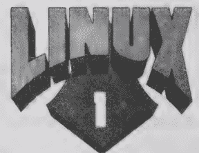

# Linux 与 PC 硬件

本章涵盖：

- Linux 的硬件需求
- PC 配置要求
- 处理器需求
- RAM 需求
- 支持的硬盘
- 支持的 SCSI 卡
- 支持的网络卡
- 支持的鼠标
- 支持的 CD-ROM 驱动器
- Linux 与笔记本电脑

## 第一章：Linux 与 PC 硬件

### 为 Linux 做好准备

老话说（也有人说这是陈词滥调）“一分准备胜过十分治疗”。然而，这句老话确实有真理——特别是在涉及安装和配置 Linux 时。

在匆忙进入半途吊子且构思不全的 Linux 安装之前，您应该做几件事，大部分与您的 PC 设置和配置有关。在本章中，我们将告诉您您的 PC 是否能够高效地运行 Linux，并指出一些潜在的问题区域。如果您正在考虑在现有机器上安装 Linux，或者正在考虑购买一台专门用于运行 Linux 的新电脑（笔记本电脑或台式台式机），这将非常有帮助。在下一章中，我们将运行一次典型的 Linux 安装。


我们对 Linux 的态度是以 PC 为中心的。（此处省略了原文中大量重复的句子）

### 核心组件

在本章的剩余部分中，我们将介绍各种 PC 组件，并对如果你想使用 Linux 时可能遇到的任何问题进行预警。此外，你可能希望查看第 3 章中关于支持的显卡的讨论——如果你想在 Linux 上运行 XFree86（X 窗口系统的实现），这种支持将变得至关重要。

在本节中，我们将从计算机的基本组件开始介绍：总线、处理器等。

### 总线

Linux 运行在所有主要的总线架构上——ISA、VLB、PCI、EISA，但出现在大多数 IBM PS/2 机型上的非标准微通道架构（Micro Channel Architecture）除外。（幸运的是，并不是所有的 IBM MC PC 都采用 MCA 总线；ValuePoint 和 PS/1 型号采用行业标准的 ISA 总线。）

### 处理器

Linux 至少需要基于 Intel 80386 的处理器才能高效运行。不要在基于 80286 的 PC 上浪费费劲了。如果你在柜子里放着一台旧 PC，并认为认为通过使用 Linux 来回收它可能很不错，那就让它留在那里吧，把它捐给当地的慈善机构，或者给小孩子们去玩。它在你的 Linux 冒险中将派不上用。

基本上，任何基于 Intel 80386 或更高级的 PC（包括 i486、Pentium 以及来自 AMD 和 Cyrix 的芯片）都能运行 Linux。如果没有数学协处理器（这在较旧的 80386 PC 上可能是一个问题），Linux 内置了 FPU 模拟。

### 一些 CPU 问题

有几个报告显示 Linux 会与 CPU 或数学协处理器发生冲突：

- 某些 AMD 486DX CPU 在非常特定的情况下可能会挂起，这个问题并不是 Linux 特有的。如果这种情况发生在你身上，请联系你的 PC 供应商并更换芯片。
- 某些来自 Cyrix、IIT 和 ULSI 的旧型号数学协处理器（Math*Co 系列）在 FSAVE 和 FRSTOR 指令上可能存在问题，这会导致 Linux 出现问题。同样，你可以从 PC 供应商处获取更换芯片。

### RAM（内存）

随机存器是涉及 PC 的棘手问题之一。如果你是工作站用户，你可能习惯了处理大量的 RAM。（话虽如此，大多数工作站用户都有别人买单，那些 RAM 的成本增加得非常快。）理论上讲，在 PC 上使用大量的 RAM 是极好的。Linux 像任何 32 位操作系统一样，都喜欢尽可能多的 RAM。

但在现实世界中，有账单要付，现实是 RAM 是 PC 最昂贵的部件之一，无论初次购买还是以后想升级都是如此。如果你是工作站用户，你将希望阅读以下章节，该章节解释了 RAM 和 PC；如果你是 PC 用户并且对 RAM 的知识很熟悉，可以跳过到后续章节。

### PC 与 RAM

如果你现在买一台 PC 且不太注重细节，你很容易得到一台拥有 8 兆字节（MB）RAM 的 PC，因为这是 CompUSA、Best Buy 和 Computer City 等公司提供的软件包中一个很流行的数字。在今天，8MB 并不是多少内存，即使是运行 Microsoft Windows、MS-DOS 和内存密集型应用程序也是如此。运行 Linux 时，情况会变得更加局限。


这段来自 Slack FAQ 的节选应该说明了与低内存相关的问题：

问：我完全无法让任何东西运行！到底是怎么了？

答：如果你似乎遭遇了灾难性的失败（!），请检查 `ftp.cdrom.com` 上 `/pub/linux/slack` 下的 `FILE_LIST` 文件，并与你的磁盘内容进行对比，确保你没有丢失任何文件。

此外，我注意到大多数内核恐慌（kernel panics）和系统挂起的报告都来自拥有 4MB 内存的人。如果你遇到这类问题，我建议花点钱买 4MB 内存。我有 8MB 的 RAM，从没有崩溃过。（好吧，也只当我真的运气得太好时候。）如果你不想这样做，就去检查你的 `/etc/rc.d/rc.*` 文件，并删除任何你不使用的守护进程，如 cron、lpd 或 selection。

如果你有 4MB 内存并且遇到“新轮次中虚拟内存超出（virtual memory exceeded in new windings）”，请确保在运行 `setup` 之前增加并激活交换分区（swap partition）。如果你内存非常吃紧张，可以使用 `editroot` 启动根磁盘而不是通常的启动内核。这将软磁盘挂载到根驱动器，你必须从另一个驱动器或硬盘进行安装。

如果你有 4MB 内存并且遇到“新轮次中虚拟内存超出”，请确保在运行 `setup` 之前增加内存并激活交换分区。如果你内存非常吃紧张，可以使用 `editroot` 启动根磁盘而不是通常的启动内核。这将软磁盘挂载到根驱动器，你必须从另一个驱动器或硬盘进行安装。

Linux 会在拥有 4MB 内存的 PC 上运行。然而，你会很快遇到内存限制，事实上，8MB 仅仅才够运行 Linux 系统。

如果你现在买一台 PC 且不太注重细节，你很容易得到一台拥有 8MB 内存 的 PC，因为这是 CompUSA、Best Buy 和 Computer City 等公司提供的软件包中一个很流行的数字。在今天，8MB 并不是多少内存，即使是运行 Microsoft Windows、MS-DOS 和内存密集型应用程序也是如此。运行 Linux 时，情况会变得更加局限。

img/fbc693f336ddb03484459053e27e3594_41_0.png)

取决于主板的配置，你可能需要尝试 RAM 及其在插槽中的顺序。在我们那个增加了两个内存条的 8MB PC 案例中，我们需要交替使用内存（旧内存、新内存、旧内存、新内存），系统才能识别所有的 16MB。通常这没有记录，所以你可能需要致电 PC 制造商的客服热线以获取建议。

EDO RAM 在如今的新 PC 上非常风靡。基本上，EDO RAM 比传统 RAM 快，但像计算机世界的其他任何事物一样，你必须为这种速度支付额外的费用。

因此，问题变成了你是否值得花额外的钱购买 EDO RAM 而不是传统 RAM（前提是，PC 的基础价格尚未包含 EDO RAM；几家大型电脑公司，如 Dell，已经开始在其所有配置中配备 EDO RAM）。我们的经验是，这钱是值得的。

Slackware Linux 不在乎你使用的是 EDO RAM 还是传统 RAM。

### 显卡

处理显卡一直是 Linux 中最棘手的领域之一——或者说，是 XFree86（作为 Linux 的 X Window 系统图形界面）的问题。XFree86 直接与显卡交互，并且必须在配置文件中了解关于显卡的所有信息（例如 RAM 数量、采用的芯片组以及支持的模式），这给你施加的压力比普通软件大得多。第 3 章详细介绍了如何配置 XFree86，而在几乎每一个方面，这都是你作为一名初级 Linux 用户将面对的最艰巨的任务。

### 控制器


# 第一章：Linux 与 PC 硬件

如果你是 DOS/Windows 用户，你可能不太关注电脑配备了什么种控制器，因为 DOS 和 Windows 对几乎任何 PC 控制器都非常宽容。

Linux 的情况并非如此，它直接与 PC 控制器工作并需要真正支持它。在接下来的章节中，我们将列出 Slack Linux 支持的控制器。控制器兼容性存在骨米牌效应：如果 Linux 不识别控制器，它就无法识别连接到控制器上的任何设备。我们大多数人都在控制器上连接了许多好设备，包括硬盘、CD-ROM 驱动器和扫描仪。

## 硬盘控制器

与大多数基于 PC 的 Unix 不同，Linux 对其支持的硬盘或多个硬盘并不挑剔；基本上，只要 PC 的 BIOS 支持某个硬盘，它在 Linux 下就能正常工作。这适用于 IDE、EIDE、MFM、RLL、ESDI（前提是使用仿真 ST-506 接口的控制器）以及大多数 SCSI 接口。事实上，以下增强型 IDE (EIDE) 接口被显式支持，即使在最多拥有两个 IDE 接口和四个硬盘/或 CD-ROM 驱动器的系统上也是：

- `CMD-640`
- `DTC 2278D`
- `Intel Triton (82371FB) IDE`（带有总线主 DMA）
- `FGI/Holtek HT-6560B`
- `RZ1000`


如果你使用带有 MFM、ESDI 或 RLL 控制器的硬盘，在安装 Linux 时需要使用 `ext2if` 文件系统格式。

注意

关于硬盘有多大——一如既往，越大越好。完整安装 Linux 占用略少于 275MB，但如果你对安装的内容非常小心，在 100MB 内也可以运行得很好（如果不安装 X Window 系统，则只需 40MB）。

> 硬盘的价格正在迅速下降，因此许多人将负担得起 1GB 的硬盘了。这当然是一件好事；我们最近注意到 1.2GB 的 IDE 硬盘广告价低于 300 美元。（当然，SCSI 硬盘的价格会贵一点。）

注意

然而，如果你购买了这些巨大的 IDE 硬盘之一，在它们上安装 Linux 之前，你需要做几件事——或者说，**不要**做几件事。MS-DOS 无法处理大硬盘（出于其无限的智慧，MS-DOS 的设计者给 DOS 设置了柱道限制，而较新的硬盘已经超过了 1023 个柱道的限制），因此 Conner 和 Western Digital 等大多数制造商会提供磁盘管理软件（如 Ontrack 的 Disk Manager），允许 MS-DOS 处理大硬盘。不要安装此软件。像 Disk Manager 这样的程序设计仅用于 MS-DOS 或其变体，而不是 Linux 或其他操作系统。

相反，请根据硬盘文档中的说明更改 PC 的 BIOS。然后，按照第 2 章详细说明的步骤，使用 DOS `FDISK` 工具将硬盘分区为两个 DOS 和 Linux 都能看到的较小分区。然而，你可能会遇到一些问题。例如，Hardware Compatibility-HOWTO 报告某些 Conner 硬盘在运行 e2fs 系统时执行 `e2fsck` 会出现错误。Conner 发布了固件升级来修复此问题（你需要硬盘标签上的微代码版本 WA1）。此外，某些 Microl 硬盘与 Adaptec 和 BusLogic 卡存在问题。在这些情况下，请硬盘制造商获取固件升级。

## SCSI 控制器

理论上，你不应该遇到任何问题，因为所有的 SCSI 卡都遵循了精确的技术规范。如果你认为你的 PC 上有一个 SCSI 控制器，你将能够使用 Linux 使用硬盘或另一个 SCSI 设备。以下控制器在 Linux 下被显式支持：AMI Fast Disk VLB（BusLogic 兼容）；Adaptec AVA-1505/1515（ISA）；Adaptec AHA-1510/152x（ISA）；Adaptec AHA-174x（EISA）；Adaptec AHA-274x/284x（VLB）；Adaptec AHA-2940/3940（PCI）；BusLogic（ISA/EISA/VLB/PCI 所有型号）；DPT PM2001, PM2012（EATA）；DPT Smartcache（ISA/EISA/PCI 所有型号）；DTC 329x（Adaptec 154 兼容）；Future Domain TMC-16x,326（PCI）；Future Domain TMC-8x,950；Media Vision 16（ISA）；NCR 5380 通用；NCR 53c400（Trantor T130B）（使用通用 NCR 5380）；NCR 53c40a（Media Vision 3D SCSI）；NCR 53c7x0（PCI/IDE (ISA/VLB));Seagate ST-01/ST-02（ISA）；Sound Blaster 16 SCSI-2（Adaptec 152x）（ISA）；Trantor T128/T128F/T228（ISA）；UltraStor 14F（ISA）， 24F（EISA）， 34F（VLB）；以及 Western Digital WD700 SCSI。

此外，某些 SCSI 控制器只有在系统添加补丁后才能在 Linux 下使用。这些控制器和补丁的互联网地址列表 1.2。

表 1.2 SCSI 控制器补丁与互联网地址

| 控制器 | 互联网地址 |
| :--- | :--- |
| AMD53C974, AM79C974 (PCI) (Compaq, HP, 板载 SCSI) | ftp://sunsite.unc.edu/pub/Linux/patches/scsi/AM53C-974-0.3.tgz |
| Adaptec ACB-440-xx SCSI MFM/RLL 桥 | ftp://sunsite.unc.edu/pub/Linux/patches/scsi/adaptec-40XX.tar.gz |
| Always Technologies AL-500 | ftp://sunsite.unc.edu/pub/Linux/patches/scsi/al500-0.2.tar.gz |
| BusLogic (ISA/EISA/VLB/PCI) | ftp://dandelion.com/BusLogic-I-0-beta.tar.gz |
| iomega PC2/2B | ftp://sunsite.unc.edu/pub/Linux/patches/scsi/iomega-pc2-1.x.tar.gz |
| Qlogic (ISP1020) (PCI) | ftp://sunsite.unc.edu/pub/Linux/patches/scsi/isp1020-0.5 |
| Ricoh GSI-8 | ftp://tsx-1.mit.edu/pub/linux/ALPHA/scsi/gsi8.tar.gz |

并行口 SCSI 适配器（用户中流行）和不兼容 Adaptec 的 DTC 板（327x, 328x）不被 Linux 支持。


SCSI 设备必须支持 256、512 或 1024 字节的块大小。其他大小将无法工作。（使用 `MODE SELECT` 命令更改块大小）。


如果你在 SCSI 和 Linux 上遇到问题，你会想要阅读 CD-ROM 上的 SCSI-HOWTO。更多详情请参见附录 A。

然而，要警告你可能需要对各种 SCSI 卡进行尝试，正如从这段 Slackware FAQ 摘录中所看到的：

- Q: 为什么检测不到我的 Ultra？在 DOS 下是正常的：
- AS: 将 I/O 地址设置为 0x340 而不是 0x330。

对于任何工作的硬件，一个规则是尝试调整 IRQ 和 I/O 设置看看会怎样。如果你的系统运行正常，但在光光带或类似设备上遇到问题，你始终可以在 `/usr/src/linux/drivers` 中查找驱动源码……真的，那里包含了该类型的默认 IRQ 设置以及 `/dev` 中条目的主号。此外，尝试其他启动内核看看是否有帮助。


> 关于 IRQ 和中断的讨论可以在本文后面找到。

对 SCSI 的支持应该扩展到带驱动器（正如你将在本文后面的“带驱动器”章节中学到的）。

## 软盘驱动

Linux 安装过程假设你会为高密度驱动器创建启动盘和根分区。由于较大的 1.2MB 硬盘已几乎从日常生活中消失，随附的 CD-ROM 仅包含大多数电脑用于 A 盘的1.44MB 3.5 英寸软盘驱动程序：

### 驱动器

任何通过 SCSI 接口工作的驱动器（例如 QIC-20）在 Linux 下都应该是正常的（换句话说，如果你的 SCSI 卡正常工作，驱动器也应该正常）。在这些情况下，你需要确保固定长度和可变长度的驱动器块小于驱动程序缓冲区


长度（在发行版源码中设置为 32k）。此外，Linux 与通过软驱控制器连接的其它磁带驱动器配合得很好，例如 QIC-117、QIC-40/80 以及 QIC-3010/3020 (QIC-WIDE) 驱动器。

其他使用软驱控制器的磁带驱动器包括 Colorado FC-10/FC-20、Mountain Mach-2 和 Iomega Tape Controller II，应该也可以工作，但你可能需要从 `http://sunite.unc.edu/pub/Linux/kernel/tapes` 获取补丁。

有若干不支持的磁带驱动器，包括 Emerald 和 Tecmar QIC-02 磁卡、连接到并行端口的驱动器（如 Colorado Trakker）、某些高速磁带控制器（Colorado TC-15）、Irwin AX250L/Accutrak 250（不兼容 QIC-80）、IBM 内部磁带备份单元（不兼容 QIC-80）以及 COREtape Light。


欲更多信息，请查看 FTAPE-HOWTO。

### CD-ROM

你可以在 Linux 下使用基于 SCSI 的 CD-ROM，也可以使用 Creative Labs 等公司提供的许多 CD-ROM/声卡组合之一。如果你使用块大小为 512 或 2048 字节的 SCSI CD-ROM，只要 Linux 能识别 SCSI 卡，就没问题；Linux 是直接与 SCSI 卡通信，而不一定直接与 CD-ROM 通信。任何 EIDE (ATAPI) CD-ROM 驱动器都应该工作，并且对以下驱动程序提供了明确支持：Aztec CDA268、Orchid CDS-3110、Okano/Wearnes CDU-110、Conrad TXC、GoldStar R420、LMS Philips CM 206、Mitsumi、Optics Storage Dolphin 8000AT、Sanyo H94A、Sony CDU31A/CDU33A、Sony CDU-535/CDU-531、Teac CD-55A SuperQuad，以及属于 Creative Labs 标签并用于 Sound Blaster 捆绑的各种驱动器——松下/松下、Creative Labs、Longshine 和 Kotobuki。

你需要补丁来使用以下 CD-ROM 驱动器：

- MS/Philips CM 205/225/202 (`ftp://sunsite.unc.edu/pub/Linux/kernel/patches/cdrom/lmscd0.3d.tar.gz`)
- Mitsumi FX01D/F (替代驱动可以在 `ftp://ftp.grudg.de/pub/linux/cdrom/drivers/mitsumi/mcdx-1.0a.tar.gz` 找到)
- NEC CDR-35D (`ftp://sunsite.unc.edu/pub/Linux/kernel/patches/cdrom/neccdr35d.patch`)
- Sony 多段 CD-XA (`ftp://sx-11.mit.edu/pub/linux/patches/sony-multi-0.00.tar.gz`)

再次，注意“即插即用”声卡——它们与 Linux 的兼容性并不好。如果你连接了即插即用声卡的 IDE/ATAPI CD-ROM 驱动器且 Linux 未检测到它，请尝试将其连接到主板（或 I/O 卡）上的 IDE 接口。如果还是不行，尝试移动背面的跳线帽。（记住原始设置以备不一。）


我们收到了一些关于 Gateway 2000 PC 中使用的 CD-ROM 驱动器的投诉，行业媒体也有报道称某些型号无法按宣传的方式工作，无论是与另一种 CD-ROM 类型的兼容性还是速度问题。如果你拥有 Gateway 并且在 CD-ROM 驱动器上遇到问题，你可能需要进行研究。

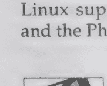

Linux 支持 ISO-9660 文件系统、Ridge Extensions（岭扩展）和 PhotoCD (XA) 格式。并不是每个 Sound Blaster 都具有专用接口，因为某些版本是基于 SCSI 的。在安装之前，你需要知道你使用的是哪种 Sound Blaster 板。


这里是 Slackware 关于 Sound Blaster 的另一个选段：

Q：我在启动时检测到 Sound Blaster/Panasonic CD-ROM，但我无法从中安装或无法挂载它。

答：尝试将驱动器的 ID 设置为 0。这是 Linux 磁盘预期的。驱动器背面应该有一个跳线帽——只需将其移动到最左侧的位置。


### 可移动驱动器

与 SCSI 控制器一样，任何连接到工作 SCSI 控制器的可移动驱动器都应该工作，包括光盘 (MO)、写光 (WORM)、Zip 以及其他驱动器。如果你使用的是 Zip 驱动器，可以从 `ftp://gear-torque.net/` 获取补丁并查看是否工作。Linux 支持 512 和 1024 字节扇区。

### I/O 控制器

任何标准的串口/并行/摇杆组合卡都可以与 Linux 使用，包括带有 8250、16450、16550 的 UART。支持非标准 IRQ（如 IRQ 9）的卡也可以使用。

### 外部连接

Unix 是为了连接计算机而写的。因此，Linux 重视外部连接并不意外。从非常基础的网络卡开始，并扩展到基于电话的连接，如调制解调器和 ISDN 卡。

### 网卡

如果你计划在网络上使用 Linux，将你需要一个网卡。（如果你不计划在网络上使用 Linux，则不需要。）以下以太网卡已通过测试并被 Linux 支持：

- 3Com 3C501、3C503、3C505、3C507、3C509/3C59B (ISA)/3C579 (EISA)
- AMD LANCE (7C960)/PCnet-ISA/PCI (AT1500, HP J2405a, NE1500/NE2100)
- AT&T WaveLAN; Allied Telesis AT1700
- Ansel Communications AC3200 EISA
- Apricot Xen-II
- Cabletron E21xx
- DEC DE425 (EISA) / DE434/DE435 (PCI)
- DEC DEPCA 和 EtherWORKS
- HP PCLAN (2725 和 27xx 系列)
- HP PCLAN PLUS (27247B 和 27252A)
- HP 10/100VG PCLAN (ISA/EISA/PCI)
- Intel EtherExpress; Intel EtherExpress Pro
- NE2000/NE1000 (然而并非所有克隆都是)
- New Media Ethernet
- Racal-Interlan NI5210 (8256 以太网芯片)
- Racal-Interlan NI6510 (atm99 芯片）（如果你的电脑内存超过 16MB，此板将无法工作）
- PureData DUC808; SEEK 8005; SMC Ultra; Schneider & Koch G16
- Western Digital WD80x3;
- Zenith Z-Note ThinkPad 300 内置适配器

以下口袋和便携适配器已通过测试并可在 Linux 下工作：

- AT-Lan-Tec/RealTek 并行适配器和 D-Link DE600/DE620 并行适配器可连接网络
- PLIP/CSLP/PPP (串口)
- EQP (串口 IP)
- 使用双通道的 PLIP (并行端口)

此外，Linux 支持 ARCnet 卡和 IBM Tropic Token Ring 卡。最后，Linux 支持以下业余无线 (AX.25) 卡：Ottawa PI/PI12 和大多数基于 8530 的 HDLC 卡。

> HARDWARE-HOWTO 中关于 3Com 3C501 的一行：“避免瘟疫。”


此外，一旦你从互联网获取补丁，Linux 将支持以下以太网卡：

- 3Com Demon Ethercards (3C592, 3C597 (100 Mbps)) (EISA)，补丁位于 `http://sunsite.unc.edu/pub/Linux/kernel/patches/cdrom/lmscd0.3d.tar.gz`。


- 3Com 3C501, 3C503, 3C505, 3C507, 3C509/3C509B (ISA)/3C579 (EISA)

- AMD LANCE (7C960)/PCnet-ISA/PCI (AT1500, HP J2405a, NE1500/NE2100)

- AT&T WaveLAN; Allied Telesis AT1700

- Ansel Communications AC3200 EISA

- Cabletron E21xx

- DEC DE425 (EISA) / DE434/DE435 (PCI)

- DEC DEPCA 和 EtherWORKS

- HP PCLAN (2725 and 27xx 系列)

- HP PCLAN PLUS (27247B and 27252A)

- HP 10/100VG PCLAN (ISA/EISA/PCI)

- Intel EtherExpress; Intel EtherExpress Pro

- NE2000/NE1000 (然而并非所有克隆都是)

- New Media Ethernet

- Racal-Interlan NI5210 (8256 以太网芯片)

- Racal-Interlan NI6510 (atm99 芯片）（如果你的电脑内存超过 16MB，此板将无法工作）

- PureData DUC8028; SEEK 8005; SMC Ultra; Schneider & Koch G16

- Western Digital WD80x3;

- Zenith Z-Note ThinkPad 300 内置适配器。

此外，表 1.3 列出了从互联网下载并安装补丁后，Linux 将识别的多端口控制器。

| 控制器 | 互联网地址 |
| --- | --- |
| Comtl RocketPort (8/16/32 端口) | `ftp://tux-11.mit.edu/pub/linux/comtrl/` |
| DigiBord PC/Xe (ISA) 和 PC/XI (EISA) | `ftp://fpt.digib.com/drivers/linux/` |
| Moxa C218 (8 口) / C320 (8/16/24/32 可扩展) | `ftp://fpt.moxa.com.twl/drivers/c-218-320/linux/` |
| Specialix SIOXO (模块化, 4 到 32 口) | `ftp://sunsite.unc.edu/pub/Linux/kernel/patches/serial/sdrv0_5.tar` |

## 调制解调器

同样，如果调制解调器在 DOS 下可以工作，它在 Linux 下也应该工作——无论是内部还是外接。当你安装 Linux 时，你需要指定调制解调器的位置（串口 1、2、3 或 4）。PCMCIA 调制解调器也是如此。

你需要传真软件来利用传真调制解调器的功能。某些调制解调器需要特殊的程序：Digicom Connection 96+/14.4+ 需要一个 DSP 代码下载程序（可以在 `http://sunsite.unc.edu/pub/linux/system/Serial/smdl-linux.1.02.tar.gz` 找到），ZyXEL U-1496 系列需要 ZyXEL 1.4，一个调制解modem/传真/语音控制程序（可以在 `http://sunsite.unc.edu/pub/Linux/system/ZyXEL-1.4.tar.gz` 找到）。

### ISDN 卡

ISDN 卡属于直接连接到设备或标准调制解调器或网卡的替代品。如果你正在使用 ISDN 卡仿真调制解调器或网卡，你应该没有问题。然而，如果你正在使用 ISDN 连接互联网，你需要安装一些补丁。表 1.4 列出了 Linux 将识别的 ISDN 设备，随后是相应补丁的互联网地址。

### 表 1.4 ISDN 设备及其对应的补丁

如果你想获得更多关于使用 Linux 和 ISDN 设备的信息，请将你的 Web 浏览器指向 `http://www.ix.de/ix/linux/linux-isdn.html`。

### ATM 网络适配器

已经对 Efficient Networks ENI155P-MF 155 Mbps ATM 适配器进行了一些工作。你可以从 `http://lrc.epfl.ch/linux-atm/` 获取驱动程序和过程描述。

### 帧中继卡

针对 Sangoma S502 56K 帧中继卡的驱动程序已经完成了一些工作。你可以从 `ftp://ftp.sovereign.org/pub/wan/fr/` 获取副本。

### 其他设备

如今，很难买到一台没有配备一系列附加组件（如声卡和网卡）的 PC。在这一节中，我们将列举这些最受欢迎的附加组件和其他杂项组件。

### 声卡

Linux 支持多种声卡，包括：6850 UART MIDI (OPL2)；Audio Excel DSP16；Aztec Sound Galaxy NX Pro；基于 Crystal CS4232（即插即用）的卡；ECHO-POS 卡 (Orchid Wave32, Cardinal DSP16)；Ensoniq SoundScape；Gravis Ultrasound；Gravis Ultrasound 16 位采样子板；Gravis Ultrasound MAX；Logitech SoundMan Games (SBPro, 44kHz)

## 26 第1章：Linux 与 PC 硬件

GeniScan GS4500 携持式扫描仪 (`ftp://tsx-11.mit.edu/pub/linux/ALPHA/scanner/gs4500-1.3.tar.gz`), HP ScanJet 和 ScanJet Plus (`ftp://ftp-ctrl-c.liue.edu/unix/linux//`), HP ScanJet II 系列 SCSI (`ftp://sunsite.unc.edu/pub/linux/apps/graphics/scanners/hpscanpbm-0.3a.tar.gz`), HP ScanJet 家族（包括 ScanJet 3c） (`http://www.tummy.com/xvscan/`), Logitech 32/256扫描仪 (`ftp://tsx-11.mit.edu/pub/linux/ALPHA/scanner/logiscan-0.0.2.tar.gz`), Mustek M105 手持式扫描仪 GI1904 接口 (`ftp://tsx-11.mit.edu/pub/linux/ALPHA/scanner/driver-0.1.tar.gz`), Mustek Paragon 6000CX (`ftp://sunsite.unc.edu/pub/linux/apps/graphics/scanners/muscan-1.1.5.taz`), Nikon Coolscan CSCI 35mm 胶片扫描仪 (`ftp://sunsite.unc.edu/pub/linux/apps/graphics/scanners`)。

### 视频采集卡


Slack Linux 默认不支持任何视频采集卡。要使用板卡，你需要确保该卡有驱动程序，然后从互联网获取该驱动。可用 Linux 驱动的板卡有：FAST Scan Machine II (`ftp://sunsite.unc.edu/pub/linux/apps/video/MachineII.1.2.tgz`)，ImageNation Cortex I (`ftp://sunsite.unc.edu/pub/linux/apps/video/cortex.drv-0.1.tgz`)，ImageNation CX100 (`ftp://sunsite.unc.edu/pub/linux/apps/video/excdrv-0.1beta.tar.gz`)，Pro Movie Studio (`ftp://sunsite.unc.edu/pub/linux/apps/video/PMS-grabber.2.0.tgz`)，Quantum Vision 视频采集卡 (`ftp://sunsite.unc.edu/pub/linux/apps/video/fgrabber-1.0.tgz`)，Video Blaster/Rombo Media Pro+ (`ftp://sunsite.unc.edu/pub/linux/apps/video/vid_src.tgz`)，以及 VT1500 TV 卡 (`ftp://sunsite.unc.edu/pub/linux/apps/video/ot-1500-1.0.5.tgz`)。

### 不间断电源系统

Slack Linux 默认不支持 UPS，但已提供适用于 APC SmartUPS (`ftp://sunsite.unc.edu/pub/Linux/system/UPS/apcd-0.1.tar.gz`) 以及带有 RS-232 监控端口的通用 UPS（被称为“unipower”包）的驱动程序 (`ftp://sunsite.unc.edu/pub/Linux/system/UPS/unipower-1.0.0.tgz`)。其他人已成功让 Linux 与其他 UPS 接口；更多详情请参阅随附 CD-ROM 盘中的 UPS-HOWTO。

## 第1章：Linux 与 PC 硬件 27

### 数据采集设备

Slack Linux 未明确支持用于数据采集的硬件，但你可以从 Linux Lab Project (`ftp://koala.chemie.fu-berlin.de/pub/linux/LINUX-LAB/`) 获取软件，学习如何支持以下设备：Analog Devices RTI-800/815 ADC/DAC 板，CED 1401，DBCC CAMAC，IEEE-488 (GPIB, HPPIB) 板，Keithley DAS-1200 以及 National Instruments AT-MIO-16F。

### 杂项

如果设备连接到 SCSI 且 Linux 处理 SCSI ID 没有问题，那么在使用该设备时应该也不会遇到问题。这包括大多数 CDR、WORM、光驱驱动器。此外，我们还没有听到关于 SyQuest 和 Bernoulli 等专有驱动器的投诉。

此外，还有一些 Slack Linux 并不支持的杂项设备，但在互联网上有可用驱动。我们最喜欢 Mattel Powerglove (`ftp://sunsite.unc.edu/pub/linux/powerglove`) 的驱动——为什么要费劲用简单的鼠标来让它运行起来？其他杂项设备驱动包括 AIMS Labs FM 卡 (`ftp://sunsite.unc.edu/pub/linux/apps/sound/radiotrack-1.1.tgz`)、chip 读器/写器 (`ftp://ftp.uni-koeln.de/pub/linux/chip/`)、Reveal FM 卡 (`ftp://magoo.uwsuper.edu/fm-radio/`) 以及 Videotext 卡 (`ftp://sunsite.unc.edu/pub/linux/apps/video/videotext-0.5.tar.gz`) 处理特定系统

本章到为止的指南适用于组件。然而，Linux 社区发现某些 PC 配置带来了挑战。

## 28 第1章：Linux 与 PC 硬件

David Ludwig (`davidl@hal-pc.org`) 一直编写特定配置的用户列表，位于 `http://www.hal-pc.org/~davidl/linux/desktop.html`。这个列表很长且在增加；如果你对他人的电脑感兴趣，可能想查看这个数据库。请注意，许多调查者列出的是通用信息，而非特定型号。(img/f693f3dd034844053e273594_png)

### Compaq Pro XL

如果你对 PC 硬件感兴趣——你很可能——你会发现 Compaq Pro XL 系列的配置很奇怪：一个带有板载 SCSI/以太网的 EISA 总线系统，基于 AMD chip 的音频系统以及 Matrox Vision2000 显卡。遗憾的是，Pro XL 系列相当。请注意，你可能需要克服很多困难才能运行 Linux；运行过它的人几乎可以忘记任何声音，并且可能会遇到额外问题。由于这些细节非常专业，我们在这里不描述，但在 CD-ROM 中附了相应的 HOWTO。你可以访问 `http://www.hal-pc.org/~davidl/linux/xl` 查看更新后的 HOWTO。

## 第1章：Linux 与 PC 硬件 29

### 笔记本电脑 Linux

通常来说，如果你在笔记本领域待过，就知道每个笔记本型号在硬件和配置上都有些不同。Linux 世界发现某些笔记本型号在安装方面存在挑战。在本节中我们将介绍一些热门型号以及在上面使用 Linux 时面临的挑战。此外，表 1.5（摘要）是 Linux 调查的结果，全球的用户报告了成功运行 Linux 的笔记本。这里的部分信息来自该网站，感谢 Kenneth E. Barker (`kharker@cs.utex.edu`)，部分信息来自我们的个人经验。如果你有一台笔记本并想了解更多关于在上面使用 Linux，Linux 主页是一个起点。另一个信息源是 Linux Portables 网站，位于 `http://www.hawaii.edu/linux/portables.html`。许多笔记本用户使用并行端口 SCSI 适配器。然而，Linux 还不支持这些适配器中的大部分（仅支持 ZIP 驱动器的并行 SCSI 适配器）。列出了笔记本是否具有与 Linux 的节能功能。这不一定是 APM；可能是写入笔记本 BIOS 的专有硬件程序。

## 第1章：Linux 与 PC 硬件

表 1.5 笔记本调查结果（截至 1997 年 4 月）

| 笔记本品牌型号 | CPU | 最大电池寿命 | 省电？ | 备注 |
| :--- | :--- | :--- | :--- | :--- |
| Acer Note350 | Pentium/100 | 2 小时 | 是 | NE200 以太网、调制器正常；APM 不行 |
| AMS PN325 | 486/66 | 2 小时 | 是 | 无 |
| AMS SoundPro | 486/50 | 3 小时 | 是 | X 存在风险 |
| AMS TravelPro 5300 | 486/66 | 1.5-2 小时 | 是 | PCMIA IC 卡正常 |
| AMS TravelPro 5366 | 486/66 | 1 小时 | n/a | 无 |
| ARMTS30A | 486DX4/100 | 2.5-3 小时 | 是 | PCMIA PreMax 14.4 正常 |
| AST Advantage! Explorer | 486sx/25 | 2-3 小时 | 是 | 无 |
| AST PowerExec 25 | 486sx/25 | n/a | 是 | PCMIA D-link 正常；Intel 1440 不行 |
| AST PowerExec | 486/33SL | 2 小时 | 是 | 无 |
| AT&T Globalsat 2005 | 486DX4/7 | 2 小时 | 是 | PCMIA 正常 |
| AT&T Globalsat 2250 | 486DX4/100 | 2 小时 | 是 | 麦克风正常 |
| Austin Active Core | 486/66 | 2 小时 | 是 | PCMIA D-Link DE-650 正常 |
| Austin 33MHz Mono (Arima) | 486/33 | 3 小时 | 是 | 内部型号 |
| Austin DX66-2 (Arima) | 486/66 | 2 小时* | 是 | 正常 |
| Austin/IPC (Arima) 464D | 486 | n/a | 是 | 无 |
| BIT DU33 | 486/33 | 3.5 小时 | n/a | 无* |
| BIT FR-800 | 486/66 | 2 小时 | 是 | 无 |
| Canon Innova Subnotebook #10 | 486sx/33 | 1.5 小时 | 否 | 无 |


| Caravene AV-BSNT | 486sx/25 | 2 小时 | 是 | 无 |
| Chicony NBS | 486/66 | 1 小时 | 是 | PCMIA SCSI；以太网正常 |
| Chicony NoteBook 9800 | 486/66 | 2 小时 | 是 | Intel 14.4 DataFax 调整后运行 |

## 第一章：Linux 与 PC 硬件

| 笔记本品牌与型号 | CPU | 最大电池续航 | 缺点 | 备注 |
|---|---|---|---|---|
| Compaq Concerto 4/33 | 486/33 | 3.5 小时 | 是 | 触笔在 Linux 下不支持；解决方法见后文 |
| Compaq Contura 4/25 | 486sx/25 | 4 小时 | 是 | 见后文 |
| Compaq Contura 4/25cx | 486SL/25 | 不于 2 小时 | 否 | 轨迹球不支持：见后文 |
| Compaq Contura 430C | 486DX-100 | 2 小时 | 是 | 无 |
| Compaq 4/25 Lite | 486SL/25 | 4 小时 | 是 | 无 |
| Compaq LTE Elite 4/75 | 486DX4XL/75 | 否 | 是 | 无 |
| Compaq LTE 5280 | Pentium | 否 | 否 | 无 |
| Compaq T537 (王) | 486sx/25 | 否 | 是 | X 未测试 |
| Compudyne SubNote 4SL/25 | 486SL/25 | 3 小时 | 是 | AT-LAN-TEK(ATP) 并行口可用 |
| Daytona 486SLC | 486SLC/25 | 4 小时 | 否 | 无 |
| DEPC 425 SL/e | 486SL/25 | 3.5 小时 | 是 | 无 |
| DEPC 4335LC premium (AST) | 486/33 SLC | 2 小时 | 是 | PCMCIA 以太网卡可用 |
| Dell 320N+ | 386sx/20 | 3.5 小时 | 否 | PCMCIA D-Link 600 可 |
| Dell Latitude 433cx | 486sx/33 | 1 小时 | 否 | 无 |
| Dell Latitude XP 4100cx | 486DX4/100 | 3 小时 | 是 | PCMCIA 以太网 (使用 SLIP) 可 |
| DUAL | 486sx/25 | 2.5 小时 | 否 | 无 |
| DUAL SKD-4000 | 486/66 | 1 小时 | 否 | 无 |
| EPS Technologies Agpex | Pentium/133 | 1.5 小时 | 是 | Linksys ne2000 |
| Epson 700 | Cyrix DX/33 | 2.5 小时 | 是 | Linksys ne2000 组合可用 |
| Epson Direct Ende NT-500 | 486DX/475 | 否 | 是 | 无 |
| Epson NB-SL/25 | 486SL/25 | 1 小时 | 是 | 无 |
| Epson VNS755T | Pentium/75 | 否 | 否 | 无 |
| Escom Paradigma SX33 | 486sx/33 | 2 小时 | 是 | 声卡不支持 |
| Escom Notebook 90 | Pentium/90 | 1.5 小时 | 是 | 无 |
| FOSA 9200M | 486DX/66 | 1 小时 | 是 | 硬件扩展功能在 Linux 下不可 |
| Gateway 2000 ColorBook | 486sx/33 | 1.25-1.75 小时 | 是 | 无 |
| Gateway 2000 Handbook | 486sx/25 | 1 小时 | 否 | 无 |
| Gateway 2000 Handbook | 486DX/40 | 1-1.5 小时 | 是 | PCMCIA D-link 600 可 |
| Gateway 2000 Handbook | 486SL/40 | 2-2.5 小时 | 是 | 无 |
| Gateway 2000 Liberty | 486DX/100 | 3 小时 | 是 | 无 |
| Gateway Solo | Pentium/150 | 2.5 小时 | 是 | 包含光驱；若内存小于 3MB 则无法运行 X |
| GRID 1450SX | 386sx/16 | 否 | | |
| GRID 1550SX | 386sx/20 | 1 小时 | 是 | 无 |
| GRID 1660 | 386sx/20 | 1.5 小时 | 是 | PCMCIA 600 可 |
| Highscreen 486 SLC 33 | 486/63 | 2-3 小时 | 是 | X 有某些问题；双显示器模式下 X 有问题，但外部显示器没有 |
| Highscreen Blue Note | 486DX/66 | 2 小时 | 是 | 带有以太网卡正常 |
| Hyperdata Expor CD100 | 486DX/100 | 4 小时 | 是 | PCMCIA 有问题 |
| IBM L405X | 386sx/20 | 否 | 否 | 无 |
| IBM Note/425 | 486SL/25 | 2.5 小时 | 是 | 无 |
| IBM ThinkPad 340 | 486SL/50 | 3 小时 | 是 | 见后文 |
| IBM ThinkPad 350 | 486SL/25 | 3 小时 | 是 | Megahertz PCMCIA 正常；见后文 |
| IBM ThinkPad 365 CSD | 486DX/75 | 3-6 小时 | 是 | 无 |
| IBM ThinkPad 500 | 486LC/50 | 2 小时 | 是 | 无 |
| IBM ThinkPad 701C | 486DX/75 | 2.5 小时 | 是 | PCMCIA |
| IBM ThinkPad 750 (Mono) | 486/33 | 6 小时 | 是 | PCMCIA 正常；见后文 |
| IBM ThinkPad 750CS | 486SL/33 | 3 小时 | 是 | PCMCIA D-Link 650，Megahertz 调制解器均正常；见后文 |
| IBM ThinkPad 755 | 486DX4/75 | 4 小时 + | 是 | 见后文 |
| Innovace 620px | Pentium/75 | 否 | | |
| INSI EchoBook | 486DX2/50 | 2-2.5 小时 | 是 | PCMCIA D-Link 650 可 |
| INSI EchoBook | 486DX4/75 | 2-3 小时 | 是 | PCMCIA D-Link 650 可 |
| IPC 5 | 486sx/25 | 2 小时 + | | 无 |
| IPC Porta-PC 5E-486/D5 | 486DX4/100 | 3 小时 | 是 | 无 |
| Jetta Jetbook | Cyrix 486/333 | 1 小时 | 是 | 无 |
| Lion NB 8500 | 486DX4-S/100 | 2 小时 | 是 | 无 |
| MacPerson Scriba | 486DX2/66 | 3.5-4 小时 | 是 | |
| Magnavox Metal SX/16 | 386sx/16 | | 电源管理 |
| Midwest Micro Elite | 486sx/25 | 2 小时 | 是 | 无 |
| Midwest Micro Elite | 486sl/33 | 2 小时 | 否 | 无 |
| Midwest Micro Ultra | 486sx/25 | 3 小时 | 是 | 通过并行口 3Com EtherLink III 正常，Thinfax 14400 |
| Midwest Micro Soundbook | 486DX4/100 | 2 小时 | 是 | PCMCIA D-Link 650 可 |
| Midwest Micro Soundbook P-90 | Pentium/90 | 1.75-2 小时 | 是 | 无 |
| NEC Ultrite Versa E | 486/50 | 2 小时 | 否 | PCMCIA D-link 可 |
| NEC Ultrite Versa Edock | 486/50 | 2 小时 | 否 | 使用第二块电池时测试的电池寿命： |
| NEC Ultrite Versa 33C | 486SL/33 | 3.5-5 小时 | 是 | Megahertz PCMCIA 正常 |
| NEC Versa S/3D | 486sx/33 | 1.5 小时 | 是 | 见后文 |


# 36 第一章：Linuxbook 与 PC 硬件

| NEC Versa 4000C | Pentium/75 | 2.5 小时 | 是 | 3Com EtherLink III PCMCIA 可 |
| NEC Versa 6030X | Pentium/133 | 2.1 小时 | 是 | 无 |
| Notebook 3500 | 486sx/25 | 1.5 小时 | 否 | 无外部器 PCMCIA D-Link |
| Notastar NP-743D | 486DX2/66 | 1.5 小时 | 是 | 650 可 |
| Olivetti Philos 33 | 386sx/20 | 8 小时 | 是 | 无 |
| Paccomp | 486DX/66 | 3 小时 | 是 | PCMCIA 可 |
| Panasonic CF-25 | Pentium/133 | 1.5 小时 | 是 | PCMCIA 可 |
| Prostar 9200 | 486DX4/100 | 3 小时 | 是 | 3c589B PCMCIA 卡可用 |
| SagerNP943 | 486/33 | 2 小时 | 是 | PCMCIA D-Link 正常 |
| Sager NP7500 | 486sx/33 | 2.5 小时 | 是 | 无 |
| Sager NP7600 | Pentium/90 | 2 小时 | 是 | PC-100 Megahertz 调制解器，IBM 均正常 |
| Sager NP8600 | Pentium/75 | 1.5 小时 | 是 | PCMCIA 正常 |
| Sager NP9200 | 486DX4/100 | 2 小时 | 是 | 无 |
| Samsung 800 | Pentium/90 | 2 小时 | | 无 |
| Samsung 800C | Pentium/75 | 3 小时 | | 无 |
| Samsung 4000 | 486SL/33 | 2 小时 | 是 | 无 |
| Siemens 4000 | 486DX/75 | 2.5 小时 | 是 | 无 |
| Sharp 8650 | 486SL/33 | 2 小时 | 是 | 无 |
| TI 1000 | 486sx/33 | 3 小时 | 是 | 无 |
| TI 1050 | 486DX/50 | 1.5 小时 | 是 | 无 |
| TI 1100 | 486SL/33 | 4 小时 | 是 | 无 |
| TI 1200 | 486sx/20 | 2.5 小时 | 否 | |
| TI 1300 | 386sx/16 | 1.5 小时 | | 无 |
| TI 1400 | 486sx/33 | 2.5 小时 | 否 | |
| TI 1500 | 486DX/50 | 1.5 小时 | | 无 |
| TI 1600 | 486SL/33 | 3 小时 | 是 | 无 |
| TI 1700 | 486DX/66 | 2 小时 | 是 | 无 |
| TI 1800 | 486sx/20 | 2 小时 | 是 | 无 |
| TI 1900 | 486sx/33 | 2.5 小时 | | |
| Total Peripherals NBD486 | 486sx/25 | 4 小时 | 是 | X 有某些问题；De620（并行口适配器）可用 |
| Twinhead Slim 484 | 486/33 | 2 小时 | 是 | X 未测试 |
| Tulip NB | 386sx/16 | 1 小时 | 否 | 否 |
| Vobis ModuleNote | 486DX2/66 | 2 小时 | 是 | X 未测试 |

| 笔记本品牌与型号 | CPU | 最大电池续航 | 耗电？ |  |
|---|---|---|---|---|
| WinBook | 486DX2/50 | 2 小时 | 是 | 无 |
| WinBook XP | 486/100 | 2 小时 | 是 | CD-ROM 正常 |
| Zenith SuperSport X | 386sx/16 | 无 | | 无 |
| Zenith Z*Lite* | 486SL/25 | 2 小时 | 是 | 提供驱动 |
| Zenith Z-Note 425-Inc | 486SL/25 | 2.5 小时 | 是 | 内置以太网 |
| Zenith Z-Star 433VL | 486SX/33 | 无 | 是 | 无 |
| Zeos Contanda 386 笔记本电脑 | 486/25 | 3 小时 | 是 | PCMCIA D-Link |
| | | | | DE600 正常： |
| | | | | Linksys PE-EEP |
| | | | | 口袋适配器 / 未 |

*调查者报告的电池续航时间从 1.5 小时到 3 小时

### 其他特定型号

仅仅因为 Linux 可以在特定的笔记本电脑上运行，并不意味着你可以充分利用该笔记本的硬件功能。许多 Linux Linux 用户已经挑战过让 Linux 在他们奇特的笔记本上运行，并乐于向 Linux 社区的其他成员分享他们的解决方案。我们将简要介绍一些特定的笔记本型号以及如何让 Linux 在它们上运行。如果这里提到 FAQ（常见问题解答），已包含在随附的 CD-ROM 中。

> 你不能根据这里提供的特定型号进行推断。笔记本领域以产品线之间缺乏一致性而闻名，对特定型号有效的方法对该型号的“表兄弟”可能并不有效。除非信息显式涵盖了广泛的型号（如 IBM ThinkPad 的信息），否则请仅针对特定型号使用此处的信息。

### AST 900N

基本上，在该笔记本型号上安装 Linux 没有重大挑战，但存在一些陷阱。随附的 CD-ROM 中包含了一关于如何在 AST 900N 上安装 Linux 的 HOWTO。

### Compaq Concerto

Compq Concerto 配备的是笔设备而不是鼠标。Linux 无法识别笔设备，但 Joseph J. Pfeiffer Jr. 博士在他的网站（http://www.cs.nmsu.edu/~pfeiffer/）发布了驱动。

### Compaq Contura Aero

Compq Contura Aero 是一款非常流行且非常便宜的笔记本型号，但它对 Linux 用户充满了许多挑战——以至于专门有一个整个 FAQ 来讨论让 Linux 在其上运行。问题范围从让 Compaq 软盘工作到让特定功能键有响应。Ali Albayrak 和 Harald T. Alvestrand 编写了一个 FAQ 并发布在 http://domen.uninett.no/~hta/linux/aero-faq.html。

### Dell Latitude XPi

在 Dell Latitude XPi 上安装 Linux 之前，你一定要做功课，因为它包含一些奇特的硬件配置。Larry Meadows (`lfm@pggroup.com`) 详细记录了他的经历并发布在网上（http://www.cs.utexas.edu/users/jkarker/linux-laptop/latitude.xpi.html），并包含在随附的 CD-ROM 中。

### HP Omnooks

两个勇敢的人尝试在两款热门的惠尔士普次鲁子笔记本上安装 Linux：Omnibook 600 和 5000。他们报告说可以（不能以明显的方式安装 Linux，而且并不是所有外设在 Linux 下都能工作（至少到目前为止）。然而，在网上流的黑暗传言并非空穴来风：所有关键组件运行良好。Omnibook 的某些局限性可以通过进一步的破解和修复来绕过），但这需要大量的努力和调优。”他们的 HOWTO 在随附的 CD-ROM 上；你也可以在 http://www.cs.iowa.edu/~mfleck/vision-html/omnibook.html 和 http://www.ens.fr/~dicosmo/Linux/Omnibook5000.html 找到。

## 38 第一章：Linux 与硬件

### IBM ThinkPad

尽管 ThinkPad 以奇特而闻名，但 Linux 运行得相当顺利。然而，在很多地方你可能会被 ThinkPad 绊。你可以在 http://www.essex.ac.uk/thinkpad/index.html 以及 http://www.sgi.com/~thinkpad/index.html 找到一些 FAQ。

### NEC Versa

NEC Versa 是一个型号，但存在一些陷阱。更多细节请查看 http://www.versa/linux/。

### Tadpole 1000

Tadpole Technology 制造了基于 Intel 处理器的 1000 系列。在很多地方你可能会被绊。你可以在 http://www.tadpole.com/online 找到。

### TI Travelmate 510

TI Travelmate 510 是一个型号，但存在一些挑战。你可以在 http://www.com/ti510 找到。


### Toshiba T400

东芝 T400 是一个流行的型号，但存在一些挑战。你可以在 `http://www.com/0` 找到。

## 70 第一章：Linux 与硬件

### PCMCIA 与笔记本电脑

PCMCIA 是一种扩展槽。Linux 在许多笔记本上运行，但存在一些挑战。你可以在 `http://www.com/`。

### 学习硬件

本章概述了 Linux 的硬件要求。Linux 运行在各种硬件上，但有很多地方你可能会被绊。

## 总结

### 安装 Linux

本章涵盖：

- 为 Linux 准备 PC
- 在 DOS 下创建分区
- 在 Linux 下创建分区
- 创建你的启动磁盘和根磁盘
- 启动 Linux 进行安装
- 从设置程序
- 登录系统
- 设置额外用户
- 使用内核模块添加驱动程序
- 关机

### 在安装 Linux 之前

现在你已经有了运行 Linux 的 PC，是时候为安装做准备了。不，不能直接从随附的 CD-ROM 安装 Linux；你必须先配置硬盘并创建软磁盘。这两个步骤都不难。在这里我们将我们将如何创建用于启动 Linux 的软磁盘，然后讨论为 Linux 安装准备硬盘。实际的安装过程是：

- 创建启动盘和根磁盘
- 为安装准备硬盘
- 从启动盘和根磁盘启动 Linux
- 从 CD-ROM 安装 Linux

### 创建启动盘和根磁盘

你的第一步将创建两个用于启动 Linux 的软磁盘：启动盘和根磁盘。启动磁盘是（如名所示）启动 PC 的磁盘，而根磁盘包含一组 Linux 命令（实际上是一个完整的微 Linux 系统）。创建这些磁盘可能是安装 Linux 的最好方法，尽管它

## 第 2 章：安装 Linux

你可以使用 `LOADLIN.EXE` 来安装 Linux 而无需使用任何软盘，这是一个可以从 MS-DOS 提示符加载 Linux 的 DOS 程序。我们将在稍后介绍这个选项，但除非你的软盘在 Linux 下无法工作，否则我们建议你使用启动盘（bootdisk）和根盘（rootdisk）进行安装。

你的下一步是确定你将使用哪些启动盘镜像和根盘镜像，并将这些镜像写入格式化后的软盘中。由于选择要使用的磁盘镜像（尤其是启动盘）可能是一项相当巨大的任务，因此它值得单独用一个章节。

## 选择启动盘和根盘镜像

Linux 需要了解大量关于你 PC 硬件的知识，这些知识从你启动系统的那一刻就开始了。这就是为什么在选择启动盘和根盘镜像时需要花心思。

在继续之前，我们应该解释一下什么是启动盘和根盘镜像。Linux 最初需要从软盘启动，并且它需要知道自己正在处理什么样的硬件。当你第一次启动 Linux 时，这些信息包含在启动盘和根盘中。要创建启动盘和根盘，你需要选择合适的镜像。然后，你将 `RAWWRITE.EXE` 工具将镜像逐字节地复制到软盘上。

你如何选择合适的镜像？第一步是确定你启动系统的 A 盘的大小。如果你使用 3.5 英寸磁盘驱动器作为 A 盘，你需要从 `bootdisks.144` 目录获取一个镜像。（这样命名是因为 3.5 英寸高密度软盘的容量为 1.44 兆字节）。如果你使用 5.25 英寸磁盘驱动器进行启动，你需要从 `bootdisks.12` 目录获取一个镜像。（这样命名是因为 5.25 英寸高密度软盘的容量为 1.2 兆字节。）

如果你查看其中任何一个目录内部，你会看到一列以 `.1`（用于 IDE）或 `.S`（用于 SCSI）结尾的文件名。（两个目录中的文件名是相同的；从现在起，你从哪个目录获取镜像并不重要。）每个镜像都支持一组不同的硬件；文件列表和支持的硬件列表分别列于表 2.1（针对 IDE 启动盘）和表 2.2（针对 SCSI 启动盘）。

### 表 2.1 Linux IDE 启动盘及支持的硬件

| 文件名 | 支持的硬件 |
| --- | --- |
| `aztech.i` | CD-ROM 驱动器: Aztec CDA268-01A, Orchid CD-3110, Okano/Wernes CDDI10, Conrad TXC, CyCDROM CR520, CR5440 |
| `bare.i` | 仅限 IDE 硬盘 |
| `bareapm.i` | IDE 硬盘加高级电源管理 BIOS 支持（适用于笔记本电脑）。 |
| `barepnp.i` | IDE 硬盘加实验性即插即用 BIOS 支持。 |
| `cdu3lia` | Sony CDU31/33a CD-ROM |
| `cdu535.i` | Sony CDU531/535 CD-ROM |
| `cm206.i` | Philips/LMS cm206 CD-ROM 配合 cm260 适配器 |
| `fat32.i` | 类似 bare.i，。 |
| `goldstar.i` | Goldstar R420 CD-ROM（有时在 Reveal 多媒体套装中出售） |
| `mcd.i` | 非 IDE Mitsumi CD-ROM |
| `mcdx.i` | 改进的非 IDE Mitsumi CD-ROM |
| `net.i` | 以太网支持 |
| `optics.i` | Optics Storage 8000 AT CD-ROM（“Dolphin”驱动器） |
| `sanyo.i` | Sanyo CDR-H9A |
| `sbpcd.i` | Matsushita, Kotobuki, Panasonic, Creative Labs (SoundBlaster), TEAC 非 IDE CD-ROM |
| `xt.i` | MFH 硬盘 |

### 表 2.2 Linux SCSI 启动盘及支持的硬件

| 文件名 | 支持的硬件 |
| --- | --- |
| `7000.s` | Western Digital 7000FAS SCSI |
| `advansys.s` | AdvansSys SCSI |
| `aha152x.s` | Adaptec 152x SCSI |
| `aha1542.s` | Adaptec 1542 SCSI |
| `aha1740.s` | Adaptec 1740 SCSI |
| `aha2x4x4.s` | Adaptec AIC7xxx SCSI（包括 AHA-274x, AHA-2842, AHA-2940, AHA-2940U, AHA-2940UV, AHA-394D, AHA-3940, AHA-3940W, AHA-3945, AHA-3995,945） |
| `aztech.s` | 所有控制器，加 Aztec CDA268-01A, Orchid CD-3110, Okano/Wernes CDDI10, Conrad TXC, CyCDROM CR520, CR5440 |
| `buslogic.s` | BusLogic MultiMaster |
| `cdu3la.s` | 所有控制器，加 Sony CDU31/33a |
| `cdu535.s` | 所有控制器，加 Sony CDU531/535 |
| `cm206.s` | 所有控制器，加 Phillips/LMS cm206 适配器 |
| `dtc3280.s` | DTC (Data Technology.) 3180/3280 SCSI |
| `eata_dma.s` | DPT-DMA（如 PM2011, PM2021, PM2041, PM3021, PM2012, PM2022, PM2122, PM2322, PM2042, PM3122, PM3222, PM2124, PM2044, PM2144, PM3334） |
| `eata_isa.s` | DPT-ISA/ISA（如 PM2011B/9X, PM2021A/9X, PM2012A, PM2012B, PM2022A/9X, PM2122/9X, PM3222A/9X） |
| `eata_pio.s` | DPT-PCI (PM2011 和 PM2012) |
| `fat32.s` | 类似 SCSI，实验性 FAT32 支持 |
| `fdomain.s` | Future Domain TMC-160 SCSI |
| `goldstar.s` | 所有控制器，加 Goldstar R420 CD-ROM（有时在 Reveal 多媒体套装中出售） |
| `in2000.s` | IN2000 SCSI |
| `iomega.s` | IOMEGA PPA 并口（也支持并行端口 ZIP 驱动器） |
| `mcd.s` | 所有控制器，加标准非 IDE Mitsumi CD-ROM |
| `mcdx.s` | 所有控制器，加增强型非 IDE Mitsumi CD-ROM |
| `n53c406a.s` | NCR 53c406a SCSI |
| `n_5380.s` | NCR 5380 和 53c400 SCSI |
| `n_53c7xx.s` | NCR 53c7xx, 53bcxx（大多数 PCI SCSI 控制器使用此驱动程序） |
| `optics.s` | 所有控制器，加 Optics 8000 AT CD-ROM（“Dolphin”驱动器） |


| `pas16.s` | Pro Audio Spectrum/Studio 16 SCSI |

| `qlog_fas.s` | ISA/VLB/PCMCIA Qlogic FastSCSI（也支持基于 QlogicXXX 芯片的 Control Concepts 卡） |

| `qlog_isp.s` | 支持所有 SCSI 控制器，但 PCI-basic 由 AMD SCSI 驱动程序支持 |

| `sanyo.s` | 所有控制器，加 SCSI-H94A |

| `ssinet.s` | 所有控制器，加以太网支持 |

| `agate.s` | Future Domain TMC-160 |

| `trantor.s` | Trantor |

| IDE 启动盘，支持 IDE 硬盘和 CD-ROM |

> 注意

你可能需要列出的镜像之一在你的系统上启动 Linux 以便安装。由于各种 Linux 驱动程序之间可能冲突，提供了多个启动磁盘镜像。你应该使用驱动程序最少的以增加成功率。所有这些都支持 UMS。


一眼看上去，表 2.1 和表 2.2 可能会让人困惑。为了清楚这一点，表 2.3 提供了一个实用的指南，你可以根据安装介质和硬盘匹配相应的镜像（加粗部分）。

### 表 2.3 选择启动盘镜像图表

| 安装介质 | IDE 目标 | SCSI 目标 | MFM 目标 |
|---|---|---|---|
| 硬盘 | `bare.l` | 使用表中的 SCSI 启动盘 | `xt.l` |
| SCSI CD-ROM | 使用表中的 SCSI 启动盘 | 使用表中的 SCSI 启动盘 | - |
| IDE/ATAPI CDROM | `bare.l` | 使用表中的 SCSI 启动盘 | - |
| Aztec, Orchid, Okan, Wearnes, Conrad, CyCD ROM 非 IDE CD-ROM | `aztech.l` | `aztech.s` | |
| Sony CDU3ia, Sony33a CD-ROM | `cdu3ia.l` | `cdu3ia.s` | |
| Sony CDU531, Sony CDU535 CD-ROM | `cdu535.l` | `cdu535.s` | |
| Philips/LMS cm206 CD-ROM | `cm206.l` | `cm206.s` | |
| Goldstar R420 CD-ROM | `goldstar.l` | `goldstar.s` | |
| Mitsumi 非 IDE CD-ROM | `mcdx.l`, `mcdi.l` | `mcdx.s`, `mcdi.s` | |
| IDE 启动盘，支持 IDE 硬盘和 CD-ROM | | | |

## 第 2 章：安装 Linux

| 安装媒介 | IDE 目标 | SCSI 目标 | MFM 目标 |
|---|---|---|---|
| 松下、Kotobuki、Panasonic、Creative Labs (SoundBlaster)、长星 (Longshine) 和 TEAC 非 IDE CD-ROM | `sbpcd.i` | `sbpcd.s` | |
| NFS | `net.i` | `scsinet.i` | |
| 磁带 | `bare.i`（用于软盘磁带）；对于 SCSI 磁带，请使用下表中的 SCSI 控制器启动磁盘 | 使用下表的 SCSI 控制器启动磁盘 | `xt.i`（用于软盘磁带） |

SCSI 控制器启动磁盘有：

`7000fast.s`, `advansys.s`, `aha152x.s`, `aha1542.s`, `aha1740.s`, `aha2x4x.s`, `am53c974.s`, `buslogics.c`, `dtc3280.s`, `eata_dma.s`, `eata_isa_s`, `eata_pio.s`, `fdomainain.s`, `in2000.s`, `iomega.s`, `n53c406a.s`, `n_5380.s`, `n_537xx.s`, `pas16.s`, `qlog_fas.s`, `qlog_iqp.s`, `seagate.s`, `seagantor.s`, `ultrastor.s`, `ustor14f.s`

## 选择合适的根磁盘镜像

选择合适的启动磁盘后，你的选择范围就会缩小，因此你不需要在这个选择上花费太多精力。根磁盘存储在 `ROOTDSKS` 目录中，适用于 3.5 英寸或 5.25 英寸高密度软盘。

你的根磁盘镜像选择如表 2.4 所示。

### 表 2.4 根磁盘选择

| 文件名 | 用途 |
|---|---|
| `COLOR.GZ` | 此镜像包含一个全屏彩色安装程序，应被视为默认根磁盘镜像。然而，此版本的安装系统有一些已知 bug；特别是它不容忍在屏幕之间输入额外的按键。这可能是你想要使用的文件。 |
| `UMSDOS.GZ` | 这与彩色磁盘类似，但它使用 UMSDOS 安装，UMSD 是一种允许你将 Linux 安装到现有 MS-DOS 分区目录下的文件系统。这种文件系统没有原生 Linux 文件系统快，但它是可以的，而且你不需要重新对硬盘进行分区。 |
| `TEXT.GZ` | 这是一个基于文本的安装程序版本，源自以前 Slack 发布版中使用的脚本。 |
| `TAPE.GZ` | 此镜像旨在支持从磁带安装。请参见本章节后后的“从磁带安装”部分。 |
| `PCMCIA.GZ` | 与彩色磁盘类似，用于 PCMCIA 卡（SCSI、以太网或 CD-ROM 驱动器）安装到笔记本电脑内部硬盘。 |

> 你会注意到这些文件名以 `.GZ` 结尾；这表示文件已使用 GNU zip 压缩。某些较旧的 Linux 发行版要求在使用前对文件进行解压缩，但现在不再需要了。启动磁盘上的内核将检测到根磁盘是压缩的，并在加载到 RAM 时自动解压缩磁盘。这使得 1.4MB 和 1.2MB 软盘驱动器都可以使用 1.4MB 的未压缩镜像大小。


大多数用户将使用 `COLOR.GZ` 根磁盘镜像。

## 你应该使用 MSDOSS 吗？

`MSDDOS` 文件系统允许你在现有 DOS 分区的 MS-DOS 目录中安装 Linux。此方法的优点是你不需要对现有系统进行重新格式化或分区。然而，使用该系统有两个缺点。

首先，`MSDDOS` 文件系统比原生 Linux 文件系统慢一些。这对于内存为 8 兆字节或更少的机器尤其如此——在 4MB 的机器上，`MSDOS` 几乎无法使用。`MSDDOS` 的第二个缺点与 MS-DOS 系统的缺陷有关。MS-DOS 以簇（clusters）为文件分配空间。簇的大小通常为 4K 或 8K。这意味着在 `MSDOS` 文件系统上创建的最小文件也会占用整个簇（4096 字节），即使文件比它小。Linux 包含许多此类文件，包括符号链接和设备条目。因此，使用 `MSDOS` 安装可能比使用原生文件系统需要更多空间。

现在你已经选择了启动磁盘和根磁盘镜像，现在是时候实际创建启动磁盘和根磁盘了。

## 创建软盘

对于这一步，你需要两个高密度软盘。软盘上有什么内容并不重要，但它们必须经过格式化。注意，此过程将完全擦除软盘上的所有内容。你可能还想在此时格式化第三张高密度软盘，供安装程序在准备你的系统时使用。


正如你从之前的笔记中记得的，根磁盘镜像不需要解压缩；内核会在加载到内存时自动解压缩。在这些示例中，我们将使用 `BARE.I` 和 `COLOR.GZ` 镜像。如果你使用不同的镜像set，只需替换相应的文件名。


> 本节中的操作不需要在你计划用于 Linux 的计算机上进行。你可以在另一台 PC 上创建文件，甚至使用 UNIX 工作站。在 UNIX 工作站上，使用 `dd` 命令将镜像写入软盘驱动器。在 Unix 以及可能存在的其他 UNIX 工作站上使用 `dd` 时，必须提供一个近似的块大小。这是一个示例：

```
dd if=bare.i of=/dev/rd0 or whatever bs=512
```

现在是时候制作启动磁盘了。首先，进入 CD-ROM 上的 `bootdisks.144`（如果你使用 1.2MB 软盘驱动器则进入 `bootdisks.12`）目录。

假设你的 CD-ROM 驱动器分配了 E: 盘符，进入该目录：

```
C:\> E:
E:\> bootdisks.144
```

假设你的 CD-ROM 驱动器被分配了 E: 盘符，进入该目录：

```
E:\bootdisks.144>
```

现在是时候制作启动磁盘了。将启动磁盘软盘放入 A 盘并输入以下命令：

```
E:\bootdisks.144>
```

这将使用 `RAWWRITE` 命令（在 `BOOTDSKS` 和 `ROOTDSKS` 目录中都有副本）将 `BARE.I` 复制到 A 盘：

```
E:\bootdisks.144> RAWWRITE BARE.I A:
```


写入完成后，从驱动器取出启动磁盘并放在一边。然后插入另一张格式化过的软盘，并按照程序写入根磁盘。在这种情况下，你需要进入 `ROOTDSKS` 目录并使用 `RAWWRITE` 写入 `COLOR.GZ`：

```
E:\bootdisks.144> cd ROOTDSKS
E:\ROOTDSKS> RAWWRITE COLOR.GZ A:
```

`RAWWRITE` 命令其实并不复杂；可能让你遇到问题的只有你没有使用高密度软盘或者磁盘有缺陷。

## 为 Linux 准备硬盘

现在已经创建了启动磁盘，现在是为 Linux 准备硬盘了。为了安装 Linux，你必须在硬盘上分区。除了 Linux 分区外，你还应该考虑在硬盘上创建一个 DOS 分区——这并不是必要的，但我们出于许多原因（稍后会解释）这样做。


如果你是 UNIX 工作站用户，你可能不熟悉这里描述的一些概念和操作。如果在读完本节后，你对 IBM PC 及其许多特性仍然感到模糊，可能需要去书店买一本良好的 PC 指南。

基于 Intel 的 PC 有能力将硬盘分为不同的驱动器（`C:`、`D:`、`E:`）。这就是为什么即使你只有一个物理硬盘（这追溯到早期 MS-DOS 版本，它无法识别分区大于 33 兆字节的硬盘分区。`MS-DOS 4.0` 是第一个消除这一限制的版本。）创建分区的能力还带来了一个额外好处（对于 Linux 用户而言）：你可以在一个硬盘上安装不同的操作系统，而且这些不同的操作系统之间不会发生冲突。事实上，它们可以很好地共存；你可以配置 Linux 在启动 PC 时提供操作系统选择，并且你可以在 Linux 内部访问 DOS 格式的分区。Linux 至少需要一个分区用于自己。

## 第二2章：安装 Linux

偶尔进行系统清理是有益的，因此我们倾向于备份数据和不可替代的配置文件（但从头开始安装应用程序）。是的，我们知道备份硬盘是一件苦事（我们可能没有按照应该有的频率去这样做），但每当你对硬盘进行可能破坏数据的操作时，你都应该进行备份。

## 使用 FIPS 划分你的硬盘

完成备份后，你需要决定采用哪种方案。之前描述的 `FIPS` 工具存储在第一张附带 CD 光盘的 `install fips` 目录下，文件名为 `FIPS.EXE`；使用 `FIPS` 的指南与 `FIPS.DOC` 存储在相同位置。如果你计划使用 `FIPS` 工具，我们强烈建议你通读该文件几次，因为它包含了比这里提供的多得多的信息和细节。

基本上，`FIPS` 的工作原理是在硬盘的物理末端创建一个分区。在 `FIPS` 工具执行此操作之前，你必须先对硬盘进行碎片整理。这里需要介绍一下 PC 硬盘是如何存储数据的。

当 PC 向硬盘器写入数据时，它是写入磁盘上的簇（`clusters`）。通常情况下，这种写入是顺序进行的；第一个簇出现在磁盘的物理起始位置。随着你使用系统，你不可避免地向硬盘写入越来越多的数据，并且可能还会删除一些数据。当你删除数据时，它占据的簇就会被释放；与此同时，新数据被写入磁盘末尾。任何使用了一段时间的硬盘都会分散在整个物理驱动器上。这就是为什么硬盘装满数据时会变慢的原因；磁头必须在驱动器上物理跳跃以检索分散的数据。

当你对硬盘进行碎片整理时，你用硬盘末端的数据替换硬盘开头被释放的簇。虽然不是完全顺序顺序的，但你的数据都挤在了硬盘的开头。这提高了磁盘性能——因为你的数据在物理上更加紧密，磁头花费更少的时间检索过去分散的数据。

> 注意：较新版本的 `MS-DOS` 和 `PC-DOS`（即版本 `6.0` 及更高版本）包含碎片整理工具。（具体信息请查看你的操作系统文档，因为这些工具不相同。）如果你使用的是较旧版本的 `MS-DOS`，你将需要使用通用工具包（如 `Norton Utilities` 或 `PC Tools Deluxe`）对硬盘进行碎片整理。

`FIPS` 工具利用了数据挤在硬盘开头的这一事实。它允许你在 DOS 驱动器末端之后创建一个点，以开始 Linux 分区（如果你使用这种方法，请记住为 DOS 分区留出更多数据的空间！）。

我们在这里不会花大量时间讲解 `FIPS`，因为附带的 CD 光盘已经充分解释了 `FIPS` 的工作原理、局限性以及划分硬盘的准确步骤。唯一的注意事项是在使用 `FIPS` 之前，你应该稍微了解 PC 如何处理硬盘分区的；如果你是 PC 新手，我们建议你遵循下一节详细说明的步骤。

> 注意：`FIPS` 不支持 `OS/2`。详情包含在 `FIPS.DOC` 文件中。你应该从 DOS 运行 `FIPS`，而不是从 Windows 或 `DESView` 等多任务环境运行。`FIPS` 支持 `FAT32`，这是微软在某些较新的 Windows 95 系统中包含的新文件系统。如果你不幸拥有了这种系统，你必须擦除 DOS 分区为 Linux 留出空间，或者添加一个新的硬盘。

## 使用 DOS 工具划分你的硬盘

为 Linux 准备硬盘的第二种方法涉及各种 DOS 工具，你将使用这些工具创建新分区并配置软盘，你可以通过该软盘用 DOS 启动你的 PC。

第一步涉及创建一个 DOS 启动软盘。（你已经创建了一个 Linux 启动软盘；两者是不同的。）这是一个相当简单的过程，涉及以下命令行：

```
C:> format /s A:
```

其中 `A:` 是你的启动驱动器。此命令格式化软盘并添加从软盘启动 DOS 所的系统文件（`COMMAND.COM` 以及隐藏文件 `IO.SYS` 和 `MSDOS.SYS`）。如果你安装了 DOS 分区，从此软盘启动将让你能够访问该分区（它将显示为驱动器 `C:`）。它*不会*让你访问该分区。

*(注：原文中存在大量重复的段落，此处译文已根据要求去除了重复内容)*

## 第 2 章：安装 Linux

此时，你需要删除现有的分区，因此请选择 3。（如果你不确定磁盘上现有的分区——或者如果你有多个硬盘，甚至不确定自己是否在正确的硬盘上操作——请选择 4。）


在使用 `FDISK` 工具时，你会看到关于主分区、扩展分区以及逻辑驱动器的引用。以下是详细说明：

- 主分区是包含启动 `MS-DOS` 所需的文件（`IOSYS`、`MSDOS.SYS` 和 `COMMAND.COM`）的分区。从本质上说，这就是你的 `C` 盘。主分区可以被划分为其他逻辑驱动器。
- 扩展分区或多个扩展分区不包含这些启动文件。扩展分区可以作为自己的逻辑驱动器存在（如 `D:` 或 `E:`），或者被划分为额外的逻辑驱动器。
- 逻辑驱动器是分配了驱动器号的分区。例如，一个扩展分区最多可以分为 23 个逻辑驱动器（`A:` 和 `B:` 留给软驱，`C:` 留给主分区，因此剩余 23 个字母）。

此外，非 DOS 分区用于另一个操作系统，例如 Linux。你可能不需要处理除一个主驱动器或扩展驱动器以外的内容。

选择 3 后，你将看到图 2.2 所示的屏幕。此时采取的操作取决于你硬盘的配置情况。如果你只有主分区和扩展分区，请删除它。`FDISK` 将确认你是否确实想要删除分区。这是你在实际擦除它之前，检查并再次核实 DOS 分区的最后机会。

在删除分区后，你需要创建一个新的 DOS 分区——该选项列在图 2.1 的选项 1 中。选择 1 后，你将看到类似于图 2.3 的屏幕。

## 第 2 章：安装 Linux

### 删除 DOS 分区或逻辑 DOS 驱动器

当前固定硬盘驱动：1

请选择以下项之一：

1. 删除主 DOS 分区
2. 删除扩展 DOS 分区
3. 删除扩展 DOS 分区的逻辑 DOS 驱动器
4. 删除非 DOS 分区

输入选择：[ ]

按 Esc 键返回 FDISK 选项


### 创建 DOS 分区或逻辑 DOS 驱动器

当前固定硬盘驱动：1

请选择以下项之一：

1. 创建主 DOS 分区
2. 创建扩展 DOS 分区
3. 创建扩展 DOS 分区的逻辑 DOS 驱动器

输入选择：[1]

按 Esc 键返回 FDISK 选项


## 第 2 章：安装 Linux

当然，你会想要创建一个新的主分区；这是将用于 DOS 的分区。

接下来你需要决定为 DOS 分配多少硬盘空间。关于分区大小，并没有硬性的硬性规定。显然，你首先需要考虑 Linux 的优先级有多高——如果你打算经常运行 Linux，你应该给它留出大量的硬盘空间。如果你计划使用它的频率和 DOS 一样，你应该让这两个安装环境相对均衡，同时考虑到 Linux 需要的硬盘空间远比 DOS 大。如果你计划在配合 DOS 和 Linux 的同时使用 Microsoft Windows，你应该假设 Windows 会尽可能地占用磁盘空间。


我们唯一的建议是：在分配 Linux 硬盘空间时不要吝啬，并记住 Linux 应用程序往往会消耗大量的磁盘空间。在互联网上遇到超过 1 兆字节的免费二进制文件（例如用于 X Window 的流行网页浏览器 NCCCSA Mosaic）并不罕见，随着时间的推移，这些应用程序会累积起来。如果你在安装过程中非常小心，并且只安装需要的应用程序，你可以将 Linux 安装空间控制在 100 兆字节左右。但从现实来说，当你包含了所有有价值的内容后，空间将达到 275 兆字节左右。如果你只有一个 325MB 的硬盘，那么你显然需要将 DOS 分区保持在 10 兆字节左右。

不要管其他分区——至少对于 Linux 使用而言是。你可能不想创建逻辑 DOS 驱动器；如果你创建了，你无法用它来安装 Linux，因为所有的 Linux 分区必须在安装过程的后期通过 Linux 创建。

在决定了给 DOS 分配多少磁盘空间后，你需要退出 `FDISK`。继续去创建 DOS 分区吧。退出 `FDISK` 后，重启系统，让 DOS 分区变为活动（这意味着你以后可以从它启动）。

在退出 `FDISK` 后，重启系统，将软盘放入驱动器 中（只要是 DOS 4.0 或更高版本）。使用 DOS 命令格式化 C 盘

```
A> FORMAT /S C:
```

# 第 2 章：安装 Linux

## 使用启动盘启动 Linux

显然，你将使用准备好的启动盘启动 Linux。将它插入驱动器并冷启动或热启动 PC。

最初，你的 PC 会执行正常启动时执行的操作，例如检查内存和运行 BIOS。然而，屏幕上会出现 `LILO` 字样，随后是一个以下行开头的屏幕：

```
Welcome to the Linux 3.2.0 bootkernel!
```

你还会看到关于向内核传递参数的消息；大多数用户不需要传递任何额外参数。例外是 IBM PS/ValuePoint 和 ThinkPad 用户，因为 Linux 识别这些机器使用的硬盘。这些 IBM 计算机将硬盘信息存储在 CMOS 中，而 Linux 在启动时会检查它。由于 Linux 缺少这些信息，它假设不存在硬盘。你在此处传递硬盘的几何结构。

如果你使用的是这些机器之一，你不能使用裸启动盘；相反，你应该使用 SCSI。启动此启动盘时，你应该按下左 Shift 键，这将弹出一个菜单，你可以在其中指定硬盘的几何结构。从哪里获取这些信息？从驱动器的安装指南或通过检查内部设置。

大多数用户只需按 Enter 键即可继续加载 Linux 内存磁盘。

## 启动盘硬件扫描

启动盘会扫描你的系统硬件，记录存在哪些硬盘和外围设备，并搜寻关于你 PC 的其他重要细节。在这一阶段，Linux 会发现你 PC 上的任何问题，如果你在安装或使用 Linux 时遇到问题，这里将是你需要检查的地方。（每次启动时都会显示并收集这些信息。）

如果没有问题，你就可以插入根磁盘并按回车键（Enter）。Linux 操作系统的内核会被复制到 RAM 磁盘中，这将让你能够访问一些 Linux 命令，包括重要的 `fdisk` 命令。安装过程会指示你以 `root` 身份登录 Linux 系统：

```
slackware login : root
```

不需要密码。

> 警告：如果被要求输入密码，意味着你没有足够的内存进行安装。

> 注意：在继续之前，请仔细阅读屏幕上的说明。有些注意事项可能适用于你特定的计算情况。

## Linux 和硬盘名称

登录后，你可能想直接运行 `fdisk` 命令（忽略屏幕指令中关于设置命令的说明）。`fdisk` 命令假设第一个 IDE 驱动器是默认驱动器。如果你计划在另一个硬盘上安装 Linux，你需要在命令行中指定它。表 2.5 列出了硬盘设备名称。

表 2.5 Linux 硬盘设备名称

| 名称 | 含义 |
|---|---|
| `/dev/hda` | 第一个 IDE 硬盘 |
| `/dev/hdb` | 第二 IDE 硬盘 |
| `/dev/sda` | 第一个 SCSI 硬盘 |
| `/dev/sdb` | 第二 SCSI 硬盘 |
| `/dev/fd0` | 第一个软驱器 (A:) |
| `/dev/fd1` | 第二个软驱器 (B:) |

表 2.5 中的模式是什么？此外，Linux 允许你在设备名称中指定分区。例如，第一个 IDE 驱动器上的第一个主分区将被称为 `/dev/hda1`，第一个 IDE 驱动器上的第二个主分区将被称为 `/dev/hda2`，依此类推。如果你正在安装逻辑分区，第一个逻辑分区将显示为 `/dev/hda5`，第二个逻辑分区将显示为 `/dev/hda6`，依此类推。

> 代表这些设备的文件将位于 `/dev` 目录。

要在第二个 SCSI 硬盘上运行 `fdisk`，你需要使用以下命令行：

```
### fdisk /dev/sdb
```

你们中的大多数人（大多数 PC 都带有 IDE 硬盘销售）会被告知 Linux 正在使用第一个硬盘作为默认。当你按下 `m` 查看选项列表时，你会看到以下列表：

- Command 命令操作
- a 切换启动标记
- c 切换 dos 兼容性标记
- d 删除分区
- l 列出已知的分区类型
- m 打印此菜单
- n 添加新分区
- p 打印分区表
- q 不保存更改退出
- t 更改分区系统 ID
- u 更改显示/条目单位
- v 验证分区表
- w 将表写入磁盘并退出
- x 额外功能（仅限专家）

除非你遇到某些奇门的配置，否则你实际上只会用到三个选项：

- d，删除分区。这在非 Linux 分区上有效。
- n，创建一个新分区。
- p，打印当前分区表的摘要。这将列出非 Linux 分区。

> Linux 允许你将硬盘配置（以及任何配置）变得你认为所需的任何复杂。我们的哲学是尽可能简单；除非你确实需要多个分区等内容，否则只需保持基础——一个 DOS 分区，一个 Linux 分区，如果你喜欢，可能再为额外的操作系统（如 OS/2）准备一个分区。

有人认为，创建多个 Linux 分区意味着如果启动分区出现问题，你将能够更容易恢复（这并不意味着所有分区都损坏了）。但然而，如果你频繁备份重要文件（主要是数据和配置文件），你将有一个更可靠的设置。如果 PC 的文件分配表（FAT）发生损坏，你的所有分区都会出现问题。

如果你选择 `p`，你将看到以下内容：

| 设备 启动 起始 结束 扇区 Id 操作系统 |
|---|---|---|---|---|---|---|
| `/dev/sda1` * | 1 | 1 | 63 | 20762 | 4 | DOS 16-bit (32M) |

这是你在之前章节/节中创建的 DOS 分区。

在实际创建 Linux 分区之前，你应该决定是否想要安装一个交换分区（swap partition）。

## Linux 和交换磁盘

如果你使用带有 4 兆字节 RAM 的 PC，你可能想要设置一个交换分区。该分区被系统视为扩展 RAM；如果你的内存不足（在 4 兆字节 RAM 的情况下，你保证会不足），Linux 可以将此硬盘区域视为 RAM 或虚拟内存。你会损失性能，因为硬盘总是永远比真实的 RAM 慢，而且当你运行几个应用程序时，你将享受到目睹硬盘疯狂运转的喜悦。然而，交换分区只能供 Linux 用于交换空间；它不能用于任何其他存储。因此，你需要权衡你的 RAM 和硬盘。

... (文本继续) ...

在这里列出的块数在你实际将此分区设置为交换分区时会非常有用。请把它记下来。

`Fdisk` 会为你提供一个命令提示符；输入 `w` 并退出。

你可能会注意到，当你对分区进行所有这些更改时，硬盘其实非常安静。在输入输入 `w` 命令退出之前，`fdisk` 命令不会进行任何更改。你可以进行所有你想要的更改，并多次改变主意，但在你输入 `w` 之前，这些都不会产生任何影响。

随后，你将需要使用 `mkswap` 命令将该分区变为交换分区。命令行非常简单：列出你想要制作交换分区的分区（记住 Linux 将分区列为 `/dev/hda1`、`/dev/hda2` 等）以及该分区以块为单位的大小。命令行看起来如下所示：

```
### mkswap -c /dev/hda2 10560
```

我们告诉过你块数会很有用！`-c` 选项会检查分区上的坏块。如果 `mkswap` 返回了任何错误，你可以忽略它们，因为 Linux 已经知道它们的存在并会忽略它们。

创建交换分区后，你将需要使用如下命令行激活它：

```
### swapon /dev/hda2
```

最后，你需要再次使用 `fdisk` 命令告诉文件系统 `/dev/hda2` 确实是一个交换分区。在此例中，你需要更改分区的类型。当你创建此分区时，它被设置为 Linux 原生分区（Linux native partition）。然而，Linux 需要明确地知道这是一个交换分区，因此你需要使用 `t` 命令更改类型：

分区编号 (1-4): 2

十六进制代码 (输入 L 列出代码): 82


Linux 支持多种广泛的分区类型，正如你输入 `L` 时看到的那样。不过，你可以相信我们；`82` 是正确的十六进制代码。（你不需要知道每一个十六进制代码；你没必要知道 `8` 是 AIX 的十六进制代码，或者 `75` 是 PC/IX 的十六进制代码。）

使用 `w` 退出 `fdisk`，确保你的更改已写入磁盘。这需要几秒钟的时间。

你现在准备好创建主 Linux 分区了。

## 创建主 Linux 分区

你们大多数人都会想将硬盘的剩余部分指定为 Linux 分区，因此本章其余部分的假设如此。当屏幕上显示 `Command (m for help):` 时，选择 `n` 创建新分区。你将看到以下内容：

- Command (命令)
- e extended (扩展)
- p primary partition (主分区 1-4)

输入 `p` 并输入分区编号。如果你已经安装了 DOS 或 OS/2 分区，你需要选择数字 2，因为分区编号 1 已经被占用：

分区编号 (1-4): 2

如果你已经安装了交换分区，你需要将此分区指定为 3。

随后你将被询问分区的位置以及分区有多大。通常情况下，你希望将分区紧挨在上一个分区之后：

First cylinder (64-1010): 64

你的数字无疑会不同。这里的重点是，`fdisk` 会在这里自动列出第一个未分配的圆柱（在这种情况下，它是第 64 号圆柱），你应该采用那个数字。

随后你将被询问想要将分区设置为多大：

Last cylinder or +size or +sizeM or +sizeK (64-1010): 1010

由于 Linux 给了我们最后一个圆柱的编号 (1010)，我们将采用它。除非你正在使用非常大的硬盘，否则创建多个 Linux 分区并没有优势。


安装程序随后提供了关于你正在安装的 CD-ROM 的一组选择。这些选择是直观的；如果你使用的是 Sony 或 SoundBlaster CD-ROM 接口，你肯定在现在就已经知道它了（你需要适当的启动磁盘来获取它），因此此菜单上没有惊喜。

## 你应该在 CD-ROM 上保留一些东西吗？

对于那些硬盘驱动器较小的用户，Slackware 为你提供了部分安装的选项，将一些程序文件留在 CD-ROM 上并从那里运行。当然，优势是你可以腾出通常分配给 Linux 的磁盘空间。缺点体现在速度上——访问你的 CD-ROM 驱动器比访问硬盘慢——以及会把你的 CD-ROM 驱动器与 Slackware 绑定。我们的建议当然是将所有内容都安装到硬盘上；这提供了整体最佳性能，也是最容易维护的系统。

然而，Slackware 也提供了一个使用 CD-ROM 的替代方案，通过 `slacklest links` 将 `/usr` 指向 `/cdrom/live/usr` 并从 CD-ROM 运行一切。这将产生一个约 10 兆字节的 Linux 硬盘安装。缺点是，如果你决定升级系统，将完全重新安装 Linux。

如果听起来我们对从 CD-ROM 运行 Linux 的想法有点消极，那是因为我们确实如此。如果你在安装时很仔细，你可以轻松地只安装你真正需要的 Linux 部分。而通过从 CD-ROM 部分运行，你正在牺牲速度和灵活性。

如果你正在进行常规安装，请选择 `slackware` 选择。

## 选择要安装的磁盘集

现在到了有趣的部分：选择你想要安装的软件。

Linux 秉承其基于磁盘的操作系统的根源，将软件划分为*磁盘集*（disk sets）。每个磁盘集都有唯一的名称，并对应操作系统的特定部分。例如，A 系列包含 Linux 的核心，它的安装是强制性的。

安装程序将磁盘集和其中的软件分为强制性安装和可选安装。Linux 的某些元素（如上述的 A 系列）是强制性的。其他安装（如终端包）是可选的。在安装过程中，Linux 将自动安装强制性软件包，并在安装可选软件包之前提示你。

> 有一种方法可以覆盖这一点，这在本节的稍后部分将进行解释。

在名为 *Series Selection*（系列选择）的初始菜单中，你将看到一个磁盘集列表以及对其包含内容的简短解释。通常情况下，你可能不想想安装*所有*磁盘集，因为某些磁盘集是重叠的，它们在硬盘上的共存并不明智（特别是当涉及到开发工具时）。此外，你不想浪费全量安装所需的硬盘空间——你真的需要三个或四个文本编辑器、多个文本格式化包以及大量你永远用的字体吗？选择你认为可能使用的软件。你以后可以运行安装程序并安装额外的磁盘集。

> 从技术上说，Linux 的最小安装只需要 A 磁盘集。

完整的磁盘集见 2.6。

## 107 第二2 章：安装 Linux

### 表 2.6 全磁盘集

| 系列 | 目的 |
| :--- | :--- |
| A | 基础系统；安装它你就有了 Linux。 |
| AP | 各种应用程序 |
| D | 程序开发 |
| E | 文档 |
| F | 常见问题解答 (FAQs) |
| K | 源代码 |
| N | 网络 |
| T | 终端 |
| X | 窗口系统 |
| XAP | 应用程序 |
| XD | 服务器 |
| XV | 窗口管理器 |
| Y | 游戏 |

- 按键标记你想安装的磁盘集。
- 使用光标键在 Yes 和 No 选择之间移动，按 Enter 键继续。

## 108 第二2 章：安装 Linux 77

在此处，有一个安装所有内容的选项。不要这样做，除非你已经指定了一小组磁盘集并确定想要安装它们。


Linux 将开始安装。它会告诉你正在安装的内容，包括强制性软件包。对于非强制性软件，它会停止并询问你是否想安装该软件。（它还会区分是推荐安装——意味着你应该安装——还是可选的。）

- Linux 磁盘集中有很多文本编辑器，包括 emacs 和 vi 的克隆版本 elvis 和 vim。这些应该满足你的需求；如果你的空间紧张，可以避免其他文本编辑器，例如 vi 和 joe。（请注意，我们并不是在说 vi 或 joe 有什么不好）。
- 系统会询问你关于备选 shell的问题，包括 zsh、ash 和 tcsh。Linux 的默认 shell 是 bash (Bourne Again shell)，大多数用户——尤其是初学者——会发现它运行良好。不过，你可能会发现某一个备选 shell 更符合你的需求，或者工作方式更像你以前使用过的 shell。由于这些 shell 不占用多少磁盘空间，请尽管全部安装它们吧。
- 如果你安装了 GNU C 编译器，还需要安装 binutils、libc 和 linuxinc 软件包（这包含了 Linux 源码中的包含文件）。这些软件包中的某些被 Linux 安装程序标记为强制性（mandatory）的；如果你使用自己的标记文件，则会出现该警告。
- 最初从 CD-ROM 安装的 emacs 版本是在假设在 X 系统下运行的情况下进行编译的。如果你不计划使用 X，请确保安装 emac_nox 软件包，它不包含 X 窗口支持并可以在字符模式下运行。它的体积更小，能节省一些磁盘空间。
- 如果你安装了 x 系列磁盘集，系统会询问你显卡使用的芯片组，因为有一些 X Window 服务器是为特定芯片组定制的。如果你不确定自己使用的是哪种芯片组，请不要响应特定的芯片组，并安装 SuperVGA 或 VGA X 服务器；你可以在安装 Free86 时随时更改（如第 3 节所述）。
- 一些旧版本的应用程序需要一些旧库才能运行，在某个时刻你会被询问是否包含这些库。你应该安装它们。
- 总的来说，你应该尽可能安装多的字体。

## 成为良好的 Linux 用户

在安装磁盘集时，你偶尔会看到消息指出 Linux 正在安装未注册的软件。这意味着 UNIX 免费软件正作为服务被包含进来，由你来支付注册费。（最好的例子是 xv，这是一个由 John Bradley 开发的非常出色的图形程序。）作为一名良好的 Linux 用户，你会想要检查这些程序相关的在线手册页或 README 文档并注册这些软件。

### 处理错误

尽管这种情况非常罕见，但在从磁盘集安装 Linux 时，你可能会遇到一两个错误消息。其中一个错误可能是“设备已”（Device Full），这意味着你已经填满了硬盘。然而，即使磁盘已满，Slackware 也会继续尝试安装软件。

要结束安装，请按几次 Esc 键或输入 Ctrl-C。

## 配置已安装软件

安装 Linux 磁盘集后，主要涉及两个任务：配置 XFree86 和设置启动选项。

### 安装内核

第一个 Linux 配置任务是在你的硬盘上安装 Linux 内核。你可能已经安装了 A 系列的内核（A 系列有两个内核：一个 IDE 内核和一个 SCSI 通用内核），但在大多数情况下，使用你安装系统时使用的内核来替换它更好。这样，当你重启时就不会有任何意外；你已经在机器上安装了一个你已的内核。

要做到这一点，请在内核安装菜单上选择 `bootdisk` 选项。系统会要求你重新插入安装启动磁盘，内核将被复制到硬盘上。此菜单上的其他选项包括从 DOS 软盘或从 Slackware CD-ROM 驱动器安装内核。如果你确切知道需要哪种内核，可以尝试这些选项之一。你应该意识到，在这里安装错误的内核可能会导致 Linux 无法启动，迫使你使用启动磁盘或 Loadlin 来启动系统。

当你从此菜单安装内核时，它只是将内核文件放在你的 Linux 根分区上作为 `/vmlinux`。在你制作系统启动磁盘或安装 LILO 之前，系统尚未准备好启动。因此，你需要从下一个菜单制作启动磁盘。


## 创建启动软盘

Linux 将从软盘或硬盘启动。然而，建议你设置为任种方式启动；如果你遇到硬件问题，始终可以从软盘启动系统。因此，安装程序创建启动软盘的请求可以随时使用。如果你现在没有创建启动软盘，以后也可以。该主题将在第 6 节中详细介绍。


## 配置调制解器

如果你计划使用调制解器通过 SLIP 或 PPP 连接在线系统，你需要配置调制解器。这本质上是告诉 Linux 调制解器连接到哪个串口。PC 第一个串口被称为 `com1`，在 Linux 术语中它变为 `cua0`；PC 第二个串口被称为 `com2`，在 Linux 术语中它变为 `cua1`。（注意：UNIX 喜欢从 0 开始，而 PC 喜欢从 1 开始。）

设置好调制解器后，会被要求设置速度。选项（3800、9600 等）非常清晰。如果你使用调制解器且菜单上没有显示速度，请使用最快速度。例如，为了正确配置 9600 bps 的调制解器，你应该选择 9600。


### 配置鼠标


如果你使用 X 系统，你需要鼠标，此菜单允许设置设置鼠标。对于较新的 PC，设置鼠标完全没有麻烦，因为它们通常包含该用途的串口。你只需要告诉 Linux 你正在使用什么种鼠标以及它的位置（如果你使用串口鼠标，需要指定连接位置），然后继续。

### LILO

`LILO` 是 `LILO` 加载器，用于从硬盘启动 Linux。它也可以用于从硬盘启动额外的操作系统（如 OS/2 和 MS-DOS）。


> `LILO` 是为 Linux 老手准备的工具。如果你以前用过 `LILO`，尽管按照这些说明安装它。但是，如果你是 Linux 新手并且觉得无法胜任挑战性的配置任务，那么跳过 `LILO` 是最好的。

`LILO` 通过此设置程序自动生成的配置文件工作。你的第一步是启动该过程，然后标记任何希望出现在此配置文件中的操作系统。因为你希望 Linux 能够启动，你将先指定 Linux。之后，你可以指定另一个操作系统（MS-DOS 或 OS/2）作为可能的启动选项。然而，你将希望先指定 Linux，以便它出现在配置文件中。当你运行完这些查询后，将得到一个如下所示的文件：

```
# LILO 配置文件
# 由 'lilconfig' 生成

### LILO 全局部分
boot = /dev/hda
# compact      # 速度更快，但在所有系统中都无法工作。
delay = 50
vga = normal  # 强制正常状态
ramdisk = 0  # 谨慎设置

# LILO 全局部分结束
# Linux 分区配置开始
image = /vmlinuz
root = /dev/hda2
label = Linux
read-only = Non-UFS 文件系统应以只读挂载以检查
# Linux 分区配置结束
# DOS 分区配置开始
other = /dev/hda1
label = DOS
table = /dev/hda1
# DOS 分区配置结束
```

此文件存储为 `/etc/lilo.conf`。

你会被询问加载 Linux 之前等待多久。`LILO` 非常方便，因为它允许你在 `LILO` 加载和第一个操作系统加载之间指定一段时间（5 秒或 30 秒）。在 `/etc/lilo.conf` 文件中，如果你选择 5 秒，则显示为数字 50，如果你选择 30 秒，则显示为 300。这让你有时间指定另一个操作系统来启动，以防你想启动 DOS 或 OS/2 而不是 Linux。这是通过在 `LILO` 加载后按下左 Shift 键完成的；你将看到以下提示符：

boot:

如果你指定 DOS，DOS 将从 DOS 分区启动（当然，是你已经将此分区标记为启动分区）。按 Tab 键将给你一个选项列表。


## 第2章：安装 Linux 83

### 杂项注意事项

此时，你可以为你的 Linux 计算机配置网络以供使用。然而，由于这是一个高级主题，我们现在将跳过它，并在第 8 章再次讨论。

取决于你安装的内容，系统可能会向你呈现其他配置选项（例如，如果你安装了 sendmail，将有一个关于其安装的查询）。同样，这些通常是高级主题，因此我们将在本书的后续反复介绍它们。

现在安装已经完成，是时候实际运行 Linux 了。但在在此之前，我们将讨论一些替代的安装方法。

### 其他安装方法

你可能会遇到这样的情况：你可以在 DOS 中访问 CD-ROM 驱动器，但在 Linux 安装过程中无法访问。如果 Linux 不支持 SCSI 卡，但 DOS 或 OS/2.0 有相应的驱动程序，就会发生这种情况。如果发生，你仍然可以使用随附的 CD-ROM 进行安装，但你需要将文件拷贝到硬盘、软磁盘或磁带驱动器。这里将解释这三种安装方法。

#### 从硬盘安装

这种方法涉及将安装文件从 CD-ROM 移动到 DOS 硬盘分区并从那里进行安装。这必须是一个标准的 DOS 分区，不能被像 MS-DOS 6.x 中的磁盘倍器或 Stacker 等磁盘倍增技术修改。

你需要在 DOS 分区上复制 CD-ROM 中的文件结构，保持许多子目录（A1、A2 等）完完整。

当你运行设置程序并指定安装文件的来源时，你会选择硬盘分区而不是 CD-ROM。

#### 从 3.25 英软磁盘安装

CD-ROM 中包含的磁盘集可以直接拷贝到 DOS 格式化的软磁盘中。（你最终将得到一堆软磁盘）

`00index.txt` 文件由 FTP 服务器添加，你不需要它们。

#### 从 5.25 英软磁盘安装

Linux 倾向于从 3.5 英磁盘驱动器安装。然而，在只有 5.25 英驱动器的机器上进行安装也是可能的。这并不像从 3.5 英驱动器安装那么容易，但如果你从硬盘安装，实际上可能会更简单。

Slack Linux 的前三个磁盘（即 A 磁盘）都应该放入一个 1.2MB 的磁盘中。要安装它们，你需要一个引导内核（boot kernel）和一个根磁盘（rootdisk）。要制作引导内核磁盘，请使用 unix 命令 `dd` 或 `RAWRITE.EXE` 将选择的引导内核拷贝到软磁盘。要制作根磁盘，同样地将 `color.gz`、`umdos.gz` 或 `tape.gz` 写入软磁盘。（这些位于 `/ROOTDISKS` 中）

使用引导内核磁盘启动根磁盘，然后从那里安装。这将加载内存磁盘（ramdisk）。一旦出现 `slackware:` 提示符，你就可以从机器中取出磁盘并继续安装。

一旦安装了基础系统，你可以将其余磁盘下载到硬盘并从那里进行安装。除 A 系列以外的磁盘将无法放入 1.2MB 的磁盘中。

#### 从磁带安装

`TAPE.GZ` 根磁盘文件可以从磁带安装 Slack96。这已经在 Colorado Jumbo 250 上测试过，但它应该适用于大多数软磁盘磁带和 SCSI 磁带驱动器。要做到这一点，你需要了解一点 UNIX 及其文件系统。

### 第2章：安装 Linux 85

任何引导内核磁盘都可以支持软磁盘磁带。如果你从 SCSI 驱动器安装，请确保使用带有 SCSI 支持的引导内核。

你需要准备一个空白的 MS-DOS 格式磁盘存储安装脚本和默认设置。安装使用两次磁带通过过程：第一次从磁带读取这些文件，第二次执行实际安装。一旦你从第一次磁带将文件写入软磁盘，以后如果你从同一块磁带安装，就不需要再次扫描这些文件。

磁带必须以 GNU tar 格式写入（或与某些 tar 兼容）。这是写入磁带的命令，假设你位于 `/ftp/linux/slackware` 目录：

```
tar cv {a?,ap?,d?,d?,e?,f?,k?,n?,t?,t?,y?}
```

这确保了文件按正确的顺序写入磁带。

你必须首先设置 `TAPE` 变量，就像 `.profile` 文件中的行一样：

```bash
TAPE=/dev/fd0
export TAPE
```

与软磁盘安装不同，你不需要安装所有的 `*.tgz` 文件，甚至是目录。唯一的要求是 `base.tgz` (`tgz` 文件）被写入磁带。

这种方法并不保证一定可行。

### 当内存紧张时安装

在内存为 4MB 或更少的机器上安装可能是非常棘手的。如果你遇到问题，以下技巧可能会有所帮助（内存不足的症状包括启动引导磁盘时系统挂起；根磁盘需要密码；以及无法运行 `fdisk` 或 `mkswap`）。

在这种情况下，通过避免使用内存磁盘仍然可以安装 Linux。通常安装开始之前整个根磁盘会被加载到内存中；这对于只有 4096K（可能可用）内存的机器来说是巨大的。为了节省内存，你需要准备一个解压后的根磁盘并使用它进行安装。首先，你想为各种文件准备一个目录。在 DOS 下，使用 `MKDIR` 命令创建一个目录。目录名称并不重要；在后面的示例中我们选择了 `SLACK` 作为目录名：

```
C:> MKDIR SLACK
```

然后你想要从 CD-ROM 将适当的文件拷贝到 `SLACK` 目录。我们将 `GZIP.EXE`（需要解压镜像文件）和 `REWRITE.EXE`（需要将解压后的镜像写入软磁盘）开始。在本示例中假设 CD-ROM 驱动器是 `E:`：如果你的驱动器使用不同的字母，请使用该字母。

```
C:> COPY E:\GZIP.EXE SLACK\
C:> COPY E:\REWRITE.EXE SLACK\
```

接下来，从 `E:\ROOTDISKS` 目录选择根磁盘镜像并将其拷贝到 `SLACK` 目录。在本示例中我们将 `COLOR.GZ`：

```
C:> COPY E:\ROOTDISKS\COLOR.GZ SLACK\
```

现在我们需要使用 `GZIP` 解压镜像。执行命令进入 `SLACK` 目录并解压根磁盘：

```
C:> CD SLACK
C:\SLACK> GZIP -D COLOR.GZ
```

一旦 `GZIP` 完成，`SLACK` 目录中的 `COLOR.GZ` 文件将被解压版本替换。要将其写入软磁盘，请在 A 盘插入 3.5 英软磁盘并使用 `REWRITE` 命令将镜像转储：

```
C:\SLACK> REWRITE COLOR
```

如果你的 3.5 英驱动器在 `B:`，使用此命令：


```
C:\SLACK> REWRITE B:
```

现在准备好启动安装磁盘了。假设你已经选择并创建了引导磁盘（如果没有，请参见前面的章节），将引导磁盘放入 A 盘重启。当磁盘启动时，你会看到欢迎消息和满屏信息，以及屏幕底部的

```
boot:
```

提示符。你需要在此提示符处输入一些信息，告诉内核在哪里挂载你的根磁盘。如果你在 B 上有 3.5 英软磁盘驱动器，太极了——你会想它作为根磁盘。如果没有，你必须依靠驱动器中的根磁盘。由于根磁盘在驱动器中，你无法从软磁盘安装或在安装过程结束时制作引导磁盘，因为磁盘将“挂载”在驱动器中，在机器重启之前无法移除（无论屏幕如何提示）。以下是在 `boot:` 提示符处输入使用 A 盘中解压根磁盘的命令：

```
boot: mount root=/dev/fd0 ramdisk=0
```

如果根磁盘在 B:，请将其插入 B: 并输入此命令：

```
boot: mount root=/dev/fd1 ramdisk=0
```

内核现在将启动。如果你使用 A 盘作为根磁盘，系统会提示交换磁盘并按下 `Enter`。一旦完成此操作，根磁盘将开始加载，最终给你登录提示符。从这里你可以安装 Linux。警告：如果你使用这种方法在 A 盘中使用根磁盘进行安装，在关机之前你无法从驱动器中移除根磁盘。结果是，在配置系统时你无法安装引导磁盘内核，并且将

# 第 2 章：安装 Linux

你需要一种不同的方法来启动启动。启动机器的一种简单方法是使用安装启动盘，并在启动提示符处使用略有不同的命令。例如，如果你将 Linux 安装在 `/dev/hda2` 上，你可以在启动盘的启动提示符处使用此命令启动 Linux：

```
boot: mount root=/dev/hda2 ramdisk=0 ro
```

这将在 `/dev/hda2` 上启动 Linux，不带内存磁盘，且为只读。如果你使用 UMSDOS，你可能希望以读写模式启动系统，如下：

```
boot: mount root=/dev/hda2 ramdisk=0 rw
```

一旦你的机器开始运行，你可以根据需要切换到不同的内核，使用光盘ROM 上 `KERNELS` 目录下的选项之一，或者从 `/usr/src/linux` 中的内核源码中编译自己的内核。这将提供最佳性能，因为它不包含任何必要的驱动程序。

## 使用 Loadlin 从 DOS 启动 Linux

`Loadlin` 是对于同时也运行 MS-DOS 或 Windows 95 的 Linux 用户的实用工具。使用 `Loadlin`，你可以从 DOS 提示符启动 Linux，或者在 Windows 95 中设置一个图标允许你切换到 Linux。`Loadlin` 可能是从硬盘启动 Linux 最安全的方法，因为它完全不需要触动分区表——你只需正常启动 DOS，并在需要时使用 `LOADLIN.EXE` 命令启动 Linux。

要使用 `Loadlin`，你需要在你的 DOS 驱动器上安装它。要做到这一点，你需要使用一个解压缩程序，例如 `UNZIPEXE` 或 `PKUNZIP.EXE`；大多数 DOS 用户已经拥有这些程序的副本。假设你的 Slackware 光盘在 E 盘上，并且你想将 `Loadlin` 放在 C 盘上；按如下方式解压文件：

```
C:\> PKUNZIP -d E:\KERNELS\LOADLIN16.ZIP
```

`-d` 标志告诉命令保留 zip 存档中找到目录结构。将在你的机器上创建一个 `C:\LOADLIN` 目录，其中包含许多文件。

下一步是从光盘ROM 上 `KERNELS` 下的子目录中选择一个合适的内核。`BOOTDSKS.144` `WHICH.ONE` 文档可能对你做出选择有所帮助。实际的内核文件将名为 `ZIMAGE` 或 `BZIMAGE`；这是你想要复制到 `C:\LOADLIN` 目录的文件。

对于此示例，我们将使用 `E:\KERNELS\BARE.I` 目录中的内核：

```
C:\> CD LOADLIN
C:\LOADLIN COPY E:\KERNELS\BARE.I\ZIMAGE
```

现在我们有了启动 Linux 系统所需的一切。要做到这一点，你需要知道以下信息：

- 你打算启动的 Linux 分区的设备名称（例如 `/dev/hda2`）
- 你计划使用的 Linux 内核的路径和文件名（例如 `C:\LOADLIN\ZIMAGE`）
- 分区是否应该挂载为只读（如原生 Linux 分区所示，以便在启动时进行安全的文件系统检查）或读写（UMSDOS 需要的，它在启动时不检查文件系统）

这些信息被传递给 `LOADLIN.EXE` 程序，该程序反过来将 Linux 加载到内存并启动它。这是一个示例：

```
C:\LOADLIN> LOADLIN C:\LOADLIN\ZIMAGE ROOT=/dev/hda2 RO
```

这加载了 Linux 内核并在只读 `RO` 模式启动 `/dev/hda2` 分区。如果你在使用 UMSDOS，你需要将 `RO` 替换为 `RW` 以使用读写模式。

> 某些 DOS 驱动程序会干扰 `Loadlin`，特别是用于扩展内存的 `emm386` 驱动程序。如果发生这种情况，你必须从 `CONFIG.SYS` 文件中删除该驱动程序并重试。此外，`Loadlin` 不会在 Windows 95 下直接运行，尽管你仍然可以它设置一个图标先将电脑切换到 DOS 模式（换句话说，过程是在 Windows 95 下启动 DOS 会话然后启动 `Loadlin`。我们将在下一节进一步解释）。

如果一切顺利，你的机器应该切换到 Linux。如果你想进一步自动化此过程，请编辑 `C:\LOADLIN` 目录下的 `LINUX.BAT` 文件。然后将 `LINUX.BAT` 复制到 `C:\DOS` 目录，你就可以通过简单在提示符处输入 `LINUX` 从 DOS 切换到 Linux。

## 在 Windows 95 中添加 Linux 图标

对于运行 Windows 95 的用户：

1. 使用鼠标右键点击 Windows 桌面。在“新建”下，选择“快捷方式”。
2. Windows 95 将显示“创建快捷方式”对话框，询问用于启动程序的命令行。将你的 `LINUX\LOADLIN\LINUX.BAT` 路径输入到框中并按回车键。例如：

```
C:\LOADLIN\LINUX.BAT
```

3. Windows 将为程序想要一个标题。默认的 Linux 应该没问题，但你可以输入你喜欢的任何内容。
4. 现在你需要选择一个图标。同样，你可以挑选你喜欢的任何。（我们使用急救图标——Linux 来救援了！)

现在你会看到桌面上出现了新的 Linux 图标。然而，它还没有准备就绪；正如我们所回的，`Loadlin` 不会在 Windows 95 下直接运行，你需要为其设置一个图标先将电脑切换到 DOS 模式。

1. 右键点击 Linux 图标并选择属性。
2. 点击“快捷”选项卡。
3. 勾选“在 DOS 模式下运行”。
4. 点击确定。

## 使用 Loadlin 无软盘安装 Linux

使用 `Loadlin` 无软盘安装 Linux

这很少见，但在某些情况下（尤其是使用笔记本电脑时），软盘控制器无法正常工作，导致引导磁盘无法加载。首先，你需要像以前一样安装 `Loadlin`，在 C 驱动器上解压 `loadlin16.zip`：

```
C:\> UNZIPEXE E:\KERNELS\LOADLIN16.ZIP
```

接下来，从光盘ROM 的 `KERNELS` 目录选择一个内核并将其安装到 `LOADLIN` 目录。在此示例中，我们将使用 `E:\KERNELS\BARE.I` 中的内核：

```
C:\> COPY E:\KERNELS\BARE.I\ZIMAGE
```

现在你需要将引导磁盘镜像 `COLOR.GZ` 复制到 `LOADLIN` 目录：

```
C:\> COPY ROOTDS\COLOR.GZ
```

现在你可以使用 `Loadlin` 启动系统。进入 `LOADLIN` 目录并使用 `Loadlin` 加载内核：

```
C:\> LOADLIN INIT=COLOR.GZ
```

这将启动 Linux 并给你登录提示符。从这里你可以登录并照常安装 Linux。

### 重新编译内核

大多数 Linux 用户会发现附带光盘上的预编译内核应该适用于他们；如果你留心了第一章，你将获得一个优化 Linux 安装和使用的硬件配置。

然而，在极少数你需要重新编译内核（无论是通过 Linux HOW-TO 指导还是通过专家的建议；这在使用不支持的 SCSI、总线鼠标或声卡时会发生），方法如下：

0. 如果你还没有安装 C 编译器和内核源码，请安装它们。
2. 以 root 身份登录，并按照以下步骤重新编译内核：

```
cd /usr/src/linux
make config
```

此时你将选择你的驱动程序。重复步骤 3 直到你对选择满意。

如果你使用 `LILO`，以下命令将构建并安装新内核：


```
make dep ; make clean ; make zlilo
rdev -R /vmlinux 1
```

如果你使用启动盘，以下命令将构建内核并为你的机器创建启动盘：

```
make dep ; make clean ; make zImage
rdev -R zImage -1
rdev -v zImage /dev/hda1
fdformat /dev/fd01440
```

# 第 2 章：安装 Linux 93

```
cat zImage > /dev/fd0
```

在执行 `fdformat` 命令之前，你需要将一张干净的软盘插入驱动器中。

现在，你应该拥有一个可以充分利用机器中安装的所有支持硬件的 Linux 内核。重启并尝试一下吧。

# 从之前的 Linux 版本进行升级

如果你正在使用旧版本的 Slackware，并且想要升级到附带 CD-ROM 光盘上的版本，你可以无需经历全量安装的痛苦即可完成升级。

新版本的 `pkgtool`（一种为 Slackware 发行版开发的软件包维护工具）应该提供一条从早期版本 Slackware 升级的整洁路径。由于 `pkgtool` 现在可以在运行加载到内存磁盘（ramdisk）的自包含 Linux 文件系统运行时，从你的硬盘中删除软件包，因此它可以删除你系统中的**任何文件**，包括像 shell（壳）、共享库、init 以及其他核心系统文件，这些文件在硬盘上运行时很难或无法删除的。

> 通过这种方法进行升级可能付出的代价大于其价值。例如，许多经常报告的错误是由升级不当引起的——混合来自不同版本发行版的磁盘/或未能删除旧软件包。我们需要面对这样一个事实：这些问题还没有完全稳定，在它们稳定之前，并不总是能预测系统结构、守护进程、实用程序等的差异，这些差异可能会导致系统问题。


注意

升级到新发行版版本的正确且最佳的方法是备份你保存的所有内容，然后从头安装。对于 A 系列和 N 系列磁盘来说尤其如此。如果你从这些磁盘组之一升级了软件包，你应该认真考虑另一个组中的哪些软件包可能以某种方式相关，并也安装它们。考虑到 Linux 系统的整体复杂性，要确切知道哪些软件包是相关的可能。这就是为什么，除非你真的知道自己在做什么，否则在尝试升级系统时，存在搞砸系统的巨大风险。

# 94 第 2 章：安装 Linux

以下是将从任何支持在 `/var/adm/packages` get 软件包信息文件的之前的 Slackware 版本升级到较新版本的方法。（如果你的系统将这些文件放在其他地方，你可能仍然可以通过从软件包信息目录到 `/var/adm/packages` 创建符号链接来完成。）步骤如下：

- 1. 备份重要文件，或者碰碰运气。大概率你会无事无归。然而，这条规则有两个重要的例外。第一个（也是最明显的）是软件包用新文件覆盖了你想要保留的文件。第二种，也可能更严重的情况，是系统需要用符号链接替换现有文件。它将替换该文件，无论它是一个简单文件、权限为 444 的文件，还是一个装满了其他子目录的目录（每个子目录都包含你的部分数据）。所以，请小心。

- 2. 列出你计划替换的软件包列表。

- 3. 使用引导内核磁盘启动 root/install 磁盘。以 root 登录。

- 4. 在登录安装磁盘时，将你的根分区挂载到 `/mnt` 下。这里使用的方法取决于你为 Linux 使用的是什么文件系统。例如，要挂载 ext2fs 分区，请使用

```
mount /dev/hda1 /mnt -t ext2
```

将 `/dev/hda1` 替换为你的根分区的名称。如果你使用的是 UMSDOS（允许你安装到现有 MS-DOS 文件系统的系统），请使用此命令：

```
mount /dev/hda1 /mnt -t umsdos
```

如果你有其他属于 Linux 文件系统的分区，在挂载了根分区后挂载它们。方法是相同的，例如，这里是挂载 ext2fs `/usr` 分区的方法：

```
mount /dev/hda2 /mnt/usr -t ext2
```

- 5. 一旦分区挂载，如果系统内存小于 8MB，你需要激活交换分区（swap）。如果你有 8MB 或更多内存，可以进入第 6 步）。可以使用交换分区或交换文件。要获取分区的快速列表，你可以随时输入 `disk -l`。在典型机器上执行此操作将显示：

Disk `/dev/hda`: 15 heads, 17 sectors, 1001 cylinders

Units: cylinders of 512 bytes

| 设备 (Device) | 起始 (Begin) | 结束 (End) | 块 (Blocks) | ID (Id) | 系统 (System) |
| :--- | :--- | :--- | :--- | :--- | :--- |
| `/dev/hda1` | 10 | 10 | 90 | 10327 | 1 | DOS-bit FAT |
| `/dev/hda2` | 91 | 91 | 1000 | 116025 | 5 | Extended |
| `/dev/hda3` | * | 1 | 9 | 1139 | a | OPUS |
| `/dev/hda5` | 91 | 91 | 1000 | 116016 | 6 | DOS-bit >=32M |

Disk `/hdb`: 16 heads, 31 sectors, 967 cylinders

Units: cylinders of 512 bytes

| 设备 (Device) | 起始 (Begin) | 结束 (End) | 块 (Blocks) | ID (Id) | 系统 (System) |
| :--- | :--- | :--- | :--- | :--- | :--- |
| `/dev/hdb1` | * | 1 | 921 | 228392 | 6 | DOS-bit >=32M |
| `/dev/hdb2` | 922 | 922 | 966 | 111608 | 2 | Linux swap |

从此显示中可以看到 `/dev/hdb2` 已指定为 Linux 交换分区。如果分区之前没有通过 `mkswap` 准备，方法如下：

```
mkswap /dev/hdb2
```

激活交换分区将输入：

```
swapon /dev/hdb2
```

- 6. 软件包。要执行此操作，输入 `pkgtool` 并选择 Remove installed packages（删除已安装软件包）。你将收到已安装软件包列表——只需选择计划替换的软件包。如果你使用的是全彩色版本的 pkgtool，通过 `+` 和 `-` 在列表中移动并使用空格键选择要删除的软件包。一旦你选择了所有想要删除的软件包，按回车删除。如果你使用的是基于 tty 版本的 pkgtool，你必须输入想要删除的软件包名称。用空格分隔每个名称。不要担心行有多长——继续输入名称，直到全部输入完毕，然后按回车删除。

就这样！现在你已经清理了旧软件包并准备好安装新软件包了。在命令行输入 `setup` 并正常安装新软件包。虽然为了安全起见，从启动磁盘移除所有软件包并无害，但几乎所有的都可以使用硬盘上的 `pkgtool` 删除。A 系列是一个重要的例外。

### 启动系统

Linux 安装完成后，请重启。如果你安装了 LILO，你将在 PC BIOS 检查后看到它出现。随着 Linux 启动，你会看到很长的 Linux 相关诊断，因为 Linux 正在检查系统并确保一切就位。在大多数情况下，你可以忽略在这里看到的任何错误信息（例如提示机器名 darkstar 不支持）。在所有诊断之后，你最终将看到命令提示符。

```
Welcome to Linux 2.0.29.
darkstar login:
```

注意 如果在安装 Slack96 时安装了网络功能，你会被要求输入机器名称。该名称应该出现在 darkstar 的位置。

# 第 2 章：安装 Linux 97

由于系统上没有用户，你将以 root 用户身份登录，因此在登录处输入 root 即可。不会提示密码。

> root 用户是 UNIX 系统的至高者。UNIX 操作系统中的大多数传统安全工具不受 root 用户限制——以 root 身份登录时，你可以做任何事情。然而，以 root 用户身份使用 UNIX 系统不是一个好主意；建议的做法是建立你自己的账户，然后将 root 登录留给执行系统管理时。

登录后，你将看到以下命令提示符：

```
darkstar:-#
```

命令提示符是你向 UNIX 系统输入命令的地方。你的第一个命令将是更改机器名称并为你创建一个用户账户。

### 添加用户

作为 Linux 至高者，你的第一个动作是为日常使用设置账户。要执行此操作，请在命令提示符输入以下内容：

```
darkstar:-# adduser
新用户登录名（8 个字符或少 []: kevinr
```


# 第2章：安装 Linux

`adduser` 命令的作用如其名：为系统添加新用户。在以前的示例中，用户 `kevinr` 已添加到系统中。在指定用户名后，你会被询问有关该用户偏好的额外信息。除非你熟悉 Linux，否则你最好先保持默认设置。（默认值将列在括号中。）在有默认值的地方，你可以直接按回车键而不是输入默认选择。在我们的示例中，我们将输入默认值。）整个序列看起来像这样：

`kevinr` 的用户 ID（默认为下一个可用的 ID）：

`kevinr` 的初始组 `[users]`: `users`

`kevinr` 的额外组 `[]`: 

`kevinr` 的家目录 `[/home/kevinr]`: `/home/kevinr`

```
kevinr 的 shell [/bin/bash]: /bin/bash
kevinr 的账户过期日期 (MM/DD/YY) []:好的，我正准备创建一个新账户。以下是你目前输入的内容。
```

新登录名：`kevinr`

新 UID：`[下一个可用的]`

初始组：`users`

额外组：`[无]`

家目录：`/home/kevinr`

Shell：`bin/bash`

过期日期：`[无过期]`

就是这些……如果你想退出，请按 Control-C。

否则，按回车键（ENTER）继续创建新账户。

正在创建新账户：

正在更改 `kevinr` 的用户信息

输入新值，或按回车键使用默认值

```
全名 []: Kevin Reichard
房间号 []:
工作电话 []:
家庭电话 []:
其他 []:
```

正在更改 `kevinr` 的账户密码

输入新密码（至少 5 位，最多 8 位）

请使用大小写字母和数字组合。

```
新密码：<new password>
再次输入新密码：<new password>
密码已更改。

完成...
```

如果你不打算将 Linux 用作单用户操作系统以外的任何用途，你就不需要担心组 ID 和 UID（用户 ID 的缩写）之类的问题。即使你确实计划在网络上使用 Linux，也可以在以后更改这些参数。

此外，你可能注意到 `darkstar` 这个名字作为你的机器名称出现。你可能不想让它作为你的机器名称，所以你应该立即更改它。此名称包含在 `/etc/hostname` 文件中，默认值为 `darkstar.frop`。要更改它，你将使用文本编辑器（在示例中我们将使用 `vi`）加载 `vi` 文本编辑器并编辑此文件。编辑 `/etc/hostname` 文件，使用以下命令行：

```
darkstar:~# vi /etc/hostname
```

你将看到一个类似于图 2.4 所示的屏幕。

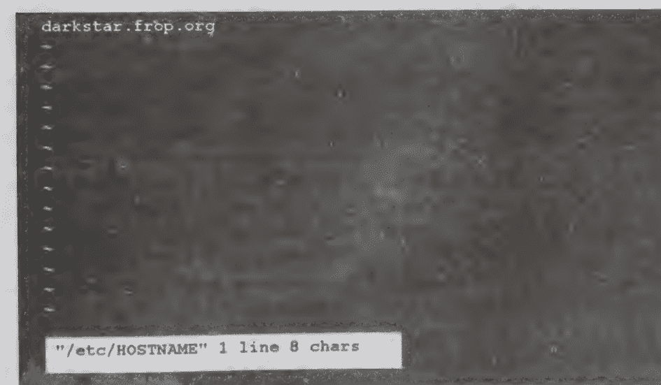

图 2.4 编辑 `/etc/hostname` 文件。

如果你位于 TCP/IP 网络上，可能需要进行进一步的更改。现在，你可以将名称改为你喜欢的任何。


你需要编辑此文件，将 `darkstar.frop.org` 更改为你想要的任何内容。如果你从未用过 `vi` 或 `elvis` 文本编辑器，请跳到第 4 章查看简短教程。

如果你的系统配置正确，你应该在根目录下看到以下目录：

| bin/ | dev/ | home/ | mnt/ | sbin/ | var/ |

| boot/ | dos/ | lib/ | proc/ | tmp/ |

| cdrom/ | etc/ | lost+found/ | root/ | usr/ |

如果你是从光盘安装的 Slackware，然后在重启系统时系统拒绝识别驱动器，你将需要安装新内核或通过可加载内核模块添加支持。

## 使用内核模块

Slackware 使用的内核设计用于支持安装 Linux 所需的硬件。一旦你安装并重启系统，你可能会发现内核缺乏对某些硬件的支持，例如 CD-ROM 驱动器或以太网卡。在这种情况下，你有几种方法添加这种支持。传统方法是编译一个自定义 Linux 内核，其中包含你所有硬件的驱动程序。这要求你已经安装了 Linux 源码和 C 编译器，并且你确切知道哪些选项需要编译到内核中。简而言之，编译自定义内核对于 Linux 初学者来说可能是一项相当困难的任务。

内核模块来救你了！如果你在 MS-DOS 时代安装过设备驱动程序，你可能会觉得这种添加支持的方式很——只需将模块配置文件 `/etc/rc.d/rc.modules` 视为 DOS 的 `CONFIG.SYS` 文件的 Linux 对应物即可。

为新硬件添加支持，你需要编辑文件并取消注释加载所需的支持行。例如，让我们看看用于加载 CD-ROM 支持的文件部分，如图 2.5 所示。

```
# 这些模块添加 CD-ROM 驱动器支持。如果省略了配置
### 的参数，大多数驱动程序将自动探测
# 驱动器的 I/O 地址和 IRQ。通常 I/O 地址将以
# 十六进制指定。
```

图 2.5 `/etc/rc.d/modules` 文件的部分内容。

你会注意到每行都以 `#` 开头。在 Linux 配置文件中，任何以 `#` 开头的行都会被忽略，就像 DOS 配置文件中以 REM 开头的行一样。要激活其中一个设备的支持，你需要删除行开头的 `#`，并编辑该行以包含内核模块所需的关于你硬件的任何额外信息。例如，如果你的机器需要在端口 `0x300` 上支持 SoundBlaster CD-ROM 驱动器，则你需要编辑 `sbpcd` 支持的行，使其看起来像这样：

```
/sbin/modprobe sbpcd sbpcd=0x300,1
```

然后，下次你启动机器时，`sbpcd` 模块将被加载，你就可以使用你的驱动器了。几乎所有 Linux 支持的驱动程序都可以以类似的方式添加。

如果你使用内核模块并决定以后升级内核，在配置内核时选择 `M` 而不是将其构建内核。当你编译内核时：

```
make dep; make clean; zImage
```

你可以安装内核：

```
make modules; make_install
```

模块将位于 `/lib/`

### 查找帮助

大多数 UNIX 系统都有在线手册，Linux 也不例外。可以使用 `man` 命令查询有关：

```
darkstar:~# man
```

在线手册不是按主题组织的，而是按特定命令组织的。操作系统中包含其他信息源，将在第 5 章讨论。

### 关机

像任何良好的 UNIX 一，Linux 响应 `shutdown` 命令。你需要为它提供一个命令参数和一个在实际关闭系统之前等待的时间。对于习惯了单机操作的人来说，这可能很奇怪，但 `shutdown` 通常用于多用户。事实上，你必须以 `root` 登录才能使用 `shutdown` 命令。使用以下命令：

```
$ shutdown -r now
```

立即关闭系统。

不要直接关闭电源来关闭 Linux 系统。这会对文件造成损坏。


另一种关闭 Linux 的方法是经典的 PC `Ctrl-Alt-Del` 序列，它用于重启系统。在运行 Linux 时，此序列的功能与 `shutdown -r now` 相同。当 PC 循环重启时，直接关闭即可。无论别人怎么说，这都是完全可以接受的方法。

### 如果出现问题怎么办

在大多数情况下，从配套光盘安装 Linux 是一个非常直接的过程，你不应该遇到很多问题。但在重启 Linux 系统后可能会出现某些情况。这些问题可能：

- 提示内存不足。如果你使用的内存少于 4MB，你可能会遇到这个问题。
- 你的系统在首次运行 Linux 时挂起。在这种情况下，你想密切观察屏幕上的错误信息。有时 Linux 会搜索特定地址（例如 CD-ROM 驱动器）上的设备却发现了网卡。在这种情况下，Linux 会挂起。你需要告诉 Linux 在你系统的地址上查找设备，这需要在启动时向 Linux 发送选项行。

### 其他配置程序

现在你已经基本安装并运行了 Linux，你可以花些时间设置一些系统外设设备。这些包括打印机、声卡以及（对于笔记本电脑用户）PCMCIA 设备。

### 设置打印机

当你安装 Slack 时，系统询问了你关于打印机的位置。此信息被翻译为 UNIX 的等效表示；第一个并行端口上的打印机被分配设备名称 `/dev/lp0`。同样，如果你正在使用串口打印机（谢天谢地，这种打印机越来越少见了），它可能会被分配设备名称 `/dev/ttyS1`。

这种简单的配置意味着你可以立即打印 ASCII 字符，Linux 系统将你的打印机视为一个简单的行式打印机。打印实际上比你想象的要复杂。我们将在第 4 章介绍打印，但你现在应该意识到，Linux 中的打印涉及以下步骤：


- 当你的电脑启动时，`lpd` 进程会运行，查看 `/etc/printcap` 以确定你使用的是什么打印机；该进程会在整个 Linux 计算会期间一直运行。

- 当你使用 `lpr` 打印文档时，`lpd` 命令实际上负责处理打印作业。

- 要更改打印过程中的任何内容（例如你想杀死或挂起打印作业），可以使用 `lpc` 和 `lprm` 命令与 `lpd` 进程通信。

显然，你会想要确保 `/etc/printcap` 包含了关于你打印机的正确信息。当你使用 `elvis` 或 `emacs` 等文本编辑器查看它时，你会发现所有行都被字符注释掉了。大多数流行的打印机都列在这个文件中（例如 HP Laserjets），如果你取消了特定于你打印机的注释，你应该就可以使用它。

确保这些信息正确至关重要，因为配置不当的 Linux 打印机往往会出现“阶梯效应”，即行首开头参错不齐：

> 我们讨厌阶梯效应。

> 它让我们的文档看起来非常愚蠢。

> 它让我们无法正常进行工作。

> 事实上，我们发现当打印机配置错误时，我们根本不会打印任何东西。

关于在 Linux 中打印的更多信息可以在第一张光盘的 `PRINTING-HOWTO` 中找到。

### 设置声卡

默认安装的，Slack 不支持声板的音频组件。然而，你们中的许多人安装了支持声板的内核，例如用于声板上连接了 CD-ROM 的系统的 `spbcd` 内核。这是怎么回事？

当你安装这些内核之一时，你实际上是在确保连接到声板的 CD-ROM 能够工作，而不是声板本身。要实际使用这些声板之一，你需要重新编译一个支持声板的内核。

为什么要这样做呢？嗯，也许你是一个忠实的互联网冲浪者，想在你的机器上使用 RealAudio 流音频播放器（是的，有一个 Linux 版本；查看 http://www.realaudio.com）。或者你是一个忠实的游戏玩家，想体验《毁灭战士》的音效盛宴。或者你可能想使用我们在第 4 章中讨论的一些工具来播放音乐 CD。

要添加支持，你需要根据自己的需求重新编译一个 Linux 内核，这个过程我们在之前的“重新编译内核”章节中解释过。在那个过程的第 2 步中，你会被要求指定你需要的组件。在该过程中会有一行需要你给出肯定的回答：

`Sound card support (CONFIG_SOUND) [M/n/y/?]`

你将回答 `y`（代表 yes）。

在该过程完成后，将运行另一个配置脚本，它会列出声卡列表并要求你指定你的声卡。问题非常具体；你会被问及第 1 章列出的每一个声板，所以请耐心等待你的声板被列出来。

> 注意那些声称与流行声卡“兼容”的声卡，例如来自 Creative Labs 的 SoundBlaster。兼容性可以意味着两个不同的意思：一种兼容性意味着硬件与流行型号完全相同，而另一种意味着计算机可以被欺骗（通常通过特殊驱动程序），让它认为自己就是那个。当你安装这些内核之一时，你实际上是在确保连接到声板的 CD-ROM 能够工作，而不是声板本身。要实际使用这些声板之一，你需要重新编译一个支持声板的内核。

这些步骤中没有一个是特别复杂的；如果你对细节足够关注，遵循这里详细列出的步骤将没有问题。

本章以安装 Linux 后可能需要的几个基础命令作为结语，例如 `adduser` 和 `shutdown`。

下一章将介绍 XFree86，这是一个专为 PC 及其兼容设备优化的 X Window 系统版本。

## 安装和配置 XFree86

本章涵盖了：

- X Window 系统概述

- 网络上的 X Window

- Linux 上的 X 概述

- XFree86 与 Linux

- X 与窗口管理器

- 受支持的芯片组

- XFree86 的工作原理

- 安装 XFree86

- 设置正确的 X 服务器可执行文件

- 某些初始配置细节

- 配置 xterm

- 设置 X 登录界面

- 另一种方法：仅在登录时启动 X

- 屏幕背景：纯色和图像

- X 字体服务器

- fvwm 窗口管理器

## 第 3 章：安装和配置 XFree86

### X Window 系统

简单来说，X Window 系统（或简称 X）在 UNIX 上提供图形界面。（它从不被称为 Windows；称其为 X Windows 是无知的表现。）尽管 X 运行在许多比 UNIX 多操作系统操作系统，例如 Windows NT、Windows、MacOS 和 DOS，但 X 仍然是 UNIX 上事实上的图形系统。因此，对于任何具有个人电脑领域经验的人来说，X 往往会让他们困惑。

由于 X 容易让人困惑，本章从概述 X Window 系统和 Linux 上的 X 开始。如果你对通用的 X 有经验，可以直接跳到介绍 Linux 上 X 的部分，了解 X 在 Linux 上的差异。之后，我们将处理最困难的部分：为你的硬件安装并配置它。我们都早已习惯了无处不在的 PC 硬件，并假设 Microsoft Windows 几乎可以在每种显卡上运行，因此 Linux 在某种程度上也应该这样做，但你要为此付出复杂性增加代价。

X Window 系统起源于马萨诸塞理工学院（MIT）Athena 项目的一项学术活动。其目标是连接来自不同供应商的强大异构工作站。决定并不是在操作系统层面提供连接，而是创建一个基于 C 语言的图形窗口层，该层可以存在于任何操作系统中。就这样，X Window 系统诞生了。

现在，在非营利组织 X Consortium Inc. 的监督下，X Window 系统向广大计算公众开放，这有助于它在 UNIX 世界的广泛采用。几乎每个 UNIX 供应商在某种程度上都支持 X。流行的接口 CDE/Motif 和 OpenWindows 以及通用桌面环境 `CDE` 都是直接基于 X 的。

### 网络上的 X

与其 UNIX 根源一致，X Window 系统通过多个进程运行图形。主进程简单地称为 X 是 X 服务器本身。服务器处理本地请求（因此它在单用户 Linux 工作站上使用）以及基于 TCP/IP 的网络请求。由于这种网络能力，可以在一个工作站上运行 X 应用程序并在另一个工作站上显示应用程序的结果。例如，你可以在老板的工作站上运行 Doom 并在自己的电脑上显示游戏，同时将本地计算资源留给重要的事情。你可以玩游戏；而老板的系统提供 CPU 动力。

X 服务器控制显示器、键盘和鼠标，并允许图形应用程序（称为客户端）创建窗口并在其中绘图。从表面上看，这似乎如此基础，不需要任何解释。但是，正如 UNIX 一样，X 将一个简单的概念变得复杂。你受益于 X 的复杂性，但它可能会让上手变得困难。

X 服务器是唯一允许在屏幕上画点或跟踪鼠标的进程。X 应用程序通过进程间通信链接连接到 X 服务器，该链接通常是某种形式的 TCP/IP 网络套接（更多网络信息请参见第 8 章）。由于 X 使用网络链接，在其他机器上的程序可以显示在你的工作站上。

许多程序可以同时连接到 X 服务器，允许你在同一个屏幕上运行多个应用程序——这再次是你可能认为理所当然的事实。你运行的 X 应用程序中必须有一个窗口管理器。（严格来说，你不运行窗口管理器，但如果不运行会让事情变得困难。）

### 窗口管理器

与 Macintosh 和 Windows 环境不同，X 将窗口管理器作为一个独立的进程。事实上，窗口管理器只是一个 X 应用程序，尽管是一个特殊的应用程序。通过将窗口系统与窗口管理器分离，你可以运行任何适合你的窗口管理器。窗口管理器的主要目的是控制你在显示器上移动和缩放窗口。窗口管理器还在应用程序窗口顶部创建标题栏。

对于 X 新手来说，一个关键概念是窗口管理器（而不是应用程序）拥有窗口标题栏。如果你来自 Windows 或 Macintosh 世界，这非常奇怪。为了说明这一点，我们将在不同的窗口管理器下运行同一个 X 应用程序 `xman`（显示 UNIX 在线帮助手册——一个非常有用的程序）。

`fvwm` 窗口管理器为窗口提供了类似于 Motif 的外观。


the `fvwm` 窗口管理器.


the `fvwm` 窗口管理器.


the `fvwm` 窗口管理器

## 第 3 章：安装与配置 XFree86

要启动 X，你必须首先登录你的 Linux 系统，如下所示：

```
Welcome to Linux 2.0.29
yonson login:
Password:
```

一旦你登录并获得 Linux shell 提示符，你可以使用 `startx` 来启动 X：

```bash
yonson~#: startx
```

这假设 XFree86 已经为你的 Linux 安装了正确的配置，我们稍后会介绍这个过程。


`start` 脚本运行一个名为 `xinit` 的程序，该程序启动 X 服务器 `/usr/X11R6/bin/X`（你可能对大多数其他 UNIX 系统上的 `/usr/bin/X` 更熟悉），并在你的主目录下查找名为 `.xinitrc` 的文件（注意开头的点）。`.xinitrc` 文件是一个启动你想要的所有 X 应用程序的 shell 脚本。例如，我们的 `.xinitrc` 文件启动了多个 `xterm` 程序的实例（它提供了一个 shell 窗口）以及一个名为 `clock` 的圆形时钟，如图 3.4 所示。

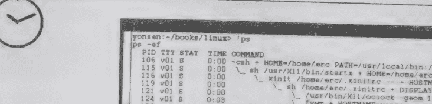

```
PID TID STAT COMMAND
120 vdi S 0:00 -HOME=/home/yonson PATH=/usr/lib/bin:HOME=/home/yonson;PATH=/usr
121 vdi S 0:00 /usr/lib/bin/start +HOME=/home/yonson;PATH=/usr
122 vdi S 0:00 -n /HOME=/home/yonson/.xinitrc -DISPLAY=:0
123 vdi S 0:00
124 vdi S 0:00 -n
125 ppi S 0:01 -csh +HOSTNAME=yonson yonson LOGAME=yonson
126 ppi S 0:00 -csh +HOSTNAME=yonson yonson LOGAME=yonson MINCODE
127 ppi S 0:00 -csh +HOSTNAME=yonson yonson LOGAME=yonson-root
1 ps -ef +HOSTNAME=yonson yonson LOGAME=yonson-root
yonson:~/books/linux>
```

图 3.4 从 `.xinitrc` 文件启动的典型 X 环境。

然而，在启动这些任何程序之前，必须启动 X 服务器，这项任务也由 `xinit` 处理。

X 服务器会寻找 XFree86 配置文件——这是你系统上 X 最关键的文件。该文件通常命名为 `XF86Config`，存储在 `/usr/X11r/lib/X11`（符号链接到 `/var/X11r/lib`），是一个特殊格式的文件，用于告诉 XFree86 关于你系统硬件的信息。

在系统上安装 XFree86 最困难的部分是完善这个文件。虽然有一些工具可以帮助，但这个过程仍然危险且充满错误。

`XF86Config` 文件包含六个部分，每个部分都向 X 服务器描述系统的部分内容。我们在表 3.2 中列出了这些部分。

### 表 3.2 XF86Config 文件中的部分

| 部分 | 用途 |
| --- | --- |
| Files | 告诉字体和 RGB 文件的位置 |
| ServerFlags | 特殊 X 服务器标志，例如 `DontZap`，它会关闭终止 X 服务器的 `Ctrl-Alt-Backspace` 序列 |
| Keyboard | 你拥有的是种种键盘 |
| Pointer | 关于你鼠标的信息 |
| Monitor | 关于你显示器的极其详尽的细节 |
| Device | 显卡 |
| Screen | 显卡和显示器的组合 |

### 安装 XFree86

要安装并正确设置 XFree86（即使在理想情况下，这也是一项艰巨的任务），你需要执行以下步骤：

- 确定你的系统配置。
- 为你的显卡设置适当的 X 服务器。
- 填写 `XF86Config` 文件。
- 测试 X 是否可以运行。
- 调整你的 `XF86Config` 文件。

我们将在本章剩余部分介绍这些步骤。

几乎所有的 XFree86（包括附带 Slackware Linux 版本）都会安装到 `/usr/X11R6` 目录。注意，许多其他目录如 `/usr/bin/X11` 和 `/usr/lib/X11` 都是 `/usr/X11R6` 的符号链接。如果你从附带的光盘安装了 Linux 和 XFree86，所有文件都在正确的位置。

如果你从网上获取 XFree86 更新，你可能需要解包文件。检查与 XFree86 文件在同一目录下的 `README` 文件。大多数文件都是压缩的 tar 包。例如，如果你看到类似 `X312bin.tar.gz` 的文件，你应该知道它是用 `gzip` (`.gz`) 压缩的 tar 包 (`.tar`)。要提取此文件，使用以下命令：

```bash
mv X312bin.tar.gz /usr/X11R6
cd /usr/X11R6
gzip X312bin.gz
tar xv X312bin.tar
```

前两个命令将 XFree86 文件（以及你的工作目录）移动到 `/usr/X11R6`，这是 Linux 预期所在的地方。特别是如果你从网上获取 XFree86，必须以 root 用户身份解压 XFree86 归档。如果你从附带的光盘加载 XFree86 并使用，就不会有任何问题。

### 设置 XFree86

由于 PC 硬件的多样性，且操作错误可能会损坏你的硬件，这一事实让我们感到很困惑，但设置 X 可能是让 Linux 运行最困难的事情。跟踪关于你显示器和显卡的每份文档。你需要了解关于显示器的某些数值。即使失败了且找不到关于显卡的任何信息，如果你的显卡支持标准 VGA，你应该可以使用 XFree86 附带的示例 `XF86Config` 文件。我们在表 3.3 和 3.4 中列出了 XFree86 支持的显卡。

### 表 3.3 XFree86 支持的加速卡和芯片组

| 类型 | 芯片和显卡 |
| --- | --- |
| 8514/A | 8514/A 克隆版 |
| ATI | Mach32, Mach64 |
| Cirrus | CLGD5420, CLGD5422, CLGD5424, CLGD5426, CLGD5428, CLGD5429, CLGD5430, CLGD5434 |
| IBM | XGA-2 |
| IIT | AGX-014, AGX-015, AGX-018 |
| Oak Tech. | OTI087 |
| S3 | 86C911, 86C924, 86C801, 86C805, 86C801, 86C928, 86C864, 86C944, 86C732, 86C764, 86C768, 86C968 |
| Tsang | ET4000/W32, ET4000/W32 |
| Vertex | P9000 |
| Western Digital | WD90C31, WD90C33 |

Cirrus、Oak 和 Western Digital 显在 Super VGA 服务器 `XFree86_SVGA` 中支持。其他类型有自己的服务器。Super VGA 服务器 `XFree86_SVGA` 支持一系列显卡和芯片组，列如表 3.4 所示。

### 表 3.4 XFree86_SVGA 服务器支持的 Super VGA 芯片组

| 厂商 | 芯片组 |
| --- | --- |
| ARK Logic | ARK1000PV, ARK2000PV |
| ATI | 18800, 18800-1, 28800-2, 28800-4, 28800-5, 28800-6, 68800-3, 68800-6, 68800AX, 68801LX, 88800CX, 8800 |
| Advance Logic & Technology | ALG2101, ALG2228, ALG2301, ALG2302, ALG2308, ALG265520, 65530, 65540, 65545 |
| Cirrus Logic | CLGD5420, CLGD5422, CLGD5424, CLGD5426, CLGD5428, CLGD5429, CLGD5430, CLGD5434, CLGD6205, CLGD6215, CLGD6225, CLGD6410, CLGD6412, CLGD6420, CLGD6440 |
| Compaq | AVGA |
| Genoa | GVVA |
| MX | MX68000, MX68010 |
| NCR | 77C22, 77C2E, 77C2E+ |
| Oak | OT1067, OT1077, OT1087 |
| RealTek | RTG3106 |
| Syng | ET3000, ET4000AX, ET4000/W32 |
| Western Digital/Paradise | PVGA, WD90C00, WD90C10, WD90C11, WD90C24, WD90C24A, WD90C31, WD90C33 |
| Trident | TVGA8800CS, TVGA8900B, TVGA8900C, TVGA8900CL, TVGA9000, TVGA9000B, TVGA9100B, TVGA9200CX, TVGA9320, TVGA9400CX, TVGA9420 |


| Video7 | HT2116-32 |

每个版本的 XFree86 都支持更多的显卡。如果你的显卡或芯片组不在此列表中，不要放弃希望。不过，你可能需要新版本的 XFree86。（在编写本书时，XFree86 的最新版本是 3.2，附带光盘上的版本也是如此。）

# 第 3 章：安装与配置 XFree86

运行 XFree86 需要大约 50MB 的磁盘空间，并且你至少应该有 16MB 内存才能有效运行 X。你可以用 8MB 内存启动 X 并执行一些基本功能，但你很快就会因为内存限制而遇到性能问题。更糟糕的是，系统不会提示你内存不足；你选择的 X 窗口管理器将直接对你的命令无响应。

一旦你确定了系统配置，下一步就是为你的显卡设置适当的 X 服务器。XFree86 带有多个 X 服务器，每个服务器都编译了针对特定类型显卡或芯片组的驱动程序。这些服务器的可执行文件都以 `XF86` 开头，并支持的显卡类型结尾。例如，`XF86_SVGA` X 服务器构建了对标准 Super VGA 芯片组的支持。`XF86_S3` 是用于 S3 显卡的 X 服务器。

你需要知道你的显卡是哪种芯片组，然后确定使用哪种 X 服务器。我们在表 3.5 中列出了这些 X 服务器。

## 表 3.5 XFree86 X 服务器

| 文件名 | 适用芯片组 |
| :--- | :--- |
| `XF86_8514` | 8514/A 及真克隆卡 |
| `XF86_AGX` | IIT AGX-014, AGX-015, AGX-016 |
| `XF86_Mach8` | ATI Mach8 |
| `XF86_Mach32` | ATI Mach32 |
| `XF86_Mach64` | ATI Mach64 |
| `XF86_Mono` | 单色 VGA，还包括 Hercules, Hyundai HGC1280, Sigma LaserView 和 Apollo 单色显卡 |
| `XF86_P9000` | Weitek P9000 |
| `XF86_S3` | 基于 S3 的显卡 |
| `XF86_S3V` | 基于 S3 VIRGE 的卡 |
| `XF86_SVGA` | Super VGA |
| `XF86_VGA16` | 16 色 VGA 服务器 |
| `XF86_W32` | Tseng ET4000/W32, ET4000/W32i, ET4000/W32p |

你必须知道使用哪种 X 服务器的原因是：选错了服务器最好的情况下无法工作，最坏的情况下可能会损坏你的系统。

XFree86 设置为只运行一个 X 服务器，该程序名为 `X`，存储在 `/usr/X11R6/bin` 中。因此，你需要将之前选择的 X 服务器链接到文件名 `X`。以下命令以 root 用户身份执行时，会将我们使用的 S3 X 服务器链接到标准的 `X`：

```
ln -sf /usr/X11R6/bin/XF86_S3 /usr/X11R6/bin/X
```

所有 XFree86 的文件都存储在 `/usr/X11R6` 中，但有许多指向文件系统其他部分的链接。例如，`/usr/bin/X` 链接到 `/usr/X11R6/bin`，那里是 X 二进制文件真正的所在地。Slack 安装程序应该已经为你处理好了这些链接。

现在，你必须告诉系统在启动 X 时运行哪个正确的服务器设置。下一步是通过填写著名的 `XF86Config` 文件，向 XFree86 提供更多关于你硬件的详尽信息。

### 设置 XF86Config 文件

`XF86Config` 文件位于 `/usr/lib/X11`（实际上是 `/usr/X11R6/lib/X11` 的软链接），它在 X 启动时被读取；它描述了你的图形硬件以及 XFree86 的其他选项。

当你到达这一步时，有两条路可以走。你可以为 Super VGA 设置通用的 `XF86Config` 文件，也可以为你的特定显卡调整 `XF86Config` 文件。本章将涵盖这两种方法。我们强烈建议为你的显卡配置 `XF86Config` 文件。遗憾的是，在 Linux 下这被证明是最艰巨的任务。预警你——危险在前。

这项任务之所以困难，是因为几乎所有的图形厂商都为 Microsoft Windows 编写驱动，但几乎没有为 Linux 编写驱动。因此，你面临着配置你的系统以运行显卡的任务。

### 硬件，硬件，硬件

我们不断重复一个准则：你需要彻底了解你的系统的硬件。如果你了解你的硬件，就可以充分利用 X 的性能。如果不了解，运行 X 将有损坏系统的风险。


> 是的，在 X 配置中出错会导致硬件损坏。

除非你精通，否则这应该让你停顿一下。利用关于鼠标、显示器和显卡的文档。在几年前的系统中，你可能找不到所有信息。在新的系统中，你的电脑可能充满了无品牌硬件，而文档可能没有提供任何价值。我们发现某些较新的系统提供了视频显存大小以及如何运行终端驻留（TSR）程序来配置卡，但这对于非 BIOS 操作系统（如 Linux）并不好用。大多数 PC 用户运行 DOS 或 Microsoft Windows，作为之一。

### 笔记本电脑与 X

如果你的硬件包括笔记本电脑，你可能可以在上面运行 X。许多人花时间为各种笔记本电脑配置 X。例如，如果你有 ThinkPad，可以在网站 `http://www.utexas.edu/users/laptop/` 上找到针对 Linux 的信息。


该网页可以在 `/docs` 目录下的光盘中找到。该网页还包含适用于各种笔记本的 X 配置文件。你可能会在 ThinkPad 700、720 以及任何其他 MCA 架构机器上遇到问题，因为 Linux 不支持 MCA。如果你有 760 型，可能会在使用最新版本的 XFree86 时遇到问题。访问 `http://www.castle.net/X-notebook/index.html` 上的 Linux Notebook 页面。由于 X 版本更新很快，这个问题可能已经修复。你想了解系统的某些关键信息列在表 3.6 中。

## 表 3.6 你需要的系统信息

| 设备 | 需要了解的信息 |
| :--- | :--- |
| 显 | 厂商和型号 |
| 显 | 芯片组，例如 S3 |
| 显 | 显存大小，例如 1MB 或 2MB |
| 显 | RAMDAC，如果使用了，如 ATT2C490 |
| 显示器 | 带宽（MHz），例如 25 |
| 显示器 | 水平同步范围，例如 31.5-64.3 kHz（kHz） |
| 显示器 | 垂直刷新范围，例如 55-120 Hz（Hz） |
| 鼠标 | 串行还是并行？串行，连接到哪个端口 |
| 鼠标 | 厂商和型号，例如 Logitech |

注意，某些更复杂的细节（如 RAMDAC）可能会在 XFree86 文档中描述。XFree86 带有显卡和显示器数量的描述。如果你足够幸运，可以将这些值直接从 XFree86 文档提取到你的 `XF86Config` 文件中，这是向 X 描述硬件的主文件。

`XF86Config` 文件通常位于 `/usr/X11R6/lib/X11`，是一个 ASCII 文本文件，以 XFree86 服务器理解的特殊格式格式。默认情况下，XFree86 按以下顺序在多个目录中搜索此文件：

```
/etc/XF86Config
<Root>/lib/X11/XF86Config.hostname
<Root>/lib/X11/XF86Config
```

`<Root>` 是顶层 X 目录的缩写。在 Slackware Linux 中，这是 `/usr/X11R6`。在 X11 发布第 6 个版本（因此有 R6）之前，XFree86 的顶级目录是 `/usr/X386`。

你可以使用 `vi` 或 `emacs` 等文本编辑器创建 `XF86Config` 文件。万一你可能想复制一个示例文件以避免输入全部内容。在 Slackware 下，此示例文件名为 `XF86Config.eg`。虽然这个示例还不能直接使用，但你可以从中获得很多有用信息。（参见 Super VGA 部分。）

在 `XF86Config` 文件中，每个部分都遵循相同的基本模式：

```
Section "SectionName"
数据项...
...
EndSection
```

`#` 是注释字符，这对于记录本章中 `XF86Config` 的特殊语法非常有用。

在本章的后续章节中，我们将深入介绍这六个部分，并展示如何通过名为 `xf86config` 的程序自动完成部分过程。

> 永远不要使用别人的 `XF86Config` 文件。不要原封使用我们提供的示例。始终为你的硬件配置 X。文件中的错误数据可能会损坏你的硬件。


第3章：安装与配置 XFree86 127

## 自动化配置过程


多年来，各种程序一直尝试自动化复杂的 XF86Config 文件创建。然而，到目前为止，这些程序对我们来说都惨遭失败了——直到最近的版本以及一个名为 `xf86config` 的程序出现。第一次，`xf86config` 似乎能够创建一个可运行的 XF86Config 文件，而且我们甚至没有任何特殊的硬件。

在运行 `xf86config` 之前，请仔细阅读以下每个章节，这些章节描述了 `xf86config` 程序将填充的 XF86Config 文件的各个部分。通过深入了解 XF86Config 文件，你使用 `xf86config` 的成功率将会大大。

因此，我们将讨论这六个部分，然后介绍如何使用 `xf86config`。

## 在配置文件中设置路径

`Files` 部分是 XF86Config 文件中最容易设置的部分。这是因为几乎每个人的路径都是相同的。在 `Files` 部分中，你需要告诉 X RGB（红-绿-蓝）颜色数据库文件所在的位置以及字体所在的位置。由于它们都应该位于标准位置，你只需在 XF86Config 文件中使用以下部分即可（事实上，示例版本已经是这样配置的）：

```
Section "Files"
RgbPath      "/usr/X11R6/lib/X11/rgb"
FontPath      "/usr/X11R6/lib/X11/fonts/misc/"
FontPath      "/usr/X11R6/lib/X11/fonts/Type1/"
FontPath      "/usr/X11R6/lib/X11/fonts/Speedo/"
FontPath      "/usr/X11R6/lib/X11/fonts/75dpi/"
FontPath      "/usr/X11R6/lib/X11/fonts/100dpi/"
EndSection
```

这个 `Files` 部分告诉 XFree86 你的 RGB 数据库位于 `/usr/X11R6/lib/X11/`，字体位于 `/usr/X11R6/lib/X11/fonts/`。这些都是两者的标准位置。需要注意的一点是，你可能没有加载所有的字体目录（尽管我们建议你这样做）。因此，你应该检查 `/usr/X11R6/lib/X11/fonts/`：

```
$ ls /usr/X11R6/lib/X11/fonts/
100dpi/ 75dpi/ PEX/ Speedo/ Type/ misc/
```

在我们的系统中，我们拥有列出的所有目录以及一个用于 PEX 字体的 PEX 目录（你现在可以忽略它；更多关于 PEX——X 的 3D 扩展的信息请参见附录 B）。如果你没有相应的字体目录，你应该删除 XF86Config 文件中的任何条目。例如，如果你没有加载 100 DPI 字体（100dpi），那么你的 `Files` 部分看起来应该像这样：

### Section "Files":

- RgbPath `/usr/X11R6/lib/X11/rgb`

- FontPath `/usr/X11R6/lib/X11/fonts/misc/*`

- FontPath `/usr/X11R6/lib/X11/fonts/Type/*`

- FontPath `/usr/X11R6/lib/X11/fonts/Speedo/*`

- FontPath `/usr/X11R6/lib/X11/fonts/75dpi/*`

- EndSection

我们删除了 100dpi 字体的条目。

在运行 `xf86config` 时，你应该表示你不打算使用 X 字体服务器，即使你想使用。如果在你启动 X 之前字体服务器没有运行，你的系统可能会锁死。我们发现分开问题要容易得多。首先，让 X 运行起来。然后配置 X 字体服务器（提供缩放字体）。你可能需要回来编辑 XF86Config 文件，但这很麻烦。

### 配置 ServerFlags

在 `Files` 部分之后是 `ServerFlags` 部分。事实上，我们很少需要使用它。

### 表 3.7 Server 标志

| 选项 | 含义 |
| :--- | :--- |
| NoTrap | 当信号到达时产生核心转储 |
| DontZap | 禁用切换 |
| DontZoom | 禁用图形 |

切换到虚拟终端的魔法键序列是 Alt-Fn，其中 Fn 是你键盘上的功能键之一，例如 F1。但要注意：在 X 中，切换到虚拟终端的魔法键序列不是 Alt-Fn，而是 Ctrl-Alt-Fn。产生差异是因为大多数窗口管理器捕获了 Alt-Fn。

```
Section "ServerFlags"
NoTrap
DontZap
DontZoom
EndSection
```

### 表 3.8 键盘选项

| 选项 | 用法 |
| :--- | :--- |
| Protocol | 标准 |
| AutoRepeat rate | 设置自动重复 |
| ServerLock | 如下所示 |
| LeftAlt key | 覆盖左 Alt (Meta) 的默认值 |
| RightAlt key | 覆盖右 Alt (Meta) 的默认值 |
| ScrollLock key | 覆盖 ScrollLock (Compose) 的默认值 |
| RightCtrl key | 覆盖右 Ctrl (Control) 的默认值 |
| XLeds | 允许程序使用 LED |
| VTSysreq | 使用 Alt-SysReq-Fn |
| VTinit command | 运行 /bin/sh -c |

## 第3章：安装与配置 XFree86

### 虚拟终端

Linux 支持虚拟终端。虚拟终端是连接到你屏幕的伪终端终端。X 使用一个虚拟终端，但你可能有更多。

每个虚拟终端都会接管你的整个显示器并呈现出一个传统的文本终端，就像你登录时看到的那样。特殊的键序列允许你在虚拟终端之间切换。当你这样做时，屏幕会被清除，你会看到下一个虚拟终端。

当你有一整个屏幕的 `xterm` 终端窗口时，虚拟终端并不很有价值。X 环境允许你使用选择的字体，提供许多行，支持滚动条，并支持复制和粘贴——这些是虚拟终端都不具备的。因此，我们很少使用虚拟终端。

但有一个地方虚拟终端大派用场：如果你的 X 显示器锁死了，你可以切换到另一个虚拟终端并杀死所有的 X 进程。

大多数笔记本电脑都有一个特殊的 Fn 键，用于为键盘功能键提供第二组功能。笔记本键盘上的 Fn 键不应与这里使用的 Fn 符号混淆。

对于键位映射，你可以将每个键设置为以下内容之一：

- Compose
- Control
- Meta
- Shift
- Lock
- ScrollLock

## 第3章：安装与配置 XFree86

```
### Protocol "Xqueue"
AutoRepeat 500 5
### ServerNumLock
### Xled 1 2 3
LeftAlt Meta
RightAlt ModeShift
### RightCtl Compose
### ScrollLock ModeLock
EndSection
```

注意，我们把这些内容注释掉了。

### 配置指针部分 (Pointer Section)

鼠标——在 X 术语中称为 pointer——设置起来相当简单，但你必须注意一些技巧。之所以这样，主要是因为许多厂商的鼠标（例如罗技 Logitech）被设置为模拟其他厂商的鼠标，最著名的微软鼠标。正因如此，你可能需要对你的鼠标“撒谎”。

例如，我们的测试系统之一使用一个串行罗技鼠标。这只鼠标由罗技设计，用于模拟微软串行鼠标。奇怪的是，罗技鼠标有三个按钮（这对 X 来说是一件好事，因为大多数 X 期望三键鼠标），而微软串行鼠标只有两个按钮。

当我们配置 XF8Config 文件时，我们声称自己的罗技鼠标实际上是微软鼠标（罗技鼠标的另一种常见选择是声称它们是 Mouseman 鼠标）。

在 Pointer 部分，你必须指定的两个键是鼠标的类型（例如 Microsoft）以及如果是串行鼠标，连接的端口。借此，我们的 Pointer 部分非常短：

```
Section "Pointer"
Protocol "Microsoft"
Device "/dev/ttyS0"
EndSection
```

请务必输入你拥有的鼠标类型以及它连接的设备，而不仅仅是复制我们的配置。协议必须是表 3.9 中列出的选项之一。

### 表 3.9 指针协议 (Pointer Protocols)

| 协议 (Protocol) |
| --- |
| BusMouse |
| Logitech |
| Microsoft |
| MMSeries |
| Mouseman |
| MouseSystems |
| PS/2 |
| MMHitTab |
| Xqueue |
| OSMouse |


对于罗技鼠标，你可能会使用 `BusMouse`（如果是总线鼠标）；对于串行鼠标，你可能会使用 `Microsoft` 或 `Mouseman` 协议，而不是显而见的 `Logitech` 协议。如果你的鼠标连接到 PS/2 端口，请使用 PS/2 协议。（如果你使用的是来自戴尔 `Dell` 等大众零售商的较新系统，请检查鼠标端口。许多新系统配备了 PS/2 鼠标端口，但它们并不总是 PS/2 端口；例如，戴尔称之为鼠标端口。

`Xqueue` 协议仅在你设置键盘、鼠标时使用。我们不建议使用它。`OSMouse` 仅用于 SCO UNIX，不适用于 Linux。

在我们的情况下，鼠标连接到一号串口，在 DOS 术语中通常称为 `com1`。在真正的 UNIX Tradition 中，Linux 从 0 开始计数串口。为了指定鼠标连接到 `com1`，我们使用设备名称 `/dev/tty0`，这是该端口的 Linux 设备文件。我们在表 3.10 中列出了常用的端口。

## 表 3.10 Linux 中常用的串行端口

| 端口 (Port) | Linux 中的设备文件名 (Device File Name in Linux) |
|---|---|
| `com1` | `/dev/tty0` |
| `com2` | `/dev/tty1` |
| `com3` | `/dev/tty2` |
| `com4` | `/dev/tty3` |

你的系统可能为鼠标端口设置了 `/dev/mouse` 设备文件。无论你选择哪个设备文件，鼠标必须预先存在。（在我们系统上，`/dev/mouse` 是指向 `/dev/tty0` 的链接。）

总线鼠标设备文件列在表 3.11 中。

## 表 3.11 总线鼠标设备名称

| 设备 (Device) | 用途 (Usage) |
|---|---|
| `/dev/atim` | ATI 总线鼠标 |
| `/dev/logbm` | 罗技总线鼠标 |
| `/dev/inportbm` | 微软总线鼠标 |
| `/dev/psaux` | PS/2 或 Quickport 鼠标 |

注意，除了 `/dev/psaux` PS/2 鼠标，所有总线鼠标都应该使用 `busmouse` 协议。`Pointer` 部分还有几个选项，但最好保持原样。（为了在 X 中获得最佳结果，你需要三键鼠标。我们通常不设置波特率。当我们尝试过，并没有作用。如果你这样做，`Ctrl-Alt-Backspace` 序列很有用。）

### 表 3.12 Pointer 部分选项

| 选项 (Option) | 用途 (Usage) |
| --- | --- |
| `BaudRate` | 指定串行鼠标的波特率 |
| `EmulateButtons` | 允许双键鼠标像三键鼠标一样工作；通过同时按下来模拟第三键 |
| `ChordMiddle` | 修复某些罗技鼠标的问题 |
| `SampleRate` | 修复某些 Mouseman 鼠标的问题 |
| `ClearDTR` | MouseSystems 模式双协议鼠标需要 |
| `ClearRTS` | MouseSystems 模式双协议鼠标可能 |

### 配置显示器部分 (Monitor Section)

`Monitor` 部分向 X 显示器。你可以在 `XF8Config` 文件中定义多个显示器，每个 `Monitor` 部分都有名称。`Screen` 部分（后文讨论）将显示器连接到显卡。例如，以下条目定义了 `MultiSync XE17`：

```
Section "Monitor"
Identifier "NEC MultiSync XE17"
VendorName "NEC"
Model "MultiSync 4FG"
HorizSync 31.5
VertRefresh 55-120
ModeLine "640x480" 31 640 680 704 832 480 489 492 520
ModeLine "800x600" 50 800 864 976 1040 600 637 647 666
ModeLine "1024x768" 81 1024 1068 1024 1326 776 778 782 807
EndSection
```

对于每个显示器，你需要定义表 3.13 中列出的项。

| 项目 (Item) | 用途 (Usage) |
| --- | --- |
| `Identifier string` | 用于后续标识显示器 |
| `VendorName string` | 用于参考 |
| `ModelName string` | 用于参考 |
| `Bandwidth` | 显示器的带宽，单位为 MHz |
| `HorizSync range` | 水平同步频率，单位为 kHz |
| `VertRefresh range` | 垂直刷新范围，单位为 Hz |
| `Gamma value` | 显示器的 Gamma 校正 |
| `Modeline values` | 单一分辨率模式 |

`identifier` 是用于后续引用显示器的字符串。你可以在 `XF8Config` 文件中定义多个显示器。`HorizSync` 范围描述显示器的水平同步频率。对于多同步显示器，它可以是一个逗号分隔的值列表或范围，例如 `42-65`。你应该从显示器文档中获取此值（你可以在那里找到所需的大部分信息）。`Modeline` 的格式为：

`Modeline "name"水平值垂直值`

例如，以下设置了一个标准的 VGA 模式：

```
640x400 @ 70 Hz, 31.5 kHz hsync
Modeline "640x400" 25.175 640 664 760 800 400 409 411 450
```

可以有一组 `modeline` 值。你可以从 X 的 `probeonly` 模式或 XFree86 自带的文档获取。部分相关文档列在表 3.14 中。

### 表 3.14 XFree86 视频模式文档

| 文件 (File) | 用途 (Usage) |
| --- | --- |
| `VideoModes.doc` | 说明如何计算模式 |
| `modeDB.txt` | 显示器的 modeline 数据库 |
| `Monitors` | 显示器的 modeline 数据库 |

所有这些文件位于 `/usr/X11R6/lib/X11/doc`。以下是 `Monitors` 文件的条目：

```
#Date: Sat, 17 Sep 1994 00:50:57 -0400
#From: Erik Nygren <nygren@mit.edu>
Section "Monitor"
Identifier NEC MultiSync 4FGe
VendorName "NEC"
ModelName "MultiSync 4FGe"
BandWidth 80MHz
HorizSync 27-62KHZ 来自显示器文档
VertRefresh 55-90Hz
ModeLine 640x480 31 640 680 704 832 480 489 492 520
ModeLine 800x600 50 800 864 976 1040 600 637 647 666
ModeLine 1024x768 81 1024 1068 1024 1326 776 778 782 807
EndSection
```

我们拥有的显示器之一 `NEC MultiSync XE17` 不在 `modeDB.txt` 或 `Monitors` 文件中。我们在列表中找到了最接近的 `NEC MultiSync 4FGe`，并实验了那些 `Modelines`。尽管如此，在其他显示器上使用 `Modelines` 时要小心。如果不小心，可能会损坏你的显示器。

## 第 3 章：安装与配置 XFree86

### 显卡配置章节

`Device` 部分向 X 描述你的显卡。例如，一个标准的 Super VGA 设备显示如下：

```
### Standard VGA Device:
Device
  Identifier "Generic VGA"    VendorName "Unknown"
  BoardName "Unknown"
  Chipset "generic"
### VideoRam 256
### Clocks 25.2 28.3
EndSection
```

针对 Actix S3 加速卡，有一个更详细的设备部分如下：

```
### Device configured by xf86config:
Section "Device"
  Identifier "Actix GE32+ 2MB"
  VendorName "Actix"
  BoardName "GraphicsEngine Ultra"
#VideoRam 1024
#Option "dac_8_bit"
  Ramdac "att20c490"
  Clocks 25 28 40 72 50 77 36 45 90 120 80 110 65 75 95
EndSection
```


在这些选项中，时钟（`clocks`）是最难填充的。一种方法是尝试让 `X` 以 `probeonly` 模式运行填充细节。你也可以查看 `/usr/X11R6/lib/X11/doc` 中的名为 `AccelCards` 文件，获取更多关于加速芯片组和卡的信息。以下是 `AccCards` 文件中的条目：

```
Card Vendor : Actix
Card Model : GraphicsEngine32 Plus
Card Bus (ISA/EISA/VLB) : ISA
Chipset : S3 86C01
```

| Video Memory : 2048k |

| Memory Type (DRAM/VRAM) : DRAM |

| Memory Speed : 45ns |

| Clock Chip : Avasem AV9194-11 |

| Programmable? (Y/N) : No |

| Number of clocks : 16 |

| Clocks : 25.175 28.322 40.0 0.0 50.0 77.0 36.0 44.9 |

| Clocks (cont) : 130.0 120.0 80.0 31.5 110.0 65.0 75.0 95.0 |

| Option Flags : |

| RAMDAC : AT&T 20C490-11 |

| Submitter : David E. Wexelblat <dwex@xf86.org> |

| Last Edit Date : Sept 25, 1993 |

你可以通过在 `Device` 部分中从以 `Clocks` 开头的行（或多行）中按顺序放置相同的值，将 `Clocks` 行转换为 `XF86Config` 文件的正确语法：

```
Clocks 25.175 28.322 40.0 0.0 50.0 77.0 36.0 44.9
Clocks 130.0 120.0 80.0 31.5 110.0 65.0 75.0 95.0
```

务必按照原始顺序填写所有时钟值。

## 将显卡与显示器结合以构建可工作的 X 设置

`Screen` 部分将显示器与显卡连接起来。你的 `XF86Config` 文件可能了多个 `Devices`（设备）和 `Monitors`（显示器）。`Screen` 部分将两者连接。

一个复杂的 `Screen` 部分可能如下：

```
Section "Screen"
  Driver "accel"
Device "Actix GE32+ 2MB"
```

| Monitor | "NEC MultiSync XE17" |

| Subsection "Display" | |

| Depth | 8 |

| Modes | "1024x768" "800x600" "640x480" |

| ViewPort | 0 0 |

| Virtual | 1024 768 |

| EndSubsection |

| Subsection "Display" | |

| Depth | 16 |

| Modes | "640x480" "800x600" |

| ViewPort | 0 0 |

| Virtual | 800 600 |

| EndSubsection |

| Subsection "Display" | |

| Depth | 32 |

| Modes | "640x400" |

| ViewPort | 0 0 |

| Virtual | 640 400 |

| EndSection |

```

注意，`Screen` 部分使用了我们之前输入的显示器和设备标识符。这对于将屏幕连接到正确的显示器和卡至关重要。

驱动（`drivers`）告诉你是使用的是哪种 X 服务器；选项有 `Accel`、`SVGA`、`VGA16`、`VGA2` 或 `Mono`。在大多数情况下，对于 Super VGA 卡使用 `SVGA`（`XF86_SVGA` 服务器），或者对于任何加速芯片组和 X 服务器使用 `Accel`，例如上一章提到的 `XF86_S3` 服务器。

每个 `Display` 子部分涵盖特定深度下可用的模式。（深度 8 指定颜色位数，或最多 256 种颜色）。`Modes` 指回之前定义的显示器。

### 虚拟屏幕

`Virtual` 行允许你定义一个比显示器像素数量更大的虚拟屏幕。当 `X` 服务器 到达边界时，会自动滚动显示。如果你喜欢这种效果，将 `Virtual` 设置为大于显示器允许的值：

```
Virtual 1152 900
```

这种虚拟设置创建了传统的 Sun 系统分辨率。如果你需要运行为 Sun 系统设计的旧程序，并想要获得比 PC 默认 1024x768 屏幕更大的区域，这非常有用。

`ViewPort` 行告诉 `X` 服务器应该在哪里开始。例如，0,0 告诉 `X` 在启动时位于左上角（这是你预期的）。如果你希望从中间开始，可以更改此处。警告：窗口管理器支持不同的虚拟屏幕。不要混合使用两种虚拟屏幕，否则可能会遇到问题 ![img/bc693dd0348445903e27_2.png]

### Xf86config

在我们查看了 `XF86Config` 文件的内容后，我们可以运行 `xf86config` 程序，或者如果你愿意，手动填写文件。我们建议使用 `xf86config` 然后检查它生成的 `XF86Config` 文件。`xf86config` 程序并非完美，需要仔细监督。运行 `xf86config` 时，你不应该在 `/usr/lib/X11` 目录下。相反，在你的用户目录下放置一个 `XF86Config` 文件，稍后再将其复制到 `/usr/X11R6/lib/X11`。程序启动时，它会询问很多问题。`xf86config` 程序会提示 `XF86Config` 文件所需的所有值，例如鼠标类型、键盘请求和显示器频率。完成后，`xf86config` 将数据写入当前目录下名为 `XF86Config` 的文件中（这就是为什么你运行时不在 `/usr/lib/X11`，那是 `/usr/X11R6/lib/X11` 的符号链接）。

一旦 `xf86config` 程序完成，你应该仔细检查生成的 `XF86Config` 文件。该文件是不完整的，因为你还没有探测时钟。编辑 `XF86Config` 文件。如果看起来正常，以 root 用户身份将其复制到 `/usr/X11R6/lib/X11`。现在你准备好以 `probeonly` 模式尝试 `X` 了。

### 探测时钟

`XFree86` 服务器有一个特殊的 `probeonly` 模式，可以输出 `XF86Config` 文件和检测到的值。你需要在此模式下运行 `X` 以查看是否工作正常以及是否检测到任何问题。当系统没有额外负载时运行命令：

```
X -probeonly
```

在运行此之前停止任何不需要的程序，因为任何额外的负载都会影响 `X` 获取的时间。以下命令以 `probeonly` 模式运行 `X` 并输出发送到 `/tmp/x.values` 文件：

```
X -probeonly > /tmp/x.values 2>&1
```

确保从控制台运行 `X`。如果你已经在运行 `X`，请不要尝试运行。

如果你在 `XF86Config` 文件中有某些时钟，那么 `X -probeonly` 将不会尝试检测新的。由于，当你第一次这样运行 `X` 时，应该注释掉 `XF86Config` 文件中的时钟。在 `probeonly` 模式运行 `X` 后，你可以将时钟添加到 `XF86Config` 文件并再次尝试，看看一切是否仍然正常。你可以查看 `/tmp/x.values` 文件，其内容可能如下：

```
XFree86 Version 3.1.1 / X Window System

(protocol Version 11, revision 0, vendor release 6000)

Operating System: Linux

Configured drivers:

S3: accelerated server for S3 graphics adapters (Patchlevel 0)

mmio_928, s3_generic

(using VT number 7)

XF86Config: /usr/X11R6/lib/X11/XF86Config

(** 代表提供的，(- ) 代表探测的/默认值

(** Mouse: type: Microsoft, device: /dev/tty0, baudrate: 1200

(** S3: Graphics device ID: "Actix GE3+ 2MB"

- S3: card type: ISA

- S3: chipset: 928, rev E above

- S3: chipset driver: mmio_928

(** S3: videom: 1024k

(** S3: Ramdac type: at20c490

- S3: Ramdac speed: 110

- S3: Monitor: "NEC MultiSync XE17"
```


- `FontPath`: `/usr/X11R6/lib/X11/fonts/misc/`, `/usr/X11R6/lib/X11/fonts/Type1/`, `/usr/X11R6/lib/X11/fonts/Speedo/`, `/usr/X11R6/lib/X11/fonts/75dpi/`, `/usr/X11R6/lib/X11/fonts/100dpi/`

- `S3`: Maximum allowed dot-clock: 110.000 MHz

(** `S3`: Mode "1024*768": mode clock = 81.000, clock used = 80.300

(** `S3`: Mode "800*600": mode clock = 50.000, clock used = 50.130

(** `S3`: Mode "640*480": mode clock = 31.000, clock used = 31.500

# 第3章：安装与配置 XFree86

时钟 25.24 28.32 39.99 0.00 50.13 77.02 37.35 44.89
时钟 90.11 119.98 80.30 31.50 110.16 65.08 75.17 94.68

从 `AccelCards` 文件中，我们找到了这些时钟——接近，但并不准确：

时钟 25 28 40 72 50 77 36 45
时钟 90 120 80 32 110 65 75 85

# 测试你的配置

现在你已经准备好启动 X 并看看一切是否工作正常。输入以下命令并查看程序是否启动：

```
startx
```

`startx` 脚本是从用户账户启动 X 的官方方式。

# 启动 X

`startx` 脚本运行 `xinit` 程序，它执行两件事：运行 X 服务器（名为 X 的程序），然后运行你家目录下 `.xinit` 文件中的命令。这些命令应该设置好你想要在启动时运行的 X 应用程序。如果你的家目录下没有 `.xinit` 文件，那么 `xinit` 将运行一个默认脚本。系统默认的 `.xinit` 文件是 `/usr/lib/X11/xinit.fwm`（没有点）。

开始 X 的最佳方法是——一旦你验证了你的 `XF86Config` 文件——将系统的 `.xinit` 复制到你的家目录下并编辑该文件。`.xinit` 文件的大部分内容来自用于 Linux 的标准 XFree86 安装；它会寻找某些文件（其中很少会实际存在），并使用找到的这些文件执行程序。末尾的章节是你设置想要运行的 X 应用程序的地方。

在我们的情况下，我们使用 `xroot` 来更改屏幕背景颜色，然后启动 `clock`、窗口管理器 `fwm` 以及两个 `xterms`。无论如何，你都需要一个窗口管理器程序来控制显示。Linux 上的默认窗口管理器称为 `fwm`（见图 3.1），你会发现它是高度可定制的。

当 `.xinitrc`（系统或本地）中的最后一个程序停止时，X 就会退出。通常，最后一个程序之前会有一个 `exec` 语句。当你退出这最后一个程序时，X 会停止，你就会回到控制台。在我们的情况下，我们使用 `fwm` 作为这个`关键`进程，因为你需要在整个 X 会话期间运行窗口管理器，这使得 `fwm` 成为最后一个进程的自然选择。

你对 `.xinitrc` 文件的所有自定义包含几行简单的代码：

```
# Start X applications

xsetroot -solid bisque

/usr/bin/X11/xclock -geom 100x100+0+6 &

/usr/bin/X11/xterm -ls -geom 80x24+3+372 &

/usr/bin/X11/xterm -ls -geom 80x48+264+13 &

exec fwm
```

完整的 `.xinitrc` 文件看起来如下所示：

```
#!/bin/sh

userresources=$HOME/.Xresources

usermodmap=$HOME/.Xmodmap

sysresources=/usr/X11R6/lib/X11/xinit/.Resources

sysmodmap=/usr/X11R6/lib/X11/xinit/.Xmodmap

# merge in defaults and keymaps

if [ -f $sysresources ]; then

  xrdb -merge $sysresources

fi

if [ -f $sysmodmap ]; then

  xmodmap $sysmodmap

fi

if [ -f $sysresources ]; then

  xrdb -merge $sysresources

fi

if [ -f $sysmodmap ]; then

  xmodmap $sysmodmap

fi

# Start X applications

xsetroot -solid bisque

/usr/bin/X11/xclock -geom 100x100+0+6 &

/usr/bin/X11/xterm -ls -geom 80x24+3+372 &

/usr/bin/X11/xterm -ls -geom 80x48+264+13 &

exec fwm
```

完整的 `.xinitrc` 文件看起来如下所示：

```
#!/bin/sh

userresources=$HOME/.Xresources

usermodmap=$HOME/.Xmodmap

sysresources=/usr/X11R6/lib/X11/xinit/.Resources

sysmodmap=/usr/X11R6/lib/X11/xinit/.Xmodmap

# merge in defaults and keymaps

if [ -f $sysresources ]; then

  xrdb -merge $sysresources

fi

if [ -f $sysmodmap ]; then

  xmodmap $sysmodmap

fi

if [ -f $sysresources ]; then

  xrdb -merge $sysresources

fi

if [ -f $sysmodmap ]; then

  xmodmap $sysmodmap

fi

# Start X applications

xsetroot -solid bisque

/usr/bin/X11/xclock -geom 100x100+0+6 &

/usr/bin/X11/xterm -ls -geom 80x24+3+372 &

/usr/bin/X11/xterm -ls -geom 80x48+264+13 &

exec fwm
```

完整的 `.xinitrc` 文件看起来如下所示：

```
#!/bin/sh

userresources=$HOME/.Xresources

usermodmap=$HOME/.Xmodmap

sysresources=/usr/X11R6/lib/X11/xinit/.Resources

sysmodmap=/usr/X11R6/lib/X11/xinit/.Xmodmap

# merge in defaults and keymaps
```


# Start X applications

```
if [ -f $sysresources ]; then
  xrdb -merge $sysresources
fi

if [ -f $sysmodmap ]; then
  xmodmap $sysmodmap
fi
```

在我们的情况下，我们使用 `xroot` 来更改屏幕的背景颜色，然后启动 `clock`、`fwm` 窗口管理器以及两个 `xterms`。无论如何，你都需要一个窗口管理器程序来控制显示。Linux 上的默认窗口管理器称为 `fwm`（见图 3.1），你会发现它是高度可定制的。

当 `.xinitrc`（系统或本地）中的最后一个程序停止时，X 就会退出。通常，这最后一个程序之前会有一个 `exec` 语句。当你退出这最后一个程序时，X 会停止，你就会回到控制台。在我们的情况下，我们使用 `fwm` 作为这个 `关键` 进程，因为你需要在整个 X 会话期间运行窗口管理器，这使得 `fwm` 成为最后一个进程的自然选择。

你对 `.xinitrc` 文件的所有自定义包含几行简单的代码：

```
# Start X applications
xsetroot -solid bisque
/usr/bin/X11/xclock -geom 100x100+0+6 &
/usr/bin/X11/xterm -ls -geom 80x24+3+372 &
/usr/bin/X11/xterm -ls -geom 80x48+264+13 &
exec fwm
```

完整的 `.xinitrc` 文件看起来如下所示：

```
#!/bin/sh

userresources=$HOME/.Xresources
usermodmap=$HOME/.Xmodmap
sysresources=/usr/X11R6/lib/X11/xinit/.Resources
sysmodmap=/usr/X11R6/lib/X11/xinit/.Xmodmap

# merge in defaults and keymaps
if [ -f $sysresources ]; then
  xrdb -merge $sysresources
fi

if [ -f $sysmodmap ]; then
  xmodmap $sysmodmap
fi

if [ -f $sysresources ]; then
  xrdb -merge $sysresources
fi

if [ -f $sysmodmap ]; then
  xmodmap $sysmodmap
fi
```


`if [ -f $sysmodmap ]; then`

`  xmodmap $sysmodmap`

`fi`

# 第3章：安装与配置 XFree86

时钟 25.24 28.32 39.99 0.00 50.13 77.02 37.35 44.89
时钟 90.11 119.98 80.30 31.50 110.16 65.08 75.17 94.68

从 `AccelCards` 文件中，我们找到了这些时钟——接近，但并不准确：

时钟 25 28 40 72 50 77 36 45
时钟 90 120 80 32 110 65 75 85

## 测试你的配置

现在你已经准备好启动 X 并看看一切是否工作正常。输入以下命令并查看程序是否启动：

```
startx
```

`startx` 脚本是从用户账户启动 X 的官方方式。

## 启动 X

`startx` 脚本运行 `xinit` 程序，它执行两件事：运行 X 服务器（名为 X 的程序），然后运行你家目录下 `.xinit` 文件中的命令。这些命令应该设置好你想要在启动时运行的 X 应用程序。如果你的家目录下没有 `.xinit` 文件，那么 `xinit` 将运行一个默认脚本。系统默认的 `.xinit` 文件是 `/usr/lib/X11/xinit.fwm`（没有点）。

开始 X 的最佳方法是——一旦你验证了你的 `XF86Config` 文件——将系统的 `.xinit` 复制到你的家目录下并编辑该文件。`.xinit` 文件的大部分内容来自用于 Linux 的标准 XFree86 安装；它会寻找某些文件（其中很少会实际存在），并使用找到的这些文件执行程序。末尾的章节是你设置想要运行的 X 应用程序的地方。

在我们的情况下，我们使用 `xroot` 来更改屏幕的背景颜色，然后启动 `clock`、`fwm` 窗口管理器以及两个 `xterms`。无论如何，你都需要一个窗口管理器程序来控制显示。Linux 上的默认窗口管理器称为 `fwm`（见图 3.1），你会发现它是高度可定制的。

当 `.xinitrc`（系统或本地）中的最后一个程序停止时，X 就会退出。通常，这最后一个程序之前会有一个 `exec` 语句。当你退出这最后一个程序时，X 会停止，你就会回到控制台。在我们的情况下，我们使用 `fwm` 作为这个**关键**进程，因为你需要在整个 X 会话期间运行窗口管理器，这使得 `fwm` 成为最后一个进程的自然选择。

你对 `.xinitrc` 文件的所有自定义包含几行简单的代码：

```
# Start X applications

xsetroot -solid bisque

/usr/bin/X11/xclock -geom 100x100+0+6 &

/usr/bin/X11/xterm -ls -geom 80x24+3+372 &

/usr/bin/X11/xterm -ls -geom 80x48+264+13 &

exec fwm
```

完整的 `.xinitrc` 文件看起来如下所示：

```
#!/bin/sh

userresources=$HOME/.Xresources

usermodmap=$HOME/.Xmodmap

sysresources=/usr/X11R6/lib/X11/xinit/.Resources

sysmodmap=/usr/X11R6/lib/X11/xinit/.Xmodmap

# merge in defaults and keymaps

if [ -f $sysresources ]; then

  xrdb -merge $sysresources

fi

if [ -f $sysmodmap ]; then

  xmodmap $sysmodmap

fi

if [ -f $sysresources ]; then

  xrdb -merge $sysresources

fi

if [ -f $sysmodmap ]; then

  xmodmap $sysmodmap

fi
```

如果你对 UNIX 更熟悉，你可能想通过一个名为 `xterm` 的程序来运行多个 shell 窗口。`xterm` 在窗口中呈现一个 UNIX shell，但允许你指定使用的行数、字体和颜色。你还可以在 `xterm` 窗口之间进行复制和粘贴，这对于冗长复杂的 UNIX UNIX命令行来说是一项实用的功能。（请参阅后文关于 `xterm` 的章节获取更多关于此实用应用程序的信息。）

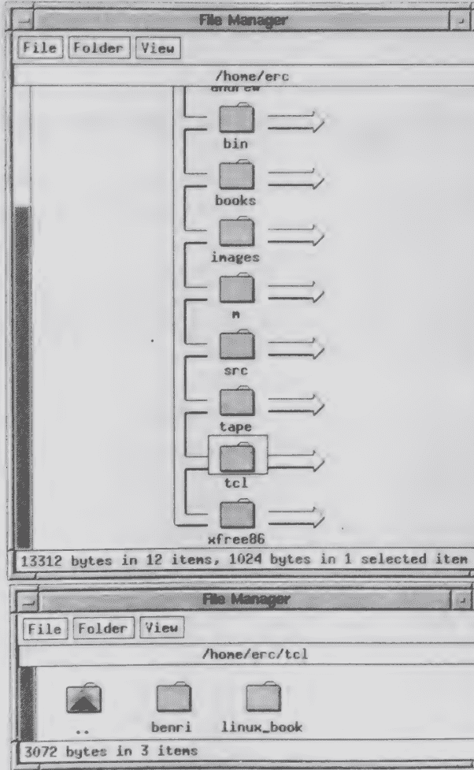

图 3.5 运行中的 X 文件管理器。

## 配置 xterm 程序

要运行的 `xterm` 程序可能是最流行的 X 程序。在精美的图形环境中运行 shell 窗口程序（`xterm` 就是这种程序）似乎有点奇怪。但我们仍然在 Linux 之上运行 X，并且仍然需要访问 UNIX 环境。

图 3.6 显示了 `xterm`。

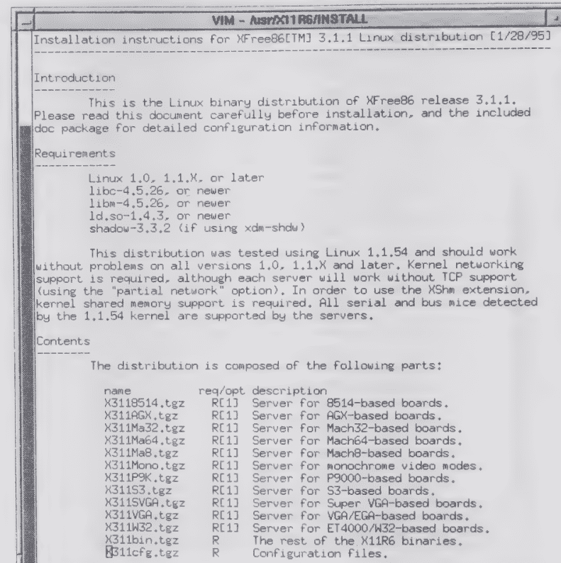

```
VIM - AsterixIX/INSTALL

XFree86[TM] 3.1.1 Linux发行版安装说明 [1/28/95]

简介

这是 XFree86 3.1.1 版本的 Linux 发行版。

安装前请仔细阅读本文以及随附的

doc 包以获取详细的配置信息。

要求

Linux 0.0, 1.1 或更高版本

libc-4.2.5 或更高

libc-1.6.3 或更高

so-1.4.3 或更高

shadow-3.1.2 (或 unix-shadow)

此发行版已使用 Linux 1.1.5 进行过测试，在所有 1.1.1 及以后的版本上均可无问题地工作，需要内核支持，每个服务器在无需调整网络协议以使用 FS 扩展的情况下工作。

需要内核共享内存支持，1.1.5 内核检测到的所有串口和总线都受服务器支持。

目录

该发行版由以下部分组成：

名称 描述

S01.tgz 适用于 85 基板的服务器。

X02.tgz 适用于 Mac 基板的服务器。

M02.tgz 适用于 Mac6 基板的服务器。

M04.tgz 适用于 Mac8 基板的服务器。

Mono.tgz 用于单色模式服务器。

P99.tgz 适用于 P00 基板的服务器。

S53.tgz 适用于 E53 基板的服务器。

VGA.tgz 适用于 Super VGA 基板的服务器。

VSG.tgz 适用于 GE 基板的服务器。

W32.tgz 适用于 E400/W32 基板的服务器。

utils 其他 X11 二进制文件。

bcf.cfg 配置文件。
```

`xterm` 最用的之处在于你可以：

- 同时运行多个 shell 窗口 (`xterms`)。
- 控制每个 `xterm` 窗口的大小。
- 控制 `xterm` 程序使用的字体和颜色。
- 在 `xterm` 窗口和其他 X 程序之间进行复制和粘贴。
- 使用滚动条查看已滚过的程序输出内容。

尽管它被称为 `xterm`，但它并不是真正的终端模拟器；它为你提供了一个 UNIX shell 窗口。

### 控制 xterm 窗口的大小

控制 `xterm` 窗口大小的最简单方法是通过 `-geometry` 命令行参数：

```
xterm -geometry WidthxHeight
```

使用此参数时，`Width` 是字符宽度（几乎总是 80），`Height` 是行数。我们发现 40 是一个很好的数字（默认是 24 行）。几乎所有的 X 程序支持 `-geometry` 参数，但 `xterm` 对该参数的处理方式略有不同。


使用此参数时，`Width` 是字符宽度（几乎总是 80），`Height` 是行数。我们发现 40 是一个很好的数字（默认是 24 行）。几乎所有的 X 程序支持 `-geometry` 参数，但 `xterm` 对该参数的处理方式略有不同。

## 第3章：安装与配置 XFree86 155

### 表 3.15 常用 Xterm 命令行参数

| 参数 | 含义 |
|---|---|
| `-bg color` | 设置背景颜色；默认为白色 |
| `-cr color` | 设置文本光标颜色；默认为黑色 |
| `-display hostname:0` | 设置连接的 X 显示器名称 |
| `-e program [args]` | 运行程序而非 shell |
| `-fg color` | 设置前景颜色；默认为黑色 |
| `-fn fontname` | 使用指定的字体 |
| `-font fontname` | 使用指定的字体 |
| `-geometry geom` | 使用指定的尺寸和位置 |
| `-ls` | 将 shell 变为登录 shell |
| `-sb` | 开启滚动条 |

## 在 xterm 窗口之间复制和粘贴

`xterm` 较于控制台终端（console terminal）的最大优势之一是，你可以在 `xterm` 窗口之间复制和粘贴文本。这在编辑文档时非常有用。你可以在一个 `xterm` 窗口中查看文档，在另一个 `xterm` 窗口中编辑另一个，并在它们之间进行复制和粘贴。

`Xterm` 是高度可配置，但在默认配置下，你通过按住鼠标左键并在想要选择的文本上拖动来选择。双击单词仅选择该单词。在行中的任意位置三击将选择整行。

要粘贴，请按下鼠标中间键。文本将会被插入，就像你输入进去的一样。

`Xterm` 仅仅提供了一个 shell 窗口。在 `xterm` 窗口内部，你运行的是基于文本的 shell 程序，其中很少有程序认识鼠标和文本选择。因此，你必须确保在 `xterm` 窗口中运行的程序已准备好接收粘贴的文本。例如，在 `elvis` 文本编辑器中，你应该在命令模式下输入 `i` 来进入输入模式。

## 156 第3章：安装与配置 XFree86

`Elvis` 不支持中间键粘贴，这非常烦人。要在 `elvis` 中粘贴，你必须在按住 `Shift` 键的同时按下鼠标中间键。

> 注意：我们的解决方案是使用 Linux 自带的另一个 vi 克隆版本，称为 `vim`。`Vim` 完全支持 `xterm` 窗口中的鼠标粘贴，省去了使用 `elvis` 的麻烦。

## 其他 shell 窗口程序

除了无处不在的 `xterm` 之外，Linux 还带了其他几个 shell 程序，包括 `color_xterm`、`rxvt` 和 `shelltool`。

如果你想要带颜色的 shell，请使用 `color_xterm`。该程序的行为与 `xterm` 相同，但提供了更多的颜色。例如，当你使用 `ls` 命令列出目录列表时，`color_xterm` 会用一种颜色显示目录，用另一种颜色显示普通文件。

`rxvt` 程序与 `xterm` 非常相似。很多人声称 `rxvt` 的内存占用比 `xterm` 小，但我们发现它的怪癖并不值这点差异（特别是考虑到 Linux 共享库，它已经将 `xterm` 的内存占用降低到了合理的水平）。

如果你在工作时的 Sun 系统上使用 Look 应用程序，你会发现位于 `/usr/popen/bin` 下的 `shelltool` 非常顺手。

你必须在安装 Linux 时加载了 Look 应用程序才能拥有此程序。我们建议安装这些程序，它们还包括 `olwm` 和 `olwm` 窗口管理器。

总而言，我们倾向于只使用 `xterm` 而不是其他 shell 窗口程序，因为 `xterm` 在我们和工作中使用的所有 UNIX 系统上都保持不变。

## 启动时自动启动 X 并创建 X 登录界面

到目前为止，我们一直运行 `startx` 来启动 X 会话。你仍然需要在控制台登录并启动 X（或使用我们稍后描述的自动方法）。除了这种方法外，还有一种使用 `XDM` 设置 X 登录界面。`XDM` 代表 X 显示管理器（X Display Manager）；它是一种控制 X 会话的手段。通常情况下，`XDM` 对用户要友好得多，因为它会自动启动 X 服务器并显示图形化登录窗口，如图 3.7 所示。

## 第3章：安装与配置 XFree86 157

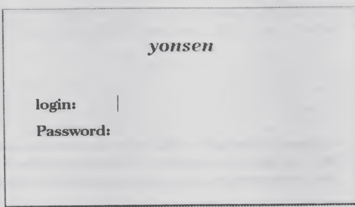

X 显示管理器通过一个名为 `xdm` 的程序运行。虽然 `xdm` 需要一点时间适应，但我们更喜欢它目前一直运行的 `startx/xinit`。这是因为 `startx`（运行 `xinit`）需要你登录到文本界面并启动 X（通过 `startx`）。而 `Xdm` 允许你直接登录 X 会话。

`Xdm` 还允许一个程序控制你的工作站控制台和多个 X 终端。如果你对此感兴趣，请查看附录 A 中关于 `xdm` 的书籍。

设置 `xdm`，你需要编辑至少一个系统文件，这是 Linux 启动时使用的关键文件；这是一项严肃的任务。在编辑任何系统文件之前，请务必进行备份。

## UNIX 运行级别 (Run-Levels)

`Xdm` 通常被设置为触发所谓的“运行级别”。除少数例外外，UNIX 中的运行级别是一个任意的概念，主要遵循古老的 UNIX 传统。运行级别 `S` 表示单用户独立运行系统。

在 Linux 中，运行级别 1 及以上是多用户模式。这意味着允许一个或或多个用户登录。在许多系统中，运行级别 3 会启动网络。这也是默认的运行级别。Linux 还有针对断电（关机系统）和“瓦肯之握”（Vulcan death-grip）的特殊运行级别。

## 158 第3章：安装与配置 XFree86

## 189 第3章：安装与配置 XFree86

## 159 第3章：安装与配置 XFree86

## 第 3 章：安装与配置 XFree86

### Xdm 下的用户账户

虽然你可能不需要编辑 `/usr/lib/X11/xdm` 中的任何 `xdm` 系统文件，但你很可能需要编辑家目录下的文件。默认情况下，`xdm` 会从你的家目录中运行一个名为 `.xsession` 的文件，而不是由 `startx`（以及 `xinit`）运行的 `.xinitrc`。

要创建 `.xsession` 文件，你可以从将家目录下的 `.xinitrc` 文件复制到 `.xsession` 开始。（切忘了在家目录的文件名开头加上点 `.`。）然后像你修改 `.xinitrc` 文件一样修改此文件。

这是我们 `.xsession` 文件的副本：

```sh
#!/bin/sh

userresources=$HOME/.Resources

usermodmap=$HOME/.Xmodmap

sysresources=/usr/X11R6/lib/X11/xinit/.Resources

sysmodmap=/usr/X11R6/lib/X11/xinit/.Xmodmap

# 合并默认设置和键位映射

if [ -f $sysresources ]; then
  xrddb -merge $sysresources
fi

if [ -f $sysmodmap ]; then
  xmodmap $sysmodmap
fi

if [ -f $userresources ]; then
  xrddb -merge $userresources
fi

if [ -f $usermodmap ]; then
  xmodmap $usermodmap
fi
```

```sh
# 启动一些不错的程序
xsetroot -solid SteelBlue
xterm -geom 80x32+264+0 -ls &
xterm -geom 80x32+0+250 -ls &
oclock -7-7 &\
exec fwm
```


如果你不想在系统启动时启动 X，你可能希望在每次登录时启动 X。

## 登录时自动启动 X

如果你没有设置 `xdm`，你将需要在登录后输入 `startx` 来获取 X 以及你 `.xinitrc` 文件中的所有这些应用程序。如果你不喜欢每次登录都输入 `startx`，你完全可以将 `startx` 命令放在你的 `.login` 或 `.profile` 文件中（取决于你使用的 shell，`csh` 或 `ksh`）。如果这样做，请确保你只从控制台运行。否则，如果 `.login` 或 `.profile` 文件从其他地方运行（例如当通过串口或从另一个虚拟终端登录时），它们将会报错。

检查此点的方法是检查 `tty` 程序的输出。`tty` 程序返回用于你终端的当前设备。当在 `xterm` shell 窗口运行时，`tty` 将打印类似 `/dev/tty1` 的内容（第一个伪终端设备）。但当从控制台（第一个虚拟终端）运行时，`tty` 将打印 `/dev/tty1`。当从第二个虚拟终端运行时，`tty` 打印 `/dev/tty2`，因此我们可以检查 `/dev/tty`。

为了做到这一点，我们可以在控制台（在启动 X 之前）输入 `tty`：

```bash
$ tty
/dev/tty1
```

使用 `tty` 返回的值，而不一定是我们收到的值。


有了这些信息，你可以编辑你的 `.login` 文件（假设你使用 C shell `csh` 作为你的 shell）以添加以下行：

```csh
if ( 'tty' == '/dev/tty1' ) then
startx
endif
```

这将在你在控制台登录时启动 X。你还可以设置你的账户在退出 X 时自动注销。大多数情况下，我们在登录时启动 X，并在想要注销时退出 X。如果这符合你的习惯，你可以将 `.login` 文件改为以下内容：

```csh
if ( 'tty' == '/dev/tty1' ) then
startx
logout
endif
```

## X 字体服务器

X 字体服务器是一个可以缩放字体的特殊程序。这种能力极大地增加了你系统中可用的已经丰富的 X 字体（使用 `xlsfonts` 命令列出这些字体）。要让字体服务器运行起来，你必须：

- 配置字体服务器并告诉它从哪里获取字体。
- 配置字体服务器在 X 启动之前启动。
- 配置 X 服务器与字体服务器进行通信。

要配置字体服务器，我们需要告诉它去哪里寻找可缩放字体。幸运的是，Linux 自带了一个预配置的文件 `/usr/X11R6/lib/X11/fs/config`。

要启动字体服务器，使用 `xfs`（X font server 的缩写）命令。以 root 身份输入以下命令：

```bash
# xfs -port 7000 &
```

这使用了默认配置文件 `/usr/X11R6/lib/X11/fs/config`，并在 TCP/IP 端口 7000 上运行。一旦启动，我们可以通过 `fsinfo` 命令验证字体服务器正在运行：

```bash
root -server hostname
```

你应该看到类似下面的输出：

```text
name: 
version: 
vendor: 
request: 
maximum size: 
extensions: 
```

# 第 3 章：安装与配置 XFree86


有了彩色图像，你很快就会从屏幕背景图像填满颜色表（colormap）。这可能会导致颜色闪烁，因为 X 程序在用尽默认颜色表中的颜色后，会创建它们自己的颜色表。

## Fvwm 窗口管理器

窗口管理器是你将运行的应用程序中最重要的一个之一，因为它环绕在屏幕上的每个应用程序窗口周围，并可以影响窗口的工作方式。Linux 的事实标准窗口管理器是 `fvwm`。

这个窗口管理器对你与 X 交互的方式提供了极大的控制能力，特别是因为 `fvwm` 支持大量的配置选项。虽然你可以运行任何想要的窗口管理器，但 `fvwm` 似乎是 Linux 世界中最受欢迎的。它在很多地方或 X 相关的书中都没有介绍，因此我们将向你展示如何为你的 Linux 系统设置 `fvwm`。

你一次只能运行一个窗口管理器。

## 配置 Fvwm

X 下的大多数窗口管理器都支持配置文件。通常，此文件位于你主目录下的一个点文件（dot file）。大多数窗口管理器对其配置文件也遵循命名约定。对于 `mwm` 窗口管理器，文件名为 `.mwmrc`。对于 `twm`，它是 `.twrc`。对于 `fvwm`，它是 `.fvwmrc`。

在启动时，`fvwm` 会在你主目录中一个名为 `.fvwmrc` 的文件中查找你的自定义设置。如果你没有 `.fvwmrc` 文件（刚开始时很可能没有），`fvwm` 将查找名为 `/usr/lib/fvwm/system.fvwmrc` 的系统文件。如果该文件也丢失，`fvwm` 将退出。

由于 `fvwm` 是一个非常复杂的窗口管理器，你应该将 `system.fvwmrc` 文件或一个示例文件复制到你的主目录并将其命名为 `.fvwmrc`。从一个运行良好的示例开始，你会发现比从头创建一个 `.fvwmrc` 文件要容易得多。

一旦你找到了 `fvwm` 系统目录，你会在 `sample_configs` 目录中看到许多示例配置。从一个运行的模型来配置 `fvwm` 是简单的，所以你可以复制 `system.fvwmrc` 或 `sample_configs` 目录中的一个文件。

一旦你将一个运行良好的配置文件复制到你的主目录，下一步就是开始自定义。`.fvwmrc` 文件非常长，所以我们将提供一个你最可能自定义的区域的概述，然后提供一个 `.fvwmrc` 文件——一个非常长的示例——供你使用。仅仅浏览这个示例应该带给你很多灵感。除了我们的示例外，你可能还想查看之前提到的 `fvwm` 示例文件以及 `fvwm` 的在线手册页面。

在 `.fvwmrc` 文件中，项的顺序非常重要。最好从一个运行良好的示例开始，然后搜索我们提到的项。更改项的值，但保持项本身在 `.fvwmrc` 文件中的相对位置不变。

## 配置字体和颜色

你在 `.fvwmrc` 文件中可能可能自定义的首要区域是字体和颜色。

每个窗口管理器（包括 `fvwm`）都 `true` 一次只允许一个应用程序获取键盘输入。这个窗口（通常称为活动窗口或键盘焦点窗口）通常由窗口管理器高亮显示。在 `.fvwmrc` 文件中，`HiForegroundColor` 设置活动窗口标题的文本前景颜色。`HiBackColor` 设置活动标题栏颜色。`StdForegroundColor` 和 `StdBackColor` 对非复合窗口起类似的作用。

我们使用以下颜色（复制自默认的 `.fvwmrc` 文件）：

```
StdForegroundColor      Black
StdBackColor       #60a0c0
# 这用于被选窗口
HiForegroundColor  Black
HiBackColor        #c06077
```

窗口管理器通常支持两种策略来选择哪个窗口变为活动窗口：点击聚焦（click-to-focus）和鼠标跟随焦点（focus-follows-mouse）。很少有人同意哪种更好（尽管微软已决定点击聚焦更好）。选择你想要的模式。

如果你想使用鼠标跟随焦点，请确保以下行被注释掉：
```
#ClickToFocus
```

如果你想使用点击聚焦，则取消注释（删除 #）同一行：
```
ClickToFocus
```

对于字体，你可以控制 `fvwm` 使用的一些字体：
```
Font            -adobe-helvetica-medium-r-*-*-14-*-*-*-
#Font           *-times-medium-i-*-*-14-*-*-*-
WindowFont -adobe-helvetica-bold-r-*-*-12-*-*-*-
#IconFont -adobe-helvetica-medium-r-*-*-*- fixed
```

字体名称中的星号 (*) 是通配符。我们只指定了最少的数据来获取 10 和 12 点的 Helvetica 字体。某些字体被注释了。你可以取消这些行（并注释相应的行）来尝试这些字体，或输入你自己的名称。

默认情况下，`fvwm` 要求你放置出现在屏幕上的每个新窗口。这可能让你感到非常头疼，所以我们通常使用 `fvwm` 为我们放置窗口——你以后可以随时移动它们——通过设置 `RandomPlacement` 选项。取消以下行以获得此效果：
```
RandomPlacement
```

你还需要注释掉以下行：
```
#NoPosition
```

为了让 `fvwm` 像 Motif 一样工作，取消注释以下行：
```
# 如果你想要边框窗口，取消注释：
Decorate true
```


每个窗口管理器（包括 `fvwm`）都 `true` 一次只允许一个应用程序获取键盘输入。这个窗口（通常称为活动窗口或键盘焦点窗口）通常由窗口管理器高亮显示。在 `.fvwmrc` 文件中，`HiForegroundColor` 设置活动窗口标题的文本前景颜色。`HiBackColor` 设置活动标题栏颜色。`StdForegroundColor` 和 `StdBackColor` 对非复合窗口起类似的作用。

我们使用以下颜色（复制自默认的 `.fvwmrc` 文件）：

```
StdForegroundColor      Black

StdBackColor       #60a0c0

# 这用于被选窗口

HiForegroundColor  Black

HiBackColor        #c06077
```

窗口管理器通常支持两种策略来选择哪个窗口变为活动窗口：点击聚焦和鼠标跟随焦点。很少有人同意哪种更好（尽管微软已决定点击聚焦更好）。选择你想要的模式。

如果你想使用鼠标跟随焦点，请确保以下行被注释掉：

```
#ClickToFocus
```

如果你想使用点击聚焦，则取消注释（删除 `#`）同一行：

```
ClickToFocus
```

对于字体，你可以控制 `fvwm` 使用的一些字体：

```
Font            -adobe-helvetica-medium-r-*-*-14-*-*-*-

#Font           *-times-medium-i-*-*-14-*-*-*-

WindowFont -adobe-helvetica-bold-r-*-*-12-*-*-*-

#IconFont -adobe-helvetica-medium-r-*-*-*- fixed
```

字体名称中的星号 (`*`) 是通配符。我们只指定了最少的数据来获取 10 和 12 点的 Helvetica 字体。某些字体被注释了。你可以取消这些行（并注释相应的行）来尝试这些字体，或输入你自己的名称。

默认情况下，`fvwm` 要求你放置出现在屏幕上的每个新窗口。这可能让你感到非常头疼，所以我们通常使用 `fvwm` 为我们放置窗口——你以后可以随时移动它们——通过设置 `RandomPlacement` 选项。取消以下行以获得此效果：

```
RandomPlacement
```

你还需要注释掉以下行：

```
#NoPosition
```

为了让 `fvwm` 像 Motif 一样工作，取消注释以下行：

```
# 如果你想要边框窗口，取消注释：

Decorate true
```

### 测试你的 fvwm 配置

既然我们修改了 `.fvwmrc` 文件，是时候测试新配置了。为了做到这一点，你需要重启 `fvwm`。你可以通过退出并重新启动 `fvwm` 来访问新设置。

### 关闭虚拟桌面

`XFree86` 和 `fvwm` 提供虚拟空间的能力。这两种方法往往会冲突，坦率说，我们并没有多少虚拟空间。由于所有这些，我们在 `.fvwmrc` 文件中关闭虚拟桌面：

```
DesktopSize 1x1
```

`1x1` 表示没有虚拟桌面。

### 放置图标

`Fwm` 的默认设置会导致图标散落在屏幕各处。我们要改变这一点。为此，请使用 `.fvwmrc` 文件中的 `IconBox` 命令。我们喜欢图标横跨屏幕顶部，但为左上角的时钟留出大约 130 像素的偏移。

`IconBox` 指定了你想显示图标的矩形区域。这是我们的区域：

```
IconBox 130 5 600 15
```

`Fwm` 还支持称为模块的东西，即你可以配置和运行的插件。最流行的插件是 `GoodStuff`；它在屏幕上放置一个窗口，你可以从那里启动应用程序或菜单，类似于 Windows 95 底部的命令区域。

然后你可以通过取消注释 `InitFunction` 和 `RestartFunctions` 部分中的 `GoodStuff` 行来开启 `GoodStuff`：

```
Function "InitFunction"

Module "I" FvwmBanner

#Exec "I" xpmroot /usr/include/X11/pixmaps/fvwm.xpm & 

Module "I" GoodStuff

#Module "I" FvwmPager 0 3

#Exec "I" exec xterm -geometry 80x64+0+0 & 

#Wait "I" xterm

#Desk "I" 0 2

#Exec "I" exec xwm -font fixed -geometry 507x750+0+0 & 

#Wait "I" xwm

#Desk "/I" 0 0

EndFunction
```

```
Function "RestartFunction"

#Exec "I" xsetroot -solid "#266294"

Module "I" GoodStuff

#Module "I" FvwmPager 0 3

EndFunction
```

两种方法都有效。`InitFunction` 部分允许你在 `fvwm` 启动时指定一组 X 应用程序。由于这与 `.xinit` 文件重叠，我们通常跳过该部分中的任何应用程序。

### 面向 Motif 类的外观和感觉

`fvwm` 的成名原因之一它是一个免费的窗口管理器，看起来非常像在几乎所有商业 UNIX 上使用的 Motif 窗口管理器 `mwm`。遗憾的是，虽然 `fvwm` 看起来像 Motif，但它的运行方式并没有你想象的那么像 `mwm`。`fvwm` 相似的外观会欺骗你。

## 第 3 章：安装与配置

请记住，你可以进行一些操作来让 `fwm` 的行为更像 `mwm`。稍后查看我们的 `.fvwmrc` 文件，你会发现很多。

### 整合在一起

为了将所有内容整合在一起，以下是我们的 `.fvwmrc` 文件。你可以将其作为基础根据喜好进行修改。我们并不要求你输入这些。修改过的几行已用*斜体*标记出。

```
####################
# 设置颜色
# 某些人喜欢在窗口装饰上使用亮色调。
# 这些人大多来自加利福尼亚。
# StdForeColor      Black
# StdBackColor      LightSkyBlue
# HiForeColor       yellow
# HiBackColor       Peachuff
# PagerBackgroundColor BlanchedAlmond
# 我来自纽约，住在新汉什郡州，所以我倾向于
# 这些深色颜色...
# 这些用于未选中的窗口、
# 菜单，以及页面的。
StdForeColor      Black
StdBackColor      #60ac0
```

# 这些用于已选中的窗口
HiForeColor      Black
HiBackColor #c0677

PagerBackColor #5c54c0
PagerForeColor orchid

StickyForeColor Black
StickyBackColor #60c0a0

# 菜单颜色
MenuForeColor      Black
MenuBackColor grey
MenuStippleColor SlateGrey

********************************************
# 现在是菜单字体，另一个是窗口标题
# 另一个是图标
Font -adobe-helvetica-medium-r-*-*-14-*-*-*-*
Font -*-times-medium-i-*-*-140-*-*-*-*-*
WindowFont -adobe-helvetica-bold-r-*-*-11-*-*-*-*
IconFont fixed-

********************************************
# 设置工作模式
######## 聚焦设置 #######
# 如果你喜欢，设置在 750 毫秒后自动提升。
# 自动提升有时会遮挡弹出窗口。
# 性能现在类似于 olwm 的自动提升功能。
AutoRaise 750

# 通常情况下，我们将处于鼠标跟随模式，
# 但可以取消此注释以启用 mwm 风格的点击聚焦。
ClickToFocus
```

```
###### 图标设置 #######
# 自动放置图标是一个很好的功能...
# 它创建两个图标框，一个在左侧，
# 一个在底部。在左上角留出空间，
# 在底部留出空间给页面。
IconBox -150 90 -5-140
IconBox 5 -140 -140 -5
IconBox -70 1 -140
IconBox 130 5 600 15
```

```
# 如果你取消此注释并确保 WindowList 绑定
# 某些东西，它的工作就像一个图标管理器。
SuppressIcons
```

```
# 顽性图标会让图标最小化到它们在桌面上的原始位置，而不是当前页面。
StubbornIcons
```


# 使用自动放置，图标通常会放置在活动窗口下方。
# 此选项改变了这一点。
`StubbornIconPlacement`

# 如果你想让所有图标随桌面移动（固定），
# 请尝试这个：
`StickyIcons`

###### MWM 仿真 ######
# `MyDecorHints` 认为所有人应该使用
# `MWMDecorHints` 和 `MWMFunctionHints`，
# 因为某些应用程序依赖窗口管理器尊重它们。

# `MWMFunction` hints 解析 `MOTIF_WM_HINTS` 属性中的函数信息，
# 禁止在窗口上使用这些函数。
### 窗口装饰的相关部分会被移除。
`MWMFunctionHintsOverride`

# `MWM` 对瞬态窗口（transients）的操作相当挑剔，
# 它阻止了我最小化某些我喜欢的窗口，
# 所以这里有一个覆盖允许我执行该操作，
# 即使菜单项是灰色的。
`MWHintOverride`

# `MWMDecor` hints 解析 `MOTIF_WM_HINTS` 属性中的装饰信息，
# 从窗口移除这些装饰。
# 这不会影响通过菜单执行的功能。
`MWMDecorHints`

# 这些影响外观的细微方面。
# 子菜单布局 mwm 风格？
`MWMMenus`
# mwm 风格边框释放（比默认 fwm 浅）
`MWorders`
# 最大化按钮具有 mwm 风格的反转效果
`MWButtons`

### 杂项
# 如果你不喜欢复杂函数的默认 150 毫点击延迟，
# 请更改此处并取消注释。
# `ClickTime` 150

# 不透明移动带有一个数字（N）（默认值为 5）。
### 如果窗口占据屏幕的比例小于 N%，
### 则使用不透明移动。
### N <= 100
`OpaqueMove` 100

# 在屏幕边缘整页翻页。
`EdgeScroll` 100 100

### 在翻页前有一个适中的延迟似乎很不错...
# 还有 50 像素的移动阻力，以便人们尝试。
`EdgeResistance` 250 50

# 我喜欢使用大型虚拟屏幕并使用页器在页面之间移动。
`EdgeResistance` 1000 0

#### 窗口放置
# `RandomPlacement` 在放置窗口时防止用户交互：
# 让窗口出现时需要用户交互来放置它们。
`RandomPlacement`

# `SmartPlacement` 让新窗口尽可能弹出屏幕的空白区域，
# 或者回退到随机位置。
# 使用自动放置，图标通常会放置在活动窗口下方。
# 此选项改变了这一点。
`SmartPlacement`

# 顽性图标会让图标最小化到它们在桌面上的原始位置，
# 而不是当前页面。
`StubbornIcons`

# 顽性图标会让图标最小化到它们在桌面上的原始位置，
# 而不是当前页面。
`StubbornIcons`

# 如果你想让所有图标随桌面移动（固定），
# 请尝试这个：
`StickyIcons`

# 180 第 3 章：安装与配置 XFree86

`EndFunction`

`Function` "`RestartFunction`"

```
#Exec "I" xsetroot -solid "#266294"
```

```
#Module "I" GoodStuff
```

```
#Module "I" FwmPager 0 3
```

```
EndFunction
```

# 现在定义一些实用的复杂函数。

# 这个函数会在拖动鼠标时移动并置顶窗口，

# 仅在点击时置顶窗口，或在双击时执行层上下切换（RaiseLower）。

`Function` "`Move-or-or-Raise`"

`Move` "`Motion`"

`Raise` "`Motion`"

`Raise` "`Click`"

`RaiseLower` "`DoubleClick`"

`EndFunction`

# 这个函数在点击时垂直最大化

#（为底部的 GoodStuff 栏留出空间），在双击时进行全屏最大化，

# 或者按住鼠标键时执行真正的垂直全屏最大化。

`Function` "`maximize_func`"

`Maximize` "`Motion`" 0 100

`Maximize` "`Click`" 0 80

`Maximize` "`DoubleClick`" 100 100

`EndFunction`

# 这个函数会在拖动鼠标时移动并下放窗口，

# 仅在点击时下放窗口，或在双击时执行层上下切换。

`Function` "`Move-or-Lower`"

`Move` "`Motion`"

`Move` "`Motion`"

`Lower` "`Motion`"

`Lower` "`Click`"

`RaiseLower` "`DoubleClick`"

`EndFunction`

```
# 这个函数用于移动或（去）标识化最小化：

Function "Move-or-Iconify"

Move "Motion"

Iconify "DoubleClick"

EndFunction
```

```
# 这个函数会在拖动鼠标时调整窗口大小并置顶窗口，

# 仅在点击时置顶窗口，或在双击时执行层上下切换。

Function "Resize-or-Raise"

Resize "Motion"

Raise "Motion"

Raise "Click"

RaiseLower "DoubleClick"

EndFunction
```

# 此仅作为提示提供。

# 移动到桌面上的已知页面，

# 然后在已知位置启动应用程序。我想这也可以切换到

# 已知的桌面

#Function "abs_coord"

#GoToPage "Immediate"   1,1

#Exec             "Immediate" exec xcalc -geometry +100+100&

#EndFunction


# 第 3 章：安装与配置 XFree86

## 现在定义菜单 - 将绑定推迟到以后

```
Popup "Shells"
+   Title "终端"
Exec "Xterm (7x14 字体)" exec /usr/bin/X11/xterm -sb -sl 500 -j -fn 7x14 &
Exec "Color Rxvt (VT100模拟器)" exec /usr/bin/X11/rxvt -font 7x14 -ls &
Exec "Color Xterm (7x14 字体)" exec /usr/bin/X11/color_xterm -sb 500 -j -ls -fn 7x14 &
Exec "Large Xterm (10x20 字体)" exec /usr/bin/X11/xterm -sb -sl 500 -j -ls -fn 10x20 &
Exec "Large Rxvt (10x20 字体)" exec /usr/bin/X11/rxvt -font 10x20 -ls &
Exec "Large Color Xterm (10x20 字体)" exec /usr/bin/X11/color_xterm -sb 500 -j -ls -fn 10x20 &
EndPopup
```

```
Popup "Screaver"
+   Title "时钟模式"
Exec "Bat" exec xclock -nolock -nice 0 -mode bat &
Exec "Blank" exec xclock -nolock -nice 0 -mode blank &
Exec "Blot" exec xclock -nolock -nice 0 -mode blot &
Exec "Bob" exec xclock -nolock -nice 0 -mode bob &
Exec "Bounce" exec xclock -nolock -nice 0 -mode bounce &
Exec "Flame" exec xclock -nolock -nice 0 -mode flame &
Exec "Galaxy" exec xclock -nolock -nice 0 -mode galaxy &
Exec "Grav" exec xclock -nolock -nice 0 -mode grav &
Exec "Helix" exec xclock -nolock -nice 0 -mode helix &
Exec "Hop" exec xclock -nolock -nice 0 -mode hop &
Exec "Hyper" exec xclock -nolock -nice 0 -mode hyper &
Exec "Kaleid" exec xclock -nolock -nice 0 -mode kaleid &
Exec "Life" exec xclock -nolock -nice 0 -mode life &
Exec "Life3d" exec xclock -nolock -nice 0 -mode life3d &
Exec "Maze" exec xclock -nolock -nice 0 -mode maze &
Exec "Pyro" exec xclock -nolock -nice 0 -mode pyro &
Exec "Qix" exec xclock -nolock -nice 0 -mode qix &
Exec "Random" exec xclock -nolock -nice 0 -mode random &
Exec "Rect" exec xclock -nolock -nice 0 -mode rect &
Exec "Rock" exec xclock -nolock -nice 0 -mode rock &
Exec "Rotor" exec xclock -nolock -nice 0 -mode rotor &
Exec "Sphere" exec xclock -nolock -nice 0 -mode sphere &
Exec "Spline" exec xclock -nolock -nice 0 -mode spline &
Exec "Swarm" exec xclock -nolock -nice 0 -mode swarm &
Exec "Water" exec xclock -nolock -nice 0 -mode water &
Exec "Worm" exec xclock -nolock -nice 0 -mode worm &
Exec "World" exec xclock -nolock -nice 0 -mode world &
EndPopup
```

```
Popup "Screenlock"
+   Title "锁屏"
Exec "Bat" exec xclock -nolock -nice 0 -mode bat &
Exec "Blank" exec xclock -nolock -nice 0 -mode blank &
Exec "Blot" exec xclock -nolock -nice 0 -mode blot &
Exec "Bob" exec xclock -nolock -nice 0 -mode bob &
Exec "Bounce" exec xclock -nolock -nice 0 -mode bounce &
Exec "Flame" exec xclock -nolock -nice 0 -mode flame &
Exec "Galaxy" exec xclock -nolock -nice 0 -mode galaxy &
Exec "Grav" exec xclock -nolock -nice 0 -mode grav &
Exec "Helix" exec xclock -nolock -nice 0 -mode helix &
Exec "Hop" exec xclock -nolock -nice 0 -mode hop &
Exec "Hyper" exec xclock -nolock -nice 0 -mode hyper &
Exec "Kaleid" exec xclock -nolock -nice 0 -mode kaleid &
Exec "Life" exec xclock -nolock -nice 0 -mode life &
Exec "Life3d" exec xclock -nolock -nice 0 -mode life3d &
Exec "Maze" exec xclock -nolock -nice 0 -mode maze &
Exec "Pyro" exec xclock -nolock -nice 0 -mode pyro &
Exec "Qix" exec xclock -nolock -nice 0 -mode qix &
Exec "Random" exec xclock -nolock -nice 0 -mode random &
Exec "Rect" exec xclock -nolock -nice 0 -mode rect &
Exec "Rock" exec xclock -nolock -nice 0 -mode rock &
Exec "Rotor" exec xclock -nolock -nice 0 -mode rotor &
Exec "Sphere" exec xclock -nolock -nice 0 -mode sphere &
Exec "Spline" exec xclock -nolock -nice 0 -mode spline &
Exec "Swarm" exec xclock -nolock -nice 0 -mode swarm &
Exec "Water" exec xclock -nolock -nice 0 -mode water &
Exec "Worm" exec xclock -nolock -nice 0 -mode worm &
Exec "World" exec xclock -nolock -nice 0 -mode world &
EndPopup
```

```
Popup "Games"
| | | |
|---|---|---|
| Title | "游戏" | |
| Exec | "Maze" | exec maze & |
| Exec | "Spider" | exec spider & |
| Exec | "Workman" | exec workman & |
| Exec | "Xboard" | exec xboard & |
| Exec | "Xcuckoo" | exec xuckoo & |
| Exec | "Xeyes" | exec xeyes & |
| Exec | "Xhestris" | exec shextris & |
| Exec | "Xlander" | exec xlander & |
| Exec | "Xlogo" | exec xlogo & |
| Exec | "Xmahjongg" | exec xmahjongg & |
| Exec | "Xach" | exec xach & |
| Exec | "Xtris" | exec xtris & |
| Exec | "Xvier" | exec xvier & |
EndPopup
```

# 186 第 3 章：安装和配置 XFree86

弹出窗口 "Utilities" 工具

```
Title "Utilities"
Exec "Top" exec rxvt -font 7x14 -T Top -n Top -e top & 
Exec "Calculator" exec xcalc &
Exec "Xman" exec xman &
Exec "Xmag" exec xmag &
Exec "Oclock" exec oclock &
Nop ""
Popup "Applications" 应用
Nop ""
Popup "Shells" 终端
Nop ""
Popup "Games" 
Nop ""
Popup "Screenscreaver" 屏幕保护
Nop ""
Popup "Lock Screen" 锁屏
Nop ""
Popup "Modules" 模块
Nop ""
Popup "Exit Fwm" 退出
Nop ""
Refresh "Refresh Screen" 刷新屏幕
EndPopup
```

## 此部分定义了最常见的窗口操作
## 修改得更像 Motif 窗口管理器

```
Popup "Window Ops" 窗口操作
Title "Window Ops" 窗口操作
Function "Move" (Alt-F7)* 移动或置顶
Function "Resize" (Alt-C8)* 调整大小或置顶
Raise "restore" (Alt-F5)* 置顶
Lower "Lower (Alt-F3)* 置底
Iconify "Minimize (Alt-F9)* 最小化
Function "Maximize" (Alt-F10)* 最大化函数
Nop ""
```

# 187 第 3 章：安装和配置 XFree8

```
Destroy "Destroy" 销
Delete "Delete" 删除
nop ""
Refresh "Refresh Screen" 刷新屏幕
EndPopup
```


# "Window Ops" 的精简版本，适合绑定到装饰条

Popup `"Window Ops2"` 窗口操作2

```
Function "Move" (Alt-F7) * 移动或置顶
Function "Resize" 调整大小或置顶
Raise "Raise" 置顶
Lower "Lower" 置底
Iconify "Iconify" 最小化
Stick "(Un)Stick" 固定/取消固定
nop ""
Destroy "Destroy" 销
Delete "Delete" 删除
nop ""
Module "ScrollBar" FvwmScroll 2 2
EndPopup
```

********************************

# 又一个复杂的函数 - 之前无法定义是因为它使用了弹出菜单。

# 这创建了一个类似 Motif 的固定菜单，用于标题栏的窗口操作弹出菜单
# 如果你只是按住按钮，菜单会像普通的 twm 菜单一样，但如果你点击，菜单将保持开启，符合 Motif 样式
# 原为 Window Ops2

Function `"window_ops_func"`

```
PopUp "Click" 点击 窗口操作
PopUp "Motion" 移动 窗口操作
Delete "DoubleClick" 双击
EndFunction
```

###########################################

# 定义了鼠标按键绑定

# 首先，针对根窗口的鼠标
# 按钮 1 提供工具菜单
# 按钮 2 提供窗口操作菜单
# 按钮 3 提供窗口列表（类似 Twm）
# 我在修饰键字段使用了 AnyModifier (A) 选项，这样你可以按住任意 shift-control-whatever 组合

# 按钮 上下 修饰键 功能

`Mouse 1 R A Popup "Utilities"`

`Mouse 2 R A Popup "Window Ops"`

`Mouse 3 R A WindowList`

`#Mouse 3 R A Module "winlist" FvwmWinList transient`

# 现在是标题栏按钮
# 左侧标题栏按钮上的任意按钮均提供窗口操作
# 右侧标题栏按钮上的任意按钮标识窗口
# 最右侧标题栏按钮上的任意按钮执行最大化
# 注意使用 "Mouse 0" 表示任意按键。

# 按钮 上下 修饰键 功能

`Mouse 0 1 A Function "window_ops_func"`

`Mouse 0 2 A Function "maximize_func"`

`Mouse 0 4 A Iconify`

# 现在是框架的其他部分
# 这里调用了复杂的函数用于移动或置底、调整大小或置顶。
# 边缘的任意按钮 1 配合修饰键将调整大小或置顶允许从窗口边界，像 mwm 一样

`Mouse 1 FS A "Resize-or-Raise"`

# 标题栏、侧边或图标上的任意按钮 1 配合修饰键将移动或置顶

`Mouse 1 T A "Move-or-Raise"`

# 图标上的任意按钮 1 用于移动，双击时执行最小化
# 图标上的任意按钮 2 配合修饰键执行最小化

`Mouse 1 I A "Move-or-Iconify"`

# 边角、侧边或标题栏上的任意按钮 2 提供窗口操作菜单

`Mouse 2 FST A "window_ops"`

# 装饰条（除标题栏外）的任意按钮 3 执行置底

`Mouse 3 T F A Raise`

# 窗口上的任意按钮 3 配合修饰键（通常是 Alt 或 diamond）执行置底。在这里使用 control 但会干扰 xterm

`Mouse 3 W M Raise`

############################
# 现在是键盘快捷键。

# 方向键
# 任意处按住方向 + control 翻页

`Key Left A C -100`
`Key Right A C +100`
`Key Up A C -100`
`Key Down A C +100`

# 任意处按住方向 + meta，滚动 1/10 页

`Key Left A M -10 +0`
`Key Right A M +10 +0`
`Key Up A M -10`
`Key Down A M +10`

# 任意处按住方向 + control，移动指针 1/10 页

`Key Left A SC -1 +0`
`Key Right A SC +1 +0`
`Key Up A SC -1`
`Key Down A SC +1`

# 任意处按住方向 + meta 移动指针 1/10 页

`Key Left A SM -10 +0`
`Key Right A SM +10 +0`
`Key Up A SM -10`
`Key Down A SM +10`

# 191
# Key F1 A M Popup "Utilities"
# Key F1 A M Popup "Utilities"
# Key F2 A M Popup "Window Ops"
# Key F3 A M Module "WindowList" FvwmWinList
# Key F4 A M Iconify
# Key F5 A M Move
# Key F6 A M CirculateUp

# 223 第 3 章：安装和配置 XFree86
# Key F8 A M CirculateDown

`Key F1 WFST M Raise`
`Key F2 WFST M Delete`
`Key F3 WFST M Lower`
`Key F4 WFST M Destroy`
`Key F5 WFST M Raise`
`Key F6 A M WindowList`
`Key F7 WFST M Move`
`Key F8 WFST M Resize`
`Key F9 WFST M Iconify`
`Key F10 WFST M Maximize`

# Page Up/Down 键用于在任意上下文中滚动一个桌面
# 在根上下文中按上/下 + control 只按上/下 即可
# 我更倾向于不换行的滚动。这些仅供示例

# Key Next A C Scroll 100000 0
# Key Next R N Scroll 100000 0
# Key Prior A C Scroll -100000 0
# Key Prior R N Scroll -100000 0

********************************
********************************

# 模块使用的定义

######## GoodStuff 按钮 *****

### 颜色
`*GoodStuffFore Black`
`*GoodStuffBack #908090`

### 字体
`*GoodStuffFont -adobe-helvetica-bold-r-*-*-10--*-*-*-*`

# 193 第 3 章：安装和配置 XFree86
# 喜欢自己选择大小，但给定位置是可以的

`*GoodStuffGeometry -1-90`

# 布局：指定行或列，不要都指定
`*GoodStuffColumns 1`

# 定义使用的按钮...

`*GoodStuff Kill rxbomb.xpm Destroy`

# 远程机器上的 xterm 或 rxvt 可以这样做
# 输出重定向是 cash 风格而非 sh 风格
# 你需要在这里替换为你自己的主机！

# GoodStuff Dopey rterm.xpm Exec "dopey" rsh dope exec xterm -T dopey-display $HOSTDISPLAY </dev/null >&dev/null & &
# GoodStuff Grumpy rterm.xpm Exec "grumpy" rsh grumpy & exec -T grumpy-display $HOSTDISPLAY </dev/null >&dev/null & &
# GoodStuff Snoopy rterm.xpm Exec "snoopy" rsh snoopy & exec -T snoopy-display $HOSTDISPLAY </dev/null >&dev/null & &
# GoodStuff Xcalc rcalc.xpm Exec "Calculator" xcalc &
# GoodStuff mail mail2.xpm Exec "xmh" xmh &


# GoodStuff Paging `clamp.xpm` `TogglePage`

## GoodStuff xclock `clock.xpm` `Swallow` "`xclock`" `xclock` `-bg` `\908090-geometry` `-1500-1500` `-padding` &


No Clutter

我写 NoClutter 只是作为一个简单的测试用例，但像大学这样的大机构可能存在使用问题（打开的窗口太多）... 时间单位为秒。

时间单位为秒。
`*FwmNoClutter 3600 Iconify1`
`*FwmNoClutter 86404 Delete`
`*FwmNoClutter 172800 Destroy`

### 窗口标识

仅选择颜色和字体
`*FvwmIdentMidnightBlue`
`*FvwmIdent Yellow`
`*FvwmIdentFont -adobe-helvetica-medium-r-*-*-12-*-*-*---*`

### 画页器

`*FvwmPagerBack #908090`
`*FvwmPagerFore #484048`
`*FvwmPagerFont -adobe-helvetica-bold-r-*-*-10-*-*-*-*---*`
`*FvwmPagerHilight #cab3ca`
`*FvwmPagerGeometry -1-1`

`*FvwmPagerLabel 0 Misc`
`*FvwmPagerLabel 2 Mail`
`*FvwmPagerLabel 3 Matlab`
`*FvwmPagerSmallFont 5x8`

### FvwmWinList

`*FvwmWinListBack #908090`
`*FvwmWinListFore Black`
`*FvwmWinListFont -adobe-helvetica-bold-r-*-*-10-*-*-*-*---**`
`*FvwmWinListActionClick1 Iconify -1,Focus`
`*FvwmWinListActionClick2 Iconify`
`*FvwmWinListActionClick3 Module "FvwmIdent" FvwmIdent`
`*FvwmWinListUseSkipList`
`*FvwmWinListGeometry +0-1`

# 摘要

X Window 系统是 Linux 使用的一种图形界面，它以 XFree86 的形式出现，这是针对 PC 架构优化的 X 版本。

本章涉及 Linux 安装和配置中最枯燥、最不直观且最令人乏味的方面之一——与 XFree86 打交道。你已经学习了典型的 XFree86 配置过程中涉及的所有平庸细节，包括对各种文件和设置的调整。

X 在启动后会运行一系列配置文件。其中某些文件控制 X 启动时启动哪些应用程序，而另一些文件则以 X 显示管理器（X Display Manager）的形式添加功能。

一旦 X 运行起来，你就可以运行 Slackware 发行版自带的许多实用的 X 程序。其中最方便的之一是 `xterm`，这是一个诚然平淡的程序，它能为你提供一个类 UNIX 终端（并借此此访问 UNIX 命令行）。我们发现 Linux 用户经常使用 `xterm`，使其成为最流行的 X Window 应用程序之一。在本章中，我们将讨论 `xterm`、如何配置以及如何使用它。

`fwm` 窗口管理器被宣传为类似于 Motif，从表面上看确实如此。在使用一段时间后，你会发现它对 Motif 窗口管理器（`mwm`）相同的命令响应，总的来说，它的工作方式与 `mwm` 不同。

在下一章中，我们将涵盖额外的 Linux 工具，包括基于字符和基于 X 的。

# 第二节

# 使用 Linux

现在你已经在 PC 上安装并配置了 Linux，是时候进入有趣的部分了——真正开始使用它。

第 4 章涵盖了你可能每天以某种方式使用的基础 Linux 工具。这里的重点是 Linux 特有的工具，无论它们是其他 UNIX 实现中未找到的功能，还是在 UNIX 世界中存在但为了在 Linux 下使用而略微修改的功能。一个很好的例子是 **`elvis`** 文本编辑器，它是无处不在的 **`vi`** 编辑器的克隆。

第 5 章涵盖了你可能不会每天使用但仍然会派上用场的额外 Linux 工具。这包括 `*emacs*` 文本编辑器和 Mtools，它们是 Linux 特有的，允许 Linux 更容易地与 PC 架构进行互操作。

第 6 章介绍了基础系统管理以及你长期使用 Linux 所需的工具，无论你是在单机系统还是网络上工作。这些包括用于硬磁盘使用情况、用户管理和任务调度的实用程序。

# 基础 Linux 工具

本章涵盖了：

- Linux 工具
- Linux 文件系统
- 文件类型
- 文件权限
- 基础 Linux 命令
- 通配符
- 查看文件的其他方式
- Linux 与密码
- 使用 `elvis` 文本编辑器

# Linux 工具

因为它是一个类 UNIX 的系统，你可能会期望 Linux 在 UNIX 设计哲学和用户工具方面遵循准则。设计哲学：是肯定的。作为一个操作系统，UNIX 可以被视为工具的集合，其中某些工具比其他的更重要。因为 UNIX（Linux 也是如此）最初是通过广泛计算社区的贡献演变来的，UNIX 工具倾向于响应特定情况而产生：当需要解决某个问题时，要么添加新命令，要么向旧命令中添加新选项。

这种基于工具的方法赋予了 UNIX 所谓的感知复杂性。与 Microsoft Windows 和 Macintosh 操作系统相比，使用 `vi` 和 `ls` 等 UNIX 工具似乎相当老旧且不直观。对于局外人来说，确实如此。

但一旦你花时间熟悉 UNIX 及其命令结构，UNIX 操作系统（以及由此衍生的 Linux 操作系统）底层就有大量的逻辑支持。一旦你掌握了几个 Linux 命令，就可以转向更复杂的命令行和更复杂的任务。我们将从讨论基础的 UNIX/Linux 命令和概念开始本章。在下一章中，我们将讨论更高级的 Linux 工具。本章中的工具可以从命令行运行，也可以在 X Window 系统的 `xterm` 窗口下运行。

> 如果你是一个计算初学者，你可能想要查看一本基础的 UNIX 教程（例如《你自己……UNIX》，第三版——MIS:Press），以获得对 UNIX 目录、文件、命令、命令行、管道和标准输入/输出更详细的解释。详情请参见附录 A。

# Linux 文件系统

Linux 用文件组织你的信息。文件可以包含文本、编程信息、shell 脚本或几乎任何其他信息。

我们在这里不会花大量时间研究这个基本概念或 UNIX 操作系统下的不同文件类型；如果你不确定文件是什么，你应该查看附录 A 中列出的基础 UNIX 文本之一。然而，关于 Linux 如何处理文件，你应该了解一些事情：

- Linux 对文件名的长度没有实际限制。虽然在文件名大小上有一些内部限制（即 256 个字符），但你可能不会遇到这些限制。如果你对 DOS 的“八位三位”文件名限制感到沮丧，你会对 Linux 的这一方面感到欣慰。然而，如果你在带有其他形式的 UNIX 的网络上使用 Linux，你可能想将文件名限制在 14 个字符以内，因为这是 UNIX 世界的通用限制。
- Linux 对文件名中可以使用哪些字符限制很少。泛而言之，你不应该在文件名中使用以下字符：

`! @ # $ % ^ & ( ) [ ] { } ' ? ; < > ` + - / \`

这些字符倾向于与 shell 发生冲突。此外，你不能在文件名中间使用空格。
- 在 Linux 中，大小写始终敏感，这也包括文件名。在 Linux 下，`report`、`Report` 和 `REPORT` 是三个不同的文件。

在名称方面，文件可以通过几种不同的方式来看。当我们在本章中提到文件时，我们主要指的是文件名本身（如 `test`），而不是绝对路径。在 Linux 下，绝对路径是从根目录开始计算的文件名。因此，存储在子目录中的（子目录你将在本章稍后学习）中的文件路径为 `/home/kevin/test`。当我们不引用子目录而提到它时，我们指的是它的相对路径。相对路径有更多严谨的操作要做，但你可能不会经常处理它们。

与 MS-DOS 的一个区别是：在 Linux 中，没有驱动器名称。只有一个文件系统，物理介质的差异几乎被抽象掉了。这就是为什么光驱驱动器实际上作为 `/cdrom` 出系统中。同样，软磁盘由设备驱动表示，而不是驱动器号。（Linux 处理软盘的方法，某些将在第 5 章中介绍。）

# 第 4 章：基础 Linux 工具

## 文件类型

在 Linux 下，文件可以是几种类型之一：

- 普通文件
- 目录
- 链接
- 特殊设备文件

我们不会花大量时间讨论每种文件类型；你应该能够通过这里的简短解释看出它们之间的区别。如果你想获得更多关于 UNIX 文件类型的信息，查看附录 A 中的书籍。

### 普通文件

普通文件赢得了 Linux 广告中的诚实奖；它们通常相当普通。泛而言之，你的大部分时间都在处理各种普通文件：

- 文本文件由 ASCII 文本组成。例如，当你在 `emacs` 中创建一个文件时，你正在创建一个文本文件。此外，如果你为编程创建源代码文件，你正在创建文本文件。
- 数据文件可能包含 ASCII 集中不包含的特殊字符。例如，`xv` 图形编辑器创建并编辑各种图形格式的文件。由于这些文件包含非 ASCII 字符，它们是数据文件。数据库管理器或电子表格管理器创建的文件也是如此。
- 命令文本文件（也称为 shell 脚本）包含 ASCII 字符，但标记方式与其他 Linux 文件不同。
- 可执行文件是源代码文件编译时生成的二进制程序文件。

## 目录

目录显而易见，就是目录。在 Linux 下，目录也是一个包含该目录信息的文件。（谈谈终极的自引用逻辑……）很快就会学习更多关于目录的知识，但需要知道的一点是，目录可能和文件具有类似的限制——即权限。

## 链接

链接是对文件系统内另一个文件的引用。这允许一个文件同时存在于（或更多）位置——在它的原始文件位置以及文件系统内其他处的引用位置。你将在本章后面学习更多关于链接的知识。

## 特殊设备文件

从某种意义上说，你在第 2 章已经涵盖了这类文件，当时你学习了 Linux 如何引用 PC 架构的不同部分，例如 `/dev/hda` 被 Linux 用于表示设备文件的物理部分。在 Linux 下——确切地说，在 UNIX 下——一切都是文件，无论是数据集合、代表物理硬件设备（如打印机、磁盘驱动器等）的设备文件，抑或操作系统内核本身。同样，即使你在带有多个硬盘的 PC 上安装了 Linux，你也永远不会发现 Linux 处理独立硬盘的方式有任何不同；只有一个大的文件系统。

## Linux 如何组织文件和目录

大多数重要的 Linux 命令都涉及文件和目录的管理。因此，我们必须花时间准确解释 Linux 是如何处理这些文件和目录的。

与 DOS、Windows、Macintosh OS 以及其他版本的 UNIX 一样，文件是以层次方式存储的；文件存储在目录中，目录（子目录）存储在其他目录。唯一不是其他目录子目录的目录是根目录。这个目录没有名称（例如 `bin`，如表 4.1 所示）。相反，根目录用斜杠（`/`）表示。这与 MS-DOS 相反，MS-DOS 使用反斜杠（`\`）来指示根目录。层级中当前目录上面的目录被称为父目录。Linux 安装过程会创建几个目录，包括根目录的主要子目录。了解这些目录包含的内容是很有用的；它们将是你查找特定文件的首选。表 4.1 列出了根目录中找到的主要目录。

表 4.1 根目录的主要子目录

| 目录 | 内容 |
|---|---|
| `bin` | 二进制文件 |
| `boot` | 启动系统所需的信息 |
| `cdrom` | CD-ROM 驱动器，如果 Linux 支持你的 CD-ROM 驱动器 |
| `dev` | 设备驱动程序 |
| `etc` | 杂项文件，主要用于系统管理 |
| `home` | 用户目录 |
| `lib` | 编程库 |
| `tmp` | 临时文件的临时存储 |
| `usr` | 命令 |
| `var` | 系统定义 |

正如你反复学到的，Linux 处处都**区分大小写**。（这与 DOS 不同，DOS 不区分大小写。）如果你告诉 Linux 查找一个名为 `BIN` 的目录，系统将找不到该目录。然而，如果你告诉 Linux 查找 `bin`，系统将能找到它。

Linux 命令也是如此——当我们告诉你要使用 `cd` 命令时，指的是 `cd`，而不是 `CD`、`Cd` 或 `cD`。再次，这与 DOS 不同。

取决于你安装 Linux 的方式，你可能还会有一个名为 `dos`、`dosc` 或类似的目录，它包含了你硬盘上的 MS-DOS 分区。

## 你的家目录

当你在第 2 章中设置用户账户时，你也为该用户创建了家目录（在这种情况下，就是你）。你可以将你的家目录想成操作的基础。当你登录系统时，你会被自动放置在该目录中，重要应用程序（如 `emacs`）的默认文件已自动复制到此目录。通常情况下，将目录命名为用户的登录名相同是一个好主意；例如，在第 2 章中，家目录名为 `kevinr`。此家目录的绝对路径为 `/home/kevinr`。

你应该将所有文件都存在家目录中。事实上，默认的 Linux 安装除了将文件存储在此目录外，没有给你提供其他选择，因为文件权限不允许你向任何其他目录写入。（另一方面，`root` 用户可以对任何目录进行任何操作。）不过，你可以创建子目录，以帮助你组织因使用 Linux 而不可避免会创建的许多文件。

你始终可以使用波浪字符（`~`）作为家目录的快捷方式，正如你在接下来的命令中看到的那样。

## 使用 `cd` 在目录间移动

在任何时刻，你只能处于一个目录，即你的当前目录或工作目录。如果你将目录方案视觉化为层级结构，你也可以想象在层层级的不同部分之间移动。允许你在不同目录之间移动的 Linux 命令是 `cd`。你可以使用 `cd` 命令指向特定目录：


`gilbert:$ cd /usr`

`gilbert:/usr$`

Bourne Again Shell（或 `bash`）在 Linux 系统上是默认设置的。`Bash` 的设计初衷是在提示符上显示机器名称（在本例中为 `gilbert`）以及当前目录。（使用冒号来分隔机器名和当前目录。）如你在上一个示例所示，第一行显示当前目录是 `/`，即根目录。在第二行中——运行 `cd` 命令后——当前目录是 `/usr`。


我们在这里有点进展太快了，在还没有真正描述命令的情况下就深入了。正如你在之前的示例中看到的，第一行显示当前目录是 `/`，即根目录。


`cd` 命令可以以多种方式使用。你可以用它让根目录成为当前目录：

```
gilbert:/usr$ cd /
gilbert:/
```

你还可以用它向上移动一级。在下一个示例中，你的当前目录是 `/usr/doc`，你想让 `/usr` 成为当前目录。为了做到，你需要知道 Linux 使用一个点 `.` 表示当前目录，使用两个点 `..` 表示父目录。因此，下面的命令会将你的当前目录移动到父目录：

```
gilbert:/usr/doc$ cd ..
gilbert:/usr$
```

这个解释可能让这个示例看起来更复杂。

你还可以用 `cd` 让子目录成为当前目录。这里的技巧在于你想相对于当前目录移动到一个目录。知道 `doc` 是当前目录 `/usr` 的子目录，你可以通过以下命令移动到 `doc` 目录：

```
gilbert:/usr$ cd doc
gilbert:/usr/doc$
```

然而，如果你使用了下面的命令，将会失败。产生此错误信息是因为 `doc` 和 `/doc` 是两个不同的目录——`doc` 是当前目录的子目录，而 `/doc` 需要是根目录的子目录（因此有了前面的斜杠）。学者有时会对这一点感到困惑。

另一个会产生错误的命令行是：

```
gilbert:-$ cd..
bash::.. not found
```

在 `cd` 命令与表示上一级的的符号之间没有空格，shell 无法理解你的请求。

你还可以随时回到你的家目录，无论当前目录是什么，可以使用以下命令：

```
gilbert:/usr$ cd ~
gilbert:-$
```

波浪符号（`~`）可以在任何时候和其他命令中作为你家目录的简写。此外，`cd` 不带新目录参数将自动引导你进入家目录：

```
gilbert:/usr$ cd
gilbert:-$
```

> `cd` 命令实际上只有一个限制：你对要切换到的目录具有执行权限。


如果你决定使用另一种没有在提示符开头列出当前目录（参见本章后面的“Linux Shell”）的 Linux Shell，

## 206 第 4 章：基础 Linux 工具

在提示符后，你需要使用 `pwd` 命令（print working directory 的缩写）来打印当前工作目录的名称：

```
gilbert:/usr$pwd
/usr
```

## 文件权限与 Linux

当你第一次使用 Linux 系统且没有以 root 用户身份登录时，如果你尝试向非你的主目录的目录写入内容，可能会遇到一些粗鲁的“惊喜”。本质上，Linux 会告诉你你无法向该目录写入。

由于 UNIX 是一个以安全为核心的系统，Linux 允许对文件和目录指定权限。如果你缺乏适当权限，就无法更改文件或目录。当然，root 用户拥有访问 Linux 文件系统中每个文件的适当权限（这意味着如果你在较大的系统上工作，就不应该期望绝对的安全）。在 Linux 下，权限有三个不同的级别：所有者（owner）、用户组（group）和其他用户（world）。

对于新用户来说，权限是 Linux 中一个非常令人沮丧的部分。虽然 DOS 下也有权限，但并不经常使用。

要查找文件应用了哪些权限，请使用以下命令行：

```
gilbert:$ ls -l
-rwxrxr-x 1 kevin group1 512 Apr 3 19:12 test
-rwxrxr-x 1 kevin group1 512 Apr 3 19:27 test.bk
drwxr-xr-x 1 kevin group1 2146 Apr 1 04:41 memos
-rw-r--r-- 1 kevin group1 854 Apr 2 19:12 data
```

在这里呈现的数字和字母混乱中有一种熟悉的节奏和逻辑，但最好的解释方法是从右到左逐列查看（重点关注列表的第一行）：

- 第八列（`test`）列出文件名。
- 第七列（`19:12`）列出文件创建的时间。
- 第六列（`Apr 3`）列出文件的创建日期。
- 第五列（`512`）列出以字节为单位的大小。
- 第四列（`group1`）列出文件所属的组。（我们稍后会解释。）
- 第三列（`kevin`）列出文件的所有者。
- 第二列（`1`）显示指向文件的链接数。
- 第一列（`-rwxrwx`）列出与文件相关的权限以及文件类型。

开头的连字符（`-`）告诉我们该文件是一个普通文件，这在本节之前已经提到过。当你执行 `ls -l` 时，你会看到各种文件类型列表，如表 4.2 所示。

### 表 4.2 使用 ls -l 命令行列出的文件类型

| 列表项 | 类型 |
|---|---|
| - | 普通文件 |
| d | 目录 |
| l | 链接 |

该命令还列出了其他文件类型，但你通常在 Linux 中看不到它们。

## 权限行

第一列的剩余部分涵盖了特定权限，在讨论中占据了我们大部分注意力。基本上，权限被分为三组。记住，权限适用于文件的所有者（在本例中为 `kevin`）、文件的用户组（在本例中为 `group1`）以及所有用户。将这种“三位一体”应用到 `rwxrwx` 权限行，我们可以看到所有者拥有读取文件（由 `r` 表示）、写入文件（由 `w` 表示）和执行文件（由 `x` 表示）的能力。用户组拥有读取文件（由 `r` 表示）、写入文件（由 `w` 表示）和执行文件（由 `x` 表示）的能力。最后，所有用户拥有读取文件（由 `r` 表示）、写入文件（由 `w` 表示）和执行文件（由 `x` 表示）的能力。也就是说，该文件对于任何可以访问你 Linux 文件系统的人来说都是开放的。

以下列表的情况略有不同：

```
-rwx----- 1 kevin group1 854 Apr 2 19:12 data
```

当组或所有用户没有权限时，使用连字符。在这种情况下，所有者拥有读取文件（由 `r` 表示）、写入文件（由 `w` 表示）和执行文件（由 `x` 表示）的能力。组和其他用户没有权限。

## 更改权限

更改权限涉及将所需的权限与命令结合。例如，要更改 `test` 文件的权限使其允许所有用户完全访问，你需要以下命令行：

```
gilbert:$ chmod 777 test
```

要更改权限使得只有文件所有者能够完全访问文件，同时拒绝其他所有用户，你需要以下命令行：

```
gilbert:$ chmod 700 test
```

要更改权限使得文件所有者能够完全访问文件，而其他用户和组只有读取和执行（不能修改）文件的权限，你需要以下命令行：

```
gilbert:$ chmod 744 test
```

## 数字法

使用数字法时，你不需要知道文件的现有权限，这意味着你只需要所需的权限。设置权限的另一种主要方法是符号法，它你需要现有权限，因为你是在现有权限的基础上设置新权限。

数字法使用三个数字表示所有者、组和其他用户的权限。每个数字都是 0 到 7 的八进制。为了理解每个数字的含义，可以使用下表：

### 表 4.3 模式与含义

| 模式 | 含义 |
|---|---|
| 400 | 所有者读取 |
| 200 | 所有者写入 |
| 100 | 所有者执行 |
| 040 | 组读取 |
| 020 | 组写入 |
| 010 | 组执行 |
| 004 | 其他用户读取 |
| 002 | 其他用户写入 |
| 001 | 其他用户执行 |

你需要将这些数字相加。例如，使用以下列表：

```
-rwx-xr-x 1 kevin group1 854 Apr 2 19:12 test
```

我们得到了数字权限 `751`：

- 400 所有者读取
- 200 所有者写入
- 100 所有者执行
- 010 组执行
- 001 其他用户执行

一个对所有用户完全开放的文件或目录权限为 `777`；一个任何人都无法访问的文件或目录权限为 `000`。

## 符号法

符号法摒弃了数字，而是使用字母。而且在相对于现有权限增加或减少权限时它非常精确。例如，以下命令行为所有用户（世界）赋予了执行权限：

```
gilbert:$ chmod o+x data
```


在这里，`o` 指“其他用户”（在 `chmod` 术语中称为世界），`x` 指执行权限，加号 `+` 向其他添加执行权限。如果使用减号 `-`，则该命令行将从其他用户中移除执行权限。

符号方法使用了一些奇特的语言，正如你之前通过在其他引用中看到的那样。文件的所有者被称为“用户（user）”，为所有者设置权限意味着使用 `u:`：

```
gilbert:/$ chmod u+x data
```

设置组的权限则是使用 `g:`：

```
gilbert:/$ chmod g+x data
```

如果用户已经有了执行该文件的能力，那么这些语句将毫无意义。

表 4.4 列出了与 `chmod` 命令一起使用的各种符号。

### 表 4.4 符号方法中使用的符号

| 符号 | 含义 |
| :--- | :--- |
| u | 用户（文件所有者） |
| g | 组 |
| o | 其他（世界） |
| a | 所有人（所有者、组和世界） |
| + | 添加权限 |
| - | 移除权限 |
| r | 读取权限 |
| w | 写入权限 |
| x | 执行权限 |
| t | 在目录上设置“粘滞位”（sticky bit） |


如果你创建 脚本或使用 Perl 语言，你将需要设置权限使你的脚本可用。

# 第 4 章：基础 Linux 工具

## 更改所有权和权限

在创建文件或目录的过程中，你会自动为文件或目录分配权限。要查看默认权限是什么，请使用 `umask` 命令：

```
$ umask
744
```

这意味着文件的所有者拥有完全权限，而你的组和世界具有读取该文件的能力。要更改此权限，你将再次使用 `umask` 命令，在命令行中列出新的权限：

```
$ umask 007
```

这看起来可能很奇怪，事实上确实很奇怪。`umask` 命令相对于 `777` 的基准更改权限。因此，输入到 `umask` 命令的值是从基准 `777` 中减去的，剩余总和为 `770`，这意味着文件的所有者和组对文件拥有完全权限，而世界的其他部分完全没有权限。

同样，当你创建一个文件时，你自动成为该文件的所有者，但有时你可能想要将此所有权转移给另一个用户。你可以使用 `chown` 命令做到这一点，前提是你是以 root 用户身份登录系统的。（你不会认为你可以以普通用户身份登录并更改所有权，对吧？如果*任何人*都能更改文件的所有权，UNIX 操作 系统的安全性将无从谈起。）当使用 `chown`（顺便说，是 change ownership 的缩写）命令时，你在命令行中列出新的所有者和涉及的文件：

```
gilbert:- chown pat report
```

你还可以通过使用 `chown` 命令的 `-R` 选项转移整个目录的所有权：

```
gilbert:-$ chown -R pat reports_1996
```

同样，`chgrp` 命令更改文件的组所有权，列出新的组组成和涉及的文件：

```
gilbert:-$ chgrp linux_book chap4
```

## 粘滞位 (Sticky Bit)

在我们对安全的持续痴迷中，我们介绍了关于粘滞位的信息。过去，UNIX 黑客经常通过弄乱整个目录来绕过文件权限，因为大多数系统管理员会忘记为目录本身设置限制性权限。

粘滞位是对这种安全问题的响应。Linux 允许设置粘滞位，这使得目录对于所有者和 root 用户之外的每个人都是不可进入的。要设置粘滞位，请按以下方式使用 `chmod` 命令：

```
gilbert:-$ chmod +t directoryname
```

一旦设置了粘滞位，除了目录所有者和 root 用户之外，其他人无法删除其中的文件。

## 处理文件和目录

我们已经学习了 `cd` 和 `pwd`，它们分别用于切换目录和打印当前目录。我们经常使用命令这个词，但但从未真正定义它。我们假设你知道什么是命令。


在 Linux 下，命令可以在任何目录或指定的目录下运行，正如我们在第 3 章中涵盖过的。不过，如果你是 UNIX 用户，你可能会在运行这一系列 Linux 命令时感到有些困惑。本节将仅介绍基础且实用的 Linux 命令。有关完整的命令列表，请查看附录 A。

你已经学习了 `cd` 和 `pwd`，它们分别用于移动目录和打印工作目录。

### 使用 `ls` 列出文件和目录

你经常使用 `ls` 命令，它是 list 的缩写。以下命令列出当前目录或指定目录的内容：

```
gilbert:-$ ls
bin/  dev/  home/  mnt/  sbin/ var/
boot/  etc/  lib/  proc/  tmp/
```

如果你是 UNIX 用户，这可能不是你熟悉的 `ls` 版本。Linux 包含的版本实际上是 GNU 版本的 `ls`。因此，它对基础 `ls` 进行了多项改进。


Bourne Shell (`bash`) 也以有限的方式支持 `dir` 命令。`dir` 命令与 `ls -l` 命令相同，我们将在本节稍后解释。DOS 用户会很欣慰，他们的 `dir` 命令在 Linux 下也可以使用。

你可以使用 `ls` 命令的许多命令行选项之一。例如，如果你在主目录下运行 `ls` 命令，你会发现没有显可见的文件：

```
gilbert:-$ ls
gilbert:-$
```

然而，如果你运行带有 `-a` 选项的命令，你会看到以下：

```
gilbert:-$ ls -a
./ .bash_history .kermrc .lessrc
../ .emacs .less .term/
```

以点 (`.`) 开头的文件被称为隐藏文件。实际上，它们并不是为了神秘而隐藏的，只是当你使用 `ls` 命令搜索文件时它们被隐藏了。`-a` 选项告诉 `ls` 查找所有文件。

还有两个列表项——`.` 和 `..`——如果你不是 UNIX 用户，可能会觉得它们陌生。单点（`.`）仅仅是显示当前目录的另一种方式，而双点（`..`）用于显示父目录。

`ls` 命令的 `-l`（ell，不是数字 1）选项会打印目录内容的详细列表：

```
gilbert:~$ ls -l
```

`ls` 命令也可以用于以短形式判断单个文件是否存在：

```
gilbert:~$ ls data
data
```

或者使用长形式：

```
gilbert:~$ ls -l data
-rwx------ 1 kevinr group1 854 Apr 2 19:12 data
```


表 4.5 总结了 `ls` 命令的重要选项。

## 表 4.5 ls 命令选项摘要

| 选项 | 结果 |
|---|---|
| `-a` | 列出所有文件，包括隐藏文件。 |
| `-A` | 列出所有文件，排除 `.` 和 `..` 列表项。 |
| `-c` | 按最后修改时间排序文件，而不是默认的 ASCII 排序，从最旧的文件开始。 |
| `-d` | 只列出目录名称，而不是其内容。 |
| `-l` | 以长格式列出文件和目录。 |
| `-r` | 按反序排序内容。 |
| `-t` | 按最后修改时间排序文件，从最新的文件开始。 |
| `-x` | 列出文件并跨页排序，而不是按列排序。 |

### 第 4 章：基础 Linux 工具

`ls` 并不是 Linux 系统中查看文件和目录的唯一工具。如果你安装了 `XFree86`，有一个文件管理器可以用于图形化显示你的 Linux 系统内容（详见第 5 章）。还有一个命令行工具 `Midnight Commander`，它的工作方式与 `Norton Commander`（一个曾经很流行的 MS-DOS 应用）类似（详见第 5 章）。

> 注意

### 更改 ls 颜色

尽管我们无法直接向你展示，但 `ls` 确实以不同的颜色显示不同类型的文件。虽然你可能不想更改这些颜色，但 Linux 赋予了你这种能力。（事实上，Linux 赋予了你许多你可能永远不会去做的伟大事情，但那是那些构建 Linux 的人的贡献。）这些颜色的设置存储在 `/etc/DIR_COLORS` 文件中，该文件供所有用户使用。如果你想更改这些设置，需要将此文件复制到家目录，将其重命名为 `.dir_colors`（使其隐藏文件），并编辑文件中的列表项。与 Linux 中使用的许多配置文件一样，默认的 `/etc/DIR_COLORS` 中有足够的注释来指导你完成任何编辑操作。

### 通配符

与 UNIX（以及 DOS）一样，Linux 在命令行和脚本中支持通配符。通配符只是单个字符或字符串的简写。如果你正在寻找某个文件并忘记了文件名，或者你想查看具有特定特征的文件列表，通配符就会派上用场（天哪）。Linux 有三种类型的通配符：`*`、`?` 和 `[]`。每一个都将得到解释。

> 技术上讲，通配符是 shell 的领域，理论上通配符应该出现在对 shell 的讨论中。出于我们的目的，我们将在这里讨论通配符，因为我们所说的适用于所有 shell。

> 注意

在上一节关于 `ls` 命令的介绍中，我们涵盖了它应用于单个文件时的用法。然而，有时你可能想要列出一组具有共同特征的文件，例如以 `.c` 结尾。在这种情况下，你可以告诉 `ls` 查找所有以 `.c` 结尾的文件，使用以下命令：

```
gilbert:~$ ls *.c
```

在这种情况下，`ls` 被要求用 `*` 替换文件名中 `.c` 之前的任何部分。而且，从文件列表中你可以看到，命令成功了。星号通配符 `*` 可以用于通配符表达式的开头或结尾。你也可以在表达式中使用多个星号：

如果你想列出在文件名中任何地方包含 `titles` 字符串的文件，可以使用以下命令行：

```
gilbert:~$ ls *titles*
```

星号通配符是最广泛的通配符。在光谱的另一端是问号通配符 `?`，它用于匹配单个字符：

```
gilbert:~$ ls title?
```

在这种情况下，`ls` 没有匹配到 `titles.c`，因为它在搜索字符串 `title` 之后包含了两个字符。与此同时，`title` 之后只有一个字符，这匹配了 `ls` 命令的参数。最后的通配符 `[]` 用于返回特定的字符，例如，你正在查看一个填充了最近 3 个月文件的目录（对应 6 月、7 月和 8 月）。由于你刚刚安装 Linux，我们知道你可能很多文件。把这个建议看作是你未来可能需要的。你想追踪你在夏天写过的一份备录，但记不起文件名了，而且查看目录列表不会触发记忆。在这种情况下，你将将目录列表缩小到 6、7 或 8 月。要用 `ls` 命令实现这一点，你需要输入 `6-8`：

```
gilbert:~$ ls *[6-8]

golf.8  anne.8  pat.6  jim.6  tod.6  tim.6
```

### 第 4 章：基础 Linux 工具

```
gilbert:~$ mkdir -p /letters/eric
```

## 表 4.6 mkdir 命令的其他选项

| 选项 | 结果 |
| --- | --- |
| `mode` | 设置模式 |

### 第 4 章：基础 Linux 工具

### 使用 mkdir 创建目录

`mkdir` 命令用于创建目录。如果你计划使用 Linux 处理大部分日常事务，我们建议创建目录来帮助组织许多文件。使用 `mkdir` 非常简单：

```
gilbert:~$ mkdir directory
```

其中 `directory` 是你想创建的目录名称。例如，创建一个名为 `letters` 的目录，使用以下命令：

```
gilbert:~$ mkdir letters
```

要查看目录是否已创建，可以使用 `ls`：

```
gilbert:~$ ls

letters/
```

你还可以它在层次结构的其他地方创建新目录：

```
gilbert:~$ mkdir /users/kevin/letters
gilbert:~$ ls /users/kevin

letters/
```

`mkdir` 可以在命令行上创建多个目录：

```
gilbert:~$ mkdir letters data
gilbert:~$ ls

data/    letters/
```

`mkdir` 还可以一个命令中创建一个目录和一个子目录：

### 使用 cat

`cat` 命令在 UNIX 和 Linux 操作系统下做了很多事情，难怪你不用它做一切。在最基础的层面，`cat` 可用于查看文件内容：

```
gilbert:~$ cat filename
```

其中 `filename` 是你想查看的文件名。例如，要查看名为 `test` 的文件的内容，使用以下命令行：

```
gilbert:~$ cat test
```

这是我们的 Linux 测试文件。大不了了。

`cat` 默认将输出显示在屏幕上。然而，可以告诉 `cat` 将输出发送到其他地方，这引出了它的另一个用处：它还可以用于以不同的文件名存储文件，类似于 `cp` 命令的方式（将在本章稍后介绍）。例如，为了创建 `test` 文件的另一个副本（我们将命名为 `memo.kr`），使用以下命令行：

```
gilbert:~$ cat test > memo.kr
gilbert:~$ ls

memo.kr      test
```

在这个例子中，`cat` 将 `test` 文件的输出作为 `memo.kr` 文件的输入。

### 第 4 章：基础 Linux 工具

`cat` 也可以用于创建简单的 ASCII 文件；我们说简单的 cat 是直接将你的键盘输入发送到文件，而不是给你编辑该文件的机会。（全屏编辑器 `elvis` 和 `emacs` 可用于编辑文件。）若要创建一个名为 `memo` 的简单文件，你可以使用以下命令行：

```
gilbert:-$ cat > memo
```

你输入的任何内容都会逐行直接进入 `memo` 文件。在创建此类文件时，有几点需要记住：

- 在每行的末尾按击 Enter（回车）键。否则，你输入的一部分将会出现在文件头中。
- 你可以使用 Backspace 键在行内移动（嗯，至少部分如此；Backspace 仅会删除前一个字符）。然而，你无法移动到上一行。
- 完成输入后，输入 `Ctrl-D`。

> 当你运行任何需要键盘输入的 Linux 命令时，都可以使用 `Ctrl-D` 序列。

最后，`cat` 还可以用于合并文件。例如，你可以使用以下命令行向上述 `memo` 文件添加内容：

```
gilbert:-$ cat >> memo
```

你输入的任何内容都将添加到 `memo` 文件中。之前的规则仍然适用。此外，你还可以将两个现有文件的输入重定向到第三个文件：

```
gilbert:-$ cat memo1 memo2 > memo3
```

命令行上文件的顺序决定了新文件中数据的顺序。

`cat` 命令有很多可用选项；它们列在表 4.7 中。

表 4.7 cat 命令的选项

| 选项 | 结果 |
| :--- | :--- |
| `-b` | 为所有行编号，但不包含字符的行除外。 |
| `-n` | 为所有行编号。 |
| `-s` | 将连续的空行替换为单个空行。 |
| `-v` | 打印非打印字符（即控制字符）。 |

## 查看文件的其他方法

Linux 包含两个查看文件的方便工具：`more` 和 `less`。`more` 命令非常简单；以下命令行启动了带有 `test` 文件的 `more`：

```
gilbert:-$ more test
```


`more` 命令一次显示一页文本，并在屏幕底部显示文本的百分比。然后，使用 `Enter` 键向文档向前移动一行，或按 `Spacebar`（空格键）向前移动一整页。遗憾的是，一旦文件滚动过去，你就无法返回到文件开头。

此外，`more` 还让你能够通过输入以下内容搜索特定字符串：

```
/string
```

其中 `string` 是你想要搜索的文本字符串。

## 为何说 Less 比 More 更好

`less` 命令不是标准 UNIX 发行版的一部分，但它是 Linux 命令集中一个非常有用的补充。`less` 命令在查看文件时提供了更多选项——即在文件中向前和向后移动的能力。再次，要使用 `less` 查看名为 `test` 的文件，你需要使用以下命令行：

```
gilbert:-$ less test
```

与 `more` 一样，你可以使用 `/string` 选项搜索文本。
`less` 的一个很大优势是可以通过按 `b` 键反向搜索文件。

> 该程序的 X Window 版本 `xless` 也包含在 Slackware 的一部分中。


## 使用 Head 和 Tail 查看文件的部分内容

如果文件特别大，你可能不想加载所有内容并尝试滚动查看，特别是如果你只是想快速看一眼内容。在这种情况下，你可以使用 `head` 命令查看文件的开头，或使用 `tail` 查看文件的结尾。对于这两个命令，默认都显示 10 行。因此，要显示 `report` 文件的前 10 行，你需要使用以下命令行：

```
gilbert:-$ head report
```

要查看 `report` 文件的最后 10 行，你需要使用以下命令行：

```
gilbert:-$ tail report
```

要更改 10 行的默认值，你需要指定一个新的数字作为命令的参数；例如，以下命令显示 `report` 文件的前 20 行：

```
gilbert:-$ head -20 report
```

## 使用 Od 查看八进制转储

最后，是 `od` 命令，它允许你查看文件的八进制转储（octal dump）：

```
$ od filename
```

其中 `filename` 是要查看的文件名。

## 使用 File 寻找魔幻数

在你的 Linux 系统上工作一段时间后，如果你确实了任何严肃的工作，就会积累许多文件。如果你是一个细心的工作者，能够根据位置和文件名跟踪文件。然而，如果你不是一个细心的工作者，可能会遇到不知道某个文件包含什么的情况。你不想用 `cat` 或另一个旨在查看文本文件的命令来查看二进制文件，因为这样做可能会导致屏幕上显示大量的垃圾信息（这可能需要你尝试重新登录系统）。

Linux 拥有一个名为 `file` 的命令，它会检查文件并返回关于文件内容的特定信息（大多数情况下如此）。晚期的 UNIX 世界一直支持魔幻数（magic numbers），这些数字——位于二进制文件的某处——应该与你系统上的魔幻数数据库匹配。（这些魔幻数可以在 `/etc/magic` 文件中找到。）对名为 `45edfsdfe` 的文件运行命令，你需要使用以下命令：

```
gilbert:- file 45edfsdfe
```

至少，`file` 会告诉你文件的类型（可执行文件、普通文件等）以及它是如何编译的（例如动态链接）。如果你足够幸运，`file` 命令还会告诉你文件是否与你的机器有关。然而，如果该文件只是文本，你将看到以下信息：

```
gilbert:- file 45edfsdfe

45edfsdfe text
```

## 使用 Cp 文件

`cp` 命令用于复制现有文件。当你使用 `cp` 命令时，原始文件将保持完好。这在将文件复制到另一个用户的机器上（当然，前提是你连接了网络）或复制到另一个目录进行备份时非常方便。（当然，在你的 Linux 系统上有更正式的系统备份方法，但 `cp` 命令对于单个文件或小组文件效果良好。）以下命令行将名为 `textfile` 的文件复制到 `/home/eric` 目录：

```
gilbert:-$ cp textfile /home/eric
```

运行此命令时，名为 `textfile` 的文件出现在你的家目录和 `eric` 的家目录中。

你可能在移动到新目录时给 `textfile` 一个新名字。在这种情况下，你在移动到 `/home/eric` 时将其重命名为 `textfile.kr`：

```
gilbert:-$ cp textfile /home/eric/textfile.kr
```

- 会完全按照你的指示去做。在某些情况下，这是好事。在其他情况下，这是非常坏的事——对于 `cp` 和 `mv` 命令可能会如此。


如果（使用之前的命令行示例）`/home/eric` 目录中已经有一个名为 `textfile.kr` 的文件，`cp` 命令将用新文件覆盖现有文件。`cp` 命令默认不会检查该目录是否存在同名文件。（`mv` 命令也是如此；“使用 mv 移动和重命名文件”）

另一方面，`cp` 和 `mv` 命令都有一个选项 `-i` 可以防止你覆盖现有文件，如此命令行所示：

```
gilbert:-$ cp -i textfile /home/eric/textfile.kr

cp: overwrite 'textfile.kr?
```

如果你输入 `y`，`cp` 将覆盖现有的 `textfile.kr`。如果你输入其他任何内容，`cp` 将不会覆盖文件。

## 使用 Cp 复制目录

`cp` 还具有复制整个目录（包括所有文件和子目录）的能力，形式为 `-r` 选项：

```
gilbert:-$ cp -r /users/data /users/eric
```

# 第 4 章：基础 Linux 工具 227

表 4.8 `cp` 命令的选项

| 选项 | 结果 |
| --- | --- |
| `-d` | 将符号链接保持为链接，而不是原始文件的副本。 |
| `-i` | 防止覆盖具有同名的现有文件。 |
| `-p` | 保留现有的权限。 |
| `-r` | 复制整个目录结构，包括子目录。 |
| `-v` | 在详细模式下运行；在复制每个文件时列出。 |

## 使用 Mv 移动和重命名文件

`mv` 命令用于将文件从一个目录移动到另一个目录。该命令不会在原始位置留存原始文件的副本（如需，请使用 `cp` 命令）；它会删除原始副本并在新位置插入新副本。

以下命令行将将 `textfile` 移动到新的家目录 (`~`) 位置：

```
gilbert:~$ mv textfile ~
```

如果你运行 `ls`，你会发现 `textfile` 没有出现在 `/usr` 中，而是位于你的家目录。

在例例中，无论你将 `textfile` 移动到何处，它都会保留其当前的文件名。你也可以使用 `mv` 命令来重命名文件。（事实上，这是 Linux 中重命名文件的少数方法之一，因为 Linux 内部没有专门用于此的命令。）以下命令将 `textfile` 文件名更改为 `aardvark`：

```
gilbert:~$ mv textfile aardvark
```

以下命令行将 `textfile` 移动到新目录并赋予它一个新文件名 `aardvark`：

```
gilbert:~$ mv textfile /aardvark
```

Linux 在你移动和重命名文件时可能相当酷。例如，`mv` 命令将用重命名后的文件覆盖现有文件而不会警告你。如果你运行以下命令行，且家目录中已存在一个名为 `aardvark` 的文件，你就有麻烦了：

```
gilbert:$usr$ mv textfile ~/aardvark
```

因为 `mv` 将用新的 `aardvark` 文件覆盖原始的 `aardvark` 文件。为了避免这个问题，请在 `mv` 命令上使用 `-i` 选项：

```
gilbert:$usr$ mv -i textfile ~/aardvark

mv: overwrite 'aardvark'?
```

如果你想覆盖 `aardvark`，输入 `y`；如果不想，输入 `n`（或任何其他键）。`mv` 选项摘要见表 4.9。

## 表 4.9 Mv 命令选项摘要

| 选项 | 结果 |
| - | - |
| `-f` | 覆盖现有文件。 |
| `-i` | 在覆盖现有文件之前进行检查。 |

## 使用 Rm 删除文件

`rm`（*remove* 的缩写）命令用于删除文件。非常简单，对吧？要删除一个文件，只需在命令行上列出它即可：

```
gilbert:$$ rm aardvark
```

`aardvark` 将将被迅速且痛苦地删除——速度之快，以至于你没有机会确认选择。然而，与本章列出的其他命令一样，你可以通过 `-i` 选项的形式让 Linux 确认你的文件删除：

```
gilbert:$$ rm -i aardvark

rm: remove 'aardvark'?
```


如果你想删除 `aardvark`，输入 `y`；如果不想，输入 `n`（或任何其他键）。`rm` 命令的其他选项见表 4.10。

表 4.10 rm 命令的选项

| 选项 | 结果 |
| --- | --- |
| -f | 在不需要你任何输入的情况下删除文件。 |
| -i | 在交互模式下运行。 |
| -v | 在详细模式下运行，意味着在删除文件时列出它们。 |


在 Linux 下删除文件时要小心，你真的是让文件从世界上消失了。

如果你是 PC 或 Macintosh 用户，你可能被像 Norton Utilities 类的工具宠坏了，它可以“撤销”已删除的文件。目前，Linux 还没有这样的工具。


在结合 `rm` 命令和通配符时要小心，因为通配符——特别是星号——出现在错误的位置会给你的系统带来毁灭性影响。例如，假设你想删除系统中所有以 `.gol` 结尾的文件（假设老板开始对你下午的实地考察产生怀疑，你想删除任何引起怀疑的证据）。于是你告诉 Linux 删除所有以 `.gol` 结尾的文件——或者说你至少是这么说的：

```
gilbert:~/memos rm * golf
```

灾难发生了，因为你在星号和命令行的其余部分之间留了一个空格，`rm` 命令仅将星号用作参数，忽略了命令行中的 `gol` 部分。由于通配符 `*` 会返回每个文件，你刚刚删除了当前目录下的所有文件。（顺便说一句，这种情况发生的概率是始终使用 `-i` 选项并将其设置为别名的极佳论据。）

## 使用 Man 查看在线手册页

UNIX（以及由此推之的 Linux）最方便的功能之一就是存在在线手册页（online-manual pages）。这些手册页（通常称为 man pages）可以提供命令的详细信息。虽然像本章列出的其他命令一样，你可以通过 `-i` 选项让 Linux 确认你的文件删除，但这些手册页（尤其是 man pages）可以提供命令的帮助，当你知道特定的命令时非常有用。

这些手册页（通常所称的 man pages）这些（通常所称的 man pages）可以提供命令的详细信息。虽然这些 man pages 这种（通常所称的 man pages）可以提供命令的详细信息。这些手册页（通常所称的 man pages）这些（通常所称的 man pages）可以提供命令的详细信息。虽然这种（通常所称的 man pages）的 man pages 并不像本章列出的其他命令那样有用，但当你知道特定的命令时，它仍然非常有用。

要查看在线手册页，将命令名与 `man` 命令结合：

```
gilbert:~$ man
```

你会看到图 4.1 中的信息：

| man | man |
| --- | --- |
| NAME | 格式并显示手册页 |
| SYNOPSIS | man [options] [section] |
| DESCRIPTION | man 格式并显示手册页。如果指定了章节，man 只查找该章节。 |
| OPTIONS | -C file 指定要使用的 man 文件；默认是 /usr/lib/man。 |

图 4.1 man 命令的执行。

`man` 手页显然是一个多页文档，屏幕底部的信息证明了这一点。使用 `PageUp` 和 `PageDown` 键按页翻阅手册页；按行翻阅手册页，使用键盘方向键（↑）和（↓）。按 `q` 键（quit 的缩写）退出 man 命令并返回命令提示符。

man 的 X Window 等效工具是 `xman`，见图 4.2。


| 手册页 | Xman 帮助 |
| --- | --- |
| 选项章节 | |
| XMAN 是 X Window 系统手册浏览工具。入门指南 默认情况下，xman 会创建一个包含三个“按钮”（指针可以点击的地方）的小窗口。其中 Help 和 Quit 是言自自明的。第三个按钮 Manual Page 会创建一个新的手册页窗口；每次运行 xman 时都可以使用此按钮。新的手册页启动时会显示此信息。手册页包含三个部分。左上角有两个菜单。点击这些任何一个按钮时都会弹出一个菜单。这些菜单的内容见下文。在菜单部分的右侧是信息显示。此显示通常包含正在显示的目录或手册页名称。它还用于显示警告信息和 xman 的当前版本。最后一个最大的部分是信息显示。应用程序的这部分包含供选择的手册页列表或手册页的正文。 |

## 232 第 4 章：基础 Linux 工具

其他的 UNIX 版本——也就是说，GNU 版本极其复杂且使用起来非常不符合直觉。在理想情况下，`find` 会在整个文件系统中搜索特定文件。在最糟糕的情况下，`find` 会返回系统上的每一个文件，让你对如何进行有用的搜索感到一头雾水。

尽管如此，只要你记住一点，在运行 `find` 时应该不会遇到太多的问题：你需要确保命令行中的所有元素都组织得当。例如，你不会觉得以下命令行非常有用：

```
gilbert:-$ find *
```

因为它返回了你当前目录下的所有文件。同样，接下来的命令行将列出你 Linux 系统上的每一个文件（而且是以一种令人眩晕的速度）：

```
gilbert:-$ find *
```

这种操作保证会让你头疼。（记住，Linux 会完全按照你告诉它去去做。）

相反，你需要慢下来，并研究如何使用 `find` 命令。假设你想找到名为 `test.bk` 的文件的目录位置。首先，你需要告诉 `find` 如何搜索文件。我们知道文件名，所以从命令行开始，告诉 `find` 通过文件名进行搜索。我们使用 `-name` 选项：

```
gilbert:-$ find * -name
```

这是一个开始。现在，我们需要告诉 `find` 具体要找什么。我们通过添加文件名来这样做：

```
gilbert:-$ find * -name test.bk
```

如果你愿意，可以使用通配符代替列出具体的文件名。然而，无论是否使用通配符，命令都应该可以工作。

如果你正在一个大型文件系统中工作，你可能想在后台运行 `find` 命令。这可以通过在命令行末尾添加一个和符号 `&` 实现：

```
gilbert:-$ find * -name test.bk &
```

在后台运行此命令允许你于 `find` 命令搜索文件时进行工作。有关在后台运行命令的更多信息，请查看本章稍后的“后台命令与多任务处理”章节。

在查看其他 Linux 工具时，通过 `find` 命令的解释方式，你可以看出是谁真正在使用 Linux 写了这本书，以及是谁带着 UNIX 知识和 Linux 经验写的这本书。对于大多数 UNIX 版本，`find` 命令需要在命令行末尾添加 `-print`，并将搜索名称加上引号。GNU 版本的 `find` 则两者都不需要。


`find` 命令还有很多内容，因为它包含了惊人的复杂性，对于大型系统来说，这种复杂性超过了普通 Linux 用户的需求。如果你对了解更多 `find` 命令感兴趣，请使用以下命令行：

```
gilbert:-$ man find
```

## 文件链接

Linux 允许你创建指向其他文件的链接。事实上，当你安装 Linux 时，你无意中设置了数十个链接文件（如果你对 `ls -listing` 列出许多 XFree86 相关的目录，就能看到它们）。如果你是一个单用户，你可能不需要链接文件；毕竟，你没有和任何其他人共享数据，也不一定试图在有限的磁盘空间内高效地分发数据。

然而，如果你在网络上使用 Linux，你可能会发现创建一两个链接文件是有益的。例如，你正在和 Pat 和 Eric 合作一个大项目，你想共享一个包含重要地址的文件。这个文件由你们所有人定期更新。与其你们三个人都维护单独的文件并尝试定期同步更改，更好的做法是创建一个主文件，并创建指向该文件的链接。这样，所有用户都可以看到所有的更改，而且保持文件最新状态的管理烦恼也更少。它还减少了所需的磁盘空间，因为硬盘上实际上只存储了一个文件。

要将名为 `addresses` 的文件链接到 Eric 的家目录，你会使用以下命令行：

```
gilbert:-$ ln addresses /home/eric
```

要将名为 `addresses` 的文件链接到 Pat 的家目录，你会使用以下命令行：

```
gilbert:-$ ln addresses /home/pat
```


完成后，Eric 和 Pat 将在他们的目录中看到 `addresses` 文件。然而，实际的文件并不在他们的目录中；相反，那里有一个指向你家目录下 `addresses` 文件的链接。但是，这有一个缺点：在删除链接之前，你无法删除原始文件，因为 Linux 对所有硬链接都是同等的。因此，为了删除 `addresses`，你需要在删除你目录中的 `addresses` 文件之前，使用 `rm` 命令删除 `/home/eric/addresses` 和 `/home/pat/addresses`。如果你没有创建很多链接，你可能还可以记住这一点；如果你创建了很多，你可能会发现自己没有跟踪这些链接，并在尝试删除原始文件时碰碰壁。

> 某些版本的 UNIX，`find` 命令需要在命令行末尾添加 `-print`，并将搜索名称加上引号。GNU 版本的 `find` 则两者都不需要。


`find` 命令还有很多内容，因为它包含了惊人的复杂性，对于大型系统来说，这种复杂性超过了普通 Linux 用户的需求。如果你对了解更多 `find` 命令感兴趣，请使用以下命令行：

```
gilbert:-$ man find
```

# 第 4 章：基础 Linux 工具 237

- 永远不要通过电子邮件发送你的密码，无论有多少个名叫 Natasha 的可爱间谍向你索要这些密码。
- 不要把你的密码写在便利签上并贴在终端旁边。

## 使用 Passwd 更改密码

如果你想更改密码，可以使用 `passwd` 命令（注意不要与本章稍后介绍的 `pwd` 命令混淆）：

```
gilbert:-$ passwd

Changing password for kevinr

Enter old password:

Enter new password:

Re-type new password:

Password changed.
```

当你输入旧密码和新密码时，屏幕上不会显示任何字符。

## Linux Shell（外壳）

Shell 充当了你与原始操作系统之间的中介，它将你的命令解释为操作系统可以理解的形式。此外，shell 还增加了许多我们在本章中讨论的功能，甚至当你开始编写（或如果）编写自己的 shell 脚本时也是如此。

正如你从第 2 章记得的，当你向系统添加新用户时，你会设置一个 shell，默认是 `bash`。你对 shell 的重视程度取决于你的 UNIX 背景和需求。一方面，如果你习惯于使用特定的 shell，那么在 Linux 中也应该使用该 shell（或其等效工具）。另一方面，如果你不熟悉任何特定的 shell，那么你应该坚持使用 Linux 下的默认 shell `bash`。

Linux 随带了几个 shell：

- `bash`，或 Bourne Again SHell。这是自由软件基金会的贡献，是 Linux 的默认 shell，也可能可能是最流行的 Linux shell。`Bash` 与 Bourne shell (`sh`) 兼容，这意味着它可以运行为 Bourne shell 编写的脚本。此外，`bash` 还增加了一些原始 Bourne shell 中没有的流行功能，例如 `history` 命令（将在本节稍后部分介绍）和命令行编辑。总的来说，除非你有某些切换的理由，否则你将坚持使用 `bash`。
- `csh`，C shell。这种广泛可用的 shell 也很流行，因为它在大多数 UNIX 平台上都可用，你可能对其很熟悉。C shell 引入了命令历史的概念，但它不提供命令行编辑功能。
- `sh`，原始的 Bourne shell。它提供了与 `bash` 以及其他 UNIX 实现的 Bourne 脚本的兼容性。然而，原始的 Bourne shell 不提供命令历史或命令行编辑。
- `pdksh`，公领域 Korn shell。这是商业 Korn shell 的免费版本，它在许多方面结合了 C shell 和 Bourne shell 的特点，例如命令行编辑和命令历史。请注意，它并不完全等同于商业 Korn shell，如果你决定从另一个 UNIX 机器迁移 Korn 脚本，你可能会发现它们在 `pdksh` 上无法完全运行。
- `tcsh`，C shell 的增强版本，支持命令行编辑。在大多数情况下，对于想要在 Linux 机器上获得等效工具的 C shell 用户来说是最佳选择。
- `ash`，一种在内存极其紧张时使用的精简 shell。
- `zsh`，Z shell。另一个与 Bourne 兼容的 shell。

要列出你正在使用的 shell，请使用以下命令行：

```
gilbert:~$ echo $SHELL

bash
```

正如所提到的，`bash` shell 在 Linux 上非常流行，除非有切换的理由，否则你可能想坚持使用它。（此外，它也符合 POSIX 标准，如果这对你有任何意义的话。）但是，如果你想切换 shell，Linux 包含一个执行此操作的命令 `chsh`：

```
gilbert:-~$ chsh

Enter password:

The current shell is: /bin/bash

You can choose one of the following:

1. /bin/sh

2. /bin/bash

3. /bin/tcsh

4. /bin/csh

5. /bin/zsh

6. /bin/ash

Enter a number between 1 and 4:

Shell changed.
```

由于 `bash` 的极度流行，我们在本章关于 shell 的讨论将重点关注它。

## 你的环境

如果你在 UNIX 和 X Window 系统呆得足够久，你就知道短语有时根据其上下文会有不同的含义。

在 UNIX 中，有一个词是“环境”（environment）。一方面，环境指的是你配置的各种工具，比如你的 shell 和你的家目录。另一方面，在讨论 shell 时，环境的意思略有不同：你的系统所使用的变量。

### 变量

在 Linux 术语中，变量允许用户定义具有名称和值的信息，且这些名称和值可能会随着时间的推移而改变。这允许大量用户在不同的位置执行相同的操作（例如，`$SHELL` 变量允许任何人设置自己的提示符，而系统只需要知道有一个 `$SHELL` 变量），同时为用户提供了很大的灵活性。

在 Linux 下，有两种类型的变量：环境变量和 shell 变量。区别非常简单：环境变量由系统设置并对所有用户可用，而 shell 变量由 shell 管理，并且仅当用户登录系统并运行 shell 时可用。

在大多数情况下，即使在单用户 Linux 安装中，你也会使用 shell 变量。设置这些变量只需要使用一个简单的公式：

```
$ VARIABENAME=VARIABLEVALUE
```

其中 `VARIABENAME` 是变量名，`VARIABLEVALUE` 是变量的值。一些流行的 shell 变量列在表 4.11 中。

| 变量 | 含义 |
|---|---|
| HOME | 你的家目录。 |
| LOGNAME | 你的登录名。 |
| PATH | shell 搜索命令时的路径。 |
| PS1 | 提示符。 |
| SHELL | 你的 shell。 |

许多这些变量是在安装 Linux 时设置的。（你可能已经意识到，第 2 章的设置做了比你想象的要得多。）还有一些像 `PS1` 这样的你可能想要修改的。变量可以通过简单的例子得到很好的解释。当你运行命令时，Linux 不会自动去哪里寻找文件；相反，shell 会在 `PATH` 语句定义的系列目录中搜索。（这就是为什么当你在非标准目录下运行程序时可能会遇到错误信息。）要查看 `PATH` 语句定义了什么，请使用以下命令行：

```
$ echo $PATH
/usr/bin:/usr/local/bin:bin/X11::
```

冒号分隔 shell 搜索的目录。列表以点结尾，表示搜索当前目录。（有趣的是，Linux 不会自动假设搜索当前目录。）

## 后台命令与多任务

shell 还提供了同时运行多个命令的能力。在计算机术语中，这被称为多任务（multitasking），它是 Linux 操作系统的主要卖点之一。

多任务仅意味着系统一次做多件事，并且可以在这些不同的任务之间设置优先级。虽然这对于个人计算机的力量来说应该是很容易实现的，但事实并非如此，Macintosh 和 PC 用户仍在等待一个真正的多任务操作系统（而不仅仅是同时运行多个任务）。随着 X Window 系统的出现，这种能力对于终端用户来说没有以前那么重要了，尽管 X 依赖于后台运行的命令（正如我们在第 6 章中看到的），但有时你可能需要从命令行在后台运行命令。

在后台运行命令是一个简单的事——你只需要在命令行末尾添加一个安符（&）。事实上，在本章稍早之前，以下行被用作示例：

```
gilbert:-$ pfind -name test.bk &
```


> 在大多数情况下，你不需要在运行 XWindow 时运行命令。

并不是每个命令都需要在后台运行；在 Linux 下执行大多数任务性能都非常敏捷。一些命令让

# 第 4 章：基础 Linux 工具

完成可能需要很长时间，例如 TeX，它们应该在后台运行，特别是当你正在格式化大型文档时。

## 进程

向 shell 的多次请求被称为*进程*。当这些请求被发出时，shell 会对它们进行编号。如果你想杀死一个进程，这些数字就非常重要。要查看进程列表，请使用 `ps` 命令：

```
gilbert:/$ ps

PID TTY STAT TIME COMMAND

71 v1 S 0:00 -bash

72 v2 S 0:00 /sbin/agetty 38400 tty2 linux

73 v3 S 0:00 /sbin/agetty 38400 tty3 linux

74 v4 S 0:00 /sbin/agetty 38400 tty4 linux

75 v5 S 0:00 /sbin/agetty 38400 tty5 linux

76 v6 S 0:00 /sbin/agetty 38400 tty6 linux

83 v1 R 0:00 ps
```

当你使用 `ps` 命令时，始终至少有两个进程在运行：shell 进程（在此例中为 *bash*）和 `ps` 进程。（与其他 UNIX 版本不同，Linux 不会将 *init* 进程作为其的一部分返回。）然而，你很少看到只有两个进程的 `ps` 命令。当 Linux 系统启动时，它通常会启动一系列进程，大部分与网络和通信有关。一个程序可能会生成一系列进程。如果你运行 X 窗口系统，你的进程列表将长得多。

## 标准输入和输出

从技术上讲，shell 负责 UNIX 的标准输入输出实践。你在这一章中已经偶然遇到过几次这种实践（对 *cat* 命令的复证明了这一点），但现在是正式阐述这种实践了。

通常情况下，Linux 程序假设输入来自键盘，输出去往显示器。（这就是为什么它是*标准*的。）要偏离这种标准做法，你需要指定差异。这通常在命令行上完成，主要通过使用大于（`>`）和小于（`<`）符号来实现。

首先，你可以将输入重定向，使用现有的文件作为程序的输入，而不是键盘输入。在这种情况下，你必须按照以下方式将输入从文件指向命令：

```
gilbert:/$ cat < data
```

在这里，文件 `data` 是 `cat` 命令的输入，而不是普通的键盘输入。

在标准输入输出的另一种变体中，你可以将命令的输出发送到一个文件。这是一个非常有用的变体，因为许多命令产生的输出在屏幕上闪过时量太大到无法阅读。例如，你可能想将 `ls` 命令的输出重定向到一个文件，并使用文本编辑器或如 `less` 的查看器查看输出。在这种情况下，你将输出指向一个文件：

```
gilbert:/$ ls > listings
```

此外，你已经见过如何使用标准输入和输出将信息追加到现有文件中：

```
gilbert:~$ cat >> memo
```

表 4.12 列出了主要的输入/输出命令。

### 表 4.12 标准 Shell 输入输出命令

| 符号 | 用法 | 结果 |
|---|---|---|
| > | command > filename | 命令的输出发送到文件名 |
| < | command < filename | 来自文件的输入发送到命令 |
| >> | command >> filename | 命令的输出追加到文件名 |
| \| | command1 \| command2 | 运行 command1 并输出发送到 command2 |

重定向在很多地方都非常有用。例如，当使用标准输入输出时，你可以将命令的输出直接发送到打印机：

```
gilbert:-$ ls | lp
```

## 管道

上一个例子是管道，它区分了管道与标准输入输出。重定向只能与文件和命令工作；文件可以作为命令的输入，文件是命令输出的接收者。通过管道，你可以连接命令，将一个命令的输出发送到另一个命令。管道要简单得多：

```
gilbert:-$ command1 | command2
```

在这里，来自 `command1` 的输出被管道到 `command2`。（自然地，整个命令行被称为流水线）。

你可以在命令行上组合多个管道，如下所示：

```
gilbert:-$ *.c | grep arg | lp
```

这条命令行将在你的当前目录下搜索所有以 `.c` 结尾的文件，并将该列表发送给 `grep` 命令，`grep` 在这些文件中搜索字符串 `arg`，并将所有匹配的行发送给 `lp` 命令，由 `lp` 指导打印机将其打印出来。

## 命令历史

Bash 支持命令历史，它可以跟踪你运行过哪些命令，并让你在需要运行另一个命令时选择它们。例如，你可能想重用最近运行的命令。在这种情况下，你可以使用 `history` 命令：

```
gilbert:~$ history

1. cal

2. ln -s /home/pat

3. ln /home/eric

4. history
```

通过这个列表，你可以使用 ↑ 和 ↓ 键在之前的命令之间移动。如果你指定了某个命令，就可以执行它。其他 Shell 也提供这种功能，尽管形式不同。

## 自动补全

虽然你可能并不经常使用它，但 Bash 的单词补全功能非常方便。例如，如果你输入命令的开头并按下 Tab 键，单词的其余部分将会出现。这是因为 Bash 会遍历目录找到匹配你输入的文件。这也可以用于命令：

```
gilbert:-$ cat
```

## 别名

shell 负责管理 Linux 中最方便的功能之一：设置别名。

基本上，别名是较长命令行的快捷方式。除非你在 PATH 中指定了目录，否则你需要指定绝对路径名来启动命令。由于许多命令（例如某些窗口应用程序）深藏在层次结构中，你可能需要输入长命令行来启动它们。这就是你可以为该命令行设置别名的地方。基本上，你使用别名告诉 shell 用短字符串代替长命令行。此外，你可以使用别名将潜在危险的命令转换为不那么危险的命令（在本章之前的讨论 `rm` 命令时就是）。虽然 Bash 支持 `dir` 命令（与 MS-DOS 相同），但你始终可以为 DOS 命令及其 Linux 程序设置别名。假设你习惯使用 DOS 的 copy 命令，而不是 Linux 的 cp 命令。你可以设置如下别名：

```
gilbert:-$ alias copy='cp'
```

如果你运行这条命令行，可以使用 `copy` 或 `cp` 执行相同的操作。你并没有丢失 `cp` 的功能；你只是告诉 bash 在输入 `copy` 时调用它。注意遵循示例所示的结构。两个命令之间不能插入任何空格，并且你必须使用单引号。要关闭别名，使用 `unalias` 命令：

```
gilbert:-$ unalias copy
```

当你从命令行运行 `alias` 命令时，它只对当前会话有效。要使其成为永久性，你需要将其添加到家目录下的 `.profile` 文件中。该文件在每次你启动 Linux 时都会运行，你可以在这里真正地定制你的系统。再次，这种程度的定制超出了本书的范围；请参附录 A 以获取可以帮助你配置 UNIX 的书籍列表。

## 在 Bash 中使用帮助命令

`help` 命令会列出 bash shell 命令的摘要，其中 `alias`（别名）就是它的一部分。基本上，这些命令有些是 Linux 操作系统包含的，有些是特定于 shell 的 shell 命令。许多这些 shell 命令可以在大多数 shell 中找到，但不同的 shell 之间也存在许多差异。

在创建 shell 脚本时，这些命令非常有用。虽然我们在这里不会深入探讨 shell 脚本的细节（你欢迎查阅附录 A 以获取涵盖脚本的 UNIX 书籍列表），但知道可以通过如下命令从命令行获取 shell 命令列表是有帮助的：

```
gilbert:-$ help | more
```

我们使用管道符传递给 `more` 命令，是因为 `help` 命令的输出非常长，大部分内容会飞闪而过。运行该命令行将产生以下输出：

```
GNU bash, version 1.16.6(1)

Shell commands that are defined internally. Type `help` to see this list.
```

```
Type `help name` to find out more about the function `name`.

Use `info bash` to find out more about the shell in general.
```

```
名称旁边的星号 (*) 意味着该命令已禁用。

%[DIGITS | WORD] [&] . [filename]

: [arg]

alias [ name=value] ] bg [job_spec]

bind [-lvd] [-m keymap] -f [n]
```


```
builtin (shell-builtin [arg ...] case WORD IN [PATTERN [[PATTERN]].ncd [dir] command [-pvv] [command arg ...]

continue [n] declare [-frxi] name=value]

dirs [-l] echo [-neE] [arg ...]

enable [-n] [name ...] eval [arg ...]

exec [-] file [redirection ...]] exit [n]

export [-n] [-f] [name ...] or exp [-e name] [-nlr] [first] [last

fg [job_spec] for NAME [in WORDS ...]; do COMMA

function NAME { COMMANDS ; } or NA getopts optstring [arg]

hash [-r] [name ...] help [pattern ...]

history n [ -awrn] [filename] if COMMANDS; then COMMANDS; elif

jobs [-lnp] [jobspec ...] | kill [-s sigspec] [-sigspec] [pid

let arg ... ] local name [-value] ...

logout

popd [+n] | -n]

pushd [dir | -n] pwd

read [-r] name ... readily [-f] [name ...] or r

return n SELECT NAME [in WORDS ]; do CD

set [-abcdefknotvxdlHCP] [-o opt shift [n]

source filename suspend [f]

test [expr]

trap [arg] [signal_spec] type [--all] [-type] [-path] [name

typeset [-frxi] name=[value] ... limit [-Shacmidtfpnu [limit]]nmask [-S] [mode] unalias [-a] [name ...]\unset [-v] [name ...] until COMMANDS; done

variables - Some variable names an wait [n]

while COMMANDS; do COMMANDS; done ( COMMANDS
```

# Elvis/Vi 编辑器

在 Elvis 中，文本编辑的核心由几个不同的编辑器承担，这些编辑器在功能上差异很大。正如你在第 2 章中所回想的，我们提供了一些关于安装哪些编辑器的建议。我们将跟进这一点，专注于我们建议的编辑器之一：`elvis`（它会自动安装），同时将对 `emacs` 的讨论留到第 5 章，在你对 X 窗口系统（X Window System）有一定的经验之后。我们不会陷入 vi 或 emacs 的宗教战争；我们将对两者都给出解释。

# 使用 Elvis 编辑器

全屏 `elvis` 文本编辑器是 `vi` 的克隆版本。正如你所知道的，在创建 shell 脚本时，这些命令非常有用。虽然我们在这里不会深入探讨 shell 脚本的细节（你欢迎查阅附录 A 以获取涵盖脚本的 UNIX 书籍列表），但知道可以通过如下命令从命令行获取 shell 命令列表是有帮助的：（此处省略原文重复内容，此处根据指令翻译逻辑）

全屏 `elvis` 文本编辑器是 `vi` 的克隆版本。由于原文逻辑存在重复，此处省略重复段落翻译。

（注：由于提供的待翻译文本中存在大量重复的描述，且原文本身存在逻辑重复的占位符，此处译文遵循了翻译原则，并翻译了核心内容。）

# 第 4 章：基础 Linux 工具

然而，`elvis` 有一个特殊之处（顺便说一下，它与 `vi` 保持兼容）：左方向和右箭头键（← 和 →）只能用于在当前文本行中移动。如果你处于行末，并期望使用右箭头键（→）移动到下一行，你会听到的一声鸣响，且光标会卡在最后一个字符上；只有向上和向下箭头键（↑ 和 ↓）可以用于在行之间移动。

在大多数情况下，光标和翻页键可以满足你在 `elvis` 中的滚动需求。然而，如果你需要额外的功能，表 4.13 列出了其他实用的光标和滚动命令。

表 4.13 Elvis 光标和滚动命令

| 命令 | 结果 |
|---|---|
| O (零) | 将光标移动到当前行的开头。 |
| b | 将光标移动到当前单词的开头。 |
| ) | 将光标移动到文档末尾。 |
| $ | 将光标移动到当前行的末尾。 |
| e | 将光标移动到当前单词的末尾。 |
| w | 将光标移动到下一行的开头。 |
| nG | 将光标移动到第 n 行的开头。 |
| H | 将光标移动到文件的开头。 |
| G | 将光标移动到文件最后一行的开头。 |

# 撤销上一个命令

`Elvis` 可以撤销上一个命令（除非你已将文件保存到磁盘，在这种情况下所有更改已定格）；要执行此操作，按 `Esc` 进入命令模式并输入 `u`（代表 undo）。

# 关于 Elvis 的更多内容

这就是你了解 `elvis` 所需要的全部内容。老实说，它并不是一个复杂的应用程序，考虑到你可能的文本处理需求，没有必要花费大量时间去掌握它的每一个细微差别。`Elvis` 还有许多其他选项，但其中大多数只对硬核用户感兴趣。要查看你可以使用 `elvis` 执行哪些额外操作，请使用以下命令行：

```
gilbert:-$ elvis
```

在我们结束对 `elvis` 的讨论之前，我们想指出，我们在涵盖这个主题时没有开过任何关于“国王”的廉价笑话。

# 打印文件

当你安装 Linux 时，系统会提示你连接到 PC 的打印机位置。如果你像那里 99% 的 PC 用户一样，你有一个连接到并行端口的打印机。如果你在 UNIX 网络上安装 Linux，你将使用之前安装的打印机，或者根据 UNIX 打印系统设置打印机（该系统差异很大）。

在本节中，我们假设你已经在并行端口安装了打印机并告知了 Linux 这一安装情况。（如果并非如此，请查阅标准的 UNIX 文本查看 UNIX 网络上是如何处理打印机的。）要查看 Linux 认为网络连接了哪些打印机，请使用 `lpc`：

```
gilbert:/$ lpc

lpc
```

此命令将向你展示一系列选项。这些命令在大多数情况下与在特定打印机上打印特定文件有关。

> 本节假设你直接从命令行打印文件。其他其他应用程序（主要是 Ghostscript）会自行处理打印机，你将在第 5 章中学习。


你也可以使用标准的 `lpr` 命令打印文件：

```
gilbert:$$ lpr filename
```

其中 `filename` 是你想打印的文件名。该命令将 `filename` 复制到溢出目录，文件实际上从那里开始打印。在你运行 `lpr` 命令后，你可以编辑正在打印的文件，但更改不会反映在打印页面上。

要检查打印请求的状态，请使用 `lpq` 命令：

```
gilbert:$ lpq
```

你将获得有关打印机、待打印作业状态（正在打印的、下一个排队的是）以及作业 ID 信息。

如果你想取消打印请求，这个 ID 非常重要；为此，你需要结合作业 ID 使用 `lprm` 命令：

```
gilbert:$ lprm 213
```

如果你想取消所有打印请求（换句话说，打印机卡住了，你想从头开始），请使用以下命令行：

```
gilbert:$ lprm -
```


## 总结

本章涵盖了基础 Linux 命令和概念，从 Linux 如何组织文件和目录开始。这些概念并不深奥，因为 Linux 与整个 UNIX 世界基本保持一致。但即使对于经验丰富的 UNIX 用户，这些概念仍然值得回顾。

本章介绍了许多 Linux 命令：`cd`（切换目录）、`pwd`（打印当前目录）、`ls`（列出当前目录或指定目录的内容）、`mkdir`（创建目录）、`rm`（删除文件）、`rmdir`（删除目录）等。

很大篇幅被花在了权限上，这会让最经验丰富的 UNIX 用户感到困惑。还涵盖了实用的命令：`chmod`（更改权限）和 `umask`（定义权限）。

shell 是你与操作系统之间的中间人。它管理标准输入/输出、进程和多任务处理。Linux 的默认 shell 是 `bash`。

shell 是一个强大的工具，但这一章仅仅触及了 Linux 提供的冰角。在下一章中，我们将介绍一些你对日常工作非常有用的工具。


# Linux

本章涵盖：

- 整洁的 Linux 应用
- 使用 emacs
- 文本处理工具：groff, texinfo 和 sed
- 使用 Ghostscript 打印
- 使用 gzip 压缩文件
- 使用 tar 归档
- 使用 MTools
- 系统管理工具
- X 窗口应用程序
- 模拟 DOS 和 Windows
- 供娱乐的游戏

## 第 5 章：Linux 应用 259

虽然我们不会深入探讨 vi 和 emacs 编辑器之间的“宗教战争”，但我们认为 emacs 值得一试，特别是如果你还没有深度使用过任何一种文本编辑器。Emacs 提供了许多在其他地方无法找到的功能：

- Emacs 允许你同时编辑多个文件，并剪切和粘贴文件。
- Emacs 具有在线帮助——这在 Linux/UNIX 世界中是罕见的。
- 一个基于 UNIX `spell` 命令的拼写检查器，可以通过下拉菜单访问。
- 通过下拉菜单和图形界面（尽管遗憾的是，并不具备“所见即所得”的功能），emacs 是 Linux 世界中最接近真正的文字处理器的程序。

本讨论将集中在 Slackware Linux 发行版自带的 X Window 版本（版本 19.30.1）。如果你决定放弃 X 的乐趣，那么你本应该在 Linux 安装过程中安装了提供的非 X 版本的 emacs。如果你没有使用 X，可以返回并安装那个版本；但是，如果你安装了 X Window 版本的 emacs，你应该在安装非 X 版本之前先从系统中删除该版本。

如果你使用非 X 版本的 emacs，大部分情况下都能跟上本章的进度。我们将提供此处列出的命令的键盘等效操作。

要在不加载文件的情况下启动 emacs，请在 xterm 窗口中输入以下命令行：

```
gilbert:/# emacs
```

如图 5.1 所示。

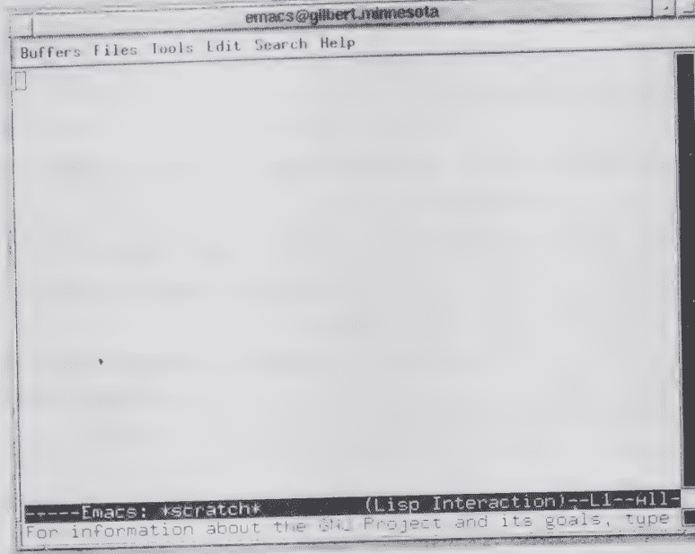

图 5.1 未加载文件时的 Emacs。

你也可以在加载文件时启动 emacs，并在命令行中指定文件：

```
gilbert:/# emacs filename
```

`filename` 是文件的名称。（记住，如果不在你的 `PATH` 或当前目录中找到 `filename`，你需要列出绝对文件名。）

如果你用过任何其他计算机系统或其他 X Window ，你会在 emacs 中感到相当自如。术语上的一些变化可能会让你困惑；例如，你并不是在编辑单独的文件（你编辑的是缓冲区/buffers），而且显示你在文档中位置的机制不称为光标（cursor），而是称为点（point。（在本章中，我们将使用光标一术语。）

## Emacs 与命令

在 emacs 中，通常有多种方法可以执行命令，尤其是在 X Window 版本中。

一种方法是通过键盘快捷键，可以通过键盘完成，通常与 `Ctrl` 和 `Alt` 键结合使用。（在某些 emacs 文档中，会引用 `Meta` 键而不是 `Alt` 键；这种引用主要是针对那些键盘上缺少 `Alt` 键的其他 UNIX 系统用户。当然，在 Linux 上并非如此。）大多数时候，`Ctrl` 和 `Alt` 键实际上是完整命令的快捷键，如果你真的愿意，可以直接输入这些命令。

在处理键盘序列时有一点注意：当你看到像 `Ctrl-x Ctrl-f` 这样的符号时，这意味着你按住 `Ctrl` 键，然后顺序按下 `x` 和 `f` 键。（不需要在 `x` 和 `f` 之间松开 `Ctrl` 键。）

另一种方法是通过下拉菜单。如图 5.2 所示，emacs 提供了一些下拉菜单（Buffers、File、Edit 和 Help）。注意，这些菜单的工作方式与 Microsoft Windows、Macintosh 或 OS/2 环境中的下拉菜单不同。在这些情况下，菜单选择充当通另一个动作的网关，可以是对话框或另一个菜单。

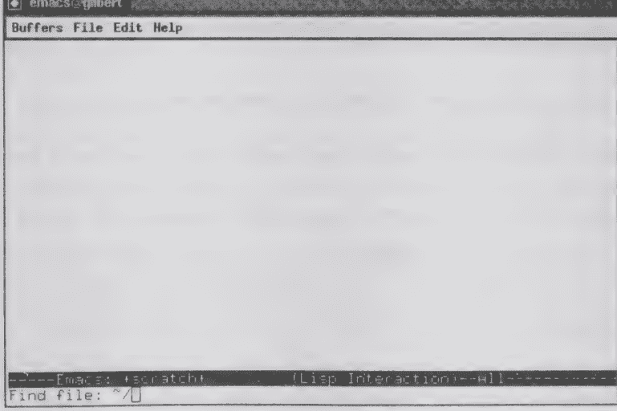

图 5.2 加文件前的 Emacs。

本质上，emacs 环境中的下拉菜单是 emacs 命令行行的网关，该命令行位于屏幕底部。例如，从下拉菜单中选择“Open File”（或使用键盘等效命令 `Ctrl-x Ctrl-f`）。

你不会看到一个让你从现有文件列表中选择的漂亮对话框。相反，你会在 Emacs 窗口底部看到一行列出当前目录，如图 5.2 所示。

你可以在这里选择目录。之后，你将看到文件列表，如图 5.3 所示。

```
emacs:gibber

Buffers File Operate Mark RegExp Inline Subdir Help

/root

total 143 5 root root 1024 Apr 28 03:58

drwx-xr--x 18 root root 1024 Apr 24 00:26

drwx-xr--x 1 root root 433 Aug 11 1993 .defau

/--r--r 1 root root 2502 Apr 28 03:41 .bash_h
```


# 第5章：Linux 应用

当前段落的行；按两次会将光标移动到文件开头。向下箭头（↓）将光标移动到当前段落末尾；按两次会将光标移动到下一个段落。然而，左、右箭头键（← 和 →）的作用正如你预期的那样。

- `PageUp` 和 `PageDn` 命令适用于文档在 `emacs` 缓冲区（`buffer`）中的位置。如果整个文档在窗口中显示，这些命令将不起任何作用。
- `Home` 和 `End` 键用于标记文本并将光标置于文档的开头或结尾。
- `Backspace` 和 `Delete` 键应该像你预期的那样工作。（这是在 PC 架构上运行 Linux 的优势之一；Linux 假设存在标准的 PC 设备，并且很大程度上这种假设是有效的。如果 Linux 的运行不符合你的预期，有重新映射按键的机制，但在 Linux 和 `XFree86` 下，这类问题应该降到最低。）

此外，还有许多用于浏览文档的键盘命令，如表 5.1 所示。

表 5.1 Emacs 光标命令

| 命令 | 移动... |
|--- |--- |
| `Ctrl-a` | 光标移动到当前行的开头。 |
| `Ctrl-b` | 光标向后移动一个字符。 |
| `Ctrl-e` | 光标移动到当前行的末尾。 |
| `Ctrl-f` | 光标向前移动一个字符。 |
| `Ctrl-n` | 光标移动到下一行。 |
| `Ctrl-p` | 光标移动到上一行。 |
| `Ctrl-v` | 文档向前翻一页。 |
| `Alt-v` | 文档后翻一页。 |
| `Alt-<` | 光标移动到文档开头。 |
| `Alt->` | 光标移动到文档末尾。 |

## 缓冲区 (Buffers)

在 UNIX 术语中，缓冲区是为特定任务留出的内存区域。在 `emacs` 中，缓冲区可以包含一个已存在的文件或正在处理中的新文件。当文件在缓冲区中时，它是独立于存储在硬盘上的内容存在的；你可以对缓冲区进行更改，但这些更改不会反映在磁盘上存储的版本中。只有当你显式将文件保存到磁盘时，更改才会永久生效。这有时会让新计算机用户感到困惑，他们假设屏幕上显示的任何内容与磁盘始终完全同步。

`Emacs` 允许你查看多个缓冲区并在缓冲区之间剪切。要查看当前打开了哪些缓冲区，请从菜单栏选择 `Buffers`（或输入 `Ctrl-x Ctrl-b`）。你会看到类似图 5.6 的。

图 5.6 `emacs` 中的缓冲区。

## Emacs 与帮助

`emacs` 优于大多数其他 Linux 文本编辑工具还有一个领域：具有真正的在线帮助。要访问在线帮助，你可以从下拉菜单中选择 `Help`，这将为你提供一个选项列表。某些帮助是情境相关的，与你当前正在的操作有关（例如模式的帮助），还有通用帮助主题和一个教程。

开始学习在线帮助的好地方是 `Info` 菜单选项（`Ctrl-h`），它提供了 `emacs` 在线帮助的概览（如图 5.7 所示）。而 `Ctrl-h t` 提供了一个不错的教程。

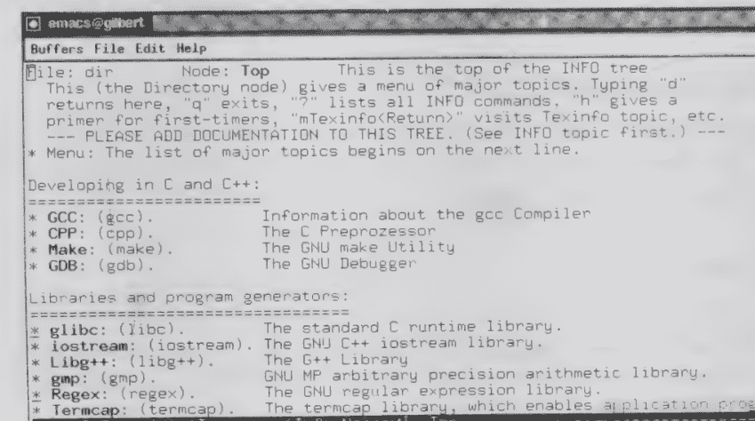

`emacs-helplibert Buffers File Edit Help`

File: ... Node: This is the top of the INFO tree

This (the Directory node) gives a menu of major topics. Typing 'd'

返回此处，'q' 退出，'?' 列出所有 INFO 命令，'h' 提供

首次访问帮助时作为主题的前缀，等。

--- PLEASE ADD DOCUMENTATION TO THIS TREE. (See INFO topic)

Menu: The list of major topics begins on the next line.

Developing in C++

===========================

* GCC: (gcc) C 预处理器

* CPP: (cpp) GNU make 工具

* Make: (make) GNU make

* Gdb: (gdb) GNU 调试器

库和程序生成器

==============================

* glibc: (libc) 标准 C 运行时库。

* iostream: (iostream) GNU C++ 标准库。

* lib++: (lib++) C++ 库

* grep: (grep) 正则表达式算术库。

* regex: (regex) GNU 正则表达式库。

* lex: (lex) Flex 允许应用程序 prog-


图 5.7 emacs 帮助屏幕。

在本章稍后的“使用 Texinfo”部分中，将对 emacs 帮助系统进行进一步讨论。

## Emacs 基础教程

许多 Linux 用户并不关心 emacs 的花里胡锦；他们只关心创建和编辑文档。本着这种精神，我们介绍了这个涵盖了在 emacs 下创建和编辑文本文件的教程。

你已经知道如何加载 emacs 了。如果你想创建一个新文件，直接输入即可。如果你想加载现有文件并在命令行中指定了该文件，可以通过 File 菜单选择 Open File (`Ctrl-x-f`) 来打开它。

### 第5章：Linux 应用

删除文本涉及相同的机制：用鼠标标记文本，然后使用 Edit 菜单中的 Clear（没有键盘等效键）来删除文本。（你可以使用 Backspace 或 Delete 键来删除文本。）还有许多删除文本的键盘命令（如果你是一个忠实的盲打字员，且无法忍受使用鼠标的想法），如表 5.2 所示。

表 5.2 Emacs 中的删除命令

| 命令 | 删除... |
|--- |--- |
| Delete | 光标左侧的字符。 |
| Backspace | 光标左侧的字符。 |
| Ctrl-d | 光标下方的字符。 |
| Ctrl-k | 到单词末尾的所有字符。 |
| Alt-d | 到下一个单词的开头。 |
| Alt-Delete | 到上一个单词开头的所有字符。 |

最后，emacs 拥有一系列用于更改现有文本的键盘命令。这些选项中的大多数不在菜单中找到，因此你需要通过键盘执行。我们将它们列在表 5.3 中。

表 5.3 额外的 Emacs 编辑命令

| 命令 | 结果 |
|--- |--- |
| Ctrl-t | 交换光标下字符与前一个字符。 |
| Alt-t | 交换光标下字符与后一个字符。 |
| Ctrl-x Ctrl-t | 交换当前行与下一行。 |
| Alt-a | 移动光标到前一个单词的开头。 |
| Alt-f | 移动光标到后一个单词的开头。 |
| Alt-l | 将单词转换为小写。 |
| Alt-u | 将单词转换为大写。 |
| Alt-c | 将单词首字母大写。 |

### 第5章：Linux 应用

## 搜索与替换

在搜索和替换文本方面，emacs 并不是一个非常复杂的工具，但你可能并不需要商业文字处理器中那些更广泛的搜索替换功能。

要搜索特定字符串，请从 Edit（编辑）菜单选择 Search（搜索）。窗口底部将显示以下输入机制：

Search（搜索）：

此时，你可以输入要查找的文本字符串，并从当前光标位置开始向下查找，而不是从文件开头开始。

如果你在键盘上选择 `Ctrl-s`，你将获得一个略不同的搜索机制，正如你在窗口底部看到的：

I-search（增量搜索）：

这种搜索是增量的，这意味着 emacs 会根据你的第一个按键在文档中移动（如果你输入 t，它将移动到找到的第一个 t）。

要执行搜索替换操作，请从 Edit（编辑）菜单选择 Query-Replace（查询替换）。Emacs 将提示你要搜索的文本以及要替换它的文本。在此基础上，emacs 将移动到缓冲区中搜索文本第一次出现的地方，并询问你是否要替换文本（输入 y 表示是，输入 n 表示否）。

## 拼写检查

Emacs 具有拼写检查功能，它实际上是 UNIX 拼写命令 `ispell` 的扩展。如果你从 Edit（编辑）菜单选择 Spell（拼写），你将看到一系列选项，允许你检查缓冲区中的拼写、特定单词的拼写，或使用不同或外语言字典进行拼写检查。此菜单还允许你对字典进行修改（这是一好事，特别是当你写书并使用了许多标准字典中没有的单词时）。


### 第5章：Linux 应用 271

## 在 Emacs 中打印

要在 emacs 中打印文件，请从 File（文件）菜单选择 Print Buffer（打印缓冲区）（没有键盘快捷键）。这与在 emacs 中运行 `lpr` 的效果相同。

## 退出 Emacs

序列操作 `Ctrl-x Ctrl-c` 将保存当前缓冲区并退出 emacs。你也可以使用 Files（文件）菜单上的 Exit Emacs（退出 Emacs）。

emacs 的功能比我们在这里列出的要多得多；现实中，我们所能做的就是去探索剩余部分，让你也去探索剩余部分，找出 emacs 许多功能中哪一个最适合你的情况。

## Xedit

`xedit` 是一个复杂程度低得多的编辑工具，但你仍然可能发现它很有用。Xedit 是一个简单的文本编辑器，屏幕被划分为不同的区域，用于编辑文本和创建文本草稿。

你可以从 fwm 菜单或 `xterm` 窗口启动 `xedit`。如果你在命令行上指定一个文件，该文件将加载到 `xedit` 中。对于一个 X Window 应用程序，鼠标能做不了什么；你基本上可以通过按钮加载和保存文件并选择文本，但其他操作通过一组 `Ctrl-Alt-` 按键组合完成。这些组合列在表 5.4 中。

表 5.4 使用 Xedit 的重要编辑操作

| 组合键 | 动作 |
|---|---|
| Alt-Del | 删除上一个单词。 |
| Alt-Backspace | 删除下一个单词。 |
| Alt-< | 将显示的文本移动到文件开头。 |
| Alt-> | 将显示的文本移动到文件末尾。 |
| Alt-] | 将显示的文本向前移动一个段落。 |
| Alt-[ | 将显示的文本向后移动一个段落。 |

### 272 第5章：Linux 应用

| 按键组合 | 动作 |
|---|---|
| Alt-b | 将光标移动到上一个单词的开头。 |
| Alt-d | 删除当前光标位置后的单词。 |
| Alt-f | 将光标移动到下一个单词的开头。 |
| Alt-h | 删除当前光标位置之前的单词。 |
| Alt-i | 插入文件。 |
| Alt-k | 删除到当前段落末尾的文本。 |
| Alt-q | 将当前文本制为段落，并带有缩进和换行。 |
| Alt-v | 将光标移动到上一页的开头。 |
| Alt-y | 在当前光标位置插入所选内容。 |
| Alt-z | 将显示的文本向下滚动一行。 |
| Ctrl-a | 将光标移动到行首。 |
| Ctrl-b | 将光标向后移动一个字符。 |
| Ctrl-d | 删除光标后的字符。 |
| Ctrl-e | 将光标移动到行尾。 |
| Ctrl-f | 将光标向前移动一个字符。 |
| Ctrl-h | 删除光标前的字符。 |
| Ctrl-j | 插入换行符并缩进后续行。 |
| Ctrl-k | 删除到行尾。 |
| Ctrl-l | 重新绘制显示。 |
| Ctrl-m | 插入换行符。 |
| Ctrl-n | 将光标移动到下一行。 |
| Ctrl-o | 插入换行并将光标移动到上一行。 |
| Ctrl-p | 将光标移动到上一行。 |
| Ctrl-r | 在当前光标位置前执行搜索替换。 |
| Ctrl-s | 在当前光标位置后执行搜索替换。 |
| Ctrl-t | 交换光标两侧的字符。 |
| Ctrl-v | 将页面切换到下一页。 |
| Ctrl-w | 删除所选文本。 |
| Ctrl-y | 撤销上次用 Ctrl-w 删除的文本。 |

### 第5章：Linux 应用 273

关于 `xedit` 的更多信息，请查看其在线 man 页面，使用 `xman` 查看效果最佳。

## Textedit

如果你来自 Sun Microsystems 环境，可能更习惯使用 `textedit` 文本编辑器：

```
gilbert:$ textedit
```

这个文本编辑器具有熟悉的 Open Look 按钮，用于打开和管理文件。它是一个文本编辑器，具有搜索替换功能以及将选择内容复制到剪贴板的能力。

要获取更多关于 `textedit` 的信息，请查看其在线 man 页面：

```
gilbert:$ xman
```


## 其他文本编辑器

如果这些文本编辑器不符合你的需求，欢迎尝试其他一些：

- `Vim` 是一个 `vi` 兼容的文本编辑器（仅缺少 `q` 命令）。它通过许多类似插件的功能增强了 `vi` 命令集，包括命令行历史、文件名补全。
- `Jove` 是 Jonathan 版本的 `Emacs`（注意这些软件创建者是如何命名的？），它在主要方面运行方式与 `emacs` 非常相似。如果你向往文本模式下的 `emacs`，并且在 `X Window` 系统下安装了 `emacs`，你可以使用 `jove` 并感到宾如归（尽管在某些领域 `jove` 与 `emacs` 有显著差异）。
- `Joe` 是 Joe 自己的编辑器，它基本上是一个支持旧 `WordStar` 习惯的文本编辑器（历史知识：`WordStar` 是曾经在 `MS-DOS` 时代非常流行的文本编辑器，几乎横扫了市场）。当你想到 `WordStar` 时，你应该考虑到使用 `Ctrl` 键组合来执行基本任务，而这正是你在 `joe` 中发现的。

# 第 5 章：Linux 应用

## Groff：传统标准

在 UNIX 的历史早期，UNIX 被视为强健打印系统的完美前端。（事实上，这正是贝尔实验室对早期 UNIX 开发所采取的合理性依据。）因此，UNIX 中有很多文本处理工具。其中一些工具在商业领域已被通用的“所见即所得”文本编辑/处理软件包所取代（例如 `FrameMaker` 和 `WordPerfect`）。然而，对于你大多数基础的文本处理需求，你会发现 `groff` 及其同类工具恰好胜任。

`Groff` 是源自贝尔实验室（Bell Lab） UNIX 时代的一项原始文本处理工具，后来演变为了其他工具（如 `troff` 和 `psroff`）。`Groff` 及其后代被视为文本处理过滤器，它们接收文本编辑器的输出（当然，是使用 `groff` 命令经过正确格式化的内容），并将其发送到特定的打印机。这些格式化命令可以包括列、字体、框和其他布局元素。

`Slack` 版本的 Linux 特带有 `groff`，而自由软件基金会版本的 `groff` 及其配套工具允许你为各种设备格式化文档，包括 `PostScript` 打印机（使用 `ps` 设备驱动程序）、`TeX`、`X Window` 程序和其他行式打印机。

## 使用 Groff

如所述，`groff` 是一个文本处理器，这意味着它接收来自文本编辑器（如 `vi` 或 `emacs`）的输入，并为输出到另一个设备做好准备。至于你，必须在文本文档中输入 `groff` 格式命令。

`Groff` 格式命令以反斜杠（`\`）或点（`.`）开头。`groff` 接收这些命令并为输出设备进行解释。例如，你可能想使用 `vi` 或 `emacs` 输入图 5.8 中的文本，并将其保存为家目录目录下的 `rules` 文件。

你还可以使用以下命令行将经过 `groff` 格式化后的文档发送到默认打印机：

```
gilbert~$ groff rules | lpr
```

```
.po li

.cel

\s12\fLinux Rules!\fR

```

`\s10`本期月刊 `\fLinux Rules!\fR` 包含了另外 20 个为什么 Linus 是终极操作系统的原因。其中一些包括：

- Linux 太酷了！
- Linux 在 `\feverything\fR` 方面比 DOS 更好。
- 只有像我们这样聪明的人才使用 Linux。

`\s10`我们还需要多说吗？

图 5.8 `groff` 文本处理器的输入。

你可以使用以下命令行运行 `rules` 文件并在屏幕上查看结果：

```
gilbert:~/$ groff rules
```

通过 `groff` 运行图 5.8 中的文本后，结果将看起来如图 5.9 所示。

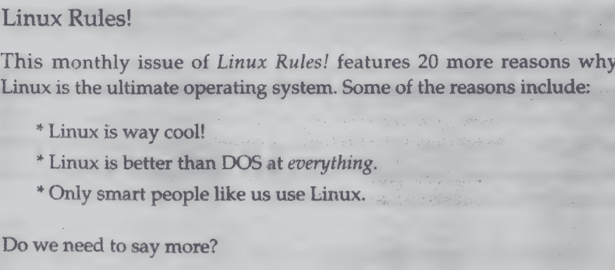

图 5.9 经过 `groff` 处理后的文档。

使用 `groff` 时有几点需要注意：

- `Groff` 会自动填充到右页边距，即使你在文本文档中插入了自身的换行符。要阻止这种情况发生，请在文档开头插入 `.nf`；这是 `no fill`（不填充）的缩写。
- `Groff` 会自动对文本进行对齐；单词之间的空格会增加，以便允许文本跨整个页面。我们并不喜欢这种间距，因为会导致某些行看起来很难看，特别是当你处理较长的单词时。我们通常告诉 `groff` 停止对齐文本，这意味着在文件开头插入 `.ad` 命令。
- 正如图 5.9 所示，我们用以 `\f` 开头的命令标记了一些加粗和斜体的词汇，例如，`\fb` 命令开启粗体格式，`\fl` 命令开启斜体格式。这些命令会一直生效，直到你用 `\fr` 命令关闭它们。
- 消息的第一行以 12 点字体出现，这与消息其余部分使用的 10 点字体相反。`\s` 命令后跟一个数字可以进入字号。（当然，这仅对可以处理不同字号的设备有效；旧的行式打印机不支持。）
- 点命令（Dot commands）必须单独成行；这些行在文档中完全不会出现。另一方面，反斜杠可以出现在文档的任何位置。

表 5.5 列出了一些实用的 `groff` 命令。一如既往，你可以在命令行上指定命令来查看该命令的在线帮助页面（man page）：

```
gilbert:~/man groff
```

### 使用 Groff 创建 Man Pages

大型系统上的程序员或系统管理员将希望尝试使用 `groff` 创建在线 man 页面。要创建它们，你需要经历前一节中相同的文档创建过程：在 `elvis` 或 `emacs` 中格式化页面，然后通过 `groff` 文本处理器。然而，为了创建一个在线手册页，你需要带有两个选项通过 `groff` 运行页面：`-Tascii`（它告诉 `groff` 输出 ASCII 格式）和 `-man`（它允许输出手册格式）。`Groff` 还能输出 DVI 格式。

表 5.5 实用的 `groff` 命令

| 命令 | 结果 |
| :--- | :--- |
| .ad | 关闭文本对齐 |
| .bp | 插入分页符 |
| .cn | 使以下内容居中 |
| .fi | 开启缩进 |
| .ft | 更改字体 |
| .vn | 更改字体 |
| .ln | 缩进后续行 |
| .ls | 设置行间距 |
| .na | 开启文本对齐 |
| .nf | 告诉 groff 不要填充 |
| .pl | 设置每页行 |
| .po | 设置左页边距 |
| .ps | 设置字号 |
| .sn | 设置行间距 |
| .sp | 设置空行间距 |
| .ti | 缩进首行 |
| .un | 下划线后续行 |

## Info

我们展示了图 5.10 中 `info` 文件的顶层。

```
Buffers 帮助

文件: 目录：顶部

(目录节点) 给出了主要主题菜单。输入 "d"

返回主页，-h 为初学者提供帮助，"h" 访问 info 主题，等等。

- 列表-列表-节点从下一行开始。

在 C 和 C++ 中开发：

GCC:(gcc) 关于 gcc 编译器

C++:(g++) C++ 预处理器

make:(make) GNU make 工具

GDB:(gdb) GNU 调试器

库和程序开发者：

glibc:(libc) 标准运行时库。

Lib++:(libg++) C++ 库。

math:(math) GNU 高精度算术库。

Info:(di-info) (Info 手册)

%%-Info：顶部
```

图 5.10 `emacs` 的 Info 模式。

尽管你可以看到整个页面，但这部分 `emacs` 文档实际上是自由软件基金提供的内容。例如，如果你向下滚动 `info` 页面，你实际上会遇到关于 `info` 创建的任何你想知道的内容。你可以通过以下命令实现：

```
gilbert:~$ info
```

结果显示在图 5.12 中。

从图 5.12 可以看到，`info` 的进一步覆盖是完全在线的，这有些多余。图 5.12 中列出的文件可以告诉你关于 `info` 的任何信息。

```
# info 帮助

Buffers 帮助

文件: text.info，模式：顶部，下一个：拷贝，上一个:(dir)，向上:(dir)

info

******
```


`info` 是一个使用单一源文件产生在线信息和打印输出的文档系统。主菜单的第一部分列出了文档中的主要节点，包括索引。其余部分列出了文档中的底部节点。

这是 `info` 文档的第 18 版，发布 1993 年 3 月 26 日，用于 `info`。

- 拷贝：
- 概述：
- 类型：
- 开始文件：
- 结束文件：
- 结构：
- 你的权限：
- `info` 简述：
- `info` 模式：
- `info` 文件的开头是什么？
- `info` 文件的结尾是什么？
- 如何创建章节、小节、附录和其他部分。


目录：顶部

这 (目录节点) 给出了主要主题菜单，输入 'd'

返回，输入 'q' 退出，`info` 命令，'h' 为初学者提供帮助。"info" 访问 `info` 主题，等等，

此树的帮助文档 ---

菜单：下一节点的列表。

在 C 和 C++ 中开发

- `g++`：

- `GCC`:(`gcc`)：

- `Make`:(`make`)：

- `GNU` 调试器:(`gdb`)：

关于 `gcc` 编译器的信息

库和程序

- `glibc`：

- `iostream`:(`iostream`)：

- `libinfo`:(`libinfo`)：

- `gmp`:(`gmp`)：

- `readline`:(`readline`)：

- `termcap`:(`termcap`)：

- `ncurses`:(`ncurses`)：

- `gawk`:(`gawk`)：

- `bison`:(`bison`)：

- `flex`:(`flex`)：

- `make`:(`mak`)：

标准运行时库。

C++ 标准库。

GNU 多精度算术库。

GNU 表达式库。

`termcap` 库，允许程序使用各种终端。

进程通信系统库。

GNU 'make' 宏处理器

其他语言

- `ast`:(`ast`)：

- `gawk`:(`gawk`)：

- `emacs edit`:(`elisp`)：

- `cl`:(`cl`)：

GNU Smalltalk 语言。

GNU `awk` 版本

`emacs` 语言。

对 Emacs 的部分 Lisp 支持。


## 使用 Sed

`sed`（流编辑器）并不是真正的文本编辑器，也不是真正的处理器。然而，它可以作为文本处理器使用——或者说作为交互式处理器。你也可以将 `sed` 视为过滤编辑器；按照步骤，你使用以下步骤使用命令：

- 从文件读取。
- 在文本中修改。
- 在屏幕上显示新文本或保存到文件。

这些步骤都在一个行内指定。典型的行看起来如下：

```
gilbert:~$ sed -n -e operation -f filename
```

其中 `-n` 指特定的行或几行，`operation` 指许多可用操作之一，`-f` 指包含较长操作列表的文件，`filename` 指 `sed` 处理的文件。各种命令行选项在表 5.6 中进行了更详细的解释。

### 5.6 Sed 命令行选项

| 命令 | 结果 |
| :--- | :--- |
| `-e` | 明确告诉 `sed` 后面是一个操作；如果你只使用一个，可以省略 `-e`。 |
| `-f` | 指定脚本；如果你计划经常使用，最好将它们保存到脚本文件中供以后使用。 |
| `-n` | 指定使用的行号或行号范围。 |

创建一个名为 `test` 的文本文件：这是一个 `sed` 系统的测试。

让我们从使用 `sed` 只显示文件的部分（例如第二和第三行）开始。这样做：

```
$ sed -n '2,3p' test
```

在你的显示器上，你会看到以下内容：如果我们想将命令的结果写入文件，可以这样做：

```
$ sed -n '2,3p' w filename
```

其中 `filename` 是文件名。

在我们的示例中需要注意的几点：

- 因为我们只使用了一个操作，所以省略了 `-e` 选项。
- 我们在单引号内列出了命令，这告诉 `sed` 引号内的所有内容都是同一个操作的一部分。
- 我们指定了 `sed` 处理的某些行。如果没有指定行，`sed` 假设是要处理整个文件。

当然，打印并不是 `sed` 的唯一可用操作。我们在表 5.7 中列出了主要操作。像大多数 UNIX 命令一样，`sed` 可以与管道和其他命令一起使用。如果你想获取更多关于 `sed` 的信息，我们建议参考附录 A 中引用的其他参考文献。你也可以从手册页获取更多关于 `sed` 的信息：

```
gilbert:~$ man sed
```

### 5.7 Sed 操作

| 操作 | 结果 |
| :--- | :--- |
| `a` | 添加字符串。 |
| `c` | 将指定的行改为指定的字符串。 |
| `d` | 删除指定的行。 |
| `i` | 在指定的行之前插入字符串。 |
| `l` | 列出文件或指定的部分——对于格式化字符很有用；制表符用 > 打印。 |
| `p` | 打印到标准输出——除非另有指定，到屏幕。 |
| `r` | 在特定行之后插入一个文件。 |
| `s/string/string2` | 将 `string` 替换为 `string2`。 |
| `w` | 将指定的行写入 `filename`。 |

## 第 5 章：Linux 应用

关于打印和 Linux 的更多信息，可以从 Grant Taylor 和 Brian McCauley 编写的优秀指南 PRINTING-HOWTO 中获取，它包含在附带的 CD-ROM 中。

## 使用 Ghostscript

许多 Unix 文档以 PostScript 格式分发（即使 Linux 文档项目也使用 PostScript 格式文档，尽管提供了 HTML 文档）。正如我们所知，PostScript 是 Adobe 监控下的一个商业产品。由于 Adobe 不免费提供 PostScript，为了在非商业的 Linux 操作系统上访问 PostScript 文件，需要一种变通方法。自由软件基金会再次通过 Ghostscript 出现救援。

Ghostscript 实际上是许多较小程序的统称，允许你查看和打印 PostScript 格式的文档。（还记得我们告诉过你 UNIX 操作系统仅仅是工具的集合吗？）Ghostview 是用于查看 PostScript 格式文档的 X Window 应用程序。当你安装 Slack Linux 时（我们在第 2 章介绍过），你应该已经安装了运行 Ghostscript 需要的所有文件，包括一组字体。这些文件可以在第一张 CD-ROM 的 `/usr/lib/ghostscript` 找到。

Ghostscript 要求 X Window 系统正在运行，但实际上是从 `xterm` 窗口中的命令行启动的。正如我们所说，Ghostscript 实际上是一组程序，但你最终最常用的程序是解释器，它接收一个文件并显示 PostScript 格式，以便打印文档。要启动解释器，请使用以下命令行：

```
$ gs filename(s)
```

其中 `filename(s)` 指你想要渲染的文件或多个文件。如果你指定了多个文件，`gs` 将顺序显示每个文件。

要使用 Ghostview 查看 PostScript 文件，只需在命令行中指定该文件即可：

```
$ ghostview file.ps
```

Ghostview 的菜单选择非常一目易见。

基本上，如果你已经正确安装了 X Window 及其字体，Ghostscript 和 Ghostview 应该可以开箱即用。

与可以直接直接写入打印机的普通 Linux 应用不同，打印 PostScript 格式的文件需要花费一些额外工作，特别是在大多数基于 PC 的打印机上。与 UNIX 和 Macintosh 的打印机世界不同，PostScript 并不是 PC 打印机世界的通用语言。表 5.8 列出的打印机均受 Ghostscript 支持。

### 表 5.8 Ghostscript 支持的打印机和传真格式

| 名称 | 打印机 |
| :--- | :--- |
| `ap3250` | Epson AP3250 打印机 |
| `appledmp` | Apple 点打打印机（也应兼容 Imagewriter） |
| `bj10er` | Canon 喷墨 BJ10e |
| `bj200` | Canon 喷墨 BJ200 |
| `bjc600` | Canon 彩色喷墨 BJC-600 和 BJC-4000 |
| `bjc800` | Canon 彩色喷墨 BJC-800 |
| `cdjet` | HP Deskjet 500C，支持 1 位/像素颜色 |
| `cdjcolor` | HP Deskjet 500C，支持 24 位/像素颜色和高质量色彩（Floyd-Steinberg 抖动技术也对 Deskjet 540C 效果良好） |
| `cdjmono` | HP Deskjet 500C 仅打印黑色；也适用于 Deskjet 510、520 和 540C（仅黑色） |
| `cdj500` | HP Deskjet 500C（同 cdjcolor） |
| `cdj550` | HP Deskjet 550C/560C |


| 名称 | 描述 |
|---|---|
| `cp50` | 三菱 CP50 彩色打印机 |
| `decl250` | 替代 DEC UJ250 驱动 |
| `deskjet` | HP Deskjet 和 Deskjet Plus |
| `dfaxhigh` | DigiBoard DigiFAX 软件格式（高分辨率） |
| `dfaxlow` | DigiFAX 低（普通）分辨率 |
| `djet500` | HP Deskjet 500 |
| `djet500c` | HP Deskjet 500C 替代驱动（不兼容 550C 或 560C） |
| `dnj650c` | HP Designjet 650C |
| `epson` | 兼容 Epson 点打打印机（9针或 24针） |
| `eps9mid` | 兼容 Epson 的 9针交错线（中间分辨率） |
| `eps9high` | 兼容 Epson 的 9针交错线（三倍分辨率） |
| `epsonc` | Epson LQ-2550 和 Fujifilm 3400/2400/1200 彩色打印机 |
| `fax3` | Group 3 传真，有 EOL 但无页眉或 EOD |
| `faxg32d` | Group 3 2D 传真，有 EOL 但无页眉或 EOD |
| `fax4` | Group 4 传真，有 EOL 但无页眉或 EOD |
| `ibmpro` | IBM 9针 Proprinter |
| `imagen` | IBM ImPress 打印机 |
| `hwhl` | 高分辨率模式下的 Apple Imagewriter |
| `hwio` | 低分辨率模式下的 Apple Imagewriter |
| `hwlq` | 320 x 216 dpi 下的 Apple Imagewriter LQ |
| `jetp3852` | IBM 喷彩色（型号 #3852） |
| `laserjet` | HP LaserJet |
| `la50` | DEC LA50 |
| `la70` | DEC LA70 |
| `...` |  |


| `dnj650c` | HP Designjet 650C |
| `epson` | 兼容 Epson 点打打印机（9针或 24针） |
| `eps9mid` | 兼容 Epson 的 9针交错线（中间分辨率） |
| `eps9high` | 兼容 Epson 的 9针交错线（三倍分辨率） |
| `epsonc` | Epson LQ-2550 和 Fujifilm 3400/2400/1200 彩色打印机 |
| `fax3` | Group 3 传真，有 EOL 但无页眉或 EOD |
| `faxg32d` | Group 3 2D 传真，有 EOL 但无页眉或 EOD |
| `fax4` | Group 4 传真，有 EOL 但无页眉或 EOD |
| `ibmpro` | IBM 9针 Proprinter |
| `imagen` | IBM ImPress 打印机 |
| `hwhl` | 高分辨率模式下的 Apple Imagewriter |
| `hwio` | 低分辨率模式下的 Apple Imagewriter |
| `hwlq` | 320 x 216 dpi 下的 Apple Imagewriter LQ |
| `jetp3852` | IBM 喷彩色（型号 #3852） |
| `laserjet` | HP LaserJet |
| `la50` | DEC LA50 |
| `la70` | DEC LA70 |
| `la50` | DEC LA50 |
| `la70` | DEC LA70 |
| `la50` | DEC LA50 |
| `la70` | DEC LA70 |
| `...` |  |
| `deskjet` | HP Deskjet 和 Deskjet Plus |
| `dfaxhigh` | DigiBoard DigiFAX 软件格式（高分辨率） |
| `dfaxlow` | DigiFAX 低（普通）分辨率 |
| `djet500` | HP Deskjet 500 |
| `djet500c` | HP Deskjet 500C 替代驱动（不兼容 550C 或 560C） |
| `dnj650c` | HP Designjet 650C |
| `epson` | 兼容 Epson 点打打印机（9针或 24针） |
| `eps9mid` | 兼容 Epson 的 9针交错线（中间分辨率） |
| `eps9high` | 兼容 Epson 的 9针交错线（三倍分辨率） |
| `epsonc` | Epson LQ-2550 和 Fujifilm 3400/2400/1200 彩色打印机 |
| `fax3` | Group 3 传真，有 EOL 但无页眉或 EOD |
| `faxg32d` | Group 3 2D 传真，有 EOL 但无页眉或 EOD |
| `fax4` | Group 4 传真，有 EOL 但无页眉或 EOD |
| `ibmpro` | IBM 9针 Proprinter |
| `imagen` | IBM ImPress 打印机 |
| `hwhl` | 高分辨率模式下的 Apple Imagewriter |
| `hwio` | 低分辨率模式下的 Apple Imagewriter |
| `hwlq` | 320 x 216 dpi 下的 Apple Imagewriter LQ |
| `jetp3852` | IBM 喷彩色（型号 #3852） |
| `laserjet` | HP LaserJet |
| `la50` | DEC LA50 |
| `la70` | DEC LA70 |
| `la50` | DEC LA50 |
| `la70` | DEC LA70 |
| `la50` | DEC LA50 |
| `la70` | DEC LA70 |
| `...` |  |
| `deskjet` | HP Deskjet 和 Deskjet Plus |
| `dfaxhigh` | DigiBoard DigiFAX 软件格式（高分辨率） |
| `dfaxlow` | DigiFAX 低（普通）分辨率 |
| `djet500` | HP Deskjet 500 |
| `djet500c` | HP Deskjet 500C 替代驱动（不兼容 550C 或 560C） |
| `dnj650c` | HP Designjet 650C |
| `epson` | 兼容 Epson 点打打印机（9针或 24针） |
| `eps9mid` | 兼容 Epson 的 9针交错线（中间分辨率） |
| `eps9high` | 兼容 Epson 的 9针交错线（三倍分辨率） |
| `epsonc` | Epson LQ-2550 和 Fujifilm 3400/2400/1200 彩色打印机 |
| `fax3` | Group 3 传真，有 EOL 但无页眉或 EOD |
| `faxg32d` | Group 3 2D 传真，有 EOL 但无页眉或 EOD |
| `fax4` | Group 4 传真，有 EOL 但无页眉或 EOD |
| `ibmpro` | IBM 9针 Proprinter |
| `imagen` | IBM ImPress 打印机 |
| `hwhl` | 高分辨率模式下的 Apple Imagewriter |
| `hwio` | 低分辨率模式下的 Apple Imagewriter |
| `hwlq` | 320 x 216 dpi 下的 Apple Imagewriter LQ |
| `jetp3852` | IBM 喷彩色（型号 #3852） |
| `laserjet` | HP LaserJet |
| `la50` | DEC LA50 |
| `la70` | DEC LA70 |
| `la50` | DEC LA50 |
| `la70` | DEC LA70 |
| `la50` | DEC LA50 |
| `la70` | DEC LA70 |

Ghostscript 还支持许多图形格式，见表 5.9。

### 表 5.9 Ghostscript 支持的图形格式

| 格式 | 说明 |
| :--- | :--- |
| `bit` | 打印机 |
| `appledmp` | Apple 点打打印机（也应兼容 Imagewriter） |
| `bj10er` | Canon 喷墨 BJ10e |
| `bj200` | Canon 喷墨 BJ200 |
| `bjc600` | Canon 彩色喷墨 BJC-600 和 BJC-4000 |
| `bjc800` | Canon 彩色喷墨 BJC-800 |
| `cdjet` | HP Deskjet 500C，支持 1 位/像素颜色 |
| `cdjcolor` | HP Deskjet 500C，支持 24 位/像素颜色和高质量色彩（Floyd-Steinberg 抖动技术也对 Deskjet 540C 效果良好） |
| `cdjmono` | HP Deskjet 500C 仅打印黑色；也适用于 Deskjet 510、520 和 540C（仅黑色） |
| `cdj500` | HP Deskjet 500C（同 cdjcolor） |
| `cdj550` | HP Deskjet 550C/560C |
| `cp50` | 三菱 CP50 彩色打印机 |
| `decl250` | 替代 DEC UJ250 驱动 |
| `deskjet` | HP Deskjet 和 Deskjet Plus |
| `dfaxhigh` | DigiBoard DigiFAX 软件格式（高分辨率） |
| `dfaxlow` | DigiFAX 低（普通）分辨率 |
| `djet500` | HP Deskjet 500 |
| `djet500c` | HP Deskjet 500C 替代驱动（不兼容 550C 或 560C） |
| `dnj650c` | HP Designjet 650C |
| `epson` | 兼容 Epson 点打打印机（9针或 24针） |
| `eps9mid` | 兼容 Epson 的 9针交错线（中间分辨率） |
| `eps9high` | 兼容 Epson 的 9针交错线（三倍分辨率） |
| `epsonc` | Epson LQ-2550 和 Fujifilm 3400/2400/1200 彩色打印机 |
| `fax3` | Group 3 传真，有 EOL 但无页眉或 EOD |
| `faxg32d` | Group 3 2D 传真，有 EOL 但无页眉或 EOD |
| `fax4` | Group 4 传真，有 EOL 但无页眉或 EOD |
| `ibmpro` | IBM 9针 Proprinter |
| `imagen` | IBM ImPress 打印机 |
| `hwhl` | 高分辨率模式下的 Apple Imagewriter |
| `hwio` | 低分辨率模式下的 Apple Imagewriter |
| `hwlq` | 320 x 216 dpi 下的 Apple Imagewriter LQ |
| `jetp3852` | IBM 喷彩色（型号 #3852） |
| `laserjet` | HP LaserJet |
| `la50` | DEC LA50 |


| la70 | DEC LA70 |

| la50 | DEC LA50 |

| la70 | DEC LA70 |

| la50 | DEC LA50 |

| la70 | DEC LA70 |

Ghostscript 同时也支持许多图形格式，见表 5.9。

| | |

| bit | 纯位，单色 |

| btrgb | 纯位，RGB |

| bitcmyk | 纯位，CMYK |

| bmpmono | 单色 Windows .BMP 格式 |

| bmp16 | 4 位（EGA/VGA）.BMP 格式 |

| bmp256 | 8 位（256 色）.BMP 格式 |

| bmp16m | 24 位 .BMP 格式 |

| cgmmono | 单色（黑白）CGM（低级输出） |

| cgm8 | 8 位（256 色）CGM（低级输出） |

| cm24 | 24 位 CGM（低级输出） |

| cif | 用于 VLSI 的 CIF 格式 |

| mgrmono | 1 位单色 MGR 设备 |

| mgrgray2 | 2 位灰度 MGR 设备 |

| mgrgray4 | 4 位灰度 MGR 设备 |

| mgrgray8 | 8 位灰度 MGR 设备 |

| mgr4 | 4 位（VGA）色彩 MGR 设备 |

| mgr8 | 8 位色彩 MGR 设备 |

| pcxmono | PCX 格式，1 位黑黑白 |

| pcxgray | PCX 格式，8 位灰度 |

| pcx16 | PCX 格式，4 位平面化（EGA/VGA）色彩 |

| pcx256 | PCX 格式，8 位块状色彩 |

| pcx24b | PCX 格式，24 位色彩（3-8 位平面） |

| pbm | 便携位图（纯格式） |

| pbmraw | 便携位图（原始格式） |

| pgm | 便携灰度图（纯格式） |

| pgmraw | 便携灰度图（原始格式） |

| pgnm | 便携灰度图（纯格式），可能时可优化为 PBM |

## 290 第5章：Linux 应用程序

| 格式 | 解释 |

|---|---|

| pnmraw | 便携式灰度图（原始格式），尽可能优化为 PBM |

| pnm | 便携式像素图（纯格式) (RGB)，尽可能优化为 PGM 或 PBM |

| pnmraw | 便携式像素图（原始格式) (RGB)，尽可能优化为 PGM 或 PBM |

| ppm | 便携式像素图（纯格式) (RGB) |

| ppmraw | 便携式像素图（原始格式) (RGB) |

| psmono | PostScript (Level 1) 单色图像 SGI RGB 像素图格式 |

| tiff24nc | TIFF 24位 RGB，无压缩（NeXT 标准格式） |

| tiffzw | TIFF LZW (标签 = 5) (单色) |

| tiffpack | TIFF PackBits (标签 = 32773) (单色) |

> 这些信息收集自 Ghostscript 主页：http://www.cs.wisc.edu/~ghost/aladdin/index.html。你作为 Slack Linux 的一部分安装的 Ghostscript (2.6.2) 版本并不支持所有这些格式。要查看支持哪些格式，请使用以下命令行：

```bash
$ gs -h
```

如果你需要一种 Slackware Linux 不支持的文件格式，将需要重新编译 Ghostscript。关于此点的信息可以在 `/usr/lib/ghostscript/docs` 中找到。

此外，表 5.8 和表 5.9 中列出的某些格式和设备仅在 Aladdin 提供的 Ghostscript 商业版 (3.5.3) 中支持。基本上，Aladdin 的免费 Ghostscript 版本比商业版后一个完整版本。如果你计划经常使用 Ghostscript，建议你升级到完整的商业版本；详情请参阅 http://www.cs.wisc.edu/~ghost/ghostscript/index.html。

## 字体工具

Windows 用户可以访问多种字体，你在第 3 章中已经学习过。要查看你的 Linux 系统上哪些可用字体，请使用 `xlsfonts` 命令：

```bash
gilbert:$ xlsfonts
```

## 第5章：Linux 应用程序

如果你这样做，随着长字体列表的滚动，你可能会感到眼晕目眩。这就是为什么我们通常将输出重定向到文件或 `more` 命令，它会一次显示一页字体列表：

```bash
gilbert:$ xslfonts | more
-adobe-courier-bold-i-normal-0-0-0-0-m-0-iso8859-1
```

要查看你的字体服务器提供的字体（假设你已经安装了一个；同样，这是你在第 3 章涵盖的话题），请使用 `fslfonts` 命令：

```bash
gilbert:$ ffonts
```

同样，你可能想将输出重定向到文件或 `more` 命令。要获取有关特定字体服务器的信息，请使用 `fsinfo` 命令：

```bash
gilbert:$ fsinfo
```

要查看特定字体中的所有字符，请使用 `xfd` 命令，如图 5.13 所示：

```bash
gilbert:$ xfd -fn variable
```

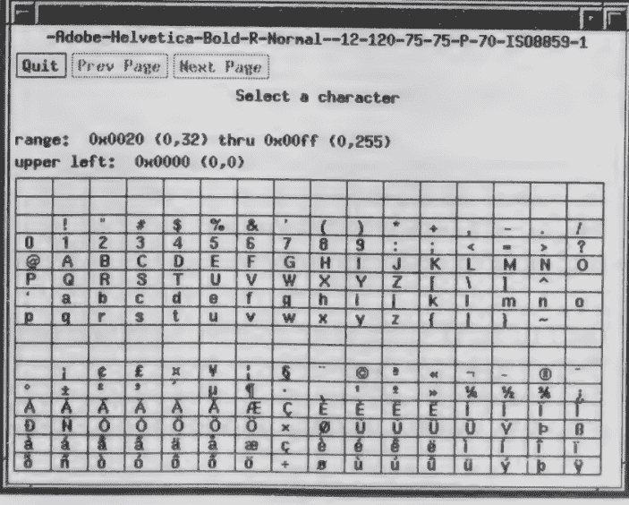

图 5.13 `xfd` 命令的用法。

## 292 第5章：Linux 应用程序

你也可以使用 `xfonsel` 命令来浏览字体，如图 5.14 所示。

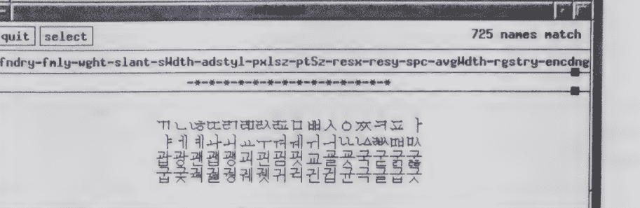

图 5.14 `xfonsel` 命令的用法。

## 文件管理器

在第 3 章中，我们介绍了文件管理器的概念——为 Slackware 操作系统提供图形界面的程序，无论是在命令行模式下运行还是带有 X Window 系统运行。在本节中，我们将查看 Slack Linux 自带的一些文件管理器，以及我们在第二个光盘中额外包含的一个。

## Midnight Commander (午夜指挥)

Midnight Commander 是 Norton Commander 的克隆版本，后者是 MS-DOS 系统编写的最实用软件之一。Midnight Commander Norton Commander 的功能，允许你移动、重命名和复制文件及目录。

基本上，Midnight Commander 将文件管理分为四个屏幕：两个显示文件目录（这样你可以看到文件和目录去向哪里以及来自哪里），一个 shell 命令行（你可以在这里直接输入 shell 命令），还有一个菜单栏。（如果菜单栏不存在，你可以通过将鼠标移动到屏幕顶部或按下 F9 键来唤出。）

## 第5章：Linux 应用程序 293

## 使用鼠标

当你安装 Slack Linux 时，系统会询问你自己在命令行模式下运行时是否为 Linux 安装鼠标支持——主要是 `gpm` 鼠标服务器——在那个时候我们建议你不要这样做，因为 `gpm` 支持可能与 X Window 系统的鼠标功能冲突。

然而，如果你不使用 X Window 系统并想在 Midnight Commander 中使用鼠标，你应该返回安装程序并安装 `gpm` 鼠标支持。

如果你在 X Window 下运行 Midnight Commander，你应该已经拥有该功能。

你可能想在运行 Midnight Commander 时将输出输出到文件。它最大的优势在于可以通过点击文件和目录来执行进一步的操作。

## 启动 Midnight Commander

你可以通过以下命令行启动 Midnight Commander：

```bash
gilbert:$ mc
```

如果你在 X 下使用 Midnight Commander，你应该使用以下命令行：

```bash
gilbert:$ mc -x
```

Midnight Commander 有许多命令行选项，其中一些列在表 5.10 中。

## 第5章：Linux 应用程序

表 5.10 Midnight Commander 命令行选项

| 选项 | 结果 |

|---|---|

| -b | 切换到黑白显示。 |

| -c | 从黑白切换到彩色。 |

| -C | 颜色。 |

| -d | 禁用鼠标支持。 |

| -f | 显示指定的搜索路径。 |

| -V | 显示版本号。 |

| -x | 告诉 Midnight Commander 它正在 xterm 窗口运行。 |

Midnight Commander 在功能方面也非常复杂（功能并不总是显而易见的），因此在你花费大量时间研究之前，最好查看在线文档。

## Xfm


Xfm 是 Midnight Commander 的 X Window 等品，它展示你的应用程序。在使用 `xfm` 之前，你需要运行一个名为 `xfm.install` 的脚本文件进行配置。

```bash
gilbert:$ xfm.install
```

### 295.

要更改应用程序窗口显示的内容，你需要编辑位于 `$HOME` 目录下的 `.xfm` 文件（注意前面的点，这意味着该文件是隐藏的）：

```bash
gilbert:$ xedit .xfm
```

### 使用应用程序管理器

配置好 `xfm` 后，一组应用程序将出现在应用程序窗口中。这并不意味着你的 Slack Linux 系统上实际上拥有所有应用程序；这意味着如果想安装这些应用程序，有一个图标可用。（例如，Slack Linux 并不自带 Mosaic。）

然而，许多应用程序包含在 Slack Linux 中，例如 `xterm`、`emacs`、`textedit`、`mail`、`calculator`、`manual`（`xman` 命令的快捷方式），此外，Toolbox 图标会弹出一个新窗口，显示 `exec`、`xdgdb`、`make`、`gzip`、`tar -cfv` 的快捷方式。

# 第 5 章：Linux 应用

`tar -cvfz`, `zip`, `uuencode`, `grep`, `find` 和 `xfmtype` 命令。图形图标会弹出一个窗口，显示各种图形实用程序的快捷方式（这些将在本章稍后部分介绍）。

### 命令行选项

`xfm` 只有三个命令行选项：

- `-appmgr`：仅启动应用程序管理器，不启动文件管理器。
- `-filemgr`：仅启动文件管理器，不启动应用程序管理器。
- `-version`：显示 `xfm` 的版本号。

要获取更多关于 `xfm` 的信息，你可以阅读它的在线手册帮助页（man page）：

```
gilbert:$ xman
```

### Tkdesk

虽然 `xfm` 是一个非常好的文件管理器，但我们在第二张光盘上也包含了另一个优秀的文件管理器 `tkdesk`。`Tkdesk` 是目前编写得最好、最实用的 Linux 应用程序之一。它管理文件的界面看起来非常像 Windows 资源管理器，如图 5.15 所示。

你可以在应用程序内部配置 `tkdesk`——这是 UNIX 应用程序的一大进步。你可以使用 `tkdesk` 方便的任务栏来启动应用程序。你还可以将文件类型与程序关联，例如，你只需双击 GIF 文件即可启动 `xv`（一个图像查看程序）。

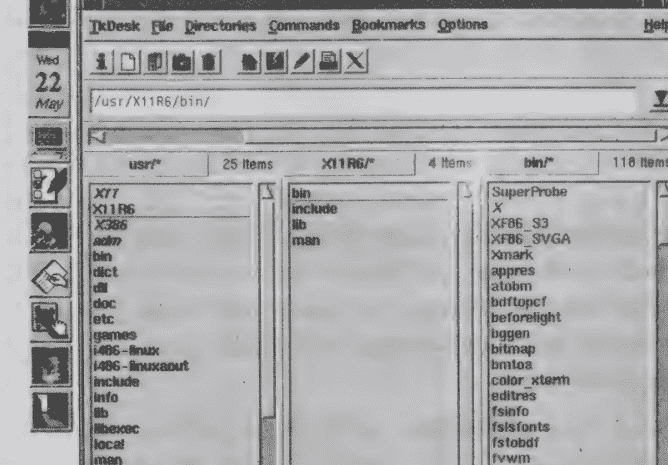

### 压缩和归档文件

当你开始浏览互联网并发现大多数文件都以 `.gz` 和 `.tar` 等晦涩后缀结尾时，你就知道自己已经超出了对旧版本 UNIX 的熟悉——也超出了 PC 和 Macintosh 世界的范围。

然而，如果你计划从 FTP 站点获取软件并安装到你的 Linux 系统，那么这些后缀是非常重要的。此外，当你归档文件或准备将其传输到其他系统（无论是直接传输还是通过互联网传输）时，你可能会发现处理这些后缀的工具非常有用。

图 5.15 使用 `tkdesk` 管理你的文件。

后缀 `.gz` 表示文件已使用 GNU `gzip` 实用程序进行了压缩

因为 `gzip` 和 `zip` 是随你的 Linux 系统附带的

我们不会涉及关于使用何种压缩工具的建议。`gzip` 在其他操作系统（如 MS-DOS）也有版本，尽管它们通常并不广泛发行。同样，PKZip 在每个主要的操作系统上都是免费提供的，它成为了 MS-DOS 和 Windows 世界中的首选格式。（Macintosh 世界中主要的压缩工具 Stuffit 不适用于其他操作系统。）随着越来越多的互联网信息被归档在 `.zip` 文件中，它可能成为计算机世界中主要的压缩格式。由于你同时拥有这两个命令，根据你的具体情况选择正确的格式就取决于你自己了。

关于 `gzip` 的扩展文档可以在本章前面讨论的 GNU texinfo 文档中找到，而你可以从它的在线 man 条目获取关于 `zip` 信息：

```
gilbert:$ man zip
```

或者

```
gilbert:$ xman
```

在接下来的两个章节中，我们将介绍 `gzip` 和 `zip`。

### 使用 Gzip

`gzip` 命令按以下步骤工作：

- 压缩指定的文件。
- 将压缩后的文件保存到磁盘，在旧文件名后添加 `.gz`；压缩名为 `test` 的文件将生成名为 `test.gz` 的新文件名。
- 删除原始文件。

例如，你可能从包含以下文件的目录开始：

```
#test# fig7_10.xwd fig7_12.xwd test.bk
#test# fig7_11.xwd test test3
```

假设你想压缩名为 `test` 的文件。你可以使用以下命令行：

```
gilbert:/home/kevinr/ gzip test
```

当前目录的列表将产生以下结果：

| #test# | fig7_10.xwd | fig7_12.xwd | test.gz |
| :--- | :--- | :--- | :--- |
| #test# | fig7_11.xwd | test | test3 |

```
gilbert:$ unzip zipfile.zip
```

要作为管道的一部分解压文件，请使用 `funzip`：

```
gilbert:$ funzip zipfile.zip: command
```

要使用 `egrep` 命令搜索压缩包，请使用 `zipgrep`：

```
gilbert:$ zipgrep zipfile.zip
```

其他相关命令包括 `zipcloak`、`zipinfo`、`zipnote` 和 `zipsplit`。

# 使用 Tar

如所述，`gzip` 命令无法用于一组文件；它只对单个指定的文件有效。如果你想压缩一组文件，首先需要创建一个文件的归档，然后对该归档进行压缩。UNIX/Linux `tar`（磁带归档）命令正是此此。

`tar` 实际上并没有压缩归档中的任何文件。它只是将文件合并并将目录结构保留在一个大型归档中。


再次，如果你在互联网和各种 FTP 站点闲逛，你可能会遇到以 `.tar.gz` 结尾的文件；这意味着一组文件已经用 `tar` 归档，然后用 `gzip` 压缩过。如果你决定进行操作系统备份——我们强烈建议你这样做——那么 `tar` 命令就是创建该归档的第一步。

`tar` 命令有些复杂；它并不难使用，但它的选项往往很晦涩。不过，几个 `tar` 的运行示例可以为你解疑疑惑。

假设你想备份重要目录——`home/patrick`——中的所有文件，以确保你的工作不会在世界上丢失。在使用 `tar` 之前，请确保你的当前目录是 `/home/patrick`，然后使用以下命令行备份该目录的内容：

```
gilbert:~/patrick tar cvf archive.tar
```

该命令行将通过使用以下函数和选项在当前目录创建一个名为 `archive.tar` 的归档文件：

- `-c`：创建归档文件。
- `-v`：告诉 `tar` 在归档目录内容时显示详细信息（即，报告正在被归档的文件）。
- `-f`：指定 `archive.tar` 为归档文件的文件名。

函数和选项的顺序并不重要；较旧版本的 `tar` 要求在命令行中函数必须紧跟在命令之后，但 Linux 自带的 `tar` 版本缺少这一要求。不过，将 `f` 放在最后一个选项通常是个好主意，因为这是你指定文件名的地方。

`tar` 还会保持目录中的现有文件完好（与 `gzip` 不同，后者会删除原始文件）。`tar` 在函数和选项之前不需要连字符（`-`）。不过，如果你愿意，也可以使用它；它不会对命令行产生任何影响。

命令行以点（`.`）结束，这告诉 `tar` 使用当前目录的所有内容作为归档的输入。（`tar` 也会归档隐藏文件。）你也可以配合通配符使用 `tar`（在在命令行末尾使用 `c*` 代替 `.` 将归档当前目录中所有以 `c` 开头的文件）。此外，你可以指定要归档的目录，提供路径名（`home/patrick`）或相对于当前目录的路径名（例如，如果当前目录是 `/home`，你可以指定 `patrick`）。然而，不能使用绝对文件名来创建归档；`tar` 将删除路径中的斜杠（`/`），以确保在归档文件时重要文件不会被覆盖。（你将在本节稍后的部分看到原因）。当你指定要归档的目录时，`tar` 会归档任何子目录并维护目录结构。事实上，专门为归档材料创建一个子目录被认为是一种良好的做法；这样，用户在他们的系统上解归这些材料时就不会遇到问题。

运行 `tar` 后，你将得到另一个 Linux 文件，它遵循所有 Linux 文件都必须遵守的规则。你可以将此文件复制到软磁盘或 Linux 文件系统中的另一个目录，可以将其保存到磁带驱动器或可录制的 CD-ROM 驱动器，或者使用 `gzip` 对其进行压缩（如本章稍早介绍的那样）。由于所有 UNIX 用户都可以访问 `tar` 命令，你可以将文件传递给其他用户，他们知道自己可以解归你的归档。此外，还有适用于 MS-DOS 和 Macintosh 操作系统的 `tar` 版本，因此你的归档可以被大多数计算机用户使用。

## 函数和选项

当我们在上一节中使用 `tar` 时，我们在命令行中指定了 `cvf`。这需要进一步的解释。

`tar` 要求在命令行上使用函数和选项。如果你输入的命令行缺少函数，`tar` 将报告错误。在我们的示例命令行中，我们使用 `c` 作为强制性函数，随后是可选的 `v` 和 `f` 选项。

重要的函数和选项列在表 5.11 和 5.12 中。我们列出它们以防你需要使用一些更晦涩的函数；在大多数情况下，你使用的函数只有 `c`、`x` 和 `f`。

### 表 5.11 tar 中的重要函数

| 函数 | 结果 |
|---|---|
| A | 将文件追加到现有归档。 |
| c | 创建新归档。 |
| d | 比较文件系统中的文件与归档中的文件，确保没有现有文件被覆盖。 |
| r | 将文件追加到现有归档的末尾。 |
| t | 列出归档的内容。 |
| u | 如果归档包含更新版本，则更新文件系统中的文件。 |
| x | 从归档提取文件和目录。 |

### 表 5.12 Tar 中的重要选项

| 选项 | 结果 |
|---|---|
| f filename | 指定归档的文件名。 |
| k | 保留现有文件。 |
| M | 创建多卷归档。 |
| v | 以详细模式工作，这意味着 tar 列出正在归档或解归的文件； |
| z | 使用 gzip 压缩文件的同时创建归档（该选项将在本章稍后介绍）。 |

这些是 `tar` 的主要函数和选项，但还有许多适用于其他情况的其他选项。获取 GNU 版本 tar 的函数和选项完整列表，请使用以下命令行：

```
gilbert~$ man tar
```

或使用 `info` 命令查看 `tar` 的信息说明。

## 解归归档

你还会使用 `tar` 解归 tar 文件，使用命令行：

```
gilbert:~$ xvf archive.tar
```

该函数仅告诉 `tar` 显示归档的内容，并没有提取文件。然而，有了这些知识，我们可以解归特定的文件或文件。例如，要解归 `test.bk` 文件，你将使用以下命令行：

```
gilbert:-$ xv archive.tar home/kevin/test.bk
```

## 使用 z 选项

我们在这里反复提到的，你可能会将 `tar` 命令配合 `gzip` 命令使用，创建一个归档并压缩的文件。由于 Linux 与自由软件基金会的工具一起工作，你可以预期类似工具之间的集成（正如你看到 `emacs` 和 `texinfo` 一样）。这种集成通过 `tar` 和 `gzip` 的一个独特选项得到了扩展：`z` 选项。这个方便的函数允许你使用 `tar` 的 `z` 选项同时归档并压缩文件或一组文件。例如，你可以使用以下命令行压缩一组文件：

```
gilbert:-$ cvzf archive.tar.gz
```

### 第 5 章：Linux 应用

当使用 z 选项创建归包时，你必须指定 `.tar` 和 `.gz` 扩展名，这与单独使用 gzip 不同，后者会自动添加 `.gz` 扩展名。

要解包并解压缩一个文件，你可以使用以下命令行：

```
gilbert:-$ tar xvzf archive.tar.gz
```

## 系统备份

在我们对 tar 和 gzip 的讨论中，我们并没有真正涉及到如何对整个计算系统进行备份（到目前你应该已经学会了），你应该知道定期备份你的系统。计算机系统会故障，尽管频率不像过去那样频繁，但你仍然应该养成备份关键数据的习惯。

当然，什么构成了关键数据取决于你的观点。有些用户觉得备份整个系统很放心，特别是当他们对 Linux 安装执行了许多配置更改时（这包括重新编译内核）。其他用户则可能觉得只备份选定的系统文件就足够，因为知道 Linux 存储在 CD-ROM 上，可以很容易地重新安装。

备份实际上分为两类：系统文件和数据文件。你为了特定用途而调整的系统文件包括任何隐藏的配置文件以及用于 X Window 系统的配置文件。另一方面，数据文件是你的实际工作；例如，如果你一直在编写应用程序，你将希望经常备份那些数据文件。如果你是系统管理员，你可能还想要保存主目录以及用户主目录中的文件——包括隐藏文件和公共文件。

我们的主要观点是，没有一种规则适用于备份周围的所有情况。如果你是系统管理员并需要保存大量文件，你应该使用 `tar`、`gzip` 和磁带驱动器对文件进行存档。如果你只是保存几个较小的文件或单个目录，可以使用 `tar` 和 `gzip` 创建一个较小的文件，并将其直接拷贝到软磁盘中。

## 使用软盘进行备份

Linux 允许你直接写入软盘。在写入之前，你不需要挂载磁盘驱动器或创建 Linux 文件系统。即使软盘是用 MS-DOS 格式化的，Linux 也会覆盖文件上现有的内容。（换句话说，如果你在软盘上有重要文件且不想让它们被 Linux 擦除，请不要使用设备驱动程序访问软盘。在本章稍后的部分，我们将讨论访问 MS-DOS 格式软盘的 Linux 命令。）

Linux 假设 PC 上的第一个磁盘驱动器是 `/dev/fd0`。你可以使用 `tar` 命令将其输出发送到该驱动器而不是文件：

```
gilbert~$ tar cvf /dev/fd0
```

如果归档文件的内容太大，无法放入一个软盘，你需要创建一个多卷归包；你可以在 `tar` 中使用 `M` 来实现（记住 Linux 中是区分大小写的；使用 `m` 代替 `M` 会产生不同的结果！），使用如下命令行：

```
gilbert~$ tar cvmf /dev/fd0
```

在这种情况下，你希望仔细跟踪你的软盘；如果它们顺序错乱或你不小心丢失了某个软磁盘，你将面临损坏整个归包的风险。

当然，如果你在 `tar` 中使用 `-z` 选项，你可能可以将整个归包放入单张软盘中。

## 使用磁带驱动器进行备份

你可以使用 `tar` 命令直接向磁带驱动器写入备份。然而，你写入哪个设备取决于你的系统设置。


如果你使用的是从软盘控制器运行的磁带驱动器（例如大多数 QIC 类型驱动器都是如此），你需要指定 `/dev/rft0` 为你的设备：

```
gilbert~$ tar cvf /dev/rft0
```

# 310 第 5 章：Linux 应用

这在磁带驱动器上创建一个归包。

创建这种磁带归包比看起来的要复杂一点。例如，如果你使用的是 QIC 类型磁带驱动器，在 Linux 下没有办法格式化这些磁带；你需要使用 DOS 实用程序来格式化磁带（看，保留那个 DOS 分区是有原因的！）或购买预格式化的磁带。

此外，还有一个关于磁带上到底可以存入多少数据的棘手问题。大多数较新的 QIC 类型驱动器在每次使用后会自动回卷。然而，Linux 无法处理这种回卷，而且无法在磁带上创建标记以便在同一盘磁带上放置多个备份。这看起来有多浪费取决于谁为磁带买单；老实地说，只需两张磁带就可以应对，每周进行备份，轮换两张磁带并在之间进行格式化。

另一个选项是使用非回卷磁带设备驱动程序，可以指定为 `/dev/nrft0`（或序列中的另一个数字，取决于你的系统设置）。你的命令行看起来像这样：

```
gilbert:-$ tar cvf /dev/nrft0
```

通过这种方式，你可以创建多个归包。

使用 `/dev/nrft0` 时，你必须手动回卷磁带并寻找单独归包。在完成归包创建后回卷磁带，使用 `mt` 命令：

```
gilbert:-$ mt /dev/nrft0 rewind
```

`mt` 命令是一个非常棒的东西。如果你至少接触过磁带驱动器，你就知道当它们只被部分使用时可能会遇到问题；它们会变得“松动”并可能卡住。`mt` 命令允许你将磁带正向运行末尾然后回卷，使用如下命令行：

```
gilbert:-$ mt /dev/nrft0 retention
```

最后，`mt` 命令允许你指定磁带驱动器上的文件，以防你不想使用 `tar` 解包所有文件。然而，这让你进入了一些比较棘手的领域地，因为 Linux 仍然无法识别

# 第 5 章：Linux 应用 311

磁带驱动器上的文件制作器，你的努力实际上是在欺骗 Linux 去访问正确的文件。假设你已经回卷了磁带，但你想获取磁带上的第二个文件。在这种情况下，你必须告诉 Linux 寻找磁带上的下一个文件——或者用 `mt` 的术语来说，当前文件之后的第一个文件。你使用以下命令行：

```
gilbert:-$ mt /dev/nrft0 fsf 1
```

同样的事情可以将磁带位置移动到磁带上的第三或第四个文件，分别使用以下命令行：

```
gilbert:-$ mt /dev/nrft0 fsf 2
```

以及

```
gilbert:-$ mt /dev/nrft0 fsf 3
```

此外，`mt` 还有另一种技巧。你可以在磁带上移动到第五个或第六个文件，移动多个归包，然后移动到第六个文件。因此，你会使用如下序列：

```
gilbert:-$ mt /dev/nrft0 fsf 4
```

记住是相对于第一个文件；在你使用 `tar` 后，使用如下命令行：

```
gilbert:-$ mt /dev/nrft0 fsf 5
```

记住第六个文件是第一个文件之后。

你也可以备份到磁带驱动器，例如连接到 SCSI 板的 QIC 或 DAT 磁带驱动器。在这种情况下，你将使用如下命令行：

```
gilbert:-$ mt /nrft0
```

# 312 第 5 章：Linux 应用

如果你想使用回卷设备且 SCSI 设备是 0，或者使用

```
gilbert:-$ mt /nrst0 0,
```

回卷设备且 SCSI 设备是 0。

`mt` 命令还允许通过不同的设备访问磁带。在大多数情况下，读取其他系统创建的磁带应该没有问题。然而，如果另一个 UNIX 系统使用了不同的块大小，你可能会遇到问题。在这种情况下，你读取文件的尝试会导致错误消息。为了避免这种情况，你需要使用 `mt` 指定一个新的块大小，如下命令行：

```
gilbert:-$ setblk blocksize
```

`mt` 命令还有许多附加选项；一如既常，鼓励你查阅在线手册：

```
gilbert:-$ man mt
```

或者

```
gilbert:-$ xman
```

## PC 架构特定命令：MTools

`mt` 命令是许多专门为 PC 架构的许多特性设计的 Linux 命令之一——特别是针对 DOS 格式的软磁盘。`MTools` 命令的设计是为了在执行许多例行任务时能够考虑到这些特性。

简而言之，`m` 系列命令的存在是因为 DOS 文件和 UNIX 文件的结构略有不同，这是你在使用软驱动器时需要注意的。事实上，你可能会通过 UNIX 命令将文件拷贝到软磁盘而抹掉一个好的 DOS 软磁盘。（我们是从惨痛的教训中学到的）。

因此，您需要查看 `m` 系列命令，这些命令专门用于处理 DOS 和 Linux 架构的特殊之处以及它们之间的差异。

### 使用 Mdir 查看 DOS 目录

这个简单的命令用于列出 DOS 目录的内容：

```
gilbert:~$ mdir
```

`mdir` 以及 `MTools` 其他命令的默认值为 `A:`（换句话说，您的第一个软驱）。因为 DOS 分区可以从 Linux 挂载，`m` 系列命令不接受 `C:` 作为输入。

#### 使用 Mcd 切换目录

`mcd` 命令更改软驱器上的目录（默认为 `A:` 上的根目录）。如果不带参数，它将显示当前设备和工作目录：

```
gilbert:~$ mcd
A:/
```

### 使用 Mccopy 复制文件

正如所述，UNIX 的 `cp` 命令可能会对软盘上的 MS-DOS 文件结构造成破坏。要从 Linux 内部将文件复制到 DOS 软盘，您需要使用 `mccopy` 命令：

```
gilbert:~$ mccopy -t textfile a:textfile
```

正如您可能注意到的，`mccopy` 使用的是 DOS 软驱的命名习惯（而不是 UNIX 的设备标识符）。

## 314 第 5 章：Linux 应用

这里使用 `mcopy` 将一个名为 `textfile` 的文件（假设包含文本）复制到 `A:` 软盘。使用 `-t` 选项是因为 UNIX 和 DOS 处理换行符的方式，而此选项专门用于文本文件转换。

`mcopy` 只有少数其他命令行选项。作为设计者的一丝慈悲，如果您正在覆盖现有文件，`mcopy` 会发出警告。若要忽略这种慈悲，您需要使用 `-n` 选项运行 `mcopy`：

```
gilbert:-$ mcopy -n textfile a:textfile
```

如果您想在每次文件移动发生时收到通知，请使用由 `-v` 启动的详细模式：

```
gilbert:-$ mcopy -v textfile a:textfile
```

此外，请记住在处理 DOS 文件时，必须始终遵守 DOS 的“八点三”命名规范。`read` 和 `mwrite` 命令的作用相同。

### 使用 Mren 重命名 DOS 文件

`mren` 重命名 DOS 文件：

```
gilbert:-$ mren oldfile.nam newfile.nam
```

请记住在处理 DOS 文件时，必须始终遵守 DOS 的“八点三”命名规范。

### 使用 Mdel 删除 DOS 文件

意料而喻，`mdel` 命令用于从 DOS 目录中删除文件。例如，要从 `A:` 软盘删除 `textfile`，您可以使用以下命令行：

```
gilbert:-$ mdel a:textfile
```

### 使用 Mtype 查看 DOS 文件

如果您想查看软盘上 DOS 文件的内容，请使用 `mtype` 命令显示文件：

```
gilbert:-$ mtype filename
```

如果您正在查看 ASCII 文件，请使用 `-t` 选项：

```
gilbert:-$ mtype -t filename
```

### 使用 Mmd 创建 DOS 目录

您可以使用 `mmd` 命令创建 DOS 目录：

```
gilbert:-$ mmd newdirec.tor
```

请记住在处理 DOS 目录时，必须始终遵守 DOS 的“八点三”命名规范。

### 使用 Mrd 删除 DOS 目录

如果您对用 `mmd` 创建的目录不满意，可以使用 `mrd` 命令将其删除：

```
gilbert:-$ mrd newdirec.tor
```

### 使用 Mread 将 DOS 文件复制到 Linux

`mread` 命令将 DOS 文件传输到 Linux 文件，并在时进行适当转换。该命令实际上在两个不同层面上工作：它可以用于将单个文件传输到 UNIX 文件，也可以用于将一组 DOS 文件传输到 Linux 目录。在第一次用法中，您需要同时指定 DOS 和 UNIX 文件名：

```
gilbert:-$ mread dosfile unixfile
```

要将一组文件复制到特定的 UNIX 目录，请指定 DOS 文件（可以使用通配符），然后指定 UNIX 目录：

```
gilbert:-$ mread * /home/
```


如果您想在每次文件移动发生时收到通知，请使用由 `-v` 启动的详细模式：

```
gilbert:-$ mcopy -v textfile a:textfile
```

此外，请记住在处理 DOS 文件时，必须始终遵守 DOS 的“八点三”命名规范。`read` 和 `mwrite` 命令的作用相同。

## 使用 Mwrite 重命名 DOS 文件（注：此处原文可能为笔误）

`mwrite` 命令向 DOS 文件写入：

```
gilbert:-$ mwrite a:textfile newfile
```

请记住在处理 DOS 文件时，必须始终遵守 DOS 的“八点三”命名规范。

## 使用 Mcopy 复制 DOS 文件

`mcopy` 命令将文件复制到 DOS 文件：

```
gilbert:-$ mcopy a:textfile a:textfile
```

如果您想在每次文件移动发生时收到通知，请使用由 `-v` 启动的详细模式：

等一下，这里重复了。

`mread` 有一些实用的选项：

- `-t`：将文本转换为 DOS 文件。
- `-m`：保留原始文件的时间戳。
- `-n`：移除覆盖。

`mcopy` 命令也会在 Linux 之间复制文件。

## 使用 Mformat 格式化软盘

`mformat` 命令用于格式化软盘。如图 5.16 所示。

当您启动 `mformat` 命令时，会看到一个代表图像的网格。您可以使用相应的设置创建形状（如曲线）。如果您使用位图创建光标，可以指定一个点为热点，这决定了光标指向的位置。位图可以反转或折叠。

## 使用 Mlabel 指定卷标

`mlabel` 命令显示当前的卷标，然后请求一个新的卷标：

```
gilbert:~$ mlabel
```

## 使用 Mattrib 修改 DOS 文件属性

如果您正在与另一台机器交换数据，可以使用这些。DOS 文件可以是只读的 (r)、归档的 (a)、系统的 (h)。例如，要将文件从隐藏改为不隐藏，您将使用以下命令行：

```
gilbert:-$ mattrib -h filename
```

要从文件中移除只读标记，使用命令行：

```
gilbert:-$ mattrib -r filename
```

要使文件成为普通文件而非系统文件，您可以使用以下命令行：

```
gilbert:-$ mattrib -s filename
```

要使文件成为可归档文件（DOS 如何允许归档是一个相当扭曲的故事，就不提了），您将使用以下命令行：

```
gilbert:-$ mattrib -a filename
```

要添加上述示例中的属性，您需要用 `+` 替换 `-`。这些命令假设您正在 A: 上操作。如果您在处理硬盘上的文件，可以在命令行中指定绝对路径（使用 DOS 目录间反斜线的习惯），但请确保将绝对路径包含引号内，否则您的 Linux Shell 将无法处理文件名。

### 图形工具

X 系统的主要目的是为基于文本的操作系统 UNIX（在本例中为 Linux）带来图形计算工具。因此，存在许多用于创建和编辑各种图形的专用 X 工具。我们在这里回顾其中一些。

# 第 5 章：Linux 应用 319

### Bitmap

这个简单的程序用于创建位图，位图可以直接插入 C 编程代码的小型矩形图形，可用于图标、光标形状、平铺和点纹图案等。如图 5.16 所示。

当您启动 `bitmap` 命令时，会看到一个代表图像的网格。您可以使用相应的设置创建形状（如曲线）。如果您使用位图创建光标，可以指定一个点为热点，这决定了光标指向的位置。位图可以反转或折叠。

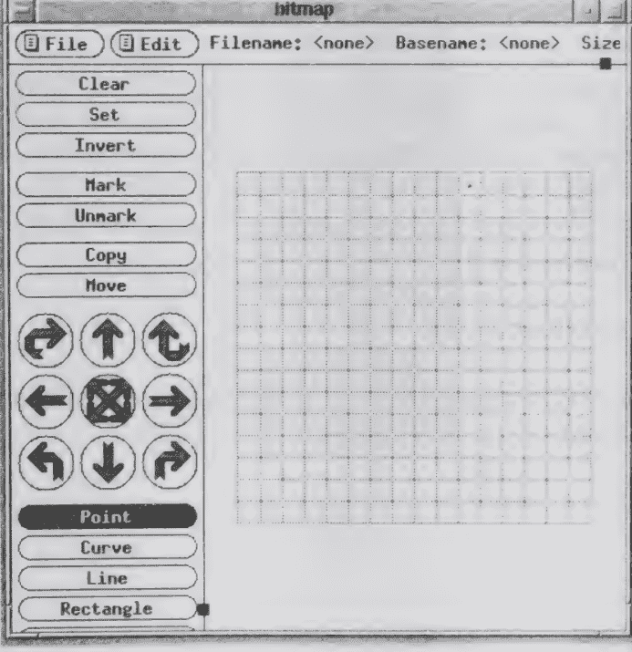

额外的工具（`bmtoa` 和 `atobm`）可将最终的位图文件与 ASCII 字符串进行转换。

### Xfig

`Xfig` 是一个实用的程序，用于创建包含圆形、正方形、多边形或其他形状以及文本（如流程图）的小图形。你可以从空白屏幕或现有文件开始。你的工作可以保存为 LaTeX、PostScript、PIC 和 PiCTEX 格式。

### Xfractint

该程序用于生成分形（fractals），即根据你提供的一组参数演化而来的多彩色形状。这些参数可能包括多种颜色、窗口大小，以及作为分形基础的模式。（`xfractint` 包含了许多模式。）

这是一个相当奇特的程序，因为它从 `xterm` 窗口接收输入，而同时在独立的 X 窗口中显示输出。当你第一次运行 `xfractint` 时，你的焦点可能在新的 X 窗口而不是旧的 `xterm` 上；然而，当你看到新窗口一直保持黑色而 `xterm` 要求输入时，你就会明白是怎么了。

要运行 `xfractint`，请使用以下命令行：

```
gilbert:$ xfractint
```

有几个命令行选项，你可以在在线帮助页（`man` pages）中查阅它们：

```
gilbert:$ xman
```

# Xpaint

这个简单的画图程序可以创建和修改图形文件；如果你曾经用过 Macintosh 上的 MacPaint，你很快就能上手 `xpaint`。（事实上，MacPaint 中使用的某些光标在 `xpaint` 中也能找到。）支持的文件格式包括便携位图 (PPM)、X 位图 (XBM)、TIFF、GIF、PostScript、XPM 等。`Xpaint` 如图图 5.17 所示。

当你启动 `xpaint` 时，会出现一个包含绘画工具的窗口，例如实心画笔、油漆桶、编辑工具和文本输入。你必须创建一个新的“画布”或打开一个现有文件，这将打开一个新窗口。基本上，`xpaint` 的用法归结为在这两个窗口中工作（至少是两个窗口；欢迎打开多个“画布”）。

更多信息可以从帮助页获取。

17 xpaint

### xv

这是一个由 John Bradley 编写的优秀图形编辑包。基本上，该包可以显示 GIF、JPEG、TIFF、便携位图 (PBM, PGM)、X 位图、BMP、PCX、RGB、XPM、XWD 和 PostScript 文件。如图5.18 所示。你可以使用 `xv` 查看和操作这些图形文件。例如，你可以对支持的图形文件执行以下操作：

- 更改窗口的大小会更改图像的大小。
- 更改窗口的比例会更改图像比例。
- 图形可以以 90 度增量旋转。
- 图片可以垂直或水平翻转。
- 裁剪图片只需定义图形的一部分并丢弃其余部分。

- 图形的一部分可以放大，然后保存为该分辨率。
- 你可以使用黑白点阵版本生成图形。
- 文件可以转换并保存到 `xv` 支持的任何其他格式。

Slack 附带的 `xv` 版本是未注册的。我们强烈建议你注册它。你可以在 `usr/doc/xv.blurbl` 找到关于 `xv` 的更多信息，而完整的文档可以在 `usr/doc/xv/xvdocs.ps.gz` 找到。

### JPEG 工具

有一系列命令允许对 JPEG 文件进行更多操作和转换。这可能比你想象的更重要；JPEG 正成为 Web 上流行的图形格式。如果你计划从事任何 Web 工作，将需要这些 JPEG 工具。

### cjpeg

这个简单的命令将图形文件（GIF、便携位图 [PBM]、BMP、Targa 和 RLE 格式）压缩并转换为 JPEG 格式。要将 `image.gif` 转换为 JPEG 文件，使用以下命令行：

```
gilbert:$ cjpeg -gif image.gif > image.jpg
```

### djpeg

这个简单的命令解压 JPEG 文件并转换为 Slack Linux 可以轻松处理的文件（便携位图 [PBM]、BMP、Targa 和 RLE）。你在命令行上选择文件格式。例如，将 `image.jpg` 转换为 GIF 格式，使用以下命令行：

```
gilbert:$ djpeg -gif image.jpg > image.gif
```

# rdjpegcom 和 Warpjpeg

`rdjpegcom` 从 JPEG 中打印注释。相反，使用以下命令行为现有文件添加注释：

```
gilbert:$ rdjpegcom -c "This is a comment" old.jpg > new.jpg
```

# 杂项工具

有很多作为 Slack Linux 部分提供的更多工具。这里有一些实用的：

### 钟

如果你想随时知道时间，可以运行 `oclock` 或 `xclock`，如图 5.19 所示。（img/fbc693f33ddb0348449053e273594_355_0.png）图 5.19 oclock（左）和 xclock（右）。

在图 5.19 中，列出了一些选项：

# 表 5.13  Oclock 选项

| 选项 | 更改... |
| --- | --- |
| bd | 指定边框颜色 |
| bg | 指定背景颜色 |
| fg | 指定前景颜色 |
| hour | 指定时针颜色 |


| `jewel` | 指定中心轴颜色 |

| `minute` | 指定分针颜色 |

| `transparency` | 透明度 |

# 表 5.14 xclock 选项

| 选项 | 更改... |
| --- | --- |
| `-analog` | 将显示切换为数字式 |
| `-chime` | 声音设置，使时钟在每半小时响铃 |
| `-digital` or `-d` | 将显示切换为数字式 |
| `-hands` | 指针的颜色 |

# Xdpyinfo 和 Xev

`xdpyinfo` 命令显示 X 窗口系统的信息：

```
gilbert:# xdpyinfo
name of display: :0.0
version number: 11.0
```

```
version string: The XFree86 Project, Inc
vendor release number: 3120
maximum request size: 4194300 bytes
motion buffer size: 0
bitmap unit, bit order, padding: 8, MSBFirst, 32
image byte order: LSBFirst
number supported pixmap formats: 2
supported pixmap formats:
  depth 1, bits_per_pixel 1, scanline_pad 32
  depth 4, bits_per_pixel 8, scanline_pad 32
keycode range: minimum 8, maximum 134
focus: window 0xc000d, revert to Parent
number extensions extensions 10
BIG-REQUESTS
MIS-SCREEN-SAVER
MIT-SHM
MIT-SUNDRY-NONSTANDARD
Multi-Buffering
SHAPE
SYNC
XC-MISC
XFree86-VidModeExtension
XTEST
default screen number: 0
number of screens: 1
```

诚然，除非你已经熟悉 X 窗口系统，否则这些大部分信息对你来说没有任何意义。然而，如果你了解 X，可以通过 `xdpyinfo` 获取关于系统的大量有用信息。由于我们的目标不是教你 X 的细节，我们建议你查阅附录 A 中推荐的 X 窗口书籍。

`xev` 在有用性上与 `xdpyinfo` 类似，它会打开一个窗口并返回关于该窗口事件的信息。

# 第 5 章：Linux 应用

...生成。再次，如果你对 X 一无所知，那么这些信息将相当派不上——但如果你了解 X 以及（特别是事件），那么这些信息就会很有用。

## Xlock

`xlock` 命令会锁定你的系统，直到输入正确的密码为止。对于那些热衷于安全的人来说，这为你提供了一个工具，让你在离开座位时防止他人访问你的系统。不过，请小心，不要意外调用了 `xlock` 又忘记了密码。

## Xmag

`xmag` 命令（从 `xterm` 窗口或 `fvwm` 菜单调用）用于放大屏幕的区域，如图 5.20 所示。

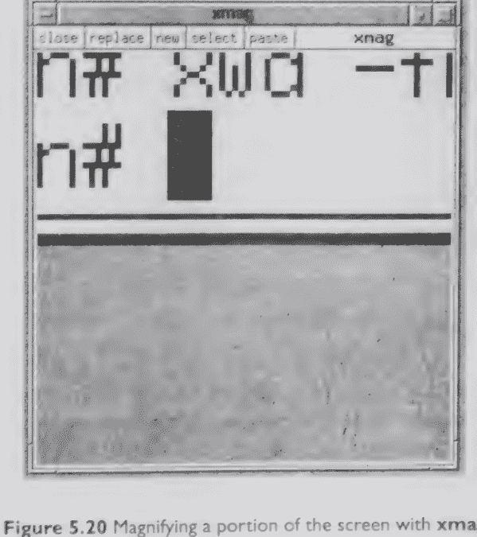

## Xman

在本书的过程中，我们花费了大量时间引用 `xman`，并假设你知道如何使用它。基本上，`xman` 非常简单。当你从 `xterm` 窗口或 `fvwm` 菜单启动 `xman` 时，会弹出一个小窗口。从这里你可以调出一个对话框，用于加载在线 man page（帮助手册）、寻求帮助或退出应用程序。当此窗口激活状态时，你还可以使用 Ctrl-S 调出一个用于实际加载页面的对话框。该对话框有一个输入字段，你可以在其中输入命令名称，以及两个按钮用于选择你是想搜索精确的 man page（手册页）还是与你输入的字符串类似的内容（Apropos）。

在你决定要加载哪一个 man page 后，会弹出一个显示已渲染的 man page 的新窗口。

# Sc 和 Xspread

`sc` 命令（设计用于命令行模式下运行）会启动一个全屏电子表格程序。实际上，`sc` 有很多复杂之处，如果你查阅在线 man page，你就会了解到这些内容：

```
gilbert:$ man sc
```

`xspread` 电子表格基于 `sc` 电子表格。基本上，它是在 X 窗口中使用 `sc` 的机制。

## 模拟器

你不得不对 Linux 社区的这种理想主义性质感到折服：它设想了一个更完美的世界，在那个世界，无论你的软件是为哪种操作系统编写的，你都应该能够以某种方式在 Linux 下使用该软件。

这就是为什么我们有一套 Linux 软件包，允许你运行为 Windows、DOS、CP/M 和 Macintosh 编写的软件。虽然在某种层面上，既然可以直接运行 Windows，在 Linux 下启动工具来运行 Windows 应用程序似乎很愚蠢，但知道这些项目启动于硬盘价格昂贵、大多数人都不想在一台电脑上运行两个或多个操作系统的时代是有帮助的。现在当 PC 上任何小于 1.2GB 的硬盘都可能被视为一种侮辱时，这些担忧已经减轻了。我们在第二张光盘 ROM 中包含了运行 Windows 和 DOS 程序的工具，但当你在你读到这本书时，这些版本可能已经过时了。大部分软件都可以在 `site.unc.edu` 的 `/pub/linux/system/Emulators` 目录下找到。表 5.15 列出了该目录的软件索引，更新至本书编写时。此外，还有一个名为 `dosemu` 的子目录，其中包含 DOS 模拟器。该目录的内容列在表 5.16 中。

# 表 5.15 /pub/linux/system/Emulators 目录列表

| 文件 | 解释 |
|---|---|
| `68k-simulator.tar.gz` | 用于 Windows 系统的 MC-68000 模拟器 |
| `alec64-bin.tar.gz` | Commodore 64 模拟器 |
| `apple2-tar.Z` | 用于 X 和 Linux 的 Apple II 模拟器 |
| `apple2_vid.tar.Z` | Apple 模拟器的另一部分 |
| `bsvc-0.4.tar.gz` | 微处理器模拟器 (Motorola 6800) |
| `cpm-0.2.tar.gz` | Z80 和 CP/M 模拟器 |
| `executor99p.tar.gz` | Executor Macintosh (演示) (ELF 版本) |
| `executor-linux19p.tar.gz` | Executor Macintosh (演示) (a.out 版本) |
| `vice-10.0.tar.gz` | Commodore C64/C128/PET/VIC20 模拟器 |
| `x48-0.0.tar.gz` | HP48 计算器模拟器 |
| `zxx-5.4.tar.gz` | 基于 X 的 ZX 模拟器 |

# 表 5.16 /pub/linux/system/Emulators/dosemu 目录列表

| 文件 | 解释 |
|---|---|
| `Win3.1_Dosemu.gz` | 关于运行 Windows 的信息 |
| `dosemu-HOWTO-52.3` | 0.53.3 版本的 HOWTO (PostScript 格式) |
| `dosemu-HOWTO-52.3.txt` | 0.53.3 版本的 HOWTO (ASCII 格式) |
| `dosemu60.4` | 0.6.4 |
| `garrot2.tar.gz` | 用于系统的 DOS 模拟 |
| `xdos64.tgz` | 在 `xterm` 窗口中运行的 Windows |

# 在 Linux 下模拟 DOS

如果你想在 Linux 下运行 DOS，你可能想查看 `dosemu` 或 `xdos`。严格来说，`dosemu` 或 `xdos` 并不是 DOS 模拟器，尽管文档中是这样称呼它们的（大致）。`Dosemu` 在 Intel 架构上运行虚拟 DOS 机器（以相同的方式）。

# 在 Linux 下模拟微软 Windows

如果说微软 Windows 在某个方面优于 Linux，那就是在 Windows 下运行的海量软件。这就是为什么一个志愿者团队正在开发 WINE，或者根据某些说法，它是 Windows 模拟器（大致）。`WINE` 允许你在 Linux 下运行 Windows 二进制文件。

有关 `WINE` 的更多信息，你可以将网络浏览器设置为 `http://www.asgardpro.com/wine`，或者通过以下站点直接获取：

`ftp://tsx-11.mit.edu/pub/linux/ALPHA/wine/`

`ftp://sunsite.unc.edu/pub/Linux/wine/`

`ftp://ftp.infomagic.com/pub/mirrors/linux/wine/`

`ftp://aris.com/pub/linux/ALPHA/wine/`


此外，WINE 主页列出了欧洲的 FTP 站点。

但警告的是，WINE 仍然被认为是一个面向开发者而非普通用户的开发项目，这意味着你需要自行承担风险。不过，我们在光盘 ROM 中包含了书中制作时的最新版本。

# Windows 95 窗口管理器

除了 WINE 之外，如果你真的喜欢 Windows 95 界面，你可以运行一种名为 `fvwm95` 的 `fvwm` 窗口管理器变体。虽然你配置 `fvwm95` 的方式与 `fvwm` 几乎相同（参见第三章配置 `fvwm`），但你看到的与 Windows 95 窗口管理器非常接近，如图 5.21 所示。

图 5.21 运行 `fvwm95` 的 Linux 屏幕看起来非常像 Windows 95。

重要的是，你仍然在运行 X 窗口系统并且运行着 Linux，尽管 `fvwm95` 提供的外观真的可以欺骗你。你可以在光盘 ROM 中找到 `fvwm95`。

## 计算器

**计算器**（通过 `xterm` 窗口或 `fwm` 菜单调用）提供了一个具有某些高级功能的科学型计算器。如图 5.22 所示。

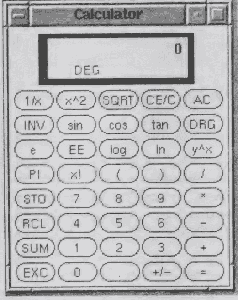

图 5.22 计算器命令。

# 游戏

只工作不玩耍会让你变成一个极其无聊的 Linux 用户。当你厌倦了在 Linux 上编写应用程序或创建文档时，Linux 操作系统包含了许多消遣游戏。游戏分为终端版和 X Window 实现版。

## 终端游戏

这些游戏不需要 X Window，可以在文本模式或带有专有图形的情况下运行。除非有说明，否则这些游戏都存储在 `/usr/games` 目录下。如果你需要关于其中任何一个游戏的更多信息，可以查看它们附带的手页（man pages）。

### Abuse

`Abuse` (`abuse`) 是一款来自 Crack Dot Com 的街机游戏，你将与一群愤怒的外星人对战；你的目标是尽可能杀死杀死它们。在许多方面，`abuse` 的结构非常像 DOOM——你可以在 Slackware Linux 发行版中获得精简版，并可以通过额外付费注册以获得额外的附加功能。`abuse` 的最新版本可以在 `http://www.crack.com` 找到，而关于 `abuse` 的更多信息可以在 `/usr/games/abuse-1.05` 找到。还有一个 X Window 版本，`xabuse`。

### 算术

如果你成功安装了 Slackware Linux，你可能可以处理 `arithmetic` 提出的简单数学题。你将看到一系列方程；按 Ctrl-C 结束测试。然而，如果你非常有竞争心，你会注意到在结束时，系统会根据正确答案的数量和你回答问题的快慢对你进行评判。

## Atc

如果你生活中缺乏足够的压力，可以尝试一下 `atc`，这是一款空中交通管制游戏。你需要让飞机进出你繁忙的机场。

## 双棋 (Backgammon)

如果你曾经玩过这个游戏，你需要一点时间来适应双棋。如果你不熟悉双棋，你可能想运行 `teachgammon` 命令（在本节稍后的部分将讨论）。

### Bcd

这个快速运行的程序可以将输入转换为打孔卡、纸带或摩尔斯密码。

### Boggle

在这个游戏 (`bog`) 中，你尝试从一组 12 个字母中创建单词。规则有些晦涩；它似乎接受某些单词而不接受另一些。

## 凯撒 (Caesar)

这个奇怪的工具，用手页的话说，“尝试使用英语字母频率统计来解密凯撒密码”，无论那是什么意思。话虽如此，这可能是某人认为的一个很好的笑话。自己试吧。

### Canfield

这是一种纸牌类游戏。在尝试玩之前，一定要阅读说明。

## 跳棋 (Cribbage)

这款纯文本的跳棋游戏 (`cribbage`) 可以分长形式或短形式进行。注意，它不是计算机世界中最可靠的跳棋游戏；它不止一次尝试给我们分配比应得更低的分数。（假设我们在大学里花了太多时间玩跳棋，对这个游戏有超出水平的熟悉。）尽管如此，如果你对跳棋不感兴趣，你可能会发现自己在这上面浪费时间。

### DOOM

关于这款广受欢迎的游戏的游戏，我们没什么可以补充的，你的目标是尽可能杀死尽可能有意识的反派。如果你正确安装了 Linux，在走廊里寻找目标应该没有问题。你甚至会获得一个工作的 WAD 文件，如果你配备了声卡并运行，它可以产生一些音效。DOOM 实际上有两个版本：用于终端模式的 `sdoom` 和用于 X Window 的 `xdoom`。

## 因子 (Factor)

这个小程序对整数进行因数分解。这就是娱乐！

## 猜鱼 (Fish)

这是老牌“猜鱼”游戏的电脑版本，我们大多数人在童年某个时候都玩过。如果你没玩过，现在是机会了。

## 幸运 (Fortune)

这个命令每次运行时都会产出一句简洁的名言。当你安装 Linux 时，可以选择在每次用户登录 Linux 系统时都调用 `fortune`。

## 吊字 (Hangman)

这是另一个引入 Linux 世界的儿童游戏。

## 狩 (Hunt)

这款低科技狩猎游戏没有 DOOM 或 Abuse 那种华丽，但如果你在网络上很有趣；这里的目的是清除其他网络用户。

## 蜥蜴 (Lizards)

这款精奇的低分辨率街机游戏是按照 Eugene Jarvis 的精神开发的，带有廉价的图形、一个物体会掉落的迷宫，以及上下左右移动的呆板主角。它绝对值得一试。

### Mille

如果你还记得 Mille Bournes（根据我们所知，它已经不存在了），那么你会喜欢这个纸牌游戏。如果不记得，别费劲了。

## 大富翁 (Monop)

这个基于测试的版本是大富翁游戏的变体，如果你喜欢它，它是挺不错的。如果你没兴趣，你可能会发现自己在这上面上面浪费时间。

## 摩尔斯密码 (Morse)

如果你觉得 `bcd` 命令太快了，`morse` 命令可以将你的输入转换为摩尔斯密码。

## 数字 (Number)

这个命令将数字转换为单词。

## 偏执症 (Paranoia)

这种基于文本的游戏在某些点会让你死，这就像现实生活——当你思考它时，它让你在一系列情况中做出正确的决定。

### Pom

`pom` 命令显示月球阶段。正如手页所述，该命令对于做出决策很有用。

## PPT

`ppt` 命令接收输入并创建纸带副本。带我们回到分时共享时代。

## 质数 (Primes)

`primes` 命令打印一个质数列表，从你输入的数字开始。

## 雨水 (Rain)

`rain` 命令在屏幕上随机生成图案，看起来像下雨。

## 机器人 (Robots)

`robots` 命令启动一个二维游戏，你的目标是以异常的方式杀死机器人，但你可以传送到另一个地方。

## 航海 (Sail)

`sail` 命令启动一个二维游戏，你的目标是海战。这款游戏比 PC 还老。（顺便说，`sail` 的手页可能更有趣。）

## 小行星 (Asteroids)

`asteroids` 命令启动我们从小熟悉的小行星游戏的克隆。这个版本包含了颜色和阴影，而不是原始版本的线条。

## 大蛇 (Snake)

`snake` 命令开始一个游戏，你的目标是在避开一系列 s 的同时吞掉美元符号 (`$`)。

## 教你双棋 (Teachgammon)

这个命令教你如何玩双棋。

## 俄罗斯块 (Tetris)

（重复内容）

## 战争游戏 (Wargames)

`war games` 命令是 Linux 系统其他地方射击游戏的趣味变体。

## 虫子 (Worm)

`worm` 命令导致你变成一条二维虫，你的目标是吃字母来观察你能变得多长。

## 虫群 (Worms)

与 `worm` 相反，`worms` 命令在你的屏幕上创建所谓的虫子，它们跳动仿佛正处于布莱克式的狂喜中。

## 姆普兽 (Wump)

`wump` 命令启动一个基于文本的游戏，你的目标是在由 20 个房间组成的洞穴中狩猎 Wumpus。你必须小心蝙蝠和深阱。

# X Window 游戏

除了上一节提到的 `xdoom`、`xtris` 和 `xabuse` 游戏外，还有许多随附的针对 X 的游戏。

# 第 5 章：Linux 应用

Slack Linux 的版本。你可以在 `/usr/X11R6/bin` 中找到大部分程序。其中某些可以直接从 `fwwm` 上的游戏（Games）菜单启动。大多数程序都有帮助页（man pages），最好通过 `xman` 查看。

出于某种原因，名为 `xuckoo` 和 `xhextris` 的游戏被安装在默认的 `fwwm` 游戏菜单中。这些游戏并未随 Slack Linux 分发。


## Ico

此命令打开一个窗口并让一个几何形状在屏幕上跳动。该命令主要由销售技术人员使用，用来展示他们基于 X 的计算机运行速度有多快，就好像弹跳线框对象这种基础任务能反映任何一台机器的处理能力似的。

## Workman

此应用程序从 CD-ROM 驱动器播放音乐 CD。然而，其帮助页（最好用 `xman` 查看）存在错误，它声称 `workman` 仅支持 SunCD 驱动器；我们发现它支持任何通过 Linux 支持的 CD-ROM。但请注意，在处理 `workman` 时有几条规则——而且还是未说明的规则：


你需要使用 CD-ROM 的权限。（记得我们告诉过你 Linux 将一切视为文件，甚至设备也是如此吗？）大多数用户没有运行 `workman` 的相应权限。你需要以 `root` 身份运行 `chmod` 命令来更改权限。

启动 `workman` 后，你将无法打开 CD-ROM 驱动器。

你也可以通过输入以下命令行在纯文本模式（即不运行 X Window）下运行 `workman`：

```
gilbert:$ workbone
```

### Xboard

`xboard` 命令会召唤出一个运行 GNU Chess 的棋盘，这被认为是一个相当完善的国际象棋实现（换句话说，真正的象棋高手也可以受到它的挑战）。游戏有时间限制，并有一系列选项。

# Xlander

你是否曾觉得 Linux 开发的许多参与者在 20 世纪 70 年代和 80 年代初在视频游戏厅花费了太多时间？玩过 `xlander` 后你会有这种感觉，它是老游戏“月球着陆器”（Lunar Lander）街机版的 X Window 版本。你的任务是成功降落在月球上避免坠毁。

### Xlogo

此命令打开一个显示官方 X Logo 的窗口。这主要由销售技术人员使用，用来证明他们正在推销的机器上确实运行着 X。

### Xmaze

这个迷宫（实际上由 `maze` 命令启动）主要由销售技术人员使用，用来展示他们基于 X 的计算机运行速度有多快，就好像完成迷宫这种基础任务能反映任何一台机器的处理能力似的。

### Xeyes

`xeyes` 并不真正算是一个游戏，它是那个永远能带来乐趣的标准编程练习的 X Window 版本——一对跟随光标的眼睛。

# Xmahjongg

这是这款古老棋类游戏相当不错的 X Window 版本。

### Xroach

启动 `xroach` 后，一只蟑螂会在你窗口下方的屏幕上穿梭。如果你在过了一会儿识别出那个窗口，你会发现蟑螂已经繁殖成了多只，它们都在你的屏幕上穿梭，在另一个窗口或图标下寻找避难所。那些曾在住满蟑螂的公寓里待过时间的大城市居民会感到宾至如归。

如果你在带有 `-squish` 选项的 `xterm` 窗口启动此游戏，你可以用鼠标杀死这些小害蛋。

### Xpider

Spider 是一种双层扑克牌游戏，往往比较复杂。

# Xvier

这款棋游戏的目标是获得四子连线，无论是对角线还是列。`xvier` 的技巧在于，你必须从棋盘底部开始并向上移动。

## 总结

本章从一系列酷的 Linux 应用开始，然后对 `emacs` 文本编辑器进行了深入讨论。`emacs` 是 GNU 项目的一部分，是一个既可以在字符模式运行也可以在 X Window 系统下运行的全功能文本编辑器。虽然对于某些用户来说 `emacs` 可能需要时间适应，但它既简单又强大——是两者的结合。

# 第 6 章：基础 Linux 系统管理 347

```text
sync:x:0:sync:/bin:/bin/sync
bin:x:1:bin:/bin/
ftp:x:404:1::/home/ftp:/bin/bash
daemon:x:2:2:daemon:sbin
adm:x:3:4:adm:/var/
lp:x:4:7:lp:/var/spool/lpd
mail:x:8:12:mail:/var/spool/mail:
postmaster:x:14:12:postmaster:/var/spool/mail:/bin/bash
news:x:9:13:news:/usr/lib/news:
uucp:x:10:14:uucp:/var/spool/uucppublic
man:x:13:15:man:/usr/man
games:x:12:100:games:/usr/games
nbody:xx:65536:nobody:/dev/null
kevinr:x:1000:1000:Kevin Reichard,,,/home/kevinr:/bin/bash
```

这些命令中的大多数指定了与特定命令相关的路径，例如 `man` 页（帮助文档）路径。例如，如果你正在使用 `uucp` 连接到其他系统，且其他系统也连接到你的系统，这里就是更改 `uucp` 默认路径的地方，你可以在这里操作。

然而，我们真正关注的是文件的最后一行，关于用户 `kevinr` 的配置：

```text
kevinr:x:1000:1000:Kevin Reichard,,,/home/kevinr:/bin/bash
```

我们将这一行分解作为示例，说明 Linux 如何处理用户条目：

- `kevinr` 指用户名。
- `X` 是加密密码的占位符。实际的加密文本存储在名为 `/etc/shadow/` 的独立文件中。为了帮助保持系统安全，`/etc/shadow` 只能由 `root` 用户读取。如果此字段包含星号 (`*`) 而不是 `x`，则意味着该账户已禁用（你将在本章稍后的部分学习到这一点）。
- `1000` 是用户 ID（UID），系统用于跟踪账户的数字。在处理文件权限等操作时，系统并不是处理 `kevinr`，而是处理 `1000` 或相应的用户 ID。
- `1000` 是组 ID（GID）（你将在本章稍后部分学习关于组的内容）。
- `Kevin Reichard` 是用户的全名；此条目可以包含关于用户的额外信息。
- `/home/kevinr` 指用户的家目录。
- `/bin/bash` 指用户的默认 shell。

并不是每个字段都需要被使用，但需要为它们留出空格（ )）。

如从上一个示例所示，`root` 用户的行与普通用户略有不同；在这种情况下，用户 ID 和组 ID 字段使用的是 `0`。

此文件是你检查当前用户配置的地方，而不是添加用户的地方。你可以对此文件进行更改，这些更改将反映在整个系统中；例如，你只需更改用户 ID 字段中相应的数字，就可以给用户分配一个新的 ID。然而，这样做会有影响；因为系统通过用户 ID 而不是用户名来跟踪文件所有权和组关系，此更改意味着该用户以前拥有的所有文件都将处于所有权归属的状态；你需要使用 `chown` 命令手动更改文件的所有权。除非你绝对必须更改用户的用户 ID，否则最好避免这种操作。

你在第 2 章中首次遇到的 `adduser` 命令可以用于添加用户。`root` 或 `super`（超级用户）可以在随时运行此命令：

```
gilbert:# adduser
```

### 删除账户

添加账户的对面自然是删除账户。如果你在一个较小的系统上工作，你不需要太担心删除账户，除非你面临心怀不满的员工可能有机会对你的系统造成破坏的情况。

然而，删除账户是一项多方面的工作，因为你必须删除 Linux 系统中对用户的所有引用。这意味着从 `/etc/passwd` 中删除用户条目，删除用户的家目录（使用 `rm -r` 命令行即可，尽管你真的应该确保目录中没有贵重的内容），转移被删除用户文件的所有权，删除对任何组文件的引用（你将在下一节中学习），结束用户启动的任何 `cron` 任务或作业（这两者在本章稍后部分均有解释），并确保邮件系统不会继续确认该用户的存在。你可能还会删除用户的邮件文件，该文件保存在 `/usr/spool/mail` 中，文件名为用户名。大部分工作可以通过 `userdel` 命令自动完成。例如，要移除 `kevinr` 账户：

```
userdel -r kevinr
```

你可能还想禁用账户而不是直接删除它。在这种情况下，你只需要在 `/etc/passwd` 文件的第二个字段中输入一个星号 (`*`)。以下操作将临时禁用 `kevinr` 的账户：

```
kevinr*:1000:1000:Kevin Reichard,,,/home/kevinr:/bin/bash
```

### 管理组

在 UNIX 世界中，组作为一种划分某些文件访问权限的机制，有着悠久的历史。任何用过 `ls -l` 的人都会意识到，只允许某些成员访问文件可以增强安全性并使组织工作变得更容易。


# 第 6 章：基础 Linux 系统管理 353

校准延迟循环.. ok - 25.04 BogoM
scsi : 0 个主机。
内存: 14652k/16384k可用 (976k内核代码, 384k 保留, 372k 数据)
此处理器在超级模式下也遵守 WP 位。很好。
软驱驱动器: fdd0 1.44M
FDC 0 是 8272A
Swansea 大学 计算机协会 NET3.017
Swansea 大学 计算机协会 TCP/IP for NET3.017
IP 协议: ICMP, UDP, TCP
PPP: 版本 0.2.7 (4 通) NEW_TTY_DRIVERS OPTIMIZE_FLAGS
TCP 压缩代码版权 1989 Regents of the University of California
PPP 线路遵守已注册。
SLIP: 版本 0.7.5-NET3.014-NEWTTY (4 通)
CSLIP: 代码版权 1989 Regents of the University of California
eth0: 3cs505 未找到
eth0: D-Link DE-600 兜中适配器：不在 I/O 0x378。
nD-Link DE-620 数据包适配器未在打印机端口识别
检查 386/387 耦合... Ok, fpu 使用异常 16 错误报告。
检查 'hlt' 指令... Ok。
Linux 版本 1.1.59 (root@fuzzy) (gcc 版本 2.5.8) #5 1994年10月29日周六 15:50:31 CDT
分区方案:
hda: WDC AC2340H, 325MB/128KB 缓存, CHS=1010/12/55, MaxMult=16
hda: hda1 hda2
VFS: 已挂载根目录 (ext2 文件系统) 只读。
最大大小:32509 2048
第一个数据区:152 Root 节点号 15648
ISO9660 扩展: RRIP_1991A
gilbert login: ROOT LOGIN ON tty

这些代码大部分都是显而易见的，但我们花几分钟时间来解释其中几行的含义，按照它们出现的顺序。代码的第一行显然显示系统已开始记录操作。下一行：

控制台: 彩 EGA+ 80x25, 1 个虚拟控制台 (最大 63) 告诉 Linux 运行的分辨率。此分辨率适用于在文本模式下运行 Linux，而不适用于运行 X Window 系统时。以下几行：

```
tty00 at 0x03f8 (irq = 4) is a 16450

tty01 at 0x02f8 (irq = 3) is a 16450
```

指的是 PC 上的串口设备及其相应的 IRQ。正如你在第 2 章记得的，`tty00` 等同于 COM1（换句话说，第一个串口）。这还告诉我们串口具有一个 16450 UART 芯片，你会发现它对高速通信非常有用。

接下来的以 SBPCD 开头的几行指的是使用 SoundBlaster Pro 声卡/CD-ROM 驱动器时的配置因素，系统会自动轮询设备以确保其正常工作。这一行：

```
Memory: 14652k/16384k available (976k kernel code, 384k reserved, 372k data
```

指的是系统的内存量。在这种情况下，由于 PC 上确实安装了 16MB 内存，这意味着 Linux 可以看到所有内存。这一行：

```
Floppy drive(s): fd0 is 1.44M
```

指的是软驱，Linux 未将 `fd0` 识别为高密度 3.5 英寸驱动器。这一行：

```
eth0: 3c505 not found
```

指的是对以太网网卡的搜索失败——这并不意外，因为这台特定的机器缺少此类设备。然而，接下来的几行：

- Swansea 大学 计算机协会 NET3.017
- Swansea 大学 计算机协会 TCP/IP for NET3.017
- IP 协议: ICMP, UDP, TCP
- PPP: 版本 0.2.7 (4 通) NEW_TTY_DRIVERS OPTIMIZE_FLAGS
- TCP 压缩代码版权 1989 Regents of the University of California
- PPP 线路遵守已注册。
- SLIP: 版本 0.7.5-NET3.014-NEWTTY (4 通)
- CSLIP: 代码版权 1989 Regents of the University of California

显示这台机器支持 SLIP 和 PPP 远程登录协议，这意味着该机器可以登录到 Internet 主机。这一行：

ISO9660 扩展: RRIP_1991A

告诉我们 CD-ROM 驱动器支持 ISO-9660 扩展。最后，这一行：

gilbert login: ROOT LOGIN ON tty1

告诉我们有一个 root 用户登录了系统。

### 错误消息

上一节依赖于 `/var/adm/messages` 文件中的一小部分；如果你看一眼，如果你使用 Linux 了一段时间，你会发现这是一个非常大的文件。例如，你会看到谁登录和注出了系统，即使登录失败了，如下行所示：

> Mar 31 14:48:51 gilbert login: 1 LOGIN FAILURE ON tty1, root]

为了只看到与最近启动相关的消息，你可以使用 `dmesg` 命令。这会产生一些输出，所以你可能想将输出通过管道交给 `less`：

```
dmesg | less
```

### 启动选项

在第 2 章中，我们引导你完成了 Linux 安装，并强调了使用 `loadlin` 启动 Linux。如果你购买了这本书的第一版，你知道这是我们推荐的启动 Linux 方法，但我们并不是暗示 `loadlin` 是唯一的方法。在本节中，我们将讨论一些替代方案，从 bootdisk 直到 LILO。

# 创建启动盘 (Bootdisk)

Slackware 安装程序包含了创建软盘所需的工具。Slackware 的 `bootdisk` 命令用于在无需配置菜单的情况下创建启动盘。要使用它，只需提供要使用的内核文件：

```
bootdisk zImage
```

`makebootdisk` 会弹出一个简单的菜单，允许生成一个或多个 Linux 启动盘（包含根分区并允许更多启动选项，或直接写入软盘的简单启动文件）。

你也可以从头创建一个软盘。有很多方法，附带 CD 盘上的 Graham Chapman (`graham@zeta.au`) 编写的 BOOTDISK-HOWTO 实际上是一个极佳的概述。

在这里，我们介绍一种简单创建启动盘的方法。在 Linux 已加载且你以 root 用户（超级用户）登录的情况下，你可以仅使用 `rdev` 命令指定内核文件及其根设备。以下命令将 `vmlinux` 的根设备设置为驱动器：

```
gilbert:/home/kevinr# rdev vmlinux /dev/fd0
```

> 在对 `vmlinux` 进行任何操作之前，备份它是一个好习惯。


你可以让 `rdev` 使用任何设备，包括硬盘和 SCSI 磁盘。之后，将 `vmlinux` 复制到软盘：

```
gilbert:/home/kevinr# cp vmlinux /dev/fd0
```

如果你更习惯使用 `dd` 命令，可以在 `cp` 的情况下使用它。但警告，你需要对它使用一些参数（`if`, `of`）。要使用 `dd` 完成我们刚刚用 `cp` 完成的相同操作，你需要使用以下命令行：

# 358 第 6 章：基础 Linux 系统管理

```
gilbert:/home/kevinr# dd if=vmlinus of=/dev/fd0
```

如果你不确定内核使用什么设备作为根设备，请在命令行单独输入 `rdev`：

```
gilbert:/home/kevinr# rdev
```

要了解更多关于 `rdev` 命令的信息，可以调用它的在线帮助：

```
gilbert:/home/kevinr# rdev -h


这些步骤将为你提供一个基础且功能启动软盘。你还可以对启动软盘做很多其他事情——你可以包含一个文件系统和一组基础 UNIX 命令，也可以包含一组实用程序，允许你从磁带或其他存储设备恢复系统备份。再次，`BOOTDISK-HOWTO` 为该主题提供了极佳的概述，并可以引导你探索启动软盘可以使用的许多方向。

## 恢复包

Linux 世界中有几个恢复包，它们可以创建专门设计的磁盘，用于那些你需要从软盘启动的场合。我们把它们全部包含在第二张随附的 CD-ROM 中。以下是软件包列表。

### Bootkit

`Bootkit`（来自 Scott Burkett）使用菜单来创建救援磁盘，既用于启动系统，也用于保存损坏系统的内容。你也可以从 `sunisite.unc.edu` 获取它；文件为 `/pub/Linux/system/Recovery/Bootkit-vvv.tar.gz`。

### CatRescue

`CatRescue`（来自 Oleg Kibire）创建救援磁盘并提供一些关于从系统故障中恢复的有用信息。你也可以通过 FTP 从 `gd.cs.csufresno.edu/pub/sun4bin/src/CatRescue100.tgz` 获取。

## 救援 Shell 脚本

`Rescue Shell Scripts`（来自 Thomas Heiling）包含了用于创建启动和启动/根软盘的 shell 脚本。你也可以通过 FTP 在 `sunsite.unc.edu/pub/Linux/system/Recovery/rescue.tgz` 获取它。

## 当你忘记密码时该怎么办

我们都经历过这种情况，特别是在处理那些每天不登录的系统时。普通用户可能会忘记密码，而系统管理员拥有更改密码和设置新账户的工具。

另一方面，作为系统管理员，你本应该是无懈可的。如果你忘记了密码，没有更高的实体来营救你。忘记密码是创建启动软盘的另一个好理由。在这种情况下，你可以从软盘启动系统，挂载 `/root` 分区（如有必要），从 `/etc/shadow` 文件中删除现有密码（尽管密码是加密的，但可以删除整个条目），然后从硬盘重启，在此时创建一个新密码。

> 这个小节应该作为对任何假设自己的 Linux 系统是安全的者的警告——它并不安全。如果你能从软盘启动系统，你就拥有访问整个文件系统的权限。


## 使用 LILO

在本书的第一版，我们建议你使用 `LILO`（Linux 加载器）安装 Linux。在这一版中，我们不再这样做。改变的原因非常简单：我们发现对于新用户来说，使用 `loadlin` 是一个更好的替代方案。`LILO` 可能会有点幼稚且不容差错——如果你在设置 `LILO` 时出错，你基本上就搞砸了你 PC 的引导记录。（这是创建启动软盘的另一个理由！）考虑到如今 PC 上多个操作系统共存的情况，我们发现许多用户希望有一个从其他操作系统进入 Linux 的选项，在这些情况下，`loadlin` 效果最好。

然而，有些人仍将希望使用 `LILO` 作为他们的启动工具。我们总是给人们——尤其是经验丰富的用户——一个选择。

## 什么是 LILO？

基本上，`LILO` 是一个控制启动驱动器主引导记录（或 `MBR`）的程序。当你打开电脑时，`BIOS` 会检查你的 `MBR` 以获取如何继续的指令。

当你安装 `LILO` 时，你实际上是在告诉 `MBR` 在启动时实际调用 `LILO` 程序。`LILO` 可以被程序设置为在实际加载 Linux 之前等待一段时间，并且它可以被用于启动其他操作系统，例如 `DOS` 或 `OS/2`。

`LILO` 实际上是一个非常简单的家伙，而配置过程使其变得更加简单。`LILO` 与一个通过此设置程序自动生成的配置文件工作。你可以随随地运行此程序，实际上你可以使用 `loadlin` 然后根据你 Linux 学习的某个阶段来调整 `LILO`。你的第一步是运行设置程序开始该过程，然后标记任何希望出现在此配置文件中的操作系统。因为你希望 Linux 能够启动，你将希望从指定 `LILO` 开始。之后，你可以指定另一个操作系统（`MS-DOS` 或 `OS/2`）作为可能的启动选项。然而，你将希望先指定 Linux，以便它出现在配置文件的开头。当你运行完这些查询后，你将得到一个如下的文件：

```
# LILO 配置文件

# generated by 'liloconfig'

#

# Start LILO 全局部分
boot = /dev/hda

#compact          #更快，但在所有系统上无法工作。
delay = 50

vga = normal      # 强制正常状态
ramdisk = 0          # 谨慎设置
# End LILO 全局部分

# Linux 可启动分区配置开始
image = /vmlinux
root = /dev/hda2
label = Linux
read-only # 非 UDFS 文件系统应以只读方式挂载以便检查
# Linux 可启动分区配置结束

# DOS 可启动分区配置开始
other = /dev/hda1
label = DOS
table = /dev/vda
# DOS 可启动分区配置结束
```

该文件存储为 `/etc/lilo.conf`。你将被询问在加载 Linux 之前要等待多久。`LILO` 在这方面非常方便，它允许你在 `LILO` 加载和加载第一个操作系统之间指定一段时间（5 秒或 30 秒）。（在 `/etc/lilo.conf` 文件中，如果你选择 30，这里显示为数字 50。）


## 移除 LILO

有几种方法移除它。如果你不确定是否能及时返回，请使用以下：

```
gilbert:- fdisk /
```

### 调度事件

Linux 有许多工具允许你在特定时间调度事件；这些将在后续章节中介绍。

## Nice 命令

如果你正在执行极其复杂的任务，你可能想在行首使用 `nice` 命令。例如，使用以下命令：

```
gilbert:- nice command
```

## At 命令

当然，某些任务可能会持续三或四小时，取决于具体情况。你更有可能使用 `at` 来减轻系统压力。使用 `at` 非常简单，你只需指定执行时间，然后是命令行。要设置一个特定的命令，输入以下内容：

```
gilbert:- at 11am
```

按下 `Enter (or Return)` 键后，你将被置在下一行，没有提示符。正如你记得，这是 Linux 请求额外输入的方法。这就是你提供命令的地方；每个命令后按下 `Enter (or Return)`。完成后，输入 `Ctrl-D`。

系统的响应是单行信息，确认命令（由系统分配了 job-ID）何时运行。这个 job-ID 是非常有价值的信息。如果你需要查看等待中的 job-ID 列表，使用 `at` 的 `-l` 选项：

```
gilbert:- at -l
```

如果你想取消一个通过 `at` 调定的等待命令，使用 `at` 的 `-r`（移除）选项：

```
gilbert:- at -r job-ID
```

## 第 6 章：基础 Linux 系统管理

## batch 命令

`batch` 命令将许多命令合并为一条命令行，然后在后台运行，无需你进行任何提示式操作。请按如下方式使用 `batch`：

```
gilbert::- batch
```


按下 `Enter`（或 `Return`）键结束命令。与 `at` 命令一样，你将被放置在一个新行上，因为 `batch` 正在等待额外的输入。继续输入命令，每输入一个命令后按 `Enter`（或 `Return`）键结束。当你完成所有命令的输入时，输入输入 `Ctrl-D`。

系统会向你显示命令提示符，你可以继续进行你的其他工作，因为你的 `batch` 命令正由系统静默执行。如果你的命令需要某种确认或向你交付输出结果，该消息将以邮件的形式传达；在你进行其他操作时，你不会看到屏幕上弹出任何消息。

在本书的其他地方，我们讨论过使用 `&` 符号和任务（tasks）在后台运行程序。后台任务与 `batch` 之间存在一些根本区别：

- 发送给 `batch` 的命令优先级比后台运行的命令还要低。
- 使用 `batch` 时，即使你注销系统，命令也会继续执行；如果你注销系统，后台任务会被杀死。
- 如果你的后台命令指定了某种输出或确认，后台任务会中断你的工作。`Batch` 则不会；正如我们所提到的，确认或输出将作为邮件消息发送。

## cron 命令

系统管理员拥有所有的乐趣——或者至少过去是如此，这从 `cron` 命令中得到了证明。`cron` 的诞生是为了系统管理，允许系统管理员无人地调度定期任务。

为什么要使用 `cron`？正如我们之前所说的，它允许你无人地调度定期任务。你可能希望每周甚至每天将数据备份到磁带驱动器。你可能想给自己发封邮件提醒自己处理不重要的计算机杂务。或者你可能想在长途资费较低的深夜向其他 UNIX 系统发送电子邮件。

在某些方面，`at` 命令的作用与 `cron` 命令相同。为什么要使用 `cron`呢？因为你可以设置它来执行定期任务。而使用 `at`，你只能设置在一个特定时间执行一个单一任务。由于 `at` 使用起来简单得多，我们建议在一次性情况下使用它，而在重复情况下使用 `cron`。

`cron` 由两部分组成：`crontab` 文件和实际的 `cron` 命令。我们将涵盖每一个部分。

## 创建 Crontab 文件

正如我们之前所说的，`crontab` 文件包含了要定期执行的任务。你有自己的个人 `crontab` 文件，存储在 `/usr/lib/crontab` 目录下。此类文件在安装 Linux 时不会自动创建；需要由你来创建文件——尽管不是直接创建。`crontab` 文件的安装和实际文件的结构可能会令人混乱。

你可以使用 `vi` 或 `emacs` 来创建 `crontab` 文件。然而，你不能直接将文件保存到 `/usr/lib/crontab` 目录；相反，你必须将其保存为不同的名称并使用 `cron` 命令进行安装。我们将引导你完成一个典型的文件创建和安装过程。

`crontab` 文件有六个字段，每个字段由空格分隔。前五个字段精确指定了运行什么命令；第六个字段是命令本身。

假设我们想每天早上 8:30 运行一个命令。`crontab` 行的结构看起来如下：

```
30 8 * * * command
```

这些字段关联的精确值列表 7.1所示。

### 表 7.1 Crontab 行中的字段

| 字段 | 含义 |
|---|---|
| 1 | 小时后的分钟数 |
| 2 | 小时，24 小时制 |
| 3 | 日期 |
| 4 | 星期 |

在创建 `crontab` 文件时需要注意以下几点：

- `*` 用于指定在字段取值的每个实例中运行命令。第三字段中的星号意味着在每月每天运行一次命令，第四字段中的星号意味着每月运行一次命令，第五字段中的星号意味着每周的每天运行一次命令。
- 星期的引用方式有点奇怪。星期从 0（周日）开始，到 6（周六）结束（计算机，尤其是 UNIX，因以从 0 开始计数而不是使用其他人常用的 1 开始而闻名）。
- 时间使用军事时间（24 小时制）指定。因此，晚上 10 点指定为 22。
- 可以指定范围，而不是特定的日期和时间。例如，通过在第三字段中使用 15,30，你可以在每月的 15 号和 30 号执行命令（只需确保在二月进行调整）。或者你可以通过在第四字段中使用 10-12 来指定仅在秋季运行命令。这两种方法可以结合：例如在第四字段中使用 10-12 在春季运行命令。

系统会向你显示命令提示符，你可以继续进行你的其他工作，因为你的 `batch` 命令正由系统静默执行。如果你的命令需要某种确认或向你交付输出结果，该消息将以邮件的形式传达；在你进行其他操作时，你不会看到屏幕上弹出任何消息。

## 第 6 章：基础 Linux 系统管理

当你启动一个 Linux 系统时，第一个进程（进程 1）会启动一个名为 `init` 的程序，然后由它启动其他进程。`init` 是所有 Linux 进程的母进程——或者正如 Linuxdom 中所说，`init` 是其他资源的父进程，而这些资源反过来又作为额外资源（即子进程）的父进程。`init` 终究是系统上运行的所有进程的祖先。

当我们描述 shell 及其在运行程序时的重要性时，我们指的是 shell 作为父进程并管理子进程。除非你另行告诉它（通过发出 `kill` 命令），否则 shell 会在你运行一个子进程时进行等待，并在子进程结束或死亡后返回提示提示符。（另行告诉它可以通过多种方式实现，后台运行是最常用的方式。）如果一个子进程结束了但没有被父进程确认，该子进程就会变成一个*僵尸进程*（zombie）。多么可怕的意象！

由操作系统负责跟踪这些父进程子进程，确保进程之间不会发生冲突。这意味着要在几分之一秒内调度进程，确保所有进程都能访问宝贵的 CPU 时间；管理那些被父进程遗弃的子进程。这些被遗弃的进程被称为孤儿进程。（显然，价值观在 Linux 操作系统中起着重要作用，就像在共和党中一样。）

尽管我们嘲讽地提到过 UNIX 操作系统相关的高级抽象，但使用父进程、孤儿、僵尸和孩子这样的名称来描述进程的各个阶段是非常有用的；这有助于帮助用户和程序员直观地理解无形的动作。

要查看你的系统上运行了哪些进程，请使用 `ps` 命令：

```
gilbert:~# ps

PID TTY STAT TIME COMMAND

49 v02 S 0:00 /sbin/getty tty2 38400 console

50 v03 S 0:00 /sbin/getty tty3 38400 console

51 v04 S 0:00 /sbin/getty tty4 38400 console

52 v05 S 0:00 /sbin/getty tty5 38400 console

53 v06 S 0:00 /sbin/getty tty6 38400 console
```

| PID | TTY | STAT | TIME | COMMAND |
| :--- | :--- | :--- | :--- | :--- |
| 73 | v01 | S | 0:01 | bash |
| 57 | v01 | S | 0:00 | sh /usr/X11/bin/startx |
| 258 | v01 | S | 0:00 | xinit /usr/X11R6/lib/X11/xinit/xinitrc |
| 260 | v01 | S | 0:00 | twm |
| 262 | v01 | S | 0:00 | /usr/bin/X11/oclock -geom 80x100+0+6 |
| 263 | v01 | S | 0:00 | /usr/bin/X11/xterm -ls -geom 80x24+3372 |
| 264 | v01 | S | 0:00 | /usr/bin/X11/xterm -ls -geom 80x48+264+13 |
| 265 | ppl | S | 0:01 | -bash |
| 266 | pp0 | S | 0:00 | -bash |
| 293 | ppl | R | 0:00 | ps |
| 48 | v01 | S | 0:00 | -bash |

因为由于我们在运行 X Window 的单用户 Linux 上使用了 `ps` 命令，我们的运行进程列表并不长（相对而言）。如果你在一个大型多用户系统上工作，并请求所有运行的进程，你的列表可能会很长。第四字段涵盖了进程运行的时间，如果存在巨大的数字，你可能会感兴趣。大多数 Linux 命令（即使是非常复杂的）也不会花费太多时间完成。我们使用的是最简单形式的 `ps` 命令。如果你需要比这里提供的更多的信息，请使用长格式的 `ps` 命令：

```
gilbert:-# ps -
```

或者使用家族格式：

```
gilbert:-# ps -f
```

它提供了大量详细的信息，包括哪些进程是其他进程的子进程：

```
gilbert:-# ps -f

PID TTY STAT TIME COMMAND

49 v02 S 0:00 /sbin/getty tty2 38400 console

50 v03 S 0:00 /sbin/getty tty3 38400 console
```


51 v04 S 0:00 `/sbin/getty tty4 38400 console`

| PID | TTY | STAT | TIME | COMMAND |
| :--- | :--- | :--- | :--- | :--- |
| 52 | v05 | S | 0:00 | `/bin/getty tty5 38400 console` |
| 53 | v06 | S | 0:00 | `/bin/getty tty6 38400 console` |
| 48 | v01 | S | 0:00 | `-bash` |
| 73 | v01 | S | 0:01 | `bash` |
| 257 | v01 | S | 0:00 | `sh /usr/X11/bin/startx` |
| 258 | v01 | S | 0:00 | `xinit /usr/X11R6/lib/X11/xinit/xinitrc` |
| 260 | v01 | S | 0:00 | `twm` |
| 262 | v01 | S | 0:00 | `/usr/bin/X11/oclock -geom 80x100+0+6` |
| 263 | v01 | S | 0:00 | `/usr/bin/X11/xterm -ls -geom 80x24+3372` |
| 266 | pp0 | S | 0:00 | `-bash` |
| 264 | v01 | S | 0:01 | `/usr/bin/X11/xterm -ls -geom 80x48+264+13` |
| 265 | ppl | S | 0:02 | `-bash` |
| 303 | ppl | R | 0:00 | `ps -f` |

如果你需要查看整个系统上运行的所有进程（不要在家里尝试这个，除非你真的想要大量价值价值），请使用：

```
gilbert:~# ps -a
```

要获取整个系统更完整的视图，你可以使用：

```
gilbert:~# ps -au
```

取决于你系统的大小和用户数量，你可能会后悔使用这个命令。对于我们的目的，最重要的列是第一列，它列出了运行进程的 ID。当内核启动一个新进程时，它为进程分配一个 ID。（正如我们之前看到的，`init` 的编号为 1。）这个数字很重要，因为它允许你通过 ID 号来操作进程。例如，某些时候你可能想要杀死一个进程，因为它使用了太多的系统资源，或者没有按照预期的方式运行。如果进程在前台运行，你可以按下 Delete 或 Break（取决于你的键盘）来停止该进程。（如果 Delete 或 Break 不起作用，尝试 `Ctrl-C` 或 `Ctrl-D`）。然而，如果进程在后台运行，或者是由另一个用户在另一个终端启动的，你必须通过 `kill` 命令杀死该进程：

```
gilbert:-# kill PID
```

这向进程发送一个信号，告诉它停止。大多数进程在收到信号时不知道该做什么，它们可能会自杀。并不是所有进程都会响应带选项的直接 `kill` 命令。要杀死 shell 或其他顽固的进程，请使用带有 `-9` 选项的 `kill`：

```
gilbert:-# kill -9 PID
```

这向进程发送一个无条件的信号。如果你有许多进程要杀死，可以使用以下命令将它们清除：

```
gilbert:-# kill 0
```

这会杀死当前进程组中的所有进程，该组监督由共同祖先（通常是登录 shell）创建的所有进程。

### 关于前台和后台的更多信息

当 Linux 操作系统跟踪这些进程时，它必须设置优先级；毕竟，计算资源通常是有限的（是的，我们都希望为任务拥有 Cray 计算机的力量，但我们只能将过性能过剩的系统），而且涉及到你的关注时，某些任务显然比其他任务更重要。如果一项工作不需要你的输入，尽管在后台运行它。这意味着进程将离开视线（通常是眼见即忘），只有在命令完成时才会弹出。正如你在书前面的部分学到的，在后台运行进程的方法是在命令行末尾添加一个安符（`&`）：

```
$ &
```

例如，你应该在后台运行 CPU 密集型命令，如 `sort`。当 `sort` 命令处理大文件时，不需要你与之交互；你的角色是发出命令并避开。对于需要编译程序的程序员来说也是如此；他们的损失（耗时）发生在创建源代码时，而不是在编译代码时。

当然，诱惑是假设所有命令都可以在后台运行，但事实并非如此。事实上，只有少数命令应该在后台运行。例如，任何依赖你持续输入的命令，如文本编辑器和任何与电子邮件相关的命令，都不应该在后台运行。

### 交换空间与性能

当你安装 Linux 时，系统会提示安装交换空间（`swap space`），它将你的随机访问内存（RAM）扩展到物理磁盘。如果你在任何硬件平台上工作过 UNIX，那么交换空间的概念应该应该是熟悉的，特别是当你在切换内存密集型应用程序时注意到硬盘在剧烈抖动时。

Linux 在你的 RAM 和硬盘之间对内存进行分页（在这种情况下，页大小为 4096 字节）。考虑到任何基于 PC 的 UNIX 版本都是内存密集型的（由于 X Window 系统的内存需求而加剧），Linux 能够实现这样的性能令人惊叹。当然，在此过程中还使用了一些技巧：如果来自 RAM 的页面源自只读文件，那么该页面实际上会被丢弃，并在需要时再次从硬盘读取。同样地，Linux 可以在应用程序之间共享页面；当你同时加载两个独立的应用程序实例时，每个实例实际上都在读取同一个内存页。

内存管理工具，然后让你决定是否真的需要安装更多交换空间（`swap space`）。

### 我是空闲的！

`free` 命令列出系统中空闲 RAM 的数量以及已使用的 RAM数量：

```
gilbert:-$ free
total      used      free    shared buffers cached
Mem        63252   8124    55128   6484    980     3852
          /+ buffers:           3292    59960
Swap:                    0           0
```

> 此输出是 Linux 1.3 和 2.0 中新增的。

`free` 命令以块为单位列出 RAM 的总量；一个**块**等于 1024 字节，这使得这台机器上的总可用内存为 14.99 兆字节（不，我们没有使用基于奔腾的 PC 进行计算！）。剩余的内存在哪里呢，因为实际上安装了 16 兆字节？`free` 命令字面意思就是列出了空闲内存；其余部分由内核控制，无法随时被访问。

由于这台机器上没有发生很多操作（`free` 命令是在机器启动后立即运行的）；因此实际上只有 3 兆字节左右的 RAM 被使用，而有超过 11 兆字节处于空闲，这并不意外。此外，有 2 兆字节在进程之间共享。对比图 6.1，在 XFree86 运行后的状态。

## 第 6 章：基础 Linux 系统管理 375

| gilbert:$ free | total used | free | shared | buffers |
|---|---|---|---|---|
| Mem: | 14648 | 8236 | 6352 | 5960 | 3112 |
| -/* buffers: | | | 5184 | 9464 | | |
| Swap: | 0 | 0 | 0 | | | |

图 6.1 在 X 环境下运行 `free` 命令。

加载 X 窗口后，数字发生了很大变化——突然只多出了一点 6 兆字节空闲，有超过 8 兆字节正在使用，且有超过 6 兆字节在进程之间共享。
`buffers` 列中的数字指的是系统预留用于常用磁盘操作的内存：Linux 不会为每个微小任务都访问磁盘，而是为这些任务预留了一部分裁量内存（这意味着如果 RAM 变低，这部分内存将释放给其他用途）。
在此示例中，安装 Linux 时没有设置交换空间；因此显示为 0。

### 决定是否使用交换空间

如果你在 PC 中配有了 16 兆字节的 RAM（如上一个例子所示），你可能不需要交换空间，除非你正在执行某些计算密集型任务，例如编程。在这些情况下，你可能想要设置一些交换空间。然而，如果你在安装 Linux 时没有设置独立的交换分区（`swap partition`），那么你就运气不佳了，除非你想使用 `fdisk` 对硬硬盘进行分区并重新安装 Linux。

如果上一节中作为示例的机器所有者想要安装一些交换空间而不重新安装 Linux，那么唯一的选择就是设置一个交换文件（`swap file`）。安装交换文件实际上与第 2 章中设置交换分区的步骤非常相似，尽管它可能有点复杂。

## 376 第 6 章：基础 Linux 系统管理

最好以 `root` 身份登录执行此任务；否则，你可能会遇到文件权限问题。

你的第一步实际上是在硬硬盘上为你的交换文件预留空间，这意味着你将使用 `dd` 命令。然而在使用它之前，你需要确定想为交换文件预留多少硬硬盘空间，以及你想给它起什么名字（不，这比给孩子命名要简单得多；你最好把它命名为 `swap` 然后就此作罢）。例如，以下命令将设置一个 10MB 的交换空间：
```


`gilbert:-# if=/dev/zero of=/swap bs=1024 count=10240`

`dd`命令从一个名为`/dev/zero`的特殊设备将数据写入一个名为`/swap`的新文件中（不用担心；在这种情况下你不需要了解该文件的任何信息，知道它的存在即可）。我们将块大小设置为1,024，并预留了共10,240字节，这最终是10兆字节的RAM。我们选择10兆字节是因为这是一个很整齐的数字。

你创建了一个交换文件，但你需要对它进行格式化。使用`mkswap`命令来执行（你应该在Linux安装信息中记得这个命令）。在这种情况下，你可以将`/swap`文件格式化为10,240字节的大小：

```
gilbert:-# mkswap -c /swap 10240
```

为了确保新的交换文件和文件系统的其余部分设置正确，使用`sync`命令：

```
gilbert:-# sync
```

你还没有完成！你仍然需要告诉Linux它有一个可用的交换文件。在这种情况下，你将使用`swapon`命令并指定交换文件的名称：

```
gilbert:-# swapon /swap
```

在完成所有操作后，我们可以通过运行`free`命令看到它有一个可用的交换文件（如图6.2所示）：

第6章：基础Linux系统管理77

```
$ free
total      used      free    shared buffers cached
Mem        63252   8124    55128   6484    980     3852
          /+ buffers:           3292    59960
Swap:                    0           0
```
```
gilbert:-$ free
total used | free | shared | buffers
Mem: | 14648 | 8236 | 6352 | 5960 | 3112 |
-/* buffers: | | | 5184 | 9464 | | |
Swap: | 0 | 0 | 0 | | | |
```

图6.2 安装交换空间后运行`free`命令。

在安装交换空间后，如果你希望在每次启动时都加载它，你需要在`/etc/fstab`文件中添加一行：

```
/swap  none  swap  0  0
```

Linux启动时，系统会通过`/etc/fstab`文件来挂载设备。虽然这听起来有点复杂，但本质上是在`/etc/fstab`文件中包含以下行：

```
/swap  none  swap  0  0
```

如果你在`/etc/fstab`中没有发现交换空间，安装将正常继续。一个Linux启动脚本通常包含以下内容：

```
/swap  none  swap  0  0
```

### 挂载文件系统

在UNIX术语中，挂载文件系统是告诉系统有一个可用的设备。这可能是硬盘、CD-ROM驱动器或其他。当你启动Linux时，系统本身会挂载PC上的所有设备，而这些设备存储在`/etc/fstab`文件中。（如果你从头到尾读这一章，应该看起来很熟悉；访问此文件是安装新空间的一部分。）

理论上，如果一切安装正确，你就不需要通过Linux系统挂载任何内容。如果你对系统进行了更改，你可能需要挂载新的硬盘或CD-ROM驱动器，或者你可能只想在需要时挂载磁带。

然而，挂载设备非常简单。基本上，你可以使用`mount`命令挂载设备，并指定设备以及你想挂载设备的文件系统中的位置。（该位置必须存在，所以在使用`mount`命令之前你需要创建它。）抽象地表示，`mount`命令如下：

```
gilbert:- mount device mountlocation
```

其中`device`是设备名称，`mountlocation`是设备在文件系统中的位置。

# 第6章：基础Linux系统管理379

设备；定位挂载位置的好地方是`usr`目录，你必须将其与一个目录名称结合。因此，要将位置位于`/usr/cdrom`的SCSI CD-ROM驱动器挂载，你会使用以下命令行：

```
gilberts@host# mount /dev/sdb0 /usr/cdrom -r 1809669
```

`mount`命令不再能可靠地自动探测文件系统类型，因此你需要在命令行中指定它。

若要卸载已挂载的文件系统，请使用`unmount`命令：

```
gilberts@host# unmount /dev/sdb0
```


### 发送今日消息 (Message of the Day)

在其他 UNIX 系统工作过的系统管理员可能习惯了向系统所有用户发送“今日消息”。Linux 同样具有相同的功能。
当用户登录系统时，`/etc/motd` 文件的内容会自动显示在他们的屏幕上。因此，若要发送今日消息，你需要创建一个 `/etc/motd` 文件。可以使用像 `vi` 或 `emacs` 这样的文本编辑器来完成，保存一个名为 `/etc/motd` 的文本文件。
系统设置脚本（`/etc/rc.d/rc.s`）会根据运行内核名称创建新的 `/etc/motd` 和 `/etc/issue` 消息。如果你想使用自己的消息文件，你需要注释掉脚本中生成新 `/etc/motd` 和 `/etc/issue` 文件的行，否则你的自定义版本将在重启时被覆盖。

## 总结

本章涵盖了在使用 Linux 时会遇到的许多基础系统管理任务。这涉及一些琐碎的任务，如添加和删除用户、管理组、创建启动软盘、调度命令等。然而，UNIX 系统管理的内容远比我们在这里介绍的要得多，如果你打算应对这个问题，我们建议你购买一本优秀的 UNIX 系统管理书籍，并将通用的 UNIX 指南应用于 Linux。
下一章将开始介绍将 Linux 扩展到外部世界，并讨论 Linux 串行电讯工具。

## 第三部分

## Linux 通信与网络

没有任何操作系统是孤岛，这就是为什么 Linux 包含了许多与外部世界交互的工具。
第 7 章涵盖了串行电信工具，如 `seyon` 和 `minicom`，这些工具允许你拨入在线服务和公告板系统（BBS）。
第 8 章涵盖了 Linux TCP/IP。正如任何优秀的 UNIX 系统一样，Linux 内置了 TCP/IP 网络。第 8 章包含了 TCP/IP 网络的概述。
第 9 章涵盖了光彩万锦的互联网。Linux 很大程度上归于于，你会发现连接互联网是作为 Linux 用户所拥有的最有价值的东西之一。


# Linux 与电讯

本章涵盖：
- 串行通信与 Linux
- 使用 `seyon`
- `seyon` 的许多选项
- 使用 `minicom` 和 `xminicom`
- `minicom` 选项
- 使用 `rzsz`
- 获取更多关于 `rzsz` 命令的信息

# 第 7 章：Linux 与电讯

# 通过调制解调调器扩展你的范围

即使你将 Linux 作为独立系统使用，你也不限于你的一方之地。Linux 及其许多辅助工具允许你通过调制解调器连接到世界的其他部分，无论是公告板系统（BBS）、在线服务还是互联网。得益于对优秀 UNIX 软件的依赖，Linux 还包含了几个用于连接到 CompuServe 或本地公告板系统等基于字符系统的工具。
在本章中，我们将涵盖 Linux 提供的许多串行通信工具，从一个功能非常强大的电讯程序 `seyon` 开始，然后讨论 `minicom`、`xminicom` 和终端包，最后以对较旧的 UNIX 电讯工具（如 `rsz`）的讨论结束。这里涵盖的所有工具都包含在 Slack Linux 发行版中。

# Seyon：来自 Linux 的电讯

`seyon` 电讯程序由 Muhammed M. Saggaf 开发（如图 7.1 所示），是一个针对 X Window 环境的功能强大得令人惊讶的终端模拟软件包。
`seyon` 支持许多在 `Procomm` 等流行电讯包中可以找到的功能，包括拨号目录、对多种协议的支持（包括 `Zmodem`）、各种仿真模式（包括 DEC VT102、Tektronix 4014 和 ANSI）以及翻译模式（用于与基于 PC的服务通信）。
要使用 `seyon`，你需要一个调制解调器并连接电话线。当你安装 Linux 时，系统会提示你调制解调器在 PC 上的位置——换句话说，连接调制解调器的 COM 端口（如果你的 PC 是典型的，这将是 COM1 或 COM2）。此信息随后被转换为设备文件 `/dev/modem`，用于输入。
因此，要启动 `seyon`，使用以下命令行：

```
gilberts:~ seyon /dev/modem
```


# 第 7 章：Linux 与电讯

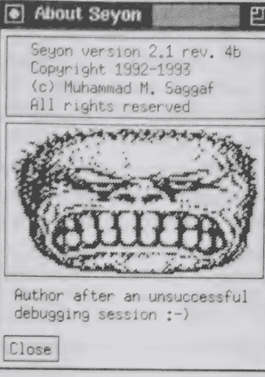

图 7.1 关于对话框。

如果你聪明，你会设置这个。

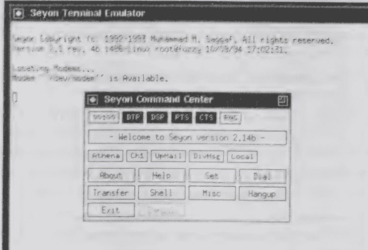

图 7.2 设置对话框。

## 7：Linux 与电讯

命令中心是你花费大部分时间的地方。下一行按钮有：

- Help 显示 `seyon` 的手册页。
- Set 打开一个包含对话框：

目的是防止会话因无操作而终止，因为大多数远程主机具有自动登出功能。

Baud 对话框（实际上误名；你设置的是每秒比特，而不是波特率）设置会话速度。遗憾的是，最快的会话速度是 38400 bps。通常情况下，你会设置高于实际的速度。当使用 14400 bps 调制解调器时，你会将速度设置为 19200 bps。
- Bits 指的是位。通常，这个设置应该是 7 或 8。
- Parity 奇偶校验可以是无、偶或奇。
- Stop bits 停止位可以是 1 或 2。
- Common 是单独设置位/奇偶校验/停止位的快捷；大多数远程主机要求 8-N-1 或 7-E-1 的设置。
- NewLine 允许将输出 UNIX 换行翻译为换行、回车或换行/回车组合。大多数基于 PC 的在线服务于换行/回车组合。
- Port 设置调制解调器端口。当然，如果你在启动 `seyon` 时没有指定它，你根本不到这一步。

- Strip 8 关闭第八位——适用于连接非 UNIX 系统。
- BS->DEL 将退格键转换为删除键。
- Meta->Esc 将 Meta 键转换为 Esc。
- XON/XOFF 指软件流控制。默认是禁用的，但某些远程主机需要它；因此需要此设置。
- CTS/RTS 是另一个流控制设置。同样，默认禁用，但某些远程主机需要启用它。
- AutoZmodem 告诉 `seyon` 在远程主机提示时自动启用 Zmod 文件传输。这是一种方便的设置。
- IdleGuard 在会话空闲时向远程主机发送一个字符串。

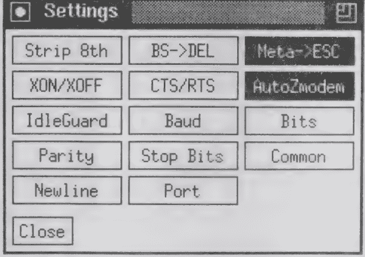

图 7.3 设置对话框。

Dial 按钮会弹出一个电话号码列表。当你第一次使用 `seyon` 时，你会看到一个包含一个电话号码的长列表。这是示例的 Seyon 拨号目录，它

## 第 7 章：Linux 与电信

你可能需要根据自己的使用习惯进行调整。这并不是一项困难的任务（在“拨号目录”对话框中选择“编辑”），你可以使用示例文件中的许多示例。图 7.4 显示了编辑后的拨号目录对话框。

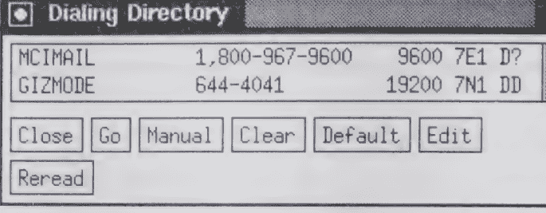

**图 7.4** 拨号目录对话框。

该对话框还允许使用当前的 `seyon` 系统设置手动输入电话号码。
传输对话框（如图 7.5 所示）允许你发送和接收文件。这些实际上是外部协议，尽管 Zmodem 的各种版本都是 `seyon` 默认安装的一部分。帮助文件描述了如何在 `seyon` 中安装其他协议。

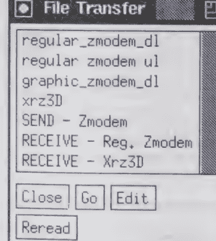

**图 7.5** 文件传输对话框。

Shell 对话框允许你从 `seyon` 内部运行 shell 命令。

杂项对话框包含一系列各种功能，包括文本捕获、文本编辑器和文件查看器。如图 7.6 所示。

| 杂项 | | |
| :--- | :--- |
| 中断 (Break) | 刷新 (Refresh) |
| 挂起 (Suspend) | 捕获 (Capture) |
|  (Divert) | 脚本 (Script) |
| 编辑 (Edit) | 查看 (View) |
| 关闭 (Close) | |

图 7.6 杂项对话框。

挂起按钮挂起当前连接。退出（Exit）按钮退出 `seyon`。最后，取消（Cancel）按钮取消当前操作。

对 Seyon 的概述将让你大致了解它的功能。但 Seyon 还有很多内容，例如，它有一系列命令行选项——多到这里无法全部涵盖。然而，如果你打算经常使用 Seyon，你应该查看它的脚本机制，这些机制类似于正式的编程语言（具有 if/then 语句等）。同样，通过命令中心调用帮助文件，你将获得 `seyon` 脚本机制的完整概述。

### 使用 Minicom 和 Xminicom

Seyon 是一个基于 X Window 的应用程序。然而，你可能不想在 X 内部完成所有操作，因此你可能想要一个基于字符的电信包。它以 Miquel van Smoorenburg 编写的 minicom 存在。（你也可以使用 `xminicom`，它在基础 `minicom` 包上放置了一个 X Window 前端。两者实际上工作原理相同。在这里，我们将介绍 `minicom`，但在运行 `xminicom` 时你可以使用相同的命令。）

Minicom 是一个全屏电信包。它的工作方式与其他基于 PC 的电信包类似，提供一个菜单（通过按下 `Ctrl-a z` 访问），如图 7.7 所示。顺便提一下，每个命令都可以通过 `Ctrl-a` 组合键访问。

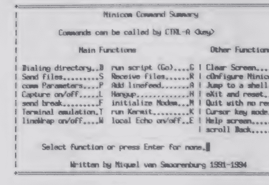

图 7.7 Minicom 命令摘要。

为了在 `minicom` 中快速上手，你可以从此命令摘要中按下 `d`。此时，你可以手动输入电话号码，或按回车键使用你的拨号目录。从此菜单中你还可以添加电话号码、编辑现有号码或删除不需要的条目。
要更改通信参数，输入 `Ctrl-a p`，这会带你进入带有通信参数的对话框，如图 7.8 所示。

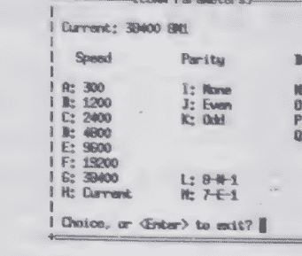

图 7.8 在 Minicom 中设置通信参数。

作为一个基于字符的 Linux 程序，它高度依赖。大多数这些组合键都可以从图 7.7 访问。然而，由于你可能不想经历每一个微小的操作，我们在表 7.1 中列出了关键组合键。

#### 表 7.1 Minicom 中的关键组合键

- `+` 馈送到每行开头。
- `x` 穿过终端窗口进入缓冲区。
- `s` 屏幕。
- `e` 拨号目录。
- `c` 开启和关闭；如果你在应该只看到一个字符时看到了两个字符，这很有用。
- `u` 当你应该看到某些字符时却没有看到任何字符。
- `a` 连接到远程主机。
- `p` 终端。
- `e` 调制调器。
- `s` 排序键模式。
- `h` 在让 Minicom 留在内存的同时运行 shell。
- `m` 会话。
- `r` 重新开启，并将当前会话保存到文件（`minicom.cap` 是默认值。你可以输入新文件名）。
- `e` 调制调器。
- `m` minicom（顺便提一下，当你以 root 身份登录时的任务）。
- `p` 参数，如 bps 速率、停止位和奇偶校验。
- `c` 在不重置调制调器的情况下进行 com。
- `l` 从远程主机：支持的协议有 Zmodem、Ymodel、
- `nd` kermit。
- 支持的协议为 Zmodem、Ymodel、Xmodem 和 kermit。
- `:` 在 VT100、Minix 和 ANSI 之间进行终端仿真。

Minicom 的一个很棒的功能是它的脚本能力。虽然脚本本身可以是 shell 脚本（文档解释了如何实现这一点），但 Minicom 允许你在 Minicom 中设置密码，防止在 Minicom 内未经授权使用脚本。尽管如此，还有其他已知的安全问题。大多数这些组合键都可以从图 7.7 访问。然而，由于你可能不想经历每一个微小的操作，我们在表 7.1 中列出了关键组合键。

（注：此处原文似乎存在文本重复或断裂，翻译已根据上下文进行了逻辑处理，以保持文档连贯性）

Minicom 的一个很棒的功能是它的脚本能力。虽然脚本本身可以是 shell 脚本（文档解释了如何实现这一点），`Minicom` 允许你在 `Minicom` 中设置密码，防止在 `Minicom` 内未经授权使用脚本。尽管如此，还有其他已知的安全问题。大多数这些组合键都可以从图 7.7 访问。然而，由于你可能不想经历每一个微小的操作，我们在表 7.1 中列出了关键组合键。

由于与其他发行版不同，我们在这里列出这些命令：

- `rz` 或 `lrz` 使用 Zmodem。
- `rb` 或 `lrb` 使用 Ymodel。
- `rx` 或 `lrx` 使用 Xmodem。
- `sz` 或 `lsz` 使用 Zmodem。
- `sb` 或 `lsb` 使用 Ymodel。
- `sx` 或 `lsx` 使用 Xmodem。

要获取这些命令的详细信息，请使用 `-h` 选项（此外，如图 7.9 所示）。例如，在命令行输入 `sb -h` 会得到以下内容：

```
gilbert:~ sb -h

使用 ZMODEM/YMODEM/XMODEM 发送文件

(Y) 适用于 YMODEM

(X) 适用于 XMODEM
```


用法：`lsz` `[-2abdefklnuwy]` - 文件

`lsz` `[-2Ceqv]` - 命令

`lsb` `[-2adfkquv]` - 文件

`lsz` `[-2akqu]` - ...


以及更多

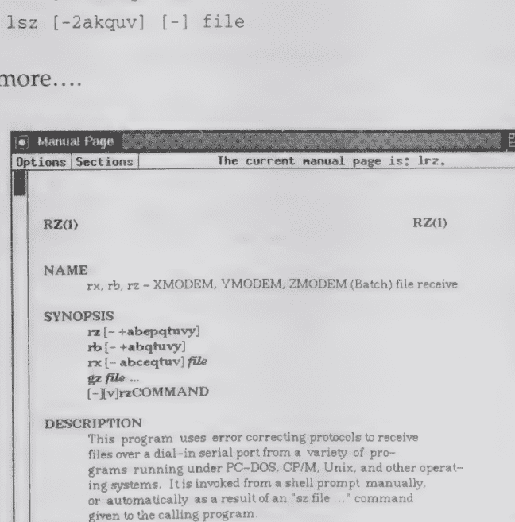

图 7.9 rz/lrz 的在线帮助页。

## 使用 Rzsz

如果你对这些串口电信工具都不感兴趣，你可以在互联网上浏览更广泛的资源以寻找更合适的工具。如果你在 Unix 系统上工作，你可能更想使用 `seyon` 代替。一直很受欢迎但使用和设置非常困难的是 `C-Kermit`（可以从 `kermit.columbia.edu` 的官方 FTP 站点 `/kermit/c-kermit` 目录获取。警告：你将需要使用 `makefile` 创建 Linux 版本）。

另一个选项是 `pcomm` 电信包。该包本质上是流行的 DOS/Windows Procomm 的 Linux 副本，具有拨号目录、交互式用法等功能。我们已将其包含在第二张光盘中，你也可以从 `ftp.cecer.army.mil` 的 FTP 站点 `pcomm` 目录中获取。

## 本章总结

本章涵盖了 Linux 操作系统下的串口通信，重点介绍了 `seyon`、`minicom`、`xminicom` 以及 `rzsz` 工具。

下一章将介绍网络与 Linux。


# Linux 网络

本章涵盖了：

- TCP/IP
- 系统管理与网络
- `fwhois` 命令

## 第 8 章：Linux 网络

### 网络与 Linux

Linux 操作系统的巨大魅力之一在于其内置的网络连接功能。你不需要尝试让像 DOS、Microsoft Windows 或 MacOS 那样的操作系统去处理网络，而是可以直接使用 Linux 工作，因为在 Linux 中，网络存在于操作系统的核心。

这是通过 TCP/IP（传输控制协议/网络协议）实现的，该已已成为 UNIX 世界网络通信的通用语言。由于基于 UNIX 的系统在形成互联网及其前身中起了至关重要的作用，TCP/IP 成了互联网上最主要的通信协议。TCP/IP 是 UNIX 计算机系统联网的主要工具，因为大多数 UNIX 实现都包含对 TCP/IP 的支持。其他操作系统（如 DOS 和 OS/2）也可以连接到 TCP/IP 网络，尽管这需要特殊的插件软件。

Linux 对 TCP/IP 提供了完全支持（前提是你 `own` 安装 Linux 时安装了它；如果没有，你将需要重新安装 Linux 或重新编译你的内核）。这种支持以 NET-3 协议族和程序的形式出现。在你的这边，通过 TCP/IP 连接到 UNIX 网络仅仅是确保你的 PC 通过以太网和电缆正确连接到网络即可。

> 涉及 Linux 网络的大部分工作最好在系统管理员（sysadm）层面执行。如果你是一个系统管理员，你应该在网络层面遵循你自己的配置规程；毕竟，Linux 的安装和配置方式与网络上的任何其他 PC 几乎一样。如果你不是系统管理员，我们建议你查看 Olaf Kirch 的《Linux 网络管理员指南》，你可以在附带的 CD-ROM 或在当地书店找到纸质版。

在第 1 章中，我们涵盖了以太网卡的设置。如果你需要更多关于设置以太网卡的信息，请查看配套程序 CD-ROM 中 `docs` 目录下的 `ETHERNET-HOWTO`。

Linux 还允许你通过电话线使用 SLIP 或 PPP 协议建立 TCP/IP 连接。如果你想通过拨号连接到互联网，你需要使用这些工具。（我们将在第 9 章中详细介绍这一点。）

## 第 8 章：Linux 网络

在你尝试使用这些任何工具之前，你应该对 TCP/IP 有一些背景了解。我们建议查看 Olaf Kirch 的《Linux 网络管理员指南》，该书已由多个来源出版（包括 Linux 文档项目和 SSC）。

此外，CD-ROM 在 `docs` 目录中包含了一份非常有用且详细的 TCP/IP 网络和 NET-3 指南，格式为 `NET-2-HOWTO`。

这些指南将构成你网络专业知识的基础。然而，我们将在这里对 TCP/IP 网络提供一个简短的概述。

### TCP/IP 基础知识

在在 TCP/IP 网络下，网络上的每台计算机都会被分配一个 IP 地址，包括你的电脑。如果你的 Linux 工作站永久连接到 TCP/IP 网络，那么此地址将保持不变。如果你正在通过服务提供商拨号连接到互联网，你的 IP 地址将在你登录服务时被动态分配。此地址由四个字段组成，例如 `255.255.0.0`。它被拆分为：

子域名.子域名.域名

你将在第二张附带的 CD-ROM 上找到关于 IP 地址、其结构以及你如何获取它们的详细信息。我们不会在 IP 地址的细微之处上花费大量时间；这是一个超出本书涵盖范围的复杂课题。

从你的这边来说，IP 地址对于连接到网络上的另一台计算机至关重要。（我们这里指的是整个网络，如果你连接到互联网，它可以包括世界其他地方。）然而，在许多情况下，你不需要知道特定的 IP 地址即可建立连接，这可能在你看到互联网地址列表（如附录 A 中的那些）没有列出任何 IP 地址时就发现的。为什么呢？因为在互联网发展的早期，人们决定允许域名服务器（DNS）来处理这些琐碎细节。你的 TCP/IP 网络（或你的服务提供商）在网络某处有一个命名的 DNS。当你输入像 `ftp.x.org` 这样的互联网地址或邮件地址时：

`fwhois` 命令还会列出你 Linux 系统上的用户，即使你没有连接到互联网。

### 设置 TCP/IP 信息

控制 TCP/IP 配置的文件存储在 `/etc` 目录。当你第一次设置 Linux 并被询问机器名和域名时，这些信息会被发送到 `/etc/hosts` 文件中。虽然当你连接到互联网时不需要动这个文件（它执行了许多与域名服务器相同的操作），但将关键服务器的名称放置在这个文件中是件好事。如果你没有连接到互联网但正在维护一个小型网络，这里就是存储你网络上工作站 IP 地址的地方。（再次，这可以通过本地系统上的 DNS 完成，但使用 `/etc/hosts` 文件要简单得多。）

另一个需要检查的文件是 `/etc/networks` 文件，它用于配置 TCP/IP 子系统中的不同网络。此文件在系统启动时被调用，如果你在互联网上工作，它的功能将由 DNS 服务器处理。再次，如果你没有连接到互联网但正在维护一个小型网络，使用 `/etc/hosts` 文件比通过本地系统上的 DNS 简单得多。

（原文 `/etc/hosts` 处似乎有断句，此处根据上下文翻译逻辑）

`fwhois` 命令还会列出你 Linux 系统上的用户，即使你没有连接到互联网。

# 第 9 章：Linux 与互联网 403

### 寻找连接互联网的窗口

如果你没有通过直接网络连接到互联网，你就需要做一些安排来连接。实现这一目标有两种方法。

一种方法是借用一台直接连接到互联网的机器。通过这种方式，你本质上可以使用该连接机器的特性。属于这一类的连接性工具包括 SLIRP，它运行在远程 UNIX shell 账户中，并使其得像一个 SLIP/CSLIB 账户。我们在 Ultrix 机器上编译了它，并用 DIP 进行了连接。它运行非常棒！它的源码在 CD-ROM 的 `/contrib` 目录下。

`program` 术语（在本书的第一版中介绍过）在较新版本的 Linux 中不再被支持。


# Linux 的 SLIP 和 PPP 工具

如果你没有通过工作或朋友获得互联网的永久 TCP/IP 连接，你可以使用 Linux 的 SLIP 和 PPP 工具通过某种互联网服务提供商连接互联网。SLIP（串行链路互联网协议）和 PPP（点点协议）允许你连接到任何 TCP/IP 机器。

要通过 SLIP 和 PPP 连接到互联网，你的 Linux 实现必须先支持这两种协议。如果你直接从 CD-ROM 安装，那么你的内核确实支持 SLIP 和 PPP；如果你在启动 Linux 时仔细观察屏幕，你会发现 SLIP 和 PPP 会列在其中。然而，如果由于某种原因你决定自己编译内核，那么你应该有远见，在编译时包含 SLIP 和 PPP 支持。（在 `make` 过程中，你会被询问是否需要对这些协议的支持。）如果没有，你需要返回并编译新内核，并特别注意 `makefile` 中的网络（Network）部分。

完成此操作，你将与服务提供商（如 Netcom, PSI, GNN, Microsoft Network 或 Minnesota Regional Network）设置账户，这将让你能够使用标准调制解调器访问互联网。

# 第 9 章：Linux 与互联网

当你通过服务提供商连接时，会在现场被分配一个 IP 地址；该过程产生一个动态分配的 IP 地址，你的 Linux 系统将使用它连接到互联网。

当你设置账户时，应该从服务提供商那里获得一份信息列表。在这些信息中，你需要了解以下内容：

- * 接入电话号码——如果你没有这个号码，就无法拨打服务提供商。
- 域名服务器（DNS）的 IP 码。当你想要连接到互联网上的另一台机器时，你的系统会查找这些服务器。没有这些服务器，你的 Linux 系统将在网络空间中迷失。
- 你的用户名
- 系统的登录机制。这比看起来要稍微棘手，因为似乎每个服务提供商处理拨号连接的方式略有不同。例如：我们的服务提供商使用标准的 UNIX 风格登录程序，输入用户名和密码后会跟着一个标准的 UNIX 提示符：

```


Welcome to the Twin Cities MRNet dial-IP Service.

User Access Verification

Username:

Password:

`lip-server>` `ppp`

```
在命令提示符处输入 `ppp` 后，服务器会与你的机器启动 PPP 协议。这在 ISP 世界中并不是标准做法；大多数 ISP 在你输入密码后立即启动该过程。

基本上，SLIP 和 PPP 做的是相同的事情。然而，SLIP（两种协议中较旧的）人气正在下降，因为 PPP（老实地说）更容易配置和使用。Linux 包含了 `dip` 命令，它负责处理到服务提供商的 SLIP 连接。

`dip` 命令代表 `dialup IP connections`，即你的 Linux 系统与其他某些系统之间的 TCP/IP 连接。该连接是通过串行（推测是电话线和调制解调器）建立的，而不是传统的以太网或其他 TCP/IP 连接。在串行链路之上，`dip` 实现了多种串行链路协议之一，包括 SLIP、CSLIP（压缩 SLIP）和 PPP。

因此，在没有直接硬接线网络链路的情况下，你可以通过电话线建立 IP（网络）链路。这对于连接到互联网服务提供商非常有用。工作原理是，两台计算机之间传输的所有数据都通过串行链路发送。在每一端，数据被转换为网络包并发送到相应的程序中。对于两端的大多数程序来说，这种链路与直接网络连接没有本质区别，只是串行链路通常比直接网络连接慢得多。

你可以使用 `dip` 用于入站和出站拨号链路。

当你用 `dip` 拨出时，可以配置一个聊天脚本（chat script）来建立到你远程系统的链路。聊天脚本包含此类信息，如要连接到哪个串口（主机）、为调制解调器设置什么速度、使用什么协议（例如 PPP、SLIP 等）等。

你也可以用 `dip` 管理入站连接。用户随后通过串行链路正常登录，但登录时启动的“shell”不是 `bash` 或 `csh`，而是 `diplogin`。

在这种情况下，你可以设置一个名为 `diplogin` 的程序作为 `/etc/passwd` 文件中为特定用户执行的“shell”。（通常，`diplogin` 是指向带有 `-i` 选项的 `dip` 的链接，将 `dip` 设置为输入模式。登录时，`dip` 在 `/etc/diphosts` 文件中查找用户名。该文件中的每个条目都非常像系统密码文件 `/etc/passwd`。对于每个用户，你可以设置一个额外的外部拨入密码来增加额外的安全级别——这在互联网荒野的氛围中是一个非常有用的功能。）

登录成功后，`dip` 在拨号线和你的 Linux 系统之间建立网络连接，并为登录的用户使用 `/etc/diphosts` 文件中指定的协议。

# 408 第 9 章：Linux 与网络

访问你自己的机器（我们假设你已经拥有访问权限），请编辑你的 `/etc/hosts.allow` 以添加以下行：

```
ALL: 127.0.0.1
```

如果你还没有这样做，你应该给你自己的机器起一个名字（我们在第 2 章中告诉过你如何更改它）。此信息可以在 `/etc/HOSTNAME` 中找到。

接下来，你需要告诉你的 Linux 系统从何哪里查找互联网上的数据。这涉及到将你的服务提供商名称以及一个 DNS 服务器添加到 `/etc/resolv.conf` 文件中，格式如下：

```
search mr.net
nameserver xxx.xxx.xxx.xxx
```

在例例中，我们告诉 Linux 在 mr.net 查找新闻和邮件等内容。在 `xxx.xxx.xxx.xxx` 处，你需要提供由你的 ISP（互联网服务提供商）提供的 DNS 地址。

你还可能想查看 `/etc/hosts`。它应该包含两行，看起来大致所示：

```
127.0.0.1 localhost
0.0.0.0 gilbert
```

如果 `127.0.0.1` 被用于你的机器名，请将其更改。在连接互联网时不应使用该地址，因为它可能与某些互联网服务发生冲突。

最后，你需要在 `/etc/ppp/pap-secrets` 文件中为 Linux 提供 ISP 提供的用户名和密码。此行看起来大致所示：

```
reichard * password
```

其中 `password` 是密码。
在建立连接之前还有最后一步：你需要创建一个 `/etc/ppp/chatscript` 来包含关于你 ISP 的信息，特别是电话号码。以下脚本适用于大多数调制调器：

```
TIMEOUT 5
' ATZ
OK ATDTxxx-xxxx
ABORT 'NO CARRIER'
ABORT BUSY
ABORT 'NO DIALTONE'
ABORT WAITING
TIMEOUT 45
CONNECT 'We are connected!'
```

```
TIMEOUT 5
"name: reichard@mr.net
"word: password
in> ppp
```

其中 `xxx-xxxx` 是你 ISP 的电话号码。最后三行是针对我们的 ISP 定制的，它会显示两个提示符（username: 和 password:）以及一个用于在主机计算机上启动 `ppp` 的命令行。你需要针对你特定的 ISP 进行修改。

一旦连接成功，你就应该可以使用这里介绍的任何互联网工具。

### 互联网工具

在你处理好与互联网的连接后，就可以利用 Linux 下提供的网络工具了。

我们将从讨论互联网邮件开始，然后讨论其他的网络利器。

### 使用电子邮箱

向个人、群体或公司内所有人发送电子消息的能力并不是 Linux 操作系统最显眼的功能之一，但它无疑是最常用的功能之一。其他网络系统，特别是来自 MS-DOS 世界的系统（如 Novell NetWare），缺乏基本的电子邮件（或 e-mail）功能，而其他具有内置电子邮件的操作系统则缺乏 Linux 中所具备的其他广泛功能。

从 UNIX 诞生之初，邮件程序一直是其重要组成部分。随着 UNIX 的演进，邮件也在演进——在某种程度上如此。实际的电子邮件机制与原始的邮件机制相似；更改主要涉及用户如何与邮件程序交互。这里描述的步骤在你的系统中可能看起来不完全相同，因为有许多基于 UNIX 和 X Window 的邮件程序，它们向用户展示信息的方式各不相同。

Linux 为你提供了几个读取和发送邮件的选项，从 `mailx` 命令开始，到像 `elm` 和 `pine` 这种随附 CD-ROM 提供的程序结束。

### 接收邮件

当你登录系统时，Linux 会通知你有入站邮件。你会看到类似这样的消息：

> You have mail.

除非你在此刻阅读邮件，否则此消息将定期出现，因为 shell 已自动设置为提醒你你有未读邮件。

要查看这些邮件，请输入：

```
gilbert:$ mail
```

你会看到类似图 9.1 所示的内容。
shell 返回你的邮件消息列表，按照它们被系统接收的顺序列出，最新的邮件在前。第一个字段列出消息的发送者，第二到第五字段表示接收消息的时间和日期，第六个字段记录消息的行数和消息的大小（字节），最后一个字段指示消息的主题。

按回车键读取列表上的第一条消息。如果是一条长消息，整条消息将滚动。如果你想停止滚动消息，输入 Ctrl-S；要重新开始，输入 Ctrl-Q。

```
gilbert#: mail
Mail version 5.5 6/90. Type? for help.
"/var/spool/mail/root": 
U 1 root Thu 15 02:23 132/432 "Register with the Lin"
U 2 volkerdi@mr.net Thu 15 02:53 66/278 "Welcome to Linux!"
U 3 root Thu 15 02:23 132/432 "Register with the Lin"
U 4 volkerdi@mr.net Thu 15 02:53 66/278 "Welcome to Linux!"
 L
```


图 9.1 入站邮件。

有两种类型的消息在等待我们：来自 `root` 的消息和来自其他人的消息。如果你连接了互联网并拥有自己的网络，你的电子邮件可能来自两个源：你自己的系统和其它系统。来自其他系统的邮件（在互联网或 Usenet 上发送）有其独特的地址址方案（在下一节中详细介绍）。来自你自己的系统的邮件使用第 1 章描述的相同登录名；这些名称包含在 `/etc/passwd` 文件中。

新的地址址方案，以及一种日益流行的方案（主要是因为互联网），被称为域名地址。域名地址的结构与“@”符号（bang）相反，它将用户名与地址结合。这种方案的产生源于电子邮件地址标准化的需求，并提供了一个层次结构。本质上，世界被分为国家域名，这些又分为教育域名（以地址中的后缀 `.edu` 为标识）和商业域名（以地址中的后缀 `.com` 为标识）。有成百上千的商业教育域名。

读取域名非常简单。在地址 `reichard@mr.net` 中，`reichard` 指的是用户，而 `mr.net` 指的是域名。用户名和域名由 `@` 符号隔开。作为用户，你不需要知道消息经过的具体路径，只需要知道接收者的地址。对于域名地址，发送邮件非常简单：

```
gilbert:$ mail reichard@mr.net
```

互联网的概念是模糊且抽象的。互联网本质上是许多相互通信的网络的集合。如果你连接了互联网，就可以向该系统中拥有账户的人发送邮件，只要你知道接收者的准确地址。

让我们看看来自 `root` 的第一条消息，所示图 9.2。

```
/PERSON
### 这是关于你的信息，这条消息的发送者
country:
# 你居住地的 ISO 3166 两位国家代码
mail:
### 你的电子邮件地址
subject:
# 如果你同意发布关于你的信息则为 YES
### 未给出，仅发布统计信息
name:
### 你的名字
started:
# 你开始使用 Linux 的月份和年份
usage:
# 你使用 Linux 的地方。家里、学校、工作或这些组合
// END
只有当你有在消息最后一行添加内容的邮件程序时，才需要 END 命令。
# 0
```

图 9.2 条入站电子邮件消息。

电子邮件的开头有一个头部。通过互联网，邮件在到达你之前可能会经过一个或多个系统。你无法指系统之间的直接链接，由于这些不可控的路径，消息到达接收者可能需要一些时间。

# 第 9 章：Linux 与互联网

```
$ q 1 message in inbox
Saved 1 message in /var/spool/mail/root
gilbert:/var/X18/lib# mail root
Subject: This is great!
From
gilbert:/var/X18/lib#
Mail version 5.5 6/1/90. Type 7 for help.
/var/spool/mail/root: 2 messages, 1 new
U root from Tue Sep 15 02:23:23 132/4321 "Register with the Lin"
N 2. root@gilbert,keinet Fri May 5 01:44:58 11/381 "This is great!"
& 2.
Message: 2:
From root@gilbert,kevinet Fri May 5 01:44:58 1995
Date: Fri, May 5 1995 01:44:57 -0500
From: root (root@gilbert,kevinet)
Subject: This is great!
This is great!
```

图 9.3 收到的邮件。

一如既往，通过输入 `Ctrl-D` 来结束键盘的输入。某些电子邮件程序也接受在单独的一行输入一个句号来结束消息，而不是使用 `Ctrl-D`。如果你要向远程机器上的用户发送消息，步骤也是相同的：

```
gilbert:$ mail richard@mr.net
```

你可以使用 `-t` 选项向多个用户发送同一条消息：

```
gilbert:$ mail -t johnsons@camax.com richard@mr.net
This, too, is a test.
```

生成的邮件在头部中将包含多个 `To:` 字段。
将现有文件作为电子邮件消息的正文发送几乎同样简单。在使用 `vi` 或 `emacs` 创建 ASCII 文件后，保存该文件，然后在命令行中将其重定向为输入：

```
gilbert:$ mail johnsons@camax.com < note
```

在阅读完消息后，shell 会向你显示一个不同的提示符，要求你与邮件程序相关的响应。在此时，你可以采取许多操作；最实用的选项列在表 9.1 中。

### 表 9.1 邮件命令选择

| 命令 | 结果 |
| --- | --- |
| Return (回车) | 打印下一条消息。<br>打印上一条消息。 |
| d | 删除当前消息。 |
| N | 删除消息 N。 |
| dp | 删除当前消息并进入下一条消息。 |
| dq | 删除当前消息并退出。 |
| u N | 取消消息 N。 |
| s filename | 将消息保存到文件名：如果没有指定文件名，消息将保存到 `$HOME/mbox` |
| w filename | 将不带头部信息的消息保存到文件名：如果未指定文件名<br>消息将保存到 `$HOME/mbox/` |
| t | 列出邮件命令。 |

### 保存消息

正如我们在表 9.1 中看到的，保存消息简单只需要输入：

```
? s filename
```

如果你收到的消息不多，那么将它们都处理到同一个文件中也没什么。但如果你在许多主题上收到了大量消息，那么为你的邮件习惯引入一些组织工作是一个好主意。

假设你正在与用户 `erc` 合作一个项目，并希望将他所有的邮件保存在同一个文件中。你可以在 `?` 提示符处使用 `s` 选项来实现：

```
? s erc
```

其中 `erc` 是包含他邮件的文件名。当你第一次这样做时，shell 会创建一个名为 `erc` 的文件。后续使用会将邮件消息追加到现有的 `erc` 文件中。

要读取此文件，使用带有 `-f` 选项的 `mail`：

```
gilbert:$ mail -f erc
```

不要误认为你的电子邮件是私密的。由于邮件消息通常以未加密的文本形式出现，任何具有超级用户权限（例如你的系统管理员）都可以阅读你的邮件。

很少有公司对电子邮件通信有隐私规定。在不确定时，假设你的老板可以阅读你的邮件。

## 其他邮件包

如你所见，`mail` 的界面极其原始。多年来出现了一批新的邮件程序，既有商业软件也有免费软件，每种程序都旨在为用户提供更方便的服务。其中一些包含在 Linux 中。

`Xmh` 是 `mh` 的 X Window 前，如图 9.4 所示。

`Pine` 是另一个流行的电子邮件程序，如图 9.5 所示。

最后是 `elm`，它是我们最喜欢的程序之一。`Elm` 代表电子邮件，它通过为标准邮件程序提供易于使用的界面来工作。

基础的 `elm` 界面如图 9.6 所示。

# 第 9 章：Linux 与互联网

在本地机器上——例如，一个标题（TITLE）标签将通过 Web 浏览器设置的字体和字号进行渲染。

HTML 语言还允许在文档中嵌入图形和超链接。大多数图形文件是 `GIF` 和 `XBM` 格式。超链接通过其自身的标签进行标记，通常在渲染后的文档中显示为不同的颜色。例如，在“其他资源”（Other Resources）标题下，可能会有一行蓝色的文字写着“Sun Microsystems 公司主页”（Sun Microsystems Home Page）。然而，对于 Web 浏览器来说，这里嵌入了一个 Web 地址（在这种情况下为 `www.sun.com`）。双击“Sun Microsystems 公司主页”将向 Web 服务器 `www.sun.com` 发起请求。你不需要知道 `www.sun.com` 的地址；你只需要知道如何使用鼠标即可。

你可以在 `xterm` 窗口中使用以下命令启动 Netscape：

```
gilbert:$ netscape &
```

当 Netscape 启动时，它会直接连接到 Netscape 通信主页（`home.netscape.com`）。顺便说一下，这是测试 Netscape 配置良好的良好方法；如果你或你的系统管理员误装了 Netscape，它将报告连接到 `home.netscape.com` 失败。）

你可能不想花太多时间在 Netscape 主页上闲逛。万维网的美之处在于，它允许你在不同的网站之间跳转，无论是与当前页面链接的页面，还是完全无关的页面。

万维网上的页面使用超文本标记语言（HyperText Markup Language）格式化。如果你以文本模式查看文档——包括 Netscape 在内的许多 Web 浏览器都支持这一点——你会发现文本中散布着许多“标签”，如 `<H2>`。这里没有提到字号、颜色或类似的内容。HTML 文件的开头如下：

```


# Netscape 手册：图形化元素

## Graphical elements

- Netscape 手册：目录
- Netscape 窗口
- 点按式导航
- 内容区域和文本字段
- 安全信息
- 窗口控制
- 工具栏按钮
- 目录按钮
- 新闻组列表按钮
- 新闻组文章按钮

## Netscape window

这个关于图形化元素的章节描述了你在 Netscape 窗口中看到的内容。帮助你导航互联网的大多数工具和文本字段都是可见的，尽管你可以选择隐藏某些工具，以便为内容区域留出更多屏幕空间。在描述点按式导航的页面上，你会找到每种图形化元素的描述：颜色、状态指示器、进度条、工具栏按钮、文本字段、窗口控制。随后的页面将更详细地介绍工具栏按钮、文本字段、窗口控制如何工作。

# 第 9 章：Linux 与互联网 425

正确。`uucp` 命令和 UUCP 工具可以对文件可以上传到何处或从何处下载执行特定的准则。

让我们来看一个典型的 `uucp` 命令行：

```
$ uucp chap9.txt spike!/usr/spool/uucp:public/chap9.txt
```

虽然这看起来是一条很长的命令行，但仔细观察会发现它其实很简单。

命令行中的 `uucp` 部分显然指的是 `uucp` 命令。紧随其后的是要复制的文件名 `chap9.txt`。

下一部分可能是对初学者最令人困惑的部分，因为它通过机器名称和目录表示了文件的目标位置。在这种情况下，`spike` 指的是机器的名字；`uucp` 命令知道这一点，因为机器名称以感叹号 `!` 结尾。

如果这个感叹号看起来很眼熟，你应该记得，Usenet 的电子邮件地址命名方法——感叹路径 `bang paths` 大量使用了感叹号。

感叹号后面紧跟着的是目标目录。`/usr/spool/uucp/public` 目录是 UUCP 站点常见的目的地。

请注意，本章中的所有机器名称都不是真实的。请勿在你自己的系统上使用这些特定示例。

通用地说，`uucp` 命令看起来像于：

```
gilbert:$ uucp sourcefile destinationfile
```

`uucp` 命令也可以用于从另一台机器获取文件，只要你拥有适当的权限。在这种情况下，你将修改本章较早处使用的 `uucp` 命令。其原理与列出源文件然后是目标位置的 `uucp` 命令相同。在这种情况下，远程文件是源文件，本地目录是：

```
gilbert:$ uucp spike!/usr/spool/uucp/public/chap9.txt /usr/spool/uucp/public
```

# 第 9 章：Linux 与互联网

使用 `uucp` 命令下载文件时，你只需要指定目标目录；该命令假设文件名保持不变，并且目标目录存在于你的本地机器上。

## Uucp 命令的潜在问题

正如许多沮丧的用户所证明的那样，`uucp` 命令以及整个 UUCP 命令集并非万无一失。最大的沮丧之处在于 `uucp` 命令不是交互式的，而且没有办法监控文件传输的状态。你可以告诉 `uucp` 在文件传输完成后通过电子邮件给你发送一份收据：

```
gilbert:$ uucp -m chap9.txt spike!/usr/spool/uucp/public/chap9.txt
```

然而，如果你没有收到电子邮件确认，可以假设传输已经失败。然而，找出原因并不是一件易事。

不过，由于 `uucp` 在传输过程中维护着一个 `logfile`，情况会变得简单一些。要访问此文件，请使用 `uolog` 命令：

```
$ uolog
```

这将提供大量的输出——对于你的故障排除目的来说，可能太多了。如果将 `uolog` 与机器名称结合使用效果可能更好：

```
$ uolog -sspike
```


是的，`-sspike` 是正确的。由于特殊性，**uolog** 的 `-s` 选项必须紧跟机器名称（在本例中为 `spike`）。

然后你需要阅读来自 **uolog** 的晦涩信息并尝试理解它。成功的文件传输将以 `REMOTE REQUESTED` 或 `OK` 结束。

## 可能会发生什么错误？

当 `uucp` 连接失败时，可能有许多潜在的罪魁祸首。`uulog` 命令可以帮助发现连接被远程系统拒绝（日志文件中会出现类似 `ACCESS DENIED` 的内容）。在这种情况下，远程机器要求的登录名称或密码可能已经更改；这是系统管理员需要处理的任务。

如果并非如此且日志文件中仍然出现 `ACCESS DENIED`，那么可能只是简单的命令行输入错误。如果你输入了错误的文件或目录，连接将成功，但传输将失败。同样，通过仔细阅读日志文件，你可以判断出来。

你的传输也可能是你自己急躁的受害者。并不是所有的 `uucp` 请求都是瞬时的；许多系统管理员选择队列请求，并在长途费率更便宜的小时进行传输。

## 自由软件与 FTP

Linux 还提供了 `ftp`，该命令允许你通过网络 TCP/IP 直接连接到另一台计算机。本质上，如果你有到互联网的 TCP/IP 连接，就可以使用 `ftp` 连接到网上的任何公共站点。在本节中，我们将引导你完成一次 FTP 会话。

## 使用 FTP

`ftp` 命令可连接到你网络上运行 `ftp` 的任何其他计算机。或者你可以使用 `ftp` 访问来自全球其他互联网计算机的文件。你网络中的机器可能运行也可能没有 UNIX 或 Linux 操作系统；这种操作系统的独立性使得 FTP 被如此广泛地使用。

# 第 9 章：Linux 与互联网

FTP 是交互式软件，这意味着它会在特定时间请求信息。使用以下命令启动它：

```
gilbert:$ ftp

ftp>
```

你将看到 `ftp` 提示符，可以在此处输入特殊命令。要获取命令列表，在提示符处输入问号：

```
ftp > ?
或
ftp> help
```

常用 FTP 命令见表 9.3。

## 表 9.3 常用 FTP 命令

| 命令 | 结果 |
|---|---|
| ascii | 使用 ASCII 作为传输类型。 |
| bell | 文件完成后响铃。 |
| binary | 使用二进制作为传输类型。 |
| bye 或 quit | 终止 ftp 会话。 |
| cd | 在远程机器上切换目录。 |
| close | 结束 ftp 连接但保持 ftp 程序运行。 |
| delete filename | 在远程机器上删除文件名。 |
| get filename | 从远程机器获取文件名。 |
| get filename filename2 | 从远程机器获取 filename 并本地保存为 filename2。 |
| help | 显示可用命令。 |
| mput filename | 将本地文件名复制到远程机器。 |
| pwd | 显示远程机器上的当前目录。 |

使用 `ftp` 从远程机器下载文件很简单。假设我们要从名为 `mn.kevin.com` 的机器获取一些文件。（不，这不是真实的机器。）假设这是一个支持匿名 FTP 的互联网机器（我们的虚拟机器支持），你只需在命令行中指定其名称：

```
gilbert:/$ ftp mn.kevin.com
```

如果连接通过，你将收到一条确认消息以及登录提示。由于是匿名的，请使用 `anonymous` 作为登录名：

Name: anonymous

然后你会被要求提供电子邮箱地址，而有些系统要求提供 `guest`。使用任一即可。你将看到 `ftp` 提示符。

远程系统被设置为给你有限的权限，这意味着你的操作空间非常有限，且你想要的文件通常就在手中。如果你需要切换到另一个目录，请使用 UNIX `cd` 命令。

在开始伟大的文件任务之前，你应该了解一下要下载的文件。如果它们是未压缩的 ASCII 格式的 C 文件，可以使用默认传输设置进行下载。大多数大文件，特别是二进制文件，以压缩格式存储，这样传输时间更短。

这些压缩文件以 `.Z`、`.z`、`.tgz`、`.zip` 或 `.gz` 结尾，因此很容易识别。下载压缩文件时，必须切换到二进制模式，因为你正在下载二进制文件。执行：

```
ftp> binary
```

一旦进入包含下载文件的正确目录，使用 `get` 命令开始下载过程：

```
ftp> get filename
```

当你下载文件时，系统会弹出一个提示，此时你将无法输入任何按键。

文件传输成功后，你将收到类似下面的消息：

```
Transfer complete
```

你可能还会看到文件的大小和传输时间。由于你已经完成了文件传输任务，请使用 `bye` 命令关闭连接：

```
ftp> bye
```

## 我该如何处理这个文件？

如果你下载的是一个 ASCII 文件，可以使用任何编辑器（包括 `vi` 或 `emacs`）来查看它。如果是源代码文件，你可以为自己的系统对其进行编译；我们将在第 10 章中解释这一过程。如果你下载了一个压缩的二进制文件，你将需要在命令行中使用中使用 `uncompress`、`unpack`、`tar` 或 `gzip` 对其进行解压缩（可能还需要解包）——这些你在第 4 章中学过的内容。

### 其他网络命令

除了用于在系统之间传输（复制）文件的 `ftp` 之外，还有许多常用的网络命令。这些命令有助于建立你的计算机与同一链路上其他计算机之间的连接。通常，如果你在一个拥有多个 UNIX 计算机的站点工作，这些计算机将通过网络连接，通常使用以太网网络协议。你的系统可能还与全球互联网相连，正如你所知，互联网是连接性网络的集合。（尝试快速读三遍。）

## 使用 rlogin 命令

`rlogin` 命令允许你远程登录到网络上的另一台计算机（记住，如果你在互联网上，你就正处于一个全球性网络中）。当然，你必须在你想要登录的任何机器上拥有一个有效的用户账户。要使用 **login**，你需要知道要登录的机器名称。要登录到一台名为 `nicollet` 的机器，你可以使用类似下面的命令行：

```
gilbert:/ login nicollet

Password:
```

在 `Password` 提示符处，你可能需要在 `nicollet` 机器上输入密码，该密码与你在本地机器上使用的密码相同，也可能不同。一旦登录，你就在远程机器上进行计算，并可以运行任何标准的 UNIX 命令。你也可以像平时一样注注销：

```
gilbert:/$ logout

Connection closed.

$
```

注意，从远程机器注销后，你将返回到本地机器的命令提示符。这往往容易引起混淆，所以请小心。

`login` 的基本形式是：

```
login hostname
```

其中 `hostname` 是要登录的机器名称。

## 使用 Telnet 命令

`telnet` 命令的工作原理与 `login` 非常相似，允许你直接连接到远程机器。由于 `telnet` 命令被认为是互联网冲浪者使用的工具包的一部分，它在多年来实际上变得越来越流行。

Telnet 允许你直接在远程机器上运行命令并在自己的屏幕上显示结果，或者在远程机器上运行特定的命令（出于安全考虑，许多站点对用户可以运行的内容设置有 Telnet 限制）。使用 `telnet`，你只需要知道要连接的机器的地址，例如 `sunsite.unc.edu`，如下所示：

```
gilbert:$ telnet

telnet> open sunisite.unc.edu

Trying 198.86.40.81

Connected
```

*********** 欢迎来到 SunSite.unc.edu ************
SunSite 通过登录提供多项公共服务。这些包括：

- 不再有公共 gopher 登录了！
- 使用 lynx WWW 客户端访问 gopher 和 Web 区域
- 使用一个简单的 WAIS 客户端（包含 500 多个数据库），登录账号 swais
- 政治数据库的 WAIS 搜索，登录账号 politics
- LINUX 数据库的 WAIS 搜索，登录账号 linux
- 如需 FTP 会话，ftp 到 sunisite.unc.edu。然后以匿名身份登录
- 有关关于 SunSite 的更多信息，请发送邮件至 info@sunisite.unc.edu

```
UNIX (R) System V Release 4.0 (calypso-2.oit.unc.edu)

login: swais
```


在这种情况下，`sunisite.unc.edu` 为普通计算用户提供各种服务，并以 WAIS 数据库为中心。其他 Telnet 站点可能不提供如此广泛的服务；像 `archie.rutgers.edu` 这样的站点仅提供 `archie` 搜索。

遗憾的是，Linux 尚未提供 `archie`，因此你需要使用公共 `archie` 服务器来执行搜索。

`SunSite.unc.edu` 是一个公共互联网站点。如果你在公司内部使用 `telnet`，规则将略有不同。在这里，`sunisite.unc.edu` 提供公共访问；你不需要 `sunisite.unc.edu` 的账户，也不需要密码。然而，`sunisite.unc.edu` 对访问者可以执行的操作进行了限制；例如，你不能使用标准的 Linux 命令集，你的选项仅限于登录选择。对于私有系统，你需要在登录之前在远程系统上拥有账户，并且可能受到相同类型的限制。

# Usenet 和新闻组（Newsgroups）

互联网的根源可以追溯到 Usenet，这是一个全球消息系统。Usenet 在技术上虽然是互联网的一部分，但它主要以电子邮件和新闻组分发而闻名。

成千上万的计算机在全球范围内连接在我们称之为 Usenet 的松散网络中，由于 Usenet 是一个由相互连接的 UNIX 和非 UNIX 机器组成的公共网络，专门向公司、学校、大学、政府、研究实验室和个人发送信息。这些连接中的一些是通过电话线实现的，并使用 `uucp` 命令往来发送消息，但现在大多数连接通过互联网进行，使用 NNTP（即网络新闻传输协议）在机器之间发送消息。无论消息是如何传递的，你都可以以相同的方式阅读它们。

Usenet 执行各种服务，但也许最受欢迎的服务涉及新闻组。新闻组是对各种话题的讨论，范围从计算到社会学，再到回力镖和恐龙巴（巴尼）。事实上，有成千上万个 Usenet 新闻组。有些是琐碎且浪费带宽的，另一些只对一小部分用户感兴趣，还有一些会引起大量用户的兴趣。（看一眼 `alt.sex.bestiality.barney`，你就会发现这一点的合理性。）

这些新闻组被分为不同的类别，以便用户在每天接收的海量信息中更好地确定要读的内容。表 9.4 涵盖了主要的新闻组分类。

## 表 9.4 主要 Usenet 新闻组分类

| 名称 | 主题 |
| :--- | :--- |
| alt | 替代层，不受规则限制 |
| biz | 业务相关组 |
| comp | 计算 |
| misc | 杂项 |
| news | 关于 Usenet 的新闻 |
| rec | 娱乐活动 |
| sci | 科学 |
| soc | 社会问题 |
| talk | 讨论 |

## 434 第 9 章：Linux 与互联网

不仅这里是计算机发烧友的天堂，Usenet 还提供了从素食食谱到买房的价值信息。几乎你可以想象的每个主题都有 Usenet 新闻组，从 `rec.sport.football.college` 到 `soc.culture.bulgaria`（我们第一次看到 `fat.` 时确实很惊讶）。此外，还有区域性新闻组；我们在明尼苏达州的可以访问许多以 `mn` 开头的新闻组，例如 `mn.forsale`。

虽然 Usenet 是一个强大的信息源

然而，有很多 Usenet 新闻组对你有帮助。作为技术人员，我们经常浏览与 UNIX、X Window 系统以及相关主题相关的组（如 Elm 和 Pine 等电子邮件软件包）。附件 A 列出了 Linux 相关的新闻组。

这些分类被细分为特定的新闻组。新闻组名称的语法非常简单：分类名称加上一个描述性的后缀。例如，致力于有关 UNIX 操作系统的问题的新闻组名称是 `comp.unix.questions`。注意使用点分隔元素。一些常用新闻组的列表位于表 9.5 中。

## 表 9.5 经常访问的 Usenet 新闻组示例

| 新闻组 | 主题 |
| :--- | :--- |
| `comp.databases` | 数据库管理问题 |
| `comp.lang.c` | C 语言问题 |
| `comp.text` | 文本处理问题 |
| `comp.unix.questions` | 关于 UNIX 操作系统的问题 |
| `misc.jobs.offered` | 招聘机会 |
| `sci.space.sh` | 与 NASA 航天飞机相关的空间探索问题 |

## 第 9 章：Linux 与互联网 435

附录 A 中包含 Linux 特定的新闻组列表。


新闻组可以是开放的（open），也可以是审核制的（moderated）。开放新闻组意味着任何人都可以向其发布内容，而审核制新闻组在将内容发布给公众之前，会有人对帖子进行审查。正如你可能推理的那样，审核制新闻组通常更可靠、更有用。

Usenet 新闻组具有激进的平等主义。几乎任何人都可以发布新闻。将其作为信息源需要你对此保持某种怀疑态度。一方面，它是寻找非常有技术性、专业信息的绝佳场所——技术性越强、专业化越好。计算机行业的许多领军人物经常在新闻组中发布信息。而且由于世上没有无所不能的事，你困扰你的问题很可能已经被 Linux 内核的某位开发者解决了。

另一方面，并非所有意见都同等价值，在大多数新闻组中可以发现许多缺乏根据的意见。老手们会提到“信噪比”（signal-to-noise ratio）；充满缺乏根据的意见和争吵的新闻组被称为充满了“噪声”。与其他任何信息源一样，对你在 Usenet 新闻组上看到的内容保持健康的怀疑态度。

### 阅读和编写新闻

尽管所有新闻项都是文本文件，从理论上可以用 `vi` 或 `emacs` 读取，但由于有这么多文件分散在这么多独立文件中，要读取每个文件实际上是不可行的。一个完整的 Usenet 新闻源（即来自全球所有新闻组的所有传入消息文件）每天都会向你的磁盘增加超过 50 兆字节的文件。（还记得我们之前说过 UNIX 文件似乎会按比例传播吗？很好，例子就在这里。）这就是被称为“新闻阅读器”（newsreaders）的软件演变出的，它们帮助你从每天出现的数百个新文件中，根据不同程度的用途筛选出需要阅读的内容。其基本思想是阅读你感兴趣的消息并跳过其余部分。即使你整天坐在电脑前，也根本没办法阅读每一条入站消息。

我们不会深入介绍许多新闻阅读器；Linux 提供了几个，鼓励你去查看它们。你使用哪一个在某种程度上取决于你获取新闻的方式。如果你在公司网络上，你将从本地服务器访问新闻。如果你通过 ISP 连接到互联网，你将使用 NNTP 协议从你的 ISP 新闻服务器获取新闻。当你运行第 2 章中的 `setup` 时，曾被问过这个问题；如果你安装了错误类型的新闻阅读器，可以随时返回 `setup` 并安装一个你喜的。Linux 新闻阅读器包括：

- `trn`，一个具有扩展搜索功能的新闻阅读器（如图 9.7 所示）

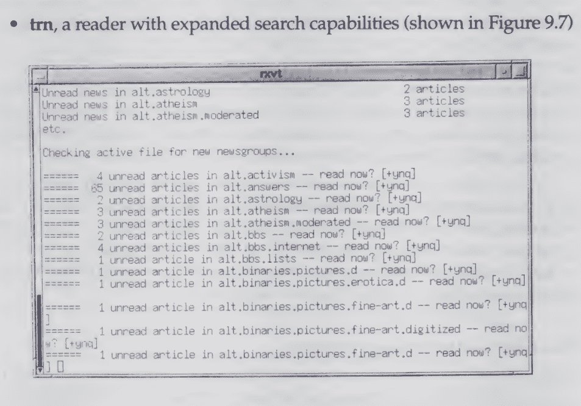

- `inn`，一个基础阅读器
- `tin`，一个按主题排列消息的线程阅读器（如图 9.8 所示）

| u | v | 组选择 (255) | h=帮助 |
|---|---|---|---|
| 1 | | logic | |
| 2 | alt | | |
| 3 | alt,activism | 参与者的活动 |
| 4 | alt,answers | 周期性存储 |
| 5 | alt,astrology | 闪烁，闪烁，点亮 |
| 6 | alt,atlas | 无神论讨论 |
| 7 | alt,atheism,moderated | 无神论及相关 |
| 8 | alt.btc | BBS 系统 |
| 9 | alt,bbs.internet | BBS 系统访问 |
| 10 | alt.bbs.lists | 区域性发布 |
| 11 | alt.bbs.unijobs | BBS 讨论 |
| 12 | alt.binaries | |
| 13 | alt.binaries.pictures | 关于发布的讨论 |
| 14 | alt-binaries.pictures.d | 用于发布所有 |
| 15 | alt.binaries.pictures.erotica | 关于情感的讨论 |
| 16 | alt.binaries.pictures.erotica.c | |

```
<set current n, TAB+unread, search pattern, c)catchup,

goto, jline, k=line up, help, a)quit, toggle all/unread,

subscribe, U Sub pattern, nsubscribe, Unsub pattern, y/ank inout
```


## 吞取新闻

随着互联网的普及，越来越多的 Usenet 新闻通过互联网传输，而不是通过旧的 `uucp` 电话方法。

在互联网上，Usenet 新闻通过 `NNTP` 从一台机器跳转到另一台。如果你使用 `NNTP` 获取新闻，可以使用 Netscape Navigator 浏览器查看新闻。

此外，一个名为 Slurp 的程序可以通过 `NNTP` 获取新闻。这对于将 Usenet 新闻组下载到你的 Linux 系统非常有用。然后你可以使用 `xrn`、`nn` 或 `trn` 等新闻阅读程序离线阅读消息。我们在第二个光盘中包含了 Slurp。

## 如何找到下载文件？

如果你在 Usenet 上，你会被关于免费软件以及如何获取它的信息包围。技巧在于知道去哪里寻找。

一些大学和公司维护着支持匿名 `FTP` 的存档站点。这些位置在新闻组 `comp.answers` 中经常被提及。

此外，许多与计算机相关的新闻组包含标记为 FAQ（常见问题解答）的新闻项。其中一个常见问题（无疑）会涉及存档站点的存在。

最后，你可以在新闻组中发布一个哀求的请求，询问有关某个特定程序的信息。你可能会收到一些厌倦了回答初学者提问的人的粗鲁评论，但无疑会有某些心肠的人用有用的信息回答你的请求。

## 总结

本章介绍了 Linux 用于 TCP/IP 特性连接到其他计算机系统和互联网的许多工具。这些包括到现有网络的 TCP/IP 连接，以及使用 Linux 的 `SLIP` 和 `PPP` 工具进行拨号接入。

一旦连接，Linux 提供了许多用于网络接入访问和使用的命令，包括 `ftp`（允许你从远程站点传输软件）、`login` 和 `telnet`。你还可以通过几个新闻阅读器阅览 Usenet 新闻组。此外，Linux 还提供了多种邮件选项，包括 `mail` 命令以及 `xmh`、`pine` 和 `elm` 新闻阅读器（注：此处原文可能误指为邮件阅读器）。我们在第二个光盘中包含了几个免费 Web 浏览器。

Usenet 是一系列新闻组。Linux 具有几个新闻阅读程序。

在下一章（也是最后一章）中，我们将介绍编程和 Linux。

# 第四部分 Linux 编程

本书以第 10 章结束，概述了 Linux 编程。在书中你会找到 Linux 编程工具（包括 GNU C 编译器）及其 X Window 编程工具的解释。

## Linux 下编程

本章涵盖了：

* `GNU C` 编译器
* `C` 语言编程
* `cc` 命令
* 使用 `make`
* `X Window` 下编程
* 使用 `if` 模拟 Motif
* 使用共享库
* 使用 `imake`
* 使用 `T/Tk`
* `Perl` 简介
* 使用 GNU 项目的 `gawk`

# 第 10 章：Linux 编程

## Linux 下编程

Linux 上主要的 C 和 C++ 编译器是 GNU `gcc`。它是一个全能程序，可以编译多种编程语言：`C`、`C++`、`Fortran` 和 `Objective-C`。`cc` 链接到 `gcc`，它能以你预期的方式编译 C 和 C++ 程序。其命令行参数包含了所有标准 `cc` 参数以及传统的 `gcc` 参数。如果你习惯了在 UNIX 上编程，你会发现 Linux 的工作正如你预期的那样。

对于初次接触 C 语言的学者，我们将提供一个简短的介绍。如果你是这个领域完全的新手，你可能想找一本 C 语言书籍来帮助自己。附录 A 列出了几本书。

### C 语言

C 程序——事实上，大多数程序——通常从普通的纯文本文件开始（正如你在整本书中所看到的，Linux 广泛地使用简单的文本文件）。这些文本文件是使用 `vi` 或 `emacs` 等文本编辑器创建的。一旦创建，C 程序就必须使用 C 编译器或 `gcc`（在 Linux 上它们是等同的）进行编译。该编译器将程序员编写的文本文件转换为适用于 Intel 平台的对象文件或机器代码。然后，将对象模块（对象代码文件）链接在一起，生成一个可执行程序，这就是一个全新的 Linux 命令。一旦过程成功完成，你就可以像执行在命令行输入的任何其他命令一样执行这个程序。能够创建自己的命令是一件很酷的事。

除了创建 C 或 C++ 程序外，你还可以使用脚本或用多种解释型语言（包括 `Perl` 和 `Tcl`）编写代码，我们将在本章后面介绍这些内容。在众多的 Linux 程序创建工具中，你需要为任何特定任务选择合适的工具。

第一步是识别你正在处理什么类型的文件。表 10.1 列出了最常见的 Linux 文件类型及其常见的文件扩展名。

大多数 C 程序存储在一个或多个以 `.c` 结尾的文件中，例如 `neatstuff.c` 和 `myprog.c`。当你编译一个 C 文件时，C 编译器会创建一个通常以 `.o` 结尾的对象文件。链接器（在 Linux 术语中称为链接编辑器）`ld` 然后将 `.o` 文件链接起来，生成一个可执行程序。该程序的默认名称为 `a.out`，尽管没有人真的用 `a.out` 作为程序的名称。相反，程序有像 `ls`、`cp` 或 `mv` 这样的名称。所有这一切都由 `cc` 命令控制。

### 表 10.1 程序文件类型

| 文件后缀名 | 含义 |
|---|---|
| `.a` | 库文件 |
| `.c` | C 程序 |
| `.C` | C++ 文件（注意大写的 C） |
| `.cc` | C++ 文件 |
| `.cpp` | C++ 文件 |
| `.cxx` | C++ 文件 |
| `.c++` | C++ 文件 |
| `.f` | Fortran 程序 |
| `.for` | Fortran 程序 |
| `.h` | C 或 C++ 头文件 |
| `.hxx` | C++ 头文件 |
| `.o` | 对象模块（从 `.c` 文件编译而来） |
| `.pl` | Perl 脚本 |
| `.pm` | Perl 模块脚本 |
| `.s` | 汇编代码 |
| `.sa` | 与你的程序链接的共享库存根 |
| `.so.n` | 运行时共享库，版本号为 n |
| `.tcl` | Tcl 脚本 |
| `.tk` | Tcl 脚本 |

### cc 命令

`cc` 命令执行 C 编译器，该编译器可以将 C 程序编译并链接成可执行命令。为了测试你的 Linux C 编译器，我们将使用以下这段简短程序：

```c
/*
* 第 10 章的示例 C 程序，
* Linux 配置与安装。
*/
```

```c
#include <stdio.h>
int main(int argc, char** argv)
{
    /* 这是一个注释。 */
    printf("Linux is my favorite O.S.\n");
    return 0;
}
/* chap10.c */
```

使用你最喜欢的 Linux 文本编辑器将上述代码存入名为 `chap10.c` 的文本文件。

始终用 `.c` 扩展名命名 C 程序文件是一个好主意。这并不是强制要求的，但遵循此类惯会让 Linux 变得更容易使用。

在你输入这段简短程序后，可以执行以下简单步骤从此 C 文件创建一个可运行的可执行程序。

你输入的程序仅仅是一个文本文件。它内部没有任何可以使其变成可执行命令的内容。要做到这一点，我们需要编译并链接程序。这两个步骤都通过以下 `cc` 命令完成：

```bash
$ cc -o chap10.c
```

该命令运行了编译器 `cc`。`-o` 选项告诉 `cc` 构建一个名为 `chap10` 的程序（不使用 `-o` 选项的默认名称是笨拙的 `a.out`）。命令中的 `chap10.c` 部分告诉 `cc` 编译名为 `chap10.c` 的文件。`cc` 同时编译并链接了程序。

你现在应该有了一个名为 `chap10` 的可执行程序。你可以通过在命令行输入 `chap10` 来执行该程序。当你这样做时，你会看到以下输出：

```bash
$ chap10
Linux is my favorite O.S.
```


现在你是一个真正的 C 语言程序员了，准备好开启一份丰厚的新职业。

## 漫长的编译方法

当我们使用 `cc` 命令时，`cc` 首先将程序编译成对象模块。然后 `cc` 链接对象模块以创建可执行程序，即名为 `chap10` 的文件。如果你需要将多个文件编译到你的程序中，那么这非常重要。大多数 C 程序需要多个 `.c` 文件，所有文件都必须经过编译和链接。

当我们使用 `cc` 命令时，`cc` 首先将程序编译成对象模块。然后 `cc` 链接对象模块以创建可执行程序，即名为 `chap10` 的文件。如果你需要将多个文件编译到你的程序中，这非常重要。大多数 C 程序需要多个 `.c` 文件，所有文件都必须经过编译和链接。

## 与 Cc 一工作

在正常操作中，`cc` 命令在后台执行了许多其他命令。其中一个命令是 `cpp`。`cpp` 命令是 C 预处理器。它读取 C 文件并展开任何 `#` 指令。在你之前的简短程序中，`#include` 指令意味着包含 `stdio.h`。也就是说，`cpp` 读取 `stdio.h` 并将其内容插入到 `#include` 指令处。大多数 C 程序使用一个或多个文件。这些文件通常存储在 `/usr/include` 中。如果你在包含文件名周围使用角括号（`<` 和 `>`），例如 `<stdio.h>`，这意味着 `cpp` 在标准位置查找名为 `stdio.h` 的文件，`/usr/include` 是默认位置（`-I` 命令行参数可以添加更多目录；参见表 10.2）。你也可以使用引号（`"`）包裹文件名。

所有的 C 程序都围绕 `main` 部分 构建。`main()` 部分（在 C 中称为函数）在程序启动时执行。我们的 `main()` 函数只需调用 `printf()` 函数，将引号之间的文本打印到屏幕上。如你所见，这不是复杂的程序。

传递给 `printf()` 的 `\n` 意味着打印一个换行符。这开始了一个新行。如果你习惯 DOS 机器，你会注意到 UNIX 使用换行符，而 DOS 使用回车符然后换行。反斜杠 `\` 在 C 程序中被用作特殊字符。通常，反斜杠与其他字符结合形成非打印字符，例如 `\n` 用于换行、` \t` 用于制表符或 `\a` 用于响铃。

## 使用 cc 命令

`cc` 命令使用多个命令行参数来告诉它做什么，并允许你微调从 C 语言文本文件构建可执行程序的过程。表 10.2 列出了常用的 `cc` 命令行参数。

# 448 第 10 章：在 Linux 下编程

| 表 10.2 命令行参数 |
| 参数 | 含义 |
| --- | --- |
| `-LIdirectory` | 在指定的目录和 `/usr/include` 中搜索包含文件 |
| `-c filename.c` | 编译文件 `filename.c` 并生成对象模块 `filename.o`；这不会创建可执行命令 |
| `-o progname` | 将可执行文件命名为 `progname`；默认名称为 `a.out` |
| `-g` | 带有调试信息进行编译 |
| `-O` | 对程序进行优化以获得最佳性能 |
| `-Llibrary` | 链接指定的库 |

大多数 UNIX 编译器都不允许混合使用 `g`（包含调试信息）和 `O`（优化）选项，但 Linux 使用的 GNU C 编译器允许这样做。
有许多 `cc` 命令行选项；请使用 `man cc` 查看它们。

# 与库链接

对于 C 语言程序，库是常用例程的集合，你可以在程序中重用它们。大多数 C 程序需要的不仅仅是标准 C 库。如果你查看 `/usr/lib`，将看到 Linux 支持的大多数库。表 10.3 列出了 Linux 库的主要位置。

| 表 10.3 Linux 库的位置 |
| 目录 | 库 |
| --- | --- |
| `/usr/lib` | 主系统库 |
| `/usr/openwin/lib` | Open Look 库，如 Xview 库 |
| `/usr/X11/lib` | 大多数 X Window 库 |

要链接指定的库，你对 `cc` 使用 `-L` 命令行选项。要链接 X11 库，使用 `-lX11`；这是链接名为 `libX11.a`（或其共享库等效文件 `libX11.so`）库的简写。

# ELF 文件

此版本的 Linux 使用一种新的对象模块格式 `ELF`，Executable and Linking Format（可执行和链接格式）的缩写。使用 `ELF` 编译的程序与旧的 `a.out` 格式编译的程序不同。`ELF` 为共享库提供了更好的支持，这是此类迁移的主要原因。当你同时运行多个程序（特别是多个 X Window 程序）时，共享库可以节省内存使用（物理和虚拟内存）。

通常情况下，你不需要关注 `ELF` 或 `a.out` 问题，除非有一点：`a.out` 库与 `ELF` 库不兼容。对于共享库来说，这是特殊情况！如此！

因此，你对获取的任何 Linux 程序都要小心。如果你从源代码编译所有内容，那么就是好的，因为 Linux 将使用你系统上已有的库。

但如果你获取的是预编译二进制格式的应用程序（例如 Netscape Navigator 或 NCSA Mosaic），你必须确保你拥有应用程序预期的正确共享库，否则程序将无法运行。

要查看你的链接器 `ld` 为什么系统配置的，请尝试以下命令：

```
ld -v
```

你应该会看到如下的输出：

```
ld version cygnus-2.6 (with BFD 2.6.0.14)

Supported emulations:

ni386linux

i386coff

m68kelf

m68klinux

sun4

elf32_sparc
```

# 450 第 10 章：在 Linux 下编程


`sparc`、`sun4` 和 `m68k` (Motorola 68000) 用于交叉编译。你可能不会使用这些选项。

默认情况下，`gcc` 将编译为 `ELF` 格式。要验证此点，请对任何可执行文件使用 `file` 命令，例如我们之前创建的 `chap10` 文件：

```
file chap10
```

你应该会看到如下的输出：

```
chap10: ELF 32-bit LSB executable i386 (386 and up) Version 1
```

这表明 Linux 上的默认对象文件格式现在是 `ELF`，正如预期那样。


遗憾的是，`a.out` 术语在不同的上下文中有不同的含义。当你用 `gcc` 编译 C 程序时，默认输出文件名仍为 `a.out`。尽管如此，这个 `a.out` 文件将以 `ELF` 对象文件格式出现，而不是旧的对象文件格式 `a.out` 格式。这是 Linux 另一个令人困惑的部分。

如果由于某些原因，你需要强制 `gcc` 以 `a.out` 格式编译，可以使用以下命令代替 `gcc`：

```
gcc -b i486-linuxout -c foo.c -o foo
```


此命令需要 `a.out` 库。如果你没有加载它们，此命令将失败。

# Linux 共享库

Linux 支持一个名为共享库的极佳概念。因为许多 Linux 程序链接了非常大的库，特别是 X Window 库，程序体积往往会增长。当你运行这些程序时，它们会占用更多内存（物理和虚拟）。为了帮助缓解这个问题，Linux 支持共享库，类似于 Windows 的 DLL（动态链接库）。其全部目的是让许多程序可以引用加载到内存中的单份库副本。对于 X Window 程序，这节省了大量的 RAM。

Linux 共享库的问题是它们与其版本号结合得非常紧。如果你升级了 Linux 版本，许多旧应用程序可能需要旧版本的库。

# 使用 Motif

每个人都想用 Motif 库，直到发现它们是 Linux 的额外成本。遗憾的是，Motif 库是商业软件，这意味着你必须支付额外费用获取 Motif 库的源码或适用于平台的二进制文件。除了这些麻烦，Motif 许可证对软件开发者来说非常挫败，几乎无法证明你分发了应用程序，这让你很崩溃。

然而，我们遇到了一个名为 LessTif 的伟大编程项目，它每天都在获得更多的 Motif 功能。虽然它还没有完成，但我们认为你可能想看看，所以我们把它包含在第二张光盘的 `programming/lesstif` 中。

LessTif 是 Motif 库的替代品。也就是说，它是一组看起来和用类似于 Motif 库的编程库（`Qm` 和 `Mrm`）。在底层，代码是完全不同的。从程序员的角度来看，LessTif 与 Motif 库具有相同的 API，并支持许多 Motif 控件，随着每次发布支持更多 Motif 控件。它使用了与其 Motif 副本同名的公共头文件。

对于你的程序，LessTif 应该允许你的 Motif 程序在不更改源代码的情况下在 LessTif 下重新编译——至少在理论上是。为了解决 LessTif 在我们编写时还不完整的问题，我们不得不做一些更改。幸运的是，由于 LessTif

# 第 10 章：在 Linux 中进行编程

由于正处于不断发展之中，我们今天面临的问题应该逐渐消失。LessTif 根据 GNU 许可证发布，你可以在免费中使用 LessTif。在将 LessTif 用于商业软件之前，你可能想要检查一下 GNU 许可证。

## 安装 LessTif

LessTif 以源码形式提供。你只需要做的就是运行 `xmkmf` 然后按照标准方式运行 `make` 来构建 X 程序：

```
xmkmf

make
```


如果你遇到任何问题，发行版中有一个名为 `INSTALL` 的文件。

## LessTif的问题

LessTif 的开发者明确地告诉你，LessTif 绝不是一个完整的 Motif 克隆。在 LessTif 开发的早期阶段，这是很自然的。尽管如此，LessTif 中有很多特性会吸引 Motif 程序员。

作为一种不完整的免费软件，LessTif 并非没有问题，正如你预期的那样。但每个版本都变得越来越好。

## Editres 支持

Editres 是一个 X 应用程序和协议，允许使用 X Toolkit `Xt` 内部库编译的程序将小部件属性信息导出到外部程序（即 editres 本身）。

通过 editres，例如，你可以更改任何小部件上显示的字体、颜色和文本，前提是该应用程序支持 editres 协议。要实现这一点，应用程序必须设置一个事件处理函数，并将特殊的 editres 库调用 `XEditResCheckMessages` 作为处理器。例如，以下代码为 Motif 应用程序设置了此功能：

```c
#include <X11/Xmu/Edit.h>

Widget tolevel;

void _XEditResCheckMessages();

... 

XtAddEventHandler(toplevel)

(EventMask

True,

_XEditResCheckMessages,

NULL);
```

通过这种设置，你的 Motif 应用程序将正确响应 editres 协议。

提到这一点的原因是 LessTif 会从 Vendor shell 小部件自动调用 `XtAddEventHandler`。因此，LessTif 程序将支持 editres。但这里有一个小问题：`_XEditResCheckMessages` 存在于 X 杂用实用程序 `libXmu.a` 中，你必须确保链接了它。

要与 LessTif 链接，你需要至少链接以下库，如下命令所示：

```bash
cc -o fee foo.c -Xm -Xmu -Xt -X11
```

我们提到这一点是因为你现在可能没有链接 Xmu 库。LessTif 从一开始就支持 editres 是很好的，但你需要记得在链接 LessTif 时链接 Xmu 库。

总而言之，对于免费软件来说，很难对 LessTif 有意见。LessTif 还没有准备好投入正式使用，但它在最近几个月里取得了巨大进步。你可能想在使用之前跟踪它的进度并进行一些测试。更好，你可能想要志愿者帮助这项工作。

## 了解更多关于 LessTif

你可以通过访问 `http://www.hungry.com/products/lesstif/` 在万维网上查找 LessTif 的主页。你也可以使用 FTP 获取最新版本的 LessTif，位于 `ftp.hungry.com` 的 `pub/hungry/lesstif` 目录下。

## XForms

XForms 是一个 C 库，旨在极大地简化 X 程序的创建。XForms 中的基本任务是为面板、窗口或对话框创建表单术语。表单实际上是一个包含许多小部件的顶层窗口。通过简化选项并提供一组良好的默认值，XForms 减少了创建 X 应用程序的大部分复杂性。你付出了灵活性降低的代价，但对于许多应用程序需求，XForms 是合适的。

自由度和复杂性降低的领域之一是小部件布局。所有小部件都放置放置，无论是像素、毫米还是点（1/72 英寸）。其他小部件集（如 Motif）提供了大量控制其他小部件布局的小部件。当然，小部件布局对于该库的新手开发者来说，是 Motif 最令人头疼的问题之一。而 XForms 通过直接放置小部件消除了大部分这些选项和困惑。

XForms 允许你在表单中填充按钮、滑块和文本输入字段等小部件。一些较新的小部件包括拨盘、时钟和 X-Y 数据图。X-Y 数据图将吸引那些想要图形化数据的学术界人士。

如果 XForms 基础小部件集对你的需求来说太混乱，你可以创建“自由”对象，类似于 Motif 的绘制区域小部件，你的应用程序获得一个空白画布进行绘图以及处理所有事件的回调。这提供了一种扩展基础小部件集的方法。XForms 包含用于添加新小部件的广泛 API。

XForms 的外观和感觉各不相同。你可以创建各种推按钮样式，包括斜面按钮和圆角按钮，因此你的界面可以像 Motif、Open Look 或几乎任何其他样式。

很多外观似乎来自旧的 Silicon Graphics 应用程序。许多小部件支持边框样式，但菜单看起来很奇怪。我们花了很长时间才学会使用 XForms 中的菜单；它们的交互方式与大多数工具包中的菜单不同，需要一些时间适应。

优点是，XForms 支持许多文本样式和字体，这对于不熟悉复杂的 X 字体名称的人来说非常棒。通过智能地使用字体样式，你的 XForms 程序将比大多数 Motif 程序要好看得多，而且代码少得多。

编程是 XForms 擅长的领域之一。你通常可以在很短的时间内用极少的代码创建一个可运行的应用程序。

我们在第二张光盘上以二进制版本包含了 XForms。XForms 是一项受版权保护的产品，仅供非商业用途免费使用。对于商业用途，你需要通过 `xforms@world.com` 联系 XForms 作者。我们再强调强调遵循这一准则的重要性。

要通过互联网获取 XForms（当你读到这里时可能有更新的版本），你可以从以下站点之一复制 FTP：`bloch.phys.uwm.edu` 的 `pub/xforms` 目录，`ftp.cs.ruu.nl` 的 `pub/XFORMS` 目录以及 `imagek.york.cuny.edu`。

# 第10章：在 Linux 中编程

如果你已经有了对象模块 `chap10.o`，那么创建 `chap10` 程序的命令行是：

```
chap10:          chap10.o
cc -o chap10 chap10.o
```

这条 make 规则规定，如果 `chap10.o` 的日期较新，则执行 `cc` 命令从对象模块 `chap10.o` 构建 `chap10` 程序。

这只是任务的一部分；我们仍然需要编译 `chap10.c` 来创建对象模块 `chap10.o`。也就是说，说文件 `chap10.o` 依赖于文件 `chap10.c`。为了构建构建 `chap10.o`，我们使用了另一个 make 规则。

这一次，对象模块 `chap10.o` 依赖于文本文件 `chap10.c`。构建对象模块的命令是：

```
chap10.o:       chap10.c
cc -c chap10.c
```

有了这条 make 规则，如果你编辑了 `chap10.c`，你就会让 `chap10.c` 文件的日期/时间比对象模块 `chap10.o` 更新。这会触发 make 执行 `cc` 命令，将 `chap10.c` 编译为 `chap10.o`。

你已经发现了 make 规则的秘密。一切都取决于文件的日期/时间，这是一个非常简单但又重要的观点。这个观点是：如果程序 `.c` 文件的内容被修改了，你最好用 `cc` 重新构建程序。因为大多数用户都是缺乏的，如果 `.c` 文件没有变化，那么根本没有理由（至少在我们的示例中）用 `cc` 重新构建程序。

## 一个 Make 示例

要尝试 make，请在一个名为 `Makefile` 的文件中输入以下文本：

```makefile
# Test Makefile
# 程序 chap10 依赖于 chap10.o.
chap10: chap10.o
cc -o chap10 chap10.o
# 对象模块 chap10.o 依赖于 chap10.c.
chap10.o: chap10.c
cc -c chap10.c
```

这个 `Makefile` 应该与你的示例 C 程序 `chap10.c` 位于同一个目录下。要使用 make，我们需要告诉它要制作什么，即我们想要构建的目标（target）。在我们的情况下，我们希望 make 构建程序 `chap10`。以下命令将构建此程序：

```
make chap10
cc -c chap10.c
cc -o chap10 chap10.c
```

我们现在应该已经准备好运行 `chap10` 程序了。如果我们再次尝试 make，它会因为“懒惰”告诉我们没有新的工作要做：

```
make chap10
chap10 is up to date
```

为什么？因为 `chap10` 程序已经构建过了，而且没有发生变化。现在，再次编辑 `chap10.c` 文件，或者使用 `touch` 命令更新与文件相关的日期/时间：

```
touch chap10.c
```


当你再次调用 `make` 时，它知道需要重新构建，因为自上次用 `cc` 编译以来，`chap10.c` 文件已经发生了变化。由于 `touch` 只更新与文件相关的日期/时间，而不以任何方式改变文件的内部内容，我们只是欺骗了 `make`。不过，通常情况下，你不想欺骗 `make`；使用它的简单规则来让你的生活更轻松。`Make` 支持许多实用的命令行参数，如表 10.4 所示。

### 表 10.4 Make 命令行参数

| 参数 | 含义 |
|---|---|
| `-f` | 使用指定的文件而非 `Makefile` 作为规则 |
| `-n` | 在无执行模式下运行——仅打印命令，不执行 |
| `-s` | 在静默模式下运行；不打印任何命令 |

当你编译 Linux 免费软件时，你会发现 `Makefile` 有很多约定。例如，大多数 `Makefile` 都包含一个名为 `all` 的目标，执行它时会重新构建整个程序：

```
$ make all
```

为了让此命令生效，`Makefile` 必须包含一个名为 `all` 的目标，告诉 `make` 需要做什么来重构一切。此外，大多数 `Makefile` 还包含一个 `clean` 目标，用于删除所有 `.o` 文件和编译器创建的其他文件，以及一个 `install` 目标，将构建的可执行文件复制到安装目录（例如 `/usr/local/bin`）。

## Imake

除了 `make` 之外，还有另一个工具叫做 `imake`。`imake` 用于在各种系统上生成 `Makefile`。这些规则随后帮助生成一个 `Makefile`，供 `make` 用于构建程序。听起来很复杂？确实如此。`imake` 存在的主要原因是系统配置存在巨大差异，特别是涉及 X Window 系统时。你会发现 `imake` 在 X Window 程序中特别流行。X 的问题在于选项太多，以至于每个 UNIX 平台的配置都不相同。你根本无法写出一个可以在所有平台运行的可移植性 `Makefile`。`imake` 使用了你系统本地的 `Makefile` 和配置文件。`imake` 和本地配置文件共同生成了一个理应可以在你系统上运行的 `Makefile`。（除了 `make` 之外，还有一个更强大的包叫做 GNU `configure`。遗憾的是，`imake` 在 X Window 程序中非常常见，而 `configure` 则不是。）

如果你需要为 X Window 系统编译程序并看到了一个 `Makefile`，你应该这样做。首先，运行 `xmkmelf` shell 脚本。这个脚本仅仅是 `imake` 的一个简单前端：

```
$ xmkmelf

mv Makefile Makefile.bak

imake -DUInstalled -I/usr/lib/X11/config
```

这些命令应该会对你拥有的任何 `Makefile` 进行备份（备份为 `Makefile.bak`），并根据 `Makefile` 中的命令创建一个新的 `Makefile`。`imake` 并不容易理解，所以如果你在 `imake` 上遇到问题，请咨询你的系统管理员，或者在关于 X Window 系统的书中查找 `imake`（例如 *Using X*, MIT Press, 1992；参见附录 A 获取使用 X Window 系统的书籍列表）。

## 调试器

由于 Linux 仍然立足 GNU 程序开发世界，它提供了 `gdb` 调试器以及 X Window 前端 `x gdb`，如图 10.1 所示。

## X Window 工具

如果你正在开发 X Window 应用，一些额外的工具可能会有所帮助。`xman` 程序（第 5 章提到过）为 UNIX 在线帮助页提供了图形前端和新的格式。

对于关键的 X 程序，你会发现 `xmap` 非常有用。这个简单的 X 应用显示当前的调色板（`colormap`）。对于色彩密集型的 X 应用，这可以帮助你追踪晦涩的 X 问题。同样，`xev` 应用帮助你看到键盘键实际上向 X 服务器发送了哪些事件。

对于选择字体，`xfd` 和 `xfontsel` 都能帮助为你的应用程序选择好看的字体。

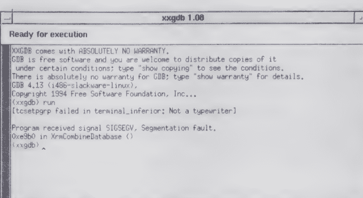

## 解析器和词法分析器

如果你习惯了构建自己的解析器，你会喜欢 GNU `bison`（UNIX `yacc`——又一个编译器生成器的移植版）和 `flex`（快速词法分析器）。Linux 甚至包含了用于开发 C++ 扫描器的 `flex++`。

## 其他工具

我们在表 10.5 中列出了更多对程序员有用的工具。

### 表 10.5 更多实用工具

| 工具 | 用法 |
|---|---|
| `ar` | 将对象文件收集成库 |
| `diff` | 比较文件差异 |
| `prof` | 收集程序的计时统计以进行性能优化 |
| `hexdump` | 显示文件的 ASCII、十进制、十六进制或八进制转储 |
| `objdump` | 对象文件信息 |
| `ranlib` | 在 `ar` 创建的存档（库）中生成索引 |
| `rcs` | 源代码版本控制系统 |
| `strace` | 显示程序的系统调用 |

甚至还有一个叫做 `ansi2kr` 的工具，它可以将 ANSI C 转换为旧式的 Kernigh and Ritchie 风格的 C（没有函数原型）。在 Linux 上，你并不真的需要这个，因为 `gcc` 完全支持 ANSI C。

## 464 第 10 章：在 Linux 中编程

对于人工智能的爱好者来说，还有一种 Common Lisp（名为 `clisp`）。其他编程语言还包括 Ada 和 Pascal。

> 注意：除非你通过运行安装程序明确要求，否则在 Slackware Linux 系统上不会安装任何编程工具或语言。

## Java 小木屋

最热门的新语言之一，特别是对于全球维网应用程序，是 Sun 的 Java。Java 程序被编译成一组可移植的字节码，可以在任何支持 Java 虚拟机的系统上执行。Linux 有版本的 Java；在第二张光盘上，是 Java 开发工具包，或 `JDK`。截至本文写作，该软件还处于非常初级的阶段，但值得查看一下。

## Linux 脚本语言

除了前面讨论的编程语言外，Linux 还提供了更多，包括许多脚本语言。脚本语言与 UNIX Shell 自带的语言非常相似。编程语言与脚本语言之间的主要区别是，脚本语言通常是解释的而不是编译的，而且脚本语言通常让程序内部启动 Linux 命令变得更容易。正如你可以看到的，编程语言和脚本语言之间的界限是模糊的。在 Linux 上可用的脚本语言中，最热门的两个是 Tcl 和 Perl，而 `gawk` 持续受到关注。

## Tcl

`Tcl` 是 Tool Command Language 的缩写，是一种运行在大多数 UNIX 和 Windows NT 上的非常实用的脚本语言。

像大多数脚本语言一样，`Tcl` 使用美元符号 `$` 获取变量的值。`Tcl` 中的所有内容都是字面字符串，因此它需要一个特殊字符来区分字符串和变量值。因此：

## 第 10 章：在 Linux 中编程

变量只是一个字面字符串，而

```
$variable
```

返回存储在变量中的值。与大多数脚本语言相同（尽管这有一些棘手的地方。我们发现简单的拼写错误——例如忘记 `$`——导致了大多数 Tcl 错误）。例如，如果你有一个名为 `dir` 的目录并想使用 `cd` 命令进入该目录，你执行以下 Tcl 命令：

```
cd dir
```

`Tcl` 的基本语法像是 Lisp 和 C 的交叉点。基本函数名为 `proc`，看起来很像 C 函数，例如：

```
proc add_one { value }
return [expr $value+1]
```

大括号 `{}` 赋予了它明确的 C 感。Lisp 风格源于对 `set` 命令的使用而不是赋值。也就是说，不像 C 语句：

```
a = b;
```

在 Tcl 中这样编写代码：

```
set a b
```

（记住 `$` 符号可能会让你出错。）

`Tcl` 的一个优点是它可以随时使用变量，而无需预先声明——除了在命令中使用它们之前需要指示变量。

## 第 10 章：在 Linux 中编程 467

## 使用 Tcl

为了尝试一些 Tcl 程序，你应该运行 Tcl 解释器 `wish`，它允许你像在基于 Tcl 的 shell 中一样输入 Tcl 命令。`Tcl` 最有趣的用法是创建包含按钮的图形化程序。在 Tcl 中创建一个按钮，使用 `button` 命令：

```
button .b1
  -text "My first button"
  -command { exit }
```


> 因为 Tcl 是一种脚本语言，你可以使用反斜杠字符 `\` 将一行命令扩展到多行。这使得你的程序更易读。

前面的命令创建了一个名为 `.b1` 的按钮（开头的点是重要的）。就像 Linux 使用 `/` 字符标记根目录一样，Tcl 使用 `.` 标记根组件（你的应用程序的主窗口）。我们随后创建一个位于根组件之下的按钮组件。

`-command` 设置了按下按钮时将运行的 Tcl 命令。在我们的例子中，`exit` 命令执行 `wish` 和我们的 Tcl 脚本。

> 注意，`-command` 只有在按下按钮时才被求值，通常在按钮创建之后，通常在 Tcl 程序处于另一个过程中。由于由于，局部变量在执行时不再拥有它们的值。

这可能很难调试。我们将在示例代码中显示一些解决方法。要让组件出现，我们必须对其进行 `pack`。`pack` 命令接受许多参数，包括要打包的组件的名称：

```
pack .b1
```

## 第 10 章：在 Linux 中编程

Tcl 组件在对它们执行 `pack` 后才会出现。


### 为 Tcl 创建脚本

你可以将一组 Tcl 命令组合成脚本文件，就像 C 和 Bourne shell 脚本一样。执行脚本的程序又是 `wish`。以下脚本假设 `wish` 位于 `/usr/bin`（Linux 也是如此）。

将我们的第一个示例转换为可行的脚本，我们执行以下操作：

```
#!/usr/bin/wish

#
# example1.tcl
#
# 创建一个按钮。
button .bl \
-text "My first button" \
-command { exit }
pack .bl
```

为了让你看到更多 Tcl 脚本的韵味，我们编写了以下文件。在文件中，Tcl 命令创建了一组按钮，允许你启动 `xman` 和 `xterm` 等用的 Linux 程序。工具栏出现在屏幕底部并使用 `override-redirect` 模式，该模式防止窗口管理器在窗口周围放置标题栏。此外，为了纪念 Windows 95，我们将当前时间放在工具栏的末尾。

在我们的脚本中，我们创建了许多在 Tcl 中称为 `proc`。`exec_cmd` 程序将文本字符串作为 UNIX 命令执行。我们使用 `eval` 语句处理文本字符串问题并求值命令中的任何 Tcl 变量。尝试在没有 `exec_cmd` 程序中的 `eval` 的情况下运行此 Tcl 脚本

你就会明白为什么我们需要它。（这与将参数作为一个字符串进行求值有关）。Tcl 脚本的完全目的是启动常用的应用程序，特别是图形化应用程序。设置的按钮见表 10.6。

表 10.6 从 toolbar.tcl 启动的应用

| 按钮 | 启动 |
| --- | --- |
| 手册 | xman 查看 Linux手册 |
| 邮件 | elm（在 xterm 内）读取邮件 |
| Shell | xterm 用于命令行 |
| 文件管理器 | xfm，一个 Linux 文件管理器 |
| 图片 | xv，一个图像查看和文件浏览程序 |
| 将 | 我们在 X 上喜欢的游戏 |

实现这一切的 Tcl 脚本出现在这里：

```
#!/usr/bin/wish

#
# toolbar.tcl
# 在屏幕底部放置工具栏的 Tcl 脚本。
```

```
# 工具栏按钮按下。
#
set cmds (man)    "/usr/bin/X11/rman -notocbox -bothshown"
set cmds (mail)   "/usr/bin/X11/xterm -ls -e elm"
set cmds (term)   "/usr/bin/X11/xterm -ls"
set cmds (file)   "/usr/bin/X11/xfm"
set cmds (xv)      "/usr/bin/X11/xv"
set cmds (hmah)    "/usr/bin/X11/hmajongg"
```

# 将 cmds 设为全局。
`global cmds`

# 主程序。

# 设置窗口管理器值。
`wm geometry`        +0-0
`wm overriddenirect`  . true

# 包含所有内容的框架。

```
set back lightgray

frame .frame -relief raised -bd 2 -bg $back

.frame config -cursor top_left_arrow
```

# 图标/名称组件。

```
set title [format "Linux: %s" [ exec hostname ]]

button .frame.logo -text $title \
-command { exit } -bg $back \
-relief flat -padx 8
```

`pack .frame.logo -side left -fill y`

### 第 10 章：在 Linux 编程

```
#
# 创建构成我们工具栏的其他组件。
#
button .frame.man -text "Manuals" \
-command ( exec_cmd $cmds(man) ) \
-relief flat -padx 8 -bg back

button .frame.mail -text "Mail" \
-command ( exec_cmd $cmds(mail) ) \
-relief flat -padx 8 -bg back

button .frame.term -text "Shell" \
-command ( exec_cmd $cmds(term) ) \
-relief flat -padx 8 -bg back

button .frame.file -text "File Manager" \
-command ( exec_cmd $cmds(file) ) \
-relief flat -padx 8 -bg back

button .frame.xv -text "Images" \
-command ( exec_cmd $cmds(xv) ) \
-relief flat -padx 8 -bg back

button .frame.xmah -text "Mahjong" \
-command ( exec_cmd $cmds(xmah) ) \
-relief flat -padx 8 -bg back

# 按顺序打包所有按钮。
pack .frame.man .frame.mail \
.frame.term .frame.file \
.frame.xv .frame.xmah \
-side left -fill y

# 设置计时器标签。
label .frame.time -bg $back
```

```
update_time .frame.time

pack .frame.time -side left -fill y

pack .frame
# toolbar.tcl
```

你可以通过三个简单的步骤轻松添加自己的命令：

- 1. 在 `set cmds` 区域添加你的新 UNIX 命令。
- 2. 在按钮区域，复制一个按钮命令来创建你自己的。你需要将按钮名称更改为 `frame.yourname` 或类似的名称。此外，确保它使用了你在 `set cmds` 区域定义的命令。
- 3. 在按钮区域后的 `pack` 命令处，添加新按钮的名称。

你可以使用这两个脚本作为示例，开始编写 Tcl 应用程序。Tcl 最方便的部分之一是它支持 Windows 和 Macintosh 系统。关于 Tcl 有许多书籍可用，包括《使用 Tcl 和 Tk 开发图形化应用程序》；详见附录 A。

# Perl

Perl 是一种免费的脚本语言，用于处理许多系统管理任务。Perl 是实用提取和报告语言（Practical Extraction and Report Language）。这种语言的意义在于让你更容易地从 UNIX 中提取数据，并输出有关 Usenet 磁盘使用情况以及系统所有用户列表（按磁盘使用量排序）的报告。Perl 擅长处理围绕系统信息报告的任务。

在安装 Linux 时请确保已安装了 `perl`，输入以下内容：

```
gilbert:$ perl -v
```

如果你的系统中有 `perl`，你应该能看到 `perl` 的版本号。如果没有，你需要运行安装程序（该安装程序安装 Perl 5.02）。

### Perl 脚本

Perl 与大多数 Tcl 及其他脚本语言一样，使用 `#` 作为注释。任何包含 `#` 的行从该起都会被忽略。要在 `perl` 脚本中打印数据，请使用 `print` 语句：

```
# /usr/bin/perl
```


`print "Linux runs!"`

`print "Oh, joy!";`

当你运行此脚本时，正如你预期的，你会看到：

```
Linux runs!

Oh, joy!
```

`\n` 代表新行或换行符，这是典型的 UNIX 术语，如 C 节中所描述。你也可以使用以下方法在 Perl 中提示输入数据：

```bash
# /usr/bin/perl

# 在 perl 中提示输入。

print "What is your first name: ";

# <STDIN> 代表标准输入：键盘。

$first_name = <STDIN>

# 去末尾的换行符。

chomp($first_name);

printf "What is your last name: ";

$last_name = <STDIN>;

chomp($last_name);

print "Your name is $first_name $last_name.\n";
```

当你运行此脚本时，你将看到：
- What is your first name: Eric
- What is your last name: Johnson
- Your name is Eric Johnson

Perl 为数组、UNIX 进程和字符串处理提供了大量支持。Perl 提供了一系列数组操作，允许你将数据视为一个单元，例如：`(1, 2, 3, 4, 5, 6)`。这个数组包含从 1 到 6 的值。你也可以混合文本和数值，如下：`(1, 2, 3, 4, "Linux is out the door")`。你可以将此数组分配给变量，然后访问数组中的任何元素。Perl 的一个大优势是它的关联数组，你可以使用键值对作为数组索引并将其与数据值关联。例如，你可以拥有一个包含名字、姓氏和街道地址的 perl 数组。然后你可以像所示访问街道地址：

```bash
# /usr/bin/perl

# Perl 中的关联数组。

$zippy("firstname") = "Zippy"

$zippy("address") = "1600 Pennsylvania Ave.";

# 打印数据。

print $zippy("firstname");
```

```bash
print '%s is :"

print $zippy("address");

# 以回车结束。

print "\n";
```

此示例将名字和地址存储在关联数组中。关联数组是一个非常强大的功能，可以有效地用于许多任务。输出结果所示：

Zippy's address is 1600 Pennsylvania Av.

自然，你可能需要一个系统中可用的用户名。Perl 还有很多内容，足以写一本书。如果你对学习更多 perl 感感兴趣，请参附录 A。

# Gawk

由三位贝尔实验室的研究人员开发（Alfred Aho, Peter Weinberger 和 Brian Kernighan——因此得名 `awk*`）；`*awk*` 是一种编程语言（与本章之前介绍的 C 语言有许多相似之处），但用法与其他 UNIX 脚本工具相似。`*awk*` 的包含

从技术上讲，`*awk*` 并不随 Linux 安装；相反，GNU 版本 `*gawk*` 随 Linux 安装。（到这里你不应该对 Linux 包含 GNU 项目的软件感到惊讶。）由于 `*gawk*` 与其他 `*awk*` 的实现几乎相同（`*gawk*` 有一些扩展，但你可以选择忽略它们），大多数有 `*awk*` 经验的用户将没有任何问题。

`Gawk` 的主要价值在于处理结构化文本文件，信息以列的形式存储并由一致的字符（如制表符或空格）分隔。`Gawk` 获取这些结构化文件并进行编辑、排序和搜索。

让我们使用一个名为 `workers` 的数据文件作为示例：

| Eric | 286 | 555-6674 | erc | 8 |
| Geisha | 280 | 555-4221 | geisha | 10 |
| Kevin | 279 | 555-1112 | kevin | 2 |
| Tom | 284 | 555-2121 | spike | 12 |

## 第 10 章：在 Linux 中编程

`gawk` 可用的选项仅有 `-F`，它允许你指定除空格以外的字段分隔符；`-f`，它允许你指定一个包含所有 `gawk` 命令的文件，而不是在 Linux 命令行上放置复杂的模式和动作；以及 `-W`，它让 `gawk` 以完全兼容 `awk` 的模式运行。在这里，我们应该定义一下我们的术语。模式（pattern）可以是一个 ASCII 字符串（`gawk` 会以数值方式处理它；它不是将字符 e 视为 e，而是将其视为 ASCII 的等效值）、一个数字、数字的组合或通配符；而动作（action）指的是我们提供的指令。从本质上说，`gawk` 的工作原理让我们它去搜索特定的模式；当它找到该模式时，`gawk` 就会对其进行某些操作，例如将该模式打印到另一个文件中。

最简单的 `gawk` 命令仅仅是打印文件中的所有行：

```bash
gawk '{ print }' workers
Eric 286 555-6674 erc 8
Geisha 280 555-4221 geisha 10
Kevin 279 555-1112 kevin 2
Tom 284 555-2121 spike 12
```

继续我们的示例，假设我们想要提取所有以字符串 `"geisha"` 开头的记录。我们将使用以下命令：

```bash
gawk '$1 ~ /Geisha/ {print $0}' workers
```

以下是该命令各个部分的含义：
- `$1`: 告诉 `gawk` 使用第一列作为后续动作的依据。`gawk` 会根据记录或字段对字段执行某些动作；以 `$` 开头的数字告诉 `gawk` 对特定字段进行操作。在这种情况下，`$1` 指的是第一个字段。
- `* &&`: 它的作用与逻辑与（AND）相同。
- `* ||`: 它的作用与逻辑或（OR）相同。
- `* !`: 返回任何与原始不相等的内容。

例如，假设我们想知道有多少工人的第五字段值大于或等于 10：

```bash
awk '$5 >= 10 { print $0 }' workers
Geisha 280 555-4221 geisha 10
Tom 284 555-2121 spike 12
```

我们还可以组合测试，例如打印出所有第五字段小于 10 且第二字段大于 280 的工人：

```bash
awk '$5 < 10 && $2 > 280 { print $0}' workers
Eric 286 555-6674 erc 8
```

虽然这些示例显然是人为构造的，但你可以使用 `awk` 来帮助提取共享某些邮政编码（ZIP）的所有条目，或者工资在特定范围内的员工。我们只是接触 **`awk`** 的表面。

`**awk**` 也可以用于返回整个数据段，只要你能指定该段起始和结束模式。使用以下命令返回 Eric 和 Kevin 以及它们之间所有的记录：

```bash
awk '$1 ~ /Eric/, /Kevin/ {print $0}' workers
Eric 286 555-6674 erc 8
Geisha 280 555-4221 geisha 10
Kevin 279 555-1112 kevin 2
```

如果我们不想打印整个记录，可以只打印几个字段，如下例所示，它打印了第 2 和第 1 个字段：

```bash
awk '$1 ~ /Eric/, /Kevin/ {print $2, $1}' workers
286 Eric
280 Geisha
279 Kevin
```

与其他 UNIX 命令一样，`**awk**` 可以在管道中使用，它的输出可以重定向到其他文件或直接到打印机。例如，如果我们正在查看一个大文件并预期有很多匹配特定字符串（如工资范围或入职日期），我们可能想将该输出重定向到文件或打印机。

要将 `gawk` 与 Linux `sort` 工具一起使用，我们可以看到示例的输出：

```bash
gawk '$1 ~ /Eric/, /Kevin/ {print $2, $1}' workers | sort
```

```
279 Kevin
280 Geisha
286 Eric
```

请注意，这是根据前面的数字进行排序。

`Gawk` 还提供了一些汇总能力。例如，`gawk` 命令中的 `NR` 符号返回记录数。我们可以将其与 `gawk` 在程序中对字段求和的能力相结合。

## Gawk 程序

你并不限于 `gawk` 在命令行上能容纳的内容。你还可以将一系列 `gawk` 命令存储在一个文件中，然后使用 `gawk` 执行该文件。

例如，我们可以将最简单的 `gawk` 命令 `{print}` 存储在一个单独的文件中，并使用以下 `gawk` 命令：

```bash
gawk -f gawk.1 workers
Eric 286 555-6674 erc 8
Geisha 280 555-4221 geisha 10
Kevin 279 555-1112 kevin 2
```


Tom 284 555-2121 spike 12


# 更多信息

极有可能，这本书只是你 Linux 之旅的开始。你会发现海量的 Linux 信息可供选择——无论是在互联网上还是纸质世界里。当你深入这些资源时，你的任务是让自己不被淹没。我们在这里的重点是互联网资源，因为它们是你会发现最有用的部分。

## 互联网资源

Linux 是互联网上的一个大热门题；最近在 Alta Vista 搜索引擎上的一次搜索产生了 200,000 个在某处提到 Linux 的网页。即使剔除那些偶尔捣鼓 Linux 的本科生创建的网页，你仍然会有惊人数量的网页对 Linux 进行了深度介绍。

我们为你做了一些编辑，并汇编了这些有趣的 Linux 相关的网页。自然地——毕竟这是万维网——这些页面中的大多数都会花大量时间引导你指向其他网页，而那些网页又会引导你指向更多的网页。尽管如此，从这些页面开始，你可以显著扩展你的专业知识。

### Linux 文档项目

`http://sunsite.unc.edu/mdw/linux.html`

Linux 文档项目（Linux Documentation Project）首页是 Linux 信息和存档软件的重要来源；几乎任何 Linux 使用和配置的方面都可以在这里找到。这是一个应该放在浏览器书签列表显著位置的页面。你可以连接到 `http://sunsite.unc.edu/architext/AT-Linuxquery.html` 或 `http://amelia.db.erau.edu/Harvest/brokers/LDP/query.html` 来搜索 Linux 文档存档。

### Linux.Org

`http://www.Linux.org/`

Linux.org 是一个由用户驱动的团体，致力于——你惊讶吧！——Linux。

### Walnut Creek CD-ROM

`http://www.cdrom.com`


# 附录 A：更多信息

这是 Slackware 的在线仓库；你可以从这里获取 Slackware 的更新版本。

## Linux 应用与工具页面

http://www.xnet.com/~blatura/linnapps.shtml

Bill Latura 维护着这份优秀的 Linux 应用和工具列表。与 Linux 软件映射表（见下文）不同，这些应用按类别列出，使得浏览要容易得多。

## Linux 软件映射表

http://www.boutell.com/lsm/

该网站尝试将你的软件需求与 Linux 世界中的可用资源进行匹配。

## Linux FAQ

http://www.cl.cam.ac.uk/users/iwj10/linux-faq/

该网站包含最新版本的 Linux 常见问题解答（FAQ）。

## Linux 配置页面

http://www.hal-pc.org/~davidl/linux/linux.config.html

该页面结合了来自各种用户的安装和配置技巧。这些人是成功在各种 PC 上安装并配置了 Linux 的勇士。如果你在你的无名克隆机上运行 Linux 遇到困难，你可能想检查一下是否已经有人发明了这个轮子。

## Linux 笔记本电脑页面

http://www.cs.utexas.edu/users/kharker/linux-laptop/

该页面与 Linux 配置页面类似；它总结了许多用户的经验，并将其浓缩为一份在各种机器上安装 Linux 的非常实用的指南。获取笔记本电脑的硬件信息（例如，使用什么芯片组用于图形）稍微困难一些，而且某些笔记本组件可能……嗯，有点麻烦（查看下文），此页面对于任何想在笔记本电脑上运行 Linux 的人来说都是至关重要的。类似的兴趣点还有笔记本电脑上的 Linux 和 X Window 首页（http://www.castle.net/X-notebook/index_linux.html）。

## Linux PCMCIA 信息

http://hyper.stanford.edu/~dhinds/pcmcmia/pcmcmia.html

Dave Hinds 是 Linux 社区的虚拟之神。为什么？因为他承担了让 Linux 在 PCMCIA 端口运行的任务，这些端口主要出现在笔记本电脑上。PCMCIA 端口用于那些信用卡类型的适配器（如以太网和调制解调器），即使在主流社区，PCMCIA 的支持也没有达到预期。尽管如此，得亏了 Hinds 的 Card Services for Linux，你通常可以使 PCMCIA 端口工作。我们在随附的 slackware CD-ROM 中包含了 Card Services for Linux；这里你可以获取更多信息的地方。

## XFree86 项目

http://www.XFree86.org/

当你在 Linux 安装中安装 X Window 时，你实际上使用的是 XFree86，这是一个专门针对 Intel 架构优化的 X Window 版本。这是该项目的首页。

如果说互联网只有一点特点，那就是它总是在变化。如果你想生成更实时的 Linux 相关主页列表，请查看 Alta Vista 首页（http://alta.vista.com）。Alta Vista 是一个跨越全球网页的可搜索数据库。

### Slackware 镜像

Slackware 的 Linux 发行版在 ftp.cdrom.com 站点维护，路径为 `/pub/linux/slackware`。在该站点，你可以获取 Slackware 的最新版本。你不应该经常这样做；你应该根据特定需求进行升级，而不仅仅是作为一种常规做法。

这是一个繁忙的站点

表 A.1 列出了镜像 Slackware 发布的站点。

表 A.1 Linux 镜像

| 国家 | 站点 |
|---|---|
| 美国 | ftp.cdrom.com /pub/linux/slackware |
| | urlarchive.cse.edu |
| | ex-11.mit.edu |
| | ftp.cmich.edu |
| | sumite.unc.edu |
| | ftp.re.ge |
| | ftp.cs.columbia.edu |
| | ftp.ccz.neu.edu |
| 澳大利亚 | ftp.monash.edu.au |
| | ftp.linux.org |

| 国家 | 站点 | 目录 |
|---|---|---|
| 美国 | ftp.cdrom.com | /pub/linux/slackware |
| | urlarchive.cse.edu | /pub/systems/slackware |
| | ex-11.mit.edu | /pub/distributions/slackware |
| | ftp.cmich.edu | /pub/packages/slackware |
| | sumite.unc.edu | /pub/distributions/slackware |
| | ftp.re.ge | /pub/systems/slackware/ |
| | ftp.cs.columbia.edu | /archives/linux/Slackware |
| | ftp.ccz.neu.edu | /pub/os/slackware |
| 澳大利亚 | ftp.monash.edu.au | /pub/linux/slackware |
| | ftp.linux.org |

## Usenet 组

表 A.2 中列出的 Usenet 组致力于 Linux 操作系统。

### 表 A.2 与 Linux 相关的 Usenet 组

| 组名 | 主题 |
| --- | --- |
| comp.os.linux.advocacy | Linux 是伟大的发明。 |
| comp.os.linux.announce | 认为 Linux 社区重要的消息。 |
| comp.os.linux.answers | 关于 Linux 的各种“官方”文档（FAQ、HOWTO、README 等）。 |
| comp.os.linux.development | 开发 Linux 应用。 |
| comp.os.linux.development.system | 开发专门针对 Linux 的模块和组件 |
| comp.os.linux.hardware | 如何让 Linux 在你的 NoName 设备上运行 |
| comp.os.linux.m68k | 将 Linux 移植到基于摩托罗的计算机（Amiga、Atari 等）。 |
| comp.os.linux.misc | 不属于其他 Linux 组范围的话题。 |
| comp.os.linux.networking | Linux 网络。 |
| comp.os.linux.setup | 安装和配置 Linux。 |
| comp.os.linux.x | 在 Linux 下运行 Free86 和 X Window。 |

## 其他 Linux 实现

大多数 Linux 用户在 PC 上工作——毕竟这是 Linux 的巨大吸引力之一。然而，Linux 已被移植到几种其他计算机架构，并且更多的努力正在进行。在表 A.3 中，我们列出了移植版本以及可以获取更多信息的首页。

| 项目 | 主页 |
| --- | --- |
| Alpha | http://www.azstarmart.com/~aplinux/ |
| Acorn | http://www.ph.kcl.ac.uk/~amb/linux.html |
| ARM Linux | http://www.whirlig.cs.soton.ac.uk/~rmk92/armlinux.html |
| Fujifilm API1000+ | http://cop.anu.edu.au/cop/projects/linux/ |
| Linux/68k | http://www-users.informatik.rwth-aachen.de/~hn/linux68k.html |
| Linux/8086 | http://www.linux.org.uk/Linux8086.html |
| Linux/PowerPC | http://www.linuxxpc.org/ |
| M6lynix | http://nucleus.ibg.uu.se/macunix/ |
| MIPS | http://lena.fnet.fr/ |
| SPARC Linux | http://www.geog.ubc.ca/sparclinux.html |

### 书籍

## 其他 Linux 书籍

《运行 Linux》(Running Linux)，Matt Welsh 和 Lar Kaufman 著，O'Reilly & Assoc.，1995年。本非虚构 Linux 入门涵盖了 Linux 和一些通用 UNIX 命令。它不限于任何特定的 Linux 发行版，某些信息可能不适用于随附的 CD-ROM。Welsh 还探讨了书中未涵盖的一些高级主题。

《Linux 网络管理员指南》(Linux Network Administrator's Guide)，Olaf Kirch 著，SSC，1994年。这本关于 Linux 网络的技术概述涵盖了你对网络上 Linux 所需要了解的所有知识。尽管这本书是从技术水平较高的用户角度编写的，但对任何需要处理网络 Linux 的人来说都是用的。

MIS:Pressing 系列还有其他 Linux 主题的书籍，包括：《Linux 数据库》(The Linux Database，Fred Butzen 和 Dorothy Forbes 著）；《Linux 服务器》(The Linux Internet Server，Kevin Reichard 著）；《Linux 编程》(Linux Programming，Volkerding、Foster-Johnson 和 Reichard 著）以及《通俗易懂的 Linux》(Linux in Plain English，Volkerding 和 Reichard 著）。

## UNIX 书籍

《自学……UNIX》(teach yourself ... UNIX)，第三版，Kevin Reichard 和 Eric F. Johnson 著，MIS:Press，1995年。好吧，我们确实有偏见。这本书提供了 UNIX 操作系统的概述，主题涵盖了从系统配置、Shell 脚本到互联网的范围。假设读者具备一定的计算机经验。

《通俗易懂的 UNIX》(UNIX in Plain English)，第二版，Kevin Reichard 和 Eric F. Johnson 著，MIS:Press，1994年。这本书涵盖了 UNIX 命令集中的主要命令——大部分信息应直接适用于 Linux。

《UNIX 基础：入门知识》(UNIX Fundamentals: The Basics)，Kevin Reichard 著，MIS:Press，1994年。这本书是为真正的 UNIX 初学者准备的，他们对 UNIX 几乎一知甚少，甚至对计算机也是如此。它是涵盖 UNIX 基础的四丛书的一部分（其他书籍包括：《UNIX 基础：面向 DOS 和 Windows 用户的 UNIX》、《UNIX 基础：通信与网络》以及《UNIX 基础：共享软件与免费软件》）。

### 编程书籍

《Al Stevens 教 C 语言》(Al Stevens Teaches C)，Al Stevens 著，MIS:Press，1994年。提供了 C 编程的入门介绍，其内容远超第 10 章中的简要介绍。

《使用 Tcl 和 Tk 的图形应用》(Graphical Applications with Tcl and Tk)，Eric F. Johnson 著，M&T Books，1996年。这本书涵盖了 UNIX、Linux 和 Windows 上的 Tcl 脚本。你可以使用 Tcl 用极少的精力创建许多精美的应用程序。

《跨平台 Perl》(Cross-Platform Perl)，Eric F.Johnson 著，M&T Books，1996年。语法看起来像是出自某个入魔之手，但 为系统管理员和 Web 页面开发者提供了许多功能。

## X Window 书籍

《UNIX 系统管理员 X 指南》(The UNIX System Administrator's Guide to X)，Eric F. Johnson 和 Kevin Reichard 著，M&T Books，1994年。这本书侧重于与 UNIX 和 X 相关的主题，包括配置和用法。还有关于 FreeX86 的信息。随附的 CD-ROM 包含了书中详细介绍的所有 UNIX/X 免费软件。

《使用 X》(Using X)，Eric F. Johnson 和 Kevin Reichard 著，MIS:Press，1992年。这本书从用户的角度涵盖了 X，包括了用法和配置问题。

## Motif 书籍

《高级 Motif 编程》(Power Programming Motif)，Eric F. Johnson 和 Kevin Reichard 著，M&T Books，1994年。第二版涵盖了直到版本 1.2 的 OSF/Motif 编程。

## PC 配置书籍

《IRQ、DMA 与 I/O：解决和防止 PC 系统冲突》(IRQ, DMA & I/O: Resolving and Preventing PC System Conflicts)，Jim Aspinwall 著，MIS:Press，1995年（第二版准备中）。

### 杂志

如果你认真对待你的 Linux 使用，你会想看看《Linux journal》(SSC, 8618 Roosevelt Way NE, Seattle, WA 98115-3097; (206) 782-7733; 每年 $19; http://www.ssc.com; subs@ssc.com)。这本月刊涵盖了 Linux 领域，提供实用技巧以及 Linux 社区中许多有趣人物的简介。

近年来，专门针对 UNIX 的杂志数量有所下降（诚承认，这种趋势让我们困惑）。《UNIX Review》是我们最喜欢的，仅仅是因为写作团队的三之二每月撰稿一个 X Window 专栏。

## OSF/Motif 和 Linux

OSF/Motif 是从开放软件基金会（Open Software Foundation）授权的商业软件。OSF/Motif 实际上包含许多内容，包括样式指南、窗口管理器和一组编程库。

由于 OSF/Motif 是授权的商业软件，它未包含在随附的 CD-ROM 中。（由于 OSF/Motif 开始成为任何严肃商业 UNIX 开发的必要条件，如果你查看任何专业安装，你可能会随时为你的 Linux 系统找到 OSF/Motif。）

MetroLink (4711 N. Powerline Rd., Fort Lauderdale, FL 33309); (938-0283; http://www.metrolink.com; sales@metrolink.com) 为 Linux 提供 OSF/Motif。

### Linux HOWTO

Linux 社区的集体智慧被提炼了一系列被称为 HOWTO 的文本文档，描述了 Linux 操作系统的各个部分。我们将这些文档的最新版本包含在第一个 CD-ROM 中（在 `/docs` 目录下）。你可以在许多网站找到它们，但如果它们不能回答你的问题，你可能想通过互联网查看是否有更新的版本。sunsite.edu, `/pub/Linux/HOWTO`。

# 附录 B：XFree86 与扩展

要查看系统支持哪些 X 扩展，请在 xterm 窗口中运行 `dpqueryinfo` 程序（当然，你必须正在运行 X）。当你运行 `dpqueryinfo` 时，你会看到许多描述你的 X 服务器的输出。部分输出将包含扩展列表，可能如下所示：


`number of extensions: 10`

`BIG-REQUESTS`

`MIT-SCREEN-SAVER`

`MIT-SHM`

`MIT-SUNDRY-NONSTANDARD`

`Multi-Buffering`

`SHAPE`

`SYNC`

`XC-MISC`

`XFree86-VidModeExtension`

`XTEST`

我们的 X 服务器并不支持许多有趣的扩展，例如 PEX。

# 如何在 Linux 上扩展 X

在大多数情况下，你会以二进制格式安装 XFree86（X 在 Linux 上的实现），这意味着你不会编译一个专为你的独特需求设计的特殊版本。因此，你需要一个特殊的包，称为 X 链接包（X link kit），来扩展 Linux X 服务器。该链接包允许你编译并链接一个新的 X 服务器。本书附带的 XFree86 版本包含该链接包；要安装它，你需要再次运行安装程序。在其中一个菜单中选择链接包即可。

如果你没有这个包，可以通过互联网获取。通常该文件名为 `X312linkkit.tgz` 或类似的名称。

链接包允许你重新构建 X 服务器并添加新内容：你想要添加的 X 扩展。你还需要 `gcc` 编译器（如果你选择安装它，Linux 会自带它）以及 `libgcc`，即 gcc 的标准 C 库。你在安装 Linux 时应该已经安装了这两者。要查看你使用的是哪个版本的 gcc，尝试输入以下命令行：

```
$ gcc -v

Reading specs from /usr/lib/gcc-lib-lib/i486-linux/2.7.2/specs

gcc version 2.7.2
```

要使用 PEX，你需要在安装时加载 PEX 库、头文件和字体。位于 `/usr/lib/X11/fonts/PEX` 的 PEX 字体是运行大多数 PEX 程序所必需。

在下一节中，我们将展示如何使用链接包为 PEX 重构 X 服务器，PEX 是一种支持三维图形的 X 扩展。对于添加其他 X 扩展（例如巨大的图像扩展 XIE），这些步骤基本上是相同的。我们选择 PEX 是因为我们看到了很多关于这个特定 X 扩展的问题。三维图形变得越来越流行。尽管如此，基本技术适用于任何你需要添加的 X 扩展。

> 注意：再次强调，Linux 在这里提供了一个非常方便的捷径。不需要重新构建 X 服务器，可以从模块加载 PEX 支持。XF86Config 的主页有更多关于如何设置此项的信息。

## 配置服务器构建

在构建新服务器之前，你必须编辑 `/usr/X11R6/lib/Server/config/cf` 目录下的配置文件。在该目录中，编辑 `xf86site.def`（务必先进行备份）。在该文件中，你需要指定一些内容，包括构建哪些 X 扩展（例如 PEX），以及构建哪个服务器，例如 SuperVGA、SVGA 或 S3 XF86_S3。

在表 B.2 中，我们列出了我们成功使用的设置。请注意，我们禁用了大多数 X 服务器的创建，因为我们只需要 S3 和 SVGA X 服务器。因此，你可能想要更改你的设置。

> 注意：对于任何版本，这些设置可能会发生变化，并有许多新设置。请将表 B.2 作为指南，而不是将其视为真理。此时，由于你正在重新构建 X 服务器，你可能还想构建其他扩展之一，例如 LBX 或 XIE。

大多数服务器都是默认开启的。你可以关闭不需要的。对于每个 X 服务器，都有可以设置的驱动列表。我们保留了默认设置（`XF86SvgaDrivers`、`XF86Vga16Drivers`、`XF86VgaDrivers` 和 `XF86MonoDrivers`）。如果你构建多个 X 服务器，需要取消 `ServerToInstall` 并输入你想要安装的 X 服务器。否则，XF86_SVGA 将设置为默认服务器。注释掉 `XF86Contrib` 行以构建所有贡献软件。

表 B.2 xf86site.def 文件中的设置

| 设置 | 值 | 含义 |
| :--- | :--- | :--- |
| HasGcc | YES | 使用 gcc 编译器 |
| HasGcc2 | YES | 使用 gcc 2 |
| XF86SVGAServer | YES | 构建彩色 SVGA 服务器 |
| XF86VGA16Server | NO | 构建 16 色 VGA 服务器 |
| XF86MonoServer | NO | 构建单色 VGA 服务器 |
| XF86S3Server | NO | 构建 S3 服务器 |
| XF86MachServer | NO | 构建 Mach 服务器 |
| XF86Mach32Server | NO | 构建 Mach32 服务器 |
| XF86Mach64Server | NO | 构建 Mach64 服务器 |
| XF86P9000Server | NO | 构建 P9000 服务器 |
| XF86AGXServer | NO | 构建 AGX 服务器 |
| XF86W32Server | NO | 构建 P4000/W32 服务器 |
| XF86IB14Server | NO | 构建 i14 服务器 |
| XnestServer | NO | 构建 Xnest 服务器 |
| BuildPexExt | YES | 构建 PEX 扩展 |
| BuildXIE | NO | 构建 XIE 扩展 |
| BuildLBX | NO | 构建 LBX 扩展 |
| BuildSaverExt | YES | 构建 saver 扩展 |

一旦设置好 `xf86site.def` 文件，你就准备好启动一个新的 X 服务器了。

# 构建新的 X 服务器

作为 root 用户，你应该执行以下步骤来构建新的 X 服务器：

1. 备份你当前的 X 服务器。
2. 构建所有的 Makefile。
3. 生成新的 X 服务器。
4. 退出 X。
5. 安装新的 X 服务器。
6. 确保 `/usr/X11R/bin/X` 链接到正确的 X 服务器。
7. 启动 X 以验证新 X 服务器运行正常。
8. 运行 `xdpyinfo` 查看新的 X 扩展可用。
9. 使用 `make clean` 清理 `/usr/X11R/lib/Server` 目录。

在开始之前，始终备份当前的 X 服务器。这是为了在新构建失败时能够继续。然后返回 `/usr/X11R/lib/Server` 目录并运行以下命令构建所有的 Makefile：

```
$ ./mkmf
```

所有命令必须以 root 用户身份在 `/usr/X11R/lib/Server` 目录中运行。这个过程将花费一段时间，因为它对许多文件运行了 `makedepend`。

一旦 `mkmf` 成功完成，运行 `make`：

```
$ make
```

这将构建新的 X 服务器，花费的时间比上一步更长。一旦构建了新的 X 服务器，你必须确保 X 已停止。在一个 xterm 窗口中 `su` 到 root 用户，并在屏幕上其他可用窗口的同时构建新的 X 服务器——这就是多任务处理的意义。但当你需要安装新的 X 服务器时，必须确保 X 已停止。因此按通常的方式退出 X。

然后返回 `/usr/X11R6/lib/server` 目录并运行（再次作为 root）：

```
$ make install
```

这将新的 X 服务器复制到 `/usr/X11R6/bin`，并将 `/usr/X11R6/bin` 设置为默认服务器的链接（你之前配置的那个）。无论如何都要双击这个重要的链接，并确保 `/usr/X11R6/bin/X` 链接到正确的 X 服务器（相关信息见第 3 章）：

现在是有趣的部分。尝试作为普通用户（使用你自己，而不是 root 用户）使用 `startx` 运行 X。这一步是为了确保 X 仍然工作（假设在你做这一切之前 X 是正常工作的）。

如果你成功启动了 X（我们这里是直接启动的，所以如果编译和链接没有问题，这一步应该是很容易的），在 xterm 窗口中运行 `xdpyinfo`（不是 `xxdpyinfo`）查看新的 X 扩展是否可用。列表应该如下：

```
number of extensions: 11

BIG-REQUESTS

LBX

MIT-SCREEN-SAVER

MIT-SHM

MIT-SUNDRY-NONSTANDARD

Multi-Buffering

SHAPE

SYNC

X3D-PEX

XC-MISC

XFree86-VidModeExtension

XTEST
```

（是的，我们在构建 PEX 的同时顺便构建了 LBX 扩展）
一旦你确认一切都构建正确，在 `/usr/X11R6/lib/Server` 目录运行 `make clean`（再次作为 root）：

```
$ make clean
```


这将删除构建 X 服务器时创建的所有 `.o` 文件，并释放大量被浪费的磁盘空间。作为最后的测试，你可能想运行一个随 X 自带的 PEX 演示程序（尽管你可能没有加载这些程序），例如 `beach_ball`。

## 索引

- 3Com 以太网卡与 Linux, 18, 19
- ISDN 调制解器与 Linux, 21-22
- AMI 快速磁盘控制器与 Linux, 12
- AMS 笔记本电脑与 Linux, 29
- Analog Devices 数据采集环境与 Linux, 26
- Apple 以太网卡与 Linux, 17
- 以及背景命令, 241-242
- 命令历史, 244-245
- 以及 diff 命令, 215
- 最小补全, 245
- 以及多任务处理, 241-242
- 管道, 244
- AnA4 Tech AC 扫描仪与 Linux, 25
- abuse 命令, 334
- Accent 多处理器控制器与 Linux, 19
- Ada, 63
- 适配器, 13, 44
- AHA-1501/1515 控制与 Linux, 12, 44
- AHA-1510/1522 控制与 Linux, 12, 44
- AHA-154x 控制与 Linux, 12, 44
- AHA-174x 控制与 Linux, 12, 44
- AHA-274x 控制与 Linux, 12, 44
- AHA-284x 控制与 Linux, 12, 44
- AHA-2940/3940 控制与 Linux, 12, 44
- 以及启动根器 (bootkits), 44
- ARM 笔记本电脑与 Linux, 19, 26
- Web 浏览器, 419
- Macintosh, 110, 202, 297, 30
- 打印机与 Ghostscript, 286, 287
- Apple 以太网卡与 Linux, 17
- ARC 网络网卡与 Linux, 19
- Area5, 334
- 算术命令, 334
- ARK Logic 客户端与 XFree86, 22
- 以及变量, 239-241
- 批处理命令, 363-364
- bcd 命令, 74, 332
- Bell Technologies 多协议控制器与 Linux, 16, 26
- Bernoulli 驱动器与 Linux, 16,
- binutils, 77
- bison 命令, 74, 462-463
- BIT 布局与 Linux, 29
- 位图命令, 319-321
- Bitronica, 接口与 Linux, 24
- Boca 控制器与 Linux, 19
- bog 命令, 334
- 启动泛洪 (boot flooding), 创建, 78-79
- 启动选项, 305-336
- 启动 Linux, 使用 60-62
- 清除, 42-48, 49-50
- ARM 笔记本电脑与 Linux, 29
- Arnet 多处理器控制器与 Linux, 12, 44
- 自适应技术与 Linux, 106
- adduser 命令, 96-398, 348
- adlib 音效箱与 Linux, 22
- Adobe 设备芯片组与 XFree86, 118
- Bourne Shell 搜索与总线 
- 业务管理器, 113
- BusLogic 控制器与启动根器, 45
- 以及 Linux, 12, 13
- byack 命令, 74, 762
- ANScy 芯片组与 Linux 广播 26
- AMI Labs RadioTR 框架
- 别名, 245-246
- Allied Leeds 以太网卡与 Linux, 17
- Always 以及启动根器, 45
- AS-500 控制器与 Linux, 133
- 电话控制器与 Linux, 12

### B

- AMD 以太网卡与 Linux, 17
- AMD 处理器与 Linux, 7, 8
- AMD 控制器与 Linux, 13, 44
- 后台命令, 334
- 后台命令, 241-242
- bash_shell, 76, 84, 204, 215, 237
- 别名: 245-264
- AST 90 笔记本与 Linux, 35
- at 命令, 362-363
- AT-Lan/Tec/Real 以太网卡, 17
- ATM 网络适配器, 21
- ATT 网卡与 Linux, 17
- Audio 音效箱与 Linux, 22
- Authors 芯片组与 Linux, 29
- awk 语言, 68
- aztec ROM 驱动程序与启动根器, 44, 45
- Linux, 19
- 语言, 74
- 工具: 74
- caesar 命令: 332
- Canon 笔记本电脑与 Linux, 29
- Bubblet 与 Linux, 100
- 打印机与 Ghostscript, 286, 287
- 磁盘驱动器, SCSI 工具, 74
- dosemu 模拟器, 320-330
- 音效箱与 Linux, 22
- 加密音效箱与 Linux, 22
- 驱动器与 Linux, 44, 47
- Cyclolides 多端口控制器与 Linux, 11
- 2 控制器与 Linux, 12, 13, 44

### C

- Chichony 笔记本电脑与 Linux, 26
- Chamber web, 419
- Chips & Technology (C&T)
- Cirrus 芯片组与 XFree, 118
- 以及 0oth, 268
- CDOM 控制器与 Linux, 11
- clip 命令, 323
- 时钟, 324-325
- color_term shell 程序, 154
- CDOM 实例模型与 Linux, 210
- ECHO-PSS-based 音效箱与 Linux, 22
- edit 命令, 453-454
- EDO RAM, 1
- elect 媒体, 418-419
- ELF 字段, 449-450
- elm 命令, 415-417, 103-254, 277
- 文本编辑器与内存, 251-252
- 开始, 250
- undos, 223
- emax 文本, 74, 77, 103, 106, 248, 251, 275, 227
- 缓冲区, 266
- 选择版本版本, 77
- 命令, 260-261
- 创建文件, 264-265
- 编辑文件, 264, 265-268
- 帮助, 266
- 以及 lay, 263-264
- 以及 263-264
- 命令, 224-245
- Common Desktop Environment, 287
- 芯片组与 XFree, 118
- Desktop XL 与 Linux, 27
- 以及 Linux, 29-30
- com-port 控制与 Linux, 30
- compress 命令, 228
- 压缩串口接口协议 (CSIPH), 18, 407
- Computone 多端口控制器与 Linux, 19
- Control 多端口控制器与 Linux, 19, 20
- Conner, 21
- CFP1065 驱动器与 Linux, 12
- 以及书籍, 45
- 以及 Linux, 16
- 数据采集设备与 Linux, 36, 38
- Database PDF 控制与 Linux, 13, 44
- dc 命令, 332
- delivery 命令, 75
- diac, 66
- 目录, 202, 213
- 磁盘调试程序与 Linux, 82
- D-Link 以太网卡与 Linux, 18
- depeg 命令, 323
- D-Link 以太网卡与 Linux, 18
- Linux, 19
- 笔记本电脑与 Linux, 30

### 508 索引

- PS/2, 7, 131
- PS/2 鼠标与 Linux
- ThinkPads 与 Linux, 36-37, 61, 123
- Tropic-chicost 令牌环卡与 Linux, 18
- ValuePoint, 7, 61
- ICN own 模块与 Linux, 21
- ico-command, 380
- IDE 控制器, 11, 47
以及 bootisks, 44
- IEEE-488 数据采集设备与 Linux, 26
- IIT 芯片组与 FreeX8, 120
-处理器与 Linux, 7
- 打印机与 Ghostscript, 287
- 打印机与 Linux, 24
- INSL 适配器与 Linux, 32
- ImageVideo 捕获卡与 Linux, 25
- in, 命令, 75
- input 命令, 250
- 配置, 78
- 磁盘集, 选择, 73-78
- 从 DOS 启动, 87-88
- FIPS, 使用, 52-53
- 软磁盘, 52- 53
- 硬盘, 执行, 51-55
- 内核, 178
- 主分区, 创建的, 68-69
以及 OS/2 分区, 67-70
- 释放根目录, 42-43-48
以及设置程序, 70-
- 源代码, 选择, 72-73
- 支持的硬件, 44-46
- 交换空间设置, 71
- 时间安装, 82-83
- 目标定位, 71-72
- Windows 95, 启动, 88-89
- 以太网卡与 Linux, 18
- PCMIA 控制器与 Linux, 308
- Triton 控制器与 Linux, 11
- Internet, 23, 59, 298, 303, 401-416
- I/O 控制器与 Linux, 17
- fomega 和 bootisks, 45
- Tape Controller II 带有磁带的 Linux, 15
- IPC 适配器与 Linux, 32
- IRQ 设置, 38
- Iron-250, Accurat 250 磁带机与 Linux, 15
- ISA 总线, 7
- ISDN 模块, 21

### 索引 511

- Sangoma 帧中继卡与 Linus, 22
- 三洋 HV4A CD-ROM 驱动器及展位, 44, 46-47 以及 Linus, 16
- Schneider & Koch 以太网卡与 Linus, 18
- SCO UNIX 4 SCSI 控制器, 11, 12-24, 26
- SCSI 也包括控制器制造商及展位, 43, 46-47
- 希捷 ST-01/ST-02 控制器及展位, 32
- SD5 列表与 Linus, 33
- sdoom 命令, 335
- send-bey, 284-292
- SEH get与 Linus, 18
- SEPH 列表与 Linus, 33
- Sejon 月, Linus, 23
- seyfon 命令, 77
- seyfon 命令, 375-389
- 共享库, 451
- Shapiro 和 Linus, 33
- shell, 76, 237-254 也包括别名, 225-246 以及后台命令, 241-242
- Slurmp, 437
- SMC 以太网卡与 Linus, 18, 45, 47
- snail 命令, 338
- SNI 笔记本电脑与 Linus, 33
- Specialists 多端口控制器与 Linus, 19-20
- Stallion 多端口控制器及 CD-ROM 驱动器及展位, 44, 47
- CD33A/CD33A-CD-ROM 驱动器与 Linus, 16
- CD535/CD531-CD-ROM 驱动器与 Linus, 16 以及 Windows, 110-111
- Tec: CD/D55A CD-ROM 驱动器及展位, 44, 46-47 以及 Linus, 16
- teachgannon 命令, 338
- Tecnet 磁驱动器与 Linus, 15
- Tektronix 打印机与 Ghostscript, 288
- 打印机与 Linus, 24
- 电信与 Linus, 384-394
- telm 命令, 431-432
- term 程序, 74
- terrix 命令, 338
- Tex, 75, 279
- Tex Instruments 笔记本电脑与 Linus, 33
- Travelimate 鼠标与 Linus, 23
- textual 命令, 292
- texinfo 命令, 278-291
- tfin 命令, 75, 436
- Tek, 45, 464-467
- 打印机与 Linus, 24
- 程序, 296-297
- tkWWW Web 浏览器, 419
- 命令历史, 244-245
- 最小化命令, 225
- 多任务处理, 241-242
- 管道, 224
- 进程, 242
- 变量, 239-241
- shellfoot shell, 154
- shutdown 命令, 101-102

### 广告

### 计算机书籍

| 标题 | 价格 | 标题 | 价格 |
| :--- | :--- | :--- | :--- |
| 3D Studio Max 内部卷 I (附CD) | 499/- | 3D Studio Max 内部卷 II (附CD) | 350/- |
| 3D Studio Max 内部卷 III (附CD) | 399/- | 3D Studio Max 详解 - 4 (附CD) | 450/- |
| 3D Studio Max 基础教程 (附CD) | 350/- | 3D 图形与动画入门 | 180/- |
| 直脱颖而出 (附CD) | 399/- | 3D Studio 入门教程 (附CD) | 240/- |

### >8036/8048 及硬件
- 微处理器数据手册：180/-
- 现代 - 硬盘深度解析：180/-
- 现代 - 软盘与驱动器深度解析：120/-
- 现代 - 主板深度解析：150/-
- 现代 - 键盘与鼠标深度解析：120/-
- 80386 编程
- 326/486 PC：高级用户指南.： 99/-
- PC 数据手册
- 使用你的 80386 进行强力计算、多任务与应用管理：75/-
- PC 杂志专业技术参考书：180/-

### >AMIPRO
- 一天学会 AMIPRO 3.0：45/-
- 精通 AMIPRO 3：150/-

### >动画设计
- 图形编程与动画设计：180/-

### >人工智能
- 知识工程与专家系统 ... 90/-
- 神经智能系统... 150/-
- 理解人工智能 ... 120/-

### >会计
- 计算机化会计：135/-
- 财务管理与会计系统 (附D)：300/-

### >AS/400
- AS/400 磁盘节省与技术：120/-
- AS/400 比较指南：90/-
- AS/400 导航实操指南：180/-

### >汇编器
- 一天学会 MS-ASSEBLER： 45/-
- 教会你的汇编器 (附D)：180/-

### >汇编语言
- PC 用 IBM 汇编语言技术：150/-
- 用汇编语言开发实用程序 (附D)：90/-

### >占星术
- 计算机占星术 (附D)... 345/-

### >AUTOCAD
- AUTOCAD 内部教程：180/-
- AUTOCAD 百百科：450/-
- 一天学会 AUTOCAD：45/-
- 精通 AUTOCAD：240/-

### >AUTOCAD 11
- AUTOCAD 11 瞬时参考：54/-
- 图解参考（版本 1)：195/-
- 精通 AUTOCAD（版本 1）：300/-

### >AUTOCAD 12
- AUTOCAD ABC 基础（版本 2）：150/-
- 高级 AUTOCAD（版本 2）：195/-
- 精通 AUTOCAD 版本 1 (附D)：350/-
- AUTOCAD 12 瞬时参考：60/-
- 一天学会 AUTOCAD 12...45/- Windows...775/-

### >ACCESS
- MS ACCESS 基础：99/-
- 一天学会 Windows 版 MS Access：45/-
- 教会 MS ACCESS (附D)：180/-

### >ACCESS 2
- MS ACCESS 2 开发者手册 (附D)：161/-
- 教会 ACCESS 2.0 (附D)：180/-

### >ACCESS 7.0 / WIN 95
- 精通 Windows 95 版 MS ACCESS (附D)：799/-
- Windows 95 版 ACCESS：165/-
- 一天学会 Windows 版 ACCESS 7.0：45/-

### >ACCESS 97
- 精通 Windows 95 / NT 版 ACCESS 97 (附CD)：799/-
- ACCESS 97 开发者手册 (附CD)：499/-
- Windows 版 ACCESS 97：180/-
- Peter诺顿的 ACCESS 97 编程指南 (附CD)：399/-

### >ACTIVE X
- 无需经验的 ACTIVE X：180/-
- 精通 ACTIVE X 和 COM (附CD)：97/-

### >ADOB
- Adobe 网页设计与出版 (附CD)：450/-

### >AUTOCAD 13
- DOS 与 Windows 版 AUTOCAD 13 参考.：65/-
- 教会你的 AUTOCAD 13 (附D)：180/-

# AUTOCAD 13
 图形用户界面

- 精通 AUTOCAD 3D (附CD)...850/-
- 精通 AUTOCAD 13 / DOS (附D)...300/-
- 精通 AUTOCAD 13 / WIN / 95 / NT (附CD)...450/-

### >AUTOCAD 14
- 精通 AUTOCAD 14 (附CD)...450/-
- AUTOCAD 14 参考书...54/-
- AUTOCAD 14 内部教程 (附CD)...450/-

### >AUTOCAD - CAD/CAM
- 理解 CAD/CAM...150/-

### >AUTOLISP
- AUTOLISP 基础...120/-
- AUTOLISP 与简单定制...150/-
- 图解 AUTOLISP...120/-

### >BAR CODES
- 理解 BAR CODES...120/-

### >BASIC
- BASIC 逐步教程：45/-
- BASIC 练习册：32/-
- 基础 BASIC：54/-
- 学校用 BASIC：75/-
- 计算机编程实验室 - 简单方法75/-
- 基于图形的电气工程：150/-
- BASIC 专家：90/-
- 你的第一个 BASIC 程序...60/-
- 学习 BASIC...120/-

### >BORLAND/C++
- Windows 版 BORLAND C++ 3.0...195/-
- BORLAND C++ 技术与实用程序 (附D)...240/-
- BORLAND C++ 4.0 升级书籍...99/-
- 精通 BORLAND C++ 5.0 (附D)...399/-
- BORLAND C++ 洁洁代码...150/-
- 图解 BORLAND C++ 3.1...150/-
- 使用 BORLAND C++ 输出编程...54/-
- Windows 版 BORLAND C++...300/-

### >C
- C 百百科...495/-

### C++
- 使用 C++ 编写自己的编程语言。
- 你的第一个 C/C++ 程序 (附D)...54/-

### >COMPUSERSE
- 一天学会 Windows 版 COMPUSERSE ...

### >CARTOONS
- 幽默漫画...54/-

### >CASE TOOLS
- CASE 工具...180/-

### >CLIENT/SERVER
- CLIENT/SERVER 使用 SQL...225/-
- CLIENT/SERVER 深度...225/-
- CLIENT/SERVER 基础...275/-
- CLIENT/SERVER 深度指南...180/-
- CLIENT/SERVER 架构...97/-
- CLIENT/SERVER 界面...350/-

### >CLIPPER
- 11 技巧 CLIPPER...150/-
- PER 技术与实用程序 (附D)...240/-
-  4.  升级...99/-
- 精通 5.0 (附D)...399/-
- 洁洁洁洁代码...150/-
- 图解 5.0...97/-
- CLIPPER 基础...45/-
- 你的第一个 - 一天学会 PER (附D)...225/-

### >ONE
- COBOL 编程指南...395/-

### >COBOL
- COBOL 语言：75/-
- COBOL 练习册：99/-
- 基础 COBOL：54/-
- 学校用 COBOL：75/-
- 计算机编程实验室 - 简单方法：75/-
- 基于图形的电气工程：150/-
- COBOL 专家：90/-
- 你的第一个 COBOL 程序...60/-
- 学习 COBOL...120/-

### >COMPUTER - TEXTBOOKS
- 计算机基础 (ICSE-X)...120/-
- 计算机深度解析...54/-
- 计算机概念...36/-
- 计算机基础...99/-
- 计算机编程 - A...54/-
- 基础计算机...45/-
- 计算机 ICSE-XI...81/-

### >COMPUTER - TEXTBOOKS
- 计算机基础 II...150/-
- 计算机辅导...24/-
- 计算机基础 A-VI...36/-
- 计算机编程部分 I...36/-
- 计算机编程部分 II...36/-
- 计算机编程部分 III...39/-
- 计算机科学入门...75/-
- 计算机科学入门...99/-
- 我们可以使用计算机 - A-F...33/-
- 计算机编程...120/-

# DBASE PLUS

# 价格

# 价格

# >FOXPRO - 2

- dBASE /90 /90/- 快速入门指南
- FOXPRO - 2 - 开发者指南 /120/-
- 理解 dBASE III PLUS /99/-
- FOXPRO - 2 - 可视化编程艺术 ...99/-

# >DBASE IV

- FOXPRO - 2 - C 与多用户编程...150/-
- DBASE IV 基础 /54/-
- 图解版 FOXPRO 2 /120/-
- 图解版 dBASE IV 1.1 /120/-
- 精通 FOXPRO 2 /150/-
- 自学 Windows 版 dBASE V /120/-
- 一天学会 FOXPRO 2.0 ...45/-
- 理解 dBASE IV 1.5 /275/-
- 简明版 FOXPRO 2.5 /165/-

# >DBASE V

- DOS 版 FOXPRO 2.5 速览 /60/-
- 理解 Windows 版 dBASE V /640/-
- Windows 版 FOXPRO 2.5 速览 ...75/-

# >数据压缩

- 数据压缩书籍第 2 版（带光盘） /225/-
- FOXPRO 2.5 完整语言参考书 ...150/-

# >DELPHI - 2 / 3

- PCLL-TEACH Windows 版 FOXPRO 2.5（带光盘） ...
- 从 DELPHI 2 开始学（带光盘） /180/-

# >FOXPRO - 2.6

- 开发与发行 FOXPRO 2.5/2 / 6 Windows 版
- 使用 Windows 95 & 10 精通 DELPHI 2 /399/-
- 应用（带光盘） /99/- (带 CD-ROM)
- 精通 FOXPRO 2.5 & 2.6（版版） ...345/-
- 精通 DELPHI 3（带光盘） /495/-
- FOXPRO 2.5/2.6 编程指南（带光盘） ...480/-
- 自学 DELPHI（带光盘） /150/-
- FOXPRO 2.6 代码书（带光盘） /180/-

# >字典

# >可视化版 - FOXPRO - 3

- 计算机字典 /36/-
- 精通可视化版 FOXPRO 3 特别版 ..345/-
- PC 用户口袋字典 /66/-
- PCLL 教你 FOXPRO 3.0（带光盘） ...180/-
- 网络字典 ...450/-
- 自学 Windows 版 FOXPRO 3 /180/- (带光盘)

# >DTP (桌面出版)

- 可视化版 FOXPRO 3 代码书（带光盘） ...399/-
- 桌面出版入门 /99/-

# >可视化版 - FOXPRO - 5

- CC: 简单与纯文本邮件 /150/-
- 自学 Windows 版 FOXPRO 5.0 ...195/-
- 墨菲 Excel 法则 /225/-

# >分形

- 精通 Windows 版 EXCEL -4 /195/-
- C 语言高级分形编程 ...275/-
- 玩转分形 ...375/-

# >EXCEL / 5

- Windows 版 EXCEL 5 速查指南 /45/-
- 一天学会 EXCEL 5.0 ...45/-
- MS FOXPRO 5.0 速览 ...60/-
- 精通 Windows 版 EXCEL - 5 ...225/-
- 第 97 页的 ABCs ...150/-
- PCLL-TEACH Windows 版 EXCEL 5.0（带光盘） ...150/-
- 学习 MS FRONT PAGE 97（带光盘） ...99/-

# >EXCEL / 7 / 9

- 精通 FRONT PAGE 97（带光盘） ...450/-
- 一天学会 Windows 95 版 MS EXCEL 7.0 ...45/-
- 精通 Windows 95 版 EXCEL 7.0 ...79/-
- PCLL-TEACH Windows 版 EXCEL 7.0（带光盘） ...165/-
- 自学 Windows 版 EXCEL 7.0（带光盘） ...150/-

# >通用书籍

- 近乎完美：一群家伙如何建立起完美的公司（硬装本） ...150/-

# >交换服务器

- 精通 MS Exchange Server 5 /450/-
- MS Exchange Server 未许可版（带光盘） /450/-
- 硅谷之和：日本如何征服世界半导体行业（硬装本） ...225/-

# >软盘

- 软磁盘内部结构 /54/-
- 微软的诞生故事：盖茨，美国最富的人 - 软盘与驱动器的现代全书 /120/-
- 盖茨，美国最富的人 - 平装版.../90/-

# >FORTRAN-77

- 计算机 - 计算机简介（印地语程序） ...45/-
- IBM PC 版 MS FORTRAN 77 编程 /99/-
- 计算机与功能小书（第 2 版）
- 一天学会计算机 ...54/-

# >FOXBASE+

- 图解版 FOXBASE+ 2.1 /99/-
- FOXBASE+ 2.1：编程与应用 ...60/-

# >图形

- 计算机图形的秘密与解决方案 ...120/-
- Windows 版 GUI 应用设计（带光盘） ...225/-

# GW BASIC

- 适用于学校和学院的现代 GW-BASIC
- GW-BASIC 编程（第 2 版）... 180/

# >硬盘

- 硬盘管理 - PC & PS/2 ... 90/
- 现代硬盘驱动器全书 ... 150/
- 硬盘生存指南（带光盘） ... 225/
- 理解 PC 硬盘管理 ... 150/

# >硬件图形

- 一天学会硬件图形 3.0 ... 54/
- 使用硬件图形进行演示 ... 60/

# >健康与健身

- 你的个人健身教练（交互式，带 CD-ROM） ... 450/

# >人际交流

- 人际交流 ... 99/

# >HTML

- HTML 实战（带 CD-ROM） ... 810/
- 精通 HTML（带光盘） ...

# #IBM- AT

- 开发与发行 FOXPRO 2.5/2 / 6 Windows 版
- 使用 Windows 95 & 10 精通 DELPHI 2 /399/-
- 应用（带光盘） /99/- (带 CD-ROM)
- 精通 FOXPRO 2.5 & 2.6（版版） ...345/-
- 精通 DELPHI 3（带光盘） /495/-
- FOXPRO 2.5/2.6 编程指南（带光盘） ...480/-
- 自学 DELPHI（带光盘） /150/-
- FOXPRO 2.6 代码书（带光盘） /180/-

# >交换服务器

- 精通 MS Exchange Server 5 /450/-
- MS Exchange Server 未许可版（带光盘） /450/-
- 硅谷之和：日本如何征服世界半导体行业（硬装本） ...225/-

购买：mpp
审批： 
授权： 
账号 012937
价格：300-
标题：学校之
机构：牛津大学图书馆
带入 s-

## 寻找其他 MIS:Press Slack 系列书籍：
《Linux 编程》
《Linux 数据库》
《通俗英语 Linux》
《Linux Internet 服务器》

Linux 作为领先的 UNIX 变体，在社区内外都引起了大量的关注。Linux 令人惊叹之处在于，你不需要经过锻炼就能运行它。这本书的每一个版本都为你带来了最新的 Slack 版本，并增加了对安全性的覆盖。《XFree86 与网络：配置（第三版）》让你在今天就能运行 Linux。你只需要一台 PC、一个 CD-ROM 光驱，这套双光盘包含了所有最流行的 Linux 发行版、Slack 以及由 Slack 创建者 Patrick Polking 创建的版本。在 Reichard 和 Foster-Johnson 的指导下，Wiley 将为你提供设置和优化 Linux 系统的未公开技巧和技术。

## 在两张 CD-ROM 上你将发现：

- Slack 3.2，基于 Linux 2.0.29，包含适用于大多数 PC 硬件配置的内核，包括对 IDE/EIDE、SCSI、PCMCIA 卡、磁带驱动程序和 CD-ROM 的支持
- 完整的安装工具集，用于从旧版本 Linux 升级的易用菜单和工具
- 完整的 XFree86 3.2 安装和配置工具，窗口管理器（fwm、fwm5、twwm，以及用于更多显卡的 X）
- 适用于互联网、企业网络和内部网络的完整 TCP/IP 连接功能
- 完整的 ANSI 和 C++ 编程套件
- 使用 SLIP、SCSI、PPP 和拨号服务器将 PC 连接到互联网和在线服务的工具
- 互联网应用程序，包括电子邮件、Usenet 新阅读器和 Web 浏览器
- 所有主要的 GNU 命令，包括 GNU Emacs
- 用于处理图像文件和 MIME（多媒体电子邮件）的多媒体工具
- UNIX 应用，包括 Midnight Commander 和 bc 表格软件
- 更多编程工具：Java SDK、Object C、GhostTiff、Tcl/Tk、Perl、Fortran-77、Ada、Xforms
- UNIX 文本编辑和格式工具（elvis, vim, joe, go, tex, Info）以及数百种字体
- 完整的 Windows 应用程序，包括 Ghostscript、XP、Word、Xit 和 Xlib
- 对 IBC 的支持，允许在其他 UNIX 变体上创建二进制文件在 Linux 下运行
- 游戏，包括 GNU chess、Tet、backgammon、Asteroids、Lizards 和 Koules
- 奖励程序：文件管理器、来自 Linux 文档项目的超文本链接在线文档、窗口管理器、Web 浏览器、编程工具（Eiffel, Mesa, xforms）、Microsoft Windows 和 MS-DOS 编辑器等

你将逐步完成 Linux 的安装。你将学习让 Linux 成为如此强大操作系统的许多工具，并使用 XFree86、GNU Emacs 以及 C、C++ 和 Tcl/Tk 等编程工具。你还将学习如何探索 Linux，以及如何设置 Linux 与 DOS、OS2 和 Windows 等其他操作系统共存。让 Linux Slack 让你上手、运行并高效工作。

Patrick POLKING 是 Slack 的创建者，这个深受赞誉的 Linux 软件包随他一同包含两张 CD-ROM 中。KEVIN REICHARD 和 ERIC FOSTER-JOHNSON 是 UNIX 和 Linux 专家以及资深书作家。他们编写过畅销书《通俗英语 Linux》和《自学教程——UNIX（第三版）》。Foster-Johnson 也是一位编程专家。他的《跨平台 Perl》和《使用 Tcl 和 Tk 进行图形应用开发》为任何程序员铺平了道路。

仅限独立书店出售

ISBN 81-7029-93

Rs. 30
