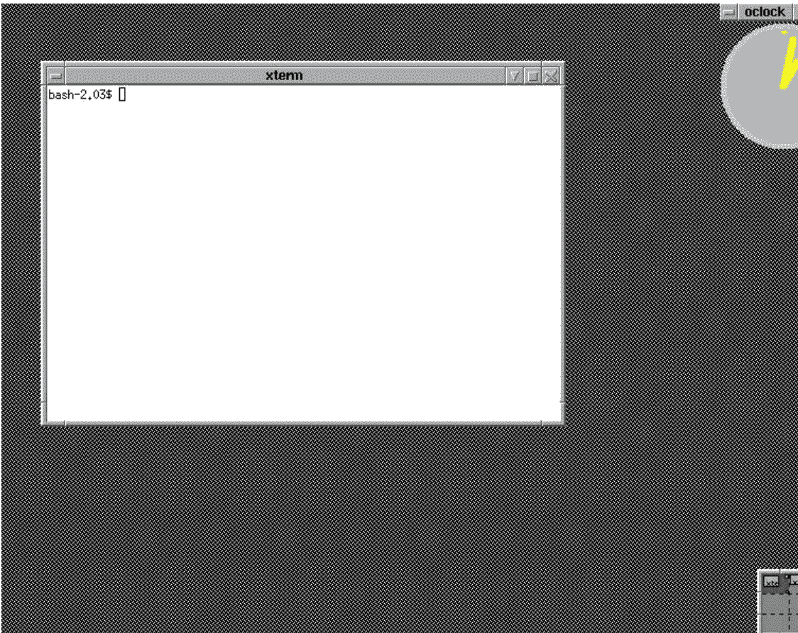
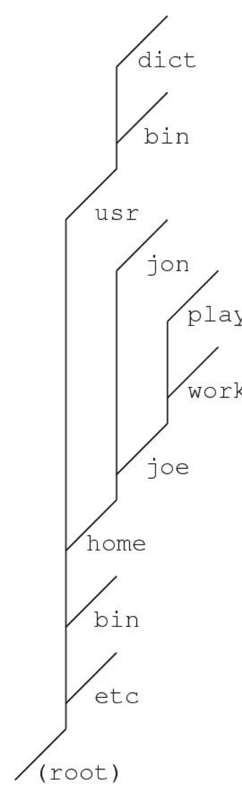
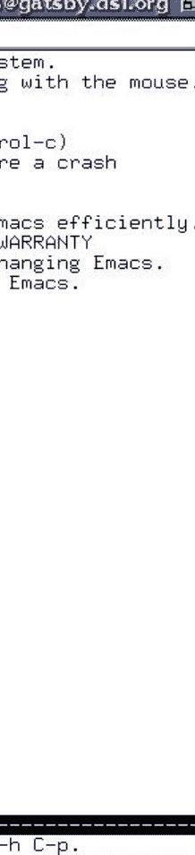
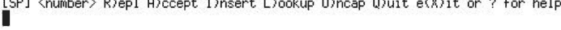
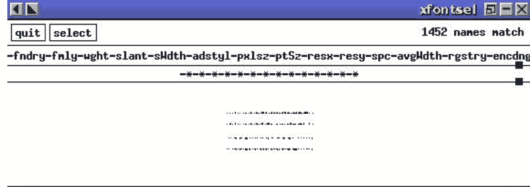
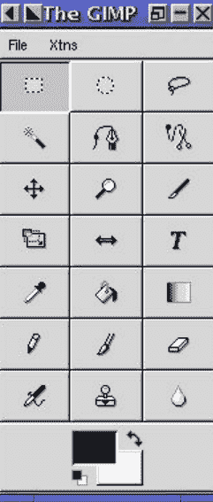
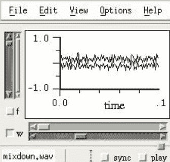
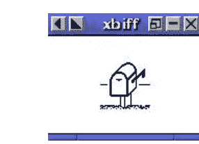
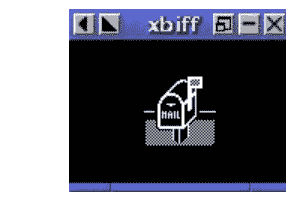

# Linux 秘籍：日常使用技巧与技术

## Linux 食常指南：日常使用的技巧与方法

## 目录

- 5.3.5 最大化窗口...............................................................................................72
- 5.4 在桌面上移动...............................................................................................72
- 5.5 在 X 中运行 Shell......................................................................................73
- 5.6 配置 X.....................................................................................................74
- 5.6.1 切换视频模式...............................................................................74
- 5.6.2 自动运行 X 客户端...............................................................................75
- 5.6.3 修改根窗口参数.....................................................................75
- 5.6.4 选择窗口管理器..................................................................76

## 第二部分：文件................................................................................................................78

## 6. 文件与目录....................................................................................................79

### 6.1 文件和目录的命名.......................................................................................83
- 6.1.1 创建空文件................................................................................................84
- 6.1.2 创建目录................................................................................................84
- 6.1.3 创建目录树..................................................................................85

### 6.2 切换目录.....................................................................................................85
- 6.2.1 切换到主目录...............................................................................86
- 6.2.2 切换到上次访问的目录...............................................................86
- 6.2.3 获取当前目录名称...............................................................................87

### 6.3 列出目录.......................................................................................................88
- 6.3.1 列出文件属性...............................................................................................89
- 6.3.2 递归列出目录...............................................................................90
- 6.3.3 先列出最新文件...........................................................................................90
- 6.3.4 列出隐藏文件...............................................................................90
- 6.3.5 以颜色列出目录................................................................................91
- 6.3.6 显示目录树图形...............................................................................91
- 6.3.7 额外的目录列出选项...............................................................92

### 6.4 编译文件和目录.....................................................................................93

### 6.5 移动文件和目录.....................................................................................94
- 6.5.1 将文件名更改为小写.......................................................................95
- 6.5.2 重命名多个相同扩展的文件..................................................96

### 6.6 删除文件和目录..................................................................................97
- 6.6.1 删除名称特殊的文件...............................................................................98
- 6.6.2 安全删除文件的方法...............................................................................99

### 6.7 给文件起多个名称...............................................................................99

### 6.8 使用模式指定文件名......................................................................100

### 6.9 浏览文件..................................................................102

## 7. 分享文件................................................................................................103

### 7.1 组以及如何在组中工作...............................................................................103


### 7.1.1 列出用户所属的组

### 7.1.2 列出组的成员

### 7.2 文件所有权

#### 7.2.1 确定文件的所有权

#### 7.2.2 修改文件的所有权

### 7.3 控制文件访问

#### 7.3.1 列出文件的权限

#### 7.3.2 修改文件的权限

#### 7.3.3 对文件进行写保护

#### 7.3.4 将文件私有化

#### 7.3.5 将文件公开

#### 7.3.6 使文件设为可执行

## 8. 查找文件

### 8.1 查找所有匹配模式的文件

### 8.2 在目录树中查找文件

#### 8.2.1 按名称在目录树中查找文件

#### 8.2.2 按大小在目录树中查找文件

#### 8.2.3 按修改时间在目录树中查找文件

#### 8.2.4 按所有者在目录中查找文件

#### 8.2.5 对找到的文件执行命令

#### 8.2.6 通过多标准查找文件

### 8.3 在目录列表中查找文件

#### 8.3.1 查找目录中最大的文件

#### 8.3.2 查找目录中最小的文件

#### 8.3.3 查找最小的目录

#### 8.3.4 查找最大的目录

#### 8.3.5 查找列表中的文件数量

### 8.4 查找命令的位置

## 9. 管理文件

### 9.1 确定文件类型和格式

### 9.2 修改文件的修改时间

### 9.3 将文件拆分为较小文件

### 9.4 比较文件

#### 9.4.1 确定两个文件是否存在差异

#### 9.4.2 查找文件之间的差异

#### 9.4.3 使用差异报告补丁文件

### 9.5 压缩文件

#### 9.5.1 压缩文件

#### 9.5.2 解压文件

### 9.6 文件归档

#### 9.6.1 创建文件归档

#### 9.6.2 列出归档内容

#### 9.6.3 从归档中提取文件


### 9.7 跟踪文件的版本

- 9.7.1 提交文件版本
- 9.7.2 检出文件版本
- 9.7.3 查看文件的版本日志

## 第三部分：文本

## 10. 查看文本

Linux 食谱指南：日常使用的技巧与技术：

# 目录

- 10.1 浏览文本
- 10.1.1 浏览文本文件
- 10.1.2 浏览多个文本文件
- 10.1.3 浏览文本时可用的命令
- 10.2 输出文本
- 10.2.1 显示非打印字符
- 10.2.2 输出文本的开头部分
- 10.2.3 输出文本的结尾部分
- 10.2.4 输出文本的中间部分
- 10.2.5 输出字符串之间的文本
- 10.2.6 以特定方言输出文本
- 10.3 文本流处理
- 10.4 查看图表
- 11. 文本编辑
- 11.1 选择完美的文本编辑器
- 11.2 Emacs
- 11.2.1 熟悉 Emacs
- 11.2.2 Emacs 编辑键
- 11.2.3 在 Emacs 中创建缩写
- 11.2.4 在 Emacs 中录制和运行宏
- 11.2.5 在 Emacs 中插入特殊字符
- 11.3 运行 Vi 教程
- 11.4 选择文本
- 11.4.1 剪切文本
- 11.4.2 粘贴文本
- 11.5 编辑文本流
- 11.6 合并文本
- 11.6.1 向文件写入文本
- 11.6.2 向文件追加文本
- 11.6.3 在文件开头插入文本
- 11.7 包含文本文件
- 12. 语法与参考
- 12.1 拼写
- 12.1.1 查找单词的正确拼写
- 12.1.2 列出文本中的拼写错误


### 12.1.3 列出拼写列表 171
### 12.1.4 交互式拼写检查 172
### 12.1.5 Emacs 中的拼写检查 173

## 12.2 字典 175
### 12.2.1 列出匹配模式的单词 176
### 12.2.2 列出单词的定义 177
### 12.2.3 列出单词的同义词 178
### 12.2.4 列出单词的反义词 178
### 12.2.5 列出单词的上义词 179
### 12.2.6 在线字典 179

## 12.3 检查语法 179
### 12.3.1 检查文本中的误用短语 180
### 12.3.2 检查文本中的重复单词 181
### 12.3.3 检查文本的可读性 182
### 12.3.4 检查文本中的困难句式 183
### 12.3.5 检查文本中的长句子 183

## 12.4 单词列表与参考文件 183

## 13. 分析文本 186
### 13.1 文本计数 186
#### 13.1.1 统计文本中的字符 187
#### 13.1.2 统计文本中的单词 187
#### 13.1.3 统计文本中的行数 187
#### 13.1.4 统计某内容的出现次数 188
#### 13.1.5 Emacs 中的行数计数 188

### 13.2 制作文本索引 189
### 13.3 排序相关性 189
#### 13.3.1 按相关性排序文本 190
#### 13.3.2 在 Emacs 中排序相关文件 191
### 13.4 查找文本中的字母异位词 192
### 13.5 查找文本中的回文 193
### 13.6 文本切割（Cut-Ups） 193
#### 13.6.1 简单的文本切割 194
#### 13.6.2 随机单词切割 194
#### 13.6.3 Emacs 中的文本切割 195

## 14. 文本格式化 196
### 14.1 文本间距 196
#### 14.1.1 消除文本中的多余空格 197
#### 14.1.2 单倍间距文本 197
#### 14.1.3 双倍间距文本 198
#### 14.1.4 三倍间距文本 199
#### 14.1.5 为文本添加换行符 199
#### 14.1.6 为文本添加边距 200
#### 14.1.7 交换制表符和空格字符 201


# 目录

## 14.2 文本分页

### 14.2.1 在每页放置页眉

### 14.2.2 文本分列

### 14.2.3 分页文本时的可用选项

## 14.3 文本下划线

## 14.4 文本排序

## 14.5 文本行编号

## 14.6 文本反转

## 15. 文本搜索

### 15.1 搜索单词或短语

### 15.2 正则表达式—匹配模式

## Linux手册：日常使用的技巧与技术：

# 目录

### 15.2.1 匹配以特定文本开头的行

### 15.2.2 匹配以特定文本结尾的行

### 15.2.3 匹配特定长度的行

### 15.2.4 匹配包含某些正则表达式中任意一个行的

### 15.2.5 匹配包含某些正则表达式所有的行

### 15.2.6 匹配不包含某个正则表达式的行

### 15.2.7 匹配仅包含特定字符的行

### 15.2.8 忽略空格查找短语

### 15.2.9 在特定上下文中查找模式

### 15.2.10 使用正则表达式列表进行匹配

### 15.2.11 常见情况的正则表达式

### 15.3 搜索纯文本之外的内容

#### 15.3.1 在压缩文件中匹配行

#### 15.3.2 在网页中匹配行

### 15.4 输出搜索的上下文

### 15.5 文本的搜索与替换

### 15.6 在 Emacs 中搜索

#### 15.6.1 在 Emacs 中进行增量搜索

#### 15.6.2 在 Emacs 中搜索短语

#### 15.6.3 在 Emacs 中搜索正则表达式

#### 15.6.4 在 Emacs 中搜索与替换

### 15.7 在 Less 中搜索

## 16. 排版与文字处理

### 16.1 为任务选择合适的排版系统

### 16.2 为了输出转换文本

#### 16.2.1 以字体输出文本

#### 16.2.2 将文本输出为海报或标牌

#### 16.2.3 输出带有语言高亮的文本

#### 16.2.4 输出带有花哨标题的文本

#### 16.2.5 以横向方向输出文本

#### 16.2.6 输出文本的多份副本


### 16.2.7 选择要输出的文本页面 234
### 16.2.8 额外的 PostScript 输出选项 235
## 16.3 LyX 文档处理 236
### 16.3.1 LyX 的特性 237
### 16.3.2 使用 LyX 编写文档 237
### 16.3.3 学习 LyX 238
## 16.4 使用 TeX 及其工具进行排版 240
### 16.4.1 是 TeX 文件还是 LaTeX 文件？ 241
### 16.4.2 处理 TeX 文件 241
### 16.4.3 处理 LaTeX 文件 242
### 16.4.4 使用 TeX 和 LaTeX 编写文档 243
### 16.4.5 TeX 和 LaTeX 文档模板 244
## 16.5 使用 SGML 工具编写文档 245
### 16.5.1 SGML 文档的元素 246
### 16.5.2 检查 SGML 文档语法 247
### 16.5.3 从 SGML 生成输出 247
## 16.6 其他文字处理器和排版系统 248
## 17. 字体 250
### 17.1 X 字体 251
#### 17.1.1 选择 X 字体名称 251
#### 17.1.2 列出可用的 X 字体 252
#### 17.1.3 显示 X 字体中的字符 253
#### 17.1.4 调整 X 字体大小 253
### 17.2 控制台字体 254
#### 17.2.1 设置控制台字体 254
#### 17.2.2 在控制台字体中显示字符 255
### 17.3 文本字体 255
#### 17.3.1 水平字体 255
#### 17.3.2 制作文本横幅 256
### 17.4 其他字体工具 257
# 第四部分：图像 258
## 18. 查看图像 259
### 18.1 预览文件 259
#### 18.1.1 预览 DVI 文件 259
#### 18.1.2 预览 PostScript 文件 260
#### 18.1.3 预览 PDF 文件 261
### 18.2 在 X 中查看图像 261
#### 18.2.1 在 X 中浏览图像集 264


# Linux 食菜指南：日常使用的技巧与技术：
# 目录

### 18.2.2 将图像放入根窗口 264
### 18.3 在控制台中浏览图像 265
### 18.4 在网页浏览器中查看图像 266
### 18.5 浏览 PhotoCD 存档 266
### 18.6 额外的图像查看器 267

## 19. 编辑图像 268
### 19.1 转换 268
#### 19.1.1 更改图像大小 269
#### 19.1.2 旋转图像 272
#### 19.1.3 调整图像颜色 272
#### 19.1.4 对图像进行标注 274
#### 19.1.5 为图像添加边界 275
#### 19.1.6 制作图像剪太 276
#### 19.1.7 合并图像 276
#### 19.1.8 两个图像之间的形变 277
### 19.2 使用格式转换图像 278
### 19.3 使用 GIMP 编辑图像 280
### 19.4 交互式图像编辑器和工具 281

## 20. 导入图像 283
### 20.1 截图 283
#### 20.1.1 在 X 环境下截图 283
#### 20.1.2 在终端中截图 284
### 20.2 扫描图像 285
#### 20.2.1 列出可用的扫描仪设备 285
#### 20.2.2 测试扫描仪 286
#### 20.2.3 扫描图像 286
### 20.3 提取 PhotoCD 图像 287
#### 20.3.1 转换 PhotoCD 图像 288
#### 20.3.2 去除 PhotoCD 雾感 288

## 21. PostScript 290
### 21.1 操作 PostScript 页面 291
#### 21.1.1 将 DVI 页面提取为 PostScript 291
#### 21.1.2 从 PostScript 文件中提取页面 291
#### 21.1.3 合并 PostScript 页面 293
#### 21.1.4 按装订顺序排列 PostScript 页面 294
### 21.2 操作 PostScript 文档 294
#### 21.2.1 调整 PostScript 文档尺寸 295
#### 21.2.2 合并 PostScript 文档 295
#### 21.2.3 在小册中安排 PostScript 文档 296
### 21.3 转换 PostScript 297


### 21.3.1 将 PostScript 转换为 PDF 297

### 21.3.2 将 PostScript 转换为纯文本 297

## 第五部分：音频 299

### 22. 音频文件 300

#### 22.1 音频文件格式 300

#### 22.2 调整音频控制 301

##### 22.2.1 列出当前音频设置 301

##### 22.2.2 更改音量级别 302

##### 22.2.3 静音音频设备 303

##### 22.2.4 选择音频录源 303

#### 22.3 播放音频文件 304

##### 22.3.1 播放 MP3 文件 305

##### 22.3.2 播放 MIDI 文件 305

#### 22.4 录制音频文件 306

#### 22.5 其他音频文件工具 307

### 23. 音频光盘（CD） 309

#### 23.1 控制 CD 音 309

##### 23.1.1 播放音频 CD 310

##### 23.1.2 暂停音频 CD 310

##### 23.1.3 停止音频 CD 311

##### 23.1.4 随机播放 CD 轨道 311

##### 23.1.5 显示音频 CD 信息 312

##### 23.1.6 推出音频 CD 313

#### 23.2 从 CD 采样音频 313

#### 23.3 写入音频 CD-R 314

#### 23.4 其他音频 CD 应用 316

### 24. 编辑音频文件 317

#### 24.1 使用音频文件的选择区域 317

##### 24.1.1 剪切音频文件部分 318

##### 24.1.2 粘贴音频片段 318

##### 24.1.3 混合音频文件 319

#### 24.2 音效 319

##### 24.2.1 更改音频文件的振幅 320

##### 24.2.2 更改音频文件的采样率 321

##### 24.2.3 为音频文件添加混响 321

##### 24.2.4 为音频文件添加回声 321

##### 24.2.5 为音频文件添加法波效果（Flange） 322

##### 24.2.6 为音频文件添加相位效果（Phase） 322

##### 24.2.7 为音频文件添加合唱效果（Chorus） 323

##### 24.2.8 为音频文件添加颤音效果（Vibro-Champ） 323

##### 24.2.9 反转音频文件 324

#### 24.3 转换音频文件 324

##### 24.3.1 制作 MP3 文件 325

##### 24.3.2 将 MP3 转换为其他格式 326

#### 24.4 其他音频编辑工具 326

## 第六部分：生产力 328

### 25. 磁盘存储 329

#### 25.1 列出磁盘可用空间 329


# Linux 食常指南：日常使用的技巧与技术：

# 目录

## 25.2 列出文件磁盘占用情况 330
## 25.3 软盘 331
### 25.3.1 格式化软盘 332
### 25.3.2 挂载软盘 332
### 25.3.3 卸载软盘 333
## 25.4 CD-ROM 333
### 25.4.1 挂载 CD-ROM 334
### 25.4.2 卸载 CD-ROM 335
## 26. 打印 336
### 26.1 制作和管理打印任务 337
#### 26.1.1 将任务发送到打印机 337
#### 26.1.2 打印任务的多份副本 338
#### 26.1.3 列出你的打印任务 338
#### 26.1.4 取消打印任务 339
### 26.2 更多打印配方 340
#### 26.2.1 在 Emacs 中打印 340
#### 26.2.2 使用 Dvips 打印 341
#### 26.2.3 打印 Xterm 窗口内容 342
### 26.3 为打印准备文件 342
#### 26.3.1 为打印准备 PostScript 文件 343
#### 26.3.2 为打印准备 DVI 文件 344
#### 26.3.3 为打印准备 PDF 文件 345
#### 26.3.4 为打印准备 Manual帮助页 (Man Page) 346
## 27. 跨平台转换 347
### 27.1 使用 DOS 和 Windows 磁盘 347
#### 27.1.1 列出 DOS 磁盘内容 348
#### 27.1.2 在 DOS 磁盘之间拷贝文件 348
#### 27.1.3 删除 DOS 磁盘上的文件 349
#### 27.1.4 格式化 DOS 磁盘 349
### 27.2 使用 Macintosh 磁盘 350
#### 27.2.1 指定使用的 Macintosh 磁盘 350
#### 27.2.2 列出 Macintosh 磁盘内容 351
#### 27.2.3 在 Macintosh 磁盘之间拷贝文件 351
#### 27.2.4 删除 Macintosh 磁盘上的文件 351
#### 27.2.5 格式化 Macintosh 磁盘 352
### 27.3 在 DOS 和 Linux 之间转换文本 353
### 27.4 转换 Word 文件 354
#### 27.4.1 将 Word 转换为 LaTeX 354
#### 27.4.2 将 Word 转换为纯文本 355
## 28. 提醒 356
### 28.1 显示日期和时间 356
### 28.2 播放语音时间通知 357
### 28.3 日历 358
#### 28.3.1 显示日历 358
#### 28.3.2 在 Emacs 中显示日历 360
### 28.4 管理预约 360


### 28.4.1 创建预约文件 361
### 28.4.2 在提醒中保留节假日 362
### 28.4.3 自动送送 363

### 28.5 联系人管理器 364
#### 28.5.1 维护免费的地址列表 364
#### 28.5.2 维护联系人管理器数据库 366

### 28.6 提醒自己事项 367
#### 28.6.1 给自己发送邮件提醒 367
#### 28.6.2 在需要离开时提醒自己 368
#### 28.6.3 延迟运行命令 369

## 29. 数学 370
### 29.1 计算算术运算 370
#### 29.1.1 进行快速算术计算 370
#### 29.1.2 进行多次算术计算 371
### 29.2 输出随机数 373
### 29.3 列出数字序列 373
### 29.4 寻找质数 374
### 29.5 转换数字 375
#### 29.5.1 转换计量单位之间的金额 375
#### 29.5.2 将阿拉伯数字转换为英文 376
### 29.6 其他数学工具 376

# 第七部分：网络 378

## 30. 通信 379
### 30.1 连接互联网 379
#### 30.1.1 设置 PPP 380
#### 30.1.2 控制 PPP 381
### 30.2 传真 382
#### 30.2.1 发送传真 383
#### 30.2.2 接收传真 384
#### 30.2.3 自动传真 384
#### 30.2.4 传真格式的转换 385
### 30.3 使用拨号器拨出 386

## 31. 电子邮件 388
### 31.1 发送邮件 389
#### 31.1.1 向系统用户发送邮件 389
#### 31.1.2 发送文件或命令输出 390
#### 31.1.3 发送 URL 内容 390
#### 31.1.4 特殊邮件组合键 391
### 31.2 接收邮件 392
#### 31.2.1 删除邮件 393
#### 31.2.2 阅读邮件时的可用选项 394
### 31.3 管理邮件 394
#### 31.3.1 查看邮件文件夹 395
#### 31.3.2 新邮件通知 395
#### 31.3.3 统计你有多少封邮件 397


### 31.3.4 查看邮件的发件人
397

### 31.3.5 验证电子邮件地址
398

### 31.4 附件
398

#### 31.4.1 读取邮件附件
399

#### 31.4.2 发送邮件附件
399

### 31.5 制作邮件签名
400

### 31.6 选择合适的邮件应用程序
401

## 32. 世界维网
403

### 32.1 浏览网页
403

#### 32.1.1 维护访问过的网站列表
405

#### 32.1.2 从脚本打开 URL
406

#### 32.1.3 Mozilla 浏览技巧
406

### 32.2 从网页查看图像
407

# Linux 菜谱：日常使用的技巧与技巧：

# 目录

## A. 管理问题
439

### A.1 Linux 与硬件的兼容性
439

### A.2 关闭系统
440

#### A.2.1 立即关机
441

#### A.2.2 在特定时间关机
441

#### A.2.3 取消关机
442

### A.3 安装软件
443

#### A.3.1 获取并安装 Debian
443

#### A.3.2 安装 Debian 软件包
443

#### A.3.3 升级 Debian 软件包
444

#### A.3.4 安装 Shell 脚本
445

### A.4 用户管理
446

#### A.4.1 创建用户账户
447

#### A.4.2 允许用户访问硬件外围
447

#### A.4.3 允许用户挂载驱动器
447

### A.5 显示系统信息
448

#### A.5.1 系统运行多久了？
448

#### A.5.2 我运行的是什么版本的 Linux？
449

#### A.5.3 我运行的是什么版本的 Debian？
450

## B. 网络上的 Linux 资源
451

## C. 许可证
453

### C.1 设计科学许可证（Design Science License）
453

### C.2 在你的作品中应用署权共享（Copyleft）
456

(1)
458


(2)................................................................................................................................................ 505

(3)................................................................................................................................................ 505

(4)................................................................................................................................................ 505

(5)................................................................................................................................................ 505

(6)................................................................................................................................................ 505

(7)................................................................................................................................................ 505

(8)................................................................................................................................................ 505

(9)................................................................................................................................................ 505

(10).............................................................................................................................................. 505

(11).............................................................................................................................................. 506

(12).............................................................................................................................................. 506

(13).............................................................................................................................................. 506

(14).............................................................................................................................................. 506

(15).............................................................................................................................................. 506

(16).............................................................................................................................................. 506

(17).............................................................................................................................................. 506

(18).............................................................................................................................................. 506

(19).............................................................................................................................................. 506

(20).............................................................................................................................................. 506

(21).............................................................................................................................................. 507

(22).............................................................................................................................................. 507

(23).............................................................................................................................................. 507

(24).............................................................................................................................................. 507

(25).............................................................................................................................................. 507

(26).............................................................................................................................................. 507

(27).............................................................................................................................................. 507


(28).............................................................................................................................................. 507

(29).............................................................................................................................................. 507

(30).............................................................................................................................................. 507

(31) ................................................................................................................................ 508

(32) ................................................................................................................................ 508

(33) ................................................................................................................................ 508

(34) ................................................................................................................................ 508

(35) ................................................................................................................................ 508

(36) ................................................................................................................................ 508

(37) ................................................................................................................................ 508

(38) ................................................................................................................................ 508

(39) ................................................................................................................................ 508

(40) ................................................................................................................................ 509

(41) ................................................................................................................................ 509

(42) ................................................................................................................................ 509

(43) ................................................................................................................................ 509

(44) ................................................................................................................................ 509

程序索引 ............................................................................................................ 509

概念索引 ............................................................................................................ 509

脚注 ............................................................................................................ 509

目录 ........................................................................................................ 510

简目录 ................................................................................................ 527

关于本文 ....................................................................................... 528

# Linux 菜谱：日常使用的技巧与技术

作者：Michael Stutz

注：`Info`（你正在阅读此内容的程序）很容易使用，但如果你不熟悉它，看起来可能很困难。如果你是 `Info` 的新手，我建议你在阅读本文之前运行内置教程来学习如何使用它。要运行帮助，只需按下 `h` 键。你可以在处于 `Info` 期间随时执行此操作。

- 前言
- 第一部分：与 Linux 工作
- 第二部分：文件
- 第三部分：文本
- 第四部分：图像
- 第五部分：声音
- 第六部分：效率
- 第七部分：网络
- A. 行政问题
- B. 互联网上的 Linux 资源
- C. 许可证
- 程序索引
- 概念索引

首先了解的内容。

- 文件操作。
- 单词与写作。
- 图形图像。
- 声音与音频。
- 提高效率的工具。
- 网络操作。
- 行政问题。
- 互联网上的 Linux 资源。
- 本书的版权许可。
- 程序名称索引。
- 菜谱与通用概念索引。

Linux 菜谱。版权所有 (C) 2001 由 Michael Stutz。

此信息免费提供；在某些条件下可以复制、分发或修改，但`不提供任何保证`；条款和条件请参考设计科学许可证（`Design Science License`）。

官方作者版由 No Starr Press, Inc. 独家安排出版。

硬装版作者版由 Publishers Group West 向美国图书贸易界发行，地址：1700 Fourth Street, Berkeley, California 94710，电话：800–788–3123 或 510–1248–1444，传真：510–528–3444

加拿大硬装版由 Jacqueline Gross & Associates, Inc. 向加拿大图书贸易界发行，地址：195 Allist Parkway, Markham, Ontario L3R 4B Canada，电话：905–477–0722，传真：905–477–8619


如需了解官方译本或美国境外分销商的信息，请直接联系 No Starr Press, Inc.：

No Starr Press, Inc. 555 De Har St, Suite 250, San Francisco, CA 94107 电话：415–863–9900; 传真：415–863–9950; info@nostarr.com; www.nostarr.com

Linux 菜谱：日常使用的技巧与技术

1

Linux 菜谱：日常使用的技巧与技术：

本书中使用了注册商标的名称。我们没有在每次出现注册商标名称时都使用商标符号，而是仅以编辑的方式使用这些名称，并为了商标所有者的利益，无侵犯商标之意。

[<] [>] [<<] [上] [>>] [顶] [目录] [索引] [?]

Linux 菜谱：日常使用的技巧与技术 2

# 前言

由于其健壮和稳定的特性，基于 Linux 的系统是如今数百万人的选择。某些人可能不知道的是，自由软件运动（Linux 属于其中）是一种非常大的反文化现象：其产生和发布的设计理念与长期主导主流文化的专有、知识“产权”观念背道而驰。虽然一些程序员将他们的研究转化为公司支持的软件，而你无法公开、共享或检查这些软件（只能在你的系统上购买并运行），但 Linux 和其他自由软件是许多个人勇敢发布并分享他们的工作并开源的成果，供所有人受益。

我写这本书是因为我希望每个人都能学会如何使用这种软件，因为我认为每个人都应该拥有随之而来的自由。我不介意使用专有软件——因为它们劣于自由软件，因为它们的使用排斥了自由——在一个自由、开放的社会中，自由应该是每个人与享的权利。（见引言）

我知道 Linux 并不难使用，特别是与其他软件和操作系统相比，但我们需要一份指南告诉人们如何使用它来完成任务：“噢，你想做那个？在这里输入这个”

这解释了本书的目的——这是一份在 Linux 系统上完成任务的实践指南，专为非程序员设计。

传统方法要么提供可用命令和应用程序列表，要么关注编程或其他技术环境。本书采用了不同的方法，展示了用户——无论是艺术家、商人、学者还是科学家——如何使用这些工具来完成任务。当我们谈论“任务”时，我指的是（希望）你——即上述描述的那种人——可能想要用现代计算机系统做的：查看文本和图像、播放声音、执行数学运算、格式化文本、访问互联网、检查语法等等。

就像美食书籍一样，本书提供了准备或完成特定任务的“菜谱”。我选择了完成特定任务最简单有效的方法，并将这些菜谱安排在各个主题中——书的第一部分关于入门，包含了你了解 Linux 所需的核心信息；其余章节涉及通用类别：文件、文本、图像、声音、效率和网络。

### 1.1 假设、范围和排除

### 1.2 打印规范

### 1.3 版本、最新版和错误

### 1.4 致谢

菜谱的组织。

假设、范围和排除。

打印规范。

版本、最新版和错误。

帮助本书的人。

Linux 菜谱：日常使用的技巧与技术：

[<] [>] [<<] [上] [>>] [顶] [目录] [索引] [?]

## 1.0 菜谱的格式

每份菜谱都以章节编号，第一个数字始终对应章节，第二个数字对应菜谱部分。例如，第 3 章是“终端（Shell）”，菜谱 3.5 是关于终端的第五份菜谱，“记录会话”。

有时菜谱被分为子章节，第三个数字指定具体的菜谱——例如，菜谱 3.4 是命令历史的主题，并分为子章节；菜谱 3.4.2 是命令历史的第二份菜谱，“指定命令”。

每份菜谱都描述了在系统中完成特定任务的方法；这些任务至少需要一个软件程序。菜谱所需的软件（程序或文件）结构如下：

1. 菜谱编号和标题。

2. 特殊食材（如果有）。相应的 Debian 包或获取程序的 URL。Debian 按重要性程度对软件包进行分类，`optional`和`extra`软件包是你在需要时才安装的。如果运行所需的描述软件包属于前两个类别——`required`和`important`——那么我假设你已经安装了它，此处未列出包名。如果描述的软件包没有作为 Debian 包提供，我将提供该软件源码包的 URL；让你的系统管理员安装。

3. 特殊准备方法或描述（如果有）。当描述一个可配置程序时，除非另有说明，否则假设 Debian 版本提供的标准设置。

4. 菜谱描述和“烹饪”方法。

5. 菜谱描述和“烹饪”方法。

6. 方法的列表示例。

7. 你可能执行做的额外命令或操作。

8. 菜谱的变体。

9. 特殊说明或更多信息的引用。

Linux 菜谱：日常使用的技巧与技术：

[<] [>] [<<] [上] [>>] [顶] [目录] [索引] [?]

## 1.1 假设、范围和排除

本书对你（读者）以及你的系统做出了几个假设。

菜谱假设你对电脑至少有最基本的了解——你不需要知道如何操作它、电脑的电源按钮在哪里、如何给打印机装纸等。你可能在这些任务中的任何一项需要帮助，无论是作为经销商还是你设置的另一方。

本书还假设你已经安装并正确配置了 Linux，并且设置了你的账户。如果你需要这方面的帮助，请参见“如果你需要帮助”。

虽然这本书可以并被 Linux 新手使用，但我希望我涵盖了足够的内容，让魔法师、黑客和 Linux 核心成员可能会发现其中某些部分有用——并且这些用户不会没有在书桌上放一份本书，或作为他们收藏的一部分。

最后，关于菜谱中未涵盖内容的说明。

本书描述了运行在 Linux 系统上的自由软件（有时被称为“开源”）。(1) 专有软件被省略了，因为目前大多数软件包处于“测试版”或某些尚未供普通使用的不稳定发布阶段。

# Linux 菜谱：日常使用的技巧与技术：

## 1.2 字体规范

每个食谱都至少有一个示例来演示其用法。

- 描述示例的文本出现在示例本身之前，并通过项目符号与正文隔开，如下所示。

- 给定的食谱可能会有多个变体；每个变体都用自己的项目符号隔开。

- 某些食谱中使用的文档或用户名称并不总是引用你系统上的实际文档或用户，而是为了演示所涉及的通用原理。因此，当我演示如何打印一个名为 `resume` 的文件时，你的系统中可能并不一定有一个同名的文件，但你应该理解该食谱所演示的概念。

有时，会显示终端屏幕以来说明交互式会话：

```
$ 你实际输入的内容将以斜体显示，如下所示。如果要在 shell 提示符处输入，命令前会有一个 `$` 字符。
```

表示程序输出的文本以等宽 Courier 字体显示，如下所示。

```
$
```

在示例中，如果提示符省略了默认的当前工作目录而仅使用 `$`；当命令输出文本后退出时，示例行包含一个 `$` 字符以表示返回 shell 提示符。如果你初觉得这很奇怪，不要担心；所有关于 `shell` 的内容在 [The Shell](http://example.com) 中都有解释。

当命令执行并返回 shell 提示符而不输出文本时，最后的 shell 提示符将被省略，且不会在示例周围绘制边框；这完全出于审美考虑。

文件或目录名称在正文中显示为 `file`；命令显示为 `command`，而文本字符串显示为 `some text` 这样的类型。GNU INFO BUG：注意，字体和外观的差异在 info 查看器中大部分会丢失。

你的输入类型书写为**像这样**，如示例所示；当提到键盘上的特殊键时，其约定名称位于方框中。RET 表示键盘上的 `Return` 键。(2)(http://example.com)。

在需要同时按下并按住键的示例中，按键之间用连字符分隔；连字符并不是要求字面上的按下。例如，同时按下并按住 `CTRL`、`ALT` 和 `DEL` 键在某些操作系统中是有意义（包括 Linux，该组合键意味着关闭系统并重启电脑）；其表示方式如下：

CTRL-ALT-DEL

`CTRL` (`Control`) 键始终与另一个键组合使用；这些组合用 C-X 表示，其中 X 是第二个键。这些组合的读法为 `control-x`，其中 x 是键的名称。要输入这些组合之一，按下并按住 CTRL、第二个键，然后释放两个键。

- 例如，要输入 C-d（读作 `control d`），请按下并按住 CTRL 和 D 键，然后释放两个键。

在某些应用程序中（Emacs 编辑器；见 Emacs 章节），`META` 键与另一个键一起使用，其方式与 SHIFT 相同；这些组合用 M-X 表示，其中 X 是第二个键。现在的大多数键盘没有 META 键，尽管该术语仍在在使用；相反，请按下并释放 ESC，然后输入第二个键。

- 要输入 M-c，释放 ESC 然后按下并释放 C 键。

你也可以用 ALT 作为 META 键。这在 X Window 系统中通常无效，但在控制台中你可以按下并按住 ALT，然后像处理 CTRL 键序列一样输入第二个键。

- 所以要用 ALT 键输入 M-C，按下并按住 ALT，然后释放两个键。

CTRL 和 META 序列均不区分大小；例如，在最后一个示例中按下 X 与按下 x 相同（尽管 x 显然更容易输入）。按照习惯，C- 或 M- 前缀始终以大写字母给出，而随后的键始终以小写字母给出。

应用程序中的菜单项书写为 `Menu Item`；命令名称写为 `Function`。


出于审美考虑，文本命令与结束命令行的最后的 RET 之间会出现物理空格，但该空格并不是字面输入的（尽管你实际上输入这个空格也不会发生任何事）。在明确要求调用空格键的地方，该键在示例由 SPC 表示。

[<] [>] [<<] [Up] [>>] [Top] [Contents] [Index] [?]

## 1.3 版本、最新版与勘误说明

`@sf(WWW): http://dl.org/cookbook/`

《Linux 菜谱》有纸质版和机器可读文件。该书的文本最新版（`electronic text`）始终可以从万网上的发行网站获取。该网站包含最新的完整文本（采用 HTML 和 GNU Info 格式），并提供以折扣购买最新版纸质书的方法。

*序言 *这是一个脚注。星号用于演示目的。*

我们已尽力包含以最简单、高效的方式完成任务的最佳免费软件食谱，并且它们被认为是正确的。欢迎提出建议、意见和错误报告；你可以通过邮件 stutz@dsl.org 联系作者。

[<] [>] <<] [Up] [>>] [Top] [Contents] [Index] [?]

## 1.4 致谢

这本书并非由于孤立存在而诞生的。只有在以下人士的帮助下，这本书才得以出版并现在呈现在你面前。每一位参与 No Starch Press 出版此书的人都值得我们诚挚的感谢。项目经理 Karol Jurudo 不断工作维持制作流程，并在需要时处理我的输入并提供意见和建议。

还要感谢 David Sims、Chris Coleman 和 Terry Schwitzer，他们都是 O’Reilly Network 非常棒的合作者，我在“Living”专栏就在那里运行。

我非常感激陈宝薇，她的《中国菜烹饪》（How to Cook and Eat in Chinese, John Day Company, 1945）正如本书的基调和结构一样带给了我灵感。对我先前的其他作者也有同样的情感，他们的作品对本书的写作有直接影响——李嘉安博士（The Fine Art of Chinese Cooking, Gramercy Publishing 1962）和 Andrew Walker（The UNIX Environment, Wiley, 1984）。

序言

## 第一部分：Linux 实战

- 2. 简介 - 本书介绍。
- 3. 每个 Linux 用户都应该知道的 - 需要学习的第一批命令。
- 4. Shell - 关于使用 bash shell 的一切。
- 5. X 窗口系统 - X 窗口系统简介。

## 2. 简介

在我们进入真正的“烹饪”和食谱之前，本书的第一个部分将处理准备工作，解释了使用 Linux 的通用技术和方法——包括如何准备好该系统以供使用，以及如何在系统上运行命令。

书的其余部分都是食谱，它们根据其执行的任务或处理的对象（例如文本、文件、图像等）进行分类的。

- 2.1 背景与历史
- 2.2 首先应该尝试什么
- 2.3 如果你需要更多帮助

背景历史。

首先应该尝试什么。

如果你需要更多帮助……

### 2.1 背景与历史

为了理解 Linux 到底是什么，了解一下它的起源故事将有所帮助。因此，这是一份历史概述，为本书的主题软件提供了简洁的背景介绍。

- 2.1.1 什么是 Unix？
- 2.1.2 什么是自由软件？
- 2.1.3 什么是开源？
- 2.1.4 什么是 Linux？
- 2.1.5 什么是 Debian？
- 2.1.6 Unix 与工具哲学。

Unix 与工具哲学。

#### 2.1.1 什么是 Unix？

```
@sf (WWW): http://www.bell-labs.com/history/unix/
@sf (WWW): http://internet-history.org/archives/early.history.of.unix.html
```

Linux 的原始祖先是一个操作系统。或者说它曾是一个操作系统；被称为正统 Unix 的原始系统并不是我们今天认识和使用的“Unix”；现在有许多

# Linux 烹饪指南：日常使用的技巧与技术：

各种“口味”的 Unix，而 Linux 已成为最流行的一种。

Unix 及其相关软件是 20 世纪 60 年代的产，是由 Dennis Ritchie、Ken Thompson、Brian Kernighan 以及其他黑客于 1969 年在贝尔实验室发明的；它的名字是当时另一个操作系统 Multics 的变体。(3)

在 Unix 早期，任何拥有运行该系统硬件的感兴趣方都可以以低廉的价格从贝尔实验室获取软件磁带以及印刷版手册。（这在个人电脑时代之前，在实践中，大多数是大学和研究实验室。）拥有软件源代码的本地站点根据自己的需求和喜好对系统进行扩展和定制。

从 20 世纪 70 年代后期开始，加州大学伯克利分校的计算机科学家在研究过程中被允许对 Unix 源代码进行自己的改进和增强，这包括了 TCP/IP 网络的发展。他们的工作被称为 BSD（伯克利系统分发版）版本的 Unix。

其源代码在允许重新分发的许可下公开可用，无论是否包含源代码，只要对部分代码部分归功于伯克利即可。今天仍在开发许多现代的 BSD 变体，其中某些（如 NetBSD 和 OpenBSD）可以在个人电脑上运行。

> 注意：大写字母“UNIX”已成为 AT&T 的商标（后已转移给其他组织），指代他们特定的操作系统。但当人们说“Unix”时，他们通常指的是“Unix 类操作系统”，这是一个包含 Linux 的泛指。

如果你想有关此主题的进一步信息，你可能希望参考 Peter H. Salus 的《A Quarter of Unix》（Addison-Wesley, 1994），该书已成为该领域的教材。

#### 2.1.2 什么是自由软件？

```
@(1998): http://www.gnu.org/
```

多年来，软件的流行程度日益增加。在 80 年代初，当软件通常以物理形式存在时，自由软件的开发成为一种规避版权法律的方法，根据严格的条款允许任何人复制和修改。

1984 年，在剑桥的马萨诸塞理工学院，黑客 Richard Stallman 发现自由软件变得越来越稀少。他决定启动一个新的类 Unix 操作系统，使其源代码对所有人免费。GNU 项目（“GNU 不是 Unix”）

GNU 项目通用公共许可协议，或简称 GPL，是所有自由许可协议中使用范围最广泛的。它通俗地称为“左拷贝”（copyleft），它允许任何人复制或修改根据其条款发布的任何软件——前提是所有衍生作品或修改都必须以相同的条款发布，并且所有更改都要记录在案。

自由软件并不意味着没有任何成本；“自由软件”中的“free”一直指的是自由，而不是价格。个人和公司可以对自由软件收费，但任何人都可以自由地与邻居分享、更改或查看其源代码。

专有软件严格限制了这些自由——根据版权法，而该法制定于软件以物理形式而非数字数据分发的时代。

GNU 项目的软件将赋予他们应得的所有自由，包括查看其工作原理的自由。

#### 2.1.3 什么是开源？

```
@sf(now): http://www.opensource.org/
@sf(now): http://www.gnu.org/philosophy/free-software-for-freedom.html
```

开源一词最早由自由软件黑客于 1998 年引入，作为“自由软件”的营销术语。他们认为，一些不熟悉自由软件运动的人——对投入其中的多年工作表现兴趣的大型公司——可能会被“free”（免费）这个词吓跑。他们担心这些公司的决策者可能会将自由软件与免费软件（freeware）混淆，后者是免费提供且仅以可执行形式提供的。

开源计划（OSI）的成立是为了推广符合其“开源定义”的软件，该定义是 Bruce Perrin 作为 Debian 的一套软件收录指南衍生而来的。所有自由软件——包括根据 GNU 通用许可许可证发布的软件——都符合这一定义。

但一些自由软件倡导者和组织，GNU 项目完全并不认可“开源”这一术语，认为它掩盖了这一运动中“自由”的重要性。(5)

无论你称之为自由软件、开源软件还是其他名称，有一个基本的

这种软件与专有、非自由软件之间的区别在于——自由软件始终确保每个人都能获得关于该软件的基本自由。

#### 2.1.4 什么是 Linux？

20 世纪 90 年代，芬兰计算机学生林斯·托瓦尔斯（Linus Torvalds）开始破解 Minix，这是一种小型的类 Unix 操作系统，当时被用于大学的操作系统课程中。(6) 他决定通过编写自己的内核来改进运行 Minix 的核心组件——*内核*。内核是任何类 Unix 操作系统的核心组件。

1991 年，托瓦尔斯在互联网上发布了该内核的第一版本，并将其命名为“Linux”（这是 Minix 和他名字的双关游戏）。(7)


当托瓦尔斯发布 Linux 时，他使用了 GNU 项目的左版许可证软件，即 GNU 通用公共许可证（GPL）。这样做使得他的软件可以被自由使用、复制和修改——前提是任何副本或版本都保持自由。托瓦尔斯邀请了其他程序员的贡献，这些贡献确实来了；起初很慢，但随着互联网的增长，来自全球的黑客和程序员都为他的自由项目做出了贡献。Linux 软件得到了极大的扩展和改进，以至于今天基于 Linux 的系统是一个完整的、现代的操作系统，程序员和非程序员都可以使用；这本正是如此。

## 2.1.5 什么是 Debian？

`sf` (WWW): http://debian.org/

要制作出我们可以在计算机上使用的东西，不仅仅是单个软件——必须有某种东西将所有部分整合成一个凝聚、可用的集合，并测试所有部分，同时跟每个软件的新进展保持更新（任何一个部分的微小变化都可能引入新的软件依赖问题或与其余部分冲突）。一个*发行版*就是这样一个集合。当然，你可以这样做并“自制”发行版——它们全都是自由软件，*任何人*都可以向其添加或删除内容，并认为值得这样做。大多数人选择将发行业务交给专家。

为了本书，我将假设你正在使用 Debian GNU/Linux 发行版，在所有主要发行版中，它是唯一按照与 Linux 内核和其他大多数自由软件相同的方式——即由个人进行设计和组装的。

我在本书的任何地方（包括标题）说“Linux”，除非另有说明，否则我指的不是裸内核本身，而是整个自由软件系统。有些人称之为“GNU/Linux”。(8)

还有许多其他发行版，其中一些相当不错——例如许多用户 Red Hat Linux，它非常受欢迎且易安装。SuSE 发行版在欧洲广受认可。当人们谈论 Linux 时代的 Debian、Red Hat、SuSE 等时，他们指的是由这些公司或组织组装和重新组装的特定 Linux 及相关软件发行（参见[网络上的 Linux 资源](http://www.linux.org)）。发行版的核心是相同的——它们都是 Linux 内核、GNU 项目软件和其他自由软件——但每个都有自己的封装方案、默认设置和配置方法。这绝意味着不能安装和使用任何其他发行版，书中的每个配方都适用于所有它们（特定的 Debian 系统的变体除外，这些变体在文中已标注）。

在 Debian 早期，它被称为“黑客发行版”，因为对于新手来说，安装和管理它非常困难。然而，情况已经发生了——今天任何 Linux 都可以轻松地安装和使用今天的 Debian。

**注意：** 我推荐 Debian 是因为它是非企业化的、开放开发的、健壮的（标准的 Debian CD-ROM 带有 2500 多个软件包！），并且它在设计上完全致力于自由软件（有些发行版并非如此）。

## 2.1.6 Unix 和工具哲学

`@sf` (WWW): http://cm.bell-labs.com/cm/cs/upe/

`@sf` (WWW): http://www.cs.bell-labs.com/cm/cs/pearls/

为了理解在 Linux 上执行任务的方式，有必要对 Linux 所构建的软件背后的哲学进行一些讨论。深入了解这些迷人的水域，将有助于明确本书作为“食谱”的角色。

Unix 操作系统已经生存了三十多年，这一事实应该告诉我们其设计考量的永恒性。其中这些考量之一——也许是最持久的——就是“工具”哲学。

大多数操作系统的设计理念基于文件概念，即一组用于处理文件的实用程序，并将大型工作留给应用程序来完成：文字处理器、电子表格、演示文稿设计器、网络浏览器。（当其中几个应用程序能够识别彼此的文件，或共享公共接口时，这组应用程序被称为“站点”（site）。）

这些每个单体应用程序假设都有一个“打开文件”的操作来从磁盘读取文件并在应用程序中打开；它们大多数都带有文本搜索和替换、拼写检查、打印文档等功能。处理所有这些任务的程序源码必须单独计算，每个应用程序都会在内存和磁盘上占据额外的空间。这是一种反 Unix 的方法。

在专有软件的情况下，所有的实际源代码都对公众隐藏——所以其他程序员无法对任何部分进行构建或从其学习。这种闭源软件向世界展示得像一种魔术：如果你购买了程序的副本，你可以使用它，但你永远无法学习该程序实际上是如何运行的。

结果是，在所有这些不同的应用程序内部，处理本质相同的功能的代码必须由程序员每次从零开始、单独且独立于其他程序进行开发——因此，由于程序员为了低效地反复重新发明为了执行任务的所有软件功能，而浪费了无数的时间和精力，整个社会的进步就被滞后了。

类 Unix 操作系统并不那么看重应用程序。相反，它们配备了许多被称为“工具”的小程序。每个工具通常都能执行一个非常简单、特定的任务，并且执行得很好——一个工具只输出传递给它的数据，一个工具负责排序。

Unix 早期的一个重要发展是发明了“管道”（pipes），一种将一个工具的输出传递给另一个工具的方法。通过了解单个工具的功能以及它们如何连接，用户现在可以构建强大的命令“链”。

就像钢的抗拉强度大于其成分（镍、镉和铁）增加的强度一样——多个工具可以用来执行单个工具无法完成的任务，这构成了 Unix 哲学的基础。(9)

这里有一个示例，使用了两个工具。第一个工具 `who` 输出当前登录系统的用户列表（参见“系统中的用户”列表）。第二个工具是 `wc`，代表“count”；它输出你输入的单词（或行或字符）计数（参见“计数文本”章节）。

通过结合这两个工具，将 `who` 的输出给 `wc`，你可以构建一个新命令来列出当前系统中的用户数：

```
$ who | wc -l
4
```

在这个示例中，显示了 4，表示当前有四个用户登录系统。（顺便提一下，这样将 `who` 的输出管道到 `wc` 是经典的工具示例，Andrew Walker 在 1984 年出版的书籍《Unix 环境》中将其称为“世界上被引用最多的管道”）。

```
$ tr -cs A-Za-z-'012' | tr A-Z -z | sort -u | 
comm --23 /usr/dict/words
```

这个命令（在一行内输入）使用 `tr`、`sort` 和 `comm` 工具来制作一个拼写检查器——在你输入此命令后，你输入的文本行（直到你中断它）会通过两次 `tr` 调用转换为一个单列的小写单词列表，按字母顺序排序并过滤掉重复项，然后结果列表将与 `/usr/dict/words` 进行比较，它是系统的“字典”，一个按字母顺序排列的正确写单词列表（参见“拼写检查”章节）。

# Linux 菜谱：日常使用的技巧与技术：

在旧的 Unix 系统中，有一组围绕被称为“工作台”（workenches）的领域或概念设计的工具集；例如，检查输入文本拼写、写作风格和语法的工具就属于“作家工作台”（Writer's Workbench）软件包的一部分（检查语法）。

GNU 项目根据某些通用主题发布工具，例如“GNU 文本实用程序”和“GNU 文件实用程序”，而这些“工作台”通常不符合当今基于 Unix 系统的习惯。无需多说，我们仍然在使用各种工具来完成所有任务；本书的大部分内容详细介绍了各种工具的组合，以获得各种任务所需的结果。

你会发现，对于给定的任务，通常有一个工具或命令序列可以完美运行，有时通过不同工具的组合也可以处理出满意的结果——尤其是在 Unix 专家的手中。（传统上，这种专家被称为*wizard*，巫师）。

有些任务需要一个以上的工具或命令。是的，有些任务需要的远超于这些简单手艺或双手能提供的范围。某些任务需要更工业化的工具，这些工具目前由应用程序提供。因此，我们还没有完全避免应用程序；在千禧年之交，基于 Linux 的系统仍然拥有它们，从编辑器到浏览器。我们的应用程序使用一种文件格式，我们可以在这些日期上使用所有的工具，

新工具的发明随着基于 Linux 系统力量的增强而兴起。在写作时，我的 Linux 系统的两个主要工具目录（`/bin` 和 `/usr`）中总共有 1,190 个工具。这些工具结合必要的应用程序，使得自由开源软件——也许是历史上第一次——变成了一个通用的、完整且健壮的系统。

## 2.2 先尝试什么

本书的前四章包含了你开始使用 Linux 所需的所有介绍性材料。这些都是基础。

Linux 初学者应该从这几章描述的概念开始。一旦你学会了如何启动系统和登录，就应该查看关于外壳（shell）的章节，以便熟悉在命令行提示符下输入内容，并阅读名为 X Window 系统的图形界面的章节，这样你就可以根据需要启动 X 并从那里运行程序。

如果你是一个新手并且急于进入状态，你可能想跳过直接阅读关于文件和目录的章节，以便对系统外观以及如何在其中操作有一个感觉。然后，继续学习如何查看文本以及如何在编辑器中编辑它（分别在查看文本和文本编辑的章节中描述）。根据你的兴趣探索书的其他部分。

所以，总结一下，以下是我认为的熟悉 Linux 系统基本用法需要吸收的核心材料：

- 1. 简介（即本章）。
- 2. 每一位 Linux 用户都应该知道的。
- 3. Shell（暂时忽略关于自定义的章节）。
- 4. X Window 系统（暂时忽略关于配置的部分）。
- 5. 文件和目录。
- 6. 查看文本（主要是第一节，审阅文本）。
- 7. 文本编辑（足以选择一个文本编辑器并开始使用）。


如果你对某个工具或应用程序有疑问，请在程序索引中查找（参见“程序索引”章节）。列出配方名称和涉及的通用概念的索引被称为概念索引（参见“概念索引”章节）。

### 2.3 如果你需要更多帮助

如果你需要比这本书能提供的更多的帮助，请记住你还有其他选择。尝试以下步骤来获取帮助：

- 很有可能你的问题不是唯一的，别人已经问过类似的问题了；因此，“常见问题集”（FAQ）汇编可能就是你需要的答案：Debian FAQ 和 Linux FAQ。
- Linux 文档项目（Linux Documentation Project）是最完整、最新的 Linux 相关文档中心；查看是否有与你需要的帮助的主题相关的文档。
- Usenet 的 `news.comp.os.linux.help` 和 `news.linux.debian.user` 通常是与其他用户讨论问题的极佳场所。（Usenet 在“阅读 Usenet”中描述）。
- 检查 `http://linux.com/lug/` 来寻找离你最近的 Linux 用户组（LUG）——参与 LUG 的人有很多手——而且与当地的其他 Linux 和自由软件爱好者互动可能很有趣且受益匪浅。
- 最后，你可以聘佣顾问。如果你需要立即完成工作并且愿意付费，这可能是一个不错的选择。

Linux 顾问 HOWTO 是一份全球顾问列表，他们为 Linux 以及通用的开源软件提供各种支持服务（参见“阅读系统文档和帮助文件”章节）。顾问有各种兴趣和专业领域，他们在文档中列出并带有联系方式。

## 2. 简介

## 3. 每一位 Linux 用户都应该知道的

本章涉及每个 Linux 用户都知道的概念和命令——如何启动和停止系统。

- 3.1 控制系统电源
- 3.2 账户与权限
- 3.3 控制台基础
- 3.4 运行命令
- 3.5 修改你的密码
- 3.6 列出活动
- 3.7 系统活动
- 3.8 帮助设施

### 3.1 控制系统电源

这些配方展示了如何启动和停止系统；操作不会导致工作丢失。以下描述了一种普通用户就可以执行的关闭方法；传统的关机方法只能由管理员执行。

- 3.1.1 为系统供电
- 3.1.2 关闭系统

#### 3.1.1 为系统供电

开始使用系统的第一件事是给它供电。要启动系统，只需打开电源。这被称为引导（booting）。

当 Linux 内核引导时，屏幕上会出现很多信息。一段时间后，系统将显示登录提示符。你现在可以登录了。某些系统配置为启动时启动 xdm（参见启动 X）。如果你的系统是这样配置的，你看到的不是上述登录提示符，而是一个带有密码框的图形界面。按下 `CTRL-ALT-F1` 切换到虚拟控制台，你可以在那里登录。

#### 3.1.2 关闭系统

当你在使用电脑时不能直接拨掉开关，因为 Linux 会不断向磁盘写入数据。即使在空闲时它会在内存中保留数据。直接关闭电源会导致丢失。要关闭单个系统，首先退出所有控制台（在“控制台基础”中讨论过）。然后输入 `CTRL-ALT-DEL`（同时按住这三个键）。

系统在关闭时会打印一些信息，当你看到 `Rebooting...` 行时，就可以安全地关闭电源了。

`注意`：看到此消息后不要等太久；如果没有卸载，系统将重启，你又回到起点！

### 3.2 账户与权限

Linux 是一个多用户系统，这意味着许多用户可以从不同的终端同时使用一个 Linux 系统。为了避免混淆（并维持某种隐私），每个用户的工作空间必须与他人分开。即使 Linux 系统是一台没有其他物理终端的独立个人电脑，连接到它后，它可以被不同的人在不同时间共享，这使得用户工作空间的分离仍然是一个有效的问题。

这种分离通过为每个个人在系统上创建一个账户来实现。你需要一个账户才能使用系统；有了账户后，系统会为你分配一个独立的工作空间，以及一个用于让系统和他人识别你身份的唯一用户名。这个名字（以及其他标识）将用来标识你；它是一个单词，全部采用小写字母。

在安装过程中，系统管理员应该已经为你创建了一个账户。（系统管理员有一个用户名为 `root` 的特殊账户；该账户对整个系统具有完全访问权限，因此通常被称为（超级用户））。

直到 20 世纪 90 年代中期，使用名字的首字母加上姓氏仍然是一种常见做法。

除了用户名，你还应该有一个可以保密的密码，以确保只有你可以使用你的账户。良好的密码应该是难以被猜到的文本（即：不要使用像 `secret` 这样明显的词，或者如果你的宠物猫恰好叫 'Ruski' 这样的名字）。一个良好的密码应该是容易记忆的，这样你就不需要写下来，但在结构上又足够复杂，以至于没人能猜到。例如，对于一个第一次约会是看阿尔弗雷德·希区柯克执导的《39步》的人来说，`t39sAH` 可能是一个很好的密码。

注意：虽然用户名始终全小写，但密码是区分大小写的；'Secret'、'secret' 和 'SECRET' 都被视为不同的密码。

- 3.2.1 登录系统：如何登录系统。
- 3.2.2 注销系统：如何注销系统。

#### 3.2.1 登录系统

要在 Linux 系统上启动会话，你需要登录。这是通过在终端的 `login:` 提示符输入你的用户名，然后在提示时输入密码来实现。

`login:` 提示符出现在系统启动后。如果你的系统配置为在启动时启动 X Window 系统，你将看到 X 登录界面而不是标准的登录提示符。如果发生这种情况，按下 `CTRL-ALT-F1` 切换到文本登录界面；这在《控制台基础》中会有进一步解释。

一个典型的 `login:` 提示符看起来如下：

```
Debian GNU/Linux 2.2 bardo tty1
```

```
bardo login:
```

每个系统都有自己的名字，即系统的 `hostname`（主机名）。Linux 系统有时被称为 `host`，它通过主机名作为 `login:` 提示符来标识自己。为系统命名是很重要的——就像为用户账户命名一样，主机名提供了你正在使用的名称（当将系统连接到网络时变得尤为重要）。系统管理员通常在最初配置时命名系统（主机名可以随时更改；它的名称保留在 `/etc/hostname` 文件中）。与主机名不同，其他标识是全小写的单个单词。人们通常给系统起一个喜欢的名称，如 `darkstar` 或 `shiva`。

在这个例子中，`bardo` 是你连接到这个特定系统时的名称。

你所连接的终端名称显示在主机名之后。在这个例子中，终端是 `tty1`，这意味着这是该系统上的第一个终端。（顺便提一下，`tty` 是 `teletype`电打字机的缩写，在历史上，这是基于 Unix 的系统默认使用的终端硬件。）

要登录系统，在 `login:` 提示符处输入你的用户名（后按 `RET`），然后在被提示时输入你的密码（同样后按 `RET`）；出于安全考虑，当你输入密码时，屏幕上不会显示该密码。

- 使用用户名 `kurt` 和密码 `empathy` 登录系统，请输入：

```
Debian GNU/Linux 2.2 bardo tty1
```

```
bardo login: kurt RET
Password: empathy RET
Linux bardo 2.0.30 #1 Tue Jul 29 10:01:26 EDT 1997 i586 unknown
```

> (Copyright) 1993-1998 Software in the Public Interest, and others

Debian 系统中包含的大部分程序都是免费重新分发的；每个程序的具体分发术列在 `/usr/doc*/copyright` 中的单独文件中说明。

Debian GNU/Linux 在适用法律允许范围内不提供任何保证。

最后登录：周二 4 月 5 日 12:03:47，在 tty1。

无邮件。

一旦你输入了用户名和密码，你就已“登录”了系统。你可以使用该系统并运行命令。

你一登录，系统就会显示 `/etc/motd` 的内容，即“每日消息”文件。系统会显示你上次登录的时间日期，并报告你是否有电子邮件等候（参见“电子邮件”）。最后，系统会将你放入 shell 中。系统会显示你上次登录的时间日期，并报告你是否有电子邮件等候（参见“电子邮件”）。Linux 系统的 shell bash 将在《Shell》中讨论。

显示在你当前前面的美元符号 `$` 表示系统已准备好输入。波号 `~` 表示你的家目录。

#### 3.2.2 注销系统

要注销系统，请输入：

- 注销系统，请输入：

```
Debian GNU/Linux 2.2 bardo tty1
```

bardo login:


如果你是唯一的使用者，你可能想关机。

## 3.3 控制台基础

Linux 终端是一个直接与其连接的输入输出场所，它可以被不同的人在不同时间共享，这使得用户工作空间的分离仍然是一个有效的问题。

Linux 系统具有虚拟控制台，作为可以运行单独会话的独立显示器。Linux 系统默认配置七个虚拟控制台。当你位于控制台终端时，可以在虚拟控制台之间切换并同时使用它们。

以下方案解释了你可以对虚拟控制台执行的基本操作：

- 3.3.1 在控制台之间切换
- 3.3.2 滚动控制台文本
- 3.3.3 操作控制台的按键

在控制台切换。
滚动屏幕上的文本。
操作控制台的按键。

### 3.3.1 在控制台之间切换

切换到不同的虚拟控制台，按下 `ALT–Fn`，其中 `n` 是要切换到的控制台编号。

- 切换到第四个虚拟控制台，按下 `ALT–F4`。

这将切换到第四个虚拟控制台，用 `tty4` 表示：

```
Debian GNU/Linux 2.2 bardo tty4

bardo login:
```

你也可以使用左右方向键在不同的虚拟控制台之间选择。切换到下一个较低的虚拟控制台（如果你在第一个虚拟控制台，则循环回到最高的虚拟控制台），按下 `ALT–左箭头`。切换到下一个更更高的虚拟控制台，按下 `ALT–右箭头`。

- 从第四个切换到第三个虚拟控制台，按下：

```
ALT–leftarrow
```

此按键将切换到第三个虚拟控制台 `tty3`：

# Linux 菜手包：日常使用的技巧与技术：

Debian GNU/Linux 2.2 bardo tty3
bardo login:

第七个虚拟控制台留给 X 窗口系统（X Window System）。如果安装了 X，此虚拟终端将不会显示登录提示符，但当你使用 X 时，这里是你的 X 会话出现。如果你的系统配置为立即启动 X，此虚拟控制台将显示 X 登录屏幕。

使用 `CTRL` 配合常用的 `ALT` 和功能键从 X 窗口系统切换到虚拟控制台。这是 X 中唯一的控制台操作组合按键。

- 要从 X 切换到第一个虚拟控制台，按下：

```
CTRL-ALT-F1
```

### 3.3.2 滚动控制台文本

当你在虚拟控制台登录时，新的文本行出现在控制台屏幕的底部，而旧的文本行会从屏幕顶部向上滚动。

- 要查看此顺序，按下 `SHIFT-PgUp` 向上滚动查看。
- 一旦你向回滚动，按下 `SHIFT-PgDn` 向前滚动文本，直到回到控制台上显示的最新文本日期。

你可以向回滚动的文本量取决于系统内存。

注意：此技术用于滚动你在 shell 会话中显示的文本（见“The Shell”章节）。它不适用于滚动控制台中某个工具或应用程序中显示的文本——换句话说，你不能使用此技术来滚动由文本编辑器显示的文本。若要在应用程序中滚动文本，请使用其自带的功能（如果有的话）。

### 3.3.3 控制台操作按键

下文描述了一些用于操作控制台显示的按键，包括用于在虚拟控制台之间切换的按键。建议尝试这些命令，直到你对它们熟悉，知道如何使用虚拟控制台是使用 Linux 的基础。

## 3. 每个 Linux 用户都应该知道

| 按键 | 描述 |
| :--- | :--- |
| ALT-Fn | 切换到虚拟控制台 *n*，其中 *n* 是 1 到 7 之间的数字（默认最大值）。 |
| CTRL-ALT-Fn | 在 X 中，切换到虚拟控制台 *n*，其中 *n* 是 1 到 6 之间的数字。 |
| ALT-@← | 切换到下一个较低的虚拟控制台。例如，在虚拟控制台 4 中输入此键将切换到虚拟控制台 3。此按键会循环到最高的控制台。[GNU INFO BUG: 上一行的任何 <> 应该是箭头键之一。] |
| ALT-@→ | 切换到下一个更高的虚拟控制台。例如，在虚拟控制台 4 中输入此键将切换到虚拟控制台 5。控制台中的此按键会循环到最低的。[GNU INFO BUG: 上一行的任何 <> 应该是箭头键之一。] |
| SHIFT-PgUp | 向上滚动一个屏幕以查看之前显示的文本。 |
| SHIFT-PgDn | 查看之前显示的文本时，向前滚动一个屏幕。 |

### 3.4 运行命令

工具是一种执行特定功能的软件程序——通常是专门的、简单的任务。例如，`hostname` 工具输出系统的主机名，`who` 工具输出当前登录用户列表。在应用程序中，名称是指规模较大的、通常是交互式的程序，用于完成更广泛类型的任务——例如图像编辑或文字处理。

一个命令可以带有任意数量的*选项*（有时称为“标志”），这些选项指定了其默认行为的更改。它还可能带有*参数*，指定要操作的文件或其他文本。参数通常在任何选项之后指定。

一个*命令*是工具或应用程序的名称，加上你想要使用的选项和参数（如果有的话）。由于输入工具名称通常就足以实现所需任务，因此工具本身通常被称为命令。

命令对大小写敏感；工具和应用程序的名称通常全为小写。

要运行一个命令，输入工具名称通常就足够实现所需任务，工具本身通常被称为命令。

命令对大小写敏感；工具和应用程序的名称通常全为小写。

要运行一个命令，输入工具名称通常就足够了。

- 运行 `hostname` 命令，输入：

```
who

bardo
```

# Linux 食食书：日常使用的技巧与技术：

```
$ RET

$ pm up 17:53, 4 users, load average: 0.12, 0.06, 0.01

USER TTY FROM LOGIN JCPU PCPU WHAT

murky tty1 Oct 20 2019 17:22m 0.32s 0.32s -bash

dave tty2 14:37 13:00s 2:35s 0.07s less foo

kurt tty3 15:04 1:00m 0.41s 0.09s startx

kurt tty1 :0:0 15:04 0:00s 21.65s emacs
```

在此示例中，命令的输出显示系统时间为下午 5:27，系统已运行 17 小时 53 分钟，当前有 4 位用户登录：`murky` 登录在 `tty1`，已空闲 17 小时 22 分，处于 `bash` shell 提示符下；`dave` 登录在 `tty2`，已空闲 13 秒，正在使用 `less` 浏览名为 `'foo'` 的文件（参见“查阅文本”章节）；`kurt` 登录了两个终端——`tty3` 和 `tty1`，这是一个 X 会话。他在 `tty3` 上运行了 `start` 命令启动会话，目前正在使用 Emacs。

### 3.6.4 列出用户上次登录的时间

要查找最近使用系统的人员、他们使用的终端，以及登录和注出的时间。

- 要输出最近系统使用的列表，请输入：

```
$ last RET
```

要查找特定用户登录系统的时间，请提供用户名作为参数。

- 要查找用户 `kurt` 上一次登录的时间，请输入：

```
$ last kurt RET
```

注意：上一个工具从系统文件 `/var/log/wtmp` 获取数据；输出的最后一行告诉该文件可以追溯多久。有时，输出会追溯几周或更久。

3 . 每个 Linux 用户应该知道的

### 3.7 列出系统活动

当你运行一个命令时，你是在系统上启动了一个进程，它是一个正在执行的程序。每个进程都有一个唯一的数字，称为进程 ID 或“PID”。

使用 `ps` 列出系统上的进程。它可以显示的关于进程的一些信息包括进程 ID、运行的命令名称、运行命令的用户名以及进程运行了多久。默认情况下，`ps` 输出 5 列：启动进程的终端名称、'S' 表示“休眠”（sleeping），意味着它目前处于挂起状态、'Z' 表示它是一个僵尸进程（或已经死亡的进程）、自进程启动以来 CPU 在该进程上花费的总时间，最后是正在运行的命令名称。

以下配方描述了 `ps` 的常用用法。

- 3.7.1 列出你当前的进程
- 3.7.2 列出用户所有的进程
- 3.7.3 列出系统上的所有进程
- 3.7.4 按名称或数字列出进程

- 列出进程。
- 列出其他进程。
- 列出系统上的所有进程。
- 按名称或数字列出进程。

#### 3.7.1 列出你当前的进程

带有参数输入 `ps` 以列出你在当前 shell 会话中运行的进程。

- 要列出当前 shell 会话中的进程，请输入：

```
$ ps RET
PID TTY STAT TIME COMMAND

193 1 S 00:01 -bash

204 1 S 00:00 ps

$
```

在此示例中，`ps` 显示有两个进程正在运行：`bash` 和 `ps` 命令。

#### 3.7.2 列出用户所有的进程

要列出属于特定用户的所有进程，请使用 `-u` 选项后跟用户名。

- 要列出某个用户的所有进程，请输入：

```
$ ps -u username RET
```

#### 3.7.3 列出系统上的所有进程

要列出系统上运行的每一个进程，使用 `aux` 选项。

- 要列出所有进程，请输入：

```
$ ps aux RET
```


## 3.7.4 按名称或数字列出进程

要通过名称或 PID 查找特定进程，你可以将输出通过给 `grep`。

- 要按 PID 查找进程，请输入：

```
$ ps -p PID RET
```

- 要按名称查找进程，请输入：

```
$ ps aux | grep name RET
```

## 3.8 帮助设施

Linux 系统配备了许多帮助设施，包括手册（manuals）、信息页（info pages）等。

### 3.8.1 为任务寻找正确的工具

当你知道某个特定工具或应用程序的作用但记不起它的名字时，使用 `apropos`。该工具接受关键字作为参数，并输出包含该关键字的安装软件列表。这对于查找系统中与“音频”（audio）或“声音”（sound）或其他某些概念相关的软件也有用。

- 要输出与控制台（console）相关的程序列表，请输入：

```
$ apropos RET
console (4) - console terminal and virtual consoles
gpm (1) - cut and paste utility and mouse server for
```

注意：`apropos` 工具仅查找匹配，因此搜索关键字 `console` 可能列不出搜索 `consoles` 能得到的内容。

另一种查找关键词的方法是搜索系统手册（参见“阅读系统手册”）。这样做，使用 `man` 并将搜索的文本作为 `-k` 选项的参数。这会在短描述和手册页名称中搜索。

- 要输出系统手册包含文本 的工具列表，请输入：

```
$ man -k RET
```

### 3.8.2 程序的描述

在 Debian 系统上，你可能会发现另一种查找软件的方法是使用 `dpkg`，这是 Debian 包工具。使用 `-l` 选项列出所有安装软件包，每行输出包名和简要描述。

你可以通过将输出交给 `grep` 来输出匹配关键词的列表。在 `grep` 中使用 `-i` 选项可以忽略大小写匹配关键词。

- 列出所有安装软件包，请输入：

```bash
$ dpkg -l RET
```

### 3.8.3 工具的使用

GNU `info` 为许多程序提供了详细文档。要使用它，使用 `info` 命令。

- 查看工具的 info，请输入：

```
$ info tool RET
```

### 3.8.4 阅读系统手册

手册是 Linux 中常用的帮助来源。它们被分为不同的章节。

- 读取命令的手册页，请输入：

```
$ man command RET
```

### 3.8.5 使用 GNU Info 系统

`info` 系统是一个基于超文本的文档系统，比手册页提供了更多深度。

- 浏览 info 页，请输入：

```
$ info tool RET
```

### 3.8.6 阅读系统文档

系统文档通常位于 `/usr/share/doc`。

- 在系统文档中搜索关键词，请输入：

```bash
$ -f keyword RET
```

《Linux 手册：日常使用的技巧与技术》：

- 列出系统上的所有软件包：

```
$ dpkg -l
```

- 列出所有名称或描述包含文本 "edit" 的软件包（忽略大小大小），输入：

```
$ dpkg -l | grep -i edit
```

- 浏览可用软件包的描述，输入：

```
$ less /var/lib/dpkg/available
```

## 3.8.2 列出程序描述

使用 `whatis` 列出程序的单行描述。将要列出的工具或应用程序名称作为参数提供。

- 获取 `who` 工具的描述，输入：

```
$ whatis who
```

**注意：** 该工具从程序的帮助页获取描述；帮助页将在本节稍后的“阅读系统手册页”中进行介绍。

## 3.8.3 列出工具的用法

许多工具都有长格式选项 `--help`，它可以输出该工具的用法信息，包括它接受的选项和参数。

- 列出 `whoami` 的可能选项，输入：

```
$ whoami --help
Usage: whoami [OPTION]...
```

打印与当前有效用户 ID 关联的用户名。同于 `id -un`。

```
--help            显示此帮助并退出
--version       输出版本信息并退出
```

向 `sh-utils-bugs@gnu.ai.mit.edu` 报告
`$ whoami --help`

此命令输出关于 `whoami` 工具的一些用法信息，包括简短描述和可能的选项列表。

**注意：** 并非所有工具都支持 `--help` 选项；某些工具改用 `-h` 或 `-?`，它们的功能相同。

## 3.8.4 阅读系统手册页

在过去，大多数 Unix 系统附带的纸质参考手册也以电子形式存在于系统本身中；系统自带的每个软件程序都有自己的*手册页*（通常称为 "man page"）来描述它。在当今基于 Linux 的系统中，这一点仍然适用，只是它们从不附带纸质手册。

使用 `man` 工具查看系统手册中的页面。作为 `man` 的参数，提供你想要查看的手册页程序名称（因此，要查看 man 的手册页，你需要输入 `man man`）。

- 查看 `w` 的手册页，输入：

```
$ man w
```

此命令显示 `w` 的手册页：

```
W(1) Linux Programmer's Manual  W(1)
NAME
w - 显示谁已登录以及他们正在做什么。
SYNOPSIS
w - [-host] [user]
DESCRIPTION
w - 显示当前在机器上的用户信息及其进程。页眉按顺序显示：当前时间、系统运行时间、当前登录的用户数以及过去 1、5 和 15 分钟的系统负载荷平均值。
对于每个用户将显示以下条目：登录时间、tty 名称、远程主机、登录时间、空闲时间、JCPU、CPU 以及其进程的命令行。
JCPU 是所有连接进程所使用的时间
```

手册页 `W(1)` 第 1 行

使用向下和向上的箭头键翻阅手册。按 `Q` 停止查看手册页并退出。由于许多用户使用 `less` 显示文本，你可以使用任何 `less` 键盘命令来浏览手册页（参见“浏览文本”）。

尽管名称如此，手册页并不总是包含程序的完整文档，它更像是一个快速参考。它使用了程序的简短描述以及它接受的列表和参数；某些手册页还包含示例或相关命令列表。（有时，命令的手册页非常详尽，但更多情况下，它们的完整文档可以在附带的其他文件中或其 Info 文档中找到；这些是两个配方的主题。）

要准备打印手册页，请参见“准备打印手册页”。

## 3.8.5 使用 GNU Info 系统

GNU Info 系统是一个为以 Info 格式编写的文档提供的在线超文本参考系统。此类文档通常比典型的帮助页更完整，对于给定的软件软件包，它将是一整本书或手册。由自由软件基金发布的所有手册都以 Info 格式发布；这些手册包含的内容（不含插图）与你可以直接从自由软件基金购买的纸质手册相同。

浏览 Info 文档有多种不同的方法：你可以使用独立的 `info` 工具、在 Emacs 编辑器 (`Emacs`) 中读取文件，或使用其他为此设计的工具之一。此外，还有工具可以将 Info 文档转换为 HTML，以便在 Web 浏览器中阅读（参见“浏览文件”）。

要读取工具或应用程序的 Info 文档，请将其名称作为 `info` 的参数；如果不存在该手册，`info` 将显示帮助页。

- 查看 `tar` 的 Info 文档，输入：

```
$ info tar
```

此命令在 info 中打开《GNU tar 手册》的副本。

要读取 Info 格式编写的文件，请使用 `-f` 提供要读取的文件名。这对于读取安装在其他处而非 `/usr/info` 目录（与其他安装的 Info 文件一起）的 Info 文件有用。Info 可以自动识别并展开压缩且具有 `.gz` 扩展名的 Info 文件（参见“压缩文件”章节）。

- 读取当前目录下的 `faq.info` 文件，输入：

```
$ info -f faq.info
```

此命令启动 `info` 并打开 Info 文件 `faq.info`，从该中的顶端节点开始。

- 读取当前目录下的 `faq.info` 文件，从 Text 节点开始，输入：

```
$ info -n 'Text' -f faq.info
```


# Linux 厨房：日常使用的技巧与技术

可以使用 `zless` 代替 `less`。

Linux 文档项目 (`LDP`) 监督了超过 100 份“HOWTO”文件的创建，每个文件都涵盖了 Linux 系统安装或使用的特定方面。

`LDP` HOWTO 是存储在 `/usr/doc/HOWTO` 目录下的文本文件；要查看它们，请使用 `zless`。文件 `/usr/doc/HOWTO/HOWTO-Index.gz` 包含了系统中所有 HOWTO 文档的注释索引 (11)。

最后，`/usr/doc/FAQ` 目录包含许多关于各种主题的 FAQ（常见问题解答）文件，构成 Debian FAQ 的文件位于 `/usr/doc/debian/FAQ` 目录。Debian FAQ 既有 HTML 格式可用（您可以在 Web 浏览器中查看，参见“浏览文件”章节），也以压缩文本文件的的形式提供（您可以使用 `zless` 查看）。

- 要在 `lynx` 浏览器中查看 Debian FAQ 的 HTML 版本，输入：
  - `$ lynx /usr/doc/debian/FAQ/debian-faq.html RET`
- 要在 `zless` 中查看 Debian FAQ 的压缩文本版本，输入：
  - `$ zless /usr/doc/debian/FAQ/debian-faq.txt.gz RET`

> **注意：** 使用 Web 浏览器浏览这些目录中的文档文件通常非常有用——参见“浏览文件”。

在某些系统上，`/usr/doc` 被 `/usr/share/doc` 目录取代了。

| [< ] [ > ] | <<] [Up] [>>] | [Top] [Contents] [Index] [?] |

# 3. 每个 Linux 用户都应该知道

# 4. Shell（外壳）

本节的主题是 *shell*，它是读取您的命令输入并运行指定命令的程序。shell 环境是与系统交互的最方式——从您成功登录系统的那一刻起，就被认为“处于”一个 shell 中。

光标前的 `$` 字符被称为 *shell 提示符*（prompt）；它告诉您系统已就绪并等待输入。在 Debian 上，默认的 shell 提示符还包含当前目录名称（参见[文件和目录]）。波浪号字符 (`~`) 表示您的主目录，也就是您登录时自己所在的地方。

例如，一个典型的用户提示符可能像这样：

~ $

如果您的 shell 提示符显示井号 (`#`) 或 `$`，这意味着您是以超级用户或 *root* *账户* 登录的。请注意：*root* 账户对系统具有完全控制权；按错一个键您就会不小心破坏它。您需要为自己准备一个不同的用户账户，并使用该账户日常使用（参见“创建用户账户”章节）。

每个 Linux 系统至少有一个 shell，大多数系统有好几个。我们将使用 `bash`，它是大多数 Linux 系统上的标准 shell。（它的名字代表“Bourne 再次”——这是一个对 Steve Bourne 名字的双关语，Steve Bourne 是传统 Unix shell 即 Bourne shell 的作者。）

> *注意：* 有关使用 `bash` 的更多信息，请参见文件 `.bashref.info` 中的 'Top' 节点。

- 4.1 命令行编辑按键键
- 4.2 重定向输入和输出
- 4.3 管理作业
- 4.4 命令历史
- 4.5 录制 shell 会话
- 4.6 自定义您的 Shell

使用命令行。
如何重定向输入和输出。
管理您的作业。
使用命令历史。
制作 shell 会话的打字稿（typescript）。
自定义您的 shell 的流行方法。

[< ] [>] [<<] [Up] [>>] [Top] [Contents] [Index] [?]

# 4.1 命令行编辑按键键

在“运行命令”中，您学习了如何通过在 shell 提示符中输入命令来运行命令。您在 shell 提示符输入的文本被称为 *命令行*（command line，也称为 *输入行*（input line）。

4. Shell

42

# Linux 厨房：日常使用的技巧与技术

下表描述了输入命令行的按键。

| 按键 (KEYSTROKES) | 说明 (DESCRIPTION) |
|---|---|
| text | 在光标处插入*文本*；如果光标右侧有文本，将向右移动。 |
| BKSP | 删除光标左侧的字符。 |
| DEL | 删除下方的字符。 |
| RET | 将命令行发送给 `bash` 执行（换句话说，运行您在 shell 提示符处输入的命令）。您不需要在命令行的末端输入 *RET*，光标在命令行任何位置时都可以输入。 |
| C-a | 将光标移动到输入行的开头。 |
| C-d | 等于 DEL（这是 Emacs 模拟器）。 |
| C-e | 将光标移动到输入行的末尾。 |
| C-k | 杀死或“剪切”输入行从光标到行尾的所有文本。 |
| C-l | 清除终端屏幕。 |
| C-u | 杀死整行输入。 |
| C-y | 粘回，“粘贴”上次杀死的文本。它被插入到光标所在处。 |
| C-_ | 撤销在此命令行上输入的最后操作。 |
| @leftarrow | 将光标移动到左侧字符。[GNU INFO BUG: 前一行中的任何 <> 都应该应该是 < 箭头键]。 |
| @rightarrow | 将光标移动到右侧字符。[GNU INFO BUG: 前一行中的任何 <> 都应该是 -> 箭头键]。 |
| @upwardarrow@downarrow | 循环遍历命令历史。（GNU INFO BUG: 前一行中的任何 <> 都应该是上/下箭头键）。 |

**注意：** 这些键盘命令与 Emacs 编辑器使用的相同。许多其他 Emacs 命令在命令行中也有效。对于 Vi 爱好者，可以配置 `bash` 使用 Vi 风格的绑定。

以下章节描述了命令行的一些重要功能，例如引用特殊字符和字符串、让 shell 补全您的输入、重新运行命令以及运行多个命令。有关 `bash` 命令行编辑功能的更多信息请参见 `.bashinfo`。

- 4.1.1 向命令传递特殊字符
- 4.1.2 让 shell 补全您的输入
- 4.1.3 重复上一次命令
- 4.1.4 运行命令列表
- 4.1.5 在后台运行命令
- 4.1.6 挂起命令
- 4.1.7 恢复命令
- 4.1.8 终止命令
- 4.1.9 向命令发送信号
- 4.1.10 修改作业优先级
- 4.1.11 移动作业
- 4.1.12 重命名作业
- 4.1.13 杀死作业
- 4.1.14 列出命令历史
- 4.1.15 搜索命令历史
- 4.1.16 删除历史
- 4.1.17 保存历史
- 4.1.18 加载历史
- 4.1.19 自定义历史
- 4.1.20 使用别名
- 4.1.21 列出所有别名
- 4.1.22 删除别名
- 4.1.23 使用函数
- 4.1.24 列出所有函数
- 4.1.25 删除函数
- 4.1.26 使用变量
- 4.1.27 列出所有变量
- 4.1.28 删除变量
- 4.1.29 设置变量
- 4.1.30 使用环境变量
- 4.1.31 列出环境变量
- 4.1.32 删除环境变量
- 4.1.33 设置环境变量
- 4.1.34 使用 shell 变量
- 4.1.35 列出 shell 变量
- 4.1.36 删除 shell 变量
- 4.1.37 设置 shell 变量
- 4.1.38 使用提示变量
- 4.1.39 列出所有提示变量
- 4.1.40 删除提示变量
- 4.1.41 设置提示变量
- 4.1.42 使用脚本变量
- 4.1.43 列出所有脚本变量
- 4.1.44 删除脚本变量
- 4.1.45 设置脚本变量
- 4.1.46 使用特殊变量
- 4.1.47 列出所有特殊变量
- 4.1.48 删除特殊变量
- 4.1.49 设置特殊变量
- 4.1.50 使用用户定义变量
- 4.1.51 列出所有用户定义变量
- 4.1.52 删除用户定义变量
- 4.1.53 设置用户定义变量
- 4.1.54 使用内置变量
- 4.1.55 列出所有内置变量
- 4.1.56 删除内置变量
- 4.1.57 设置内置变量

（注：后续文本为重复内容，已按要求不再重复输出）

# Linux 食谱指南：日常使用的技巧与技术

**注意：** 许多应用程序支持命令和/或文件补全；最著名的例子是 Emacs 编辑器（Emacs）。

+   [<] [>] [<<] [上移] [>] [顶部] [目录] [索引] [?]

## 4.1.3 重复你的上一个命令

输入 @arrow 将你最后输入的上一个命令放回输入行。然后你可以输入 RET 再次运行该命令，或者编辑命令字段。[GNU INFO BUG: 前一个行中的任何 <> 都应该是对应的光标箭头键之一。]

-   要重复最后进入的命令，

```bash
$ @arrow RET
```


(GNU INFO BUG: 前一个行中的任何 60;62; 都应该是它所执行的光标箭头键。)

`@arrow`键会将会将命令移回输入行，而`RET`则执行它。[GNU INFO BUG: 前一个行中的任何 `<>` 都应该是对应的光标箭头键之一。]

通过多次输入，你可以回到早些输入的命令；这是你命令历史的功能。你无需重新输入即可找到该命令。[命令历史][GNU INFO BUG: 前一个行中的任何 `<>` 都应该是对应的光标箭头键之一。]

此外，你可以使用`bash`的反向增量搜索功能`C-r`来反向搜索你的命令历史。如果你最近记得某个命令中包含字符串 `foo`，并且想重复该命令而无需重新输入，你就能找到它。输入`C-r`后紧接文本 `foo`，你最后输入的包含 `foo` 的命令就会出现在输入行上。

与同名的 Emacs 命令（在 Emacs 中增量搜索）一样，这被称为增量搜索，因为在你输入时它会逐字符构建搜索字符串。输入字符串 `cat` 会首先搜索（并显示）包含 `c` 的输入行，然后是 `ca`，最后是 `cat`，随着你输入搜索字符串的逐个字符。再次输入`C-r`会检索上一个与搜索字符串匹配的命令。

- 要将你输入的包含字符串 `grep` 的上一个命令放回输入行，

```bash
$ C-r
(reverse-i-search): grep
```

- 要将你输入的包含字符串 `grep` 的倒数三个命令放回输入行，输入：

```bash
$ C-r
(reverse-i-search)` grep
C-r C-r
```

当命令显示在输入行上时，输入`RET`运行它。也可以像通常一样编辑命令行。

+ [ < > << 上移 >> 顶部 目录 索引 ?]

## 4.1.4 运行命令列表

要在输入行上运行多个命令，请按你希望运行的顺序输入每个命令，并用分号（`;`）分隔每个命令。当你想要顺序运行多个非交互式命令时，有时会发现这非常有用。

- 要清除屏幕并退出系统：

```bash
$ clear; logout RET
```

- 要运行三次`hostname`命令，输入：

```bash
$ hostname; hostname; hostname RET
figaro
figaro
figaro
$
```

+ [ < > << 上移 >> 顶部 目录 索引 ?]

### 4.2 重定向输入和输出

`shell`在指定的“流”中移动文本。标准输出是`shell`移动命令文本输出的地方——默认是你的终端屏幕。标准输入（通常是键盘）是你为命令输入数据的地方。当命令读取标准输入时，它通常会一直读取，直到你在新行上输入`C-d`。

当命令运行并带错误退出时，错误信息通常输出到你的屏幕，但作为一个名为“标准错误”的独立流。

你通过重定向将这些流——重定向到一个、甚至另一个命令中。以下章节描述了你可以用于重定向输入和输出的重定向运算符。

+ `shell`

### 4.2.1 重定向输入

### 4.2.2 重定向输出

### 4.2.3 重定向错误消息

### 4.2.4 重定向到另一个命令

### 4.2.1 重定向输入

要将输入重定向到文件，使用 `<` 操作。为了这样做，而不是给命令提供参数（参见工具）。

- 要重定向命令的标准输入：

```bash
$ command < file
```

### 4.2.2 重定向输出

要将输出重定向到文件，使用 `>` 操作。除非使用 `>>`，否则会覆盖文件。

- 要重定向命令的标准输出：

```bash
$ command > file
```

### 4.2.3 重定向错误消息

要将错误重定向到文件，使用 `2>` 操作。要追加到同一个文件，使用 `2>>`。

- 要重定向命令的标准错误：

```bash
$ command 2> file
```

### 4.2.4 重定向到另一个命令

*管道*是指将一个命令的标准输出连接到另一个命令的标准输入。你通过按顺序指定两个命令，并用竖线 `|`（有时称为“管道”）分隔来实现。这种方式构建的被称为“管道”。

例如，将显示大量文本的命令管道到 `less` 通常很有用（参见浏览文本）。

- 要将命令的输出管道到 `less`：

```bash
$ command | less
```
这将命令的标准输出重定向到命令`less`的标准输入，并在屏幕上显示。

### 4.3 管理作业

你在特定`shell`中运行的进程被称为作业。你可以同时运行多个作业，但只有一个作业可以在终端激活、读取输入并输出。这个作业在前台，而任何其他作业都被认为在后台运行。

`shell`为每个作业分配了一个唯一的作业编号。使用作业号作为命令的参数，并在前面加上，`*`。要找到你运行的作业的编号，请列出你的作业（参见列出你的作业）。

以下章节描述了管理作业的命令。

- 4.3.1 挂起作业
- 4.3.2 将作业放入后台
- 4.3.3 将作业放入前台
- 4.3.4 列出你的作业
- 4.3.5 停止作业

挂起作业以执行其他操作。
在后台运行作业。
将作业放入前台。
列出你的作业。
在作业完成前停止。

### 4.3.1 挂起作业

`C-z`用于挂起或停止前台作业——当你想要`shell`中做其他事情并返回当前作业时非常有用（参见将作业放入前台和参见将作业放入后台）。

# Linux 食常指南：日常使用的技巧与技术：

```
[1]+ Stopped info -f cookbook.info
```

在这个示例中，作业编号为 1，停止的命令是 `info -f cookbook.info`。作业编号旁边的 `+` 字符表示这是最近的一个作业。

如果你在注销时停止了作业，`shell`会提示你此信息，而不是直接注销：

```
$ logout RET
There are stopped jobs.
$
```

此时，你可以列出你的作业（参见“列出你的作业”章节），停止任何正在运行的作业（“停止作业”章节），然后注销。

+ [<] [>] [<<] [Up] [>>] [Top] [Contents] [Index] [?]

### 4.3.2 将作业放入后台

除非你另有指定，否则新作业会在前台运行。若要在后台运行作业，请在输入行末尾加上一个安培符号 `&`。这对于运行执行大量计算的非交互式程序非常有用。

- * 要将命令 `apropos shell > shell-commands` 作为后台作业运行，请输入：

```
$ apropos shell 62; shell-commands 38; RET
[1]+ 6575
$
```

`shell`输出作业编号（在此情况下为 1）和进程 ID（在此情况下为 6575），并返回`shell`提示符。当后台作业完成后，`shell`将列出作业编号、命令和文本 `Done`，表示作业已成功完成：

```
apropos shell 62; shell-commands
```

要将作业从前台移动到后台，首先挂起它（参见“挂起作业”章节），并输入 `bg` 表示“background”。

- * 例如，要在前台启动命令 `apropos shell > shell-commands`，将其挂起，并指定它在后台完成，你将输入：

```
$ apropos shell 62; shell-commands RET
C-z
```

## 4. Shell

# Linux 食常指南：日常使用的技巧与技术：

```
[1]+ Stopped
apropos shell 62;shell-commands
$ bg RET
[1]+ apropos shell 38;
$
```

如果你挂起了多个作业，可以通过提供其作业编号作为参数来指定要放入后台的作业。

- • 要在后台运行作业 4，请输入：

```
$ bg %4 RET
```

**注意：** 在后台运行作业有时被称为“backgrounding”或对作业进行“amping off”。

[ < ] [ > ] [ << ] [Up] [ >> ] [Top] [Contents] [Index] [?]

### 4.3.3 将作业放入前台

输入 **fg** 将后台作业移到前台。默认情况下，**fg** 作用于最近的后台作业。

- • 要将最最近的后台作业带回前台，请输入：

```
$ fg RET
```

当后台有多个作业时，若要将特定作业移到前台，请将编号作为 **fg** 的选项。

- • 要将作业 3 带回前台，请输入：

```
$ fg %3 RET
```

[ < ] [ > ] [ << ] [Up] [ >> ] [Top] [Contents] [Index] [?]

### 4.3.4 列出你的作业

要列出在当前 `shell` 中运行的作业，请输入 **jobs**。

## 4. Shell

- - 要列出你的作业，请输入：

```
$ jobs RET
[1]- Stopped  apropos shell 62;shell-commands
```


[2]+ Stopped  apropos bash 62;bash-commands

$

```

此示例显示了两个作业——`apropos` shell -- shell-commands 和 `apropos` bash > bash-commands。作业旁的 `+` 字符表示它是最近的作业，`-` 字符表示它是上一个的作业。如果你没有当前作业，`jobs` 将返回空内容。

要列出系统中运行的所有进程，请使用 `ps` 而不是 `jobs`。

[<] [>] [<<] [Up] [>>] [Top] [Contents] [?]

### 4.3.5 停止作业

输入 `C-c` 会在程序退出前中断前台作业。

- - 要中断在前台运行的 `cat` 作业，请输入：

```
$ cat RET

C-c RET
```

使用 `kill` 来中断（“kill”）后台作业，并指定作业编号作为参数。

- - 要中断作业编号 2，输入：

```
$ kill %2 RET
```

[<] [>] [<<] [Up] [>>] [Top] [Contents] [?]

### 4.4 命令历史

你的命令历史是在当前或之前的 shell 会话中输入的命令顺序列表。历史列表中的命令被称为“事件”（events）。

## 4 Shell

默认情况下，`bash` 记得最后的 500 个事件，但此数字是可以配置的（参见“自定义 shell”）。你的命令历史存储在主目录下一个名为 `.bash_history` 的文件中；你可以像查看其他文件一样查看它。

拥有命令历史有两个非常有用的功能：让你能够重复最后输入的命令（在前文中提到）以及反向搜索历史。以下章节解释了如何从命令行查看历史并从中指定事件。有关命令历史的更多信息，请参见 `Bash Facilities`。

* 4.4.1 查看命令历史
* 4.4.2 从历史中指定命令

查看你输入的历史。

[ < ] [>] [<<] [Up] [>>] [Top] [Contents] [?]

### 4.4.1 查看命令历史

使用 `history` 查看你的历史。

- * 要查看历史，请输入：

```
$ history RET

1 apropos shell 62;shell-commands

3 apropos bash 62;bash-commands

4 history
```

此命令显示你的历史内容，每行都以事件编号开头。使用事件编号指定历史中的该事件（参见“从历史中指定命令”）。如果历史很长，列表将超出屏幕，此时你可能希望将输出重定向到 `less` 进行查看。通过将输出重定向到 `grep` 来搜索过去的命令也是常见的做法（参见“搜索单词或短语”）。

- * 在历史中搜索文本 `apropos`，请输入：

```
$ history | grep apropos

2 apropos shell 62;shell-commands

3 apropos bash 62;bash-commands

5 history | grep apropos

$
```

此命令将显示包含 `apropos` 文本的历史。（输出的最后一行是你输入的命令。）

[ < ] [ > ] <<] [Up] [>>] [Top] [Contents] [?]

## 4.4.2 从历史中指定命令

你可以在输入行上指定历史中的过去事件以便再次运行它。指定历史事件简单的方法是在提示符处使用向上和向下方向键来浏览历史。向上箭头 `↑` 带你回到过去的事件，向下箭头 `↓` 带你移动到最近的历史。当事件位于输入行上时，你可以正常地编辑它，并按 `RET` 将其作为命令运行；它将成为你历史中最新的事件。

- • 要选择历史中的最后一个命令，请输入：

```
$ ↑ ↑
```

要通过事件编号运行历史事件，输入感叹号 `!`（有时称为 "bang"），后事件编号（通过查看历史获取事件编号；参见“查看命令历史”）。

- • 要运行历史事件编号 1，输入：

```
$ !1 RET
```

[ < ] [>] <<] [Up] [>>] [Top] [Index] [?]

### 4.5 记录 shell 会话

使用 `script` 创建 shell 会话的类型（typescript）或“捕捉日志”——它会将会话的逐字副本写入文件，包括你输入的命令及其输出。文件的第一行和最后一行显示会话的开始和结束时间日期。要停止记录类型，在提示符处输入 `exit`。默认情况下，类型保存到当前目录下的名为 `typescript` 的文件中；指定文件名作为参数。

- 要创建一个 shell 会话的类型并将其保存到文件 `log.19990817`，请输入：

```
$ script log.19990817 RET

Script started, output file is log.19990817

$ hostname RET

erie

$ apropos bash 62; bash-commands RET

$ exit RET

exit

Script done, output file is log.19990817

$
```

在这个示例中，类型记录了一个由两个命令（`hostname` 和 `apropos`）组成的 shell 会话到名为 `log.19990817` 的文件中。类型文件看起来如下：

```
Script started on Tue May 25 14:21:52 1999

$ hostname

erie

$ apropos bash 62; bash-commands

$ exit

exit

Script done on Tue May 25 14:22:30 1999
```

> 注意：在脚本内部运行 `script` 是可能的，但通常是不需要的；这发生在你忘记正在运行它，并在当前脚本中再次运行它，甚至运行多次——结果你可能会得到多个像俄罗斯娃娃一样的“嵌套”会话。

[ < ] [>] <<] [Up] [>>] [Top] [Contents] [?]

### 4.6 自定义 shell

以下章节描述了自定义 shell 的常用方法——更改 shell 提示符的文本以及创建命令的别名。这些自定义适用于你当前会话剩余剩余，除非你更改它们。最终，你会希望它们在每次登录或启动新 shell 时都生效——如何做到这一点将在下讨论。

- 4.6.1 修改 shell：指定放在 shell 提示符中的文本。
- 4.6.2 创建命令别名：为命令序列创建别名。
- 4.6.3 添加到路径：添加到你的路径。

## 4.6.4 自定义未来的 Shell

在您首次登录时自动运行命令。

### 4.6.1 更改 Shell 提示符（Shell Prompt）

变量是一个存储文本字符串的符号，并通过唯一名称进行引用。`bash` 保留了一个名为 `PS1` 的特殊变量，用于存储 shell 提示符的文本。要更改 shell 提示符的文本，您需要更改 `PS1` 变量的内容。

要更改变量的内容，输入其名称，后跟一个等号（'='）字符以及要替换现有内容的字符串。

- 要将您的 shell 提示符更改为 `Your wish is my command: ` ，请输入：

```bash
$ PS1='Your wish is my command: ' RET

Your wish is my command:
```

由于替换内容包含空格，我们对其加上了引号（请参见“向命令传递特殊字符”一节）。

您可以在提示符变量中放置特殊字符以输出特殊文本。例如，`PS1` 值中的字符 `\w` 将在 shell 提示符的该处列出当前工作目录。

- 要将您的提示符更改为默认 bash 提示符——即当前工作目录后跟一个 `\w` 字符——请输入：

```bash
$ PS1='\w $' RET

- $
```

下表列出了 shell 提示符中的特殊字符及其文本输出。

| 特殊字符 | 文本输出 |
| --- | --- |
| \a | 插入一个 C-g 字符，使内部扬声器发出嘟嘟声（“响亮系统铃”；C-g 有时被称为铃字符）。 |
| \d | 当前日期。 |
| \h | 系统主机名。 |
| \n | 换行符。 |
| \t | 当前系统时间，24小时制格式。 |
| \@ | 当前系统时间，12小时制 a.m./p.m. 格式。 |
| \w | 当前工作目录。 |
| \u | 您的用户名。 |
| \! | 此命令的历史编号。 |

在创建 `PS1` 的值时，可以将这些特殊字符结合任意数量的普通字符。

- 要将提示符更改为当前日期后跟一个空格字符、括号内的系统主机名以及大于号，请输入：

```bash
$ PS1='\d (\h) \$ ' RET

14 Dec 1999 (ithaca) $62;
```

### 4.6.2 创建命令别名（Alias）

使用 `alias` 分配别名，即代表另一个命令或多个命令的名称。别名对于长命令和频繁使用的命令创建短命令名非常有用。

- 要为 `exit` 命令创建一个 `bye` 的别名，请输入：
```bash


`$ alias bye="exit" RET`

此命令在当前 shell 中使 `bye` 成为 `exit` 的别名，因此输入 `bye` 就会运行 `exit`。您还可以在别名中包含选项和参数。

- 要为 `apropos shell bash shells` 创建一个 `ap` 的别名，请输入：

```bash
$ alias ap="apropos shell bash shells" RET
```

此命令在当前 shell 中使 `ap` 成为 `apropos shell bash shells` 的别名，因此输入 `ap` 就会运行 `apropos shell bash shells`。

### 4.6.3 添加到您的路径（Path）

要在路径中添加或删除目录

例如，假设您的 `.bashrc` 文件中定义 `PATH` 变量的行如下：

```bash
PATH="/usr/bin:/bin:/usr/bin/X11:/usr/games"
```

可以通过编辑此行将 `/home/nancy/bin` 添加到路径中：

```bash
PATH="/usr/bin:/bin:/usr/bin/X11:/home/nancy/bin"
```

注意：请查看[文件和目录](Files and Directories) 获取目录和路径的完整说明。

### 4.6.4 自定义未来的 Shell

您的家目录下有许多配置文件可以编辑以使配置永久生效。您还可以编辑这些文件来指定在首次登录或启动新 shell 时运行的命令。这些配置文件是文本文件，可以使用任何文本编辑器编辑（请参见[文本编辑](Text Editing)一节）。

当您登录时，`bash` 首先检查 `/etc/profile` 文件是否存在，如果存在，则执行其中的命令。这是一个通用系统级文件，适用于所有用户；只有系统管理员才能添加或删除此文件。

接下来，`bash` 会读取并执行 `.bash_profile` 中的命令，它是您家目录下的一个“隐藏”文件（请参见[列出隐藏文件](Listing Hidden Files)一节）。因此，要让命令在每次登录时运行，请将该命令添加到此文件中。

对于您已登录的所有新 shell（即所有“登录 shell”），`bash` 会读取并执行家目录下的 `.bashrc` 文件中的命令。除了登录 shell 外，此文件中的命令每当启动新 shell 时都会运行。

登录 shell 和其他 shell 有独立的配置文件，这样您可以在 `.bash_profile` 中放置特定的自定义内容，而避免在想为所有 shell 运行相同命令时在两个文件中都放置。请将以下内容附加到 `.bash_profile` 文件的末尾：

```bash
[ -f ~/.bashrc ]; then ~/.bashrc; fi
```

这使得 `bash` 在您登录时运行家目录下的 `.bashrc` 文件。通过这种方式，您可以将所有的自定义内容放在 `.bashrc` 文件中，它们将在登录时以及后续的所有 shell 中运行。在 `.bash_profile` 中此行之前的任何自定义内容只会在登录时运行。

例如，一个简单的 `.bash_profile` 可能如下：

```bash
# 脚本中以 # 字符开头的行

# 这些行不会被 bash 执行，但为了方便您

# 文档化文件而存在。

# 您可以在文件中插入空行以提高可读性。
```


## 5. 窗口系统

X 窗口系统（称为 X）是所有 Linux 发行版都自带的图形窗口界面。X 适用于许多基于 Unix 的操作系统；运行在 x86 CPU 上的 X 版本是 `XFree86`。X 的当前版本是 11 第 6 版——或 `X11R6`。

所有可以在控制台运行的命令行工具以及专门为 X 编写的应用程序。

本章将向您介绍如何在 X 中操作：如何启动和停止它、在其中运行程序、操作窗口以及根据喜好自定义 X。有关安装 X 的信息，请参阅 LinuxFree86 HOWTO（参见阅读文档和帮助文件章节）。

### 5.1 运行 X

当您启动 X 时，屏幕上应该出现一个巨大的黑色 `X` 鼠标指针。如果您的 X 配置了启动任何工具或应用程序，它们应该各自启动并出现在独立的窗口中。一个典型的 X 会话如下：

# Linux 菜谱：日常使用的技巧与技术：



*根窗口*（root window）是所有其他窗口背景。它通常被设置为某种颜色，但你可以更改（参见“更改根窗口参数”章节）。X 中的每个程序或应用程序都运行在自己的窗口中。每个窗口的四边都有装饰性边框，称为*窗口边框*（window border）；L 形角称为*帧*（frames）；顶部的栏称为*标题栏*（title bar），它显示窗口名称；标题栏的左右两侧侧有几个标题栏按钮（在“操作 X 客户端窗口”中描述）。

整个可见区域，包括根窗口和任何其他窗口，被称为桌面。右下角的框被称为分页器（pager），允许你在大型桌面上移动（参见“在桌面上移动”章节）。

窗口管理器控制窗口的外观和显示方式——即所谓的“窗口装潢”，并可以提供一些额外的菜单或程序管理功能。有很多不同的管理器可供选择，具有各种特性和功能。（参见“选择窗口管理器”章节，以帮助选择适合你的窗口管理器。）

窗口管理器通常允许你自定义显示窗口时使用的颜色和边框，以及出现在窗口上的按钮的类型和位置（参见“在 X 中运行程序”章节）。例如，在上面的图片中，时钟图像本身就是时；蓝色轮廓是窗口边框，由 `fwm2` 窗口管理器绘制。使用 `afterstep` 窗口管理器时，窗口边框看起来像这样：


你有许多窗口管理器可以选择，它们各不相同；本章并没有只描述某一个，也没有浅尝地描述所有的，而是展示了 X 的基础知识，这些是所有窗口管理器通用的。我不尝试假设你使用的是哪种窗口管理器；虽然 `fwm2` 系列窗口管理器一直是基于 Linux 的系统中很受欢迎的选择，但其他窗口管理器——包括 `WindowMaker`（其二进制文件名为 `wmaker`）、`Enlightenment`、`AfterStep` 等——也获得了欢迎。

最近，桌面环境变得非常流行。它们是运行在窗口管理器（以及 X）之上的应用程序集合，目的是为你的 X 会话提供标准化的“外观和感受”；这些套件通常包含一些基础工具，如时钟和文件管理器。最流行的两个是 `GNOME` 和 `KDE`，虽然它们现在由于其图形化特性引起了大量媒体关注，但两者都在快速变化，在本文写作时尚未准备好进行广泛的通用使用（而且它们可能会导致你的系统崩溃）。

如果你使用的是较新的 Linux 发行版并选择了默认安装，那么很有可能你已经安装了 `GNOME` 或 `KDE`，并分配了 `fwm2` 或 `wmaker` 窗口管理器作为默认。你可以在系统上安装多个窗口管理器，但一次只能运行一个。

#### 5.1.1 启动 X

启动 X 有两种方法。某些系统在系统启动时会运行 X 显示管理器 `xdm`，此时会出现图形化的 `xdm` 登录界面；你可以用它直接登录 X 会话。在不运行 `xdm` 的系统上，为 X 留的虚拟控制台将保持为空，直到你通过运行 `startx` 命令启动 X 为止。

- 从虚拟控制台启动 X，输入：

```
$ startx RET
```

- 运行 `startx` 并将其输出重定向到日志文件，输入：

```
$ startx > $HOME/startx.log 2>&1
```

这两个示例都会在虚拟控制台上启动 X，无论你运行命令时处于哪个控制台。第二个示例会将 `startx` 的任何错误信息或输出写入主目录下的 `startx.log` 文件中。

系统默认使用 8 位颜色深。使用 `-bpp` 选项来指定颜色深。在选项后跟随一个颜色深数字，并在选项前加上两个连字符（`--`），这告诉 `startx` 将其后的选项传递给 X 服务本身。

- 从虚拟控制台启动 X 并指定 16 位颜色深，输入：

```
$ startx -bpp 16
```

> 注意：如果你的系统运行 `xdm`，你可以随时切换到虚拟控制台，并在 `xdm` 登录界面登录。

#### 5.1.2 停止 X

要结束 X 会话，你通常在窗口管理器的菜单中选择退出。

- 如果你运行的是 `fwm2` 窗口管理器，请点击窗口管理器菜单中的退出。

### 5.2 在 X 中运行程序

在 X 中运行的程序被称为客户端（X 服务）。要在 X 中运行程序，你通常从窗口管理器或终端启动它。当程序运行时，它会变成桌面上的一个窗口。

- 从终端启动程序，输入程序名：

```
$ program_name RET
```

- 从窗口管理器启动程序，使用管理器的菜单选择应用程序。

# Linux 厨房指南：日常使用的技巧与方法：

- 要启动一个宽 480 像素、高 500 像素的大型 `xclock`，请输入：

```
$ xclock -geometry 480x500 RET
```

- 要启动一个宽度为 48 像素、高度默认的 `xclock`，请输入：

```
$ xclock -geometry 48 RET
```

- 要启动一个高度为 48 像素、宽度默认的 `xclock`，请输入：

```
$ xclock -geometry x48 RET
```

你可以为 XOFF 和 YFF 字段提供正数或负数。正 XOFF 值指定从屏幕左侧的位置；负值指定从屏幕右侧的位置。如果 YFF 为正数，它指定从屏幕顶部的位置；如果为负数，它指定从屏幕底部的位置。在提供这些偏移量时，你必须同时指定 XOFF 和 YFF 的值。

要将窗口放置在桌面的四个角落之一，请如下所示将相应的 XOFF 和 YFF 值设为零：

| XOFF 和 YFF 值 | 位置 |
| :--- | :--- |
| +0+0 | 左上角。 |
| +0-0 | 左下角。 |
| -0+0 | 右上角。 |
| -0-0 | 右下角。 |

- 在左下角启动一个默认大小的 `xclock`，请输入：

```
$ xclock -geometry +0-0 RET
```

或者，将所有操作合并，你可以通过一个包含四个值的几何形状行来指定窗口的大小和位置。

- 要启动一个宽度为 120 像素、高度 100 像素、距离屏幕右侧偏移 250 像素、距离屏幕顶部偏移 25 像素的 `xclock`，请输入：

```
$ xclock -geometry 120x100-250+25 RET
```

#### 5.2.2 指定窗口颜色

X 会话中可用的窗口颜色取决于你的显示硬件和运行的 X 服务器。`xcolors` 工具将显示你的 X 服务器上所有可用颜色以及用于指定这些颜色的名称。（颜色名称不区分大小写。）

- 列出可用颜色，请输入：

```
$ xcolors RET
```

按 Q 退出 `xcolors`。

要指定用于窗口背景、窗口边框以及窗口本身文本或图形的颜色，请将颜色名称作为相应选项的参数：`-bg` 用于背景颜色，`-bd` 用于边框颜色，`-fg` 用于前景颜色。

- 启动一个浅蓝色背景 `xclock`，请输入：

```
$ xclock -bg lightblue RET
```

你可以指定这些属性的任何组合。

- 启动一个海绿色背景和青绿色窗口前景的 `xclock`，请输入：

```
$ xclock -bg seagreen -fg turquoise RET
```

#### 5.2.3 指定窗口字体

要获取 X 字体名称，请使用 `xfont`（参见 X Fonts 节）。要指定窗口中使用的字体，请使用 `-fn` 后跟要使用的 X 名称。

- 启动一个带有数字显示的 `xclock`，并指定其使用 17 点 Helvetica 字体作为文本，请输入：


`$ xclock -digital -fn *-helvetica-*--*-17-*-*-*-*-*-*-*- RET`

# Linux 厨房指南：日常使用的技巧与方法

此命令启动一个外观如下的 `xclock`：


2001年1月25日 周四 11:15:23

注意：如果你为 shell 窗口指定字体，可以在其运行时对其进行大小调整，如“调整 XTerm 字体”所示。

### 5.2.4 指定额外的窗口属性

X 应用程序最多有三个特殊菜单，提供了更改某些属性的选项。要查看这些菜单，按住 `CTRL` 并点击三个按钮之一 [14]。下表描述了大多数感知 X 的应用程序通用的各种窗口属性。

| 窗口选项 | 描述 |
| :--- | :--- |
| `-bd color` `-bordercolor` | 使用颜色作为窗口边框颜色。 |
| `-bg color` `-background color` | 使用颜色作为窗口背景颜色。 |
| `-bw number` `-borderwidth` | 以像素为单位指定窗口宽度。 |
| `-fg color` `-foreground color` | 使用颜色作为前景文本或图形。 |
| `-fn font` `-font font` | 使用字体作为要使用的字体。 |
| `-geometry geometry` `-iconic` | 指定窗口几何形状。立即将程序图标化（参见“最小化窗口”节）。 |
| `-title string` | 使用字符串作为窗口标题。 |

### 5.3 操作 X 窗口

只有一个客户端可以接受键盘和鼠标输入，该客户端被称为活动客户端。当窗口是活动客户端时，它处于“焦点”。根据窗口管理器的不同，鼠标指针的形状可能会改变，或者活动客户端的窗口框可能会不同（默认为钢蓝色）。

每个窗口都有自己的操作控件。以下是使用鼠标执行窗口操作的方法：

| 操作 | 描述 |
| :--- | :--- |
| 5.3.1 移动窗口 | 移动窗口。 |
| 5.3.2 调整大小 | 调整大小。 |
| 5.3.3 销毁窗口 | 当你不再需要某个窗口时。 |
| 5.3.4 最小化窗口 | 将窗口变为图标。 |
| 5.3.5 最大化窗口 | 从图标恢复窗口。 |

#### 5.3.1 移动窗口

要移动窗口，点击并按住窗口标题栏上的左键，然后将轮廓拖到新位置。当轮廓到位时释放左键，窗口将移动到位置。

#### 5.3.2 调整大小

要调整窗口大小，点击并按住窗口框之一的左键，移动鼠标以缩小或扩大窗口轮廓。释放左键将窗口调整为轮廓的大小。

#### 5.3.3 销毁窗口

要销毁窗口并停止程序，点击标题栏右上角的“X”按钮。这在窗口中的程序已停止时非常有用。

#### 5.3.4 最小化窗口

要最小化窗口，使其消失并在桌面上放置一个代表运行程序的图标，请点击标题栏右上角的 `_` 按钮。这也被称为图标化窗口。

#### 5.3.5 最大化窗口

要最大化窗口（或取消图标化），双击图标下方的名称左键。图标将消失，窗口将返回原来的位置。

### 5.4 在桌面上移动

许多窗口管理器（包括 `afterstep` 和 `fvwm`）允许你使用虚拟桌面，这让你一次性使用比显示器更多的空间。虚拟桌面可以比显示器大，在这种情况下你可以通过鼠标滚动。填充显示器的视图称为视口。当鼠标移动到当前（虚拟）桌面延伸的方向时，视图将向该方向滚动。

某些配置禁用了桌面间的滚动；在这种情况下，使用分页器（`pager`）切换桌面，它可以显示虚拟桌面的微缩视图并允许你切换桌面。它是一个固定窗口（“它粘在玻璃上”），位于屏幕右下角，即使你滚动虚拟桌面它也会在那里。当前桌面和活动 X 客户端

默认 `fvwm` 虚拟桌面大小为九个，呈 3x3 网格布局：

# Linux 菜谱：日常使用的技巧与技术

在之前的插图中，当前桌面是顶行中的那一个。第一个桌面包含两个 X 客户端窗口——一个小的和一个大的——但在其他任何桌面（包括当前桌面）中都没有窗口。

要切换到另一个桌面，请点击分页器（`pager`）中其对应视图的左鼠标按钮，或使用键盘快捷键。在 `fwm2` 中，切换桌面的默认键是 `ALT` 配合方向键；而在 `afterstep` 中，则是 `ALT` 键配合 `CTRL` 键。

- 运行 `fwm2` 时，要切换到当前桌面左侧的桌面，请键输入 `ALT—←`。[GNU INFO BUG：上一行中的任何 `<` 都应该是 `<–` 箭头]
- 运行 `afterstep` 时，要切换到当前桌面直接左侧的桌面，输入 `CTRL—←`。[GNU INFO BUG：上一行中的任何 `<` 都应该是 `<–` 箭头]

### 5.5 在 X 中运行 Shell

使用 `xterm` 在窗口中运行 shell。你可以像在虚拟控制台中一样在 `xterm` 窗口中运行命令；`xterm` 中的 shell 作用与虚拟控制台相同（见“Shell”）。

与控制台不同，你可以从 `xterm` 复制并粘贴文本到另一个 X 客户端（见“选择文本”）。

要滚动已超出屏幕顶部的文本，请输入 `Shift-PgUp`。你可以回滚的行数取决于滚动缓冲区的大小，该大小通过 `--sl` 选项指定；其默认值为 64。

控制 `xterm` 仿真特性的选项有许多；请查阅 `xterm` 页面以获取完整列表（见“从系统手册中读取页面”）。

注意：`xterm` 可能是最流行的终端 X 客户端，但它不是唯一的；其他人可以在 `xterm` 和 `rxvt` 之间进行选择，它们都有各种特殊功能——尝试所有它们来找到你喜欢的。

## 5. X 窗口系统

### 5.6 配置 X

X 有一些方面是人们通常想要立即配置的本节讨论了一些最流行的配置，包括更改视频模式、启动时自动运行客户端以及选择窗口管理器。你可以在《窗口用户 HOWTO》和《配置 HOWTO》中找到更多关于此主题的信息（关于如何阅读，见“阅读系统文档和帮助文件”）。

- 5.6.1 切换视频模式
- 5.6.2 自动运行 X 客户端
- 5.6.3 更改根窗口参数
- 5.6.4 选择窗口管理器

更改视频模式和分辨率。

自动运行客户端。

更改根窗口参数。

窗口器的选择由你决定！

#### 5.6.1 切换视频模式

视频模式是以像素为单位显示分辨率，例如 640x480。X 服务器可以在硬件允许和管理员设置的视频模式之间切换；运行运行的机器提供几种视频模式并不罕见，例如可能的 640x480、800x600 和 1024x768 显示分辨率。

要切换到另一个视频模式，请使用 `CTRL ALT` 键配合数字键盘上的 `+` 和 `-` 键。`+` 键切换到下一个较低分辨率的模式，`-` 键切换到下一个较高分辨率的模式。

- 要切换到下一个最低的视频模式，请输入：

```
CTRL-ALT+-
```

- 要切换到下一个最高的视频模式，请输入：

```
CTRL-ALT--
```

重复上述任意组合组合以循环遍历所有可用模式。

注意：有关视频模式的更多信息，请参阅《XFree86 视频定时 HOWTO》（见“阅读系统文档和帮助文件”章节）。

#### 5.6.2 自动运行 X 客户端

位于你的家目录下的隐藏文件 `.xsession` 指定了会话启动时自动运行的客户端（“隐藏”文件在“文件和目录”中解释）。它只是 shell 脚本，列出了要运行的客户端。你可以用文本编辑器编辑 `.xsession` 文件，如果它不存在，你可以创建一个。最后一行应指定要使用的窗口管理器

```
#! /bin/sh

# 一个示例 .xsession 文件

xterm -bg black -fg white 38;

oclock -geometry +0+0 38;

emacs &
```

#### 5.6.3 更改根窗口参数

视频模式是以像素为单位显示分辨率，例如 640x480。X 服务器可以在硬件允许和管理员设置的视频模式之间切换；运行运行的机器提供几种视频模式并不罕见，例如可能的 640x480、800x600 和 1024x768 显示分辨率。

要切换到另一个视频模式，请使用 `CTRL ALT` 键配合数字键盘上的 `+` 和 `-` 键。`+` 键切换到下一个较低分辨率的模式，`-` 键切换到下一个较高分辨率的模式。

- 要切换到下一个最低的视频模式，请输入：

```
CTRL-ALT+-
```

- 要切换到下一个最高的视频模式，请输入：

```
CTRL-ALT--
```


重复上述任意组合以循环遍历所有可用模式。

注意：有关视频模式的更多信息，请参阅《XFree86 视频定时 HOWTO》（见“阅读系统文档和帮助文件”章节）。

### 5.6.4 选择窗口管理器

有很多窗口管理器可以选择。有些人喜欢在 GNOME 中运行 Enlightenment 的华丽效果，另一些人则倾向于简约这种选择由你决定。

下表描述了目前一些流行的窗口管理器。

| 窗口管理器 | 描述 |
| :--- | :--- |
| 9wm | 一种受 AT&T Plan 9 窗口管理器启发的简单窗口管理器——它不使用标题栏或图标。适合那些喜欢简约文本编辑器的人。 |
| AfterStep | 受到 NeSTEP 界面外观和感受的启发。 |
| Enlightenment | 一种图形密集型窗口管理器，使用“主题”来装饰 X 会话的控件。 |
| fwm95 | 让 X 看起来像 1995 年左右的某些专用企业操作系统。 |
| twm | 一种旧、简单的窗口管理器，几乎在每个系统中可用。（它也被称为 Tom 窗口管理器，以其主要作者 TomLaStrange 命名。） |
| wm2 | 一种极简、免配置的窗口管理器。 |

## 第二部分：文件

- 6. 文件与目录：适合大家的基础命令。
- 7. 共享文件：用户之间的文件共享。
- 8. 查找文件：查找文件的多种方法。
- 9. 管理文件：如何管理你的文件。

---

## 6. 文件与目录

本章讨论了操作文件和目录的基本工具——这些工具是 Linux 系统中最核心的工具之一。

文件是存储在磁盘上的数据集合，可以通过其名称作为单个单元进行操作。

目录是充当其他文件文件夹的文件。目录也可以包含其他目录（子目录）；包含另一个目录的目录被称为其所包含目录的父目录。

目录树包含一个目录及其所有的文件，包括所有子目录的内容。（每个目录都是“树”中的一个“分支”。）单单斜杠字符（`/`）是目录树层次结构底部根目录的名字；它是所有其他文件或目录分出的树干。

下面的图片显示了目录结构的简略版本。

《Linux 烹狗指南：日常使用的技巧与技术》：



要表示目录在文件层次结构中的位置，指定它与根目录之间所有的目录，并使用斜杠（`/`）作为分隔符来区分目录。因此，在前面的图中 `dict` 目录将表示为 `/usr/dict`。

每个用户在 `~/home` 目录下都有一个属于自己文件的分支，被称为他们的**家目录**。之前的图中层次结构有两个目录：`~joe` 和 `~jon`，它们都是 `~/home` 的子目录。

当你处于 shell 中，你始终位于系统的某个目录，该目录被称为**当前工作目录**。当你首次登录系统时，你的家目录就是当前工作目录。

每当指定文件名作为工具或程序的参数时，你可以使用相对于当前工作目录的斜杠分隔*路径名*。例如，如果 `~/home/joe` 是当前工作目录，你可以使用 `work` 来指定目录 `~/home/joe/work`，并使用 `work/schedule` 来指定 `~/home/joe/work` 目录中的文件 `schedule`。

每个目录都有由一个或两个点组成的文件名：`.` 指当前工作目录的父目录，`..` 指当前目录本身。如果你的目录是 `~/home/joe`，你可以使用 `.` 来指定 `~/home/joe`，使用 `..` 来指定 `~/home`。此外，你可以通过 `../jon` 来指定 `~/home/jon` 目录。

指定文件的另一种方法是使用斜杠分隔的从根目录（`/`）到文件的所有目录分支列表。这种从根目录到文件的唯一、特定的路径被称为*全路径名*。（当引用非目录的路径时，这有时称为绝对名称）。

你可以通过提供全路径名来指定任何文件或目录。文件可以与系统不同目录下的其他文件具有相同的名称，但没有两个文件或目录共享同一个全路径名。例如，joe 可以在 `~/home/joe/work` 目录下拥有一个名为 `schedule` 的文件，在 `~/home/joe/play` 目录下也拥有一个名为 `schedule` 的文件。虽然这两个文件的名字相同（`schedule`），但它们被包含在不同的目录中，且每个文件都有唯一的路径名 `~/home/joe/work/schedule` 和 `~/home/joe/play/schedule`。

然而，你不需要输入工具或程序的全路径名来启动它。shell 保留了一个它搜索的目录列表，即*路径*。如果一个程序在你的“路径”中，或者在这些目录之一，你可以通过输入它的名称来运行它。

默认情况下，路径包含 `/bin` 和 `~/usr/bin`。例如，位于 `~/usr/bin` 目录下的命令 `who`，其全路径名为 `/usr/bin/who`。由于 `/usr/bin` 目录在路径中，无论当前工作目录是什么，你可以使用 `who` 来运行 `/usr/bin/who`。

下描述了 Linux 系统上的一些标准目录。

| 目录 | 描述 |
| :--- | :--- |
| / | 系统上所有目录的祖先；所有其他目录都是该目录的子目录（直接或通过其他子目录）。 |
| /bin | 基本工具和程序（或二进制文件）。 |
| /dev | 表示系统各种硬件设备的文件。例如，你可以使用文件 `/dev/cdrom` 来访问 CD-ROM 驱动器。 |
| /etc | 杂项系统配置文件、启动文件等。 |
| /home | 系统用户的家目录。 |
| /lib | `/bin` 中工具使用的系统库文件。 |
| /proc | 提供当前进程信息的文件。 |
| /root | 超级用户的家目录，其名为 root。（过去，超级用户的家目录就是 `/`）。 |
| /sbin | 基本管理员工具。 |
| /tmp | 临时文件。 |
| /usr | 包含应用程序的子目录。 |
| /src | 程序源码。 |
| /var | 可变文件。 |

---

### 6.1 命名文件和目录

文件名可以是大小写字母、数字、连字符（–）和下划线（`_`）。文件名对大小写敏感——`foot`、`Foo` 和 `FOOT` 都是不同的名称。文件名几乎全是小写。

Linux 不要求使用扩展名，但给文件赋予适当扩展名是方便且实用的，因为它们有助于一眼识别文件。你可以拥有具有多个扩展名的文件，例如 `long.file.many.extensions`，也可以拥有没有扩展的文件，例如 `myfile`。

扩展名之前的文件名被称为*基础文件名*。例如，`house.jpeg` 的文件名是 `house`。

常见的扩展名显示在下表中，包括文本和图形文件的扩展。

| 扩展名 | 描述 |
| :--- | :--- |
| .txt | 纯文本，未格式化。 |
| .tex | TeX 或 LaTeX 语言格式的文本。 |
| .latex | LaTeX 语言格式的文本。 |
| .gz | 压缩文件。 |
| .sgml | SGML（标准化通用标记语言）格式。 |
| .html | HTML（超文本标记语言）格式。 |
| .xml | XML（扩展标记语言）格式。 |

以下章节将如何创建文件；要重命名现有文件，请将其移动到新名称的文件——参见移动文件与目录。

- 6.1.1 创建空文件：创建一个没有任何的文件。
- 6.1.2 创建目录：创建一个存放文件的目录。
- 6.1.3 创建目录树：创建一个整个目录树。

### 6.1.1 创建空文件

你有时可能想要创建一个新的空文件作为一种“占位符”。要做到这一点，请将你想要使用的文件名作为 `touch` 命令的参数传递。

- 在当前目录下创建一个文件 `a_fresh_start`，请输入：

```
$ touch a_fresh_start
```

- 在当前目录的 `work/completed` 子目录下创建一个文件 `another_empty_file`，请输入：

```
$ touch work/completed/another_empty_file
```

该工具会“触碰”你提供的作为参数的文件。如果文件不存在，它会创建它；如果文件已存在，它会将文件的修改时间更改为当前日期和时间，就像你使用过该文件一样。

注意：通常情况下，你会在编辑文件时创建它，例如在文本文本或图像编辑器中时；在这种情况下，你不需要先创建文件。

### 6.1.2 创建目录

使用 `mkdir`（“make directory”）创建一个新目录，并将新目录的路径名称作为参数传递。目录名称遵循与其他文件相同的约定——即，不建议使用空格、斜杠或其他字符。

- 在当前工作目录下创建一个新目录 `work`，请输入：

```
$ mkdir work
```

- 在 `/tmp` 目录下创建一个新目录 `work`，请输入：

```
$ mkdir /tmp/work
```

### 6.1.3 创建目录

使用带有 `-p` 选项的 `mkdir` 创建子目录及其任何不存在的父目录。当你想要从零开始创建一个完全复杂的目录树，且不想逐个创建每个目录时，这非常有用。

- 创建 `work/completed/2001` 目录——它是 `completed` 目录的子目录，而 `completed` 又是当前目录下 `work` 目录的子目录，请输入：


`mkdir -p work/completed/2001`

这会在当前目录下名为 `completed` 的目录中创建一个 `2001` 子目录；如果 `completed` 或 `work` 目录不存在，它们也会被创建（如果你确定 `work` 和 `completed` 都存在，则上述命令不使用 `-p` 选项也可以工作）。

### 6.2 切换目录

使用 `cd` 切换当前工作目录；将新目录的名称作为参数传递。

- 将当前工作目录切换到 `work`（当前目录下的子目录），请输入：

```bash
$ cd work
```

- 切换到当前目录的父目录，请输入：

```bash
$ cd ..
```

你也可以提供目录的完整路径名称。

- 将当前工作目录切换到 `/usr/doc`，请输入：

```bash
$ cd /usr/doc
```

此命令将 `/usr/doc` 设置为当前工作目录。

Linux 食谱指南：日常使用的技巧与技术：

- 6.2.1 切换到你的家目录
- 6.2.2 切换到上次访问的目录
- 6.2.3 获取当前目录的名称

### 6.2.1 切换到你的家目录

在不带参数的情况下，`cd` 会将你的家目录设置为当前工作目录。

- 将你的家目录设置为当前工作目录，请输入：

```bash
$ cd
```

### 6.2.2 切换到上次访问的目录

要返回上次所在的目录，请使用 `cd -` 作为目录名。例如，如果你在 `/home/mrs/work/samples/` 目录，并且使用 `cd` 切换到了某个其他目录，那么在处于该目录的任何时刻，都可以使用 `cd -` 将当前工作目录返回到 `/home/mrs/work/samples/`。

- 返回你上次所在的目录，请输入：

```bash
$ cd -
```

### 6.2.3 获取当前目录的名称

要确定当前工作目录是什么：

- 要确定当前工作目录是什么，请输入：

```bash
$ pwd
/home/mrs
```

在此示例中，`pwd` 输出了文本 `/home/mrs`，表示当前工作目录是 `/home/mrs`。

### 6.3 列出目录

使用 `ls` 列出目录的内容。它接受要列出的目录名称作为参数。在带有参数时，`ls` 会列出当前工作目录的内容。

- 列出当前目录的内容，请输入：

```bash
$ ls
apple cherry
```

在此示例中，当前目录包含三个文件：`apple`、`cherry` 和 `orange`。

- 列出 `work`（当前目录下的子目录）的内容，请输入：

```bash
$ ls work
```

- 列出 `/usr/doc` 目录的内容，请输入：

```bash
$ ls /usr/doc
```

你无法从默认列表中区分文件类型；目录和可执行文件在所有文件中看起来是不可区分的。然而，使用 `-F` 选项可以告诉 `ls` 在子目录名称后放置 `/` 字符，在可执行文件名称后放置 `*` 字符。

- 列出目录内容以便区分目录和可执行文件，请输入：

```bash
$ ls -F
repeat* words/ test1 test2/
```

在此示例中，当前目录包含一个名为 `repeat` 的可执行文件，一个名为 `words` 的目录，以及名为 `test1` 和 `test2` 的其他文件。

# Linux 菜谱：日常使用的技巧与技术

- 要列出系统上的所有文件，请输入：

```
$ ls -R /
```

该命令递归列出根目录 `/` 及其所有子目录的内容。通常会将此与属性选项 `-1` 结合，以输出系统上所有文件的详细列表：

```
$ ls -lR /
```

**注意：** 如果你没有权限访问系统上的某些目录，则无法列出它们（请参见[控制文件访问](Controlling Access to Files) 章节）。

### 6.3.3 列出最新文件

使用 `ls` 配合 `-t` 选项对目录列表进行排序，使得最新的文件列在前面。

- 要列出 `/usr/tmp` 目录中的所有文件并按时间最新优先排序，请输入：

```
$ ls -t /usr/tmp RET
```

### 6.3.4 列出隐藏文件

默认情况下，`ls` 不输出以点字符（`.`）开头的文件。为了减少杂乱，许多应用程序通过通过以点开头命名来将家目录中的配置文件“隐藏”；这些被称为*点文件*（dot files），有时称为*隐藏*文件。如前所述，每个目录都有两个特殊的点文件：`.` 表示当前目录，`..` 表示父目录。

要列出目录的所有文件（包括这些点文件），请使用 `-a` 选项。

- 列出当前目录下的所有文件，请输入：

```
$ ls -a RET
```

使用 `-A` 选项列出目录中的*几乎*所有文件：它列出所有文件，包括点文件，但排除 `.` 和 `..`。

- 列出当前目录下除 `.` 和 `..` 以外的文件，请输入：

```
$ ls -A
```

### 6.3.5 以颜色列出目录

使用 `ls` 配合 `--color` 选项以颜色列出目录内容；文件根据其默认内容显示不同的颜色，包括目录显示为蓝色，文本文件为白色，可执行文件为绿色，链接为青色。

- 要列出根目录下的文件，请输入：

```
$ ls --color /
System.map  etc    man  usr
System.old floppy ant var
bin        home proc valinuz
boot       initrd root valinuz.
cdrom      lib sbin
dev        last+found imp
$
```

**注意**：一种常见的做法是创建一个命令别名，用 `ls--color` 替换 `ls`，这样只需输入 **ls** 即可输出彩色列表。要了解更多关于创建别名的信息，请参考[创建命令别名](Making a Command Alias)。

### 6.3.6 列出目录树图

`sf(Debian): tree`
`s(WWW): http://mama.indstate.edu/linux/tree/`
使用 `tree` 输出给定目录树的 ASCII 文本图形。

- 要输出当前目录及其所有子目录的树图：

```
$ tree RET
-- projects
  -- current
  -- old
    |-- 1
    |-- 2
-- trip
  ' schedule.txt
```

在前面的示例中，绘制了当前目录的树图，该目录包含 `projects` 和 `trip` 两个目录；`projects` 目录又包含了 `current` 和 `old` 目录。

要输出特定目录的树图，请将该目录树名称作为参数。

- 要输出家目录及其所有子目录的树图：

```
$ tree ~ RET
```

要输出仅包含目录名的目录图形，请使用 `-d` 选项。这对于输出整个系统的目录树，或获取特定目录树的快照非常有用。

- 要将整个系统的树图输出到文件 `tree`，请输入：

```
$ tree -d / 62; tree RET
```

- 要查看 `usr/local` 目录树的树图，请输入：

```
$ tree -d /usr/local |less RET
```


**注意**：另一种输出目录树的工具在[列出文件磁盘占用](Listing a File's Disk Usage)中描述。

## 6.3.7 其他目录列表选项

`ls`工具有许多选项来控制列出的文件以及每个文件提供的信息；下表描述了其中一些选项。（选项区分大小写。）

- 6 文件与目录

| 选项 | 描述 |
| :--- | :--- |
| --color | 根据类型为文件名着色： |
| -R | 产生递归列表。 |
| -a | 列出目录中的所有文件，包括隐藏或“点”文件。 |
| -d | 列出目录而非其内容。 |
| -f | 不对目录列表排序。 |
| -l | 产生详细列表。 |
| -r | 递归列出文件。 |
| -s | 打印每个文件的大小 |
| -t | 按修改时间排序文件。 |
| -U | 按访问时间排序文件。 |

## 6.4 复制文件和目录

使用`cp`(`copy`)复制文件。它接受两个参数：源文件和目标文件。如果已存在同名文件，则会被覆盖。

- 将`my-copy`复制到`neighbor-copy`，这不会更改源文件。

```
$ cp my-copy RET
```

该命令创建一个新文件`neighbor-copy`，它与`my-copy`在名称外的所有方面都完全相同。使用`-p`（保留”）选项来保留所有属性。

- 将`my-copy`复制到`neighbor-copy`并保留所有属性，请输入：

```
$ cp -p my-copy RET
```

要复制目录，使用`-R`（递归）选项。它会创建目录及其内容的副本。

- 将`public_html`复制到`private_html`，请输入：

```
$ cp -R public_html RET
```

`-R`选项不复制符号链接文件。要递归复制包含链接的目录并保留所有权限，请使用`-a`（归档）选项。这对于大型目录树制作备份非常有用。

- 将`public_html`目录树归档复制到`private_html`：

```
$ cp -a public_html RET
```

### 6.5 移动文件和目录

使用`mv`工具移动或重命名文件或目录到不同位置。它接受两个参数：移动的文件或目录名称，然后是移动到的目标路径。如果你将文件移动到一个包含同名文件的目录，该文件将被覆盖。

- 将当前工作目录下的文件`notes`移动到`../play/`，请输入：

```
$ mv notes ../play/ RET
```

该命令将当前目录下的`notes`文件移动到`play`（它是当前工作目录父目录的子目录）。如果`play`中已存在`notes`文件，则将被覆盖。如果子目录`play`不存在，该命令会将`notes`移动到其父目录并将其重命名为`play`。

# Linux 指南：日常使用的技巧与技术

- 要将文件`/usr/tmp/notes`移动到当前工作目录，输入：

```bash
$ mv /usr/tmp/notes .
```

此命令将文件`/usr/tmp/notes`移动到当前工作目录。

要移动目录，请将要移动的目录名称和目标路径作为参数。

- 要将当前工作目录下的`work`目录移动到`play`，输入：

```bash
$ mv work play
```

此命令将当前目录下的`work`目录移动到`play`目录。如果`play`目录已经存在，`mv`会将`work`放入`play`内部——它不会覆盖目录。

重命名文件与移动文件相同；只需指定要重命的文件，后跟新名称即可。

- 将文件`notes`重命名为`notes.old`，输入：

```bash
$ mv notes notes.old
```

| 6.5.1 将文件名转换为小写 | 更改文件名的大小。 |
| 6.5.2 重命名具有相同扩展名的多个文件 | 一次重命名多个文件。 |

### 6.5.1 将文件名转换为小写

要将文件名中的大写字母转换为小写（或反之），请使用`chase`。它接受需要更改名称的文件名作为参数。

- 要将当前目录下所有文件的文件名转换为小写字母，输入：

```bash
$ chase *
```

## 6. 文件与目录

使用`-u`选项将文件名转换为全大写字母。

- 要将`~/tmp`目录下所有扩展`.dos`扩展的文件名转换为全大写字母，输入：

```bash
$ chase -u ~/tmp/*.dos
```

默认情况下，`chase`不重命名目录；使用`-d`选项可以同时重命名目录和其他文件。`-r`选项会递归地进入任何子目录并重命名它们。

- 要将当前目录下所有文件和子目录名称转换为全小写字母，输入：

```bash
$ chase -d *
```

- 要将当前目录下所有文件和子目录名称转换为全大写字母，并递归地进入所有子目录，输入：

```bash
$ chase -d -r *
```

- 要将当前目录下所有文件转换为全小写字母，并递归地进入所有子目录（但不更改任何目录），输入：

```bash
$ chase -r *
```

## 6.5.2 重命名具有相同扩展名的多个文件

为具有相同文件扩展名的组文件提供不同的文件名，使用`chase`配合`-x`选项来指定 Perl 表达式；使用引号参数提供源文件和目标文件的模式。

例如，你可以通过提供`s/.htm$/.html/`作为使用的表达式，将所有以`.htm`结尾的文件重命名为`.html`。

- 要将当前目录下所有`.htm`扩展的文件重命名为`.html`，输入：

```bash
$ chase -x 's/\.htm$/.html/' '*.htm'
```

默认情况下，`chase`不覆盖文件；如果你想将`index.htm`重命名为`index.html`，且两个文件都存在于当前目录，上述操作将不起作用。使用`-o`选项来指定可以覆盖现有文件。

- 要将当前目录下所有`.htm`扩展的文件重命名为`.html`并覆盖任何现有文件，输入：

```bash
$ chase -o -x 's/\.htm$/.html/' '*.htm'
```

**注意：** 一次重命名多个文件是一个常见需求。

### 6.6 删除文件和目录

使用`rm`("remove")来删除文件并从系统中移除。提供要删除的文件名作为参数。

- 要删除当前工作目录下的文件`notes`，输入：

```bash
$ rm notes
```

要删除一个目录及其包含的所有文件和子目录：

- 要删除`waste`目录及其所有内容，输入：

```bash
$ rm -R waste
```

要删除空目录，使用`rmdir`；它会删除你指定的空目录。如果你指定的目录包含文件或子目录，`rmdir`将报告错误。

- 要删除`empty`目录，输入：

```bash
$ rmdir empty
```

### 6.6.1 删除具有特殊名称的文件

删除具有特殊名称的文件。

## 6.6.2 安全删除文件的方法

删除文件的更安全的方法。

文件名中包含特殊字符（如空格、控制字符、开头的连字符等）时，想要删除它们会产生问题。有几种解决方案可以解决这个问题：

一种方法是使用 Tab 补全来完成文件名（参见“让 Shell 补全你的输入”章节）。当要删除的文件名具有足够的字符来唯一标识它时，这种方法非常有效。

- 使用 Tab 补全删除当前目录下的文件`No Way`：

```bash
$ rm No\Tab Way
```

在示例中，输入**TAB**后，shell 会补全文件名的剩余部分（`Way`）。

当文件名包含控制字符或其他特殊字符时，请使用能够唯一标识该文件的模式来指定文件名。

# Linux 手册：日常使用的技巧与技术：

`ln`命令从现有文件`settle`创建新文件`emerald-city`的硬链接。
你可以像读取`settle`一样读取和编辑`emerald-city`；对`emerald-city`进行的任何更改也会写入`settle`（反之亦然）。如果你删除了文件`emerald-city`，文件`settle`也会被删除。

要创建软链接而不是硬链接，请使用`-s`选项。

- 从`settle`到`emerald-city`创建软链接，输入：

```
$ ln -s emerald-city
```


运行此命令后，你可以读取和编辑 `emerald-city`；对 `emerald-city` 进行的任何更改都将写入 `settle`（反之亦然）。但如果你删除了文件 `emerald-city`，文件 `settle` 将会被删除。

### 6.8 使用模式指定文件名

Shell 提供了一种构建模式的方法，称为文件名扩展（file name expansions），用于指定一组文件。当你作为任何工具或应用程序的参数指定文件名和目录名时，可以使用它们。

下表列出了各种扩展字符及其含义。

| 字符 | 描述 |
| :--- | :--- |
| * | 星号匹配零或多个字符，有时被称为“通配符”字符。例如，`*` 匹配所有文件名，`a*` 匹配所有以 `a` 开头后跟零或多个字符的文件名，`a*b` 匹配所有以 `a` 开头以 `b` 结尾且中间有任意（或无）字符的文件名。 |
| ? | 问号匹配任意一个字符。因此，`?` 匹配所有只有一个字符的文件名，`a?` 匹配任何以 `a` 开头且后恰跟一个字符的文件名。 |
| [list] | 方括号匹配一个字符。例如，`[ab]` 匹配文件名：`a` 和 `b`。模式 `[io]` 匹配 `ci` 和 `co`，但不匹配其他文件名。 |
| ~ | 波浪号字符扩展为你的主目录。例如，如果你的用户名是 `joe` 且主目录是 `/home/joe`，那么 `~` 扩展为 `/home/joe`。你可以在波浪号后跟路径来指定主目录中的文件——例如，`~/work` 扩展为 `/home/joe/work`。 |

## 6. 文件与目录

当括号与其他字符结合使用时，括号也具有特殊含义，如下表所示。

- 括号列表中的连字符表示表示要匹配的字符范围——因此 `[a-m]` 匹配从 `a` 到 `m` 的任何小写字母。要匹配字面上的连字符本身，请将其放在列表的开头或结尾。例如 `a-c` 和 `[-]`。
在括号列表开头放置感叹号可匹配除列出字符之外的所有字符。例如，`[a!b]` 匹配所有以 `a` 开头、以 `c` 结尾且中间有任意一个字符（`b` 以外）的文件；它匹配 `aac`、`a-c`、`adc` 等。

你可以任意组合这些特殊字符。

- 要列出 `/usr/bin/` 目录下所有文件名中包含 `.tex` 文本的文件，输入：

```
$ ls /usr/bin/*tex*
```

- 要将所有以 `.txt` 结尾的文件复制到 `doc` 子目录，输入：

```
$ cp *.txt doc
```

- 要输出所有以 `.txt` 或 `.text` 扩展结尾的文件详细列表，并进行排序使较新的文件排在前面，输入：

```
$ ls -lt *.txt *.text
```

- 要将 `/usr/tmp/` 目录下所有名称由 `song` 文本后跟一个0到9的整数和 `.cdda` 扩展组成的文件移动到你主目录下的 `music` 目录中，输入：

```
$ mv /usr/tmp/song[0-9].cdda ~/music
```

- 要删除当前工作目录下所有以连字符开头且文件名其他处包含 `out` 文本的文件，输入：

```
$ rm --*out*
```

- 要合并所有名称由一个 `a` 字符后跟两个或多个字符的文件，输入：

```
$ cat a??*
```

### 6.9 浏览文件

你可以在 Web 浏览器中查看和阅览本地文件，例如文本浏览器 `lynx` 或用于 X 的图形化 Mozilla 浏览器。

`lynx` 工具非常适合浏览系统上的文件——给出要浏览的目录名称，`lynx` 将显示该目录下可用文件和目录列表。

你可以使用光标键进行浏览，并在子目录上按 RET 进入该目录；`lynx` 可以显示纯文本、压缩文件和 HTML 格式的文件；它对于浏览 `/usr/doc` 和 `/usr/share/doc` 目录下的系统文档非常有用，许多软件包都带有用 HTML 编写的帮助文件和手册。

- 要浏览 `/usr/doc` 目录下的系统文档文件，输入：

```
$ lynx /usr/doc
```

更多关于 `lynx` 的用法，请参见“从网络读取文本”。

使用 Mozilla 和其他某些浏览器时，必须在完整路径前加上 `file:` URN——因此 `/usr/doc` 目录应该是 `file:/usr/doc`。使用 `lynx` 时只需提供本地路径作为参数。
- 在 Mozilla 中浏览 `/usr/doc` 目录下的系统文档，在 Mozilla 窗口中输入：

```
file:/usr/doc
```


## 7. 分享文件

组、文件所有和访问权限是允许用户共享文件的 Linux 特性。

### 7.1 组以及在组中的工作

`group`是一个用户集合，用于共享文件和促进协作。组中的每个成员都可以根据组的需求进行工作。系统允许用户共享文件。

在 Linux 系统上，你始终至少属于一个组：`login group`。你是该组的唯一成员，且你的组名与你的用户名相同。

让我们如何管理你的组。

### 7.2 文件所有权

### 7.3 控制文件访问

Linux 允许用户共享文件。

#### 7.1.1 列出用户所属的组

要列出用户的组成员身份，请使用 `groups` 工具。给出一个用户名作为参数，`groups` 将输出一行包含该用户名以及该用户所属的所有组的行。如果没有参数，`groups` 将列出你的用户名和组成员身份。

列出你的组成员身份，输入：

```
$ groups
steward galley crew
```

在此示例中，输出了三个组：`steward`（用户的登录组）、`galley` 和 `crew`。

列出用户 `blackboard` 的组成员身份，输入：

```
$ groups blackboard
blackboard : blackboard
```

在此示例中，命令输出了指定的用户名 `blackboard`，后面跟着组名 `blackboard`，表示用户 `blackboard` 属于一个组：他的登录组。

#### 7.1.2 列出组的成员

要列出特定组的成员，请使用 `members` 工具，并将特定组的名称作为参数。

输出 `galley` 组的成员列表，输入：

```
$ members galley
captain steward pete
```

在此示例中，输出了三个用户名，表示这些用户是 `galley` 组的成员。

《Linux 入门指南：日常使用的技巧与技术》

### 7.2 文件所有权

每个文件都同时属于一个用户和一个组——通常是创建它的用户以及创建它时所属的组（这几乎总是该用户的登录组）。文件所有权决定了用户对特定文件的访问类型（参见“控制文件访问”）。

7.2.1 确定文件的所有权
7.2.2 更改文件的所有权

谁拥有文件？
更改所有权。

#### 7.2.1 确定文件的所有权

要确定特定文件属于哪个用户和组，使用带有 `-l` 选项的 `ls` 列出文件属性（参见“列出文件属性”章节）。所有文件的用户名出现在输出的第三列，所有文件的组名出现在输出的第四列。

例如，假设名为 `cruise` 的文件的详细列表显示如下：

```
-rw-rw-r--  1  crew      8,420 Jan 12 21:42 cruise
```

拥有该文件的用户是 `captain`，拥有的组是 `crew`。

注意：当你创建一个文件时，它通常属于你的登录组，但你可以像下一个食谱描述的那样更改它的所有权。拥有家目录下的所有文件。

#### 7.2.2 更改文件的所有权

你不能将文件交给另一个用户，但只要其他用户对该文件具有读取权限，他们就可以制作你文件的副本（参见“控制文件访问”）。当你复制另一个用户的文件时，你拥有该副本。

你还可以更改你所拥有的任何文件的组所有权。要做到这一点，使用 `chgrp`，其参数是你想要转移所有权的组名以及要操作的文件名。你必须是你正想要授予所有权的那个组的成员。

## 7. 分享文件 105

要将 `cruise` 的组所有权改为 `bridge`，输入：

```
$ chgrp bridge cruise
```

此命令将 `cruise` 的组所有权转移给 `bridge`；文件的组访问权限（“控制文件访问”章节）现在适用于 `bridge` 组的成员。

使用 `-R` 选项递归地更改目录及其所有内容的组所有权。

要将 `maps` 目录及其包含的所有文件的组所有权交给 `bridge` 组，输入：

```
$ chgrp -R bridge maps
```


### 7.3 控制文件访问

每个文件都有`权限`，规定了用户对该文件的访问类型。权限分为三种：读取、写入和执行。你需要读取权限来读取其内容，需要`写入`权限来写入更改或删除它，需要`执行`权限来将其作为程序运行。

通常，用户仅对自己的家目录具有写入权限。超级用户（`root`）对重要目录（如 `/bin` 和 `/etc`）中的文件具有写入权限——因此作为普通用户，你永远不需要担心意外写入或删除重要的系统文件。

目录的权限工作方式与其他类型的文件不同。目录的读取权限意味着你可以看到该目录中的文件；写入权限允许你在目录中创建、移动或删除文件；执行权限允许你在路径中使用该名称（参见“文件与目录”）。

如果你对一个目录有读取权限但没有执行权限，你只能读取该目录下的文件名——你可以检查它们的属性、检查其内容、写入它们或执行它们。如果你对一个目录有执行权限但没有读取权限，只要知道它的文件名并且对该文件拥有相应的权限，你就可以读取、写入或执行该目录中的任何文件。

每个文件针对三类用户有单独的权限：文件的所有者、组内的所有其他成员以及系统上的所有其他人。如果你是拥有该文件的组的成员，则该文件的组权限适用于你（除非你不是文件的所有者，在这种情况下，用户权限适用于你）。

当你创建一个新文件时，它有一组默认权限——通常是用户具有读取和写入权限，组和其他所有用户只有读取权限。（在某些系统上，默认权限是用户和组都具有读取和写入权限，其他用户只有读取权限。）

文件的访问权限共同构成它的访问模式。以下章节描述了如何列出和更改文件访问模式，包括如何设置最常用的访问模式。

**注意**：超级用户 `root` 始终可以访问系统上的任何文件，无论其访问权限如何。

有关文件权限和访问模式的更多信息，请参见 `fileutils.info` 中的 'File permissions'。

#### 7.3.1 列出文件的权限
#### 7.3.2 更改文件的权限
#### 7.3.3 设置文件写保护
#### 7.3.4 将文件私有化
#### 7.3.5 将文件公开
#### 7.3.6 使文件可执行

- 列出文件的权限。
- 更改文件的权限。
- 为文件设置写保护。
- 将文件私有化。
- 将文件公开。
- 使文件可执行。

### 7.3.1 列出文件的权限

要列出文件的访问权限，使用带有 `-l` 选项的 `ls`（参见“属性”章节）。第一个字符（'-'）是类型，接下来的三个（'rwx'）是所有者的权限，接下来的三个（'rw-'）是组的权限，最后三个（'r--'）是其他人的权限。

在此示例中，考虑 `cruise` 的详细列表：

```
-rwxr-r--  1  captain      8,420 Jan 12 21:42 cruise
```

第一个字符（'-'）是类型，接下来的三个（'rwx'）是所有者的权限，接下来的三个（'rw-'）是组的权限，最后三个（'r--'）是其他人的权限。

### 7.3.2 更改文件的权限

要更改你拥有的任何文件的访问模式，使用 `chmod` 工具。它接受两个参数：一个指定为某些用户授予或撤销权限的操作，以及要操作的文件名。

要构建一个操作，首先使用以下字符指定用户类别或类别：

- `u` 文件的所有者。
- `g` 组的所有其他成员。
- `o` 系统上的所有用户。
- `a` 系统上的所有用户；这等同于 `ugo`。

随后加上表示操作的操作：

- `+` 为现有权限添加权限。
- `-` 从现有权限中移除权限。
- `=` 使这些成为用户仅有的权限。

最后，指定权限本身：

- `r` 设置读取权限。
- `w` 设置写入权限。
- `x` 设置执行权限。

例如，使用 `u+w` 为所有者的现有权限添加写入权限，使用 `a+rw` 为所有用户的现有权限添加读取和写入权限。（你也可以用 `ugo+rw` 代替 `a+rw`）。

### 7.3.3 设置文件写保护

如果你撤销用户对文件的写入权限，他们将无法再次写入或删除该文件。这实际上对文件设置了“写保护”，防止意外更改。写保护的文件有时被称为“只读”文件。

为了保护文件使得除你以外的任何用户无法写入，使用 `chmod` 并以 `go-w` 作为操作。

- 要对 `cruise` 文件进行写保护，使其他用户无法更改它，输入：

```
$ chmod go-w cruise RET
```

### 7.3.4 使文件私有

要使文件对系统中的所有其他用户都私有，请使用 `chmod go=` 作为操作。这将撤销所有组和其他用户的访问权限。

- 要使除你以外的所有用户都无法访问 `cruise` 文件，输入：

```
$ chmod go= cruise RET
```

### 7.3.5 使文件公开

要允许系统中拥有任何账户的用户读取并修改文件，请使用 `chmod a+rw` 作为操作。这向所有用户授予读和写权限，使该文件变为“公开”。当一个文件对所有用户设置了读权限时，它被称为“世界可读”；当一个文件对所有用户设置了写权限时，它被称为“世界可写”。

- 要使 `cruise` 文件既是世界可读又可写的，输入：

```
$ chmod a+rw cruise RET
```

### 7.3.6 使文件可执行

可执行文件是你可以作为程序运行的文件。要更改文件权限以便所有用户都能将其作为程序运行，请使用 `chmod a+x` 作为操作。

- 要为所有用户赋予 `myscript` 文件执行权限，输入：

```
$ chmod a+x myscript
```

**注意：** 通常，你获取或自己编写的 shell 脚本没有设置执行权限，你必须手动进行设置。

## 8. 查找文件

有时，你需要根据给定标准（如文件名和文件大小）在系统中查找文件。本章将向你展示如何在只知道文件名部分时查找文件，以及如何查找名称匹配模式的文件。你还将学习如何按大小列出文件和目录，以及查找命令的位置。

**注意：** 当你想在某个目录中查找内容匹配特定模式的文件时，请使用 `grep` 搜索文件——参见[搜索文本]。在不同目录的文件内容中搜索给定模式的方法在[在你找到的文件上运行命令]中给出。

有关查找的更多信息，请参见 info `find.info` 中的 `Top` 节点。

- 8.1 查找匹配模式的文件
- 8.2 在目录树中查找文件
- 8.3 在目录列表中查找文件
- 8.4 查找命令所在的位置

- 快速定位匹配模式的文件。
- 该工具用于查找文件。
- 在目录列表中查找文件。
- 定位命令。

### 8.1 查找所有匹配模式的文件

查找文件最简单的方法是使用 GNU `locate`。当你想要列出系统中所有全路径名匹配特定模式的文件时，请使用它——例如，所有全路径中包含 `audio` 文本的文件，或所有以 `ogg` 结尾的文件；`locate` 会输出系统中所有匹配模式的文件列表，并给出它们的全路径名。在指定模式时，你可以使用任何文件名扩展（参见节[使用模式指定文件名]节）。

- 要查找系统中所有名称中任何位置都包含 `audio` 文本的文件，输入：

```
$ locate audio RET
```

- 要查找系统中所有文件名以 `ogg` 文本结尾的文件，输入：

```
$ locate *ogg RET
```

- 要查找系统上的隐藏文件 `dotfiles`，输入：

```
$ locate /. RET
```


**注意：** `locate` 搜索是不区分大小写的。

有时，`locate` 搜索会产生大量输出。将输出通过到 `less` 以进行审阅（参见节[审阅文本](#)）。

### 8.2 在目录树中查找文件

使用 `find` 在特定的目录树中查找特定文件，指定要搜索的目录树名称、匹配标准以及（可选的）对找到的文件要执行的操作。与大多数其他工具不同，你必须在任何其他选项之前指定目录树参数。

你可以指定多个搜索标准并以多种方式格式化输出；以下章节包含了最常用 `find` 命令的配方，作为 `find` 最常用选项的列表。

- 8.2.1 按名称在目录树中查找文件
- 8.2.2 按大小在目录树中查找文件
- 8.2.3 按时间在目录树中查找文件
- 8.2.4 按所有者在目录树中查找文件
- 8.2.5 在你找到的文件上运行命令
- 8.2.6 多标准查找文件

#### 8.2.1 按名称在目录树中查找文件

使用 `find` 在特定的目录树中查找特定文件，指定要搜索的目录树名称、匹配标准以及（可选的）对找到的文件要执行的操作……（文本跨页）

- 要列出 `/local/` 目录中大于 10000 千字节的文件……
该命令将搜索……

#### 8.2.2 按大小在目录树中查找文件

要查找特定大小的文件，使用 `-size` 选项，并在其后跟随匹配的文件大小。文件大小有三种形式：以加号 (`+`) 前缀时，匹配所有大于给定大小的文件；以减号 (`-`) 或负号 (`-`) 前缀时，匹配所有小于给定大小的文件；无前缀时，则精确匹配指定的大小。（默认单位是 512 字节块；后跟大小 `k` 表示千字节，或 `b` 表示字节。）

- 要列出 `/usr/local` 目录下所有大于 10000 千字节的文件：

```
$ find /usr/local -size +10000k RET
```

- 要列出你家目录树中所有小于 300 字节的文件：

```
$ find ~ -size -300b RET
```

- 要列出系统中所有恰好为 42 个 512 字节块的文件：

```
$ find -size 42 RET
```

使用 `-empty` 选项查找空文件——大小为 0 字节的文件这对于查找可能不需要并可以删除的文件有用。

- 要查找你家目录树中的所有空文件，输入：

```
$ find ~ -empty RET
```

#### 8.2.3 按修改时间在目录树中查找文件

要查找指定时间内修改的文件，请使用 `-mtime` 或 `-mmin` 选项；你为 `-mtime` 提供的参数指定 24 小时的数量，而为 `-mmin` 提供的则是分钟数。

- 要列出 `/usr/local/` 目录树中*恰好*在 24 小时前修改的文件，输入：

`$ find /usr/local -mtime 1`

- 要列出 `/usr/` 目录树中*恰好*在 5 分钟前修改的文件，输入：

`$ find /usr -mmin 5`

要查找时间范围，可以在提供的数字前加加号（`+`）以匹配大于或等于给定参数的时间，或者加减号或负号（`-`）以匹配小于或等于给定参数的时间。

- 要列出 `/usr/local/` 目录树中在过去 24 小时*内*修改的文件，输入：

`$ find /usr/local -mtime -1`

- 要列出 `/usr/` 目录树中在过去 5 分钟*内*修改的文件，输入：

`$ find /usr -mmin -5`

包含 `-daystart` 选项从今天开始计算时间，而不是从 24 小时前开始。

- 要列出你主目录树中昨天修改的所有文件，输入：

`$ find -mtime 1 -daystart`

- 要列出 `/usr/` 目录树中在一年前或更早修改的文件，输入：

`$ find /usr -mtime +356 -daystart`

- 要列出你主目录树中在 2 到 4 天前修改的所有文件，输入：

```bash
find ~ -mtime 2 -mtime -4 -daystart
```

在前面的示例中，组合选项 `-mtime 2` 和 `-mtime -4` 匹配了在 2 到 4 天之间修改的文件。

要查找比给定文件更新的文件，请将文件名作为 `-newer` 选项的参数提供。

- 要查找 `/etc` 目录树中比 `/etc/motd` 文件更新的文件，输入：

```bash
find /etc -newer /etc/motd
```

要查找比给定日期更新的文件，使用 find Info 文档中描述的技巧：在 `/tmp` 中使用 `touch` 创建一个临时文件，并将其时间戳设置为要搜索的日期，然后将该文件指定为 `-newer` 的参数。

- 要列出你主目录树中在今年 5 月 4 日之后修改的所有文件，输入：

```bash
touch -t 0504000 /tmp/timestamp
find -newer /tmp/timestamp
```

在此示例中，写入了一个临时文件 `/tmp/timestamp`；搜索后，你可以删除它（参见“删除文件和目录”章节）。

> 注意：你也可以通过将天数作为 `-used` 选项的参数，查找在修改后若干天数内最后被访问的文件。这对于查找很少使用的文件非常有用——匹配 `-used +100` 的文件是在修改后 100 天或更多之后访问的。

#### 8.2.4 按所有者在目录树中查找文件

要查找特定用户拥有的文件，将要搜索的用户名作为 `-user` 选项的参数提供。

- 要列出 `/usr/local/fonts` 中所有属于用户 `warwick` 的文件，输入：

```bash
find /usr/local/fonts -user warwick
```

`-group` 选项类似，但它匹配的是组所有权而不是用户所有权。

- 要列出 `~/dev` 目录树中所有属于 `audio` 组的文件，输入：

```bash
$ find /dev -group audio
```

#### 8.2.5 对找到的文件执行命令

你可以通过将命令作为 `-exec` 选项的参数，使用 `find` 对找到的每个文件执行命令。如果你在命令中使用字符串 `{}`，该字符串在 `find` 执行时会被替换为当前文件的文件名。使用字符串 `';` 标记命令结束。

- 要列出 `~/html/` 目录树中所有 `.html` 的 文件，并输出这些文件中包含字符串 `organic` 的行，输入：

```bash
$ find ~/html/ -name .html -exec grep organic '{}' ;
```

在此示例中，将为 `find` 找到的每个文件执行 `grep organic file` 命令，其中 `file` 是每个文件的文件名。

要为它找到的每个文件暂停并确认执行，请使用 `-ok` 代替 `-exec`。

- 要从你主目录树中删除在修改后一年多才被访问的文件，并在每次删除前暂停确认，输入：

```bash
$ find ~ -used +365 -ok rm {} ;
```

#### 8.2.6 按多项标准查找文件

你可以组合 `find` 的许多选项来匹配多个标准。

- 要列出所有……以 `top` 开头且比 `/etc/motd` 更新的文件，输入：

```bash
$ find . -name 'top*' -newer /etc/motd
```

# Linux 食食谱：日常使用的技巧与方法：

- `\r` 输出回车符。
- `\t` 输出水平制表符。
- `\\` 输出反斜杠字符。
- `%%` 输出百分号字符。
- `%b` 输出文件大小，以 512 字节为单位向上舍五入。
- `%f` 输出文件名。
- `%h` 输出文件名的领先目录部分。
- `%k` 输出文件大小，以 1K 为单位向上舍五入。
- `%s` 输出以字节为单位的文件大小。

### 8.3 在目录列表中查找文件

以下方案展示了如何通过列出文件，在给定目录或树中查找最大和最小的文件及目录。它们还展示了如何查找给定目录中的文件数量。

- 8.3.1 查找目录中最大的文件
- 8.3.2 查找目录中最小的文件
- 8.3.3 查找最小的目录
- 8.3.4 查找最大的目录
- 8.3.5 查找列表中的文件数量

- 查找最大的文件。
- 查找最小的文件。
- 查找最大的目录。
- 查找最小的目录。
- 统计你找到的文件数量。

#### 8.3.1 查找目录中最大的文件

要查找给定目录中最大的文件，使用 `ls` 配合 `-S` 选项列出其内容，该选项按大小降序排列文件（默认情况下，`ls` 按字母顺序输出文件）。包含 `-1` 选项以输出大小和其他文件属性。

- 要列出当前目录下的文件及其属性，并从大到小排序，输入：

```bash
$ ls -S
```


**注意：** 将输出通过到 `less` 以进行查阅（参见“查阅文本”章节）。

### 8.3.2 查找目录中最小的文件

要列出包含最小文件的目录内容，使用 `ls` 同时配合 `-S` 和 `-r` 选项，这将反转列表的排序顺序。

- 要列出当前目录下的文件及其属性，并从小到大排序，输入：
```bash
$ ls -Sr
```

### 8.3.3 查找最小的目录

要输出按大小（即其包含的所有文件的大小之和）排序的目录列表，使用 `du` 和 `sort`。`du` 工具将目录按升序排列，最小的在前；`-S` 选项将每个目录的大小（千字节）放在输出的第一列。将要输出的目录作为选项，并将输出通过到带有 `-n` 选项的 `sort` 进行数值排序。

- 要输出当前目录树的子目录列表，按大小升序排序，输入：
```bash
$ du -S | sort -n
```

### 8.3.4 查找最大的目录

使用 `sort` 的 `-r` 选项来反转列表并优先输出最大的目录。

- 要输出当前目录树的子目录列表，按大小降序排序，输入：
```bash
$ du -S . | sort -nr
```

- 要列出 `usr/local` 目录树中的子目录，按大小降序排序，输入：
```bash
$ du -S /usr/local | sort -nr
```

### 8.3.5 查找列表中的文件数量

要查找目录中的文件数量，使用 `ls` 并将输出通过到 `wc -l`，该命令输出输入内容的行数（参见“计数文本”章节）。

- 要输出当前目录下的文件数量，输入：
```bash
$ ls | wc -l
```

在此示例中，命令输出 `19`，表示当前目录下有 19 个文件。

由于 `ls` 默认不列出隐藏文件，因此命令没有统计它们。使用 `ls -A` 选项也可以统计隐藏文件。

- 要统计当前目录中的文件数量（包括隐藏文件），输入：
```bash
$ ls -A | wc -l
```

此命令输出 `81`，表示目录下有 81 个文件，包括隐藏文件。

要查找给定目录树中的文件数量（而非单个目录），请使用 `find` 而非 `ls`，并给出 `-type d` 谓词以排除目录（从而只统计文件）。

- 要统计 `/usr/share/` 目录树中的文件数量，输入：
```bash
$ find /usr/share/ -type d | wc -l
```

- 要统计 `/share` 目录树中的文件和目录数量，输入：
```bash
$ find /share | wc -l
```

- 要统计 `/share` 目录树中的目录数量，输入：
```bash
$ find /share -type f | wc -l
```

## 8.4 查找命令位置

使用 `which` 根据文件名查找工具或应用程序的完整路径；给出文件名作为选项时，它会输出你将运行的命令的绝对路径。当你不确定命令是否安装在系统中时这非常有用。

- 要查找系统是否安装了 `perl` 以及它所在地，输入：
```bash
$ which perl
```

在此示例中，输出 `/usr/bin/perl`，表示 `perl` 二进制文件位于 `/usr/bin` 目录。

**注意：** 这也有助于确定“哪个”二进制文件，因为某些系统在不同目录下有同名的二进制文件。在这种情况下，可以使用 `which` 来查找。

## 9 管理文件

文件管理工具包括拆分、比较和压缩文件、制作备份以及跟踪修订。其他管理工具用于确定内容和时间戳。

- 9.1 确定类型和格式
- 9.2 修改文件时间
- 9.3 拆分文件
- 9.4 比较文件
- 9.5 压缩文件
- 9.6 文件归档
- 9.7 跟踪修订

### 9.1 确定类型和格式

当我们谈论*类型*（type）时，指的是它包含的数据种类，可能包括文本、可执行命令或其他数据；这些数据在文件中以特定的方式组织，被称为*格式*（format）。例如，图像文件可能包含 JPEG 格式的数据，或者文本文件可能包含英语语言文本或 TeX 标记文本。

`file` 工具分析文件并指示它们的类型——如果已知——它们包含的数据格式。将文件名作为参数传递给 `file`，它会输出文件的格式以及格式的描述。

- 要确定 `/doc/HOWTO/README.gz` 文件的格式，输入：
```bash
$ file /doc/HOWTO/README.gz
```
`/doc/HOWTO/README.gz: gzip compressed data, deflated, original filename, last modified: Apr 26 02:51:48 1998, os: Unix`

此命令报告 `/doc/HOWTO/README.gz` 文件包含使用 `gzip` 工具压缩的数据。

要确定压缩文件中数据的原始格式，使用 `-z` 选项。

- 要确定 `/doc/HOWTO/README.gz` 文件中压缩数据的格式，输入：
```bash
$ file -z /doc/HOWTO/README.gz
```
`/doc/HOWTO/README.gz: English text (gzip compressed data, deflated, original filename, last modified: Apr 26 02:51:48 1998, os: Unix)`

此命令报告 `/doc/HOWTO/README.gz`（一个压缩文件）是英语文本。

**注意：** 目前，`file` 可以区分超过100 种数据格式，包括多种语言、许多音频和图形格式以及针对不同操作系统的可执行文件。

### 9.2 修改文件时间

用于在不修改内容的情况下更改文件的时间戳。将要更改的文件作为参数。默认操作是将时间戳更改为当前时间。

- 要将 `pizzicato` 文件的时间戳更改为当前日期时间，输入：
```bash
$ touch pizzicato
```

要指定当前系统时间以外的时间，使用 `-d` 选项，后跟引号括的日期和时间。你可以只指定日期、时间或两者。

- 要将 `pizzicato` 文件的时间戳更改为 `17 May 1999 14:16`，输入：
```bash
$ touch -d '17 May 1999 14:16' pizzicato
```

- 要将 `pizzicato` 文件的时间戳更改为 `14 May`，输入：
```bash
$ touch -d '14 May' pizzicato
```

- 要将 `pizzicato` 文件的时间戳更改为 `14:16`，输入：
```bash
$ touch -d '14:16' pizzicato
```

**注意：** 当只给出日期时，时间被设置为 `0:00`；当没有给出年份时，使用当前年份。

# Linux 军刀：日常使用的技巧与方法：

使用。

有关日期输入格式的更多信息，请参见 Info 文件 `fileutils.info` 中的节点 `Date input formats`。

## 9.3 将一个文件拆分为多个较小文件

有时有必要将一个文件分成若干个较小文件。例如，使用接近 CD 质的 MPEG2 第 3 级（`MP3`）格式的大音频文件。你的文件 `large.mp3` 大小为 4,394,222 字节，你想将其从桌面传输到笔记本电脑，而你的笔记本电脑和桌面没有连接到网络——在它们之间传输文件的唯一方法是通过软磁盘。因为这个文件太大，无法放入一张软磁盘中，所以请使用 `split`。

`split` 工具会复制一个文件，并将该副本复制到指定大小的独立文件中。它接受的参数是输入文件的文件名（如果没有给出名称，则使用 `x`）以及写入输出文件时的文件名前缀。输出文件的名称将由前缀加上一组字母组成：`aa`、`ab`、`ac` 等——默认的输出文件名将是 `xaa`、`xab` 等。

使用 `-l` 选项指定每个文件中输出的行数（`lines`），或使用 `-b` 选项指定每个输出文件的字节数（`bytes`）。要以千字节或兆字节指定输出文件，请使用 `-b` 选项并在提供的值后分别附加 `k` 或 `m`。如果既未使用 `-l` 也未使用 `-b`，`split` 默认每个输出文件使用 1000 行。

- 将 `large.mp3` 拆分为每个一兆的独立文件，其文件名以 `large.mp3.type` 开头。
```
$ split -blm large.mp3 large.mp3
```
此命令创建了五个以 `large.mp3` 开头的新文件。前四个文件的大小为一兆，而最后一个是 200,118 字节——原始文件的剩余部分。`large.mp3` 没有发生任何变化。

你可以将这五个文件复制到四张软磁盘上（最后一个文件可以放在带有其中一个较大文件的软磁盘上），将它们全部复制到你的笔记本电脑，并使用 `cat`（连接文本）重构原始文件。

- 要从拆分的文件重构原始文件，请输入：
```
$ cat large.mp3.*
```


$ rm large.mp3.*

## 9. 管理文件

在本示例中，在重构原始文件后，使用 `rm` 工具删除所有拆分的文件。

### 9.4 比较文件

有很多工具可以以不同的方式比较文件内容；这些配方显示了如何使用其中一些。这些工具对于比较文件的片段特别有用，但并不是你使用它们的唯一方法。

- 9.4.1 确定两个文件是否不同
- 9.4.2 查找文件之间的差异
- 9.4.3 使用差异报告修复文件

比较两个文件以查看它们是否不同。
显示文件之间的差异。
将差异报告应用于文件。

#### 9.4.1 确定两个文件是否不同

使用 `cmp` 来比较两个文件是否不同。它接受两个文件的名称，如果文件包含相同的数据，`cmp` 不输出任何内容。然而，如果文件不同，`cmp` 会输出文件中出现第一个差异的字节位置和行号。

- 要检查文件 `master` 和 `backup` 是否不同，请输入：

```
$ cmp master backup
```

#### 9.4.2 查找文件之间的差异

使用 `diff` 比较两个文件并输出一个差异报告（有时称为 "diff"），该报告包含两个文件之间不同的文本。差异报告经过格式化，使得其他工具（即 `patch`——参见“使用差异报告修复文件”）可以使用它来使文件与原来的状态一致。

要比较两个文件并输出差异报告，请将它们的名称作为参数传递给 `diff`。

- 要比较文件 `manuscript.old` 和 `manuscript.new`，请输入：

```
$ diff manuscript.old manuscript.new
```

差异报告输出到标准输出；若要将其保存到文件，请将输出重定向到文件以保存：

```
$ diff manuscript.old manuscript.new > manuscript.diff
```

在前面的示例中，差异报告被保存到名为 `manuscript.diff` 的文件中。差异报告旨在与 `patch` 等命令配合使用，将差异应用于文件。有关 `diff` 和输出格式的更多信息，请参见 Info `diff.info`。

要查看两个文件之间的差异，请使用 `sdiff` 代替 `diff`；它不是输出差异报告，而是以两列并排输出文件。文件中不同的行用 `|` 分隔；只出现在第一个文件中的行以 `<` 开头；只出现在第二个文件中的行以 `>` 开头。

- 要并排查看文件 `laurel` 和 `hardy`，并显示列与任何任何差异，请输入：

```
$ sdiff laurel hardy
```

要输出三个独立文件之间的差异，请使用 `diff3`。

- 要为 `larry`、`curly` 和 `moe` 输出差异报告并输出到文件 `stooges` 中，请输入：

```
$ diff3 larry curly > stooges
```

#### 9.4.3 使用差异报告修复文件

要将差异报告中的差异应用于原始文件，请使用 `patch`。它接受要修复的文件和差异报告的名称作为参数。它将差异应用于文件。这对于分发文件非常有用，因为只需要传输差异而不是整个文件。

- 要将差异报告应用于 `manuscript.new`，请输入：

```
$ patch manuscript.diff manuscript.new
```

### 9.6.1 创建归档

使用 `tar` 创建归档

将要归档的文件名作为参数提供；要创建一个目录及其包含的所有文件和子目录的归档，请将 `project.tar` 名称作为参数。

- 从 `project` 目录的内容创建一个归档 `project.tar`，输入：

```bash
$ tar -cvf project.tar project
```

此命令创建一个名为 `project.tar` 的归档文件，包含 `project` 目录及其所有内容。原始 `project` 目录保持不变。

使用 `-z` 选项在写入时对归档进行压缩。这与创建一个压缩归档然后使用 `gzip` 进行压缩的输出结果相同，但它消除了额外的步骤。

- 从 `project` 目录的内容创建一个压缩归档 `project.tar.gz`，输入：

```bash
$ tar -zcvf project.tar.gz project
```

此命令创建一个压缩归档文件 `project.tar.gz`，包含 `project` 目录及其所有内容。原始 `project` 目录保持不变。

> 注意：当您使用 `-z` 选项时，应指定带有 `.tar.gz` 扩展名的归档名称而非 `.tar`，这样文件名就能显示该归档是压缩过的。这不是强制要求，但起到提醒作用是标准做法。

### 9.6.2 列出归档内容

要在不解出的情况下列出 tar 归档的内容，请使用带有 `-t` 选项的 `tar`。

- 列出名为 `project.tar` 的归档的内容，输入：

```bash
$ tar -tvf project.tar
```

此命令列出 `project.tar` 归档的内容。使用 `-v` 选项配合 `-t` 选项会让 `tar` 输出每个文件的权限和修改日期——这与 `ls` 命令配合 `-l` 选项使用的格式相同（见“列出文件属性”章节）。

包含 `-z` 选项列出压缩归档的内容。

- 列出名为 `project.tar.gz` 的压缩归档的内容，输入：

```bash
$ tar -ztvf project.tar.gz
```

### 9.6.3 从归档中提取文件

要提取（或解包）tar 归档的内容，请使用带有 `-x`（'extract'）选项的 `tar`。

- 提取名为 `project.tar` 的归档的内容，输入：

```bash
$ tar -xvf project.tar
```

此命令将 `project.tar` 归档的内容提取到当前目录。

如果归档是压缩的（通常意味着它具有 `.tar.gz` 或 `.tgz` 扩展名），请包含 `-z` 选项。

- 提取名为 `project.tar.gz` 的压缩归档的内容，输入：

```bash
$ tar -zxvf project.tar.gz
```

注意：如果当前目录中存在与归档中同名的文件或目录，则在提取归档时文件将被覆盖。如果您不知道归档中包含哪些文件，可以考虑先列出归档的内容（“列出归档内容”章节）。

在提取之前列出归档内容的另一个原因是确定归档中的文件是否包含在一个目录中。如果不是，且当前目录包含许多不无关的文件，您可能会将它们与从归档中提取的文件混淆。

## 9. 管理文件

要将文件提取到它们自己的目录中，请创建一个新目录，将归档移动到该目录，并切换到该目录，在那里从归档中提取文件。

### 9.7 跟踪文件的修订

修订控制系统 `RCS` 是一组管理单个文件修订的工具集。

为了存储文件的版本以便 `RCS` 跟踪它，您需要在 `RCS` 中检入（check in）文件。这会将文件的版本存入 `RCS` 仓库——`RCS` 使用该文件存储对该文件的所有更改。`RCS` 会创建一个与您检入的文件同名的仓库文件，但在名称末尾加上 `.v`。例如，用 `RCS` 检入 `foo.text` 文件会创建一个名为 `foo.text.v` 的仓库文件。

每当您想要记住文件的某个版本时，就会从 `RCS` 检出（check out）该版本，并将文件与仓库中上一个版本的差异写入该文件的仓库中。

要访问文件的版本，请从 `RCS` 检出该版本。该版本从文件的仓库获取并写入当前目录。

尽管 `RCS` 通常用于文本文件，但您也可以用它跟踪对其他类型文件（如图像和声音文件）的修订。

另一个修订控制系统并发版本系统 `CVS` 用于跟踪多个作者对多个文件的集合。虽然功能不如 `RCS`，但它在管理互联网上的自由软件项目方面非常流行。有关使用 `CVS` 的信息请参见 `cvs` 文件。

9.7.1 检入修订
9.7.2 检出文件版本
9.7.3 查看文件的修订

#### 9.7.1 检入修订

当您有一个想要跟踪的文件版本时，使用 `ci` 检入该文件。输入 `ci` 后跟跟要存入 `RCS` 仓库的文件名。如果文件从未被检入过，`ci` 会提示输入该文件的描述；每当检出文件时，`ci` 都会提示输入包含文件修订日志的文本（见“查看文件的修订”章节）。日志消息可能包含多行文本；在一行中输入点（`.`）以结束条目。

例如，假设文件 `novel` 包含以下文本：

这是一个关于许多事情的故事，包括一次跨越美国的旅行。

- 用 `RCS` 检入文件 `novel`，输入：

```bash
$ ci novel
```

`novel.v`

enter description, terminated with '.' or end of file:

NOTE：这不是日志消息！

The Great Novel.


此命令将文件存入 RCS 仓库文件 `novel.v` 中，原始文件 `novel` 被删除。要编辑或访问文件，您必须从 RCS 检出一个文件版本进行工作（见“检出文件版本”章节）。

每当您有想要保存的新版本时，请使用 `ci` 检入文件。这将重新开始过程。

例如，假设您已检出 `novel` 的第一个版本并修改了文件，使其现在看起来如下：

这是一个关于许多事情的长篇故事，包括我跨越美国的旅行以及回家的过程。

在 RCS 中存入这本小说，输入：

```bash
$ ci novel

novel.v

new revision: 1.2; previous revision: 1.1

enter log message, terminated with '.' or end of file:

Second draft.
```

如果您在当前目录中创建一个名为 `RCS`（大写字母）的子目录，RCS 会识别这个特殊命名的目录而不是当前目录作为存储 `.v` 修订文件的地方。这有助于减少您工作目录的杂乱程度。

如果您检入的是文本文件，可以由 RCS 在每次检出文件时插入一行文本，其中包含文件名、修订号、UTC（协调世界时）时区的日期以及作者的用户 ID。要做到这一点，在您想要写入此内容的文件中放置 `$Ids`。您只需要这样做一次；每次检出文件时，RCS 都会替换文件头中的此字符串。

例如，这些内容被写入了一个名为 `managing-files.texinfo` 文件，其修订由 RCS 跟踪；该文件中的 `$Ids` 字符串目前显示为：

```
$Id: managing-files.texinfo,v 1.32 2001/05/16 16:57:58 M exp $
```

### 9.7.2 检出文件版本

使用 `co` 从 RCS 仓库检出文件的版本。

要检出您打算编辑的文件最新版本（稍后作为新版本检入），请使用 `-l`（代表“锁定”）选项。锁定版本可以防止在该版本检入之前其他版本被意外检出而导致的重叠更改。

为了编辑检出 `novel` 文件的最新版本，输入：

```bash
$ co -l novel
```

此命令从 `novel.v` 仓库检出 `novel` 文件的最新版本，将其写入当前目录下名为 `novel` 的文件中。（如果当前目录已存在同名文件，`co` 会询问是否覆盖该文件。）您可以对此文件进行修改并将其作为新版本检入（见“检入修订”章节）。

您可以以“只读”模式检出文件的版本，此时无法写入更改。要这样做，检出一个版本供查看而不进行编辑。

要查看文件的当前版本，请使用 `co` 后跟文件名。

检出 `novel` 文件的当前版本但不允许进行更改：

```bash
$ co novel
```

# Linux 菜谱：日常使用的技巧与方法

要检出文件 `novel` 的版本 1.14，请输入：

```
$ co -l -r1.14 novel RET
```

**注意：** 在检出文件的任何版本之前，请记住先提交最新的更改，否则你可能会丢失工作。

## 9.7.3 查看文件的版本日志

使用 `rlog` 查看文件的 RCS 版本日志——输入 `rlog` 后紧跟文件名，即可列出该文件的所有版本。

要查看文件 `novel` 的版本日志，请输入：

```
$ rlog novel RET
RCS file: novel,v

Working file: novel

head: 1.2

branch:

locks: strict

access list:

symbolic names:

keyword substitution: kv

total revisions: 2; selected revisions: 2

description:

一部伟大的美国小说。

------------------------------------------------------------

revision 1.2

date: 1991/06/20 15:31:44; author: leo; state: Exp; lines: +2 -2

第二草稿。

------------------------------------------------------------

revision 1.1

date: 1991/06/21 19:03:58; author: leo; state: Exp;

初始版本

------------------------------------------------------------

$
```

此命令输出文件 `novel` 的版本日志；它列出了关于 RCS 仓库的信息，包括它的名称（`novel,v`）和实际文件名（`novel`）。它还显示了两个版本——第一个是在 1991 年 6 月 20 日提交到 RCS 的，第二个是在第二天（1991 年 6 月 21 日）提交到 RCS 的。

## 第三部分：文本

- 10. 查看文本
- 11. 文本编辑
- 12. 语法与参考
- 13. 分析文本
- 14. 格式化
- 15. 搜索文本
- 16. 排版与文字处理
- 17. 字体

- 如何在显示器上查看文本。
- 根据需要编辑文本。
- 用于语法和参考的工具。
- 文本分析的技巧。
- 格式化纯文本的方法。
- 在文本中搜索单词和模式。
- 输出文本。
- 字体与字体类型。

## 10. 查看文本

处理文本内容是 Linux（以及大多数计算）的核心任务，因此有许多关于文本各个方面的章节。本章展示了如何在你的显示器上查看文本。查看或输出文本的方法有很多。当你的目标是编辑文本时，请按照“文本编辑”部分所述，用文本编辑器打开它。

某些文件——如 PostScript、DVI 和 PDF 文件——通常包含文本，但技术上并不是文本文件。它们是图像文件，并描述了查看它们的方法。

注意：要学习如何在浏览器中浏览文件及其内容，请参阅“浏览文件”。

- 10.1 在显示器上查看文本。
- 10.2 输出文本。
- 10.3 流式处理。
- 10.4 查看单个字符。

### 10.1 查看文本

使用 `less` 查看文本，一次查看一个（或一个“页”）。`less` 工具作用于标准输出——它通常作为管道中的最后一个命令，以便你可以通过输出查看文本。例如，参见“将输出重定向到输入”。

`less` 与 `more` 相同，但你可以用它在不解压缩的情况下压缩文件（参见“压缩文件”）。`/usr/doc` 和 `/share/doc` 目录下的大多数系统文档由压缩文件组成。你可能会遇到名为 `more` 的命令引用。它是 90 年代早期文本分页的标准工具；`less` 带有许多选项——最显著的特性是可以反向滚动文件——但代价是体积几乎是 `more` 的三倍。以下是“less is more（少即是多）”的含义。

- 10.1.1 查看文件。
- 10.1.2 多个文件。
- 10.1.3 查看文本时可用的命令。

#### 10.1.1 查看文件

要查看或翻阅文件，请将文件名作为参数传递给 `less`。要翻阅文本文件 `README`，请输入：

```
$ less README
```

此命令启动 `less` 并在屏幕上显示 `README` 文件。你可以通过输入 `@` 一次向前移动文档，通过输入 `Dn` 按屏幕向前移动文档。通过输入 `^` 向后移动一行，输入 `Up` 向后移动一个屏幕。你还可以搜索当前正在查看的文本——这在“搜索文本”部分会有描述。要停止查看并退出 `less`，请按 `Q`。

#### 10.1.2 多个文本

你可以指定多个文件用 `less` 进行翻阅，并可以指定模式以打开所有匹配该模式的文件。要翻阅 `/usr/doc/FAQ*` 下所有的 FAQ 文件，请输入：

```
$ less /usr/doc/unix-faq-part*
```


此命令启动 `less`，打开与给定模式 `/usr/doc/FAQ/unix-faq-part*` 匹配的文件之一，并开始显示第一个：

Path: `senator-belflow.mit.edu/fakiserv`
From: `tmatiar@isgsec.com`
Subject: Unix - Frequently Asked Questions (1/7)
Supersedes: `part1.v2`
Date: 31 July 1997 07:55:27
Organization: ISG Technologies, Inc.
Expires: 30 Aug 1997 07:55:05 GMT
Distribution: web
Message-ID: `unix-faq/part1_836950@rtfn.mit.edu`
Reply-To: `vargner@belflow.mit.edu`
NNTP-Posting: `penguin-list, mit.edu`
X-Last-Updated: 1996/06/01
Originator: `tmatiar@isgsec.com`
Groups: `unix-questions, comp-unix-shell, comp-answers`
Followup: `part1.v2`
Line: 418
References: 521656
Ref: `comp-answer:272315`
Archive-name: `unix-faq/part1`
Version: `$id:part1.v2.9 1996/06/11 13:07:56 tmatiar $`

`/usr/doc/FAQ-part1` (1 of 7)

注意：当你指定多个文件用 `less` 翻阅时，如果每页显示多行，`less` 会依次显示每个文件，从指定的第一个行或匹配模式的第一个文件开始。到下一页按 `N`；移动到上一个文件按 `P`。

### 10.1.3 查看文本时可用的命令

下表汇总了在使用 `less` 分页文本时可以使用键盘命令。它列出了快捷键并描述了相应的命令。

| 快捷键 | 命令 |
| --- | --- |
| @↑ | 向后滚动文本（向上）一行。[GNU INFO BUG: 原文中的任何 <> 应该是 < 或箭头键] |
| @↓ | 向前滚动文本（向下）一行。[GNU INFO BUG: 原文中的任何 <> 应该是 < 或箭头键] |
| @←@→ | 水平滚动（左或右）一个制表位；用于合并包含长行的页面。[GNU INFO BUG: 原文中的任何 <> 应该是 < 或箭头键] |
| PgUp/SPC | 向前滚动一个屏幕。 |
| PgDn | 向后滚动一个屏幕。 |
| C-1 | 重绘屏幕。 |
| /pattern | 在文件中向前搜索包含 *pattern* 的行。 |
| ?pattern | 在文件中向后搜索包含 *pattern* 的行。 |
| < | 移动到文件开头。 |

10. 查看文本 140

# Linux 菜谱：日常使用的技巧与技术：

- 移动到文件末尾。
- 显示帮助屏幕。
- 退出文件查看并退出 `less`。

[`<`] `[>]` `[<<]` `[Up]` `[>]` `[Top]` `[Contents]` `[Index]` `[?]`

### 10.2 输出文本

查看文本的最简单方法将其输出到标准输出。这对于快速查看文本的某部分或者在命令行中将文本的某些传递给其他人非常有用。

许多人使用 `cat` 来查看文本，尤其是当文件非常小时。若要向屏幕上输出文件的所有内容，请使用 `cat` 并将文件名作为参数。

这并不总是读取或解析文本的最佳方法——例如，非常大的文本会滚出屏幕——但有时输出文本是完全合适的，比如当你只想输出文件的某一行，或者当你想将多个文件输出到一个文件中时。

本节描述了用于此类目的的工具。这些工具作为过滤器（`filters`）效果最好，通常位于管道的末端，输出其他命令的输入内容。

| 章节 | 描述 |
| :--- | :--- |
| 10.2.1 显示非打印字符 | 显示非打印字符。 |
| 10.2.2 输出文本的开头 | 输出文本的开头部分。 |
| 10.2.3 输出文本的结尾 | 输出文本的结尾部分。 |
| 10.2.4 输出文本的中间 | 输出文本的中间部分。 |
| 10.2.5 输出字符串之间的文本 | 输出字符串之间的文本。 |
| 10.2.6 输出方言格式的文本 | 输出方言的文本。 |

[`<`] `[>]` `[<<]` `[Up]` `[>]` `[Top]` `[Contents]` `[Index]` `[?]`

### 10.2.1 显示非打印字符

使用 `cat` 配合 `^` 选项输出非打印字符（如控制字符），以便你可以看到它们。使用此选项，`cat` 会以记法输出这些字符，它们由 `^` 和与实际控制字符对应的字符表示（例如，蜂铃字符将输出为 `^G`）。

10. 查看文本

- 若要以帽子记法（hat notation）显示非打印字符来浏览文件 `translation`，请输入：

```bash
$ cat -v translation | less
```

在此示例中，`cat` 的输出通过管道传给 `less` 以在屏幕上查看；你也可以将其传给另一个命令，或重定向到文件中。

若要可视化地显示行尾，使用 `-E` 选项；它指定在每行的末尾加上 `$`。这对于判断行是否包含尾随空格很有用。

同样有用还有 `-T` 选项，它将表符输出为 `^I`。

`-A` 选项结合了这三个选项——它等同于指定 `-VET`。

[`<`] `[>]` `[<<]` `[Up]` `[>>]` `[Top]` `[Contents]` `[Index]` `[?]`

### 10.2.2 输出文本的开头

使用 `head` 输出文本的开头。默认情况下，它输出输入的前十行。

- 若输出文件 `placement-list` 的前十行，请输入：

```bash
$ head placement-list
```

你可以指定要输出的行数。如果你指定的行数超过文件包含的行数，`head` 将输出整个文本。

- 若输出文件 `placement-list` 的第一行，请输入：

```bash
$ head -1 placement-list
```

- 若输出文件 `placement-list` 的六十六行，请输入：

```bash
$ head -66 placement-list
```

若要输出字符数而非行数，将要输出的字符数作为 `-c` 选项的参数。

- 若输出文件 `placement-list` 中的第一个字符，请输入：

```bash
$ head -c1 placement-list
```

10. 查看文本

[`<`] `[>]` `[<<]` `[Up]` `[>>]` `[Top]` `[Contents]` `[Index]` `[?]`

### 10.2.3 输出文本的结尾

`tail` 类似于 `head`，但它输出输入的最后部分。和 `head` 一样，它默认输出十行。

- 若输出文件 `placement-list` 的最后几行，请输入：

```bash
$ tail placement-list
```

- 若输出文件 `placement-list` 的最后十四行，请输入：

```bash
$ tail -14 placement-list
```

有时持续查看文件结尾是有用的；这对于一个“增长中”的文件（即被另一个进程写入的文件）非常有用。要持续查看此类文件的结尾，请使用带有 `-f` ('follow') 选项的 `tail`。输入 C-c 停止查看文件。

- 若跟踪文件 `access_log` 的结尾，请输入：

```bash
$ tail -f access_log
```

**注意：** 你可以使用 `less` 实现相同的结果；要这样做，在浏览文本时输入 `F`（参见“浏览文本”）。

[`<`] `[>]` `[<<]` `[Up]` `[>>]` `[Top]` `[Contents]` `[?]`

### 10.2.4 输出文本的中间

有几种方法可以输出文本的中间部分。使用 `sed`（参见编辑流）输出特定的行，提供起始和结束行号，并用逗号分隔。

- 若输出 `placement-list` 的第 47 到 50 行，输入：

```bash
$ sed '47,50p' placement-list
```

- 若输出 `placement-list` 的第 47 到 108 行，输入：

```bash
$ sed '47,108p' placement-list
```

- 若输出 `placement-list` 从第 47 行到最后，输入：

```bash
$ sed '47,$p' placement-list
```

- 若输出 `placement-list` 从开头到第 47 行，输入：

```bash
$ sed '1,47p' placement-list
```


### 10.2.5 输出字符串之间的文本

使用 `sed` 选择字符串之间的行。`-n` 选项后跟 `/first/`, `/last/`,`p` 输出第一个到最后一个之间的文本（包含边界）。

- 若输出 `book-draft` 中 `Chapter 3` 和 `Chapter 4` 之间的文本，输入：

```bash
$ sed -n '/Chapter 3/,/Chapter 4/p' book-draft
```

若要输出模式以外的所有行，省略 `-n` 选项。

### 10.2.6 输出方言格式的文本

有很多处理文本的工具；这里描述了一组特定的过滤器——通过过滤标准输入赋予文本口音或方言，且旨在幽默。

```
@sf(Debian): `filters`
@sf(WWW): http://www.princeton.edu/~mkporwit/pub_links/davido/slang/
@sf(WWW): http://www.mathlab.sunvsb.edu/~elijah/src.html
```

通常来说，过滤器是一个处理标准输入文本的工具，以某种方式对其更改，然后传递到标准输出。

- 若对 `/etc/motd` 文件中的文本应用 `kraut` 过滤器，输入：

```bash
$ cat /etc/motd | kraut
```

这些命令将文件 `/etc/motd` 的内容传给 `kraut` 过滤器，其输出发送到标准输出。`/etc/motd` 的内容不会改变。

### 10.3 流式文本

@sf (WWW):): http://www.maurer-it.com/open-source/sview/

事实证明，人们阅读和理解打印文本的速度比阅读和理解计算机显示器显示的文本更快。快速序列视觉呈现（Rapid serial visual presentation，简称 RSVP）是一种利用计算机显示器提高阅读速度和理解能力的技术。通过这种技术，文本会*流式*地显示在屏幕上，一次显示一个单词，单词和标点之间有停顿。这种技术显著降低了平均阅读时间并提高了理解能力。

GNOME *sview* 是一个用于 X 的“流查看器”；它以每分钟 450 个单词的默认速率在屏幕上逐词显示文本。使用它可以读取文本文件和 X 选择（即你用鼠标选择的文本，参见[选择文本] 章节）。

要在 *sview* 中打开文件，可以将其作为命令行参数指定，或者从 *sview* 的 *File* 菜单中选择 *Open*，然后从那里选择文件。

- 要在 *sview* 中查看文本文件 `alice-in-wonderland` 的内容，输入：

```
$ sview alice-in-wonderland RET
```


要启动流式传输，可以按一次 `S`，或者左键点击标记为 `RSVP` 的按钮。`S` 和 `RSVP` 按钮都可以切换流式传输；左箭头和右箭头控制速度。

使用 `sview` 流式传输的文本看起来如下所示：

带有 `beginning` 单词的大区域是正在流式传输文本的地方。左下窗口的文本是整个文件的缩放视图，右下窗口的文本是当前视图所属的段落。

要打开另一个文件，从菜单中选择；你可以同时在 `sview` 中打开多个文件。`sview` 将每个文件放在它自己的缓冲区中。你还可以将 `X` 选择粘贴到它自己的缓冲区中——切换到不同的缓冲区，从 `Buffer` 菜单中选择其名称。

输入 `Q` 退出阅读并退出 `sview`。

下表列出了 `sview` 中的键盘命令并描述了它们的含义。

| 按键 (KEYSTROKE) | 说明 (DESCRIPTION) |
| --- | --- |
| @leftarrow | 减慢流。[GNU INFO BUG: 前一行中的任何 <> 都应该是 <– 方向箭头键]。 |
| @rightarrow | 加快流速度。[GNU INFO BUG: 前一行中的任何 <> 都应该是 —> 方向箭头键]。 |
| C-o | 打开文件。 |
| C-q | 退出查看文本并退出 sview。 |
| C-w | 清除当前文本缓冲区。 |
| M-n | 向移动到下一个单词。 |
| M-p | 向后移动到上一个单词。 |
| s | 切换文本流式传输。 |

## 10. 查看文本

### 10.4 查看字符表

要查看包含 ASCII 字符集中所有有效字符列表以及输入这些字符方法的字符表，请查看 `asciiman` 页面。

- 要查看 ASCII 字符集，输入：

```
$ man ascii RET
```

你可以使用为每个字符列出的八进制代码在 Emacs 中输入它们——参见《在 Emacs 中插入特殊字符》。

默认 Linux 字符集是 ISO 8859-1（“Latin 1”）字符集，包含所有标准 ASCII 字符集以及额外的额外的 128 个字符。

要查看 ISO 8859-1 字符集（它包含标准 ASCII 字符以上的扩展字符集），请查看 `iso_8859_1_man` 页面。

- 要查看 ISO 8859-1 字符集，输入：

```
$ man iso_8859_1 RET
```

你可以使用此页面查看此字符集中的所有字符以及如何输入它们。

注意：在 Emacs 中有一种特殊方法来“引用”这些字符；这种技术在《在 Emacs 中插入特殊字符》中有所描述。

`miscfiles` 软件包也包含这些字符集的图表，正如《单词列表和参考文件》中所解释的。

## 11. 文本编辑

文本编辑是基于 Linux 的系统（或任何计算机）上计算活动最基本的活动之一。我们在编写文档、发送电子邮件、制作 页面、为 Usenet 发布文章、编程时都会编辑文本——此类比比比。大多数人花费大量的计算时间使用文本应用程序编辑文本。

Linux 系统有许多文本编辑器供选择，正如本章的第一个技巧所示，但大多数编辑器集中在两个喜好之一：Emacs 和 Debian。大多数用户倾向于其中一种；很少有人两者都用。我对 Emacs 的介绍更多，不仅是因为它是我的首选编辑器——它的按键命令在许多其他工具和应用程序中默认使用，包括 bash shell（参见《外壳》）。

- 11.1 选择完美的文本编辑器
- 11.2 Emacs
- 11.3 运行 Vi 教程
- 11.4 选择文本
- 11.5 编辑文本流
- 11.6 合并文本
- 11.7 包含文件

文本编辑器概览。
介绍 Emacs 编辑器。
学习使用 Vi 编辑器。
选择文本。
编辑文本流。
合并文本。
包含文件。

### 11.1 选择完美的文本编辑器

| 编辑器 (EDITOR) | 说明 (DESCRIPTION) |
| --- | --- |
| ae | Anthony 的编辑器，ae， 是一个简单易用的编辑器。 |
| cooledit | Cool 是一个流行的 X 编辑器，包含许多功能。 |
| dedit | De 是一个许多功能的全屏编辑器。 |
| ee | 旨在成为具有许多功能的编辑器。 |
| elvis | Elvis 是 Vi 的现代实现，其功能包括语法高亮、菜单和鼠标 |
| emacs | 一个具有高级功能的 Emacs 版本，用于 X，包括显示图像的能力。 |
| joe | Owen 的编辑器，Joe， 是一个具有老式编辑器外观和感觉的全屏编辑器。 |
| nano | 由 Pico 编写的免费编辑器，包含在华盛顿大学的主程序中。 |
| ted | 一个在 X 中工作且良好的简单文本编辑器。 |
| the | Hessling 是一个受 VM/CMS 中 XEDIT 启发的编辑器。 |
| vi | Vi（读作 "vee"，有时读作 "vee-eye”）是一个全屏编辑器。 |
| vim | 像 Elvis 编辑器一样，Vim ("改进版 Vi") 是 Vi 的现代实现，其功能包括内置帮助。 |
| wily | 一个有趣的以鼠标为编辑器，灵感源自 AT&T Plan 9 操作系统中的 Acme。 |
| xedit | 一个在 X 中工作且良好的简单文本编辑器。 |

# Linux 厨房：日常使用的技巧与技术：

### 11.2 Emacs

@sf(Debian): `emacs-common`
@sf(WWW): `http://www.emacs.org/`

将 Emacs 称为文本编辑器并不对其公平——它是一个能够执行许多功能的大型应用程序，包括阅读 Usenet 新闻、浏览世界维网，甚至进行简单的心理分析。

Emacs 有多个版本。GNU Emacs 在 Richard Stallman 的赞助下发布，他在 20 世纪 70 年代编写了最初的 Emacs 前身。XEmacs（以前称为 Lucid Emacs）提供的功能基本上与 GNU Emacs 相同，但它包含了其针对 X Window 系统的特殊功能（其行为与 GNU Emacs 不同）。

GNU Emacs 和 XEmacs 是最流行的两种 Emacs（人们通常这样称呼它们）；其他变体还包括 jed（在上一节中描述）和由 Case Reserve University 的一名程序员开发的 Chef's Emacs (`ce`)。

以下是对 Emacs 的简要介绍，其中穿插了必要的 Emacs 术语；随后是描述如何使用 Emacs 一些高级编辑功能的配方。

- 11.2.1 熟悉 Emacs
- 11.2.2 基础 Emacs 编辑键
- 11.2.3 在 Emacs 中创建缩写
- 11.2.4 在 Emacs 中录制和运行宏
- 11.2.5 在 Emacs 中插入特殊字符

如何学习 Emacs。
基础 Emacs 编辑键。
创建缩写以节省时间。
创建宏以节省时间。
在 Emacs 中插入特殊字符。

#### 11.2.1 熟悉 Emacs

以通常的方式启动 Emacs，可以从 X 窗口管理器提供的菜单中选择，或者在 shell 提示符处输入其名称（小写）。

- 在 shell 提示符下启动 GNU Emacs，输入：

```
$ emacs RET
```

- 在 shell 提示符下启动 XEmacs，输入：

```
$ emacs RET
```

在 X 中启动后，典型的 GNU Emacs 窗口如下（窗口框取决于你的窗口管理器）：



欢迎使用 GNU Emacs，基于 Linux 的 GNU 系统组件。
菜单栏和滚动条足够用于鼠标进行基础编辑。

* 有用的菜单项：
  - 退出 Emacs（或输入 Control-x 后紧按 Control-c）
  - 恢复你在崩溃前正在编辑的文件
* 重要菜单项：
  - 高效使用 Emacs 的边做学教程。
  - Emacs 教程 GNU Emacs **绝对没有任何担保**
  - 重新分发和修改 Emacs 的（不）担保条件。
  - 复制条件 如何获取最新版本的 Emacs。
  - 获取新版本

GNU Emacs 20.7.2 (i386-debian-linux-gnu, X toolkit)
of Tue Jun 20 2000 on raven

Copyright (C) 1999 Free Software Foundation, Inc.

```
;;-- *scratch* (Lisp Interaction)--L1--all---------------------------------

欲了解有关 GNU 项目及其目标的信息，请输入 C-h C-p.
```


Emacs 首次启动时会显示欢迎消息，它会告诉你如何运行教程（我们稍后会查看）。

顶部的栏是菜单栏，你可以通过左键点击菜单并向下拖动来拉下它。当你在控制台中运行 Emacs 时，可以使用鼠标下拉菜单，但也可以输入 `F10` 在文本菜单中访问并选择相同的菜单项。

在 Emacs 中打开的文件或其他文本保持在一个称为 `buffer`（缓冲区）的独立区域中。默认情况下，当前缓冲区显示在缓冲区下方的巨大区域。要在缓冲区中写入文本，直接输入即可。缓冲区中光标所在的位置称为 `point`（点点），它被许多 Emacs 命令引用。

Emacs 窗口底部且直接紧邻当前缓冲区下方的水平条称为 `mode line`（模式行）；它提供了有关当前缓冲区的信息，包括它的名称、缓冲区的百分比显示在屏幕上、光标所在的行位置，以及缓冲区是否已保存到文件。

模式行还列出了缓冲区中的活动模式。Emacs 模式是控制 Emacs 行为的通用设置——例如，当设置了 `Overwrite`（覆盖）时，你会覆盖 `point` 处的文本；在 `Insert`（插入）模式（默认）下，你会在 `point` 处输入。通常是 `Fundamental`（基础）模式或 `Text`（文本）模式。

你可以通过切换 `Menu bar mode`（菜单栏模式）来让菜单栏出现或消失。输入 `F10` 激活菜单下拉，无论菜单栏是否开启均如此；如果已关闭，菜单选项将出现在新的缓冲区窗口中。

要关闭顶部菜单栏：

```
M-x menu-bar-mode RET
```

（如果菜单栏已经关闭，此命令将将其开启。）

`echo area`（回显区）是 Emacs 写入缓冲区状态消息（如错误消息）的地方；它是 Emacs 窗口的最后一行。当你输入需要输入的命令时，该输入会在该区域请求（当发生这种情况时，你输入的地方，即回显区被称为 `minibuffer`，小型缓冲区）。

Emacs 命令通常以 `Control` 或 `Meta`（`Escape`）键开始；以控制键并按下 `X` 键开始的命令是为了易用性设计的。

例如，`find-file` 函数提示文件名并在新缓冲区中打开文件；其键盘快捷键是 `C-x f`。

```
C-x f
```

### 11.2.2 基础 Emacs 编辑键

下表列出了基础编辑键并描述了它们的功能。如果有两个按键组合，都会给出。

| 按键 | 描述 |
|---|---|
| ↑ | 移动到上一行。 |
| ↓ | 移动到下一行。 |
| ← | 向左移动一个字符。 |
| → | 向右移动一个字符。 |
| PgUp | 前穿过缓冲区。 |
| PgDn | 向后穿过缓冲区。 |
| Backspace | 删除点左侧的字符。 |
| Delete | 删除点右侧的字符。 |
| Insert | 切换插入模式和覆盖模式。 |
| Shift-Y | 在点处提取剪贴板中的文本（见粘贴文本）。 |
| Ctrl-SPC | 设置标记（见切割文本）。 |
| Ctrl-_ | 撤销上一次操作。 |
| Ctrl-a | 移动到行首。 |
| Ctrl-e | 移动到行尾。 |
| Ctrl-g | 取消当前命令。 |
| Ctrl-h F | 在新缓冲区中打开 Emacs FAQ。 |
| Ctrl-h a | 列出所有与相关的 Emacs 命令。 |
| Ctrl-h k | 描述键。 |
| Ctrl-h t | 启动 Emacs 教程。 |
| Ctrl-k | 删除到行尾。 |
| Ctrl-l | 重新居中 Emacs 中的文本，将光标所在的行放在屏幕中间。 |
| Ctrl-t | 交换点字符与左侧字符。 |
| Ctrl-u 数字 | 重复你接下来输入的数字次命令或按键。 |
| Ctrl-w | 删除点之前的文本。 |
| Ctrl-x C-c | 保存 Emacs 中打开的所有缓冲区，然后退出程序。 |
| Ctrl-x f | 在新缓冲区中打开文件进行编辑。要创建一个不存在的新文件，只需指定你想要的文件名即可。要浏览文件，请使用 TAB 代替文件名。 |

Linux 实用指南：日常使用的技巧与技术：

`SHIFT–左点击` 显示字体选择菜单（在 X 中有效）。

`[<] [>] <<] [上] [>>] [顶端] [目录] [索引] [?]`

## 11.2.3 在 Emacs 中创建缩写 (Abbreviations)

缩写（`abbrev`）是一个（通常是）长单词或短语的*缩写*。缩写的存在是为了方便操作——你可以定义缩写，将其展开为不便输入的长短语；或者你可以定义一个你预想中会写的拼写错误，将其展开为正确的拼写。只有在开启了 `Abbrev` 模式（缩写模式）时，缩写才会展开。

要开启 `Abbrev` 模式，请输入：

```
M-x abbrevi-mode RET
```

要定义一个缩写，先输入你想要使用的缩写，然后按 `C–x a`。Emacs 会在小型缓冲区（`minbuffer`）中提示你想要该缩写展开的文本；输入该文本，然后按 `RET`。

将 `rbf` 定义为 `R. Buckminster Fuller` 的缩写，请执行以下操作：

首先，输入缩写本身：

```
rbf
```

接下来，指定这是一个缩写；输入：

```
C–x a
```

现在输入要将其展开的文本：

```
Global expansion for "rbf": R. Buckminster Fuller RET
```

现在，每当你在当前缓冲区中输入 `rbf` 并后跟一个空格或标点符号时，文本就会展开为 `R. Buckminster Fuller`。

为了保存你定义的缩写以便以后使用，请使用 `write-abrev-file` 函数。这会将当前定义的所有缩写保存到一个文件中，你可以在未来的 Emacs 会话中加载该文件。（如果你愿意，也可以在缓冲区中打开文件并编辑缩写。）

# 11. 文本编辑

Linux 实用指南：日常使用的技巧与技术：

要将你当前定义的缩写保存到文件 `~/.misspelling-abbrevs` 中，请输入：

```
M-x write-abbrev-file RET ~/.misspelling-abbrevs
```

然后在，在未来的 Emacs 会话中，你可以使用 `read-abbrev-file` 函数为该会话定义这些缩写。

要从文件 `~/.misspelling-abbrevs` 读取缩写并为当前会话定义它们，请输入：

```
M-x read-abbrev-file RET ~/.misspelling-abbrevs RET
```

**注意：** Emacs 模式命令是切换型的。要在缓冲区中关闭 `Abbrev` 模式，只需输入 `M-x abbrev-mode RET`。如果你在 Emacs 会话期间后期又在该缓冲区中添加了另一个宏，缩写将被记住并再次展开。

`[<] [>] [<<] [上] [>>] [顶端] [目录] [索引] [?]`

## 11.2.4 在 Emacs 中录制和运行宏

宏（`macro`）就像按键序列的录制——当你运行宏时，Emacs 会按照你输入的方式执行该按键序列。

要开始录制宏，输入 `C-x /`。之后你输入的内容都会被记录为宏，直到你输入 `C-x x` 停止录制。录制宏后，你可以在 Emacs 会话期间任何时候通过输入 `C-x e` 来回放。你可以在其前面加上 `universal-argument` 命令 `C-u` 来指定回放次数。

要录制一个将当前行首单词大写（`M-c` 将光标右侧的单词大写）并移动到下一行的宏，请输入：

```
C-x ( C-a M-c C-n C-x )
```

要回放 20 次宏，请输入：

```
C-x 20 C-x e
```


宏是 Emacs 工作的核心——事实上，Emacs 的名字就源于 `Editing MACROS`（编辑宏），因为 1976 年的第一个版本 Emacs 实际上是为任何文本编辑器编写的此类宏集合。

# 11. 文本编辑

## 11.2.5 在 Emacs 中插入特殊字符

某些字符通常无法直接插入 Emacs 缓冲区中。例如，在文本文件中，你可以通过插入换行符（feedform character，ASCII `C-1` 或八进制代码 `014`）来指定分页符；当打印带有换行符的文件时，该字符会被排出，打印从新页开始。

然而，`C-1` 代表一个 Emacs 命令。要插入此类字符，请使用 quoted-insert 函数 `C-q`。它接受一个用于插入的字面按键，或者要插入字符的八进制代码。它会在光标处插入该字符。

- 要指定其实际按键（`C-1`）在光标处插入换行符，输入：

```
C-q C-1
```

- 要指定其八进制字符代码在光标处插入换行符，输入：

```
C-q 014 RET
```

上述两个示例的作用相同：它们都在光标处插入一个换行符。

`C-q` 的一个有趣用法是给文本加下线。要做到这一点，在每个你想下线的字符后插入一个字面的 `C-h` 后跟一个下划线（`_`）。

- 要给光标前的字符加下划线，输入：

```
C-q C-h _
```

你可以使用 `C-q u` 输出...（此处原文似乎有误，根据上下文可能为某种某种功能）。`C-q` 的一个有趣用法是给文本加下线。要做到这一点，在每个你想下线的字符后插入一个字面的 `C-h` 后跟一个下划线（`_`）。

- 要给光标前的字符加下划线，输入：

```
C-q C-h _
```

# Linux 食谱指南：日常使用的技巧与技术

- 最后，要删除 Emacs 缓冲区中的大部分文本，请将光标移动到文本的一端并输入 `C-SPC` 设置标记，将光标移动到文本的另一端，然后输入 `C-w` 将其删除。

## 11.4.2 粘贴文本

`sf(Debian):` `xpaste`
要粘贴上次用鼠标选择的文本，请在想要粘贴的地方点击鼠标中间键。你也可以将光标移动到想要粘贴的地方，然后输入 `Shift-INS`。这些命令在 X 环境和控制台中均有效。

在 X 环境中，要显示 X 选区的内容，运行 `xpaste` X 客户端；它存在的唯一目的就是在其窗口中显示这些文本。

在 Emacs 中，粘贴文本被称为“yanking”文本。Emacs 默认提供 `C-y`（"yank"）来拉取上次被选择或删除的文本。此键在 `bash` shell 中也起作用，它会粘贴该 shell 中用 `C-k` 删除的最后文本（如果有的话）。

## 11.5 编辑文本流

书中的一些配方使用了 `sed`，即“流编辑器”。它不是通常意义上的文本编辑器——你不会以交互方式在 `sed` 中打开文件；相反，它对标准输入的文本流执行编辑操作，并将结果写入标准输出。这更像是一个过滤器而不是编辑器，`sed` 是一个用于格式化和搜索文本的工具。

`The sed's grab-bag` 是一个 `sed` 命令的集合，包含常见问题解答和许多示例脚本。

`sed` `one-liners` 是用于编辑和处理文本的实用命令。

参见 Info `sed.info`, `Top` 获取 `sed` 使用的技巧。

其他用于良好的流编辑的工具包括 `AWK` 和 `Perl` 编程语言；要学习这些强大的语言，我推荐以下书籍：

- The GNU Aw User's Guide
- Picking Up Perl

## 11.6 合并文本

`cat` 工具的命名是因为它可以合并所有传递给它的文本，并将结果输出到标准输出。它对于合并文本文件非常有用。

例如，假设有两个文件，`early` 和 `later`。`early` 文件包含以下文本：

This Side of Paradise
The Beautiful and Damned

而 `later` 文件包含以下文本：

The Great Gatsby
Tender Is the Night
The Last Tycoon

- 要将这些文件合并到一个新文件 `novels`，输入：

```bash
$ cat early later > novels
```

此命令将标准输出重定向到新文件 `novels`，该将包含以下文本：

This Side of Paradise
The Beautiful and Damned
The Great Gatsby
Tender Is the Night
The Last Tycoon

文件 `early` 和 `later` 没有被修改。

如果你输入的是 `cat later early > novels`，文件将以相反顺序合并，从 `later` 开始；因此，`novels` 文件将包含：

The Great Gatsby
Tender Is the Night
The Last Tycoon
This Side of Paradise
The Beautiful and Damned

接下来的章节提供了合并文本的其他配方。

### 11.6.1 将文本写入文件
### 11.6.2 将文本追加到文件
### 11.6.3 在文件开头插入文本

将文本写入文件。
将文本追加到文件末尾。
在文件开头插入文本。

## 11.6.1 将文本写入文件

有时，为了特定的任务调用文本编辑器太麻烦了——你只想写一个包含两行的文本文件，或者只想追加一个一行的文本文件。有方法可以在不使用文本编辑器的情况下完成这类微编辑工作。

要在不使用文本编辑器的情况下写入文件，可以将 `cat` 的标准输出重定向到文件。然后你可以输入文本，在文件末端按 `C-d` 结束。这在你想要快速创建一个小型文本文件时有用，仅此而已；通常，你会如本章前面的节所述，在文本编辑器中打开或创建文本文件。

- 要创建一个包含某些文本的文件 `novels`，输入：

```bash
$ cat > novels

This Side of Paradise

The Beautiful and Damned

The Great Gatsby
```

在这个示例中，`novels` 被创建并包含了这些文本行。

这在你想要快速创建一个小型文本文件时有用，仅此而已；通常，你会如本章前面的节所述，在文本编辑器中打开或创建文本文件。

## 11.6.2 将文本追加到文件

**注意：** 你也可以用 `cat` 合并非文本文件，但最流行的用法是处理文本文件。另一种自动化方式合并文本文件的方法是使用文件包含---[文本文件]。

一个类似的工具 `zcat` 可以读取压缩文件的内容。

要向文件末尾添加文本，使用 `>>` 运算符。

- 将文本追加到文件末尾，输入：

```bash
$ cat later >> novels
```

在这个示例中，`later` 的内容被追加到了 `novels` 文件。

## 11.6.3 在文件开头插入文本

要在文件开头插入文本，使用 `ins` 命令。

- 在文件开头插入文本，输入：

```bash
$ ins early novels
```

在这个示例中，`early` 的内容被插入到了 `novels` 文件的开头。

# Linux 菜谱：日常使用的技巧与方法：

黑火明治
烤牛肉

最后，假设文件 `menu` 包含文本：

```
Diner Menu For Today

Soups

----

include(soups)

Sandwiches

----

include(sandwiches)
```

- 要处理该文件并将其写入文件 `monday.txt`，请输入：

```
$ m4 menu 62; monday.txt RET
```

此命令创建一个新文件 `monday.txt`，其内容如下：


# Diner Menu For Today

## Soups

----

蛤蜊浓汤

龙虾浓汤

蔬菜

## Sandwiches

----

BLT

黑火明治

烤牛肉

```
> **注意：** 你可以编写多个包含文件，这些文件将调用你的文件——而文件本身也可以包含它们的文件。
```

这是 `m4` 的一个相当简单的用法；它还能完成更多，包括运行命令、处理文本以及运行自定义宏。有关此工具的更多信息，请参见文件 `m4.info` 中的 `Top` 节点。

# 11. 文本编辑

Linux 菜谱：日常使用的技巧与方法

# 12. 语法与参考

在基于 Linux 的系统中进行编写和编辑的工具和资源包括拼写检查器、字典和参考文件。本章介绍这些工具的方法。

| 12.1 拼写 | 拼写检查。 |
| :--- | :--- |
| 12.2 字典 | 语法工具。 |
| 12.3 检查语法 | 单词列表和参考文件。 |
| 12.4 单词列表和参考文件 | |

## 12.1 拼写

在 Linux 上检查文本和文件有多种方法；以下示例介绍了如何找到单词的正确拼写，以及如何进行批量、交互和基于 Emacs 的拼写检查。

系统字典文件 `/usr/dict/words/` 仅仅是一个单词列表（尽管非常大），它按字母顺序排序，每行一个单词。不区分大小写且正确的单词以小写字母列出，而依赖某些形式的大小写才能正确（如专名词）的单词则原形式出现。所有的 Linux 拼写工具都使用此文本文件来检查拼写；如果一个单词没有出现在字典文件中，它被认为拼写错误。

> 注意：如果你从一开始使用的错误的单词，没有任何计算机化的拼写检查工具会纠正你——例如，如果你想表达 `their` 却写成了 `there`，计算机不会发现它（目前）。

| 12.1.1 查找单词的正确拼写 | 检查单词的拼写。 |
| :--- | :--- |
| 12.1.2 列出文本中的错误错误 | 检查文件的拼写。 |
| 12.1.3 保留拼写单词列表 | 维护个人字典。 |
| 12.1.4 交互式拼写检查 | 交互式拼写检查。 |
| 12.1.5 在 Emacs 中拼写 | 在 Emacs 中检查拼写。 |

### 12.1.1 查找单词的正确拼写

如果你不确定是否使用了单词的正确拼写，请使用 `spell` 来查找。`spell` 从标准输入读取并输出任何在系统字典中未的单词——所以如果一个单词拼写错误，在你输入后它将回显在屏幕上。

- 例如，要检查单词 `occurrence` 是否拼写错误，输入：

```
$ spell RET

occurrence RET

occurrence

C-d

$
```

在示例中，`spell` 回显了单词 `occurrence`，这意味着该单词不在系统字典中，并且是一个拼写错误。然后，输入 `C-d` 退出 `spell`。

### 12.1.2 列出文本中的错误错误

要输出文件中拼写错误单词的列表，请将要检查的文件名传递给 `spell`。文件中任何拼写错误的单词都会被输出，每个单词占一行，并按照它们在文件中出现的顺序输出。

- 要检查文件 `fall-lecture.draft`，输入：

```
$ spell fall-lecture.draft RET

occurrence

will1

occurrence

$
```

在例例中，输出了三个单词：`occurrence`、`will1` 和再次出现的 `occurrence`，这意味着这些单词在 `fall-lecture.draft` 中按该顺序找到，且不在系统字典中（因此很可能拼写错误）。注意，拼写错误 `occurrence` 在文件中出现了两次。

要纠正拼写错误，你可以在你偏好的文本编辑器中打开文件并进行编辑。在本节稍后的部分，我将描述一种交互式拼写检查器，允许你在发现错误时进行纠正。另一种选择是使用带有内置拼写检查功能的文本编辑器，例如 Emacs。

- 要检查文件 `fall-lecture.draft`，并将任何可能的拼写错误输出到文件 `fall-lecture.spelling`，输入：

```
$ spell fall-lecture.draft 62; fall-lecture.spelling RET
```

在例例中，使用了标准输出重定向字符 `>` 将输出重定向到文件（参见“将输出重定向到文件”节）。

要输出错误单词的字母顺序列表，请将输出通过给 `sort`；当将排序后的输出通过给 `uniq` 过滤器以移除列表中重复项（`uniq` 移除输入中的相邻重复行），

- 要输出 `fall-lecture.draft` 中错误单词的排序列表，输入：

```
$ spell fall-lecture.draft | sort | uniq RET
```

### 12.1.3 保留拼写单词列表

基于 Linux 系统安装的英语字典包含超过 45,000 个单词。然而，许多单词不可避免地缺失——包括俚语、术语和一些专名词。

你可以查看字典……（文本缺失）

注意：你可以通过……添加（或删除）单词（文本缺失）

对于用户，Gregory Haun 通过拍摄他们的个人字典创作了艺术品（可在 http://www.reed.edu/~cosmo/art/Dict.html 在线）。

### 12.1.4 交互式拼写检查

使用 `ispell` 交互式地检查文件，这样每当发现拼写错误时，你都有机会替换它并然后

- 要交互式检查 `fall-lecture.notes`，输入：

```
$ ispell fall-lecture.notes RET
```

当你输入此命令时，*ispell* 开始检查文件。它在发现第一个拼写错误时停止：

```
lectures                File: fall-lecture.notes

The focus of my series of lectures this fall are the aspects of the novel.

0; lectures
```




在屏幕的第一行，`ispell` 显示拼写错误的单词，后面是文件名。下面是出现该错误的句子，其中单词被高亮显示。随后是建议单词列表，每个建议都带有一个——在此例中，`ispell` 只有一个建议：'lectures'。

要用建议单词替换拼写错误，输入与建议单词对应的数字；在此例中，你会输入 `O` 将拼写错误替换为 'lectures'。你只需要输入数字——不需要 `RET`。

你也可以手动输入修正；当 `ispell` 没有建议或你想要的单词不在其中时这非常有用。这样做，输入 `r` 代表（替换），然后输入替换单词，最后加 **`RET`**。

有时，`ispell` 会质疑你可能不想视作拼写错误的单词，例如专有名词和如——不在系统字典中的单词。在这些情况下，你可以做几件事，如：

# Linux 菜谱：日常使用的技巧与方法

若要在当前的 `ispell` 会话中将拼写错误的单词视为正确，请在当前会话期间输入 `a;;`，从此起，该单词将被视为正确。

然而，如果你想让 `ispell`（以及所有访问系统字典的工具）在所有及未来的会话中记住该单词是正确的，请将该单词插入到你的个人字典中。输入 `u` 可插入该单词的小写形式副本（全小写字母）——这样一来，即使单词在句首大写时，保存的也是其小写版本。从此以后，在当前的 `ispell` 会话和未来的会话中，无论大小写如何，都将被视为正确。

当大小写对拼写很重要时——例如像 'Seattle' 这样的专名词，或像 'LaTeX' 这样混合大小写的单词——输入 `i` 按照其原样将单词插入你的个人字典中；这样一来，字母相同但大小写不同的单词将被考虑在内。

当 `ispell` 完成文件检查时，它会将更改保存到文件中并退出。它还会创建一个原始文件的副本，但不应用任何更改；该文件的与原文件相同，但在末尾添加了 `.bak`——在我们的示例中，备份文件名为 `fall-lecture.notes.bak`。如果你忘记了所做的更改并想将文件恢复到弄之前的状态，这非常有用——只需删除检查检查的文件并将 `.bak` 文件重命名为原始文件名即可。

下表是 `ispell` 键命令的参考。

| 键命令 | 说明 |
| :--- | :--- |
| `SPC` | 将拼写错误的单词视为正确，但仅限本次。 |
| 数字 | 将拼写错误的单词替换为给定数字对应的建议。 |
| `?` | 显示帮助屏幕。 |
| `a` | 在本次 `ispell` 会话的剩余时间内将拼写错误的单词视为正确。 |
| `i` | 将拼写错误的单词视为正确，并按其出现的大写形式添加到你的私人字典。 |
| `l` | 根据你提供的模式在系统字典中查找单词。 |
| `q` | 退出检查并将文件恢复到会话之前的状态。 |
| `r` | 用你输入的单词替换拼写错误的单词。 |
| `u` | 将拼写错误的单词视为正确，并以全小写字母添加到你的私人字典。 |
| `x` | 保存已做的更改，然后停止检查此文件。 |

## 12.1.5 Emacs 中的拼写检查

Emacs 有几个用于拼写检查的命令。正如你名称所示，`ispell-word`、`ispell-region` 和 `ispell-buffer` 函数在 Emacs 内部使用 `ispell` 命令检查当前缓冲区的部分。

### 12. 语法与参考

第一个命令 `ispell-word` 检查光标处单词的拼写；如果光标处没有单词，它会检查左侧第一个单词。该命令有一个快捷键 `M-\$`。第二个命令 `ispell-region` 检查当前选中区域内所有单词的拼写。第三个命令 `ispell-buffer` 检查整个缓冲区的拼写。

- 检查光标处单词的拼写：
  `M-x ispell-word RET`
- 检查当前选中区域内所有单词的拼写：
  `M-x ispell-region RET`
- 检查当前缓冲区中所有单词的拼写，输入：
  `M-x ispell-buffer RET`

`Flyspell` 模式是另一个实用的 Emacs 命令，在缓冲区设置后，它会高亮拼写错误的单词。当你在缓冲区中编写初稿时，此函数非常有用，因为它让你在输入时就能发现拼写错误。

- 在缓冲区中开启 `Flyspell` 模式：
  `M-x flyspell-mode RET`

注意：此命令是一个切换开关；再次运行即可关闭。

在缓冲区中开启 `Flyspell` 模式：
  `M-x flyspell-mode RET`

注意：此命令是一个切换开关；在 `Flyspell` 模式下，再次运行即可关闭它。

在 `Flyspell` 模式下纠正单词，点击鼠标会弹出建议；你可以使用鼠标选择替换或将其添加到个人字典。

如果你经常拼错单词，可以对它们进行定义（见 `ispell` 部分）。

最后，如果你喜欢使用 `ispell` 的交互式界面，可以使用以下命令：`ispell-word`、`ispell-region` 和 `ispell-buffer`。

## 12.2 字典

[Debian](Debian): 'wordnet-dev'
[WWW](WWW): http://www.cogsci.princeton.edu/~wn

Linux 系统上的字典通常指的是两种情况之一：按字母排序且不包含实际定义的列表，以及包含词头及其定义的现代字典。后者是大多数人们在谈论字典时所指。（当大多数 Unix 人谈论字典时，他们指的是前者。）

`WordNet` 是一个数据库形式的词汇参考系统，包含数以万计按同义词组排列的单词。以下章节介绍了如何在命令行上使用 `wn`。

- 要列出单词 `browse` 可用的意义列表，输入：
  `$ browse RET`

注意：关于 `WordNet` 的更多信息，请参阅 `wnintman` 页面。

### 12.2.1 列出匹配模式的单词
### 12.2.2 列出单词的定义
### 12.2.3 列出单词的同义词
### 12.2.4 列出单词的反义词
### 12.2.5 列出单词的上位词（Hypernym）
### 12.2.6 在线字典

- 列出字典中所有以 `ing` 结尾的单词，输入：

```bash
$ grep ing$ /usr/dict/words RET
```

- 列出所有由元音组成的单词，输入：

```bash
$ grep -i '^[aeiou]*$' /usr/dict/words RET
```

要找到与给定单词押韵的词，可以使用 `grep` 在 `/usr/dict/words` 中搜索与押韵词相同的几个字符结尾的单词（参见[匹配以特定文本结尾的行]章节）。

- 输出与 `friend`押韵的单词列表，搜索 `/usr/dict/words` 中以 `end` 结尾的行：

```bash
$ grep 'end$' /usr/dict/words RET
```

最后，对 `WordNet` 字典进行搜索，请使用 `-grep` 选项之一。当你提供某些文本作为搜索参数时，该命令将执行与 `look` 等同的搜索，但仅搜索你指定的单词类型：`-grep` 搜索名词，`-grepv` 搜索动词，`-grepa` 搜索形容词，`-grepr` 搜索副词。你可以组合选项来搜索多个词义。

- 在 `WordNet` 字典中搜索以 `homew` 开头的名词，输入：

```bash
$ wn homew -grep RET
```

- 在 `WordNet` 字典中搜索以 `homew` 开头的名词和形容词，输入：

```bash
$ wn homew -grep -grepa RET
```

## 12.2.2 列出单词定义

要列出单词的定义，将单词作为参数传递 `wn`，后跟 `-over` 选项。

- 列出单词 `slope` 的定义，输入：

```bash
$ wn slope -over RET
```

## 12.2.3 列出同义词

单词的同义词是指意思相似的不同词，在某些上下文中可以代替第一个词。使用 `wn` 输出单词的同义词，将单词作为参数，后跟以下选项之一：`-synsn` 用于名词，`-synsv` 用于动词，`-synsa` 用于形容词，`-sysnr` 用于副词。

- 输出名词 `break` 的所有同义词，输入：

```bash
$ wn break -synsn RET
```

- 输出动词 `break` 的所有同义词，输入：

```bash
$ wn break -synsv RET
```

## 12.2.4 列出反义词

单词的反义词是指在某些上下文中意思与第一个词相反的不同词。要用 `wn` 输出单词的反义词，将单词作为参数，后跟以下选项之一：`-antsv` 用于动词，`-antsa` 用于形容词，`-antsr` 用于副词。

- 输出形容词 `sad` 的所有反义词，输入：

```bash
$ wn sad -antsa RET
```


## 12.2.5 列出上位词

单词的上位词（Hypernym）是指含义比给定单词更通用的相关术语。（例如，`mammal` 和 `animal` 是 `cat` 的上位词。）

要用 `wn` 输出单词的上位词，请使用以下选项之一：`-hyphen` 用于名词，`-hypev` 用于动词。

- 输出名词 `cat` 的所有上位词，输入：

```bash
$ wn cat -hyphen RET
```

## 12.2.6 在线字典

(Debian) `dict` (WWW): http://www.dict.org/ 字典开发小组在其网络网站 http://www.dict.org/ 上提供了许多免费字典。在该页面上，你可以从包含超过 300,000 个词条的字典中查询单词定义（包括同义词和其他搜索），或者为自己的系统复制一份字典。存在一个 `dict` 客户端用于访问 DI 服务器并在本地输出定义；该工具在 `dict` 软件包中可用。

DICT 还有许多纯文本文件的专业字典（包括《自由新闻字典》，其中包含了新闻和出版行业中使用的术语和词汇）。他们的 FILE 项目——“自由互联网词汇与百科全书”，是一项构建免费、开源的现代词汇、成语和术语集合的努力。FILE 是一项志愿者活动，取决于学者和词典编者的支持；DICT 页面包含了如何帮助贡献这一伟大项目的信息。

## 12.3 检查语法

### 12.3.1 检查误用短语

要检查网页文本，请使用纯文本网络浏览器 `lynx` 并带有 `~dump` 和 `-nolist` 选项输出给定 URL 的纯文本，并将此输出通过到 `diction`。（如果你预计会有大量输出，请在末尾添加另一个管道以便你进行翻阅。）

要查看 http://example.org/1.html 带有可能的冗余和误用短语标记的文本副本，输入：

```bash
$ lynx ~dump -nolist http://example.org/1.html | dict | less
```

### 12.3.2 检查重复单词

`diction` 查找的内容之一是重复单词（doubled words）——即连续出现两次的单词。如果它发现这样的序列，会将成对的第二个成员括在括号中，后面跟一个右箭头和文本 `Double`，例如 `this <i> Double word`。

要仅检查文件中的重复单词，而不检查 `diction` 检查的任何其他内容，请使用 `grep` 查找 `diction` 输出中所有包含 `Double word` 的行（如果有）。

- 输出文件 `dissertation` 中所有包含重复单词的行，输入：

```bash
$ dict dissertation | grep 'Double word' RET
```

### 12.3.3 检查文本的可读性

`style` 命令用于分析给定文本的写作风格。它对文本进行多种可读性测试并输出结果，同时提供有关文本中句子的统计信息。传入要检查的文件名作为参数。

- 要检查文件 `dissertation` 的可读性，请输入：

```
$ style dissertation RET
```

和 `diction` 命令一样，如果没有提供文本，`style` 会从标准输入读取文本——这对于流水线的末端非常有用，也可以用于检查你输入的特定句子或其他文本的写作风格。

`style` 输出的文本句子特征如下：

- 字符数
- 单词数、其平均长度以及平均音节数
- 句子数及平均单词长度
- 短句和长句的数量
- 段落数及平均句子长度
- 疑问句和祈使句的数量

`style` 使用并输出的各种可读性公式如下：

- Kincaid 公式，最初为海军训练手册开发；对于技术文档具有良好的可读性参考价值
- 自动可读性指数 (ARI)
- Coleman–Liau 易读评分，提供从 0（困难）到 100（简单）的可读性近似值
- Fog 指数，提供学校年级阅读水平
- WSTF 指数，德国文档的可读性指标
- Wheeler–Smith 指数、Lix 公式和 SMOG 等级测试，均为提供学校年级水平的可读性指标

## 12. 语法与参考

### 12.3.4 检查困难句

要输出文本中的 `difficult` 句子，请使用 `style` 并配合 `-r` 后跟一个数字；`style` 将仅输出自动可读性指数 (ARI) 大于指定数字的句子。

- 要输出文件 `dissertation` 中所有 ARI 大于 20 的句子，请输入：

```
$ style -r 20 dissertation RET
```

### 12.3.5 检查长句

使用 `style` 向 `-l` 参数传入最小单词数，可以输出超过特定长度的句子。

- 要输出文件 `dissertation` 中所有长于 14 个单词的句子，请输入：

```
$ style -l 14 dissertation RET
```

## 12.4 词列表与参考文件

@sf(Debian): `miscfiles`
@sf(WWW): http://ftp.gnu.org/pub/gnu/miscfiles/miscfiles-1.1.tar.gz

GNU Miles 是包含各种事实和参考材料的文本集合，例如常用缩写、电话区号和英语连接短语。

这些文件存储在 `/usr/share/misc` 目录下，并且经过了压缩；使用 `zless` 来浏览（参见“查阅文本”章节）。

下表列出了 `/usr/share/misc` 中的文件及其内容描述。

| 文件 | 描述 |
| :--- | :--- |
| GNU-manifesto.gz | GNU 宣言。 |
| abbrevs.talk.gzabbrevs.gen | 电子通信中常用缩写词的集合。（这里可以找到 TTYL 和 `LOL` 的秘密秘籍。） |
| airport.gz | 某些主要机场的三字母城市代码列表。城市代码用于查询国家气象局计算机以获取你所在地区的最新天气状况。 |
| ascii.gz | ASCII 字符集表。 |
| birhtoken.gz | 每个月的传统生肖和长令牌。 |
| cities.dat.gz | 许多城市的人口、政治坐标（国家、地区）和地理坐标（纬度、经度）。 |
| inter.phone.gz | 国际和城市电话代码。 |
| languages.gz | 来自 ISO 639 的语言双字母代码。 |
| latin1.gz | 扩展 ASCII 字符集，也称为 ISO 8859 (“Latin-1”）字符集。 |
| mailinglists.gz | 所有公共 GNU 项目相关邮件列表的描述。 |
| na.phone.gz | 北美 (+1) 电话区号。 |
| operator.gz | C 语言运算符的优先级表。 |
| postal.codes.gz | 美国、墨西哥州和加拿大省的邮政编码。 |
| us-constitution.gz | 美利坚联合国宪法（尽管没有权利法案）。（在 Debian 系统上，此文件置于 `/usr/share/state/`） |
| us-declaration.gz | 十殖民地的独立宣言。（在 Debian 系统上，此文件置于 `/usr/share/state/`） |
| rfc-index.txt | 互联网标准请求意见稿 (RFC) 文档索引。（在 Debian 系统上，此文件置于 `/usr/share/rfc/`） |
| zipcodes.gz | 美国五位邮政编码。 |

不过，`miscfiles` 并非 Debian 系统唯一的参考包；其他相关包包括：

## 13.1.3 统计文本行数

使用 `wc` 命令配合 `-l` 选项来指定统计并输出行数。

- 要输出文件 `outline` 的行数，输入：

```bash
$ wc -l outline RET
```

## 13.1.4 统计某些内容的出现次数

要查找某个文本字符串或模式在文件或多个文件中出现次数，请使用 `grep` 搜索文件中的该文本字符串，并将输出管道给带有 `-l` 选项的 `wc`。

- 要查找文件 `outline` 中包含字符串 `chapter` 的行数：

```bash
$ grep chapter outline | wc -l RET
```

**注意**：更多搜索文本的技巧以及关于 grep 的更多信息，请参阅[搜索文本]。

## 13.1.5 Emacs 中统计每页行数

Emacs 中的 `count-lines-page` 函数会输出缓冲区（minuffer）中当前页（由分页符分隔）的行数（如果有的话——参见[文本分页]），然后是点（point）之前的缓冲区行数，以及点之后的缓冲区行数。

- 要统计 Emacs 中当前缓冲区每页的行数，输入：

```bash
C-x l1
```


Emacs会在显示区（`echo area`）输出当前缓冲区的每页行数。

例如，如果缓冲区输出为

```
Page has 351 lines (69 + 283)
```

意味着当前页包含 351 行，点位于第 70 行——该行之前有 69 行，之后有 283 行。

`[<]` `[>]` `[<<]` `[Up]` `[>>]` `[Top]` `[Contents]` `[Index]` `[?]`

## 13.2 为文本创建索引

索引（Concordance）是文本中所有单词及其上下文的索引。使用一些基础工具：`tr`、`sort` 和 `uniq`，可以相当容易地创建文本中所有单词的字母排序列表及其频率。

- 要输出文本文件 `naked_lunch` 的词频统计，输入：

```bash
$ tr ' ' '\n' < naked_lunch | sort | uniq -c RET
```

这些命令将所有传递的空格字符转换为换行符。

要获取频率计数——即文本中不同单词的总数——将频率列表的输出管道给带有 `-l` 选项的 `wc`。这会统计其输入的所有行，在这种情况下，输入是每行一个的唯一单词列表。

- 要输出文本文件 `naked_lunch` 中唯一单词的计数，输入：

```bash
$ tr ' ' '\n' < naked_lunch | sort | uniq -c | wc -l RET
```

`[<]` `[>]` `[<<]` `[Up]` `[>>]` `[Top]` `[Contents]` `[Index]` `[?]`

## 13.3 文本相关性

以下示例展示了如何分析给定文本与其他文本的相关性，无论是针对关键词还是针对整个文本文件。

你也可以使用 `diff` 系列工具来分析文本差异；这些工具特别适合：

《Linux 烹饪：日常使用的技巧与技术》：

比较同一个文件的不同版本（参见[比较文件]）。

### 13.3.1 按相关性排序文本

### 13.3.2 在 Emacs 中列出相关文件

按相关性排序文本。
用于查找相关文本的 Emacs 工具。

`<]` `[>]` `<<` `[Up]` `[>]` `[Top]` `[Contents]` `[Index]` `[?]`

## 13.3.1 按相关性排序文本

`@sf(Debian)`: '`rel`'
`@sf(WWW)`: `http://www.johncon.com/`

使用 `rel` 分析文本与一组关键词的相关性。它会输出与关键词相关的文件名，并按相关性进行排序；如果文件不符合标准，则不会在相关性列表中输出。

`rel` 接受引号内的关键词作为搜索选项；你可以通过在括号中组合多个关键词并在它们之间使用以下任何运算符来构建布尔表达式：

| 运算符 | 描述 |
| :--- | :--- |
| `\|` | 逻辑“或”。 |
| `&` | 逻辑“与”。 |
| `!` | 逻辑“非”。 |

提供要进行排序的文件名。

- 要按关键词 `saving` 和 `profit` 的相关性对 `report.a`、`report.b` 和 `report.c` 进行排序，输入：

```bash
$ rel (saving profit) report.a report.b report.c RET
```

提供目录名称以分析目录树中的所有文件。

- 要输出 `~/mail` 目录中包含 `invitation` 或 `request` 的文件列表，按相关性排序，输入：

```bash
$ rel (invitation | request) ~/mail RET
```

- 要输出 `~/mail` 目录中包含 `invitation` 但不包含 `wedding` 的文件列表，按相关性排序：

```bash
$ rel "invitation ! wedding" ~/mail RET


《Linux 实用指南：日常使用的技巧与方法》

## 13.6.1 制作简单的文本切分

@sf(WWW): http://dl.sel.org/comp/cutup/
要执行简单的文本切割，请使用 `cutup`。它接受文件名作为输入，进行水平和垂直切割，然后将四个部分重新排列到对角顶点，并将切分后的结果写入标准输出。原始文件不会被修改。

- 要从文件 `nova` 创建切分，请输入：

```
$ cutup nova RET
```

## 13.6.2 制作随机单词切分

@sf(Debian): `dadadodo`
@sf(WWW): http://www.iw.org/dadadodo/
这是一个简单的切分过滤器，Jamie Zawinski 的 `dadadodo` 利用计算机更进一步——它能生成随机文本段落，其结构和字符上与你提供的文本相似。该程序在较大的文本上效果更好，因为可以分析更多的细微差别，并输出更真实的文本。

将要使用的文本文件名作为参数给出；默认情况下，`dadadodo` 将文本输出到标准输出，直到你输入 `C–c` 中断它。

- 要根据文件 `nova` 中的文本输出随机文本，请输入：

```
$ dadadodo RET
```

此命令将根据文件 `nova` 中的文本输出随机文本段落，直到被用户中断。

你可以分析文本并将分析结果保存到包含编译后的数据文件中；当原始输入文本不存在时，可以使用该分析结果生成随机文本。下表描述了此以及其他 `dadadodo` 选项。

| OPTION | DESCRIPTION |
| :--- | :--- |
| `-c` | 生成整数句子（默认为 0，意味着“无限生成直到被整数中断为止”）。 |
| `-1 file` | 加载文件中的编译数据并使用其生成文本。 |
| `-o file` | 将编译数据输出到文件以供以后使用。 |
| `-P` | 在段落之间暂停几秒。 |

## 13.6.3 在 Emacs 中制作切分

Emacs 中的 `dissociated-press` 函数会将当前缓冲区（`buffer`）的内容切分到一个名为 `Dissociation*` 的新缓冲区中；原始缓冲区不会被修改。新缓冲区中的文本通过重叠字符或单词来组合缓冲区中的随机部分生成，从而（通常）创建听起来合理的句子。它偶尔会询问你是否继续进行切分。

- 要从当前缓冲区生成 Dissociated Press 切分，请输入：

```
nM-x dissociated-press RET
```

给 `dissociated-press` 函数传递一个正参数以指定重叠的字符数，传递一个负参数以指定重叠的单词数。

- 要从当前缓冲区生成 Dissociated Press 切分，且始终重叠三个字符，请输入：

```
CCu 3 M-x dissociated-press RET
```

- 要从当前缓冲区生成 Dissociated Press 切分，且始终重叠一个单词，请输入：

```
CCu -1 M-x dissociated-press RET
```

# 14. 文本格式化

更改文本布局或呈现的方法和工具对于准备打印文本通常有用。本章讨论了更改文本间距、设置页面、下划线、排序、反转文本以及文本行编号的方法。

- 14.1 文本间距
- 14.2 文本分页
- 14.3 文本下划线
- 14.4 文本排序
- 14.5 文本行编号
- 14.6 文本反转

更改文本间距。
文本分页。
文本下划线。
文本排序。
文本编号。
文本反转。

## 14.1 文本间距

这些配方用于更改文本的间距——即单词、行和段落之间的空白字符。

本节描述的过滤器默认将输出发送到标准输出；要将它们的输出保存到文件，请使用 shell 重定向（参见“重定向输出到文件”章节）。

- 14.1.1 消除文本中的空格
- 14.1.2 单倍间距文本
- 14.1.3 双倍间距文本
- 14.1.4 三倍间距文本
- 14.1.5 为文本添加换行符
- 14.1.6 为文本添加边距
- 14.1.7 交换制表符和空格字符

使空白字符相同。
单倍间距文本。
双倍间距文本。
三倍间距文本。
在文本中插入换行符。
在文本中插入边距。
交换制表符和空格字符。

### 14.1.1 消除文本中的空格

要消除文本内部的额外空格，请使用带有 `-u` 选项的 `fmt` 将相邻行压缩一行。这当文件有很多空行时非常有用。

- 要以均匀间距输出文件 `term-paper`，请输入：

```
$ fmt -u term-paper
```

### 14.1.2 单倍间距文本

单倍间距有很多方法。要从输出中删除空行，请使用 `grep` 配合正则表达式 `.`，它匹配任何字符，因此匹配任何非空行。你可以将其重定向到文件，或通过管道传递另一个命令；原始文件不会被更改。

- 要输出文件 `term-paper` 中的所有非空行，请输入：

```
$ grep term-paper
```

此命令输出所有非空行——因此仅包含非打印字符（如空格和制表符）的行仍会被输出。

要从输出中删除空行以及仅由空格组成的行，使用 `[^ ]` 作为搜索正则表达式。但这仍然会输出仅包含制表符的行；使用 `[^[:space:]].` 作为搜索正则表达式。它使用了特殊的预定义 `[:space:]` 类，它可以匹配任何类型的空格，包括制表符。

- 要输出文件 `term-paper` 中包含非空格字符的行，请输入：

```
$ grep '[^ ].' term-paper
```

要输出文件 `term-paper` 中包含非空格或制表符字符的行，请输入：

```
$ grep '[[:space:]].' term-paper
```

如果文件已经是双倍间距的（所有偶数行为空），你可以使用 `sed n;d` 表达式从输出中删除这些行。

- 要输出文件 `term-paper` 中的奇数行，请输入：

```
$ sed 'n;d' term-paper
```

### 14.1.3 双倍间距文本

双倍间距文本是指在原始文本的每行之间插入一行，请使用带有 `-d` 选项的 `pr` 工具。默认情况下，`pr` 对文本分页并在每页顶部放置包含当前日期、时间和页码的页头；给出 `-t` 选项以省略此页头。

- 要对文件 `term-paper` 进行双倍间距处理并将输出写入文件 `term-paper.print`，请输入：

```
$ pr -d -t term-paper > term-paper.print
```

Linux 指南：日常使用的技巧与技术：

```
$ pr -d -t term-62; term-paper.print RET
```

要将输出直接发送到打印机打印，你可以将输出管道到 `lpr`：

```
$ pr -d -t term-paper | lpr RET
```

注意：`pr` ("print") 工具是一个预格式化工具，通常用于分页以及其他为打印准备文本文件的工作；在《文本分页》章节中有关于该工具使用的更多信息。

### 14.1.4 文本三倍行距

要实现三倍行距（在原始文本的每行之间插入两个空行），请使用带有 `G;G` 表达式的 `sed`。

- 对文件 `term-paper` 进行三倍行距并将输出写入文件 `term-paper.print`，输入：

```
$ sed 'G;G' term-62; term-paper.print RET
```

`'G'` 表达式会在 `sed` 输出的每行后面添加一个空行；使用 `;` 可以指定添加多个空行（但你必须使用此命令，因为分号（`;`）对 shell 有特殊含义——参见《向命令传递特殊字符》）。你可以使用多个 `'G'` 字符输出具有双倍或三倍空间的文本。

- 对文件 `term-paper` 进行双倍行距并将输出写入文件 `term-paper.print`，输入：

```
$ sed 'G;G;G' term-62; term-paper.print RET
```

`sed` 的用法见《编辑文本流》。

### 14.1.5 为文本添加换行符

有时文件在每行末尾没有换行符（通常发生在不同操作系统之间的文件转换期间）。要为没有换行符的文件添加换行符，可以使用文本格式化工具 `fmt`。它输出按特定宽度排列行的；如果没有指定长度，它会将文本格式化为每行 75 个字符。

- 输出文件 `term-paper` 每行长度最多 75 个字符，输入：

```
$ fmt term-paper RET
```

使用 `-w` 选项来指定最大行宽。

- 输出文件 `term-paper` 每行长度最多 80 个字符，输入：

```
$ fmt -w 80 term-paper RET
```

### 14.1.6 为文本添加页边距

当你想要打印副本并用三孔活夹对其打孔时，提供额外的左边距是特别用的。

要输出带有大左边距的文件，请使用 `pr` 并将文件名作为参数；给出 `-t` 选项（禁用页眉和页脚），并作为 `-o` 选项的参数提供偏移文本的空格数。在页宽（默认为 72）的基础上加上此数值，并将新宽度作为 `-w` 选项的参数。

- 将文件 `owners-manual` 输出带有 5空格（或 5 列）边距的新文件 `owners-manual.pr`，输入：

```
$ pr -t -o 5 -w 77 owners-manual 62 owners-manual.pr
```


此命令始终用于打印，因此输出是直接管道到 `lpr` 而不是文件。许多文本文档的宽度为 80 列而不是 72 列；如果你正在打印文档并需要保持页面上为 80 列，请指定 85 列作为新宽度。如果你的打印机只能打印 80 列文本，则文本在 5 列边距后将被重新格式化为 75 列。

- 打印文件 `owners-manual` 带有 5 列边距和 80 列文本，输入：

```
$ pr -t -o 5 -w 85 owners-manual | lpr RET
```

- 打印文件 `owners-manual` 带有 5 列边距和 75 列文本，输入：

```
$ pr -ot 5 -w 80 owners-manual | lpr RET
```

### 14.1.7 制表符与空格的转换

`expand` 和 `unexpand` 工具分别将制表符转换为空格，以及将空格转换为制表符。

这两个工具都接受文件名作为参数并将更改输出到标准输出；如果没有指定文件，它们将处理标准输入。

要将制表符转换为空格，使用 `expand`。要只转换每行开头的制表符，请给出 `-i` 选项；默认操作是转换*所有*制表符。

- 将 `list1` 中的所有制表符转换为空格并将输出写入 `list2`，输入：

```
$ expand list 62; list2 RET
```

- 将 `list` 文件中的开头制表符转换为空格并输出到标准输出，输入：

```
$ expand -i list RET
```

要将多个空格转换为制表符，使用 `unexpand`。默认情况下，它只将开头空格转换为制表符，每个空格计算一个制表符。使用 `-a` 选项指定将*所有*8 个空格转换为制表符。

- 将文件 `list2` 中的每个开头空格转换为制表符并将输出写入 `list1`，输入：

```
$ unexpand list2 62; list1 RET
```

- 将 `list2` 中所有的 8 个空格转换为制表符并输出到标准输出，输入：

```
$ unexpand -a list2 RET
```

要指定转换为制表符的空格数量，请将该数字作为 `-t` 选项的参数。

- 将 `list2` 中的每个开头空格转换为制表符并输出到标准输出，输入：

```
$ unexpand -t list2 RET
```

# Linux 菜谱：日常使用的技巧与技术：

- `-column` 指定输出文本的列数，使所有列都适应页面宽度。
- `-a` 打印列而不是向下打印。
- `-c` 以帽子符号（hat notation）输出控制字符，并以“八进制斜杠”符号打印其他不可打印字符。
- `-d` 指定双倍间距输出。
- `-f` 使用分页符分隔输出页，而不是使用空行页脚（在每 66 行的页面中，每 53 行插入 63 行文本）。
- `-b header` 指定使用的页眉而不是默认页眉；使用 `-h ""` 设置空页眉。
- `-l length` 指定页面长度为多少行（默认为 66）。如果页面长度小于 11，则忽略页眉和页脚，并忽略现有的换页符。
- `-m` 在处理多个文件时使用；每个选项都会合并并并行输出它们，每列一个。
- `-o spaces` 设置左页边距使用的空格数（默认为 0）。
- `-t` 忽略每页的页眉和页脚，但保留分页符。
- `-T` 忽略每页的页眉和页脚，以及现有的分页符。
- `-w width` 以“八进制斜杠”符号输出打印字符。指定页面宽度（字符数，默认为 72）。

注意：更改文本间距也是常见操作（参见文本间距）。

## 14.3 文本下划线

在打字机时代，本应该是斜体字的内容用下划线标记文本来表示；`_`，在纯文本中，通常在单词的前后使用下划线字符来表示斜体单词，例如 `_this_`。

某些标记语言使用不同的方法来表示斜体，例如，在 TeX 或 LaTeX 文件中，除非使用 `\it` 命令，如 `{it this}`，否则斜体文本会被忽略（LaTeX 使用相同的格式，但用 `\emph` 代替 `\it`）。

你可以使用 Emacs 的 `replace-regular-expression` 函数并指定正则要替换的文本，将一种格式转换为另一种（参见正则表达式--匹配模式）。

- 要替换 TeX `\it` 命令中的纯文本样式斜体，输入：

`M-x replace-regular-expression RET`
`_\(\[^_]+\)_ RET`
`\\it \1 RET`

- 要用纯文本 `_underscores_` 替换 TeX 样式斜体，输入：

`M-x replace-regular-expression RET`
`\\it \([\^_]+\\) RET`
`\\1 RET`

上述两个示例使用了特殊正则 `\1`，它匹配与之前视图中第一个 `\ . \ \` 匹配相同的文本。参见 Info 文件 `emacs–c20.info` 中的节点 `Regexps` 以获取更多关于 Emacs 中正则语法的信息。

要输入字面线条文本，你需要使用文本编辑器在每个想要下划线的字符后立即插入 C–h 字符紧跟一个下划线（`_`）；在 Emacs 中可以通过 C-q 函数插入 C–h（参见 [在 Emacs 中插入特殊字符]）。

当文本文件包含这些字面下划线时，使用 `ul` 工具输出文件，以便在你正在使用的终端中可见；这对于打印也有用（将输出重定向到 lpr）。

- 输出文件 `term-paper` 以便查看下划线，输入：

`$ ul term-paper RET`

若要在输出中不包含退格字符 C–h 输出文本，请使用带有 `-u` 选项的 `col`。

- 输出去除了所有退格字符的文件 `term-paper`，输入：

`$ col -u term-paper RET`

## 14.4 文本排序

你可以使用 `sort` 对文本文件中的列表进行排序。默认情况下，它按字母顺序升序输出文本；使用 `-r` 选项反转排序并按字母顺序降序输出文本。

例如，假设文件 `provinces` 包含以下内容：

Shantung
Honan
Szechwan
Hunan
Kiangsu
Kwangtung
Fukien

- 排序 `provinces` 文件并升序输出所有行，输入：

```
$ sort provinces RET

Fukien

Honan

Hunan

Kiangsu

Kwangtung

Shuanting

Szechwan

$
```

- 排序 `provinces` 文件并降序输出所有行，输入：

```
$ sort -r provinces RET

Szechwan

Shuanting

Kwangtung

Kiangsu

Hunan

Honan

Fukien

$
```


下表描述了 `sort` 的的一些选项。

| 选项 | 说明 |
| :--- | :--- |
| `-b` | 排序时忽略每行开头的空格。 |
| `-d` | 按“目录”顺序排序，仅对字母、数字和空格进行排序。 |
| `-f` | 排序时，将小写字母转换为对应的大写字母，因此忽略大小写差异。 |
| `-i` | 排序时忽略所有空格和非打字机字符。 |
| `-n` | 按数值而非字符值排序。 |
| `-o` | 将输出写入文件而不是标准输出。 |

## 14.5 文本行编号

有几种方法可以行编号。一种方法是使用 `nl`。它的默认操作是对输入进行行编号。下表列出了可能的参数：

| 参数 | 样式 |
| :--- | :--- |
| a | 为所有行编号。 |
| b | 为非空行编号。这是默认设置。 |
| n | 不编号。 |
| regexp | 仅对包含正则表达式的行编号（参见章节）。 |
| v | 设置初始数字。 |
| i | 设置增量。 |

- 查看带行号的 `report` ，输入：

`$ nl -n report | less`

- 查看非空行编号的 `report` 文本，输入：

`$ nl -b report | less`

- 从2开始每隔4输出 `report` 文件，输入：

`$ nl -v 2 -i 4 report`

- 为 `cantos` 中以句号（`.`）头的行编号，输入：

`$ nl -v 0 -b . cantos`

要对输入文件编号并将编号版本写入新文件，将 `cat` 的标准输出发送到新文件。

- 将 `report` 的行编号版本写入文件 `report.lines`，输入：

`$ cat -n report > report.lines`

## 14.6 反转文本

`tac` 命令与 `cat` 类似，但它反序输出文本。另一个区别是 `tac` 处理的是记录（使用文本分隔符划分的部分），而不是文本行。它的默认分隔符是换行符，默认情况下 `tac` 按行反序输出文件。

- 按行反序输出 `prizes` 文件，输入：

`$ tac prizes`

使用 `-s` 选项指定不同的分隔符。这在指定非打印字符作为分页符时通常有用。要指定此类字符，请使用 ANSI–C 引用方法（向命令传递特殊字符）。

- 按页反序输出 `prizes`，输入：

`$ tac -s \$\f prizes`

使用 `-r` 选项使用正则表达式作为字符串分隔符（参见正则表达式--匹配模式章节）。

《Linux 菜谱：日常使用的技巧与方法》：

字符反序顺序：

- 要按单词反序输出 `prizes`，请输入：

```bash
$ tac -r '[A-Za-z0-9-]' prizes
```

- 要按字符反序输出 `prizes`，请输入：

```bash
$ tac -r -s ':\|' prizes
```

使用 `rev` 可以反转每行的字符。

- 要输出每行字符都经过反转的 `prizes`，请输入：

```bash
$ rev prizes
```

## 14. 文本格式化

## 15. 文本搜索

在文本中搜索特定的字符序列（如单词或短语，称为*字符串*），甚至搜索描述此类字符串*集合*的模式，是非常常见的操作；本章包含了执行此类操作的配方。

- 15.1 搜索单词或短语
- 15.2 正则表达式——匹配文本模式
- 15.3 搜索纯文本文件之外
- 15.4 输出搜索上下文
- 15.5 搜索并替换文本
- 15.6 在 Emacs 中搜索文本
- 15.7 在 Less 中搜索文本

查找单词或短语。
如何指定并查找模式。
在其他文本文件中搜索。
在上下文中搜索。
搜索并替换文本。
在 Emacs 中搜索。
在 less 中搜索。

### 15.1 搜索单词或短语

用于搜索文本的主要命令是一个听起来像青蛙的工具，称为 `grep`；其名称的由来在[正则表达式——匹配文本模式]（其中讨论了它的高级用法）中进行了解释。它输出输入中包含字符串或模式的行。

要搜索一个单词，请将该单词作为第一个参数。默认情况下，`grep` 搜索标准输入；将要搜索的文件名作为第二个参数。

- 要输出 `catalog` 文件中包含单词 `CD` 的行，请输入：

```bash
$ grep catalog
```

要搜索短语，请用引号指定。

- 要输出 `catalog` 文件中包含单词 `Compact Disc` 的行，请输入：

```bash
$ grep 'Compact Disc' catalog
```

上一个示例输出了 `catalog` 文件中包含精确字符串 `Compact Disc` 的行；然而，它不会匹配包含 `compact disc` 或搜索模式中字母大小写的任何其他变体的行。使用 `-i` 选项指定不忽略大小写进行匹配。

- 要输出 `catalog` 文件中包含字符串 `compact disc` 的行，无论字母大小写如何，请输入：

```bash
$ grep -i 'compact disc' catalog
```

此命令输出 `catalog` 文件中包含模式 `compact disc` 任何变体的行，包括 Compact Disc、COMPACT DISC  和 `comPat disc`。

需要注意的是，`grep` 只匹配出现在单行中的模式，因此在前面的示例中，如果 `catalog` 中的某行以单词 `compact` 结尾而下一行以 `disc` 开头，`grep` 将无法匹配任何一个。使用 `grep` 有解决方法（参见“关于空格的短语搜索”章节），或者你可以在 Emacs 中搜索文本（参见“在 Emacs 中搜索短语”）。

你可以指定多个文件进行搜索。当你指定多个文件时，`grep` 的输出将以前跟对应的文件名（你可以使用 `-h` 选项抑制此输出）。

- 要输出当前目录下所有文件中包含单词 `CD` 的行，请输入：

```bash
$ grep CD *
```

- 要输出 `~/doc` 目录下所有 `.txt` 文件中包含单词 `CD` 的行，并抑制输出中的 CD 文件名行：

```bash
$ grep -h CD ~/doc/*.txt
```

使用 `-r` 选项递归搜索给定目录，搜索其包含的所有子目录。

- 要输出 `~/doc` 目录下所有 `.txt` 文件及其所有子目录中包含单词 `CD` 的行，请输入：

```bash
$ grep -r CD ~/doc/*.txt
```

注意：你还可以搜索比简单字符串更复杂的内容，将在下一节中进行解释。

### 15.2 正则表达式——匹配文本模式

除了单词和短语搜索外，你还可以使用 `grep` 搜索复杂的文本模式——正则表达式。正则表达式（或 `regexp`）是一个字符组成的文本字符串，用于指定要匹配的模式*集合*。

从技术上讲，上一节描述的单词或短语模式就是正则表达式——只是非常简单的正则表达式。在正则表达式中，字符（包括字母和数字）代表它们本身。例如，正则模式 `1` 匹配字符串 `1`，模式 `bee` 匹配字符串 `bee`。

有很多被称为*元字符*（metacharacters）的保留字符，它们在正则表达式中不代表自身，而是具有用于构建复杂模式的特殊含义。这些元字符如下：`.`、`*`、`[`、`^`、`$` 和 `\`。

要在正则表达式中指定这些文字字符之一，需要在字符前加上 `\`。

- 要输出 `catalog` 文件中包含 `$` 字符的行，请输入：

```bash
$ grep \$ catalog
```

- 要输出 `catalog` 文件中包含字符串 `$1.99` 的行，请输入：

```bash
$ grep \$1.99 catalog
```

- 要输出 `catalog` 文件中包含 `\` 字符的行，请输入：

```bash
$ grep '\\' catalog
```

下表描述了元字符的特殊含义并给出了用法示例。

| 元字符 | 含义 |
| :--- | :--- |
| `.` | 匹配任意单个字符，换行符除外。例如，匹配 `a`、`1`、`?`、`.`（字点字符）。 |
| `*` | 匹配前面的正则零次或多次。 |
| `[]` | 包含一个字符集；例如，`[abc]` 匹配 `a`、`b` 或 `c`。 |
| `^` | 匹配行首（在括号内，它匹配不在列表中的任何字符）。 |
| `$` | 匹配行尾。 |
| `\|` | 称为或操作符；匹配表达式之前的或之后的表达式之一。 |
| `\` | 转义随后的元字符。 |

# Linux 菜谱：日常使用的技巧与技术：

## 15.2.8 忽略空格查找短语

不忽略空格地匹配短语。

15.2.9 在特定上下文中查找模式
15.2.10 使用正则表达式列表进行匹配
15.2.11 常见情况的正则表达式

### 15.2.1 匹配以特定文本开头的行

在正则表达式中使用 `^` 来检测行的开头。

- 要输出 `/usr/dict/words` 中以 `^pre` 开头的行，输入：

```bash
```


$ grep ^pre /usr/dict/words

- 要输出文件 `book` 中所有以文本 `^in the beginning` 开头的行（不区分大小写），输入：

```bash
$ grep -i '^in the beginning' book
```

**注意：** 这些正则表达式用 `^` 字符括起来；这是因为某些 shell 会将 `^` 视为特殊的 `metacharacter`（见“向命令传递特殊字符”）。

### 15.2.2 匹配以特定文本结尾的行

使用 `$` 作为被引文本，以仅匹配行尾的内容。

- 要输出文件 `sayings` 中以感叹号结尾的行，输入：

```bash
$ grep '!$$' sayings
```

**注意：** 若要在正则表达式中使用 `$` 来查找与给定单词押韵的单词，请见“列出匹配模式的单词”。

### 15.2.3 匹配特定长度的行

匹配特定长度的行，在 `^` 和 `$` 之间使用数量数量 `.`——例如，匹配所有宽度为两个字符（或列）的行，使用 `^..$` 作为搜索的正则表达式。

- 要输出 `/usr/dict/words` 中所有恰好两个字符宽的行，输入：

`$ grep '^..$' /usr/dict/words`

对于较长的行，使用不同的结构更有用：`^.\{number\}$`，其中 *number* 是要匹配的行数。使用 `^.*` 来指定数字范围。

- 要输出 `/usr/dict/words` 中所有恰好十七个字符宽的行，输入：

`$ grep '^\{17\}$' /usr/dict/words`

- 要输出 `/usr/dict/words` 中所有二十五个或更多字符宽的行，输入：

`$ grep '^\{25,\}$' /usr/dict/words`

### 15.2.4 匹配包含任意正则表达式的行

要匹配包含任意正则表达式的行，在交替操作符（`\|`）之间指定要搜索的每个正则表达式作为搜索的正则表达式。包含任何给定正则表达式的行将被输出。

- 要输出 `playlist` 中所有包含模式 `the sea` 或 `cake` 的行，输入：

`$ grep 'the sea\|cake' playlist`

此命令输出 `playlist` 中匹配模式 `the sea` 或 `cake` 的行，包括同时匹配*两种*模式的行。

### 15.2.5 匹配包含所有正则表达式的行

要输出匹配所有正则表达式的行，使用 `grep` 输出包含你想要匹配的第一个正则表达式的行，并将输出管道到带有第二个正则表达式作为参数的 `grep`。继续添加管道到 `grep` 以搜索你想要查找的所有正则表达式。

- 要输出 `playlist` 中同时包含模式 `the sea` 和 `cake` 的行（不区分类型），

```bash
$ grep -i 'the sea' playlist | grep -i cake
```

**注意：** 若要按特定匹配匹配某些正则表达式的行，请见“常见情况的正则表达式”。

### 15.2.6 匹配不包含正则表达式的行

要输出文本中不包含给定模式的行，使用带有 `-v` 选项的 `grep`——此选项反转匹配含义，选择所有不匹配的行。

- 要输出 `/usr/dict/words` 中所有不是三个字符宽的行，输入：

```bash
$ grep -v '^^$'
```

- 要输出 `access_log` 中不包含字符串 `http` 的行，输入：

```bash
$ grep -v http access_log
```

### 15.2.7 匹配仅包含特定字符的行

匹配仅包含字符的行，使用正则表达式 `^[characters]*$`，其中 `characters` 是要匹配的字符。

- 要输出 `/usr/dict/words` 中仅包含元元的行，输入：

```bash
$ grep -i '^[aeiou]$' /usr/dict/words
```

`-i` 选项不区分大小写匹配字符；因此，在示例中，所有元音都被匹配。

## 15.2.8 忽略空格查找短语

搜索可能在单词间有额外空格或跨换行符的短语的一种方法是从输入中删除所有换行符和额外空格，然后对其进行 `grep`。为了做到，将输入管道到 `tr` 并使用 `'\r\n'` 作为 `-d` 选项的参数（删除所有换行符）；管道到带有 `-u` 选项的 `fmt`（输出无空格的文本）；并管道到 `grep` 同时在文件 `notes` 中搜索短语。

```bash
$ cat notes | tr -d '\r\n' | fmt -u | grep
```

**注意：** Emacs 有其自己的搜索方法——见“在 Emacs 中搜索短语”。

### 15.2.9 在特定上下文中查找模式

要搜索只出现在特定上下文中的模式，`grep` 该模式应该出现的上下文，并将输出管道到另一个 `grep` 以搜索。你也可以反转顺序并使用 `-v` 选项来搜索包含模式的行。

- 若要在 `email-archive` 中搜索只出现在特定上下文中的模式，`grep` 它应该出现的上下文，并将输出管道到另一个 `grep` 以搜索。

```bash
$ grep narrative | grep -v$'
```

### 15.2.10 使用正则表达式列表进行匹配

你可以将正则表达式列表保存在文件中，并使用 `grep` 搜索。要指定，包含这些正则表达式的文件名。

- 要输出 `/usr/dict/words` 中包含 `forbidden-words` 文件中任何单词的行，输入：

```bash
$ grep -f forbidden-words /usr/dict/words
```

- 要输出 `/usr/dict/words` 中不包含 `forbidden-words` 中任何单词的行（不区分大小写），输入：

```bash
$ grep -i forbidden-words /usr/dict/words
```

### 15.2.11 常见情况的正则表达式

下表示例了正则表达式并描述了它们的作用。在构建搜索文本的正则表达式时可以使用这些作为模板。记得将正则表达式括起来。

| 匹配行... | 使用此正则表达式 |
| :--- | :--- |
| 连续九个零 | `0\{9\}` |
| 恰好四个字符长 | `^\.\.\.\{4\}$` |
| 恰好七十字符长 | `^\.\{70\}$` |
| 以星号开头 | `^\*` |
| 以 `tow` 开头并 `ing` 结尾 | `^tow.*ing$` |
| 包含数字 | `[0-9]` |
| 不包含数字 | `^[0-9]*$` |
| 包含1991年到1995年间的年份 | `199[1-5]` |
| 包含1957年到1969年间的年份 | `(195[7-9])\|(196[0-9])` |
| 包含 .txt 或 .text | `\.te?\xt` |
| 同一个单词内包含 `cat` 后 `gory` | `cat\.+gory` |
| 同一行内包含 `cat` 后 `gory` | `cat\.+gory` |
| 包含后未跟 `u` 的 `q` | `q[^u]` |
| 包含任何 `ftp.gopher.` 或 `http` URL | `((ftp\|gopher\|http)\|:.*)` |
| 包含 `N`, `T` 和 `K`，之间有零或多个字符 | `N.*T.*K` |

### 15.3 搜索非纯文本文件

以下配方用于搜索非纯文本文件的数据。

### 15.3.1 匹配压缩文件中的行

### 15.3.2 匹配网页中的行

# Linux 菜谱：日常使用的技巧与技术：

- 要在压缩文件 `README.gz` 中搜索文本 `Linux`，请输入：

```bash
$ grep Linux README.gz RET
```

## 15.3.2 匹配网页中的行

你可以通过向 `lynx` 传递 URL 并使用 `--dump` 选项来 `grep` 网页或其他 URL，并将输出通过管道传递给 `grep`。

- 要搜索 URL http://example.com/ 中包含文本 `google` 或 `hunter` 的行，请输入：

```bash
$ lynx -dump http://example.com/ | grep 'google\|hunter' RET
```

## 15.4 输出搜索结果的上下文

有时，查看匹配行在文件中的上下文是很有用的——即查看环绕在其周围的某些行。

使用 `grep` 的 `-C` 选项以 `context`（上下文）形式输出结果——它会输出匹配行及其前后各两行“上下文”。要指定匹配行前后输出的上下文行数，请使用该数字作为选项代替 `-C`。

- 要在 `/usr/dict/words` 中搜索匹配 `test` 的行，并在每行输出前后各显示两行上下文，请输入：

```bash
$ grep -C 2 test /usr/dict/words RET
```


要在 `/usr/dict/words` 中搜索匹配 `test` 的行，并在每行输出前后各显示六行上下文，请输入：

```bash
$ grep -6 test /usr/dict/words RET
```

要输出匹配项及其*之前*的行，使用 `-B`；要输出匹配项及其*之后*的行，使用 `-A`。在这些选项中均提供一个数字选项来指定指定的上下文行数。

要在 `/usr/dict/words` 中搜索匹配 `test` 的行，并在每行输出的之前显示两行上下文，请输入：

```bash
$ grep -B 2 test /usr/dict/words RET
```

要在 `/usr/dict/words` 中搜索匹配 `test` 的行，并在每行输出的之后显示六行上下文，请输入：

```bash
$ grep -A6 test /usr/dict/words RET
```

要在 `/usr/dict/words` 中搜索匹配 `test` 的行，并在每行输出的之前显示十行上下文、之后显示三行，请输入：

```bash
$ grep -B10 -A3 test /usr/dict/words RET
```

## 15.5 搜索并替换文本

在文件中搜索并替换文本的快速方法是使用以下一行 `perl` 命令：

```bash
$ perl -pi -e "s/oldstring/newstring/g;" filespec RET
```

在此示例中，`oldstring` 是要搜索的字符串，`newstring` 是要替换它的字符串，`filespec` 是要处理的文件或文件名。你可以将其用于多个文件。

要在当前目录下所有文件中将字符串 `helpless` 替换为字符串 `helpful`，请输入：

```bash
$ perl -pi -e "s/helpless/helpful/g;" * RET
```

你可以在 Emacs 缓冲区中搜索并替换文本；要这样做，请使用 `replace-regexp` 函数并提供要搜索的表达式以及替换内容。

要在当前缓冲区中将文本 `helpless` 替换为文本 `helpful`，请输入：

```text
M-x replace-regexp RET helpless RET helpful
```

**注意：** 你也可以在大多数文本编辑器（包括 Emacs）中搜索并替换文本；参见“Emacs 中的搜索与替换”。

## 15.6 在 Emacs 中搜索文本

以下章节展示了在 Emacs 中搜索文本的方法——增量搜索、按单词或短语搜索、按模式搜索以及搜索和替换文本。

- 15.6.1 在 Emacs 中增量搜索
- 15.6.2 在 Emacs 中搜索短语
- 15.6.3 在 Emacs 中搜索正则表达式
- 15.6.4 在 Emacs 中搜索与替换

增量搜索。
搜索单词或短语。
搜索模式。
在 Emacs 中替换文本。

### 15.6.1 在 Emacs 中增量搜索

`C-s` 使用 Emacs 的增量搜索函数。它在 minbuffer 中接收输入，并从光标点向缓冲区末尾搜索文本。再次按 `C-s` 可搜索你正在查找文本的下一次出现；直到没有匹配项为止。Emacs 在 minbuffer 中报告“Falling I-search”；再次按 `C-s` 搜索下一次出现。

（注：OCR 文本在 15.6.1 节存在大量重复。根据提供的源码，我已清理重复内容，保留了提供片段中的核心指令。）

### 15.6.2 在 Emacs 中搜索短语

与 `grep` ，增量搜索只适用于单行。要跨行查找多单词短语，请使用 `word-search-forward`。

在当前缓冲区搜索短语 `join me`，请输入：

```text
M-x word-search-forward RET join me RET
```

注意：有一个相同的反向搜索函数，向缓冲区顶部搜索。

### 15.6.3 在 Emacs 中搜索正则表达式

使用 `search-forward-regexp` 函数从光标点到缓冲区末尾搜索正则表达式。

在当前缓冲区搜索正则表达式 `@\.org`，请输入：

```text
M-x search-forward-regexp RET @\.org RET
```

该命令的快捷键在大多数键盘上是 `M-C-s`，即按下并释放 ESC 然后按住 CTRL 输入 s。要重复上次搜索的正则，输入 `M-C-s C`；只要按住 CTRL，继续输入 s 即可进入下一个匹配。

### 15.6.4 在 Emacs 中搜索与替换

要在 Emacs 中搜索并替换文本，请使用 `replace-regexp` 函数。运行此函数时，Emacs 会要求提供要搜索及替换的文本或正则。

将当前缓冲区中的 `day` 替换为文本 `night`，请输入：

```text
M-x replace-regexp RET day RET night
```

此函数对于将控制字符替换为文本，或将文本替换为控制字符特别有用，控制字符可以通过 `C-q` 指定（参见“Emacs 中插入特殊字符”）。

要将当前缓冲区中所有的 `^M` 替换替换为换行符，请输入：

```text
M-x replace-regexp RET C-q C-m RET C-q 012 RET
```

## 15.7 在 Less 中搜索文本

`less` 中有两个非常有用的搜索命令：`/` 和 `?`。要向前搜索文本，输入 `/` 后跟要搜索的正则表达式；要向后搜索文本，使用 `?`。

当你进行搜索时，你搜索的单词或其他正则表达式会在全文中高亮显示。

# Linux 厨房：日常使用的技巧与技术：

+   * 若要在正在阅读的文本中正向搜索单词 `cat`，请输入：

```
/cat RET
```

若要在正在阅读的文本中反向搜索正则表达式 `[ch]at`，请输入：

```
?[ch]at RET
```


15 搜索文本 225

## 16 排版与文字处理

如果你是带着 Microsoft Windows 或 Apple MacOS 的背景来到 Linux，或者来自其他非 Unix 计算环境，你很可能会使用一种方法来进行“文字处理”。在这些环境中，大多数写作都是在文字处理器中完成的——这些程序提供了大量的格式选项，并将它们的输出存储在专有的文件格式中。无论预期的输出是什么（即使只是你的日记），大多数人都会使用文字处理器。

从 StarOffice 这样的完整套件到 WordPerfect 这样的商业热门软件，Linux 都有文字处理器可用——而且已经多年了。然而，标准的“文字处理”范式从未在 Linux 上真正流行起来——或者说，在整个类 Unix 系统上如此。然而，大多数写作是在文本编辑器中完成的，文件以纯文本形式保存。

当你将文件以文本形式保存时，你可以使用命令行工具对页面和段落进行格式；添加页码和页眉；检查拼写、样式和用法；统计行数、单词和字符；将其转换为 HTML 其他格式；甚至用你选择的字体打印文本——所有这些在本书的配方中都有描述。文本可以通过大量处理文本的 Unix 命令行工具进行格式化、分析、切割、分割、切片、切丁或其他处理——平均安装中有 750 多种工具。

这种方法起初看起来可能是原始的——尤其是对于那些习惯了规定所有写作在创建时必须设定字体的计算环境的人来说——与 Linux 提供的相比，文字处理方法可能会可能是昂贵的。如果你可以，通过单个命令以字体查看或打印文本——这正是百分之九十的人在用文字处理器想做的事；要实现这一点，参见“为输出转换文本”。

我认为，文字处理并不是处理文本的前瞻性方向，特别是在 Linux 系统上，而且现在文本注定要打印；文本可以出现在 Web 页面、“电子书”、电子邮件消息中，或者可能以打印形式。这些格式的最佳通用来源是文字处理，而它们所需的特殊文件与 Unix 和 Linux 通用的、基于工具的和纯文本的哲学背道而驰（“文字处理”本身可能可能是 1980 年代个人计算环境的一个过时想法，在 Web 和电子邮件时代它可能不再是必需——这些媒介的内容内容比文字处理器格式更原生）。

如果你需要为排版设计特殊的布局，你就对文本进行排版。你可以就此写一本书；遗憾的是，还没有相关的书籍，但本章包含了文本排版的配方。它们被选择为最容易准备或对你的目标最有效的。

注意：关于此主题的更多信息，我推荐 Christopher B. Browne 优秀的综述《Linux 文字处理器》。

### 16.1 为任务选择合适的排版系统

选择要使用的排版系统。

### 16.2 为输出转换文本

将文本转换为 PostScript。

### 16.3 LyX 文档处理

LyX，一个文档处理器。

### 16.4 使用 TeX 及其工具进行排版
### 16.5 使用 SGMLtools编写文档
### 16.6 其他文字处理器和排版系统

TeX 及其工具。
SGML 标记语言。
其他排版系统。

## 16.1 为任务选择合适的排版系统

在开始一个项目时选择合适的排版系统可能是令人生畏的：每种系统都有自己的缺点和能力，对于经验较少的人来说，可能不清楚哪一个最适合特定的文档或项目。

下表可以帮助你确定哪个系统最适合特定任务。当然，这样做没有一种方法——这些只是我的建议。第一列列出了你预期的输出类型，第二列给出了文档类型的示例，第三列建议了使用的排版系统。这些系统在本章的剩余章节中描述。

| 预期输出 | 示例 | 排版系统 |
| :--- | :--- | :--- |
| 打印排版输出和电子 HTML 或文本文件 | FAQ、白皮书、论文 | encript; TeX; SGMLtools |
| 打印排版输出和文本文件 | 手册页、命令参考卡 | groff |
| 打印排版输出 | 信件或其他信函、报告书籍手稿 | LaTeX 或 LyX |
| 打印排版输出 | 带多列和图像的简报或时报 | LyX |
| 打印排版输出 | 信封、邮寄标签、其他特殊文档 | TeX |
| 字体打印文本输出 | 购物清单、保存的电子邮件、待办事项 | encript |
| 打印排版输出 | 海报、标牌 | encript; HTML; LyX; TeX |
| 大幅打印输出 | 长横幅 | encript |

**注意：** 如果你需要对其进行排版，那就别费劲了！只需保持为纯文本，如果你需要通过单个命令以字体查看或打印它——这正是百分之九十的人在用文字处理器想做的事；要实现这一点，参见“为输出转换文本”。

## 16.2 为输出转换文本

排版最简单的方法将其转换为 PostScript。将文本转换为 PostScript 的主要工具称为 `enscript`；它将指定的文本文件转换为 PostScript，并进行任何更改。默认情况下，`enscript` 对输入分页，以 10 点 Courier 字体输出，并在每页顶部放置一个包含文件名、日期和页码的简单页眉。使用 `-B` 省略此页眉。

如果你的系统连接了 Postscript 设备，`enscript` 可以设置为将其输出汇发到打印机。你可以通过查看 `enscript` 配置文件 `/etc/enscript.cfg` 来验证系统设置。该行
```
DefaultOutputMethod: printer
```
指定输出直接汇发到打印机；将其改为 `stdout` 而不是 `printer` 则会将输出发送到标准输出。

即使你的默认打印机原生不支持 PostScript，它可能仍然可以处理 `enscript` 输出。许多安装带有打印驱动程序，会自动转换为打印机理解的格式（如果由于原因你的系统没有设置，请使用 gs 工具将 PostScript 转换为打印机识别的格式，然后打印它——参见“转换 PostScript”）。

+ * 若以默认格式将文本 `saved-mail` 转换为 PostScript 并将其输出到右侧，请输入：

```
enscript saved-mail RET
```

若要输出到文件而不是汇发，请将想要的输出的文件名作为 `-p` 选项的参数。

# Linux 菜指南：日常使用的技巧与技术：

- 要将文本 `saved-mail` 写入 PostScript 文件 `saved-mail.ps`，然后在 X 中预览它，请输入：

```bash
$ encscript -p report.ps saved-mail RET
$ ghostview saved-mail.ps RET
```

接下来的示例展示了如何输出具有不同效果和属性的文本。

**注意：** 一旦你从文本创建了 PostScript 文件，就可以使用任何工具来格式化你的 PostScript 文件，包括重新排列和调整其页面大小（参见 [PostScript]）。

- [16.2.1 使用字体输出文本](#)
- [16.2.2 输出海报或标牌输出文本](#)
- [16.2.3 带语言高亮输出文本](#)
- [16.2.4 带花式标题输出文本](#)
- [16.2.5 以横向方向输出文本](#)
- [16.2.6 输出文本的多份副本](#)
- [16.2.7 选择要输出的文本页面](#)
- [16.2.8 额外的 PostScript 输出选项](#)

使用字体输出文本。
作为海报或标牌输出文本。
根据语法高亮文本。
制作花式标题。
以横向方向输出文本。
输出文本的多份副本。
输出哪些文本页面。
从文本输出 PostScript 的更多方法。

## 16.2.1 使用字体输出文本

要用特定的 PostScript 字体输出文本，请使用 `encscript` 并将想要使用的字体名称作为引用参数传递给 `-f` 选项。

同时指定字体族和大小：给出字体族的大写名称（用连字符表示单词之间的空格），后跟以磅（points）为单位的大小。例如，`Courier14` 以 14 磅的 Courier 字体输出文本，而 `Times-Roman12.2` 以 12.2 磅的 Roman 字体输出文本。一些可用字体名称列在 `/usr/share/encscript/afm/font.map` 文件中；`encscriptman` 页面描述了如何使用系统中安装的额外字体。

- 要要在 PostScript 打印机上打印文本文件 `saved-mail` 的内容，字体设置为 12 磅的 Helvetica 字体，请输入：

```bash
$ encrypt -B -f "Helvetica12" saved-mail RET
```

- 要创建一个包含文本文件 `saved-mail` 内容的 PostScript 文件 `saved-mail.ps`，字体设置为 12 磅的 Helvetica，请输入：

```bash
$ encrypt -B -f "Helvetica12" -p saved-mail.ps saved-mail RET
```


在示例示例使用的 `-B` 选项用于省略每页头部的输出。当使用头部时，它们通常是 10 磅的 Courier 粗体；要为头部文本指定不同的字体，请将其名称作为 `-F` 选项的参数。

- 要在 PostScript 打印机上打印文本文件 `saved-mail` 的内容，字体设置为 10 磅的 Times Roman，头部文本设置为 18 磅粗体，请输入：

```bash
$ encrypt -f "Times-Roman10" -F "Times-Bold18" saved-mail RET
```

- 要创建一个包含文本文件 `saved-mail` 内容的 PostScript 文件 `saved-mail.ps`，文本和头部设置为 16 磅的 Palatino-Roman，请输入：

```bash
$ encrypt -f "Palatino-Roman16" -F "Palatino-Roman16" -p saved-mail.ps saved-mail RET
```

## 16.2.2 输出海报或标牌输出文本

你可以通过省略输入文件的名称，直接输出到打印机（或 PostScript 文件）任何你打印的文本；`encrypt` 将从标准输入读取文本，直到你使用新行。

这对于制作快速的标牌或海报非常有用——要做到这一点，你需要为文本指定大字体（例如 72 磅的 Helvetica Bold），并省略默认头部。

- 要将 72 磅的 Helvetica Bold 标牌打印到 PostScript 打印机，请输入：

```bash
$ encrypt -B -f "Helvetica-Bold72" RET
RET
CAUTION RET
RET
WET PAINT! RET
C-d
```

72 磅字体非常大；可能需要使用 `--word-wrap` 选项来防止文本行超出页面的风险。你也可以使用 `-r` 选项以横向方向打印文本。

- 要要在页面长边打印 63 磅的 Helvetica Bold 标牌，请输入：

```bash
$ encscript -B -r --wrap -f "Helvetica-Bold63" RET
RET
CAUTION RET
RET
WET PAINT! RET
```

**注意：** 为了制作更漂亮或更详细的消息或标牌，你应该在文本编辑器中创建一个文件，并使用 `-p` 选项输出到文件（参见 PostScript）。

## 16.2.3 带语言高亮输出文本

`encrypt` 工具识别四十多种语言和格式，从 Perl 到 HTML；`encrypt` 可以其语法高亮文本部分。在 Unix 术语中，这被称为*漂亮打印*。下表列出了可用的过滤器名称及其用途。

| FILTER | LANGUAGE |
| :--- | :--- |
| ada | Ada95 语言 |
| asm | 汇编列表 |
| awk | AWK 语言 |
| bash | Bourne-Again shell 语言 |
| c | C 语言 |
| changelog | ChangeLog |
| cpp | C++ 脚本语言 |
| csh | C-Shell 脚本语言 |
| delphi | Delphi 语言 |
| diff | diff 的普通报告 |
| diff | diff 的统一报告 |
| elisp | Emacs Lisp 语言 |
| fortran | Fortran77 语言 |
| hask | Haskell 语言 |
| html | 超文本标记 (HTML) |
| idl | IDL (CORBA 接口语言) |
| java | Java 语言 |
| javascript | JavaScript 语言 |
| ksh | Korn shell 语言 |
| m4 | M4 处理器语言 |
| mail | 电子邮件和 Usenet 文章 |
| makefile | make 的文件 |
| nroff | nroff 格式化的帮助页 |
| objc | Objective-C 语言 |
| pascal | Pascal 语言 |
| perl | Perl 语言 |
| postscript | PostScript 语言 |
| python | Python 语言 |
| scheme | Scheme 语言 |
| sh | Bourne shell 类语言 |
| sql | Sybase SQL |
| syncops | Synopsys 脚本语言 |
| tcl | Tcp 语言 |
| tcsh | TC-Shell 脚本语言 |
| vba | Visual Basic (for Applications) |
| verilog | Verilog 硬件描述语言 |
| vh | VHDL 硬件描述语言 |
| vrml | 虚拟建模语言 (VRML7) |
| zsh | Z-shell 语言 |

要漂亮打印文件，将使用的过滤器名称作为 `-E` 选项的参数，选项和参数之间不要留空格。

- 要漂亮打印 HTML 文件 `index.html`，请输入：

```bash
$ encrypt -Ehtml.html RET
```

- 要漂亮打印邮件 `important-mail`，并无头部输出到名为 `important-mail.ps` 的文件，请输入：

```bash
$ encrypt -B -p important-mail.ps important-mail RET
```

特殊的 `--help-pretty-print` 选项列出你使用的 `encrypt` 版本支持的语言。

- 要查看当前支持的语言列表，请输入：

```bash
$ encrypt --help-pretty-print | less RET
```

## 16.2.4 带花式标题输出文本

要输出带花式标题的文本（头部文本设置为各种灰色块），请使用带有 `-G` 选项的 `encrypt`。

- 要在 PostScript 打印机上带花式标题打印文件 `saved-mail` 内容，请输入：

```bash
$ encrypt -G saved-mail RET
```

- 要创建一个包含文本文件 `saved-mail` 内容的带花式标题 PostScript 文件 `saved-mail.ps`，请输入：

```bash
$ encrypt -p saved-mail.ps saved-mail RET
```

如果没有 `-G` 选项，`encrypt` 会带粗体普通头部输出文本，打印文件名和最后修改时间。如前所述，`-B` 选项省略所有头部。

你可以通过将想要的文本作为 `-b` 选项的引用参数来自定义头部文本。使用特殊符号 `%%` 来指定头部文本中的当前页码。

- 要带有包含当前页码的自定义头部标签打印文件 `saved-mail` 内容，请输入：

```bash
$ encrypt -b "Page %% of the email archive" saved-mail RET
```

**注意：** 你可以创建自己的自定义花式标题——这在 `encryptman` 页面的 `CUSTOMIZATION` 章节中描述。

## 16.2.5 以横向方向输出文本

要以*横向*方向输出文本（即文本逆时针旋转 90 度），请使用 `-r` 选项。

- 要将文本文件 `saved-mail` 的内容打印到 PostScript 打印机，并将字体设置为 28 磅 Times Roman 且为横向，请输入：

```
$ encrypt -f "Times-Roman28" -r saved-mail RET
```

- `-r` 选项用于通过将 `figlet` 工具的输出传递给 `encrypt` 来制作水平横幅（参见[水平文本字体](https://www.linuxcookbook.org/encryption/horizontal-fonts.html) 节）。

- 要以 figlet 字体输出文本 `This is a long banner`，并以 18 磅 Courier 字体和横向方向写入打印机文本中，请输入：

```
$ figlet "A long banner" | encrypt -B -r -f "Courier18" RET
```

## 16.2.6 输出多份副本的文本

在使用 `encrypt` 向打印机发送文本时输出多个副本，请将数字作为 `-n` 选项的参数。该选项在发送到文件时不起，但请注意 `pr` 采用相同的选项（参见[打印作业的副本](https://www.linux cookbook.org/encryption/multiple-copies.html) 节）。

- 要使用默认的 `encrypt` 头部将文本文件 `saved-mail` 的三份副本打印到 PostScript 打印机，请输入：

```
$ encrypt -n3 saved-mail RET
```


## 16.2.7 选择输出的文本页面

要指定使用 `encrypt` 输出文本的哪些页面，请将页码范围作为 `-a` 选项的参数。

### 16. 排版与文字处理

要使用默认的 `encrypt` 头部打印文件 `saved-mail` 的第二到第十页，请输入：

```
$ encrypt -a2-10 saved-mail RET
```

要打印奇数页或偶数页，请使用特殊的 `odd` 和 `even` 参数。这对于打印双面页面很有用：先打印奇数页，然后将输出页送回打印机并打印偶数页。

要使用默认头部打印文件 `saved-mail` 的奇数页，请输入：

```
$ encrypt -a odd saved-mail RET
```

要使用默认头部打印文件 `saved-mail` 的偶数页，请输入：

```
$ encrypt -a even saved-mail RET
```

## 16.2.8 额外的 PostScript 输出选项

下表描述了 `encrypt` 的其他一些选项。

| 选项 | 描述 |
|---|---|
| `-number` | 指定每页列数；例如，指定每页四列，使用 `~4`。 |
| `-apages` | 指定要打印的页面，其中 *pages* 是一个用逗号分隔的页码列表。通过数字指定单个页，通过提供范围内的起始页和结束页码（用连字符 '–' 分隔）来指定页范围。特殊值 `odd` 打印奇数页，`even` 打印偶数页。 |
| `-aprinter` | 将输出缓冲到名为 *printer* 的打印机。 |
| `-Elanguage` | 对指定语言编写的文本进行“美化打印”，并带有上下文高亮。 |
| `-number` | 指定高亮条的高度，以行计（如果不指定 *number*，则使用值 2）。 |
| `-inumber` | 通过 *number* 个字符缩进行，或在数字后跟一个字母表示单位：`~c` 表示厘米，`~i` 表示英寸，或 `~p` 表示 PostScript 磅 (1/72)。 |
| `-Filter` | 将输入文件通过 *filter*，filter 可以是一个工具或带引号的命令。 |

## 16. 排版与文字处理

### Linux Cookbook：日常使用的技巧与技术

- `j`
- `-Lnumbers`
- `-utext`

在列周围打印边框。

指定每页的行数。

指定一个带引号的字符串“底层”，打印在每页下方。

指定每页页面的逻辑顺序。

- `--highlight-bar-gray` 指定打印条中使用的灰色深度，范围从 0.0（灰色）到 1.0（白色）。
- `--margins=left: right, top, and page margins top: bottom` 调整左、右、顶部和页面顶部底部边距：测量单位是 PostScript 磅，在指定值时可以省略任何值。将每个偶数页旋转 180 度。

## 16.3 LyX 文档处理

[Debian]: lyx
[MSW]: http://www.lyx.org/

LyX 是排版和文字处理领域的新手。LyX 自带许多定义的文档类——如信函、文章和书籍——包含这些文档类型的定义可能会改变每个文档的外观。LyX 使用 LaTeX 作为后端，可以更改整个文档的外观。你可以从许多模板中创建一个文档，这些模板为特定类型的文档设置设置，其中一个极好的例子是多栏布局（参见 http://www.linux cookbook.org/newsletter-001.pdf）。你也可以向 LyX 导入 LaTeX 文件或纯文本以了解它。

## 16. 排版与文字处理

### Linux Cookbook：日常使用的技巧与技术

#### 16.3.1 LyX 的功能
#### 16.3.2 使用 LyX 编写文档
#### 16.3.3 学习 LyX

使用 LyX 编写文档。

更多关于 LyX。

在 LyX 中编辑时，你会发现编辑菜单中包含剪切、粘贴、查找替换和拼写检查。这里是它的一些主要功能：

- 自动生成目录、嵌套列表和章节编号。
- 轻松插入 PostScript 图形，这些图形可以旋转、缩放和标注。
- WYSIWYG 构建表格。
- 对任何操作或序列进行撤销和重做。
- 通过键盘命令和下拉菜单均可以使用所有 LyX 功能。

LyX 运行在 X 下，你可以通过通常的方式启动它——从窗口管理器提供的应用程序菜单中选择，或在 xterm 中输入 `lyx`。要从头开始创建一个新文档，选择文件菜单中的 New。你也可以从 LyX 的许多模板中创建一个文档，这些模板为特定类型的文档设置了布局。要从模板创建新文档，从文件选择 New 然后选择要使用的模板名称。下表列出了一些内置模板的及其常用的文档类型：

| 模板文件 | 文档格式 |
|---|---|
| `apaper.lyx` | 适用于提交天文学与天体物理学的论文。 |
| `dinbrief.lyx` | 根据德国习惯排版的简报。 |
| `docbook_template.lyx` | 使用 SGML Doc DTD 编写的文档。 |
| `hollywood.lyx` | 美国电影行业格式的电影剧本。 |
| `itletter.lyx` | 根据意大利习惯排版的信函。 |
| `latex8.lyx` | 适用于提交给 IEEE 会议的文章。 |
| `letter.lyx` | 信函和通信的基本格式。 |
| `linuxdoctemplate.lyx` | 使用 SGML LinDoc 编写的文档，曾由 Linux 文档项目使用。 |
| `revtex.lyx` | 适用于向美国物理学会 (APS)、美国物理学会 (AIP) 和光学学会 (OSA) 投稿的文章。 |
| `slides.lyx` | 用于制作幻灯片和透明片的格式。 |

要打印文档，从文件菜单选择 Print。你也可以将其导出为 LaTeX、PostScript、DVI 或纯文本格式；要执行此操作，从文件选择 Export 然后选择要导出的格式。注意：如果你计划再次在 LyX 中编辑文档，请务必保存 `.lyx` 文档文件。

# Linux 入门指南：日常使用的技巧与技术：

下表列出了在帮助菜单中显示的可用手册名称，并描述了每个手册的内容：

| 手册 | 描述 |
| --- | --- |
| 简介 (Introduction) | 关于使用 LyX 手册的介绍，描述了其内容以及如何查看和打印它们。 |
| 教程 (Tutorial) | 使用 LyX 编写文档的上手教程。 |
| 用户指南 (User's Guide) | LyX 主要使用手册，描述了所有常用的命令、选项和功能。 |
| 扩展功能 (Extended Features) | 这是《用户指南的“第二部分”，描述了高级功能，如参考文献、索引、多文件文档以及用于特殊情况的技巧，例如传真支持、SGML–Tools 支持以及在 LyX 文档中使用版本控制。 |
| 自定义定制 (Customization) | 显示 LyX 的哪些元素可以自定义，以及如何进行自定义。 |
| 参考手册 (Reference Manual) | 描述了所有的菜单项和内部函数。 |
| | LyX 正在活跃开发，与任何大型应用程序一样，已经发现了错误。这些错误在本文档中列出并描述。 |
| LaTeX 配置 (LaTeX Configuration) | 此文档由 LyX 安装在你的系统时自动生成。其中包含 LaTeX 版本、可用字体、可用文档以及可能安装在你的系统上的其他相关软件包。 |

最后，LyX 在 `/usr/X11R6/share/lyx/examples` 目录下包含了示例文档。以下是这些文件的部分列表以及每个文件包含内容的描述：

| 文档文件 | 描述 |
| --- | --- |
| `Foils.lyx` | 描述如何使用 FoilTeX 软件包制作幻片——幻灯片或正射投影透明片。 |
| `ItemizeBullets.lyx` | 项目列表各种符号列表的示例。 |
| `Literate.lyx` | 将 LyX 作为“文学化编程”环境使用的示例。 |
| `MathLabeling.lyx` | 对方程进行编号和标记的技巧。 |
| `Math_macros.lyx` | 显示如何制作数学模式 (Math mode)。 |
| `Minipage.lyx` | 显示如何编写双栏双语文档。 |
| `TableExamples.lyx` | 在 LyX 中使用表格的示例。 |
| `aa_head.lyx` | 讨论并展示天文学领域使用 LyX 的文件。 |
| `aas_paper.lyx` | |
| `aas_sample.lyx` | |
| `amsart-test.lyx` | 使用美国数学学会使用的格式编写的文档示例。 |
| `docbook_example.lyx` | DocBook 文档的示例。 |
| `multicol.lyx` | 多栏格式的示例。 |
| `scriptextone.lyx` | 一个好莱坞脚本的示例。 |

## 16. 排版与文字处理

## 16.4 使用 TeX 及其进行排版

```
@sf(Debian): `tetex-base'
```

```
@sf(Debian): `tetex-bin'
```


@sf(Debian): `tetex-doc`

@sf(Debian): `tetex-extra`

@sf(Debian): `tetex-lib`

@sf(web): http://www.tex.org/tetex/

对于基于 Linux 的系统，最强大的排版工具是 TeX 排版及相关软件。它是顶级的排版系统——其输出超越或足以匹衡目前的所有其他系统。其先进的行断、段断、连字符化、字距调整等特征策略和算法所达到的精确水平，是文字处理器所无法比拟的。

TeX 系统本身——并不是一个文字处理器或单一程序，而是一个巨大的文件和数据集合——它以发行版的形式封装；`tetex` 是适用于 Linux 的 TeX 发行版。

TeX 输入文档是使用 TeX 格式语言编写的纯文本文件，TeX 工具可以处理并将其写入输出文件以打印。

1984 年，Donald Knuth 发明了 TeX，因为他对当时的排版软件感到不满意。

此文档由 LyX 安装在你的系统时自动生成。其中包含 LaTeX 版本、可用字体、可用文档以及可能安装在你的系统上的其他相关软件包。

## 16. 排版与文字处理

## 16.4 使用 TeX 及其工具进行排版

@sf(Debian): `tetex-base`

@sf(Debian): `tetex-bin`

@sf(Debian): `tetex-doc`

@sf(Debian): `tetex-extra`

@sf(Debian): `tetex-lib`

@sf(web): http://www.tex.org/tetex/

对于基于 Linux 的系统，最强大的排版工具是 TeX 排版及相关软件。它是顶级的排版系统——其输出超越或足以匹衡目前的所有其他系统。其先进的行断、段断、连字符化、字距调整等特征策略和算法所达到的精确水平，是文字处理器所无法比拟的。

TeX 系统本身——并不是一个文字处理器或单一程序，而是一个巨大的文件和数据集合——它以发行版的形式封装；`tetex` 是适用于 Linux 的 TeX 发行版。

TeX 输入文档是使用 TeX 格式语言编写的纯文本文件，TeX 工具可以处理并将其写入输出文件以打印。1984 年，Donald Knuth 发明了 TeX，因为他对当时的排版软件感到不满意。

## 16.4.4 使用 TeX 和 LaTeX 文档

@sf(WOW): http://ctan.org/tex-archive/documentation/gentle.tex

@sf(WOW): http://ctan.org/tex-archive/documentation/short/

要使用 TeX 或 LaTeX 创建文档，你通常使用你喜欢的编辑器来编写一个包含 TeX 或 LaTeX 格式文本的输入文件。通过 TeX 或 LaTeX 输入文件可以创建一个 DVI 格式的输出文件，你可以对其进行预览、转换或打印。

在程序员中，有一项传统是为每种编程语言编写一个简单的程序，在屏幕上输出文本 `Hello, world`；这样的程序足够详细，可以让那些不熟悉该语言的人对其语法有一个初步的了解。

我们对 TeX 和 LaTeX 等文档处理语言也可以同样的操作。这里是 TeX 文档的“Hello, world”：

```tex
Hello, world

\end
```

如果你用 `tex` 处理此输入文件，它将输出一个 DVI 文件，在默认的 TeX 字体下显示 `Hello, world` 文本，并具有页面大小和默认页边距。

这里是 LaTeX 的“Hello, world”：

```latex
\documentclass{article}

\begin{document}

Hello,

world

\end{document}
```

尽管 TeX 示例简单得多，但 LaTeX 通常更便于使用“框”来编写某些结构化文档——例如信函和文章——因为它自带预定义的类，这些类控制着文档中所包含的结构性元素的标记(27)。而 Plain TeX 以及其他工具则更适用于实验性布局或特殊文档。

TeX 和 LaTeX 标记语言在各自的书中都有详尽介绍，对它们用途的介绍超出了本文的范围。你可以通过优秀的教程来学习如何为它们编写输入内容，例如 Michael Doob 的《A Gentle Introduction to TeX》以及 Tobias Oetker 的《Not So Short Introduction to LaTeX》——这些都可以在下方列出的 URL 在网上找到。这些文件以它们所描述的格式存在；为了阅读它们，你必须先处理这些文件，就像之前的两个配方中一样。

HTML 格式的良好 LaTeX 文档可以在许多 Linux 系统的 `/usr/share/texmf/doc/latex/latex2e-html/` 目录下安装；使用 `lynx` 浏览器查看它（参见“浏览文件”章节）。

其他一些排版系统，如 LyX、SGMLtools 和 Texinfo（均在本章的其他地方有描述），也会编写 Tex 或 LaTeX 输出——因此你可以使用这些系统产生输出，而无需实际学习 LaTeX 和 LaTeX 输入。（本书是用 TeX 格式编写的，排版输出是由 LaTeX 生成的。）

**注意：** Oetiker 的文本由 `lshort` 目录中的单独 LaTeX 文件组成；请下载并保存所有文件。

## 16.4.5 Tex 和 LaTeX 文档模板

@sf(TeX): http://dal.org/comp/templates/

在上述列出的 URL 中可以找到用于在 Tex 和 LaTeX 中排版某些类型文档的示例模板集。这些模板包括创建信件和信函、文章和文本论文、信封、制作标签(28) 以及传真封面。如果你有兴趣使用 Tex 和 LaTeX 制作排版输出，这些模板值得探索。

要使用模板编写文档，请将模板文件的内容插入到具有 `.tex` 或 `.ltx` 扩展的新文件中并对其进行编辑。（使用你的文本编辑器完成此操作。）

为了确保你不会意外覆盖实际模板文件，你可以对它们进行写保护（参见“写保护文件”章节）

```bash
$ chmod a-w template-file-names RET
```


在模板中，括号内的大写文本解释了那里应该属于什么类型的文本；用你自己的文本填充这些行，并删除你不需要的行。然后，根据情况使用 `latex` 或 `etex` 处理你的新文件，你就得到了一个排版文档！

下表列出了 Tex 模板的文件名，并描述了它们的用途。使用 Tex 处理你用这些模板创建的文件（参见“处理 TeX 文件”）。

| 模板文件名称 | 描述 |
| --- | --- |
| `fax.tex` | 用于发送传真信息的封面。 |
| `envelope.tex` | 一个 10 号邮寄信封。 |
| `label.tex` | 用于在标准 15 孔格纸上打印的单个邮寄标签。 |

下表列出了 LaTeX 模板的文件名，并描述了它们的用途。(29) 使用 `latex` 处理你用这些模板创建的文件（参见“处理 LaTeX 文件”）。

| 模板文件名称 | 描述 |
| --- | --- |
| `letter.ltx` | 一封信或其他信函。 |
| `article.ltx` | 一篇文章或研究论文或期末论文。 |
| `manuscript.ktx` | 一本书的手稿。 |

网上还有更复杂的模板包，你可能想看看：

- Rob Rutten 汇集了一组非常好的 LaTeX 模板集，http://www.astro.uu.nl/templates/
- 最大的 LaTeX 和样式文件列表位于，http://ftp.cdrom.com/pub/tex/midnight/
- Björn Magnusson 的 LaTeX 和大纲，http://www.ifm.se/~latex/

# Linux 烹饪指南：日常使用的技巧与方法

## 16.5.2 检查 SGML 文档

使用 `sgmlcheck` 来确保 SGML 文档的语法正确——它会输出在参数中指定的文档中发现的任何错误。

* 若要检查 SGML 文件 `myfile.sgml`，请输入：

```
sgmlcheck myfile.sgml
```

## 16.5.3 从 SGML 生成输出

下表列出了 SGMLTools 自带的 SGML 转换器，并描述了它们生成的输出类型。所有工具都将 SGML 文件名作为参数，并写入具有相同文件名和扩展名的新文件。

| 工具 | 描述 |
| :--- | :--- |
| `sgml2html` | 生成 HTML 文件。 |
| `sgml2info` | 生成 GNU Info 文件。 |
| `sgml2ly` | 生成 LyX 输入文件。 |
| `sgml2latex` | 生成 LaTeX 输入文件（用于打印；首先作为 LaTeX 处理，然后打印生成的 DVI 或 PostScript 文件）。 |
| `sgml2rtf` | 生成微软的“富文本格式”文件。 |
| `sgml2txt` | 生成纯文本格式。 |
| `sgml2xml` | 生成 XML 格式。 |

* 若要从 `myfile.sgml` 创建纯文本文件，请输入：

```
sgml2txt myfile.sgml
```

要从 SGML 文件创建 PostScript 或 PDF 文件，首先生成 LaTeX 输入文件，通过 LaTeX 运行其生成 DVI 文件，然后处理该文件生成名为 `myfile.ps` 的最终输出 PostScript 文件，纸张为 US letter。

* 若要从 PostScript 文件 `myfile.ps` 创建 PDF，请输入：

```
ps2pdf myfile.ps pdf
```

## 16.6 其他文字处理器和排版系统

下表描述了 Linux 下可用的其他文字处理器和排版工具。通常情况下省略了这些系统。

| 系统 | 描述 |
| :--- | :--- |
| `AbiWord` | 用于 Linux 系统的图形化所见即所得（WYSIWYG）风格文字处理器。它可以读取 Word 文件。http://www.abisource.com/ |
| `groff` | GROFF 是多年来基于 Unix 的系统中可用的最新排版系统；原名是 roff "runoff"，意味着它是用于运行到打印机的文件。`groff` 是一种使用映射的类型，但可以使用它创建其他类型的文档，并拥有一批忠实的支持者。要将 `groff` 分发版包含的终端文件输出为 `intro.dvi` 的 DVI 文件，请输入： |

```
zcat /usr/doc/groff/me-intro.gr | groff -mf -T pdf62 intro.dvi
```


| Maxwell | 用于 X 的图形化文字处理器。http://www.meterville.co.uk/ |

PostScript 语言通常被认为是由软件生成的格式，但有些人会直接编写 PostScript！

## 17. 排版与文字处理

Text for Output 提供了从文本创建 PostScript 的配方，包括以字体输出。人们编写了 PostScript 模板来创建各种文档——从冥想曼陀罗到桌面日历。Debian 的 `cdabelgen` 和 `cd-circleprint` 包包含了编写紧光盘标签的工具。同样感兴趣的 Zawinski 用于打印内页和音频磁带标签的模板；在文本编辑器中编辑这些文件，然后像处理 PostScript 文件一样查看或打印它们。http://www.jwz.org/audio-tape.ps, http://www.jwz.org/video-tape.ps

`StarWriter`: 用于 Linux 系统的传统文字处理器，是 StarOffice 套件的一部分。它也可以读取 Word 文件。http://www.sun.com/staroffice/

`Texinfo`: GNU 项目的文档系统，是编写 FAQ 或技术手册的优秀系统。它允许包含内联 EPS ，并可以产生基于 TeX、HTML 和 Info 输出——如果这符合你的需求，请使用它。[Debian]: `tex-base` http://www.texinfo.org/

## 17.1 字体

字体是特定样式、粗细、倾斜和大小的字符集合。本章讨论了 Linux 中最常用的字体：

字符之间的间距（其异常类）是字体类型，即字体的名称。字体的行间距是字体类型，即字体的名称。字符之间的间距是字体类型，即字体的名称。行间距是字体类型，即字体的名称。

字符之间的间距是字体类型，即字体的名称。行间距是字体类型，即字体的名称。字符之间的间距是字体类型，即字体的名称。行间距是字体类型，即字体的名称。

字符之间的间距是字体类型，即字体的名称。行间距是字体类型，即字体的名称。字符之间的间距是字体类型，即字体的名称。行间距是字体类型，即字体的名称。

# Linux 食常指南：日常使用的技巧与技术：



这一行按钮是下拉菜单，包含了 X 字体名称中每个字段在系统中可用的选项。使用鼠标从每个菜单中选择项目，你所选择的 X 字体将显示在主窗口中。上方会显示你的 X 字体名称。

- 要将 X 字体名称设置为 X 选择，请鼠标点击标记为 `select` 的按钮。

此示例将 X 字体名称设置为 X 选择，这使得可以将 X 字体名称粘贴到另一个窗口中（参见[粘贴文本] 章节）。

[<] [>] [<<] [Up] [>>] [Top] [Contents] [Index] [?]

## 17.1.2 列出可用 X 字体

使用 `xlsfonts` 列出系统可用的 X 字体族、大小和粗细。提供带引号的模式作为参数，它将输出系统中所有匹配该模式的 X 字体名称；默认情况下，它列出所有字体。

- 要列出系统上的所有 X 字体，输入：
```
$ xlsfonts RET
```
- 要列出系统中名称包含 `rea*` 文本的所有 X 字体，输入：
```
$ xlsfonts '*rea*' RET
```
- 要列出系统中所有粗体 X 字体，输入：
```
$ xlsfonts '*bold*' RET
```

## 17. 字体

Linux 食常指南：日常使用的技巧与技术：

注意： 这不是显示字体中字符的方法；对于该功能，请使用 `xfd`。此外，要浏览可用的 X 字体，你应该像上一个配谱那样使用 `xfontsel`。

[<] [>] [<<] [Up] [>>] [Top] [Contents] [Index] [?]

## 17.1.3 显示 X 字体中的字符

使用 `xfd` 工具 "X font" 来显示给定字体中的所有字符。将你想要显示的 X 字体名称带引号的形式作为 `-fn` 选项的参数。

- 要显示中等 Courier X 字体的字符：
```
$ xfd -fn '*-courier-medium-r-normal--*-100-*-*-*-iso8859-1' RET
```

[<] [>] [<<] [Up] [>>] [Top] [Contents] [Index] [?]

## 17.1.4 调整 xterm 字体大小

参见“指定窗口字体”以了解如何指定 xterm 窗口中使用的字体。`xterm` 工具通常用于在 X 中运行 shell，许多人喜欢指定此窗口使用的字体。

当 `xterm` 运行时，要调整当前字体，请按住 `CTRL` 并在 `xterm` 窗口的任何地方点击右键。将出现一个菜单，提供从不可读（Unreadable）到微小（Tiny）到巨大（Huge）的选项。要将字体恢复为原始大小，选择默认（Default）。

[<] [>] [<<] [Up] [>>] [Top] [Contents] [Index] [?]

## 17.2 控制台字体

控制台字体用于在 Linux 控制台上显示文本的屏幕字体（而不是 X 窗口系统）。

控制台字体以压缩文件的形式存储在 `/usr/share/consolefonts` 目录；要安装新的控制台字体，让系统管理员创建 `/usr/local/share/consolefonts` 目录并将字体文件放入其中。

这些配谱展示了如何设置控制台字体，以及如何显示包含当前字体所有字符的表格。

Linux 食常指南：日常使用的技巧与技术

- 17.2.1 设置控制台字体
设置控制台字体。

- 17.2.2 显示控制台中的字符
显示控制台字体中的所有字符。

[<] [>] [<<] [Up] [>>] [Top] [Contents] [Index] [?]

## 17.2.1 设置控制台字体

使用 `consolechars` 设置当前控制台字体；将控制台字体的基本文件名作为 `-f` 选项的参数。

- 要将控制台字体设置为 `scrawl_w` 字体，输入：
```
$ consolechars -f scrawl_w RET
```
常用字体包含多种字体高度（或大小）。如果字体包含针对不同高度的多种编码，请将要使用的高度作为 `-H` 选项的参数。（如果你尝试不带选项执行，`consolechars` 将输出可用大小列表。）

常用的控制台字体包括 8（用于 8x8 字体）、14（用于 14x14 字体）和 16（用于 8x16 字体）。

- 要将控制台字体设置为 8x8 `sc` 字体，输入：
```
$ consolechars -H 8 -f sc RET
```

[<] [>] [<<] [Up] [>>] [Top] [Contents] [Index] [?]

## 17.2.2 显示控制台字体中的字符

使用 `showfont` 显示当前控制台字体中的所有字符。

- 要列出当前控制台字体中的所有字符，输入：
```
$ showfont RET
```

# Linux 食常指南：日常使用的技巧与技术：

[<] [>] [<<] [Up] [>>] [Top] [Contents] [Index] [?]

## 17.3 文本字体

文本字体由 ASCII art 创建，通常在 Usenet、电子邮件、命令行中看到。以下配谱描述了制作水平横幅的方法。

### 17.3.1 水平字体

制作水平横最简单的方法是使用 `figlet`。以下配谱描述了使用它的一些方法。

- 使用 `figlet` 制作水平横幅，输入：
```
$ figlet "your text"
```
- 使用特定宽度制作横幅，输入：
```
$ figlet -w 80 "your text"
```
- 使用不同的字体制作横幅，输入：
```
$ figlet -f slant "your text"
```

### 17.3.2 制作横幅

垂直横幅是垂直布局的文本。以下配谱展示了如何制作。

- 制作垂直横幅，输入：
```
$ banner "your text"
```


## 第四部分：图像

- 18. 查看图像 查看图像。
- 19. 编辑图像 编辑图像。
- 20. 导入图像 将图像导入到 Linux。
- 21. PostScript 关于 PostScript 及其伙伴。

## 18. 查看图像

与文本一样，也有专门用于查看和编辑图像的工具。本章介绍了查看图像的各种方法（图像的编辑将在下一节讨论）。虽然你可以使用图像*编辑器*查看图像，但当你打算编辑它时，使用查看器查看会更安全（速度更快！）。

- 18.1 预览打印文件
- 18.2 在 X 中预览图像
- 18.3 在控制台中浏览图像
- 18.4 在 Web 浏览器中预览图像
- 18.5 浏览 PhotoCD 存档
- 18.6 额外的图像查看器

预览图像文件。
在 X 中显示图像。
在控制台中显示图像。
在 Web 浏览器中查看图像。
浏览 Kodak PhotoCD。
查看图像的额外工具。

### 18.1 预览打印文件

DVI（设备无关格式）、PostScript 和 PDF（便携文档格式）文件格式可以通过许多应用程序生成。它们是通常用于打印的图形图像；在显示器上预览这些文件的方法将在后续章节中讨论。

- 18.1.1 预览 DVI 文件
- 18.1.2 预览 PostScript 文件
- 18.1.3 预览 PDF 文件

预览 DVI 文件。
预览 PostScript 文件。
预览 PDF 文件。

#### 18.1.1 预览 DVI 文件

使用 `xavi` 工具在 X 中预览 DVI 文件。将要预览的文件名作为参数。`xavi` 将显示文档打印后的外观，并允许你以不同的放大倍数进行查看。

要预览文件 `gentle.dvi`，请输入：

```bash
$ xdvi gentle.dvi RET
```

要放大文档视图，请点击任何标有百分比的按钮（例如 17%）；它们将按该百分比放大视图。

要放大视图 33%，请点击标记为 33% 的按钮。

下表列出了一些 `xdvi` 命令。

| 命令 | 描述 |
| --- | --- |
| Q | 退出 xdvi 并停止预览文件。 |
| N | 到下一页。 |
| P | 回到上一页。 |
| C-c | 与 Q 相同。 |
| C-d | 与 Q 相同。 |
| SPC | 与 N 相同。 |
| C-1 | 放大当前页面。 |
| R | 重读 DVI 文件。 |

#### 18.1.2 预览 PostScript 文件

`@sf[Debian]: 'ghostview'`
`@sf[Debian]: 'gv'`
`@sf(WWW): http://www.thep.physik.uni-mainz.de/-plasm/gv/`

要在 X 中预览 PostScript 或 EPS 图像，请使用 `ghostview`。它接受文件名作为参数，并在窗口中预览文件内容及其第一页。

要预览文件 `/usr/doc/gs/examples/tiger.ps`，请输入：

```bash
$ ghostview /usr/doc/gs/examples/tiger.ps RET
```

按 Q 退出，按 SPC 到下一页（如果有）。

注意：有些人人倾向于使用 `gv` 工具作为 `ghostview` 的替代方案；`gv` 的用法相同，尽管界面不同。

#### 18.1.3 预览 PDF 文件

`@sf(Debian): xpdf`
`@sf(WWW): http://www.foolabs.com/xpdf/`
`@sf(Debian): gv`
`@sf(WWW): http://www.hep.physik.uni-mainz.de/~class/gv/`

使用 `xpdf` 预览 PDF 文件。将要预览的 PDF 文件名作为参数。

要预览 PDF 文件 `flyer.pdf`，请输入：

```bash
$ xpdf flyer.pdf RET
```

按 Q 退出 `xpdf`。使用两个放大镜按钮来放大 `+` 或 缩小 `-` 视图，并使用左右箭头移动到上一页或下一页（如果有的话）。

注意：你可以使用 `gv` 预览 PDF 文件。

### 18.2 在 X 中查看图像

`@sf(Debian): imagemagick`
`@sf(WWW): http://www.imagemagick.org/`

要在 X 中查看图像，请使用 `imagemagick`；它识别许多格式，包括 GIF, JPEG, PBM, PPM, PhotoCD, TGA, TIFF 等其他。`display` 将要查看的图像名称作为参数并在新窗口中显示它。

要查看文件 `sailboat.jpg`，请输入：

```bash
$ display sailboat.jpg RET
```

# Linux 食南：日常使用的技巧与技术

### 18.3 在控制台中浏览图像

使用 `zgv` 在虚拟控制台（而非 X 环境）中查看图像。你可以使用 `zgv` 浏览文件系统并选择图像，或将图像文件名作为参数进行查看。它识别许多格式，包括 GIF、JPEG、PNG、PBM/PNM/PPM、TGA 和 PCX；它最棒的特性之一是将任何图像填充整个屏幕。

当你不带任何选项运行 `zgv` 时，它会显示当前目录下任何图像的图标，并将任何子目录列为文件夹。你也可以将目录名称作为参数浏览该目录中的图像。

要浏览当前目录下的图像，输入：
`zgv RET`
要浏览 `/usr/share/gimp/scripts` 目录下的图像，输入：
`zgv /usr/share/gimp/scripts RET`

使用方向键在文件显示之间导航；图像或目录图标周围的红色边框表示选中的图像或子目录。按 `RET` 键查看所选图像或更改所选目录。

你可以通过多种方式操作你查看的图像——放大或缩小图像倍数、更改亮度和颜色，甚至制作图像的自动“幻灯片”。下表描述了 `zgv` 的一些选项。

| 选项 | 说明 |
| --- | --- |
| -c | 切换图像居中。默认在屏幕上居中；指定此选项将关闭居中。 |
| -i | 忽略由于损坏文件引起的错误，并显示文件中可显示的任何部分。 |
| -1 | 以幻灯片模式启动 `zgv`，它将连续循环播放所有作为参数指定的图像，直到你中断它。 |
| -M | 切换鼠标支持。默认关闭鼠标支持；此选项将其开启。 |
| -r | 每隔每个整数秒重新读取每个图像。对于网络摄像头图像或其他持续变化的图像文件有用。 |

### 18.4 在 Web 浏览器中查看图像

如果你有一个图形化 Web 浏览器（如 `mozilla`），可以使用它来查看图形图像。虽然在浏览器中查看图像并没有多少灵活性（你无法放大图像的局部，或获取有关图像分辨率和其他细节的信息），但如果你只是想在处于 X 环境且 Web 浏览器运行的同时快速查看一个图像文件，这是一种快速方便的方法。

要在 Web 浏览器中查看图像文件，在浏览器的“位置”字段中指定指向图像文件名的 `file:URL`。

要查看文件 `/usr/share/images/mondrian-15.jpeg`，输入：

```
file:usr/share/images/mondrian-15.jpeg RET
```

注意，给定的 `file:URL` 前只有一个斜杠，指向根目录，而不是像 `http://` 那样有两个。

### 18.5 浏览 PhotoCD 存档

- `@sf(Debian): xpcd`
- `@sf(Debian): xpcd-gimp`
- `@sf(WWW): http://user.cs.tu-berlin.de/~kraxel/linux/xpcd/`

`xpcd` 工具是一个用于查看和浏览 Kodak PhotoCD 图像集的 X 客户端。要浏览 Kodak PhotoCD 上的图像，请挂载 CD-ROM（参见“挂载 CD-ROM”章节），然后将挂载点作为参数传递给 `xpcd`。

要浏览挂载在 `/cdrom` 上的 PhotoCD 盘中的图像，输入：

```
$ xpcd /cdrom RET
```

前面的示例将打开两个新窗口——一个较小的 `xpcd` 命令条窗口，和一个包含设备上所有 PhotoCD 图像缩略图的大窗口。

要在新窗口中打开图像，请左键点击其缩略图。当你这样做时，`xpcd` 将以第二小的 PhotoCD 分辨率 `256x384` 打开图像；若要以其他尺寸查看，请右键点击图像并选择尺寸查看。当新窗口绘制出来后，你可以右键点击此新图像以将其保存为 JPEG、PPM 或 TIFF 格式的图像。

要用 `xpcd` 查看单个 `.pcd` 文件，请提供文件名作为参数。

要查看 PhotoCD 文件 `driveby-001.pcd`，输入：

```
$ xpcd driveby-001.pcd RET
```


**注意**：你也可以使用 `display` 来查看 `.pcd` PhotoCD 图像文件（参见章节 [在 X 中查看图像]）。

请查看 [提取 PhotoCD 图像] 获取另一种提取 PhotoCD 图像的配方。

## 18.6 其他图像查看器

下表列出了其他用于查看图像的工具。

| 工具 | same |
| --- | --- |
| animate | ImageMagick 套件的一部分；使用 `animate` 显示动画幻灯片。 |
| xud | 显示图像序列。 |
| show | 对于转换图像格式非常有用。 |
| xli | 基础图像查看器。 |
| xload | 在 X 中查看图像。 |
| aview | 用于转换图像。 |

## 19. 编辑图像

当你拍摄一张图像（例如数字化照片）并对其进行更改时，你就是在编辑它。本章包含了用于编辑和修改图像的配方，包括格式转换。

- 19.1 图像变换
- 19.2 图像转换
- 19.3 使用 GIMP 编辑图像
- 19.4 图像编辑器

许多 Linux 工具可用于各种方式转换图像。一个对于转换和格式化图像都非常有用的包是 ImageMagick 套件，其中 `mogrify` 对于更改图像尺寸、旋转或减少图像颜色特别有用。

- @sf(Debian): `imagemick`
- @sf(WWW): http://www.wizards.dup.com/

我将在随后的示例中使用图像 `phoenix.jpeg` 来帮助你了解如何使用 `mogrify`：


**注意：** 缩放到较大尺寸的图像会出现颗粒或模糊。

当 `mogrify` 调整图像大小时，它会保持图像的纵横比，使得宽和高度的比例保持不变。若要强制转换为特定的图像尺寸而不一定保留其纵横比，请在几何尺寸后面加上感叹号 `!`。

- 若将 `phoenix.jpeg` 调整大小为精确的 480x320 像素（不考虑纵横比），输入：

```
$ mogrify -geometry 640x480! phoenix.jpeg RET
```

这将原始的 `phoenix.jpeg` 转换为：

# Linux 军手册：日常使用的技巧与技术：


你也可以通过百分比指定宽度或高度。若要缩小百分比，请在数值后加上百分比符号（%）。若要增加百分比，请在数值加 100 后加上百分比符号。例如，若要增加 25%，输入 '125%'。

- 若将 `phoenix.jpeg` 的高度增加 25%并将宽度缩小 50%，输入：

```
$ mogrify -geometry 125%x50% phoenix.jpeg RET
```

这将原始的 `phoenix.jpeg` 转换为：


注意：若要在不修改图像的情况下查看特定比例的图像，请使用 `display`；当你调整其窗口大小时，仅会调整屏幕上图像的大小（参阅“调整窗口”章节）。

# 19. 图像编辑

## 19.1.2 旋转图像

要旋转图像，请使用 `mogrify` 并配合 `-rotate` 选项，后面跟要旋转的度数。如果图像的高度超过了宽度，请在该数字后面加上 `>`；如果高度超过了宽度，请在后面加上`<`。（由于 `<` 和 `>` 是 shell 重定向操作符，请将此参数括在引号中，如果图像的高宽相同，则可以省略其一）。

- 若将高度大于宽度的 `phoenix.jpeg` 旋转 90 度，输入：

```
$ mogrify -rotate '90' phoenix.jpeg RET
```

这将原始的 `phoenix.jpeg` 转换为：


**注意：** 执行此命令后，`phoenix.jpeg` 的宽度超过了高度，因此再次旋转时请使用 `>` 代替 `<`。

## 19.1.3 调整图像颜色

你可以使用 `mogrify` 对图像颜色进行调整。要减少图像中的颜色数量，使用 `-colors` 选项，后面跟要使用的颜色数。

- 若将 `phoenix.jpeg` 中的颜色减少到两种，输入：

```
$ mogrify -colors 2 phoenix.jpeg RET
```

这将原始的 `phoenix.jpeg` 转换为：


使用 `-dither` 选项通过 Floyd–Steinberg 误差扩散来减少颜色，这是一种在色彩还原期间提高图像质量常用的算法。

- 若将 `phoenix.jpeg` 中的颜色减少到四种并应用 Floyd–Steinberg 误差扩散，输入：

```
$ mogrify -colors 4 -dither phoenix.jpeg RET
```

这将原始的 `phoenix.jpeg` 转换为：


使用 `-map` 选项并将第二个文件名作为参数，从第二个图像中读取调色板（或颜色集合），并将其应用于第一幅图像中。

- 若将 `rainbow.jpeg` 中的颜色更改为文件 `prism.jpeg` 中使用的颜色，输入：

```
$ mogrify -map prism.jpeg rainbow.jpeg RET
```

使用 `-monochrome` 选项将彩色图像变为黑白。

- 若将彩色图像 `rainbow.jpeg` 变为黑白，输入：

```
$ mogrify -monochrome rainbow.jpeg RET
```

如果你有 PPM 文件，可以使用 `ppmquant` 进行量化，或将图像颜色减少到指定的数量——详见 `ppmquant` 手册（参阅“读取页面”章节）。由于显示硬件的差异，图像的亮度在不同计算机系统之间可能会有所不同。例如，在 Macintosh 上创建的图像在其他系统上通常看起来更暗。调整图像亮度称为伽校正（gamma correction）。要调整图像亮度，请将应用的校正数值作为 `-gamma` 选项的参数。大多数显示器的伽马值为 2.5，而 Macintosh 显示器的伽马值较低，为 1.4。

- 若将图像 `rainbow.jpeg` 的伽马校正设置为 .8，输入：

```
$ mogrify -gamma .8 rainbow.jpeg
```

## 19.1.4 为图像注释

要为图像添加注释，请使用 `mogrify` 并配合 `-comment` 选项，后面跟注释内容。

- 若为 `phoenix.jpeg` 添加注释，输入：

```
$ mogrify -comment "Example" phoenix.jpeg RET
```

- 若要在 `phoenix.jpeg` 中添加带有空格的测试行注释，输入：

```
$ mogrify -comment "This is a test comment" phoenix.jpeg RET
```

- 若要在 `phoenix.jpeg` 中添加版权信息，输入：

```
$ mogrify -comment "Copyright" phoenix.jpeg RET
```

## 19.1.5 为图像添加边框

要为图像绘制边框，使用 `mogrify` 并配合 `-border` 选项，后面跟宽度和高度。

- 若为 `phoenix.jpeg` 添加 2 像素宽、4 像素高的边框，输入：

```
$ mogrify -border 2x4 phoenix.jpeg RET
```

这将原始的 `phoenix.jpeg` 转换为：


**注意：** 边框是添加到图像外部的。

`-frame` 选项类似于 `-border`，但是在图像内部添加装饰性边框。

- 若为 `phoenix.jpeg` 添加 8x8 像素的装饰框，输入：

```
$ mogrify -frame 8x8 phoenix.jpeg RET
```


这将原始的 `phoenix.jpeg` 转换为：


## 19.1.6 创建图像拼图

要制作其他图像的拼图，使用 `montage`。它接受图像名称作为参数，最后是输出文件的名称。该拼图是通过将所有输入图像缩放到最大尺寸（120x120 像素），并按 5 行 4 列排列这些图像制作的。

- 若从 `owl.jpeg`、`thrush.jpeg` 和 `warbler.jpeg` 创建拼图，并写入 `end-birds.png`，输入：

```
$ montage owl.jpeg thrush.jpeg warbler.jpeg end-birds.png
```

**注意：** 在此示例中，读取了三个 JPEG 并输出为 PNG 文件；要指定使用的格式，请为输出文件名提供相应的扩展名。

## 19.1.7 合并图像

使用 `combine` 将两个图像合并为一个——将两个源图像文件名和要写入的新文件名作为参数。在没有任何选项的情况下，它通过将较小的图像叠加在较大的图像左上角来制作新图像；如果两个图像大小相同，则只显示第二幅图像。

- 若将 `ashes.jpeg` 和 `phoenix.jpeg` 合并为新文件 `picture.jpeg`，输入：

```
$ combine ashes.jpeg phoenix.jpeg picture.jpeg
```

你可以通过 `-blend` 选项指定混合两个图像的百分比。将第二幅图像混合到第一幅图像中的量（百分比）作为选项的参数。

- 若合并 `phoenix.jpeg` 和 `ashes.jpeg`，使得混合图像包含第二幅图像的 70%，输入：

```
$ combine -blend 70 ashes.jpeg phoenix.jpeg picture.jpeg
```

这结合了两幅图像并写入一个新的图像文件 `picture.jpeg`，其内容包含第一张图像的 70%。

注意：使用 `-blend 50` 可均匀混合源文件。

[< ] [ > ] [ << ] [上] [ >> ] [顶] [目录] [索引] [?]

## 19.1.8 图像的渐变（Morphing）

渐变（Morphing）是一种计算机成像方法，用于寻找两幅图像形状之间的差异；它被用于特效中变换两种生物的特征，例如人类和某种其他动物的面部。

你可以通过向 `-compose` 传递差异参数来组合以获得渐变效果。当指定了两个图像和一个输出文件时，此命令会取两个图像之间对应像素的差异；其效果类似于“渐变图像”。

- 要为文件 `ashes.jpeg` 和 `phoenix.jpeg` 创建渐变图像并写入 `picture.jpeg`，请输入：

```
$ combine -compose difference ashes.jpeg phoenix.jpeg picture.jpeg RET
```

文件 `picture.jpeg` 中的结果为：


注意：`xmorph` 是一个用于图像渐变的工具；请参见交互式图像编辑器与工具。

[<.] [>.] [<<.] [上] [>>.] [顶] [目录] [索引] [?]

## 19. 图像编辑

## 19.2 格式间的转换

@sf(Debian): `imagemagick`
@sf(WWW): `http://ftp.wizards.dupont.com/pub/ImageMagick/`

使用 `convert` 转换图像的文件格式。将要转换的文件名作为第一个参数，目标文件作为第二个参数。转换文件时，原始文件不会被修改。

要指定要转换的文件类型，可以在转换后的文件名中使用该类型的标准扩展名。

- 要将 JPEG 文件 `phoenix.jpeg` 转换为 PNG 图像，请输入：

```
$ convert phoenix.jpeg phoenix.png RET
```

此命令将 JPEG 图像 `phoenix.jpeg` 转换为 PNG 格式并写入新文件 `phoenix.png`。

下表列出了使用的文件扩展名并描述了它们的格式。（习惯上使用全小写扩展名。）

| 文件扩展名 | 图像格式 |
| :--- | :--- |
| bmp | Microsoft Windows 位图图像。 |
| cgm | 计算机图形元文件格式（Computer Graphics Metafile）。 |
| cmyk | 原始青、洋红、黄色和黑色字节。 |
| eps | Adobe 封装 PostScript（Encapsulated PostScript）。 |
| fax | Group 3 传真格式。 |
| fig | TransFig 图像格式。 |
| fpx | FlashPix 格式。 |
| gif | 图形交换格式 GIF89a 版本（通常读作 "gif"，与 "biff" 押韵）。 |
| gray | 原始灰色字节。 |
| jpegandjpg | 联合图像专家小组 JFIF 格式（通常读作 "jay-peg"）。 |
| pbm | 黑白位图格式。 |
| pcd | Kodak PhotoCD 格式，最大分辨率为 512x768 像素。 |
| pcl | 页面控制语言（Page Control Language）格式。 |
| pcx | ZSoft IBM PC Paintbrush。 |
| pdf | Adobe 便携式文档格式。 |
| pict | Apple Macintosh QuickDraw 格式。 |
| png | 便携式网络图形格式（通常读作 "ping"）。 |
| pnm | 便携式“任意映射”格式。 |

## 19. 图像编辑

# Linux 菜谱：日常使用的技巧与技术：

- ppm 颜色便携式像素图格式。
- ps AdobePostScript 格式。
- rgb 原始红、绿、蓝字节。
- tga TrueVision Targa 格式。
- tiffandtif 标记图像格式 Tagged Image Format（通常读作 "tiff"）[等待，原文写的是 "tiffandtif"]
*注：修正为 "tiff Tagged Image Format（通常读作 "tiff")"*
- xbm X Window 系统位图格式。
- xpm 颜色 X Window 系统像素图格式。
- xwd 颜色 X 系统“转储”文件格式。

在将文件转换为 JPEG 时，务必使用 `~interlace` 选项以确保生成的 JPEG 是非交织的——除非你确实想要一个交织图像；交织图像通过多次绘制完成，通常用于 Web 端，让读者在图像下载完成之前查看由早期像素组成的低分辨率图像。非交织图像则在单页中绘制。

例如，使用 `convert` 将 PNM 文件转换为非交织 JPEG，同时进行锐化、添加边框并添加注释语句。

- 要将 PNM 文件 `pike.pnm` 转换为非交织 JPEG，同时将图像锐化 50% 并添加 2x2 的边框和注释，请输入：

```
$ convert -interlace NONE -sharpen 50 -border 2x2 -comment 'copyright 1999 MS' pike.pnm pike.jpeg RET
```

此命令将其输出写入文件 `pike.jpeg`。注意 `-border` 和 `-comment` 选项之前在 `mogr` 工具中描述过。某些 ImageMagick 工具共享这些选项，如果你对图像文件进行多次更改，这将非常有用的。

在将文件转换为 JPEG 时，务必使用 `~interlace` 选项以确保生成的 JPEG 是非交织的——除非你确实想要一个交织图像；交织图像通过多次绘制完成，通常用于 Web 端，让读者在图像下载完成之前查看由早期像素组成的低分辨率图像。非交织图像则在单页中绘制。

例如，使用 `convert` 将 PNM 文件转换为非交织 JPEG，同时进行锐化、添加边框并添加注释语句。

- 要将 PNM 文件 `pike.pnm` 转换为非交织 JPEG，同时将图像锐化 50% 并添加 2x2 的边框和注释，请输入：

```
$ convert -interlace NONE -sharpen 50 -border 2x2 -comment 'copyright 1999 MS' pike.pnm pike.jpeg RET
```


此命令将其输出写入文件 `pike.jpeg`。注意 `-border` 和 `-comment` 选项之前在 `mogr` 工具中描述过。某些 ImageMagick 工具共享这些选项，如果你对图像文件进行多次更改，这将非常有用的。

在将文件转换为 JPEG 时，务必使用 `~interlace` 选项以确保生成的 JPEG 是非交织的——除非你确实想要一个交织图像；交织图像通过多次绘制完成，通常用于 Web 端，让读者在图像下载完成之前查看由早期像素组成的低分辨率图像。非交织图像则在单页中绘制。

例如，使用 `convert` 将 PNM 文件转换为非交织 JPEG，同时进行锐化、添加边框并添加注释语句。

要将 PNM 文件 `pike.pnm` 转换为非交织 JPEG，同时将图像锐化 50% 并添加 2x2 的边框和注释，请输入：

```
$ convert -interlace NONE -sharpen 50 -border 2x2 -comment 'copyright 1999 MS' pike.pnm pike.jpeg RET
```

## 19. 图像编辑

## 19.3 使用 GIMP 编辑图像

`@sf(Debian)`: `gimp`
`@sf(Debian)`: `gimp-manual`
`@sf(WWW)`: `http://www.gimp.org/`

GIMP（GNU Image Program）是一个全能图像编辑程序，你可以用它绘画、创建和编辑。GIMP 带有许多工具、过滤器和字体：

- 包含画刷、笔等工具。
- 支持自定义画刷和图案。
- 包含图像选择、变换和操作工具，包括渐变、颜色混合和特效。
- 支持动画。
- 允许使用层和通道。
- 支持大图像，受限于可用空间。
- 提供高质量的抗锯齿。
- 支持脚本。
- 允许撤销和重做，受限于可用空间。
- 允许打开多个图像。
- 支持所有格式，包括 GIF、PNG、XPM、TIFF、TGA、MPEG、PS、PCX 和 BMP。
- 允许轻松添加 100 多种新格式和过滤器插件。

GIMP 在 X 环境下运行，通过运行 `gimp` 或从窗口管理器中启动。启动后，GIMP 看起来如下：



注意：要学习 GIMP 的基础知识，请参考《GIMP 手册》以及网络上的资源 `http://www.gimp.org/`。你也可以在系统上安装手册，它包含 Debian `gimp-manual` 包。

## 19.4 交互式图像编辑器与工具

Linux 有各种图像编辑应用程序——制作和编辑图像的方法比你需要的还要多。

下表列出了其他流行的图像编辑应用和工具（包括 CAD 工程软件），你可能想要探索。这并不是详尽的。

| 工具 |  |
| :--- | :--- |
| bitmap | 使用位图编辑器编辑位图文件，这些文件用于 X系统的图标和瓷砖图案。`@sf(Debian)`: `xbase-clients` |
| drgeo | drgeo 是一个用于绘制几何图形的程序。`@sf(Debian)`: `drgeo` `@sf(WWW)`: `http://members.xloom.com/FeYl/drgeo/geo_geom.html` |
| dia | 使用 dia 绘制简单的图表和图形。它以自己的格式保存，但你可以将文件导出为 EPS（见 PostScript 节）。但是，如果你计划编辑图文件，请务必保留 `dia` 文件，因为截至目前，dia 无法导入 EPS 文件。`@sf(Debian)`: `dia` `@sf(WWW)`: `http://www.lyator.li/~aalia/dia` |

`# Linux 食谱指南：日常使用的技巧与技术：`

`electric` 用于设计电子图形。`{@sf[WWW]}`: `http://www.gnu.org/software/electric/electric.html`

`freedraft` `freedraft` 是一款 2D 机械 CAD 工具，用于精确制图和素描。`{@sf[WWW]}`: `http://www.freengineer.org/freedraft/`

`gnuplot` 是一个强大的非交互式图形绘图工具。`gnuplot` 可以制作图表和图谱。`{@sf[Debian]}`: `'gnuplot'` `{@sf[WWW]}`: `http://ftp.gnu.org/pub/gnuplot/`

`itvools` 该软件套件包含 `draw`，一个矢量编辑器。`{@sf[Debian]}`: `'itvools-bin'` `{@sf[WWW]}`: `http://www.vector.com`

`kali` 用于设计图案和铺贴，包括饰带图案，以及具有 M.C. 埃舍尔精神的无限或递归瓷砖。`{@sf[Debian]}`: `'kali'`

`Moonlight` 是一个用于建模、光照和渲染 3D 场景的 X 客户端。`{@sf[Debian]}`: `'moonlight'` `{@sf[WWW]}`: `http://www.cybersecurity.com/moonlight/`

`sced` 是一个创建 3D 场景的工具。`{@sf[Debian]}`: `'sced'` `{@sf[WWW]}`: `http://www.cs.wisc.edu/~schenney/sced/sced.html`

使用多功能的 `xfig` 来绘制图形——复杂的图表、流程图、地图、流程图等。它以自己的格式保存文件（默认赋予 `.fig` 扩展名）；通常导出的格式是 EPS。`{@sf[Debian]}`: `'xfig'` `{@sf[WWW]}`: `http://xfig.org/`

`xmorph` 是一个工具（有时被称为 `'warp'`），用于合并两个图像并在过程中创建一个新图像。图像必须是 TrueVision Targa 格式，且每个文件的尺寸、形状和像素数相同，参见“合并两个图像”（Morphing Two Images Together）。`{@sf[Debian]}`: `'xmorph'` `{@sf[WWW]}`: `http://www.colorado-research.com/~gourlay/software/`

`xpaint` 是一个早于 GIMP 的简单“画画”工具，包含了你对绘画程序预期的所有基本功能。如果你不需要的话，可以使用较小的 `xpaint`。`{@sf[Debian]}`: `'xpaint'` `{@sf[WWW]}`: `http://www.danbbsbs.dk/~torsten/xpaint/index.html`

## 19. 编辑图像

## 20. 导入图像

虽然你总是可以制作图像，但有时你可能想从其他来源导入并使用现有图像。在本章中，我将展示如何从扫描仪和 Kodak PhotoCD 光盘导入图像。我们将从截图的方案开始。

- 20.1 截图
- 20.2 扫描图像
- 20.3 提取 PhotoCD 图像

截图。
使用扫描仪扫描图像。
从 Kodak PhotoCD 获取图像。

## 20.1 截图

截图是显示屏幕全部或部分内容的图片。接下来的方案展示了如何在 X 环境和控制台中进行截图。

- 20.1.1 在 X 环境下截图
- 20.1.2 在控制台中截图

截取 X 屏幕。
截取控制台屏幕。

### 20.1.1 在 X 环境下截图

`@sf(Debian)`: `imagemagick`

`@sf(WWW)`: `http://pixwizards.dupont.com/pub/ImageMagick/`


使用 `ImageMagick` 套件中的 `import` 命令在 X 环境下截图。`import` 可以捕获整个屏幕、窗口或任何矩形区域，并以要保存的文件名作为参数。使用其他 `ImageMagick` 工具时，输出文件的格式取决于你指定的指定：`.eps` 对应 EPS，`.tiff` 对应 TIFF，`.jpeg` 对应 JPEG，以此此类推。（完整列表请参见“在格式间转换图像”（Converting Images Between Formats））

执行命令后，鼠标指针会变成十字准。然后你使用鼠标指定要截取哪个窗口，如下：

- 左单击要捕获的窗口。
- 左单击根窗口并拖动鼠标跨越屏幕的一个区域以形成一个矩形选择轮廓；释放鼠标按钮以捕获选定区域。

当你指定窗口时，`import` 仅捕获窗口内容；使用 `frame` 将窗口管理器框架包含在图像中。

- 要捕获特定窗口（包括其窗口管理器框架）并将其写入 PNG 格式文件，请先输入：

```
$ import -frame session-1.png RET
```

- 然后，左单击你想捕获的窗口。

在例例中，截图被保存到名为 `session-1.png` 的文件中。

> 注意：截图开始时系统蜂鸣器响一次，截图完成后响两次。

### 20.1.2 在控制台中截图

要在控制台中截图，请使用 `maim` 工具。`maim` 是一个用于终端截图的强大工具。

- 要捕获整个终端窗口，使用：
```bash
$ maim screenshot.png
```
- 要捕获终端的特定区域，使用 `-s` 选项选择区域：
```bash
$ maim -s screenshot.png
```

## 20.2 扫描图像

### 20.2.1 列出可用设备
### 20.2.2 测试扫描仪
### 20.2.3 扫描图像

# Linux 菜谱：日常使用的技巧与技术：

`netpbm` 软件包（大多数 Linux 系统默认安装）；它是一组用于转换和处理这些格式的有用工具集。`scanimage` 输出的格式如下：

## 格式说明

- PPM 彩色图像。
- PBM 黑白图像。
- PGM 灰度图像。

使用 `--mode` 选项指定输出格式，后接以下参数之一：`color` 用于 PPM，`gray` 用于 PGM 灰度，`linear` 用于黑白 PBM。每个扫描仪都有一个默认模式；对于大多数扫描仪，默认模式为 `color`。

- 要使用之前示例中的 UNIX 扫描仪，制作一个宽 200 像素、高 100 像素的 72 dpi 彩色图像并写入名为 `scan.ppm` 的文件，输入：

```
$ scanimage -d umax:/dev/sb --resolution 72 -x 200 -y 100; scan.ppm RET
```

- 使用之前示例中的 UMAX 扫描仪，制作一个宽 180 像素、高 225 像素的 300 dpi 黑白图像并写入名为 `scan.ppm` 的文件，输入：

```
$ scanimage -d umax:/dev/sb --resolution 300 --mode linear -x 180 -y 225; scan.ppm RET
```

**注意：** 此脚本中的命令跨越了两行显示，是因为它们太长无法挤在一行内，但这些命令是在同一行运行的。

一旦图像被扫描并写入文件，你就可以像处理图像一样编辑它。

## 20. 提取 PhotoCD 图像

@sf(Debian): `xpcd`
@sf(WWW): http://user.cs-tluwig.de/~kraxel/linux/xpcd/

有两种方法可以从 Kodak PhotoCD(30) ("PCD") 中提取图像。如果你正在使用 `xpcd` 工具浏览，请选择所需分辨率的图像并保存到文件，如“浏览 PhotoCD 归档”部分所述。

你也可以使用 `pcdppm` 对 PCD 文件进行提取给定分辨率的图像，并以 PPM 格式保存到文件中。使用 `-r` 选项指定要提取的分辨率，接受 1（最低）到 5（最高）的数字参数；如果省略此选项，则假设值为 3。同时指定要读取的 PCD 文件和要写入的 PPM 文件。

## 20. 导入图像

- 要从文件 `slack.pcd` 中提取最高分辨率并保存为名为 `slack.ppm` 的 PPM，输入：

```
$ pcdoppm -r5 slack.pcd slack.ppm RET
```

### 20.3.1 转换 PhotoCD
将 PhotoCD 图像转换为其他格式。

### 20.3.2 去除光雾
去除 PhotoCD 图像中的“雾霾”。

## 20.3.1 转换 PhotoCD 图像

一旦提取了 PhotoCD 图像并写入 PPM 文件，可以使用 `convert` 将其转换为另一种格式并调整或改进图像（参见“在格式之间转换图像”章节）。

在转换为 JPEG 格式时改进图像，特别是当不使用 `-interlace` 选项进行交错的情况下，使用 `-sharpen` 选项锐化图像，并使用 `-border` 和 `-comment` 选项为图像添加可选注释。

- 要将文件 `slack.ppm` 转换为非交错 JPEG、锐化图像、添加一个 2x2 像素的边框并注释图像（全部在一行）：

```
$ convert -interlace NONE -sharpen 50 -border 2x2 -comment 'Bob was her' slack.ppm slack.jpeg RET
```

## 20.3.2 去除 PhotoCD 雾霾

@sf[Debian]: `gimp`
@$(URL): http://www.gimp.org/

众所周知提取出的 PhotoCD 图像表面有一种“绿色雾霾”；要去除它，可以在 GIMP 中打开图像并使用“自动级别”（Auto Levels）功能调整颜色级。这种技术改编自 Philip Greenspoon 关于使用 PhotoCD 的技巧，对任何扫描或导入的图像都有效。

- 要去除 PhotoCD 图像中的“绿色雾霾”，请执行以下操作：

- 首先，在 GIMP 中打开提取的图像（参见“使用 GIMP 编辑图像”章节）。

- 然后，点击“图像（Image）”菜单进入“颜色（Colors）”子菜单，然后进入“级别（Levels）”子菜单，选择“自动级别（Auto Levels）”。

- 在级别窗口中点击“确定”以接受更改。

## 21. PostScript

@sf(Debian): `gs`
@sf(Debian): `psutil`
@sf(WWW): http://www.gnu.org/software/ghostscript/
@sf(WWW): http://www.ghostscript.com/
@sf(WWW): http://www.ghostscript.com/doc/index.html
@sf(WWW): http://www.ghostscript.com/doc/psref.html

PostScript 是一种用于描述打印页面外观的语言。许多打印机用它描述如何打印页面。PostScript 也是一种编程语言，可以创建复杂的图形。

PostScript 还用于创建 PDF 文件。PDF 格式基于 PostScript。

PostScript 还用于创建 EPS 文件。EPS 格式也基于 PostScript。

## 21.1 操控 PostScript 页面

这些操作针对 PostScript 的单个页面，而不是整个文件。

- 21.1.1 将 DVI 页面转换为 PostScript
- 21.1.2 从 PostScript 文件中提取页面
- 21.1.3 合并 PostScript 页面
- 21.1.4 签名排列 PostScript 页面

### 21.1.1 将 DVI 页面转换为 PostScript

要将特定的 DVI（设备无关）文件转换为 PostScript，请使用 `dvips` 并通过 `-pp` 选项提供要输出的页面范围。

- 要从文件 `abstract.dvi` 中提取第一页并将 PostScript 输出发送到打印机，输入：

```
$ dvips -pp1 abstract.dvi RET
```

默认情况下，`dvips` 输出到打印机；要将 PostScript 输出保存到文件，请通过 `-o` 选项提供文件名。

- 要将 `abstract.dvi` 中的第 137 到 146 页以 PostScript 格式输出到文件 `abstract.ps`，输入：

```
$ dvips -pp137-146 -o abstract.ps abstract.dvi RET
```


# Linux 菜谱：日常使用的技巧与方法

## 21. PostScript

### 21.1.2 从 PostScript 文件中提取页面

使用 `psselect` 从 PostScript 文件中选择页面；当你提供输入文件时，它会输出包含指定页面的新 PostScript 文件。

将要选择的页面作为 `-p` 选项的参数；你可以列出单页和用逗号分隔的页范围。使用连字符连接两个数字来表示范围；`4-6` 指定第 4 到 6 页（包含在内）。如果省略了对中的第一个数字，则假设为第一页；如果省略了最后一个数字，则假设为最后一页。页面将按照指定的顺序写入新文件。

要从 PostScript 文件 `newsletter.ps` 中选择第 47 页并将其输出到文件 `selection.ps`，输入：

```
$ psselect -47 newsletter.ps selection.ps RET
```

要从 `newsletter.ps` 中选择前十页、第 104 页、第 23 到 28 页以及第 2 页并写入文件 `selection.ps`，输入：

```
$ psselect -p1-10,104,23-28,2 newsletter.ps selection.ps RET
```

在上述示例中，第 2 页被选择了两次。

在数字前加上下划线 `_` 表示指定的页码是相对于最后一页向第一页倒数计算。

要从 PostScript 文件 `newsletter.ps` 中选择倒数第二页到倒数第十页，并将其输出到文件 `selection.ps`，输入：

```
$ psselect -p2-10 newsletter.ps selection.ps RET
```

要从 PostScript 文件 `newsletter.ps` 中选择倒数第二页到第十页，并将其输出到文件 `selection.ps`，输入：

```
$ psselect -p2-10 newsletter.ps selection.ps RET
```

使用 `-e` 选项选择所有偶数页，使用 `-o` 选项选择所有奇数页。

要选择 `newsletter.ps` 文件中的所有偶页并将其写入新文件 `even.ps`，输入：

```
$ psselect -e newsletter.ps even.ps RET
```

要选择 `newsletter.ps` 文件中的所有奇页并将其写入新文件 `odd.ps`，输入：

```
$ psselect -o newsletter.ps odd.ps RET
```

使用下划线 `_` 插入空白页，并使用 `-r` 按*反向*顺序输出页面。

要选择 `newsletter.ps` 的最后十页，紧接着一个空白页，然后是前十页，并将输出到新文件 `selection.ps`，输入：

```
$ psselect -p1-10,_,1-10 newsletter.ps selection.ps RET
```

要选择 `newsletter.ps` 文件中的第 59、79 和 99 页，并按反序顺序（第 9 页在前）输出到新文件 `selection.ps`，输入：

```
$ psselect -p59,79,99 -r newsletter.ps selection.ps RET
```

**注意：** 上述示例相同的结果可以通过省略 `-r` 选项并仅按反序列出页面来实现：

```
$ psselect -p99,79,59 newsletter.ps selection.ps RET
```

### 21.1.3 合并 PostScript 页面

使用 `pnpup` 在单张纸上打印多个 PostScript 页面；通过选项提供每张纸要合并（或“up”）的页数。

要创建一个新的 PostScript 文件 `double.ps`，将 `single.ps` 文件中的两个页放在每一页上，输入：

```
$ pnpup -2 single.ps double.ps RET
```


要指定页面大小，可以将标准页面大小名称作为 `-p` 选项的参数：`a3`, `a4`, `a5`, `b5`, `legal`, `tabloid`, `statement`, `executive` 或 `10x14`。你也可以通过 `-h` 和 `-w` 选项指定任何高度和宽度；可以使用厘米（后接 `cm`）或英寸（后接 `in`）指定。如果没有指定尺寸，`pnpup` 假设页面大小为 `a4`。

当页面设为横向方向（相对于纵向逆时针旋转 90 度）时使用 `-l` 选项，当页面为海景方向（相对于纵向顺时针旋转 90 度）时使用 `-r` 选项。

页面在布局文件中按“行优先”方式放置，即逻辑页面跨页水平成行。使用 `-c` 选项指定“列优先”布局，即逻辑页面沿页面垂直排列。通过提供一个百分比作为 `-s` 选项的参数来缩放页面尺寸；例如，`-s 5` 将页面缩放为原始尺寸的 50%。

## 21. PostScript

# Linux 菜谱：日常使用的技巧与方法：

为了在每个页面周围绘制边框，请作为 `-d` 选项的参数以点（`points`）指定边框宽度（如果未指定宽度，则假设值为 1）。

### 21.4 在订页中排列 PostScript 页面

订页（`signature`）是文档中的一组页面，对应于折叠并装订的纸张；这些页面通常不是按顺序排列的（例如，在八页订页的文档中，第 8 页和第 1 页可能打印在同一张纸上）。

为了在每个页面周围绘制边框，请作为 `-d` 选项的参数以点（`points`）指定边框宽度（如果未指定宽度，则假设值为 1）。

# Linux 菜谱：日常使用的技巧与技术

## 21.3 转换 PostScript

这些配方展示了如何将 PostScript 转换为其他文件。另参为打印准备 PostScript 文件的配方，“准备打印 PostScript 文件”。

- 21.3.1 将 PostScript 转换为 PDF
- 21.3.2 将 PostScript 转换为纯文本

将 PostScript 转换为纯文本。

### 21.3.1 将 PostScript 转换为 PDF

使用 `Ghostscript` 软件包中的 `ps2pdf` 将 PostScript 文件转换为 PDF。通过参数提供要读取的 PostScript 文件名和要写入的 PDF 文件名。

- 要从输入 `sutra.ps` 创建 PDF 文件 `sutra.pdf`，请输入：

```


`$ ps2pdf sutra.ps sutra.pdf RET`

此命令写入一个 PDF 格式的新文件 `sutra.pdf`。`sutra.ps` 不会被更改。

注意：为了进行正确的 PDF 转换，请确保已安装了 `6.01` 或更高版本的 `gs`；使用 `gs` 的 `-v` 选项来输出已安装的版本。

### 21.3.2 将 PostScript 转换为纯文本

要将 PostScript 文件转换为纯文本，请使用 `ps2ascii`。通过参数提供要读取的 PostScript 文件名和要写入的文本文件名。

要从输入文件 `sutra.ps` 创建文本文件 `sutra.txt`，请输入：

```
$ ps2ascii sutra.ps sutra.txt RET
```

此命令写入一个名为 `sutra.txt` 的文本文件。原始文件 `sutra.ps` 不会被更改。

## 第部分：声音

- 22. 音频：播放和录制声音以及设置。
- 23. 音频光盘：音频光盘。
- 24. 编辑音频文件：编辑音频文件。

## 22. 音频

`@sf(Debian)`: `alsa-base`
`@sf(WWW)`: http://www.alsa-project.org/

本章涵盖了基于 Linux 的系统的音频基本控制，包括如何调整音频混合器以及使用基本工具播放和录制音频文件。您还可以使用其他音频选项播放和录制音频（参见“编辑音频文件”章节)。

为了让系统声音正常工作，您需要为声卡安装并配置声音驱动程序。基于 Linux 的系统上有两种常用的免费声音驱动程序。由 4Front Technologies 提供的标准 Open Sound 驱动 `OSS/Free` 目前是 Linux 内核的一部分，也是大多数 Linux 发行版的默认配置。高级音频架构 `ALSA` 是另一种在运行 Linux 的音乐师中日益流行的免费驱动程序。

注意：大多数系统的配置要求必须作为超级用户才能使用声音设备，包括音频 CD。如果您的系统确实如此，请要求管理员授予您对这些设备的访问权限，即将您添加到 `audio` 组（参见“组以及如何在组中工作”章节）。

- 22.1 音频文件格式
- 22.2 调整音频控制
- 22.3 播放音频文件
- 22.4 录制音频文件
- 22.5 其他音频文件格式

音频文件格式。
调整声音混合器。
播放音频文件。
录制音频文件。
播放和录制声音的工具。

### 22.1 音频文件格式

下表列出了常见的音频文件格式及其传统的文件名扩展名。您可以使用 `file` 命令确定文件的格式（参见“确定文件类型和格式”章节）。

| EXTENSION | SOUND FORMAT |
| :--- | :--- |
| .aiff | Apple Macintosh音频文件。 |
| .au | Sun Microsystems 音文件 (8000 Hz，u–law 压缩)。 |
| .cdda.or | 用于音频光盘格式，用于刻录 CD-R 和 CD-RW (44.1 kHz 原始立体声)。 |
| .gsm | 全球移动通信 (GSM)语音文件格式，用于某些语音邮箱应用程序。 |

- .mid.mid MIDI 文件的标准扩展名。
- .mod MOD 文件。
- .mp3 MPEG II Level 3 文件。
- .ogg Ogg Vorbis 文件。
- .ra RealAudio 文件。
- .raw 原始音频数据。
- .sf IRCAM SoundFile，用于某些音乐创作软件，如 CSound 和 MixViews。
- .voc SoundBlaster VOC 文件。
- .wav RIFF 格式。

### 22.2 调整音频控制

声音混合器用于调整音量。下表列出了常见的音频文件格式及其传统的文件名扩展名。高级音频架构 `ALSA` 是另一种在运行 Linux 的音乐师中日益流行的免费驱动程序。

- 22.2.1 音频文件格式
- 22.2.2 调整音频控制
- 22.2.3 播放音频文件
- 22.2.4 录制音频文件
- 22.2.5 其他音频文件格式

### 22.3 播放音频文件

播放音频文件。

### 22.4 录制音频文件

录制音频文件。

# Linux 厨房指南：日常使用的技巧与技术：

若要选择麦克风插孔作为录制源，请输入：

```
$ amixer set capture RET
```

注意：你同时只能选择一组进行捕获。当你选择一个组作为录制的输入源时，你只是仅仅是开启了麦克风或其他输入；在运行录制工具之前，不会发生录制。

## 22.3 播放音频文件

`@sf(Debian)`: `sox`
`@sf(WWW)`: http://home.sprynet.com/~chagwell/sox.html
随 `sox`（一个音频文件转换工具）分发的 `play` 命令行可以识别并播放音频格式，包括 WAV、VOC、AU、AIFF 和 SND 格式文件，以及音频 CD 格式文件和各种二进制文件；但它无法处理的常见音频格式是 MP3 和 MIDI 文件，这些将在下面的章节中讨论。

若要播放 `pentastar.aiff`，请输入：

```
$ play pentastar.aiff RET
```

注意：在开始播放声音之前，请确保已通过混声器设置了主音量和 PCM 容量（见控制）。尝试播放声音时没有声音的最常见原因是音量调大了！

`ALSA` 自带了 `play`，这是一个用于播放音频文件的工具，它与 `play` 类似，但不识别许多格式。

### 22.3.1 播放 MP3 文件
播放 MP3 文件。

### 22.3.2 播放 MIDI 文件
播放 MIDI 文件。

## 22. 音频文件

### 22.3.1 播放 MP3 文件

`@sf(Debian)`: `mpg321`
`@sf(WWW)`: http://freshmeat.net/projects/mpg321/
要播放 MP3 文件，请将其文件名作为参数传递给 `mpg321`。

若要播放 MP3 文件 `september-wind.mp3`，请输入：

```
$ mpg321 september-wind.mp3 RET
```

为了对音频进行缓冲（当系统运行许多进程或其他有大量活动时），可以使用 `-b` 选项提供以千字节（KB）为单位的缓冲区大小。默认值为 `0`（无缓冲区）；如果你需要此选项，请使用至少 `1024KB`（即 `1MB`）的大小，大约是六秒 MP3 音频。

你也可以使用 `mpg321` 向 Web 播放“流式”MP 音频；只需将 MP3 流的 URL 作为参数即可。

若要播放 http://example.net/broadcast/live.mp3 的 MP3 流，请输入：

```
$ mpg321 http://example.net/broadcast/live.mp3 RET
```

若要带 `2MB` 音频缓冲区播放 http://example.net/broadcast/live.mp3 的 MP3 流，请输入：

```
$ mpg321 -b 2048 http://example.net/broadcast/live.mp3 RET
```

注意：该 MP3 播放器是 `mpg123` 的免费软件替代品，后者是另一个非免费的命令行 MP3 播放器。

但还有许多可选的 MP3 播放器；其中一些列在“其他音频工具”中。

### 22.3.2 播放 MIDI 文件

`@sf(Debian)`: `playmidi`
`@sf(WWW)`: http://playmidi.openprojects.net/
`playmidi` 工具用于播放 MIDI 文件；将要播放的 MIDI 文件名作为参数。

若要播放 MIDI 文件 `copa-cabana.mid`，请输入：

```
$ playmidi copa-cabana.mid RET
```

如果你有一张非 MIDI 声卡，可以通过提供 `-f` 选项播放 MIDI 文件，该选项会将 MIDI 输出发送到声卡上的 FM 合成器，随后使用 `playmidi` 分发版自带的 FM 补丁进行播放。

若在非 MIDI 声卡上播放 MIDI 文件 `copa-cabana.mid`，请输入：

```
$ playmidi -f copa-cabana.mid RET
```


## 22.4 录制音频文件

@sf(Debian): `sox`
@sf(WWW): http://home.sprynet.com/~cagwell/sox.html
录制时，首先选择一个输入设备作为录制设备。声卡可能有 MIC（麦克风）和 LINE IN（线路输入）插孔，以及与 CD-ROM 驱动器的连接，所有这些都可以作为录制源的音频输入。当你选择一个捕获设备时，你的录制将来自该源。

录制将从当前活动的输入进行（如果有的话），必须通过混声器进行设置；在开始之前请静音并设置其音量级别。（务必关闭所有扬声器的音量，否则你将得到回声。）

要录制音频文件，请使用 `rec` 工具。它可以录制许多格式，或者通过 `-t` 选项指定格式，或者通过确定输出文件使用的格式（见“格式”）。将要录制的文件名作为参数；如果指定了 `.wav` 文件，它默认录制简单的低保真声音。

- 若要从麦克风录制一个简单的 WAV 样本并保存到文件 `hello.wav`，请输入：

```
$ rec hello.wav RET
```

此命令开始向文件 `hello.wav` 进行 8000 Hz、8 位 WAV 录制，并持续录制直到你用 C-c 中断它。虽然默认是低保真录制——8000 Hz、8 位——但你可以指定高保真录制。录制将发生在当前活动的输入上（如果有的话），必须通过混声器进行设置；在开始之前请静音并设置音量级别。（务必关闭所有扬声器的音量，否则你将得到回声。）

录制将持续录制，直到你用 C-c 中断它。

- 若要录制一个 WAV 格式并保存到文件 `hello.wav`，请输入：

```
$ rec hello.wav RET
```

## 23.1.1 播放音频 CD

使用 `cdplay` 播放 CD–ROM 驱动器中的音频 CD；声音将通过连接到声卡 `LINE OUT` 接口的扬声器输出。（您可能需要使用音频混声器来调整音量级别和其他设置；请参见“调整音频控制”。）

- 要播放音频 CD，输入：

```
$ cdplay RET
```

- 要从特定轨道开始播放，请将轨道编号作为参数提供：
- 要从第三个轨道开始播放音频 CD，请输入：

```
$ cdplay 3 RET
```

- 要到特定轨道结束，请将轨道编号作为第二个参数提供：
- 要从第一个轨道开始并到第四个轨道结束播放音频 CD，输入：

```
$ cdplay 1 4 RET
```

- 要仅播放音频 CD 的第三个轨道，输入：

```
$ cdplay 3 3 RET
```

## 23.1.2 暂停音频 CD

使用 `cdpause` 暂停音频 CD 播放。

- 要暂停当前的 CD 播放，输入：

```
$ cdpause RET
```

使用 `cdplay` 从暂停处继续播放；或从头开始重新播放。

《Linux 食烹指南：日常使用的技巧与技术》：使用 `x` 作为参数的 `cdplay`。

- 要重新启动暂停的 CD，输入：

```
$ cdplay RET
```

- 要从头重新启动暂停的 CD，输入：

```
$ cdplay x RET
```

## 23.1.3 停止音频 CD

要停止音频 CD 的播放，请使用 `cdstop`。

- 要停止当前的 CD 播放，输入：

```
$ cdstop RET
```

## 23.1.4 乱序音频 CD 轨道

使用带有 `shuffle` 参数的 `cdplay` 按随机顺序播放 CD 轨道。

- 要乱序 CD 播放，输入：

```
$ cdplay shuffle RET
```

## 23.1.5 显示音频 CD 信息

使用 `cdinfo` 显示音频 CD 的信息，包括播放状态和轨道时间。如果不带任何选项，它将输出播放状态：如果 CD 正在播放则输出 `play`，如果 CD 当前暂停则输出 `paused`，如果 CD 未播放则输出 `no-status`，如果驱动器中无盘则输出 `nodisc`。

- 对于 CD–ROM 驱动器中音频 CD 的当前状态，输入：

```
$ cdinfo RET
```

此外，`cdinfo` 识别以下选项：

| 选项 | 描述 |
| :--- | :--- |
| -a | 输出绝对光时间。 |
| -r | 输出相对轨道时间。 |
| -s | 输出播放状态（默认操作）。 |
| -t | 输出当前轨道。 |
| -v | 输出所有可用信息：播放状态、当前轨道、绝对光时间和相对轨道时间。 |

要以类似目录的格式显示音频 CD 上所有轨道的长度，请使用 `cdir`。此工具还会显示标题和艺术家名称，但对于此工作，您必须设置音频 CD 数据库（详情参见 `cdtoolman` 页面——“从系统手册读取页面”）。

- 要显示轨道列表，输入：

```
$ cdir cd - 43:14 in 8 tracks

5:15.00 1

5:50.40 2

5:29.00 3

3:50.70 4

4:17.00 5

5:56.15 6

7:13.40 7

5:19.22 8

$
```


在此示例中，该 CD 包含 8 个轨道，总播放时间为 43 分 14 秒。

## 23.1.6 推出音频 CD

使用 `cdject` 弹出 CD–ROM 驱动器中的光片。如果光片正在播放，它将停止并弹出光片。

- 要推出 CD，输入：

```
$ cdject RET
```

**注意：** 如果 CD–ROM 当前未挂载在 `section CD–ROMs` 部分，此命令也将弹出 CD–ROM（数据 CD）。

## 23.2 从 CD 采样声音

@of(debian): `cdda2wav`
@of(debian): `cdparanoia`
@of(WWW): http://www.mit.edu/afs/sipb/user/xiphmont/cdparanoia/index.html

用于从音频 CD 采样数据（有时称为“刻录”）的工具是 `cdda2wav` 和 `cdparanoia`。两者都可以检索单个轨道或整张磁盘；前者是 Linux 典型的音频采样工具，当速度比音质更重要时应使用。后者为“偏执者”提供了额外检查，在需要绝对完美复制时应使用——`cdda2wav` 完全能够创建数字完美的音频样本；当您的原始 CD 有划痕时（划痕检测功能可以尝试跨划痕同步），或当您使用不佳的 CD–ROM 驱动器时，`cdparanoia` 非常有用。

使用 `cdda2wav` 时，通过 `-t` 选项指定检索的数量；使用 `-x` 指定 CD 级检索，并使用 `-d` 选项指定 CD–ROM 设备名称——除非您安装了多个 CD–ROM 驱动器，否则通常是 `/dev/cdrom`。默认情况下，文件保存为 WAV 格式；使用 `-o` 选项以 CD 格式写入文件。`.cdr` 文件对于刻录包含轨道的音频 CD 非常有用（下文将讨论）。

Linux 烹饪：日常使用的技巧与技术：

- 要将 `cdband-info` 轨道以及当前目录下所有以 `.cdda` 扩展名的音频轨道刻到主 SCSI 总线上目标 ID 为 2 的 CD-R 驱动器，请输入：

注意：在刻录音频 CD 时，运行的进程应越少越好。如果 `cdrecord` 即使短暂暂停让系统调度进程，CD-R 也可能会被损坏！因此，建议在 CD-R 刻录过程中避免在控制台之间切换——如果在运行 X 话话，则避免在窗口之间切换。

## 23.4 其他音频 CD 应用程序

下表列出了其他可以在音频光盘上运行的可用工具和应用程序。

| 工具 | 描述 |
|---|---|
| dynamic | Project Dynamic 是一个用于播放音频 CD 样本的工具；它的特点是可以反向播放音频 CD。[ http://www.cse.unsw.edu.au/~flatmax/dynamic/ |
| cdplay | 一个交互式 CD 播放器，可以在控制台或 X 环境中使用；它允许你在轨道播放时跳过向前或向后移动。 |
| workman | 一个播放音频 CD 的工具，具有类似于物理 CD 播放器前面板的图形界面。 |
| xdroast | Xdroast 是用于 X 环境的 `cdrecord` 工具的图形化前端。[sf]: http://www.xdroast.org/] |

## 24. 编辑音频文件

存在各种工具和应用程序来编辑音频文件。本章介绍了一些工具，提供了剪切粘贴音频文件、应用效果和过滤器以及在格式之间转换音频文件的方法。

- 24.1 处理音频文件中的选择
- 24.2 音频效果
- 24.3 转换音频文件
- 24.4 其他音频编辑工具

处理音频文件中的选择。
应用某些命令行音频音效。
转换音频文件。
不同的音频编辑环境和工具。

## 24.1 处理音频文件中的选择

@sf(Debian): `snd`
@sf(WWW): http://ccrma-www.stanford.edu/CCRMA/Software/snd/
Snd 是一个用于 X 的音频文件编辑环境，目标是成为音频领域中 Emacs 之于文本的地位（并且使用 Emacs 风格的按键绑定）。

你可以在 `/usr/doc/snd` 目录下找到它的完整手册；本节解释了如何使用 Snd 处理音频文件中的选择。

要用 Snd 打开音频文件，请将要打开的文件名作为参数传递给 `snd`。

- 在 Snd 中打开音频文件 `mixdown.wav`，输入：

```
$ snd mixdown.wav
```


此命令启动带有 WAV 文件 `mixdown.wav` 的 Snd。



在 Snd 中选择音频文件的方法与在 Emacs 中选择文本类似；你可以通过鼠标左键点击并拖动区域，在 Snd 中标记一段音频文件或你录制的录音。你拖过的区域将变成阴影并被称为*选择*（selection）。一旦你选择了某部分声音，你选择的任何效果都将应用于该选择。你还可以将正在编辑的音频选择剪切并粘贴到其他音频缓冲区中。

`xwave` 工具（无疑还有许多其他工具）具有类似的能力和功能（参见章节 [其他音频编辑工具]）。

- 24.1.1 剪切音频文件的一部分
- 24.1.2 粘贴音频选择
- 24.1.3 混合音频文件

剪切一段音频选择。
粘贴一段音频选择。
混合两个音频文件。

## 24.1.1 剪切音频文件的一部分

要剪切你在 Snd 中编辑的音频文件的部分，首先通过左键点击并拖动进行选择，然后从 *Edit*（编辑）菜单中选择 *Cut*（剪切），类似于处理图像文件。

## 24.1.2 粘贴音频选择

通过打开新缓冲区、在目标缓冲区中左键点击，然后从 *Edit*（编辑）菜单中选择 *Paste*（粘贴），将剪切的选择粘贴到 Snd 中不同的音频缓冲区中。你最近一次的选择将粘贴在你在音频缓冲区中点击的位置处。

## 24.1.3 混合声音

若要在 snd 中将不同的音频文件作为多个轨道混合，请从 File（文件）中选择 Mix（混合），并指定用作单个轨道的各个。

## 24.2 音频效果

*sf(Debian): `sox`
*sf(WWW): http://home.stanford.edu/~chwell/sox.html
“Sound Exchange”（声音交换）工具 `sox` 是一种声音翻译器。它读取声音输入并将声音输出到文件或标准输出，同时你可以 `sox` 在不同格式之间转换声音或使用特殊效果处理声音。本节描述了你可以使用 `sox` 应用的一些效果。

在应用效果时，原始文件永远不会被修改。你必须指定输出文件，或者使用 `'-'` 表示标准输出，并用 `'-'` 指定输出格式。每个 `sox` 命令只能应用一种效果；因此，若要向声音同时添加回声和混响，你需要发布两个 `sox` 命令。

每个效果所应用的量量和电平会随每种情况而异。仅考虑以下指南以针对任何音频文件获得预期的效果。

注意：有关 `sox` 可以执行的效果的更多信息，请参阅 `/usr/doc/sox/` 中的各种文件并阅读 `soman` 页面（参见系统手册）。

- 24.2.1 改变音频文件的幅度
- 24.2.2 改变音频文件的采样率
- 24.2.3 为音频文件添加混响
- 24.2.4 为音频文件添加回声
- 24.2.5 为音频文件添加法兰
- 24.2.6 为音频文件添加相位
- 24.2.7 为音频文件添加合唱
- 24.2.8 为音频文件添加颤动效果
- 24.2.9 反转音频文件

改变音频文件的幅度。
改变音频文件的采样率。
为音频文件添加混响。
为音频文件添加回声。

### 24.2.1 改变音频文件的幅度

要改变音频文件的幅度，使用 `sox` 配合 `-v` 选项并提供音量值。类似于 `-v` 选项，在给出输出文件名之前指定此选项。

- 将 `old.wav` 的幅度翻倍并输出到 `new.wav`，输入：

```
$ sox -v2 old.wav new.wav
```

- 将 `old.wav` 的幅度减半并输出到 `new.wav`，输入：

```
$ sox -v0.5 old.wav new.wav
```

使用 `sox` 配合 `stat` 选项和 `-v` 来确定在失真前可以使用的最大值（它对文件进行统计分析）。

- 在不失真的情况下尽可能提高 `quiet.cdr` 的音量，输入：

```
$ sox quiet.cdr stat -v
3.125
$ sox -v 3.125 quiet.cdr loud.cdr
```

前面的示例写入了一个文件 `loud.cdr`。

### 24.2.2 改变音频文件的采样率

要更改音频文件的采样率，使用 `-r` 选项，后跟要使用的采样率（单位为赫兹）。

- 将 `old.wav` 的采样率改为 7000 Hz，并将输出输出到 `new.wav`，输入：

```
$ sox old.wav -r 7000 new.wav
```

### 24.2.3 为音频文件添加混响

要为音频文件添加混响，使用 `reverb` 效果。`reverb` 接受三个参数：输出音量（gain-out）、混响时间（毫秒）和延迟长度（毫秒）。你可以指定多个延迟；指定的延迟越多，产生的重叠回声就越多。

- 为 `old.wav` 添加基础混响并输出到 `new.wav`，输入：

```
$ sox old.wav new.wav .5 1000 100 100
```

- 为 `old.wav` 添加带有间距的回声混响，并输出到 `new.wav`，输入：

```
$ sox old.wav new.wav reverb 1 1000 333 333 333 333
```

**注意：** 这个示例产生的声音与 Flying Saucer Attack 乐队的一些录音相似。你认识他们吗？

### 24.2.4 为音频文件添加回声

要为音频文件添加回声，使用 `echo` 效果。它接受的参数为输入增益（gain-in）和输出增益（gain-out）音量级，以及延迟和衰减，单位均为毫秒。

# Linux 食指南：日常使用的技巧与技术：

- 要为声音文件 `old.wav` 添加 100 毫秒的回声并将输出写入 `new.wav`，请输入：

```
sox old.wav new.wav echo .5 100 .5 RET
```

- 要为声音文件 `old.wav` 添加 1 秒的回声并将输出写入 `new.wav`，请输入：

```
sox old.wav new.wav echo .5 1000 .5 RET
```

- 要为 `old.wav` 添加“罐罐”回声效果并将输出写入 `new.wav`，请输入：

```
sox old.wav new.wav echo .1 .5 .5 RET
```

注意：`echo` 效果的作用类似于 `echo` 命令，但它会向声音文件中添加*序列*回声。

## 24.2.5 为声音文件添加闪均（Flange）

`flanger` 效果为声音文件添加闪均。它接受 `gain-in` 和 `gain-out` 音量级参数，以及以毫秒为单位的延迟和衰减，以及以赫兹为单位的速度。使用 `-s`（正弦）或 `-t`（三角）指定调制类型。

- 要为文件 `old.wav` 添加“水下”闪均效果并将输出写入 `new.wav`，请输入：

```
sox old.wav new.wav flanger .5 4 .5 1 -t RET
```

- 要为文件 `old.wav` 添加听起来像“wah-wah”效果踏板的闪均并将输出写入 `new.wav`，请输入：

```
sox old.wav new.wav flanger .5 .5 1 2 -t RET
```

## 24.2.6 为声音文件添加相位（Phase）

`phaser` 效果为声音文件添加相位。它接受与 `flanger` 效果相同的参数。

- 要为文件 `old.wav` 添加强相位并将输出写入 `new.wav`，请输入：

```
$ sox old.wav new.wav phaser 1 .5 4 .5 1 -s RET
```

- 要为文件 `old.wav` 添加相位的“呼吸”效果并将输出写入 `new.wav`，请输入：

```
$ sox old.wav new.wav phaser .5 .5 .9 .5 -t RET
```

**注意：** 使用大于 .5 的值可能会导致反馈。

## 24.2.7 为声音文件添加合唱（Chorus）

要为声音文件添加合唱，请使用 `chorus`。其选项包括音量的 `gain-in` 和 `gain-out`、以毫秒为单位的延迟、以赫兹为单位的速度以及以毫秒为单位的唱深度。使用 `-s` 或 `-t` 指定正弦或三角调制。

- 要为文件 `old.wav` 添加 100 毫秒的合唱并将输出写入 `new.wav`，请输入：

```
$ sox old.wav new.wav chorus 1 .5 100 1 1 1 -t RET
```

- 要为文件 `old.wav` 添加深层的、“外星人般”的合唱并将输出写入 `new.wav`，请输入：

```
$ sox old.wav new.wav chorus 1 .5 100 1 5 9 -t RET
```


## 24.2.8 为声音文件添加 Vibro–Champ 效果

`vibro` 效果模仿 Fender Vibro-Champ 放大器的效果。提供赫兹为单位的速度（最大 30）作为选项，并指定一个 0 到 1 之间的可选深度值（默认为 `.5`）。

- 要为文件 `old.wav` 添加细微的 Vibro-Champ 效果并将输出写入 `new.wav`，请输入：

```
$ sox old.wav new.wav vibro 1 RET
```

- 要为文件 `old.wav` 添加最大功率 Vibro-Champ 效果并将输出写入 `new.wav`，请输入：

```
$ sox old.wav new.wav vibro 30 1 RET
```

## 24.2.9 反转声音文件

使用 `reverse` 反转声音文件中的声音。

- 要反转文件 `old.wav` 中的声音并将输出写入 `new.wav`，请输入：

```
$ sox old.wav new.wav reverse RET
```

## 24.3 转换声音文件

(Debian): `sox`
(WWW): http://home.sprynet.com/~chagwell/sox.html

使用 `sox` 进行大多数声音文件的转换。将输入文件名和要使用的文件名作为参数；使用指定输出文件格式的文件扩展名（参见“声音格式”章节）。

- 要将文件 `new.wav` 转换为音频 CD 格式文件，请输入：

```
$ sox new.wav new.cdr RET
```

此命令会写一个音频 CD 格式的新文件 `new.cdr`；原始文件 `new.wav` 不会被更改。

你有时需要指定额外的选项，例如对于必须指定采样率和其他属性的原始音频文件。

- 要将当前目录下的所有原始音频文件（raw）转换为音频 CD 格式文件，请输入：

```
for i in *.raw; do
  sox "$i" "${i%.raw}.cdr"
done
```

# Linux 烹饪指南：日常使用的技巧与技术：

| 音频编辑器 | 描述 |
| :--- | :--- |
| dap | Richard Kent 的数字音频处理器 DAP 是一个用于编辑音频文件的图形化工具。[WWW]: http://www.cee.hwe.ac/~richardk/ |
| festival | Festival 是一个语音合成系统。它能读取英语（英式和美式）、西班牙语和威尔士语的纯文本输入，并输出声音。[Debian]: `festival` [WWW]: http://www.cstr.ed.uk/projects/festival/ |
| gramofile | 使用 Gramofile 从黑胶唱唱片中进行采样。它可以使用过滤器和信号处理去除声音中的咔哒声和爆破声，并经常用于将唱片复制到 CD-R 上。[Debian]: `gramofile` [WWW]: http://panic.et.tudelt.nl/-costar/gramofile/ |
| mxv | MiXViews 是一款高级音频编辑器。它的功能包括交叉淡入、过滤器以及各种强大的数据分析工具。[Debian]: `mixviews` [WWW]: http://www.create.ucsb.edu/~doug/html/MiXViews.html |
| xwave | XWave 是一个简单的音频编辑器，包含了你在 WAV 文件编辑器中可以期待的基本功能。[WWW]: http://www.ibiblio.org/pub/Linux/apps/sound/editors/ |

24. 编辑音频文件 327

## 第六部分：生产力

- 25. 磁盘存储
- 26. 打印
- 27. 跨平台转换
- 28. 提醒
- 29. 数学

关于磁盘存储设备的所有内容。

关于打印的所有内容。

处理来自外部系统的数据。

## 25. 磁盘存储

Linux 系统上的所有文件和目录都存储在 Linux 文件系统中，文件系统是一个磁盘设备（如硬盘），已格式化以存储目录树（参见“文件和目录”）。

Linux 系统上有两种磁盘存储：固定式和可移动式。固定存储是指固牢连接到计算机系统上的磁盘，不打算意外拆卸（除非升级除外）。你的硬盘（有时称为“hard disk”），用于存储操作系统、应用软件和数据，是固定磁盘的典型示例。

第二种磁盘存储是可移动存储，旨在挂载以归档或传输到另一个系统的磁盘。可移动存储的常见示例是软盘（diskette）或 CD-ROM 驱动器，通常在你在使用驱动器时会从中取出存储介质。

在 Linux 系统上，通过将磁盘挂载到目录来使用，这使得目录树在任何指定的挂载点可用。磁盘可以挂载到任何目录，但磁盘之间的任何分区都是透明的——挂载在 `/` 上的根文件系统、用于 `/home`、`/usr` 和 `/usr/local` 目录树的独立磁盘，感觉与系统无异。系统管理员会将高容量设备挂载到包含大量数据的目录树上（例如拥有许多用户的系统上的 `/home` 目录），并且为了容错，在一个系统中使用几块物理磁盘——如果发生磁盘故障，只会丢失该磁盘中的数据。

本章描述了操作磁盘介质的工具和技术。

- 25.1 列出磁盘空闲空间
- 25.2 列出文件使用情况
- 25.3 软盘
- 25.4 CD-ROM

列出空闲空间。
列出磁盘使用情况。
软盘。

### 25.1 列出磁盘的空闲空间

要查看磁盘上剩余多少空闲空间，请使用 `df`。在不带任何选项的情况下，`df` 会输出所有挂载文件系统的列表。六列分别是：它在 `/dev` 中的设备名称；系统使用的 1024 字节块数；可用块数；设备使用的百分比；以及设备挂载的目录树名称。

25. 磁盘存储 329

要查看系统上剩余多少空闲空间，输入：

| 文件系统 | 1024-块 | 可用容量 | 挂载在 |
| :--- | :--- | :--- | :--- |
| /dev/hd1 | 195167 | 43405 | 23% | / |
| /dev/hd2 | 273807 | 689816 | 26% | /usr |
| /dev/hd3 | 2039559 | 175652 | 87% | /home/web |

此示例显示系统挂载了三个文件系统——挂载在 `/` 上的文件系统容量为 23%，挂载在 `/usr` 上的文件系统容量为 26%，挂载在 `/home/web` 上的文件系统容量为 87%。

### 25.2 列出文件的使用情况

使用 `du` 列出磁盘上使用的空间量。要指定特定的文件名或目录树，将其作为参数提供。在没有参数的情况下，`du` 在当前目录上工作。它会为树中的每个子目录输出一行，列出使用的空间和子目录名称；最后一行列出整个目录树使用的总空间量。

要输出以当前目录为根的目录树的磁盘使用情况，输入：

```
$ du
8   ./projects/documentation
12  ./projects/source
4   ./projects/etc
24  ./projects
3   ./tmp
```

此示例显示了目录树中的两个子目录（此处实际为多个），列出了使用的空间和子目录名称；最后一行列出了整个目录树使用的总空间。

输出以当前目录为根的目录树的磁盘使用情况，输入：

```
$ du
8   ./projects/documentation
12  ./projects/source
4   ./projects/etc
24  ./projects
3   ./tmp
```

此示例显示了目录树中的两个子目录，列出了使用的空间和子目录名称；最后一行列出了整个目录树使用的总空间。

输出以当前目录为根的目录树的磁盘使用情况，输入：

```
$ du
8   ./projects/documentation
12  ./projects/source
4   ./projects/etc
24  ./projects
3   ./tmp
```

此示例显示了目录树中的两个子目录，列出了使用的空间和子目录名称；最后一行列出了整个目录树使用的总空间。

输出以当前目录为根的目录树的磁盘使用情况，输入：

```
$ du
8   ./projects/documentation
12  ./projects/source
4   ./projects/etc
24  ./projects
3   ./tmp
```

此示例显示了目录树中的两个子目录，列出了使用的空间和子目录名称；最后一行列出了整个目录树使用的总空间。

输出以当前目录为根的目录树的磁盘使用情况，输入：

```
$ du
8   ./projects/documentation
12  ./projects/source
4   ./projects/etc
24  ./projects
3   ./tmp
```

此示例显示了目录树中的两个子目录，列出了使用的空间和子目录名称；最后一行列出了整个目录树使用的总空间。

输出以当前目录为根的目录树的磁盘使用情况，输入：

```
$ du
```


此示例显示了目录树中的两个子目录，列出了使用的空间和子目录名称；最后一行列出了整个目录树使用的总空间。

输出以当前目录为根的目录树的磁盘使用情况，输入：

```
$ du
8   ./projects/documentation
12  ./projects/source
4   ./projects/etc
24  ./projects
3   ./tmp
```


此示例显示了目录树中的两个子目录，列出了使用的空间和子目录名称；最后一行列出了整个目录树使用的总空间。

输出以当前目录为根的目录树的磁盘使用情况，输入：

```
$ du
8   ./projects/documentation
12  ./projects/source
4   ./projects/etc
24  ./projects
3   ./tmp
```

### 25.3 软盘

在使用软盘之前，必须对其进行格式化以创建一个 Linux 文件系统。

要向格式化的软盘读取或写入文件，你需要将软盘挂载到目录。通常，Linux 系统为此目的准备了一个空目录 `/floppy`。

> 注意：在需要挂载文件系统时，你可以在任何地方创建一个新目录来挂载。

当你将磁盘挂载到目录时，磁盘上的所有文件和目录在该目录下可用；当你卸载它时，它就不再挂载了。在使用软盘时，必须在将其取出之前卸载它，否则可能会损坏磁盘。

以下章节将介绍如何格式化、挂载和卸载软盘。在许多系统中，执行这些操作需要超级用户权限。

> 注意：关于在 Linux 下使用 MS–DOS（和 Windows）格式化的磁盘，请参见“使用 DOS 和 Windows 磁盘”。

- 25.3.1 格式化软盘
- 25.3.2 挂载软盘
- 25.3.3 卸载软盘

### 25.3.1 格式化软盘

使用 `mke2fs` 格式化软盘并创建 Linux 文件系统。将软盘驱动器的文件名作为参数——通常是第一个可移动驱动器 `/dev/fd0`。执行该命令时软盘必须在驱动器中，其任何数据都将丢失。

要格式化第一个可移动软盘，输入：

```
$ mke2fs /dev/fd0
```

### 25.3.2 挂载软盘

要挂载软盘，使用 `mount` 配合 `/floppy` 选项：

```
$ mount /floppy
```

要将软盘挂载到特定目录，使用 `mount` 并软盘驱动器的设备名称（单软盘系统通常为 `/dev/fd0`）以及要挂载的目录名称作为参数。

将第一个软盘挂载到 `~/tmp`，输入：

```
$ mount /dev/fd0 ~tmp
```

### 25.3.3 卸载软盘

要卸载软盘，必须在将其从驱动器取出之前进行卸载（参见“关闭系统”章节）。

Linux 食南：日常使用的技巧与方法：

- 要列出挂载在 `/floppy` 的软盘根目录的内容，输入：

```
$ ls /floppy RET
```

- 要列出挂载在 `/floppy` 的软盘整个目录的内容，输入：

```
$ ls -LR /floppy RET
```

**注意：** 你可以在挂载软盘的目录树中进行复制、创建和删除目录，并执行在其他目录树上可以执行的任何操作。但请记住，在移除之前，必须先卸载它。

## 25.3.3 卸载软磁盘

使用 `unmount` 命令卸载软磁盘，并将其挂载的目录名称作为参数。

- 要卸载挂载在 `/floppy` 的软盘，输入：

```
$ unmount /floppy RET
```

**注意：** 如果你当前的工作目录（你所在的目录）位于该磁盘树的某处，则无法卸载磁盘。在这种情况下，尝试卸载磁盘将提示 `/floppy` 文件系统正在使用的使用的错误；请切换到一个不在 `/floppy` 目录树中的目录，然后就可以卸载磁盘。

有时当你卸载软盘时，软盘驱动器上的灯会在卸载后亮起并持续几秒钟。因为 Linux 在将更改写入磁盘之前会保留在内存中；它正在确保软盘上的文件是最新的。只需等待灯熄灭后再移除软盘。

## 25.4 CD-ROM

对于软盘，在系统上使用 CD（紧光盘）之前，你必须先将其挂载到一个空目录。然后你在从 CD-ROM 驱动器弹出 CD 之前，先从该目录卸载它（你也可以使用软件弹出磁盘——参见“弹出音频 CD”章节）。

## 25. 磁盘存储

**注意：** 要使用音频 CD，请参见“音频光盘”。

### 25.4.1 挂载 CD–ROM

### 25.4.2 卸载 CD–ROM

## 25.4.1 挂载 CD–ROM

要在系统上挂载 CD-ROM，请使用 `/cdrom` 进行挂载。

- 要在系统上挂载 CD-ROM，输入：

```
$ mount /cdrom RET
```

此命令使得 CD-ROM 的内容可以通过 `/cdrom` 目录访问。你可以对 CD-ROM 上的文件和目录使用任何 Linux 命令，但你无法写入 CD-ROM——CD-ROM 格式是只读的，因此你可以读取磁盘但不能向其写入。

与 `/floppy` 设备一样，使用 `/cdrom` 目录是一种标准做法且非常方便，但并非必须的——你可以在任何喜欢的目录中挂载磁盘。（你甚至可以将 CD-ROM 驱动器上的磁盘挂载到 `~/floppy`，并将软磁盘挂载到 `~/cdrom`，但为什么要有人那样做呢！）

要将 CD–ROM 挂载到特定目录，请使用 `mount` 并提供 `/dev` 中对应于 CD-ROM 驱动器的文件名称，以及要挂载的目录名称。该目录在文件系统中必须已经存在且必须是空的。如果不存在，请先使用 `mkdir` 创建它（参见“创建目录”章节）。

大多数 Linux 系统都配置为将第一个 CD–ROM 驱动器的设备文件为 `/dev/cdrom`，但文件名可能会不同，特别是如果你有 SCSI CD–ROM 驱动器时。

- 要将 CD-ROM 驱动器中的磁盘挂载到 `~/usr/local/share/clipart` 目录，输入：

```
$ mount /dev/cdrom /usr/local/share/clipart RET
```

此时，CD-ROM 驱动器磁盘的内容将在 `/usr/local/share/clipart` 目录树可用，然后你就可以像使用其他文件一样使用 CD-ROM 上的文件和目录。

- 要查看 CD-ROM 内容的目录树图，输入：

```
$ tree /usr/local/share/clipart | less RET
```

- 要更改 CD-ROM 的根目录，输入：

```
$ cd /usr/local/share/clipart RET
```

- 要列出 CD-ROM 根目录的内容，输入：

```
$ ls /usr/local/share/clipart RET
```

## 25.4.2 卸载 CD–ROM

使用 `unmount` 卸载 CD–ROM；将其挂载的目录名称作为参数。

- 要卸载挂载在 `/cdrom` 的 CD-ROM 驱动器中的磁盘，输入：

```
$ unmount /cdrom
```


**注意：** 如果你当前的工作目录（你所在的目录）位于该磁盘树的某处，则无法卸载磁盘。在这种情况下，尝试卸载磁盘将提示 `/floppy` 文件系统正在使用的错误；请切换到一个不在 `/floppy` 目录树中的目录，然后就可以卸载磁盘。

## 26. 打印

在基于 Linux 的系统上打印的传统方法是将想要打印的文件发送到打印池字队列（spool queue）。打印队列包含了所有用户发送给它的打印任务；这些任务会在打印机可用时被释放到打印机。通过这种方式，Linux 可以同时处理多个发往打印机的打印任务。

下面的配方展示了如何创建和管理打印任务。在实践中，你可能会经常发送打印任务——因为这是 Linux 中常见的任务——而很少使用列出或取消打印任务的工具。有时会出现问题，在发生此类情况时知道怎么做是有帮助的。

### 26.1.1 向打印机发送打印任务

使用 `lpr` 将打印任务发送到打印机——将要打印的文件名称作为参数。（你也可以将命令的输出通过给 `lpr`。）

- 要打印 `invoice` 文件，输入：
```
$ lpr invoice RET
```
- 要使用 `banner` 输入消息并发送到打印机，输入：
```
$ banner "Bon voyage! | lpr RET
```
- 要打印 `/usr/doc/HOWTO` 目录的详细递归列表，输入：
```
$ ls -LR /usr/doc/HOWTO | lpr RET
```

# Linux 厨房：日常使用的技巧与技术：

如果你的系统连接了一个打印机，请指定要发送的打印机作为 `-P` 选项的参数。（打印机的名称就像用户帐户和主机一样，命名它们是管理员的权限。默认打印机通常是 `lp`，代表 "line printer"。）

- 要将 `nightly-report` 发送到名为 `bossomatic` 的打印机，请输入：
```bash
$ lpr -P bossomatic nightly-report RET
```

**注意：** `lpr` 工具的管理员源自 "line printer"，这是该程序最初开发时流行的一种打印机硬件。

## 26.1.2 打印打印任务的多个副本

要打印打印任务的多个副本，请将要打印的副本数作为 `lpr` 的 `-` 选项的参数。

- 要打印一打 `nightly-report` 文件，请输入：
```bash
$ lpr -12 nightly-report RET
```

## 26.1.3 列出你的打印任务

要列出你的任务，请使用 `lpq`，即 "line printer queue" 工具。它会输出默认打印机队列中所有打印任务的列表——每个任务占一行——显示其在队列中的排名、发送任务的用户名、打印任务号、任务中的文件名以及要打印数据的大小（单位为字节）。

- 要查看默认打印机的打印队列，请输入：
```bash
$ lpq RET
lp is ready and printing Total Size
Rank Owner Job Files
active groucho 83 cigar.ps 1739030 bytes
lst harpo 84 harp.ps 499 bytes
nd chico 85 love.ps 45576 bytes
```

## 26. 打印

# Linux 厨房：日常使用的技巧与技术：

在这个示例中，默认打印机队列中有三个任务：一个由用户 `groucho` 提交，文件为 `cigar.ps`；一个由用户 `harpo` 提交，文件为 `harp.ps`；还有一个由用户 `chico` ，他打印了一个名为 `love.ps` 的文件。

`groucho` 的任务是活动任务；这是正在打印机上打印的任务。其他任务必须等待该文件打印完成后，然后按顺序打印。

与 `lpr` 类似，你可以指定打印机名称作为 `-P` 选项的参数。

- 要查看名为 `bossomatic` 的打印机的打印队列，请输入：
```bash
$ lpq -P bossomatic RET
```

要列出特定用户的任务，请将用户名作为参数提供。

- 要列出用户 `harpo` 的任务，请输入：
```bash
$ lpq harpo RET
```

**注意：** 当没有打印任务时，`lpq` 输出 `no entries`。

## 26.1.4 取消打印任务

要取消打印任务并将其从打印队列中删除，请使用 `lprm`，即 "line printer remove" 工具。提供要删除的打印任务号。

- 要取消打印任务 83，请输入：
```bash
$ lprm 83 RET
```

要取消打印队列中的所有打印任务，请使用连字符代替替打印任务号。

- 要取消你所有的打印任务，请输入：
```bash
$ lprm - RET
```

**注意：** 如果你尝试取消一个活动任务（已经入队到打印机的任务），如果打印机内部缓冲区中可能已有部分任务内容，请不要惊慌。在这种情况下停止打印机，请让打印机离线、重置，然后重新上线（通常，打印机会在前面的控制面板上执行这些命令时停止）。

## 26.2 更多打印方案

创建打印任务的另一种方法是从应用程序内部打印。

并不是所有的应用程序都提供打印控制，但其中一些是——包括 Emacs 和 LyX（参见 LyX 文档处理章节）。它们的打印命令通过 `lpr` 将打印内容发送到打印机，并可能对打印数据进行格式化或其他准备。如果你在应用程序中工作并想打印你的工作，使用内置打印控制可能比去到 shell `lpr` 更简单。

例如，在 LyX 文档处理应用程序中打印当前文档，从文件菜单中选择“打印”，它会为你的打印机创建输出并创建一个包含该输出的任务（参见 LyX 文档处理章节）。

某些工具，如 `dvips` 和 `encscript`（参见将纯文本转换为输出），也配置为将输出暂存到打印机。

你可以在打印队列中查看这些任务，并像取消任何任务一样轻松取消它们。

### 26.2.1 在 Emacs 中打印
### 26.2.2 使用 Dvips 打印
### 26.2.3 打印 xterm 窗口

## 26.2.1 在 Emacs 中打印
使用 `dvips` 打印。

## 26.2.2 使用 Dvips 打印
打印 xterm 窗口。

## 26.2.3 打印 xterm 窗口

在 LyX 文档处理应用程序中打印当前文档，从文件菜单中选择“打印”，它会为你的打印机创建输出并创建一个包含该输出的任务（参见 LyX 文档处理章节）。

某些工具，如 `dvips` 和 `encscript`（参见将纯文本转换为输出），也配置为将输出暂存到打印机。

你可以在打印队列中查看这些任务，并像取消任何任务一样轻松取消它们。

### 26.2.1 在 Emacs 中打印
使用 `dvips` 打印。

### 26.2.2 使用 Dvips 打印
打印 xterm 窗口。

### 26.2.3 打印 xterm 窗口

## 26.2.1 在 Emacs 中打印
使用 `dvips` 打印。

## 26.2.2 使用 Dvips 打印
打印 xterm 窗口。

## 26.2.3 打印 xterm 窗口

在 LyX 文档处理应用程序中打印当前文档，从文件菜单中选择“打印”，它会为你的打印机创建输出并创建一个包含该输出的任务（参见 LyX 文档处理章节）。

某些工具，如 `dvips` 和 `encscript`（参见将纯文本转换为输出），也配置为将输出暂存到打印机。

你可以在打印队列中查看这些任务，并像取消任何任务一样轻松取消它们。

### 26.2.1 在 Emacs 中打印
使用 `dvips` 打印。

### 26.2.2 使用 Dvips 打印
打印 xterm 窗口。

### 26.2.3 打印 xterm 窗口

（注：此处原始文本存在大量重复和 OCR 错误，翻译已根据逻辑进行清理和对齐）

# Linux 菜谱：日常使用的技巧与技术：

26.3.3 为打印准备 PDF 文件
26.3.4 为打印准备 man 帮助页（Man Page）

为打印准备 PDF。
为打印准备 man 帮助页。

## 26.3.1 为打印准备 PostScript

@sf(Debian): `gs`
@sf(WWW): http://www.gnu.org/pub/gnu/ghostscript/

如果你没有支持 PostScript 的打印机，可以使用 Ghostscript（即 `gs`）将 PostScript 转换为打印机可以识别的输出格式。

使用 `-?` 选项可以列出系统中安装的该版本的 `gs` 可以输出输出的打印机。

- 要列出可用打印机，请输入：
```
$ gs -? RET
GNU Ghostscript 5.10 (1998-12-17)
...more output messages...
Input formats: PostScript PostScriptLevel PostScriptLevel2 PDF
Available devices:
```


```
x11 x11lla xymck x11gray x11 llmono lvga256 vgalib

t4693d8 te4669 applemme cpr lp2563 lbp lip8s mip350

oki822 okilbm la50 ia70 ia75 la7plus xlclert deskjet

djet500 laserjet 1j2ep 1j2cp 1jet7 1jet4 decijl250

deskjet cdmonjo cdmonjo dj550 dj550 djet500

hdjdi unprint epsmid eps9ihphonic lq850

p3250 imphero bj30e bjc200 bjc800 ljet3d faxq

fax32d faxq4 dfaxlia dflax pcxmono pcxgray pbm

pbmbar prm pgm pgmwm pkm ppm ppm ppraw

ppkm pkmar tiffle tiffq3 tiff32d tiffq4 samono

psgray jpeg

...more output messages...
```

一个典型的 `gs` 安装版本可以写入 100 多种不同的设备，包括 HP LaserJet 4 打印机（`'hpl4'`）、HP Color Desjets（`'cdeskjet'`）和 Group 4（`'tiff4'`）。新版本的 `gs` 对新打印机有更好的支持，如果你使用的是新款打印机，请确保你安装了最新版本。

`gs` 将待转换的文件作为参数；将输出设备作为 `-sDEVICE=` 选项的参数；并将写入的文件名作为 `-sOutputFile=` 选项的参数。

还会使用两个选项：`-sSAFER`，它可以防止意外删除或覆盖文件；以及 `-dNOOPAUSE`，它可以关闭页之间的暂停。

转换完成后，你将进入 `gs` 提示符，输入 `quit` 退出。

- 要将文件 `tiger.ps` 转换为适用于 HP DeskJet 500 打印机的打印格式，请输入：

```
$ gs -sDEVICE=cdj500 -sOutputFile=tiger.dj -dSAFER -dNOPAUSE tiger.ps 60; /dev/null RET
```

此命令将输出写入文件 `tiger.dj`，你可以通过 `lpr` 将其作为打印任务调入并打印。

## 26.3.2 为打印准备 DVI 文件

@sf(Debian): `tetex-bin`
@sf(WWW): http://www.radicaleye.com/dvips/

要将 DVI 格式的文件转换为 Postscript，请使用 `dvips`。它将待转换的文件作为参数；将写入 Postscript 文件的文件作为 `-o` 选项的参数。

- 要将文件 `abstract.dvi` 转换为 Postscript，请输入：

```
$ dvips -o ps abstract.dvi RET
```

此命令读取 DVI 文件 `abstract.dvi` 并将其的 Postscript 版本写入 `abstract.ps`；原始文件不会被修改。

要仅将 DVI 的某些页面写入 Postscript 输出，请将这些页码作为 `-pp` 选项的参数。

- 要仅从 `abstract.dvi` 输出第 14 页和第 36 页到 Postscript 文件 `abstract.ps`，请输入：

```
$ dvips -pp14,36 -o abstract.ps abstract.dvi RET
```

- 要从 `abstract.dvi` 输出第 200 到第 100 页到 Postscript 文件 `abstract.ps`，请输入：

```
$ dvips -pp2-100 -o abstract.ps abstract.dvi RET
```

- 要从文件 `abstract.dvi` 输出第 1 页和第 5 到 20 页到 PostScript 文件 `abstract.ps`，请输入：

```
$ dvips -pp1,520 -o abstract.ps abstract.dvi
```

要指定输出纸张尺寸，将其作为 `-t` 选项的参数；如果你有 Postscript 打印机，也可以将输出发送到打印机（参见“使用 Dvips 打印”）。

- 要以 `legal` 尺寸将文件 `abstract.dvi` 输出为 PostScript 文件 `abstract.ps`，请输入：

```
$ dvips -t legal -o abstract.ps abstract.dvi
```

- 要以横幅模式将 `abstract.dvi` 打印到默认打印机，请输入：

```
$ dvips -t landscape abstract.dvi
```

**注意：** 这种转换对于打印准备没有用。要进行打印准备，请使用 dvips 转换 DVI 到 Postscript，使用 `-p` 选项指定页面。如果你有 Postscript 打印机，也可以将输出发送到打印机（参见“使用 Dvips 打印”）。要将文件 `abstract.dvi` 输出为 Postscript 文件 `abstract.ps`，请输入：

```
$ dvips -o abstract.ps abstract.dvi
```

**注意：** 这种转换对于打印准备没有用。要进行打印准备，请使用 dvips 转换 DVI 到 Postscript，使用 `-p` 选项指定页面。如果你有 Postscript 打印机，也可以将输出发送到打印机（参见“使用 Dvips 打印”）。要将文件 `abstract.dvi` 输出为 Postscript 文件 `abstract.ps`，请输入：

```
$ dvips -o abstract.ps abstract.dvi
```

**注意：** 这种转换对于打印准备没有用。要进行打印准备，请使用 dvips 转换 DVI 到 Postscript，使用 `-p` 选项指定页面。如果你有 Postscript 打印机，也可以将输出发送到打印机（参见“使用 Dvips 打印”）。要将文件 `abstract.dvi` 输出为 Postscript 文件 `abstract.ps`，请输入：

```
$ dvips -o abstract.ps abstract.dvi
```

## 26.3.3 为打印准备 PDF 文件

@sf(Debian): `gs`
@sf(WWW): http://www.gnu.org/pub/gnu/ghostscript/

如果你没有支持 PostScript 的打印机，可以使用 Ghostscript（即 `gs`）将 PostScript 转换为打印机可以识别的输出格式。

使用 `-?` 选项可以列出系统中安装的该版本的 `gs` 可以输出输出的打印机。

- 要列出可用打印机，请输入：

```
$ gs -? RET

GNU Ghostscript 5.10 (1998-12-17)

...more output messages...

Input formats: PostScript PostScriptLevel PostScriptLevel2 PDF

Available devices:

x11 x11lla xymck x11gray x11 llmono lvga256 vgalib

t4693d8 te4669 applemme cpr lp2563 lbp lip8s mip350

oki822 okilbm la50 ia70 ia75 la7plus xlclert deskjet

djet500 laserjet 1j2ep 1j2cp 1jet7 1jet4 decijl250

deskjet cdmonjo cdmonjo dj550 dj550 djet500

hdjdi unprint epsmid eps9ihphonic lq850

p3250 imphero bj30e bjc200 bjc800 ljet3d faxq

fax32d faxq4 dfaxlia dflax pcxmono pcxgray pbm

pbmbar prm pgm pgmwm pkm ppm ppm ppraw

ppkm pkmar tiffle tiffq3 tiff32d tiffq4 samono

psgray jpeg

...more output messages...
```


一个典型的 `gs` 安装版本可以写入 100 多种不同的设备，包括 HP LaserJet 4 打印机（`hpl4`）、HP Color Desjets（`cdeskjet`）和 Group 4（`tiff4`）。新版本的 `gs` 对新打印机有更好的支持，如果你使用的是新款打印机，请确保你安装了最新版本。

`gs` 将待转换的文件作为参数；将输出设备作为 `-sDEVICE=` 选项的参数；并将写入的文件名作为 `-sOutputFile=` 选项的参数。

还会使用两个选项：`-sSAFER`，它可以防止意外删除或覆盖文件；以及 `-dNOOPAUSE`，它可以关闭页之间的暂停。

转换完成后，你将进入 `gs` 提示符，输入 `quit` 退出。

要将文件 `tiger.ps` 转换为适用于 HP DeskJet 500 打印机的打印格式，请输入：

```
$ gs -sDEVICE=cdj500 -sOutputFile=tiger.dj -dSAFER -dNOPAUSE tiger.ps 60; /dev/null RET
```

此命令将输出写入文件 `tiger.dj`，你可以通过 `lpr` 将其作为打印任务调入并打印。

## 26.3.2 为打印准备 DVI 文件

`@sf(Debian)`: `tetex-bin`
`@sf(WWW)`: http://www.radicaleye.com/dvips/

要将 DVI 格式的文件转换为 Postscript，请使用 `dvips`。它将待转换的文件作为参数；将写入 Postscript 文件的文件作为 `-o` 选项的参数。

要将文件 `abstract.dvi` 转换为 Postscript，请输入：

```
$ dvips -o ps abstract.dvi RET
```

此命令读取 DVI 文件 `abstract.dvi` 并将其的 Postscript 版本写入 `abstract.ps`；原始文件不会被修改。

要仅将 DVI 的某些页面写入 Postscript 输出，请将这些页码作为 `-pp` 选项的参数。

要仅从 `abstract.dvi` 输出第 14 页和第 36 页到 Postscript 文件 `abstract.ps`，请输入：

```
$ dvips -pp14,36 -o abstract.ps abstract.dvi RET
```

要从 `abstract.dvi` 输出第 200 到第 100 页到 Postscript 文件 `abstract.ps`，请输入：

```
$ dvips -pp2-100 -o abstract.ps abstract.dvi RET
```

要从文件 `abstract.dvi` 输出第 1 页和第 5 到 20 页到 PostScript 文件 `abstract.ps`，请输入：

```
$ dvips -pp1,520 -o abstract.ps abstract.dvi
```

要指定输出纸张尺寸，将其作为 `-t` 选项的参数；如果你有 Postscript 打印机，也可以将输出直接发送到打印机（参见“使用 Dvips 打印”）。

要以 `legal` 尺寸将文件 `abstract.dvi` 输出为 Postscript 文件 `abstract.ps`，请输入：

```
$ dvips -t legal -o abstract.ps abstract.dvi
```

要以横幅模式将 `abstract.dvi` 打印到默认打印机，请输入：

```
$ dvips -t landscape abstract.dvi
```

**注意：** 这种转换对于打印准备没有用。要进行打印准备，请使用 `dvips` 转换 DVI 到 Postscript，使用 `-p` 选项指定页面。如果你有 Postscript 打印机，也可以将输出发送到打印机（参见“使用 Dvips 打印”）。要将文件 `abstract.dvi` 输出为 Postscript 文件 `abstract.ps`，请输入：

```
$ dvips -o abstract.ps abstract.dvi
```

## 26.3.4 为打印准备 man 帮助页（Man Page）

要转换适用于打印的 man 帮助页，使用 `-t` 输出 Postscript，并将其管道传输到 `lpr`（如果你有 Postscript 打印机），或者将其保存到文件。使用 `pdf` 选项 `dvips`。

要将 `psbook` 输出为 Postscript 并作为打印任务发送到默认打印机，请输入：

```
$ man -t psbook | lpr RET
```

要将 `psbook` 输出到文件 `psbook.ps`，请输入：

```
$ man -t psbook; psbook.ps RET
```

在此示例中，你可以使用 `gs` 将文件转换为打印机可以理解的格式（参见“打印 PDF”）。

**注意：** “man页”实际上可以包含多个页面；输出将根据需要包含许多页面。

## 27. 跨平台转换

有时，这是不可避免的——由于你的选择，你必须处理来自其他系统的磁盘，或来自这些系统的专有格式的文件。

本章的示例有关从其他平台转换——读取 DOS、Windows 和 macOS 系统的磁盘，并转换 DOS 文本和 Word 文件。

- 27.1 使用 DOS 和 Windows 磁盘
- 27.2 使用 磁盘
- 27.3 在 DOS 和 Linux 之间转换文本
- 27.4 转换 Word 文件

## 27.1 使用 DOS 和 Windows 磁盘

`@sf(Debian)`: `mtools`
`@sf(WWW)`: http://mtools.linux.lu/

`mtools` 软件包提供了一系列便于操作 MS–DOS 文件的工具。这些工具允许你使用和操作 MS–DOS 磁盘（通常是软盘，但也 Jaz 和 Zip 驱动器）；它们可以处理由不同的 Windows 操作系统创建的 DOS 格式扩展。

下面的示例描述了如何使用此包中的某些工具获取 MS–DOS 磁盘的目录列表、在它们之间复制文件，甚至对其进行格式化。它们在用法和语法与相应的 MS-DOS 命令相似。

Linux 食谱指南：日常使用的技巧与技术：

### 27.1.1 列出 DOS 磁盘的内容

使用 `mdir` 获取 DOS 磁盘的目录列表。按照 DOS 的用法将要读取的磁盘“驱动器号”作为参数；例如，指定主软驱器时使用 `A:'` 作为读取驱动器，使用 `B:'` 指定次软驱器。

要获取当前主软驱器中 DOS 磁盘的目录列表，请输入：

```bash
$ mdir a: RET
```

### 27.1.2 在 DOS 磁盘之间复制文件

使用 `mcopy` 在 DOS 磁盘之间复制文件。

要将文件复制到 DOS 磁盘，请将要复制的源文件名和要复制到的目标磁盘的“驱动器号”作为参数。

要将文件 `readme.txt` 复制到主软驱器中的 DOS 磁盘，请输入：

```bash
$ mcopy readme.txt a: RET
```

要从 DOS 磁盘复制文件，请提供要复制磁盘的“驱动器号”，随后是要复制的文件名，无需其他参数；`mcopy` 将将指定的文件复制到当前目录。

要从次软驱器中的 DOS 磁盘复制文件 `resume.doc` 到当前目录，请输入：

```bash
$ mcopy b:resume.doc RET
```

要从 DOS 磁盘复制所有文件，只需提供“驱动器号”而不提供任何名称。

要将主软驱器中 DOS 磁盘的所有所有文件和目录复制到当前目录，请输入：

```bash
$ mcopy a: RET
```

### 27.1.3 删除 DOS 磁盘上的文件

使用 `mdel` 删除 DOS 磁盘上的文件。请提供要删除的文件名，并在其前面加上要删除磁盘的“驱动器号”。

要删除主软驱器磁盘上的 `resume.doc` 文件，请输入：

```bash
$ mdel a:resume.doc RET
```

### 27.1.4 格式化 DOS 磁盘

使用 `mformat` 为 DOS 格式化软驱，这在过程中会向磁盘写入一个空的 MS-DOS 文件系统。提供要格式化磁盘的“驱动器号”名称作为参数。（记住，格式化磁盘时，磁盘中包含任何现有信息将会丢失。）

要格式化主软驱器以便供 MS-DOS 使用，请输入：

```bash
$ mformat a: RET
```


注意：如果你想在 Linux 系统中使用软驱且不需要 DOS 兼容性，就不要费劲使用这种 MS-DOS 格式了——Linux 原生格式要高效得多（参见“格式化软驱”）。如果你知道 DOS 格式需要多长时间，你会对 Linux 格式的极快速度感到惊讶——它的速度快到让你完全没有察觉！

## 27.2 使用 Macintosh 磁盘

@sf(Debian): `hfsutils`
@sf(WWW): http://www.mars.org/home/rob/proj/hfs/

苹果电脑使用名为“分级文件系统”（Hierarchical File System，简称 HFS）的文件系统。`hfsutils` 软件包包含一组用于读写 HFS 格式磁盘的工具。

以下食谱描述了该软件包中各个工具的使用。

- 27.2.1 指定要使用的 Macintosh 磁盘
- 27.2.2 列出 Macintosh 磁盘的内容
- 27.2.3 在 Macintosh 磁盘之间复制文件
- 27.2.4 删除 Macintosh 磁盘上的文件
- 27.2.5 格式化 Macintosh 磁盘

指定使用哪个 Mac 磁盘。
列出 Mac 磁盘的内容。
在 Mac 磁盘之间复制文件。
删除 Mac 磁盘上的文件。
格式化 Mac 磁盘。

### 27.2.1 指定要使用的 Macintosh 磁盘

要配合任何 `hfsutils` 命令使用 Macintosh 磁盘，必须首先使用 `hmount` 指定 HFS 文件系统的位置。将存在 HFS 文件系统的 Linux 设备名称作为参数提供；这会挂载该磁盘以供本节中描述的 `hfsutils` 使用。第一个软驱器的设备文件为 `/dev/fd0`，第二个软驱器的设备文件为 `/dev/fd1`。可以提供任何有效设备，例如 SCSI 设备或 Zip 磁盘。

要将第一个软驱器中的软驱作为 HFS 卷引入 `hfsutils`，请输入：

```bash
$ hmount /dev/fd0
```

运行此命令后，`hfsutils` 软件包中的其他工具将对第一个软驱器中的 Macintosh 磁盘进行操作。

### 27.2.2 列出 Macintosh 磁盘的内容

使用 `hls` 获取当前通过 `hmount` 指定 Macintosh 磁盘的目录列表（参见“指定要使用的 Macintosh 磁盘”）。

要获取当前指定磁盘的目录列表，请输入：

```bash
$ hls RET
```

将目录名称作为带引号的参数。

要获取当前指定磁盘中“Desktop Folder”（桌面文件夹）目录的目录列表，请输入：

```bash
$ hls 'Desktop Folder' RET
```

### 27.2.3 在 Macintosh 磁盘之间复制文件

使用 `hcopy` 在当前通过 `hmount` 指定 Macintosh 磁盘之间复制文件（参见“指定要使用的 Macintosh 磁盘”）。

要将文件复制到 Mac 磁盘，请将要复制的源文件名和要复制到的目标磁盘磁盘名称作为参数。

要将文件 `readme.txt` 复制到主软驱器中的 `Desktop Folder` 目录，请输入：

```bash
$ hcopy readme.txt 'Desktop Folder'
```

要从 Mac 磁盘复制文件，请提供要复制磁盘的名称，随后是要复制的文件名，无需其他参数；`hcopy` 将将指定的文件复制到当前目录。

要从当前 Mac 磁盘将 `Desktop Folder:Readme` 文件复制到当前目录（），请输入：

```bash
$ hcopy 'Desktop Folder:Readme' .
```

### 27.2.4 删除 Macintosh 磁盘上的文件

使用 `hdel` 删除当前通过 `hmount` 指定 Macintosh 磁盘上的文件（参见“指定要使用的 Macintosh 磁盘”）。提供要删除的文件路径作为参数。它将删除指定文件的资源叉（resource fork）和数据叉（data fork）。

要删除当前 Mac 磁盘上的 `Desktop Folder:Readme` 文件，请输入：

```bash
$ hdel 'Desktop Folder:Readme' RET
```

### 27.2.5 格式化 Macintosh 磁盘

使用 `hformat` 为磁盘格式格式化，在过程中向磁盘写入空的 HFS 文件系统。提供要格式化磁盘的 Linux 设备名称作为参数；例如，第一个软驱器的设备文件为 `/dev/fd0`，第二个为 `/dev/fd1`。

要格式化主软驱器以 Macintosh HFS 文件系统，请输入：

```bash
$ hformat /dev/fd0 RET
```

如果磁盘上有分区，此命令将无法工作；使用 `-f` 选项强制格式化，删除磁盘包含的任何现有分区。

使用 `-1` 选项提供带引号的驱动器标签。标签名称不能包含冒号（`:`）。

要格式化主软驱器以 Mac HFS 文件系统，覆盖任何现有文件系统，请输入：

```bash
$ hformat -f /dev/fd0 RET
```

要格式化第二个软驱器以 Mac HFS 文件系统，并为其指定卷标签 `Work Disk。`，请输入：

```bash
$ hformat -1 'Work Disk' /dev/fd1 RET
```

当磁盘有多个分区时，提供要格式化的分区编号作为额外参数。要格式化整个介质，提供 `0` 作为要使用的分区。

要将 `/dev/sd2` 上的 SCSI 磁盘的第二个分区格式化为 Mac HFS 文件系统，请输入：

```bash
$ hformat /dev/sd2 2 RET
```

要将 `/dev/sd2` 上的整个 S2 磁盘格式化为 Mac HFS 文件系统，覆盖任何现有文件系统并为其指定标签 `Work Disk`，请输入：

```bash
$ hformat -f -1 "Work Disk" /dev/sd2 0 RET
```

Linux 菜谱：日常使用的技巧与方法：

## 27.4 Microsoft Word 文件

@sf(Debian): `word2x`
@sf(WWW): http://word2x.alcom.co.uk/

使用 `word2x` 将 Word 文件转换为你可以读取的格式。它可以将文件转换为两种不同的格式：LaTeX 和纯文本。

将原始文档的*布局*（包括其格式和特性）转换为 LaTeX 是重要的。当你只需要文档的*文本*时，将其转换为纯文本。`word2x` 可以将其输出发送到标准输出，因此后者的转换对于添加到管道（pipeline）非常有用。

Word 文件使用 `.doc` 或 `.DOC` 扩展名，你不需要指定——例如，如果你要转换的 Word 文件名为 `resume.doc`，你只需提供 `resume` 作为源文件。（但如果相同目录下存在另一个名为 `resume` 的文件，这将不起作用。）

如果你没有指定输出文件，`word2x` 将将其输出写入具有相同基本名和适当输出扩展名的文件中。这对于转换目录中的许多 Word 文件非常有用——指定通配符 `*.doc` 作为输入且不指定输出名称即可。

你还可以设置输出文件中使用的最大宽度：通过 `-w` 选项的参数指定宽度。

以下描述了如何使用 `word2x` 将 Word 文件转换为 LaTeX 和纯文本格式。

*注意：*虽然 `word2x` 的转换工作做得很好，但它不会转换嵌入 Word 文档中的任何图片。

读取 Word 文件的另一种方法是将它们导入 AbiWord 或 StarWriter 文字处理器（请参见“其他文字处理器和排版系统”章节）。

### 27.4.1 将 Word 转换为 LaTeX

### 27.4.2 将 Word 转换为纯文本

#### 27.4.1 将 Word 转换为 LaTeX

要将 Word 文件转换为 LaTeX 格式，请使用 `word2x` 并使用 `latex` 作为 `-f` 选项参数。

将 Word 文件 `resume.doc` 转换为 LaTeX，输入：

```bash
$ word2x -f latex resume.doc
```

该命令写入一个新的 LaTeX 格式的文件 `resume.ltx`；然后你可以查看、打印或将文件转换为其他格式——[处理 LaTeX 文件]。原始的 `resume.doc` 文件保持不变。

将当前目录下的所有 `.DOC` Word 文件转换为最大宽度 40 个字符的 LaTeX 文件，输入：

```bash
$ word2x -f latex -w 40 *.DOC
```

#### 27.4.2 将 Word 转换为纯文本

要将 Word 文件转换为纯文本，请使用 `word2x`，并使用 `text` 作为 `--format` 选项的参数。

将 Word 文件 `resume.doc` 转换为名为 `resume` 的纯文本文件，输入：


$ word2x -f text resume.doc resume

要将转换发送到标准输出，请提供连字符 `-` 作为使用的输出文件。这对于将文本转换管道到其他处理文本的工具非常有用，例如 `grep`，一个搜索文本的工具（搜索单词或短语）。

- 区分大小写地搜索 Word 文件 `resume.doc` 文本中的字符串 `linux`，输入：

```
$ word2x resume.doc | grep -i linux
```

这些命令将 Word 文件 `resume.doc` 转换为文本，并输出其中所有包含字符串 `linux`（不区分大小写）的行。原始的 `resume.doc` 文件保持不变。

## 27. 跨平台转换

## 28. 提醒

如果你经常在某个系统上工作，让系统在你应该应该做某事时提醒你非常有用。本章介绍了提供提醒功能的软件工具——时钟、日历、地址簿和跟踪工具。

- 28.1 显示日期和时间
- 28.2 播放语音公告
- 28.3 日历
- 28.4 管理预约
- 28.5 联系人管理器
- 28.6 提醒你自己

- 获取日期和时间。
- 听当前时间。
- 显示日历。
- 使用联系人管理器。
- 提醒你自己。

### 28.1 显示日期和时间

@sf(WWW): http://www.clock.org/
@sf(WWW): http://www.time.edu/~ntp/

使用 `date` 输出当前的系统日期和时间。

输出的默认格式是显示星期；月份名称；日期；24 小时的时、分、秒；时区；年份。使用 `-u` 选项输出格林威治标准时间（也称为协调世界时或 UTC）。

- 输出 UTC 下的当前日期和时间，输入：

```
$ date -u
Fri May 11 15:29 UTC 2001
```

使用 `-R` 选项按 RFC822 描述的格式输出日期（参见“单词参考文件”章节）；星期后跟上数字格式的日期、月份名称、年份、时间和时区。这是电子邮件消息中使用的日期。

- 输出 RFC822 格式的当前日期和时间，输入：

```
$ date -R
Fri, 11 May 2001 11:29
```

你还可以使用 `-d` 选项指定要输出的字段，其中 `DD` 是日期，`MMM` 是月份。一个有用的例子是 `-d DD MMM`，其中 `DD` 是日期，`MMM` 是月份。

- 输出 6 月 21 日的日期，输入：

```
$ date -d '21 Jun' +j
172
```

此命令输出 172，表示当前年份的 6 月 21 日。

**注意：** 为了确保你的系统时钟尽可能准确，系统管理员应该安装 `chrony` 包；它通过互联网从其他服务器定期调整系统时间。

### 28.2 播放语音公告

@sf(Debian): `saytime`
@sf(WWW): http://www.acme.com/software/saytime/

使用 `say` 命令以男性声音输出系统时间。你必须在系统中安装声卡，并设置合适的音量以便听到它（参见“调整音频控制”章节）。

- 听当前系统时间，输入：

```
$ saytime
```

**注意：** 如果你很有趣，可以录制另一个声音代替默认声音——声音文件为 `.au` 并保存在 `/usr/share/saytime`。

### 28.3 日历

以下描述了 Linux 中显示日历的一些基本工具。

- 28.3.1 显示日历
- 28.3.2 在 Emacs 中显示日历

显示日历。
Emacs 服务。

#### 28.3.1 显示日历

`cal` 工具将日历输出到标准输出。默认情况下，它输出当前月份的日历。

- 输出当前月份的日历，输入：

```
$ cal
```

要输出特定年份的日历，只需提供年份作为选项。

- 输出 2001 年的日历，输入：

```
$ 2001
```

| January | February | March |
| S M T W Th F S | S M T W Th F S | S M T W Th F S |
| 1 2 3 4 5 6 7 | 1 2 3 | 1 2 3 |
| 7 8 9 10 11 12 13 | 4 5 6 7 8 9 10 | 4 5 6 7 8 9 10 |
| 14 15 16 17 18 19 20 | 11 12 13 14 15 16 17 | 11 12 13 14 15 16 17 |
| 21 22 23 24 25 26 27 | 18 19 20 21 22 23 24 | 18 19 20 21 22 23 24 |
| 28 29 30 31 | 25 26 27 28 | 25 26 27 28 29 30 31 |

# Linux 菜谱：日常使用的技巧与技巧

| 四月 | 五月 | 六月 |
| S M Tu W Th F S | S M Tu W Th F S | S M Tu W Th F S |
| | 2 3 4 5 6 7 | 1 2 3 4 5 | 1 2 |
| 8 9 10 11 12 13 14 | 6 7 8 9 10 11 12 | 3 4 5 6 7 | 9 |
| 15 16 17 18 19 20 21 | 13 14 15 16 17 18 19 | 9 10 11 12 13 14 15 |
| 22 23 24 25 26 27 28 | 20 21 22 23 24 25 26 | 16 17 18 19 20 21 22 |
| 29 30 | 27 28 29 30 31 | 24 25 26 27 28 29 30 |

| 七月 | 八月 | 九月 |
| S M Tu W Th F S | S M Tu W Th F S | S M Tu W Th F S |
| 1 2 3 4 5 6 7 | 1 2 3 4 | 1 |
| 8 9 10 11 12 13 14 | 5 6 7 8 9 10 11 | 2 3 4 5 6 7 | 8 |
| 15 16 17 18 19 20 21 | 12 13 14 15 16 17 18 | 9 10 11 12 13 14 15 |
| 22 23 24 25 26 27 28 | 19 20 21 22 23 24 25 | 16 17 18 19 20 21 22 |
| 29 30 | 26 27 28 29 30 31 | 23 24 25 26 27 28 29 |
| | | 30 |

| 十月 | 十一月 | 十二月 |
| S M Tu W Th F S | S M Tu W Th F S | S M Tu W Th F S |
| | 1 2 3 | 1 |
| 7 8 9 10 11 12 13 | 4 5 6 7 8 9 | 2 3 4 5 6 7 | 8 |
| 14 15 16 17 18 19 20 | 11 12 13 14 15 16 17 | 9 10 11 12 13 14 15 |
| 21 22 23 24 25 26 27 | 18 19 20 21 22 23 24 | 16 17 18 19 20 21 22 |
| 28 29 30 | 25 26 27 28 29 30 | 23 24 25 26 27 28 29 |
| | | 30 |

### 28.3. 日历

Emacs 自带了一个日历服务。`calendar` 会在一个新的缓冲区中显示三个月的日历——它提供了当前月、上个月个月，并标出当前日期。要选择显示的月份和年份，可以在 `calendar` 函数前加上通用参数 `-u`。

- 在 Emacs 中，显示当前月份和年份的三个月日历，输入：

```
$ M-x calendar
```

- 在 Emacs 中，显示 2010 年八月的三个月日历，输入：

```
$ M-x calendar -u 2010
```

**注意**：当你显示特定月份和年份的日历时，Emacs 会填充当前年份；在上面的示例中，年份是 2001，输入 `-u` 删除了最后的数字并将其替换为 2010。

### 28.4 管理日程

`calendar` 工具是一个你可以用来管理日程的服务。它读取一个日历文件（当前目录下的一个包含日程和提醒的文本文件），输出明天日期的内容（如果是周五，它会输出周末和下周一的内容）。

例如，如果今天是 6 月 16 日周五，你在日历文件所在的目录下运行 `calendar`，典型的输出如下：

```
$ calendar
6/16 Finish draft of next


据报道 `calendar` 工具出现在 AT&T UNIX 中，并在早期的 BSD 中重写过。作为 Debian 软件包的一部分，它并不是所有 Linux 发行版的都是标准配置。以下是编写自己的日历文件、包括在自己的日历中包含其他日历文件以及自动发送提醒的方法。

**注意**：Emacs 有一个此工具工具的功能，被称为“Diary”。有关此功能的更多信息请参见 `emacs-info`。

- 28.4.1 创建日程文件
- 28.4.2 在提醒中包含节假日
- 28.4.3 自动发送日程

### 28.4.1 创建日程文件

要开始使用 `calendar`，你需要创建一个输入日程的“日历文件”。它只是一个文本文件，可以命名为 `calendar` 或 `.calendar`；后者会使其成为“隐藏”文件，如“隐藏文件”章节所述。

每个日程或日历条目写一行；文件中的空行会被忽略。日历条目的格式如下：

```
[日期] [空格] [提醒文本]
```

几乎常见的日期格式都能识别。例如，以下都是 7 月 4 日的有效日期：

```
7/4
July 4
July 4
Jul. 4
July 4
```

条目也不限于某一天；你可以为某周几或特定月份设置条目，例如 `Mon` 或 `Monday`；或者 `Jun` 或 `June` 表示每年六 月的第一天。你可以使用星号 `*/15` 来提醒你每个月的 15 号。当某一行省略日期时，则假设为该日程的日期。

例如，假设你的家目录下有一个名为 `calendar` 的文件，内容如下：

```
6/16    Finish draft of book
6/20    Party at Jack's
Fri     Gallery reading
      Lunch with Kim and Jo, 12:30
Mon     Book manuscript due
```

如果当前日期是 6 月 16 日周五，你在家目录下运行 `calendar`，你将得到与上一节“管理日程”中相同的输出。

**注意**：在上面的示例中，该当日的条目没有日期——它使用了前一个条目的日期 `6/16`。

## 28.4 在提醒中包含节假日

`calendar` 软件包包含了一系列针对各种节假日和其他场合的准备日历文件，你可以在自己的日历文件中引用它们，以便将它们的条目包含在你自己的提醒中。

准备好的文件存储在 `/usr/share/calendar` 中。

表列出了每个日历文件的名称及其内容描述。

| 日历文件 | 描述 |
| --- | --- |
| calendar.birthday | 著名人的出生和去世 |
| calendar.christian | 基督教节假日 |
| calendar.computer | 计算机历史上的重要日期 |
| calendar.history | 美国历史事件日期 |
| calendar.holiday | 标准和冷门节假日 |
| calendar.judaic | 犹太节假日 |
| calendar.music | 与音乐相关的日期 |
| calendar.ushiday | 美国节假日 |
| calendar.hindu | 印度教节日 |

# Linux 食谱：日常使用的技巧与方法：

- 要将新条目添加到 `crontab` 并加入 cron 计划中：

```
$ crontab crontab RET
```

**注意：** 命令名称 `crontab` 与文件名 `crontab` 相同。

## 28.5 联系人管理器

广义上，`联系人管理器` 是一项帮助你跟踪未来可能需要联系的人员信息的软件。在过去，人们经常将事物的物理实体称为`罗德索引卡夹 (rolodex)`，顺便提一下，这是此类联系人管理器中的“凯迪拉克”级别品牌，即那种放在 20 世纪每位成功商人办公桌上的圆形罗德索引文件卡夹。我听说许多人今天仍在使用它们；以下配方展示了如何在 Linux 中实现，只需占用更少的桌面空间且更改速度更快。

- 28.5.1 维护自由格式地址列表
- 28.5.2 维护联系人管理器数据库

一个自由格式地址列表。
Emacs 中的联系人管理器数据库。

### 28.5.1 维护自由格式地址列表

在 Linux 中维护姓名和地址最简单的方法是将它们保存在文件中作为自由格式地址列表；要查找条目，可以使用 `grep`、`less` 和 `Emacs` 等搜索功能。

当你需要跟踪许多方的的姓名和地址信息，且并不总是对每个人保留相同类型的信息时，这种方法非常有用——有时是姓名和电话，有时只是邮寄地址，有时是姓名和电子邮件地址。使用自由格式地址列表，每个条目可以包含你按照喜欢的格式拥有的任何信息。

使用行作为分隔符分开各个条目。我恰好使用 `###`，但你可以使用你熟悉的字符——只要该组合不会出现在任何条目的正文本身即可。

例如，假设你有一个名为 `rolo` 的文本文件，包含三个条目：

```
John Dos Passos
1919 America Ave.
New York City
###
Scott F. - 602 555 1803
(不要在 12 点后打)
###
```

T. Wolfe 的新邮箱换了。
新邮箱是：tw@example.com

注意，每个条目都包含不同的信息，并且具有特定的格式。这就是自由格式列表的优势——你不需要按照任何特定顺序输入，也不受限于给定的特定“字段”；你可以从文件中、网络或其他窗口中复制并粘贴文本（参见“选择文本”）。

在文件中查找文本有多种方法。例如，假设你想联系你的朋友 Scott，需要他的电话号码。

- 要输出文件中包含文本 `scott` 的行（不区分大小写），请输入：

```bash
$ grep -i scott rolo RET
Scott F. - 602 555 1803
$
```

当你需要的信息与搜索的在位于同一行时，这种方法非常好用——在这里，名字 Scott 与电话号码在同一行；然而，输出并没有显示文件中下一行出现的警告信息。那么，如果你搜索的内容和你所需的信息在相邻的行上怎么办？

使用 `grep` 的 `-C` 选项输出匹配行前后的几行上下文。

- 要输出匹配文本 `olfo` 的行周围的几行，请输入：

```
$ grep -C olfe rolo RET
T. Wolfe 的新邮箱换了。
新邮箱是：tw@example.com
$
```


搜索此文件的另一种方法是在 Emacs 中将其作为缓冲区（`buffer`）打开并使用任何 Emacs 搜索功能。Emacs 的增量搜索功能 `C-s` 对于此类文件非常有用——即使对于大文件也是如此。如果你对大文件进行搜索，且第一个结果不是正确的记录，只需继续 `C-s` 直到正确的记录出现。如果你以全小写输入搜索的字母，Emacs 会不区分大小写地匹配字母。

- 在 Emacs 中搜索当前缓冲区中第一个包含文本 `New York` 的条目（不区分大小写），输入：
`C-s new york`
- 要搜索下一个包含 `New York` 的条目（不区分大小写），输入：
`C-s`
你可以根据需要重复第二个示例，以显示整个缓冲区中所有包含 `New York` 文本的条目。一旦到达缓冲区末尾，再次按 `C-s` 就会循环回到缓冲区开头并从那里继续搜索（缓冲区会告知你已到达末尾，并提醒你是否要循环搜索）。

**注意：** 使用更高效的工具来浏览和搜索这类文件也是很有用的——参见[在 Less 中搜索文本](https://www.gnu.org/software/less/manual.html)。

### 28.5.2 维护联系人管理器数据库

`bbdb` 是 Emacs 的联系人管理器工具。你可以配合 Emacs 和邮件阅读器使用它；它将联系信息存储在*记录 (`records`)*中，并允许你搜索匹配正则表达式的记录，以及*字段 (`fields`)*匹配正则表达式的记录（参见[正则表达式—匹配文本](https://www.gnu.org/software/emacs/)）。

记录到数据库有几种方法。使用 `bbdb-create` 函数手动添加记录（运行此命令时，`bbdb` 会提示你输入每个字段的相关信息）。在邮件阅读器中，如果不存在记录，`bbdb` 会询问是否创建一个。

- 要从开始创建一个新的 `bbdb` 记录，输入：
`M-x bbdb-create RET`
- 为当前消息的作者添加新的 `bbdb` 记录，输入：
`M-x bbdb-create RET`

使用 `bbdb` 函数搜索记录——它接受要搜索的模式或正则表达式作为参数。

- 输出记录中任何地方包含文本 `scott` 的记录，输入：
`M-x bbdb RET`

还有其他函数可以让你搜索缩小到特定字段：`bbdb-name`、`bbdb-company` 和 `bbdb-notes` 分别搜索姓名、公司和备注字段。

- 输出电子邮件地址中匹配正则表达式 `*.edu` 的记录，输入：
`M-x bbdb RET`

## 28.6 提醒自己事项

有时，为自己做一个提醒是很有用的，你可以在当前会话中或下次登录时看到它。下这些配方描述了实现此点的最佳方法。

**注意**：当你想为未来的约会设置提醒时，请使用 `calendar`（参见“管理预约”章节）。

| 标题 | 描述 |
| :--- | :--- |
| 28.6.1 发送邮件提醒 | 发送邮件。 |
| 28.6.2 提醒自己离开 | 在该离开的时间提醒。 |
| 28.6.3 延迟运行命令 | 在延迟后运行命令。 |

### 28.6.1 发送邮件提醒

发送简短邮件通常可以有效提醒你在工作期间或下次阅读邮件时做某事；为了快速发送，将你的电子邮件地址（如果你检查本地邮件，则为用户名）作为 `mail` 工具的参数。你将被提示提供邮件主题，如果正文空间不足，你可以在下方编写任意行作为正文：单独输入 `C-d`。

例如，如果你的用户名是 `joe`，要给自己发送邮件提醒，你需要：

```bash
$ mail joe RET
Subject: 带文件去会议 RET
C-d
Cc: RET
希望不错
$
```

**注意**：关于使用 `mail` 工具的更多信息，请参见“发送邮件”。

### 28.6.2 提醒自己离开

(Debian): `leave`
(WWW): http://www.debian.org/Packages/stable/utils/leave.html

使用 `leave` 工具提醒你何时离开。参数为你需要离开的时间，使用 `hhmm` 格式，其中 `hh` 为 24 小时制，`mm` 为分钟。

- 要在晚上 8:05 提醒自己，输入：
`leave 2005 RET`

当你不带参数运行 `leave` 时，它会提示输入时间；如果你直接按 `RET` 则 `leave` 将不设置提醒。这种方法适用于将 `leave` 加入脚本或你的 `.bashrc`，这样你可以在脚本运行时交互式地给出时间（参见“自定义未来 Shell”章节）。

**注意**：`leave` 会在给定时间五分钟前、一分钟前、时间本身以及之后每分钟在用户注销前在终端屏幕上输出提醒。

### 28.6.3 延迟运行命令

`sleep` 工具什么都不做，只是按照指定的秒数进行“睡眠”。这对于在你的终端上延迟后触发系统、播放音频文件或运行其他命令非常有用。

要执行此操作，将要“睡眠”的秒数作为 `sleep` 的参数，通过分号字符（`;`）后连接要运行的命令。这将在 `sleep` 等待后运行给定的命令。

给定的秒数。

由于输入此命令的 shell 在你给出的命令执行之前（或在你中断整个过程之前）将无法使用，请在当前工作窗口之外的 `xterm` 或虚拟控制台（参见“控制台基础”章节）中输入此命令。

- 要在大五秒后响铃，输入：
```bash
$ sleep 5; echo -e '\a' RET
```
- 要在三十秒后宣布时间，输入：
```bash
$ sleep 30; say RET
```

你也可以以分钟、小时或天提供时间。要这样做，请在参数后面加上单位，单位如下表所示单位。

| 单位 | 描述 |
| :--- | :--- |
| s | 秒。 |
| m | 分钟。 |
| h | 小时。 |
| d | 天。 |

- 要恰好五分钟后宣布时间，输入：
```bash
$ sleep 5m; saytime 38; RET
```

## 29. 数学

本章的主题是处理数字的工具和技术：按顺序或随机列出数字、计算算术以及单位之间的转换。还会提到更高级的应用，例如电子表格和绘图工具。

- 29.1 计算算术
- 29.2 输出随机数
- 29.3 列出数字序列
- 29.4 寻找质因数
- 29.5 转换数字
- 29.6 其他数学工具

计算算术。
输出随机数。
列出数字序列。
获取质因数。
转换比例单位。
其他数学工具。

### 29.1 计算算术

正如你所预期的，Linux 中有很多用于算术计算的工具。以下配方描述了如何使用其中两个处理两种场景；其他计算器工具列表出现在本章末尾（“其他数学工具”章节）。

- 29.1.1 进行快速算术计算
- 29.1.2 进行多次算术计算

在输入行上进行快速数学计算。
一个命令行计算器。

#### 29.1.1 进行快速算术计算

@sf(WWW): http://dman.org/comp/tinyutils/
要进行只需要加、减、乘、除的计算，请使用 `calc`。它接受一个简单的数学表达式作为参数，并输出答案。

- 使用 `*` 作为乘法符号，使用 `/` 作为除法；要获取余数，使用 `%`。你可以使用括号来组合表达式——但当你这样做时，务必对它们加上引号（参见“向命令传递特殊字符”章节）。

- 要输出 50 乘以 10 的结果，输入：
```bash
$ calc 50*10 RET
500
$
```
- 要输出 100 乘以 4 加 420 之和的结果，输入：
```bash
$ calc '100*(4+420)' RET
42400
$
```
- 要输出 10 除以 3 的余数，输入：
```bash
$ calc 10%3 RET
1
$
```

**注意：** 该工具适用于用于快速计算简单的算术运算，但它有几个缺点：它只输出整数，其操作符有限，且复杂的表达式必须加引号。对于任何比最操作复杂的操作，请参见下一个配方，它描述了 `bc`。

#### 29.1.2 进行多次算术计算

@sf(Debian): `bc`
@sf(WWW): `http://src.doc.ic.ac.uk/pub/bc-1.05a.tar.gz`
当你有很多计算需要进行时，或者当你计算小数时，请使用 `bc`，这是一种支持精度数字的计算语言。输入 `bc` 以交互方式执行算术运算，就像使用计算器一样。

每行输入一个语句进行评估，在语句末尾输入 `RET`；你输入内容的评估将出现在下一行。你输入的每行都将被 `bc` 作为算术表达式进行评估。要退出，单独起一行输入 `quit`。

- 要乘以 42 和 17，输入：
```bash
$ bc RET
bc 1.05
Copyright 1991, 1992, 1993, 1994, 1997, 1998 Free Software
Foundation, Inc.
This is free software with ABSOLUTELY NO WARRANTY.
For details type 'warranty'.
42 * 17 RET
```
```bash
714
quit RET
$
```


在这个示例中，`bc`在启动时输出了它的版本号和保证信息；然后用户输入了语句`42 * 17`，`bc`输出了结果；然后用户输入`quit`退出。

默认情况下，小数点后的数字会被截断；因此将`10`除以`3`将输出`3`。要指定小数点后的位数，请使用变量`scale`；输入：

```bash
$ scale=20 RET

20

$ 10/3
```

下表描述了你可以用于数学运算的符号。

| 符号 | 操作 |
| :--- | :--- |
| + | 加法：输出两个表达式的和。 |
| - | 减法：输出两个表达式的差。 |
| * | 乘法：输出两个表达式的积。 |
| / | 除法：输出两个表达式的商。 |
| % | 余数：输出两个表达式除法的余数。 |
| ^ | 次幂：将第一个表达式的底变为第二个表达式的次方。 |
| sqrt | 输出表达式的平方根。 |

### 29.2 输出随机数

使用`seq`打印数字序列。这对于获取用作参数的列表非常有用。要输出从任何数字到另一个数字的序列，请将其作为参数。

- 要输出从一到七的序列，输入：

```bash
$ seq 7 RET
```

- 要输出从一到负七的序列，输入：

```bash
$ seq -7 RET
```

- 要输出从九到零的序列，输入：

```bash
$ seq 9 0 RET
```

- 要输出从负一到负二十的序列，输入：

```bash
$ seq -1 -20 RET
```

### 29.3 列出数字序列

使用`seq`打印数字序列。这对于获取用作参数的列表非常有用。要输出从任何数字到另一个数字的序列，请将其作为参数。

- 要输出从`1`到`23`的序列，每个之间使用空格字符，输入：

```bash
$ seq -s ' ' 1 23 RET
```

- 要将当前目录中所有名为数字`25`到`75`的文件合并到一个新文件`selected_mail`中，输入：

```bash
$ cat `seq -s " " 25 75) > selected-mail RET
```

### 29.4 寻找质因数

`factor`工具计算并输出作为参数的数字的质因数。

```bash
$ factor 2000 RET
2000: 2 2 2 2 5 5
$
```

注意：如果没有给出数字，`factor`将从标准输入中读取数字；数字之间应用空格、制表符或换行符分隔。

### 29.5 数字的转换

以下食谱用于以各种方式转换数字。

- 29.5.1 在不同计量单位之间之间转换数量
- 29.5.2 将阿拉伯数字转换为英文

转换计量单位。
将阿拉伯数字转换为文本。

#### 29.5.1 在不同计量单位之间转换数量

@sf[Debian]: `units`
@sf[WWW]: http://www.gnu.org/software/units/units.html
使用`units`工具在不同比例之间转换计量单位。提供两个带引号的参数：你所拥有的单位数值和名称，以及要转换的单位名称。它将输出两个值：你拥有的第二种单位的数量，以及多少个第二种单位可以组成你指定的第一个单位的量。

- 要输出`50`克对应的盎司数，输入：

```
$ units '50 grams' 'ounces' RET
* 1.7636981
/ 0.56699046
$
```

在此示例中，输出表示`50`克约有`1.7636981`盎司，反之，`1`盎司大约是`50`克的`0.56699046`。

## 29. 数学

`units`工具支持许多单位——从摄氏度、华氏度到磅、公顷、光速以及“面包师打”。所有已理解的单位都存储在一个文件数据库中；使用`-V`选项输出该数据库在系统上的位置，你可以查阅或搜索以查看它支持的单位。

- 要确定`units`数据库的位置，输入：

```
$ units -V RET
version 1.55 with readline, units database in
/usr/share/misc/units.dat
$
```

在此示例中，`units`数据库位于文件`/usr/share/misc/units.dat`中，可以通过该文件来列出所有数据。

#### 29.5.2 将阿拉伯数字转换为英文

@sf(Debian): `bsgames`
使用`number`将阿拉伯数字转换为英文文本。提供一个数字作为参数；如果不提供参数，`number`将从标准输入读取一个数字。

- 要输出`100000`的英文等价词，输入：

```
$ number 100000 RET
```

### 29.6 其他数学工具

下表列出了 Linux 下可用的某些数学工具。这并非一个完整的列表。

| 工具 | 描述 |
|---|---|
| calc | `calc`是一个用于 Emacs 的科学计算器工具。{@sf[Debian)]: `calc` |
| dc | 与`bc`类似，`dc`是一种任意精度计算器语言，但数字是推入栈的。当你给出一个算术运算符号时，`dc`从栈中弹出操作数，然后将计算结果推入栈中。{@sf[Debian]}: `dc` |
| dome | Richard J. Bono 的`dome`是一个用于计算测地顶对称性的测地工具——它可以计算各种穹顶类型的弦长因子、顶点坐标和拓扑丰富性，包括“巴克球”和椭圆测地线。{@sf[Debian]}: `dome` {@sf[WWW]}: `http://www.critis.com/rbono/html/domes.html` |
| gnucash | GnuCash 是一个直观的财务应用。它用于管理财务，包括银行账户、股票、收入和支出。{@sf[Debian]}: `gnucash` |
| gnumeric | Gnumeric 是一个电子表格应用。它非常强大，且类似于 Excel。{@sf[Debian]}: `gnumeric` {@sf[WWW]}: `gnumeric` |
| gnuplot | `gnuplot`可用于数据可视化，可以生成 2D 和 3D 绘图。{@sf[Debian]}: `gnuplot` {@sf[WWW]}: `http://www.gnuplot.info` |
| oleo | Oleo 是一个电子表格应用。它可以在控制台中运行，并具有某些功能。{@sf[Debian]}: `oleo` |
| sc | `sc`是一个简单的命令行计算器。{@sf[Debian]}: `sc` |
| xcalc | `xcalc`是一个科学计算器。{@sf[Debian]}: `xcalc` |
| xspread | `xspread`是一个拨号工具。{@sf[Debian]}: `xspread` |

## 第七部分：网络

- 30. 通信
- 31. 电子邮件
- 32. 万维网
- 33. 其他服务

## 30. 通信

有多种方法连接互联网。数字用户线路 (DSL)、调制解调器和调制解调器是目前最流行的方法。这些服务都有特定的硬件要求。关于此主题的更多信息可以使用：

- 30.1 连接互联网
- 30.2 拨号
- 30.3 使用调制解调器

### 30.1 连接互联网

@sf(Debian): `ppp`
@sf(WWW): http://www.
有多种方法连接 Linux 系统到互联网。数字用户线路 (DSL)、调制解调器和调制解调器是目前最流行的方法。这些服务都有特定的硬件要求。关于此主题的更多信息可以使用 Linux 文 项目发布的 HOWTO：

- Hookup HOWTO，Em Kvalberg 完成 http://www.linuxdoc.org/HOWTO/Hookup/
- DSL HOWTO，David Fann 完成 http://www.linuxdoc.org/HOWTO/DSL/
- Cable Modem HOWTO，Vladimir Vuksan 完成 http://www.linuxdoc.org/HOWTO/Cable-Modem/

以下食谱显示了如何通过拨号线设置 PPP（点对点协议），这是连接计算机到互联网的事实标准。

#### 30.1.1 设置 PPP

要配置常规拨号连接（系统被分配动态 IP 地址），你需要 root（超级用户）编辑 PPP 配置文件，并且需要 PPP 标准连接信息：拨号号码、服务器 IP 地址以及访问系统的用户名和密码。

使用这些信息自定义`/etc/chatscripts/provider`：

```
ABORT BUSY
ABORT "NO CARRIER"
ABORT VOICE
ABORT "NO DIALOG"
"\p\p++++\p\p"
"at"
"atth0"
OK atdt:551010,,
up ppp
login smith
password secret
```


在此示例中，在调制解调器初始化字符串 `551010` 之后，某些系统需要在数字后加一个或两个逗号表示拨号等待；只有当你无法通过该号码建立连接时才这样做。

下一步是“热”行：某些 ISP 使用此选项，需要在输入用户名和密码之前从中选择服务（某些 ISP 提供 SL 和 fetch 服务）；请根据 ISP 的指令自定义此行。

最终使用 `smith`，然后是密码 `secret`。密码出现在两个字符串之间，这会让 PPP 在日志文件或其他入侵者可能看到的地方显示问号（`'?`'）而不是实际密码。

编辑 `/etc/chatscripts/provider` 文件使其包含以下行：

```
connect /usr/sbin/chat -v /etc/chatscripts/provider
```

```
defaultroute /dev/modem 115200 persist
```

该文件的最后一行应包含你正在使用的调制解调器设备名称和最大速率。

# Linux 菜谱：日常使用的技巧与技术

## 30.1 控制 PPP 连接

在安装并配置 PPP 后，使用 `pon` 工具启动到互联网的 PPP 连接。它会拨打你的调制解调器号码，发送适当的登录信息并启动 PPP 连接。一旦建立了 PPP 连接，你就可以像后续章节描述的那样通过 WWW 或网络服务连接到互联网上的其他系统。

要启动 PPP 连接，请输入：

```
$ pon
```

要让 PPP 在系统启动时自动启动，请将文件 `/etc/ppp/no_ppp_on_boot` 重命名为 `/etc/ppp/ppp_on_boot`（你必须是 root 用户才能执行此操作）。要输出 PPP 日文件的最后几行，请输入。这对于检查 PPP 首次拨号时的进度非常有用。

要停止 PPP 会话，你需要使用 `poff` 工具来停止 PPP 会话。它会断开你的计算机与 ISP（互联网服务供应商）的连接并挂断调制解调器。

要停止 PPP 会话，请输入：

```
$ poff
```

## 30.2 传真

如果你有一个 1 类或 2 类传真调制解调器，你就可以使用 Linux 系统发送和接收传真（ facsimile）消息。以下小节将介绍如何使用 efax 包来实现，该包为单用户系统或相对简单的传真配置设计（存在更复杂的传真工具，但它们超出了本书的范围）。

要设置 efax 进行传真，请编辑 `/etc/efax.rc` 文件（你必须拥有 root 权限）。在该文件中需要指定的重要内容是 `DEV` 的值（即 `/dev/modem` 中的设备名称）以及 `FROM` 和 `NAME` 的值——即与发送传真关联的传真号码和名称。

> **注意：** 除非你是 `dialout` 组的成员，否则在使用调制解调器之前，必须向系统管理员权限（参见“访问硬件外设”）。

关于传真的更多信息包含 Fax-HOWTO（参见“阅读文档和帮助文件”）。

| 章节 | 描述 |
| :--- | :--- |
| 30.2.1 发送传真 | 发送传真。 |
| 30.2.2 接收传真 | 接收传真。 |
| 30.2.3 自动接收传真 | 自动接收传真。 |
| 30.2.4 与传真格式间的转换 | 转换传真文件。 |

### 30.2.1 发送传真

使用 efax 发送传真。它会拨打你提供的电话号码，并传真你所指定的文件内容。你可以在打字时发送纯文本文件或 TIFF Group 3 格式的文件。你也可以发送其他格式的文件，但必须先将其转换为 `tiff3`——参见“与传真格式间的转换”。

使用 `-d` 选项指定传真设备的完整路径（如果你使用连接到系统的调制解调器，通常为 `/dev/modem`），并使用 `-t` 选项接电话号码来指定传真号码。要指定 DTMF 调频拨号，在电话号码前加 `^T`；使用逗号（`，`）字符指定拨号序列中的暂停——这对于从 PBX 或办公电话系统拨号非常有用。

- 使用 DTMF 调频拨号将文件 `resume.txt` 的副本传真给号码 `555-9099`：

```
$ efax -d /dev/modem -t T555-9099 resume.txt
```

要发送多个文件，请将其作为参数指定。要使连接永久，编辑 `/etc/resolv.conf` 文件使其包含以下内容：

```
search
nameserver 1
nameserver 2
```

对于两个 nameserver 值，请使用 ISP 提供的机器 IP 地址。第二个是可选的——大多数 ISP 都有多个指定的 DNS 服务器，以防第一个不可用。

确保你的账户是 `dialout` 组成员；否则你将不得不使用超级用户账户并启动 PPP，这是不建议的（参见“访问硬件外设”）。完成这些操作后，你就可以启动和停止 PPP 连接。设置 PPP 的完整文档位于 `/usr/share/doc` 目录。

经验法是使用你的调制解调器支持的最高速度，最大速度为 56200 bps，但你始终可以低于给出的数值。前面的示例使用 `/dev/modem` 尝试连接互联网。

### 30.2.2 接收传真

要接收传真，使用带有 `-w` 选项的 efax。你可能还需要使用 `-ISO=1` 将调制解调器设置为自动接听，并使用 `-kZ` 在 efax 退出后向调制解调器发送 `ATZ` 重置请求。

默认情况下，efax 将“会话日志”输出到标准错误；重定向到文件（参见“将错误消息重定向到文件”）。

接收传真时，它会被写入当前目录下的文件中，文件名包含当前的数字日期和 efax 生成的会话号；每页写入一个单独的文件，三位扩展名是页码。接收到的文件为 TIFF Group 3 格式；使用 display 查看它们（参见“在 X 中查看图像”），或将其转换为 PostScript 或其他格式进行打印（参见“与传真格式间的转换”）。

### 30.2.3 自动接收传真

上述的命令只能接收一个传真；一旦接收传真，efax 就会退出。要设置你的系统以便在中断它之前持续自动接收所有传入传真，请使用 `tinyutils` 包中的 `faxon`。它像之前解释的那样启动 efax 接收传入传真，但在接收传真后会再次启动并持续运行直到你中断。

- 要自动接收任何传入传真消息，请输入：

```
$ faxon
```

efax: 周二 2月24 08:35:52 1999 efax v 0.8a (Debian release 08a-6)
Copyright 1996 Ed Casas
efax: 38:52 打开 `/dev/modem`
efax: 38:53 等待活动

每次接收到传真后，efax 都会重启以接收另一份传真。会话日志会被写入家目录下的 `faxlog` 文件中。

如果有入站消息到达，efax 将接收它并将消息写入当前目录下的文件中，文件名如之前所述；然后 efax 重启以接收另一份传真。输入 C-c 停止脚本并退出 efax。

[ < ] [ << ] [ Up ] [ > ] [ Top ] [ Contents ] [ Index ] [ ? ]

## 30.2.4 与传真格式的相互转换

为了查看或打印传真，或者转换你拥有的传真，你必须将传真转换为 TIFF Group 3 (`tiff3`) 格式或从该格式转换，这是发送传真的标准格式。（不过，你可以使用 GIMP 查看 `tiff3` 文件——请参阅图像章节）。

使用 efax 转换（或“修复”）传真；它会将你要转换的传真转换为 `tiff3` 格式。你可以使用它将接收到的传真转换为格式。efax 输出到标准输出，但你可以将其重定向到文件以保存。

要转换传真，输入 efax 后跟文件名，并将标准输出重定向到要转换的传真。efax 可以读取纯文本、PBM 和 TIFF 文件。

- 转换传真 `chart.pbm`：

```
$ efax -i pbm chart.pbm 62; chart.fax
```

此命令将 `chart.pbm` 转换为 `tiff3` 传真格式，写入名为 `chart.fax` 的文件中。

要将 PostScript 文件转换为传真格式，使用 gs 并指定 tiff3 作为输出设备以写入——请参阅打印章节。

- 将 PostScript `resume.ps` 转换为传真格式，输入：

```
$ gs -q -DEVICE=tiff3 -DSSAFER -DNOPAUSE-OutputFile=resume.ps 60; /dev/null
```

此命令（在一行输入）将 `resume.ps` 写入 `tiff3` 格式的文件 `resume.fax` 中，你可以将其发送。

要将接收到的传真文件转换为 PostScript 文件以进行预览（参阅预览章节）或打印（参阅发送打印作业），使用 `-o ps` 选项。

- 将接收到的传真文件 `19990325.001` 转换为 PostScript 文件，输入：

```
$ efix -o ps 19990325.001 62; received.ps
```


此命令将传真转换为名为 `received.ps` 的 PostScript 文件。

[&lt;] [&gt;] [&lt;&lt;] [Up] [&gt;&gt;] [Top] [Contents] [Index] [?]

## 30.3 调制号器拨号

使用 `minicom` 拨号连接另一个系统——例如你想连接 BBS（公告板系统）时。它是用于 X 或控制台的串口通信工具；类似于 DOS 世界的一些通信工具，如 Telix 和 Procomm。

当你启动 `minicom` 时，连接界面如下：

```
Welcome to minicom 1.82

OPTIONS: History Buffer, F-key Macros, Search History Buffer, I18n

Compiled on Nov 6 1998, 17:55:03.

Press CTRL-Z for help on special keys

ATZ

OK
```

```
CTRL-A Z for help | 57600 8N1 | NOR | Minicom 1.82 | VT102 | Offline
```

底行描述了如何获取帮助、当前调制设置（在此情况下为57600 bps、8数据位、无奇校验、一个停止位）、光标是否工作（神秘的 `NOR` 消息）、程序版本（1.82）、当前设置的终端类型（VT102）以及是否建立了在线连接。要获取帮助菜单，按 `C-a z`；从该菜单你可以按 `P` 设置通信参数，`T` 设置终端设置，`O` 配置 `minicom`，或 `D` 进入拨号目录。

从主界面拨号号码，输入 `ATDT` 后跟要拨打的号码。

- 拨打号码 `368-2208*`：

```
ATDT3682208
```

当你拨打号码 `2208*` 时，`minicom` 会尝试连接。如果连接成功，你将连接到远程系统。如果失败，`minicom` 将显示错误信息。

挂断连接，按 `C-a h`。退出 `minicom`，按 `C-a q` 然后按 `y`。

## 31 电子邮件

计算机网络之间发送消息（或二进制文件）的主要手段是电子邮件。在 Linux 上最常用的工具是 `mail`，这是一个用于发送和接收电子邮件的命令行程序。

使用电子邮件有很多方法，但我们将关注使用 `mail` 命令的基础知识。

### 31.1 发送邮件

要发送电子邮件，使用 `mail` 命令后跟接收者的电子邮件地址。

```
$ mail recipient@example.com
```

运行命令后，系统会提示输入主题行。输入主题并按回车。然后，你可以输入消息正文。要完成并发送邮件，在新的一行按 Ctrl-d。

- 要在邮件中附加文件，使用 `-a` 标记：

```
$ mail -a attachment.txt recipient@example.com
```

### 31.2 接收邮件

入站邮件存储在家目录下的文件中。要检查新邮件，只需输入不带参数的 `mail` 命令：

```bash
$ mail
```

这将显示你的新消息列表。要读取某条消息，输入其编号。要删除消息，输入 `d` 后跟其编号。要退出邮件程序，输入 `q`。

### 31.3 签名

你可以设置一个签名，它会自动添加到你发送的每封邮件中。要执行此操作，在家目录下创建一个名为 `.mailrc` 的文件并将签名添加到其中。

```
set signature
"Best regards,

Your Name"
```

现在，每当你使用 `mail` 发送邮件时，都会包含你的签名。

# Linux 谱指南：日常使用的技巧与方法：

*注意*：邮件不仅可以发送给可能与之共享系统的用户，还可以用于给自己发送邮件，作为一种在终端给自己提供提醒的方式（参见“发送邮件提醒”章节）。

## 31.1.2 邮送文件或命令输出

`mail` 工具也用于发送文本文件的内容或命令的输出。要执行此操作，请将目标邮箱地址作为参数传递给 `mail`，并使用标准输入重定向运算符将文本重定向到消息正文（参见“重定向输入和输出”章节）。

- 将文本文件 `trades` 的内容发送到邮箱 `terrapin@example.com`，输入：

```
mail terrapin@example.com 60; trades < -
```

## 31.1.3 邮送 URL 内容

上述方法的变体是使用 `mail` 和 shell 重定向将某些命令的输出通过电子邮件发送到某个地址。例如，你可以通过重定向 `lynx` 浏览器的输出，将 URL 内容作为带注释的文本文件发送（参见“从网络读取文本”章节）。

- 将 URL http://etext.org/ 的文本作为带注释的文本文件发送到邮箱 `drone@example.com`，输入：

```
mail drone@example.com 60; lynx -dump -number_links http://etext.org/ > -
```

## 31.1.4 特殊邮件编辑组合键

下表列出了在编写邮件时有效的特殊组合键，并描述了它们的功能。

| 键 | 描述 |
| :--- | :--- |
| C-c C-c | 终止当前消息并退出 mail。 |
| RET-d | 在空行上，这两个命令中的任意一个都会发送消息并退出 mail。 |
| C-u | 删除该并将光标移动到行首。 |

在编写消息正文时，你还可以使用一些特殊命令。它们被称为“波浪符转义”（tilde escapes），因为你通过输入波浪字符 (~) 来指定它们。

下表列出了其中一些命令并描述了它们的功能。

| 命令 | 描述 |
| :--- | :--- |
| ~command | 在 shell 中运行命令。 |
| ~address | 向给定的用户名或邮箱地址发送一个空白副本。 |
| ~d | 将家目录下的 'dead.letter' 文件复制到消息中。 |
| ~e | 在默认的文本编辑器中编辑消息。（当你退出文本编辑器时，将返回到 mail。） |
| ~number | 将收到的消息副本插入到消息正文中。消息通过数字或范围指定（例如，`2-4` 插入从 2 到 4 的所有消息）；如果没有给出数字，则插入当前收到的消息。 |
| ~F | 与 `~f` 相同，但带有完整头头读取消息。 |
| ~file | 将文件 file 的副本插入到消息中。 |
| ~file | 将正文内容的副本写入文本文件。 |

这些命令每个都应该单独占一行。

- 要将当前邮件的副本插入到你正在编写的消息正文中，然后用默认文本编辑器打开该消息，输入：
  ~f RET
  ~e RET

## 31.2 接收邮件

在基于 Linux 的系统中，INBOX 是系统上的一个文本文件，你的收件邮件被写入其中。它的位置始终由特殊变量 `$MAIL` 给出（参见“更改 Shell 提示符”章节）。

- 输出 INBOX 的位置，输入：

```
$ echo $MAIL RET
```

通常，INBOX 位于 `/var/spool/mail` 目录，并且与你的用户名相同——如果你的用户名是 mrs，那么你的 INBOX 可能是 `/var/spool/mail/mrs`。

你不应该编辑这个文件，因为这样做可能会导致你丢失收到的邮件。

要查看 INBOX 中是否有等待处理的邮件，输入 `mail`。如果没有邮件，`mail` 会指示这一点并退出；如果你有邮件，`mail` 会输出消息头部列表，每行一个，包含消息状态（`N` 表示新消息，已读消息显示头部）、消息编号、发件人姓名、接收的日期和时间以及消息的行数和字符数。

- 要检查是否有邮件，输入：

```
$ mail RET Type ? for help.

Mail version 8.1 6/6/93.

/var/spool/mail/m*: 3 messages new

GJN 1 mrs      Mon: Sep 6 17:29 "Re: A modest proposal"

 2 Ray       Tue Sep 7 04:20 15/694 "Latest news"

 3 lisa@example Tue Sep 7 09:35 19/869 "Re: Hello"
```


在此示例中，用户有三封等待处理的邮件——一封来自 `mrs`，一封来自 `Ray`，一封来自 `lisa@example`。

# Linux 厨房（The Linux Cookbook）：日常使用的技巧与方法：

## 31.3.1 查看邮件文件夹

`@sf(Debian)`: `elm-me`
`@sf(WWW)`: http://www.instinct.org/elm/
你可以查看你的邮件文件夹，或者在文本编辑器中编辑它们，尽管文件夹将显示为包含文件夹内所有消息的长滚动滚动条。

你也可以在 `elm` 中查看它们（参见“选择合适的邮件应用程序”），或使用 `mail` 打开它们，它们将像这些工具显示你的 `INBOX` 一样正常地出现。

要使用 `elm` 查看邮件文件夹，请将文件夹名称作为 `-f` 选项的参数。

要 在 `elm` 中查看邮件文件夹 `~/email/mrs`，请输入：

```bash
$ elm -f ~/email/mrs RET
```

如果你将邮件消息保存在许多独立的文件夹中，可以使用 `cat` 结合 `elm` 查看所有文件中所有消息的排序列表。使用 `cat` 将文件夹合并为一个文件，然后像查看任何文件夹一样在 `elm` 中查看该文件。

要 查看 `~/email/` 目录下所有邮件文件夹的内容，请输入：

```bash
$ cat ~/email/* 62; allmessages RET
$ elm -f allmessages RET
```

这些命令会在当前目录下创建一个新文件 `allmessages`，其中包含 `~/email` 中邮件文件夹的内容；然后在在 `elm` 中查看该文件。

注意：要查看显示文件夹中所有消息均发自何处的列表，请使用 `frm`；参见“查看你的邮件来源”。

## 31.3.2 为新邮件设置通知

`@sf(Debian)`: `biff`
`@sf(WWW)`: http://ftp.linux.org/pub/linux/Networking/
`@sf(WWW)`: http://www.splode.com/~friedman/software/packages/index.html

`biff` 工具会在新邮件到达时通过打印邮件消息的头部和前几行来通知你。

要开启 `biff`，请使用 `y` 作为选项。要关闭 `biff` 以便在有邮件到达时不再接收通知，请使用 `n` 作为选项。`biff` 选项不带连字符。

要 开启 `biff`，请输入：

```bash
$ biff RET
```

有些人会将上述行放入其 `.bashrc` 文件中，以便 `biff` 在他们所有的 `shell` 中始终开启（参见“更改 shell 提示符”章节）。

单独输入 `biff` 而不带任何选项将告诉你 `biff` 被设置为 `y` 还是 `n`。

要 查看 `biff` 的设置，请输入：

```bash
$ biff RET
```

伴侣工具 `xbiff` 仅在 X Window 系统中工作（你也可以在 X 中使用普通的 `biff`）。当你启动它时，`xbiff` 会绘制一个包含信箱的窗口，如下所示：38)。



当你有邮件时，`xbiff` 会响系统提示音，窗口图标颜色会反转，信箱标记会升：



**注意**：`biff` 的原始版本是以一只狗命名的。在 20 世纪 80 年代初的加州大学伯克利分校的一个计算机实验室，一个女孩去用电脑时会带着她的狗 Biff。Biff 以在它递送当日邮件时对着信箱吠叫而闻名。它在伯克利所有的 BSD UNIX 骇客中也非常受欢迎，当其中一个人编写了一个邮件通知工具时，他想到了 Biff——因此有了这个名字。（Biff 于 1993 年 8 月去世）。

## 31.3.3 统计你拥有的大量消息

`@sf(Debian)`: `elm-me`
`@sf(WWW)`: http://ftp.uwp.net/networking/mail/elm
使用 `messages` 统计文件夹或文件中的邮件消息数量。将邮件文件夹名称作为参数；如果不带参数，它会统计你 `INBOX` 中可能等待的消息数量。

要 查看你有多少条等待的邮件，请输入：

```bash
$ messages RET
```

要 统计邮件文件夹 `~/email/saved` 中的邮件消息数量，请输入：

```bash
$ messages ~/email/saved RET
```

## 31.3.4 查看你的邮件发自哪里

`@sf(Debian)`: `elm-me`
`@sf(WWW)`: http://ftp.uwp.net/networking/mail/elm
使用 `frm` 输出你的邮件的发件人姓名和主题列表。将邮件文件夹名称作为参数；如果不带参数，它会统计你 `INBOX` 中可能等待的消息数量。（修正：上下文）。

要 输出你邮件的发件人姓名和主题列表，请输入：

```bash
$ frm RET
```

要 输出 `~/email/saved` 中邮件的发件人姓名和主题列表，请输入：

```bash
$ frm ~/email/saved RET
```

## 31.3.5 验证电子邮箱地址

`@sf(Debian)`: `vrry`
`@sf(WWW)`: http://ftp.nik.nl/pub/network/
使用 `vrry` 确定给定地址是否有效。当你不确定是否拥有正确的地址时，这非常有用。

要 验证 `user@example.edu` 是否有效，请输入：

```bash
$ vrry user@example.edu RET
```

要 验证文件 `allmessages` 中包含的所有地址，请输入：

```bash
$ vrry -f allmessages RET
```

要 验证文件 `~/email/allmessages` 中包含的所有地址，请输入：

```bash
$ vrry -f ~/email/allmessages RET
```

## 31.4 邮件附件

`@sf(Debian)`: `metamail`
`@sf(WWW)`: http://bm.berkeley.edu/tre/emacs/metamail.html
`MIME`（“多用途邮件扩展”）是一种用于编码和将文件附加到邮件消息的互联网标准。它在发送图像、音频或其他非纯文本数据时使用。通常情况下，你通过你的 `MUA`（邮件用户代理）读取和发送 `MIME`。以下配方显示了在命令行上发送和接收 `MIME` 的方法，当你使用 `mail` 工具时非常有用。

### 31.4.1 读取邮件附件

要读取邮件附件，请将消息写入文件并使用文件名作为参数运行 `metail`。`metail` 会列出每个附件，并提示你应该显示该附件、将其写入文件还是跳过它。要要读取邮件附件，请输入：

```bash
$ RET
Mail version 8.1 6/6/93. Type ? for help.
/var/spool/mail/m/: 1 messages 1 new
62N 1 Photo Dept. Feb 12 14:37 231/1098 "New Images"
38; Wl image.mail RET
"image.mail" [New file]
$ RET
$ metail image.mail RET
```

在此示例中，使用 `mail` 工具打开 `INBOX` 并消息写入名为 `image.mail` 的文件；然后使用文件名作为参数运行 `metail`。

### 31.4.2 发送邮件附件

发送文件作为邮件附件使用 `metasend`。它会提示 `To:`、`Subject:` 和 `CC:` 头部字段的值，以及 `MIME` 附件的以下值：其 `Content-type:` 字段（描述附件包含的数据类型）、文件名以及使用的编码类型（如果有，通常建议使用一种）。

要 将当前目录下的 JPEG 文件 'dream.jpeg' 送给地址 `dali@example.org`，请输入：

```bash
$ metasend -a dream.jpeg dali@example.org RET
```

# 32. 世界维网

本章描述了访问和使用 Web 的工具。

- 32.1 浏览网页
- 32.2 从网页查看图像
- 32.3 从网页读取文本
- 32.4 在 Emacs 中浏览网页
- 32.5 从 Web 获取文件
- 32.6 编写 HTML
- 32.7 更多浏览器

### 32.1 浏览网页

`@sf(Debian)`: `mozilla`

`@sf(Debian)`: `skipstone`

`@sf(WWW)`: http://www.mozilla.org/

`@sf(WWW)`: http://kalton.net/

`@sf(WWW)`: http://www.mub.net/skipstone/


当大多数人考虑冲浪 Web 时，他们想的是图形化界面——网站大量使用了图形。Netscape Navigator 的一位批评者认为，该浏览器是一个臃肿的应用程序：它包含了自己的电子邮件客户端，以及当人们想要浏览网页时并不需要的其他功能。Mozilla 是免费软件，你可以移除这些多余部分，以创建一个更精简、更快的应用程序——这正是一些人所做的。在这两个项目中，Galleon 和 Skipstone 显示出了一些前景；请访问上述 URL 获取它们的主页。

以下配方将帮助你在 Linux 的图形化浏览器中发挥最大作用。

注意：如今 Mozilla 的进展非常快，且其正在以惊人的速度不断改进，其中某些配方在你使用的版本中可能无法按照描述的方式工作。

另一种浏览 Web 的方法是使用 Emacs（在 Emacs 中浏览网页）；更多替代浏览器列在“更多浏览器和工具”中。

Linux 食谱指南：日常使用的技巧与方法：

## 32.1.1 维护访问过的网站列表

@sf(Debian): `browser-history`
@sf(WWW): http://www.inria.fr/koala/colas/browser-history/
使用 `browser-history` 工具来维护你访问过的所有网站的历史日志。

你可以在后台启动它，每当你 Web 浏览器中访问一个 URL 时（截至本文编写，支持 Netscape、Arena 和 Amaya 浏览器），它都会将名称和 URL 写入其当前的历史日志中，你可以随时查看该日志。

- 如果想在每次启动 X 时都启动 `browser-history`，请将以下行放入你的 `.xsession` 文件中：

```bash
browser-history 38;
```

历史日志保存在你家目录下一个名为 `.browser-history` 的隐藏目录中。当前的历史日志始终命名为 `history-log.html`；它是一个可以在 Web 浏览器中查看的 HTML 文件。

- 要使用 lynx 查看当前的历史日志，输入：

```bash
$ lynx ~/.browser-history/history-log.html
```

过去的日志会在文件名后附加年、月、日，并且经过了压缩（见“压缩文件”章节）。解压后，你可以像查看当前日志一样查看它们（如果你使用 Mozilla，则甚至不需要解压——它会自动处理这种情况）。

你可以使用 `grep` 搜索你的旧历史日志。日志保留了你访问的每个网站的 URL 和标题，因此你可以搜索其中任何一个——当有人问“你还记得关于某某那篇好文章吗？”时，你可以对 `~/.browser-history` 目录下的文件执行 `grep` 来找到它。

- 要从 2000 年访问过的 URL 列表中找到包含 `Confessions` 单词的 URL，请输入：

```bash
$ grep Confessions ~/.browser-history/history-log-2000*
```

此命令会在你 2000 年的所有日志中搜索文本 `Confessions` 并输出包含该文本的行。

**注意：** 有关 *zgrep* 的更多信息，请参阅“压缩文件中的匹配行”。

## 32.1.2 从 Shell 脚本打开 URL

若要在 shell 脚本从 Mozilla 中打开 Web 页面，使用 `-remote` 选项，后跟文本 `'openURL (URL)'`，其中 *URL* 是要打开的 URL。

- 要从 shell 脚本在 Mozilla 中打开 http://www.drudigereport.com/ URL，使用以下行：

```mozilla
mozilla -remote 'openURL(http://www.drudigereport.com/)'
```

## 32.1.3 Mozilla 浏览技巧

以下技巧可以使 Mozilla 的 Web 浏览变得更加快捷高效。

- 许多用户会完全禁用 Java 和 JavaScript；大多数网站不需要它们，而且它们经常会引入安全问题或对你的浏览产生其他影响。直接拒绝即可。
- 如果你处于连接较慢的状态，禁用自动加载图片会有帮助；如果你习惯了这一点，你会惊讶地发现页面加载快了多少！如果你需要查看图片，只需左键点击“加载”（Load）按钮。你也可以右键点击想要加载的图片的损坏图标并选择“打开图像”（Open Image）。
- 右键点击图片将其保存为文件；你可以选择在程序中打开图片或保存为文件。
- 若要在另一个浏览器中打开链接，点击链接的鼠标中间键。当你进行大量的“深度浏览”时，打开多个链接可以节省时间。
- 如果某个网站强制链接在新窗口中打开，而你不想这样做，请右键点击你想要的链接并选择“打开链接”（Open Link）；链接将在当前窗口中打开。
- 要返回上一次访问的 URL，按下 ALT-左键；前往历史记录中的下一个 URL，按下 ALT-右键（这些键在某些管理器中可能不起预期效果；如果对你无效，请尝试用 CTRL 代替 ALT 键）。
- 如果菜单上的 URL 历史很大且 URL 被截断了，你仍然可以通过这种方式访问：左键点击菜单最底部的条目之一并访问它；然后左键点击“主页”（Home）按钮。这将消除历史列表中比你刚刚访问的页面更新的 URL，但所有旧页面都会回到列表中。
- 若要在新窗口中打开书签，输入 ALT-b。
- 若要打开一个新的 Mozilla 窗口，输入 ALT-n（一次打开多个窗口通常很有用）。

## 32.2 从 Web 获取图像

@sf(Debian): `imagemagick`
@sf(NOW): http://ftp.wizards.com/pub/ImageMagick/
如果你想查看 Web 上的图像，完全不需要浏览器——相反，你可以使用 `display` 命令，并将你想查看的 URL 作为参数。这对于查看你喜欢的图片或来自某些网站的图像特别方便——你不需要登录或使用任何命令。

- 要查看 garbo.fi/garbo-gifs/garbo01.gif 图像，输入：

```bash
$ display ftp://garbo.fi/garbo-gifs/garbo01.gif
```

注意：在查看图像时，你可以使用 `display` 支持的所有命令，包括调整大小和更改放大倍数。有关 `display` 的更多信息，请参阅“在 X 中查看图像”。

## 32.3 从 Web 读取文本

@sf(Debian): `lynx`
@sf(NOW): http://lynx.org/
正如本文所示，lynx 是一个经典的文本浏览器。在 Linux 系统中，它非常有用。

在运行 lynx 时，可以使用以下按键命令：

| 命令 | 描述 |
| --- | --- |
| UP 和 DOWN | 向后或向前移动超链接。 |
| RIGHT | 打开当前选中的超链接。 |
| LEFT | 回到上一个页面。 |
| DEL | 查看会话期间访问的所有 URL。 |
| PgDn + SPC | 向下滚动到下一页。 |
| PgUp | 向上滚动到上一页。 |
| = | 显示当前文档的信息（如所有链接）。 |
| g | 跳转到指定的 URL；lynx 会提示你输入 URL。 |
| h | 显示 lynx 帮助文件。 |
| q | 退出浏览并程序。 |

注意：Emacs 用户可能想在启动 lynx 时使用 `-emacskeys` 选项；这允许你使用 Emacs 风格的快捷键（见“基础 Emacs 编辑”）。

### 32.3.1 在 Web 上浏览文本

若只想查看 Web 文章的纯文本，使用 lynx 的 `-dump` 选项输出 URL。这会将给定 URL 的文本转到标准输出，你可以将其管道到 less 查看，或者使用重定向保存到文件。

- 若要浏览 http://www.sc.edu/fitgerald/winter.html 的文本，输入：

```bash
$ lynx -dump http://www.sc.edu/fitgerald/winter.html | less
```

按照旧习惯，斜体字用下划线 `_this_` 显示，以这种方式输出任何斜体文本。

默认情况下，lynx 会对所有链接进行注释并在屏幕底部提供脚注列表。如果你不需要这些，请使用 `-nolist` 选项，仅返回“纯文本”。

- 若要输出之前的 URL 带有下划线的纯文本并将其保存到文件 `winter_dreams`，输入：

```bash
$ lynx -dump nolist -underscore http://www.sc.edu/fitgerald/winter.html 62; winter_dreams RET
```

### 32.3.2 查看需要授权的网站

### 32.3.3 浏览时的可用选项


你还可以对纯文本进行其他操作，例如将其管道到 `enscript` 以设置字体进行打印。

# Linux 食谱指南：日常使用的技巧与技术

## 32.3.2 查看需要授权的站点

查看需要注册的站点或网页时，请使用 `lynx` 的 `-auth` 选项，并将用于授权的用户名和密码作为参数提供，两者之间用冒号（`:`）分隔。

- 若要使用 `cypherpunks` 作为用户名和密码查看 URL `http://www.nytimes.com/archive/`，请输入（全部在同一行内）：

```
$ lynx -auth=cypherpunks:cypherpunks
http://www.nytimes.com/archive/ RET
```

通常会将此与保存到文件的选项结合使用，这样你就可以从需要注册的站点获取带有注释的文件副本。

- 若要将 URL `http://www.nytimes.com/archive/` 保存为名为 `mynews` 的注释文本文件，请输入（全部在同一行）：

```
$ lynx -dump -number_links -auth=cypherpunks:cypherpunks
http://www.nytimes.com/archive/ 62; mynews RET
```

注意：你在命令行上提供的用户名和密码参数将记录在 shell 历史日志中（参见“命令历史”章节），并且系统上其他查看正在运行的进程的用户也能看到它们（参见“列出用户所有进程”章节）。

## 32.3.3 浏览文本时的可用选项

下表描述了 `lynx` 的一些命令行选项。

| 选项 | 描述 |
| --- | --- |
| `-anonymous` | 在检索 ftp URL 时使用“匿名”模式。 |
| `-auth-user:pass` | 对于受保护的文档，使用 `user` 作为用户名，`pass` 作为密码。 |
| `-cache-integer` | 将文档保留在内存中。 |
| `-case` | 使搜索区分大小写。 |
| `-dump` | 将 URL 的文本转到标准输出，然后退出。 |
| `-emacskeys` | 启用 Emacs 风格的键绑定用于移动。 |
| `-force_html` | 当 URL 不包含 `.html` 文件扩展名时强制使用 HTML。 |
| `-help` | 输出一条显示所有可用选项的帮助信息，然后退出。 |
| `-localhost` | 禁用指向远程主机的 URL——这在未连接互联网时使用 `lynx` 读取 `/usr/doc` 和其他本地的文本格式文档非常有用。 |
| `-nol` | 禁用导出（dump）中的注释列表。 |
| `-number_links` | 在导出和普通浏览模式下均进行编号。 |
| `-partial` | 在下载时显示页面面板。 |
| `-pauth=user:pass` | 对于受保护的代理服务器使用 `user` 作为用户名，`pass` 作为密码。 |
| `-underscore` | 在导出中输出如 `_this_` 这样的斜体文本。 |
| `-use_mouse` | 在 `axterm` 中使用鼠标。 |
| `-version` | 输出 `lynx` 版本并退出。 |
| `-vkeys` | 启用 vi 风格的键绑定用于移动。 |
| `-width=integer` | 将导出格式化为 `integer` 列宽（默认为 80）。 |

## 32.4 在 Emacs 中浏览网页

`@sf(Debian)`: `w3-el-e20`
`@sf(WWW)`: `http://ftp.cs.indiana.edu/pub/elisp/w3/`

Bill Perry 的 Emacs/W3 正如其名，是一个用于 Emacs 的 Web 浏览器（Bill 说，这给了你离开编辑器的理由）。它的功能非常多——几乎涵盖了你可能想念的功能，除了 SSL 支持（尽管这即将到来）以及 JavaScript 和 Java 支持（好吧，你可能不会想念它们，但缺失会让那些网站变得有点难用）。它可以处理帧、表格、样式表以及许多其他 HTML 文件。

- 要在 Emacs 中启动 W3，输入：

```
M-x w3 RET
```

要在新缓冲区中打开 URL，输入 `C–o` 并在缓冲区中给出 URL 以打开（留空则访问 Emacs/W3 主页）。单击链接以跳转，将在新缓冲区中打开 URL。

- 打开 URL `http://gnscape.org/`，输入：

```
C–o http://gnscape.org/ RET
```

- 打开 Emacs/W3 主页，输入：

```
C–o RET
```

前面的示例在缓冲区中打开了 Emacs/W3 主页：`img/93a59ecb60c25a7f9cbde1a270.png`

下表描述了一些 W3 命令：

| 命令 | 描述 |
| --- | --- |
| `RET` | 跟踪光处的链接。 |
| `SPC` | 在当前缓冲区向下滚动。 |
| `BKSP` | 在当前缓冲区向上滚动。 |
| `M-TAB` | 将当前文档的 URL 插入另一个缓冲区。 |
| `M-s` | 将文档保存到磁盘（你可以选择 HTML 源、格式文本或二进制）。 |
| `C–o` | 打开 URL。 |
| `B` | 在访问 URL 的历史栈向后移动。 |
| `F` | 在访问 URL 的历史栈中向前移动。 |
| `i` | 查看缓冲区文档的信息（打开名为 `Document Information` 的新缓冲区）。 |
| `I` | 查看缓冲区光处链接的信息（打开名为 `Document Information` 的新缓冲区）。 |
| `k` | 将缓冲区文档的 URL 放入剪切板环（有助于将 URL 粘贴到另一个缓冲区；参见“选择文本”）。 |
| `K` | 将缓冲区光处链接的 URL 放入剪切板环（有助于将 URL 粘贴到另一个缓冲区；参见“选择文本”）。 |

- 到上次访问的缓冲区。
- 打开本地文件。
- 退出 W3 模式，杀死当前缓冲区并跳转到上次访问的缓冲区。
- 重新加载当前文档。
- 查看缓冲区文档的 HTML 源码（以 URL 命名在新缓冲区中打开）。
- 查看缓冲区光处链接的 HTML 源码（以 URL 命名在新缓冲区中打开）。
- 显示当前文档的 URL（在显示器中）。
- 显示缓冲区下方链接的 URL（在显示器中）。

注意：如果你对使用 Emacs/W3 有任何意见，你可能想要运行 XEmacs 变——因为 GNU Emacs 无法显示图像。

## 32.5 从网络获取文件

`@sf(Debian)`: `wget`
`@sf(WWW)`: `http://www.wget.org/`

使用 `wget`, "Web" 从万维网下载文件。它检索以 "http" 或 "ftp" 开头的 URL。它保留文件的原始时间戳，比浏览器更小、更快，并显示下载的视觉进度。

后续章节包含了使用 `wget` 从网络获取信息的配方。参见 `wget.info` 文件中的 `Examples` 节点，获取更多可以使用 `wget` 的示例。

注意：若要从网络检索 HTML 文件并保存为格式文本，请使用 `lynx`——参见“从网络浏览文本”。

- 32.5.1 保存 URL 到文件
- 32.5.2 归档整个网站
- 32.5.3 归档网站部分
- 32.5.4 读取网页头部

- 获取 URL。
- 归档站点。
- 归档站点部分。
- 查看 Web 服务器头部。

### 32.5.1 保存 URL 到文件

若要从网络下载单个文件，请将文件的 URL 作为 `wget` 的参数：

- 例如，将 `ftp://fip.neuron.net/pub/spiral/septembr.mbr` 下载到文件，输入：

```
$ wget ftp://fip.neuron.net/pub/spiral/septembr.mbr RET
```

此命令读取给定的 URL，将其内容写入当前工作目录下名为原始 `septembr.mbr` 的文件中。

如果你在下载完成之前中断它，正在检索的文件内容将仅包含到中断为止的部分。使用带有 `-c` 选项的 `wget` 从中断处继续下载。

- 要恢复上一个示例中 URL 的下载，输入：

```
$ wget -c ftp://fip.neuron.net/pub/spiral/septembr.mbr RET
```

注意：为了让 `-c` 选项产生预期效果，你应该在之前所在的目录下运行 `wget`，该部分下载的文件应该仍然存在。

此命令会在当前目录下的名为 `www.bloofga.org` 的子目录中，对 `www.bloofga.org` 网站进行存档。日志信息将写入当前目录下名为 `mirror.log` 的文件中。

若要继续之前未完成的任务，请使用 `-nc` (`no clipper`) 选项；它不会检索已经下载的文件。为了让此选项按照您预期的方式工作，请确保您处于与最初开始存档时相同的目录中。

- 若要继续对 `http://www.bloofga.org/` 网站进行中断的镜像下载，并确保现有文件不被重复下载，同时为文件检索提供最多 3 次重试，并将错误信息写入名为 `mirror.log` 的文件中，请输入：

```bash
```


$ wget -nc -m -t3 http://www.bloofga.org/ -o mirror.log RET

### 32.5.3 存档网站的一部分

若要仅存档网站的部分内容——例如，作为用户主页——请使用 `-I` 选项，后跟要存档的目录的绝对路径列表；网站上的所有其他目录都将被忽略。

- 若要存档 `http://dougal.bris.ac.uk/~mbt/` 网站，仅存档 `~/mbt/` 目录，并将日志信息写入名为 `uk.log` 的文件，请输入：

```bash
$ wget -m -t3 -I /mbt http://dougal.bris.ac.uk/~mbt/ -o uk.log RET
```

此命令存档 `http://dougal.bris.ac.uk/~mbt/` 网站上所有目录以 `~/mbt` 开头的文件。

若仅获取目录中的文件，请使用 `-r` 和 `-l` 选项（`-l` 选项指定从给定级别向下递归的深度）。若仅下载目录中的文件，可以将这些选项与 `--no-parent` 选项结合，该选项指定不进入父目录。

使用 `-A` 选项指定文件扩展名——例如，使用 `-A txt,text,tex` 仅下载以 `.txt`、`.text` 和 `.tex` 扩展结尾的文件。`-R` 选项的作用类似，但用于指定要拒绝下载的文件。

- 若仅下载 `monash.edu.au/` 上给定目录 `~/rjh/indiepop-l/download/` 中的 `.gz` 扩展文件，请输入：

```bash
$ wget -m -r -l1 --no-parent -A.gz http://monash.edu.au/~rjh/indiepop-l/download/ RET
```

## 32.5 读取网页头部信息

Web 服务器在页面请求开始时会输出特殊的头部，但当您使用 Web 浏览器检索 URL 时通常看不到它们。这些头部包含此类信息，例如 Web 服务器头部的当前系统日期以及 Web 服务器操作系统软件名称。

使用 `-S` 选项在检索文件时输出这些头部；头部将输出到标准输出，或者如果使用了日志文件则输出。

- 若要检索 `http://slashdot.org/` 的文件并输出头部，请输入：

```bash
$ wget -S http://slashdot.org/ RET
```

此命令将服务器响应写入标准输出。

## 32.6 编写 HTML

《Linux 食谱：日常使用的技巧与方法》：

- 若要检索 `http://slashdot.org/` 的文件并输出头部，请输入：

```bash
$ wget -S http://slashdot.org/ RET
```

此命令将服务器响应写入标准输出。

《Linux 食谱：技巧》：

《Linux 食谱：日常使用的技巧与方法》：

## 32.6 编写 HTML

# Linux 食常指南：日常使用的技巧与方法：

选项要转换的 HTML 文件的 URL 或文件名。使用 `~u` 选项为超链接的锚点文本添加下划线，并指定一个文件作为 `~o` 选项的参数。默认不对链接加划线并写入标准输出。

- 要将 URL `http://example.com/essay/` 的文档以 PostScript 副本打印到默认打印机，输入：

```bash
$ html12ps http://example.com/essay/ | lpr RET
```

- 要将 URL `http://example.com/essay/` 的文档副本写入 PostScript 文件 `submission.ps` 中，并为所有超链接添加下划线，输入：

```bash
$ html12ps -u submission.ps http://example.com/essay/ RET
```

---

### 32.6.3 验证 HTML 文件

@sf(Debian): `weblint`
sf(WWW): http://www.webkit.org/

使用 `weblint` 验证 HTML 文件的基本结构和语法。将要检查的文件名作为参数提供，`weblint` 会将其发现的内容输出到标准输出，例如 IMG 元素是否缺少 ALT 描述或嵌套元素是否重叠。

- 要验证 `index.html` 文件中的 HTML，输入：

```bash
$ weblink index.html RET
```

---

## 32.7 更多网络浏览器和工具

惊讶的是，Linux 的网络浏览器并没有像文本编辑器——甚至像文本查看器那样那么多。这在任何操作系统上都是如此，我经常想这是为什么；也许“浏览网页”本身作为一项相当的活动，很快就会被网页阅读器或其他工具所取代。无论如何，以下列表列出了目前适用于 Linux 系统的其他浏览器。

| 浏览器 | 描述 |
| :--- | :--- |
| amaya | 由万维网联盟开发；既是图形化浏览器，也是编写 HTML 的 WSIWYWYG 编辑器。{@sf[Debian]}: `amaya` {@sf[WWW]}: http://www.w3.org/amaya/ |
| arena | 由万维网联盟开发；一个适用于 X 的非常紧凑的符合 HTML 3.0 标准的网络浏览器。{@sf[Debian]}: `arena` {@sf[WWW]}: http://www.w3.org/arena/ |
| dillo | 一个非常快速、小型的*图形化*网络浏览器。{@sf[Debian]}: `dillo` {@sf[WWW]}: http://dillo.sourceforge.net/ |
| express | 在安装了 X GNOME 中运行的小型浏览器。{@sf[Debian]}: `express` {@sf[WWW]}: http://www.ca.us.vergenet.net/~conrad/express/ |
| links | 一个较新的纯文本浏览器。{@sf[WWW]}: http://artax.karlin.mff.cuni.cz/~mikulas/links/ |
| gzilla | 用于 X 的图形化浏览器，目前处于开发早期阶段。{@sf[Debian]}: `gzilla` {@sf[WWW]}: http://www.levion.com/gzilla/ |
| w3m | 另一个新的纯文本浏览器，其功能包括表格支持和有趣的自由格式光标；一些人非常推崇它。{@sf[Debian]}: `w3m` {@sf[WWW]}: http://ei5nazha.yz.yamagata-u.ac.jp/ |

---

## 33. 其他互联网服务

除了电子邮件和万维网，还有许多互联网服务；本章描述了如何使用许多其他流行服务，包括 telnet、ftp 和 finger。

- 33.1 连接到另一个系统
- 33.2 与另一个系统传输文件
- 33.3 读取 Usenet
- 33.4 列出在线系统和活动
- 33.5 向另一个用户的终端发送消息
- 33.6 与其他用户聊天

### 33.1 连接到另一个系统

使用 `telnet` 连接到远程系统。将要连接的系统名称作为参数，指定其名称或 IP 地址。如果该系统可以访问，你将连接到它并看到登录提示符（网络并非 Linux 系统所有），这就像你在终端前一样。如果你在该系统上有账户，就可以登录登录（请参见“登录系统”）。

- 要连接到系统 `kanga.ins.cwru.edu`，输入：

```bash
$ telnet kanga.ins.cwru.edu
```

Trying 129.22.8.32...

Connected to kanga.ins.cwru.edu.

WELCOME TO THE FREE COMPUTER SYSTEM

Case Reserve University of Information Services

Are you:

1. A registered user

2. A visitor

Please enter 1 or 2: 在提示符处输入你的用户 ID（小写）。然后在提示时输入你的密码。请注意，输入密码时屏幕上不会显示密码内容。


在此示例中，用户连接到了 `kanga.ins.cwru.edu` 系统；登录提示符是远程系统的提示符（如果你不确定自己在哪个系统上，请使用 `hostname` 作为提示符；参见“运行命令”）。要断开系统连接，请遵循从连接的系统正常退出的程序（关于如何在 Linux 系统上执行此操作，参见“退出系统”）。

- 要断开远程 Linux 系统的连接，输入：

```bash
$ exit
Connection closed.
```

在上述的示例中，第一个提示符在远程系统，第二个提示符在本地系统。

### 33.1.1 挂起与另一个系统的连接

挂起与另一个系统的连接。

### 33.1.2 使用加密连接到另一个系统

对另一个系统的连接进行加密。

你还可以使用转义字符临时逃回到本地 shell，转义字符是 `telnet` 在到达远程系统之前解释的按键序列。随后你会被带回 `telnet` 命令提示符，可以在那里使用 `z` 命令挂起；要返回远程系统，请将任务调回前台（参见“将任务置于前台”章节）。

- 要临时返回本地 shell 提示符，输入：

```bash
faraway-system$ Ctrl-I; z
telnet[2]+ Stopped
$
```

- 要返回远程系统，输入：

```bash
$ fg
faraway-system$
```

在前面的两个示例中，在远程系统上输入了转义字符 `Ctrl-I`，该示例中的远程提示符为 `faraway-system$`（你不需要在 shell 提示符处输入转义字符；无论你在远程系统上运行什么程序或处于什么位置都可以输入）。`z` 命令被 `telnet` 用于挂起该连接。在第二个示例中，挂起的远程系统 telnet 连接被带回前台。

注意：你应该意识到，可能（尽管通常并不希望）通过从一个系统连接到下一个系统以此此类推，在不断开之前系统连接的情况下，“嵌套”多层 telnet 会话。为了避免这种情况，在准备 telnet 到另一个系统之前，确保你知道正在离开哪个主机；`hostname` 工具对此很有用（参见“登录系统”章节）。

### 33.1.2 使用加密连接到另一个系统

```bash
@sf(Debian): `kerberos4th-user`
@sf(WWW): http://web.mit.edu/kerberos/www/
@sf(WWW): http://www.openssh.com/
```

在你的系统中，管理员可能会要求你安装并使用 `kerberos`、`openssh` 或某些网络安全工具，以便你以比 `telnet` 更安全的方式连接到远程系统。

# Linux 军手册：日常使用的技巧与技术：

`telnet`。这些工具会对连接过程中在本地和远程系统之间传输的数据进行加密；它们如今在具有安全意识的管理员中变得非常流行。如果你被要求使用它们，请遵循管理员的说明为你的系统进行安装和配置。

注意：为了发挥任何作用，本章中讨论的服务和工具要求你的系统在线或通过其他方式连接到网络；通信。

## 33.2 与另一个系统传输文件

FTP（“文件传输协议”）是一种在系统之间交换文件的方法。使用 `ftp` 工具通过此协议连接到另一个系统，并将你想要连接的系统名称或数字 IP 地址作为参数。一旦连接，系统将提示你使用用户名和密码登录（如果你在那些系统上有账号的话）。

许多系统被设置为接受“匿名 ftp”（anonymous ftp）连接，其公共文件库可供公众下载；要使用此功能，请使用 `anonymous` 作为用户名登录，并将你的电子邮件地址作为密码。

- 要到 `ftp.leo.org` 建立匿名 ftp 连接，请输入：

```
$ ftp.leo.org RET
Connected to ftp.leo.org.
220-Welcome to LEO.ORG.
220-See file README for more information about this archive.
220-Connection class is named: The world outside Germany
220-\If你没有从慕尼黑内部连接并匿名登录，
220-你的数据传输将被限制在特定的带宽。
220-\If你发现异常行为，请向 ftp-admin@leo.org 发送邮件。
220 FTP server leo-org-9.alpa ready.
Name (ftp.leo.org): anonymous RET
331 Guest login ok, send your email address as password.
Password: at11@po.cwu.edu RET
230-
230-
230-
230-

LEO - Link Everything Online
慕尼黑工业大学 (TUM)
计算机科学系
此 FTP 站点位于德国慕尼黑。
现在是 1999 年 9 月 28 日 18:31:43 MET DST。
请在非工作时间（CET 1800-0900）传输文件。
```远程系统类型为 UNIX。

使用二进制模式传输文件。

ftp62;

```


一旦连接并登录，使用 `cd` 和 `ls` 命令更改目录并列出远程系统上的文件。

## 33. 其他互联网服务

# Linux 军手册：日常使用的技巧与技术：

公共系统的标准做法是在其 FTP 主机上设置 `/pub` 目录，其中包含了公众可以使用的所有文件和资源。

- 要更改远程系统上的 `/pub` 目录并查看其中的文件，请输入：

```
ftp62; cd /pub RET

250 Directory changed to /pub.

ftp62; ls RET

ftp62; ls (等等，OCR 识别为 ftp62; ls)

200 Port command successful.

150 Opening ASCII connection for file

total 30258

-rw-rw-r-- 1 ftpadmin ftpadmin 10942767 Sep 28 06:18 INDEX.gz

drwxr-xr-x 5 ftpadmin ftpadmin 512 Sep 17 18:22 comp

-drwxr-xr-x 1 ftpadmin ftpadmin 9512498 Sep 28 06:40 ls-1.RZ

-drwxr-xr-x 2 ftpadmin ftpadmin 512 Sep 17 18:22 rec

-drwxr-xr-x 3 ftpadmin ftpadmin 512 Sep 17 18:22 science
```

在这个示例中，`/pub` 目录包含了三个子目录（`comp`、`rec` 和 `science`）以及两个文件（`INDEX.gz` 和 `ls-1.RZ`）。许多公共系统在它们的 `/pub` 目录中都有类似的文件——`INDEX.gz` 是其 ftp 站点所有文件的列表，`ls-1.RZ` 是在他们的 ftp 服务器目录树上运行 `ls -LR` 命令的输出。

以下描述说明了如何上传和下载文件。使用 `quit` 命令退出 ftp 并结束与远程系统的连接。

- 33.2.1 上传文件
- 33.2.2 下载文件

### 33.2.1 上传文件

使用 `put` 命令上传文件；将文件名作为参数。`put` 获取本地系统当前目录下的文件，并将其存放在远程系统的当前目录。

- 要将本地系统当前目录下的 `thyme.rcp` 复制到远程系统的当前目录，请输入：

```
ftp62; put thyme.rcp

226 File transferred.
```

### 33.2.2 下载文件

使用 `get` 命令下载文件；将文件名作为参数。`get` 从远程系统的当前目录获取文件，并将其放在本地系统的当前目录中。

- 要将远程系统当前目录下的 `thyme.rcp` 下载到本地系统的当前目录，请输入：

```
ftp62; get thyme.rcp

226 File transferred.
```


# Linux 菜谱：日常使用的技巧与技术

以下方案描述了用于在新闻组（netnews）阅读和发布文章的工具。

## 33.3.1 选择新闻阅读器

选择新闻阅读器。
查找主题的新闻组。

### 33.3.2 为主题查找新闻组

## 33.3.1 选择新闻阅读器

允许你在组中读取和发布的应用程序被称为新闻阅读器。以下是一些适用于基于 Linux 系统的新闻阅读器。

### 新闻阅读器说明

- `gnus`
`Gnus` 是一个用于 `Emacs` 的强大且功能齐全的新闻阅读器。你也可以用它来读取邮件。@[Debian]: `gnus` @[WWW]: http://www.gnus.org/

- `knews`
一个用于 `X` 的图形化阅读器。其功能包括以图形树的形式显示文章线程，以及在慢速连接上阅读新闻的功能。@[Debian]: `knews` @[WWW]: http://www.matematik.se/~kj/

- `mozilla`
从历史上看，网页浏览器也内置新闻阅读器，这种功能在 `Mozilla` 浏览器中仍然存在。@[Debian]: `mozilla` @[WWW]: http://www.mozilla.org/

- `nn`
`nn` 的格号是“没有新闻是好事，但 nn 更好”；它是一个老（且非常受欢迎）的新闻阅读器，旨在在最短的时间内阅读尽可能的内容。@[Debian]: `nn` @[WWW]: http://www.math.edu-berlin.de/~gucks/

- `pan`
“Pump A** Newsreader”是一种为速度设计的的新一代新闻阅读器。它对初学者易于用，可以在带有 `GNOME` 的 `X` 中运行。@[Debian]: `pan` @[WWW]: http://www.supernimp.org/

- `peruser`
`NewsUser` 是一组用于 `X` 的小型工具，方便你在离线时阅读和编写新闻文章——在系统在线时下载新闻。@[Debian]: `peruser` @[WWW]: http://www.ibiblio.org/Pub/Linux/system/news/readers/

- `slrn`
`slrn` 基于最老的新闻阅读器之一，针对拨号连接（如家用调制解调器）进行了优化。@[Debian]: `slrn` @[WWW]: http://www.slrn.org/

## 33. 其他互联网服务

Linux 菜谱：日常使用的技巧与技术

### 33.3.2 为主题查找新闻组

@sf(Debian): `nn`
@sf(WWW): http://ftp.uwa.edu.au/pub/nn/beta/
使用 `ngroup` 查找匹配特定模式的新闻组名称。这对于查找特定主题的组很有用。

- 要输出所有匹配模式 `society` 的新闻组列表，输入：

```
$ nngroup society RET
```

使用 `-u` 选项仅搜索未订阅的组。如果你已经订阅了许多组，并且只想寻找未订阅的组，那么这很有用。

- 要输出所有匹配模式 `society` 的未订阅新闻组列表，输入：

```
$ nngroup society RET
```

在上一个例中，如果你已经订阅了 `alt.society.neutropia` 组，该组将不会显示；但其他匹配 `society` 且你未订阅的组将被列出。

## 33.4 列出在线系统和用户活动

以下工具用于列出网上其他用户和系统的活动——显示它们是否在线，并显示关于它们的更多信息。

- 33.4.1 检查系统是否在线
- 33.4.2 检查用户是否在线
- 33.4.3 列出谁登录了系统
- 33.4.4 查找主机名的 IP 地址
- 33.4.5 查找 IP 地址的主机名
- 33.4.6 列出域名的所有者

- 该系统在线吗？
该用户在线吗？
谁在该系统上？
该系统的 IP 地址是什么？
该 IP 地址的名称是什么？
谁在域名背后？

### 33.4.1 检查系统是否在线

使用 `ping` 确定特定系统当前是否连接到互联网。

输入 `ping` 后跟要检查的系统名称或数字 IP 地址；如果你的系统在线且目标系统也在线，`ping` 应该持续输出行，告知两个系统之间的延迟（以毫秒计）。输入 `C-c` 中断并停止 `ping`。

- 要 `ping` `bfi.org`，输入：

```
$ ping bfi.org RET

PING bfi.org (209.196.135.250): 56 data bytes

64 bytes from 209.196.135.250: icmp_seq=0 ttl=63 time=190.0 ms

64 bytes from 209.196.135.250: icmp_seq=1 ttl=63 time=159.9 ms

64 bytes from 209.196.135.250: icmp_seq=2 ttl=63 time=190.1 ms

64 bytes from 209.196.135.250: icmp_seq=3 ttl=63 time=190.0 ms

--- bfi.org ping statistics ---

4 packets transmitted, 4 received, 0% packet loss, time 3004ms

rtt min/avg/max/mdev = 159.9/182.5/190.1/14.5 ms
```

在此例中，输出显示该系统是可用的。延迟以毫秒为单位测量，`time` 值告诉数据包传输到服务器并返回的确切所需时间。

### 33.4.2 检查用户是否在线

使用 `finger` 检查用户是否在线。如果用户已登录，命令将显示有关其会话的信息。如果他们未登录，通常会返回未找到该用户的消息。

# Linux 菜谱：日常使用的技巧与方法：

`jezebel Jezebel Cate *rl 14 Sep 28 08:42 (dialup-YY.uu.net)`
`bradley Bradley Milton t2 2 Sep 28 09:35 (splj.org)`

### 33.4.4 查找主机名的 IP 地址

当你知道某个特定主机的名称并想要找到对应的 IP 地址时，可以 `ping` 该主机；这将在括号中输出主机的 IP 地址（参见“检查系统是否在线”章节）。

你也可以使用 `dig` 工具，它是一个“域名信息查询器”工具。将主机作为参数输出关于该主机的信息，包括在标记为“ANSWER SECTION”（回答部分）的章节中的 IP 地址。

- 若要查找主机 `linart.net` 的 IP 地址：

```
$ dig linart.net RET

...output messages...

;; ANSWER SECTION:

linart.net             1D IN A             64.240.156.195

...output messages...

$
```

在此例中，`dig` 输出 `64.240.156.195` 为主机 `linart.net` 的 IP 地址。

### 33.4.5 查找 IP 地址的主机名

若要查找给定 IP 地址的主机名，请使用带有 `-x` 的 `dig`。将 IP 地址作为参数输出该地址的信息，包括在标记为“ANSWER SECTION”（回答部分）的章节中的主机名。

- 若要查找 IP 地址 `216.92.9.215` 对应的主机名，输入：

```
$ dig -x 216.92.9.215 RET

...output messages...

;; ANSWER SECTION:

215.92.216.in-addr.arpa.     2H IN PTR     rumored.com.

...output messages...
```


在此例中，`dig` 输出与给定 IP 地址对应的主机名为 rumored.com。

[<] [>] [<<] [Up] [>>] [Top] [Contents] [Index] [?]

## 33.4.6 列出域名所有者

互联网域名的域名记录包含了注册该域名的组织或个体的联系信息。我们使用 `whos` 命令来查看 `.com`、`.org`、`.net` 和 `.edu` 顶级域名的记录。

仅将域名作为参数，`whos` 会输出拥有该特定域名记录的“Whois 服务器”名称。若要输出域名记录，请通过 `-h` 选项参数指定要使用的 Whois 服务器。

- 若要输出 `linart.net` 的 Whois 服务器名称，输入：

```
$ whos linart.net RET
```

- 若要使用 `whos.networkolutions.com` Whois 服务器查看 `linart.net` 的域名记录，输入：

```
$ whos -h whos.networkolutions.com linart.net RET
```

注意：此命令还会输出处理给定域名的服务器名称——这有助于了解网站托管在何处。

## 33.5 向另一个用户的终端发送消息

使用 `write` 向另一个用户的终端写入消息。将你想要写入的用户名作为参数。此命令写入你提供的消息，并在前面带有一个行头，指示后续是来自你的消息，并给出当前系统时间。它还会在用户的终端上响铃。

- 若要向登录了用户 `sleep` 的终端发送 `Wake up!` 消息，输入：

```
$ write sleepy RET

Wake up!

C-d

$
```

另一个用户可以通过运行 `write` 并提供你的用户名作为参数来向你回复。传统上，用户在消息后输入 `~o'`，这表示他们的话“结束（over）”，现在轮到另一个人说话了。认为对话已完成的用户，会在行尾输入 `~oo'`，意味着他们“结束（over）并离开（out）”。

类似的命令 `wall` 可向本地系统上的所有其他用户写入消息。它接受文本文件作为参数并输出该文件的内容；如果不带参数，它将输出你单独输入 `C-d` 的内容。它消息前带有“广播消息，来自用户名”（其中用户名是你的用户名），随后是当前系统时间，并在它广播的所有终端上响铃。

- 若要将 `/etc/motd/` 的内容输出到所有登录终端，输入：

```
$ wall /etc/motd RET
```

- 若要将文本‘Who wants to go out for Chinese food?’ 输出到所有登录终端，输入：

```
$ wall RET

Who wants to go out for Chinese food? RET

C-d
```


你可以控制访问的权限，参见“访问控制”章节。

《Linux 食谱：日常使用的技巧与技术》：

地球另一端——每当我运行这个命令时，那种魔力就从未离开过我！

**注意：** 一个类似的命令 `talk` 允许你连接到多个用户，并包含其他功能；它通常被认为是 `talk` 的优越继任者，但目前在基于 Unix 的系统中尚未可用或作为标准。

## 33.6.2 在 IRC 上与用户聊天

中继聊天（IRC）是一个全球性系统，可能是互联网上最古老、规模最大的。IRC 是与所有生活在互联网上的人见面并交流的绝佳方式；它在 Linux 用户中非常受欢迎。

有几个 IRC 网络，每个网络都有自己的服务器和数以万计的用户；要“进入” IRC，你需要使用 IRC 客户端程序连接到 IRC 服务器。就像对讲无线电一样，IRC 网络有通常基于特定主题的频道（channels），你可以加入频道并与频道内的其他用户聊天（你也可以向其他用户发送消息）。

下表列出了 Linux 可用的一些 IRC 客户端。

| 客户端 | 描述 |
| :--- | :--- |
| **bitchx** | BitchX 是一个 IRC 客户端，其功能包括 ANSI 颜色，因此它可以显示 IRC 上常用的用于特殊特效的所有字符转义代码。尽管从它的名称中可能会得出结论，但它需要 X 环境才能运行。[Debian]: `bitchx` [WWW]: [http://www.bitchx.org/](http://www.bitchx.org/) |
| **epic** | EPIC 是一个大型、功能丰富的 IRC 客户端。[Debian]: `epic` [WWW]: [http://www.epicol.org/](http://www.epicol.org/) |
| **irssi** | 一个模块化的 IRC 客户端；注意某些版本可以在 X 下运行。[Debian]: `irssi` [WWW]: [http://irssi.org/](http://irssi.org/) |
| **xchat** | xchat 是一个用于 X 环境的图形化 IRC 客户端。[Debian]: `xchat` [WWW]: [http://www.xchat.org/](http://www.xchat.org/) |
| **zenirc** | ZenIRC 是一个用于 Emacs 的极简、无免费（尚未完全可用）IRC。[Debian]: `zenirc` [WWW]: [http://www.splode.com/~friedman/software/emacs-lisp/zenirc/](http://www.splode.com/~friedman/software/emacs-lisp/zenirc/) |

**注意：** 如果你以前未使用过 IRC，你可能想阅读网络上的《IRC 入门》，地址为 [http://irchelp.org/irchelp/new2irc.html.](http://irchelp.org/irchelp/new2irc.html.)

## 33. 其他互联网服务

## 33.6.3 在 ICQ 上与用户聊天

[WWW]: http://www.portup.com/~gyandi/icq/
20 世纪 90 年代后期，一家名为 Mirabilis 的发布了一种名为 ICQ（I Seek You）的 PC 专用程序，用于向用户实时发送文本消息。从那时起，出现了许多使用 ICQ 协议的免费软件聊天工具。

ICQ 的功能之一是你可以维护一个电子邮件地址的“好友列表”，当你运行 ICQ 客户端时，它会告诉你你的好友是否在线。但与 `talk` 不同，你无法实时看到另一个用户的输入过程——只有当你发送消息时，消息才会显示在另一个用户的 ICQ 客户端中。

下表列出了目前可用的一些免费软件 ICQ 客户端。

| 客户端 | 描述 |
| :--- | :--- |
| licq | Licq 是用于 X 的 ICQ 客户端。[Debian]: `licq` [WWW]: http://www.licq.org/ |
| micq | Micq（“Matt 的 ICQ 克隆版”）是一个可以在 shell 中使用的易用 ICQ 客户端。[Debian]: `micq` [WWW]: http://phantom.iquest.net/micq/ |
| zicq | Zicq 是修改了用户界面的 Micq 版本。[Debian]: `zicq` |

## A. 管理问题

每个 Linux 系统都有一个管理员——负责安装硬件和软件、维护系统，并通常保持系统运行良好的人。单用户家用 Linux 系统在安装和运行后，很少需要管理工作——但偶尔的升级或维护任务是必要的。

本附录旨在为那些将在自己的系统中履行管理职责的人提供参考。虽然完整的管理指南不在本书的范围之内，但本附录的目标是为新的 Linux 管理员指正确的方向，提供关于如何选择用于 Linux 的计算机、在上面安装 Debian/GNU 以及为使用做好准备的建议。

与本书的其余部分不同，本章包含了描述由 root（超级用户账户）运行的命令的配方。这些命令中的许多无法由普通用户运行；在书中其他部分示例的默认普通 shell 提示符为 `($$)`，而这些配方中的示例使用井号符号 `#`，它是 root 账户的默认提示符。

如果你是 Linux 管理的新手，你可能想参考“如果你需要更多帮助”中列出的帮助资源。

- A.1 Linux 与硬件的兼容性
- A.2 关闭系统
- A.3 安装软件
- A.4 管理用户
- A.5 显示系统信息

确保硬件兼容性。
关闭系统。
关于安装软件的所有内容。
管理用户。
显示系统信息。

## A.1 Linux 与硬件的兼容性

[WWW]: http://www.thedukeurl.org/
过去，Linux 爱好者必须从各个组件中组装系统，因为电脑店的销售员从未听说过 Linux。今天，许多经销商提供了预装系统，包括戴尔和 IBM。Duke of URL 回顾了最新的硬件。他的定期“购买指南”列出了从低端到高端的配置。

由于 Linux 运行在许多计算机上并支持多种硬件，而且每个人都有需求，我不会对购买硬件做出过多建议。（反正系统变化太快，这种列表没有意义。）

但在购买硬件之前，请确保它与 Linux 兼容。要确定你的硬件可以在 Linux 下工作，请尝试以下方法：

- 阅读《硬件兼容性指南》（最新的兼容列表）。
- 访问 Linux Hardware Database 和 Linux Hardware.Net 网站，它们提供了有关硬件如何与 Linux 工作的信息。
- 在互联网（特别是 Usenet 新组和 linux.com 网站）搜索你打算购买的硬件。阅读其他人关于如何使其兼容运行的文章，这样你就不需要写下一个报告了。

## A.2 关闭系统

要正确关闭系统，请使用 `shutdown`。它会通知所有用户和进程即将关机，阻止新登录，并干净地关闭系统。（直接切断系统电源而不干净地停止进程和卸载文件系统可能会导致数据丢失或损坏。）

要在关机完成后停止系统，请使用 `-h` 选项；要在关机后重启系统，请使用 `-r` 代替它。

以下配方描述了使用 `shutdown` 执行有用操作的方法。

- A.2.1 立即关机
- A.2.2 在特定时间关机
- A.2.3 取消关机请求

立即关机。
在特定时间关机。
取消关机请求。

# Linux 菜谱：日常使用的技巧与技术：

## A.2.1 立即关机

要在特定时间关闭系统，通常将该时间作为参数传递；使用特殊的 `now` 参数可以立即启动关机进程。

- 要关机并停止系统运行，输入：

```bash
# shutdown -h now RET
```

- 要立即关机并重启系统，输入：

```bash
# shutdown -r now RET
```

你可以在 `now` 参数后紧跟一个带引号的消息，该消息将显示在当前已登录的所有用户的所有终端上。

- 要立即关机并停止系统运行，同时向所有用户发送警告消息，输入：

```bash
# shutdown -h now "The system is being shut down now!" RET
```

## A.2.2 在特定时间关机

要在特定时间关闭系统，请将该时间（24 小时制）作为参数。

- 要在凌晨 4:23 关机并重启系统，输入：

```bash
# shutdown -r 4:23 RET
```

- 要在晚上 8:00 关机并停止系统运行，输入：

```bash
# shutdown -h 20:00 RET
```

要在若干分钟后关机，请提供该分钟数并在加上加号（`+n`）。

- 要五分钟后关机并停止系统运行，输入：

```bash
# shutdown -h +5 RET
```

在时间后紧跟一个带引号的消息，以便显示在所有登录用户的终端上。

- 要于午夜关机并停止系统运行，同时向所有登录用户发送警告消息，输入：
```bash
```


# shutdown -h 00:00 "The system is going down for maintenance at midnight" RET

## A.2.3 取消关机

如果你安排了关机但决定实际上不想关闭系统，请使用 `c` 再次执行关机。此命令会停止任何正在关机操作。

要取消任何等待中的关机，输入：

```bash
# shutdown -c RET
```

与正常系统关机一样，你可以发送一条解释性消息，取消将显示给所有用户。

要取消任何等待中的关机并向所有登录用户发送解释性消息，输入：

```bash
# shutdown -c "Sorry, I hit the wrong key!" RET
```

此命令会取消任何等待中的系统关机，并在所有登录用户的终端上显示消息 `Sorry, I hit the wrong key!`。

## A.3 安装软件

所有的 Linux 发行版都附带许多软件程序（也称为“二进制文件”）。但迟早晚晚，你可能想要安装更多程序，或者在有新版本可用时想要升级现有的软件。接下来的章节将讨论 GNU/Linux 发行版本身的安装、从 Debian 包进行安装和升级，以及如何安装独立脚本。

- A.3.1 获取并安装 Debian
- A.3.2 安装 Debian 包
- A.3.3 升级 Debian 包
- A.3.4 安装 Shell 脚本

获取并安装 Debian。
安装 Debian 包。
升级 Debian 包。
安装 Shell 脚本。

### A.3.1 获取并安装 Debian

`@sf(WWW) : http://www.cheapbytes.com/`

`@sf(WWW) : http://www.debian.org/`

`@sf(WWW) : http://www.debian.org/releases/stable/`

你可以从本地或在线供应商处通过 CD-ROM 获取 Debian GNU/Linux 副本，也可以从互联网下载安装程序（当然，这仅在你拥有快速互联网连接时才推荐）。

如果你选择在本地电脑商店购买 Debian，你将获得最新版本。但该软件可能无法与你的全新硬件兼容！（请访问 Debian 网站查找最新版本）。

如果你想在网上寻找副本，Cheap?Bytes 销售廉价的 Debian GNU/Linux CD-ROM。Debian 项目在 `http://www.debian.org/distrib/vendors/` 维护了一份完整的供应商列表。

安装的精确细节不在本书的范围之内，但 CD-ROM 上附带了 Debian 安装指南。它包含了分步骤的说明和最新的发布说明。

### A.3.2 安装 Debian 包

Debian 以 `deb` 包的形式提供软件程序，这些文件包含了安装特定软件程序所需内容。

在 Debian 系统上安装包有多种方法：通过 `dselect`（从菜单中选择包）；通过 `dpkg`（一个用于安装包的工具）；以及通过 `apt-get`（命令行）。

要安装包，请使用 `install` 参数，后紧跟包名。如果必须安装额外的包，此命令将获取并升级这些包。在下载任何包之前，`apt-get` 将显示将更改的列表。

要安装该包，输入：

```bash
# dpkg -i packagename
```

要安装该包，输入：

```bash
# apt-get install packagename
```

如果你是 Debian 新手，我建议咨询 Dselect。该界面是,,,,,,,,,,,,,,:

要安装该包，输入：

```bash
# apt-get install packagename
```

### A.3.3 升级 Debian 包

要使整个 Debian 更新到最新状态，请使用以下命令配合 `apt-get` 工具。首先，使用 `update` 参数更新系统的可用包列表。然后运行 `apt-get`，使用 `upgrade` 参数将所有已安装的包升级到最新版本，或者在发布 Debian 系统新版本时使用 `dist-upgrade` 参数升级到该新版本。

要将所有系统包升级到最新版本，输入：

```bash
# apt-get update
...processing messages...
# apt-get upgrade
...processing messages...
#
```

要将 Debian 系统升级到最新版本，输入：

```bash
# apt-get update
...processing messages...
# apt-get dist-upgrade
...processing messages...
#
```

### A.3.4 安装 Shell 脚本

Shell 脚本是一个包含 Shell 语言编写命令的文件（见 Shell）。你像运行其他命令一样运行（或执行）脚本（见运行命令）。首先，确保脚本文件具有可执行权限；如果不是，你将无法执行它（见使文件变为可执行）。

通常，管理员会将新脚本安装在 `/usr/local/bin` 目录。如果你在一个多用户系统上且是某个特定脚本的唯一用户，可以将其放在家目录树中的特殊目录中——`~/bin` 是标准做法——然后将该目录添加到路径中（见添加到路径）。

# Linux 食谱指南：日常使用的技巧与技术：

该脚本是基于此编写的，因此你可能需要更改此行。

例如，一个脚本可能以以下行开头：

```bash
#!/usr/bin/perl
```

此行意味着该脚本是用 perl 语言编写的；`#!` 之后的文本是 perl 程序的完整路径，在此例中为 `/usr/local/bin/perl`。

如果你尝试执行此脚本但系统报告找不到该文件，你将需要更改第一行，以对应你系统中 perl 二进制文件的位置。`which` 工具将输出此内容：

要查找 perl 在你系统上的安装位置，请输入：

```bash
$ which perl
```

如果该命令返回 `/usr/bin/perl` 或 `/usr/local/bin/perl` 以外的路径，你将需要将脚本第一行的位置更改为给定的路径：

```bash
#!/usr/bin/perl
```

**注意：** 如果 `which` 命令的输出为空，则意味着 perl 程序没有安装在你的整个系统中；如果是这种情况，你应该安装 perl 软件。

## A.4 用户管理

本节描述了系统管理员在管理系统用户时必须执行的一些操作。

所有这些命令都必须由超级用户使用 root 账户运行——因为这些命令会编辑系统文件。

- A.4.1 创建用户账户
- A.4.2 用户访问硬件外设
- A.4.3 用户挂载驱动器

如何创建新用户账户。
允许用户访问硬件。
允许用户挂载驱动器。

A. 管理问题

### A.4.1 创建用户账户

要创建一个新用户账户，请使用 `adduser`。它接受用户名作为新账户的参数。它会提示输入默认设置信息，包括用户的全名和要使用的初始密码。

要创建一个名为 bucky 的新用户，请输入：

```bash
# adduser bucky
```

注意：默认情况下，用户的家目录将与用户名相同。因此，例如用户 bucky 的家目录为 `/home/bucky`。

### A.4.2 用户访问硬件外设

某些外设（如 CD-ROM 驱动器和磁盘）通常需要超级用户权限才能访问。这些设备有自己的组，因此普通用户可以通过加入这些组来访问它们（参见“组以及如何在组中工作”章节）。

普通用户希望加入的组包括 `floppy`（软驱器）、`audio`（声卡）以及 `dialout` 和 `dip`（现代拨号权限）。

使用 `addgroup` 将用户添加到与硬件设备相关的组中。将要添加的用户名和要添加的组名作为参数。

要将用户添加到 `audio` 组，请输入：

```bash
# addgroup doug audio
```


## A.4.3 用户挂载驱动器

`/etc/fstab` 文件指定了系统上使用的文件系统的详细信息，包括可能通过软驱或 CD-ROM 驱动器挂载的文件系统。为了让用户在这些驱动器上挂载磁盘，请确保 `/etc/fstab` 中同时包含软驱和 CD-ROM 驱动器的对应行，且每行都包含 `user` 标记：

| `/dev/fd0` `/floppy` `auto` `defaults,noauto,user` `0` `0` |
| `/dev/cdrom` `/cdrom` `auto` `defaults,noauto,user` `0` `0` |

## A.5 显示系统信息

以下方案描述了显示你运行的系统信息的方法。

- A.5.1 系统运行多久了？
- A.5.2 我运行的是什么版本的 Linux？
- A.5.3 我运行的是什么版本的 Debian？

### A.5.1 系统运行多久了？

要查看系统运行了多久，请使用 `uptime` 工具。当你作为命令运行时，它会输出当前时间、系统运行时间、登录用户数以及过去五分钟、十五分钟的负载。

要查看系统运行了多久，请输入：

```bash
$ uptime
3:34pm up 4:31, 4 users, load average: 0.10, 0.05, 0.01
```

要获取重启列表，请使用 `last`。该命令将输出系统最后重启列表。

要获取重启列表，请输入：

```bash
$ last
```


## A. 管理问题

## B. 网络上的 Linux 资源

下表并非这些资源的完整列表，但包含了我认为最重要且实用的资源。

| 网络资源 | 描述 |
| :--- | :--- |
| http://freshmeat.net | Freshmeat 包含了数千个软件包的描述和链接。 |
| http://www.gnu.org | GNU 项目列出了所有可用的软件包。 |
| http://linux.com | 除了最新新闻，linux.com 还提供专题故事、链接和数据库。 |
| http://linuxdoc.org | Linux 文档项目负责文档的创建和维护。 |
| http://linuxgazette.com | Linux Gazette 是致力于“让 Linux 更好一点”的每月网站。 |
| http://linuxhardware.net | 由用户维护的 Linux 硬件数据库。 |
| http://iwn.net | Linux Weekly News 对 Linux 及相关软件有精彩报道。 |
| http://mainmatter.com | 该网站托管 Linux FAQ。 |
| http://sal.kachinatech.com | SAL（Linux 科学应用）是软件的权威列表。 |
| http://slashdot.org | Slashdot 是 Linux 社区流行的新闻和讨论网站。 |
| http://sourceforge.org | Sourceforge 是软件开发者的互联网社区。 |
| http://sweetcode.org | 跟踪创新型软件。 |
| http://themes.org | 桌面 GUI“主题”的仓库。 |
| http://www.bright.net | 《Linux 音频与 MIDI 软件》是全面的指南。 |

此外，下表列出了一些最流行的 Linux 发行版的主要网站。

# Linux 厨房指南：日常使用的技巧与技术：

网站
- http://debian.org/
- http://linux-mandrake.com/
- http://redhat.com/
- http://slackware.com/
- http://suse.de/

Linux 发行版
- Debian GNU/Linux.
- Linux Mandrake.
- Red Hat Linux.
- Slackware Linux.
- SuSE Linux.

## C. 许可证

与许多构建 Linux 系统的软件（包括 Linux 内核本身）一样，本书的内容受版权保护。这意味着其版权所有者以源代码形式将其出版，并附带了一种特殊的版权许可证，被称为“拷贝左”（copyleft）许可证。这并不意味着它已进入公有领域；相反，拷贝左是版权所有者提供的一组特殊条款和条件，允许任何人复制、分发和修改作品，同时所有后续副本和衍生作品仍对所有人保持同等的自由且免费。对于本书，这些条款由下文的《设计科学许可证》（Design Science License）描述。

### C.1 设计科学许可证
### C.2 将拷贝左应用于您的作品

## C.1 设计科学许可证

复制、分发和修改的条款与条件

版权所有 (C) 1999—2001 Michael Stutz <stutz@dsl.org>
允许在任何媒介上对本文进行逐字复制。

# 0. 序言。

版权法赋予了作品作者某些排他性权利，包括复制、修改和分发作品的权利（即“可复制权”、“自适应权”和“分发权”）。

“拷贝左”的理念是在特定条款和条件下故意地撤销权利的排他性，以便任何人都可以复制和分发作品或带有适当署名的衍生作品，同时所有副本都仍受与原作品相同的条款和条件。。本许可证的意图是作为一种通用的“拷贝左”，可以适用于任何受版权保护的类型作品。本许可证规定了在根据其条款下出版的作品中可以被复制、分发和修改的条件。

鉴于“设计科学”是一种通过开发产物作为策略，用以改革许可证（而非人员）并随后提高普遍生活水平，本《设计科学许可证》的编写和部署是作为一种通过改革环境来促进科学和艺术进步的策略。

# 1. 定义。

“许可证”应指本设计许可证。许可证适用于任何包含作品版权所有者所放置通知的作品，该通知声明该作品是根据本设计许可证的条款出版的。

“作品”应指上述作品。许可证也适用于作品的输出，仅当该输出构成了版权法定义的受许可作品的“衍生作品”时适用。

“对象形式”指作品的可执行或可表演形式，即作品在任何有形介质中的体现。

“源数据”指对象形式的源，即作品用于复制和人类修改的完整的、机器可读的、优选的形式（通常是作者编写或记录时使用的语言、编码或格式）；外加任何为安装、配置或编译作品所需的随附文件、脚本或其他数据。

“作者”应指作品的版权所有者。

个人被称为“你”。

# 2. 权利。

作品的版权归作者所有。

作品的所有权利由作者保留，除非下文另有说明。本许可证规定了允许你复制、分发和修改作品的条款和条件。

你可以引用该作品、讨论它，并根据版权法（如“合理使用”）复制和分发它，这些受版权保护的权利。

你操作、执行或以其他方式解释作品的风险自担，因为该作品不提供任何保证——参见第 7 条。

# 3. 复制与分发。

允许在任何媒介上逐字分发、出版或以其他方式呈现作品源数据的副本，是版权声明和免责声明在显目位置出版，并附带本许可证副本。

允许在任何媒介上分发、出版或以其他方式呈现作品的对象形式副本，是满足以下条件之一：

- (a) 源数据包含在分发中，并根据本许可证的条款分发；或
- (b) 分发中附有一份书面报价，有效期至少为三年，或只要分发存在即可提供一个公开访问的地址（如互联网上的 URL），供任何人获取源数据；
- (c) 分发中附有一份书面报价。

# 4. 修改。

允许修改或从作品副本中采样产生衍生作品，并根据上述分发条款分发该衍生作品，是满足以下条款：

- (a) 衍生作品根据本许可证的条款出版。
- (b) 衍生作品有一个新名称，以便其名称或标题不会与作品或作品的版本混淆。
- (c) 给予适当的署名：对于作品与新衍生作品之间的差异归你，而从作品中采样或使用的材料归原作者；新作品必须包含说明修改性质和日期的通知。

# 5. 限制。你不能对作品及其任何衍生作品实施超出本许可证所述限制的进一步限制。

# 6. 接受。

复制、分发或修改作品（包括但不限于在新作品中对作品采样）表示对这些条款的接受。如果你不遵守本许可证的条款，本许可证授予你的任何权利将失效。法律明确禁止在本文许可证所述条款之外对作品进行复制、分发或修改。

# 7. 无任何保证。

# Linux 菜谱：日常使用的技巧与技术：

本作品按“现状”提供，且不带任何形式的保证，无论是明示还是暗示，在适用法律允许的范围内，包括但不限于对可售性或特定用途适用性的暗示性保证。

# 8. 免责声明。

在任何情况下，作者或贡献者对因使用本作品而引起的任何直接、间接、偶然、特殊、惩罚性或后果性损害（包括但不限于替代商品或服务的采购；数据或利润损失；或业务中断）均不承担责任，无论基于何种责任理论，无论是合同、严格责任还是侵权（包括疏忽或其他）引起，即使已被告知发生此类损害的可能性，亦是然。

# 条款与条件结束

## C.2 使你的作品实现“版权共享（Copyleft）”

自由软件的核心思想是创建一个人们自由、且我们可以与他人分享作品的社会；但软件只是我们生活中处理和分享的数字信息的一部分。

《设计科学许可证》（Design Science License, DSL）是一种“版权共享”许可证，可以适用于任何受版权法承认的作品。你可以用它将任何作品版权共享（即变为“开源”），而不仅仅是计算机程序。

为了对某作品实施版权共享，它必须以机器可读的形式存在（可以创建相同的副本且不损坏原件），并且你必须是其版权持有者。如果你是某作品的作者，你自动拥有其版权；你不需要在版权局注册你的作品。

要将 DSL 应用于你的作品，请执行以下操作：

- 使用以下文本作为你作品的版权声明，并将 Year（年份）和 Author（作者）替换为相应的值：

  版权所有所有 (C) 年份 你的姓名；此信息可以在某些条款和条件下复制、分发或修改，但不提供任何任何保证；更多详情请参阅《设计科学许可证》。
- 在分发作品时包含一份 DSL 副本。
- 在分发作品时包含作品的源代码（确切定义请参见许可证文本），或通过邮寄提供，且费用不超过存储介质成本和邮资。

在许多情况下，作品的源代码和对象形式是相同的——例如，用 Perl 语言编写的软件程序就是如此。但通常，源代码与给定的对象不同。例如，当对象是从模拟源制作的 MP3 文件时，WAV 样本就是源代码。对于从 Kodak PhotoCD 获取的经过裁剪和处理的照片 JPEG 文件，原始 PhotoCD 文件就是源代码。

通过这种方式对你的作品进行版权共享，你可以让它造福所有人——你作品的所有副本和修改都保持与原件一样自由——同时确保署名和艺术完整性得到保障。

如果你对将你的作品应用版权共享感兴趣，你可能对以下网站感兴趣：

- “版权共享与信息复兴”（Copyleft and the Information Renaissance），一份通版权共享入门及资源集，由作者编写和维护。
- 自由音乐哲学（Free Music Philosophy），关于自由音乐运动，由 Ram Samudrala 博士编写。
- “什么是版权共享？”（What is Copyleft?），由 GNU 项目对计算机程序版权共享的解释。

## 程序索引

跳转至：9 [A B C D E F G H I J K L M N O P R S T U V W X Y Z] 

| 索引条目 | 章节 |
| --- | --- |
| .bash logout | 4.6.4 定制未来的 Shell |
| .bash_profile | 4.6.4 定制未来的 Shell |
| .bashrc | 4.6.4 定制未来的 Shell |
| 9wmwm | 5.6.4 选择窗口管理器 |

```
