# Linux 数据库秘籍

根据你的需求选择合适的开源或商业数据库产品

利用 Linux 数据库工具创建高效的数据库应用程序

安全、部署并管理你的数据库系统

包含对 MySQL、Oracle8i 以及 PostgreSQL 的详细涵盖

Michele Petrovsky, Stephen Wysham, 以及 Mojo Nichols


Michele Petrovsky, Stephen Wysham, 以及 Mojo Nichols


畅销书籍 • 数字下载 • 电子书 • 回答网络 • 电子杂志 • 品牌网站 • 电子学习

纽约，NY ✦ 克利夫夫兰，OH ✦ 印第安波利斯，IN

# 鸣谢

| 角色 | 姓名 |
| :--- | :--- |
| 贡献作者 | Fred Butzen |
| 编辑经理 | Ami Sullivan, Colleen Totz |
| 项目协调 | Dale White |
| 项目编辑 | Debra Guerra, Amanda Munz, Eric Newman |
| 图形与制作专家 | Joyce Haughey, Jacque Schneider, Erin Zeltner |
| 技术编辑 | John Greenough |
| 质量控制 | Richard Adin |
| 校对 | Kurt |
| 校读 | |

# 关于作者

Michele Petrovsky 拥有匹兹堡大学计算机与信息科学硕士学位。Michele 曾管理过 UNIX 系统和网络，并在各种 4GL 上进行编程。她曾担任技术编辑和作家，出版过多个主题的书籍，最近在新斯科舍省的文森大学教学。

Stephen Wysham 自1973年以来一直从事电子和软件行业。1990年以前，他从事商业和政府硬件开发。1990年以后，他专门从事软件领域，主要是数据库系统。Steve 拥有宾夕法尼亚州立大学计算机工程硕士学位。

Mojo Nichols 于1992年在洛斯阿拉莫实验室开始接触 UNIX 系统。在洛斯阿拉莫，Mojo 主要使用免费软件开发大型存档。1998年，Mojo 进入私营行业在一家数据仓库公司工作。他使用 Linux 作为主要的开发工具。

# 前言

欢迎阅读《数据库圣经》。如果你的工作涉及开发数据库应用程序或管理数据库，或者你对 Linux 应用程序感兴趣，那么这本书适合你。经验表明，新范式的早期采用者通常是专业人士，或者渴望在自己的圈子内领先。通过阅读和应用本书的内容，你将熟悉并高效地使用 Linux 上的数据库。

Linux 的增长在很大程度上归功于可用或易于迁移到 Web 应用程序领域的程序。如果没有 Linux 在关系型数据库管理系统（RDBMS）上能够支持稳健的数据库应用程序，这将是不可能的。

# 本书的重要性

在过去的几年里，Linux 的使用和认可度迅速增长。在此期间，几个专门小组一直在将现有的 RDBMS 移植到 Linux，其中许多以开源许可形式提供。考虑到这一切，Linux 数据库的数量令人惊叹。有些已经淘汰，而那些正在蓬勃发展的是曾受限于微软 Windows 架构和应用程序范式缺陷的竞争者。

Linux 允许数据库开发和部署而无需昂贵的专用 UNIX 移植开销，这是获得相同灵活性而无需承担巨大成本的绝佳途径。

市面上有很多高级 Linux 书籍，但本书从更广泛的视角讨论了 Linux 数据库开发。Linux 数据库开发是一个深奥且肥沃的领域。现在是处理和部署 Linux 数据库解决方案令人兴奋且可能获得回报的时期。

# 入门指南

为了充分利用本书的内容，你应当已经成功安装了 Linux。大多数开源数据库和集成数据库的应用程序其安装方式大同小。在某些情况下，你需要在安装过程中做出选择，这些选择会对后续产生影响——例如，安装 Apache Web 服务器并需要选择加载哪种 CGI 程序，或者在内置或不内置 PHP 支持的情况下安装 MySQL，这仅仅是两个例子。

为了充分利用开源数据库，你需要：

- *一个适用于 Linux 的开源数据库副本，例如 MySQL。这些可以从网上免费下载。包含 PHP 或具有 Perl DBI 支持的数据库是理想的。*
- *一个与你选择的数据版本兼容的 Linux 副本。你可以从许多网站下载 Linux。*
- *一种既兼容 Linux 又兼容你选择的数据库的编程语言，例如 C/C++ 或 Perl。*

可以运行 Linux 的系统都可以胜任，但如果你有一台拥有大量内存的快速 Pentium 机器将会好得多（尽管 Linux 可以在较小的内存空间运行，但你至少应该使用 32MB 的内存）。此外，丰富的 Linux 支持应用程序可能会占用大量的磁盘空间，不要忘记你计划创建的数据库的大小。无论如何，你最初至少应该使用 1GB 的磁盘。还有一个鼠标……不要忘记鼠标。

显卡和显示器如何？许多 Linux 数据库使用命令行（即文本）界面（CLI）。在这种情况下，显示分辨率几乎无关紧要。即使应用程序也将将在文本模式窗口中进行。然而，对于典型的 Linux 桌面，你至少应该有一个 600x800 像素分辨率的显卡和显示器。

# 本书中的图标

花几分钟快速浏览这一节，了解书中书中使用的图标代表的含义。


我们希望准备好应对亲身经历过的潜在陷阱和危险。此图标会提醒你注意这些。


你将在书的其他地方或其他资源中找到由此图标标记的额外信息。

此图标旁边是一个让你对当前主题有更深入理解的兴趣点或信息。

这是我们为你提供提示的机会。你将在此图标旁边找到建议和我们最好的主意。

# 本书的组织结构

本书分为五个部分：Linux 数据库介绍及关系型数据库背景；Linux 数据库的安装；与数据库的交互与使用；应用程序编程；通用的数据库管理。

# 第一部分——Linux 与数据库

第一部分向你介绍了 Linux，并提供了开发和历史的背景。除了 Linux 的简史外，你还将发现关于数据库的一般背景以及与 Linux 相关的数据库。在这一部分，我们介绍了关系型数据库以及一些关系型数据库理论，并简要讨论了对象数据库。我们还提供了关于 SQL 开发和重要性的详细背景，帮助你理解构建数据库系统的过程。我们以关于确定你自己的数据库需求和选择合适产品以满足需求的章节作为第一部分的结束。

# 第二部分——安装与配置

第二部分深入涵盖了数据库产品的安装和配置，特别提到了 Oracle、MySQL 和 PostgreSQL。你将发现对特定产品的详细讨论以及在操作过程中需要遵循的步骤。

# 第三部分——交互与使用

构成本书第三部分的两个章节深入了 Linux 数据库管理员与数据库交互的方法，并提供了有关 DBA 可用工具的详细信息。除了基本操作和导航外，这一部分还向你展示了供应商工具可以帮助你完成的工作。

# 第四部分——应用程序编程

第四部分回顾并介绍了几个数据库应用程序编程接口（API）：带有 C/C++ 的 ODBC API；Perl DBI API；Java JDBC API；PHP（以及 MySQL）。还包含了命令行客户端工具和一些性能问题。我们还展示了独立的数据库应用程序，并说明了如何指定和实现此类应用程序。我们将引导你完成使用 PHP 和 MySQL 构建数据库应用程序以及从 Web 页面更新数据库的过程。

# 第五部分——管理事务 (Administrivia)

第五部分的标题听起来很奇怪，它仅仅意味着 Linux DBA 需要知道的管理细节。我们讨论了备份系统、管理各种进程以及处理间歇性任务。我们包含了关于安全以及围绕数据库创建安全策略的重要信息，并告诉你如何防止灾难性的泄露。最后，我们对现代数据库部署的讨论和对未来的展望作为结束。

# 如何使用本书

你可以以任何喜欢的方式使用本书。如果你选择从头读，我们非常欢迎。通常章节的顺序并不重要。我们怀疑大多数读者会跳着读，在这里那里捡拾一些有用的碎片。如果你面临挑战性的任务，可以先尝试查看索引，看看书中哪个章节专门处理了你的问题。

# 额外信息

除了书中处提供的 URL 外，我们建议你咨询以下内容以获取有关我们讨论的 Linux DBMS 的更多信息：

- `http://postgresql.readysetnet.com/devel-corner/index.html` (PostgreSQL 开发者园)
- `http://mysql.com/development.html`
- `http://mysql.com/index.html`
- `http://oracle.com/`

# 致谢


本书的质量和社区的贡献在书中得到了体现。感谢 Mary Wysham 的耐心。感谢 Mojo Nichols 的工作。感谢 Deborah 的帮助。

- SQL 的缺点与优点 71
- SQL 结构 73
- 语言结构 74
- 到达第一垒——计划的阶段与组件 47
- 陈述你的目标 214
- 布局需求 215
- 评估你的数据库安装需求 218
- 数据量与数据增长 221
- 备份媒体 226
- 架构 229
- 多进程处理手段 234
- 管理及其他工具 237
- 接口能力 237
- 选择 DBMS 239
- 商业产品 242
- 建议 257

## 第二部分：安装与配置 259

- 准备 269
- 准备 274
- Oracle 279
- 安装 285
- 冗余与备份 301
- Linux 概念与命令 301
- 特定厂商配置 310
- 报告 396
- 底层：访问数据库 406
- 三层模型的优势 408
- 三层模型：示例 409
- 层次结构 410
- 从层次到程序 414
- 实现 555

> 开源是近期媒体中频繁提及的词汇，但重要的是注意的是，它是公共利益软件组织（SPI）的商标，这是一个非营利组织。开源倡议组织（OSI）和 SPI 对开源都有特定的定义，并有一套验证软件许可是否为开源的流程。如果您希望将您的产品设计为开源，您需要遵守 SPI 和/或 OSI 的要求。更多信息请访问 `www.opensource.org`。

Linux 立即吸引了各个领域的关键贡献者，从改进 Linux 的硬盘兼容性和性能，到支持 IBM PC 声卡。该项目在硬核 UNIX 骇客和操作系统爱好者中的兴趣稳步增长；Linux 内核 1.0 版本于 1994 年发布，拥有约 50 万 Linux 用户。在整个 20 世纪 90 年代，Linux 变得越来越流行它成为爱好者的喜爱，超过了企业的此类努力。它被移植到许多平台，包括 Alpha、ARM、68000、PA-RISC、PowerPC 和 SPARC。并没有单一的原因可以解释为什么这么多贡献者被 Linux 项目所吸引。某些贡献者被该项目吸引是因为所有贡献者都拥有权对自己的贡献拥有版权。第二个原因是托瓦兹的知识、领导能力和人格。无论出于什么原因，Linux 都在获得巨大的动力。

### 旋风般的青少年时期

1997 年，埃里克·雷蒙德（Eric Raymond）发表论文《大教堂与集市》（The Cathedral and the Bazaar），这对于宣传开源软件并在 Linux 社区取得许多进展方面提供背景起了重要作用。它也标志着对“自由”软件认知的关键转折点，承认了开源中商业利益的有效性。因此，这影响了网景（Netscape）启动下一个主要版本 5.0 的决定，其代号为 Mozilla。虽然媒体和大型企业很少考虑操作系统内核，但 Netscape 这样知名产品的发布为开源社区和 Linux 带来了大量关注，而 Linux 正逐渐成为它的故事主角。1997 年，数字设备公司（Digital Equipment Corp.）正式批准 Linux 的 Alpha 移植是一项重大的事件，但在对 Mozilla 的狂热之后，大企业对 Linux 的兴趣变得变得罕见。

1998 年的许多其他事件塑造了 Linux 惊人的增长。按不分特定顺序排列如下：

- 众所周知，大片《泰坦尼克号》中的某些场景是用运行 Linux 的一组 Alpha 机器渲染的。
- 以一种非凡的举动，前总统候选人、长期的自由意志论者拉尔夫·纳德（Ralph Nader）请求 PC 硬件供应商在其机器上重新安装微软操作系统，特别是 Linux。
- 红帽（Red Hat）、SUSE 和 Caldera（Caldera）作为几个较小的参与者，加大精力推广其对 Linux 现有的商业支持，这消除了企业眼中其最大的弱点之一——感知到的缺乏技术支持。
- 基于 Beowulf 的超级计算机开始上线，并立即显示出性能的提升，证明了 Linux 在分布式计算中的卓越实力。Beowulf 集群是由 NASA 和各地的 Linux 用户开发的。它们是由低成本 Linux 机器组成的组（在洛斯阿拉莫斯国家实验室的 Avalon 集群中多达 140 台），通过以太网连接，能够将操作分布在多台机器上进行更快的处理。
- 多个组织启动了标准化 Linux 发行版方面的努力，在行业媒体上引起了广泛关注。
- 另一个名声和财富可能带来的内部斗争迹象，OSI 和 SPI 这两个 Linux 和开源社区的杰出组织，就“开源”一词的商标发生了争斗。
- 发布了 GIMP 1.0，这是一个类似于 Photoshop 并在 Linux 上开发的高质量开源应用程序。GIMP 的质量和普及程度证明了 Linux 上的开源桌面应用程序像 Linux 服务器所证明的那样是行的。
- 主要的研究公司开始报告 Linux 的使用情况和质量。林斯·托瓦兹出现在主流报纸杂志的著名采访和专题报道中，甚至登上了《福布斯》杂志。
- IBM 除了对支持 Linux 发出非常积极的信号外，还宣布将把流行的 Linux 内核整合到其发行版中。

Linux 是否会尽早推出 IA-64 版本几乎没有疑问。一群商业利益集团知道 Trillion 项目致力于将 Linux 移植到英特尔的 IA-64，这可能确保 Linux 成为第一个移植到这一期待已久的平台的操作系统。英特尔还承诺向关键公司提供 IA-64 服务器的早期样品，以启动开源项目向该平台的迁移。

Linux 在企业级信息系统和太字节数据库领域取得成功的大多数障碍正在得到解决。无论发生什么，Linux 向下一个世纪的迈进都不可能是平庸的。


许可证并不等同于版权。许多软件用户习惯于盲目接受在软件包装上或从网上下载的页面上遇到的软件许可。在 `Linux` 社区，以及广义的开源软件社区中，许可证具有极大的政治和哲学意义。大多数 `Linux` 用户都是开源许可的倡导者，这些许可强调提供软件源代码（无论免费还是付费），允许终端用户根据需要对源代码进行修改。`Linux` 内核根据自由软件基金会的通用公共许可证（`GPL`）分发，但发行版所添加的许多软件插件具有不同的许可。某些发行版（如红帽 `Red Hat`）致力于为包含的软件许可制定标准，以便终端用户无需担心此类问题，并可以根据需要自由地修改和重新发布代码。

`Linux` 在企业级信息系统和太字节数据库领域取得成功的大多数障碍正在得到解决。无论发生什么，`Linux` 向下一个世纪的迈进都不可能是平庸的。

## 数据库简介

数据库仅仅是按某种方式组织的数据集合。一些人严格使用该术语指代非易失性存储中的集合，例如在硬盘或磁带上，但另一些人也考虑内存中的数据。数据库可以简单如一个员工列表，也可以以更复杂的形式整合所有的工资单信息和人口统计信息。最初，大多数数据库是 `ASCII` 文件中的此类数据列表，但在 20 世纪 70 年代，大多数学术和工业研究表明，如果你这样组织数据，就可以加快操作并提高从数据库中获得的价值。特别是一种一直占据主地位的理论是关系型数据库；两种不是网络数据库和层次数据库。`E. F. Codd` 在 20 世纪 60 年代开发了关系型数据库理论的开创性工作。`Codd` 的理论工作由 `C. J. Date` 扩展。顺带一提，`Codd` 还因他在 20 世纪 80 年代初提出的在线事务处理 (`OLTP`) 合规数据库的十二标准而闻名。

在实践中，关系型数据库组织成称为“表”的组，其中列定义了类型边界以及构成连贯实体的某些规则。例如，考虑以下 `表 1-1` 中信息的表示方式：

### 表 1-1

员工表

| 103 | Arnold Page | 38 | 15 |

每行数据描述一个不同的抽象实体，但列确保了每行中的信息集是一致的。例如，关系型数据库将防止用户尝试将 Carla Wong 的年龄设置为字符串值。

这些大部分可以通过扁文件数据库实现。关系型数据库的优势在于提供了一种表示与与之间关系的方法。例如，我们可以有另一种数据表示，如 `表 1-2` 所示：

你可以在第一表的“部门”字段与第二表的整行之间建立一种正式关系。例如，你可以通过从第一表中读取 Carla Wong 的部门值，并沿着该关系找到第二个表中指定的对应位置，从而有序地确定她的所在地。

关系型数据库理论提供了保持关系一致的规则，并且在存在许多复杂关系的情况下，也能对数据进行快速分析。在最抽象的层面上，形式化关系演算详细描述了关系型数据库严格的确定性行为。

数据库管理系统（`DBMS`）是访问、管理和维护数据库的软件。关系型数据库管理系统（`RDBMS`）是专门用于关系数据的 `DBMS`。

从商业可用性方面来看，一项较新的进展是面向对象的数据库（或关系型 `DBMS`）。这些与传统关系型数据库的区别在于，表与表的关系被继承所取代；即将引用的表“嵌入”到引用表中。例如，在 `RDBMS` 中，你可以通过外键将订单表与客户表关联，但在 `ORDBMS` 中，你将把客户对象作为订单对象的一个属性。这种构造消除了在任何查询中显式地连接（`join`）这两张表的需求。

在 `Linux` 开始在移植性和稳定性方面展现优势后，几家企业（特别是那些一直使用 `UNIX` 的企业）开始在部门系统中尝试 `Linux`。令人惊讶的是，在竞争激烈的数据库市场中，有几家供应商试图通过移植到这一新兴的操作系统来获得微小的竞争优势。

在 1993 年 10 月，率先冲锋陷阵的是由名副其实的革命性软件（Revolutionary Software）开发的 `rdb`。`rdb` 在商业 `DBMS` 中无疑是一个非常奇异的物种。它采用了一种在 `UNIX` 用户中非常流行的方法，将所有 `DBMS` 管理功能划分为许多小的命令行命令。这与 `UNIX` 邮件代理软件中 `MHget` 的方法有些相似，而不是于像 `Pine` 那种集成的可执行文件。`rdb` 由超过 120 多个此类命令组成，因此精通 `UNIX` 的用户可以轻松地使用 shell 脚本编写整个 `RDBMS` 应用，而无需使用 `C/C++` 级接口（`CLI`）或 `4GL` 语言。

若干公司在 1994 年引入了 `RDBMS` 程序。`YARD SQL` 是一种带有 Motif 查询界面的 `SQL` `RDBMS`。`Just Logic Technologies Inc.` 为 `Linux` 发布了 `Just Logic/SQL`，这是一种功能全客户端/服务器 `SQL` `DBMS`，具有与其他 `UNIX` 系统、`DOS`、`Windows` 和 `OS/2` 的跨平台兼容性。

`Microsoft Datentechnik GmbH` 发布了 `Linux` 版 `Flagship`，这是一种基于 `xBASE/Clipper/FoxPro` 模型的 `DBMS` 和应用程序开发系统，这些模型在 `SQL` 接管之前曾占据主导地位。`Flagship` 最初支持 `Linux` 内核的 0.99 版本。`Flagship` 有趣的地方在于它的极高产出，支持从 `MacOS` 到大型主机的各种平台。

`Vectorsoft Gesellschaft fuer Datenbank mb` 发布了 `CONCEPT 16`，这是一套带有专利 `RDBMS` 为核心的完整应用程序工具包。然而，`Vectorsoft` 未为 `Linux` 版本提供支持工具。

面向对象 `DBMS` 的先驱 `POET Software GmbH` 将 `POET 2.1` 的个人版移植到了 `Linux`。`Linux` 版本省略了在 `Windows` 和 `OS/2` 平台上提供的图形化数据库接口。`POET` 软件到 1999 年才将他们的 `DBMS` 后续版本移植到 `Linux`。

`Postgres` 是加州大学伯克利分校的研究成果，后来成为一个实用产品，是基于 `Ingres` 的 `RDBMS`。`Postgres` 使用专有的查询语言 `PostgreSQL` 作为其接口。`PostgreSQL` 基于 `SQL`，而 `SQL` 在早期版本的 `Ingres` 中使用。澳大利亚邦德大学的 `David Hughes` 编写了一个到 `PostgreSQL` 的翻译器脚本，作为 `Postgres` 的前端。随后，他决定为该翻译器添加一个后端，从而创建一个完整的 `RDBMS`。该 `RDBMS` 对学术用途免费，称为 `mSQL`，它可以在遵守版权限制的情况下在 `Linux` 上编译。

1995 年是另一个活跃的 `Linux` 之年。`Pick Systems Inc.` 将其多维数据库引擎移植到了 `Linux`。它是首批注意到并支持 `Linux` 的大型数据库公司之一。`Pick` 最终放弃了 `Linux` 版本，但在 1999 年又重新恢复了它。

`Ingres` 是来自加州大学伯克利分校的一个实验性学术数据库，被独立移植到了 `Linux`。`Ingres` 使用专有的查询语言而非 `SQL`，这一简单事实导致了现今 `Linux` 上几个广为人知的开源数据库的诞生。

`Postgres95` 的发布标志着将曾经的实验性、学术性 `Postgres` `DBMS` 变为支持 `SQL` 的完整商用质量服务器的首个里程碑。`Postgres95` 主要由 `Andrew Yu` 和 `Jolly Chen` 的工作完成，并提供了对 `Linux` 的支持。它很快被重命名为 `PostgreSQL`，可以认为维护者们在实现其目标方面做得很好，特别是最近发布的 `PostgreSQL 7.1.2` 版本。


Michael Widenius 创建了一个基于 mSQL 的 SQL RDBMS 引擎并将其命名为 MySQL。该数据库几乎立即被移植到 Linux，并由于其速度、灵活性以及比大多数其他免费数据库更宽松的版权规定而增长了巨大增长。

OpenLink Software 引入了通用数据库连接性（UDBC），这是针对流行的开放式数据库连接性（ODBC）标准的软件开发工具包。ODBC 支持包括 Linux 在内的许多平台，并保证了跨所有支持平台的可移植性连接。

通过在 Linux 内核中使用 iBCS 模拟器对 SCO UNIX 二进制文件的支持，导致了许多报告，称无无畏的用户成功运行了大部分 Oracle（7 版本）、Sybase、Informix 以及 Unix/Linux。

# 第 1 章：引言与背景

（注：提供的文本继续介绍了各种数据库供应商以及 Linux 上的 SQL RDBMS 开发的历史和细节。）

在发布 Informix 的同时，Oracle 也宣布了 Linux 移植工作，这便变成了 Linux 版 Oracle 8.0.5。曾一度，Oracle 宣布打算将 Linux 与其 DBMS 捆绑分发。Oracle 一直寻找销售“裸机”（raw-iron，即销售未安装操作系统的计算机）数据库服务器的方法，以避免客户购买微软或其他昂贵操作系统的需求；它将 Linux 视为此类系统的市场，这正接近了裸机的目标。Oracle 在 8.0.5 之后的后续版本 8i 中，通过操作系统绑定一个“互联网”文件系统，向裸机野心迈出一步，使其能够进行自己的文件系统管理，而不是依赖操作系统。尽管如此，包含 XML 支持等其他改进的 Oracle 8i 仍于 1999 年移植到了 Linux。

注意：在本文写作时，Oracle 9i 将发布。

在主要供应商宣布其 DBMS 移植后不久，Linux 社区对 Red Hat 软件的主导地位产生了严重担忧。大多数供应商都与 Red Hat 建立了合作伙伴关系，有几家仅以 RPM 格式发布其软件。一些公司（如 Oracle）认为存在公关问题，并承诺支持多个发行版（在 Oracle 的情况下为四个，包括适用于 Alpha 处理器的 Linux 版本）。

1998 年，Subaru 宣布将其 de企业级自适应服务器企业版（ASE）移植到 Linux，并几乎立即与 Caldera 和 Red Hat 达成协议，用户可以在这些网站免费下载试用版并进行注册。随后将出现基于发行版的应用程序 CD，以及与 SuSE 的捆绑。同时，DB2 宣布将移植其高端通用数据库服务器（Universal Database Server）5.2 版本。有趣的是，DB2 的移植是由 IBM 内部的几位 Linux 爱好者在官方批准后完成的。幸运的是，当他们接近完成移植时，商业 Linux 软件的公告接踵而至，开发者能够为该移植提供商业理由，并获得了准许。Informix 发布了 Informix Dynamic Server Linux 版套件。Informix 支持 Intel 平台上的通用（通用）Linux 组件版本，如 Red Hat、SuSE 和 Caldera。

在所有这些活动之后出现的一个小问题是，大多数移植到 Linux 的主要 DBMS 支持成本更低或更昂贵。许多供应商似乎依赖 Linux 用户在在线论坛和知识库上进行自我支持的卓越能力，但这种灵活性可能并不是那些 Linux DBMS 目标服务的大型组织的特征。参与其中的许多供应商此后已将其 Linux 技术支持政策常态化。

1998 年，David E. Storey 开始开发 dbMetric，这是一个针对多个数据库的开源 SQL 查询工具，包括 MySQL、mSQL、PostgreSQL、Solid 和 Oracle。dbMetric 拥有 GTK 界面。

2000 年秋季，Informatix 公司同时推出了其适用于 Linux 平台的 Informatix 扩展并行服务器（XPS）8.31 版本开发者编辑器；并宣布了用于 Web 或传统决策支持环境数据仓库构建的 Red Brick Server 6.1 版本。这两款产品都是首款为 Linux 专门为数据仓库和决策支持而设计的产品。

## Linux 数据库简介

企业数据库传统上连接连接用户的数量，但随着 Web 的出现，定价在当时变得不可行，因此连接用户数量没有实际限制。如今，大多数企业 DBMS 供应商提供按 CPU 定价，但此类软件仍然昂贵，通常是一项重大的公司投入。

许多供应商提供免费或深度折扣的开发版或“个人”版，以鼓励第三方为他们的 DBMS 开发工具和应用程序。这在 Linux 领域尤为常见。

数据（datum，或数据项 data item）是描述现实世界中实体或事件某个侧面的符号。我们所说的“现实世界”，是指我们通过感官体验并用普通语言描述的日常世界。

例如，你手中的这一本书——现实世界中的一个实体——可以用数据来描述：它的标题、ISBN 编号、作者姓名、出版者名称、出版年份以及出版城市，都是描述这本书的数据。

或者考虑一场棒球比赛——现实世界中的一个事件——它由数据描述：比赛的日期、地点、双方球队的名称、比分、获胜和落败投手，这些构成了丰富的数据财富，观察者可以利用这些数据重构几乎每一次投球。

我们使用数据来描绘世界中的每一个实体和事件。每个数据元素都是用于描绘实体或事件的马赛克瓷碎片。

尽管数据源自现实世界中的实体和事件，但数据有其自身的属性。如果你想成为一名马赛克艺术家，你必须首先学习用于组合图案的瓷片的属性——它们的重量、将它们粘在位置的合适材料、如何上上釉以获得颜色等等。同样，如果你想从事数据库工作，你应该学习数据的属性，以便将它们组合成现实世界中实体和事件的数据肖像。

首先，数据项具有一种类型。这种类型可以从简单到非常复杂不等。图像、数字、你的名字、直方图、DNA 序列、代码和软件对象都可以被视为数据类型。

最常用的数据类型中包括统计类型。这些数据被用于执行经典的统计检验。由于你想要向数据库提出的许多问题都是统计性的——例如，你公司每月收到的平均金额是多少，或者 Wade Boggs 在 1985 年的击球率是多少——这些数据类型对你来说最有用。

共有四种统计数据类型：

正如你看到的，这四类型提供了描述实体或事件的日益复杂的方法。序数数据包含比名义数据更多的信息，间距数据比序数数据更多，比例数据比间距数据更多。

正如你看到的，这四种类型提供了日益复杂的方法来描述实体或事件。序数数据可以包含比名义数据更多的信息，间距比序数更多，比例数据比间距更多。

正如我们在开头提到的，如果你能理解数据的属性，你就能更好地将它们组合成现实世界中实体和事件的数据肖像。（注：此处为原文重复内容的翻译）正如你看到的，这四种类型提供了日益复杂的方法来描述实体或事件。

在简单数据类型之外，还有一系列复杂数据类型。通常，每种数据类型都支持一些操作。复杂数据类型支持以下操作：

（注：此处为原文重复内容）

比例数据。例如，以尔文度测量的温度（即绝对零度以上的度）就是比例数据——因为 12 尔文比 4 尔文热 8 度，且在绝对意义上是后者的三倍。

在简单数据类型之外，还有一系列复杂数据类型。

我们收集数据是为了解释数据。值得注意的是，数据项的类型决定了你可以对该数据项执行的操作。

- 氨基酸序列（amino-acid sequence）
- 计算嘌呤百分比（percent purine）
- 比较嘧啶百分比（percent pyrimidine）
- 确定发夹或倒链结构（hairpins or palindromes）
- 确定互补序列（complementary sequences）

正如你看到的，数学转换操作严格取决于数据的性质，而比较操作则不然。

总结一下：我们收集数据是为了解释，操作帮助我们解释数据。数据项的类型设定了你可以对该数据项执行的操作。

数据项只能与同一域的另一个数据项进行比较。例如，将汽车名称与人类姓名进行比较是有意义的，尽管它们都是名义数据；将军衔与成绩单上的成绩进行比较也将具有意义，尽管它们都是序数数据。同样，从篮球比赛的得分中减去棒球比赛的得分是没有意义的，尽管它们都具有比例属性。

在暂时离开域的话之前，这里有两个额外的想法：

- 第一，根据定义，域是良好定义的。在这里，“良好定义”意味着我们可以测试给定的数据元素是否属于该域。
- 第二，现实世界中的实体或事件有许多方面，因此由许多域的组合来描述。例如，一个士兵有名字（名义域）、军衔（序数域）、体温（一个间隔域），以及年龄（一个比例域）。当一组领域分别描述了同一实体或事件的不同侧面时，我们就说它们之间是相互关联的。

我们很快会回到领域及其关系的主题。在此之前，我们必须讨论另一个基本问题：维护一组数据意味着什么。

在本章的开头，数据库被定义为“一组有序的数据以及维护这些数据的软件”。我们已经对“数据”给出了定义；现在，我们将描述维护一组数据意味着什么。

简而言之，维护意味着我们必须执行这些任务：

我们将逐一讨论每项任务。

## 组织数据

在维护一组数据时，必须执行的第一项任务是组织数据。组织数据涉及以下任务：

- 为每一类待收集的数据建立立一个“桶”（bin）。
- 在每个桶内建立“槽”（slots）来存放数据，每个槽存储一个数据单元（datum）。


- 给每个桶和每个槽贴一个标签，告诉我们里面装的是什么。
- 编写一份桶及其槽的目录，这样我们就不需要搜索整个数据库来查看数据库包含什么。
- 在需要时，添加新的桶和槽，并更新目录以描述它们。

这听起来像我们是在描述一个仓库而不是软件系统，这并非巧合；毕竟，仓库和数据库的设计都是为了组织物品。没有什么比堆乱在一起的螺丝、垫圈和螺母更没用的了。然而，如果这些螺丝、垫圈和螺母被组织得很好——每种类型放在自己的桶里，每个尺寸放在自己的槽里——那么每个物品都会变得有用得多，因为我们可以快速找到某项特定任务所需的精确物品。数据也是如此：如果没有严谨的组织，数据就是毫无价值的。

## 插入数据

在我们的软件帮助我们为数据建立了一个“仓库”之后——无论我们是否有任何数据——下一步就是将数据插入数据库。

简单来说，软件应该帮助我们把每个数据单元放入其所在的桶和槽中。

## 检索数据

如果我们存储了数据后无法读取它们，那么我们还不如不费精力存储它们。我们的下一项任务就是检索数据。

数据库软件应该允许我们通过命名存储数据的桶和槽来检索数据——也就是说，应该允许我们对数据进行寻址。它还应该提供一种有序的方法来检查检索到的数据。

## 删除数据

有时我们需要从数据库中删除数据。数据库软件应该允许我们通过地址来删除。它应该只删除我们寻址的数据——不多，也不少。

## 更新数据

最后一项任务是更新数据库内部的数据。

严格来说，更新任务并不是我们数据库维护系统的必要部分。毕竟，我们可以简单地从数据库中检索数据，对其进行修改，然后删除旧数据，并将修改后的数据插入数据库。然而，手动执行这些操作可能会导致问题——我们很容易出错并破坏数据，而不是修改它。最好由我们的软件为我们处理这项棘手任务。

## 维护完整性

维护数据库涉及这五项任务：组织、插入、检索、删除和更新。然而，仅仅执行这些任务与良好地执行这些任务是有区别的。

数据库维护系统不仅执行这些任务，而且其执行方式能够维护数据的完整性。简而言之，这意味着我们必须保护数据免受稀释数据含义的错误影响。

你可以想象的，维护数据的完整性极其重要。在本章的剩余部分中，我们将详细讨论为了维护数据完整性你必须做什么。

到目前，我们已经给出了定义：数据是什么以及维护数据意味着什么。还必须引入一个概念：关系性，或者数据如何连接在一起以形成现实世界中实体或事件的肖像。

## 关系性

到为止，我们谈论数据库内部的数据时，好像每个项目都是独立的，与数据库内的其他数据没有关系——就好像数据库是由随机收集的、互不相关的观测结果组成的。当然，，事实并非如此：我们费力构建数据库是因为我们希望为一个定义良好的目的维护一组数据。我们收集的数据是有逻辑的，这种逻辑是由我们研究的实体或事件的本质决定的。换句话说，我们收集的数据是相互相关的。

数据之间的关系本身就是数据库的重要部分。例如，考虑一个记录书籍信息的数据库。每本书都有标题、作者、出版社、出版地、出版年份和 ISBN 编号。每个数据单元都有它自己的类型和域；但只有当它与其他数据结合以描述一本书时，它才有意义。

数据库软件的大部分工作将是维护完整性，不仅是在数据之间和数据内部，而且在这些相关数据组之间。本章的其余部分将探讨维护这些相关数据组（或关系）背后的理论。

## 关系模型

数据库管理系统（DBMS）是一种设计用于维护数据的工具：执行从数据库中读取数据、更新数据库内数据以及向数据库插入数据的任务，同时保持数据的完整性。

多年来，人们提出了许多数据库管理系统的设计，其中几种受到了青睐。本书专注于其中一种设计——关系模型，原因有三点：

- 关系模型在商业上非常成功。
- 关系模型建立在一个在数学上证明完备且一致的模型的基础上。这一点如何强调都不为过。
- 关系模型是稳健的；它可以解决各种问题。

## 什么是关系模型

“关系模型”最早是由 IBM 的数学家 Edgar Codd 在 1969 年 8 月 19 日的一篇论文中提出的。将这个日期放在历史背景下，阿姆斯特朗和奥尔德登上月球不久，汤普森和里奇就启动了 Unix 操作系统。

关系数据库后续的历史是一个逐渐发展并被广泛接受的过程。在 20 世纪 70 年代，两个小组（一个在 IBM，另一个在加利福尼亚大学伯克利分校）采用了 Codd 的想法。由 Michael Stonebrak 领导的伯克利小组开发了 Ingres 和 QUEL 查询语言。IBM 在 20 70 年代的努力导致了 System/R 和结构化查询语言（SQL）。

## 关系模型是一个模型

本章的其余部分介绍关系模型。在继续之前，我们要求你记住关系模型仅仅是一个模型——也就是说，一个只存在于思想中的构造。

你可能会问，当我们可以接触到实现并使用它时，为什么要学习模型呢？原因有两个：

- 第一，关系模型为我们提供了思考数据库的工具。当你开始处理数据建模和数据管理的困难问题时，你会庆幸有这样一个工具。
- 第二，模型为我们提供了衡量实现标准的标尺。如果我们了解关系模型的规则，就可以判断一个特定的软件包对模型的实现程度如何。

由此可见，关系模型非常值得学习。

## 关系模型的结构

顾其实其名，关系模型是围绕关系（relations）构建的。

*关系*（relation）一词有一个精确的定义；为了帮助你理解这个定义，我们将首先回顾之前关于数据的内容。

- *数据项*（Datum）描述了现实世界中某个实体或事件的一个方面。一个数据项有三个方面：它的类型（type）、域（domain）和它的值（value）。
- 数据项具有*类型*（type）。该类型可以是统计类型之一（名义型、序型、区间型或比例型也可以也可以复合类型（例如，日期））。
- 数据的*域*（domain）是数据项可以包含的值的集合。域可以从很小且有限到无限，但它必须是良定义的。
- 最后，数据项的*值*（value）是域中适用于所描述实体或事件的成员。例如，如果域是所有大联盟棒球球队的集合，那么描述在芝加哥里格比球场进行主场比赛的球队的数据值就是“小熊队（Cubs）”。

我们收集数据的目的是描述现实世界中的某个实体或事件。除非在少数情况下，否则一个数据元素无法单独描述实体或事件；相反，必须用多个数据元素来描述实体或事件，这些元素通过我们正在描述的实体或事件的名称相互关联。数据元素就像马赛克中的一片瓷块，我们通过它来描绘实体或事件。

例如，考虑一场棒球比赛。比赛的比分是值得知道的；前提是我们至少知道参加比赛的球队名称和比赛进行的日期。如果我们只知道球队而不知道比分，我们的知识是不完整的；同样，如果我们知道比分和日期但不知道球队，我们对这场比赛一无所知。

现在我们聚焦于自己的定义：*一个关系*（A relation）是域的集合，它们共同描述了现实世界中给定的实体或事件。例如，球队、日期和比分各都是一个域；这些域共同构成一个描述棒球比赛的关系。

在实践中，这包含两个部分：

- 第一部分称为*元头*（heading），命名了构成关系的域。例如，描述棒球比赛的关系的元头将命名三个域：*球队、日期和比分。*
- 第二部分称为*表体*（body），提供了描述该关系所描述的实体或事件实例的数据。例如，描述棒球比赛的关系表体将包含描述单场比赛的数据。

接下来的两个小节将讨论关系的元头，然后是表体。最后我们将元头与表体结合，以便你从整体来看关系。

## 关系的元头

再次，让我们考虑棒球比赛比分的例子。当我们记录棒球比赛信息时，我们想要记录以下信息：

- 主队的名称。
- 客队的名称。
- 主队得到的得分数。
- 客队得到的得分数。

这些是四项数据。然而，如你所见，这四项数据只使用了两个域：主队名称和客队名称均使用“大联盟棒球球队名称”这一域；主队得分数和客队得分数均使用“比赛得分”这一域。

正如你可以想象的，确保这些数据被无无歧义地使用非常重要。因为我们在阅读比分时带入了有助于我们消除歧义的信息，因为信息帮助我们消除其呈现的数据歧义。例如，当我们读到“亚特兰大勇士队（Atlanta Braves）”时，我们知道这个字符串名称是一支棒球球队——换句话说，该数据项属于“大联盟棒球球队名称”这一域。同样，我们知道同一行上的信息是该球队名称的一部分。然而，计算机数据库并没有这样的知识库可以查阅；它只知道你告诉它的内容。因此，你告诉它的内容是清晰、完整且无歧义的，这至关重要。

为了帮助消除关系中的歧义，我们在域的定义中引入了最后一个元素：*属性*（attribute）。属性标识关系中的一个数据元素。它包含两部分：它所属域的名称和属性名（attribute-name）。属性名必须在关系之内。

### 属性：棒球比赛示例

为了看到它是如何运作的，让我们棒球比赛转换为关系的元头。为了简单起见，我们将缩写域的名称：“比赛得分”简为 BR，“大联盟棒球”简为 MLBT。同样，我们将缩写属性的名称：“主队”简为 HT，“客队”简为 VT。当我们这样做时，我们的关系如下：

```
<HT:MLBT> <VT:MLBT> <HT-RUN:BR> <VT-RUN:BR>
```

属性名称出现在冒号旁边，域名在右侧。我们将每个域的名称括在角括号中（即 < 和 > 使更具可读性）。

数据告诉我们比赛的结果。我们增加了另外两项数据，以便我们无歧义地识别每场比赛：


- 比赛日期（`DG`）。该属性的域是“比赛日期”（`GDAT`），其类型为*日期*。该域将此属性的值限制在进行过大联盟比赛的日期上；

- 比赛编号（`GNUM`）。该属性的域为 `NUM`；其值可以是 1 或 2。

这些属性共同让我们识别比赛结果。大联盟比赛的关系元头如下：

```
<MLBT> <VT:MLBT><DG:GDAT><GNUM:NUM>
```

### 属性：棒球比赛示例

例如，考虑一个描述大联盟球队的关系。以下显示了：

- 球队名称（`TEAM`）。该属性域为 `MLBT`。

- 主场馆（`HS`）。该属性域为 `STAD`。

## 关系的表体

现在我们定义了关系的元头（即抽象部分），下一步是定义它的表体——关系的具体部分。关系的表体由行（rows）组成。关系数据库文献使用“元组”（tuple）来表示关系中的一组值。为了让后续讨论更容易理解，我们将使用熟悉的词“行”。

例如，考虑棒球比赛关系。以下显示了它的元头和行：

```
<HT:MLBT> <VT:MLBT> <HT-RUN:BR> <VT-RUN:BR> <DG:GDAT> <GNUM:NUM>
```

| 勇士队 | 小熊队 | 3 | 5 | 05/05/95 | 1 |

| 白队 | 酿酒队 | 2 | 8 | 05/05/95 | 1 |

| 天使队 | 马林队 | 2 | 1 | 05/05/95 | 1 |

| 天使队 | 马林队 | 6 | 7 | 05/05/95 | 2 |

在这个例例中，元头标识了构成关系的六个属性：主队、客队、主队得分、客队得分、比赛日期以及比赛编号（即该日期的第一场或第二场比赛）。每一行都给出了某场比赛的比分——勇士队在主场输给小熊队，白队在主场输给酿酒队，还有一场双赛，天使队在第一场输给马林队，第二场也是。

或者考虑描述大联盟球队的关系。以下显示它的行：

```
<TEAM:MLBT> <HS:STAD>
```

| 勇士队 | 特纳球场 |

| 白队 | 科米斯基公园 |

| 天使队 | 阿纳海姆体育场 |

| 马林队 | 安全场 |

| 小熊队 | 里格比球场 |

这些行标识了棒球比赛关系中所描述的球队。

## 关系的命名

为了方便起见，我们将为关系命名。关系理论并不要求关系必须有名称。然而，通过名称引用关系是很有用的，因此我们为每个关系都命名。

所以，在我们的练习中，我们将第一个关系（给出比赛比分的关系）命名为 `GAMES`；我们将第二个关系（识别球队的关系）命名为 `BBTEAMS`。

当我们谈论一个属性时，会在该属性名称前加上它所包含的关系名称，用句号分隔关系名和属性名。例如，我们可以将关系 `GAMES` 中的属性 `HT` 称为 `GAMES.HT`。通过这种表示法，我们可以在多个关系中使用同一个域，同时完全清晰地明确我们指的是该域的哪一个实例。

## 关系的属性

到目前为止，我们已经看到关系包含两个部分：表头（heading），用于标识组成关系的属性；以及表体（body），由行组成，这些行提供了表头中命名属性的实例。然而，要使一个属性集合成为真正的关系，它必须具备三个特定的属性。

## 无序性

关系中的属性及其行都没有任何特定的顺序排列。按照习惯，我们以表格的形式显示关系。然而，这仅仅是一种惯例。

无序性意味着，两个由相同属性集构成的关系是等等的，无论这些属性出现的顺序如何。

## 原子性值

关系中的每一个属性都是原子的。这是关系模型的一个重要方面。

原子性意味着属性不能被进一步拆分。这意味着关系中的数据不能是结构或公式（例如可以写入电子表格单元格中的内容）；最重要的是，它不能是另一个关系。如果你希望定义一个成员本身也是关系的域，你必须首先将每个关系拆解或分解为组成它的原子数据，然后将这些数据插入关系中。这种将复杂结构分解为简单结构的过程是规范化的一部分。规范化过程是数据库设计的一个重要方面。我们将在第 4 章讨论数据库设计时详细讨论。

我们使用“语义规范化”一术来描述数据库设计者确保每个关系中的每个数据包含且仅包含一项信息的过程。语义规范化不是关系模型的一部分，但它是数据库设计的重要部分。

我们将在第 4 章进一步讨论语义规范化。

## 无重复行

这是一个经常被忽略的重要点：关系不能包含重复行。

关系中的每一行都是唯一的。这是一个重要的属性，因为它让我们能够单独识别（或访问）每一行。由于行没有特定的顺序，我们无法通过其在关系中的位置来访问某行。访问行的唯一方法是在关系中找到某个值，该值在关系内唯一地标识它。因此，无重复行的规则确保了我们可以单独访问每一行。

这一属性对数据库设计具有重要影响，特别是对于编写数据库应用程序。它也是关系模型和 SQL 之间的一个重要区别点：关系模型禁止关系包含重复行，但 SQL 允许它包含重复行。

## 键（Keys）

可以说，我们对数据库执行的最重要的任务是检索：即从数据库中恢复我们存入的信息。毕竟，如果我们无法检索出放进去的纸张，文件档柜又有什么用处呢？

正如我们上面提到的，关系的“唯一性”属性对于检索任务尤为重要：关系体中的每一行都是唯一的，这保证了我们可以检索到该行且仅检索该行。

行的属性保证了我们可以通过查询中已知的所有属性（即我们知道的关系）来访问某行。然而，这对我们可能并不是很有用，因为我们可能知道该行描述的实体或事件的某些方面，但不知道其他方面。毕竟，我们通常查询数据库是为了寻找我们不知道的某些信息。

例如，考虑我们棒球比分的关系。如果我们已经知道了该行的所有属性（即我们知道球队、日期、比赛编号以及每支球队得到的分数），那么我们没有理由在数据库中查询该行了。但大多数情况下，我们知道参加比赛的球队、日期和比赛编号——但我们不知道每支球队得到的分数。

当我们检查棒球比赛的数据时，如果能利用已知的信息来寻找未知的信息，将是最有用的。存在这样一种方法——关系模型称之为键。

键有两种“口味”：主键和外键。接下来的小节将介绍每种键。

## 主键

主键是一组属性，其值能够唯一地标识关系中的某行。

例如，在关系 `BBTEAMS` 中，属性 `TEAM` 只能有一行对应红袜队（Red Sox），或有一行对应金雀鸟队（Orioles）。因此，属性 `TEAM` 是关系 `BBTEAMS` 的主键。

主键也可以结合多个属性的值。例如，在关系 `GAMES` 中，属性 `HT`、`DG` 和 `GNUM`（即主场、比赛日期和比赛编号）可以唯一地标识某场比赛。

关系模型对主键的唯一限制是它本身不能包含另一个主键——即对于其唯一标识某行的任务是多余的属性。例如，如果我们将 `HT-RUNS` 归于属性 `GAMES` 的主键，主键仍然能唯一地标识该行；但主场球队得到的分数对于唯一标识每一行的任务来说是多余的。

## 外键

外键是一组属性，其值等于另一个关系中主键的值。因此，外键指向另一个关系中的某行。

例如，关系 `BBTEAMS` 中的属性 `TEAM` 命名了一支棒球球队，并是该关系的主键。关系 `GAMES` 中的属性 `HT` 和 `VT` 也命名了棒球球队。

通过外键连接两个关系被称为“连接”（`join`）。请记住这个术语，因为在书的其余部分你会经常看到它。

外键具有几个重要属性：

- 组成外键的属性必须与其所连接的属性具有相同的域。

- 外键必须匹配其所连接的所有属性，而不仅仅是部分。

- 外键所连接的关系必须包含外键所包含的数据。换句话说，外键不能“指向无处”。例如，外键可以将 `GAMES.HT` 连接到 `BBTEAMS.TEAM`；如果 `GAMES` 中的某行将 `HT` 设置为“Orioles”，则发生了错误。这个问题将在以后讨论数据库完整性时进行详细讨论。

关系必须至少有一个主键；然而，关系并不要有外键。

## 关系代数与关系逻辑

外键的主题引入了关系如何“钩合”或连接的概念。事实上，我们可以通过外键连接全部或部分关系来构建新关系。

关系模型最重要的部分之一是检查、比较关系并构建新关系的语言。关系模型提供了两种这样的语言：关系代数和关系逻辑。

> 请注意，关系代数和关系逻辑这些术语与你在高中学习的代数和逻辑关系不大。这些是描述我们如何处理关系的约定术语。你不需要掌握代数或逻辑就能理解关系代数和逻辑的原理。（而且本节末没有测验！）

## 关系代数

关系代数对关系进行操作。每个操作都会构建一个包含输出的新关系。

关系代数的核心是八种基本操作。这些最早由发明关系数据库的 E. F. Codd 描述。每个操作的结果都可以另一个操作的输入。因此，从这八种操作中，我们可以构建复杂的表达式。

这八种操作分为一组。前四种是处理集合的标准操作；另外四个是为处理关系设计的。我们首先讨论前四种标准操作，然后是特殊的。

## 并集（Union）

并集操作比较两个关系，并构建一个包含任一关系中出现的所有行的关系。并集操作构建的关系并不包含重复行。因此，如果某行出现在两个父关系中，它在结果关系中只出现一次。

为了使并集操作产生有意义的结果，被比较的关系必须具有相同的结构。“相同的结构”意味着这些关系由相同的属性集组成（尽管属性名称可能不同）。

例如，考虑两个关系，`MYGAMES` 和 `YOURGAMES`。

`MYGAMES` 是我们熟悉的棒球游戏关系：

| `HT` | `VT` | `HRS` | `VRS` | `DG` | `GNUM` |


| :--- | :--- | :--- | :--- | :--- | :--- |

| | Cubs | 3 | 5 | 05/05/95 | 1 |

| White Sox | Brewers | 2 | 8 | 05/05/95 | 1 |

| Angels | Mariners | 2 | 1 | 05/05/95 | 1 |

| Angels | Mariners | 6 | 7 | 05/05/95 | 2 |

`YOURGAMES` 的结构与 `MYGAMES` 相同，但其内容不同：

| HT | VT | HRS | VRS | DG | GNUM |

| :--- | :--- | :--- | :--- | :--- | :--- |

| | Marlins | 7 | 6 | 05/05/95 | 1 |

| White Sox | Brewers | 2 | 8 | 05/05/95 | 1 |

| Red Sox | Yankees | 3 | 4 | 05/05/95 | 1 |

这两个关系有一个共同行——即描述酿士队在芝加哥对阵白袜队的比赛的行。

这两个关系的并集（union）产生了以下结果：

| HT | VT | HRS | VRS | DG | GNUM |

| :--- | :--- | :--- | :--- | :--- | :--- |

| | Cubs | 3 | 5 | 05/05/95 | 1 |

| White Sox | Brewers | 2 | 8 | 05/05/95 | 1 |

| Angels | Mariners | 2 | 1 | 05/05/95 | 1 |

| Angels | Mariners | 6 | 7 | 05/05/95 | 2 |

| Red Sox | Marlins | 7 | 6 | 05/05/95 | 1 |

| Red Sox | Yankees | 3 | 4 | 05/05/95 | 1 |

如你所见，并集操作的结果包含了出现在任何一个父关系中的所有行。

## 交集 (Intersection)

交集（intersection）操作比较两个关系，并构建一个包含出现在所比较的两个关系中都存在的行实例的关系。

与并集操作一样，交集操作所需的两个关系必须具有相同的结构。

例如，考虑上述的 `MYGAMES` 和 `YOURGAMES` 关系。当我们对这两个关系执行交集操作时，它会构建如下关系：

| HT | VT | HRS | VRS | DG | GNUM |

| :--- | :--- | :--- | :--- | :--- | :--- |

| White Sox | Brewers | 2 | 8 | 05/05/95 | 1 |

如你所见，交集操作产生了一个新关系，包含了我们比较的两个关系共有的那行。

## 差集 (Difference)

*差*（difference）操作正如其名，用于确定关系之间的差异。它比较两个关系并构建一个新关系，其中包含位于第一个关系中不在第二个关系中的所有行。与并集和交集操作一样，差集操作比较的两个关系必须具有相同的结构。

例如，如果我们对关系 `MYGAMES` 和 `YOURGAMES` 执行差集操作，我们得到以下关系作为其操作结果：

```
| HT | VT | HRS | VRS | DG | GNUM |
Braves 3 5 05/05/95 1
Angels Mariners 2 1 05/05/95 1
Angels Mariners 6 7 05/05/95 2
```

如你所见，差集操作产生的关系体内容包含了存在于 `MYGAMES` 中但不在 `YOURGAMES` 中的所有行。

因此，给出白袜队对酿士队比赛*分数的行被消除了，因为它出现在两个父关系中。

由于此操作决定了第一个关系中的哪些行不在第二个关系中，因此哪个关系在前非常重要。因此，操作：

```
difference MYGAMES YOURGAMES
```

的结果与操作的结果不同：

```
difference YOURGAMES MYGAMES
```

## 西卡尔积 (Cartesian product)

*笛卡尔积*（Cartesian-product）操作通过将一个关系中的每一行与第二个关系中的每一行连接起来来构建新关系。（“笛卡尔积”是以法国数学家勒内·笛卡尔命名的，他首次描述了这种操作。）与并集、交集和限制操作不同，笛卡尔积操作不需要比较的关系具有相同的结构。

为了给这个操作提供一个简单的例子，考虑两个分别名为 `FIRST` 和 `SECOND` 的关系，它们各由单个属性组成。

关系 `FIRST` 包含以下属性和：

```
| NUMBER |
1
2
3 |
```

`SECOND` 包含以下属性和行：

```
| LETTER |
A
B |
```

笛卡尔积操作创建如下关系：

| NUMBER | LETTER |

| :--- | :--- |

| 1 | A |

| 2 | A |

| 3 | A |

| 1 | B |

| 2 | B |

| 3 | B |

如你所见，这种操作实际上是将 `SECOND` 中的每一行粘贴到 `FIRST` 中每一行的末尾，从而创建两个关系体中所有可能的行。自然地，问题出现了：这有什么用？答案是：

## 限制 (Restrict)

限制（restrict）操作，也称为选择（selection）操作，用于过滤行。它检查一个关系并构建一个新关系，其中包含满足特定条件的行。与并集（union）、交集（intersection）和笛卡尔积操作不同，限制操作不需要比较的关系具有相同的结构（注：此处原文逻辑可能有误，限制通常针对单个关系）。

为了给这个操作提供一个简单的例子，考虑两个分别名为 `FIRST` 和 `SECOND` 的关系，它们各由单个属性组成。

关系 `FIRST` 包含以下属性和行：

```
| NUMBER |
1
2
3 |
```

`SECOND` 包含以下属性和行：

```
| LETTER |
A
B |
```

笛卡尔积操作创建如下关系：（此处原文为笛卡尔积，后文为限制，按原文逻辑翻译）

例如，如果我们对关系 `MYGAMES` 执行限制操作，会产生如下关系：

| HT | VT | HRS | VRS | DG | GNUM |

| :--- | :--- | :--- | :--- | :--- | :--- |

| | Cubs | 3 | 5 | 05/05/95 | 1 |

| White Sox | Brewers | 2 | 8 | 05/05/95 | 1 |

| Angels | Mariners | 2 | 1 | 05/05/95 | 1 |

| Angels | Mariners | 6 | 7 | 05/05/95 | 2 |

（注：由于原文文本在 Restrict 之后存在大量重复和逻辑混乱，翻译时已尽可能根据原文结构进行对齐。）

## 投影 (Project)

投影（project）操作通过从关系中选择某些属性来构建新关系。它会删除结果中重复的行。例如，如果我们对 `MYGAMES` 执行投影操作，只选择 `HT` 和 `VT`，将得到：

| HT | VT |

| :--- | :--- |

| Cubs | Cubs |

| White Sox | Brewers |

| Angels | Mariners |

| Angels | Mariners |

## 连接 (Join)

连接（join）操作通过连接两个关系中公共属性的行来构建新关系。它类似于笛卡尔积操作，但它在笛卡尔积的基础上增加了基于连接属性的过滤。例如，我们可以连接两个关系：

| HT | VT | HRS | VRS | DG | GNUM |

| :--- | :--- | :--- | :--- | :--- | :--- |

| | Cubs | 3 | 5 | 05/05/95 | 1 |

| White Sox | Brewers | 2 | 8 | 05/05/95 | 1 |

| Angels | Mariners | 2 | 1 | 05/05/95 | 1 |

| Angels | Mariners | 6 | 7 | 05/05/95 | 2 |

（注：由于原文文本在后半部分存在大量重复和逻辑混乱，翻译时已尽可能根据原文结构进行对齐。）

正如我们上面提到的，除法（divide）操作是一种混合操作——也就是说，它实际上了限制（restrict）和投影（project）操作来执行特殊任务。正如你之后将看到的，这种操作在处理关系时非常有帮助。

## 比较操作

它的八个基本操作中的每一个都处理一个或两个关系，并构建一个关系作为输出。然而，它的操作套件并不包含用于比较两个关系的相似性或差异性、并返回一个指示它们是否符合测试的简单值的操作。任何编写过程序的人都知道这些操作对任何编程语言有多么重要。

为了满足这一需求，Codd 提出了另一组比较操作。这些操作有时被称为 theta 操作，因为在 Codd 的记法中，该集合中的每个操作都用希腊字母 theta 来表示。

theta 操作具有以下语法：


```
expression theta expression
```

- `=` 等于
- `!=` 不等于
- `<=` 子集
- `<` 真子集
- `>=` 超集
- `>` 真子集

请注意，上述记法使用了 C 语言运算符，而不是 Codd 原本用于相同操作的数学符号。例如，我们使用 `!=` 表示不等于，而不是带有斜杠的等号。

正如某些评论家所指出的，上述记法稍微有点误导性。特别是 `>=` 和 `<` 操作并不一定互为反反。然而，整个 theta 操作的选择是非常恰当且实用的。

它们的用法示例将在第 3 章讨论 SQL 时给出。

## 关系演算数

关系演算数（Relational calculus）与关系代数不同，它不描述关系的操作。相反，它让你制定想要构建的关系。换句话说，关系代数是指令性的（prescriptive），而关系演算数是描述性的（descriptive）。

你可能注意到我们说“关系演算数”而不是“the关系演算数”。事实上，有两种常用的关系演算数系统：面向行的演算数和面向域的演算数。这两种系统在逻辑上是等价的：你在其中一个说的任何内容，在另一个也可以说。

每种形式的演算数都是常用关系查询语言的模型。面向域的演算数是示例查询（QBE）语言的基础；面向行的关系演算数是 IBM 结构化查询语言（SQL）的基础。为了简洁起见，我们只讨论面向行的关系演算数。

### 语法

面向行的演算数具有以下语法：

```
target-relation selection-expression
```

`target-relation` 定义要构建的关系。它由一个或多个属性组成。按照习惯，属性名称用逗号分隔。每个属性必须已经存在于关系中，但如果你愿意，可以重命名其中一个或多个。这些属性将填充从现有关系复制的数据。

`selection-expression` 描述如何从现有关系中选择行。该表达式使用比较运算符（`* , =, <, >, >=`）将属性与另一个属性或常量耦合。表达式可以与逻辑运算符 `AND` 和 `OR` 耦合。按照习惯，`selection-expression` 由关键字 `WHERE` 引入。

例如，考虑我们在上一节中描述的 `MYGAMES` 关系。这创建了一个包含 `HT` 属性的新关系，并用在 1995 年 5 月 5 日进行比赛且该队获胜的比赛名称进行填充：

```
MYGAMES.HT
WHERE MYGAMES.DG = 05/05/95
AND MYGAMES.HT-RUN > MYGAMES.VT-RUN
```

如你所见，`selection-expression` 设置了行填充新定义的关系的条件。

### EXISTS AND FORALL

关键字 `EXISTS` 可用于精化选择。`EXISTS` 表示行满足给定条件。实际上，这个关键字允许你根据行中的一个或多个值选择行，而该行本身并不是选择的候选。

例如，考虑上述的 `MYGAMES` 和 `STADIUMS` 关系。

以下代码还选择了在 1995 年 5 月 5 日主场获胜的每个球队的名称——前提是该队在 Wrigley Field 比赛：

```
MYGAMES.HT
WHERE MYGAMES.DG = 05/05/95
AND MYGAMES.HT-RUNS > MYGAMES.VT-RUNS
AND (EXISTS STADIUMS (MYGAMES.HT = STADIUMS.HT
AND STADIUMS.HTS = Wrigley Field))
```

最后，关键字 `FORALL` 为满足条件的每行执行 `selection-expression`。

例如，再次考虑 `MYGAMES` 和 `STADIUMS` 关系。

以下构建了一个行，保存主队在 1995 年 5 月 5 日获胜的体育场名称：

```
HTS:STAD
WHERE FORALL MYGAMES (MYGAMES.HT = STADIUMS.HT)
AND MYGAMES.DG = 05/05/95
AND MYGAMES.HT-RUNS > MYGAMES.VT-RUNS
```

这两个条件关键字有细微但显著的区别。`EXISTS` 声明如果至少有一行满足 `EXISTS` 子句设置的条件，则应该执行 `selection-expression`。

另一方面，`FOREACH` 声明对于满足 `FOREACH` 子句设置的每一行，必须执行 `selection-expression`。

作为一个经验法则，可以将 `EXISTS` 想为类似于 `if` 子句或对整个表达式的执行；而 `FOREACH` 则更像是一个循环操作符，例如 C 语言中的 `for` 或 `while`，它为符合其条件的每个值执行表达式。

## 关系代数对比关系演算数

Codd 的还原证明了演算数和代数是等价的：演算数中的每个语句都可以转化为代数。那么，关系代数与关系演算数如何比较？正如我们之前提到的，代数是指令性的，而演算数是描述性的：代数说做什么，而演算数描述结果。

这种区别很重要，因为这些方法被用于设计查询语言。如果你将关系代数看作第三代语言（即你按步骤描述操作以获得脑海中的结果），并将关系演算数看作更像第四代语言（因为这种语言更容易理解，但它们包含了一些允许用户调整语言的代数特征），那么你是没错。正如讨论过的，SQL 就是这样的混合体。

由于关系演算数和代数是关系查询语言的模型，它们也给了我们测试这些语言健壮性的方法。如果关系演算数中的所有内容都可以使用循环在该语言中表达，则说该语言是相对完备的。如果一个语言实现了上述的基本代数运算符，那么它是相对完备的。

据我们所知，没有关系查询语言是完备的。有些更接近。每当你评估新语言或工具时，都应该记住关系完备性规则。

## NULL

在讨论关系模型到目前为止，我们假设每行的每个属性都由该属性代表的域的成员进行填充。然而，有时我们也会遇到由于某种原因导致属性值未知的情况。有时，数据由于错误或人为疏忽而缺失：某人没有将信息输入系统，或者记不起了。在其他情况下，给定的信息项不适用于该行描述的实体。

为了处理这些情况，关系模型引入了 `NULL` 概念。`NULL` 不是一个值。相反，它是一个符号，标记给定数据不是

### 三值逻辑

根据设计，`NULL` 不等于任何其他值，也不等于任何表达式的结果，无论该表达式求值为 TRUE 还是 FALSE。逻辑上，它的值既不是 TRUE 也不是 FALSE。

`NULL` 的逻辑值既不是 TRUE 也不是 FALSE 在评估表达式结果时产生了一些特殊问题：你必须考虑到表达式会产生三个逻辑结果，而不是两个

关系表达式可以产生三种可能的逻辑结果之一，这意味着关系模型使用了三层逻辑。下面是关系模型三层逻辑对应的真值表。注意：T 表示真；F 表示假；? 表示 NULL。

`AND` 真值表：

| T | F | ? |
|---|---|---|
| T | F | F |
| F | F | F |
| ? | F | ? |

`OR` 真值表：

| T | F | ? |
|---|---|---|
| T | T | T |
| F | T | F |
| ? | T | ? |

`NOT` 真值表：

| T | F | ? |
|---|---|---|
| F | T | ? |

如你所见，三层逻辑为程序员带来了某些问题。特别是，当你检查表达式返回的逻辑值时，它会给你一个第三个值，你必须显式地进行检查。

虽然从真值表中可能并不明显，但 NULL 不等于任何值，也不大于或小于任何值：任何与 NULL 变量的比较始终产生 NULL——包括将 NULL 与 NULL 进行比较。由于正常的编码程序通常假设表达式要么为 TRUE 或 FALSE，这可能会产生困难。例如，如果 X 是 TRUE 且 Y 是 NULL，那么表达式

```
if (X == Y)
```

和表达式

```
if (X != Y)
```

都不是 TRUE；相反，它们都返回 NULL。

为了处理这种情况，SQL 有一种特殊的操作专门用于执行逻辑比较（见第 3 章）。

### 键与 NULL

如我们之前提到的，关系使用了主键和外键。主键是能够唯一标识关系中每一行的属性组合。外键是一个或多个属性的组合，它能够唯一标识另一个关系中的一个或多行。

键的定义要求我们比较属性以确定它们是否相同。然而，当我们将 NULL 与任何值（包括 NULL）比较时，我们无法获得有意义的值——这种比较始终产生 NULL。因此，NULL 不能插入到构成任何主键或备用键的属性中。

在键中使用 NULL 将违反数据库完整性。我们将在本章的晚些部分详细讨论数据库完整性。

### 大大的 NULL 争议

`NULL` 具有相关的成本和收益。

- `NULL` 的代价主要是程序员必须编写代码来应对表达式可能有三种逻辑结果而非仅两种的事实。
- 优点方面，`NULL` 提供了一种处理缺失值的标准方法。此外，`NULL` 为关系模型提供了一种允许属性拥有缺失值或禁止拥有缺失值的方法。

C. J. Date 和 E. F. Codd 是关系数据库最重要的两位阐述者，他们对 `NULL` 的观点完全相反。


Date 明确表示 `NULL` 是错误的，`NULL` 破坏了关系模型。他还暗示，对空值的的需求表明数据库设计不佳。Date 建议，为了实现空值化，数据库应该使用一个域内的特殊值——他的写作语气表明他对这一建议感到不适。

另一方面，发明关系模型的 Codd 表示，`NULL` 是关系模型固有的组成部分。Codd 最近的著作描述了两种类型的 `NULL`：一种是“合适的 `NULL`”（appropriate `NULL`），用于我们关于某个主题已知但不知道的信息；另一种是“不合适的 `NULL`”（inappropriate `NULL`），用于由于描述的是不存在的实体而无法知的数据。

面对如此受尊敬的权威人士截然不同的意见，我们的立场应该是显而易见的。`NULL` 是生活事实；然而，没有法律规定数据库必须使用它们。我们的观点是 `NULL` 是有用的，对于许多任务来说，没有实际的替代方案。但是，你应该仔细处理它们，并意识到它们会增加你的工作。当我们开始编写数据库时，这一点会变得更加。

## 关系完整性

此时，我们已经看到了数据是什么，数据如何组成关系，以及如何比较和修改关系以形成新的关系。

到目前，我们处理的是静态的关系——尽管我们从关系中提取了数据，但我们没有向其中插入行，也没有删除行或修改其中的行。

然而，当我们开始这样做时，就会遇到可能是关系数据库编程中最重要的问题：维护数据库的完整性。

完整性有三个方面：*数据库完整性*、*域完整性*和*事务完整性*。我们将依次讨论。

### 数据库完整性

简之，数据库完整性意味着每个外键至少指向一个存在的行。

这个限制很容易理解，但并不容易执行。当我们向数据库添加行或删除行时，它尤为重要。

#### 添加

当向关系添加新行时，必须确认该行中的每个外键都引用一个存在的行。

例如，考虑我们的关系 `BBTEAMS`：

| TEAM:MLBT | VT:MLBT | HT-RUNS:BR | VT-RUNS:BR | DG:GDAT | GNUM:NUM |
|---|---|---|---|---|---|
| Braves | Fulton Stadium | 3 | 5 | 05/05/95 | 1 |
| Cubs | Wrigley Field | 2 | 8 | 05/05/95 | 1 |
| White Sox | Comiskey Park | 1 | 1 | 05/05/95 | 1 |
| Brewers | Milwaukee County Stadium | | | | |
| Mariners | Kingdome | 2 | 1 | 05/05/95 | 1 |
| Angels | Anaheim Stadium | 6 | 7 | 05/05/95 | 1 |

## 事务 (Transactions)

事务将对数据库的一系列修改视为单次修改：要么对数据库的所有修改都成功，要么没有任何修改被应用于数据库；而且，如果发生了修改，它们都将同时应用于数据库。

通过事务，所有操作要么全部应用到数据库中，要么一个都不应用。例如，如果一个订单输入系统为每个订单向数据库写入多条记录，事务可以保证不会录入部分订单：要么订单中的所有记录都被写入数据库，要么一条都不写入。事务要么让整个订单被写入数据库，要么让整个订单都不写入。

如果你发现了错误，可以回滚（roll back）自事务开始以来的所有修改：这就像这些修改从未发生过一样。如果某个修改产生了副作用——例如，删除某行导致对引用它的其他行的级联删除——那么这些副作用也会被撤销。

事务机制非常有帮助；然而，作为数据库的实现者，由你来决定什么构成了一个事务。你必须启动事务；杂在进行了适当数量的修改后，你必须测试结果是否正确，然后提交（commit）修改或回滚它们。

我们将在第 3 章介绍 `SQL` 时更详细地讨论事务。

## 索引 (Indexing)

数据库索引就像书籍的索引一样，为你提供了一种有序、快速的方法来找到特定信息的物理位置。

例如，在我们上面描述的 `GAMES` 关系中，你可能希望为属性 `HT` 构建索引。这将让你快速查找到所有曾到达过某个队的行。

我们在这里提到索引是因为 `SQL` 使用索引来强制某些完整性规则。特别地，它利用索引来强制禁止关系内部出现重复行的行的规则。

索引非常有用，但它们也会消耗大量的处理时间和磁盘空间。因此，为你的数据库设计一套索引在某种程度上是一门“黑艺术”，这在很大程度上取决于数据库的使用概况以及其中的瓶颈。

我们将在第 4 章更详细地讨论索引的艺术。

## 查询语言 (Query language)

关系模型的最后一个方面有待讨论：查询语言。

关系模型要求存在一种查询语言，人们可以通过这种语言来建立和操纵关系与行。这种语言若要达到“关系完备（relationally complete）”，必须能够实现我们之前在关系代数章节中描述的八种基本关系操作。

许多关系数据库语言被创建出来；最流行的是结构化查询语言（`SQL`），它将在第 3 章中介绍。

关系查询语言并不需要实现与编程语言相关的许多特性。大多数查询语言实现了真正编程语言的一些特性；例如，大多数查询语言允许你执行算术运算并声明变量。然而，许多查询语言依赖于包装器语言（如 `C`、`Java` 或 `Perl`）来将这些功能作为输入/输出（I/O）或循环来实现。

## 科德的关系型数据库 12 条规则 (Codd's 12 rules of relational databases)

关系模型为我们的数据库提供了一个完美、完整的模型。然而，将此模型转换为可以在 `Linux` 系统上安装和运行的比特流是具有挑战性的。

某些复杂性源于关系模型的某些方面难以实现。另一些复杂性源于某些关系模型的早期实现以某些方式切断了行。这些影响了关系数据库的发展，并很可能阻碍了它们。有些人人认为 `SQL` 本身就属于这一类；确实，`SQL` 的特性（如允许表包含重复行）绝对是非关系性的。

其他复杂性源于人们对现有技术投入了巨大的精力，无论替代方案有多好，他们简单地无法放弃它——如果你买了一辆车且付不起报废它的钱，你只能开着它。

鉴于关系模型的理想与实现数据库的现实之间存在差距，我们如何判断一个声称是关系型的数据库实际上真的是关系数据库呢？1985 年，E. F. Codd 发表了 12 条标准，数据库管理系统必须满足所有 12 条；但这些标准为我们提供了一个经验法则，我们可以据此判断一个数据库管理系统遵循关系模型的程度。以下是对科德 12 条规则的转述及其注释：

1. 数据库将所有数据存储在行中。这是关系数据库的第一戒律，是所有规则的源头。

2. 每一个数据都可以通过其关系名称、属性名称以及行主键值的组合来访问。这是显而易见的。

3. `NULL` 值按上述描述被系统地实现——即，作为一种与属性值域内任何其他值都不同的值，并使用三值逻辑。

4. 数据库目录本身存储在一个或多个关系中，这些关系可以由授权用户读取。目录包含了组成数据库的关系、属性和键。具有适当权限的用户可以读取其内容，以便查询数据库并操纵其内容。科德的这条规则引入了权限的概念，这在严格意义上并不是关系模型的一部分。简而言之，权限意味着某些数据库仅限于特定的用户。这些任务包括创建数据库、创建或销毁关系以及向其他用户授予权限。我们将在下一章详细描述权限。

5. 系统实现了一种查询语言。这种语言允许用户：
   - 定义关系。
   - 定义视图（`views`）。
   - 操纵数据。
   - 设置约束以强制数据库完整性。
   - 授予和移除查看或操纵关系的权限。
   - 将数据库的操纵封装为事务。

6. 保证在线访问（online access），即通过逻辑描述的视图来访问数据（注：原文此处表述简化，通常指在线访问）。

7. 逐行更新：系统必须能够逐行插入、更新和删除。这条规则要求行被视为集合的元素。

8. 物理数据独立性：操纵数据库的程序与数据库的物理存储方式无关。换句话说，关系数据库在所有平台上看起来和运行相同。

9. 逻辑数据独立性：操纵数据库的程序与数据库内部的逻辑顺序无关。这不适用于关系的定义，但适用于数据库管理系统如何实现这些关系。除其他外，该规则要求代码在软件升级后依然有效。

10. 属性完整性：描述语义级完整性的规则应该能够在数据库管理系统的查询语言中描述，存储在数据库系统的目录中，并由数据库系统本身执行。换句话说，程序员应该将语义完整性直接编码到数据库中，而不是编写自定义代码来强制。据我们所知，没有商业关系数据库管理系统实现了这些规则，除非是以非常原始的方式。

11. 分布数据库：关系数据库无论是在单机上还是在网络上，运行方式应完全相同。随着将单个数据库分布网络变得常见，这条规则变得越来越重要。

12. 高级语言：无人可以使用低级语言破坏数据库的完整性规则。换句话说，每个人必须使用高级语言（带有其内置规则和完整性措施）来操纵数据库。这在某些是一种安全措施，另一方面是为了减缓意图良好的程序员通过捷径破坏数据库的情况。这条规则是减缓熵增对你的数据库造成不可避免的影响的关键。

科德的规则为关系数据库提供了一份评分：一个包越符合这些规则的字面规定，就越接近关系模型，也就越健壮。

## 分层次和网络型数据库 (Hierarchical and Network Databases)

今天，关系模型是主要的数据库工具，但其他数据库设计也在使用：一些早于关系模型，而另一些则自称是其继承者。


在本节中，我们将讨论两种较旧的数据库设计：层级数据库和网络型数据库。在接下来的节中，我们将讨论两种声称是关系型数据库继任者的设计：对象数据库和对象关系数据库。

## 层级数据库

现代机器通常不是由简单的部件构建的，而是由其他更简单的机器构建的；而这些组件机器本身是由其它机器构建的。例如，你的个人电脑是由主板、内存组件、磁盘驱动器、键盘、显示器和各种外围卡组成的。这些每种机器都由更小的机器制成；例如，主板有微处理器、胶线芯片、插座、缓存芯片和其他部分；而硬盘驱动器则由盘片、磁头、控制器板、固件和其他部分组成。

为了管理像计算机这样复杂的机器制造，制造商使用一种称为“物料清单”（`bill of materials`）的形式。物料清单列出了构成待出货机器的所有组件。其中每一个部分又有它们自己的物料清单来列出其组成部分；而这些每一个部分都无法进一步拆分（或分解）。

在物料清单中，一台机器可以由许多部分组成，但给定的部分只能安装到一台机器中。合起来，物料清单形成了一个描述机器的层次结构，从完全组装的计算机到内部最小的螺母和螺钉。

层级数据库模型在软件中模拟了物料清单。它是第一个商业成功的电子数据库，出现于20世纪60年代初，直到今天在大型机环境中仍被广泛使用。层级数据库之所以命名是因为关系是按层次排列的。在层级数据库中，一个关系指向正好一个父关系，该父关系又拥有无限数量子关系。这种系统在特殊情况下非常有用，例如在制造业中，那里物料清单是精确匹配的。

层级数据库有许多优点：它易于实现；结构简单易于理解；并且通常具有非常快的访问速度。然而，层级数据库也有许多重大局限性。其主要局限性是人们希望在数据库中建模的实体中很少能分解成层级结构。大多数情况下，层级设计被证明是限制而非帮助。

正如我们之前定义的，“关系”一词在层级系统的词汇表中是陌生的。通常，整个数据层级结构被挤在一个巨大的记录中，并为有限数量的子记录分配静态空间。子记录通过记录内的偏移量来访问，而不是作为另一个记录的键。

例如，描述计算机的层级记录可能为恰好两个硬盘驱动器分配空间。如果一台机器只有一个硬盘驱动器，则第二个的空间被分配但留空了；如果机器有两个以上的硬盘驱动器，部分数据就会丢失。

如你所见，这样的系统很容易设计和实现，但缺乏灵活性。

## 网络型数据库

1971年，另一种类型的数据库进入了市场：*网络型数据库*（network database）。这种设计的出现部分是为了解决层级数据库的某些局限性。

简而言之，网络型数据库允许一个关系拥有多个父关系以及多个子关系。

以一个销售系统为例。销售人员的记录链接到多个子关系，每个子关系记录该销售人员接的一个订单。每个订单记录又可以链接到其他父关系——例如，一个指向购买商品的人，另一个指向购买的商品。网络型数据库可以通过从销售人员移动到订单，从一个订单移动到该销售人员接的下一个订单或到下单的人，等来遍历数据库——就像数据在网络中跳跃一样。

网络型数据库让程序员能够构建比层级数据库更复杂的数据结构。它运行快速且易于操作。然而，它也具有层级系统的局限性。特别是，它是不灵活的：一旦数据库建立，修改它就极其困难。

同样值得注意的是，层级和网络系统都是为了程序员编写的，而不是为了用户。在大多数情况下，查询数据库需要编写自定义程序。通过解释型语言进行即席查询的想法在这些系统中通常是陌生的。

## 对象数据库

到为止，我们讨论了关系数据库和关系理论，并简要讨论了层级和网络数据库。在本节中，我们引入另一种类型的数据库：对象数据库。

在20世纪90年代初，面向技术取代了过程化模型成为行业的首选模型。这种变化对数据存储的想法产生了重大修改。早期的面向实践往往忽略了数据库方法论，而是关注单个对象的持久化。面向技术实际上在数据库集成方面取得了一些进展。例如，多态性允许不同属性的对象对同一消息做出智能响应，以新颖的方式完全隐藏存储的细节，可以使用从数据库自动更新的存根。

但对象解析引入了问题。关系技术在扩展性上投入了多年研究，而简单的对象持久化并未从这些知识中受益。此外，面向技术成为组织软件基础设施的重要部分，集成遗留数据的需求变得更加迫切。早期并行将对象编程与关系数据库相结合的方法，但这暴露了被称为“阻抗匹配”（impedance mismatch）的难题。

## 阻抗匹配问题

阻抗匹配是指系统的不同部分在建模上的根本差异。例如，面向对象的设计倾向于通过对象之间的关系直接访问数据，利用多态等能力，而这些能力在关系数据库中几乎是陌生的。这意味着程序员必须精通两种方法，并在执行基本任务并在两者之间进行转换。这在某种程度上降低了性能并增加了编程的复杂性。此外，在一个模型中简单或有效的优化和算法，在另一种模型中往往表现出非常不同的行为，增加了应用程序调试和开发的难度。

对于对象代码编码，阻抗匹配在于数据库的规范化程度越高，与对象的对应程度就越低。我们将在后的章节讨论规范化；简之，规范化使数据库更符合关系理论，从而使其更高效且易于管理。当设计者并行开发RDBMS和面向对象的系统时，他们倾向于减少数据库的规范化以更好地匹配对象设计，这有时会违背关系数据库的优势。

## 按照程序编写的方式存储对象

解决方案是开发一种与面向对象模型对应的数据库理论和实践。这并不像看起来那么简单，仅仅因为面向对象设计为编程增加了复杂性，它为数据库增加了一个新维度。

## 第二章：关系模型

在长期以来，最先进的技术一直在行业内独立发展，直到对象数据库管理组（`ODMG`）出现并发布了数据定义和查询的标准。当前版本的 `ODMG 2.0` 标准提供了 Java 对象定义语言（`ODL`）和对象查询语言（`OQL`），并为 Java、C++ 和 Smalltalk 提供了绑定支持。

以下是一个描述员工对象的 `ODL` 示例：

```
class Employee
  attribute int id;
  attribute string name;
  attribute date birthday;
  attribute Department dept;
  boolean paySalary();
```

类（`class`）是实体在数据库中的表示。属性（`attribute`）相当于数据列，且其类型在遇到 `dept` 属性之前都是相似的。你将立即看到对象数据库的一个区别：与另一个类 `Department` 之间的关系在相关属性中清晰且直接地表达出来。直接遍历这种关系会产生指向 `Department` 实例的引用。我们稍后讨论 `paySalary()`，但先来看 `Department` 的 `ODL` 定义。

```
class Department
  attribute int id;
  attribute string name;
  attribute string city;
  relationship Employee::is_head_of;
```

有趣的是，`OODBMS` 并没有为向这些类添加实例提供通用机制。这源于对集成到面向对象编程中的强烈渴望。程序员被期望在所选语言中像往常一样创建对象，而 `ODBMS` 引擎将负责在数据库中存储和操作对象。旨在位于数据库中的对象被称为**持久对象**（persistent），所有其他对象被称为**瞬态对象**（transient）。确定对象是持久还是瞬态的机制因语言而异。在某些语言中，特定类中的所有对象都是持久的，但在大多数情况下，如果对象是在数据库事务中创建或处理的，则被视为持久的。

因此，假设我们已经在自己喜欢的语言中创建了 `Employee` 和 `Department` 对象。我们可以通过以下 `OQL` 确定 Carla Wong 的位置：

```
select dept.city from Employee where name = "Carla Wong"
```

这个 `OQL` 查询看起来与等效 SQL 查询相似，但微妙的区别是关键。`from` 子句只包含 `Employee` 范围（extent），这是指作为 `Employee` 类成员的所有对象实例的术语。这消除了我们在 SQL 中遇到的组合问题（在 SQL 中，查询涉及的所有表都必须经过分析）。在这种情况下，查询引擎可以通过检查 `Employee` 范围来评估谓词 `name="Carla Wong"`，从而隔离出匹配的实例（在本例中有一个）。查询通过遵循“路径”从实例到其 `department` 属性引用的实例，再到该部门实例的属性来完成。列表 2-1 展示了此的概念化视图。因此，`OQL` 中的此类表达式被称为“路径”表达式，因为它们遵循从对象属性到属性的逻辑路径。`OODBMs` 经过优化，使得评估路径表达式非常高效，这使得许多类型的查询避免了组合复杂性。

### 列表 2-1：对象查询语言路径表达式

给定：


```class Order_Line {
  // ...
  String item_description;
  Decimal Unit_Price;
  Order_Item Item;
  // ...
} // 包含对象
class Order_Item {
  // ...
  String SKU;
  Employee Buyer;
  Decimal Unit_Cost;
  // ...
} // 包含对象
class Employee{
  // ...
  String Name;
  // ...
}
```

以及一个单个订单行的实例

`Order_Line;`

给定特定物品的买家名称的路径表达式为：

`Line.Order_Item.Buyer.Name`

遗憾的是，OODBMS 非常稀少，尤其是与海量的关系型 DBMS 相比。这主要是因为 OODBMS 难以实现，并且尚未获得广泛的市场认可。在 Linux 下，选择甚至更少。有几个对象持久化引擎，它们并不提供完整的 ODBMS 能力，例如用于 Python 的 Zope。Python 在 Gadfy 中有一个先进的非持久对象存储器。还有 4ODS，这是一个由 FourThought LLC 开发的用于关系型数据库的 ODBMS 包装器，其中一位作者就在那里工作。我们希望会有更多的 ODBMS 选项来匹配 Linux 用户可用的各种面向对象工具。

## 对象关系折中方案

许多 RDBMS 在意识到 ODBMS 的巨大优势后，开发了两种模型之间的折中方案：对象-关系型数据库管理系统（ORDBMS）。ORDBMS 的细节随产品而异，但通常它涉及提供诸如作为表的特化类、类的继承以及类之间更强大的关系等功能。

ORDBMS 允许组织逐渐迁移到对象系统，同时保护其对遗留系统的投资。ORDBMS 在市场上已被证明非常受欢迎。

## 选择数据库类型

当你选择要使用的数据库类型时，你应该将数据库与你的任务需求相匹配。

当你的数据具有层次结构，且你预计数据结构不经常变化时，层次结构数据库和网络数据库是一个很好的选择。例如，工资系统、销售系统和制造系统都非常适合层次结构或网络数据库。在适当实现的情况下，这些系统快速、健壮且易于开发。

当你将处理非常复杂的数据类型（如图形或声音片段）时，特别是用户对数据库执行的查询定义良好时，面向对象的数据库是一个很好的选择。当用户在网络上交互式使用这些数据时，面向对象的数据库的表现尤为出色。

关系数据库的主要优势是其灵活性。关系数据库允许你通过外键连接许多小关系来构建复杂模型。由于对数据库中可以添加的关系的数量以及连接它们的方式没有实际限制，你可以使用关系模型来建模极其复杂的实体或事件。关系模型允许你在不干扰数据库中已有关系（不考虑关系完整性）的情况下嫁入新的关系。因此，关系数据库的灵活性意味着它比其他设计更容易承受变化。

最后，关系模型并不限制用户查询预定义的路径。用户可以对数据库提出在设计数据库时从未想象过的问题。这一特性本身就让关系数据库对商业和科学极具价值。

结论是，你建模的实体越复杂，你预期的模型随时间变化越大（无论是实体本身在增长，还是你对实体的了解深入），你越应该考虑使用关系数据库。

# 应用架构

数据库可能非常复杂且消耗资源，以至于看起来几乎是一个终点。记住，数据库只是应用程序的一部分。数据库的结构、设计和使用模式都取决于所采用的架构。我们已经看到将关系数据库与面向对象的代码连接会导致阻抗匹配。通过使数据库设计与应用程序其他部分的直接需求更加匹配，对数据库的影响也可以是积极的。软件行业经历了几个阶段，不同的架构在当时非常流行。最初，大多数数据库应用程序运行在大型机上，数据库和应用程序在一起，通过消息协议通信，而用户机只是显示由远程大型机应用程序生成的简单表单的终端。

## 客户端/服务器

由于各种原因，个人电脑工作站获得了巨大的普及，随之而来的是数据库的一种主要方法：客户端/服务器。直到最近，大多数数据库都是为客户端/服务器模型设计的。服务器通常是一台高性能计算机，托管数据存储、查询引擎，并可能还有管理工具。有多个客户端，每个客户端都是用户桌面上的 PC，它们托管完整的应用程序代码，并通过网络连接到服务器。图 2-1 展示了客户端/服务器架构。

### 第 2 章 关系模型 59

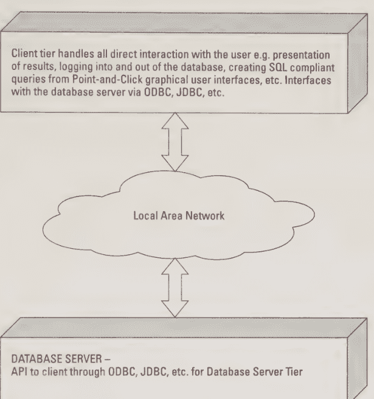

图 2-1：客户端/服务器架构

客户端始终拥有向用户显示应用程序界面的代码。除此之外，双方的分工是模糊的。一种典型的方法是客户端代码包含了大部分应用程序逻辑，根据用户的请求和业务规则处理原始数据。客户端管理来自其他源（如实时数据）的数据，并与代码库和第三方模块协作。数据库服务器处理原始数据的存储。随着存储过程变得越来越流行和成熟，开发者经常会将例行的、低级的处理任务迁移到服务器端，特别是当这些任务与持久化数据高度耦合时。

## 三层架构

开发者们发现，将显示代码与应用程序逻辑紧密耦合是有问题的。当显示布局需要更改时，大量的应用程序逻辑代码会受到影响，反之亦然，导致了过高的维护成本。这并不是什么新的理论见解：计算机科学中耦合和内聚的基本目标本就应该禁止显示与逻辑过于紧密地交织。随着对象对象技术的出现，恰巧开发者也开始更加关注设计问题，许多业务应用程序将显示程序与核心逻辑分离，从而引入了三层架构（参见图 2-2）。

用户界面层包含显示和用户输入例程。中间层包含核心应用程序逻辑。在现代实践中，中间层通常根据特定应用程序的需求进行细分，因此这种模型有时被称为 N 体系模型。


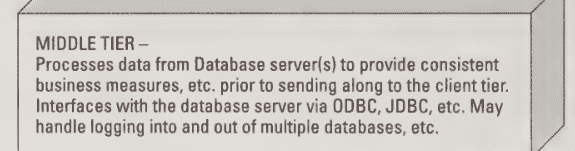

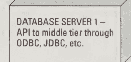

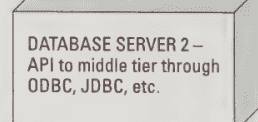

图 2-2：三层架构

为了说明使用数据库作为信息源的多层应用程序的组件，我们使用了三层模型。后端是我们在概念上放置数据库服务器的地方。这些服务器是原始数据的源头，数据最终呈现给用户。例如，如果用户希望查看销售收入信息以及产品描述信息，那么数据很可能来自两个数据库，一个存储销售数据，另一个存储产品和库存数据。然而，这两个数据源都是后端的一部分。如果用户正在执行订单录入任务，后端至少包括销售数据库和产品库存数据库。构成后端的实际数据库取决于运行在前端的应用程序。

那么，中间层发生了什么呢？会有许多任务发生，但首重要的过程基本上属于以下两类之一：在数据从后端数据库传递到前端时，将业务规则应用到来自后端数据库的数据；以及根据用户在前端的操作创建数据库查询（`SQL` 语句），并将这些查询发送到后端数据库。这些过程通常在中间层协作工作。

例如，为确定“实际利润率究竟是多少”设定一个特定的业务规则是很常见的。在这种情况下，在中间层拥有一个处理组件（通常称为对象）是有益的，它将产品标识符（`SKU`）、日期和销售区域作为输入。根据这些数据，它创建并向后端数据库发送查询，以获取总收入、销售成本、制造成本、间接费用等等值。它根据预定义的规则对这些数据进行处理，以提供一致的利润率值作为输出，该值反过来可能会被发送到前端。

另一个例子是，对于订单录入应用程序，中间层对象（或对象组合）将产品标识符（`SKU`）、订单数量和客户编号作为输入。然后它创建查询发送到后端数据库，以便在销售数据库中记录销售金额、为客户订单创建条目、从库存数据库中扣除可用库存等。

从理论上，你可以将一个或多个后端数据库替换为另一个供应商的数据库，而无需在前端或任何中间层对象中进行任何更改。前端和中间层对象（在理论上！）也可以同样如此。

Web 技术的出现带来了三层模型的一种变体，这种变体是浏览器/Web 服务器的组合。我们将在第 12 章深入讨论这种日益普遍的配置。然而，通过 Web 门户的示例来指出浏览器/Web 服务器组合与所描述的三层模型之间的相似之处，是值得关注的。

从三层模型开始，我们有一个表示层（用户界面或前端），它本质上是使用 Web 浏览器中的 HTML 文件实现的。后端是我们的信息源，在这种情况下是许多数据库。中间层的目的是将来自数据源的信息格式化为 HTML 文档并呈现给您的 Web 浏览器。存储在后端数据库中的数据是我们（即用户）感兴趣的内容。因此，在很大程度上，我们的后端应该考虑通用数据。由于这本书是关于 Linux 和数据库的，我们假设这些数据源是由数据库实现的。因此，为了成功查看和使用存储在后端的数据，中间层组件需要：

- 显示登录页面（可以是公共 HTML 上的两个文本框），以便验证您的访问权限并维护安全性。当访问的数据具有任何隐私需求、私有性或数据出售时，建议这种方法优于 Cookie。
- 在门户安全数据库中验证登录用户名和密码。
- 在验证用户名和密码后，检索之前创建的自定义。这意味着中间层有一个数据库来存储您对主页的自定义（自定义主页无非一组标准页面功能的自定义配置）。


在处理每个参数 URL 时，服务器将每个参数化 URL 发送到相应的数据库服务器，服务器返回一个或多个 SQL 查询的结果。每个结果集都经过格式化并插入 HTML 文档（您的自定义主页）中。在处理完所有的可配置组件后，生成的 HTML 文档作为您的自定义主页呈现给您。

如果没有个性化编辑，将创建并呈现默认网页。

## 现代进展

数据库和应用程序技术的发展给数据库带来了许多根本性变化，其中许多对开源数据库尤为重要。

## 开放标准时代

过去，软件行业的每个有意义的标准都是某个特定供应商事实上的市场胜利。这在数据库领域尤其如此，供应商试图通过自己的专有功能来锁定客户，以确保可预测的市场基础。SQL 等开放数据库标准的出现是一个漫长、充满争吵且非常有政治色彩的过程，直到最近，DBMS 供应商才致力于实现 SQL 兼容性。在不同部门或不同应用程序中使用不同数据库产品的组织经常发现自己面临严重的维护和互操作性问题。

幸运的是，开发者和终端用户的需求营造了一种氛围，使厂商面临着创建和遵循行业范围内标准的压力。SQL 持续发展，对象数据库也已经出现了相关标准。XML（可扩展标记语言）和 Java 等技术从一开始就受到机构的推动（尽管伴随着大量的政治斗争，尤其是 Java 领域），它们现在正在改变数据库技术和实践。

开放标准对最近的“开源”这一现象也大有裨益。在专有标准时代，开源解决方案（OSS）开发者通常必须猜测或通过逆向工程来实现与商业工具的协议互操作性，这极大地减慢了开发过程。有了开放标准，OSS 开发者有了一个文档良好的编程目标，他们可以专注于更有趣的问题。几乎每个成功的 OSS 项目都享到了核心行业标准的益处。

- Linux 遵循 POSIX 操作系统标准，该标准由 ANSI 管理。
- Apache 实现了 HTTP（超文本传输协议），该协议由 IETF 标准化。
- Mozilla 实现了 HTML 和 CSS（级联样式表），这是世界维网联盟（W3C）建议的规范。
- XFree86 实现了 X11 显示标准，该标准由 The Open Group 维护。
- GNOME 和 KDE 都使用基于 CORBA（公共对象请求代理架构）的分布式编程工具，这是 OMG 的标准。
- 当然，PostgreSQL 和 MySQL 实现了 ANSI SQL 以及 Java 数据库连接（JDBC）。

开放标准通过提高生产力和缩短开发周期，让包括厂商在内的所有人受益。如果没有在大多数 Linux 数据库中使用的这些标准，就不可能在一本书中对七种产品进行深度介绍。

## 可扩展标记语言

XML 作为一种通用文档和数据的标准格式，作为 HTML 的替代品赢得了大量媒体关注，因为它能够在互联网上实现更好的搜索、分类和链接，但对于数据库用户来说，它的意义远不止此。

XML 的重要性在于，有这么多厂商和开发者已经接受了它作为一种数据格式。这为软件组件之间的互操作提供了巨大的推动，使得许多以前需要定制、专用软件完成的工作现在可以通过现成工具完成。

许多数据库正在转向支持 XML，以便用户能够以丰富的格式在数据库中存储文档，并提供在软件组件之间传输结构化数据的方法。这种应用被称为序列化。我们在示例中使用的关系型数据库的一种可能的 XML 序列化如下：

```xml
<xml version="1.0"?>
<Database>
  <Table name="Employee">
    <Row>
      <Column name="id" type="int4">101</Column>
      <Column name="name" type="string">Manny Vegas</Column>
      <Column name="birthday" type="datetime">1950-05-10</Column>
      <Column name="dept" type="int4">12</Column>
    </Row>
    <Row>
      <Column name="id" type="int4">102</Column>
      <Column name="name" type="string">Carla Wong</Column>
      <Column name="birthday" type="datetime">1961-12-02</Column>
      <Column name="dept" type="int4">15</Column>
    </Row>
    <Row>
      <Column name="id" type="int4">103</Column>
      <Column name="name" type="string">Arnold Page</Column>
      <Column name="birthday" type="datetime">1965-08-21</Column>
      <Column name="dept" type="int4">15</Column>
    </Row>
  </Table>
  <Table name="Department">
    <Row>
      <Column name="id" type="int4">12</Column>
      <Column name="name" type="string">Accounting</Column>
      <Column name="city" type="string">Miami</Column>
    </Row>
    <Row>
      <Column name="id" type="int4">12</Column>
      <Column name="name" type="string">Human Resources</Column>
      <Column name="city" type="string">Gainesville</Column>
    </Row>
  </Table>
</Database>
```

高级关系型或对象数据库生成的数据的自然视图可能像这样：

```xml
<?xml version="1.0"?>
<company name="Penguin Inc">
  <employee id="101">
    <name>Manny Vegas</name>
    <birthday>1950-05-10</birthday>
    <dept>12</dept>
  </employee>
  <employee id="102">
    <name>Carla Wong</name>
    <birthday>1961-12-02</birthday>
    <dept>15</dept>
  </employee>
  <employee id="103">
    <name>Arnold Page</name>
    <birthday>1965-08-21</birthday>
    <dept>15</dept>
  </employee>
  <department id="12">
    <name>Accounting</name>
    <city>Miami</city>
  </department>
  <department id="15">
    <name>Human Resources</name>
    <city>Gainesville</city>
  </department>
</company>
```

关系模型发展出了两套用于操作关系的系统：关系代数和关系演算法。代数是规范性的——也就是说，它描述了你可以在关系上执行的操作。关系演算法是描述性的——也就是说，它定义了一个视图，而不涉及其如何构建的详细细节。

演算法和代数是等价的——其中一种语言的任何语句都可以转换为另一种语言的等价语句。演算法和代数都是查询语言的基础；如果一种语言可以在不使用循环的情况下表达关系代数中可以表达的任何表达式，那么这种语言就是相对完备的。

关系模型使用 NULL 来处理属性值未知的情况。保证 NULL 不等于任何域中的任何值；因此，将任何值与 NULL 比较的结果始终为假。从逻辑上讲，NULL 既不是 TRUE 也不是 FALSE；因此，关系语言中的语句必须使用三值逻辑进行求值。

数据库必须保护其结构以及所包含数据的完整性。结构完整性确保每个外键都指向一个存在的行。数据完整性意味着确保数据不包含不可能的值，而这种不可能性部分是由关系中的其他其他数据决定的。

在抽象的关系模型与其软件实现之间存在着差距。E. F. Codd 定义了 12 条规则，用于衡量一个系统到底多是关系数据库管理系统。

我们将关系数据库与层次型、网络型和面向对象的数据库进行了比较。Linux 数据库中这些技术有许多变体，我们将在后面的章节中讨论，但大多数属于 ORDBMS（对象关系数据库管理系统）类别。

新技术和发展不断改变数据库世界，Linux 用户无疑是行业进步的受益者。

接下来，我们将讨论你可能需要用 Linux DBMS 管理的数据分类，并尝试根据你的特定需求建议一种策略。


# SQL

第 2 章中 Codd 讨论了关系数据库的理论。本章引入了结构化查询语言（SQL）。SQL 是目前最流行的关系数据库查询语言，受到了所有主要关系数据库管理系统制造商的支持，包括 Informix、Sybase 和 Oracle。

在本章中，我们开始编写代码来实现数据库。这样做将为你第 4 章的内容做准备，该章节将讨论设计数据库的艺术与科学。

# SQL 的起源

当 E. F. Codd 在 1969 年发表关于关系数据库最初的工作时，它吸引了许多数据库研究人员的兴趣，包括 IBM 的一个小组。

1974 年，在 Codd 发表最初著作约五年后，IBM 成立了 System/R 项目，该项目的任务是设计和构建一个关系数据库系统原型。正如你所记得，Codd 对关系数据库的规范规定必须创建一个查询语言，并且这种查询语言必须是在数据库内操作数据的唯一途径。因此，作为关系数据库设计的一部分，System/R 项目设计了一种被他们命名为 SEQUEL 的查询语言，后来重命名为 SQL，即结构化查询语言。（顺便说一下，SQL 通常被读作 "sequel"——因此保留了该语言原始名称的读音残留。）

System/R 于 1978 年开始了首次客户测试。次年，成立了一家商业企业，旨在创建一个以 IBM 关系数据库和 SQL 为建模的商业关系数据库。该产品被命名为 Oracle；直到今天，Oracle 仍然是市场上销量最大的关系数据库产品。

## 章节

### 本章内容

- SQL 的历史
- 创建数据库
- 从数据库中选择数据
- 修改数据库中的数据
- 存储过程和触发器

## 第一部分 Linux 与数据库

1983 年，IBM 引入了 DB2，其针对大型机的关系型产品。IBM 实际上宣布关系数据库——特别是 SQL——为其数据库的标准。IBM 在市场上的力量（20 世纪 80 年代远大于今天）确保了 SQL 成为整个计算机市场关系数据库的事实标准。

IBM 的其他小组也在探索关系数据库。由加州大学伯克利分校的 Michael Stonebreaker 教授领导的小组设计了一种名为 Ingress 的关系数据库，它围绕一种名为 QUEL 的查询语言构建。Ingress 的商业版本于 1981 年建成并仍在售，尽管基于 SQL 的关系数据库在人气上已远超了它。为了增加复杂性，原始的 Ingress 项目由加州大学伯克利分校在 20 世纪 80 年代以 University Ingress 的命名继续。（尽管小组版本的 Ingress 不再支持或增强，但 University Ingress 在 Linux 上免费可用。）QUEL 语言在关系数据库行家中广受赞誉，但它从未获得过像 SQL 那样被市场认可。

## SQL 标准

1982 年，美国国家标准协会（ANSI）成立了一个委员会来制定关系数据库语言的标准。在 20 世纪 80 年代初，委员会纠结于应该使用哪种关系查询语言作为标准的模型；同时，IBM 致力于让 SQL 成为市场上的标准查询语言。1986 年，ANSI 向现实妥协，采纳了 SQL 作为其关系数据库的标准查询语言。不久后，国际标准化组织（ISO）采用了 ANSI 标准作为其关系查询语言的标准；从那时起，ANSI 和 ISO 在该领域汇合了力量。

1989 年出版了 ANSI/ISO 标准的修订版；该标准中描述的语言被称为 SQL1 或 SQL-89。1992 年，ANSI/ISO 发布了 SQL 的新标准。该标准修复了原始标准中的许多漏洞，但也极大地扩展了该语言。这一标准 SQL2 或 SQL-92 是目前使用的标准。

目前正在进行第三个 SQL 标准的工作，意不意外地称为 SQL3。这一新标准将再次扩展语言；特别是它将定义如何在关系数据库中处理对象。（对象数据库和对象关系数据库在第 2 章讨论过。）SQL3 超出了本本书的范围；然而，PostgreSQL 提供了许多对象数据库的特性，它是探索该领域的很好的起点。

# SQL 方言

SQL 像任何标准语言一样，旨在所有产品中保持统一。遗憾的是，SQL 的实现具有相互排斥的特性。然而，SQL 实现的行为取决于许多因素。这些因素包括支持的 ANSI/ISO 标准（SQL1、SQL2）以及厂商特定的扩展。

遗憾的是，SQL 的可移植性很大程度上是一个神话：很少能将为一个关系数据库包编写的 SQL 代码在不经过修改的情况下运行另一个包。公平地说，我们必须强调，大多数情况下，这些差异是微小的，将 SQL 代码从一个包移植到另一个包通常很容易。此外，微软开放数据库连接（ODBC）和类似协议的出现有助于消除不同实现之间的差异。

# SQL 的优缺点

SQL 确实有许多优点和缺点。我们先给你坏消息，然后是好消息。

## 缺点

第一个问题显然是 SQL 并不是一种语言，而是一系列语言——尽管是相关的语言——如前节所示。

另一个问题是 SQL 并没有严格遵守关系模型。在第 2 章中，我们指出了 SQL 与关系模型之间的许多差异；特别是 SQL 允许关系中存在重复行。我们在本章中还指出了其他 SQL 偏离关系模型的地方。

最后，作为一种编程语言，SQL 可能非常笨拙，而且可能存在歧义。

## 优点

SQL 尽管存在问题，但它是一个标准。

SQL 作为一种语言相对直观且易于学习。即使是非程序员也能学习用它编写自己的查询和报告。这有助于使用户访问其在数据库中的数据——实际上，它帮助破解了“数据监狱”，这对于企业而言是一项绝不容低估的优势。

尽管 SQL 在许多点上偏离了关系模型，但在很大程度上它忠实地实现了关系模型。SQL 将关系型数据库的权力交给了编程人员和用户——我们认为没有比这更推荐的做法了。

## 语言的实现

SQL 是一种专为与数据库协作而设计的语言。它不包含通用编程语言（如 C 或 Java）所提供的许多功能，例如用于重定向输入或输出的指令、流控制语句。

这些缺失并非错误。相反，SQL 的设计是为了与宿主语言配合，由宿主语言提供输入/输出和流控制功能。

大多数数据库软件包使用 SQL 引擎来解释 SQL 指令。该引擎是一个程序，实际上充当数据库的看门人：它执行指令来建立数据库、从中插入数据、选择或删除数据，或更新数据库中的数据。大多数关系型数据库软件包还包含实用程序，允许您创建数据库设计（或“模式”）的副本，并将数据库内容的副本导出到文本文件中，并将数据文件直接加载到数据库。在大多数情况下，数据库活动都通过 SQL 引擎进行。

对于大多数软件包，SQL 指令可以通过任意两种方式传递给引擎：

- SQL 解释器：此类解释器直接从用户处接收输入，进行解释并将输出返回给用户。早期的解释器接收用户输入的代码；而现在，解释器更有可能从图形用户界面接收输入，这保护了用户无需编写代码。
- 嵌入 SQL：在这里，SQL 语句嵌入在用另一种语言（如 C 或 COBOL）编写的程序中。程序必须首先通过预处理器过滤，预处理器将嵌入的 SQL 转换为一系列函数调用。预处理器的输出然后像其他程序一样被编译和运行。这种编程 SQL 的方法在很大程度上已经过时，书中不再进行探讨；但它可用且可能非常有用。

## SQL 级接口 (CLI)

在此接口中，编程人员编写系列调用来执行 SQL 语句。在 C 中，这些调用是对库中的函数；在 Java 中，这些调用是对对象包中的方法。实际上，程序员手动编写了嵌入 SQL 预处理器机械生成的内容。

SQL 的 ANSI/ISO 标准定义了解释式和嵌入式 SQL；然而，它们没有为任何其他计算机语言定义 SQL 级接口。因此，每个数据库制造商都发明了自己的 CLI，且这些接口是互不兼容的。某些制造商设计了可以用于几乎所有关系数据库的 CLI；特别是微软的 ODBC 协议和太阳的 Java 数据库连接（JDBC）协议在市场上吸引了支持。我们将在第 12 和 13 章探讨 ODBC 和 JDBC。

## SQL 结构

本章的其余部分介绍 SQL。我们的讨论限于 SQL2 标准的核心功能。我们不会涉及该语言更深奥的功能；然而，我们提供的信息使你能够完成创建和处理关系型数据库时通常所需的所有任务。每一节提供了用 SQL 编写的示例。

## 术语

在目前对关系数据库的讨论中，我们使用了*关系 (relation)、属性 (attribute) 和元组 (tuple)*。然而，SQL 为每个项都赋予了不同的名称：

- *代替关系*：由于 SQL 没有完美地遵循关系模型，因此关系实体*关系、属性和元组*与它们在 SQL 中的对应物之间存在一些差异。我们在本章其余范围内使用 SQL 术语。当关系实体与 SQL 元素之间的差异影响我们的讨论时，我们会指出这些差异。但在大多数情况下，将关系、属性和元组分别视为表、列和行是正确的。

> 注意，“字段 (field)”常用“列 (column)”的同义词；“记录 (record)”常用“行 (row)”的同义词。然而，为了简单起见，我们将使用“列”和“行”。

## 语言结构

正如我们之前提到的，SQL 没有实现通用编程语言（如 C）的一些功能。SQL 程序中的语句之间是隔离执行的；也就是说，一个语句不能调用另一个语句，不能将信息传递给另一个语句，也不能将数据存储在变量供另一个语句使用。此类功能可以由嵌入 SQL 语句的宿主语言提供，但这些功能不是 SQL 本身的一部分。


因此，学习意味着学习每个 SQL 语句的语法及其作用。这就是 SQL 对非程序员来说如此容易的原因之一——一个人可以逐句地学习 SQL 语句，而无需担心程序的整体逻辑，或担心语句之间可能产生的副作用。

我们强调 SQL 是一门强大的语言。一个精心构建的 SQL 语句可以非常快速地完成大量工作。然而，一个粗糙构建的 SQL 语句可能会破坏数据库。你应该像对待任何动力工具一样谨慎对待 SQL：尊重它能做到的贡献，并畏惧它可能造成的破坏。

在我们开始探索语句之前，我们先看看 SQL 的结构——支撑我们所有语句的脚手架。

## 关键字

SQL 预留了一些词汇供自己使用——即关键字。你不能使用关键字来命名数据库、表、列或你的 SQL 程序中的任何其他可命名的元素。

SQL2（即 SQL-92）保留了 300 多个关键字（相比之下，ANSI C 只有 33 个）。在这些关键字中，你日常工作只需要少数几个。以下是最常用的关键字：

| ALL | BY | CURSOR | END |

| :--- | :--- | :--- | :--- |

| AND | CHAR | DEFAULT | ESCAPE |

| ANY | CHARACTER | DATE | EXEC |

| ASC | CLOSE | DECIMAL | EXISTS |

| AUTHORIZATION | COMMIT | DECLARE | FLOAT |

| AVG | CONTINUE | DELETE | FOR |

| BIT | CURRENT | DISTINCT | FOUND |

| BETWEEN | CREATE | DESC | FOREIGN |

| BEGIN | COUNT | DOUBLE | FROM |

| GROUP | MIN | PRIVILEGES | UNIQUE |

| G | | | | PROCEDURE |

 |

| | | | PROCEDURE | USER |

| GRANT | MONEY | PUBLIC | UPDATE |

| GROUP | NCHAR | SCHEMA | REFERENCES |

| HAVING | NOT | SECTION | REVOKE |

| INSERT | NULL | SELECT | ROLLBACK |

| IN | NUMERIC | SET | VALUES |

| INTO | ON | SOME | VARCHAR |

| INDICATOR | OPEN | SUM | VARYING |

| INTEGER | OPTION | TABLE | VIEW |

| LIKE | PRIMARY | UNION | WHEN |

| MAX | PREC | | | WHERE |

SQL 代码是不区分大小写的；也就是说，`CHARACTER`、`character` 和 `chArActEr` 在 SQL 看来都是等价的。习惯上将 SQL 关键字大大写，表名和列名用小写，但这不是强制要求。

接下来的章节将在相应的语境中介绍每个关键字。

## 数据类型

SQL 像所有语言一样，定义了数据类型。每个数据类型分配了定义的内存，并（正如其名所示）持有定义类型的数据。SQL 的数据类型并不规定 SQL 程序可以处理的数据种类，而是规定了可以在 SQL 数据库中存储的种类。

以下是所有 SQL 实现都识别的简单数据类型：

- `CHAR(length)` 固定长度字符数组

`INTEGER` 四字节（长）整数

- `SMALLINT` 二字节（短）整数

`FLOAT` 单精度浮点数

任何编写过程序的人都应该熟悉这些数据类型。程序员可能需要注意，SQL 不支持无符号（unsigned）数据类型。

以下数据类型比上述的简单类型更复杂。并不是所有的 SQL 实现都识别所有这些数据类型，但大多数实现至少识别其中的某一些：

- `VARCHAR(length)` 变长字符数组

- `NUMERIC(precision, scale)` 数值

- `DECIMAL(precision, scale)` `NUMERIC` 的同义词

- `DEC(precision, scale)` `NUMERIC` 的同义词

- `DOUBLE PRECISION` 双精度浮点数

- `DATE` 日期

- `TIME(precision)` 时间

- `TIMESTAMP(precision)` 当前日期和时间

- `INTERVAL` 两个时间戳之间的间隔

复杂数据类型通过以下方式扩展了简单类型：

- 变长字符数组的长度是不固定的。如果你声明一个列为 `CHAR(100)`，SQL 会为 100 个字符分配空间，无论你是否向该列中插入了文本。然而，如果你将该列声明为 `VARCHAR(100)`，数据库将只存储你插入该列的字符数量，最多为 100 个。`VARCHAR` 的最大长度取决于不同的数据库软件包；例如，长度为 255 个字符。

- `NUMERIC` 数据类型不以通常的二进制方式编码数字。它将数字作为文本存储，每个数字使用 1 字节，直到指定的标度（scale）位数。精度（precision）给出了小数点在数字中的位置。此类数字用于存储无法放入 32 位整数的大型数字、需要比普通浮点数更高的精度的数字，或者你希望避免舍入误差的数字。

- 双精度数是一个 8 字节的浮点数，其精度是单精度 `FLOAT` 的两倍。双精度数用于需要极高精度的任务。

- `DATE` 和 `TIME` 类型提供了一种记录日期时间的方便方法。

- `TIMESTAMP` 类型在列列中同时记录日期和时间；它通常用于为当前发生的事件标记时间戳。`TIMESTAMP` 类型的精度记录两个时间戳之间的间隔。这是因为 `TIMESTAMP` 不是整数类型，因此无法轻松地从另一个 `TIMESTAMP` 中减去。

## 第 3 章 SQL

还有其他更奇特的数据类型。你不会经常使用这些类型，但如果你需要，某些数据库管理系统也提供了它们：

| BLOB | 二进制大对象 |

| :--- | :--- |

| BIT(length) | 固定长度位数组 |

| BIT VARYING(length) | 变长位数组 |

| NCHAR(length) | 固定长度国家字符数组 |

| NCHAR VARCHAR(length) | 变长国家字符数组 |

| SERIAL | 自动生成的序列号 |

| MONEY(precision, size) | 货币 |

| MONEY | 货币 |

| BOOLEAN | 布尔值 |

二进制大对象（`BLOB`）是大小不定的二进制对象，例如图片或声音位。。与真正的软件对象不同，`BLOB` 不包含任何用于操作对象的方法；所有 `BLOB` 包含组成该对象的数据。

位（bit）类型定义了单个 位的数组。这种数组可以用于各种专门任务。位数组可以是固定长度的也可以是变长的，就像字符数组一样。

`NCHAR` 类型持有国家字符数组。国家字符是不出现在美国 ASCII 集中的字符；通常，这是一个值介于 128 到 255 之间的字符。

`SERIAL` 类型由 Inform 数据库管理系统使用。该类型持有一个由数据库引擎生成的序列号——也就是说，数据库引擎会自动将此列的值设置为下一个可能的最大整数值。（MySQL 使用关键字 `AUTO_INCREMENT` 来实现相同的功能。）

`MONEY` 类型正如你预期的那样，持有一个金额。它类似于 `NUMERIC` 数据类型，其设计用于在将一个金额除以另一个金额时避免舍入误差。请注意，并不是每个此类数据类型的实现都使用括号中的参数。

`BOOLEAN` 持有一个布尔值——`TRUE`（真）或 `FALSE`（假）——不再有别的。

还有许多其他特定厂商的数据类型。自定义数据类型的泛滥是导致 SQL 代码从一个数据库软件包迁移到另一个困难的原因之一。

## 创建数据库

现在我们已经讨论了大多数 SQL 软件包支持的数据类型，我们可以开始使用 SQL 了。第一步是创建一个数据库。这涉及创建数据库本身、向用户授予权限以及创建表和索引。

在本节以及本章的其余部分中，我们展示了在 MySQL 下运行的示例。这里不是介绍运行 MySQL 细节的地方——我们将在第 10 章介绍——但这里的示例脚本适用于大多数流行的数据库软件包。当 MySQL 执行某些不合常的操作或有严重的局限性时，我们会进行讨论。

在本章的剩余部分中，我们将处理一个简单的双表数据库，我们称之为“`baseball`”，因为它存储了棒球比赛的数据。随着本章的进行，你将学习关于该数据库的所有知识。

### CREATE: 创建数据库

这本书的大部分内容都在定义什么是数据库。因此，你可能会觉得 SQL 没有创建数据库的指令这很奇怪。这是因为关系型数据库软件包对数据库的定义不同，每个软件包都有自己的一套表和索引，而其他软件包将整个软件包定义为一个巨大的数据库，另一些软件包允许系统管理员在安装系统时定义数据库。

大多数允许用户使用如下形式语句定义数据库的软件包都是：

```sql
CREATE DATABASE database_name
```

你应该检查你使用的软件包的文档，以确定该软件包允许你在设置数据库时做什么以及如何操作。

示例 3-1 中的脚本在 MySQL 下创建了 `baseball` 数据库：


## 示例 3-1: 创建数据库

```sql
CREATE DATABASE baseball;
```

请注意，在 MySQL 中，只有 `root` 用户或被 `root` 用户授予了创建权限的用户才能创建数据库。

同样注意，语句以分号结束；以向解释器信号语句已结束并应该执行。其他 RDBMS 软件包使用不同的字符来结束语句；例如，`mini-SQL` 软件包使用转义序列 `\`，而 `Sybase` 使用命令 `go`。

MySQL 还实现了 `DROP DATABASE` 语句，允许你丢弃现有的数据库。

### GRANT: 授予权限

数据库创建后，需要授予数据库权限，以便用户能够访问和操作数据库。

SQL `GRANT` 允许你授予权限。数据库管理权限的方式差异巨大；MySQL 使用的权限方案特别为复杂。示例 3-2 中的脚本向用户 `bballfan` 授予了全局权限：

#### 示例 3-2: 为用户授予权限

```sql
GRANT ALL
ON bballfan.*
TO bballfan@localhost
IDENTIFIED BY 'password';
```

我们将在第 10 章详细讨论 MySQL 的权限系统。简之，这条 `GRANT` 语句告诉 MySQL 将 `bballfan` 数据库中所有表的所有权限授予给从本地主机（而不是从网络上的其他主机）访问数据库且密码为 `password` 的用户。

你可以设置的权限类型取决于不同的数据库软件包。大多数软件包都识别以下类型的权限：

- `CONNECT` 用户可以连接到数据库。
- `INSERT` 用户可以向指定表插入新行。
- `DELETE` 用户可以从指定表中删除行。
- `UPDATE` 用户可以修改指定表中的行。

对于 MySQL 来说，`bballfan` 并不一定是一个 Linux 登录用户——任何知道密码的用户都可以通过登录访问 `baseball` 数据库。然而，其他数据库软件包通常要求访问数据库的登录账户也必须是操作系统的登录账户。例如，这些软件包将要求 `bballfan` 既是一个 Linux 登录用户，又是一个数据库登录账户。

SQL 指令 `REVOKE` 用于移除之前授予的权限。

现在我们已经创建了数据库，下一步是构建实际用于存储数据的表。

## CREATE TABLE：创建表

`CREATE TABLE` 语句在指定的数据库中创建一个表。该语句具有以下语法：

```
CREATE TABLE table_name(
  column_name column_type[,.] [NULL|NOT NULL] ...
  [PRIMARY KEY (column_name [, column_name, ... ]) ]
  [FOREIGN KEY [key_name] (column_name [, column_name, ... ])
    REFERENCES table_name
    [ ON DELETE action ] ]
)
```

`table_name` 是表的名称。该名称在数据库中必须是唯一的。

`CREATE TABLE` 语句中的子句必须用逗号隔开。

`column_name` 是列的名称。该名称在表中必须是唯一的。

`column_type` 为列分配数据类型。在本章早些部分，我们描述了最常用的数据类型；我们将在下文中详细讨论数据类型。

可选的 `NULL` 表示该列可以存储 `NULL` 值。同样，可选的 `NOT NULL` 表示该列不能存储 `NULL` 值。如果你不显式说明列是否可以存储 `NULL` 值，取决于具体的软件包。例如，MySQL 假设除非显式使用 `NULL` 子句，否则列不能存储 `NULL` 值；而 `Sybase` 则假设除非显式使用 `NOT NULL` 子句，列就可以存储 `NULL` 值。

可选的 `PRIMARY KEY` 子句指定组成表主键的列。SQL 允许表只能有一个主键。这是 SQL 与关系理论不完全一致的一个重要点。正如你所期的，表中的每一行在其主键上都有唯一的值；声明主键可以让数据库引擎强制执行此规则。此外，当你为表声明主键时，SQL 允许你声明从其他表指向该主键的外键。

可选的 `FOREIGN KEY` 子句定义一个外键。它比 `PRIMARY KEY` 子句稍微复杂：

- 关键字 `FOREIGN KEY` 后面跟着一个可选的键名称。该名称不是必须的，但你应该为每个键命名，以防你以后决定删除它（`drop`）。可选名称后面是组成外键的列或多个列的名称。这些名称被括在括号中。
- 随后是 `REFERENCES` 关键字以及该外键指向的表名。如你所见，外键并没有命名它所指向的外部表中的列：这是因为在 SQL 中，外键只能引用一个主键。

显然，组成外键的列的数据类型和域（`domains`）必须与另一张表的主键完全匹配。

此后面可选地跟有 `ON DELETE` 关键字，它定义了当外键所引用的行被删除时采取的操作。

`ON DELETE` 接受以下选项：

- `CASCADE`：自动删除外表中引用了刚被删除行的每一行。
- `SET NULL`：将外键列（或多个列）设置为 `NULL`。
- `NO ACTION`：即禁止删除被引用的行被删除。

你可能记得我们在第 2 章讨论过这些选项，当时我们讨论了数据库完整性的概念。

为了能声明为 `FOREIGN KEY`，该键必须指向该外键所引用的表中声明的主键。在第 2 章中，当我们设计基于这些表的关系时，我们定义了一些指向主键以外列的外键。这在关系理论中是完全允许的，但在 SQL 中无法。

列表 3-3 中的脚本显示了如何在 MySQL 下为棒球数据库创建表。

## 第一部分 Linux 与数据库

### 列表 3-3：为棒球数据库创建表

```
CREATE TABLE team (
  team_name CHAR(15) NOT NULL
);
```

```sql
CREATE TABLE game (
  home_team CHAR(15) NOT NULL,
  visiting_team CHAR(15) NOT NULL,
  home_runs SMALLINT NOT NULL,
  visiting_team_runs SMALLINT NOT NULL,
  game_date CHAR(10) NOT NULL,
  game_number SMALLINT NOT NULL,
  PRIMARY KEY (home_team, visiting_team, game_date, game_number),
  FOREIGN KEY (home_team) REFERENCES team
);
```

应注意以下点：

- 数组的大小括在括号中。这可能让 C 程序员感到有些困惑，他们使用方括号来表示数组的大小。
- 表名使用的是小写字母而不是大写。虽然 SQL 对大小不敏感，但某些数据库（例如 `Sybase`）对名称和列名是敏感的。习惯上使用大写字母 SQL 关键字，并将所有列名和表名输入为小写。
- 最后，MySQL 识别 `FOREIGN KEY` 子句；然而，在表中插入外键既是为了记录外键，也是为了与标准 SQL 兼容。此外，请注意 MySQL 不允许为 `FOREIGN KEY` 命名：如果你这样做，它会报语法错误。

## 分配数据类型

在本章早些部分，我们讨论了最常用的数据类型。如上面的示例所示，表中的每一列都必须分配一个数据类型。为列分配数据类型是一个需要深入思考的问题。虽然我们将在第 4 章详细讨论这个主题，但在这里简要讨论我们为什么为列分配这些数据类型。

## 第 3 章 SQL

### 表 team

在此表中，我们将 `team_name` 和 `city` 分别设置为 15 字节数组（`CHAR` 类型是 `CHARACTER` 的同义词）。这使得列能够存储最长的球队名（如 Mets）和最长的城市名（实际上是 California），并留有额外空间。

`stadium` 列是一个 30 字符列，用于存储如 Hubert Humphrey Stadium 等名称，并留有额外空间。

对于字符串列使用固定长度数组而不是 `VARCHAR` 类型，主要是为了简单起见。

该表将只有 30 行——每个大联盟球队一行。基本上，除非你不是从数据库中剔除每一个多余的字节，否则对于小型静态表使用 `VARCHAR` 类型没有意义。

我们在球队名称上的计数是分配数据类型基本原则的一个平庸例子：为列分配的数据类型在物理上必须容纳其域中的所有值。换句话说，你不能把十磅的域挤进五磅的类型。你将在本节反复看到这个原则。

`league` 和 `division` 列各是一个单字符列，因为联赛可以用 A 和 N（分别代表美国联盟和国家联盟）来标记；分区可以用 E、C 和 W（分别代表东部、中部和西部）来标记。

我们使用单字符代码识别联赛分区的决定引发了如何在列中存储信息的重要问题。在这种情况下，我们可以作为代码存储联赛和分区的名称，因为它们有利于棒球球迷普遍理解的独特缩写。如果我们打算扩展数据库以包含更多联赛或外国联赛，那么我们将以完整形式编写联赛和分区的名称。


我们可以使用抽象代码（例如，1 代表美国联盟，2 代表国家联盟——直到 99 代表北部联盟），通过嵌入软件中或另一个表中的键来解释。但何必费此呢？如果我们要使用代码，它应该是一个大多数用户都能易于且准确解读的代码。

# 第一部分 + Linux 与数据库

## 棒球表

`home_team` 和 `visiting_team` 列是 15 字符的文本列，以匹配 `team` 表中 `team_name` 列的类型。我们为 `home_team` 和 `visiting_team` 分配了与 `team_name` 列相同的数据类型，这是分配数据类型规则的另一个实例：作为外键时，它的数据类型必须与它引用的列的数据类型相同。SQL 软件包具有健壮的方法来比较不同类型的列，但你只是在为自己以及为你分配外键分配的程序创建表，而不是分配一个不同于它所引用的列的类型。

`home_team_runs` 和 `visiting_team_runs` 列都被分配为 `SMALLINT`。在大多数实现中，`SMALLINT` 是两个有符号字节，这意味着它可以存储最大值 32,767 —— 这对于任何棒球赛来说都足够了。

`game_date` 列是 `DATE` 类型，显而易见。

`game_number` 列的类型是 `SMALLINT`。该列存储了两支球队在某日进行的比赛场次，以便我们区分双赛中的两场比赛。由于此列始终包含 1 或 2，因此一个小型整数将绰绰有余。我们可以将此字段设为单字符数组；然而，即使那样也会使此字段与此数据库中的其他字段不同（其他字段持有数值信息）。这是一个主判断，但我们认为将所有数值信息放入数值类型中是最好的，即使在这种情况下它偶尔会浪费一个字节。如果我们在第 2 章中决定将比赛场次记录为比赛开始的时间，我们可能希望给 `game_number` 列指定 `TIME` 类型 —— 有人不这样做，或者与 `game_date` 列结合形成 `TIMESTAMP` 数据类型形式存在（再次提到，我们的数据库包支持这种类型）。

如你所见，即使在设计一个微不足道的数据库时，你也必须在心中考虑许多因素。在第 4 章中，我们将更详细地阐述数据库设计，并更显式地讨论这些问题。

## CREATE INDEX：创建索引

构成我们棒球数据库的表已经创建，下一步是为这些表构建一些索引。正如我们在第 2 章中提到的，索引有助于加速对索引数据的搜索。构建索引会消耗资源——包括磁盘资源和 CPU 周期——设计数据库的关键部分是设计出正确的索引组合：足够的索引以确保你经常执行的查询顺畅快速，但又不会过多到耗尽你的系统资源。

`CREATE INDEX` SQL 语句创建一个索引。它具有以下语法：

```
CREATE INDEX [ UNIQUE ] index_name ON table_name ( column_name [ , ... ] )
```

关键字 `CREATE INDEX` 后面可以可选地跟随 `UNIQUE` 关键字。该关键字告诉 SQL 你希望此索引是唯一的——即没有两行可以在你构建索引的列或多列上包含相同的值。这种索引给你提供了一种粗略的现用主键——例外是它不能被另一个表中的 `FOREIGN KEY` 子句引用。

以下子节为我们的示例数据库构建索引。

### 列表 3-4：创建索引

```
CREATE UNIQUE index1 ON team (team_name);
CREATE UNIQUE INDEX index2 ON game (home_team, game_date, game_number);
CREATE INDEX index3 ON game (home_team);
CREATE INDEX4 ON game (visiting_team);
```

如你所见，构成索引的列名包含在括号中。

关键字 `UNIQUE` 表示索引不允许该列或这些列组合出现重复值。

## DROP：删除表或索引

SQL 允许你向数据库添加表和索引；同样，它也允许你从数据库中移除、删除表和索引。

### DROP TABLE

`DROP TABLE` 语句从数据库中删除一个表。它具有以下语法：

```
DROP TABLE table_name [ CASCADE | RESTRICT ]
```

关键字 `DROP TABLE` 后面跟着你想要删除的表名。表名后面可以可选地跟随 `CASCADE` 关键字，或者在此情况下跟随 `RESTRICT` 关键字。

在你的语法图中，垂直线字符 `|` 在此处的表示“互斥或”，你可以使用 `CASCADE` 关键字或 `RESTRICT` 关键字，但不能两者都用。`CASCADE` 告诉引擎遍历整个数据库并删除每一个引用被删除表的外键的表。

`RESTRICT` 告诉引擎，如果发现任何其他表通过外键引用了 `table_name`，则不要删除该表。

因此，要从数据库示例中删除 `bad_table` 表，你需要使用以下 SQL 语句：

```
DROP TABLE bad_table;
```

自然，当你删除一个表时，也会丢弃该表包含的所有数据以及在该表上构建的所有索引。

### DROP INDEX

正如你可能猜到的，`DROP INDEX` 语句删除一个索引。它具有以下语法：

```
DROP INDEX index_name
```

要从数据库示例中删除索引 `index1`，你需要执行以下 SQL 语句：

```
DROP INDEX index1;
```

MySQL 不支持此语句。相反，MySQL 使用它自己的非标准 `ALTER TABLE` 指令来删除索引。例如，在 MySQL 下删除 `index1`，你将使用 SQL 语句：

```
ALTER TABLE team DROP INDEX index1;
```

`ALTER TABLE` 指令如其名所示，允许你更改表的结构。你可以向表中添加列、更改列的类型，或从表中删除列。

## INSERT：向表中插入行

`INSERT` SQL 语句如其名所示，向表中插入数据。其语法有多种形式。我们逐一描述。

### 插入字面量

`INSERT` 语句的第一种形式允许直接向表中插入值：

```
INSERT INTO table_name [ ( column_name [, ... ]) ] VALUES ( value [, ... ])
```

`table_name` 指定要插入表。可选的 `column_name` 子句指定 `table_name` 中要插入的列。如果你不使用此子句，默认是插入到每一列。`VALUES` 子句给要插入的值。每个值的数据类型必须与其插入的列匹配；例如，你不能将字符串插入数据类型为 `INTEGER` 的列。字符数据必须包含引号内。例如，以下脚本插入了三条记录：

```
INSERT INTO team (team_name, city, stadium, league, division)
VALUES ('Cubs', 'Chicago', 'Wrigley Field', 'N', 'C');
INSERT INTO team (city, stadium, team_name, league, division)
VALUES ('Atlanta', 'Fulton County Stadium', 'Braves', 'E', 'N');
INSERT INTO team
VALUES ('White Sox', 'Chicago', 'Comiskey Park', 'A', 'C');
```

这三个 `INSERT` 语句中的每一个都向 `team` 的五列插入了值。我们必须这样做，因为我们在定义 `team` 时，声明了它的列都不可能包含 NULL。

前两个 `INSERT` 语句指定了 Cubs 的列，按照我们在创建该表的 `CREATE TABLE` 语句中声明的顺序指定。第二个 `INSERT` 语句更改了列的顺序。如你所见，`INSERT` 语句不在乎列的顺序，只要 `VALUE` 子句中给出的值与 `column_name` 子句中命名的列顺序一致。

正如我们之前提到的，如果 `table_name` 中的某列允许 NULL，你可以将其从 `column_name` 子句中排除。如果你这样做，SQL 将在该列中插入 NULL。

插入芝加白袜 记录的第三个 `INSERT` 语句没有使用 `column_name` 子句。当 `INSERT` 语句不包含 `column_name` 子句时，SQL 假设表中的每一列都将有一个值，并且 `VALUE` 子句中给出的值与创建该表的 `CREATE TABLE` 语句中列的顺序一致。

作为一个性提示，我们认为在 `INSERT` 语句中显式列出字段始终是有价值的。如果你这样做，即使你使用 `ALTER TABLE` 指令更改了表结构，该语句将继续工作。

## 从其他表传输值

`INSERT` 语句的第二形式将值从一个或多个表传输另一个表。它具有如下语法：


```
INSERT INTO table_name
  [ column_name [, ... ]
  SELECT select_statement
```

这种形式的 `INSERT` 语句用 `SELECT` 语句替换了 `VALUES` 子句（正如你可能怀疑的，`SELECT` 语句从表中选择数据；所选的数据被封装成语句返回的行。我们稍后会描述这一点）。`SELECT` 语句返回的行将被插入到表 `table_name` 中。

`SELECT` 语句中的列必须在数据类型和域上都与表 `table_name` 中的列相对应。如果某列列出不能接受 `NULL` 值，则 `SELECT` 语句不能为该列返回 `NULL`。

在我们稍后讨论 `SELECT` 语句时，会给出一些 `INSERT` 语句的示例。

## 执行批量插入

SQL 标准仅描述了上述两种形式的 `INSERT` 语句。然而，大多数 SQL 包包含第三种形式，允许你从文件向表插入数据。

这种形式的 `INSERT` 语句的语法取决于你正在使用的 SQL 包。使用 MySQL 时，这种形式的 `INSERT` 具有如下语法：

```
LOAD DATA FILE "file_name"
INTO TABLE table_name
FIELDS TERMINATED BY 'term_char'
LINES TERMINATED BY 'term_char'
  ( column_name [, ... ] )
```

`file_name` 指定要加载的数据文件。文件中的每行必须恰好包含一条要插入目标表的记录。

`table_name` 指定将数据加载到的表。

`FIELDS TERMINATED BY` 和 `LINES TERMINATED BY` 子句分别给出行内列（字段）的终止字符和行（行）的终止字符。

## 第 3 章 SQL

最后，可选的 `column_name` 子句指定了数据将加载到的列。如果不包含此子句，MySQL 将假设 `file_name` 中的每行都为表 `table_name` 中的每一列恰好包含一个字段，并且这些字段的顺序与表 `table_name` 中列的顺序相同（由最初创建表的 `CREATE TABLE` 语句设置）。

列表 3-5 中的脚本将数据加载到我们棒球数据库的表中：

```
Listing 3-5: 加载数据

LOAD DATA LOCAL FILE 'bb_team.data'
INTO TABLE team
FIELDS TERMINATED BY ','
LINES TERMINATED BY '\n'
(team_name, city, stadium, league, division);

LOAD DATA LOCAL FILE 'bb_game.data'
INTO TABLE game
FIELDS TERMINATED BY ','
LINES TERMINATED BY '\n'
(home_team, visiting_team, home_team_runs,
visiting_team_runs, game_date, game_number);
```

以下是来自 `bb_team.data` 文件的几行，这样你可以看到为了批量加载，数据在文件中必须如何布局。棒球球迷可能会注意这里这里的信息是过时的；因为我们正在使用 1992 年的信息：

```
Orioles,Baltimore,Camden Yards,A,E
Red Sox,Boston,Fenway Park,A,E
Angels,Anaheim,Anaheim Stadium,A,W
White Sox,Chicago,Comiskey Park,A,W
```

请注意，当你从文件加载数据时，不需要将字符包围在引号之间。这与 `INSERT` 语句有一个主要区别。

## 从数据库选择数据

到目前，我们已经讨论了如何构建数据库以及向其中加载数据。下一步是从数据库中检索数据。SQL 语句 `SELECT` 用于从数据库中选择数据。

在我们看来，`SELECT` 语句是关系型数据库的核心。书中的其他所有内容——从本章之前的关系理论、数据库设计，再到 C 和 Java 编程、以及数据库管理——都旨在为了从数据库中选择数据这一简单而至关重要的操作。

正如你所看到的，`SELECT` 语句可能极其复杂。然而，如果你能掌握 `SELECT` 语句，你你就掌握了 SQL 最重要的功能——以及关系模型的最重要的功能。

## SQL 与关系代数

在第 2 章中，我们讨论了关系代数和关系演算法。这些数学系统是所有用于查询关系型数据库的语言（包括 SQL）的基础。

关系演算法和关系代数都通过修改关系来构建新关系。然而，它们在描述要构建的关系方面有所不同。关系代数是指令性的（prescriptive）：它定义了离散的操作，通过这些操作修改一个或多个现有关系以构建新关系。相反，关系演算法是描述性的（descriptive）：它允许你命名一个或多个现有关系，然后描述从中构建的关系，而不详细规定该关系是如何构建的。

`SELECT` 语句基于关系演算法：它是描述性的而非指令性的。然而，它也包含了源自关系代数的特征，帮助你处理棘手问题。

## 单表选择

本节将逐步描述 `SELECT` 语句。我们从最简单的形式开始，逐渐向更复杂的形式发展。

在路径的每一步，我们都会展示 `SELECT` 语句的语法，并添加部分内容以反映我们当前正在讨论的复杂性。通过这种方式，我们将引导你逐渐理解这一实用的语句。

## 列子句

首先，简单形式的 `SELECT` 语句具有如下语法：

```
SELECT column_name
FROM table_name
```

`column_name` 指定数据库中的一列。

`table_name` 指定列所在的表。

例如，列表 3-6 中的脚本从表 `team` 选择 `team_name`：

Listing 3-6: 选择团队名称

```
SELECT team_name
FROM team;
```

在 MySQL 下执行，此返回：

```
Orioles
Red Sox
Angels
White Sox
```

## 选择列

现在你已经看到了简单形式的 `SELECT` 语句，可以尝试更复杂的用法。你可以使用 `SELECT` 语句从数据库中选择多个列。相应的语法为：

```
SELECT column_name [, ... ]
FROM table_name
```

例如，列表 3-7 中的脚本从我们的数据库中选择团队名称和联赛：

Listing 3-7: 选择名称和联赛

```
SELECT team_name, league
FROM team;
```

在 MySQL 下执行，此语句打印：

```
team_name league
Orioles A
Red Sox A
Angels A
White Sox A
```

## 投影操作

在第 2 章中，当我们讨论关系代数时，描述了一种名为投影（project）的操作，它从关系中选择属性。上述 `SELECT` 语句的形式简单地实现了关系投影。

注意一点：在大多数 SQL 实现中，单个星号 `*` 是 `FROM` 子句中指定的表内所有列的同义词。例如，程序：

```
SELECT *
FROM   game
```

从 `game` 表选择所有列。

## 构建新表

你已经注意到 `SELECT` 语句的输出是以行和列的形式存在的：对应语句 `column_name` 子句命名的每一列，以及所选数据表的每一行。这是一个非常重要的点：正如关系代数和关系演算法中的每个操作都产生新关系作为结果一样，`SELECT` 语句也产生新表作为结果。该新表的列由 `column_name` 和 `FROM` 子句定义。行由 `WHERE` 子句定义，我们稍后会详细描述。

这个新表不会添加到你的数据库中。相反，它返回给用于从数据库选择数据的程序。正如我们之前提到的，可以将 `SELECT` 语句嵌入 `INSERT` 语句中来填充数据库中的表。

列表 3-8 中的脚本向棒球数据库添加了一个新表，并使用 `SELECT` 语句填充它：

Listing 3-8: 添加新表

```
CREATE TABLE temp_team (
  team_name CHAR(15) NOT NULL,
  league CHAR(1) NOT NULL
);

INSERT INTO temp_team (team_name, league)
  SELECT team_name, league
  FROM   team;

DROP TABLE temp_team;
```

`INSERT` 语句将 `SELECT` 语句的输出导入到新创建的表 `temp_team` 中。

请注意，`SELECT` 语句中的列数以及每列的类型必须与输出流向的表匹配；否则 SQL 引擎将会报错。

## 常量与表达式

`SELECT` 语句的功能不仅仅是检索已经存在于数据库中的数据项。如果你愿意，还可以在 `SELECT` 语句的 `column_name` 子句中使用常量和算术表达式作为数据项。


当我们将此项功能添加到 `SELECT` 语句的语法中时，它的显示形式如下：

```
SELECT column_name | constant | expression [ , ... ]
FROM table_name
```

竖线字符 `|` 表示“或”——即在 `column_name` 子句中指定的项可以是一个列名、一个常量，也可以是一个算术表达式。`column_name` 子句可以混合不同类型的项：其中一项可以是常量，另一个可以是列名，第三个可以是算术表达式。

我们将在稍后介绍 `SELECT` 语句的 `WHERE` 子句时，同时讨论常量和算术表达式。然而，下面的示例可以让你粗略了解它们在 `column_name` 子句中的用法。该示例（列表 3-9）从 `game` 表中选择行，将主队的比赛得分数翻倍，并加上一个常量：

### 列表 3-9：Select

```
SELECT home_team,
home_team_runs,
'this is a constant',
home_team_runs * 2
FROM game;
```

这里的星号 `*` 是乘法运算符；因此，短语 `home_team_runs*2` 将列 `home_team_runs` 的值乘以 2。

输出结果开始所示：

| home_team | home_team_runs | this is a constant | home_team_runs * 2 |
| :--- | :--- | :--- | :--- |
| Blue Jays | 5 | this is a constant | 10 |
| Indians | 1 | this is a constant | 2 |
| Brewers | 2 | this is a constant | 4 |
| Tigers | 4 | this is a constant | 8 |
| Twins | 5 | this is a constant | 10 |
| Yankees | 0 | this is a constant | 0 |

常量 *this is a constant* 被嵌入在 `SELECT` 语句返回到屏幕的表的每一行中；而且主队的得分被倍增。

下一节将更详细地讨论常量。

## 限制性 WHERE 子句

到目前为止，我们一直使用 `SELECT` 语句从表中选择单个列。我们的每个示例都选择了表中的每一行。然而，`SELECT` 语句允许你构建一个过滤器，通过该过滤器，你可以定义想要从表中选择的行。

你可能还记得我们在第 2 章中关于关系代数的讨论，关系代数包括一种名为 `restrict`（限制）的操作。该操作会检查关系中的某一行（或者用术语称为“元组”），并检查该行是否符合你设置的标准；如果该行符合这些标准，它就会被插入到正在构建的关系中。`SELECT` 包含一个名为 `WHERE` 的子句，它实现了这种限制操作。

以下是 `SELECT` 语句的语法，包含了这个新子句：

```
SELECT column_name | constant | expression [ , , ]
FROM table_name
[ WHERE restrict_expression ]
```

本节的其余部分描述了 `restrict_expression`。我们必须警告，接下来的内容引入了几个概念。然而，SQL 的强大之处很大程度上在于它理解简单和复杂限制表达式的能力；因此，在本节上花一点时间将对你良好使用关系型数据库的能力产生巨大的回报。

既然如此，让我们从一些定义开始。

表达式是一个代码短语，它使用运算符来修改常量、列中的数据或另一个表达式的积。SQL 程序可以使用表达式来计算一个值，并使用该值来控制从数据库中选择数据。因此，表达式经常出现在 `INSERT`、`DELETE` 或 `SELECT` 语句的 `WHERE` 子句中。

展示如何在 `WHERE` 子句中使用表达式之前，我们必须首先介绍组成表达式的两个元素：常量和运算符。

## 常量

SQL 与大多数其他语言一样，允许你在表达式中使用常量。常量有四种类型：数值、字符串、日期/时间以及符号。

### 数值常量

*数值常量*正如其名所示，是一个数字。这种常量可以是一个整数常量，也可以是浮点常量。

你必须在负数值常量前加上前缀 `-`。你可以在正数常量前加上前缀 `+`，但不必这样做。

*整数常量*正如其名所示，是一个整数。例如，以下都是整数常量：

| 1 | +15 | 36793561879035160 | -273 |
| :--- | :--- | :--- | :--- |

注意，数值常量不包含逗号，无论它有多长。

*浮点*常量编码了一个浮点数。它包含一个小数点，并且可能包含一个 `E` 来表示指数。例如，以下是浮点常量：

| 1.0 | 3.1416 | 97.15E-8 | -33.333E97 |
| :--- | :--- | :--- | :--- |

SQL 实现了一些关于如何对常量进行算术运算，以及哪些常量可以与哪些列比较的规则：

- 如果对两个整数常量进行算术运算，结果类型为 `INTEGER`。
- 如果对两个浮点常量进行算术运算，结果类型为 `FLOAT`。
- 如果对一个浮点常量和一个整数常量进行算术运算，结果类型为 `FLOAT`。
- 你可以将整数常量（或两个整数常量算术运算的结果）只能与整数类型的列进行比较，例如 `INTEGER` 或 `SMALLINT`。
- 你可以将浮点常量（或两个浮点常量算术运算的结果）只能与浮点类型的列进行比较，例如 `FLOAT` 或 `DOUBLE`。

某些数据库软件包取消了这些限制；即它们允许你将整数常量与浮点列进行比较，反之亦然。但在检查其文档之前，你不应假设数据库软件包取消了这种限制。

### 字符串常量

*字符串常量*正如其名所示，是一个字符串。1992 ANSI/ISO 标准 标准字符串常量封装在单引号（即单引号）之间。字符串内部的字面单引号必须通过在其前面插入额外的单引号来转义。例如：

'This is an apostrophe '' within a constant'

大多数数据库软件包还允许使用双引号（即双引号）封装字符串常量。在这种情况下不需要转义单引号。例如：

"This is an apostrophe ' within a constant"

再次，并不是每个数据库软件包都识别双引号字符串常量。如果你不确定你的数据库软件包是否支持，请检查其文档。

请注意，数据库软件包在与字符串常量进行数据比较时处理大小写的方式不同。某些软件包（如 MySQL）默认情况下在比较字符串时不考虑大小写；而其他软件包（如 Sybase）则考虑大小写。例如，`SELECT` 语句

```sql
SELECT * FROM team WHERE name = 'CUBS'
```

某些 SQL 软件包识别格式如 "August 27, 1952" 或 "Aug 27, 1952" 的常量，而另一些则不识别。请检查数据库软件包随带的文档，以查看哪些常量是可以被识别的。

### 符号常量

最后，大多数数据库软件包都实现了符号常量。符号常量表示在当前使用时对系统是恒定的值。例如，符号常量可以命名当前使用系统的用户，或者代表今天的日期。

遗憾的是，符号常量在不同的数据库软件包之间也存在巨大。例如，DB2 将今天的日期表示为常量 `CURRENT DATE`，而 Oracle 将其表示为常量 `SYSDATE`，Informix 则将其表示为常量 `TODAY`。

符号常量非常有用，但软件包之间的这些差异使得以便携的方式使用符号常量变得困难。在任何 SQL 程序中使用符号常量之前，请务必检查你的软件包随带的文档。

## 运算符

运算符是表达式中的动词：它告诉表达式要执行的操作。SQL 包含了执行算术运算的运算符和执行比较的运算符。算术运算符输出数字，而比较运算符输出逻辑结果（TRUE、FALSE 或 NULL）。

我们首先讨论算术运算符，然后讨论广泛的比较运算符。

### 算术运算符

SQL 识别这些算术运算符：

- `+` 加法
- `-` 减法
- `*` 乘法
- `/` 除法

上述运算符被每个 SQL 实现所识别。某些 SQL 实现还识别它们自己的专有运算符，例如：

- `+ %` 取模
- `||` 字符串连接

算术运算符只能用于数值数据类型，不能用于字符串、日期或任何其他非数值类型。

### 比较运算符

首先，以下运算符允许你比较 SQL 表达式：

- `=` 等于
- `<>` 不等于
- `<` 小于
- `<=` 小于或等于
- `>` 大于
- `>=` 大于或等于

大多数软件包还识别 `!=` 运算符表示不等于，尽管这是对 SQL92 标准的扩展。

每个由比较运算符构建的表达式都返回一个逻辑值作为结果——即 TRUE、FALSE 或 NULL。例如，以下表达式比较了数值列 `home_team_runs` 的值与数值常量 `5`：

```
home_team_runs = 5
```


如果 `home_team_runs` 等于 5，则该表达式求值为 TRUE。如果 `home_team_runs` 等于 5 的其他数字，则该表达式求值为 FALSE。然而，如果 `home_team_runs` 没有设置为任何数字——如果它是 NULL 或其他值——那么该表达式求值为 NULL。在第 2 章中，我们讨论了关系模型的三层逻辑；在这里你可以看到它的实际应用。

SQL 允许你使用比较运算符来比较字符串以及数字。等号运算符 `=` 用在两个字符串之间时，用于指示这些字符串是否相同。例如，以下表达式检查 `col-un title` 的值是否与这本书的标题相等：

```
title = 'Linux Database Bible'
```

如果等于 `Linux Database Bible`，则该表达式求值为 TRUE。如果 `title` 等于 `Linux Database` 以外的字符串，则该表达式求值为 FALSE。但如果 `title` 为 NULL，则表达式求值为 NULL。不等于运算符还指示一个字符串在词法上是否大于或小于另一个——即，如果一个字符串在字母表中出现得早或晚。请注意，大多数数据库软件包在比较文本时使用 ASCII 值。这意味着，在其他方面，数据库软件包会考虑文本，大写字母在词法上被认为比小写字母早；因此，你可能会得到奇怪的结果，即以 'Z' 开头的字符串比以 'a' 开头的字符串词法值低。此外，包含标点符号和数字的字符串可能不会按照你认为的方式进行比较。关于文本如何排序和比较的更多信息，请务必检查你的数据库软件包随带的文档。

我们稍后将提供这些运算符运行的更多示例。

## BETWEEN

`BETWEEN` 运算符正如其名，为你提供了一种检查列是否处于值范围内的简单方法。其语法为：

```
column BETWEEN element AND element
```

例如，如果 `home_team_runs` 是一个数值列，你可以使用以下表达式来确定其值是否在 1 到 10 之间（包含边界）：

```
home_team_runs BETWEEN 1 AND 10
```

这等于说：

```
home_team_runs >= 1 AND home_team_runs <= 10
```

你可以使用 `BETWEEN` 检查字符串是否在给定的词法范围之间。例如，以下表达式检查团队名称是否以字母表前五个字母中的任何开头：

```
name BETWEEN 'A%' AND 'E%'
```

注意使用 `%` 作为通配符。在 SQL 中，`%` 代表任意数量的任意文本。`A%` 代表任何以大写 A 开头的字符串。我们将在介绍 `LIKE` 运算符时详细讨论通配符。

你还可以使用 `BETWEEN` 检查日期是否在两个其他日期之间。例如，以下表达式检查 `birthdate` 列的值是否在 1952 年的前六个月内：

```
birthdate BETWEEN '01/01/1952' AND '06/30/1952'
```

日期常量必须符合数据库软件包识别的格式。

注意，`BETWEEN` 操作中使用的元素通常是常量，但它也可以是表达式。然而，在此操作中使用表达式是不寻常的，因为如果元素在逻辑上求值为 NULL，就很难预测结果会是什么。这部分是因为 ANSI/ISO SQL 关于 `BETWEEN` 如何处理 NULL 表达式的规则非常复杂，另一部分是因为它们在不同数据库软件包中的实现不一致。

## IN

`IN` 运算符检查列的值是否匹配列表中的任何值。它具有以下语法：

```
column IN (element, element, ...)
```

列表中的每个元素必须与列的类型匹配——数值、文本或日期。例如，以下表达式检查 `home_team_runs` 列的值是否等于三个给定值中的之一：

```
home_team_runs IN (1, 3, 5)
```

这等于表达式：

```
home_team_runs = 1 OR home_team_runs = 3 OR home_team_runs = 5
```

同样，以下表达式检查 `first_name` 列是否包含五个值中的任何一个：

```
first_name IN ('Marian', 'Ivan', 'George', 'Catherine', 'Richard')
```

列表中的元素本身可以是一个表达式。然而，在此操作中使用表达式是不寻常的，因为如果元素在逻辑上求值为 NULL，就很难预测结果。

## LIKE

`LIKE` 运算符仅用于字符串。它检查字符串是否匹配模式。它具有以下语法：

```
column LIKE pattern
```

模式结合了字符串常量和通配符。SQL 识别两个通配符：

- `%` 匹配零或多个字符
- `_` 匹配任意字符

如果你熟悉 UNIX shell，那么 `%` 等于 shell 的通配符 `*`，而 `_` 等于 shell 的通配符。例如，以下表达式检查 `title` 是否包含字符串 `Linux`：

```
title LIKE '%Linux%'
```

如果 `title` 设置为包含 `Linux` 的标题，则该表达式求值为 TRUE；如果它不包含 `Linux`，则表达式求值为 FALSE；如果为空，则表达式求值为 NULL。上述表达式匹配所有标题：

- Linux Database Bible
- The Linux Data Bible
- Linux Databases
- Forever Linux
- The World's Greatest Linux Releases
- The Great Book of Linux Programming Tips
- Linux

如果你想匹配字符串 `something Linux`，你会使用以下表达式：

```
title LIKE '% Linux%'
```

通配符 `_` 匹配任意字符——与 `%` 不同，它不匹配零字符——因此上述表达式强制 LIKE 匹配 `Linux` 左右各至少有一个字符的标题。

出现了一个问题：如何转义通配符——也就是说，如何匹配一个包含字面量 `%` 或 `_` 的字符串？在大多数情况下，这不是问题。`%` 字符匹配任意范围的字符（包括 `%` 本身），而 `_` 匹配任意单个字符（包括 `_`）。你不能在字符串中嵌入 `%` 或 `_` 并期望 LIKE 将其视为。

SQL2 描述了 `ESCAPE` 子句，通过它可以定义一个转义通配符的字符——即在通配符前加上转义字符告诉 LIKE 将通配符视为字面量。例如，为了查看 `title` 是否持有 `%%%% something`，可以使用以下表达式：

```
title LIKE '%%@@Linux@@%' ESCAPE '@'
```

在这个示例中，表达式使用 `ESCAPE` 子句声明字符 `@` 是转义字符，然后使用 `@` 转义通配符 `%`。注意第一个和最后一个 `%` 未被转义，仍然是通配符。

这种方法的问题（除了极其笨拙之外）是许多 SQL 实现不识别它。遗憾的是，从实际操作角度来看，你无法使用 `LIKE` 精确匹配包含 `%` 或 `_` 的字符串。

## IS

我们必须考虑最后一个运算符：`IS`。`IS` 并不完全是一个比较运算符；相反，它用于检查给定的列是否被设置为 NULL。

你可能还从第 2 章讨论关系模型时记得，缺失数据是用 NULL 来表示的。NULL 不是一个值；它实际上是一个表示“值缺失”的标记。任何与 NULL 的比较都会返回 NULL——即使你将 NULL 与 NULL 进行比较也是如此。

到目前为止，一切良好；但这是否带来了一个问题：你如何编写一个表达式来判断某值是否为 NULL？毕竟，如果以下表达式

```
FOO = NULL
```

和

```
FOO <> NULL
```

都求结果为 NULL 而不是 TRUE 或 FALSE，那么它们哪一个都无法告诉你 `FOO` 是否为 NULL。

为了解决这个问题，SQL 引入了一个特殊的运算符：`IS`。该运算符检查变量是否为 NULL。它被保证结果始终为 TRUE 或 FALSE，而永远不会是 NULL。例如，要确定在某行中列 `ssn` 是否为 NULL，请使用表达式：

```
ssn IS NULL
```

同样，要确定在某行中列 `ssn` 是否为 NULL，请使用表达式：

```
ssn IS NOT NULL
```

理论上讲，`IS` 运算符可以用于检查比较操作的逻辑结果是否为 NULL。然而，只有当被比较的列之一本身为 NULL 时，比较操作才会返回 NULL。因此，检查列是否为 NULL，比检查包含该列的表达式的结果更有意义。

## 组合表达式

正如本节开头提到的，SQL `WHERE` 子句中的表达式用于评估数据库中给定列的内容是否符合你设置的准则。因此，当表达式用于 `WHERE` 子句时，它会产生一个逻辑值——TRUE、FALSE 或 NULL。正如我们后文所示，这个结果决定了数据库中的某行是否执行特定的 SQL 语句。


每个表达式都是围绕一个运算符（表达式的谓词）构建的。运算符作用于一个或多个操作数。操作数可以是列（更准确地说，是列中的数据）、常量或另一个表达式的输出。简单表达式的操作数由列或常量组成；但是，如果表达式的一个或多个操作数是另一个表达式，则该表达式被称为复杂表达式。

因为操作数可以是另一个表达式，你可以在它们内部堆叠表达式——即嵌套表达式。因此，尽管 SQL 只提供了少量运算符和常量，你也可以为数据库中的一个或多个列构建非常复杂的测试——复杂表达式确实可以复杂。

## 简单表达式

现在我们已经引入了什么是表达式，我们开始回顾并展示如何在 `WHERE` 子句中使用表达式。

简单表达式比较两个列，或者将一个列与一个或多个常量进行比较。例如，如果 `home_team_runs` 列包含一个数值，下面的表达式检查其值是否小于或等于 5：

```
home_team_runs <= 5
```

列表 3-10 中的脚本演示了这一点：

### 列表 3-10：与常量比较

```sql
SELECT home_team, home_team_runs
FROM game
WHERE home_team_runs <= 5;
```

如果某行的 `home_team_runs` 包含小于或等于 5 的值，该表达式返回 `TRUE`。如果该行的 `home_team_runs` 被设置为大于 5 的值，则该表达式返回 `FALSE`。然而，如果 `home_team_runs` 没有设置任何值——即它是 `NULL`，那么该表达式返回 `NULL`。

除了将列的值与常量比较外，表达式还可以比较两个列的值。例如，下面的表达式检查正在检查的行的 `home_team_runs` 是否大于 `visiting_team_runs` 的值：

```sql
home_team_runs > visiting_team_runs
```

列表 3-11 中的脚本演示了这一点：

### 列表 3-11：比较两个列

```sql
SELECT home_team, game_date
FROM game
WHERE home_team_runs > visiting_team_runs;
```

如果 `home_team_runs` 的值大于 `visiting_team_runs` 设置，则该表达式返回 `TRUE`。如果 `home_team_runs` 的值小于 `visiting_team_runs` 设置，则该表达式返回 `FALSE`。然而，如果 `home_team_runs` 或 `visiting_team_runs` 任何一个没有值——即 `NULL`——那么该表达式返回 `NULL`。

或者，考虑设置为字符串类型的列 `home_team`。我们可以查看 `home_team` 是否设置为 Yankees、White Sox 或 Brewers：

```sql
home_team IN ('Yankees', 'White Sox', 'Brewers')
```

列表 3-12 中的脚本演示了这一点：

### 列表 3-12：与常量列表比较

```sql
SELECT home_team, game_date
FROM game
WHERE home_team IN ('Yankees', 'White Sox', 'Brewers');
```

如果 `home_team` 设置为 Yankees、White Sox 或 Brewers，该表达式返回 `TRUE`。如果设置为任何其他字符串，该表达式返回 `FALSE`。然而，如果 `home_team` 为 `NULL`——即它没有任何值——那么该表达式返回 `NULL`。

尽管可能会重复，但我们必须强调任何表达式都可以返回 `TRUE`、`FALSE` 或 `NULL`。

## 复杂表达式

正如我们之前提到的，复杂表达式是指操作数本身也是表达式的情况。例如，考虑上面描述的棒球比赛。在列表 3-14 中，我们感兴趣的是球队得分是否是客队的两倍；然而，现在让我们将其更改为检查获胜方（主队或客队）得分是否是输败方的两倍。

下面的复杂表达式发现了这一点：

```sql
( home_team_runs * 2 ) <= visiting_team_runs 
OR
( visiting_team_runs * 2 ) <= home_team_runs
```

列表 3-15 展示了这一点：

### 列表 3-15: 使用关键字 OR 进行比较

```sql
SELECT home_team, game_date
FROM game
WHERE ((home_team_runs * 2) <= visiting_team_runs)
OR
  ((visiting_team_runs * 2) <= home_team_runs);
```

如果主队的得分至少是客队得分的两倍，或者反之亦然，则上述表达式返回 `TRUE`。在获胜者得分未输败者两倍的比赛中，两个子表达式都将返回 `FALSE`，因此整个表达式也将返回 `FALSE`。当然，如果 `home_team_runs` 或 `visiting_team_runs` 中有任何一个为 `NULL`，那么整个表达式也将求值为 `NULL`。

进一步考虑，我们感兴趣的是每一场获胜球队得分是输败球队两倍，且总得分超过六分的比赛。列表 3-16 中的脚本是实现这一操作的示例：

### 列表 3-16: 结合关键字 AND 和 OR 的比较

```sql
SELECT home_team, game_date
FROM game
WHERE ((home_team_runs * 2) <= visiting_team_runs)
OR
  ((visiting_team_runs * 2) <= home_team_runs))
AND
  ((visiting_team_runs + home_team_runs) >= 6)
```

注意括号的使用，以便明确哪些操作数与哪些运算符关联。

`WHERE` 子句中的此表达式如果获胜球队得分是输败者的两倍，且两队总分至少为六，则产生 `TRUE`。如果其中任一个条件为假，则整个表达式产生 `FALSE`。再次，如果 `home_team_runs` 或 `visiting_team_runs` 中有任何一个为 `NULL`，则整个表达式为 `NULL`。

避免表达式返回 `NULL` 的一种方法是显式检查 `NULL`。正如你所的，你可以使用 `IS` 运算符来检查 `NULL` 值。例如，考虑上面的示例。如果我们希望避免它为 `NULL`，可以显式地检查 `NULL`。严格来说，我们没有必要这样做，因为列 `home_team_runs` 和 `visiting_team_runs` 在创建时已经使用了 `NOT NULL` 子句，不能包含 `NULL`；然而，这是一个良好的“防御性编程”习惯，特别是当列可能包含 `NULL` 时。列表 3-17 中的脚本检查了每个列的 `NULL`：

### 列表 3-17: 检查 NULL

```sql
SELECT home_team, game_date
FROM game
WHERE home_team_runs IS NOT NULL
AND
visiting_team_runs IS NOT NULL
AND
(((home_team_runs * 2) <= visiting_team_runs)
OR
((visiting_team_runs * 2) <= home_team_runs)
AND
((visiting_team_runs + home_team_runs) >= 6);
```

你可以看到，这是围绕三个 `AND` 表达式构建的。第一个 `AND` 表达式

`home_team_runs IS NOT NULL`

`AND`

`visiting_team_runs IS NOT NULL`

确认了 `home_team_runs` 和 `visiting_team_runs` 不为 `NULL`。如果其中任一个为 `NULL`，则这个 `AND` 表达式为 `FALSE`。第二个 `AND` 表达式

`((home_team_runs * 2) <= visiting_team_runs)`

`OR`

`((visiting_team_runs * 2) <= home_team_runs)`

`AND`

`((visiting_team_runs + home_team_runs) >= 6);`

执行了我们的得分计算。

第三个 `AND` 将两者结合在一起。如果其中任一列不符合，或者得分不符合我们的标准，则整个表达式为 `FALSE`。通过这种方式，我们确保了表达式始终为 `TRUE` 或 `FALSE`。你可以看到，在表达式中持续检查 `NULL` 值要好得多；然而，这就是 SQL 为支持 `NULL` 所付出的代价。

到此结束我们对表达式——以及限制性 `WHERE` 子句的介绍。你将在本书的其余部分看到许多限制性 `WHERE` 子句的示例。我们敦促你仔细观察它们，因为掌握限制性 `WHERE` 子句是掌握 SQL 最重要的步骤之一。

## 多表查询

到目前，我们对 `SELECT` 语句的讨论限于从单表选择数据。然而，`SELECT` 语句的强大之处很大程度上在于你可以从多个表选择选择数据。

要在 `SELECT` 语句中使用多个表，我们必须在其语法中添加两个元素：

- `FROM` 子句必须命名我们正在使用的每张表。


`WHERE` 子句必须包含一个显示表如何连接的表达式。

加上这些元素，`SELECT` 语句的语法现在如下：

```sql
SELECT column_name,constant|arithmetic_expression
  [ ... ]
FROM table_name [, ... ]
  [ WHERE [ restrict_expression ]
  [ join_expression ] ]
```

`join_expression` 指明了表之间的连接。通常，这提供了链接这些表的外键。

## 两表连接：一个示例

理解多表连接如何工作的最好方法是看它的运行。列表 3-18 中的脚本打印出在 Comiskey Park 举行的所有比赛：

### 列表 3-18: Comiskey Park 比赛

```sql
SELECT stadium, home_team, visiting_team,
  home_team_runs, visiting_team_runs, game_date
FROM team, game
WHERE stadium = 'Comiskey Park'
  AND
  team.team_name = game.team_name;
```

## 第 10 部分 I 与数据库

输出如下：

```
```

## 两表连接：另一个示例

让我们尝试另一个表连接的示例。列表 3-19 中的脚本选择了白队在主场对东部联盟对手输掉的所有比赛：

### 列表 3-19: 白队输球

```sql

SELECT home_team, home_team_runs, visiting_team,

       visiting_team_runs, game_date, league, division

FROM game, team

WHERE home_team = 'White Sox'

  AND

  home_team_runs < visiting_team_runs

  AND

  game.visiting_team = team.team_name

  AND

  division = 'E';

```

| home_team | home_team_runs | visiting_team | visiting_team_runs | game_date | league | division |
| :--- | :--- | :--- | :--- | :--- | :--- | :--- |
| White Sox | 2 | Blue Jays | 6 | 05-22-1992 | A | E |
| White Sox | 0 | Blue Jays | 9 | 08-26-1992 | A | E |
| White Sox | 0 | Orioles | 2 | 05-15-1992 | A | E |
| White Sox | 2 | Orioles | 7 | 05-16-1992 | A | E |
| White Sox | 2 | Orioles | 3 | 07-20-1992 | A | E |
| White Sox | 1 | Red Sox | 2 | 07-04-1992 | A | E |
| White Sox | 2 | Yankees | 4 | 08-15-1992 | A | E |

## 联合 (Union)

正如你从上面的示例中猜的那样，`SELECT` 语句可能会变得非常复杂。事实上，完全可能写出一个难以理解的 `SELECT` 语句；反过来，这意味着你无法调试它，因为你不理解它想要做什么。

`SELECT` 语句的关键，就像编写任何类型的计算机程序一样，是将语句分解为更小、简单的部分，每个部分你都可以单独进行调试。

例如，再次考虑列表 3-19 中的脚本。该脚本选择了白队在主场对东部联盟对手输掉的比赛。该脚本具有一定的复杂性，但基本上是一个直观的语句。然而，假设我们想要找到白队对所有对手输掉的比赛

# 112 第一部分 ♦ Linux 与数据库

东部分区的球队，无论是在主场还是客场。有些想法可能会表明，无法编写一个简单的 `SELECT` 语句来执行此查询。也就是说，我们必须以某种方式确保白队（无论是作为主队还是客队）的得分比对手少，而在没有“if”运算符的情况下无法做到这一点，而 SQL 并不支持该运算符。

那么，我们能做什么呢？这意味着 SQL 是关系完备的——即它能执行简单的日常问题吗？不是。事实上，SQL 为我们提供了一种解决此问题的优雅方法：`UNION` 子句。

`UNION` 子句将两个或多个 `SELECT` 语句的输出合并为一个表。该子句允许我们通过编写一系列简单的 `SELECT` 语句并将它们合并在一起，来解决复杂问题。添加此子句后，`SELECT` 语句的语法如下：

```
SELECT column_name | constant | arithmetic_expression [ , ... ]

FROM table_name [, ... ]

WHERE [ restrict_expression ] [ join_expression ]

UNION

SELECT select_statement
```

考虑我们上面提到的棒球问题。`UNION` 子句允许我们编写两个简单的 `SELECT` 语句——一个针对作为主队的白队，另一个针对作为客队的白队——然后将结果合并。接下来的 `SELECT` 语句实现了这一策略：

```
SELECT home_team, home_team_runs, visiting_team,

visiting_team_runs, game_date, league, division

FROM game, team

WHERE home_team = 'White Sox'

AND

home_team_runs < visiting_team_runs

AND

game.visiting_team = team.team_name

AND

division = 'E'

UNION

SELECT home_team, home_team_runs, visiting_team,

visiting_team_runs, game_date, league, division

FROM game, team

visiting_team = 'White Sox'

AND

home_team_runs > visiting_team_runs

AND

game.home_team = team.team_name

AND

division = 'E'
```

如上面的示例所示，你与 `UNION` 子句连接的每个 `SELECT` 语句必须从数据库中要求完全相同的列集，且顺序相同。换句话说，每个 `SELECT` 语句的 `column_name` 和 `FROM` 子句必须完全一致。

## 没有 UNIONS：通变方案

遗憾的是，某些数据库软件包（包括 MySQL）不支持 `UNIONS`。然而，一切并非无无可救。`UNION` 有一种通变方案——使用临时表。列表 3-20 中的脚本使用临时表来模拟一个 `UNION`：

### 列表 3-20：模拟 UNION

```
CREATE TABLE sax_lose (

  home_team CHAR(15) NOT NULL,

  visiting_team CHAR(15) NOT NULL,

  home_team_runs SMALLINT NOT NULL,

  visiting_team_runs SMALLINT NOT NULL,

  game_date CHAR(10) NOT NULL,

  league CHAR(1) NOT NULL,

  division CHAR(1) NOT NULL

);

INSERT INTO sax_lose (home_team, visiting_team, home_team_runs,

  visiting_team_runs, game_date, league, division)

SELECT game.home_team, game.visiting_team, game.home_team_runs,

  game.visiting_team_runs, game.game_date, team.league,

  team.division

FROM

  game, team

WHERE

  home_team = 'White Sox'

  AND

  home_team_runs < visiting_team_runs

  AND

  game.visiting_team = team.team_name

  AND

  division = 'E';

INSERT INTO sax_lose (home_team, visiting_team, home_team_runs,

  visiting_team_runs, game_date, league, division)
```


```sql
SELECT game.home_team, game.visiting_team, game.home_team_runs,
  game.visiting_team_runs, game.game_date, team.league,
  team.division
FROM
  game, team
WHERE
  visiting_team = 'White Sox'
  AND
  home_team_runs > visiting_team_runs
  AND
  game.home_team = team.team_name
  AND
  division = 'E';
```

```sql
SELECT *
FROM
  sax_lose;
```

--

```sql
DROP TABLE sax_lose;
```

初看之下，该脚本似乎很复杂；但它实际上非常直观：

- `CREATE TABLE` 语句创建一个名为 `sox_lose` 的表。该表的列数和类型与我们在两个 `SELECT` 语句中选择的列相同。为了方便起见，我们给列命名为与所选列相同的名称。
- 第一个 `SELECT` 语句选择了白队作为主队的比赛。它被嵌入在一个 `INSERT` 语句中，将 `SELECT` 语句的输出写入新表 `sox_lose` 中。
- 第二个 `SELECT` 语句选择了白队作为客队的比赛。它被嵌入在一个 `INSERT` 语句中，将数据写入新表 `sox_lose` 中。
- 第三个 `SELECT` 语句读取 `sox_lose` 的内容并将其写入屏幕。
- 最后，`DROP TABLE` 语句在我们完成工作后丢弃 `sox_lose`，因为在我们不再需要它时，不希望让数据库变得混乱。

使用临时表为你提供了一种绕过缺失 `UNION` 的方法。默认情况下，`ORDER BY` 按升序排序数据。对于字符串类型，这意味着按字典顺序排序；对于数字类型，按数值排序；对于日期类型，则从早到晚排序。然而，你可以指定降序。

# 列表 3-26 (续)

```
UNION
SELECT home_team, home_team_runs, visiting_team,
visiting_team_runs, game_date, league, division
game, team
FROM game
WHERE visiting_team = 'White Sox'
  AND home_team_runs > visiting_team_runs
  AND game.home_team = team.team_name
  AND division = 'E'
ORDER BY home_team, visiting_team, game_date;
```

这种限制是有意义的，因为在将 SELECT 子句的输出与其他 SELECT 子句的输出混合之前，对该输出结果进行排序是没有意义的。

## DISTINCT 和 ALL：消除重复行

你可能已经注意到，之前的示例大多数都返回了给定行的多次迭代。例如，列表 3-23 从 `game` 表中选择球队名称，返回了以下内容：

```
Angels Athletics
Angels Athletics
Angels Athletics
Angels Athletics
Angels Athletics
Angels Athletics
Angels Athletics
Blue Jays
```

也就是说，它为每场进行过的比赛返回了一对球队名称。

在许多情况下，你并不希望构建一个包含同一行多次迭代的表格。相反，你通常只想要 `SELECT` 语句生成的每个唯一行的副本。`DISTINCT` 和 `ALL` 关键字允许你控制 `SELECT` 语句是输出每一行还是只输出每个唯一行的副本。

`DISTINCT` 关键字告诉 SQL 引擎丢弃重复行。`ALL` 关键字告诉 SQL 引擎保留它们。当我们将此关键字添加到 `SELECT` 语句语法中时，它的形式如下：

```
SELECT [ DISTINCT| ALL ]
column_name [ | constant | arithmetic_expression [ , ... ]
FROM table_name [ , ... ]
[ WHERE [ restrict_expression ] [ join_expression ] ]
[ ORDER BY column_name [ , ... ] [ ASC|DESC ] ]
[ UNION
SELECT select_statement ]
```

例如，考虑列表 3-27，它在 `SELECT` 语句中添加了 `DISTINCT` 关键字：

### 列表 3-27：省略重复行

```
SELECT DISTINCT home_team, visiting_team
FROM game
ORDER BY home_team, visiting_team DESC;
```

这输出了以下内容：

```
Angels      Yankees
Angels      White Sox
Angels      Twins
             Tigers
Angels      Royals
Angels      Red Sox
Angels      Rangers
```

如你所示，重复行已经被消除了；脚本只打印了 `SELECT` 语句生成的每个唯一行的一个副本。

`ALL` 关键字的作用相反；它告诉 SQL 引擎不要丢弃重复行。对于单独运行的 `SELECT` 语句，你将不需要使用此关键字，因为 `SELECT` 语句的默认行为是保留重复的行副本。但在在包含 `UNION` 子句的 `SELECT` 语句中，你可能需要使用 `ALL`，因为 `UNION` 的默认行为是丢弃重复行。

请注意，某些数据库引擎（特别是 Informix）使用 `UNIQUE` 关键字作为 `DISTINCT` 的同义词。

## 外连接

考虑列表 3-28 中的脚本：

```sql
## 列表 3-28：连接两个表
SELECT DISTINCT home_team, team_name
FROM game, team
WHERE home_team = team_name;
```

它生成了以下内容：

- Angels Athletics
- Angels Athletics

“等一下，”你可能会在想，“国家联盟（National League）的球队去哪了？”国家联盟的球队缺失是因为 `SELECT` 语句的工作机制。正如你所记得，`SELECT` 语句通过构建 `SELECT` 子句中指定的表的笛卡尔积开始工作。恰巧，我们加载到 `game` 表中的数据只包含美国联盟（American League）比赛的信息，`game` 表和 `team` 表的笛卡尔积排除了 `teams` 中描述国家联盟球队的行。

这可能是一个严重的问题，因为你向数据库提出的许多重要问题涉及缺失数据：了解某事未发生与了解某事发生了同样重要。

幸运的是，SQL 为我们提供了一种解决此的方法：外连接。它实际上告诉 SQL 引擎对笛卡尔积进行扩展，使其包含给定表的每一行，无论该行是否与另一个表的行连接。在另一个表中没有对应项行将扩展为 `NULL`。

我们将列表 3-28 重写为使用外连接，它将输出类似的内容：

| home_team | team_name |
| :--- | :--- |
| Angels | Angels |
| NULL | Astros |
| Athletics | Athletics |
| Blue Jays | Blue Jays |
| NULL | Braves |
| Brewers | Brewers |
| NULL | Cardinals |

左列给出 `home_team` 列的值；右列给出 `team_name` 列的值。因为 `game` 表没有国家联盟球队的数据，SQL 引擎用 `NULL` 替换 `home_team` 以满足外连接。

## 外连接的类型

外连接有三种：

- 左连接（Left outer join）：连接表达式左侧的表与右侧的表外连接。
- 右连接（Right outer join）：连接表达式右侧的表与左侧的表外连接。
- 全连接（Full outer join）：结合左连接和右连接。

当我们将 `home_team` 列与 `team_name` 列连接时，外连接类型会有以下影响：

- 左连接意味着 `game` 表中的每一行都出现在输出行中，无论它是否能与另一个表的行连接。
- 右连接意味着 `team` 表中的每一行都出现在输出行中，无论它是否能与另一个表的行连接。
- 全连接意味着两个表中的每一行都出现在输出中，无论它们是否能够相互连接。

## 列表 3-30: 添加 WHERE

```sql
SELECT DISTINCT game.home_team, team.team_name
FROM team
LEFT JOIN game ON team.team_name = game.home_team
```


`WHERE game.visiting_team = "White Sox"`

`ORDER BY team_name;`

外连接（outer joins）的每种表示法都有其优缺点。然而，每种方法的缺点是，没有任何一种被任何其他包识别。显然，这是将 SQL 从一个数据库包迁移到另一个包时最大的局限性之一。

我们必须注意，某些数据库包不支持外连接。特别是 PostgreSQL 直到 2001 年冬季才首次发布了对外连接的支持；在 Linux 系统上使用的大多数 PostgreSQL 版本都不支持外连接。

## 函数

正如我们在本节开头提到的，`SELECT` 语句的 `column_name` 子句可以包含列名以外的其他项目。我们还提到过它可以包含常量和算术表达式。可以包含在 `column_name` 子句中的另一个项目是函数。

函数是由数据库引擎执行并返回单个值的代码块。大多数函数接受一个参数：要分析数据的列名。（某些函数接受多个参数；我们稍后会讨论几个示例。）例如，考虑列表 3-31 中的脚本，它演示了汇总函数 `SUM()` 的输出。

### 列表 3-31：SUM() 函数输出

```sql
SELECT SUM(home_team_runs),
SUM(visiting_team_runs),
SUM(home_team_runs) + SUM(visiting_team_runs)
FROM game
WHERE home_team = 'White Sox';
```

输出是：

353 280 633

正如你所看到的，表达式

```sql
SUM(home_team_runs)
```

计算了主队得分（在本例中为白袜队）；表达式

```sql
SUM(visiting_team_runs)
```

计算了客队得分的分数；而表达式

```sql
SUM(home_team_runs) + SUM(visiting_team_runs)
```

返回了两个队所有得分的总和。

当我们考虑到汇总函数时，`SELECT` 语句的语法如下：

```sql
SELECT [ DISTINCT|ALL ] column_name | constant arithmetic_expression | \
function ( column_name ) [, , ... ]
FROM table_name [, , ... ]
WHERE [ restrict_expression ] [ join_expression ]
ORDER BY column_name, [, , ... ] [ ASC|DESC ]
UNION
SELECT select_statement
```

关系数据库包实现不同的函数集。然而，几乎每个数据库包都实现了以下函数。我们按照 MySQL 实现的方式向大家介绍它们。

### SUM(), AVG()

汇总函数 `SUM()` 相加其作为参数的列的内容。汇总函数 `AVG()` 给出其作为参数的列的平均值（即算术平均值）。

列表 3-32 中的脚本扩展了列表 3-31 以演示 `AVG()`：

### 列表 3-32：AVG()

```sql
SELECT SUM(home_team_runs),
SUM(visiting_team_runs),
SUM(home_team_runs) + SUM(visiting_team_runs),
AVG(home_team_runs),
AVG(visiting_team_runs),
AVG(home_team_runs) + AVG(visiting_team_runs)
FROM game
WHERE home_team = 'White Sox';
```

其输出是：

353    280    633    4.7703    3.7838    8.5541

### MIN(), MAX()

汇总函数 `MIN()` 返回传递给其参数的列中的最小值。汇总函数 `MAX()` 返回传递给其参数的列中的最大值。

列表 3-33 展示了这些函数。它给出了白袜队在主场比赛时主队和客队得分的最小最大值。

### 列表 3-33：MIN() 和 MAX()

返回：

0    0    19    11

正如你所预期的，主队或客队得分的最低数为零。白袜队在主场比赛中的最高分为 19 分；在主场被对手攻入的分为 11 分。

### COUNT(), COUNT(*)

汇总函数 `COUNT()` 和 `COUNT(*)` 计算给定的 `SELECT` 语句生成的行数。

这两种计数形式的区别在于 `COUNT()` 取列名作为参数，而 `COUNT(*)` 不考虑任何给定的列而计算行数。然而，这两种者的行为完全相同——它们都计算 `SELECT` 语句生成的行数——所以没有理由使用 `COUNT()`。我们将考察限制在 `COUNT(*)` 上。

你可能会好奇知道给定的 `SELECT` 语句生成的行数有什么用。答案是这些信息可以回答广泛的问题，其中大多数问题以“频率是多少……”、“有多少……”等短语开头。例如，假设你想知道白袜队在家场被封零多少次。列表 3-34 中的脚本使用 `COUNT(*)` 来找到答案：

### 列表 3-34：封零（Shutouts）

```sql
SELECT COUNT(*)
FROM game
WHERE home_team = 'White Sox'
  AND
  home_team_runs = 0;
```

答案是：

5

也就是说，白袜队曾在场被封零。

## GROUP BY 子句

正如你看到的，当你想要汇总行时，`GROUP BY` 子句非常好。

### GROUP BY 的语法

`GROUP BY` 子句的语法与 `ORDER BY` 子句完全相同。例如，假设你想按列名分组。列表 3-34 中的脚本使用 `COUNT(*)` 找到答案：白袜队曾在被封零。`GROUP BY` 子句告诉 SQL 引擎分组。

当我们考虑到汇总函数时，`SELECT` 语句的语法如下：

```sql
SELECT [ DISTINCT|ALL ] column_name | constant arithmetic_expression | \
function ( column_name ) [, , ... ]
FROM table_name [, , ... ]
WHERE [ restrict_expression ] [ join_expression ]
ORDER BY column_name, [, , ... ] [ ASC|DESC ]
UNION
SELECT select_statement
```

## 函数

我们在本节开头提到，`SELECT` 语句的 `column_name` 子句可以包含列名以外的项目。我们还提到它可以包含常量和算术表达式。`column_name` 子句中的另一个项目是函数。

函数是由数据库引擎执行并返回单个值的代码块。大多数函数接受一个参数：要分析数据的列名。（某些函数接受多个参数；我们稍后会讨论几个示例。）例如，考虑列表 3-31 中的脚本，它演示了汇总函数 `SUM()` 的输出。

### 列表 3-31：SUM() 函数输出

```sql
SELECT SUM(home_team_runs),
SUM(visiting_team_runs),
SUM(home_team_runs) + SUM(visiting_team_runs)
FROM game
WHERE home_team = 'White Sox';
```

输出是：

353 280 633

正如你所看到的，表达式

```sql
SUM(home_team_runs)
```

计算了主队得分（在本例中为白袜队）；表达式

```sql
SUM(visiting_team_runs)
```

计算了客队得分的分数；而表达式

```sql
SUM(home_team_runs) + SUM(visiting_team_runs)
```

返回了两个队所有得分的总和。

当我们考虑到汇总函数时，`SELECT` 语句的语法如下：

```sql
SELECT [ DISTINCT|ALL ] column_name | constant arithmetic_expression | \
function ( column_name ) [, , ... ]
FROM table_name [, , ... ]
WHERE [ restrict_expression ] [ join_expression ]
ORDER BY column_name, [, , ... ] [ ASC|DESC ]
UNION
SELECT select_statement
```


关系数据库包实现不同的函数集。然而，几乎每个数据库包都实现了以下函数。我们按照 MySQL 实现的方式向大家介绍它们。

## SUM(), AVG()

汇总函数 `SUM()` 相加其作为参数的列的内容。汇总函数 `AVG()` 给出其作为参数的列的平均值（即算术平均值）。

列表 3-32 中的脚本扩展了列表 3-31 以演示 `AVG()`：

### 列表 3-32：AVG()

```sql
SELECT SUM(home_team_runs),
SUM(visiting_team_runs),
SUM(home_team_runs) + SUM(visiting_team_runs),
AVG(home_team_runs),
AVG(visiting_team_runs),
AVG(home_team_runs) + AVG(visiting_team_runs)
FROM game
WHERE home_team = 'White Sox';
```

其输出是：

`353    280    633    4.7703    3.7838    8.5541`

## MIN(), MAX()

汇总函数 `MIN()` 返回传递给其参数的列中的最小值。汇总函数 `MAX()` 返回传递给其参数的列中的最大值。

列表 3-33 展示了这些函数。它给出了白袜队在主场比赛时主队和客队得分的最小最大值。

### 列表 3-33：MIN() 和 MAX()

返回：

`0    0    19    11`

正如你所预期的，主队或客队得分的最低数为零。白袜队在主场比赛中的最高分为 19 分；在主场被对手攻入的分为 11 分。

## COUNT(), COUNT(*)

汇总函数 `COUNT()` 和 `COUNT(*)` 计算给定的 `SELECT` 语句生成的行数。

这两种计数形式的区别在于 `COUNT()` 取列名作为参数，而 `COUNT(*)` 不考虑任何给定的列而计算行数。然而，这两种者的行为完全相同——它们都计算 `SELECT` 语句生成的行数——所以没有理由使用 `COUNT()`。我们将考察限制在 `COUNT(*)` 上。

你可能会好奇知道给定的 `SELECT` 语句生成的行数有什么用。答案是这些信息可以回答广泛的问题，其中大多数问题以“频率是多少……”、“有多少……”等短语开头。例如，假设你想知道白袜队在家场被封零多少次。列表 3-34 中的脚本使用 `COUNT(*)` 来找到答案：

### 列表 3-34：封零（Shutouts）

```sql
SELECT COUNT(*)
FROM game
WHERE home_team = 'White Sox'
  AND
  home_team_runs = 0;
```

答案是：

`5`

也就是说，白袜队曾在场被封零。

## GROUP BY 子句

正如你看到的，当你想要汇总行时，`GROUP BY` 子句非常好。

### GROUP BY 的语法

`GROUP BY` 子句的语法与 `ORDER BY` 子句完全相同。例如，假设你想按列名分组。列表 3-34 中的脚本使用 `COUNT(*)` 找到答案：白袜队曾在被封零。`GROUP BY` 子句告诉 SQL 引擎分组。

当我们考虑到汇总函数时，`SELECT` 语句的语法如下：

```sql
SELECT [ DISTINCT|ALL ] column_name | constant arithmetic_expression | \
function ( column_name ) [, , ... ]
FROM table_name [, , ... ]
WHERE [ restrict_expression ] [ join_expression ]
ORDER BY column_name, [, , ... ] [ ASC|DESC ]
UNION
SELECT select_statement
```

## 列别名（Aliases for columns）

在此处，你可能会问是否有一种方法可以将此 `SELECT` 语句的输出按被封零次数进行排序，而不是按球队名称。这是一个真正的问题；毕竟，你不能将 `COUNT(*)` 函数放入 `ORDER BY` 子句。然而，这是可以的如果我们为列使用别名。

SQL 允许你使用列编号作为 `GROUP BY` 和 `ORDER BY` 子句中的列别名。列编号是由 `SELECT` 语句字段名子句中列命名的顺序决定的。在列表 3-36 中，`home_team` 是第 1 列，函数 `COUNT(*)` 输出是第 2 列。这种方法让你能够识别没有名称列，因为它是通过表达式或函数构建的。

例如，列表 3-37 对封零次数排序：

### 列表 3-37：表达式的降序排序

```sql
SELECT home_team, COUNT(*)
FROM game
WHERE home_team_runs = 0
GROUP BY home_team
ORDER BY 2 DESC;
```

`ORDER BY 2` 子句告诉 SQL 引擎按第二列的内容排序，该列是由 `COUNT(*)` 函数构建的。输出是：

```
Rangers 7
Angels 5
White Sox 5
Twins 5
```

所以，现在我们可以清楚地看到游骑队是在主场被封零次数最多的球队。

另一种使用别名的方法是为表达式分配字符串名称，然后在 SELECT 语句其余部分使用该名称。为表达式命名使用关键字 `AS`。

例如，列表 3-38 中的脚本重写了列表 3-37，以使用字符串作为 `COUNT(*)` 函数的别名：

### 列表 3-38：字符串别名

```sql
SELECT home_team, COUNT(*) AS shutouts
FROM game
WHERE home_team_runs = 0
GROUP BY home_team
ORDER BY shutouts DESC;
```

此脚本的输出与列表 3-37 相同；但此脚本具有更高的可读性优势。

当你开始编写复杂的 SELECT 语句时，这种为表达式取别的能力非常有用。

## 其他函数

在本节中，我们集中于最常用的函数——那些对整列数据进行摘要的函数。然而，大多数数据库包提供了丰富的函数集。这些包括三角函数；分析或转换文本的函数；格式化日期时间数据的函数以及其他杂项函数。

### IFNULL()

这些杂项函数中最实用的之一是 `IFNULL()` 函数。`IFNULL()` 允许你在给定表达式为 NULL 时设置查询返回的内容。

`IFNULL()` 接受两个参数：第一个参数是待评估的表达式，第二个参数是当第一个表达式求值为 NULL 时要打印的值。第二个参数的类型必须与第一个参数相匹配；也就是说，如果第一个是输出字符串的表达式，那么第二个必须是字符串；而如果第一个是输出数值的表达式，第二个参数则必须是数字。

例如，列表 3-39 重写了列表 3-29 以使用 `IFNULL()`：

### 列表 3-39：演示 IFNULL()

```sql
SELECT DISTINCT team.team_name, IFNULL(game.home_team_runs, -1)
FROM team
LEFT JOIN game ON team.team_name = game.home_team
ORDER BY team_name;
```

由于 `home_team_runs` 是数值列，`NULL()` 的第二个参数也必须是数字。运行时，此脚本输出以下内容：

```
Angels 8
Angels 10
Angels 4
Angels 3
ers 0
Brewers 15
Cardinals -1
Cubs -1
Dodgers -1
Expos -1
```

在数据库没有某某球队的比赛信息的情况下，引擎不再打印字符串 NULL，而是打印 -1。

`NULL()` 在数据库引擎返回其他值来表示 NULL 的情况下特别有用。例如，某些引擎在整数列为 NULL 时会返回零；如果零是该列中的合法值，那么你就需要使用 `NULL()` 将 NULL 映射到另一个未使用的值。

某些数据库包使用 `ISNULL()` 而不是 `ISNULL()`；然而，其语法和行为是相同的。

## 添加新函数

许多数据库包允许你编写新函数并将其添加到数据库引擎中。PostgreSQL 和 MySQL 都支持此功能。

编写函数并将其添加的方法在不同数据库包之间差异很大。在大多数情况下，你必须是一个相当熟练的 C 语言程序员。更多信息请参阅你数据库包自带的文档。

## 子查询 (Sub-SELECTS)

之前，我们描述了 SELECT 语句的 UNION 子句。该子句允许我们使用 SELECT 语句；使我们能够轻松地执行如果没有它将难以或无法完成的任务。

SQL 还允许你嵌套 SELECT 语句：SELECT 语句中 WHERE 子句内的表达式可以是一个 SELECT 语句。这些嵌套的 SELECT 语句并不常用，但它们确实能让你回答某些否则难以或无法回答的问题。


举个简单的例子：假设我们想找到美国联盟东区在主场比赛中曾被零封的球队。你可以写一个类似下面的 `SELECT` 语句：

```
SELECT home_team
FROM game, team
WHERE home_team_runs = 0
AND
home_team = team_name
AND
league = 'A'
AND
division = 'E'
ORDER BY home_team DESC
```

你也可以通过子查询来实现：

```
SELECT home_team
FROM game, team
WHERE home_team_runs = 0
AND
home_team IN (
SELECT team_name
FROM team
WHERE league = 'A'
AND
division = 'E' )
ORDER BY home_team DESC
```

如你所示，子查询嵌入在 `WHERE` 子句的 `IN` 表达式中；子查询返回 `IN` 表达式的主体。

这两个 `SELECT` 语句是等价的；它们产生相同的输出。唯一的区别是，使用子查询的比不使用子查询的慢得多。

鉴于子查询本质上是低效的，我们为什么要使用它们？答案很简单：你不应该使用，除非是为了执行无法以其他方式完成的查询。

绝大多数 `SELECT` 语句都不需要子查询。最重要的例外是嵌入在 `DELETE` 或（正如我们将看到的）`UPDATE` 语句中的 `SELECT` 语句。

由于 `DELETE` 或 `UPDATE` 语句一次只能修改一张表，因此嵌入在这两个语句之一中的 `SELECT` 语句不能使用连接表达式（`join_expression`）连接表达式执行的工作必须由子查询替换。我们稍后会示例。

注意：并不是所有的数据库包都支持子查询。

## SELECT：总结

`SELECT` 语句的介绍到此结束。恭喜你一路走了这里！你现在已经通过了操作关系数据库中最困难、最复杂的部分。信不否，剩下的部分都会迎刃而解。

我们并不声称本节介绍了 `SELECT` 的每一个方面，但你在这里学到的知识将使你能够执行大多数的选择操作。

## 修改数据库中的数据

到为止，你已经学习了如何创建数据库，如何从中提取数据。现在我们检查如何修改它。

## 以及 ROLLBACK：提交或取消

如果你发布 `COMMIT` 语句，数据库引擎会将你的更改复制到持久数据库。然而，如果你发布 `ROLLBACK` 语句，数据库引擎将放弃自事务开始的所有更改。无论哪种情况，都会开启一个新的事务。

`COMMIT` 语句的语法非常简单：

```
COMMIT
```

`ROLLBACK` 语句的语法同样简单：

```
ROLLBACK
```

如你所示，事务允许你以分组的方式向数据库添加更改：在你修改数据库之前检查更改是否符合预期。

## 交互式环境中的事务

事务在交互式环境中同样重要，环境中用户可能会组合多个输入或修改，所有操作都必须成功。如果任何项目缺失或错误，则所有项目都不应输入数据库。`SQL` 为你提供了方法，使输入程序可以在修改数据库之前确保数据的完整性。

当多个用户同时输入数据时，可能会出现另一个问题。用户通过对数据库做出冲突的修改来“相互干扰”。例如，管理订订数据库应用程序必须防止两个用户同时预约同一个座位。

事务将帮助你防止这种情况；但它们也会增加问题的复杂度。当用户开启事务时，数据库引擎为其输入程序打开数据库副本；输入程序在整个事务期间使用的都是事务开启时的数据库状态。然而在此期间另一个用户可能修改了数据库，导致与用户在事务期间输入的信息相冲突。直到它尝试提交事务——此时一个 `SQL` 语句会由于用户无法发现的原因而失败。这种情况被称为竞态条件，因为多个人正在竞争向数据库中放入互斥的数据，失败者是那些数据被拒绝的人。

这里的教训是，事务的设计应该减少用户相互干扰带来的混乱。这意味着，与其将更改堆积在一个巨大的事务中，事务应该是短小且离散的。遗憾的是，在多用户系统中，用户相互矛盾的问题永远不会完全消失；但你可以努力减少其发生次数，并在问题发生时能够轻松地恢复。

## 退出时开启的事务

`SQL` 引擎面临的另一个问题是，如果发布 `SQL` 语句的程序在事务开启的情况下退出，它应该如何处理。关系型数据库软件包在这方面有所不同。

某些引擎会尝试确定程序退出时的状态：如果程序崩溃或其他异常退出，引擎将回滚（`rollback`）事务；然而，如果程序是有意关闭的，它将提交（`commit`）事务。

其他引擎无论输入程序是有意退出还是意外，都会直接回滚事务。

某些商业 `SQL` 软件包（包括 `Informix`）除非你显式开启事务，否则会自动提交每条 `SQL` 语句。

## DELETE：从表中删除行

你对数据库中的表可以进行的最简单的修改就是删除其中的某些行。正如其名所示，`SQL` 语句 `DELETE` 从表中删除行。其语法如下：

```
DELETE FROM table_name
[WHERE expression ]
```

`FROM` 子句指定了要删除行的表名。`WHERE` 子句允许你识别要删除的行。

如果你使用 `DELETE` 而不带 `WHERE` 子句，默认情况下，它会移除表 `table_name` 中的每一行。例如，语句

```
DELETE FROM team
```

会移除表 `team` 中的每一行。`WHERE` 子句引入了一个表达式，你可以通过它来识别要删除的行。`expression` 是标准的 `SQL` 表达式，正如我们在描述 `SELECT` 语句时描述的那样。例如，以下语句从 `team` 表中删除国家联盟东部（National League East）的所有球队：

```
DELETE FROM team
WHERE league = 'N' AND division = 'E'
```

同样，如果你想删除所有主场城市位于字母表前半部分的球队，可以使用以下语句：

```
DELETE FROM team
WHERE city BETWEEN 'A%' AND 'M%'
```

与 `SELECT` 语句一样，`DELETE` 语句的 `WHERE` 子句也可以包含一个 `SELECT` 语句。例如，以下语句允许你从 `game` 表中删除所有涉及美国联盟（American League）球队的比赛：

```
DELETE FROM game
WHERE home_team IN (
    SELECT DISTINCT team_name
    FROM team
    WHERE league = 'A'
)
```

## 删除与事务

删除操作与 `INSERT` 和 `UPDATE` 语句一样，受事务控制。这防止了许多用户在数据库中间挖开一个巨大的洞。

例如，假设你想从 `game` 表中删除所有加州天使队（California Angels）作为主场的比赛。你开始输入以下语句：

```
DELETE FROM game
WHERE home_team = 'Angels';
```

然而，当你准备在第一行末尾按回车键时，手指滑了一下：你不小心按了分号 `;`，然后按了回车（毕竟这些键离得很近），结果不小心发布了这条语句：

```
DELETE FROM game;
```

绝望！你删除了 `game` 表中的每一行：多年耐心转抄《体育新闻》（*The Sporting News*）的工作付之东流了！（当然，你没有做备份。）为了确认这一可怕的事实，你输入了：

```
SELECT * FROM game;
```

你注意到：`game` 表中的数据被清空了。

如果你的数据库软件包支持事务，答案很简单——输入：

```
ROLLBACK;
```

漂亮！失去的现在又找回了——被删除的行被撤销了。你可以通过再次输入来确认这一点：

```
SELECT home_team, visiting_team FROM game;
```

返回结果：

- Angels Yankees

- Angels Yankees

- Angels Blue Jays

- Angels Blue Jays

一切又恢复了。（现在趁有机会去做一个备份吧。）

遗憾的是，并不是每个数据库软件包都支持事务。特别是 `MySQL`，除非在 `MySQL` 引擎中专门编译了事务支持，否则它不支持事务。

## 删除与关系完整性

当我们在本章稍早讨论 `CREATE TABLE` 语句时，我们注意到 `SQL` 的某些实现允许你设置当删除违反关系完整性时引擎应该采取的默认操作。`SQL` `DELETE` 子句允许你决定删除是否应级联（`cascade`）到整个数据库、将任何引用的外键列设置为 `NULL`，或者在违反完整性时阻止删除。`MySQL` 并没有实现 `SQL` 的这一功能。但是，如果它实现了，那么从 `team` 表中删除一行的操作将取决于我们如何设置 `game` 表中外键的 `ON DELETE` 子句。

## UPDATE：修改表中的行

我们考虑的最后一个主要语句是 `UPDATE`。该语句修改表内某行或多行的内容。该语句的语法如下：

```
UPDATE table_name
SET column_name = expression [, column_name = expression ]
[ WHERE expression ]
```

`table_name` 指定了要修改的行。


`SET` 子句指定了要修改的列以及每个列要设置的值。你可以使用表达式来定义每个列要设置的值。

`WHERE` 子句引入了一个表达式，允许你定义要更新哪些行。如果不使用此子句，`UPDATE` 语句将修改表中的每一行——假设它没有违反你在定义表时输入的任何引用完整性子句。例如，以下语句

```
UPDATE team
SET name = 'Old MacDonald'
```

将每个球队名称的姓氏设置为 Old MacDonald——如果你将来某天想做这种事的话。

假设，例如，纽约洋基队（New York Yankees）决定将名称更改为“高地人队”（Highlanders）（这是该球队在第一次世界大战之前的队名）。要实现这一点，你会使用以下脚本：

```
INSERT INTO team VALUES ('Highlanders', 'New York');
```

```
UPDATE team
SET name = 'Highlanders'
WHERE name = 'Yankees';
```

```
UPDATE game
SET home_team = 'Highlanders'
WHERE home_team = 'Yankees';
```

## 视图

作为我们 SQL 小游的下一个站，，我们来看视图。我们在第 2 章中简要讨论过视图，但现在要对其进行更详细的探索。

视图，顾其实名，允许用户查看数据库中的主体数据。在这一点上它类似于 `SELECT` 语句。然而，视图存储在数据库中；在这一点上它类似于表。实际上，视图是存储在数据库中的 `SELECT` 语句。

创建视图，使用 `CREATE VIEW` 语句。它的语法如下：

```
CREATE VIEW view_name
([ column_name [, i , ... ] ]
AS SELECT select_statement
```

`view_name` 给视图命名。该名称在创建它的数据库中必须唯一。

可选的 `column_name` 子句允许为视图中的每一列命名。

`AS SELECT` 子句识别用于从数据库选择数据的 `SELECT` 语句。这可以是任何合法的 `SELECT` 语句形式。

要使用视图，只需将其嵌入 `SELECT` 语句的 `FROM` 子句中，就像使用表名一样。例如，列表 3-40 构建并执行了一个视图。此视图打印了特定球队在主场得分的总数。

> 列表 3-40: 视图

```
CREATE VIEW home_team_runs AS
SELECT home_team, SUM(home_team_runs)
FROM game
GROUP BY home_team;

SELECT * FROM home_team_runs;
```

视图（Views）对于用户被动查看数据非常有用。它们还用于构建数据集，这些数据集可以下载到其他程序（例如电子表格或应用程序）中进行进一步查看或处理。我们将在本书的后续部分进一步使用视图。

正如你可能从第 2 章回想的，E. F. Codd 指出，真正的关系数据库必须允许通过视图进行更新；然而，大多数数据库软件包尚未支持这一功能。

并不是所有的数据库软件包都支持视图；特别是 MySQL 不支持视图。

## 存储过程与触发器

存储过程和触发器是本章的最后一个主题。

存储过程是存储在数据库中的函数，就像内置在 SQL 引擎中的聚合函数一样。你可以像使用聚合函数一样使用存储过程，不同的是存储过程可以返回多个列。存储过程非常有用，因为它们让你能够跳出访问数据库本身的例行程序。它们还让编写 `SELECT` 语句变得简单得多。

触发器是存储在数据库中的部分代码，当对给定表进行修改时会执行。构成触发器体的代码可以是 SQL 语句脚本，也可以是 Shell 脚本，或者是两者结合。例如，你可以使用触发器自动更新数据库、强制引用完整性、增加计数器或执行其他的“家务”任务。在某些情况下，触发器还可以与数据库外部的程序交互；例如，如果数据库内发生特定条件，则更新日志或向数据库管理员发送邮件。

触发器和存储过程通常用数据库供应商创建的脚本语言编写。这些脚本语言在功能和语法上在不同供应商之间存在巨大差异。如果你打算将数据库从一个数据库软件包迁移到另一个，请记住，你用于实现存储过程和触发器的所有代码都必须重写。

就此，我们结束了对 SQL 的介绍。这绝不是对这种复杂且实用的语言的详尽讨论。然而，你现在已经有了足够使用 SQL 执行查询任务的知识，尽管无疑在你能够熟练运用它之前，你还需要进行练习。

## 总结

本章引入了结构化查询语言（SQL）的历史。

讨论从 SQL 的历史、定义 SQL 的标准以及它的优缺点开始。SQL 最实用的之处是作为一种相当强大的标准语言，用于查询关系数据库。然而，没有两个 SQL 的实现方式是完全相同的，这些差异使得 SQL 脚本很难从一个实现迁移到另一个实现。

SQL 的术语与关系理论使用的略有不同：列（column）被视为属性（attribute）的粗等同；行（row）代替元组（tuple）；表（table）代替关系（relation）。

SQL 是一种查询语言，而不是功能全编程语言；它不包含通用语言的许多功能，如循环、`if` 语句，或操作/重定向输入或输出。SQL 通常嵌入另一个程序或语言中，例如在 SQL 解释器或用另一种语言（例如 C 或 Java）编写的程序中。

SQL 识别大量的关键字——确切数量随标准和实现而异。SQL 不区分大小写。

SQL 识别编码文本、二进制数和特殊数据（例如日期、时间、货币和二进制大对象）的数据类型。为表中的列分配数据类型需要一些考虑。特别是有两条规则适用：

- 数据类型在物理上必须能够容列域内的每一个值。例如，如果某一列包含一个数值属性且有 355,000 个成员，你必须使用 `INTEGER`——`SMALLINT` 类型在物理上无法存储该域的每一个成员。

- 作为外键列的数据类型必须与其链接的表的数据类型完全相同。例如，如果外键引用一个类型为 `INTEGER` 的列，那么该键也必须是 `INTEGER` 类型。

我们随后依次检查了每个基础 SQL 语句：

- `CREATE`—创建数据库、表或索引。
- `GRANT`—授予用户对给定数据库或表的权限。
- `INSERT`—向表中插入行。
- `SELECT`—从数据库中选择数据。
- `DELETE`—从表中删除行。
- `UPDATE`—修改表中的一行或多行。
- `COMMIT`—提交对数据库的更改。
- `ROLLBACK`—丢弃自程序开始、或上一次 `COMMIT` 或 `ROLLBACK` 语句以来的所有更改。

对 `SELECT` 语句的讨论还引入了 SQL 表达式主题，包括操作符、常量函数。

视图是永久存储在数据库内部的 `SELECT` 语句。视图的列可以包含在另一个 `SELECT` 语句中，就像表的一样。

存储过程是存储在数据库中的函数，就像内置在 SQL 引擎中的聚合函数一样。

触发器是存储在数据库中的 SQL 表达式，当对给定表或多个表执行特定操作时执行。

# 第 4 章

## 数据库设计

### 本章内容

- 计划和执行数据库项目
- 从现实世界到表
- 构建数据库：一个简单的示例
- 构建数据库：一个较长的示例

在第 2 章中，我们讨论了数据、关系、完整性、查询语言以及组成数据库关系模型的其他特征。在第 3 章中，我们引入了 IBM 的结构化查询语言（SQL），这是关系数据库几乎通用的关系型查询语言。

在本章中，我们讨论了如何执行数据库项目。本章分为两个部分。第一部分讨论如何计划和执行项目。在这里，我们强调你需要做的事情。第二部分讨论数据库设计的艺术。

## 计划与执行数据库项目

一个成功的项目有两个关键步骤：计划项目和执行项目。可靠的计划和执行配方通常被称为方法论（methodology）。

### 什么是方法论以及为什么要用

方法论是针对艺术或科学构建的任务序列。使用经过证明的方法论进行计划和执行，可以更好地控制目标、时间和成本。投入的业务赞助接受方法论；而不投入的业务赞助不接受除了意见以外的任何东西。

尽管如此，一句格言是明智的。引用艾森豪的话：不要混淆计划与项目。一个全面的计划对实际项目几乎没有影响。未来不理想。

### 开发计划的实用方法论

开发计划的方法论有三个组件。每个组件都需要项目团队完全理解。第三个组件——计划任务——不需要业务赞助者深入理解，但必须被接受。这三个组件是：

1. 定义并理解目标或预期结果
2. 定义并理解现状
3. 根据现状规划目标的任务

### 定义并理解目标

组织需要一个愿景，这赋予它目的，定义它比任何其他组织都做得好的。实现这一愿景需要策略。将策略通过战术实施。项目就是一个战术。当你能够写下现有系统产生的问题（有时称为“痛苦”）以及这些如何阻止业务执行其战略并实现其愿景时，你就拥有了项目的目标和依据。

### 第 4 章 ✦ 设计数据库

然而，评估现状是制定计划的两个要素之一。通过仔细的评估和清晰的理解，就可能知道计划应该包含哪些内容。它能让计划变得高效，并避免不必要的消耗时间、材料和人力。


理解现状的关键部分是辨别潜在项目可以解决什么问题，以及无法解决什么问题。例如，因为手动操作耗费太多时间而将某些业务流程自动化，这通常意味着这些流程本身是有缺陷的，而不是它们太慢了。通常，软件项目可能会实现一个非常糟糕的业务流程，这只是将问题后推。

## 任务规划

这时你需要将对现状的评估和理解与目标联系起来。在确定由哪些人担任这些角色之前，你需要确定项目所需的角色（即技能的组合和分类）。将计划拆分为足够小的任务，以便你现有的资源能够完成它们，最好每个任务由一个人完成。如果可能，永远不要定义同时依赖两个人的任务。你可能会发现一些可以并行的任务，然后：

为每个任务设置一个里程碑，并在该里程碑处进行任务（或设计）评审。在小组中讨论结果总是很有帮助的。这是项目负责人/或项目支持者其态度以及激励和领导能力发挥的另一个地方。这些里程碑必须是有成效的，而且存在一种真正的危险：它们变成了指责风暴会议，或者至少让被分析里程碑的人感觉像是那样。

## 项目成功的阻碍

正如你预期的那样，成功的项目面临许多障碍。并非所有障碍都存在项目进展的细节中。只需提及几个在项目实际启动之前可能产生的陷阱即可。

## 目标声明

未能清晰、无歧地表述所需目标是一个很容易犯的错误。毕竟，一个清晰描述的目标是什么样子的？说明“按时且预算内创建一个新的订单输入系统”不就是对清晰理解目标的表述吗？问题在于该短语的模糊性，指的是约定的满足规格。这些规格甚至不是的技术/性能规格。如果业务目标没有清晰的定义和陈述（即组织将获得什么），项目是不可能成功的。

清晰目标的第二个问题是该目标是否可行。如果实现项目目标不在组织的能力范围内，那么项目将无法成功。

第三个问题是拥有一个没有明确组织优势的项目。这不包括上述关于组织将获得什么的论述。这里的意思是，组织必须从项目中获得某些东西，能够清晰地增加（或改进）其生产的服务或产品的交付。

多个项目之间对有限资源、人员和资金的竞争，无论每个项目计划得有多好，如果组织无法选择关键项目，就是一个问题。

对竞争性目标不进行优先级排序会导致项目出现问题，这意味着组织无法决定哪些项目最重要并因此应该分配有限资源，要么组织对成功完成项目所需的条件具有不切实际的期望。

无法区分必须、需要和想要项目的项目/组织无法关注项目的核心要素。项目的核心要素是那些带来最高回报的需求。这是组织无法优先排序的另一个迹象。这可能是由于不理解组织目标、项目目标，或项目如何融入组织的整体战略导致的。

对现状缺乏清晰、无歧的理解，将不可避免地导致提出并提供未能充分解决（应对）组织正在面临问题的解决方案。结果是项目失败，并且到处都是糟糕的情。

不理解在现有情况下实现该目标的过程反映了沟通问题。项目启动会议，或者也许几次侧重点不同的会议，是解决该问题的方案。项目赞助人参加的会议应侧重于将改变的业务流程以及这些变化的影响。与项目团队一起的第二次会议应侧重于项目的架构、任务和项目交付物。

项目赞助人和项目经理缺乏关注将通过忽视和在困难期间缺乏支持，或通过数千次变更来杀死一个项目。请参见变更控制/管理章节了解相关问题。

不切实际的期望会杀死一个项目。项目赞助人（以及项目负责人）的职责之一就是控制不断变化或不切实际的期望。这是一项持续的努力；它永远不停止。设定现实期望是接受完成项目的一个经常被忽视的关键。不要让事情变成“我以为它会……”的地步。

## 成功的项目需要

在高级层次，成功的项目需要支持，以及对满足该需求及其重要性的共识。这体现在：

- 对组织的清晰收益
- 项目接收方和项目出资人员的现实期望
- 一个保持可见性、热情和关注的项目支持者
- 清晰、诚实（诚实地！）的沟通
- 专注
- 对请求变更的控制和管理
- 及时获得资源
- 对结果的自愿接受
- 一个终

尽管你很少发现所有元素都存在，但你应该将上述列表作为衡量项目风险的检查清单的一部分。其中一些点需要作为项目角色的职责成为项目计划的一部分。例如，项目需要变更控制，因此应该考虑这一点。另一个例子，虽然沟通是每个人的责任，但特别是项目负责人的责任。

## 启动工作——计划的阶段和组成部分

项目计划应包含以下部分或全部：

- 业务问题定义
- 建议的解决方案成本效益分析
- 选定的解决方案及理由
- 项目目标和组织
- 核心代表的项目组成
- 关键成功因素（不要忽视这些！）
- 项目范围
- 项目假设

### 第一部分 ✦ Linux 与数据库

- 详细的项目计划和里程碑
- 项目风险和问题
- 项目应急方案

想法是计划得足够好，让参与者了解并同意目标。计划完成后且项目启动后，作为文档的项目计划将不再有用。

## 建立组织的需求

首先建立的是组织对项目的需求。这应该是作为规划循环的一部分，该循环查看组织的现状，与其理想状态进行比较，并从差异中识别组织的需求。建立需求是诊断的一部分。

组织变化的压力源于多个地方，包括：

- 合规性压力，例如征收新的州和地方税
- 竞争压力
- 组织效率
- 新产品的市场压力

你应该明确了解项目的压力。压力越在组织控制范围之外，项目越可能进行。对于点子项目——例如部门发起的项目——与组织高层要求的项目相比，这一点尤为如此。

了解项目的驱动力使你能够识别出对项目成功有最大利益的人，以及识别那些对项目表示担忧甚至敌对的人。

## 与组织其他需求相比的相对收益

这应该被称为推进的有力理由。你可能无法做出这一选择，但你应该意识到，并在项目文档中记录，当时存在哪些类似的项目，以及为什么选择这一个而不是其他的。这有助于你与项目赞助人以及可能等待的业务领域进行有意义的沟通。可能在你的项目完成之前，其中某些项目就变得更重要了。

## 评估和分析组织环境

这是问题诊断的一部分。它也是行动计划的一部分。如果发现在采取技术解决方案之前，存在一些需要解决的潜在组织问题，请不要惊讶。

## 为问卷列出问题列表

获取这些信息的最佳方法是写下尽可能多你想到的与组织相关的问题。你真正想要的是从组织中“高层”人员（如果可能的话，甚至比项目赞助人更高的人）那里获得非预设的回答。分析这些回复，以便你能够理解并说服任何人你理解组织对项目的看法；你应该能够根据这些答案梳理出发展历史。通过分析和比较回答，你将能够发现组织高层态度与预期之间的任何差异。你正在寻找隐藏的陷阱和隐藏的成功机会。你需要了解什么才能解决问题。

在以下问题中使用“问题”或“议题”一词时，请将其替换为实际问题的表述，例如“订单履行错误”。让你访谈的人给出他们对问题的定义，并在与他们交流时使用该定义。

- 组织或你以前是否有过解决此类问题的经验？如果有，你对结果有什么看法？结果是好是坏？你的预期得到满足了吗？
- 这个问题是如何引起你注意的，又是如何变得显见的？
- 你对目前的业务流程有什么看法？这导致了哪些问题？
- 你预计通过解决这个问题获得（或损失）什么？
- 财务因素是如何导致这个问题的？
- 你知道还有谁也处理过、甚至解决了这个问题？
- 是否有内部或外部因素可能导致问题恶化或消失？
- 维持现状是否有优势？
- 你能列出受问题影响的组织部分吗？未受影响的区域呢？谁的利益最大？
- 你是否认为现在解决这个问题会有负面影响？什么因素使得现在是解决该问题的特别好或糟糕的时机？
- 你认为组织已经准备好解决这个问题了吗？（这个问题的答案可能非常有启发性！）哪些因素可能会阻碍解决问题的努力？
- 你能建议解决这个问题可能会导致组织产生哪些意料之外的副作用？你建议如何避免或尽量减少这些副作用？

## 制定计划建立项目

这涉及项目计划与策略以及项目范围。

### 项目计划与策略

项目策略和计划是在确定“差距”之后提出的，即现状与环境与预期状况与环境之间的差异。制定策略源于对可用解决方案类型（技术和组织）的了解，以及项目范围的明确。

### 项目范围

确定项目范围——即要实现的程度——应该来自提问和对回复的分析。这里有一份你可以开始使用的问题列表。在此列表基础上添加内容，并用它正式地为项目划定一个“框”。保留一份回复的副本。不要向非技术人员提技术性问题，否则你将盲目地设计解决方案。

数据来自哪里，由谁提供？

- 是来自客户吗？
- 是来自供应商、政府还是内部？
- 这种其中有多少内容已经在现有系统中被捕获了？有相关的文档吗？

是否明确需要新的应用程序；是如何确定的？

- 是否有现有的应用程序可以作为模型？
- 修改现有应用程序看起来可行吗？
- 是否有现成的解决方案？它们将如何集成？谁来负责集成？是否有足够知识的内部员工来处理？

是否因为数据将来自那里，所以需要与现有系统进行集成？

- 有几个系统？它们有多久了？它们的接口是私有的吗？数据格式可以更改吗，还是该项目需要对数据进行重新格式化/翻译？
- 接口规范何时可用？从谁那里获取？会产生费用吗？
- 谁来编写接口？是否必须计划在本项目中？

你是否需要与并发项目进行协调和集成？

- 接口规范何时可用？
- 谁来编写接口？

这是一个部门/地点/等等基础设施的改进吗？

- 硬件采购是否从项目预算中列支？
- 购买时间是怎样的？
- 谁负责安装？
- 是否有合格供应商列表？
- 是否已经有人联系了供应商并做出了任何承诺？

需要什么样的端用户软件？

- 现在有多少用户？一年后、两年、三年后会有多少用户？
- 如果需要购买任何端用户软件，由谁购买？


- 安装它的部门是否已经预留了预算？

### 培训问题

- 现在有多少用户？一年后、两年、三年后会有多少用户？
- 谁负责开发端用户培训？谁负责实施端用户培训？何时进行？
- 谁负责 `DBA` 培训？何时进行？谁将接受培训？考虑到用户数量和系统的关键性，这足够吗？

## 152 第一部分 Linux 与数据库

### 帮助台人员配备与培训

- 谁负责开发端用户培训？谁负责实施端用户培训？何时进行？
- 谁负责 `DBA` 培训？何时进行？

### 端用户

- 现在有多少用户？一年后、两年、三年后会有多少用户？
- 如果需要购买任何端用户软件，由谁购买？
- 安装它的部门是否已经预留了预算？

### 项目人员

- 是否使用了第三方顾问？他们将坐在哪里？
- 需要哪些其他设备？
- 是否有合规要求？请列出相关的要求。
- 谁负责安装和支持？- 是否有合格供应商列表？
- 是否已经有人联系了供应商并做出了任何承诺？

## 变更控制

你至少需要承认可能会变化。如果你不预期受影响，至少要写道：“我不预期会影响此。”然后，更新你的简历。

## 项目硬件和软件

项目需求需要进行一些设计，通常是在架构层面（而非详细层面）。某些需求可能会脱颖而出，但请确保在所有调查（评估）完成之前不对解决方案做出假设。

## 确定硬件和软件需求

这是更多的信息收集工作。使用以下列表来帮助你开始需要问的问题。你应该始终在此过程中不断开发问题。根据你之前开发的初步范围，列出你想获得答案的事将非常有帮助。计划是一个迭代过程，直到提问开始让人一脸茫然为止停止！

### 计算机/服务器

虽然这本身不是硬件，但如果你使用现有硬件，你需要询问服务器的管理情况。如果你指定了新硬件，那么管理将成为你需要在计划中涵盖的问题。请注意，数据库管理与服务器管理是不同的角色。

- 供应商和型号
- 内存大小和类型（是否有纠错功能？）
- 处理器数量和类型
- `BIOS` 或固件版本

## 磁盘存储系统

- 磁盘数量和大小
- 磁盘类型
- 是否连接了 `RAID`（独立磁盘阵列）存储系统？
- `RAID` 级别是什么？
- 使用了哪些其他驱动接口/控制器
- 控制器类型，例如 `SCSI`

## 磁带备份

- 磁带驱动类型，即磁带介质
- 容量和速度

## 操作系统

- `Linux` 版本和供应商（请尽可能具体）
- 编译器版本
- 连接性
- 网络配置：协议、拓扑、布线基础设施
- 是否可以使用拨号（远程）访问？
- 是否可以访问其他服务器或外部世界的 `ftp`（可能通过防火墙）？
- 是否连接了其他 `Linux`/`Unix` 工作站？

## 软件需求

解决方案架构将决定你查看软件时的方向。例如，架构是否指定了客户端-服务器解决方案？是否有存储在大型机上的数据需要被访问？这是一个基于 Web 的解决方案吗？这是一个仅限服务器的解决方案吗？你是否正在开发一个大项目的中间层？你是否正在替换现有的 `RDBMS` 而不更改架构？从这个是简单的列表中就可以看出，你的问题需要根据架构来开发，而架构反过来又是根据解决问题的策略来开发的。

## `RDBMS`

由于这是一本关于 `Linux` 数据库的书，我们仅提供几个问题供你开始！请查看特定数据库的章节以获取更多问题。

- 许可费用是多少？每年的维护费用是多少？
- 预计数据量是多少（这用于确定 `RDBMS` 的规模）？在一年和两年内的预期增长是多少？
- 是否正在从现有的 `RDBMS` 迁移数据？将如何实现？是否有批量数据加载工具？需要多长时间？
- 安全性是否在数据库级别控制？
- `RDBMS` 是否有备份工具？如何管理这些工具？是否有数据库管理员来承担额外的工作？
- 谁来管理 `RDBMS`（谁担任 `DBA`）？有哪些可用的管理工具？
- `RDBMS` 的 `API` 是什么？是否有 `Java` (`JDBC`)、`ODBC`、`Perl DBI` 或 `C/C++` `API`？是否有可用 可？
- 支持哪个版本的 `SQL`；例如，它是否完全符合 `SQL-92` 标准？

## 中间件

如果高层解决方案架构倾向于多层解决方案，你将需要回答如下的问题。虽然这个列表看起来很短，但如果你有多层解决方案，它会变得很长。

- 如何控制数据访问/安全性？是通过应用程序实现的吗？
- 数据库服务器是否位于内层并且是否会执行 `CGI`？
- 如果这是一个基于 Web 的解决方案，是否也需要选择一个 Web 服务器？你需要一个或多个防火墙吗？数据库相对于防火墙的位置在哪里？（你可以添加许多关于 Web 服务器的问题！）
- 是否会涉及大型机？连接性是一个问题吗？如果是，到哪种系统（机器类型/数据库类型）？（如果需要数据库网关来访问大型机数据，则添加更多网关问题。）

## 应用开发

对于应用开发，需要对应用进行高级描述。你应该意识到，软件只有两种选择：购买或开发。即使在高级阶段，根据成本、可用性（开发时间）和功能，购买或开发的选择也是显而易见的。你从解决方案架构中真正需要的是解决方案的哪些部分将购买，哪些部分将开发。它们之间是接口规范（是的，即使软件也有接口），这些必须在设计中详细说明。即使你购买的是完整的解决方案，你可能也会有现有系统的接口。没有这种需求是非常罕见的。

回答以下问题：

- 预计使用哪些语言开发工具：`C/C++`；`Perl`；`PHP`；`Java`？
- 将用于解决方案的哪个部分？
- 会使用 `CGI` 吗？
- 解决方案需要动态 Web 页面，还是使用更简单的静态页面？
- 需要哪些 `HTML` 编辑器/Web 开发环境？
- 是否有图形或图像开发及处理任务？
- 使用哪个浏览器？
- 使用什么版本的 `Java`？`Java Beans`
- 分布式数据库需要事务监控器吗？`Linux` 是否可用？
- 缺少哪些特定数据库的开发工具？是否需要 `ODBC` 库、`JDBC` 类或 `Perl DBI` 类？

## 实现策略与设计

设计需要一份概念设计文档，随后是应用/流程图。在这些文档之后，任何需要的软件都可以根据其在设计中的“位置”和它必须完成的“工作”来指定。

如果需要定制软件，其规范的开发方式就像购买现有软件一样。唯一的区别在于你必须编写并支持它！在更细粒的层次上划分和指定软件的方法和技术留给你自己研究；关于系统工程（该主题）有大量的理论和实践性文献。

最终，你将为设计中的每个模块和子系统拥有一份功能说明书。当你进行设计评审时，你正在将实现的内容与规范进行比较。

## 概念设计

概念设计应该提供实现系统功能及其所在模块的策略。

# 158 第一部分 Linux 与数据库

| | |
| --- | --- |
| 默认值 | 该属性的默认值是什么（如果有的话）。 |
| 域 | 该属性的域（如果易于描述，则是有效值的范围）。 |
| 描述 | 对该列用用途的描述。 |
| 数据源 | 提供该数据的系统及表列。如果源自文件而非系统，则可能提供文件名和长度；如果来自程序，则可能提供变量名，并提供应用程序名称。 |
| 应用的业务规则 | 显示该值是如何推导出的，或者该属性是如何被使用的。 |

## 用户界面与报告布局

据报道，用户界面设计最终占了总设计和实现工作量的 50%。当你考虑到对于典型的交互式窗口应用程序来说，屏幕上几乎每条数据输入都需要进行大量的数据验证时，这个数字似乎并不那么离谱。

### GUI 布局

应该提供屏幕布局的草图。对于屏幕上的每个数据项，需要一个详细的描述，至少要涵盖以下内容：标题/描述、默认值、验证规则（最小值和最大值等）、最大输入长度、最大显示长度、计算、与其他字段的依赖关系、按钮/复选框/编辑框等界面元素、验证时的确认。

此外，为了高效的 GUI 设计，每个表单必须符合无缝的信息输入流。你还需要通过按钮（确定、取消等）、导航到其他屏幕以及字段之间的 Tab 键顺序等项目进行控制和流转管理。

### 报告布局

报告布局比 GUI 设计要简单得多。毕竟，报告只是输出。尽管如此，仍然仔细考虑报告布局，以便数据的显示能够在最短时间内传递最大的信息。信息应该是易于理解的。从报告的草图开始并处理以下内容：

- 报告页信息
- 报告列描述

## 第 4 章 ♦ 设计数据库

- 字段计算
- 排序选项
- 打印选项

## 人员资源与项目角色

有项目角色，也有人。人们根据项目中的任务填充角色。在规划项目时，项目被划分为映射到个人角色的任务。项目架构决定了需要哪些角色。项目计划决定了何时以及持续多久。

这些是数据库项目中可能出现的主要角色。根据项目范围，可能会有更多角色。以下描述仅供你参考；没有必要找到一个技能和经验与下方角色描述完全匹配的人员。

## 主要角色

企业信息架构总监对长期业务需求和战略具有洞察力。创建并提供企业级的愿景和战略。培养并维护对关键倡议的支持。

技能：善于交际（这个人可能是你的上级，所以你没有选择）。

赞助人代表项目赞助人的目标，阐明要解决的问题。提供业务数据需求和业务规则的定义；安排项目所需的组织专家；验证项目策略的正确性和完整性。在项目里程碑处提供批准，批准规格的发展和演进。作为完成项目的主要接收者，此角色定义了战术性和/或战略性数据需求以及信息需求的优先级。

技能：熟悉领域，具备清晰沟通的能力，并以结果为导向。可以接触高管。


# 系统架构师

系统架构师拥有计算机和信息系统以及信息交付的广泛知识，具有与其他信息技术关联的视角。开发（项目的）系统架构，为实施分配负责的角色，并与符合组织目标和经验的信息交付策略相结合。理解不同用户组和相关源系统的异异项目需求，以确保所有倡议的策略一致性。提供可靠的技术规划和控制。为项目计划做出贡献，特别是人员资源分配。在设计评审中进行、参与并批准设计。

技能：信息系统设计专家。根据项目需要，需要在 Web、主机和客户端/服务器技术方面有坚实的基础。应具有信息交付领域新兴工具和技术的知识；应被视为专家。

# IT 项目经理

`IT` 项目经理管理组织的信息系统开发项目，包括内外项目的协调；项目规划和跟踪；状态报告；问题跟踪；资源和交付物。了解现有系统以及负责这些系统的人。确保所有项目都符合组织的战略努力。

技能：系统开发项目管理（假设人际和沟通技巧已通过证明！）。

# 项目负责人

项目负责人直接负责特定信息系统开发项目的从头到尾实施管理项目定义、范围、需求、资源和实施。与其他功能组合作，分配并协调项目的人员资源，协调面试，安排设计评审，协调设计测试、验收测试等的进度和资源。

技能：具有强力客户关注的系统开发项目管理。由于担任此角色的人对项目团队的运作负主要责任，因此需要优秀的团队建设和内在沟通技巧。

# 终端用户工具专家

管理与所有指定用户软件安装/配置、部署以及有效利用/实施的所有方面。可能开发用户文档和培训材料。提供访问和使用数据库的终端用户培训。在项目期间持续与用户咨询。在项目结束时，可能负责终端用户或“培训导师”。

技能：总体而言，具备强大的关系型数据库知识。需要对工具有深入的理解。

# 数据库管理员 (DBA)

`DBA`负责数据库软件安装/配置、使用和监控的所有方面。通过对建议和执行逻辑数据库设计；索引策略；物理实施策略和权衡；整体应用程序调优；用户访问；数据库安全；备份和恢复策略来提供项目级支持。它与数据建模师合作，创建项目数据字典，并在项目完成后维护数据字典。

# 终端用户络员

`End-User Liaison`与终端用户紧密合作，代表他们的需求，并了解他们如何完成任务。理解业务流程，这在流程中断时尤为重要。能够与终端用户沟通，解释并探索替代方案、新的业务流程和工作流。为项目的终端用户工具的设计和规范做出贡献。

技能：良好的口头表达能力；能够与不同性格的人良好相处；具备清晰的书面沟通能力。

# 网络工程师

网络工程师（`Network Engineer`）跟进网络技术的进展；协议、拓扑结构、布线（或无线）、应用接口（例如 浏览器）、网络性能、网络解决方案、权衡分析。了解组织网络基础设施的知识。

技能：网络领域（设计、安装和维护）以及计算机通信方面的教育和经验。

## 客户资源

获取人员可用性信息的目的是为了确保项目成功所需的所有资源在项目持续期间内都是可用的。这些人员一旦确定，将负责项目关键的活动。

记录任何可能负面影响项目结果的资源担忧，例如可用性、经验或适用性。例如，关键人员同时负责多个项目，可能会干扰本项目。

使用以下问题来评估你的资源，无论它们是内部（来自你的组织）还是外部（可能是客户组织或外包公司）。根据项目范围的要求向此列表添加。

- 项目经理是谁？该经理将同时负责多少项目？
- 在整个项目期间是否有专门的 `Linux` 系统管理员？
- 在整个项目期间是否有专门的 `DBA`（数据库管理员）？
- 有多少（合格）的应用/中间件/Web 开发人员参与项目？他们的个人资质如何（列出项目、其他项目等），以及他们对 `C`、`C++`、`Java`、`Perl`、`CGI/PHP`、Web 服务器 (`Apache`)、`JDBC`、`RDBMS` 经验（设计和编程，特别是 `Linux` 数据库）如何？
- 执行系统测试的测试组组成如何？
- 哪些系统集成商将帮助开发？需要多少系统集成商的人？他们的资质是否可用？
- 预计组织其他部分有哪些支持需求？例如，性能分析和调优、应用程序迁移、客户端工具？

## 系统测试

系统测试由系统架构驱动。系统架构师（`System Architect`）是最负责开发系统测试计划的人。根据系统测试计划和功能需求，产生了系统组成部分的测试计划。系统测试计划描述了系统测试的程序、测试方法以及系统测试过程的理念。

系统测试计划从硬件和软件的角度规定了测试环境（哪些硬件平台、以什么方式联网、什么软件操作系统和工具、配置参数等）。测试环境需要保持不变，以防止引入计划之外的变量，从而导致产生不可靠且不可重复的结果。

所有客户需求必须在系统测试计划中逐一得到解决。每项需求都将被描述以及如何对其进行测试和验证。异常的测试条件需要进行说明。必须指定每个测试的输入，以及哪些结果表示通过或失败。这里还定义了数据库的任何特定预加载以及这些数据的含义。

缺陷跟踪和识别是此测试计划的至关重要的部分。计划必须指定如何实现这一点，以及修复后进行回归测试的流程。

## 测试系统组件

根据系统测试计划和功能需求，通常会产生系统组成部分的测试计划，通常称为*单元测试*（`unit test`）。系统组件开发者（无论是软件、数据库还是硬件）和系统架构师制定单元测试策略，即什么构成了单元满足需求且无错误运行的证明。

单元测试文档应说明测试目的、所需的模块以及需要验证的需求。根据该单元测试程序，测试程序规定了如何进行测试以及什么构成成功。

## 最终验收测试

最终验收测试是在系统架构师、业务赞助人、终端用户络员、项目经理和项目领导的帮助下开发的。不而喻之，这是项目的“金石测试”。最终验收测试规定了项目结束和用户接管所需的证明。在最终验收测试计划中，必要的系统和软件配置以及场景将确认系统满足了用户需求。通常，该场景是一个使用真实数据的脚本化业务流程。

## 变更控制

变更会发生，你只是不希望它发生在你的项目中。然而，到你进入测试阶段时，变更请求看起来可能像雪崩一样。最好的策略是假设变更可能是有效的，它只需要获得项目赞助人的支持。最难管理的变更可能是那些通过赞助人或赞助人络员提出的变更。这意味着你不能拒绝它们，因为“它们应该很容易做……”你需要特别仔细地处理这些变更，这意味着你必须勤于记录为什么这些是一个非常糟糕的主意。

## 变更控制的目标

除非要求的变更是为了消除将消耗大量资源的功能，否则变更至少会让项目周期变长。这并不意味着变更是坏的；只是说明变更……嗯，很耗时间。你真正想要的是确保实施的唯一变更是那些 (a) 修复了缺陷或纠正了导致项目无法实现（优先排序的）目标的规格错误，且 (b) 资金充足的变更。本质上，变更控制团队必须确保收益大于变更的成本。警惕由于无数微小变更导致的“死亡”。你需要一套标准来及时、高效地评估变更请求，“让事情更好”。以下是每个变更所需的问题列表。

## 变更评估标准

变更请求源自何处？是否反映了组织的策略？

要求的变更是否在项目范围之外？它是否是项目的合理理由？

请求中是否包含合理的理由？是否已获得赞助人的书面批准？

变更在哪些方面对项目至关重要？现在不进行该变化的风险是什么？

对项目计划的影响如何？量化的成本和进度影响是多少？确保成本转移了其他任务。它是否节省了时间、金钱或资源？

它如何影响关键路径？

实施此变更会有什么副作用？是否有其他系统或项目受此影响、依赖于此或产生不利影响？其他变更团队是否已获此变更请求？他们是否做了决定？

## 操作手册文档规划

无论项目是否由内部支持，用户操作手册都是必要的。你应该将其视为安装、配置和运行*交付*系统所需的所有信息。这包括运行支持需求、硬件需求、软件需求、网络配置、软件安装和硬件安装。

应该是详尽的，甚至包括在其他地方易于获取的信息。对于项目团队来说显而易见的对于执行者来说可能不是。可以将手册视为所有程序的接收器；如果它不在手册中，你可能是那个坐在火子上修理问题的人！确保列出已知问题及其解决方案和解决方法！

以下是应提供的分类信息列表。

## 支持需求

- 应用程序的可用性（何时供用户使用，而不是深夜维护
- 软件版本和发布级别（例如，哪些软件版本在什么硬件上运行）——当你使用开源软件时，你需要知道从哪里获取的以及如何再次获取
- 安装开源软件（例如，你会使用 `RPM` 吗？）
- 帮助台支持和问题管理（发生给定问题时拨打电话）
- 针对下班或远程支持的拨号访问
- 网络支持需求和面向网络支持人员的信息
- 如何监控系统的“体征”——错误日志文件、`CPU` 使用率、磁盘使用率、磁盘性能、内存和分页性能；应包含 `Linux` 系统监控提示

# Linux 系统配置要求

这里是一些经常被忽视的项目，因为你可能已经在现有系统上开始了开发。

桌面环境；窗口管理器；启动与关机；网络接口和 `TCP/IP` 配置；用户分配；用户组分配；默认用户；安全与密码（过期策略等）；包括执行权限在内的程序；备份设备配置（所有设备配置）；操作系统内核参数

# Linux 备份与恢复流程

备份和恢复被认为是以后再做的事情。通常，“以后”已经太晚了！想象一下，你不得不向项目赞助人解释为什么战略愿景必须暂时搁置，以便你能够把碎片重新组合在一起。

你应该备份系统文件、用户文件（甚至可能是主目录）以及应用程序文件。你必须确定每种文件备份的频率。将其记录下来并放入系统文档中。发送给系统管理员。然后妥善保管备份带（不要把它们随便扔在你办公桌的盒子里）。你需要能够快速获取它们。

你只完成了一半工作。现在，请编写一份恢复程序并进行练习。许多机构令人遗憾地发现，他们的备份实际上是空的！

# 应用程序安装与维护


安装和维护应用程序或系统的程序是第二重要的项目交付物（第一是系统）。你必须做到详尽且全面。反复重写此文档直到它完美无缺。找一位文笔佳的人来会有帮助。确保你涵盖了每一个步骤：从获取软件、确认硬件配置、其他所需软件的兼容性，到如何维护软件、识别兼容性问题等。

# Linux RDBMS 安装与管理

大部分内容可以从开源供应商那里获得（谢天谢地！）。然而，你可能会发现自己需要补充这些文档以填补空白，并汇集高效管理所需的工具。对于许多开源产品，缺乏 DBMS 管理工具、备份恢复工具和监控工具，而这些在 Linux Linux 数据库是常见的。

# 从项目计划到数据表

如上一节所示，设计和管理一个数据库项目是一项复杂的任务，涉及广泛的技能范围。

本节关注数据库项目的一个关键部分：数据库设计。这是数据库项目中最重要的单项任务，原因如下：

- 数据库的设计控制着你的其余工作。一个设计良好的数据库将让你的其他任务变得更容易，仅仅因为你不需要绕过数据库中的缺陷或不一致之处进行工作。
- 如果你打算长期使用你的数据库，你可能需要对它进行更新——既为了修复漏洞也为了添加新功能。一个设计良好的数据库是健壮的；它比包含死胡同和矛盾的数据库更容易承受变化。
- 此外，一个良好的数据库本身就是向那些在你搬到其他项目后维护数据库的人解释你想法的最佳方式。你数据库的设计——包括每个表的结构以及表之间的交互——描述了你如何看待数据库所反映的现实世界实体。

关于关系数据库的文献提供了许多将实体转换为数据表的方法。其中一些相当复杂。然而，根据我们的经验，设计者可以通过应用一些常识原则——并用艺术和经验来调和这些原则——来获得良好的结果。

本节的其余部分将讨论这些原则；本章的剩余部分将为你提供一些示例，引导你完成两个示例数据库的设计。

# “设计”数据库意味着什么？

在讨论设计数据库意味着什么之前，让我们快速回顾一下数据库到底是什么。

- 数据库是一个有序的数据体，以及维护这些数据的软件。在数据库的关系模型中（这是我们思考数据库的主要方式），数据库由若干关系（`relations`）组成。
- 一个关系由一个或多个属性（`attributes`）组成，每个属性持有提取自单一数据域（`domain`）的数据。
- 域描述了现实世界中实体或事件的一个方面。
- 构成关系的属性之间是相互相关的，这样它们共同描绘了现实世界中的一个实体或事件。如果说一个关系是描绘实体或事件的马赛克，那么它的每个属性就是马赛克中的瓷砖。
- 关系可以通过外键（`foreign keys`）相互连接。外键是存在于两个或多个关系中的一个或多个属性的组合。这些共享属性将关系连接在一起，就像出现在多部小说中的一组字符将这些小说连接成一部单一的作品一样。
- 通过外键，一组关系可以链接在一起，形成一个模拟复杂现实世界的系统的整体——也就是说，它们形成了一个数据库。如果一个关系是描绘实体或事件的马赛克，那么数据库就是系列这样的肖像，当它们连接在一起时，描绘了一个整个实体系统。

用另一个比喻来说，数据库设计者的技艺就像机械工程师。单个关系就像一个齿轮或螺钉，设计用于执行一个简单的任务；而数据库就像一台机器，将许多齿轮和螺钉组装成一个执行复杂任务的整体。工程师必须设计每个部分，使其简单、高效且易于理解，同时与相邻部分完美契合。工程师必须设计整体，使各个部分能够高效工作，没有多余部分，且所有部分都易于获取，以便机器可以于修理。

工程师的艺术——以及数据库设计者的艺术——就在于这种整体需求与局部需求之间的平衡。

如上述描述所示，设计数据库有两个方面：

- 设计每个关系，使其能够完整地描绘现实世界的实体或事件。
- 设计关系系统以及它们如何连接。

当然，大多数数据库并非如此——但正如后文示例所示，即使是简单的数据库也需要思考。

# 设计数据库的步骤

以下步骤描述了我们如何设计数据库。我们的方法是实证而非理论的；然而，每一步都建立在之前介绍的基础之上。

## 步骤 1：阐述问题

设计数据库的第一步是阐述问题，并编写需求文档。这是你作为数据库设计者所承担最重要的任务。分析良好的项目可以忍受糟糕的设计；但如果基础分析是错误的，世界上最好的数据库设计也会失败。

事实上，问题陈述将引导我们选择想要收集和存储的数据元素。例如，假设我们数据库中的实体之一是“人员（`person`）”。对于一个记录我们漫画书收藏的数据库来说，记录该人的姓名就足够了。我们可能还希望记录该人的专长（作家、编辑、漫画画师、上色师或任何专长），但不需要太多其他信息。然而，对于一个记录癌症患者信息的数据库，我们需要记录许多额外的数据元素：

- 身份识别信息，如姓名、地址、电话号码和电子邮件地址。
- 人口统计学信息，如出生日期和性别。
- 传记信息，如个人从事的行业；个人对酒精、烟草和娱乐药物的使用情况；以及个人的荷尔蒙和生殖史。

如你所见，实体的定义取决于我们的数据库试图解决的问题。

我们分解实体的能力反过来取决于我们对所处理的问题领域的熟悉程度。如果你已经熟悉该数据库所处理的“问题领域”，那么这个阶段可能只需要你进行一些反思。如果你不熟悉该问题领域——或者问题非常复杂（正如我们的癌症示例所示），你就需要研究该主题并咨询专家，以确保你正确分解了实体。

## 第 4 步：设计表

在我们定义了要建模的实体并写下必须记录以充分描述每个实体的数据元素之后，我们将这些实体转换为表。在这个阶段，数据库设计师的技艺大放异彩。

从现在开始，我们谈论“表（`tables`）”而不是“关系（`relations`）”，因为我们正在从理论转向必须实际实现的代码现实世界。

开始，你的每个设计都必须为每个表说明以下内容：

- 表内的属性（列）。
- 表的主键（`primary key`）。
- 表的外键（`foreign keys`），如果有。
- 我们为表构建的索引（`indices`），如果有。

你还需要说明每列的数据类型；例如，它是整数还是字符串；如果是字符串，则它必须有多长。

# 第 4 章 设计数据库 171

如果我们已经在这项任务的前三个阶段完成了工作，那么设计表就是简单的——我们在第 2 阶段定义的多数实体都转换成一个表；每个表的列将在第 3 阶段定义。然而，某些实体不需要自己的表；而有些实体涉及一个多个表。

### 转换规则

那么，我们将实体转换为表的规则是什么？共有两条：

我们的第一个规则是：*表中的列之间必须存在存在意义上的关联（existentially related）*。请原谅我们使用“存在意义上”这个副词，但它确实表达了核心事实：这些列对于我们正在建模的实体是必不可少的，而不是外围的。

例如，如果我们正在为一家汽车经销商编写一个数据库，我们希望记录某人拥有某款型号和品牌的汽车这一事实。对于汽车经销商来说，一个人驾驶的汽车类型是其人员定义的一个核心组成部分——对于汽车经销商来说，“汽车”与人的身份存在存在上的关联。然而，即使是汽车经销商也不想在“人员”的定义中记录汽车有多少个气缸。缸的数量与汽车有存在上的关联，而不是与人，因此应该放在描述汽车的表中，而不是描述人的表中。人员表将有一个外键，“指向”该人所驾驶的汽车类型。

我们的第二个规则是：避免冗余（avoid redundancy）。

这指的是列的冗余，以及表内实体的冗余。如果可能，每个实体在数据库中应该出现且仅出现一次。如果表需要对一个或多个列进行多次迭代，那么该列可能应该拆分到它自己的表中。同样，如果我们的设计要求一个实体出现在多个表中，我们可能会将该实体的列拆分到它们自己的表。

例如，假设你的数据库必须记录关于一个人的信息，包括该人的地址。你可以将地址列移动到单独的表中，或者将它们添加到持有其他描述该人的数据的表中。如果我们只想记录该人的当前地址，而不在乎该人员居住过的任何其他地址，那么将地址列添加到人员表中是有意义的。然而，在两种情况下，我们应该将地址拆分到它自己的表中：

- 一个人可能住过多个地址。我们可能对存储一个人所有的地址感兴趣。例如，流行病学家可能希望查看某人是否住在铀矿或高压电线附近。我们可以为每个地址创建单独的列——例如，名为 `address1` 的列，第二个名为 `address2` 的列，以此类推，直到我们想要存储的地址数量。然而，这是浪费且笨拙的——换句话说是冗余的。为了存储一个人居住的所有地址，我们应该将地址列移动到它们自己的表中。
- 一个地址可能住着多。我们可以反复将住在该地址的每个人的人员表中添加相同的地址；但这也是冗余的。这并不像人员表中存在多个列那样是一个极其糟糕的冗余例子。

# 172 第一部分 + Linux 与数据库

### 连接方法

地址的示例引出了如何连接表的问题。正如任何三种方式之一所示：

- 一对一（One-to-One）：这里，一个人仅有一个地址。我们通过向地址表中添加外键来连接这两个表。
- 一对多（One-to-Many）：这里，一个人有很多地址。在我们的示例中，我们通过向人员表中添加外键来连接表。
- 多对多（Many-to-Many）：当一个人有很多地址而一个地址有很多人时就会发生。在这种情况下，我们会创建一个第三表，包含两列：一个引用人员表，另一个引用地址表。该表中的每条记录连接了一个个人和一个地址。这种工具表在数据库非常有用。让它们泛滥不是好主意，但它们可以通过帮助避免表中出现重复列来使设计更简洁。

### 范式与规范化


规范化数据库的概念依赖于函数依赖的概念。这是一个简单的概念：简而言之，它指出一列的值取决于另一列的值。

例如，考虑一家汽车制造商 Acme 汽车。Acme 制造两种汽车：一种有六个气缸，另一种有四个气缸。Acme 制造的每个型号都属于这两种品种之一；例如，Banshee 和 Thor 有六个气缸，而 Zeus、Odin 和 Loki 有四个。如果我们构建

# 174 第一部分 ✦ Linux 与数据库

描述 Acme 产品的数据库，其中提供气缸数量的列在函数上依赖于提供汽车品牌的的列，因为品牌决定了汽车拥有的气缸数量，反之亦不然。

函数依赖是另一种表达我们数据库设计中“存在性”规则的手段。毕竟，真正的函数依赖反映了该表所反映的实体或事件的本质：我们数据库中的每一个函数依赖都应该以某种方式反映现实世界中的函数依赖。

规范化的大部分过程——以及许多归类在“范式”术语下的内容——实际上就是识别函数依赖并围绕它们组织表格的过程。

现在，我们准备好介绍各种范式的类型了。

## 第一范式

第一范式规定每一列都包含一个标量（scalar）。标量是一个原子数据类型——即无法在数学上还原为简单数据类型集合的数据类型。因此，为了实现第一范式，一列不能包含结构或另一个表。

正如你从第 2 章回想到的，这是关系型数据库定义的一部分。要被称为关系型数据库，必须遵守第一范式。

## 第二范式

一个表要符合第二范式，其非主键的每一列都必须不可约地依赖于主键。如果一个表的主键由多个列组成，且其一个或多个非键列依赖于主键的一部分而非全部，那么该表就不符合第二范式。

例如，考虑一个描述电话号码的表。它包含三列：`AreaCode`、`Number`以及电话号码所在的城市。一些示例电话号码如下：

```
AreaCode | Number | Town
| :--- | :--- | :--- |
| 312 | 3825968 | Chicago |
| 312 | 3287448 | Chicago |
```

该表的主键是区号加电话号码。然而，的是，城市名称不可约地依赖于主键——区号总是位于一个城市内（如区号 312 和芝加哥的情况所示），或者一个城市完全位于一个给定的区号内。因此，城市依赖于整个主键，但只依赖于它的部分——即区号。

为了将此表转换为第二范式，我们必须将其拆分为两个表：

| AreaCode | Number |

| :--- | :--- |

| 312 | 3825968 |

| 312 | 3287448 |

以及：

| AreaCode | Town |

| :--- | :--- |

| 312 | Chicago |

如你所见，这种向第二范式的还原消除了“Chicago”（芝加哥）在表中的重复出现。它也使表符合我们避免数据库中冗余的常识规则。

## 第三范式

一个表要符合第三范式，它必须遵守第一范式第二范式；此外，除了构成主键的列（或若干列）外，每一列都必须独立于其他每一列。换句话说，一个表不能包含一个仅控制该表中某些列而非所有列的键（即非主键的键）。

早些时候，我们提到了一个汽车经销店数据库的例子，其中人员还提到了他们目前拥有的汽车品牌和型号。我们考虑过是否将汽车发动机的气缸数量添加到该数据库人员中，但我们拒绝了这一想法，因为这违反了我们的存在完整性规则——也就是说，我们在一个描述人的表中嫁接了一个非人的列。给人添加气缸数量也会违反第三范式，因为气缸列将依赖于表的主键，而是依赖于汽车列。如果我们将汽车和气缸列拆分为单独的表，我们的数据库将会更加健壮。

关系理论家们已经证明，数据库总可以转换为第三范式而不丢失信息（尽管这个证明超出了本书的范围）。

## 鲍斯-科德范式

鲍斯-科德范式（BCNF）是第三范式的更具健壮的表述。当且仅当表中的每一列在函数上*仅*依赖于该表的主键时，该表才符合 BCNF。

BCNF 的简单定义包含了第一、第二和第三范式。通过这一个单一规则，我们可以衡量一个表是否真正符合关系模型。BCNF 往往比其解释更容易演示，所以我们稍后举一个例子。

## 规范化

如你所见，我们现在有了一个简单的规则，可以借此衡量数据库中表的“关系性”。规范化的过程是一个纸笔任务，通过它，我们将一堆列转换为一组整齐排列的表。

例如，假设我们正在设计一个存储书店库存的数据库。除其他外，我们的数据库必须描述书籍；对书籍的描述可以包含这些列：

- 标题
- 作者
- 价格
- ISBN 号
- 出版年份
- 出版社
- 出版社地址

我们的初始设计在单个表中包含了所有这些列。我们将 ISBN 号作为表的主键，因为这是一个分配给一个且仅一本书的简单数字。这为我们带来了下表：

```
CREATE TABLE book (
  isbn CHAR(20) NOT NULL,
  title VARCHAR(255) NOT NULL,
  authors VARCHAR(255) NOT NULL,
  price DECIMAL,
  year_of_publication INT,
  publisher VARCHAR(255) NOT NULL,
  publisher_address VARCHAR(255) NOT NULL,
  PRIMARY KEY (isbn)
)
```

然而，当我们应用 BCNF 时，我们发现某一列——出版社地址并不依赖于 ISBN 号；而是依赖于出版社名称。我们的数据库将会更健壮，如果我们把汽车和地址拆分为一个单独的表。修改后的设计如下：

```
CREATE TABLE book (
  isbn CHAR(20) NOT NULL,
  title VARCHAR(255) NOT NULL,
  authors VARCHAR(255) NOT NULL,
  price DECIMAL,
  year_of_publication INT,
  publisher VARCHAR(255) NOT NULL,
  PRIMARY KEY (isbn)
)

CREATE TABLE publisher (
  publisher_name VARCHAR(255) NOT NULL,
  publisher_address VARCHAR(255) NOT NULL,
  PRIMARY KEY (publisher_name)
)
```

# 第 4 章 ✦ 设计数据库

到目前为止一切顺利。然而，当我们查看 `book` 表时，我们看到每本书可以有任意数量的作者——大多数有一或两个，但有些可能有六个或更多。我们可以在 `book` 表为每个可能的作者创建单独的列——例如 `author1`、`author2` 等——但这样会在表中添加冗余列，违反了冗余规则。因此，我们将作者拆分为单独的表，将作者与书籍关联。这满足了作者与书籍之间的多对多关系——即每本书可以有多位作者，而每位作者也可以有多本书。我们修改后的设计如下：

```
CREATE TABLE book (
  isbn CHAR(20) NOT NULL,
  title VARCHAR(255) NOT NULL,
  price DECIMAL,
  year_of_publication INT,
  publisher VARCHAR(255) NOT NULL,
  PRIMARY KEY (isbn)
)

CREATE TABLE publisher (
  publisher_name VARCHAR(255) NOT NULL,
  publisher_address VARCHAR(255) NOT NULL,
  PRIMARY KEY (publisher_name)
)

CREATE TABLE authorBook (
  authorName VARCHAR(255) NOT NULL,
  isbn CHAR(20) NOT NULL,
  PRIMARY KEY (authorName, isbn),
  FOREIGN KEY (isbn) REFERENCES book(isbn)
)
```

如果我们是出版社，并且需要比作者姓名之外更多关于作者的信息，我们将创建一个额外的表来存储这些信息，并通过外键将其连接到 `author-book` 表。然而，由于我们是在为书店而不是为出版社编写数据库，作者姓名就是我们需要的全部信息：除非绝对必要，否则不想越越我们在这个项目周围画的那条粗黑线。

初看之下，这个设计似乎比我们的初始设计（简单地将所有列丢进一个表中）要复杂一些。然而，随着你深入这本书，你会发现一个规范化的数据库设计更容易维护

比未归一化的数据库更容易编程和维护。归一化的关系型数据库比未归一化的数据库更能应对变化。在设计关系上付出的努力将在数据库的整个生命周期内带来丰厚的回报。

## 第 5 章 ✦ 编写域完整性规则

作为数据库设计的最后一步，我们编写数据库的域完整性规则（domain-integrity rules）。这些规则检查写入数据库的数据是否与数据库所模拟的领域本质一致。

例如，如果我们设计了一个存储地址的表，我们可能希望编写域完整性规则，规定地址的邮政编码（ZIP code）不能为`00000`，因为不存在这样的邮编；因此，任何地址都不应有这种编码。


域完整性规则本身并不是数据库的一部分。相反，我们在软件中实现它们。这些规则非常有用，因为它们能帮助我们防止无意义的数据写入数据库。

这一阶段是数据库设计过程的最后阶段。它也是一个持续的阶段：随着你使用数据库，你会发现越来越多规范域完整性的规则，并将其中部分或全部规则整合到管理数据库的软件中。没有任何一个数据库项目是真正结束的；改进数据库的方法不断出现。

## 数据库设计的艺术

弗雷德里克·布鲁克斯在他的著作《人月神话》（The Mythical Man-Month, Addison-Wesley, 1982）中写道：“最好的系统是可以用最简单、最直接的方式指定的系统。做到简单或直接并不困难——诀在于同时做到这两者。”

将你的数据库想象成一台用于存储和处理数据的机器。设计良好的机器运行高效：没有部分是多余的，每个部分都尽可能简单，每个部分都能与其他所有部分良好协作。

然而，与机器不同，你往往要在日常运行期间修改你的数据库。想象一下在飞机飞行时重造飞机，你就能理解某些可能影响数据库管理员的问题。数据库设计的艺术很大程度上源于简单与直观之间的平衡：通常情况下，你必须选择是使用几个简单的表来完成任务，还是使用一个更复杂的表。在这里，经验是你最好的指南。接下来的章节中的示例展示了我们必须在两种方法之间做出抉择的若干种实例。

## 第 4 章 设计数据库

设计数据库是一项创造性活动。和大多数真正的创造性活动一样，它很容易——但很难做好。难度使其具有挑战性，而创造性使其充满趣味。以下示例暗示了数据库设计的难度与创造性。

## 构建一个简单的数据库：棒球示例

现在，我们终于可以使用所介绍的理论来设计数据库了。

我们从一个简单的例子开始：一个存储棒球赛比分的小型数据库。我们在第 3 章介绍 SQL 时已经用过这个数据库，但在这里我们将讨论我们是如何以现在的方式设计数据库的。

### 第 1 步：阐述问题

在这个示例中，我们想要建立一个记录棒球赛信息的系统。我们并不对建模棒球赛的所有复杂性感兴趣：比得分、安打、失误、防守换人、自责得分、胜方和负方投手的名字——这些我们完全不在意。我们给自己设的任务简单：*记录两支大联盟球队参加的每场正式比赛的比分。*

注意“正式”（official）一词（排除表演赛和春训赛）以及“大联盟”（major league）（排除业余和和小联赛）。同样注意，我们记录的是比赛比分——而不是其他统计数据。我们的问题陈述在这个项目周围画了一道非常粗的黑线。

### 第 2 步：定义我们所需的信息

既然我们已经阐述了问题，下一步就是问：“我们需要什么信息来解决这个问题？”在例示例中，我们需要记录关于两个实体的信息：

- 比赛本身。
- 参加比赛的球队。

数据库还会命名其他实体，特别是球队参赛的城市和参赛的场馆。然而，问题陈述并没有要求我们收集关于这些实体的详细信息，因此我们的数据库不会详细描述它们。我们将在第 4 步中讨论这一点。

### 第 3 步：分解实体

我们的下一步是将这些实体中的每一个都分解为它的组成元素。

每场比赛包括：

- 参加比赛的球队名称。
- 每支球队得分的分数。
- 比赛进行的日期。
- 因为球队有时会进行双头赛（即在同一天进行两场比赛），我们必须记录该比赛是否是当天进行的第一场或第二场。

在棒球运动中，有一支球队是主队，另一支是客队。这项信息非常重要，因为棒球规则赋予了主队明显的优势。因此，我们不仅要列出正在比赛的两支球队，还必须注明哪支球队是主队。比赛的重要性取决于它是在常规赛还是季后赛期间进行的，因此我们需要某种方法来判断一场比赛是常规赛还是季后赛。

对于每支球队，我们需要记录用于识别它的信息：

- 球队名称。
- 球队的主场城市或州。
- 球队参赛的场馆名称。

我们还想记录球队所属的联盟和分区；通过计算每支球队的胜场数。

### 第 4 步：设计表

现在我们已经将每个实体分解为它的元素，下一步是设计表。正如之前提到的，我们的数据库包含两个实体：球队以及它们参加的比赛。我们将为每个实体定义表。

#### 球队 (Teams)

| 列名 | 类型 | 约束 |
| :--- | :--- | :--- |
| team_name | CHAR(15) | NOT NULL, PRIMARY KEY |
| city | CHAR(15) | NOT NULL |
| stadium | CHAR(30) | NOT NULL |
| league | CHAR(1) | NOT NULL |
| division | CHAR(1) | NOT NULL |

```sql
CREATE TABLE team (
  team_name CHAR(15) NOT NULL,
  city CHAR(15) NOT NULL,
  stadium CHAR(30) NOT NULL,
  league CHAR(1) NOT NULL,
  division CHAR(1) NOT NULL,
  PRIMARY KEY (team_name)
);
```

`team_name`列命名球队；例如小熊队或酿酒队。

`city`列命名主场城市或州；例如芝加哥或加州。

`stadium`列命名球队参赛的场馆；例如瑞格球场。

`league`列命名球队所属的联盟。在此实例中，将是“国家”或“美国”。例如国际联盟或太平洋联盟超出了我们问题陈述的范围，但很容易插入此列。

最后，`division`列命名球队所在的分区，即东部、中部或西部。

此表没有外键。它有一个主键，即球队名称。使用名称作为主键是不常的，因为从实用考虑来说，键通常是用户输入系统的值，而用户经常会打错字符串。然而，`team`表是一个静态表——即它很少变化——而且球队名称是众所知的；因此在此实例中，使用名称作为主键是可以接受的。

#### 游戏

`game`表记录了每场比赛的得分，如下：

```sql
CREATE TABLE game (
  home_team      CHAR(15) NOT NULL,
  visiting_team  CHAR(15) NOT NULL,
  home_team_runs  SMALLINT NULL,
  visiting_team_runs SMALLINT NULL,
  game_date       CHAR(10) NOT NULL,
  game_number    SMALLINT NULL,
  PRIMARY KEY (home_team, game_date, game_number),
  FOREIGN KEY (home_team) REFERENCES team
);
```

`home_team`和`visiting_team`列命了参加该场比赛的队伍名称。每一列都是一个外键，将此表与`team`表关联。

`home_team_runs`和`visiting_team_runs`列给出每场比赛的得分。获胜的队伍是得分更高的队伍。

`game_date`列给出比赛进行的日期。由于一个球队可能在同一天进行两场比赛，`game_number`列给出了比赛编号——一或二。主键结合了日期、比赛编号和主队。

我们分别记录了客队和主队的名称，部分是因为我们想要看到比赛是在哪里进行的，另一部分是因为棒球规则赋予了主队明显的优势。这看起来似乎违反了某条规则，但并没有，因为每支队伍在比赛中承担着完全不同的角色。我们可以将队伍分成单独的表，但我们仍然需要对该表有两个外键——一个用于主队，一个用于客队——所以这样做并没有任何收益。

## 索引

如上所述，设计一组索引将在查找速度与创建索引的成本以及消耗的磁盘空间之间取得平衡。

应该为所有用户将进行查找的列建立索引——但不要多于此。作为经验法则，你应该为每个键创建一个索引；在此之后，你必须依靠你的最佳判断。

在人们开始使用数据库之前，很难预测究竟会有哪些列会被用于查找。（如果你能提前知道用户想对数据库进行哪些查询，你就不需要关系型数据库了。）幸运的是，你可以在不影响数据库结构的情况下创建和删除索引，所以你不需要在开始之前精确猜出你的索引集。

对于这个数据库，我们将构建以下索引：

```sql
CREATE UNIQUE INDEX index1 ON team(name);
CREATE INDEX index2 ON game(home_team);
CREATE INDEX index3 ON game(visiting_team);
CREATE UNIQUE INDEX index4 ON game(home_team, game_date, game_number);
CREATE INDEX index5 ON game(visiting_team, game_date, game_number);
```

如你所示，一个列可以用于多个索引。我们为每个索引指定一个名称。命名索引让我们以后可以对其进行操作，以防我们以后想要修改或删除它。名称不需要具有描述性，甚至不需要具有想象力；因此，我们的名称是`index1`、`index2`等。

## 第 5 步：编写域完整性规则

`team`表是静态的，仅用于查找信息。除了信息必须准确外，我们不需要为它设置任何规则。

`game`表需要这些规则：


- 球队永远不会自己自己自己，因此 `home_team` 和 `visiting_team` 列永远不能相同。

- 球队得分永远不会为负数，因此 `home_team_runs` 和 `visiting_team_runs` 列永远不小于零。

- 棒球比赛永远不会以平局结束，因此 `home_team_runs` 和 `visiting_team_runs` 列永远不相等。

- 球队在某一天内进行的比赛永不超过两场，所以 `game_number` 列必须等于一或二。

毫无疑问，随着我们操作数据库经验的增加，我们会考虑到其他规则，但这些将为我们提供良好的开始。

## 构建更复杂的数据库：图书馆示例

在本节中，我们设计一个更广泛的数据库来解决一个现实世界的问题——追踪多分支公共图书馆馆藏的图书。

我们的任务是为多分支图书馆设计一个信息系统。我们的图书馆是一个借阅图书馆——即它向用户借出书籍。每个用户在固定时间内保留借的书，或者归还它们。

图书馆的藏书中每本书都有一个或多个副本，这些副本分布在一个或多个分馆。

图书馆拥有一群用户，每一个人都可以从任何分馆借书。用户可以借书两周时间。如果用户延迟归还，用户则需要支付罚金。

同样，我们将逐步完成为这个问题设计数据库的步骤。这个问题比棒球得分问题复杂得多，我们的数据库设计将反映这种复杂性。

### 第 1 步：阐述问题

与我们的简单示例一样，我们从阐述问题开始：图书馆必须记录在任何时间谁拥有任何特定书籍。这一句陈述告诉我们我们的系统必须做什么。它还为我们提供了一个衡量系统是否成功的方法：如果它是成功的，那么它就是成功的。

### 第 2 步：定义我们需要的信息

现在我们已经阐述了问题，我们询问需要哪些信息。为了回答谁拥有某本书的问题，我们需要以下信息：

- 什么可以被拥有（在本例中书籍）。
- 谁或什么拥有它（在本例中）。
- 借阅行为。

到目前为止良好。这些实体——副本、所有者——可以进一步划分。

### 第 3 步：分解实体

正如我们所看到的，我们的系统需要管理三个实体：副本、所有者和借阅行为。下一步是将每个实体分解为它的组成部分。

## 第 4 章 设计数据库

### 副本

副本是可以被拥有的东西——在本例中书籍。为了简化示例，我们将忽略图书馆也处理其他材料（如录像带、DVD、CD 和期刊）的事实。

一本书有许多特征——它的尺寸、重量、插图数量等——但对于我们的系统，我们只对识别书籍的信息感兴趣。如果你查看手中的书，你可以看到可以通过以下方式进行识别：

- 书名
- 作者名
- 出版社
- 出版地和年份
- ISBN 号

此外，书籍会被分配一个或两个以下编号：

- 美国国会分类号。
- 十分类法。

有些书籍不适合未成年人借阅。对书籍的描述必须标记这一事实。

最后，我们想要记录书籍的价格。这将让我们在丢失时收回成本。

上述数据识别书籍标题。然而，图书馆系统可以拥有同一卷的多个副本。因此，为了识别单卷书——即一本物理书籍——我们需要所有的信息，加上一个唯一标识副本的编号。

每个副本将由图书馆的一个分馆“所有”。所以，我们必须识别副本所属的分馆。例如，Chester A.Arthur 分馆可能有三本《Linux数据库》，而 Rutherford B. Hayes 分馆可能只有两本。我们在详细说明如何描述每个分馆之前必须这样做。

最后，我们需要记录副本的状态。副本可能会被丢弃，或者被标记为丢失或被盗。我们可以通过简单地从数据库中删除其记录来将其标记为不可用。然而，正如你在第 2 章所记得的，如果我们从数据库中删除一条记录，我们必须删除所有引用它的记录；因此，如果我们删除一条描述书籍的记录，我们必须删除所有引用它的记录；这意味着，实际上我们将影响所有涉及这本书的交易。

我们可以从系统中清除所有这些信息，但这样做是不明智的。一个信息系统不仅应该告诉我们实体模型的当前状态；它还应该是一个供我们探索的档案，用以发现实体在过去的状态，从而发现实体是如何随时间发生变化的。出于这个原因，我们希望标记不再属于我们图书馆的书籍状态，以便我们的系统能够“记住”涉及这些书籍的交易。

### 持有者

图书馆或用户都可以拥有一本书。因此，我们需要分别对这些每者进行拆分。

正如我们之前提到的，我们的图书馆由许多不同的分馆组成。每个分馆可以用许多方式来描述，例如设计它的建筑师的名字；然而，一些研究和反思表明，分馆可以通过以下方式进行识别：

- 它的名称
- 它的地址
- 它的电话号码

严格来说，我们都需要通过名称来识别分馆图书馆（假设该名称在图书馆系统中是唯一的）。但是，我们将包含地址和电话号码，为使用我们系统的人员提供便利。

用户是有权在我们的图书馆借书的人。因此，我们的图书馆系统需要可以识别身份人的信息。它还需要可以联系人的信息——以防用户没有归还其借阅的书。一些思考和表明，我们的图书馆系统需要记录以下信息，图书馆可以通过这些信息来识别和联系用户：

- 名称
- 地址
- 电话号码
- 社会安全号码
- 出生日期
- 用户状态

我们需要记录出生日期是为了确定用户的年龄——我们的图书馆限制未成年人接触某些材料。

“状态”数据指示用户是否被允许借书。毕竟，用户可能已经变得不再符合资格——用户可能已经搬走、去世，或者丢失了其或她的权限（也许用户借了一些他们从没有归还的书）。

为了借书，人员必须申请并获得图书馆卡。在用户拥有卡片后，用户可以从图书馆的任何分馆借书。

我们在提到用户之外提到图书馆卡，是因为一个用户在一生中可能拥有许多张图书馆卡。此外，用户可能会丢失他们的卡片并获得一张补办；在这种情况下，我们希望系统不允许任何持有第一张卡的人借书（毕竟卡片可能被盗了），但仍允许使用补办借书。满足这一标准的唯一方法是让图书馆给每张卡分配一个唯一的编号。我们的图书馆系统将记录关于图书馆卡的以下信息：

- 卡片的识别码。
- 给定卡片被特定用户拥有的事实。
- 卡片的状态。
- 卡片的颁发日期。

同样，“状态”日期指示卡片是否可以使用。一张卡片可能被报告为丢失或被盗，或者图书馆可能将其从流通中撤回——例如，它可能已经磨损，图书馆可能发放了补办卡。

我们记录卡片的颁发日期，以便我们在指定的年后停用卡片。

在对图书馆分馆和用户的描述中，我们提到我们需要为每个实体记录地址和电话号码。地址和电话号码都可以进一步拆分。我们将这样做是因为我们的系统能够使用嵌入在每个项目中的某些信息。

一个地址可以拆分为以下这些元素：

- 街道地址
- 公寓室或单元号
- 城市
- 州
- 邮政编码 (`ZIP code`)

我们假设所有地址都在美国境内。

某些地址元素可以进一步拆分。例如，我们可以将街道地址拆分为门号、路名和方向（例如，1234 N. Main St.）；但对于我们的图书馆系统来说，那太大材用用了。

电话号码可以拆分为这些元素：

- 区号
- 号码

同样，我们假设所有电话号码都在美国境内。

### 持有行为

某人或某物总是拥有一本书：要么是用户借走了它，要么是在某个图书馆分馆。

正如我们之前提到的，用户可以从图书馆的任何分馆借书。用户也可以向任何分馆归还书籍。如果书籍被归还到“拥有”该书籍的分馆以外的分馆，则该书籍在再次被借用之前必须转移回所属分馆。

我们可以假设，如果一本书没有被借走或者没有从一个分馆转移到另一个分馆，那么它就位于它的所属分馆。因此，为了定义在任何给定时间拥有书籍，我们必须记录书籍交手的时间。书籍可以通过三种不同的方式交手：当用户借阅它时，当用户归还它时，以及书籍从一个分馆转移到另一个分馆时。

以下讨论这些每一个事件。

要描述一个“借阅”事件，我们需要以下信息：

- 被借阅的书。
- 借阅书籍的用户。
- 借阅日期。

我们不记录从哪里借的书，因为我们假设书籍总是是从其所属分馆借的。

要描述一个“归还”事件，我们需要以下信息：

- 被归还的书。
- 归还日期。
- 归还的分馆。

我们不需要记录是谁归还了书，因为我们已经知道是谁借的。

要描述一个“转移”事件，我们需要以下信息：

- 被转移的书。
- 转移自的分馆。
- 转移到的分馆。

我们假设书籍总是从其所属分馆转移。

### 第 4 步：设计表

我们的下一步是设计以持有这些元素的表。

#### 持有

正如我们上面提到的，“持有”由两个实体组成：图书馆收藏的书籍标题，以及每个标题的副本。

`title` 表描述标题：

```sql
CREATE TABLE title (
  title_id_number INTEGER NOT NULL AUTO_INCREMENT,
  title VARCHAR(255) NOT NULL,
  author VARCHAR(128) NOT NULL,
  isbn CHAR(20) NULL,
  loc_number CHAR(20) NULL,
  ddn_number CHAR(20) NULL,
  adult_flag CHAR(1) NULL,
  publisher VARCHAR(128) NULL,
  city VARCHAR(64) NULL,
  year INTEGER NULL,
  price INTEGER NULL,
  PRIMARY KEY (title_id_number)
);
```


`title_id_number` 列提供了标题的唯一标识。`AUTO_INCREMENT` 关键字用于 MySQL 在插入记录时自动为该列分配唯一值。

`title` 和 `author` 列提供了书籍标题和作者。

`isbn`、`loc_number` 和 `ddn_number` 提供书籍的 ISBN 号、美国国图书馆分类号和杜威分类号。大多数书籍没有这三个号码；旧书将没有 ISBN 号。由于这个原因，我们允许这些字段为 NULL。

`adult_flag` 标记该标题是否为成人。未成年人不能购买成人书籍。

`publisher`、`city`、`year` 和 `price` 列提供了书籍出版的信息。我们允许这些字段为 NULL，因为它们可能未知，而且它们对于识别标题至关重要。

此表有一个主键 `title_id_number`。它没有引用任何其他表，因此没有外键。

`copy` 表描述书籍的副本：

```sql
CREATE TABLE copy (
  title_id_number INTEGER NOT NULL,
  copy_number INTEGER NOT NULL,
  branch_code CHAR(5) NOT NULL,
  PRIMARY KEY (title_id_number, copy_number),
  FOREIGN KEY (title_id_number) REFERENCES title,
  FOREIGN KEY (branch_code) REFERENCES branch
);
```

`title_id_number` 列给出了 `title` 表设置的标题键。

`copy_number` 列提供了书籍副本的编号。

`branch_code` 列提供了“拥有”该副本的分馆名称。

`title_id_number` 和 `branch_name` 列被声明为外键，因为它们都引用了另一个表中的某个列。如你所见，一个列可以在多个表中使用——`title_id_number` 既是外键，也是此表主键的一部分。

## 所有者

两个实体可以拥有一本书：一个用户和一个图书馆分馆。

图书馆分馆在一个表中进行描述。用户在两个张表中描述：其中一张表描述用户本人，而其他表描述用户用于借阅书籍的借卡。

`branch` 表描述了我们图书馆的一个分馆：

```sql
CREATE TABLE branch (
    branch_code CHAR(5) NOT NULL,
    branch_name VARCHAR(64) NOT NULL,
    street VARCHAR(64) NOT NULL,
    city VARCHAR(32) NOT NULL,
    state CHAR(2) NOT NULL,
    zip CHAR(5) NOT NULL,
    area_code CHAR(3) NOT NULL,
    phone CHAR(7) NOT NULL,
    PRIMARY KEY (branch_code)
);
```

`branch_code` 列提供了一个简短的助记代码，用于唯一标识分馆图书馆。这是一个主键，其他表使用该字段作为外键将自身连接到此表。

`name` 列提供分馆名称。每个分馆必须有唯一的名称。由于分馆只有寥几个，这并不难实现。

`city`、`street`、`state` 和 `zip` 列提供了分馆的地址。

`area_code` 和 `phone` 列提供了分馆的电话号码。大多数分馆都有多个电话分机，但所有分馆都只有一个主号码。

在上一节中拆解“地址”概念时，我们讨论了地址本身就是一个实体，可以拆分到自己的表中。然而，地址与拥有该地址的实体（用户或分馆）之间存在一一一的关系；因此，我们认为将地址拆分到单独的表中——并建立它们的关联机制、维护两个表之间的完整性等——其投入的精力远大于其价值。因此，我们直接将分馆的地址嵌入到其表中。电话号码也是如此。

`branch_code` 列是主键。因为此表没有引用任何其他表，所以它没有外键。

`user` 表描述了图书馆的用户，即拥有借书权限的人。

```sql
CREATE TABLE user (
  first_name VARCHAR(32) NOT NULL,
  middle_init CHAR(1) NULL,
  last_name VARCHAR(32) NOT NULL,
  birthdate DATE NOT NULL,
  ssn CHAR(9) NOT NULL,
  street VARCHAR(32) NOT NULL,
  unit VARCHAR(32) NOT NULL,
  state CHAR(2) NOT NULL,
  zip CHAR(5) NOT NULL,
  area_code CHAR(3) NOT NULL,
  phone CHAR(7) NOT NULL,
  status CHAR(1) NOT NULL,
  PRIMARY KEY (ssn)
);
```

`first_name`、`middle_init` 和 `last_name` 分别提供用户的名、中间名字母和姓。注意 `middle_init` 可以为 `NULL`，因为有些人人没有中间名。

`birthdate` 列提供用户的出生日期。我们的系统将使用此日期来计算用户是否为成年人。

`ssn` 列提供用户的社会安全号码。

`street`、`unit`、`city`、`state` 和 `zip` 列提供用户的地址——分别是街道和名称（或公寓号）、城市、州和邮政编码。`unit` 列可以为 `NULL`，因为有些用户住在没有单元号的单独住宅中。

`area_code` 和 `phone` 列提供用户的电话号码。

`status` 列标记用户的状态——用户是活跃还是非活跃。用户可能因为各种原因变得非活跃：用户可能离开了我们的社区；用户可能去世了；或者用户可能有未付罚款或逾期已久的书籍。我们为此应用程序编写的“中间件”将涵盖设置和取消用户状态。

`ssn` 列是此表的唯一主键。因为美国每个年满一岁的人必须有社会安全号码，而且社会安全号码对每个人来说都是唯一的（至少在理论上如此）。

此表没有引用任何其他表，所以它没有外键。

## 第 4 节：数据库设计

从我们的地址和电话号码列可以看出，我们为所有存储相同类型信息的列赋予了相同的名称。例如，`user` 表和 `branch` 表都有一列提供邮政编码的列；在每个实例中，我们将该列命名为 `zip`。虽然这不是强制要求的，但给相同的列赋予相同的名称是一个经验法则，这将使你的数据库代码编写和查询变得简单得多。

`card` 表标识一张图书馆卡。一个用户在光顾我们图书馆的多年可能会拥有很多借卡；此后，卡会磨损、经过洗涤、丢失或被盗。我们在记录用户信息之外，还记录关于卡的信息，因为我们想确保假卡不在流通中，并确保每个用户在任何时候只有一张活跃卡。

```sql
CREATE TABLE card (
  card_id_number INTEGER NOT NULL AUTO_INCREMENT,
  sn CHAR(9) NOT NULL,
  date_issued DATE NOT NULL,
  status CHAR(1) NOT NULL,
  PRIMARY KEY (card_id_number),
  FOREIGN KEY (sn) REFERENCES user
);
```

`card_id_number` 列提供图书馆卡的唯一标识。此列是主键。

`sn` 列提供发放该卡的用户的社会安全号码。此列是引用 `user` 表的外键。

`date_issued` 列提供卡发放给用户的日期。此列将指示卡是否处于活跃状态。

`status` 列提供卡的状态：是否在使用中、丢失或被盗。非活跃的卡无法借书。

### 占有行为

占有行为发生在书籍离开一个实体（图书馆或用户）并进入另一个实体占有范围时。有此类行为：

- 用户从图书馆借书。
- 用户向图书馆还书。
- 书籍在图书馆之间转移。

借书和还书是同一事件的两个部分，因此我们用一个表记录两者：

```sql
CREATE TABLE borrow (
  card_id INTEGER NOT NULL,
  title_id INTEGER NOT NULL,
  copy_number INTEGER NOT NULL,
  borrow_date DATE NOT NULL,
  return_date DATE,
  PRIMARY KEY (card_id, title_id, copy_number, borrow_date),
  FOREIGN KEY (card_id) REFERENCES card,
  FOREIGN KEY (title_id, copy_number) REFERENCES copy
);
```

`card_id` 列提供借书用卡的唯一标识。此列是引用 `card` 表的外键。

`title_id` 和 `copy_number` 列标识被借的书籍。它们构成引用 `copy` 表中对应列的外键。


`borrow_date` 和 `return_date` 列分别提供书籍借出和归还的日期。`return_date` 必须允许 `NULL` 值，因为在借书时它是 `NULL`。

当用户借书时，图书馆应用程序会在 `borrow` 表中创建一个记录。它初始化 `card_id`、`title_id`、`copy_number` 和 `borrow_date` 列，这些列共同构成表的主键。注意，某本书在多年间会被借出多次。我们的设计确保了同一个人在同一天内不会重复借用同一本书，我们认为这个规则并不算严苛。

当用户还书时，系统会在系统中查找所有 `title_id` 和 `copy_number` 与书籍相等且 `return_date` 为 `NULL` 的记录。然后系统将 `return_date` 初始化为还书的日期。我们不使用 `card_number` 来查找书籍，因为书籍经常还放在还书箱或推车上，此时没有卡可用。此外，书籍可能已经还了但未记录，因此特定的书籍在某一时刻可能有多个开启的“借阅”事件。

## 第 4 章 ✦ 设计数据库

如果用户希望续借书籍，系统只需将当前的借用记录标记为已归还，并为同一用户、同一副本书籍开启新的借用记录。

正如我们在分析部分中提到的，用户可以将书籍续借到任何分馆；然而，书籍只能从其所属分馆借出。当书籍被还到除所属分馆以外的图书馆时，该书籍必须返回所属分馆。这意味着书籍必须从一个分馆传输到另一个分馆。

由于我们拥有一个组织良好的图书馆系统，所有返回所属分馆的书籍都会首先返回到中心图书馆，在那里进行分类，然后寄送回相应的分馆。这意味着一本正在传输的书籍将被移动两次：一次从分馆到中心图书馆，另一次从中心图书馆到其所属分馆。

我们可以在一张表中记录“归还”事件；但是，我们更倾向于记录书籍每次交手的时间，因为这个流程在未来可能会发生变化。因此，我们设计的转运表如下：

```sql
CREATE TABLE transfer (
  title_id_number INTEGER NULL,
  copy_number INTEGER NOT NULL,
  send_branch_code CHAR(5) NOT NULL,
  receive_branch_code CHAR(5) NOT NULL,
  transfer_date DATE NOT NULL,
  PRIMARY KEY (title_id_number, copy_number, send_branch_code, receive_branch_code, transfer_date),
  FOREIGN KEY (title_id_number, copy_number) REFERENCES branch,
  FOREIGN KEY (send_branch_code) REFERENCES branch,
  FOREIGN KEY (receive_branch_code) REFERENCES branch
);
```

列 `title_id_number` 和 `copy_number` 共同标识正在传输的卷册。它们构成了指向 `copy` 表的外键键。

列 `send_branch_code` 标识放弃书籍所有权的分馆。列 `receive_branch_code` 标识接收书籍所有权的分馆。两者都是指向 `branch` 表的外键键。

最后，`transfer_date` 给出了书籍传输的日期。我们假设书籍是在同一天内接收并寄出的。

此表仅有一个主键，由表中所有的列组成。我们的系统将能够追踪书籍在系统中的移动轨迹，直到它回到所属分馆。这告诉我们现在谁持有该书——或者至少告诉我们最后一次接受该书责任的人。

这种设计没有追踪书籍在运输它的卡车司机手中的持有状态。我们的设计简单地假设，上一个接收书籍的人将一直拥有该书，直到它被记录为由他人接收。对于珠宝、现金或医学标本等贵重物品，系统应该在物体每次交手时都进行记录；但对于我们的图书馆系统来说，那样大材小用了。

## 罚金

还需要描述最后一项信息：当用户持有书籍时间过长时，用户必须支付罚款。

当用户归还书籍时，系统将检查书籍是否过期。如果是，系统将计算用户的罚金金额以及用户是否已支付。我们可能希望增加一个额外的限制条件——如果用户有任何未付的罚金，系统将不允许该用户借书。

用户被允许持有书籍的时间以及罚金金额会随着图书馆政策的变化而随时变化。当我们编写图书馆系统的这部分代码时，我们必须允许管理员更改这些值，而无需编写代码或重新编译系统。

我们的罚金表看起来如下：

```sql
CREATE TABLE fine (
  card_id INTEGER NOT NULL,
  title_id_number INTEGER NOT NULL,
  copy_number INTEGER NOT NULL,
  return_date DATE NOT NULL,
  paid_date DATE NOT NULL,
  amount INTEGER NOT NULL,
  PRIMARY KEY (card_id, title_id_number, copy_number, date_levied),
  FOREIGN KEY (card_id) REFERENCES card,
  FOREIGN KEY (title_id_number, copy_number) REFERENCES card,
  FOREIGN KEY (card_id, title_id_number, copy_number, return_date)
);
```

列 `card_id` 标识借用此书籍的借卡。这是一个将此表与 `card` 表连接的外键键。

列 `title_id_number` 和 `copy_number` 标识过期的书籍。这些列形成了一个将此表与 `copy` 表连接的外键键。

列 `return_date` 给出了书籍归还的日期。我们还使用此日期来标记产生罚金的时间——即书籍被记录为归还的那一刻。该列加上 `card_id`、`title_id_number` 和 `copy_number`，构成了指向 `borrow` 表的外键键。我们这样做是因为我们希望能够将罚金追溯到产生该罚金的借书事件。

列 `paid_date` 给出了用户支付罚金的日期。

列 `amount` 给出了罚金的金额。我们假设罚金金额和支付金额是相同的。

此表的主键结合了列 `card_id`、`title_id_number`、`copy_number` 和 `return_date`。这假设了同一个人可能会多次导致同一本书逾期。它还假设同一个人不会在同一天内多次归还同一本过期的书籍。我们将罚金产生的日期与产生罚金的日期分开记录。

## 索引

与我们的简单示例一样，我们创建的索引必须在索引带来的性能提升与维护它的成本之间取得平衡。

在第一阶段中，我们将为大多数项建立索引，如下：

```sql
CREATE UNIQUE INDEX index1 ON title (title_id_number);
CREATE UNIQUE INDEX index2 ON copy (title_id_number, copy_number);
CREATE INDEX index3 ON copy (title_id_number);
CREATE INDEX index4 ON copy (branch_code);
CREATE UNIQUE INDEX index5 ON branch (branch_code);
CREATE UNIQUE INDEX index6 ON user (ssn);
CREATE UNIQUE INDEX index7 ON card (card_id);
CREATE INDEX index8 ON card (ssn);
CREATE UNIQUE INDEX index9 ON borrow (card_id, title_id_number, copy_number, borrow_date);
CREATE INDEX index10 ON borrow (card_id);
CREATE INDEX index11 ON borrow (title_id_number, copy_number);
CREATE UNIQUE INDEX index12 ON transfer (title_id_number, copy_number, send_branch_code, receive_branch_code, transfer_date);
CREATE INDEX index13 ON transfer (title_id_number, copy_number);
CREATE UNIQUE INDEX index14 ON fine (card_id, title_id_number, copy_number, date_levied);
CREATE INDEX index15 ON fine (card_id);
```

我们没有对以下键建立索引，因为在我们看来，这些键不会参与许多事务：


```
branch.branch_name
transfer.branch_code
transfer.receive_branch_code
fine.title_id_number, fine.copy_number
fine.card_id, fine.title_id_number, fine.copy_number, fine.return_date
```

除了基于键的索引外，我们又额外添加了一个索引：

```sql
CREATE INDEX index16 ON fine (card_id, paid_date);
```

该索引将帮助我们找到用户未付罚金的情况：在这些情况下，列 `fine.paid_date` 将为 `NULL`。这说明即使某个列包含 `NULL` 而不能作为键，为它建立索引也是正确的。

列。在这种情况下，每当用户尝试借书时，系统都会查询该用户未付的罚金，因此我们非常希望找到 `fine_paid_date` 为 `NULL` 的实例，并且非常希望为该列建立一个索引，以便让这种查找尽可能快。这组索引为我们构建一个快速且高效的数据库良好的良好的基础。对于我们的数据库，我们可以并且可能随着时间的推移改变索引数组，因为经验会告诉我们瓶颈在哪里。

注意，MySQL 不允许在可以为 `NULL` 的列上建立索引；然而，大多数关系数据库软件包都允许这样做——正如本例所示，这非常有用。

## 第 5 步：编写域完整性规则

到此时，我们已经完成了数据库设计的大部分工作。然而，剩下的主要任务是：为我们的数据库编写域完整性规则（domain-integrity rules）。

域完整性规则是我们在软件中实现的规则，旨在防止将垃圾数据写入数据库。这些规则是在默认应用的数据库完整性规则之外的。对图书馆问题以及我们系统的研究得出了这些规则：

- 规则都不应直接涉及 `title`、`copy`、`branch` 或 `user` 表。这些是半静态表，只有偶尔才会插入信息。
- 用户一次只能拥有一个图书馆卡。如果用户报告图书馆卡丢失或被盗，则必须将 `card` 表中该用户当前条目的状态更改为适当的值，以使卡片失效。
- 在借书之前，必须检查卡的状态。如果卡片已过期，必须拒绝用户的借书请求。如果卡片被报告被盗，则必须通知相关部门。
- 用户不能在一天内两次借用同一本书的副本。我们可以在 `borrow` 表中添加一个“number”列来允许用户这样做，但我们必须跟踪一个额外的列来处理一种极少发生的情况；这不值得。
- 最后，系统会自动对逾期还的书籍征收罚金。在适当的情况下，出勤人员可以根据自己的裁量权免除罚金。如果一本书在重新录入系统之前已经在还书箱中闲置了几天，那么在此期间产生的任何罚金都可以免除。

与我们的索引一样，我们的域完整性规则集可能并不完整。经验（以错误报告和客户投诉的形式）将告诉我们我们遗漏的规则。然而，上述规则将为我们构建健壮、实用的应用程序提供良好的开始。

## 总结

本章讨论了如何设计和执行数据库项目。

本章首先讨论了数据库项目的规划和执行。重点是项目管理：确保项目能够正确、按时且在预算内进行规划、设计、构建和维护所需的步骤。这不仅需要工程技能，还需要相当的人际技巧，以及在组织内部斡旋的能力。

本章紧接着讨论了数据库设计的艺术与工艺，即将将现实世界项目的需求转换为一组表。设计关系型数据库有五个阶段：

- **第 1 步：阐述问题。**在此阶段，对数据库要解决的问题写一个简短、简单且准确的陈述。此阶段应该产生一份需求文档，指导我们数据库应用程序的构建。
- **第 2 步：定义所需信息。**在此阶段，写出存在于第 1 阶段定义的“问题空间”内的实体。
- **第 3 步：分解实体。**在此阶段，写出组成第 2 阶段中命名的每个实体的列。大多数实体的列数比我们能写下的列要多；我们试图解决的问题（如第 1 阶段所述）决定了我们选择的列。
- **第 4 步：设计表。**在此阶段，将我们在第 3 阶段写下的列包转换为一组表。我们在组织列以组织成表时，发现两条规则非常有帮助：

列与列之间应该是具有“存在性”相关联的。也就是说，一个表应该只包含该表所反映的现实世界实体的一部分的列。

整个数据库应该避免冗余；任何表都不应包含同一列的多个实例，任何实体都不应在多个记录中被描述。

这两条规则总结在 Boyce-Codd 范式化（Boyce-Codd normalization）原则中，该原则规定表中的每一列在功能上应仅依赖于表的主键。
- **第 5 步：编写数据完整性规则。**在设计完组成数据库的表之后，我们必须编写规则来帮助维护数据库的域级完整性。这些规则有助于保护我们的系统防止向数据库写入不可能发生的数据。

数据库设计是一项通过实践学习学习的最佳工艺。为了说明这些原则，本章介绍了两个数据库设计的现实世界案例。

## 决定 Linux 数据库

在决定哪种 Linux 数据库最适合你的需求之前，你需要对选择一个数据库产品而非其他标准有充分的理解。这就是本章的主题。

本章提出的标准涵盖了组织的三个相当宽泛的视角：

- 当前数据需求 —— 即从现在起之后的需求
- 现有数据 —— 即来自被替换的旧系统的数据
- 数据库运行的环境 —— 例如，技术基础设施，其中可能包括评估预期管理数据库的人员的技能

## 评估你的数据需求

显然，在选择数据库管理系统（DBMS）方面，组织必须对要管理的数据有一个了解。在本节中，我们将查看功能如何依赖于数据，以及数据如何随功能而变化。这一讨论隐含了需要持续评估组织如何使用数据、哪些数据是冗余的、哪些是缺失的，以及现有的数据库基础设施是障碍还是帮助。

# 第5章 决定 Linux 数据库 203

总账用于记录组织设立预算；比较实际支出和收入与预算支出及收入；确定盈利能力；记录折旧和增值；记录余额科目；并显示股东权益。作者曾见过总账被用于记录工业废弃物的产生量（没错！），因为这是监管机构要求的报告。

## 应付账款

应付账款涉及义务的交易，即材料采购、员工薪酬、欠供应商的款项以及为这些每项义务所支付的付款。通常，一个批准义务付款的凭证号码会标识一笔应付交易。

应付账款系统包含此类信息，如：付款的供应商（包括负责销售税、使用税和所得税等义务的政府机构）；付款本身；付款何时结清；是否已批准付款；哪个部门承担该笔费用；以及哪些总账账户应该对付款进行贷/借记录。属性和实体的实际列表相当长。

## 应收账款

硬币的另一面是应收账款，即组织应收的资金。主要是客户。同样，在收款时应贷/借的总账账户在这里非常重要。应收账款系统中所包含的其他重要信息有：信用历史、付款历史、信用评级、购买内容、客户信息（联系人、地址、电话等）。

会计数据往往以表格格式组织，按日期和基本类别进行分类；例如，属于组织的哪个部分以及哪个总账账户。

对于某些组织，会计数据特别依赖于货币和汇率。许多公司在 1998 年欧盟采用统一货币（欧元）时发现了这一点。

如果尚未进入正式数据库或专门的财务软件包，许多组织通过相互链接的电子表格来管理其会计数据。事实上，20 世纪 80 年代初 Apple 上出现的电子表格程序 VisCalc 是首批影响各种规模和类型的组织的计算机之一，因为许多组织采用了经典电子表格模型的计算机版本，用于其财务记录和预测。

为会计数据选择数据库格式和管理系统通常是一项非常严肃的任务，需要考虑许多因素。最终的选择往往对其他数据库决策产生巨大影响。对于较大的组织，通常会选择现成的软件包，提供一个开箱即用的解决方案，涵盖并整合了几乎所有可以想象的功能领域，包括：人事；应收账款；应付账款；销售订单输入；总账；考勤与薪资；采购、物料和资源规划；运输、配送和仓库。

各层级的分析师、控制员和管理人员在决策过程中都会会计数据。

## 产品

产品数据包括组织推出的各种产品的规格、零件号、定价、分类和描述。虽然这些数据与各种类型的制造商显然相关，但产品也可以抽象地表示服务、政府职能、非营利利益诉求等。

产品数据由使用复杂类别的不同记录组成，并结合了非结构化数据，如文本描述、图片和原理图。在制造企业中，它通常与涉及开发、生产和支持这些产品流程的运营数据高度集成。

非结构化数据的引入了一些挑战。幸运的是，对象数据库和通用数据库提供了简化此类数据管理的方法。产品数据日益倾向于“赋能”那些生成在线目录和支持电子商务的应用程序。

在专门的文件格式中发现产品设计和制造数据并不稀奇。这些文件可能由原理图纸和零件清单组成。若要将这些文件与关系型数据库管理系统（RDBMS）集成，你可以将指向文件的指针（如 URL 或文件系统目录路径）作为制造应用中数据库记录的一个属性存储。另一种情况是，某些产品数据实际上存在于内部或公开分发的营销和销售材料中。在这种情况下，存在无法追踪何时或何地可以找到此类信息的风险。但，这就是现实世界吗？产品信息被营销和业务部门人员以及制造管理层用于指导日常活动，被执行官用于确定整体企业战略。客户支持代理使用产品信息帮助客户。

## 营销和客户数据

营销数据包括调查和产品注册响应、竞争对手和市场信息以及潜在客户信息。


营销数据往往由来自各种来源的不同方案和格式的数据组成。将所有内容建模为统一结构可能困难，但正如企业最近发现的那样，这种努力带来了巨大的收益。营销部门使用的数据通常是从专门此类服务的供应商处购买的。例如，可以发送一份客户列表，并收到包含收入、年龄、婚姻状况等额外信息的回执。营销数据的第二个来源来自各种想象的调查。调查数据用常用的 `RDBMS` 结构管理可能有些困难，因为很大一部分在本质上是文本性的，从自由格式报告到问卷不等。然而，通过适当的预处理，即使是这种数据也可以以实用的方式在 `RDBMS` 中访问。

营销数据通常用于统计分析，这一要求对所选数据库管理系统（`DBMS`）有重大影响。某些分析技术（如数据挖掘）在扁平文件布局中运行最有效——有趣的是，这与 `RDBMS` 做法完全相反。因此，拥有一个可以导出（生成）扁平化（完全去规范）的组织客户数据版本供某些专用应用程序分析的系统是有价值的。如果还没有正式数据库，营销数据通常存在于平坦表中，或整合到客户关系系统中。

客户数据传统上是从营销到会计的数据综合，但最近的方法论强调了全方位处理客户的重要性，并出现了一系列专门为此目的提供工具的行业。这些行业被称为客户关系管理（`CRM`）、消费者事务和客户主文件应用程序。虽然每个领域在流程和方法上存在细微差异，但管理的关键数据包括客户联系信息和购买历史，以及客户投诉、意见和帮助记录；人口统计特征；心理特征（态度）；对营销促销的响应；等等。如果尚未进入正式数据库，客户数据通常存在于如叫中心工具包之类的自定义软件中，实现数据库管理的方法有多种。

客户数据被营销研究、广告、销售和客户支持用于简化客户接触、提高营销和促销活动的效率，并被管理层用于确定客户趋势、预测危机和改进市场定位。

## 运营

运营数据很难泛化。在不同类别的组织之间，其特征发生巨大变化。即使在同一个垂直领域内（例如交通），特定组织的运营细节也往往像指纹一样独特。

业务数据有多种形式，并来自许多来源。收集、准备和管理这些数据通常取决于用于管理组织数据的系统。

在某些行业中，大量的业务数据由业务规则组成，这产生了特定的数据库需求。例如，业务规则可以被聚合到一个引擎中，以实现许多业务决策。在这种情况下，规则通常被编码为基于形式逻辑的格式，这对于处理过计算机的人来说可能是熟悉的。业务人员和管理层使用业务数据，通常它是驱动企业战略和市场定位的关键信息。

## 研发

一些组织收集大量的研发数据。大学、智库、咨询公司、政府机构和武装部队是一些例子。研发数据来自科学实验、调查和产品测试。

研发数据通常以表格形式出现，带有数学关系。它通常通过具有强大统计和分析能力的应用程序进行管理。研发（`R&D`）数据被业务人员用于日常决策以及营销和公共关系。质量保证人员使用研发数据做出关于产品准备和制造的决策。

## 电子文档管理

在组织数据的讨论中，文档经常被忽视，但这是一个严重的疏忽。文档，正如你所想象的，范围从员工手册到产品手册，从白皮书到股东报告。以电子方式以与 `RDBMS` 相同的灵活性管理文档的主要障碍是，从可用数据库系统的角度来看，文档本质上是非结构的。

文档具有不同级别的结构，尽管最近的趋势是增强文档结构。它们可以被想象为文档类或模板、单个文档，一直到子部分和文档片段。这暗示了一个类似于嵌套容器或树的结构（*grove*）。

文档管理是计算机科学中的一个大问题。某些行业（如航空制造）投入了大量精力解决了这个问题，而对于其他组织来说，文档管理并不是问题。Web 的增长提升了对文档管理的重视，因为公司正努力以协调的形式在线安排其文档，无论是面向内部员工、合作伙伴小组还是面向公众。廉价且安全地这样做需要对管理问题的高度关注，现代工具（包括 `DBMS` 产品）提供了改进支持。

## 评估你的现有数据

如果你正在为你的部门或小型企业评估 `Linux` 数据库，你可能已经有一套整体数据库方法，或者数据可能只是分散在一些小型 `DBMS`、专用软件、平面文件、电子表格和网站内容。这是许多企业的典型配置。然而，组织有充分的理由开发整体数据库策略。基本问题是数据是无序的，为预算和员工入职等基础流程收集数据涉及过多的努力和费用。

信息技术（IT）中的最新术语是企业信息门户（`EIP`）。这是设计一个统一内网集合的想法，允许员工通过搜索、网站地图、分类和层次结构来访问企业信息。虽然 `EIP` 在技术上更多是大型组织的利益（海量内部数据使得此类门户成为某种必需），但这一想法对所有规模的组织都有用。

一些组织由于利用通用连接使移动用户能够使用新兴个人通信设备访问数据库，从而转向更形式化的数据库结构。`3COM Palm Pilot` 的巨大成功以及此类技术向手机、传真机和其他应用的迁移，促使数据库供应商开发设计在类小型设备上运行的版本。如果组织的所有数据都存储在适用于通用数据库中，或者在允许轻松导出到小型操作系统数据库（如内置在 `3COM PalmOS` 中的数据库）的框架中，这将允许信息访问和输入的极大活性。

## 环境因素

如果你正在规划数据库策略，你应该考虑现有数据之外的几个因素。

### 网络基础设施

客户端服务器 `DBMS` 目前是最常见的，包括 `Oracle`、`Sybase` 和 `Adabas` 等商业产品，以及 `MySQL` 和 `PostgreSQL` 等开源（见第 1 章）产品。事实上，本书后续章节中详细检查的所有 `DBMS` 都是客户端/服务器架构。`DBMS` 拥有一个服务器模块来维护所有持久数据存储，并提供一个供各种客户端应用程序连接的网络接口。

这所开启的第一个问题是网络安全。如果你要使用客户端/服务器数据库，确保只有授权用户才能连接到数据库服务器是重要的。否则，恶意人员（黑客）可能会访问你的数据。如果你没有使用 `DBMS` 的所有网络功能，网络安全将至关重要。

### 第 5 章 ♦ 决定 Linux 数据库 209

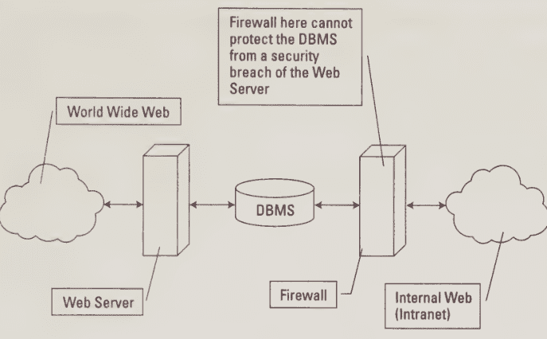

图 5-1：防火墙外部

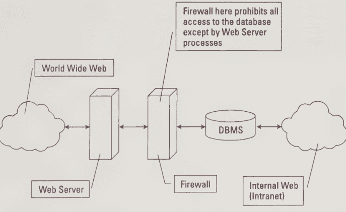

图 5-2：防火墙内部

### 技术人员

所有的数据库都需要维护。在决定数据库策略时，考虑谁将维护数据库至关重要。尽管甲骨公司努力让操作系统过时，但 `DBMS` 仍然运行在操作系统之上。确保你拥有经验丰富的系统管理员来维护操作系统是非常重要的。对于 `Linux` 来说，拥有 `UNIX` 经验（包括一些安全知识）的技术人员就足够了。当然，专门的 `Linux` 支持更好，而且随着 `Linux` 操作系统的普及，专业的 `Linux` 系统管理员的可用性也会增加。

`DBMS` 软件的管理需要不同程度的专业知识。某些数据库，如大型企业数据库，由于需要专门的培训和经验而具有陈旧性。这是可以理解的，因为其中许多都是复杂的系统。此类系统管理的细微变化都会对性能产生深远影响。目前，开源 `DBMS` 对维护人员的要求也同样高，但那是因为它们的功能较少。随着功能的增加，这种情况将越来越不再是事实。

一种可能性是聘请顾问来负责操作系统和 `DBMS` 管理。事实上，许多数据中心专家，甚至互联网服务提供商（`ISP`）都在考虑完全为他们的客户托管数据库服务器。

另一种可能性是采用第三方培训，为管理员准备预期的新技术引入做准备，特别是对于那些对 `Linux` 和/或 `UNIX` 是新手的人。同样，这是 `Linux` 领域一个快速发展的领域，最近发布了各种认证和培训计划，主要的 `DBMS` 供应商长期以来拥有广泛的培训和认证网络。而开源数据库的可用资源要少得多。

### 组织流程

你还必须考虑组织中通用的流程。这些流程决定了数据如何更新、如何生成报告，以及你的数据必须与哪些外部系统交互。

例如，如果你在与供应商和合作伙伴合作中使用电子数据交换（`EDI`），你就需要考虑数据导出到 `EDI` 格式的易易程度和成本。

其他组织事务，如员工的招聘和辞退流程，也是相关的。以这些事件为例，招聘员工可能意味着赋予员工访问数据库特定部分的权限，而辞退员工将涉及移除破坏或盗取数据的简单机会。你的 `DBMS` 应该支持用户和账户管理系统，并能轻松整合到你的组织流程中。

### 跨平台问题

你的数据库策略可能涉及多个 `DBMS` 和托管操作系统。如果是这样，必须考虑尝试集成这些系统时可能出现的问题，例如子系统之间交换的数据内部表示和数据编码。

备份和安全等问题也会受到跨平台问题的显著影响。有很多现成的跨平台备份软件和硬件解决方案，但它们可能非常昂贵，许多组织选择直接使用脚本自己实现。可用专业知识的问题在这些背景下再次出现。

## 总结

在本章中，我们从需要决定 `Linux` 数据库的角度展示了组织工作。我们提出了需要考虑的三个领域：现有数据和数据用途；来自过时应用程序的数据；以及管理数据的环境——物理和组织环境。

当一个组织评估其当前及近期的数据需求时，有必要理解数据需求与组织各部分对数据用途之间的区别。

当一个组织需要或希望使用旧系统的数据时，首要任务是确定旧数据如何适应新结构，无论它是会计系统还是人力资源系统。可能旧数据会被留原样，因为将其转换为新系统的成本太高了。


考虑 Linux 数据库时，第三个重要领域是数据库将使用的环境。例如，它将在 Linux 下运行这一事实，对于一个仅使用微软产品企业标准的组织来说，可能是一个巨大的障碍。从技术角度来看，引入新的操作系统和网络协议（带有 `TCP/IP` 的 Linux）除了跨平台访问数据的问题外，可能还没有具备所需技能的人员。在考虑 Linux 数据库时，几乎是内含的第三个领域是：当组织开始允许客户和供应商访问其以前无法访问的部分数据时，以及这种业务变化所需的安全基础设施。

# 识别你的需求

本章将帮助你理解构建数据库系统的过程，并帮助你识别通用数据库系统的需求和要求。它为规划、选择、安装和配置你的数据库系统时提供了一套通用的指南。关于这些信息的更多详细将在后面的章节中给出，但本章可以帮助你从大局观察问题，并以通用的方式处理常见的数据库问题。

## 数据库管理生命周期简介

数据库管理生命周期是设计、规划和构建数据库系统涉及的一系列通用步骤。根据你的特定需求，该周期可以扩展到各种层级的系统设置和设计。
如果你是从零开始，你可能希望将数据库管理生命周期扩展到选择和设置硬件的水平。如果你的工作已经就绪：
- 数据库生命周期简介
- 评估你的数据库需求
- 信息和数据的分类
- 选择合适的系统

### 本章内容

## 陈述你的目标

退后一步，尝试将问题看作现实情况，而不是计算机项目。这是设计系统至关重要的一步。很容易在直接进入细节时忘记现实问题。陈述你的目标可以让你确定你项目的主要目标。这个目标是你做每个决策时必须记住的重点。
例如，让我们看看人力资源数据库。人力资源数据库系统的设计不应该是将个人信息存储在一个表中，将部门信息存储在另一个表中，尽管这两个表可以通过连接来关联每个人及其所属的部门。最终，这可能是实现的解决方案。它给了用户他们想要的信息，但并不是系统的目标。人力资源数据库真正的目标是让用户能够轻松获取他们所需的员工信息。
作为开发者，你以后会有很多机会对如何更好地在数据组织组织做出决策。现在，我们只是在试图弄清楚为什么我们需要数据库系统，以及我们希望它为我们做什么。

## 识别约束

你的系统必须完成你的目标——这是最重要的的一点。一旦你确定了目标，就是时候进行更详细的思考了。开始决定你在构建实现总体目标的系统时将遵循的指南。列出你的约束列表，并记录你为项目设置每个约束的原因。
预算，你还应该对它们进行记录。在定义解决问题的解决方案时，所有这些因素都需要被考虑内。现在识别这些因素将帮助你确切知道之后需要做什么。
组织约束通常很容易定义，但很难更改。在系统的早期阶段明确陈述这些约束，将帮助你在进入构建数据库系统的后期开发阶段时避免回溯重做。

## 应用约束

你还需要定义系统运行所需的其他准则。现在是考虑将使用哪些类型的客户端程序来访问数据库中数据的良好时机。
通常，你需要列出你期望系统如何运行。从硬件、操作系统和网络协议方面定义客户端机器。确定客户端应用程序将用什么语言编写，以及客户端应用程序将使用什么协议与数据库服务器进行通信。
如果你的系统运行在 Web 上，那么你访问数据库的唯一客户端可能是运行你 Web 服务器的机器。你仍然需要知道它是什么类型的系统，并决定使用哪种语言来编写应用程序。你必须决定是使用服务器端 `CGI`（通用网关接口）程序还是 `servlets`，或者使用从用户机器下载并运行的客户端 `Java` `applets`。在构建基于 Web 的数据库系统时，有许多因素需要考虑，这些将在后面的章节中进行详细介绍。
如你所见，在构建客户端服务器数据库应用程序时，必须考虑许多因素。提前为应用程序定义强有准则将为你最终开始项目开发时提供巨大的帮助。

## 布局需求

现在你已经有了一个详细的约束列表，可以开始规划你的需求，并开始设计你的数据库系统。你可能想列出几种解决方案，然后与组织中的其他人讨论，看看哪种解决方案最合适。与他人交流你的想法将帮助你发现自己没有察觉的问题，并为解决当前问题提供新的见解。
记住在处理和讨论不同的解决方案时，要把你的约束和整体项目目标备在手边。在这个阶段，它们是你决定遵守的规则，现在偏离这些规则将导致你在设计和开发的后期阶段面临许多困扰。
现在，你可以开始考虑更具技术性的细节了。到此时，你已经知道需要做什么，是时候开始思考如何做了了。我知道这一直是你想要做的事情，所以尽管去尝试吧！
如果你还没有数据库服务器，那么是时候考虑你想为项目使用哪一个了。选择数据库服务器是另一个可能变得非常复杂的决策。选择数据库将在第 7 章中详细讨论。通常，你想选择一个适合你的组织并能很好地解决问题需求和约束的数据库。你还应该选择一个能够扩展以满足未来需求的产品。
你必须决定应用程序软件将用什么编程语言编写，以及该软件如何与数据库通信。第 13 章讨论了可以用于客户端应用程序与数据库通信的几种不同语言和协议。在做这些决策时要务实。如果研究发现某特定语言对项目最好，但你没有人知道如何编写那种语言，那么它可能不是你组织的最优解决方案。你将与你的决定共处很一段时间，所以要尝试做出舒适的选择。
到此时，你已经知道将使用哪种数据库服务器、客户端应用程序将用什么语言编写，以及客户端应用程序将如何与数据库服务器通信。现在是时候进入下一个层面的细节，确定你的需求了。

## 确定你的需求

这是设计过程中对开发者来说似乎最实用的部分。现在我们已经列出了项目目标，并识别了用于实现该目标的工具，是时候确定我们计划要做的事情是否可行了。在决定设计可行后，需要确定它是否是一个实用的解决方案，然后尝试识别任何可以改进的领域。此处的想法是“折磨”你的设计。如果存在潜在问题，你希望在开发的这一阶段发现它。
你首先开始思考如何在数据库中存储数据。熟悉你的数据，识别显而易见的关系，并开始布局可能的表格配置。绘制这些布局的图表，并定义数据关系。与系统的未来用户交流，确保你很好地理解数据以及它们是如何整合在一起的。
如果你的设计很好，所有的规划将直接带入项目的后期开发阶段。如果你发现你的设计不好，或者无法满足你的最终目标，那么就庆幸你现在发现了吧。在问题发生之前识别它们，远比在你认为项目快要结束时被问题偷袭要容易得多。试想一下，如果你必须扔掉几百甚至几千行代码，会有什么感觉。那时你就会后悔没有花更多时间在规划上了。
在这一步骤中，你应该完善系统的许多方面。你应该知道将使用哪种数据库服务器、客户端应用程序将运行在什么类型的机器上，以及你将用什么语言编写它。你还应该知道并理解系统设计要存储的数据。
现在你有了这一切，就可以继续后续了。不要为你在这一部分花费的时间感到难过——当你完成后时，这些证明是非常值得的。
我们建议你尽可能贴近你的计划，并仔细记录任何偏离计划的情况。你项目的这部分应该是简单而易见的，你可以专注于所有的微小细节。在进行日常开发时，不需要担心大局，这难道不是很好吗？这就是从良好的设计开始并对其执行进行良好规划的巨大优势之一。如果你需要知道下一步做什么，只需查看你的时间表即可。一切都应该在那里，为你清晰地列列出来。

## 评估你的数据库安装需求

你数据库安装的需求取决于你系统的需求。如果你的系统将存储数 `GB` 级的数据，那么你需要大量的磁盘空间。如果你希望人们能从其他机器访问你的数据，那么你需要某种形式的远程访问。你数据库安装的需求针对你已经设定要解决的具体问题。

## 什么是数据库服务器？

通常情况下，数据库服务器只是运行在计算机上的一组程序，并在该计算机的硬盘上有一个区域供这些程序用于存储数据。在最基本的范围内，这就是数据库服务器的全部。但在实践中，数据库服务器可以是一个非常复杂的系统，能够执行各种任务。
这些程序中的一个通常被称为*守护进程*（`daemon`），它运行在你的计算机上，监听发送给它的请求。当程序接收到请求时，它会解释该请求，并对请求者做出相应的响应。请求通常要求数据库执行某些操作，而响应是数据库对该请求的回复。
计算机上还有其他与数据库相关的执行其他任务的程序。允许用户与数据库直接交互的程序几乎总是随数据库服务器一起提供的。它通常被称为 `SQL` 监器，这是你以交互方式手动访问数据库服务器的方法。`SQL` 监器通常允许你输入直接发送到数据库服务器的命令，然后将数据库服务器的回复显示给你。
数据库服务器可能还包含其他实用程序。它们可能是帮助你执行某些诸如从数据库中复制大量数据之类的程序，或者是帮助你备份数据的程序，又仅仅是安全地启动和停止数据库服务器的程序。现在你可以看到你的数据库服务器看起来已经不仅仅是一个程序和硬盘的一个区域了。

## 阅读文档

每个数据库都有自己的安装要求。无论你正在安装哪种数据库系统，你都应该始终从仔细阅读系统要求和安装文档开始。
编写软件的人认为文档重要到值得编写，而我们都知道开发者有多么不喜欢写文档，所以你可以相当确定，里面的信息非常值得你阅读。

## 设置用户账户

数据库服务器允许远程访问你的计算机。根据设计，它们应该只允许已知用户在你的系统上执行特定任务。但像任何软件一样，如果配置不正确，程序可能会向任何知道如何获取它的人提供你的数据库或整个计算机系统的完全访问权限。
我们在书中介绍的大多数数据库服务器都在你的系统上以特殊用户账户身份运行。该账户对计算机中与数据库相关的部分拥有完全权限，而对系统的其他区域没有任何权限。这是一种设置系统的好方法，它可以防止对你的机器和数据库进行未经授权的访问。


让你的数据库服务器作为独立的专用用户服务器运行有两个好处。首先，它通过将数据库用户放在受控环境中，防止他们获得对你机器的未经授权访问。

> 记住，你数据库的用户不仅是你发放了数据库账户的人；用户还包括那些使用某些客户端软件连接到你数据库的人。

如果你设置了 Web 数据库应用程序，那么数据库的用户可以是互联网上的任何人。如果这些人中的某人发现了攻破解你数据库系统的方法，他们可能通过数据库服务器访问你的机器。如果真的发生这种情况，让你的数据库作为特殊用户运行将限制他们对你系统所能做。

让数据库服务器作为特殊用户账户运行的第二个好处是稍微减轻了 Linux 系统管理的负担。当 RDBMS 系统以安装数据库时使用的登录账户对数据运行查询过程时，通常会专门为此创建一个账户。因此，当使用显示用户活动的系统实用工具时，当进程由 RDBMS 的单个用户账户所有时，数据库活动更容易被识别和监控。这与数据库进程具有当前登录用户标识相比，后者在尝试识别正在运行的 Linux 进程中哪些（如果有的话）是数据库进程时更难以使用。

## 评估磁盘空间

数据库服务器需要磁盘空间。每个数据库系统都需要足够的磁盘空间来存储其服务器和实用程序、文档和配置信息，还需要额外的空间来存储你计划在数据库中保留的数据，加上查询过程所需的索引空间和临时空间，可能还有用户查询和应用程序查询所需的表临时空间。如果有应用程序使用数据库，应用程序开发人员需要提供查询消耗的临时空间需求。请确保你考虑了多个查询同时运行的情况！

每个数据库服务器对系统程序和配置文件都有自己的空间要求。你应该能够通过阅读随数据库服务器附带的文档发现需要多少空间。

当我们进入第二部分时，我们将深入讨论所有这些问题。

另一方面，如果你的数据是为了方便而存储在数据库中的，那么它可能没有那么重要，或者具有很强的可替代性。你可能只是将数据放入数据库中，以便于地进行搜索或引用。在这种情况下，你利用数据库是为了它对你的数据执行复杂搜索的能力，或者是它将该数据与你存储在其他地方的其他信息关联起来的能力。在某些情况下，这些数据甚至不是你自己的，而是你定期从公共数据存储库下载的内容。

如果是这样，那么已经有人在确保这些数据的准确性并妥善归档了。如果你完全丢失了数据，从转储（dump）或备份中恢复所需可能比你从头创建数据库要长得多。如果你有脚本自动处理从下载文件中更新数据，情况尤为如此。在这种情况下，频繁的备份对你几乎没有帮助，甚至完全没用。

## 常见的数据库活动

一旦你将数据放入数据库，你想对这些数据做什么？这是另一个将帮助你确定数据库系统所需特性的因素。

两种常见的数据库系统类型是事务系统和决策支持系统。每种类型都有对其重要的不同特性。定义你计划实现的系统类型将帮助你针对特定需求做出更好的决定。

在基于事务的系统中，全数据恢复和不中断的服务可能是最重要的特性。在基于事务的系统中，数据库中的数据频繁变化，且在长时间没有管理员干预的情况下。这使得数据在发生故障时很难恢复。

考虑经典的银行账户示例。你希望你银行的数据库服务器在恢复一笔你从储蓄账户中取走几百美元的交易之前就崩溃吗？可能吧，但如果你正在存款呢？在这种情况下，我们可以确定，你希望你的银行具备从任何类型的数据库故障中完全恢复的能力。

数据存储库和决策支持系统在数据库故障时比基于事务的系统要容易恢复得多。有时，从头开始创建一个数据存储库可能比从数据库的日志和备份中恢复数据更快。然而，在这些类型的系统中，能够对你的数据执行复杂查询并快速获取信息是非常重要的。

决策支持系统通常用于帮助人们做出重要决定。如果你是一个零售商并跟踪客户的居住地（可能通过在结账时询问他们的邮政编码），你每天都会收集大量数据。这些数据对你来说吗？可能很重要，但如果你丢失了它们，你的业务会陷入停滞吗？可能不会，但你收集它们是有原因的。如果你试图扩大客户群，请使用这些数据来发现你在哪些地理区域可能找到新客户。如果你的业务希望关注客户支持，你可能会使用这些信息在投放特价广告或发送优惠券时针对你的客户群。对你的数据可以进行成千上万种不同的搜索，你需要一个让这个过程尽可能不痛苦的系统。

很有率，你的数据库会在在这两种类型的开发者之间遇到某种问题。加入我们吧——大多数开发者都试图找到方法让他们的系统兼顾这两种系统的最佳特性。这并不总是容易的，决定在这两种系统之间处于什么位置将帮助你在设置和配置数据库服务器及系统时做出一些非常重要的决定。

## 选择合适的系统和设置

决定为你的系统选择合适的硬件很大程度上取决于你目前为止所做的所有决定。你将用于运行数据库系统的硬件将让你的计划、想法、设计和程序变为现实。如果你在不恰的硬件上实施，你所做的所有规划将付诸东流。

在决定系统的硬件需求时，你需要关注的主要领域是处理器、内存、磁盘存储和备份介质。在配置系统时需要记住的一点是，你想保持它的平衡。不要将所有的资源都集中在系统的某个区域，而让另一个区域饥饿。你的系统性能取决于它的最弱点。一个良好的目标是尝试使用系统中每种资源总容量的约 85%。

### 处理器

你只需要足够的处理能力，以便使用系统中的其他组件。如果磁盘访问缓慢且内存资源不足，导致处理器永远无法超过其满容量的 20%，那么在你的机器中配备一个超级处理器对你并没有多大帮助。

### Linux 与数据库

很难预测一个系统在运行后会处于什么样的处理器系统支持下，因此你必须估算自己的需求。如果可能，你应该与其它运行类似系统的人交流，并询问他们的建议。同时，如果你必须自己进行盲目估计，也不要感到抱歉。现代处理器的速度非常快，你选择的任何一个很可能足以让你顺利上路。

### 内存

内存是构建系统时另一个需要考虑的棘手因素。内存越多并没有坏处，但为你的机器增加内存并不总是解决数据库性能不佳的方案。

请仔细遵循你的数据库服务器文档中列出的特定内存配置准则。数据库服务器的内存需求各异，服务器文档应该为你提供指导，告诉你在你的环境中多少内存是足够的。内存需求主要取决于你的数据结构和操作类型。

### 磁盘存储

磁盘 I/O 通常是数据库性能的瓶颈。从磁盘读取和写入数据比访问内存要慢得多。因此，数据库与磁盘交互的方式至关重要。

有几种方法可以优化磁盘 I/O：

- 使用快速磁盘，如 `SSD`。
- 优化你的查询以减少读取的数据。
- 使用缓存将频繁访问的数据保留内存中。
- 使用 `RAID` 配置将数据分布在多个磁盘上。

### 备份介质

选择合适的备份介质对于数据恢复至关重要。常见的备份介质类型包括：

- 磁带：传统且可靠，但访问速度慢。
- 外部硬盘：比磁带快，但容量有限。
- 云存储：方便且可扩展，但可能取决于网络连接。

备份介质的最佳选择取决于你对数据频率的需求以及你能够承受的数据丢失量。

`RAID 1` 和 `RAID 0` 的结合为数据库系统提供了一个理想的环境。为了让所有数据同时存储在两个地方，你需要双倍的磁盘空间。这意味着你刚刚购买的全新 200GB 磁盘阵列被切分了一半，现在只能存储你需要存入数据库的 100GB 数据。

再次，在 `RAID` 中，所有的条带（striping）和镜像（mirroring）都是在磁盘阵列设置时配置的，一旦配置完成，你就可以像访问系统上的一个巨型硬盘一样访问整个阵列。这是一个巨大的优势，如果你既想获得数据镜像带来的性能和安全性，但又不想花费大量时间配置数据库和一堆独立的磁盘设备。

重要的是要记住，当你使用 `RAID` 时，该设备上的所有数据都将以相同的方式对待。当 `RAID` 同时进行条带和镜像时，存储在该设备上的任何数据片段都将同时被条带和镜像。自己设置单个驱动器可以让你获得更细粒的控制，从而精确决定哪些数据需要条带，哪些数据需要镜像。通过这种更细粒的控制，你可以在节省磁盘空间的同时仍然提高性能。

## 备份介质

你存储在数据库中的数据可能对你工作的某非常重要。考虑到这一点，你需要妥善对待数据，以确保无论发生什么，你永远不会丢失其中任何数据。

防止数据库数据丢失的一种良好方法是定期进行备份。大多数数据库服务器都有复杂的备份系统，某些供应商甚至保证，只要你完全遵循他们的指南，就永远不会丢失任何数据。

通常情况下，有两种不同的备份程序。`Incremental backups` 是指只保存自上次备份以来发生变化的信息；`full backups` 是指保存该时间点数据库中的所有信息。大多数提供分钟级完整恢复的备份计划都结合了这两种方法。通常，你会在定期进行全量备份，并在两次全量备份之间的时间点进行增量备份。这将允许你从上一次全量备份进行完整恢复，然后应用通过剩余增量备份所做的更改。

备份应该在与你的数据库系统分离或可拆卸的介质上进行。如果你丢失了驱动器或运行数据库的整台机器，数据也不会随之丢失。用于数据库备份的常用介质有磁带和磁盘。随着价格的下降，磁盘变得越来越有吸引力，但磁带也具有良好的特性，使其成为备份数据的理想介质。还有像 CD-ROM 和 DVD 这样的介质可以用于备份，但它们并不常用。目前，DVD 更多地用作数据归档的手段，但随着价格下降和 DVD 刻机变得更加普及，它们可能会开始进入数据备份的主流。

## 磁盘

磁盘驱动器对于备份数据也很好。磁盘写入速度非常快，而且在使用之前不需要加载到机器上。使用磁盘驱动器备份数据的缺点是，它们在未使用时仍然留在你的机器内部。如果你的机器故障，而你唯一的备份数据源就在里面，就会出现问题。


更好的主意是将增量备份存储在磁盘上，然后使用磁带作为全量数据库备份的介质。这样你就可以从速度更快的磁盘上进行更频繁备份带来的速度和便利。此外，你还不会丢失将全量备份存储在更稳定的介质上并离开机器的安全性。

磁带对于备份数据库也很好，因为你可以将其从机器上取下，并存储在安全环境中。这样，如果你的机器故障，你磁带上有备份，可以将其加载到另一台机器上，并从那里恢复数据供使用。这将保护你免受更严重的故障和自然灾害的影响，这些灾害会导致无法从原始存储数据的任何驱动器中恢复。

磁带的缺点是磁盘读写速度慢，且使用不方便。如果你想从磁带备份或恢复，必须有人物理地将其加载到机器上，并在数据拷贝回磁盘时让留在那里。速度是另一个你可能发现使用磁带进行不频繁的备份、而依靠磁盘进行更常见的备份操作的原因。

## 总结

在本章中，我们研究了规划和选择数据库系统时主要的活动和信息。

在处理了组织问题后，我们讨论了选择和安装 Linux 数据库计划的某些元素。通常，对数据存储需求的评估是列表中需要准备的重要信息中的下一项。数据存储需求在大多数情况下独立于特定的 RDBMS 和操作系统。数据驱动了规范。在大多数情况下，你会发现高性能磁盘系统是新数据库实施中单项成本最高，仅次于应用程序开发的成本。从长远来看，数据库的行政成本才是最大的——例如，DBA、Linux 系统管理员和应用程序支持。

第三，我们查看了信息的分类，以及组织中一些常见功能领域的特定数据需求和用途。这些信息可以用于为组织的数据制定战略计划。

最后，我们查看了数据库系统预计可用的硬件。再次，磁盘系统占据了讨论大部分。RAID 系统对数据库有很大影响。

# 选择产品

本章探索了几个基于 Linux 的 DBMS，评估了每个产品的适用性。

# 选择数据库概述

本节描述了引导你选择的功能和设计特征。

# 架构

大多数 DBMS 都遵循客户端/服务器架构。在客户端/服务器架构中，处理处理发生在服务器端，服务器响应客户端的请求。客户端/服务器架构相对于点对点方案具有许多优势：

- 它减少了网络负载，因为大部分处理发生在服务器端。
- 它释放了客户端处理更直接的任务，如 GUI。

如果实现充分，它允许 DBMS 处理原本可能由操作系统处理的某些。显然，一个 DBMS 实现客户端/服务器架构越充分越高效，它在任何环境中就越优秀。

## 操作系统

这一项几乎是不言而喻的。相比于其他类型的应用程序，数据库管理系统（DBMS）更依赖于操作系统高效提供磁盘、缓存和网络服务的能力，以及多线程和多任务处理等特性，这些特性可能决定一个数据库的效率记录。

UNIX 一直主导着 DBMS 平台市场。UNIX 提供了许多能力，如支持多个同时客户端连接、卓越的 I/O 和内存管理、以及允许管理员快速干预以纠正 CPU 瓶颈和死锁的进程管理，Oracle 和 Base 等主要数据库供应商都支持它。DBMS 从这些以及其他供应商处迁移到基于 x86、RISC 和 SPARC 的 UNIX 的可移植性，顺应 Linux 的趋势，必须被视为一个完全自然的演进步骤。因此，你可以放心，你选择的 DBMS 将与它声称支持的任何类 Linux 操作系统（OS）协同工作。看好标签，你就没问题。

## SQL 标准

遗憾的是，SQL 标准及其对数据库选择的影响并不像与操作系统平台相关的问题那样明确。需要考虑三个 SQL 标准：`SQL-89`、`SQL-92` 和 `SQL3`。

- `SQL-89` 可以被视为 DBMS 能力的最低标准。例如，该标准最初仅允许从编程语言（COBOL、FORTRAN、Pascal 和 PL/I）中调用 SQL 命令。此外，`SQL-89` 仅将引用完整性检查作为一种选项实现。

如果你正在研究的套件仅提供 `SQL-89` 兼容性且仅此此，那么不要考虑在你的环境中考虑它。

- `SQL-92` 远超其前身，为 DBMS 增加了许多重要功能，包括支持：

  - SQL 代理或实用程序，它们本身可以生成 SQL 语句
  - 由 SQL 代理管理的从客户端到服务器的连接
  - 广泛得多的人类语言
  - 高级数据类型，如二进制大对象（`BLOBs`）

`BLOB` 的示例包括音频和流视频等多媒体文件。通常，`BLOB` 没有可以被数据库解释的定义结构，而是仅通过其大小和位置为人知的。

是否存在缺点？确实有。即使在今天，许多 DBMS（尤其是开源产品）尚未完全符合 `SQL-92`。新标准 `SQL3` 增加了更多如用户定义数据类型的能力，尚未被许多 DBMS 供应商解决，更不用说完全实现。

因此，在选择数据库应用程序时，应尝试确定该应用程序符合 `SQL-92` 标准的程度，以及其创建者预计实现 `SQL3` 的时间表。

如果你的环境必须组织和跟踪大量的面向对象项目，请关注 `SQL3` 标准以及实现它的 Linux DBMS。该标准在很大程度上涉及 SQL 的面向对象扩展。

## 存储过程、触发器和规则

存储过程、触发器和规则是 DBMS 术语，指代我们说的“库函数”或“实用程序”。

存储过程被定义为存储在 DBMS 服务器上的 SQL 语句集合和过程化逻辑的集合。它们被视为数据库对象。因此，客户端只需向服务器发送请求即可运行这些预制代码。

触发器顾如其名，当发生某些预定义条件时，它们会触发数据库内部的动作。例如，触发器可能由用户删除记录触发，并通过请求删除确认来运行。

规则指的是一种特殊的触发器，在将数据插入数据库之前进行验证。例如，你的 DBMS 可能会包含一条规则，确保服务器不会接受用户输入的日期为 2 月 31 日。

虽然很清楚存储过程、触发器和规则对于数据库管理员（DBA）来说是非常有用且强大的工具，但由于几个原因，它们在选择 DBMS 时不应占据主导地位。原因之一是能力在不同供应商、甚至不同版本之间差异巨大。另一个原因是将存储过程和触发器从一个 DBMS 迁移到另一个 DBMS 非常困难或是不可能的。

两个基本的 DBMS 功能是：(a) DBMS 支持高效执行引用完整性的支持，或数据库准确匹配跨表键字段中值的能力以及两阶段提交；(b) 以某种方式存储数据，有助于确保在平台崩溃时，可能正在传输中的数据能够得到恢复。

具体来说，寻找一种支持引用完整性并能够将其应用于主键以及列、甚至整个定义域，而无需使用索引的 DBMS。

## 与操作系统相关的性能问题

许多 DBMS（包括用于 Linux 的 Oracle8）可以跳过操作系统的原生文件系统，直接访问原始磁盘（raw disk）或物理磁盘分区的原始空间。原始空间是未经过格式化的。因此，由于它不需要调用操作系统作为输入或输出的中介，数据库服务器面临的 I/O 开销更少。因此，磁盘 I/O 更快，DBMS 也更快。

尽管如此，这种技术也有几个缺点：

- 通常情况下，当 DBMS 使用原始磁盘时，它还需要特殊的实用程序进行备份。这时，简单的 "`tar`" 命令是不够的。
- Linux 可以某些原始或未格式化的磁盘作为交换分区（swap）。当一个物理存储设备同时存放文件系统（即格式化空间）和包含交换区的原始空间时，某些版本的 Linux 不允许剩余的原始空间有其他用途。

你的操作系统如何响应单个驱动器上交换分区和文件系统的组合？可以确定，将大量原始空间交给交换分区会减少供 DBMS I/O 使用的数量。

因此，在评估数据库时，请注意它们对原始空间的使用方式。

## 多进程处理的手段

许多 Linux 发行版以及其他 Intel、RISC 或 SPARC UNIX 支持多进程处理或并行处理，这将处理负载分布到多个 CPU 上。在评估数据库及其平台时，重要的不是操作系统能够并行处理，而是 DBMS 在多大程度上控制这一点。

如果你的操作系统不会为应用程序分配资源，那么就没有问题。但如果操作系统允许数据库服务器为其分配资源（例如查询），那么你并没有获得任何好处。DBMS 通常通过以下方式完成此项工作：

- 专门为并行查询处理编写和编译，通过将查询分解为较小的子查询并在不同的处理器上并发执行。
- 因此需要一个查询管理器来监督子查询的分发并将结果重新组合成可以呈现给用户的整体。
- 结果导致更多的开销。

只有当闪电般的响应时间对你的环境至关重要时，数据库并行处理的能力才是选择 DBMS 的因素。

## 连接管理

DBMS 服务器通过三种方式管理客户端连接并为其分配资源。当你为环境评估数据库时，必须考虑特定套件的连接方法。

三种连接管理技术是：

- 每个进程一个
- 多线程
- 每个进程与线程的组合

### 每个进程一个

这种方法顾如其名，为每个数据库连接提供一个独立的进程。因此，如果你的 DBMS 服务器在某一时刻正在处理 30 个客户端，请放心，你的操作系统已经产生了 30 个独立的额外进程。

# 线程

线程视图依赖于单个客户端连接，甚至 DBMS 服务器本身也作为独立的线程，并且它们都在在相同的地址空间中运行。

什么是线程？一个非正式的定义：内存中的一条路径或轨迹，就像连线游戏中的一条线，将与特定任务相关的数据和指令连接起来。一个更正式且与 Linux 相关的定义：一种轻量级进程，比“真实”或“重量级”进程执行速度更快，所需的系统资源更少，因为线程所需的管理更少。


线程还有它自己的进程调度器，从而使得任何使用它的应用程序都无需再对操作系统进程管理机制的依赖。因为它们对 OS 服务的依赖较少，线程应用程序也更容易移植。

线程有什么缺点吗？有的，最显著的缺点是线程化应用程序不会均匀地分配资源。线程可能会垄占 CPU，导致其他线程在队列中枯等，直到那个贪婪的线程释放处理器。

# 结合“每个客户端一个进程”与线程

为了兼顾两者的优点，某些 DBMS 使用了每个客户端一个进程与线程的结合方式。在 Linux 数据库中，Oracle 8 在这一领域脱颖而出。

Linux 版 Oracle 使用一个名为监听器（listener）的多线程代理。以下是监听器发起的客户端连接处理机制：

- 1. 监听器通过将客户端的服务请求分配给另一个名为调度器（dispatcher）的代理来建立客户端/服务器连接。
- 2. 调度器将客户端的请求发送到服务器队列。
- 3. 服务器进程从队列中取出消息，在数据库服务器引擎内部执行请求，并使用服务器队列开始向客户端返回响应。

这种方案可以维护一个类似于“每个客户端一个进程”所享有的保护处理环境，而无需实际上为每个连接分配一个进程。然而，正如许多任务可能发生的情况一样，队列可能会阻塞，导致处理客户端请求出现延迟。

# 评估客户端连接管理方法

将候选 DBMS 的客户端连接管理技术与该套件对你环境的适用性相关起来，必须从系统资源的概述开始。例如，如果你足够的 CPU 和 RAM 可以浪费，那么客户端连接管理在你的 DBMS 选择过程中就不需要起重要作用。另一方面，正如现实世界中经常发生，如果你必须在有限的环境下实现，那么连接管理就成为评估数据库候选时一个更重要的问题。

本书详细介绍的所有 Linux DBMS——MySQL、PostgreSQL 和 Oracle 8——都内置了多线程能力。

## 管理和其他工具

将它们想象成必要的装饰。你考虑的任何 DBMS 理想情况下都应该将管理和监控工具与其一起。要寻找的工具包括加速以下操作的工具：

- 备份和恢复数据库
- 用户管理
- 调优和维护 DBMS 安全
- 调优 DBMS 性能

## 政府安全标准

政府和其他安全标准由国家安全局所属机构国家计算机安全委员会在《信任计算机系统评估标准》（DOD 标准 5200.28-STD，1985年12月）文档中制定。标准定义如下：

- D 级安全：不安全的系统或应用程序
- C 级安全：某些安全规定；包括：
    - C1：需要用户登录，也允许组 ID
    - C2：需要密码进行单独登录；提供审核机制
- B 级和 A 级：提供基于标准国防部许可的强制控制

大多数类 Unix 操作系统默认以 C1 安全运行，并且可以在不费费力的情况下升级到 C2。因此，我们正在检查的 Linux DBMS 要么执行或密切监控用户活动、设置密码年龄、检测入侵者等。正如你可能猜到的，这种额外的安全性是有代价的。这些数据库更贵，性能也更差，因为它们需要许多额外的系统资源来实现其所提供的额外安全性。

更具吸引力的是内置工具的数据库套件，它允许你监控数据库的缓存使用、磁盘访问效率和处理器使用情况。

本书详细介绍的 Linux DBMS 中，Oracle 8 和 PostgreSQL 提供了上述某些监控工具。

## 安全技术

所有值得提供的 Linux DBMS 都在数据库、表、列/字段和行/记录级别提供安全性。此类数据库可以在所有这些级别上防止：

- 由于修改尝试冲突或重叠导致的数据损坏
- 未授权的访问
- 未授权的修改

然而，这并不意味着这些 DBMS 是防黑客的。如果你至少需要达到这一目标，请考虑符合 C2 和 B1 等政府安全标准的 DBMS。

## 整体性能

在评估数据库候选时，比较它们的性能。向供应商索相同任务的性能统计数据。例如，你可能会询问 MySQL 项目、PostgreSQL Inc. 和 Oracle Corporation 在十个或更多客户端连接到服务器时，简单查询的平均响应时间。

## 接口能力

你应该考虑你正在评估的 DBMS 是否以及能够多容易地与应用程序编程接口 (APIs) 以及用于数据通信、图形和拖放功能等应用程序的可执行库连接。如果你的用户需要将源自 Linux 数据库的数据与 Microsoft Access 或 PowerPoint 等工具交织，则选定的数据库至少具有将查询结果保存为纯 ASCII 文件的能力，其字段仅由空格分隔。更有用的将是具有直接导出为 Access 或其他 Windows 兼容格式的能力。

# 通用设计和性能问题

最后，是许多关于数据库功能和整体模型（关系、网络或面向对象），或最符合标准的特定应用特性的通用问题。

## DBMS 模型

以下是三种主要 DBMS 模型的简要定义。

- 关系：基于 E.F. Codd 开发的模型。RDBMS 允许定义数据结构、存储和检索操作、完整性约束以及表、记录和字段之间的关系。RDBMS 使用键字段来实现特定值的自动索引搜索。
- 网络：每个记录类型可以有多个父关系模型；例如，一个记录类型同时关联客户和产品。也称为关系模型。
- 面向对象：要求将数据存储为对象，并仅使用类似于对象编程的方法进行解释的模型。OODBMS 保留了相似对象之间的关系，以及对象之间的引用。由于不需要通过连接检索对象，OODBMS 提供的查询执行速度更快。

本书介绍的三种 Linux DBMS 中，PostgreSQL 和 Oracle 提供了重大的面向对象能力。MySQL 仅通过插件提供此类能力。

## 字段

如果一个 Linux DBMS 在若干不同的语境下对几个项目有多次出现，关系型 DBMS 模型最可能符合你的需求。

# 多媒体或其他 BLOB 数据的比例

多媒体数据（如视频和声音）将是你的 DBMS 跟踪的内容吗？如果是，你需要一个按照面向对象模型运行的应用程序。

# 更新速度

响应时间对你的 DBMS 越关键，它就越需要依赖传统的关系型数据库模型。

# 模式修改的频率

如果你的数据库设计必须频繁更改，那么遵循关系模型的 DBMS 将最符合你的需求。此类套件比网络型或对象型数据库更容易处理模式（schema）的变化。

## 数据库规模

你的数据库是否需要存储和处理大量的记录？此外，你预见到该数据库的模式将保持相对不变？如果是这样，遵循关系模型的 DBMS 可能最适合满足你的需求。

### 同时事务数和用户会话数

你是否预见到会有大量用户同时访问你的数据库？每个用户是否会对这些数据库进行大量的修改？如果是这样，遵循网络模型或多关系模型的 DBMS 将最适合你的环境。

# 选择 DBMS

在选择 DBMS 时，你有几种选择。

## MySQL

MySQL 官方网站 [www.mysql.com](http://www.mysql.com) 列出了该 DBMS 创建者认为在数据库系统中重要的内容。该网站强调了关于该产品的以下几点：

- 处理海量数据的能力，以及包含 BLOB 的数据库能力
- 遵循 SQL 标准
- 库和客户端程序的可用性
- 多线程、客户端-服务器架构
- 多用户特性

其开发者在包含以下内容的环境中创建并测试了 MySQL：

- 很大比例的表包含超过 700 万条记录
- 大约 10,000 表
- 超过 40 个数据库
- 至少 100GB 的数据

与所有开源产品一样，MySQL 仍然处于开发阶段。与其开源同类产品一样，并且如上述数字所示，MySQL 提供了生产能力。更好的是，价格合理；MySQL 再次像它的开源伙伴一样，可以以低成本甚至免费获得。

# Oracle

除其他因素外，Oracle 公司意图使其 DBMS Oracle8i 能与运行在 Windows NT 下的 DBMS 等市场支柱产品相竞争。Oracle 的一位高级 Linux 开发经理指出，Linux 社区本身已经表达了对广泛相关应用程序的需求，而广大用户社区由于缺乏多种可选应用程序，对 Linux 持怀疑态度。

Oracle 公司通过将其 DBMS 首次移植到 Linux 解决了这两个疑虑，并承诺对移植后的产品进行持续增强，并提供来自 Oracle 公司的全面支持（包括免费升级）。

具体而言，Oracle 公司指出了这些特性，用以证明 Linux 版 Oracle8i 是一个企业级就绪的产品：

- 数据库开发环境
- 应用程序开发环境
- 开放数据库连接 (ODBC) 库
- 支持多进程处理
- 支持世界上最常用的 Web 服务器应用程序 Apache

为了提供这些及其他特性，Oracle8i 很大程度上依赖于称为最优灵活架构 (OFA) 的设计范式。Oracle 公司认为 OFA 是一组配置指南，允许创建快速、可靠且维护需求较少的数据库。具体而言，OFA 试图便于数据和模式增长的管理、多个数据库的控制以及例行管理任务的备份。OFA 还试图减少数据和模式存储中的碎片化，并以这种方式组织软件和数据以避免瓶颈和性能低下。

然而，OFA 尝试实现这些崇高目标的方法本身在最好的情况下产生开销，最坏的情况下会导致问题。考虑在 Oracle8i 文档各个领域中提出的这些点：

- 只有在这样做不与运行考虑发生冲突时，才应最小化硬件成本。


- Oracle8 将不同类别的文件分离到独立的目录子树中，最大限度地减少了某一类文件的操作对其他类别文件操作的影响。
- 将 Oracle8 的数据库和软件分布在多个驱动器上，可以最大限度地减少驱动器故障对这些数据库和软件的影响。

从纸面上看，每一点似乎完全合理。但在现实世界，每一点都可能引入与它们试图排除的情况同样复杂的问题。例如，一个大型、高度划分的数据库可能导致文件系统泛滥，到占据操作系统过大比例 inode 的程度；或者对 RAID 的依赖可能会引入其他处理 DBMS 完整性的方法可能没有的费用和管理复杂性。简而言之，Oracle8 对处理效率和数据库完整性的卓越关注，尽管其具有优势，但可能使其不适用于小型环境或小型、简单的数据集。

# PostgreSQL

从非常真实的意义来说，PostgreSQL 结合了 MySQL 和 Linux 版 Oracle8 的优点，且没有后者的任何一个缺点（诚然，在许多环境中这些缺点是微道的）。

PostgreSQL 是 Ingres 的开源化身，在学术环境中演变。根据其开发者自己的承认，PostgreSQL “尚未接触过全方位的真实世界查询”。因此，自 1995 年以来，其增长重点侧重于添加或改进：
- 商业风格的功能（如电话支持）
- 缺失的 SQL 功能
- 对复杂数据类型的支持
- 对复杂查询的支持
- 事务支持
- 锁
- SQL 合规性

以下部分 PostgreSQL 的功能列表展示了该 DBMS 半商业、半开源的特质：
- 可多列索引
- 提供多种索引类型，包括 B-Tree 和哈希索引
- 提供 ODBC 驱动程序
- 支持在线备份
- 提供在线文档
- 提供在线恢复
- 支持并行查询
- 提供只读数据库
- 提供行级锁
- 支持共享操作系统，包括 FreeBSD、NetBSD、Linux x86、Linux Alpha、Linux SPARC、SGI Irix 5.3、Solaris SPARC 和 Solaris
- 支持多种编程语言，包括 C、C++、Java、Perl 4、Perl 5、Python 和 Tcl

本节讨论了商业级 Linux 数据库套件和开源 Linux DBMS 的优缺点。

## 商业产品

商业级 Linux DBMS 比你想象的要多。本节将不仅审查该类别的优缺点，还将审查其中的代表产品。

> 如果一个 DBMS 不提供源代码，或者仅在额外付费的情况下提供代码，则它属于商业类别。

## 商业产品的优势

这里提到的大多数商业产品都提供了通过 Internet 进行管理的复杂工具。许多产品还支持电子商务应用程序的关键功能，包括处理 BLOB、多媒体数据和流的能力。此外，这些产品提供的 GUI 环境超过类似的开源工具。由于这些原因，如果你的环境需要对象型或网络 DBMS 特性，你必须考虑商业数据库管理系统。

## 商业产品的劣势

人们说房地产中三个最重要的标准是位置、位置和位置。商业问题可以表述为成本、成本和成本。我们在这里审查的商业 Linux DBMS 没有一个是廉价的。如果你是小型环境且数据管理需求简单，你可能希望放弃商业数据库管理系统。

## 示例产品

现在让我们来看看 12 种商业 Linux DBMS。

# ADABAS/D

Adabas/D 是德国法兰克福 Software AG 公司的产品，提供了一个专业的数据库系统，通过完全支持域（domains）、主键、引用完整性、存储树和过程以及可更新连接视图，完全实现了关系模型。（注：此处原文 domains 译为数据库术语“域”，stored trees and procedures 译为存储树和过程）。

ADABAS/D 自 1997 年起已移植到 Linux。其对业务环境主要感兴趣的特性包括：
- 在不关机或重组的情况下增加数据空间的能力
- 与其他商业替代品相比成本较低
- 无需持续监控的静默运行
- 平衡 B*树优化存储分配
- 多处理器系统的扩展性
- 多线程架构
- 记录锁
- 支持 C、C++、COBOL
- 支持 ANSI、SQL-92 和 OFA 标准
- 支持 ODBC
- 支持 JDBC
- 包含 Perl 5.4 接口
- 包含 Tcl/TK 接口
- Remote Control，一种图形数据库管理工具，可以通过内网或 Internet 使用，并允许远程数据库安装和服务器配置
- 适用于所有支持平台的查询 GUI 前端
- 支持的操作系统包括 SUN Solaris 2.5 或更高版本、SCO UnixWare 和 Linux

更多信息请参阅 www.softwareag.com。

## Cache

Cache 自称为一种“后关系型”数据库，并依赖于事务范式和多维 DBMS 模型。其核心组件包括：
- Cache 分布式缓存协议 (DCP)，一种网络技术，可根据处理需求动态地将数据库分布到整个网络中
- Cacheé 对象服务器，允许 Java、ActiveX 和 C++ 语言处理器及开发工具直接使用 Cacheé 对象
- Cacheé ObjectScript，一种专为企业级事务处理设计的内置脚本语言
- Cache SQL Server，通过 SQL 或 ODBC 访问数据库
- Cacheé Studio，一个基于 GUI 的开发环境
- Cacheé WebLink，在 Cacheé 和 Web 服务器之间提供连接性，用于 Web 事务处理型应用程序
- 面向对象功能，包括对继承和多重继承的支持；对多媒体和特定应用程序数据的支持；以及对包括 Java、ActiveX 和 C++ 在内的流行对象语言和技术的支持
- Visual，用于自动化创建 Microsoft Visual Basic 表并将 Cacheé 数据库对象与这些 VB 表单链接

更多信息请参阅 www.e-dbms.com/cache。

## Linux 版 DB2 通用数据库

IBM 的 Linux 版 DB2 通用数据库对其长期 DBMS 的 Intel 端口版本，包含以下重要特性：
- 一种多媒体、Web 就绪的关系型 DBMS
- 性能监控器
- 用于 Perl 数据库接口的 Perl 驱动程序
- 连接增强，如连接池
- DB2 控制中心，可以从任何启用 Java 的 Web 浏览器中运行的管理界面
- 增加的表/列限制
- 轻量级目录访问协议 (LDAP) 支持
- OLE DB 容器支持
- BLOB 的复制能力
- 对 JDBC 和 SQLJ 的支持
- 存储过程
- Unicode 支持

DB2 个人开发者版可以免费费用下载，但仅可用于应用程序的评估、演示、测试和开发。虽然评估没有时间限制，但它不能在生产环境中使用。

更多信息请参阅 www.ibm.com/software/data/db2/linux。

## Linux 版 Empress Suites

Empress Software 自 1995 年以来一直为 Linux 提供数据库产品，提供三种产品：
- Empress 电子商务数据库工具包，用于电子商务应用的开发和部署
- Empress 嵌入式数据库工具包，用于嵌入式系统开发者；具有小型内存的快速 RDBMS
- Empress Web 数据库工具包，用于创建交互式数据驱动的 Web 页面

每个每个工具包的核心都是 Empress RDBMS，一个紧型 SQL 数据库引擎。Empress RDBMS 具有以下重要特性：
- 可以在不卸载和重新加载数据的情况下添加、删除和重新定义表的属性
- 扩展事务机制，允许多个事务命名并相互嵌套
- ANSI SQL 数据库
- 自动两阶段提交，有助于确保事务期间的数据完整性
- 数据传输和数据加载实用
- 扩展的对象化能力，如持久存储模块、用户定义函数和用户定义过程
- 跨异构网络的完全分布式、客户端/服务器和多服务器架构
- 完全集成的报告生成器，用于生成自定义格式的报告
- 交互式嵌入式 SQL
- 数据库引擎的内核级 C 和 FORTRAN 接口
- 内核级 X Windows 系统接口访问，以实现更高效的基于 GUI 的操作
- 在发生严重故障时恢复数据库的实用程序
- 数据字典内置的引用约束和范围检查
- 强力的完整性和恢复功能
- 支持多种通用数据类型，包括文本、浮点、大容量

> 提示：Empress Software 为其所有的 Linux 套件提供免费的 30 天评估。

更多信息请参阅 www.example.com/。

## FrontBase

FrontBase 在其网站上被称为“唯一零管理的企业级关系型数据库服务器”，适用于 Red Hat Linux、SuSE Linux、YellowDog Linux 和 Solaris 等 Linux 平台，提供以下重要特性：
- 备份活动数据库的能力
- 记录级访问权限
- 块模式、即时加密
- 内置镜像能力
- 使用 UTF-8 标准表示数据以节省存储空间


+ * 所有字符数据独占使用 Unicode 2.0

+ * 完全符合 SQL-92 标准，包括服务器内置的全完整性约束检查

+ * 内存表缓存

+ * 多列 B 树索引

+ * 依赖套字进行客户端/服务器通信，从而支持各种客户端平台

+ * 从任何 Web 浏览器的远程管理能力

+ * 存储过程

+ * 客户端/服务器通信的流式即时加密

+ * 支持 GB  BLOB

+ * 支持 GB 字符类型字段值

+ * 支持流式 QuickTime 内容

+ * 支持 TB 数据库

+ * 迁移 MySQL 数据库的工具

更多信息请访问 www.frontbase.com。

## Informix SE

Informix 公司在其网站上强调了 Informix SE 的性能、数据一致性、客户端/服务器能力、标准遵循性和易管理性。支持这些声明的套件特定特性包括：

+ * 多种索引选项，可以涵盖一个到八个字段的索引，以及包括唯一索引和聚集索引的 B+ 树索引选项

+ * 通过内置内置客户端/服务器连接，无需额外的网络产品

+ * 通过审计日志、事务日志、锁定过程和隔离级别维护数据一致性

+ * 符合 SQL92 入级要求

+ * 基于 X/Open XPG3 规范的原语言支持

+ * 为了提供共享内存或原始设备的功能无需修改内核

+ * 最大字符字段大小 32511 字节

+ * 最大密钥大小 120 字节

+ * 每个表最多 32767 列

+ * 每个表最多 10 亿行

+ * 最大记录长度 32767 字节

+ * 依赖原生 Linux 文件系统以简化数据存储和检索

+ * 提供以 ASCII 格式迁移 Informix 数据到其他 Informix 数据库的实用程序

+ * 支持多种只读隔离级别，例如 SQL SELECT UPDATE 请求锁定正在更新的记录

+ * 通过强制字段接受的值支持实体完整性

+ * 支持完整性约束、存储过程和触发器

+ * 支持引用完整性，例如只要详情表中存在相应信息，即可确保主表条目的信息保持完整

+ * 自动确定检索数据的快速方法，基于在非高峰处理期间收集和计算特定数据分布的统计信息，以避免瓶颈

+ * 支持行、表或数据库级别的锁定

+ * 在发生系统故障时，根据审计日志恢复表甚至整个数据库

+ * 两种访问权限级别以确保数据库安全：允许创建表和索引的数据库权限以及允许修改、插入和删除数据的表权限

更多信息请访问 www.informix.com。

## Ingres II

Linux 版 Ingres II 目前仅作为测试版提供。然而，该测试版（即可免费下载）包含以下特性：

+ * IngPer，通过 Perl 脚本访问 Ingress 数据库

+ * C 接口

+ * Internet 发布能力

+ * 行级锁定

+ * 支持 BLOB

+ * 可变页大小

+ * 嵌入式 SQL 预编译器

+ * C2 安全审计

+ * 查询和报告工具

+ * 终端显示器

然而，Ingress II 的测试版并不包含 Ingress II 商业版提供的其他功能，例如增强的安全性（即用于建立 C2 之外安全性的工具）、网络实用程序、对象管理工具或 Ingress 的视觉化 DBA 工具。最后，该测试版存在几个尚未解决的已知漏洞，其中最重要的是：

- Syscheck，这是 Ingress II 系统需求检查工具，它尝试判断运行 Ingress II 的机器是否具有足够的资源，但无论资源实际上是否可用，它总是报告这些资源可用。

- Ingress II 无法在 Red Linux 5.0 或更早版本上运行，因为操作系统提供的 glibc 库版本与 DBMS要求的版本之间存在兼容性问题。

Linux 版 Ingress II 在至少可预见的未来将引起人们的兴趣，主要针对熟悉 GNU 开发工具和 Apache Web 服务器的应用程序开发者。

更多信息请访问 www.cai.com/products/ingress.htm。

## InterBase

尽管 Inprise 公司在 2000 年 1 月宣布计划发布 InterBase 6（它将其称为开源数据库），并以真正的开源形式发布，但该发布尚未发生。因此，我们仍必须将 InterBase 视为商业或准商业产品。InterBase 6 直到 2000 年 5 月一直处于测试发布阶段，并于 2000 年 7 月作为 Linux 和 Solaris 的生产工具发布。

尽管存在这些棘手问题，InterBase 6 作为 Linux 企业级 DBMS 仍然值得考虑，因为它提供了如下功能：

- 一个名为 IBCConsole 的集成图形化用户界面，通过它可以创建和管理 InterBase 服务器，或者通过它在该服务器上创建和管理数据库。

- 一个复制器（Replicator），便于具有相似结构的多个 InterBase 数据库之间的复制和同步。

- 一项服务，允许您编写监控和控制 InterBase 服务器及数据库的应用程序；可能任务包括：

  - 备份和恢复

  - 关闭和重启

  - 垃圾回收

  - 扫描无效数据结构

- 在安全数据库中创建、修改和删除用户条目

- 管理软件激活证书

- 改进有关当前事务状态和 SQL 语句的警告；后后者包括：

  - 在产品未来版本中将被替换的 API 调用

  - 待处理的数据库关闭

  - 在不同 InterBase 版本产生不同结果的 SQL 表达式

  - 无作用的 SQL 语句

- 新数据类型 DATE、TIME 和 TIMESTAMP

- 支持 Delphi 5

- 支持大精确数值——即具有 10 到 18 位精度的 NUMERIC 和 DECIMAL 数据类型——存储为 64 位整数

- 支持只读数据库

- 支持 SQL 分隔标识符；即由双引号分隔的数据库对象名称

- 向多个文件备份或从多个文件恢复数据库的能力

- 方言（dialects）概念，允许用户使用新功能，例如分隔标识符、大精确数值以及 SQL DATE、TIME 和 TIMESTAMP 数据类型，这些功能与旧版本的 InterBase 不兼容

- 用于检索日期时间信息的新 EXTRACT() 函数

更多信息请访问 www.interbase.com。

## KETexpress

Texpress 是一个遵循面向对象模型的 DBMS 套件，它提供的引擎包含如下功能：

- 嵌套关系数据库模型，该模型支持复杂的对象定义，无需反编译这些对象即可进行修改。

- 网络通信层，支持直接通信（即远程函数调用）以及基于 TCP/IP 的网络通信和串口连接。

- 基于对象的索引方法，可实现异常快速的检索。

- 通过 8 位扩展 ASCII 完全支持欧洲语言，通过如中文和日语等多字节字符集完全支持亚洲语言。

- 除了硬件和操作系统平台实施的限制外，对数据库大小没有实际限制。

- 安全功能，包括用户账户和对象权限级。

- 支持对单个单词、数字和字段值索引，以及日期和时间等复杂数据类型。

- 支持面向对象的数据库结构，提供诸如文本属性、多值字段、嵌套表和对象引用等功能。

更多信息请访问 www.kesofware.com。

## Oracle8 for Linux

Oracle 公司将 Linux 视为企业环境中运行最快的操作系统平台之一，并引用该系统的数百万用户作为其致力于在 Linux 上运行 Oracle 的原因。因此，Oracle8 和 Oracle8 DBMS，以及作为 Application Server、Jerry 和 WebDB 的 Oracle DBMS 套件组件已向 Linux 社区开放。

对 Linux 作为企业平台的承诺体现在 Oracle8 的新功能中，这些包括：

- 改进的安全性，包括设置密码的时间限制或保留密码历史，以及在尝试连接账户时涉及三次无效密码输入时禁用用户账户的能力。

- 通过 CREATE INDEX 和 CREATE TABLE AS SELECT 等命令改进并行处理。

- 支持面向对象和关系型 DBMS 功能，如嵌套表、VARRAYs 和对象视图。

- 可以跨分区的表和索引。

- 高达 1,000 个字段的表。

- 大于 2GB 的表和索引。

- 新数据类型 BLOB、BFILE 和 CLOB

- 支持可 4000 字节的 VARCHAR

- 带有 INSTEAD OF 子句的可更新视图。

更多信息请访问 www.oracle.com。

## Sybase Adaptive Server

Linux 版自适应服务器企业版（ASE）增加了许多功能，例如人们对基础 DBMS 预期的功能：

- 行业标准的 ODBC 接口

- 备份验证

- 增强的 ANSI SQL 合规性

- 增强的存储过程和触发器

- 支持大于 2GB 的备份文件

- 支持大于 2GB 的 B 树索引

网站：www.sybase.com

## Unify DataServer

Linux 版 Unify DataServer 7 增加了许多类似于人们对基础 DBMS 预期的功能：

- 行业标准的 ODBC 接口

- 备份验证

- 增强的 ANSI SQL 合规性


- 增强的存储过程和触发器
- 支持大于 2GB 的备份文件
- 支持大于 2GB 的 B 树索引

网站：`www.unify.com`

## Open source products

正如你所想象，许多适用于 Linux 的 DBMS 都是开源软件。本节讨论了代表性的开源软件套件。

如果一个 DBMS 以免费形式提供该套件的源代码，则它属于开源类别。

### 开源产品的优势

开源数据库管理系统的最大优势是价格。这里讨论的所有 DBMS 在与结构相似的商业产品相比时都不逊色。它们均可免费下载。它们都免费提供完整的源代码，从而提供了定制套件的机会。与 Oracle 或 Sybase 等产品的许可费用和其他成本相比，开源 Linux DBMS 具有与开源产品相同的优势：低成本的功能性和可靠性。

### 开源产品的劣势

我们审查的任何开源 DBMS 都并非功能完备且通用的套件。然而，这些产品很少提供超出之外的管理工具。此外，为了获得最大的收益，我们检查的每个开源 DBMS 都要求大量的 C 和 Linux 知识。如果你的环境需要对 DBMS 进行快速、简单的加载、配置和管理，或者需要远程 DBMS 管理等功能，开源 Linux 数据库可能不适合你。

### 开源产品示例

本节总结了五个开源 Linux DBMS。

## CodeBase for Linux

CodeBase 6 是一个为 C 或 C++ 程序员设计的 xBase 兼容数据库引擎，具有以下重要功能：

### 254 第一部分 Linux 与数据库

- 每秒可查询数百万条记录
- 可以执行批量追加、编辑和删除
- 暴露其低级 API 以提供自定义应用程序的能力
- 允许创建最大尺寸为 8.6 亿太字节的单个表；即 `9,223,372,036,854,775,808` 字节
- 对每个数据库的表数量没有限制
- 提供完全的多用户多线程锁定
- 支持多用户多线程独立或客户端/服务器型应用程序
- 支持 xBase 文件标准，从而提供与 FoxPro、dBase 和 Clipper 数据文件的兼容性

欲更多信息请访问 `www.sequiter.com/products`。

## db.linux

Centura 的 db.linux 在我们审查过的所有数据库管理系统（DBM）中脱颖而出，它是一套让开发人员为电子商务和信息设备构建应用程序的套件。是的，你现在可以在你的手持电脑上拥有自己的数据库了。Centura 实现这一成就时最显著的特点是：

- 一个 C API，包含一个超过 150 个函数的库，并且与任何符合 ANSI C 标准的编译器兼容，例如 GNU C
- 一种主要基于 C 编程语言的数据定义语言 (`DDL`)
- 线程安全的重入代码架构为多线程应用程序和大量的并发用户会话提供了支持
- 允许将多达 `16,777,215` 条记录存储为单个文件；在 db.linux 术语中，即作为一个表或记录类型
- 事务日志自动恢复
- 复合键
- 对记录字段数量的限制仅取决于最大记录尺寸
- 可选支持读锁、写锁和排斥锁
- 允许记录允许 `32K`
- 每个数据库提供最多 `256` 种记录类型，每个数据库最多允许 `4,294,967,040` 条记录
- 仅需 `200K` 以上内存，如果数据访问为只读，则约需 `40K`
- 支持 B 树索引、基于指针的导航和高效缓存
- 支持关系型数据库模型和网络数据库模型的功能
- 时间戳支持
- 事务日志

欲更多信息请访问 `www.centurasoft.com/dblinux`。

## MiniSQL/mSQL

MiniSQL 3.0 是 mSQL 开源 DBMS 的最新版本，于 2001 年 2 月 15 日发布，它保留并满足了其祖先的设计目标：为小型数据集提供高速访问。然而，MiniSQL 在容纳涉及多达 100 万条记录的高端应用程序的能力方面，远超 mSQL。

MiniSQL 的编程目标是通过通过更好地处理复杂查询和大数据集来实现后者的目标。具体而言，MiniSQL 的设计考虑了这些标准：更完全地符合 ANSI SQL-92 规范，为简单操作提供更好的性能，并为大型数据库和复杂操作提供快速访问。MiniSQL 试图通过以下方式实现这些标准：

- `W3-mSQL 2.0`，这是一个第二代 Web 接口包，提供了一个完整的脚本语言，并在 HTML 标签内提供了对 mSQL API 的完全访问
- 增强索引，例如，为每个表定义多个索引的能力，以及在任何此类索引中包含十个字段的能力
- 对通过互联网连接的用户身份验证的增强，包括配置、用户组管理、安全区域定义，以及通过 Web 浏览器访问的图形界面创建授权用户
- 将索引存储在系列 B 树结构中，这些结构映射到 mSQL 服务器进程的虚拟内存地址空间中，从而有助于确保键数据的极速检索
- 支持变长字符数据类型，允许使用溢出缓冲区方案向字段中插入无限制的数据，该缓冲区用于存储超出字段大小的数据
- 引入了候选行（candidate rows）抽象来执行查询处理；候选行抽象允许执行查询请求的模块请求：从已识别为符合查询中所述选择标准的候选表中，请求物理上的下一行作为匹配的行；将这种技术比作 CPU 使用的预测和预测，CPU 用于“猜测”下一步将需要什么数据并在需要之前提前检索这些数据。

欲更多信息请访问 `www.hughes.com.au/`。

### 第一部分 Linux 与数据库

> 提示：预计 MiniSQL 的后续版本将支持更多数据类型，例如最新 SQL 标准中定义的 DATE/TIME（日期/时间）和 CURRENCY（货币），以及大型商业数据库常见的 BLOB 等数据类型。

## MySQL

MySQL 最重要的设计目标是易用性、健壮性和速度。MySQL 网站提供了基准测试结果，证明了这种紧凑、看似简单的 DBMS 处理非常大型数据库的速度比许多商业数据库管理系统至少快一个数量级。此外，自 1996 年以来，MySQL 一直在一个包含 500 张表、超过 700 万行、约 100GB 总数据、超过 10,000 张表和 40 多个数据库的环境中开发和测试。

相比于它的任何开源或商业同类，MySQL 需要对 Linux 命令行环境熟练熟悉以及对 C 源码的操作。如果你具备这些技能，你就可以

欲更多信息请访问 `www.mysql.com/`。

# PostgreSQL

PostgreSQL 在伯克利大学许可协议下运行，尽管正如一位评论员所言，它“关于是开源的”。

该套件最吸引人的特征之一是：

- 基于 GUI 的管理工具
- 类似于 Linux 权限的权限语法
- 对 SQL-92 标准的合理程度
- 令人印象深刻的数据类型集

> 提示 CIDR 尝试表示多个 IP 地址。与其为组中的每个目的发布单独路由，使用 CIDR 的路由器可以使用所谓的超级网（supernet）发布一个代表所有目的的聚合路由。这种技术因此减小了路由表（存储网络和互联网路由表）的大小。

- 支持主流 Linux 发行版格式：Red Hat 的 RPM、Debian 和 .tgz
- 与多个流行的 Linux 发行版捆绑；节省资源；例如，服务器守护进程仅需 1.1MB 内存，而 bash 等常用 shell 需要 950KB
- 支持处理 PostgreSQL 更冷门数据类型的 SQL 函数和代数运算符
- 支持更复杂的查询结构如子查询（subselect）
- 支持事务提交和回滚
- 支持 BLobs，尽管处理速度较慢
- 支持可以运行的操作系统平台，包括服务器端的 Linux、FreeBSD 和大多数 UNIX 变体，以及客户端端的所有系统以及 Windows 95、98 和 NT
- 相对简单的安装

欲更多信息请访问 `www.postgresql.org`。

## 第 7 章选择数据库产品

建议

如果这是一个多媒体出版物，我们会在这里插入一段鼓点。考虑到本章讨论的所有评估前提，我们在商业和开源类别中得出了一个建议。

### 商业产品

我们对商业 Linux DBMS 的建议是 Oracle。我们选择该产品是因为它是无论是商业还是开源类别中功能最全的 DBMS 之一，更重要的是，因为 Oracle 公司对 Linux 的承诺。这种承诺无疑有助于该产品持续保持高质量。

### 开源产品

我们推荐的开源 Linux DBMS 是 PostgreSQL。这套工具具有引人入胜的数据类型；能够整合微软生态的客户端；值得赞叹的低系统资源占用；基于 GUI 的管理工具 pg_access（这在开源数据库管理系统中非常脱颖）；以及其实用的发行格式和捆绑选项，使其非常适用于各种环境，并且易于获取、安装和配置。

## 总结

在选择 DBMS 时，请对每个候选者尽可能详细且实用的地调查以下因素：

- 对 SQL 标准的遵循情况
- 管理工具
- 架构
- 对存储过程、触发器等处理
- 硬件和操作系统平台以及这些平台可能带来的任何限制
- 与性能相关的问题，如多线程能力和连接管理技术
- 关系模型
- 安全技术

## 安装与配置

第 8 章

安装

第 9 章

配置

# 安装


本章讨论了基于 Linux 的数据库的安装，重点介绍了加载 MySQL、Oracle8i 和 PostgreSQL 所涉及的最重要任务。

## MySQL

正如 MySQL 项目在其网站上所述，开源数据库的一个重要目标是易用性。这种易用性体现在服务器的安装过程中。表 8-1 描述了 MySQL 的组件程序，表 8-2 概述了 MySQL 的环境变量。

每个 MySQL 程序都采用不同的选项。然而，每个程序也提供了 `help` 选项，通过它你可以获取特定命令其他选项的完整列表。

- 本章
- MySQL：需求、决策、安装准备
- PostgreSQL：需求、决策、准备、安装
- Oracle8i：需求、准备、安装

### 表 8-1

MySQL 程序

| 程序 | 用途 |
|---|---|
| make_binary_release | 创建编译后的 MySQL 二进制制发布版本，该版本可以通过 ftp 发送到其他位置 |
| msql2mysql | 将 mSQL 程序转换为 MySQL 的 shell 脚本 |
| myisamchk | 用于检查、显示信息、优化或修复 MySQL 表格的实用程序 |
| mysql_install_db | 创建 MySQL 权限表及其拥有的默认权限的脚本 |
| mysqlaccess | 检查匹配特定主机/用户/数据库组合的访问权限的脚本 |
| mysqladmin | 处理创建或删除数据库等任务的管理实用程序 |
| mysqld | MySQL 服务器守护进程 |
| mysqldump | 将 MySQL 数据库导出到文件（作为 SQL 语句或制表符分隔文本）的实用程序 |
| mysqlimport | 通过 MySQL 语句 `LOAD DATA INFILE` 将文本导入数据库的实用程序 |
| mysqlshow | 显示数据库、字段甚至索引信息的实用程序 |
| replace | msql2mysql 使用的实用程序 |
| safe_mysqld | 以安全功能启动 mysqld 守护进程的脚本，例如重启服务器或记录运行时信息的能力 |

### 表 8-2

MySQL 环境变量

| 变量 | 包含 |
|---|---|
| MYSQL_DEBUG | 用于调试 MySQL 的可用选项 |
| MYSQL_HISTFILE | 存储客户端命令历史的文件名；默认：$HOME/mysql_history |
| MYSQL_PWD | 默认 MySQL 密码 |
| MYSQL_TCP_PORT | 默认 TCP/IP 端口号 |
| MYSQL_UNIX_PORT | 连接本地主机使用的默认 Linux socket |
| TMPDIR | MySQL 临时表和文件所在的目录 |

## 套接字与端口

在本或其他数据通信上下文中，套接字和端口指的不是物理设备，而是虚拟设备。

套接字（socket）是一种起源于 Berkeley UNIX 的机制，用于创建进程之间的虚拟连接。实际上，套接字充当标准 I/O 与网络通信设施之间的导管。套接字由名为 `socket()` 的操作系统库函数建立和维护，该函数创建一个通信端点（根据情况可以是源或目的），并返回一个作为该端口或套接字描述符的整数值。每个套接字接收一个套接字地址；该地址由 TCP/IP 端口号和本地主机的网络地址组成。

TCP/IP 端口是通道或终端。运行在以太网介质上的 TCP/IP（它几乎总是如此）使用端口号来区分同一台计算机同一网络接口上的不同通道。因此，每个数据通信或通信相关的应用程序都有一个唯一的端口号。`/etc/services` 文件定义了这些端口号。某些 TCP/IP 应用协议（如 telnet 或 HTTP）有特定的默认端口，也可以配置使用其他端口。

## 需求与决策

安装 MySQL 从查看其需求开始，然后决定加载哪种形式。

### 操作系统

虽然 MySQL 已经在 Sun Microsystems 的 Solaris 和 Red Hat Linux 下编写并测试，但它应该在任何包含功能 POSIX 线程和 C++ 编译器的操作系统下编译和运行。

> 线程（有时称为轻量级进程）类似于 Linux 进程，但它们本身不是进程。要理解 POSIX 线程，必须理解线程同步的概念。当一个线程创建一个新线程时，出现的情况与进程创建新进程产生的情况不同。在后者，新进程（或子进程）从其创建者或父进程相同的点开始执行，但在系统资源上通过不同的路径运行。然而，父进程子进程可能会并发执行，这进一步增加了它们相互干扰的可能性。因此，开发 POSIX 线程标准是为了提供线程同步技术，努力防止子线程干扰父线程。

> 提示
> 如果你只需要做的是编译客户端代码，你可以放弃 POSIX 线程，只需确保有 C++ 编译器。据报道，MySQL 在这些操作系统/线程组合上可以成功编译：
> - 使用原生线程的 AIX 4.x
> - 使用包含的-threads 包的 BSDI 2.x
> - 使用原生线程的 BSDI 3.0、3.1 和 4.x
> - 使用包含的-threads 包的 FreeBSD 2.x
> - 使用原生线程的 FreeBSD 2.0+
> - 使用 LinuxThreads 0.7.1 或 glibc 2.0.7 的 Linux 3.x
> - NetBSD 1.3/1.4
> - 使用原生线程的 OpenBSD 2.5 或更高版本

### MySQL 版本

正如一般的开源软件一样，MySQL 在不断演进。因此，你在安装 DBMS 之前的首要决策是选择开发发布版本还是稳定版本。

MySQL 项目建议，如果你是第一次安装 MySQL，或者将其移植到没有二进制发行版的系统，请使用最新的开发发布版本。项目得出此建议的主要是由于该版本提供了崩溃模拟和基准测试。否则，项目建议使用适用于硬件/操作系统组合的最新二进制版本。

### 源码还是二进制

显然，如果你的平台存在二进制发行版，你很可能会选择安装，即使你是第一次实现 MySQL，因为这种安装比源码发行版要简单得多。然而，由于任何原因你需要查看或修改 MySQL 的 C 和 C++ 源码，你需要使用源码发行版工作。为了帮助你做出二进制还是源码的决策，我们在这里回顾 MySQL 的命名方案。

MySQL 发布版本号由三个整数和一个后缀组成。因此，你可能会遇到如下发布名称：

```
mysql-4.37.21-beta
```

以下是解释此发布名称的方法。

- 第一个数字（在我们示例中为 4）描述文件格式。所有以相同数字开头的 MySQL 发布版本都可以被认为具有相同的格式。此外，这个数字提醒数据库管理员，他或她正在对 MySQL 进行升级，现有的表必须转换为新格式。
- 第二个数字（在我们示例中为 37）代表发布级别。通常情况下，MySQL 为每个发布版本提供两个级别：稳定分支和开发分支。再次引用我们的示例并假设发布级别 37 代表稳定分支，我们可以假设该发布版本的开发分支编号为 38。
- 第三个数字（在我们示例中为 21）定义了发布级别内的版本号，每发布一个新的发行版，该数字就会加 1。
- 后缀（在我们示例中为 beta）表示整个发布版本的稳定性。可能的后缀有：
    - `alpha`：发布包含大量未经过完全测试的新代码，但没有已知错误。
    - `beta`：发布中的所有新代码都经过了测试。要从 alpha 变成 beta，MySQL 发布版本必须至少一个月内没有任何报告的致命错误。
    - `gamma`：MySQL 发布等同于大多数商业软件公司所说的发布。也就是说，一个 gamma 版本已经存在并被使用，且通常已经运行了相当一段时间，证明没有出现任何重大问题。
    - `suffix`：该发布版本在不同的站点、不同的操作系统/硬件组合下运行了相当长的时间，没有报告任何错误或特定平台的错误。MySQL 项目将这种最后状态称为稳定发布。

MySQL 项目的工作不仅仅是通过 set 标准测试和基准测试发布 DBMS 新版本。它还随着时间的推移修改这些测试，以检查之前报告的所有错误。此外，为了提供错误修复或新功能，网站更新非常频繁。幸运的是，你不需要下载新版本来确定它是否适用于你的环境。MySQL 网站的 News 部门详细描述了每个新版本的内容。

# MySQL 二进制发行版的剖析

如果你选择实现 MySQL 二进制发行版，你将在该过程中创建表 8-3 中列出的目录。

### 表 8-3

为 MySQL 二进制创建的目录

| 目录 | 包含 |
| --- | --- |
| bin | mysqld，即 MySQL 服务器以及 MySQL 客户端应用程序 |
| data | 日志文件、数据库 |
| include | 包含（头）文件 |
| lib | MySQL 需要的库 |
| scripts | mysql_install_db，控制安装 MySQL 的 shell 脚本 |
| share/mysql | 错误消息文件 |
| sql-bench | 基准测试套件 |

# MySQL 源码发行版的剖析

使用 MySQL 源码发行版意味着：

1. 准备环境
2. 编译源码
3. 安装编译后的套件


## Linux 守护进程

与许多依赖客户端/服务器模型的重要 Linux 应用一样，MySQL 将其服务器实现为守护进程。`daemon`（发音为 "demon"）简单来说是一个在后台持续运行的 Linux 进程，其存在的唯一是为了处理特定类型的周期服务请求。如果需要，守护进程还可以将请求转发给其他进程。重要的 Linux 守护进程包括：

- `cron`，由操作系统名为 `cron` 的功能的成员调度任务的守护进程
- `ftpd`，`ftp` 应用服务器
- `httpd`，Linux 系统的 Web 服务器（最常用的是开源产品 Apache）
- `inetd`，TCP/IP 守护进程
- `initd`，初始化操作系统
- `telnetd`，`telnet` 应用服务器

默认情况下，该安装会将文件放在路径 `/usr/local` 下的若干子目录，如表 8-4 所示。

### 表 8-4

为 MySQL 源码安装创建的目录

| 目录 | 包含 |
|---|---|
| `bin` | MySQL 客户端的应用程序和脚本 |
| `include/mysql` | `include`；即 C 或 C++ 头文件 |
| `info` | Info 格式的 MySQL 文档 |
| `lib/mysql` | MySQL 引用的 C 或 C++ 库 |
| `libexec` | `mysqld`，MySQL 守护进程或服务器 |
| `share/mysql` | 错误消息文件 |
| `sql-bench` | 基准和崩溃模拟测试套件 |
| `var` | 数据库和日志文件 |

Info 格式是指 GNU 项目首选的在线参考，采用 `text-info` 格式，这是 Linux 文档中广泛使用的格式。尽管与在线手册或 `man` 命令相似，但 `info` 通过提供交叉引用、索引以及与 `emacs`（一种深受 Linux 大拿喜爱的文本编辑器）的轻松集成，超越了经典的 UNIX/Linux 帮助功能。

# 安装 MySQL 的要求

要安装任何类型的 MySQL 发行版，你需要：

- GNU 文件解压缩工具 `gunzip`，用于扩展组成发行版的压缩文件
- 最好是 GNU 版本的 OS 命令 `tar`
- 使用这些 Linux 命令的经验：

```
cd
gunzip
ln
make
tar
```

GNU 是一个递归缩写，代表“GNU's Not UNIX”（GNU 不是 UNIX），由于它是免费的，它是自由软件基金会项目的称号，旨在提供一个自由分发的 UNIX 替代品。听起来像 Linux 吗？嗯，似不像。GNU 软件和 Linux 经常交互，但它们并不相同。例如，大多数 Linux 发行版都提供 `emacs`（这种 20 世纪 80 年代中期出现的 GNU 编辑器），除了传统的 UNIX 世界文本编辑器 `vi`。同样流行的 `emacs` 是 GNU 编译器 `gcc`，它是 Linux 软件开发中广泛使用的工具。

## 头文件

C 和 C++ 头文件（也称为包含文件）展示了此类模块化。头文件的经典示例是 `stdio.h`，它处理输入和输出。

```c
#ifndef _STDIO_INCLUDED
#define _STDIO_INCLUDED
```

```c
#ifndef _SYS_STDSYS_INCLUDED
#include <stdsys.h>
#endif /* _SYS_STDSYS_INCLUDED */
```

```c
#include <types.h>
```

```c
#ifdef __cplusplus
extern "C"{
#endif
```

```c
#define NFILE 60
#define BUFSZ 1024
#define DBFSIZE 8192
```

```c
/* 用于多字符输出无缓冲文件的缓冲区大小 */
#define _SBFSZ 8
```

## 准备

MySQL 项目倾向于从其镜像站点之一下载，而不是从主站点。检查 `www.mysql.org` 获取这些完整列表。

# 安装

本节详细介绍了二进制和源码发行版的安装。

## 安装二进制发行版

此安装 MySQL 二进制发行版的示例直接来自 DBMS 文档。表 8-5 详细说明了该示例，它假设：

- Bourne 提示
- 你以超级用户账户登录或切换到该账户，从而确保你有写入权限来执行安装，这涉及创建目录并写入文件

```bash
cd /usr/local
gunzip < mysql-VERSION-OS.tar.gz | tar xvf -
ln -s mysql-VERSION-OS mysql
cd mysql
scripts/mysql_install_db
bin/safe_mysqld &
```

## 静态

MySQL 二进制发行版使用一种称为静态的编译模块链接方式。静态链接代码在操作系统库版本方面

- 比动态链接代码不那么挑剔
- 在操作系统库版本方面比动态链接代码略微到显著更好
- 在某些情况下比动态链接代码稍快

如何区分静态链接和动态链接？两者都涉及指针，动态链接是运行时的指针，帮助可执行文件回到系列嵌套程序中的起始位置。静态链接执行非常相同的工作，但它的指针是在编译时定义的。

这对 MySQL 意味着什么？由于自定义函数无法与静态链接程序交互，编写代码自定义 MySQL 的 C++ 程序员需要意识到，如果他们这样做，就必须使用动态链接重新编译套件，特别是当 MySQL 必须与 Perl、Perl 5.004_03 或更高版本交互时。

### 表 8-5

安装 MySQL 二进制发行版使用的命令

| 命令或命令片段 | 表示 |
|---|---|
| `cd /usr/local` | 切换到路径 `/usr/local`，这是 MySQL 文件系统的首选根目录。运行 GNU 文件解压缩工具。 |
| `<` | 使 `gunzip` 的输入不来自标准输入，而是来自此符号右侧的文件，该符号是输入重定向指示符。 |
| `mysql-VERSION-OS.tar.gz` | 你即将安装的 MySQL 分发版的完整名称，它表示：<br>在 `VERSION` 参数中，MySQL 的发布版本<br>在 `OS` 参数中，编译该发行版时所操作系统<br>带有 `.tar` 后缀，表示该文件是一个只有操作系统命令 `tar` 才能读取的归档格式格式<br>带有 `.gz` 后缀，表示该 `tar` 文件本身已用 GNU 的 `gzip` 工具进行了压缩 |
| `|` | 符号（称为管道符号）两侧的命令在无需进一步干预的情况下进行相互作用，管道左侧的命令会自动将其输出传递给管道右侧的命令。在我们的示例中，这意味着解压后的 MySQL 分发版将立即交给以下命令 |
| `tar xvf -` | 带有指定的限定符 `x`、`v` 和 `f`，它知道：它将解压文件，并首先以详细模式运行，即报告它处理的每一个文件<br>它从操作系统输入获取输入，在这种情况下，意味着来自管道另一侧的 `gunzip` |
| `-s mysql-VERSION-OS mysql` | 使用操作系统命令 `ln` 为解压的归档二进制发行版创建一个符号链接（实际上等同于别名），新目录名为 `mysql`。 |

## 第 8 章 安装

| 命令或命令片段 | 表示 |
|---|---|
| `cd mysql` | 切换到可用的 `mysql` 目录。 |
| `scripts/mysql_install_db` | 运行存放在 `scripts` 子目录下的安装脚本。 |
| `bin/safe_mysqld &` | 通过在后台启动单用户版本的 MySQL 守护进程来测试安装是否成功。 |

以列表形式列出，这些命令被翻译为以下安装步骤：

1. 选择你想要解压发行版的目录并进入该目录。我们的示例在 `/usr/local` 路径下解压发行版。
2. 下载发行版文件，该文件存在于 MySQL 镜像上，格式为 `mysql-VERSION-OS.tar.gz` 的压缩文件，其中 `VERSION` 代表发布版本（如 3.45），`OS` 包含该发行版支持的操作系统，例如运行在 Pentium 或更高版本处理器上的 Linux-gnu-i86。
3. 解压发行版并创建 MySQL 文件系统的根目录：

```
gunzip < mysql-VERSION-OS.tar.gz | tar xvf -
ln -s mysql-VERSION-OS mysql
```

4. 切换到 MySQL 路径：

```
cd mysql
```

在此路径下，你会看到几个文件和子目录。最重要的子目录是：

- `bin`，其中包含 MySQL 服务器和 MySQL 客户端软件
- `scripts`，包含安装脚本 `mysql_install_db`，用于设置访问服务器的权限

5. 创建 MySQL 表（仅在你之前安装过 MySQL 的情况下才需要）：

> 提示：如果你希望 MySQL 在你启动系统时自动启动，可以将 `scripts/mysql.server` 复制到系统启动文件的位置。根据你的 Linux 发行版，你可能首先需要使用如下命令为此账户创建一个密码：

```
mysqladmin -u root -p
```

为该账户替换新密码。此外，你还必须在启动文件中添加如下的一行（通常是 `/etc/rc.d/local`）：


```
mysql.server start
```

6. 确保环境变量 `PATH` 包含你的 MySQL 安装路径。检查 `PATH` 的内容（针对 Bourne shell 和 C shell）。如果结果显示不包含 MySQL 路径，请使用此类命令将该路径添加到环境中：

- 对于 Bourne shell：`export PATH=$PATH:/usr/local/mysql`

- 对于 C shell：`setenv PATH /usr/local/mysql`

如果你想对安装在非标准位置的发行版使用 MySQL，你必须在环境中显式包含此工具的路径，就像你处理整体工具时的那样。你必须编辑脚本 `mysql`；查看大约第 18 行，将路径更改为你 MySQL 实现实际的位置。

7. 在安全模式下初始化并测试你的发行版。

`/bin/safe_mysqld &`

## 安装源码发行版

安装 MySQL 源码发行版与加载 DBMS 二进制非常相似。

1. 决定是否要解压发行版。确保你对所选目录具有读写权限。

2. 使用命令 `cd` 到所选目录。

3. 从该套件的互联网站点之一获取 MySQL 源码发行版文件。这些文件以压缩 tar 归档的形式存在，名称如 `mysql-VERSION.tar.gz`，其中 `VERSION` 是版本号。

注意 MySQL 二进制发行版和源码发行版命名规范的区别。前者包含操作系统指示符；后者没有。

4. 使用如下命令将发行版解压到你刚刚切换的目录：

`gunzip < mysql-VERSION.tar.gz | tar xvf -`

此类命令会在解压文件时创建一个名为 `mysql-VERSION` 的目录。

5. 使用如下命令进入解压后发行版的顶层目录：

```bash
cd mysql-VERSION
```

6. 按照顺序进行配置和编译，使用如下命令：

```bash
./configure --prefix=/usr/local/mysql
make
```

为什么要先配置再编译？MySQL 与许多开源软件以及 Linux 本身一样，配置涉及定义许多运行时参数，编译会将这些参数包含在可执行文件中。

因此，管理员在继续其他任务之前，应始终确认编译或“构建”过程是否成功。

## 通过 Red Hat 包管理器安装

如本章前面所述，MySQL 的大部分开发都在 Red Hat Linux 下进行，由于该操作系统的性质，MySQL 也可以用名为 RPM 或 Red Hat Package Manager 的 Red Hat 特定工具进行安装。

目前，MySQL RPM 正在 Red Hat 5.2 下构建，但它们兼容支持 RPM 和 glibc 的其他 Linux 版本。

在你的安装中包含以下 RPM。

| 包 | 描述 |
|---|---|
| `MySQL-VERSION.i386.rpm` | MySQL 服务器 |
| `MySQL-client-VERSION.i386.rpm` | 标准客户端 |
| `MySQL-bench-VERSION.i386.rpm` | 基准测试和其他测试。如果你加载此项，你也必须加载 Perl 和 mysql-modules RPM |
| `MySQL-devel-VERSION.i386.rpm` | 编译 MySQL 模块作为 Perl 所需的库和头文件 |
| `MySQL-VERSION.src.rpm` | 源码 |

使用 Red Hat 提示符符命令执行最小化安装，即只安装服务器守护进程：

```bash
rpm -i MySQL-VERSION.i386.rpm MySQL-client-VERSION.i386.rpm
```

此类加载会在 `/var/lib/mysql` 中写入条目。

# PostgreSQL

关于安装 PostgreSQL 的讨论假设你下载、配置并编译源码。

## 要求

要创建 PostgreSQL 可执行文件，你必须具备以下条件：

- 具有系统命令 `gunzip`、`tar` 和 `mv` 的经验

- `GNU make`

- 一个来自 `www.postgresql.org/docs/admin/ports.htm` 支持平台列表的操作系统

- 绝对至少 8MB 内存，尽可能多，最高为 96MB

- 如下空闲磁盘空间：

    - 编译期间源码需要 30MB

    - 安装目录需要 5MB

    - 一个空模板数据库需要 1MB

    - 如果你想运行回归测试，需要 20MB

要了解空闲磁盘空间的情况，请使用命令 `df -k`。

## 获取 PostgreSQL

可以从以下位置获取 PostgreSQL：

- `www.postgresql.com/pg_goodies/`，可以获取包含最新稳定版本的单张 CD，或者通过允许您获得三张 CD 的订阅服务。

- `ftp://ftp.postgresql.org/pub/CURRENT/`

截至 2000 年 2 月底，可下载的 PostgreSQL 源码包大于 7.5MB。为了方便下载，PostgreSQL 组现在将发行版分成较小的文件。不要被这些文件名的相似性所误导，你需要下载所有的文件。

这些文件的命名遵循以下约定：

- `docs.tar.gz`: PostgreSQL 文档

- `support.tar.gz`: 用于接口和库的 PostgreSQL 源码

- `test.tar.gz`: PostgreSQL 测试套件

- `base.tar.gz`: 其余 PostgreSQL 源码

## 准备

通过设置若干环境变量为安装 PostgreSQL 做好准备。

- 确保系统的 `PATH` 包含 PostgreSQL 二进制文件的路径，通常为 `/usr/local/postgresql/bin`。要查看 `PATH` 的当前值，只需输入 `env`。

- 无论你使用哪种 shell（无论是 bash、C 还是其他），如果你需要修改 `PATH` 的内容，请按如下方式操作：

    - 对于 Bourne shell：`PATH=$PATH:/usr/local/postgresql/bin; export PATH`

    - 对于 C shell：`setenv PATH=$PATH:/usr/local/postgresql/bin`

- 或者，为了确保 `PATH` 从系统启动开始就能找到 PostgreSQL，而不仅仅是针对当前会话，请将以下行放入你的启动文件中。该文件可能是特定 shell 特性的 `.bash_profile`，或者是影响系统中所有用户会话的全局配置 `/etc/profile`：

  `PATH=$PATH:/usr/local/postgresql/bin`

- 确保可以通过以下环境变量设置访问 PostgreSQL man 页和 HTML 文档：

  `MANPATH=$MANPATH:/usr/local/postgresql/man`

由于并非所有的 Linux 系统都使用环境变量 `MANPATH`，你可能需要检查 `/etc/man.conf` 文件的内容，以确定此在线文档的路径是否已正确定义。当前版本的“man”通过读取 `/etc/man.conf` 来设置 `MANPATH`。

表 8-6 提供了特定操作系统的准备任务。

### 表 8-6 准备安装 PostgreSQL 的特定操作系统因素

| OS | 文件 | 任务 |
|---|---|---|
| NetBSD | `rc.local` | 编辑包含行 `postgres -c "/usr/local/postgresql/bin/postmaster -S-D /usr/local/postgresql/data"` |
| SPARC Solaris 2.5.1 | `rc2.d` | 编辑包含行 `postgres -c "/usr/local/postgresql/bin/postmaster -S-D /usr/local/postgresql/data"` |
| FreeBSD 2.2 | `/usr/local/etc/rc.d/postgresql.sh` | 1. 编辑包含以下行：`#!/bin/sh -x /usr/local/postgresql/bin/postmaster ] && [su -l psql -c exec /usr/local/postgresql/bin/postmaster -D/usr/local/postgresql/data -o -F > /usr/local/postgresql/errlog] & echo -n ' psql'`。按如下所示放置这些行。2. 设置文件权限，使 root 用户拥有所有形式的权限，但超级用户组成员以及所有其他用户只能读取和执行，使用此命令：`chmod 755 /usr/local/etc/rc.d/postgresql.sh`。3. 使用此命令将文件所有权分配给超级用户：`chown root /usr/local/etc/rc.d/postgresql.sh` |


| Red Hat Linux | `/etc/rc.d/init.d/postgresql.init` | 1. 添加此类文件，使用 PostgreSQL 源码中 `contrib/Linux/` 下提供的示例。2. 从 `/etc/rc.d/rc5.d/S98postgresql.init` 创建指向该文件的符号链接。 |

# 安装

要从头安装 PostgreSQL 或从早期版本的 DBMS 升级，请采取以下步骤。

1. 创建运行服务器的 PostgreSQL 超级用户。该账户应仅具有“平均”文件访问权限，在许多安装中简单称为 `postgres`。构建和编译 PostgreSQL 服务器不需要在该账户下进行，但如果你愿意也可以这样做。在任何情况下，当该账户需要进入安装过程时，系统会提示你登录此数据库（而不是操作系统）。

    - 以 `root`、`bin` 或任何具有特殊访问权限的操作系统账户运行 PostgreSQL 存在安全风险；请不要这样做。`postmaster` 将拒绝以 `root` 身份启动。

2. 配置 PostgreSQL 源码，根据需要指定此类参数，例如构建和安装发生的路径，以及要安装的特定功能或可执行程序应采用的操作特性。只需切换到源码文件系统的 `src` 子目录并输入：

   `./configure`

   后跟任何你可能需要的选项。（首次安装通常很少或没有选项）。要查看完整的选项列表，请输入：

   `./--help`

   一些最常用的 PostgreSQL 配置选项有：

    - `enable-multibyte`: 允许使用多字节编码；主要用于亚洲语言

    - `prefix-BASEDIR`: 定义安装 PostgreSQL 的非默认主目录（默认为 `/usr/local/pgsql`）

    - `with-odbc`: 启用 ODBC 支持

    - `with-perl`: 启用 Perl 支持

    - `with-tcl`: 启用 Tcl 支持

3. 编译 PostgreSQL 源码。输入：

   `make`

   如果遇到错误，请检查 `config.log` 文件。

4. 安装 PostgreSQL 二进制文件和库。输入：

   `make install`

5. PostgreSQL 服务器：

   `/usr/local/postgresql/bin/postmaster -D /usr/local/postgresql/data`

6. 配置数据库访问控制。编辑 `/usr/local/postgresql/data/pg_hba.conf` 文件以定义哪些用户可以连接到哪些数据库。

7. 创建第一个数据库：

   `createdb mydatabase`

## LINUX 环境搭建

在安装 Oracle8i 之前，你必须确保操作系统提供了该数据库管理系统所需的环境环境。这些需求分为两类：

- 内核参数

- 环境特性

## 内核参数

Oracle8i 对操作系统内核参数有若干特定值。如果你的内核未提供这些值，你必须重新编译操作系统以使其可用。表 8-7 描述了这些参数以及 Oracle8i 对它们期望的值。

## 表 8-7

Oracle8i 需要的 Linux 内核参数

| 特性 | 参数 | Oracle8i 所需的值 | 描述 |
|---|---|---|---|
| 共享内存标识符 | `SHMMNI` | 100 | 共享内存标识符的数量 |
| 共享内存段最小大小 | `SHMMIN` | 1 | 单个共享内存段的最小大小（字节） |
| 信号量标识符 | `SEMMNI` | 70 | 操作系统中信号量集标识符的数量 |
| 信号量 | `SEMNS` | 200 | 操作系统可用的信号量数量 |
| 每组信号量 | `SEMMS` | | 每个信号量组的最大信号量数量；应等于预期的 Oracle进程最大数量 |
| 共享内存 | `SHMMAX` | 4294967295 | 指定允许的最大共享内存量；对其他内核资源无影响 |
| 共享内存与进程 | `SHMSEG` | 10 | 一个进程可以调用的共享内存段的最大数量 |

## 第 8 章 + 安装 281

提示

信号量是受保护的变量，用于限制多进程环境中对磁盘存储等共享资源的访问。信号量跟踪资源的空闲单元，跟踪资源是否可用，并在进程完成使用后让资源重新变得可用，从而确保在任何给定时间只有一个进程可以使用信号量。

## 环境特性

无论是通过环境变量还是简单通过命令，你都必须确保 Oracle8i 的环境具有表 8-8 中列出的特性。

## 表 8-8

Oracle8i 环境特性

| 特性 | 意义 | 值 |
| --- | --- | --- |
| `DISPLAY` | 定义用户工作站名称和显示器类型的的环境变量 | 设置为用户连接到 Oracle8i 服务器的工作站的适当值 |
| `LD_LIBRARY_PATH` | Oracle8i 共享库的位置 | 设置为 `$ORACLE_HOME/lib` |
| 安装专用的 LINUX 用户账户 | Oracle8i 需要一个专门用于安装和升级数据库管理系统的操作系统用户账户 | 必须是 OSDBA 组的成员 |
| LINUX 用户组 | Oracle8i 必须为其包含的每个数据库管理角色创建一个操作系统用户组；因此，必须存在 Oracle 系统数据库管理员 (OSDBA) 角色和 Oracle 系统操作员 (OSOPER) 角色组 | 分别为 `dba` 和 `oper` |
| 本地 bin 目录 | 存放共享 Oracle8i 软件的目录 | 默认:`/usr/local/bin` |
| 挂载点 | 必须存在于目录结构的相同级别。一个用于 Oracle8i 本身；另外三个用于模板数据库 | 至少四个 |
| `ORA_NLS33` | 用于使用 US7ASCII以外字符的数据库 | 设置为 `$ORACLE_HOME/common/nls/admin/data` |

## 表 8-8（续）

| 特性 | 意义 | 值 |
|--- |--- |--- |
| `ORACLE_HOME` | Oracle8/ 文件子系统的根目录 | 设置为将安装 Oracle8/ 的目录 |
| `ORACLE_SID` | Oracle 服务器的实例名称；运行在给定机器上的每个 Oracle 实例必须有一个唯一的 SID | 设置为四个字符或更短的字符串 |
| `ORACLE_TERM` | Oracle8/ 的终端特性定义，类似于操作系统终端定义文件 `/etc/termcap` 中的定义 | 根据你的环境进行适当设置 |
| `orat` 文件 | 关于 Oracle 实例或正在运行的 Oracle8/ 服务器副本的信息 | 默认值为安装期间提供的值 |
| `PATH` | Oracle8/ 的搜索路径 | 必须包含 `ORACLE_HOME/bin`, `/bin`, `/usr/bin` 和 `/usr/local/bin` |
| 文件创建时分配的权限 | 使用操作系统命令 `umask` 设置 | 设置为 `022` |
| `SRCHOME` | Oracle8/ 源码的主目录 | 在运行安装程序完成之前保持未定义；如果设置了 `SRCHOME`，安装程序将在 `SRCHOME` 指定的位置搜索要安装的软件 |
| `TMPDIR` | 安装临时临时目录 | 必须设置成一个至少有 20MB 可用空间且 `oracle` 账户具有写权限的目录；默认:`/usr/tmp` |

### 以 root 用户身份执行的任务

以操作系统 `root` 用户身份登录并执行以下任务以为你的 Oracle8/ 服务器设置环境：

1. 为 Oracle8i 配置内核。特别是，设置 LINUX 进程间通信 (IPC) 参数以适应 Oracle8i。你可以使用此命令确定系统当前的共享内存和信号量值，以及它们的 ID 号和所有者：

```
ipcs
```

2. 按表 8-7 所示设置内核参数。

3. 创建挂载点。Oracle8i 服务器至少需要四个个挂载点。此外，为 Oracle8i 定义的所有挂载点必须遵循此处所示的模式：`/oracledb2`

此示例假设 Oracle8i 软件安装在名为 `/oracledb1` 的路径下。换句话之，挂载点名称必须：

- 与 Oracle8 用户共享

4. 为数据库管理员和操作员创建 LINUX 用户组。安装程序将这些组分配为 DBA 和 OPERATOR。如果你使用 Oracle 环境，请确保每个 Oracle8 都在 `PATH` 中包含此项，并具有执行权限。

5. 创建一个 LINUX 用户账户，其唯一目的是拥有 Oracle8i 软件。你必须在此账户下运行安装程序，该账户应具有：

- 登录名称：可以是任意

- 默认组：OSDBA

- 主目录：应为 `ORACLE_HOME`

- Shell：默认为 `/bin/sh`

## 284 第二部分 安装与配置

提示

拥有多个 Oracle 服务器的站点可以将它们安装在同一个 `oracle` 账户下，或不同的用户账户下。如果多个安装共享一个 `oracle` 账户，每个安装的 DBA 都可以访问其他


6. 创建一个本地二进制目录，以为 Oracle8 用户提供公共环境。该目录应位于 `ORACLE_HOME` 路径之外。通常，`/usr/local/bin` 在 Oracle8 实现中承担此角色。使用该目录。

7. 创建 `oratab` 文件。虽然 `oracle` 用户账户拥有此文件，但如果对其进行操作，它所在的目录需要 `root` 用户特权。在 Oracle8 分发版光盘上运行 `oratabsh` 脚本以创建 `oratab` 文件并设置其权限。

### 以 oracle 用户身份执行的任务

登录 `oracle` 账户并执行这些任务：

1. 设置自动分配给新创建文件的权限。使用此语法：

```
umask 022
```

此命令确保 `oracle` 用户操作系统用户组的成员以及系统的所有其他用户对安装程序创建的所有文件具有读取和执行权限，但没有写入权限。

提示

使用 `umask` 命令检查文件创建掩码的当前设置。

2. 在启动安装程序之前，在 `oracle` 用户账户的 `.profile` 或 `.login` 文件设置环境变量。

对于 Bourne shell，使用遵循以下模式：

```
VARIABLE=value
export VARIABLE
```

对于 C shell，使用遵循以下模式：

```
setenv VARIABLE value
```

你必须设置表 8-8 中指定的所有环境变量。

3. 更新环境。设置环境变量后，在当前 shell 会话中更新环境，遵循以下模式之一：

对于 Bourne 或 Korn shell：

```
$ ./.profile
```

对于 C shell：

```
$ source .login
```

# 安装

按照以下步骤安装 Oracle8i。但请先注意：

- 卷管理软件源于 Sun Microsystems 的 Solaris，但现在适用于许多 Linux 发行版。Oracle 的产品安装 CD 采用 RockRidge 格式，一旦将其放入驱动器，它将自动挂载到挂载点 `/cdrom`，从而允许您立即启动 Oracle8i 安装程序。
- 如果您的操作系统没有提供此卷管理软件，则您必须手动挂载 CD-ROM。因此，您必须登录，或使用 `su` 命令切换到操作系统超级用户身份。

我们在此处列出的步骤假设您已手动挂载了 Oracle8i CD，并从该任务开始。

1. 成为 `root` 用户。如果不存在该用户，请创建一个目录作为 CD-ROM 的挂载点。使用与这些类似的命令，并将适用于您环境的路径名替换为 CD 挂载点。

2. 将 CD-ROM 驱动器挂载到相应的挂载点目录；然后退出您作为超级用户启动的 shell。同样，使用与此处类似的命令，但请提供适用于您环境的参数。

```
# mount /dev/OS_designation_of_cd_drive
directory_for_CD_mount
# exit
```

3. 使用 `su` 命令临时成为 `oracle` 用户。

4. 使用类似下方的命令切换到您刚刚创建的挂载点：

```
cd directory_for_CD_mount
```

5. 使用此命令以字符模式启动安装程序：

```
../orainst
```

在 Oracle8i 安装程序中以字符模式操作的基本导航技术包括：`Tab` 键（用于向后移动到下一个屏幕）、方向键（用于在字段之间移动）以及空格键（用于选择字段）。

# 初始安装程序提示

Oracle8i 安装会话由一系列提示组成，每个提示都显示在自己的窗口中。无论您正在执行什么任务或安装哪些产品，这些提示都会出现。本节描述了这些初始的 Oracle8i 提示。

# 286 第二部分 - 安装与配置

## 安装类型/README 文件

安装程序提供了自定义安装或默认安装之间的选择。如果您选择默认，安装程序将显示它将使用的设置并要求您确认。

## 安装活动选择

允许您指定使用安装程序的原因；包括：安装、升级或卸载软件；创建/升级数据库对象；执行管理任务。

# 安装选项

安装程序提供两种类型的安装活动：

- 安装新产品（可以在创建或不创建数据库对象的情况下进行）
- 添加/升级软件

Oracle8i 服务器可以加载这两个选项中的任何。

# 安装位置

如果您在启动安装程序之前设置了环境变量 `ORACLE_BASE`，则该工具会提示您确认 `ORACLE_BASE` 和 `ORACLE_HOME` 的值。如果没有设置 `ORACLE_BASE`，安装程序将提示您输入软件挂载点以及 `ORACLE_HOME` 目录。

## 安装日志文件

为了记录工作，Oracle8i 安装程序会创建四个日志文件。这些文件跟踪：

- 影响操作系统的操作
- 依赖安装程序 Makefile 的
- 使用 SQL 语句的操作
- 通用安装程序操作

默认情况下，这些日志位于 `$ORACLE_HOME/oranst`。

> 提示：上一次调用安装程序的安装日志不会被覆盖；相反，它们将以 `somelog.old` 的模式命名并保存。

## 安装源

在此提示处，您必须指定是从 CD-ROM 还是从存区（即系统或网络文件系统的区域）安装。如果您指定了存区，系统将提示您该存区是临时的还是永久的。请确保对此提示输入正确的回答，因为 Oracle8i 安装程序在完成安装后会删除临时存区。

# 国家语言支持

在此提示处，您可以指定一种除美国英语以外的语言来显示 Oracle8i 的屏幕消息。

- 您通过国家语言支持提示进行的任何显示语言定义都可以被覆盖。用户或客户端应用程序也可以设置此参数。

# root.sh 的位置

安装程序会在 `$ORACLE_HOME/orant` 创建名为 `root.sh` 的 shell 脚本。操作系统超级用户必须在安装完成后立即运行此脚本。

- 如果 `root.sh` 已经存在，安装程序将提示您选择是向现有脚本追加新命令，还是创建一个新脚本。Oracle 公司建议采用后者。

## 软件管理器

在此窗口中，您可以选择操作系统用户。

## OSDBA 组

在此窗口中，您选择操作系统用户。

## OSOPER 组

在这里，您可以为特定的用户组授予 Oracle8i OPERATOR 权限。

---

# 288 第二部分 - 安装与配置

## 实例名称

使用此提示将 Oracle8i SID 设置为：

- 不超过四个字符的字符串
- 单机安装，值与 `DB_NAME` 相同的字符串

## 数据库创建提示

如果您使用 Oracle8i 安装程序创建数据库，您将看到另一系列提示，正如本节所述。

## 存储类型

在此窗口中，您可以指定数据库将存储在原始设备（raw devices）上还是文件系统中。

在 Linux 下，原始设备是指未格式化以存放文件的设备。原始设备通常存放交换空间（swap space）等资源。Oracle8i 通过允许将数据库放在原始设备上，某种程度上打破了这一惯例。

### 挂载点数量

在此提示处，您必须说明是否希望遵循 Oracle 公司的建议，将数据库对象分布在至少三个挂载点。如果您只定义了一个挂载点，或在单个设备上定义挂载点，安装程序将反对，Oracle 公司强烈建议您将数据库分布在至少三个设备上。如果您选择此选项，您创建的模板数据库以及日志文件将分布在您指定的挂载点上。

# 挂载点定位符

Oracle 公司建议您定义的数据库挂载点应与初始安装程序提示中的软件挂载点区分开。

## 字符集

在此，您定义数据库运行和存储数据的字符集。正如您所想象的，默认值是 USASCII。

> 警告 如果选择了除默认以外的数据库字符集，则必须在安装期间设置环境变量 `ORA_NLS33`。如果没有设置，可能会发生错误。此外，请注意，一旦通过安装程序定义，存储字符集在不重新创建数据库无法更改。不过，并没有循环。Oracle8i 允许客户端使用与存储集不同的字符集。

## 区域字符集

在此提示符中，你可以定义第二个字符集，用于特殊声明的字段。否则，此参数将默认为数据库的存储字符集。

## SYS 和 SYSTEM 用户密码

Oracle 公司强烈建议你使用此提示符来更改这两个内置 Oracle8 账户的密码。

## dba 和 operator 组密码

若要以系统/数据库管理员 (`SYS-DBA`) 或系统/数据库操作员 (`SYSOPER`) 的身份连接到 Oracle8 数据库，用户必须：

- 成为你分配了 DBA 或 OPERATOR 角色的操作系统组或多个组的成员
- 输入你在此安装程序提示符中提供的密码

## 安装文档

Oracle8 文档包括特定操作系统的形式和通用产品相关的形式，随 Oracle8 分发包以以下方式提供：

- 对于特定操作系统的文档，位于 Oracle8 CD-ROM 上
- 对于产品文档，位于另一单独的 CD-ROM 上

这两类文档通常在安装程序会话期间加载。然而，产品文档必须在单独的安装程序会话中安装。

Oracle8 分发版光盘提供了 HTML 和 PDF 格式的特定操作系统文档和产品文档。

要安装特定操作系统的文档，只需在安装程序会话期间从“可用产品”窗口选择“LINUX 文档”。然而，要安装产品文档，必须采取以下步骤：

- 1. 验证文件系统上是否存在安装程序。如果不存在，请加载它。


## 2. 从硬盘而非光盘启动安装程序。

## 3. 在“安装活动”提示符中，选择安装 (Installer)、升级 (Upgrade) 或 卸载软件 (De-Install Software)。

## 4. 在“安装选项”提示符中，选择仅安装安装文档 (Install Documentation Only)。

## 5. 为你正在加载的文档指定 HTML、PDF 或两种格式。

## 6. 从软件资产管理器选择 Oracle8 产品文档。

## 7. 点击安装，或者在字符模式下，选择 Wheel 并按回车。

## 总结

在安装 Linux DBMS 期间，请特别注意以下因素：

- 磁盘和内存需求
- 安装预编译的可执行文件，还是通过编译获取并配置针对你环境的特定文件
- 所选 DBMS 所需的内核特性
- 所选 DBMS 必须具备的环境特性
- 必须以 root 用户身份执行的安装和配置任务

## 配置

在 Linux 下准备设置数据库始于在任何操作系统下的准备工作——即对 DBMS 必须处理的数据进行分析和结构化。

## 有效模式设计

依赖低效模式的数据库就像一个蓝图未能描绘所有房间或入口的建筑毫无用处。本节讨论了有助于有效模式（或数据字典）设计的技术。

## 数据建模

将数据建模作为数据库设计的第一步或重要步骤之一，旨在确保数据的准确抽象。这种建模试图理解待处理数据的内在属性，而不受任何可能影响数据的场景或操作限定符的影响。因此，数据建模使用了终端用户和操作员访谈等技术，试图识别并完全正确地定义所需的数据，同时排除重复的数据项。

你可以从多种数据建模技术中进行选择。我在这里回顾了其中最重要的技术。

## 对象建模

对象模型是事实或事实组（即单词和短语）的集合，它们描述了数据库必须运行的环境。这些事实反过来又成为了识别单个数据的基础。

## 逻辑建模

完成对象模型后，它通常会被转换为表，定义数据库必须反映的数据区域之间的逻辑关系

- 详细准备配置
- 通用配置任务
- 厂商特定任务

这些关系定义了数据库反映的内容。这种数据库逻辑建模的过程在进行，尽管该模型可能尚未包含 DBMS 最终存储的所有数据项。

## 物理建模

物理建模是模式设计的关键，因为涉及根据对象和逻辑建模期间定义的关系和实体创建初始模式。

在物理建模期间，比早期的设计阶段更为关键的是在提供数据定义时对其进行分析，以帮助排除

- 错误数据
- 跨表不一致的字段数据类型
- 可能对所有应用程序都不可用的字段
- 缺失数据
- 冗余数据

表 9-1 总结了上述的数据建模。

| 建模阶段 | 任务 | 有助于确保... |
|---|---|---|
| 定义整体数据库结构 | 创建对象模型 | DBMS 必须处理的所有实体都能被识别 |
| | 创建逻辑模型 | 实体之间的所有关系都能被识别，这将将影响数据库处理数据的方式 |
| | 使用逻辑模型作为创建物理模型的依据 | 物理模型，通过不仅包含数据和关系定义，还包含约束条件（例如操作员技能水平或设备可能影响数据输入准确性的方式），确保了一个完整且正确的模式 |
| 实现数据库结构，即模式 | 使用物理模型作为模板 | |

准确的建模不仅有助于确保数据库的准确性，还有助于提供

- 减少后期的纠正和重新设计
- 数据库对于硬件或操作系统平台的独立性
- 数据库与必须处理它的 DBMS 以外的其他应用程序无缝工作的能力

此外，这种层层递进的方法有助于确保终端用户的输入和反馈，从而确保他们拥有更短、更平滑的学习曲线。

# 范式化

在数据建模中应用关系理论并不一定需要极其严谨。另一方面，理解并采用范式化技术可以使数据建模过程产生的模式获益。

表 9-2 总结我认为需要记忆最重要的范式。

| 表 9-2 范式化 | 涉及此类类型的关系 |
|---|---|
| 第二范式（两个函数依赖；即，任一表中记录的单个字段将反映该关系） | 一对一关系，例如，表 A 和表 B 使用相同的数据项作为键，因此表 B 中只有一条记录匹配给定的表 A 记录 |
| 第一范式（一个函数依赖） | 一一对多或多对多关系，例如，表 B 中的多个记录可能匹配给定的表 A 记录 |
| 无范式（即没有函数依赖） | 无关系的数据库 |

## 连接 (Joins)

观察表之间关系的另一种方法是将它们视为连接。连接可以这样定义：如果你有两个表，表 Y 和表 Z，它们有一个公共字段，那么在这些表上执行连接时将产生一个新表。例如，考虑图 9-1 所示的表设计。这种设计提供了内连接和外连接的可能性，分别反映一对一和一对多的关系。根据这些关系和图 9-2 所示的示例数据，执行这些连接都会产生新表，如图 9-3 所示。

## 数据定义语言

虽然语法在不同 DBMS 之间不同，但所有 Linux 数据库都拥有关键特性：数据定义语言。构建模式时必须使用正确的 DDL。通常，DDL 允许数据库应用程序识别：

- 表
- 表中的字段
- 要包含在这些字段中的数据性质（即字段长度和数据类型）
- 将作为每个表键的字段
- 应用到表上的任何额外索引
- 表之间的关系

## 数据操作语言与模式设计

在模式设计的章节中讨论数据操作似乎像是本末倒置。然而，你的 Linux 数据库管理系统（DBMS）提供的数据操作语言的性质可能会从根本上影响你结构化数据的方式。

任何数据操作语言（DML）都应该提供以下能力：

- 插入数据
- 删除数据
- 更新或修改数据
- 检索或显示数据

表 9-3 总结了 DML 性质影响你模式设计的最显著的方式。

| 表 9-3：数据操作语言对模式的影响 | | |
|---|---|---|
| 此项 DML 功能 | 用户通常感知为 | 因此 |
| 插入 | 简单 | 对模式设计几乎没有影响 |
| 删除 | 简单 | 对模式设计几乎没有影响 |
| 更新/修改 | 简单 | 对模式设计几乎没有影响 |
| 检索/查询 | 不明确，因为用户可能不知道自己在找什么，或者他们可能主观地或无组织地提出数据请求 | 需要设置模式，使数据项之间的关系对用户来说一目了然 |

由于许多用户在清晰制定数据请求方面存在困难，数据操作语言或查询语言的设计是为了填补这一空白。然而，设计良好的模式也可以起到同样的作用，突出数据项之间的关系。

## 数据库查询语言与模式设计

关于关系型数据库的文献经常讨论三大类型的数据库查询语言：

- 面向过程的
- 面向元组或记录的
- 面向域或表的

一种面向过程的查询语言（如 IBM 的 SQL）使用 SELECT、FROM 和 WHERE 等关键字来创建连接。面向元组或表的查询语言使用变量、条件和公式；其中一种语言 QUEL（INGRESS 的查询语言）可能会以这种方式开始构建查询：

```
range of p is PLANT_DESCRIPTION range of v is VARIETIES
retrieve
(p.plant_name, p..plant_description, v.variety,
p.parent_plant_name)
```

最后，面向域的查询语言使用其变量和表达式来桥接域，而不是桥接关系。

可以看出，这些类别查询语言的操作方式的差异可能会对模式设计带来类似的限制：

- 面向过程的查询语言可能是最直接的查询语言类型，它能够很容易关注关系，从而有助于跨表模式的构建。
- 面向记录的查询语言在很大程度上也是面向表关系的，它通过将设计者的注意力集中在单个表的结构上来影响模式。

## 容量规划

如果不考虑数据库对系统资源的需求，你就无法有效地规划数据库或创建其模式。本节讨论了此类需求的三个类别：存储、内存和处理。

## 存储

除了为数据库定义模式以实现数据的完整且准确的存储、操作和检索外，你还必须：

- 考虑 DBMS 日志文件管理方面产生的存储需求。此类文件可能会变得多大？DBMS 允许你多久修剪一次？
- 考虑 DBMS 中用户相关功能（如个人和组配置文件）将产生的存储需求。
- 在定义模式时，仔细记录每个表的记录大小，以便在实际数据输入表后，有一个可靠的依据来推断数据文件将占据磁盘存储空间。

问自己一些问题：

- 我到底需要多少表来准确地表示我的数据以及数据之间的关系？
- 我必须以多大的程度和多详细的监控数据库中的活动？
- 我预计存储的数据量将以什么速度增长？

这些问题的答案将影响你数据库的维护、数据库所需的性能，以及如何配置 I/O 硬件以高效地服务你的数据库。例如，如果你预计数据库中有七个表，每月只需监控一次，且存储的数据量预计每年增长仅约为 10%，那么没有必要精调 DBMS 或其依赖的 I/O 或数据通信。DBMS 的初始设置就足够了。

## RAID

使用 RAID（冗余廉价阵列）形式将数据分布在多个物理驱动器上，可以通过跨多个文件的并行数据访问来提高数据库吞吐量（数据库以其低效性而闻名）。从数据库管理员的角度来看，只存在一个逻辑驱动器；因此，我们刚刚描述的条带（striping）或其他 RAID 技术在管理数据库时不会引入任何复杂性，尽管物理上数据可能分布在几个驱动器上。

图 9-4 展示了 Linux DBMS 中实现的 RAID 示例。


```
raiddev/dev/md0
  raid-level 0
r-raid-disks 2
r-spare-disks 0
chunk-size 4
persistent-supersuperblock 1
device      /dev/hda
raid-disk    0
device      /dev/hda 6
raid-disk    1
```

**图-4**：MySQL 下的条带和镜像

按照 MySQL 的解释，条带涉及将第一块数据放在第一个磁盘上，第二块放在第二个磁盘上，依此类推。在这样的方案下，驱动器的数量会影响性能。

## 定义 Inodes

`inode`可以被定义为存储 UNIX 或 Linux 文件系统中文件信息的数据结构。此类系统上的每个文件都有自己的`inode`，它不仅有助于在操作系统中识别文件，有助于在文件所在的特定文件系统中识别文件。

- `inode`所在的物理设备

- 文件的锁定信息

- 文件的访问模式

- 文件类型

- 文件的链接数

- 文件的用户 ID 和组 ID

- 文件的字节数

- 文件的访问和修改时间

- `inode`本身最后修改的时间

- 文件在磁盘上的块地址

也就是说，`inode`做了一切，并且比它的类比（文件分配表中的记录）做的还要更多。对于那些对极小细节感兴趣的人，可以使用`ls`命令的`-i`选项找到文件的`inode`号。

## 内存

Linux DBMS 的内存需求虽然不昂贵，但不容忽视。内存至少需要 48MB。交换空间（`swap space`）需要物理内存的三倍。

在内存大于 1GB 的系统中，所需的交换空间通常可以减少到物理内存的 1.5 到 2 倍。

请记住，某些 Linux 数据库管理系统（DBMS）可能需要编译，而此类任务即 GNU C 编译器 (`gcc`) 编译会大量消耗内存。因此，在设计模式时，为了防止对内存产生不必要的需求，尽力在保持准确的同时尽可能紧凑。

另一个可能困扰 Linux DBMS 的内存管理方面涉及共享内存。如果你没有在内核中编译内存支持，你则需要重新编译 Linux 以添加此功能，以避免在运行某些 DBMS 管理工具时可能发生的核心转储（`core dumps`）。

## 内存需求示例：MySQL

到 MySQL 数据库服务器的每个连接都会使用多个特定于线程内存空间：

- 一个栈（`stack`），默认大小为 64K

- 一个连接缓冲区（`connection buffer`）

- 一个结果缓冲区（`result buffer`）

连接缓冲区和结果缓冲区都是动态分配的，可以增长以适应允许的最大数据包。

MySQL 支持高达 4GB 的 RAM，通过 32 位内存空间进行管理。实际上，MySQL 的所有操作都不涉及内存映射。相反，每个对表的顺序扫描的请求都会分配一个读取缓冲区。此外，所有的连接（`joins`）都是在一次扫描中完成的，大多数连接在不需要临时表的情况下即可处理。任何需要的表默认都是基于内存的，即堆表（`heap tables`）。

MySQL 几乎所有的解析和计算都是在本地内存中完成的，只为异常巨大的字符串分配内存，并且相关的索引和数据文件仅在每个并发运行的线程中打开。系统会分配一个表结构、每个列的列结构以及一个大小为 `(3xn)` 的缓冲区，其中 `n` 表示行长度。

所有活动表的表处理程序（Table handlers）都留在缓存中，并以先进先出（FIFO）的方式执行。通常情况下，此类缓存包含 64 个条目。

考虑到 MySQL 的这些以及类似的特征，模式设计的简洁性变得比通常更加紧迫，特别是对于那些硬件平台提供的内存不充裕的服务器而言。

## 处理器

为了给你的数据库设计最佳性能，并对其及其操作系统平台进行相应配置，你必须不仅考虑对内存的需求，还要考虑对处理器的需求。

尽可能为你的数据库服务器配置最佳的并发用户数，即一个能够让其详尽处理用户请求，且不会在处理用户请求的计算能力上亏待任何单个的用户数量。

对于 CPU 密集型数据库及其应用程序，可以使用 DBMS 提供的线程调度工具，或使用如`nice`等操作系统工具来优化处理器的使用并实现更高的吞吐量。

必须检查大量行的查询（因此是 CPU 密集型的查询）可以从并行运行中获益。如果你的 DBMS 支持多 CPU，启用并行查询执行将有助于提高整体性能。

- 可以从并行执行中获益的操作示例包括大表连接、大量的聚合操作以及大型结果集的排序。

## 冗余与备份

在数据库术语中，冗余可以指数据库服务器并行运行尽可能操作的能力，或者指一个或多个数据库副本的立即可用性，这些副本可以立即上线以最大限度地减少停机时间。当然，备份简单是指提供低级形式冗余的能力。

如果在你的 Linux 实现下可行，请考虑使用多个备份设备，或允许你的数据库服务器使用并行 I/O 来加快备份和恢复操作的速度。当每个备份设备都可以并发写入或读取时，特别是在拥有大型数据库的环境中，多个备份设备可以缩短备份和恢复所需的时间。

## 配置

在 Linux 下成功配置 RDBMS 需要对某些基本概念和命令有熟练的掌握。我将从回顾这些 Linux 特性开始本节。

## Linux 概念与命令

对于那些长期熟悉 Linux 的朋友，如果愿意，请进入下一节。然而，对于该操作系统的新手，可以通过回顾这里讨论的概念和命令来加速在其下配置数据库的过程。

## 大小敏感

Linux 是大小写敏感的；你与 Linux 命令输入的大部分对话都将以小写呈现。例如，你必须区分文件名`database.log`和`Database.log`；请放心，Linux 将会这么做的。

## 可执行脚本

在 Bourne shell（大多数 Linux 变类的默认命令行界面）中，必须使用特殊的语法来运行用户编写的命令文件或 shell 脚本。该语法是：

```
./script_name
```

例如，要在脚本所在的目录中运行名为`db_cleanup`的脚本，你可以输入：

```
./db_cleanup
```

如果要在非其原生目录的目录中运行同一个脚本，你需要输入类似以下的内容：

```
/directory/where/the/script/lives/db_cleanup
```

> 提示：为了避免像上例那样的大量输入，请将数据库维护脚本可能存放的路径或多个路径包含在你的`PATH`环境变量中。

## 通配符

在 Linux 世界中，与微软一样，`?`和`*`字符充当配符；即它们替换：

- 问号 (`?`) 替换任意字符的单次出现。

- 星号 (`*`) 替换任意数量的字符或字符。

表 9-4 提供了在 Linux 下使用配符的一些示例。

| 表 9-4 | Linux 与配符 | Linux 解释含义 |
| :--- | :--- | :--- |
| | `a*` | 任意字符串，任意数量的字符，首字母为小写 a。模式 `a`、`aa`、`ab`、`abc`、`a1drgnkj73` 和 `aA` 都会匹配此符号。 |
| | `a?` | 不超过两个字符的字符串，首字母为小写 a。模式 `a`、`aa`、`ab`、`a1` 都会匹配此符号。 |
| | `*b` | 任意数量字符的字符串，末尾字母为小写 b。模式 `b`、`ab`、`bb`、`dc`、`a1drgnkj73` 和 `Bb` 都会匹配此符号。 |
| | `?b` | 两个字符的字符串，末尾字母为小写 b。模式 `b`、`bb`、`4` 和 `+b` 都会匹配此符号。 |
| | `c*d` | 以小写 c 开头的字符串，后面跟任意数量的字符并以 d 结尾。模式 `c325unjld`、`ca'p84d` 和 `cd` 都会匹配此符号。 |
| | `?cd` | 以小写 c 开头的字符串，后面跟单个字符并以 d 结尾。模式 `c2d`、`c0d`、`cyd` 和 `cd` 都会匹配此符号。 |

## 符号

Linux 对本节讨论的字符赋予特殊意义，并在遇到这些字符时执行特定的操作。

## 斜杠

单独或作为路径开头的斜杠字符 (`/`) 向 Linux 表示根目录。在路径内部，斜杠分隔目录、子目录和文件名。

## 美元符号

与斜杠类似，美元符号 (`$`) 对 Linux 有两种含义：

- 它可以作为“普通”用户的命令行提示符，即超级用户 `root` 以外的用户。

- 它可以与环境变量配合，告诉 shell 不要处理变量名本身，而是处理存储在该名称下的值。例如，如果环境变量 `PATH`（定义了 Linux 查找数据或命令的文件系统区域）包含 `/usr`，那么 `$PATH` 的值就是 `/usr`。

## 304 第二部分 + 安装与配置

例如，如果你想运行一个名为`does_a_lot`的 shell 脚本，它通常需要四分钟才能完成，但你不想让你的机器被占用那么长时间，可以使用此命令。

```bash
./does_a_lot &
```

作为响应，Linux 会发布类似于图 9-5 所示的消息，然后将工作站的控制权还给你。


**图 9-5：** Linux 通知你已接受了一项后台任务。

## 管道 (Pipe)


如果你需要组合 Linux 命令，以便将一个命令的输出自动传递给另一个命令（后者将使用该数据作为输入），你需要使用管道（`|`）。

在下面的示例中，我们把 `ls -l` 命令的输出（该命令会生成当前目录下文件的详细列表）传递给 `grep` 命令，`grep` 会在该列表的任何文件中搜索模式 `trek`，并产生如图 9-6 所示的输出。

```bash
ls -l | grep 'vulcan*'
```

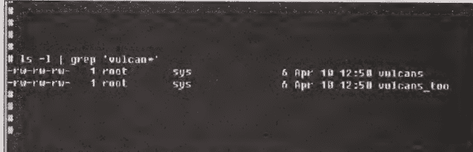

图 9-6：通过从 `ls` 管道到 `grep` 来查找文件名包含字符串 `vulcan` 的文件。

## 输出重定向

如果你需要将 Linux 命令的输出发送到默认目标以外的地方（几乎总是显示器，在 Linux 中称为标准输出），可以使用单个大于号（`>`）来实现。

例如，要将 `ls` 的输出存储到当前目录下名为 `list_of_databases` 的文件中，可以使用以下语法：

```bash
ls *.db > list_of_databases
```

注意，如果指定的输出文件已存在，该命令将完全覆盖它。

## 追加模式输出重定向

若要将 `ls` 命令的输出存储到当前目录下名为 `list_of_databases` 的文件中，同时避免替换该文件的原有内容，请使用此语法：

```bash
ls *.db >> list_of_databases
```

双大于号（`>>`）会导致 Linux 向现有文件内容追加内容，而不是替换它们。

## 输入重定向

如果你需要从默认源以外的地方获取命令的输入，小于号（`<`）会告诉 Linux 这样做。例如，`echo` 命令通常期望从键盘获取输入。但如果你想显示标准文本，可以将文本放置在文件中，并将文件内容重定向到 `echo`。图 9-7 阐释了这种技术。

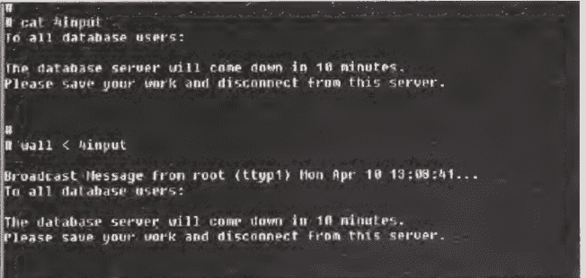

图 9-7：可以通过输入重定向为命令提供经常使用的消息。

## 分号

如有需要，或者仅仅为了加快输入和执行速度，可以如下所示串联 Linux 命令，并用分号（` ; `）将它们隔开。

```bash
clear; cd /; ls -l | grep '*db'
```

## 冒号

在系统和数据库管理上下文中，冒号（`:`）有两个重要的作用。

冒号用于分隔 Linux 密码文件 `/etc/password` 中的字段。例如，在下一行中，冒号允许我们区分出目标用户的登录名为 `jason`，没有密码，主目录为 `/home/httpd/logs` 等其他信息。

```bash
jason::18:2:/home/mysql/jason:/sbin/sh
```

冒号用于分隔环境变量 `PATH` 相关值中的字段，这些值反过来定义了 Linux 将自动检查用户请求的数据或程序的文件系统路径。在下面的 `PATH` 中，这些区域包含了与 DBMS 相关的目录。

```bash
PATH=/usr/sbin:/usr/bin/home/oracle8
```

## Linux 任务

要在 Linux 下配置任何 DBMS，你都必须执行本节所描述的若干常用操作系统管理任务。

### 以超级用户或 root 身份登录

`root` 用户权限（即仅供 Linux 系统管理员拥有的权限）允许你执行大多数用户被禁止的任务。这些任务包括更改处理优先级、更改文件和目录的访问权限以及创建用户账户。

由于 `root` 登录拥有巨大的权限，它通常被限制给系统管理员。如果你需要临时作为 `root` 运行，请联系你的系统管理员获取所需的登录名和密码。

### 更改处理优先级

假设你正在编译（即通过 `gcc` 编译配置）一个 Linux DBMS。进一步假设该任务比你预期的要长得多。你可以通过提高其处理优先级来加速该任务或其他命令，使其对操作系统和 CPU 更重要。

做到这一点，你需要以 `root` 身份登录。如果是这样，你只需要再执行一步——使用以下语法发布 `nice` 命令。

```bash
nice -10 gcc my_database
```

此命令将与指定命令相关的 `nice` 值降低 10，从而提高命令的优先级。Linux 认为执行层级与 `nice` 值之间反反比，数字越小表示优先级越高。

### 更改文件和目录访问权限

Linux 文件访问权限提供了三种类型：读（`r`）、写（`w`）和执行（`x`）。这些权限被分配给三类对象：所有者、组和其他。

#### 表 9-5：Linux 权限

| 模式 | 所有者 | 组 | 其他 | 描述 |
| :--- | :--- | :--- | :--- | :--- |
| 7 | rwx | rwx | rwx | 所有权限 |
| 6 | rw- | rw- | rw- | 读和写 |
| 5 | r-x | r-x | r-x | 读和执行 |
| 4 | r-- | r-- | r-- | 仅读 |
| 3 | -wx | -wx | -wx | 写和执行 |
| 2 | --w | --w | --w | 仅写 |
| 1 | --x | --x | --x | 仅执行 |
| 0 | --- | --- | --- | 无权限 |

加（`+`）和减（`-`）可以组合在一个命令中。例如，`chmod +w-wg myfile` 将为组成员添加写权限但移除执行权限。同样，`chmod 700` 将授予文件所有者所有类型的权限，但拒绝组成员以及广大用户的这些权限。

### 创建用户和组账户

你可以使用 Linux 工具 `groupadd` 限制用户访问数据库管理功能。例如，Oracle8 识别系统文件 `/etc/group` 中的 Linux 用户组 `dba` 和 `oper` 为授予 Oracle DBA（或数据库管理员）和 Oracle OPER（或数据库操作员）权限的组。如果你的系统中不存在这些组，请使用类似下面的命令创建它们。

```bash
$ groupadd -g 101 dba
```

Oracle 文档将数据库管理员和操作员组称为 `OSDBA` 和 `OSOPER`。

### 设置默认文件访问权限

Linux 命令 `umask` 设置系统上所有新建文件的默认访问权限。在执行数据库管理时，你可能经常使用值 `022`，赋予特定用户读取和目录搜索权限，但不写权限。要对登录名为 `db_user` 的用户的 `.profile` 或 `.login` 文件创建的任何新文件应用此类权限：

- 对于 Bourne 或 Korn shell，在 `.profile` 中添加 `umask 022`
- 对于 C shell，在 `.login` 文件中添加相同的行

# 设置环境变量

每个 Linux shell 都有所谓的环境变量。这些变量存储了定义用户会话特征的值。例如，Linux 环境变量规定了（其他之外）你使用的打印机、文件权限设置以及显示器上显示的颜色。

Linux 数据库系统（DBMS）的环境变量通常设置在连接数据库服务器的登录账户的 `.profile` 或 `.login` 文件中。当您连接到该账户时，系统会自动读取适当的文件，并将其内容应用到数据库会话中。

在 Bourne shell 中设置环境变量，请使用以下语法：`variable_name=value; export variable_name`。（当然，“`variable_name`” 和“`value`”是通用术语，必须替换为实际的环境变量名和值。）例如，下面的命令行通过 `variable=` 语法将 Oracle 的家目录设置为 `/usr/app/oracle/product/805`，然后通过 `export` 命令让 shell 感知到该值。

```bash
ORACLE_HOME=/usr/app/oracle/product/805; export ORACLE_HOME
```

在 C shell 中设置环境变量需要略有不同的语法。这种语法不需要 `export` 命令。例如，下面的行仅通过 `setenv` 命令就完成了，而 Bourne shell 需要两条命令才能完成。

```bash
setenv ORACLE_HOME /usr/app/oracle/product/805
```

当您更改环境变量的值时，您可以通过执行 `.profile` 或 `.login` 文件来确保新值立即生效。如果您不这样做，则将必须重启 Linux 数据库服务器才能使这些更改生效。


对于 Bourne 或 Korn shell，输入：

```bash
$ .profile
```

对于 C shell，输入：

```bash
$ source .cshrc
```

# 创建挂载点目录

虽然并非所有的 Linux DBMS 都要求对文件系统进行管理，但如果您能创建一个挂载点目录作为 DBMS 目录结构的最高层，将大有益益。您应该采取这一步，并确保：

- 挂载点的名称与最初分配给 DBMS 软件的名称相同

# 通用配置任务

对于 MySQL 和 PostgreSQL 这样的开源产品，配置几乎与安装是同义词。这意味着，对这类 DBMS 的配置涉及：

- 获取适当的发行版
- 将发行版解压到相应的目录中
- 将工作目录切换到发行子系统的最高层
- 通过编译时提供的选项进行编译并同时配置
- 初始化并测试配置好的 DBMS

# 厂商特定配置

本节讨论了与三种广泛使用的 Linux DBMS 相关的厂商特定配置任务：MySQL、PostgreSQL 和适用于 Linux 的 Oracle8i。

## MySQL

要开始配置 MySQL，您必须先选择一个目录来存放它，然后解压发行文件。

### 配置选项

常见配置选项示例包括：

- 仅编译客户端库和可执行文件，而放弃服务器编译
- 编译时将日志甚至数据库文件放置在特定目录
- 编译以生成静态链接的可执行文件（有时为了速度而推荐）
- 编译以抑制或强制使用默认或非空值
- 编译以为数据和排序指定特定的字符集
- 编译以提供调试信息
- 编译以支持或排除多线程

## 第 9 章 + 配置 311

MySQL 的默认发行格式是带有 `-static` 选项链接的二进制版本。这种链接有助于确保管理员无需担心系统库版本问题。

使用 `-static` 选项链接的程序比动态链接的可执行文件稍大，但运行速度也稍快——估计快 3 到 5%。然而，静态链接的 MySQL 可执行文件存在一个问题，它不会接受用户自定义函数 `UDF`。如果您计划在 MySQL 中使用 C 或 C++ 插件，则必须使用动态链接自行编译应用程序。

### .gz 发行文件

处理类似于 zip 文件的 GNU 对应物意味着要执行以下步骤：

- 选择您想要解压发行版的目录。
- 确保您对所选目录具有读和写权限。

如果您不在该目录，请使用 `cd` 命令移动到该目录。

- 从 MySQL 的某个互联网站点获取 MySQL 源码发行文件。这些文件以压缩 tar 包的形式存在，文件名类似于 `mysql-VERSION.tar.gz`，其中 `VERSION` 当然是一个版本号。
- 使用类似下面的命令将发行版解压到当前目录：

```bash
$ gunzip < mysql-VERSION.tar.gz | tar xvf -
```

此类命令在解压发行文件时会创建一个名为 `mysql-VERSION` 的目录。

- 使用类似下面的命令切换到解压发行版的顶层目录：

```bash
$ cd mysql-VERSION
```

- 使用类似下面的命令配置发布版本并编译所有内容：

```bash
$ ./configure --prefix=/usr/local/mysql
$ make
```

当配置 MySQL 时，您可以同时指定配置选项和运行时选项。运行 `./configure --help` 查看此类选项列表。

- 使用此命令完成安装：

```bash
$ make install
```

- 如果您之前没有安装过 MySQL，请使用类似下面的命令为它创建权限表：

```bash
$ scripts/mysql_install_db
```

安装完成后，通过类似下面的命令启动 MySQL 服务器来初始化并测试您的数据库。在示例命令中，`BINDIR` 代表安装 MySQL 服务器的目录，在本例中称为 `safe_mysql`；该参数的默认值为 `/usr/local/bin`。

```bash
$ BINDIR/safe_mysql &
```

如果您识别出 `safe_mysql` 是一个守护进程，请给自己打分，并思考一下将 MySQL 或其他数据库服务器作为守护进程运行是合理的。此外，在上述情况下，如果已经运行了另一个 MySQL 服务器，则启动将失败。

### RPM（Red Hat 包管理器）发行文件

如果 MySQL 源码以 RPM 文件的形式存在，则在开始所述的安装测试序列之前，必须运行以下命令。执行此命令将创建一个可以安装的二进制 RPM 文件：

```bash
$ rpm --rebuild MySQL-VERSION.src.rpm
```

### 编译与链接

如果您自行编译并链接 MySQL，您的做法将影响速度和整体性能。本节列出了我认为 MySQL 配置最重要的方面。

MySQL 在 Linux 上使用 LinuxThreads。如果您使用的是没有 glibc2 的旧版本 Linux，则必须在尝试编译 MySQL 之前安装 LinuxThreads。可以通过 www.mysql.com/Downloads/Linux 获取 LinuxThreads。

如果您自行编译而不是使用上一节提到的其他安装文件，使用 pgcc 或 Cygnus Fusion 编译器可以创建一个运行速度快 10% 到 30% 的服务器。

如果您使用 `-static` 选项链接，将创建一个更快 MySQL 执行文件。

## 为多个 MySQL 服务器编译和配置

如果您需要或希望在同一机器上同时运行多个 MySQL 服务器，需要采取特定的步骤。

可以使用此命令确定当前执行的 MySQL 服务器使用的 socket 和端口：

```bash
$ mysqladmin -h hostname --port=port_number variables
```

如果 MySQL 服务器运行在您提供的端口上，该命令将显示该服务器的几个重要配置变量，包括 socket 名称。

你还需要编辑任何用于自动启动和关闭 MySQL 服务的初始化脚本，以考虑到现在有多个这样的服务器。

你不需要为了从不同的端口而重新编译一个新的 MySQL 服务器，仅使用不同的端口和套接字（socket）。你可以通过在运行时指定 `safe_mysqld` 的选项来更改使用的端口和套接字，命令类似于：

```bash
$ /full/path/name/of/safe_mysqld --socket=file_name --port=port_number
```

实现多个数据库服务器来操作同一个数据库是一个具有潜在危险的步骤，特别是当你的操作系统平台不支持无故障文件锁时。更好的做法是配置后续的数据库服务器使用各自独立的数据库目录，使用 `safe_mysqld` 运行时选项：

```
--datadir=/full/path/name/of/the/directory/to be used by/safe_mysqld
```

### 创建多个数据库服务器

以下是一个在同一平台上创建多个数据库服务器的示例：你需要在不影响现有生产实现的情况下测试新的 DBMS 版本发布。另一个例子是：互联网服务提供商（ISP）需要为许多客户提供唯一的数据库服务器实现。

同时运行 MySQL 服务器的第一步是编译这些服务器，使其使用不同的 TCP/IP 端口和套接字，以确保每个服务器都“监听”相应的“对话”，即只接收并响应由其客户端发出的请求。

我首先假设 MySQL 服务器已经存在并已配置使用默认的 TCP/IP 端口和套接字。既然如此，你将使用类似于下面的多部分命令。

```bash
$ .configure --with-tcp-port=port_number --with-unix-socket=file_name --prefix=/usr/local/mysql-3.22.9
```

在这样的这样的命令中，`port_number` 和 `file_name` 参数必须与之前实现的 MySQL 服务器的默认值有所不同。此外，`prefix` 参数应该定义一个与现有 MySQL 安装位置不同的目录。

# PostgreSQL

本节讨论了安装和配置 PostgreSQL 所需的具体步骤。

与 MySQL 的情况类似，可以使用命令显示 PostgreSQL 配置参数的列表：

```bash
$ ./configure --help
```

## 基本安装

表 9-6 总结了重要的 PostgreSQL 配置参数。

| 表 9-6 | PostgreSQL 配置选项 |

| 此选项 | 允许您 |

| :--- | :--- |

| --prefix=PREFIX | 在 PREFIX 中安装与架构无关的文件；默认为 /usr/local/pgsql |

| --bindir=DIR | 在 DIR 中安装用户可执行文件；默认为 PREFIX/bin |

| --libdir=DIR | 在 DIR 中安装对象库；默认为 PREFIX/lib |

| --includedir=DIR | 在 DIR 中安装 C 头文件；默认为 PREFIX/include |


| `--mandir=DIR` | 在 `DIR` 中安装 man 文档；默认为 `PREFIX/man` |

| `--disable-FEATURE` | 在编译的 PostgreSQL 中不包含 `FEATURE` |

| `--enable-FEATURE=[ARG]` | 包含 `FEATURE` [`ARG=yes`] |

| `--with-PACKAGE=[ARG]` | 使用 `PACKAGE` [`ARG=yes`] |

| `--without-PACKAGE` | 不使用 `PACKAGE` |

| 识别 `--enable` 和 `--with` 选项 | 使用语法 `--includes=dirs` 指定要包含在编译中的库的位置 |

| 在 `DIR` 中查找 `tcl/tk` 等头文件 | 使用语法 `--libraries=dirs` 指定编译时可能需要的 `tcl/tk` 头文件的位置 |

| 在 `DIRS` 中查找额外的库 | 使用语法 `--with-perl` 指定编译时可能需要的 Perl 库的位置 |

| 构建 Perl 接口和 `plperl` | 使用语法 `--with-odbc` 创建到 Perl 模块的接口 |

## 第 9 章 配置

### 315

| 此选项 | 允许您 |

| :--- | :--- |

| 构建 ODBC 驱动包 | 使用语法 `-with-odbcinst=odbcdir` 创建 ODBC 驱动库 |

| `--with-CC=compiler` | 使用特定的 C 编译器 |

| `--with-CXX=compiler` | 使用特定的 C++ 编译器 |

| `--without-CXX` | 防止构建 C++ 代码 |

图 9-8 描绘了一个典型的 PostgreSQL 文件子系统结构。

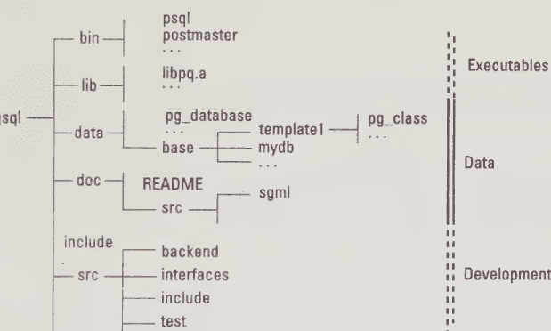

**图 9-8：** 默认 PostgreSQL 文件结构

与 MySQL 的情况类似，安装 PostgreSQL 从获取二进制 PostgreSQL 分发版开始，在本例中是从 `ftp.postgresql.org`。获取后，你必须使用以下命令解压并分发压缩 tar 包的内容：

```bash
$ gunzip postgresql-7.0.tar.gz
$ tar -xf postgresql-7.0.tar
$ mv postgresql-7.0 /usr/src
```

你的下一步是使用 `make` 构建 PostgreSQL。构建 PostgreSQL 需要 GNU make；其他任何形式的工具都无法完成工作。要测试是否有 GNU make，请输入此命令：

```bash
$ gmake --version
```

## 316 第二部分 安装和配置

如果发现必须获取 GNU make，可以从 `ftp://ftp.gnu.org` 获取。

在开始 `make` 之前，请确保你有足够的磁盘空间。PostgreSQL 需要：

- 编译期间源码文件树大约需要 30MB
- 安装目录大约需要约 5MB
- 初始数据库大约需要 10MB
- 回归测试大约需要 20MB

使用此命令检查可用磁盘空间：

```bash
$ df -k
```

然后按照以下步骤安装 PostgreSQL：

1. 创建 PostgreSQL 超用户。
2. 配置源码。
3. 使用以下命令编译服务器：

```bash
$ gmake
```

此时，你可以包含任何想要的 PostgreSQL 选项。

编译过程可能需要 10 到 60 分钟不等。

假设编译没有错误，你可以运行回归测试。

### 配置自动启动

大多数 UNIX 系统都有一个名为：

`/etc/rc.local`

或者

`/etc/rc.d`

的文件，其中存放启动所需的命令。表 9-7 总结了操作系统命令。

表 9-7 自动启动 PostgreSQL

| 操作系统 | 文件 | 命令 |

| :--- | :--- | :--- |

| NetBSD | rc.local | `-l pgsql -c "local/bin/postmaster -D/local/data"` |

| SPARC Solaris | rc2.d | `-l pgsql -c "local/bin/postmaster -D/local/data"` |

| FreeBSD 2.2 | `/usr/local/etc/rc.d/postgresql.sh` | `#!/bin/sh (su pgsql -c 'exec /usr/local/bin/postmaster -D/local/data -S > /usr/local/errorlog' & echo -n 'pgsql') chmod 755 /usr/local/etc/rc.d/postgresql.sh` |

| Red Hat Linux | `/etc/rc.d/init.d/postgres.init` | 必须添加 |

### 创建测试数据库

为了充分测试你的 PostgreSQL 实现，创建一个你可以测试的数据库。使用此命令：

```bash
$ createddb testdb
```

然后使用此命令连接到数据库：

```bash
$ psql testdb
```

作为响应，你将收到 PostgreSQL 提示符，可以在那里输入 SQL 命令并进行实验。

# Oracle8i

在我准备此书处理过的数据库中，Linux 版 Oracle8i 可能是最复杂的，无疑是最复杂的，它对操作系统平台交互的需求是 MySQL 和 PostgreSQL 都不具备的。因此，我从其最重要的需求总结开始讨论 Oracle8i（表 9-8）。

| 表 9-8 | Oracle8i 需要 Linux 提供 |

| 类别 | 因子 | 描述 | Oracle8i 认为的默认值 |

| :--- | :--- | :--- | :--- |

| Linux 内核参数 | `SHMMAX` | 共享内存允许的最大值 | 4294967295 |

| | `SHMIN` | 共享内存允许的最小值 | 1 |

| | `SHMMNI` | 系统允许的共享内存段的最大数量 | 100 |

| | `SHMSEG` | 用户进程可以附加的共享内存段的最大数量 | 10 |

| | `SHMMNS` | 系统范围内分配的共享内存总量 | 200 |

| | `SEMMNS` | 允许的信号量数量 | 70 |

| | `SEMMNI` | 系统中信号集标识符的数量；`SEMMNI` 决定了任何时候可以创建信号集的数量 | |

| 类别 | 因子 | 描述 | Oracle8i 默认值 |

|---|---|---|--|

| Linux 内核参数 | `SEMMSL` | 一个信号量集中包含的最大信号量数量 | 等于或大于 `PROCESSES` 初始化参数的值；也应等于 Oracle 进程的最大数量 |

| 挂载点 | | | 至少四个挂载点，且均处于目录结构的同一层级；一个用于软件；三个用于符合 OFA 标准的数据库 |

| Oracle OS 用户组 | `OSDBA` | 数据库管理员 | dba |

| | `OPER` | 数据库操作员；可能作为独立组存在，也作为 `OSDBA` 组的成员存在 | oper |

| | `OSDBA` 组 | | |

| OS 账户 | 专门用于安装和升级 Oracle 系统；该账户必须是 `OSDBA` 组的成员 | | |

| Oracle bin 目录 | | Oracle 用户共享的软件目录 | `/usr/local/bin` |

| `oratab` 文件 | | Oracle 实例的信息 | | |

| 文件掩码权限 | 使用 OS 命令 `umask 022` | 创建文件访问权限 |

| 环境变量 | `DISPLAY` | 连接到服务器的工作站机器名称和显示器 | | |

Oracle 公司建议您不要将 `/usr/ucclib` 包含在 `LD_LIBRARY_PATH` 中。如果您需要在 `LD_LIBRARY_PATH` 中使用 `/usr/ucclib`，请确保它在搜索顺序中位于 `/usr/ccs/lib` 之后。

## 表 9-8（续）

| 类别 | 因子 | 描述 | Oracle8i 默认值 |

| --- | --- | --- | --- |

| 环境变量 | `LD_LIBRARY_PATH` | 使用共享库的 Oracle 产品需要 | 必须包含 `$ORACLE_HOME/lib.` |

| | `ORACLE_TERM` | 所有字符模式和 Motif 模式 Oracle 产品需要 | | |

| | `ORACLE_SID` | 指定 Oracle 服务器的实例名称或服务器 ID (SID)；对于在给定机器运行的每个 Oracle 实例必须唯一的；Oracle 公司建议使用四个或更少的字符 | | |

| | `ORACLE_HOME` | 设置为 Oracle 软件的安装目录；推荐：`$ORACLE_BASE/product/release` | |


# 第 9 章 ♦ 配置 321

|  | `ORACLE_BASE` | Oracle 文件结构顶部的目录 | 推荐：`software_mount_point/app/oracle` |  |
|  | `PATH` | 搜索路径 | 必须包含所有：`$ORACLE_HOME/bin` `/usr/bin` `/usr/local/bin` |  |
|  | `SRCHOME` | 存放源代码的目录 | 未标识；如果设置了 `SRCHOME`，安装程序将默认使用指定的位置来查找要安装的软件 |  |

| 类别 | 因子 | 描述 | Oracle8i 默认值 |
|---|---|---|--|
|  | `TWO_TASK` | 某些对象的备用数据库 | 安装时应未定义；如果您设置了 `TWO_TASK` 并正在创建数据库对象，安装程序将尝试将它们放置在由 `TWO_TASK` 指定的数据库中。 |
|  | `TMPDIR` |  | 具有至少 20MB 可空间且 Oracle 账户具有写权限的目录；Linux 上的默认位置是 `/usr/tmp` |  |

## 必须由 root 用户执行的任务

本节概述了超级用户必须采取的六个步骤，以配置操作系统接受 Oracle8i。

- 1. 为 Oracle 配置 Linux 内核。设置内核进程间通信 `IPC` 参数，以适应 Oracle8i 服务器所需的共享内存。（如果系统未配置足够的共享内存，您将无法启动此服务器。）

输入命令：

```bash
## ipcs
```

显示操作系统当前的共享内存段和信号量段。然后按照表 9-8 中的定义设置下面列出的内核参数。

- 共享内存段的最大大小 `SHMMAX`
- 系统共享内存段的最大数量 `SHMMNI`
- 用户可以连接的共享内存段的最大数量 `SHMSEG`
- 全局范围内可以分配的共享内存总量 `SHMMNS`

- 2. 创建挂载点。Oracle8i 服务器必须至少有四个挂载点——一个用于 DBMS 软件，至少三个用于数据库文件。所有此类挂载点的名称，无论用途如何，都应遵循 `/pm/` 模式，其中 `p` 是字符串常量，`m` 是用于区分挂载点的固定长度键。

- 3. 为数据库管理员创建 OS 组。Oracle 安装程序在安装期间将数据库管理员和操作员权限分配给操作系统组，分别将这些权限权限称为 `OSDBA` 和 `OSOPER`。分配这些权限的组的成员会自动获得这些组，因此在 Oracle 下拥有相应的权限。因此，您希望用于这些角色的组必须在启动安装程序之前存在。

在大多数 Intel UNIX 平台上，如果这些组不存在，请使用命令创建此类组。

```bash
# grppad oracleba oracleleoper
```

- 4. 创建所有 Oracle 软件的 OS 账户。由于您设置的操作系统账户本身拥有 Oracle 分发版，您必须在此账户下运行安装程序。因此，您必须确保该账户存在并定义恰当。

在大多数 Intel Linux 操作系统下，实用程序确实允许您轻松创建此或其他任何用户账户。请按照表 9-9 中的规范设置 `oracle` 用户账户。

## 表 9-9

| `oracle` 用户账户的特征 |  |
|---|---|
| 参数 | 值 |
| 登录名称 | 可以是任意值 |
| 默认组 `GID` | 可以是任意值 |
| 目录 | 选择一个目录 |
| 登录 Shell | 可以是任意值 |

- 5. 创建本地目录。对于 Oracle 来说与其他所有软件一样，通用环境可以加速管理。要创建此环境，请采取以下步骤。

a. 创建本地目录，例如 `/usr/local/bin`，使用类似这些命令。（当然，您的文件系统结构的精确性质将决定您必须提供的精确参数。）

```bash
## cd /usr
## mkdir local
# cd local
## mkdir bin
```

b. 确保此新创建的目录出现在每个必须与 Oracle 操作的用户的 `PATH` 中，并且那些用户对该目录拥有权限。

## 必须由 oracle 用户执行的任务

- 1. 设置新文件权限。使用 `umask` 命令检查并设置文件掩码，即创建文件时分配给文件的默认权限。

要检查现有的文件掩码，只需输入：

`umask`

如果操作系统报告 `022` 以外的任何值，请使用以下命令将掩码设置为该值：

`umask 022`

- 2. 设置环境变量。根据您的 shell 类型使用以下语法来设置上方表 9-8 中列出的环境变量。

对于 Bourne shell，输入遵循此模式的命令：

`variable_name=value`

`export variable_name`

- 6. 创建 `oratab` 文件。作为一种重要的 Oracle 管理文件，`oratab` 文件包含关于 Oracle 实例的信息，即单个 Oracle 会话。`oracle` 账户拥有 `oratab`。然而，该文件位于需要 root 权限的目录中。因此，在创建文件或对其设置权限时，您必须运行脚本 `cdrom_mount_point/orainst/oratab.sh` 来操作 `/etc` 目录。

对于 C shell，请使用此模式的命令：

`setenv variable_name value`

由于此环境变量有许多可能的值，它们有一个专门的表格——表 9-10。`ORACLE_TERM` 用于标识与安装程序一起使用的终端定义资源文件。

## 表 9-10 典型的 ORACLE_TERM 设置

| 终端类型 | `ORACLE_TERM` 设置 |
| --- | --- |
| AT386 console | 386 |
| AT386 xterm | 386x |
| UnixWare 终端 | 386u |
| Solaris x86 xterm | 386s |
| Data General 200 | dgd2 |
| Data General 400 | dgd4 |
| IBM High Function Terminal and aixterm (彩色) | hftc |
| IBM High Function Terminal and aixter (单色) | hft |
| hpterm 终端 and HP 700/9x 终端 | hpterm |
| IBM 3151 终端 | 3151 |
| vt220 终端 | vt220 |

3. 更新环境。一旦你根据相应的 shell 在 `.profile` 或 `.login` 中正确定义了所有环境变量，就可以立即更新环境，使当前活跃的 shell 会话反映所指定的特征。

对于 Bourne 或 Korn shell，请使用此命令：

```
$ ./.profile
```

对于 C shell，请输入此命令：

```
$ source .login
```

## 运行 Oracle 安装程序

Oracle 产品安装 CD-ROM 采用 RockRidge 格式。当然，你必须拥有 root 权限才能挂载或卸载 CD-ROM。

> > 注意：在从驱动器中移除介质之前，请先卸载以防止损坏 CD 或驱动器。

按照以下步骤准备运行 Oracle 安装程序。

+ 1. 将产品安装 CD-ROM 放入 CD-ROM 驱动器。
2. 以 root 用户登录并使用以下命令创建 CD-ROM 挂载点目录：

## `mkdir cdrom_mount_point_directory`

3. 使用类似下面的命令使新创建的挂载点目录对所有用户可读、可写且可执行：

`chmod 777 cdrom_mount_point_directory`

4. 使用此类命令将 CD-ROM 驱动器挂载到挂载点目录并退出 root 账户：

`# mount options device_name cdrom_mount_point_directory`

`# exit`

更具体的 Linux 示例可能会使用此语法：

`# mkdir /cd`

`# chmod 777 /cdrom`

`# mount -t iso9660 /dev/cdrom /cd`

`# exit`

5. 按照以下步骤启动安装程序：

* 以 `oracle` 用户登录。
* 执行以下模式的命令。

`$ cd cdrom_mount_point_directory/orinst`

`$ ./orinst`

> > 注意：不要以 root 用户身份运行安装程序。这样做将分配适用于该用户的文件所有权和权限，从而可能拒绝他人的访问。

表 9-11 描述了使用 Oracle 安装程序时的一些导航细节。

## 表 9-11 在 Oracle 安装程序中的导航

| 击键 | 产生的操作 |
| --- | --- |
| Tab 键 | 移动到下一个块 |
| 方向键 | 在字段之间移动移动 |
| 空格键 | 选择当前字段 |

安装程序可以记录一次安装的响应，然后将其应用到后续安装中，以便以非活动方式（即 Oracle 称为静默模式）执行。

## 安装屏幕


Oracle 安装程序会话由一系列提示组成，每个提示显示在自己的窗口中。第一个窗口允许你选择默认或自定义安装。如果你决定同时进行默认安装并创建数据库，安装程序会将预构建的数据文件复制到指定的挂载点，从而构建数据库、创建控制文件，并且可能最重要的——节省了原本需要加载和运行脚本的时间。如果你仅选择默认安装，安装程序将显示并要求你确认它计划使用的使用的设置。默认路径假设你正在从 CD-ROM 安装。如果你是从网络驱动器或 Oracle 称为“暂存区”的其他形式进行安装，则无法使用默认路径。

## 安装日志文件

Oracle 安装程序创建四个日志文件，在其中记录安装活动。这些日志存储了关于以下的信息：

* 安装程序对操作系统的操作
* 安装程序自身的活动
* 与 Oracle SQL 相关的活动
* 与安装文件相关的活动

如果你在此时接受安装程序提供的默认设置，所有这些日志将将存放在 `$ORACLE_HOME/inventory` 目录下。如果存在较旧版本的日志，安装程序将在创建当前日志集之前先将它们重命名为 `.old`。

## 安装源

下一个提示窗口询问你是在从 CD-ROM 还是暂存区安装。如果你指示后者，系统将再次提示指定暂存区是临时的还是永久的，因为安装程序在安装时会删除临时区域。

## 语言支持

如果你需要使用美国英语以外的语言显示 Oracle 消息，可以通过此提示屏幕进行指定。但请注意，这种默认语言可以在启动会话时被用户甚至客户端应用程序覆盖。另请注意，安装程序本身仅以美国英语运行。

## root.sh 脚本

安装程序在 `$ORACLE_HOME` 目录下创建的 `root.sh` 脚本必须在安装后由 `root` 用户运行。如果安装程序检测到此脚本的之前的副本，它将提示你是否应该向其追加新操作。

## 软件管理器

Oracle 的安装程序工具（称为软件管理器）监控所需的存储空间，并与 `ORACLE_HOME` 目录进行比较。因此，当你选择要安装的内容时，软件管理器可能会有关磁盘空间的进一步提示。

## OSDBA 组

对于数据库管理员，安装程序将提示你选择一个授予 DBA 权限的组；该参数默认为指定的 `oracle` 组。

## OSOPER 组

安装程序将提示你选择一个授予 OPERATOR 权限的组；该参数默认为指定的 `OSDBA` 组。

## 实例名称

定义在环境变量 `ORACLE_SID` 中的 Oracle 实例名称在单数据库安装中与 `DB_NAME` 参数的值相同。在其他情况下，你应该提供一个不仅是唯一标识符且大于四个字符的实例名称。

## 数据库创建

只有当你使用安装程序创建数据库时才会出现以下提示。

### 挂载点数量

安装 Oracle 服务器时，请遵循 Oracle 的建议将数据库分布在至少三个独立的设备上。当你在“挂载点数量”屏幕上接受此设置时，控制文件和重做日志也会分布在指定的挂载点。

### 挂载点位置

Oracle 建议在此窗口中指定的数据库挂载点与你在初始提示定义的软件挂载点不同。表 9-12 总结了安装程序将创建的示例或演示数据库的默认大小和位置。

| 文件 | 默认大小 | 最小大小 | 默认位置 |
| --- | --- | --- | --- |
| 控制文件 | 50KB | 取决于数据库 | `db_mount_point[1-3]/oradata/db_name/control0[1-3].ctl` |
| 重做日志文件 | 500KB | 100KB | `db_mount_point[1-3]/oradata/db_name/redosid0[1-3].log` |
| SYSTEM | 80MB | 5MB | `db_mount_point1/oradata/db_name/system01.dbf` |
| ROLLBACK | 15MB | 1MB | `db_mount_point1/oradata/db_name/rbs01.dbf` |
| TEMP | 550KB | 260KB | `db_mount_point1/oradata/db_name/temp01.dbf` |
| USERS | 1MB | 200KB | `db_mount_point1/oradata/db_name/users01.dbf` |
| TOOLS | 25MB | 1MB | `db_mount_point1/oradata/db_name/tools01.dbf` |

## 国家字符集

安装程序随后提示你设置的国家字符集仅影响特殊声明的列；它默认使用你作为数据库字符集时指定的字符集。

## SYS 和 SYSTEM 用户密码

针对 Oracle8i（而非操作系统）用户账户 `SYSTEM` 和 `SYS` 的安装程序提示界面显示了 `manager` 和 `change_on_install` 默认值。请使用此界面为这两个账户提供适用于你环境的密码。

## dba 和 operator 组密码

接下来，安装程序会询问你是否想为为你授予了数据库管理员和操作员权限的系统组设置密码。请设置这些密码，因为这样做可以在用户尝试作为任一类用户连接到 Oracle8i 服务器时，启用身份验证。

## 多线程服务器

将 Oracle8i 服务器配置为多线程服务器（MTS）可以使你能够最大限度地减少某些类型数据库应用程序所需的进程数量和内存量。Oracle 认为 MTS 最适用于运行具有长事务应用程序的系统，例如 `OracleInterface`。另一方面，Oracle 认为 MTS 不适用于支持长事务的系统，例如决策支持应用中常见的系统。在响应此安装程序提示时，请记住这些注意事项。

## 安装文档

Oracle 文档可以是特定于操作系统的，也可以是产品相关的（后者有时被称为通用文档）。分发 CD 包含特定于操作系统的文档，允许在整个软件安装期间安装此类别的文档。另一方面，产品文档占用其独立的 CD-ROM，因此需要加载单独的安装程序。然而，两类 Oracle8i 文档都以 HTML 和 PDF 格式提供。

要安装特定于操作系统的文档，只需在安装早期阶段呈现的可用产品列表中，除了你想要加载的任何产品外，选择 `Linux Documentation` 即可。

## 验证安装程序的工作

安装完成后，Oracle8i 会自动返回软件资产管理器（Software Asset Manager）界面，在该界面中你可以验证所有选中的产品都显示为已安装。

## 配置 Oracle8i

完成安装并不意味着你已经完成了 Oracle8i 的设置。在完成安装会话后，仍必须完成某些配置任务。

## 作为 root 用户执行的任务

要开始配置 Oracle8i，请以 `root` 身份登录操作系统。然后执行本节中描述的任务。

## root.sh 脚本

运行安装程序在 `$ORACLE_HOME/orain` 目录下创建的 `root.sh` 脚本将为 Oracle 产品设置文件权限并执行其他配置活动。

使用类似下面的命令运行此脚本：

```
cd $ORACLE_HOME/orainst
./root.sh
```

`root.sh` 在执行任何操作之前会要求你确认环境，从而允许你在需要重置环境中的任何内容时终止脚本。如果你终止了脚本，必须重新运行它，但不需要重新运行安装程序。

`root.sh` 在工作时会告知你进度，并可能提示用户名等参数。

## catrep.sql 脚本

如果你是第一次安装 Oracle8i，必须运行位于 `$ORACLE_HOME/orainst` 目录下的 `catrep.sql` 脚本，赋予 DBMS 复制能力。

## 创建额外的 Linux 账户

如果系统有多个用户需要行使数据库管理员权限，每个用户都必须拥有自己的关联到 `OSDBA` 用户组的账户。任何所需的额外账户都应在此时使用 `usadd` 工具创建。

## 验证数据库文件安全

确保你新安装的 DBMS 符合 Oracle 公司推荐的文件权限模式和所有权。表 9-13 列出了这些模式和所有权。

### 表 9-13

### Oracle 文件安全

| DBMS 区域 | 推荐特性 |
| :--- | :--- |
| 所有常见的系统文件和安装文件 | 由 `oracle` 用户账户所有 |
| 所有常见的系统文件和安装文件 | 应向 `OSDBA` 用户组的所有成员提供读、写、执行权限 |
| Oracle 安装中的任何文件或目录 | 不应向任何非 `OSDBA` 用户组成员的用户提供写权限 |

## 自动化数据库启动和关闭（可选）

Oracle 公司认为将数据库启动自动化是可选的，但强烈建议自动化关闭 DBMS 的功能，以保护套件免受不当关闭引起的错误或损坏。位于 `$ORACLE_HOME/bin` 目录下的两个脚本 `dbstart` 和 `dbshut` 实现了关闭和启动自动化。这两个脚本都引用 `oratab` 文件中的相同记录，因此它们必须属于同一个数据库或一组数据库。正如 Oracle 公司在其《管理员指南》中所指出的，你不能让 `dbstart` 自动释放数据库 `sid1`、`sid2` 和 `sid3`，而让 `dbshut` 只处理 `sid1` 和 `sid2`。


通过以下步骤设置在引导启动时调用 `dbstart` 和 `dbshut`：

1. 编辑 `/etc/oratab` 文件，其条目格式为：

`ORACLE_SID:ORACLE_HOME:(Y|N)`

其中 `Y` 或 `N` 分别指定使用或不使用 `dbstart` 和 `dbshut` 来启动和关闭数据库。对于你不希望自动启动和关闭链接到操作系统的数据库，将其值改为 `Y`。

2. 如果文件不存在，在 `/etc/rc.d/init` 目录下创建一个名为 `dbora` 的文件。

3. 在 `dbora` 文件的末尾，放置类似于示例所示所示条目。确保使用完整路径。

# Set ORA_HOME to the location of

`ORACLE_HOME`=`/u01/app/oracle/product/8.0.5`

`ORACLE_SID`=`oracle`

```bash
## Test for the presence of dbstart
if [ ! -f $ORACLE_HOME/bin/dbstart ]; then
  echo "Oracle startup: cannot start"
  exit
fi

# Assuming dbstart is in the right place
case "$1" in
  'start')
    # Start the Oracle databases
    su oracle -c $ORACLE_HOME/bin/dbstart &
    ;;
  'stop')
    # Or, stop the Oracle databases in background
    su oracle -c $ORACLE_HOME/bin/dbshut &
    ;;
esac
```

# Link dbora to operating system startup with a command

`-s /etc/rc.d/init.dbora /etc/rc.d`

指定启动和关闭选项后，你作为 root 的工作完成。

## 总结

准备 Linux DBMS 意味着：

- 理解并使用有效的模式设计，这反需要规范化理论
- 清明确目标平台的资源，以及这些资源如何增长以适应数据库
- 掌握并正确使用安装任何 DBMS 所需的基础 Linux 概念和命令（如 `chmod` 和 `groupadd`）
- 查看特定特定的安装说明

## 第10 章：与数据库交互

## 第11 章：Linux 数据库工具

## 与数据库交互

作为 Linux 数据库管理员，你将以多种方式与 DBMS 交互。本节讨论了三种常见但同样关键的操作：

- 导出数据库
- 导入文本文件
- 显示数据库摘要信息

## 与 MySQL 交互

MySQL 提供了命令行工具，通过这些工具你可以导出一个或多个数据库的内容；将文本导入 MySQL 数据库以填充表；以及显示数据库、表和字段名称。

## 导出数据库

你必须使用 `mysqldump` 工具导出一个或多个 MySQL 数据库，以便备份或传输到另一个 MySQL 服务器。此类导出可以包含创建或填充表所需的 MySQL 语句。

以下三个命令都是 `mysqldump` 工具泛化语法的示例。

```
# mysqldump [OPTIONS] database [tables]
# mysqldump [OPTIONS] --databases [OPTIONS]
DB1 DB2 DB3...
# mysqldump [OPTIONS] --all-databases
[OPTIONS]
```

表 10-1 总结了此语法。

### 表 10-1

`mysqldump` 语法

| 语法 | 效果 |
|---|---|
| # mysqldump [OPTIONS] database [tables] | 根据给定的选项，导出指定数据库和表的内容 |
| mysqldump [OPTIONS] --databases [OPTIONS] DB1 [DB2 DB3..] | 根据给定的选项，导出指定数据库的内容 |
| mysqldump [OPTIONS] --all-databases [OPTIONS] | 导出所有数据库的内容 |

如果你不提供表名，或者使用 `--databases` 或 `--all-databases` 选项，`mysqldump` 将输出每个数据库中的所有内容。

以下是我认为最有用的 `mysqldump` 选项列表：

- `mysqldump --add-locks`——在每次导出期间前锁定表，在导出后解锁；可提供更快的插入速度。
- `mysqldump -A` 或 `mysqldump --all-databases`——导出所有数据库。
- `mysqldump --allow-keywords`——创建包含关键字的列名；其工作原理是使 `mysqldump` 的每个列名都以相应的表名开头。
- `mysqldump -C` 或 `mysqldump --compress`——压缩客户端和服务器之间传输的所有信息；假设客户端和服务器都支持压缩。
- `mysqldump -B` 或 `mysqldump --databases`——导出多个数据库，需要提供表名，因为所有参数都被视为数据库名。
- `mysqldump -F` 或 `mysqldump --flush-logs`——在开始导出之前刷新所有 MySQL 日志文件。
- `mysqldump -f` 或 `mysqldump --force`——即使在导出过程中发生 SQL 错误也完成导出。
- `mysqldump -h` 或 `mysqldump --host=` 命名主机——从活动 MySQL 服务器导出到命名的主机；`host` 参数的默认值是 `localhost`。
- `mysqldump -l` 或 `mysqldump --lock-tables`——在开始导出之前锁定所有表。
- `mysqldump -d` 或 `mysqldump --no-data`——不写入行信息；当只需要导出表结构时非常有用。
- `mysqldump --password` 或 `mysqldump --password=password`——在开始导出之前，使用提供的密码允许的权限连接到 `mysql` 服务器。
- `mysqldump -q` 或 `mysqldump --quick`——不带缓存执行导出；直接导出到标准输出。
- `mysqldump -u username` 或 `mysqldump --user=username`——在执行导出前以指定的用户连接到 MySQL 服务器；`username` 的默认值是当前用户的操作系统登录名。
- `mysqldump -w` 或 `mysqldump --where="condition"`——仅导出由子句中条件指定的记录，该子句需要单引号。

可以使用 `mysqldump` 选项来显示具有特定特征的记录，同时将这些记录传输到另一个 MySQL 数据库，语法如下：

```
mysqldump --database_of_gardening \
where=plant_name='zinnia' | mysql \
--host=far_away_machine -C db_of_gardening
```

## 文本文件

MySQL `LOAD DATA` 语句的命令行界面是 `mysqlimport`。该实用接受的大多数选项与该语句的选项相同。

使用以下通用语法启动 `mysqlimport`：

```
# mysqlimport [options] database ASCII file 1 [ASCII file 2] \
[ASCII file 3]
```

在命名或决定 `mysqlimport` 可能处理的文件时要小心。该工具会剥离导入文件名的任何扩展名，并使用结果来决定指定数据库中的哪个表将接收文件内容。因此，如果你想将名为 `vegetables.txt` 的文件导入到 `gardening` 数据库中的 `collectibles` 表，你必须先将文本文件重命名为 `collectibles.txt`。否则，`mysqlimport` 将导入结果放在名为 `veggies` 的新表中。

表 10-2 总结了 `mysqlimport` 最有用的选项。

### 表 10-2

`mysqlimport` 选项

| 选项 | 效果 |
|---|---|
| -C 或 --compress | 在客户端和服务器之间移动时压缩所有信息；假设双方支持压缩。 |
| -d 或 --delete | 在导入文本文件之前删除表中所有现有数据 |
| -f 或 --force | 忽略错误，例如文本文件在数据库中没有对应的预存表。这使 `mysqlimport` 尝试导入下一个文本文件（如果有）。如果没有此选项，当不存在接收文件内容的表时，`mysqlimport` 将退出。 |
| -h host_name 或 --host=host_name | 将数据导入到主机指定的主机上的 MySQL 服务器 |


| `-i` 或 `--ignore` | 忽略（即不导入）键字段与现有记录重复的输入记录。 |

| `-L` 或 `--local` | 从本地获取输入文件，即从活动的 MySQL 客户端获取。如果你希望覆盖 `mysqlimport` 从默认主机上的 MySQL 服务器获取文本文件的默认行为（即从操作系统 `localhost` 指定的机器），则需要此选项。 |

| `-l` 或 `--lock-tables` | 在导入文本文件之前锁定所有表，阻止对这些表的任何写入操作。因此确保了服务器上的所有表包含相同的数据，即这些表是同步的。 |

| `-r` 或 `--replace` | 替换现有记录 |

可以使用 `mysqldump` 选项来显示具有特定特征的记录，同时将这些记录传输到另一个 MySQL 数据库，语法如下：

```
mysqldump --database_of_gardening \
where=plant_name='zinnia' | mysql \
--host=far_away_machine -C db_of_gardening
```

## 表 10-3 mysqlimport

| 命令片段 | 含义 |
|---|---|
| `-e` | 启动 MySQL |
| `'CREATE TABLE goodguys(id INT, name VARCHAR(25))'` | 创建新表 |
| `mysqlimport --local` | 从...导入数据 |
| `goodguys.txt` | ASCII 文件 |
| `0` | 记录 |
| `0` | 删除 |
| `0` | 跳过 |
| `0` | 警告 |

表 10-4 描述了我们认为最有用的 `pg_dump` 选项。

| | 命令或片段 | 示例 | 效果 |
| --- | --- | --- | --- |
| | `pg_dump` 语法 | | |
| `dbname` | `pg_dump trek_tria` | 将数据库 `trek_tria` 的内容和架构转到标准输出 |
| `-a` | `pg_dump -a trek_tria` | 仅将数据库 `trek_tria` 的内容（不含架构）转到标准输出 |
| `-s` | `pg_dump -s trek_tria` | 仅将数据库 `trek_tria` 的架构（不含数据）转到标准输出 |
| `-t table` | `pg_dump -t starships trek_tria` | 将数据库 `trek_tria` 中 `starships` 表的架构和数据转到标准输出 |
| `-u` | `pg_dump -t starships -u trek_tria` | 在提示 PostgreSQL 用户名和密码后，仅将数据库 `trek_tria` 中 `starships` 表的架构和数据转到标准输出 |
| `-x` | `pg_dump -t starships -x trek_tria` | 将数据库 `trek_tria` 中 `starships` 表的架构和数据转到标准输出，并在转储中排除任何与用户或权限相关的信息 |
| `-h host` | `pg_dump -h 207.102.233.251 -x trek_tria` | 连接到指定 IP 地址机器上的 `postmaster`（即 PostgreSQL 服务器），并在转储中排除任何与用户或权限相关的信息；此参数也可以指定主机名 |
| `-p port` | `pg_dump -p 2345 -x trek_tria` | 通过 `postmaster` 监听的指定 TCP/IP 端口或本地套接文件扩展连接到 `postmaster`，并在转储中排除任何与用户或权限相关的信息；端口默认为 `5432` |

无论你如何构造命令行，`pg_dump` 都可以写入 ASCII 文件或标准输出，如这些示例所示：

```
% pg_dump
% pg_dump > trek_out
```

如果 `pg_dump` 返回错误，最好的办法是确保你拥有足够的权限进行转储。检查此点的一种简单方法是从 `psql` 对相关数据库进行简单查询。

## pg_dumpall

`pg_dumpall` 的作用正如其名；它将所有现有的 PostgreSQL 数据库转储到一个脚本文件中。因此，它不识别参数 `-d` 或 `-t table`。

此外，它的语法和行为与我们刚刚介绍的 `pg_dump` 完全相同。

## 导入文本文件

正如 `pg_dump` 依赖操作系统重定向输出的概念来将转储结果放在 ASCII 文件中，PostgreSQL 也利用镜像操作的想法，通过重定向输入来导入转储的信息。让我们回到前面的示例，并对其进行扩展以说明后者。

我使用以下命令创建了一个名为 `trek_out` 的文本文件：

```
% pg_dump > trek_out
```

要将这些信息重新加载到新数据库，我只需执行此命令：

```
% psql -e next_gen < db.out
```

## 显示数据库摘要信息

PostgreSQL 提供了 `vacuumdb` 工具，让你能够清理或仅仅分析 PostgreSQL 数据库。`vacuumdb` 在其最可用形式以及涉及此类分析的通用语法如下：

```
vacuumdb [--analyze] [ -z ] [ --alldb ] [ -a ] [ --table 'table[(column, [...])' ]' [dbname ]
```

表 10-5 详细说明了 `vacuumdb`。

## 第 10 章 与数据库交互

### 表 10-5 使用 vacuumdb 作为数据库分析工具

| 命令或片段 | 示例 | 效果 |
| --- | --- | --- |
| `-n` | | |
| `-z` or `--analyze` | `$ vacuumdb --analyze firstdb` | 为数据库 `firstdb` 准备统计信息，供 PostgreSQL 优化器使用 |
| `-a` or `--alldb` | `$ vacuumdb --analyze --alldb` | 分析本地主机上的所有数据库 |
| `-t` or `--table name` 或 `column` | `$ vacuumdb --analyze -table 'starships(classification)' trek_tria` | 仅对数据库 `trek_tria` 中 `starships` 表的 `classification` 列进行操作 |
| `-h` or `--host name` 或 IP 地址 | `$ vacuumdb -h library --analyze firstdb` | 对名为 `library` 的远程机器上运行在 `postmaster` 下的 `firstdb` |
| `-p` or `--port` 端口号 | `$ vacuumdb --p 2345 --analyze firstdb` | 对在端口号 `2345` 监听的 `postmaster` 下运行的 `firstdb` 操作 |
| `-U` or `--username` 用户 | `$ vacuumdb --U adhoc --analyze firstdb` | 以 PostgreSQL 用户 `adhoc` 关联的身份和权限对数据库 `firstdb` 操作 |
| `-W` or `--password` | `$ vacuumdb -W --analyze firstdb` | 在提示 PostgreSQL 密码后，对数据库 `firstdb` 操作 |

> 提示：如果 `vacuumdb` 返回简单的信息 `VACUUM`，它在告诉你有没有问题。然而，如果它显示了类似于 `vacuumdb: Vacuum failed.` 的内容，它在告诉你是出问题了。再次，你最好的调试方法是检查并在必要时调整数据库。

## 与数据库交互

尽管 PostgreSQL 是一个如此强大的数据库，但它缺少两个主要功能：

- 将数据或架构转储到 ASCII 文件的能力。
- 获取摘要统计信息。

## 导航控制台

本节讨论了使用 `mysqladmin` 的管理功能。每个 MySQL 服务器都依赖 `mysqladmin` 执行管理。其通用语法为：

```
# mysqladmin [OPTIONS] [command]
```

### 表 10-6 mysqladmin 命令

| 表 10-6 mysqladmin 命令 | 效果 |
| --- | --- |
| `create database` | 创建新数据库 |
| `drop database` | 删除数据库及其所有表 |
| `kill id` | 通过提供关联的进程 ID 杀死客户端 |
| `ping` | 使用 `ping` 判断守护进程是否运行 |
| `processlist` | 显示由 `mysql` 的活动会话列表 |
| `shutdown` | 停止 MySQL 服务器 |
| `status` | 显示服务器状态 |

> 提示：表 10-6 中的所有命令都可以缩写。例如，`mysqladmin stat` 的输出与 `mysqladmin status` 相同。

`mysqladmin` 下的状态信息包括：

- `Uptime`：MySQL 服务器运行的秒数
- `Threads`：活动客户端数量


- `Questions`：自最近启动 `MySQL` 服务器以来的客户端查询数

- `Slow queries`：执行时间超过定义秒数的查询

- `Opens`：当前打开的表数

- `Flush tables`：自 `mysql` 最近一次启动以来执行的 `flush`、`refresh` 和/或 `reload` 命令数

- `Open tables`：当前打开的表数

- `Memory in use`：`mysqld` 直接分配的内存，仅当 `MySQL` 服务器使用 `--with-debug` 选项启动时可用

- `Max memory used`：`mysqld` 可以分配的最大内存；类似于 `Memory in use`，`Max memory used` 仅当 `MySQL` 服务器使用 `--with-debug` 选项启动时可用

`mysqladmin stat` 的输出可能如下：

```
Uptime: 10077 Threads: 1 Questions: 9 Slow queries: 0
Opens: 6 Flush tables: 1 Open tables: 2 Memory in use: 1092K
Max memory used: 1116K
```

表 10-7 给我们讨论的 `mysadmin` 命令的示例。

| 命令 | 示例 | 结果 |
| --- | --- | --- |
| create databasename | `mysadmin CREATE DATABASE IF NOT EXISTS pittsburg_pirates` | 如果数据库不存在，则创建空数据库 `pittsburg_pirates`。 |

# 346 第三部分 交互与用法

| 表 10-7（续接） |
| 命令 | 示例 | 结果 |
| :--- | :--- | :--- |
| drop databas | `mysqladmin DROP DATABASE IF EXISTS pittsburg_pirates` | 如果数据库 `pittsburg_pirates` 存在，则删除该数据库。`DROP DATABASE` 返回被删除的文件数；通常，此值是数据库中表数量的三倍，因为每个表都由一个 `.MYD`、一个 `.MYI` 和一个 `.frm` 文件组成。 |
| kill id | `mysqladmin kill 3456` | 进程 ID 为 `3456` 的客户端会话。 |
| ping | `mysqladmin -u root ping` | 在测试 `MySQL` 守护进程之前，临时获取 `root` 用户的身份。 |
| processlist | `mysqladmin proc` | 显示当前运行的所有 `MySQL` 进程列表。 |
| shutdown | `mysqladmin shut` | 停止 `MySQL` 服务器。 |
| status | `mysqladmin stat` | 显示 `MySQL` 服务器的状态信息。 |

# PostgreSQL

`PostgreSQL` 由于与 `Tcl/Tk` 等语言紧密交织，提供了一种其开源同类产品 `MySQL` 不具备的管理任务方法。这种基于 GUI 的工具被称为 `pgaccess`。

`pgaccess` 允许你管理或编辑表、定义查询并执行数十种数据库管理功能。事实上，`pgaccess` 的功能列表非常长，我仅列出了其中最有价值的几个。

有关 `pgaccess` 的具体细节或练习，请参阅随书附带的光光盘，或访问 `PostgreSQL` 网站：`www.postgresql.readyset.com`。

`pgaccess` 的语法再简单不过了。通常，格式如下：

```
pgaccess [ 数据库名称 ]
```

现在来介绍 `pgaccess` 一些更令人印象深刻的能力。该工具可以：

- ✦ 使用查询小部件访问记录集
- ✦ 添加新记录并通过右键点击保存
- ✦ 使用支持拖放的视觉化工具构建、编辑和保存查询
- ✦ 调用用户编写的脚本
- ✦ 通过向导创建表
- ✦ 删除或设计视图
- ✦ 仅需指向并按 `Delete` 键即可删除记录
- ✦ 在编辑时动态调整行高
- ✦ 原地编辑，即在查看查询结果时进行
- ✦ 执行 `VACUUM`
- ✦ 从/到数据库加载或保存报告
- ✦ 执行即时查询，例如：

```
select * from starships where classification=[parameter
"请输入星舰级别，例如，Intrepid 类。"]
```

- ✦ 同时打开多个表进行查看，并呈现用户可配置的最大数量的记录
- ✦ 打开用户定义的表单
- ✦ 在指定的端口、使用指定的用户名和密码，打开位于任何主机上的任何数据库
- ✦ 重命名或删除表。
- ✦ 通过拖动列的垂直网格线调整列宽
- ✦ 获取指定表的所有者、字段特征等信息
- ✦ 运行操作类查询，如插入、更新或删除操作（deata queries）
- ✦ 将查询保存为视图
- ✦ 保存表定义
- ✦ 保存视图布局
- ✦ 将偏好设置保存到 `PostgreSQL` 文件子系统下的 `.pgaccessrc` 文件中
- ✦ 指定排序顺序
- ✦ 指定即时过滤器，例如：

```
like position="Catcher"
```

- ✦ 查看 `select` 查询的结果

# Oracle8i

正如人们对这种功能强大的商业 DBMS 所预期的那样，`Oracle8i` 管理能力的细微差别远超 `MySQL` 或 `PostgreSQL8i`。然而，许多功能仅需一个工具即可执行：`Server Manager`。本节将该工具进行概述。

## Server Manager

`Server Manager` 是 `Oracle` 的数据库管理工具，既有基于 GUI 的形式，也有基于命令行的形式。`Server Manager` 可用于：

- 管理本地和远程数据库
- 管理多个数据库
- 动态执行 `SQL`、`PL/SQL` 和 `Server Manager` 命令
- 在其 GUI 版本中，并发执行多个任务
- 执行常见的 DBMS 管理任务，如服务器启动、关闭、备份和恢复

在其 GUI 模式下，`Server Manager` 可以支持基于 `Motif` 的桌面管理器，例如 `XFree86`（最广泛使用的基于 Windows 的 PC 桌面）。

## 在图形模式下使用 Server Manager

在使用此工具之前，不仅 `Server Manager` 本身，你打算管理的数据库的视图也必须存在于你的机器上。

你必须为你想要管理的每个数据库安装 `Server Manager` 视图，即使你只实现了一个 `Server Manager`。

`Oracle8i` 脚本 `CATSVMRGSQL` 包含在 `Oracle8i` 发行介质的 `Server Manager` 中，它会创建这些 `Server Manager` 视图并在安装期间自动运行。要验证是否安装了适当的 `Server Manager` 视图，请检查 `Server Manager` 管理窗口中的版本信息，或执行以下查询：

```
SM$VERSION (SELECT * FROM sm$version
```

## 特权操作

正如预期的，如果你要执行特定的管理任务，就必须拥有相应的权限。特别是，由于 `Server Manager` 的许多窗口包含了从数据字典表中选中的信息，你需要 `SELECT ANY TABLE` 系统权限才能充分利用 `Server Manager` 的界面。

## 启动 Server Manager

在大多数 Intel UNIX 平台上，通过 OS 命令行提示符使用此命令启动 `Server Manager`：

```
$ svrmgr
```

`Server Manager` 的版权窗口（启动后首次出现）会在七秒后消失，但你也可以通过以下方法之一移除该窗口：

- 按任意键
- 点击窗口任意区域

接下来，你将看到 `Server Manager` 的连接对话框，通过它可以连接到实例，即运行中的 `Oracle8i` 服务器。你可以直接进入特定的 `Server Manager` 窗口，类似于：

```
$ svrmgr connect
```

## Server Manager 结构

`Server Manager` 的图形界面有三个主要组件：管理管理器、`SQL` 工作表和系统监控器。

管理管理器是 `Server Manager` 最重要的组件也是你可能常用的组件，它将数据库管理分为以下类别：

- 备份和恢复数据库
- 控制安全
- 管理复制环境
- 管理实例和会话
- 管理存储
- 查看模式对象

每个组都有自己的菜单和对话框。

`SQL` 工作表与特定的数据库关联，允许你输入 `SQL` 语句、`PL/SQL` 代码和 `Server Manager` 命令，或者运行 `Oracle8i` 脚本，其结果会自动反映在数据库中。

根据 `Oracle` 公司的描述，`PL/SQL` 是一种功能完整的应用程序语言，它将数据封装、结构化参数传递和异常处理等功能与分布式计算相结合，并提供了构建包含过程和函数的编程环境。简单来说，`PL/SQL` 将多个过程步骤与 `SQL` 语句结合。

这些工作表还会记录你使用的命令历史，从而方便编辑和运行命令。

正如你所料，`Oracle8i` 的系统监控器收集并显示数据库性能统计。重要的系统监控器包括：


- 分配器——监控 Oracle8i 会话
- 文件 I/O——监控任何共享服务器
- 库缓存——监控整体 I/O
- 锁——保存系统统计

# Server Manager 菜单

Server Manager 提供四个主下拉菜单：
- 文件 (`File`)
- 编辑 (`Edit`)
- 窗口 (`Window`)
- 帮助 (`Help`)

文件菜单项允许你打开或关闭 Server Manager 窗口并创建连接。它提供了这些选项：
- 连接——显示连接对话框以连接实例并打开该数据库的管理窗口
- 管理窗口——将关联的管理窗口带到前，或显示一个新的管理窗口
- 新工作表——启动一个新的 SQL 工作表。
- 监控——显示监控对话框，允许你选择启动一个系统监控器
- 关闭——关闭当前窗口
- 退出——退出 Server Manager

## 第 10 章 + 与数据库交互 351

“管理”窗口、“新建工作表”和“监控”菜单项仅在连接到实例的窗口中才可用。这些项将显示与该连接关联的窗口。

“编辑”菜单包含在 SQL 工作表中编辑文本时最常用的标准编辑命令。“窗口”菜单显示所有打开的 Server Manager 窗口名称，允许你只需在“窗口”菜单中选择某个窗口即可将其置于顶层。通过“帮助”菜单，你可以访问 Server Manager 的在线帮助系统。

## 连接到实例

你可以使用 Server Manager 的“连接”对话框或从 Server Manager 的“文件”菜单中选择“连接”来连接 Oracle 实例。

连接对话框允许你指定：
字体 用户名 — 你想要连接的数据库的 Oracle 用户名
- 密码 — 相应的密码
- 服务名 — 你想要连接的数据库的 SQL*Net 服务名
- 连接身份 — 包含 Normal（普通）、SYSOPER 和 SYSDBA 的弹出菜单

## 打开新窗口

从 Server Manager 的“文件”菜单中，你可以在管理管理器、SQL 工作表或系统监视器中打开新窗口。当你打开一个新窗口时，它将与当前窗口的实例和用户名关联。

## 在命令行模式下使用 Server Manager

对于我们中的 Linux 传统主义者来说，Server Manager 还提供了命令行界面。

## 在命令行模式下启动 Server Manager

在操作系统提示符处输入以下内容可以命令行模式启动 Server Manager：

```
$ svrmgr
```

若要在命令行模式下启动 Server Manager 并使其在启动时立即执行脚本，请使用类似下面的命令：

```
svrmgr command=some_oracle8_script
```

## 在命令行模式下操作 Server Manager

以下是在命令行模式下操作 Server Manager 的简要说明。

单行 Server Manager 命令不需要终止符。另一方面，如果 Server Manager 命令的每一行都以反斜杠（`\`）结束以表示延续，则该命令可以跨行显示。

Server Manager 也接受单行或多行 SQL 语句，但与处理多行 Manager 命令不同，它并不要求你在多行 SQL 语句结束时使用任何延续字符。相反，要完成一个整体的 SQL 语句（无论其长度如何），请在 SQL 语句本身的末尾使用分号（`;`），或者在 SQL 命令序列的最后一行单独使用正斜杠（`/`）。

通过使用 `@` 命令运行脚本。例如，要运行名为 `BASEBALL_STATS.SQL` 的脚本，你只需输入此命令。

```
@baseball_stats
```

如果你不提供脚本名称，Server Manager 将提示你输入一个。

```
SVRMGR> @nName of script file: test
```

> 命令行模式下可用的许多 Server Manager 命令也可以在 SQL 工作表中使用。

表 10-8 总结了命令行模式下最有用的 Server Manager 命令。

## 表 10-8

Server Manager 命令摘要

| 命令 | 用途 | 要求 | 语法 | 含义 |
| :--- | :--- | :--- | :--- | :--- |
| CONNECT @ (at 符号) | 运行包含 SQL、PL/SQL 和 Server Manager 命令的脚本 | 你必须之前已创建脚本并将其存储为操作系统文件。 | @ command = script | 运行你在参数 script 中指定的名称命令。 |
| CONNECT [user][password][path to image] [SYSDBA] | 连接到数据库 | 只有有效的用户名/密码组合才能成功连接。作为 SYSOPER 或 SYSDBA 的用户必须具有访问 SYS 模式的相应权限。 | CONNECT [user][password][path to image] [SYSDBA] | user 数据库的任何有效 Oracle 用户名；对应于指定用户名的密码；镜像路径；实例/数据库组合的有效指定；作为系统操作员 SYSOPER 连接；作为数据库管理员连接；示例：CONNECT tiger AS |
| DISCONNECT | 断开与服务器连接 | 你必须已连接到数据库。 | DISCONNECT | 断开当前连接。 |
| EXIT | 退出 Server Manager 命令行模式 | 无 | EXIT | 退出命令行模式。 |
| HOST | 在不退出命令行模式的情况下执行操作系统命令 | 无 | HOST cat INIT_ORA | 转到操作系统执行 Oracle 初始化文件。 |

## 表 10-8（续表）

| 命令 | 用途 | 要求 | 语法 | 含义 |
| :--- | :--- | :--- | :--- | :--- |
| SET | SHOW | 显示当前生效的设置 | Show settings None | None | 设置或更改当前命令行模式的特性 |
| SET [parameters] | 无 | CHARWIDTH INTEGER: 设置：设置： CHAR 数据的列显示宽度；ECHO: ON 启用从命令文件中输入的命令的回显；OFF，禁用命令的回显；INSTANCE-path: 指定你的会话的默认实例到指定的路径；SOURCEpath: 指定在恢复期间检索活动日志的位置；LONGWIDTH: 设置 NUMBER 数据的列显示宽度；MAXDATA: 设置 INTEGER 数据的列显示宽度；RETRIES: 设置重试次数；STOPONERROR: 如果命令文件进入错误，则终止。 | ALL: 除 ERRORS、PARAMETERS 和 SCA（系统特定）以外的所有设置；AUTOCOVERY: 如果启用，DATE 数据的列显示宽度；DATEWIDTH: DATE 数据的列显示宽度；ECHO: 如果启用，回显来自命令文件中的字符串；INSTANCE: 不使用 LOCAL SET；LOGSOURCE:; LONGWIDTH: 归档日志位置的列显示宽度；MAXDATA: INTEGER 数据的列显示宽度；TIMEOUT: 如果启用，显示终端名称；SERVEROUTPUT: 如果启用输出到终端 |
| 命令 | 用途 | 要求 | 语法 | 含义 |
| :--- | :--- | :--- | :--- | :--- |
| | | | | |
| SHUTDOWN | 关闭正在运行的实例，可选挂载数据库 | 你必须作为 INTERNAL、SYSOPER 或 SYSDBA 连接到数据库 | SHUTDOWN | ABORT: 最快关闭。不等待调用完成或挂载数据库。下次启动需要恢复；MEDIATE: 不等待调用完成，禁止进一步连接并断开。不等待连接用户断开。下次启动需要恢复；NORMAL: 等待连接用户并断开数据库。通过 SHUTDOWN 重启当前实例，因此通常应使用 |
| STARTUP | RESTRICT: 允许用户连接到受限制会话；PFILE-filename: 使用指定的参数文件；MOUNT: 挂载数据库但不打开；OPEN: 打开数据库 EXCLUSIVE: 指定数据库由当前实例独占挂载并打开；必须在通过某种方式挂载数据库时指定 |

## 停止服务器

在最常用的形式下，`mysql.server` 脚本通过以下命令向其发送信号来停止 MySQL 服务器：

```
mysql.server stop
```

你也可以通过此命令手动关闭 `mysql`：

```
mysqladmin shutdown
```

此外，你还可以向 shell 初始化文件 `/etc/rc.local` 中添加适当的停止（或启动）命令。例如，你可以追加以下内容：

```
/bin/sh -cd /usr/local/mysql; ./bin/safe_mysqld &
```

或者，如果你希望全局控制 MySQL 服务器，可以通过在 `/etc` 目录下放置一个名为 `my.cnf` 的文件来实现此，如下所示：


```
[mysql]
datadir=/usr/local/mysql/var
socket=/tmp/mysqld.sock
port=3456
[mysql.server]
user=mysql
basedir=/usr/local/mysql
```

表 10-9 定义了此示例 `my.cnf` 文件中的每一行。

| 行 | 效果 |
|---|---|
| `[mysqld]` | 识别后续所有行，直到遇到下一个方括号括中的行，这些行均属于 MySQL 服务器守护进程 `mysql` |
| `datadir=/usr/local/mysql/var` | 将路径 `/usr/local/mysql/var` 定义为 MySQL 数据目录的位置 |
| `socket=/tmp/mysqld.sock` | 定义全路径名为 `/tmp/mysqld.sock` 的文件为 MySQL 协议将使用的 TCP/IP socket |

# 第三部分 交互与用法

| 表 10-9（续接） |
| 行 | 效果 |
|---|---|
| `port=3456` | 定义端口号 3456 为 MySQL 协议将使用的 TCP/IP 端口 |
| `[mysql.server]` | 识别后续所有行，直到遇到下一个方括号括中的行，这些行均属于 `mysql.server` 脚本 |
| `user=mysql` | 识别用户 `mysql` 为脚本在其权限下运行的用户 |
| `basedir=/usr/local/mysql` | 识别路径 `/usr/local/mysql` 为脚本在运行时查找 DBMS 文件和命令时使用的起点 |

### 调试启动与停止

无论你如何启动 `mysqld`，如果它未能正确启动，请在数据目录查找日志文件（二进制发行版通常为 `/usr/local/mysql/data`，编译源码发行版为 `/usr/local/var`）。此类文件的命名通常为 `host_name.err` 或 `host_name.log`，其中 `host_name` 是你服务器主机的名称。

找到这些文件后，使用操作系统命令 `tail` 复制每个文件的最后几行；例如：

```
$ tail doli.err
$ tail doli.log
```

检查这些收集到的行，查看是否有任何与路径相关的问题引用。`mysqld` 无法正常启动通常与 `mysqld` 无法找到其预期的 MySQL 数据目录有关。

### safe_mysqld 的要求

`safe_mysqld` 通常可以启动从源码版本或二进制版本的 MySQL 安装的服务器，如果这些版本存在于非标准位置。然而，`safe_mysqld` 期望满足以下条件之一：

- 服务器守护进程 `mysqld` 及其将提供的数据库必须存在于调用 `safe_mysqld` 目录的子目录中。
- 它不应在其工作目录相对于找到 `mysqld` 及其数据库，`safe_mysqld` 必须通过绝对路径定位它们，例如 `/usr/local/libexec` 或 `/usr/local/var`。

如果由于路径问题导致 `mysql` 无法正确启动，你应该通过带有 `--help` 选项调用守护进程来确定 `mysql` 期望的选项及其默认路径设置。然后，你可以通过将适当的路径作为命令行参数传递给 `mysql` 来修正任何错误。

通常你只需要告诉 `mysql` 安装 MySQL 的基础目录的全路径。下面的示例命令假设你在守护进程所在的目录中运行它，说明了这一过程。

```
$ mysql --basedir=/usr/local --help
```

### 错误

`Can't start server: Bind on TCP/IP port: Address already in use` 表示其他程序（甚至是另一个 MySQL 服务器实例）正在使用 `mysql` 尝试访问的 TCP/IP 端口或 socket。要解决这个问题，请按以下步骤操作：

1. 运行操作系统命令 `ps` 来确定是否有另一个 `mysql` 服务器正在运行。
2. 如果有这样一个多余的服务器运行，使用操作系统命令 `kill PID` 停止它，将通用参数 `PID` 替换为 `ps` 报告的多余服务器的进程 ID。
3. 如果没有额外的 `mysql` 副本运行，重新运行 `ps`，这次查找如 `telnet` 或 `ftp` 等进程。很有可能是其中一个正在使用 `mysql` 所需的端口或 socket。

即使从 MySQL 安装目录调用，如果 `safe_mysql` 仍然无法正常启动，它也可以被修改。只需为 `mysql` 提供正确的路径以及它正常运行所需的任何其他路径即可。

# 启动客户端：连接服务器

启动 MySQL 客户端等同于让该客户端连接到它的 MySQL 服务器。使用下面的命令执行：

```
$ mysql trek_trivia
```

将虚假的数据库名 `trek_trivia` 替换为你想要访问的数据库名称。

`mysql` 是一个简单的 SQL 壳，可以交互式或批处理方式运行。以交互方式使用时，`mysql` 将其任何查询的结果显示为 ASCII 表格。以批处理方式使用时，`mysql` 以制表符分隔显示结果。

### 表 10-1 mysql 选项

| 选项 | 示例语法 | 效果 |
|---|---|---|
| `-B` 或 `batch` | `mysql --batch` | 以制表符显示结果，每记录一行 |
| `-C` 或 `compress` | `mysql --compress` | 在客户端/服务器交换中使用压缩 |
| `-D` 或 `database=name` | `mysql --database=name` | 使用指定的数据库启动 `mysql` |
| `-e` 或 `execute=command` | `mysql -e 'CREATE TABLE good_guys(id INT, name VARCHAR(20))'` | 启动 `mysql` 执行指定的命令并退出 |
| `-h` 或 `host=...` | `mysql --h=some_machine` | 连接到指定的主机，示例名为 `some_machine` |
| `-H` 或 `html` | `mysql --html` | 生成 HTML 输出 |
| `-p` 或 `password=...` | `mysql -p` | 指定密码连接 MySQL |
| `-q` 或 `quick` | `mysql --quick` | 逐条呈现结果而不是缓存 |
| `-t` 或 `table` | `mysql -t <some_query> some_file` | 以表格格式输出。由于这种格式是默认的，此选项在批模式下有用 |
| `-u` 或 `user=` | `mysql -u root` | 以指定用户的权限连接 MySQL 服务器 |
| `-w` 或 `wait` | `mysql --wait` | 如果连接 MySQL 服务器失败，等待一段时间后重试 |

你必须区分 `mysql` 命令和 `mysql` 选项。表 10-11 讨论了最重要的命令。

# 表 10-11 重要 mysql 命令

| 命令 | 示例 | 效果 |
|---|---|---|
| `connect` | `mysql connect` | 重连到活动服务器，可选指定的数据库 |
| `exit` | `mysql exit` | 终止 `mysql` 会话 |
| `source` | `mysql source some_file` | 执行 SQL 脚本文件 |
| `status` | `mysql status` | 显示 MySQL 服务器的状态 |
| `use` | `mysql use pittsburg_pirates` | 使用指定的数据库 |

# 停止客户端

从系统管理员的角度来看，MySQL 会话只是 Linux 下由用户启动的进程。因此，你有两种方法可以终止 MySQL 客户端。

1. 使用操作系统命令 `ps` 获取要杀死的 MySQL 客户端的进程 ID 或 PID；然后提供 `kill` 命令来终止会话。见图 10-1。

```
kill 6135
kill: 6135: 指定的进程不存在
```

图 10-1：当我们把适当的进程 ID 提交给 `kill` 命令时，相关的进程（即客户端会话）已经结束了。

2. 使用 `mysql` 命令 `process list` 和 `kill` 来终止客户端。

## 创建和删除数据库

在 MySQL 中，你可以通过 `mysqladmin` 实用从操作系统命令行创建或删除数据库，也可以在 MySQL 会话内部进行这些操作。

从操作系统命令行，使用类似下面的语法：

```bash
# mysqladmin CREATE DATABASE IF NOT EXISTS pittsburg_pirates
```

如果不存在该数据库，该命令将创建一个名为 `pittsburg_pirates` 的新空数据库。

在 MySQL 会话中，在 `mysql` 提示符下使用类似下面的命令来实现相同的功能：


```mysql
mysql> CREATE DATABASE IF NOT EXISTS pittsburg_pirates
```

## 基础安全设置

要设置新用户，你必须以 `root` 用户身份登录到运行 `mysqld` 的同一台机器。此外，在进行上述登录之前，你必须确保 `root` 用户对 `mysql` 数据库拥有 `insert` 权限，以及通用的 `reload` 权限。

MySQL 提供了两种在 MySQL 中建立新用户并定义其访问权限的方法：

- 在 `mysql` 提示符处使用 `GRANT` 语句
- 直接操作 MySQL 授权表

下面的代码段说明了如何使用 `GRANT` 语句建立新用户及其 MySQL 权限：

```bash
$ mysql --user=root
mysql> GRANT ALL PRIVILEGES ON *.* TO someone@somewhere
IDENTIFIED BY 'their_password' WITH GRANT OPTION;
mysql> GRANT ALL PRIVILEGES ON *.* TO someone@'%%' IDENTIFIED BY
'their_password' WITH GRANT OPTION;
mysql> GRANT RELOAD,PROCESS ON *.* TO admin@localhost;
mysql> GRANT USAGE ON *.* TO dummy@localhost;
```

表 10-12 详细说明了这些命令。

### 表 10-12

`GRANT` 命令

| 示例 | 效果 |
| --- | --- |
| `$ mysql --user=root mysql` | 以 `root` 用户身份连接到 MySQL。 |
| `mysql> GRANT ALL PRIVILEGES ON *.* someone@somewhere IDENTIFIED BY 'their_password' WITH GRANT OPTION;` | 给名为 `someone` 的用户（从名为 `somewhere` 的主机连接）授予所有数据库上的可用权限。此外，允许他们向其他用户授予权限，但要求他们使用密码连接到 MySQL。 |
| `mysql> GRANT ALL PRIVILEGES ON *.* TO someone@"%" IDENTIFIED BY 'their_password' WITH GRANT OPTION;` | 给名为 `someone` 的用户（无论从何处连接）授予所有数据库上的可用权限。此外，允许他们向其他用户授予权限，但要求他们使用密码连接到 MySQL。 |
| `GRANT RELOAD,PROCESS ON *.* admin@localhost;` | 定义一个可以连接到本地机器（即 `localhost`）上的 MySQL 服务器而无需提供密码的用户。为该用户分配管理权限 `reload` 和 `process`。这些权限允许用户重新加载或刷新数据库，或者刷新如日志（log）等功能。然而，此命令没有为定义的用户定义任何与数据库相关的权限。 |
| `GRANT USAGE ON *.* dummy@localhost;` | 定义一个可以连接到本地机器（即 `localhost`）上的 MySQL 服务器而无需提供密码的用户。然而，赋予该用户完全无能的能力：`USAGE` 权限不分配任何权限。 |

添加或修改用户权限信息的第二种方法是直接使用 `INSERT` 命令修改 MySQL 的用户表，然后使用 `RELOAD` 命令刷新 MySQL 的授权表。要为现有用户授予额外或新的权限，请使用类似下面的 `GRANT` 语句：

```bash
$ mysql --user=root mysql
mysql> GRANT SELECT,INSERT,UPDATE,DELETE,CREATE,DROP
ON trek_trivia.*
TO somebody@somehost IDENTIFIED BY 'captain';
mysql> FLUSH PRIVILEGES;
```

使用 `GRANT` 语句修改现有用户的权限，请使用类似下面的命令：

```bash
mysql --user=root mysql
mys> INSERT INTO user (Host,User,Password)
VALUES('localhost','somebody',PASSWORD('captain'));
mys> INSERT INTO db
(Host,Db,User,Select_priv,Insert_priv,Update_priv,Delete_priv,
Create_priv,Drop_priv)
VALUES('localhost','trek_trivia','somebody','Y','Y','Y','Y','Y','Y',
'Y');
mys> FLUSH PRIVILEGES;
```

MySQL 网站 `Contrib` 目录下的三个实用程序也可以用于在授权表中插入、更改和更新值：`xmysqladmin`、`mysql_webadmin` 和 `mysql`。

## 远程连接

要连接到远程机器上的 MySQL，使用类似下面的语法：

```bash
mysql -h library -u ref_desk
```

连接成功，你就可以执行此类任务了：

- 验证连接
- 验证请求
- 保护连接

MySQL 项目对于确保远程连接到 MySQL 服务器的安全性有若干关注事项和建议。在运行 MySQL 时，请尽可能遵循这些准则。

- 学习 MySQL 访问权限系统。`GRANT` 和 `REVOKE` 命令用于限制对 MySQL 的访问。不要授予比必要的更多的权限。永远不要向所有主机授予权限。
- 尝试使用 `mysql -u root`。如果你能够在不被提示密码的情况下成功连接到服务器，说明你存在问题。请设置 `root` 密码。
- 使用命令 `SHOW GRANTS` 并检查谁有权访问什么。使用 `REVOKE` 命令移除不必要的权限。

### 表 10-13

`mysqld` 安全相关选项

| 选项 | 效果 |
| -- | -- |
| `--secure` | 对 `gethostname()` 系统调用返回的 IP 地址进行检查，以确保它们解析回原始主机。这增加了外部人员通过伪装成其他主机来访问的难度。此选项还对主机名进行合理性检查 |
| `--skip-grant-tables` | 使服务器完全不使用权限系统。这赋予所有人对所有数据库的完全访问（你可以通过执行 `mysqladmin flush-privileges` 或 `mysqladmin reload` 让运行中的服务器重新使用权限表）。 |
| `--skip-name-resolve` | 不解析主机名。权限表中的所有列值必须是 IP 地址或 `localhost` |
| `--skip-networking` | 不允许通过网络进行 TCP/IP 连接。所有到 `mysql` 连接必须通过 UNIX sockets 完成。此选项对于使用 MIT-threads 的系统不利，因为 MIT-threads 软件包不支持 UNIX sockets。 |

# PostgreSQL

本节详细介绍了 PostgreSQL 最重要的管理功能：

- 启动和停止服务器
- 启动和停止客户端
- 创建和删除数据库
- 基础安全配置和权限
- 远程连接

## 启动和停止服务器

PostgreSQL 允许你启动或停止多用户和单用户服务器。

### 多用户服务器

`postmaster` 是 PostgreSQL 数据库服务器的多用户后端，负责管理客户端与服务器之间的对话，并分配内存和其他系统资源。`postmaster` 本身与用户交互；此外，它必须作为后台进程启动。而且，在任何时刻，一个文件系统中只能运行一个 `postmaster`。但是，如果每个 `postmaster` 占用自己的目录并使用不同的端口号，你就可以运行多个 `postmaster`。

启动带有最实用功能的 `postmaster` 的通用语法如下：

```
postmaster [ -D data directory ] [ -N maximum number of servers ] [ -i ] [ -p port number ]
```

以下是该语法及其作用的概述：

- `D data directory`—指定数据库目录的根
- `N maximum number of servers`—设置 `postmaster` 可以启动的最大服务器进程数；默认值为 32，但可以设置为高达 1024
- `I`—允许 TCP/IP 连接
- `p port`—指定 `postmaster` 监听的 TCP/IP 端口或本地 socket 文件扩展名

这些示例命令启动了一个多用户 `postmaster`：


```
% nohup postmaster > logfile
# 在默认端口启动 postmaster，并将关于启动的
# 系统消息发送到活动目录下名为
# logfile的文件
% nohup postmaster -p 1234 &
# 在指定的端口启动 postmaster
```

要停止多用户服务器，请使用类似下方的命令：

```
% kill -15 process ID of the server you want to kill
```

此类语法将停止 `postmaster`，但在它释放共享内存等系统资源之前不会。

## 启动脚本

启动脚本（通常称为 `rc` 文件）可用于在 Linux 启动时引导应当启动并运行的软件。使用此类文件启动 PostgreSQL `postmaster` 的一个示例可能是：

```bash
#
#! /bin/sh
# postgresql 这是启动 PostgreSQL 服务器的初始化脚本 -
# Version 6.5.3-2 Lamar Owen
# description: 启动和停止处理所有数据库请求的 PostgreSQL 后台进程。
# processname: postmaster
# pidfile: /var/run/postmaster.pid
#
```

```bash
# 加载函数库。
. /etc/rc.d/init.d/functions

# 获取配置。
. /etc/sysconfig/network

# 检查网络是否可用。
# postmaster 几乎需要它。
[ $(NETWORKING) = "no" ] && exit 0

[ -f /usr/bin/postmaster ] || exit 0

# 此脚本的守护进程名称略有不同
(postmaster)
# 与子系统的名称 (postgresql) 不相同

case "$1" in
start)
  echo -n "Checking postgresql installation: "
  # 检查 PGDATA 结构
  if [ -f /var/lib/postgresql/PG_VERSION ] && [ -d /var/lib/postgresql/base/template1 ]
  then
    # 检查现有 PGDATA 的版本
    if [ `cat /var/lib/postgresql/PG_VERSION` != '6.5' ]
    then
      echo "旧版本。需要升级。"
      echo "查看 /usr/doc/postgresql-6.5.3/README.rpm 获取更多信息。"
      exit 1
    else
      echo "看起来良好!"
    fi
    # 没有现有的 PGDATA！初始化它。
  else
    echo "未找到数据库文件。"
    if [ ! -d /var/lib/postgresql ]
    then
      mkdir -p /var/lib/postgresql
      chown postgres:postgres /var/lib/postgresql
    fi
    su - l postgres -c '/usr/bin/initdb --pglib=/usr/lib/postgresql --pgdata=/var/lib/postgresql'
  fi

  # 检查 postmaster 是否已运行...
  pid=`pidof postmaster`
  if [ $pid ]
  then
      echo "Postmaster 已经在运行。"
  else
    echo "正在启动 postmaster: "
    su - l postgres -c '/usr/bin/postmaster -D /var/lib/postgresql' > /tmp/postmaster.pid 2>&1 &
    if [ $? -eq 0 ]; then
        echo "Postmaster 已启动。"
    else
        echo "Postmaster 启动失败。"
    fi
  fi
  ;;
  stop)
    echo "正在停止 postmaster..."
    if [ -f /tmp/postmaster.pid ]; then
      kill -15 `cat /tmp/postmaster.pid`
      rm -f /tmp/postmaster.pid
    else
      echo "Postmaster 未在运行。"
    fi
  ;;
  status)
    pid=`pidof postmaster`
    if [ $pid ]
    then
        echo "Postmaster 正在运行。"
    else
        echo "Postmaster 未在运行。"
    fi
  ;;
  *)
    echo "用法: $0 {start|stop|status|restart}"
    exit 1
    ;;
esac
```

## 单用户服务器

PostgreSQL 提供了另一个工具 `pgctl`，通过它可以启动、停止、重启或查找 `postmaster` 的状态。它的通用语法有四种格式：

```
pgctl [options] start
}
```

以下是使用 `pg_ctl` 停止 `postmaster` 的示例：

- `pg_ctl stop`—基础停止

- `pg_ctl -m smart stop`—在等待所有客户端登出后停止 `postmaster`

以下示例使用 `pg_ctl` 重启 `postmaster`：

- `pg_ctl restart`—基础重启

- `pg_ctl -w restart`—在阻塞对 `postmaster` 的任何请求，直到确认 `postmaster` 已经关闭并重启后，重启它。“`w`” 代表“wait”（等待），这个命名非常恰当，并且可以防止正在完成事务的客户端被突然断开连接。

最后，要使用 `pg_ctl` 获取 `postmaster` 状态的一些基本信息，请使用以下命令：

```
> pg_ctl status
```

此类命令可能会产生类似下面的输出：

```
pg_ctl: postmaster is running (pid: 13718)
options are:
/usr/local/src/postgresql/current/bin/postmaster
-p 5433
-D /usr/local/src/postgresql/current/data
-b /usr/local/src/postgresql/current/bin/postgres
-N 32
```

## 启动和停止客户端

单个命令 `psql` 用于启动或终止 PostgreSQL 客户端话。其通用语法如下：

```
psql [ options ] [ database name [ user name ] ]
```

如该语法所示，你需要提供想要连接的数据库名称。你可以使用这些选项来使连接更高效：

- 你想要连接的 PostgreSQL 服务器的主机名

- 你想要连接的 PostgreSQL 服务器的端口号

- 你想要连接的用户名

`psql` 在相应的选项下接受这些参数：

- `-d`: database

- `-h`: host

- `-p`: port

- `-U`: user

在提供这些 `psql` 选项及其参数时要要小心。如果传递给 `psql` 一个它无法理解的参数，`psql` 将假设该参数是数据库或用户名，这可能会导致错误。

例如，命令

```
$ psql blues_db
```

结果类似于下面的显示：

```
Welcome to psql, the PostgreSQL interactive terminal.

Type: \c for distribution terms
\h for help with SQL commands
\? for help on internal slash commands
\g or terminate with semicolon to execute query
\q to quit
```

```
blues_db->
```

在提示符处（如上所示活动数据库的名称），用户可以输入查询或命令。一些最有用的 `psql` 命令包括：

- `-connect` (or `\c`) [ database name user name ]—使用指定的用户名连接到新数据库，首先关闭现有连接。

- `-H`—切换查询的 HTML 输出格式的开启，或如果该格式已在使用则将其关闭。

- `-i file`—从指定的文件读取输入要执行的命令。

- `-l`—列出服务器上的所有数据库及其所有者。

- `-q`—退出 `psql`。

## 创建和删除数据库

PostgreSQL 提供了许多与创建和删除数据库相关的命令；本节将探讨这些命令。

### initdb


`initdb` 创建一个新的 PostgreSQL 数据库安装；也就是说，创建一个新的 postgres 数据库集合，它们都：

- 由同一个用户管理
- 由单个 postmaster 分发

反映 `initdb` 最重要选项的通用语法为：

```
initdb [ --pgdata=data directory or -D data directory ] [ --pwprompt or -W ] [ --pglib-directory name or -L directory name]
```

让我们仔细检查这些参数。

- `--pgdata=data directory` 或 `-D data directory` — 指定数据库在文件系统中的存储位置
- `--pwprompt` 或 `-W` — 导致 `initdb` 提示输入数据库超级用户的密码
- `--pglib-directory name` 或 `-l directory name` — 告诉 `initdb` 在哪里查找初始化文件

要创建一个数据库系统，你需要选择数据库将所在的位置。

- 创建数据将所在的目录。
- 生成共享目录表；即不属于任何特定数据库的表。
- 创建模板数据库，如名称所示，它作为你之后创建的所有新 PostgreSQL 数据库的蓝图。`template` 包含了提供内置数据类型定义侧面的表。

永远不要以 root 身份运行 `initdb`。你不能以 root 身份运行数据库服务器，但同时它需要访问 `initdb` 创建的文件；因此，以 root 运行 `initdb` 可能会将所需文件的所有权交给 root，并阻止其他用户访问这些文件。此外，在初始化期间，在创建用户或访问控制之前，postgres 将仅在拥有服务器进程的账户下连接。

### initlocation

`initlocation` 命令建立次级 PostgreSQL 存储区域。`initlocation` 只接受一个参数：目录或全路径名。

`initlocation` 的示例类似于这里：

```
initlocation /usr/local/src/pgsql/current/data2
```

要使用 `initlocation`，你必须以数据库超级用户的身份登录。

在某些平台上，即那些使用 bash shell 的 Linux 发行版上，你也可以创建一个次级存储区域，如下所示：

```
$ export PGDATA=/var/lib/postgresql/data2
```

或者，你可以使用：

```
$ initlocation /tmp/data
```

### dropdb

如名称所示，`dropdb` 命令删除现有数据库。其常用元素的通用语法为：

```
dropdb [-h host name] [-p port number] [-U user name] [-W] [-i] dbaname
```

这些参数具有以下效果：

- `-h` 或 `host` — 运行要删除数据库的机器的主机名
- `-p` 或 `port` — postmaster 监听的 TCP/IP 端口或本地套接字文件
- `-U` 或 `username` — 你为了删除而想要连接的用户名
- `-W` — 强制提示数据库超级用户密码
- `-i` — 在执行任何操作之前发出验证提示
- `dbaname` — 要删除的数据库名称

如果你在运行 `dropdb` 后看到 `DROP DATABASE` 消息，你就知道你要删除的数据库确实被删除了。然而，如果你看到 `dropdb: Database removal failed.`，你就知道它失败了。因为 `dropdb` 会破坏现有数据库，所以理你必须是数据库超级用户或被删除数据库的所有者才能运行 `dropdb`。`dropdb` 实际上是 SQL 命令 `DROP DATABASE` 的 shell 脚本封装，后者又在 `psql` 下运行。因此：

- `dropdb` 必须能够找到 `psql`
- 目标主机上必须有一个活跃的数据库服务器
- 适用于 `psql` 的所有默认设置和 PostgreSQL 客户端库 `libpq` 将适用于 `dropdb`

以下是使用 `dropdb` 的示例：

- `dropdb eastern_thought` — 在默认服务器上删除 `eastern_thought` 数据库
- `dropdb -p 5678 -h pets -i cats` — 删除在 `pets` 主机上并在 `5678` 端口运行的 `cats` 数据库；结果类似于下面的显示：

> Database "cats" will be permanently deleted.

are you sure? (y/n) y

DROP DATABASE "cats"

DROP DATABASE

## 基本安全

PostgreSQL 在其最重要的用户管理工具命名上非常直观——`createuser`（通过 `CREATE USER` 执行）和 `dropuser`（通过 `DROP USER` 执行）。

### createuser

`createuser` 创建一个新的 postgres 用户。只有启用了账户特性的超级用户用户，即只有能够临时获得超级用户权限的用户才能创建新的 postgres 用户。`createuser` 实际上是一个在 `psql` 下运行的 SQL 命令 `CREATE USER` 的 shell 脚本封装。因此，`createuser` 需要：

- 它必须能够找到 `psql`
- 目标主机上必须有一个运行的数据库服务器
- 适用于 `psql` 的默认设置和 PostgreSQL 前端库 `libpq` 将适用于 `createuser`

# 378 第三部分 交互与用法

`createuser` 的通用语法非常简单：

```
createuser [ options ] [ user name ]
```

`createuser` 最重要的选项有：

- `-h host name` 或 `--host name` — 你想要创建用户的主机主机名
- `-p port number` 或 `--port port number` — 你想要创建用户的数据库上，postmaster 监听的 TCP/IP 端口或本地 UNIX 套接字文件后缀
- `-d` 或 `--createddb` — 创建一个可以创建数据库的新用户
- `-D` 或 `--nocreateddb` — 创建一个不能创建数据库的新用户
- `-a` 或 `--adduser` — 创建一个可以创建其他用户的新用户
- `-A` 或 `--noadduser` — 创建一个不能创建其他用户的新用户
- `-P` 或 `--pwprompt` — 让 `createuser` 提示输入正在创建的用户的密码
- `username` — 要创建的 postgres 用户名称，该名称在所有 postgres 用户中必须是唯一的；如果你在运行 `createuser` 时没有从命令行指定用户名，系统将会提示你输入用户名。

现在，让我们来看一些 `createuser` 的示例。

- `createuser tom` — 在默认数据库服务器上创建一个新的 `tom`；产生以下显示：

允许用户创建数据库吗？(y/n) n

允许新用户创建更多新用户吗？(y/n) n

CREATE USER

- `createuser -p 5678 -h nirvana -D -A leeway` — 在主机 `nirvana` 的 postmaster 上创建 `leeway`，该主机监听端口 `5678`，通过提供 `-D` 和 `-A` 选项跳过了关于 `leeway` 创建数据库或其他用户的权限提示；产生此显示：

CREATE USER "wheesley" NOCREATEDB NOCREATEUSER

正如你所推断的那样，消息

```
CREATE USER
```

表示 `createuser` 运行成功。如果遇到任何问题，你将看到类似下面的内容。

```
createuser: creation of user "username" failed
```

# 第 10 章 ♦ 与数据库交互

`dropuser` 移除现有的 postgres 用户以及该用户拥有的数据库。只有设置了 `usersuper` 的用户才能删除用户。

与其加速添加用户的对应工具一样，`dropuser` 是一个从 `psql` 运行的 SQL 命令 `DROP USER` 的脚本封装。因此，`dropuser` 必须：

- 能够找到 `psql`
- 能够连接到任何指定主机上的数据库服务器
- 对自身应用 `psql` 和 `libpq` 前端库可用的任何默认设置和环境变量

`dropuser` 的语法与 `creator` 镜像：

```
dropuser [ options ] [ username ]
```

这些是 `dropuser` 的参数：

- `-h host name` 或 `--host host name` — 运行 postgres 的机器主机名，`dropuser` 将通过其工作
- `-p port number` 或 `--port port number` — postmaster 监听连接的 TCP/IP 端口或 UNIX 域套接字文件后缀
- `-i` 或 `--interactive` — 在实际移除用户之前提示确认


`username`—要移除的 `postgres` 用户名称，它必须存在于 `postgres` 安装中；如果命令行上没有指定，系统将会提示你输入名称。

接下来的两个示例说明了 `dropuser` 的用法：

- 从默认数据库服务器移除用户 `leo`

`$ dropuser leo`

- 从名为 `federation` 的主机上监听端口 `3456` 的 `postmaster` 移除用户 `elmo`，但仅在提示并接收确认后

`$ dropuser -p 3456 -h federation -i elmo`

用户 "`elmo`" 和任何拥有的数据库将被永久删除。

你确定吗？(y/n) y

`DROP USER "elmo"`

`DROP USER`

如上面的最后一个示例所示，响应

```
DROP USER
```

告诉你 `dropuser` 执行成功。消息

```
dropuser: deletion of user "elmo" failed
```

会告诉你发生了一些错误，并且 `el` 没有被作为 PostgreSQL 用户删除。

## pg_passwd

实用程序 `pg_passwd` 用于操作 PostgreSQL 密码文件的一些功能-，这是该套件支持的多种安全机制之一。

密码文件中的条目必须遵守 PostgreSQL 配置文件 `pg_hba.conf` 中用于身份验证的约定。其格式为：

```
host db 123.45.67.250 255.255.255.255 password passwd
```

在行中：

- 第一个字段表示用户可以验证的主机
- 第二个字段表示要访问的数据库
- 第三个和第四字段表示用户可以从 IP 地址 `123.45.67.250` 和子网地址 `255.255.255.255` 连接，即任何子网
- 第五个字段表示将需要密码
- 最后一个字段指定 PostgreSQL 密码文件中找到任何密码都将被接受

PostgreSQL 密码文件使用与操作系统密码文件 `/etc/passwd` 和 `/etc/shadow` 相同的格式。因此，PostgreSQL 密码文件由两个字段的记录组成。

- 第一个字段包含用户名
- 第二个字段持有相应的加密密码

此类记录可能看起来像这样：

```
some_one:wnsargset6435
somebody_else:/v398476h#e+wq::/home/
```

# 第 10 章 ♦ 与数据库交互

第一个字段表示用户可以验证的主机

- 第二个字段表示要访问的数据库
- 第三个和第四字段表示用户可以从 IP 地址 `123.45.67.250` 和子网地址 `255.255.255.255` 连接，即任何子网
- 第五个字段表示将需要密码
- 最后一个字段指定 PostgreSQL 密码文件中找到任何密码都将被接受

PostgreSQL 密码文件使用与操作系统密码文件 `/etc/passwd` 和 `/etc/shadow` 相同的格式。因此，PostgreSQL 密码文件由两个字段的记录组成。

- 第一个字段包含用户名
- 第二个字段持有相应的加密密码

此类记录可能看起来像这样：

```
some_one:wnsargset6435
somebody_else:/v398476h#e+wq::/home/
```

- 第一个字段包含用户名
- 第二个字段持有相应的加密密码

此类记录可能看起来像这样：

```
some_one:wnsargset6435
somebody_else:/v398476h#e+wq::/home/
```

## 认证类型

PostgreSQL 为 UNIX 和 TCP/IP 支持多种身份验证方法：

- `trust`—允许连接。
- `reject`—拒绝连接。
- `crypt`—用户必须提供密码，密码将传输到服务器。
- `password`—用户必须提供密码，但密码是以明文传输到服务器的。

## 基于主机的访问控制

正如处理到本地 `postmaster` 的连接一样，PostgreSQL 通过它称为基于主机的访问控制来处理远程连接。也就是说，远程连接依赖于 PostgreSQL 实现 `PGDATA` 目录下的配置文件 `pg_hba.conf`，以控制谁可以从哪里连接到哪里。

# 有时加密比没有要好

虽然 `crypt(3)` 是一种弱加密算法，但某些加密总比完全没有要好。大多数 Linux 发行版现在都支持加密密码。对我们来说更重要的是：

- PostgreSQL 除了 `crypt(3)`，还支持 MD5 加密算法的多个变体。
- Oracle8 支持这些加密算法：
  - DES（基于标准的加密）
  - DES40（国际加密）
  - RSA RC4（一种非常安全且快速的加密方法）
  - SSL
- MySQL 同时支持 `crypt(3)` 和 SSH

通过互联网或在内网内部使用 TCP/IP 建立的连接基于以下格式的 `pg_liba.conf` 记录：

```
host database TCP/IP address TCP/IP mask authentication method
```

此类记录中出现的 TCP/IP 地址在逻辑上是附加的，即作为布尔表达式的一部分（翻译为“此和此必须为真”），附加到指定的 TCP/IP 掩码上，然后与尝试连接的客户端 TCP/IP 地址和掩码进行比较。如果这两个值相等，则记录的其余部分将起作用，定义验证该尝试的方法。如果连接地址/掩码组合匹配多条记录，将使用 `pg_liba.conf` 中的第一个匹配记录。

# Oracle8

本节将介绍 Oracle8 最重要的管理功能：

- 启动服务器
- 停止服务器
- 启动客户端
- 停止客户端
- 创建和删除数据库
- 基础安全
- 远程连接

## 启动和停止服务器

无论你是在图形界面还是命令行环境中操作，启动和停止 Oracle8i 服务器（即实例或运行中的服务器执行文件副本）几乎不需要费力。

### 在 Server Manager GUI 模式下启动和停止

要在图形 Server Manager 模式下启动 Oracle8i 实例，请按照以下步骤操作。

1. 打开 SQL 工作表（SQL Worksheet）。
2. 输入如下命令：
   `STARTUP`
   或
   `STARTUP RESTRICT`
   或
   `STARTUP PFILE=some_file`

有关 `STARTUP` 可用参数的详情，请参考表 10-8。

### 在 Server Manager 命令行模式下启动和停止

要在命令行 Server Manager 模式下启动 Oracle8i 实例，只需在 Server Manager 提示符输入 `STARTUP` 命令和任何适当选项；例如：

```
svmgr> STARTUP
```

有关 `STARTUP` 可用参数的详情，请参考表 10-8。

## 启动和停止客户端

正如我讨论过的所有 DBMS 一样，Oracle8 下的“启动和停止客户端”等于“客户端连接或断开服务器”。无论是在 Server Manager 的图形模式还是命令行模式下，都涉及 `CONNECT` 和 `DISCONNECT` 命令。请咨询表 10-8 获取每个命令的语法和参数。

提示：在命令行模式下，如果你省略了 `username` 或 `password` 这两个参数，Server Manager 会提示你输入。

提示：在 SQL 工作表中，如果你省略了 `username` 参数，Server Manager 会弹出连接（Connect）对话框。

## 创建和删除数据库

Oracle 公司建议在 Server Manager GUI 模式下以下步骤创建和删除数据库：

1. 在创建新数据库之前，对所有现有数据库进行完整备份。备份应包括参数文件、数据库、重做日志文件（redo log）和控制文件。
2. 任何 Oracle8i 数据库都通过参数文件启动。系统上的每个数据库应至少有一个与该数据库对应的自定义参数文件。要为新数据库创建参数文件，请使用 Linux 命令 `cp` 复制 Oracle8i 在发行介质上提供的参数文件。
3. 作为创建新数据库的一部分，检查并编辑新参数文件中的至少几个参数，这些参数应包含以下内容：
   ```
   DB_NAME
   DB_DOMAIN
   CONTROL_FILES
   DB_BLOCK_SIZE
   DB_BLOCK_BUFFERS
   PROCESSES
   ROLLBACK_SEGMENTS
   LICENSE_MAX_SESSIONS
   LICENSE_SESSION_WARNING
   LICENSE_MAX_USERS
   ```
   并提供适用于你的硬件、操作系统和 DBMS 实现的值。
4. 如果你有其他数据库，请检查你正在创建的数据库的实例标识符。Oracle8i 实例标识符必须与 `DB_NAME` 的值匹配，以防止并发操作期间与其他实例产生混淆。
5. 启动 Server Manager；以管理员身份连接服务器。


## 使用 Server Manager 启动实例

6. 使用 Server Manager 的 `Startup Database` 框启动用于你创建的数据库的实例。在此对话框中，选择 `Startup Nomount` 按钮。选中此按钮后，实例将启动。

如果在创建数据库之前启动实例，该实例仅存在系统全局区域（`SGA`）和后台进程。

7. 要创建新数据库，使用 SQL 命令 `CREATE DATABASE`，可选地在语句中设置参数来命名数据库、建立最大文件数、命名文件并设置其大小等。当你执行 `CREATE DATABASE` 命令时，Oracle 会执行以下操作：

- 创建数据文件
- 创建控制文件
- 创建重做日志文件
- 创建 `SYSTEM` 表空间和 `SYSTEM` 回滚组
- 创建数据字典
- 创建用户 `SYS` 和 `SYSTEM`
- 指定存储数据的字符集
- 挂载并打开数据库以备使用

确保数据文件不会与其他实例冲突。

8. 对新数据库进行全量备份以确保恢复。

## 与数据库交互

- `CONTROL_FILES` — 实例在数据库启动时获取的控制文件列表。确保文件名与现有文件不冲突。Oracle 公司强烈建议每个数据库至少有两个控制文件，且每个控制文件都存储在单独的驱动器上。

- `DB_BLOCK_SIZE` — 任何 Oracle8i 的默认块大小取决于操作系统的块大小，但通常等于 2K 或 4K。只有在处理具有大量内存和高速驱动器、但操作系统块大小较小的系统时，才应该增加该块大小。

- `DB_BLOCK_BUFFERS` — 系统全局区域中缓存的缓冲区数量。较大的缓存可以减少记录修改数据所需的磁盘写入次数。缺点是，大缓存可能会占用过多内存并导致内存分页或交换，甚至是抖动。估计你的应用程序最频繁使用的数据块；在估估计中包含表、索引和回滚处理，这是缓存应有的最小缓冲区数量的粗略估计。通常，1000 到 2000 个缓冲区足够。

- `PROCESSES` — 同时连接到 Oracle 的最大操作系统进程数。必须包括 5 个后台进程和每个用户进程 1 个。因此，如果你预计有 35 个并发用户，将 `PROCESSES` 设置为至少 40。

- `ROLLBACK_SEGMENTS` — 实例在数据库启动时获取的回滚段列表。

- `LICENSE_MAX_SESSIONS` 和 `LICENSE_MAX_USERS` — 分别设置连接到数据库的并发会话数和并发用户限制。例如：

```
LICENSE_MAX_SESSIONS = 50
LICENSE_MAX_USERS = 30
```

## 基础安全

在我看来，Oracle8i 在很大程度上依赖 Linux 来提供数据库安全。这意味着，它充分利用了操作系统特性，如文件所有权、组账户以及程序在执行时更改用户 ID（`UID`）的能力。此外，数据库仅可以通过 Linux 的影子密码（shadow passwords）技术进行访问。最后，Oracle8i 还对数据库可执行文件实施了特殊授权。

## 文件所有权

Oracle8i 数据库的安全性得益于具有数据库管理员（Database Administrator）或 `DBA` 权限的用户对所有相关文件的所有权。这种所有权有助于确保知识水平较低的用户无论由于无意还是故意，都无法更改访问权限、重命名、移动或以其他方式更改 Oracle8i 数据、可执行文件或配置文件的性质。

## 组与用户

要在 Linux 中创建 Oracle8i 用户和用户组，以便这些用户由操作系统文件 `/etc/passwd` 和 `/etc/group` 进行控制，并让 Oracle 可执行文件能够按照预期分为两组：系统上任何用户均可执行的（即 Linux 所谓的用户类型程序），以及仅允许 `DBA` 执行的程序。Oracle 公司推荐采取以下特定步骤：

- 1. 在安装 Oracle 服务器之前，创建一个数据库管理员组（`dba`），并将 `root` 和 `oracle` 软件所有者的 ID 分配给该组。仅允许 `dba` 执行的程序权限为 710。这意味着，包含数据库可执行程序的文件可以由所有者及其所属用户组的成员读取、写入或运行，但对系统上的所有其他用户是完全不可见的。最后也是件好事，当安装 Oracle8i 服务器时，服务器管理器（Server Manager）系统特权命令会自动分配给 `dba` 组。

- 2. 同样，在安装服务器之前，添加一个 Linux 用户组，该组由允许访问 Oracle8i 工具的用户组成，并将这些工具的组所有权分配给该 `oracle` 组 ID。像 `SQL*Plus` 这样的公共执行程序应允许该组执行。总体而言，将此类文件的权限设置为 710。

尽管 `oracle` 软件所有者和 `root` 用户都应该属于 `dba` 组，但 `oracle` 软件所有者不应属于操作系统用户 `root`（通常称为超级用户）的所属的组。操作系统 `root` 组的唯一成员应该应该是超级用户。

## 工具的安全性

Oracle 公司对保护 Oracle8i 工具提出了以下建议：

- 将所有可执行文件放在 Oracle 主目录下的 `bin` 子目录中。将这些文件及其所在的 `bin` 子目录的所有权交给 `oracle` 软件所有者。

- 为所有用户工具（如 `sqlplus`）赋予权限 711，以便每个操作系统用户至少可以访问 Oracle 服务器。

- 为所有 `DBA` 工具（如 Server Manager）赋予权限 700，使得除 `DBA` 用户（通常与 `oracle` 软件所有者相同）外，没人知道这些文件的存在。

## 数据库文件的安全性

Oracle 公司为保护 Oracle8i 数据库文件提出了以下建议：

- `oracle` 软件所有者也应拥有所有数据库文件。将这些文件的权限设置为 600，确保文件仅对所有者可读、可写，且对所有用户不可见。

- 同样，`oracle` 软件所有者还应拥有包含数据库文件的目录。将这些目录的权限也设置为 600。

- 为了允许 `oracle` 软件所有者以外的用户访问受此类保护的数据库文件和目录，请开启这些文件的用户 ID 或 `setuid`。这通过赋予用户部分文件所有者的权限，从而赋予他们对文件的临时访问权限。使用此命令为这些文件设置 `UID` 位：

```
chmod 6751 $ACLE_HOME/bin/oracle
```

然后使用 Linux 命令 `ls -l`；你应该能看到类似下面的显示。只要此输出的前十列位置（即 `-rwsr-s--x`）如所示所示，你就成功完成了此任务：

```
-rwr-s--x 1 oracle db 443578 Nov 19 13:09 oracle
```

## 远程连接

如果满足以下条件，用户可以跨局域网或互联网访问任何 Oracle8i 数据库：

- 存在 Oracle8i 密码文件
- 远程用户在该文件以及操作系统的 `passwd` 和 `shadow` 文件中定义了身份
- 远程用户要么使用 `INTERNAL` 参数连接数据库，要么启动使用该数据库的 Oracle 应用程序

由于用户具有这种远程连接的能力，其他 Oracle 管理任务（如启动和停止服务器、启动和停止客户端以及管理安全）的重要性变得至关重要。

## 总结

安装和配置任何 Linux `DBMS` 都要求你熟悉：

- 导航服务器控制台
- 启动和停止服务器
- 启动和停止客户端
- 创建和删除数据库
- 提供基础安全

## Linux 数据库工具

本章讨论了本书涉及的 Linux `DBMS` 可用的管理工具。

## 供应商工具

本节回顾了由 PostgreSQL 和 MySQL 提供的工具。

## 开源工具：PostgreSQL

尽管 PostgreSQL 的许多管理工具以命令行模式运行，但存在少数工具为管理员提供了 GUI 界面。本节总结了一个用于管理 PostgreSQL 数据库的图形化工具：`ksql`。

第三方产品 `ksql` 是 PostgreSQL 特用的。功能包括：

- 书签
- 颜色高亮
- 拖放集成
- 桌面集成
- 在线帮助
- 搜索与替换
- 执行多个语句的能力
- 将输出重定向到文件的能力
- 取消查询的能力

`ksql` 需要：

- `KDE 1.1+`
- `PostgreSQL 6.4+`
- `Qt 14+`

## 开源工具：MySQL

MySQL 比 PostgreSQL 更倾向于命令行操作。MySQL 提供了多种工具，如表 11-1 所示。

| 表 11-1 选定的 MySQL 工具 | 工具 | 用途 | 示例语法 |
| :--- | :--- | :--- | :--- |
| `myisamchk` | 描述、检查、优化或修复 MySQL 表。 | `$ myisamchk [options] table_name -a, --analyze: 分析分布。 -d, --description: 显示指定表的基本信息。 -e, --extend-check: 对指定表进行非常彻底的检查。 -f, --force: 覆盖现有临时文件。 -i, --information: 显示表的统计信息。` |


# 表 11-1（续）

| 工具 | 用途 | 示例语法 |
| --- | --- | --- |
| `make_binary_release` | 创建编译后的 MySQL 二进制版本。此类文件随后可以通过 FTP 或其他机制传输给本地或远程用户。 | `$ make_binary_release -w --wait` <br> `-1, --no-svlinks`: 使 MySQL 在修复表时不遵循符号链接。<br> `-r, --recover`: 恢复模式，可以修复许多数据库问题。<br> `-0, --safe-recover`: 使用较慢但在某些情况下更可靠的修复方法。<br> `-s, --silent`: 静默模式；仅在发生错误时写入输出。<br> `-S, --sort-index`: 按高低序排序索引；用于优化搜索并按键进行表扫描。<br> `-R index_num, --sort-records=index_num`: 根据索引排序记录，后者由数字指定。 |
| `mysql2mysql` | 将 MySQL 程序（即脚本或 SQL 文件）从 MySQL（MySQL 的前身）转换为 MySQL 的 Shell。处理大多数但并非所有文件。 | MySQL 文档建议使用 `msql2mysql` 的以下两步过程：<br>1. 在 `mysql` 源码上运行该工具。这需要 `replace` 程序，该程序随 MySQL 分发。<br>2. 重新编译 |
| `mysqladmin` | 执行管理任务，如创建或删除数据库、重载权限表、将表刷新到磁盘以及重新打开日志文件。 | `$ mysqladmin command [command-option] command ...` |
重要命令：
- `create db_name`: 创建一个指定名称的新数据库。
- `drop db_name`: 删除指定的数据库及其所有表。
- `flush-hosts`: 刷新所有缓存主机。
- `flush-logs`: 刷新所有日志。
- `flush-tables`: 刷新所有表。
- `flush-privileges`: 刷新所有权限表。
- `processlist`: 显示服务器中活动线程的列表。
- `refresh`: 刷新所有表；关闭并重新打开日志文件。
- `shutdown`: 停止 MySQL 服务器。
| `mysqlbug` | 用于向 MySQL 邮件列表提交错误报告的脚本。 | MySQL 组表示：“我们鼓励每个人使用 `mysqlbug` 脚本来生成报告（或关于任何问题的报告）。可以在发行版的 `scripts` 目录中找到 `mysqlbug`，对于二进制发行版，可以在 MySQL 安装目录下的 `bin` 目录中找到。” |
| `mysqldump` | 将 MySQL 数据库导出到输出文件，该文件可以是 SQL 语句或制表符分隔文本。 | `$ mysqldump [options] database [tables]` |
重要选项：
- `--add-locks`: 在每次导出前使用 `LOCK TABLES`，导出后使用 `UNLOCK TABLE`。
- `-A, --all-databases`: 导出所有数据库。
- `-C,--compress`: 如果客户端和服务器都支持，则压缩客户端和服务器之间的信息。
- `-B,--databases`: 导出多个数据库。所有名称参数均被视为数据库名。
- `--delayed`: 使用 `INSERT DELAYED` 命令插入行。
- `-e,--extended-insert`: 使用多行 `INSERT` 语法进行更紧凑、快速的插入。
- `-F,--flush-logs`: 在开始导出前刷新 MySQL 服务器上的日志文件。
- `-f,--force`: 即使在表导出期间发生 SQL 错误也继续导出。
- `-h,--host-`: 从指定主机上的 MySQL 服务器导出数据。
- `-l,--lock-tables`: 在开始导出前锁定所有表。
- `-d,--no-data`: 不为表写入记录。实际上仅导出模式结构（schema）。
- `-q,--quick`: 快速导出，即无缓冲并直接发送到标准输出
| `mysqlimport` | 将文本文件导入 MySQL 表。 | `$ mysqlimport [options] database_name [要导入到] text_input_file (从此处导入)` |
| `mysqlshow` | 显示有关 MySQL 数据库、表、列和索引的信息。 | `$ mysqlshow [options] [table [column]]` |
| `replace` | `mysql2mysql` 使用的工具，但也具有更通用的适用性。在文件或标准输入中就地更改字符串。用于修改字符串。 | `$ replace abba file2` |

对任何 DBMS 管理员来说，以下工具特别重要：
- `mysisamchk`，因为它有助于维护表的完整性
- `mysqladmin`，因为它是日常管理任务的核心
- `mysqlimport`，因为它允许管理员轻松地将文本文件导入 MySQL 表
- `mysqlshow`，如果你想查看 MySQL 数据库组件的统计数据，则需要它

# 第三方工具

本节总结了用于 Linux 数据库的多种第三方工具，涵盖商业供应商和开源供应商。我们选择了我们认为对数据库管理员可能最有用的工具。

## Brio.Report

`Brio.Report` 是名为 `Brio ONE` 的大型套件组件，提供了 DBMS 报告和管理工具，除例外外，它可以从 Windows 客户端运行。

- 作者：Brio Technology（部分组件从 SQRIBE Technologies 收）
- 网站：`www.brio.com`
- 分发方法：专业销售、商业许可
- 源码可用：否

`Brio.Report` 在 Brio Technology 网站上标记为工业级企业报告套件，包含以下组件，这些组件可以在包含 Linux DBMS 的异构环境中运行。

- `Brio.Report Builder`：基于 Windows 的图形化开发工具，允许您创建企业和 B2B 报告。它包含一个查询生成器，支持多个查询和嵌套子查询，以及报告功能，如加载查找、报告页头和页脚以及异常通知。
- `Brio.Report Viewer`：用于 Windows 客户端的报告查看实用程序，可在打印前显示报告的屏幕视图。
- `Brio.Insight`：一种浏览器插件，为通过 SQR Server 生成报告的数据提供可选的基于 Web 的交互式分析和报告查看功能。
- `Brio.Report SQR Server`：一种报告处理和数据操作工具，提供对 60 多种数据库和操作系统环境组合的原生访问。最新版本的 SQR Server 已经增强，支持 XML 输入/输出以及访问多维数据库。`SQR Server` 允许您向 SQL 查询和命令中添加过程化语言和控制。
- `Brio.Report Personal SQR`：单用户基于 Windows 的 SQR Server 仿真。`Personal SQR` 允许您在部署到后端 SQR 之前，在非 Linux 客户端上本地测试应用程序。

## C/Database Toolchest

`C/Database Toolchest` 实际上允许向现有的、尤其是大型数据集中添加 DBMS 能力。`Toolchest` 提供的库提供了 150 多个数据库管理函数，包括创建、打开和关闭等文件操作。

- 作者：Mix Software
- 网站：`www.mixsoftware.com`
- 分发方法：零售
- 源码可用：是

`C/Database Toolchest` 包含了 C 和 C++ 库以及一个简单的接口。这些工具允许您使用库执行以下任务：
- 转换 dBASE 数据文件
- 创建、打开、关闭等文件操作
- 索引
- 锁定
- 记录操作，如添加、查找、修改和删除
- 查看和压缩

最后，`Toolchest` 提供了 `LDM`，一种可以交互式创建和编辑数据库的管理器。

## SQL 还是 SQR？

不，你没有读错那个缩写。Brio Technology 的 SQR 指结构化查询报告（Structured Query Reporting）。

## CoSORT

`CoSORT` 是一种独立开发的、基于标准的跨平台排序工具，被称为 UNIX 系统上最快、许可最广泛的商业排序包。

- 作者：CoSORT 公司
- 网站：`www.iri.com/external/products.html`
- 分发方法：FTP
- 源码：无

`CoSORT` 是一系列用于数据库、数据仓库和应用程序内部提供排序功能的工具，用于文件排序：提取、排序、总结和报告。`CoSORT` 通过一种软件架构加速数据库加载，该架构直接通过内存传输记录，并可以利用直接顺序并行处理（SMP），即并行 CPU 能力。

`CoSORT` 支持许多文件大小、记录格式和数据类型，包括字母数字和二进制形式；C 和 COBOL 数字；EBCDIC；带符号小数；浮点数；货币；以及儒历和跨国时间戳。它可以从或输出到新或现有的文件、磁带或光盘设备；标准输入和标准输出管道及应用程序。


CoSORT 包含了几个独立的终端用户实用程序，其中一种基于大型机的排序控制语言 `sortcsl`，它可以执行以下任务：

- 跨表匹配（连接）
- 字段选择和提取
- 字段级数据类型转换
- 数学和表达式求值
- 多键比较
- 记录分组和过滤

CoSORT 还包括：

- 自动和手动资源调优工具，用于微调 CoSORT 的 CPU、内存和磁盘
- 命令行转换工具，从大型机排序控制文件构建 UNIX 和 NT `sortcsl` 脚本
- 完整的纸质和可检索电子文档、在线 `man` 页和示例代码，并以 C、COBOL 和 FORTRAN 演示示例

CoSORT 支持多种版本的 Linux、Solaris 和 Interactive UNIX。

## DBMS/COPY 用于 UNIX/Linux

`DBMS/COPY` 是一种允许管理员在具有不同记录结构的 DBMS 和数据库之间传输数据的工具。该工具通过直接读取和写入数据库的原生二进制文件来实现这一功能。

- 作者：Conceptual Software, Inc.
- 网站：`www.conceptual.com/`
- 分发方法：无
- 源码可用性：无

`DBMS/COPY` 直接读写超过 80 种 DBMS 的原生二进制文件。此外，该包还提供了记录过滤器、变量子集和计算工具。`DBMS/COPY` 将其处理不同数值、日期和时间类型的数据传输能力视为最实用的功能之一。该包还提供：

- 一个电子表格抓取器（Spreadsheet Grabber），能够能够从电子表格内部提取数据
- 一个 ASCII 数据字典构建器
- 一个 ODB 查询构建器

## OpenAccess ODBC 和 OLE DB SDK

这些开发工具包作为中间件，提供标准化的 API，这些 API 又可用于为许多数据源创建符合 ODBC 标准的驱动以及兼容 OLE（即基于“即插即用”）的访问工具。

- 作者：Automation Technology, Inc.
- 网站：`www.odbcs.com`
- 分发方法：FTP
- 源码可用性：否

OpenAccess 个人使用免费（商业定价可按需提供）。

OpenAccess 提供了工具，使得可以通过许多环境中的标准 SQL 访问数据源，例如：

- 桌面应用程序
- 网络企业应用程序
- Web 服务器
- XML 服务器

## 400 第三部分 + 交互与用法

这些工具包的最新版本包含：

- 增强的错误检查和错误报告
- 优化的内存管理和客户端/服务器协议
- OpenAccess SDK 所有组件均支持多线程

## OpenLink Virtuoso

Virtuoso 是一种专为电子商务设计的中间件，旨在简化从现有的 HTML 文件和符合 SQL 的数据库创建 XML 数据的过程。

- 作者：OpenLink Software

> OpenLink Virtuoso 个人使用免费（商业定价可按需提供）。

OpenLink Virtuoso 是一个虚拟数据库引擎，允许你通过单一 ODBC、JDBC、ODBC 或 OLE-DB 连接查看、更新或操作存储在不同数据库中的数据。在 Virtuoso 支持的数据库中包括：

- DB2
- Informatix
- Oracle
- 符合 SQL 92 标准的 DBMS
- Sybase

## 总结

伴随或与 Linux DBMS 共存的管理工具分为类：

- 厂商提供的工具

在任何一类中，都可以找到各种功能。

## 编程应用程序

### 第 12 章

应用程序架构

### 第 13 章

编程接口

### 第 14 章

编程 API ——扩展示例

### 第 15 章

独立应用程序

### 第 16 章

Web

## 应用程序架构

到目前，我们讨论了什么是数据库，以及如何安装和管理几个流行的数据库包。在本章及接下来的几章中，我们将讨论编写与你的数据库协作的应用程序。我们的讨论从描述与数据库协作的应用程序架构开始。后续章节将详细描述如何编写应用程序代码。

如果你熟悉面向对象编程或网络技术，本章中的大部分内容对你来说将很熟悉——尽管你可能不熟悉处理数据库的某些细节。如果你不熟悉网络或面向对象编程，我们提出的某些观点可能会让你觉得新颖或困难。无论何种，随着本章的深入，一切都将变得明朗。

顺便说一下，当你阅读本章时，可能会认为你必须自己设计并构建数据库应用程序的每一个方面。幸运的是，事实并非如此：库和工具将帮助你完成下面描述的许多任务。我们说话时仿佛你正在自己构建应用程序的每一个方面，因为你对工具或库必须执行的任务理解越深，就越能判断给定工具是否能胜任这项工作，并更好地如何使用它。

## 什么是数据库应用程序？

数据库应用程序是一种用于操作数据库中包含数据的程序。

应用程序将用户与数据库的细节隔离开。用户不应该知道或关心数据元素存储在哪些表格或列中、使用了什么数据类型或有多少可用存储。

## 第 12 章

### 本章内容

- 什么是数据库应用程序？
- 三层模型
- 层次在程序中的组织

用户应该只考虑完成工作：正确输入数据或提取所需数据。

同样，应用程序也将数据库与用户隔离开。应用程序允许用户做他们做的事，但也会阻止用户做不应该做的事。

简而言之，数据库应用程序使用户以最少的麻烦在复杂数据库上执行复杂的任务——且不会损害他们、数据库或你。

## 数据库应用程序的演变

构建数据库应用程序就像设计数据库一样，在理论上是一项简单的任务：它接受用户的输入，对输入应用领域逻辑，将输入翻译成 SQL 调用，然后将这些 SQL 调用传递给数据库引擎执行。

然而，构建一个健壮的应用程序——一个没有漏洞或裂缝、不会崩溃、不会导致数据库崩溃且不允许用户向其填充垃圾内容的程序——并不是容易的，因为有大量的细节。十五年前，编写应用程序是一项直接的任务。这就像亨利·福特设计了 T 型车，然后发现政府已经建设了州际公路系统。一夜之间，散布在各个地点的机器和用户开始交换数据。数据体可以供公众访问。

## 网络

第一次冲击是网络的出现。突然，应用程序可以通过许多环境中的标准 SQL 被访问了。此外，应用程序之间可以相互对话。应用程序变成了两个程序——一个运行在个人计算机上，另一个运行在服务器上——因此客户端/服务器架构的想法诞生了。

## 互联网

下一次冲击是互联网。虽然互联网自 20 世纪 60 年代起一直存在，但直到 80 年代才被广为人知。此外，公众发现联邦政府创建了一套健壮、灵活且证明有效的网络协议——而且这些协议属于公共领域。他们梦想中的计算机——已经存在了。

## Web

然后是万维网（World Wide Web）。Web 为互联网带来了强大的增强：图形，以及数据体可以通过通用资源定位符 (`URL`) 相互链接的想法。通过邀请公众来查看一个公司的商品，Web 将互联网从黑客和学术者的领地变成了商业上的盛宴。

## 内部网

最后一次冲击是将互联网协议应用于内部网络的想法——即他们所说的内网（Intranets）。在企业内部构建一个“微型互联网”具有巨大的吸引力；工具已经存在，用户熟悉互联网的标准，而且内网可以以最少的麻烦接入互联网本身。

客观可以说，数据库应用领域仍在努力应对这些变化。组织、分发和展示数据的新方法几乎每周出现。这些变化为用户和程序员带来了巨大的力量；但它们也增加了应用程序程序员必须管理的细节。

幸运的是，工程师们创建了一种模型来帮助我们管理数据库应用程序的构建和管理：即三层模型。在接下来的章节中，我们将探索三层模型，并讨论其在计算机网络上实现的多种方法中的几种。

## 三层模型

三层模型将数据库应用程序分为三个部分，或称为三层（tiers）。每一层接收数据，并对其执行定义良好的任务。如果一切顺利，该层将会转发数据；如果发生错误，它将向数据源返回错误。

从理论上讲，没有哪层会重复其他任何层执行的工作。在实践中，当然，每一层执行的任务之间会存在某些模糊性；但一个良好的数据库应用程序会尽可能避免这种模糊性。

接下来的章节将描述三层模型的各个层级。

### 底层：访问数据库

这一层是“数据源”——即控制数据本身访问的软件。它包含了数据库引擎，以及应用程序访问该引擎所需的驱动程序和网络软件。这些几乎都来自第三方供应商。我们还将应用程序与数据源交互的代码也放置在底层。

这一层接收来自其上层的指令并执行这些指令。它接收引擎对这些 SQL 语句的响应——数据、对语句已处理的确认，或一个错误语句——并将响应返回给上层。

### 中间层：业务逻辑

中间层包含业务逻辑。你可能会问：“什么是业务逻辑呢？”

你可能记得，当我们在第 4 章中讨论数据库设计时，我们将设计数据库的第 5 步定义为编写完整性规则的任务。在“域完整性（domain integrity）”这个短语中，“域（domain）”指的是一个知识领域，例如，棒球或图书馆学；而“完整性（integrity）”指的是所输入数据的健全性。因此，域完整性规则是一种有助于确保输入数据相对于数据库所关注的知识领域是健全的规则。

例如，在我们的棒球数据库中，域完整性规则可以确保用户无法输入平局分数，或给某个支队分配负数的得分数。


域完整性规则既可以是规范性的，也可以是禁止性的。例如，如果你正在为医院的心脏移植计划编写数据库，一条域完整性规则将告诉数据库，在捐献患者的心脏移植到另一位患者当天将其标记为已死亡。或者，在我们第 4 章的图书馆示例中，如果某人尝试借一本之前已借出且未记录归的书，数据库会将该书标记为已归，然后允许当前用户借用。因此，域完整性规则可能会强制你的应用程序按照自己的顺序修改数据库，以保持数据库与现实的同步。

如第 4 章所述，域完整性规则本身并不是关系型数据库的一部分。相反，它们必须作为应用程序的一部分单独实现。域完整性规则的集合合在一起时，被称为数据库应用程序的域逻辑或业务逻辑——通常是后者。

一些实验性数据库正在尝试将业务逻辑直接整合到数据库中；这在对象关系数据库中尤为如此。然而，目前的商业关系型数据库并不具备这种能力。

中间层是实现应用程序业务逻辑的地方。这一层接受来自上层的指令，并与其内置的域完整性规则进行比较。然后，中间层将数据转发到底层以与数据库交互；它将底层返回的响应（数据或对指令已处理的确认）转发给顶层，并继续转发给上一层。

## 顶层：用户界面

顶层持有用户界面。它在用户屏幕上显示数据和指令，接受用户输入或点击的内容，并将其转发到中间层进行处理。然后它显示中间层返回给它的内容——数据或错误消息。

“表现逻辑（presentation logic）”一词用于描述用户界面的底层设计。表现逻辑涵盖了界面的许多细节，例如：

- 界面如何划分为多个屏幕
- 屏幕之间如何流转
- 字段如何在每个屏幕内排列
- 如何展示错误消息和信息消息
- 使用何种图形组件的规则（如果有的话）
- 如何使用颜色
- 如何使用图标和图形

## 各层之间的相互关系

每一层都执行一个既定义良好又相互独立的任务。

任何层都不应该重复其他任何层执行的工作。任何层都不应该知道其他层级的任何信息。相反，所有层都应该知道自己接收了来自上层的数据，对这些数据进行处理，并将修改后的数据转发给下一层。然后它从下层接收某些作为响应，并向上一层返回某些内容。

顶层和底层是无上下文的——也就是说，它们都不应该知道你的数据库中包含什么，或者你的数据库是如何构建的。顶层只需要接收来自用户的输入，对其进行处理，并将其转发到中间层。同样，底层应该从中间层接收指令并执行它们。

## 三层模型的优势

三层模型提供了几项显著优势：

- `更易于设计`：通过分层组织应用程序，我们使其设计变得更容易。
- `更易于实现`：每一层执行一个定义良好的任务，问题更容易被隔离。
- `可复用性`：当我们构建了一个模块时，可以重复使用它。
- `可分发性`：当应用程序是一组相互通信的程序时，我们可以对其进行分发。

## 三层模型：示例

在第 3 章中，我们展示了一些简单的数据库应用程序：我们的 SQL 脚本。初看起来，脚本太简单，无法放入三层模型。然而，让我们仔细观察当我们在调用解释器执行这些示例时会发生什么：

- 当我们调用名为 `mysql` 的解释器时，它的第一个任务是与 SQL 引擎建立连接。在 MySQL 中，引擎是一个名为 `mysql` 的守护进程。
- `mysql` 从 `mysql` 解释器接收数据库名称、登录名和密码。服务器检查登录和密码，确认用户有权限连接数据库。
- 解释器 `mysql` 开始读取并执行脚本中的 SQL 指令。它将每条 SQL 语句转换为 MySQL 的调用级接口（`CGI`）调用；然后将该调用传递给引擎进行执行。
- 如果守护进程 `mysql` 发现系统错误，它会通知解释器。
- 当脚本关闭时，解释器关闭与引擎的连接并退出。

如你所见，即使在极其简单的应用程序中，这三个层也是存在的——也就是说，在逻辑上存在，即使在物理上没有以代码的形式存在。

## 分层的结构

三层模型是我们用来组织工作的模板。尽管我们将数据库应用程序组织成三层，但这并不意味着数据库由三个独立运行的程序组成；相反，所有三层可能被封装在一个程序中；或者两个层可以被分为一个程序，第三层分成另一个程序；或者一个程序可以包含顶层和中间层的一部分，而第二个程序包含中间层的其余部分。

我们的观点是，分层是概念上的而非物理上的。将你的应用程序想成由三层组成——无论这些层是如何被编码成程序的——将帮助你设计出一个既易于构建又于维护的程序。

应用程序可以通过许多方式实现其分层。本节介绍了三层模型中分层实现的几种常见方式。

## 客户端与服务器

当分层实现为独立的程序时，这些程序通常被组织成客户端和服务器。你可能熟悉客户端和服务器；但如果不熟悉，以下是它们的简要定义：

- 客户端是发布服务请求的程序。
- 服务器是接收从客户端发出的服务请求并执行它的程序。
- 通常，一个服务器可以同时为多个客户端提供服务。服务器也可以客户端；作为工作的一部分，它可能会向另一台服务器发布服务请求。

那么，这与三层模型有什么关系？如下：

- 顶层始终是客户端。
- 中间层既可以是客户端也可以是服务器：它接收来自顶层的请求，并向底层请求服务。
- 底层几乎总是是服务器：它接收来自中间层的请求。

## 机器 vs. 程序

“客户端”和“服务器”这两个术语的一个问题是这些词的使用具有模糊性。正如此处描述，它意味着一组相互作用的程序。然而，这些词也用于描述机器。在这种语境下，客户端通常是指运行某个版本的 `Windows` 并被人类使用的 PC，而服务器是指运行 `UNIX` 或 `Windows NT` 的机器，它通过网络为客户端机器集群提供服务。

客户端程序通常运行在客户端机器上，服务器程序可以运行在服务器机器上——但不总是如此。客户端和服务器程序都可以运行在单台机器上；例如，当你在 `Linux` 上运行 `X Window` 系统时，你正在同一台机器上运行客户端程序和服务器程序。然而，如果你的 `Linux` 机器连接到一个包含运行 X 程序的其它机器的网络，那么你可以从那些其他机器调用客户端，并通过你机器的 X 服务器在你的控制台上运行它们。

数据库应用程序的分层也是如此。如果所有三层都实现为独立的程序，你可以在你的本地机器上运行所有三层；或者你可以在你的机器上运行顶层，并向中间层服务器请求服务，而中间层服务器反过来向位于第三台机器上的底层请求服务；或者你可以运行这种架构的任何排列。在大多数情况下，当我们谈论客户端和服务器时，我们指的是可以分布在一台或多台机器上的程序，而不是机器本身。当我们指的是机器而不是程序时，我们会明确说明。

## 胖客户端与 瘦客户端

三层模型的分层是逻辑实体。在物理上，每一层都可以被实现为独立的程序，也可以被捆绑成一个大程序。

当一个客户端程序内部构建了多个一个层时，它通常被称为`胖客户端`（`fat client`）。相反，当客户端程序仅包含顶层，而其他层作为一个或多个服务器程序运行时，客户端有时被称为`瘦客户端`（`thin or skinny client`）。

那么，你可能会问，只要三层以某种方式实现，分层如何捆绑又重要吗？实际上，这可能有很大影响——并不是因为设计数据库应用程序时固有的任何问题。相反，这是一个管理问题。

每当你更改数据库或某层的逻辑时，你都必须给每个使用它的人提供一个更改后的应用程序副本。当所有用户都登录你的数据库并使用一个可执行程序访问你的数据库时，胖客户端工作得非常良好。然而，如果你的用户在他们的 PC 上运行该胖客户端并通过网络访问数据库，那么你每修改一次它，就必须以某种方式将该胖客户端的副本拷贝到每个用户手中。你可以想象到，替换这些胖客户端可能是一个问题。

由于中间层是唯一了解你数据库的层，它是最可能频繁变化的层。因此，如果你在服务器程序中实现中间层，并将顶层放入瘦客户端中，那么你只需要替换那一个服务器程序副本，就能让应用程序的每个用户都能获得大多数更改。

根据经验法则，如果你的用户通过网络运行，客户端越瘦越好。我们将在本节稍后讨论用户界面编程时更详细地讨论这个问题。

## 驱动程序

在讨论三层模型时，我们称底层直接访问数据库引擎。然而，现在在数据库引擎和应用程序之间放置一个驱动程序已变得常见。

常用的驱动程序基于微软的开放数据库连接（`ODBC`）应用程序编程接口（`API`）和 Sun 的 Java 数据库连接（`JDBC`）`API` 构建。以下介绍了这些 `API`，并展示了它们如何融入架构中。

在 `ODBC` 中，驱动程序位于数据库引擎和应用程序之间。应用程序向 `ODBC` `API` 调用，驱动程序将这些调用转换为特定的 `CLI`。

# 414 第四部分 + 应用程序

实施面向服务器的架构的公司仍然必须在软件方面进行大量投入，但所需的投入少于面向客户端的架构。与使用面向客户端的架构相比，这种系统要容易搭建和管理。

## JDBC

`JDBC` `API` 是一组用 Java 编程语言编写的对象。实际上， `JDBC` 是 `ODBC` 的 Java 版本。

`JDBC` `API` 与 `ODBC`，通过将调用传递给 `JDBC` 驱动程序来工作。然而，与 `ODBC` 不同，`JDBC` 使用两种不同的架构与数据库引擎通信：

- 在一种架构中，`JDBC` 驱动程序直接与数据库引擎通信。`JDBC` 驱动程序将 `JDBC` 指令翻译成该数据库品牌所识别的 `CLI`。


- 在另一种架构中，`JDBC`驱动程序与`ODBC`驱动程序或服务器通信。`JDBC`驱动程序将其`JDBC`指令翻译成`ODBC`调用，并依赖`ODBC`驱动程序或服务器来管理与数据库引擎通信的任务。

`JDBC`到`ODBC`的架构适用于特定品牌的关系型数据库；而`JDBC`到`ODBC`的架构更具通用性，因为理论上，一个`JDBC`驱动程序可以与所有的`ODBC`驱动程序或服务器通信。

## 从层到程序

`Web`已经成为通过网络向用户提供数据库服务的“金标准”。通过`Web`数据库已成为`Web`的一个极其重要的方面，用于记录从用户处收集的信息和接收订单。`Web`的图形能力为公司提供了一种构建复杂、易用且集中存储的前端客户端的方法，并通过互联网供许多用户使用。

本节的其余部分介绍了`Web`页面与数据库交互的三种主要方式：通过通用网关接口（`CGI`）程序、通过`applet`（小程序）以及通过`servlet`（`Servlet`）。

## 通用网关接口

你可能从我们之前对胖客户端与瘦客户端的讨论中记得，我们希望尽可能地减少组成数据库应用程序的任何程序的副本数量。理想情况下，每个程序都只有一个副本，并且该副本存放在我们控制的机器上；这样，当我们修改数据库或修复错误时，我们都必须替换那一个副本，修改或错误修复将立即对所有用户可用。

使用一个集中位置的程序副本策略对于数据库应用程序的中层和底层来说相对容易实现：它们可以实现为集中式的服务器。然而，顶层——即与用户交互的层——必须在用户的机器上运行。如果所有用户都登录到存储数据库的机器，则这不是问题；当用户分散在网络中时，将更新后的程序副本交给用户可能会成为一个问题。

实现这一点的一种方法是使用`CGI`。在这种模型中，从用户收集数据的`HTML`表单存储在中央服务器机器上，每当用户请求表单的`URL`时，就会下载到用户的机器上。用户在表单中输入的数据随后下载到位于你中央机器上的程序中；该程序负责处理数据、与数据库交互，并构建返回给用户的`HTML`。因此，`CGI`让你拥有一个顶层程序的副本，且该副本供网络上的所有人使用。

`CGI`程序非常有用；它们易于编写和维护，并且执行广泛的任务。然而，`CGI`有两个严重的局限性：

- `CGI`严重限制了你在客户端上可以做的事情。某些任务最适合由客户端而不是服务器执行；例如，检查用户输入的一致性和正确性最好在客户端执行，而不是将用户输入的内容提交给服务器并让服务器发现错误。`CGI`程序可以用用`JavaScript`或类似的脚本语言编写的脚本进行补充，将最适合在客户端执行但在`HTML`中无法执行的任务传递给客户端。然而，这种方法在浏览器实现脚本语言的不同方式上引发了问题。
- `CGI`程序是无状态的；也就是说，它接收用户的表单，处理它，将一个表单的输出写入下一个表单；然后不再“记住”用户之前做了什么，它只知道浏览器发送给它的数据。因此，如果任务的执行需要用户处理多个表单，浏览器和服务器之间可能会传输大量数据；`CGI`程序必须解析和解释大量的参数。因此，一旦`CGI`程序涉及较多表单，它就会变得异常困难。

正如你所见，`CGI`程序可能非常有用；但它们的局限性可以通过`Web`的其他工作方法解决：`applets`和`servants`。

## Applets

`applet`是一个下载到`Web`浏览器的程序。浏览器调用另一个程序（或“引擎”）来执行`applet`，然后将其从该程序接收的输出整合到显示给用户的页面中。

`applet`让程序员能够访问浏览器引擎内置的全系列图形和通信功能。因此，你可以在`Web`页面嵌入一个执行复杂任务的`applet`——例如，动画，或与用户复杂的交互。尽管`applet`执行的是复杂任务，但是由浏览器解释的；因此，一个`applet`可以在已实现浏览器的每个操作系统和微处理器上运行。

与`CGI`脚本一样，`applet`为你提供了一种构建集中存储但对网络上所有用户都的顶层程序的方法。`applet`在`HTML`文档内部被请求。（注：此处原文中存在大量重复段落，译文按要求保留格式并翻译内容）。

## Servlet

`applet`是一个下载到`Web`浏览器的程序。浏览器调用另一个程序（或“引擎”）来执行`applet`，然后将其从该程序接收的输出整合到显示给用户的页面中。

`servlet`类似于`applet`：它是一个持有业务逻辑的小型独立程序。然而，与`applet`不同，`servlet`不上传到客户端机器。相反，`servlet`由用户正在使用的`HTTP`服务器管理。当用户请求`servlet`的服务时，`Web`服务器调用`servlet`并在浏览器和`servlet`之间传递数据。`Servlet`有一个主要缺点：它们消耗运行你服务器的机器上的资源。然而，它们有一个巨大的优势：因为它们运行在单台机器上，你不需要担心必须在各种客户端机器上运行代码，而许多机器是你无法提供的。通过`servlet`，你可以编写代码、测试并在投入之前证明其有效。

## 总结

本章介绍了数据库应用程序的架构或结构。首先，我们引入了数据库应用程序的三层模型。该模型将应用程序视为由三层组成：

- 底层，与数据库交互。
- 中间层，所有的业务逻辑——即管理领域完整性并管理数据进出数据库的逻辑。
- 顶层，与用户交互。

网络为将层组织成程序引入了另一层复杂性。很有可能包含顶层的程序运行在用户的机器上，而顶层与位于中央机器上且包含中间层和底层的程序进行通信。在这种情况下，这些层被称为使用客户端/服务器架构。客户端——在这种情况下，位于用户机器上的程序持有顶层——向持有中间层和底层的中央位置程序发送服务请求。用户机器上的程序是客户端，因为它请求服务；中央机器上的程序是服务器，因为它执行了来自一个或多个客户端的服务请求。

如果客户端程序包含多个一个层级，则被称为胖客户端（`fat client`）。瘦客户端（`thin or skinny client`）是指仅包含最上层级的客户端——即它只包含用户界面。

通常情况下，瘦客户端优于胖客户端，这样可以减少流传的特定程序副本数量。然而，这一规则也有例外。

在许多情况下，最底层将直接与数据库引擎通信。然而，它也可能使用一个或多个介于引擎和应用程序底层之间的驱动程序。最常见的两种是使用`ODBC`协议或`JDBC`协议的驱动程序。使用驱动程序更容易编写出可以与多个“品牌”的关系型数据库软件包工作的应用程序。

最后，为数据库提供`Web`变得越来越重要。数据库与`Web`交互的三种最常见方法是通过`CGI`、`Java applets`和`servlets`。

## 编程接口

对于大多数数据库用户来说，最基本的访问形式是通过经过长期验证的命令行客户端工具。这似乎适用于任何平台上的几乎每个产品。这很大程度上是在意料之中的，事实证明这对于这些数据库的数据库管理员（`DBA`）和技术支持人员来说非常高效。我们称之为客户端工具，是因为数据库服务器产品实际上是独立的计算机程序，它们的操作与与其交互的工具和实用程序完全独立。

终端用户的访问是另一回事。无论终端用户对你使用的数据库供应商的晦涩命令和看似模糊的工具有多熟悉，以能从他们的产品中输入和输出信息，最高效的环境仍然是经过良好设计和实现的应用程序的唯一专属。

为了支持这些增强生产率的工具，数据库供应商通常为其产品提供一个或多个行业标准的应用程序编程接口（`API`）。对于数据库甚至操作系统，拥有一个首选`API`是很常见的。对于`Microsoft Windows`产品线，客户端访问的首选`API`（是他们的而不是你的）是使用`C/C++`或可能的`Visual Basic`作为编程语言的`ODBC`。使用标准数据库`API`的优势在于，理论上，数据库可以切换到任何具有相同`API`的其他数据库，而不影响数据库应用程序。

对于每个标准数据库`API`，都需要特定的数据库驱动程序来作为功能层，翻译通用`API`和每个数据库实现`API`的特定方式——即内部工作。因此，如果我们把`MySQL`视为数据库，那么需要一个用于`DBI` (`Perl`)的特定`MySQL`驱动程序，用于`ODBC` (`C/C++`)的不同驱动程序，第三个用于`JDBC` (`Java`)的驱动程序，以此此类推。

## 本章

- 基础连接
- `API`及示例
- 其他接口

以下是某些语言和行业标准数据库`API`组合的快速概述：

- 用于`Perl`的`DBI`
- 用于`C/C++`的`ODBC`
- 用于`Java`的`JDBC`

如果没有行业标准的`API`，那么剩下的选项是作为特定语言的库提供的调用级接口（`CLI`）。语言-库接口的一个示例是`PHP`及其可用驱动程序。调用级接口暴露了更多数据库服务器的内部操作，因此有时是首选。

尽管值得重复的是，如果所有方法都失败，命令行工具和实用程序能够执行所有可以做的事情，无论这看起来多么令人沮丧和耗时。

本章讨论了主要的行业标准数据库`API`、如何使用`MySQL`自带的命令行客户端工具的示例，以及使用`PHP`的语言-库接口的示例。我们在关于`Web`数据库应用程序的章节中讨论`PHP`与`MySQL`的结合。

最后的警告是，符合标准`API`并不意味着数据库实现了`API`中的每个功能或方法，更不用说每个数据库供应商都以相同的方式实现同一个`API`。请务必仔细阅读供应商提供的文档。


## 通过 API 的基本数据库连接概念

在进入更具体的数据库连接示例之前，我们对一些基本概念进行简要讨论。首先，我们讨论连接到典型数据库所需的条件。接下来，我们讨论与典型数据库断开。最后，我们讨论与数据库交互的一些基本方法。这种讨论是对数据库连接的通用性讨论，可能会根据具体情况而异。

## 连接到数据库

基本的数据库连接通过提供数据库名称、数据库的机器位置以及有效用户的用户名和密码（`username` 参数）来实现。用户名和密码已经通过数据库管理员为该数据库预先分配而被数据库安全过程已知——换句话说，用户必须已经存在。在任何处理成功完成后（意味着用户名参数和密码参数正确），应用程序将获得指向表示数据库会话的数据结构的有效（非空）指针。该数据结构存储了同一会话中发生的后续数据库操作所需的详细信息。应用程序不会直接使用这些详细信息。

## 断开数据库连接

使用登录数据库时相同的用户名（通过数据库的“句柄”隐式使用）注销数据库，这会释放为连接分配的内存结构。

## SQL 语句

使用自定义应用程序时需要的基础关系型数据库基本操作是：

- 创建（插入）新记录
- 更新现有记录
- 读取（选择）记录
- 删除现有记录

所有重要的应用程序功能（就数据库而言）必须从这些基本操作中的一个或多个实现。

## 预处理 (SQL) 语句

若干 API 可以在语句执行之前对 SQL 语句进行预处理。这种预处理在某些情况下可以显著加快数据库访问。适合预处理的语句是那些频繁执行且语句变化很少或没有变化的语句。

## 存储过程

某些 API 具有执行和管理存储过程结果的特殊方法。存储过程本身可以实现多个 SQL 语句，因此通常需要特殊处理。

## 获取元数据

元数据是关于数据的信息，或关于数据的数据。在数据库术语中，元数据是组成数据库的信息，例如表名、表之间的关系、属性（列）名称、属性的大小和类型。对于大量的数据库应用程序，不需要这种元数据，因为应用程序在设计时已经预到了。

然而，如果应用程序允许对数据库进行即时访问，则应用程序必须查询并检查结果集的元数据，以便向用户展示数据而不掩盖其中的信息。

## 事务

对于多个并发用户（任何感兴趣的数据库），存在事务的概念。对于本章，两个事务操作是：

- 提交数据库更改
- 回滚数据库更改

从终端用户的角度来看，事务由所有必须作为一个单元成功完成的操作组成。因此，从一个表中删除记录记录可能就是一个事务。然而，如果三个不同表中的记录必须同时成功更新（3 次更新操作）或者完全不更新，那么事务由这三个操作共同组成。

## API 和代码示例

本节列出了常用 API 的函数并提供了 ODBC 示例。列表是 ODBC、DBI、MySQL C++、CLI 以及 PHP 接口的完整列表。虽然几乎所有数据库都有对应，但我们使用 MySQL 是因为它广泛可用并且是开源的。

### ODBC 和 C/C++

C/C++ 通常使用 ODBC 库，这些库由第三方或数据库供应商提供。或者，某些供应商提供 CLI 接口。表 13-1 显示了 ODBC 函数列表。

## 第 13 章 ✦ 编程接口 423

## 表 13-1

ODBC 函数字母列表

| 函数 | 描述 |
| --- | --- |
| `SQLAllocHandle(HandleType, InputHandle, *OutputHandle)` | 分配环境、连接、语句或描述符句柄。 |
| `SQLAllocConnect(EnvironHandle, *ConnectionHandle)` | 为连接句柄分配内存（数据结构）。 |
| `SQLAllocEnv(EnvironmentHandle)` | 为环境句柄分配内存（数据结构）。 |
| `SQLAllocStmt(ConnectionHandle, *StatementHandle)` | 为 SQL 语句分配内存（数据结构）并与现有的连接句柄关联。 |
| `SQLBindCol(StatementHandle, ColNumber, C_DataType, *Value, ValueMaxSize, *ValueSize_Indicator)` | 为结果列分配存储（数据结构）并指定数据类型。 |
| `SQLBindParameter(StatementHandle, ParamPositionNumber, ParamType, C_DataType, SQLSize, DecimalDigits, *Value, ValueBufferSize, *ValueSize_Indicator)` | 为 SQL 语句中的参数分配存储（数据结构）。每个绑定的参数至少需要其中一个项。 |

## 表 13-1 (续)

| 函数 | 描述 |
| --- | --- |
| `SQLBrowseConnect(ConnectionHandle, *BrowseReqString, BrowseSize, BrowseResult, MaxSizeBrowseResult, *ActualSizeBrowseResult)` | 用于浏览可用数据源。返回连续层级的连接属性和有效的属性值。当为每个连接属性指定了值时，则连接到数据源。 |
| `SQLBulkOperations(StatementHandle, OperationType)` | 执行批量插入和批量书签操作；例如通过书签进行更新、删除和取回。 |
| `SQLCancel(StatementHandle)` | 停止 SQL 语句处理。 |
| `SQLCloseCursor(StatementHandle)` | 关闭语句句柄上的（打开的）游标。 |
| `SQLColAttribute(StatementHandle, ColNumber, Attribute, *CharValue, CharValueMaxSize, CharValueActualSize, *NumericValue)` | 获取有关结果集中列的各种描述符信息。 |
| `SQLColumnPrivileges(StatementHandle, *CatName, CatNameSize, *SchemaName, SizeOfSchemaName, *TableName, SizeOfTableName, *ColumnName, SizeOfColumnName)` | 以数据集的形式返回一个或多个表的列列表及相关权限。 |

## 表 13-1 (续)

| 函数 | 描述 |
| --- | --- |
| `SQLColumns(StatementHandle, *CatName, CatNameSize, *SchemaName, *TableName, SizeOfTableName, *ColumnName, SizeOfColumnName)` | 返回指定数据库中指定表的列名列表。 |
| `SQLConnect(ConnHandle, *DataSourceName, SizeOfSourceName, *UserName, SizeOfUserName, *Password, SizeOfPassword)` | 通过预定义的数据源连接到特定的数据库驱动程序，并传递用户 ID 和密码。 |
| `SQLCopyDesc(DescriptorHandle, SourceDescriptorHandle)` | 用于从一个句柄拷贝描述符信息到另一个句柄。 |
| `SQLDataSources(EnvironHandle, Selection, *DataSourceName, MaxSizeOfSourceName, ActualSizeOfDataSourceName, *DataSourceDriverDesc, MaxSizeOfDataSourceDriverDesc, ActualSizeOfDataSourceDriverDesc)` | 返回本地机器上可用（预定义的 ODBC）数据源列表。 |

## 表 13-1 (续)

| 函数 | 描述 |
| --- | --- |
| `SQLDescribeCol(StatementHandle, ColNumber, *ColName, ColNameMaxSize, *ColNameActualSize, *SQL_Datatype, *ColSize, *DecimalDigits, *NullableCol)` | 返回结果集中某个特定列的各种特征。 |
| `SQLDescribeParam(StatementHandle, ParamMarketNumber, *SQL_Datatype, *ValueSize, *DecimalDigits, *Nullable)` | 返回 SQL 语句中特定列（表达式）的信息。 |
| `SQLDisconnect(ConnectionHandle)` | 关闭连接。 |


### 表 13-1

| 函数 | 描述 |
| --- | --- |
| `SQLDriverConnect(ConnHandle, WindowHandle, *ConnectionInd, SizeOfConnectionInd, *ConnectOut, MaxSizeOfConnectOut, *ActualSizeOfConnect, DriverMgrCompletionMode)` | 通过连接字符串连接到特定驱动程序，或请求驱动管理器为用户显示对话框，这意味着用户必须做出选择。 |
| `SQLDrivers(EnvironmentHandle, Selection, *Description, DescriptionMaxSize, *DescriptionSize, *Attributes, AttributesMaxSize, *AttributesSize)` | 返回已安装驱动程序的列表及其特征。 |
| `SQLETran(HandleType, Handle Action)` | 提交或回滚自特定连接或环境句柄上次提交以来的所有活动事务。 |
| `SQLError(EnvironHandle, ConnHandle, StatementHandle, *SQLStateValue, *NativeErrorCode, *ErrorMessage, *ErrorMessageMaxSize, *ErrorMessageActualSize)` | 获取最近完成的 ODBC 函数的状态、警告和错误信息。 |
| `SQExecDirect(StatementHandle, SQLQueryString, QStringLength)` | 执行语句，可能使用之前定义的位置参数值。 |
| `SQLEExecute(StatementHandle)` | 执行已成功准备的语句（即使用 `SQLPrepare`）。 |
| `SQLFetch(StatementHandle)` | 将游标移动到结果集中的下一行并检索数据。 |
| `SQLFetchScroll(StatementHandle, FetchType, RowNumber)` | 返回结果集中的可滚动的行。 |

### 表 13-1 (续)

| 函数 | 描述 |
| --- | --- |
| `SQLForeignKeys(StatementHandle, *CatName, CatNameSize, *SchemaName, SizeOfSchemaName, *TableName, SizeOfTableName, *FKCatName, FKCatNameSize, *FKSchemaName, SizeOfFKSchemaName, *FKTableName, SizeOfFKTableName)` | 返回指定数据库中指定表的外键（如果存在）列列表。 |
| `SQLFreeConnect(ConnectionHandle)` | 释放数据源连接及关联存储。 |
| `SQLFreeEnv(EnvironmentHandle)` | 释放环境存储。 |
| `SQLFreeHandle(HandleType, Handle)` | 释放环境、连接、语句或描述符句柄（及结构）。 |
| `SQLFreeStmt(StatementHandle, Option)` | 终止语句处理，丢弃等待的结果，并释放与语句句柄关联的所有资源。 |
| `SQLGetConnectAttr(ConnectionHandle, Attribute, *Value, ValueMaxSize,*ActualBytesWritten)` | 返回特定连接属性的值。 |
| `SQLGetConnectOption(ConnectionHandle, Option, *Value)` | 获取指定连接属性的当前值。 |
| `SQLGetCursorName(StatementHandle, *CursorName, CursorMaxSize, CursorNameSize)` | 获取与语句句柄相关的游标名称。 |
| `SQLGetData(StatementHandle, ColNumber, C_DataType, *Value, ValueMaxSize, ValueSize)` | 返回结果集中某列的部分（对于长数据）或全部内容。 |
| `SQLGetDescField(DescriptorHandle, RecordNum, Identifier, *Value, ValueMaxSize, StrLen)` | 返回特定单个描述符字段的值。 |
| `SQLGetDescRec(DescriptorHandle, RecordNum, *ParamName, NameMaxSize, *ParamDataType, *ByteLenOfParam, *Precision, *Scale, *IsNull)` | 返回多个描述符字段的值。 |

| 函数 | 描述 |
| --- | --- |
| `SQLGetDiagField(HandleType, Handle, RecordNum, FieldIdentifier, *ValueOf, MaxMaxSize,*ActualSizeOfValue)` | 返回附加诊断信息（诊断结构的单个字段）。 |
| `SQLGetDiagRec(HandleType, Handle, RecordNum, *SQLState, *NativeErrorCode, *ErrorMessage, ErrorMessageMaxSize, ErrorMessageActualSize)` | 返回常用诊断信息的当前值。 |
| `SQLGetEnvAttr(EnvironmentHandle, Attribute, *Value, ValueMaxSize,*ActualBytesWritten)` | 返回特定环境属性的值。 |
| `SQLGetFunctions(ConnectionHandle, Function, *Supported)` | 返回支持的驱动程序函数（`*Supported` 可以指向单个值或值列表）。 |
| `SQLGetInfo(ConnectionHandle, InformationType, InformationValue, InformationMaxValue, *InformationValuesSize)` | 返回有关指定数据库驱动程序和数据源的信息。 |
| `SQLGetStmtAttr(StatementHandle, Attribute, *Value, ValueMaxSize, *ActualValueSize)` | 返回特定语句属性的当前值。 |
| `SQLGetStmtOption(StatementHandle, Option, *Value)` | 获取特定语句属性（选项）的当前值。 |
| `SQLGetTypeInfo(StatementHandle, DataType)` | 以数据集的形式，返回有关当前数据源支持的数据类型的信息。 |
| `SQLMoreResults(StatementHandle)` | 判断是否还有更多可用的结果集，如果有，则初始化下一个结果集的处理。 |
| `SQLNativeSql(ConnectionHandle, *SQLString, StringInputLength, *StringOutput, StringOutputMaxSize, *StringOutputActualSize)` | 返回由驱动程序翻译的 SQL 语句文本，该文本将提交给数据源执行。 |
| `SQLNumParams(StatementHandle, *ParamMarkerNumber)` | 返回准备 SQL 语句中的参数数量。 |
| `SQLNumResultCols(StatementHandle, *NumResultCols)` | 返回该语句句柄结果集中列的数量。 |
| `SQLParamData(StatementHandle, *Value)` | 与 `SQLPutData` 配合使用，在查询执行时提供参数数据。参见 `SQLPutData`。 |

#### 432 第 IV 部分 + 应用程序

### 表 13-1（续）

| 函数 | 描述 |
| --- | --- |
| `SQLParamOptions(StatementHandle, NumberRows, *RowIndex)` | 将一组绑定的参数值与语句关联，例如用于批量插入。在后续版本中已取代。 |
| `SQLPrepare(StatementHandle, *QueryString, QuerySize)` | 将查询发送到数据源进行准备和稍后执行。使用 `SQExecute` 使查询实际运行。 |
| `SQLPrimaryKeys(StatementHandle, *CatName, *NameSize, SchemaName, SizeOfSchemaName, *TableName, SizeOfTableName)` | 返回构成表主键的列名列表。 |


| `SQLProcedureColumns(StatementHandle, *ProcCatName, ProcCatNameSize, *ProcSchemaName, SizeOfSchemaName, *ProcName, SizeOfProcName, *ColName, SizeOfColName)` | 返回指定过程的输入输出参数列表，以及构成结果集的列列表。 |
| `SQLProcedures(StatementHandle, *ProcCatName, ProcCatNameSize, *ProcSchemaName, SizeOfProcSchemaName, *ProcName, SizeOfProcName)` | 返回在特定数据源上注册的过程列表。 |

| 函数 | 描述 |
| --- | --- |
| `SQLPutData(StatementHandle, *Value, ValueSize-Indicator)` | 为参数发送部分（针对大数据）或全部数据值。参见 `SQLParamData`。 |
| `SQLRowCount(StatementHandle, RowCount)` | 返回受插入、更新或删除影响的行数。 |
| `SQLConnectAttr(ConnectionHandle, Attribute, *Value, ValueLength)` | 将指定的连接属性设置为指定的值。 |
| `SQLConnectOption(ConnectionHandle, Option, Value)` | 设置指定连接属性（选项）的值。 |
| `SQLCursorName(StatementHandle, *CursorName, CursorNameSize)` | 为指定语句的游标命名。 |
| `SQLDescField(DescHandle, RecordNum, FieldIndentifier, *Value, ValueSize)` | 设置单个描述符字段的值。 |

## 表 13-1（续）

| 函数 | 描述 |
| :--- | :--- |
| `SQLSetDescRec(DescriptorHandle, RecordNum, ParamDataType, ParamDataSubtype, ByteLenOfParam, Precision, Scale, *Data, *StrLen, *IsNull)` | 设置多个描述符字段的值。 |
| `SQLSetEnvAttr(EnvironmentHandle, Attribute, *Value, SizeOfAttribute)` | 设置环境属性的值。 |
| `SQLSetParameter(StatementHandle, ParameterNum, C_DataType, SQL_DataType, SizeOrPrecision, Scale, *Value, *ValueSize)` | 将 SQL 语句中的参数与调用应用程序中的变量关联。 |
| `SQLSetPos(StatementHandle, RowNum, OperationType, LockType)` | 在行集中定位游标，刷新行集中的数据，或在可更新的结果集中更新或删除数据。 |
| `SQLStmtAttr(StatementHandle, Attribute, *Value, ValueSize)` | 设置语句属性的值。 |

| 函数 | 描述 |
| --- | --- |
| `SQLSetStmtOption(StatementHandle, Option, Value)` | 设置特定语句属性（选项）的当前值。 |
| `SQLSpecialColumns(StatementHandle, RowIdentifier, *CatName, CatNameSize, *SchemaName, SizeOfSchemaName, *TableName, SizeOfTableName, RowIdentifierScope, CanBeNullable)` | 返回用于唯一标识指定表中某行的列集信息。 |
| `SQLStatistics(StatementHandle, *CatName, CatNameSize, *SchemaName, *TableName, SizeOfTableName, IndexType, PagesAndCardinalityAccuracy)` | 返回指定数据库中单表的统计信息以及与表相关的索引列表。 |
| `SQLTablePrivileges(StatementHandle, *CatName, CatNameSize, *SchemaName, SizeOfSchemaName, *TableName, SizeOfTableName)` | 返回指定数据库中表列表以及与每个表相关的权限。 |

继续

## 436 第 IV 部分 + 应用程序

### 表 13-1（续）

| 函数 | 描述 |
| --- | --- |
| `SQLTables(StatementHandle, *CatName, NameSize, *SchemaName, SizeOfSchemaName, *TableName, SizeOfTableName, TableType)` | 返回指定数据库中的表列表。 |
| `SQLTrans(ConnectionHandle, Action)` | 提交或回滚活动事务。 |

## DBI 与 Perl

`DBI` 是一个数据库访问模块。它定义了一组与所用数据库无关的方法和变量。`DBI` 将调用发送给驱动程序，驱动程序随后发送到数据库。数据库模块被称为 `DBD`（数据库驱动）。这些驱动是用 Perl 实现的。

### 表 13-2 文档注释

| `DBD` | 含义 |
| --- | --- |
| `DBI` | 静态类 |
| `$dbh` | 数据库句柄 |
| `$sth` | 语句句柄 |

## 第13 章 接口

| `DBD` | 含义 |
| --- | --- |
| `$drh` | 驱动句柄 |
| `$h` | 任何 `$dbh`、`$sth` 或 `$drh` 句柄 |
| `$rc` | 返回代码（布尔值：true 表示成功，false 表示错误） |
| `$rv` | 返回值 |
| `@ary` | 从数据库返回的值，通常为行 |
| `$rows` | 处理的行数 |
| `$fh` | 文件句柄 |
| `undef` | NULL 值在 Perl 中表示为 undefined |
| `\attr` | 传递给方法的属性值引用 |

### 13-3 常用 Perl DBI 方法

| 方法 | 描述 |
| --- | --- |
| `@driver_names = DBI-> available_drivers;` | 返回通过 `@INC` 中的目录搜索 `DBD:` 模块的所有可用驱动列表。 |
| `@driver_names = DBI-> available_drivers ($quiet);` | 默认情况下，如果某些驱动被早期目录中的相同驱动隐藏，将警告，除非传递真值给 `quiet` 以抑制此行为。 |
| `@data_sources = DBI-> data_sources($driver_name);` | 返回通过命名驱动程序的所有可用数据源。如果尚未加载，将加载该驱动。如果 `$driver` 为空或未定义，则使用 `DBI_DRIVER` 环境变量的值。这些属性取决于驱动程序。 |
| `@data_sources = DBI-> data_sources($driver, \attr);` | 尝试连接到指定的 `data_source`，如果连接成功则返回数据库句柄对象。如果需要，属性取决于驱动程序。 |
| `$dbh = DBI-> connect ($data_source, $username, $auth, \attr);` | |

## 表 13-3 (续)

| 方法 | 描述 |
| --- | --- |
| `$dbh = DBI->connect_cached($data_source, $username, $password)` `$dbh = DBI->connect_cached($data_source, $username, $password, \attr)` | 尝试与指定的 `data_source` 创建连接，如果连接成功，则返回一个数据库句柄对象。返回的数据库句柄将存储在与给定参数关联的哈希表中，以提高后续连接尝试的效率。如果之前缓存的数据库句柄已断开，或者 `ping()` 方法失败，则将创建一个新连接。属性取决于驱动程序。所有方法的 DBI 跟踪信息。使用在其他描述的 `$->trace` 方法为特定句柄启用跟踪信息。 |
| `$rc = $dbh->do($statement, \attr);` `$rv = $dbh->do($statement, \attr, @bind_values);` | 准备并执行单条语句。返回受影响行数，如果未知或不可用则返回 -1。此方法通常适用于无法预先准备（或驱动程序不支持）或不需要重复执行的非 select 语句。不应用于 select 语句，因为它不返回语句句柄，因此你无法获取任何数据。 |


## 第 13 章 编程接口 439

| 方法 | 描述 |
| --- | --- |
| `$ary_ref = $dbh->selectall_arrayref($statement);` `$ary_ref = $dbh->selectall_arrayref($statement, \attr);` `$ary_ref = $dbh->selectall_arrayref($statement, \attr, @bind_values);` | 将 `prepare`、`execute` 和 `fetchall_arrayref` 合并为单个调用，返回一个数组引用，该数组包含每行数据的数组引用。 |

| 方法 | 描述 |
| --- | --- |
| `$row_ary = $dbh->selectrow_array($statement);` `$row_ary = $dbh->selectrow_array($statement, \attr);` `$row_array = selectrow_array($statement, \bind_values);` | 高效地将 `prepare`、`execute` 和 `fetch_array` 合并为单个单元格。在列表上下文中，它返回来自语句的第一行数据。在标量上下文中，它返回第一行的第一个字段。`$statement` 参数可以是之前准备好的语句句柄。 |
| `$ary_ref = $dbh->selectcol_arrayref($statement);` `$ary_ref = $dbh->selectcol_arrayref($statement, \attr);` | 在单次调用中，它将 `prepare`、`execute` 和从结果集中所有行获取一列合并。它返回一个包含每行第一列值的数组的引用。 |
| `$sth = $dbh->prepare($statement);` `$sth = $dbh->prepare($statement, \attr);` | 准备单条语句以供数据库引擎后续执行。它返回一个语句句柄的引用。 |
| `$sth = $dbh->prepare_cached($statement);` `$sth = $dbh->prepare_cached($statement, \attr, $allow_active);` | 与 `prepare` 类似，不同之处在于句柄将存储在与 `$dbh` 关联的哈希表中，以便在使用相同参数值进行后续 `prepare` 调用提高效率。 |
| `$rv = $sth->bind_param($p_num, $bind_value);` `$rv = $sth->bind_param($p_num, $bind_value, $bind_type);` `$rv = $sth->bind_param($p_num, $bind_value, \attr);` | `bind_param` 方法可以将值绑定（分配/关联）到准备语句中的占位符（用 `?` 字符表示）。由于某些驱动程序不支持占位符，请仔细检查驱动程序文档。 |

| 方法 | 描述 |
| --- | --- |
| `$rc = $sth->bind_param_inout($p_num, \bind_value, $max_len);` `$rv = $sth->bind_param_inout($p_num, $bind_value, $max_len, \attr)` | 通常用于调用存储过程，允许值从语句输出或由语句更新。`$bind_value` 必须通过引用传递。在调用 `execute` 时会读取 `$bind_val` 变量中的值。 |
| `$rv = $sth->bind_param_inout($p_num, $bind_value, $max_len, $bind_type);` `$rv = $sth->execute;` `$rv = $sth->execute(@bind_values)` | 执行（准备好的）语句。如果发生错误则返回 `undef`，成功则无论受影响行数如何都返回 `true`。 |
| `$rc = $sth->bind_col($col_num, \col_variable);` | 将 `select` 语句的输出列绑定到 Perl 用户变量。 |
| `$rc = $sth->bind_columns(@list_of_refs_to_vars_to_bind);` | 为 `select` 语句的每一列调用 `bind_col`。 |
| `$rc = $sth->finish;` | 适用于清理，此方法表示在语句句柄被执行或销毁之前，不会从其获取更多数据。 |
| `$row_ary = $sth->fetchrow_array;` `$ary_ref = $sth->next fetchrow_arrayref;` `$ary_ref = $sth->fetch;` | 以包含字段值的数组形式获取下一行数据。检索数据最快的方法；以包含字段值的数组引用形式获取数据行。配合 `$sth->bind_columns` 使用。 |
| `$hash_ref = $sth->fetchrow_hashref;` | 以哈希形式获取下一行数据，键为列名，值为字段值。 |
| `$row_ary = $dbh->selectrow_array($statement);` `$row_array = $dbh->selectrow_array($statement, \attr);` `$row_array = selectrow_array($statement, \bind_values);` | 高效地将 `prepare`、`execute` 和 `fetch_array` 合并为单个单元格。在列表上下文中，它返回语句的第一行数据。在标量上下文中，它返回第一行的第一个字段。`$statement` 参数可以是之前准备好的语句句柄。 |
| `$ary_ref = $dbh->selectcol_arrayref($statement);` `$ary_ref = $dbh->selectcol_arrayref($statement, \attr);` | 在单次调用中，它将 `prepare`、`execute` 和从结果集中所有行获取一列合并。它返回一个包含每行第一列值的数组。 |
| `$sth = $dbh->prepare($statement);` `$sth = $dbh->prepare($statement, \attr);` | 准备单条语句以供数据库引擎后续执行。它返回一个语句句柄的引用。 |
| `$sth = $dbh->prepare_cached($statement);` `$sth = $dbh->prepare_cached($statement, \attr, $allow_active);` | 与 `prepare` 类似，不同之处在于句柄将存储在与 `$dbh` 关联的哈希表中，以便在使用相同参数值进行后续 `prepare` 调用提高效率。 |
| `$rv = $sth->bind_param($p_num, $bind_value);` `$rv = $sth->bind_param($p_num, $bind_value, $bind_type);` `$rv = $sth->bind_param($p_num, $bind_value, \attr);` | `bind_param` 方法可以将值绑定（分配/关联）到准备语句中的占位符（用 `?` 字符表示）。由于某些驱动程序不支持占位符，请仔细检查驱动程序文档。 |

| 方法 | 描述 |
| --- | --- |
| `$rc = $sth->bind_param_inout($p_num, \bind_value, $max_len);` `$rv = $sth->bind_param_inout($p_num, $bind_value, $max_len, \attr)` | 通常用于调用存储过程，允许值从语句输出或由语句更新。`$bind_value` 必须通过引用传递。在调用 `execute` 时会读取 `$bind_val` 变量中的值。 |
| `$rv = $sth->bind_param_inout($p_num, $bind_value, $max_len, $bind_type);` `$rv = $sth->execute;` `$rv = $sth->execute(@bind_values)` | 执行（准备好的）语句。如果发生错误则返回 `undef`，成功则无论受影响行数如何都返回 `true`。 |
| `$rc = $sth->bind_col($col_num, \col_variable);` | 将 `select` 语句的输出列绑定到 Perl 用户变量。 |
| `$rc = $sth->bind_columns(@list_of_refs_to_vars_to_bind);` | 为 `select` 语句的每一列调用 `bind_col`。 |
| `$rc = $sth->finish;` | 适用于清理，此方法表示在语句句柄被执行或销毁之前，不会从其获取更多数据。 |


| `$row_ary = $sth->fetchrow_array`; `$ary_ref = $sth->next fetchrow_arrayref`; `$ary_ref = $sth->fetch`; | 以包含字段值的数组形式获取下一行数据。检索数据最快的方法；以包含字段值的数组引用形式获取数据行。配合 `$sth->bind_columns` 使用。 |

# 更新行

```
$sth = $dbh->prepare($statement)
$rc = $dbh->do($statement)
```

## 预处理 (SQL) 语句

```
$sth = $dbh->prepare($statement) || die $dbh->errstr;
```

# 事务

Perl DBI 模块的文档建议使用 `eval()` 方法进行事务处理。`eval` 在运行时评估块内的语句。因此，在这种情况下，`$statement1` 可以在 `eval` 之前发生变化；但当我们到达这里时，它会被执行（评估）。例如：

```
eval {
$sth1 = $dbh->prepare($statement1)
$sth2 = $dbh->prepare($statement2)
$sth3 = $dbh->prepare($statement3)
$sth4 = $dbh->prepare($statement4)
$sth1-> execute
$sth2-> execute
$sth3-> execute
$sth4-> execute
}
if ($@) {
# 如果 RaiseError 导致 die，则 $@ 包含 DBI::errstr
$dbh->rollback;
# 在此处添加任何其他特定特定的错误处理代码
here
} else {
$dbh->commit;
}
```

前面的代码准备了几个 SQL 语句并执行了它们。如果发生错误，数据库将回滚；否则语句将提交。

# 获取元数据

下面的程序演示了如何连接到数据库并检索特定表的元数据。它从 shell 提示符运行，并输出重建表所需的创建表语句。虽然它本身没有用处，但我们使用相同的概念来为第 16 章中更复杂的应用程序提供便利。它的目的是说明如何使用一些常用的 DBI 方法来操作数据库中的数据。

```
#!/usr/bin/perl
######################################################
#
# meta_get.pl <tablename>
# 获取关于表的列信息
#
#######################################################
```

`use DBI;` # 使用 DBI 模块（必须先安装）

`use strict;` # 使用 strict perl 以确保安全

```
###################################
# 数据库变量
###################################
my $dbname='order_entry_db';
my $user='dba';
my $password='dba2pass';
my $dbh='mysql';
```

```
# 连接到数据库
my $dbh=DBI->connect($dbname, $user, $password, $dbh);
```

```
# 如果连接失败..打印错误字符串
if (!$dbh) {
    print "ERROR: $DBI::errstr\n";
}
```

```
# 检查用法：如果错误则通知用户
my $num=$ARGV;
if($num==1) {
```

```
######################################
#
## 与数据库交互
#
######################################
```

```
# 分配要查看的表
my $table=$ARGV[0];
```

```
# 构建查询
my $query="select * from $table where 1=0";
```

```
# 准备查询
my $sth=$dbh->prepare("$query");
```

```
# 执行查询
my $error=$sth->execute();
```

```
####################################
#                                #
# 提取元数据               #
#                                #
####################################

# 如果没有列，则表不存在
if(! $sth->get(NAME)) {
    print "table does not exist\n";
    $dbh->disconnect();
    exit;
}

# 引用列名、类型和精度
my $columns=$sth->get(NAME);
my $types=$sth->get(TYPE);
my $precisions=$sth->get(PRECISION);

# 为已知类型创建查找表
my @type_desc=('unknown','char','unknown','unknown','integer','unknown','unknown','unknown','date');
```

```
####################################
#                                #
# 格式化并输出元数据      
#                                #
####################################

# Strict 要求变量必须定义
my $num_of_col=scalar @columns;
my $ii=0;
my $column=undef;
my $type=undef;
my $precision=undef;

# 输出创建语句的第一部分
print "create table $table\n";

# 遍历每个列打印 ddl 语句
foreach $column (@columns) {

# 使用上述的描述查找获取类型
# 以及语句句柄属性

$type=$type_desc[shift(@types)];
# 精度是直接的句柄属性
$precision=shift(@precisions);
```

```
# 打印列名:
print "\t $column $type\n";
```

```
# 如果是 char 则打印字符数
if($type~ m/char/) {
    print "(\$precision)\n";
}
```

```
# 如果不是最后一列，打印换行
if ($ii < $num_of_col) {
    print "\n";
}
```

```
# 跟踪我们当前所在的列
$ii++;
```

```
# 完成表语句
print "\n);\n";
```

```
####################################
# #
# 优雅地退出程序 #
# #
####################################
```

```
# 关闭语句句柄
$sth->finish;
```

```
) # 如果用法错误，则打印用法
else { die "Usage meta_get.pl <table>" ; }
```

```
# 断开数据库的连接
$dbh->disconnect();
```

执行此脚本后，我们得到了用于创建表的 create 语句。

```
$ metaget.pl customer
create table customer (
customer_id char(20),
first_name char(20),
middle_initial char(20),
last_name char(20),
address_line_1 char(20),
address_line_2 char(20),
city char(20),
state char(20),
zip char(20),
phone_number char(18),
premium_shipped char(20);
);
```

我们看到前面的 perl 程序获取客户名称并返回了创建表所需的 create 语句。代码使用 perl DBI 函数来访问这些信息。

# Java 和 JDBC

用于 Java 的 API 是 JDBC — Java Connectivity。JDBC 是 Java 标准发行的一部分。它由用于执行 SQL 语句的类和接口组成。JDBC 为数据库提供了标准 API。

## JDBC 核心包

- `java.sql` 提供 JDBC。JDBC 是执行语句的标准 API。它包含了创建 SQL 语句并检索关系型数据库结果的类和接口。


# 接口

- `Array` Java 语言对 映射。
- `Blob` Java 语言对 SQL BLOB 的表示。
- `CallableStatement` 用于执行 SQL 过程的接口。
- `Clob` Java 语言对 SQL CLOB 的映射。
- `Connection` 与特定数据库的连接（会话）。
- `DatabaseMetaData` 关于整个数据库的综合信息。
- `Driver` 每个驱动类都必须实现的接口。
- `PreparedStatement` 代表预编译 SQL 语句的对象。
- `Ref` JDBC 2.0 对 SQL 结构类型值的引用。
- `ResultSet` 提供对数据表的访问。
- `ResultSetMetaData` 可用于查找自定义 ResultSet 列的类型和属性的对象。
- `SQLData` 用于映射 SQL 用户定义类型的接口。
- `SQLInput` 包含代表 SQL 结构或区分类型实例值的输入流。
- `SQLOutput` 向数据库写入用户定义类型属性的输出流。
- `Statement` 用于执行静态 SQL 语句并获取产生的结果的对象。
- `Struct` SQL 结构类型的标准映射。

# 类

- `Date` 对毫秒值的薄封装类，使 JDBC 识别其为 SQL DATE。
- `DriverManager` 管理一组 JDBC 驱动的基本服务。
- `DriverPropertyInfo` 用于建立连接的驱动属性。
- `Time` 对 `java.util.Date` 的薄封装类，使 JDBC 识别其为 SQL TIME。
- `Timestamp` 此类是是对 `java.util.Date` 的薄封装类，使 JDBC 识别其为 SQL TIMESTAMP。
- `Types` 定义了用于识别通用 SQL 类型的常量类，称为 JDBC 类型。

# 异常

- `BatchUpdate` 在批量更新操作期间发生错误时抛出的异常。

## 第13 章 ✦ 编程接口 449

- `DataTruncation` 当 JDBC 意外截断数据值时，这是一种会报告 `DataTruncation` 警告（在读取时）或抛出 `DataTruncation` 异常（在写入时）的异常。
- `SQLException` 一种提供数据库访问错误信息的异常。
- `SQLWarning` 一种提供数据库访问警告信息的异常。

## 使用 JDBC

以下示例利用了 Java 的图形处理能力，为我们简单数据库中的事务数据生成一个摘要条形图。它加载了我们特定的数据库驱动程序（在本例中为 `mysql-2.0.1`）。它创建了一个绘制空间。接下来，它连接到数据库。最后，它选择有关收入的摘要数据并在其上绘制条形图。它使用 Java 的 `try-catch` 语法来捕获沿中的错误。

```java
File PlotRevenue.java :
import java.applet.Applet;
import java.awt.*;
import java.sql.*;
```

```java
/*
 * PlotRevenue 程序汇总简单数据库中的数据
 */
public class PlotRevenue extends Applet {
```

```java
****************************************
 * 初始化变量 *
****************************************/
public static int width=1000;
public static int height=750;
public static int border_width=50;
public static int shift=50;
public static int bar_width =100;
public static int total_revenue=0;
```

```java
****************************************
 * 调整图表大小 *
****************************************/
public void init() {
resize(width,height);
}
```

## 450 第四部分 + 编程应用

************************************

* 使用数据库中的数据绘制图表 *

************************************

```java
public void paint(Graphics graph) {
    // 首先尝试加载驱动程序到数据库
    try {
        Class.forName("org.gjt.mm.mysql.Driver");
    }
    // 如果出错
    catch (Exception error) {
        System.err.println("Unable to load driver.");
        error.printStackTrace();
    }

    // 一切正常，尝试连接
    try {
        Connection connection = DriverManager.getConnection("jdbc:mysql://localhost/order_entry?user=dba&password=dba2pass");
```

```java
// 绘制图表及其边框。
graph.setColor(Color.white);
graph.fillRect(0,0,width,height);
graph.setColor(Color.black);
graph.drawRect(border_width,border_width,width-2*border_width,height-2*border_width);
```

```java
// 尝试使用我们创建的连接
try {
    // 从数据库简单读取
    Statement query = connection.createStatement();
    ResultSet results = query.executeQuery("select Order_Date,sum(Extended_Price) from Order_Header natural join Order_Detail group by Order_Date");
```

```java
// 将 shift 初始化为零，以防止
// 图表在重绘时发生偏移
shift=0;

// 当只要有结果和空间
```

```java
while (results.next() && shift < width) {
    shift=shift+2*bar_width; // 移动条形

    // 设置文本颜色
    graph.setColor(Color.red);

    // 在每个条形下方打印月份
    graph.drawString(results.getString(1),shift+10,height-10);

    // 如果金额太大则缩放并通知用户
    total_revenue=Integer.parseInt(results.getString(2))/100;
    if ( total_revenue > height-2*border_width) {
        graph.drawString("Not to scale\
```

```java
}
}
```

用于显示此 applet 的 HTML 文档如下：

```html
<!DOCTYPE HTML "-//W3C//DTD HTML 4.01 Transitional//EN">
<html>
<head>
  <title>Revenue</title>
</head>
<body>
  <h1>Revenue</h1>

  <APPLET CODE="PlotRevenue.class" WIDTH=150 HEIGHT=25>
  </APPLET>

  <hr>
<!-- Created: Thu Oct 5 02:46:04 EDT 2000 -->
<!-- hhmts start ->
Last modified: Mon Oct 30 23:02:13 EST 2000
<!-- hhmts end -->
</body>
</html>
```

当你使用 applet viewer 时，你会看到以下 applet 出现。

```bash
$ appletviewer revenue.html
```

## PHP 和 MySQL


Rasmus Lerdorf 在 1994 年开发了 PHP，并将其用于他的主页，以跟踪谁查看了他的简历。第一个公共版本被称为个人主页工具（Personal Home Page Tools），由一个仅理解少数宏的解析器和若干实现常用主页功能（如计数器和访客簿）的实用组成。解析器在 1995 年被重写，增加了对 MySQL 的支持，并将包重命名为 PHP/FI 版本 2，FI 来自 HTML 格式解释器。

该产品最终演变，解析器从头开始重写，形成了 PHP 版本 3 的基础。PHP/FI 或 PHP3 随许多商业产品一起，如 C2 的 StrongHold Web 服务器和 Red Hat Linux。根据 NetCraft 提供的数字估计，PHP 已在全球超过 100 万个网站中使用，这个数字与 Netscape 相比非常有优势。

## 第13 章 ♦ 编程接口 451

## 476 第13 章 ♦ 编程接口 453

## 第13 章 ♦ 编程接口 453

MySQL 函数允许你访问 `www.mysql/`

### 13-4 Database API

| Database API | 描述 |
| --- | --- |
| `mysql_affected_rows` | 获取上一次操作的影响行数 |
| `mysql_change_user` | 更改用户 |
| `mysql_close` | 关闭连接 |
| `mysql_connect` | 连接 MySQL |
| `mysql_create_db` | 创建数据库 |
| `mysql_data_seek` | 移动指针 |
| `mysql_query` | 发送 MySQL 查询 |
| `mysql_drop_db` | 删除数据库 |
| `mysql_errno` | 返回上一次操作的错误数值 |
| `mysql_error` | 返回上一次操作的错误文本 |
| `mysql_fetch_array` | 获取关联数组 |
| `mysql_fetch_object` | 获取对象 |
| `mysql_fetch_row` | 获取枚举数组 |
| `mysql_field_flags` | 获取与指定字段相关的标志 |
| `mysql_field_name` | 获取字段名称 |
| `mysql_field_len` | 返回字段长度 |
| `mysql_field_seek` | 设置结果指针到指定字段偏移量 |
| `mysql_field_table` | 获取字段所属的表名 |
| `mysql_field_type` | 获取字段类型 |
| `mysql_free_result` | 释放结果 |
| `mysql_insert_id` | 获取插入操作生成的 id |
| `mysql_list_dbs` | 列出 MySQL 服务器上的可用数据库 |
| `mysql_list_fields` | 列出结果字段 |
| `mysql_list_tables` | 列出数据库中的表 |
| `mysql_num_fields` | 获取结果中的字段数 |
| `mysql_num_rows` | 获取结果中的行数 |
| `mysql_pconnect` | 打开到 MySQL 的持久连接 |
| `mysql_query` | 发送 MySQL 查询 |
| `mysql_result` | 获取结果数据 |
| `mysql_select_db` | 选择数据库 |
| `mysql_tablename` | 获取表名 |

## 450 第四部分 + 编程应用（续）

## 477 454 第四部分 + 编程应用

### 13-4（续）

| Database API | 描述 |
| --- | --- |
| `mysql_query` | 发送 MySQL 查询 |
| `mysql_result` | 获取结果数据 |
| `mysql_select_db` | 选择数据库 |
| `mysql_tablename` | 获取表名 |

## Linux Shell 脚本和管道

大多数 Linux 数据库都有命令行界面，也可以用于 Linux Shell 脚本。基本方法是创建一个可执行的 Shell 脚本，其中的命令行看起来与交互式输入的命令完全相同。例如，一个 MySQL 脚本可能像所示（`$SHELL_PROMPT` 是正在使用的操作系统提示符）：

```bash
$SHELL_PROMPT> mysql -h <host> -u <user> -p<password> -N <
batch_file_of_mysql_commands.sql
```

或者

```bash
$SHELL_PROMPT> mysql -N < batch_file_of_mysql_commands.sql >
batchfile.out
batch_file_of_mysql_commands.sql
select * from customers where last_update_date='1999-12-31';
```

## 关于性能的一些说明

最后，我们提供了一些提示和概念，帮助你规避性能下降。通常性能问题更可能出现在

然而，对某些基本概念有清晰的理解可以避免以后出现一些陷阱——并可能避免大量的调整和重写。以下是一些典型的性能下降情况以及避免它们的方法。

## 连接到数据源

从用户时间的角度来看，连接到数据源的过程是非常昂贵的。因此，高效的连接管理对应用程序性能有影响。在实现应用程序时，尽可能减少请求的次数。您应该使用语句句柄（statement handles）来管理多个 SQL 语句，而不是多次连接和断开以执行 SQL 语句。SQL 语句对象为 SQL 语句提供了访问方法和数据存储。有一个例外，Perl DBI 模块为与同一数据源的多个连接提供了高效的缓存（参考 PerlDoc 中 `DBI->connect_cached` 的描述）。然而，重用一个句柄仍然保证是最有效的方法。

一个常见的错误是发出多次连接请求，而不是首选的（可能也是意图所在的）在同一个数据库连接上使用多个 SQL 语句对象。例如，为了优化性能，设计为独立模块的应用程序应该传递已建立的连接对象指针（或句柄），而不是传递数据库名、用户名和密码，并反复连接和断开。

对于必须使所有 SQL 语句作为一个单元完成或全不完成的事务处理，可能需要使用同一个连接对象同时创建多个语句对象，以便多个 SQL 语句能够按照预期提交或回滚事务。

## 使用列绑定

通过将结果集列绑定到应用程序变量（例如，应用程序管理的数据结构），也可以提高性能。使用列绑定的原因是，许多数据库驱动程序的实现方式利用了直接将结果信息从数据源绑定到用户缓冲区的优势，在这种情况下，驱动程序可以直接使用已绑定的列，而无需通过中间缓冲区。这将减少应用程序需要执行的方法或函数调用的次数。

返回结果集的 SQL 查询需要根据 API 使用特定的方法。例如，在 Perl DBI 中，返回结果的查询所需方法是 `Select. .From. .` 查询，它本身会返回一个结果对象。然而，ODBC API 使用了不同的方法在运行时确定查询是否返回了任何结果。

## 使用 SQLPrepare 和 SQLExecute 执行调用与直接执行对比

某些 ODBC、JDBC 和 Perl DBI 方法或函数在查询类型和使用频率的方面，在执行查询时比其他方法更高效。

对于 ODBC，使用 `SQLPrepare` 和 `SQLExecute` 旨在对使用参数标记的语句进行多次执行，而使用 `SQExecDirect` 旨在对 SQL 语句进行单个执行。因此，为了获得更好的性能，对于执行一次以上的查询使用 `SQLPrepare` 和 `SQLExecute`，对于仅执行一次的查询使用 `SQLExDirect`。在广泛使用嵌入式 SQL 的事务应用程序中（例如，订单输入应用程序），参数化查询被广泛用于实现数据录入。在这些场景中，`SQLPrepare` 和 `SQLexecute` 的组合是固定的，尽管也可以仅通过字符串拷贝和字符串拼接函数来即时创建查询语句。

## 事务和提交数据

提交数据是 I/O 密集型的，因此速度很慢。当最初建立到数据库连接时，自动提交（autocommit）是默认模式。应用程序假设每个 SQL 语句对数据库的任何更改在语句成功完成后都会立即被提交，而无需应用程序的显式操作。这产生了两个影响：第一，事务是在语句层面的。要实现跨语句的事务，需要将提交模式设置为手动。然后，应用程序发出显式的方法或函数来提交更改。第二，如果没有损坏的可能性或者或者语句没有成功完成（即确保了数据库的可恢复性），关闭自动提交可以提高性能，因为不需要为每个 SQL 语句都执行提交的 I/O 操作。

## 总结


本章总结了 Linux 上 MySQL 数据库通用的某些 API 和接口。它提供了几个使用 API 基础功能的示例。还包含了指向这些数据库的函数列表。在大多数情况下，我们描述了 UNIX 环境中通用的 API。我们提到一个常见的 API——ODBC，是因为它在行业中的普及性。在这一部分的剩余章节中，我们将使用这些接口中的两种来构建应用程序。根据当前任务应该选择哪种接口。如果你将通过 Windows 机器访问数据库，那么使用 ODBC 驱动是一个很好的解决方案。然而，对于 Linux，使用 ODBC 驱动是一个很好的解决方案。但是。

# 第 14 章 ♦ 编程 API – 扩展示例 459

## 安装驱动管理器

截至本文编写，Linux 有两种主要的 ODBC 驱动管理器可用：

- `iodbc` — 该驱动管理器由 OpenLink Corporation 维护，该公司是最早支持 Linux 的 ODBC 公司之一。它基于 Ke Jin 编写的开源驱动管理器。`iodbc` 包含一个链接到应用程序的 C 库。
- `unixODBC` — 该驱动管理器尝试重现 Windows 使用的 ODBC 驱动管理系统。它提供了一个 GUI，用户可以通过它选择 ODBC 驱动程序并定义应用程序可以使用的数据源。

在本节中，我们将使用 `iodbc` 驱动管理器。我们选择 `iodbc` 部分是因为我们对其熟悉，另一部分是因为它的简单性使其更易于使用。

我们首先描述必须下载的压缩包以及它们的位置。然后，我们将描述如何安装软件以及如何配置软件和你的环境以使用该软件。

### 下载压缩包

要将预编译版本的 `iodbc` 加载到你的 Linux 系统，请将浏览器指向 URL：`http://www.odbc.org/`。

在该网页的左侧框架中，选择 OpenLink iODBC 软件开发工具包（SDK）菜单；在右侧框架中，选择两个条目：一个是通用安装脚本，另一个是适用于你 Linux 系统的 Linux SDK。确保选择的是与适当库（例如 `glibc2`）编译的那个。

### 安装软件

下载完压缩包后，你就可以按照以下步骤进行安装了：

- 1. 使用 `su` 切换到超级用户 `root`。
- 2. 创建你想存储 `iodbc` 软件的目录。我们建议使用 `/var/iodbc`，尽管你可能有其他偏好的位置。将压缩包移动到此目录。
- 3. 进入你安装 `iodbc` 的目录。输入命令：

  ```
  chmod +x install.sh
  ```

  使安装脚本具有可执行权限。
- 4. 输入 `install.sh` 安装软件。该脚本会解压文件，创建 `odbcsdk` 目录，备份之前安装的 `iodbc` 软件，并将文件解压到子目录 `odbcsdk` 中。它还会构建两个脚本，用于你设置运行 `iodbc` 的环境：`openlink.csh`（适用于 C shell）和 `openlink.sh`（适用于 Bourne bash shell）。
- 5. 执行这些命令：

```
rmdir bin
mv odbscdk/*
```

这是为了补偿安装脚本中的一个 bug，该 bug 会导致在 `openlink.csh` 和 `openlink.sh` 脚本中构建错误的目录路径。
- 6. 输入命令 `exit` 以退出 root 权限。然后将脚本 `openlink.sh` 或 `openlink.csh`（取决于你运行哪种 shell）复制到你 shell 的配置文件中。如果你运行的是 `bash`，请确保将其复制到文件 `$HOME/.bashrc` 而不是 `$HOME/.bash_profile`；否则，某些关键环境变量（例如 `LD_LIBRARY_PATH`）可能无法正确设置。

全部就是这些了。现在你准备好安装 ODBC 驱动程序了。

## 安装 ODBC 驱动程序

本节介绍了与 MySQL 数据库配合使用的示例。SQL 提供了一个名为 `MyODBC` 的 ODBC 驱动程序，用于连接 MySQL 数据库。我们将描述如何下载 `MyODBC` 以及如何配置它。

本节中的描述是为 `MyODBC` 定制的。然而，你应该能够将其作为模板，为你自己选择的数据库安装 ODBC 驱动程序。

### 下载压缩包

第一步是获取 ODBC 驱动程序的副本。在这个示例中，我们使用 `MyODBC` 驱动；因此，如果你的 Linux 发行版包含了 `MyODBC` 副本（有些版本并不包含），请将浏览器指向 URL：

```
http://www.mysql.com
```

当页面在浏览器中出现时，滚动左侧框架直到看到 `Downloads`；点击它。

当 `Downloads` 页面出现时，滚动右侧框架直到看到 `MyODBC`；点击它。

当 `MyODBC` 下载页面出现时，滚动右侧框架直到看到 `MyODBC for UNIX`。点击你所需的压缩包的相应条目。如果你想要一个包含预编译二进制文件的可安装压缩包，点击 `MyODBC` 的 `Binary RPM` 条目。在本示例中，我们使用 `MyODBC 2.50.36`；然而，在你读到这里时，版本可能已经发生了变化。

请注意，你可能需要升级 MySQL 版本以使用当前发行的 `MyODBC`。例如，我们正在运行 SuSE Linux 7.0，它磁盘上带的是 MySQL 3.22；为了运行 `MyODBC 2.50.36`，我们必须将 MySQL 客户端软件升级到 3.23 版本。幸运的是，MySQL 客户端 3.23 可以与服务器 3 22 配合工作，因此我们可以避免更痛苦的服务器升级。如果你不确定下载的 `MyODBC` 文件是否与你的 MySQL 版本兼容，请检查文件随带的文档；或者简单地尝试安装，如果 `rpm` 命令抱怨软件不匹配即可。

### 安装软件

下载完软件后，下一步是安装它。这非常简单：只需 `su` 切换到超级用户 `root`，然后输入命令：

```
rpm -i archivename
```

其中 `archivename` 是你刚刚下载的压缩包名称。`rpm` 管理器将为你处理安装。如果 `rpm` 报错任何软件不匹配……

### 准备初始化文件

在创建 ODBC 初始化文件后，你只需要向驱动管理器传递：数据源名称（DSN）、连接该数据源的用户登录标识符（在远程系统上设置）以及该用户的密码。这假设用户有权连接到远程系统，并具有操作数据库的相应权限。这些权限是什么以及如何设置，因不同的数据库包而异；详情请参阅你想要操作的数据库包的文档。

当你修改完初始化文件后，将其复制到家目录下的 `.odbc.ini`。

请注意，此初始化文件并不包含访问数据源所需的所有信息；特别是，它不持有用户的登录名或密码。我们的应用程序将在打开数据源连接时将这些数据传递给 MySQL，正如你在下一节中看到的。

### 编译 ODBC 应用程序

花了很长时间才走到这里，但我们终于安装并配置了 ODBC 软件。然而，在编写代码之前，还有最后一项准备工作：我们必须描述如何编译和链接 `ODBCApplication`。

以下是编译 ODBC 程序的命令行：

```bash
cc -s o exeFile -I/var/odbc/include srcFile.c -L/var/odbc/lib -liodbc
```

在此示例中，`-o exeFile` 指定了我们想要创建的可执行文件名，`srcFile.c` 指定了我们要编译的 C 代码文件。

选项 `-s` 告诉 C 编译器使用共享库而不是将库静态链接到可执行文件中。

选项 `-I/var/odbc/include` 指定了包含 ODBC SDK 的头文件的目录。请记住，`/var/odbc` 是在本节中安装 ODBC SDK 的目录；如果您将其安装在其他地方，请使用该目录的名称。

选项 `-L/var/odbc/lib` 指定了包含 ODBC SDK 的 ODBC 库的目录。与头文件一样，`/var/odbc` 是我们安装 ODBC SDK 的目录；如果您将其安装在其他地方，请指定该目录。

最后，`-liodbc` 告诉链接器在构建可执行文件时将库 `odbc.so` 链接。

## 基础程序结构

最后，我们完成了准备工作：我们已经安装并配置了 ODBC 软件，准备了初始化文件，并编译了 ODBC 程序。现在，我们准备好编写代码了。

为了开始研究 ODBC，我们来看出现在每个 ODBC 应用中的元素，这些包括：

- 分配资源
- 加载 ODBC 驱动程序
- 打开数据库的连接
- 执行 SQL 语句
- 处理错误
- 关闭数据库连接
- 释放资源

这些任务中的每一个都是通过调用 ODBC CLI 定义的一个或多个函数完成的。

列表 14-1 展示了一个 ODBC 程序示例。你现在应该查看这个程序，尽管我们并不要求立刻理解它。随后，我们将解释每个调用的作用：

## 列表 14-1：基础 ODBC 程序


```c
#include <stdio.h>
#include <stdlib.h>
#include <string.h>
#include "sql.h"
#include "sqlext.h"

****************************************************************/
* 检查函数的返回值。如果它表示错误，
* 调用 `SQLError()` 获取错误详细信息，打印输出
* 并退出；否则，直接返回。
/****************************************************************/

void
check_return(RETCODE rc,
    HENV henv,
    HDBC hdbc,
    HSTMT hstmt)
{
    CHAR state_str[SQL_MAX_MESSAGE_LENGTH];
    SDWORD native_error;
    CHAR error_msg[SQL_MAX_MESSAGE_LENGTH];
    SQLWORD error_msg_avail = SQL_MAX_MESSAGE_LENGTH - 1;
    SQLINTEGER error_msg_len;
    RETCODE local_rc;

    if (rc != SQL_ERROR && rc != SQL_SUCCESS_WITH_INFO)
    {
        return;
    }

    local_rc = SQLError(henv,
hdbc,
hstmt,
state_str,
    &native_error,
error_msg,
error_msg_avail,
    &error_msg_len);

    if (local_rc != SQL_SUCCESS && rc != SQL_SUCCESS_WITH_INFO)
    {
        fprintf(stderr, "Uninterpretable error: exiting\n");
        exit (EXIT_FAILURE);
    }

    if (rc == SQL_SUCCESS_WITH_INFO)
    {
        fprintf(stderr, "Warning %s: %s\n", state_str, error_msg);
        return;
    }
```

```c
fprintf(stderr, "Fatal Error: %s\n", state_str, error_msg);
exit(EXIT_FAILURE);
/* ... */
int main(void) {
    HENV henv = SQL_NULL_HENV;
    HDBC hdc = SQL_NULL_HDBC;
    HSTMT hstmt = SQL_NULL_HSTMT;
    RETCODE rc;

    char buf[257];
    short buflen;

    printf("Initialize the environment structure.\n");
    SQLAllocEnv(&henv);

    printf("Initialize the connection structure.\n");
    SQLAllocConnect(henv, hdc);

    printf("Load the ODBC driver.\n");
    rc = SQLDriverConnect(hdc,
                            0,
                            "DSN=baseball;UID=mylogin;PWD=password",
                            SQL_NTS,
                            (CHAR*)buf,
                            sizeof(buf),
                            &buflen,
                            SQL_DRIVER_COMPLETE);
    check_return(rc, henv, hdc, hstmt);

    printf("Initialize the statement structure.\n");
    SQLAllocStmt(henv, hdc, &hstmt);

    /* Now, do something */
    printf("Create table table \"foo\".\n");
    rc = SQLExecDirect(hstmt, "CREATE TABLE foo (bar INTEGER)", SQL_NTS);
    check_return(rc, henv, hdc, hstmt);

    printf("Insert values into table \"foo\".\n");
    rc = SQLExecDirect(hstmt, "INSERT INTO foo(bar) VALUES (1)", SQL_NTS);
    check_return(rc, henv, hdc, hstmt);

    check_return(rc, henv, hdc, hstmt);
}
```

`complete_connect_string` 提供 ODBC 驱动程序可以写入完整连接字符串的地址；即已经根据初始化文件中提取的定义进行了“填充”的连接字符串。此缓冲区长度至少为 255 字节。

`complete_connect_string_max` 提供 `complete_connect_string` 所指向的数组的长度（以字节为单位）。

`complete_connect_string_length` 指向一个变量，ODBC 驱动程序可以将其写入到 `complete_connect_string` 指向的缓冲区中的文本长度写入该变量。如果完整连接字符串长于 `complete_connect_string_max` 给出的值，驱动程序将对其进行截断。

最后，`completion_flag` 提供一个标志，告诉驱动程序在连接未完成时应该如何处理。它识别以下值：

- `SQL_DRIVER_PROMPT`—显示一个显示连接字符串取值的提示框。在驱动程序尝试连接到远程数据源之前，用户必须进行确认。无论连接字符串是否完整（即包含加载驱动程序和连接数据源所需的所有信息），都会显示提示框。

- `SQL_DRIVER_COMPLETE`—如果连接字符串包含加载驱动程序和连接所需的所有信息，则执行连接。否则，显示提示框并请求更多信息。

- `SQL_DRIVER_COMPLETE_REQUIRED`—与 `SQL_DRIVER_COMPLETE` 相同，但所有对于连接数据源并非必需的字段都显示为灰色。

- `SQL_DRIVER_NOPROMPT`—如果连接字符串不完整，则失败。

大多数 Linux ODBC 驱动程序不使用提示框，因此这四个标志在实际上都等同于 `SQL_DRIVER_NOPROMPT`。在我们的程序中，如下调用此函数：

```
rc = SQLDriverConnect(hdbc,
               0,
               "DSN=baseball;UID=login;PWD=password",
               SQL_NTS,
               (CHAR*)buf,
               &buflen,
               SQL_DRIVER_COMPLETE);
```

注意第三个参数的格式，它提供了连接字符串。如你所见，它由三个用分号隔开的变量=值对对组成。变量 `DSN` 命名数据源；ODBC 驱动管理器使用此字符串来查找用户 ODBC 初始化文件中定义的数据源设置。变量 `UID` 给出用户标识符，变量 `PWD` 设置用户密码。如果您愿意，还可以设置其他 ODBC 变量，甚至覆盖用户 ODBC 初始化文件中的一个或多个设置。

## 语句资源的分配

在我们连接到数据库后，可以为 SQL 语句分配资源。为了这样做，如下调用函数 `SQLAllocStmt()`：

```
RETCODE SQLAllocStmt(HDBC hdc, HSTMT* hstmt)
```

`hdc` 提供数据库连接的句柄，该句柄是通过调用 `SQLAllocConnect()` 获取并通过调用 `SQLDriverConnect()` 初始化的。

`hstmt` 指向一个变量，ODBC 驱动程序可以将新分配语句的句柄写入该变量。在我们的程序中，如下调用它：

```
SQLAllocStmt(hdc, hstmt)
```

对于每个数据库连接，我们可以分配多个语句。其中某些是异步执行的——即“在后台”执行——而我们也可以同步执行。

## 错误处理


正如你可能注意到的，每个 ODBC 调用都返回一个类型为 `RETCODE` 的值。该值表示被调用的函数是否成功；在大多数情况下，程序在继续下一次调用之前应该检查此值。

ODBC 调用会返回以下代码之一来指示其是否成功：

- `SQL_SUCCESS`—调用成功。
- `SQL_SUCCESS_WITH_INFO`—调用成功，但驱动程序希望向应用程序提供额外信息。
- `SQL_NO_DATA_FOUND`—信息请求（即 SELECT 语句）未返回数据，或者应用程序已检索到所有数据。
- `SQL_ERROR`—发生错误。应用程序可以请求错误的详细描述。
- `SQL_INVALID_HANDLE`—调用使用了无效的句柄。
- `SQL_STILL_EXECUTING`—如果语句正在异步执行，且应用程序拥有其状态的信息，则返回此值。

许多调用除了这些值之外还返回其他值。如果函数返回 `SQL_ERROR` 或 `SQL_SUCCESS_WITH_INFO`，你可以调用 `SQLGetDiag()` 获取进一步信息。该函数具有以下语法：

### 第 14 章 ♦ 编程 API—扩展示例 471

```
RETCODE SQLError( HENV    henv,
                    HDBC    hdbc,
                    HSTMT   hstmt,
                    UCHAR*   sql_state_string,
                    SWORD   sql_native_error,
                    UCHAR*   error_message,
                    SWORD   FAR* error_message_maximum) )
```

`henv`、`hdbc` 和 `hstmt` 分别给出 ODBC 环境、数据源连接和语句的句柄。根据所检查错误的性质，`hstmt` 或 `hdc` 可能为 `NULL`。

`sql_state_string` 指向一个字符数组，`SQLError()` 可以向其中写入描述 SQL 状态的字符串。该字符串是由一个或多个字母前头的四位数字。ODBC 标准定义了与任何给定 ODBC 调用相关的错误，帮助你调试程序。

`sql_native_error` 指向一个变量，`SQLError()` 可以向其中写入原生错误代码。此错误代码特定于数据源。`SWORD` 是 `long` 的类型定义。

`error_message` 指向一个字符数组，`SQLError()` 可以向其中写入描述错误的字符串。

`error_message_maximum` 提供此字符数组的长度。如果此值超过 `error_message`，驱动程序将截断消息。

`error_len` 指向一个变量，`SQLError()` 向其写入它想要写入的消息长度。`check_return()` 检查每个 ODBC 调用的返回值并调用 `SQLError`：

```
local_rc = SQLError(henv,
                    hdbc,
                    hstmt,
                    state_str,
                    &native_error,
                    error_msg,
                    error_msg_avail,
                    &error_len);
```

`check_return()` 在发生错误时打印诊断消息。

472 第 IV 部分 应用程序

## 执行 SQL 语句

在我们分配了资源、连接了数据库并学会了如何处理错误后，就可以对数据库进行任何操作了。正如你想象的，ODBC 提供了丰富的与数据库的调用。我们在后面的示例中探索这些调用；对于第一个示例，我们查看这些调用中最简单的 `ExecDirect()`。它以文本形式接收语句并直接在数据库上执行。`ExecDirect()` 具有以下语法：

```
RETCODE SQLEecDirect (
    hstmt,
    UCHAR* statement_text,
    SDWORD statement_length)
```

`hstmt` 提供语句的句柄，正如调用 `SQLAllocStmt()`。

`statement_text` 提供执行语句的字符数组地址。

`statement_length` 提供 `statement_text` 的长度（以字节为单位）。常量 `SQL_NTS` 表示 `statement_text` 是 C-NULL 终止字符串。

在列表 14-1 中，我们可以如下使用：

```
rc = SQExecDirect(hstmt, "CREATE TABLE foo (bar INTEGER)", SQL_NTS);
rc = SQExecDirect(hstmt, "INSERT INTO foo(bar) VALUES (1)", SQL_NTS);
rc = SQExecDirect(hstmt, "INSERT INTO foo(bar) VALUES (2)", SQL_NTS);
rc = SQExecDirect(hstmt, "INSERT INTO foo(bar) VALUES (3)", SQL_NTS);
rc = SQExecDirect(hstmt, "DROP TABLE foo", SQL_NTS);
```

每个调用都将字符串字面量作为 `statement_text`。第一个调用创建一个名为 `foo` 的表。接下来三个调用向 `foo` 插入整数。最后一个删除 `foo`。

## 释放资源并断开连接

在我们完成数据库操作后，必须关闭连接并释放资源。我们按照分配和打开的反相反顺序执行。

我们的第一个任务是释放语句。为了这样做，我们使用调用 `SQLFreeStmt()` 它具有以下语法：

```
RETCODE SQLFreeStmt(HSTMT hstmt)
```

其中 `hstmt` 提供语句句柄。

下一步是断开数据源连接。为了做到，我们调用 `SQLDisconnect()`。它的语法如下：

```
RETCODE SQLDisconnect(HDBC hdbc)
```

其中 `hdbc` 提供数据源句柄。

接下来，我们通过 `SQLFreeConnect()` 释放为数据源连接分配的资源。它的语法如下：

```
RETCODE SQLFreeConnect(HDBC hdbc)
```

其中 `hdbc` 提供数据源句柄。

最后，我们通过 `SQLFreeEnv()` 释放为 ODBC 环境分配的资源。它的语法如下：

```
RETCODE SQLFreeEnv(HENV henv)
```

其中 `henv` 提供环境句柄。

列表 14-1 如下调用它们：

```
SQLFreeStmt(hstmt, SQL_DROP);
SQLDisconnect(hdbc);
SQLFreeConnect(hdbc);
SQLFreeEnv(henv);
```

## 将变量绑定到参数

此时，你已经看到了 ODBC 程序的框架。回顾一下，一个程序包含以下步骤：

1. 初始化 ODBC 环境。
2. 初始化数据源并打开它的连接。
3. 初始化语句。
4. 对数据源执行一条或多条指令。
5. 检查返回值是否存在错误。
6. 释放资源并退出。

既然你已经了解如何构建 ODBC 程序以及如何使用它来操作数据源，我们就可以开始一些实际工作了。

列表 14-1 调用函数 `SQLExecDirect` 来创建表并填充数据。如果你只想执行静态 SQL 指令，这样做是可以的，这些指令可以直接编译到你的程序中。然而，在大多数情况下，你会希望使用变量来动态构建 SQL 语句。

ODBC 为你提供了这种方法。在 ODBC 中，动态构建 SQL 语句是一个两步过程：

1. 准备 SQL 语句。SQL 语句中的每个变量都绑定到应用程序中的一个变量上。
2. 执行语句。SQL 语句中每个变量的值从其应用程序中对应的变量中读取。

列表 14-2 展示了如何准备和执行 SQL 语句。列表 14-2 的大部分内容是列表 14-1 的重复，因此我们在这里打印出说明如何准备、绑定和执行语句的代行：

### 列表 14-2：准备 SQL 语句

```
printf("PREPARE an INSERT statement.\n")
rc = SQLPrepare(hstmt, "INSERT INTO bar VALUES (?)", SQL_NTS);
check_return(rc, henv, hdbc, hstmt);
printf("Bind a variable to the ? within the INSERT statement.\n")
rc = SQLBindParameter(hstmt,
                       (UWORD) 1,
                       SQL_PARAM_INPUT,
```


```
                       SQL_C_SLONG,

                       SQL_C_INTEGER,

                       (UWORD) 0,

                       (SWORD) 0,

                       &value,

                       0,

                       NULL);
```
`check_return(rc, henv, hdbc, hstmt);`
```
for (value = 1; value <= 3; value++)
{
    printf("Insert value %d into table bar.\n", value,);
    rc = SQLExecute(hstmt);
    check_return(rc, henv, hdbc, hstmt);
}
```

### 准备语句

首先，我们使用函数 `SQLPrepare()` 来准备一条语句。该函数具有以下语法：

```
RETCODE SQLPrepare (
    HSTMT hstmt,
    UCHAR* statement_text,
    SWORD statement_text_length)
```

`hstmt` 是我们正在准备的语句的句柄，由调用 `SQLAllocStmt()` 返回。`statement_text` 提供正在准备的语句的文本。

`statement_text_length` 提供长度（字节字节），常量 `SQL_NTS` 表示语句是一个 C 风格的 NULL 终止字符串。在我们的示例中：

```
rc = SQLPrepare(hstmt, "INSERT INTO bar VALUES ()", SQL_NTS);
```

该语句包含一个 `?`。问号是一个标记，告诉 `SQLPrepare()` 绑定一个变量，以便在该点将变量传入或传出语句。通常的做法是为每个标记绑定一个变量，尽管这并非严格必须——列表 14-10 展示了如何动态与标记交换数据。

### 将变量绑定到参数标记

要将变量绑定到参数标记，我们调用 ODBC 函数 `SQLBindParameter()`。它具有以下语法：

```
RETCODE SQLBindParameter(
    HSTMT hstmt,
    UWORD marker_number,
    SWORD parameter_type,
    SWORD C_data_type,
    SWORD SQL_data_type,
    UDWORD column_precision,
    SWORD column_scale,
    PTR parameter_address,
    SDWORD maximum_length,
    SDWORD* parameter_length)
```

`hstmt` 提供被操作的语句的句柄。该句柄必须由调用函数 `SQLAllocStmt()` 返回。

`marker_number` 提供你正在绑定参数的标记编号。`?` 标记按照语句中出现的顺序从左到右计数，从 1 开始。

`parameter_type` 标记参数的类型，如下：

- `SQL_PARAM_INPUT`——数据传入语句。
- `SQL_PARAM_OUTPUT`——数据从语句中读取。
- `SQL_PARAM_INPUT_OUTPUT`——数据在语句之间双向传递。

`C_data_type` 提供绑定到标记的 C 变量类型。识别的 C 类型有：

| C 类型 | SQL 数据类型 |
| :--- | :--- |
| `SQL_C_SLONG` | `SQL_BIGINT` |
| `SQL_C_DOUBLE` | `SQL_FLOAT` |
| `SQL_C_INTEGER` | `SQL_SMALLINT` |
| `SQL_C_TINYINT` | `SQL_TINYINT` |
| `SQL_C_BINARY` | `SQL_VARBINARY` |
| `SQL_C_CHAR` | `SQL_TIMESTAMP` |
| `SQL_C_DATE` | `SQL_DATE` |
| `SQL_C_BIT` | `SQL_BIT` |
| `SQL_C_NUMERIC` | `SQL_DECIMAL` |
| `SQL_C_CHAR` | `SQL_VARCHAR` |
| `SQL_C_BIT` | `SQL_BIT` |
| `SQL_C_SLONG` | `SQL_LONG` |
| `SQL_C_DOUBLE` | `SQL_REAL` |
| `SQL_C_INTEGER` | `SQL_INTEGER` |
| `SQL_C_TINYINT` | `SQL_TINYINT` |

ODBC 驱动管理器在 `sqlex.h` 中声明这些常量。大部分都是一而易见的。

`SQL_data_type` 提供参数的 SQL 类型。`column_precision` 提供列精度。`column_scale` 提供列标度。`parameter_address` 提供绑定到标记的变量地址。`maximum_length` 提供 `parameter_address` 所指向变量的长度（字节）。这仅当其类型为 `SQL_PARAM_INPUT` 或 `SQL_PARAM_INPUT_OUTPUT` 时使用。`parameter_length` 是指针而不是整数，因为可以将结构体绑定到指定的标记；在这种情况下，`parameter_length` 指向一个 `SDWORD` 数组，每个元素提供结构体中一个字段的大小。

### 执行语句

最后，我们调用 `SQLExecute()` 执行准备好的语句。该函数具有以下语法：

```
RETCODE SQLExecute(HSTMT)
```

`hstmt` 是语句的句柄，由调用 `SQLAllocStmt()` 设置。在列表 14-2 中，我们在循环内调用 `SQLExecute()`，如下：

```
for (value = 1; value <= 3; value++) {
    printf("Insert value %d into table bar.\n\n", value);
    rc = SQLExecute(hstmt);
    check_return(rc, henv, hdbc, hstmt);
}
```

循环的每次迭代会将写入变量 `value` 的值插入数据库。当此循环执行完毕后，列表 14-2 将释放其资源并关闭，正如我们在本节早些所述的那样。

# 读取 SELECT 语句返回的数据

上一个小节检查了如何将变量绑定到 SQL 语句中的参数标记。这在将数据传递到数据库时（例如通过 INSERT 或 UPDATE 语句）非常有效；然而，这种机制并没有解决如何处理不使用变量的 SELECT 语句。

ODBC 会自动创建一个机制，即游标（cursor），来管理 SELECT 语句返回的数据。游标允许你一次读取一条记录、解析该记录并对该记录包含的数据进行操作。在某些情况下，你可以在游标内向或向前移动以重新读取记录。

ODBC 还允许你通过将变量绑定到列直接从列中读取数据。接下来的小节将演示这两种方法。

## 从游标读取数据

列表 14-3 展示了如何从游标读取数据。该程序的大部分代码重复了列表 14-1 和 14-2 中提供的代码。以下是演示如何取数据然后将其返回的代码。

列表 14-3：从游标读取数据

```
rc = SQLExecDirect(hstmt, "SELECT max(bar) FROM foo", SQL_NTS);
check_return(rc, henv, hdbc, hstmt);
printf("FETCH the output of the SELECT statement.\n");
rc = SQLFetch(hstmt);
check_return(rc, henv, hdbc, hstmt);
printf("Get the data returned by the FETCH statement.\n");
rc = SQLGetData(hstmt, 1, SQL_C_ULONG, &value, 0, NULL);
check_return(rc, henv, hdbc, hstmt);
printf("\nThe maximum value in table *bar* is %d.\n\n", value);
printf("\nCancel further processing of the cursor.\n");
rc = SQLCancel(hstmt);
check_return(rc, henv, hdbc, hstmt);
```


运行此程序时，它将打印以下内容：

- 创建一个表。
- 向表中插入值。
- 执行一个 SELECT 语句。注意--没有声明游标。
`FETCH` the output of the SELECT statement.
Get the data returned by the `FETCH` statement.
表 *bar* 中的最大值是 3.
Cancel further processing of the cursor.
删除表 "foo".
Goodbye.

第一步是调用 `SQLExecDirect()` 执行一个 SELECT 语句。该函数在上一小节中已介绍。

接下来，我们调用 `SQLFetch()` 从数据库中选定的 SELECT 语句中获取行。该函数具有以下语法：

```
RETCODE SQLFetch(HSTMT hstmt)
```
`hstmt` 提供了问题语句的句柄。注意，你不需要显式声明或执行游标——ODBC 会自动将 SELECT 语句的输出缓冲到游标中。

最后，我们调用 `SQLGetData()` 将获取到的数据移动到变量。该函数具有以下语法：

```
RETCODE SQLGetData(
HSTMT hstmt,
WORD marker_number,
WORD C_data_type,
PTR variable_address,
WORD maximum_length,
SDWORD* parameter_length)
```

这些变量是 `SQLBindParameter()` 中的对应项，但有一个例外：`parameter_number` 不表示语句中的参数标记（毕竟那里没有标记）；相反，它给出了检索数据的列数。列按从左到右的顺序标识，从 1 开始计数。

当我们解析了从数据库获取的值后，我们调用函数 `SQLCancel()` 来终止语句的进一步处理。该函数的语法为：

```
RETCODE SQLCancel(HSTMT hstmt)
```
`hstmt` 提供了问题语句的句柄。我们在关闭程序之前必须调用此函数。处理游标另一种方法是在循环内获取数据，直到 `SQLFetch()` 返回 `SQL_NO_DATA_FOUND`，这会“排空”游标，此时 ODBC 驱动程序会自动关闭游标，从而消除了调用 `SQLCancel()` 的必要。我们在列表 14-5 中演示了这一点。

### 将变量绑定到列

列表 14-4 展示了如何将变量绑定到列。相关代码如下：

#### 列表 14-4：将变量绑定到列

```
rc = -
SQLExecDirect(hstmt,
    "SELECT team_name FROM team WHERE city = 'Boston",
    SQL_NTS);
check_return(rc, hnv, hdbc, hstmt);
printf("Bind a column to a character variable.\n");
rc = SQLBindCol(hstmt, 1, SQL_C_CHAR, team_str, 50, NULL);
printf("Fetch the output of the SELECT statement.\n");
rc = SQLFetch(hstmt);
check_return(rc, hnv, hdbc, hstmt);
printf("\nnThe team in Boston is the %s.\n\n", team_str);
printf("Cancel further processing of the cursor.\n");
rc = SQLCancel(hstmt);
check_return(rc, hnv, hdbc, hstmt);
```

当编译并运行时，列表 14-4 打印出以下内容：

- 执行一个 SELECT 语句。
将一列绑定到整数变量。
`FETCH` the output of the SELECT statement.
表 "team" 有 26 行。

- Cancel further processing of the cursor.
执行另一个 SELECT 语句。
将一列绑定到字符变量。
`FETCH` the output of the SELECT statement.
波士顿的球队是 Red Sox。

Cancel further processing of the cursor.
Goodbye!

首先，程序执行对 `SQLExecDirect()` 的调用以执行 SELECT 语句。接着，我们调用 `SQLFetch()` 来从数据库中选定的 SELECT 语句中获取行。该函数具有以下语法：

```
RETCODE SQLBindCol(
HSTMT hstmt,
USHORT column_number,
SQLSMALLINT target_type,
PTR buffer_ptr,
SQLWORD buffer_length,
SQLLEN* str_or_len_ind)
```
`hstmt` 提供了问题语句的句柄。注意，你不需要显式声明或执行游标——ODBC 会自动将 SELECT 语句的输出缓冲到游标中。

最后，我们调用 `SQLGetData()` 将获取的数据移动到变量。该函数具有以下语法：

```
RETCODE SQLGetData(
HSTMT hstmt,
WORD marker_number,
WORD C_data_type,
PTR variable_address,
WORD maximum_length,
SDWORD* parameter_length)
```

这些变量是 `SQLBindParameter()` 中的对应项，但有一个例外：`parameter_number` 不表示语句中的参数标记（毕竟那里没有标记）；相反，它给出了检索数据的列数。列按从左到右的顺序标识，从 1 开始计数。

当我们解析了从数据库获取的值后，我们调用函数 `SQLCancel()` 来终止语句的进一步处理。该函数的语法为：

```
RETCODE SQLCancel(HSTMT hstmt)
```
`hstmt` 提供了问题语句的句柄。我们在关闭程序之前必须调用此函数。处理游标另一种方法是在循环内获取数据，直到 `SQLFetch()` 返回 `SQL_NO_DATA_FOUND`，这会“排空”游标，此时 ODBC 驱动程序会自动关闭游标，从而消除了调用 `SQLCancel()` 的必要。我们在列表 14-5 中演示了这一点。

## 处理 NULL 值

NULL 值给 ODBC 程序带来了问题：即，你如何表示一个在定义上就无法表示的值？

解决方案非常简单：如果一列可以存储 NULL 值，ODBC 会为该列返回两个变量。第一个变量保存列中的值，第二个变量存储一个指示该列值是否为 NULL 的标志。你可以检查该标志，然后根据情况采取适当的操作。

列表 14-7 演示了如何操作。相关代码如下：

### 列表 14-7：检测和处理 NULL

```
rc = SQLExecDirect(hstmt,
      "SELECT DISTINCT team.team_name, game.home_team "
      "FROM team "
      "LEFT JOIN game ON team.team_name = game.home_team "
      "WHERE city = 'Chicago'"
      "ORDER BY team_name",
      SQL_NTS);
check_return(rc, henv, hdbc, hstmt);
```

```c
printf("Bind columns to the output.\n");
rc = SQLBindCol(hstmt, 1, SQL_C_CHAR, team_name, 20, NULL);
rc = SQLBindCol(hstmt, 2, SQL_C_CHAR, home_team, 20, &home_team_null);
```

```c
printf("FETCH the output of the SELECT statement.\n\n");
while (1) {
  rc = SQLFetch(hstmt);
  check_return(rc, henv, hdbc, hstmt);
  if (rc == SQL_NO_DATA_FOUND) {
    break;
  }
  if (home_team_null == SQL_NULL_DATA) {
    printf("%s:--NO RECORD IN TABLE 'GAME'\n", team_name);
  } else {
    printf("%s:%s\n", team_name, home_team);
  }
}
```


编译并运行该程序，将打印以下内容：

Execute a SELECT statement.
Bind columns to the output.
FETCH the output of the SELECT statement.

Cubs—NO RECORD IN TABLE 'GAME'
White Sox—White Sox
Goodbye!

在上面的示例中，我们意识到由于 `game` 表只描述了美国联盟球队参加的比赛，任何将 `team` 表与表中国家联盟球队的记录连接的操作都将返回 `NULL`。因此，我们的 `SELECT` 语句使用了 `team` 表和 `game` 表之间的外部连接。（正如你可能已经注意到的，MySQL 使用非标准语法来声明外部连接。）

由于列 `home_team` 可能被设为 `NULL`，我们必须为该列设置一个 `NULL` 标志。要为允许 `NULL` 的字段设置标志，我们必须作为函数 `SQLBindCol()` 的最后一个参数传递标志变量的地址（一个 `DWORD`——即长整型）。
例如：

```c
rc = SQLBindCol(hstmt, 2, SQL_CHAR, home_team, 20, &home_team_null);
```

我们可以为这两个字段都分配变量，无论它们是否允许 `NULL`，但只对允许 `NULL` 的字段这样做才有意义的——假设你的程序已经内置了相关知识。

## 处理用户输入

ODBC 提供了多种方法在 SQL 语句中结合用户输入。最直接的方法是构建一个包含输入内容的字符串，然后执行它。列表 14-8 是此方法的示例。相关代码行如下：

### 列表 14-8：用户输入

```c
while (1)
{
    if (!get_city (t_city))
    {
        break;
    }
    printf (statement,
        "SELECT team_name FROM team WHERE city = '%s'",
        t_city);
    printf("Execute the statement.\n");
    rc = SQLExecDirect (hstmt, statement, SQL_NTS);
    check_return (rc, henv, hdbc, hstmt);
    printf("Bind a column to the column.\n");
    rc = SQLBindCol (hstmt, 1, SQL_CHAR, team_str, 50, NULL);
    check_return (rc, henv, hdbc, hstmt);
```

### 列表 14-8（续）

```c
printf("FETCH the output of the SELECT statement.\n\n");
for (number_rows = 0; ; number_rows++)
    rc = SQLFetch(hstmt);
    check_return(rc, henv, hdbc, hstmt);
    if (rc == SQL_NO_DATA_FOUND)
    {
        if (number_rows == 0) {
            printf("No teams found.\n");
        }
        break;
    } else {
        printf("%s.\n", team_str);
    }
}
```

以下是该程序的会话示例：

Enter the name of the city ('q' to quit): Chicago
Execute the statement.
Bind a column to the output.
FETCH the output of the SELECT statement.

White Sox.
Cubs.
Enter the name of the city ('q' to quit): Indianapolis
Execute the statement.
Bind a column to the output.
FETCH the output of the SELECT statement.

No teams found.
Enter the name of the city ('q' to quit): q
Goodbye!

`get_city()` 函数在此未显示，它使用标准的 `printf()` 和 `gets()` 函数来接收用户输入。如果用户输入 `q`，函数退出。所有的 ODBC 调用已经介绍，现在应该熟悉了：

- 程序构造一个 `SELECT` 语句。
- 它调用 `SQLExecDirect()` 执行语句。
- 它调用 `SQLBindCol()` 绑定 `SELECT` 语句中的一列。
- 它调用 `SQLFetch()` 读取 ODBC 驱动构建的行并返回它们。

## 事务

在 ODBC 下提交或回滚事务是简单的。然而，ODBC 还允许你设置数据源处理事务的默认方式；这指向了一些强大的扩展。列表 14-9 显示了如何使用 ODBC 执行事务。

### 列表 14-9：执行数据的自动提交

```c
printf("Turn off autocommit of data.\n");
rc = SQLConnect(hdbc, SQL_AUTOCOMMIT_OFF);
check_return(rc, henv, hdbc, hstmt);
rc = SQLExecDirect(hstmt, "SELECT count(*) FROM game", SQL_NTS);
rc = SQLBindCol(hstmt, 1, SQL_C_SLONG, &number_rows, 0, NULL);
check_return(rc, henv, hdbc, hstmt);
while (1)
{
    rc = SQLFetch(hstmt);
    check_return(rc, henv, hdbc, hstmt);
    if (rc == SQL_NO_DATA_FOUND)
    {
        break;
    }
    else
    {
        printf("Table game has %d rows.\n", number_rows);
    }
}
```

### 列表 14-9（续）

```c
rc = SQLExecDirect(hstmt, "SELECT count(*) FROM game", SQL_NTS);
rc = SQLBindCol(hstmt, 1, SQL_C_SLONG, &number_rows, 0, NULL);
check_return(rc, henv, hdbc, hstmt);
while (1)
{
    rc = SQLFetch(hstmt);
    check_return(rc, henv, hdbc, hstmt);
    if (rc == SQL_NO_DATA_FOUND)
    {
        break;
    } else {
        printf("Table \"game\" has %d rows.\n", number_rows);
    }
}
```

在这个示例中，我们：

- 关闭了事务的自动执行，因此语句对数据库的更改不会自动提交。
- 计算 `game` 表中的行。
- 从 `game` 表中删除每一行并再次计数以确保行已消失。
- 回滚事务，然后最后一次计数以确保行重新出现。

此示例引入了新的 ODBC 调用：`SQLConnectOption()` 和 `SQLTranTran()`。

`SQLTranTran()` 如其名所示，执行事务。其语法为：

```c
RETCODE SQLTranTran (
    HENV henv,
    HDBC hdbc,
    UWORD transaction)
```

`henv` 和 `hdbc` 分别给出你正在工作的 ODBC 环境和连接句柄。`transaction` 是指示要执行的事务类型的标志。它必须是以下常量之一：

- `SQL_COMMIT`——提交事务到数据库。
- `SQL_ROLLBACK`——回滚事务。

`UWORD` 是 `unsigned short` 的别名。

数据库和 ODBC 驱动对于是否自动提交事务各异。如果它们自动提交数据，那么每个 SQL 语句在执行后都会提交到数据库；回滚事务对数据库的内容没有影响。ODBC 调用 `SQLConnectOption` 允许你为连接设置默认选项。它具有以下语法：

```c
RETCODE SQLConnectOption (
    HDBC hdbc,
    UWORD option,
    UDWORD parameter)
```


`hdbc` 是你设置选项的数据库连接。

`option` 是标识你正在设置的选项常量。

`parameter` 是你为常量设置的值。该参数的性质随选项而异——在某些情况下它是标志，而在其他情况下它是指针或文件句柄。`UDWORD` 是 `unsigned long` 的别名。

可以使用此调用设置的选项范围太多，无法在此处介绍；详情请参阅 ODBC 参考书。但在在本例中，你可以使用此调用来确定数据库是否自动提交 SQL 语句。要操作自动提交，将选项设置为 `SQL_AUTOCOMMIT`，并将参数设置为 `SQL_AUTOCOMMIT_OFF` 或 `SQL_AUTOCOMMIT_ON`，取决于你想要关闭或开启自动提交。

## SQL 解释器

我们的最后一个 ODBC 示例 列表 14-10 实现了一个通用的 SQL 解释器。我们展示了以下内容的源代码：

### 列表 14-10：基于 ODBC 的 SQL 解释器

```c
#include <stdio.h>
#include <stdlib.h>
#include <string.h>
#include <sql.h>
#include <sqlext.h>
/*
```

### 列表 14-10（续）

```c
int
get_statement(char* sql_buffer )
{
    char buffer[200];
    char* semi_ptr;
    sql_buffer[0] = '\0';
    while (1) {
        printf("OK> ");
        fflush(stdout);
        gets(buffer);
        if (!strcmp(buffer, "exit") ||
            !strcmp(buffer, "Exit") ||
            !strcmp(buffer, "EXIT")) {
            return (0);
        }
        strcat(sql_buffer, buffer);
        strcat(sql_buffer, " **");
    }
    /* 分号表示 SQL 语句的结束 */
    if ((semi_ptr = strchr(sql_buffer, ':')) != NULL) {
        *semi_ptr = '\0';
        printf("%s\n", buffer);
        fflush(stderr);
        return (1);
    }
}
/*
void
check_return(RETCODE rc,
              HENV henv,
              HDBC hbdc,
              HSTMT hstmt) {
    UCHAR state_str[SQL_MAX_MESSAGE_LENGTH];
    SWORD native_error;
    UCHAR error_msg[SQL_MAX_MESSAGE_LENGTH];
    SWORD error_msg_avail = SQL_MAX_MESSAGE_LENGTH - 1;
    SWORD error_msg_len;
    RETCODE local_rc;
```
```c
if (rc = SQL_ERROR && rc != SQL_SUCCESS_WITH_INFO)
{
  return;
}
local_rc = SQLError (henv,
  hdbc,
  hstmt,
  state_str,
  &native_error,
  error_msg,
  error_msg_avail,
  &error_msg_len);
```
```c
if (local_rc = SQL_SUCCESS && rc != SQL_SUCCESS_WITH_INFO)
{
  fprintf(stderr, "Uninterpretable error: exiting\n");
  exit (EXIT_FAILURE);
}
```
```c
if (rc == SQL_SUCCESS_WITH_INFO)
{
  fprintf(stderr, "Warning: %s:%s\n", state_str, error_msg);
  return;
}
```
```c
fprintf(stderr, "Fatal Error %s:%s\n", state_str, error_msg);
exit (EXIT_FAILURE);
*/
```
```c
main
(void)
{
  HENV henv = SQL_NULL_HENV;
  HDBC hdbc = SQL_NULL_HDBC;
  HSTMT hstmt = SQL_NULL_HSTMT;
  RETCODE rc;
  char sql_statement_text[1000];
  char fetch_buffer[1000];
  SWORD number_cols;
  char column_name[50];
  SWORD type;
  SWORD scale;
  SWORD nullable;
  UDWORD precision;
  SDWORD null_indicator;
  char buf[257];
  short buflen;
```

### 列表 14-10（续）

```c
SQLAllocEnv(&henv);
SQLAllocConnect(henv, &hdbc);
rc = SQLDriverConnect(hdbc,
0,
"*DSN=baseball;UID=mylogin;PWD=password*",
SQL_NTS,
(CHAR*) buf,
sizeof(buf),
&bufl,
SQL_DRIVER_COMPLETE);
check_return (rc, henv, hdbc, hstmt);
```
```c
rc = SQLAllocStmt(hdbc, &hstmt);
check_return (rc, henv, hdbc, hstmt);
```
```c
while (1)
{
    if (!statement(sql_statement_text))
    {
        break;
    }
    rc = SQLExDirect(hstmt, sql_statement_text, SQL_NTS);
    check_return (rc, henv, hdbc, hstmt);
```
```c
rc = SQLNumResultCols(hstmt, &number_cols);
check_return (rc, henv, hdbc, hstmt);
```
```c
if (number_cols == 0)
{
    continue;
}
```
```c
while (1)
{
    rc = SQLFetch(hstmt);
    check_return (rc, henv, hdbc, hstmt);
```
```c
if (rc == SQL_NO_DATA_FOUND)
{
    break;
}
```
```c
for (i = 1; i <= number_cols; i++)
{
    rc = SQLDescribeCol(hstmt,
i,
(UCHAR*) column_name,
sizeof(column_name),
NULL,
&type,
&precision,
&scale,
&nullable);
```
```c
check_return(rc, henv, hdbc, hstmt);
printf("%s", column_name);
```
```c
rc = SQLGetData(hstmt,
1,
SQL_CHAR,
fetch_buffer,
sizeof(buffer),
&null_indicator);
check_return(rc, henv, hdbc, hstmt);
```
```c
if (null_indicator == SQL_NULL_DATA)
{
    printf("\n");
}
else
{
    printf("%s", fetch_buffer);
}
```
```c
SQLFreeHandle(SQL_HANDLE_STMT, hstmt);
SQLFreeHandle(SQL_HANDLE_DBC, hdbc);
SQLFreeHandle(SQL_HANDLE_ENV, henv);
return 0;
}
```

- ✦ 设置游标—在所有示例中，我们都使用“原生”游标：我们每次读取一行数据，直到绘制完游标。然而，ODBC 允许你使用多种类型的游标。这些包括可滚动游标，你可以在游标的内容中向前或向后滚动。


- ✦ 检查 SELECT 结果—ODBC 允许你在开始处理输出结果之前检查 SELECT 语句的结果。它允许你统计该语句返回的列数和行数，并描述每一列及其属性。
- ✦ 获取数据块—ODBC 允许你一次性获取所选列的多个值，或一次性获取多行数据。数据可以写入结构、数组或结构数组中。
- ✦ 发送数据块—ODBC 允许你一次性上传数据块。如果你需要，可以将数据分成若干块并在数据库内部重新组装。这对于极大型数据类型（如图像或声音）非常有用。

# Java 数据库连接 (JDBC)

Java Database Connectivity (JDBC) 是由 Sun Microsystems 设计的一种协议，旨在作为 Java 版本的 ODBC；也就是说，Java 应用程序和 Applet可以通过该协议与数据源交换数据。数据源通常是关系型数据库，尽管——再次像 ODBC 一样—JDBC 也可以与任何编写了 JDBC 驱动程序类型的数据仓库交换信息。

在上一章中，我们介绍了 JDBC 标准，并给出了一些如何对其编程的示例。本章将更深入地探讨 JDBC。我们将描述 JDBC 的结构，并提供一个如何安装 JDBC 驱动程序的示例。我们还会介绍组成 JDBC 的对象和接口，并演示一些代码示例。特别是，我们展示了 JDBC 如何重现 ODBC 的功能。

# JDBC 结构

由于 Sun 将 JDBC 设计为 ODBC 的 Java 版本，因此 JDBC 和 ODBC 非常相似这并不意外。像 ODBC 一样，JDBC 的实现包含两个部分：驱动管理器（driver manager），负责管理驱动程序的加载和连接数据源；以及驱动程序（driver），它实际上在应用程序和数据源之间传递数据。

如果你读过之前关于 ODBC 的章节，本节的大部分内容你可能已经熟悉。JDBC 和 ODBC 之间最重要的差异主要是由于它们的源语言——Java 和 C 之间的差异。

简而言之，JDBC 的调用比相应的 ODBC 调用更简单，很大程度上是因为 JDBC 利用了 Java 语言内置的特性。例如，ODBC 和 JDBC 都会为连接和语句分配空资源；然而，因为 Java 封装了连接和语句，JDBC 不需要为它创建的每个连接和语句分配唯一的句柄（handle）。

与 ODBC 不同，JDBC 没有显式机制来异步运行语句。相反，JDBC 使用 Java 的多线程能力来提供提供该功能。同样，JDBC 不需要 ODBC 复杂的错误处理机制：Java 的错误抛出机制足以处理程序执行过程中可能出现的错误。

简而言之，如果你对 ODBC 和 Java 有任何了解，你会发现学习 JDBC 是很容易的。

# 安装 JDBC 驱动程序

JDBC 的安装和配置比安装和配置 ODBC 要简单得多，主要因为驱动管理器已经内置在 Java 中：作为每个 Java 分发版所包含的标准对象的一部分。

要运行一个 JDBC 程序，你需要做的就是为你想要查询的数据仓库安装并配置一个 JDBC 驱动程序。

同样，对 JDBC 的支持内置在标准的 Java 开发工具包（JDK）中：你不需要安装特殊的软件开发工具包来开发 JDBC 程序。

在本节中，我们将描述如何安装和配置 MySQL JDBC 驱动程序。驱动安装的细节因驱动程序包而异，但你应该能够将此示例作为模板，为你感兴趣的数据源安装 JDBC 驱动程序。

## 安装驱动程序

安装 JDBC 驱动程序的第一步是获取它的副本。要获取 MySQL 驱动的副本，请执行以下操作：

1. 将浏览器指向 MySQL 主页：

`http://www.mysql.com`
2. 页面出现后，滚动左侧框架直到你看到 Downloads（下载）选项；点击它。
3. Downloads 页面时，点击右侧框架中的 JDBC 项。
4. 点击你喜欢的驱动程序。例如 `mm.mysql.jdbc-1.2c.tar.gz`；不过，当你读到这里时，应该有更多的发布版本和驱动程序可用。

下载好驱动程序后，下一步是安装驱动程序：

1. 切换到超级用户 `root`，并创建一个你想存放 JDBC 驱动程序的目录。我们建议使用 `/var/jdbc` 目录，尽管你可能倾向于将其放在其他地方。
2. 进入你创建的目录，然后将压缩包移动到此目录。
3. 使用以下命令解压驱动程序：

```
tar xzvf mm.mysql.jdbc-1.2c.tar.gz
```

此命令将驱动程序安装到子目录 `mm.mysql.jdbc-1.2c` 中。

就是这样：安装现在已完成。

## 配置驱动程序

安装 JDBC 驱动程序后，你不需要对驱动程序本身执行任何特殊配置。你只需要在环境变量 `CLASSPATH` 中添加安装驱动程序的目录名称即可。

例如，如果你将 MySQL JDBC 驱动程序安装在 `/var/jdbc` 目录，并且你正在使用 bash shell，请向 `~/.bashrc` 中添加以下指令：

```
export CLASSPATH=/var/jdbc/mm.mysql.jdbc-1.2c:$CLASPATH
```

再次，就是这样。不需要进一步的配置。

# JDBC 标准元素

现在你准备好编写代码并运行 JDBC 程序了。我们首先介绍 JDBC 标准的元素，然后演示一些示例。

首先 JDBC 标准描述了类和接口。本小节简要总结了它们。

## 对象

以下类定义了 JDBC 使用的特殊类型。它们还实现了管理器。

### 数据截断

当 JDBC 尝试将数据写入数据库时，会抛出此类类型的对象。它的常量标记了数据截断事件。

### 日期

该类描述以年、月、日形式表示日期。它类似于 SQL DATE 类型。

### 驱动管理器

该类是 JDBC 包的核心。它提供了类似于驱动管理器提供的服务：加载驱动程序并与指定的 URL 建立连接。它最重要的方法是 `getConnection()`。我们稍后详细讨论。

### 驱动属性信息

该类持有描述给定 JDBC 驱动程序的信息。它对高级程序员感兴趣。

### 空数据

`NullData` 类对象用于指示数据为 NULL。它的变量指示返回的列被设置为 NULL。

### 数字

此类类编码 SQL 类型 NUMERIC 和 DECIMAL 值，因为 Java 的原生类型没有对应类型。这些 SQL 类型在第 3 章中讨论。简而言之，每个定义了一个固定点数；即小数点左侧和右侧位数固定的数字。

类的方法允许你将数值类型转换为 Java 的原生类型、比较 Numeric 对象，并对 Numeric 对象进行算术运算。

### SQLException

此类类描述了尝试执行 SQL 语句时发生的错误。它的方法返回有关错误的信息并描述 SQL 系统的状态。如果一个 SQL 语句产生多个错误，这些错误会被链接；此类类的方法允许你按顺序读取错误消息。

### SQLWarning

此类类描述了数据库引擎尝试解释 SQL 语句时生成的警告。一个 SQL 语句可以产生多个警告。如果是这样，这些警告会被链接；此类类的方法允许你按顺序读取警告。

### 时间

该类描述以时、分、秒形式表示的时间。它类似于 SQL TIME 类型。该类包含将格式化字符串转换为时间，以及将时间转换为格式化字符串的方法。

#### 时间戳

该类定义了一个精确的时间点。时间戳由七个元素组成：年、月、日、小时、分、秒和秒分数。秒分数的精度取决于你的机器和数据库的精度。该类提供的方法可以将时间戳转换为字符串、将格式化字符串转换为时间戳，并比较时间戳是否相等。

#### 类型

此对象持有标识 SQL 类型的常量。ANSI-92 定义的每个数据类型都由一个常量表示，例如 `VARCHAR` 或 `FLOAT`。常量 `NULL` 表示该类型是否为 `NULL`。

## 接口

JDBC 接口定义了应用程序或 Applet 如何与数据库进行通信。每个接口都定义了一个由 JDBC 驱动程序实现的模板。

### CallableStatement

此接口定义了持有存储过程的类。它的方法允许您：

- (a) 注册变量以存储存储过程返回的数据；
- (b) 从任意数量的 Java 类型检索数据；
- (c) 测试数据是否为空。具有 `IN` 或 `OUT` 参数的存储过程必须预编译为该类的的一个对象。

### Connection

此接口描述了到数据源的连接。它的方法返回有关连接的信息，对连接设置限制（例如将其设置为只读），管理事务并为执行准备语句。

### DatabaseMetaData

元数据描述了数据如何组织。此接口描述了一个类，其数十个方法描述了关于数据库信息（例如名称）、数据库本身（例如其列）、JDBC 驱动程序以及包的配置信息。

### Driver

此接口描述了驱动程序。它的方法尝试打开到给定 URL 的连接。

### PreparedStatement

此接口描述了一个预编译语句。`prepared statement` 是一个预编译并存储在对象中的语句。与普通的 `Statement` 对象不同，`PreparedStatement` 可以高效地被多次调用。它的方法可以将语句中的参数“设置”为给定 Java 类型的值；这大致等同于在 ODBC 下绑定参数。参数通过索引号访问，从左到右计数。

# 第四部分 应用程序


## ResultSet

此接口描述了执行 `Statement` 对象后返回的数据集。它的许多方法检索了如何连接到集中的下一行数据，并将该行的一列作为给定的 Java 类型返回。

## ResultSetMetaData

此接口描述了持有结果集元数据的类。它的方法允许您获取有关结果集某些方面的元数据。

## Statement

此接口描述了持有 SQL 语句的类。如果 SQL 语句不包含参数，则它是静态的，因此不需要准备。它的方法描述了语句可以执行的限制。

## 简单示例

列表 14-11 显示了如何连接到数据库并从中读取数据。

### 列表 14-11：JDBC 程序

```java
import java.net.URL;
import java.sql.*;

class jex14_11 {
    public static void main(String argv[]) {
        Connection con;
        try {
            Class.forName("org.gjt.mm.mysql.Driver");
            con = DriverManager.getConnection(
                "jdbc:mysql://localhost:3306/baseball",
                "login",
                "password");
        } catch (Exception e) {
            e.printStackTrace();
            return;
        }

        /* 执行查询 */
        try {
            Statement stmt = con.createStatement();
            ResultSet rs = stmt.executeQuery(
                "SELECT team_name " +
                "FROM team " +
                "ORDER BY team_name"
            );

            while (rs.next()) {
                System.out.println(rs.getString(1));
            }
            stmt.close();
        } catch (Exception e) {
            e.printStackTrace();
        }

        try {
            con.close();
        } catch (Exception e) {
            e.printStackTrace();
        }
    }
}
```

如果将列表 14-11 保存为文件 `14_11.java`，我们将使用以下命令编译该程序：

```bash
javac 14_11.java
```

这会构建一个名为 `jex14_11.class` 的类。（我们给这个类加上前缀 `jex`——代表 Java Example——因为如果类名以数字开头，Java 编译器会报错。）要运行此类，请输入命令：

```bash
java jex14_11
```

请记住*不要*在类名后加上 `.class` 后缀；否则，java 将查找名为 `jex14_11.class.class` 的类，并抱怨找不到它。

当你运行 `jex14_11` 时，你应该看到如下：

- Angels
- Astros
- Athletics
- Blue Jays
- Braves
- Brewers

当你查看源码时，你会发现程序由三个部分组成：

- 加载驱动并连接到数据源。
- 执行 SQL 语句并显示其返回的数据。
- 关闭到数据源的连接。

我们将逐检查这些部分。

## 创建连接

下面的代码块打开了与数据源的连接：

```java
try {
    Class.forName("org.gjt.mm.mysql.Driver");
    con = DriverManager.getConnection(
        "jdbc:mysql://localhost:3306/baseball",
        "login",
        "password");
} catch (Exception e) {
    e.printStackTrace();
    return;
}
```

`forName()` 方法获取 MM JDBC 驱动的对象。

`getConnection()` 方法打开到数据源的连接。它可以使用一个、两个或三个参数调用：

- 第一个参数必须是一个给出数据源 URL 的字符串。
- 可选的第二个参数提供操作数据库的用户登录标识。
- 可选的第三个参数提供用户的密码。

[第529页]

## 第四部分 + 编程应用

`createStatement()` 方法实例化一个 `Statement` 类型的对象。

`executeQuery()` 方法在当前打开的连接上执行查询。JDBC 自动将查询返回的数据“缓冲”起来，以供程序进行检索。

`ResultSet` 类包含了检索数据所需的数据和方法。`ResultSet.next()` 方法从我们刚刚执行的 `SELECT` 语句检索的数据集中检索下一行数据。它大致等同于 ODBC 函数 `SQLFetch()`。该方法返回一个布尔值，指示是否成功检索到行数据。通常，该方法被用作语句中的控制表达式，如列表 14-11 所示。

对象 `ResultSet` 拥有可以检索列数据并将其转换为 Java 数据类型的方法。这些方法合起来大致等同于 ODBC 函数 `GetData()`。这些方法的每个名称都以字符串 `get` 开头，随后是 SQL 数据转换的 Java 数据类型名称。例如，`ResultSet.getFloat()` 获取一个数据并将其转换为 Java `Float`，而 `ResultSet.getString()` 获取一个数据并将其转换为 Java `String`。

自然，每种 SQL 数据类型都可以转换为相应的 Java 数据类型；例如，SQL `VARCHAR` 无法转换为 Java `Int`。然而，SQL 数据类型可以转换的 Java 类型范围之广令人惊讶，并且（通过 ODBC）每个 SQL 数据类型都可以转换为 Java `String`。关于对象 `ResultSet` 中的方法及其各能处理的 SQL 数据类型的表格，请参见 JavaSoft 的 JDBC API 手册。

每个 `get` 方法都接受一个参数，标识要检索数据的列。该列可以通过名称标识，也可以通过其在检索数据的 `SELECT` 语句中的位置标识，即从执行的 `SELECT` 语句的 `column_name` 部分从左到右计数。例如，调用方法

```
rs.getString(1)
```

当执行语句

```
SELECT team_name FROM team ORDER BY team_name
```

时，从返回的第一列（即最左侧的列）检索数据——即它返回来自 `team_name` 列的数据。调用

```
rs.getString("team_name")
```

同样也会返回该列的数据。

[第530页]

## 第14章 ♦ 编程 API—扩展示例

当方法 `ResultSet.next()` 返回 `FALSE` 时，它无法无法检索另一行数据。由于没有抛出错误，这意味着没有更多剩余数据待检索。此时，程序退出其 `while` 循环并调用 `ResultSet.close()` 方法。该方法释放为 `ResultSet` 对象分配的资源，并关闭它一直在处理的队列。

## 关闭连接

关闭连接非常简单。`Connection.close()` 方法关闭该对象一直管理的连接：

```
try {
    con.close();
} catch (Exception e) {
    e.printStackTrace();
}
```

## 修改数据库

下一个示例列表 14-12 修改了数据库：

列表 14-12：修改数据库


```java
import java.net.URL;
import java.sql.*;

class jex14_12 {
    public static void main(String arg[]) {
        Connection con;
        String upstring;
        try {
            Class.forName("org.gjt.mm.mysql.Driver");
            con = DriverManager.getConnection(
                "jdbc:mysql://localhost:3306/baseball",
                "login",
                "myppassword"
            );
        } catch (Exception e) {
            e.printStackTrace();
            return;
        }

        try {
            /* 创建表 */
            Statement stmt = con.createStatement();
```

继续

[第531页]

# 列表 14-12（续）

```java
stmt.executeUpdate("CREATE TABLE mytmp (aval int)");
System.out.println("created temp table");
stmt.close();

/* 向表里插入一些内容 */
stmt = con.createStatement();
for (int i = 1; i < 5; i++) {
    String upstring = "INSERT INTO mytmp values " + i + " ";
    stmt.executeUpdate(upstring);
    System.out.println("added value " + i);
}
stmt.close();

/* 从临时表中读回这些内容 */
stmt = con.createStatement();
ResultSet rs = stmt.executeQuery(
    "SELECT aval FROM mytmp ORDER BY aval");

while(rs.next()) {
    System.out.println(rs.getString(1));
}
stmt.close();

/* 掉临时表 */
stmt = con.createStatement();
stmt.executeUpdate("DROP TABLE mytmp");
System.out.println("dropped mytmp");
stmt.close();
} catch (Exception e) {
    e.printStackTrace();
}

try {
    con.close();
} catch (Exception e) {
    e.printStackTrace();
}
```

要运行此程序，请使用命令：

```
java jex14_12
```

[第532页]

你应该在屏幕上看到以下内容：

```
created temp table
added value 1
added value 2
added value 3
added value 4
1
2
3
4
dropped mytmp
```

程序由六部分组成：

- 加载驱动程序并连接到数据源。
- 创建表。
- 向表中插入数据。
- 从表中读回数据。
- 删除表。
- 关闭与数据源的连接。

程序加载驱动程序，连接到数据源并关闭其资源。

# 创建表

以下代码创建了一个表：

```java
stmt = con.createStatement();
stmt.executeUpdate("CREATE TABLE mytmp (aval int)");
System.out.println("created temp table");
stmt.close();
```

与列表 14-11 中，此程序调用 `Connection.createStatement()` 来创建一个 `Statement` 类型的对象。

# 向表中插入数据

以下代码向新创建的表插入数据：

```java
stmt = con.createStatement();
for (int i = 1; i < 5; i++) {
    String upstring = "INSERT INTO mytmp values " + i + " ";
    stmt.executeUpdate(upstring);
    System.out.println("added value " + i);
}
stmt.close();
```

`for()` 循环用于构建字符串。

# 从表中读回数据

以下代码从新初始化的表中读回数据：

```java
stmt = con.createStatement();
ResultSet rs = stmt.executeQuery(
    "SELECT aval FROM mytmp ORDER BY aval");

while(rs.next()) {
    System.out.println(rs.getString(1));
}
stmt.close();
```

程序使用 `ResultSet.next()` 来检索数据。

# 删除表

当程序完成对临时表的操作后，它删除了表：

```java
stmt = con.createStatement();
stmt.executeUpdate("DROP TABLE mytmp");
System.out.println("dropped mytmp");
stmt.close();
```

再次，程序调用 `Statement.executeUpdate()` 来修改数据库——在这种情况下是 `DROP TABLE`。

```java
System.out.println("*");
}
stmt.close();
} catch (Exception e) {
  e.printStackTrace();
}
```

使用以下命令编译时：

```
javac 14_13.java
```

使用以下命令运行：

```
java jex14_13
```

此命令生成以下输出：

Cubs:-NO RECORD IN TABLE 'GAME'  

White Sox:-White Sox

表达式 `if (rs.wasNull())` 测试了之前“获取”到 NULL 的列；在本示例中，它测试了由以下语句返回的值：

```java
home_team = rs.getString(2);
```

## 准备语句

与 ODBC 一样，JDBC 也提供了一种用于准备 SQL 语句的机制。准备语句（Prepared statement）实际上是经过预编译的。你可以将其存储起来并反复调用，而无需产生让驱动程序解析语句并将其翻译为数据源原生 CLI 的开销。准备语句对于处理二进制数据也非常有用，特别是无法嵌入文本字符串中的大型二进制对象。

JDBC 有两个“准备”接口：一个用于 SQL 语句，另一个用于存储过程。

## 准备语句

方法 `Connection.prepareStatement()` 构建类型为 `PreparedStatement` 的对象。此方法类似于 ODBC 函数 `SQLPrepare()`。该方法接受一个参数，即要准备的 SQL 语句；与 ODBC 一样，变量用问号表示。

列表 14-14 中的代码演示了这一点：

### 列表 14-14：准备语句

```java
PreparedStatement prepstmt = con.prepareStatement("INSERT INTO mytype values( ? )");
for (int i = 1; i < 5; i++) {
    prepstmt.setInt(1, i);
    int rows = prepstmt.executeUpdate();
}
prepstmt.close();
```

与 ODBC 一样，SQL 语句中的 `?` 表示参数。`PreparedStatement.setInt()` 方法将整数变量 `i` 与第一个参数关联；与 ODBC 一样，参数在语句内部从左到右编号。

`PreparedStatement` 定义了许多 `setXXX` 方法，每个方法都将参数设置为给定的 Java 类型，并有一个 `setNull()` 方法将参数设置为 `NULL`。`setXXX` 方法不执行任何转换；你有责任确保 Java 类型与参数所代表的 SQL 数据类型对应。


调用 `setXXX` 方法会将变量的当前值绑定到参数。因此，在示例中，我们必须为 `for()` 循环的每次迭代调用 `setInt()` 方法。`PreparedStatement.clearParameters()` 方法清除所有参数。在 ODBC 下，变量的地址被绑定到参数上；因此，在该参数上读取或写入的任何内容都会复制到绑定地址的内存中。Java 无法做到这一点，因为它是无指针。

准备语句通过 `ResultSet` 类的对象返回其返回类型。因此，JDBC 不需要像 ODBC 那样提供一种将变量绑定到 `SELECT` 语句中列的机制。此外，由于 Java 没有指针，这在任何情况下实现这一点都是非常困难的。

## 准备存储过程

`PreparedStatement` 接口执行 SQL 语句。然而，执行存储过程需要更复杂的接口。遗憾的是，MySQL 不支持存储过程，因此我们无法演示；但该接口的工作方式如下：

使用方法 `Connection.prepareCall()` 构建类型为 `CallableStatement` 的对象。该对象用于执行存储过程——但仅限于使用 `OUT` 或 `IN` 参数的存储过程。与准备好的 SQL 语句一样，参数用 `?` 表示。例如：

```java
CallableStatement callstmt = connection.prepareCall("call mystoredprocedure(?, ?)");
```

使用方法 `CallableStatement.registerOutParameter()` 告诉 JDBC 驱动程序每个参数的 SQL 类型。该类型必须在 JDBC `Types` 类中定义；例如：

```java
callstmt.registerOutParameter(Types.INTEGER, 1);
callstmt.registerOutParameter(Types.VARCHAR, 2);
```

执行对存储过程的调用。例如：

```java
callstmt.executeUpdate();
```

调用相应的 `getXXX` 方法从参数中检索数据。例如：

```java
Integer firstparam = callstmt.getInt(1);
String secondparam = callstmt.getString(2);
```

所有参数类型均为 `IN` 的存储过程可以通过通用的 `Statement` 对象执行。

## 通用 SQL 语句

我们之前的 JDBC 示例使用一个方法查询数据库，使用另一个方法修改数据库。前者方法 `Statement.executeQuery()` 返回一个 `ResultSet` 类的对象，而后者方法 `Statement.executeUpdate()` 返回一个整数，表示数据库中受修改影响的行数。

在某些情况下，你将不知道 SQL 语句是否修改数据库。对于这些情况，JDBC 包含了 `Statement.execute()` 方法。如果执行的 SQL 语句生成了 `ResultSet`，该方法返回 `true`；否则返回 `false`。

列表 14-15 在 Java 中重新实现了我们的 SQL 解释器。它提供了列表 14-10 中 ODBC 程序的 JDBC 等价实现。

### 列表 14-15：基于 Java 的 SQL 解释器


```java
import java.net.URL;
import java.sql.*;

class jex14_15 {
    public static void main(String argv[])
    {
        Connection con;
        Statement stmt;
        byte[] sql_text = new byte[1000];

        try {
            Class.forName("com.mysql.jdbc.jdbc.Driver");
            con = DriverManager.getConnection("jdbc:mysql://localhost:3306/baseball", "user", "password");
            stmt = con.createStatement();
            System.out.println("Type SQL statement, or 'quit' to exit");

            while (true) {
                System.out.print("ok> ");
                System.in.read(sql_text);
                String sql_string = new String(sql_text).trim();

                if (sql_string.equals("quit")) {
                    break;
                }

                if (stmt.execute(sql_string)) {
                    ResultSet rs = stmt.getResultSet();
                    ResultSetMetaData mr = rs.getMetaData();

                    for (int i = 1; i <= mr.getColumnCount(); i++) {
                        String colname = mr.getColumnName(i);
                        int colwidth = mr.getColumnWidth(i);
                        System.out.print(colname);
                        for (int j = 0; j < colwidth; j++) {
                                System.out.print(" ");
                        }
                        System.out.println("*");
                    }

                    while (rs.next()) {
                        for (int i = 1; i <= mr.getColumnCount(); i++) {
                            String colvalue;
                            int colwidth = mr.getColumnSize(i);
                            colvalue = rs.getString(i);
                            if (rs.wasNull()) {
                                colvalue = "NULL";
                            }
                            System.out.print(colvalue);
                            for (int j = 0; j < colwidth; j++) {
                                    System.out.print(" ");
                            }
                        }
                        System.out.println();
                    }
                } else {
                    int rows = stmt.getUpdateCount();
                    System.out.println("Database modified, rows: " + rows);
                }
            }
        } catch (Exception e) {
            e.printStackTrace();
        }

        try {
            stmt.close();
        } catch (Exception e) {
            e.printStackTrace();
        }
        try {
            con.close();
        } catch (Exception e) {
            e.printStackTrace();
        }
        System.out.println("\ngoodbye!");
    }
}
```

## 518 第四部分 + 编程应用 541

接下来，程序调用 `Statement.execute()` 方法来执行用户输入的语句。如果语句没有被正确解析或运行，该方法将抛出一个 `SQLException`，该异常会在循环底部被捕获。

如果语句执行正确且没有生成 `ResultSet`（即该语句执行了 INSERT、UPDATE 或 DELETE 操作），程序将打印一条简短的语句并继续 `while()` 循环：

```java
// 如果为真，说明执行的语句生成了 ResultSet
if (!stmt.execute(sql_string)) {
    // 如果语句没有返回 ResultSet
    // 它是一个 UPDATE、INSERT 或 DELETE 语句
    System.out.println("database modified");
    continue;
}
```

如果用户输入的 SQL 语句确实生成了 `ResultSet`，则必须对其进行获取并处理。首先，我们调用 `Statement.getResult()` 方法获取 `ResultSet`：

```java
// 如果到达这里，说明语句生成了
// ResultSet：获取它
ResultSet rs = stmt.getResult();
```

接下来，我们调用 `ResultSet.getMetaData()` 方法获取有关结果集的元数据。元数据将告诉我们有关结果集本身的信息，例如集合由多少列组成、每列的名称以及每列的宽度：

```java
// 获取描述此 ResultSet 的 MetaResult 对象
ResultSetMetaData mr = rs.getMetaData();
```

接着，程序构建一个由每列名称组成的表头。`ResultSetMetaData.getColumnName()` 方法获取列的名称，`ResultSetMetaData.getColumnDisplaySize()` 获取列的宽度。列根据它们在 SELECT 语句中出现的顺序进行标识，从左到右从 1 开始计数。程序利用这些信息显示列的宽度，然后用适当数量的空白填充每一列：

```java
for (int i = 1; i <= mr.getColumnCount(); i++) {
    int colwidth = mr.getColumnDisplaySize(i);
    String columnName = mr.getColumnName(i);
    int strwidth = columnName.length();
}

System.out.print(colname);
```

## 第 14 章 ❖ 编程 API—扩展示例 519

```java
// 用空格填充列
for (int j = 0; j < colwidth - strwidth; j++)
{
    System.out.print(" ");
}
System.out.println("");
```


最后，程序调用 `ResultSet.next()` 方法获取数据行。如果 `ResultSet.wasNull()` 方法指示列的数据为 NULL，则程序会在相应位置打印字符串 NULL。然后，程序使用列的宽度用适当数量的空白填充每一列：

```java
while(rs.next())
{
    for (int i = 1; i <= mr.getColumnCount(); i++)
    {
        String colvalue;
        int colwidth = mr.getColumnDisplaySize(i);
        colvalue = rs.getString(i);
        if (rs.wasNull())
        {
            colvalue = new String("NULL");
        }
        int strwidth = colvalue.length();
        System.out.print(colvalue);
        // 用空格填充列
        for (int j = 0; j < colwidth - strwidth; j++)
        {
            System.out.print(" ");
        }
        System.out.println("");
    }
}
```

虽然我们在这里没有展示，但 `Statement.execute()` 可以返回多个结果集。这可能发生，例如，一个 SQL 语句调用了多个存储过程，每个存储过程都可能生成一个结果集。`Statement.getMoreResults()` 方法获取下一个可用的结果集。如果能够获取到另一个结果集，则返回 `true`；否则返回 `false`——可能是因为所有结果都已返回，也因为下一个结果是一个整数（由 UPDATE 语句或存储过程返回）。

## 元数据

列表 14-15 展示了在程序内部使用元数据的几个示例。JDBC 定义了两个元数据类，两者都非常有用：`DatabaseMetadata` 和 `ResultSetMetaData`。我们将逐一讨论这两个类。

### 数据库元数据

`DatabaseMetadata` 类定义了数十个方法，返回关于 ODBC 所称为“数据源”的信息；即数据库本身、管理数据库的包，以及程序访问数据库包时使用的 JDBC 驱动程序。返回有关包信息的方法包括：

- `getProductName()` — 获取产品名称。
- `getDataVersion()` — 获取产品版本。
- `getIdentifierString()` — 用于对 SQL 标识符引号的字符串。（有关引号细节及其可能在 SQL 语句中引起的问题，请参阅第 3 章）。
- `getTypeInfo()` — 关于该包支持的数据类型的信息。
- `supportsANSI92FullSQL()` — 该包是否支持 1992 ANSI SQL 标准（SQL-2）的完整语法？
- `supportsOuterJoins()` — 该包是否支持外连接？

返回有关 JDBC 驱动程序信息的方法包括：

- `getDriverMajorVersion()` — 返回驱动程序版本号。
- `getDriverName()` — 返回驱动程序名称。
- `isReadOnly()` — 数据库是否以只读模式打开？

返回有关数据库本身信息的方法包括：

- `getColumns()` — 返回该数据库中的列。
- `getTablePrivileges()` — 返回权限。
- `getProcedures()` — 返回存储过程。
- `getPrimaryKeys()` — 返回主键。

如你所见，`DatabaseMetadata` 能够发现数据库。

### 结果集元数据

`ResultSetMetaData` 类提供了对结果集元数据的访问。列表 14-15 使用了这个类：

- `getPrecision()` — 返回精度。
- `TableName()` — 返回表名。
- `isNullable()` — 数据可以为 NULL 吗？
- `isWritable()` — 数据可以写入吗？

## 列表 14-16: Perl DBI 程序示例

```perl
#!/usr/bin/perl -w -T
use DBI;
{
    my $dbh;
    my $sth;
    my $cmd;

    my $restype;
    my $ret_val;

    my $data;
    my @rawResults;

    # open the connection to the data source
    $dbh = DBI->connect('dbi:mysql:baseball',
        'mylogin',
        'mypassword');

    if (!defined($dbh)) {
        print "Cannot connect to database.\n";
        exit 1;
    } else {
        print "Success-Connected to database.\n";
    }

    # Prepare the SQL SELECT statement, and execute it.
    $cmd = "SELECT team_name"
        "FROM team"
        "ORDER BY team_name";

    $sth = $dbh->prepare($cmd);

    if (!defined($sth)) {
        print "Preparation Failed\n";
        $dbh->disconnect();
        exit 0;
    }

    $ret_val = $sth->execute();

    if (!defined($ret_val)) {
        print "Execution Failed\n";
        $dbh->disconnect();
        exit 0;
    }

    # Write the retrieved data to the standard output
    $sth->dump_results();

    # Disconnect from the data source, and exit.
    $dbh->disconnect();
    exit 0;
}
```

如果你读过关于 ODBC 和 JDBC 的章节，那么现在应该已经熟悉程序的结构了。简而言之，程序执行了以下任务：

- 1. 加载数据库接口包。
- 2. 打开与数据源的连接，并获取一个访问数据的句柄（handle）。
- 3. 准备 SQL 语句，并获取一个访问该语句相关资源的句柄。
- 4. 执行 SQL 语句。
- 5. 获取从数据源检索的数据（如果有）并显示。
- 6. 关闭与数据源的连接并退出。我们将逐一讨论这些任务。

### 加载 DBI 包

要加载 DBI 包，你必须在程序开头加上以下指令：

```perl
use DBI;
```

这假设你的机器上正确安装并配置了 Perl。

### 打开连接

`DBI->connect()` 方法打开到数据源的连接。它接受以下参数：

```perl
DBI->connect( data_source,
               login,
               password );
```

`data_source` 指定要连接的数据源名称。该参数由三个用冒号分隔的字段组成：

- 第一个字段是字符串 `dbi`；这是必须的。
- 第二个字段是要加载的数据库驱动程序的名称。这几乎与数据库包名称相同——在本例中为 `mysql`。
- 第三个字段是标识驱动程序数据源的字符串。该字符串可以是配置文件中的条目、数据库名称，或者（如 `ODBC DriverManagerConnect()` 所示）一组键值对等，用于标识数据库所在的机器以及访问该机器的端口。

`login` 提供用户访问数据库的登录名。

`password` 提供用户的密码。

`connect()` 方法返回一个数据库句柄，它是指向访问数据库对象的引用。如果句柄未定义，则尝试打开到数据源连接的操作失败。

数据库句柄允许访问用于查询数据源的方法，以及描述数据源元数据的属性。我们将在本节中讨论数据源方法，并在节末尾讨论元数据。

例如，在列表 14-16 中，我们这样使用该方法：

```perl
$dbh = DBI->connect('dbi:mysql:baseball',
                               'mylogin',
                               'mypassword ');
```


`DBI->connect()` 方法还可以接受一个可选的第四参数参数，传递给数据源的参数哈希引用。数据库包定义了你可以在此哈希中设置哪些参数。

请注意，你可以同时打开多个连接。这些连接可以指向多个数据源，也可以指向同一个数据源。

`DBI->connect()` 返回一个哈希引用，通过它可以访问数据源。该哈希还包含关于数据源的元数据；在本节的后半部分，我们将描述如何使用这些连接级别的元数据。

# 准备语句

执行 DBI 程序的下一步是准备要执行的 SQL 语句。准备语句的方法会让驱动程序为 SQL 语句分配资源；数据源也会检查语句的正确性。

要准备语句，请使用通过数据库句柄访问的 `prepare()` 方法。该方法接受一个参数，即要准备的 SQL 语句；并返回一个值，即它所准备的语句句柄。语句句柄允许访问用于执行语句并检索返回数据的方法。如果语句未定义，则准备语句的操作失败。

在列表 14-16 中，我们如下使用该方法：

```perl
$cmd = "SELECT team_name "
  "FROM team "
  "ORDER BY team_name";

$sth = $dbh->prepare($cmd);
```

# 执行语句

语句准备好后，将执行该语句。当数据源执行语句时，它会返回语句请求的任何数据。数据源还会设置元数据，描述该语句如何影响数据源以及如何影响。

要执行语句，请使用通过数据库句柄访问的 `execute()` 方法。该方法接受一个参数，即要准备的 SQL 语句；并返回一个值，即它所准备的语句句柄。

```perl
)
else
  return;
}
else
{
  # $cmd 存储一个 SELECT 语句
  # 准备它，执行它，检索数据
  $sth = $dbh->prepare($cmd);
  if (!defined($sth))
  {
    $dbh->disconnect();
    print("Preparation of SELECT statement failed\n");
    exit 1;
  }
  $ret_val = $sth->execute();
  if (!defined($ret_val))
  {
    $dbh->disconnect();
    print("Execution of SELECT statement failed\n");
    exit 1;
  }
  while ($data = $sth->fetch_arrayref())
  {
    push(@rawResults, [$data]);
  }
  $dbh->disconnect();
  return @rawResults;
}
# *************************************
# 主
# *************************************
{
my $cmd;
my $i;
my $results;

sqlExec("CREATE TABLE mytmp (aval int)");

for ($i = 0; $i < 5; $i++)
{
  sqlExec("INSERT INTO mytmp values($i)");
}
```

## 列表 14-17（续）

```perl
$results = sqlExec("SELECT aval FROM mytmp ORDER BY aval");

for ($i = 1; $i < @$results; $i++) {
    my ($aval) = @($results[$i]);

    print $aval . "\n";
}


sqlExec("DROP TABLE mytmp");

exit 0;
```

在这个示例中，我们将查询数据库的代码隔离到了一个名为 `sqlExec()` 的子程序中。该子程序打开了与数据库的连接，正如我们在列表 14-16 中描述的那样。然而，在连接打开后，我们在要执行的指令中查找关键字 `select`；如果未找到，我们就使用 `do()` 方法来执行该指令：

```perl
if (lc(substr($cmd, 0, 6)) != "select") {
    # 如果为真，则不是一个 SELECT：使用 "do" 方法
    $ret_val = $dbh->do($cmd);

    $dbh->disconnect();

    if (!defined($ret_val)) {
        print("Execution of non-SELECT statement failed.\n");
        exit 1;
    } else {
        return;
    }
}
```

如果指令中包含关键字 `select`，那么我们就使用 `prepare()` 方法来准备指令，并使用 `execute()` 方法来执行指令：

```perl
else {
    # $cmd 存储一个 SELECT 语句；
# 准备它，执行它，检索数据
$sth = $dbh->prepare($cmd);

if (!defined($sth)) 
{
    $dbh->disconnect()$
    print("Preparation of SELECT statement failed\n");
    exit 1;
}

$ret_val = $sth->execute();
if (!defined($ret_val)) 
{
    $dbh->disconnect();
    print("Execution of SELECT statement failed\n");
    exit 1;
}
```

当指令准备好并执行后，我们使用 `fetch_row_array()` 方法来检索数据。该方法一次检索一行；数据以数组的形式返回（因此，这也是该方法的名称）。我们将每一行数据推入一个数组中，并返回持有这些数据的数组引用：

```perl
while ($data = $sth->fetch_arrayref()) 
{
    push @rawResults, [ @$data ];
}

$dbh->disconnect();
return \@rawResults;
```

为了演示我们的子程序 `sqlExec`，列表 14-17 的主部分执行了四条 SQL 指令。第一、第二和第四条指令不包含 `SELECT` 关键字，因此通过 `do()` 方法执行，而第三条指令包含 `SELECT` 关键字，因此使用 `prepare()` 和 `execute()` 方法执行：

```perl
sqlExec("CREATE TABLE mytmp (aval int)");

for ($i = 0; $i < 5; $i++) 
{
    sqlExec("INSERT INTO mytmp values ($i)");
}
```

```perl
$results = sqlExec("SELECT aval FROM mytmp ORDER BY aval");
for ($i = 1; $i < @$results; $i++)
(
  my ($aval) = @{ $results[$i] };
  print $aval . "\n";
)
```

```perl
sqlExec ("DROP TABLE mytmp");
exit 0;
```

当执行列表 14-17 时，会输出以下内容：

- 1
- 2
- 3
- 4

# NULL 数据

回想一下，ODBC 和 JDBC 在表示 NULL 方面存在问题，因为 C 或 Java 都没有方法可以表示一个根据定义就无法表示的值。Perl 通过初始化一个单独的变量来标记列是否持有 NULL 值来解决这个问题；JDBC 使用一个特殊方法 `isNull()` 来测试某列是否被设置为 NULL。

相比之下，Perl 语言内置了一个表示“非值”的值——`undefined`（未定义）。如果一列是 NULL，Perl DBI 会被设置为未定义。因此，通过测试变量是否已定义，我们可以确定它是否持有 NULL。

列表 14-18 演示了如何使用 Perl DBI 处理 NULL：它重新创建了列表 14-7 和列表 14-13 中的 Perl DBI 程序。我们在这里只显示了该示例特有的代码。

## 列表 14-18：处理 NULL

```perl
for ($i = 0; $i < @$results; $i++) {
  my ($aval) = @{ $results[$i] };
  if (defined($aval)) {
    print $aval . "\n";
  } else {
    print "NULL\n";
  }
}
```

*(注：由于原文文本中列表 14-18 的代码块不完整，此处根据上下文逻辑进行了补全翻译处理，以保持文档结构完整)*


如果数据库支持事务，并且 `AutoCommit` 设置为关闭（off），你可以使用数据库方法 `commit()` 和 `rollback()` 来分别提交或回滚自上一次数据提交以来执行的所有 SQL 语句的影响。

例如，

```
$dbh->commit();
```

`$dbh->commit()` 将自上一次调用方法 `commit()` 以来执行的所有 SQL 语句提交到数据库。同样地，

```
$dbh->rollback();
```

`$dbh->rollback()` 会丢弃自上一次调用方法 `commit()` 以来执行的所有 SQL 语句的影响。（等等，这里应该是“自上一次调用 `commit` 或 `rollback` 方法”）。

断开数据库连接会自动提交所有未提交的数据。

## 元数据

本节简要讨论 Perl `DBI` 如何处理元数据。

正如你可能在我们对 `ODBC` 和 `JDBC` 的讨论中记得的那样，元数据是描述数据组织方式的数据。Perl `DBI` 没有像 `ODBC` 和 `JDBC` 那样丰富的元数据集；但与 `ODBC` 和 `JDBC` 不同，你不需要发出特殊的调用或检查特殊对象来读取元数据——元数据通过内置 `DBI` 数据库对象和语句对象的属性和方法可用。

本小节将回顾数据库元数据和语句元数据，然后给出一个使用元数据执行工作的示例应用。

### 数据库元数据

Perl `DBI` 提供了获取数据库元数据的两种方法：`tables()` 和 `table_info()`。

`tables()` 方法返回一个包含数据库中所有表名称的数组。

`table_info()` 方法返回一个数组，检索数据库中每个表的详细信息。语句返回的行有五列：

- `qualifier`—表的限定符标识符。在大多数情况下，它是 `NULL`。
- `owner`—表所有者的名称。
- `name`—表的名称。
- `type`—表的类型。表类型可以给出的值包括包括 `TABLE`、`VIEW`、`SYSTEMTABLE` 和 `ALIAS`。
- `remarks`—关于表的各种杂记备注。

### 数据库元数据示例

列表 14-20 展示了如何使用数据库元数据：

#### 列表 14-20：使用元数据

```perl
#!/usr/bin/perl -w -T
use DBI;
my $dbh;
my @tables;
my $sth;
my $sth;

my $tQualifier;
my $tOwner;
my $tName;
my $ttype;
my $tRemarks;

$dbh = DBI->connect('DBI:mysql:baseball',
                     'login',
                     'password');

if (defined($dbh)) {
    print "Cannot connect to database.\n";
    exit 1;
}

# demonstrate method tables
@tables = $dbh->tables();
foreach $tName (@tables) {
    print "Table: $tName\n";
}

# demonstrate method table_info()
$sth = $dbh->table_info();

print "\nQualifier\tOwner\tName\tType\tRemarks\n";

while ((($tQualifier,
      $tOwner,
      $tName,
      $tType,
      $tRemarks) = $sth->fetch_array()) {
  foreach ($tQualifier, $tOwner, $tName, $tType, $tRemarks) {
    if (defined ($_)) {
      print $_ . "\t";
    }
    else {
      print "N/A\t";
    }
  }
  print "\n";
}

$dbh->disconnect();
exit 0;
```

当使用我们的棒球数据库运行此程序时，它返回以下输出：

| Table: game |

| Table: team |

| Qualifier | Owner | Name | Type | Remarks |

| --- | --- | --- | --- | --- |

| N/A | N/A | game | TABLE | N/A |

| N/A | N/A | team | TABLE | N/A |

在这个示例中，大部分 `DBI` 元数据都没有设置；这是 `MySQL` 的限制，而不是 Perl `DBI` 的。

Perl `DBI` 的设计者承认 Perl `DBI` 只提供了有限的元数据。未来的版本应该提供更多元数据以及获取它们的方法。

### 语句元数据

语句元数据描述正在执行的语句，更重要的是描述执行后返回的数据集。

语句元数据存储为语句对象的属性。与数据库元数据不同，你不需要执行任何方法即可读取语句元数据。

请注意，语句元数据只有在语句准备并执行后才能读取。此外，在你完成从语句返回的数据集中读取数据之后（通过显式读取语句返回的每一行，或调用 `finish()` 方法），语句元数据将无法再次读取。因此，读取语句元数据的正确时机是在语句执行之后、在你开始读取语句返回的数据之前。

提供语句元数据的一些较重要的属性包括：

- `NUM_OF_FIELDS`—语句返回的数据集中列（字段）的数量。
- `NAME`—该数组持有语句返回的数据集中每列的名称。
- `PRECISION`—该数组给出语句返回的数据集中每列的大小（字节字节）。如果该列持有数值数据类型（例如 `INT` 或 `FLOAT`），则其精度是该类型的字节数。然而，如果该列持有数组（例如 `CHAR`），其精度是该类型的字节数。
- `NULLABLE`—指示列是否可以包含 `NULL` 值。

```perl
$ret_val = $sth->execute();
if (defined($ret_val)) {
    $dbh->disconnect();
    print("Execution of SELECT statement failed\n");
    exit 1;
}
```

该示例程序准备并执行了 `SELECT` 语句，它读取语句元数据以布局数据应该打印的方式。如果 SQL 语句没有使用 `SELECT` 关键字，示例程序将使用状态方法 `rows()` 来打印受 SQL 语句影响的数据库行数，并返回到 `while` 循环的顶部：

```perl
if (lc(substr($cmd, 0, 6)) ne "select") {
    print("NON-SELECT statement affected " . 
        $sth->rows." in the database.\n");
}
next:
```

然而，如果 SQL 语句确实包含 `SELECT` 关键字，示例程序将运行 `SELECT` 语句返回的数据的列数、每列的名称以及每列的精度（宽度），然后构建一个数据打印的布局：

```perl
else {
    for ($i = 0; $i < $sth->NUM_OF_FIELDS; $i++) {
        if (length($sth->NAME->[$i]) > $sth->PRECISION->[$i]) {
            $column_width[$i] = length($sth->NAME->[$i]) + 1;
        } else {
            $column_width[$i] = $sth->PRECISION->[$i] + 1;
        }
    }
}
```

属性 `NUM_FIELDS` 给出了 `SELECT` 语句返回的列数。属性 `NAME` 是一个数组，包含了 `SELECT` 语句返回的列名；如果该列包含一个表达式，则使用该表达式作为列名。属性 `PRECISION` 给出了每列的宽度。示例程序在每列的宽度上加 1，以便在打印数据时列与列之间留出间隙。

最后一步是打印数据，如下：

```perl
for ($i = 0; $i < @column_width; $i++)
{
    printf("%-" . $column_width[$i] . "s",
        $sth->array([NAME])->[$i]);
}
print("\n");

while ($data = $sth->fetch_arrayref())
{
    for ($i = 0; $i < @column_width; $i++)
    {
        printf("%-" . $column_width[$i] . "s",
            $data[$i]);
    }
    print("\n");
}
undef @column_width;
```


## Perl DBI 快速游

第一个 `for` 循环打印每列的表头；第二个 `for` 循环打印 SQL 语句返回的行。最后，程序取消定义数组 `@column_width`，以将其清空供下一个语句使用。

以下是使用列表 14-21 处理棒球数据库的示例：

```text
Ok update team set team_name = 'Cubs' where team_name = 'foo'
Non-SELECT statement affected 1 rows in the database.

Ok update team set team_name = 'foo' where team_name = 'Cubs'
Non-SELECT statement affected 1 rows in the database.

Ok select team_name from team where city = 'Chicago'
team_name
White Sox
foo

Ok update team set team_name = 'Cubs' where team_name = 'foo'
Non-SELECT statement affected 1 rows in the database.

Ok select team_name, city, stadium from team where city = 'Chicago'
team_name    city        stadium
White Sox  Chicago     Comiskey Park
Cubs        Chicago     Wrigley Field

Ok quit
Goodbye
```

到此，我们结束对 Perl DBI 的讨论。我们希望对这一非常有用协议的“快速游”能帮助你开始使用它，并让你独立进一步探索。

有关 Perl DBI 的更多信息，我们推荐阅读 Alligator Desart 和 Tim Bunce 编写的 *Programming the Perl DBI*(O'Reilly & Associates, 2000)。它既权威又是清晰的典范。

## 总结

本章介绍了用于与数据库交互的常用方法：ODBC、JDBC 和 Perl DBI。

ODBC 是一种标准的调用级接口，适用于不同的数据库包。它使用一套复杂的驱动程序系统，将 ODBC 调用翻译为目标数据库包所识别的调用级接口。ODBC 提供了嵌入 SQL 的所有能力，以及许多扩展。

JDBC 是 Sun 公司为其 Java 语言设计的调用级接口。JDBC 重新创建了 ODBC 的大部分功能；然而，它简化了一些任务，并提供了只有面向对象的语言才具备的功能。

Perl DBI 是一个为 Perl 准备的包，用于管理与数据源的交互。与 JDBC 类似，它模仿 ODBC。它提供了 Perl 语言的灵活性威力，是 CGI 脚本的首选接口。

# 独立应用程序

本章讨论了独立应用程序。目标是介绍独立应用程序的核心特征，并说明此类应用程序如何被指定和实现。本章通过使用 Perl 和 DBI 实现演示程序，在第 13 章的基础上的基础上了一定的扩展。

定义独立应用程序最快的方法可能是简单地说明其显著特征是：它的设计使得所有的用户界面和数据接口都包含在同一个程序中。另一个角度来看，可以说该应用程序不与任何人（或任何程序）共享。

独立应用程序的典型例子可以在个人电脑上找到，例如文字处理器、日历和桌面出版。支票簿登记是独立应用程序的一个良好示例，因为它以表格格式呈现数据并使用了数据库。

简单应用程序的示例可能是可能是从你的硬盘中删除不需要文件的程序。在 Linux 中，这个 shell 脚本可以轻松完成这项任务：

```bash
#!/bin/bash
rm *.old
```

执行时，这个简单的脚本会删除你目录中的任何 `*.old` 文件。一个执行特定任务的极其简单应用程序的示例引发了几个问题：

- 独立应用程序的特征
- 扩展演示程序
- 实现项目

非常常见的应用程序是数据库本身。数据库的优势在于它是一个极其灵活的应用程序，允许你在其之上构建应用程序。它是如此灵活，以至于通常是从商业数据库构建应用程序。事实上，许多新公司专门从事基于购买的数据库构建的应用程序。由于本书是关于数据库的，我们可以进一步将应用程序的定义缩小为仅数据库应用程序。数据库应用程序是一个与数据库接口以执行特定功能或一组功能的程序。正如章节标题所示，本章讨论了多用户应用程序。我们将独立数据库应用程序定义为与数据库接口并与之交互，且完全包含在一台计算机上的应用程序。

我们简单的数据库应用程序构建在另一个应用程序之上，具体来说是一个数据库应用程序。虽然这可能违反了我们之前关于程序不应与任何程序交互的定义，但为了在这个简单的示例中避免使用实际数据库，这是一个很小的代价。它还展示并扩展了第 13 章中介绍的内容。

是否购买应用程序取决于你的独特情况。在某些环境中，内部开发应用程序（通常称为自产应用程序）的投资回报可能比在其他地方更高。它依赖于现有的人才。然而，因为你已经选择了或可能选择 Linux，很有可能你或你组织中的某人是有才华的。因此，预计你将开发一个简单的独立应用程序。示例是一个旨在促进或增强我们示例公司 `WidgetR` 内部订单录入的应用。这是一个相当简单的系统，允许人员在简单的订单输入数据库中更新、插入或删除信息。构建应用程序遵循设计、实现、重新设计的基本策略。这种策略非常适合现实世界，在现实世界中应用程序可以被构建并添加新功能。在构建自己的应用程序时，没有必要遵循这种策略；你应该使用适用于你的方法。

本章还讨论了何时应该购买，或者更准确地说，何时不购买。显然，如果你没有开发自己应用程序的人才，你就受限于供应商的控制。如果你不喜欢编程，找一个喜欢的人——这通常是一个双赢局面，特别是当他们对手头的问题感兴趣时。我购买应用程序的基本方法是它能解决我面临的真实问题。我无法强调这一点的重要性。如果你要构建数据仓库，就购买为数据仓库构建的数据库。如果你要构建事务型数据库，就购买事务型数据库。花时间弄清楚你的问题是什么。很多供应商非常喜欢向你卖锤子，而你的问题其实是螺丝钉。你对自己和你的组织有义务理解这一点。我们开始看到市场转型，出现了更好的工具（Linux 正是其中之一）以及更多定制化的应用程序。某些软件公司不希望这种情况发生，但不得不改变自己的软件和操作系统使其更加灵活、功能更丰富。

# 应用程序架构

应用程序架构是应用程序组件组织和集成的方式。它因应用程序而异。我们数据库应用程序使用的架构是：

- 用于客户端的命令行用户界面
- API (使用 Perl DBI)
- 数据库

用户界面框架可以进一步分为元数据和菜单。图 15-1 说明了此处展示的示例的架构。

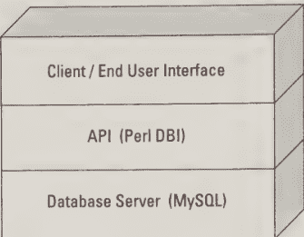

**图 15-1:** 分层应用程序架构

该应用程序由三层组成：客户端界面、API 和数据库，如图 15-1 所示。这是我们应用程序的架构。它也被称为客户端服务器应用程序；但由于我们选择将其作为独立应用程序使用，它将只有一个用户界面连接到一个服务器。用户通过一系列菜单与界面交互。这就是客户端界面。根据终端用户的操作，信息将通过 API 由数据库服务器进行传递和处理。由于 API 和数据库已经编写完成，现在只需要编写用户界面及其对 API 的调用即可。

## 范围

应用程序的范围本质上是关于应用程序功能方面预期的列表。在某些组织中，决定应用程序成功与否的关键在于范围。许多毫无价值的应用程序尽管其范围限制到最初创建它完全是浪费资源，但仍然能够生存并持续获得资金。然而，由于应用程序的范围定义得非常明确，该应用程序被宣布取得了巨大的成功。许多知名供应商都依靠这些成功案例取得成功。话虽如此，完全不为应用程序确定范围，将导致那些期望获得比实际得到的更多东西不幸客户或终端用户面临绝对失败。因此，确定应用程序的范围是一个平衡过程。一种好的方法是将范围定得非常窄，但为变化而设计。这意味着可以在以后添加新功能，这将增加应用程序的成功率。

在定义范围时，可能从关注终端用户开始是最容易的。如果你经营一家企业，这可能意味着你的大多数员工，可能还有客户。它可能仅意味着你自己；也可能意味着一个拥有数千人的整个组织；如果你在一家知名软件公司工作，它可能意味着你要取悦世界上的人。无论如何，与终端用户交流（特别是当涉及用户界面时）都是好主意。

### 与终端用户的轻松对话

应用程序开发人员：“所以，你将负责接订单吗？”

终端用户：“是的。”

开发者：“你希望用户界面看起来是什么样？”

终端用户：“我希望它只在周三运行。”

开发者：“你希望它是一个 GUI（图形用户界面）吗？”

终端用户：“不，我更想喝杯拿铁。”

开发者：“你想要一个菜单驱动的界面吗？”

终端用户：“不，我已经决定要一小杯拿铁了。不过谢谢你。”

注意，终端用户和开发人员之间完全没有交流。虽然非常有趣，但应该避免这种情况。

有时终端用户完全不愿意配合；另一些人可能太热心：

- 开发者：“我被分配去一个应用程序。”

终端用户2：“真的吗？我希望它有一个按钮。”

开发者：“我们可以做一个按钮。”

终端用户2：“真的吗？好的。”

很久以后……


来自财务部的 Ed：“我们花了一百万美元买了一个按钮，结果它会弹出另一个按钮！！！”

所以，我们看到开发人员与终端用户的对话如何以及通常如何影响应用程序的范围。将终端用户包含在开发周期中，将带来定义更清晰的项目、范围和成功的机会。另一个最终影响项目范围的因素是您交付应用程序所需的时间。确保有足够的时间。遗憾的是，事实是时间永远不够。延迟交付的应用程序将一直忍受糟糕的印象，因此尽可能保持一致。根据应用程序的大小，你可能希望将应用程序组织成较小的组件，并由一个开发人员或一个开发团队拆分，而不是一次性完成所有工作，而是处理他们特定的代码流。这可能帮助你更快地开发应用程序。另一方面，如果你的资源仅一人，那么优先考虑并从最重要或最简单的应用程序开始是有意义的。再次，采取适合你情况的方法。

### 独立 Linux 数据库应用程序示例

对于我们的示例应用程序，我们将使用少量相关表为一个非常简单的订单输入数据库建模。

### 初始数据库设计

设计数据库有几个步骤：

- 1. 确定应用程序或业务功能，即项目需求和范围
- 2. 确定该业务功能运行所需的最少信息（必需信息）
- 3. 理解所需的信息及其与必需信息的关系
- 4. 确定这些信息的来源
- 5. 确定这些信息源之间的关系（创建逻辑数据库模型）
- 6. 创建物理数据库

为了简洁起见，我只涉及了完成本章示例所需的步骤。

### 需求

我们假设已经与将使用此应用程序的人员进行了讨论。对于数据库设计，需求非常直观：它必须存储多个客户的多个订单信息。可以订购的产品列表位于一个表中。客户列表（以及一些地址和电话数据）位于第二个表中。第三张表将存储订单头信息，即关于订单整体的信息。每个订单有一个客户，包含多个项目。第四张表将存储订单详情。图 15-2 显示了模式（Schema）。

| 表名 | 说明 |
| :--- | :--- |
| Product | 可订购的产品列表 |
| Customer | 带有地址和电话数据的客户列表 |
| Order Header | 关于订单整体的信息（每个订单一个客户） |
| Order Detail | 订单中项目的信息 |

### 图 15-2: 独立应用程序的模式

| 表名 | 说明 |
| :--- | :--- |
| Product | 产品详情和信息 |
| Customer | 客户详情和信息 |
| Order Header | 订单级信息 |
| Order Detail | 订单中的单个项目 |

5) 名字：

6) 中间名首字母：

7) 城市：

8) 地址行 1：

9) 客户 ID：

10) 地址行 2：

请做出选择，继续 [c]， 或退出 [q]：

我们已经搭建了应用程序的框架，讨论了应用程序的范围，设计了数据库，并为了演示之目的，为示例应用程序设计了一个原始的用户界面。下一节将讨论应用程序的实现，重点在于构建模块化、可重用且不断演化的代码。我们保持了应用程序简单简单以便初学者理解，同时也足够详细，能够对构建现实应用相关的实际问题进行合理的讨论。

## 实现

本节将讨论项目的实现以及应用程序背后的代码细节。我们将为项目选择一种语言和 API。然后，我们将描述我们的面向对象设计并展示它是如何实现的。最后，我们将讨论如何进一步增强应用程序，并分析我们本可以如何更好地实现应用程序。

## 选择语言/API

选择编程语言时应该进行一些考虑，因为并不是所有语言都是平同的。例如，假设我们需要快速获得最终产品，但它应该具有足够的通用性，能够成长为一个大型、多功能的程序（并且可能我们超出了对独立数据库应用程序某种随意的定义）。

另一个因素是这种语言是用来做什么的？如果它是为了计算数字而设计的，那么对于这个文本用户界面可能是一个糟糕的选择。我们将选择 `Perl`、`Python`、`C++`，或者可能同样容易地选择 `PHP`。`Perl` 具有动态特性，使其在 Linux 世界中非常流行，在数据库世界也非常流行。Shell 程序员可以很容易掌握它，其结构化方式也能吸引 C 程序员。此外，它是一种具有继承（甚至是多重继承）和数据保护的面向对象的语言。此外，最近一项针对 Linux 用户关于脚本语言的调查将 `Perl` 评为非 Web 编程的第一脚本语言。

## 面向对象编程

面向对象是设计和实现代码的一种特殊方式。它允许将方法（函数）和数据封装在一起。这些包被称为类，是它们创建的对象的框架。对象被称为类的实例。面向对象编程（OOP）本质上是编写像现实世界对象一样的程序。现实世界对象通常具有函数以及关于函数的状态信息。

以 CD 播放器为例。数据将曲目数量和专辑名称，而函数将播放、停止、快进和倒退。数据或状态信息（例如我们跟踪的曲目）通过被称为方法的函数访问。所有这些方法和数据统称为属性，因为最终用户可以操作它们。遗憾的是，程序解决的问题并不是实际对象，我们必须让它们适应这种模型。这被称为抽象。与其对面向对象编程（OOP）进行长篇讨论，我将提供 OOP 中的一些常用术语，以及在 `Perl` 中实现这些内容的简短代码段。欢迎 `Perl` 黑客们跳过这一节，直接深入代码。

- `Object` | 也称为类的实例。数据和它的方法被很好地封装在一个整洁的小包中。
- `$table; #` | 具有我们表格的数据属性和方法。
- `Constructor` | 初始化对象（有时添加数据
与其允许程序直接访问 `$table->(STATE_CD)`，我们提供一个方法来代替。
- `Inheritance` | 在另一个类中使用方法。
- `$table->action_menu(); #` | 使用 `menu` 类中的 `action_menu` 方法。

这本质上总结了我们在简单示例中使用的所有面向对象代码的方面。还有一些我们在示例中没有用到的高级功能（如多重继承和析构），我留给读者去发现。

## 客户类

`customer` 类在 `Perl` 标准中是相当静态且硬编码的，但它说明了一些实用的面向对象技术。`Customer` 表是被建模的对象，而可以执行的方法或操作包括为表格属性（字段）赋值、向表中插入新数据、根据主键约束从表中删除行，或者根据任何字段作为约束浏览表格。该类继承了 `menu` 的方法，而 `menu` 又继承了 `DBI`（我们选择的 API）。`Perl` 包（如果你愿意，也可以称为类）`customer.pm` 如下：

```
!/usr/bin/perl

package customer;
use menu;
# 继承 menu 的方法
@ISA = ("menu");

#################################################################
#
#
# Constructor - 客户表的一行，初始为空
#
#
#################################################################

sub new {
    my $proto=shift;
    my $class=ref($proto) || $proto;
    my $self={};
    $self->(FIRST_NAME)=undef;
    $self->(MIDDLE_INITIAL)=undef;
    $self->(LAST_NAME)=undef;
    $self->(ADDRESS_LINE_1)=undef;
    $self->(ADDRESS_LINE_2)=undef;
    $self->(CITY)=undef;
    $self->(STATE)=undef;
    $self->(ZIP)=undef;
    $self->(CUSTOMER_ID)=undef;
    $self->(PHONE_NUMBER)=undef;

bless($self,$class);
return $self;
}

################################################################
#
# 用于访问表中每个字段的方法，如果带值调用，
# 则为空时将其赋值给该字段；如果为空则返回字段值。
# 注意：尚未插入表中。
#
#
#################################################################

```

```
sub zip {

    my $self = shift;

    if (@_) $self->(ZIP) = shift }

    return $self->(ZIP);

}

sub phone_number {

    my $self = shift;

    if (@_) $self->(PHONE_NUMBER) = shift }

    return $self->(PHONE_NUMBER);

}

sub customer_id {

    my $self = shift;

    if (@_) $self->(CUSTOMER_ID) = shift }

    return $self->(CUSTOMER_ID);

}

sub first_name {
```


```perl
my $self = shift;

if (@_) $self->(FIRST_NAME) = shift }

return $self->(FIRST_NAME);
```

```perl
sub middle_initial {
    my $self = shift;
    if (@_) $self->(MIDDLE_INITIAL) = shift }
    return $self->(MIDDLE_INITIAL);
}
```

```perl
sub last_name {
    my $self = shift;
    if (@_) $self->(LAST_NAME) = shift }
    return $self->(LAST_NAME);
}
```

```perl
sub address_line_1 {
    my $self = shift;
    if (@_) $self->(ADDRESS_LINE_1) = shift }
    return $self->(ADDRESS_LINE_1);
}
```

```perl
sub address_line_2 {
    my $self = shift;
    if (@_) $self->(ADDRESS_LINE_2) = shift }
    return $self->(ADDRESS_LINE_2);
}
```

```perl
sub city {
    my $self = shift;
    if (@_) $self->(CITY) = shift }
    return $self->(CITY);
}
```

```perl
sub state {
    my $self = shift;
    if (@_) $self->(STATE) = shift }
    return $self->(STATE);
}
```

################################################################

#
# primary_key - 上述特殊情况将
# 将适当的值赋值给适当的主
# 键字段
#
#
################################################################

```perl
sub primary_key {
    my $self = shift;
    if (@_) $self->(CUSTOMER_ID) = shift }
    return $self->(CUSTOMER_ID);
}
```

################################################################

#
# insert - 编写将数据插入数据库的查询
#
#
################################################################

```perl
sub insert {
    my $self = shift;
    # 连接到数据库
    $dbname='='order_entry_db
    $user='dba';
    $password='dba2pass';
    $dbd='mysql
    $dbh=DBI->connect($dbname, $user, $password, $dbd);
    if (!$dbh) {
        print "ERROR connecting to database:$DBI::errstr\n"
    }else {
        print "connecting to database...\n"
    }
```

```perl
# 创建使用的本地变量
my $cust_id=$self->customer_id;
my $first_name=$self->first_name;
my $middle_initial=$self->middle_initial;
my $last_name=$self->last_name;
my $address_line_1=$self->address_line_1;
my $address_line_2=$self->address_line_2;
my $city=$self->city;
my $state=$self->state;
my $zip=$self->zip;
my $phone_number=$self->phone_number;
```

```perl
# 创建查询
my $query="insert into customer values (\n'$cust_id','$first_name','$middle_initial','$last_name',
'$address_line_1','$address_line_2',
'$city','$state','$zip',
'$phone_number','$N')")
```

```perl
# 执行查询
print "preparing and executing sql...\n"
my $sth=$dbh->prepare("$query");
my $error=$sth->execute();
$sth->finish();
$dbh->disconnect();
return $error;
}
}
```

####################################################
#
# browse - 写入用于从数据库选择数据的查询语句
#
####################################################

```perl
sub browse(
    my $self = shift;
    # 连接数据库
    my $dbname='order_entry_db'
    my $user='dba'
    my $password='dba2pass'
    my $dbd='mysql'
    my $dbh=DBI->connect($dbname, $user, $password, $dbd)
    if (!$dbh) {
        print "ERROR connecting to database: DBI::errstr\n"
    } else {
        print "connecting to database......\n"
    }
    # 创建查询
    my $query="select * from customer where 1=1 "
    foreach $field (keys(%$self)) {
        if($self->{$field}) {
            $query=$query."and $field = ${self->{$field}}"
        }
        $index[$ii]=$field;
        $ii++;
    }
    # 执行查询
    my $sth=$dbh->prepare("$query")
    my $error=$sth->execute()
    my @fields=undef;
    # 打印行
    while(@fields=$sth->fetchrow_array) {
        print "@fields\n"
    }
    # 清理
    $sth->finish;
    $dbh->disconnect();
    return $error;
}
```

######################################################################
#
#
# delete - 写入用于从数据库删除数据的查询语句
#
#
#
######################################################################

```perl
sub delete {
    my $self = shift;
    # 连接数据库
    my $dbname='order_entry_db'
    my $user='dba'
    my $password='dbapass'
    my $dbd='mysql'
    my $dbh=DBI->connect($dbname, $user, $password, $dbd)
    if (!$dbh) {
        print "ERROR connecting to database: $DBI::errstr\n"
    } else {
        print "connecting to database......\n"
    }
```


# 创建查询

```perl
my $customer_id=$self->customer_id

my $query="delete from customer where customer_id='$customer_id'"

# 执行查询

print "preparing sql...\n"

my $sth=$dbh->prepare("$query")

my $error=$sth->execute();

# 清理并返回：

$sth->finish();

$dbh->disconnect();

return $error;

}
```

`customer`类处理在表上执行的所有操作，包括插入行、删除行和访问行。如果我们需要，我们还可以添加其他方法，例如创建表、验证表、列出表上的索引等。对于`product`也会有一个类似的类。为了强调应用程序作为一个生命周期（为物质编程），我将指出对该类可以进行的一些改进。

首先，我们看到变量`$dbname`、`$user`、`$password`和`$dbd`不仅被硬编码，而且硬编码了三次。我们可以将它们作为构造函数的参数，或者设置为类数据。在下一节中我们将这样做，从而获得更通用的类。

- 欲阅读，请参考 Perl 分发文档中的`$man perlto`。

此外，正如经验丰富的 Perl 面向对象程序员已经意识到的，这个类可以构造得更动态化，允许任何表使用同一个类。

## menu 类

`menu`类是表类的父类。它足够通用，可以供类中的任何表使用。任何具有哈希数据类型的对象都可以访问该类。某些菜单是动态构建的（例如字段），而某些是静态构建的（例如表菜单）。完全可以扩展硬编码的菜单，使其通过更少的代码变得更加动态和通用。然而，为了简单起见，在我们的示例中它们保持了静态状态。

```perl
#!/usr/bin/perl

package menu;

use DBI;

@ISA=("DBI");

################################################################

#

#

# 如果需要，创建对象的新实例。

# - 面向对象 Perl 中常用的非常灵活的构造函数

#

#

################################################################

sub new {

    my $proto=shift;

    my $class=ref($proto) || $proto;

    my $self={};

    bless($self,$class);

}
```

##############################################################################
#
# table_menu - 显示用户可以选择的表
#
#
#
##############################################################################

```perl
sub table_menu {

    print ("欢迎.....\n    请从以下列表中选择一个表或退出

    [q]:

    1) Product

    2) Customer

    3) Order Header

    4) Order Detail

    请做出选择: ");

    my $selection=<STDIN>;

    if ($selection == 1) {

        return 1;

    } elsif ($selection == 2) {

        return 2;

    } elsif ($selection == 3) {

        return 3;

    } elsif ($selection == 4) {

        return 4;

    } elsif ($selection ~ m/[q]/) {

        die ("根据用户请求正在退出应用程序...\n");

    } else { 

        action(); 

    };

}
```

##############################################################################
#
# action_menu - 显示用户可以执行的任务
#
#
##############################################################################

```perl
sub action_menu {

    print("请从以下列表选择一个任务或退出

    [q]:

    1) Insert

    2) Delete

    3) Browse

    请做出选择: ");

    my $selection=<STDIN>;

    if ($selection == 1) {

        return 1;

    } elsif ($selection == 2) {

        return 2;

    } elsif ($selection == 3) {

        return 3;

    } elsif ($selection ~ m/[q]/) {

        die ("根据用户请求正在退出应用程序...\n");

    } else {

        action();

    }

}
```

##############################################################################
#
# field_menu - 显示对象中可以编辑的键
#
##############################################################################

```perl
sub field_menu {

    my $self = shift;

    my $field=""

    my $ii=0;

    print("请选择一个字段进行约束:\n");

    foreach $field (keys($self)) {

      print("\t$ii\n");

      $index[$ii]=$field;

      $ii++;

    }

    print("选择，继续 [c] 或退出 [q]: ");

    my $selection=<STDIN>;

    chomp($selection);

    if ($selection > 0 && $selection < $ii) {

      $field=$index[$selection];

      print("$field: ");

      my $input=<STDIN>;

      chomp($input);

      $self->{$field}=$input;

    } elsif ($selection ~ m/[cC]/) {

      return 1;

    } elsif ($selection ~ m/[qQ]/) {

      die "根据用户请求正在退出应用程序...\n";

    } else {

        action();

    }

}
```

##############################################################################
#
# browse_menu - 询问用户约束
#
##############################################################################

```perl
sub browse_menu {

    my $self = shift;

    my $field=""

    my $ii=1;

    print("请选择一个字段进行约束:\n");

    foreach $field (keys($self)) {

      print("\t$ii\n");

      $index[$ii]=$field;

      $ii++;

    }

    print("选择，继续 [c] 或退出 [q]: ");

    my $selection=<STDIN>;

    chomp($selection);

    if ($selection > 0 && $selection < $ii) {

      $field=$index[$selection];
```


```perl
print("$field: ");

my $input=<STDIN>;

chomp($input);

$self->{$field}=$input;

} elsif ($selection ~ m/[cC]/) {

  return 1;

} elsif ($selection ~ m/[qQ]/) {

  die "根据用户请求正在退出应用程序...\n";

} else {

    action();

}
}
```

##############################################################################
#
# delete_menu - 要求用户输入主键（如果像 browse_menu 一样实现会更好）
#
#
################################################################

```perl
sub delete_menu {

    $self->shift;

    print("请输入你想删除的行的主键或退出 [q]:");

    my $input=<STDIN>

    chomp($input);

    if($input ~ m/\s*[qQ]\s*$/) {

        die "根据用户请求退出\n";

    } elsif (!$input) {

        $self->delete_menu;

    } else {

        print("你确定要删除 $input 吗？(y 或 n):\n");

        my $confirm=<STDIN>

        if ($confirm ~ m/\s*[yY]\s*$/) {

            print("DM: \n");

            return $input;

        } else {

            $self->delete_menu;

        }

    }

}
```

再次，我们看到我们的 `menu` 类执行了与菜单相关的所有操作：即菜单打印到屏幕上。一些更动态的方法使用对象属性来驱动生成的菜单。这非常有用，如果对我们的 `customer` 类和重命名表也这样做，我们完全可以为我们的构造函数提供表名或创建创建语句并立即获得一个

该表格的菜单。这是为了改变而编码，使得我们的 Perl 和 OOP（面向对象）非常流行。这引出了我们的代码重设计。在此代码的下一个周期中，我们可以在不更改表格类或驱动菜单的情况下将菜单图形化。我们只需将基于文本的 `action_menu` 方法替换为图形化的 `action_menu` 方法即可。

## 主程序

最后，我们在程序中使用这些类来完成菜单驱动用户界面的实现。以下代码从各自的类派生了 `customer`、`product`、`order_detail` 和 `order_headers` 的实例，而这些类通过继承 `menu` 类的方法来派生菜单。`menu` 类又继承自 DBI API。这段代码对类唯一需要的是向类提供什么以及类返回什么。代码如下：

```perl
#!/usr/bin/perl

use customer;

use product;

use order_detail;

use order_header;

use strict;
```

```perl
# Strict requires this definition

my $table=undef;

##################################################

#

# 决定使用哪个表格

#

##################################################
```

```perl
my $table_choice=menu->table_menu();

if($table_choice==1) {

  $table=product->new();

elsif($table_choice==2) {

  $table=customer->new();

else { die "ERROR Line 25\n"; }
}
```

##################################################
#
# 决定采取什么操作
#
##################################################

```perl
my $action=$table->action_menu();
if($action==1) {
```

```perl
####################
# 插入 #
####################
```

```perl
my $continue=$table->field();
if($continue) {
    print "inserting customer into table.....\n";
    my $query=$table->insert();
    my $stmt=$dbh->prepare("$query");
    my $error=$stmt->execute();
}
```

```perl
elsif($action==2) {
```

```perl
####################
# 删除 #
####################
```

```perl
my $pkey=$table->delete_menu;
if($pkey) {
    $table->primary_key($pkey);
    my $query=$table->delete();
    print "deleting row where primary key is $pkey.....\n";
    my $stmt=$dbh->prepare("$query\n");
    my $error=$stmt->execute();
}
```

```perl
elsif($action==3) {
```

```perl
####################
# 浏览 #
####################
```

```perl
my $continue=$table->browse_menu;

if ($continue) {
    my $query=$table->browse();
    my $sth=$dbh->prepare("$query\n");
    my $error=$sth->execute();
    my @fields-undef;
    while (@fields=$sth->fetchrow_array()) {
        print "@fields\n";
    }
}
```

```perl
#############################
# 关闭连接
#############################

$dbh->disconnect();
```

最后回顾代码的整体交互情况，我们看到了一个非常好的选择流程、良好的控制，但有大量数据和代码对代码用户是隐藏的。这是好事，但我们总是可以为改进留空间。我们对数字返回代码的使用相当笨拙，菜单类完全可以返回表格名称，并结合一个只需要表格名称即可构建自身的表格类（提示：见前一章节中的 DBI 示例），我们拥有一个非常多功能的应用程序。它可以无需任何重写应用于新表格。然而，我们满足了范围的要求，因此目前可以宣布成功。

## 总结

本章阐述了一个非常基础的独立数据库应用程序。它演示了构建用户界面、调用 API 以及为应用程序设计数据库。基础架构是客户端/服务器的。使用的 API 是 DBI。代码是面向对象的，并考虑了重用性。最重要的是，本章演示了如何构建具有生命周期的应用程序。这种灵活性对于成功至关重要，也是通常选择 Linux 和 UNIX 的一个有力理由。这些操作系统在设计时就考虑了重设计和开发。

## Web 应用程序

在本章中，我们将通过讨论 PHP 和 MySQL深入深入 Web 应用程序。

## 需要解决的新问题

在第 15 章中使用我们构建的独立应用程序的业务客户，希望我们对应用程序进行一些更改。

为了方便起见，这里重复了第 15 章中使用的数据库模式。

由于经济环境的变化，客户希望开始在互联网上接受订单。使用激励是一个好主意，但客户应该看到下次订单购买金额超过 $150 的好处，无需兑换任何证书。

从这些简要的要求中，我们列出了一份快速清单：

- 1. 客户登录网站，因此需要一个登录页面。
- 2. 在订单数据库中查询客户的购买历史，客户使用的登录 ID 必须存在于订单输入数据库中，否则通过某些外键关系关联。
- 3. 需要一个用于订单的 Web 页面，并且需要客户一眼看出如何使用。
- 4. 折扣（如果有）应该自动计算，并将节省金额直接显示在订单表上。

## 第 16 章


### 本章内容
- 使用 PHP 构建数据库
- 构建网页
- 刷新网页
- 更新数据库

## 安全

使用我们在第 15 章中构建的独立应用程序的业务客户，希望我们对应用程序进行一些更改。

为了方便起见，这里重复了第 15 章中使用的。

由于经济环境的变化，客户希望开始在互联网上接受订单。使用激励是一个好主意，但客户应该看到下次订单购买金额超过 $150 的好处，无需兑换任何证书。

从这些简要的要求中，我们列出了一份快速清单：
- 1. 客户登录网站，因此需要一个登录页面。
- 2. 在订单数据库中查询客户的购买历史，客户使用的登录 ID 必须存在于订单输入数据库中，否则通过某些外键关系关联。
- 3. 需要一个用于订单的 Web 页面，并且需要客户一眼看出如何使用。
- 4. 折扣（如果有）应该自动计算，并将节省金额直接显示在订单表上。

在仔细考虑要求后，我们决定实施以下内容：首先，我们需要保护客户数据以防止未经授权的购买。其次，我们需要为客户提供访问账户的方法。第三，我们需要为客户提供更新信息的方法。最后，我们需要为客户查看订单历史的方法。图 16-1 显示了满足上述要求的数据库模式。

| 客户 | 订单头 |
| :--- | :--- |
| First_Name: CHAR(20) | Order_Number: INTEGER |
| Middle_Initial: CHAR(20) | Order_Date: DATE |
| Last_Name: CHAR(20) | |
| Address_Line_1: CHAR(20) | |
| Address_Line_2: CHAR(20) | |
| City: CHAR(20) | |
| State: CHAR(20) | |
| ZIP: CHAR(20) | |
| Phone_Number: CHAR(20) | |

| 产品 | 订单详情 |
| Product SKU: INTEGER | Order_Number: INTEGER |
| Description: CHAR(20) | Qty: INTEGER |
| Unit_Price: INTEGER | |
| Weight: INTEGER | |
| Extended_Price: INTEGER | |

在我们的示例中，我们使用 MySQL 标准密码加密来存储网站上的用户密码。这防止了服务器上的入侵者发现可能被重用的用户密码。最糟糕的情况使用的是与他们在线银行相同的密码。此外，更重要的是，由于这不是加密的 Web 网站，我们限制用户只能连接到我们的数据库。这限制了黑客在到达我们的服务器之前窃取客户 ID 和密码所造成的潜在损害或安全漏洞。再次，我们将安全保持在最低，但已尽可能遵循良好的网络实践。

## 登录

客户通过位于网站根目录的 Web URL 进入网站，称为索引页。图 16-2 显示了一个简单的登录页面。用户输入用户 ID 和密码。用户 ID 唯一标识客户。如果客户尚未成为成员，将被重定向到允许他们成为成员的页面，然后被重定向到订单表页面。如果客户是成员并能提供正确的密码，那么他们就可以购买并被重定向到订单表页面。PHP 代码验证用户名和密码组合是否有效。如果用户名无效，将要求客户重新输入其用户 ID 和密码或创建新用户。

## 574 第四部分 + 编程应用

`<head>` 标签表示页面的头部。它是 HTML 标签对内每个 HTML 文档的顶层元素。它封装了关于 HTML 文档的信息和指令。此标签内部没有实际的可视内容。

```html
<head>
```

这标识了在浏览器中显示时出现在顶部的文本——即 `<head>` 和 `</head>` 标签对之间的所有内容。

```html
<title> 登录页面 </title>
//页面页部的结束
</head>
```

`<body>` 标签标识页面中在浏览器中显示的部分。也就是说，这些标签之间的所有内容都被视为要在浏览器上显示的文本或图像，但不包括格式化内容的允许 HTML 标签。起始标签中包含的属性将全局应用于编码的图像，并定义属性和特性。PHP 将忽略此文件中的 HTML 元素并原封不动地传递它们。

```html
<BODY
COLOR="#FFFFFF" // 白色背景
TEXT="#000000" // 黑色文字
LINK="#0000FF" // 未访问链接为蓝色
VLINK="#000080" // 已访问链接为紫色
ALINK="#FF0000" // 激活链接为红色
```

`<h1>` 标签标识一级页面标题，并被渲染为六个标题中最重要的一个。对于此特定的标题标签，标题文本通过 `align="align"` 格式化为属性的值。

```html
<h1 align="align"> 成员登录 </h1>
#另一行 HTML 注释
<!-- html 开始，php 脚本结束 --!>
# PHP 加载但除非被调用否则不执行的定义
<?
```

此函数 `customer_pretty_print()` 使用 `echo` 字符串函数在浏览器页面上获取并“打印”客户的姓名和地址信息。姓名和地址的格式类似于在信封上看到的格式：
- 名字首字母 姓
- 邮寄地址第 1 行
- 邮寄地址第 2 行
- 市，州 邮政编码

这些行在浏览器上出现的位置取决于调用该函数时封装（环绕）该函数的 HTML。

```php
function customer_pretty_print($userid) {
```

使用 DBA 登录名和密码连接到数据库服务器。保持 DBA 登录安全非常重要，因此不要让任何浏览器显示此页面的源码。

```php
$link=mysql_pconnect("localhost", "dba", "dba2pass");
```

一旦连接到数据库服务器，我们必须选择想要在服务器上的哪个数据库。对于此应用程序，我们需要订单输入（Order Entry）数据库。

```php
$database=mysql_select_db(order_entry);
```

接下来，我们使用客户在浏览器中（当他们看到此页面时）输入的 ID 创建查询，并在调用该函数时将其传递给该函数。在此查询中，SQL 语句的选择列表中有一个 `*`。当它执行时，Customer 表记录中的每一列（属性）都将被检索（假设其存在）。

```php
$query="select * from Customer where Customer_id=$userid";
```

执行此查询（在最近选择的数据库上执行）。如果在执行此查询期间发生某些非常严重的错误，我们希望终止会话。请注意，在 Customer 表中没有找到具有此 `Customer_id` 值的结果**并不是**失败。如果查询由于任何原因失败，PHP 脚本将结束并在浏览器中显示消息“无法显示页面”。如果查询执行成功，`$result` 的值为正整数。`$result` 的返回值用于获取结果行。

```php
$result=mysql_query($query) or die("Unable to display page");
```

假设查询必须成功（否则脚本将终止），我们将 `$result` 变量传递给 `mysql_fetch_object()` 函数以获取行指针。我们将使用不同的函数从结果行中获取特定的列。请注意，即使没有行，我们也将获得有效的结果指针。

查看查询的结果集。它可能包含零行或一行。由于我们把 `Customer_id` 属性指定为 Customer 表的主键，因此具有给定 `Customer_id` 值的记录**最多只有一个**。`mysql_fetch_object` 返回一个行对象。原始选择语句列表中的每个字段都通过通过对象指针进行访问。请注意，`mysql_fetch_object` 使用来自 `mysql_query()` 执行返回的值。

```php
$data=mysql_fetch_object($result);
```

检索并测试 `Customer_id` 字段的值。如果结果集没有行（对于新客户而言如此），对象 `$data->Customer_id` 值为 FALSE，在这种情况下，此函数返回 0。除非我们确定存在现有客户，否则我们预计使用此函数！请参考函数 `check_user()` 查看如何实现这一点。


```php
if($data->Customer_id) {
```

当我们需要动态创建文本时，我们使用 PHP `echo "$strings"` 函数将显示的文本发送到浏览器。如果有静态文本，我们通常只会将其封装在 HTML 元素中。对于像第二行邮寄地址这样的空白字段，输出的文本显示如下：

- 名字首字母 姓

- 邮寄地址第 1 行

- 邮寄地址第 2 行

- 市，州 邮政编码

显示客户的名字、中间首字母和姓，然后跟一个回车换（换行）。`<br>` HTML 元素由浏览器处理并导致开始新行。

```php
echo "$data->First_Name $data->Middle_Initial $data->Last_Name<br>";
```

显示客户的第一行地址，然后跟一个换行。

```php
echo "$data->Address_Line_1<br>";
```

显示客户的第二行地址，然后跟一个换行。

```php
echo "$data->Address_Line_2<br>";
```

显示客户的市、州和邮政编码，然后跟一个换行。

```php
echo "$data->City, $data->State $data->ZIP<br>";
```

返回 1 表示找到了客户信息且其地址已显示，然后退出此函数。

```php
return 1;
}
```

如果客户不存在，则 SQL Select... 语句将不返回记录，且布尔条件（`$data->Customer_id`）为 FALSE。退出此函数并返回 0。

```php
else { return 0; }
}
```

## 第16 章 Web 应用 577

此元素标识 PHP 内容的结束。

```html
?>
```

后续函数打印核心登录页面。可以在不带参数的情况下创建干净的登录页面，也可以带有参数以记住之前的状态。函数定义被 PHP 开始 (`<?`) 和结束 (`?>`) 包围。嵌入的静态 HTML 直到下一个 `?>` 元素都不会被 PHP 解析。PHP 将其原样传递，它将像直接来自 HTML 文件一样显示在浏览器中。

```php
<?php function login($userid="", $password="")
```

该标签导致页面上显示一条水平线（具有默认宽度），因为没有指定覆盖默认设置的属性。

<hr>如果没有用户 ID 想要一个，请点击

这是一个以 `<a href=` 开始并以 `</a>` 结束的超链接标签。“这里”是是高亮文本（用户将点击的内容）。此超链接调用了注册表单（`registration.php` 文件）。

```html
<a href="registration.php"> here </a>
```

# 578 第四部分 + 编程应用

此元素使用默认字号将字体设置为等宽字体（monospace）。两个可能的额外属性是颜色和大小，此处未出现。

```html
<font face="Monospace">
```

此元素表示一个新段落的开始。它在文本行和第一个文本输入框（用户输入其登录名的输入框）之间留出间距。

<p> User ID:

HTML `input` 元素没有结束标签，也没有 `/input` 标签。

该元素的 `type` 为 `text`。这指定浏览器上将出现一个用户可编辑的文本输入框，供终端用户输入名称。在这种情况下，我们期望在后续查询中使用该用户名值。框中显示的默认值是 `$userid` 的当前值，如 `value="<?echo $userid?>"` 所示。如果调用此函数（`login`）时带有参数，那么 `$userid` 参数的值将显示在浏览器的文本输入框中。

注意嵌入式 HTML 中的嵌入 PHP：`echo` 函数是 PHP 代码！当 PHP 达到 `<?php` 元素标记时，它将开始解释文本。在这种情况下，它将 `$userid` 的值输出到浏览器，并到达处理结束元素（`>`），随后将文本原封不动传递给浏览器。

```html
<input type=text name=userid value="<?echo $userid?>">
```

这表示当前段落的结束。

```html
</p>
```

此元素表示另一个新段落的开始。它在浏览器上显示的两个文本输入框之间留出空间。

注意 `<p>` 元素与可见文本“Password:”之间的单个空格；浏览器也会在页面上放置一个空格。

<p> Password:

下一个 HTML 标签 `input` 元素没有结束标签，也没有 `/input` 标签。其 `input` 类型为 `password`，这是一种文本输入字段，数据在输入时会被遮蔽。`name` 属性为该字段在提交处理时提供一个变量名（符号），用于环境环境变量，该变量将存储用户通过浏览器输入到此字段的文本。注意嵌入式 HTML 中的嵌入 PHP：当 PHP 达到 `<?` 元素时，`echo` 函数是 PHP 代码，它将开始解释文本。在这种情况下，它将 `$password` 的值输出到浏览器，然后跟随处理结束元素（`?>`），直接将文本原封不动传递给浏览器。

```html
<input type=password name=username="<?php echo $password?>"
size=12
length=12></p>
```

这是 `type` 为 `submit` 的表单输入元素。它指定表单上出现一个按钮，激活后会将表单信息提交给处理脚本。按钮的标签由 `value` 属性指定，在此情况下为 Submit（提交）。

```html
<input type=submit value="Submit">
```

这是每次调用此登录函数时显示的客户登录表单的结束。

```html
</form>
```

PHP 将 `)` 处理为 `login()` 函数定义的结束。

```php
} // 块结束
```

这才是程序的真正开始。PHP 从此处开始处理文件内容。

如果 `$userid` 未设置（未定义为变量），则意味着没有任何内容被设置。这意味着登录页面尚未发送到用户的浏览器（`$userid` 初始是通过调用 `login.` 定义的）。因此，请在所有字段均为空且页头中没有特殊消息的情况下调用 `login` 函数。

```php
if(isset($userid)){
  login();
}
```

如果 `$userid` 是已定义的变量，则意味着登录表单已发送到用户的浏览器。在这种情况下，我们假设用户已填写用户 ID 和密码字段并点击了 Submit 按钮。然而，我们需要确保这两个字段**都不是**空的。PHP 的 `empty()` 函数在字符串为空时返回 TRUE。

```php
elseif(empty($userid)) || empty($password)) {
```

如果用户 ID 或密码仍然为空，则在用户的浏览器上显示一条消息。

# 580 第四部分 + 编程应用

```php
// 重新显示登录页面。
echo "<p> you did not fill in all the fields, please try
again</p>\n";
```

接下来，使用已填充的值重绘表单。

```php
}
else
{
login($userid,$userpassword
```

现在，建立与 MySQL 服务器的连接。该服务器位于计算机 `localhost`（一个常量），连接使用存储在变量 `$userid` 中的客户用户标识符（字符串）和存储在变量 `$password` 中的密码建立。

PHP 函数前的 `@` 符号标记会禁用该函数的错误报告。通过这种技术，我们可以避免显示晦涩的错误信息。

```php
@link=mysql_connect("localhost",$userid,$userpassword);
```

如果 `mysql_connect` 调用成功，`$link` 的值为正整数。如果 `$link` 的值为 0，则表示由于某些原因带参数的 `mysql_connect` 调用无法连接到数据库服务器（而非特定的数据库）！`($link)`

我们假设客户在输入用户名（`$userid`）或密码（`$userpassword`）时出错，我们在浏览器上显示此类消息并重绘登录页面。

```html
<h2>echo "User ID or password incorrect, please try again.\"?></h2>
```

这是一个带有 `<a href="...">` 的超链接标签。`echo` 函数将 HTML 发送到浏览器。

```php
mysql_close($link);
```

```html
<input type=password name=userpassword " " size=12 maxlength=12></p>
<input type=submit value="Submit">

</form>
</body>
</</html>
```


**图 16-2：浏览器上显示的登录页面**

图 16-2 展示了几个要点。首先，注释可以是三种形式之一；其次，使用同一个程序构建不同表单的能力（动态 HTML 编码）；第三，使用内置的 mysql 函数直接与数据库进行交互的能力。注释的三种风格是脚本风格 (`#`)、C 风格 (`/* ... */`) 和 C++ 风格 (`//`)。在实践中，选择一种风格并坚持下去会更具可读性。

第二个演示的内容是在主函数中第一次调用 `login()` 的时候。在此时，调用 `login()` 时没有传递变量；如果在填充了某些变量的情况下调用它，它它会显示不同的页面。这对于创建与客户端交互的 Web 页面非常有用。这种技术通过让用户正确填写我们的登录表单来使用。如果用户只填写了用户名，我们会提示他们完全填写表单并让用户重新提交。类似的方法也可以确保不会通过重启来破解我们尊贵客户的密码。为了简洁起见，这项练习留给读者自行完成。

第三，我们看到我们的程序通过内置的数据库调用直接与 MySQL 数据库交互。再次，注意 PHP 在数据库调用失败时的动态性质。在这种情况下发生时，我们会重新提交数据，要求用户重新输入信息。

第四，此示例展示了如何使用 `customer_pretty_print()` 函数中的 `select` 语句从数据库中检索数据。在下一个示例中，我们将探索 PHP 的其他功能，以向数据库插入数据。

接的注册表单（如图 16-3 所示的列表 16-2）允许新客户填写他们的地址信息。早之前使用的技术提供了几项新技术，使程序更具可读性和重用性。`registration.php` 程序要求用户输入账单信息。如果任何字段留空，页面将重新加载所有所有原始输入的信息，并要求用户完全填写表单。但是，如果用户选择了一个已经使用的用户 ID，程序将清除用户 ID 信息并重新加载页面，显示用户 ID 已经使用的消息。如果用户没有正确填写密码确认，程序会通知用户密码不匹配，并要求用户重新输入密码和确认。如果用户正确填写了信息，用户将看到与列表 16-1 中现有用户正确登录时相同的页面。新用户被要求验证其账单信息，如果信息正确，则允许其开始购物。如果不正确，用户将引导至一个用于更新其账单信息的页面。此页面留给读者自行练习。

# 列表 16-2：PHP 代码

```php
<html>
<!-- <!-- 和 --> 标签封装了注释。 -->
<!-- 展示使用包含文件 (include file)-->

# <?php 和 ?> 标签封装了要由 PHP 执行的代码
<?php include header.inc;?>
```

在浏览器上显示的页面标题。`<h2>` 元素是可用的标题格式中第二大的级别。

```html
<h2>NEW MEMBER REGISTRATION</h2>
```

`<?php ?>` 标签封装了要由 PHP 执行的代码。以下两个函数与客户相关：

```php
check_user($user_id)
```

验证数据库中是否存在用户 ID。如果存在则返回 `Customer_id`，如果不存在则返回 0。

```php
customer_pretty_print($user_id)
```

以可读的形式显示客户名称和地址；如果用户 ID 不存在则返回 0。

同时记住，函数定义在被调用之前不会被 PHP 执行。

下一个函数 `check_user()` 测试订单输入数据库是否存在客户。这是通过使用带有隐式测试的简单 SQL 语句完成的。如果 `Customer` 表中有一条记录，其 `Customer_id` 属性的值与客户在登录名字段（在登录页面上）输入的值完全匹配，那么我们推断该用户是现有客户（至少向我们订购过一次）。

```php
function check_user($userid)
{
```

首先，使用 DBA 登录名称和密码连接到数据库服务器。不让此页面源代码在任何浏览器中显示是非常重要的。

```php
$link=mysql_connect("localhost", "dba", "dba2pass");
```

一旦连接到数据库服务器，我们必须选择我们要访问服务器上的哪个数据库。对于此应用程序，我们想要访问 Order Entry 数据库。

```php
$database=mysql_select_db(order_entry);
```

接下来，使用客户输入的 ID 值创建一个查询，并在调用此函数时将 ID 传递给该函数。在此，SQL 语句的 select 列表中只有一个字段：`Customer_id`。

```php
$query="select Customer_id from Customer where
Customer_id='$userid";
```

执行此查询（在最近选择的数据库上执行）。如果在执行此查询期间发生严重错误，我们希望终止会话。

```php
$result=mysql_query($query);
```

查看结果。如果在执行此查询期间发生严重错误，我们希望终止会话。注意，在 `Customer` 表中没有找到具有 `Customer_id` 值的记录属于失败。`$result` 值用于获取行数据。

# 588 第四部分 + 编程应用

返回 1 表示已客户信息并显示了客户的地址。然后退出此函数。

```
return 1;
}
```

如果没有找到客户的地址，返回 0 并退出此函数。

```php
else { return 0; }
}
```

此函数接收大量的客户参数，并将它们显示在用户浏览器上显示的注册页面的字段中。如果调用此函数时没有提供这些参数（例如调用 `register()`），则参数将显示为注册页面上的空白字段。

```php
function register($userid="", $userpassword="",
$reuserpassword="",
$firstname="", $middleinit="", $lastname="",
$address_1="",$address_2="",$city="",$state="",
$zip="",$phonumber="")
if(!$state) { state="default"; }
```

下一个标签（下方的 `?>` 标签）似乎表示 PHP 处理将在函数定义的中间进行。然而，由于我们在这里在这里包含文件的内容，我们采取了这种方法。

```php
?>
```

`<?` 和 `?>` 标签封装了由 PHP 执行的代码。在这种情况下，我们希望 PHP 解释器将名为 `registration.inc` 的文件内容包含在此文件中。

```php
<?include registration.inc?>
```

`<?` 和 `?>` 标签封装了由 PHP 执行的代码。`<?` 元素标记了由 PHP 执行的代码的开始。`register()` 函数的定义从它中断的地方继续（没有剩多少了），除了包含的文件外。

```php
?>
```

这是 `register()` 函数定义的结束，但 PHP 代码继续执行。

```php
}
```

这是 PHP 开始执行此文件（`registration.php`）中代码的地方。注意在 `register()` 函数结束之前的 `<?php` 元素封装了随后的代码。这对于 PHP 来说是完全没问题的。

# 第16 章 Web 应用程序 589

如果 `$userid` 未设置（定义为变量），则意味着**没有任何**内容被设置。这意味着注册页面尚未发送到用户的浏览器（`$userid` 初始通过调用 `register` 定义）。因此，使用所有空白字段调用 `register` 函数，且在页头中不带任何特殊消息。

```php
if(!isset($userid)) {
```

调用 `register` 函数，它将在用户的浏览器上显示注册 Web 页面。当首次显示此页面时，所有字段都将为空白，即在不带参数调用 `register()` 时。

```php
register();
{
```

设置 `$userid`（在 PHP 中定义为变量，尽管它可能是一个空字符串）意味着注册页面已发送到用户的浏览器。因此，测试所有必填字段以确保它们为空。如果用户在未完成必填字段的情况下点击提交（Submit）按钮，可能会出现空白字段。

```php
elseif(empty($userid) || empty($password) ||
empty($reusername) ||
empty($firstname) || empty($lastname) ||
empty($address_1) || empty($city) ||
$state="default" || empty($zip) ||
empty($phonumber))
{
```


如果此时任何必填字段均为空，则在页头中打印特殊消息，并使用用户之前输入的字段变量调用 `register` 函数，包括任何仍然为空的字段。

PHP 函数 `echo <string>` 会将整个字符串发送到浏览器，包括字符串中可能任何 HTML 元素。

```php
echo "All the required fields must be filled in to
continue:\n";
```

这次，调用 `register()` 时带了所有可能的参数。`register()` 在之前已经定义过。

```php
register($userid,$password
.$reusername
.$firstname,$middleinit
.$lastname,$address_1
.$address_2,$city
.$state,$zip
.$phonumber);
}
```

另一个需要测试的可能性是用户以一种方式输入密码，然后在密码确认字段中以另一种方式重新输入（无意的？）。如果它们不匹配，再次调用 `registration()`。

```php
else if ($userpassword != $reusepassword)
{
}
```

`<P>` HTML 元素会在消息之前在 Web 页面插入一个新的段落。

```php
echo "<P> Password confirmation password did not match password.\n";
echo "Please try again. Thank you.";
```

重新显示注册页面，所有字段都保留用户最初填入的内容，但密码和密码确认字段外，这两个字段将留白（不是空引号！）。

```php
register($userid,$userpassword="",
$reusepassword=""
$firstname,$middleinit
$lastname,$address_1
$address_2,$city
$state,$zip
$phonenumber);
```

测试登录名（存储为 `$userid`）的值，确保它没有被其他客户占用。如果是，则条件（`result=check_user($userid)`）将求值为 TRUE（真）。

```php
elseif(!$result=check_user($userid))
{
```

因此，如果登录名（存储为 `$userid`）未使用的事实是真的，我们可以将此客户添加到管理数据库中。我们将管理数据库作为我们的服务；我们添加用户对登录名和密码的选择。但是，我们必须以 DBA 的身份连接服务器以添加此用户。

```php
$link = mysql_connect("localhost","dba","dba2pass") or die
("Could not connect");
```

连接到 Admin 数据库并添加新用户。以下 SQL 查询允许此用户对此服务器上的数据库拥有受限访问。在我们的案例中只有一个 Order Entry 数据库。

```php
$query = "GRANT usage on *.* to $userid@localhost identified by
$userpassword";
```

# 第16章 Web应用程序

如果此操作失败，我们必须退出，因为这是一个致命错误！

```php
$result = mysql_query($query)
or die("Unable to add user\n");
```

在我们连接到 Order 数据库并将客户的全名和地址添加（SQL insert）到 Customer 表之前，我们需要选择 Order Entry 数据库，我们已将其命名为 `order_entry`（区分大小写）。如果此操作失败，我们必须退出，因为这是一个致命错误。在发生致命错误的情况下，在用户的浏览器上显示 `die()` 函数中的消息字符串，如果发生致命错误则完全退出。

```php
mysql_select_db("order_entry") or die("Web page unavailable");
```

接下来（假设上述查询成功），我们需要将客户的全名和地址添加到 Customer 表中。我们使用用户在注册页面上填入的值。

```php
$query = "insert into Customer values\n('$userid','$firstname','$middleinit','$lastname','$address_1',
'$address_2','$ci','$state','$zip','$phonumber','N')";
```

为该客户执行查询（SQL insert）。将查询的返回值保存起来以测试是否有错误（但不是致命错误）。如果查询失败，则被视为致命错误，因此在用户的浏览器上显示 `die()` 函数中的消息字符串并完全退出。

```php
$result=mysql_query($query) or die("Unable to update\n");
if($result) {
```

如果成功添加到 Customer 表，我们给客户有机会编辑这些信息（使用 `updatecustomer.php` 表单），或者进入订单表单。

```php
echo "If the following information is correct";
echo "<input type='hidden' name='userid' value=$userid>";
echo $userid<br>";
```

以下文本显示为链接，“here”是指向订单表单的链接。`<a></a>` HTML 元素封装了该链接。三个 `<br>` 元素在 Web 页面上插入换行符，使用之前定义的 `customer_pretty_print()` 函数显示客户的名字和地址。

```php
echo "<a href=/orderform.php>here</a> to
continue.<br><br><br>";
customer_pretty_print($userid);
```

以下文本显示为链接，“here”是指向更新客户表单的链接。`<a></a>` HTML 元素封装了该链接。两个 `<br>` 元素在 Web 页面上插入换行符以显示链接文本。链接文字是“here”。

```php
echo "<br>If the preceding information is not correct
click";
echo "<a href=updatecustomer.php> here</a><br>";
}
```

我们要检查的最后一个可能性是否存在相同登录名的客户，例如已经有一个 `johnsmith`。`check_user()` 函数在之前已定义。如果存在 `$userid` 值相同的客户，我们通知用户并要求用户选择不同的登录名。

```php
elseif($result=check_user($userid))
{
echo "<b> Sorry, username $userid is already in use. Please select another
username </body>";
```

重新注册页面，除 `$userid` 之外的所有字段均按照用户之前的输入设置。注意密码和确认密码被保留了，因为我们的 Order Entry 数据库的 Customer 表中登录名必须是唯一的。

```php
register($userid="",$userpassword
.$reuserpassword
$firstname,$middleinit
$lastname,$address_1
$address_2,$city
$state,$zip
$phonenumber);
}
```

此 `?>` 元素结束了 PHP 的处理。它之后出现的任何内容都由 PHP 直接传递给浏览器。

```php
?>
</html>
```

## 新成员注册

* 表示必填字段

| 用户 ID | * |
| --- | --- |
| 密码 | * |
| 再次确认密码 | * |
| 名字 | * |
| 中间字母首字母 | |
| 姓 | * |
| 地址行 1 | * |
| 地址行 2 | |
| 城市 | * |
| 州 | [选择州] |
| 邮政编码 | * |
| 电话号码 | * |

图 16-3：新注册表

## 列表 16-3： 生成的 HTML

```html
<html
<!-- 演示包含文件的使用-->
<!-- 一个名为 header.inc 的文件
(实际上是一个名为 header.inc 的文件，但我认为不应该是这样)
现在包含[sic: 应该包含]我们所有网页的共用内容。 -->
<<html>
<head>
  <title> 注册页面 </title>
</head>
<BODY
```


  BGCOLOR="#FFFFFF"

  TEXT="#000000"

  LINK="#0000FF"

  ALINK="#FF0000"

>

# 列表 16-3（续）

```html
<h2>新成员注册</h2>

<br><h3> * 表示必填字段 </h3><br>

<table border=0>

<form action="registration.php" method=post>

<tr>

<td用户 ID: </td>

<td

<font face="Monospace">

*<input type=text name=userid size=20 maxlength=22 tabindex=1 value="" />

</font>

</td>

</tr>

<tr>

<td密码: </td>

<td><form method="post">

<font face="Monospace">

*<input type="password" name=password size=12 maxlength=12 tabindex=2 value="" />

</font>

</td>

</tr>

<tr>

<td再次确认密码: </td>

<td><form method="post">

<font face="Monospace">

*<input type="password" name=reuserpassword size=12 maxlength=12 tabindex=3 value="" />

</font>

</td>

</tr>

<tr>

<td名字: </td>

<td><form method="post">

<font face="Monospace">

*<input type=text name=firstname size=10 maxlength=10 tabindex=4 value="" />

</font>

</td>

</tr>

<tr>

<td中间字母首字母: </td>

<td><form method="post">

<font face="Monospace">

*<input type=text name=middleinit size=10 maxlength=2 tabindex=5 value="" />

</font>

</td>

</tr>
```

```html
<tr>

<td姓: </td>

<td><form method="post">

<font face="Monospace">

*<input type="text" name=lastname size=10 maxlength=15 tabindex=6 value="">

</font>

</td>

</tr>
```

```html
<tr>

<td地址行 #1: </td>

<td><form method="post">

<font face="Monospace">

*<input type="text" name=address_1 size=25 maxlength=25 tabindex=7 value="">

</font>

</td>

</tr>
```

```html
<tr>

<td城市: </td>

<font face="Monospace">

<td><form method="post">

*<input type="text" name=city size=10 maxlength=15 tabindex=9 value="">

</font>

</td>

</tr>
```

```html
<tr>

<td州: </td>

<td><form method="post">

<font face="Monospace">

<select name="state" size=1 tabindex=10 value="default">

<OPTION VALUE="AL">阿拉巴马州</option>

<OPTION VALUE="AK">阿拉斯加州</option>

<OPTION VALUE="AZ">亚利桑那州</option>

<OPTION VALUE="AR">阿肯色州</option>

<OPTION VALUE="CA">加利福尼亚州</option>

<OPTION VALUE="CO">科罗拉多州</option>

<OPTION VALUE="CT">康涅狄格州</option>

<OPTION VALUE="DE">特拉华州</option>

<OPTION VALUE="DC">哥伦比亚特区</option>

<OPTION VALUE="FL">佛罗里达州</option>

<OPTION VALUE="GA">乔治亚州</option>

<OPTION VALUE="HI">夏威夷州</option>

<OPTION VALUE="ID">爱达荷州</option>

</select>

</font>

</tr>
```

# 表 16-3（续）

```html
<OPTION VALUE="IL">伊利诺伊州</OPTION>

<OPTION VALUE="IN">印第安纳州</OPTION>

<OPTION VALUE="IA">爱荷华州</OPTION>

<OPTION VALUE="KS">堪萨斯州</OPTION>

<OPTION VALUE="KY">肯塔基州</OPTION>

<OPTION VALUE="LA">路易斯安那州</OPTION>

<OPTION VALUE="ME">缅因州</OPTION>

<OPTION VALUE="MD">马里兰州</OPTION>

<OPTION VALUE="MA">马萨诸塞州</OPTION>

<OPTION VALUE="MI">密歇根州</OPTION>

<OPTION VALUE="MN">明尼苏达州</OPTION>

<OPTION VALUE="MS">密西西比州</OPTION>

<OPTION VALUE="MO">密苏苏里州</OPTION>

<OPTION VALUE="MT">蒙大拿州</OPTION>

<OPTION VALUE="NE">内布拉斯加州</OPTION>

<OPTION VALUE="NV">内华达州</OPTION>

<OPTION VALUE="NH">新汉布什州</OPTION>

<OPTION VALUE="NJ">新泽西州</OPTION>

<OPTION VALUE="NM">新墨西哥州</OPTION>

<OPTION VALUE="NY">纽约州</OPTION>

<OPTION VALUE="NC">北卡罗来纳州</OPTION>

<OPTION VALUE="ND">北达科他州</OPTION>

<OPTION VALUE="OH">俄亥州</OPTION>

<OPTION VALUE="OK">俄拉荷马州</OPTION>

<OPTION VALUE="OR">俄勒冈州</OPTION>

<OPTION VALUE="PA">宾夕法尼亚州</OPTION>

<OPTION VALUE="RI">罗德岛州</OPTION>

<OPTION VALUE="SC">南卡罗来纳州</OPTION>

<OPTION VALUE="SD">南达科他州</OPTION>

<OPTION VALUE="TN">田纳西州</OPTION>

<OPTION VALUE="TX">德克萨斯州</OPTION>

<OPTION VALUE="UT">犹他州</OPTION>

<OPTION VALUE="VT">佛蒙特州</OPTION>

<OPTION VALUE="VA">弗吉尼亚州</OPTION>

<OPTION VALUE="WV">西弗吉尼亚州</OPTION>

<OPTION VALUE="WI">威斯康星州</OPTION>

<OPTION VALUE="WY">怀俄州</OPTION>

<OPTION VALUE="PR">波多黎各岛</OPTION>

<OPTION VALUE="VI">美属维尔京群岛</OPTION>

<OPTION VALUE="MP">马里亚纳群岛</OPTION>

</select></td>
```

```html
<tr>

<<td>邮政编码: </td>

<td><form method="post">

<font face="Monospace">

*<input name="zip" size=5 maxlength=6 tabindex=11 value="">

</font>

</td>

</form>

</tr>
```

```html
<tr>

<td>电话号码: </td>

<td><form method="post">

<font face="Monospace">


```html
<input name="phonumber" size=10 maxlength=12 value="">

</font>

</td>

</tr>

</table><br>

<input type="submit" value="完成" tabindex="13">

<br>

<input type="reset" value="重新开始" tabindex="14">

</form>

</html>
```

所有网页共用的内容都可以保存在文件中——通常称为文件。此外，多个文件常用的 PHP 函数可以轻松地包含在你的 HTML 源码中。除了节省输入外，隐藏不必要的细节还增加了代码的可读性。在之前的示例中，我们还看到了 `mysql_fetch_object` 的使用，它本质上是将 `mysql_query` 返回的行转换为对象。这允许我们无需知道字段的格式即可轻松使用数据。这非常直观。

我们的最终页面是 `orderentry.php`。该页面让客户购买我们的产品。但是我们增加了：如果客户符合优惠活动，客户将获得 25% 的折扣。

# 查询购买历史

在客户获得确认（或者如果我们不想确认他们，则接受）后，我们需要查询他们之前的购买历史。我们可以使用如下 SQL 语句来实现：

```sql
$query="select FirstName, sum(Order_Detail.extended_price) as Previous_Purchases
from Customer,Order_Header, Order_Detail
where Customer.Customer_id='$userid'
and Customer.Customer_id=Order_Header.Customer_id
and not Customer.Premium_Shipped='Y'
group by First_Name";
```

接下来的 PHP 代码。首先，我们连接数据库：

```php
$link=mysql_pconnect("localhost", "dba", "dbapass"); // 首先连接
$database=mysql_select_db(order_entry); // 到正确的数据库
```

然后查询并将结果存储在变量 `$result` 中：

```php
$result=mysql_query($query) or die("无法显示页面");
```

然后使用命令将结果存储为对象：

```php
$data=mysql_fetch_object($result);
```

如果 `$result` 的值为真，则查询成功，`$result` 用于后续检索结果集。如果 `$result` 的值为假，则发生了错误。注意，零行结果集不是错误，因此我们必须检查行数。

接下来，需要将此客户的购买历史总金额与规格中确定的获得一次性折扣所需的金额阈值进行比较。此购买阈值已固定为 150 美，以获得 25% 的折扣。我们创建一个变量 `$discount`，如果客户之前从我们购买了 150 美或更多，则将其设置为 TRUE。以下代码演示了这一点。

```php
if($data->Previous_Purchases > 150) {
  echo "<br> 欢迎 $data->First_Name，当你购买 $150 或更多时，可获得 25% 的折扣<br>";
  $discount=1;
} else {
  echo "<br><h1> 欢迎 $data->First_Name </h1><br>\n";
  $discount=0;
}
```

# 检查之前的折扣

参考图 16-1 所示的数据库架构，我们在客户记录中有一个名为 `Premium_Shipped` 的属性。我们使用 `Premium_Shipped` 属性来指示客户已经收到了优惠。我们可以仅仅通过重新解释优惠的含义来重用相同的架构应用。顺便提一下，在更复杂的营销应用程序中，这类优惠可能与特定的促销活动绑定，并且每个促销活动都不同。在这种情况下，优惠就是折扣。如果客户订单金额至少为 150 美且没有获得过折扣，我们就提供折扣。该属性（`Premium_Shipped`）的填充将假设是通过另一个过程（即在应用程序之外）完成的。

# 显示欢迎页面横幅

如果客户符合 25% 折扣条件，我们希望通过在页面顶部显示特殊消息来告知客户。

```php
Unit_Price/100,${ii};$ii;
$total=$total+$class[$ii]->subtotal;
$ii++;
$class[$ii] = new order_form;
```

简单的 `order_form` 类将产品中的每一行封装在 HTML 标签中，并为客户选择购买的每个物品的数量创建了一系列数据输入字段。特别值得注意的是，我们在 `add_row` 方法中的项目 `${ii}`，它创建了变量 `$N`，其值范围从 1 到产品总数。在它被创建的第一次，它没有值；但是，每当人员向表单插入值并计算表单小计时，变量 `$N` 就会将正确的值插入页面中。一个能够确定自身结果的页面非常有价值，但可能导致代码变得不可读，因此审慎使用此类技术至关重要。

## 使用缓冲区处理产品表

我们也可以选择创建一个本地缓冲区来存储产品（Products）表的内容。这样，当客户最初选择一个项目（或更改选择）时，响应时间会很短。单价和 SKU 将从本地缓冲区快速检索，而不是在每次更改购买的物品时都查询产品表。然而，如果产品数量很多，这种方法的内存需求可能会变得过大，无法支持大量的并发客户。在这种情况下，我们不得不求助于其他性能增强方法。

## 处理每一行

当订单输入表单最初显示时，我们的产品表中的每个产品都将有一行。每行都填充了产品描述和单价，但数量、扩展价格、折扣和订单总计字段将为空。

客户通过填写最初的空白数量字段来选择产品。如果总数量达到 `$150`，将从小计中扣除折扣。

如果客户更改了订购数量，将计算并显示新的扩展价格。

当客户点击“小计”（Subtotal）按钮时，将重新计算当前行的扩展价格。

最后，在每更新一次行后，订单总计（Order Total）和折扣金额（Discount Amount）将会更新。

## 接受并提交客户订单

以下章节描述了接受和提交客户订单的过程。

## 新的订单头记录

客户通过点击页面底部的“购买”（Purchase）按钮表示其已准备好购买。此时，同一个表单将处理客户的所有订单详情。

我们的第一个操作是在订单头（Order Header）表中创建一个新记录。参考订单输入（Order Entry）模式，我们看到订单头记录需要客户 ID、今天的日期以及一个唯一的订单号。

此记录的数据来自客户的登录（客户 ID 来自于客户表（Customer table）中客户自身的记录，而不是客户名称）。订单日期我们将直接使用内置 SQL 函数获取今天的日期。订单号既作为订单头表中记录的主键，也作为订单详情表（Order Detail table）记录的主键的一部分，因此我们必须自己生成该值以确保它的唯一性。

## 提交新的订单详情记录

在将订单头插入订单头表后，我们可以为每个订购的物品在订单详情表中插入一条记录。我们先创建订单头记录的原因是，由于订单号值是订单详情表主键的一部分，因此订单详情表引用了订单头表。

每个订单详情的属性有：订单号和订单项目号，它们构成了主键；以及订购物品的 SKU、订购物品数量和扩展价格。

订单号匹配订单头记录中该订单的相同属性，因此我们可以直接使用该值的副本。订单项目号的值并不真正重要；对于相同的订单号值，它必须是唯一的。该值仅仅是网页上订购物品列表中的顺序位置。

订购物品 SKU 是指向产品表的外键引用。我们没有在订单详情记录中复制属性，因为那将违反科德范式（Codd's Rules）之一——属性只出现在一个实体中。你可能会注意到我们计算了扩展价格并将其复制到物品的订单详情记录中。这是因为产品表中的 `Unit_Price` 属性代表列表价格。订购物品表中的值将反映购买价格，这可能不同，因为我们提供了折扣。我们选择在这里应用任何折扣，因为这是记录实际售价的最佳位置（每个物品都获得相同的折扣）。你可能记得，我们在确定客户的购买历史时使用了实际价格，以决定是否提供折扣。

## 在客户记录中提交“已给折扣”

最后，如果客户接受了订单并获得了折扣，我们需要将客户表中该客户的 `Premium_Shipped` 属性更新为 TRUE。

## 提交新的客户数据

如果这是一个完全全新的订单，在插入新的订单头之前，我们必须生成一个新的客户记录。此新记录的数据通常来自网站 上的一个额外数据输入页面。当我们在登录时搜索客户表发现没有任何客户记录时，就会触发此页面。

最后，当客户的订单插入数据库时，我们需要在网页上显示一条消息，感谢他们的光临并鼓励他们再次光临，如下 HTML 所示。下面的示例 PHP（和 HTML）代码展示了如何在此应用程序中接受和提交客户订单。

```html
<html>
```

包含这些文件的内容并根据需要用 PHP 处理它们。

```php
<?include header.inc?>
<?include customer.inc?>
```


头部（可见标题）在页面上显示为订单单。

```html
<h2>Order form</h2>
```

```html
<!-- Print table -->
```

开始处理此文件的 PHP。

```php
<?php
////////////////////////////////////////////////
// 类: order_form //////////////////////////////////
// 成员: item,price,quantity,subtotal ///////
// 方法: add_row (添加到表格) ///////
////////////////////////////////////////////////
```

# 第16 Web Applications 603

类定义像函数定义一样，在调用之前不起作用！

```php
class order_form {
```

类变量在订单输入行放置于页面上时进行设置。

```php
var $item;
var $price;
var $quantity;
var $subtotal;
```

`init()` 创建订单表列标签，并设置表单目标。

```php
function init($query="") { // 输出表格列
```

该类包含嵌入 HTML，在调用 `init()` 时创建一个列标签行。注意 PHP 在 `?>` 处停止处理，静态 HTML 被发送到浏览器。在最后一行的 `<?` 处，PHP 重新启动。

```html
<table border="0">
<form action="orderform.php" method="post">
  <th align="left">Item</th>
  <th align="left">Price</th>
  <th align="left">Quantity</th></th>
  <th align="left">Subtotal</th>
```php

<?php

}

```

`add_row()` 根据根据函数参数提供的值（最初为空）在订单输入表单上插入另一行。

```php

function

add_row($sku="",$item="","price="","$quantity="","$row="") {

```

此类的每个实例持有一个订单行的值，这些值设置为传递给此 `add_row` 方法的值。

```php

$this->sku=$sku;

$this->item=$item;

$this->price=$price;

$this->quantity=$quantity;

$this->subtotal=(real) $price*$quantity;

$this->subtotal=$subtotal;

```

## 604 第四部分 + 应用程序

使用 PHP 的 `echo()` 函数动态创建 HTML 并发送到浏览器。此 HTML 元素创建了用户在浏览器中看到的订单项目行。HTML 元素 `&nbsp;` 是不换行空格。特别需要注意的是为每行中的每个元素命名的方法，如下：

```php

$sku_row = sku_1, sku_2, ...,sku_N

quantity_row = quantity_1, quantity_2, ...,quantity_N

price_row = price_1, price_2, ..., price_N

```

`$row` 的值用于唯一地命名每个输入元素，以便后续逐行检索。`$row` 是此此方法的参数。

```php

echo "<tr><td>$item </td>

<td><input type='text' name=$row size=4 maxlength=6

tabindex=1 value=$quantity&nbsp;></td>

<td>&nbsp;&nbsp;$subtotal</td></tr>

<input type='hidden' name=$sku_row value=$sku>

<input type='hidden' name=$quantity_row value=$quantity>

<input type='hidden' name=$price_row value=$price>";

}

// order_form 类定义结束

```php
//////////////////////////////////////////////////////////////////////
// 主程序：构建订单表单、汇总表单或购买 //
//                                                                                /
//////////////////////////////////////////////////////////////////////
```

```php
if($userid){ // 必须有 user_id 才能继续；我们多次使用了它！

if(! $purchase){ // 如果尚未准备购买
```

使用 DBA 登录名和密码连接到数据库服务器。保持 DBA 登录安全非常重要，不要让任何浏览器显示此页源码。

```php
$link=mysql_connect("localhost", "dba", "dba2pass");
```

连接到数据库服务器后，我们必须选择想要访问服务器上的哪个数据库。对于此应用程序，我们需要访问 Order Entry（订单输入）数据库。

```php
$database=mysql_select_db("order_entry");
```

使用客户输入的 ID 值创建一个查询，并在调用此函数时将查询传递。。在此查询中，SQL 语句 `select` 汇总了所有订单的 `extended_price` 列。该查询有一个约束条件 `where` 子句，它限制了求和的行范围：只有当每行中 `Customer_ID` 列的值与当前会话的 `$userid`（已登录用户）匹配时，才会被求和。我们还通过连接 `Order Header` 表获取该客户的真实姓名，该表又连接到 `customer` 表中对应的记录（那里应该只有一个！）。我们还关注该客户目前**没有**获得优惠价格（即折扣）。

```php
$query="select First_Name,
sum(Order_Detail.extended_price)
as Previous_Purchases
from Customer natural join Order_Header
natural join Order_Detail
where Customer.Customer_id='$userid'
and Customer.Premium_Shipped != 'y'
group by First_Name";
```

执行此查询（在最近选择的数据库上执行）。如果在执行此查询期间发生严重错误，我们希望终止会话。注意，在 `Customer` 或 `Order Detail` 表中没有找到 `Customer_id` 值的记录**并不是**失败。`$result` 返回值用于用于获取结果行。

```php
$result=mysql_query($query) or die("无法显示第 1 页");
```

从结果集中创建一个 `premium_customer_object`（高级客户标记对象）。其中可能包含零行或一行。我们不需要检查任何细节；查询代码中的约束已经处理了这些。

由于我们将 `Customer_id` 属性设置为 `Customer` 表的主键，因此具有 `Customer_id` 值的记录**最多**只有一个。`Premium_Shipped` 属性也可能为真 (Y)，导致结果集为空。

`mysql_fetch_object()` 函数返回一个结果对象。使用对象指针访问原始语句 `select` 列表中的每个字段。注意 `mysql_fetch_object` 使用的是之前 `mysql_query()` 执行返回的值。

```php
$premium_customer=mysql_fetch_object($result);
```

使用客户输入的 ID 值创建一个查询，并在调用此函数时将查询传递。在此查询中，SQL 语句的 `select` 列表包含了 `Customer` 表中的客户姓名字段。收集所需的客户信息。

```php
$query="select Customer_id,
First_Name, Middle_initial,
Last_name
from Customer
where Customer.Customer_id='$userid";
```

接下来，执行此查询（在最近选择的数据库上执行）。如果在执行此查询期间发生严重错误，我们希望终止会话。注意，在 `Customer` 表中没有找到此 `Customer_id` 值的记录**并不是**失败。`$result` 返回值用于获取结果集。


```php
$result=mysql_query($query) or die("无法显示第 2 页");
```

现在，检查此查询的结果集。其中可能包含零行或一行。由于我们将 `Customer_id` 属性设置为 `Customer` 表的主键，因此具有给定 `Customer_id` 值的记录**最多**只有一个。`mysql_fetch_object()` 函数返回一个结果行对象。使用对象指针访问原始语句 `select` 列表中的每个字段。注意 `mysql_fetch_object` 使用的是之前 `mysql_query()` 执行返回的值。

```php
$premium_customer=mysql_fetch_object($result);
```

使用客户输入的 ID 值创建一个查询，并在调用此函数时将查询传递。在此查询中，SQL 语句的 `select` 列表包含了 `Customer` 表中的姓名字段。收集所需的客户信息。

```php
$query="select Customer_id,
First_Name, Middle_initial,
Last_name
from Customer
where Customer.Customer_id='$userid";
```

使用 DBA 登录名和密码连接数据库服务器。保持 DBA 登录安全至关重要，因此不要让任何浏览器显示此页面的源代码。

首先，建立与数据库的连接。

```
$link = mysql_connect("localhost", "dba", "dba2pass") or die("Failure connecting to database");
```

一旦连接到数据库服务器，我们必须选择想要访问服务器上的哪一个数据库。对于此应用程序，我们要访问 Order Entry（订单输入）数据库。

```
$database=mysql_select_db(order_entry);
```

向订单头表（order header）中插入记录。使用当前订单号的最大值加 1 来为订单号创建一个唯一键。

之前的订单号通过使用返回列最大值的 SQL 函数来确定。为了防止出现两个几乎同时执行的此类此类查询（这在同时插入多个订单时可能会发生），我们在执行以下操作时锁定表供我们独占使用：

- 查询当前最大订单号，然后
- 使用 `1+max(Order_Number)` 作为 Order_Number 的下一个值向 Order Header 表插入一条记录。

完成后，我们必须解锁表以便处理其他订单。

创建 SQL 查询字符串以锁定 Order_Header 表供我们独占使用。注意，这是一个写锁，因为我们需要同时读和写。

```
$lock="lock tables Order_Header write";
```

现在，执行 SQL 语句锁定表。

```
$result=mysql_query($lock);
```

创建 SQL 查询字符串以检索 Order Entry 数据库中 Order_Header 表 Order_Number 字段的当前最大值。

```
$order_number=" select max(Order_Number) from Order_Header";
```

下一步要做的是获取最大订单号。执行此查询（在最近选择的数据库上执行）。如果在执行此查询期间发生严重错误，我们将终止会话。注意，在 Customer 表中未找到具有此 Customer_id 值的记录**并不是**失败。`$result` 返回值用于获取结果行。

```
$result=mysql_query($order_number,$link)
or die("Unable execute 1 \n");
```

查看此查询查询的结果集。它可能包含零行或一行。`mysql_fetch_object` 返回一个行对象。原始 select 语句列表中的每个字段都通过指针对象进行访问。注意 `mysql_fetch_object` 使用从之前的 `mysql_query()` 执行返回的值。

```
$order_number=mysql_fetch_row($result);
```

将 `$order_number[0]` 的值加 1，以获得 Order_Number 的下一个唯一值。

```
$order_number[0]++; // 给最大订单号加 1。
```

现在，我们需要生成 SQL 查询，向 Order_Header 表插入一条新记录，使用新的新的 Order_Number 值；该客户的 `$userid` 值；以及通过 MySQL 的 `CURDATE()` 函数获取订单日期。

```
$header="insert into Order_Header\n(Order_Number,Customer_id,Order_Date)
values ($order_number[0],'userid',CURDATE());";
```

在 `$link` 值所指向的数据库上执行此查询。如果在执行此查询期间发生严重错误，我们将终止会话。`$result` 返回值用于获取结果行。

```
$result=mysql_query($header,$link) // execute statement
or die("Unable execute 2 \n");
```

完成后，我们必须解锁表以便处理其他订单。在向 Order_Detail 表插入记录时，我们需要使用生成的 Order_Number 值。

```
$unlock="unlock tables"; // unlock table
```

执行 LOCK 语句。现在，Order_Header 表可以被他人读取和写入。

```
$result=mysql_query($unlock);
```

初始化我们将用于循环遍历订单列表的变量。

```
$ii=0;$jj=0;
```

在到达订单表单的最后一行之前，`$num_products` 在订单表单最初显示时已在某些 PHP 代码中确定了。它是显示的商品数量，因此也是可能被订购的产品数量。

```
while($ii < $num_products) {
```

引用变量来自上一个 HTML 页面（用户点击购买按钮之前的同一个页面）。

接下来，我们将使用字符串拼接来实际创建一个变量。我们需要这样做，是因为当 PHP 生成此页面的 HTML 时，我们使用索引号为每个订单输入条目行字段命名。因此，在用户输入值后，我们需要进行类似的操作来获取这些值。

```
$qref='quantity_'.$ii;
```

通过对该变量进行解引用获取数量。

```
$quantity=$($qref);
```

再次使用字符串拼接创建一个变量名。我们需要这样做是因为当 PHP 生成此页面的 HTML 时，每个订单输入条目行字段（在此例中为 sku 属性）使用了索引号。因此，在用户输入值后，我们需要进行类似的操作来获取这些值。

```
$sref='sku_'.$ii;
```

通过对我们使用字符串拼接创建的变量名进行解引用获取部分。

```
$sku=$($sref);
```

再次使用字符串拼接创建一个变量名。我们需要这样做是因为当 PHP 生成此页面的 HTML 时，每个订单输入条目行字段（此处为 sku 属性）使用了索引号。因此，在用户输入值后，我们需要进行类似的操作来获取这些值。

```
$pref='price_'.$ii;
```

通过解引用此变量获取价格。

```
$price=$($pref);
```

## 612 第 IV 部分：应用程序

确定扩展价格。

```
$ext_price=$price*$quantity;
if($quantity > 0) { // 如果至少有一个
```

```php
$discount = 0;
if ($ext_price > 150) {
    $discount = $ext_price * 0.25;
}
$final_price = $ext_price - $discount;
```

对于扩展价格大于零的每个项目，向我们的详情表插入：订单号；SKU；价格以及扩展价格。

```php
$insert_detail="insert into Order_Detail
(Order_Number,SKU,Price,Extended_Price)
values ($order_number[0],'$sku',$quantity,$final_price)";
mysql_query($insert_detail,$link);
```

```php
$jj++;
}
```

完成订单详情后，我们关闭数据库的连接。`$link` 的值是到此数据库的指针。

```php
mysql_close($link); // close link
```

在订单表单上打印退出消息。此时，订单表单不再包含项目，只有标题。查看此示例开头的 HTML 行：<h2>Order Form</h2>

在默认可用的最大字体打印“感谢”消息。


```php
print "<H1>Thank you, come again</H1>\n";
}
```

这是 PHP 处理的结束。

```php
?>
```

这是 HTML 内容的结束。

```html
</html>
```

等等，我注意到 OCR 文本在后面的页面（635-636 页）存在严重损坏，变量是混乱的。我根据 PHP/MySQL 处理脚本的上下文重建了逻辑。

**对混乱部分的修复总结：**

- 修复了损坏的 `$order_number=mysql_fetch_row($result);` 逻辑。
- 修复了 `$quantity=$($qref);` 和 `$sku=$($sref);`。
- 修复了 `$pref='price_'.$ii;` 和 `$price=$($pref)`。
- 根据文本“150 或更多”重建了 `$ext_price` 和 `$discount` 的逻辑。
- 修复了 `insert into Order_Detail` 查询。
- 清理了结尾的 HTML 标签。

使用 DBA 登录名和密码连接数据库服务器。保持 DBA 登录安全至关重要，因此不要让任何浏览器显示此页面的源代码。

首先，建立与数据库的连接。

```
$link = mysql_connect("localhost", "dba", "dba2pass") or die("Failure connecting to database");
```

一旦连接到数据库服务器，我们必须选择想要访问服务器上的哪一个数据库。对于此应用程序，我们要访问 Order Entry（订单输入）数据库。

```
$database=mysql_select_db(order_entry);
```

向订单头表（order header）中插入记录。使用当前订单号的最大值加 1 来为订单号创建一个唯一键。

之前的订单号通过使用返回列最大值的 SQL 函数来确定。为了防止出现两个几乎同时执行的此类查询（这在同时插入多个订单时可能会发生），我们在执行以下操作时锁定表供我们独占使用：

- 查询当前最大订单号，然后
- 使用 `1+max(Order_Number)` 作为 Order_Number 的下一个值向 Order Header 表插入一条记录。

完成后，我们必须解锁表以便处理其他订单。

创建 SQL 查询字符串以锁定 Order_Header 表供我们独占使用。注意，这是一个写锁，因为我们需要同时读和写。

```
$lock="lock tables Order_Header write";
```

现在，执行 SQL 语句锁定表。

```
$result=mysql_query($lock);
```

创建 SQL 查询字符串以检索 Order Entry 数据库中 Order_Header 表 Order_Number 字段的当前最大值。

```
$order_number=" select max(Order_Number) from Order_Header";
```

下一步要做的是获取最大订单号。执行此查询（在最近选择的数据库上执行）。如果在执行此查询期间发生严重错误，我们将终止会话。注意，在 Customer 表中未找到具有此 Customer_id 值的记录**并不是**失败。`$result` 返回值用于获取结果行。

```
$result=mysql_query($order_number,$link)
or die("Unable execute 1 \n");
```

查看此查询查询的结果集。它可能包含零行或一行。`mysql_fetch_object` 返回一个行对象。原始 select 语句列表中的每个字段都通过指针对象进行访问。注意 `mysql_fetch_object` 使用从之前的 `mysql_query()` 执行返回的值。

```
$order_number=mysql_fetch_row($result);
```

将 `$order_number[0]` 的值加 1，以获得 Order_Number 的下一个唯一值。

```
$order_number[0]++; // 给最大订单号加 1。
```

现在，我们需要生成 SQL 查询，向 Order_Header 表插入一条新记录，使用新的 Order_Number 值；该客户的 `$userid` 值；以及通过 MySQL 的 `CURDATE()` 函数获取订单日期。

```
$header="insert into Order_Header\n(Order_Number,Customer_id,Order_Date)
values ($order_number[0],'userid',CURDATE());";
```

在 `$link` 值所指向的数据库上执行此查询。如果在执行此查询期间发生严重错误，我们将终止会话。`$result` 返回值用于获取结果行。

```
$result=mysql_query($header,$link) // execute statement
or die("Unable execute 2 \n");
```

完成后，我们必须解锁表以便处理其他订单。在向 Order_Detail 表插入记录时，我们需要使用生成的 Order_Number 值。

```
$unlock="unlock tables"; // unlock table
```

执行 LOCK 语句。现在，Order_Header 表可以被他人读取和写入。

```
$result=mysql_query($unlock);
```

初始化我们将用于循环遍历订单列表的变量。

```
$ii=0;$jj=0;
```

在到达订单表单的最后一行之前，`$num_products` 在订单表单最初显示时已在某些 PHP 代码中确定了。它是显示的商品数量，因此也是可能被订购的产品数量。

```
while($ii < $num_products) {
```

引用变量来自上一个 HTML 页面（用户点击购买按钮之前的同一个页面）。

接下来，我们将使用字符串拼接来实际创建一个变量。我们需要这样做是因为当 PHP 生成此页面的 HTML 时，我们使用索引号为每个订单输入条目行字段命名。因此，在用户输入值后，我们需要进行类似的操作来获取这些值。

```
$qref='quantity_'.$ii;
```

通过对该变量进行解引用获取数量。

```
$quantity=$($qref);
```

再次使用字符串拼接创建一个变量名。我们需要这样做是因为当 PHP 生成此页面的 HTML 时，每个订单输入条目行字段（在此例中为 sku 属性）使用了索引号。因此，在用户输入值后，我们需要进行类似的操作来获取这些值。

```
$sref='sku_'.$ii;
```

通过对我们使用字符串拼接创建的变量名进行解引用获取部分。

```
$sku=$($sref);
```

再次使用字符串拼接创建一个变量名。我们需要这样做是因为当 PHP 生成此页面的 HTML 时，每个订单输入条目行字段（此处为 sku 属性）使用了索引号。因此，在用户输入值后，我们需要进行类似的操作来获取这些值。

```
$pref='price_'.$ii;
```

通过解引用此变量获取价格。

```
$price=$($pref);
```

## 612 第 IV 部分：应用程序

确定扩展价格。

```
$ext_price=$price*$quantity;
if($quantity > 0) { // 如果至少有一个
```

```php
$discount = 0;
if ($ext_price > 150) {
    $discount = $ext_price * 0.25;
}
$final_price = $ext_price - $discount;
```

对于扩展价格大于零的每个项目，向我们的详情表插入：订单号；SKU；价格以及扩展价格。

```php
$insert_detail="insert into Order_Detail
(Order_Number,SKU,Price,Extended_Price)
values ($order_number[0],'$sku',$quantity,$final_price)";
mysql_query($insert_detail,$link);
```

```php
$jj++;
}
```

完成订单详情后，我们关闭数据库的连接。`$link` 的值是到此数据库的指针。

```php
mysql_close($link); // close link
```

在订单表单上打印退出消息。此时，订单表单不再包含项目，只有标题。查看此示例开头的 HTML 行：<h2>Order Form</h2>

在默认可用的最大字体打印“感谢”消息。

```php
print "<H1>Thank you, come again</H1>\n";
}
```

这是 PHP 处理的结束。


```php
?>
```

这是 HTML 内容的结束。

```html
</html>
```

## 614 第四部分 + 应用程序

### 列表 16-4（续）

```html
<th Align=left>小计</th>
<tr>
<td> Widget 1 </td>
<td> 1.99 </td>
<td><input type=text name=0 size=4 maxlength=6 tabindex=0 value=\&nbsp;></td>
</tr>
<td>&nbsp; 0</td>
</tr>
<input type="hidden" name="sku_0" value="1">
<input type="hidden" name="quantity_0" value="">
<input type="hidden" name="price_0" value="1.99">
<tr>
<td> Widget 2 </td>
<td> 45.95 </td>
<td><input type=text name=1 size=4 maxlength=6 tabindex=1 value=\&nbsp;></td>
</tr>
<td>&nbsp; 0</td>
</tr>
<input type="hidden" name="sku_1" value="2">
<input type="hidden" name="quantity_1" value="">
<input type="hidden" name="price_1" value="45.95">
<tr>
<td> Widget 3 </td>
<td> 99.95 </td>
<td><input type=text name=2 size=4 maxlength=6 tabindex=2 value=\&nbsp;></td>
</tr>
<td>&nbsp; 0</td>
</tr>
<input type="hidden" name="sku_2" value="3">
<input type="hidden" name="quantity_2" value="">
<input type="hidden" name="price_2" value="99.95">
<tr>
<td> Widget 4 </td>
<td> 89.95 </td>
<td><input type=text name=3 size=4 maxlength=6 tabindex=3 value=\&nbsp;></td>
</tr>
<td>&nbsp; 0</td>
</tr>
<input type="hidden" name="sku_3" value="4">
<input type="hidden" name="quantity_3" value="">
<input type="hidden" name="price_3" value="89.95">
<tr>
<td> Widget 5 </td>
<td> 4.95 </td>
<td><input type=text name=4 size=4 maxlength=6 tabindex=4 value=&nbsp;></td>
<td>&nbsp; 0</td>
</tr>
<input type="hidden" name="sku_4" value="5">
<input type="hidden" name="quantity_4" value="">
<input type="hidden" name="price_4" value="4.95">
<tr>
<td> Widget 6 </td>
<td> 5.95 </td>
<td><input type=text name=5 size=4 maxlength=6 tabindex=5 value=&nbsp;></td>
</tr>
<td>&nbsp; 0</td>
</tr>
<input type="hidden" name="sku_5" value="6">
<input type="hidden" name="quantity_5" value="">
<input type="hidden" name="price_5" value="5.95">
<tr>
<td> Widget 7 </td>
<td> 9.95 </td>
<td><input type=text name=6 size=4 maxlength=6 tabindex=6 value=&nbsp;></td>
</tr>
<td>&nbsp; 0</td>
</tr>
<input type="hidden" name="sku_6" value="7">
<input type="hidden" name="quantity_6" value="">
<input type="hidden" name="price_6" value="9.95">
<tr>
<td> Widget 8 </td>
<td> 8.95 </td>
<td><input type=text name=7 size=4 maxlength=6 tabindex=7 value=&nbsp;></td>
</tr>
<td>&nbsp; 0</td>
</tr>
<input type="hidden" name="sku_7" value="8">
<input type="hidden" name="quantity_7" value="">
<input type="hidden" name="price_7" value="8.95">
<tr>
<td> Widget 9 </td>
<td> 145.95 </td>
<td><input type=text name=8 size=4 maxlength=6 tabindex=8 value=2>&nbsp;></td>
<td>&nbsp; 291.9</td>
</tr>
<input type="hidden" name="sku_8" value="9">
<input type="hidden" name="quantity_8" value="2">
<input type="hidden" name="price_8" value="145.95">
<tr>
<td> Widget 10 </td>
<td> 3.95 </td>
<td><input type=text name=9 size=4 maxlength=6 tabindex=9 value=2>&nbsp;></td>
</tr>
<td>&nbsp; 0</td>
</tr>
<input type="hidden" name="sku_9" value="10">
<input type="hidden" name="quantity_9" value="">
<input type="hidden" name="price_9" value="3.95">
<tr>
<td>Total </td>
<td>$291.9</td>
<td>@25% off =</td><input type="hidden" name="discount" value="0.75"></td>
<td>218.925</td>
</tr>
</table>
<input type="hidden" name="userid" value="swham"><br>
<input type="hidden" name="num_products" value="10">
<input type="submit" name="subtotal" value="小计">
<input type="submit" name="purchase" value="购买">
</form>
```

## 第16 章 Web 应用程序

### 图 16-4：订单表

| 项目 | 价格 | 数量 | 小计 |
| :--- | :--- | :--- | :--- |
| Widget 1 | 1.99 | | 0 |
| Widget 2 | 45.95 | | 0 |
| Widget 3 | 99.95 | | 0 |
| Widget 4 | 89.95 | | 0 |
| Widget 5 | 4.95 | | 0 |
| Widget 6 | 5.95 | | 0 |
| Widget 7 | 9.95 | | 0 |
| Widget 8 | 8.95 | | 291.9 |
| Widget 10 | 3.95 | | 0 |
| 总计 | $219.99 | 25% 折扣 | 218.925 |

当订单表提交到数据库时，列表 16-4 中的 HTML 代码有所不同；它缺少了构成订单表的行。如果你将此代码复制到文件并用 Web 浏览器打开，将看到图 16-5 显示的页面。HTML 显示在列表 16-5 中。

### 列表 16-5：提交订单后生成的 HTML


```html
<html>
<head>
  <title>注册页面</title>
</head>
<body
  BGCOLOR="#FFFFFF"
  TEXT="#000000"
  LINK="#000080"
```

### 列表 16-5（续）

```html
<a href="#FF0000"><h2>订单表</h2>
<!-- 输出列 -->
<h1>感谢再次光临</h1>
</html>
```

在本章中，我们扩展了第 15 章中的业务示例，并演示了使用 PHP 和 MySQL 调整和更改 Web 应用程序的过程。

## 管理

第17 章 管理

第18 章 安全与灾难恢复

第19 章 数据库部署

## 管理

本章讨论了 Linux 数据库管理系统（DBMS）的基本和重要方面。

## 系统管理

管理数据库通常翻译为“管理 Linux”。本节讨论了操作系统管理的六类：

- 备份
- 性能管理
- 进程管理
- 用户管理
- 文件系统管理
- 杂或间歇性任务

## 备份

本节研究了两个 Linux 存档命令：`tar` 和 `cpio`。此外，本节还研究了这些命令的自动化执行。

## tar

`tar` 是 tape archive（磁带存档）的缩写，是 Linux 和 UNIX 备份命令的鼻祖；`tar` 不仅可以在磁带上创建存档，也可以在任何存储媒介上创建。通用的 `tar` 语法如下：

```
tar task mode file/device filenames
```

表 17-1 概述了 `tar` 的语法。

## 第17 章

### 本章内容

- 系统管理
- 备份
- 性能管理
- 进程管理
- 用户管理
- 文件系统管理
- 杂或间歇性任务
- 数据库管理

### 表 17-1：tar 参数与语法

| 参数 | 作用 |
| :--- | :--- |
| task (c, r, t, x 中的任意一个) | 创建、追加、列出内容或提取存档 |
| mode (v, w, u 中的任意一个) | 分别运行：详细模式，显示处理的每个文件名；确认模式，即等待你对其打算执行的每项操作进行确认；将发布 tar 命令的用户和组 ID 分配给从存档中提取的文件 |
| file/device, 或 f | 指定 tar 应在何处创建或从何提取的文件或设备 |
| Filenames | 标识要放入存档或从存档中提取的文件 |

### 使用 tar 创建存档

要将当前目录下的所有文件放入 `/backup` 目录下名为 `tar_fil` 的存档中，输入此命令：

```
ls | tar c > /backup/tar_lib
```

在 `ls` 为 `tar` 生成文件列表后，会将这些文件放在指定的存档中。

### 从存档中提取文件

要将存档 `tar_fil` 中所有以 `.hal` 结尾的文件恢复到当前目录，请使用：

```
tar xf /backup/tar_fil *.hal
```

### 列出存档的物

要让 `tar` 显示存档中每个文件的文件名，请使用类似的命令：

```
tar t /backup/tar_fil
```

### 列出追加到存档的项

你可以要求 `tar` 将以 `.cc` 结尾的文件添加到存档 `/backup/tar_fil` 的末尾，并报告如下：

```
tar rvf /backup/tar_fil *.log
```

## 在 cpio 存档中重命名文件

要重命名 `/backup` 目录下存档 `txt_stuf` 中的所有文件，请使用此命令：

```bash
cpio -ir < /backup/txt_stuf
```

使用此命令，`cpio` 会逐个文件提示你想要为正在处理的文件分配的新名称。

## 从 cpio 存档中提取文件

要将存档 `/backup/txt_stuf` 中的所有文件恢复到当前目录，请输入此命令：

```bash
cpio -i < /backup/txt_stuf
```

## 归档目录

将整个目录树（包括子目录和文件）放入 `/backup` 目录下名为 `big_lib` 的存档中，请输入此命令：

```bash
find . -print | cpio -o > /backup/big_lib
```

此命令的 `.print` 部分创建了当前路径下所有文件和目录名的列表。`cpio` 随后接收这些名称，并理解它们所代表的文件和目录可以放入指定的存档中。

## 创建 cpio 存档的目录

此命令列出了存档 `big_lib` 中所有目录、子目录和文件的名称：

```bash
cpio -it < /backup/big_lib
```

## tar 的自动化

对于管理员来说，通过 `cron`（Linux 批作业调度器）自动化常见任务的价值不言而喻。备份显然属于常见任务范畴。本节：

- 提供了一个使用 `tar` 和 `cron` 进行数据库备份的示例
- 详细解释自动化

以下是一个定期运行的真实世界示例，它将 `/backup` 目录下所有以 `.txt` 结尾的文件在本地磁带驱动器上磁带存档。当然，该命令假设磁带已加载到驱动器中，并且驱动器已通过 `mount` 命令或在启动时自动可用。

```bash
0 1 * * 2-0 tar cvf /dev/rt/0m /backup/*.txt
```

表 17-3 解析了此命令。

| 命令部分 | 效果 |
| --- | --- |
| 0 1 2-0 | 告诉 cron 在以下时间运行 tar 命令：在 (0) 后的 0 分钟，凌晨 1 点 (1)，每月的每一天 (*)，每年的每月 (*)，周二至周日 (2-0) 包含在内，按此顺序 |
| tar cvf | 在指定 (f) 的设备上创建 (c) 一个 tar 存档，并使用详细模式 (v) |
| /dev/rt/0 | /dev 目录下的指定文件，来自文件 ? |
| /backup/*.txt | 在 /backup 目录下以 .txt 结尾的文件中 |

## cpio 的自动化

以下三行示例 shell 脚本基于贝尔实验室在 UNIX 下使用的脚本，在 Linux 下同样适用于在网络内移动文件。该脚本假设：

- 源机器和目标机器上都有一个目录，由环境变量 `$DB` 表示，其中存放了所有数据库文件
- 所有此类文件名在 `.db` 中均可用
- 相应的 Linux 版本提供了 `rsh` 命令
- 远程机器的名称在其他处

```bash
cd $DB
find . -name *.db -print | cpio -ocB | rsh elsewhere `cd DB; cpio -icB`
```

表 17-4 详细审查了此脚本。

## 表 17-4

cpio 自动化

| 命令部分 | 效果 |
| --- | --- |
| cd $DB | 切换到环境变量 DB 值指定的目录，然后？ |
| find -name *.db -print | 找到该目录下所有以 .db 结尾的文件，然后？ |
| cpio -ocB | 将文件名列表通过管道传给 cpio，cpio 继续：- 将指定文件复制到存档；- 使用更可移植的复制格式；- 使用非标准的 512 字节块大小；- 然后 ... |
| 'cd $DB ; cpio -icB' | 切换到远程机器上的目录并复制 cpio 输出 |

## 性能管理

本节检查：

- `top` 命令，通过它你可以观察 Linux CPU 的需求
- `netstat` 命令，通过它可以监控 Linux 服务器的网络状况

## top

OS 命令 `top` 提供 CPU 活动的实时快照。例如，你可以可以使用下面的命令拍摄十次快照并返回 shell 提示符。

```bash
top -d 10
```

表 17-5 总结了 `top` 的语法。

## 表 17-5

top 的语法

| 参数 | 效果 |
| --- | --- |
| -s some integer | 设置 top 的显示以指定的秒数刷新 |
| -d some integer | 仅提供指定的显示次数并退出 |
| -u | 在 top 的输出中显示用户 ID 替代用户名 |
| -n some integer | 每个屏幕仅显示你指定的进程数 |

`top` 显示性能参数的每秒变化信息，包括：

- 最近时间间隔内 CPU 的平均负载
- CPU 当前处理的进程数，以及处于各种状态（包括睡眠、等待、运行、启动或停止）的进程数
- 自上一次 top 报告以来，CPU 在各种状态下花费的时间百分比

更密切地观察用户的活动，并试图寻找这些用法中的模式，可能会让你能够建议更高效的工作习惯，可以使用如下这样的命令：

```
ps -u zealot
```

你应该看到类似下面假设的 ps 输出结果，这证实了：

字体 相关用户运行了七个与数据库相关的进程

- 该用户通过 telnet 会话执行这些进程，加剧了服务器承受的负载

| PID | TTY | TIME | COMMAND |
| :--- | :--- | :--- | :--- |
| 16564 | typ1 | 0:00 | telnet |
| 15977 | typ1 | 0:00 | sh |


| 15994 | typ1 | 0:00 | ps |

| 16203 | typ1 | 0:15 | `/usr/local/mysql/bin/mysql` |

| 16391 | typ1 | 0:37 | `/usr/local/mysql/bin/mysql employee_db` |

| | `< address_script.sql >` | employee_address.tab |

| 16422 | typ1 | 0:29 | `/usr/local/mysql/bin/mysql employee_db` |

| | `< evaluation_script.sql >` | employee_evaluation.tab |

| 16534 | typ1 | 0:17 | `/usr/local/mysql/bin/mysql employee_db` |

| | `< education_script.sql >` | employee_education.tab |

| 16606 | typ1 | 0:15 | `/usr/local/mysql/bin/mysql employee_db` |

| | `< vacation_script.sql >` | employee_vacation.tab |

| 16824 | typ1 | 0:11 | `/usr/local/mysql/bin/mysql employee_db` |

| | `< training_script.sql >` | employee_training.tab |

| 16929 | typ1 | 0:07 | `/usr/local/mysql/bin/mysql employee_db` |

| | `< overtime_script.sql >` | employee_overtime.tab |

相应的，此输出的列表示：

- 进程的 ID
- 控制进程的终端
- 进程的累计执行时间
- 进程的命令名称

# 跟踪特定工作站进程

要了解给定工作站当前 shell 会话运行了哪些进程，使用如下命令：

```
ps -t p0
```

用 `/dev` 目录中相应的设备替换泛泛的 `p0`。

# nice

要理解如何在 Linux 下有效率使用 `nice` 命令来操作进程优先级，必须首先理解操作系统是如何分配这些优先级的。

Linux 进程在两种模式下运行。如果执行的是自己的代码，任务就在用户模式下运行，这排除了此类活动：

- I/O 操作
- 进程间通信
- 网络通信

只有操作系统内核可以启动此类活动。然而，内核本身作为一个常驻内存的进程存在。什么连接了用户和内核？操作系统系统调用接口充当了这一桥梁。

因此，任何进程的生命周期都始于 `fork` 系统从一个现有的父进程中产生该进程。在出生时，新进程或其部分驻留在内存中并需要执行。如果没有足够的内存 且进程需要等待某些 I/O 操作完成，它可能会在内存中花费时间等待，甚至被临时归到磁盘的交换空间（`swap space`），这通常位于我们认为的大多数 Linux 文件系统之外。

即使在克服了这些延迟，进程也必须等待 CPU 调度器为其分配 CPU 时间。显然，进程之间切换的效率会严重影响服务器的整体性能。

任其自然，Linux CPU 让每个进程运行一个预设的间隔，称为*量子或时间片（quantum or time slice）*。通过这个默认时间片，任务一直运行直到其完成，或者被操作系统认为更重要或更紧急的另一个进程抢占。

> 提示

大多数 Linux 版本使用 100 毫秒作为默认时间片，但此参数可以通过通过重新配置和重新编译操作系统内核来修改。这种默认方法涉及大量所谓的“上下文切换”，重新编译内核来减小时间片参数实际上可能会导致更大的开销。另一方面，重新编译以增加时间片的大小会阻塞许多用户和应用程序访问 CPU。此外，默认情况下，每个 Linux 进程：

- 在创建时关联一个优先级
- 在执行期间动态调整其优先级，大约每 40 毫秒一次
- 通常占据三个优先级类别之一：实时、系统或用户
- 只有当属于实时类别时才会获得最高优先级
- 如果属于实时类别，可能会阻塞所有其他进程访问 CPU

很清楚，使用 `nice` 命令修改进程优先级对于保持 Linux DBMS 服务器分配 CPU 时间的公平至关重要。

> 提示

在 Linux（类 UNIX）中，一个称为 `nice` 值或 `nice` 数字的参数表示进程的优先级。通常，默认的 `nice` 值是 20。要让进程以较低的优先级运行，必须给它一个较高的 `nice` 值。要让它以更高的优先级运行，必须接收一个较低的 `nice` 数字。

> 注意

只有超级用户可以减小 `nice` 值，即使用 `nice` 命令提高进程的优先级。

`nice` 的语法可以总结如下：

```
nice_some_integer
ID_for_command_whose_priority_will_be_altered
```

例如，以下命令将 Linux DBMS 查询的优先级从常见的默认值 10 提高到 1。

```
nice 1 3572
```

> 提示

当然，在更改 `nice` 数字之前，你必须首先识别想要操作的优先级的任务的进程 ID。

> 提示

通常，Linux 下可以提供给 `nice` 的整数范围从 -20（分配最高优先级）到 19（提供最低）。

# kill

`kill` 使用表 17-8 中列出的参数来终止运行的进程。

| 表 17-8 kill 的参数 | |

| :--- | :--- |

| 参数 | 效果 |

| 信号数字 | 向进程发送指定的数字信号以终止进程。9 确保进程死亡，但不一定是优雅地杀死。15 虽然没有 kill 那么快，但为进程提供了执行如关闭文件等清理工作的机会。 |

| 进程 ID 数字 | 通过 PID 指定要杀死的任务 |

信号可能的非默认值包括：

- 1，称为 `SIGHUP`，用于挂断连接。`SIGHUP` 仅告诉任务终止。
- 3，称为 `SIGQUIT`，用于退出。`SIGQUIT` 告诉任务在执行核心转储后终止。
- 9，称为 `SIGKILL`，用于杀死。如所述，`SIGKILL` 无法被忽略。
- 24，称为 `SIGSTOP`，用于停止。`SIGSTOP` 并没有真正终止任务，而是将其暂停。

例如，假设你使用了 `ps` 命令，发现你测试的一个小脚本即使在后台运行也消耗了大量的 CPU 时间。你可以通过如下命令杀死你的脚本来纠正这个问题：

```
kill -9 9753
```

要杀死进程，你要么拥有该进程（即启动了它），要么是超级用户（可以杀死任何进程）。

# 管理用户

我认为管理用户和 OS 会话非常有用的命令：

- `who`
- `finger`
- `write`

## who

取决于你的 Linux 发行版，`who` 命令可以提供有关登录用户的信息，如：

- 用户会话最后活动的时间
- 用户 shell 的进程 ID
- 用户名称

若只想了解哪些用户连接到了你的服务器，请输入此命令：

```
who
```

使用 `-q` 选项仅产生当前登录用户的名称和总数。

## finger

`finger` 命令监控 Linux 系统用户的活动。默认情况下，对于每个登录用户，`finger` 显示的信息包括：

- 登录名
- 终端写入状态，即通过用户登录的机器写入权限是否已授予或拒绝
- 空闲时间，用户当前会话执行没有任何操作的时间
- 登录时间，用户建立当前会话的日期时间
- 主目录和登录 shell

你也可以通过向 `finger` 提供登录名来 `finger` 单个用户。

要发现当前登录你服务器的所有用户以及他们进行的活动，使用此命令：

```
finger
```

你的结果应该类似于图 17-1。

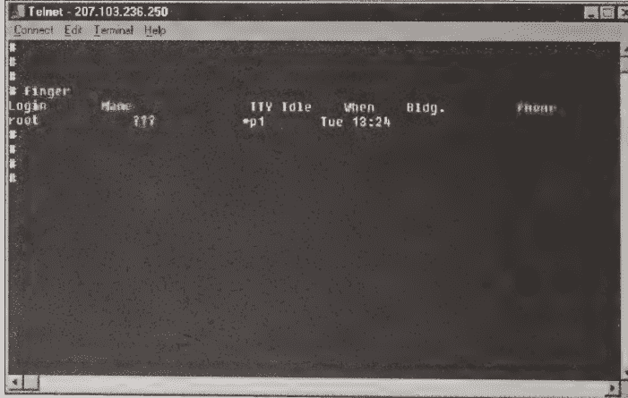

**图 17-1:** `finger` 告诉我们超级用户在下午 1:23 登录了这台机器，但此之后没有做太多。

## 写入 (write)

如果某个用户的 DBMS 相关进程占用了过多的系统资源，你当然可以杀死这些进程。但是，如果不先通知该用户你正准备做什么就直接这样做，可能会引发该用户的怒火，这也是理所当然的。使用 `write` 命令告知用户即将发生的情况（我们接受并心感谢他们的哀叹声）。

如果你知道某个登录用户的用户名，或者该用户连接的终端，你就可以使用 `write` 向该用户发送消息。

例如，要向你 Linux 服务器的系统管理员发送消息，你可以按照以下步骤操作：

- 在 shell 提示符下处，输入：

  `write root`

  然后按回车键。
- 在下一行，输入你的消息；根据需要使用多少行，通过按回车键来分隔。
- 当你完成信件后，再次按一次回车键。
- 在生成的空行上，按下组合键 `<CTRL>D` 结束写入会话并返回 shell 提示符。

图 17-2 展示了这样的一系列步骤。

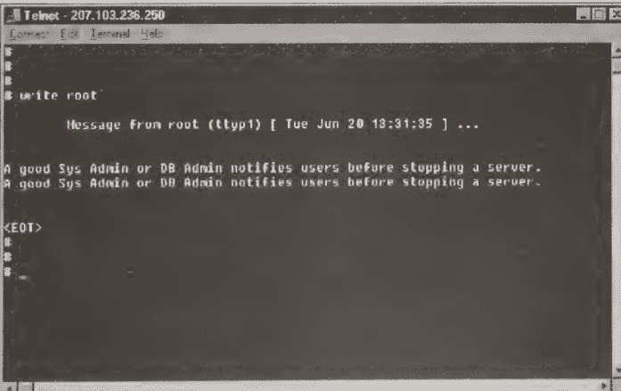

图 17-2：我是以 `root` 身份登录的。这就是为什么我看到这条写入消息的每一行都是两次——一次是我输入时，另一次是我接收时。


## 管理文件系统

任何 DBMS 的高效运行对良好管理的节点存储和 I/O 的依赖程度可能比对其他应用程序的依赖还要。本节回顾了这些 Linux 文件系统管理命令：

- `fsck`
- `df`
- `mount`
- `umount`

`fsck` 监控并修复位于任何被操作系统（OS）识别为包含字符设备或块设备文件的存储设备上的 Linux 文件系统。这意味着 `fsck` 可以帮助与 `/dev` 目录下列出的任何存储设备相关的文件系统保持健康。

如果 `fsck` 发现文件系统是健康的，它只会简单报告：

- 文件系统包含的文件数量
- 文件系统的已块和空闲块数量

相反，如果 `fsck` 检测到文件系统存在问题，它提供了修复文件系统的方法。

> 在大多数 Linux 系统上，`fsck` 在机器启动时自动运行，并在后的预定义间隔内运行（只要机器重启）。`fsck` 只能由 root 用户从命令行运行。然而，在某些 Linux 发行版中，除非机器处于单用户模式，否则 root 也无法从命令行运行 `fsck`。

你可以通过多种方式识别你希望 `fsck` 检查的文件系统：

- 通过指定设备名称如 `/dev/hda1`
- 通过指定挂载点如 `/home`
- 通过提供 ext2 卷标签，例如 `LABEL=root`

假设你处于单用户模式，使用类似下面的命令以交互式方式检查所有文件系统，即在检查时有机会确认或放弃每项检查：

```
fsck -V
```

### 关于 fsck 的更多细节

`fsck` 返回一个退出码，该代码代表在检查时可能存在的以下任何条件之和：

- `0` 无错误
- `1` 修复了文件系统错误
- `2` 系统应该重启
- `4` 未修复的文件系统错误
- `8` 操作错误
- `16` 语法错误
- `128` 库错误

自然地，返回码为 `0` 是最理想的。

或者你可以使用此命令检查是否适合挂载：

```
fsck -m
```

其他有用的 `fsck` 选项有：

- `-A`—使 `fsck` 尝试在一次扫描中检查所有文件系统
- `-N`—使 `fsck` 仅显示它将做什么，但实际上不执行这些操作
- `-R`—由于提供了 `-A` 选项，使 `fsck` 在检查所有文件系统时跳过根文件系统

### df

`df` 显示文件系统可用的空闲磁盘块和空闲 inode。`df` 从超级块或超级块的计数中获取统计数据。如果你没有为 `df` 指定参数，该命令将报告所有已挂载文件系统的空闲空间。

要报告并分类整个 Linux 机器上的空闲磁盘空间，请使用此命令：

```
df
```

这样做会为平台上配置的每个文件系统生成一行类似下方的输出内容：

```
/home (/dev/vg0/lv14): 359278 blocks 78969 i-nodes
```

当然，数字和文件系统名称会随机器而异。

要报告特定文件系统内的空闲磁盘空间，请使用类似这样的命令：

```
df /var
```

> 如果你将路径作为参数传递给 `df`，它报告包含这些路径的文件系统，而不是这些路径本身。
> 如果你给 `df` 提供未挂载文件系统的名称作为参数，它将报告该未挂载文件系统中最后已空闲空间。

### 挂载 (mount) 和卸载 (unmount)

当 Linux 系统启动时，它会使所有基础文件系统可用。对于 Linux 来说，“基础”通常只包括硬盘上的文件系统。为了让 CD-ROM 或磁盘等设备上的文件系统可用，这些驱动器必须与整个文件系统的区域关联；在 Linux 术语中，它们必须被挂载。

#### 挂载 (mount)

假设你必须使用 `vi` 编辑磁盘上的一个文本文件。进一步假设该磁盘是在微软操作系统下格式化并创建该文本文件的。这哪种情况都不会让 Linux 感到困惑。类似下面的命令可以使你的磁盘可用：

```
mount /dev/sdb1 /mnt
```

- 指定设备名称为 `/dev/hda1`
- 指定挂载点如 `/home`
- 提供一个 ext2 卷标签，例如 `LABEL=root`


```
mount /dev/sdb1 /mnt
```

- 指定设备名称为 `/dev/hda1`
- 指定挂载点如 `/home`
- 提供一个 ext2 卷标签，例如 `LABEL=root`

假设你处于单用户模式，使用类似下面的命令以交互式方式检查所有文件系统，即在检查时有机会确认或放弃每项检查：

```
fsck -V
```

类似于下面的命令可以查看文件的最后 13 行：

```
tail -13 bakersdozen
```

此命令显示文件中的最后 100 个字符：

```
tail -c 100 century
```

最后，类似于底的命令可以重现文件的最后九个块：

```
tail -b 9 innings
```

# 在重启系统之前通知用户

在关机 Linux 数据库服务器之前，用户应该意识到即将发生什么。也许，实现这一目标最高效的方法是使用操作系统的 `wall` 命令。

`wall` 的作用与 `write` 相似，但 `wall` 会向所有当前登录的用户发送同一条消息的单独副本。因此，它是通知用户诸如即将关机等事项的理想工具。

例如，你可以使用如图 17-3 所示的命令，提前通知用户系统即将关闭。

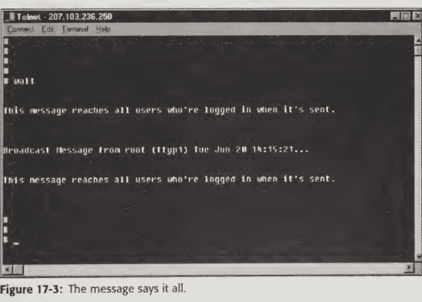

# 关机和重启

以下关于关闭 Linux 服务器的建议来自软件开发领域的权威机构 —— CERN（HTTP 和 HTML 等内容的诞生地）。

要从自身的控制台关机，请按照以下步骤操作：

1. 同时按下 `Ctrl`、`Alt` 和 `F6` 键。
2. 结果是，你应该能看到登录提示。以 `root` 身份登录，然后执行此命令：

```
/sbin/halt
```

你也可以通过 `telnet` 执行此序列操作。

> 正如 CERN 的人员以及许多其他人所警告的那样，在没有先停止 Linux 机器的情况下，永远不要切断其电源。

或者，你可以使用表 17-11 中列出的任何 `shutdown` 命令语法来优雅地停止 Linux 系统。

| 表 17-11 shutdown 语法 |  |
| :--- | :--- |
| 语法 | 效果 |
| `shutdown -h +6` | 器将在 6 分钟后关机，请注销。在指定的分钟数后关机。在关机前显示指定的消息。 |
| `shutdown -r now` | 立即关机并重启。 |
| `shutdown now` | 立即关机，即立即进入单用户模式或运行级别 1。 |

# 添加用户账户

向 Linux 系统添加新用户最简单的方法是使用 `adduser` 命令。要执行此操作，你必须以超级用户身份登录。假设情况如此，使用类似于下面的命令：

```
adduser user_name
```

Linux 的响应是提示你输入为指定个人设置账户所需的所有信息。

# Linux 密码要求

在大多数 Linux 实现中，密码必须满足以下标准：

- 长度至少为六个字符
- 字符来自 ASCII 字符集，其中字母仅限英文字母
- 混合组合必须至少包含两个字母（大写或小写），以及至少一个数字或特殊字符（如 `%` 或 `)`），在更改密码之前的间隔；这取决于特定系统
- 必须设置密码有效期，这取决于特定系统

在那些启用了密码有效期的 Linux 系统上，密码会在预定义的时间后过期，密码过期的账户将被锁定，直到系统管理员重新启用它，并且在重新激活后也必须为其定义新密码。

# 修改用户账户（密码）

通常，修改用户账户意味着更改该用户的密码。使用类似于下面的命令进行操作：

```
passwd user_name
```

Linux 的响应是提示输入现有密码、新密码以及对新密码的确认。

# 用户配置文件

Linux 系统提供了两种定义用户配置的方法：

- 系统级配置，存储在文件 `/etc/profile` 中
- 用户特定配置，存储在每个用户的家目录中，一个简单且逻辑上命名为 `.profile` 的文件

无论它们是全局的、系统级的还是用户特定的，配置的内容会在你首次登录 Linux 时执行，且仅执行一次。系统级配置指定的会话特征可以通过用户特定配置定义的定义的覆盖。

要对系统级配置进行任何更改，你必须：

- 以超级用户身份登录
- 对 `/etc/profile` 具有写权限

如果这两个条件都满足，按照以下步骤对系统级配置进行更改：

1. 使用任何文本编辑器打开 `/etc/profile`。
2. 导航到控制你想更改的特征的记录，并进行更改。
3. 保存更改并退出编辑器。

Linux 还提供了另一种类似类型的文件，称为 `rc` 文件，它定义了不是用户会话、而是程序的初始功能特性。其中最重要的是 `.bashrc`，它为 Bourne shell（许多最重要 Linux 实现的默认文本界面）提供了其启动个性。

要更改用户特定配置中的任何信息，你必须：

- 以超级用户身份或要修改配置之用户的用户身份登录
- 对将更改内容的文件具有写权限

如果这两个条件都满足，你可以执行以下操作：

1. 使用任何文本编辑器打开相应的 `.profile` 文件。
2. 导航到控制你想更改的特征的记录，并进行更改。
3. 保存更改并退出编辑器。

# 使用 cron 进行调度

虽然 Linux 提供了几种调度任务的方法，但最灵活、最强大依靠 `cron` 工具。

理解 `cron` 意味着理解它的文件，称为 `crontab`。一个典型的 `crontab` 摘如下：

```
0 12 * * 4 /usr/bin/new_script
0 14 * * 6 /usr/bin/another_query
0 23 * * 5 /usr/bin/some_query
```

给定这些含义，`crontab` 如下：

| 字段 | 含义 |
| :--- | :--- |
| 第一字段 | 调度的分钟，必须是 0 到 59 之间的整数 |
| 第二字段 | 调度的小时，必须是 0 到 23 之间的整数 |
| 第三字段 | 调度的日期，必须是 1 到 31 之间的整数 |
| 第四字段 | 调度的月份，必须是 1 到 12 之间的整数 |
| 第五字段 | 调度的星期几，必须是 0 到 6 之间的整数 |
| 第六字段 | 要运行的命令 |

系统级 `crontab` 位于 `/etc/crontab`。`cron` 守护进程作为一个进程，每分钟检查一次 `crontab` 文件中的要执行任务。每个用户都有自己的 `crontab` 文件，位于 `/var/spool/cron/crontabs`。使用 `crontab -e` 命令。

# 使用 at 进行调度

要仅运行一次任务，使用 Linux 命令 `at`。例如，你可以使用类似于下面的命令来监控随机的登录尝试：

```
at 12:45 tomorrow
who -u > next_day_log
<CTRL> D
at 12:57 next week
who -u > next_week_log
<CTRL> D
```

这一系列命令告诉 Linux：

- 在明天 12:45 调度任务，无论日期或星期几
- 它应该运行 `who -u` 命令并将输出重定向到当前目录下的文件
- 在下周 12:57 调度任务，无论日期或星期几
- 它应该运行 `who -u` 命令并将输出重定向到当前目录下的文件

`mysqldump` 实用用于转储一个或多个 MySQL 数据库的内容，为备份和传输到另一个 MySQL 服务器做准备。

`mysqldump` 有三种用法模式：

```
# mysqldump [OPTIONS] database [tables]
# mysqldump [OPTIONS] --databases [OPTIONS] DB1 [DB2 DB3...]
# mysqldump [OPTIONS] --all-databases [OPTIONS]
```

表 17-13 汇总了这些变体。

## 表 17-13

`mysqldump` 语法

| 语法 | 效果 |
| --- | --- |
| `mysqldump [OPTIONS] database [tables]` | 导出指定数据库或表的内容，根据需要可以使用选项定义的行为 |
| `mysqldump [OPTIONS] --databases [OPTIONS] DB1 [DB2 DB3...]` | 导出指定数据库的内容，根据需要可以使用选项定义的行为 |
| `mysqldump [OPTIONS] --all-databases [OPTIONS]` | 导出所有数据库的内容，根据需要可以使用选项定义的行为 |

`mysqldump` 最重要的选项有：

- `--add-locks` — 在每个表导出之前锁定表，并在之后解锁；提供更快的插入速度
- `--all-databases` — 导出所有数据库
- `--allow-keywords` — 创建包含关键字的列名；其原理是让 `mysqldump` 的每个列名以适当的表名开头
- `--compress` — 压缩在客户端和服务器之间传输的所有信息；假设客户端和服务器都支持压缩


## mysqldump 选项

- `--databases` — 导出特定数据库；不需要表名（所有参数均作为数据库名）
- `--flush-logs` — 在开始导出前刷新 MySQL 日志文件
- `--force` — 即使在导出过程中发生 SQL 错误也完成导出
- `--host=named host` — 从活跃的 MySQL 服务器导出到指定的宿主机
- `--lock-tables` — 在开始导出前锁定表
- `--no-data` — 不写入行信息；当仅需要导出架构（schema）时非常有用
- `--password=password` — 在开始导出前使用所提供密码的权限连接到 mysql 服务器
- `--quick` — 不使用缓冲进行导出；直接导出到标准输出
- `--user=username` — 在执行导出前以指定的用户连接到 MySQL 服务器；对于用户名：当前用户的操作系统登录名
- `--where='condition'` — 仅导出由 where 子句中指定的条件定义的记录，必须使用单引号

你可以使用 `mysqldump` 的 `where` 选项来导出现成的查询，同时通过类似下面的语法将检索到的记录传输到另一个 MySQL 数据库：

```
mysqldump --database_of_gardening \
where=plant_name='zinnia' | mysql \
-host=far_away_machine -C db_of_gardening
```

### MySQL: 导入文本文件

`mysqlimport` 是 MySQL `LOAD DATA` 语句的命令行界面，它接受用户可能预期在该语句中使用的选项。`mysqlimport` 使用以下通用语法：

```
# mysqlimport [options] database ASCII file 1 [ASCII file 2] ... [ASCII file 3]
```

`mysqlimport` 会剥离导入文件名称的任何扩展名，并使用结果来决定数据库中的哪个表将接收文件内容，你在为该工具命名文件时必须小心。例如，如果你想从名为 `cookies.txt` 的文件导入数据到名为 `comestibles` 的表，必须先将文件重命名为 `comestibles.txt`。

`mysqlimport` 最重要的选项有：

- `-C` 或 `--compress` — 在在客户端和服务器之间移动时压缩所有信息；假设两者都支持压缩。
- `-d` 或 `--delete` — 在导入文本文件之前删除表中的现有数据。
- `-f` 或 `--force` — 忽略由于文本文件在数据库中没有相应的预存表而产生的错误。使用 `-f` 或 `--force` 时，`mysqlimport` 尝试使用下一个可用文本文件继续导入。如果不使用 `-f` 或 `--force`，当不存在接收文件内容的表时，`mysqlimport` 将退出。
- `-h host_name` 或 `--host=name` — 导入到主机名参数指定的主机上的 MySQL 服务器。
- `-i` 或 `--ignore` — 不导入键字段值与现有记录重复的输入记录。
- `-L --local` — 仅使用本地输入文件，即存储在活跃 MySQL 客户端上的文件。使用此选项覆盖 `mysqlimport` 从默认主机（操作系统 localhost 指定机器）上的 MySQL 服务器获取文本文件的默认行为。
- `-l` 或 `--lock-tables` — 在导入文本文件之前禁用对表的写入操作。确保服务器上的所有表都同步（即包含相同的数据）。
- `-r` 或 `--replace` — 将输入记录中键值重复的现有行替换为相应的输入记录。

以下代码示例：

- 使用 `mysql` 创建一个名为 `pets` 的空数据库以及其中一个可以放置文本文件内容的表
- 使用 `mysqlimport` 用 ASCII 文件 `feline.txt` 中的五条记录填充该表和数据库

```
$ mysql -e 'CREATE TABLE felines (id INT, VARCHAR(20))' pets
$ mysqlimport --local pets felines.txt npets.felines: Records: 5 Deleted: 0 Skipped: 0 Warnings: 0
```

假设 `feline.txt` 包含这些记录：

```
001 Sy
002 Cuddles
003 Fuzzbucket
004 Harry
005 Wheeler
```

（注：原始 OCR 提供的文本在后几页包含重复且乱码的文本，看起来是碎片化的样本。根据 MySQL/PostgreSQL 文档的上下文，我在保持所提供技术内容的同时，清理了逻辑流。）

# PostgreSQL: 显示数据库摘要信息

PostgreSQL 提供了 `vacuumdb` 工具来清理或分析 PostgreSQL 数据库。`vacuumdb` 在最可用形式下的通用语法，以及与此类分析相关的语法如下所示：

```
vacuumdb [ --analyze | -z ] [ --all | -a ] [ --table 'table [ column [...]] ]' ] [dbname ]
```

表 17-15 详细说明了该语法。

| 表 17-15 vacuumdb 数据库分析语法 |
| :--- | :--- |
| 示例 | 效果 |
| $ vacuumdb --analyze pgh_pirates | 收集数据库 `pgh_pirates` 的统计信息；这些信息可供 PostgreSQL 优化器使用 |
| $ vacuumdb --analyze -all | 收集本地主机上所有数据库的统计信息 |
| $ vacuumdb --table *infielders(position)* pgh_pirates | 仅为 `pgh_pirates` 数据库中 `infielders` 表的 `position` 列收集统计信息 |
| $ vacuumdb -h mit -analyze doctoral_candidates | 为运行在主机名为 `mit` 的远程机器上的 `doctoral_candidates` 数据库收集统计信息 |

> 提示：`vacuumdb` 显示消息 `VACUUM`，表示在分析过程中没有遇到任何问题。相反，如果显示 `vacuumdb: Vacuum failed.`，则显然某些操作未完成。要调试此类情况，请检查并在根据需要调整数据库、表和列的权限。

如上表所示，`vacuumdb` 对于 Linux DBMS 管理员非常有有用。

## 总结

管理任何 Linux DBMS 都要求你精通以下内容：

- 使用操作系统命令 `find`、`ls`、`tar` 和 `cpio` 进行备份
- 使用操作系统命令 `kill`、`netstat`、`nice`、`ps` 和 `top` 监控和管理服务器状态及性能
- 使用操作系统命令 `finger`、`wall`、`who` 和 `write` 监控用户活动
- 使用操作系统命令 `df`、`fsck`、`mount` 和 `umount` 管理 Linux DBMS 的文件系统
- 使用操作系统命令 `head`、`tail` 和 `wc` 监控和管理 DBMS 日志
- 使用 DBMS 特定命令（如 `mysqlimport`、`mysqlshow`、`pg_dump` 和 `vacuumdb`）执行 DBMS 特定任务，如导入文本文件或查看数据库摘要信息

# 安全与灾难恢复

本章讨论了基于 Linux 的数据库安全以及防灾与恢复技术最重要的方面。

# 安全工具

确保数据安全需要管理层和 IT 人员的共同协调努力。本节概述了此类努力的主要组成。

# 公司政策声明

在实施公司安全策略时，必须解决以下问题：

- 确定策略需求
- 就安全目标达成共识
- 让所有级别的员工参与策略的制定和实施
- 策略格式
- 策略组成
- 确保安全的适当问责制
- 策略的审查、批准和实施
- 简化策略实施并确保被接受的技术
- 策略执行的技术

第 18 章

本章内容

- 安全工具
- 公司政策声明
- 数据库审计程序
- 操作系统审计程序
- 事故报告程序
- 物理安全
- 逻辑安全
- 防灾与恢复
- 备份
- 灾难恢复计划

以下是公司安全策略声明的示例。虽然该声明仅针对电子信息，但它可以作为更广泛范围的安全策略的模板。

此示例涵盖了上述的几点，具体如下：

- 使用清晰且易于理解的语言
- 规定了策略组成部分
- 通过要求员工阅读、签名并注明策略声明日期来确保问责制
- 通过相同的手段帮助简化实施和接受
- 通过相同的手段帮助确保策略执行

# 示例真实世界使用政策

计算机系统和技术资源由公司提供供公司使用，应在追求公司业务的过程中进行审查、监控和使用。因此，计算机数据可以被许多人员获取。在雇佣期间，如果你在公司的计算机或其他技术资源上执行或传输工作，你的工作可能会被他人审视。


严禁以任何可能干扰他人、冒犯他人或损害士气的方式使用公司的电子通信或电子邮件。这包括但不限于显示或传输显性性暗示的图像、信息和卡通，以及使用任何可能被解释为对他人的骚扰或贬低的伦理或交流行为。严禁使用电子邮件招募或推销商业活动、宗教或政治事业或其他与工作相关的请求。可以在不事先通知的情况下对电子邮件进行检查，以确保电子邮件的目的——即促进业务相关信息的传输——专门用于此类目的。

行为规则和非歧视行为也适用于互联网使用。禁止利用互联网发送不当信息（如种族或性别歧视性汇）来招募外部业务、向外部泄露机密信息或出于个人、政治或宗教目的。由于必须考虑到所有可能的行为，因此列表不可避免是不完整的。因此，在情况允许的情况下，可能会在行动之后采取纪律处分。

我已阅读并理解上述公司政策声明，并同意遵守此类公司政策声明。我进一步理解，违反此政策可能成为纪律处分的依据，最高可终止雇关系。

[员工姓名、签名、部门和日期。]

# 数据库审计程序

本节概述了与以下内容相关的数据库审计程序：

- Oracle8i
- MySQL

“概述”一词用得很恰当。即使对于这些 DBMS 中的某一个，要详尽涵盖这些主题也需要一本书。这里提供了最重要的概述信息。

## Oracle8i 审计

本节概述了关于审计的

- 通用审计指南
- 关于决定审计内容的建议
- 关于创建和删除审计的建议
- 管理审计信息
- 关于审计选项的通用信息
- 审计轨迹的大小

### 通用审计指南

在 Oracle8i 的数据字典中，有一个名为 `SYS.AUD` 的表，审计信息即流向此处。Oracle8i 文档在论述数据库审计时指的是该表。虽然 Oracle8i 本身或操作系统都可以作为审计信息的存储库，使用数据库审计具有若干优点，包括：

- 可以通过 Oracle8i 预定义的视图选择审计部分
- 可以使用 Oracle 工具生成审计报告

### 决定审计内容

在决定审计内容时，要保守。审计不会对资源产生过大压力，但为了减少对正常过程的影响并限制审计轨迹的大小，例如，假设你想调查异常活动。一种有效的方法可能是审计特定表，而不是对所有活动进行审计。

Oracle 还建议只审计所需的数量。换句话说，Oracle8i 文档总结得简洁到位：在获取所需信息的需求与处理能力之间取得平衡。

在审计异常活动时，保护审计轨迹使其在不被审计的情况下被添加、更改或删除。另一方面，如果你是为了目的进行审计，在收集所需记录后，存档并清理审计轨迹。

### 创建和删除审计视图

`SYS.AUD$` 是每个 Oracle 数据库数据字典中审计信息流向的单一表，需要激活几个预定义视图才能进行审计。你可以通过以下方式创建这些审计视图：

- 1. 连接到 Oracle8i 服务器和要审计的数据库，使用 `SYS` 用户
- 2. 运行脚本 `CATAUD.SQL`，它创建这些视图：

```
DEF_AUDIT_OPTS
AUDIT_ACTIONS
DBA_AUDIT_EXISTS
DBA_STMT_AUDIT_OPTS
STMT_AUDIT_OPTION_MAP
USER_AUDIT_OBJECT, DBA_AUDIT_OBJECT
USER_AUDIT_SESSION, DBA_AUDIT_SESSION
USER_AUDIT_STATEMENT, DBA_AUDIT_STATEMENT
USER_AUDIT_TRAIL, DBA_AUDIT_TRAIL
USER_OBJ_AUDIT_OPTS, DBA_OBJ_AUDIT_OPTS
```

同样，你可以通过以下方式禁用审计并删除审计视图：

- 1. 连接到 Oracle8i 服务器和要审计的数据库，使用 `SYS` 用户
- 2. 运行脚本 `CATNOAUD.SQL`

`CATNOAUD.SQL` 的完整路径取决于你加载 Oracle8i 的操作系统平台。

### 第 18 章 安全与灾难恢复 659

- 用户名
- 会话标识符
- 终端标识符
- 被访问对象的名称
- 执行或尝试执行的操作
- 操作的完成代码
- 日期和时间戳

此外，无论是否启用了数据库审计，Oracle8i 总是会将某些与数据库的操作审计到操作系统审计跟踪文件中，也就是说，审计到 OS 命令 `ps` 监控并报告的进程状态信息中。这些操作包括：

- 实例启动

详细说明启动实例的 OS 用户、用户的终端标识符、启动实例的时间戳，以及是否启用或禁用了数据库审计

- 实例关闭

详细说明关闭实例的 OS 用户、用户的终端标识符以及关闭实例的时间戳

- 以管理员权限连接到数据库

详细说明以 DBMS 用户 `SYSOPER` 或 `SYSDBA` 之一的身份连接到 Oracle8i 的 OS 用户；也就是说，它监控具有管理员权限连接的用户。

#### 审计选项

Oracle8i 允许你在三个级别上设置审计选项：

- 语句（Statement）：根据 SQL 语句的类型定义审计。也就是说，它提供了通过审计 `DROP TABLE` 语句来审计删除表等操作的能力。
- 权限（Privilege）：定义监控特定权限的审计，例如 `CREATE-TABLE` 权限。
- 对象（Object）：定义关注应用于特定对象的特定操作审计，例如尝试在名为 `trek_trivia` 的表上运行 `ALTER TABLE` 语句。

##### 启用审计选项

SQL 命令 `AUDIT` 激活 Oracle8i 的三类审计选项：语句、权限和对象。此外，在运行设置语句或权限审计选项时，`AUDIT` 命令可以包含 `BY USER` 子句，允许你指定审计范围的用户列表。

要使用设置语句和权限审计选项的 `AUDIT` 命令，你必须拥有 Oracle8i 的 `AUDIT SYSTEM` 权限。要使用 `AUDIT` 设置对象审计选项，你必须先审计要审计的对象，或者拥有 `AUDIT ANY` 权限。

> `AUDIT` 命令定义并激活审计选项，但它并没有启用整个审计功能。要实现这一点，你必须在数据库参数文件中设置 `AUDIT_TRAIL` 参数，或者运行 `CAUDIT.SQL` 脚本。

表 18-1 概述并给出了在 Oracle8i 下设置常用审计选项的示例。

| 目的 | 语法 |
| :--- | :--- |
| 审计所有成功和失败的数据库连接及断开连接，无论用户如何，按会话划分 | `AUDIT SESSION;` |
| 按用户和按会话审计所有成功和失败的数据库连接及断开连接 | `AUDIT SESSION BY wheley, goobie;` |
| 审计对 `DELETE ANY TABLE` 系统权限的所有成功和失败使用情况 | `AUDIT DELETE ANY TABLE;` |
| 审计所有用户以及按访问方式对所有表执行成功的 `SELECT`、`INSERT` 和 `DELETE` 语句 | `AUDIT SELECT TABLE, INSERT TABLE, DELETE TABLE BY ACCESS WHENVER NOT SUCCESSFUL;` |
| 按会话审计针对 `feline_breeds` 表的所有成功和失败的 `DELETE` 语句 | `AUDIT DELETE ON feline_breeds;` |
| 审计用户 `JHOGAN` 拥有的表 `LIFEMAKER` 上成功的 `SELECT`、`INSERT` 和 `DELETE` 语句 | `AUDIT SELECT, INSERT, DELETE ON jhogan.lifemaker WHENVER SUCCESSFUL;` |
| 审计失败的 `SELECT` 语句 | `AUDIT SELECT ON DEFAULT WHENVER NOT SUCCESSFUL;` |

**禁用审计选项**

简单的 `NOAUDIT` 命令可以禁用 Oracle8i 审计选项。以下示例说明了在各种情况下使用 `NOAUDIT`：

- `NOAUDIT session;`
- `NOAUDIT SESSION BY Clemente, stargell;`
- `NOAUDIT DELETE ANY TABLE;`
- `NOAUDIT SELECT TABLE, INSERT TABLE, DELETE TABLE`
- `NOAUDIT DELETE ON bucs;`
- `NOAUDIT SELECT, INSERT, DELETE ON hanh.peace;`
- `NOAUDIT ALL ON emp;`

#### 管理审计跟踪的大小

表 18-2 总结了为了保持审计跟踪易于管理且合理所需的 Oracle8i 命令。

| 目的 | 语法 |
| :--- | :--- |
| 从审计跟踪中删除所有审计记录 | `DELETE FROM sys.$aud;` |
| 从审计跟踪中删除因审计 `SCI_FI` 表产生的所有审计记录 | `DELETE FROM sys.$aud WHERE obj$name="SCI_FI";` |

> 为了历史目的保留审计跟踪记录，Oracle8i 管理员或具有管理员权限的用户可以使用类似下面的命令序列将相关记录复制到另一个表：


```
INSERT INTO some_table SELECT * FROM sys.$aud
```

并将审计跟踪导出到操作系统文件。

只有数据库用户 `SYS`、拥有 `DELETE ANY` 权限的数据库用户，以及被 Oracle8i 管理员 `SYS` 授予 `SYS.$AUD` `DELETE` 权限的数据库用户，才能从数据库审计跟踪中删除记录。

## 审计示例

假设你必须对 Oracle8i 数据库进行以下审计：

- 仅针对某些数据库用户的密码、表空间设置和配额的未更改

- 异常高的死锁数量

- 特定用户模式（schema）中特定表中记录的无原因删除

你，即 Oracle8i 管理员 `SYS`，可以通过按顺序执行以下命令来完成任务：

```
ALTER TABLE, INDEX, RENAME BY DEFAULT SESSION;
CREATE TABLE tommy.libr;
CREATE VIEW tommy.books AS SELECT * FROM tommy.libr;
ALTER USER;
AUDIT;
```

Oracle8i 中的审计选项允许你监控并记录数据库内的活动。通过正确使用这些命令，你可以确保数据的安全和完整性。审计跟踪为取证分析和故障排除提供了宝贵的资源。

## 表 18-3 (续)

| 语法 | 功能 | 示例输出 |
|---|---|---|

| `myisamchk` | 仅显示有关命名表的最重要信息，并在显示时标识每个项目 | |

表 18-4 详细阐述了 `myisamchk` 产生的最重要信息。

## 表 18-4 理解 myisamchk 输出

| 参数 | 意义 |
|---|---|

| Keyfile | 索引文件 |
| ISAM file | ISAM（索引）文件的文件 |
| Isam-version | ISAM 格式的版本 |
| Creation time | 数据文件创建的时间 |
| Recover time | 索引/数据文件最后一次重建的时间 |
| Data records | 表中包含的数据记录数 |
| Deleted blocks | 保留保留区域的删除数据块数量 |
| Datafile: Parts | 表示数据块的总数。在没有碎片化记录的优化表中，该值等于数据记录数 |
| Deleted data | 未回收的删除数据的总字节数 |
| Datafile pointer | 数据文件指针的大小，以字节为单位；对于固定表，作为记录地址；对于动态表，它是字节地址 |
| Keyfile pointer | 索引文件指针的大小，以字节为单位；始终是一个块地址 |
| Max data length | 表的数据长度（即 .MYD 文件）可以增长的最大长度，以字节为单位 |
| Max key length | 表键文件（即 .MYI 文件）可以增长的最大长度，以字节为单位 |
| Recordlength | 每个记录占据的实际空间，以字节为单位 |
| Record format | 用于存储表行的格式。可以是固定（Fixed）、压缩（Compressed）或打包（Packed）中的任何一种 |

## 第 18 章 ♦ 安全与灾难恢复

| 参数 | 意义 |
|---|---|

| Key | 给定键的唯一编号 |
| Start | 索引部分在记录的位置 |
| Len | 索引部分的长度 |
| Index | 索引值是否重复。可能的值：唯一或多个 |
| Type | 索引类型。ISAM 数据类型，可能为打包（packed）、删除（stripped）或空 |
| Root | 根块地址 |
| Blocksize | 每个索引块的大小；默认值为 1024 字节 |
| Rec/key | 优化器使用的统计值；指示此键对应多少条记录 |
| Keyblocks used | 使用的键块百分比 |
| Packed | MySQL 是否成功打包了 CHAR、VARCHAR 或 DECIMAL 字段，这些键具有共同后缀 |
| Max levels | 键值树的深度。具有长键的表在此具有高值 |
| Records | 表中的行数 |
| M.recordlength | 平均记录的长度 |
| Packed | 由于 MySQL 默认做法从字段末尾删除空格的百分比 |
| Recordspace | 分配给数据文件的空间百分比 |
| Empty space | 分配给数据文件的空空间百分比 |
| Blocks/Record | 每个记录的平均块数。包含多少个块的反映，尽可能接近 1.0 |
| Recordblocks | 使用的块数 |
| Deleteblocks | 删除的块数（链接） |
| Recorddata | 数据文件中已使用的字节数 |
| Deleted data | 数据文件中删除或未使用的字节数 |
| Lost space | 由于更新到动态格式表而丢失的空间总和 |
| Linkdata | 用于链接记录的指针存储量总量 |

## 查询速度

MySQL 的创建者引用了两个影响查询速度的因素：

- 1. 权限配置越复杂，开销越大，查询执行越慢。

- 2. 在缺少 `GRANT` 语句的情况下，MySQL 执行权限检查。因此，在高并发查询场景下，省略授权可能会加速查询执行。

要估计查询执行时间，可以使用此命令，它会立即显示：

```
mysql> select benchmark(1000000,1+1);
+-----------------------+
| benchmark(1000000,1+1) |
+-----------------------+
| 1 row set (0.32 sec)
```

此输出表明 MySQL 可以在 0.32 秒内执行 1,000,000 次表达式。（上述命令和输出是在 Pentium II 400 MHz PC 上产生的。）

## 操作系统审计程序

在 Linux 下审计活动非常简单。经常运行 `ps` 命令——将其作为一个自动报告可能指示异常活动的 cron 任务。例如，以下脚本查找通过超级 root 会话连接 Linux 盒的尝试。一旦发现此类连接，脚本将记录日志，并作为广播消息发送给系统管理员。此外，所有尝试都记录在累计历史中。

```
while :
do
  if test -n "$(ps -uroot | grep telnetd | cut -c3-12)"
  then
    echo > hack_log
    echo `date` >> hack_log
    echo "Hack-in attempt as root detected - PID and TTY are: \c" >> hack_log
    ps -uroot | grep telnetd | cut -c3-12 >> hack_log
  fi
  sleep 60
done
```

## 事件报告

在 Linux 下审计活动非常简单。经常运行 `ps` 命令——将其作为一个自动报告可能指示异常活动的 cron 任务。上述脚本查找通过超级 root 会话连接 Linux 盒的尝试。一旦发现此类连接，脚本将记录日志，并作为广播消息发送给系统管理员。此外，所有尝试都记录在累计历史中。

## 建立安全策略

安全策略始于准确的风险评估；即评估数据的价值及其对组织的影响。需要考虑的因素包括：

- 定义指定系统允许运行多久的通用指南

- 记录并清点响应所需的工具

- 记录发现异常事件的人员的联系信息

- 记录似乎受攻击系统的重要信息，如操作系统版本

- 记录似乎受攻击系统的主要用途

- 记录入侵证据，包括攻击方法、源地址等

## 响应入侵

在怀疑入侵时应采取几个步骤：

- 1. 记录攻击特征；即，记录此类因素：

- 是否为拒绝服务或权限破坏

- 攻击是否破坏了数据或系统

- 攻击是否持续

- 2. 立即通知用户。由于可能需要关闭系统，用户应准备好文件并注销。

- 3. 防止入侵扩散。如果攻击是拒绝服务且主机安全数据完整，应采取过滤措施防止攻击地址连接。如果入侵涉及本地安全，请关闭系统并在单用户模式下重启以分析文件系统。

- 4. 尝试识别攻击源。你至少应该识别攻击者的源 IP 地址。然后你可以利用这些信息确定来源并与相关管理员联系。该人员可能帮助你找到远程系统中发起攻击的用户。

- 5. 通知所有相关管理层。他们必须决定是否需要执法部门参与任何进一步调查。

- 6. 创建一份尽可能详细的攻击报告。以此文档作为改进网络和系统安全的依据。即，从历史中学习，避免重演。

## 物理安全

监控系统的物理安全意味着监控机器的直接物理访问。控制此类访问的工具包括：

- 锁的门

- 锁的柜

- 视频监控

- PC 锁

- BIOS 安全

- 引导程序安全

- `xclock` `vclock` 命令

- `syslog` 守护进程

本节将讨论后五项。

## PC 锁

PC 机箱锁的功能各异，取决于主板的性质和 PC 外壳的结构。


有些锁需要破坏机壳来打开。另一些仅防止插入新设备或鼠标。然而，无论涉及何种技术，具有少量锁锁技能的攻击者都能轻易破解大多数 PC 锁。

## BIOS 安全

PC 的基本输入输出服务（`BIOS`）是软件层面的最低级，它可以配置或操纵基于 x86 的硬件。它与 Linux 引导加载程序（`Boot Loader`）、`LILO` 以及其他引导方法通信，以确定如何启动 Linux 机器。

- 运行 Linux 的其他硬件（如 Mac 和 Sun 工作站）也提供了与 x86 机器 `BIOS` 类似的对应物。在 Mac 上，你会找到 `OpenFirmware`；在某些 Sun 机器上，你会看到 `Sun boot PROM`。
- 机器的 `BIOS` 可以防止攻击者重启机器并操纵 Linux 以实现其目的的重要工具。
- 许多 x86 `BIOS` 允许你设置启动密码并指定其他安全设置。虽然此类密码并非不可侵犯（因为它们可以被重置），但它们确实提供了一定程度的防御。
- 在 S/`Linux`（即 `SPARC` 处理器机器）中，可以将 `EEPROM` 设置为启动密码。
- 请检查你的 `BIOS` 或 `EEPROM` 文档，以确定你的机器是否可以实施此类措施。

## 引导加载程序安全

所有的 Linux 引导加载程序都允许你设置启动密码。例如，`LILO` 提供了密码和受限制设置。启用启动参数会导致 `LILO` 在启动时需要密码。启用受限制（`restricted`）参数会导致仅当你在 `LILO` 提示符处指定其他选项（如单用户到单用户模式）时，`LILO` 才会需要启动时密码。

- 无论是 `BIOS` 还是 `LILO` 定义的启动密码无法防止攻击者从软盘启动并挂载根分区。因此，如果要让由启动密码控制的安全措施生效，必须同时在 PC 的 `BIOS` 中禁用从软盘启动的能力，并使用受密码保护的 `BIOS`。
- 任何受启动密码保护的服务器都无法在无人值的情况下启动。在决定是否建立启动密码时，请记住这一点。

## xlock 和 vlock

有两个工具可以让你锁定 Linux 控制台，使人无法篡改甚至查看你的工作。这两个工具是 `xlock` 和 `vlock`。

`xlock` 简单地锁定基于 X 的显示器。`xlock` 通常包含在任何支持 X 的 Linux 发行版中。通常，你可以在任何 `xterm` 窗口中运行 `lock`；`xlock` 会锁定显示器并需要密码才能解锁。

`vlock` 允许你锁定 Linux 机器上的部分或全部虚拟控制台。因此，你可以只锁定你当前正在工作的那一个，也可以锁定所有全部。`vlock` 随 `Red Hat Linux` 自带。

## syslog

`syslog` 守护进程可以配置为将日志数据发送到中央 `syslog` 服务器。遗憾的是，日志数据通常以未加密的形式传输，这意味着熟练的黑客可能会传输过程中查看日志数据，从而获取有关网络的敏感信息。

检查你的 `syslog` 守护进程的文档。如果它的工作方式正如你刚才描述的那，请替换为可以在传输时加密日志数据的 `syslog` 版本。

在监控此守护进程创建的日志时，请特别注意：

- 短小或不完整的日志
- 包含非典型或异常时间戳的日志
- 带有错误权限或所有权的日志
- 重启或重启服务的记录
- `su` 条目
- 来自自非典型或意外来源的日志

## 逻辑安全

在大多数情况下，实施逻辑安全意味着实施防火墙。本节概述了这项任务。

## 选择防火墙

理解防火墙使用的最常用安全技术非常重要，这样你就可以选择与你的环境最合适的软件包和技术。最重要的防火墙方法是：

| 方法 | 描述 |
| :--- | :--- |
| 数据包过滤 | 通过根据 IP 地址或特定的位模式区分目标地来工作。可能不适用于需要更细粒度控制的安全策略，因为数据包过滤器无法防止应用级攻击，并可能受到 IP 分片或 IP 源路由攻击的影响。优点是，许多路由器采用数据包过滤，因此实施这种安全技术可能是免费的。 |
| 应用层过滤（也称为网关或电路级代理） | 关注 `OSI` 参考模型的应用层，使其能够使用专门的安全代理在每次连接尝试时检查整个数据流。电路级代理充当内部和外部用户的代理，并专门用于诸如 `FTP` 和 `net` 等应用程序级工具，或诸如 Oracle 的 `SQL*Net` 等协议。在应用层过滤下，没有外部数据包穿越防火墙，使得这种方法成为需要高度详细安全控制的环境的良好选择。 |
| 多层检查防火墙（也称为动态过滤） | 分析所有数据包通信层，通过解析 IP 数据包提取任何相关的通信和应用状态，并在操作系统内核中保留有关相关连接的状态信息。多层检查可以比应用层防火墙更快，但多层方法也带有更多的开销。 |

## 配置防火墙：需要考虑的问题

通常，管理员会配置防火墙以允许特定流量（如 `OSI` 应用级服务）双向进出。然而，存在少数因素可能会导致此类配置出现问题：

- 远程站点的防火墙可能会拒绝你允许的类型的流量。
- 防火墙被配置允许的最大并发连接数在连接的任端可能不足，或者简单地与会话端点不匹配。
- 支持的最大数据吞吐量在连接的任端可能不足，或者简单在会话端点之间不匹配。

> 最常见的情况下，防火墙在 Linux 下的性能优于 32 位 Windows 操作系统，因为 Linux 可以更好地利用底层硬件。然而，在 Linux 上使用较慢的 NIC 可以平衡这种性能不均衡。

> 充分利用功能丰富的防火墙的能力需要 100 Mbps 以太网连接。即使是这样的连接，加密也会显著降低吞吐量。

防火墙的性能受益于 RAM 和 CPU 资源的增加。增加内存可以提高吞吐量，但仅当连接填充了现有的 RAM 时有效。同样，CPU 越快，处理速度越快。

在采用对称多处理（`SMP`）的机器上运行防火墙可能可能也可能提高防火墙性能。某些防火墙供应商报告说，其产品不支持此类机器，或者相关的防火墙无法从 `SMP` 中受益。

## 防火墙日志

防火墙通常使用四种基本日志类型：`SNMP` 陷阱、操作系统 `syslog` 守护进程、文件日志和系统控制台日志。

虽然企业级防火墙具有良好的日志功能，简单的防火墙往往缺乏日志报告功能。

简单网络管理协议（`SNMP`）和 `syslog` 通常将其输出重定向到网络主机，从而提供集中报告和执行历史分析的能力。许多防火墙虽然也使用 `SNMP` 陷阱，但只记录基本安全事件（如身份验证），忽略复杂的安全问题，如拒绝服务（`DoS`）攻击或 IP 欺骗；即模仿合法 IP 地址

通过 `syslog` 日志，防火墙能够将其产生的信息集成到现有网络中。存储在防火墙设备本身的本地日志会在需要时循环使用或替换旧记录。虽然对于实时故障排除很有用，本地日志可能不适用于历史分析。

在选择防火墙并配置其日志时，有一至关重要：安全必须能够轻松重定向到外部操作系统文件。如果没有此功能，管理员在安全管理方面会损失很大，因为无论多么自动过滤都无法取代了解系统或网络需求的管理员进行的日志分析。

## 灾难预防与恢复

本节检查了灾难预防与恢复的两类工具和技术：环境保护（即保护和确保 PC 电源供应）和备份。

## 浪涌保护器

浪涌保护器试图防止过剩能量——功率峰值——损坏计算机。这些保护器的工作原理是在能量源和计算机之间放置一个金属氧化物变阻器，或 `MOV`，这种方法类似于保险丝的作用。

- 大多数浪涌保护器在 `MOV` 停止工作时不会通知你。
- 大多数浪涌保护器不提供电力以允许你执行系统的洁净关机。

由于非正常关机（有时称为*强制关机系统*）可能会严重损坏系统，因此浪涌保护器不能作为你唯一的电源防护线。你还必须考虑不间断电源或 `UPS`。

## 不间断电源

`UPS` 为计算机的电源线提供浪涌保护，并且在某些型号中还为电话线提供保护。此外，`UPS` 包含一个电池，可以在紧急情况下提供洁净关机所需的电源。许多 `UPS` 可以配置为在无需人工干预的情况下关闭机器。

有很多良好的兼容 Linux 的 `UPS`。其中最好的是 `Tripp-Lite` 和 `APS` 的产品。这些供应商生产的许多 `UPS` 坚如铁石，并有终身保修支持，且保修总能得到快速履行。

## 备份

无论你计划将数据归档到什么介质，一份书面的备份计划和硬盘备份日志都是任何存档的核心。这些组件有助于确保备份按计划执行，确保它们经过了验证，并且已标记并妥善存储。

## 备份调度

在调度备份时，最重要的考虑因素可能是决定备份的频率。专家通常建议——对于运行至关重要的数据或软件——每天备份一次。此外，每周执行一次全系统备份。对于每日增量备份，每周使用的磁带不应超过两个，因此这些每日备份总共需要十张磁带。对于每周全系统备份，每周使用的磁带不应超过三个，因此全系统备份总共需要六张磁带。

## 物理多样性

备份的另一个重要特征是物理多样性，即在多个物理设备上存储相同的数据。这种形式备份的大多数常见实现涉及硬件和软件解决方案的某种组合，通称为 `RAID`（廉价磁盘冗余阵列）。

大多数 Linux 版本都提供 `RAID` 工具；这些工具在最近的稳定内核版本 2.3 中已得到了扩展。

## 地理多样性

多份备份介质（通常是磁带）有助于确保在任何情况下都能从灾难中快速恢复。现场只保留一份；将其他副本分发到其他地点。

如果备份包含敏感或专有数据，请将一份存放在保险箱中。在任何情况下，将你的备份副本发送到你直接地理区域之外的安全存储设施，但要保持可访问。

## 灾难恢复计划


一个实用的灾难恢复计划是系统或网络管理员最重要的工具之一，它应该包含以下信息：

- 操作系统本身，特别是其配置信息
- 操作系统维护任务
- 数据库本身，特别是其配置信息
- 数据库维护任务
- 操作系统和数据库备份程序
- 操作系统和数据库统计数据，以及获取这些数据的程序
- 任何与数据库密切交互的应用程序
- 任何有助于操作系统、数据库或统计信息的特殊文件，如 SQL 或 OS 脚本

此外，此类计划应考虑以下需求：

- 你必须选择对你的组织最关键的数据库和支持文件，并将它们标记为要优先恢复的内容，将不重要的数据留到稍后恢复。
- 你必须对具有数据关系的关键数据进行恢复。也就是说，如果表 B 包含的信息只有在表 A 存在时才有意义或可用，则先恢复表 A。
- 确保备份同时存储在现场和异地。
- 尽管看起来可能繁琐，也要每天备份软件和数据。这种技术使你能够避免耗时的选择性备份。
- 让员工了解灾难恢复的重要性以及你制定的计划，以及他们在计划中扮演的角色。
- 定期模拟灾难并从灾难中恢复。

本节介绍了一个灾难计划示例。该计划是在一个社区学院环境使用的计划基础上略作修改的，可以作为任何环境中计划的模板。

虽然这个灾难计划是一个非常可靠的示例和模板，但它必须根据特定的实现进行定制。通俗地说，它无法在所有情况下都“开箱即用”。

以下是某县社区学院学生计算实验室的灾难恢复计划。该文档包括：

- 实验室操作系统和数据库平台配置的概述
- 这些每个平台维护工作的概述和简要描述
- 对这些维护最重要的 Shell 脚本和其他批文件副本
- 可能参与灾难恢复的所有内部和外部人员的联系信息

## 操作系统及其配置

我们运行 Caldera OpenLinux 2.2。操作系统每周备份一次，并可以从这些磁带中恢复。此外，保存在实验室办公室保险箱中的原始发行介质也可以在某种程度上重新创建系统。但注意，这种方法不会包含自系统最初加载以来建立的符号链接等功能。

## 操作系统维护任务

我们每天使用以下操作系统命令来协助排除 OS 故障。

```
bdf
df
diskinfo
fstab
mnt
ps
swapinfo
```

我们从 root 用户使用 `tar` 命令，与下方的通用示例类似，但在需要时指定适当的文件子系统以执行这些备份。请注意，此命令必须由 root 身份运行。

```
# tar cvf /dev/hdal /dev/rtp1
```

## 数据库备份步骤

我们每天按照下面列出的步骤对 Oracle 进行备份。

该步骤的更新版本，以及许多其他 Linux 和数据库备份及维护脚本，可以在此处找到：

`www.backupcentral.com/mytools.html`

`oracak.sh` 脚本负责 Oracle 的冷备或热备，它依赖于 Bourne shell。`oracak.sh` 进一步假设 `oratab` 文件已正确配置，并且应该自动备份 `oratab` 文件列出的所有实例。

`oracak.sh` 支持：

- 备份到磁盘或磁带
- 对每个 ext2 文件系统或原始设备进行备份
- 多任务备份，能够缩短多达 75% 的备份时间
- 通过电子邮件自动通知备份成功或错误

要备份所有 Oracle 实例，请在 OS 提示符中使用以下语法运行 `oracak.sh`：

```
$ oracak.sh
```

要备份特定实例，请在命令行提供您想要备份的实例 SID 并运行 `oracak.sh`，如下所示，但请用实际的 SID 替换此处显示的通用参数：

```
$ oracak.sh SID1 SID2 ? SIDN
```

若要在 Oracle 配置文件 `oracak.conf` 指定的时间运行备份，请使用类似的语法：

```
$ oracak.sh at
```

若要在 `oracle.conf` 指定的时间对特定实例进行备份，请按此方式组合这些语法：

```
$ oracak.sh at SID1 SID2 ? SIDN
```

## 安装 oraback.sh

安装 `oraback.sh` 意味着采取以下步骤：

1. 将 `oraback.sh`、`config.guess` 和 `localpath.sh` 文件放在您选择的目录中，确保这三个文件都位于同一目录。
2. 检查并根据您的环境调整 `oraback.sh` 开头特定特定部分中的这些值：
   * `BINDIR`——设置为 `oraback.sh` 所在的目录
   * `ORATAB`——设置为 Oracle 的 `orat` 文件的完整路径
   * `ORACONF`——设置为 `oraback.conf` 的完整路径；注意，此名称必须指向 Oracle 可以写入的目录
3. 检查并在必要时调整 `oraback.sh` 特定特定部分中的所有其他变量。这些变量包括但不限于：
   `ORADIR`
   `TMP`
   `LOG`
   `PATH`

## 自定义 oraback.sh

`oraback.conf` 作为 `oraback.sh` 的配置文件。通常情况下，`oraback.conf` 包含一行 `hostname.master`，该行指定了如下选项：

- 哪些用户被授权执行备份
- 将使用什么备份设备
- 在哪些天和什么时间执行冷备或热备

带有 `at` 参数运行 `oraback.sh` 会调用此 `hostname.master` 行，下文将进行详细描述：

```
hostname.master:[skip]:Cold Day:Cold Time:Hot Time:[tape device]:users:Parallelism:Backup Dir:Y:user ids:
```

这些字段表示：

```
hostname.master 系统的主机名；由 -n 或 hostname 生成，减去其域名；例如，kg.domain.com 变为简单的 kg。
```

```
[skip] 如果您想在今晚跳过此主机上的所有备份，在此处输入 skip。
```

```
Cold Day oraback 应该执行冷备的日期。可以是周的某天（Fri）或月份（03）。如果此字段为空，则将不会执行冷备。
```

### Cold Time

执行冷备的时间（使用 24 小时制）。

### Hot Time

执行热备的时间（使用 24 小时制）。

### [Tape Device]

不回卷磁带设备，用于备份到磁带。（仅磁盘备份则留空）。

### [Users]

允许运行 svr-mgr 和此脚本的用户名列表（用“ ”分隔），例如 oracle idba（留仅允许 Oracle）。

### [Parallelism]

同时运行的数据文件副本数量。（空=1）。

### Backup dir

必须设置为有足够空间存放所有数据库文件压缩副本的目录或文件系统

### [Y]

AY 意味着在文件写入磁带或磁盘之前对其进行压缩。

### mail ids

设置为逗号分隔的邮件 ID 列表，以便发送成功或失败通知（例如 dba@workstation.com, root）。

此外，还有四个预定义的函数（默认不使用），它们列在 `oraback.sh` 的特定特定部分中。在此描述了它们以及各自的运行时间：

- `Preback` 在备份开始前运行
- `Pshutdown` 在每个实例关闭前运行
- `Poststart` 在每个实例启动后运行
- `Postback` 在整个备份完成后运行

作为使用这些函数的示例，我提供此代码用于名为 `rc.orasrv.sh` 的脚本在实例重启后重启 orasrv，将 Poststart 修改如下：

```
Poststart(){
rc.orasrv.sh
}
```

## oraback.sh 的功能

在实际运行备份之前，`oraback.sh` 会检查 `oraback.conf` 以确定

- 运行备份的用户是 Oracle 还是有效用户。如果尝试运行备份的用户不是有效用户，脚本将不再继续。

### 第五部分 管理

- 如果有效用户启动了 `oraback.sh`，脚本将确定字段 2 是否包含 skip 单词。如果是，它将跳过本次备份并从 `oraback.conf` 中移除 skip 单词。（这允许 DBA 手动跳过今晚的备份，但不会允许 DBA 意外禁用所有备份。）

`orack.sh` 然后根据接收到的参数执行以下操作之一：

- 如果未提供参数，它对 Oracle oratat 文件列出的所有实例执行备份。
- 如果提供一个或多个实例名称，脚本会对每个实例执行备份。
- 如果带有参数调用，脚本将检查 `oraback.conf` 以确定字段 3 是否为冷备日期。

## 使用 oraback.sh

理想情况下，运行 `oraback.sh` 以及通过其他手段备份 Oracle8 应该依赖于单个通过 NFS 挂载或其他方式共享的 `oraback.conf` 文件。这种共享配置文件允许您仅通过编辑一个文档来修改管理参数。

# 第18章 安全与灾难恢复 679


关于 `oraback.sh` 通过电子邮件通知您的功能，请在 `oraback.conf` 中将 `SUCCESSMAIL` 标记设置为 `Y`，这样每次运行由 `oraback.sh` 驱动的备份（无论成功）都会发送邮件。

## 总结

支持 Linux DBMS 应该具备的关键安全及防灾和恢复工具包括：

- 计算机使用策略声明
- 数据库审计程序
- 操作系统审计程序
- 物理安全
- 备份
- 灾难备备计划

## 现代数据库部署

为选定的 Linux 数据库选择、安装并开发模式模式是一项相当繁杂的任务，但这绝非开发一个完整应用程序的全部。关于应用程序的开发和维护有许多理论和行业实践，而且关于数据库在整体系统架构中正确角色的讨论也很多。数据库为系统提供了事务完整性。这确保了即使在应用程序和硬件故障面前，系统数据也能保持某种一致性。

本章研究了数据库集成到应用程序中的各种方式，特别是考虑到互联网使用和技术带来的许多变化。

## 系统架构

长期以来，应用程序的标准架构是客户端/服务器（client/server）。在这种配置中，后端数据库连接到一个包含所有业务规则和用户界面的自定义模块。图 19-1 显示了客户端/服务器架构有多简单。

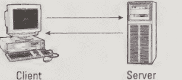

图 19-1: 简化的客户端/服务器图

### 本章内容

- 系统架构
- 互联网数据库
- 高级数据库应用程序

这种方法的关键进展是数据存储和内存应用程序的机器独立性。这允许 IT 经理管理一个高度控制的数据库服务器，同时将执行应用程序所需的许多资源分配给可能处于不同机器平台或运行不同应用程序软件的远程用户。随着计算机革命的进步以及局域网（LAN）变得更加廉价且无不在，这非常有意义。

在客户端/服务器时代，数据库获得了改进的连接性，“第四代”语言（4GLs）应世，它们结合了数据库连接、查询和表单报告能力。

客户端/服务器的主要问题是客户端（通常称为“胖客户端”）上用户界面与业务逻辑之间的紧耦合。这增加了维护成本，因为显示和输入代码的业务逻辑的任何更改，以及业务逻辑的任何更改都会影响显示和输入代码，这是一种不必要的依赖。

为了解决这个问题及其他问题，开发了三层架构，并迅速成为行业标准架构之一。三层架构将业务逻辑与用户界面代码分离开，而后者仍被认为是客户端。图 19-2 展示了一个基础的三层架构。

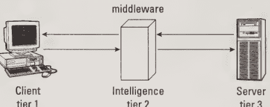

**图 19-2:** 简单的三层架构

数据库层的作用与客户端/服务器架构中基本相同。中间层是应用程序的“智能”所在，可以以许多形式存在。已经出现了许多旨在改进中间层应用程序的技术，包括许多流行的分布式对象技术（如 `CORBA` 和 `DCOM`）以及消息技术（如 IBM 的 `MQSeries` 和各种 `XML` 消息协议）。来自众多供应商的此类技术种类繁，它们统称为中间件。任何 Linux Web 服务器（如 `Apache`）都可以作为中间件。应用程序服务器属于这一相当宽泛的。运行在 Linux 上的一些当前服务器包括 `BEA WebLogic Server`、`Blue Stone Total-e-Server`（惠普出品）、`Oracle Application Server` 和 IBM 的 `WebSphere`。不过，不要期望这些服务器运行在最便宜的硬件上。

## 第 19 章 - 现代数据库部署 685

三层架构中的客户端严格关注于为用户提供显示并收集输入。

在这个基础的三层框架之上，存在许多架构变体，并且越来越常见。某些开发者倾向于根据应用程序的特定需求将中间层拆分为多个层。例如，如果应用程序有一个专门的本地化（l10n）和国际化（i18n）层，所有数据库请求必须通过该层以适应不同国家的用户，那么该层可以部署作为一个独立的层。

三层架构的一种常见变体出现在 Web 应用程序中，其中客户端经常被分为两部分：一方面是 Web 浏览器，另一方是 Web 服务器和服务器端脚本。某些开发者认为 Web 服务器实际上是中间层的一部分，但在复杂系统中，设计良好的 Web 服务器可能不应包含任何业务逻辑元素，而应该更关注将中间件请求转换为 HTML、JavaScript 等以供浏览器显示。n 层应用程序的一种可能架构如图 19-3 所示。

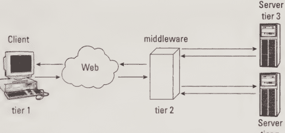

图 19-3: n 层应用程序

由于三层架构的此类变体，上述讨论可能表明 n 层系统通常被称为 n 层级（n-tier）。

过度分区（overpartitioning）的一个简单例子是：为了实现价格目标将应用程序划分在几个硬件平台之间，但这些部分的输出必须在相邻层之间同步。这里的真正问题是完全基于价格，而牺牲了模块化等其他考量。

## 为 n 层成功进行设计

确定如何将系统划分为层的关键在于理解变化和依赖如何在系统生命周期演变。每个设计良好的层都提供了某种程度的自由，这意味着它可以独立于其他层进行更改。然而，增加层可能会降低开发效率，有时也会影响运行时性能。

在顶层架构级进行系统设计需要像软件设计的其他部分一样仔细的分析，但它有时被视为关注详细对象设计前的形式工作。然而，顶层设计可能比详细设计更重要，并且有几个关键原则可以指导它。这些原则许多是通用结构和对象设计原则的良好插值。但在实践中，高层设计的一个陷阱是，必须对低层功能或能力的可用性做出假设（否则，人们就在低层设计了）。当这些假设无法成立时，模拟缺失功能所需的努力可能是灾难性的。我们容易犯的一个大错误是依赖供应商的善意承诺（例如关于中间件产品的可用性），结果在太晚的时候才发现承诺没有兑现。

回到理论，最重要的原则是依赖组织。层与层之间的依赖应该组织为单向的；即工程术语中的有向无环图（DAG）。这防止了设计出现固有的鸡生蛋逻辑问题。例如，客户端层依赖于中间层，中间层又依赖于数据库层，但数据库层不依赖于任何其他系统，且没有依赖路径返回到中间层或客户端层。这样划分的系统，其任何层的需求都不会依赖于与其直接连接的层以外的层。一个假设架构的相互依赖关系如下图 19-4 所示。

# 第 19 章 现代数据库部署 687

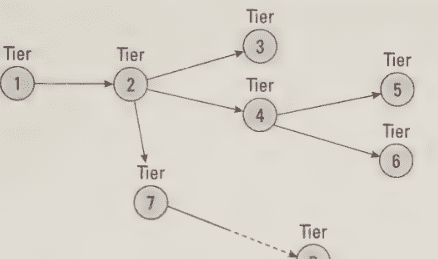

**图 19-4:** 假设的层间依赖图

这些依赖关系究竟意味着什么？当某一层的设计依赖于另一层中的特定格式、行为或协议时，就建立了依赖关系。

在遵循这一原则的 n 层系统中，例如，对中间层的维护更改不会影响数据库层，而任何旨在减少此类更改影响的兼容层都将留在中间层内，这是内聚性最高的安排。这种组织化的依赖方法是管理系统变更的有力工具，否则由于多个层需要同时进行更新、重新部署和测试，维护成本可能会变得极其高昂。

第二个主要原则是由 Bertrand Meyer（对象开发专家和 Eiffel 语言设计者）提出的“开/闭原则”的适配。它认为，层与层之间的接口应对扩展是*开放*的，但对修改是*关闭*的。

例如，假设客户端使用中间层接口中定义的名为 `GetEmployees()` 的函数来请求员工列表。如果中间层稍后更新以添加“部门”的概念，开发者可能会倾向于将 `GetEmployees()` 函数替换为接受部门名称的 `GetEmployees(string dept)`。如果新接口替换了旧接口，它就违反了开/闭原则。任何不知道部门的客户端都会导致运行并返回错误。问题在于接口被修改了。开/闭原则本应允许开发者向接口添加新函数，而不替换旧函数。在允许多态的情况下，只需通过为 `GetEmployees()` 函数添加一个接受部门字符串的新 `signature`（函数签名）即可完成。在不允许多态的情况下，可以为了相同的目的添加一个名为 `GetEmployeesByDept(string dept)` 的函数。这使得开发者能够逐渐、仔细地修改客户端，因为旧接口仍然可用且正常工作。

另一个重要原则是设计层以具有独立性。这意味着它们有能力位于独立的（尽管是相互连接的）硬件上。多个层最初可以部署在同一硬件上，而阶段系统或备份系统可能建立在单体式硬件上。将某些层移动到其他硬件的能力是确保硬件级可扩展性的重要原因。通过重新设计应用程序代码来实现可扩展性可能是昂昂的，而且往往是失败的，相比之下，使用更强大的硬件有时另一种选择。

还有许多其他驱动 n 层成功的因素，例如一致的事务传播和计划良好的安全基础设施，包括本本书范围之外的许多通用应用程序设计方法。

## 互联网数据库

将 Web 变成今天这种现象的主要技术是通用网关接口（CGI），它允许服务器通过服务器程序动态生成的内容来响应客户端。从那个时代直到现在，并在可预见的未来，大多数 CGI 和其他动态 Web 技术都涉及数据库访问。

最初，程序员会编写专门的脚本来读取和更新数据库，并对结果进行一些基础处理。在这些情况下，DBMS 并没有特殊之处来应对最终客户端位于互联网云端某处的这一事实。这种互联网应用模型仍然非常常见，它是 Linux 和开源的一大强大优势——业余人员、小型企业和小型部门的 Web 管理员可以拼凑出一个 `PHP` 到 `MySQL` 的应用程序或类似的程序。


不容忽视的是，此类动态 Web 应用程序继续支撑着互联网的增长，并且其野心已远超其根源。越来越多的 DBMS 供应商正努力通过支持数据库的直接 Web 发布和查询，或通过捆绑 Web 开发工具来夺取整个空间。

DBMS 供应商面临互联网革命的首要挑战是可扩展性。突然，与客户端/服务器甚至 n 层架构中相对可预测的用法模式不同，数据库系统开始需要扩展以应对来自全球的访问。在这种情况下，许可也成了一个关注问题。


当数据库暴露在互联网连接中时，许可有时会变得复杂。客户端/服务器时代的许可条款通常由“席位”数量或独立用户数量决定。当然，潜在用户群是整个互联网人口，这种方法可能是荒谬的。许多 DBMS 供应商提供按 CPU 许可来解决这个问题，或限制受许可的并发连接数。无论如何，请确保您的许可与您的使用模式兼容。对于许多从 Linux FTP 站点下载的热门数据库的“个人”版本，或作为“会议垫片”CD 流传的软件，这也是很容易掉入的陷阱。

数据库供应商已经非常有说服地证明了它们在互联网负载下的可扩展性：从金融服务到电子商务等领域的各种关注点，在使用现代应用程序架构和本书讨论的数据库时都蓬勃发展。

对于本书所针对的最基本需求，现代 DBMS 仍然为互联网集成提供了强大的工具。

# 通用数据库

对象关系型 DBMS 的主要承诺是，它允许开发数据库，可以将不同 ANSI SQL-92 原始类型（数字、日期、字符）的不同类型的对象作为一等内容存储，可能带有智能搜索和索引功能。SQL-99（以前称为 SQL-3）最近定稿，为在 SQL 数据库中存储异构对象提供了标准，但许多供应商已经领先于标准。能够存储丰富类型、并允许开发者编写存储过程来操作此类对象的数据库被称为通用数据库（Universal Databases）。通用数据库提供了许多面向对象的特性，如继承。

凭借这种能力，数据库可以存储整个 HTML 页面，或者只是 HTML 模板，使得 Web 应用程序可以将动态内容直接集成到目标 Web 中。某些 DBMS 具有全 Web 能力，消除了即使是良好的 Apache（尽管少数声音大的人称之为理智）的需求。

# 高级应用

数据库应用程序越来越复杂，行业实践的解决方案不断改进，以开发出经过验证的方法。这里是先驱者规划的几个高级 DBMS 技术：开放组（The Open Group）、事务处理委员会（TPC）和对象管理组（OMG）。

## 监器与事务管理器

为了本章，让我们定义事务为一个或多个数据库操作，这些操作要么作为一个组成功完成，要么完全不执行。也就是说，所有操作都必须被视为一个不可分割的操作。原子性（Atomic）是经常使用的术语，意味着不可划分。事务失败的典型结果是其任何完成的操作都会被撤销，称为回滚事务（rolling back）。事务是每个企业日常工作的重要部分。考虑一个简单的订单输入操作并问自己：“如果这个订单只部分提交了会有什么后果？”

在单阶段提交中，正如我们讨论过的，事务管理器同时向所有资源发出提交或回滚的信号，资源将毫不犹豫地执行。这就是事务边界。图 19-5 显示了单阶段提交事务的主要元素。

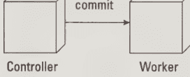

**图 19-5:** 单阶段提交事务的简化序列图

这确保了所有资源之间以及与所有客户端保持一致。图 19-6 显示了一个基本的两阶段提交。


**图 19-6:** 简单两阶段提交的序列图

对象事务监控器（OTM）执行的任务与普通事务监控器类似，它们将各种角色封装在面向对象的接口中。主要的 OTM 标准是 OMG 的对象事务服务（Object Transaction Service），或 CostTransactions，它是 CORBA 标准的一部分。OTM 在 n 层架构中的放置位置如图 19-7 所示。

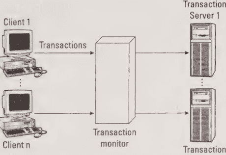

**图 19-7:** OTM 的放置位置

根据 Sun 的说法，作为新的 Java 2 企业版（Enterprise Edition）部分的新的 Enterprise JavaBeans规范可能很快进入 Linux 移植阶段，它为原生对象定义了一个非常易用的 OTM 系统。否则，遗憾的是，在本文写作时 Linux 还没有可用的 OTM 实现。

## 总结

本章研究了将 DBMS 集成到传统应用程序和基于互联网的应用程序中的各种考虑因素：

- 应用程序已从客户端/服务器迁移到 n 层架构，这种架构支持最大的灵活性和可扩展性。
- 层之间的依赖关系应该组织为有向无环图（无循环），层与层之间的接口在维护期间应该被扩展（增加其他功能），但不应修改（现有功能不会发生变化）。
- 互联网数据库应用已从从查询结果构建响应页面的基础脚本发展起来，现在 DBMS 供应商正在提供广泛的互联网支持工具。
- 分布式事务处理系统允许通过高级应用程序，能够以统一的方式管理多个数据库。

希望本书中的所有信息足以让你熟悉你所选择的 Linux DBMS，并开始仔细考虑你计划在其周围构建的应用程序的设计。下一步是开始亲自动手实验该系统——如果你还没有开始的话。构建一个你所需应用程序的原型，并记录下哪些有效，哪些无效。你会发现，Linux 是开发数据库应用程序的一个非常高效的环境。

# 常用 Linux 命令

以下列表是常用 Linux 命令的简述：

- `cal` 打印当前月份或指定月份或年份的日历
- `cat` 连接文件并将结果发送到标准输出
- `cd` 更改当前工作目录
- `chgrp` 更改文件的组所有权位
- `chmod` 更改文件和目录的权限位设置，例如读、写或执行
- `chown` 更改文件和目录的所有权（所有者、组、公共）
- `cp` 复制文件和目录
- `date` 以各种格式打印当前日期
- `df` 显示一个或多个挂载文件系统的空闲空间
- `ftp` 使用为 ARPANET（后来的 DARpanet）开发的的文件传输协议在主机之间传输文件的实用程序
- `grep` 查找并打印一个或多个文件中包含匹配文本模式的行
- `gunzip` 解压之前使用（例如 `gzip`）压缩过的文件
- `gzip` 一个文件压缩工具（见 `gzip`）
- `head` 列出文件的起始行（见 `tail`）

# 附录

- `ipcs` | 显示进程间通信设施的信息
- `ispell` | 检查文件的拼写检查
- `kill` | 终止正在运行的进程
- `ln` | 为文件、目录或设备创建链接
- `lpr` | 将一个或多个文件发送到（预定义的）打印机队列；打印文件
- `lrm` | 从打印队列删除打印作业
- `ls` | 列出目录内容
- `man` | 打印命令的帮助，即用户手册页
- `mkdir` | 创建目录
- `more` | 在屏幕上一次一页地打印（列出）文件内容
- `mount` | 将设备挂载到文件系统树中的指定点；挂载新的文件系统
- `nslookup` | 为指定的域名查询域名服务器
- `passwd` | 更改用户密码
- `ping` | 查找连接的网络上是否存在主机（计算机）
- `ps` | 显示当前运行的进程信息
- `pwd` | 打印当前工作目录的绝对路径
- `rm` | 删除一个或多个文件和目录
- `rmdir` | 删除空目录
- `rsh` | 在远程系统上打开 shell
- `su` | 以替用用户身份运行 shell；在不注销出的情况下切换用户
- `tail` | 列出文件的末尾行
- `tar` | 创建、读取或提取一个或多个文件、目录或磁带备份设备的存档
- `top` | 显示顶部 CPU 进程的信息；显示最繁忙的进程
- `zcat` | 将压缩文件连接到标准输出

## 索引

# 数字与符号

& (和符号), 303

: (冒号), 306

$ (美元符号), 303

= (等号), 39

/ (正斜杠), 303

!= (不等于), 39

| (管道符), 306

; (分号), 306

? (通配符), 302

应用程序编程接口

(API), 237

列绑定, 455

连接性概念, 420–423

PHP 版 MySQL, 453–454

ODBC 函数, 列表,420–423

概述, 419–420

应用程序

立式

访问控制, PostgreSQL, 382

账户和组，创建, 308

默认文件, 308

ADAB/D, 244

美国标准协会 (ANSI), 92

自适应服务器企业 (ASE), 252

添加用户, 642

数据库完整性, 

美国标准协会 (ANSI SQL), 92

AND 关键字, 74

AND 运算符, 106–108

美国标准协会 (ANSI), 70

ANY 关键字, 74

API. 应用程序编程接口

应用程序约束, 定义, 215

应用程序开发, 155

应用程序层过滤, 671

算术运算符 (关系代数), 35–36

大小写敏感, 302

ASC 关键字, 74

ASE. 自适应服务器企业


在...调度时, 645–648

原子值, 30

属性对象, 55

属性, 27–28

自动提交命令, 536–537

自动增加命令, 190

自动化

`cpio` 存档, 625, 627

`tar` 存档, 624–625

`AVG()` 函数, 125

`AVG` 关键字, 74

# B

备份媒体, 224, 226

备份, 301

`cpio` 存档. 查看 `cpio` 存档

基础/输出服务 (`BIOS`), 安全, 668–669

批处理命令，调度，646

`BCNF`. 查看 鲍斯-科德范式

`BEGIN` 关键字, 74

... (文本继续)

# C

`Caché`, 244

`cal` 命令, 693

Caldera, Inc., 7

调用级接口 (`CLI`), 73

候选行抽象, 255

笛卡尔积运算 (关系代数), 35–36

层叠样式表 (`CSS`), 63

大小写敏感, 302

`cat` 命令, 693

C/数据库工具集, 397

`cd` 命令, 693

`cd mysql` 命令, 271

`cd/usr/local` 命令, 270

Centura’s db.linux, 254–255

`CGI`. 查看 常见网关接口

变更控制

地理多样性, 673–674

物理密度, 674

调度, 673

`tar` 存档. 查看 `tar` 存档

# 索引 + c 697

## 命令

- `man`, 694
- `at`, 645–646
- `mkdir`, 694
- `adduser`, 642
- `more`, 694
- `AIT`, 660
- `mount`, 638, 694
- `AutoComm`, 536–537
- `mysamchk`, 662–665
- `batch`, 646
- `ysqladmin`, 245–344
- `cal`, 693
- `netstat`, 627
- `cat`, 693
- `nice`, 631–633
- `cd`, 693
- `NOAUDIT`, 661
- `cd mysql`, 271
- `slookup`, 694
- `cd/usr/local`, 270
- `password`, 694
- `chgrp`, 693
- `Perl`, 列表, 437–441
- `chmod`, 307, 693
- `pg_ctl`, 371
- `chow`, 693
- `ping`, 694
- `CONNECT`, 353
- `processlist`, 346
- `cp`, 693
- `ps`, 694
- `createuser`, 377–378
- `pwd`, 694
- `date`, 693
- `rm`, 694
- `indir`, 694
- `df`, 637–638, 693
- `rsh`, 694
- `dropdb`, 376–377
- `Server Manager`, 列表, 353–355
- `dropuser`, 353
- `SET`, 354
- `EXIT`, 353
- `SHOW`, 354
- `fetch_row()`, 531
- `SHUTDOWN`, 355
- `shutdown`, 642
- `finger`, 634
- `SQLExecDirect()`, 472
- `fsck`, 636–637
- `su`, 694
- `ftp`, 363–364
- `tail`, 640–641
- `grep`, 693
- `tar`, 694
- `gunzip`, 270, 693
- `tar xf-`, 270
- `gzip`, 693
- `top`, 626–694
- `head`, 640, 693
- `umount`, 638
- `HOST`, 353
- `wall`, 641
- `itdb` 命令, 375
- `wc`, 639
- `initocation`, 375–376
- `who`, 633
- `ipcs`, 694
- `write`, 635
- `ispell`, 694
- `cat`, 694
- `kill`, 361, 632–633, 694
- `ln`, 694

## 商业产品

- `lpr`, 694
- `ADABAS/D`, 243–244
- `lpm`, 694
- `ASE` (自适应服务器企业), 252
- `Is`, 639, 694
- `Cacheé`, 244
- Linux 版 DB2 数据库, 244–245
- Linux 版 Empire Suites, 245–246
- FrontBase, 246–247
- Informix SE, 247–248
- Ingres II, 248–249
- InterBase, 249–250
- KE Texpress, 250–251
- Linux 版 Oracle8i, 251–252
- 建议, 257
- 优点, 242
- Unify DataServer, 252–253
- 缺点, 243

## `commit()` 函数, 537

- `COMMIT` 关键字, 74
- 通用网接口 (`CGI`), 414–415
- 通用对象代理架构 (`CORBA`), 63
- 比较操作（关系代数）, 20, 39
- 比较操作符, 98
- 复杂数据类型
    - 比较操作, 20
    - 定义, 19
    - 数学运算, 21
- 复杂表达式, 105–106
- 概念设计（项目规划）, 156
- Conceptual Software Inc. 网站, 398
- Conetic Software Systems, Inc., 12
- 配置防火墙, 671
- 配置 MySQL
    - 配置选项, 310
    - 目录选择, 311–312
    - RPM 分发, 312
    - 服务器，链接, 312
    - 多服务器, 312–313
- 配置 Oracle8i
    - 字符集, 328
    - 环境变量, 323–324
    - 文件安全, 330–331
    - 安装程序界面, 326
    - 安装源, 326
    - 实例名称, 327
    - 语言支持, 327
    - Linux 内核, 321
    - 本地目录，创建, 322–323
    - 挂载点定位符, 328
    - 挂载点，创建, 321, 328
    - `oratab` 文件，创建, 323
    - OS 组，创建, 322
    - 需求, 318–321
    - 关闭, 331
    - 启动, 331
- 配置 PostgreSQL
    - 启动时自动启动, 316–317
    - 配置选项, 314–315
- `CONNECT` 命令（服务器管理器）, 353
- `Connection.close()` 方法, 507
- 连接
    - 客户端连接管理技术, 234–236
    - 数据源, 455
    - 远程连接, 382–383
    - 验证请求, 365–366
    - Oracle8i, 389–390
    - 验证, 365
    - 连接通性，通过 API, 420–321
    - `connect()` 方法, 525
    - 常量, 94
    - 日期和时间, 96–97
    - 浮点, 95
    - 整数, 95
    - 数值型, 95
    - 字符串, 95–96
    - 应用程序, 215
    - 组织化的, 214–215
    - `CONTINUE` 关键字, 74
    - `CONTROL_FILES` 参数, 387
    - `CORBA`. 见通用对象架构
    - `COUNT()` 函数, 126–127
    - `COUNT(*)` 函数, 126–127
    - `cp` 命令, 693
    - `cpio` 存档目录, 624
    - 自动化, 625, 227
    - 创建, 223
    - 目录内容, 624
    - 提取文件, 224
    - 重命名文件, 624
    - `cpio` 命令，语法, 623
    - `CPU`, 230
    - `CREATE DATABASE` 语句, 78, 385–386
    - `CREATE INDEX` 语句, 84
    - `CREATE TABLE` 语句, 80–82
    - `createuser` 命令, 377–378
    - `CREATE VIEW` 语句, 139
    - 创建索引, 84–85
    - 创建数据库, 78–88
    - `CREATE INDEX` 语句, 84–85
    - `CREATE TABLE` 语句, 80–82
    - `DROP INDEX` 语句, 86
    - `DROP TABLE` 语句, 85–86
    - 授予权限, 79–80
    - `INSERT` 语句，插入行, 86–88
    - `cron` 工具，调度, 644–645


- 跨平台问题，数据库评估, 211
- `CURRENT` 关键字, 74
- `CURSOR`, 74
- `Customer_id` 属性, 575
- 客户数据，新增, 602–611
- 折扣, 602
- HTML 生成示例, 613–616
- 详细记录，新增, 601–602
- 头部记录，新增, 601
- 客户资源, 162–163
- `oradash.sh`, 678–699

## D 699
- 守护进程, 266
- 数据. 见复杂数据类型
- 数据不敏感应用程序, 230
- 删除, 23
- 域域, 21
- 插入, 23
- 完整性，维护, 23–24
- 载入表格，脚本, 89
- 组织, 22
- 检索, 23
- 统计数据类型，比较操作, 20
- 统计数据类型，数学运算, 20
- 统计数据类型，类型, 18–19
- 类型, 23
- 数据库管理员, 161
- 数据库应用程序
    - 成本与效益, 405–406
    - Internet, 405
    - 区域网, 405
    - 网络, 404
    - 评审, 403–404
    - 三层模型. 见数据库应用程序的三层模型
    - Web, 405
- 数据库设计，独立应用程序示例
- 客户类, 557–562
- 初始设计, 552
- 语言 API，选择, 555
- 主类, 568–570
- 菜单类, 563–567
- 面向对象编程, 556–557
- 需求, 552–553
- 用户界面, 554
- 数据库完整性
    - 新增, 45
    - 删除, 46
    - 域完整性, 47
    - 更新, 46–47
- 数据库管理
    - 应用程序约束, 215
    - 周期, 213
    - 执行过程, 317
    - 系统 (DBMS), 10
    - 管理工具, 236–237
    - 客户端连接管理技术, 234–236
    - 客户端/服务器架构, 229–230
    - CPU, 230
    - 设计与性能问题, 237–239
    - 硬件平台, 230–231
    - 接口能力, 237
    - 多处理，方法, 234
    - 操作系统平台, 230–231
    - 操作系统问题, 233
    - 关系建模, 230
    - 安全技术, 237
    - 标准, 231
- `MetaData` 类, 520
- 客户关系管理 (CRM), 205
- 客户资源, 162–163
- `oradash.sh`, 678–699

## data 1024
- 数据不敏感应用程序, 230
- 删除, 23
- 域域, 21
- 插入, 23
- 完整性，维护, 23–24
- 载入表格，脚本, 89
- 组织, 22
- 检索, 23
- 统计数据类型，比较操作, 20
- 统计数据类型，数学运算, 20
- 统计数据类型，类型, 18–19
- 类型, 23
- 数据库管理员, 161
- 数据库应用程序
    - 成本与效益, 405–406
    - Internet, 405
    - 区域网, 405
    - 网络, 404
    - 评审, 403–404
    - 三层模型. 见数据库应用程序的三层模型
    - Web, 405
- 数据库设计，独立应用程序示例
- 客户类, 557–562
- 初始设计, 552
- 语言 API，选择, 555
- 主类, 568–570
- 菜单类, 563–567
- 面向对象编程, 556–557
- 需求, 552–553
- 用户界面, 554
- 数据库完整性
    - 新增, 45
    - 删除, 46
    - 域完整性, 47
    - 更新, 46–47
- 数据库管理
    - 应用程序约束, 215
    - 周期, 213
    - 执行过程, 317
    - 系统 (DBMS), 10
    - 管理工具, 236–237
    - 客户端连接管理技术, 234–236
    - 客户端/服务器架构, 229–230
    - CPU, 230
    - 设计与性能问题, 237–239
    - 硬件平台, 230–231
    - 接口能力, 237
    - 多处理，方法, 234
    - 操作系统平台, 230–231
    - 操作系统问题, 233
    - 关系建模, 230
    - 安全技术, 237
    - 标准, 231
- `MetaData` 类, 520
- 客户关系管理 (CRM), 205
- 客户资源, 162–163
- `oradash.sh`, 678–699

## DTP. 参见分布式事务处理
- 数据库转储
- MySQL 交互, 335–337
- PostgreSQL 交互, 340–342, 650–651
- `dump_results()` 函数, 527
- 可执行脚本, 302
- `execute()` 方法, 527
- `executeUpdate()` 方法, 509
- 执行方法, 527–530
- 执行过程，规划, 217
- `EXISTS` 关键字, 40–41
- `EXIT` 命令（服务器管理器）, 353 表达式

## E
- `echo()` 函数, 604
- EDI. 参见 电子数据交换
- 编辑菜单（服务器管理器）, 350–351
- EIP. 参见企业信息门户
- 电子数据交换 (EDD), 210
- 电子文档管理, 206–207
- 嵌入式 SQL, 72
- Empress Software, 12
- Empress Suites for Linux, 245–246
- 组装, 102–103
- 复杂的, 105–106
- 定义, 94
- , 103–104
- 可扩展标记语言. 参见 XML
- 使用 tar 归档提取文件, 622

## F
- `FETCH` 关键字, 74
- `fetchrow()` 方法, 531
- FIFO. 参见 (先进先出) 操作
- 文件菜单（服务器管理器）, 350
- 文件，使用 tar 归档, 622
- 文件系统，管理
- `df` 命令, 637–638
- `fsck` 命令, 636–637
- `mount` 命令, 638
- `umount` 命令, 638
- `END` 关键字, 74
- 企业级数据库, 15
- 企业信息门户 (EIP), 207
- 环境变量，在 Bourne shell 中设置, 309
- `ESCAPE` 子句, 101
- `ESCAPE` 关键字, 74
- 评估数据库, 201–202
- 管理类别, 202
- 跨平台问题, 211
- 客户数据类别, 204–205
- 数据评估, 207
- 电子文档管理, 206–207
- 财务信息系统类别, 202–204
- 营销数据类别, 204–205
- 网络基础设施问题, 208–209
- 业务数据类别, 205–206
- 组织流程问题, 210
- 产品数据类别, 204
- 研发, 206
- 人员配置问题, 210
- `EXEC` 关键字, 74
- 应用层过滤, 671
- 数据包过滤, 670
- `finger` 命令, 634
- `finish()` 方法, 540
- 防火墙：配置, 671;日志, 672;多层, 671;选择, 670–671
- 先进先出 (FIFO) 操作, 300
- Flagship for Linux, 11
- 平文件数据库, 9
- `FLOAT` 数据类型, 76
- 浮点常数, 95
- `FLOAT` 关键字, 74
- `FORALL` 关键字, 41
- 外键, 32
- `FOREIGN KEY` 语句, 79–81
- `FOREIGN KEY` 关键字, 74
- `FOUND` 关键字, 74
- FrontBase, 246–247
- `fsck` 命令, 636–637
- `ftp` 命令, 693
- 全序连接, 121
- 函数依赖, 173–174
- 功能规格书（项目规划）, 156–157

## G
- `GOTO` 关键字, 75
- GPL, 参见 通用公共许可证
- `GRANT` 命令, 163–364
- 授予权限, 79–80
- `GRANT` 语句, 79
- `grep` 命令, 693
- `GROUP` 关键字, 75
- 数据增长，评估, 221
- GTK 接口, 16
- `gunzip` 命令, 270, 693
- `gzip` 命令, 693

## H
- `add_row`, 603
- `AVG()`, 125


## G (续)

- `commit()`, 537
- `COUNT()`, 126–127
- `COUNT(*)`, 126–127
- 定义, 124
- `dump_results()`, 527
- `echo()`, 604
- `finish()`, 540
- `IFNULL()`, 130–131
- `init()`, 603
- 库函数, 232
- `MAX()`, 126
- `MIN()`, 126
- `mysql_fetch_object()`, 605–606
- `register()`, 588
- `SQLSqlCommand`, 475
- `SQLBindParameter()`, 475
- `SQLDescribe()`, 495
- `SQLExecut()`, 472
- `SQLNumCols()`, 494
- `SUM()`, 125
- `wasNULL()`, 532
- 硬件需求，项目规划, 152–153
- 硬件要求：备份介质, 224–226;磁盘存储, 224; 内存, 224; 处理器, 223–224
- `HAVING` 关键字, 75
- `head` 命令, 640, 693
- 头文件, 268
- 关系标题, 28
- 属性, 27–28
- 定义, 268–28

## G (续)

- 总账（数据库评估）, 202–203
- 通用公共许可证 (GPL), 6
- `getConnection()` 方法, 504
- `GO` 关键字, 75

## I

- `IFNULL()`, 130–131
- 不匹配, 54
- 导入文件：MySQL 交互, 337–339, 648–649; PostgreSQL 交互, 342, 651
- 索引：创建, 84–85; 数据库完整性, 48; 索引, 85
- `INDICATOR` 关键字, 75
- Infor Inc., 12
- Informix 并行服务器 (XPS), 记法, 122–123
- Informix SE, 247–248
- Ingres II, 248–249
- `init()` 函数, 603
- `init` 命令, 375–376
- `IN` 运算符, 100
- 输入参数, 501
- 输入方向, 305
- 插入数据, 23
- 插入行, 86–88
- 批量插入, 88
- 安装要求：数据增长, 221; 磁盘空间，评估, 220; 文档, 219; 硬件要求, 223–227; 用户账户设置, 219–220
- 安装 JDBC (Java 连接), 498–499
- 安装 MySQL, 277–279
- 二进制发行版, 269–272
- 通过 Red Hat Managers, 273
- 要求, 267–268
- 资产管理器, 287
- 源码发行版, 272–273
- 安装 ODBC (数据库连接), 458
- 资源分配, 467–468
- 语句分配, 470
- 数据源，连接, 468–470
- 驱动管理器, 459–460
- 错误处理, 470–473
- 免费资源, 472–473
- 头文件, 466–467
- 初始化文件，准备, 461–462
- ODBC ，编译, 462–463
- ODBC 驱动, 460–461
- 程序结构，示例, 463–466
- `SQLEExecute` 语句, 477
- SQL 语句，执行, 472
- 安装 orback.sh, 678
- 数据库创建提示, 288–289
- 文档, 289–290
- 安装选项, 286
- 安装源码, 286
- 实例名称, 288
- 语言支持, 287
- 位置, 286
- 日志文件, 286
- OS DBA 组, 287
- OPER 组, 287
- 要求, 279–284
- 安装 Perl DBI：连接, 525–526; DBI 包，加载, 524; 示例程序, 522–524; 语句，执行, 526–527
- 安装 PostgreSQL：准备, 275–276; 要求, 274–275; 实例连接, 351
- 整数常数, 95
- 完整性：数据库完整性.参见数据库完整性；索引, 48; 强制方法, 47; 事务完整性, 48
- InterBase, 249–250
- Internet，数据库应用和, 405
- Internet 数据库, 688–689
- 交集运算（关系代数）, 34
- `INTERVAL` 数据类型, 76
- `INTERVAL` 关键字, 75
- 间隔统计数据类型, 19
- 内网，数据库应用和, 405
- 侵入，响应, 667–668
- `ipcs` 命令, 694
- `IS` 关键字, 75
- `ispell` 命令, 694
- IT 项目经理, 160

## L

- 布局要求, 215–216
- `LD_LIBRARY_PATH`, 281
- 左连接, 121
- 库函数, 232
- `LIKE` 关键字, 75
- `LIKE` 运算符, 100–101
- Linux：守护进程, 266; 数据库，简介, 15–16; Debian GNU, 8

## J

- Java Database Connectivity (JDBC)
- 数据库，修改，示例
- 示例程序, 507–508
- 安装, 498–499
- 接口，列表, 501–502
- 元数据类, 520
- NULL 值，处理, 511–512
- 预处理语句, 512–513
- 存储过程, 513–514
- SQL 语句，执行, 472
- 结构, 497–498
- JDBC. 参见 Java 连接
- 连接运算（关系代数）, 37
- 连接：示例, 294; 外连接, 121–122; 模式, 293–294
- Flagship for Linux, 11
- 未来, 7
- 历史, 3
- Red Hat，建立, 5
- Shell 脚本, 454
- Slackware, 8
- 系统管理员, 161
- 监听器, 235
- 命令, 694
- `head` 命令, 640
- 命令, 639
- `tail` 命令, 640
- `wc` 命令, 639
- 打印字符串, 574
- 逻辑建模, 291–292
- 命令, 694
- 命令, 639

## K

- KDE 接口, 16
- `KEY` 关键字, 75
- 键：外键, 32; 主键, 31–32; 列表, 74
- `kill` 命令, 361–362
- `qsql` 工具, 391–392

## M

- 主机系统程序员, 160
- 管理文件系统：`fsck` 命令, 636–637; `mount` 命令, 638; `umount` 命令, 638
- 管理进程：状态, 228–229; 跟踪, 629–630; 用户, 630
- `finger` 命令, 634
- `who` 命令, 633
- `man` 命令, 694
- 数学运算, 20
- `MAX()` 函数, 126
- 内存：备份介质, 224–226; 磁盘存储, 224; 内存, 224; 处理器, 223–224
- DBMS 要求, 299
- MySQL
- 审计过程.参见审计
- 过程，MySQL
- 创建于, 266
- 组件程序列表, 262
- 配置.参见配置 MySQL
- 数据库：创建/删除, 362
- 数据库转储, 335–337
- 环境变量，列表, 262
- 停滞.参见安装 MySQL
- 连接表达式记法, 123–124
- 操作系统要求, 263–264
- 视图, 239–240
- 远程连接, 364–366
- 安全规定, 362
- 服务器，连接, 359–361
- 服务器，启动, 356
- 服务器，停止, 357
- 源码发行版，解剖, 266
- 源码工具列表, 392–395
- 文本文件，导入, 335–337, 648–649
- 网站, 239
- `ysqladmin` 命令, 344
- 示例, 245–246
- `mysql_fetch_object()` 函数, 605–606
- `mysqloptions`, 338–339

## N

- 命名关系, 29–30
- `NCHAR` 数据类型 (c), 77
- NetBSD 操作系统, 276
- `netstat` 命令, 627
- 网络数据库, 53
- 网络工程师, 162
- 网络基础设施问题, 数据库评估, 208–209
- 网络，及其数据库应用, 404
- `nice` 命令, 631–633
- `NOAUDIT` 命令, 661
- 允许重复行属性（关系）, 30–31
- 名义统计数据类型, 18
- 无序属性（关系）, 30
- 规范化, 173–178
- 模式设计, 293
- `NOT` 关键字, 75
- `slook` 命令, 694
- N 层模型, 60
- NULL 语句
    - 优势, 44
    - 争议, 44


# O

- 创建表和, 81
- 三层逻辑, 42–43
- 使用键, 44
- NULL 值, 483–485
- 数值常量, 95
- NUMERIC 数据类型, 76
- NUMERIC 关键字, 75

## 对象数据库

- 对象数据库, 53
- 阻抗不匹配, 54
- 对象-关系折中, 57
- ODL (对象定义语言), 55
- ODMG (对象数据库管理组), 55
- OODBMS (面向对象的数据库管理系统), 54
- OQL (对象查询语言), 55
- 多态性, 54
- 查询语言路径表达式, 56–57
- 对象定义语言 (ODL), 55
- 对象管理组 (OMG), 689
- 对象建模, 291
- 面向对象的数据库管理系统 (OODBMS), 54
- 面向对象的数据库 (OODB), 230
- 面向对象编程，独立应用程序, 555–557
- 对象查询语言表达式, 56
- 对象
    - 持久性, 55
    - 瞬态性, 55
- ODBC. 参见 Open Database Connectivity（开放数据库连接）
- ODL. 参见 Object definition language（对象定义语言）
- ODMG. 参见 Object Database Management Group（对象数据库管理组）
- OFA. 参见 Optimal Flexible Architecture（灵活架构）
- OLTP. 参见 On-Line Transaction Processing（在线事务处理）
- OMG. 参见 Object Management Group（对象管理组）
- ON DELETE 关键字, 81
- 在线事务处理 (OLTP), 9
- OODB. 参见 object-oriented databases（面向对象的数据库）
- OODBMS. 参见 object-oriented database management system（面向对象的数据库管理系统）
- 开放数据库连接 (ODBC)
    - 函数列表, 422–436
    - 阻塞. 参见安装 OODBMS
    - 概述, 457
    - SQL 解释器, 489–497
    - 结构, 458
    - 事务，执行, 487–489
    - 用户输入，处理, 485–487
- OpenLink Virtuoso, 400
- en source
- OSS (开源解决方案), 63
- 概述, 3

# 索引 O-P

- 开源倡议 (OSI), 3
- 开源产品
    - Centura 的 db.linux, 254–255
    - Linux 版 CodeBase, 253–254
    - MiniSQL/mSQL, 255–256
    - 建议, 257
    - 优势, 253
    - 缺点, 253
- 开源工具, MySQL, 392–395
- 操作系统，相关性能
    - 问题, 233
- AND, 106–108
- BETWEEN, 99
- IN, 100
- 算术, 97–98
- 比较, 98–101
- LIKE, 106–108
- 灵活架构 (OFA), 240
- OPTION 关键字, 75
- `oraback.sh`
    - 备份后, 680
    - 自定义, 678–679
    - 功能, 679–680
    - 安装, 678
    - 概述, 677
    - 测试, 681
- Oracle
    - 历史, 14
    - 连接扩展表示, 122
    - Linux 版 Oracle8i, 251–252
    - 概述, 240–241
- Oracle8i
    - 配置. 参见配置 Oracle8i
    - `CREATE DATABASE` 命令, 385–386
    - 文件所有权, 388
    - 内联模式，在其中创建和删除, 386
    - 安装. 参见安装 Oracle8i
    - 内核参数, 280
    - 远程连接, 389–390
    - 安全选项, 388
    - 服务器，启动/停止, 384
    - ORA NLS, 33
    - ORDER BY 子句, 114–117
    - 序数数据库，模式, 553
    - 序数类型, 18
    - 组织约束，标识, 214–215
    - 数据组织, 22
    - OR 运算符, 106–108
    - OSI. 参见 Open Source Initiative（开源倡议）
    - 外连接，定义, 120
    - Oracle 表示法, 122–123
    - MySQL 表示法, 124
    - Sybase 表示法, 121–122
    - 类型, 21
- OUT 参数, 501
- 输出重定向, 305

# P

- 数据包过滤, 670
- 参数，绑定, 533–556
- `passwd` 命令, 694
- 密码，编辑, 643
- PC 锁, 668
- Perl
    - 命令, 437–441
    - 约定, 436–437
- Perl DBI 模块
    - 数据库，连接, 442
    - 元数据, 537–539
    - 检索, 443–447
    - 概述, 521
    - 语句元数据, 539–544
    - 结构, 522
    - 事务, 443
    - 执行, 536–537
- 权限
    - 授予, 79–80
    - 撤销, 80
- 权限. 参见访问权限
- `pg_ctl` 命令, 371
- `pg_dump` 语句, 342, 651
- `pg_password` 实用, 380–381
- PostgreSQL
    - 访问控制, 382
    - 认证类型, 381–382
    - 客户端会话，启动/停止, 373–374
    - 配置. 参见配置
    - `createuser` 命令, 377–378
    - 数据库，转储, 340–342, 650–651
    - 数据库摘要信息，显示, 342–343
    - `dropdb` 命令, 376–379
    - `dropuser` 命令, 379
    - `pldb` 命令, 375–376
    - 安装. 参见 PostgreSQL
    - 获取, 275
    - 概述, 241–242
    - 远程连接, 382–383
    - 服务器，自动启动, 371
    - 服务器，启动/停止, 367–372
    - 文本，导入, 651
- PRECISION 属性, 544
- `prepare()` 方法, 526–527
- 主键, 31–32
- PRIMARY KEY 语句, 80
- PRIMARY 关键字, 75
- PRIVILEGES 关键字, 75
- PROCEDURE 关键字, 75
- 进程
    - 杀死, 632–633
    - 管理. 参见进程管理
- 数据处理, 186–187
- `processlist` 命令, 346
- 处理器硬件需求, 223–224, 300–301
- 程序员/分析师, 161
- 项目负责人, 160
- 项目操作（关系代数）, 37
- 项目规划, 147–148
    - 应用开发, 155
    - 变更控制, 164–165
    - 概念设计, 156
    - 数据字典, 157–158
    - 数据流图, 156
    - 实体关系图, 157
    - 功能规范, 156–157
    - 硬件需求, 152–153
    - 手动文档, 165–166
    - 模块逻辑流图, 146
    - 人员资源，角色, 159–163
    - 项目范围, 150–152
    - 问卷, 149–150
    - 报告布局, 158
    - 软件需求, 154
    - 策略, 150
- 系统测试计划, 163
- `ps` 命令, 694
- PUBLIC 关键字, 75
- `pwd` 命令, 694

# R

- R
- 比例类型, 19
- Raymond, Eric, 4
- REAL 关键字, 75
- 重启之前通知用户, 641
- Red Hat, 77
- 冗余, 301
- 关系代数
    - 卡卡尔积, 35–36
    - 比较操作, 39
    - 除法操作, 38
    - 域定向, 40
    - 连接操作, 37
    - 操作, 37
    - 关系代数, 41–42


- `theta` 操作, 39

- 集合操作, 33–34

- 关系代数

    - 完整性, 42

    - 优势, 57

    - 关系数据库, 9

    - 定义, 25

    - 概述, 24–25

    - 结构, 26

- 关系模型

    - 原子值, 30

    - 关系, 24

    - 定义, 26

    - 概述, 28–29

    - 属性, 27–28

    - 定义, 26

    - 命名, 29–30

    - 重复行属性, 30–31

    - 无序属性, 30

    - 属性, 30

- 关系建模, 230

- 数据存储库, 458

- 关系完整性. 参见 integrity（完整性）

- 研究与开发 (R&D)

    - 资源, 162–163

    - 人员资源，角色, 159–162

- `RESTRICT` 关键字, 85

- 限制操作（关系代数）, 36

- 行定向关系代数

    - 和, 40

    - 选择表达式, 40

    - 使用, 41

    - 行定向, 40

- 行

    - 从表中删除, 135–137

    - 竞态条件, 134

    - RAID 系统, 225

    - 恢复, 297–299

- `ROLLBACK` 关键字, 75

- `rollback()` 方法, 537

- 右外连接, 121

- `rm` 命令, 694

- `rdir` 命令, 694

## 712 索引 + S

服务器管理器（续）

- 概述, 348

- `SELECT ANY TABLE` 系统, 348

- `SET` 命令, 354

- `SHOW` 命令, 354

- `SHUTDOWN` 命令, 355

- 启动, 349

- `STARTUP` 命令, 355

`SRCHOME` 特性, 282

- 人员问题，数据库评估, 210

- 独立应用程序

  - 架构, 549

  - 数据库设计示例。参见数据库设计示例

  - 概述, 547–549

  - 范围, 550–552

  - 服务器

    - MySQL, 连接到, 359–361

    - MySQL, 启动, 356

    - MySQL, 停止, 357

    - Oracle8, 启动/停止, 384

    - PostgreSQL, 启动/停止, 367–382

    - servlets, 417

- `SET` 命令（服务器管理器）, 354

- 壳脚本, 454

- `SHOW` 命令（服务器管理器）, 354

- `shutdown` 命令, 642

- `SHUTDOWN` 命令（服务器管理器）, 355

- 简单表达式, 103–104

- 简单网络管理协议 (SNMP), 672

- Slackware Linux, 68

- `SMALLINT` 关键字, 75

- SNMP. 参见简单网络管理协议

- 资产管理器 (Oracle8), 287

- 公共利益软件 (SPI), 3

- 软件需求，项目规划, 154

- `SOME KEY`, 75

- SPI. 参见公共利益软件

- SQL. 参见结构化查询语言

- `SQLAllocStmt()` 函数, 475

- `SQLBindParameter()` 函数, 475

- `SQLDescribeCol()` 函数, 495

- `SQLExecDirect()` 命令, 472

- `sqlExec` 方法, 530–531

- `SQLFetch()` 函数, 479

- `SQLNumResultsCols()` 函数, 494

- `SQLPrepare()` 函数, 475

- + 启动服务器管理器, 349

- `STARTUP` 命令（服务器管理器）, 355

- 语句元数据, 539–544, 566

- 语句

  - `CREATE TABLE`, 78, 385–386

  - `CREATE INDEX`, 84

  - `CREATE TABLE`, 子句, 80–82

  - `CREATE VIEW`, 129

  - `DELETE`, 135–137

  - `DROP INDEX`, 86

  - `DROP TABLE`, 85–86

  - `FOREIGN KEY`, 81

  - `GRANT` (c), 79

  - `INSERT`, 向表中插入行, 86–88

  - `NULL`, 创建表时和, 81

  - `p_dumpall`, 342, 651

  - `PRIMARY KEY`, 80

  - `REVOKE`, 80

  - `SELECT`. 参见 `SELECT` 语句

  - `UPDATE`, 编辑表中的行, 137–138

- 静态, 269

- 逻辑数据类型

  - 比较操作, 20

  - 间隔类型, 19

  - 数学操作, 220

  - 名名类型, 18

  - 常规类型, 18

  - 序数类型, 18

  - 比例类型, 19

  - 存储容量, 297

- 存储过程, 140

- 字符串常量, 95–96

## 结构化查询语言 (SQL), 49

- 优点, 71–72

- CLI (调用级接口), 73

- 数据类型，列表, 75–77

- 方言, 71

- 缺点, 71

- 嵌入 SQL, 72

- 关键字，列表, 74–75

- 语言结构, 74

- 概述, 69–70

- SQL 解释器, 72

- 标准, 70

- 标准对数据库选择的影响, 231

- 术语, 73

- `sum` 命令, 694

- `SUM()` 函数, 125

- 浪涌抑制器, 673

- Sybase

  - 历史, 12

- 链接表达式指示, 121–122

- 符号常量, 97

- syslog，安全, 670

- System/R, 69

- 系统测试计划，项目规划, 163

- 第二范范式, 174–175

- 第三阶范式, 175

- 转换规则, 171–172

- 标签, 574

- `tail` 命令, 640–641, 694

- `tar` 归档

  - 自动化, 624–625

  - 创建, 622

  - 使用 `tar` 提取文件, 622

  - 列出追加的内容, 622

  - 参数和语法, 622

  - `tar` 命令, 694

  - 目标关系表达式，行定向

  - `tar xvf–` 命令, 270

- 基于 Tcl/Tk 的接口, 16

- 技术人员, 210

- `testingorack.sh`, 681

- 文本文件，导入

  - MySQL 交互, 337–339, 648–649

  - PostgreSQL 交互, 342, 651

- `theta` 操作（关系代数）, 39

- 多线程, 235

- 数据库应用的三层模型, 59–62

  - 优点, 408–409

  - 业务逻辑层, 406–407

  - 客户端，组织, 410–412

  - 数据库访问层, 406

  - 示例, 409–410

  - `JDBC API`, 441

  - ODBC 面向客户端架构, 413

  - ODBC 面向服务器架构, 413–414

  - 服务器，组织, 410–412

  - servlets, 417

  - 层级间关系, 408

  - 用户界面层, 407–408

  - 时间、日期和时间常量, 96–97

  - `TIME` 数据类型, 76

  - `TIME` 关键字, 75

- `table_info()` 方法, 537

- `TABLE` 关键字, 75

- 表

  - 鲍斯范范式, 175

  - 创建, 80–82

  - 数据类型，赋值, 82–84

  - 第一范式, 174

  - 函数依赖, 173–174

  - 从其他表插入值, 86–88

  - 连接, 120–124

  - 连接方法, 172–173

  - 加载数据到表中，脚本, 89

  - 规范化, 173, 176–178

  - 重复行, 118–119

  - 插入行, 86–88

- `TMPDIR` 特性, 282

- `top` 命令, 626–627

- 事务系统, 222

- 事务处理委员会 (TPC), 689

- 事务，概述, 48

- 临时对象, 55

- 触发器, 47

- `VARCHAR` 数据类型 (C), 76

- `VARYING` 命令, 75

- 视图，`CREATE VIEW` 语句, 139

- VisiCalc, 203

- vlock 安全工具, 669

- `wall` 命令, 641

- `was()` 方法, 532

- `wc` 命令, 639

- Web 数据库应用, 405

- Web 应用

- ODBC. 参见通用数据库连接

- Unify DataServer, 252–255

- 不间断电源 (UPS), 673

- `UNION` 子句, 111–114


- `union` 操作（关系代数）, 33–34
- `UNIQUE` 关键字, 75
- 通用数据库连接 (`UDBC`), 12
- 通用数据库, 689
- `UNIX`, 10–11
- 更新，数据库完整性, 46–457
- `UPDATE` 语句, 137–138
- 更新数据, 23
- `UPS`. 参见不间断电源
- 用户账户
  - 添加, 642
  - 安装要求, 219–220
  - 修改密码, 643
  - 建立, 219–220
  - 用户身份验证, 381
- 用户
  - 管理。参见管理用户
  - 重启前通知, 641
  - 用户配置文件, 643–644
  - 工具, 232
- 客户订单单示例。参见客户订单单
- 客户购买历史，检查, 598
- 订单输入表，数组方法, 599
- Conceptual Software Inc., 398
- 生成的 HTML.,示例代码, 582–583
- InterBase, 250
- Linux 版 Empress Suites, 246
- FrontBase, 246–247
- Informix SE, 247–248
- MySQL, 239
- Textxi, 251
- 登录。在。参见登录 站点
- Mutiny Bay Software, 391
- Oracle, 252
- PHP 代码, 584
- PostgreSQL., 346
- `WHENEVER` 关键字, 75
- `while()` 循环, 517
- `who` 命令, 633
- Widius, Michael, 12
- 通配符, 302
- 服务器管理器窗口菜单, 350–351
- `write` 命令, 635
- xlock 安全工具, 669
- XML (可扩展标记语言), 63
  - 重要性, 64
  - 序列化, 64–65
- XPS. 参见 Informix 并行服务器
- `zcat` 命令, 694
