# Linux 调试、反汇编与逆向工程

## 前言

本培训课程是先前出版的《Windows 调试、反汇编与逆向工程实战基础》（ISBN-13: 978-1908043984）¹ 的 Linux 版本。它同时是对《加速 Linux Core Dump 分析》（ISBN-13: 978-1908043979）² 培训课程的补充。

虽然本书的骨架与其 Windows 前作相同，但由于操作系统、调试器（`GDB`）、工具链（`GCC`、汇编器、链接器）、应用程序二进制接口（`ABI`）甚至汇编语言风格（`AT&T`）的不同，内容经过了全面修订。

本课程适用于：

- 软件技术支持和升级工程师
- 具有 `JVM` 背景的软件工程师
- 软件测试人员
- 来自非 Linux 环境（例如 Windows 或 Mac OS X）的工程师
- 没有汇编语言背景的 Linux C/C++ 软件工程师
- 没有汇编语言背景的安全研究人员
- 学习 Linux 软件逆向工程技术的初学者

本书也可作为相关本科课程中 x64 汇编语言和 Linux 调试的补充材料。

如果您发现任何错误，请通过此表单联系我们：

`https://www.patterndiagnostics.com/contact`

Linkedin 页面：

`https://www.linkedin.com/company/software-diagnostics-services`

Facebook 页面：

`https://www.facebook.com/SoftwareDiagnosticsServices`

Twitter：

`https://twitter.com/DumpAnalysis`

¹ `https://www.patterndiagnostics.com/practical-foundations-windows-debugging-disassembling-reversing`

² `https://www.patterndiagnostics.com/accelerated-linux-core-dump-analysis-book`

## 关于作者

Dmitry Vostokov 是一位国际公认的专家、演讲者、教育者、科学家和作家。他是面向模式的软件诊断、取证和预测学科以及软件诊断学院（`DA+TA: DumpAnalysis.org + TraceAnalysis.org`）的创始人。

Vostokov 撰写了 50 多本书，涵盖软件诊断、异常检测与分析、软件与内存取证、根本原因分析与问题解决、内存转储（`Memory Dump`）分析、调试、软件跟踪与日志分析、逆向工程以及恶意软件分析。他在包括领导、技术和人员管理在内的各种行业的软件架构、设计、开发和维护方面拥有超过 25 年的经验。

Dmitry 还创立了 `Syndromatics`、`Analogio`、`BriteTrace`、`DiaThings`、`Logtellect`、`OpenTask` 迭代与增量出版（`OpenTask.com`）、软件诊断技术与服务（原 `Memory Dump Analysis Services`）`PatternDiagnostics.com` 以及 `Software Prognostics`。在业余时间，他在 `Debugging.TV` 上演示各种主题，并探索软件叙事学（`Software Narratology`）及其进一步发展而成的物体叙事学（`Narratology of Things`）和物体诊断学（`Diagnostics of Things, DoT`）以及软件病理学（`Software Pathology`）。

他目前的研究兴趣领域包括理论软件诊断及其数学和计算机科学基础，人工智能、机器学习和数据挖掘在诊断与异常检测中的应用，软件诊断工程和诊断驱动开发，以及诊断工作流与交互。近期的研究领域还包括安全、函数式编程以及范畴论在软件开发和大数据中的应用。

## 第 x64.1 章：内存、寄存器和简单算术

### 理想化计算机内部的内存和寄存器

计算机内存由一系列内存单元组成，每个单元都有一个唯一的地址（位置）。每个单元包含一个“数字”。我们将这些“数字”称为地址（位置）中的内容。由于内存访问速度比算术指令慢，因此设有所谓的寄存器，用以加速需要内存存储临时结果的复杂操作。我们也可以将它们视为独立的内存单元。寄存器的名称即为其地址。

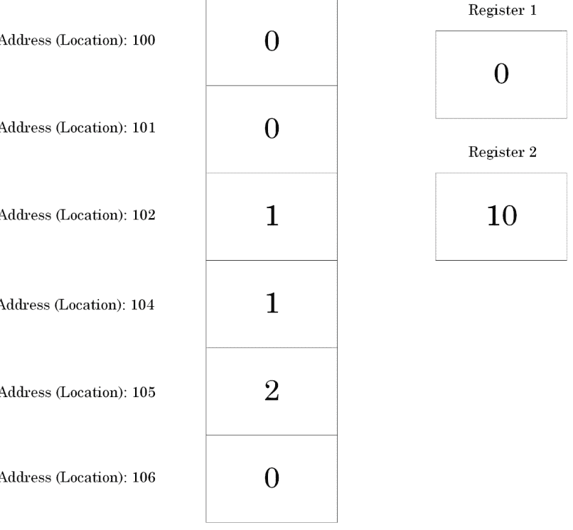

图 x64.1.1

### Intel 64 位 PC 内部的内存和寄存器

在这里，包含整数值的内存位置地址通常相差 4 或 8，我们还展示了两个名为 `%RAX` 和 `%RDX` 的寄存器。它们的前半部分分别被称为 `%EAX` 和 `%EDX`。

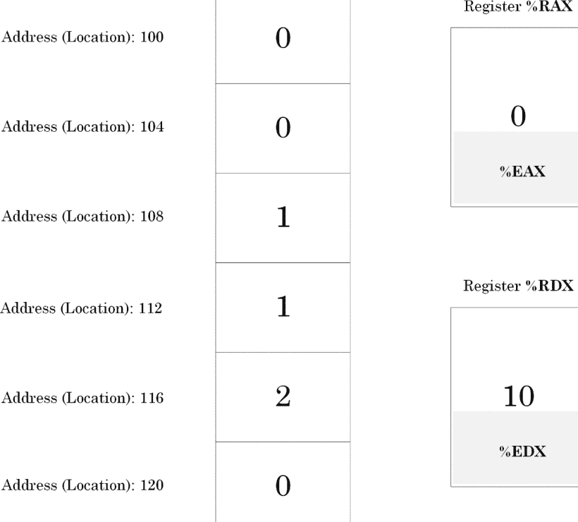

图 x64.1.2

因为内存单元包含“数字”，所以我们从简单的算术开始，要求 PC 计算两个数字的和，以观察内存和寄存器的值如何变化。

### “算术”项目：内存布局和寄存器

在我们的项目中，有两个内存地址（位置），我们称之为 “a” 和 “b”。我们可以将 “a” 和 “b” 视为各自地址（位置）的名称。现在我们引入一种特殊符号，其中 `(a)` 表示内存地址（位置） “a” 中的内容。如果我们使用 C 或 C++ 语言来编写项目，我们将内存位置 “a” 和 “b” 声明并定义为：

```c
static int a, b;
```

默认情况下，当我们加载程序时，静态内存位置会被填充为零，我们可以将加载程序后的初始内存布局描绘如下，如图 x64.1.3 所示。

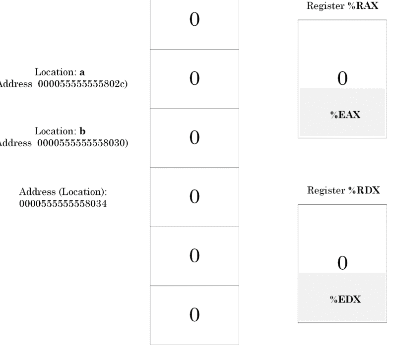

图 x64.1.3

### “算术”项目：计算机程序

我们可以将计算机程序视为一系列用于操作内存单元和寄存器内容的指令。例如，加法操作：将内存单元 N₾12 的内容加到内存单元 N₾14 的内容中。在我们的伪代码中，可以写成：

`(14) + (12) -> (14)`

我们的第一个伪代码程序显示在表格的左侧：

| 伪代码 | 汇编指令 |
| :--- | :--- |
| `1 -> (a)` <br> `1 -> (b)` <br> `(b) + (a) -> (b)` <br> `(a) + 1 -> (a)` <br> `(b) * (a) -> (b)` | 这里我们放置与伪代码相对应的汇编指令。 |

`->` 表示将新值移动（赋值）到内存位置（地址）的内容中。`;` 是注释符号，该行剩余部分为注释。`=` 显示内存位置（地址）当前的当前值。

提醒一下，用高级编程语言编写的代码由编译器翻译成机器语言。然而，如果其数字代码用某种名为汇编语言的助记符系统表示，那么机器语言也是可读的。例如，`INC a` 是将存储在内存位置 “a” 处的值增加 1。

### “算术”项目：将数字赋值给内存位置

我们提醒，“a” 表示内存单元的位置（地址），它也是地址 `000055555555802c` 的名称（见图 x64.1.3）。`(a)` 表示存储在地址 “a” 处的内容（数字）。

如果我们使用 C 或 C++ 语言，“a” 被称为 “变量 a”，我们将其赋值写为：

```c
a = 1 ;
```

在 Intel 汇编语言中，我们写作：

```assembly
mov $1, a
```

在 GDB 反汇编输出中，我们看到以下代码，其中变量 “a” 和地址显示在注释中：

```assembly
movl $0x1,0x2ef2(%rip) # 0x55555555802c <a>
```

我们在右列展示了伪代码翻译成汇编语言的结果：

| 伪代码 | 汇编 |
| :--- | :--- |
| `1 -> (a) ; (a) = 1` | `movl $1, a` |
| `1 -> (b) ; (b) = 1` | `movl $1, b` |
| `(b) + (a) -> (b)` | |
| `(a) + 1 -> (a)` | |
| `(b) * (a) -> (b)` | |

注意使用的是 `movl` 指令而不是 `mov`。这是因为 “a” 和 “b” 既可以指向 32 位（如 `%EAX` 或 `%EDX` 寄存器）也可以指向 64 位（如 `%RAX` 和 `%RDX` 寄存器）的内存单元。在寄存器的情况下，从它们的名称就可以清楚地知道我们使用的是 64 位的 `%RAX` 还是 32 位的 `%EAX`。但在内存地址 “a” 和 “b” 的情况下，不清楚它们是指 64 位还是 32 位单元。我们使用 `movl` 来消除歧义，表明我们使用 32 位内存单元，这足以容纳从 0 到 4294967295 的整数。

`0x2ef2(%rip)` 是编译器生成代码以计算地址 “a” 而非直接指定地址的方式。这种代码占用的内存空间较少。我们将在后面的章节中解释这一点。

字面量常量带有 `$` 前缀，例如 `$0x1`。`0x` 前缀意味着后面的数字是十六进制的。注释中地址的前 4 个零也被省略了。我们将在第 x64.3 章中解释这类数字。请同时注意，反汇编输出和伪代码中的移动方向是一致的：从左到右。

执行前两条汇编语言指令后，我们得到了图 x64.1.4 所示的内存布局。

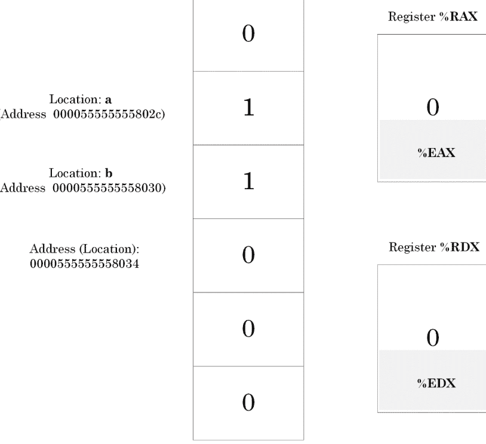

图 x64.1.4

### 将数字赋值给寄存器

这与内存赋值类似。我们可以用伪代码写作：

```
1 -> register
(a) -> register
```

注意，当我们引用寄存器内容时，不使用括号。后一条指令意味着将位置（地址） “a” 处的数字赋值（复制）到一个寄存器中。

在汇编语言中，我们写作：

```assembly
mov $1, %eax   # 1 被复制到 %RAX 寄存器的前半部分
mov $1, %rax   # %RAX 寄存器的全部内容被替换为 1
mov a, %eax
mov a, %rax
```

在 GDB 反汇编输出中，我们可能会看到以下代码：

```assembly
mov $0x0, %eax
```

### “算术”项目：将数字加到内存单元中

现在让我们更详细地看看以下伪代码语句：

```
(b) + (a) -> (b)
```

回顾一下，“a” 和 “b” 分别表示位置（地址） `00005555555802c` 和 `000055555558030` 的名称（见图 x64.1.4）。`(a)` 和 `(b)` 分别表示地址 “a” 和 “b” 处的内容，简单来说就是存储在那里的某些数字。

在 C 或 C++ 语言中，我们编写以下语句：

```c
b = b + a;
b += a;
```

在汇编语言中，我们使用 `ADD` 指令。由于 AMD64 和 Intel EM64T 架构的限制，我们不能在一步（指令）中使用两个内存地址，例如 `add a, b`。我们只能使用 `add register, b` 指令，将存储在 `register`（寄存器）中的值加到内存单元 `b` 的内容中。请记住，这里的寄存器本身就像一个临时内存单元：

```
(a) -> register
(b) + register -> (b)
```

或者，我们可以使用两个寄存器：

```
(a) -> register1
(b) -> register2
register2 + register1 -> register2
register2 -> (b)
```

在汇编语言中，我们写作：

```assembly
mov a, %eax
add %eax, b
```

或者我们可以将 2 个寄存器相加，然后将结果移动到内存单元 `b`：

```assembly
mov b, %edx
mov a, %eax
add %edx, %eax
mov %eax, b
```

在 GDB 反汇编输出中，我们可能会看到以下代码：

```assembly
mov 0x2ee6(%rip),%edx # 0x555555558030 <b>
mov 0x2edc(%rip),%eax # 0x55555555802c <a>
add %edx,%eax
mov %eax,0x2ed8(%rip) # 0x555555558030 <b>
```

现在我们可以将我们的伪代码翻译成汇编语言：

| 伪代码 | 汇编 |
| :--- | :--- |
| `1 -> (a) ; (a) = 1` | `movl $1, a` |
| `1 -> (b) ; (b) = 1` | `movl $1, b` |
| `(b) + (a) -> (b) ; %eax = 1` | `mov a, %eax` |
| ` ; %edx = 1` | `mov b, %edx` |
| ` ; %eax = 2` | `add %edx, %eax` |
| ` ; (b) = 2` | `mov %eax, b` |
| `(a) + 1 -> (a)` | |
| `(b) * (a) -> (b)` | |

在执行 `ADD` 和 `MOV` 指令后，我们得到了图 x64.1.5 所示的内存布局。

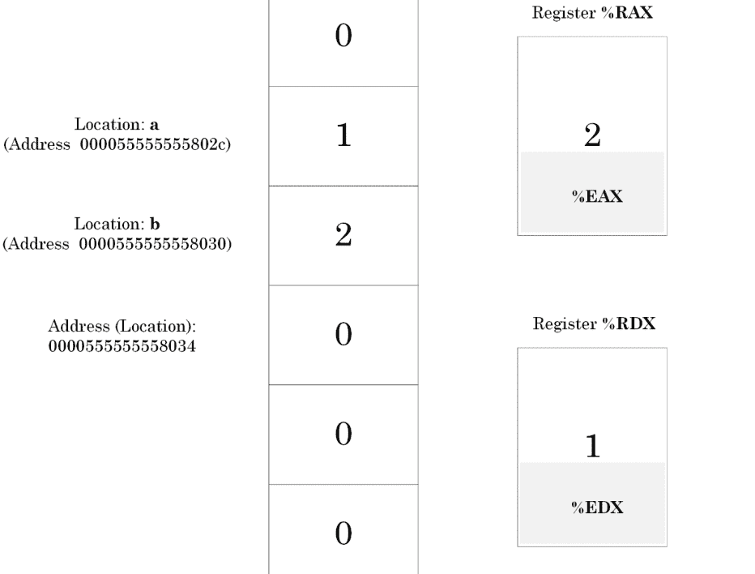

图 x64.1.5

### 增加/减少内存和寄存器中的数字

在伪代码中，这看起来很简单，意思是指增加（减少）存储在位置（地址） “a” 处的数字：

```
(a) + 1 -> (a)
(a) - 1 -> (a)
```

在 C 或 C++ 语言中，我们可以通过三种可能的方式来编写：

```c
a = a + 1;
++a;
a++;

b = b - 1;
--b;
b--;
```

在汇编语言中，我们使用 `INC` 和 `DEC` 指令，并写作：

```assembly
incl a
inc %eax
decl a
dec %eax
```

当我们需要指定 32 位内存单元时，使用 `incl`。当我们使用 “a” 时，它是具有歧义的。然而，使用 `%eax` 意味着使用 32 位值，因此 `inc` 是没有歧义的。

在 GDB 反汇编输出中，我们可能会看到相同的指令：

```assembly
inc %eax
or
add $0x1,%eax # 编译器可能会决定使用 ADD 而不是 INC
```

现在我们添加自增量的汇编语言翻译：

| 伪代码 | 逻辑/状态 | 汇编 |
|---|---|---|
| `1 -> (a)` | `; (a) = 1` | `movl $1, a` |
| `1 -> (b)` | `; (b) = 1` | `movl $1, b` |
| `(b) + (a) -> (b)` | `; %eax = 1`<br>`; %edx = 1`<br>`; %eax = 2`<br>`; (b) = 2` | `mov a, %eax`<br>`mov b, %edx`<br>`add %edx, %eax`<br>`mov %eax, b` |
| `(a) + 1 -> (a)` | `; %eax = 1`<br>`; %eax = 2`<br>`; (a) = 2` | `mov a, %eax`<br>`add $1, %eax`<br>`mov %eax, a` |
| `(b) * (a) -> (b)` | | |

在执行 `INC` 或 `ADD` 指令后，内存布局如图片 x64.1.6 所示。

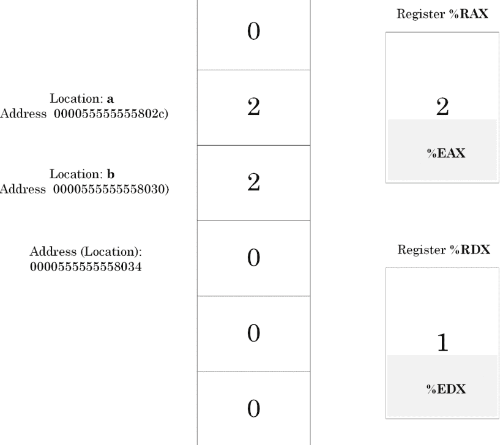

**图片 x64.1.6**

### 数字乘法

在伪代码中，我们写为：

```
(b) * (a) -> (b)
```

这意味着我们将位置（地址）“b”处的数字乘以位置（地址）“a”处的数字。

在 C 或 C++ 语言中，我们可以用两种方式编写：

```c
b = b * a;

b *= a;
```

在汇编语言中，我们使用 `IMUL`（`Integer MULtiply`，整数乘法）指令，编写如下：

```assembly
mov a, %eax
imul b, %eax
mov %eax, b
```

该乘法指令意味着 `(b) * %eax -> %eax`，我们必须将 “a” 的内容放入 `%EAX`。乘法结果被放入寄存器 `%EAX` 中，随后其内容被保存到位置（地址）“b”。或者，我们可以将所有乘法操作数都放入寄存器中：

```assembly
mov a, %eax
mov b, %edx
imul %edx, %eax
mov %eax, b
```

在 GDB 的反汇编输出中，我们可能会看到以下代码：

```assembly
mov 0x2ec3(%rip),%edx    # 0x55555558030 <b>
mov 0x2eb9(%rip),%eax    # 0x5555555802c <a>
imul %edx,%eax
mov %eax,0x2eb4(%rip)    # 0x55555558030 <b>
```

现在，我们在伪代码的汇编翻译中增加两条额外的汇编指令：

| 伪代码 | 逻辑/状态 | 汇编 |
|---|---|---|
| `1 -> (a)` | `; (a) = 1` | `movl $1, a` |
| `1 -> (b)` | `; (b) = 1` | `movl $1, b` |
| `(b) + (a) -> (b)` | `; %eax = 1` <br> `; %edx = 1` <br> `; %eax = 2` <br> `; (b) = 2` | `mov a, %eax` <br> `mov b, %edx` <br> `add %edx, %eax` <br> `mov %eax, b` |
| `(a) + 1 -> (a)` | `; %eax = 1` <br> `; %eax = 2` <br> `; (a) = 2` | `mov a, %eax` <br> `add $1, %eax` <br> `mov %eax, a` |
| `(b) * (a) -> (b)` | `; %edx = 2` <br> `; %eax = 2` <br> `; %eax = 4` <br> `; (b) = 4` | `mov b, %edx` <br> `mov a, %eax` <br> `imul %edx, %eax` <br> `mov %eax, b` |

在执行 `IMUL` 和 `MOV` 指令后，内存布局如图片 x64.1.7 所示。


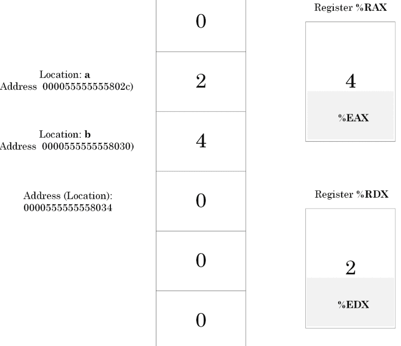

**图片 x64.1.7**

## 第 x64.2 章：代码优化

### “算术”项目：C/C++ 程序

让我们用 C/C++ 重写我们的“算术”程序。相应的汇编语言指令放在注释中：

```cpp
int a, b;

int main(int argc, char* argv[])
{
    a = 1;              // movl $1, a

    b = 1;              // movl $1, b

    b = b + a;
        // mov a, %eax
        // mov b, %edx
        // add %edx, %eax
        // mov %eax, b

    ++a;
        // mov a, %eax
        // add $1, %eax
        // mov %eax, a

    b = b * a;
        // mov b, %edx
        // mov a, %eax
        // imul %edx, %eax
        // mov %eax, b

        // results: (a) = 2 and (b) = 4

    return 0;
}
```

### 下载 GDB

我们使用 WSL2 和 “Debian GNU/Linux 10 (buster)” 作为工作环境。我们选择 Debian 是因为我们在 “加速 Linux Core Dump 分析” 培训课程³ 中使用了它。安装 Debian 后，我们需要安装必要的构建工具和 GDB：

```bash
sudo apt install build-essential
sudo apt install gdb
```

您可能还需要下载 `git` 来克隆源代码：

```bash
sudo apt install git
cd ~
git clone https://bitbucket.org/softwarediagnostics/pflddr
```

### GDB 反汇编输出 – 无优化

源代码可以从以下位置下载：

`https://bitbucket.org/softwarediagnostics/pflddr/src/master/x64/Chapter2/`

如果我们以无优化模式（默认）编译和链接程序：

```bash
coredump@DESKTOP-IS6V2L0:~/pflddr/x64/Chapter2$ gcc ArithmeticProjectC.cpp -o ArithmeticProjectC
```

我们将得到一个二进制可执行模块，可以将其加载到 GDB 中并检查汇编代码。

首先，我们运行 GDB 并将程序作为参数：

```bash
coredump@DESKTOP-IS6V2L0:~/pflddr/x64/Chapter2$ gdb ./ArithmeticProjectC
GNU gdb (Gdbian 8.2.1-2~b3) 8.2.1
Copyright (C) 2018 Free Software Foundation, Inc.
License GPLv3+: GNU GPL version 3 or later <http://gnu.org/licenses/gpl.html>
This is free software: you are free to change and redistribute it.
There is NO WARRANTY, to the extent permitted by law.
Type "show copying" and "show warranty" for details.
This GDB was configured as "x86_64-linux-gnu".
Type "show configuration" for configuration details.
For bug reporting instructions, please see:
<http://www.gnu.org/software/gdb/bugs/>.
Find the GDB manual and other documentation resources online at:
<http://www.gnu.org/software/gdb/documentation/>.
```

如需帮助，请输入 "help"。

输入 "apropos word" 以搜索与 "word" 相关的命令...

正在从 `./ArithmeticProjectC` 读取符号...（未找到调试符号）...完成。

```bash
(gdb)
```

接下来，我们在主 C/C++ 函数处设置一个断点，使程序执行在此时停止，以便我们有机会检查内存和寄存器。可以使用像 "main" 这样的符号名称/函数名称来代替代码内存地址：

```bash
(gdb) break main
Breakpoint 1 at 0x1129
```

然后我们启动程序的执行（令其 `run`）。程序随后将在之前设置的断点处停止：

```
(gdb) run
Starting program: /home/codeplump/pflddr/x64/Chapter2/ArithmeticProjectC

Breakpoint 1, 0x0000555555555129 in main ()
```

现在我们 `disassemble`（反汇编）主函数：

```
(gdb) dissas main
Dump of assembler code for function main:
0x0000555555555125 <+0>:	push	%rbp
0x0000555555555126 <+1>:	mov	%rsp,%rbp
=> 0x0000555555555129 <+4>:	mov	%edi,-0x4(%rbp)
0x000055555555512c <+7>:	mov	%rsi,-0x10(%rbp)
0x0000555555555130 <+11>:	movl	$0x1,%0x2ef2(%rip)	# 0x055555555802c <a>
0x000055555555513a <+21>:	movl	$0x1,%0x2eec(%rip)	# 0x0555555558030 <b>
0x0000555555555144 <+31>:	mov	0x2ee6(%rip),%edx	# 0x0555555558030 <b>
0x000055555555514a <+37>:	mov	0x2edc(%rip),%eax	# 0x055555555802c <a>
0x0000555555555150 <+43>:	add	%edx,%eax
0x0000555555555152 <+45>:	mov	%eax,0x2ed8(%rip)	# 0x0555555558030 <b>
0x0000555555555158 <+51>:	mov	0x2ece(%rip),%eax	# 0x055555555802c <a>
0x000055555555515e <+57>:	add	$0x1,%eax
0x0000555555555161 <+60>:	mov	%eax,0x2ec5(%rip)	# 0x055555555802c <a>
0x0000555555555167 <+66>:	mov	0x2ec3(%rip),%edx	# 0x0555555558030 <b>
0x000055555555516d <+72>:	mov	0x2eb9(%rip),%eax	# 0x055555555802c <a>
0x0000555555555173 <+78>:	imul	%edx,%eax
0x0000555555555176 <+81>:	mov	%eax,0x2eb4(%rip)	# 0x0555555558030 <b>
0x000055555555517c <+87>:	mov	$0x0,%eax
0x0000555555555181 <+92>:	pop	%rbp
0x0000555555555182 <+93>:	retq
End of assembler dump.
```

我们在此重复格式化后的反汇编输出模式，使其与我们的 C/C++ 代码相对应：

```assembly
0x0000005555555130 <+11>:  movl  $0x1,0x2ef2(%rip),%eax  # 0x5555555802c <a>
0x000000555555513a <+21>:  movl  $0x1,0x2eec(%rip),%edx  # 0x55555558030 <b>
0x00000055555144 <+31>:   movl  0x2eec(%rip),%edx        # 0x55555558030 <b>
0x00000055555154 <+37>:  movl  0x2edc(%rip),%eax        # 0x5555555802c <a>
0x00000055555150 <+43>:  add   %edx,%eax
0x00000055555152 <+45>:  mov   %eax,0x2ed8(%rip)       # 0x55555558030 <b>
0x00000055555158 <+51>:  mov   0x2ece(%rip),%eax        # 0x5555555802c <a>
0x0000005555515e <+57>:  add   $0x1,%eax
0x00000055555161 <+60>:  mov   %eax,0x2ec5(%rip)       # 0x5555555802c <a>
0x00000055555167 <+66>:  mov   0x2ec3(%rip),%edx       # 0x55555558030 <b>
0x0000005555516d <+72>:  mov   0x2eb9(%rip),%eax        # 0x5555555802c <a>
0x00000055555173 <+78>:  imul  %edx,%eax
0x00000055555176 <+81>:  mov   %eax,0x2eb4(%rip)       # 0x55555558030 <b>
```

我们可以将其直接翻译为前一章中使用的纯汇编代码，并在注释中放入相应的伪代码：

```assembly
movl $1, a            # 1 -> (a)
movl $1, b            # 1 -> (b)
mov b, %edx          # (b) + (a) -> (b)
mov a, %eax
add %edx, %eax
mov %eax, b
mov a, %eax          # (a) + 1 -> (a)
add $1, %eax
mov %eax, a
mov b, %edx          # (b) * (a) -> (b)
mov a, %eax
imul %edx, %eax
mov %eax, b
```

现在我们可以退出 GDB：

```bash
(gdb) q
A debugging session is active.

Inferior 1 [process 2249] will be killed.

Quit anyway? (y or n) y
coredump@DESKTOP-IS6V2L0:~/pflddr/x64/Chapter2$
```

### GDB 反汇编输出 – 优化

如果我们以优化模式编译并链接程序：

```
coredump@DESKTOP-IS6V2L0:~ /pflddr/x64/Chapter2$ gcc ArithmeticProjectC.cpp -O1 -o ArithmeticProjectC
```

在 GDB 中重复相同的步骤后，我们得到以下输出：

```
(gdb) disass main
Dump of assembler code for function main:
=> 0x0000555555555125 <+0>:		movl	$0x2,0x2f01(%rip)	# 0x555555558030 <a>
0x000055555555512f <+10>:		movl	$0x4,0x2ef3(%rip)	# 0x55555555802c <b>
0x0000555555555139 <+20>:		mov	$0x8,%eax
0x000055555555513e <+25>:		retq
End of assembler dump.
```

这对应于以下伪代码：

```
mov $2, a  # 2 -> (a)
mov $4, b  # 4 -> (b)
```

请注意，编译器还选择了先放置内存单元 “b” (`000055555555802c`)，然后是内存单元 “a” (`0000555555558030`)。

在这个可执行文件中，我们所有的汇编代码去哪了？如果我们观察，这段代码似乎直接将最终结果放入了 “b” 内存单元。为什么会这样？答案在于编译器优化。当代码以优化模式编译时，编译器可以直接从简单的 C/C++ 源代码本身计算出最终结果，并且仅生成更新相应内存位置所需的代码。

## 第 x64.3 章：数字表示法

### 数字及其表示法

想象古代的一位牧羊人试图数他的羊。他有一定数量的石头（十二块）：

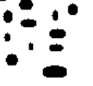

然而，他只能数到三，于是将总数分成每三个一组：


最后一张图就是石头数量的一种表示（一种记法）。我们有一个由三个“三块一组”组成的组，外加一个单独的三块一组。如果他能数到十，我们会看到同一数量石头的另一种表示方式：我们会有一个十块一组的组和另一个两块一组的组。

### 十进制表示法（Bases Ten）

现在让我们看看，如果我们能数到十，十二块石头在算术记号中是如何表示的。我们有一个十个数组成的组加上两个：

`$12_{dec} = 1 * 10 + 2$` 或 `$1 * 10^1 + 2 * 10^0$`

这里有另一个关于一百二十三块石头的练习。我们有 **1** 组十乘十的石头，另一组 **2** 组十块的石头，以及最后一组 **3** 块石头：

`$123_{dec} = 1 * 10*10 + 2 * 10 + 3$` 或 `$1 * 10^2 + 2 * 10^1 + 3 * 10^0$`

我们可以将其形式化为以下求和记号：

`$N_{dec} = a_n * 10^n + a_{n-1} * 10^{n-1} + ... + a_2 * 10^2 + a_1 * 10^1 + a_0 * 10^0 \quad 0 \le a_i \le 9$`

使用求和符号，我们得到这个公式：

`$N_{dec} = \sum_{i=0}^{n} a_i * 10^i$`

### 三进制表示法（Base Three）

现在我们回到牧羊人的十二块石头示例。我们有 **1** 组三乘三的石头，**1** 组三块的石头，以及一个空组 (**0**)（如果我们只有一块石头或有十三块而不是十二块石头，则该组不为空）。我们可以依次写下组数：**110**。因此，110 是十二块石头的三进制表示（记法），它等同于用十进制表示的 12：

`$12_{dec} = 1*3^2 + 1*3^1 + 0*3^0$`

`$N_{dec} = a_n*3^n + a_{n-1}*3^{n-1} + ... + a_2*3^2 + a_1*3^1 + a_0*3^0 \quad a_i = 0 \text{ 或 } 1 \text{ 或 } 2$`

`$N_{dec} = \sum_{i=0}^{n} a_i*3^i$`

### 二进制表示法（Base Two）

在数到 2 的情况下，十二块石头有更多的组：**1100**。因此，1100 是十进制 12 的二进制表示（记法）：

`$12_{dec} = 1 * 2^3 + 1 * 2^2 + 0 * 2^1 + 0 * 2^0$`

`$127_{dec} = 1 * 2^6 + 1 * 2^5 + 1 * 2^4 + 1 * 2^3 + 0 * 2^2 + 1 * 2^1 + 1 * 2^0$` 或 `$1111011_2$`

`$N_{dec} = a_n * 2^n + a_{n-1} * 2^{n-1} + ... + a_2 * 2^2 + a_1 * 2^1 + a_0 * 2^0 \quad a_i = 0$` 或 `$1$`

`$N_{dec} = \sum_{i=0}^{n} a_i * 2^i$`

### 十六进制表示法（Base Sixteen）

如果我们能数到十六，十二块石头可以放入一个组，但我们需要更多的符号：A, B, C, D, E 和 F 分别代表十, 十一, 十二, 十三, 十四和十五：

`$12_{dec} = \text{C}$` 在十六进制表示（记法）中

`$123_{dec} = 7B_{hex}$`

`$123_{dec} = 7 * 16^1 + 11 * 16^0$`

`$N_{dec} = \sum_{i=0}^{n} a_i * 16^i$`

### 为什么使用十六进制？

考虑这个用二进制记号写的数字：`$110001010011_2$`。它在十进制记号中的等值是 3155：

`$3155_{dec} = 1*2^{11} + 1*2^{10} + 0*2^9 + 0*2^8 + 0*2^7 + 1*2^6 + 0*2^5 + 1*2^4 + 0*2^3 + 0*2^2 + 1*2^1 + 1*2^0$`

现在我们将二进制数字分成每四个一组，并用十进制和十六进制记号写下来：

| 1100 | 0101 | 0011 |

| :--- | :--- | :--- |

| `$12_{dec}$` | `$5_{dec}$` | `$3_{dec}$` |


| $\text{C}_{hex}$ | $5_{hex}$ | $3_{hex}$ |

我们可以看到，十六进制记号更加紧凑，因为每四个二进制数字组对应一个十六进制数。表 x64.3.1 列出了每四位二进制组合的十六进制等值。

在 GDB 和其他调试器中，内存地址以十六进制记号显示。

| 二进制 | 十进制 | 十六进制 |
| :--- | :--- | :--- |
| 0000 | 0 | 0 |
| 0001 | 1 | 1 |
| 0010 | 2 | 2 |
| 0011 | 3 | 3 |
| 0100 | 4 | 4 |
| 0101 | 5 | 5 |
| 0110 | 6 | 6 |
| 0111 | 7 | 7 |
| 1000 | 8 | 8 |
| 1001 | 9 | 9 |
| 1010 | 10 | A |
| 1011 | 11 | B |
| 1100 | 12 | C |
| 1101 | 13 | D |
| 1110 | 14 | E |
| 1111 | 15 | F |

表 x64.3.1

## 第 x64.4 章：指针

### 定义

指针的概念是熟练掌握 Linux 调试最需要深入理解的概念之一。根据定义，指针是一个内存单元或处理器寄存器，它包含另一个内存单元的地址，如图 x64.4.1 所示。它像任何内存单元一样拥有自己的地址。有时，指针被称为间接地址（与直接地址，即内存单元本身的地址相对）。迭代地，我们可以定义另一层间接层，并引入“指向指针的指针”，即一个包含另一个内存单元地址的内存单元或处理器寄存器，而后者又包含另一个内存单元的地址，依此类推。

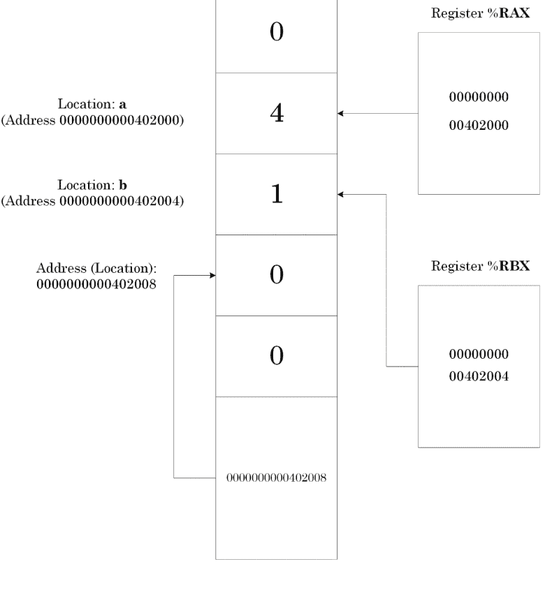

图 x64.4.1

### “指针”项目：内存布局与寄存器

在我们的调试项目中，有两个内存地址（位置），“a” 和 “b”。我们可以将 “a” 和 “b” 视为地址（位置）的名称。提醒一下，记号 (a) 表示内存地址（位置） “a” 处的内容。

我们还拥有寄存器 `%RAX` 和 `%RBX` 作为指向 “a” 和 “b” 的指针。这些寄存器分别包含 “a” 和 “b” 的地址。记号 (`%RAX`) 表示地址在寄存器 `%RAX` 中的内存单元的内容。

在 C 和 C++ 语言中，我们声明并定义指向 “a” 和 “b” 的指针如下：

```c
int *a, *b;
```

程序执行前我们的项目内存布局如图 x64.4.2 所示。地址总是占用 64 位内存单元或完整的 64 位寄存器（如 `%RAX` 或 `%RBX`），它们不能放入 `%EAX` 或 `%EBX` 或 32 位内存单元中。

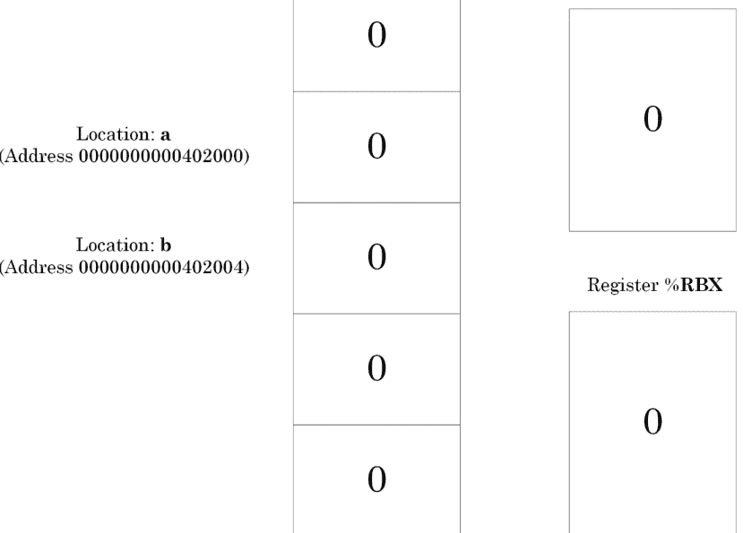

图 x64.4.2

### “指针”项目：计算

为了从底层汇编语言的角度更好地理解指针，我们使用内存指针而不是直接内存地址，来执行第 x64.1 章中的旧算术计算：

```
address a -> rax
1 -> (rax)
address b -> rbx
1 -> (rbx)
(rbx) + (rax) -> (rbx)
(rax) + 1 -> (rax)
(rbx) * (rax) -> (rbx)
```

### 使用指针为内存单元赋值

首先，以下伪代码指令序列意味着我们将 `%RAX` 寄存器的内容解释为一个内存单元的地址，然后将一个值赋给该内存单元：

```
address a -> rax
1 -> (rax)
```

在 C 和 C++ 语言中，这被称为“解引用指针”，我们写作：

```cpp
int a;
int *pa = &a; // 指针的声明和定义
*pa = 1; // 获取一个内存单元（解引用指针）
// 并为其赋值
```

在汇编语言中，我们写作：

```asm
lea a, %rax # 将地址 "a" 加载到 %rax
movl $1, (%rax) # 将 %rax 用作指针
```

同样，我们使用 `movl` 而不是 `mov`，因为整数占用 32 位内存单元，而我们只想寻址一个 32 位内存单元。在 x64 Linux 上就是这样的：包含整数的内存单元大小是包含地址的内存单元的一半（32 位 vs. 64 位）。

在 GDB 反汇编输出中，我们会看到类似这样的内容：

```
0x0000000000401000 <0>: lea 0x402000,%rax
0x0000000000401008 <8>: movl $0x1,(%rax)
```

本章的源代码可以从以下地址下载：

https://bitbucket.org/softwarediagnostics/pflddr/src/master/x64/Chapter4/

为了演示某些指令且不依赖于编译器如何翻译 C/C++ 代码，我们用汇编语言编写程序。在将其加载到 GDB 并按照第 x64.2 章所述反汇编其 `main` 函数之前，我们需要对其进行编译和链接。

```
coredump@DESKTOP-IS6V2L0:~/pflddr/x64/Chapter4$ as PointersProject.asm -o PointersProject.o
coredump@DESKTOP-IS6V2L0:~/pflddr/x64/Chapter4$ ld PointersProject.o -o PointersProject
coredump@DESKTOP-IS6V2L0:~/pflddr/x64/Chapter4$ gdb ./PointersProject
GNU gdb (Debian 8.2.1-2+b3) 8.2.1
```

Copyright (C) 2018 Free Software Foundation, Inc.

License GPLv3+: GNU GPL version 3 or later <http://gnu.org/licenses/gpl.html>

这是自由软件：您可以自由地修改和重新分发它。

在法律允许的范围内，不提供任何担保。

输入 "show copying" 和 "show warranty" 以查看详情。

此 GDB 配置为 "x86_64-linux-gnu"。

输入 "show configuration" 以查看配置详情。

关于错误报告的说明，请参阅：<http://www.gnu.org/software/gdb/bugs/>。

在在线地址查找 GDB 手册和其他文档资源：<http://www.gnu.org/software/gdb/documentation/>。

获取帮助，请输入 "help"。

输入 "apropos word word" 来搜索与 "word" 相关的命令...

正在从 `./PointersProject`... 读取符号...(未找到调试符号)...完成。

(gdb)

我们在 `main` 函数上设置一个断点，运行程序直到 GDB 中断，然后反汇编 `main` 函数：

```
(gdb) break main
Breakpoint 1 at 0x401000

(gdb) run
Starting program: /home/coredump/pflddr/x64/Chapter4/PointersProject
```

Breakpoint 1, 0x0000000000401000 in `_start ()`

```
(gdb) disass main

Dump of assembler code for function _start:
=> 0x000000000000401000 <+0>:  lea 0x402000,%rax
   0x000000000000401008 <+8>:   movl $0x1,(%rax)
   0x00000000000040100e <+14>:  lea 0x402004,%rbx
   0x000000000000401016 <+22>:  movl $0x1,(%rbx)
   0x00000000000040101c <+28>:  mov (%rax),%edx
   0x00000000000040101e <+30>:  add %edx,(%rbx)
   0x000000000000401028 <+32>:  incl (%rax)
   0x000000000000401022 <+34>:  mov (%rax),%eax
   0x000000000000401024 <+36>:  imul (%rbx),%eax
   0x000000000000401027 <+39>:  mov %eax,(%rbx)
   0x000000000000401029 <+41>:  mov $0x3c,%rax
   0x000000000000401030 <+48>:  mov $0x0,%rdi
   0x000000000000401037 <+55>:  syscall

End of assembler dump.
```

现在我们使用 GDB 命令 `info variables` 来检查变量 "a" 和 "b"，以验证之前在图 x64.4.2 中显示的内存布局：

```
(gdb) info variables
All defined variables:

Non-debugging symbols:
0x000000000000402000 a
0x000000000000402004 b
0x000000000000402008 __bss_start
0x000000000000402008 _edata
0x000000000000402008 __end
```

我们还验证 `%RAX` 和 `%RBX` 寄存器的值是否与图 x64.4.2 一致：

```
(gdb) info registers rax rbx
rax 0x0 0
rbx 0x0 0
```

我们指令 GDB 自动显示当前要执行的指令，以及寄存器 `%RAX`、`%RBX` 的值和变量 "a"、"b" 的内容：

```
(gdb) display/i $rip
1: x/i $rip
=> 0x401000 <_start>: lea 0x402000,%rax
```

```
(gdb) display/x $rax
2: /x $rax = 0x0
```

```
(gdb) display/x $rbx
3: /x $rbx = 0x0
```

```
(gdb) display/x (int)a
4: /x (int)a = 0x0
```

```
(gdb) display/x (int)b
5: /x (int)b = 0x0
```

现在我们使用 GDB 命令 `stepi` 或 `si`（缩写版本）执行与我们的伪代码相对应的前四条指令：

| 伪代码 | 汇编 |
| :--- | :--- |
| address a -> rax | lea a, %rax |
| 1 -> (rax) ; (a) = 1 | movl $1, (%rax) |
| address b -> rbx | lea b, %rbx |
| 1 -> (rbx) ; (b) = 1 | movl $1, (%rbx) |
| (rbx) + (rax) -> (rbx) | |
| (rax) + 1 -> (rax) | |
| (rbx) * (rax) -> (rbx) | |

```
(gdb) si
0x000000000000401008 in _start ()
1: x/i $rip
=> 0x401008 <_start+8>: movl $0x1,(%rax)
2: /x $rax = 0x402000
3: /x $rbx = 0x0
4: /x (int)a = 0x0
5: /x (int)b = 0x0
```

```
(gdb) si
0x00000000000040100e in _start ()
1: x/i $rip
=> 0x40100e <_start+14>:    lea    0x402004,%rbx
2: /x $rax = 0x402000
3: /x $rbx = 0x0
4: /x (int)a = 0x1
5: /x (int)b = 0x0
```

```
(gdb) si
0x000000000000401016 in _start ()
1: x/i $rip
=> 0x401016 <_start+22>:    movl    $0x1,(%rbx)
2: /x $rax = 0x402000
3: /x $rbx = 0x402004
4: /x (int)a = 0x1
5: /x (int)b = 0x0
```

```
(gdb) si
0x00000000000040101c in _start ()
1: x/i $rip
=> 0x40101c <_start+28>:    mov    (%rax),%edx
2: /x $rax = 0x402000
3: /x $rbx = 0x402004
4: /x (int)a = 0x1
5: /x (int)b = 0x1
```

所有这些都对应于图 x64.4.3 中显示的内存布局。

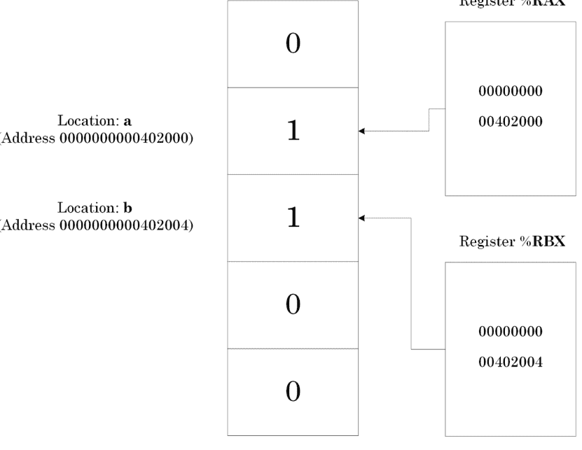

图 x64.4.3

### 使用指针进行数值相加

现在我们来看接下来的伪代码语句：

```
(rbx) + (rax) -> (rbx)
```

回想一下，(rax) 和 (rbx) 表示存储在 CPU 寄存器 `%RAX` 和 `%RBX` 中的地址（位置）所对应的内存单元的内容。上述语句等同于以下 C 或 C++ 语言表达式，其中 ‘*’ 运算符表示获取由 `pa` 或 `pb` 指针指向的内存内容（也称为指针解引用）：

```
*pb = *pb + *pa;
```

在汇编语言中，我们使用 `ADD` 指令来实现 ‘+’ 运算符，但我们不能在一条指令步骤中同时使用两个内存地址（`addl` 用于对 32 位整数进行加法）：

```
addl (%rax), (%rbx)    # 无效指令
```

我们只能使用一个内存引用，因此，我们需要使用另一个寄存器作为临时变量：

```
(rax) -> register
(rbx) + register -> (rbx)
```

在汇编语言中，我们编写如下指令序列：

```
mov (%rax), %edx
add %edx, (%rbx)
```

我们使用 `add` 而不是 `addl`，因为使用 `%EDX` 而不是 `%RDX` 意味着在进行 32 位整数加法。

在 GDB 的反汇编输出中，我们确实看到了这些指令：

```
0x00000000000040101c <+28>:    mov    (%rax),%edx
0x00000000000040101e <+30>:    add    %edx,(%rbx)
```

我们将它们添加到我们的伪代码表中：

| 伪代码 | 汇编 |
| :--- | :--- |
| address a -> rax | lea a, %rax |
| 1 -> (rax) ; (a) = 1 | movl $1, (%rax) |
| address b -> rbx | lea b, %rbx |
| 1 -> (rbx) ; (b) = 1 | movl $1, (%rbx) |
| (rbx) + (rax) -> (rbx) ; %edx = 1 | mov (%rax), %edx |
| ; (b) = 2 | add %edx, (%rbx) |
| (rax) + 1 -> (rax) | |
| (rbx) * (rax) -> (rbx) | |

现在我们执行这两条指令（提醒：当我们再次使用 `si` 命令时，`si` 命令的输出将显示下一条要执行的指令）：

```
[接上文输出]
1: x/i $rip
=> 0x40101e <_start+28>:    mov    (%rax),%edx
2: /x $rax = 0x402000
3: /x $rbx = 0x402004
4: /x (int)a = 0x1
5: /x (int)b = 0x1

(gdb) si
0x000000000040101e in _start ()
1: x/i $rip
=> 0x40101e <_start+30>:    add    %edx,(%rbx)
2: /x $rax = 0x402000
3: /x $rbx = 0x402004
4: /x (int)a = 0x1
5: /x (int)b = 0x1

(gdb) info reg $rdx
rdx    0x1    1
```

```
(gdb) si
0x000000000000401020 in _start ()
1: x/i $rip
=> 0x401020 <_start+32>:  incl  (%rax)
2: /x $rax = 0x402000
3: /x $rbx = 0x402004
4: /x (int)a = 0x1
5: /x (int)b = 0x2
```

所有这些都对应于图 x64.4.4 中显示的内存布局。

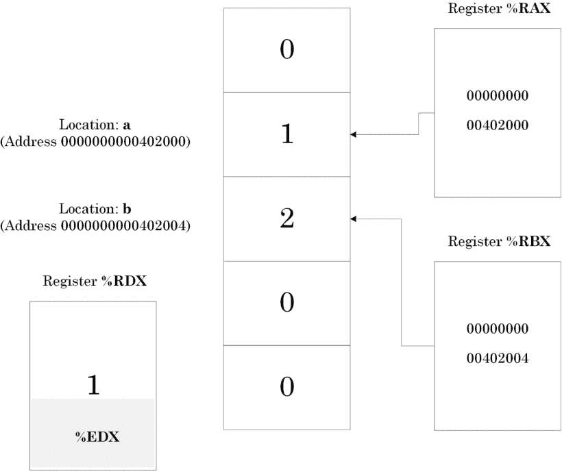

图 x64.4.4

### 使用指针进行数值自增

在伪代码中，这意味着增加（或减少）存储在地址由 `%RAX` 保存的内存位置中的数值：

```
(rax) + 1 -> (rax)
```

在 C 或 C++ 语言中，我们可以用三种可能的方式来编写：

```
*a = *a + 1;
++(*a);
(*a)++;
```

在汇编语言中，我们使用 `INC` 指令并编写：

```
incl (%rax)
```

当我们需要指定要增加的 32 位内存单元时，使用 `incl`。

在 GDB 的反汇编输出中，我们看到了相同的指令：

```
incl (%rax)
```

或者

```
addl $0x1, (%rax)  # 编译器可能会决定使用 ADD 而不是 INC
```

现在我们添加自增的汇编语言翻译：


| C/伪代码 | 汇编 |
| :--- | :--- |
| `address a -> rax` | `lea a, %rax` |
| `1 -> (rax) ; (a) = 1` | `movl $1, (%rax)` |
| `address b -> rbx` | `lea b, %rbx` |
| `1 -> (rbx) ; (b) = 1` | `movl $1, (%rbx)` |
| `(rbx) + (rax) -> (rbx) ; %edx = 1` | `mov (%rax), %edx` |
| `; (b) = 2` | `add %edx, (%rbx)` |
| `(rax) + 1 -> (rax) ; (a) = 2` | `incl (%rax)` |
| `(rbx) * (rax) -> (rbx)` | |

现在我们执行这条指令（提醒：当我们再次使用 `si` 命令时，`si` 命令的输出将显示下一条要执行的指令）：

```
[接上文输出]
1: x/i $rip
=> 0x401020 <_start+32>:    incl (%rax)
2: /x $rax = 0x402000
3: /x $rbx = 0x402004
4: /x (int)a = 0x1
5: /x (int)b = 0x2
```

```
(gdb) si
0x000000000000401022 in _start ()
1: x/i $rip
=> 0x401022 <_start+34>:    mov (%rax),%eax
2: /x $rax = 0x402000
3: /x $rbx = 0x402004
4: /x (int)a = 0x2
5: /x (int)b = 0x2
```

在执行 `INC` 指令后，内存布局如图 x64.4.5 所示。

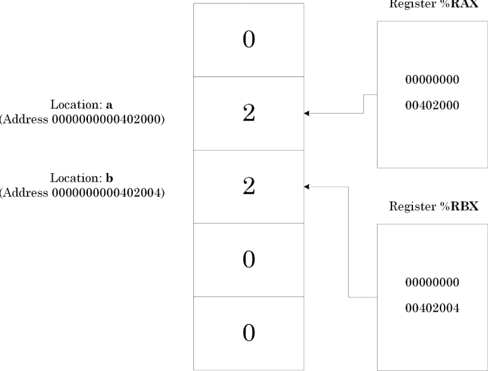

图 x64.4.5

### 使用指针进行数字乘法

我们的下一个伪代码语句执行乘法：

```
(rbx) * (rax) -> (rbx)
```

这条语句的意思是将存储在 `%RBX` 寄存器中的地址所指向的内存单元的内容，与存储在 `%RAX` 寄存器中的地址所指向的内存单元中的值相乘。在 C 或 C++ 语言中，我们可以写一个与前几节看到的加法语句类似的表达式（注意 `*` 运算符有两个不同的含义：指针解引用和乘法）：

```cpp
*pb = *pb * *pa;
*pb *= *pa;
```

后者是缩写形式。在汇编语言中，我们使用 `IMUL`（Integer MULtipli，整数乘法）指令：

```asm
mov (%rax), %eax
imul (%rbx), %eax
mov %eax, (%rbx)
```

由于 `imul` 指令不能同时引用两个内存位置，我们需要将其中一个位置的内容放入寄存器中。我们复用了 `%RAX`，因为之后不再需要它的当前值。这条指令等同于以下伪代码：

```
(rax) -> rax
(rbx) * rax -> rax
rax -> (rbx)
```

在 `GDB` 反汇编输出中，我们看到如下内容：

```asm
0x000000000000401022 <+34>: mov (%rax),%eax
0x000000000000401024 <+36>: imul (%rbx),%eax
0x000000000000401027 <+39>: mov %eax, (%rbx)
```

我们将这些指令添加到我们的伪代码表中：

| 伪代码 | 汇编 |
| :--- | :--- |
| `address a -> rax` | `lea a, %rax` |
| `1 -> (rax) ; (a) = 1` | `movl $1, (%rax)` |
| `address b -> rbx` | `lea b, %rbx` |
| `1 -> (rbx) ; (b) = 1` | `movl $1, (%rbx)` |
| `(rbx) + (rax) -> (rbx) ; %edx = 1` | `mov (%rax), %edx` |
| `; (b) = 2` | `add %edx, (%rbx)` |
| `(rax) + 1 -> (rax) ; (a) = 2` | `incl (%rax)` |
| `(rbx) * (rax) -> (rbx) ; %eax = 2` | `mov (%rax), %eax` |
| `; %eax = 4` | `imul (%rbx), %eax` |
| `; (b) = 4` | `mov %eax, (%rbx)` |

现在我们执行这三条指令（提醒：当我们再次使用 `si` 命令时，`si` 命令的输出会显示下一条将要执行的指令）：

```
[From the previous output]
1: x/i $rip
=> 0x401022 <_start+34>: mov (%rax),%eax
2: /x $rax = 0x402000
3: /x $rbx = 0x402004
4: /x (int)a = 0x2
5: /x (int)b = 0x2

(gdb) si
0x0000000000401024 in _start ()
1: x/i $rip
=> 0x401024 <_start+36>: imul (%rbx),%eax
2: /x $rax = 0x2
3: /x $rbx = 0x402004
4: /x (int)a = 0x2
5: /x (int)b = 0x2

(gdb) si
0x000000000000401027 in _start ()
1: x/i $rip
=> 0x401027 <_start+39>:    mov    %eax,(%rbx)
2: /x $rax = 0x4
3: /x $rbx = 0x402004
4: /x (int)a = 0x2
5: /x (int)b = 0x2

(gdb) si
0x000000000000401029 in _start ()
1: x/i $rip
=> 0x401029 <_start+41>:    mov    $0x3c,%rax
2: /x $rax = 0x4
3: /x $rbx = 0x02004
4: /x (int)a = 0x2
5: /x (int)b = 0x4
```

这一切对应于图 x64.4.6 所示的内存布局。

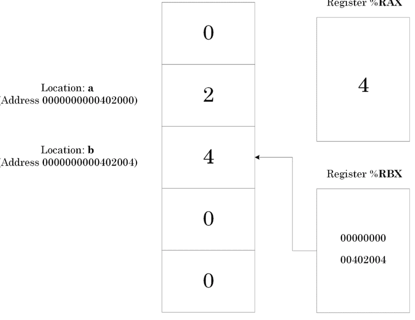

图 x64.4.6

## 第 x64.5 章：字节、字、双字和四字

### 使用十六进制数

如果想在 C/C++ 语言中使用十六进制数，我们需要在前面加上 `0x` 前缀，例如：

```cpp
a = 12;    // 10进制 12
a = 0xC;    // 16进制 C
```

在 `GDB` 的反汇编输出以及输入命令时，数字默认被解释为十进制。如果希望数字被解释为十六进制，我们需要在前面加上 `0x` 前缀，例如：

```asm
mov 12, a
mov 0xC, a
```

### 字节粒度

图 x64.5.1 展示了字节（Byte）、字（Word）、双字（Doubleword）和四字（Quadword）在字节粒度上的区别。我们可以看到，每个连续的尺寸都是前一个尺寸的两倍。

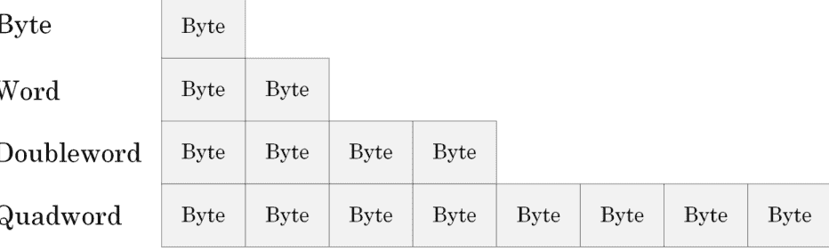

图 x64.5.1

### 位粒度

每个字节由 8 位（bit）组成。每位的值为 0 或 1。以下是一些以位字符串形式表示的字节、字、双字和四字的示例（我们也可以清楚地看到 4 位序列与十六进制数之间的对应关系，见表 x64.3.1）：

- 字节 (Byte)
  - C / C++: `unsigned char`
  - 8 位
  - 取值范围 `$0_{\text{dec}} - 255_{\text{dec}}$` 或 `$0_{\text{hex}} - \text{FF}_{\text{hex}}$`
  - 示例：`$12_{\text{dec}}$` `$00001100_{\text{bin}}$` `$0\text{C}_{\text{hex}}$`

- 字 (Word)
  - C / C++: `unsigned short`
  - 16 位
  - 取值范围 `$0_{\text{dec}} - 65535_{\text{dec}}$` 或 `$0_{\text{hex}} - \text{FFFF}_{\text{hex}}$`
  - 示例：`$0000000000001100_{\text{bin}}$` `$000\text{C}_{\text{hex}}$`

- 双字 (Doubleword)
  - C / C++: `unsigned int`, `unsigned`
  - 32 位
  - 取值范围 `$0_{\text{dec}} - 4294967295_{\text{dec}}$` 或 `$0_{\text{hex}} - \text{FFFFFFFF}_{\text{hex}}$`
  - 示例：`$00000000000000000000000000001100_{\text{bin}}$` `$0000000\text{C}_{\text{hex}}$`

- 四字 (Quadword)
  - C / C++: `long`, `unsigned long long`
  - 64 位
  - 取值范围 `$0_{\text{dec}} - 18446744073709551615_{\text{dec}}$` 或 `$0_{\text{hex}} - \text{FFFFFFFFFFFFFFFF}_{\text{hex}}$`
  - 示例：`$1100_{\text{bin}}$` `$000000000000000\text{C}_{\text{hex}}$`

### 内存布局

内存中最小的可寻址单元是字节。最大可寻址单元在 32 位机器上是双字，在 64 位机器上是四字。在 32 位 CPU 上，所有通用寄存器都是 32 位的，可以包含双字值。在 64 位 CPU 上，所有通用寄存器都是 64 位的，可以包含四字值。图 x64.5.2 展示了一个典型的内存布局，图 x64.5.3 展示了一些通用 CPU 寄存器的字节布局。

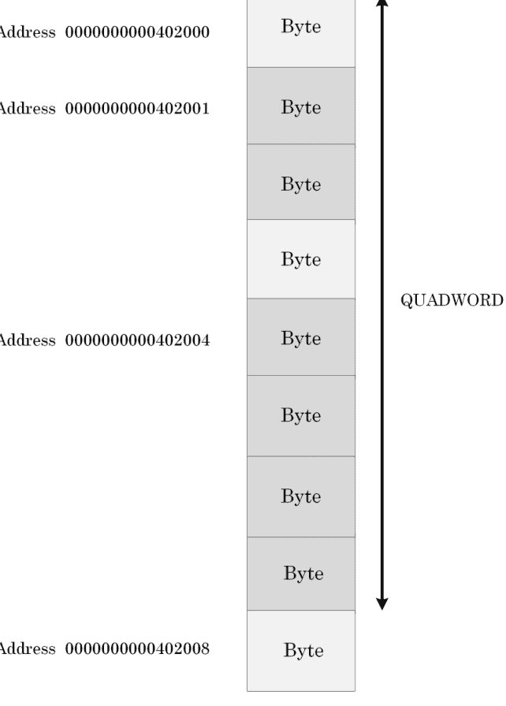

图 x64.5.2

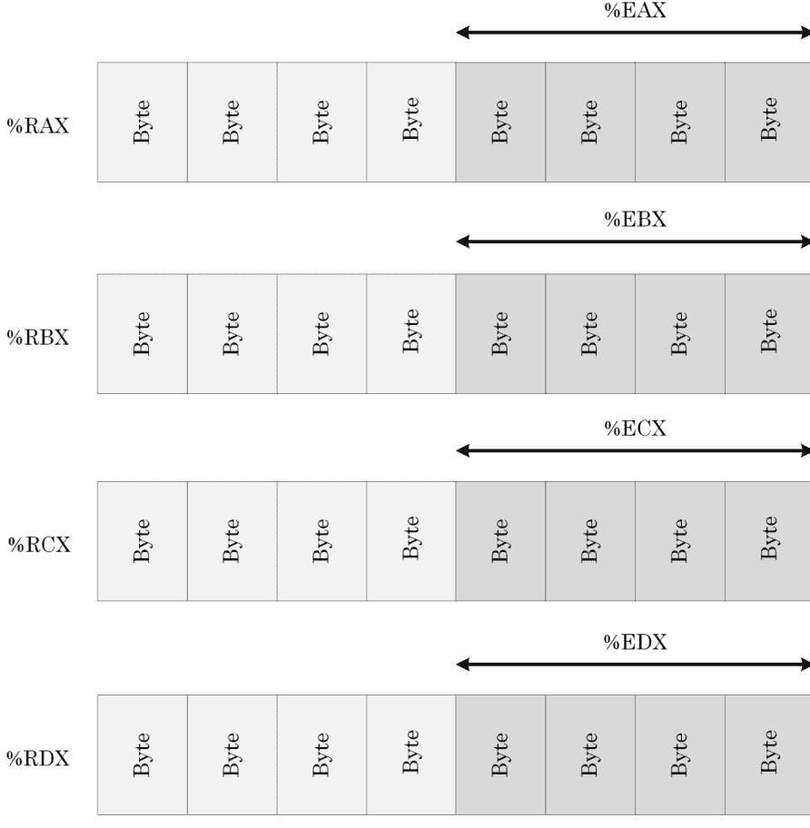

图 x64.5.3

请记住，内存地址始终是 64 位的，指向 32 位内存单元（如整数）的内存地址同样也是 64 位的。

## 第 x64.6 章：指向内存的指针

### 重新审视指针

指针是一个存储另一个内存单元地址的内存单元或寄存器。内存指针本身也有地址，因为它们同样是内存单元。在 32 位 Linux 上，指针是 32 位的；在 64 位 Linux 上，指针是 64 位的。

### 寻址类型

正如我们在第 x64.5 章中所见，内存单元的大小可以是字节、字、双字或四字。因此，我们可以拥有指向字节的指针、指向字的指针、指向双字的指针以及指向四字的指针。在第 x64.4 章的 `GDB` 反汇编输出中，涉及指向存储 32 位（双字大小）值的内存指针的指令带有后缀。

以下是一些示例说明：

```asm
movb $0xFF, (%rax)
```

`movb` 指令执行前的内存布局如图 x64.6.1 所示，执行后的内存布局如图 x64.6.2 所示。

```asm
movw $0xFF, (%rax)
movl $0xFF, (%rax)
movq $0xFF, (%rax)
```

我们需要在 `0xFF` 前加上 `$` 前缀，以将其与作为内存地址的 `0xFF` 区分开来。

`movl` 指令执行后的内存布局如图 x64.6.3 所示。我们可以看到，尽管我们仅指定一个字节值 `0xFF` 作为 `movl` 指令的源操作数，但它替换了内存中双字的其余 3 个字节，因为我们将目标指定为指向 4 个字节的指针，且 `0xFF` 作为双字时为 `0x000000FF`。因此，我们需要指定 `l` 后缀来区分移动双字值和移动字节值。如果我们忘记指定而直接使用 `mov`，编译器会报错：

```
Error: no instruction mnemonic suffix given and no register operands; can't size instruction
```

由于 64 位（四字）寄存器可能指向四字内存单元，即使我们指定一个所有前导位均为零的常量，我们也需要指定 `q` 来区分移动四字值和移动字节值：

```asm
movq $0x00000000000000FF, (%rax)
```

然而，如果我们只想移动一个字值，则需要指定 `w` 后缀：

```asm
movw $0xFF, (%rax)
```

这等同于：

```asm
movw $0x00FF, (%rax)
```

图 x64.6.4 总结了各种寻址模式。

图片 x64.6.1

图片 x64.6.2

图片 x64.6.3

图片 x64.6.4

### 重温寄存器

`%RAX`、`%RBX`、`%RCX`、`%RDX` 这些 64 位寄存器可以用作内存指针。它们包含 x86 32 位寄存器 `%EAX`、`%EBX`、`%ECX` 和 `%EDX`。而这些 32 位部分又包含旧的 16 位寄存器 `%AX`、`%BX`、`%CX` 和 `%DX`（每个可持有一个字）。在与 C 和 C++ 代码中简单循环相对应的汇编语言中，`%CX` 寄存器经常被用作循环计数器 (Counter)X：

```cpp
for (int i = 0; i < N; ++i)
```

但现代 C 和 C++ 编译器可能会选择使用任何其他寄存器，甚至使用内存位置来实现此目的。

### 空指针 (NULL Pointers)

在 Linux 上，地址 `0x0000000000000000` – `0x000000000000FFFF` 被专门设置为不可访问。如果在驱动程序内部执行以下代码，将强制应用程序崩溃或导致内核恐慌 (kernel panic)：

```assembly
mov $0xF, %rax
movb $1, (%rax) # 访问违例
```

### 无效指针 (Invalid Pointers)

存在不同类型的无效指针，当我们尝试对其解引用时会引起访问违例：

- 空指针 (NULL pointers)
- 指向不可访问内存的指针
- 写入时指向只读内存的指针

其他指针可能会或不会引起访问违例，其中一些将在后续章节中讨论：

- 指向“随机”内存的指针
- 具有从过去代码执行中继承的随机值的未初始化指针
- 野指针 (Dangling pointers)

后者与指向“随机”内存位置的指针类似，当我们忘记在释放指针所指向的内存后将其指针变量设为零 (NULL) 时就会出现。通过将指针置空，我们表明它们不再指向任何内存。

### 作为指针的变量

假设我们在 C 和 C++ 中声明并定义了两个内存地址（位置）`a` 和 `b`：

```cpp
int a, b;
```

这些是普通的变量 `a` 和 `b`。同样，我们可以在 C 和 C++ 中声明并定义另外两个内存地址（位置）`pa` 和 `pb`：

```cpp
int *pa, *pb;
```

这里 `pa` 是一个指向 `int` 的指针，换句话说，内存单元 `pa` 包含了另一个内存单元的地址，而该单元包含一个整数值。

### 指针初始化

为了让指针指向内存，我们需要用相应的内存地址对其进行初始化。以下是实现此需求的典型 C 或 C++ 代码：

```cpp
int a;             // 未初始化变量
int *pa;           // 未初始化指针
pa = &a;           // (pa) 现在包含地址 a
int b = 12;        // 已初始化变量
int *pb = &b;      // 已初始化指针
```

我们可以看到，指针也是变量，并且可以在程序执行期间更改其值，从而有效地指向不同的内存位置。

### 已初始化和未初始化数据

这里有一些关于已初始化和未初始化变量的补充信息，了解这些很有用：Linux 中的可执行程序被分为不同的节 (section)。其中一个称为 `.data`，所有的全局变量和静态变量（包括指针）都放在这里。

考虑这个 C 或 C++ 数据定义：

```cpp
int array[1000000]; // 大小为 4,000,000 字节或 3.8Mb
```

我们可能会预期可执行文件的大小约为 4Mb。然而，磁盘上的程序大小仅为 16Kb。这是因为未初始化的数组仅包含关于其大小的信息。当我们启动程序时，该数组会根据其大小信息被重新创建并用零填充。此时程序在内存中的大小变为约 4Mb。

在已初始化数组的情况下，磁盘上的程序大小为 4.01Mb：

```cpp
int array[1000000] = { 12 };
```

这是因为该数组被放入了 `.data` 节，并包含以下整数序列 `{ 12, 0, 0, 0, 0 ... }`。

### 更多伪代码符号

提醒一下，`(a)` 表示地址 `a` 处的内存内容，`(rax)` 表示存储在 `%RAX` 寄存器中的地址处的 32 位内存单元的内容（这里 `%RAX` 是一个指针）。

我们还引入一个将在本章及后续章节中使用的额外符号：`*(pa)` 表示存储在地址 `pa` 处的地址所指向的内容，这被称为对地址为 `pa` 的指针进行解引用。对应的 C/C++ 代码类似：

```cpp
int *pa = &a;
int b = *pa;
```

### “MemoryPointers” 项目：内存布局

这个项目与 x64.4 章中的 “Pointers” 项目非常相似。我们在 C 或 C++ 语言中拥有如下数据声明和定义：

```cpp
int a, b;
int *pa, *pb = &b;
```


项目代码对应于以下伪代码和汇编语言：

| 伪代码 | 汇编 |
| :--- | :--- |
| `address a -> (pa)` | `lea a, %rax` <br> `mov %rax, pa` |
| `1 -> \*(pa) ; (a) = 1` | `mov pa, %rax` <br> `movl $1, (%rax)` |
| `1 -> \*(pb) ; (b) = 1` | `mov pb, %rbx` <br> `movl $1, (%rbx)` |
| `\*(pb) + \*(pa) -> \*(pb) ; (b) = 2` | `mov (%rax), %ecx` <br> `add (%rbx), %ecx` <br> `mov %ecx, (%rbx)` |

本章的源代码可以从此处下载：

`https://bitbucket.org/softwarediagnostics/pflddr/src/master/x64/Chapter6/`

我们对其进行编译和链接，并按照 `x64.4` 章中所述将可执行文件加载到 GDB 中。我们得到以下输出：

```bash
coredump@DESKTOP-1S6V2L0::~/pflddr/x64/Chapter6$ as MemoryPointers.asm -o MemoryPointers.o
coredump@DESKTOP-1S6V2L0::~/pflddr/x64/Chapter6$ ld MemoryPointers.o -o MemoryPointers
coredump@DESKTOP-1S6V2L0::~/pflddr/x64/Chapter6$ gdb ./MemoryPointers
GNU gdb (Debian 8.2.1-2+bj3) 8.2.1
Copyright (C) 2018 Free Software Foundation, Inc.
License GPLv3+: GNU General Public version 3 or later <http://gnu.org/licenses/gpl.html>
This is free software: you are free to change and redistribute it.
There is NO WARRANTY, to the extent permitted by law.
Type "show copying" and "show warranty" for details.
This GDB was configured as "x86_64-linux-gnu".
Type "show configuration" for configuration details.

For bug reporting instructions, please see:
<http://www.gnu.org/software/gdb/bugs/>.

Find the GDB manual and other documentation resources online at:
<http://www.gnu.org/software/gdb/documentation/>.

For help, type "help".

Type "apropos word" to search for commands related to "word"…
Reading symbols from ./MemoryPointers…{(no debugging symbols found)}…done.
(gdb)
```

然后我们在 `main` 函数处设置断点，并运行程序直到 GDB 停止：

```bash
(gdb) break main
Breakpoint 1 at 0x401000

(gdb) run
Starting program: /home/coredump/pflddr/x64/Chapter6/MemoryPointers
```

`Breakpoint 1, 0x0000000000401000 in _start ()`

我们反汇编 `main` 函数：

```bash
(gdb) disass main
Dump of assembler code for function _start:
=> 0x0000000000401000 <+0>:  lea 0x402000,%rax
   0x0000000000401008 <+8>:  mov %rax,0x402008
   0x0000000000401010 <+16>: mov 0x402008,%rax
   0x0000000000401018 <+24>: movl $0x1,(%rax)
   0x000000000040101e <+30>: mov 0x402010,%rbx
   0x0000000000401026 <+38>: movl ($rax),(%rbx)
   0x000000000040102c <+44>: mov (%rax),%ecx
   0x000000000040102e <+46>: add (%rbx),%ecx
   0x0000000000401030 <+48>: mov %ecx,(%rbx)
   0x0000000000401032 <+50>: mov $0x3c,%rax
   0x0000000000401039 <+57>: mov $0x0,%rdi
   0x0000000000401040 <+64>: syscall

End of assembler dump.
```

然后我们清除 `%RAX`, `%RBX` 和 `%RCX` 寄存器，以建立一个易于跟踪的内存布局：

```bash
(gdb) set $rax = 0
(gdb) set $rbx = 0
(gdb) set $rcx = 0
(gdb) info registers $rax $rbx $rcx
rax		0x0		0
rbx		0x0		0
rcx		0x0		0
```

我们还指令 GDB 自动显示当前将要执行的指令，`%RAX`, `%RBX`, `%RCX` 寄存器的值，以及变量 `a`, `b`, `pa`, `pb` 的内容：

```bash
(gdb) display/i $rip
1: x/i $rip
=> 0x401000 <_start>: lea 0x402000,%rax

(gdb) display/x $rax
2: /x $rax = 0x0

(gdb) display/x $rbx
3: /x $rbx = 0x0

(gdb) display/x $rcx
4: /x $rcx = 0x0

(gdb) display/x (int)a
5: /x (int)a = 0x0

(gdb) display/x (int)b
6: /x (int)b = 0x0

(gdb) display/x (long)pa
7: /x (long)pa = 0x0

(gdb) display/x (long)pb
8: /x (long)pb = 0x402004
```

我们可以看到 `pb` 变量包含地址 `0x402004`。接下来我们检查（变量）内存位置 `a`、`b`、`pa`、`pb` 的地址：

```bash
(gdb) print &a
$1 = <(data variable, no debug info)> 0x402000

(gdb) print &b
$2 = <(data variable, no debug info)> 0x40402004

(gdb) print &pa
$3 = <(data variable, no debug info)> 0x402008

(gdb) print &pb
$4 = <(data variable, no debug info)> 0x402010
```

我们还检查存储在地址 `0x402004` 处的值（`pb` 的值，即 `b` 的地址）：

```bash
(gdb) x 0x402004
0x402004: 0x00000000
```

这对应于执行第一条 `LEA` 指令之前的内存布局，如图 `x64.6.5` 所示。

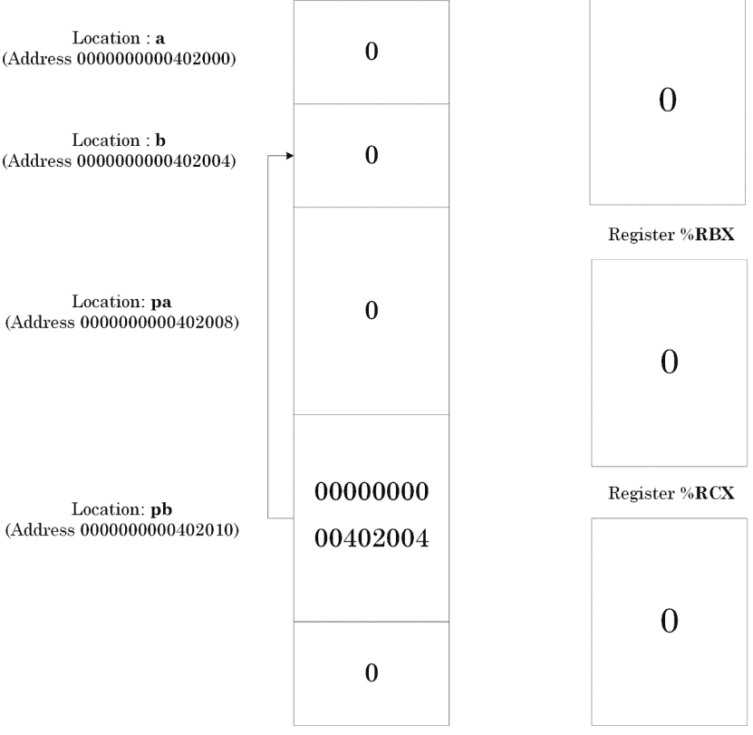

图 `x64.6.5`

然后我们逐步执行代码（**粗体**部分为变化之处）：

```bash
(gdb) si
0x000000000000401008 in _start ()

1: x/i $rip
=> 0x401008 <_start+8>: mov %rax,0x402008
2: /x $rax = 0x402000
3: /x $rbx = 0x0
4: /x $rcx = 0x0
5: /x (int)a = 0x0
6: /x (int)b = 0x0
7: /x (long)pa = 0x0
8: /x (long)pb = 0x402004
```

```bash
(gdb) si
0x000000000000401010 in _start ()

1: x/i $rip
=> 0x401010 <_start+16>: mov 0x402008,%rax
2: /x $rax = 0x402000
3: /x $rbx = 0x0
4: /x $rcx = 0x0
5: /x (int)a = 0x0
6: /x (int)b = 0x0
7: /x (long)pa = 0x402000
8: /x (long)pb = 0x402004
```

```bash
(gdb) si
0x000000000000401018 in _start ()

1: x/i $rip
=> 0x401018 <_start+24>: movl $0x1,(%rax)
2: /x $rax = 0x402000
3: /x $rbx = 0x0
4: /x $rcx = 0x0
5: /x (int)a = 0x0
6: /x (int)b = 0x0
7: /x (long)pa = 0x402000
8: /x (long)pb = 0x402004
```

```bash
(gdb) si
0x00000000000040101e in _start ()
1: x/i $rip
=> 0x40101e <_start+30>:    mov    0x402010,%rbx
2: /x $rax = 0x402000
3: /x $rbx = 0x0
4: /x $rcx = 0x0
5: /x (int)a = 0x1
6: /x (int)b = 0x0
7: /x (long)pa = 0x402000
8: /x (long)pb = 0x402004
```

```bash
(gdb) si
0x000000000000401026 in _start ()
1: x/i $rip
=> 0x401026 <_start+38>:    movl    $0x1,(%rbx)
2: /x $rax = 0x402000
3: /x $rbx = 0x402004
4: /x $rcx = 0x0
5: /x (int)a = 0x1
6: /x (int)b = 0x0
7: /x (long)pa = 0x402000
8: /x (long)pb = 0x402004
```

```bash
(gdb) si
0x00000000000040102c in _start ()
1: x/i $rip
=> 0x40102c <_start+44>:    mov    (%rax),%ecx
2: /x $rax = 0x402000
3: /x $rbx = 0x402004
4: /x $rcx = 0x0
5: /x (int)a = 0x1
6: /x (int)b = 0x1
7: /x (long)pa = 0x402000
8: /x (long)pb = 0x402004
```

```bash
(gdb) si
0x00000000000040102e in _start ()
1: x/i $rip
=> 0x40102e <_start+46>:  add (%rbx),%ecx
2: /x $rax = 0x402000
3: /x $rbx = 0x402004
4: /x $rcx = 0x1
5: /x (int)a = 0x1
6: /x (int)b = 0x1
7: /x (long)pa = 0x402000
8: /x (long)pb = 0x402004
```

```bash
(gdb) si
0x000000000000401030 in _start ()
1: x/i $rip
=> 0x401030 <_start+48>:  mov %ecx,(%rbx)
2: /x $rax = 0x402000
3: /x $rbx = 0x402004
4: /x $rcx = 0x2
5: /x (int)a = 0x1
6: /x (int)b = 0x1
7: /x (long)pa = 0x402000
8: /x (long)pb = 0x402004
```

```bash
(gdb) si
0x000000000000401032 in _start ()
1: x/i $rip
=> 0x401032 <_start+50>:  mov $0x3c,%rax
2: /x $rax = 0x402000
3: /x $rbx = 0x402004
4: /x $rcx = 0x2
5: /x (int)a = 0x1
6: /x (int)b = 0x2
7: /x (long)pa = 0x402000
8: /x (long)pb = 0x402004
```

最终的内存布局和寄存器情况如图 `x64.6.6` 所示。

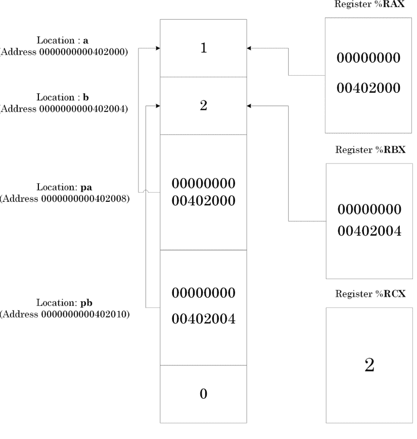

图 `x64.6.6`

## 第 `x64.7` 章：逻辑指令和 `RIP`

### 指令格式

我们已经看到汇编语言指令具有统一的格式：

操作数可以是寄存器 (`reg`)、内存引用 (`mem`) 或某些数字，称为立即数 (`imm`)。典型的表示示例：

```asm
inc mem/reg
dec mem/reg
add reg/imm, mem/reg
add mem/imm, reg
```

以及一些具体的汇编语言示例：

```asm
inc (%rax)
decl a
addl $0x10, (%rax)
addq a, (%rax)
```

### 逻辑移位指令

除了算术指令外，还有所谓的逻辑移位指令，它们只是将位串向左或向右移位。

左移：

```asm
11111111 -> 11111110 ; 移位 1 位
11111110 -> 11110000 ; 移位 3 位
shl imm/reg, mem/reg
shl $1, %rax
shlb $2, (%rax)
```

右移：

```asm
11111111 -> 01111111 ; 移位 1 位
01111111 -> 00001111 ; 移位 3 位
shr imm/reg, mem/reg
shr $1, %rax
shrb $2, (%rax)
```

### 逻辑运算

这里我们回顾一下逻辑运算及相应的真值表。我们将 `True` 缩写为 `T`，`False` 缩写为 `F`。

**AND（与）**

- `1 and 1 = 1` (`T and T = T`)
- `1 and 0 = 0` (`T and F = F`)
- `0 and 1 = 0` (`F and T = F`)
- `0 and 0 = 0` (`F and F = F`)

**OR（或）**

- `1 or 1 = 1` (`T or T = T`)
- `1 or 0 = 1` (`T or F = T`)
- `0 or 1 = 1` (`F or T = T`)
- `0 or 0 = 0` (`F or F = F`)

### 将内存或寄存器清零

有几种方法可以将零值放入寄存器或内存位置：

1. 移动一个值：

```asm
mov $0, a
mov $0, %rax
mov $0, %eax
```

2. 使用 `XOR`（异或）逻辑运算：

```asm
xor %rax, %rax
xor %eax, %eax
```

**XOR 真值表**

| 输入 A | 输入 B | 结果 | 逻辑 |
| :--- | :--- | :--- | :--- |
| 1 | 1 | 0 | `T xor T = F` |
| 1 | 0 | 1 | `T xor F = T` |
| 0 | 1 | 1 | `F xor T = T` |
| 0 | 0 | 0 | `F xor F = F` |

由于源操作数与目的操作数相同，且相同的位会被清零，因此此操作会清除其目的操作数。

### 指令指针

考虑上一章项目中的这两个执行步骤：

```bash
(gdb) si
0x0000000000040102c in _start ()
1: x/i $rip
=> 0x40102e <_start+44>:   mov (%rax),%ecx
2: /x $rax = 0x402000
3: /x $rbx = 0x402004
4: /x $rcx = 0x0
5: /x (int)a = 0x1
6: /x (int)b = 0x1
7: /x (long)pa = 0x402000
8: /x (long)pb = 0x402004
```

```bash
(gdb) si
0x0000000000040102e in _start ()
1: x/i $rip
=> 0x40102e <_start+46>:   add (%rbx),%ecx
2: /x $rax = 0x402000
3: /x $rbx = 0x402004
4: /x $rcx = 0x1
5: /x (int)a = 0x1
6: /x (int)b = 0x1
7: /x (long)pa = 0x402000
8: /x (long)pb = 0x402004
```

当地址 `0000000000040102c` 处的 `MOV` 指令正在执行时，另一个 CPU 寄存器 `%RIP` 指向地址 `0000000000040102e` 处待执行的下一条指令。如图 `x64.7.1` 所示。

**RIP**

| 地址 | 值 |
| :--- | :--- |


| 0000000000401024 | 40 |
| 0000000000401025 | 00 |
| 0000000000401026 | c7 |
| 0000000000401027 | 03 |
| 0000000000401028 | 01 |
| 0000000000401029 | 00 |
| 000000000040102a | 00 |
| 000000000040102b | 00 |
| 000000000040102c | 8b |
| 000000000040102d | 08 |
| 000000000040102e | 03 |
| 000000000040102f | 0b |
| 0000000000401030 | 89 |

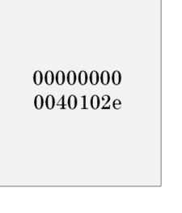

当前执行的指令：`mov (%rax),%ecx`

下一条指令：`add (%rbx),%ecx`

图 x64.7.1

### 代码段

回想在第 x64.6 章中，我们讨论了存放程序数据的 `.data` 段。程序代码则被放在 `.text` 段中。

以下 GDB 命令列出了各种程序段及其信息：

```
(gdb) maintenance info sections
Exec file:
  `/home/coredump/pflddr/X64/Chapter6/MemoryPointers`, file type elf64-x86-64.
[0] 0x00400120->0x00400140 at 0x00000120: .note.gnu.property ALLOC LOAD READONLY DATA HAS_CONTENTS
[1] 0x00401000->0x00401042 at 0x00001000: .text ALLOC LOAD READONLY CODE HAS_CONTENTS
[2] 0x00402000->0x00402018 at 0x00002000: .data ALLOC LOAD DATA HAS_CONTENTS
```

## 第 x64.8 章：利用指针重建程序

### 反汇编输出示例：无优化

从代码反汇编中重建近似的 C 或 C++ 代码的能力，在内存转储分析和调试中至关重要。

本章的项目可以从以下地址下载：

`https://bitbucket.org/softwarediagnostics/pflddr/src/master/x64/Chapter8/`

我们对其进行编译和链接，将可执行文件加载到 GDB 中，在 `main` 函数上设置断点，运行程序直到 GDB 触发断点，然后对其 `main` 函数进行反汇编：

```bash
coredump@DESKTOP-IS6V2L0:~/pflddr/x64/Chapter8$ gcc PointersAsVariables.cpp -o PointersAsVariables
coredump@DESKTOP-IS6V2L0:~/pflddr/x64/Chapter8$ gdb ./PointersAsVariables
GNU gdb (Debian 8.2.1-2+b3) 8.2.1
Copyright (C) 2018 Free Software Foundation, Inc.
License GPLv3+: GNU GPL version 3 or later <http://gnu.org/licenses/gpl.html>
This is free software: you are free to change and redistribute it.
There is NO WARRANTY, to the extent permitted by law.
Type "show copying" and "show warranty" for details.
This GDB was configured as "x86_64-linux-gnu".
Type "show configuration" for configuration details.
For bug reporting instructions, please see:
<http://www.gnu.org/software/gdb/bugs/>.
Find the GDB manual and other documentation resources online at:
<http://www.gnu.org/software/gdb/documentation/>.

For help, type "help".
Type "apropos word" to search for commands related to "word"...
Reading symbols from ./PointersAsVariables...(no debugging symbols found)...done.

(gdb) break main
Breakpoint 1 at 0x1129

(gdb) run
Starting program: /home/coredump/pflddr/x64/Chapter8/PointersAsVariables

Breakpoint 1, 0x0000555555555129 in main ()
```

```
(gdb) dissas main

Dump of assembler code for function main:

0x0000555555555125 <+0>:    push   %rbp
0x0000555555555126 <+1>:    mov    %rsp,%rbp
=> 0x0000555555555129 <+4>:    mov    %edi,-0x4(%rbp)
0x000055555555512c <+7>:    mov    %rsi,-0x10(%rbp)
0x0000555555555130 <+11>:   lea    0x2ef9(%rip),%rax       # 0x555555558030 <a>
0x0000555555555137 <+18>:   mov    %rax,0xeafa(%rip),%rax # 0x555555558038 <pa>
0x000055555555513e <+25>:   lea    0x2eef(%rip),%rax       # 0x555555558034 <b>
0x0000555555555145 <+32>:   mov    %rax,0x2eef(%rip),%rax # 0x555555558040 <pb>
0x000055555555514c <+39>:   mov    0x2e5e(%rip),%rax       # 0x555555558038 <pa>
0x0000555555555153 <+46>:   movl   $0x1,(%rax)
0x0000555555555159 <+52>:   mov    0x2ee0(%rip),%rax       # 0x555555558040 <pb>
0x0000555555555160 <+59>:   movl   $0x1,(%rax)
0x0000555555555166 <+65>:   mov    0x2ed3(%rip),%rax       # 0x555555558040 <pb>
0x000055555555516f <+72>:   mov    (%rax),%ecx
0x000055555555516f <+74>:   mov    0x2ec2(%rip),%rax       # 0x555555558038 <pa>
0x0000555555555176 <+81>:   mov    (%rax),%edx
0x0000555555555178 <+83>:   mov    0x2ec1(%rip),%rax       # 0x555555558040 <pb>
0x000055555555517f <+90>:   add    %ecx,%edx
0x0000555555555181 <+92>:   mov    %edx,(%rax)
0x0000555555555183 <+94>:   mov    0x2eae(%rip),%rax       # 0x555555558038 <pa>
0x000055555555518a <+101>:  mov    (%rax),%edx
0x000055555555518c <+103>:  add    $0x1,%edx
0x000055555555518f <+106>:  mov    %edx,(%rax)
0x0000555555555191 <+108>:  mov    0x2ae8(%rip),%rax       # 0x555555558040 <pb>
0x0000555555555198 <+115>:  mov    (%rax),%ecx
0x000055555555519a <+117>:  mov    0x2e97(%rip),%rax       # 0x555555558038 <pa>
0x00005555555551a1 <+124>:  mov    (%rax),%edx
0x00005555555551a3 <+126>:  mov    0x2e96(%rip),%rax       # 0x555555558040 <pb>
0x00005555555551aa <+133>:  imul   %ecx,%edx
0x00005555555551ad <+136>:  mov    %edx,(%rax)
0x00005555555551af <+138>:  mov    $0x0,%eax
0x00005555555551b4 <+143>:  pop    %rbp
0x00005555555551b5 <+144>:  retq

End of assembler dump.
```

### 重构 C/C++ 代码：第一部分

现在我们按照前一页中**粗体**标注的指令，尝试重构伪代码（以汇编代码注释的形式显示）。

```
lea 0x2ef9(%rip),%rax # 0x555555558030 <a>
#### address a -> rax (地址 a -> rax)
mov %rax,0x2efa(%rip) # 0x555555558038 <pa>
#### rax -> (pa) (rax -> (pa))
lea 0x2eef(%rip),%rax # 0x555555558034 <b>
#### address b -> rax (地址 b -> rax)
mov %rax,0x2ef4(%rip) # 0x555555558040 <pb>
#### rax -> (pb) (rax -> (pb))
mov 0x2ee5(%rip),%rax # 0x555555558038 <pa>
#### (pa) -> rax ((pa) -> rax)
movl $0x1,(%rax)
#### 1 -> (rax) (1 -> (rax))
mov 0x2ee0(%rip),%rax # 0x555555558040 <pb>
#### (pb) -> rax ((pb) -> rax)
movl $0x1,(%rax)
#### 1 -> (rax) (1 -> (rax))
mov 0x2ed3(%rip),%rax # 0x555555558040 <pb>
#### (pb) -> rax ((pb) -> rax)
mov (%rax),%ecx
#### (rax) -> ecx ((rax) -> ecx)
mov 0x2ec2(%rip),%rax # 0x555555558038 <pa>
#### (pa) -> rax ((pa) -> rax)
mov (%rax),%edx
#### (rax) -> edx ((rax) -> edx)
mov 0x2ec1(%rip),%rax # 0x555555558040 <pb>
#### (pb) -> rax ((pb) -> rax)
add %ecx,%edx
#### ecx + edx -> edx (ecx + edx -> edx)
mov %edx,(%rax)
#### edx -> (rax) (edx -> (rax))
mov 0x2eae(%rip),%rax # 0x555555558038 <pa>
#### (pa) -> rax ((pa) -> rax)
mov (%rax),%edx
#### (rax) -> edx ((rax) -> edx)
add $0x1,%edx
#### 1 + edx -> edx (1 + edx -> edx)
mov %edx,(%rax)
#### edx -> (rax) (edx -> (rax))
mov 0x2ea8(%rip),%rax # 0x555555558040 <pb>
#### (pb) -> rax ((pb) -> rax)
mov (%rax),%ecx
#### (rax) -> ecx ((rax) -> ecx)
mov 0x2e97(%rip),%rax # 0x555555558038 <pa>
#### (pa) -> rax ((pa) -> rax)
mov (%rax),%edx
#### (rax) -> edx ((rax) -> edx)
mov 0x2e96(%rip),%rax # 0x555555558040 <pb>
#### (pb) -> rax ((pb) -> rax)
imul %ecx,%edx
#### ecx * edx -> edx (ecx * edx -> edx)
mov %edx,(%rax)
#### edx -> (rax) (edx -> (rax))
```

### 重构 C/C++ 代码：第二部分

现在我们将伪代码与可能的混合 C/C++ 及汇编语言等效代码分组：

```
address a -> rax    ; int a; int *pa;
rax -> (pa)         ; pa = &a;

address b -> rax    ; int b; int *pb;
rax -> (pb)         ; pb = &b;

(pa) -> rax         ; *pa = 1;
1 -> (rax)

(pb) -> rax         ; *pb = 1;
1 -> (rax)

(pb) -> rax         ; ecx = *pb;
(rax) -> ecx

(pa) -> rax         ; edx = *pa;
(rax) -> edx

(pb) -> rax
ecx + edx -> edx     ; edx = ecx + edx;
edx -> (rax)        ; *pb = edx;

(pa) -> rax         ; edx = *pa;
(rax) -> edx

1 + edx -> edx      ; edx = 1 + edx;
edx -> (rax)        ; *pa = edx;

(pb) -> rax         ; ecx = *pb;
(rax) -> ecx

(pa) -> rax         ; edx = *pa;
(rax) -> edx

(pb) -> rax
ecx * edx -> edx     ; edx = ecx * edx;
edx -> (rax)        ; *pb = edx;
```

### 重构 C/C++ 代码：第三部分

接下来，我们将更多混合语句组合成 C/C++ 语言代码：

```
int a; int *pa;
pa = &a;

int b; int *pb;
pb = &b;

*pa = 1;
*pb = 1;

ecx = *pb;    ; *pb = *pb + *pa;
edx = *pa;
edx = ecx + edx;
*pb = edx;

edx = *pa;    ; *pa = 1 + *pa;
edx = 1 + edx;
*pa = edx;

ecx = *pb;    ; *pb = *pb * *pa;
edx = *pa;
edx = ecx * edx;
*pb = edx;
```

### 重构 C/C++ 代码：C/C++ 程序

最终，我们得到了一个看起来像完整 C/C++ 代码的内容：

```cpp
int a, b;
int *pa, *pb;

pa = &a;
pb = &b;

*pa = 1;
*pb = 1;

*pb = *pb + *pa;

++*pa;

*pb = *pb * *pa;
```

如果我们查看项目源代码 `PointersAsVariables.cpp`，我们会发现这段代码与被反汇编的执行文件中的代码是一致的。

### 反汇编输出示例：优化后的程序

优化后的程序（使用 `-O2` 编译）包含极少的 CPU 指令：


进入`/path/to/xxx`目录，找到`xxx.json`。

在表达式`cvar = avar + bvar`中，加法运算符（`+`）将`avar`与`bvar`相加，得到它们的和`cvar`

在`List.of(arg0, arg1, arg2)`中，`List`接口的工厂方法`of()`接受一系列的元素，返回包含它们的只读列表。

之后我们这样调用`cmd`命令：`cmd arg0 arg1 arg2`。

```
if (condVar > someVal) {console.log("xxx")}
```


```
coredump@DESKTOP-IS6V2L0:~/pflddr/x64/Chapter9$ gcc SimpleStack.c func.c func2.c func3.c -o SimpleStack

coredump@DESKTOP-IS6V2L0:~/pflddr/x64/Chapter9$ gdb ./SimpleStack

GNU gdb (GDB) 8.2.1-2b) 8.2.1

Copyright (C) 2018 Free Software Foundation, Inc.

License GPLv3+: GNU GPL version 3 or later <http://gnu.org/licenses/gpl.html>

This is free software: you are free to change and redistribute it.

There is NO WARRANTY, to the extent permitted by law.

Type "show copying" and "show warranty" for details.

This GDB was configured as "x86_64-linux-gnu".

Type "show configuration" for configuration details.

For bug reporting instructions, please see:

<http://www.gnu.org/software/gdb/bugs/>.

Find the GDB manual and other documentation resources online at:

<http://www.gnu.org/software/gdb/documentation/>.
```

如需帮助，请输入`help`。

输入`apropos word`来搜索与`word`相关的命令……

Reading symbols from `./.SimpleStack`... (no debugging symbols found)...done.

然后我们在`main`函数上设置一个断点，运行程序直到 GDB 触发中断：

```
(gdb) run
Starting program: /home/coredump/pflddr/x64/Chapter9/SimpleStack
```

Breakpoint 1, 0x0000555555555129 in `main` ()

函数`func3`内部有一个断点指令，允许调试器中断并停止程序执行以检查其状态。我们从`main`函数的断点处恢复程序执行，允许`main`函数调用`func`，`func`调用`func2`，`func2`调用`func3`，并在`func3`内部执行显式断点：

```
(gdb) continue

Continuing.

Program received signal SIGTRAP, Trace/breakpoint trap.

0x000055555555516c in func3 ()
```

```
(gdb) info registers $rip $rsp
rip	0x55555555516c	0x55555555516c <func3+5>
rsp	0x7fffffffef500	0x7fffffffef500
```

```
(gdb) x/i $rip
=> 0x55555555516c <func3+5>: nop
```

```
(gdb) x/i $rip-1
0x55555555516b <func3+4>: int3
```

我们转储`$rip-1`的值，因为当执行停止在`int3`指令时，`%RIP`指向的是下一条指令（`nop`）。

现在我们可以检查栈顶：

```
(gdb) x/10g $rsp
0x7fffffffef500: 0x00007fffffffef510 0x0000555555555164
0x7fffffffef510: 0x00007fffffffef520 0x0000555555555153
0x7fffffffef520: 0x00007fffffffef540 0x000055555555513e
0x7fffffffef530: 0x00007fffffffef628 0x0000000100000000
0x7fffffffef540: 0x0000555555555170 0x00007ffff7e2c09b
```

这些数据对我们没有意义，我们使用另一个命令来转储带有相应符号的内存：

```
(gdb) x/10a $rsp
0x7fffffffef500: 0x7fffffffef510 0x555555555164 <func2+14>
0x7fffffffef510: 0x7fffffffef520 0x555555555153 <func+14>
0x7fffffffef520: 0x7fffffffef540 0x55555555513e <main+25>
0x7fffffffef530: 0x7fffffffef628 0x100000000
0x7fffffffef540: 0x555555555170 < __libc_csu_init> 0x7ffff7e2c09b
< __libc_start_main+235>
```

`%RIP`的当前值指向`func3`，而栈上的返回地址以粗体显示。GDB 能够重建如下的调用栈、栈追踪或回溯（`bt`）：

```
(gdb) bt
#0 0x000055555555516c in func3 ()
#1 0x0000555555555164 in func2 ()
#2 0x0000555555555153 in func ()
#3 0x000055555555513e in main ()
```

## 第 x64.10 章：帧指针和局部变量

### 栈的用途

除了存储`CALL`指令的返回地址外，栈还用于向函数传递额外的参数以及存储局部变量。当我们需要在某些计算过程中或跨函数调用保留寄存器中的值时，栈还用于保存和恢复这些值。例如，假设我们要进行乘法运算，但与此同时，我们在寄存器`%RAX`和`%RDX`中有其他有价值的数据。乘法结果将覆盖`%RAX`和`%RDX`的值，因此我们将它们的值暂时放入栈中：

```assembly
mov  $10, %rax
mov  $20, %rdx
--
--
-- ; 现在我们想要保留 %RAX 和 %RDX

push %rax
push %rdx
imul %rdx ; %RDX 和 %RAX 包含 %RAX*%RDX 的结果
mov  %rax, result

pop  %rdx ; 按反序弹出
pop  %rax ; 栈是后进先出 (LIFO)
```

### 寄存器回顾

到目前为止，我们遇到了以下通用寄存器：

- `%RAX`（其具体用途包括包含函数返回值和乘法结果的低位部分）
- `%RBX`
- `%RCX`（其具体用途之一是循环计数器）
- `%RDX`（其具体用途之一是在乘法结果超过 64 位最大值时包含结果的高位部分）
- `%RIP`（指令指针，指向下一条要执行的指令）
- `%RSP`（栈指针，指向栈顶）

接下来我们要介绍 Linux 平台上另一个重要的寄存器，称为基址指针寄存器，有时也称为栈帧指针寄存器`%RBP`。

### 数组元素的寻址

我们也可以将栈内存视为内存单元的数组，通常`%RBP`寄存器用于像图 x64.10.1 所示那样对栈内存元素进行寻址，它滑动进入被称为“栈帧”的栈内存区域。第一个图描绘了 64 位（四字）内存单元，第二个图描绘了 32 位（双字）内存单元。

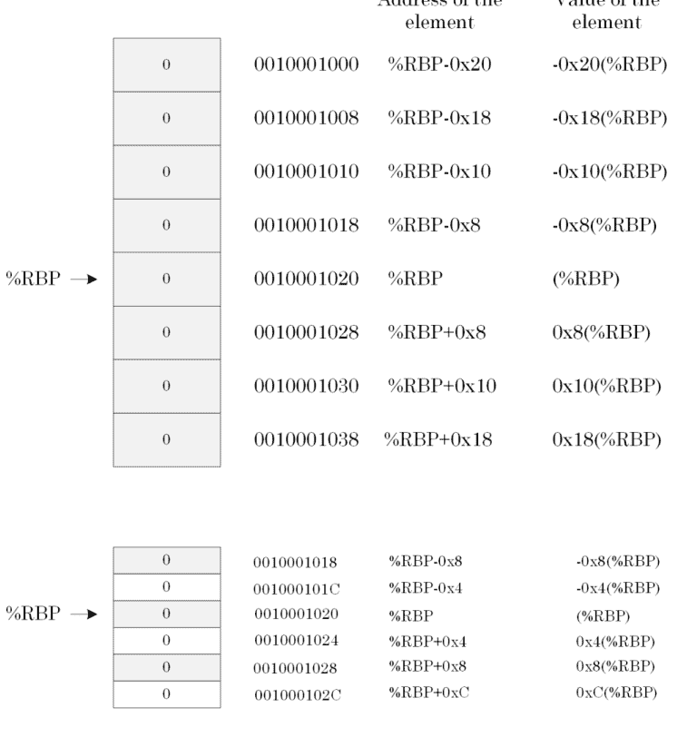

### 栈结构（无函数参数）

假设调用以下函数：

```c
void func()
{
    int var1, var2;
    // 正文代码
    // ...
}
```

在函数正文代码执行之前，将设置以下指针：

- `(%RBP)`包含前一个`%RBP`的值
- `-0x4(%RBP)`包含局部变量`var1`（双字）
- `-0x8(%RBP)`包含局部变量`var2`（双字）

如图 x64.10.2 所示。

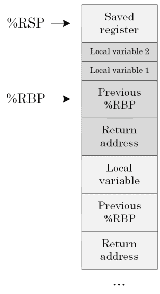

图 x64.10.2

### 函数序言（Function Prolog）

导致`%RBP`寄存器初始化并为局部变量留出空间的指令序列称为函数序言。图 x64.10.3 就是一个例子，其中`func`调用`func2`，`func2`有一个局部变量`var`。有时，保存必要的寄存器也被认为是函数序言的一部分。

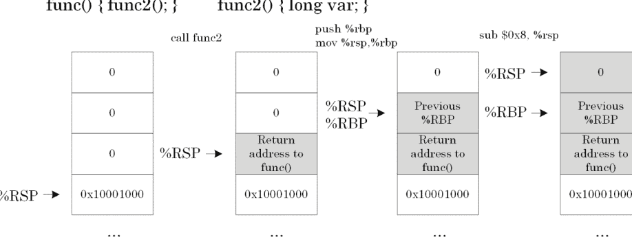

图 x64.10.3

### 原始栈（无局部变量和函数参数）

现在我们可以理解在第 x64.9 章项目`SimpleStack`中看到的原始栈上，除了函数返回地址之外还出现的附加数据（即函数调用之前等于前一个`%RSP`的前一个`%RBP`）：

```
(gdb) info registers $rsp $rbp
rsp		0x7ffffffe500	0x7ffffffe500
rbp		0x7ffffffe500	0x7ffffffe500
```

```
(gdb) x/10a $rsp
0x7ffffffe500: 0x7ffffffe510 0x55555555164 <func2+14>
0x7ffffffe510: 0x7ffffffe520 0x55555555153 <func+14>
0x7ffffffe520: 0x7ffffffe540 0x5555555513e <main+25>
0x7ffffffe530: 0x7ffffffe628 0x10000000000
0x7ffffffe540: 0x55555555170 < __libc_csu_init> 0x7ffff7e2c09b
< __libc_start_main+235>
```

```
(gdb) disass func2
```

函数`func2`的汇编代码转储：

```
0x0000555555555156 <+0>: push %rbp
0x0000555555555157 <+1>: mov %rsp,%rbp
0x000055555555515a <+4>: mov $0x0,%eax
0x000055555555515f <+9>: callq 0x555555555167 <func3>
0x0000555555555164 <+14>: nop
0x0000555555555165 <+15>: pop %rbp
0x0000555555555166 <+16>: retq
```

汇编转储结束。

```
(gdb) disass func
```

函数`func`的汇编代码转储：

```
0x0000555555555145 <+0>: push %rbp
0x0000555555555146 <+1>: mov %rsp,%rbp
0x0000555555555149 <+4>: mov $0x0,%eax
0x000055555555514e <+9>: callq 0x555555555156 <func2>
0x0000555555555153 <+14>: nop
0x0000555555555154 <+15>: pop %rbp
0x0000555555555155 <+16>: retq
```

汇编转储结束。

```
(gdb) disass main

Dump of assembler code for function main:
  0x0000555555555515 <+0>: push %rbp
  0x0000555555555126 <+1>: mov %rsp,%rbp
  0x0000555555555129 <+4>: sub $0x10,%rsp
  0x000055555555512d <+8>: mov %edi,-0x4(%rbp)
  0x0000555555555130 <+11>: mov %rsi,-0x10(%rbp)
  0x0000555555555134 <+15>: mov $0x0,%eax
  0x0000555555555139 <+20>: callq 0x555555555145 <func>
  0x000055555555513e <+25>: mov $0x0,%eax
  0x0000555555555143 <+30>: leaveq
  0x0000555555555144 <+31>: retq

End of assembler dump.
```

### 函数收尾（Function Epilog）

在函数代码返回调用者之前，它必须恢复`%RSP`和`%RBP`寄存器的前值，以便调用者能够从之前保存在栈上的正确地址恢复执行，并继续正确地对其自身的栈帧进行寻址。这一系列指令被称为函数收尾（function epilog），如图 x64.10.4 所示。

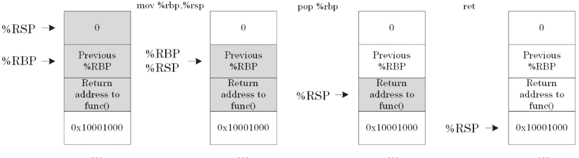

图 x64.10.4

我们可能会看到`leave`指令，而不是`mov %rbp,%rsp`和`pop %rbp`的指令序列，`leave`指令执行相同的功能，但占用的代码空间更少。

### “局部变量”项目

本章的项目可以从以下链接下载：

https://bitbucket.org/softwarediagnostics/pflddr/src/master/x64/Chapter10/

我们编译该文件并将可执行文件加载到 GDB 中：

```
coredump@DESKTOP-IS6V2L0:~/pflddr/x64/Chapter10$ gcc LocalVariables.cpp -o LocalVariables
coredump@DESKTOP-IS6V2L0:~/pflddr/x64/Chapter10$ gdb ./LocalVariables
Gnu gdb (Gdbian 8.2.1-2+b83) 8.2.1
Copyright (C) 2018 Free Software Foundation, Inc.
License GPLv3+: GNU general public license version 3 or later <http://gnu.org/licenses/gpl.html>
This is free software: you are free to change and redistribute it.
There is NO WARRANTY, to the extent permitted by law.
Type "show copying" and "show warranty" for details.
This GDB was configured as "x86_64-linux-gnu".
Type "show configuration" for configuration details.
For bug reporting instructions, please see:
<http://www.gnu.org/software/gdb/bugs/>.
Find the GDB manual and other documentation resources online at:
<http://www.gnu.org/software/gdb/documentation/>.
```

如需帮助，请输入`help`。

输入`apropos word`来搜索与`word`相关的命令……

Reading symbols from `./LocalVariables`... (no debugging symbols found)...done.

然后，我们在`main`函数处设置断点并运行程序，直到 GDB 触发中断：

```
(gdb) break main
Breakpoint 1 at 0x1129

(gdb) run
Starting program: /home/coredump/pflddr/x64/Chapter10/LocalVariables

Breakpoint 1, 0x0000555555555129 in main ()
```

接下来我们对`main`函数进行反汇编：

```
(gdb) disass main

Dump of assembler code for function main:
0x0000555555555125 <+0>:    push   %rbp
0x0000555555555126 <+1>:    mov    %rsp,%rbp
=> 0x0000555555555130 <+11>:  movl   $0x1,-0x4(%rbp)
0x0000555555555137 <+18>:   movl   $0x1,-0x8(%rbp)
0x000055555555513e <+25>:   mov    -0x4(%rbp),%eax
0x0000555555555141 <+28>:   add    %eax,-0x8(%rbp)
0x0000555555555144 <+31>:   addl   $0x1,-0x4(%rbp)
0x0000555555555148 <+35>:   mov    -0x8(%rbp),%eax
0x000055555555514b <+38>:   imul   -0x4(%rbp),%eax
0x000055555555514f <+42>:   mov    %eax,-0x8(%rbp)
0x0000555555555152 <+45>:   mov    $0x0,%eax
0x0000555555555157 <+50>:   pop    %rbp
0x0000555555555158 <+51>:   retq

End of assembler dump.
```

其源代码如下：


```cpp
int main()
{
    int a, b;

    a = 1;
    b = 1;

    b = b + a;
    ++a;
    b = b * a;

    return 0;
}
```

下面是相同的汇编语言代码，但附有显示伪代码操作的注释，并标出了函数序言（prolog）和收尾（epilog）：

```assembly
0x0000555555555125 <+0>:    push    %rbp            # 建立栈帧
0x0000555555555126 <+1>:    mov    %rsp,%rbp
=> 0x0000555555555130 <+11>: movl    $0x1,-0x4(%rbp) # 1 -> (a)
0x0000555555555137 <+18>:    movl    $0x1,-0x8(%rbp) # 1 -> (b)
0x000055555555513e <+25>:    mov    -0x4(%rbp),%eax # (a) -> eax
0x0000555555555141 <+28>:    add    %eax,-0x8(%rbp) # eax + (b) -> (b)
0x0000555555555144 <+31>:    addl    $0x1,-0x4(%rbp) # 1 + (a) -> (a)
0x0000555555555148 <+35>:    mov    -0x8(%rbp),%eax # (b) -> eax
0x000055555555514b <+38>:    imul    -0x4(%rbp),%eax # (a) * eax -> eax
0x000055555555514f <+42>:    mov    %eax,-0x8(%rbp) # eax -> (b)
0x0000555555555152 <+45>:    mov    $0x0,%eax       # 0 -> eax (返回值)
0x0000555555555157 <+50>:    pop    %rbp            # 恢复之前的栈帧
0x0000555555555158 <+51>:    retq                  # 返回 0
```

编译器没有生成`mov %rbp,%rsp`指令，因为`%RSP`没有发生变化：没有调用函数，也没有保存寄存器。

## 优化后的可执行文件反汇编

如果我们使用`-O1`选项编译`LocalVariables.cpp`，我们会看到非常简单的代码，它直接返回 0：

```
(gdb) dissas main

Dump of assembler code for function main:

=> 0x0000555555555125 <+0>:  mov $0x0,%eax
   0x000055555555512a <+5>:  retq

End of assembler dump.
```

我们在前一个版本中看到的那些代码去哪了？它们被编译器优化掉了，因为计算结果从未被使用。变量`a`和`b`是`main`函数的局部变量，当我们从函数返回时，在外部无法访问它们的值。

## 第 x64.11 章：函数参数

### “FunctionParameters”项目

本章将讲解调用者函数如何通过寄存器传递参数，以及被调用者（被调用函数）如何访问这些参数。我们使用可以通过此链接下载的以下项目：

`https://bitbucket.org/softwarediagnostics/pflddr/src/master/x64/Chapter11/`

以下是项目源代码：

```cpp
// FunctionParameters.cpp
int arithmetic (int a, int b);

int main(int argc, char* argv[])
{
    int result = arithmetic (1, 1);

    return 0;
}

// Arithmetic.cpp
int arithmetic (int a, int b)
{
    b = b + a;
    ++a;
    b = b * a;

    return b;
}
```

### 栈结构

回顾上一章，`%RBP`寄存器被用于寻址栈内存位置。这在图 x64.10.1 中有所阐述。这里我们为以下函数提供一个典型的栈内存布局示例：

```c
void func(int Param1, int Param2)
{
    int var1, var2;
    // 此时的栈内存布局
    // -0x18(%RBP) = Param2 (双字/doubleword)
    // -0x14(%RBP) = Param1 (双字/doubleword)
    // -0x8(%RBP)  = var2 (双字/doubleword)
    // -0x4(%RBP)  = var1 (双字/doubleword)
    // (%RBP)      = 之前的 %RBP (四字/quadword)
    // 0x8(%RBP)   = 返回地址 (四字/quadword)
    // ...
}
```

具有 2 个参数和 2 个局部变量的函数的典型栈帧内存布局如图 x64.11.1 所示。

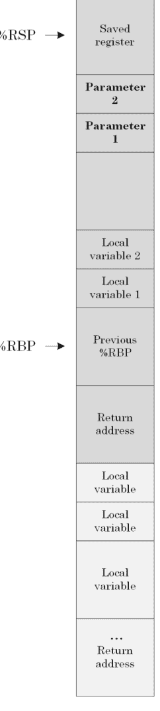

图 x64.11.1

### 函数序言与收尾

现在，在尝试理解`FunctionParameters`项目的反汇编之前，我们先看一个简单的例子：一个函数参数和一个局部变量，以此来阐述标准的函数序言（prolog）和收尾（epilog）指令序列以及相应的栈内存变化。

函数序言如图 x64.11.2 所示，函数收尾如图 x64.11.3 所示。

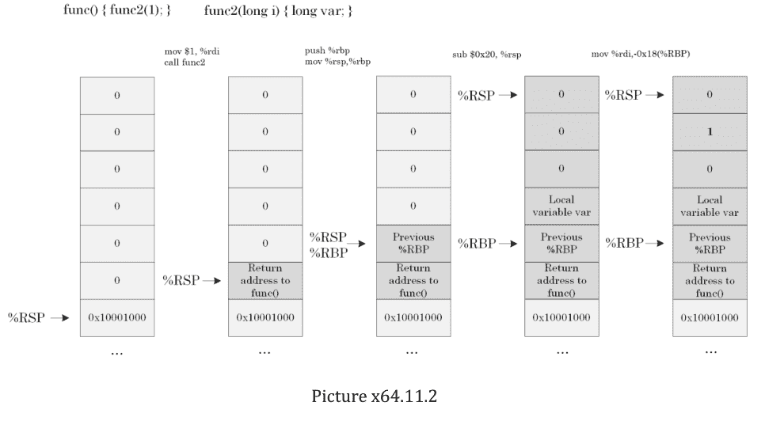

图 x64.11.2

这里，函数参数通过`%RDI`寄存器传递。由于该寄存器稍后可能在计算或向其他函数传递参数时被使用，因此它被保存在栈上。通常，当参数是像指针或长整型（long）这样的四字（quadwords）时，函数的前 6 个参数从左到右通过`%RDI`, `%RSI`, `%RDX`, `%RCX`, `%R8`, 和`%R9`寄存器传递；当参数是像整数（int）这样的双字（doublewords）时，则通过`%EDI`, `%ESI`, `%EDX`, `%ECX`, `%R8D`, 和`%R9D`寄存器传递。额外的参数则使用`PUSH`指令通过栈位置传递。

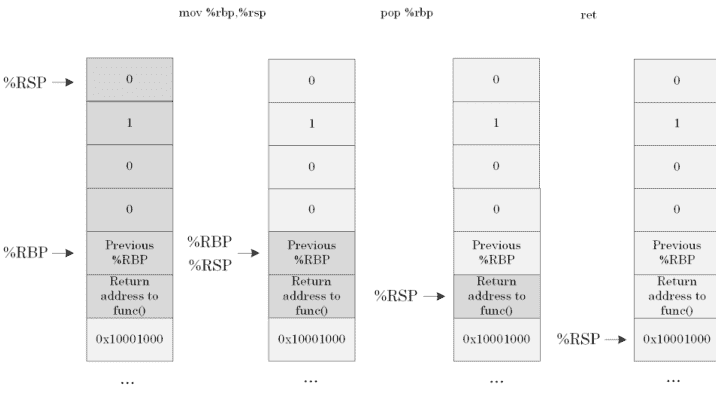

图 x64.11.3

我们还发现，当局部变量的存储空间通过`SUB`指令分配时，默认不会被初始化，并且在收尾阶段也不会被清除。分配之前内存中存在的任何内容都将成为局部变量的值，即所谓的“垃圾值”。

### 项目反汇编代码（含注释）

以下是`main`和`arithmetic`函数的带注释反汇编代码，为了视觉清晰，已移除内存地址。

```assembly
main:

push %rbp                      # 建立栈帧
mov %rsp,%rbp
sub $0x20,%rsp               # 为局部变量和函数参数创建栈帧

mov %edi,-0x14(%rbp)         # 保存 main 的第一个参数
mov %rsi,-0x20(%rbp)         # 保存 main 的第二个参数
mov $0x1,%esi                # 设置 arithmetic 函数的第二个参数

mov $0x1,%edi                # 设置 arithmetic 函数的第一个参数

callq 0x5555555514d <_Z10arithmeticii>
mov %eax,-0x4(%rbp)          # 设置结果局部变量
mov $0x0,%eax                # main 应该返回 0
leave                       # 恢复之前的栈指针和栈帧恢复，等同于
                                  #   mov %rbp, %rsp
                                  #   pop %rbp

retq                         # 从 main 返回
```

```assembly
arithmetic:

push %rbp                      # 建立栈帧
mov %rsp,%rbp
mov %edi,-0x4(%rbp)          # 保存 arithmetic 的第一个参数 (a)
mov %esi,-0x8(%rbp)          # 保存 arithmetic 的第二个参数 (b)
mov -0x4(%rbp),%eax          # (a) -> eax
add %eax,-0x8(%rbp)          # eax + (b) -> (b)
addl $0x1,-0x4(%rbp)         # 1 + (a) -> (a)
mov -0x8(%rbp),%eax          # (b) -> eax
imul -0x4(%rbp),%eax         # (a) * eax -> eax
mov %eax,-0x8(%rbp)          # eax -> (b)
mov -0x8(%rbp),%eax          # (b) -> eax
pop %rbp	                  # 恢复之前的栈帧
		                    # 不需要恢复栈指针，因为其没有改变
retq		                    # 结果值在 eax 中
```

我们可以在第一个算术计算地址处设置断点，并检查由`%RBP`寄存器指向的原始栈数据：

```bash
coredump@DESKTOP-IS6V2L0:~/pflddr/x64/Chapter11$ gcc FunctionParameters.cpp Arithmetic.cpp -o FunctionParameters
coredump@DESKTOP-IS6V2L0:~/pflddr/x64/Chapter11$ gdb ./FunctionParameters
GNU gdb (Debian 8.2.1-2+b3) 8.2.1
Copyright (C) 2018 Free Software Foundation, Inc.
License GPLv3+: GNU GPL version 3 or later <http://gnu.org/licenses/gpl.html>
This is free software: you are free to change and redistribute it.
There is NO WARRANTY, to the extent permitted by law.
Type "show copying" and "show warranty" for details.
This GDB was configured as "x86_64-linux-gnu".
Type "show configuration" for configuration details.
For bug reporting instructions, please see:
<http://www.gnu.org/software/gdb/bugs/>.
Find the GDB manual and other documentation resources online at:
<http://www.gnu.org/software/gdb/documentation/>.

For help, type "help".
Type "apropos word" to search for commands related to "word"...
Reading symbols from ./FunctionParameters... (no debugging symbols found)...done.

(gdb) break main
Breakpoint 1 at 0x1129

(gdb) run
Starting program: /home/coredump/pflddr/x64/Chapter11/FunctionParameters

Breakpoint 1, 0x0000555555555129 in main ()
```

```bash
(gdb) dissas arithmetic

Dump of assembler code for function _Z10arithmeticii:
 0x000055555555514d <+0>:    push   %rbp
 0x000055555555514e <+1>:    mov    %rsp,%rbp
 0x0000555555555151 <+4>:    mov    %edi,-0x4(%rbp)
 0x0000555555555154 <+7>:    mov    %esi,-0x8(%rbp)
 0x0000555555555157 <+10>:   mov    -0x4(%rbp),%eax
 0x000055555555515a <+13>:   add    %eax,-0x8(%rbp)
 0x000055555555515d <+16>:   addl   $0x1,-0x4(%rbp)
 0x0000555555555161 <+20>:   mov    -0x8(%rbp),%eax
 0x0000555555555164 <+23>:   imul   -0x4(%rbp),%eax
 0x0000555555555168 <+27>:   mov    %eax,-0x8(%rbp)
 0x000055555555516b <+30>:   mov    -0x8(%rbp),%eax
 0x000055555555516e <+33>:   pop    %rbp
 0x000055555555516f <+34>:   retq

End of assembler dump.

(gdb) break *0x0000555555555157
Breakpoint 2 at 0x0000555555555157

(gdb) continue
Continuing.

Breakpoint 2, 0x0000555555555157 in arithmetic(int, int) ()

(gdb) info registers $rbp
rbp    0x7fffffffe500    0x7fffffffe500

(gdb) x/10a $rbp-0x20
0x7fffffff4e40: 0x1    0x7ffff7eaaaf5 <handle_intel+197>
0x7fffffff4f40: 0x0    0x100000001    ; (b, a)
0x7fffffff5000: 0x7ffffffff530 0x555555555143 <main+30> ; saved $RBP, return address
0x7fffffff510: 0x7fffffff6e18 0x15555040
0x7fffffff520: 0x7fffffff6e10 0x0

(gdb) x/10w $rbp-0x20
0x7fffffff4e40: 0x1    0x0    0x7fffffff7eaaaf5    0x7fff
0x7fffffff4f40: 0x0    0x0    0x1    0x1    ; (b), (a)
0x7fffffff5000: 0x7ffffffff530    0x7fff
```

### 参数不匹配问题

为了说明理解栈内存布局的重要性，请考虑这个典型的二进制接口不匹配问题。函数`main`调用带有两个参数的`func`：

```c
// main.c
int main ()
{
    long locVar;
    func (1, 2);
    return 0;
}
```

调用者希望被调用函数`func`看到如下的栈内存布局，并在`%RDI`中传递 1，在`%RSI`中传递 2：

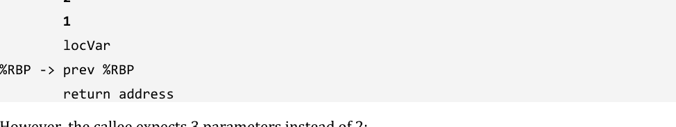

然而，被调用者期望的是 3 个参数而不是 2 个：

```c
// func.c
int func (int a, int b, int c)
{
    // 使用参数的代码
    return 0;
}
```

`func`代码看到的栈内存布局如下：

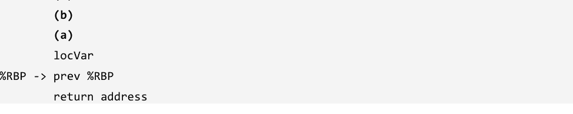

我们可以看到，原始栈上的参数`c`获取的值来自`%RDX`中的某个随机值，而该值从未被调用者设置。这显然是一个软件缺陷（bug）。

## 第 x64.12 章：更多指令

### CPU 标志寄存器

除了通用寄存器外，CPU 还包含一个 64 位的`%RFLAGS`寄存器，其中单个位会根据算术和其他操作而被设置（置 1）或清除（置 0）。单独的机器指令可以操作某些位的值，而这些值会影响代码的执行。

例如，`DF`位（方向标志，Direction Flag）决定内存拷贝操作的方向，可以通过`STD`指令设置，通过`CLD`指令清除。它的默认值为 0，其位置如图 x64.12.1 所示，图中仅显示了 64 位`%RFLAGS`的前 32 位。

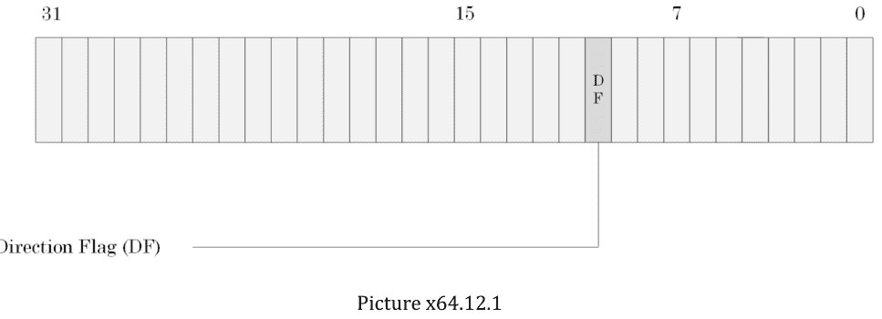

### 快速填充内存的方法


这可以通过`STOSQ`指令来实现，该指令将一个四字（quadword）值从`%RAX`存储到由`%RDI`寄存器指定的内存地址中（"D" 代表 destination 目的地）。当`%RAX`的值传输到内存后，该指令会将`%RDI`增加 8；如果 DF 标志为 0，则`%RDI`现在指向内存中的下一个四字。如果 DF 标志为 1，则`%RDI`的值减少 8，此时`%RDI`指向内存中的前一个四字。还有一个等效的`STOSL`指令，它存储双字（doublewords）并将`%RDI`增加或减少 4。

如果在任何指令前加上`REP`前缀，它会导致该指令重复执行，直到`%RCX`寄存器的值减至 0。例如，我们可以编写一段简单的代码，理论上应该将“所有内存”清零（实际上由于访问违规会触发陷阱）：

```assembly
xor %rax, %rax            # 填充 0
mov $0, %rdi             # 起始地址 或 xor %rdi, %rdi
mov $0xffffffff / 4, %rcx # 0x1ffffff 个四字
rep stosq
```

以下是`REP STOSQ`的伪代码：

```
WHILE (RCX != 0)
{
    RAX -> (RDI)

    IF DF = 0 THEN
        RDI + 8 -> RDI
    ELSE
        RDI - 8 -> RDI

    RCX - 1 -> RCX
}
```

图 x64.12.2 展示了一个擦除 32 字节（4x8）的简单示例。

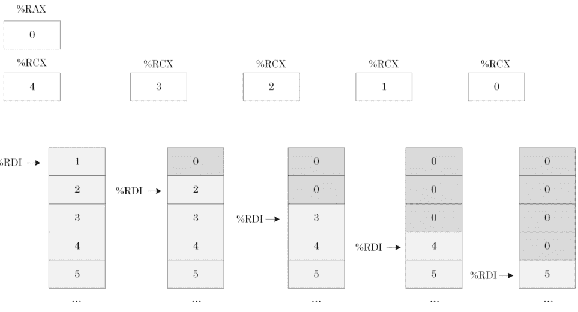

图 x64.12.2

### 测试是否为 0

如果指令结果为 0，则`%RFLAGS`寄存器中的 ZF 位被设置为 1，否则被清除。该位受以下指令影响：

- 算术指令（例如`ADD`，`SUB`，`MUL`）

- 逻辑比较指令（`TEST`）

- “算术”比较指令（`CMP`）

ZF 位的位置如图 x64.12.3 所示。

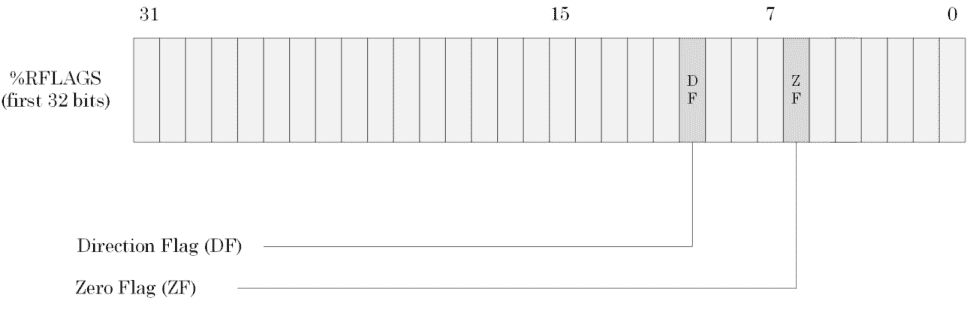

图 x64.12.3

### TEST - 逻辑比较

该指令计算两个操作数之间的按位逻辑与（AND），并根据计算结果（结果将被丢弃）设置标志位（包括 ZF）：

```
TEST reg/imm, reg/mem
```

示例：

```
TEST %EDX, %EDX
```

假设`%EDX`寄存器包含 4 ($100_{bin}$)

```
100_{bin} AND 100_{bin} = 100_{bin}  != 0 (ZF 被清除)
```

```
TEST $1, %EDX
```

假设`%EDX`包含 0 ($0_{bin}$)

```
0_{bin} AND 1_{bin} = 0_{bin}  == 0 (ZF 被设置)
```

以下是 TEST 指令的伪代码（省略了与 ZF 位无关的细节）：

```
TEMP := OPERAND1 AND OPERAND2
IF TEMP = 0 THEN
    1 -> ZF
ELSE
    0 -> ZF
```

### CMP – 比较两个操作数

该指令将第一个操作数与第二个操作数进行比较，并根据计算结果（结果将被丢弃）设置标志位（包括 ZF）。比较是通过从第二个操作数中减去第一个操作数来执行的（类似于 SUB 指令：`sub $4, %eax`）。

```
CMP reg/imm, reg/mem
CMP reg/mem/imm, reg
```

示例：

```
CMP $0, %EDI
```

假设`%EDI`包含 0

0 - 0 == 0 (ZF 被设置)

```
CMP $0x16, %EAX
```

假设`%EAX`包含 4hex

4hex - 16hex = FFFFFFEEhex != 0 (ZF 被清除)

4dec - 22dec = -18dec

以下是 CMP 指令的伪代码（省略了与 ZF 位无关的细节）：

```
OPERAND2 - OPERAND1 -> TEMP
IF TEMP = 0 THEN
    1 -> ZF
ELSE
    0 -> ZF
```

CMP 指令等同于以下伪代码序列：

```
OPERAND2 -> TEMP
SUB OPERAND1, TEMP
```

### TEST 还是 CMP？

如果我们想测试是否为零，这两条指令是等效的，但 CMP 指令比 TEST 影响更多的标志位：

```
TEST %EAX, %EAX
CMP $0, %EAX
```

CMP 指令用于比较是否不等（TEST 指令在此不能使用）：

```
CMP $0, %EAX  # > 0 或 < 0 ?
```

TEST 指令用于检查单个位是否被设置：

```
TEST $2, %EAX  # 2 == 0010bin 或在 C 语言中：if (var & 0x2)
```

当`%EAX`值为 2 时的示例：

```
TEST $2, %EAX  # 0010bin AND 0100bin = 0000bin (ZF 被设置)
TEST $6, %EAX  # 0010bin AND 0110bin = 0010bin (ZF 被清除)
```

### 条件跳转

考虑这两段 C 或 C++ 代码片段：

CPU 顺序获取指令，因此我们必须告诉 CPU，如果某些条件（不）满足（例如，如果 `a != 0`），我们希望跳过某些指令。

JNZ（如果不为零则跳转）和 JZ（如果为零则跳转）测试 ZF 标志，如果 JNZ 的 ZF 位被清除或 JZ 的 ZF 位被设置，则更改`%RIP`。以下汇编语言代码等同于上述 C/C++ 代码：

```asm
CMP  $0, A          MOV  A, %EAX
JNZ  label1         TEST %EAX, %EAX
INC  A              JZ   label1
JMP  label2         INC  %EAX
label1: DEC  A      JMP  label2
label2:             label1: DEC  %EAX
                     label2:
```

### 寄存器的结构

一些 64 位寄存器具有遗留结构，允许我们访问其较低的 32 位、16 位和两个 8 位部分，如图 x64.12.4 所示。

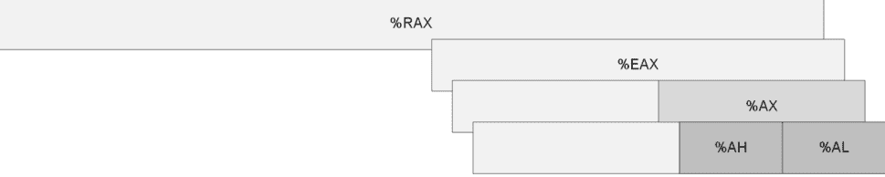

图 x64.12.4

### 函数返回值

许多函数通过`%RAX`寄存器返回结果。例如：

```cpp
long func();
```

返回值在`%RAX`中。

```cpp
bool func();
```

返回值在`%EAX`中。

虽然 bool 值在内存中占用一个字节，但编译器可能会使用`%EAX`而不是`%AL`。

### 使用字节寄存器

假设我们在`%AL`寄存器中有一个字节值，并希望将此值加到`%ECX`寄存器中。然而，我们不知道完整`%EAX`寄存器的其他部分包含什么值。我们不能使用如下指令，例如：

```
MOV %AL, %EBX # 操作数大小冲突
```

伪代码中提出的解决方案：

```
AL -> EBX or AL -> EAX
ECX + EBX -> ECX ECX + EAX -> ECX
```

我们只能使用源和目的地的操作数大小相同的 MOV 指令，例如：

```
MOV %AL, %BL
MOV %AL, b # 在 C 中：static bool b = func()
```

针对此任务，有一个特殊的 MOVZX（零扩展移动）指令，它用第一个操作数的内容替换第二个操作数的内容，同时将剩余的位填充为零：

```
MOVZX reg/mem, reg
```

因此，我们该任务的解决方案变得非常简单：

```
MOVZX %AL, %EBX
ADD %EBX, %ECX
```

我们也可以复用`%EAX`寄存器：

```
MOVZX %AL, %EAX
ADD %EAX, %ECX
```

## 第 x64.13 章：函数指针参数

### “FunctionPointerParameters” 项目

这是我们的最终项目，可以从以下地址下载：

https://bitbucket.org/softwarediagnostics/pflddr/src/master/x64/Chapter13/

项目源代码摘要：

```cpp
// FunctionParameters.cpp
int main(int argc, char* argv[])
{
    int a, b;

    printf("Enter a and b: ");
    scanf("%d %d", &a, &b);

    if (arithmetic (a, &b))
    {
        printf("Result = %d", b);
    }

    return 0;
}
```

```cpp
// Arithmetic.cpp
bool arithmetic (int a, int *b)
{
    if (!b)
    {
        return false;
    }

    *b = *b + a;
    ++a;
    *b = *b * a;

    return true;
}
```

### 带注释的反汇编

以下是我们编译项目并加载到 GDB 后获得带注释的反汇编结果：

```bash
coredump@DESKTOP-1S6V2L8:~/pflddr/x64/Chapter13$ gcc FunctionParameters.cpp Arithmetic.cpp -o FunctionParameters
coredump@DESKTOP-1S6V2L8:~/pflddr/x64/Chapter13$ gdb ./FunctionParameters
GNU gdb (Debian 8.2.1-2+b3) 8.2.1
Copyright (C) 2018 Free Software Foundation, Inc.
License GPLv3+: GNU GPL version 3 or later <http://gnu.org/licenses/gpl.html>
This is free software: you are free to change and redistribute it.
There is NO WARRANTY, to the extent permitted by law.
Type "show copying" and "show warranty" for details.
This GDB was configured as "x86_64-linux-gnu".
Type "show configuration" for configuration details.
For bug reporting instructions, please see:
<http://www.gnu.org/software/gdb/bugs/>.
Find the GDB manual and other documentation resources online at:
<http://www.gnu.org/software/gdb/documentation/>.

For help, type "help".
Type "apropos word" to search for commands related to "word"...
Reading symbols from ./FunctionParameters... (no debugging symbols found)...done.

(gdb) break main
Breakpoint 1 at 0x1149

(gdb) run
Starting program: /home/coredump/pflddr/x64/Chapter13/FunctionParameters
```

Breakpoint 1, 0x0000555555555149 in main ()

```
(gdb) disass main
Dump of assembler code for function main:
    0x0000555555555145 <+0>:    push   %rbp
    0x0000555555555146 <+1>:    mov    %rsp,%rbp
=>  0x0000555555555149 <+4>:    sub    $0x20,%rsp
    0x000055555555514d <+8>:    mov    %edi,-0x14(%rbp)
    0x0000555555555150 <+11>:   mov    %rsi,-0x20(%rbp)
    0x0000555555555154 <+15>:   lea    0xea9(%rip),%rdi  # 0x555555556004
    0x000055555555515b <+22>:   mov    $0x0,%eax
    0x0000555555555160 <+27>:   callq  0x55555555030 <printf@plt>
    0x0000555555555161 <+28>:   lea    -0x8(%rbp),%rdx
    0x0000555555555169 <+36>:   lea    -0x4(%rbp),%rax
    0x000055555555516d <+40>:   mov    %rax,%rsi
    0x0000555555555170 <+43>:   lea    0xe60(%rip),%rdi  # 0x555555556014
    0x0000555555555177 <+50>:   mov    $0x0,%eax
    0x000055555555517c <+55>:   callq  0x555555550540 <scanf@plt>
    0x0000555555555181 <+60>:   mov    -0x4(%rbp),%eax
    0x0000555555555184 <+63>:   lea    -0x8(%rbp),%rdx
    0x0000555555555188 <+67>:   mov    %rdx,%rsi
    0x000055555555518b <+70>:   mov    %eax,%edi
    0x000055555555518d <+72>:   callq  0x5555555551b3 <_Z10arithmeticIPiP>
    0x0000555555555192 <+77>:   test   %al,%al
    0x0000555555555194 <+79>:   je     0x5555555551ac <main+103>
    0x0000555555555196 <+81>:   mov    -0x8(%rbp),%eax
    0x0000555555555199 <+84>:   mov    %eax,%esi
    0x000055555555519b <+86>:   lea    0x7e8(%rip),%rdi  # 0x55555555601a
    0x00005555555551a2 <+93>:   mov    $0x0,%eax
    0x00005555555551a7 <+98>:   callq  0x55555555030 <printf@plt>
    0x00005555555551ac <+103>:  mov    $0x0,%eax
    0x00005555555551b1 <+108>:  leaveq
    0x00005555555551b2 <+109>:  retq
End of assembler dump.
```

```
(gdb) x/s 0x555555556004
0x555555556004: "Enter a and b: "
```

```
(gdb) x/s 0x555555556014
0x555555556014: "%d %d"
```

```
(gdb) x/s 0x55555555601a
0x55555555601a: "Result = %d"

(gdb) dissas arithmetic

Dump of assembler code for function _Z10arithmeticIPi:

```assembly
0x00005555555551b3 <+0>:    push    %rbp
0x00005555555551b4 <+1>:    mov     %rsp,%rbp
0x00005555555551b7 <+4>:    mov     %edi,-0x4(%rbp)
0x00005555555551ba <+7>:    mov     %rsi,-0x10(%rbp)
0x00005555555551be <+11>:   cmpq    $0x0,-0x10(%rbp)
0x00005555555551c3 <+16>:   jne     0x5555555551c1 <_Z10arithmeticIPi+25>
0x00005555555551c5 <+18>:   mov     $0x0,%eax
0x00005555555551ca <+23>:   jmp     0x5555555551f8 <_Z10arithmeticIPi+69>
0x00005555555551cc <+25>:   mov     -0x10(%rbp),%rax
0x00005555555551d0 <+29>:   mov     (%rax),%edx
```


`0x00005555555551d2 <+31>:   mov     -0x4(%rbp),%eax`

`0x00005555555551d5 <+34>:   add     %eax,%edx`

`0x00005555555551d7 <+36>:   mov     -0x10(%rbp),%rax`

`0x00005555555551db <+40>:   mov     %edx,(%rax)`

`0x00005555555551dd <+42>:   addl    $0x1,-0x4(%rbp)`

`0x00005555555551e1 <+46>:   mov     -0x10(%rbp),%rax`

`0x00005555555551e5 <+50>:   mov     (%rax),%eax`

`0x00005555555551e7 <+52>:   imul    -0x4(%rbp),%eax`

`0x00005555555551eb <+56>:   mov     %eax,%edx`

`0x00005555555551ed <+58>:   mov     -0x10(%rbp),%rax`

`0x00005555555551f1 <+62>:   mov     %edx,(%rax)`

`0x00005555555551f3 <+64>:   mov     $0x1,%eax`

`0x00005555555551f8 <+69>:   pop     %rbp`

`0x00005555555551f9 <+70>:   retq`

```
End of assembler dump.
```

### main:

```assembly
push %rbp               # 建立栈帧
mov %rsp,%rbp
sub $0x20,%rsp           # 为局部变量和 main 函数参数创建栈帧
mov %edi,-0x14(%rbp)    # 保存第一个 main 参数
mov %rsi,-0x20(%rbp)    # 保存第二个 main 参数
lea 0xe9a(%rip),%rdi    # 0x5555555556004 printf 的字符串参数地址
mov $0x0,%eax
callq 0x55555555030 <printf@plt>   # printf("Enter a and b: ")
lea -0x8(%rbp),%rdx     # 地址 b -> rdx (第 3 个参数)
lea -0x4(%rbp),%rax     # 地址 a -> rax
mov %rax,%rsi           # rax -> rsi (第 2 个参数)
lea 0xe9d(%rip),%rdi    # 0x5555555556014 scanf 字符串参数地址 (第 1 个参数)
mov $0x0,%eax
callq 0x55555555040 <scanf@plt>     # scanf("%d %d", &a, &b)
                                    # 参数通过 %rdi, %rsi, %rdx 传递
mov -0x4(%rbp),%eax     # (a) -> eax (a 的值)
lea -0x8(%rbp),%rdx     # 地址 b -> rdx
mov %rdx,%rsi           # rdx -> rsi (第 2 个参数)
mov %eax,%edi           # eax -> edi ((a), 第 1 个参数)
callq 0x555555551b3 <_Z10arithmeticIPiP>   # arithmetic (a, b)
test %al,%al
                        # 测试是否为零
                        # arithmetic 函数返回的 bool 结果
je 0x5555555551ac <main+103>        # 如果 = 0
                                    # 0x00005555555551ac -> rip
mov -0x8(%rbp),%eax     # (b) -> eax (b 的值)
mov %eax,%esi           # eax -> esi (第 2 个参数)
lea 0xe78(%rip),%rdi    # 0x555555555601a printf 的字符串参数地址
mov $0x0,%eax
callq 0x55555555030 <printf@plt>    # printf("Result = %d", b)
0x00005555555551ac <+103>:
mov $0x0,%eax           # main 应返回 0
leavq                   # 恢复之前的栈指针和栈帧，
                        # 等同于
                        # mov %rbp, %rsp
                        # pop %rbp
                        # 从 main 返回
retq
```

### arithmetic:

```assembly
push %rbp            # 建立栈帧
mov  %rsp,%rbp
mov  %edi,-0x4(%rbp) # 保存第一个参数 (p1)
mov  %rsi,-0x10(%rbp)# 保存第二个参数 (p2)
cmpq $0x0,-0x10(%rbp)# 如果 p2 != 0
jne  0x5555555551cc < _Z10arithmeticPiPi+25> # 跳转到 0x5555555551cc
mov  $0x0,%eax       # 返回值 0
jmp  0x5555555551f8 < _Z10arithmeticPiPi+69> # 跳转到 epilog
```

`0x00005555555551cc <+25>:`

```assembly
mov  -0x10(%rbp),%rax # (p2) -> rax
mov  (%rax),%edx     # (rax) -> edx (*p2)
                     # p2 是一个指针，因为它
                     # 包含了我们命名为 b 的
                     # 变量的地址
                     # 我们也将 p1 命名为 a
mov  -0x4(%rbp),%eax # (a) -> eax
add  %eax,%edx       # eax + edx -> edx
                     # (a) + (b) -> edx
mov  -0x10(%rbp),%rax # 地址 b -> rax
mov  %edx,(%rax)     # edx -> (b)
                     # (a) + (b) -> (b)
addl $0x1,-0x4(%rbp) # 1 + (a) -> (a)
mov  -0x10(%rbp),%rax # 地址 b -> rax
mov  (%rax),%eax     # (b) -> eax
imul -0x4(%rbp),%eax # (a) * (b) -> eax
mov  %eax,%edx       # eax -> edx
mov  -0x10(%rbp),%rax # 地址 b -> rax
mov  %edx,(%rax)     # edx -> (b)
                     # (a) * (b) -> (b)
mov  $0x1,%eax       # 1 -> eax (返回值)
```

`0x00005555555551f8 <+69>:`

```assembly
pop %rbp    # 恢复之前的栈帧
            # 无需恢复栈指针
            # 因为它没有改变
retq        # 结果值在 eax 中
```

## 第 x64.14 章：代码反汇编模式总结

最后一章总结了我们在阅读本书过程中遇到的各种模式。

### 函数 Prolog / Epilog（序幕/尾声）

### 函数 Prolog（序幕）

```assembly
push %rbp
mov %rsp,%rbp
```

### 函数 Epilog（尾声）

```assembly
mov %rbp,%rsp
pop %rbp
ret
```

这等同于：

```assembly
leave
ret
```

如果 `%RSP` 没有改变，某些代码可能会省略恢复 `%RSP`：

```assembly
pop %rbp
ret
```

了解 prolog 有助于在符号文件或函数起始地址不正确时识别相关情况。例如，假设我们有以下回溯（backtrace）：

```text
func3+0x05F
func2+0x08F
func+0x20
```

如果我们反汇编 `func2` 函数，发现它不是以 prolog 开始的，那么我们可以认为该回溯需要进一步关注：

```text
(gdb) x/2i func2
0x555555555165 <main+32>: lea -0x8(%rbp),%rdx
0x555555555169 <main+36>: lea -0x4(%rbp),%rax
```

在优化代码中，可能会使用 `%RSP` 而不是 `%RBP` 来访问局部变量和参数。在这种情况下，prolog 和 epilog 可能会部分缺失。以下是来自 `printf` 函数的一个示例：

```assembly
(gdb) dissas printf
Dump of assembler code for function __printf:
 0x00007ffff77e60560 <+0>:  sub $0xd8,%rsp
 0x00007ffff77e60567 <+7>:  mov %rsi,0x28(%rsp)
 0x00007ffff77e6056c <+12>: mov %rdx,0x30(%rsp)
 0x00007ffff77e60571 <+17>: mov %rcx,0x38(%rsp)
 0x00007ffff77e60576 <+22>: mov %r8,0x40(%rsp)
 0x00007ffff77e6057b <+27>: mov %r9,0x48(%rsp)
 0x00007ffff77e60580 <+32>: test %al,%al
 0x00007ffff77e60582 <+34>: je 0x7ffff77e605bb <__printf+91>
 0x00007ffff77e60584 <+36>: pxor %xmm0,0x50(%rsp)
 0x00007ffff77e60589 <+41>: movaps %xmm1,0x60(%rsp)
 0x00007ffff77e6058e <+46>: movaps %xmm2,0x70(%rsp)
 0x00007ffff77e60593 <+51>: movaps %xmm3,0x80(%rsp)
 0x00007ffff77e6059b <+59>: movaps %xmm4,0x90(%rsp)
 0x00007ffff77e605a3 <+67>: movaps %xmm5,0xa0(%rsp)
 0x00007ffff77e605ab <+75>: movaps %xmm6,0xb0(%rsp)
 0x00007ffff77e605b3 <+83>: movaps %xmm7,0xc0(%rsp)
 0x00007ffff77e605bb <+91>: mov %fs:0x28,%rax
 0x00007ffff77e605c4 <+100>: mov %rax,0x18(%rsp)
 0x00007ffff77e605c9 <+105>: xor %eax,%eax
 0x00007ffff77e605cb <+107>: lea 0xe0(%rsp),%rax
 0x00007ffff77e605d3 <+115>: mov %rdi,%rsi
 0x00007ffff77e605d6 <+118>: mov %rsp,%rdx
 0x00007ffff77e605d9 <+121>: mov %rax,0x8(%rsp)
 0x00007ffff77e605de <+126>: lea 0x20(%rsp),%rax
 0x00007ffff77e605e3 <+131>: mov %rax,0x10(%rsp)
 0x00007ffff77e605e8 <+136>: mov 0x162959(%rip),%rax # 0x7ffff77fc2f48
 0x00007ffff77e605ef <+143>: mov 0x8(%rsp),%rsp
 0x00007ffff77e605f6 <+150>: mov (%rax),%rdi
 0x00007ffff77e605f9 <+153>: mov 0x30,0x4(%rax)
 0x00007ffff77e60601 <+161>: callq 0x7ffff76579f0 <_IO_vfprintf_internal>
 0x00007ffff77e60606 <+166>: mov 0x18(%rsp),%rcx
 0x00007ffff77e6060b <+171>: xor %fs:0x28,%rcx
 0x00007ffff77e60614 <+188>: jne 0x7ffff77e6061e <__printf+190>
 0x00007ffff77e60618 <+182>: add $0xd8,%rsp
 0x00007ffff77e6061d <+189>: retq
 0x00007ffff77e6061e <+190>: callq 0x7ffff77127b0 <__stack_chk_fail>
End of assembler dump.
```

### LEA (加载有效地址)

以下指令：

```assembly
lea -0x8(%rbp),%rdx
```

等同于以下算术序列：

```assembly
mov %rbp, %rdx
add -0x8, %rdx
```

以下指令：

```assembly
lea 0xea9(%rip),%rdi
```

等同于以下算术序列：

```assembly
mov %rip, %rdi
add 0xea9, %rdx
```

### 参数传递

**从左到右的前 6 个函数参数**

```
%RDI, %RSI, %RDX, %RCX, %R8, and %R9
```

> 注意：虽然我们还没有看到超过 6 个函数参数的示例，但它们是通过栈传递的，例如通过 `PUSH` 指令。

**静态/全局变量地址（或字符串常量）**

```assembly
mov $0x555555556004, reg
lea 0xe9d(%rip), reg
```

**局部变量值 vs. 局部变量地址**

```assembly
mov -XXX(%rbp), reg ; 局部变量值
call func
lea -XXX(%rbp), reg ; 局部变量地址
call func
```

### 访问参数和局部变量

### 局部变量值

```assembly
mov -XXX(%rbp), reg
mov XXX(%rsp), reg # 优化后的代码
```

### 局部变量地址

```assembly
lea -XXX(%rbp), reg
lea XXX(%rsp), reg # 优化后的代码
```

### 访问双字（doubleword）值

```assembly
mov -0x8(%rbp), %eax
add $1, %eax
addl $1, %rax
```

### 访问四字（quadword）值

```assembly
mov -0x8(%rbp), %rax
add $1, %rax
```

### 访问并解引用指向双字值的指针

```assembly
mov -0x10(%rbp), %rax
mov (%rax), %eax
add $1, %eax
```

### 访问并解引用指向四字值的指针

```assembly
mov -0x10(%rbp), %rax
mov (%rax), %rax
add $1, %rax
```

优化后的代码可能不会使用栈位置来寻址函数参数（而仅使用传递参数的寄存器），正如在前一章中使用 `-O1` 开关编译的示例中所示：

```
(gdb) disass arithmetic
Dump of assembler code for function _Z10arithmeticiPi:
0x00005555555551ab <+0>:    test    %rsi,%rsi
0x00005555555551ae <+3>:    je     0x5555555551c2 <_Z10arithmeticiPi+23>
0x00005555555551b0 <+5>:    mov     %edi,%eax
0x00005555555551b2 <+7>:    add     (%rsi),%eax
0x00005555555551b4 <+9>:    add     $0x1,%edi
0x00005555555551b7 <+12>:   imul    %eax,%edi
0x00005555555551ba <+15>:   mov     %edi,(%rsi)
```


```
0x00005555555551bc <+17>:   mov     $0x1,%eax

0x00005555555551c0 <+19>:   retq

0x00005555555551c2 <+22>:    mov     $0x0,%eax

0x00005555555551c7 <+28>:   retq

End of assembler dump.
```
