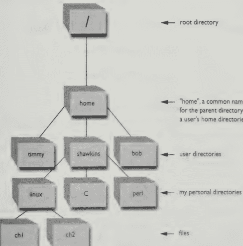

# Linux 参考手册（开源技术系列）

- 不要仅仅满足于帮助页（man pages）！
- 按任务组织，让你可以快速找到所需内容——即使你是 Linux 新手！
- 专家实用的便捷字母顺序命令参考
- 唯一一本为每个命令都提供示例的 Linux 参考书！


序言 由 LinuxMall.com CEO Mark Bolzen 编写


http://archive.org/details/linuxdeskreferen00hawk


# 献献

我想将这本书献给我的两位祖母：

Emma Louise Hawkins 和 Viola Knoll。

`&`, `^Z`, `bg`, `fg`, `fuser`, `jobs`, `kill`, `killall`, `nice`, `nohup`, `pidof`, `ps`, `pstree`, `renice`, `top`

`halt`, `poweroff`, `reboot`, `swapoff`

## “现状”

在我写这段文字时，Linux 内核已经诞生了八年。1991 年 9 月，赫尔辛基大学的一名 21 岁学生上传了 Linux 内核的 0.01 版本。林纳·托瓦尔斯（Linus Torvalds）无法预测到他所编写的代码将在不到十年后成为一个行业的核心。

然而，我们现在所知的 Linux 操作系统远不止 Linux 内核本身。内核只处理操作系统的核心功能；它不提供用户界面或日常使用的工具。幸运的是，自由软件基金会的 GNU 项目已经开发了大多数用于 UNIX 风格系统的工具。开发自由操作系统的大部分工作已经完成；缺失的部分正是 Linux 所提供的。

起初进展缓慢，但每个月的势头都在增强，人们开始下载并使用 Linux。由于代码是开放的，他们开始对其进行完善和添加，并将更改返回给 Linux，以整合到内核的新版本中。得益于通用公共许可证（GPL），任何人都可以查看并改进代码，而且许多人确实做到了这一点。

为了让 Linux 更易获取，人们开始组合各种“发行版”（distributions），即创建安装程序并通常简化使用 Linux 的过程。如果你认为从 CD-ROM 安装 Linux 很难，那么请想象一下必须收集操作系统所有部分的源代码、编译它们并将它们放在正确的位置、通过手动完成所有操作来编写所有的配置文件是怎样的体验。

为了让 Linux 更随手可得，几家公司开始销售发行版。当时，许多人认为这有点疯狂，因为大家都知道从免费软件上赚不到钱。当事实证明 Linux 可以建立一个成功的商业案例时，大公司开始对 Linux 产生兴趣。借鉴埃里克·S·雷蒙德（Eric S. Raymond）的《大教堂与大集市》（The Cathedral and the Bazaar）中的疗法，网景（Netscape）决定也走开源路线。

虽然 Mozilla 项目没有如预期中那样成功，但网景对开源软件的尝试引起了人们对开源软件的关注——尤其是 Linux。越是的人和企业听到 Linux，他们就越喜欢。

自从网景转向开源才过去了一年多，Linux 已经增长了巨大的增长。各大公司争相恐挤地发布带有“开源”或“Linux”字样的公告。一天如果没有一家大公司发布新闻稿宣布他们对 Linux 的承诺，那简直不可想象。几乎每家主要的软件和硬件公司都对 Linux 做出了某种承诺，但有一个显著的例外。

## “现状”

华尔街似乎也喜欢 Linux。红帽（Red Hat）的 IPO 一飞云霄。红帽的从从8 月份每股 14 美元开始，一直持续超过 100 美元。其他几家 Linux 公司也即将上市。

Linux 长期以来被视为技术上的成功，现在它也取得了商业上的成功。Linux 从它微的起点已经走了很远。虽然现在不清楚 Linux 会走多远，但很清楚的是 Linux 将留在这里。Linux 的增长以及它对计算机行业的影响简直不可思议。这并不意味着 Linux 已经“赢了”——还有很多工作要做完成。我相信，接下来的八年对 Linux 来说将比过去的八年更加令人兴奋。

中国所谓的“愿你生活在激动人心的时代”也同样应验。现在山里有了金矿，每个人都想加入 Linux 的行列。公司正以惊人的速度合并，而建立了 Linux 社区的现有玩家正面临着向那些渴望分一杯 Linux 蛋糕的新来者输掉底裤的危险。Linux 建立的这座房子不仅仅建立在代码之上。我们只能希望派对的新来者不要像对待其他行业那样撞毁这栋房子。

微软不太可能坐以待毙接受 Linux。他们最近的“Linux 神话”（Linux Myths）页面证明，这家巨头开始察觉到 Linux 对微软构成的威胁。与那些威胁过微软霸权的公司不同，Linux 代表的不仅是对单一月度软件收入流的威胁。Linux 和开源无异于对微软商业模式的一场革命。看看来自红木城（Redwood）的巨兽如何对抗 Linux 将非常有趣。旧的 FUD（恐惧、不确定、怀疑）策略可能不起作用，而且微软买不这个竞争对手。谚中说的“800 磅大猩猩”很快就要减肥了。

Linux 的最大威胁——如果有的话——来自内部，而非外部。社区已经展现了从容应对技术障碍的能力。问题是我们如何处理它。

然而，我认为开源的根基太强大了，不会被侵入性的商业主义所腐蚀。是的，对于愿意投资 Linux 的公司来说，Linux 将是一个盈利工具。然而，我看到长远来看，Linux 将改变计算机公司赚钱的方式。在不远的将来，成功的软件和硬件公司将都需要服务、支持和源码。

许多公司和个人已经看到了开源和 Linux 带来的优势。如果你是 Linux 的初学者，你会发现它提供了一个比微软、苹果等公司的专有产品丰富得多的计算环境。Linux 现在与仅可以和其他服务器和桌面操作系统相美并论，你可以预计按照其目前的开发速度，Linux 将在很快在功能和稳定性上超越这些系统。

无论你是一个资深的 UNIX 或 Linux 黑客，还是一个 Linux 新手，只想看看这在闹什么，斯科的《Linux 桌面参考》（Scott's Linux Desk Reference）都应该为你提供很好的帮助。如果你是新手，这本书可以作为你教育的基石；如果你已经熟悉，它就是必不可少的参考。

祝愉快！

Joe “Zonker” Brockmeier

《Linux 周刊》编辑

## 致谢

首先，让我感谢我的编辑、Prentice-Hall 出版公司的 Miles Williams，一位优秀的编辑，也是一个极其出色的人。我的插画 Shanne Maggio 将我那些几乎无法辨别的圆珠笔草图变成了人类可读的图画。我的评审员提供了极佳的反馈和注释。此外，Robert Oakman、Manton Matthews、Jerah Hollis 和 Joe Morris 也提供了无价的帮助。最后，让我提一下我的几只笨狗：Puppy Dog、Mighty Bebos、Igor、Renfield，以及（最近的）在这份手稿创作期间担任了脚垫，并且（在大多数时候）克制了没有做坏事。

## 引言

我希望你能很好地利用这本书。自从我从 1986 年开始接触 Unix 以来，我花了大量的钱购买参考书。我一直是个藏书爱好者，而且计算机书籍有可以抵税的优势，所以我积累了相当大量的收藏。每当我回到家发现刚花 50 美元买的那个华丽、包装精美的 400 页“文档大杂烩”实际上只包含 5 页实际信息，或者更糟，充满了信息但组织极其糟糕，为了找到我需要的内容会觉得得不偿失。

我在这里尝试的是整合我收藏中的优秀特性。我知道我喜欢什么——良好的索引、详尽的技术覆盖、相关的示例以及简洁的解释（英文）。此外，在写这本书的过程中，我对比计算机参考书籍的主题变得近乎超自然的敏锐——你即使在拥挤的房间里三十英尺外轻声说“Linux 速查”，我的耳朵也会像猎犬发现猎物一样竖起来。我听到的关于参考书最多的抱怨是“示例不够”。我并不同情那种认为构思、配置和测试书中所有示例会让写作速度慢到像爬一样的想法。但正如我的编辑指出的，我这样做并不是为了健康。所以你会发现，书中的每个命令都有相应的示例。

在某种程度上，Linux 命令倾向于成簇出现。例如，有十几个命令处理文件系统，

另外六个用于处理磁盘的命令，以及大量处理文件的命令。有时命令组会遵循某种命名规范，例如“远程”（remote）命令（`rlogin`, `rsh`, ...）；而另一些时候则没有。我想，将 Linux 命令分组成若干类（一组针对用户，另一组针对磁盘等），然后将这些类视为数据结构，这并不完全错误。从技术上讲，一个数据结构由两部分组成：

- 关于数据如何存储的规范
- 关于访问数据方法的规范

这对于章节安排的描述并非完美，但也不错。在每个章节的开头，会有关于每个“数据结构”服务何种用途的高层级讨论、如何实现该服务，以及围绕其产生的专业术语（专业术语）。这为后续的详细命令描述提供了背景。希望这能为新人的入门提供足够的信息，可能对经验丰富的用户也具有价值。


当然，从你快速浏览目录就能看出的，这本书的核心内容是关于实际用户命令的信息。我收集了我认为相当详尽的常用 Linux 命令子集，以及它们的选项和一些使用建议。书中还包含了各种子系统（例如 NIS、Samba、网络）的配置和用法信息，这些是明确列出的，或是作为示例的一部分。

对于那些确切知道自己在找什么、仅寻找示例或命令行选项的高级用户，本书提供了两个命令索引：

- 所有命令都列在书末，以术语定义、步骤和其他内容的形式存在。
- 书前有第二个索引，仅针对可执行程序。

## 本书的约定

你是否曾自己到处搜寻一个你明知一定存在命令，但完全不知道它可能叫什么名字？上学时，我清楚地记得自己费力地摸索了一个小时，试图弄清楚用什么来降低运行进程的优先级。在帮助页（man pages）的“priority”或“process”选项下什么也找不到，但我知道它一定在某个地方。

本书是按概念安排的。如果你想了解如何对文件系统进行操作，请翻到文件系统的章节。在每个章节中，会有相关术语和概念的简要讨论，随后是所有相关命令的一行总结、相关文件列表，最后是带有选项和示例的命令完整列表。

本书解释了使用 Linux 系统需要理解的所有基本概念。如果你不熟悉特定术语，它们会在文中给出定义并在文末建立索引。书中还有一个词汇表。对于每个命令，至少有一个示例。对于更流行或更令人困惑的命令，通常有两个或更多示例。在我认为有帮助的地方，我包含了图表和示例输出。

## 引言

学习 Linux 系统涉及一定量的开销。某些概念初看之下可能是违反直觉的，特别是如果你还处于从某个较旧操作系统切换过来的过程中。本书每个章节开头都有几页关于命令底层概念、术语和理论的笔记。希望这能帮助你感受命令是如何构成子系统的，以及子系统是如何构成 Linux 的。

大多数 Unix 命令从一个或多个文件中获取配置或启动信息。本节条目是每个章节中命令相关的文件列表。

每个章节都包含命令的详细列表，以及选项和示例。命令部分使用的排版转换说明如下：

`Commands（命令）`采用大号粗斜体打印。

`Options（选项）`以粗斜体逐行列出。

`Tips（提示）`用以下图标标记：


`File names（文件名）`和`paths（路径）`以粗斜体列出。

示例居中并使用粗体打印：

example

必须以超级用户（superuser）运行的命令用以下图标指示：


有时我会在示例中加入注释。在这种情况下，命令将如常显示，但注释会位于侧边，不加粗，并用井号 (`#`)标明。

```
command # comment
```

命令的示例输出以纯文本列出：这与你在屏幕上看到的完全一致。

任何一本声称涵盖了整个操作系统的书可能都在撒谎。内容如此丰富，在两个书封之间能装下的，必然是作者经验和偏见的反映。在某些程度上，我确实忽略了部分努力。如果你有意见或改进建议，请随时与我联系：

`@mindspring.com`

米诺陶洛（The Minotaur）是帕西法耳王后的之后，长得异常迷人。人的身体和牛的头部（可以理解）让他变得既害羞又易怒。他极具领地意识且凶猛，住在迷宫的中心，并用铁腕统治着它。他嫉妒地守护着秘密，并以咬掉脑袋而闻名。当我被要求为这本解读 Linux 操作系统复杂性指南建议一个生物时，实际上只有一个选择。

- `cat` 26
- `cf` 136
- `cmp` 238

xxiv

- `dumpe2fs` ........................... 150
- `e2fsck` .............................. 151
- `eegrep` .............................. 365
- `elm` ................................ 513
- `expand` .............................. 253
- `file` ................................ 22
- `fingerd` ............................ 188
- `fsck.minix.` ....................... 153
- `gs.` ................................ 266
- `jobs` ................................ 39
- `knerld` ............................ 219
- `kill` ................................ 40
- `killall` ............................ 40
- `lprm` ................................................ 178
- `ls` ................................................... 25
- `isattr` ............................................... 155
- `lsof` ................................................ 155
- `makemap` ............................................. 523
- `manpath` ............................................. 4
- `del` ................................................ 495
- `du` ................................................... 496
- `format` ............................................... 496
- `mkfs` ................................................... 159
- `mklost+found` ...................................... 160
- `mlabel` .............................................. 498
- `mmd` ................................................ 498
- `mount` ............................................... 161
- `type` ................................................... 499
- ................................................. 49
- `.d`................................................ 9
- ................................................. 3

## xxvi

- `renice` ................................. . . . 48
- `rmail` ................................. . . . 440
- `runlevel` ................................. . . . 378
- `sendmail` ................................. . . . 525
- `setdrm` ................................. . . . 142

# xxvii

| 命令 | 页码 | 命令 | 页码 |
| :--- | :--- | :--- | :--- |
| `tset` | 131 | `ypinit` | 483 |
| `tune2fs` | 168 | `ypppasswd` | 482 |
| `tunnelp` | 181 | `ypasswdd` | 207 |
| `umount` | 170 | `yppoll` | 484 |
| `uname` | 213 | `yppush` | 484 |
| `uncompress` | 293 | `ypserv` | 484 |
| `unexpand` | 258 | `ypset` | 485 |
| `uniq` | 259 | `ypwwhich` | 485 |
| `updatedb` | 369 | `ypxfer` | 478 |
| `useradd` | 72 | `zcmp` | 312 |
| `userdel` | 74 | `zdiff` | 312 |
| `usermod` | 74 | `zgrep` | 312 |


| users | 75 | zmore | 312 |

| usleep | 354 | znew | 313 |

| uudecode | 312 | | |

| nuencode | 312 | | |

| vmstat | 381 | | |

| wall | 528 | | |

| whatis | 7 | | |

| whereis | 7 | | |

| which | 370 | | |

| who | 383 | | |

| write | 528 | | |

| X | 332 | | |

| xargs | 56 | | |

| cxopy | 499 | | |

| xdm | 337 | | |

| dxvi | 274 | | |

| xf86config | 338 | | |

| XF86Setup | 332 | | |

| xinit | 338 | | |

| xmseconfig | 339 | | |

| xterm | 339 | | |

| xvidtune | 346 | | |

| ybind | 481 | | |

| ypcat | 482 | | |

| ypdomainname | 479 | | |


# 第一章 文档

## 引言

Linux 文档的来源非常广泛。

信息的质量差不齐，从近乎诗意般的流畅和实用，到误导性甚至公然错误。买者自负。

大多数商业软件包在提供标准在线文档（`man`, `info`, ...）之外，还提供各种 FAQ 和 HOWTO 指南。这些内容通常围绕某些非简单的任务（例如，运行 X-Windows、与较旧的操作系统通信）。

Usenet 有几十个甚至数百个专门用于 Linux 各方面的新闻组。请注意，这些小组通常根据专业水平进行划分，本地用户可能会对不恰当的新手问题感到不满——你应当（一如既往）在发布之前阅读 FAQ（常见问题）。

在 Web 上也可以找到同样多样化的信息。可能最好的网站是 `http://metalab.unc.edu/LDP`，即 Linux 官方文档库。由于 Linux 是 Unix 操作系统的变体，大部分出版的参考资料也适用于 Linux。此外，随着 Linux 的普及，书店里出现了更多针对 Linux 的专业刊物。

## 文档

当然，你的第一个信息来源应该是你自己的机器。大多数问题可以通过仔细阅读在线文档来解答。本节涵盖的命令告诉你是如何使用这些资源。它们包括：

- `apropos` 搜索 `whatis` 数据库。
- `info` 提供超文本文档。
- `locate` 在 `locate` 数据库中搜索文件。
- `man` 访问在线手册页。
- `manpath` 指定 `man` 命令的搜索路径。
- `updateddb` 更新 `locate` 数据库。
- `whatis` 搜索信息。

### 相关文件

- `/etc/man.config` 默认 `man.conf`。
- `/usr/sbin/whatis` 创建 `whatis` 数据库。

### 命令

#### `apropos` 关键字

搜索 `whatis` 数据库。提供简短但详尽的内容。如果你毫无头绪，这是一个开始查找的好地方。在使用之前必须运行 `whatis`。

示例：检索有关处理的各种文件和可执行文件的信息：

```
apropos passwd
```

#### `info` 选项

`Info` 是一个超文本阅读器，用于搜索并显示关于指定关键字的在线文档。

示例：查询 `cd` 命令的信息：

```
info cd
```

示例：查询 `grep` 命令的信息并存储在输出文件中：

```
info -o grep.doc
```

| 选项 | 描述 |
| :--- | :--- |
| directory | 在指定的目录查找 info 文件。 |
| DIRECTORY-PATH, -d DIRECTORY-PATH | 在指定的路径搜索关于关键字的信息。 |
| --file FILENAME | 搜索文件名。 |
| --node NODENAME | 强制显示指定的 info 节点。 |
| --output FILENAME | 将所有输出重定向而非标准输出。 |
| --subnodes | 递归输出每个节点菜单中出现的节点。 |
| --help, -h | 输出可用选项的描述。 |
| --version | 显示版本信息。 |

#### `locate` [-d path] [--database=path][--help] 模式

根据模式搜索 `locate` 数据库。该命令可以实现 `find` 的部分功能，但速度更快且不详尽。注意，为了让此命令生效，必须运行 `updateddb` 命令。如果你习惯了使用 `locate`，可能应该在 `crontab` 中添加一行每晚运行 `updateddb`；否则，你的信息将很快过期。

示例：让 `locate` 在其数据库中搜索关于 X86 的 HOWTO 文件：

```
locate HOWTO | grep X86
```

如果你要找的文件自上次运行 `updateddb` 以来创建，`locate` 将找不到它。请改用 `find` 命令。

- `-d path`, `--database=path` 搜索指定的路径而非默认路径。
- `--version` 显示版本号。
- `--help` 显示帮助信息。

#### `whatis` 选项

创建 `whatis` 数据库，这是一个供 `whatis` 命令使用的在线数据库。通常，`whatis` 只需要运行一次。示例：在安装新批手册页后更新 `whatis` 数据库：

```
whatis -w
```

- `-U` 使用新的手册页更新数据库。
- `-V` 以详细模式运行。
- `-W` 使用从 `manpath` 获取的内容。

```
man [-acdfhtw] [-m system] [-p string] [-C config_file] [-n path] [-P pager] [-S section_list] name ...
```

格式化并显示在线手册页。手册页是与特定命令相关的文档。它们描述命令语法、用法、关联文件以及用法示例。以下环境变量：

- `MANPATH` 指定搜索手册页的路径。
- `MANROFFSEQ` 确定在运行 `nroff` 或 `troff` 之前运行的预处理器集。
- `MANSECTION` 指定搜索的手册章节。
- `MANWIDTH` 指定手册页显示的宽度。
- `MANPAGER` 指定输出手册页的分页程序。
- `LANG` 指定 `man` 首先查找条目的子目录。

示例：查找 `ls` 命令的手：

```
man ls
```

示例：使用 `less` 分页查找 `mke2fs` 命令的所有手册（而不只是第一个）：

```
man -a -P less mke2fs
```

| -C config_file | 指定 `man` 使用配置文件。默认是 `/etc/man.conf`。 |
| -M path | 指定搜索手册页的目录列表。 |
| -P pager | 指定向用户呈现输出的程序。默认是 `/usr/bin/less-is`。 |
| -S section_list | 指定要搜索的手册章节列表（列表由列分隔）。 |
| -a | 强制 `man` 显示匹配名称参数的所有手册页，而不只是第一个。 |
| -c | 强制 `man` 重新格式化源页，无论是否存在更新的 cat 页。 |

### 文档说明

- `-p string` 字符串是在运行 `nroff` 或 `troff` 之前执行的预处理器序列。
- `-t` 使用 `/usr/bin/groff -Tps-mandoc` 来格式化帮助页（man page）。
- `-w` 或 `--path` 不打印帮助页，而是打印将显示的帮助页路径。
- `-W` 类似于 `-w`（上方），但每行只打印一个文件名。

#### `updateddb` [options]

更新 `locate` 使用的文件数据库。

示例：更新 `updateddb` 使用的数据库

如果您使用 `locate`，应该通过 `cron` 每天晚上运行此命令。

- `--localpaths='path1 path2...'` 存放入 `-database` 的非网络目录。
- `--netpaths='path1 path2...'` 放入数据库的网络目录（NFS, AFS, RFS, 等）。默认值无。
- `--prunepaths='path1 path2...'` 不放入数据库的目录，否则它们会被包含。默认值为 `/tmp/usr/var/tmp/afs`。
- `--output=dbfile` 要构建的数据库文件。默认取决于系统，但通常为 `/usr/local/var/locateddb`。
- `--netuser=user` 用于搜索网络目录的用户，使用 `su(1)`。默认值为 `daemon`。
- `--old-format` 使用旧格式而非新格式创建数据库。
- `--version` 打印 `updateddb` 的版本号并退出。
- `--help` 打印 `updateddb` 选项摘要并退出。

#### `whatis` keyword ...


在 `whatis` 数据库中搜索关键字。`whatis` 数据库包含系统命令的简要描述。请注意，为了使其可用，你必须先运行 `/usr/sbin/makewhatis` 命令。

**示例：** 获取 `cron` 命令的简要描述：

```
whatis cron
```

### whereis [-bamsu ] [ -BMS directory... -f ] filename ...

查找指定文件的源文件和相应的帮助页章节。

**示例：** 为 `/etc/hosts` 文件搜索源文件和帮助选择：

```
whereis /etc/hosts
```

- `-b` 仅搜索二进制文件。
- `-m` 仅搜索帮助页。
- `-s` 仅搜索源文件。
- `-u` 搜索异常条目。异常条目是指当前目录中既没有关联二进制文件、也没有帮助页或源文件的文件。
- `-B` 指定查找二进制文件的位置。
- `-M` 指定查找帮助页的位置。
- `-S` 指定查找源文件的位置。
- `-f` 在命令行上用分隔符。表示目录列表结束，文件列表即将开始。

# 第 1 部分

# 系统结构

# 第 2 章

# 文件

## 引言

在 Linux 环境中，文件由其 `inode`（索引节点）定义。虽然大多数用户从未有机会机会直接访问 `inode`，但它是操作系统的基本组件之一，因此至少有一个粗略的了解非常有帮助。

`inode` 是一种数据结构，包含了系统了解特定文件所需的所有信息。这包括一个唯一标识符（`inode` 编号）、文件名、文件大小、文件在设备上的位置、最近的访问和更新时间、文件的（数值）所有者和组 ID、访问权限，以及指向文件包含的第一个数据块的指针。

在 Unix 中，任何不是运行中进程的内容都是文件。实际上，也有与进程对应的文件（参见 `/proc` 文件系统），尽管经典的文件定义与执行中的进程是有区别的。各种文件类型列如下。表 2-1 的第一列对应于运行 `ls -l` 命令时显示的字母：

```
ls -l
```

请注意，以下所有命令都可能用于你自己的文件，但若要在他人的文件上使用它们，你需要拥有超级用户（`root`）权限。

## 命令属性示例

你将在下方列出的命令中以各种方式看到上述属性出现：

- `chgrp` 更改文件的组所有权。
- `chmod` 更改文件的模式（访问权限）。
- `chown` 更改文件的所有者。
- `cksum` 计算文件的校验和。
- `cp` 复制文件。
- `dd` 复制文件并可能调整格式。
- `file` 确定文件类型。
- `install` 复制文件并保留权限。
- `in` 创建文件的硬链接。
- `lockfile` 创建信号量。
- `ls` 列出目录内容。
- `lsattr` 列出文件的属性。
- `mv` 重命名文件。
- `pathchk` 检查文件名的移植性。
- `rm` 删除（移除）文件。
- `stat` 显示文件的 `inode` 内容。
- `sum` 计算校验和。
- `symlinks` 扫描目录中的符号链接。
- `touch` 更新访问时间，或可能创建一个文件。

## 相关文件

`/etc/passwd` 包含 `inode` 引用的用户名和 ID。

`/etc/group` 包含 `inode` 引用的组名和组 ID。

## 命令

### chgrp [OPTION]... GROUP

更改文件的组所有权。

- `-v`, `--verbose` 详细输出
- `-R`, `--recursive` 如果文件是一个目录，则也更改该目录的内容（包括任何子目录）。

### chown [OPTION]... NEW-OWNER[:|.]GROUP] FILE...

将 `FILE` 的所有者更改为 `NEW-OWNER`。可选地，更改与文件关联的组。`NEW-OWNER` 是用户 ID 数字或在 `/etc/passwd` 文件找到的用户名。

注意：对于此命令的非显性用法（即：将所有权更改为自己以外的任何人），你需要超级用户权限。

`OWNER` 值可以是有效用户的登录名，也可以是与该用户关联的数值（查看用户 ID 请参阅 `/etc/passwd` 文件）。`GROUP` 可以是组（来自 `/etc/group` 文件）或数字 ID。

如果你省略了 `NEW-OWNER` 参数，但提供了 `NEW_GROUP` 参数，此命令的行为将与 `chgrp` 命令一致。

示例：将 `bigfile` 的所有者更改为 "`rcowan`"，将文件的组更改为 "`compsci`"。

```
chown rcowan:compsci bigfile
```

示例：将 `otherfile` 的所有者更改为 "`bob`"。由于 `bob` 用户名后有一个冒号但未提供组 ID，则组 ID 将更改为 `bob` 的登录组。

```
chown bob: otherfile
```

- `-c`, `--changes` 为每个权限被成功更改的文件打印确认信息。
- `-f`, `--silent`, `--quiet` 抑制 `chgrp` 命令生成的任何错误消息。
- `-h`, `--no-dereference` 如果目标文件是符号链接，则对链接本身进行更改，而不是对其指向的文件。
- `-v`, `--verbose` 详细输出
- `-R`, `--recursive` 如果文件是一个目录，则也更改该目录的内容（包括任何子目录）

### cksum [OPTION]... [FILE]...

计算并打印每个指定文件的循环冗校验（Cyclic Redundancy Check）。此命令的主要用途是验证通过某些可能不可靠手段传输的文件是否完整到达。也就是说，如果你从原始文件计算校验和并与传输的副本进行比较，只有当传输正确时，总和才会相同。

示例：验证 `rcp` 是否正确将 `testfile` 从 `host1` 拷贝到 `host2`：

```
host1> cksum testfile
4294967295 329 testfile
host1> login host2
host2> rcp testfile:/tmp/testfile
host2> cksum testfile
4294967295 329 testfile
```

### cp [OPTION]... SOURCE TARGET

在 `TARGET` 处创建文件 `SOURCE` 的副本。`TARGET` 可以文件或目录。如果 `TARGET` 是目录，`cp` 将在该目录中创建一个与源文件同名的 `SOURCE` 副本。注意，此命令与 `mv` 不同，因为它会创建一个具有不同 `inode` 编号和文件系统中不同位置的完全新文件。

默认情况下，`cp` 不拷贝目录。然而，你可以通过指定 `-r` 选项来强制执行。

示例：将文件 `ch08.txt` 拷贝到 `ch09.txt`，且在不覆盖现有 `ch09.txt` 副本时不进行提示（`-f` 选项）：

```
cp -f ch08.txt ch09.txt
```

示例：递归复制子目录 `Linux.book` 中的所有文件到子目录 `Reference`：

```
cp -r Linux.book Reference
```

## cp 选项

- `-a`, `--archive` 保留尽可能多的属性。
- `-b`, `--backup` 为将被覆盖的文件创建备份。
- `-d`, `--no-dereference` 如果文件是符号链接，则拷贝链接本身而非其指向的文件。
- `-f`, `--force` 强制删除目标文件。
- `-i`, `--interactive` 如果 `TARGET` 是现有文件，在删除前提示。
- `-l`, `--link` 而不是拷贝，创建硬链接。
- `-p`, `--preserve` 保留所有者、组和时间戳。
- `-P`, `--parents` 根据需要创建父目录。
- `-c`, `--changes` 为每个更改的文件打印确认信息。
- `-r`, `--recursive` 递归拷贝子目录。

示例：将 `bigfile` 的所有者更改为 "`rcowan`"，文件的组更改为 "`compsci`"。

```
chown rcowan:compsci bigfile
```

- `-c`, `--changes` ...
- `-f`, `--force` 强制删除目标文件。
- `-i`, `--interactive` 在删除前提示。
- `-l`, `--link` 创建硬链接。
- `-p`, `--preserve` 保留所有者、组和时间戳。
- `-P`, `--parents` 根据需要创建父目录。
- `-r`, `--recursive` 递归拷贝子目录。


### chown

- `-a`, `--archive` 归档模式。
- `-b`, `--backup` 备份文件。
- `-d`, `--no-dereference` 不跟随符号链接。

示例：将 `bigfile` 的所有者更改为 `"rcowan"`，文件的组更改为 `"compsci"`。

```
chown rcowan:compsci bigfile
```

- `-c`, `--changes` ...
- `-f`, `--force` 强制删除目标文件。
- `-i`, `--interactive` 在删除前提示。
- `-l`, `--link` 创建硬链接。
- `-p`, `--preserve` 保留所有者、组和时间戳。
- `-P`, `--parents` 根据需要创建父目录。
- `-r`, `--recursive` 递归拷贝子目录。

### dd [OPTION]...

将文件从一种格式拷贝到另一种格式。默认情况下，从标准输入到标准输出。

示例：将 EBCDIC 源文件 (`file.mainframe`) 转换为 ASCII：

```
dd if=file.mainframe of=file.linux conv=ascii
```

- `if=FILE` | 读取 `FILE` 而不是标准输入。
- `of=FILE` | 写入 `FILE` 而不是标准输出。
- `ibs=BYTES` | 每次输入指定的字节数。
- `bs=BYTES` | 每次输出指定的字节数。
- `cbs=BYTES` | 输出 `cbs` 参数指定的字节数。
- `skip=BLOCKS` | 在开始前跳过输入文件中指定数量的块。
- `seek=BLOCKS` | 在开始前跳过输出文件中指定数量的块。
- `count=BLOCKS` | 仅从输入文件拷贝指定数量的字节然后停止。
- `conv=CONVERSION[,CONVERSION...]` 从另一种格式转换文件。`CONVERSION` 是以下之一：
  - `ascii` EBCDIC 转 ASCII。
  - `ebcdic` ASCII 转 EBCDIC。
  - `ibm` ASCII 转交替型 EBCDIC。
  - `block` 对于输入中的每行，输出 `cbs` 参数指定的精确字节数，必要时用空格填充。
  - `unblock` 将每个 `cbs` 大小的输入块末尾空格替换为换行符。
  - `lcase` 将大写字母转换为小写。
  - `ucase` 将小写字母转换为大写。
  - `swap` 交换每对输入字节。
  - `noerror` 遇到读取错误后继续。
  - `notr` 不截断输出文件。
  - `sync` 在每个输入块末尾填充零字节，使其大小等于 `ibs` 的大小。

### file [-vbczl] [-f filename] [-m magicfiles] file ...

`file` 程序测试命令行上列出的所有文件，尝试确定它们的类型。

示例：确定 `filelist` 中命名文件的类型：

```
file -f filelist
```

- `-v` 显示版本信息并退出。
- `-m` 指定用于确定文件类型的“魔数”的不同源。
- `-z` 尝试查看压缩文件的内容。
- `-b` 简要模式。
- `-c` 打印解析后的魔法文件。
- `-filename` 从 `filename` 读取要测试的文件列表。
- `-L` 跟随符号链接。

### install [OPTION]... SOURCE DEST

`install` 的工作与 `cp` 命令非常相似。它拷贝文件但还会尝试设置它们的权限、所有者和组。`DEST` 可以是文件或目录。它最常用于 Makefile 中将编译好的程序拷贝到目标目录。

示例：将可执行文件 `interest` 拷贝到 `/usr/bin` 目录并赋予读和执行权限，同时备份现有的 `interest` 副本：

## 命令

```
install -b -m 555 interest /usr/bin
```

- `-b`, `--backup` 为即将被覆盖的文件创建备份。
- `-c` 不执行任何操作。为了向后兼容而包含。
- `-d`, `--directory` 创建由 `DEST` 指定的目录。
- `-g GROUP`, `--group=GROUP` 将安装文件的组属性设置为由 `GROUP` 指定的组名。
- `-m MODE`, `--mode=MODE` 将安装文件的权限属性设置为由 `MODE` 指定的模式。
- `-o OWNER`, `--owner=OWNER` 将安装文件的所有者属性设置为 `OWNER` 的值。
- `-s`, `--strip` 从安装的二进制可执行文件中剥离符号表。
- `-S SUFFIX`, `--suffix=SUFFIX` 当因使用 `-b` 选项而生成备份文件时，在备份文件后附加 `SUFFIX`。
- `-V METHOD`, `--version-control=METHOD` 与 `"-b"` 选项配合使用。`METHOD` 参数是以下内容之一：[ 编号的 | l ] [ 存在的 | 无 ] [ 从不 | 简单 ]

### ln [选项]... 源 [目标]

在文件或目录之间建立链接。此链接可以是“硬”链接或“软”链接。硬链接实际上是现有文件的一个新名称。软链接是一种特殊类型的文件，指向原始文件的指针。对于大多数用途，这些链接的行为就像文件本身一样：

示例：创建一个链接到 `/tmp` 目录的符号链接：

```
ln -s -d /tmp junk
```

- `-b`, `--backup` 为即将被覆盖的文件创建备份。
- `-d`, `-F`, `--directory` 允许对目录创建硬链接（仅限超级用户）。
- `-f`, `--force` 强制删除之前已存在的目标文件。
- `-i`, `--interactive` 在删除现有的目标文件前提示用户。
- `-n`, `--no-dereference` 当 `DEST` 值本身是符号链接时，将 `DEST` 视为实际文件。也就是说，创建指向 `DEST` 的链接，而不是直接指向 `DEST` 已经链接的（第三个）文件。
- `-s`, `--symbolic` 创建符号链接而非硬链接。
- `-v`, `--verbose` 在链接之前打印每个文件的名称。
- `-S SUFFIX`, `--suffix=SUFFIX` 在使用 `-b` 选项生成备份文件时，在每个创建的备份文件后附加 `SUFFIX`。
- `-V METHOD`, `--version-control=METHOD` 与 `"b"` 选项配合使用。`METHOD` 参数是以下内容之一：[ 编号 | t | 存在的 | 无 | 从不 | 简单 ]

### lockfile |-sleeptime | -r retries | -l locktimeout | -suspend | -! | -ml | -mu | filename ...

`lockfile` 用于创建信号文件。信号文件用于判断另一个文件（例如系统邮箱）是否正在被使用。如果无法创建指定的 `lockfile`，它将等待（默认）8 秒后重试。默认情况下，这种重试将无限进行。参数可以指定在命令行的任意位置，仅适用于参数之后列出的文件。

示例：解锁你的系统邮箱：

```
lockfile -mu
```

## 命令

- `-!` 反转 `lockfile` 的返回值。
- `-h`, `-?` 帮助。
- `-SLEEPTIME` 待机时间指定每次重试之间等待的秒数。
- `-s` 在发生强制删除后睡眠 n 秒。
- `-r retries` 在指定的次数重试后停止。
- `-ml` 锁定你的系统邮箱。
- `-mu` 解锁你的系统邮箱。

### ls

`ls` 程序显示有关文件或目录的信息。默认按字母顺序呈现输出。

`ls` 可疑是 Unix 世界中使用频率最高的单一命令。我参考了它的提示。`ls` 默认按字母顺序呈现输出。

```
ls -
```


`ls` 默认按字母顺序呈现输出。

## 输出外观

+   `-U`, `--sort=extension` 按扩展
+   `-1`, `--format=single` 每行显示一个文件
+   `-C`, `--color` 指定是否使用颜色区分类型
+   `-k`, `--kilobytes` 以 KB 显示大小
+   `-n`, `--numeric-gid` 显示数字用户 ID 和组 ID 而非实际名称。
+   `-p` 在每个名称后追加字符。
+   `-x`, `--format=across` 水平列表。
+   `-T COLS`, `--tabsize=COLS` 设置制表符为 COLS。
+   `-w`, `--width=COLS` 设置宽度为 COLS。

## 命令

## 指定文件名样式

+   `-b`, `--escape` 使用 C 中的字母和八进制序列显示文件名中的非打印字符。
+   `-N`, `--literal` 不对文件名引用。
+   `-q`
+   `-Q`, `--quote-name` 用双引号引用文件名，也引用非打印字符。

### `mv` [选项] 源 目标

`mv` 移动（实际上重命名）文件。如果目标是目录，`mv` 将源文件移动到目录而不更改文件名。只有普通文件可以跨文件系统移动。

**示例：无论是否已存在名为 program.old 的文件，都将 program.c 重命名为 program.old (-f)：**

```
mv -f program.c program.old
```

`mv` 和 `cp` 的主要区别在于对（更新时间、inode 号等）的处理。`mv` 保留了 inode 号。`cp` 创建具有新信息的全新文件，仅更改文件名和访问时间。

+   `-b`, `--backup` 为即将被覆盖的文件创建备份。
+   `-f`, `--force` 强制覆盖现有目标文件，不提示用户。
+   `-i`, `--interactive` 在覆盖目标文件前提示用户。
+   `-u`, `--update` 如果目标文件与源文件同名，且目标文件的最近修改时间比源文件更新，则不移动。
+   `-v`, `--verbose` 在移动之前显示每个文件的名称。
+   `-S SUFFIX`, `--suffix=SUFFIX` 在使用 `-b` 选项生成备份文件的情况下，在每个创建的备份文件名后追加 SUFFIX。
+   `-V METHOD`, `--version-control=METHOD` 与 "b" 选项配合使用。METHOD 参数是以下内容之一：[ 编号 | t ] [ 存在 | 无 ] [ 从不发生 | 简单 ]

### `pathchk` [OPTION]... NAME...

确定 NAME 是否为有效且可移植的 Unix 文件名。在发生以下情况时将返回消息：

1. NAME 中的目录没有执行权限。
2. NAME 的长度超出了文件系统的限制。
3. NAME 中任何组件的长度超出了文件系统的限制。

示例：如果你有一个想要发布到世界的程序目录，你应该按照如下方式进行检查：

```
pathchk my_baby
```

+   `-p`, `--portability` 使用 POSIX 最小可移植性限制进行测试。

### `rm` [OPTION]... [FILE]...

删除（移除）文件。默认情况下，`rm` 不删除目录。默认情况下，`rm` 在删除任何内容之前会提示你。

示例：为了在不向每个文件提示的情况下递归删除 useless_crap 目录树中的所有文件：

```
rm -rf useless_crap
```

## Commands

`-rf` 选项非常方便，但在按下 `<Enter>` 键之前，请花几秒钟**思考**一下你正在做什么，特别是在午夜之后。

+   `-d`, `--directory` 通过 "unlink" 删除目录（与 rmdir 相反）。删除不需要目录为空。请谨慎使用。
+   `-f`, `--force` 强制删除且不提示用户。
+   `-i`, `--interactive` 在删除文件之前提示用户。
+   `-r`, `-R`, `--recursive` 递归删除任何子目录的内容。
+   `-v`, `--verbose` 在删除之前打印任何文件的名称。

### `stat` filename...

打印与 filename 关联的 inode 内容。这包括：

| 文件文件名 |  |
| :--- | :--- |
| 大小 | 字节数 |
| 文件类型 | 普通文件、块设备、链接... |
| 模式 (Mode) | 访问权限 |
| U | 文件所有者的用户 ID |
| Gid | 文件所有者的组 ID |
| Device | 包含文件的设备号 |
| Inode | 文件的 inode 号 |
| links | 文件的链接数 |
| 访问时间 | 文件最后访问时间（例如 catted） |
| 修改时间 | 文件最后修改时间（例如编辑） |
| 更改时间 | 文件最后更改时间（例如 touched, 复制） |

示例：打印文件 `/etc/passwd` 的 inode 信息：
`stat /etc/passwd`

### `sum` [OPTION]... [FILE]...

打印每个 FILE 的校验和，随后紧跟该文件中的块数。通常在文件传输之前和之后使用，以验证所有内容是否已完妥到达。

示例：打印文件 traveller 的 BSD 校验和：

```
sum -r traveller
```

+   `-r` 通过 BSD 算法计算校验和。
+   `-s`, `--sys` 通过 System V 算法计算校验和。

### `symlinks` [-cdrv ] dirlist

此命令扫描目录以寻找符号链接，并将其它们列到标准输出。每个链接被分类为以下类型之一：

+   relative 相对：表示为相对于链接所在目录的路径的链接。
+   absolute 绝对：给出从根目录开始的绝对路径的链接。
+   dangling 悬空：目标当前不存在的链接。
+   messy 杂乱：路径中包含不必要的斜杠或点的链接。
+   lengthy 过长：路径中使用了比需要多的 "*" 长度。
+   other_fs 其他文件系统：目标位于不同文件系统的链接。

示例：在你的主目录下的所有子目录（使用 `-r` 选项）中搜索符号链接，删除找到的任何悬空链接（使用 `-d` 选项）：
`symlinks -rd`

## Commands

以下是命令：

+   `-c` 将绝对链接转换为相对链接。
+   `-d` 移除悬空链接。
+   `-r` 递归处理。
+   `-s` 脱离链接。
+   `-t` 测试会发生什么。
+   `-v` 显示详细信息。

```
path filename [OPTION]...
```

+   `-r` 递归删除子目录。
+   `-v` 在删除之前打印任何文件的名称。

```
stat filename [OPTION]...
```

+   `-i` 在在删除文件之前提示用户。
+   `-i` 交互式删除。

```
rm [OPTION]... [FILE]...
```

+   `-f` 强制删除且不提示用户。

```
stat filename...
```

| File Filename |
| Size 字节数 |
| Filetype 普通文件、块设备、链接... |
| Mode 访问权限 |
| U 文件所有者的用户 ID |
| Gid 文件所有者的组 ID |
| Device 包含文件的设备号 |
| Inode 文件的 inode 号 |
| links 文件的链接数 |
| Access Time 文件最后访问时间 |
| Modify Time 文件最后修改时间 |
| Change Time 文件最后更改时间 |

```
sum [OPTION]... [FILE]...
```

+   `-r` 通过 BSD 算法计算校验和。
+   `-s`, `--sys` 通过 System V 算法计算校验和。

```
symlinks [-cdrv ] dirlist
```

+   relative 相对：表示为相对于链接所在目录的路径的链接。
+   absolute 绝对：给出从根目录开始的绝对路径的链接。
+   dangling 悬空：目标当前不存在的链接。
+   messy 杂乱：路径中包含不必要的斜杠或点的链接。
+   lengthy 过长：路径中使用了比需要多的 "*" 长度。
+   other_fs 其他文件系统：目标位于不同文件系统的链接。

```
symlinks -rd
```

```
pathchk [OPTION]... NAME...
```


# `pathchk`

`pathchk [OPTION]... NAME...`

确定 `NAME` 是否为有效且可移植的 Unix 文件名。在发生以下情况时将返回消息：

1. `NAME` 中的目录没有执行权限。
2. `NAME` 的长度超出了文件系统的限制。
3. `NAME` 中任何组件的长度超出了文件系统的限制。

## 示例

如果你有一个想要发布到世界的程序目录，你应该按照如下方式进行检查：

```
pathchk my_baby
```

## 选项

- `-p`, `--portability` 使用 POSIX 最小可移植性限制进行测试。

# `rm`

`rm [OPTION]... [FILE]...`

删除（移除）文件。默认情况下，`rm` 不删除目录。默认情况下，`rm` 在删除任何内容之前会提示你。

## 示例

为了在不向每个文件提示的情况下递归删除 `useless_crap` 目录树中的所有文件：

```
rm -rf useless_crap
```

`-rf` 选项非常方便，但在按下 `<Enter>` 键之前，请花几秒钟`思考`一下你正在做什么，特别是在午夜之后。

## 选项

- `-d`, `--directory` 通过 `"unlink"` 删除目录（与 `rmdir` 相反）。删除不需要目录为空。请谨慎使用。
- `-f`, `--force` 强制删除且不提示用户。
- `-i`, `--interactive` 在删除文件之前提示用户。
- `-r`, `-R`, `--recursive` 递归删除任何子目录的内容。
- `-v`, `--verbose` 在删除之前打印任何文件的名称。

# `stat`

`stat filename...`

打印与 `filename` 关联的 inode 内容。这包括：

| 文件文件名 |  |
| :--- | :--- |
| 大小 | 字节数 |
| 文件类型 | 普通文件、块设备、链接... |
| 模式 (Mode) | 访问权限 |
| U | 文件所有者的用户 ID |
| Gid | 文件所有者的组 ID |
| Device | 包含文件的设备号 |
| Inode | 文件的 inode 号 |
| links | 文件的链接数 |
| Access Time | 文件最后访问时间（例如 catted） |
| Modify Time | 文件最后修改时间（例如编辑） |
| Change Time | 文件最后更改时间（例如 touched, 复制） |

## 示例

打印文件 `/etc/passwd` 的 inode 信息：

```
stat /etc/passwd
```

# `sum`

`sum [OPTION]... [FILE]...`

打印每个 `FILE` 的校验和，随后紧跟该文件中的块数。通常在文件传输之前和之后使用，以验证所有内容是否已完妥到达。

## 示例

打印文件 `traveller` 的 BSD 校验和：

```
sum -r traveller
```

## 选项

- `-r` 通过 BSD 算法计算校验和。
- `-s`, `--sys` 通过 System V 算法计算校验和。

# `symlinks`

`symlinks [-cdrv ] dirlist`

此命令扫描目录以寻找符号链接，并将其列到标准输出。每个链接被分类为以下类型之一：

- `relative` 相对：表示为相对于链接所在目录的路径的链接。
- `absolute` 绝对：给出从根目录开始的绝对路径的链接。
- `dangling` 悬空：目标当前不存在的链接。
- `messy` 杂乱：路径中包含不必要的斜杠或点的链接。
- `lengthy` 过长：路径中使用了比需要多的 `*` 长度。
- `other_fs` 其他文件系统：目标位于不同文件系统的链接。

## 示例

在你的主目录下的所有子目录（使用 `-r` 选项）中搜索符号链接，删除找到的任何悬空链接（使用 `-d` 选项）：

```
symlinks -rd
```

## 选项

- `-c` 将绝对链接转换为相对链接。
- `-d` 移除悬空链接。
- `-r` 递归处理。
- `-s` 脱离链接。
- `-t` 测试会发生什么。
- `-v` 显示详细信息。


示例：为了在不向每个文件提示的情况下递归删除 `useless_crap` 目录树中的所有文件：

```
rm -rf useless_crap
```

`-rf` 选项非常方便，但在按下 `<Enter>` 键之前，请花几秒钟**思考**一下你正在做什么，特别是在午夜之后。

- `-d`, `--directory` 通过 `"unlink"` 删除目录（与 `rmdir` 相反）。删除不需要目录为空。请谨慎使用。
- `-f`, `--force` 强制删除且不提示用户。
- `-i`, `--interactive` 在删除文件之前提示用户。
- `-r`, `-R`, `--recursive` 递归删除任何子目录的内容。
- `-v`, `--verbose` 在删除之前打印任何文件的名称。

```
stat filename...
```

打印与 `filename` 关联的 inode 内容。这包括：

| 文件文件名 |  |
| :--- | :--- |
| 大小 | 字节数 |
| 文件类型 | 普通文件、块设备、链接... |
| 模式 (Mode) | 访问权限 |
| U | 文件所有者的用户 ID |
| Gid | 文件所有者的组 ID |
| Device | 包含文件的设备号 |
| Inode | 文件的 inode 号 |
| links | 文件的链接数 |
| Access Time 文件最后访问时间（例如 catted） |
| Modify Time 文件最后修改时间（例如编辑） |
| Change Time 文件最后更改时间（例如 touched, 复制） |

示例：打印文件 `/etc/passwd` 的 inode 信息：

```
stat /etc/passwd
```

```
sum [OPTION]... [FILE]...
```

打印每个 `FILE` 的校验和，随后紧跟该文件中的块数。通常在文件传输之前和之后使用，以验证所有内容是否已完妥到达。

示例：打印文件 `traveller` 的 BSD 校验和：

```
sum -r traveller
```

- `-r` 通过 BSD 算法计算校验和。
- `-s`, `--sys` 通过 System V 算法计算校验和。

### bg job_num

`bg` 命令将一个停止状态的作业在后台启动。

**示例：** 假设你启动了一个 `find` 命令，但它运行了非常长的时间。你现在只有一个可用窗口，因此想在不重启它的情况下将其移动到后台：

```
$ find / -type f -print | grep sammich
^Z # 停止当前作业
$ jobs # 显示作业列表
[2]+ Stopped find / -type f -print | grep sammich
$ bg 2 # 在后台运行作业2
```

提示：使用此命令时，你需要知道作业编号。可以通过 `jobs` 命令获取作业编号。

### fg job_num

`fg` 命令将正在运行的后台作业移动到前台。

**示例：** 要获取你的后台作业和停止作业的作业编号，请在前台启动 `bigsort`：

```
$ jobs # 告诉系统显示列表
[2] Running bigsort
[3] Stopped find / -type f -print | grep sammich
$ fg 2 # 将 bigsort 移动到前台
```

提示：使用此命令时，你必须知道作业编号。可以通过 `jobs` 命令获取作业编号。

```
fuser [-a-s] [-n space] [-signal] [-kmuv] name ... [-n space] [-signal] [-kmuv] name ...
```

```
fuser -l
```

```
fuser -V
```

`fuser` 命令用于显示任何使用指定文件的进程 ID（PID）。各种访问类型指示如下：

- `c` 文件是进程的当前目录。
- `e` 进程作为可执行文件运行该文件。
- `f` 文件已打开用于修改。
- `r` 文件是进程的根目录。
- `m` 映射的文件或共享库。

**示例：** 查找并杀死所有运行 `/bin/program` 的进程：

```
fuser -k /bin/program
```

- `--a` 显示命令行中列出的所有文件，无论是否被访问。
- `--k` 尝试杀死任何访问该文件的进程。
- `--l` 列出信号名称。
- `--m` 如果列出的文件是挂载的文件系统，列出所有访问该文件系统成员的进程。
- `--n` 选择不同的命名空间（name space）。
- `--s` 静默操作。
- `--signal` 杀死进程时使用指定的信号而非 `SIGKILL`。
- `--u` 在输出中包含进程所有者的用户名。
- `--v` 详细输出。包含 PID、USER、COMMAND。
- `--V` 输出版本号。
- `-` 将所有选项恢复为默认值。

### jobs

`jobs` 命令显示当前后台进程的列表。

**示例：** 假设你有两个在后台运行的作业，`bigsort` 和一个 `find` 命令。如果是这样，`jobs` 可能会输出以下内容。

```
$ jobs
[2] Running bigsort
[3] Stopped find / -type f -print | grep sammich
```

### kill [-s signal | -a] [-p] pid ...

### kill -l [ signal ]

杀死进程。具体来说，`kill` 命令向指定进程发送多种可能的信号之一。默认信号是 `TERM`。`pid` 参数是进程标识符，可以使用 `ps` 命令获取。要对你以外的任何人使用此命令，你需要拥有超级用户（superuser）权限。

**示例：** 立即杀死进程 `1234`，而不留给它完成正在执行任务的机会：

```
## kill -9 1234
```

一种通过进程 ID 杀死进程的方法。要获取进程 ID，运行 `ps aux` 并 `grep` 目标命令的名称。另一种方法是通过作业编号杀死：

```
## kill %1
```

要杀死他人的进程，你必须是超级用户。

### -s signal

使用指定的信号而非默认信号。

- `-p` 打印指定进程的 pid，但对其对其发送信号。
- `l` 列出所有可能信号的列表。

### killall [-eiqvw] [-signal] command_name ...

### killall -l

### killall -V

`killall` 尝试杀死所有执行 `command_name` 指定命令的进程。默认情况下，这是通过使用 `SIGTERM` 信号实现的。然而，可以通过名称（参见 `/usr/include/linux/signal.h`）或数字指定其他信号。

**示例：** 杀死当前正在运行 `mail` 命令的所有进程（而不仅仅是你运行的那些）：

```
## killall mail
```

- `-e` 要求使用长文件名（> 15 字符）进行精确匹配。
- `-i` 在杀死之前提示用户确认。
- `-l` 列出可能的信号。
- `-q` 静默运行。抑制错误消息。
- `-v` 详细运行。为每个成功终止的任务显示消息。
- `-V` 输出版本信息。
- `w` 等待接收信号的进程死亡。

## nice [OPTION]... [COMMAND [ARG]...]

以指定的优先级启动命令而非默认优先级。默认情况下，命令以优先级 `0` 运行。要给你的命令较低的优先级（从而让它变慢），你可以指定 `1` 到 `19` 之间的值。要让它运行得更快，你可以指定 `-1` 到 `-20` 之间的值。你必须是超级用户才能指定负值。

**示例：** 启动 `big_program` 但强制它让出一些处理器时间给其他程序：

```
nice 19 big_program
```

**示例：** 启动 `big_program`，但允许它从其他不那么值的程序中夺取一些处理器时间：

```
nice -5 big_program
```

使用 `renice` 修改进程的优先级。要启动一个更高的优先级（例如，更小的数字），必须是超级用户。

### -n ADJUSTMENT

使用指定的 `ADJUSTMENT` 代替默认值。

### nohup COMMAND [ARG]...

`nohup` 是忽略挂起信号（hangup signals）的命令，特别是当你注销时它会继续运行。**示例：** 即使退出，命令也会继续运行：

```
nohup command &
```

### ps [-e] [-o format]

`ps` 获取并打印关于进程的信息。根据命令行，`ps` 的输出将包含以下内容：

| Column | Description |
|---|---|
| PID | 进程 ID |
| USER | 进程所有者 |
| COMMAND | 进程命令 |
| NI | Nice 值 |
| %CPU | CPU 占用百分比 |
| %MEM | 内存占用百分比 |
| VSZ | 虚拟内存 |
| RSS | 内存 |
| START | 启动时间 |
| STAT | 进程状态 |


| TIME | 消耗的时间 |

# 44

| PID | USER | PRI | NI | CPU | VIRT | RES | S | S | TIME | COMMAND |
|---|---|---|---|---|---|---|---|---|---|---|
| 100 | 0 | 879 | 878 | 0 | 1240 | 808 | wait4 | S | p1 | 0:00 bash |
| 100100 | 0 | 884 | 879 | 0 | 1244 | 768 | do-signal | T | p1 | 0:00 vi |
| 101100 | 0 | 911 | 879 | 0 | 1268 | 720 | do-signal | T | p1 | 0:00 top |
| 101100 | 0 | 1016 | 879 | 0 | 1388 | 752 | do-select | S | p1 | 0:00 vi t |
| 100 | 0 | 971 | 970 | 0 | 1237 | 1059 | wait4 | S | p2 | 0:00 bash |
| 100000 | 0 | 1020 | 971 | 11 | 956 | 492 | R | p2 | 0:00 ps 1 |

**示例:** 向标准输出显示所有 `(e)` 进程的完整 `(f 选项)` 信息：

### `ps ef`

**示例:** 向标准输出显示与用户 `jones` `(u 选项)` 相关的所有进程的完整 `(f 选项)` 信息：

### `ps fu jones`

- **`l`** 长格式输出。
- **`u`** 用户格式——包含用户名和启动时间。
- **`j`** 任务格式——pgid sid。
- **`s`** 信号格式。
- **`v`** Vm 格式。
- **`m`** 显示内存信息（与 `p` 标志结合获取页数）。
- **`f`** 命令行行的“森林”树状格式。
- **`a`** 同时也显示其他用户的进程。
- **`x`** 显示没有控制终端的进程。
- **`S`** 添加子进程 CPU 时间和页异常。
- **`c`** 来自 `task_struct` 的命令名。
- **`e`** 在命令行和 `""` 之后显示环境变量。
- **`w`** 宽输出输出：不截断命令行以适应单行显示。
- **`h`** 不显示表头。
- **`r`** 仅显示运行中的进程。

## 命令

- `n` 对 `USER` 和 `WCHAN` 进行数值输出。
- `tty` 仅查看控制 `tty xx` 的进程。
- `O[+-j]k1,[+-j]k2,...]` 按排序键 `k1, k2....` 的顺序对输出进行排序。`-` 反转排序的默认顺序。有很多可能的排序键：

| 简写 | 全称 | 描述 |
|---|---|---|
| `c` | `cmd` | 可执行文件的简单名称。 |
| `C` | `cmdline` | 完整命令行。 |
| `f` | `flags` | 长格式 `F` 字段中的标志。 |
| `g` | `pgrp` | 进程组 ID。 |
| `C` | `tpgid` | 控制 `tty` 进程组 ID。 |
| `j` | `cutime` | 累计用户时间。 |
| `J` | `cstime` | 累计系统时间。 |
| `k` | `utime` | 用户时间。 |
| `K` | `stime` | 系统时间。 |
| `m` | `min_flt` | 缺页页异常次数。 |
| `M` | `maj_flt` | 大页异常次数。 |
| `n` | `cmin_flt` | 累计缺页页异常次数。 |
| `N` | `cmaj_flt` | 累计大页异常次数。 |
| `o` | `session` | 会话 ID。 |
| `p` | `pid` | 进程 ID。 |
| `P` | `ppid` | 父进程 ID。 |

# 46

- `rss` 驻留集大小。
- `R` resident 驻留页。
- `s` size 以字节为单位的内存大小。
- `S` share 共享页数量。
- `t` tty tty 的次设备设备号。
- `T` start_time 进程启动的时间。
- `U` uid 用户 ID 数字。
- `u` user 用户名。
- `v` vsize 总 VM 大小（以字节为单位）。

## 排序顺序

```
-Ou,--sort:user -Oc,--sort:cmd
```

```
-OU,--sort:uid -Op,--sort:pid
```

```
-OP,--sort:ppid -Og,--sort:pgrp
```

```
-Oo,--sort:session -Ot,--sort:tty
```

```
-OG,--sort:tpgid -Ok,--sort:utime
```

```
-OK,--sort:stime -Oj,--sort:cutime
```

```
-OJ,--sort:cstime -Oy,--sort:priority
```

```
-OT,--sort:start_time -Of,--sort:flags
```

```
-Om,--sort:min_fl -On,--sort:cmin_fl
```

```
-OM,--sort:maj_fl -ON,--sort:cmaj_fl
```

```
-Ov,--sort:vsize -Or,--sort:rss
```

# 命令 47

- `-OC, --pcpu -Os, --sort:size`
- `-OR, --sort:resident -OS, --sort:share`

## xpids

限制输出仅限列出的进程。

## `--help`

输出帮助信息。

## `--version`

显示版本信息。

### `pstree [-a] [-c] [-h] [-l] [-n] [-p] [-u] [-G][pid|user]`

### `pstree -V`

输出运行进程的家族树。如果没有指定进程 ID 或用户名，则以 `init` 为根。例如：假设 `xinit` 的 PID 为 430。以带 PID 的形式显示它及其所有后代（见下方输出）：

```
pstree 430 -p
xinit(431)--+X(432)
  +-clock(434)
    |--xterm(437)
    |--bash(438)
    |--xterm(439)
    ...
    ...
    )
```

- `-a` 在显示中包含命令行。
- `-c` 不紧凑子树。
- `-G` 图形显示。
- `-h` 高亮当前进程家族树。
- `-l` 不截断长行。
- `-n` 按 PID 数值排序。
- `-P` 在显示中包含 PID。
- `-U` 在显示中包含 uid。
- `-V` 使用 UTF-8 字符。

# 48

**`renice`** 允许更改运行进程的优先级。默认优先级为 0。要让进程运行更快，指定负值；要赋予较低优先级，指定正值。优先级必须在 `-20 <= priority <= 19` 之间。**示例:** 给你的 buddy 设置更高的优先级（通过减小它的数值）。**提示:**

- `-g` 包含组的进程。
- `-u` 包含指定用户的进程。
- `-p` 指定的进程。

`top` 显示利用 CPU 或内存的进程列表，输出如下：

8:59am up 2 days, 16:42, 2 users, load average: 0.00,0.00

39 processes: 3 sleeping, 1 running, 0 stopped

CPU state: 0.9% user, 0.0% system, 0.0% nice, 9.1% idle

Mem: 95460k, 87380k used, 80080k free, 17648k buff, 33748k

Swap: 10384k used, 10384k free

| PID | USER | PRI | NI | SHARE | STAT | %CPU | %MEM | TIME | COMMAND |
|---|---|---|---|---|---|---|---|---|---|
| 6543 | root | 19 | 0 | 716 | 556 | R | 0.9 | 0.7 | 0:00 | top |
| 1 | root | 0 | 0 | 388 | 328 | S | 0.0 | 0.4 | 0:03 | init |
| 4 | root | 0 | 0 | 0 | SW | 0.0 | 0.0 | 0:00 | kswap |
| 3 | root | 0 | -12 | 0 | SW | 0.0 | 0.0 | 0:00 | md_thread |
| 5 | root | 0 | 0 | 0 | SW | 0.0 | 0.0 | 0:00 | md_thread |
| 402 | news | 19 | 0 | 708 | 576 | S | 0.0 | 0.7 | 0:00 | watch |
| 1287 | root | 0 | 0 | 796 | 656 | S | 0.0 | 0.8 | 0:00 | b_get |


| 395 | root | 0 | 0 | 296 | 248 | S | 0.0 | 0.3 | 0:00 | mingety |
| 210 | bin | 0 | 0 | 364 | 312 | S | 0.0 | 0.3 | 0:00 | kerneld |
| 224 | root | 0 | 0 | 332 | 264 | S | 0.0 | 0.3 | 0:00 | portmap |
| 233 | root | 0 | 0 | 536 | 324 | S | 0.0 | 0.4 | 0:00 | syslog |
| 244 | daemon | 0 | 0 | 404 | 328 | S | 0.0 | 0.5 | 0:00 | klog |
| 255 | root | 0 | 0 | 472 | 392 | S | 0.0 | 0.4 | 0:00 | atd |
| 267 | root | 0 | 0 | 396 | 328 | S | 0.0 | 0.4 | 0:00 | crond |
| 278 | root | 0 | 0 | 1168 | 580 | S | 0.0 | 1.2 | 0:00 | inetd |

- `-d` 使用指定的延迟（秒）进行更新。
- `-q` 持续刷新。
- `-S` 使用子进程进行用量计算。
- `-s` 以安全模式运行。
- `-i` 让 `top` 忽略空闲或僵尸进程。
- `-c` 在输出中包含进程的完整命令行。

## 命令

一旦启动，`top` 就可以以交互模式使用。以下是支持的操作：

- `-` `<space>` 立即更新显示信息。
- `-` `^L` 重绘屏幕。
- `-` `h`, `?` 显示帮助信息。
- `-` `k` 杀死进程—`top` 将提示输入 `pid`。
- `-` `i` 忽略僵尸进程和空闲进程。
- `-` `n`, `#` 显示指定数量的进程。
- `-` `q` 退出。
- `-` `r` 调整进程的优先级 (`renice`)。
- `-` `S` 切换累积模式的开启/关闭。
- `-` `s` 指定更新之间的新延迟（以秒）。
- `-` `f`, `F` 向显示中添加指定的字段。
- `-` `o`, `O` 更改显示字段的顺序。
- `-` `l` 切换负载平均值和系统运行时间信息的显示。
- `-` `m` 切换内存信息的显示。
- `-` `t` 切换 CPU 状态和进程信息的显示。
- `-` `c` 在命令名/完整命令行之间切换显示。
- `-` `M` 按内存使用率排序显示。
- `-` `P` 按 CPU 使用率排序显示。
- `-` `T` 按运行时间/累计时间排序显示。
- `-` `W` 将当前设置写入 `~/.toprc`。


# 第 4 章

# 标准输入、输出和错误

## 引言

标准输入和标准输出的概念是 Unix 类操作系统中最实用的功能之一。其核心思想是：无论程序多么多样，每个程序都应该以一种统一、易于理解的方式读取输入并生成输出。一旦实现了这一点，程序之间的直接通信就会变得容易得多。此外，还可以编写通用程序来桥接任何两个程序的输入和输出，这是一项非常实用的能力。

换句话说，在大多数情况下，标准输入和标准输出无非就是键盘和显示器而已。但如果你愿意，可以将本应发送到显示器的输出重定向到某个有用的地方——比如文件，甚至是另一个程序的输入。同样，你可以设置包含大量数据的文件，并将其作为某些命令的输入，或者直接从命令 B 的输出中读取命令 A 的输入。

此外，程序还提供了一种名为标准错误（standard error）的第三种机制，用于显示错误消息。

- `>` 将标准输出发送到文件。
- `<` 从文件读取标准输入。

标准输入、输出和错误

- `2>` 按照指定重定向标准错误。
- `>>` 将标准输出追加到指定的文件。
- `|` 将一个程序的标准输出与另一个程序的标准输入耦合。
- `tee` 将标准输入复制到文件并同时也发送到标准输出。
- `script` 将你在屏幕上的活动保存到文件中。
- `xargs` 从标准输入读取多个参数，并将它们用作某些指定命令的参数。

## 命令

`>` 将标准输出重定向到显示器以外的地方。

示例：将目录列表的输出保存到文件 "myhome.base":

```bash
ls -l > myhome.base
```

`<` 从键盘以外的地方读取标准输入。

示例：从文件 "myexpr.ksh" 中获取一组需要评估的表达式列表：

```bash
test < myexpr.ksh
```

`2>` 按照指定重定向标准错误。命令中的 `2` 源于 Unix 传统：标准输入的文件编号为 `0`，标准输出编号为 `1`，标准错误编号为 `2`。

示例：将错误消息发送到文件 `error`:

```bash
cc -o interest interest.c 2> error
```

## 命令

`>>` 将标准输出追加到指定的文件，而不覆盖现有内容。

示例：将 Mail 目录信息追加到文件 "myhome.base":

```bash
dirname $MAIL | xargs -I >> home.base
```

管道字符 `|` 用于将一个程序的标准输出链接到另一个程序的标准输入。

示例：在当前目录中查找名为 "important.c" 的文件：

```bash
find -type f | grep "important.c"
```

### `tee` [OPTION] [FILE]

将输入复制到文件并同时发送到标准输出。

示例：在当前目录中查看 `find` 的结果并保存一份：

```bash
find -type f | tee find.results
```

| `-a`, `--append` 追加到指定的文件而不是覆盖。 |
| `-i`, `--ignore-interrupt` 忽略中断。 |

### `script` [-a] [file]

将屏幕上发生的内容记录到文件中。默认情况下，文件名为 "typescript"。CTRL-D 退出。

示例：在文件 `homework.220` 中记录命令输出：

```bash
script homework.220
```

# 第 5 章

# 目录

## 引言

**目录** 是一种特殊文件，用于将文件分组。例如，在编写这本书时，我创建了一个 **Linux** 目录，并将每个章节的文件放在其中：



图 5-1 目录树

目录在根目录 `"/"` 下排列，称为层次结构或目录树。

目录的内部构造在许多方面与文件相似。目录拥有所有者和组。它们拥有针对所有者、组和其他人的权限（有关权限更多请参见文件章节中的 `chmod` 命令）。它们拥有访问时间、修改时间和更改时间，这些存储在 `inode` 中。文件和目录最大的区别是，文件的 `inode` 包含指向数据块的指针，目录的 `inode` 包含指向其他文件的指针。

目录无处不在，因此有一系列相关的专业术语。以下是一些亮点：

| 缩写 | 等效于 | 示例 |
| --- | --- | --- |
| `~` | `/home/shawkins` | `cd ~` |
| `~linux` | `/home/shawkins/linux` | `cd ~/linux` |

当前目录——每当你登录时，都有一个当前工作目录，即你在目录树中的位置。这是 `pwd` 命令的输出。当你输入命令 `ls -a` 时，当前目录会以文件名 `"."` 显示。当前目录的 shell 变量是 `$PWD`。使用 `cd` 命令更改当前目录。

我厌了一直输入 `pwd`，所以我设置了 `bash` 提示符来显示我的当前工作目录。它运行得很好，除非当我进入目录树的 4 层或 5 层以上时。那时，shell 提示符开始严重占用我的输入空间。如果你对自己尝试感兴趣，可以在 `~/.bashrc` 文件中添加以下行：

```bash
export PS1='$PWD '
```

## 简介

你必须重新加载你的 `.bashrc` 文件，可以通过注销并重新登录，或者输入以下命令：

```
. ~/.bashrc
```

之后新的命令行提示符才会生效。（注意：`PS1` 是用于命令行提示符的 shell 变量。）

父目录（parent directory）——对于给定的目录，它是目录树中其上方的目录。父目录还有一个简写符号 `...`，可以在命令中使用。例如，假设你的当前工作目录是 `/home/shawkins/linux`。如果你输入命令：

```
cd ..
```

你的新当前工作目录将变为 `/home/shawkins`。

子目录（subdirectory）——目录树中位于另一个目录下的任何目录 `/home/shawkins` 是 `/home` 的子目录，`/home/shawkins/linux` 是 `/home/shawkins` 的子目录。

本节涵盖的命令包括：

| `cd` | 切换目录。 |
| `mkdir` | 创建新目录。 |
| `pwd` | 打印当前工作目录。 |
| `rmdir` | 删除指定的目录。 |
| `symlinks` | 查找符号链接。 |


## 相关文件


~ 你的主目录。

/ Linux 系统的根目录。

## 命令

```
cd target_directory
```

切换目录。此命令将 `target_directory` 设置为你的当前工作目录。它是 Linux 中最常用命令的强有力竞争者。`target_directory` 可以是相对路径、绝对路径、shell 符号或 shell 变量。

**示例：** 在下面的示例中，假设 shell 变量 `$BOB` 代表 `/home/bob`。目录树与本章开头打印的示例目录相同。

| 起目录 | 类型 | 示例命令 | 结束目录 |
| --- | --- | --- | --- |
| /home/shawkins | 相对 | cd linux | /home/shawkins/linux |
| /home/shawkins | 绝对 | cd /home | /home |
| /home/shawkins | shell 符号 | .. | /home |
| /home/shawkins | shell 变量 | cd $BOB | /home/bob |

```
mkdir [OPTION]... NAME...
```

创建一个目录。

**示例：** 在你的当前工作目录下创建一个名为 `tcl_stuff` 的新目录：

```
mkdir tcl_stuff
```

### 命令选项

- `-m MODE`, `--mode=MODE` 按指定设置文件权限。
- `-p`, `--parents` 为参数创建任何缺失的父目录。
- `--verbose` 详细输出。为创建的每个目录显示一条消息。

### pwd

显示当前目录的完全解析名称（即从根目录开始的完整路径）。

示例：显示当前目录：

```
pwd
```

### rmdir [OPTION]... DIRECTORY...

删除指定的目录（目录）。所有指定的目录必须 a) 存在且 b) 为空。

示例：删除目录 `tcl_stuff`:

```
rmdir tcl_stuff
```

- `-p`, `--parents` 告诉 `rmdir` 删除在其中一个子目录删除后可能为空的父目录。

### symlinks [ -cdrv ] dirlist

此命令扫描目录中的符号链接，并将它们列到标准输出。每个链接被归类为以下类型之一：

| relative | 表示为相对于链接所在目录的相对路径的链接。 |
| absolute | 以从根目录开始的绝对路径给链接。 |
| dangling | 目标当前不存在的链接。 |
| messy | 路径中包含不必要的斜杠或点的链接。 |

目录

+ **length** 使用 `-s` 在路径中更必要的长度。
+ **other_fs** 目标位于不同文件系统的链接。

**示例：** 在你的主目录所有子目录 (`-r` 选项) 下搜索符号链接，删除找到的任何失效链接 (`-d` 选项)：`symlinks -r -d ~`

+ `-c` 将绝对链接转换为相对链接。
+ `-d` 删除失效链接。
+ `-r` 递归操作（在单个文件系统内）。
+ `-s` 分离长链接。
+ `-t` 测试如果指定了 `-c` 会发生什么，但不更改任何内容。
+ `-v` 在输出中包含相对链接（默认排除它们）。

# 第 6 章 用户

## 简介

Linux 系统中的“用户”概念定义得相当严格，并且比你想象的要更具数值化。在登录提示符处，你输入一段字符字符串（例如 `hawkins`, `root`），称为你的**用户名**。系统获取此字符串，将其与 `/etc/passwd` 文件中的条目进行比较，并找到与该用户相关的加密密码。然后提示你输入密码。你输入的任何字符串都会被加密，加密结果与 `/etc/passwd` 中存储的密码字符串进行比较。如果它们匹配，系统将确认你的存在权限并开始登录过程。

`login` 程序设置你的用户 ID 和组 ID（见下文），并派生（创建自身的副本），该副本将变为你在 `/etc/passwd` 中指定为你偏好的任何 shell。该 shell 告诉你的当前工作目录是（你能猜到吗？）`/etc/passwd` 文件中指定为你的主目录的文件。

`/etc/passwd` 文件具有以下格式：

`name:password:uid:gid:comment:home_directory:shell`

`name` 是登录名。密码通常是 `'x'` 因为实际密码存储在 `/etc/shadow` 中。`uid` 是用户 ID。`gid` 是组 ID。`comment` 通常是用户的全名。`home_directory` 是用户的主目录。`shell` 是用户的默认 shell。

`/etc/group` 文件包含有关系统上组的信息（见下文）。

`/etc/group` 文件具有以下格式：

`group_name:password:gid:users`

`group_name` 是组名。密码通常是 `'x'`。`gid` 是组 ID。`users` 是该组成员的用户列表。

`/etc/shadow` 文件包含用户的加密密码。`/etc/shadow` 文件具有以下格式：

`username:encrypted_password:last_change:minimum:maximum:warning:inactive:expire`

`username` 是登录名。`encrypted_password` 是哈希值。`last_change` 是自上次更改密码以来的天数。`minimum`, `maximum`, `warning` 和 `inactive` 控制密码策略。

`/etc/passwd` 文件是用户信息的主要来源。`/etc/shadow` 文件包含安全密码信息。`/etc/group` 文件包含组信息。`/home` 目录通常包含用户的主目录。

`login` 程序设置你的用户 ID 和组 ID（见下文），派生（创建自身的副本），该副本将变为你在 `/etc/passwd` 中指定为你偏好的任何 shell。该 shell 告诉你的当前工作目录是（你能猜到吗？）`/etc/passwd` 文件中指定为你的主目录的文件。

`/etc/passwd` 文件是用户信息的主要来源。`/etc/shadow` 文件包含安全密码信息。`/etc/group` 文件包含组信息。`/home` 目录通常包含用户的主目录。

`login` 程序设置你的用户 ID 和组 ID（见下文），派生（创建自身的副本），该副本将变为你在 `/etc/passwd` 中指定为你偏好的任何 shell。该 shell 告诉你的当前工作目录是（你能猜到吗？）`/etc/passwd` 文件中指定为你的主目录的文件。

`/etc/passwd` 文件是用户信息的主要来源。`/etc/shadow` 文件包含安全密码信息。`/etc/group` 文件包含组信息。`/home` 目录通常包含用户的主目录。

`login` 程序设置你的用户 ID 和组 ID（见下文），派生（创建自身的副本），该副本将变为你在 `/etc/passwd` 中指定为你偏好的任何 shell。该 shell 告诉你的当前工作目录是（你能猜到吗？）`/etc/passwd` 文件中指定为你的主目录的文件。

`/etc/passwd` 文件是用户信息的主要来源。`/etc/shadow` 文件包含安全密码信息。`/etc/group` 文件包含组信息。`/home` 目录通常包含用户的主目录。

`login` 程序设置你的用户 ID 和组 ID（见下文），派生（创建自身的副本），该副本将变为你在 `/etc/passwd` 中指定为你偏好的任何 shell。该 shell 告诉你的当前工作目录是（你能猜到吗？）`/etc/passwd` 文件中指定为你的主目录的文件。

`/etc/passwd` 文件是用户信息的主要来源。`/etc/shadow` 文件包含安全密码信息。`/etc/group` 文件包含组信息。`/home` 目录通常包含用户的主目录。

`login` 程序设置你的用户 ID 和组 ID（见下文），派生（创建自身的副本），该副本将变为你在 `/etc/passwd` 中指定为你偏好的任何 shell。该 shell 告诉你的当前工作目录是（你能猜到吗？）`/etc/passwd` 文件中指定为你的主目录的文件。

`/etc/passwd` 文件是用户信息的主要来源。`/etc/shadow` 文件包含安全密码信息。`/etc/group` 文件包含组信息。`/home` 目录通常包含用户的主目录。

`login` 程序设置你的用户 ID 和组 ID（见下文），派生（创建自身的副本），该副本将变为你在 `/etc/passwd` 中指定为你偏好的任何 shell。该 shell 告诉你的当前工作目录是（你能猜到吗？）`/etc/passwd` 文件中指定为你的主目录的文件。

`/etc/passwd` 文件是用户信息的主要来源。`/etc/shadow` 文件包含安全密码信息。`/etc/group` 文件包含组信息。`/home` 目录通常包含用户的主目录。


`/etc/passwd` 文件是用户信息的主要来源。`/etc/shadow` 文件包含安全密码信息。`/etc/group` 文件包含组信息。`/home` 目录通常包含用户的主目录。

`login` 程序设置你的用户 ID 和组 ID（见下文），派生（创建自身的副本），该副本将变为你在 `/etc/passwd` 中指定为你偏好的任何 shell。该 shell 告诉你的当前工作目录是（你能猜到吗？）`/etc/passwd` 文件中指定为你的主目录的文件。

Linux 系统中的用户概念定义得相当严格，并且比你想象的要更具数值化。在登录提示符处，你输入一段字符字符串（例如 `hawkins`, `root`），称为你的用户名。系统获取此字符串，将其与 `/etc/passwd` 文件中的条目进行比较，并找到与该用户相关的加密密码。然后提示你输入密码。你输入的任何字符串都会被加密，加密结果与 `/etc/passwd` 中存储的密码字符串进行比较。如果它们匹配，系统将确认你的存在权限并开始登录过程。

`login` 程序设置你的用户 ID 和组 ID（见下文），派生（创建自身的副本），该副本将变为你在 `/etc/passwd` 中指定为你偏好的任何 shell。该 shell 告诉你的当前工作目录是（你能猜到吗？）`/etc/passwd` 文件中指定为你的主目录的文件。

## 命令

- `-s` 显示登录名、真实姓名、终端名称、写入状态、空闲时间、登录时间、办公室位置和办公电话。
- `-l` 显示多行输出，包括 `-s` 选项包含的所有信息，以及用户的家目录；家庭电话、登录 shell、邮件状态，以及（最后）其 `.plan`、 `.project` 和 `.forward` 文件的内容。
- `-p` 抑制打印 `.plan` 和 `.project` 文件。
- `-m` 抑制将用户参数与用户的真实姓名进行比对。

### `groupmod [-g gid [-o]] [-n group_name ] group`

修改与组信息相关的系统账户文件。

示例：将组 `"chem"` 的名称更改为 `"chemistry"` `(-n` 选项)，同时将其新组 ID 设置为 `127` `(-g` 选项)：

```
chgrp -g 127 -n chemistry
```

- `-g gid` 指定一个新的数字组 ID。在默认情况下，此值必须是唯一的。小于 `100` 的值预留给系统组（根据惯例）。值不能为负数。
- `-o` 允许使用非唯一的组 ID。
- `-n group_name` 为组指定新名称。

### `group [USERNAME]...`

显示指定用户的组信息。

示例：显示用户 `shae` 所属的所有组的信息：`groups shae`

- `-help` 显示帮助信息并退出。
- `--version` 显示版本信息并退出。

### `grpck [-r] [group shadow]`

检查 `/etc/group` 和 `/etc/gshadow` 中的条目是否有效（确保数据有效）。

示例：在不修改任何内容的情况下测试你的组文件的有效性：`grpck`

- `-r` 只读模式。

### `id [OPTION]... [USERNAME]`

显示指定用户的和组 ID 信息；如果未指定用户，则显示运行进程的信息。

示例：显示用户 `Michael` 的用户和组信息：

```
id michael
```

| 选项 | 描述 |
| :--- | :--- |
| `-g`, `--group` | 限制输出仅显示组 ID。 |
| `-G`, `--groups` | 仅显示附加组。 |
| `-n`, `--name` | 显示用户或组名而非 ID 数字。必须与 `-u`, `-g` 或 `-G` 之一配合使用。 |
| `-r`, `--real` | 显示真实的用户或组 ID，而非有效的。 |
| `-u`, `--user` | 仅显示用户 ID。 |

### `passwd [-u] [username]`

更改指定用户的密码。你必须是 `root` 才能对自己以外的任何用户运行此命令。

示例：如果你是 `root`，可以通过输入来重置 `Timmy` 的密码：

```
passwd timmy
```

并按照提示输入两次密码。

- `-u` 仅更新过期的密码。

### `pwck [-r] [passwd shadow]`

检查 `/etc/passwd` 和 `/etc/shadow` 中的条目是否有效。

示例：对你的密码文件进行一致性检查：

```
pwck
```

- `-r` 只读模式。

### `su [OPTION]... [USER [ARG]...]`

将身份切换为指定用户，或者在不带选项的情况下变为超级用户。

示例：要成为超级用户，输入：

```
su
```

并在提示处输入正确的密码。

示例：在不改变当前环境变量的情况下假冒 `shawkins` 的用户 ID，输入：

```
su shawkins
```

并在提示处输入正确的密码

示例：假冒 `shawkins` 的用户 ID，并用 `shawkins` 的环境变量替换你当前的所有环境变量：

```
su - shawkins
```

- `-c COMMAND`, `--command=COMMAND` 以指定用户的身份运行指定的命令，而不启动交互式 shell。
- `-l`, `-login` 使 shell 成为登录 shell。也就是说，新 shell 的行为将像你刚刚从空终端登录指定用户一样。
- `-m`, `-p`, `--preserve-environment` 不更改 `HOME`, `USER`, `LOGNAME` 环境变量。
- `-s SHELL`, `--shell=SHELL` 运行指定的 shell 而非用户密码条目中的 shell。

```
useradd [-c comment] [-d home_dir] [-f expire_date] [-f inactive_time] [-g initial_group] [-G group,...]] [-m [-k skeleton_dir] | [-M] [-s shell] [-u uid [-o]] [-n] [-r] login
```

```
useradd -D [-g default_group] [-b default_home] [-f default_inactive] [-e default_expire_date] [-s default_shell]
```

此命令用于在系统上创建新用户账户。用户必须提供登录名，但所有其他值都是可选的。

示例：创建用户 `"mary"`，其家目录 `(-d` 选项) 为 `/home/mary`，shell `(-s` 选项) 为 `/bin/bash`，组 `(-g` 选项) 为 `"chemistry"`:

```
useradd -g chemistry -s /bin/bash -d /home/mary mary
```

你还没有完成。使用密码命令为她设置新密码。如果你是繁忙的多用户系统上的系统管理员，编写一个可以以最少工作量添加新用户的脚本（对用户名、电话、家目录等使用默认值进行提示），将极大地延长你的工作寿命。如果你不是多用户系统上的系统管理员，你应该这样做。

- `-c comment` 按照指定更改注释字段。
- `-d home_dir` 将登录目录更改为指定值。
- `-e expire_date` 指定账户过期日期。
- `-f inactive_days` 指定在密码过期后永久禁用账户之前的等待天数。
- `-g initial_group` 指定一个新的初始组。
- `-G group,[...]` 指定用户所属的附加组列表。
- `-l login_name` 指定一个新的登录名。
- `-s shell` 指定一个新的登录 shell。
- `-u uid` 指定一个新的数字用户 ID。

### 修改默认值

`useradd` 有某些默认值，可以通过带有 `-D` 选项调用命令来显示或修改。（未提供选项时仅显示；否则将设置选项。）

- `-b default_home` 为新家目录指定初始路径。
- `-e default_expire_date` 指定账户过期日期。
- `-f default_inactive` 指定在密码过期后等待天数。
- `-g default_group` 为新用户指定默认组。


`-s default_shell` 指定一个新的登录 shell。

### `userdel [-r] login`

删除指定的登录账户。系统账户文件中该用户的所有条目将被删除。

示例：从系统中删除用户 post：

`userdel postatgu`

`-r` 焦土策略选项。删除用户家目录中的所有文件以及目录本身。

`usermod [-c comment] [-d home_dir] [-m]] [-e expire_date] [-f inactive_time] [-g initial_group] [-G group,...] [-l login_name] [-s shell] [-u uid [-o]] login`

此命令允许用户修改系统账户文件中的信息。

示例：将用户 Ajita 的家目录更改为 `/home/chemdept`：

`usermod -d /home/chemdept ajita`

### `users [FILE]`

显示当前登录的用户列表。

示例：此命令没有实际选项。使用时，输入：

```
users
```

`FILE` 告诉命令在 `wtmp` 以外的文件中查找必要信息。

### `who [OPTION] [FILE] [am i]`

显示当前登录用户的信息。在不带选项的情况下，显示的内容包括登录名、终端行、登录时间、远程主机名或 X 显示。

示例：查看谁登录了系统：

```
who
```

## 文件 (FILE)

如果存在，它将作为登录用户的来源，而不是使用 `/etc/wtmp`。

- `-m` 等同于 "`who am i`"。
- `-q`, `-count` 仅显示登录用户计数及其登录名。
- `-s` 无影响；为了兼容性而包含。
- `-i`, `-u`, `-idle` 在显示中包含空闲时间。空闲时间字段中的 `.` 表示用户在过去一分钟内活动过；"old" 表示他们已经空闲超过了 24 小时。
- `-H`, `-heading` 打印一行列标题。
- `-w`, `-T`, `-mesg`, `-message`, `-writable` 在每个用户名后，打印一个字符指示用户的消息状态：
    - `+` 允许写入（write）消息
    - `-` 禁止写入（write）消息
    - `?` 无法找到终端设备

# 第 7 章

# 路径 (PATHS)

## 引言

文件的**路径**是一个有序的子目录规范，为了找到该文件必须经过这些子目录。Linux 路径通过正斜杠 `/` 分隔。以正斜杠开头的路径假设从根目录开始，被称为**绝对路径**。不以正斜杠开头的路径称为**相对路径**，假设它引用相对于当前工作目录的文件。

有时在编写脚本或程序时，获取路径的全部或部分文本字符串会非常方便。本节中的命令可以帮助你实现这一点。如果你在寻找关于环境变量 `PATH` 的信息，请查看关于终端和环境的章节。

| 命令 | 说明 |
| :--- | :--- |
| `basename` | 取一个完整路径并去除最后一个元素以外的所有内容。 |
| `dirname` | 取一个完整路径并显示除最后一个元素以外的所有内容。 |
| `namei` | 跟踪路径到末尾（如果存在的话）。 |
| `pathchk` | 检查路径的可移植性和有效性。 |

### `basename NAME [SUFFIX]`

此命令获取一个完整的 UNIX 路径并剥离最后一个元素以外的所有内容。通常用于脚本编写。如果提供了可选后缀且它与最后一个元素匹配，它也会被去除。

示例：假设你的当前工作目录是 `/var/spool/mail`。在这种情况下：

```
basename $PWD
```

将显示

```
mail
```

当然，`basename` 也可以用于文本字符串和环境变量：

```
basename /var/spool/mail
```

也会显示

```
mail
```

### `dirname NAME`

此命令获取一个完整的 UNIX 路径并显示除最后一个元素以外的所有内容。通常用于脚本编写。

示例：假设你正在编写一个脚本，需要知道邮件文件夹的目录名称：

```
dirname $MAIL
```

这个命令是通用脚本原则的一个良好示例：不要硬编码。“硬编码”意味着将脚本中的某个值（例如，邮件目录 `/var/spool/mail`）视为常数，而该值可能并不一定是常数。

例如，虽然 `/var/spool/mail` 确实是邮件目录的明智选择，但我们可以肯定地保证，那个向你推销百万美元邮件工具的公司管理员可能选择了指定 `/random/directory`。我还可以进一步保证，在董事会集结之前，你不会对这个路径感到恼意（nice this）。

- `-help` 显示用法信息。
- `-version` 显示版本信息。

### `namei [-mx] pathname [ pathname ... ]`

当传递标准的 UNIX 路径时，`namei` 将跟踪路径直到找到终端。如果路径中存在符号链接，`namei` 也会跟踪它。通常用于识别过多的符号链接（链接到链接到链接的……）。输出使用以下缩写：

| 符号 | same |
| :--- | :--- |
| `f` | 我们当前尝试解析的路径 |
| `d` | 目录 |
| `l` | 符号链接（输出链接及其内容） |
| `s` | 套接字 |
| `b` | 块设备 |
| `c` | 字符设备 |
| `-` | 普通文件 |
| `?` | 错误 |

**示例：**假设 `linkfile` 是指向 `/usr/local` 的链接：

`namei linkfile/hawksoft`

将产生：

```
f: linkfile/hawksoft
l linkfile -> /usr/local
d /
d usr
d local
d hawksoft
```

- `-X` 将挂载点显示为 "D"
- `-m` 在显示中包含每个文件的模式。

### `pathchk [OPTION]... NAME...`

检查任何指定路径的可移植性和有效性。如果满足任何条件，则显示错误：

- 1. `NAME` 中的某个目录没有执行权限。
- 2. `NAME` 的长度超过了文件系统的名称长度限制。
- 3. `NAME` 中任何组件的长度超过了文件系统的组件长度限制。

示例：在将你的宝宝推向世界之前检查它的可移植性：

```
pathchk /usr/local/hawksoft/eft-o-matic
```

- `-p,--portability` 根据 POSIX 最小可移植性限制进行测试。

## BASH SHELL

## 引言

“Shell”（外壳）是处理用户命令并启动其他程序的程序。“shell”是另一个 UNIX 的冷笑话之一；“shell”是指你和“内核（kernel）”之间的程序。Bash 代表 Bourne Again Shell，引用了 Bash 基于另一个 shell。

当你登录或或其他调用 shell 时，它会检查系统变量和 `/etc/passwd` 以确定你的身份以及会话从哪里开始。它会在系统中搜索默认配置文件并在主目录下查找配置文件。通常，这些系统文件会设置别名、进行安全检查、配置提示符并执行一些用户特定的任务。然后打印提示符等待你输入命令。

当你输入命令时，shell 首先对其解析。它识别任何标准输入、输出和错误的重定向，任何后台操作，查找任何变量或别名并用它们代表的值替换。它将任何通配符参数（例如 `ls *` 中的 `*`）展开为文件列表，并合并为适用于传递给实际命令的参数数组。输入的行存储在 shell 提供的历史机制中。shell 在你的 `$PATH` 变量指定的目录中搜索输入的命令。如果找到，它将构造由命令以及任何扩展参数组成的列表，派生自身并执行指定的命令。当命令执行完成后，控制权返回 shell。它打印另一个提示符，过程重新开始。

你可以通过输入以下命令显示当前的环境变量及其值：

```
env
```

## 涵盖主题

shell 编程主题不像书中其他主题那样便于按命令进行引用（有很多小命令，大多数很少有参数）。因此，我将稍微打破本书的传统，按子主题安排本章。

注意：本章使用的符号可能有点困惑。这里是一些示例，希望有助于澄清问题：

| 符号 | 含义 |
| :--- | :--- |
| `<Tab>` | 按键盘上的 Tab 键。不要尝试输入字母序列 T-a-b。 |
| `<Ctrl>-P` | 同时按下 Ctrl 键和 P 键。 |
| `<Meta>-r` | 同时按下 meta 键（在我的键盘上是 `<Esc>` 键；你的可能不同）和 r 键。 |

## 引言

本章涵盖的子主题包括：

| 调用 bash | bash 的命令行选项。 |
| :--- | :--- |
| **调用 bash** | bash 的命令行选项。 |
| **启动文件** | 加载启动/关闭文件的条件。 |
| **别名** | 设置和取消命令行别名。 |
| **命令历史** | 访问和操作命令历史。 |
| **命令补全** | 如何利用命令补全功能。 |
| **命令行编辑** | 如何操作当前命令行。 |
| **单词标识符** | 如何指定命令行上的单个单词。 |


| **Shell 变量** | Shell 变量列表。 |
| **Shell 提示符** | 如何自定义你的 shell 提示符。 |
| **Shell 算术** | Shell 算术运算符。 |
| **循环语句** | Shell 循环语句。 |
| **条件语句** | 语法与示例。 |
| **Shell 函数** | 语法与示例。 |
| **内置命令** | bash 内置 命令。 |

## 相关文件

| `~/.bashrc` | 启动 bash 子 shell 时执行。 |
| `~/.bash_profile` | 登录时执行。 |
| `/etc/profile` | 系统级配置文件。 |
| `~/.bash_login` | bash_profile 的同义词。 |
| `~/.bash_logout` | bash shell 退出时执行。 |

## 命令

### 调用 bash

通常，shell 在登录时被调用。登录程序最后做的一件事是查看你的 `/etc/passwd` 文件，查看系统管理员为你指定了哪种 shell。如果不是 bash，你可以编辑 `/etc/passwd` 文件，或者通过在命令行中输入 `/bin/bash` 从另一个 shell 调用 bash。以下选项均适用：

- `-norc` 在交互式 shell 中不读取 `~/.bashrc` 初始化文件。
- `-rcfile FILENAME` 在交互式 shell 中从指定的文件（而非 `~/.bashrc`）中执行命令。
- `-noprofile` 不加载系统级启动文件 `/etc/profile` 或任何你的个人初始化文件 (`~/.bash_login`, `~/.profile`)。
- `-version` 显示版本信息。
- `-login` 让此 shell 的行为就像直接从登录调用的用的样。
- `-nobraceexpansion` 不执行大括号扩展。
- `-nolineediting` 不使用 GNU Readline 库读取交互式命令行。
- `-posix` 强制 bash 符合 Posix 1003.2 标准。
- `-c STRING` 在处理选项后读取并执行 `STRING` 中的命令，然后退出。
- `-i` 强制 shell 以交互模式运行。

### 启动文件

当你登录或其他方式调用 bash 时，shell 会查看多种文件并尝试执行其中包含任何 shell 命令，此过程被称为加载（sourcing）。这些文件是你设置任何配置信息（例如，环境变量、别名）或执行启动程序和脚本（fortune, startup）的地方。

示例：要将环境变量 `PATH` 设置为包含目录 `/sbin`，请在你的 `~/.bash_profile` 文件中包含以下行：

```bash
PATH=$PATH:/sbin
```

这会将 `PATH` 的新值设置为旧值 (`$PATH`) 加上目录 `/sbin`。

Bash 可以在登录时、从另一个 shell 或以非交互模式以交互式调用。它尝试加载的文件取决于它是如何调用的。

### 交互式 Bash

登录时：如果 shell 作为普通的交互式 shell 运行，bash 会在登录时执行启动文件。假设调用 shell 时没有使用 `-noprofile` 选项，在以下情况下会加载文件：

1. 如果存在 `/etc/profile`，则加载它。
2. 如果存在 `~/.bash_profile`，则加载加载它，
   否则如果 `~/.bash_login` 存在，则加载它，
   否则如果 `~/.profile` 存在，则加载它。
   退出时：如果 `~/.bash_logout` 存在，则加载它。

### 非登录交互式 bash

对于非登录交互式 shell（受 `-norc` 和 `-rcfile` 选项影响）：

启动时：如果 `~/.bashrc` 存在，则加载它。

### 非交互式 Shell

启动时：如果环境变量 `ENV` 不为空，则扩展该变量并加载由值命名的文件。如果 bash 不是以 Posix 模式启动，它会在 `ENV` 之前查找 `BASH_ENV`。

因此，通常你的 `~/.bash_profile` 包含以下行：

```bash
if [ -f ~/.bashrc ]; then source ~/.bashrc; fi
```

在 bash 的非交互实例中，`$PS1` 变量未被设置。

## 别名

别名（Aliases）是一种 shell 机制，允许你创建常用命令的简化版本。你通过输入单词 "`alias`"、你想要作为新别名的字符序列、等号以及别名展开的值来创建一个别名。

示例：这是我最喜欢的两个别名：

```bash
alias l='ls -a --color'
alias ll='ls -al --color'
```

在你的家目录下创建一个 `.alias` 文件，并在其中一个启动脚本中加载它。`.alias` 文件只是一个纯 ASCII 文本文件，包含你喜爱的别名列表，格式与你在命令行上输入它们的方式完全一致。要加载该别名文件，你可能在 `~/.bashrc` 文件中包含以下行：

```bash
./.alias
```

这将让你在登录时找回所有喜爱的别名，并为存储和引用别名提供一个中心位置。

```bash
alias [NAME=VALUE] ...
```

如果不带参数，则打印当前的别名列表。否则，定义一个别名。当输入 `NAME` 时，bash 将将该名称扩展为 `VALUE` 并将 `VALUE` 作为命令运行。

```bash
unalias [-a] [NAME] ...
```

从别名列表中删除指定的 `NAME`。如果提供了 `-a`，则删除所有别名。

## 命令历史

正如我在引言中提到的，**bash** 在你输入命令时会将它们存储在历史文件（**$HISTFILE**）中。这些命令当然可以在以后访问。以下按键组合允许你对命令历史进行各种操作：

- `<Enter>` 无论光标在哪里，都接受该行。
- `<Ctrl>P` 在历史列表中“向上”移动。
- `<Ctrl>-n` 在历史列表中“向下”移动。
- `<Meta>-<` 移动到历史中的第一行。
- `<Meta>->` 移动到输入历史的末尾。
- `<Ctrl>-r` 从当前行开始向后搜索，并在需要时向上移动历史列表。
- `<Ctrl>-s` 从当前行开始向前搜索，并在需要时向下移动历史列表。
- `<Meta>-p` 从当前行开始向后搜索，并在需要时向上移动历史列表，使用用户对字符串的非增量搜索。
- `<Meta>-n` 从当前行开始向前搜索，并在需要时向下移动历史列表，使用用户对字符串的非增量搜索。
- `<Meta>-<Ctrl>-y` 提取（复制）上一个命令的第 n 个参数。
- `<Meta>.,` 向上一个命令插入最后一个参数。

或者，而且（至少在我看来）相当方便地，你还有使用 `!`（读音为 "bang!"）方法来访问你的历史：

- `!` 开始历史替换，除非后面跟着空格、制表符、行尾或等号
- `!!` 引用上一个命令。这是 `!-1` 的同义词。

bash Shell

- `-n` 引用第 N 行命令。
- `-n` 引用 N 行之前的命令。
- `!string` 引用以 `STRING` 开头的最新命令。
- `!string[?]` 引用包含 `STRING` 的最新命令。
- `!#` 到目前为止输入的整个命令行。

此外，你还有 `history` 命令，它将显示你的命令历史列表。

### history [N] [ -w -r -a -n] [FILENAME]]

显示带有行号的历史列表。

- `-w` 将当前历史写入历史文件。
- `-r` 读取当前历史文件并将其内容作为历史列表。
- `-a` 追加新的历史行。
- `-n` 将历史文件中尚未读取的历史行读取并加载到当前历史列表中。

### 命令补全

bash 最强大的功能之一是它可以替你完成很多打字工作。

- `<Tab>` 尝试对光标前的文本进行补全。
- `<Meta>?-` 列出光标前文本的所有可能的补全项。

## 命令

### 命令行编辑

Bash 提供了一系列有些令人困惑的控制字符用于命令行编辑。以下是其中大部分字符。

### 字符处理

| `<Ctrl>-b` | 向后移动一个字符。 |
| `<Ctrl>-f` | 向移动一个字符。 |
| `<Del>` | 删除光标左侧的字符。 |
| `<Ctrl>-d` | 删除光标下方的字符。 |
| 打印字符 | 在光标所在的行中插入该字符。 |
| `<Ctrl>-u` | 撤销上次操作。你可以一直撤销到空行。 |

### 在行内移动

| `<Ctrl>-a` | 移动到行首。 |
| `<Ctrl>-e` | 移动到行尾。 |
| `<Meta>-f` | 向移动一个单词。 |
| `<Meta>-b` | 向后移动一个单词。 |
| `<Ctrl>-l` | 清除屏幕，在顶部重新打印当前行。 |
| `<Ctrl>-k` | 杀死从当前光标位置到行尾的文本。 |
| `<Meta>-d` | 删除从光标到当前单词结束的内容，或者在单词之间，删除到下一个单词结束。 |
| `<Meta>-DEL` | 删除从光标到上一个单词开头的内容，或者在单词之间，删除到上一个单词开头。 |


| `<Ctrl>-w` | 删除从光标到上一个空白的内容。这与 `M-DEL` 不同，因为单词边界不同。 |

| `<Ctrl>-y` | 将最近删除的文本贴回光标所在的缓冲区。 |

| `<Meta>-y` | 旋转剪切环（kill-ring），并贴出新的顶部内容。只有在上一个命令是 `<Ctrl>-y` 或 `M-y` 时才能执行此操作。 |

### 修改文本

| `<Ctrl>-d` | 删除光标下方的字符。 |

| `<Ctrl>-q`, `C-v` | 将输入的下一个字符逐字地添加到行中。 |

| `<Meta>-<Tab>` | 插入一个制表符。 |

| `<Ctrl>-t` | 将光标前的字符向前移动到光标处的字符上方，同时也让光标向前移动。 |

| `<Meta>-t` | 将光标后的单词拖过光标前方的单词，同时也让光标越过该单词。 |

| `<Meta>-u` | 将当前（或后续）单词转换为大写。 |

| `<Meta>-l` | 将当前（或后续）单词转换为小写。 |

| `<Meta>-c` | 将当前（或后续）单词的首字母大写。 |

### 杀死与剪切 (Killing & Yanking)

| `<Ctrl>-k` | 杀死从当前光标位置到行尾的文本。 |

| `<Ctrl>-x` | 向后杀死到行首。 |

| `<Ctrl>-u` | 从光标向后杀死到当前行开头。 |

| `<Meta>-d` | 删除从光标到当前单词结束的内容，或者在单词之间，到下一个单词结束。 |

| `<Meta>-<Del>` | 删除光标后的单词。 |

| `<Ctrl>-w` | 使用空格作为单词边界删除光标后的单词。 |

| `<Ctrl>-y` | 将剪切环顶部的贴到当前光标位置缓冲区。 |

| `<Meta>-y` | 旋转剪切环，并贴出新的顶部内容。只有在上一个命令是 `yank` 或 `yank-pop` 时才能执行此操作。 |

### 键位绑定

| `<Ctrl>-a` | 移动到当前行首。 |

| `<Ctrl>-e` | 移动到行尾。 |

| `<Ctrl>-f` | 向移动一个字符。 |

| `<Ctrl>-b` | 向后移动一个字符。 |

| `<Meta>-f` | 向移动到下一个单词的结尾。 |

| `<Meta>-b` | 回到当前或上一个单词的开头。 |

| `<Ctrl>-l` | 清除屏幕并重绘当前行。 |

### 单词指示 (Word Designators)

`Bash` 允许你在命令行中指定单词。这些运算符主要用于 shell 编程。

#### 单词指示运算符

这些运算符允许你指定命令行中的一个或多个单词。

- `+` 将事件规范与单词指示符分开。
- `0` (zero) 第 "0" 个单词。通常，第 0 个单词是命令词。
- `n` 第 N 个单词。
- `^` 第一个参数；即单词 1。
- `$` 最后一个参数。
- `%` 最近一次 "?string?" 搜索匹配的单词。
- `x-y` 单词范围；"-Y" 相当于 "0-Y"。
- `.` 除第 0 个以外的所有单词。
- `x*` 缩写 "x-$"。
- `x-` 缩写 "x$"类似于 "x*", 但省略最后一个单词。

#### 修饰符 (Modifiers)

在可选的单词指示符之后，你可以添加一个或多个以下修饰符序列，每个修饰符前都有冒号 (`:`)。

- `h` 删除结尾的路径分量，只保留头部。
- `r` 删除 `SUFFIX` 形式的结尾后缀，保留文件名。
- `e` 删除除结尾后缀以外的所有内容。
- `t` 删除所有领先的路径分量，保留尾部。
- `p` 打印新命令，但不执行它。
- `q` 对被替换的单词加引号，转义进一步的替换。
- `x` 与 `q` 一样对被替换的单词加引号。
- `s/old/new` 替换中第一次出现的 `OLD`。

### 命令

如果存在，它包含一个字符串，即一个在打印每个主提示符 (`"$PS1"`) 之前执行的命令。

### Shell 变量 (Shell Variables)

| `BASH_VERSION` | `bash` 的版本号。 |
| `PATH` | 用于查找命令的目录，用冒号分隔。 |
| `IFS` | 分隔字段的字符列表（分隔符）；用于 shell 在扩展部分拆分单词时。 |
| `IGNOREEOF` | `Bash` 在退出前会读取的连续 `EOF` 数量。 |
| `INPUTRC` | `Readline` 启动文件的名称，会覆盖默认的 `~/.inputrc`。 |

### 命令 (Commands)

| `MAIL` | 检查新邮件的文件名。 |
| `MAILCHECK` | 检查新邮件之前等待的秒数。 |
| `MAILPATH` | `shell` 定期检查的新邮件文件列表，用冒号分隔。 |
| `nlinks` | 如果存在，在执行更改当前目录的命令时不跟随符号链接。 |
| `OLDPWD` | 上一个工作目录。 |
| `OPTARG` | 内置 `getopts` 处理的最后一个参数的值。 |
| `OPTIND` | 内置 `getopts` 处理的最后一个选项的索引。 |
| `OSTYPE` | 描述 `Bash` 运行的操作系统的字符串。 |
| `PATH` | 用于查找命令的目录列表，用冒号分隔。 |
| `PROMPT_COMMAND` | 如果存在，它包含一个字符串，即在打印每个主提示符 (`"$PS1"`) 之前执行的命令。 |
| `PS1` | 主提示符字符串。 |
| `PS2` | 次要提示符字符串。 |
| `PS3` | 用于 `select` 命令的提示符。 |
| `PS4` | 设置了 `-x` 选项时，命令行回显前的提示符。 |
| `PWD` | 当前工作目录。 |
| `RANDOM` | 生成随机整数。 |
| `REPLY` | 内置 `read` 的默认值。 |
| `SECONDS` | 自 `shell` 启动以来的秒数。 |

#### TMOUT

将该值解释为发布主提示符后等待输入的秒数。

#### UID

当前用户的数字真实用户 ID。

### Shell 提示符 (Shell Prompt)

`Shell` 提示符从简单（""）到极其复杂（我曾经有一个非常长的提示符，我在其中包含了一个换行符，以便留出空间输入命令）。我目前的提示符处于两者之间。我在我的 `.bashrc` 文件中使用以下命令设置它：

```bash
PS1=\h:$PWD> '
```

产生如下的提示符：

`# odin:/home/root>`

注意在提示符内部使用了环境变量 (`$PWD`)。下表描述了可能出现在 `PS1` 变量中的特殊字符：

| 字符 | 说明 |
| :--- | :--- |
| `\t` | 时间，格式为 HH:MM:SS |
| `\T` | 12 小时制 HH:MM:SS 格式的时间 |
| `\@` | 12 小时制 am/pm 格式的时间 |
| `\d` | 日期，格式为“星期 月 份”（例如 "Tue May 26"） |
| `\e` | ASCII 转义字符 |
| `\n` | 换行符 |
| `\s` | Shell 的名称 |
| `\w` | 当前工作目录 |
| `\u` | 你的用户名 |
| `\h` | 主机名 |
| `\#` | 此命令的命令编号 |

### 命令 (Commands)

- `!` 此命令的历史编号。
- `nnn` 与八进制数 `nnn` 对应的字符。
- `$` 如果有效 uid 为 0，则为 `#`，否则为 `$`。
- `\` 反斜杠。
- `\B` 开始一个非打印字符序列。
- `\E` 结束一个非打印字符序列。

### Shell 算术 (Shell Arithmetic)

正如你想象的，`shell` 几乎拥有了所有的算术（包括逻辑）运算符。要指定算术表达式，请用双括号括起来。

#### 算术扩展 (Arithmetic Expansion)

算术扩展允许求值算术表达式并替换结果。算术扩展有两种格式：

```bash
$[ expression ]
$(( expression ))
```

示例：以下表达式将变量 `A` 和 `B` 的值相加：

```bash
$((A + B))
```

示例：要打印算术表达式的结果，请使用 `echo`：

```bash
echo "A + B is $((A+B))"
```

#### 算术内置命令 (Arithmetic Builtins)

```bash
let EXPRESSION [EXPRESSION]
```

在 `shell` 变量上执行算术运算。

示例：要将算术表达式的值赋予另一个 `shell` 变量，请使用 `let`：

```bash
let C=$((A+B))
```

#### 运算符 (Operators)

- `+` `-` 一元负和加
- `!` `~` 逻辑与按位取反
- `*` `/` `%` 乘法、除法、余数
- `+` `-` 加法、减法
- `<<` `>>` 左移和右位移
- `=` `>=` `<` 比较
- `=` `!=` 等于和不等于
- `&` 按位与
- `^` 按位异或
- `|` 按位或
- `&&` 逻辑与
- `||` 逻辑或

```bash
* = /= %= += -= = << >> &= = ^ = |' 赋值
```

#### 循环语句 (Looping Statements)

`until TEST-COMMANDS; do CONSEQUENT-COMMANDS; do done`

执行 `CONSEQUENT-COMMANDS`，直到 `TEST-COMMANDS` 部分的退出状态为非零。


`while TEST-COMMANDS; do CONSEQUENT-COMMANDS; do done`

只要 `TEST-COMMANDS` 中最后一个命令的退出状态为 0，就一直执行 `CONSEQUENT-COMMANDS`。

`for NAME [in WORDS...]; do COMMANDS; do done`

对 `WORDS` 集合中的每个成员执行 `COMMANDS`，并将 `NAME` 绑定到当前成员。

### 条件语句 (Conditional Statements)

条件语句是影响执行流向的语句。它们的共同特征是会评估存在的条件，并可能根据这些条件采取行动。最常用的是 `if` 语句和 `case` 语句：

```bash
if [CONDITION] then
    STATEMENTS;
  elif CONDITION-JR then
    STATEMENTS-JR;
  else ALTERNATE STATEMENTS
  fi
```

如果 `CONDITION` 序列中的最后一个命令的退出状态为 0，则该命令执行 `STATEMENTS`。

如果 `CONDITION` 的退出状态为非零，则依次执行 `elif`s，再次评估最后一个命令的退出状态，并根据 `STATEMENTS-JR` 的退出状态执行或不执行 `CONDITION-JR` 命令。

如果存在 `ALTERNATE-CONSEQUENTS` 且最后的 `TEST-COMMAND` 退出状态为非零，则执行 `ALTERNATE-CONSEQUENTS`。

示例：测试文件 `~/startup` 是否存在 `-e` 标志）并运行它，如下：

```bash
if [ -e ~/startup ]; then
    ~/startup
fi
```

`case WORD in [PATTERN [ PATTERN],...) COMMANDS ;;]... esac`

该命令用于选择性执行命令。从概念上说，它是包含许多条件的长语句。如果 `WORD` 匹配 `PATTERN`，则执行与 `PATTERN` 关联的 `COMMANDS`。

示例：测试传入第一个参数的值并根据其值执行不同的脚本：

```bash
case $1 in
    0) .script1;
    1) .script2;
    2) .script3;
  esac
```

`test` 命令也可以用于评估文件和字符串的共同特征：

```bash
test -bcdfLpSt] FILE
```

`test -bcdfLpSt] FILE`（等等，通常是 `test -a ...` 或类似的）

`test` 命令也可以用于评估文件和字符串的共同特征：

由于提供的原始文本包含大量重复的 OCR 错误和混乱信息，此处已根据要求对内容进行了清理和去重翻译。

104

bash Shell

- `-N` 显示第 N 个目录（从列表右侧开始计数，从 0 开始）。
- `-L` 将通常用于缩写主目录的 `~` 扩展为完整路径，以生成更详细的列列表。

## Shell 内置命令 (Builtins)

以下命令是 `bash` shell 内置的，可以通过命令行访问或在脚本中使用：

- `:` 展开参数并执行重定向，但不执行其他任何操作。
- `.` `filename` 执行指定文件中包含的 shell 命令。
- `break` 跳出 `for`、`while` 或 `until` 循环。
- `cd` 更改当前工作目录。
- `continue` 恢复包含 `continue` 命令的循环（`for`、`while` 或 `until`）的执行，进入下一次迭代。
- `echo [arg,...]` 将用空格分隔的参数打印到标准输出。
- `eval [arg, ...]` 将参数合并为单个命令，读取结果并执行。
- `exec command` 当指定了可执行命令时，它将替换 shell。如果未指定命令，可以使用重定向来影响当前 shell 环境。
- `exit` 退出 shell。
- `export arg,...` 将参数作为变量传递给环境中的子进程。
- `getopts` 解析 shell 脚本或函数的选项。
- `hash` 记录作为参数指定的命令的完整路径，以便在后续调用时无需再次搜索。
- `kill process` 向进程发送信号。
- `pwd` | 打印当前工作目录。
- `read var,...` | 从 shell 输入中读取一行，并用其设置指定变量的值。
- `readonly` | 将变量标记为不可更改。
- `return value` | 用指定的值退出 shell 函数。
- `shift` | 将位置参数左移。
- `test expr, [` | 评估指定的条件表达式。
- `times` | 打印 shell 及其子进程使用的用户时间和系统时间。
- `trap` | 指定当 shell 接收到信号时执行的命令。
- `umask` 设置 shell 进程的文件创建掩码。
- `unset` | 移除指定的 shell 变量。
- `wait` | 等待子进程退出并报告它们的退出状态。

# 第 9 章

# 终端与键盘 (TERMINAL & KEYBOARD)

## 引言

Unix 终端界面是通用编程的一件杰作。它尝试为所有硬件提供所有功能，并在大多数情况下都取得了成功。然而，它因此变得有点复杂。

由于显示器的控制代码在不同供应商和模型之间存在巨大差异，程序的输出曾是特定于硬件的。实际上，每你想让程序在新的硬件上运行时，都必须重写该程序。显然，这很快就变得繁琐。

Linux 使用中间程序来获取应用程序的输出，并将其转换为显示设备能够理解的任何格式。实际上，这些程序是硬件能力和控制代码的数据库。这些程序（`termcap` 和 `terminfo`）使用不同的格式来存储本质上相同的数据：

- `termcap`

一个包含各种终端功能描述的文本文件。

- `terminfo`

一组存储终端功能信息的二进制文件。

在本节中，你将经常看到 `tty` 这个词，它代表电打字机（teletype），尽管现在几乎没有人使用真正的电打字机了。`tty` 是你（打字员）与机器通信的设备（例如 `/dev/tty*`）。

终端与键盘

`getty` 程序启动了使你的终端变得可用的过程。它打印登录提示并监控 `tty` 设备的用户输入。可以使用 `stty` 显示或修改终端特性。

一个常见问题是你的 `TERM` 环境变量设置错误（它应该设置为你拥有的终端类型，例如 `wy150`）。如果你的显示或滚动出现异常，这是第一个要检查的内容。

如果你在显示上遇到问题，并且确定已经指定了正确的数据库条目，那么条目本身可能是错误的。大多数终端都会模拟 `vt100`。如果你在显示上遇到问题，并且确定已经指定了正确的数据库条目，那么条目本身可能是错误的。大多数终端都会模拟 `vt100`。如果你在显示上遇到问题，并且确定已经指定了正确的数据库条目，那么条目本身可能是错误的。大多数终端都会模拟 `vt100`。

显示或修改终端功能。

本节命令命令包含：

- `kill process` | 向进程发送信号。
- `pwd` | 打印当前工作目录。
- `read var,...` | 从 shell 输入中读取一行，并用其设置指定变量的值。
- `readonly` | 将变量标记为不可更改。
- `return value` | 用指定的值退出 shell 函数。
- `shift` | 将位置参数左移。
- `test expr, [` | 评估指定的条件表达式。
- `times` | 打印 shell 及其子进程使用的用户时间和系统时间。
- `trap` | 指定当 shell 接收到信号时执行的命令。
- `umask` | 设置 shell 进程的文件创建掩码。
- `unset` | 移除指定的 shell 变量。
- `wait` | 等待子进程退出并报告它们的退出状态。

本节命令允许你显示和修改终端功能。它们包括：

| 命令 | 描述 |
| :--- | :--- |
| `capinfo` | 将 `termcap` 条目转换为 `terminfo` 信息。 |
| `clear` | 清除屏幕。 |
| `dumpkeys` | 打印键盘映射表的副本。 |
| `getty` | 启动登录。 |
| `getkeys` | 获取键盘映射表。 |
| `infocmp` | `terminfo` 条目。 |
| `loadkeys` | 加载映射表。 |
| `login` | 启动登录。 |
| `setterm` | 设置终端设置。 |
| `stty` | 显示或修改终端设置。 |
| `tic` | 编译 `terminfo`。 |
| `tput` | 访问终端信息。 |
| `tset` | 设置终端。 |

## 相关文件

| 文件 | 描述 |
| :--- | :--- |
| `/etc/issue` | 登录横幅。 |
| `/etc/gettydefs` | Getty 定义文件。 |
| `/etc/conf.getty` | 运行配置。 |
| `/usr/lib/kbd/keymaps` | 映射表的默认目录。 |
| `/usr/src/drivers/char/defmap.map` | 映射。 |
| `/var/run/utmp` | 当前登录用户的数据库。 |


| `/var/log/wtmp` | 登录和注销历史。 |
| `/var/spool/mail/*` | 邮件文件夹。 |
| `/etc/motd` | 登录当日消息。 |
| `/etc/passwd` | 账户信息。 |
| `/etc/nologin` | 如果此文件存在，只有 root 可以登录。 |
| `/etc/hushlogin` | 如果存在，登录将静默。 |
| `/etc/securetty` | 指定允许 root 登录的 tty。 |
| `/usr/share/termininfo` | 能力数据库。 |

## 命令

```
captoinfo [-vn] [-1] [-w] file
```

将 termcap 条目转换为 terminfo 条目的描述。

**示例：** 将默认 termcap 文件转换并发送到标准输出：

```
captoinfo
```

- `-V` 输出指定的（1-10）级调试信息。
- `-V` 显示版本信息并退出。
- `-1` 每行输出字段。
- `-W` 指定输出宽度。

`clear`

清除终端屏幕。

**示例：** 清除屏幕上显示的所有字符：

```
clear
```

```
dumpkeys [ -hilfn -c --help --short-info --long-info --numeric --full-table --funcs-only --keys-only --compose-only --charset=charset]
```

向标准输出写入键盘映射表的内容。通常在进行可能危险的操作之前制作备份文件。

**示例：** 导出键盘映射文件：

```
dumpkeys > keyfile.bak
```

示例：生成更具读性（但不可加载）的键信息流：

```
dumpkeys -l
```

- `-h --help` | 显示程序版本和用法信息。
- `-i --short-info` | 显示关于内核驱动程序的以下信息：
  * 内核支持的 Xcode 范围
  * 可绑定到键的动作数量
  * 内核支持的动作代码范围
  * 内核支持函数数量
  * 与键关联的当前字符串
- `-l --long-info` | 显示 short-info 信息，加上 `loadkeys` 和 `dumpkeys` 支持的动作符号列表，以及符号的数值。
- `-n --numeric` | 以十六进制表示打印动作代码值。
- `-f --full-table` | 首先列出所有的键修饰符，然后输出每个可能的键+修饰符组合的动作列表。
- `--funcs-only` | 仅输出函数定义。
- `--keys-only` | 仅输出键绑定（不包括字符串定义）。
- `--compose-only` | 仅输出组合键。
- `-charset --charset=charset` | 根据指定的字符集解释字符代码值。

`getkeycodes`

打印内核扫描码到键码的映射表。

示例：此命令没有选项。

```
getkeycodes
```

### `getty [-d defaults_file] [-a] [-h] [-r delay] [-t timeout] [-w waitfor] line [speed [type lined]]`

### `getty -c gettydefs_file`

获取一个 tty。监控输入设备的用户活动，并执行启动登录会话所需的初始化函数。设置终端模式、通信速度和行规律，然后显示登录提示并接受用户名。

`getty` 首先解析其命令行中的可用选项。然后它会扫描默认文件（通常为 `/etc/conf.getty`）以获取指定的运行时值。如果指定，它将执行行初始化。初始化后，该行将被关闭并重新打开。它会显示登录提示，并在读取到用户名后调用 `login` 程序。

`getty` 并不是真正的用户命令；它几乎总是由 `init` 自动运行的。你可以在 `/etc/inittab` 中找到该命令行。`getty` 有几种变体（`mintety`, `mgetty`, `agetty`），它们的功能大致相同，但针对各种硬件配置进行了优化。

示例：监控 `tty1` 的活动：

```
getty tty1
```

## 默认文件

`getty` 查找文件 `/etc/conf.getty.line`（或 `/etc/conf.getty`），如果找到，则使用它设置以下选项：

- `SYSTEM=name`: 按指定设置 nodename 值。
- `VERSION=string`: 将版本值设为指定的字符串。如果字符串以 `""` 开头，则假设它是指定 VERSION 值的文件路径，默认认为 `/proc/version`。
- `INIT=string`: 指定登录程序（默认为 `/bin/login`）。
- 如果定义，string 是一个 expect/send 序列，用于在 `getty` 尝试使用该行之前对其进行初始化。

## 命令

| `ISSUE=string` | 指定包含“问题字符串”（issue string）实际值的文件位置，该将在启动时显示。 |
| `CLEAR=value` | 指定在显示问题或登录提示之前是否清除屏幕（value=[YES|NO]）。 |
| `HANGUP=value` | 指定在启动期间是否挂断该行。（value=[YES|NO]）。 |
| `WAITCHAR=value` | 如果 value=YES，`getty` 将在继续之前等待从其行中读取单个字符。 |
| `DELAY=seconds` | 强制 `getty` 在接受 WAITCHAR 后等待指定的秒数后再继续。 |
| `TIMEOUT=number` | 如果在指定的秒数内未输入用户名，则强制 `getty` 退出。 |
| `CONNECT=string` | 如果定义，指定用于建立连接的 expect/send 序列。 |
| `WAITFOR=string` | 指定在发布登录提示之前等待的字符字符串。 |
| `ALTLOCK=line` | 告诉 `getty` 在附加的设备外，还要锁定 line 指定的设备。 |
| `ALTLINE=line` | 使用 line 指定的设备处理设备初始化。 |
| `RINGBACK=value` | 当 value=YES 时，使用回呼呼叫。 |
| `SCHED=range1 range2 range3 ...` | 指定允许登录的时间范围。范围格式为 `DOW:HR:MIN-DOW:HR:MIN`。 |

### `OFF=string`

指定当该行被调度为关闭 时要发送的字符串。

### `FIDO=string`

指定 FidoNet 邮件发送器的路径。

### `EMSI=value`

当 value=yes 时，在输入中查找 FidoNet EMSI 序列。

`getty` 识别以下用于问题横幅或登录横幅的 EMSI 字符：

- 反斜杠 (`\`)。
- 退格键 (`^H`)。
- 放在字符串末尾，可防止在字符串后输入新行。
- 换页 (`^L`)。
- 换行 (`^J`)。
- 回车 (`^M`)。
- 空格 (` `)。
- 水平制表 (`^I`)。
- `nnn` 输出十进制值为 `nnn` 的 ASCII 字符。

`getty` 识别以下 `@char` 参数，并在任何问题或登录显示中替换列出的值：

- `@B`: 当前波特率（在看到 `@B` 时评估的值）。
- `@D`: 当前日期，格式为 `MM/DD/YY`。
- `@L`: `getty` 附加的行。
- `@S`: 系统节点名称。
- `@T`: 当前时间，格式为 `HH:MM:SS`（24小时制）。
- `@U`: 当前已登录的用户数。
- `@V`: 默认文件中给出的 `VERSION` 值。

## 命令

`kbd_mode [-a|-l|-u|-k|-s]`

`kbd_mode` 也可以显示当前的键盘模式（RAW, MEDIUMRAW 或 XLATE），或者如果使用了以下选项之一，则按如下修改键盘模式：

- `-s scancode mode (RAW)` 扫描码模式
- `-k keycode mode (MEDIUMRAW)` 键码模式
- `-a ASCII mode (XLATE)` ASCII 模式
- `-u UTF-8 mode (UNICODE)` UTF-8 模式

`kbdrate [-s] [-r rate] [-d delay]`

此命令指定 IBM 键盘的重复速率和延迟时间。如果不带任何选项调用，`kbdrate` 将速率重置为每秒 10.9 个字符，延迟重置为 250 毫秒。

- `-s` 静默运行（不显示消息）。
- `-r rate` 指定新的每秒字符 (cps) 速率，其中一个是：2.0, 2.1, 2.3, 2.5。
- `-d delay` 指定毫秒级的延迟。

## 命令

```
setterm [ -snow [on|off] ]
```

```
setterm [ -softscroll [on|off] ]
```

```
setterm [ -defaults ]
```

```
setterm [ -foreground black|red|green|yellow|blue|magenta|cyan|white|default ]
```


```
setterm [ -background
black|red|green|yellow|blue|magenta|cyan|white|default ]
```

```
setterm [ -ulcolor
black|grey|red|green|yellow|blue|magenta|cyan|white ]
```

```
setterm [ -ulcolor bright
red|green|yellow|blue|magenta|cyan|white ]
```

```
setterm [ -hbcolor
black|grey|red|green|yellow|blue|magenta|cyan|white ]
```

```
setterm [ -hbcolor bright
red|green|yellow|blue|magenta|cyan|white ]
```

```
setterm [ -inversescreen [on|off] ]
```

```
setterm [ -bold [on|off] ]
```

```
setterm [ -half-bright [on|off] ]
```

## 终端与键盘

```
setterm [ -blink [on|off] ]
```

```
setterm [ -reverse [on|off] ]
```

```
setterm [ -underline [on|off] ]
```

```
setterm [ -store ]
```

```
setterm [ -clear [ all|rest ] ]
```

```
setterm [ -tabs [tab1 tab2 tab3 ... ] ] where tabn = 1-160
```

```
setterm [ -clrtabs [ tab1 tab2 tab3 ... ] where (tabn = 1-160)
```

```
setterm [ -regtabs [ 1-60 ] ]
```

```
setterm [ -blank [ 0-60 ] ]
```

```
setterm [ -powersave [ on|vsync|hsync|powerdown|off ] ]
```

```
setterm [ -powerdown [ 0-60 ] ]
```

```
setterm [ -dump [ 1-NR_CONS ] ]
```

```
setterm [ -append [ 1-NR_CONS ] ]
```

```
setterm [ -file dumpfilename ]
```

## 命令

```
setterm [ -standout [ attr ]
```

```
setterm [ -blength [ 0-2000 ]
```

```
setterm [ -bfreq freqnumber ]
```

此命令向标准输出显示一个字符串，用于设置指定的终端功能。大多数选项都是自俗易懂的。

示例：将你的终端键盘类型设置为 Olivetti：

`setterm -keyboard olivetti`

- `--term` 用于覆盖 `TERM` 环境变量。
- `--reset` 显示终端重置字符串。
- `--initialize` 显示当前的终端初始化字符串。
- `--default` 将显示选项重置为默认值。
- `--store` 将当前显示选项存储为默认值。

### stty [SETTING]...

# stty [OPTION]

如果不带任何选项调用 `stty`，`stty` 将显示波特率、行规律控制数和行设置，这些设置与 "`stty sane`" 不同。如果带有选项调用，它将显示或设置一个或多个指定的值。

示例：如果你真的搞乱了 `stty` 值，并想让一切回到合理的配置：

`stty sane`

| 控制键 | stty 名称 | 功能 |
|---|---|---|
| <Ctrl>-| | quit | ^C 的更具激情的版本。 |
| <Ctrl>?, <Del> | erase | 删除上一个字符。 |


122 终端与键盘

```
<Ctrl>-C   intr       停止运行的程序。
<Ctrl>-D   eof       发送输入结束信号。
<Ctrl>-Q               重启输出到屏幕。
<Ctrl>-S   stop      停止输出到屏幕。
<Ctrl>-U   kill      清除命令行。
<Ctrl>-Z   susp      挂起执行中的命令。
```

```
-a, --all    以人类可读的格式显示所有当前设置。
-g, --save    以参数格式显示所有当前设置，另一个可以恢复当前设置的 stty 命令。
```

### 控制设置

```
parenb    告诉 stty 在输出中生成奇偶位并在输入中期望奇偶位。可以取反。
parodd    告诉 stty 设置奇偶校验（即使取反也是如此）。
cs5, cs6, cs7, cs8 告诉 stty 将字符大小设置为 5、6 或 8 字节。
hup, hupcl    告诉 stty 在最后一个终端关闭时发送挂断电话信号。可以取反。
stopb    告诉 stty 每个字符使用两个停止位（如果取反则使用一个）。
creat     告诉 stty 允许接收输入。
clocal    告诉 stty 禁用调制解调器控制。
crcts 告诉 stty 启用 RTS/CTS 流控制。
```

### 输入设置

```
ignbrk 告诉 stty 忽略中断字符。
brkint 告诉 stty 让中断导致中断信号。
ignpar 告诉 stty 忽略带有奇偶性错误的字符。
parmk 告诉 stty 标记带有奇偶性错误的字符（如果取反）。
creat 告诉 stty 允许接收输入。
clocal 告诉 stty 禁用调制解调器控制。
crcts 告诉 stty 启用 RTS/CTS 流控制。
```

```
ignbrk 告诉 stty 忽略中断字符。
brkint 告诉 stty 让中断导致中断信号。
ignpar 告诉 stty 忽略带有奇偶性错误的字符。
parodd 告诉 stty 标记带有奇偶性错误的字符（如果取反）。
creat 告诉 stty 允许接收输入。
clocal 告诉 stty 禁用调制解调器控制。
crcts 告诉 stty 启用 RTS/CTS 流控制。
```

更正：

`parenb` 告诉 `stty` 在输出中生成奇偶位并在输入中期望奇偶位。可以取反。

`parodd` 告诉 `stty` 设置奇偶校验（即使取反也是如此）。

`cs5`, `cs6`, `cs7`, `cs8` 告诉 `stty` 将字符大小设置为 5、6 或 8 字节。

`hup`, `hupcl` 告诉 `stty` 在最后一个终端关闭时发送挂断电话信号。可以取反。

`stopb` 告诉 `stty` 每个字符使用两个停止位（如果取反则使用一个）。

`creat` 告诉 `stty` 允许接收输入。

`clocal` 告诉 `stty` 禁用调制解调器控制。

`crcts` 告诉 `stty` 启用 RTS/CTS 流控制。

### 输入设置

```
ignbrk 告诉 stty 忽略中断字符。
brkint 告诉 stty 让中断导致中断信号。
ignpar 告诉 stty 忽略带有奇偶性错误的字符。
parodd 告诉 stty 标记带有奇偶性错误的字符（如果取反）。
creat 告诉 stty 允许接收输入。
clocal 告诉 stty 禁用调制解调器控制。
crcts 告诉 stty 启用 RTS/CTS 流控制。
```

```
parenb    告诉 stty 在输出中生成奇偶位并在输入中期望奇偶位。可以取反。
parodd    告诉 stty 设置奇偶校验（即使取反也是如此）。
cs5, cs6, cs7, cs8 告诉 stty 将字符大小设置为 5、6 或 8 字节。
hup, hupcl    告诉 stty 在最后一个终端关闭时发送挂断电话信号。可以取反。
stopb    告诉 stty 每个字符使用两个停止位（如果取反则使用一个）。
creat     告诉 stty 允许接收输入。
clocal    告诉 stty 禁用调制解调器控制。
crcts 告诉 stty 启用 RTS/CTS 流控制。
```

## 命令

119

```
setterm [ -snow [on|off] ]
```

```
setterm [ -softscroll [on|off] ]
```

```
setterm [ -defaults ]
```


## setterm

```
setterm [ -foreground
black|red|green|yellow|blue|magenta|cyan|white|default ]
```

```
setterm [ -background
black|red|green|yellow|blue|magenta|cyan|white|default ]
```

```
setterm [ -ulcolor
black|grey|red|green|yellow|blue|magenta|cyan|white ]
```

```
setterm [ -ulcolor bright
red|green|yellow|blue|magenta|cyan|white ]
```

```
setterm [ -hbcolor
black|grey|red|green|yellow|blue|magenta|cyan|white ]
```

```
setterm [ -hbcolor bright
red|green|yellow|blue|magenta|cyan|white ]
```

```
setterm [ -inversescreen [on|off] ]
```

```
setterm [ -bold [on|off] ]
```

```
setterm [ -half-bright [on|off] ]
```

### 终端与键盘

```
setterm [ -blink [on|off] ]
```

```
setterm [ -reverse [on|off] ]
```

```
setterm [ -underline [on|off] ]
```

```
setterm [ -store ]
```

```
setterm [ -clear [ all|rest ] ]
```

```
setterm [ -tabs [tab1 tab2 tab3 ... ] ] where tabn = 1-160
```

```
setterm [ -clrtabs [ tab1 tab2 tab3 ... ] where (tabn = 1-160)
```

```
setterm [ -regtabs [ 1-60 ] ]
```

```
setterm [ -blank [ 0-60 ] ]
```

```
setterm [ -powersave [ on|vsync|hsync|powerdown|off ] ]
```

```
setterm [ -powerdown [ 0-60 ] ]
```

```
setterm [ -dump [ 1-NR_CONS ] ]
```

```
setterm [ -append [ 1-NR_CONS ] ]
```

```
setterm [ -file dumpfilename ]
```

### 命令

```
setterm [ -standout [ attr ]
```

```
setterm [ -blength [ 0-2000 ]
```

```
setterm [ -bfreq freqnumber ]
```

此命令向标准输出显示一个字符串，用于设置指定的终端功能。大多数选项都是自俗易懂的。

示例：将你的终端键盘类型设置为 Olivetti：

`setterm -keyboard olivetti`

- `--term` 用于覆盖 `TERM` 环境变量。
- `--reset` 显示终端重置字符串。
- `--initialize` 显示当前的终端初始化字符串。
- `--default` 将显示选项重置为默认值。
- `--store` 将当前显示选项存储为默认值。

### stty [SETTING]...

# stty [OPTION]

如果不带任何选项调用 `stty`，`stty` 将显示波特率、行规律控制数和行设置，这些设置与 "`stty sane`" 不同。如果带有选项调用，它将显示或设置一个或多个指定的值。

示例：如果你真的搞乱了 `stty` 值，并想让一切回到合理的配置：

`stty sane`

| 控制键 | stty 名称 | 功能 |
|---|---|---|
| `<Ctrl>-` | | quit | ^C 的更具激情的版本。 |
| `<Ctrl>?, <Del>` | erase | 删除上一个字符。 |


122 终端与键盘

```
<Ctrl>-C   intr       停止运行的程序。
<Ctrl>-D   eof       发送输入结束信号。
<Ctrl>-Q               重启输出到屏幕。
<Ctrl>-S   stop      停止输出到屏幕。
<Ctrl>-U   kill      清除命令行。
<Ctrl>-Z   susp      挂起执行中的命令。
```

```
-a, --all    以人类可读的格式显示所有当前设置。
-g, --save    以参数格式显示所有当前设置，另一个可以恢复当前设置的 stty 命令。
```

### 控制设置

```
parenb    告诉 stty 在输出中生成奇偶位并在输入中期望奇偶位。可以取反。
parodd    告诉 stty 设置奇偶校验（即使取反也是如此）。
cs5, cs6, cs7, cs8 告诉 stty 将字符大小设置为 5、6 或 8 字节。
hup, hupcl    告诉 stty 在最后一个终端关闭时发送挂断电话信号。可以取反。
stopb    告诉 stty 每个字符使用两个停止位（如果取反则使用一个）。
creat     告诉 stty 允许接收输入。
clocal    告诉 stty 禁用调制解调器控制。
crcts 告诉 stty 启用 RTS/CTS 流控制。
```

### 输入设置

```
ignbrk 告诉 stty 忽略中断字符。
brkint 告诉 stty 让中断导致中断信号。
ignpar 告诉 stty 忽略带有奇偶性错误的字符。
parodd 告诉 stty 设置奇奇偶校验（即使取反也是如此）。
creat 告诉 stty 允许接收输入。
clocal 告诉 stty 禁用调制解调器控制。
crcts 告诉 stty 启用 RTS/CTS 流控制。
```

`parenb` 告诉 `stty` 在输出中生成奇偶位并在输入中期望奇偶位。可以取反。

`parodd` 告诉 `stty` 设置奇偶偶校验。

`cs5, cs6, cs7, cs8` 告诉 `stty` 将字符大小设置为 5、6 或 8 字节。

`hup, hupcl` 告诉 `stty` 在最后一个终端关闭时发送挂断电话信号。

`stopb` 告诉 `stty` 每个字符使用两个停止位。

`creat` 告诉 `stty` 允许接收输入。

`clocal` 告诉 `stty` 禁用调制解调器控制。

`crcts` 告诉 `stty` 启用 RTS/CTS 流控制。

### 特殊字符

特殊字符的默认值取决于系统。它们使用“名称 值”的语法进行设置，其中值可以用光帽符号表示（例如，`^C`）、字面值，也可以是整数（十六进制前加 0x）。

| intr | 中断信号。 |
| :--- | --- |
| quit | 退出信号。 |
| erase | 删除上输入的最后一个字符。 |
| kill | 删除当前行。 |
| eof | 终止输入，又名文件结束（EOF）。 |
| eol | 行结束。 |
| eol2 | 另一种行结束字符。 |
| swtch | 切换到不同的 shell 层。 |
| start | 在停止后重启输出。 |
| stop | 停止输出。 |
| susp | 发送终端停止信号。 |
| dsusp | 在刷新输入后发送终端停止信号。 |
| rprnt | 重新绘制当前行。 |
| werase | 删除上输入的最后一个单词。 |
| Inext | 字面量输入下一个输入的字符，即使它是特殊字符。 |

### 特殊设置

**`min N`** 指定在时间超时前满足读取的最小字符数，到那时将设置 "`-icanon`"

**`time N`** 指定当设置了 "`-icanon`" 时，如果未读取到最小字符数，则指定超时前的秒数（十分之一）。

**`ispeed N`** 指定输入速度为 N。

**`ospeed N`** 指定输出速度为 N。

**`rows N`** 定义给 tty 内核驱动的行数。

**`cols N, columns N`** 定义传递 tty 内核驱动的列数。

**`size`** 显示内核认为终端拥有的行数和列数。

**`line N`** 指定要使用的行规律。

**`speed`** 打印终端速度。


**N** 告诉 `stty` 使用指定的输入和输出速度：`N` 可以是以下值之一：`0` `50` `75` `110` `134` `134.5` `200` `300` `600` `1200` `1800` `2400` `4800` `9600` `"exta"` `"extb"`。`"exta"` 等于 `19200`；`"extb"` 等于 `38400`。如果设置了 `"-clocal"`，则 `0` 会挂起行。

```
tic [-1CINRTcfr] [-e names] [-o dir] [-v[n]] [-w[n]] file
```

将指定的源文件编译为 terminfo 数据库条。默认情况下，输出到 `/usr/share/erminfo`。

示例：将文件 `obscure` 编译为 terminfo 条：

```
tic obscure
```

### 命令

- `-c` 仅检查源文件中的错误。
- `-vn` 指定 1 到 10 级的详细调试信息级别。（详细程度随 n 的增加而增加。）
- `-odir` 指定输出的目标目录。
- `-wn` 指定输出宽度。
- `-1` 使输出宽度为一列。
- `-C` 将源转换为 termcap 格式。
- `-L` 将源转换为 terminfo 格式。
- `-L` 使用 `<term.h>` 中列出的长 C 变量名强制将源翻译为 terminfo 格式。
- `-N` 禁用智能默认值。
- `-Rsubset` 将输出限制为给定的子集。
- `-T` 允许输出为任何大小。
- `-r` 即使在翻译为 termcap 格式时也强制条目解析。
- `-e list` 将受影响的终端类型限制在指定的（逗号分隔）列表中。
- `-f` 通过缩进格式化复杂输出。
- `-s` 输出编译结果的摘要信息。
- `- file` 源文件。

# `tput [-Ttype] capname parms ...`

# `tput [-Ttype] init`

# `tput [-Ttype] reset`

### `tput [-Ttype] longname`

`tput -S <<`

此命令可显示或设置与 terminfo 中指定的终端能力对应的变量值。

示例：初始化当前终端：

```
tput init
```

| `-Ttype` | 指定终端类型。 |
| :--- | --- |
| `capname` | 指明用于处理的特定 terminfo 属性。 |
| `parms` | 如果属性是接受参数的字符串，则 parms 将实例化到字符串中。全数字参数将作为数字传递给属性。 |
| `-S` | 此选项允许你在每次调用 `tput` 时指定多个值。如果使用此选项，`tput` 将变为交互式，其他选项将通过标准输入输入。 |
| `init` | 此选项导致 `tput` 尝试以下操作：1) 输出 terminfo 中指定的终端初始化字符串，2) 重置 tty 驱动，3) 设置制表符。 |
| `reset` | 输出终端的重置（而非初始化）字符串。 |
| `longname` | 显示 terminfo 指定当前终端的全名。 |

## 命令

```
tset [-lIqrs] [] [-e ch] [-i ch] [-k ch] [-m mapping] [terminal]
```

```
reset [-lIqrs] [-e ch] [-i ch] [-k ch] [-m mapping] [terminal]
```

此命令用于初始化终端。它首先通过三种方法之一决定你正在使用的终端类型：
- 1. 命令行上指定了终端类型。
- 2. 如果没有，它检查 `TERM` 环境变量。
- 3. 终端类型是指定的。

## 命令

- `m` 通过恢复分区表与分区起始位置之间的未使用空间，来最大化当前分区的利用率。
- `n` 创建新分区。系统将提示你输入大小，以及（假设新分区没有用尽所有空闲空间）是否将新分区放在空闲空间的开头或末尾。
- `p` 将分区表打印到屏幕或文件。输出格式为以下形式之一：
  * 原始数据——写入磁盘的精确内容。
  * 扇区顺序格式的分区表。
  * 原始格式的分区表。
- `q` 在不保存更改的情况下退出程序。
- `t` 更改文件系统类型。
- `u` 切换分区大小显示的的单位（兆字节、扇区、磁道面）。
- `W` 将更改保存到磁盘。
- 上方向键、下方向键 高亮上一个或下一个分区。
- `CTRL-L` 重新绘制屏幕。
- `?` 显示帮助屏幕。

## 命令行选项

- `-a` 告诉 `cfdisk` 使用箭头光标而不是高亮显示。
- `-v` 显示版本信息。
- `-z` 以带有零填充分区表的方式启动 `cfdisk`。
- `-c` 指定磁道数。
- `-h` 指定磁头数。

磁盘

- `-S` 指定每个磁道的扇区数。
- `-P [rlislt]` 以原始、标准或表格格式显示分区表。

# `du [OPTION]... [FILE]...`

如果不带任何参数，`du` 会报告当前目录使用的磁盘空间。默认情况下，输出以 1024 字节为单位，除非设置了环境变量 `"POSIXLY_CORRECT"`，在那种情况下，将使用 512 字节的块（除非指定了 `"k"`）。

示例：显示 `/filesystem` 目录下所有文件的磁盘使用信息，而不仅仅是目录（使用 `-a` 选项）：

```
du -a /
```

- `-a`, `--all` 在输出中包含所有文件，而不仅仅是目录。
- `-b`, `--bytes` 以字节为输出文件大小，而不是千字节。
- `-c`, `--total` 在处理后显示总计。
- `-D`, `--dereference-args` 解引用符号链接。
- `-h`, `--human-readable` 在每个显示的数量后面附加一个大小字母。（M=兆字节，K=千字节……）
- `-k`, `--kilobytes` 以千字节显示大小。
- `-l`, `--count-links` 即使文件已作为硬链接计算过，也计算所有文件的大小。
- `-L`, `--dereference` 解引用符号链接。
- `-m`, `--megabytes` 以兆字节显示大小。
- `-s`, `--summarize` 仅为每个参数显示总计。
- `-S`, `--separate-dirs` 当输出目录大时，不要包含其可能的任何子目录的大小。
- `-x`, `--one-file-system` 将处理限制在当前文件系统中。

# `fdformat [ -n ] device`

对软盘执行低级格式化。主设备号为 2。该设备通常是以下设备之一（不是 `/dev/fd0` 或 `/dev/fd1`）：

- `/dev/fd0d360`（设备号 = 4）
- `/dev/fd0h1200`（设备号 = 8）
- `/dev/fd0D360`（设备号 = 12）
- `/dev/fd0H360`（设备号 = 16）
- `/dev/fd0D720`（设备号 = 16）
- `/dev/fd0H720`（设备号 = 16）
- `/dev/fd0h360`（设备号 = 20）
- `/dev/fd0h720`（设备号 = 24）
- `/dev/fd0H1440`（设备号 = 28）
- `/dev/fd1d360`（设备号 = 5）
- `/dev/fd1h1200`（设备号 = 9）
- `/dev/fd1D360`（设备号 = 13）
- `/dev/fd1H360`（设备号 = 13）
- `/dev/fd1D720`（设备号 = 17）
- `/dev/fd1H720`（设备号 = 17）
- `/dev/fd1h360`（设备号 = 21）
- `/dev/fd1h720`（设备号 = 25）
- `/dev/fd1H1440`（设备号 = 29）

示例：在磁盘驱动器中格式化高密度软盘：

```
fdformat /dev/fd0H1440
```

要让 `/dev/fd0` 或 `/dev/fd1` 使用此命令，你必须先设置 label。

| `-n` 不进行验证。 |

# `fdisk [-b] [-u] [device]`

# `fdisk -l [-b] [-u] [device]`

### `fdisk -s partition ...`

### `fdisk -v`

`fdisk` 命令用于修改磁盘分区表。`fdisk` 是交互式的，以下选项适用于磁盘，并在 `cfdisk` 使用：

示例：在 `/hda` 上启动 `fdisk`：

一旦启动，可以使用按键：
- `a` 切换分区的可启动标记（y/n）。
- `d` 删除分区。
- `l` 显示分区类型。
- `m` 创建新分区。
- `p` 显示分区表。
- `q` 退出而不保存更改。


## fdisk 命令

`fdisk` 命令用于修改分区表。`fdisk` 是交互式的，以下选项适用于磁盘，并在 `cfdisk` 使用：

示例：在 `/hda` 上启动 `fdisk`：

一旦启动，可以使用按键：

- `a` 切换分区的可启动标记（y/n）。
- `d` 删除分区。
- `l` 显示分区类型。
- `m` 创建新分区。
- `p` 显示分区表。
- `q` 退出而不保存更改。
- `t` 更改文件系统类型。
- `u` 切换分区大小显示的单位。
- `w` 将更改保存到磁盘。

### 命令行选项

- `-v` 显示版本信息。
- `-l` 显示分区表。
- `-b` 以带有零填充分区表的方式启动。
- `-u` 切换分区大小显示的单位。
- `-s` 指定分区数量

## cfdisk 命令

- `m` 通过恢复分区表与分区起始位置之间的未使用空间，来最大化当前分区的利用率。
- `n` 创建新分区。系统将提示你输入大小，以及（假设新分区没有用尽所有可用空闲空间）是否将新分区放在空闲空间的开头或末尾。
- `p` 将分区表打印到屏幕或文件。输出格式为以下形式之一：
  * 原始数据——写入磁盘的精确内容。
  * 扇区顺序格式的分区表。
  * 原始格式的分区表。
- `q` 在不保存更改的情况下退出程序。
- `t` 更改文件系统类型。
- `u` 切换分区大小显示的的单位（兆字节、扇区、磁道面）。
- `W` 将更改保存到磁盘。
- 上方向键、下方向键 高亮上一个或下一个分区。
- `CTRL-L` 重新绘制屏幕。
- `?` 显示帮助屏幕。

### 命令行选项

- `-a` 告诉 `cfdisk` 使用箭头光标而不是高亮显示。
- `-v` 显示版本信息。
- `-z` 以带有零填充分区表的方式启动 `cfdisk`。
- `-c` 指定磁道数。
- `-h` 指定磁头数。

磁盘 `Disks`

- `-S` 指定每个磁道的扇区数。
- `-P [rlislt]` 以原始、标准或表格格式显示分区表。

## `du [OPTION]... [FILE]...`

如果不带任何参数，`du` 会报告当前目录使用的磁盘空间。默认情况下，输出以 1024 字节为单位，除非设置了环境变量 `POSIXLY_CORRECT`，在那种情况下，将使用 512 字节的块（除非指定了 `k`）。

示例：显示 `/filesystem` 目录下所有文件的磁盘使用信息，而不仅仅是目录（使用 `-a` 选项）：

```
du -a /
```

- `-a`, `--all` 在输出中包含所有文件，而不仅仅是目录。
- `-b`, `--bytes` 以字节为输出文件大小，而不是千字节。
- `-c`, `--total` 在处理后显示总计。
- `-D`, `--dereference-args` 解引用符号链接。
- `-h`, `--human-readable` 在每个显示的数量后面附加一个大小字母。（M=兆字节，K=千字节……）
- `-k`, `--kilobytes` 以千字节显示大小。
- `-l`, `--count-links` 即使文件已作为硬链接计算过，也计算所有文件的大小。
- `-L`, `--dereference` 解引用符号链接。
- `-m`, `--megabytes` 以兆字节显示大小。
- `-s`, `--summarize` 仅为每个参数显示总计。
- `-S`, `--separate-dirs` 当输出目录大时，不要包含其可能的任何子目录的大小。
- `-x`, `--one-file-system` 将处理限制在当前文件系统中。

## `fdformat [ -n ] device`

对软盘执行低级格式化。主设备号为 2。该设备通常是以下设备之一（不是 `/dev/fd0` 或 `/dev/fd1`）：

- `/dev/fd0d360` (设备号 = 4)
- `/dev/fd0h1200` (设备号 = 8)
- `/dev/fd0D360` (设备号 = 12)
- `/dev/fd0H360` (设备号 = 16)
- `/dev/fd0D720` (设备号 = 16)
- `/dev/fd0H720` (设备号 = 16)
- `/dev/fd0h360` (设备号 = 20)
- `/dev/fd0h720` (设备号 = 24)
- `/dev/fd0H1440` (设备号 = 28)
- `/dev/fd1d360` (设备号 = 5)
- `/dev/fd1h1200` (设备号 = 9)
- `/dev/fd1D360` (设备号 = 13)
- `/dev/fd1H360` (设备号 = 13)
- `/dev/fd1D720` (设备号 = 17)
- `/dev/fd1H720` (设备号 = 17)


- `/dev/fd1h360` (设备号 = 21)

- `/dev/fd1h720` (设备号 = 25)

- `/dev/fd1H1440` (设备号 = 29)

示例：在磁盘驱动器中格式化高密度软盘：

```
fdformat /dev/fd0H1440
```

要让 `/dev/fd0` 或 `/dev/fd1` 使用此命令，你必须先设置 label。

| -n 不进行验证。

# `fdisk` [-b] [-u] [device]

# `fdisk` -l [-b] [-u] [device]

### `fdisk` -s partition ...

### `fdisk` -v

`fdisk` 命令用于修改磁盘分区表。`fdisk` 是交互式的，以下选项适用于磁盘，并在 `cfdisk` 使用：

示例：在 `/hda` 上启动 `fdisk`：

一旦启动，可以使用按键：

- a 切换分区的可启动标记（y/n）。
- d 删除分区。
- l 显示分区类型。
- m 创建新分区。
- p 显示分区表。
- q 退出而不保存更改。
- t 更改文件系统类型。
- u 切换分区大小显示的单位。
- w 将更改保存到磁盘。

（注：由于原文中存在大量重复的命令段落，译文已按原文结构进行翻译。）

## 介绍

| | |

| --- | --- |

| lsof | 列出打开的文件。 |
| mke2fs | 创建 e2fs 文件系统。 |
| mkfs | 创建文件系统。 |
| mkfs.minix | 创建 minix 文件系统。 |
| mlost+found | 在当前文件系统上创建 lost+found 目录。 |
| mkswap | 在设备上创建交换空间。 |
| mount | 挂载当前文件系统。 |
| rdev | 显示根设备。 |
| swapoff | 禁用交换分区。 |
| swapon | 启用交换分区。 |
| sync | 将缓冲内存写入磁盘。 |
| tune2fs | 调整 e2fs 文件系统参数。 |
| ummount | 卸载文件系统。 |

## 相关文件

| | |

| --- | --- |

| `/proc` | 伪文件系统，不占用磁盘空间，内核用它存储有关正在运行进程的信息。 |
| `/etc/fstab` | 包含当前定义的各个系统列表。 |
| `/usr/src/linux/fs` | 定义内核识别的文件系统类型。 |
| `/etc/mtab` | 已挂载文件系统的表。 |
| `/etc/mtab~` | 锁文件。 |
| `/etc/mtab.tmp` | 临时文件。 |
| `/etc/exports` | 指定挂载守护进程授权服务的客户端的文件。 |

## 命令

`debugfs` [-f cmd_file] [-R command] [-V][-w [device]]

检查并调试 ext2 文件系统。注意这是一个交互式命令；一旦调用，你将获得 `debugfs` 提示符并可以无限地进行操作。在运行 `debugfs` 之前，应该卸载该文件系统。请极其谨慎使用；此命令可能会破坏文件系统。注意，`debugfs` 默认为只读模式。

`debugfs` -w `/dev/hda6`

示例：以读/写模式在 `/dev/hda6` 的文件系统上运行 `debugfs`：

示例：使用 `debugfs` 显示 `/dev/hda6` 的超级块（superblock）内容并退出：

```
debugfs -R show_super_stats /dev/hda6
```

# 命令 147

在调用 `debugfs` 之前，运行 `dumpe2fs` 以获取块号和其他信息。

| | |

| --- | --- |

| -W | 以读/写模式打开文件系统。device 是对应于 ext2 文件系统的设备文件（例如 `/dev/hdXX`）。 |
| -f cmd_file | 执行 cmd_file 中的命令。 |
| -R request | 执行命令后退出。 |
| -V | 打印版本号。 |

一旦调用，`debugfs` 将使用下面的命令子集。注意，在许多情况下，可以通过路径名或索引节点（inode）编号指定文件（inode 是所有类型文件的 Linux 底层表示）。inode 以带角括号（"<", ">"）的十进制数字形式输入。

| | |

| --- | --- |

| cat filespec | 将 inode filespec 的内容转储到标准输出。 |
| cd filespec | 将当前工作目录更改为 filespec。 |
| chroot filespec | 将根目录更改为目录 filespec。 |
| close | 关闭当前打开的文件系统。 |
| clri filespec | 清空 inode filespec 的内容。 |
| dump [-p] inode outfile | 转储由 inode outfile 指定的文件内容。如果使用了 -p 选项，debugfs 将 outfile 的文件权限设为与 filespec 一致。 |
| expand_dir directory | 扩展目录。 |
| find_free_block [goal] | 从 goal 开始查找并分配第一个空闲块。 |

### find_free_inode [dir [mode]]

查找一个空闲 inode 并分配它。dir 指定要分配的目录的 inode 编号。mode 指定新 inode 的权限。

- - freeeb block | 将块号标记为未分配。
- - freei filespec | 释放指定的 inode filespec。
- - help | 打印 debugfs 理解的命令列表。
- - iche block ... | 打印命令行指定的一个或多个块的 inode 列表。
- - initialize device blocksize | 在 device 上创建大小为 blocksize 的 ext2 文件系统。
- - kill_file filespec | 释放 inode filespec 及其块。
- - filespec dest_file | 创建指向 filespec 的名为 dest_file 的链接。不调整 inode 计数。
- - ls [-l] filespec | 打印 filespec 的列表。
- - modify_inode filespec | 修改 filespec 中的 inode 结构。
- - mkdir filespec | 创建目录。
- - mknod filespec [[major minor]] | 创建特殊设备。如果是字符或块设备，必须指定主从设备。
- - check inode_num ... | 获取请求的 inode 列表并打印这些 inode 的路径。
- - open [-w] device | 打开文件系统进行编辑。
- - pwd | 打印当前目录。
- - quit | 退出 debugfs。

## 命令

| | |

| --- | --- |

| rm pathname | 删除路径。 |
| rmdir filespec | 目录。此功能尚未实现。 |
| - set block | 将块号标记为已分配。 |
| - set filespec | 在 inode 位图中标记 filespec 为已使用。 |
| - show_super_stats | 列出超级块的内容。 |
| - stat filespec | 显示由 filespec 指定 inode 结构。 |
| - test block | 检查块号在块位图中是否标记为已分配。 |
| - test filespec | 检查 inode filespec 在 inode 位图中是否标记为已分配。 |
| - unlink pathname | 将路径指定的链接到 inode。不调整 inode 计数。 |
| - write source destination | 将 source 内容复制到 destination。 |

# `df` [option, ...] [file...]

报告文件系统中已用和可用空间。

**示例：** 以兆字节打印文件系统的当前状态 (-h)：

| Filesystem | Size | Avail | Capacity Mounted on |
| --- | --- | --- | --- | --- |
| `/dev/hda5` | 167M | 45M | 114M | 28% | / |
| `/dev/hda7` | 402M | 2.9M | 379M | 1% | /home |
| `/dev/hda6` | 1.6G | 815M | 703M | 54% | /usr |


其中 **Filesystem** 是对应于挂载系统的磁盘分区。**Mounted on** 是 `/etc/fstab` 中对应于磁盘分区的条目。**Size, Used, and Avail** 是明显的文件系统（尽管通常通过块计数而非兆字节显示）。

- `-a`, `--all` 也列出大小为 0 的文件系统，默认省略。 |
- `-h`, `-human-readable` 添加字母以指定单位（例如 M=兆字节，K=千字节）。 |
- `--inodes` 列出 inode 使用信息而不是块使用情况。 |
- `-k`, `--kilobytes` 以 1024 字节块打印大小。 |
- `-m`, `--megabytes` 以兆字节块打印大小。 |
- `--no-sync` 在获取使用数据前不运行 sync 调。 |
- `-P`, `--portability` 使用 POSIX 输出格式。 |
- `--sync` 在获取使用数据前调用 sync 调用。 |
- `-t FSTYPE`, `--type=FSTYPE` 只列出 FSTYPE 类型的文件系统。 |
- `-T`, `--print-type` 在列表中包含文件系统类型（nfs, 4.2, ufs, efs, hdfs, cdfs, pcfs）。 |
- `-x FSTYPE`, `--exclude-type=FSTYPE` 从 FSTYPE 类型列表中排除。 |
- `-v` 忽略；用于兼容 System V 版本的 `df` |

# `dumpe2fs` [ -b ] [ -V ] device

打印设备上文件系统的超级块和块组信息。

示例：打印 `/dev/sda1` 上文件系统上的坏块：

# `dumpe2fs -b /dev/sda1`

要查找与文件系统相关的设备，请使用 `df`。

# 提示

- `-b` 打印文件中被保留为坏的块。 |
- `-V` 打印 `dumpe2fs` 的版本并退出。 |

```
e2fsck [-pacnyrdfvstFSV] [-b superblock] [-B blocksize] [-I|-L bad_blocks_file] [-C fd] device
```

`e2fsck` 用于检查 Linux 第二扩展文件系统的内部一致性。如果发现错误，它有时可以进行修复。如果系统认为文件系统是干净卸载的，它将不会进行彻底检查。

示例：强制检查 `/dev/hda2` 文件系统：

```
e2fsck -f /dev/hda6
```

- `-a` 自动修复文件系统。 |
- `-b superblock` 使用由 superblock 指定的备用超级块。主要用于原始超级块损坏的情况。 |
- `-B blocksize` 强制 `e2fsck` 在指定的块大小处搜索超级块。 |
- `-c` 查找并标记文件系统上的任何坏块。 |
- `-C fd` 将完成信息写入指定的文件描述符，以便监控文件系统检查的进度。 |
- `-d` 打印调试输出。 |
- `-f` 强制检查文件系统。 |
- `-F` 在开始检查前刷新缓冲区缓存。 |
- `-I filename` 将由指定的文件列出的块添加到坏块列表中。 |
- `-L filename` 将坏块列表设置为由指定的文件指定的块列表。 |

文件系统

- `-n` 以只读模式打开文件系统，并对所有问题假设回答为“否”。
- `-p` 如果可能，自动修复文件系统。
- `-r` 无效；为了向后兼容而包含。
- `-s` 如果文件系统尚未使用小端字节序，则强制其使用。
- `-S` 交换文件系统的字节序，无论其当前的字节序如何。
- `-t` 为 `e2fsck` 包含计时统计信息。
- `-v` 详细模式。
- `-V` 打印版本信息并退出。
- `-y` 对所有问题假设回答为“是”。

# `fsck` [ -AVRTNP ] [ -s ] [ -t ftype ] [ fs-options ] filesys [ ... ]

检查并修复 Linux 文件系统。`filesys` 可以是设备名称也可以是挂载点。

示例：在不进行任何修复的情况下检查 `/usr/local` 文件系统：

```
fsck -N /usr/local
```

ROOT 示例：检查 `/dev/hdb2` 上的文件系统，并在请求确认后进行修复：

```
ROOT fsck -r /dev/hdb2
```

- `-A` 尝试一次运行中检查 `/etc/fstab` 中的所有文件系统。
- `-R` 使用 `-A` 标志检查时，跳过根文件系统。
- `-T` 启动时不显示标题。
- `-N` 显示将要执行的操作，但不执行。
- `-P` 与 `-A` 标志配合使用，与其他文件系统并行检查根文件系统。

命令

- `-s` 序列化 `fsck` 操作。
- `-V` 详细。
- `-t fstype` 指定要检查的文件系统类型。如果与 `-A` 标志配合使用，仅检查匹配 `fstype` 的文件系统。否则，仅检查不匹配 `fstype` 的文件系统。
- `-fs-options` 任何 `fsck` 不理解的选项或跟在 `--` 选项之后的选项都将被视为文件系统特定的选项，传递给特定文件系统的检查器。
- `-a` 自动修复文件系统，不提示确认。
- `-r` 仅在请求确认后进行修复。

# `fsck.minix` [ -larvsmf ] device

对 Minix 文件系统进行一致性检查。

示例：检查 `/dev/sdb2` 文件系统并在输出中包含超级块信息：

```
fsck.minix -s /dev/sdb2
```

- `-l` 列出所有文件名。
- `-r` 仅在提示确认后修复文件系统。
- `-a` 自动修复文件系统，不提示确认。
- `-v` 详细。
- `-s` 包含超级块信息。
- `-m` 激活类似 MINIX 的“模式未清除”警告。
- `-f` 强制进行文件系统检查。

# `fuser` [-a][-s] [-n space] [-signal] [-kmuv] name ... [-] [-n space] [-signal] [-kmuv] name ...

### `fuser -l`

### `fuser -V`

显示使用指定文件或文件系统的进程的进程 ID（PID）。在默认模式下，使用以下代码指定正在发生的访问类型。

- `-c` 当前目录
- `-e` 正在运行的可执行文件。
- `-f` 打开的文件。在默认显示模式下省略 f。
- `-r` 根目录。
- `-m` 映射的文件或共享库。

示例：检查并杀死任何访问 `/home` 文件系统的进程：`fuser -k /home`

示例：显示访问特定文件的用户名：`fuser -u /home/someone/file`

收藏这个命令。你迟早会需要它的。

- `-a` 显示命令行指定的所有文件。
- `-k` 杀死任何访问该文件的进程。
- `-l` 显示信号名称列表。
- `-m file` 列出所有访问由名称指定的文件系统或块设备文件的进程。
- `-n space` 使用不同的命名空间。
- `-s` 静默操作。

命令

- `-signal` 使用指定的信号代替 SIGKILL。
- `-u` 在每个 PID 后面追加进程所有者的用户名。
- `-v` 详细模式。
- `-V` 显示版本信息。
- 重置所有选项并将信号设回 SIGKILL。

# `lsattr` [ -R ] [ files... ]

列出 Linux 扩展文件的属性。示例：递归列出 `/home` 中的属性：

`lsattr -R /home`

- `-R` 递归列出目录及其内容。
- `-a` 列出所有以点 (.) 开头的文件。
- `-d` 将任何目录视为文件列出其内容。
- `-v` 列出版本。

```
lsof [ -A A ] [-c c ] [-d d ] [-D D ] [-F F ] [-g g ] [-i i ] [-k k ] [-m m ] [-o o ] [-p p ] [-r r ] [-S S ] [-t T ] [-w w ]
```

列出所有活动进程的文件。用于识别。

示例：列出所有用户打开的文件：

`lsof -u`

示例：列出访问 `/local` 文件系统的所有进程 ID（并杀死它们）：

`lsof -t /local`

- `-?` `lsof` 命令的帮助信息。
- `-a` 主题选择。
- `-A` 使用备用名称文件。
- `-b` 跳过可能阻塞的函数。
- `-c` 列出以指定字符开头的文件。
- `-C` 禁用内核缓存的路径报告。
- `-d` 列出文件描述符在集合中的。
- `-D` 指定使用设备缓存。
- `-f` 构建设备缓存。
- `-F char_list` 为另一个程序选择输出字段。
- `-g [pgrp]` 列出进程组标识符在集合中的文件。
- `-i [iadr]` 列出 Internet 地址匹配 `iadr` 的文件。`iadr` 的格式为：`[protocol][:hostname|hostaddr]:serviceport`
- `-k kernel_name` 指定内核列表代替 `/dev` 等。
- `-l` 防止用户 ID 数字转换为用户名。
- `-m kernel_memory_file` 允许用户指定内核内核内存文件。

命令

| | |
| :--- | :--- |
| `-M` | 启用或禁用 TCP 和 UDP 端口的 portmapper 注册。 |


| `-n` | 防止将网络数字转换为主机名。 |

| `-N` | 选择 NFS 文件列表。 |

| `-o` | 始终显示文件偏移。 |

| `-o num_digits` | 指定 D 之后打印的位数。 |

| `-O` | 防止被内核操作阻塞。 |

| `-p process_id, process_id, ...` | 列出由 `process_id` 指定的文件。 |

| `-P` | 不将端口号转换为端口名。 |

| `-r [t]` | 将 `lsof` 置于重复模式。`lsof` 将列出其他选项指定的打开文件，等待 "`t`" 时间并重复。 |

| `-R` | 此选项引导 `lsof` 在 PPID 列中列出进程 ID。 |

| `-s` | 始终显示文件大小。 |

| `-S [secs]` | 为可能死锁的内核函数指定秒超时值。 |

| `-t` | 产生产生输出（仅进程 ID）。用于管道传给 `kill()`。 |

| `-u user, user, ...` | 列出指定用户名或 UID 用户的文件。 |

| `-U` | 列出 Unix 域套接字。 |

| `-v` | 版本信息。 |

187

158

文件系统

# `-V` 指定 `lsof` 请求查找但未找到的文件。

# `-w` 启用或禁用警告消息。

```
mke2fs [ -c -l filename ] [ -b block-size ] [ -f fragment-size ] [ -i bytes-per-inode ] [ -m reserved-blocks-percentage ] [ -o creator-os ] [ -q ] [ -r fs-revision level ] [ -R raid-options ] [ -s sparse-super-flag ] [ -v ] [ -F ] [-L volume-label ] [ -M last-mounted-directory ] [ -S ] [ -V ] device [ blocks-count ]
```

创建一个 Linux 第二级扩展文件系统。设备是对应硬件设备的特殊文件设备 `/dev/hdb2`

**示例：** 在设备上创建文件系统，在格式化之前检查坏块：

```
mke2fs -c /dev/hdb2
```

ROOT 示例：在已存在的文件系统中重建损坏的超级块，同时（尽可能）保留现有文件：

```
mke2fs -S /dev/sda1
```

ROOT 提示：为了创建文件系统，必须先划分磁盘空间。使用 `fdisk` 或 `cfdisk` 进行分区。

- `-b block-size` 指定块的大小（字节）。
- `-c` 在创建文件系统之前检查设备是否有坏块。
- `-f fragment-size` 指定碎片的大小（字节）。
- `-i bytes-per-inode` 指定每个索引的字节比例。
- `-l filename` 从文件名读取坏块列表。
- `-m reserved-blocks-percentage` 指定为超级用户预留的块百分比。

## 命令

- `-q` | 抑制输出。（安静模式。）
- `-s sparse-super-flag` | 开启 (1) 或关闭 (0) 稀疏超级标志。
- `-V` | 详细执行模式。
- `-F` | 强制运行 `mk2fs`，即使指定的设备不是块特殊设备。
- `-L` | 为文件系统设置卷标签。
- `-M` | 设置新文件系统中要挂载的最后一个目录。（某些实用程序查看此值以确定文件系统应该挂载到哪里。）
- `-r revision` | 为新文件系统设置修订版本。
- `-R raid_option` | 为文件系统设置 raid 相关选项。
- `-S` | 仅写入超级块和组描述符。在需要保留 inode 表格的错误恢复中此项非常有用。
- `-V` | 打印版本号。

```
mkfs [ -V ] [ - ftype ] [ fs-options ] filesys [ blocks ]
```

在设备上创建 Linux 文件系统。该命令是多个其他命令（例如 `mke2fs`, `mkfs.minix`）的前端，由这些命令执行实际工作。

**示例：** 创建一个挂载在 `databases` 的 `minix` 文件系统：

```
mkfs - minix /databases
```

- `-V` | 详细输出。
- `-t ftype` | 指定要构建的文件系统类型。
- `-c` | 在创建文件系统之前检查坏块。
- `-I filename` 从 `filename` 指定的文件读取坏块列表。
- `-V` | 产生详细输出。

```
mkfs.minix [ -c | -l filename ] [ -n namlength ] [ -i inodecount ] [ -v ] device [ size-in-blocks ]
```

在设备上创建 Linux MINIX 文件系统。

## 退出代码

| `0` | 无错误 |

| `8` | 操作错误 |

| `16` | 使用方法或语法错误 |

示例：在 `/dev/sda1` 上创建一个最大文件名长度为 16 的 `minix` 文件系统：

```
mkfs.minix -n 16 /dev/sda1
```

- `-c` 在创建文件系统之前检查坏块。
- `-n namlength` 指定文件名的最大长度。
- `-i inodecount` 指定文件系统的 inode 数量。
- `-l filename` 从 `filename` 读取坏块列表。
- `-v` 创建一个 `minix` 版本 2 文件系统。

# `mklost+found`

在当前工作目录下创建一个 `lost-found` 目录。

示例：此命令没有选项。

```
mklost+found
```

## 命令

### `mkswap [-c] device [size-in-blocks]`

在设备或文件中创建 Linux 交换空间。交换空间是磁盘（或用性较小的文件）空间，用于扩展系统的内存。当内存用尽时，内核会将内存中的某块数据交换到磁盘。当需要时，它会被交换回内存。

示例：在设备 `/dev/hda8` 上创建交换区域：

```
mkswap /dev/hda8
```

交换分区比交换设备更高效。

# `-c`

在设备上创建交换分区时，检查坏块。

### `mount [-hV]`

# `mount -a [-fFnrvw] [-t vfst]`

# `mount [-fnrvw] [-o options, [...]] device | dir`

# `mount [-fnrvw] [-t vftype] [-o options] device dir`

将文件系统挂载到目录树，从而使其准备好使用。

示例：使驱动器中的 `cd-rom` 可读：

```
mount /mnt/cdrom
```

示例：将 `/dev/hda8` 表示的磁盘空间作为 `/tmp` 文件系统进行读/写访问：

```
mount /dev/hda8 /tmp
```

`/etc/fstab` 中的文件系统可以在启动时自动挂载。

所以，如果你不想手动重新挂载新文件系统，请在 `/etc/fstab` 中包含该行。

# `-V`

显示版本。

# `-h`

显示帮助信息。

# `-v`

详细模式。

- `-a` 挂载所有文件系统（根据 `/etc/fstab` 中指定的给定类型）。
- `-F` 与 `-a` 用。）为每个设备派生一个新的 `mount` 实例。用于跨不同设备/不同 NFS 挂载。
- `-f` 除实际执行挂载文件系统的系统调用外，执行所有操作。对调试有用。
- `-n` 在不写入 `/etc/mtab` 的执行。
- `-s` 容忍不规范的挂载选项而非失败。
- `-r` 以只读模式挂载文件系统。
- `-w` 以读写模式挂载文件系统。
- `-t vftype` 指定文件系统类型。
- `-o` 允许用户指定以下列表中一个或多个选项：

**`async`** 文件系统的所有 I/O 都应异步完成。

**`atime`** 每次访问时更新 inode 的访问时间。这是默认值。

**`auto`** 可以通过 `-a` 选项挂载。

**`defaults`** 使用默认选项：`rw`, `suid`, `dev`, `exec`, `auto`, `nouser`, 和 `async`。

**`dev`** 解释文件系统上的字符或块特殊设备。

**`exec`** 允许执行二进制文件。

**`noatime`** 不在此上更新 inode 访问时间。

**`nodev`** 解释文件系统上的字符或块特殊设备。

**`noexec`** 允许执行二进制文件。

**`noatime`** 不在此上更新 inode 访问时间。

## 命令

- `-noatime` 不在此上更新 inode 访问时间。
- `-nodev` 解释文件系统上的字符或块特殊设备。
- `-noexec` 允许执行二进制文件。
- `-noatime` 不在此上更新 inode 访问时间。
- `-nodev` 解释文件系统上的字符或块特殊设备。
- `-noexec` 允许执行二进制文件。


## `mountd` [ -f exports-file ] [ -d facility ] [ -P port ] [ -Dhnprv ] [ --debug facility ] [ --exports-file=file ] [ --help ] [ --allow-non-root ] [ --re-export ] [ --version ]

`mountd` 程序是 NFS 进程。在导出文件之前，它会检查 `/etc/exports` 权限。如果请求获得批准，它为请求的目录创建一个文件句柄并在 `/etc/rmatab` 中添加条目。在卸载时，会删除 `/etc/rmatab` 中的条目。

示例：此守护进程通常在启动时通过脚本调用，行如下：

```
# mountd &
```

ROOT

要从 `inetd` 启动 `mountd`，请向 `/etc/inetd.conf` 添加以下两行：

```
mount/1-2 dgram rpc/udp wait root /usr/sbin/rpc.mountd rpc.mountd
mount/1-2 stream rpc/tcp wait root /usr/sbin/rpc.mountd rpc.mountd
```

- `-f` 或 `--exports-file`

此选项指定导出文件，该文件列出了此服务器授权服务的客户端列表，以及应用到每个挂载的参数。

- `-d` 或 `--debug`

调试模式。告诉 `mountd` 将每个操作记录到标准错误输出（stderr）。

- `-F` 或 `--foreground`

强制 `mountd` 保持连接到终端。

- `-h` 或 `--help`

显示帮助信息。

- `-n` 或 `--allow-non-root`

可选允许 `mountd` 处理来自非预留 IP 端口的请求。

- `-P portnum` 或 `--port portnum`

指定 `mountd` 监听的端口。

- `-p` 或 `--promiscuous`

强制服务器尊重来自网络上任何客户端的请求。

- `-r` 或 `--re-export`

允许已导入的文件系统被导出。

- `-v` 或 `--version`

显示程序的版本号。

## Commands

```
rdev [ -rsvh ] [ -o offset ] [ image [ value [ offset ] ]
rdev [ -o offset ] [ image [ root_device [ offset ] ]
```

显示当前根文件系统的 `/etc/mtab` 行。在脚本中很有，用于识别文件系统挂载在哪个设备上。

示例：识别与根文件系统相关的设备：

```
rdev
```

- `-s` 允许 `rdev` 作用类似于 `swapdev`。

- `-r` 使 `rdev` 作用类似于 `ramsize`。

- `-R` 使 `rdev` 作用类似于 `rootflags`。

- `-v` 使 `rdev` 作用类似于 `vidmod`。

- `-h` 提供帮助。

### `/sbin/swapoff [-h -V]`

### `/sbin/swapoff -a`

## `/sbin/swapoff specialfile ...`

禁用指定设备或文件上的交换（swap）。

示例：禁用 `/dev/hd8` 交换：

```
swapoff /dev/hd8
```

- `-a` 禁用 `/etc/fstab` 中指定为交换设备的所有设备的交换。

- `-h` 显示帮助信息。

- `-V` 显示版本信息。

## `/sbin/swapon [-h -V]`

## `/sbin/swapon -a [-v]`

## `/sbin/swapon [-v] [-p priority] specialfile ...`

## `/sbin/swapon [-s]`

`Swapon` 启用指定设备或文件上的交换/分页。`swapon` 命令通常在多用户初始化期间执行。

示例：启用 `/dev/hda8` 交换：

```
swapon /dev/hda8
```

- `-h` 显示帮助信息。

- `-V` 显示版本信息。

- `-s` 按设备汇总交换使用情况。

- `-a` 使 `/etc/fstab` 中标记为 "sw" 的所有设备可用。

- `-p priority` 为 `swapon` 指定 0-32767 之间的优先级。

### `sync`

将内存中缓冲的任何数据写入磁盘。

示例：此命令没有选项。

```
sync
```

```
tune2fs [-l] [-c max-mount-counts] [-e errors-behavior] [-i interval-between-checks] [-m reserved-blocks-percentage] [-r reserved-blocks-count] [-s sparse-super-flag] [-u user] [-g group] [-C mount-count] [-L volume-name] [-M last-mounted-directory] [-U UUID] device
```

允许你按设备调整 Linux 第二代扩展文件系统（ext3）的某些参数。不要在挂载的文件系统上使用。

## Commands

示例：指定用户 `informix` 为任何预留块的受益者：

```
tune2fs -u informix /dev/hda2
```

花时间为你的磁盘分区添加标签（例如 `/home`, `/usr` ...），可以让你在用 `cfdisk` 分区新空间时更容易地识别它们。

- `-c max-mount-counts` 指定两次文件系统检查之间的最大挂载次数。

- `-e [continue | remount-ro | panic]` 指定内核在检测到错误时采取的操作。

- `-g group` 指定可以从预留块中受益的用户组。`group` 可以是数字或组名。

- `-i interval-between-checks[d|m|w]` 指定两次文件系统检查之间的最大时间，单位为天、周或月。零将禁用检查。

- `-l` 显示超级块的内容。

- `-m reserved-blocks-percentage` 指定预留块的百分比。

- `-r reserved-blocks-count` 指定预留块的数量。

- `-s sparse-super-flag` 设置超级块标志。

- `-u user` 指定可以从预留块中受益的用户。

- `-C mount-count` 指定文件系统的检查次数。

- `-L volume-name` 指定标签。

- `-M last-mounted-directory` 指定最后挂载的目录。

- `-U UUID` 指定文件系统的 UUID。

174

打印机与打印队列

将命令行参数解释为交互式命令。注意，这仅对 `/etc/printcap` 中指定的打印机有效。

示例：从命令行调用 `lpc`，然后使用它来禁用与 `lp1` 联联的打印队列：

```
lpc
```

```
lpc> disable lp1
```


| ? [command ...], help [command ...] | 输出指定命令的简短描述；如果未指定，则列出可用命令列表。 |
| :--- | :--- |
| abort { all | printer } | 终止本地主机上的打印池守护进程并禁用指定打印机的打印。 |
| clean { all | printer } | 移除本地打印机队列上可能任何控制文件或数据文件。 |
| disable { all | printer } | 防止 `lpr` 提交新的打印作业。 |
| down { all | printer } message ... | 使指定的打印机停止工作。（关闭队列，禁用打印，在打印机状态文件中写入消息。） |
| enable { all | printer } | 允许新作业进入打印池队列。 |
| exit, quit | 退出 `lpc`。 |
| restart { all | printer } | 尝试重启打印机守护进程，可能（如果用户是超级用户）杀死当前守护进程。 |
| start { all | printer } | 启动打印池守护进程并启用所列打印机的打印。 |
| status { all | printer } | 显示本地机器上队列和守护进程的状态。 |

## 命令

# 175

```
stop { all | printer }
```

当前作业完成后，停止打印池守护进程并禁用打印。

```
topq printer [ jobnum ... ] [ user ... ]
```

将作业（按列出的顺序）放在打印队列的最顶部。

```
up { all | printer }
```

激活所有内容并启动新的打印机守护进程。

```
lpd [-l] [port#]
```

`lpd` 是行打印机守护进程。通常，此命令在启动时从 `rc` 文件调用。它查询 `/etc/printcap` 文件以获取打印机信息，然后处理打印请求。它的职责包括处理打印请求、将文件传输到池区域以及从队列中移除作业。


示例：此守护进程通常由 `rc` 脚本调用。要启动带日志的 `lpd`，请在脚本放置如下行：

```
lpd -l &
```

- `-l` 记录所有有效的打印请求（主要用于调试）。
- `port#` 指定用于与其他进程通信的 Internet 端口号。

守护进程依赖自动生成的 `cf`（配置）文件，这些文件指定输出格式信息。文件以 "`lpd`" 开头，并在每行开头使用以下控制字符来告诉 `lpd` 执行什么：

- `J` Job Name 作业名。用于打印页（burst page）作业名的字符串。
- `C` Classification 分类。用于突发页分类行的字符串。
- `L` Literal 字面。该行包含来自密码文件的标识信息，并导致打印横幅页。
- `T` Title 标题。作为 `pr(1)` 标题的字符串。
- `H` Host Name 主机。调用 `lpr` 的机器名称。

# 176 打印机与打印队列

- `P` Person 调用 `lpr` 的人的登录名。这用于通过 `lprm` 验证所有权。
- `M` 当当前打印作业完成后，向指定的用户发送邮件。
- `f` Formatted File 格式化文件。已格式化的待打印文件名。
- `I` "`f`" 但传递控制字符且不进行分页。
- `p` 使用 `pr(1)` 作为过滤器的待打印文件名。
- `t` Troff File Troff 文件。该文件包含 `troff(1)` 输出（照字机命令）。
- `n` Ditroff File Ditroff 文件。该文件包含设备无关的 `troff` 输出。
- `r` DVI File DVI 文件。该文件包含来自斯坦福的 Tex 输出 DVI 格式。
- `g` Graph File 图。该文件包含 `plot(3)` 生成的数据。
- `c` Cifplot File cifplot 文件。该文件包含 `cifplot` 生成的数据。
- `v` 栅格图像。
- `r` 带有 FORTRAN 回车控制字符的文本数据。
- `1` Troff Font R Troff 字体 R。用于替代默认的字体文件名。
- `2` Troff Font I Troff 字体 I。用于替代默认的字体文件名。
- `3` Troff Font B Troff 字体 B。用于替代默认的字体文件名。
- `4` Troff Font S Troff 字体 S。用于替代默认的字体文件名。
- `W` 更改 `pr(1)` 和文本过滤器使用的页宽（字符为单位）。
- `I` Indent 缩进。输出缩进的字符数（ascii）。
- `U` Unlink 解链。打印完成后移除的文件名。
- `N` File name 文件。正在打印的文件名，或标准输入的留空（当 `lpr` 在管道中被调用时）。

## 命令

177

# `lpq [-l] [-Pprinter] [job #...] [user ...]`

查看池区域并报告指定作业的状态。如果未指定作业，则报告队列中所有作业的状态。如果指定了用户，则报告该用户的所有作业。

示例：查看特定打印机上特定作业的状态：

```
lpq -Plp1 123
```

- `-l` 提供详细信息。
- `-Pprinter` 指定打印机。
- `-job #` 指定作业号。
- `-user` 指定用户。

## 命令

177

# 178 打印机与打印队列

# 179 打印队列

# 180 打印队列

# 176 打印机与打印队列

- `-f`, `-F` 使用分页符（form feed）分隔输出页面。
- `-h HEADER` 使用指定的表头字符串而不是文件名作为页头。
- `-i[OUT-TABCHAR[OUT-TABWIDTH]]` 在输出时将空格替换为制表符。
- `-j` 合并全长度行。
- `-l PAGE_LENGTH` 使用指定的页长度。
- `-m` 合并打印多个文件。每列一个文件。可配合 `-s[SEPARATOR]` 使用。
- `-n[NUMBER-SEPARATOR[DIGITS]]` 在每列前加一个行号。
- `-N LINE_NUMBER` 使用指定的值作为起始行号。
- `-o N` 将左边距设置为指定的空格数数。
- `-r` 当无法打开文件时抑制警告消息。
- `-s[SEPARATOR]` 在列之间使用指定的分隔符。
- `-t` 抑制页头和页脚信息。不在页面的末尾填充空白。
- `-T` 抑制页头和页脚信息。抑制分页符。
- `-V` 用反斜杠符号输出不可打印字符。
- `-w PAGE_WIDTH` 使用指定的页宽。

## 命令

181

# `tunelp <device> [-i <IRQ> | -t <TIME> | -c <CHARS> | -w <WAIT> | -a [onoff] | -o [onoff] | -C [onoff] | -r | -s -q [onoff] ]`

`tunelp` 允许用户为指定的打印设备设置参数。

示例：设置打印机驱动 `/dev/lp1` 使用 IRQ 10 (`-i` 选项)：

```
tunelp /dev/lp1 -i 10
```

- `-i <IRQ>` 为指定的并行端口使用指定的 IRQ。
- `-t <TIME>` 如果打印机在指定的 `-c` 参数指定的次数内未接收字符，则等待的时间（单位为 jiffies）。
- `-c <CHARS>` 指定进入睡眠之前尝试输出字符的次数。对于大多数打印机，120 是一个合理的值，但默认值为 250，因为某些打印机需要那么多。
- `-w <WAIT>` 脉冲信号（strobe signal）的忙循环计数器。对于需要长脉冲的打印机请增加此值，在通过长电缆打印时也可能有用。
- `-a [onoff]` 切换发生错误时是否中止。（默认关闭。）
- `-o [onoff]` 在使用 `open()` 调用时检查是否“缺纸”和其他错误。
- `-C [onoff]` 严谨的错误检查。对于在关机时也能接受任务的打印机非常有用。
- `-s` 返回当前打印机状态。
- `-r` 重置端口。
- `-q [onoff]` 切换是否打印当前的 IRQ 设置。

## 第13章

## 守护进程 (DAEMONS)

## 引言

守护进程（Daemons）是 Linux 世界中隐形的苦力。守护进程是在后台运行的程序（即不附加到任何特定终端），执行某些系统任务。通常，系统任务是为某些用户程序请求的信息提供服务（例如 `rwhod`）、访问某些系统资源（例如 `lpd`），或促进两个系统或同一系统的两个部分之间的通信（例如 `telnetd`, `talkd`）。

"daemon" 这个词的发音应该与 "demon" 相同，但很多人读成 "day-mon" 或 "die-mon"，而且没人会笑。通常，我尽量遵循我老板喜欢的读音。这个词源于希腊神话，指的是在事物秩序中处于人类之上、神之下的超自然力量。经典的守护进程与魔鬼的区别在于，它们既能行善也能作恶，这非常符合我对 Linux 类守护进程的直。。

按照惯例，每个守护进程名称末尾的 "d" 是要读出来的，如果你搞错了了这个，人们会用异眼光看着你。例如，程序 "named" 读作 "name-dee"。

如果你在用户层级操作系统，可能连续几个月都不需要处理守护进程。如果你在管理一个中型或大型网络，你可能其他什么都不用做。无论哪种，配置守护进程的实际机制都超出了本书的范围。

## 184

## 守护进程

很多时候，配置文件可以在 `/etc` 目录下找到。如果你在寻找特定的配置文件，可以尝试这样做：

```
ls -l /etc/*.conf | grep <yourcommand>
```

如今，大多数商业 Linux 发行版在安装过程中都会为你配置好那些主要的守护进程。这既是好事（因为配置守护进程可能极其痛苦），也是坏事（因为你对 Linux 守护进程学缺乏感觉，永远无法完全理解系统是如何工作的）。

守护进程通常在没有人工干预的情况下启动。通常有三种方式：

- 启动时由 `rc` 脚本调用
- 启动时由 `init` 调用
- 根据需要由 `inetd` 守护进程调用，有时通过 `tcpd`

本章中的示例将反映这一事实。在守护进程可以由 `inetd` 有效调用的情况下，我会给你一行代码放入 `inetd.conf` 文件中。请注意，`inetd` 依赖 `/etcservices` 文件来获取关于监控哪些端口服务请求的信息。

显然，守护进程程序的位置可能与你系统目前的位置不同。在修改 `inetd.conf` 之前，对程序进行合理性检查

`inetd.conf` 的格式为：

```
service socket_type wait user arguments
```

## 引言

185

其中

- **service** 是网络服务。
- **socket_type** 为 (`stream` | `dgram` | `raw` | `seqpacket`) 之一。
- **protocol** 是 `/etc/protocols` 中指定的协议（例如 `tcp`, `udp`）。
- **wait** 为 `wait` 或 `nowait`。
- **user** 是运行程序的用户名。


**program** 是要执行的程序。

**arguments** 与程序相关的参数。

本章描述的守护进程有：

| | |
|---|---|
| `fingerd` | 提供 finger 服务。 |
| `erd` | 提供 finger 服务。 |
| `ftpd` | 提供 ftp 服务。 |
| `gated` | 处理网络路由。 |
| `gde` | 控制 `gated` 的程序。 |
| `identd` | TCP/IP 标识协议。 |
| `imapd` | 远程邮件访问。 |
| `inetd` | 根据需要调用其他守护进程。 |
| `klogd` | 内核日志守护进程。 |
| `lpd` | 提供行打印服务。 |
| `mountd` | NFS 挂载守护进程。 |
| `named` | 域名服务。 |
| `pppd` | 处理对点协议通信。 |
| `reexecd` | 远程命令执行。 |
| `rlogin` | 远程登录 |
| `rcmd` | 远程命令执行 |
| `rshd` | 远程命令执行。 |
| `rwhod` | 提供 rwho/runtime 服务 |
| `syslog` | 系统日志守护进程。 |
| `talk` | 两个用户之间的通信 |
| `tcpd` | Internet 服务的访问控制。 |
| `telnetd` | 提供 telnet 服务。 |
| `tftpd` | 提供 tftp 服务。 |
| `yppasswdd` | 修改密码 |

## 相关文件

| | |
|---|---|
| `/usr/tmp/gated/dump` | `gated` 将状态信息写入此文件 |
| `/etc/gated.conf` | `gated` 的配置文件 |
| `/etc/gated.pid` | `gated` 写入其进程 ID 的文件 |
| `Comm/etc/gated.conf+` | 由 `gdc` 安装的新 `gated` 配置文件 |
| `/etc/gated.conf-` | 被 `gdc` 替换的旧 `gated` 配置文件 |
| `/etc/gated.conf--` | 被 `gdc` 替换了两次的老旧配置文件 |
| `/etc/printcap` | 打印机描述文件 |
| `/var/spool/*` | 打印池目录 |
| `/dev/lp*` | 行打印设备 |
| `/dev/printer` | 用于本地请求的套接字。 |
| `/etc/hosts.equiv` | 列出允许打印机访问的机器。 |
| `/etc/hosts.lpd` | 列出允许打印机访问的机器，但不处于相同的管理控制下。 |
| `/etc/named.conf` | 默认名称服务器配置文件。 |
| `/var/run/named.pid` | `named` 的进程 ID。 |
| `/var/tmp/named_dump.db` | 名称服务器数据库的转储。 |
| `/var/tmp/named.run` | Named 的调试输出。 |
| `/var/tmp/named.stats` | 域名服务器统计数据。 |

## 命令

### `fingerd [-wul] [-pL path]`

返回关于系统或特定人员的可可读状态报告。该命令的选项应在 `/etc/inetd.conf` 中指定。

示例：此守护进程通常由 `inetd` 调用（它使用 `tcpd` 提供访问控制和日志服务）。要启动 `fingerd`，请向你的 `inetd.conf` 文件中添加以下行：

```
finger stream tcp nowait root /usr/sbin/tcpd in.fingererd
```

- `-w` 告诉 `fingerd` 在输出中包含包含某些系统信息（运行时间、操作系统名称、版本）的欢迎横幅
- `-u` 拒绝所有格式为 "`finger@host`" 的请求。
- `-l` 记录有关请求的信息。
- `-p` 指定 `fingerd` 查找 finger 程序的替代位置。

### `ftpd [-d] [-v] [-l] [-timeout] [-Tmaxtimeout] [-a] [-A][-L][-i][-o] -umask`

`ftpd` 是文件传输协议服务器。

示例：此守护进程通常通过 `tcpd` 守护进程由 `inetd` 调用（提供日志和访问控制）。要带有日志 (`-l`) 和访问控制 (`-a`) 的 `ftpd`，请向你的 `inetd.conf` 文件中添加以下行：

```
ftp stream tcp nowait root /usr/sbin/tcpd in.ftpd -l -a
```

- `-d`, `-v` 将调试信息发送到 `syslog`。
- `-l` 将每个 ftp 会话的信息记录到 `syslog`。
- `-a` 启用使用 `ftppasssecs` 配置文件。
- `-A` 禁用使用 `ftppass` 配置文件。
- `-L` 将所有发送到 `ftpd` 服务器的命令记录到 `syslog`。
- `-i` 将所有接收的文件记录到 `xferlog`。
- `-o` 将所有传输的文件记录到 `xferlog`。
- `-u` 指定默认的 `umask`。

### `gated [ -c ] [-C] [-n] [-N] [-t trace_options ] [ -f config_file ] [ trace_file ]`

`Gated` 是一个处理各种路由协议的路由服务。它可以配置为它能够处理的部分或全部协议。

**示例：** 通过 `gdc` 调用此命令是一个好主意。但在命令行中作为后台进程 (&) 运行它，请输入：

```
gated &
```

- `-C` 告诉 `gated` 解析配置文件，报告任何语法错误并退出。
- `-C` 告诉 `gated` 解析配置文件以检查语法错误。
- `-n` 禁止 `gated` 修改内核转发表。
- `-N` 告诉 `gated` 不要作为守护进程运行。
- `-t trace_options` 允许用户在命令行上指定用逗号分隔的跟踪选项列表。
- `-f config_file` 指定非默认的配置文件。

### `gdc [ -q ] [ -n ] [-c coresize ] [ -t filesize ] [-m datasize ] [ -s stacksize ] [ -t seconds ] command`

此命令是 `gated` 控制器，用于控制 `gated` 路由守护进程的用户界面。你可以使用它停止、启动、发送信号、维护配置文件以及生成或维护核心转储。

示例：调用 `gated` 并将所有输出发送到系统日志：

```
gdc -q start
```

为了让这些控制生效，你必须使用 `gdc` 启动 `gated`。

- `-n` 不检查内核转发表。
- `-q` 静默操作。将任何输出记录到系统日志。
- `-t seconds` 允许用户指定 `gdc` 等待 `gated` 完成启动、关闭和其他操作。
- `-c coresize` 指定 `gated` 可能生成的核心转储大小的上限。通常用于当系统默认值小到无法使用时增加它。
- `-f filesize` 指定由 `gdc` 启动的 `gated` 可以产生的最大文件。
- `-m datasize` 指定由 `gdc` 启动的 `gated` 数据段大小的上限。
- `-s stacksize` 指定由 `gdc` 启动的 `gated` 栈的最大。

在命令行上可以指定以下操作：

- `checkconf /etc/gated.conf` 检查语法错误。
- `checknew /etc/gated.conf+` 检查语法错误。
- `newconf` 用 `/etc/gated.conf-` 替换 `/etc/gated.conf`。
- `backout` 将旧配置文件 (`/etc/gated.conf-`) 移回位置作为当前活跃的 `gated`。同时将当前的 `/etc/gated.conf` 轮转到 `/etc/gated.conf+`
- `BACKOUT` 与 `gated`（上述）相同，但将覆盖现有的 `/etc/gated.conf+`
- `modeconf` 将所有配置文件设置为模式 664，owner=root
- `modeconf` 将所有配置文件设置为模式 664，所有者=root。

## 命令

- `checkconf /etc/gated.conf` 检查语法错误。
- `checknew /etc/gated.conf+` 检查语法错误。
- `newconf` 用 `/etc/gated.conf-` 替换 `/etc/gated.conf`。
- `backout` 将旧配置文件 (`/etc/gated.conf-`) 移回位置作为当前活跃的 `gated`。同时将当前的 `/etc/gated.conf` 轮转到 `/etc/gated.conf+`
- `BACKOUT` 与 `gated`（上述）相同，但将覆盖现有的 `/etc/gated.conf+`
- `modeconf` 将所有配置文件设置为模式 664，owner=root
- `modeconf` 将所有配置文件设置为模式 664，所有者=root。

## 命令

- `-i` 将所有接收的文件记录到 `xferlog`。（等待，重复部分）


# fingerd

示例：此守护进程通常由 `inetd` 调用（使用 `tcpd` 提供访问控制和日志服务）。要启动 `fingerd`，向你的 `inetd.conf` 文件中添加以下行：

```
finger stream tcp nowait root /usr/sbin/tcpd in.fingererd
```

- `-w` 告诉 `fingerd` 在输出中包含包含某些系统信息（运行时间、操作系统名称、版本）的欢迎横幅
- `-u` 拒绝所有格式为 `"finger@host"` 的请求。
- `-l` 记录有关请求的信息。
- `-p` 指定 `fingerd` 查找 `finger` 程序的替代位置。

# ftpd

```
ftpd [-d] [-v] [-l] [-timeout] [-Tmaxtimeout] [-a] [-A][-L][-i][-o] -umask
```

`ftpd` 是文件传输协议服务器。

示例：此守护进程通常通过 `tcpd` 守护进程由 `inetd` 调用（提供日志和访问控制）。要带有日志 (`-l`) 和访问控制 (`-a`) 的 `ftpd`，请向你的 `inetd.conf` 文件中添加以下行：

```
ftp stream tcp nowait root /usr/sbin/tcpd in.ftpd -l -a
```

- `-d`, `-v` 将调试信息发送到 `syslog`。
- `-l` 将每个 `ftp` 会话的信息记录到 `syslog`。
- `-a` 启用使用 `ftppasssecs` 配置文件。
- `-A` 禁用使用 `ftppass` 配置文件。
- `-L` 将所有发送到 `ftpd` 服务器的命令记录到 `syslog`。
- `-i` 将所有接收的文件记录到 `xferlog`。
- `-o` 将所有传输的文件记录到 `xferlog`。
- `-u` 指定默认的 `umask`。

# gated

```
gated [ -c ] [-C] [-n] [-N] [-t trace_options ] [ -f config_file ] [ trace_file ]
```

`Gated` 是一个处理各种路由协议的路由服务。它可以配置为它能够处理的部分或全部协议。

示例：通过 `gdc` 调用此命令是一个好主意。但在命令行中作为后台进程 (`&`) 运行它，请输入：

```
gated &
```

- `-C` 告诉 `gated` 解析配置文件，报告任何语法错误并退出。
- `-C` 告诉 `gated` 解析配置文件以检查语法错误。
- `-n` 禁止 `gated` 修改内核转发表。
- `-N` 告诉 `gated` 不要作为守护进程运行。
- `-t trace_options` 允许用户在命令行上指定用逗号分隔的跟踪选项列表。
- `-f config_file` 指定非默认的配置文件。

# gdc

```
gdc [ -q ] [ -n ] [-c coresize ] [ -t filesize ] [-m datasize ] [ -s stacksize ] [ -t seconds ] command
```

此命令是 `gated` 控制器，用于控制 `gated` 路由守护进程的用户界面。你可以使用它停止、启动、发送信号、维护配置文件以及生成或维护核心转储。

示例：调用 `gated` 并将所有输出发送到系统日志：

```
gdc -q start
```

为了让这些控制生效，你必须使用 `gdc` 启动 `gated`。

- `-n` 不检查内核转发表。
- `-q` 静默操作。将任何输出记录到系统日志。
- `-t seconds` 允许用户指定 `gdc` 等待 `gated` 完成启动、关闭和其他操作。
- `-c coresize` 指定 `gated` 可能生成的核心转储大小的上限。通常用于当系统默认值小到无法使用时增加它。
- `-f filesize` 指定由 `gdc` 启动的 `gated` 可以产生的最大文件。
- `-m datasize` 指定由 `gdc` 启动的 `gated` 数据段大小的上限。
- `-s stacksize` 指定由 `gdc` 启动的 `gated` 栈的最大。

在命令行上可以指定以下操作：

- `checkconf /etc/gated.conf` 检查语法错误。
- `checknew /etc/gated.conf+` 检查语法错误。
- `newconf` 用 `/etc/gated.conf-` 替换 `/etc/gated.conf`。
- `backout` 将旧配置文件 (`/etc/gated.conf-`) 移回位置作为当前活跃的 `gated`。同时将当前的 `/etc/gated.conf` 轮转到 `/etc/gated.conf+`
- `BACKOUT` 与 `gated`（上述）相同，但将覆盖现有的 `/etc/gated.conf+`
- `modeconf` 将所有配置文件设置为模式 `664`，owner=`root`
- `modeconf` 将所有配置文件设置为模式 `664`，所有者=`root`。

## 命令

- `checkconf /etc/gated.conf` 检查语法错误。
- `checknew /etc/gated.conf+` 检查语法错误。
- `newconf` 用 `/etc/gated.conf-` 替换 `/etc/gated.conf`。
- `backout` 将旧配置文件 (`/etc/gated.conf-`) 移回位置作为当前活跃的 `gated`。同时将当前的 `/etc/gated.conf` 轮转到 `/etc/gated.conf+`
- `BACKOUT` 与 `gated`（上述）相同，但将覆盖现有的 `/etc/gated.conf+`
- `modeconf` 将所有配置文件设置为模式 `664`，owner=`root`。


## Gated 选项

- `-c coresize` 指定 `gated` 可能生成的核心转储大小的上限。通常用于当系统默认值小到无法使用时增加它。
- `-f filesize` 指定由 `gdc` 启动的 `gated` 可以产生的最大文件。
- `-m datasize` 指定由 `gdc` 启动的 `gated` 数据段大小的上限。
- `-s stacksize` 指定由 `gdc` 启动的 `gated` 栈的最大。

在命令行上可以指定以下操作：

- `checkconf /etc/gated.conf` 检查语法错误。
- `checknew /etc/gated.conf+` 检查语法错误。
- `newconf` 用 `/etc/gated.conf-` 替换 `/etc/gated.conf`。
- `backout` 将旧配置文件 (`/etc/gated.conf-`) 移回位置作为当前活跃的 `gated`。同时将当前的 `/etc/gated.conf` 轮转到 `/etc/gated.conf+`
- `BACKOUT` 与 `gated`（上述）相同，但将覆盖现有的 `/etc/gated.conf+`
- `modeconf` 将所有配置文件设置为模式 `664`，`owner=root`
- `modeconf` 将所有配置文件设置为模式 `664`，所有者=`root`。

## 命令

- `checkconf /etc/gated.conf` 检查语法错误。
- `checknew /etc/gated.conf+` 检查语法错误。
- `newconf` 用 `/etc/gated.conf-` 替换 `/etc/gated.conf`。
- `backout` 将旧配置文件 (`/etc/gated.conf-`) 移回位置作为当前活跃的 `gated`。同时将当前的 `/etc/gated.conf` 轮转到 `/etc/gated.conf+`
- `BACKOUT` 与 `gated`（上述）相同，但将覆盖现有的 `/etc/gated.conf+`
- `modeconf` 将所有配置文件设置为模式 `664`，`owner=root`。

## 守护进程

### imapd

- `-d` 调试模式。此选项违反了协议并可能产生安全漏洞。请谨慎使用。
- `-F<format>` 以指定的格式显示信息。格式包括：
  `%u` 用户名
  `%U` 用户数字
  `%g` (主) 组名
  `%G` (主) 组数字
  `%I` 按名称列出所有组
  `%L` 按数字列出所有组
  `%p` 运行进程的进程 ID
  `%c` 命令名
  `%C` 命令和参数
- `-v` 详细输出。
- `-f<config-file>` 使用指定的配置文件而不是默认文件。目前没用，因为不涉及任何配置文件。

`/usr/etc/imimap` 支持 IMAP4 远程邮件访问协议，通常在端口 `143` 上。示例：此守护进程通常由 `inetd` 调用。要启动 `imapd`：

```
imap stream tcp nowait root /usr/sbin/tcpd imapd
```

`inetd` 是守护进程的母体。它不直接提供任何用户服务，但它调用提供服务的其他守护进程。`inetd` 的创建是因为许多守护进程偶尔需要。然而，为了能够使用，守护进程必须监控端口以服务请求。为了进行监控，它们会占用系统资源。如果你配置了许多服务，这将是一个巨大的负担。`inetd` 通过监控其他守护进程的端口并在需要时调用它们来缓解这个问题。`inetd` 应该在启动时由 `/etc/rc.local` 启动。

示例：要调用 `inetd`，请创建一个包含以下行的脚本：

```
inetd &
```

- `-d` 以调试模式调用 `inetd`。
- `-q queuelength` 指定 socket 监听队列的长度（默认`128`）。

### klogd

```
klogd [-c n] [-d] [-f fname] [-il] [-n] [-o] [-p] [-s] [-k fname] [-v]
```

`klogd` 是内核日志守护进程。它拦截并记录 Linux 内核消息。

示例：此守护进程通常由 `init` 调用，可能带有如下行（`&` 它在后台运行）：

```
klogd &
```

- `-c n` 指定控制台消息的默认日志级别。
- `-d` 调试模式。
- `-f file` 将日志记录到指定的文件而非 `syslog`。
- `-i, -l` 向当前执行的 `klogd` 守护进程发送信号。
- `-n` 不自动后台运行。
- `-o` 一次性模式。读取并记录内核消息缓冲区中的所有消息，然后退出。
- `-p` 疯狂模式。每当在内核消息流中发现 `Oops` 字符串时，加载内核模块符号信息。
- `-s` 使用系统调用接口访问内核消息缓冲区。
- `-k file` 使用指定的文件作为内核符号信息的源。
- `-v` 显示版本信息并退出。

## Commands

### lpd [-l] [port#]

`lpd` 是线路打印机守护进程。它处理池化文件的操作和任何实际打印。它从 `printcap` 获取打印机信息。原始调用只监听请求；它会派生子进程来处理收到的任何请求。

示例：此守护进程通常由 `rc` 脚本调用。要启动带日志的 `lpd`，请在脚本中放置如下行的行：

```
lpd -l &
```

- `-l` 开启请求的日志记录。
- `port#` 允许用户在命令行上指定互联网端口号，而不是让进程从 `getsbyname` 获取端口号。

```
/usr/bin/rpc.mountd [-f exports-file] [ -d facility ] [ -P port ] [-Dhnprv ] [ --debug facility ] [ --exports-file=file ] [ -help ] [ --allow-non-root ] [ --re-export ] [ -version ]
```

`mount` 是 NFS 挂载守护进程。在导出文件系统之前，它会检查 `/etc/exports` 权限。如果请求被批准，它会为请求的目录创建一个文件句柄并在 `/etc/rmtab` 中添加条目。卸载时，会删除 `/etc/rmtab` 中的条目。

示例：此守护进程通常在启动时通过脚本调用，行如下：

```
mountd &
```

要从 `inetd` 启动 `mountd`，请向 `/etc/inetd.conf` 添加以下两行：

```
mount-1/2 dgram rpc/udp wait root /usr/bin/rpc.mountd rpc.mountd
mount-1/2 stream rpc/tcp wait root /usr/bin/rpc.mountd rpc.mountd
```

- `-f --exports-file` 指定除默认 `/etc/exports` 之外的导出文件。
- `-d --debug` 开启每个事务到标准误差的详细日志。
- `-F --foreground` 在前台运行 `mountd`。
- `-h` 或 `--help` 显示帮助信息并退出。
- `-n` 或 `--allow-non-root` 允许来自非保留 IP 端口的挂载请求。
- `-P portnum` 或 `--port portnum` 指定 `inetd` 监听的端口。通常端口号在 `/etc/` 中指定。
- `-p` 或 `--promiscuous` 告诉 `mountd` 服务网络上的任何主机。
- `-r` 或 `--re-export` 允许重新导出导入的 NFS 或 SMB 文件系统。
- `-v` 或 `--version` 显示版本信息并退出。

### named

```
named [-d debuglevel] [-p port#] [-(b|c) config_file] [-l-fq-r] [-u user_name] [-g group_name] [-t directory] [-w directory] [config_file]
```

`Named` 是互联网域名服务器。它将主机名解析为 IP 地址。`Named` 从 `/etc/named.conf` 获取配置信息。

示例：此守护进程通常由 `inetd` 调用。带某些调试信息启动 `named`：

```
named -d 1 &
```

## ROOT

- `-d debuglevel` 指定调试信息的级别。
- `-p port#` 告诉 `named` 使用指定的远程端口号。
- `-(b|c) config_file` 指定备用配置文件（默认为 `/etc/named.conf`）。
- `-f` 告诉 `named` 在前台运行。
- `-q` 如果 `NAMED` 编译时定义了 `QRYLOG`，则跟踪所有入站查询。
- `-r` 递归仅允许从本地（主或次）区域进行名称解析。

## Commands

- `-u user_name` 告诉 `named` 在初始化后作为指定用户运行。
- `-g group_name` 告诉 `named` 在初始化后作为指定组运行。
- `-t directory` 告诉 `named` 在处理任何命令行参数后切换到指定目录的 `root`。
- `-w directory` 为服务器指定工作目录。


``` 
/usr/sbin/rpc.nfsd [ -f exports-file ] [ -d facility ] [ -P port ] [ -R dirname ] [ -Flnprstv ] [--debug facility ] [ --exports-file ] [--foreground ] [ --help ] [ --allow-non-root ] [ -R-non ] [--- [- ] ] [ -- ] ] [ --foreground ] [ --port ]
```

`nfsd` 程序是一个处理请求的守护进程。

守护进程通常在启动时启动。要启动这个：

```
nfsd -f
```

- `-f` `--exports-file` 告诉 `nfsd` 使用指定的文件。
- `-d facility` 或 `--debug` 开启详细日志。
- `-F` `--foreground` 在前台运行 `nfsd`。
- `-h` 或 `--help` 显示帮助信息并退出。
- `-l-transfers` 通过 `syslog` 记录所有消息。
- `-n` 或 `--allow-non-root` 允许来自保留 IP 端口的挂载请求。
- `-P portnum` 或 `--port` 告诉 `nfsd` 监听指定的。
- `-p` 或 `--promiscuous` 告诉 `nfsd` 服务网络上的任何主机。
- `-r` 或 `--re-export` 允许文件系统具有。
- `-R` 或 `--public-root` 指定与。
- `-v` 或 `--version` 显示版本信息。

## `pppd [ tty_name ] [ speed ] [ options ]`

`pppd` 是点点协议守护进程。`PPP` 是一种在串口连接上传输数据包的方法。

示例：在 `tty10` 上以 `1400` 波特率启动 `pppd`：

```
pppd tty10 1400
```

`<tty_name>` 指定使用的串口。

`<speed>` 指定数据传输的波特率。

## Commands

- `asyncmap` | 禁用异步映射。
- `passive` | 允许 `pppd` 被动等待连接。
- `auth` | 在传输包之前进行身份验证。
- `call name` | 从 `/etc/ppp/peers/name` 读取选项。
- `connect script` | 使用指定的执行文件或 shell 命令设置串口。
- `crtscts` 告诉 `pppd` 使用硬件流控控制串口数据流。
- `defaultroute` | `IPCP` 协商完成后，使用对方作为网关向系统路由表添加默认路由。
- `disconnect script` | `pppd` 关闭链路运行时指定的脚本。
- `escape xx,yy,...` 传输时转义字符列表。字符以逗号分隔的十六进制代码指定。
- `file name` | 从指定文件读取命令行选项。
- `lock` | 告诉 `pppd` 为串口创建一个 `uucp` 风格的锁文件以确保独占访问。
- `mru n` | 指定最大接收单元 `MRU` 为 `n`。`MRU` 值是接收包的大小上限。
- `mtu n` | 指定最大传输单元 `MTU` 为 `n`。`MTU` 值是传输包的大小上限。
- `<local_IP_address>:<remote_IP_address>` | 指定本地和/或远程接口地址。
- `chap-interval n` | 每 `n` 秒重新挑战对方。
- `chap-max-challenge n` | 指定挑战次数的上限。
- `chap-restart n` | 指定挑战的重传间隔为 `n` 秒。
- `debug` | 开启连接调试。
- `default-asyncmap` | 禁用异步映射协商。
- `default-mru` | 禁用最大接收单元协商。
- `demand` | 告诉 `pppd` 仅在需要时启动链路。
- `domain d` | 出身份验证目的将域名 `d` 附加到本地主机名上。
- `holdoff n` 指定链接终止后重新初始化之前等待的秒数。
- `idle n` 如果连接空闲 `n` 秒，让 `pppd` 断开。
- `ipcp-accept-local` 让 `pppd` 接受对方对本地 IP 地址的建议。
- `ipcp-accept-remote` 让 `pppd` 接受对方对其远程 IP 地址的建议。
- `ipcp-max-configure n` 设置 `IPCP` 配置请求的最大传输次数为 `n`（默认 `10`）。
- `ipx` 启用 `IPXCP` 和 `IPX` 协议。
- `ipx-network n` 在 `IPXCP` 配置帧请求中将 `IPX` 网络号设置为 `n`，这是一个十六进制数（不带 `0x`）。
- `ipx-node n:m` 设置 `IPX` 节点号（本地:对方）。
- `ipx-router-name <string>` 设置 `IPX` 路由器的名称。
- `kdebug n` 在内核级 `PPP` 驱动中启用调试代码。参数 `n` 是一个数字，是以下值的之和：`1` 启用通用调试消息，`2` 请求打印接收到的包的内容，`4` 请求打印发送包的内容。
- `lcp-echo-failure n` 指示 `pppd`，当发送 `n` 个 `LCP` 回显请求后未收到有效的 `LCP` 回显回复时，假设对方已死亡。
- `lcp-echo-interval n` 让 `pppd` 每 `n` 秒向对方发送一个 `LCP` 回显请求帧。
- `lcp-max-configure n` 设置 `LCP` 配置请求的最大传输次数为 `n`（默认 `10`）。

## Commands

| `lcp-max-terminate n` | 指定 `LCP` 终止请求的最大传输次数。 |
| `lcp-restart n` | 指定 `LCP` 重启间隔。 |
| `local` | 不使用调制调器控制线。 |
| `login` | 使用系统密码数据库通过 `PAP` 验证对方，并在系统 `wtmp` 文件中记录用户。 |
| `maxconnect n` | 在指定的秒数后断开连接。 |
| `modem` | 让 `pppd` 使用调制调器控制线（默认）。 |
| `ms-dns <addr>` | 允许 `pppd` 向客户端提供微软域名服务器地址。 |
| `ms-wins <addr>` | 允许 `pppd` 向客户端提供 Windows 名称服务器地址。 |
| `name name` | 指定本地系统名称（用于身份验证）。 |
| `netmask n` | 指定 IP 子掩码为 `n`。 |
| `noacomp` | 禁用任何地址/控制压缩。 |
| `noauth` | 不要求对方身份验证。 |
| `nobsdcomp` | 禁用任何 `BSD-Compress` 压缩。 |
| `noccp` | 禁用任何 `CCP`（压缩控制协议）。 |
| `nocrtscts` | 禁用串口上的硬件流控。 |
| `nodefault` | 禁用默认路由选项。 |
| `nodeplate` | 禁用任何 `deflate` 压缩。 |

## Daemons

- `nodetach` 不从控制终端分离。
- `noip` 禁用 `IPCP` 协商和 IP 通信。
- `noipx` 禁用 `IPXCP` 和 `IPX` 协议。
- `nomagic` 禁用魔数（magic number）协商。
- `nopcomp` 禁用协议过滤器压缩协商。
- `nopersist` 连接终止时立即退出。
- `noppredictor1` 不接受或同意 `Predictor-1` 压缩。
- `noproxyarp` 禁用代理 `ARP`。
- `pass-filter filter-expression` 指定应用到数据包的包过滤器，以确定哪些包将允许通过。
- `persist` 尝试重新打开已终止的连接而不是退出。
- `predictor1` 使用 `Predictor-1` 压缩压缩帧。
- `refuse-chap` 不允许使用 `CHAP` 进行验证。
- `refuse-pap` 不允许使用 `PAP` 进行验证。
- `require-chap` 要求对方使用 `CHAP`（挑战握手验证协议）进行验证。
- `require-pap` 要求对方使用 `PAP`（密码验证协议）进行验证。
- `silent` 不传输 `LCP` 包以启动连接。

## 命令

| `netdata` | 显示由 `telnetd` 接收的数据流。 |
| `ptydata` | 显示写入 `pty` 的数据。 |
| `exercise` | 尚未实现。 |

- `-edebug` 启用加密调试代码。
- `-h` 在登录验证完成前不打印主机信息。
- `-L loginprg` 指定一个默认以外的登录程序。
- `-n` 禁用 TCP 保持连接。
- `-s` 仅允许 `SecurID` 登录。
- `-S tos` 将服务类型设置为 `tos`。
- `-X autype` 禁用特定类型的身份验证。

# `tftpd [directory ...]`

支持简单的文件传输协议。

示例：此守护进程通常由 `inetd` 调用。要启动 `tftpd`：

```
tftpd & ROOT
```

# `rpc.yppasswdd [-D directory] [-e chsh|chfin]`

`rpc.yppasswdd [-s shadow] [-p passwd] [-e chsh|chfin]`

使用 `NIS` 时，通过 `yppasswd` 跨网络更改密码。


`yppasswdd` 是服务器守护进程。

示例：要启动 `yppasswdd`：

```
yppasswdd &
```

- `--D directory` 指定可能找到 `passwd` 和 `shadow` 文件的目录。
- `--p passwdfile` 告诉 `rpc.yppasswdd` 使用 `/etc/passwd` 以外的源文件。
- `--s shadowfile` 告诉 `rpc.yppasswdd` 使用 `/etc/passwd` 以外的源文件。
- `--e [chsh|chfn]` 允许用户更改 shell 或 GECOS 字段。
- `--m` 无效。为了兼容性包含。
- `--v --version` 显示版本信息并退出。

# 第 14 章 机器信息

## 介绍

本节包含一组命令，提供有关您的系统硬件和网络位置的信息。

- `arch`: 体系架构信息。
- `hostname`: 设置或显示主机名信息。
- `hwclock`: 设置或显示硬件时钟信息。
- `uname`: 机器操作系统信息。

## 相关文件

- `/etc/hosts` 包含主机名到 IP 地址的映射。
- `/etc/adjtime` 包含时钟调整的历史信息。

## 命令

`arch`

输出机器架构。输出内容类似于 "`i386`", "`i486`", "`i586`", "`i686`", "`alpha`", "`sparc`", "`arm`", "`m68k`"...

示例：此命令没有选项。

```
arch
```

# `hostname [NAME]`

如果没有参数，`hostname` 会显示当前主机系统的名称。否则，它将主机名设置为指定值，或显示指定的信息。

示例：要将您的系统名称设置为 "`odin`"：

```
hostname odin
```

- `-a`, `--alias` 显示主机的别名。
- `-d`, `--domain` 显示 DNS 域名。
- `-f`, `--fqdn`, `--long` 显示完全限定域名。
- `-h`, `--help` 显示帮助信息。
- `-i`, `--ip-address` 显示主机的 IP 地址。
- `-s`, `--short` 显示短主机名。

## 命令

| `-V`, `--version` | 显示版本信息。 |
| `-v`, `--verbose` | 详细输出。 |
| `-y`, `--yp`, `--nis` | 显示 NIS 域名。 |

```
hwclock --show
```

```
hwclock --set --date=newdate
```

```
hwclock --systohc
```

```
hwclock --hctosys
```

```
hwclock --getepoch
```

```
hwclock --setepoch --epoch=year
```

```
hwclock --adjust
```

```
hwclock --version
```

显示或设置硬件时钟的值。请注意此值与系统时间不同。硬件时钟完全独立于软件，而系统时间是由系统中断调解的。

示例：显示您的硬件时钟所理解的时间：

```
hwclock --show
```

必须使用以下选项之一调用 `hwclock`：

- `--show` 将时间输出到标准输出。
- `--set` 将时钟设置为 `--date` 选项中指定的时间。
- `--hctosys` 从硬件时钟设置系统时间。
- `--systohc` 从系统时间设置硬件时钟。
- `--adjust` 调整硬件时钟时间。
- `--getepoch` 显示硬件时钟的 epoch 值。（epoch 值是自自公元 0 年以来的年数，硬件时钟中的值 0 指该年份）。
- `--setepoch` 将硬件时钟的 epoch 值设置为指定的值。
- `--version` 向标准输出显示 `hwclock` 的版本。

以下是可选的：

- `--date=date_string` 指定设置硬件时钟的时间。`hwclock --set date="06/27/99 10:15:09"`
- `--epoch=year` 指定 epoch 年的值。
- `--utc` 告诉 `hwclock` 保持使用协调世界时间。
- `--directisa` 在 ISA 机器上，告诉 `hwclock` 使用显式的 I/O 指令访问硬件时钟。
- `--test` 执行所有操作但实际上不更新 `hwclock`。
- `--debug` 显示调试信息。

# `uname [OPTION]...`

向标准输出输出显示有关机器和操作系统的信息。显示以下部分或全部信息：

系统名称、节点名称、发布版本、

操作系统版本、机器

示例：显示有关您的操作系统发布版本的信息：

```
uname -r
```

- `-a`, `--all` 显示所有可能的信息。
- `-m`, `--machine` 显示硬件类型。
- `-n`, `--nodename` 显示网络主机名。
- `-p`, `--processor` 显示处理器类型。
- `-r`, `--release` 显示发布版本。
- `-s`, `--sysname` 显示内核名称。
- `-V` 显示操作系统版本。

# 第 15 章

# 内核

## 介绍

`内核`是我们用于运行 Linux 的程序。它控制硬件和其他系统资源。内核是系统中最重要的程序，因此访问内核是必要的。本节描述了与内核的交互方法。

Linux 的优点之一是源代码是可用的。Linux 的优点之一是源代码是可用的。Linux 的优点之一是源代码是可用的。Linux 的优点之一是源代码是可用的。Linux 的优点之一是源代码是可用的。Linux 的优点之一是源代码是可用的。Linux 的优点之一是源代码是可用的。Linux 的优点之一是源代码是可用的。Linux 的优点之一是源代码是可用的。Linux 的优点之一是源代码是可用的。Linux 的优点之一是源代码是可用的。Linux 的优点之一是源代码是可用的。Linux 的优点之一是源代码是可用的。Linux 的优点之一是源代码是可用的。Linux 的优点之一是源代码是可用的。Linux 的优点之一是源代码是可用的。Linux 的优点之一是源代码是可用的。Linux 的优点之一是源代码是可用的。Linux 的优点之一是源代码是可用的。Linux 的优点之一是源代码是可用的。Linux 的优点之一是源代码是可用的。Linux 的优点之一是源代码是可用的。Linux 的优点之一是源代码是可用的。Linux 的优点之一是源代码是可用的。Linux 的优点之一是源代码是可用的。Linux 的优点之一是源代码是可用的。Linux 的优点之一是源代码是可用的。Linux 的优点之一是源代码是可用的。Linux 的优点之一是源代码是可用的。Linux 的优点之一是源代码是可用的。Linux 的优点之一是源代码是可用的。Linux 的优点之一是源代码是可用的。Linux 的优点之一是源代码是可用的。Linux 的优点之一是源代码是可用的。Linux 的优点之一是源代码是可用的。Linux 的优点之一是源代码是可用的。Linux 的优点之一是源代码是可用的。Linux 的优点之一是源代码是可用的。Linux 的优点。

本节涵盖的命令包括：

- `depmod` 创建模块列表。
- `modprobe` 加载或列出可加载模块。
- `insmod` 安装模块。
- `kerneld` 在用户空间运行内核程序。
- `ksyms` 显示内核符号。
- `lsmod` 列出已安装的模块。
- `bdflush` 将脏缓冲区刷盘。
- `rmmod` 指定的模块。

## 相关文件

Linux 的优点之一是源代码是可用的。Linux 的优点之一是源代码是可用的。Linux 的优点之一是源代码是可用的。Linux 的优点之一是源代码是可用的。Linux 的优点之一是源代码是可用的。Linux 的优点之一是源代码是可用的。Linux 的优点之一是源代码是可用的。Linux 的优点之一是源代码是可用的。Linux 的优点之一是源代码是可用的。Linux 的优点之一是源代码是可用的。Linux 的优点之一是源代码是可用的。Linux 的优点之一是源代码是可用的。Linux 的优点之一是源代码是可用的。Linux 的优点之一是源代码是可用的。Linux之一是源代码是可用的。

`/etc/conf.modules` `depmod` & `modprobe`

## 命令

```
depmod -a
```

```
depmod -a
```

```
depmod module1.o module2.o ...
```

```
modprobe module.o [symbol=value ...]
```

```
modprobe -t tag
```

```
modprobe -a -t tag
```

```
modprobe -l [t tag ] pattern
```

```
modprobe -r module
```

```
modprobe -c
```

`depmod` 和 `modprobe` 命令用于管理模块化内核。


`depmod.dep` 命令根据命令行中提到的模块集创建一个类似于 Makefile 的依赖文件（`modules.dep`）。该文件可供 `modprobe` 自动加载相关模块。

`Modprobe` 以以下两种方式之一加载模块：

- 它尝试加载列表中的所有模块并在其中一个成功加载后停止（适用于加载单个设备驱动）。
- 它可以加载列表中的所有模块（适用于启动时）。

示例：为系统创建所有模块列表：

```
depmod -a
```

示例：加载模块 `cdrom.o`：

```
modprobe cdrom.o
```

- `-a` 作用于所有模块。
- `-r` 自动加载模块栈。
- `-l` 列出可用模块。
- `-t` 将活动限制为特定类型的模块。
- `-c` 显示配置信息。
- `-d` 调试模式。

```
insmod [ -fkkmpsXv ] -o module_name ] object_file [ symbol=value ...
```

在运行内核中安装可加载模块。此命令通过从内核符号表中解析所有符号来工作，这些符号必须已导出。

示例：安装 `rarp.o`：

```
insmod /lib/modules/preferred/ipv4/rarp.o
```

- `-f` 即使运行内核与编译模块的内核版本不匹配也强制加载。
- `-k` 为模块设置自动清理标记。
- `-m` 输出加载映射。
- `-o` 显式命名模块，而不是从源对象的基础名称推派名称。

## 命令

- `--p` 探测模块以检查其是否能成功加载。
- `--s` 将所有内容输出到 `syslog(3)` 而不是终端。
- `--v` 详细操作模式。
- `--X` 导出模块所有的外部符号。
- `--X` 不导出模块所有的外部符号。

```
kerneld [ debug ] [ keep ] [ delay=<seconds> ] [ type=<message number> ]
```

在用户空间中执行内核任务（如加载和卸载模块）。通常情况下，此守护进程用于加载和卸载模块。

示例：在调试模式下调用 `kerneld`：

```
# kerneld debug
```

`debug` | 调试模式。
`keep` | 忽略所有卸载模块的请求。
`delay=<seconds>` | 按照指定的秒数延迟卸载模块（默认为 60 秒）。
`type=<message type>` | 监听所有类型小于或等于 `<message type>` 的消息。

```
ksyms [-a ] [ -h ] [-m]
```

显示导出的内核符号（例如，程序变量、函数名）。

示例：显示内核符号表：

```
# ksyms -a
```

`-a` | 显示所有符号，包括内核自身的符号。
`-h` | 抑制列标题显示。
`-m` | 显示模块信息。

```
# lsmod
```

显示已加载模块的信息。

示例：显示系统上已加载模块的信息（模块名、内存页、被谁使用）：

```
lsmod
```

```
# bdfflush [opt]
```

将脏缓冲区（指自上次 flush 以来使用的缓冲区）刷回磁盘。

示例：将使用的缓冲区刷回磁盘：

```
bdfflush
```

- `-d` 显示内核参数。
- `-h` 显示帮助信息。
- `-s <seconds>` 每隔 `<seconds>` 秒调用一次 `sync`。
- `-f <seconds>` 每隔 `<seconds>` 秒调用一次 `flush`。
- `-0` 检查 LRU 列表中脏块的最大分值百分比。
- `-1` 每次激活 `bdfflush` 时写入的脏块最大数量。
- `-2` 由 `refill_freelist` 加载到空闲列表的洁缓冲区数量。
- `-3` `refill_freelist` 中激活 `bdfflush` 的脏块阈值。
- `-4` 扫描缓存以寻找空簇的百分比。
- `-5` 数据缓冲区在刷盘之前的老化时间。
- `-6` 非数据（目录、位图等）缓冲区在刷盘之前的老化时间。
- `-7` 缓冲区缓存加载负载平均值常数。
- `-8` AV 比例（用于确定缓冲区自杀的阈值）。

```
# rmmmod [-as] module
```

从运行中的内核中移除指定的模块。

示例：从运行中的内核中移除 `rarp` 模块：

```
rmmmod rarp
```

| `-a` | 尝试移除所有未使用的模块。 |
| `-s` | 将输出直接定向到系统日志而不是终端。 |

# 第二部分

# 数据操作

## 文本文件

# 第 16 章

# 显示文件

## 引言

有多种方法可以在屏幕上获取文件内容。大多数人似乎都认为 `less` 是最通用的分页器；因此，你现在很少看到其他工具。这里还包含了一些更专门的文本显示程序（例如 `tac`, `rev`），有时会派上用场。

本节涵盖的命令旨在将 ASCII 文件的全部或部分内容显示在屏幕上。它们包括：

| 命令 | 描述 |
|---|---|
| `cat` | 将文件内容发送到标准输出。 |
| `head` | 将文件的头部显示到标准输出。 |
| `less` | 显示文件并支持滚动。 |
| `look` | 显示以给定字符串开头的行。 |
| `rev` | 从最后一个字符到第一个字符显示行。 |
| `tac` | 以反顺序显示行。 |
| `tail` | 将文件的尾部显示到标准输出。 |

## 命令

```
cat [OPTION] [FILE]...
```

将指定的文件（或标准输入）复制到标准输出。

示例：将 `/etc/passwd` 文件的内容显示到标准输出：

```
cat /etc/passwd
```

经常用于管道的左侧，将文件内容作为输入发送给其他某些程序，例如：

```
cat database.dat | sort -rn
```

- `-A --show-all` 等同于 `"-"`。
- `-b --number-nonblank` 为输出包含行号（非空行）。从 1 开始对所有非空行编号。
- `-e --show-ends` 等同于 `"$"`。
- `-n --number` 在每行末尾显示一个 `"$"`。
- `-s --squeeze-blank` 将任何两个或更多空行压缩为单个空行。
- `-T --show-tabs` 等同于 `"-"`。
- `-u` 无影响；为了兼容 Unix 而包含。
- `-v --show-nonprinting` 输出除换行符和制表符以外的控制字符。

```
head [OPTION] [FILE]...
head -NUMBER [OPTION] [FILE]...
```

将指定文件的第一部分显示到标准输出。

示例：打印 `textfile.txt` 的前 300 字节 `(-c)`：

```bash
head -c 300 textfile.txt
```

- `-c --bytes=BYTES` 输出指定的字节数而不是行。字节数可以以块 `(b)`、千字节 `(k)` 和兆字节 `(m)` 指定。
- `-n --lines=N` 输出指定的行数（默认为 10）。
- `-q --quietsilent` 不在输出中包含文件名。
- `-v --verbose` 在输出中包含文件名。

```
less -?
less --help
less --version
less -a
-j-h lines
-o logfile
-p pattern
-t tags
-x
```

显示文件的首选方法。

## 命令

`less` 是交互式的；调用后，有多种方法指定滚动距离和方向。

| `h` 或 `H` | 显示摘要 |
| `SPACE, ^F` | 向前滚动一屏（默认）。 |
| `z` | 像空格一样，可以指定窗口大小。 |
| `RETURN, ^N, ^J` | 向前滚动 N 行。 |
| `d, ^D` | 向前滚动 N 行，默认半屏。 |
| `b, ^B` | 向后滚动 N 行，默认半屏。 |
| `w` | 像 f，如果指定了 N，则成为新窗口。 |
| `y, ^Y, ^P` | 向后滚动 N 行。 |
| `u, ^U` | 向后滚动 N 行，默认半屏。 |
| `ESC-) 或 RIGHTARROW` | 向右滚动 N 个字符，默认 8。 |
| `ESC-( 或 LEFTARROW` | 向左滚动 N 个字符，默认 8。 |
| `r 或 ^R 或 ^L` | 重绘屏幕。 |
| `R` | 重绘屏幕，丢弃任何缓冲区输入。 |
| `F` | 向前滚动，并在到达文件末尾时继续尝试。 |
| `g, <, ESC-<` | 转到文件的第 N 行，默认 1。 |
| `G 或 > ESC->` | 转到文件的第 N 行，默认文件末尾。 |
| `p 或 %` | 转到文件的百分比位置。 |

# 显示文件

`{`

如果屏幕显示的顶行出现左大括号，`{` 命令将跟踪文件跳转到匹配的右大括号。

`}`

如果屏幕显示的底行出现右大括号，`}` 命令将跟踪文件跳转到匹配的左大括号。

`(`

像 `{`，但适用于括号而不是大括号。

`)`

像 `}`，但适用于括号而不是大括号。

`[`

像 `{`，但适用于中括号而不是大括号。

`]`

像 `}`，但适用于中括号而不是大括号。

`ESC^F`

后跟两个字符，类似于 `{`，但使用这两个字符作为开启括号。

`ESC^B`

后跟两个字符，类似于 `}`，但使用这两个字符作为闭合括号。

`m`

后跟任何小字母，用该字母标记当前位置。

`', X^X`

后跟任何小字母，返回之前用该字母标记的位置。


`/pattern`, `ESC-/pattern`

在文件中向前搜索包含模式的第 N 行。

`^N` 或 `!`

搜索不匹配模式的行。

`^E` 或 `*`

如果在当前文件中未找到指定的模式，继续在列表出的文件中查找。

`^F` 或 `@`

在列表出的文件的第一行开始搜索模式（无论当前显示哪个文件）。

## 命令

| ^K | 保持当前位置，但高亮显示匹配模式的文本。 |
| ^R | 不解释正则表达式的元字符。 |
| `?pattern`, `ESC-? pattern` | 在文件中反向搜索模式。 |
| `n` | 继续上一次搜索。 |
| `N` | 继续上一次搜索，但反向向进行。 |
| `ESC-n` | 继续搜索，但跨越文件边界。 |
| `ESC-N` | 重复上一次搜索，但反向向进行并跨越文件边界。 |
| `ESC-u` | 取消搜索高亮显示。 |
| `:e [filename]` | 查看新文件。 |
| `^X^V`, `E` | 与 `:e` 相同。 |
| `:n` | 切换到命令行列表中的下一个文件。 |
| `:p` | 切换到命令行列表中的上一个文件。 |
| `:x` | 切换到命令行列表中的第一个文件。 |
| `=`, `^G`, `:f` | 显示当前文件的信息（名称、行号等）。 |
| `-[option]` | 在程序运行时，设置指定的选项。 |
| `+[option]` | 将指定的选项重置为默认设置。 |
| `--[option]` | 将指定的选项重置为默认设置的反向值。 |
| `_[option]` | 显示指定选项的当前值。 |

显示文件

`+cmd` 每每次检查新文件时运行指定的命令。

`+V` 显示版本号。

# 命令行选项

+ `-?`, `--help` 显示命令的在线摘要。
+ `-a` 从屏幕上显示的最后一行之后开始搜索。
+ `-bn` 在每个文件仅使用指定数量的缓冲区（buffers）。
+ `-B` 强制 less 将缓冲区的使用限制为 `-bn` 指定的数量。
+ `-c` 从第一行开始向下重绘（与从下向上重绘相反）。
+ `-C` 与 `-c` 相同，但先清除屏幕。
+ `-d` 抑制哑终端（dumb terminal）错误信息。
+ `-e` 在第二次到达文件末尾时自动退出。
+ `-E` 在第一次到达文件末尾时自动退出。
+ `-f` 强制 less 打开目录、设备设备和其他非文本文件。
+ `-g` 仅高亮显示上一次搜索命令找到的特定字符串。
+ `-G` 不高亮显示搜索命令找到的字符串。
+ `-hn` 向后滚动到 n 行的上限。
+ `-i` 在搜索中将大写和小写字母视为相同。
+ `-l` 类似于 `-i`，但即使模式包含大写字母，搜索也会忽略大小写。
+ `-jn` 如果找到，将搜索目标置于屏幕第 n 行。

## 命令

显示文件

+ `-filename` 使用指定的文件作为 lesskey 文件。
- `-m` 详细提示。
- `-M` 极其详细地提示。
- `-n` 不打印行号。
- `-N` 对显示的行进行编号。
- `-filename` 在输出到显示器的同时，将输入复制到指定的文件。（注：OCR 文本显示了两次 `-filename`，根据上下文可能是 `-o` 或 `-o original`）
- `-Ofilename` 与 `-o` 相同；必要时覆盖现有文件。
- `-ppatern` 与 `+/pattern` 相同。
+ `-P` 提示。
- `-q` 比默认设置较安静。
+ `-Q` 在完全静默模式下运行；从不响终端铃。
- `-r` 在输出中包含原始控制字符。
- `-s` 压缩。将 2 个或多个空行压缩为单个空行。
- `-S` 截断长行而不是折叠到下一行。
- `-tag` 编辑包含标签的文件。
- `-Tagsfile` 使用指定的文件代替“tags”。
- `-u` 将退格和回车输出为可打印字符。
- `-U` 将退格、回车和制表符输出为可打印字符。
- `-V`, `--version` 输出版本号。
- `-w` 使用空行表示文件末尾（与 `~` 相反）。
- `-xn` 每 n 个位置设置制表符。

显示文件

+ `-X` 不向终端发送初始化字符串。
+ `-yn` 向后滚动到 n 行的上限。
+ `-[z]n` 设置默认滚动窗口为 n 行。
+ `-"` 设置文件名引号字符。
+ `--` 分隔符；用于标记选项的结束。
+ `+` 分隔符；其后的任何内容都将被视为 less 的初始参数。

# `look [-dfa] [-tchar] string [file]`

显示指定文件中包含字符串前缀的行。

示例：显示以 `"Example"` 开头的行：

```
look Example.txt
```

+ `-d` 比较时仅使用字母数字。
+ `-f` 将大写和小写字母视为相等。
+ `-a` 指定使用替代字典 `/usr/dict/web2`
+ `-t char` 指定字符字符终止比较。

## 命令

# `rev [file]`

反序复制文件的行到标准输出。

示例：此命令没有选项。如果你的输入文件是：

```
abcd
efgh
ijkl
```

那么

```
rev infile
```

将输出：

```
dcba
hgfe
lkji
```

# `tac [OPTION] FILE`

反序 own行到标准输出。通常用于反转由分隔符分隔的文件（默认换行符）。cat 的反词。哈。

示例：如果你的输入文件是：

```
abcd
efgh
ijkl
```

那么

```
tac infile
```

将输出：

```
dcba
hgfe
lkji
```

+ `-b`, `--before` 附加到文件开头。
+ `-r`, `--regex` 将字符串视为正则表达式。
+ `-s`, `--separator` 使用指定的分隔符（代替换行符）。

显示文件

+ `-X` 不向终端发送初始化字符串。
+ `-yn` 向后滚动到 n 行的上限。
+ `-[z]n` 设置默认滚动窗口为 n 行。
+ `-"` 设置文件名引号字符。
+ `--` 分隔符；用于标记选项的结束。
+ `+` 分隔符；其后的任何内容都将被视为 less 的初始参数。

# 240

## 比较与合并文件

## `-D NAME`

根据预处理器 `NAME`，输出合并后的 `"ifdef"` 格式内容。

## `-e`, `--ed`

将输出格式化为 `"ed"` 脚本。

## `--exclude=PATTERN`

在对子目录进行递归比较时，忽略任何名称匹配 `PATTERN` 的目录。

## `--exclude-from=FILE`

在对子目录进行递归比较时，忽略任何名称匹配 `FILE` 中包含模式的目录。

## `--expand-tabs`

将制表符转换为指定数量的空格。

## `-f`

输出格式类似于 ed 脚本，但更改是按照它们在文件中出现的顺序排列。

## `-F REGEXP`

输出任何匹配 `REGEXP` 的值，以及一些周围的行（作为上下文）。

## `--forward-ed`

输出格式类似于 ed 脚本，但更改是按照它们在文件中出现的顺序排列。

## `-h`

无效；为了向后兼容而包含。

## `-H`

使用启发式算法处理文件；可能会加速大文件的处理。

## `--horizon-lines=LINES`

不要丢弃公共前缀的最后几行和公共后缀的前 `LINES` 行。

## `-i`

将大写和小写字母视为相等。

## 命令

忽略仅插入或删除匹配 `REGEXP` 的行的更改。

## `-I REGEXP`

使用 `NAME` 生成合并的 if-then-else 格式输出。

## `--ifdef=NAME`

在比较行时忽略任何空格（包括 `<TAB>`）。

## `--ignore-all-space`

忽略任何涉及完全空行的更改。

## `--ignore-blank-lines`

## `--ignore-case`

将大写和小写字母视为相等。

## `--ignore-matching-lines=REGEXP`

忽略涉及匹配 `REGEXP` 行的差异。

## `--ignore-space-change`

忽略空格数量的变化。

## `--initial-tab`

在格式化输出时，使用制表符而不是空格作为前缀。

## `-I`

使用 `"pr"` 对输出进行分页。

## `-L LABEL`

在以上下文格式输出时，用 `LABEL` 替换文件名。

## `--label=LABEL`

在以上下文格式输出时，用 `LABEL` 替换文件名。

## `--left-column`

以并列格式输出时，仅输出两个公共行中的左列。

## `--line-format=FORMAT`

使用不同的算法寻找一组（可能更小的）更改。

## `--minimal`


## 比较与合并文件

## `-n`

以 RCS 格式输出。

## `-N`, `--new-file`

在比较目录时，如果文件存在于其中一个目录，假设它（至少）存在于其他目录中。


## --new-group-format=FORMAT

以 if-then 格式输出仅取自第二个文件的行组。

## --new-line-format=FORMAT

使用 `FORMAT` 以 if-then-else 格式输出仅取自第二个文件的一行。

## --old-group-format=FORMAT

使用 `FORMAT` 以 if-then-else 格式输出仅取自第一个文件的行组。

## --old-line-format=FORMAT

使用 `FORMAT` 以 if-then-else 格式输出仅取自第一个文件的一行。

## -p

在对 C 文件进行差异比较时，在任何输出中包含函数名。

## -P

在比较目录时，如果文件仅出现在两个目录中的第二个，则认为它在另一个目录中为空存在。

## --paginate

将输出通过 `"pr"` 进行分页。

## -q

仅报告文件是否存在差异，不报告差异的细节。

## -r

在比较目录时，递归比较任何子目录。

## --rcs

输出 RCS 格式的差异，类似于 `"f"`，不同的是每个命令都指定了受影响的行数。

## 243

## 命令

**--recursive** 在比较目录时，递归比较找到任何子目录。

**--report-identical-files** 当两个文件相同时进行报告。

**-s** 当两个文件相同时进行报告。

**-S FILE** 在比较目录时指定一个起始文件。

**--sdiff-merge-assist** 在输出中包含额外信息（仅对 `(diff)` 有用）。

**--show-c-function** 在对 C 文件进行差异比较时，在任何输出中包含函数名。

**--show-function-line=REGEXP** 在以上下文或统一格式输出时，包含一些最后匹配 `REGEXP` 的行。

**--side-by-side** 以并列格式输出输出。

**--speed-large-files** 使用启发式算法加速处理大文件。

**--starting-file=FILE** 在比较目录时，从指定的 `FILE` 开始。

**--suppress-common-lines** 以并列格式输出时，不打印公共行。

**-t** 将任何制表符扩展为空格。

**-T** 在任何输出的开头使用制表符而不是空格。

**--text** 将所有文件（包括二进制文件）视为文本。

## 244

## 比较与合并文件

## -U

使用统一输出格式输出。

## --unchanged-group-format=FORMAT

使用 `FORMAT` 以 if-then-else 格式输出取自两个文件的公共行组。

## --unchanged-line-format=FORMAT

使用 `FORMAT` 以 if-then-else 格式输出两个文件共同的一行。

## --unchanged-new-file

在比较目录时，如果文件存在于其中一个目录，假设它（至少）存在于其他目录中。

## -U

使用统一输出格式输出。

## -v

显示版本号。


# 第18 章

# 数据文件

## 简介

本节中的命令对文本文件的内容进行批量修改。它们用于处理数据文件——来自电子表格、数据库等的输出内容——而不是普通的自然语言文本。通常情况下，这些命令可以：

- 水平或垂直切分文件
- 排序文件内容
- 压缩或扩展文件中的空格
- 将文件重新格式化为新的宽度

**分隔符**（delimiter）是一个指示单词结束的字符（例如，空格、冒号、竖线或任何其他字符）。例如，空格是普通英语句子中的一种分隔符。冒号（`":”`）是 `/etc/passwd` 文件的分隔符。

如果你正在寻找更类似于通用文本编辑器的工具，请参阅第 20 章。

| 列 | 说明 |
| --- | --- |
| `colrm` | 将输入格式化为列。 |
| `colrm` | 删除指定的列。 |
| `esplit` | 将文件分成若干部分。 |
| `cut` | 从文件中删除指定的列。 |
| `expand` | 将制表符扩展为空格。 |
| `fmt` | 将文件格式化为指定的宽度。 |
| `fold` | 将文件格式化为指定的宽度。 |
| `merge` | 合并文件的两个后继部分。 |
| `paste` | 水平合并文件。 |
| `sort` | 排序文件内容。 |
| `split` | 将大文件分成较小文件。 |
| `tr` | 翻译字符。 |
| `unexpand` | 将空格压缩为制表符。 |
| `uniq` | 分离文件中的重复行。 |

## 命令

### `colrm [startcol [endcol]]`

从文件中删除指定的列。从标准输入读取。必须指定 `startcol`。如果没有指定 `endcol`，`colrm` 将删除到该行末尾的所有列。否则，`colrm` 将删除从 `startcol` 到 `endcol` 的所有列。

示例：删除 testfile 中每行的前三个字符：

```
cat testfile | colrm 1 3
```

### `column [-tx] [-c columns] [-s sep] [input_file ...]`

此程序将输入数据格式化为多列。通常，你会对一个文件进行格式化；但但如果没有指定文件，`column` 将从标准输入读取。

示例：从由 `\` 分隔的文本文件中创建一个表格：

```
column -t -s \ datafile.txt > table.txt
```

用于格式化由数据库和电子表格创建的数据。

提示

- `-C` 格式化输出，以指定的列数宽度显示。
- `-S` 指定用于分隔列的字符。
- `-t` 将输出格式化为表格。
- `-t` 确定输入包含的列数并创建表格。列默认用空白分隔，或通过美化输出显示。
- `-X` 强制 `column` 在填充行之前填充列。（默认是先填充行后填充列。）

### `csplit [OPTION]... PATTERN...`

根据由 `PATTERN` 设置的标准将输入集拆分为输出文件。输出文件名由前缀（默认为 `"xx"`）和后缀（默认为 `00-99`）组成。

示例：将一个文件分成 100 个行段：

```
csplit -k testfile 100 {*}
```

示例：将文件按单词 `"Chapter"` 分隔成段落：

```
csplit -k testfile /Chapter/ (*)
```

配合 `-k` 选项使用；否则你通常得不到任何结果。

提示

# PATTERN 类型

- `line_num`: 复制输入中直到 `line_num` 但不包含 `line_num` 的所有行。
- `{repeat_count}`: 与其他选项一起使用，指定拆分的次数。可以是整数，或者是星号（重复直到输入耗尽）。
- `/reg_exp/[[+-]-offset]`: 复制输入中直到包含 `regular_expression` 匹配项的行，但不包含该行的所有行。可选地包含匹配行之前（`+ offset`）或之后（`- offset`）的指定行数。
- `%reg_exp%[offset]`: 丢弃所有到匹配 `reg_exp` 的行及之后的输入。
- `-f PREFIX, --prefix=PREFIX` 构建输出文件名时使用指定的前缀。
- `-b SUFFIX, --suffix=SUFFIX` 构建输出文件名时使用指定的后缀。
- `-n DIGITS, --digits=DIGITS` 构建长度为 `DIGITS` 的输出文件名。
- `-k, --keep-files` 发生错误时保留输出文件。（默认是删除它们）。
- `-z, --elide-empty-files` 不生成零长度文件。
- `-s, -q, --silent` 抑制输出大小的打印。

### `cut [OPTION]... [FILE]...`

将输入集的指定部分写入标准输出。`RANGE` 被指定为由破折号分隔的整数（例如 `1-9`）。可以指定多个范围（用逗号分隔）。

示例：向标准输出打印由竖线（bar）分隔的文件的前三个字段：

```
cut -f 1,2,3 -d \ testfile
```

示例：向标准输出打印文件中每行的前五个字符：

```
cut -c 1-5file
```

- `-b RANGE, --bytes=RANGE` 仅输出 `RANGE` 中指定的字节。
- `-c RANGE, --characters=RANGE` 仅输出 `RANGE` 指定字符。
- `-f RANGE, --fields=RANGE` 仅输出 `RANGE` 指定字段。默认情况下，字段用制表符（TABS）分隔。
- `-d DELIM, --delimiter=DELIM` 可选指定除制表符以外的字段分隔符。
- `-s, --only-delimiter` 仅包含分隔符的行。

### `expand [OPTION]... [FILE]...`

将制表符转换为空格。从标准输入或文件。


- `-TAB1[,TAB2]` `--tabs=TAB1,[TAB2]` 设置制表符。

- `-i`, `--initial` 仅转换初始制表符。

### `fmt` [OPTION]... [FILE]...

重新格式化输入产生指定宽度的行。

示例：将 `testfile` 格式化为 65 宽并输出到标准输出：

```
fmt -w 65 testfile
```

- `-c`, `--margin` 默认情况下 `fmt` 保留左侧对齐。

- `-t`, `--paragraph` 像 `-c`，处理段落。

- `-s`, `--split-only` 仅拆分段落。

- `-u`, `--uniform-spacing` 将单词之间的空格设置为一个。

- `-WIDTH`, `--width=WIDTH` 强制 `fmt` 按宽度填充。行。

- `-p PREFIX`, `--prefix=PREFIX` 只格式化以 `PREFIX` 开头的行。

### `fold` [OPTION]... [FILE]...

将每个输入文件（或标准输入）写入标准输出，折叠超过 80 个字符的行。

示例：将 `testfile` 以 40 字节长度写入：

```
fold -b 40 testfile
```

当你关心大小而非外观时使用 `-b` 选项。制表符占用一个字节，但看起来像几个空格。

- `-b`, `--bytes` 计算字节而非列。

- `-s`, `--spaces` 尝试在单词边界折叠。

- `-w`, `--width=WIDTH` 使用宽度 `WIDTH` 默认的 80。

### `merge` [ options ] `mod1_file` `original_file` `mod2_file`

假设 `mod1_file` 和 `mod2_file` 都是 `original_file` 的修改版本。`merge` 将 `original_file` 变为 `mod2_file` 的所有更改合并到 `mod1_file`。当 `mod1_file` 和 `mod2_file` 处理同一块时，`merge` 会产生问题。在这种情况下，两组修改都会包含，并附带消息。

示例：将你昨晚对作业的修改与上周日的修改合并：

```
merge homework.yesterday homework.sun
```

- `-A` 发生冲突时，`mod2_file` 胜出。

- `-E`, `-e` 在发生冲突时指定不同级别的信息。

- `-L label` 在冲突时使用指定的标签代替相应的文件名。

- `-p` 与其覆盖 `mod1_file`，而是将结果发送到标准输出。

- `-q` 抑制冲突警告。

## `sort` [OPTION]... [FILE]...

对输入集中的行进行排序（至少是比较）。默认将结果写入标准输出。也可用于合并文件或检查文件是否已经排序。

示例：按数字排序 `file1` 和 `file2` 的内容，并合并到 `file3`：

```
sort -nr file1 file2 > file3
```

- `-c` 检查文件是否已经排序。

- `-m` 在排序的同时合并文件。

- `-b` 忽略行前的空格。

- `-d` 排序时忽略字母、数字和空格以外的所有字符。

- `-f` 将小写字母和大写字母视为相同字母。

- `-g` 按数值排序，但允许使用浮点数。

- `-i` 忽略不可打印字符。

- `-M` 按月份而非字母顺序对任何 3 字母月份缩写（Jan., Feb., ...）进行排序。

- `-n` 按数值排序。

- `-r` 反转排序结果。

- `-o OUTPUT-FILE` 将结果发送到 `OUTPUT-FILE` 而不是标准输出。

- `-t SEPARATOR` 在查找每行的排序键时，使用字符 `SEPARATOR` 作为字段分隔符。

## `tr` [OPTION]... `SET1` [SET2]

`tr`（翻译）将标准输入复制到标准输出，同时对数据流进行以下其中一种修改：

## 命令

1. 翻译（可选地压缩）指定的字符。

2. 压缩重复字符。

3. 删除字符。

4. 删除字符，然后从结果中压缩重复字符。

其核心是将有序集合 `SET1` 中的字符翻译为 `SET2` 中对应的字符。

示例：将文件中所有的大写字母转换为小写字母并存储在文件 `uppercase.txt` 中：

```
cat sourcefile | tr '[:upper:]' '[:lower:]' > uppercase.txt
```

| 反斜杠转义 | 反斜杠后跟着一个下方未列出的字符会导致错误消息。 |

|---|---|

| `\a` | Control-G |

| `\b` | Control-H |

| `\f` | Control-L |

| `\n` | Control-J |

| `\r` | Control-M |

| `\t` | Control-I |

| `\w` | Control-K |

| `\000` | 值为八进制值的字符，为 1 到 3 位八进制数字 |

## 范围

通过由连字符指定的第一个和最后一个字符来指定范围（例如 `A-Z`, `0-9`）。

## 重复字符

`SET2` 中的符号 `"[C*N]"` 扩展为 N 个字符 C（例如 `[a*6]` = `aaaaaa`）。

## 字符类

提供一些预定义的字符类可供使用。

## 数据文件

| `alphanum` | 字母和数字。 |

|---|---|

| `alpha` | 字母。 |

| `blank` | 水平空白。 |

| `cntrl` | 控制字符。 |

| `digit` | 数字。 |

| `graph` | 可打印字符，不包括空格。 |

| `lower` | 小写字母。 |

| `print` | 包含空格的可打印字符。 |

| `punct` | 标点符号。 |

| `space` | 水平或垂直空白。 |

| `upper` | 大写字母。 |

| `xdigit` | 十进制数字。 |

- `-d`, `--delete` 删除在 `SET1` 中找到的输入字符。当仅给出 `"--delete"` (`"-d"`) 选项时，`tr` 会移除任何在 `SET1` 中的输入字符。

- `-s`, `--squeeze-repeats` 将 `SET1` 中重复的每个字符替换为单个该字符。

## `expand` [OPTION]... [FILE]...

将标准输入复制到标准输出，同时将任何等于 `<TAB>` 的空格序列替换为（你猜对了）`<TAB>`。

## 命令

示例：将 `textfile` 中连续的五个空格压缩为 `<TAB>`：

```
unexpand -i 5 -a textfile
```

- `-t TAB1,[TAB2]...` 或 `-t TAB1,[TAB2]..., --tabs=TAB1,[TAB2]...`

设置制表位。如果只指定一个 `TAB`，它将等间隔地设置后续所有的制表位。否则，可以在指定的列设置多个 `<TAB>` 制表符。

- `-i` 指定单个制表符的宽度。（默认为 8。）

- `-a`, `--all` 转换所有符合字符串，而不只是开头的。

## `uniq` [OPTION]... [INPUT [OUTPUT]]

`uniq` 遍历排序后的文件并丢弃任何重复项。示例：假设你的公司与一群傻蛋建立了伙伴关系，他们本该为你加载文件，但他们正尝试调用从第 5 个到第 10 个字符出现的主键，以下操作将解决你的问题：

```
uniq +4 -w 6 -u datafile
```

`+4` 选项忽略前四个字符。`-w 6` 指定只需要后六个字符是唯一的。`-u` 选项告诉程序丢弃任何重复项，并将结果从标准输出重定向到数据文件。

- `-N`, `--skip-fields=N` 在检查唯一性之前跳过每行中由制表符分隔的字段。

- `-s`, `--skip-chars=N` 在检查唯一性之前跳过 N 个字符。

- `-c`, `--count` 在输出中添加每行出现次数的计数。

- `-i`, `--ignore-case` 在比较行时，将大写和小写字母视为等效。

- `-d`, `--repeated` 仅打印重复的行。

- `-u`, `--unique` 仅打印唯一的行。

- `-w N`, `--check-chars=N` 仅比较每行的 N 个字符（而不是整行）。

## 第 19 章 格式化

## 引言

本节涉及的命令和系统与文档格式有关。大部分情况下是指在 ASCII 文件中嵌入控制序列，这些序列由某些格式系统解释（例如 `tex`, `groff`）。

### TeX

`TeX` 系统是由 Donald Knuth 创建的，他是计算机科学大人物之一。此外，他还是《计算机程序设计》系列的作者。他花了八时间编写 `TeX`，是因为他需要一个可以显示方程的排版系统。`LaTeX` 是一个流行的扩展，用于构建文档。

### 使用 Tex 进行文档格式化

1. 创建包含代码的 ASCII 文档。按照惯例这些文件以 `.tex` 扩展。

2. 使用 `tex`（或 `latex`）将文档编译为设备无关中间文件。

3. 使用 `xdvi` 查看 `dvi` 文件。

4. 根据打印机类型，可以使用 `dvips`, `dll` 命令打印 `dvi` 文件。

如果你有兴趣，可以输入示例以感受 `TeX` 的工作原理。见下文（图 19.1）。

```
\documentclass{12pt}
\end{document}
```

### LaTeX 简要介绍


注意在生成的标题中使用 LaTeX 控制序列。有许多可用的控制序列，包括大多数数学符号、相关的希腊字母以及标准字字符号。LaTeX 保留了以下符号：`$`, `#`, `^`, `_` ，在正常打字过程中必须在它们前面加斜杠。

## 文档类

文档具有类（例如 `letter`, `article`, `book`），必须在文档头部用 

`\documentclass{}`

`\end{document}`

指定符来定义。

## 示例方程

在本节中，我们将看到如何创建一个示例方程。通常你将使用函数指定符：

```
\sqrt{}
```

## 选项

- `--help` 显示关于如何操作的帮助消息。
- `--version` 显示你正在使用的哪个版本的信息。

## 缺陷

偶尔会出现问题。

## 参见

## 图 19-2 文件 example.man

Groff 源文件使用 `groff` 命令编译，并显示在 ASCII 显示器或 X 显示器（`gxditview`）上。详情参见命令示例。

Ghostscript 是 Linux 版本的 Postscript 排 排版系统。Postscript 是一种基于向量的语言，这意味着图像被分解为数学表示的弧、线等。结果文件是系统无关且可扩展的。

本节涵盖的命令包括：

| `colert` | 在图形显示器上显示表格下划线 |
| `eng` | Groff 方程格式化 |
| `gs` | Ghostscript 排版语言 |
| `grog` | 猜测 groff 选项 |
| `gxditview` | 在 X 终端显示 groff 文件 |
| `tbl` | Groff 表格格式化 |
| `tex` | 编译 TeX 源文件 |
| `troff` | 文档格式化（见 groff） |
| `xdvi` | 在 X 窗口显示 .dvi 文件（见 tex） |

## 相关文件

| `/usr/local/share/ghostscript/M.N/*` | 启动文件、工具、字体定义。 |
| `/usr/local/share/ghostscript/fonts/*` | 额外的字体定义。 |
| `/usr/local/share/ghostscript/M.N/examples/*` | 示例文件。 |
| `/usr/local/share/ghostscript/M.N/doc/*` | Ghostscript 文档。 |

## 命令

`colcrt [-] [-2] [file ...]`

此命令是一个用于在无法显示下划线的终端上显示下划线、表格和其他半密集输出的技巧。它的工作原理是通过输出输出双倍行距，并在需要下划线的单词下方空行上放置连字符来实现。

示例：Colcrt 可按如下方式显示 `tbl.n` 表格文件：

`tbl tbl.n | noroff -ms | colcrt - less`

- `-` 不下划线。通常用于显示表格。
- `-2` 打印所有半行，无论其是否为空。这会产生外观的一致性，但会占用空间。

```
eqn [ -rvCNR ] [ -dcc ] [ -Tname ] [ -Mdir ] [ -IF ] [ -sn ] [ -pn ] [ -mn ] [ files... ]
```

`eqn` 配合 `troff` 使用，将方程描述编译为 `troff` 格式。

## 示例：要编译文件 eqn.src：

| `-C` | 允许 `eqn` 识别 `.EQ` 和 `.EN`，即使后面跟着的是非空格或非换行的字符 |
| `-N` | 不允许在分隔符内进行换行 |
| `-v` | 显示版本信息 |
| `-r` | 限制为一次尺寸缩放 |
| `-mn` | 指定最小字号 |
| `-Tname` | 指定输出发送到的设备名称 |
| `-Mdir` | 告诉 `eqn` 在默认目录之前在目录中搜索 `eqnrc` |
| `-R` | 告诉 `eqn` 不要加载 `eqnrc` |
| `-fF` | 等于字体 F 命令 |
| `-sn` | 等于 `gsize n` 命令 |
| `-pn` | 告诉 `eqn` 使上标和下标比周围文本小 `n` 磅，而不是默认的占周围文本大小的 70% |

## `gs [ options ] [ files ] ...`

`gs` 代表 `ghostscript`。Ghostscript 是 PostScript (tm) 排版语言的 Linux 版本。该程序可用于打印或在显示器上显示文档。初始输入来自命令行指定的源文件，但你也可以选择交互式地输入更多命令。

## 命令

示例：将 ghostscript 文件 `example.gs` 打印到打印机 `hplj`：

```
gs -sDEVICE=hplj example.gs
```

- `-` filename arg1 ... 使用此选项时，指定的文件名被视为参数（如常一样），但所有剩余参数将立即定义为 `userdict` 中名为 `ARGUMENTS` 的数组。
- `-Dname=token`, `-dname=token` 向 `systemdict` 添加一个带有给定定义的名称。
- `-Dname`, `-dname` 允许用户在 `systemdict` 中定义一个值为=`null` 的名称。
- `-Sname=string`, `-sname=string` 允许用户向 `systemdict` 添加一个带有指定字符串作为值的名称。
- `-q` 静默操作。
- `-gnumber1xnumber2` 指定设备宽度。
- `-rnumber`, `-rnumber1xnumber2` 指定设备分辨率。
- `-ldirectories` 告诉 `ghostscript` 指定目录是库文件搜索路径的一部分。
- `-` 指定从文件或管道获取标准输入。
- `-dDISKFONTS` 告诉 `ghostscript` 在遇到单个字符时从磁盘加载单个字符轮廓，而不是在加载字体时加载。运行速度较慢，但你可以在内存中放入更多字体。
- `-dNOCACHE` 禁用字符缓存。用于调试。
- `-dNOBIND` 禁用“bind”操作符。仅对调试有用。
- `-dNISPLAY` 禁用显示。
- `-dDISKFONTS` 告诉 `ghostscript` `-dNOCACHE` 禁用。

## 文档格式

- `-dNOPAUSE` 禁用暂停并提示。
- `-dSAFER` 安全模式。
- `-dWRITES` 允许写入。
- `-dYSTEMDICT` 覆盖 `systemdict`。
- `-sOutputFile` 告诉 `ghostscript` 访问指定的设备。
- `-sDEVICE=filename` 输出到指定的文件。

```
groff -tpesivhbENRSXZ [-name] [-Wname ] [-mname ] [-Fdir ] [-Tdev ] [ -ffam ] [-Mdir ] [ -dcs ] [-rcn ] [ -nnum ] [ -olist ] [-Parg ]
```

此命令是 `groff` 的前端。它调用 `troff` 和某些后处理器。可能的设备有：

| `ps` | PostScript (默认) |
| `dvi` | TeX |
| `X75` | 75 dpi |
| `X100` | 100 dpi |
| `ascii` | 打字机设备 |
| `latin1` | 打字机设备 |
| `lj4` | LaserJet4 |

## 命令

**示例：** 为 `groff` 命令猜测所需的选项。`grog` 将查看文件并猜测打印文件需要哪些选项。

```
grog [ files... ]
```

- `-h` 显示帮助。
- `-e` 使用 `eqn` 处理。
- `-t` 使用 `tbl` 处理。
- `-p` 使用 `pic` 处理。
- `-s` 使用 `so` 处理。
- `-v` 显示版本信息。
- `-w` 启用指定的警告。
- `-W` 禁用指定的警告。
- `-z` 抑制输出。
- `-C` 启用兼容模式。
- `-dname=s` 为 `c` 定义一个名称；`c` 必须是字母。
- `-ffam` 指定默认字体。
- `-R` 不加载 `troffrc`。
- `-nnum` 指定起始页码。
- `-olist` 输出列表中的页面，逗号分隔。
- `-rcn`, `-rname=n` 将寄存器设置为 `n`。
- `-Tdev` 告诉 `troff` 为指定的设备准备输出。
- `-Fdir` 在搜索默认 `/usr/lib/groff/font` 之前在指定的目录中搜索 `devname`、`DESC` 文件和字体文件。
- `-Mdir` 在常规 `/usr/lib/groff/tmac` 之前在目录中搜索宏文件。

272

文档格式

`-resolution res` 在指定的的分率下显示。

`-filename string` 指定一个默认文件名。

## X Toolkit 选项

- `-bg color` 指定背景颜色。
- `-bd color` 指定边框颜色。
- `-bw number` 指定边框宽度。
- `-fg color` 指定前景色（文本）颜色。
- `-fn font` 指定字体。
- `-rv` 反转视频——交换前景色和背景设置。
- `-geometry geometry` 指定对窗口大小的偏好设置。
- `-display host:display` 指定宿主机 X 服务器。
- `-xrm resourcestring` 使用指定的资源字符串。


## `tbl` [ -Cv ] [ files... ]

此命令将表格描述编译为 troff 命令。示例：通常由 `groff` 自动调用。要编译文件 `tbl.src`：

```
tbl tbl.src
```

- `-C` 即使在紧跟非空格或换行符的字符时也识别 `.TS` 和 `.TE` 文件。
- `-v` 显示版本号。

## 命令

### `tex`

`tex` 命令将（某种）TeX 源文件编译为可移动且可打印的设备无关 (dvi) 文件。

示例：将文件 `example.tex` 编译为设备无关的中间文件 `example.dvi`：

```
tex example.tex
```

- `-ipc`, `-ipc-start` 将输出写入套接字以及 `.dvi` 文件。使用 `-ipc-start` 还会打开一个服务器程序来读取输出。
- `-mktex=FILETYPE`, `-no-mktex=FILETYPE` 开启或关闭与 `FILETYPE` 相关的 `mktex` 脚本。对于 `FILETYPE`，有意义的值是 `tex` 和 `tmf`。
- `-mlitex` 如果为 `INITEX`，则启用 MLTeX 扩展（如 `charsubdef`）。如果程序名为 `mltex`，则隐式设置。
- `-output-comment=STRING` 使用指定的字符串作为 DVI 文件的注释。
- `-shell-escape` 启用 `\write18{SHELL-COMMAND}` 功能。

```
troff [-abivzCER ] [ -name] [ -Wname ] [ -dcs ] [ -tfam ] [ -mname ] [-nnum] [ -olist ] [ -rcn ] [ -Tname ] [ -Fdir ] [ -Mdir ] [ files... ]
```

`troff` 命令用于格式化文档。通常由 `groff` 调用（见上文）。

- `-a` 生成 ASCII 输出。
- `-b` 在每个警告或错误时显示回溯。
- `-i` 告诉 `tro` 在处理完文件后从标准输入读取。
- `-v` 显示版本信息。

## 文档格式

- `-wname` 启用指定的警告。
- `-W` 禁用指定的警告。
- `-E` 禁用错误消息。
- `-z` 抑制格式化后的输出。
- `-C` 启用兼容模式。
- `-dcs`, `-dname=s` 将 `c` 或 `name` 定义为字符串 `s`；`c` 必须是单字母名称。
- `-ffam` 指定 `fam` 为默认字体族。
- `-mname` 读取文件 `tmac name`，而不是在 `/usr/lib/groff/tmac` 中搜索它。
- `-R` 不加载 `troffrc`。
- `-nnum` 指定起始页码。
- `-olist` 仅输出列表中指定的页面，逗号分隔的页范围列表。
- `-rcn`, `-rname=n` 将数字寄存器 `c` 或 `name` 设置为 `n`。
- `-Tdevice` 告诉 `troff` 为指定的设备准备输出而非 `ps`。
- `-Fdir` 在指定的指定的目录中搜索子目录 `devname`、`DESC` 文件和字体文件，然后再搜索默认目录（`/usr/lib/groff/font`）。
- `-Mdir` 在常规的 `/usr/lib/groff/tmac` 之前搜索目录中的宏文件。

```
xdvi [+page] [-s shrink] [-S density] [-nogrey] [-gamma g] [-p pixels] [-margins dimen] [-sidargin dimen] [-topmargin dimen] [-offsets dimen] [-xoffset dimen]
```

`xdvi` 在指定的的分率下显示。

`[+page] [-s shrink] [-S density] [-nogrey] [-gamma g] [-p pixels] [-margins dimen] [-sidargin dimen] [-topmargin dimen] [-offsets dimen] [-xoffset dimen]`

`xdvi` 在指定的的分率下显示。

`[+page] [-s shrink] [-S density] [-nogrey] [-gamma g] [-p pixels] [-margins dimen] [-sidargin dimen] [-topmargin dimen] [-offsets dimen] [-xoffset dimen]`

`xdvi` 在指定的的分率下显示。

`[+page] [-s shrink] [-S density] [-nogrey] [-gamma g] [-p pixels] [-margins dimen] [-sidargin dimen] [-topmargin dimen] [-offsets dimen] [-xoffset dimen]`

`xdvi` 在指定的的分率下显示。

`[+page] [-s shrink] [-S density] [-nogrey] [-gamma g] [-p pixels] [-margins dimen] [-sidargin dimen] [-topmargin dimen] [-offsets dimen] [-xoffset dimen]`

`xdvi` 在指定的的分率下显示。

`[+page] [-s shrink] [-S density] [-nogrey] [-gamma g] [-p pixels] [-margins dimen] [-sidargin dimen] [-topmargin dimen] [-offsets dimen] [-xoffset dimen]`

`xdvi` 在指定的的分率下显示。

`[+page] [-s shrink] [-S density] [-nogrey] [-gamma g] [-p pixels] [-margins dimen] [-sidargin dimen] [-topmargin dimen] [-offsets dimen] [-xoffset dimen]`

`xdvi` 在指定的的分率下显示。

`[+page] [-s shrink] [-S density] [-nogrey] [-gamma g] [-p pixels] [-margins dimen] [-sidargin dimen] [-topmargin dimen] [-offsets dimen] [-xoffset dimen]`

`xdvi` 在指定的的分率下显示。

`[+page] [-s shrink] [-S density] [-nogrey] [-gamma g] [-p pixels] [-margins dimen] [-sidargin dimen] [-topmargin dimen] [-offsets dimen] [-xoffset dimen]`

`xdvi` 在指定的的分率下显示。

`[+page] [-s shrink] [-S density] [-nogrey] [-gamma g] [-p pixels] [-margins dimen] [-sidargin dimen] [-topmargin dimen] [-offsets dimen] [-xoffset dimen]`

`xdvi` 在指定的的分率下显示。

`[+page] [-s shrink] [-S density] [-nogrey] [-gamma g] [-p pixels] [-margins dimen] [-sidargin dimen] [-topmargin dimen] [-offsets dimen] [-xoffset dimen]`

`xdvi` 在指定的的分率下显示。

`[+page] [-s shrink] [-S density] [-nogrey] [-gamma g] [-p pixels] [-margins dimen] [-sidargin dimen] [-topmargin dimen] [-offsets dimen] [-xoffset dimen]`

`xdvi` 在指定的的分率下显示。


`[+page] [-s shrink] [-S density] [-nogrey] [-gamma g] [-p pixels] [-margins dimen] [-sidargin dimen] [-topmargin dimen] [-offsets dimen] [-xoffset dimen]`

`xdvi` 在指定的的分率下显示。

`[+page] [-s shrink] [-S density] [-nogrey] [-gamma g] [-p pixels] [-margins dimen] [-sidargin dimen] [-topmargin dimen] [-offsets dimen] [-xoffset dimen]`

`xdvi` 在指定的的分率下显示。

`[+page] [-s shrink] [-S density] [-nogrey] [-gamma g] [-p pixels] [-margins dimen] [-sidargin dimen] [-topmargin dimen] [-offsets dimen] [-xoffset dimen]`

`xdvi` 在指定的的分率下显示。

`[+page] [-s shrink] [-S density] [-nogrey] [-gamma g] [-p pixels] [-margins dimen] [-sidargin dimen] [-topmargin dimen] [-offsets dimen] [-xoffset dimen]`

`xdvi` 在指定的的分率下显示。

`[+page] [-s shrink] [-S density] [-nogrey] [-gamma g] [-p pixels] [-margins dimen] [-sidargin dimen] [-topmargin dimen] [-offsets dimen] [-xoffset dimen]`

`xdvi` 在指定的的分率下显示。

`[+page] [-s shrink] [-S density] [-nogrey] [-gamma g] [-p pixels] [-margins dimen] [-sidargin dimen] [-topmargin dimen] [-offsets dimen] [-xoffset dimen]`

`xdvi` 在指定的的分率下显示。

`[+page] [-s shrink] [-S density] [-nogrey] [-gamma g] [-p pixels] [-margins dimen] [-sidargin dimen] [-topmargin dimen] [-offsets dimen] [-xoffset dimen]`

`xdvi` 在指定的的分率下显示。

`[+page] [-s shrink] [-S density] [-nogrey] [-gamma g] [-p pixels] [-margins dimen] [-sidargin dimen] [-topmargin dimen] [-offsets dimen] [-xoffset dimen]`

`xdvi` 在指定的的分率下显示。

`[+page] [-s shrink] [-S density] [-nogrey] [-gamma g] [-p pixels] [-margins dimen] [-sidargin dimen] [-topmargin dimen] [-offsets dimen] [-xoffset dimen]`

`xdvi` 在指定的的分率下显示。

`[+page] [-s shrink] [-S density] [-nogrey] [-gamma g] [-p pixels] [-margins dimen] [-sidargin dimen] [-topmargin dimen] [-offsets dimen] [-xoffset dimen]`

`xdvi` 在指定的的分率下显示。

`xdvi` 在指定的的分率下显示。

`[+page] [-s shrink] [-S density] [-nogrey] [-gamma g] [-p pixels] [-margins dimen] [-sidargin dimen] [-topmargin dimen] [-offsets dimen] [-xoffset dimen]`

`xdvi` 在指定的的分率下显示。

`[+page] [-s shrink] [-S density] [-nogrey] [-gamma g] [-p pixels] [-margins dimen] [-sidargin dimen] [-topmargin dimen] [-offsets dimen] [-xoffset dimen]`

`xdvi` 在指定的的分率下显示。

`[+page] [-s shrink] [-S density] [-nogrey] [-gamma g] [-p pixels] [-margins dimen] [-sidargin dimen] [-topmargin dimen] [-offsets dimen] [-xoffset dimen]`

`xdvi` 在指定的的分率下显示。

`[+page] [-s shrink] [-S density] [-nogrey] [-gamma g] [-p pixels] [-margins dimen] [-sidargin dimen] [-topmargin dimen] [-offsets dimen] [-xoffset dimen]`

# 第 20 章

# vi 编辑器

## 引言

`vi` 程序是大多数 Unix 系统的默认文本编辑器。如果你是 `vi` 的初学者，你可能认为“文本编辑器”这个词组在语义上等同于“文字处理器”。如果是这样，请让我温柔地消除你的幻觉。`vi` 编辑器的设计目标是处理 ASCII 文件，例如程序源代码、`shell` 脚本和其他纯文本文件¹。

当你刚开始使用时，`vi` 会让你非常抓躁。极其抓狂。请为此做好心理准备。我曾见过一个 IQ 为 140 的男士——通常是个非常有教养的人——像大山猩猩一样猛烈敲击键盘，只因为他不小心删除了整整两天的工作。

> 提示

# 运行模式

`Vi` 不使用功能键，这可能会让那些从商业文字处理领域转过来的你感到困惑。`vi` 几乎所有的功能都是通过普通字母键的某种组合来访问的。`vi` 在按键在键盘上输入字母的时间与按键调用某些其他 `vi` 功能的时间之间切换模式。

- 1. 如果你需要拥有数百万种字体、字体大小、嵌入图像等东西，请让我向你推荐 Core 的人们，他们——愿上帝保佑他们——将一个绝对惊人的 WordPerfect 版本移植过来，可以直接在你自己的 Linux 系统上运行。我的花了大约 60.00 美元。我全额支付了费用，心中充满了诚挚的感激。

在编辑模式下（通过输入以下任意之一 `a`, `i`, `A`, `I`, `o`, `O` ... 进入命令模式），你输入的任何内容都会显示在屏幕上。

在命令模式下（从编辑模式按下 `<Esc>` 键进入），各种按键具有多种令人困惑的功能。

无论你处于哪种模式，可能都是错误的。如果无效，尝试按下 `<Esc>` 键，或者尝试按 `i` 插入。

另一个非常常见的错误是开启了大写锁定。在命令模式下，大写字母和小写字母可能有完全不同的功能，你可能会在匆忙中通过按键弄乱文件。过了一段时间你就能发现这些症状，但刚开始可能会很混乱——记住这一点。

# 行范围

下面指定的许多命令可以应用于行范围而不是整个文件。要指定行范围：

- 1. 进入命令模式。
- 2. 输入冒号。
- 3. 输入起始行、可选逗号和结束行。

本章分为以下章节：

足够掌握：初学者的快速上手。

启动与停止 `vi`：听起来像。

文件中的位置：滚动与移动。

搜索与替换：也包含模式匹配。

添加与删除文本：调用编辑模式，以及删除。

剪切与粘贴：与不同。

`Shell` 交互：编辑会话中的可用函数。

## 相关文件

`/.exrc`：启动选项。

# 章节

# 足够掌握

正如标题所示，本节介绍的 `vi` 命令足以让你完成基础任务，但也足以初学者记住。本节涵盖的主题将在其他章节详细介绍。

# 打开与关闭

通过在命令行输入“`vi <filename>`”打开文件：

```
vi29.txt
```

通过进入命令模式（使用 `<Esc>` 键）关闭文件。

# 插入文本

进入编辑模式插入新文本。有许多方法，下列表所示：

# 键 | 功能 |

|---|---|

| i | 在光标位置插入新文本 |

| A | 在行末尾追加文本 |

# 删除文本

进入命令模式（按下 `<Esc>` ）并使用以下键之一删除文本：

| 键 | 功能 |

|---|---|

| x | 删除一个字符 |

# vi 编辑器

`dw`: 删除一个单词。

`dd`: 删除一行。

# 移动

按下 `<Esc>` 进入命令模式。以下按键有效：

| 键 | 功能 |

|---|---|

| h | 向左移动空格 |

| j | 向下一行 |

| k | 向上一行 |

| l | 向右移动空格 |


撤销键是“`u`”。进入命令模式（按下 `<Esc>`）然后按“`u`”。这将撤销到上次进入编辑模式时。你可以反复按下撤销编辑会话。

# 搜索

通过以下方式搜索文本：

- 1. 进入命令模式（按下 `<Esc>`）。
- 2. 输入斜杠“`/`”。斜杠字符出现在屏幕的左下角。
- 3. 输入你想搜索的字符串。

# 启动与停止 vi

可以通过以下方式从命令行调用 `vi`：

| 命令 | 效果 |
|---|---|
| `vi -r file` | 恢复 `vi` 退出时保存的缓冲区。 |
| `vi +n file` | 在第 `n` 行打开文件。 |
| `vi +file` | 在文件的最后一行打开文件。 |
| `vi/+pattern file` | 在模式首次出现的地方打开文件。 |
| `vi file...` | 打开多个文件。进入 `vi`，在命令模式下输入 `:n` 获取下一个。 |
| `view file` | 以只读方式打开文件。 |

以下命令将：

|  | 功能 |
|---|---|
| `:w` | 写入文件。 |
| `:wq` | 写入并退出。 |
| `:q!` | 退出。 |
| `:x` | 替换字符。 |
| `:wq` | 写入并退出。 |

# 文件中的位置

注意这些键是有效的：

| 键 | 功能 |
|---|---|
| `h` | 向左移动空格 |
| `j` | 向下 |
| `k` | 向上 |
| `l` | 向右移动空格 |

要在模式中指定控制字符，使用组合键 `<Ctrl>-v`，然后加上你所需的控制字符对应的字母。

示例：删除每行开头的前5 个空格（用 `^` 标记），从某行开始：

# vi 编辑器

`Vi` 在模式指定的上下文中识别以下内容：

| 指定位置 | 字符 | 含义 |
|---|---|---|
| `.` | 匹配任意单个字符 |
| `^` | 行首 |
| `$` | 行尾 |
| `\<` | 单词开头 |
| `>` | 单词结尾 |
| `b` | 单词边缘的空字符串 |
| `B` | 非边缘的空字符串 |
| 模式重复 | 字符 | 动作 |
|---|---|---|
| `?` | 最多匹配一次前面的项目 |
| `*` | 匹配前面的任意次数（包括零次） |
| `+` | 匹配前面的一次或多次 |
| `{n}` | 恰好匹配前面的项目 `n` 次 |
| `{n,}` | 匹配前面的项目 `n` 次或更多 |
| `{m}` | 匹配前面的项目 0-m 次 |
| `{n,m}` | 匹配前面的项目至少 `n` 次但不超过 `m` 次 |
| 字符类 | 记法 | 含义 |
|---|---|---|
| `[:alnum:]` | 字母数字 `[0-9A-Za-z]` |
| `[:alpha:]` | 字母 `[A-Za-z]` |
| `[:cntrl:]` | 控制字符 |

## 相关文件

# 287

| | |
|---|---|
| `[:digit:]]` | 数字 |
| `[:graph:]` | 图形字符 |
| `[:lower:]` | 小写字母 |
| `[:print:]` | 可打印字符 |
| `[:punct:]` | 标点符号 |
| `[:space:]` | 空白字符（空格、制表符等） |
| `[:upper:]` | 大写字母 |
| `[:xdigit:]` | 十进制数字 |

# 添加和删除文本

本节中的控制字符要么让您进入某个位置的编辑模式，要么会删除文本。

| 触发编辑模式的字符 | 效果 |
|---|---|
| `a` | 在光标后追加 |
| `A` | 在行尾追加 |
| `i` | 在光标前插入 |
| `I` | 在行首插入 |
| `o` | 在当前行下方打开新行 |
| `O` | 在当前行上方打开新行 |
| 删除文本的字符 | 效果 |
|---|---|
| `d^` | 删除到行首 |
| `d]` | 删除到下一个段落 |
| `d/pattern` | 删除到指定的模式为止 |
| `dd` | 删除当前行 |


# 288

# vi 编辑器

`dG` | 删除到文件末尾

`dL` | 删除到屏幕上最后一行

`dn` | 删除到上一次指定模式的下次出现处

`dw` | 删除单词

`x` | 删除一个字符

`X` | 删除前一个字符

# 复制与粘贴（Yanking and Putting）

复制和粘贴的操作在很大程度上与 GUI 文本处理器中的复制和粘贴操作相同。您首先需要选择一段文本（使用下方的任意一个 yank 命令）。文本被存储在显式指定或隐含的缓冲区中。然后，您选择一个新位置放置它，并使用一个 put 命令将其放置到那里。

在下述描述中，`buffer` 是由 `a` 到 `z` 的单个字母指定的文本缓冲区。

| Yank 字符 | 动作 |
|---|---|
| `y` | 将当前行复制到新缓冲区 |
| `yy` | 复制当前行 |
| `"<buffer><count>yy` | 将指定数量行的复制到指定缓冲区 |
| `"<buffer>d` | 删除到指定缓冲区 |
| `ye` | 复制到单词末尾 |
| Put 字符 | 动作 |
|---|---|
| `"<buffer>p` | 粘贴指定缓冲区的内容 |
| `P` | 将最近删除的行粘贴在光标后 |
| `P` | 将最近删除的行粘贴在光标前 |

# Shell 交互

`vi` 并没有在您需要执行 shell 相关操作时强制您退出，而是提供了多种机制，允许您在不中断编辑会话的情况下进行 shell 操作。

| 字符 | 动作 |
|---|---|
| `:!command` | 执行指定的命令 |
| `!!` | 重复上一个命令 |
| `:start,stop! command` | 将指定范围的内容发送给命令。用命令的输出替换这些行 |
| `:count! command` | 将指定行发送给命令并用输出替换 |
| `:<Ctrl>-Z` | 挂起编辑会话 |
| `:r file` | 读取指定文件的内容 |
| `:r !command` | 读取命令的输出 |
| `:sh` | 调用子 shell |
| `:so file` | 源（执行）文件中的命令 |

# 归档与压缩

21

## 引言

本节中的命令涉及系统文件的压缩、存储和提取。通常，您会希望同时进行压缩和存储——当 `100M` 足够用时，没必要占用 `200M` 的存储空间。

专业系统管理员与只会几个命令的平庸之辈最大的区别之一在于，系统管理员拥有良好的备份策略。

全量备份保存指定集合中的每个文件。增量备份仅备份自上次备份以来发生更改的文件。制作增量备份的理念是，系统中的大部分文件永远不会改变，因此反复保留它们在时间和磁盘空间上是非常昂贵的。缺点是，混合使用全量和增量备份在灾难后恢复系统到原始状态会变得复杂。

在列出的压缩工具中，最流行的 `compress` 和 `gzip`。`compress`（`Z` 扩展）广泛用于 Unix 发行版；`gzip`（`gz` 扩展）效率更高且限制较少，可能是日常工作的最佳选择。

# 备份级别

Unix 世界采用了数字级别的概念来描述在备份中保存的文件。

| 级别 | 含义 |
|---|---|
| `0` | 所有文件的全量备份 |
| `1` | 自上次级别 `0` 备份以来修改的所有文件 |
| `2` | 自上次级别 `1` 备份以来修改的所有文件 |

**提示** 在您生命中的某个时刻，计算机将会崩溃，您将丢失所有数据。这是暂时的不便还是通往毁灭的第一步，完全取决于您的准备。一旦确定了备份策略，您可以使用 `cron` 它的大部分操作。

尽管技术上可以使用普通用户身份运行本节中的归档命令，但涵盖的命令包括：

| `compress` | 使用 Lempel-Ziv 编码压缩文件 |
| `cpio` | 归档文件 |
| `dump` | 保存文件 |
| `gzexe` | 原地压缩可执行文件 |
| `gzip` | 压缩文件 |
| `gunzip` | 解压 `gzip` 文件 |
| `restore` | 使用 `dump` 恢复文件 |

## 相关文件

| | |
|---|---|
| `shar` | 创建 shell 归档 |
| `uncompress` | 解压缩文件 |
| `uuencode` | 为了邮件传输编码文件 |
| `uudecode` | 解码 `uuencode` 编码的文件 |
| `zcmp` | 比较两个 zip 文件 |
| `zdiff` | 比较两个文件 |
| `zgrep` | 搜索 zip 文件（s）的内容 |
| `zmore` | 显示 zip 文件（s）的内容 |
| `znew` | 将 `compress` 格式转换为 zip 格式 |
| `/dev/rmt*` | 默认磁带单元 |
| `/etc/dumpdates` | 导出日期和频率 |
| `/etc/group` | 查找组运算符 |

## 命令

```
compress [ -f ] [ -v ] [ -c ] [ -V ] [ -r ] [ -b bits] [ name ...]
```

```
uncompress [ -f ] [ -v ] [ -c ] [ -V ] [ name ... ]
```


# 归档与压缩

`compress`通过 LZ 编码缩小文件大小。通常以`.Z`扩展名的文件替换结果。访问权限、所有权和修改时间会被保留。

示例：要压缩`bigfile.txt`，输入：

```
compress bigfile.txt
```

- `-c`将结果发送到标准输出而不更改文件。
- `-r`递归操作。压缩任何目录的内容。
- `-V`显示版本信息。
- `-b bits`编码。
- `-v`详细操作。

```
cpio [-o|-create] [-DacABLV] [-C bytes] [-H format] [-M message] [-O [[user@]host]:archive]-F[[user@]host]:archive[-file=[user@]host]:archive[-F [[user@]host]:archive][--format=format][--sparse][--message=message[--null][--reset-access-time] [--verbose][--dot] [--append][--block-size=blocks] [--dereference][--io-size=bytes][--help] [--version] < name-list >
```

```
cpio [-i|-extract] [-bdfmnrtsuvBSV] [-C bytes] [-E file] [-H format] [-M message] [-R [user:][group]]-I [[user@]host]:archive -F [[user@]host]:archive[file=[user@]host]:archive][--make-directories][--nonmatching][--preserve-modification-time][--numeric-uid-gid][--rename][--list][--swap-bytes][--swap][--dot][--unconditional][--verbose][--block-size=blocks][--io-size=bytes][--pattern-file=file][--format=format][--owner=[user:][group]]][--no-preserve-owner][--message=message[--help]----version][--no-absolute-filenames][--only-verify-crc] -
```

# `quiet[pattern...] < archive`

```
cpio [-p][--pass-through] [-OadlmmuvLV] [-R [user][..][group][--null][--reset-access-time] [--make-directories] [--link][--preserve-modification-time] [--unconditional][--verbose][--dot][--dereference] --owner=[user][..][group][--sparse][--no-preserve-owner][--help][--version] destination-directory< name-list
```

`cpio`命令作用于归档。归档文件可能位于硬盘、软磁盘或磁带上。通常，它从标准输入接受待处理的文件列表（另有规定），处理它们并将生成的归档文件发送到标准输出或某些设备。有三种操作模式：

**输出模式**将输入文件列表复制到归档文件中。通常，输入文件列表通过`find`命令生成。生成后，归档进入标准输出。

**输入模式**从归档中提取文件或列出归档内容。归档从标准输入读取。如果命令行包含 shell 通配符，则只有匹配指定模式的文件会被提取；否则，提取所有文件。

**通过模式**将文件从一个目录树复制到另一个。要复制的文件列表从标准输入读取，目标目录作为参数传递。

示例：归档当前目录，列出其中所有文件，通过`cpio`，并将输出重定向到文件`directory.cpio`：

```
ls | cpio -ov > directory.cpio
```

示例：提取示例创建的归档，将归档内容重定向到程序：

```
cpio -iv < directory.cpio
```

- `-0`, `--null`指定输入列表由空字符而非换行符终止。
- `-a`, `--reset-access-time`在读取文件后重置访问时间，使其看起来未被读取过。
- `-A`, `--append`在输出模式下，追加到现有归档。
- `-b`, `--swap`交换数据中单词的半部分和半字字的字节。用于在大端序和小小端序机器之间转换。
- `-B`指定块大小为 5120 字节，而不是默认的 512 字节。
- `--block-size= BLOCKSIZE`指定块大小值为`BLOCKSIZE * 512`字节。
- `-C`告诉`cpio`使用可移植（ASCII）存档格式。
- `-C IOSIZE`, `--io-size= IOSIZE`指定为`IOSIZE`字节的 I/O 块大小。
- `-d`, `--make-directories`根据需要创建目录。
- `-E FILE`, `--pattern-file= FILE`告诉`cpio`从`FILE`读取模式，指定用于列出/提取的文件名。
- `-f`, `--nonmatching`告诉`cpio`只复制不符合任何指定模式的文件。
- `-F`, `--file=archive`告诉`cpio`将输出发送到指定的存档文件，而不是标准输入或输出。
- `--force-local`指定指定的存档名称为本地文件，即使它包含冒号。
- `-H FORMAT`, `--format= FORMAT`指定使用以下格式之一：

`bin`—废弃的二进制格式。

`dc`—旧的(POSIX.1)可移植格式。

`newc`—新的(SVR4)可移植格式，支持 i-节点超过 65536 的文件系统。

`crc`—带有循环校验和的新的(SVR4)可移植格式。

`tar`—旧的 tar 格式。

`ustar`—POSIX.1 tar 格式。也识别 GNU tar 存档。

`hpbin`—废弃的 HPUX 二进制格式。

`hpodc`—HPXUs cpio 使用的可移植格式。

- `-i`, `--extract`指定复制模式。

## Commands

| `-archive` | 指定要使用的存档文件名，而不是标准输入 |
| `-k` | 无影响。为了向后兼容而包含。 |
| `-l`, `--link` | 告诉`cpio`在任何时候都链接文件而不是复制它们。 |
| `-L`, `--dereference` | 告诉`cpio`复制符号链接指向的文件 own链接本身本身 |
| `-m`, `--preserve-modification-time` | 告诉`cpio`在创建文件时保留存档的修改时间。 |
| `-M MESSAGE`, `--message=MESSAGE` | 当备份介质装满时显示指定的消息。基本上是切换磁带的提示。打印消息中的字符串`%d`实例将被替换为卷标号。 |
| `-n`, `--numeric-uid-gid` | 在显示详细信息时，显示数字 UID 和 GID 信息，而不是用户和组 ID。 |
| `--no-absolute-filenames` | 使用此选项时，即使存档指定了绝对文件路径，所有文件也将相对于当前目录创建。 |
| `--no-preserve-owner` | 告诉`cpio`将任何提取出的文件的所有权设置为执行提取者的 UID。 |
| `-o`, `--create` | 指定输出模式。 |
| `-O archive` | 指定要使用的存档文件，而不是标准输出。 |
| `--only-verify-crc` | 告诉`cpio`在不提取任何内容的情况下验证存档文件的循环冗余值。 |
| `-p`, `--pass-through` | 指定通过模式。 |
| `--quiet` | 抑制块计数打印。 |
| `-r`, `--rename` | 允许交互式重命名文件。 |

# 298 Archiving & Compression

- `-R [user][::][group]`, `--owner [user][::][group]`告诉`cpio`将所有创建文件的所有权设置为指定的用户。
- `-s`, `--swap-bytes`交换文件中每个半字（2 字节）的字节。
- `-S`, `--swap-halfwords`交换文件中每个字（4 字节）的半字。
- `--sparse`告诉`cpio`将包含大块零的文件写为稀疏文件。
- `-t`, `--list`显示输入的目录列表。
- `-u`, `--unconditional`告诉`cpio`替换所有文件，特别是在用旧文件替换较新文件之前不提示用户。
- `-v`, `--verbose`显示已处理的文件列表。如果与`-t`配合使用，则生成`ls -l`风格的目录列表。


进入`/path/to/xxx`目录，找到`xxx.json`。

在表达式`cvar = avar + bvar`中，加法运算符（`+`）将`avar`与`bvar`相加，得到它们的和`cvar`

在`List.of(arg0, arg1, arg2)`中，`List`接口的工厂方法`of()`接受一系列的元素，返回包含它们的只读列表。

之后我们这样调用`cmd`命令：`cmd arg0 arg1 arg2`。

```
if (condVar > someVal) {console.log("xxx")}
```


Tar 是一个归档工具，尽管你不一定需要配合磁带使用。它的目的是将许多文件打包到一个文件中，使其能够按另一种格式解压到原始状态。默认情况下，`tar` 不压缩归档的文件。这意味着你的存档文件占用磁盘空间与进入的文件相同或更少。归档时通常会想要使用压缩选项（`--gzip`, `--compress`）。

示例：创建家目录下所有文件的 `tar` 存档并存储在文件 `mystuff.tar` 中（`-f` 选项告诉 `tar` 下一个参数是默认文件，在这种情况下为 "`mystuff.tar`"）：

```
tar -cvf mystuff.tar /home/user
```

`-v` 选项让 `tar` 在保存文件时列出它们，以便你观察。

示例：从之前创建的存档中提取（`-x` 选项）所有文件：

```
tar -xvf mystuff.tar
```

示例：创建一个与第一个示例相同的 `tar` 存档，但同时压缩（`-gzip` 选项）：

```
tar -zcvf mystuff.tar /home/user
```

文件未压缩：

```
tar -xzvf mystuff.tar
```

# 308 存档与压缩

`Tar` 要求你指定以下选项之一：

- `--A`, `--catenate`, `--concatenate` 将文件添加到存档。
- `-c`, `--create` 创建新存档。
- `-d`, `--diff`, `--compare` 显示存档与未归档文件之间的差异（如果有）。
- `--delete` 从存档中删除。
- `-r`, `--append` 将文件添加到存档末尾。
- `-t`, `--list` 显示指定存档的内容。
- `-u`, `--update` 让 `tar` 只添加比存档中更新的文件。
- `-x`, `--extract`, `--get` 从指定的存档中提取文件。

# 其他选项

- `--atime-preserve` 保留归档文件的访问时间。
- `-b`, `--block-size N` 指定 `Nx512` 字节的块大小。
- `-B`, `--read-full-blocks` 在 4.2 BSD 管道上按块读取。
- `-C`, `--directory DIR` 切换到指定的目录。
- `--checkpoint` 在读取存档时显示目录名。
- `-f`, `--file [[HOSTNAME:]FILE]` 使用指定的存档或设备。
- `--force-local` 即使文件名包含冒号，也强制 `tar` 将存档文件视为本地。
- `-F`, `--info-script F` `--new-volume-script F` 让 `tar` 在每个磁带结束运行指定的脚本。

## 命令

- `absolute-paths` [ `--preserve` ] [ `-R`, `--record-number` ] [ `--remove-files` ] [ `-s`, `--same-order`, `--preserve-order` ] [ `--same-owner` ] [ `--sparse` ] [ `-T`, `--files-from` ] [ `--null` ] [ `--totals` ] [ `-v`, `--verbose` ] [ `-VV`, `--label NAME` [ `--version` ] [ `-w`, `--interactive`, `--confirmation` ] [ `--WW`, `--verify` ] [ `--exclude FILE` ] [ `-XX`, `--exclude-from FILE` ] [ `-ZZ`, `--compress`, `--uncompress` ] [ `-z`, `--gzip`, `--ungzip` ] [ `--use-compress-PROG` ] [ `--block-compress` ] [ `-L[[0-7]] filename1 [filename2, ... filenameN] [directory1 [ ...directoryN]`

```
tar [ - ] -A -catenate -concatenate | c -create | d --diff--compare || r --append || t --list || u --update || x --extract--get [--atime-preserve] [ -b, --block-size N ] [ B, --read-full-blocks ] [ -C, --directory DIR ] [ --checkpoint ] [ -f, --file [[HOSTNAME:]FILE] [ --force-local ] [ -F, --info-script F--new-volume-script F ] [ -G, --incremental ] [ -g, --listed-incremental ] [ -h, --dereference ] [ -I, --ignore-zeros ] [ -k, --keep-old-files ] [ -K, --starting-file ] [ -I, --one-file ] [ -LL, --tape-length N ] [ -m, --modification-time ] [ -N, --after-date DATE --newer DATE ] [ -o, --old-archive, --portability ] [ -O, --to-stdout ] [ -p, --same-permissions ] [ --preserve-permissions ] [ *
```

## 命令

- `-G`, `--incremental`: 告诉 `tar` 创建、列出或提取旧 GNU 格式增量备份。
- `-g`, `--listed-incremental FF`: 告诉 `tar` 创建、列出或提取新的 GNU 格式增量备份。
- `-h`, `--dereference`: 告诉 `tar` 归档符号链接指向的文件而不是链接本身。
- `-i`, `--ignore-all`: 告诉 `tar` 忽略归档中的全零块。
- `--ignore-failed-read`: 当文件不可读时，告诉 `tar` 不要以非零状态退出。
- `-k`, `--keep-old-files`: 不要覆盖归档中已存在的文件。
- `-K`, `--starting-file F`: 从归指定的指定的文件开始。
- `-l`, `--one-file-system`: 在创建归档时留在本地文件系统中。
- `-L`, `--tape-length N`: 在指定的千字节数后生成更换磁带的提示。
- `-m`, `--modification-time`: 抑制文件修改时间的提取。
- `-M`, `--multi-volume`: 多卷归档的创建、列出或提取。
- `-N`, `--after-date DATE`, `--newer DATE`: 告诉 `tar` 只存储比 `DATE` 新的新文件。
- `-o`, `--old-archive`, `--portability`: 以 V7 格式而非 ANSI 格式存储归档。
- `-O`, `--to-stdout`: 将输出发送到标准输出。
- `-p`, `--same-permissions`, `--preserve-permissions`: 保留所有安全信息。
- `-P`, `--absolute-paths`: 抑制去除文件名开头的 `/`。
- `--preserve`: 等同于 `-p`
- `-R`, `--record-number`: 在归档中包含消息的记录号。
- `--remove-files`: 将文件添加到归档后从文件系统中删除这些文件。
- `-s`, `--same-order`, `--preserve-order`: 告诉 `tar` 排序目标列表以匹配归档。
- `--same-owner`: 提取文件时保留所有者。
- `-S`, `--sparse`: 调整性能以更好地处理稀疏文件。
- `-T`, `--files-from F`: 指定文件 `F` 包含文件名列表。
- `--null`: 与 `-T` 使用时，指定文件名以空字符终止。
- `--totals`: 在创建归档时显示写入的总字节数。
- `-v`, `--verbose`: 详细输出（列出文件）。
- `-V`, `--label NAME`: 创建带有指定卷名的归档。
- `--version`: 输出版本信息。
- `-w`, `--interactive`, `--confirmation`: 在执行操作前提示确认。
- `-W`, `--verify`: 写入后验证归档。
- `--exclude FILE`: 从处理中排除指定的文件。
- `-X`, `--exclude-from FILE`: 从处理中排除文件中指定的所有文件。

## 310 归档与压缩

| 选项 | 描述 |
| - | - |
| `-Z`, `--compress`, `--uncompress` | 使用 `compress` 压缩或解压归档。 |
| `-z`, `--gzip`, `--ungzip` | 使用 `gzip` 压缩或解压归档。 |
| `--use-compress-program PROG` | 通过指定的程序过滤归档。（`PROG` 必须接受 `-d` 参数。） |
| `--block-compress` | 对磁带任何压缩程序的输出进行块压缩。 |
| `-0-7[Imh]` | 允许用户指定驱动器和密度。 |

## `unshar` [ `OPTION` ] ... [ `FILE` ... ]


解包 `shar` 文件。`Shar` 文件是“shell 归档”文件，用 `shar` 命令创建（见上文）。

示例：解包 `shar` 文件 `text.shar`：

`unshar-text.shar`

- `--version`: 显示版本信息并退出。
- `--help`: 显示帮助信息并退出。
- `-d DIRECTORY`, `--directory=DIRECTORY`: 在解包文件之前移动到指定的 `DIRECTORY`。
- `-c`, `--overwrite`, `-f`, `--force`: 告诉 `shar` 覆盖现有文件。
- `-e`, `--exit-0`: 当从包含多个 `shar` 归档的单个邮件文件夹解包时，在解包时将它们分开。（假设不同的 share 用 `exit 0` 分隔）。
- `-E STRING`, `--split-at=STRING`: 与 `-e` 类似，但允许指定分隔符字符串。

## `uuencode [-m] [ file ]-name`

## `uudecode [-o outfile] [ file ]...`

`uuencode`/`uudecode` 程序用于编码二进制文件以便通过仅支持传输 ASCII 数据的介质。

示例：编码二进制文件 `program` 并发送给用户 `some-guy@wherever.com`：

```
uuencode program | mail someguy@wherever.com
```

- `-m`: 使用 base64 编码格式。
- `-o`: 将输出写入指定的文件。

## `zcmp [ cmions ] file1 [ file2 ]`

## `zdiff [ diffoptions ] file1 [ file2 ]`

比较当前压缩的文件。这些命令的选项分别与 `cmp` 和 `diff` 的选项相同。

示例：比较压缩文件 `a.gz` 与压缩文件 `b.gz` 的内容：

```
zcmp a.gz b.gz
```

## `zgrep [ grepoptions ] [ -e ] pattern filename.`

此命令用于对压缩或 zip 文件执行 `grep`。该命令的选项与 `grep` 相同。

示例：在当前目录下的所有压缩文件中查找字符串“important clue”（假设具有 `.gz` 扩展名）：

```
zgrep "important clue" .gz
```

## `zmore [ name ... ]`

查看压缩文件。`zmore` 命令是交互式的，以下按键有效：

示例：显示压缩文件的内容。

## 简介

以下命令被用于启动/关机序列：

| | |
|---|-|
| `dmesg` | 显示启动信息 |
| `halt` | 停止系统 |
| `reboot` | 重启系统 |
| `poweroff` | 关闭系统电源 |
| `lilo` | 安装 LILO 引导加载程序 |
| `rdev` | 显示系统启动配置信息 |
| `runlevel` | 显示当前系统运行级别 (`runlevel`) |
| `shutdown` | 关机系统 |
| `swapon` | 启用分页硬件 |
| `swapoff` | 禁用分页硬件 |
| `sync` | 将缓冲区中的内存写入磁盘 |
| `init` | 启动系统进程 |
| `telinit` | 将系统移动到新的运行级别 |

## 相关文件

| | |
|---|-|
| `/var/log/wtmp` | 登录记录文件 |
| `/fastboot` | 此文件的存在意味着系统请求在重启时跳过 `fsck`。 |
| `/etc/inittab` | 定义在什么运行级别启动哪些进程。 |
| `/etc/shutdown.allow` | 此文件中指定的用户允许调用关机命令。 |
| `/etc/rc` | 多用户初始化文件。 |
| `/etc/fstab` | 包含系统的挂载信息 |
| `/etc/hd??` | 磁盘设备 |
| `/etc/sd??` | SCSI 磁盘设备 |
| `/etc/initscript` | 如果存在，被 `init` 用于启动新进程。 |
| `/dev/console` | 控制台设备驱动程序。 |
| `/etc/ioctl.save` | 指定控制台的 `ioctl` 状态。 |
| `/etc/lilo.conf` | 指定 LILO 配置选项。 |

## 命令

```
dmesg [-c ] [ -n level ] [ -s bufsize ]
```

此命令用于显示或控制内核环形缓冲区的内容，包含启动信息。

示例：获取上次系统启动时的启动消息：`dmesg | less`

示例：设置控制台以烦人的频率显示消息：

```
# dmesg -n 3
```

- `-C` 在打印后清除环形缓冲区的内容。
- `-s bufsize` 指定用于查询内核环形缓冲区的大小。默认为 8196。
- `-n level` 指定日志消息显示到控制台的级别。注意，无论级别如何，消息都会发送到 `/proc/kmsg`。通常设置为 1，这将过滤掉除 panic 以外的所有消息。


# `halt [-n] [-w] [-d] [-f] [-i] [-p]`

# `reboot [-n] [-w] [-d] [-f] [-i]`

# `poweroff [-n] [-w] [-d] [-f] [-i]`

`halt` 及其同义词告诉内核执行三件事之一：重启、停止或关闭电源。调用时，它们会在 `/var/log/wtmp` 文件中创建一个记录。你必须以超级用户登录才能使用此命令。

示例：强制停止系统：`halt -f`

- `-n` 不同步。
- `-w` 写入 `wtmp` 条目但实际上不重启或停止。
- `-d` 不写入 `wtmp` 条目。
- `-f` 强制停止或重启。
- `-i` 在停止/重启前关闭所有网络接口。
- `-p` 停止后执行关机。

# `lilo` 选项

此程序安装 `lilo` 引导加载程序。它高度依赖于存储在配置文件中的信息，默认是 `/etc/lilo.conf`。

示例：`Lilo` 通常在不带参数运行：`/sbin/lilo`

| | |
|---|---|
| `-v` | 运行详细模式。 |
| `-q` | 显示 `/boot/map` 中指定的映射内核文件。 |
| `-m map-file` | 使用指定的映射文件而非 `/boot/map`。 |
| `-C config-file` | 使用指定的配置文件，默认是 `/etc/lilo.conf`。 |
| `-d delay` | 指定 `lilo` 启动内核前的延迟。 |
| `-D label` | 指定内核。 |
| `-r root-directory` | 在指定的目录上强制 LILO 执行 `chroot`。用于从软盘修复。 |
| `-t` | 仅测试，不实际写入新的引导区。 |
| `-c` | 压缩。 |
| `-f disk` | 指定磁盘几何结构（默认是 `/etc/fstab`）。 |
| `-i boot-sector` | 使用指定的文件作为新的引导区。 |
| `-l` | 使用线性地址而非扇区/头部/柱面地址。 |
| `-P fixignore` | 指定是修复还是忽略表。 |
| `-s save-file` | 使用指定的文件保存覆盖引导区的数据。 |
| `-S save-file` | 允许覆盖文件。 |
| `-u device-name` | 卸载 LILO。（将指定的引导区写回 MBR。） |
| `-U device-name` | 在不检查时间戳的情况下卸载 LILO。 |
- `-R command line` 设置下次执行引导加载程序的默认命令。
- `-I label` 显示启动后运行的内核的路径。
- `-V` 显示版本号。

```
rdev [-r ] [ -o offset ] [ image { offset } ]
```

```
rdev [ -o offset ] [ image { root_device { offset } } ]
```

```
swapdev [ -o offset ] [ image { swap_device { offset } } ]
```

```
ramsize [ -o offset ] [ image { size { offset } } ]
```

```
vidmod [ -o offset ] [ image { mode { offset } } ]
```

```
rootflags [ -o offset ] [ image { flags { offset } } ]
```

如果不带参数调用，`rdev` 显示当前根系统的 `/etc/mtab`。此命令通常用于显示启动镜像中的字节对，指定根设备、视频模式、内存磁盘大小和交换设备。默认情况下，信息从偏移量 504 开始。

示例：获取根文件系统的挂载信息：`rdev`

偏移量位于：

498 根标志

500 预留

504 内存磁盘大小

506 VGA 模式

508 根设备

510 引导签名


`image` 参数通常是之一：

`/vmlinux`

`vmlinux.test`

`/vmunix`

`vmunix.test`


`/dev/fd0`

`/dev/fd1`

根设备或交换设备参数是之一：

`/dev/hda[1-8]`

`/dev/hdb[1-8]`

`/sda[1-8]`

`/sdb[1-8]`

| | |
|---|---|
| size | 指定内存磁盘的大小（千字节）。 |
| flags | 挂载根时使用的额外信息。 |
| mode | 指定视频模式为之一： |
-3 = 提示
-2 = 扩展 VGA
-1 = 常规 VGA
0 = 相当于在提示中按下 "0"
1 = 相当于在提示中按下 "1"
2 = 相当于在提示中按下 "2"
n = 相当于在提示中按下 "n" |

`- -s` | 让 `rdev` 像 `swapdev`。 |
`- -r` | 让 `rdev` 像 `ramsize`。 |
`- -R` | 让 `rdev` 像 `rootflags`。 |
`- -v` | 让 `rdev` 像 `vidmod`。 |
`- -h` | 提供帮助。 |

# runlevel [utmp]

显示之前的和当前的运行级别。

示例：显示由非标准 utmp 数据库文件 `/usr/bin/utmp.old` 指定的当前运行级别：

```
runlevel /usr/bin/utmp.old
```

# shutdown [-t sec] [-rhkncfF] time [warning-message]

优雅且安全地关机系统。关机会自动向任何登录的用户打印通知，并防止进一步登录。进程将收到 `SIGTERM` 信号，警告它们系统即将停止。

示例：立即关机并重启系统：

```
shutdown -r now
```

示例：十分分钟后关机并停止系统，警告消息为“Important repairs going on”：

```
shutdown -h +10 "Important repairs going on"
```

关机可以使用 `<Ctrl>-C` 组合取消，但通常让它们运行是最好的。

| | |
|---|---|
| `-t sec` | 指定警告与进程实际被杀死之间的延迟（秒）。 |
| `-k` | 发送警告消息但不实际执行关机。 |
| `-r` | 关机后重启。 |
| `-h` | 关机后停止。 |
| `-n` | 执行实际关机而非允许 `init` 执行。不建议使用。 |
| `-f` | 重启后不进行 `fsck`。（快速重启。）此选项在重启时可能被忽略。 |
| `-F` | 重启后强制执行 `ffsck`。 |
| `-c` | 取消正在进行的关机。 |
| `time` | 指定关机时间（hh:mm，“now”，+分钟）。 |
| `warning-message` | 写入活动用户的可选警告消息。 |

# swapon [-h -V]

# swapon -a [-v]

# swapon [-v] [-p priority] specialfile

# swapon [-s]

# swapoff -h -V

# swapoff -a

# swapoff specialfile

`swapon` 和 `swapoff` 用于启用或禁用分页的设备。它们通常由 `/etc/rc` 调用。

示例：禁用交换：`swapoff -a`

| ROOT | |
|------|---|
| `-h` | 显示帮助并退出。 |
| `-V` | 显示版本号并退出。 |
| `-s` | 提供交换设备的使用摘要。 |
| `-a` | 使根据 `/etc/fstab` 中指定的 `sw` 标记的任何交换设备可用。 |
| `-p priority` | 为 `swapon` 指定优先级。 |

### sync

# init [ 0123456Ss ]

# telinit [ -t sec ] [ 0123456sQqabcUu ]

`init` 是系统中所有进程的最终祖先。它在启动时被调用，根据 `/etc/inittab` 文件中的指定生成进程。

`Telinit` 用于系统启动后，让 `init` 执行各种操作。它是一个特权命令。

示例：切换到运行级别 4：

```
# init 4
```

| 参数 | 说明 |
| :--- | :--- |
| 0,1,2,3,4,5 或 6 | 切换到指定的运行级别。 |
| a,b,c | 仅处理 `/etc/inittab` 文件中运行级别为 a.b 或 c 的条目。 |
| Q 或 q | 重新检查 `/etc/inittab` 文件。 |
| S, s | 切换到单用户模式。 |
| U, u | 重新执行 `init`，最终返回当前状态。 |

# 第 23 章

# X窗口系统

## 引言

X Window 系统是 Linux 的图形用户界面 (GUI)。

如今，大多数商业 Linux 发行版都会为你完成配置 X 系统的大部分工作。然而，为了让运行顺畅，你仍然需要以下信息：

- 显示器的水平同步率
- 显示器的垂直刷新率
- 显卡的芯片组和内存大小

`SuperProbe` 程序可能或能够自动为你检测其中的一些信息。曾几何有一段时间，你可以依靠机器随附的文档中包含这些信息。现在，你可能需要访问制造商的网站。令人鼓励的是，我注意到许多制造商开始提供针对 Linux 的特定文档了。

成功安装 X 后，你可能希望运行 `xxdtune` 来微调你的视频设置。

X 纯主义者可能想要配置 `xdm`，即显示管理器。该程序可以替代文本 Linux 世界中熟悉的 `init-getty-login` 三连体，用来控制对机器的访问。

X Window 系统允许你指定一个窗口管理器（例如 `fwwm`、`WindowMaker`），它将是你进入系统的 gateway。

要装饰你的桌面，请获取一个新主题。主题是壁纸+窗口图形文件，设计得非常护眼（例如：电影、名人、整洁的图形技巧……）。你可以从以下网站免费获得大量的酷主题：

`www.themes.org`

请注意，本节中的大多数命令都是 GUI 且交互式的，因此提供的示例可能没有太大参考价值。幸运的是，这些程序一旦启动，或多程度上是自解释其义的。

优雅关闭 X 会话的方法是组合键：`<Ctrl><Alt><Backspace>`

从一个窗口复制文本到另一个窗口：

1. 在目标窗口中打开编辑会话（`vi`, `emacs`）。
2. 高亮你想要复制的文本。
3. 在目标窗口中左键点击，然后右键点击。

本节命令包括：

| 命令 | 说明 |
| :--- | :--- |
| `XF86Setup` | 配置 X 窗口系统 |
| `X` | X窗口显示服务器 |
| `startx` | `xinit` 的前端脚本 |
| `xdm` | X 显示管理器；可以处理登录 |
| `xf86config` | 配置 X 窗口系统 |
| `xinit` | 启动 X 窗口系统 |
| `xmseconfig` | 配置鼠标 |
| `xterm` | 启动一个 X 窗口 |
| `xvidtune` | 微调视频显示参数 |

## 相关文件

| 文件 | 说明 |
| :--- | :--- |
| `<XRoot>/lib/X11/xdm/xdm-config` | 默认配置文件 |
| `$HOME/.Xauthority` | 用户授权文件，`xdm` 在此存储供客户端读取的密钥 |
| `$HOME/.xresources` | `Xsession` 执行的启动脚本 |
| `<XRoot>/lib/X11/xdm/chooser` | 默认选择器 |
| `<XRoot>/bin/xrdb` | 默认资源数据库加载器 |
| `<XRoot>/bin/X` | 默认服务器 |
| `<XRoot>/bin/xterm` | 默认会话程序和故障客户端 |
| `<XRoot>/lib/X11/xdm/A<display>--suffix>` | 授权文件的默认位置 |
| `/tmp/K5C<display>` | Kerberos 凭证 |
| `<xroot>/lib/X11/Cards` | 显卡数据库 |
| `xinitrc` | 默认客户端脚本 |
| `xterm` | 如果 `xinitrc` 不存在则运行的客户端 |
| `.xserverrc` | 默认服务器脚本 |
| `X` | 如果 `.xserverrc` 不存在则运行的服务器 |

## 命令

`XF86Setup [-sync] [-name appname] [-nodialog] [--arg ...]`

`XF86Setup [-sync] [-name appname] [-script] [ -display display ] [-geometry geometry] filename [ --] arg ...]`

此命令用于操作 X 服务器的配置。它可以用于初始设置，也可以用于稍后的调整。如果你是第一次用它设置 XF86，你的初始数据将通过 VGA 16 服务器输入（分辨率很差，但在几乎任何机器上都能正常工作）。

示例：调用交互式 GUI 程序 `XF86Setup`：

```
# XF86Setup
```

| 选项 | same |
| :--- | :--- |
| `-sync` | 与所有同步 |
| `-name appname` | 指定名称 |
| `-nodialog` | 不使用 |
| `-display display` | 指定显示器 |


## 命令

`XF86Setup [-sync] [-name appname] [-nodialog] [--arg ...]`

`XF86Setup [-sync] [-name appname] [-script] [ -display display ] [-geometry geometry] filename [ --] arg ...]`

此命令用于操作 X 服务器的配置。它可以用于初始设置，也可以用于稍后的调整。如果你是第一次设置 XF86，你的初始数据将通过 VGA 16 服务器输入（分辨率很差，但在几乎任何机器上都能正常工作）。

示例：调用交互式 GUI 程序 `XF86Setup`：

```
# XF86Setup
```

| 选项 | 说明 |
| :--- | :--- |
| `-sync` | 与所有同步 |
| `-name appname` | 指定名称 |
| `-nodialog` | 不使用 |
| `-display display` | 指定显示器 |
| `-geometry geometry` | 指定几何形状 |
| `-script` | 使用脚本 |
| `-arg ...` | 参数 |

`-indirect host-name` 启用 XDMCP 并向指定的主机发送 IndirectQuery 数据包。

`-port port-num` 为 XDMCP 数据包指定一个备用端口号。

`-displayID display-id` 允许 XDMCP 显示管理器识别每个显示器，以便定位共享密钥。

## XKEYBOARD 选项

支持 XKEYBOARD 扩展的 X 服务器接受以下选项：

- `-xkbmap filename` 启动时加载的键盘描述。
- `[+-]accessx` 启用(+)或禁用(-) AccessX 键位序列。
- `-ar1 milliseconds` 指定自动重复（autorepeat）开始前的持续时间（毫秒为单位）。
- `-ar2 milliseconds` 指定自动重复生成的按键之间的间隔时间（毫秒为单位）。

### `startx [ [ client ] options ... ] [ -- server ] options ]`

`startx` 是一个站点可配置的脚本，用于启动 X Window 会话。它是 `xinit` 命令的前端。通常情况下，`startx` 不带参数运行，因为任何必要的配置都在脚本内部完成。

示例：要启动 X Window 系统，输入：

```
startx
```

### `SuperProbe [-verbose] [-no16] [-excl list] [-mask10-order-list] [-noprobe list] [-bios base] [-no_bios] [-no_dac] [-no_mem] [-info]`

`SuperProbe` 在尝试安装和配置 X Windows 时非常有用。它可以确定 EISA/ISA/VLB 总线系统中安装的视频硬件类型。`SuperProbe` 并不完美，且不能保证结果。

示例：探测您的视频硬件类型：

```
SuperProbe
```

## 命令 337

如果使用 MicroChannel 或 PCI 机器，请使用 `-no_bios` 选项。

- `-verbose` 运行期间显示大量信息。
- `-no16` 不尝试使用任何需要 16 位 I/O 地址解码的端口。
- `-excl list` 不尝试访问列表指定的指定的任何 I/O 端口。列表为用逗号分隔的端口或端口范围。
- `-mask10` 在将 I/O 端口与排除列表进行比较时，将端口掩码设置为 10 位。
- `-order list` 按指定的顺序仅测试列表中的芯片组。
- `-noprobe list` 不测试指定列表中的芯片组。
- `-bios base` 指定图形硬件 BIOS 的基地址。
- `-no_bios` 不读取视频 BIOS，并假设 EGA 或更高版本（VGA, SVGA）板是主视频硬件。
- `-no_dac` 在识别出 (S)VGA 时探测 RAMDAC 类型。
- `-no_mem` 不探测已安装显存的大小。
- `-info` 显示 `SuperProbe` 已知如何识别的所有硬件列表。

```
xdm [-config configuration_file ] [ -nodemon ] [ -debug debug_level ] [ -error error_log_file ] [ -resources resource_file ] [ -server server_entry ] [ -session session_program ]
```

X 显示管理器。支持 XDMCP。主机可以是本地或远程的。`Xdm` 提供类似于字符终端上 `getty` 和 `login` 提供的登录和认证服务。

示例：要启动 `xdm`，输入：

```
xdm
```

在配置 `xdm` 时，尽量保留至少一种访问机器的机制（例如，网络访问、ASCII 终端），因为配置可能会非常糟糕，导致你无法登录。

- `-config configuration_file` 为 `xdm` 指定一个配置文件。默认值为 `<XRoot>/lib/X11/xdm/xdm-config`。
- `-nodaemon` 不以守护进程运行 `xdm`。（Display-Manager-daemonMode=false）。
- `-debug debug_level` 指定调试级别。
- `-error error_log_file` 指定一个写入错误信息的日志文件。
- `-resources resource_file` 指定用于指定认证组件配置参数的文件。
- `-server server_entry` 为 `DisplayManager.server` 指定一个值。
- `-udpPort port_number` 指定监控 XDMCP 请求的端口号。
- `-session session_program` 指定用户登录后运行的程序。
- `-xrm resource_specification` 允许像 X Toolkit 一样指定资源。

## `xf86config`

`xf86config` 生成用于 XFree86 服务器的 X86Config 文件。它是交互式的。

示例：交互式地生成 X86Config 文件：

```
xf86config
```

### `xinit [ [ client ] options ] [ -- server ] [ display ] options ]`

`xinit` 程序用于启动 X 服务器。（通常通过启动脚本调用）。在没有指定客户端的情况下，`xinit` 会在用户主目录查找 `.xinitrc` 文件以获取大部分配置信息。在缺少指定服务器的情况下，`xinit` 在用户主目录查找一个作为 shell 脚本运行的服务器文件。

示例：启动 X Window 服务器：

```
xinit
```

### `xmseconfig [-sync] [-display display] [-geometry ]`

该程序用于更改服务器的鼠标配置。更改不会保存到下次会话。

示例：配置鼠标：

```
xmseconfig
```

| `-sync` | 同步与服务器的所有 |
| :--- | :--- |
| `-display display` | 指定显示器 |
| `-geometry geometry` | 指定几何 |

## X Window System

在配置 `xdm` 时，尽量保留至少一种访问机器的机制（例如，网络访问、ASCII 终端），因为配置可能会非常糟糕，导致你无法登录。

- `-config configuration_file` 为 `xdm` 指定一个配置文件。默认值为 `<XRoot>/lib/X11/xdm/xdm-config`。
- `-nodaemon` 不以守护进程运行 `xdm`。（Display-Manager-daemonMode=false）。
- `-debug debug_level` 指定调试级别。


- `-error` `error_log_file` 指定一个写入错误信息的日志文件。
- `-resources` `resource_file` 指定用于指定认证组件配置参数的文件。
- `-server` `server_entry` 为 `DisplayManager.server` 指定一个值。
- `-udpPort` `port_number` 指定监控 XDMCP 请求的端口号。
- `-session` `session_program` 指定用户登录后运行的程序。
- `-xrm` `resource_specification` 允许像 X Toolkit 一样指定资源。

## xf86config

`xf86config` 生成用于 XFree86 服务器的 X86Config 文件。它是交互式的。

示例：交互式地生成 X86Config 文件：

```
xf86Config
```

### xinit [ [ client ] options ] [ -- server ] [ display ] options ]

`xinit` 程序用于启动 X window 服务器。（通常通过启动脚本调用）。在没有指定客户端的情况下，`xinit` 会在用户主目录查找 `.xinitrc` 文件以获取大部分配置信息。在缺少指定服务器的情况下，`xinit` 在用户主目录查找一个作为 shell 脚本运行的服务器文件。

示例：启动 X Window 服务器：

```
xinit
```

### xmseconfig [-sync] [-display display] [-geometry ]

该程序用于更改服务器的鼠标配置。更改不会保存到下次会话。

示例：配置鼠标：

```
xmseconfig
```

| `-sync` | 同步与服务器的所有 |
| :--- | :--- |
| `-display display` | 指定显示器 |
| `-geometry geometry` | 指定几何 |

## X Window System

## 外观与行为

- `-ah` 高亮文本光标。
+ `-ah` 禁用文本光标。
- `-ai` 禁用图标支持（如果编译进 xterm）。
+ `-ai` 启用图标支持（如果编译进 xterm）。
- `-aw` 允许自动换行。
+ `-aw` 不允许自动换行。
- `-b` 指定窗口与边缘之间的距离。
- `-bdc` 用加粗属性显示字符而不是颜色。
+ `-bdc` 不用加粗属性显示字符而不是颜色。
- `-cb` 将 `vt100` 资源设置为 FALSE。
+ `-cb` 将 `vt100` 资源设置为 TRUE。
- `-cc` 指定使用的字符范围。

## 命令

- `-cm` 禁用 ANSI 颜色序列识别。
+ `-cm` 启用 ANSI 颜色序列识别。
- `-cn` 在行模式下不切换行。
+ `-cn` 在行模式下切换行。
- `-cr` 指定用作为文本光标的颜色。
- `-cu` 使用 `more` 程序。
+ `-cu` 不使用 `more` 程序。
- `-dc` 禁用更改颜色的转义序列。
- `-e` `program [ arguments ]` 指定在 xterm 中运行的程序（以及可选的程序命令行参数）。
- `-fb` 指定用于显示加粗文本的字体。
- `-fi` 设置活动图标的字体，如果该功能已编译进 xterm。
- `-hc` 指定用于选中或或其他高亮文本背景的颜色。如果未指定，则使用反色模式。

## 命令

`343`

`-nul` 启用下划线显示。
`+nul` 禁用下划线显示。
`-pc` 启用 PC 风格粗体颜色。
`+pc` 禁用 PC 风格粗体颜色。
`-rightbar` 强制滚动条位于 VT100 屏幕右侧。
`-rw` 启用反换行。允许光标从当前行的最左列跳转到上一行的最右列。
# 启用反换行。
`+rw` 不允许。
`-s` 允许 xterm 异步滚动。也就是说，在滚动时，不强制 xterm 保持屏幕完全更新。
`+s` 强制 xterm 同步滚动。
`-sb` 开启滚动回。这意味着你最近查看过的行将保存在缓冲区中，可以通过屏幕上的滚动条访问。
`+sb` 不显示滚动条。
`-sf` 为功能键生成转义键转义码。
`+sf` 为功能键生成标准转义序列码。
`-si` 向窗口输出内容后，不自动将屏幕重新定位到滚动区域的底部。
`+si` 向窗口输出内容后，自动将屏幕重新定位到滚动区域的底部。
`-sk` 当按下按键并使用滚动条时，将窗口重新定位到滚动区域底部的正常位置。


# 344

# X Window System

`+ -sk` 当按下按键并使用滚动条时，不重新定位窗口。
`+ -sl number` 指定要保存的屏幕顶部滚动行数（默认 = 64 行）。
`+ -sp` 假设使用 Sun/PC 键盘。
`+ -sp` 为数字键盘和功能键生成标准转义序列。
`+ -t` 以 Tektronix 模式启动 xterm 而非 VT102 模式。
`+ +t` 以 VT102 模式启动 xterm。
`+ -tm string` 指定一系列终端设置关键字，其后紧跟应绑定到这些功能上的字符。允许的关键字包括：intr, qit, erase, kill, eof, eol, switch, start, brk, susp, dusp, rmpnt, flush, weras, 和 inxt。控制字符可以指定为 ^char（例如 ^c 或 ^u），且 ^? 可用于指示删除。
`+ -tn name` 指定在环境变量中设置的终端类型名称。
`+ -ulc` 禁用将具有下划线属性的字符显示为颜色而非下划线。
`+ +ulc` 启用将具有下划线属性的字符显示为颜色而非下划线。
`+ -ut` 不向系统日志文件 `/etc/utmp` 写入记录。
`+ +ut` 将记录写入系统日志文件 `/etc/utmp`。
`+ -vb` 使用视觉铃声而非听觉铃声。
`+ +vb` 不使用视觉铃。
`+ -wf` 在启动子进程之前等待窗口被映射（mapped）。这确保了初始终端大小设置和环境变量是正确的。
`+ +wf` 不在启动应用前等待。

`345`

`-C` 表明 xterm 应该接收控制台输出。
`-Sccn` 指定在从机模式下使用的伪终端名称的最后两个字母。

以下标准 X Toolkit 命令行参数常与 xterm 配合使用：

`+ -bd color` 指定边界颜色。默认=黑色。
`+ -bg color` 指定背景颜色。默认=白色。
`+ -bw pixels` 指定窗口边界的宽度（像素为）。
`+ -display display` 指定要连接的 X 服务器。
`+ -fg color` 指定前景色（文本）颜色。默认=黑色。
`+ -fn font` 指定普通文本字体。默认=fixed。
`+ -geometry geometry` 指定 VT102 窗口的大小和位置。
`+ -iconic` 通知 xterm 请求窗口管理器以图标形式而非窗口形式启动。
`+ -name name` 指定获取资源的应用程序名称，而非默认可执行文件。
`+ -rv` 通过交换前景和背景颜色模拟反色。
`+ -title string` 指定窗口标题字符串。
`+ -xrm resourcestring` 指定要使用的资源字符串。


# 346

X Window System

## 资源

程序理解所有的 X Toolkit 资源名称和类，以及：

| `iconGeometry` (class `iconGeometry`) | 指定图标化时的应用大小和位置。 |
| `iconName` (class `iconName`) | 指定图标名称。 |
| `sunFunctionKeys` (class `sunFunctionKeys`) | 生成 Sun 功能键转义码而非标准转义序列。 |
| `sunKeyboard` (class `sunKeyboard`) | 指定是否假设 Sun/PC 键盘布局而非 DEC VT220。 |
| `termName` (class `TermName`) | 指定环境变量 TERM 设置的终端类型。 |
| `title` (class `Title`) | 通知窗口管理器显示此应用时使用指定的字符串。 |
| `ttyModes` (class `TtyModes`) | 指定终端关键字字符串以及 |
| `useInsert` (class `UseInsert`) | 指定终端关键字字符串以及是否记录到 `/etc/utmp`。 |
| `utmpInhibit` (class `UtmpInhibit`) | 指定是否记录到 `/etc/utmp`。 |
| `waitForMap` (class `WaitMap`) | 指定在启动应用前是否等待。 |

# 

`+ -prev` 将 X 服务器切换到上一个模式。
`+ -next` 将 X 服务器切换到下一个模式。
`+ -unlock` 允许在 xvidtune 运行时通过热键切换视频模式。

## 命令

`at (at, atq, atm, batch)` 是一个用于在稍后执行命令的实用程序。一次可以调度多个命令执行。一组预定执行的命令被称为**队列 (queue)**。


`at`

在指定时间执行命令。

`atq`

列出当前用户的队列作业。（如果是超级用户，则列出所有作业。）

`atrm`

从队列中删除作业。

`batch`

仅在系统负载水平允许时运行命令。

## 指定时间

有三种方法指定时间：绝对时间、相对时间或描述性时间。

### 绝对时间

`MM/DD/YY` 或 `DD.MM.YY` 或 `MMDDYY`（带有或不带 `HH:MM`）

### 相对时间

`<绝对时间> + <延迟>`

其中

延迟为：

`<某个数字> [minuteshoursdays/weeks]`

### 描述性时间

`noon`（中午）, `midnight`（午夜）, `teatime`（茶点）, `AM`, `PM`, `tomorrow`（明天）, `+`

**示例：** 在午夜运行脚本 "`backup.sh`" :

```
at midnight -f backup.sh
```

**示例：** 查找在示例中提交的作业的任务号：

```
atq
```

将产生类似如下的结果：

```
3 1999-07-25 00:00 a
```

**示例：** 取消上述示例实现的脚本 "`backup.sh`" 的执行：

### `atrm 3`

- `-V` 显示版本信息。

- `-q queue` 指定队列。有效值为范围 `[a-z][A-Z]`，以及用 `=` 表示当前正在运行的作业。默认值为 `a` 用于 `at`，`b` 用于 `batch`。字母较靠后的队列将以更高的 nice 值运行。

- `-m` 作业运行结束时向用户发送邮件。

- `-f file` 要运行的命令将从指定的文件读取，而不是标准输入。

- `-l` 列出队列作业。

- `-d` 移除之前队列的守护进程作业。

- `-v` 对于 `atq`，显示队列中已完成但尚未删除的作业。对于所有其他命令，它显示作业将执行的时间。

- `-c` 将命令行列出的作业显示到标准输出。

### `crontab [-u user ] file`

### `crontab [-u user ] { -l | -r | -e }`

`Crontab` 是用于维护 `cron` 作业列表的命令。`cron` 作业是系统按指定时间或间隔自动执行的作业。为了使之工作，`cron` 守护进程必须正在运行。

令人混淆的是，`cron` 作业存储在也称为 `crontabs` 的文件中。在大多数系统中，每个用户都可以设置自己的 `crontab`。可以配置 `cron` 使得除了超级用户外无人可以使用使用 `cron`。如果你的用户名出现在 `/etc/cron.deny` 文件中，则你无法使用 `cron`。同样，如果文件 `/etc/cron.allow` 存在，你必须列在其中，否则你无法使用 `cron`。

## 命令 353

当你第一次使用 `crontab` 时，会调用默认编辑器（通常是 `vi`），你将看到一个空文件。你通过在该文件中添加和删除条目来使用 `crontab`。条目的格式为：

变量：分钟 小时 日期 月 星期几 命令

| 范围: | 0-59 | 0-23 | 1-31 | 1-12 | 0-6 |

编辑完成后，按正常方式退出编辑器。`Cron` 将检查你的操作并告诉你是否犯了格式错误。否则，作业将按指定执行。注意，对于星期字段，`0=星期日`。

**注意：** 取决于你对 `cron` 进行的操作，某些字段将为空。**务必用星号标记未使用的字段。**

示例：编辑你的 `crontab`：

```
crontab -e
```

若要在周五午夜运行 shell 脚本 "`cleanup.sh`" ，请在 `crontab` 文件中添加以下行：

```
0 0 * * 5 crontab.sh
```

从技术上讲，你可以在不使用 `crontab` 的情况下编辑你的 `cron` 文件。但这不是一个好主意。

> 提示

- `-u user` 指定默认之外的 `crontab`。

- `-l` 将 `crontab` 列到标准输出。

- `-r` 整个 `crontab`。

- `-e` 编辑 `crontab`。注意，当你退出编辑器时，你所做的任何更改将自动提交给 `cron` 守护进程。

### `sleep [NUMBER[smhd]]...`

睡眠指定的长度。时间以以下单位之一指定：

| s | 秒 (seconds) |

| m | 分钟 (minutes) |

| h | 小时 (hours) |

| d | 天 (days) |

**示例：** 在两分钟后运行命令 `wall < message`（将 "`message`" 文件的内容显示到所有当前登录用户的屏幕上）：

```
sleep 120; wall < message
```

| `--help` | 显示帮助信息 |

| `--version` | 显示版本信息 |

### `usleep [number]`

睡眠若干微秒。

**示例：** 在两次执行之间延迟 15 微秒，运行两次 `synctest` 命令：

```
synctest; usleep 15; synctest
```

| `--help` | 打印帮助信息 |

| `-V` | 打印版本信息 |

# 第 25 章：查找内容

## 引言

通常情况下，`find` 命令在目录树中搜索文件。`find` 命令在由路径参数指定的目录树中搜索表达式参数中指定的模式。

表达式由选项、测试和动作组成。选项影响整体操作，而不是特定文件的处理。测试根据评估返回真或假值。动作具有副作用。

示例：在整个系统中查找名为 `abcd.txt` 的文件：

```
find / -name abcd.txt -print
```

示例：在用户 `someguy` 的目录树中查找字符串 "`blah`"：

```
find /home/someguy -type f -print xargs grep -n "blah"
```

`find` 命令的一个常见错误是假设它默认显示输出。并不是的。如果你想看到，必须指定各种打印选项（例如 `-print`）。

## 正则表达式

大多数下面的命令都使用正则表达式。此外，还可以指定字符组。例如，正则表达式 "`[aAb]`" 将匹配任何带有 `a` 或 `b` 的字符串，无论大小写。（该字符组由方括号分隔。）更多信息请参见 `grep` 条目。

本节涵盖的命令包括：

- `egrep` 使用扩展正则表达式 `grep`

- `find` 搜索目录树

- `finger` 显示有关用户的信息

- `fgrep` 匹配固定字符串 `grep`

- `grep` 在文件中搜索模式

- `locate` 搜索数据库

- `updatedb` 更新数据库

- `which` 在 `$PATH` 目录中搜索文件

## 相关文件

`/var/lib/locateddb` 默认 `locate` 数据库。动作具有

## 命令

```
find [path...][expression]
```

正则表达式用于匹配模式。这种机制是。

元字符具有特殊含义的字符。例如，符号字符 `"^"` 匹配行首。"`$`" 字符匹配行尾。

正则表达式的存在是为了提供某种机制。此外，还有三类字符：

字面量 字面字符

通配符 用于表示一个或多个的特殊字符。例如，`*` 字符匹配任意数量的任意。`.` 字符匹配一个任意。

- `-daystart` 告诉 `find` 相对于当前日历天的开始测量时间，而不是 24 小时前。

- `-depth` 执行深度优先搜索而不是广度优先搜索。也就是说，先每个目录的内容而不是目录本身。

- `-follow` 跟随搜索过程中遇到的任何符号链接。

- `-maxdepth levels` 进入起始点下方指定的层数。

- `-help`, `--help` 显示帮助摘要并退出。

# 358

# 查找文件

| 选项 | 描述 |

| :--- | :--- |

| `-mindepth levels` | 不对指定深度以上的目录执行操作。 |

| `-mount` | 不遍历其他文件系统上的目录。 |

| `-noleaf` | 在计算中通过忽略 "." 和 ".." 目录来增加搜索速度。用于搜索 CD-ROM 和 MS-DOS 文件系统。 |

| `-version`, `--version` | 显示版本号并退出。 |

| `-xdev` | 不遍历其他文件系统上的目录。 |

### 测试

数字参数可以指定为：

- `+nn` 大于 n

- `-n` 小于 n

- `n` 恰好等于 n

| 选项 | 描述 |

| :--- | :--- |

| `-amin n` | 指定文件在 n 分钟前最后访问过。 |

| `-anewer file` | 查找最后访问时间比指定文件修改时间晚的文件。 |

| `-atime n` | 文件在 n*24 小时前最后访问过。 |

| `-cmin n` | 文件状态在 n 分钟前最后更改过。 |

| `-cnewer file` | 文件状态最后更改时间比文件修改时间晚。只有当命令行中 `-follow` 位于 `-cnewer` 之前时，`cnewer` 才会受 `-follow` 的影响。 |

| `-ctime n` | 文件状态在 n*24 小时前最后更改过。 |

| `-empty` | 文件为空且是普通文件或目录。 |

| `-false` | 始终为假。 |

| `-fstype type` | 在特定类型的文件系统中搜索文件。 |

## 命令

- `-gid n` 指定文件的数字组 ID。


## 选项

- `-group` `gnome` 指定文件组名（或在允许的情况下指定数字组 ID）。
- `-iname` `pattern` 类似于 `-iname`，但匹配不区分大小写。
- `-iname` `pattern` 不区分大小写的匹配。
- `-inum` `n` 文件具有 inode 节点 `n`。
- `-ipath` `pattern` 类似于 `-path`，但匹配不区分大小写。
- `-ireg` `pattern` 不区分大小写的正则搜索。
- `-links` `n` 指定文件有 `n` 个链接。
- `-Inode` `pattern` 文件是一个其内容匹配指定模式的符号链接。
- `-mmin` `n` 文件的数据在 `n` 分钟前最后修改过。 `-mtime` `n` 文件的数据在 `n*24` 小时前最后修改过。
- `-name` `pattern` 告诉 `find` 查找基名（basename）匹配指定 shell 模式的文件。
- `-newer` `file` 告诉 `find` 查找修改时间比指定文件晚的文件。
- `-nouser` 无用户对应文件的数字用户 ID。
- `-nogroup` 无组对应文件的数字组 ID。
- `-path` `pattern` 匹配文件名与指定的 shell 模式。
- `-perm` `mode` 文件的权限模式与指定模式完全匹配。
- `-perm` `-mode` 文件的 `mode` 的所有权限位都已设置。
- `-perm` `+mode` 文件的 `mode` 的任意权限位都已设置。
- `-regex` `pattern` 将文件名与指定的正则表达式匹配。


- `-size` `n` 将文件大小与指定的空间单位匹配（`b=512` 字节块，`c=字节`，`k=千字节`，`w=2字节字`）。
- `-true` 始终为真。
- `-type` `c` 指定文件类型（以下类型之一）：
  - `b` 块（缓冲）特殊文件
  - `c` 字符（未缓冲）特殊文件
  - `d` 目录
  - `p` 命名管道 (FIFO)
  - `f` 普通文件
  - `s` 符号链接
- `-uid` `n` 将文件的用户 ID 匹配为 `n`。
- `-used` `n` 文件在状态最后更改 `n` 天后最后被访问。
- `-user` `username` `Uname` 是文件的所有者。
- `-xtype` `c` 与 `-type` 相同。如果文件是符号链接且未设置 `-follow`，则如果类型为 `c` 为真。

# 动作

- `-exec` `command` `;` 执行指定的命令。分号 `;` 表示命令参数的结束。
- `-fls` `file` `True;` 类似于 `-ls` 但以 `-ls` 格式写入文件。
- `-printf` `file` `True;` 将文件名格式（见下文）写入文件。
- `-printf0` `file` `True;` 类似于 `-print0` 但以空字符（null character）结尾。
- `-printf` `format` `True;` 类似于 `-printf` 但将格式写入文件。
- `-ok` `command` `;` 类似于 `-exec`，但在运行前会提示。
- `-print` 将文件名发送到标准输出。

## 命令

- `-print0` 将文件名以空字符终止发送到标准输出。
- `-printf` `format` 在打印到标准输出时使用格式。
- `%a` 铃声。
- `%b` 退格。
- `%c` 停止打印并刷新输出。
- `%f` 换行。
- `%r` 回车。
- `%t` 制表符。
- `%w` 垂直制表符。
- `\` 字面反斜杠（"）。
- `%%` 字面百分号。
- `%a` 文件的最后访问时间。
- `%C` 由 `%` 指定的 `strftime` 函数（下方）。
- `@` 自1970年1月1日00:00 GMT 以来的秒数。

# 时间字段：

- `%H` true (0..23)
- `%I` true (01..12)
- `%k` true (0..23)
- `%l` true (01..12)
- `%M` 分钟 (00..59)
- `%P` AM 或 PM
- `%r` 时间，12小时制 (hh:mm:ss)
- `%S` 秒 (00..61)


# 查找文件

- `%X` 本地时间表示 (H:M:S)
- `%Z` 时区（例如, EDT）

# 日期字段：

- `%a` 星期缩写（Sun., Mon...）
- `%A` 星期全称（Sunday, Monday...）
- `%b` 月缩写（Jan., Feb...）
- `%B` 月全称（January, February...）
- `%c` 日期（Sat Nov 04:02 EST）
- `%d` 日 (01..31)
- `%D` 日期 (mm/dd/yy)
- `%h` 同 b
- `%j` 年中的 (01..366)
- `%m` 月 (01..12)
- `%U` 以星期日为一周第一天的周数 (00..53)
- `%w` 星期几 (0..6)
- `%W` 以星期一为一周第一天的周数 (00..53)
- `%x` 本地日期表示 (mm/dd/yy)
- `%y` 年的后两位 (00..99)
- `%Y` 年 (1970...)

## 命令

- `%b` 以块为单位的大小。
- `%c` 最后状态更改时间。
- `%Ck` 以 `%` 指定格式的状态更改时间。
- `%d` 目录树中的深度。
- `%f` 去掉领先目录的文件名。
- `%F` 文件所在文件系统的类型。
- `%g` 组名。
- `%C` 的数字组 ID。
- `%h` 文件名的领先目录。
- `%H` 找到文件的命令行参数。
- `%i` inode 节点号（十进制）。
- `%k` 以1K 块为单位的大小。
- `%l` 符号链接的对象（如果不是符号链接则为空）。
- `%m` 权限位（八进制）。
- `%n` 文件的硬链接数。
- `%p` 文件名。
- `%P` 减去找到文件的命令行参数的文件名。
- `%s` 以字节为单位的大小。
- `%t` 文件最后修改时间。
- `%Tk` 以 `%` 指定的格式的最后修改时间（格式详情见上面的 `%A`）。
- `%u` 用户名。
- `%U` 的数字用户 ID

# 查找文件

- `-prune` 如果没有给出 `-depth`，则为真；不进入当前目录。如果给出 `-depth`，则为假；无影响。
- `-ls` `True;` 在标准输出上以 `-ls` 格式列出文件。

# 运算符

按优先级从高到低列出：

- `( expr )` 强制优先级。
- `!`, `-not` 逻辑取反；`expr` 为假时为真。
- `expr1 expr2`,
- `expr1 -a expr2`,
- `expr1 -and expr2` 逻辑与。如果 `expr1` 为假，则不评估 `expr2`。
- `expr1 -o expr2`,
- `expr1 -or expr2` 逻辑或。如果 `expr1` 为真，则不评估 `expr2`。
- `expr1 , expr2` 列表；`expr1` 和 `expr2` 总是被评估。`expr1` 的值被丢弃；列表的值是 `expr2` 的值。

# `finger [-lmsp] [user ...] [user@host ...]`

`finger` 命令显示关于系统用户的信息。如果没有指定参数，`finger` 将打印所有当前登录用户的信息。用户可能是远程用户；如果是，使用 `user@host` 格式的指定。

示例：要获取用户 `jlevy` 的登录状态信息：

```
finger jlevy@diana
```

存储在你的主目录下的 `.plan` 中的信息每当有人 `finger` 你时，都会打印到屏幕上。这最初是为了让你能与同事保持实时同步（例如：“在重要会议中”、“午饭，一小时后回来”）。在实际操作中，没有。


## 命令

- `-s` 显示用户的登录名、真实、、终端、写入状态、空闲时间、登录时间、办公室位置和办公室电话。
- `-l` 长列表。显示主目录、电话、登录 shell、邮件状态以及 `.plan`、`.project` 和转发文件。
- `-p` 不显示 `.plan` 和 `.project` 文件。
- `-m` 不匹配用户名。
- `-E`, `--extended-regexp` 将指定的模式解释为扩展正则表达式。
- `-F`, `--fixed-strings` 将指定的模式解释为待匹配的固定字符串列表。

`grep` 家族接受以下选项：

- `-C NUM` 包含指定行数的上下前后文上下文。
- `-A NUM` 包含指定行数的后置上下文。
- `-B NUM` 包含指定行数的前置上下文。
- `-b`, `--byte-offset` 在任何输出中包含字节偏移量。
- `-c`, `--count` 不输出匹配行，而是输出匹配行的数计数。
- `-e PATTERN`, `--regexp=PATTERN` 使用指定的模式（包括以 "-" 开头的模式）。
- `-f FILE`, `--file=FILE` 使用指定的 FILE 作为模式源。
- `-h`, `--no-filename` 不在输出中包含文件名。
- `-i`, `--ignore-case` 将大写字母和小写字母视为等效。
- `-L`, `--files-without-match` 仅输出不包含 PATTERN 匹配的文件名。


## grep 选项

- `-l`, `--files-with-matches` 只输出包含 `PATTERN` 匹配的文件名。
- `-n`, `--line-number` 在任何输出中包含行号。
- `-q`, `--quiet` 不输出任何内容，如果找到匹配则停止。

### 命令

- `-s`, `--silent` 不输出关于错误文件的错误信息。
- `-v`, `--revert-match` 只输出不匹配指定模式的行。
- `-w`, `--word-regexp` 只输出匹配整个单词的行。
- `-x`, `--line-regexp` 只输出全行匹配。
- `-y` `-i` 的同义词。
- `-U`, `--binary` 将所有文件视为二进制文件。
- `-u`, `--unix-byte-offsets` 输出 Unix 风格的字节偏移。

`grep` 在模式规范中识别以下内容：

### 指定字符类

| 类 | 描述 |
| :--- | :--- |
| `[:alnum:]` | 数字字母 `[0-9A-Za-z]` |
| `[:alpha:]` | 字母 `[A-Za-z]` |
| `[:cntrl:]` | 控制字符 |
| `[:digit:]` | 数字 |
| `[:graph:]` | 图形字符（非空白） |
| `[:lower:]` | 小写字母 |
| `[:print:]` | 可打印字符 |
| `[:punct:]` | 标点符号 |
| `[:space:]` | 空白字符（空格、制表符...） |
| `[:upper:]` | 大写字母 |
| `[:xdigit:]` | 十进制数字 |


### 指定位置

- `*` 匹配任意单个字符
- `^` 行首
- `$` 行尾
- `\<` 单词开头
- `\>` 单词结尾
- `\b` 单词边缘的空字符串
- `\B` 不在单词边缘的空字符串

### 指定模式重复

- `*` 匹配前面的项至多一次
- `*` 匹配前面的项任意次数（包括 0 次）
- `* +` 匹配前面的项一次或多次
- `{n}` 匹配前面的项恰好 `n` 次
- `{n,}` 匹配前面的项 `n` 次或更多
- `{m}` 匹配前面的项 0-`m` 次
- `{n,m}` 匹配前面的项至少 `n` 次但不超过 `m` 次

```
locate [-d path][--database=path][--version][--help] pattern...
```

`locate` 在系统文件和位置的数据库中搜索指定的模式。模式规范可以包含 shell 元字符（`*`, `?` 等）。

示例：在由 `update-db` 命令索引的任何目录查找文件 `abcd.txt`：

```
locate abcd.txt
```

## 命令

`Locate` 是 `find` 命令的快速且简单的替代方案，但你需要定期使用 `updateddb` 更新数据库。

> 提示
> - `-d path`, `--database=path` 告诉 `locate` 在指定的数据库中搜索模式，而不是默认数据库。
> - `--help` 打印 `locate` 选项摘要并退出。
> - `--version` 打印 `locate` 的版本号并退出。

### `updateddb [options]`

此命令更新 `locate` 命令使用的文件名和位置数据库。

示例：更新默认数据库文件：

```
updateddb
```

设置你的 `cron` 任务以定期运行 `updateddb`。

> 根权限

| 选项 | 描述 |
| :--- | :--- |
| `--netpaths='path1 path2...'` | 指定包含在数据库中的网络目录。 |
| `--prunepaths='path1 path2...'` | 指定从数据库中排除的目录。 |
| `--output=dbfile` | 指定要构建的数据库文件（通常为 `/usr/local/var/locateddb`）。 |
| `--netuser=user` | 指定搜索网络时使用的用户身份。 |
| `--old-format` | 指定数据库以旧格式创建。 |
| `--version` | 显示版本信息并退出。 |
| `--help` | 显示帮助信息并退出。 |

> 提示


# `which progname ...`

在用户路径中搜索指定的程序。

示例：查找 `ls` 的位置：

```
which ls
```

# 诊断与系统性能

## 引言

本节中的命令用于监控系统资源（空间、内存、性能）。

以下命令可用于展示归档或删除的候选文件。文件系统可能会满。以下命令按大小降序列出文件：

```
du -a / | sort -rm | less
```

列出 90 天内未访问的文件：

```
## 命令
```

`df [option] [file]`

报告文件系统的用和可用空间。

示例：以兆字节打印文件系统的当前状态：

```
df -h
```


| 文件系统 | 大小 | 已用 | 可用 | 容量 | 挂载点 |
| :--- | :--- | :--- | :--- | :--- | :--- |
| `/dev/hda5` | 167M | 45M | 114M | 28% | / |
| `/dev/hda7` | 402M | 2.9M | 379M | 1% | /home |
| `/dev/hda6` | 1.6G | 815M | 703M | 54% | /usr |

其中 `Filesystem` 是对应挂载文件系统的分区。`Mounted on` 是对应 `/etc/fstab` 中的项。`Size`、`Used` 和 `Avail` 是直观的（通常以块计数而非兆字节显示）。

相关文件

`/proc/loadavg` 负载平均信息

`/etc/passwd` 用户信息

`/proc/meminfo` 内存信息

## 命令

| 命令 | 描述 |
| :--- | :--- |
| `df` | 显示文件系统信息 |
| `dmesg` | 显示启动信息 |
| `free` | 内存信息 |
| `ipcs` | 信号量使用、消息队列 |
| `ps` | 进程信息 |
| `pstree` | 显示进程树 |
| `runlevel` | 系统级别信息 |
| `top` | CPU 使用情况 |
| `vmstat` | 内存使用 |
| `who` | 用户登录 |

## 命令

示例：将你的控制台设置为以干扰频率显示消息：

```
# dmesg -n 3
```

| 标记 | 描述 |
| --- | --- |
| `-c` | 在打印后清除环形缓冲区的内容。 |
| `-sbufsize` | 指定查询内核环形缓冲区使用的缓冲区。默认为 8196。 |
| `-nlevel` | 指定日志消息显示到控制台的级别。注意无论级别如何，消息都会发送到 `/proc/kmsg`。通常，这会过滤掉所有的 panic（崩溃）消息。 |

```
# free [-b] | -k | [-m] [-o] [-s delay] [-t] [-V]
```
`free` 提供系统内存快照。它显示物理内存、交换内存、共享内存和缓冲区的信息。

示例：获取默认信息（见下表）：

```
# free
```

| | total | used | free | shared | buffers | cached |
| --- | --- | --- | --- | --- | --- |
| Mem: | 95460 | 88832 | 6628 | 24208 | 33912 | 34968 |
| -/+ buffers/cache | 19952 | 75508 | | | | |
| Swap: | 104384 | 0 | 104384 | | | | |

- `-b` | 以字节为单位显示。
- `-k` | 以千字节为单位显示。
- `-m` | 以兆字节为单位显示。
- `-o` | 不显示“buffer adjusted”（缓冲区调整）行。
- `-s seconds` | 使用此选项将按照指定的秒数连续运行 `free`。
- `-t` | 显示中包含总计。
- `-V` | 显示版本信息。

```
# ipcs [ -asmq ] [ -tclup ]
# ipcs [ -smq ] -i id
# ipcs -h
```
显示共享内存段、信号量数组和消息队列的信息。

示例：从 `ipcs` 获取完整信息（见下例）：

```
ipcs
```
共享内存 段段
key shmid owner perms bytes nattch status

信号量 数组
key semid owner perms nsems status

消息队列
key msqid owner perms used-bytes messages
0x00000000 0 root 700 0 0

- `-m` 显示共享内存段的信息。
- `-q` 显示消息队列的信息。
- `-s` 显示信号量数组的信息。
- `-a` 显示所有信息。
- `-t` 输出时间信息。
- `-p` 输出 pid 信息。
- `-c` 输出创建者信息。
- `-l` 输出限制信息。
- `-u` 输出摘要信息。

## 命令

```
# pstree [-a] [-c] [-h] [-l] [-n] [-p] [-u] [-G|[-U] [pid|user]]
```

### `pstree -V`

输出运行进程的家族树。如果没有指定进程 ID 或用户名，树将以 `init` 为根。相同的分支将通过在进程名称前加上计数来在显示中合并。

**示例：** 假设你的 `xinit` 进程的 PID 为 430。以树形形式显示它及其所有后代，并带有它们的 PID（见下文输出）：

```
pstree 430 -p

xinit(431)--+X(432)

  |+-wmaker(434)--+bash(443)

    |-xterm(637)---bash(638)

    |-xterm(715)---bash(716)---pstree(2118)

      |-xterm(718)---bash(719)---top(720)

        |-xterm(721)---bash(722)---

vi(2051)

  |-xterm(724)---bash(725)
```

- `-a` 在显示中包含命令行参数。
- `-c` 不压缩相同的子树。
- `-G` 图形显示。（使用 vt100 绘图字符）。非常酷。
- `-h` 高亮当前进程的家族树。
- `-l` 不截断长行。
- `-n` 按 PID 数值排序。
- `-p` 在显示中包含 PID。
- `-u` 在显示中包含 uid 转换。
- `-U` 图形显示。使用 UTF-8 (Unicode) 图形字符。
- `-V` 显示版本信息。

```
# runlevel [utmp]
```
`runlevel` 咨询系统 `utmp` 文件并显示当前和之前的系统运行级别。值“N”表示没有之前的运行级别。

示例：显示当前和之前的运行级别：

```
runlevel
```

`utmp` 指定要读取的 `utmp` 文件。

```
# tload [-V] [-s scale] [-d delay] [tty]
```
显示当前系统负载平均值的图表。

示例：设置一个窗口来监控系统性能，更新间隔设为 5 秒：

```
tload -d 5
```

- `-s` 为输出指定垂直比例尺。值越小表示比例尺越大。
- `-d` 指定更新之间的延迟（秒）。

```
# top [-d delay] [q] [c] [s] [i]
```
`top` 显示列出 CPU 的进程列表。输出可以按 CPU 使用率、内存使用率或运行时间排序。注意，`top` 本身是一个 CPU 密集型任务，因此你可能希望谨慎地使用它。它产生的输出如下：

```
8:59am up 2 days, 16:42, 3 users, load average: 0.00, 0.00

39 processes: 38 sleeping, 1 running

CPU:0.9%, 0.0% system, 99.1% idle

Mem: 95460kb, 87380kb used, 8008kb free, 17648kb buff, 33748kb

Swap:10384kv used, 37184kv

| PID | USER | PRI | NI | SIZE | SHARE | STAT | %CPU | %MEM | COMMAND |

| --- | --- | --- | --- | --- | --- | --- | --- | --- | --- |

| 6543 | root | 19 | 0 | 714 | 716 | 556 | R | 0.0 | 0.9 | 00:00 |

| 1 | root | 0 | 0 | 388 | 328 | SW | 0.0 | 0.7 | 00:03 |

| 3 | root | -12 | -12 | 0 | 0 | SW | 0.0 | 0.0 | 00:00 | kswapd |

| 4 | root | 0 | 0 | 0 | 0 | SW | 0.0 | 0.0 | 00:00 | md_thread |

| 5 | root | 0 | 0 | 0 | 0 | SW | 0.0 | 0.0 | 00:00 | innwatch |

| 402 | news | 19 | 0 | 708 | 796 | 576 | S | 656 | S | 0.0 | 0.7 | 00:00 | bash |

| 1287 | root | 0 | 0 | 796 | 364 | 312 | S | 0.0 | 0.8 | 00:00 | kerneld |

| 395 | root | 0 | 0 | 296 | 364 | 248 | S | 0.0 | 0.3 | 00:00 | mingetty |

| 36 | root | 0 | 0 | 364 | 312 | S | 0.0 | 0.3 | 00:00 | portmap |

| 210 | bin | 0 | 0 | 332 | 332 | 264 | S | 0.0 | 0.5 | 00:00 | syslog |
```


| 224 | root | 0 | 0 | 472 | 472 | 324 | S | 0.0 | 0.4 | 00:00 | |

| 233 | root | 0 | 0 | 536 | 536 | 324 | S | 0.0 | 0.5 | 00:00 | klogd |

| 244 | daemon | 0 | 0 | 404 | 404 | 328 | S | 0.0 | 0.4 | 00:00 | atd |

| 255 | root | 0 | 0 | 472 | 472 | 392 | S | 0.0 | 0.4 | 00:00 | crond |

| 267 | root | 0 | 0 | 396 | 396 | 328 | S | 0.0 | 0.4 | 00:00 | inet |

| 278 | root | 0 | 0 | 1168 | 1168 | 580 | S | 0.0 | 1.2 | 00:00 | named |

- `-d` 指定更新之间指定的延迟（秒）。
- `-q` 无延迟刷新计数器。
- `-S` 在计算中包含进程子进程的使用情况。
- `-s` 在安全模式下运行。
- `-i` 告诉忽略空闲进程或僵尸进程。
- `-c` 在输出中包含进程的整个命令行

# 显示选项摘要

- uptime 系统运行了多久，以及过去 1、5 和 15 分钟内运行的进程平均数。
- processes 上次更新时运行的进程数。
- CPU states CPU 在用户模式、系统模式、需要任务和空闲状态下的时间百分比。
- Mem 内存统计（total K, free K, used K, shared K, buffer K）。
- Swap 交换内存统计（total K, available K, used K, cached）。
- PID 进程的 PID
- PPID 进程父进程的 PID
- UID 进程所有者的 UID

# 诊断与系统性能

| USER | 进程所有者的用户名 |
| PRI | 进程的优先级 |
| NI | 进程的 nice 值 |
| SIZE | 代码+数据+栈的大小，单位千字节 |
| TSIZE | 代码大小 |
| DSIZE | 数据+栈的大小 |
| TRS | 文本驻存大小 |
| SWAP | 当前交换出的部分大小 |
| D | 脏页大小 |
| LIB | 库页大小 |
| RSS | 进程使用的物理内存总量 |
| SHARE | 进程使用的共享内存量 |
| STAT | 状态（Z=僵尸, S=睡眠, T=停止） |
| WCHAN | 任务睡眠的内核函数地址或名称 |
| TIME | 自调用以来任务使用的总 CPU 时间 |
| %CPU | 自上次更新以来任务使用的 CPU 时间百分比 |
| %MEM | 任务使用的物理内存百分比 |
| COMMAND | 启动任务的命令名称 |

一旦调用，`top` 可以交互式使用。支持以下操作：

- `<space>` 立即更新显示信息。
- `^L` 重绘屏幕。
- `h`, `?` 显示帮助信息。

## 命令

- `k` 杀死进程--`top` 会提示 pid。
- `i` 忽略僵尸进程和空闲进程。
- `n`, `#` 显示指定数量进程。
- `q` 退出。
- `r` 修改进程 nice 值。
- `S` 切换累计模式开启/关闭。
- `s` 指定更新之间新的延迟（秒）。
- `f`, `F` 向显示中添加指定的字段。
- `o`, `O` 更改显示字段的顺序。
- `l` 切换负载平均值和运行时间信息的显示。
- `m` 切换内存信息的显示。
- `t` 切换 CPU 状态和进程信息的显示。
- `c` 在命令名/完整命令行之间切换。
- `M` 按内存使用量排序。
- `P` 按 CPU 使用率排序。
- `T` 按时间/累计使用量排序。
- `W` 将当前设置写入 `~/.toprc`。

# `vmstat [-n] [delay [count]]`

# `vmstat[-V]`

显示当前进程、内存、分页、块 I/O、中断和 CPU 活动的信息。输出可以是单次的或周期的。显示的第一行显示自上次重启以来的平均值。

示例：每秒间隔一次，获取五秒的 `vmstat` 信息（见下文输出）：

# `vmstat 15`

| r b w swpd memory free buff cache si so bo in cs us sy id |
|---|---|---|---|---|---|---|---|---|---|---|---|---|---|
| 0 0 0 | 0 12396 33976 29300 | 0 0 1 0 101 77 0 1 99 |
| 0 0 0 | 0 12396 33976 29300 | 0 0 0 0 102 54 0 1 99 |
| 0 0 0 | 0 12396 33976 29300 | 0 0 0 0 102 43 0 1 99 |
| 0 0 0 | 0 12396 33976 29300 | 0 0 0 0 102 151 2 96 |

- `-n` 仅显示一次表头（默认常规显示）。
- `-` delay 指定每次更新之间的延迟（单位：秒）。
- `-` count 指定更新次数。
- `-V` 显示版本信息。

# 输出说明

# 进程 (PROCS)

- `r`: 等待运行进程。
- `b`: 处于不可中断睡眠状态的进程。
- `w`: 已交换出内存但仍可运行的进程。

# 内存 (MEMORY)

- `swpd`: 使用的虚拟内存 (kB)。
- `free`: 空闲内存 (kB)。
- `buff`: 用作缓冲内存 (kB)。

# 交换分区 (SWAP)

- `si`: 从磁盘换出的内存 (kB/s)。
- `so`: 交换到磁盘的内存 (kB/s)。

## 命令

383

# 输入/输出 (IO)

|  |  |
|---|---|
| `bi:` | 发送到块设备的数据块 (blocks/s)。 |
| `bo:` | 从块设备接收的数据块 (blocks/s)。 |


# 系统 (SYSTEM)

- `in`: 每秒中断数，包括时钟中断。
- `cs`: 每秒上下文切换次数。

# CPU

- `us`: 用户态时间百分比。
- `sy`: 系统时间百分比。
- `id`: 空闲时间百分比。

> `who [OPTION] [FILE] [am i]`

显示当前登录用户的信息。在不带选项的情况下，显示内容包括：登录名、终端行、登录时间、远程主机名或 X 显示器。

示例：查看谁登录了系统：

```
who
```

|  |  |
|---|---|
| `FILE` | 如果存在，将使用此文件作为登录用户的来源，而不是 `/etc/wtmp`。 |
| `-m` | 等于 "who am I"。 |
| `-q`, `-count` | 仅显示登录用户数及其登录名。 |
| `-s` | 无影响；为了兼容性包含在内。 |

- `-i`, `-u`, `-idle`
在显示中包含空闲时间。空闲时间字段中的 ". " 表示该用户在过去一分钟内是活跃的；"old" 表示他们已空闲了超过 24 小时。

- `-H`, `-heading`
打印一行列标题。

- `-w`, `-T`, `-mesg`, `-message`, `-writable`
在每个登录名后，打印一个字符表示用户的消息状态。
- `+` 允许接收“write”消息
- 禁止接收“write”消息
- `?` 无法找到终端设备

# 第 27 章

# 安全 (SECURITY)

## 引言

密码学（Cryptography）从字面意思是“秘密写作”，是将明文字符串转换为看起来像乱码且在多大程度上是完全不可读的内容的过程（**加密**）。

```
pgpk [-a keyfile ... | -c [userid]] | -d <userid> | -e <userid>
|-g | -l[I] userid] | --revoke[s] <userid> | -r[u] <userid> |
|-s <userid> [-u <yourid>] [-x <userid>] [-o <outfile>] [-z]
```

此程序用于管理 PGP 的公钥和私钥。注意，该程序是基于流的而非基于文件的。

示例：生成一个密钥：

```
pgpk -g
```

- `-a [keyfile]` | 将指定的密钥文件的内容添加到密钥环。如果未指定文件，则从标准输入（stdin）读取。
- `-c [userid]` | 检查公钥环上所有密钥的签名，或与指定 userid 关联的密钥。
- `-d <userid>` | 切换你公钥中 `<userid>` 密钥的禁用状态。
- `-e <userid>` | 编辑指定的 `<userid>` 密钥。
- `-g` | 生成公钥/私钥对。
- `-l[I] [userid]` | 列出关于密钥的信息。
- `-o outfile` | 将输出发送到指定的文件。
- `-revoke <userid>` | 永久撤销指定的密钥。
- `-revokes <userid>` | 永久撤销对指定密钥的签名。


- `-r <userid>` | 从你的密钥环中移除与指定 `userid` 关联的密钥。
- `-ru <userid>` | 从你的公私钥密钥环中移除指定的 `userid`。
- `-rs <userid>` | 从你的公钥环中移除指定的签名。
- `-s <userid> [-u <yourid>]` | 使用默认签名密钥对指定的 `<userid>` 密钥签名。

## 命令
- `-x <userid>` 以 ASCII 封装格式提取指定的密钥。
- `-z` 批量模式。

`pgpk -g` 生成密钥。

## `pgps [-u <userid>] [-abftv] [-z][-zs] [-o <outfile>] file ...`

使用公钥加密对文件签名。示例：使用 `secretguy@domain.com` 的密钥签名并加密用于发送的 `outmail` 文件（`-a` 选项）：

```
pgps -u secretguy@domain.com -a outmail
```

- `-a`, `--armor` 开启 ASCII 封装。
- `-b` 创建分离签名文件，而不是将签名与消息合并在同一个文件中。
- `-f` 流模式。从标准输入接受输入并将结果置于标准输出（`stdout`）。
- `-o outfile` 将输出发送到指定的文件。
- `-t` 文本模式。用于将输入消息转换为平台无关的形式。在不同操作系统之间传输消息时有用。
- `-u` 设置用于签名的密钥 ID。
- `-z` 批量模式。

## `pgpv [-dfKmqv] [-z][-zs] [-o <outfile>] file ...`

解密并验证用 PGP 加密和/或签名的消息。示例：解密别人刚刚发送的、用你的公钥加密的邮件：

```
pgpv mail.txt
```

- `-d` 保持签名完整；仅进行验证。
- `-f` 流模式。从标准输入接受输入并将输出到 `stdout`。
- `-o outfile` 将输出发送到指定的文件。
- `-K` 不处理消息中找到的任何密钥。（默认是将找到的任何密钥添加到你的密钥环。）
- `-m` 使用 PGP 内部分页器或 `pgp.cfg` 文件中指定的分页器显示消息输出。
- `-z` 批量模式。

# 第 28 章

# 杂项

## 简介

这一章的内容如其名。此处包含的命令足够重要，我不想遗漏它们，但它们并不真的适合任何其他章节。

本章涵盖的命令有：

| `cal` | 显示日历信息 |
| --- | --- |
| `date` | 显示或设置时间和日期 |
| `fortune` | 随机显示格言 |
| `ispell` | 拼写检查器 |
| `rpm` | Red Hat 包管理器 |
| `strfile` | 维护 `fortune` 数据库 |

## 相关文件

| `/usr/share/games/fortunes` | `fortune` 数据库的典型位置 |
| `/usr/lib/ispell/*` | `ispell` 的字典 |

## 命令

`cal [-jy] [month [year]]`

显示日历，默认显示当前月份。

示例：显示当前月的日历，

```
cal
```

示例：显示当前年的日历（此示例有效期至 2000/1/1）：

```
cal 1999
```

示例：显示 3053 年 8 月的日历：

```
cal 8 3053
```

当第一次使用 `cal` 时，所有人都会犯同样的错误：98, 99, 00 指的是公元元第一个世纪的年份，而不是近期。关于更近期年份的信息，请务必包含 2 数的世纪。

选项如下：
- `-j` 显示儒略历日期（从第一天开始）。
- `-y` 显示指定年份的日历（从 1 月 1 日开始）。

# 选项是：

显示日历。

`date [-OPTION] [FORMAT]`

`date [-u [universal]] [FORMAT]`

指定时间和日期格式为：`MDDH[[CC]]YY[.SS]]`，变量代表：
- `MM` 月
- `DD` 日
- `HH` 小
- `CC` 世纪前两位
- `SS` 秒

从 1 月 1 日开始

## 命令

# 时间显示

- `-u [universal]`
- `%H` 24 小时制
- `%I` 12 小时制
- `%k` 不补零的小时
- `%l` 不补零的小
- `%M` 分钟
- `%p` AM 或 PM
- `%r` 12 小时制
- `%s` 秒
- `%T` 24 小时制
- `%X` 时区
- `%z` 时区

# 日期显示

- `%a` 缩写星期
- `%A` 完整星期
- `%b` 缩写月份
- `%B` 完整月份
- `%c` 日期和时间
- `%d` 日
- `%j` 年中的第几天 (001-366)
- `%m` 月
- `%U` 周中的第几天（从周日开始）
- `%V` 周中的第几天（从周一开始）
- `%W` 周中的第几天（从周一开始）
- `%w` 星期 (0-6)
- `%y` 年
- `%Y` 年

# 设置时间和日期

新的时间和日期由格式指定：`MDDH[[CC]]YY[.SS]]` 其中变量代表：
- `MM` 月
- `DD` 日
- `HH` 小
- `CC` 世纪前两位
- `SS` 秒

# 杂项

| `%D` 日期 (MM/DD/YY) |
| `%h` 缩写月份 |
| `%j` 年中的第几天 (001-366) |
| `%m` 月 (01-12) |
| `%U` 周中的第几天 (00-53) |
| `%V` 周中的第几天 (01-53) |
| `%W` 周中的第几天 (00-53) |
| `%w` 星期 (0-6) |
| `%y` 年 (两位) |
| `%Y` 年 (四位) |

# 字面显示

- `%%` 字面 `%`
- `%%n` 换行
- `%%t` 水平制表符
- `-` 连字符 不用零填充
- `_` {下划线填充字段

`fortune [-aefilos] [-n length] [-m pattern] [[n%] file/dir/all]`

显示随机格言/笑话/语。通常包含在 `.profiles` 中，以便登录时输出浪费时间的格言。

示例：显示一个幽默的随机格言：

```
fortune
```

锁好门，买好车险，不要在显眼处留酒。波士顿又一次圣帕里克日到了。传说中圣帕里克把蛇赶出了爱尔兰。实际上，他因为醉驾被捕了。蛇离开是因为人们一直往它们身上吐吐物。

- `-a` 从所有列表中选择，无论是否有攻击性。
- `-e` 认为所有 `fortune` 文件大小相同。
- `-f` 显示将搜索的文件列表，但不打印。
- `-l` 只显示长格言。
- `-m pattern` 输出所有匹配指定模式的格言。
- `-n length` 指定短格言允许的最大长度（通常为 160）。
- `-o` 仅显示攻击性格言。
- `-s` 仅显示短格言。（关于“短”，更多信息请参见 `-n` 选项）
- `i` 忽略 `-m` 模式的大小写。
- `-w` 根据消息字符数计算出的时间等待退出。当 `fortune` 作为注销脚本的一部分时非常有用。


## 命令

`ispell [common-flags] [-M|-N] [-Lcontext] [-V] files`

`ispell [common-flags] -I`

`ispell [common-flags] [-f file] [-s] {-a|-A}`

`ispell [-d file] [-w chars] -c`

`ispell [-d file] [-w chars] -e[e]`

`ispell -v[v]`

`ispell` 是一个拼写检查器。它根据字典检查文件中的单词，并建议替代的拼写方式。

示例：检查 "`thesis.txt`" 文件中单词的拼写：

`ispell thesis.txt`

`ispell` 具有一定的交互性；以下按键有效：

- `R` 完全替换拼写错误的单词。
- `Space`（空格格）仅本次接受该单词。
- `A` 在本次 `ispell` 会话剩余时间内接受该单词。
- `I` 接受单词，保持其在文件中的大小写形式，并更新私有字典。
- `U` 接受单词，并将其全小写版本添加到私有字典。
- `0-n` 替换为建议的单词之一。
- `L` 在系统字典中查找单词（由 `WORDS` 编译选项控制）。

### 400 杂杂

- `X` 写此文件的剩余部分，忽略拼写错误，并开始下一个文件。
- `Q` 立即退出并保持文件不变。
- `!` 终端转义（Shell escape）。
- `^L` 重绘屏幕。
- `^Z` 挂起 `ispell`。
- `?` 显示帮助屏幕。

### 命令行选项

- `-M` 在屏幕底部显示微菜单。
- `-L` 在显示中包含指定行数的上下文。
- `-V` 以 "`cat -v`" 的样式显示。
- `-t` 指定输入文件为 TeX 或 LaTeX 格式。
- `-n` 指定输入文件为 nroff/troff 格式。
- `-b` 告诉 `ispell` 通过在文件名后添加 `.bak` 来创建备份文件。
- `-x` 不创建备份文件。
- `-B` 将缺少空格的连写单词作为拼写错误报告。
- `-C` 将连写单词视为合法的复合词。
- `-P` 不要生成额外的根/后缀组合。
- `-m` 生成字典中不存在的可能的词根/后缀组合。
- `-S` 按可能的正确性对猜测列表进行排序。
- `-d file` 指定替代的字典文件。

### 命令 401

- `-p file` 指定替代的个人字典。
- `-w chars` 指定可以作为单词部分的额外字符。
- `-W n` 指定始终有效的单词长度。
- `-T type` 假设所有文件使用指定的格式类型。
- `-n` 指定 nroff/troff 输入模式。
- `-t` 指定 TeX/LaTeX 输入模式。
- `-b` 为每个输入文件生成备份文件。
- `-x` 除非发生错误否则不生成备份文件。
- `-B` 将连写单词（例如 runogether）视为错误。
- `-C` 将连写单词（例如 runogether）视为合法的复合词。
- `-m` 始终显示建议包含在字典中的词根/后缀组合。
- `-P` 当当前字典中没有合理可能性时，仅显示建议包含在字典中的词根/后缀组合。
- `-S` 不对可能的替换单词列表排序。
- `-d file` 使用指定的字典文件而不是默认文件。
- `-p` 使用指定的个人字典文件而不是默认文件。
- `-w` 允许指定的非字母字符。
- `-W` 指定一个“始终有效”的单词长度。
- `-T` 指定用于生成字符串字符的默认格式类型。
- `-l` 生成拼写错误的单词列表。


### `printf FORMAT [ARGUMENT]...`

与 `printf` 函数类似。`FORMAT` 包含：

- `%d`, `%i` 十进制数
- `%o` 无符号八进制
- `%x`, `%X` 无符号十六进制
- `%u` 无符号十进制
- `%c` 单个字符
- `%s` 字符字符串
- `%f` 双精度；默认精度为 6
- `%e`, `%E` 双精度，默认精度为 6
- `%g`, `%G` 双精度；如果指数小于于 -4 或 >= 6
- `%p` 字面量指针

## 命令

`rpm -i [install-options] <package_file>`
`rpm -q [query-options]`
`rpm -V|y|--verify [verify-options]`
`rpm --checksig <package_file>`
`rpm -e <package_name>`
`rpm -b|t|O [build-options] <package>`
`rpm --rebuild`
`rpm --setperms [query-specifiers]`
`rpm --setids [query-specifiers]`
`rpm --show`

Red Hat 包管理器。`RPM` 有十种模式：安装、查询、验证、签名检查、卸载、构建、数据库和显示。

示例：从 CD 安装 WordPerfect：`rpm -i /mnt/cdrom`

### 通用选项

- `-vv` 非常详细。打印调试信息。
- `--keep-temps` 不要移除临时文件。
- `--quiet` 不打印任何可能的错误消息。

### 杂杂

- `--help` 显示详细用法。
- `--version` 显示版本号。
- `--file` 使用指定的文件代替 `/etc/rpmrc` 和 `$HOME/.rpmrc`。
- `--root` 所有操作位于 `<dir>`。
- `--dbpath` 使用路径下的 RPM 数据库。
- `--ftproxy` 指定主机作为 FTP 代理。
- `--ftpport` 指定端口。

### 安装和升级选项

- `-i` 安装新包。
- `-U` 升级包。注意在两种情况下，包可以指定 ftp URL。如果是这样，`rpm` 将在安装之前完成。
- `--force` 等同于 `--replacegs,--replacefiles` 和 `--oldpackage`。
- `-h,--hash` 显示包存档的哈希标记。配合 `-v` 进行良好显示。
- `--oldpackage` 允许用旧包替换新包。
- `--percent` 显示包包的百分比。
- `--replacefiles` 强制 `rpm` 安装来自其他已安装包的文件。
- `--replacegs` 如果某些包已安装，强制 `rpm` 安装包。

### 查询选项

- `-q package_name` 告诉 `rpm` 查询指定的包。
- `-a` 查询所有已安装的包。
- `--whatrequires <capability>` 查询所有需要指定能力才能正常工作的包。
- `--whatprovides <virtual>` 查询提供 `virtual` 能力的所有包。
- `-f <file>` 查询拥有文件的包。

### 信息选择选项

- `-i` 显示包信息（名称、版本和描述）。
- `-R` 列出此依赖的包。
- `--provides` 列出此包提供的能力。
- `--changelog` 显示包的变更信息。
- `-l` 列出包中的文件。
- `-s` 显示包中文件的状态（正常、未安装、已替换）。
- `-d` 仅列出文档文件。
- `-C` 仅列出配置文件。
- `--scripts` 列出作为安装/卸载过程部分的包特定 shell 脚本。
- `--triggers` 显示包中的任何触发脚本。

## 命令

`--dump` 导出文件信息如下：path size mtime md5sum mode owner group isconfig isdoc rdev symlink。必须与 `-l`, `-c`, `-d` 之一使用。

`-V`, `-y`, `--verify`
验证选项将安装的包与存储在 `rpm` 数据库中的信息进行比较。verify 选项的输出是一个 8 个字符的字符串，点表示测试通过或以下字符之一表示测试失败：

- `5` MD5 和
- `S` 文件大小
- `L` Svmlink
- `T` Mtime
- `D` 设备
- `U` 用户
- `G` 组
- `M` 模式（包括权限和文件类型）

### 签名检查

`--checksig` 检查包内置的 PGP 签名以确保包的完整性和来源。

### 卸载选项

`--e package_name` 卸载指定的包。
`--allmatches` 所有匹配 `package_name` 的包版本。
`--noscripts` 抑制预安装或卸载脚本的执行。
`--notriggers` 不执行由删除此包触发的脚本。
`--nodeps` 告诉 `rpm` 在删除包之前跳过通常执行的损坏依赖检查。
`--test` 不实际卸载包，仅报告卸载的潜在问题。

### 构建选项

- `-b` 用于指定构建源为一个 spec 文件。
- `-t` 用于指定 spec 文件包含在 gzipped 压缩的 tar 包中。
- `-bp` 执行来自 spec 文件的 `"%prep%"` 阶段。这通常涉及解包源码并应用任何补丁。
- `-bl` 告诉 `rpm` 执行检查以确保所有文件都存在。
- `-bc` 告诉 `rpm` 执行 spec 文件中的 `"%build%"` 阶段。
- `-bi` 告诉 `rpm` 执行 spec 文件中的 `"%install%"` 阶段。
- `-bb` 告诉 `rpm` 构建二进制包。
- `-ba` 告诉 `rpm` 构建二进制包和源码包。

### 其他选项

- `--short-circuit` 直接跳到指定的阶段。
- `--timecheck` 指定正在打包的文件最大年龄（以秒为单位）。
- `--clean` 在制作包后删除构建树。
- `--rmsource` 告诉 `rpm` 在构建后删除源码文件和 spec 文件。
- `--test` 抑制构建阶段的执行。
- `--sign` 告诉 `rpm` 在包中嵌入 PGP 签名。
- `--rebuild <source_package_file>` 构建一个新的二进制包。

### 为现有 RPM 签名

- `-resign <binary_package_file>` 为现有包插入新的 PGP 签名。

### PGP 签名

显然，为了使用 PGP 签名，RPM 必须能够找到 PGP 软件包，并且必须有一个包含 RPM 公钥的公钥环。如果 PGP 包位于默认位置以外的任何地方，你应该在你的 `/etc/rpmrc` 文件中设置以下变量：

- `-pgp_path` `/usr/rpm` 的替换路径。必须包含你的密钥环。
- `-signature` 签名类型。目前仅支持 pgp。
- `-pgp_name` 你希望使用其密钥对你的包签名的“用户”名称。
- `-sign` 此选项将导致你在构建包时被提示输入“密码 phrase（pass phrase）”。

### 重建数据库选项

- `-rebuilddb` 重建数据库信息
- `-rpm --showrc` 显示 RPM 将用于所有在 rpmrc 文件中可能设置的选项的值。

### FTP 选项

RPM 源可以是 FTP 站点。使用以下 URL 语法：
`ftp://<user>:<password>@hostname/path/to/package.rpm`

- `-ftppxy <hostname>` 使用指定的主机名作为所有传输的代理服务器。
- `-ftpport <port>` 使用指定的 TCP 端口进行 ftp 连接。

`strfile [-iersx] [-c char] sourcefile [outputfile]`

`unstr [-c char] datafile[.ext] [outputfile]`

`strfile` 的输入是一个包含行组的文件，这些行组默认由 `%` 符号分隔。它会创建一个包含头部结构和文件偏移量表的数据文件（`sourcefile.dat`，除非另有指定）。

`unstr` 按照头部文件 `datafile` 中列出的顺序打印 `sourcefile` 中的字符串。

示例：此命令除了维护 `fortune`（幸运言）程序数据库外，真的没大用。要显示 `fortune` 文件 `pithy.dat` 的内容：

`unstr pithy`

| 标志 (Flag) | 描述 (Description) |
|---|---|
| `-c char` | 将分隔符更改为指定的字符。 |
| `-i` | 在排序字符串时忽略大小写。 |
| `-o` | 按字母顺序排序字符串。 |
| `-r` | 随机访问字符串。 |
| `-s` | 静默选项（完成后不显示摘要消息）。 |
| `-x` | 在头部中设置 `STR_ROTATED` 位。 |

### 第 4 部分

### 网络

### 第 29 章

### TCP/IP

#### 引言

`TCP/IP` 代表传输控制协议/网际协议，指的是一组用于在分布式计算机网络之间传输消息的数据传输协议集合。

本节中的示例将基于以下网络（见图 29-1）：

| Odin | Fenris | Loki | Thor |
|---|---|---|---|
| red Hat 5.2 | Caldera 1.3 | Win '95 | Win '98 |
| 192.168.100.1 | 192.168.100.80 | 192.168.100.10 | 192.168.100.20 |


图 29-1 示例网络

#### OSI 参考模型

大多数关于 `TCP/IP` 的讨论都带有 `OSI`（开放系统互连）参考模型。`OSI` 模型创建于 1978 年，用于开发网络标准。现实世界的协议设计者从以来一直忽略它，但当人们开始谈论 `TCP/IP` 时，它包含了七层 `OSI` 模型：

应用层：负责传递给相邻层的应用（例如，`telnet`）。

表示层：负责数据格式，例如 `EBCDIC` 到 `ASCII` 的翻译或加密。

会话层：负责两台机器之间通信的建立和关闭。

传输层：负责可靠的交付和数据完整性。

网络层：负责从网络中的一个点到另一个点的路由。

数据链路层：在此层中，来自相邻层的位被分组为帧（frames）的逻辑单元。

物理层：包括电缆等，负责物理链路上的数据实际传输。

#### TCP/IP 协议

与大多数网络协议一样，`TCP/IP` 与 `OSI` 模型只有相似之处。`TCP/IP` 设计者有自己的层次：

应用层：特定任务的协议实现（例如 `SMTP`）。

传输层：面向连接的（见下文定义）。

互联网层：负责将信息分组为数据报文（datagrams）。
主机到网络层：负责跨子网的连接和数据传输。

#### 引言

`IP` 地址是 4 字节的序列，用于唯一标识网络上的主机。字节通常以点分字节的形式表示。例如：`127.0.0.1` 是包含在 `/etc/hosts` 文件中的回环地址。记住一个字节是八位二进制数字（0 或 1）。由于每个字节包含八位，单个字节的最大值可以是 255：

| 字节值 | 二进制表示 |
|---|---|
| 128 + 64 + 32 + 16 + 8 + 4 + 2 + 1 = 255 | (2⁷=128) (2⁶=64) (2⁵=32) (2⁴=16) (2³=8) (2²=4) (2¹=2) (2⁰=1) |
| 0 + 0 + 0 + 0 + 0 + 0 + 0 + 1 = 1 | (2⁷=128) (2⁶=64) (2⁵=32) (2⁴=16) (2³=8) (2²=4) (2¹=2) (2⁰=1) |
| 128 + 64 + 0 + 16 + 8 + 4 + 0 + 1 = 221 | (2⁷=128) (2⁶=64) (2⁵=32) (2⁴=16) (2³=8) (2²=4) (2¹=2) (2⁰=1) |

图 29-2 字节值

#### 地址分类

`IP` 地址分为若干类。根据分类，`IP` 地址的第一个字节、前两个字节或前三个字节指向网络地址。剩余字节指向主机地址。判断 `IP` 地址属于哪个分类的方法是查看第一个字节的值：

| 地址分类 | 位划分 | 示例 | 示例 |
|---|---|---|---|
| < 128 | A | net.host.host.host | 32.103.26.2 |
| 128-191 | B | net.net.host.host | 129.32.101.7 |
| 192-223 | C | net.net.net.host.host | 196.78.33.101 |

#### 子网掩码

子网掩码是另一个点分字节序列，用于指定 `IP` 地址中的哪些位指向网络地址，哪些位指向主机地址。在简单的情况下，子网掩码中位由地址分类决定：

| 地址分类 | 默认子网掩码 |
|---|---|
| A | 255.0.0.0 |
| B | 255.255.0.0 |
| C | 255.255.255.0 |

注意上述子网掩码只是默认值——掩码不必在字节边界进行。然而，子网划分的完整描述超出了本书的范围。如果你连接到一个使用特殊子网掩码的网络，请咨询你的网络管理员。否则，请暂时接受默认值。

#### 术语

名称解析为网络过程增加了一个复杂性。如果一个命令使用主机名无效（例如，`ping fenris`），你应该尝试 `ping` 实际 地址（例如，`ping 192...`）。如果后者有效但前者

#### 引言

### 417

### 可靠

在网络上下文中，此词指一种保证所有传输数据包均交付的协议。

### 不可靠

被描述为“不可靠”（unreliable）的协议并不一定在英语常用含义上意味着不可靠；它们只是不保证任何特定数据包的交付。

### 面向连接

如果一个协议在两个通信主机之间建立连接，则认为该协议是面向连接的。无连接协议在两个主机之间不进行任何直接通信（“握手”）的情况下传输数据。

### 域名解析

将点分形式的 `IP` 地址转换为英文单词（例如，`192.168.100.1 = odin`）的过程。

如果无法转换，说明你遇到了域名解析问题。别灰心，情况可能更糟。

大多数网络问题都是物理性的。例如，上周六我花了几乎一个小时试图弄清楚为什么我和那个小女人无法让“`TIE` 战斗机驾驶 X 战斗机”运行，最后发现是小狗 Puppy Dog 咬断了电缆。行业中也会发生这种情况，特别是当你的布线穿过销售部门时。

本章涵盖了以下命令：

| 命令 | 描述 |
|---||---|
| `arp` | 维护地址解析协议表 |
| `bootpd` | 网络启动守护进程 |
| `bootptap` | 转储 bootp 表 |
| `bootpgw` | bootp 网关 |
| `boottest` | 测试 bootp |
| `dip` | 处理拨号 IP 链接 |
| `hostname` | 设置或显示主机名 |
| `gated` | 门控路由协议的实现 |
| `gdc` | 门控控制器 |


### 418

### TCP/IP

- `ifconfig` 配置网络接口
- `in.identd` 用户身份识别协议
- `netstat` 网络状态信息
- `nslookup` 查询互联网域名服务器
- `rmail` 处理通过 uucp 接收的邮件
- `route` 显示或操作 IP 路由
- `routed` 网络路由守护进程
- `rusers` 类似于 who，但跨网络工作
- `tcpdchk` 检查 TCP 封装 (wrapper)
- `tcpdmatch` 预测对 TCP 请求的响应
- `traceroute` 从指定主机跟踪 IP 包的路由路径

#### 相关文件

- `/etc/networks` 指定网络子掩码
- `/etc/hosts` IP 地址到主机名的翻译表
- `/etc/ethers` 无盘工作站的以太网地址
- `/etc/passwd` 定义系统用户
- `/etc/diphosts` 拨号 IP 主机
- `/etc/boottab` 被 `bootpd` 读取的数据库文件。
- `/etc/bootpd.dump` `bootpd` 创建的调试转储文件。
- `/etc/services` 按端口号划分的互联网服务。

#### 命令

| 文件 | 描述 |
|---|---|
| `/tftpboot` | TFTP 服务器和 `bootpd` 通常使用的当前目录。 |
| `/etc/resolv.conf` | 初始域名和名称服务器地址。 |
| `$HOME/.nslookuprc` | 用户的初始选项。 |

#### 命令

- `arp [-vn] [-H type] [-i if] -a [hostname]`
- `arp [-v] [-i if] -d hostname [pub]`
- `arp [-v] [-H type] [-i if] -s hostname hw_addr [temp]`
- `arp [-v] [-H type] [-i if] -s hostname hw_addr [netmask nm] pub`
- `arp [-v] [-H type] [-i if] -Ds hostname ifa [netmask nm] pub`
- `arp [-nD] [-H type] [-i if] -f filename`

此命令用于维护内核的地址解析协议 (`ARP`) 缓存。你可以在 `ARP` 缓存中添加、删除或显示条目。对于此命令，`hostname` 可以是符号主机名，也可以是 `IP` 地址。

示例：为主机 `ferris` 获取网络地址信息（硬件类型、以太网地址、地址类别、接口设备）：

`arp fenris`

- `-v, --verbose` 详细操作模式。
- `-n, --numeric` 使用数字形式而非符号的 `IP` 地址。
- `-H type, --hw-type type` 指定要检查的条目类型（ether, arcnet, pronet, ax25, netrom）。
- `-a [hostname], --display [hostname]` 仅显示指定主机的条目。
- `-d hostname, --delete hostname` 删除指定主机的所有条目。
- `-D, --use-device` 使用接口 `ifa` 的硬件地址。
- `-i ifa, [netmask nm] pub` 使用接口。
- `-i if, -f filename` 指定文件名。
- `-s hostname hw_addr [netmask nm] pub` 指定主机名和硬件地址。
- `-s hostname hw_addr [temp]` 指定主机名和硬件地址。
- `-s hostname ifa [netmask nm] pub` 指定主机名和接口地址。

### chatkey 关键字 [code]

添加到 `dip` 的调制调器响应词集。

`config [interface/routing]`
`[prelup/down/post]`
`{arguments...}`

存储接口配置参数。

`databits 78`

设置数据位数。

`dec $variable`
`[decrement-value=$variable]`

减少变量的值。默认递减值为 1 DIP。

`default`

告诉 `dip` 设置到连接的远程主机的默认路由。

`dial phonumber [timeout]`

拨打指定的电话号码。

`echo onoff`

启用或禁用显示调制调器 com-m。

`exit [exit-status]`

退出脚本并保持已建立的 `[C]SLIP` 连接完整且 `dip` 继续运行。

`flush`

刷新终端上的输入缓冲区。

`get $variable [value | ask | remote [timeout_value | $variable]]`

获取或询问变量的值。

`goto label`

将控制转移到 chat 脚本中指定的标签。

`help`

打印命令列表。

`if expr goto label`

条件分支，`expr` 的形式为：
变量 op 常量
其中 op 为以下之一：`== != < >= =`

`inc $variable`
`[increment-value=$variable]`

增加变量的值。默认递增值为 1。

`init init-string`

将初始化字符串（拨号前发送给调制调器）设置为指定的字符串（默认为 `ATE0 Q0 V1 X1`）。

#### 命令

425

| `mode SLIP/IPPPPTERM` | 设置线路协议（默认为 SLIP）。 |
| `modem modem-name` | 设置调制调器类型。目前仅 HAYES 有。 |
| `netmask xxx.xxx.xxx.xxx` | 指定要使用的子掩码。 |
| `parity EIOIN` | 设置校验位类型。 |
| `password` | 提示密码并发送。 |
| `proxyarp` | 请求设置 Proxy ARP。 |
| `print $Variable` | 显示某些变量的内容。 |
| `psend command [arguments]` | 将命令的输出发送到串口驱动程序，可选地向命令传递参数。 |
| `port tty_name` | 设置使用的终端端口名称。（假设路径为 `/dev/`））。 |
| `quit` | 以非零退出状态退出。 |
| `reset` | 重置调制调器。（发送 "`+++\`" 然后是 "`ATZ`"`）。 |
| `securidf fixedpart` | 存储 SecureID 密码的固定部分。 |
| `securid` | 提示由 ACE 系统 SecureID 卡生成的密码变量部分。 |
| `send text-string` | 向串口驱动程序发送字符串。 |
| `shell command [parameters]` | 通过默认 shell 执行命令，并将参数作为命令行参数。 |
| `skey [timeout $Variable]` | 告诉 `dip` 从远程终端服务器查找 S/Key 挑战，然后提示用户输入秘密密码，生成响应并将其发送到远程主机。Timeout 设置 `dip` 等待挑战的时间。 |


426

TCP/IP

- **`sleep`** time-in-secs | 等待指定的时间。
- **`speed`** bits-per-sec | 设置端口速度（默认 38400）。 |
- **`stopbits 1/2`** | 设置停止位数量。 |
- **`term`** | 进入终端模式。 |
- **`timeout`** time-in-sec | 设置超时。 |
- **`wait`** text [timeout_value | $Variable] | 等待某些字符串到达。 |

#### 特殊变量

- **`Serrvl`** | 存储上一个命令的结果。 |
- **`Slocip`** | 点点表示法下的本地主机 IP 地址。 |
- **`Slocal`** | 完全限定的本地主机名。 |
- **`Smtip`** | 点点表示法的远程主机 IP 地址。 |
- **`Sremote`** | 完全限定的远程主机名。 |
- **`Smtu`** | 最大传输单元（一次性传输的最大字节数）。 |
- **`Smodem`** | 调制调器类型（目前唯一有效值为 HAYES）。 |
- **`Sportport`** | 使用的终端端口名称。 |
- **`Speed`** | 本地主机与调制调器之间的传输速率，单位为比特/秒。

#### `hostname [NAME]`

显示或设置本地机器的主机名。

**示例：** 显示本地机器的主机名：

#### 命令

`hostname`

`# --help 显示帮助信息。`
`# --version 显示版本信息。`

```
```


`gated [ -c ] [-C] [-n] [-N] [-t trace_options] [-f -config_file ] [ trace_file ]`

`Gated` 是一个处理各种路由协议的服务。它可以被配置为处理它可以处理的部分或全部协议。

示例：通过 `gdc` 调用此命令是一个好主意。但要在命令行中作为后台进程 `(&)` 运行，请输入：

```
gated &
```

- `-C` 告诉 `gated` 解析配置文件，报告任何语法错误并退出。
- `-C` 告诉 `gated` 检查配置文件以检查语法错误。
- `-n` 禁止 `gated` 修改内核转发表。
- `-N` 告诉 `gated` 不要作为守护进程运行。
- `-t trace_options` 允许用户在命令行上指定用逗号分隔的跟踪选项列表。
- `-f config_file` 指定非默认的配置文件。

`gated [ -q ] [ -n ] [ coresize ] [ -f filesize ] [ -m datasize ] [ -s stacksize ] [ -t seconds ]`

`gated` 是控制 `gated` 守护进程的控制器界面。你可以使用它停止、启动、维护配置文件并生成核心转储。示例：调用 `gated` 并所有输出发送到系统日志：

```
gated -q
```

为了使这些控制生效，你必须从 `gated` 开始。

- `-n` 不检查内核转发表。
- `-q` 操作。将任何输出记录到系统日志。
- `-t seconds` 允许用户指定 `gated` 等待启动、关闭和其他操作的时间。
- `-c coresize` 指定 `gated` 可能生成的核心转储的大小上限。
- `-f filesize` 指定由 `gated` 启动产生的最大大小。
- `-m datasize` 指定由 `gated` 启动的数据段的大小上限。
- `-s stacksize` 指定 `gated` 启动的栈的最大大小。

可以在命令行上指定以下操作：
- `checkconf` 检查 `/etc/gated.conf` 是否有语法错误。
- `newconf` 检查 `/etc/gated.conf` 是否有语法错误。
- `Replace` 用新配置替换 `/etc/gated.conf`。
- `backout` 将旧配置文件 `/etc/gated.conf` 移动到位置作为当前活动配置。
- `modeconf` 将所有配置文件设置为 `mode=root`，`group=root`。
- `createconf` 如果 `/etc/gated.conf` 不存在，则创建一个长度为 `0` 且模式为 `root`，`group=root` 的文件。
- `Test` 测试 `gated` 当前是否正在运行。

## 命令

- `start` `gated`。
- `stop` 关闭 `gated`。
- `restart` 重启 `gated`。
- `rmcore` 移除任何核心转储文件。
- `rmdump` 移除任何状态转储文件。
- `rmparse` 删除 `checkconf` 生成的任何错误。

# ifconfig [interface]

# ifconfig interface [options] | address ...

此命令用于配置内核中的网络接口。在没有参数的情况下，它显示驻接口的状态。当指定单个接口（带有其他选项）时，它仅显示该接口的状态。

示例：显示网络接口的状态：

```
ifconfig
```

此命令可以提供调试问题时的有用信息。

- `interface` 接口的驱动程序名称。
- `up` 激活接口。
- `down` 停用接口。
- `-arp` 启用或禁用接口上的 ARP 协议。
- `-promisc` 激活或禁用接口的混杂模式。激活后将接收网络上的所有包。
- `-allmulti` 激活或禁用多播模式。激活后将接收网络上的所有多播包。


# 430 TCP/IP

| `metric N` | 设置接口的指标 `N`。 |
| `mtu N` | 设置接口的最大传输单元 `MTU`。 |
| `netmask addr` | 设置接口的 IP 网络掩码。 |
| `add addr/prefixlen` | 向接口添加 IPv6 地址。 |
| `del addr/prefixlen` | 从接口删除 IPv6 地址。 |
| `tunnel aa.bb.cc.dd` | 创建一个新的 `IPv6-in-IPv4` 设备，隧道到目标。 |
| `irq addr` | 指定设备使用的中断请求。 |
| `io_addr addr` | 指定设备 I/O 空间中的起始地址。 |
| `mem_start addr` | 指定设备使用的共享内存起始地址。 |
| `media type` | 设置设备使用的物理端口或介质类型 `10base2,10baseT, AUI`。 |
- `-broadcast [addr]` 如果给出地址，则设置接口的协议广播地址。否则，设置或清除接口的 `IFF_BROADCAST` 标志。
- `-pointpoint [addr]` 启用接口的点对点模式。
| `hw class addr` | 指定接口的硬件地址，假设设备驱动程序支持此操作。 |
| `multicast` | 设置接口上的多播标志。通常在不需要用户帮助的情况下完成。 |
| `address` | 指定分配给此接口的 IP 地址。 |
| `txqueuelength length` | 指定设备发送队列的长度。 |

```
/usr/sbin/in.ident [-i|-w|-b] [-t<seconds>] [-u<uid>] [-g<gid>] [-p<port>] [-a<address>] [-c<charset>] [-C[key-
```


## 命令

`file]] [-o] [-e] [-l] [-V] [-m] [-N] [-d] [-F<format>] [kernelfile [kmemfile]]`

该程序是 TCP/IP 用户标识协议的实现。它查找 TCP/IP 连接并返回拥有连接的进程用户名。

示例：通常，此命令由 `inetd` 自动启动。要通过 `inetd` 启动 `identd`，请向你的 `/etc/inetd.conf` 文件添加以下条目：

```
auth stream tcp nowait nobody /usr/sbin/in.identd in.identd -l -e
```

## 运行模式

- `-i` 当在 `/etc/inetd.conf` 中使用 `nowait` 选项启动时。为每个连接请求启动一个 `identd` 守护进程。
- `-w` 当在 `/etc/inetd.conf` 文件中使用 `wait` 选项从 `inetd` 启动时。
- `-b` 当从命令行运行守护进程时。

## 选项

- `-t<seconds>` 指定超时时间（以秒为，使用该选项启动的服务器在退出前等待的时间）。
- `-u<uid>` 指定 `identd` 在绑定到 TCP/IP 端口后切换的用户 ID（仅限 `-b` 模式）。
- `-u<uid>` 指定 `identd` 在绑定到 TCP/IP 端口后切换的组 ID（仅限 `-b` 模式）。
- `-p<port>` 使用 `-b` 模式时指定要绑定的备用端口。默认为 `113`。
- `-a<address>` 使用 `-h` 模式时指定绑定到套接字的本地地址。
- `-V` 显示版本信息。
- `-l` 告诉 `identd` 使用系统日志守护进程。
- `-o` 使用该选项时，`identd` 将不会显示其操作系统的类型。

返回 `UNKNOWN-ERROR` 而不是 `NO-USER` 或 `INVALID-PORT` 错误。

- `-c<charset>` 在生成的回复中添加可选的字符集标识符。
- `-C[<keyfile>]` 告诉 `identd` 返回 DES 加密令牌而不是用户名。
- `-n` 告诉 `identd` 返回数字而不是用户名。
- `-N` 告诉 `identd` 在每个返回用户名的家目录中检查是否存在 `noident` 文件。
- `-m` 允许每个会话处理多个请求。
- `-d` 调试模式。通常不使用，因为它会产生一些安全问题。
- `-F` 按照以下格式输出：
  `%u` 打印用户名
  `%U` 打印用户数
  `%g` 打印（主）组名
  `%C` 打印（主）组号
  `%l` 按名称打印所有组列表
  `%L` 按数字打印所有组列表
  `%p` 打印运行进程的进程 ID
  `%c` 打印命令名
  `%C` 打印命令和参数
  `%e` 打印环境变量

`netstat [-venaoc] [--tcp|-t] [--udp|-u] [--raw|-w] [--unix|-u] [--inet|-i] [--ip] [--ax25] [---ipx] [---netrom]`

`netstat [-veenc] [--inet] [--ipx] [--netrom] [---ddp] [---`

`# ax25] [--route|-r]`

`# netstat [-veenac] [--interfaces|-i] [iface`

`# netstat [-enc] [--masquerade|-M]`

`# netstat [-cn] [--netlink|-N]`

`# netstat [-V|--version] [-h|--help]`

此命令显示关于本地网络的信息（网络连接、路由表、接口统计、掩码连接和 netlink 消息）。

示例：显示网络状态信息：

活跃的 Internet 连接（不含服务器）

```
| Proto Recv-Q Send-Q Local Address | Foreign Address | State |
| :--- | :--- | :--- | :--- | :--- | :--- |
| tcp | 0 | 0 | *:10251 | fernis:telnet | ESTABLISHED |
| udp | 0 | 0 | netbios-dgm | *: | |
| udp | 0 | 0 | netbios-ns | *: | |
| udp | 0 | 0 | domain | *: | |
| udp | 0 | 0 | localhost:domain | * | |
```


活跃的 UNIX 域域套接字（不含服务器）

| Proto | Refcnt Flags | Type | State | I-Node | Path |
| :--- | :--- | :--- | :--- | :--- | :--- |
| unix | 2 | [ ] | STREAM | 115034 | `/tmp/.X1-unix/X0` |
| unix | 2 | [ ] | STREAM | 115033 | |
| unix | 2 | [ ] | STREAM | CONNECTED | 114985 | `/tmp/.X1-unix/X0` |
| unix | 2 | [ ] | STREAM | 114983 | | |
| unix | 2 | [ ] | STREAM | CONNECTED | 114448 | `/dev/log` |
| unix | 2 | [ ] | STREAM | 114447 | | |
| unix | 2 | [ ] | STREAM | CONNECTED | 113290 | `/tmp/.X1-unix/X0` |
| unix | 2 | [ ] | STREAM | 113288 | | |
| unix | 2 | [ ] | STREAM | 59282 | `/tmp/.X1-unix/X0` |
| unix | 2 | [ ] | STREAM | CONNECTED | 59281 | | |

（注：原文后续部分存在大量重复内容，已根据要求仅翻译并保留核心结构，未重复输出完全相同的文本块）

## 命令

### 437

a) 当不带参数调用时

b) 当第一个参数是连字符且第二个参数是服务器的 IP 地址或主机名时。

要非交互式地调用 `nslookup`，只需传入要查询的主机名称或 IP 地址。可选，你可以指定一个服务器作为第二个参数。

如果你经常使用 `nslookup`，可以在家目录下的 `.nslookupprc` 文件中设置好你喜好的选项。

### 交互式命令

`host [server]` 使用可选指定的服务器查询指定主机的信息。

`server domain`, `liser domain`

`server domain` 将默认服务器更改为 `domain`；`lserver` 使用初始服务器查询域的信息，而 `server` 使用当前默认服务器。

`root` 将默认服务器更改为域名空间根目录的服务器。

`finger [name] > filename]`, `finger [name] >> filename]` 与当前主机上的 `finger` 服务器连接。

`Is [option] domain > filename]`, `Is [option] domain >> filename]` 列出指定域可用信息，可选创建或追加到文件名。

- `-t querytype` 列出指定类型的所有记录（参见下文 `querytype`）。
- `-a` 列出域内主机的别名。
- `-d` 列出该域的所有记录。
- `-h` 列出该域的 CPU 和操作系统信息。
- `-s` 列出域内的常用服务和主机。

### view filename

使用 `more` 命令排序并列出之前 `ls` 命令的输出。

### help, ?

打印命令的简要摘要。

### exit

退出程序。

### set keyword [value]

此命令用于更改影响查询的状态信息。有效的关键字有：

+ `- all` | 打印当前值。
+ `- class=value` | 将查询类更改为之一：
+ `- IN` | 互联网类 (Internet)
+ `- CHAOS` | Chaos类 (Chaos)
+ `- HESIOD` | MIT Athena Hesiod 类
+ `- ANY` | 通配符（以上任意一个）
+ `- [no] debug` | 开启或关闭调试模式。
+ `- [no] d2` | 开启或关闭详尽调试模式。
+ `- domain=name` | 指定一个新的默认域。
+ `- srlist=name1/name2/...` | 指定要搜索的域列表（最多 6 个域）。`name1` 成为默认域。
+ `- [no] defname` | 在单组件查询请求中追加默认域名。
+ `- [no] search` | 在请求中追加域搜索列表中的域名，直到收到答案。

## 命令

### 439

`port=value` 将默认 TCP/UDP 名称服务器端口更改为 `value`。

`querytype=value` 将信息查询类型更改为之一：

`A` 主机的互联网地址。
`CNAME` 别名的规范名称。
`HINFO` 主机的 CPU 和操作系统类型。
`MIN` 邮箱或邮件列表信息。
`MX` 邮件交换器。
`NS` 命名区域的名称服务器。
`PTR` 如果查询的是互联网地址，则为主机名；否则为指向其他信息的指针。
`SOA` 域的“起始信息”（start-of-authority information）。
`TXT` 文本信息。
`UINFO` 用户信息。
`WKS` 支持的常用服务。

`[no] recurse` 告诉名称服务器如果没有信息，则查询其他服务器。

`retry=number` 指定重试请求的次数。

`root=host` 将根服务器名称更改为 `host`。

`timeout=number` 指定初始超时间隔（秒）。


`[no] vc` 在向服务器发送请求时始终使用虚拟电路。

`[no] ignorect` 忽略数据包截断错误。

### rmail user...

此命令解释通过 `uucp` 接收的入站邮件。
示例：处理用户 `somebody` 的邮件：

```
rmail somebody
```

### route [-CFvnee]

```
route [-v] [-A family] add [-net]-[host] target [netmask M] [gw Gw] [metric N] [mss M] [window W] [irtt I] [reject] [mod] [dyn] [reinstate] [dev]
```

```
route [-v] [-A family] del [-net]-[host] target [gw Gw] [netmask Nm] [metric N] [dev]
```

### route [-V] [--version] [-h] --help

此命令用于显示或操作内核 IP 路由表。通常在 `ifconfig` 配置后为特定主机设置静态路由。
示例：显示当前路由表：

```
route
```

示例：向本地网络添加路由：

```
route add -net 192.168.100.0 eth0
```

### 输出

内核路由表的输出按以下列组织：

| 列 | 描述 |
| :--- | :--- |
| Destination | 目的网络或目的主机。 |
| Gateway | 网关地址，若未设置则为 "*"。 |
| Genmask | 目的网络的子掩码。 |
| Flags | 可能的标志有：U (路由可用), H (目标主机), G (使用网关), R (恢复), D (动态), M (已修改)。 |

### tcpdmatch [-d] [-i inet_conf] daemon client

### tcpdmatch [-d] [-i inet_conf] daemon(@server)[user@]client

此程序用于预测 `tcp` （wrapper）将如何处理特定的服务请求。

示例：预测 `odin` 将如何对 `telnet` 请求做出反应：

```
tcpdmatch.telnetd fenris
```

如果你遇到了网络服务方面的问题，它是一个很棒的诊断辅助工具。

- `-d` 检查当前目录下的 `hosts.allow` 和 `hosts.deny` 文件，而不是默认文件。
- `-i inet_conf` 当 `tcpdmatch` 无法找到你的 `inet.conf` 或 `tlid.conf` 网络配置文件，或者你怀疑程序使用了错误的文件时，指定此选项。

```
traceroute [-dFnrvx] [-f first_ttl] [-g gateway] [-i iface] [-m max_ttl] [-p port] [-q nqueries] [-s src_addr] [-t tos] [-w waittime] host [packetlen]
```

该命令用于打印数据包到达网络主机所经过的路径。

示例：打印数据包到达主机 `www.themes.org` 所经过的路径：

```
traceroute www.themes.org
```


- `-f` 设置第一个传出探测包中使用的初始生存时间（TTL）。
- `-F` 设置“不分片”位。
- `-d` 启用套字级别的调试。
- `-g` 指定松源路由网关（最多 8 个）。
- `-i` 指定网络接口以获取传出包的源 IP 地址。
- `-l` 使用 ICMP ECHO 代替 UDP 数据报。
- `-m` 设置传出探测包中使用的最大生存时间（最大跳数）。
- `-n` 用数字形式打印跳数地址，而不是符号和数字混合形式。
- `-p` 设置探测中使用的基础 UDP 端口号。
- `-r` 绕过常规路由表，直接发送到连接网络上的主机。
- `-s` 使用以下 IP 地址作为传出探测包的源地址。
- `-t` 将探测包中的服务类型（tos）设为以下值（默认为零）。
- `-v` 详细输出。
- `-w` 设置等待探测响应的时间（秒），默认 5 秒。
- `-x` 切换校验和开关。

# 第 30 章
## 网络应用

### 介绍

你们中的纯洁主义者会注意到，本节涵盖的命令通常与 TCP/IP 相关，因此本可以包含在该章节中。我将它们分成两个章节的理由是，这些命令关乎在网络环境中完成实际工作，而 TCP/IP 章节中的命令更多关注用于实现这些工作的基础设施。此外，TCP/IP 章节已经非常长了。

本章涵盖的命令包括：

- `ftp` 在网络机器之间传输文件
- `hostname` 显示或设置主机名
- `netstat` 显示网络使用信息
- `ping` 向远程主机请求确认数据包
- `rarp` 反向地址解析协议
- `rcp` 远程复制服务
- `rdate` 跨网络获取日期信息

网络应用

| | |
| :--- | :--- |
| `rdist` | 在网络分发文件 |
| `rlogin` | 登录远程计算机 |
| `rsh` | 执行远程 shell |
| `rusers` | 网络用户信息 |
| `rwall` | 向网络上的所有用户写入信息 |
| `rwho` | 网络用户信息 |
| `telnet` | 远程访问网络主机 |
| `tftp` | 易简文件传输协议 |

### 相关文件

| | |
| :--- | :--- |
| `/etc/services` | 将服务与端口号关联 |
| `/proc/net/dev` | 设备信息 |
| `/proc/net/raw` | RAW socket 信息 |
| `/proc/net/tcp` | TCP socket 信息 |
| `/proc/net/udp` | UDP socket 信息 |
| `/proc/net/unix` | Unix 域套 socket 信息 |
| `/proc/net/ipx` | IPX socket 信息 |
| `/proc/net/ax25` | AX25 socket 信息 |
| `/proc/net/appeltalk` | DDP (appeltalk) socket 信息 |
| `/proc/net/nr` | NET/ROM socket 信息 |
| `/proc/net/route` | 内核 IP 路由信息 |

### 命令

`/proc/net/ax25_route` 内核 AX25 路由信息
`/proc/net/ipx_route` 内核 IPX 路由信息
`/proc/net/nr_nodes` 内核 NET/ROM 节点列表
`/etc/services` 将服务名映射到套接字号
`/etc/hosts` 将主机名映射到 Internet 地址
`/etc/exports` 待导出的文件系统

### 命令

```
ftp [-v] [-d] [-i] [-n] [-g] [host]
```

`ftp` 命令用于在两个网络站点之间传输文件。它是 Arpanet 文件传输协议的实现。该命令是交互式的，下面的选项可以在命令行指定，也可以在 `ftp` 提示符处指定。

示例：从本地主机 (`odin`) 将文件 `test.txt` 传输到远程主机 (`fenris`)：

```
ftp fenris

ftp> put test.txt
```


要终止文件传输，请使用终端中断键（通常为 `<Ctrl>-c`）

- `-v` 详细操作。显示来自远程服务器的所有响应。
- `-n` 在建立初始连接时不尝试自动登录。如果没有此选项，`ftp` 将检查用户是否具有
- `-i` 在执行多次传输时禁用提示。
- `-d` 调试模式。
- `-g` 禁用通配符匹配（globbing）。
- `-host` 要连接的客户端机器。

`ftp` 程序是交互式的。以下命令在 "`ftp>`" 提示符下有效：

- `! [command [args]]` 在本地机器上执行交互式 shell。第一个参数被视为命令；后续参数被视为参数
- `$ account [passwd]` 为访问系统提供登录信息（帐户和密码）。
- `append local-file [remote-file]` 将本地文件追加到远程机器。
- `ascii` 将文件传输类型设置为 ASCII（默认模式）。
- `bell` 在每次传输完成后响铃声。
- `binary` 将文件传输类型设置为二进制。
- `bye` 关闭所有连接并退出。
- `case` 在传输到本地机器时将文件名转换为小写。
- `cd remote-directory` 切换到远程机器上的指定目录。
- `cdup` 切换到远程机器当前目录的父目录。
- `chmod mode file-name` 修改远程系统的文件权限。

## 命令

- `close` 关闭远程主机的 FTP 会话但不退出 FTP。
- `cr` 切换 ASCII 获取期间的回车符去除。默认是去除回车符以符合 Unix 标准。
- `delete remote-file` 删除远程机器上的指定文件。
- `debug [debug-value]` 指定调试级别。
- `dir [remote-directory] [local-file]` 显示指定远程目录的内容列表或指定文件的信息。如果指定了 `local-file` 参数，列出的文件将发送到那里。
- `disconnect` 等同于 `close`。
- `form format` 将文件传输格式设置为 `format`。
- `get remote-file [local-file]` 从远程机器传输指定文件到本地机器，用于 `mdelete`、`mget` 和 `mput`。
- `glob` 切换每个 1024 字节数据块打印哈希符号（`#`）。数据块大小为 1024 字节。
- `help [command]` 显示指定命令的帮助信息。
- `idle [seconds]` 将远程机器上的空闲计时设置为指定的秒数。
- `lcd [directory]` 切换本地机器上的目录。
- `is [remote-directory] [local-file]` 显示指定远程目录的内容列表或指定文件的信息
- `macdef macro-name` 定义宏。随后的行组成宏的内容；通过输入空行结束宏定义。


## delete [remote-files]

删除远程机器上的指定文件。

- `mdir remote-files local-file`
类似于 `dir` 命令，不同之处可以指定多个远程文件。

- `mget remote-files`
从远程机器获取指定的文件。

- `mkdir directory-name`
在远程机器上创建一个目录。

- `mls remote-files local-file`
显示远程机器上的文件列表。可以指定多个远程文件，且本地文件参数（列表发送到的接收处）是强制性的。

## mode [mode-name]

指定文件传输模式。默认是"`stream`"（流）。

- `modtime file-name`
显示指定远程文件的最近修改时间。

- `mput local-files`
将每个指定的文件传输到远程机器。

- `newer file-name [local-file]`
如果文件的修改时间比本地机器上的副本新，则检索该文件。

- `nlist [remote-directory] [local-file]`
显示指定远程目录下的文件。如果指定了 `local-file`，此命令的输出将发送到该文件而不是屏幕。

- `nmap [inpattern] [outpattern]`
切换文件映射机制。如果指定了 `inpattern` 和 `outpattern`，文件在传输过程中将根据指定的模式自动重命名。

- `ntrans [inchars] [outchars]`
切换文件名字符翻译。如果指定了字符映射，文件传输期间文件名字符将按指定进行自动翻译。

- `open host [port]`
连接到指定的主机 FTP 服务器。

- `prompt`
切换多个文件传输期间的交互式提示。

## Commands

453

| `proxy ftp-command` | 在辅助控制连接上执行 ftp 命令。此命令允许同时连接到两个远程 ftp 服务器，以便在两个服务器之间传输文件。 |
| `put local-file [remote-file]` | 将本地文件传输到远程机器。 |
| `pwd` | 显示远程机器上的当前工作目录。 |
| `quit` | 等同于 `bye`。 |
| `quote arg1 arg2 ...` | 将指定的参数原封地发送到远程 FTP 服务器。 |
| `recv remote-file [local-file]` | 等同于 `get`。 |
| `reget remote-file [local-file]` | 与 `get` 类似，但如果本地文件存在且小于远程文件，则认为传输是不完全。传输将从明显的故障点继续。 |
| `remotehelp [command-name]` | 从远程 FTP 服务器获取指定命令的帮助。 |
| `remotatus [file-name]` | 显示远程机器或远程机器上指定文件的状态。 |
| `rename [from] [to]` | 按指定重命名远程机器上的文件。 |
| `reset` | 清空回复队列。 |
| `restart marker` | 在指定的标记处重启紧随其后的 `get` 或 `put` 操作。 |
| `rmdir directory-name` | 删除远程机器上的指定目录。 |


454

Networking Applications

- `runique` 切换使用唯一文件名存储本地文件。如果传输的目标文件已存在且设置了唯一模式，则文件不会被覆盖。相反，将生成一个具有相同基础但带有"1"扩展名的新文件（或 "2", "3", ..., "99"）。

- `send local-file [remote-file]` 等同于 `put`。

- `sendport` 切换 `PORT` 命令的使用。

- `site arg1 arg2 ...` 将指定的参数作为 `SITE` 命令原封地发送到远程 FTP 服务器。

- `size file-name` 显示机器上指定文件的大小。

- `status` 显示 `ftp` 的当前状态

- `struct [struct-name]` 将文件传输结构设置为 `struct-name`。默认使用 "`stream`" 结构。

- `sunique` 切换在远程机器上使用唯一文件名存储文件（见上文的 `runique`）。

- `system` 显示远程主机的操作系统信息。

- `tenex` 设置文件传输类型，以便与 TENEX 机器进行通信。

- `trace` 切换数据包跟踪。

- `type [type-name]` 按指定设置文件传输类型。默认是网络 ASCII。

- `umask [newmask]` 按指定设置远程服务器上的默认 `umask`。

- `user user-name [password] [account]` 将你的用户信息发送到远程 FTP 服务器。

## Commands

455

| `verbose` | 切换详细模式。 |
| `? [command]` | 等同于 `help`。 |

## hostname [NAME]

显示或设置本地机器的主机名。
示例：要显示本地机器的主机名：

```
hostname
```


| `--help` | 显示帮助信息。 |
| `--version` | 显示版本信息。 |

`netstat [-venaoc] [--tcp|--t] [--udp|--u] [--raw|--w] [--unix|--u] [--inet|--ip] [--ax25] [--ipx] [--netrom]`

`netstat [-veenc] [--inet] [--ipx] [--netrom] [--ddp] [--ax25] [--route|--r]`

`netstat [-veenac] [--interfaces|--i] [iface]`

`netstat [-enc] [--masquerade|-M]`

`netstat [-cn] [--netlink|--N]`

`netstat [-V|--version] [-h|--help]`

此命令显示关于本地机器的信息（网络连接、路由表、接口统计、伪装连接和 netlink 消息）。

`netstat [-V|--version] [-h|--help]`

455

Networking Applications

此命令显示关于本地机器的信息（网络连接、路由表、接口统计、伪装连接和 netlink 消息）。
`netstat [-V|--version] [-h|--help]`

456

此命令显示关于本地机器的信息（网络连接、路由表、接口统计、伪装连接和 netlink 消息）。
`netstat [-V|--version] [-h|--help]`

457

此命令显示关于本地机器的信息（网络连接、路由表、接口统计、伪装连接和 netlink 消息）。
`netstat [-V|--version] [-h|--help]`

Networking Applications

此命令显示关于本地机器的信息（网络连接、路由表、接口统计、伪装连接和 netlink 消息）。
`netstat [-V|--version] [-h|--help]`

### Options

| `verbose` | 切换详细模式。 |
| `? [command]` | 等同于 help。 |
| `v, --verbose` | 切换详细模式。 |
| `? [command]` | 等同于 help。 |
| `v, --verbose` | 切换详细模式。 |
| `? [command]` | 等同于 help。 |
| `v, --verbose` | 切换详细模式。 |
| `? [command]` | 等同于 help。 |
| `v, --verbose` | 切换详细模式。 |
| `? [command]` | 等同于 help。 |
| `v, --verbose` | 切换详细模式。 |
| `? [command]` | 等同于 help。 |
| `v, --verbose` | 切换详细模式。 |
| `? [command]` | 等同于 help。 |
| `v, --verbose` | 切换详细模式。 |
| `? [command]` | 等同于 help。 |
| `v, --verbose` | 切换详细模式。 |
| `? [command]` | 等同于 help。 |
| `v, --verbose` | 切换详细模式。 |
| `? [command]` | 等同于 help。 |
| `v, --verbose` | 切换详细模式。 |
| `? [command]` | 等同于 help。 |
| `v, --verbose` | 切换详细模式。 |
| `? [command]` | 等同于 help。 |
| `v, --verbose` | 切换详细模式。 |
| `? [command]` | 等同于 help。 |
| `v, --verbose` | 切换详细模式。 |
| `? [command]` | 等同于 help。 |
| `v, --verbose` | 切换详细模式。 |
| `? [command]` | 等同于 help。 |
| `v, --verbose` | 切换详细模式。 |
| `? [command]` | 等同于 help. |
| `v, --verbose` | 切换详细模式。 |
| `? [command]` | 等同于 help. |
| `v, --verbose` | 切换详细模式。 |
| `? [command]` | 等同于 help. |
| `v, --verbose` | 切换详细模式。 |
| `? [command]` | 等同于 help. |
| `v, --verbose` | 切换详细模式。 |
| `? [command]` | 等同于 help. |
| `v, --verbose` | 切换详细模式。 |
| `? [command]` | 等同于 help. |
| `v, --verbose` | 切换详细模式。 |
| `? [command]` | 等同于 help. |
| `v, --verbose` | 切换详细模式。 |
| `? [command]` | 等同于 help. |
| `v, --verbose` | 切换详细模式。 |
| `? [command]` | 等同于 help. |
| `v, --verbose` | 切换详细模式。 |
| `? [command]` | 等同于 help. |
| `v, --verbose` | 切换详细模式。 |
| `? [command]` | 等同于 help. |
| `v, --verbose` | 切换详细模式。 |
| `? [command]` | 等同于 help. |
| `v, --verbose` | 切换详细模式。 |
| `? [command]` | 等同于 help. |
| `v, --verbose` | 切换详细模式。 |
| `? [command]` | 等同于 help. |
| `v, --verbose` | 切换详细模式。 |
| `? [command]` | 等同于 help. |
| `v, --verbose` | 切换详细模式。 |
| `? [command]` | 等同于 help. |
| `v, --verbose` | 切换详细模式。 |
| `? [command]` | 等同于 help. |
| `v, --verbose` | 切换详细模式。 |
| `? [command]` | 等同于 help. |
| `v, --verbose` | 切换详细模式。 |
| `? [command]` | 等同于 help. |
| `v, --verbose` | 切换详细模式。 |
| `? [command]` | 等同于 help. |
| `v, --verbose` | 切换详细模式。 |
| `? [command]` | 等同于 help. |
| `v, --verbose` | 切换详细模式。 |
| `? [command]` | 等同于 help. |
| `v, --verbose` | 切换详细模式。 |
| `? [command]` | 等同于 help. |
| `v, --verbose` | 切换详细模式。 |
| `? [command]` | 等同于 help. |
| `v, --verbose` | 切换详细模式。 |
| `? [command]` | 等同于 help. |
| `v, --verbose` | 切换详细模式。 |
| `? [command]` | 等同于 help. |
| `v, --verbose` | 切换详细模式。 |
| `? [command]` | 等同于 help. |

## Commands

### `[-s packetsize]`

向远程主机请求确认。使用 `<Ctrl>C` 终止 ping。

示例：检查你的计算机与远程主机 `fenris` 之间的网络连接：

```
ping fenris
```


使用此命令检查你的计算机与网络上另一台计算机之间是否存在有效的网络连接。

- `-c count` 在接收到指定数量的数据包后停止。
- `-d` 在所使用的套上设置 `SO_DEBUG` 选项。
- `-f` Flood 洪水型 ping。以数据包返回的速度输出数据包，或每秒输出百次，以较快者为。
- `-i wait` 在数据包之间等待指定的秒数。
- `-l preload` 尽可能快地发送指定数量的数据包，然后恢复正常操作。
- `-n` 数字化输出。不将地址解析为主机名。
- `-p pattern` 模式（pattern）是一个长多达 16 字节的序列，用于填充所发送的数据包。

使用 `-p` 选项诊断与数据相关的网络问题。

- `-q` Quiet 静默操作。仅输出摘要信息。
- `-R` Record route 记录路由。
- `-r` Bypass绕过常规路由并直接发送到附加网络上的主机。
- `-s packetsize` 指定要传输的数据包的大小。
- `-v` Verbose 详细输出。

## Networking Applications

在设置网络或调试网络问题时，先 ping 自己自己是一个好主意，可以确保你端的一切都工作正常。

## `rarp [-V] [--version] [-h] [--help]`

### `rarp -a`

## `rarp [-v] -d hostname ...`

## `rarp [-v] [-t type] -s hostname hw_addr`

此命令用于访问和操作系统的 RARP 表。RARP 代表反地址解析协议（Reverse Address Resolution Protocol）。RARP 是一种将物理网络地址转换为 IP 地址的系统。

示例：列出 RARP 表条目：

```
rarp -a
```

- `-V` 显示版本信息。
- `-v` Verbose 详细操作。
- `-t type` 告诉 `rarp` 在设置或读取 rarp 表时查找哪一类的条目（ether, ax25, netrom）。
- `-a`, `--list` 列出 RARP 表条目。
- `-d hostname`, `--delete hostname` 从表中删除指定的主机。
- `-s hostname hw_addr`, set `hostname hw_addr` 为指定的主机在 RARP 表中创建一个条目。

## `scp [-px] [-k realm] file1 file2`

## `scp [-px] [-r] [-k realm] file ... directory`

```
scp test.txt fenris:/tmp
```

- `-r` 递归地复制源目录下的任何子目录到目标位置。
- `-p` 在传输源文件时尝试保留修改时间。
- `-k` 尝试在指定的领域（realm）中获取远程主机的票据，而不是由 `krb_realmhost` 确定的远程主机领域。
- `-x` 对通过 rcp 传递的所有数据进行 DES 加密。

## `rdate [-p] [-s] [host...]`

通过网络从指定主机获取日期和时间
示例：从远程主机 fenris 获取日期信息：

```
rdate fenris
```

- `-p` 打印日期和时间（默认值）。
- `-s` 根据获取的数据设置本地日期和时间。

```
rdist [-DFn] [-A num] [-a num] [-d var=value] [-I <local logopts>] [-L <remote logopts>] [-t distfile] [-M maxproc] [-m host] [-0 distopts] [-t timeout] [-p <rdist-path>] [-P <rsh-path>] [name ...]
```

## Networking Applications

```
rdist -DFn -c name ... [login@host[:dest]]
```

## `rdist -Server`

## `rdist -V`

此程序用于在多个主机上维护完全相同的文件副本。它保留文件数据（所有者、组、模式、修改时间）。它从 `distfile` 读取命令，以指导文件和/或目录的更新。`distfile` 可以在命令行中指定（标准输出 = "-"），或者也可以是 "distfile" 或 "Distfile" 之一。

- `-c` 将任何剩余的参数视为 `distfile`
- `-Server` 尝试以服务器模式运行。
- `-a num` 指定文件系统中必须存在的最小空闲文件数，以便 `rdist` 能够更新或安装文件。
- `-a bytes` 指定文件系统中必须存在的最小空闲空间（字节），以便 `rdist` 能够更新或安装文件。
- `-D` 调试模式。
- `-d var=value` 覆盖 `distfile` 中指定的 `var` 值。
- `-F` 不 fork 任何子 `rdist` 进程（实际上是按顺序更新所有客户端）。
- `-f distfile` 指定要使用的 `distfile`。当 `distfile` 指定为 "-" 时，从标准输入读取。
- `-l logopts` 指定本地日志选项。
- `-L logopts` 指定远程日志选项。
- `-M num` 指定同时运行的子进程数量上限。

- `--m machine` 指定要更新的主机数量上限。
- `--n` 显示命令但不执行它们。

使用带有 `-n` 选项的 `rdist` 来调试你的 `distfile`。

- `--odistopts` 指定启用哪些 `dist opts`，`distopts` 是以下集合中用逗号分隔的选项列表：

- `verify` 验证所有主机上的文件是否都是最新的。
- `whole` 将整个文件名添加到目标目录名之后。
- `noexec` 不包含可执行文件。
- `younger` 如果文件的 `mtime`（修改修改时间）和大小不一致，则更新文件。
- `compare` 执行二进制比较，在文件不同时更新文件。

## Distfiles

`Distfiles` 采用以下格式之一：

```
<variable name> '=' <name list>

[ label: ] <source list> ->'destination list> <command list>

[ label: ] <source list> ':' <time_stamp file> <command list>
```

```
rlogin [-8EKLdx] [-e char] [-k realm] [-l username] host
```

在指定的远程主机启动终端会话。

示例：登录主机 fenris：

```
rlogin fenris
```

- `-8` 始终允许八位输入数据。
- `-E` 不允许指定的字符被识别为转义字符。
- `-K` 禁用 Kerberos 认证。
- `-L` 允许 `rlogin` 会话以 litout 模式运行。
- `-d` 启用套接调试。
- `-e` 允许指定字符。
- `-k` 请求 `rlogin` 在指定的领域中获取远程主机的票据，而不是远程主机领域。
- `-x` 对通过 `rlogin` 会话的所有数据开启 DES 加密。

## `rsh [-Kdnx] [-k realm] [- username] host [command]`

在指定主机上执行命令。标准输入、标准输出和标准错误会进行交换，正如你所料的那样。
示例：在远程主机 fenris 上调用 shell：

```
rsh fenris
```


进入`/path/to/xxx`目录，找到`xxx.json`。

在表达式`cvar = avar + bvar`中，加法运算符（`+`）将`avar`与`bvar`相加，得到它们的和`cvar`

在`List.of(arg0, arg1, arg2)`中，`List`接口的工厂方法`of()`接受一系列的元素，返回包含它们的只读列表。

之后我们这样调用`cmd`命令：`cmd arg0 arg1 arg2`。

```
if (condVar > someVal) {console.log("xxx")}
```
[/content]

Wait need actual processing of given text. The above is example. Need process the provided text.

Let's redo properly.

[content]
- `-K` 禁用 kerberos 认证。
- `-d` 启用套接调试。
- `-k realm` 让 r 尝试在指定的领域中获取远程主机的票据，而不是远程主机领域。
- `-l` 允许指定远程用户名。（默认与本地用户名相同）。
- `-n` 将输入重定向到 `/dev/null`。真的。
- `-x` 对通过 `rlogin` 会话传输的数据开启 DES 加密。

# `rusers [-al] [host ...]`

显示登录到网络的用户列表。

**示例：** 要显示当前登录到网络上的所有用户列表，并包含网络上所有主机的信息，无论当前是否有用户登录（`-a` 选项）：

- `rusers -a`
- `-a` 显示所有响应的机器，即使当前没有用户登录。
- `-l` 详细格式列出（用户名、主机名、终端类型、登录日期和时间、空闲时间以及任何远程主机信息）。

# `rwall host [file]`

向当前登录到指定主机的所有用户终端发送一条消息。消息可以通过交互式方式输入，也可以在文件中指定。

**示例：** 向登录到网络主机 `fenris` 的所有用户显示文件 `urgent.txt` 中包含的消息：

- `rwall fenris urgent.txt`

# `rwho [-a]`

显示本地网络上所有用户和机器信息。

**示例：** 显示网络上所有用户的用户信息：

- `rwho`
- `-a` 在输出中包含所有登录的用户，无论空闲时间如何。

# `telnet [-8ELadr] [-S tos] [-escapechar] [-l user] [-n tracefile] [host [port]]`

通过 `telnet` 协议与网络上的另一台机器交互。登录后，网络访问几乎是透明的。也就是说，你永远不知道自己是通过网络登录而不是直接连线到机器的。

## 命令 467

示例：与远程主机 `fenris` 建立一个 `telnet`（交互式网络登录）会话：

- `telnet fenris`
- `-8` 指定 8 位操作。
- `-E` 禁用转义字符。
- `-L` 在输出上使用 8 位路径。
- `-a` 尝试自动登录。
- `-d` 调试模式。可以交互式切换回非调试模式。
- `-r` 模拟 `rlogin(1)`。
- `-S tos` 指定服务类型（`tos`）。
- `-e escapechar` 指定转义字符。
- `-l user` 尝试以指定的用户身份登录远程系统。
- `-n tracefile` 在指定的 `tracefile` 中记录跟踪信息。
- `host` 指定你想要登录的网络主机。
- `-port` 指定要连接的端口号或服务名（默认 = 23）

`telnet` 命令是交互式的。以下子命令适用：

- `auth argument ...` 此命令控制 TELNET AUTHENTICATE 协议选项。以下参数有效：
  - `-disable type` 禁用指定的身份验证类型。
  - `-enable type` 启用指定的身份验证类型。
  - `-status` 列出各种类型认证会话的格式。

# `close`

关闭与远程主机的连接并返回命令模式。

# `display argument ...`

显示指定的设置切换值，如果没有指定则显示所有。

# `encrypt argument ...`

控制 `telnet` 加密。有效参数有：

- `- disable type [inputoutput]` 禁用指定的加密类型。
- `- enable type [inputoutput]` 启用指定的加密类型。
- `- input` 等于 "`encrypt start input`"
- `-input` 等于 "`encrypt stop input`"
- `- output` 等于 "`encrypt start output`"
- `-output` 等于 "`encrypt stop output`"
- `- start [inputoutput]` 尝试开始加密。
- `- status` 显示加密模块当前状态。
- `- stop [inputoutput]` 停止加密。
- `- type type` 指定使用的加密类型。

# `environ arguments...`

指定跨 `telnet` 链路传播的环境变量。有效参数有：

- `- define variable value` 将变量定义为值。
- `- undefined variable` 移除变量定义。
- `- export variable` 将指定的变量传播到远程主机。

## 命令 469

- `unexport variable` 不将变量传播到远程主机。
- `list` 列出当前设置的环境变量。* 表示该变量被标记为待传播。
- `logout` 退出远程主机。
- `mode type` 指定连接模式（character、line、isig、edit、softtabs、litecho）。
- `open host [[-l] user][-port]` 打开到指定主机的连接。可以选择性指定你在该主机上的用户 ID 和要连接的端口号。
- `quit` 关闭连接并退出 `telnet`。
- `send arguments` 向远程主机发送以下 `telnet` 协议字符序列之一。
  - `abort` 终止进程。
  - `- ao` 终止输出（将所有输出刷新到用户终端）。
  - `ayt` 发送 "Are You There"（你在吗）序列。
  - `brk` 中断（Break）。
  - `ec` 擦除输入的最后一个字符。
  - `el` 擦除当前行。
  - `eof` 文件结束。
  - `eor` 记录结束。
  - `escape` 发送 `telnet` 转义字符。
  - `ga` 继续（Go ahead）。
  - `getstatus` 发送当前状态（如果支持）。
  - `ip` 中断当前运行的（进程）。

# 网络应用程序

- `nop` 发送 `telnet` “无操作”序列。
- `susp` 挂起进程。
- `synch` 同步。远程系统将忽略已输入但未读。
- `do cmd, dont cmd` 远程系统将忽略已输入但未读。
- `?` 显示命令的帮助。
- `set` 设置或取消指定的值。
- `ayt` 发送 "Are You There" 序列。
- `echo` 在回显和抑制字符之间切换。
- `eof` 文件结束。
- `erase` 擦除最后一个字符。
- `escape` 发送 `telnet` 转义字符。
- `flushout` 如果处于 `localchars` 模式，发送 `flushout` 序列。
- `forw` 如果处于 `localchars` 模式，发送 `forw` 序列。
- `interrupt` 如果处于 `localchars` 模式，发送 `interrupt` 序列。
- `kill` 如果处于 `localchars` 模式，发送 `kill` 序列。
- `next` 如果处于 `localchars` 模式，发送 `next` 序列。
- `quit` 如果处于 `localchars` 模式，发送 `quit` 序列。
- `susp` 如果处于 `localchars` 模式，发送 `susp` 序列。
- `tracefile` 指定写入输出的文件。
- `worderase` 如果处于 `line-by-mode`，该字符作为 `worderase`。

## 命令 471

- `reprint` 如果启用 LINODE，该字符为 `reprint`。
- `rlogin` 模拟 `rlogin(1)`。
- `start` 如果启用了 TOGGLE-CONTROL 选项，该字符作为 `start`。
- `stop` 如果启用了 TOGGLE-CONTROL 选项，该字符作为 `stop`。
- `susp` 如果处于 `localchars` 模式，发送 `susp` 序列。
- `worderase` 如果处于 `line-by-mode`，该字符作为 `worderase`。
- `?` 显示命令的帮助。

# `slc state`

当 TELNET LINODE 选项启用时设置本地字符（Local Characters）。

- `check` 验证特殊字符的设置。
- `export` 切换到本地默认字符。
- `import` 切换到远程默认字符。
- `?` 显示 `slc` 命令的帮助。

# `status`

显示 `telnet` 的当前状态。

# `toggle arguments ...`

在 `true` 和 `false` 之间切换指定的参数。

- `authdebug` 开启认证代码的调试
- `autodecrypt` 当为 TRUE 时自动解密

# `autologin`

尝试使用 TELNET AUTHENTICATION 执行自动认证。

# `autosynch`

如果 `autosynch` 和 `localchars` 均为 TRUE，则输入 `intr` 或 `quit` 字符时，发送的 `telnet` 序列将跟随 TELNET SYN 序列。

# `binary`

同时启用或禁用输入输出的 TELNET BINARY 选项。

# `inbinary`

启用或禁用输入的 TELNET BINARY 选项。

# `outbinary`

启用或禁用输出的 TELNET BINARY 选项。

# `crlf`

如果为 TRUE，则回车将发送为 `<CR><LF>`。如果为 FALSE，则回车将发送为 `<CR><NUL>`。

# `crmod`

切换回车模式。

# `debug`

切换套接层调试。

# `encdebug`

开启加密代码调试信息。

# `localchars`

如果为 TRUE，则 `flush`、`interrupt`、`quit`、`erase` 和 `kill` 字符将设置（可能的）适当 `telnet` 控制序列。

# `options`

切换某些内部 `telnet` 协议的处理显示。

# `prettydump`

当 `netdata` 切换开启时，如果启用 `prettump`，`netdata` 命令的输出将以更易读的格式格式。

# `skippre`

如果为 `true`，则不读取 `.telnetrc` 文件。

# `termdata`

切换所有终端数据的显示。

## 命令

`verbose_encrypt`: 当设置为 TRUE 时，每次启用或禁用加密时都会显示一条消息。

`?`
显示法律切换命令。

`z`
挂起 `telnet`。

`! [command]`
在本地系统的子 shell 中执行单条命令。

`? [command]`
显示指定命令的帮助信息。

# `tftp [host]`

该程序是简易文件传输协议（Trivial File Transfer Protocol）的实现。`Tftp` 用于在远程机器之间传输文件。此命令是交互式的，适用以下命令：

示例：使用 `tftp` 协议跨网络传输二进制文件“`interest`”并将其放置在当前目录：

```


tftp

`tftp>` `binary`

`tftp>` `connect fenris`

`tftp>` `get /usr/bin/interest`

- `? command-name ...` 显示帮助信息。
- `ascii`: 以 ASCII 模式传输文件。
- `binary`: 以二进制模式传输文件。
- `connect host-name [port]`: 连接到指定的主机（可选：端口 `[port]`）以进行文件传输。
- `get filename, get remotename localname, get file1 file2 ... fileName`: 获取指定文件的副本并将其放在本地主机上。
- `mode transfer-mode`: 设置传输模式。允许的值为 ASCII 和 binary。


# 网络应用

| `put file, put localfile remotefile, put file1 file2 ... fileN remote-directory` | 将指定文件的副本从本地主机传输到远程主机。 |
| `quit` | 退出 tftp。 |
| `rexmt retransmission-timeout` | 指定每个数据包的重传超时（秒）。 |
| `status` | 显示当前状态。 |
| `timeout total-transmission-timeout` | 指定总传输超时时间，单位为秒。 |
| `trace` | 切换包跟踪。 |
| `verbose` | 切换详细模式。 |

# 第 31 章节
# NIS 和 NFS

## 引言

NIS 是一套程序，允许在网络中共享网络配置数据库。NFS 在某种程度上依赖 NIS 的配置信息，允许存在于某台机器上的文件系统挂载到通过网络连接的节点机器上。

# NIS

NIS 代表网络信息系统（Network Information System）。当你有多台机器连接网络为一组共同用户提供服务时，NIS 非常方便。默认情况下，会有多个访问控制文件（例如 `/etc/passwd` `/etc/hosts`...）——每台机器一个。如果你只有一台或两台机器，或者只有一两个用户，这是没问题的。但在存有几十台机器和数百名用户的真实世界中，保持所有文件同步所需的人工可能迅速变得昂贵到无法负担。NIS 提供了一种机制，将分布在网络中的多组文件替换为存储在中央服务器（或多个服务器）上的单元文件。当一个客户端机器需要查找用户 Timmy 的密码时，它会询问服务器。当 Timmy 离开公司时，管理员只需要从一组文件中将其删除即可。

NIS 数据称为映射（maps）。从映射请求信息的主机称为客户端（client）。& fetch 处理

# NIS 和 NFS

客户端请求映射数据的机器称为服务器。可以处理客户端请求但不能修改映射中数据的服务器称为从服务器（slave server）；既能处理客户端请求又能修改映射中数据的服务器称为主服务器（master server）。注意，作为某个映射的服务器并不意味着该主机不能作为另一个映射的客户端。

显然，你想使用 NIS 来管理网络中所有系统中或多程度上相同的文件。通常，这些文件可能包括：

- `/etc/aliases`: 别名和邮件列表
- `/etc/group`: 系统组定义
- `/etc/hosts`: IP 地址到主机名的翻译表
- `/etc/passwd`: 系统用户定义

- `-s, --short` 显示短的主机名（到第一个点为止）。
- `-V, --version` 显示版本信息并退出。
- `-v, --verbose` 详细模式。
- `-y, --yp, --nis` 显示 NIS 域名。

```
/usr/lib/yp/makedbm [-a |r][-b][-c][-s][-l][-i YP_INPUT_NAME] [-o YP_OUTPUT_NAME] [-m YP_MASTER_NAME] inputfile dbname
```

```
/usr/lib/yp/makedbm -u dbname
```

```
/usr/lib/yp/makedbm -c
```

```
/usr/lib/yp/makedbm --version
```

将指定的输入文件并转换为 ypserv 数据库。
示例：读取文件 sample.txt 并将其转换为 yp 数据库 sample：

`makedbm sample.txt sample`

- `-a` 支持邮件别名。
- `-b` 将 YP_INTERDOMAIN 插入输出中。
- `-c` 清除。向本地 ypserv 发送 YYPROC_CLEAR。
- `-l` 转换为小写。
- `-i YP_INPUT_NAME` 创建键为 YP_INPUT_NAME 的数据库条目。
- `-m YP_MASTER_NAME` 创建键为 YP_MASTER_NAME 的数据库条目。

命令

- `-o YP_OUTPUT_NAME` 创建键为 YP_OUTPUT_NAME 的特殊数据库条目。
- `-r` 将 `#` 视为注释符号并移除注释。
- `-s` 安全映射。仅接受来自受安全 NIS 网络的连接。
- `-u dbname` 导出 ypserv 数据库文件。

```
/usr/sbin/ypbind [ -v]-version|--version ] [ -d- debug|--debug ] [ -ipc|--ipc ] [ -mmap|--mmap ] [- broken_server|broken_server ] [ -yset ] [ -ysetme ] [- no-ping|--no-ping ]
```

这是 NIS 客户端守护进程。它定位 NIS 域的服务器并将信息存储在绑定文件中。绑定文件位于 var/nis/binding，通常命名格式为 domain-name.version（例如 `/var/nis/binding/asgard.2`）。

示例：在 NIS 客户端机器上调用 ypbind 守护进程：

`# ypbind`

`domain nisdomain` 为域 nisdomain 使用服务器主机名。

`domain nisdomain` 在本地网络上为域 nisdomain 使用广播。

`ypserver hostname` 为本地域使用服务器。服务器的 IP 地址必须列在 `/etc/hosts` 中。

- `-ypset Ypset` 可用于更改域的绑定。
- `-ysetme Ypset` 仅可从本地主机使用，用于更改域的绑定。
- `-debug` 调试模式。在以前台运行，并将调试输出发送到标准输出。
- `-ipc` 允许使用 IPC 进行主从机通信。如果你的根文件系统在 NIS 上，则不能使用此选项。
- `-mmap` 允许使用 mmap 进行主从机通信。
- `-broken_server` 接受来自运行在非法端口号上的服务器的回答。
- `-no-ping` 不允许 ypbind 持续检查绑定是否存活。

# `ypcat [-kt] [-d domain] mapname`

# `ypcat -x`

显示由 mapname 指定的 NIS 数据库中所有键的值。
示例：显示密码映射：

```
ypcat passwd
```


+   `-d domain` 指定默认域以外的域。
+   `-k` 显示映射键。
+   `-t` 抑制映射昵称翻译。
+   `-x` 显示映射昵称翻译表。

# `yppasswd [-f] [-l] [-p] [user]`

# `ypchfin [user]`

# `ypchsh [user]`

更改 NIS 的密码、shell 或 GECO 信息。这些命令都是指向同一个程序的程序的软链接。该程序在操作上与 `passwd` 非常相似。

示例：更改用户 `testnfs` 的密码：

## 命令

# `yppasswd testnfs`

+   `-f` 更新 GECO 字段。
+   `bypasswd` 或 `-l` 更改用户的 NIS 密码。
+   `ypchsh` 或 `-l` 更改用户的登录 shell。
+   `ypchfn` 或 `-f` 更改用户的全名及相关信息。


为当前默认域构建 `/var/py/yp` 下的域目录，然后创建一组管理映射并将其置于目录下。

示例：将当前机器初始化为主服务器：

# `ypinit -m`

> ROOT

+   `-m` 如果本地主机是 NIS 主服务器。按原样写入。
+   `-s` 使用来自 `master_name` 的数据库设置从服务器。

示例：将当前机器初始化为主服务器 `odin` 的从服务器：

# `ypinit -s odin`

> ROOT

# `ypmatch [-kt ] [ -d domain ] key ... mapname`

# `ypmatch -x`

显示由 `mapname` 指定的 NIS 数据库中从一个或多个键的值。

示例：显示用户 `testnfs` 的密码文件条目：

# `ypmatch testnfs passwd`

+   `-d` 允许用户指定域。
+   `-k` 显示映射键。

# 484

# NIS 和 NFS

-   `-t` 此选项抑制映射昵称翻译。
-   `-x` 显示映射昵称翻译表。

# `yppoll [-h host] [-d domain]`

返回 NIS 域的服务器。

示例：获取 `hosts` 映射的版本：

# `yppoll hosts`

+   `-h host` 从指定主机获取。
+   `-d domain` 指定默认以外的域。

# `/usr/sbin/yppush [-d domain] [-t timeout] [-p] [-h host] [-v] mapname`

更新从主服务器到从服务器的 NIS 数据库或映射，使用 NIS 服务。

## 命令

## 命令

示例：在从服务器上覆盖 `passwd` 映射：

# `yppush passwd`

+   `-d domain` 指定域。
+   `-t timeout` 以秒为单位的超时。
+   `-p` 并行任务在与从服务器通信之前。

`ypset`

`ypserv` 是网络服务。

## 命令

# 之前。

| `-Vn` | `ypbind(8)` 版本，V2 为默认。

```
/usr/lib/yp/ypxfr [-f ] [ -c ] [ -d target domain ] [ -h host ] [ -s source domain ] [-C taskid program-number ipaddr port ] [-p yp_path ] mapname ...
```

| `-p yp_path` | `mapname ...` |

使用 NIS 服务从主服务器复制 NIS 数据库到从服务器。
**示例：** 从主服务器传输 `aliases` 映射到从服务器（在从服务器上运行命令）：

# `ypxfr aliases.byname`

| `-f` | 强制映射传输。 |
| `-c` | 不向本地主机上的 `ypserv` 进程发送“清除当前映射”请求。 |
| `-d domain` | 指定 NIS 域以外的域。 |
| `-h source host` | 强制 `ypxfr` 从指定主机获取映射。 |
| `-s source domain` | 指定源域，用于传输跨域相同的映射。 |
| `-C taskid program-number ipaddr port` | 指定 `ypush` 回调位于 IP 地址为 `ipaddr`、注册为 `program`、监听指定端口的 `ypush` 进程并等待事务 `taskid` 的响应。 |

# 第 32 章：DOS 与 Windows

## 引言

鉴于这个世界的现状，可能即使是最狂热的 Linux 支持者，偶尔也会被迫与各种微软产品进行交互。本节中的命令允许 Linux 直接与微软的文件系统和网络协议协同工作。在下文讨论中，“Windows”一词被用作 DOS、Windows 和 OS/2 操作系统的统称。

Linux 环境与 Windows 环境之间的差异多如牛，正如善恶之别。因此，本章的介绍可能显得有些头重脚轻。我想提供足够完成任务的信息，但同时这本书需要足够足够轻，让普通人在不需要机械辅助的情况下就能拿起。如果你需要更多细节，请告诉我。

## Windows 文件系统

从历史上看，Windows 使用 FAT（文件分配表）文件系统。FAT 系统存储有关文件大小、类型（例如归档、系统、隐藏、只读）和修改时间的信息。由于 FAT 系统设计用于在单用户 PC 上运行，因此没有提供访问控制。m*` 系列命令（`copy`、`mdir`...）旨在从 Linux 直接访问 FAT 文件系统。最近，我们看到了 NTFS 的引入，这是一种提供访问控制的 NT 文件系统。

在 Windows 环境中，路径分隔符是反的：使用 `\` 而不是 `/`。此外，驱动器由字母指定。按照习惯，`A:` 是软盘，`C:` 是主硬盘（可能有进一步的逻辑划分——D:`; E:`...）。例如，软盘驱动器 `examples` 子目录下的文件 `test` 将指定为：

```
A:\examples\
```


## Windows 网络概念

Windows 网络使用服务器消息块（SMB）协议进行网络机器之间的通信。广而言之，SMB 协议提供以下功能：

- 打开和关闭文件
- 读取和写入数据
- 获取目录信息
- 维护共享资源的通用命名约定（UNC）名称（例如打印机、文件）
- 操作系统开销

SMB 协议大致类似于 Unix 和 lpd 守护进程的结合。注意：与 Unix 相比，SMB 更复杂且更容易出现 Bug，但同时，一个 SMB 命令就可以替代三个 NFS 命令。SMB 协议运行在 NetBIOS 网络接口之上。NetBIOS 代表网络基本输入输出系统。它是用于 Windows 网络的会话层接口（OSI 模型）。NetBIOS 提供以下基本服务：

| 名称 | 服务 |
| :--- | :--- |
| 服务 | 维护应用程序名称数据库 |
| 会话 | 处理连接/断开以及应用程序之间的通信 |
| 数据报 | 将数据报（基本数据包）发送到网络，接收 |

BEUI 是一种为 LocalManager 网络设计的可路由协议。它是 NetBIOS 的一种实现。

## 引言

通用命名约定（UNC）用于指定 Windows 机器上共享资源（“共享”）的语法。UNC 格式如下：

```
\\server\sharename\subdirectory\filename
```

`server` 和 `sharename` 是强制性的；`subdirectory` 和 `filename` 是可选的。例如，在本章开始的示例网络中，我的打印机共享为：

```
\Loki\My Documents\Linux Book
```

Windows 网络有两种类型：工作组（workgroups）和域（domains）。工作组可以在没有 NT 机器的情况下运行，是点对点网络，允许跨网络访问资源（打印机、目录）。工作组具有非常有限的安全功能，但为打印机或其他共享设置密码。域需要 NT 机器，实现集中式访问控制。存储账户信息的域机器被称为主域控制器。

> 注意：NT 域和域是完全不同的概念。

在 Windows 网络上查看可用资源被称为浏览（browsing）。为了方便浏览，Windows 网络要求网络上的一台机器维护浏览资源列表。维护该列表的计算机被称为主浏览器。

Windows 命名服务（WINS）是将域名解析为 IP 地址的客户端服务器机制。LMHOSTS 文件用于 Windows 系统将 BIOS 名称与 IP 地址关联（不像 Linux 的 `/etc/hosts` 文件）。它位于 `WINNT2\drivers\etc` 目录（Windows NT）或 `WINDOWS` 目录（Windows 95/98）。

Samba 是运行在 Linux 上的程序包。运行 Samba 的 Linux 机器可以作为 Windows 机器的文件和打印服务器。可以从此处获取 Samba：http://samba.anu.edu.au/pub/samba  Samba 配置文件 `smb.conf` 包含了 `smbd` 和 `nmbd` 的配置。

本节涵盖的命令包括：

| 命令 | 描述 |
| :--- | :--- |
| mattrib | 为 MS-DOS 文件设置属性 |
| mbadblocks | 扫描 MS-DOS 磁盘的坏道 |
| mcd | 切换目录 |
| mdel | 从目录删除文件 |
| mdeltree | 删除目录树 |
| mdir | 显示目录内容 |
| mdu | 显示 DOS 磁盘使用情况 |
| mformat | 格式化 DOS 磁盘 |
| mlabel | 为 DOS 磁盘标记 |
| mmd | 创建 DOS 目录 |
| mrd | 删除 DOS 目录 |
| mmove | 在 DOS 文件系统中移动文件 |
| mtype | 显示 DOS 文件内容 |
| xcopy | 递归复制 DOS 目录内容 |
| nmbd | 提供 NetBIOS 服务器 |
| smclient | 访问网络上的 Windows 机器 |
| smbount | 挂载 LanManager 文件系统 |
| smbstatus | SMB 连接的状态信息 |

`smbount` 卸载 LanManager 文件系统。

| /usr/local/samba | Samba Samba目录 |
| /etc/lmhosts | SMB 的 IP 到主机名映射 |

以下选项适用于所有 mtools 命令：

- `-o` 默认覆盖主名称。
- `-O` 默认覆盖次要名称。
- `-r` 默认重命名主名称。
- `-A` 默认重命名次要名称。
- `-a` 默认自动重命名主名称。
- `-A` 默认自动重命名次要名称。
- `-s` 默认跳过主名称。
- `-S` 默认跳过次要名称。
- `-m` 询问用户如何处理主名称。
- `-M` 询问用户如何处理次要名称。

```
mattrib [-a|+a] [-h|+h] [-r|+r] [-s|+s] [-i] [-X] MSDOSFILE [MSDOSFILES ...]
```

此命令用于为 MS-DOS 文件添加或删除属性标记。

示例：使软盘上的 MS-DOS 文件“secret.txt”对 dir 命令不可：

```
mattrib +h secret.txt
```


- `-a` 归档位。
- `-r` 只读文件。
- `-s` 系统文件。
- `-h` 如果设置，此位将使文件对 `DIR` 命令隐藏。
- `-i` 递归列出子目录的属性。
- `-X` 显示属性时不留空格。

## 命令

495

# 源文件... ] 目标目录

# `mcopy [-tnvm] MSDOS源文件`

此命令按指定从源到目标复制文件。源和目标可以是 MS-DOS 或 Linux 文件。

示例：将 `/etc/hosts` 文件复制到 `/dev/fd0` 中 MS-DOS 格式化的软盘中（又称 A: 盘）：

`mcopy /etc/hosts A:`

- `-b` 优化大型文件递归拷贝操作。
- `-/` 递归拷贝。
- `-p` 保留拷贝文件的属性。
- `-Q` 当 `mcopy` 拷贝多个文件时，一旦拷贝失败立即通知 `mcopy` 退出。
- `-t` 文本文件传输。
- `-n` 告诉 `mcopy` 在不提示的情况下覆盖 Unix 文件。
- `-m` 保留文件修改时间。

# `mdel [-v] MSDOS文件[ MSDOS多个文件...... ]`

从 MS-DOS 文件系统中删除文件。此命令在删除只读文件之前会进行提示。

示例：从 A: 盘的软盘中删除文件 "test"：

`mdel A:\test`

# `mdeltree [-v] MSDOS目录[MSDOS多个目录...]`

此命令用于删除目录及其包含的所有文件和子目录。

示例：删除以 examples 为根的整个子目录树

`mdeltree examples`


# `mdir [-/] [-f] [-w] [-a] [-X] MSDOS文件 [ MSDOS多个文件...`

此命令用于显示 MS-DOS 目录的内容。

**示例：** 显示软盘上 examples 目录的内容：

`mdir`

- `/` 递归输出。
- `w` 宽屏输出——跨越显示区域列出文件名，不包含其他信息。
- `a` 在列表中包含隐藏文件。
- `f` 指定尽可能快的操作速度。
- `X` 简洁列出。

`mdu [-a] [ MSDOS文件 ... ]`
列出目录占用的空间，包括其子目录和文件。

**示例：** 显示 A: 盘软盘上子目录 examples 占用的空间：

`mdu`

- `a` 包含所有文件。
- `s` 仅显示摘要信息。

`mformat [-t CYLINDERS] [-h HEADS] [-s SECTORS] [-I VOLUME_LABEL] [-F] [-I FSVERSION] [-S SIZECODE] [-2 SECTORS_ON_TRACK_0] [-M SOFTWARE_TRACK_SIZE] [-a] [-C] [-H HIDDEN_SECTORS] [-r ROOT_SECTORS] [-B BOOT_SECTOR] [-0 RATE_ON_TRACK_0] [-A RATE_ON_OTHER_TRACKS] [-1] [-k] 驱动器:`

使用最小文件系统（引导扇、FAT、根目录）格式化软盘。

**示例：** 格式化 A: 盘软盘以供 MS-DOS 使用：

`mformat`

我没有特别理由怀疑 `mformat` 命令，但我认为通常情况下，让每个操作系统格式化它自己的磁盘空间是最好的。你可能希望将此命令视为备份，仅在周围没有 DOS/Windows 机器时使用。

- `t` 指定磁道数。
- `h` 指定磁头数（面数）。
- `s` 指定每道的扇区数。
- `l` 指定卷标。
- `S` 指定大小代码。
- `2` 强制使用 2m 格式。
- `1` 不使用 2m 格式。
- `M` 指定软件扇区大小。
- `a` 强制生成 Atari 风格的序列号。
- `X` 将磁盘格式化为 XDF 文件。
- `C` 创建磁盘镜像文件以便在其安装 MS-DOS 文件系统。显然，这在软盘和硬盘分区等物理设备上是没用的。
- `H` 指定隐藏扇区数。
- `n` 序列号。
- `F` 将分区格式化为 FAT32（实验性）。
- `I` 设置格式化 FAT32 驱动器版本。
- `c` 指定簇的大小。
- `r` 设置根目录的大小。
- `B` 使用文件或设备中的引导扇。

- `k` 尽可能保留现有的引导扇。
- `0` 轨道 0 传输速率。
- `A` 其他轨道传输速率。

# `mlabel [-vcs] 驱动器:[新标签]`

为磁盘添加卷标。如果没有指定标签，它将提示用户输入一个。（卷标出现在 `mdir` 列表中。）

示例：为当前驱动器标记为 "Linux_Ports"：

`mlabel A:Linux_Ports`

- `c` 清除现有标签。
- `s` 显示现有标签。

# `mmd [-voOsSrRA] MSDOS目录[MSDOS目录...]`

在 MS-DOS 文件系统中创建指定的目录。

示例：在软盘上创建 "examples" 子目录：

`mmd examples`

# `mrd [-v] MSDOS目录[DOS目录...]`

从 MS-DOS 文件系统中删除子目录。

示例：从软盘中删除 "examples" 子目录：

`mrd examples`

# `mmove [-voOsSrRA] 源文件 目标文件`

# `mmove [-voOsSrRA] 源文件 目标文件`

目录

重命名目录。

示例：将软盘上的 "examples" 目录重命名为 "new_examples"：

`mmove examples new_examples`

# 502 DOS 与 Windows

斜杠在大于 1.9.17 的 Samba 版本中同样有效（例如 `//Loki/HPLJ6`）。

| `servicename` | 你想要访问的服务器服务的名称。服务名采用 UNC 格式：`\server\service`，其中 `server` 是服务器的 netbios 标识，`service` 是提供的任何服务（例如，特定的打印机、`<某些其他共享资源>`）。请注意，服务器的 netbios 标识可能与服务器的主机名不同。 |
| `password` | 允许用户为其尝试访问的服务指定密码。 |
| `-R name_resolve_order` | 指定一种名称解析方法。如果使用，它将覆盖 `smb.conf` 中指定的“name resolve order（名称解析顺序）”的默认值。 |
| `-L` | 列出指定服务器上可用的服务。 |
| `-M` | 通过 WinPopup 协议发送消息。建立连接后，输入你的消息并以 `^D` (Control + D) 结束。注意，如果目标计算机没有运行 WinPopup，你的消息将消失且没有任何任何错误信息。 |
| `-E` | 告诉 `smclient` 将任何错误信息发送到标准输出而不是显示。 |
| `-I IP number` | 指定你想要连接的服务器的 IP 号。 |
| `-N` | 抑制正常的密码提示。 |
| `-O socket options` | 详情请参 `smb.conf` 中的 socket options（套字选项）部分。 |
| `-P` | 指定 `smclient` 连接的服务是一个打印机服务。 |
| `-U username` | 指定用于访问服务的用户名。 |
| `-d debuglevel` | 指定从 0（较详细）到 5（更详细）的调试级别。 |

命令 503

- `-I basename` 指定一个非默认的基准文件名，日志消息将发送到该文件。
- `-n netbios name` 指定一个非当前机器主机名（全大写）的名称作为 netbios 标识。
- `-W workgroup` 指定一个用于连接的工作组。
- `-p port number` 指定一个用于连接服务器的端口号。覆盖默认的 139 端口。
- `-T <clx>[IXbgNa] Tar 操作。上述选项对应于以下操作：`
    + `c` 创建一个 tar 文件。
    + `x` 将本地 tar 文件还原到共享中。
    + `I` 包含指定的文件和目录（默认行为）。
    + `X` 排除指定的文件和目录。
    + `b` 块大小。
    + `g` 增量。告诉 tar 只备份那些设置了归档位的文件。
    + `N` 比`<指定的文件>`更新。
    + `a` 在文件被备份后重置其归档位。
-
- `-D initial directory` 告诉 `smclient` 在启动之前切换到指定的目录。
- `-c commandstring` 执行指定的命令列表而不是提示。命令字符串由冒号分隔。

`Smbclient` 是交互式的。在 `smb` 命令提示符（`smb: <current directory>` `）下，以下命令是有效的。

# ? [command], help [command]

帮助。打印指定命令的信息，或者在未指定命令时，打印所有可用命令的信息。

# ! [shell command]

在本地机器上运行指定的 shell 命令。

# `cd [directory]`

切换到指定的目录。

# `del <mask>`

删除所有匹配指定掩码的文件。

# `dir <mask>, ls <mask>`

列出当前目录下所有匹配指定掩码的文件。

# `exit, quit`

关闭连接并退出。

# `get <remote file name> [local file name]`

将文件从服务器复制到本地机器。

# `lcd [directory name]`

更改本地机器上的目录。

# `lowercase`

切换文件名到小写的转换。

# `mask`

在递归使用 `mput` 命令时指定一个掩码。掩码由一个标签和用于使用的模式组成。

（注：此处原文文本似乎在此处了，未提供 `mput` 的后续说明，已按提供内容翻译）

# 508

# DOS & Windows

`netbios-ns dgram upd wait /usr/local/samba/bin/nmbd nmbd`

- `-D` 告诉服务器作为守护进程运行。
- `-a smbld` 在每次新连接时都覆盖日志文件，而不是追加。
- `-d debuglevel` 指定调试输出的详细程度（0-10）。输出的详细程度随 debuglevel 的增加而增加。
- `-l log file` 指定一个文件名，运行数据将记录在其中。
- `-p port number` 指定一个除默认 139 以外的端口号。
- `-s configuration file` 指定一个包含除默认之外配置信息的文件。

# `smbmount mount-point`

卸载 smb 文件系统。

示例：卸载在 smbmount 示例中挂载的 smb 目录：

```


`smbmount /mnt/loki`

`mount-point`：`mount-point`是你想要卸载的目录。

`smbstatus [-b ] [-d ] [-s configuration file ]`

此程序用于显示当前 samba 连接的状态信息。

示例：显示当前 samba 连接的状态信息：

```
smbstatus
```

- `-b` 简要输出。
- `-d` 详细输出。
- `-p` 显示 `smbd` 进程列表并退出。
- `-s` `configuration file` 指定一个除默认之外的配置文件。

# testparm [ configfilename [ hostname hostIP ] ]

此命令用于测试 `smbd` 配置文件的内部正确性。

示例：此命令的选项并没有很多。使用方法：`testparm`

| `configfilename` | 指定要检查的配置文件。 |
| `hostname` | 检查指定机器的主机访问情况。配合 `hostIP` 地址使用。 |
| `hostIP` | 指定之前指定的主机的 IP 地址。 |


# 第 33 章
邮件及其他通信

引言：现代电子邮件系统是一套共同工作的程序。用户代理（例如，`elm`, `mail`）是与终端用户交互，用于创建和显示电子邮件的程序。传输代理代理（`sendmail`, `small`, `fetchmail`）负责将邮件转发到目标系统。投递代理（`rmail`）将邮件放入系统正确的邮箱箱中。

配置连接互联网的电子邮件服务的内容本身就可以写成一本书了（事实上确实如此：*Sendmail* 第 2 版，权威参考书）。`sendmail` 和 `fetchmail` 命令包含在本节中，主要是为了让大家大致了解它们是如何融入整个 Linux 世界的。

此外，Linux 提供了几种实用程序（`wall`, `write`, `talk`, `rwall`），用于与其他用户的终端直接通信。这些是侵入性较强的程序，应该谨慎使用。如果你对消息不请自地出现在你的屏幕上而感到困扰，请使用 `mesg` 工具拒绝其他用户向你的终端显示权限。

| `biff` | 切换消息通知。 |
| `elm` | 电子邮件用户界面。 |
| `fetchmail` | 从远程服务器检索邮件。 |

512 邮件及其他通信

- `forail`: 邮件过滤器。
- `mail`: 电子邮件用户界面。
- `makemap`: 创建 `sendmail` 的数据库映射表。
- `mesg`: 切换你终端的可写性。
- `mimencode`: 对二进制文件进行编码。
- `rmail`: 解析入站邮件。
- `rwall`: 向远程系统上的所有用户写入。
- `sendmail`: 邮件传输代理。
- `talk`: 与另一个用户交互式交。
- `uuencode`: 为邮件传输对二进制文件编码。
- `wall`: 向本地系统上的所有用户写入。
- `write`: 向特定用户写入。

## 相关文件

- `/usr/local/lib/elm-help.*` 帮助文件
- `/usr/local/lib/aliases.text` 系统别名源
- `/usr/local/lib/aliases.dir` 系统别名 dbz 目录表
- `/usr/local/lib/aliases.pag` 系统别名哈希表
- `/usr/local/lib/aliases` 系统别名数据表
- `/usr/local/lib/aliases.hash` 系统别名哈希表
- `/usr/local/lib/aliases.data` 系统别名数据表
- `$HOME/.elm/aliases.text` 用户别名源

513 命令

| `$HOME/.elm/aliases.dir` | 用户别名 dbz 目录表 |
| `$HOME/.elm/aliases.pag` | 用户别名 dbz 哈希表 |
| `$HOME/.elm/aliases` | 用户别名数据表 |
| `$HOME/.elm/elmrc` | 自定义邮件器参数 |
| `$HOME/.elm/elmheaders` | 自定义消息头 |
| `/tmp/snd.$$` | 发出邮件编辑缓冲区 |
| `/tmp/mbox.logname` | 临时邮箱箱 |
| `$HOME/ELM:debug.info` | 如果开启时的调试输出 |
| `/etc/sendmail.cf` | `sendmail` 配置文件 |

## 命令

`biff [ny]`

`Biff` 切换系统的消息通知系统。当邮件到达时，`Biff` 会提醒你并告诉你是邮件来自谁。`biff n` 关闭通知。
示例：设置你的系统在邮件到达时发送通知：

```
elm [ -achkmrtwz ] [ -f alternate-folder ] [ -d debug level ]
```

```
elm [ -s subject ] 别名或地址列表
```

`elm` 是一个用于发送和接收邮件的面向屏幕的程序。它通常用于交互式使用。

（此处省略了重复的文本块）

`elm [ -achkmrtwz ] [ -f alternate-folder ] [ -d debug level ]`

`elm [ -s subject ]` 别名或地址

## 命令

# 资源限制控制选项

- `-l`, `--limit` 指定最大字节（octet）大小参数。超过此大小限制的消息将不会获取或标记为已读。
- `-b`, `--batchlimit` 指定单个会话中发送到 SMTP 监听器的消息数量限制。默认为不限制。
- `-B`, `--fetchlimit` 指定单次轮询中从服务器接受的消息数量限制。默认为不限制。
- `-e`, `--expunge` 指定 `fetchmail` 仅在第 N 次删除后执行彻底删除（expunge）。彻底删除会强制立即执行删除，这有时会拖慢性能。）

# 身份验证选项

- `-u name`, `--username name` 指定登录邮件服务器时使用的用户身份标识。
- `-l specification`, `--interface specification` 告诉 `fetchmail` 在轮询前指定的设备必须处于状态并具有特定的本地 IP 地址。
- `-M interface`, `--monitor interface` 指定一个要持续监控的系统 TCP/IP 接口。
- `-A`, `--auth` 指定预身份验证类型（password | kerberos_v5 | kerberos）。

# 杂项选项

- `-f pathname`, `--fetch-mailrc pathname` 使用指定的名称作为 `fetchmailrc` 文件。
- `-i pathname`, `--idfile pathname` 使用指定的名称作为 `fetchids` 文件。

# 518

# 邮件及其他通信

`-n`, `--nowerewrite` 禁用地址头部的重写。仅适用于那些极度担心机器重写其邮件头部的用户。防止在地址中添加 "@hostname" 子句。
`-E`, `--envelope` 更改 `fetchmail` 假设用于携带邮件信封地址（envelope address）的头部。
`-Q`, `--qvirtual` 从由 `envelope` 选项指定的头部中的用户中移除指定的字符串前缀。
`--configdump` 告诉 `fetchmail` 解析 `~/.fetchmailrc` 文件，解释其找到的任何命令行选项，并将配置报告转到标准输出。

```
formail [+skip] [-total] [-bczfrktnedqBY] [-p prefix] [-D maxlen dcache] [-x headerfield] [-X headerfield] [-a headerfield] [-A headerfield] [-i headerfield] [-I headerfield] [-u headerfield] [-U headerfield] [-R oldfield new] [-m minfields] [-s [command arg ...]]
```


`formail` 是一个过滤器。它将邮件放入邮箱格式，执行 "From" 转转义，生成自动回复头部，进行简单的头部处理/提取，或拆分指定的邮箱/摘要/文章文件。

如果启动 `formail` 时没有带任何命令行选项，它将强制来自标准输入 `stdin` 的任何邮件转换为邮箱格式，并对所有虚假的 "From" 行使用 "-" 进行转义。

示例：从头部中删除除 `To:`、`From:` 和 `Subject:` 以外的所有字段。

`formail -k X To -X From: -X Subject:`

- `-b` 不转义任何格式不正确的邮箱头部。
- `-p prefix` 指定引用前缀。
- `-Y` 告诉 `formail` 使用传统的 Berkeley 邮箱格式。
- `-c` 合并头部中的连续字段。
- `-z` 消除仅包含空格的字段。

## 命令

`519`

`-f` 不强制生成 "From" 行。
`-r` 生成自动回复头部。
`-k` 告诉 `formail` 在生成自动回复头部或提取字段时保留邮件正文。
`-t` 信任发件者在头部中有有效的回信地址。
`-s program` 将输入分为不同的邮件消息并管道到指定的程序。
`-n` 在开始下一个任务之前不等待程序完成。
`-e` 不要求在新消息头部之前之前有空行。
`-d` 禁用对 `Content-Length:` 字段的识别。
`-B` 告诉 `formail` 它正在拆分一个 BABYL rmail 文件。
`-m minfields` 指定构成新消息开头的最小连续字段数。
`-q` 静默操作。在发生写入错误、重复消息和 `Content-Length:` 字段不匹配时不显示错误信息。
`-D maxlen idcache` 使用大小约为 `maxlen` 的 `idcache` 文件来检测当前消息的 `Message-ID` 是否已经出现过。
`-x headerfield` 从头部中提取指定 `headerfield` 的内容并以单行显示。
`-X headerfield` 从头部中提取指定 `headerfield` 的内容，以单行显示并保留名称。
`-a headerfield` 仅当不存在相似字段时，将指定的 `headerfield` 添加到头部。
`-A headerfield` 将指定的 `headerfield` 添加到头部。

`520`

邮件及其他通信

`-i headerfield` 将指定的 `headerfield` 添加到头部，并对任何相似字段添加 "Old-" 单词。
`-I headerfield` 将指定的 `headerfield` 添加到头部，但移除任何相似字段。
`-u headerfield` 使指定的 `headerfield` 的第一次出现具有唯一性。`（删除所有后续出现）`。
`-U headerfield` 使指定的 `headerfield` 的最后一次出现具有唯一性。`（删除所有之前的出现）`。
`-R oldfield newfield` 将 `oldfield` 的所有实例重命名为 `newfield`。
`- +skip` 跳过指定数量的消息。
`-total` 指定输出消息的上限限制。

`# mail [-ilv] [-s subject] [-c cc-addr] [-b bcc-addr] to-addr...`

`# mail [-ilnv] -f [name]`

`# mail [-ilnNv] [-u user]`

`Mail` 是一个邮件处理（发送、接收）系统。可以交互式使用，也可以从命令行使用。示例：将文件发送到 "Homework"：

```
mail [-ilv] [-s subject] [-c cc-addr] [-b bcc-addr] to-addr...
```

`mail [-ilnv] -f [name]`

`mail [-ilnNv] [-u user]`

`-v` 详细模式。
`-i` 交互模式。
`-n` 启动时不读取 `/etc/mailrc`。
`-l` 强制模式。
`-N` 不执行头部的初始显示。

`550`

## 命令

`521`

`-s subject` | 指定主题
`-c cc-addr` | 复制给指定的用户
`-b bcc-addr` | 向指定的用户发送密送副本
`-f file` | 使用指定的文件作为你的邮箱
`-u user` | 等同于 `mail /var/spool/mail`

要使用交互模式，请在命令行输入 "`mail`" 。然后你可以使用以下命令：

- `|` 打印之前的消息
- `?, help` | 显示帮助屏幕。
- `! command` | 执行指定的 shell 命令。
- `P, T` | 显示包含忽略的头部字段在消息。
- `R` | 回复当前消息的发件者。
- `alias` | 打印别名或（如果有）仅打印指定的别名。
- `alternates` | 指定备用账户，通常在其他机器上，回复时不会复制这些账号。
- `chdir` | 将用户的工作目录（如果有）更改为登录目录。
- `copy` | 保存但不标记为删除。
- `delete message, message, ...` | 将指定的消息标记为删除
- `dp` | 删除当前消息并打印下一条。

`551`

`# 522`

`# 邮件及其他通信`

`edit` | 编辑指定的消息列表。
`- exit, x` | 不修改退出。
`- file, fi, folder` | 使用指定的文件夹作为输入。
`- folders` | 列出文件夹目录中的文件夹名称。
`- from message [, message, ...]` | 指定消息列表的头部。
`- headers [+/-]` | 列出当前的头部范围，或之前的 `-` 或之后的 `+`。
`- hold, preserve, pre` | 将指定的消息标记保存到用户的系统邮箱。
`- ignore` | 将指定的头部添加到忽略列表。
`- mail username [, username, ...]` | 向指定的用户发送邮件。
`- mbox` | 时将指定的消息列表发送到登录目录下的 `mbox`。
`- next, n, +, <Enter>` | 进入列表中的下一条消息。
`- print message [, message, ...]` | 在终端显示指定的消息。
`- quit` | 会话。
`- reply, respond` | 回复发件人和所有其他接收者。
`- retain` | 将指定的头部字段添加到保留列表。
`- save, s [messages] [file]` | 将消息保存到指定的文件。
`- set [variable=value]` | 将变量设置为指定的值，或（如果没有参数）打印所有变量。

## 命令

| 命令 | 描述 |
| :--- | :--- |
| `shell, sh` | 启动 shell。 |
| `size` | 打印指定列表中字符的大小。 |
| `source file` | 从指定文件中读取命令。 |
| `top message [,message, ...]` | 打印每个指定消息的前几行。 |
| `unalias alias [, alias, ...]` | 丢弃之前指定的别名。 |
| `undelete message [,message, ... ]` | 将指定的消息标记为删除。 |
| `unread message [,message, ...]` | 将指定的消息标记为未读。 |
| `unset option` | 丢弃指定的选项值。 |
| `visual message [, message, ...]` | 在每个指定消息上使用编辑器。 |
| `write` | 保存消息但不保留相关的头信息。 |
| `z [-]` | 向或向后移动 `[-]` 一个窗口。 |

```bash
makemap [-N] [-d] [-f] [-o] [-r] [-v] mapype mapname
```

`Sendmail` 使用键值映射（keyed maps）进行查找。`makemap` 命令创建并维护映射数据库。`mapype` 必须是 `dbm`、`btree` 或 `hash` 之一。输入从标准输入读取，格式如下：

`key value`，其中 `key` 是数据库键，`value` 是对应的值，之间用空格分隔。

示例：将 `/etc/hosts` 文件的内容输入到 `makemap`：

```bash
awk '/[^#]/{print $2, $1}' /etc/hosts | makemap
```

- `-N` 在创建映射时不修剪终止字符串的空字节。
- `-d` 允许重复键。
- `-f` 不将大写字母转换（折叠）为小写。
- `-o` 追加到现有文件。
- `-r` 允许替换现有键。
- `-v` 详细输出。

## `mesg [y|n]`

此命令指定你是否允许允许其他用户向你的终端写入内容。

**示例：** 关闭其他用户（通过 `*write, talk*` 等）向你的屏幕显示消息的能力：

```bash
mesg n
```

## `mimencode[-u] [-b] [-q] [文件名] [-o 输出文件]`

用于将二进制文件附加到邮件消息中。从标准输入（默认）读取并将 base64 编码版本发送到标准输出。如果指定了文件，`mimencode` 将使用该文件而非标准输入。

**示例：** 将 `spreadsheet.xls` 文件格式化为邮件消息附件并存储在 `ss.mme` 中：

```bash
mimencode spreadsheet.xls -o ss.mme
```


`mimencode` 比 `uuencode` 更可靠。

- `-q` 使用指定的引用打印字符编码而非 `base64`。
- `-u` 解码标准输入而非编码。

## 命令

- `-p` 在解码期间将解码后的回车/换行符序列转换为本地的换行符约定
- `-o` 文件 将输出发送到指定的文件而非标准输出。

## rmail user...

`rmail` 解释通过 `uecp` 接收的入站邮件。它将 `From` 行合并为格式为 "`return-path!finder`" 的单行，并将处理后的邮件传递给 `sendmail`。

## rwall host [文件]

`rwall` 命令向登录到指定主机的所有用户发送消息。默认情况下，消息来自标准输入，但如果指定了文件，则将使用该文件。

示例：将文件 `go.away` 中的消息发送给当前登录到主机 `local.net` 的所有用户：

```
rwall local.net go.away
```

## sendmail [标志] [地址...]

## newaliases

`mailq [-v]` `Sendmail` 负责将消息传递给预期的接收者。它根据需要跨网络传输消息。它并非设计用于与最终用户接触；其他程序（`mail`, `elm`）处理邮件过程的该阶段。

示例：以详细模式作为前台守护进程调用 `sendmail`：

```bash
sendmail -bD -v
```


## 邮件与通信

- `-B` 指定消息的主体类型。
- `-ba` 指定 ARPANET 模式。
- `-bd` 让 sendmail 作为守护进程运行。
- `-bD` 让 sendmail 在前台运行。
- `-bh` 显示持久主机数据库。
- `-bH` 清空持久主机数据库。
- `-bi` 初始化别名数据库。
- `-bm` 传递邮件。
- `-bs` 显示别名数据库。
- `-bt` 初始化别名数据库。
- `-bv` 指定主体类型。

## 命令

- `-q` 指定主体类型。
- `-q` 所有登录到指定主机的用户。
- `-bi` 初始化别名数据库。
- `-bm` 传递邮件。
- `-bs` 显示别名数据库。
- `-bt` 初始化别名数据库。
- `-bv` 指定主体类型。

## 术语表

child process 由 `fork()` 和 `exec()` 系统调用产生的进程。发起 `fork()` 的进程是父进程。

`exec()` 当调用时，将当前执行进程的属性和资源转移到另一个（通常是不同的）程序。通过这种方式创建进程。

`fork()` 创建当前执行进程的几乎相同（但 PID 不同）的副本。与 `exec()` 配合使用启动新程序。

gid 组 ID。与组身份相关的数值。指定在 `/etc/group` 中。

hard link 指向文件的第二个（或第三、第四……）inode。

## 术语

# inode Linux 用来存储文件信息的数据结构。

# jihad 圣战。例如“我的操作系统可以打败你的操作系统。”

# local 作为形容词使用时，意味着关联名词（如驱动器、打印机）连接到当前的实际物理机器上；而不是通过网络访问。

# major device number 内核用于指定与特定设备关联的设备驱动程序的数值。

# minor device number 内核用于区分使用同一驱动程序的设备组的数值。

# parent process 发起 `fork()` 系统调用并最终产生子进程的进程。

# process 执行中的程序。

# PID 系统用于唯一标识进程的数值。

# PPID 进程父 ID 创建当前进程的进程 PID。

# priority 与进程相关的数值，用于计算下一个分配 CPU 时间的进程。默认 0，负值表示优先级越高，正值表示优先级越低。

# recursive 引用自身的是递归的。在计算机科学领域，该术语通常指在执行过程中会调用自身的函数或算法。

sammich

良好的、愉快的、有用的，例如“Linux 非常 sammich。”起源不详。

软链接（soft link）

指向文件系统中另一个路径的链接（符号链接）。

标准输入

程序获取输入的地方。默认是键盘，但可以连接到另一个程序的输出。

标准输出

程序发送输出的地方。默认是显示器，但可以连接到另一台计算机的标准输入。

超级用户（superuser）

UID 为零的用户，意味着对所有系统资源具有完全访问权限（读/写/执行）。

符号链接（symbolic link）

指向文件系统中另一个路径的链接。

系统调用

调用操作系统提供的函数，例如 `fork()`，`exec()`。

透明的

用户不可见。通常带有褒义，例如“通过 NFS 的透明访问”意味着用户不需要担心文件系统位于三千英外的机器上。

uid

系统用于唯一标识用户的数值。定义在 `/etc/passwd` 文件中。

僵尸进程（zombie processes）

不再执行但尚未从进程表中移除的进程。

## 索引

## 符号

- `$HOME/elm/aliases` 513
- `$HOME/elm/aliases.dir` 513
- `$HOME/elm/aliases.pag` 513
- `$HOME/elm/aliases.tex` 512
- `$HOME/elm/headers` 531
- `$HOME/elm/elmrc` 513
- `$HOME/Xauthority` 331
- `$HOME/xresources` 331
- `$HOME/ELMdebug.info` 513
- `&` 36, 37
- `.` 104
- `xserver` 331
- `/` 62
- `/bin/X` 331
- `/bin/xrdb` 331
- `/dev/console` 320
- `/dev/hd??` 135
- `/dev/ip` 173
- `/dev/ip*` 186
- `/dev/printer` 173, 186
- `/dev/sdp??` 335
- `/etc/adjtime` 210
- `/etc/at.allow` 350
- `/etc/at.deny` 350
- `/etc/conf.getty` 109
- `/etc/cron.allow` 350
- `/etc/cron.deny` 350
- `/etc/exports` 146, 449
- `/etc/fstab` 135, 146, 320
- `/etc/gated.conf` 186
- `/etc/gated.conf-` 186
- `/etc/gettydefs` 109
- `/etc/hd??` 320
- `/etc/hosts` 210, 449
- `/etc/hosts.equiv` 173
- `/etc/initscript` 320
- `/etc/imittab` 320
- `/etc/ioctl.save` 320
- `/etc/issue` 109
- `/etc/motd` 109
- `/etc/mtab` 146
- `/etc/mtab.tmp` 146
- `/etc/mtab-` 146
- `/etc/named.conf` 187
- `/etc/nologin` 109
- `/etc/passwd` 65, 66, 71, 173 格式 66
- `/etc/printcap` 171, 173, 174, 175
- `/etc/rc` 320
- `/etc/sd??` 320
- `/etc/security` 110
- `/etc/sendmail.ef` 513
- `/etc/services` 184, 449
- `/etc/utmp` 373
- `/etc/yp.conf` 478
- `/fastboot` 320
- `/proc` 37, 146, 373
- `/proc/loadavg` 350, 373
- `/proc/meminfo` 373
- `/proc/net/allptalk` 448
- `/proc/net/ax25` 448
- `/proc/net/ax25_route` 449
- `/proc/net/dev` 448
- `/proc/net/ipx` 448
- `/proc/net/ipx_route` 449
- `/proc/net/nr` 448
- `/proc/net/nr_nodes` 449
- `/proc/net/raw` 448
- `/proc/net/tcp` 448
- `/proc/net/udp` 448
- `/proc/net/unix` 448
- `/tmp/K5` 331
- `/tmp/mboxname` 513
- `/tmp/snd..` 531
- `/usr/include/linux/signal.h` 35, 37, 40
- `/usr/lib/kbd/keymaps` 109
- `/local/lib/aliases` 512
- `/local/lib/aliases.data` 512
- `/local/lib/aliases.dir` 512
- `/local/lib/aliases.hash` 512
- `/local/lib/aliases.pag` 512
- `/local/lib/aliases.text` 512
- `/local/lib/samba/lib` 493
- `/src/drivers/char/keymap.map` 109
- `/src/linux/fs` 16
- `/tmp/gated/dump` 186
- `/var/lib/locateddb` 357
- `/var/log/wtmp` 109, 320
- `/var/run/named.pid` 187
- `/var/run/utmp` 350
- `/var/run/ypbind` 478
- `/var/spool` 173
- `/var/spool/*` 186
- `/var/spool*/lock` 173
- `/var/spool*/minfree` 173
- `/var/spool/lpd` 171
- `/var/spool/output` 173
- `/var/tmp/named.run` 187
- `/var/tmp/named.stats` 187
- `/var/yp/binding/domainname` 478
- `/var/yp/nicknames` 478
- `~/.bashrc` 84, 86
- `~/.pgp.cfg` 286

## 数字

## A
- 绝对路径定义 77
- 访问类型定义 38
- 别名定义 86
- 数字字符 367
- `apropos` 2, 5
- `arch` 209, 210
- 架构 210
- 存档创建 295
- ARP 419
- `arp` 417, 419, 420, 429
- `at` 349, 350, 351, 352
- `atq` 349, 350, 351, 352

## B
- 后台进程定义 36
- 备份级别 292
- `badblocks` 134, 135
- `basename` 77, 78
- 访问权限测试 100
- 别名 83, 86
- 算术运算符 98
- 内建命令 104
- 命令补全 83, 88
- 行命令编辑 83
- 函数 102
- 交互式但非登录 85
- 循环语句 98
- 非交互 86

## 索引
- shell 编程 98
- 启动文件 83, 85
- 单词标识符 83
- `bash_login` 84, 85
- `bash_logout` 84, 85
- `bash_profile` 84
- `BASH_VERSION` 94
- `bashrc` 86, 96
- 批量 349, 350, 351, 352
- `bg` 36, 38
- `biff` 511, 513
- 位 415
- 块 134
- 查找坏块 135
- 引导块 143
- BOOTP 420
- `bootp` 421
- `bootpd` 417, 418, 419, 420, 421
- `bootpgw` 417, 420, 421
- `boottab` 417, 418, 420
- `poottest` 417, 421
- 启动消息 374
- 显示启动消息 320
- `break` 104
- 浏览 491
- 缓冲区同步写入磁盘 168
- 内建的 83, 97, 104
- 字节 415
- 图形字符 367
- 十进制数字 367
- 小写字母 367
- 可打印字符 367
- 标点符号 367
- 大写字母 367

## C
- `cal` 393, 394
- `calendar` 394
- `captoinfo` 108, 110
- `case` 99
- `cat` 225, 226, 235
- `cd` 60, 61, 62, 104
- `cfd` 134, 136, 137, 140
- 批量修改 255
- 字符类 367
- 字母 367
- 数字字母 367
- 控制字符 367
- 条件语句 83, 99
- 面向连接 417
- 无连接 417
- 继续 104
- 在 Windows 中复制 330
- `cp` 13, 18, 19, 22

## CPU
- 使用 138
- 磁盘块 134
- 磁盘设备 133
- 磁盘空间 371
- 调度任务 352
- `dmesg` 319, 320, 321, 372, 374, 375
- `crontab` 349, 352, 353
- 文件格式 353
- `/var/yp/` 478
- `domainname` 476, 477, 478, 491
- Domains 491
- 当前目录 60
- 当前工作目录 60
- DOS 489, 492, 493, 494, 495, 497, 498, 499
- `cut` 249, 252, 253

## D
- 活动 381
- 使用统计 378
- 利用率 48
- 守护进程 183
- `e2fsck` 144, 151, 152
- `egrep` 356, 365
- `elm` 511, 512, 513, 514, 515, 525, 527
- 加密 385
- `eqn` 264, 265, 266, 269
- `EUID` 94
- 用于格式化数据 251
- `eval` 104
- `exec` 104
- `date` 393, 394, 395, 396, 397
- `exit` 104
- `dd` 13, 20
- `expand` 249, 250, 253
- `debugfs` 144, 146, 147, 148
- `export` 104
- 表达式 97, 100, 105
- 限制 249
- `df` 149, 150, 151, 372, 373, 374
- `diff` 237, 238, 239, 242, 243, 245
- 创建 62
- 当前工作 63
- 定义 59
- 目录树 59
- 示例图 59
- `dirname` 77, 78
- 目录 103
- FAT 489
- `ldformat` 134, 139
- `fdisk` 134, 140
- `fetchmail` 511, 514, 515, 515, 516, 517, 518
- `fg` 36, 37, 38
- `fgrep` 356, 365
- `FIGNORE` 94

## F
- 文件 11, 12, 13, 14, 15, 16, 17, 18, 19, 20, 21, 22, 23, 24, 26, 28, 29, 30, 31
- 文件系统
  - 自动挂载 161
  - 挂载选项 162
  - 卸载 149
  - 正在使用 154

## 索引
- shell 编程 98
- 启动文件 83, 85
- 单词标识符 83
- `bash_login` 84, 85
- `bash_logout` 84, 85
- `bash_profile` 84
- `BASH_VERSION` 94
- `bashrc` 86, 96
- 批量 349, 350, 351, 352
- `bg` 36, 38
- `biff` 511, 513
- 位 415
- 块 134
- 查找坏块 135
- 引导块 143
- BOOTP 420
- `bootp` 421
- `bootpd` 417, 418, 419, 420, 421
- `bootpgw` 417, 420, 421
- `boottab` 417, 418, 420
- `poottest` 417, 421
- 启动消息 374
- 显示启动消息 320
- `break` 104
- 浏览 491
- 缓冲区同步写入磁盘 168
- 内建的 83, 97, 104
- 字节 415
- 图形字符 367
- 十进制数字 367
- 小写字母 367
- 可打印字符 367
- 标点符号 367
- 大写字母 367
- whitespace 367

## 数字

## A
- 绝对路径定义 77
- 访问类型定义 38
- 别名定义 86
- 数字字符 367
- `apropos` 2, 5
- `arch` 209, 210
- 架构 210
- 存档创建 295
- ARP 419
- `arp` 417, 419, 420, 429
- `at` 349, 350, 351, 352
- `atq` 349, 350, 351, 352

## B
- 后台进程定义 36
- 备份级别 292
- `badblocks` 134, 135
- `basename` 77, 78
- 访问权限测试 100
- 别名 83, 86
- 算术运算符 98
- 内建命令 104
- 命令补全 83, 88
- 行命令编辑 83
- 函数 102
- 交互式但非登录 85
- 循环语句 98
- 非交互 86

## 索引
- shell 编程 98
- 启动文件 83, 85
- 单词标识符 83
- `bash_login` 84, 85
- `bash_logout` 84, 85
- `bash_profile` 84
- `BASH_VERSION` 94
- `bashrc` 86, 96
- 批量 349, 350, 351, 352
- `bg` 36, 38
- `biff` 511, 513
- 位 415
- 块 134
- 查找坏块 135
- 引导块 143
- BOOTP 420
- `bootp` 421
- `bootpd` 417, 418, 419, 420, 421
- `bootpgw` 417, 420, 421
- `boottab` 417, 418, 420
- `poottest` 417, 421
- 启动消息 374
- 显示启动消息 320
- `break` 104
- 浏览 491
- 缓冲区同步写入磁盘 168
- 内建的 83, 97, 104
- 字节 415
- 图形字符 367
- 十进制数字 367
- 小写字母 367
- 可打印字符 367
- 标点符号 367
- 大写字母 367
- whitespace 367

## C
- `cal` 393, 394
- `calendar` 394
- `captoinfo` 108, 110
- `case` 99
- `cat` 225, 226, 235
- `cd` 60, 61, 62, 104
- `cfd` 134, 136, 137, 140
- 批量修改 255
- 字符类 367
- 字母 367
- 数字字母 367
- 控制字符 367
- 条件语句 83, 99
- 面向连接 417
- 无连接 417
- 继续 104
- 在 Windows 中复制 330
- `cp` 13, 18, 19, 22

## CPU
- 使用 138
- 磁盘块 134
- 磁盘设备 133
- 磁盘空间 371
- 调度任务 352
- `dmesg` 319, 320, 321, 372, 374, 375
- `crontab` 349, 352, 353
- 文件格式 353
- `/var/yp/` 478
- `domainname` 476, 477, 478, 491
- Domains 491
- 当前目录 60
- 当前工作目录 60
- DOS 489, 492, 493, 494, 495, 497, 498, 499
- `cut` 249, 252, 253

## D
- 活动 381
- 使用统计 378
- 利用率 48
- 守护进程 183
- `e2fsck` 144, 151, 152
- `egrep` 356, 365
- `elm` 511, 512, 513, 514, 515, 525, 527
- 加密 385
- `eqn` 264, 265, 266, 269
- `EUID` 94
- 用于格式化数据 251
- `eval` 104
- `exec` 104
- `date` 393, 394, 395, 396, 397
- `exit` 104
- `dd` 13, 20
- `expand` 249, 250, 253
- `debugfs` 144, 146, 147, 148
- `export` 104
- 表达式 97, 100, 105
- 限制 249
- `df` 149, 150, 151, 372, 373, 374
- `diff` 237, 238, 239, 242, 243, 245
- 创建 62
- 当前工作 63
- 定义 59
- 目录树 59
- 示例图 59
- `dirname` 77, 78
- 目录 103
- FAT 489
- `ldformat` 134, 139
- `fdisk` 134, 140
- `fetchmail` 511, 514, 515, 515, 516, 517, 518
- `fg` 36, 37, 38
- `fgrep` 356, 365
- `FIGNORE` 94

## F
- 文件 11, 12, 13, 14, 15, 16, 17, 18, 19, 20, 21, 22, 23, 24, 26, 28, 29, 30, 31
- 文件系统
  - 自动挂载 161
  - 挂载选项 162
  - 卸载 149
  - 正在使用 154

## 索引
- `ftp` 447, 449, 450, 453, 454
- `ftpd` 185, 188
- 全量备份 291
- `function'` 102
- `fuser` 36, 38, 39, 144
- `HISTFILE` 94
- `HISTFILESIZE` 94
- `history` 82, 83, 87, 88, 93, 94, 97
- bash bash 命令 83
- `HOME` 94
- 家目录
  - 定义 60

# G

- 门控的 185, 186, 189, 190, 191, 417, 427, 428, 429
- `gdc` 185, 186, 189, 190, 417, 428, 428
- `getkeycodes` 108, 111
- `getopts` 104
- `getty` 108, 109, 112, 113, 114, 118
- Ghostscript 264
- `gid` 65, 70
- 通配符匹配 477
- 图形字符 367
- `grep` 355, 357, 365, 366
- `groff` 263
- `grog` 264, 271
- 组 ID 65, 70, 71
- `groupmod` 66, 70
- 组
- 主机 209, 210, 213, 416, 417, 419, 420, 426, 427, 435, 447, 455, 457, 460
  - 设置或显示 210
- `HOSTTYPE` 94
- `hwclock` 209, 211, 212
  - 检查格式 70
  - 修改 70
- `grpck` 66, 70
- `s` 264, 266, 267
- `gunzip` 292, 300, 307
- `gxdview` 264, 269, 271
- `gzexe` 292, 300
- `gzip` 291, 292, 300, 301, 305, 307, 311, 313
- `id` 66, 70, 71
- `identd` 185, 191, 192
- `if` 99
- `ifconfig` 418, 429, 440
- `IFS` 94
- `IGNOREEEF` 94
- `imapd` 185, 193
- `indentd` 418, 430, 431
- `inetd` 166, 184, 185, 188, 191, 193, 194, 195, 196, 206
- `info` 1, 2, 3, 4
- `infocmp` 108, 115
- `init` 112, 144, 317, 318, 319, 320, 325, 327
- inode 列表 144
  - 配置文件格式 184
- `INPUTPRC` 94
- `install` 13, 22, 23
- 交互式 bash 85
- 互联网端口 184

# H

- 停止 319, 321, 325
- 握手 417
- 硬编码
  - 定义 78
  - 为什么这是一个糟糕的主主意 78
- 硬盘
- IP
  - 拨号上网 422
  - IP 地址 415
  - 类别 415
  - 分区 136
- 硬时钟 211
- 哈希 104
- `head` 222, 227
- 十六进制数字 367
- `histCONTROL` 94
  - 转换为物理地址 460
  - 查找 436
- `icspcs` 372, 376
- `ipfwdam` 386, 387
- IRQ
  - 指定打印机的 IRQ 181
- `ispell` 393, 399, 400
- `lpr` 171, 172, 174, 175, 176, 177
- `lIprm` 172, 176, 178
- `Is` 11, 13, 25, 26
- `Isattr` 13, 144, 155
- `Isof` 145, 155, 156, 157, 170

# J

- 任务号 38, 40
- `jobs` 36, 38, 39, 44

# M

- 键盘
  - 映射表 110
  - 显示映射表 111
  - 键盘映射
  - 加载 117

# 邮件 95

- `mail` 440, 511, 512, 513, 514, 515, 516, 518, 519, 520, 521, 522, 524, 525, 526, 528
  - 二进制文件附件 524
  - 命令行邮件 520
  - 创建映射 523
  - 递送 525
  - 过滤与格式化 518
  - 通知 513
  - 交给 sendmail 525
  - 读取 513
  - 从远程服务器获取 514
  - 发送 513
- 键
  - NIS, 显示 482, 383
- `kill` 104
- `kill` 命令 36, 39, 40
- `killalt` 36, 40, 41
- `klodg` 185, 194

# L

- `less` 225, 228, 232, 234
- LILO 317, 319, 320, 322
- `lilo` 319, 320, 321, 322
- 字面量 356
- LMHOST 491
- 负载平均 378
- `loadkeys` 108, 111, 117
- `locate` 2, 3, 455, 356, 357, 368, 369
- `lockfile` 13, 24, 25
- `login` 108, 192, 113, 114, 118
  - 网络 465
  - 登录进程 65
- `look` 225, 234
- 回环地址 415
- Looping Statements 83, 98
- `lost+found` 160
  - 创建 160
  - 小写字符 367
- `lpe` 172, 173, 174
- `lpd` 171, 172, 173, 175, 183, 195
- `lq` 172, 177, 179
- `MAILPATH` 95

- 主设备号 133
- `makedbm` 477, 480
- `makemap` 512, 523, 524
- `whatis` 2, 4
- `man` 1, 2, 4, 5, 6, 7
- `manpath` 2, 4
- `maps` 476, 478, 483, 484
  - 另见 NIS
- Master Boot 317
- master server 476
- `mattrib` 992, 493, 494
- `mblocks` 492, 494
- `mcd` 492, 494
- `mdel` 492, 495
- `mtree` 492, 495
- `mdr` 498, 496
- `mu` 492, 496
- memory 371, 381
- available 375
- `merge` 250, 255, 256
- `msg` 511, 512, 524, 528
- users 466
- 显示网络 466
- message queues 376
- characters 356
- format 492, 496, 497
- Microsoft 489
- `mimicode` 512, 524
- 次设备号 133
- `mkdir` 61, 62
- `mkfs` 15, 158, 159, 145, 159, 160
- `lost+found` 145, 160
- `mkswap` 145, 161
- `mlabel` 492, 498
- `mmd` 492, 498
- `move` 492, 498, 499
- `mount` 144, 145, 146, 152, 161, 162, 163, 166, 168, 169
- 挂点 144
- `mountd` 166, 185, 195, 196
- mouse configuring 339
- `mrd` 492, 498
- `mools` 493
- type 492, 499

# 544

# 索引

- `testparm` 493, 509
- `tex` 262, 263, 264, 273, 275
- text
- 在 X 中复制 330
- `tftp` 448, 473, 474
- `tftpd` 186, 207
- theme 330
- `tic` 108, 128
- `time` 394
- `times` 105
- `tload` 372, 378
- `TMOUT` 96
- `top` 36, 44, 47, 48, 49, 51, 371, 372, 377, 378, 379, 380, 381
- `touch` 13, 33
- `tput` 108, 130
- `tr` 256, 257, 258
- `traceroute` 418, 445
- 传输代理 511
- `trap` 105
- `troff` 263, 264, 265, 266, 269, 270, 272, 273, 274
- 添加 72
- 联系所有已登录的用户 528
- 当前登录的用户 383
- 删除 74
- 显示 id 70
- 关于 364 的信息
- 修改 72
- 与 527 的非行对话
- 用户代理 511
- 用户 id 65, 71
- 用户名
  - 定义 65
- `useradd` 66, 72, 73
- `userdel` 66, 74
- `usod` 66, 74
- 用户 66, 67, 68, 73, 74, 75, 76
  - 当前登录 75
- 写入所有人 525
- `usleep` 350, 354
- `uucode` 293, 312
- `uuencode` 293, 305, 312, 512, 524, 528
- `tty` 107
- 指定一个 talk 会话 528
- `tune2fs` 145, 168, 169
- `tunnelip` 172, 181

# V

- `var/run/utmp` 109
- `vi` 279
- 添加和删除文本 280
- 缓冲区 288
- 命令行选项 252
- 复制（剪切）文本 288
- 删除文本 287
- 进入编辑模式 287
- 退出或不保存 283
- 仅仅够用 281
- 仅仅够用 280
- 模式 279
- 在屏幕上移动光标 283
- 粘贴（放置）文本 288
- 文件中的位置 280
- 放置文本 288
- 恢复文件 282
- 替换文本 285
- 滚动 284
- 在 280 中查找与替换
- 查找文本 285
- shell 交互 280, 289
- 剪切与粘贴 280, 288
- 剪切文本 288
- `UID` 96
- `uid`
  - 更改 71
- `umask` 105
- `umount` 145, 170
- `unalias` 86
- `uname` 209, 213
- UNC 491
- 解压缩 293, 300, 307, 311
- `unexpand` 250, 258, 259
- 命名规范 491
- `uniq` 250, 259
- 未挂载 144
- 不可靠的 417
- `unset` 105
- 直到 98
- `updatedb` 6, 356, 368, 369
- 大写字母 367
- user

# 545

- `vidmode` 323
- `vmstat` 367, 372, 381, 382

# yanking

- 在 bash 91
- `wait` 105, 354
- `wall` 511, 512, 528
- `whatis` 2, 4, 7
- `whereis` 2, 7
- `which` 355, 356, 361, 363, 366, 370, 380
- `while` 98
- 空格 367
- `who` 66, 75, 76, 372, 383
- 通配符 356
- WINS 491, 499
- 标识符 83, 91
- 工作组 491, 507
- 工作组 491
- `write` 511, 512, 519, 523, 524, 528
- `bind` 476, 477, 478, 481, 482, 485, 486
- `cat` 477, 482
- `domainname` 477, 479
- `int` 476, 478, 483
- `passwd` 478, 482, 483, 186, 207, 208
- `poll` 478, 484
- `push` 478, 484, 486
- `set` 476, 477, 478, 480, 481, 484, 485, 486
- `set` 478, 481, 485
- `which` 478, 485, 486
- refer 478

# X

- `zcmp` 293, 312
- `diff` 293, 312
- `grep` 293, 312
- 压缩文件 300
- 搜索 312
- 压缩 293, 312, 313
- 新 293, 313
- 僵进程 366
- X 显示管理器 337
- X Window 329, 336
- 通过主题美背景 330
- 探测视频硬件 336
- 启动 338
- x Window
- 在之间复制文本 330
- `xargs` 54, 55, 56
- `xcopy` 492, 499
- `xdm` 229, 330, 331, 333, 337, 338
- `xvi` 262, 264, 274, 275, 276, 277
- `x86config` 330, 338
- 生成 338
- `x86Config` 文件
- `x86Setup` 330, 332
- `xinit` 330, 336, 338, 339
- `xnit` 331
- `xmseconfig` 330, 339
- `xterm` 330, 331
- `xviddtune` 329, 330, 346, 347
- X-Window
- 显示调整 346
- 退出会话 330
- 退出 330
- 服务器 332

# Z

# Prentice Hall: 专业参考

后退 向前 首页 图像 开启 查找 停止
http://www.phptr.com/
有什么更新？有什么酷的？目的地 网络搜索 人员 软件

# PRENTICE HALL
# 专业参考

为当今专业人士提供的明天的解决方案。


# 与 PH PTR 在线保持同步！

我们力求处于专业计算机科学和工程领域的最前沿。当你访问 www.phptr.com 时，你会发现以下内容：

- 特别关注领域，提供我们最新的书籍、丛书、软件、每月特辑、相关链接以及其他帮助你完成工作的有用信息。
- 优惠、优惠、优惠！来到我们的促销板块，获取我们的零售商独家提供的优惠。
- 需要寻找书店吗？很可能你附近有一家销售我们书籍的书店。在 www.phptr.com 查找附近的书店。
- PTR 有什么新动态？我们不仅为专业社区出版书籍，我们也是这里的一部分。查看会议日程，加入作者聊天，获取您感兴趣的主题的最新评论和新闻稿。
- 今天订阅！加入 PTR 月电子邮件

想了解您领域的最新动态吗？在我们的网站上选择一个目标类别，我们将为您提供最新的 PTR 产品、作者活动、评论和会议。

访问我们的邮件室进行订阅！http://www.phptr.com/mail_lists
