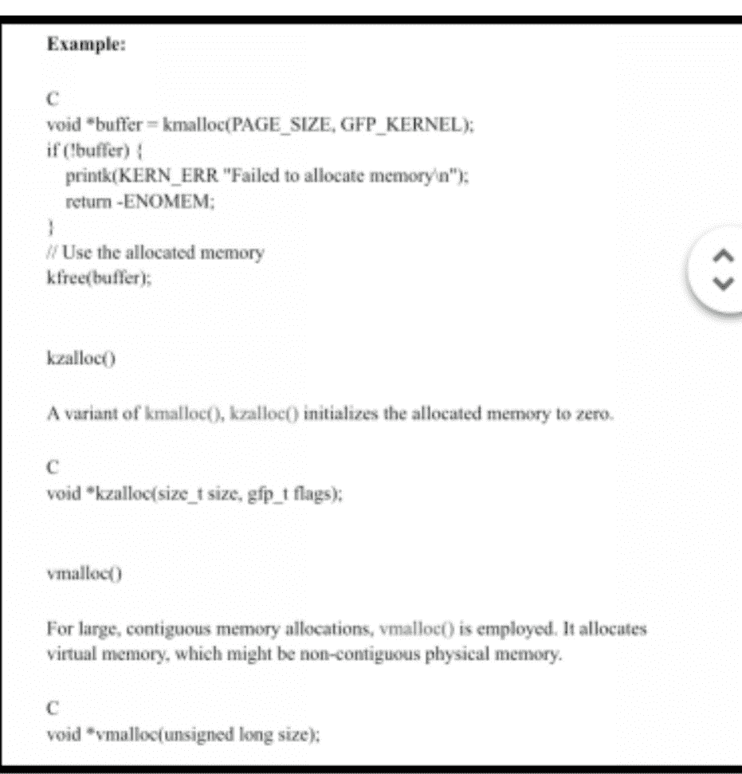
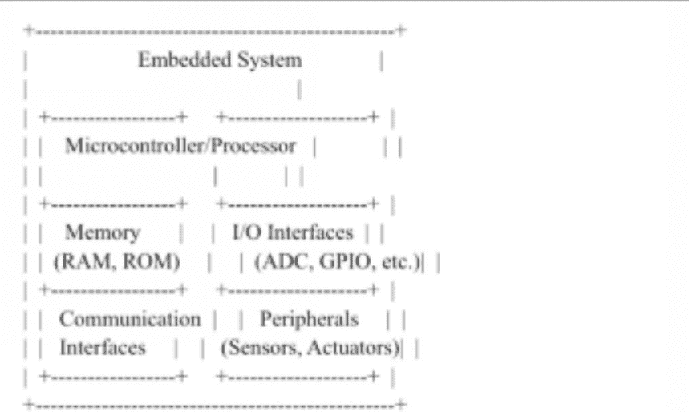

# Linux 设备驱动程序编程 C++：实用示例与实战挑战。构建高效、健壮、高性能驱动程序。


# 作者

# Katie Millie

# 征求书

您觉得《Linux 设备驱动编程 C++》有帮助吗？您的反馈至关重要！分享您的经验可以指导其他程序员。请花一点时间在 Amazon 上留下评论。您的诚实意见有助于改进未来的版本，并帮助其他读者做出明智的选择。感谢您的支持！

# 前言

## 内核开发的魅力

内核开发是一门构建操作系统核心的奥秘艺术术，对许多程序员来说具有不可否认的魅力。在这个领域，性能是至上的，每一行代码都影响着系统的脉动，而且塑造数字格局的潜力是巨大的。虽然 Linux 传统上是 C 语言的堡垒，但 C++ 元素的整合正在逐渐重塑内核开发的格局。

### 理解内核的作用

深入探讨这种魅力之前，理解内核的作用至关重要。本质上，它是硬件与用户应用程序之间的中间器。它管理系统资源、处理中断，并为应用程序与系统的交互提供标准接口。对于设备驱动程序，内核是连接硬件复杂性与软件世界的桥梁。

### 低层编程的魔法

主要的吸引力之一是有机会在系统的核心工作。内核开发者类似于外科医生，细致地对系统核心进行操作。这种与硬件的亲密交互揭示了一个原始计算能力的世界，没有任何高层语言的抽象和开销。在这个领域，每个时周期都至关重要，优化变成了一种执念。

### 构建数字枢纽：设备驱动程序

设备驱动程序是使硬件被系统访问的关键枢纽。用 C++ 编写驱动程序提供了性能与抽象的独特结合。虽然 C 语言的效率不可否疑，但 C++ 的面向对象特性可以简化驱动程序的开发，特别是对于复杂设备而言。

- **面向对象设计**：C++ 允许将硬件组件建模为对象，封装它们的属性和行为。这增强了代码的可读性和可维护性。
- **异常处理**：尽管在内核中被谨慎使用，但 C++ 的异常处理可以帮助优雅地管理错误状况，防止系统崩溃。
- **模板和 STL**：虽然不像在用户态编程中那样常见，但模板可以用于通用数据结构和算法，提高代码的可重用性。

## 挑战与回报

内核开发并非没有挑战。陡峭的学习曲线、严苛的调试过程，以及在性能与稳定性之间不断平衡的需要可能令人生而畏。然而，回报同样是丰厚的。

- **性能优化**：从硬件中榨出每一分性能的能力是非常令人满足的。
- **系统级理解**：内核开发者对操作系统如何运行有深层的理解，这使他们成为各种软件角色中无价的资产。
- **贡献开源**：开发 Linux 内核意味着为全球社区做出贡献，并塑造计算的未来。

## 内核中的 C++：日益增长的趋势

虽然 C 语言仍然是 Linux 内核中的主语言，但对特定组件使用 C++ 的接受度正日益提高。内核社区正在逐渐接受 C++ 特性，并认可它们的潜在收益。

## 未来展望

使用 C++ 进行内核开发的未来是广阔的。随着硬件复杂性的增加，对更好的抽象和管理工具的需求将变得更加关键。C++ 的面向对象范式和其他特性可以提供宝贵的解决方案。然而，在利用 C++ 优势与维护内核效率和可靠性的核心原则之间取得平衡至关重要。

内核开发，特别是使用 C++，是一项具有挑战性但回报丰厚的事业。它是那些渴望低层编程的快感、从零开始构建的满足感以及为开源生态系统做出贡献机会的人的领域。随着 C++ 在内核中的作用扩大，它有望为创新和效率开启新的可能性。

## 内核中的 C++：完美契合

几十年来，C 语言一直是内核开发的通用语言。它的效率、直接的硬件访问和低层控制使其成为构建操作系统复杂工作机制的首选语言。然而，格局正在发生变化。C++ 凭借其效率与抽象的结合，正在稳步进入内核领域，特别是在设备驱动开发领域。

### 在内核开发中使用 C++ 的理由

- **面向对象范式**：C++ 的面向对象特性为复杂硬件组件建模提供了一种结构化的方法。通过将硬件特定的细节封装在类中，开发者可以创建可重用和可维护的代码。这对于管理具有多种功能的复杂设备的开发者来说特别有益。
- **增强的类型安全**：虽然 C 提供了灵活性，但有时会导致类型相关的错误。C++ 强强类型系统有助于防止这些问题，提高代码的可靠性。
- **异常处理**：尽管出于性能考虑在内核中被谨慎使用，但 C++ 的异常处理机制可以提供一种处理错误状况结构化方法，使代码更加健壮。
- **标准模板库 (STL)**：虽然不像用户态应用那样被频繁使用，STL 容器和算法在某些内核场景下（如高效管理数据结构）可以提供性能优势。
- **现代 C++ 特性**：诸如 RAII（资源获取即初始化）、移动语义和 constexpr 等特性有助于提高安全、性能和清晰度。

## 设备驱动程序：C++ 的天然契合

设备驱动程序是桥接硬件与软件间隙的关键组件，是采用 C++ 的首选领域。原因如下：

- **复杂硬件建模**：现代设备通常表现出复杂的行为。C++ 的面向对象设计允许以更直观的方式表示这些复杂性。例如，网络接口卡 (NIC) 可以被建模为一个类，具有如 MAC 地址、支持的协议以及发送和接收数据包的方法等属性。
- **驱动程序架构**：C++ 可以帮助构建定义良好的驱动组件。例如，驱动程序可以分为硬件特定部分和平台无关部分，促进代码的重用和移植性。
- **错误处理**：设备驱动程序经常遇到错误状况。C++ 异常可以提供一种处理这些状况的简洁方法，防止系统崩溃。
- **性能优化**：虽然 C++ 可能会引入一些开销，但仔细的编码以及对模板和内联函数等语言特性的使用可以减少性能影响。在许多情况下，改进维护性的收益优于性能顾虑。

### 挑战与考量

虽然 C++ 在内核开发中的潜在收益是巨大的，但仍面临应对的挑战：

- **兼容性**：将 C++ 引入基于 C 代码库需要仔细考虑整合。
- **性能开销**：C++ 特性可能会引入性能开销。必须对代码进行性能测试并谨慎使用语言特性。
- **内核编码风格**：内核开发有自己的编码规范和风格指南。在引入 C++元素的同时遵循这些规范具有挑战性。
- **工具链支持**：确保编译器和其他工具支持所需的 C++ 特性和优化。

### 平衡的方法

在内核中成功采用 C++ 的关键在于平衡的方法。虽然 C++ 提供了强大的工具，但谨慎使用它们至关重要。在性能关键区域，C 风格的代码可能仍然更受青。对于更复杂的组件，C++ 可以提供显著优势。

## C++ 在内核中的未来

内核中采用 C++ 的趋势可能会持续下去。随着硬件变得越来越复杂，软件需求增加，C++ 面向对象和抽象能力的优势将变得越来越有利。虽然 C 语言在可预见的未来可能仍然是内核骨干，但 C++ 将在塑造内核的演进中扮演日益重要的角色。

# 概述与目标受众

## 概述

本综合指南深入探讨了 Linux 设备驱动程序编程的复杂性，特别关注如何利用 C++ 的力量来实现高效且健壮的驱动程序开发。本书旨在

本书面向广泛的读者群体，从寻求扩展技能树的资深 C 程序员到完全初接触内核开发的学者一有涵盖。

书籍首先为 Linux 内核架构以及设备驱动程序在操作系统中的角色奠定了坚实的基础。它让读者对内核核心组件、内存管理、进程调度和进程间通信有了清晰的理解。通过这些知识，读者将有能力胜任复杂的内核开发工作。

后续章节将深入探讨了内核环境内 C++ 编程的复杂性。书中探索了如何有效利用面向对象的原则、模板和其他 C++ 特性来创建结构良好、易于维护且高效的设备驱动程序。书中还详细涵盖了编码风格、性能优化和调试的最佳实践。

书的很大一部分致力于实用的设备驱动程序开发。它涵盖了广泛的设备类型，包括字符设备、块设备、网络接口和输入/输出设备。通过逐步的指令和代码示例，引导读者完成整个开发过程，从驱动程序初始化、硬件交互到用户空间应用程序。

书中还强调了测试和调试设备驱动程序的重要性。它提供了编写有效测试用例以及使用内核调试工具识别和解决问题的技术。此外，它还讨论了版本控制系统和代码审查在维护驱动程序质量中的作用。

## 目标读者

本书主要针对以下群体：

- **资深 C 程序员**：希望将其技能扩展到内核开发，并探索 C++ 在此背景下优势的开发者。
- **嵌入式系统工程师**：从事嵌入式系统工作、需要为基于 Linux 的平台开发驱动程序的专业人员。
- **本科生和研究生**：学习操作系统和驱动开发的计算机科学及电气工程学生。
- **Linux 爱好者**：对 Linux 和内核原理有浓厚兴趣并希望向开源社区做贡献的个人。

本书假设读者对 C 编程和操作系统概念有基本的了解。然而，它提供了足够的背景信息让读者跟上进度。对实践示例和清晰解释的关注，使得不同技术水平的读者都能上手。

读完本书后，读者将牢牢掌握使用 C++ 进行 Linux 设备驱动开发。他们能够为各种硬件组件设计、实现和调试设备驱动程序，为 Linux 系统的整体功能和性能做出贡献。

# 第 1 章

## 深度解析内核组件：Linux 设备驱动视角

### 理解内核图谱


在深入研究特定组件之前，掌握内核的整体架构至关重要。Linux 内核是一个单体模块化系统。这意味着虽然它是一个单一的可执行文件，但它是由许多相互连接的模块组成的。

## 关键内核组件：

### 1. 进程管理：
- `Task Structure`：表示进程的核心数据结构。
- `Scheduling`：处理进程执行和时间分片。
- `IPC`：促进进程间的通信（管道、消息队列、共享内存、信号量）。

### 2. 内存管理：
- `Page Allocation`：管理物理内存帧。
- `Virtual Memory`：将虚拟地址映射到物理地址。
- `Memory Allocation`：提供分配和释放内存的函数。
- `Swap`：管理页面在与磁盘之间的交换。

### 3. 文件系统：
- `VFS`：为不同的文件系统提供统一接口。
- `Ext2/Ext3/Ext4`：Linux 常用的文件系统。
- `Block Devices`：管理基于块的存储设备。

### 4. 设备驱动程序：
- `Character Devices`：处理面向字符的设备（如键盘、鼠标）。
- `Block Devices`：管理基于块的设备（如硬盘、SSD）。
- `Network Devices`：处理网络接口。

### 5. 中断与异常：
- `Interrupt Handling`：管理硬件中断。
- `Exception Handling`：处理软件异常和故障。

### 6. 系统调用：
- `System Calls`：为用户空间程序提供与内核交互的方法。

### 设备驱动与内核的交互

设备驱动程序是硬件与内核之间的桥梁。它们与各种内核组件交互：

#### 1. 内存管理：
- 驱动程序经常为缓冲区、数据结构和其他用途分配内存。
- `DMA`用于设备与系统内存之间高效的数据传输。

```c
void *buffer = kmalloc(PAGE_SIZE, GFP_KERNEL); // 分配内核内存
```

#### 2. 中断：
- 驱动程序产生中断以信号事件。
- 驱动程序注册中断处理程序以处理这些中断。

```c
irqreturn_t my_interrupt_handler(int irq, void dev_id) {
    // 中断处理逻辑
    return IRQ_HANDLED;
}
```

#### 3. 文件系统：
- 字符设备通常在文件系统中创建设备文件。
- 块设备与块层交互进行读写操作。

```c
static struct file_operations my_fops = {
    .open = my_open,
    .read = my_read,
    .write = my_write,
    // 其他文件操作
};
```

#### 4. 进程管理：
- 驱动程序可能会为特定任务创建内核线程。
- 它们可以使用 `IPC` 机制与系统的其他部分通信。

```c
struct task_struct *task = kthread_run(my_thread_function, NULL, "my_thread");
```

### 深入研究驱动程序

`Character Devices`：字符设备通常与涉及数据流的输入输出操作相关，如键盘、鼠标和串口。

```c
static struct cdev my_dev;
static struct class my_class;

int my_init(void) {
    // 注册字符设备
    alloc_chrdev_region(MAJOR, MINOR, 1, "my_dev");
    cdev_init(&my_dev, &my_fops);
    cdev_add(&my_dev, dev, 0);
    
    // 创建设备节点
    my_class = class_create(THIS_MODULE, "my_class");
    device_create(my_class, NULL, my_dev, NULL, "my_device");
    return 0;
}
```

`Block Devices`：块设备处理硬盘和 SSD 等存储设备，数据按固定大小的块组织。

```c
static struct gendisk my_disk;

int my_init(void) {
    // 注册块设备
    my_disk = alloc_disk(32); // 32分区的示例
    my_disk->major = MAJOR;
    my_disk->first_minor = 0;
    my_disk->fops = &my_block_ops;
    // ... 其他磁盘设置
    add_disk(my_disk);
    return 0;
}
```

此概述提供了一个设备驱动程序与内核组件之间复杂交互的视角。理解这些交互对于有效开发设备驱动程序至关重要。通过掌握这些概念，你可以构建与 Linux 内核无缝整合的稳健高效的驱动程序。

注意：这是一个简单的概述，现实世界的设备驱动程序涉及许多复杂性。

## 深入探讨：中断处理与设备驱动程序

### 理解中断

中断是硬件产生的信号，用于通知 CPU 需要立即处理的事件。它们对于 I/O 操作至关重要，因为允许设备在数据准备好传输或发生错误时通知系统。

**中断处理流程：**
1. **中断产生**：设备在特定的硬件线上触发中断信号。
2. **中断控制器**：中断控制器接收中断并 CPU 生成软件中断。
3. **中断处理**：CPU 保存当前状态，确定中断源并将控制权转移到相应的中断处理程序。
4. **中断服务程序 (ISR)**：`ISR` 执行处理中断所需的动作。
5. **中断返回**：`ISR` 恢复 CPU 保存的状态并将控制权返回给被中断的进程。

## 中断上下文与下半部

- `Interrupt Context`：中断服务程序 `ISR` 的执行环境。这是一个高度受限的环境，允许的操作有限。
- `Bottom Halves`：延迟到中断处理程序返回后才执行的任务。它们用于处理更复杂或更耗时的操作。

### 下半部的类型：
- `Tasklets`：由内核调度的轻量级软件中断。
- `Workqueues`：具具灵活性，可以在不同的 CPU 核心上进行调度。

### 设备驱动程序与中断

设备驱动程序广泛使用中断来实现高效的 I/O 操作。
- `中断驱动 I/O`：驱动程序注册一个中断处理程序，在数据就绪时被调用。
- `Polling`：驱动程序定期检查设备状态，这种效率较低，但在某些情况下可能是必要的。

### 中断处理中的挑战
- `Interrupt Latency`：从中断发生到 `ISR` 开始之间的时间。
- `Interrupt Rate`：高频率的中断会影响系统性能。
- `Shared Interrupts`：多个设备可能共享同一中断线。
- `Interrupt Priorities`：不同的中断可能有不同的优先级。

### 最佳实践
- 保持 `ISR` 的短小且高效。
- 使用下半部处理复杂任务。
- 及时处理中断以最小化延迟。
- 对于高频中断考虑使用中断合并 `interrupt coalescing`。
- 使用适当的锁机制保护共享数据。

# Linux 进程管理与调度：深度解析

## 理解进程

进程是正在执行的程序实例。它封装了程序的代码、数据和执行上下文。进程的关键组件包括：
- `PCB`：包含进程相关信息，如进程状态、寄存器、内存管理信息和调度信息。
- `进程状态`：运行、就绪、等待、新建和终止。

## 进程的创建与终止

使用 `fork()` 系统调用创建新进程。这会创建一个父进程的副本，包括它的内存空间。子进程随后可以修改它的副本。

```c
#include <stdio.h>
#include <unistd.h>

int main() {
    pid_t pid = fork();
    if (pid < 0) {
        // Fork failed
    } else if (pid == 0) {
        // Child process
        printf("I am the child process\n");
    } else {
        // Parent process
        printf("I am the parent process\n");
    }
    return 0;
}
```


进程可以正常终止（例如通过调用 `exit()`）或异常终止（例如由于信号）。

# 进程管理与调度

## 进程调度

进程调度是决定哪个进程将分配 CPU 以及分配多长时间的活动。Linux 采用了了多种调度算法，包括：

- **先来先服务 (FCFS)**: 进程按照它们到达的顺序执行。
- **短作业优先 (SJF)**: 下一个执行估计突发时间最短的进程。
- **优先级调度**: 为进程分配优先级，并执行优先级最高的进程。
- **轮询 (Round Robin)**: 给每个进程分配一个时间片，如果它在规定的时间内未完成，则会被剥夺占并加入就绪队列。
- **多级队列调度**: 根据特征将进程分为多个队列，每个队列都有自己的调度算法。
- **多级反馈队列调度**: 进程可以根据其行为在队列之间移动。

## 进程同步

多个进程通常需要协调它们的活动。这通过同步机制实现：

- **互斥锁 (Mutexes)**: 用于保护共享资源的互斥锁。
- **信号量 (Semaphores)**: 通用的同步语言。
- **自旋锁 (Spinlocks)**: 用于短时间临界区的忙等待锁。

```c
#include <linux/mutex.h>

static DEFINE_MUTEX(my_mutex);

void my_function(){
    mutex_lock(&my_mutex);
    // Critical section
    mutex_unlock(&my_mutex);
}
```

## 进程通信

进程可以使用以下方式进行通信：

- **管道 (Pipes)**: 单向通信通道。
- **消息队列 (Message Queues)**: 存储消息供以后提取。
- **共享内存 (Shared Memory)**: 创建一个多个进程可访问的内存区域。
- **套字 (Sockets)**: 用于网络通信。

## 设备驱动程序与进程管理

虽然设备驱动主要与硬件交互，但它们可以间接影响进程管理。例如：

- **内核线程**: 驱动程序可以创建内核线程来处理异步任务。
- **进程上下文切换**: 设备中断会导致进程上下文切换。
- **调度优先级**: 驱动程序可以根据设备活动调整进程优先级。

```c
struct task_struct my_thread;
static int my_thread_fn(void *data) {
    // Thread's work
    return 0;
}
int my_init(void) {
    my_thread = kthread_run(my_thread_fn, NULL, "my_thread");
    return 0;
}
```

## 进程管理的挑战

- **死锁 (Deadlocks)**: 当进程阻塞并等待其他进程持有的资源时。
- **饥饿 (Starvation)**: 当进程一直被拒绝访问 CPU 时。
- **上下文切换开销**: 保存一个进程状态并加载另一个进程状态的时间。

## 最佳实践

- 使用适当的同步机制。
- 避免不必要的进程创建。
- 为特定工作负载优化调度算法。
- 监控系统性能以识别潜在问题。

注意：这是进程管理和调的一个高层概述。实际实现涉及得多的复杂性和优化。

# Linux 内存管理：深度解析

## 理解内存管理

内存管理是任何操作系统（包括 Linux）的关键功能。它涉及高效地分配、释放和管理系统内存，以确保最佳性能和资源利用率。

## 核心概念

- **物理内存 (Physical Memory)**: 安装在系统的实际硬件内存。
- **虚拟内存 (Virtual Memory)**: 操作系统提供的抽象，将进程地址空间映射到物理内存。
- **页帧 (Page Frames)**: 物理内存的固定大小块。
- **页 (Pages)**: 虚拟内存的固定大小块。
- **页表 (Page Table)**: 将虚拟页到物理页帧的数据结构。
- **分页 (Paging)**: 在物理内存和磁盘之间交换页的过程。
- **交换 (Swapping)**: 在主内存和辅助存储之间移动整个进程。

## 内核中的内存分配

内核提供了几个用于内存分配函数：

- **`kmalloc()`**: 从内核堆分配内存。
- **`kzalloc()`**: 与 `kmalloc()` 类似，但会将内存初始化为零。
- **`vmalloc()`**: 分配连续的虚拟内存，但物理页可能不是连续的。
- **`dma_alloc_coherent()`**: 分配 CPU 和 DMA 设备均可访问的内存。

```c
#include <linux/slab.h>

void *buffer = kmalloc(PAGE_SIZE, GFP_KERNEL);
if (!buffer) {
    printk(KERN_ERR "Memory allocation failed\n");
    return;
}

// Use the buffer
kfree(buffer);
```

设备驱动程序广泛使用内存用于目的：

- **缓冲区分配**: 用于设备和系统之间传输的数据。
- **数据结构**: 用于维护设备特定信息。
- **DMA 内存**: 用于设备和系统内存之间的高效传输。

```c
void my_device_init(void) {
    struct my_device_data *dev_data = kzalloc(sizeof(*dev_data), GFP_KERNEL);
    if (!dev_data) {
        printk(KERN_ERR "Failed to allocate data\n");
        return;
    }

    // Initialize device
    dev_data->buffer = dma_alloc_coherent(dev->dev, PAGE_SIZE,
        &dev_data->dma_handle, GFP_KERNEL);
    if (!dev_data->buffer) {
        printk(KERN_ERR "Failed to allocate DMA buffer\n");
        kfree(dev_data);
        return;
    }
}
```

## 内存管理的挑战

- **碎片 (Fragmentation)**: 当内存以不可预测的方式分配和释放时，会导致产生、不连续的空闲块，降低内存利用率。
- **内存泄漏 (Memory Leaks)**: 未释放分配的内存会导致内存耗尽。
- **DMA 一致内存**: 正确处理 DMA 一致内存对于防止数据损坏至关重要。

# 内存管理最佳实践

- 根据内存需求使用适当的内存分配函数。
- 仔细管理内存生命周期以避免内存泄漏。
- 考虑内存对齐以优化性能。
- 使用调试工具检测与内存相关的问题。

## 虚拟内存与分页

虚拟内存为进程提供了连续内存的幻象，尽管物理内存可能是碎片化的。它通过分页技术实现，即通过页表将虚拟地址转换为物理地址。

页错误（Page Fault）：当进程访问物理内存中不存在的虚拟页时，操作系统将所需的页面从磁盘调入物理内存中，并更新页表。

## 现代系统中的内存管理

现代系统采用了先进的内存管理技术：

- **大页分配 (Large Page Allocations)**: 分配更大的内存页可以通过减少 TLB 缺失来提高性能。
- **内存热插 (Memory Hotplug)**: 在不重启系统的情况下动态添加或移除内存。
- **内存超配 (Memory Overcommitting)**: 分配比物理内存更多的虚拟内存，依赖分页机制来处理需求。

内存管理是内核编程的一个基础方面。通过理解核心概念和最佳实践，你可以编写高效可靠的设备驱动程序。适当的内存管理对于避免系统崩溃和确保最佳性能至关重要。

# DMA 一致性内存：深度解析

## 理解 DMA 一致性内存

直接内存访问（DMA）是一种硬件特性，允许设备在不涉及 CPU 的情况下直接访问系统内存。这显著提高了数据传输性能，特别是对于网卡和磁盘控制器等高吞吐设备。然而，DMA 操作可能会引入缓存一致性问题。

DMA 一致性内存（DMA-coherent memory）是指保证 CPU 和设备之间数据一致的内存。这意味着 CPU 对内存的任何写入对设备立即可见，反之亦然。

## DMA 一致性内存分配

在 Linux 中，使用 `dma_alloc_coherent()` 函数来分配 DMA 一致性内存。

```c
void *dma_alloc_coherent(struct device *dev, size_t size, dma_addr_t *dma_handle, gfp_t flags);
```

- `dev`：设备结构指针。
- `size`：要分配的内存大小。
- `dma_handle`：存储 DMA 地址的指针。
- `flags`：分配标志位。


### DMA 映射与解映射

要使用分配的 DMA 一致性内存，你需要将其映射到设备的地址空间中。这是通过 `dma_map_single()` 函数实现的。

```c
dma_addr_t dma_map_single(struct device *dev, void *ptr, size_t size, enum dma_data_direction dir);
```

- `dev`：设备结构指针。
- `ptr`：要映射内存的虚拟地址。
- `size`：要映射内存的大小。
- `dir`：数据传输方向（`DMA_TO_DEVICE`, `DMA_FROM_DEVICE`, `DMA_BIDIRECTIONAL`）。

当你完成对 DMA 一致性内存的使用后，需要使用 `dma_unmap_single()` 函数解映射。

```c
void dma_unmap_single(struct device *dev, dma_addr_t dma_handle, size_t size, enum dma_data_direction dir);
```

## DMA 一致性内存与缓存一致性

内核通过硬件和软件机制确保 DMA 一致性。基于硬件的一致性依赖于缓存行和回写缓存。基于软件的一致性涉及刷新（flush）和失效缓存行。

## DMA 一致性内存与设备驱动程序

设备驱动程序广泛使用 DMA 一致性内存来实现高效的数据传输。

- **缓冲区分配**：用于存储设备和系统之间传输的数据。
- **命令和状态寄存器**：用于与设备通信。

## DMA 一致性内存的挑战

- **性能开销**：DMA 一致性内存的分配和映射可能会产生一些性能开销。
- **内存碎片**：过度使用 DMA 一致性内存会导致内存碎片。
- **缓存一致性问题**：如果处理不当，缓存一致性会导致数据损坏。

## 最佳实践

- 仅在需要时使用 DMA 一致性内存。
- 以大块分配 DMA 一致性内存以减少碎片。
- 仔细管理 DMA 一致性内存的生命周期以避免泄漏。
- 使用适当的缓存一致性机制防止损坏。

## 额外考虑

- **DMA 映射标志**：`dma_map_single()` 函数接受额外的标志来控制缓存一致性和对齐情况。
- **DMA 映射边界**：某些设备对 DMA 传输有特定的对齐要求。
- **DMA 映射错误**：如果映射失败，`dma_map_single()` 函数将返回零值 DMA 地址。

通过遵循这些指南并理解 DMA 一致性内存的复杂性，你可以编写出高效可靠的设备驱动程序，有效利用 DMA 能力。

# Linux 设备驱动程序中的中断与异常处理

### 中断

中断是硬件生成的信号，表示需要立即关注的事件。在设备驱动程序的上下文中，它们信号着数据就绪、设备错误或其他状态。

**中断处理流程：**

1. **中断生成**：设备触发中断信号。
2. **中断控制器**：中断控制器将硬件中断转换为软件中断。
3. **中断分送**：CPU 挂起当前任务并将控制权转移给中断处理程序。
4. **中断服务程序 (ISR)**：`ISR` 执行必要的操作，通常非常快速，以最小化中断延迟。
5. **中断返回**：`ISR` 将控制权返回给被中断的进程。

```c
Code Example:
static irqreturn_t my_interrupt_handler(int irq, void *dev_id) {
    struct my_device *dev = dev_id;

    // 执行必要的操作
    printk(KERN_INFO "Interrupt received from %s\n", dev->name);

    // 确认中断
    return IRQ_HANDLED;
}
```

### 中断上下文

`ISR` 运行在中断上下文，这意味着它不能睡眠或执行可能阻塞的操作。

## 下半部 (Bottom Halves)

对于无法在 `ISR` 中完成的复杂任务，设备驱动程序使用半部：

- `Tasklets`
- `Workqueues`（工作队列）
- `Softirqs`

这些机制允许延迟处理工作。

## 异常处理

异常是执行过程中的异常状态。在内核编程中，它们对于处理故障至关重要。

**异常处理流程：**

1. **异常发生**：CPU 检测到异常情况。
2. **异常处理**：内核接管控制权，保存进程状态并将控制转移给异常处理程序。
3. **错误处理**：异常处理程序尝试解决问题或终止进程。

```c
Code Example:
asmlinkage long my_system_call(void) {
    // 系统调用逻辑
    if (error condition)
        return -EFAULT; // 返回错误代码
    return 0;
}
```

## 设备驱动程序与中断/异常

- 错误处理：从设备错误中优雅恢复。
- 系统调用：为用户空间提供接口。
- 异常处理：处理意外情况。

### 挑战：

- 中断延迟：从中断发生到 `ISR` 执行之间的时间。
- 中断频率：处理高频中断。

## 额外考虑

- **共享中断**：管理共享同一个中断的多个设备。
- **异常处理**：实现健壮的恢复机制。
- **中断优先级**：根据重要性为中断分配优先级。
- **中断屏蔽**：在需要时临时禁用中断。
- **中断合并**：将多个中断合并为一个中断。
- **异常调试**：利用内核调试工具分析异常。

通过理解中断和异常处理，你可以编写出健壮高效的设备驱动程序，能够优雅地处理各种情况和错误。

- 2. 块层：管理硬盘和 SSD 等基于块设备。它处理请求队列、调度和设备访问等任务。
- 3. 字符设备：处理键盘、鼠标和串口等以字符为方向的设备。
- 4. 网络子系统：负责网络通信，包括协议处理和数据包处理。
- 5. 文件系统：管理文件的存储和检索。
- 6. 缓冲区缓存：磁盘块的缓存，用于提高 I/O 性能。

## 块层 (The Block Layer)

块层是 I/O 子系统中一个至关重要的组件。它为块设备提供了一个通用接口，允许上层在不了解底层硬件细节的情况下与它们交互。

## 块层的主要功能：

- **请求队列**：收集来自各种源的 I/O 请求并将它们组织成队列。
- **请求调度**：确定处理 I/O 请求的顺序。
- **设备访问**：与设备驱动程序交互以执行读写操作。
- **错误处理**：处理 I/O 操作过程中发生的错误。

```c
Code Example:

struct bio *bio;
int ret;

// Create a bio
bio = bio_alloc(GFP_KERNEL, BIO_SECTORS);

// Fill the bio with data

// Submit the bio to the block device
ret = submit_bio(WRITE, bio);
if (ret)
    printk(KERN_ERR "Error submitting bio\n");
bio_put(bio);
```

## 字符设备 (Character Devices)

字符设备处理基于数据流的设备，例如键盘、鼠标和串口。与块设备相比，它们提供了更简单的接口。

字符设备的主要功能：

- **打开/关闭**：打开和关闭设备以便访问。
- **读/写**：向设备读/写数据。
- **ioctl**：执行设备特有的控制操作。

```c
Code Example:
static const struct file_operations my_fops = {
    .open = my_open,
    .read = my_read,
    .write = my_write,
    .ioctl = my_ioctl,
};
```

## 缓冲区缓存 (Buffer Cache)

缓冲区缓存通过在内存中缓存磁盘块来提高 I/O 性能。当进程从磁盘请求数据时，内核会首先检查缓冲区缓存。如果数据在缓存中，则直接返回而无需访问磁盘。

```c
Code Example:
struct page *page = read_cache_page(mapping, offset);
if (page)
    // Data found in cache
else
    // Read data from disk
```

## I/O 调度 (I/O Scheduling)

块层使用 I/O 调度器来确定处理 I/O 请求的顺序。不同的调度具有不同的性能特性。

- `Deadline`：根据截止时间优先考虑请求。
- `CFQ`：公平队列调度器。
- `NOOP`：无操作调度器。

## I/O 子系统中的挑战

- 性能：实现高 I/O 吞吐量和低延迟。
- 可靠性：确保数据完整性和错误处理。
- 可扩展性：处理日益增加的设备和 I/O 请求。

## 最佳实践

- 针对不同类型的设备使用合适的 I/O API。
- 优化缓冲区大小以实现高效的数据传输。


- 根据负载特征考虑 I/O 调度算法。
- 实现适当的错误处理和恢复机制。

Linux I/O 子系统是操作系统中复杂且关键的组件。理解它的结构和组件对于开发高效可靠的设备驱动至关重要。通过遵循最佳实践并利用提供的工具，你可以构建高性能的 I/O 解决方案。

## Linux 中的 I/O 调度

### 理解 I/O 调度

I/O 调度是磁盘性能优化的关键方面。它涉及确定磁盘处理 I/O 请求的顺序。目标是最小化寻道时间、旋转延迟头切换操作，以提高整体 I/O 吞吐量响应时间。

## I/O 调度器

Linux 提供了多种 I/O 调度器以适应不同的负载特征。

- `NOOP`：最简单的调度器，它将请求放入 FIFO 队列而不进行任何优化。适用于随机 I/O 模式的负载。
- `CFQ` (完全公平队列)：旨在实现进程之间公平的 I/O 分配。它为每个进程创建队列并为每个队列分配时间片。适用于通用负载。
- `Deadline`：为每个 I/O 请求保证一个截止时间。它根据请求的截止时间和在磁盘上的物理位置优先考虑请求。适用于实时或低延迟应用。
- `BFQ` (基于缓冲区的公平队列)：`CFQ` 的演进，通过使用基于缓冲区的方法提供更好的性能和公平性。

## I/O 调度器工作原理

I/O 调度器通常采用以下技术：

- `请求合并`：将相邻的 I/O 请求合并为一个较大的请求以减少寻道时间。
- `电梯算法`：优化磁盘头移动的顺序以最小化寻道时间。
- `队列排序`：根据各种标准（例如物理位置、优先级）组织队列中的 I/O 请求。

```bash
Code Example: Changing I/O Scheduler
sudo echo "deadline" > /sys/block/sda/queue/scheduler
```

此命令将 `sda` 磁盘的 I/O 调度器设置为 "`deadline`"。

## I/O 调度调优

I/O 调度器通常具有可调参数，以优化特定负载的性能。例如，`CFQ` 调度器有控制不同 I/O 权重的参数。

```bash
sudo cat /sys/block/sda/queue/scheduler
# Output: deadline [cfq] noop bfq
```

## I/O 调度选择

I/O 调度选择取决于负载特性：

- `随机 I/O`：`NOOP` 或 `CFQ` 可能适用。
- `顺序 I/O`：`Deadline` 或 `BFQ` 可以提供更好的。
- `实时负载`：通常优选 `Deadline`。

## I/O 调度与设备驱动

设备驱动与块层交互，块层再使用调度器。驱动程序通常向块层提交 I/O 请求。

## I/O 调度的挑战

- 负载多样性：不同的应用程序有不同的 I/O 模式。
- 磁盘特性：不同类型的磁盘（HDD、SSD）具有不同的特性。

## 最佳实践

- 测试不同的 I/O 调度器以找到最适合负载负载的。
- 使用 `ostat` 和 `blktrace` 等工具监控 I/O 性能。
- 对于高 I/O 负载考虑 SSD。
- 根据特定需求调优 I/O 调度参数。

I/O 调度是优化磁盘性能的关键因素。通过理解不同的 I/O 调度器及其特性，你可以为应用程序选择合适的调度器并进行调优以获得最佳结果。

# 第 2 章

## Linux 内核中的 C++ 支持：复杂的现状

虽然 C 语言仍然是 Linux 开发的主要语言，但 C++ 的潜在优势引发了持续讨论和有限实验。然而，由于若干关键挑战，内核中完全支持 C++ 仍然遥远。

## 挑战与考虑

### 1. 兼容性与性能

- `二进制兼容性`：C++ 引入了符号修饰、虚函数和异常处理等特性，这些会影响二进制兼容性和内核大小。
- `性能开销`：某些 C++ 特性会产生运行时开销，这在内核环境中是不可接受的。

### 2. 语言特性

- `异常处理`：内核错误处理模型基于错误代码而非异常。引入异常可能会复杂错误处理并可能导致系统不稳定。
- `RTTI` (运行时类型信息)：由于其对性能的潜在影响和安全因素，内核通常不鼓励 RTTI。
- `模板`：虽然模板提供了强大的抽象机制，但它们会增加代码复杂性和编译时间，这些都是内核开发中关键关注的问题。

### 3. 工具链支持

- `编译器`：C++ 编译器需要针对内核开发进行仔细调优，以确保最佳的代码生成和兼容性。
- `调试工具`：调试器和其他开发工具需要有效支持 C++ 特性，以便进行内核调试。

### 4. 代码库迁移

将海量的 C 代码库转换为 C++ 将是一项艰巨的任务，并带有巨大的风险。

## 内核中有限的 C++ 使用

尽管面临挑战，但在特定的内核组件中存在使用 C++ 的少数实例。这些情况通常涉及经过挑选的语言特性和严格的编码规范。

## 示例：类结构

虽然内核并不直接支持 C++ 类，但可以使用 C 结构体来模拟面向对象的概念。考虑一个使用结构体封装设备特定数据的设备驱动简化示例：

```C++
struct my_device {
    int major;
    int minor;
    void *private_data;

    int (*probe)(struct my_device *dev);
    int (*remove)(struct my_device *dev);
};
```

该结构体定义了设备的属性和函数。必须注意的是，这不是真正的类，且不支持继承或多态。

## 应对挑战

为了使 C++ 更适用于内核开发，目前正在探索几种方法：

- `限制性 C++`：使用符合内核要求的 C++ 特性子集，例如命名空间和常量正确性。
- `内核特定的 C++ 扩展`：开发语言扩展以解决内核特定需求，例如安全的异常处理机制。
- `渐进采用`：在仔细选择的区域引入 C++ 并逐渐扩大其使用范围。

虽然 C++ 为内核开发提供了潜在优势，但其应用受到重大挑战的限制。Linux 内核社区正在谨慎地探索利用 C++ 的方法，同时保持内核的稳定性、性能和兼容性。在可见的未来，C 将仍然是主要语言，在特定组件中会有有限且受控的 C++ 使用。

## 额外考虑

- `内存管理`：C++ 的内存管理功能（如 RAII 和智能指针）在减少内存泄漏方面有益，但在内核上下文中需要仔细考虑。
- `并发`：C++ 通过线程和同步原语等特性提供了语言层面的并发支持。然而，内核并发通常使用内核特定的机制进行处理。

必须强调的是，在内核中使用 C++ 并不是一个简单的过程，需要对 C++ 和内核内部有深入的理解。

`注意`：此响应提供了 Linux 内核中 C++ 支持的通用概览。实际情况复杂且不断演变，具体细节可能会有所不同。

## 内核环境下的面向对象编程

### 理解挑战

虽然 C++ 提供了强大的抽象和代码组织机制，但它在 Linux 内核中的直接应用受到几个因素的限制：

- `性能`：内核是一个对性能极其敏感的环境，C++ 的虚函数和异常处理等特性可能会引入开销。
- `兼容性`：内核的二进制兼容性要求非常严格，C++ 的名字修饰（name mangling）和其他语言特性可能会增加复杂。
- `内存管理`：内核的内存管理模型与用户空间不同，C++ 的自动内存管理功能可能难以集成。

尽管存在这些挑战，可以将一些面向对象的原则应用于内核开发，以提高代码结构和可维护性。

### 在 C 中模拟面向对象概念

#### 1. 结构体作为对象

在内核中模拟面向对象概念的最常用方法是使用 C 结构体。结构体可以封装数据成员和函数指针来表示方法。

```c
struct my_device {
    int major;
    int minor;
    void *private_data;

    int (*probe)(struct my_device *dev);
    int (*remove)(struct my_device *dev);
};
```

#### 2. 用于方法的函数指针

函数指针允许我们模拟多态，这是 OOP 的核心概念。不同的设备驱动可以不同的方式实现 `probe` 和 `remove` 函数，提供多态行为。

```c
int my_device_probe(struct my_device *dev) {
    // 设备的探测逻辑
    return 0;
}

int my_device_remove(struct my_device *dev) {
    // 设备的移除逻辑
    return 0;
}

struct my_device my_device1 = {
    .major = 1,
    .minor = 0,
    .probe = my_device_probe,
    .remove = my_device_remove,
};
```

#### 3. 封装

虽然 C 不提供像 C++ 那样严格的封装，但我们可以通过仔细设计结构体并限制对其成员的访问来实现类似的效果。


```c
struct private_data {
    // 私有数据成员
};

struct my_device {
    int major;
    int minor;
    struct private_data *private;

    // 公有方法
};
```

## 局限性和考虑

- **继承**：C 不直接支持继承。我们可以通过组合在一定程度上模拟继承，但它通常比传统的继承缺乏活性且更复杂。
- **多态**：函数指针提供了有限的多态。不支持多重继承和虚函数。
- **性能**：虽然函数指针可以高效，但与直接函数调用相比，它们可能会引入一些开销。
- **复杂性**：使用函数指针管理复杂的对象层次可能会变得具有挑战且容易出错。

## 最佳实践

- **保持简单**：谨慎使用面向对象概念，重点关注提高代码组织和可读性。
- **考虑性能**：对代码进行性能分析以识别潜在的性能瓶颈并进行相应优化。
- **使用清晰且描述性的命名**：这可以增强代码的可读性和可维护性。

2. 函数指针：函数指针可用于创建操作不同数据类型的通用函数。

```C
int compare_ints(const void *a, const void *b) {
  return (*int*)a - (*int*)b;
}

int compare_strings(const void *a, const void *b) {
  return strcmp((char*)a, (char*)b);
}
```

# 内核中潜在的 C++ 应用（假设）

虽然在内核中直接使用 C++ 模板不太可能，但我们可以探索其潜在的优势和挑战。

1. 基于策略的设计：模板可以用于实现基于策略的设计，将算法与数据结构分离。

```C++
template <typename T, typename Compare>
void sort(T* *array, size_t size, Compare comp) {
  // 使用 comp 进行排序算法
}
```

这种方法可以通过使用函数指针代替模板来适配内核。

2. 容器类：可以使用模板创建自定义的容器类，以高效地管理内核数据结构。然而，需要仔细考虑内存管理和性能问题。

```C++
template <typename T>
class CircularBuffer {
public:
    void push(const T& value);
    T pop();
    //
private:
    T* data;
    size_t size;
};
```

# 3. 类型安全宏：模板可以用于创建类型安全的宏，与传统的 C 宏相比，降低了错误风险。

```C++
template <typename T>
constexpr size_t t_array_size(const T& arr) {
  return sizeof(arr) / sizeof(arr[0]);
}
```

挑战与考量

- **编译时间**：模板实例化会显著增加编译时间，这是内核开发中的一个主要考虑。
- **二进制兼容性**：模板定义的变化会影响内核模块的二进制兼容性。
- **内存占用**：模板实例化可能导致代码膨胀和内存占用增加。
- **内核编码风格**：内核编码风格强调简单易读性。模板可能会引入不必要的复杂性。

虽然模板在 C++ 编程中具有显著优势，但由于性能、兼容性和复杂性的考虑，直接在 Linux 内核中应用是具有挑战性的。然而，某些类似模板的概念可以使用函数指针和宏等 C 技术进行适配。

在内核内核开发中考虑类模板的方法时，必须仔细评估代码重用性、类型安全和性能之间的权衡。

# 内核中的异常处理：一项复杂的挑战

## 基础问题

异常处理是健壮软件开发的基石，在内核环境中呈现出一系列独特的挑战。与用户空间应用程序不同（用户空间通过语言特定的机制处理异常），内核运行在受限且对性能极其敏感的范围内。

- **性能开销**：异常处理机制可能会引入巨大的运行时开销，这在内核中是不可接受的。
- **内核稳定性**：未处理的异常会导致系统崩溃，这在内核语文中是灾难性的。
- **确定性**：内核必须具有高度的确定性，而异常会破坏这种确定性。

## 内核中的传统错误处理

考虑到这些限制，内核传统上依赖于更显式的错误处理方法：

- **返回值**：函数通常返回错误代码以指示成功或失败。
- **错误指针**：函数可以选择修改错误指针，以提供更详细的错误信息。

```C
int my_device_probe(struct device *dev) {
    int ret = 0;

    // 设备探测逻辑

    if (error_condition) {
        ret = -ENODEV; // 示例错误代码
    }
    return ret;
}
```

# 传统错误处理的挑战

虽然这种方法有效，但它存在局限性：

- **错误传播**：通过多次函数调用手动传播错误代码可能会出错且繁琐。
- **资源管理**：确保在发生错误时妥善清理资源需要仔细注意。
- **代码可读性**：错误处理逻辑可能会干扰代码并降低可读性。

## 探索替代方案

为了解决这些挑战，一些内核开发者尝试了替代方法：

## 1. 基于错误对象的处理：

- 定义一个通用的错误对象结构来封装错误信息。
- 通过引用将错误对象传递给函数。
- 函数可以填充错误对象的细节。

```C
struct error_info {
    int code;
    const char *msg;
};

int my_device_probe(struct device *dev, struct error_info *err) {
    // 设备探测逻辑

    if (error_condition) {
        err->code = -ENODEV;
        err->msg = "Device not found";
        return -1;
    }
    return 0;
}
```

虽然这种方法改进了错误处理，但仍然需要手动传播和检查错误。

## 2. 基于断言的错误处理

- 使用断言检查关键条件。
- 如果断言失败，内核可以发生崩溃（panic）或记录错误。

```C
#include <linux/kernel.h>

void my_critical_function(int value) {
    BUG_ON(value < 0); // 如果值为负数则 panic
}
```

断言有助于检测编程错误，但不适用于通用错误处理。

## 局限性与考量

- **性能开销**：即使设计仔细，替代性的错误处理机制也可能引入某些性能开销。
- **内核稳定性**：任何错误处理机制必须优先考虑内核稳定性。
- **代码复杂性**：引入新的错误处理范式会增加代码复杂性。

内核异常处理仍然是一个充满挑战的领域。虽然传统的错误处理机制有效，但它们有局限性。替代方案（如错误对象和断言）可以提供一些收益，但需要对性能和稳定性进行仔细考虑。

理想的错误处理策略取决于内核组件的具体需求。传统的错误处理结合精心选择的技术可能是最实用的方法。

关键考量：

- 优先考虑内核稳定性能。
- 使用清晰且一致的错误代码。
- 提供丰富的错误信息。
- 复杂错误考虑使用错误对象。
- 利用断言进行关键检查。

通过仔细平衡这些因素，内核开发者可以创建可靠的代码。

# 内核开发中的 STL 和 Boost（适用）

## 现实

虽然 C++ 标准模板库 (STL) 和 Boost 库为通用编程提供了强大的抽象和工具，但它们被禁止集成到 Linux 内核中。

这种限制的原因有很多：

- **性能开销**：STL 和 Boost 经常会因模板实例化、虚函数和异常处理引入运行时开销，这在对性能敏感的内核环境中是不可接受的。
- **内存占用**：STL 容器可能会产生大量的内存开销，这在资源受限的内核环境中是一个问题。
- **确定性**：内核要求严格的确定性，而某些 STL 组件的非确定性是有害的。
- **内核编码风格**：内核有自己的编码规范和风格，这些通常与 STL 的方法冲突。
- **二进制兼容性**：内核模块必须是动态加载的，STL 模板实例化的复杂性会阻碍这一点。

## 内核替代方案

内核开发者并没有依赖 STL 和 Boost，而是针对内核特定需求创建了自己的数据结构和算法。

# 常见的内核数据结构：

- 链表：广泛用于各种，例如设备列表、任务列表和文件系统。
- 红黑树：用于需要高效搜索、插入和删除的场景，如进程调度器和虚拟内存管理。
- 哈希表：适用于快速查找，常用于网络协议和文件系统。
- 环形缓冲区：用于设备驱动程序以高效处理数据流。

## 示例：简单的链表


```c
struct list_head {
    struct list_head *next, *prev;
};
#define list_add(new, head)
do {
    (new)->next = (head);
    (new)->prev = (head)->prev;
    (head)->prev->next = (new);
    (head)->prev = (new);
} while (0);
```

# 自定义算法：

内核开发者通常会根据内核的需求实现定制的算法。例如：

- **排序算法**：针对内核特定的排序例程对性能和内存使用进行了优化。
- **搜索算法**：高效的搜索算法对于各种内核组件至关重要。

## C++ 在内核中的作用（如果有的话）

虽然 STL 和 Boost 是禁止使用的，但人们对于在内核中使用精选的 C++ 特性的兴趣正日益增长。这种做法表现得极其谨慎，以避免前面前面提到的陷阱。

## 潜在的 C++ 特性：

- **常量正确性 (Const Correctness)**：增强代码的可读性和安全性。
- **命名空间 (Namespaces)**：有助于组织代码并避免命名冲突。
- **内联函数 (Inline Functions)**：在某些情况下可以提高性能。

然而，即使是这些特性也使用很少，且经过了仔细考虑。

Linux 内核是一个复杂的整体，具有独特的需求。虽然 STL 和 Boost 提供了强大的抽象，但它们并不适用于内核环境。内核开发者创建了自身的工具和技术，以实现必要的性能、可靠性和效率。

随着 C++ 的演进，它在内核中的用法可能会逐渐增加，但必须记住，内核的主要关注点是性能和稳定性，而不是语言特性。

# 第 3 章

## Linux 中的设备驱动程序类型与分类

设备驱动程序是连接操作系统和硬件设备桥梁的重要软件组件。它们提供了一个抽象层，允许应用程序与硬件交互，而无需理解设备的复杂细节。在 Linux 中，设备驱动程序主要用 C 语言编写，尽管其他语言可能用于特定组件。

### 设备驱动程序的分类

设备驱动程序可以根据几个标准进行分类，包括：

#### 1. 基于设备类型

- **字符设备 (Character Devices)**：这些驱动程序处理一次传输一个字符的设备。示例包括键盘、鼠标、串口和网络接口。
- **块设备 (Block Devices)**：这些驱动程序管理按块传输数据的设备。示例包括硬盘、软驱和 CD-ROM 驱动。
- **网络设备 (Network Devices)**：这些驱动程序处理网络通信。示例包括以太网、Wi-Fi 和蓝牙适配器。
- **输入/输出 (I/O) 端口驱动**：这些驱动程序管理对硬件寄存器的直接访问。示例包括并行端口、串口和内存映射 I/O 设备。

#### 2. 基于驱动架构

- 字符驱动架构：

```c
struct file_operations {
    int (*open)(struct inode , struct file);
    int (*release)(struct inode, struct file);
    ssize_t (*read)(struct file, char __user, size_t, loff_t);
    ssize_t (*write)(struct file, const char __user, size_t, loff_t);
    // 其他操作
};
```

- 字符设备驱动程序通常实现 `file_operations` 结构体，定义用于打开、关闭、读取和写入的函数。

## 块驱动架构：

```c
struct block_device_operations {
    int (*open)(struct block_device, fmode_t);
    int (*release)(struct block_device, fmode_t);
    int (*ioctl)(struct block_device, fmode_t, unsigned int, unsigned long);
    // 其他操作
};
```

- 设备驱动程序使用 `block_device_operations` 结构体，提供与字符设备类似的操作，并带有如 `ioctl` 等用于设备特定控制的额外函数。

### 基于驱动复杂度

- **简单驱动程序**：这些驱动程序直接与硬件寄存器交互。它们通常用于定时器、I/O 端口和简单外围设备等低级设备。
- **复杂驱动程序**：这些驱动程序管理具有复杂功能的设备。它们可能涉及缓冲、缓存、错误处理和设备特定的算法。

## 设备驱动开发流程

1. **硬件理解**：彻底理解硬件规范、寄存器和接口。
2. **驱动设计**：驱动接口、数据结构和算法。
3. **代码实现**：用 C 语言编写驱动代码，遵循 Linux 内核编码标准。
4. **测试**：在各种条件下严格测试驱动程序，以确保稳定性和正确。
5. **集成**：将驱动程序集成到 Linux 内核并构建系统。
6. **调试**：识别并修复测试和集成过程中出现的任何问题。

### 示例：简单的字符设备驱动程序

```c
#include <linux/init.h>
#include <linux/module.h>
#include <linux/fs.h>

static int my_open(struct inode *inode, struct file *file) {
    printk(KERN_INFO "My device opened\n");
    return 0;
}
static int my_release(struct inode *inode, struct file *file) {
    printk(KERN_INFO "My device closed\n");
    return 0;
}
static size_t my_read(struct file *file, char __user *buf, size_t count, loff_t *offset) {
    // 从设备读取数据并拷贝到用户空间
    printk(KERN_INFO "My device read\n");
    return 0;
}
static size_t my_write(struct file *file, const char __user *buf, size_t count, loff_t *offset) {
    // 从用户空间写入数据到设备
    printk(KERN_INFO "My device write\n");
    return count;
}

static struct file_operations my_fops = {
    .open = my_open,
    .release = my_release,
    .read = my_read,
    .write = my_write,
};

static int __init my_init(void) {
    // 示例用的注册
    printk(KERN_INFO "My device loaded\n");
    return 0;
}
static void __exit my_exit(void) {
    // 示例用的清理
    printk(KERN_INFO "My device unloaded\n");
}

module_init(my_init);
module_exit(my_exit);
MODULE_LICENSE("GPL");
```

此示例演示了一个具有打开、释放、读取和写入操作的基础字符设备驱动程序。设备驱动程序是操作系统的基础组件。理解它们的类型、分类和开发流程至关重要。

```C
module_init(my_driver_init);
```

# 设备操作

一旦驱动初始化，它将通过 `open`、`read`、`write`、`close` 等系统调用以及特定的控制操作来处理用户请求。

# 文件操作

- `file_operations` 结构定义了各种文件操作的入口。
- 驱动实现这些函数以处理数据传输和控制操作。

```C
static struct file_operations my_fops = {
.open = my_open,
.release = my_release,
.read = my_read,
.write = my_write,
// other operations
};
```

# 中断处理

- 对于产生中断的设备，驱动会注册中断处理程序。
- 中断处理程序处理中断并执行必要的操作。

# 移除

当设备被移除或驱动被卸载时，驱动将通过移除过程。

# 设备移除

- 驱动通过 `remove` 函数接收关于设备移除的通知。

它执行以下清理任务，如：

- 取消注册字符设备或块设备
- 释放资源
- 移除设备节点


```C
static int my_remove(struct platform_device *pdev) {
// De-register character device
cdev_del(&my_device_data->cdev);

// Release resources
devm_kfree(&pdev->dev, my_device_data);

// Remove device node
device_destroy(my_class, my_device_data->devt);

return 0;
}
```

# 模块移除

- `module_exit`宏标记了模块生命周期的结束。
- 它取消注册驱动并执行最终清理。

```C
module_exit(my_driver_exit);
```

## 注意事项

- **错误处理**：适当错误处理对于驱动的健壮性至关重要。检查系统调用的返回值并优雅地处理错误。
- **并发**：设备驱动通常处理多个并发请求。使用适当的同步机制（如互斥锁或信号量）来保护共享资源。
- **性能**：通过减少系统调用、使用高效的数据结构和避免不必要的操作来优化驱动代码性能。
- **调试**：使用内核调试工具 `printk`、`dmesg` 和 `gdb` 来调试驱动问题。

设备驱动的生命周期涉及一系列定义良好的阶段，确保硬件与操作系统之间有正确的交互。通过理解这些阶段并遵循最佳实践，你可以开发出可靠高效的设备驱动。

# 字符设备、块设备和网络驱动

## 字符驱动

字符设备代表以顺序方式（一次一个字符）传输数据的硬件设备。示例包括键盘、鼠标、串口端口和网络接口。

### 关键特性：

- 数据按字节传输。
- 没有阻塞操作的概念。
- 通常用于面向通信的设备。

结构：字符设备驱动的核心结构是 `file_operations`：

```
struct file_operations {
    int (*open)(struct inode *, struct file *);
    int (*release)(struct inode *, struct file *);
    ssize_t (*read)(struct file *, char __user *, size_t, loff_t *);
    ssize_t (*write)(struct file *, const char __user *, size_t, loff_t *);
    // ... other operations
};
```

示例：

```C
#include <linux/init.h>
#include <linux/module.h>
#include <linux/fs.h>

// ... other headers

static int my_open(struct inode *inode, struct file *file) {
    // Open the device character device
    printk(KERN_INFO "My character device opened\n");
    return 0;
}
// ... other file operations

static struct file_operations my_fops = {
  .open = my_open,
  .release = my_release,
  .read = my_read,
  .write = my_write,
  // other operations
};

// module init and exit
```

# 块驱动

块设备按固定大小的块处理数据。示例包括硬盘、软驱和 CD-ROM 驱动。

### 关键特性：

- 数据按块传输。
- 支持阻塞操作。
- 通常用于存储设备。

结构：块设备驱动的核心结构是 `block_device_operations`：

```
struct block_device_operations {
    int (*open)(struct block_device *dev, fmode_t);
    int (*release)(struct block_device *dev, fmode_t);
    int (*ioctl)(struct block_device *dev, fmode_t, unsigned int, unsigned long);
    // ... other operations
};
```

示例：

```C
#include <linux/init.h>
#include <linux/module.h>
#include <linux/blkdev.h>

// ... other headers

static int my_open(struct block_device *bdev, fmode_t mode) {
    // Open the block device
    printk(KERN_INFO "My block device opened\n");
    return 0;
}

// ... other block device operations

static struct block_device_operations my_bdev_ops = {
    .open = my_open,
    .release = my_release,
    .ioctl = my_ioctl,
    // other operations
};
// module init and exit
```

# 网络驱动

网络驱动管理网络接口并处理网络上的数据传输和接收。示例包括以太网、Wi-Fi 和蓝牙驱动。

### 关键特性：

- 处理网络包。
- 与网络协议交互。
- 涉及复杂的数据结构和算法。

结构：网络驱动通常使用结构和函数来管理网络接口、数据包和协议。核心组件包括：

- `net_device`：代表网络接口。
- `sk_buff`：代表网络包。
- `net_device_ops`：定义网络接口操作。

## 示例：

```C
#include <linux/init.h>
#include <linux/module.h>
#include <linux/netdevice.h>

// ... other headers

static int my_open(struct net_device *dev) {
    // Open the network device
    printk(KERN_INFO "My network device opened\n");
    return 0;
}

// ... other network device operations

static struct net_device_ops my_netdev_ops = {
    .ndo.open = my_open,
    .ndo.stop = my_stop,
    .ndo.start_xmit = my_start_xmit,
    // other operations
};

// ... module init and exit
```

# 主要差异

| 特性 | 字符设备 | 块设备 | 网络设备 |
| --- | --- | --- | --- |
| 数据传输 | 顺序 | 块 | 包 |
| 阻塞操作 | 否 | 是 | 否 |
| 设备 | 键盘、鼠标 | 硬盘、软驱 | 网络 |
| --- | --- | --- | --- |
| 类型 | 串口端口 | 驱动器 | 接口 |
| 核心结构 | file_operations | block_device_operations | net_device_ops |

# 其他注意事项

- **错误处理**：实现健壮的错误处理机制以应对设备故障和意外情况。
- **性能优化**：通过减少系统调用、使用高效的数据结构和避免不必要的操作来优化驱动代码的性能。
- **并发**：使用同步原语（如互斥锁和信号量）高效地处理多个并发请求。
- **安全性**：通过实施访问控制和数据加密等安全措施保护系统免受漏洞影响。
- **驱动模型**：根据设备特性考虑使用字符设备、块设备或网络设备模型。

通过理解字符设备、块设备和网络驱动之间的基本差异，你可以有效地为各种设备开发驱动程序。

## 块设备 (Block Devices)

块设备以固定大小的块处理数据。示例包括硬盘、软驱驱动器和 CD-ROM 驱动器。

关键组件：

- **block_device_operations 结构**: 定义可以在块设备上执行的操作。
- **open, release, read, write**: 访问设备的必需函数。
- **ioctl**: 用于设备特定的控制操作。
- **make_request**: 用于处理块请求。


```c
struct block_device_operations {
    int (*open)(struct block_device *, fmode_t);
    int (*release)(struct block_device *, fmode_t);
    int (*ioctl)(struct block_device *, fmode_t, unsigned int, unsigned long);
    // ... other operations
};
```

## 网络设备

网络设备处理网络通信。示例包括以太网、Wi-Fi 和蓝牙对适配器。

关键组件：

- `net_device_structure`结构: 表示一个网络接口。
- `net_device_ops`结构: 定义网络接口的操作。
- `sk_buff`: 表示一个网络数据包。

```c
struct net_device_ops {
    int (*ndo_open)(struct net_device *device);
    int (*ndo_stop)(struct net_device *device);
    netdev_tx_t (*ndo_start_xmit)(struct sk_buff *, struct net_device *device);
    // ... other operations
};
```

## 内核 I/O 子系统

内核 I/O 子系统为访问各种设备提供了统一接口。它处理如下任务：

- 文件系统管理: 创建、读取、写入和删除文件。
- 块设备管理: 管理块设备并处理块请求。
- 字符设备管理: 处理字符设备操作。
- 网络通信: 管理网络接口并处理网络数据包。
- 缓冲区管理: 为 I/O 操作分配和管理内存缓冲区。

## 用户态应用

用户态应用通过系统调用与 I/O 子系统交互。用于 I/O 操作的系统调用包括：

- `open`: 打开文件或设备。
- `close`: 关闭文件或设备。
- `read`: 从文件或设备读取数据。
- `write`: 向文件或设备写入数据。
- `ioctl`: 执行设备特定的控制操作。
- `socket`: 创建网络套接字。
- `send`: 通过网络套接字发送数据。
- `recv`: 通过网络套接字接收数据。

## I/O 调度

I/O 调度是一种通过重新排序 I/O 请求来优化块设备性能的技术。内核提供了不同的 I/O 调度器来高效处理块请求。

## 缓冲区缓存

缓冲区缓存是用于缓存磁盘的内存区域。它通过减少磁盘访问次数来提高 I/O 性能。

I/O 子系统是 Linux 内核的关键组件。它为管理硬件设备和与用户态应用交互提供了健壮且高效的机制。理解涉及 I/O 子系统的不同组件和概念对于开发高效可靠的设备驱动程序和应用至关重要。

# 第四章

## Linux 设备驱动编程中的 C++

在 Linux 设备驱动开发中，高效的数据结构对于管理硬件资源、处理中断和优化性能至关重要。列表、树和哈希表是该领域广泛使用的基础数据结构。本文探讨了这些数据结构及其在 C++ 的 Linux 设备驱动编程中的应用。

### 列表

列表是数据元素的线性集合，每个元素指向下一个元素。它的结构简单，但适用于多种用用例。

列表的类型：

- 单链表: 每个元素指向下一个元素。
- 双链表: 每个元素同时指向下一个和上一个元素。
- 环形链表: 最后一个元素指向第一个元素。

C++ 实现（单链表）：

```cpp
struct list_node {
    void *data;
    struct list_node *next;
};

struct list {
    struct list_node *head;
};

void list_init(struct list *list) {
    list->head = NULL;
}

void list_add(struct list *list, struct list, void *data) {
    struct list_node *new_node = (struct list_node*)malloc(sizeof(struct list_node));
    new_node->data = data;
    new_node->next = list->head;
    list->head = new_node;
}

void list_remove(struct list *list, void *data) {
    // 为了简洁省略了实现
}
```

#### 在设备驱动程序中的应用：

- 中断处理: 维护挂起中断列表。
- 设备队列: 管理对设备的请求。
- 资源管理: 跟踪已分配的资源。

### 树

树是一种层次化数据结构，每个节点都有零或多个子节点。它对于搜索、排序和组织数据非常高效。

树的类型：

- 二叉树: 每个节点最多有两个孩子。
- 二叉搜索树: 左孩子小于父节点，右孩子大于父节点的二叉树。
- AVL 树: 自平衡二叉搜索树。
- 红黑树: 自平衡的二叉搜索树。

C++ 实现（二叉搜索树）：

```cpp
struct tree_node {
    int data;
    struct tree_node *left;
    struct tree_node *right;
};

struct tree {
    struct tree_node *root;
};

void tree_insert(struct tree *tree, int data) {
    // 为了简洁省略了实现
}

struct tree_node *tree_search(struct tree *tree, int data) {
    // 为了简洁省略了实现
}
```

#### 在设备驱动程序中的应用：

- 设备层次结构: 表示设备树。
- 配置管理: 存储设备配置。
- 调度: 根据截止日期优先级任务。

### 哈希表

哈希表使用哈希函数将键映射到数组的索引。它提供了高效的插入、删除和搜索操作。

C++ 实现：

```cpp
#include <unordered_map>

std::unordered_map<int, void *> hash_table;

void hash_table_insert(int key, void *data) {
    hash_table[key] = data;
}

void *hash_table_lookup(int key) {
    auto it = hash_table.find(key);
    if (it != hash_table.end())
        return it->second;
    return NULL;
}
```

#### 在设备驱动程序中的应用：

- 缓存: 存储频繁访问的数据以便快速检索。
- 符号表: 将符号映射到其地址。
- 设备注册: 将设备名称与设备结构关联。

## 设备开发的注意事项

- 内存效率: 选择内存内存占用的数据结构。
- 性能: 考虑临界区操作的时间复杂度。
- 同步: 使用锁或其他同步机制保护数据结构免并发访问。
- 错误处理: 实现健壮的错误处理以防止数据损坏。

列表、树和哈希表是 Linux 驱动开发人员必备的工具。通过理解它们的优缺点，你可以为特定的用例选择合适的数据结构，从而开发出高效可靠的设备驱动程序。

指向分配区域。

```c
void kmalloc(size_t size, gfp_t flags);
```

- `size`: 要分配的内存块的大小（以字节为单位）。
- `flags`: 指定内存类型和分配行为的分配标志。



- `size`: 要分配的内存块的大小（以字节为单位）。

注意：对于小分配，`vmalloc()` 的效率可能低于 `kmalloc()`，并且更容易产生碎片。

```c
vfree()
```

释放由 `vmalloc()` 分配的内存。


```c
void vfree(const void *addr);
```

## 内存分配标志 (`gfp_t`)

`gfp_t` 标志决定了要分配的内存类型和分配行为。常用标志包括：

- `GFP_KERNEL`: 分配普通内核内存，可能会睡眠。
- `GFP_ATOMIC`: 在不睡眠的情况下分配内存，适用于中断处理程序。
- `GFP_NOIO`: 在不执行 I/O 操作的情况下分配内存。
- `GFP_DMA`: 分配 DMA 设备可访问的内存。

# 内存池

对于内存分配性能至关重要且内存对象大小固定的特定用例，可以使用内存池。它们预分配一组内存块并对其进行高效管理。

```c
struct memempool_s {
    /* ... */

    struct memempool_s *memempool_create(int min_nr, memempool_alloc_t *alloc_fn,
                                        memempool_free_t *free_fn, void *pool_data);

    void *memempool_alloc(struct memempool_s *pool, gfp_t gfp_mask);
    void memempool_free(struct memempool_s *pool, void *obj);
};
```

# 内存管理最佳实践

- `仅分配必要的内存`：避免过度分配内存。
- `使用合适的标志`：根据分配上下文选择正确的 `gfp_t` 标志。
- `及时释放内存`：在不再需要时释放已分配的内存。
- `考虑内存池`：对于固定大小分配的性能敏感型场景。
- `优雅地处理分配失败`：实现错误处理机制。
- `警惕内存泄漏`：使用 `memleak` 等工具检测内存泄漏。

示例：设备缓冲区分配

```c
struct my_device {
    void *buffer;
    /* ... */
};

static int my_device_probe(struct platform_device *pdev) {
    struct my_device *dev = devm_kzalloc(&pdev->dev, sizeof(*dev),
    GFP_KERNEL);
    if (!pdev) {
        return -ENOMEM;
    }

    dev->buffer = dma_alloc_coherent(&pdev->dev, BUFFER_SIZE,
    &pdev->dma_handle, GFP_KERNEL);
    if (!dev->buffer) {
        devm_kfree(&pdev->dev, dev);
        return -ENOMEM;
    }

    // ...
    return 0;
}
}
```

内核内存分配是 Linux 设备驱动开发的一个基础方面。通过理解可用的函数、标志和最佳实践，你可以有效地管理内存资源，并创建健壮且高效的设备驱动。

# Linux 设备驱动程序中的 DMA 一致内存

## 理解 DMA 一致内存

直接内存访问 (`DMA`) 是设备与系统内存之间进行高性能数据传输的关键技术，而不会涉及 CPU 作为瓶颈。然而，DMA 操作可能会引入缓存一致性问题。为了解决这个问题，内核提供了 DMA 一致内存，确保 CPU 写入的数据能立即被 DMA 引擎可见，反之亦然。

## 分配 DMA 一致内存

Linux 中用于分配 DMA 一致内存的主要函数是 `dma_alloc_coherent()`：

```c
void *dma_alloc_coherent(struct device *dev, size_t size, dma_addr_t *dma_handle, gfp_t flags);
```

- `dev`: 与分配相关的设备。
- `size`: 要分配的内存块的大小。
- `dma_handle`: 用于存储所分配内存 DMA 地址的指针。
- `flags`: 分配标志，类似于 `kmalloc()`。

## 使用 DMA 一致内存

一旦分配了 DMA 一致内存，就可以使用返回的虚拟地址进行 CPU 访问，并使用 DMA 地址进行设备访问。

```c
void *buffer = dma_alloc_coherent(dev, PAGE_SIZE, &dma_handle,
GFP_KERNEL);
if (!buffer) {
    printk(KERN_ERR, "Failed to allocate DMA-coherent memory\n");
    return -ENOMEM;
}

// 使用 buffer 进行 CPU 访问
memmove(buffer, data, size);

// 配置设备使用 dma_handle 进行 DMA 传输

// ...
ndma_free_coherent(dev, PAGE_SIZE, buffer, dma_handle);
```

## DMA 一致内存与缓存管理

虽然 DMA 一致内存了 DMA 编程的许多方面，但理解底缓存机制至关重要。不同的架构具有不同级别的缓存一致性。某些架构可能需要显式的缓存刷新或失效。`dma_map_single()`、`dma_map_page()` 和 `dma_map_sg()` 函数提供了更细粒度的控制

# 内存池

对于内存分配性能至关重要且内存对象大小固定的特定用例，可以使用内存池。它们预分配一组内存块并对其进行高效管理。

```c
struct memempool_s {
    /* ... */

    struct memempool_s *memempool_create(int min_nr, memempool_alloc_t *alloc_fn,
                                        memempool_free_t *free_fn, void *pool_data);

    void *memempool_alloc(struct memempool_s *pool, gfp_t gfp_mask);
    void memempool_free(struct memempool_s *pool, void *obj);
};
```

# 内存管理最佳实践

- `仅分配必要的内存`：避免过度分配内存。
- `使用合适的标志`：根据分配上下文选择正确的 `gfp_t` 标志。
- `及时释放内存`：在不再需要时释放已分配的内存。
- `考虑内存池`：对于固定大小分配的性能敏感型场景。
- `优雅地处理分配失败`：实现错误处理机制。
- `警惕内存泄漏`：使用 `memleak` 等工具检测内存泄漏。

示例：设备缓冲区分配

```c
struct my_device {
    void *buffer;
    /* ... */
};

static int my_device_probe(struct platform_device *pdev) {
    struct my_device *dev = devm_kzalloc(&pdev->dev, sizeof(*dev),
    GFP_KERNEL);
    if (!pdev) {
        return -ENOMEM;
    }

    dev->buffer = dma_alloc_coherent(&pdev->dev, BUFFER_SIZE,
    &pdev->dma_handle, GFP_KERNEL);
    if (!dev->buffer) {
        devm_kfree(&pdev->dev, dev);
        return -ENOMEM;
    }

    // ...
    return 0;
}
```

内核内存分配是 Linux 设备驱动开发的一个基础方面。通过理解可用的函数、标志和最佳实践，你可以有效地管理内存资源，并创建健壮且高效的设备驱动。

# Linux 设备驱动中的 DMA 一致内存

## 理解 DMA 一致内存

直接内存访问 (`DMA`) 是设备与系统内存之间进行高性能数据传输的关键技术，而不会涉及 CPU 作为瓶颈。然而，DMA 操作可能会引入缓存一致性问题。为了解决这个问题，内核提供了 DMA 一致内存，确保 CPU 写入的数据能立即被 DMA 引擎可见，反之亦然。

## 分配 DMA 一致内存

Linux 中用于分配 DMA 一致内存的主要函数是 `dma_alloc_coherent()`：

```c
void *dma_alloc_coherent(struct device *dev, size_t size, dma_addr_t *dma_handle, gfp_t flags);
```

- `dev`: 与分配相关的设备。
- `size`: 要分配的内存块的大小。


# Linux 设备驱动中的 DMA 一致内存

## 使用 DMA 一致内存

- `dma_handle`: 用于存储所分配内存 DMA 地址的指针。
- `flags`: 分配标志，类似于 `kmalloc()`。

一旦分配了 DMA 一致内存，就可以使用返回的虚拟地址进行 CPU 访问，并使用 DMA 地址进行设备访问。

```c
void *buffer = dma_alloc_coherent(dev, PAGE_SIZE, &dma_handle,
GFP_KERNEL);
if (!buffer) {
    printk(KERN_ERR, "Failed to allocate DMA-coherent memory\n");
    return -ENOMEM;
}

// 使用 buffer 进行 CPU 访问
memmove(buffer, data, size);

// 配置设备使用 dma_handle 进行 DMA 传输

// ...
ndma_free_coherent(dev, PAGE_SIZE, buffer, dma_handle);
```

## DMA 一致内存与缓存管理

虽然 DMA 一致内存简化了 DMA 编程的许多方面，但理解底层的缓存机制至关重要。不同的架构具有不同级别的缓存一致性。某些架构可能需要显式的缓存刷新或失效。`dma_map_single()`、`dma_map_page()` 和 `dma_map_sg()` 函数提供了更细粒度的控制

# 内存池

对于内存分配性能至关重要且内存对象大小固定的特定用例，可以使用内存池。它们预分配一组内存块并对其进行高效管理。

```c
struct memempool_s {
    /* ... */

    struct memempool_s *memempool_create(int min_nr, memempool_alloc_t *alloc_fn,
                                        memempool_free_t *free_fn, void *pool_data);

    void *memempool_alloc(struct memempool_s *pool, gfp_t gfp_mask);
    void memempool_free(struct memempool_s *pool, void *obj);
};
```

# 内存管理最佳实践

- `仅分配必要的内存`：避免过度分配内存。
- `使用合适的标志`：根据分配上下文选择正确的 `gfp_t` 标志。
- `及时释放内存`：在不再需要时释放已分配的内存。
- `考虑内存池`：对于固定大小分配的性能敏感型场景。
- `优雅地处理分配失败`：实现错误处理机制。
- `警惕内存泄漏`：使用 `memleak` 等工具检测内存泄漏。

## 示例：设备缓冲区分配

```c
struct my_device {
    void *buffer;
    /* ... */
};

static int my_device_probe(struct platform_device *pdev) {
    struct my_device *dev = devm_kzalloc(&pdev->dev, sizeof(*dev),
    GFP_KERNEL);
    if (!pdev) {
        return -ENOMEM;
    }

    dev->buffer = dma_alloc_coherent(&pdev->dev, BUFFER_SIZE,
    &pdev->dma_handle, GFP_KERNEL);
    if (!dev->buffer) {
        devm_kfree(&pdev->dev, dev);
        return -ENOMEM;
    }

    // ...
    return 0;
}
}
```

内核内存分配是 Linux 设备驱动开发的一个基础方面。通过理解可用的函数、标志和最佳实践，你可以有效地管理内存资源，并创建健壮且高效的设备驱动。

## 理解 DMA 一致内存

直接内存访问 `DMA` 是设备与系统内存之间进行高性能数据传输的关键技术，而不会涉及 CPU 作为瓶颈。然而，DMA 操作可能会引入缓存一致性问题。为了解决这个问题，内核提供了 DMA 一致内存，确保 CPU 写入的数据能立即被 DMA 引擎可见，反之亦然。

在 Linux 设备驱动领域，共享资源的并发访问是一个常见挑战。为了确保数据完整性并防止竞态条件，同步机制是必不可少的。本文深入探讨了三种基本的同步原：自旋锁、信号量和互斥锁，探索它们的特点、用例以及在 C++ 中的实现。

### 自旋锁

自旋锁是最基本的同步形式，线程会持续检查标志直到其可用。虽然简单，但它们对于短时间临界区非常高效。然而，如果持有锁的时间过长，会导致 CPU 使用率过高。

```c
C++ 实现：
#include <linux/spinlock.h>

spinlock_t my_spinlock;

void function_with_spinlock() {
    spin_lock(&my_spinlock);
    // 临界区
    spin_unlock(&my_spinlock);
}
```

#### 用例

- 保护短临界区。
- 短时间内禁用中断。
- 保护从中断程序访问的共享数据。

### 信号量

信号量比自旋锁更灵活，允许多个线程并发访问指定数量的资源。当计数零时，后续线程将阻塞直到资源被释放。

```c
C++ 实现：
#include <linux/semaphore.h>
struct semaphore my_semaphore;

void function_with_semaphore() {
    down(&my_semaphore);
    // 临界区
    up(&my_semaphore);
}
```

#### 用例

- 控制对有限资源的访问。
- 同步不同进程之间的任务。
- 实现生产者-消费者模式。

### 互斥锁

互斥锁 `Mutex` 类似于信号量，但接口更简单，专门为互斥设计。一次时间只有一个线程可以持有互斥锁。

#### C++ 实现

```cpp
#include <linux/mutex.h>

mutex_t my_mutex;

void function_with_mutex() {
    mutex_lock(&my_mutex);
    // Critical section
    mutex_unlock(&my_mutex);
}
```

#### 使用场景

- 保护从多个线程或进程访问的共享数据。
- 对资源的访问进行序列化处理。

### 选择合适的同步原语

同步原语的选择取决于多个因素：

- `临界区长度`：对于短临界区，自旋锁 `spinlocks` 效率更高。对于较长的区域，信号量 `semaphores` 或互斥锁 `mutexes` 更为合适。
- `并发级别`：信号量允许多个线程并发访问资源，而互斥锁和自旋锁提供互斥访问。
- `阻塞行为`：自旋锁永远不会阻塞，而信号量互斥锁可以阻塞线程。
- `中断处理`：自旋锁可以在中断处理程序中使用，而两者通常不能。

### 额外考虑

- `中断处理`：在处理中断处理程序时，在临界区内禁用中断至关重要，以防止竞态条件。
- `死锁`：在使用多个锁时要小心，以避免死锁。正确的锁定顺序至关重要。
- `性能`：同步原语的选择会显著影响性能。对代码进行性能分析以识别瓶颈并据此进行优化。
- `错误处理`：优雅地处理错误，例如当无法获取锁时。

## 示例：使用互斥锁的设备驱动


```cpp
#include <linux/module.h>
#include <linux/kernel.h>
#include <linux/init.h>
#include <linux/mutex.h>

static struct mutex my_device_mutex;

static int my_device_open(struct inode *inode, struct file *file) {
    mutex_lock(&my_device_mutex);
    // 设备初始化
    mutex_unlock(&my_device_mutex);
    return 0;
}

static int my_device_release(struct inode *inode, struct file *file) {
    mutex_lock(&my_device_mutex);
    // 设备清理
    mutex_unlock(&my_device_mutex);
    return 0;
}

// ... 其他设备操作

static int my_device_init(void) {
    mutex_init(&my_device_mutex);
    // ... 注册设备
    return 0;
}

static void my_device_exit(void) {
    // ... 注销设备
    mutex_destroy(&my_device_mutex);
}

module_init(my_device_init);
module_exit(my_device_exit);
```

自旋锁、信号量和互斥锁是 Linux 设备驱动中管理共享资源并发访问的基础工具。理解它们的特性和适当的使用场景对于编写健壮高效的代码至关重要。通过仔细选择合适的同步机制并遵循最佳实践，你可以防止竞态条件并确保设备驱动的数据完整性。

# Linux 设备驱动中的原子操作

原子操作是并发编程的基础，确保了一系列指令作为一个单个、不可分割的单元执行。在 Linux 设备驱动的语境下，它们对于保护共享数据结构和防止竞态条件至关重要。

### 理解原子操作

原子操作保证了对共享变量的读、改和写操作对其他线程来说是瞬间完成的，即使存在中断或其他并发访问的情况下。

### Linux 内核中的原子操作

Linux 内核提供了一组定义在 `<asm/atomic.h>` 中的原子操作。这些操作针对特定架构进行了高度优化，并提供了多种功能。

### 原子整数

`atomic_t` 数据类型用于对整数值进行原子操作。

```cpp
#include <linux/atomic.h>

atomic_t my_atomic_var = ATOMIC_INIT(0);

int value = atomic_read(&my_atomic_var); // 原子读
atomic_inc(&my_atomic_var); // 原子自增
atomic_dec(&my_atomic_var); // 原子自减
```

## 原子位操作

对于原子位按运算操作，内核提供了如 `atomic_set_bit()`、`atomic_clear_bit()` 和 `atomic_test_and_set_bit()` 等函数。

```cpp
#include <linux/atomic.h>

atomic_t my_atomic_var = ATOMIC_INIT(0);

int value = atomic_read(&my_atomic_var); // 原子读
atomic_inc(&my_atomic_var); // 原子自增
atomic_dec(&my_atomic_var); // 原子自减
```

## 原子算术操作

除了简单的加减，还提供了原子算术操作：

```cpp
#include <linux/atomic.h>

atomic_t my_atomic_var = ATOMIC_INIT(0);

atomic_add(5, &my_atomic_var); // 原子加 5
atomic_sub(2, &my_atomic_var); // 原子减去 2
```

## 设备驱动中的使用场景

原子操作在设备驱动中特别有用，用于：

- **引用计数**：跟踪资源的用户数。
- **中断处理**：在中断环境中安全地更新共享数据。
- **自旋锁**：实现无锁数据结构。
- **计数器**：在没有竞态条件的情况下增加或减少计数器。

## 示例：使用原子操作进行引用计数

```cpp
#include <linux/atomic.h>

struct my_device {
    atomic_t refcount;
    // ... 其他成员
};

static int my_device_open(struct inode *inode, struct file *file) {
    struct my_device *dev = ...; // 获取指针
    atomic_inc(&dev->refcount);
    return 0;
}

static int my_device_release(struct inode *inode, struct file *file) {
    struct my_device *dev = ...; // 获取指针
    if (atomic_dec_and_test(&dev->refcount)) {
        // 设备不再使用，释放资源
    }
    return 0;
}
```

# 原子操作与锁

虽然原子操作非常强大，但它们并不是所有情况下对锁的替代品。锁为共享资源提供更细粒度的控制，但开销更大。原子操作对于简单的更新操作通常效率更高。

### 使用原子操作的注意事项

- 原子操作在所有架构上都不保证是无锁。
- 对于复杂的数据结构，可能需要锁。
- 使用原子操作时注意潜在的顺序问题。

## 基础原子操作之外

Linux 内核还提供了额外的原子操作，例如：

- **64 位原子整数**：处理更大的值。
- **原子指针**：对指针进行原子操作。
- **内存屏障操作**：确保内存顺序。

原子操作是 Linux 设备驱动中编写高效且正确代码的重要工具。通过理解它们的能力和局限性，你可以有效地使用它们来保护共享数据并提高性能。

## 第章：Linux 设备驱动编程中的中断基础

中断是现代计算机系统高效运行的基础。它们允许硬件设备在需要注意时信号 CPU，使用户能够及时响应数据到达、设备完成或错误状况。在 Linux 驱动中，中断对于处理异步事件以及确保软硬件流畅交互至关重要。

### 中断处理流程

当硬件设备产生中断时，通常发生以下步骤：

1. **产生中断**：设备向 CPU 断中断信号。
2. **确认中断**：CPU 确认中断并将当前状态（寄存器、程序计数）保存到栈中。
3. **处理中断**：CPU 跳转到与中断相关的中断服务程序 `ISR`。
4. **返回中断**：`ISR` 执行必要的并将并将交回给被中断进程，恢复保存的状态。

### 中断上下文

- **内核态**：`ISR` 始终在内核态运行，赋予其对系统资源的完全访问权限。
- 禁用中断：在 `ISR` 执行期间，通常会禁用中断，以防止重重入和潜在的竞态条件。
- 资源限制：由于 `ISR` 运行在特权执行环境中，`ISR` 应该保持简洁且高效。

## Linux 中的中断处理

Linux 提供了一种种结构化的机制来管理中断。关键组件包括：

- 中断请求 `IRQ`：分配给每个中断源的唯一编号。
- 中断控制器：管理多个中断源并对其进行优先级排序。
- 中断描述符区域 `IDR`：包含每个中断信息的数据结构。
- 中断处理程序：与特定中断关联的 `ISR`。

## 中断处理代码结构

Linux 中典型的中断处理程序遵循以下结构：

```c
static irqreturn_t my_interrupt_handler(int irq, void *dev_id) {
    // ISR code here
    return IRQ_HANDLED; // 如果未处理则返回 IRQ_NONE
}
```

- `irq`：中断号。
- `dev_id`：传递给 `ISR` 的可选设备特定数据。
- `irqreturn_t`：返回类型，表示中断是否被处理。

## 注册中断处理程序

要注册中断处理程序，使用 `request_irq` 函数：

```c
int ret = request_irq(irq, my_interrupt_handler, IRQF_SHARED, "my_device",
dev_id);
if (ret) {
    // 错误处理
}
```

- `irq`：中断号。
- `my_interrupt_handler`：`ISR` 函数。
- `IRQF_SHARED`：中断共享标志（可选）。
- `"my_device"`：用于调试的中断处理程序名称。
- `dev_id`：可选设备特定数据。

## 释放中断处理程序


当设备不再使用时，使用 `free_irq` 释放中断处理程序：

```c
free_irq(irq, dev_id);
```

## 中断共享

多个设备驱动程序可以共享同一中断线。在这种情况下，在注册中断处理程序时使用 `IRQF_SHARED` 标志。内核确保对于共享中断同时只有一个 ISR 在运行。

## 中断上下文考虑因素

- 避免阻塞操作：`ISR` 不应执行睡眠或等待等阻塞操作，因为这些可能导致系统挂起。
- 最小化 `ISR` 执行时间：`ISR` 应该尽可能短，以避免延迟其他任务。
- 使用下半部（bottom halves）：对于无法在 `ISR` 内完成的任务，使用下半部（`tasklets` 或 `workqueues`）将处理推迟到进程上下文。

## 中断处理示例

```c
#include <linux/kernel.h>
#include <linux/module.h>
#include <linux/interrupt.h>

static irqreturn_t my_interrupt_handler(int irq, void *dev_id) {
    printk(KERN_INFO "Interrupt occurred!\n");
    // 执行必要的操作
    return IRQ_HANDLED;
}

static int __init_my_module_init(void) {
    int ret = request_irq(IRQ_SOME_IRQ, my_interrupt_handler, IRQ_SHARED,
        "my_device", NULL);
    if (ret) {
        printk(KERN_ERR "Failed to request IRQ: %d\n", ret);
        return ret;
    }
    return 0;
}

static void __exit my_module_exit(void) {
    free_irq(IRQ_SOME_IRQ, NULL);
}

module_init(my_module_init);
module_exit(my_module_exit);
```

中断处理是 Linux 设备驱动开发的一个关键方面。通过理解基础并遵循最佳实践，你可以有效地管理硬件交互，并创建健壮高效的设备驱动程序。

# Linux 设备驱动中的中断请求 (IRQ) 处理

中断是计算机系统高效运行的基础。它们允许硬件设备在需要关注时向 CPU 发送信号。在 Linux 中，设备驱动程序负责处理其管理的硬件产生的中断。这涉及注册中断处理程序、处理中断最终释放中断资源。

## 中断处理流程

硬件设备产生中断时，发生以下步骤：

- **中断产生**：设备向 CPU 断中断信号。
- **中断确认**：CPU 确认中断并将当前状态（寄存器、程序计数器）保存到栈中。
- **中断处理**：CPU 跳到与中断关联的中断服务程序 (`ISR`)。
- **中断返回**：`ISR` 执行必要的操作并将控制权交回被中断的进程，恢复保存的状态。

## Linux 中的中断处理

Linux 提供了一种结构化的机制来管理中断。关键组件包括：

- 中断请求 (`IRQ`)：分配给每个中断源的唯一编号。
- 中断控制器：管理多个中断源并对其进行优先级排序。
- 中断描述符区域 (`IDR`)：包含每个中断信息的数据结构。
- 中断处理程序：与特定中断关联的 `ISR`。

## 注册中断处理程序

要注册中断处理程序，使用 `request_irq` 函数：

```c
int request_irq(unsigned int irq,
    irq_handler_t handler,
    unsigned long flags,
    const char *name,
    void *dev_id);
```

- `irq`：中断号。
- `handler`：`ISR` 函数指针。
- `flags`：中断标志（例如用于共享中断的 `IRQ_SHARED`）。
- `name`：用于调试的中断处理程序名称。
- `dev_id`：可选设备特定数据。

### 中断服务程序 (ISR)

`ISR` 是处理实际中断的函数。它在中断上下文中执行。

```c
static irqreturn_t my_interrupt_handler(int irq, void *dev_id) {
    // ISR code here
    return IRQ_HANDLED; // 如果未处理则返回 IRQ_NONE
}
```

- `irqreturn_t`：返回类型，表示中断是否被处理。
- `irq`：中断号。
- `dev_id`：可选设备特定数据。

## 中断共享

多个设备驱动程序可以共享同一中断线。在这种情况下，在注册中断处理程序时使用 `IRQF_SHARED` 标志。内核确保对于共享中断同时只有一个 `ISR` 在运行。

## 下半部 (Bottom Halves)

对于无法在 `ISR` 内完成的任务，使用下半部（`tasklets` 或 `workqueues`）将处理推迟到进程上下文。

## 中断处理示例

```c
#include <linux/kernel.h>
#include <linux/module.h>
#include <linux/interrupt.h>

static irqreturn_t my_interrupt_handler(int irq, void *dev_id) {
    printk(KERN_INFO "Interrupt occurred!\n");
    // 执行必要的操作
    return IRQ_HANDLED;
}

static int __init_my_module_init(void) {
    int ret = request_irq(IRQ_SOME_IRQ, my_interrupt_handler, IRQ_SHARED,
        "my_device", NULL);
    if (ret) {
        printk(KERN_ERR "Failed to request IRQ: %d\n", ret);
        return ret;
    }
    return 0;
}

static void __exit my_module_exit(void) {
    free_irq(IRQ_SOME_IRQ, NULL);
}

module_init(my_module_init);
module_exit(my_module_exit);
```

- 在中断上下文中执行。
- 禁用中断。
- 应该尽可能短，以最小化中断延迟。
- 通常保存关键数据并调度下半部（bottom half）。

### 下半部处理器 (Bottom Half Handler)

下半部在上半部（top half）完成后，在更宽松的上下文中执行。它用于那些在不影响实时响应能力的情况下可以延迟的任务。

#### 主要特性：

- 在进程上下文中执行。
- 启用中断。
- 可以执行更复杂且耗耗时的操作。
- 存在多种下半部机制（`tasklets`、`workqueues`、`softirqs`）。

#### Tasklets (任务队列)

`Tasklets` 是处理下半部的一种简单且高效的机制。它们在软件中断上下文中执行，这是一种特殊模式，其中启用了中断但禁用了进程调度。

```c
Code example:
#include <linux/interrupt.h>

static DECLARE_TASKLET(my_tasklet, my_tasklet_handler);

static irqreturn_t my_interrupt_handler(int irq, void *dev_id) {
    // 上半部：保存关键数据
    tasklet_schedule(&my_tasklet);
    return IRQ_HANDLED;
}

static void my_tasklet_handler(unsigned long data) {
    // 下半部：执行更复杂的处理
}
```

#### Workqueues (工作队列)

`Workqueues` 为下半部处理提供了一种更灵活的机制。它们允许工作项被队列并在内核线程中执行。

## 代码示例：


```c
#include <linux/workqueue.h>

static struct workqueue_struct *my_workqueue;
static struct delayed_work my_work;

static void my_work_handler(struct work_struct *work) {
    // 下半部：执行更复杂的处理
}

static irqreturn_t my_interrupt_handler(int irq, void *dev_id) {
    // 上半部：保存关键数据
    schedule_delayed_work(&my_work, delay_in_jiffies);
    return IRQ_HANDLED;
}
```

## Softirqs (软中断)

Softirqs 用于非常特定类型的下半部处理，例如网络包处理。它们由专门的内核线程处理。

**注意：** Softirqs 在现代内核中较少使用，通常被 `tasklets` 或 `workqueues` 取代。

## 选择正确的下半部机制

下半部机制的选择取决于设备驱动的具体需求：

- **Tasklets：** 适用于短促的原子操作。
- **Workqueues：** 适用于较长的非原子操作。
- **Softirqs：** 用于特定的内核子系统。

## 示例：处理网络接口中断

```c
#include <linux/interrupt.h>
#include <linux/netdevice.h>
#include <linux/etherdevice.h>
#include <linux/skbuff.h>
```

static DECLARE_TASKLET(netdev_rx_tasklet, netdev_rx_tasklet_handler);

static irqreturn_t netdev_interrupt(int irq, void *dev_id) {

    struct net_device *dev = (struct net_device *)dev_id;

    // 上半部：接收数据包并保存到缓冲区

    struct sk_buff *skb = ...; // 分配 skb 并填充数据包数据

    netif_rx(skb); // 将数据包传递给网络栈

    // 调度下半部以处理接收的数据包

    tasklet_schedule(&netdev_rx_tasklet);

    return IRQ_HANDLED;

}

static void netdev_rx_tasklet_handler(unsigned long data) {

    // 下半部：处理接收的数据包

    // ...

}

通过有效使用上半部和下半部处理器，设备驱动可以提高性能和响应能力。上半部快速确认中断并调度下半部进行更复杂的处理，允许系统高效地处理多个中断。

# Linux 设备驱动中的中断共享与掩码

## 中断共享

在许多嵌入式系统中，多个设备共享一条中断线是常见的。这通常由于硬件限制或设计选择导致。Linux 提供了高效处理此类场景的机制。

**关键点：**

- 多个设备驱动程序可以注册同一个 `IRQ`。
- 内核确保对于共享的 `IRQ`，同一时间只有一个中断处理程序（`ISR`）运行。
- `request_irq` 中的 `dev_id` 参数对于识别正确的处理器至关重要。

```c
Code example:

#include <linux/interrupt.h>

static irqreturn_t dev1_interrupt_handler(int irq, void *dev_id) {
    // 处理设备 1 的中断
    return IRQ_HANDLED;
}

static irqreturn_t dev2_interrupt_handler(int irq, void *dev_id) {
    // 处理设备 2 的中断
    return IRQ_HANDLED;
}

static int _init_my_module_init(void) {
    request_irq(IRQ_SHARED_IRQ, dev1_interrupt_handler, IRQF_SHARED,
    "dev1", &dev1_data);
    request_irq(IRQ_SHARED_IRQ, dev2_interrupt_handler, IRQF_SHARED,
    "dev2", &dev2_data);
    return 0;
}
```

## 中断掩码

中断掩码允许驱动程序临时禁用中断，通常是为了保护临界区。

**关键点：**

- 在最短时间内禁用中断。
- 完成后启用中断。
- 小心处理嵌套中断。

```c
#include <linux/interrupt.h>

static irqreturn_t my_interrupt_handler(int irq, void *dev_id) {
    // 禁用中断
    local_irq_save(flags);
    // 临界区
    // ...
    // 启用中断
    local_irq_restore(flags);
    return IRQ_HANDLED;
}
```

## 中断掩码与共享结合使用

可以将中断共享和掩码结合。例如，驱动程序可以在访问共享资源时禁用中断以防止竞态条件。

```c
static irqreturn_t my_interrupt_handler(int irq, void *dev_id) {
    // 禁用共享中断
    disable_irq(IRQ_SHARED_IRQ);
    // 访问共享资源
    // ...
    // 重新启用中断
    enable_irq(IRQ_SHARED_IRQ);
    return IRQ_HANDLED;
}
```

一个典型的字符设备驱动由以下组件组成：

- 包含必要的头文件：

```c
#include <linux/init.h>
#include <linux/module.h>
#include <linux/fs.h>
#include <linux/cdev.h>
#include <linux/uaccess.h>
```

- 定义设备特有的数据结构：如果你的设备需要维护额外数据，请在此处定义相应的结构。
- 定义设备操作：这些函数处理 `open`、`read`、`write`、`close` 以及其他设备特定的操作。

```c
static int my_device_open(struct inode *inode, struct file *filp) {
    // 设备打开逻辑
    return 0; // 成功
}

static size_t my_device_read(struct file *filp, char __user *buf, size_t count, loff_t *offset) {
    // 设备读取逻辑
    return 0; // 读取的字节数
}

static size_t my_device_write(struct file *filp, const char __user *buf, size_t count, loff_t *offset) {
    // 设备写入逻辑
    return 0; // 写入的字节数
}

static int my_device_release(struct inode *inode, struct file *filp) {
    // 设备关闭逻辑
    return 0;
}
```

定义文件操作结构：

```c
static const struct file_operations my_device_fops = {
    .owner = THIS_MODULE,
    .open = my_device_open,
    .read = my_device_read,
    .write = my_device_write,
    .release = my_device_release,
    // ... 其他文件操作
};
```

- 注册字符设备：

```c
static int __init my_device_init(void) {
    // 分配主、从设备号
    alloc_chdev_region(&dev_num, 0, 1, "my_device");
    // 初始化 cdev 结构
    cdev_init(&my_cdev, &my_device_fops);
    // 将 cdev 添加到内核列表
    cdev_add(&my_cdev, dev_num, 1);
```


    // 创建 cdev 节点

    `device_create(my_class, NULL, MKDEV(dev_num, 0), NULL, "my_device");`

    `return 0;`

}

```

- 注销字符设备：

```c

static void __exit my_device_exit(void) {

    // 移除设备节点

    `device_destroy(my_class, MKDEV(MAJOR(dev_num), 0));`

    // 从内核列表中移除 cdev

    `cdev_del(&my_cdev);`

    // 释放主、从设备号

    `unregister_chrdev_region(dev_num, 1);`

}

```

## 模块初始化与清理：

```c

module_init(my_device_init);

module_exit(my_device_exit);

MODULE_LICENSE("GPL");

```

## 关键点与注意事项

- 将 `my_device` 等占位符替换为适用于设备的名称。
- 在 `open`、`read`、`write` 和 `close` 函数中实现设备特有的逻辑。
- 优雅地处理错误情况，返回适当的错误代码。
- 考虑其他 `ioctl` 等用于设备控制的文件操作。
- 对于复杂设备，你可能需要创建额外的文件操作或使用字符设备类。
- 始终遵循内核编码风格指南。

## 示例：简单的字符设备

此示例演示了一个会将数据回显给用户的基础字符设备：

```c

#include <linux/init.h>

#include <linux/module.h>

#include <linux/fs.h>

#include <linux/cdev.h>

#include <linux/uaccess.h>

static int my_device_open(struct inode *inode, struct file *filp) {

    return 0;

}

static ssize_t my_device_read(struct file *filp, char __user *buf, size_t count, loff_t *offset) {

    return 0; // 无数据可读

}

static ssize_t my_device_write(struct file *filp, const char __user *buf, size_t count, loff_t *offset) {

    copy_from_user(kernel_buffer, buf, count);

    printk(KERN_INFO "Received: %s\n", kernel_buffer);

    return 0;

}

static int my_device_release(struct inode *inode, struct file *filp) {

    return 0;

}

// ... 其余代码如上所述 ...

```

**记住：** 这是一个简化的示例。现实世界的设备驱动通常涉及复杂的硬件交互、错误处理和性能优化。

额外的考虑：

- **错误处理：** 适当的错误处理对于构建健壮的设备驱动至关重要。使用错误代码和返回值来指示成功或失败。
- **并发：** 如果多个进程可以同时访问设备，你需要实现适当的锁定机制来保护共享数据。
- **性能：** 优化数据传输和设备访问，以实现所需的性能特性。
- **设备特有操作：** 对于复杂设备，你可能需要实现额外的文件操作或使用字符驱动类。

通过理解这些概念并遵循最佳实践，你可以为你的 Linux 系统创建高效可靠的字符设备驱动。

# 文件操作

## 理解 Linux 设备驱动中的文件操作

在 Linux 中，一切皆文件，包括硬件设备。这种范式允许一个统一的接口。

## 文件操作结构

文件操作结构是函数指针的集合，对应于设备文件。用户程序通过该结构与设备交互。

```c

struct file_operations {

    struct module *owner;

    int (*open)(struct inode *, struct file *);

    ssize_t (*read)(struct file *, char __user *, size_t, loff_t *);

    ssize_t (*write)(struct file *, const char __user *, size_t, loff_t *);

    int (*release)(struct inode *, struct file *);

    // ... 其他操作

};

```

## 关键文件操作

操作：

- **open：** 该函数在用户程序打开设备文件时被调用。它是初始化设备特有数据、分配资源的机会。

```c

int my_open(struct inode *inode, struct file *filp) {

    // 初始化设备特定数据

    dev_data *data = kzalloc(sizeof(data), GFP_KERNEL);

    if (!data)

        return -ENOMEM;

    filp->private_data = data;

    // ... 其他初始化 ...

    return 0;

}

```

- **release：** 该函数在用户程序关闭设备文件时被调用。它是清理 open 操作期间分配的资源并执行设备特定清理的机会。

```c

int my_release(struct inode *inode, struct file *filp) {

    dev_data *data = filp->private_data;

    // 释放设备数据

    kfree(data);

    // ... 其他清理 ...

    return 0;

}

```

- **read：** 该函数在用户程序从设备文件读取数据时调用。它负责将数据从设备传输到用户空间。

```c

ssize_t my_read(struct file *filp, char __user *buf, size_t count, loff_t *offset) {

    dev_data *data = filp->private_data;

    // 从设备读取并拷贝到用户空间

    if (copy_to_user(buf, data->buffer, count)) {

        return -EFAULT;

    }

    return count;

}

```

- **write：** 该函数在用户程序向设备文件写入数据时被调用。它负责将数据从用户空间传输到设备。

```c

ssize_t my_write(struct file *filp, const char __user *buf, size_t count, loff_t *offset) {

    dev_data *data = filp->private_data;

    // 将数据从用户空间拷贝到设备

    if (copy_from_user(data->buffer, buf, count)) {

        return -EFAULT;

    }

    // ... 处理数据 ...

    return count;

}


## 其他输入文件操作

- `llseek`：处理文件位置的寻址。
- `ioctl`：提供设备特定的控制操作。
- `poll`：支持异步 I/O。
- `mmap`：将设备内存映射到用户空间。

## 注册文件操作

为了使设备对用户空间可见，必须将 `file_operations` 结构注册到内核中。这通常通过使用 `cdev_add` 函数完成。

## 超出基础

虽然此概述涵盖了基础文件操作，但现实世界的设备驱动程序通常涉及更复杂的场景。你可能需要处理异步事件、实现字符设备或块设备接口，并与特定的硬件寄存器进行交互。

通过理解这些基础知识并在此基础上构建，你可以为 Linux 系统创建健壮且高效的设备驱动。

注意：记得将 `dev_data` 和 `data->buffer` 等占位符替换与你的设备相关的实际数据结构和变量。此外，对于生产级驱动考虑错误处理和其他必要的检查。

# Linux 设备驱动程序中的核心文件操作：Open, Close, Read, Write 和 ioctl

在 Linux 中，设备驱动程序通过类文件接口与用户空间交互。这允许应用程序像访问普通文件一样访问并操作设备。这种交互的核心函数有 `open`、`close`、`read`、`write` 和 `ioctl`。

### `file_operations` 结构

这些函数通常在一个 `file_operations` 结构体内，并在设备初始化时注册到内核。

```c
struct file_operations {
    struct module *owner;
    loff_t (*llseek)(struct file *, loff_t, loff_t);
    size_t (*read)(struct file *, char *_user, size_t, loff_t*);
    size_t (*write)(struct file *, const char *_user, size_t, loff_t*);
    int (*open)(struct inode *, struct file *);
    int (*release)(struct inode *, struct file *);
    // ... other operations ...
};
```

## Open 和 Close

当用户空间进程打开设备文件时，调用 `open` 函数。它是初始化设备特定数据结构、分配资源以及执行任何必要设置的好地方。

```c
int my_open(struct inode *inode, struct file *filp) {
    // Allocate设备特定数据
    struct my_device_data *data = kzalloc(sizeof(*data), GFP_KERNEL);
    if (!data) {
        return -ENOMEM;
    }
    filp->private_data = data;
    // 初始化设备特定数据
    data->value = 0;
    return 0; // Success
}
```

当用户空间进程关闭设备文件时，调用 `close` 函数。这是清理在 open 操作期间分配的任何资源并执行任何必要的设备特定清理的机会。

```c
int my_release(struct inode *inode, struct file *filp) {
    struct my_device_data *data = filp->private_data;
    // Free设备特定数据
    kfree(data);
    return 0; // Success
}
```

## Read 和 Write

当用户空间进程从设备文件读取数据时，调用 `read` 函数。它负责将数据从设备传输到用户空间。

```c
ssize_t my_read(struct file *filp, char __user *buf, size_t count, loff_t *offset) {
    struct my_device_data *data = filp->private_data;
    // Check for buffer overflow
    if (count > sizeof(data->value)) {
        count = sizeof(data->value);
    }
    // Copy数据 to user空间
    if (copy_to_user(buf, &data->value, count)) {
        return -EFAULT; // Error copying to user space
    }
    return count; // Number of bytes read
}
```

当用户空间进程向设备文件写入数据时，调用 `write` 函数。它负责将数据从用户空间传输到设备。

```c
ssize_t t_my_write(struct file *filp, const char __user *buf, size_t count, loff_t *offset) {
    struct my_device_data *data = filp->private_data;
    // Check for buffer overflow
    if (count > sizeof(data->value)) {
        count = sizeof(data->value);
    }
    // Copy数据 from user空间
    if (copy_from_user(&data->value, buf, count)) {
        return -EFAULT; // Error copying from user space
    }
    return count; // Number of bytes written
}
```

## ioctl

`ioctl` 函数为用户空间应用程序提供了一种更底层与设备驱动程序交互的机制，允许进行设备特定的控制操作。

```c
long my_ioctl(struct file *filp, unsigned int cmd, unsigned long arg) {
    // Handle不同的 ioctl commands based on cmd
    switch (cmd) {
    case MY_IOCTL_GET_VALUE:
        // Copy value to user空间
        break;
    case MY_IOCTL_SET_VALUE:
        // Copy value from user空间
        break;
    default:
        return -EINVAL; // Invalid ioctl command
    }
    return 0; // Success
}
```


# 其他考虑

- **错误处理：** 适当的错误处理在设备驱动程序中至关重要。返回适当的错误代码以指示失败。
- **并发：** 如果多个进程可以同时访问设备，你可能需要实现锁定机制来保护共享数据。
- **性能：** 优化数据传输并避免不必要的系统调用以提高性能。
- **安全：** 注意安全影响，特别是在处理敏感ent数据时。

# 重要注意事项

- **错误处理**：始终检查注册和注销函数的返回值以判断是否发生错误。
- **模块生命周期**：确保设备注册和注销在模块的初始化和清理函数（`__init` 和 `__exit`）中进行。
- **设备命名**：选择合适的设备名称以便于识别。
- **主号分配**：仔细管理主号分配以避免冲突。
- **设备结构**：创建适当的数据结构来存储设备特定的信息。
- **清理**：在注销期间释放所有分配的资源。

# 额外说明

- 对于结构更复杂的设备，你可能需要使用平台驱动或其他设备模型。
- 某些设备可能需要额外的注册步骤，例如设备树绑定或特定于总线的注册机制。
- 适当错误处理和资源管理对于可靠的设备驱动至关重要。

通过理解这些概念并遵循最佳实践，你可以在 Linux 设备驱动程序中有效地注册和注销设备。

# 第7章

## Linux 设备驱动编程中的 Poll 和 Fasync 机制

在 Linux 设备驱动编程中，高效处理异步事件至关重要。实现这一点的两种主要机制是 `poll` 和 `fasync`。这些系统调用允许用户空间进程高效地等待文件描述符上的事件，而不会消耗大量的 CPU 资源。

### Poll

`poll` 调用提供了一种输入/O 操作多路用的机制。它允许进程监控多个文件描述符，以检查可读、可写或异常等事件。驱动程序负责实现 `poll` 操作，以通知用户空间数据的可用性或写入数据的可能性。

#### 实现

要在设备驱动中实现 `poll` 操作，你需要在文件操作结构体中定义一个 `poll` 函数指针。这是一个基础示例：

```c

static unsigned int my_device_device_poll(struct file *file, poll_table *wait) {

    unsigned int mask = 0;

    /* 检查设备状态以确定可用事件 */

    if (device_has_data_to_read()) {

        mask |= POLLIN | POLLRDNORM;

    }

    if (device_can_accept_write()) {

        mask |= POLLOUT | POLLWRNORM;

    }

    /* 将当前进程添加到等待队列 */

    poll_wait(file, &my_device_wait_queue, wait);

    return mask;

}

```

在此示例中，`my_device_wait_queue` 是与设备关联的等待队列。`poll_wait` 函数将当前进程添加到等待队列并返回可用事件的掩码。

### Fasync

`fasync` 机制用于异步通知用户空间进程文件描述符上的事件。驱动程序注册一个回调函数，在事件发生时被调用。

#### 实现

要实现对 `fasync` 支持，你需要在文件操作结构体中定义一个 `fasync` 函数指针。这是一个基础示例：

```c

static int my_device_fasyncnc(int fd, struct file *file, int mode) {

    struct my_device *dev = file->private_data;

    return fasync_helper(fd, file, mode, &dev->async_queue);

}

```

`fasync_helper` 函数是内核提供的辅助函数，用于管理 `fasync` 队列。`async_queue` 是一个 `struct fasync_struct` 指针，用于跟踪异步通知。

要向用户空间发送通知，可以使用 `kill_fasync` 函数：`kill_fasync(&dev->async_queue, SIGIO, POLL_IN);` 这将向所有在该文件描述符上注册异步通知的进程发送 SIGIO 信号。

## 结合 Poll 和 Fasync

在许多情况下，将 `poll` 和 `fasync` 结合起来高效事件处理是有用的。可以使用 `poll` 操作初步检查事件，如果没有挂起的事件，可以将进程添加到等待队列。当事件发生时，驱动程序可以使用 `fasync` 通知等待的进程。

### 示例

这是一个更完整的示例，展示了如何在设备驱动程序中同时使用 `poll` 和 `fasync`：

```c

struct my_device {

    // ... 其他设备_t

    wait_queue_head_t wait_queue;

    struct fasyncnc_struct *async_queue;

};

static unsigned int my_device_poll(struct file *file, poll_table *wait) {

    struct my_device *dev = file->private_data;

    unsigned int mask = 0;

    // ... 检查设备状态以事件

    poll_wait(file, &dev->wait_queue, wait);

    return mask;

}

static int my_device_fasyncnc(int fd, struct file *file, int mode) {

    struct my_device *dev = file->private_data;

    return fasync_helper(fd, file, mode, &dev->async_queue);

}

// ... device open, read, write, release 函数

static int my_device_open(struct inode *inode, struct file *file) {

    // ... 设备初始化

    init_waitqueue_head(&dev->wait_queue);

    dev->async_queue = NULL;

    return 0;

}

static int my_device_release(struct inode *inode, struct file *file) {

    struct my_device *dev = file->private_data;

    // ... 设备清理

    fasyncnc_unregister_restorer(&dev->async_queue);

    return 0;

}
```


poll 和 fasync 机制为 Linux 设备驱动程序中的高效事件处理提供了强大的工具。通过理解并有效使用这些机制，你可以创建响应灵敏且性能良好的设备驱动程序。

**注意：** 这是一个基础概述，没有涵盖 poll 和 fasync 实现的所有方面。欲需更深入的信息，请参阅 Linux 内核文档和示例。

# 额外考虑因素：

- 对于更复杂的事件处理场景，考虑 `eventfd` 机制。
- 始终适当处理错误并在必要时释放资源。
- 通过最小化系统调用次数和避免不必要的唤醒来优化你的驱动程序性能。

通过遵循这些指南并结合所提供的代码示例，你可以在你的 Linux 设备驱动程序中有效地实现 poll 和 fasync。

# Linux 设备驱动编程中的非阻塞 I/O

非阻塞 I/O 是 Linux 设备驱动开发中的一个关键概念，能够实现高效且响应的系统。与阻塞 I/O 不同（进程会挂起直到 I/O 操作完成），非阻塞 I/O 允许进程在 I/O 操作未立即就绪时继续执行。这对于处理多个并发任务和提高系统性能至关重要。

## 理解非阻塞 I/O

在设备驱动上下文中，非阻塞 I/O 通常涉及：**将文件描述符设置为非阻塞模式：** 这通过使用 `fcntl` 系统调用配合 `O_NONBLOCK` 标志来实现。

- **返回值**：如果数据未立即就绪，非阻塞读写操作可能会返回 `AGAIN` 错误。
- **错误处理**：适当的错误处理对于避免异常至关重要。
- **轮询或异步通知**：为了确定 I/O 是否可行，驱动可以使用 poll、epoll 或异步通知机制。

## 在设备驱动中实现非阻塞 I/O

这是一个关于如何在设备驱动中实现非阻塞读写操作的基础示例：

（注：此处原文已中断，翻译已至你提供的最后文本结束）

在此示例中：

- `my_device_read` 和 `my_device_write` 函数通过 `file->f_flags & O_NONBLOCK` 检查文件描述符是否处于非阻塞状态。
- 如果启用了非阻塞模式，当没有可用数据读取或设备无法接受写入数据时，函数将返回 `-EAGAIN`。
- 否则，函数将使用 `wait_for_data` 和 `wait_for_space`（通常涉及等待队列）来等待数据或空间变得可用。

## 处理部分 I/O (Partial I/O)

处理部分 I/O 操作非常重要，即读取或写入的字节数少于请求量。这可能由于多种原因引起，例如缓冲区限制或设备限制。驱动程序应返回实际传输的字节数并相应更新文件位置。

## 轮询 I/O 就绪

为了在非阻塞模式下高效判断何时可以进行 I/O 操作，驱动可以使用 `poll` 系统调用。`poll` 函数允许进程监控多个文件描述符的就绪状态。驱动程序的 `poll` 函数指示哪些事件（读、写等）是可用的。

## 异步通知

对于更复杂的场景，可以使用基于 `fasync` 的异步通知。驱动程序注册一个回调函数，该函数在事件发生时被调用。在某些情况下，这种方法比轮询更具效率。

# 非阻塞 I/O 的考虑因素

- **性能**：非阻塞 I/O 可以防止进程阻塞并允许更好的资源利用从而提高性能。
- **复杂度**：实现非阻塞 I/O 需要仔细的错误处理和状态管理。
- **数据完整性**：通过正确处理部分 I/O 操作确保数据完整性。
- **上下文切换**：非阻塞 I/O 可能会发生频繁的上下文切换，这在某些情况下可能会影响性能。

## 额外提示

- 使用适当的锁机制来保护共享数据结构。
- 对于高性能应用，考虑使用异步 I/O (`aio`)。
- 优化数据传输路径以最小化开销。
- 在不同条件下充分测试您的驱动程序，以识别潜在问题。

非阻塞 I/O 是构建响应迅速且高效的 Linux 设备驱动程序的强大技术。通过仔细考虑权衡并实现适当的错误处理，你可以创建出有效处理 I/O 操作而不阻塞系统的驱动程序。

# Linux 设备驱动编程中的异步 I/O

异步 I/O (`AIO`) 是一种范式，其中 I/O 操作的时不会阻塞调用进程。这使得进程在 I/O 操作进行期间继续执行。在 Linux 设备驱动中，AIO 对于处理高性能和并发 I/O 工作负载至关重要。

## 理解 AIO

Linux 内核提供了一组异步 I/O 函数，用于异步执行读、写和其他 I/O 操作。使用 AIO 的基本步骤包括：

- 1. 准备 AIO 上文：涉及创建一个 `aio_context` 结构并对其进行初始化。
- 2. 提交 I/O 请求：创建 `aiocb` 结构来表示每个 I/O 请求，并使用 `io_submit` 函数提交它们。
- 3. 等待完成：使用 `io_getevents` 函数等待 I/O 完成事件。
- 4. 处理完成事件：处理已完成的 I/O 请求并释放资源。

## 设备驱动中的 AIO

要在设备驱动程序中支持 AIO，你需要实现必要的函数和数据结构来处理异步 I/O 请求。以下是涉及步骤的 Basic大纲：

- 创建 AIO 上文：

```c
struct aio_context ctx = aio_context_alloc(MAX_NR_EVENTS);

if (!ctx) return -ENOMEM;
```

- 处理异步读请求：

```c
static int my_device_aio_read(struct kiocb *kiocb) {
    struct aio_context *ctx = iocb->private;
    struct my_device *dev = iocb->private;
    // 为读操作准备 aiocb
    // ...
    int ret = io_submit(ctx, 1, &iocb);
    if (ret != 1) {
        // 处理错误
    }
    return 0; // 异步操作开始
}
```

- 处理异步写请求：

```c
static int my_device_aio_write(struct kiocb *iocb) {
    struct aio_context *ctx = iocb->private;
    struct my_device *dev = iocb->private;
    // 为写操作准备 aiocb
    // ...
    int ret = io_submit(ctx, &iocb);
    if (ret != 1) {
        // 处理错误
    }
    return 0; // 异步操作开始
}
```

- 处理完成事件：

```c
static void my_device_aio_completion(struct aio_context *ctx, struct io_event *events, long count) {
    for (int i = 0; i < count; i++) {
        struct kiocb *iocb = events[i].obj;
        struct my_device *dev = iocb->private;
        // 处理已完成的 I/O 请求
        // ...
        kfree(iocb);
    }
}
```

## 关键点

- AIO 上文：`aio_context` 结构管理异步 I/O 操作。
- `io_submit`：提交 I/O 请求。
- `io_getevents`：等待 I/O 完成。
- `aiocb`：表示 I/O 请求。
- **Completion (完成)**：在 I/O 完成时调用的回调函数。

# 高级话题

- **多条 I/O 请求**：同时提交 I/O 请求。
- **错误处理**：实现健壮的错误处理。
- **取消**：提供取消挂起 I/O 请求的机制。
- **性能**：优化数据传输路径。

## 示例

```c
#include <linux/init.h>
#include <linux/module.h>
#include <linux/kernel.h>
#include <linux/fs.h>
#include <linux/tty.h>
#include <linux/serial.h>
#include <linux/serial_core.h>
#define DEVICE_NAME "my_serial"

static struct tty_driver my_serial_driver;

// 其他函数声明

static int __init my_serial_init(void) {
    // 注册 tty 驱动
    my_serial_driver = alloc_tty_driver(1); // 假设有一个串口
    if (!my_serial_driver)
        return -ENOMEM;
    // 配置 tty 驱动参数
```


```c
my_serial_driver.name = "my_serial";

my_serial_driver.name = DEVICE_NAME;

my_serial_driver.major = TTY_MAJOR; // 分配主设备号

my_serial_driver.minor_start = 0;

my_serial_driver.num = 1;

my_serial_driver.type = TTY_DRIVER_TYPE_SERIAL;

my_serial_driver.flags = TTY_DRIVER_RAW_RAW;

my_serial_driver.init_termios = tty_std_termios;

my_serial_driver.init_termios->c_cflag = B9600 | CS8 | CREAD | CLOCAL; // 默认设置

// 注册 tty 驱动

tty_register_driver(&my_serial_driver);

// 其他初始化步骤

return 0;

}

static void __exit my_serial_exit(void) {

// 注销 tty 驱动

tty_unregister_driver(&my_serial_driver);

put_tty_driver(&my_serial_driver);

}

module_init(my_serial_init);

module_exit(my_serial_exit);

module_LICENSE("GPL");
```

- `init_termios`结构体定义了默认的串口设置。

## 附加函数

- `open`: 打开串口设备。
- `close`: 关闭串口设备。
- `read`: 从串口读取数据。
- `write`: 向串口写入数据。
- `ioctl`: 处理控制操作（例如设置波特率、校验位）。

## LED 驱动程序

LED 驱动程序控制连接到 GPIO 引脚的 LED 状态。

## 代码结构

```c
#include <linux/init.h>
#include <linux/module.h>
#include <linux/kernel.h>
#include <linux/fs.h>
#include <linux/gpio.h>
#define DEVICE_NAME "my_led"
#define LED_GPIO 21 // 替换为你的 LED GPIO 引脚
static int major_number;
// 其他函数原型
static int my_led_open(struct inode inode, struct file file) {
// 配置 GPIO 为输出
gpio_request(LED_GPIO, "my_led");
gpio_direction_output(LED_GPIO, 0); // 初始关闭
return 0;
}
static int my_led_release(struct inode inode, struct file file) {
gpio_free(LED_GPIO);
return 0;
}
static ssize_t my_led_write(struct file file, const char __user buf, size_t count, loff_t offset) {
char data;
if (copy_from_user(&data, buf, 1))
return -EFAULT;
gpio_set_value(LED_GPIO, data == '1'); // 点或关闭 LED
return count;
}
// 其他文件操作
static struct file_operations fops = {
.owner = THIS_MODULE,
.open = my_led_open,
.release = my_led_release,
.write = my_led_write,
};
static int __init my_led_init(void) {
major_number = register_chrdev(0, DEVICE_NAME, &fops);
if (major_number < 0)
printk(KERN_ALERT "my_led: cannot register character device\n");
return major_number;
printk(KERN_INFO "my_led: registered with major number %d\n", major_number);
return 0;
}
static void __exit my_led_exit(void) {
unregister_chrdev(major_number, DEVICE_NAME);
printk(KERN_INFO "my_led: unregistered\n");
}
module_init(my_led_init);
module_exit(my_led_exit);
```

## 关键点

- 使用 `gpio_request` 和 `gpio_direction_output` 函数将 GPIO 引脚配置为输出。
- `gpio_set_value` 函数控制 LED 状态。
- `register_chrdev` 和 `unregister_chrdev` 函数用于注册和注销字符设备。

## 附加函数

- 你可以添加用于读取 LED 状态、控制 LED 亮度（如果适用）以及其他功能的函数。

## 注意事项

- 错误处理：始终检查系统调用的返回值并优雅地处理错误。
- 模块参数：使用模块参数来配置设备参数（例如串口设置）。
- 并发：考虑使用互斥锁（`mutex`）或信号量来保护共享数据结构。
- 性能：针对性能优化代码，特别是对于像串口这样的高速设备。
- 测试：彻底测试你的驱动程序以确保功能正确。

这些示例为开发字符设备驱动程序提供了基础。真实世界中的驱动程序通常需要更复杂的逻辑、错误处理和性能优化。通过理解这些核心概念，你可以构建更复杂的设备驱动程序。

# 第 8 章

## 块设备驱动 API

理解误区：在深入研究块设备驱动 API 之前，解决一个常见的误区至关重要：Linux内核驱动开发并不不支持 C++。虽然 C++ 提供了对象特性，但内核环境优先考虑效率和稳定性。因此，C 是内核开发的主要语言。

然而，理解基于 C 的 API 是本质的，因为它是 Linux 与块设备交互的基础。

## 块设备驱动 API 概述

Linux 中的块设备驱动程序提供了内核与块存储设备（如硬盘）之间的接口。它处理向设备读写数据的请求。其核心 API 涉及：

### 1. 注册块设备

- `register_blkdev(major, name)`: 使用指定的设备设备号和名称注册一个新的块设备。
- `unregister_blkdev(major)`: 注销之前注册的块设备。

### 2. 创建通用磁盘

- `alloc_disk()`: 分配一个通用磁盘结构体。
- `add_disk(disk)`: 将通用磁盘添加到系统。
- `del_gendisk(disk)`: 从系统中移除通用磁盘。

### 3. 定义请求处理程序

- `request_fn`: 处理块 I/O 请求的核心函数。
- `blk_queue_make_request`: 将请求处理程序与块设备进行关联联。

### 4. 管理请求队列

- `blk_init_queue`: 为设备初始化请求队列。
- `blk_cleanup_queue`: 清理队列。

### 5. 与设备交互

- `blk_start_request`: 开始请求。
- `blk_complete_request`: 完成请求。

## 示例


```C
#include <linux/init.h>
#include <linux/module.h>
#include <linux/kernel.h>
#include <linux/fs.h>
#include <linux/gpio.h>
#include <linux/blkdev.h>
#include <linux/genhd.h>
#include <linux/request.h>

#define MY_MAJOR 240

static struct gendisk *my_disk;
static request_queue *my_queue;

static void my_request(struct request_queue *q) {
    struct request *req;

    while ((req = blk_fetch_request(q)) != NULL) {
        // 处理请求
        blk_end_request(req, 0);
    }
}

static int __init my_init(void) {
    my_queue = blk_init_queue(GFP_KERNEL);
    if (!my_queue) return -ENOMEM;

    my_disk = alloc_disk(1);
    if (!my_disk) {
        blk_cleanup_queue(my_queue);
        return -ENOMEM;
    }

    my_disk->major = MY_MAJOR;
    my_disk->first_minor = 0;
    my_disk->fops = &my_fops; // 假设 fops 已定义
    my_disk->queue = my_queue;
    my_queue->request_fn = my_request;

    add_disk(my_disk);
    return 0;
}

static void __exit my_exit(void) {
    del_gendisk(my_disk);
    put_disk(my_disk);
    blk_cleanup_queue(my_queue);
    unregister_blkdev(MY_MAJOR, "my_disk");
}

module_init(my_init);
module_exit(my_exit);
MODULE_LICENSE("GPL");
```

Linux 内核提供了一个高效处理这些请求的框架。

## 请求结构

请求处理的核心是请求结构。该结构包含了有关 I/O 操作的信息，包括：

- `rq_disk`: 与请求关联的磁盘。
- `rq_sector`: 请求的起始扇区。
- `rq_cur_sector`: 正在处理的当前扇区。
- `rq_num_sectors`: 要访问的扇区数量。
- `rq_cmd_flags`: 表示操作类型（读、写等）的标志位。
- `rq_data`: 指向数据缓冲区的指针。
- `rq_buffer`: 用于处理数据传输的缓冲区头（buffer head）。
- `rq_callback`: 完成后调用的回调函数。

## 请求队列

请求被封装在 `request_queue` 结构中。该结构管理一个待处理请求列表，并提供添加、删除和处理请求的函数。

## 请求处理程序

驱动程序提供 `request_fn` 函数来处理来自队列的请求。根据驱动的设计，该函数通常在中断上下文中或进程上下文中调用。

### 基础请求处理结构

```c
static void my_request(struct request_queue *q) {
  struct request *req;

  while ((req = blk_fetch_request(q)) != NULL) {
    // 处理请求
    // ..
    blk_end_request(req, 0); // 假设成功完成
  }
}
```

### 处理请求

- **获取请求**：`blk_fetch_request` 函数从队列中检索下一个请求。
- **分析请求**：确定操作类型（读或写）、起始扇区、扇区数量以及数据缓冲区。
- **转换为硬件特定命令**：将请求转换为设备能够理解的命令。
- **发出命令**：将命令发送到设备。
- **等待完成**：根据设备情况，你可能需要等待命令完成，或者异步方式处理它。
- **传输数据**：如果是读操作，则将数据从设备传输到用户缓冲区；如果是写操作，则将数据从用户缓冲区传输到设备。
- **完成请求**：调用 `blk_end_request` 表示请求完成。

## 示例：一个简单的块设备请求处理程序

```c
static void my_request(struct request_queue *q) {
    struct request *req;
    struct my_device *dev;

    while ((req = blk_fetch_request(q)) != NULL) {
        dev = req->rq_disk->private_data; // 假设设备特定

        // 简化示例，替换为实际硬件特定操作
        if (req->cmd_flags & REQ_OP_READ) {
            // 从设备读数据到用户缓冲区
        } else if (req->cmd_flags & REQ_OP_WRITE) {
            // 从用户缓冲区写数据到设备
        }

        // 假设成功完成
        blk_end_request(req, 0);
    }
}
```

## 错误处理

优雅地处理错误至关重要的。`blk_end_request` 函数第二个参数接收错误码以指示成功或失败。常见的错误代码包括：

- `0`: 成功完成
- `-EIO`: 输入输出错误
- `-ENOSPC`: 设备空间不足
- `-EBUSY`: 设备或资源忙

### 异步请求处理

为了提高性能，许多驱动程序使用异步请求处理。这涉及到向设备提交请求，并允许驱动程序在设备处理当前请求时继续处理其他请求。

当请求完成时，通过中断或完成回调通知驱动程序。

## 请求合并

块层支持请求合并，将多个小请求合并为一个较大的请求以减少磁盘访问次数。为了提高性能，块层支持合并。

## 电梯算法

电梯算法决定请求服务的顺序。Linux 内核提供了一个可插的框架，允许使用不同的算法。

## 关键考虑

- **数据传输**：高效的数据传输至关重要。
- **中断处理**：使用中断处理请求完成。
- **错误恢复**：实现错误恢复以处理失败。
- **性能**：对驱动程序进行性能分析以识别瓶颈。

## 队列调度

队列调度（QDISCs）提供了一个自定义请求处理的框架。它们可用于实现高级调度或处理特定的设备特性。

## 请求队列

`request_queue` 结构是管理 I/O 请求的基础。它持有一个待处理请求列表，并提供添加、删除和处理请求的函数。

### 关键函数

- `blk_alloc_queue`: 初始化队列。
- `blk_cleanup_queue`: 清理队列。
- `blk_queue_make_request`: 将处理程序与队列关联。
- `blk_fetch_request`: 从队列中检索下一个请求。
- `blk_end_request`: 完成请求。

### 常见电梯算法

- `CFQ` (完全公平队列)：在进程之间提供公平的带宽。
- `NOOP`: 一种简单的算法，按照到达顺序处理请求。
- `Deadline` (截止日期)：根据截止日期优先考虑请求。
- `AS` (预期性)：根据访问模式预测未来的请求。

### 设置电梯

```c
blk_queue_set_elevator(queue, "noop"); // 将 "noop" 替换为所需的电梯
```

## 启用请求合并

```c
blk_queue_segment_size(queue, MAX_SEGMENT_SIZE);
blk_queue_hw_sectors(queue, MAX_HW_SECTORS);
```

- 请求队列是管理 I/O 请求的核心数据结构。
- 电梯算法（Elevator algorithms）优化请求处理的顺序。
- 请求合并可以通过合并小规模请求来提高性能。
- 队列调度为自定义请求处理提供了一个灵活的框架。
- 适当调优队列和调度参数对于获得最佳性能至关重要。

## 额外考虑

- **性能分析**：使用 `blktrace` 等工具分析磁盘 I/O 性能并识别瓶颈。
- **针对硬件的优化**：某些设备可能需要自定义队列和调度逻辑。
- **错误处理**：实现健壮的错误处理机制以防止数据损坏。


通过仔细考虑这些因素并利用 Linux 块层的特性，你可以创建高效且高性能的块设备驱动程序。

## 电梯算法

让我们深入探讨电梯算法，这是块设备驱动程序性能的关键组件。

### 理解电梯算法

电梯算法通过优化 I/O 请求的服务顺序，来最大限度地减少磁盘寻道时间并提高整体吞吐量。“电梯”这一名称源于电梯为建筑内不同楼层提供服务的类比。

### 常见的电梯算法

#### 1. CFQ (完全公平队列)

- 目标是在进程之间实现公平的带宽分配。
- 每个进程被分配一个服务时间片。
- 某个进程的请求将持续被处理，直到时间片过期。
- 适用于多个进程竞争磁盘访问的系统。

#### 2. NOOP (无操作)

- 一种按照请求到达顺序处理的简单算法。
- 适用于低负载系统或磁盘寻道时间不是关键因素的场景。

#### 3. Deadline (截止时间)

- 根据截止时间优先处理请求。
- 优先处理截止时间较的请求。
- 适用于实时系统或对性能有严格要求的应用程序。

#### 4. AS (预期调度)

尝试根据最近的访问模式预测未来的请求。
- 将指向磁盘同一区域的请求归一组并一起进行服务。
- 可以提高某些工作负载的性能，但可能会引入延迟。

### 实现电梯算法

虽然内核提供了内置的电梯算法，但了解如何实现自定义算法对于特定的用例来说可能非常有价值。这里是一个 NOOP 电梯的简化示例：

```c
struct noop_data {
  struct list_head queue;
}

static void noop_add_request(struct request_queue *q, struct request *rq) {
  struct noop_data *nd = q->elevator->elevator_data;
  list_add_tail(&rq->queuelist, &nd->queue);
}

static request *noop_fetch_request(struct request_queue *q) {
  struct noop_data *nd = q->elevator->elevator_data;
  struct request *rq;

  if (list_empty(&nd->queue))
    return NULL;

  rq = list_entry(nd->queue.next, struct request, queuelist);
  list_del_init(&rq->queuelist);
  return rq;
}

// ... 其他电梯函数
```

### 选择合适的电梯算法

最优电梯算法取决于工作负载和硬件特性。考虑以下因素：

**工作负载：**
- I/O 模式（顺序、随机、大/小传输）
- 并发进程数量
- 实时性要求

**硬件：**
- 磁盘寻道时间
- 磁盘旋转速度
- 磁盘缓存大小

实验和性能基准测试对于找到特定系统的最佳算法至关重要。

## 额外考虑

- `电梯数据`：每个电梯算法都需要特定的数据结构来跟踪请求信息。
- `性能指标`：使用 `iostat` 和 `blktrace` 等工具监控磁盘 I/O 性能，以评估电梯算法的有效性。
- `调优`：某些电梯算法具有可调参数，可以优化性能。

通过理解电梯算法的原理并利用内核框架，你可以显著提高块设备驱动程序的性能。

## 块设备驱动示例（例如，磁盘驱动程序）

理解误区：C++ 与 Linux 内核驱动。在深入探讨块设备驱动示例之前，至重要重申的是：虽然 C++ 是一门强大的语言，但它并不是内核开发的标准。内核环境优先考虑效率和稳定性，因此 C 是首选语言。

### 块设备驱动示例：一个简单的内存磁盘 (Ramdisk)

`ramdisk` 是一个完全位于系统内存中的块设备。它是测试文件系统或创建临时存储的有用工具。让我们构建一个基础 `ramdisk` 驱动程序：

```c
#include <linux/module.h>
#include <linux/init.h>
#include <linux/blkdev.h>
#include <linux/genhd.h>
#include <linux/fs.h>
#include <linux/bio.h>

#define RAMDISK_MAJOR 240
#define RAMDISK_SIZE (1024 * 1024) // 1MB

static struct gendisk ramdisk;
unsigned char ramdisk_data;
static struct request_queue ramdisk_queue;

static int ramdisk_open(struct block_device bdev, fmode_t mode) {
    return 0;
}

static int ramdisk_release(struct gendisk gd, fmode_t mode) {
    return 0;
}

static int ramdisk_getgeo(struct block_device bdev, struct hd_geometry *geo) {
    geo->cylinders = 64;
    geo->heads = 4;
    geo->sectors = 32;
    geo->start = 0;
    return 0;
}

static void ramdisk_request(struct request_queue q) {
    struct request req;

    while ((req = blk_fetch_request(q)) != NULL) {
        // 使用 bio_vec 处理
        blk_end_request(req, 0);
    }
}

static int ramdisk_init(void) {
    ramdisk_data = kmalloc(RAMDISK_SIZE, GFP_KERNEL);
    if (!ramdisk_data)
        return -ENOMEM;

    ramdisk_queue = blk_alloc_queue(GFP_KERNEL);
    if (!ramdisk_queue) {
        kfree(ramdisk_data);
        return -ENOMEM;
    }

    blk_queue_make_request(ramdisk_queue, ramdisk_request);
    ramdisk = alloc_disk(1);
    if (!ramdisk) {
        blk_cleanup_queue(ramdisk_queue);
        kfree(ramdisk_data);
        return -ENOMEM;
    }

    ramdisk->major = RAMDISK_MAJOR;
    ramdisk->first_minor = 0;
    ramdisk->fops = &ramdisk_fops;
    ramdisk->private_data = ramdisk_data;
    ramdisk->queue = ramdisk_queue;

    add_disk(ramdisk);
    return 0;
}

static void ramdisk_exit(void) {
    del_gendisk(ramdisk);
    put_disk(ramdisk);
    blk_cleanup_queue(ramdisk_queue);
    kfree(ramdisk_data);
    unregister_blkdev(RAMDISK_MAJOR, "ramdisk");
}

module_init(ramdisk_init);
module_exit(ramdisk_exit);
MODULE_LICENSE("GPL");
```

### 解析

- 我们为 `ramdisk` 分配了内存。
- 初始化请求队列并将其与 `ramdisk_request` 函数关联。
- 创建通用磁盘结构并向系统注册。
- 定义 `ramdisk_request` 函数来处理 I/O 请求。
- `ramdisk_open` 和 `ramdisk_release` 函数是占位符，可以根据需要进行自定义。

### 关键点

- `ramdisk_request` 函数是实际数据传输逻辑所在。它将使用 `bio_vec` 访问数据缓冲区并在 `ramdisk_data` 上执行读写操作。
- 错误处理和性能优化对于真实的驱动程序至关重要。
- 此示例是简化版本，不包含缓存、电梯算法或高级请求处理。

### 内存磁盘之外

真实的块设备驱动程序与硬件设备交互，需要更复杂的逻辑和特定的硬件操作。考虑因素包括：硬件接口：理解设备的寄存器、命令和数据传输机制。


- 中断处理：高效处理来自设备的中断。
- 错误处理：实现健壮的错误恢复机制。
- 性能优化：使用 `DMA`、`缓存`和电梯算法等技术。

### 其他示例：

- `SCSI` 磁盘驱动：与 `SCSI` 控制器设备交互。
- `SATA` 磁盘驱动：处理 `SATA` 协议和设备特定命令。
- `USB` 大存储驱动：支持各种 `USB` 大容量设备。

开发块设备驱动程序需要深入理解 Linux 内核块层以及涉及的硬件。此示例是为构建更复杂的驱动程序提供了基础。

# 第 9 章

# Linux 设备驱动编程中的 I/O 调度器

I/O 调度器是 Linux 内核中至关重要的组件，通过智能管理 I/O 请求的服务顺序来优化磁盘性能。它们位于块设备驱动程序和硬件之间，根据各种因素决定下一个处理哪一个请求。本文将深入探讨 I/O 调度器的核心概念、它们在 Linux 中的实现，并提供代码示例来说明关键点。

## 理解 I/O 调度器

I/O 调度器面临着平衡冲突目标的挑战：

**吞吐量**：使单位时间内传输的数据量最大化。
- **延迟**：最小化单个 I/O 请求完成所需的所需的时间。
- **公平性**：确保所有进程都能获得公平的磁盘访问份额。

不同的调度器采用不同的算法来实现这些目标。常见的调度器包括：

**CFQ（完全公平队列）**：根据进程优先级对 I/O 请求进行排序。
- **Deadline（截止时间）**：为实时 I/O 请求保证截止时间，同时优化其他请求的吞吐量。
- **NOOP**：一种简单的调度器，按照请求到达的顺序处理。
- **Anticipatory（预期性）**：尝试预测未来的 I/O 请求并据此进行优化。

### I/O 请求结构

在深入研究调度器实现之前，理解请求结构至关重要：

```
struct request {
    struct list_head queuelist; /* 请求队列的列表项 */
    struct request_queue *q; /* 请求队列 */
    struct bio *bio;          /* 实际数据传输 */
    sector_t sector;         /* 起始扇区 */
    int current_nr_sectors;  /* 当前正在的扇区数量 */
    int nr_sectors;          /* 总扇区数量 */
    int cmd_flags;           /* 命令标志 */
    unsigned char cmd;      /* 命令代码 */
    unsigned char errors;   /* 错误标志 */
    // / ... 其他字段 ...
};
```

请求结构封装了关于 I/O 操作的信息，包括起始扇区、扇区数量、方向（读或写）以及细节。

## 调度器函数

I/O 调度器提供了几个与请求队列交互的函数：

`elevator_merge`：确定两个请求是否可以合并为一个请求。
`elevator_dispatch`：选择下一个要服务的请求。
`elevator_add_req`：向请求队列添加新请求。
`elevator_former_req`：返回队列中的上一个请求。
`elevator_latter_req`：返回队列中的下一个请求。

### 简单调度器示例

让我们创建一个以 `FIFO`（先先出）顺序处理请求的简单调度器：

```c
struct fifo_elevator {
    struct request_queue *q;
    struct list_head queue;
};

static void fifo_add_req(struct request_queue *q, struct request *rq) {
    list_add_tail(&rq->queuelist, &q->elevator->queue);
}

static struct request *fifo_dispatch(struct request_queue *q) {
    struct fifo_elevator *e = q->elevator;
    struct request *rq;

    if (list_empty(&e->queue))
        return NULL;

    rq = list_entry(e->queue.next, struct request, queuelist);
    list_del_init(&rq->queuelist);
    return rq;
}

// ... 其他电梯函数 ...
```

这个简单的调度器维护了一个请求链表，并按 `FIFO` 顺序分发它们。

### I/O 调度器的关键考虑因素

- **磁盘特性**：不同类型的磁盘（`HDD`、`SSD`）具有不同的性能特性，需要定制的调度算法。
- **工作负载**：I/O 工作负载的类型（随机、顺序、混合）会影响调度器的性能。
- **公平性**：平衡不同进程的需求至关重要。
- **延迟 vs 吞吐量**：调度器必须在这些指标之间找到合适的权衡。

### 进阶主题

- **电梯算法**：探索 `CFQ`、`Deadline` 和 `Anticipatory` 等不同算法。
- **请求合并**：实现将多个请求合并为一个较大请求的策略。
- **磁盘寻道优化**：优化请求顺序以最小化磁盘磁头的移动。
- **性能调优**：尝试不同的调度器参数和配置。

I/O 调度器在最大化磁盘性能方面起着重要作用。通过理解核心概念并实现基础调度器，你可以获得关于如何优化 Linux 系统中 I/O 操作的价值见解。然而，创建高效且健壮的调度器需要对磁盘特性、工作负载模式和算法设计有深入理解。

> 注意：本文提供了 I/O 调度器的基本概述。有关深入知识和实现细节，请参考 Linux 内核源码和相关文档。

## 额外考虑：

- 考虑使用 `C++` 进行面向对象的设计和潜在的性能改进。
- 探索用于高效请求的高级数据结构和算法。
- 与内核子系统集成以进行全面的性能优化。

将本文知识与实践实验相结合，你可以开发针对特定硬件和工作负载需求的有效 I/O 调度器。

# Linux 设备驱动编程中的设备映射

设备映射是 Linux 设备驱动开发的关键方面。它涉及在物理设备与系统虚拟内存空间之间建立连接。这允许驱动程序访问并操作设备。

### 内存映射 I/O (MMIO)

设备映射的主要方法之一是内存映射 I/O (`MMIO`)。在 `MMIO` 中，设备的寄存器映射到系统的内存空间中。驱动程序可以通过简单的读取或写入这些内存位置来访问它们。示例：

```c
#include <linux/module.h>
#include <linux/kernel.h>
#include <linux/init.h>
#include <linux/fs.h>
#include <linux/ioport.h>

static void *my_device_base;

static int my_device_probe(struct platform_device *pdev) {
    struct resource *res;

    res = platform_get_resource(pdev, IRESOURCE_MEM, 0);
    if (!res) {
        dev_err(&pdev->dev, "获取内存资源失败\n");
        return -ENOMEM;
    }

    my_device_base = ioremap_nocache(res->start, resource_size(res));
    if (!my_device_base) {
        dev_err(&pdev->dev, "ioremap 失败\n");
        return -ENOMEM;
    }

    // 通过 my_device_base 访问设备寄存器
    // ...

    return 0;
}

static int my_device_remove(struct platform_device *pdev) {
    iounmap(my_device_base);
    return 0;
}

static struct platform_driver my_device_driver = {
    .probe = my_device_probe,
    .remove = my_device_remove,
    // ...
};

module_platform(my_device_driver);
```

在上述代码中：

- 使用 `platform_get_resource` 获取设备的内存资源。
- 使用 `ioremap_nocache` 将物理内存映射到虚拟内存。
- `my_device_base` 指针指向映射的内存，允许访问寄存器。
- 在 `remove` 函数中，我们使用 `iounmap` 解除映射。

## I/O 端口


访问设备寄存器的另一种方法是通过 I/O 端口。虽然不如 MMIO 常见，但 I/O 端口仍用于某些设备。示例：

```c
#include <linux/module.h>
#include <linux/kernel.h>
#include <linux/init.h>
#include <linux/fs.h>
#include <linux/ioport.h>

static int my_device_probe(struct platform_device *pdev) {
    struct resource res;

    res = platform_get_resource(pdev, IORESOURCE_IO, 0);
    if (!res) {
        dev_err(&pdev->dev, "获取 I/O 资源失败\n");
        return -ENODEV;
    }
    if (!request_region(res->start, resource_size(res), "my_device")) {
        dev_err(&pdev->dev, "请求 I/O 区域失败\n");
        return -EBUSY;
    }
    // 使用 inb, outb 等访问设备寄存器
}
```

```cpp
return 0;
}
static int my_device_remove(struct platform_device pdev) {
    release_region(res->start, resource_size(res));
    return 0;
}
```

在此用例中：
- 我们使用 `platform_get_resource` 获取 I/O 资源。
- 我们使用 `request_region` 请求 I/O 区域。
- 驱动程序可以使用 `inb`、`outb`、`inw`、`outw` 等函数访问设备寄存器。
- 在 `remove` 函数中，我们使用 `release_region` 释放 I/O 区域。

# DMA

直接内存访问（DMA）是一种允许设备直接在系统内存之间传输数据而无需涉及 CPU。这可以显著提高高吞吐设备的性能。

## 示例

```cpp
#include <linux/module.h>
#include <linux/kernel.h>
#include <linux/init.h>
#include <linux/fs.h>
#include <linux/dma-mapping.h>
```

```cpp
static dma_addr_t my_dma_addr;
static void *my_dma_buffer;
```

```cpp
static int my_device_probe(struct platform_device pdev) {
    // 分配 DMA 一致内存
    my_dma_buffer = dma_alloc_coherent(&pdev, buffer_size, &my_dma_addr, GFP_KERNEL);
    if (!my_dma_buffer) {
        dev_err(&pdev->dev, "Failed to allocate DMA buffer\n");
        return -ENOMEM;
    }
    // 配置 DMA 引擎
    // 开始 DMA 传输
    return 0;
}
static int my_device_remove(struct platform_device pdev) {
    dma_free_coherent(&pdev, buffer_size, my_dma_buffer, my_dma_addr);
    return 0;
}
```

在此用例中：
- 使用 `dma_alloc_coherent` 分配 DMA 一致内存。
- 我们配置了 DMA 引擎并启动了传输。
- 在 `remove` 函数中，我们使用 `dma_free_coherent` 释放 DMA 一致内存。

# 重要注意事项

- `内存对齐`：确保内存访问符合设备齐的要求。
- `缓存一致性`：注意缓存一致性问题并使用适当的内存属性。
- `错误处理`：为设备映射实现实现适当错误处理。
- `性能优化`：考虑为高吞吐设备使用 DMA。
- `安全性`：通过使用适当的内存权限保护敏感数据。

设备映射是 Linux 设备驱动程序编程的一个基础方面。通过理解不同的方法和注意事项，你可以有效地与硬件设备交互并优化驱动程序的性能。

# Linux 中的 RAID 和逻辑卷管理 (LVM)

RAID（独立磁盘冗余阵列）和 LVM（逻辑卷管理）是 Linux 系统中增强存储性能、可靠性和灵活性的基本技术。虽然传统意义上它们并不直接属于设备驱动程序编程，但对于从事存储相关任务的系统管理员和开发者来说，理解这些概念至关重要。

## RAID

RAID 是一种存储技术，它将多个物理磁盘驱动组合成单个逻辑单元，以实现数据冗余和性能增强。

### RAID 类型

- `RAID 0`：在多个磁盘上进行数据条带以提高性能，但没有冗余。
- `RAID 1`：在多个磁盘上进行数据镜像以实现冗余，但没有性能提升。
- `RAID 5`：将数据和校验信息分布在多个磁盘上，同时兼顾性能和冗余。
- `RAID 6`：与 RAID 5 类似，但具有额外的校验信息以增加容错能力。
- `RAID 10`：结合镜像和条带，同时兼顾性能和冗余。

在 Linux 中的实现：Linux 通过 `mdadm` 工具提供软件 RAID 支持。它处理 RAID 阵列的创建、管理和监控。

### 示例

```bash
# 创建 RAID 1 阵列
mdadm --create /dev/md0 --level=1 --raid-devices=2 /dev/sda /dev/sdb
```

虽然创建 RAID 阵列不涉及 C++ 代码，但在开发存储相关应用时，理解底层原理至关重要。

## 逻辑卷管理 (LVM)

LVM 是一种存储管理技术，允许你将多个物理磁盘或分区分组并管理为单个逻辑卷。这为调整大小、创建和管理存储资源提供了灵活性，而不会影响底层文件系统。

### 核心组件

- `物理卷 (PV)`：作为 LVM 设置一部分的物理磁盘或分区。
- `卷组 (VG)`：被作为单一单元管理的物理卷集合。
- `逻辑卷 (LV)`：格式化为文件系统的卷组部分。

在 Linux 中的实现：Linux 通过 `lvm` 命令行工具提供 LVM 支持。

### 示例

```bash
# 创建物理卷
pvcreate /dev/sda

# 创建卷组
vgcreate myvg /dev/sda

# 创建逻辑卷
lvcreate -L 10G -n mylv myvg
```

`C++` 与 LVM 的交互：虽然 LVM 主要通过命令行工具管理，但 C++ 应用程序可以使用 `libdevmapper` 库与 LVM 交互。然而，对于大多数应用程序，通常不建议直接操作 LVM 结构。

## RAID 和 LVM 的集成

### 示例

- 使用 `mdadm` 创建 RAID 1 阵列。
- 使用 `pvcreate` 在 RAID 设备上创建物理卷。
- 使用 `vgadd` 将物理卷添加到卷组中。
- 在 `lvcreate` 中创建逻辑卷。

## 注意事项与最佳实践

- `性能`：RAID 0 提供了最佳性能，但没有冗余。
- `可靠性`：RAID 1 提供冗余但没有性能提升。
- `灵活性`：LVM 为管理存储资源提供了灵活性。
- `数据一致性`：在使用 LVM 时确保数据一致性。

RAID 和 LVM 是管理存储系统的强大工具。虽然它们不直接属于设备驱动程序编程，但本文提供了一个层次概述。如需深入的信息和实现细节，请参考 Linux 内核文档和 `mdadm` 工具集。

### 核心组件与功能

- `struct sk_buff`: 用于封装网络包的内核结构体。
- `net_device`: 表示网络接口的结构体。
- `my_netdev_start_xmit`: 处理数据包传输。
- `my_netdev_rx`: 处理数据包接收。

### 深入研究协议栈

构建一个健壮的网络栈，请考虑以下因素：协议实现：实现 TCP、UDP、IP 及其他协议。
- `Socket API`：提供一个易于用户访问网络服务的接口。
- `路由`：实现路由算法以确定数据包的最佳路径。
- `拥塞控制`：管理网络流量以防止拥塞。
- `错误处理`：实现检测并从错误恢复的机制。
- `安全性`：整合加密和身份验证等安全措施。

### 挑战与考虑

- `性能`：优化数据传输、数据包处理和中断处理。
- `可扩展性`：设计协议栈以处理日益增长的网络流量。


## 兼容性
确保不同网络环境之间的互操作性。

## 复杂性
管理层与协议之间错复杂的交互。

## 额外主题

### 虚拟化
网络栈在虚拟化环境中是如何实现的。

### 网络函数虚拟化 (NFV)
利用虚拟化实现网络功能。

### 软件定义网络 (SDN)
通过编程网络来实现灵活性和自动化。

网络栈是现代操作系统的基础组件。理解其架构对于开发高效可靠的网络应用程序至关重要。虽然此概述提供了基础知识，但全面的理解需要对网络协议、数据结构和内核编程有深入了解。

注意：这是一个简化的概述，实际的网络栈实现要复杂得多。此代码仅用于说明目的，需要经过大量修改才能作为真实的网络设备驱动程序运行。

# 网络设备驱动 API

在 Linux 中创建网络设备驱动程序涉及与内核交互以处理网络包。Linux 中的网络设备驱动 API 为编写驱动程序提供了一个框架。以下是详细指南，带有代码片段，帮助你理解该过程，重点关注 Linux 设备驱动编程背景下的 C++。

## 概述

Linux 中的网络设备驱动程序必须执行若干任务：

1. 初始化：设置设备、分配资源并在内核中注册网络设备。
2. 数据包传输：处理从内核到硬件的数据包发送。
3. 数据包接收：从硬件接收数据包并将其传递给内核。
4. 清理：在关闭期间释放资源并注销设备。

## 核心组件

- `struct net_device`：表示内核中的网络接口。
- `struct net_device_ops`：定义了网络设备上可以执行的操作。
- `struct sk_buff`：表示内核中的网络包。

### 代码结构

让我们拆解一个简单的网络设备驱动程序。

### 步骤 1：包含必要的头文件

首先，包含网络设备驱动所需的头文件：

```cpp
#include <linux/module.h>
#include <linux/netdev.h>
#include <linux/etherdevice.h>
#include <linux/skbuff.h>
#include <linux/if_ether.h>
#include <linux/ip.h>
```

### 步骤 2：定义设备操作

实现 `open`、`stop`、`start_xmit` 等设备操作。

```cpp
// 打开网络设备
static int my_open(struct net_device dev) {
    printk(KERN_INFO "my_net: Device opened\n");
    netif_start_queue(dev);
    return 0;
}

// 网络设备
static int my_stop(struct net_device dev) {
    printk(KERN_INFO "my_net: Device stopped\n");
    netif_stop_queue(dev);
    return 0;
}

// 传输数据包（由内核调用）
static netdev_tx_t _my_start_xmit(struct sk_buff skb, struct net_device dev) {
    printk(KERN_INFO "my_net: Transmitting packet\n"); // 在这里通常将 skb 数据映射到硬件并启动传输
    // 释放套缓冲区
    dev_free_skb(skb);
    return NETDEV_TX_OK;
}
```

### 步骤 3：设置网络设备操作

将定义的操作分配给 `net_device_ops`：

```cpp
static const struct net_device_ops my_netdev_ops = {
    .ndo_open = my_open,
    .ndo_start_xmit = my_start_xmit,
};
```

### 步骤 4：初始化网络设备

初始化网络设备结构并将其注册到内核：

```cpp
static void my_setup(struct net_device dev) {
    // 设置设备结构
    dev->netdev_ops = &my_netdev_ops;
    dev->flags |= IFF_NOARP; // 无 ARP 协议
    dev->features |= NETIF_F_HW_CSUM; // 开启校验和
}

static struct net_device *dev;

static int __init _my_init(void) {
    int result;
    // 分配网络设备
    dev = alloc_netdev(0, "%d", NET_NAME_UNKNOWN, my_setup);
    if (!dev) {
        printk(KERN_ERR "my_net: Failed to allocate network device\n");
        return -ENOMEM;
    }
    // 注册网络设备
    result = register_netdev(dev);
    if (result) {
        printk(KERN_ERR "my_net: Failed to register network device\n");
        return result;
    }
    return 0;
}
```

### 步骤 5：清理

实现清理函数以注销设备并释放资源：

```cpp
static void __exit _my_exit(void) {
    unregister_netdev(dev);
    free_netdev(dev);
    printk(KERN_INFO "my_net: Device unregistered\n");
}

module_init(_my_init);
module_exit(_my_exit);
MODULE_LICENSE("GPL");
```

```cpp
struct my_net_device {
    // 设备特有数据
};

static int my_netdev_start_xmit(struct sk_buff *skb) // 准备传输的数据包
    // 访问硬件发送数据包
    dev_kfree_skb(skb); // 传输后释放 skb
    return NETDEV_TX_OK;
}

static void my_netdev_rx(struct net_device *dev, struct sk_buff *skb) { // 处理接收的数据包
    // 将数据包传递给网络栈
    netif_rx(skb);
}
// 其他驱动程序函数
```

## 深入数据包传输

### 数据包准备
- 驱动程序添加必要的头部，如以太网、IP 和 TCP/UDP 头部。
- 计算这些头部的校验和。
- 设置 DMA 描述符（如果使用 DMA）以将数据包传输到 NIC。

### 硬件访问
配置 NIC 的传输过程。
- 开始传输过程。
- 处理潜在的错误（例如冲突、传输失败）。

### 缓冲区管理
- 高效地分配和释放 `sk_buff` 结构。
- 管理传输队列以处理多个传出包。

## 深入数据包接收

### 中断处理
- 高效处理 NIC 生成的中断。
- 减少中断延迟。

### DMA 处理
- 配置 DMA 将接收的数据包传输到系统内存。
- 处理 DMA 完成和错误情况。

### 数据包处理
- 移除硬件头部。
- 计算校验和以验证数据完整性。
- 将数据包传递给相应的协议栈层。

### 错误处理
- 检测并处理各种错误情况（例如 CRC 错误、对齐错误）。

## 高级主题

- 离散/聚合 I/O (Scatter/Gather I/O)：高效处理分布在多个内存缓冲区的数据包。
- 校验和卸载 (Checksum Offloading)：利用硬件校验和计算能力。
- 中断调优 (Interrupt Moderation)：优化中断处理以提升性能。
- 接收侧扩展 (RSS)：将入流量分布到多个 CPU 核心上。
- 网络虚拟化：在虚拟化环境中处理数据包传输和接收。

### 代码示例：处理中断

```cpp
static irqreturn_t my_netdev_interrupt(int irq, void *dev_id) {
    struct net_device *dev = (struct net_device *)dev_id; // 禁用中断
    // 避免竞态条件
    disable_irq(irq);

    // 从 NIC 读取接收的数据包

    // 启用中断
    enable_irq(irq);

    return IRQ_HANDLED;
}
```

## 挑战与考虑

**性能**：实现高吞吐量和低延迟。


- **可靠性**：确保数据包的正确交付和错误处理。
- **灵活性**：适应不同的网络环境和数据包类型。
- **复杂性**：管理硬件交互中复杂的细节。

数据包的传输和接收是网络设备驱动程序的关键组件。理解底层机制对于开发高效可靠的网络接口至关重要。虽然此概述提供了基础，但实际实现涉及许多复杂性和优化。

## 网络接口卡 (NICs) 与 Linux 设备驱动程序

理解网络接口卡 (NIC)：网络接口卡 (NIC) 是将计算机连接到网络的硬件组件。它本质上是计算机内部数据表示与外部网络数据传输格式之间的桥梁。

NIC 的关键组件：

- **MAC 地址**：分配给每个 NIC 的唯一标识符。
- **收发器**：在电信号与光或电磁波之间进行转换。
- **缓冲区**：临时存储数据包。
- **控制器**：管理 NIC 的操作。

## NIC 与 Linux 内核

在 Linux 中，NIC 被表示为网络设备。内核提供了一个与这些设备交互的标准化接口，允许网络驱动程序具有可移植性。

### 关键内核结构：

- **`net_device`**：封装有关网络设备的信息，包括 MAC 地址、MTU 和运行状态。
- **`struct sk_buff`**：用于表示网络包。

## Linux 网络设备驱动程序

网络设备驱动程序负责管理操作系统与 NIC 之间的交互。其主要功能包括：

**初始化 NIC：**配置器、分配内存并设置中断。

- **传输数据包**：准备用于传输的数据包，访问 NIC 硬件发送数据。
- **接收数据包**：处理传入的数据包，对其进行处理并将其传递给网络栈的上层。
- **管理中断**：处理 NIC 生成的中断，处理入站数据包并确认中断。

### 代码示例：简化的 NIC 驱动程序

```cpp
#include <kernel.h>
#include <linux/module.h>
#include <linux/netdevice.h>
#include <linux/etherdevice.h>

struct my_net_device {
    // 设备特有数据
};
```

```cpp
static int my_netdev_open(struct net_device *dev) { // 初始化 NIC 硬件
    return 0;
}

static int my_netdev_start_xmit(struct sk_buff *skb) { // 准备传输的数据包
    // 访问 NIC 硬件发送数据
    dev_kfree_skb(skb); // 传输后释放 skb
    return NETDEV_TX_OK;
}

static void my_netdev_rx(struct net_device *dev, struct sk_buff *skb) { // 处理接收的数据包
    // 将数据包传递到上层
    netif_rx(skb);
}

static int my_netdev_stop(struct net_device *dev) {
    return 0;
}

static struct net_device_ops my_netdev_ops = {
    .ndo_open = my_netdev_open,
    .ndo_start_xmit = my_netdev_start_xmit,
    .ndo_stop = my_netdev_stop,
};

static int __init my_netdev_init(void) {
    // 注册网络设备
    return 0;
}

static void __exit my_netdev_exit(void) {
    // 注销网络设备
}

module_init(my_netdev_init);
module_exit(my_netdev_exit);
```

```cpp
// Device-specific data
bool supports_checksum_offload;
};

static int my_netdev_start_xmit(struct sk_buff skb) {
  if (dev->supports_checksum_offload) {
    skb->ip_summed = CHECKSUM_PARTIAL;
  } else {
    // Calculate checksum in software
  }
  // other transmission logic
}
```

在上述代码中，驱动程序检查 NIC 是否支持校验和卸载。如果支持，它会设置 `sk_buff` 中的 `ip_summed` 标志，表示校验和已部分计算。随后由 NIC 完成剩余校验和的计算。

## 实现卸载功能

要实现卸载功能，驱动程序通常涉及以下步骤：

- 1. 检测卸载能力：确定 NIC 支持哪些卸载功能。这些信息通常可以在 NIC 的寄存器或配置数据中找到。
- 2. 配置 NIC：在 NIC 的寄存器中启用所需的卸载功能。
- 3. 修改数据包头：在数据包头中设置适当的标志或值，以指示应使用哪些卸载功能。
- 4. 处理卸载失败：如果卸载失败，驱动程序必须能够回退到软件实现。

## 挑战与考虑

- *硬件差异性*：不同的 NIC 具有不同的卸载能力。
- **错误处理**：实现健壮的错误处理机制以应对卸载失败。
- **兼容性**：确保与不同的操作系统和网络协议的兼容性。

### 高级卸载功能

- **虚拟化卸载**：在虚拟化环境中加速网络操作。
- **存储卸载**：将存储相关任务卸载到 NIC，例如 iSCSI 和 NFS。
- **安全卸载**：将防火墙和 VPN 处理等安全相关任务卸载到 NIC。

## 网络卸载的益处

- **提高系统性能**：将任务卸载到 NIC 可以释放 CPU 资源用于其他应用程序。
- **更低的功耗**：对于网络相关任务，NIC 通常比 CPU 更节能。
- **降低延迟**：由于硬件加速，数据包处理速度更快。
- **增加吞吐量**：可以实现更高的数据传输速率。

网络卸载是现代网络接口的一项关键技术。通过智能利用 NIC 硬件能力，可以显著增强系统性能。有效实现卸载功能需要对 NIC 硬件和网络协议都有深入的理解。

## 虚拟网络：深度解析

虚拟网络技术允许多个虚拟机（VM）之间以及与外部网络进行通信，就像它们是物理隔离的一样。它是虚拟化和云计算的基石。

### 虚拟网络接口 (VNIC)

VNIC 是物理网络接口卡（NIC）的虚拟表示。它为虚拟机提供网络连接。主机操作系统管理 VNIC 并将其映射到底层物理网络。

### 虚拟交换机

虚拟交换机是一种用于管理虚拟环境中网络流量的软件组件。它作为连接虚拟机之间以及虚拟机与物理网络的中心枢纽。

### 虚拟网络的类型

- **全虚拟化**：每个虚拟机都有自己的虚拟 NIC，并由虚拟交换机处理虚拟机之间的数据包转发。
- **半虚拟化**：虚拟机管理程序为客主机操作系统提供虚拟化的网络接口，以优化性能。
- **容器网络**：使用内核网络栈，在容器之间共享网络命名空间。

## 在 Linux 中实现虚拟网络

Linux 提供了几种实现虚拟网络的机制：

### 1. Linux 以太网 (veth) 对

`veth` 对由两个虚拟网络接口组成。在其中一个接口上发送的数据包会出现在另一个接口上。这通常用于连接虚拟机到虚拟交换机。

```cpp
#include <linux/if_ether.h>
#include <linux/if_vlan.h>
#include <linux/netdevice.h>
#include <linux/netlink.h>

struct net_device v1, v2;
veth_init(v1);
veth_init(v2);
veth_pair(v1, v2);

register_netdevice(v1);
register_netdevice(v2);
```

### 2. 网络命名空间

网络命名空间为特定进程或进程组隔离网络资源。每个命名空间都有自己的网络栈、路由表和网络接口。

```cpp
#include <linux/net.h>
#include <linux/nsproxy.h>

struct net_namespace ns;
unshare(CLONE_NEWNET);
ns = current->nsproxy->net_ns;
// 在命名空间内创建网络接口、路由表等。
```

### 虚拟设备

可以创建虚拟设备来表示特定的网络功能，例如网桥、隧道或防火墙。

```cpp
#include <linux/if_bridge.h>

struct net_device br;
br = br_add("br0");
// 将接口添加到网桥
```

## 虚拟网络中的挑战

- **性能**：虚拟化可能会引入开销，影响网络性能。
- **安全性**：确保虚拟机之间的隔离并防止攻击。
- **可扩展性**：高效处理大量的虚拟机和虚拟网络。


**复杂性**：管理物理和虚拟网络组件之间错综的关系。

# 高级主题

- `SR-IOV`：单根 I/O 虚拟化允许多个虚拟机直接共享物理 `NIC`。

- `OVS` (`OpenSwitch`)：一种用于虚拟环境流行的开源软件交换机。

- 使用 `CNI` (容器网络接口) 的容器网络

真实的以太网驱动程序比上述简化示例要复杂得多。它们涉及：

- **硬件特定优化：** 利用网络接口卡（`NIC`）的功能。

- **驱动模型：** 为网卡使用适当的驱动模型（例如 `PCI`、平台模型）。

- **电源管理：** 支持节电模式。

- **固件交互：** 如果存在固件，则与网卡固件进行交互。

- **调试与测试：** 广泛的测试以确保驱动程序的可靠性。

## 以太网驱动开发中的挑战

- **硬件复杂性：** 理解网卡硬件的复杂细节。

- **性能优化：** 实现高吞吐量和低延迟。

- **驱动兼容性：** 支持不同的操作系统和网络协议。

- **错误处理：** 妥妥地处理各种错误情况。

- **驱动可维护性：** 编写整洁且结构良好的代码。

以太网驱动程序是 Linux 内核的核心组件。它们在网络通信中起着至关重要的作用。虽然提供的示例提供了一个基础概述，但开发一个功能完整的以太网驱动程序需要对网卡硬件、网络协议和 Linux 内核内部有深入了解。

# 第 12 章

# 驱动设计与架构：Linux视角

## 理解驱动架构

设备驱动是连接硬件设备与操作系统差距的软件组件。它的主要作用是为应用程序提供与设备交互的一致接口。

Linux 设备驱动通常遵循分层架构：

1. **用户空间：** 该层包含通过系统调用或库函数与设备交互的应用程序。

2. **内核空间：**

   - 文件系统层：为设备提供类文件接口。

   - 字符设备驱动：处理键盘、鼠标和串口等面向字符的设备。

   - 块设备驱动：管理硬盘和 SSD 等面向块的设备。

   - 网络设备驱动：与以太网和 Wi-Fi 等网络设备衔接。

## 设备驱动的关键组件

一个典型的设备驱动由以下组件组成：

- **Probe 函数：** 初始化设备、声明资源并注册驱动。

- **Open/release 函数：** 处理设备的打开和关闭。

- **Read/write 函数：** 在设备和用户空间之间执行数据传输。

- **Ioctl 函数：** 为设备特定操作提供控制接口。

- **中断处理程序：** 处理由设备生成的中断。

# Linux 设备驱动中的 C++

虽然 Linux 内核开发主要使用 C 语言，但在某些场景下可以使用 C++，特别是对于复杂的驱动逻辑。然而，由于性能和兼容性考虑，C 仍然是主导语言。

### 示例：简单的字符设备驱动

```cpp
#include <linux/init.h>
#include <linux/module.h>
#include <linux/fs.h>
#include <linux/cdev.h>

static int my_open(struct inode *inode, struct file *file) {
    printk(KERN_INFO "my_open called\n");
    return 0;
}

static int my_release(struct inode *inode, struct file *file) {
    printk(KERN_INFO "my_release called\n");
    return 0;
}

static size_t my_read(struct file *file, char __user *buf, size_t count, loff_t *offset) {
    printk(KERN_INFO "my_read called\n");
    // Replace with actual logic
    return 0;
}

static size_t my_write(struct file *file, const char __user *buf, size_t count, loff_t *offset) {
    printk(KERN_INFO "my_write called\n");
    // Replace with actual logic
    return count;
}

static struct file_operations fops = {
    .open = my_open,
    .release = my_release,
    .read = my_read,
    .write = my_write,
};

static __init my_driver_init(void) {
    // Register device
    return 0;
}

static void __exit my_driver_exit(void) {
    // Unregister device
}

module_init(my_driver_init);
module_exit(my_driver_exit);
MODULE_LICENSE("GPL");
```

## 设计考虑

- **性能：** 优化数据传输和资源利用。

- **可靠性：** 实现错误处理和容错机制。

- **可维护性：** 使用清晰的结构、注释和有意义的变量名。

- **安全性：** 防止未经授权的访问和恶意攻击。

- **可移植性：** 设计与不同硬件平台兼容的驱动。

## 高主题

- **中断处理：** 高效处理中断请求 (`IRQs`) 和中断服务例程 (`ISRs`)。

- **DMA：** 通过直接内存访问进行数据传输以提高性能。

- **内核模块：** 创建模块化驱动以增加活性。

- **设备模型：** 利用字符、块和网络设备等设备模型。

- **驱动验证：** 彻底测试驱动以确保正确性。

驱动设计和架构对于有效的硬件集成至关重要。通过理解核心概念、组件和设计原则，你可以为 Linux 系统开发健壮高效的驱动程序。注意：这只是基础概述。真实的驱动程序涉及更复杂且依赖硬件的代码。

## 编码规范与最佳实践

使用 C++ 创建 Linux 设备驱动是一项具有挑战性但有回报的任务，需要对 Linux 内核和 C++ 编程有深入理解。遵循编码规范和实践对于开发高效、可维护且健壮的驱动至关重要。以下是关于这些标准和实践的深度指南，并带有插图示例和解释。

### 1. 理解内核环境

#### 内核限制

Linux 内核编程与用户空间编程有显著不同。以下是一些限制：

- **无标准库：** 内核无法使用标准模板库 (`STL`)。

- **有限的 C++ 支持：** Linux 内核主要用 C 编写。

- **内存管理：** 动态内存分配需要处理 `kmalloc` 和 `free` 等函数。

- **无异常：** 内核不支持异常处理。

## 2. 编码规范

### 命名约定

- **函数和变量：** 使用小写_下划线 风格命名函数和变量。这符合内核规范。

```c
static int my_function(int arg);
```

- **常量和宏：** 使用全大写_下划线 命名常量和宏。

```c
#define MAX_BUFFER_SIZE 1024
```

### 代码结构

- **模块化：** 将代码拆分为执行特定任务的函数。这提高了可读性和维护性。

- **注释：** 使用注释解释复杂的逻辑和假设。使用 `/* */` 进行块注释，使用 `//` 进行单行注释。

```c
/* 初始化网络设备结构 */
static void initialize_device(struct net_device *dev) {
    // 设置设备操作
    dev->netdev_ops = &my_netdev_ops;
}
```

### 代码格式

- **缩进：** 使用制表符缩进，遵循 Linux 内核编码风格。

```c
if (condition)
    /* code block */
```

- **大括号：** 循环和条件语句始终使用大括号。将左大括号放在同一行。

```c
if (condition) {
    // code block
}
```

### 3. 最佳实践

## 错误处理

- **返回值：** 始终检查内核函数的返回值并妥善处理错误。

```c
int result = register_netdev(dev);
if (result) {
    printk(KERN_ERR "Failed to register network device\n");
    return result;
}
```

- **错误传播：** 将错误向上层调用传递，允许调用者进行处理。


```c
static int my_function() {
    int err = some_kernel_call();
    if (err) {
        return err;
    }
    // 继续处理
    return 0;
}
```

#### 内存管理

**资源管理：** 确保所有分配的资源都被正确释放。使用 `goto` 语句进行错误处理和清理。

```c
static int my_init(void) {
    dev = alloc_netdev(0, "my%d", NET_NAME_UNKNOWN, my_setup);
    if (!dev) {
        return -ENOMEM;
    }
    // ...
    return 0;
}
```

```cpp
printk(KERN_ERR "Failed to allocate network device\n"); 
return -ENOMEM;
}
int result = register_netdev(dev);
if (result) {
    printk(KERN_ERR "Failed to register network device\n");
    free_netdev(dev);
    return result;
}
// Other initialization code

return 0;

cleanup:
free_netdev(dev);
return result;
```

# 并发与同步

自旋锁与互斥锁：对于短时间的非阻塞任务使用自旋锁，对于长时间的阻塞操作使用互斥锁。确保适当锁定以防止竞态条件。

```cpp
static DEFINE_SPINLOCK(my_lock);

static void my_function() {
    spin_lock(&my_lock);
    // critical section
    spin_unlock(&my_lock);
}
```

# 性能考虑

避免忙等待：使用等待队列（wait queues）等内核机制，而不是忙等待。

```cpp
wait_event_interruptible(wait_queue, condition);
```

减少上下文切换：使用批量处理（batching）并将非紧急任务推到工作队列（work queues），以减少上下文切换开销。

```cpp
schedule_work(&my_work);
```

# 高级技术

### 在内核编程中使用 C++

虽然 Linux 内核编程并不常用使用 C++，但它可以封装某些逻辑，特别是当你需要封装或继承等特性时。然而，由于内核对 C++ 的支持有限，这需要仔细考虑。

**封装：** 使用 C++ 类来封装复杂的结构，由于内核限制，请避免使用构造函数和析构函数。

```cpp
class Device {
public:
    Device(struct net_device *dev) : dev_(dev) {}
    void initialise() {
        // initialization code
    }

private:
    struct net_device *dev_;
};
```

### 调试技术

- `printk`：使用 `printk` 记录用于调试的消息。设置合适的日志级别（例如 `KERN_INFO`、`KERN_ERR`）。

- `Debugfs`：使用 `debugfs` 暴露内部数据结构和配置选项以便调试。

```cpp
printk(KERN_INFO "Initializing network device\n");
```

`static struct dentry my_debugfs_dir;`

`my_debugfs_dir = debugfs_create_dir("my_driver", NULL);`

## 示例：简单的网络驱动程序

以下是一个实现这些标准和实践的简单网络驱动程序示例：

```cpp
#include <linux/module.h>
#include <linux/netdevice.h>
#include <linux/etherdevice.h>
```

`static struct net_device dev;`

`static int my_open(struct net_device *dev) {`

    `printk(KERN_INFO "Device opened\n");`

    `netif_start_queue(dev);`

    `return 0;`

`}`

`static int my_stop(struct net_device *dev) {`

    `printk(KERN_INFO "Device stopped\n");`

    `netif_stop_queue(dev);`

    `return 0;`

`}`

`static dev_tx_t my_start_xmit(struct sk_buff *skb, struct net_device *dev) {`

    `printk(KERN_INFO "Transmitting packet\n");`

    `dev_kfree_skb(skb);`

    `return NETDEV_TX_OK;`

`}`

`static const net_device_ops my_netdev_ops = {`

    `.ndo_open = my_open,`

    `.ndo_stop = my_stop,`

    `.ndo_start_xmit = my_start_xmit,`

`};`

`static void my_setup(struct net_device *dev) {`

    `dev->netdev_ops = &my_netdev_ops;`

    `dev->flags |= IFF_NOARP;`

    `dev->features |= NETIF_F_HW_CSUM;`

`}`

`static int __init my_init(void) {`

    `int result;`

    `dev = alloc_netdev(0, "my%d", NET_NAME_UNKNOWN, my_setup);`

    `if (!dev) {`

        `printk(KERN_ERR "Failed to allocate network device\n");`

        `return -ENOMEM;`

    `}`

    `result = register_netdev(dev);`

    `if (result) {`

        `printk(KERN_ERR "Failed to register network device\n");`

        `free_netdev(dev);`

        `return result;`

    `}`

    `printk(KERN_INFO "Network device registered\n");`

    `return 0;`

`}`

`static void __exit my_exit(void) {`

    `unregister_netdev(dev);`

    `free_netdev(dev);`

    `printk(KERN_INFO "Network device unregistered\n");`

`}`

`module_init(my_init);`

`module_exit(my_exit);`

`MODULE_LICENSE("GPL");`

`MODULE_AUTHOR("Kathryn Myer");`

`MODULE_DESCRIPTION("Simple Network Device Driver");`

编写 Linux 设备驱动程序需要对编码标准和最佳实践进行仔细考虑。通过遵循这些指南，你可以确保你的驱动程序是高效、可维护且健壮的。虽然内核编程可以使用 C++，但遵循内核约定和限制、并审慎地利用 C++ 特性至关重要。这种方法可以产生一个与 Linux 内核架构良好集成的整且高效的代码库。

# 内核日志 (dmesg)

内核日志存储了由 `printk` 和其他内核组件打印的消息。

```bash
dmesg
```

- **优点**：提供了系统事件的记录。
- **缺点**：信息可能非常量，尤其是在生产环境中。

# 内核恐慌 (Kernel Panic)

内核恐慌表示系统严重故障。它通常会提供堆栈跟踪（stack trace），这对调试非常有帮助。

`Kernel panic - not syncing: Attempted to kill init!`

- **优点**：提供了崩溃前系统状态的详细信息。
- **缺点**：难以复现和分析。

# 高级调试技术

## 使用 KGDB 进行内核调试

KGDB 允许你使用 GDB 等调试器对运行中的内核进行调试。

```bash
```


`gdb vmlinux /dev/kmsg`

```
```

- **优点**：提供了交互式调试能力，可以设置断点、检查变量和单步执行代码。
- **缺点**：需要特殊的硬件或内核配置。

## 内核跟踪 (Ftrace)

`Ftrace` 是一个用于跟踪内核函数调用的强大工具。

```bash
echo function_graph > /sys/kernel/debug/tracing/events/function_graph/enable
```

- **优点**：提供了有关函数调用、参数和返回值的详细信息。
- **缺点**：会产生大量数据。

## 内存调试

- **`kmemleak`**：检测内核中的内存泄漏。

```bash
kmemleak
```

- **`slabtop`**：监控 `slab` 分配器（`slab allocator`）的使用情况。

```bash
slabtop
```

- **`valgrind`**：（针对用户态组件）检测内存泄漏和无效内存访问等内存错误。

```bash
valgrind --leak-check=full my_user_space_program
```

## 其他工具

- **`perf`**：衡量性能并识别瓶颈。
- **`trace`**：跟踪进程执行的系统调用（针对用户态组件）。
- **`gdb`**：（针对用户态组件）调试用户态应用程序。

# 调试技巧

- **可复现性**：尝试创建可复现的测试用例。
- **隔离**：将问题隔离到特定的代码段。
- **日志**：谨慎地使用 `printk` 记录相关信息。
- **内核配置**：在内核配置中启用调试选项。
- **符号信息**：确保为调试工具提供适当的符号信息。
- **代码审查**：同行评审可以帮助早期识别潜在问题。

示例：调试设备驱动程序崩溃

```cpp
static int my_device_open(struct inode inode, struct file file) // 设备打开逻辑

if (error) {
    printk(KERN_ERR "Error opening device: %d\n", error); return -ENODEV;
}

return 0;
```

如果驱动程序在 `my_device_open` 函数期间崩溃，你可以：

1. **使用 `dmesg` 检查内核日志**查找错误消息。
2. **使用 `printf`** 在崩溃前添加更多的调试信息。
3. **使用 `KGDB` 启用内核调试**以进行交互式调试。
4. **分析内核恐慌**以获取有关崩溃位置的线索。
5. **使用 `kmemleak` 检查内存泄漏**。

调试 Linux 设备驱动程序需要系统的方法和多种工具的结合。通过理解并有效应用这些技术，你可以高效地识别并修复问题，提高驱动程序的可靠性和性能。

# 第13章

## 使用 Printk 进行内核调试

### 理解 Printk

`printk` 是内核开发人员主要的调试工具。它类似于用户态中的 `printf`，但针对内核环境进行了一些关键区别。`printk` 消息通常被定向到内核日志，可以通过 `dmesg` 访问。

```cpp
Basic Printk Usage
#include <linux/kernel.h>

void my_function(int arg) {
    printk(KERN_INFO "My function called with arg: %d\n", arg);
}
```

- `KERN_INFO` 是一个日志级别。还有其他级别，如 `KERN_ERR`（错误）、`KERN_WARNING`（警告）、`KERN_DEBUG`（调试）等。
- 格式字符串和参数的作用与 `printf` 类似。
- `\n` 用于换行。

### 日志级别

`printk` 消息按日志级别分类。内核只会打印高于高于配置日志级别的消息。

```cpp
printk(KERN_EMERG "System unusable!");
printk(KERN_ALERT "Immediate action needed");
printk(KERN_CRIT "Critical conditions");
printk(KERN_ERR "Error conditions");
printk(KERN_WARNING "Warning conditions");
printk(KERN_NOTICE "Normal but significant condition");
printk(KERN_INFO "Informational message");
printk(KERN_DEBUG "Debug-level message");
```

### 条件 Printk

为了避免过度记录日志，你可以根据编译时或运行时的条件使用条件 `printk`。

```cpp
#ifdef DEBUG
printk(KERN_DEBUG "Debug message: %d\n", value);
#endif
```

## Printk 与设备驱动程序

`printk` 在设备驱动程序开发中是无价值的。它可以帮助诊断与设备初始化、数据传输和错误处理相关的问题。

```cpp
static int my_device_open(struct inode *inode, struct file *file) {
	printk(KERN_INFO "my_device_open called\n");
	// 设备打开逻辑
	return 0;
}

static int my_device_read(struct file *file, char *buf, size_t count, loff_t *offset) {
	printk(KERN_INFO "my_device_read called: %zu\n", count);
	// 设备读取逻辑
	return count;
}
```

### 高级 Printk 使用

- **文件和行**：使用 `__FILE__` 和 `__LINE__` 宏来识别日志生成的位置。
- **时间戳**：包含时间戳以跟踪事件的发展。

```cpp
printk(KERN_INFO "%s:%d: message\n", __FILE__, __LINE__);
```

### Printk 的局限性

- **性能开销**：过多的 `printk` 会影响性能。
- **日志缓冲区溢出**：内核日志的大小有限。
- **安全性影响**：在生产环境中不应记录敏感信息。

## 最佳实践

- 使用适当的日志级别以避免日志混乱。
- 消息要简洁。
- 调试后移除必要的 `printk` 语句。

# 不仅仅 Printk

虽然 `printk` 是一个重要的工具，但它通常与其他技术结合使用以采用全面的方法。

- **内核跟踪 (Ftrace)**：提供函数跟踪。
- **内核调试 (KGDB)**：内核的交互式调试。
- **性能分析工具 (perf)**：性能分析。

```cpp
static int my_device_open(struct inode *inode, struct file *file) {
    printk(KERN_INFO, "my_device_open called\n");
    // ... device open logic ...
    return 0;
}
```


调试 `my_device_open`：

- 1. 在 GDB 中设置断点：`break my_device_open`
2. 继续内核执行：`continue`
3. 当命中断点时，检查变量并单步执行代码。

使用 `kdb`

`kdb` 直接在目标机器上提供了一种功能较受限但通常足够的调试体验。

**访问 `kdb`**：通常，你需要触发内核恐慌（kernel panic）或使用特定的组合键来进入 `kdb`。具体方法取决于你的系统配置。

**基础命令：**

`pc` # 打印程序计数器
`backtrace` # 打印调用栈
`amine /x $sp` 检查栈处的内存

## 进阶调试技术

- **核心转储 (Core Dumps)**：生成核心转储用于事后分析。
- **观察点 (Watchpoints)**：在内存位置上设置断点。
- **单步执行 (Single Stepping)**：一次执行一条指令代码。
- **反汇编 (Disassembly)**：查看函数的汇编代码。

## 挑战与考虑

- **性能影响**：内核调试会显著影响系统性能。
- **复杂性**：理解内核内部至关重要。
- **硬件依赖**：某些调试功能需要特定的硬件支持。
- **安全风险**：在调试生产系统时要小心。

## 最佳实践

- 使用 `printk` 进行初步调查。
- 利用 `kgdb` 或 `kdb` 进行深度分析。
- 创建可复的测试用例。
- 将问题隔离到特定的代码段。
- 与开发者协作。

## 示例：调试设备驱动程序挂起

设备驱动程序在特定操作后发生挂起。

- 增加日志详细性：在怀疑区域周围添加 `printk` 语句。
- 触发内核恐慌：强制系统崩溃以获取核心转储或进入 `kdb`。
- 分析核心转储或使用 `kdb`：检查调用栈、寄存器值和内存内容。
- 设置断点：使用 `kgdb` 在驱动程序执行的特定点处打断。
- 单步执行代码：仔细检查行为。

使用 `kgdb` 和 `kdb` 进行内核调试是理解复杂内核问题的强大工具。通过掌握这些技术，你可以显著提高诊断和解决设备驱动问题的能力。

# Linux 设备驱动编程中的追踪与性能分析 (Tracing and Profiling)

理解 Linux 设备驱动的性能和行为对于优化和修复至至关。追踪（Tracing）和性能分析（Profiling）提供了必要的工具，以洞察驱动程序的执行情况。

## Ftrace

`Ftrace`

`Ftrace` 是内置的内核追踪框架，提供了一种捕捉内核事件的灵活方法。

- **基础用法：**

```bash
echo function_graph > /sys/kernel/debug/tracing/events/function_graph/enable
```
这将启用函数入口和出口点的追踪。

- **自定义追踪**：`Ftrace` 允许你定义自定义跟踪点（tracepoints）。

```cpp
tracepoint_define(my_driver, my_event, {
int arg1;
char *str;
});
```

局限性：

- 会产生大量数据。
- 需要仔细配置以避免性能开销。

## LTTng

`LTTng` 是更高级的追踪框架，提供了更好的可扩展性和灵活性。

### 特性：

- 支持多个跟踪点和缓冲区。
- 提供过滤和聚合能力。
- 可用于用户态和内核态的追踪。

**用法**：`LTTng` 需要配置并带有支持 `LTTng` 的内核进行编译。

```bash
lttng create session my_session
lttng enable-channel my_channel
lttng start
```

## 性能分析 (Profiling)

性能分析通过确定在代码不同部分花费的时间来衡量程序的性能。

### Perf

`Perf` 是一个用于性能分析的内置内核工具。

- **基础用法：**

```bash
perf record -e cycles,cache-misses ./my_program
perf report
```
这会记录指定程序的周期计数和缓存缺失情况。

- **内核事件**：`Perf` 可以测量各种内核事件，如 CPU 周期、缓存缺失、页错误等。

### 局限性：

- 可能会引入开销。
- 需要对结果进行仔细解读。

其他性能分析工具

- **Valgrind**：用于用户态性能分析和内存泄漏检测。
- **Oprofile**：一个已停止但仍在使用的性能分析器。

## 结合追踪与性能分析

结合使用追踪和性能分析可以提供驱动行为的全面视图。

- 识别瓶颈：使用 `perf` 寻找性能关键部分。
- 分析函数执行：使用 `Ftrace` 理解调用图和函数参数。
- 关联事件：结合追踪数据和性能分析数据以识别性能问题的根源。

## 示例：调试设备驱动

假设一个驱动程序遇到了性能问题。

1. **启用 `Ftrace`**：使用 `function_graph` 追踪函数调用。
2. **在负载下运行设备**：生成追踪文件。
3. **分析追踪**：寻找运行耗长的函数或意外的调用路径。
4. **对驱动性能分析**：使用 `perf` 识别 CPU 热点。
5. **优化代码**：根据发现，优化识别出的性能关键部分。

## 最佳实践

- 从 `printk` 开始初步调查。
- 根据需求选择合适的工具。

## SystemTap：用于 Linux 内核分析的动态追踪器

`SystemTap` 是一个强大的动态插桩工具。它允许你在不重新编译内核的情况下观察内核行为。

理解 `SystemTap`

`SystemTap` 脚本编写在一种提供对内核符号访问权限的脚本语言中。

基础 `SystemTap` 脚本

一个简单的 `SystemTap` 脚本，用于在调用特定函数时打印一条消息：

```tap
probe kernel.function("my_device_open")
printf("my_device_open called\n")
```

探针 (Probes)

- 硬件事件：`timer.tick`, `cpu:context-switch`
- 用户态事件：`process.fork`, `process.exit`

动作 (Actions)

动作在探针触发时执行。它们可以访问内核数据、进行计算并输出。

数据类型与变量

`SystemTap` 支持多种数据类型，包括整数、浮点数、字符串和数组。你可以在脚本内声明变量。

```tap
probe kernel.function("my_device_open")
int my_local_var = 10
printf("my_local_var: %d\n", my_local_var)
```

控制流

`SystemTap` 支持基本的控制流结构，如 `if`、`else`、`while` 和 `for` 循环。

```tap
probe kernel.function("my_device_read")
if ($count > 1024)
printf("Large read: %d bytes\n", $count)
```

聚合 (Aggregations)

`SystemTap` 可以对多次探针事件进行数据聚合。这对于计算统计和性能指标非常用。

```tap
probe kernel.function("my_device_count")
@read_count[pid()] = @read_count[pid()] + $count 
probe timer.ms(1000)
foreach ([pid, count] in @read_count)
printf("Process %d read %d bytes in the last second\n", pid, count)
delete @read_count
```

- 监控设备操作对全系统的影响

Example: Analyzing Device I/O

Code snippet

```tap
probe kernel.function("my_device_read") {
  @read_latency[pid]() = getimeofday_ns()
}
probe kernel.function("my_device_read") {
  @read_latency[pid]() = getimeofday_ns() - @read_latency[pid]
  @read_count[pid]++
}
probe timer.ms(1000) {
  foreach ([pid, latency) in @read_latency) {
    printf("Process %d average read latency: %.2f us\n", pid, latency /
    @read_count[pid] / 1000)
  }
  delete @read_latency
  delete @read_count
}
```


该脚本计算了访问设备的每个进程的平均读取延迟。

SystemTap 是一个多功能工具，用于理解 Linux 内核和调试设备驱动程序。通过有效使用探针（`probes`）、动作（`actions`）和数据类型，你可以获得系统行为的宝贵见解并优化设备性能。

# 第 14 章
## 嵌入式系统架构与 C++ Linux 设备驱动程序编程

### 嵌入式系统简介

嵌入式系统是一种设计用于较大的机械或电气系统中执行特定功能的专用计算机系统。这些系统的特点是根据应用需求定制了特定的硬件和软件配置。嵌入式系统广泛应用于设备，如智能手机、汽车、工业机器和医疗设备。

## 嵌入式系统的关键特性

- 1. 实时运行：嵌入式系统通常在实时约束下运行，这意味着它们必须在严格的时间范围内处理数据并提供响应。
- 2. 资源限制：与通用计算机相比，嵌入式系统的处理能力、内存和存储通常有限。
- 3. 可靠性和稳定性：由于嵌入式系统通常控制关键功能，它们在长时间运行时必须保持可靠稳定。
- 4. 低功耗：许多嵌入式系统由电池供，需要高效的电源管理。

### 嵌入式系统的架构

嵌入式系统的架构通常由三个主要部分组成：1. 硬件：包括微控制器或微处理器、内存（`RAM`, `ROM`）、输入输出接口以及其他外设。
2. 固件：固件是程序化到硬件中的专用软件，用于执行特定任务。它通常包括引导程序（`bootloader`）、操作系统（如果有）和应用软件。
3. 软件：嵌入式系统运行裸机软件或实时操作系统（`RTOS`）来管理任务。

## 嵌入式系统架构图



## 嵌入式系统中的 Linux

由于灵活性、对广泛硬件的支持以及大量的开源软件库，Linux 被广泛用于嵌入式系统。基于 Linux 的嵌入式系统运行自定义的 Linux 内核，通常使用 `Buildroot` 或 `Yocto` 项目构建。

## 在嵌入式系统中使用 Linux 的优势

1. 开源：Linux 免费使用，由庞大的开发者社区贡献开发。
2. 模块化：Linux 可以进行定制以仅包含必要的组件，从而减少嵌入式应用的占用空间。
3. 支持多种架构：Linux 支持包括 `ARM`、`x86`、`MIPS` 等多种架构。
4. 网络能力：Linux 提供了强大的网络能力，这对于 IoT 应用至关重要。
5. 丰富的设备驱动支持：Linux 通过其丰富的设备驱动库为不同的硬件提供广泛支持。

## Linux 设备驱动编程

Linux 中的设备驱动程序充当硬件与用户应用程序之间的桥梁。它们对于操作系统与传感器、执行器和通信接口等硬件设备的交互至关重要。

### Linux 驱动类型

- 1. 字符设备驱动：这些驱动处理提供数据流的设备，如串口和键盘。
- 2. 块设备驱动：这些驱动管理块存储存储设备，如硬盘和闪存。
- 3. 网络设备驱动：这些驱动促进以太网和 Wi-Fi 适配器等网络接口。

## 使用 C++ 编写简单的字符设备驱动

让我们用 C++ 创建一个简单的 Linux 字符设备驱动，以演示设备驱动编程的基础。该驱动将允许用户应用程序读写虚拟设备。

### 第 1 步：搭建开发环境

首先，安装 Linux 内核开发所需的包：`sudo apt-get install build-essential linux-headers-$(uname -r)`

### 第 2 步：创建字符设备驱动

创建一个名为 `simple_char_driver.cpp` 的文件并添加以下代码：

```cpp
#include <linux/module.h>
#include <linux/fs.h>
#include <linux/cdev.h>
#include <linux/uaccess.h>
#define DEVICE_NAME "simple_char_dev"
#define CLASS_NAME "simple_char_class"
static int majorNumber;
static char message[256] = {};
static short messageSize;
static struct class *charClass = NULL;
static struct device *charDevice = NULL;
static int dev_open(struct inode inodep, struct file *file) {
    printk(KERN_INFO "SimpleChar: Device opened\n");
    return 0;
}
static int dev_release(struct inode inodep, struct file *file) {
    printk(KERN_INFO "SimpleChar: Device closed\n");
    return 0;
}
static ssize_t dev_read(struct file *file, char *buffer, size_t len, loff_t offset) {
    int error_count = 0;
    error_count = copy_to_user(buffer, message, messageSize);
    if (error_count == 0) {
        printk(KERN_INFO "SimpleChar: %d characters to the user\n", messageSize); 
        return (messageSize = 0);
    } else {
        printk(KERN_INFO "SimpleChar: Failed to send %d characters to the user\n", error_count); 
        return -EFAULT;
    }
}
static ssize_t dev_write(struct file *file, const char *buffer, size_t len, loff_t offset) {
    sprintf(message, "%s(%zu letters)", buffer, len);
    messageSize = strlen(message);
    printk(KERN_INFO "SimpleChar: Received %zu characters from the user\n", len);
    return len;
}
static void __exit simpleChar_exit(void) {
    device_destroy(charClass, MKDEV(majorNumber, 0));
    class_unregister(charClass);
    class_destroy(charClass);
    unregister_chdev(majorNumber, DEVICE_NAME);
    printk(KERN_INFO, "SimpleChar: Device unregistered\n");
}
static int __init simpleChar_init(void) {
    // Initialization code
    return 0;
}
module_init(simpleChar_init);
module_exit(simpleChar_exit);
MODULE_LICENSE("GPL");
MODULE_AUTHOR("Your Name");
MODULE_DESCRIPTION("A simple char driver");
MODULE_VERSION("0.1");
```

### 代码说明

- 模块初始化与退出：`module_init` 和 `module_exit` 宏定义了模块加载和卸载时运行的函数。
- 文件操作：`file_operations` 结构定义了可以在设备上执行的操作，包括打开、读取、写入和释放。
- 设备注册：驱动注册主设备号和设备类以便在 `/dev` 中创建设备节点。

### 第 3 步：编译并加载驱动

创建一个包含以下内容的 `Makefile` 来编译驱动：

```makefile
obj-m += simple_char_driver.o
all:
    make -C /lib/modules/$(shell uname -r)/build M=$(PWD) modules
clean:
    make -C /lib/modules/$(shell uname -r)/build M=$(PWD) clean
```

使用以下命令编译并加载驱动：

```bash
make
```


```bash
sudo insmod simple_char_driver.ko
```

### 第 4 步：与设备交互

创建设备节点并与驱动交互：

```bash
sudo mknod /dev/simple_char_dev c <major_number> 0

echo "Hello, World!" > /dev/simple_char_dev

cat /dev/simple_char_dev
```

将`<major_number>`替换为驱动加载时在内核日志中打印的数字。

# 嵌入式系统设备驱动：Linux 视角

设备驱动是连接操作系统与硬件设备之间桥梁的关键软件组件。它们为应用程序提供了与硬件交互的标准化接口，抽象了特定设备操作的复杂性。在嵌入式系统环境中，设备驱动在优化系统性能和资源利用方面起着至关重要的作用。

本文将深入探讨嵌入式系统的设备驱动开发，重点关注 Linux 内核模块和 C 语言编程。

## 理解 Linux 设备驱动

Linux 设备驱动通常`内核模块`的形式实现，它们是动态加载的代码段。这种模块化方法增强了系统的灵活性，并允许高效的驱动管理。

设备驱动的核心组件：

- **Probe 函数**：初始化设备并将其注册到内核。
- **Open/close 函数**：处理设备的打开和关闭操作。
- **Read/write 函数**：在设备和用户空间之间执行数据传输。
- **Ioctl 函数**：为自定义控制操作提供机制。
- **Interrupt handler（中断处理器）**：响应设备中断。

## 设备驱动的基本结构

```C
#include <linux/init.h>
#include <linux/module.h>
#include <linux/kernel.h>
#include <linux/fs.h>
#include <linux/cdev.h>
```

```C
static int my_open(struct inode *inode, struct file *filp) {
    // 设备打开逻辑
    return 0;
}
```

```C
static int my_close(struct inode *inode, struct file *filp) {
    // 设备关闭逻辑
    return 0;
}
```

```C
static ssize_t my_read(struct file *filp, char __user *buf, size_t count, loff_t *offset) {
    // 设备读取逻辑
    return 0;
}
```

```C
static ssize_t my_write(struct file *filp, const char __user *buf, size_t count, loff_t *offset) {
    // 设备写入逻辑
    return 0;
}
```

```C
static struct file_operations fops = {
    .owner = THIS_MODULE,
    .open = my_open,
    .release = my_close,
    .read = my_read,
    .write = my_write,
};
```

```C
static int __init my_driver_init(void) {
    // 注册设备和其他初始化
    return 0;
}
```

```C
static void __exit my_driver_exit(void) {
    // 注销设备并清理
}
```

```C
module_init(my_driver_init);
module_exit(my_driver_exit);
```

## 设备驱动开发流程

1. **硬件理解**：彻底理解设备的规格、寄存器和中断机制。
2. **驱动架构设计**：定义驱动接口的接口和数据结构。
3. **代码实现**：遵循 Linux 内核标准编写驱动代码。
4. **测试与调试**：在各种条件下对驱动进行严格测试。
5. **集成**：将驱动整合进内核并构建系统。

### 中断

中断对于实时系统至关重要。设备驱动必须高效地处理中断，以防止数据丢失和系统不稳定。

```C
static irqreturn_t my_interrupt_handler(int irq, void *dev_id) {
    // 中断处理逻辑
    return IRQ_HANDLED;
}
```

## 设备访问

设备驱动通过内存映射 I/O (`Memory-mapped I/O`) 或基于端口 I/O (`Port-based I/O`) 与硬件交互。内存映射 I/O 将设备寄存器视为内存位置，而基于端口 I/O 使用特殊指令访问设备端口。

```C
#include <linux/ioport.h>
unsigned int *base_addr;
// 内存映射 I/O 示例
unsigned int value = *(base_addr + register_offset);
// 基于端口的 I/O 示例
unsigned char value = inb(port_address);
```

## 驱动验证与调试

有效的测试和调试对于驱动的可靠性至关重要。

- **内核调试工具**：使用 `printk`、`dmesg` 和内核调试器进行跟踪和分析。
- **测试用例**：创建全面的测试用例覆盖各种设备运行状况。
- **性能优化**：对驱动进行性能分析以识别性能瓶颈。

## 高级主题

- **字符设备**：表示数据流（例如，串口、传感器）。
- **块设备**：管理存储设备（例如，硬盘、SSD）。
- **网络设备**：处理网络通信（例如，以太网、Wi-Fi）。
- **平台特定驱动**：解决特定硬件的需求。
- **驱动模型**：理解用于复杂驱动的 Linux 设备模型。

设备驱动开发是一项具有挑战性但颇有回报的任务。通过遵循最佳实践并利用 Linux 内核特性，你可以为嵌入式系统创建高效可靠的驱动。

注意：本文提供了基础概述。现实世界中的设备驱动开发涉及对特定硬件、内核内部和调试技术的更深层次知识。

额外考虑因素：

- 考虑在某些驱动组件中使用 C++ 进行面向对象的设计。
- 探索现代硬件平台的设备树（`Device Tree`）绑定。
- 保持关注最新的 Linux 内核特性和驱动开发方法。

## Linux 设备驱动中的实时性考量

实时系统有严格的时间限制。处理延迟可能导致灾难性的后果。虽然 Linux 主要是一个通用操作系统，但它可以进行配置以满足某些实时性要求。然而，对于严苛的应用，专用的实时操作系统（`RTOS`）可能更为合适。

### 实时 Linux 中的挑战

- **抢占**：内核会被更高优先级的任务抢占。
- **中断延迟**：中断处理开销会引入延迟。
- **调度**：标准 Linux 调度器可能无法充分优化实时任务。
- **内存管理**：缺页会导致不可预测的延迟。

### 提高实时性能的方法

#### 内核配置

- **禁用不需要的功能**：移除网络栈、文件系统等模块。
- **实时补丁**：应用 `PREEMPT_RT` 等补丁增强内核抢占性。
- **低延迟内核**：配置内核选项以减少中断延迟。
- **中断亲和性**：将中断绑定到特定 CPU 以减少缓存缺失。
- **在关键区域禁用抢占**：谨慎使用 `preempt_disable()` 和 `preempt_enable()`。

## 设备优化

### 中断处理：

- 使用高效的中断处理器。
- 通过推后非关键任务来减少中断延迟。
- 对于耗时任务考虑使用下半部（`Bottom halves`）。

### 数据传输：

- 使用 `DMA` 进行高效数据传输。
- 优化缓冲区管理。

轮询与中断：根据时间要求仔细在轮询和中断驱动 I/O 之间选择。

### 内核线程：为时间关键任务创建专用内核线程。

### 代码优化

- **内联函数**：对性能敏感代码使用内联函数。
- **循环解锁**：减少紧凑循环的开销。
- **缓存优化**：考虑数据布局和访问模式。
- **避免系统调用**：最小化系统调用开销。

```C
示例代码：优化的中断处理器
irqreturn_t my_interrupt_handler(int irq, void *dev_id) {
    // 快速处理
    // ...
    // 将非工作调度给任务队列
    tasklet_schedule(&my_tasklet);
    return IRQ_HANDLED;
}
```

## 实时调度

- **自定义调度**：为特定需求开发自定义调度器。
- **基于优先级的调度**：为任务分配分配优先级。
- **基于截止期的调度**：使用考虑任务截止期的调度器。

```C
示例代码：自定义调度器
```


```c
struct task_struct *my_pick_next_task(struct rq *rq, struct task_struct *prev) {

    // 自定义调度逻辑

    // ...

    return next_task;

}
```

- 性能分析与基准测试：使用 `perf` 等工具识别性能瓶颈。
- 实时测试：在真实条件下进行彻底的测试。
- 硬件支持：确保硬件能力与实时性需求匹配。

在 Linux 上实现实时性能涉及内核配置、驱动程序优化和精细代码设计的结合。虽然 Linux 能够针对许多实时应用进行调优，但理解其局限性并为关键系统考虑替代方案至关重要。

## Linux 中的实时调度算法

实时调度对于响应及时至上的系统至关重要。Linux 提供了多种调度算法，每种算法都有其优缺点。理解这些算法对于优化实时性能至关重要。

### Linux 调度类

Linux 采用分层调度类系统。主要类包括：

- `SCHED_OTHER`：默认类，用于通用工作负载。
- `SCHED_FIFO`：先进先出，用于具有严格截止截止日的实时任务。
- `SCHED_RR`：轮询调度，用于共享时间切片的实时任务。
- `SCHED_DEADLINE`：一种更高级的类，支持提前释放和基于截止日的调度。

### SCHED_FIFO

`SCHED_FIFO` 提供了最高优先级。在此策略下的任务将运行，直到它们主动让或被高优先级任务抢占。

```c
#include <sched.h>

int setpriority(int which, id_t who, int prio);
```

- `which`：指定优先级更改的范围（例如 `PRIO_PROCESS`）。
- `who`：进程或线程 ID。
- `prio`：新优先级（0 为最高）。

### SCHED_RR

`SCHED_RR` 类似于带有时间切片的 `SCHED_FIFO`。任务被分配一个时间量子，调度器在时间量子到期时在任务之间进行切换。

```c
#include <sched.h>

int sched_scheduler(pid_t pid, int policy, const sched_param param);
```

- `pid`
- `policy`：调度策略（例如 `SCHED_RR`）。
- `param`：包含调度参数的结构体（例如 `sched_priority`）。

### SCHED_DEADLINE

`SCHED_DEADLINE` 通过允许任务指定截止日期和可选的提前释放时间，提供了更灵活性的活性。调度器在考虑资源限制的同时，尝试满足截止日期。

```c
struct sched_dl_param {
  struct sched_param sched_params;
  struct timespec deadline;
  struct timespec period;
  int runtime;
};
```

## 自定义调度器

对于高度特化的实时系统，可以实现自定义调度器。这涉及修改内核的调度代码并理解调度器内部复杂的相互作用。

### 实时性考虑

- **中断延迟**：通过硬件和软件优化最小化中断延迟。
- **内核抢占**：确保内核可以被高效抢占，以实现及的任务切换。
- **I/O 操作**：优化 I/O 操作以避免阻塞实时任务。
- **内存管理**：使用能最小化页缺的内存分配策略。
- **性能分析与调优**：持续监控系统性能并根据需要调整调度器参数。

```c
Example: Using SCHED_FIFO

#include <stdio.h>
#include <unistd.h>
#include <sched.h>
int main() {
    struct sched_param param;
    param.sched_priority = sched_get_max_priority();
    if (sched_setscheduler(getpid(), SCHED_FIFO, &param) == -1) {
        perror("sched_setscheduler");
        return 1;
    }
    // Real-time task code
    while (1) {
        // Critical operations
    }
    return 0;
}
```

选择合适的调度算法并为实时性能优化系统对于嵌入式系统至关重要。Linux 为实时应用提供了基础，但对于严格的要求，可能需要仔细考虑和可能的修改。

## 第15 章
电源管理框架

### 理解 Linux 电源管理框架

Linux 电源管理（PM）框架是内核的一个关键组件，旨在通过智能管理设备电源状态来优化功耗。它为设备驱动程序与全局电源管理策略的交互提供了一种灵活且扩展的机制。

## 核心概念

- **电源状态**：设备通常可以在从活动（全功率）到深度睡眠（最小功耗）的多种电源状态下运行。
- **PM 域 (Domains)**：一组可以作为单元进行电源管理的设备。
- **挂起/恢复 (Suspend/Resume)**：系统可以进入不同的挂起状态（待机、挂起到内存、挂起到磁盘）以减少功耗。设备必须能够优雅地挂起和恢复。

### PM 框架组件

- **设备驱动程序**：负责为特定设备实现电源管理操作。
- **总线驱动程序**：管理特定总线上组设备的电源管理。
- **核心 PM 框架**：为电源管理提供核心基础设施，包括挂起/恢复、设备电源状态转换和唤醒事件。

### 设备驱动电源管理

要将设备驱动程序与 PM 框架集成，驱动程序必须实现以下函数：

```c
struct dev_pm_ops my_device_pm_ops = {
    .suspend = my_device_suspend,
    .resume = my_device_resume,
    // other optional operations
};
```

- `suspend`：当设备即将进入低功耗状态时调用此函数。驱动程序应保存设备状态、禁用中断并将设备置于低功耗。
- `resume`：当设备恢复时调用此函数。

- 挂起状态（Suspend State）：设备处于更低功耗状态，需要更多的时间恢复。

## PM Runtime API

设备驱动程序可以使用以下 PM Runtime API 函数：

```c
int pm_runtime_enable(struct device *dev);
void pm_runtime_disable(struct device *dev);
int pm_runtime_put_autosuspend(struct device *dev);
int pm_runtime_get_sync(struct device *dev);
```

- `pm_runtime_enable`: 为设备启用 PM Runtime。
- `pm_runtime_disable`: 为设备禁用 PM Runtime。
- `pm_runtime_put_autosuspend`: 表示设备不再被需要，可以置于空闲状态。
- `pm_runtime_get_sync`: 表示需要该设备，并应将其恢复到活动状态。

## 使用示例

```c
#include <linux/pm_runtime.h>
static int my_device_probe(struct platform_device pdev) // 设备初始化
    pm_runtime_enable(&pdev->dev);
    return 0;
}
```

```c
static int my_device_remove(struct platform_device pdev) {
    pm_runtime_disable(&pdev->dev);
    // 设备清理
    return 0;
}
```

```c
static int my_device_open(struct inode inode, struct file file) {
    pm_runtime_get_sync(&pdev->dev);
    // 设备操作
    return 0;
}
```

```c
static int my_device_release(struct inode inode, struct file file) // 设备操作
    pm_runtime_put_autosuspend(&pdev->dev);
    return 0;
}
```


## 电源状态转换

PM Runtime 框架根据设备的用法模式自动管理电源状态转换。当设备一段时间未被使用时，它将转换到空闲状态。当需要该设备时，它将会被恢复到活动状态。

## 注意事项

- 自动挂起延迟（Autosuspend Delay）：设备在转换空闲状态之前保持在活动状态的时间。
- 恢复延迟（Resume Latency）：设备从空闲状态恢复所需的时间。
- 电源状态优化：驱动程序可以向 PM Runtime 框架提供关于设备最佳电源状态的提示。

PM Runtime 是提高具有不同用法模式设备电源效率的强大工具。通过仔细实现 PM Runtime API，设备驱动程序可以在不影响性能的情况下显著降低功耗。

# Linux 驱动中的设备挂起与恢复

在 Linux 中，电源管理是系统性能和电池寿命的关键方面。电源管理框架为设备提供了在空闲时进入低功耗状态并在需要时快速恢复的机制。这是通过 `suspend` 和 `resume` 操作实现的。

## 核心概念

- 挂起（Suspend）：设备转换到较低功耗状态的过程，保存其当前状态以便稍后恢复。
- 恢复（Resume）：设备从低功耗状态返回到之前的运行状态的过程。
- 电源状态（Power States）：不同的功耗级别，从活动（全功耗）到深度睡眠（最小功耗）。
- `PM Ops`：定义在设备驱动程序中的结构体，用于挂起和恢复函数。

## 设备驱动程序实现

要为设备启用电源管理，设备驱动程序必须实现以下函数：

```c
struct dev_pm_ops my_device_pm_ops = {
    .suspend = my_device_suspend,
    .resume = my_device_resume,
};
```

`my_device_suspend`：此函数在系统准备进入低功耗状态时调用。驱动程序应该：
- 保存设备状态（寄存器、缓冲区等）
- 禁用中断
- 将设备置于低功率状态
- 成功返回 0，否则返回负错误代码。

```c
static int my_device_suspend(struct device *dev) {
    struct my_device *my_dev = dev_get_drvdata(dev);
    // 保存设备状态
    my_dev->saved_register = read_device_register();
    // 禁用中断
    disable_device_interrupts();
    // 将设备置于低功率状态
    put_device_to_sleep();
    return 0;
}
```

`my_device_resume`：此函数在系统从低功耗状态唤醒时调用。驱动程序应该：
- 恢复设备状态
- 启用中断
- 将设备恢复到完全运行
- 成功返回 0，否则返回负错误代码。

```c
static int my_device_resume(struct device *dev) {
    struct my_device *my_dev = dev_get_drvdata(dev);
    // 恢复设备状态
    write_device_register(my_dev->saved_register);
    // 启用中断
    enable_device_interrupts();
    // 将设备恢复到完全运行
    wake_up_device();
    return 0;
}
```

## 电源状态转换

电源管理框架处理整个挂起和恢复过程。当系统进入低功率状态时，会发生以下步骤：
- **系统挂起（System suspend）**：内核启动挂起过程。
- **PM 域挂起（PM domain suspend）**：PM 域内的设备以协调的方式挂起。
- **设备挂起（Device suspend）**：单个设备驱动程序实现其挂起逻辑。

恢复过程遵循相反顺序。

## 错误处理

在挂起和恢复过程中优雅地处理错误关重要。如果设备无法挂起或恢复，系统可能会变得不稳定。

## 注意事项

- 唤醒源（Wakeup Sources）：某些设备唤醒低功耗状态。
- PM Runtime：对于用法频繁的设备，PM Runtime 提供了更细粒度的管理。
- 设备（Device）：允许设备进入空闲状态。
- 时钟管理（Clock Management）：协调时钟频率。

在设备驱动程序中实现正确的挂起和恢复函数对于优化功耗至关重要。通过遵循本文概述的指南并仔细考虑设备的特定需求，驱动程序可以有效地为整个系统的电源管理做出贡献。

- 错误恢复：驱动程序应实现相应的机制以从错误中恢复并将设备带到稳定状态。

额外考虑
- 错误注入测试：在测试期间模拟错误条件，以验证驱动程序的健壮性。
- 看门狗定时器：使用看门狗定时器监控挂起和恢复过程，并在系统挂起时重置。

适当错误处理对于可靠的设备电源管理至关重要。遵循本文概述的指南并实现稳健的错误处理机制，驱动程序可以提高系统稳定性并从意外故障中恢复。

# Linux 设备驱动中的低功耗模式

低功耗模式对于延长便携设备的电池寿命以及减少整体能耗至关重要。Linux 内核为设备驱动程序实现各种节能策略提供了一个框架。这些策略从简单的空闲状态到深度睡眠模式不等。

## 核心概念

- 电源状态：设备可以进入的不同功耗级别。
- 空闲状态：一种低功耗状态，设备仍在运行但功耗较少。
- 挂起到内存 (S2R)：一种低功耗状态，系统的内存内容在 RAM 中。
- 挂起到磁盘 (S2D)：一种深度睡眠状态，系统的内存内容被保存到磁盘。
- 设备空闲：当设备未被活动使用时将其切换到空闲状态的机制。
- `PM Ops`：定义在设备驱动中的结构体，用于指定电源管理操作。

## 设备空闲

设备空闲允许设备在未被活动使用时进入低功耗状态。内核提供了一个管理设备空闲状态的框架。

```c
struct dev_pm_ops my_device_pm_ops = {
    .prepare = my_device_prepare,
    .complete = my_device_complete,
    .suspend = my_device_suspend,
    .resume = my_device_resume,
    .idle = my_device_idle,
};
```

- `my_device_prepare`：在设备进入空闲状态之前调用。
- `my_device_complete`：在设备退出空闲状态后调用。
- `my_device_idle`：实际的空闲函数。

```c
static int my_device_idle(struct device *dev) {
    struct my_device *my_dev = dev_get_drvdata(dev);
    // 为空闲状态准备设备
    prepare_device_for_idle(my_dev);
    // 进入空闲状态
    idle(dev);
    // 空闲后恢复设备状态
    restore_device_from_idle(my_dev);
    return 0;
}
```

## 挂起与恢复

挂起和恢复用于更深层次节能状态。设备驱动程序必须实现挂起和恢复函数以保存和恢复设备状态。

```c
static int my_device_suspend(struct device *dev) {
    struct my_device *my_dev = dev_get_drvdata(dev);
    // 保存设备状态
    save_device_state(my_dev);
    // 禁用中断
    disable_device_interrupts(my_dev);
    // 将设备置于低功耗状态
    put_device_to_sleep(my_dev);
    return 0;
}
static int my_device_resume(struct device *dev) {
    struct my_device *my_dev = dev_get_drvdata(dev);
    // 恢复设备状态
    restore_device_state(my_dev);
    // 启用中断
    enable_device_interrupts(my_dev);
    // 将设备恢复到完全运行
    wake_up_device(my_dev);
    return 0;
}
```

## 电源状态优化

为了实现最佳节能，驱动程序可以实现具有不同功耗级别的不同电源状态。驱动程序随后可以根据设备负载和系统条件选择合适的电源状态。

```c
enum my_device_power_state {
    ACTIVE,
    IDLE,
    SUSPEND
};
```


```c
static int my_device_set_power_state(struct my_device *my_dev, enum my_device_power_state state) {

    switch (state) {

    case ACTIVE:

        // 将设备带到全功率状态

        break;

    case IDLE:

        // 进入空闲状态

        break;

    case SUSPEND:

        // 挂起设备

        break;

    default:

        return -EINVAL;

    }

    return 0;

}
```

## 额外考虑

- 唤醒源：某些设备可以从低功耗状态唤醒系统。驱动程序可以使用 `device_set_wakeup_capable` 和 `device_set_wakeup_enable` 注册唤醒源。
- PM Runtime（运行时电源）：为频繁访问的设备提供更细粒度的电源管理。
- 时钟管理：协调电源管理与频率频率调度。
- 错误处理：为挂起、恢复和空闲操作实现适当的错误处理。

低功耗模式的实现可以显著提高电池寿命和整体系统性能。通过理解核心概念并利用现有的电源管理框架，设备驱动可以为优化功耗做出贡献。

# Linux 设备驱动中的唤醒源

唤醒源是一种使系统离开低耗状态的机制。在设备驱动中，它通常是指需要恢复正常操作的硬件事件。Linux内核提供了一个管理唤醒源的框架。

## 核心概念

- 唤醒事件：指示需要恢复的硬件事件。
- 唤醒源：唤醒事件的表示。
- 唤醒启用/禁用：控制源是否激活的函数。

## 注册唤醒源

要注册唤醒源，驱动程序使用以下内容：

```c
device_set_wakeup_capable(dev, true);
device_set_wakeup_enable(dev, true);
```

第一个函数指示设备可以唤醒。第二个函数启用它。

## 处理唤醒事件

当发生唤醒事件时，内核会通知驱动程序。

```c
static int my_device_resume(struct device *dev) {
    struct my_device *my_dev = dev_get_drvdata(dev);
    if (device_may_wakeup(dev)) {
        // 处理唤醒事件
        handle_wakeup_event(my_dev);
    }
    return 0;
}
```

## 额外考虑

- 延迟：系统唤醒所需的时间。
- 功耗：唤醒机制本身应该消耗能量。
- 虚假唤醒：驱动程序能够处理虚假唤醒。

释放后使用（Use-after-free）漏洞发生在程序在内存被释放后尝试使用它时。这可能导致任意代码执行。

```c
struct my_device_data {
    void *buffer;
};

void my_device_open(struct inode *inode, struct file *filp) {
    struct my_device_data *data = kzallococ(sizeof(*data), GFP_KERNEL);
    data->buffer = kmalloc(PAGE_SIZE, GFP_KERNEL);
    // ...
}

void my_device_release(struct inode *inode, struct file *filp) {
    struct my_device_data *data = filp->private_data;
    kfree(data->buffer); // 释放了缓冲区但未释放数据本身
    kfree(data);
}
```

缓解措施：

- 使用引用计数进行适当的内存管理。
- 使用安全的内存分配和释放函数。
- 进行彻底的代码审查以识别潜在的释放后使用条件。

### 3. 竞态条件

竞态条件发生在多个线程或进程在没有适当同步的情况下并发访问共享数据时。这可能导致数据损坏或意外行为。

```c
static int device_open_count = 0;
int my_device_open(struct inode *inode, struct file *filp) {
    if (device_open_count)
        return -EBUSY;
    device_open_count++;
    // ...
}
```

缓解措施：

- 使用适当的同步原语，如互斥锁或信号量。
- 仔细设计数据访问和修改程序以防止竞态条件。
- 在可行的情况下使用无锁数据结构。

### 4. 权限提升

权限提升利用漏洞来获得比最初授予更高的权限。

```c
// 漏洞代码：在未进行适当检查的情况下授予 root 权限
int my_device_ioctl(struct file *filp, unsigned int cmd, unsigned long arg) {
    if (cmd == MY_MAGIC_CMD) {
        capable(CAP_SYS_ADMIN); // 权限检查不足
        Grant root access
    }
    // ...
}
```

缓解措施：

- 根据用户权限执行严格的访问控制。
- 在授予提升权限之前执行彻底的权限检查。
- 实现最小权限原则。

# 信息泄露

信息泄露发生在敏感数据被无意暴露时。

```c
void my_device_read(struct file *filp, char __user *buf, size_t count, loff_t *f_pos)
{
    // 漏洞代码：泄露敏感数据
    copy_to_user(buf, sensitive_data, count);
}
```

缓解措施：

- 使用适当的访问控制保护敏感数据。
- 避免通过设备接口暴露不的信息。
- 在存储或传输时加密敏感数据。

# 额外的安全考虑

- 输入验证：严格验证所有用户提供的输入，以防止注入攻击。
- 内存安全：利用内存安全的编程语言或采用稳健的内存管理技术。
- 代码审查：进行彻底的代码审查以识别潜在漏洞。
- 安全测试：定期进行漏洞评估和渗透测试。
- 更新：保持设备驱动程序和操作系统为最新的安全补丁。

设备驱动程序的安全性对于系统完整性至关重要。通过理解常见威胁并实施稳健的缓解策略，开发者可以显著降低被利用的风险。在不断变化的威胁格局中，持续的警惕和遵循安全最佳实践是至关重要的。

**注意：** 本文提供了基础概述。现实安全需要对特定漏洞、攻击向量和针对目标系统定制的缓解技术的深入了解。

# 深入探索：内核内存损坏与利用

## 内核内存损坏

内核内存损坏是对设备驱动程序的最关键威胁之一。当驱动程序将数据写入错误的内存位置时，可能会覆盖关键的内核结构或代码。这可能导致系统崩溃、拒绝服务攻击甚至任意代码执行。

**示例：** 越界内存访问

```c
void my_device_read(struct file *filp, char __user *buf, size_t count, loff_t *f_pos) {
  struct my_device_data *data = filp->private_data;
  if (count > sizeof(data->buffer)) {
    // 处理错误：缓冲区太小
    return -EINVAL;
  }
  copy_to_user(buf, data->buffer, count);
}
```


在这个示例中，代码检查了用户提供的缓冲区是否足够容数据。然而，它仍然容易受到其他越界问题的影响：

- `负数计数`：如果 `count` 为负数，`copy_to_user` 函数可能会访问 `data->buffer` 起始之前的内存。
- `溢出`：如果 `count` 非常大，它可能会溢出并变成负值，导致相同的问题。

### 缓解措施：

- 稳健的输入验证：检查负值、溢出和其他无效输入。
- 边界检查：确保所有内存访问都在有效范围内。
- 安全的字符串处理：使用如 `strcpy` 或 `strncpy` 等函数来防止缓冲区溢出。
- 地址空间布局随机化 `ASLR`：增加攻击者预测内存地址的难度。

### 内核利用

内核内存损坏通常作为更复杂攻击的起点。一旦攻击者能够覆盖内核内存，他们就可能获得代码执行权限。

### 示例：返回定向编程 `ROP`

`ROP` 涉及将代码片段 `gadget` 链起来以执行任意代码。这种技术通常用于绕过 `DEP` `数据执行保护` 等安全措施。

### 缓解措施：

- 稳健的输入验证：检查负值、溢出和其他无效输入。
- 边界检查：确保所有内存访问都在有效范围内。
- 安全的字符串处理：使用如 `strcpy` 或 `strncpy` 等函数来防止缓冲区溢出。
- 地址空间布局随机化 `ASLR`：增加攻击者预测内存地址的难度。

# 其他考虑

- `内存安全语言`：考虑使用 `Rust` 等语言减少内存漏洞。
- `静态分析`：使用静态分析工具发现漏洞。
- `模糊测试`：通过提供意外输入进行模糊测试。
- `安全审计`：进行安全审计以评估整体安全性。

通过理解这些威胁并实施适当的防御措施，开发者可以显著提高 Linux 驱动程序的安全性。

# 驱动程序的安全编码实践

Linux 设备驱动运行在内核层，是与硬件交互的关键组件。它们的安全性对于整体性至关重要。本文探讨了使用 `C` 语言编写 Linux 驱动程序的安全实践。

## 输入验证与清理

安全编码的基本原则之一是验证并清理所有用户输入。这可以防止恶意数据利用漏洞。

```c
void my_device_read(struct file *filp, char __user *buf, size_t count, loff_t *f_pos) {
    struct my_device_data *data = filp->private_data;
    // 输入验证
    if (count < 0 || count > sizeof(data->buffer)) {
        return -EINVAL; // 无效参数
    }
    // 将数据拷贝到用户空间
    if (copy_to_user(buf, data->buffer, count)) {
        return -EFAULT; // 数据拷贝错误
    }
}
```

- 检查无效输入：确保输入值在预期范围内。
- 优雅处理错误：返回适当的错误代码以防止资源泄漏或意外行为。
- 限制数据拷贝：仅拷贝需要的数据以避免缓冲区溢出。

## 内存安全

内存安全对于防止缓冲区溢出和释放后使用等漏洞至关重要。

```c
void my_device_open(struct inode *inode, struct file *filp) {
    struct my_device_data *data = kzalloc(sizeof(*data), GFP_KERNEL);
    if (!data) {
        return -ENOMEM; // 内存不足
    }
    data->buffer = kmalloc(PAGE_SIZE, GFP_KERNEL);
    if (!data->buffer) {
        kfree(data);
        return -ENOMEM;
    }
    // ...
}
```

- 使用内存分配函数：采用 `kmalloc`、`kzalloc` 进行内核内存分配。
- 检查分配失败：优雅地处理内存分配失败。
- 正确释放内存：确保在不再需要时释放的内存。
- 避免缓冲区溢出：仔细计算缓冲区大小并使用边界检查。

## 访问控制

执行严格的访问控制对于防止未经授权访问设备资源至关重要。

```c
static int my_device_ioctl(struct file *filp, unsigned int cmd, unsigned long arg) {
    switch (cmd) {
    case MY_IOCTL_READ:
        // Check user permissions
        if (!capable(CAP_SYS_READ)) {
            return -EPERM; // Permission denied
        }
        // ...
        break;
    case MY_IOCTL_WRITE:
        // Check user permissions
        if (!capable(CAP_SYS_WRITE)) {
            return -EPERM; // Permission denied
        }
        // ...
        break;
    default:
        return -EINVAL; // Invalid command
    }
}
```

- `使用能力检查`：使用 `capable` 函数来验证用户权限。
- `执行最小权限原则`：仅授予必要的权限。
- `验证输入`：在执行操作前确保输入参数有效。

## 错误处理

健壮的错误处理对于防止系统崩溃和安全漏洞至关重要。

```c
int my_device_probe(struct platform_device *pdev) {
    struct resource *res;
    int ret;
    res = platform_get_resource(pdev, IORESOURCE_MEM, 0);
    if (!res) {
        dev_err(&pdev->dev, "Failed to get memory resource\n");
        return -ENODEV;
    }
    // ... ...
    ret = request_irq(irq, my_interrupt_handler, IRQF_SHARED,
        dev_name(&pdev->dev), pdev);
    if (ret) {
        dev_err(&pdev->dev, "Failed to request IRQ: %d\n", ret);
        release_resource(res);
        return ret;
    }
    // ... ...
}
```

- 检查返回值：验证系统调用和 API 函数的执行成功情况。
- 优雅地处理错误：记录错误日志并采取适当的行动。
- 释放资源：在发生错误时释放已分配的资源。

## 额外考虑因素

- 代码审查：进行彻底的代码审查以识别潜在的漏洞。
- 静态分析：使用静态分析工具发现编码错误和安全问题。
- 安全测试：定期进行安全测试以评估驱动程序的韧性。
- 保持更新：密切关注最新的安全漏洞和最佳实践。

通过遵循这些安全编码实践，开发者可以显著增强 Linux 设备驱动程序的安全性，并保护系统免受潜在攻击的影响。

# 内核安全模块

内核安全模块 `KSMs` 是增强 Linux 内核安全态的专用组件。它们对系统资源提供细粒度的控制，执行安全策略并提供额外的保护层。虽然它们并不直接设备驱动程序绑定，但可以显著影响驱动程序的安全上下文。

## 理解内核安全模块

`KSMs` 通常是可加载内核模块 `LKMs`，允许动态插入和移除。这种灵活性使得无需重新编译整个内核即可快速部署安全更新和补丁。

`KSM` 的主要功能：

- `访问控制`：对系统资源执行细粒度的权限管理。
- `入侵检测`：监控系统活动以发现可疑行为。
- `安全策略执行`：实现自定义的安全规则。
- `密码学`：为安全通信提供加密原语。
- `内存保护`：保护内核内存免受未经授权的访问。

### 构建基础安全模块

为了说明 `KSM` 概念，让我们创建一个记录系统调用的简化模块：

```c
#include <linux/kernel.h>
#include <linux/module.h>
#include <linux/init.h>
#include <linux/syscalls.h>
MODULE_LICENSE("GPL");
MODULE_AUTHOR("Your Name");
```


```c
MODULE_DESCRIPTION("Simple call logger");

asmlinkage long (*original_sys_open)(const char __user *filename, int flags, int mode);

asmlinkage long my_sys_open(const char __user *filename, int flags, int mode) {

    printk(KERN_INFO "System open called with filename: %s\n", filename);

    return original_sys_open(filename, flags, mode);

}

static int __init_my_module(void) {

    original_sys_open = __syscall_table[__NR_open];

    syscall_table[__NR_open] = (void*)my_sys_open;

    printk(KERN_INFO "System call logger loaded\n");

    return 0;

}

static void __exit_my_module(void) {

    syscall_table[__NR_open] = (void*)original_sys_open;

    printk(KERN_INFO "System call logger unloaded\n");

}

module_init(my_module_init);

module_exit(my_module_exit);
```

该模块拦截 `sys_open` 系统调用，记录文件名，然后调用原始系统调用。这是一个基础示例，现实世界的 KSM 会复杂得多。

# KSM 的安全考虑因素

KSMs 运行在特权环境中，这使其成为攻击者的潜在目标。

- **代码完整性**：确保 KSM 代码的完整性以防止篡改。
- **内存保护**：保护 KSM 数据和代码免受未经授权的访问。
- **最小权限**：仅授予 KSM 必要的权限。
- **错误处理**：实现健壮的错误处理以防止漏洞。
- **安全审计**：定期审查 KSM 代码以发现潜在的弱点。

# 高级 KSM 主题

- **内核虚拟化**：使用虚拟化技术隔离敏感的内核组件。
- **增强型 Linux** `SELinux`：利用 `SELinux` 实现强制访问控制。
- **内核补丁保护** `KPP`：保护内核免受修改。
- **可信计算基础** `TCB`：最小化可信计算基础以减少攻击面。

# KSM 与设备驱动程序

虽然 KSM 不是设备驱动程序的一部分，但它们可以显著影响其安全性：
- **访问控制**：KSM 可以对设备访问执行细粒权限。
- **输入验证**：KSM 可以提供额外的输入检查。
- **错误处理**：KSM 可以监控驱动程序行为并检测潜在错误。
- **入侵检测**：KSM 可以识别可疑的驱动程序活动。

# 挑战与未来方向

由于内核的复杂性，开发和部署 KSM 非常困难。挑战包括：
- **内核兼容性**：确保跨内核版本的兼容性。
- **性能开销**：避免对性能产生重大影响。
- **安全权衡**：在安全性和性之间取得平衡。

未来的 KSM 可能会关注：
- **AI 驱动的威胁检测**：利用机器学习进行威胁分析。
- **硬件辅助安全**：利用硬件特性增强保护。
- **零信任架构**：为提高安全性而实施信任环境。

内核安全模块对于保护操作系统至关重要。通过理解其原理和挑战，开发者可以创建健壮的 KSM。然而，在开发 KSM 时必须谨慎，考虑其对系统稳定性和性能的潜在影响。

此大纲为创建虚拟机提供了一个基本结构。然而，它忽略了内存管理、设备模拟和虚拟机监控程序 `hypervisor` 交互等关键细节。

## 挑战与考量

- **性能开销**：虚拟化可能会引入性能损失。
- **复杂性**：开发和维护内核虚拟化系统是一项挑战性巨大的任务。
- **兼容性**：确保与不同硬件平台的兼容性。
- **安全性**：保护虚拟机监控程序免受攻击至关重要。

## 内核虚拟化的优势

- **隔离性**：保护关键内核组件免受漏洞影响。
- **沙箱**：为不可信代码创建隔离环境。
- **容错性**：隔离组件以防止系统范围的故障。
- **安全性增强**：启用安全启动和内存完整性检查等高级安全功能。

## 未来方向

内核虚拟化是一个不断演进的领域，具有巨大的潜力。未来的发展可能包括：**轻量级虚拟化**：减少性能开销。

- **混合虚拟化**：将内核虚拟化与用户空间虚拟化相结合。
- **安全执行区**：为敏感数据创建高度受保护的环境。

内核虚拟化提供了增强系统安全性的强大方法。尽管面临严峻挑战，但其潜在收益使其成为值得探索的领域。随着硬件虚拟化能力的不断提高，我们可以看到更复杂、更高效的内核虚拟化解决方案出现。

## 内核虚拟化中的内存管理

### 理解挑战

内存管理是任何操作系统的基石，在虚拟化环境中它变得更加复杂。虚拟机监控程序必须高效地为多个虚拟机 `VM` 分配和管理内存，确保隔离性和性能。

### 内存映射与翻译

- 客户机物理地址 `GPA`：虚拟机内存空间内的物理地址。
- 客户虚拟地址 `GVA`：虚拟机软件使用的虚拟地址。
- 宿主机物理地址 `HPA`：主机系统内存中的物理地址。

虚拟机监控程序通过复杂的翻译过程将 `GVA` 映射到 `HPA`。这涉及：
- 页表：将虚拟页映射到物理帧的数据结构。
- 译位旁缓冲区 `TLB`：用于存储频繁使用的地址翻译的缓存。
- 页错误：当页面不存在于物理内存时，处理内存访问错误。

```c
// 简化的页表项示例

struct page_table_entry {

    unsigned long flags; // 页面存在、脏、已访问、等

    unsigned long frame_number; // 物理帧号

    // ... 其他字段 

};
```

### 内存分配与释放

虚拟机监控程序必须高效地为虚拟机分配和释放内存。这涉及：
- **内存超额**：分配比物理内存更多的虚拟内存。
- **页面共享**：在虚拟机之间共享物理页以优化内存使用。
- **内存气球机制**：动态从虚拟机中收回内存以防止内存溢出。

### 挑战与优化

- **性能**：内存管理操作可能是性能的关键点。诸如减少 `TLB` 锁定和高效的页表遍历等优化措施至关重要。
- **内存碎片**：随着时间的推移，内存可能会碎片化，降低效率。压缩等技术可以提供帮助。
- **安全性**：保护客户内存免受未经授权的访问非常重要。内存隔离机制是必不可少的。

```c
示例: 页错误处理

void handle_page_fault(struct pt_regs *regs, struct *regs) {

    // 获取故障的虚拟地址

    unsigned long gva = read_cr2();

    // 将 GVA 翻译为 GPA

    // ...

    // 检查页面是否存在于物理内存中

    if (!is_page_present(gpa)) {

        // 处理页错误：分配物理帧，更新页表

        // ...

    }

    // 更新页表项

    // ...

    // 重新启动指令

    // ...

}
```


内核虚拟化中的内存管理是一个复杂但至关重要的方面。高效且安全的内存管理对于优化虚拟机性能和安全性至关重要。通过理解核心概念和挑战，开发者可以构建稳健的虚拟化平台。

## 结论

**免责声明：**尽管由于特定限制，`C++` 传统上并不用于 Linux 内核态设备驱动程序，但本结论将探索在用户空间设备驱动程序或内核模块中使用类 `C++` 抽象的潜在收益、挑战和未来方向。

### 硬件与软件之间的复杂舞动

Linux 设备驱动程序编程是硬件与软件之间的一场复杂的芭蕾。在这个世界里，0 和 1 变为切实的操作，抽象概念化为对物理设备的控制。`C` 语言凭借其精简和对硬件的直接访问，一直是该领域的首选语言。然而，随着设备和系统复杂性的增加，高级抽象的魅力变得愈发迷人。

`C++` 凭借其面向对象的范式、模板和丰富的标准库，有望提升设备驱动程序的开发。然而，内核严苛的要求和硬件交互的微妙性质构成了巨大挑战。虽然 `C++` 可能不是内核核心的理想语言，但它在用户空间驱动程序和内核模块中的潜力不容忽视。

### 两世界之间的桥梁

想象这样一个未来：设备驱动程序不再是单体实体，而是模块化、可重用的组件。可以利用 `C++` 的面向对象原则来封装特定设备的逻辑，提高代码的可重用性和维护性。模板可以用于创建通用框架，以适应各种硬件平台。标准库可以提供健壮的数据结构和算法，增强驱动程序的效率和可靠性。

然而，这个未来并非没有障碍。内存管理、性能优化和实时性限制仍然至关重要。必须谨慎地使用 `C++` 的抽象特性，以避免损害这些关键因素。此外，为 `C` 设计的内核 API 可能需要仔细的适配以适应 `C++`。

## 前行之路

通往受 `C++` 影响的设备驱动生态系统的旅程可能是渐进的。将 `C` 用于性能关键部分、将 `C++` 用于高层逻辑的混合方法可能是一个务实的起点。随着编译器和硬件技术的进步，`C` 和 `C++` 之间的性能差距可能会缩小，允许在内核态中更广泛地使用 `C++`。

最终，语言的选择取决于设备的具体需求。对于交互简单的设备，`C` 可能仍然是首选。对于需要复杂控制算法和数据处理的复杂设备，`C++` 可能提供显著优势。

设备驱动程序开发是一个需要创新的领域。通过在尊重内核限制的同时探索 `C++` 的潜力，我们可以创建更稳健、高效且易于维护的驱动程序，释放现代硬件的潜力。

尽管 `C` 仍然是 Linux 内核驱动的事实语言，但 `C++` 为未来提供了迷人的可能性。通过仔细权衡并结合两种语言的优势，我们可以为更复杂、适应性强的解决方案建立基础。

# 附录

### 构建自定义内核

**免责声明：**构建自定义内核是一项需要深入理解 Linux 内部的复杂任务。本回答提供了高层概述和基础代码示例。咨询官方 Linux 内核文档和其他可靠资源以获取详细信息和最佳实践至关重要。

### 构建自定义内核：简述

虽然构建自定义内核涉及大量的 `C` 知识和 Linux 内核架构，但 `C++` 未直接用于内核开发。然而，`C++` 的概念对整体系统编程有益。

**关键步骤：**

1. 获取内核源码：
* 从 `kernel.org` 下载最新内核。
* 将源码解压到合适的目录。

2. 配置内核：
* 使用 `make menuconfig`、`make xconfig` 或 `make gconfig` 命令配置内核选项。这涉及根据系统需求选择功能、驱动和其他组件。
* 仔细检查并选择选项，因为错误的选择会导致内核不稳定。

3. 编译内核：
* 在内核源码目录中执行 `make` 开始编译过程。根据具体情况，这可能花费大量时间。

取决于您的系统硬件以及所选选项的数量。

- 成功的编译将生成内核镜像（通常命名为 `vmlinuz`）和其他必要文件。

## 4. 安装内核：

- 将内核镜像和相关文件拷贝到启动分区。
- 更新引导加载程序配置以使用新内核。
- 重启系统以开始使用自定义内核。

## 基础内核模块 (LKM)：起点

虽然不是构建完整的内核，但创建一个内核模块是开始探索内核开发的好方法。这里有一个简单的示例：

```C
#include <linux/init.h>
#include <linux/module.h>
MODULE_LICENSE("GPL");
static int hello_init(void)
{
    printk(KERN_INFO "Hello, world!\n");
    return 0;
}
static void hello_exit(void)
{
    printk(KERN_INFO "Goodbye, world!\n");
}
module_init(hello_init);
module_exit(hello_exit);
```

该模块在加载时打印 "Hello, world!"，在卸载时打印 "Goodbye, world!"。要编译并加载此模块：为以下内容创建一个 `Makefile`：

```
Makefile
obj-m := hello.o
all:
	make -C /lib/modules/$(shell uname -r)/build M=$(PWD) modules
clean:
	make -C /lib/modules/$(shell uname -r)/build M=$(PWD) clean
```

- 运行 `make` 来构建模块。
- 加载模块：`sudo insmod hello.ko`。
- 在内核日志中验证输出（例如使用 `dmesg`）。
- 卸载模块：`sudo rmmod hello`。

## 自定义内核开发的挑战：

- **复杂度**：内核是一个巨大的代码库，组件之间存在复杂的相互作用。理解整个系统具有挑战性。
- **稳定性**：引入更改可能会系统不稳定。严谨的测试至关重要。
- **调试**：内核崩溃可能难以诊断和修复。
- **性能**：为了性能优化内核代码需要对硬件和系统架构有深入了解。

## 额外考虑：

- **设备驱动程序**：如果您需要支持特定硬件，则编写设备驱动程序。这涉及理解硬件接口和内核驱动程序 API。
- **内核配置**：仔细选择内核选项以平衡性能、功能和系统稳定性。
- **引导加载程序**：确保引导加载程序与您的自定义内核兼容。
- **安全性**：注意潜在的安全漏洞并采取措施来减轻它们。

## 进阶：

- 探索 Linux 内核文档（内核源码中的 `Documentation/` 目录）。
- 加入内核开发者的在线论坛和社区。
- 为开源内核项目做贡献。
- 尝试不同的内核配置和模块。

**记住**：构建自定义内核是一项巨大的工程。从小的步骤开始，逐渐增加项目的复杂度。

**注意**：此回复提供了基本概述。如需深入知识和实践指导，请参考专业书籍、在线教程和官方 Linux 内核文档。

## Linux 设备驱动程序编程中的模块加载与卸载

在 Linux 中，内核模块是可以动态加载和卸载到运行中内核中的代码段。这种机制提供了若干优势，包括：**灵活性**：无需重新编译整个内核即可添加或删除功能。

- **效率**：仅在需要时加载模块，节省资源。
- **模块化**：将内核功能拆分为更小的、易于管理的单元。

设备驱动程序是内核模块的一种常见类型。它们在内核和硬件设备之间提供了接口。理解如何加载和卸载设备驱动模块对于开发和管理 Linux 系统至关重要。

## 模块结构

一个基础内核模块由三个本质函数组成：
**`module_init()`:** 此函数在模块加载到内核时被调用。它执行初始化任务，例如注册设备驱动程序、分配资源和设置数据结构。

- **`module_exit()`:** 此函数在模块从内核中卸载时被调用。它执行清理任务，例如注销设备驱动程序、释放资源和释放内存。
- **`module_license()`:** 此宏指定了分发模块的许可证。

## 模块加载与卸载

要加载和卸载内核模块，通常使用以下命令：
- **`insmod`**：将模块加载到内核。
- **`rmmod`**：从内核中卸载模块。

## 示例：

```bash
# 加载模块
sudo insmod my_module.ko
## 卸载模块
sudo rmmod my_module
```

## 模块初始化与清理

这是一个带有初始化和清理函数的内核模块的简单示例：

```c
#include <linux/init.h>
#include <linux/module.h>
static int __init my_module_init(void)
{
    printk(KERN_INFO "Hello, world!\n");
    return 0;
}
static void __exit my_module_exit(void)
{
    printk(KERN_INFO "Goodbye, world!\n");
}
module_init(my_module_init);
module_exit(my_module_exit);
MODULE_LICENSE("GPL");
```


- `module_init()` 在模块加载时向内核日志打印消息。
- `module_exit()` 在模块卸载时打印消息。
- `MODULE_LICENSE("GPL")` 为模块指定了 GPL 许可证。

## 设备驱动程序模块

让我们创建一个简单的字符设备驱动程序模块：

```c
#include <linux/init.h>
#include <linux/module.h>
#include <linux/fs.h>
static int my_open(struct inode *inode, struct file *file)
{
    printk(KERN_INFO "Device opened\n");
    return 0;
}
static int my_release(struct inode *inode, struct file *file)
{
    printk(KERN_INFO "Device closed\n");
    return 0;
}
static struct file_operations fops = {
    .open = my_open,
    .release = my_release,
};
static int __init my_module_init(void)
{
    register_chrdev(250, "my_device", &fops);
    printk(KERN_INFO "Device driver registered\n");
    return 0;
}
static void __exit my_module_exit(void)
{
    unregister_chrdev(250, "my_device");
    printk(KERN_INFO "Device driver unregistered\n");
}
module_init(my_module_init);
module_exit(my_module_exit);
MODULE_LICENSE("GPL");
```

- `my_open` 和 `my_release` 分别在设备打开和关闭时被调用。
- `fops` 结构定义了文件操作。
- `my_module_init` 函数在内核中注册设备。
- `my_module_exit` 函数注销设备。

## 编译并加载模块

要编译此模块，可以使用以下 Makefile：

```Makefile
obj-m := my_module.o
all:
	make -C /lib/modules/$(shell uname -r)/build M=$(PWD) modules
clean:
	make -C /lib/modules/$(shell uname -r)/build M=$(PWD) clean
```

编译后，您可以使用 `insmod` 加载模块并创建设备文件：

```bash
sudo insmod my_module.ko
sudo mknod /dev/my_device c 250 0
```

然后您可以使用 `/dev/my_device` 文件访问设备。

## 卸载模块

要卸载模块，使用 `rmmod` 并删除设备文件：

```bash
sudo rmmod my_module
sudo rm /dev/my_device
```

额外考虑

- 错误处理：适当错误处理对于健健的模块至关重要。检查系统调用的返回值并优雅地处理错误。
- 内存管理：高效地分配和释放内存以避免内存泄漏。

# 附录

## Linux 设备驱动编程中的核心 C++ 特性

由于其性能、灵活性和面向对象的能力，C++ 是许多 Linux 设备驱动开发者的首选语言。虽然设备驱动程序主要与内核交互，但理解核心 C++ 特性对于有效的驱动程序开发至关重要。

### 核心 C++ 概念

#### 面向对象编程 (OOP)

- 类与对象：

```cpp
class Device {
public:
    int open(struct inode *inode, struct file *file) {
        // ...
    }
    int read(struct file *file, char __user *buf, size_t count, loff_t *ppos) {
        // ...
    }
    // ... 其他成员函数
private:
    int device_id;
    // ... 私有成员
};
```

- `封装`：将数据（成员）和函数（方法）组合到单个单元中。
- `继承`：从现有的类（基类）创建新类（派生类）。
- `多态`：允许将不同类型的对象像相同类型一样处理。

#### 指针与内存管理

- `指针`：存储内存地址的变量。

```cpp
int *ptr = new int(42);
delete ptr;
```

- `动态内存分配`：使用 `new` 在运行时分配内存并使用 `delete` 释放内存。
- `智能指针`：自动内存管理（例如 `std::unique_ptr`, `std::shared_ptr`）。

#### 模板

- `泛型编程`：创建可以处理不同数据类型的复用代码组件。

```cpp
template <typename T>
T max(T a, T b) {
    return (a > b) ? a : b;
}
```

#### 标准模板库 (STL)

- `容器`：存储数据集合（例如 `vector`, `list`, `map`）。
- `算法`：对容器执行常用操作（例如 `sort`, `find`, `copy`）。
- `迭代器`：访问容器中的元素。

### 用于设备驱动开发的 C++ 特性

#### 低层编程

- `位操作`：使用位运算符（位与、位或、位异或、移位）操作硬件寄存器。
- `内存映射 I/O`：通过内存地址直接访问硬件寄存器。
- `中断`：高效处理硬件中断。

#### 并发与同步

- `线程`：创建和管理多个执行线程。
- `互斥锁与信号量`：保护共享数据的访问。
- `原子操作`：以原子方式执行读-修改-写操作。

#### 内核特定特性

- `内核数据结构`：理解并使用内核特定的数据结构（例如 `struct file`, `struct inode`）。
- `内核 API`：使用系统调用和内核函数与内核交互。
- `模块的加载与卸载`：创建和管理内核模块。

### 示例：使用 C++ 特性的设备驱动

```cpp
#include <linux/module.h>
#include <linux/kernel.h>
#include <linux/fs.h>
#include <linux/uaccess.h>
class MyDevice {
public:
    int open(struct inode *inode, struct file *file) {
        printk(KERN_INFO "Device opened\n");
        return 0;
    }
    // 其他成员函数
};
static MyDevice device;
static int my_open(struct inode *inode, struct file *file) {
    return device.open(inode, file);
}
// 其他文件操作
static struct file_operations fops = {
    .open = my_open,
    // 其他文件操作
};
static int __init_my_module_init(void) {
    register_chrdev(250, "my_device", &fops);
    return 0;
}
static void __exit_my_module_exit(void) {
    unregister_chrdev(250, "my_device");
}
module_init(my_module_init);
module_exit(my_module_exit);
MODULE_LICENSE("GPL");
```


此示例演示了如何使用类封装设备相关函数以及基本的文件操作。

## 额外考虑

- **性能优化**：使用内联函数、模板和 `const` 正确等 C++ 特性来提高性能。
- **代码可读性**：使用正确的缩进、注释和有意义的变量名编写整且结构良好的代码。
- **错误处理**：实现稳健的错误处理机制以防止系统崩溃。
- **测试**：彻底测试设备驱动程序以确保功能的正确性和可靠性。

通过掌握这些 C++ 特性并有效地应用它们，你可以开发出高效、可靠且可维护的 Linux 设备驱动。

# Linux 设备驱动编程中的内核数据结构

## 理解内核骨架

内核数据结构是支撑 Linux 操作系统的基础构建块。它们为管理系统资源、进程、文件系统和设备驱动程序提供了框架。深入且至关重要地理解这些结构对于高效有效的设备驱动程序开发至关重要。

## 核心数据结构

### 文件系统结构

- `struct inode`：代表一个 inode，它包含关于文件或目录的元数据。

```c
struct inode {
    // ... 各种字段 ...
    struct file_operations *i_fop; // 与 inode 关联的操作
};
```

- `struct file`：代表一个打开的文件实例。

```c
struct file {
    // ... 各种字段 ...
    struct file_operations *f_op; // 与文件关联的操作
    struct inode *f_inode; // 关联的 inode
};
```

- `struct file_operations`：定义了可以对文件执行的操作。

```c
struct file_operations {
    // ... 各种操作 ...
};
```

### 设备结构

- `struct device`：代表一个通用设备。

```c
struct device {
    // ... 各种字段 ...
    struct device_driver *driver; // 设备关联的驱动
    struct class *class; // 设备所属的类
};
```

- `struct device_driver`：代表一个设备驱动。

```c
struct device_driver {
    // ... 各种字段 ...
    int (*probe)(struct device *); // 探测函数
    int (*remove)(struct device *); // 移除函数
};
```

### 内存管理

- `struct page`：代表物理页。
- `struct kmem_cache`：代表对象的内存分配器。

### 进程管理

- `struct task_struct`：代表一个进程或线程。

## 与数据结构交互

设备驱动通常通过文件操作与这些结构交互。当用户应用程序打开设备文件时，内核创建一个 `struct file` 对象并调用设备 `struct file_operations` 中的 `open` 函数。`open` 函数可以通过 `inode` 访问设备特定数据。

```cpp
示例：使用内核数据结构
++
#include <linux/module.h>
#include <linux/kernel.h>
#include <linux/fs.h>
static int my_open(struct inode *inode, struct file *file) {
    printk(KERN_INFO "Device opened\n");
    // 通过 inode 或 file 访问设备特定数据
    return 0;
}
// ... 其他文件操作
static struct file_operations fops = {
    .open = my_open,
    // ... 其他文件操作
};
// ... 模块初始化与清理
```

## 额外考虑

- **内存管理**：使用内核提供的函数如 `kmalloc`, `kfree` 和内存分配器高效地分配和释放内存。
- **并发**：使用互斥锁和信号量保护共享数据结构以防止竞态条件。
- **错误处理**：优雅处理错误并返回相应的错误代码。
- **性能优化**：优化数据结构访问并避免不必要的内存拷贝。

通过理解并有效利用这些内核数据结构，你可以构建稳健且高效的 Linux 设备驱动。
