# 适用于日常使用与关键基础设施的极轻极极稳定 Linux 发行版（英文版）

|  |  |  |

# 第 1 章

了解各种适用于日常使用和关键基础设施的超轻量超稳定开源 Linux 发行版 英文版

Linux 发行版的发展可以追溯到 1991 年，当时芬兰计算机科学学生林斯·托瓦兹（Linus Torvalds）发布了第一个版本的 Linux 内核。这个开源操作系统因其灵活性和全球开发者的协作努力而迅速流行。

在早期，涌出了各种 Linux 发行版，包括 Slackware、Debian 和 Red Hat。这些发行版旨在将 Linux 内核与其他软件组件打包，以提供完整的操作系统体验。

随着时间的推移，出现了像 Ubuntu、Fedora 和 Arch Linux 等更多发行版，每个都能满足不同的用户需求。今天，Linux 发行版继续演进，提供多样化的功能、稳定性和自定义选项。

|  |  |  |

# 第 2 章

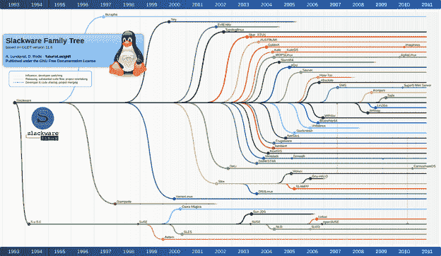

一个稳定的 Linux 发行版是一个可靠且一致的操作系统，适用于日常生活和关键环境。它为各种任务提供了坚实的基础，而不会频繁发生崩溃或中断。

对于日常生活，稳定的 Linux 发行版应该提供用户友好的界面、广泛的软件应用程序以及与硬件设备的无缝兼容。它应该优先考虑易用性、定期更新和强大的社区支持系统。

在关键环境（如服务器或工业系统）中，稳定性和安全性至关重要的。因此，稳定的 Linux 发行版应该关注长期支持、严格测试和稳健的安全措施。CentOS、Debian 和 Red Hat Enterprise Linux (RHEL) 等发行版是这些场景下的首选，因为它们提供了扩展支持并经过了广泛的测试和验证。

最终，选择稳定的 Linux 发行版取决于特定的需求和偏好。在为日常生活或关键环境选择最佳发行版时，考虑可靠性、安全性、社区支持和易用性等因素非常重要。

|  |  |  |

# 第 3 章

有因素有助于 Linux 发行版在日常中使用保持稳定：

1. **可靠性和性能**：稳定的发行版应该具有良好的可靠记录，崩溃或系统故障极少。它还应该提供良好的性能，确保运行顺畅高效。
2. **长期支持 (LTS)**：长期支持确保发行版在很长时间内接收定期的更新、错误修复和安全补丁。这对于维持稳定性和解决可能出现的任何漏洞至关重要。
3. **社区支持**：强大且活跃的社区可以在出现问题时提供帮助、故障排除和指导。稳定的发行版通常受益于大型且支持用户的社区。
4. **软件可用性**：与发行版兼容的广泛应用程序对于日常使用至关重要。稳定的发行版应该拥有强大的软件生态系统，包括流行的应用程序和工具。
5. **硬件兼容性**：稳定的发行版应该与各种硬件配置无缝工作，减少兼容性问题并确保在不同设备上顺畅运行。
6. **用户友好界面**：日常使用的稳定发行版应该具有直观且友好的界面，让新手和经验用户都能轻松导航并执行任务。
7. **测试和质量保证**：开发过程中严格的测试和质量保证有助于在发行版发布之前识别并解决问题。这确保了稳定可靠的体验。
8. **定期更新**：定期更新对于修复漏洞、应对安全漏洞和引入新功能至关重要。稳定的发行版应该有定义的更新周期，以确保持续的稳定性和。
9. **与现有系统的兼容性**：稳定的发行版应该与现有系统和基础设施兼容，允许无缝集成和互操作性。

记住，选择日常使用的稳定发行版可能会根据个人偏好、需求和特定的用例而异。

|  |  |  |

## 1) Ubuntu MATE 22.04 LTS OS

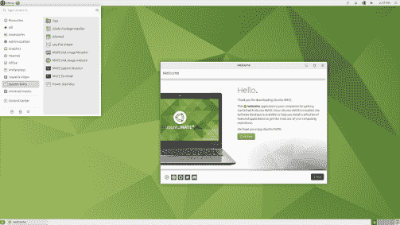

Ubuntu MATE 是一个于 2014 年首次开源操作系统。它是一个社区驱动的 Linux 发行版，旨在提供具有传统桌面界面的用户友好环境。Ubuntu MATE 基于 Ubuntu 操作系统并使用 MATE 桌面环境。

Ubuntu MATE 的历史可以追溯到为偏好传统桌面体验的用户创建一个轻量且可定制操作系统的渴望。该项目迅速流行，吸引了热情的开发者和用户社区，他们为项目的增长和发展做出了贡献。

Ubuntu MATE 提供了一系列功能和应用程序，包括 `Caja` 文件管理器、`Pluma` 编辑器和用于轻松系统配置的 `MATE Control Center`。它还支持广泛的硬件，使其被多样化的用户群体可以使用。

Ubuntu MATE 22.04 LTS 是一个基于 Ubuntu 22.04 LTS（长期支持版）的 Ubuntu MATE Linux 发行版。它旨在为用户提供一个易用且可定制的桌面环境。Ubuntu MATE 22.04 LTS 通过 MATE 桌面环境提供了一个熟悉的界面，该环境以其传统的布局和易于使用而闻名。

它包含了多种预装应用程序，例如 `Mozilla Firefox` 浏览器、`LibreOffice` 办公套件和 `Caja` 文件管理器。此版本的 Ubuntu MATE 还受益于 Ubuntu 提供的长期支持，确保了在较长时间内获得稳定性和安全更新。总而言之，Ubuntu MATE 22.04 LTS 旨在为新用户和老用户都提供一个可靠且高效的 Linux 发行版。

### 官方下载链接：

[https://ubuntu-mate.org/download/amd64/jammy/]

|  |  |  |

## 2) Debian 12 LXDE OS

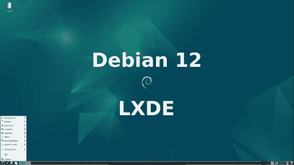

Debian 是一个首次于 1993 年发布的开源操作系统。它由 Ian Murdock 创建，目标是开发一个自由且社区驱动的 GNU/Linux 操作系统发行版。Debian 以其稳定性、安全性以及对自由软件原则的遵循而闻名。

Debian 的历史与 GNU 项目紧密相连，该项目旨在仅使用自由软件创建一个完全兼容 Unix 的操作系统。Debian 采纳了 GNU 项目的软件，并将其与 Linux 内核结合，生成了 Debian GNU/Linux 发行版。

Debian 高度开源协作，并由全球各地志愿者组成的庞大社区维护。它遵循严格的行为准则和定义良好的策略集，以确保发行版的质量和完整性。

Debian 12 代号为“Bookworm”，是 Debian 操作系统的最新稳定版本。它于 2021 年 8 月 14 日正式发布。Debian 12 为发行版的各个方面带来了多次更新和改进，包括更新的软件包、错误修复和安全增强。

Debian 12 LXDE 是 Debian 12 中可用的一种轻量级桌面环境选项。LXDE 代表轻量级 X11 桌面环境，旨在低端或资源受限的设备良好运行，例如旧电脑或笔记本电脑。

––––––––

Debian 12 LXDE 提供了一个简单直观的用户界面，适合偏好轻量级且高效桌面环境的用户。它包含了核心组件，如 `LXDE panel`、`PCManFM` 文件管理器、用于管理会话的 `LXSession` 以及 `Openbox` 窗口管理器。

### 官方下载链接：

https://cdimage.debian.org/debian-cd/current-live/amd64/iso-hybrid/

|  |  |  |

## 3) Pop OS

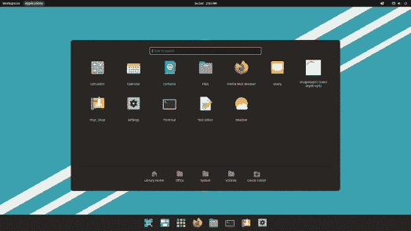

Pop Os 或 Pop!_OS 是由 System76 开发的 Linux 发行版，System76 是一家专门生产 Linux 电脑硬件的公司。Pop!_OS 的开发始 2017 年，目标是创建一个专门为 System76 硬件优化的操作系统。Pop!_OS 的初始版本基于 Ubuntu（另一个流行的 Linux 发行版）。然而，System76 开始逐渐通过添加独特的功能和定制来区分 Pop!_OS。

Pop!_OS 的关键特性之一是其专注于提供精简且友好的体验。该操作系统配备了整洁且现代的桌面环境，以及一套为生产力和创造力定制的预装应用程序。Pop!_OS 还强调系统性能和稳定性，具有如自动固件更新和用于轻松系统恢复的恢复分区等功能。

System76 积极让 Pop!_OS 社区参与开发过程，寻求反馈和建议以改进操作系统。他们还提供定期更新和发布，以确保用户能够获得最新的功能和安全补丁。

总而言之，Pop!_OS 因其对用户体验、性能和定制选项的关注，在 Linux 爱好者和 System76 硬件用户中获得了。它作为一个独立的 Linux 发行版持续进化和成长，为其用户提供独特且定制的体验。

### 官方下载链接：

https://pop.system76.com/

|  |  |  |

## 4) Linux Mint 21.2 Victoria MATE Edition OS

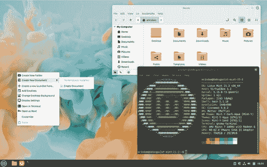

Linux Mint 是一个流行的社区驱动的 Linux 发行版，首次于 2006 年发布。它由法国开发者 Clement Lefebvre 创建，该开发者最初是为各种 Linux 网站撰写评论和教程。根据 Linux 社区的反馈和偏好，Lefebvre 于 2006 年 8 月发布了 Linux Mint 的第一个版本，称为 Linux Mint 1.0 Ada。

Linux Mint 最初使用 Kubuntu 作为基础，但随着 2006 年 11 月 Linux Mint 2.0 Barbara 的发布，它切换到了基于 Ubuntu 6.10 的 GNOME 桌面。时间的推移，Linux Mint 变得受欢迎，并发展了自己的身份、标志以及竞争 Windows 和 macOS 的雄心。它迅速成为与 Ubuntu 并列的最流行的桌面 Linux 发行版之一。

Linux Mint 在版本 4.0 “Daryna” 到 9.0 “Isadora”之间引入了许多独特的工具和功能，例如 `mintupdate`、`mintinstall`、`mintdisk`、`mintmenu`、`mintdesktop`、`mintnanny`、`mintbackup`、`mintstick`、`mintwelcome` 和 `mintupload`。这些工具有助于 Linux Mint 成为功能齐全、稳定且广泛使用的操作系统。

Linux Mint 17（名为 Qiana）的发布标志着开发策略的重大变化。从 Qiana 开始，Linux Mint 决定将其新版本建立在 Ubuntu 当前长期支持（LTS）版本的源码之上，直到 Ubuntu 发布新的 LTS 版本。这使得 Linux Mint 能够从 Ubuntu LTS 版本的稳定可靠性中受益，同时添加自己的独特功能和改进。

Linux Mint 21.2 Victoria 于 2023 年 7 月发布。它引入了许多新功能和改进。显著的变化是升级到 Linux 内核 6.2 版本，这为新硬件提供了更好的兼容性。该版本还侧关注了稳定性、安全用户体验增强。此外，Linux Mint 21.2 Victoria 包含了各种软件更新和错误修复，以确保操作系统顺畅可靠。总而言之，Linux Mint 21.2 Victoria 旨在为用户提供改进且愉悦的桌面 Linux 体验。

Linux Mint 21.2 Victoria Mate 版引入了许多新功能和改进。以下是几个值得关注的特性：

- **MATE 1.26**: Linux Mint 21.2 Victoria Mate 版采用了 `1.26` 版本 MATE 桌面环境，为用户提供了更新且增强的桌面体验。
- **Linux 内核 5.15**: 该版本包含了升级到 `5.15` 版本 Linux 内核，改进了硬件兼容性和性能。
- **扩展安全更新**: Linux Mint 21.2 Victoria Mate 版将提供安全更新直到 `2027` 年，确保操作系统安全受保护。
- **长期包基础**: 直到 `2024` 年，Linux Mint 未来版本将使用与 Linux Mint 21.2 相同的包基础，方便用户升级并保持兼容性。

新背景：Linux Mint 21.2 Victoria Mate 版本包含了来自各种艺术家的精美背景集，为桌面环境增添了视觉吸引力。

改进软件：该版本包含了更新的软件软件包，为各种应用程序和工具带来了精细化和增强。

稳定性与性能：Linux Mint 21.2 Victoria Mate 版本旨在提供一个稳定可靠的操作系统，确保舒适流畅的用户体验。

这些特性以及其他精细化和改进，使 Linux Mint 21.2 Victoria Mate 版本成为那些寻求易用且稳定的桌面 Linux 体验用户的极具吸引力的选择。

官方下载链接：

https://www.linuxmint.com/edition.php?id=306

|  |  |  |

## 5) LMDE 6 Faye OS

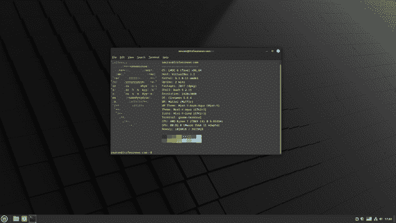

Linux Mint Debian Edition (LMDE) 是一个基于 Debian 的 Linux Mint 版本，首次发布于 2010 年。它的基于基于 Ubuntu 的 Linux Mint 版本的替代方案，提供了直接基于 Debian 测试（Debian Testing）的滚动发布模型。LMDE 的目标是提供一个更保守、更稳定的操作系统，专注于稳定性和安全性。

与基于 Ubuntu 的版本不同，LMDE 旨在使用 Debian 作为基础，提供相同的功能和用户体验。LMDE 接收来自适用于 Debian Testing 或 Debian Squeeze 仓库的更新。然而，在 LMDE 2 之后，Linux Mint 团队宣布他们将不再支持 LMDE 的原始滚动发布版本。

LMDE 6 代号为“Faye”，是 Linux Mint Debian Edition 的最新发布版本。它基于 Debian Bookworm，并于 2023 年 9 月 27 日发布。LMDE 6 具有 Cinnamon 桌面环境，并包含了 6.1 版本的 Linux 内核。该版本引入了各种增强，包括改进的登录界面、增强了 Warpinator（一种文件共享工具）的安全性、对 HEIF 和 AVIF 图像格式的适配，以及旨在提升性能和用户体验的底层改进。

LMDE 6 的开发在 Linux Mint 博客上宣布，并于 2023 年 9 月 13 发布了测试版，随后于 2023 年 9 月 27 正式发布。LMDE 6 旨在为用户提供稳定的、基于 Debian 的 Linux Mint 体验，带有更新的软件和改进的功能。

官方下载链接：

https://linuxmint.com/edition.php?id=308

|  |  |  |

## 6) Backbox Linux 8 Sara OS

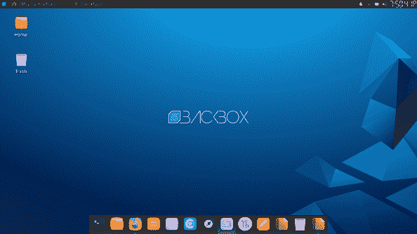

BackBox Linux 是基于 Ubuntu 的 Linux 发行版。它专门为执行渗透测试和安全评估而开发。BackBox 旨在通过包含精选的伦理黑客工具，提供一个快速、易用且完整的桌面环境。

该发行版设计为定期更新这些工具的最新稳定版本。BackBox Linux 于 2010 年成立，是一个开源项目。它为各种安全测试目的提供了 100 多种专用工具。该发行版以其专注于安全性以及适用于渗透测试活动而闻名。

BackBox Linux 8 Sara OS 为渗透测试和安全评估提供了若干功能和更新。以下是 8 个值得关注的特性：

- 基于 Ubuntu 22.04：BackBox Linux 基于 Ubuntu 22.04。
- 更新的 Linux 内核：该版本包含了更新的 Linux 内核。
- 极简桌面设置：提供了最小化的桌面设置。
- 预装伦理黑客工具：BackBox Linux 预装了伦理黑客工具。
- 社区驱动的项目：BackBox Linux 是一个社区驱动的项目。
- 免费开源：BackBox Linux 是一个免费开源的操作系统。
- 网络自动化平台：BackBox 提供了一个网络自动化平台。
- 关注安全性：BackBox Linux 严肃对待安全性。

官方下载链接：

https://backbox.org/download/

|  |  |  |

## 7) Antix Linux 23 (Arditi Popolo)

Antix Linux 是一个基于 Debian 的轻量级操作系统。它旨在旧旧硬件和低资源系统上高效运行。Antix Linux 默认使用 IceWM 窗口管理器，但也其他桌面环境。它以低内存占用而闻名，通常占用小于 100MB。

Antix 的最新版本是 Antix-23，也被称为“Arditi Popolo”，于 2023 年 8 月 28 日发布。Antix-23 基于 Debian bookworm，并为 32 位和 64 位架构提供了完全无 systemd 和无 elogind 的版本。它提供了多种选择，包括不同的初始化系统（sysVinit 或 runit）以及 Antix-full、Antix-base、Antix-core 和 Antix-net 等。Antix-full 是最大的版本，包含了四个窗口管理器（IceWM、fluxbox、jwm 和 herbstluft）以及完整的 LibreOffice 套件。Antix-23 旨在新旧电脑上运行，提供快速且轻量化的 Linux 体验。

官方下载链接：

https://antixlinux.com/download/

|  |  |  |

## 8) Zorin OS Lite Edition

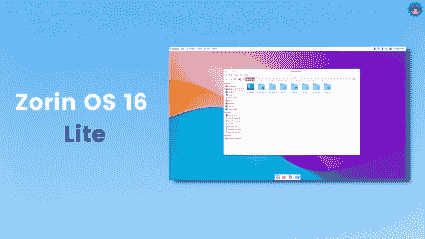

Zorin OS 是一个基于 Linux 的稳定且长期支持（LTS）的操作系统。它提供了友好的界面，并为那些来自 Windows 背景的用户而设计。Zorin OS 提供了各种预装软件，包括 LibreOffice，这是一款类似于 Microsoft Office 的免费开源办公套件。

Zorin OS Lite 版本是 Zorin OS 的轻量级版本，专为低配置和旧电脑设计。它提供了一个基于 XFCE 桌面环境的简约且高效的桌面环境。Zorin OS Lite 以能够在 15 年前的电脑上运行而闻名，使其成为希望焕活旧 PC 并延长其寿命用户的极佳选择。

Zorin OS Lite 版本具有焕一新且精致的外观，配备了更护眼的新默认主题。它还包含了新的艺术和桌面壁纸，以提升整体视觉体验。

在系统要求方面，Zorin OS Lite 专为低配置电脑运行而设计。最低硬件规格包括 1 GHz 单核 Intel/AMD 64 位处理器、1 GB 运行内存、10 GB 存储空间以及 800x600 的显示分辨率。

Zorin OS Lite 提供了多种软件选项，包括 `XFCE` 桌面环境、用于自定义的 `Zorin Appearance` 应用以及 `Rhythmbox` 音乐播放器。Pro Lite 版本还提供了额外的预装应用和功能。

总的来说，Zorin OS Lite 是一款轻量且高效的操作系统，适用于老旧和低配置的电脑，能够提供流畅且响应迅速的用户体验。

官方下载链接：

https://zorin.com/os/

|  |  |  |

## 9) 树莓派操作系统 桌面版

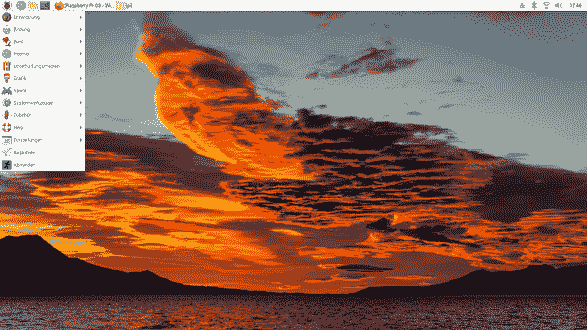

适用于 PC 和 Mac 的树莓派桌面版是一个基于 `Debian` 的操作系统，允许您在任何 PC 或 Apple Mac 电脑上运行树莓派操作系统桌面环境。它提供了树莓派操作系统自带的大部分推荐软件，使其成为那些想要在自己的桌面或笔记本电脑上体验树莓派界面的人的理想选择。

通过树莓派桌面，您可以将其安装为电脑的主操作系统、在虚拟机中运行它，或者创建一个可启动的 Live USB 闪盘以在需要时使用。它对于复活那些可能已不再强大到足以运行现代商业操作系统的旧电脑来说特别别有用，因为它通常能让这些电脑重新焕发生机。

树莓派桌面同时兼容 PC 和 Mac 平台，让用户可以在自己的桌面或笔记本电脑上享受熟悉的树莓派界面，并访问推荐的软件。

然而，重要的是，树莓派桌面与专为树莓派单板计算机设计的普通树莓派操作系统并不相同。桌面版针对 PC 和 Mac 硬件进行了优化，而普通的树莓派操作系统则是针对树莓派的 ARM 架构进行了优化。

官方下载链接：

https://www.raspberrypi.com/software/raspberry-pi-desktop/

|  |  |  |

## 10) Elementary OS

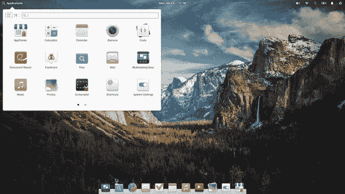

Elementary OS 是一个基于 Linux 的操作系统，提供凝聚且集成的桌面体验。它以极简主义设计和对简单性的关注而闻名。其他 Linux 发行版提供了广泛的设置和选项，而 elementary OS 采取了更加克制的方法，提供了一种开发者认为保持现状即运行良好的精选体验。

Elementary OS 的一个显著特性是它对对 `HiDPI` 缩放的支持。用户可以调整文本和显示元素的缩放因子，以确保在高分辨率屏幕上获得舒适的视觉体验。

Elementary OS 适用于个人和专业用途。它的设计旨在让新用户易于理解和上手，使其对普通电脑用户触手可及。同时，它也因其简单性和功能受到专业开发者的青睐。该操作系统提供了一个用户友好且强大的环境，侧重于流畅的处理和易用性。

它提供了凝聚且集成的桌面体验，适用于各种任务，包括 Web 开发、常见的开发任务和大学学业。Elementary OS 以其极简设计和可自定义的键盘快捷键而闻名，确保了初学者和经验丰富用户的生产力。虽然它提供的自定义选项可能没有某些其他 Linux 发行版那么多，但它的精选体验和精简的界面对个人和专业用途都有益处。

官方下载链接：

[`elementary.io/`](https://elementary.io/)

|  |  |  |

## 11) Chrome OS Flex 版

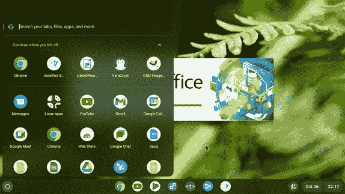

Chrome OS Flex 是 Google 的一项新举措，旨在将 Chrome OS 的简单性和安全性带来更广泛的设备。该版本旨在提供更灵活、更多功能的用户体验，允许它运行在各种硬件配置上。通过 Chrome OS Flex，用户可以通过将旧电脑转换为快速、安全且易于使用的设备，为旧电脑注入新生命。该版本还针对企业和学校进行了优化，提供了易于大规模部署和管理。

Chrome OS Flex 的关键功能之一是它能够提供云优先的体验，允许用户与 `Google Workspace` 和其他云端应用程序无缝集成。这确保了用户可以在任何地方、通过任何设备访问他们的文件和应用程序。此外，Chrome OS Flex 带有内置的安全功能，如自动更新和沙箱机制，保护用户免受恶意软件和其他在线威胁。

总结，Chrome OS Flex 版是一个灵活、安全且以云为中心的操作系统，将 Chrome OS 的优势带到更广泛的设备上，是个人和机构的吸引人的选择。

官方下载链接：

https://chromeos.google/products/chromeos-flex/

|  |  |  |

## 12) Bliss OS

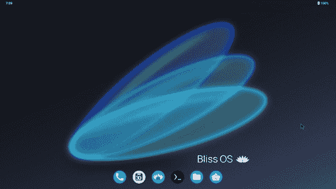

Bliss OS 是一个基于 Android 的开源操作系统，设计用于在个人电脑运行。它由一个开发者团队于 2017 年首次发布，旨在桌面和笔记本电脑上创建一个流畅高效的 Android 体验。该项目的最初灵感源于对更适合桌面的 Android 版本的需求，让用户能够在更大的屏幕上享受他们的移动应用和游戏。

自诞生以来，Bliss OS 经历了多次更新和改进，重点是优化性能、增强与各种硬件配置的兼容性并提供用户友好界面。

开发者一直在努力修复漏洞、添加新功能，并为希望在 PC 上使用 Android 生态系统的用户提供稳定可靠的平台。总的来说，Bliss OS 已演变为为在个人电脑上寻求熟悉的 Android 体验的用户的多功能且可定制的选择，融合了移动和桌面的功能。

官方下载链接：

https://blissos.org/

## 13) Manjaro Linux Xfce 版

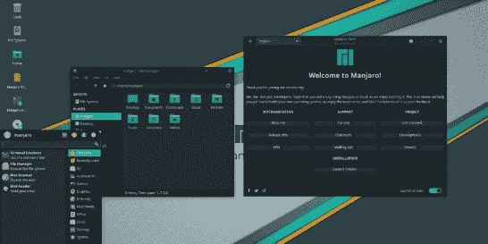

Manjaro Linux Xfce 版是一款受欢迎的操作系统，以其用户友好界面和对简单优雅的关注而闻名。Manjaro Linux 本身于 2011 年由一组来自奥地利、法国和德国的开发者首次发布。Xfce 版专门设计得轻量级且快速，非常适合旧电脑或偏好快捷桌面体验的用户。

Manjaro Linux Xfce 版的历史与 Manjaro 项目的整体发展紧密相连。多年来，`Xfce Edition` 随着主发行版同步演进，整合了最新的 `Xfce` 桌面环境特性和改进。Manjaro 团队致力于提供一个稳定的、滚动更新的发行版，并强调社区反馈与参与。

随着 Manjaro Linux 的流行，`Xfce Edition` 成为追求简洁高效桌面环境用户的首选。它的历史是一段不断精炼和创新的历，通过定期更新并承诺为用户提供无缝的 Linux 体验。如今，Manjaro Linux `Xfce Edition` 仍然是寻找可靠且可定制 Linux 发行版的用户的首选。

**官方下载链接：**
https://manjaro.org/download/

|  |  |  |

## 14) GhostBSD OS

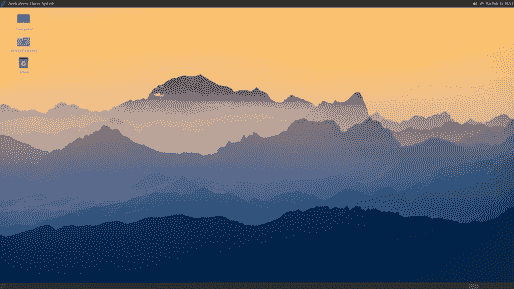

GhostBSD 是一个基于 `FreeBSD` 的桌面级操作系统，专注于简单性和易用性。它提供了一系列预装的常用软件，旨在为现代 `BSD` 平台提供舒适的体验。该项目的目标是将安全性、隐私性、稳定性、易用性、开放性和自由结合，并且完全免费。

该项目始于 2009 年初初，由 Eric Turgeon 和 Francois Toussaint 创立。最初的目标是制作一个安全的、可安装的 `FreeBSD` Gnome `live CD` 系统，帮助新用户适应 `FreeBSD`。第一个测试版本 `1.0 BETA` 于 2009 年 11 月 10 日发布。

该项目持续演进，在 `2.5` 版本中引入了第一个图形化安装程序。GhostBSD 最初基于 `FreeBSD`，然后短暂切换到 `TrueOS`，后来又回到了基于 `FreeBSD`。该项目经历了多次基础变更，旨在提供稳定的更新和发布周期。“GhostBSD”这个名称最初代表“运行在 BSD 上的 GNOME”，因为它最初是尝试在 `FreeBSD` 上提供即插即用的 `GNOME` 桌面。然而，主桌面后来更改为 `GNOME 2` 的分支 `MATE`，项目开始提供如 `XFCE` 等替代桌面环境，所有这些均使用 `GTK` 工具包。

如今，GhostBSD 是一款基于 `FreeBSD` 的简单、优雅且友好的桌面笔记本 `BSD` 操作系统，官方桌面环境为 `MATE`。安装程序利用 `OpenZFS`，使用户可以轻松在同一硬盘的 `ZFS` 上与其他操作系统一起安装 GhostBSD，非常适合 `FreeBSD` 新手。由于硬件要求适中，GhostBSD 是现代工作站和 64 位单板计算机硬件的理想选择。总而言，GhostBSD 旨在类 Unix 操作系统上提供简单、轻量级的桌面体验，并关注易用性和稳定性。

**官方下载链接：**
[`ghostbsd.org/`](https://ghostbsd.org/)

|  |  |  |

## 15) Endless OS

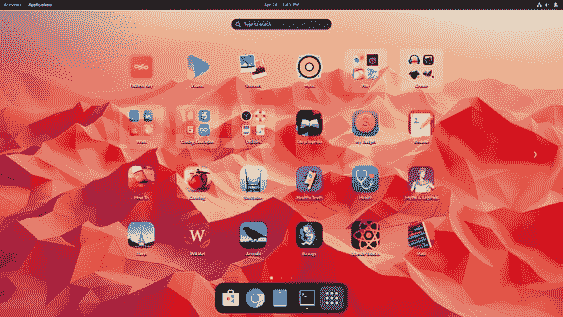

Endless OS 由 Endless Computers 于 2016 年推出，是一种 Linux 发行版，主要为互联网受限的发展地区用户设计。其根源可以追溯到公司创建易用计算体验的任务，特别是针对教育和生产力。

Endless OS 构建在 `Debian` 之上，采用了自定义的 `GNOME` 桌面环境。系统具有独特的软件管理方法，允许用户离线访问大量的预装应用程序和教育内容。这种离线能力至关重要，因为它有助于帮助那些可能没有稳定互联网访问的人跨越数字鸿沟。

该操作系统针对低端硬件性能进行了优化，是资源有限的学校和社区极具吸引力的选择。它强调简单和用户友好，适应不同技术水平的用户。

多年来，Endless OS 通过定期更新不断演进，增强了用户界面并扩展了其应用生态系统。其开发继续关注提高可访问性并为全球用户赋能，体现了为欠服务群体提供价值计算资源的哲学。

**官方下载链接：**
[`www.endlessos.org/`](https://www.endlessos.org/)

|  |  |  |

# 作者传记

来自蓝色星球的无名机械剑客

Pendekar Pedang Cyborg Tak Bernama Dari Planet Biru Bernama Bumi

