# Linux：初学者轻松学，学习 Linux 操作系统和命令行的步步指南

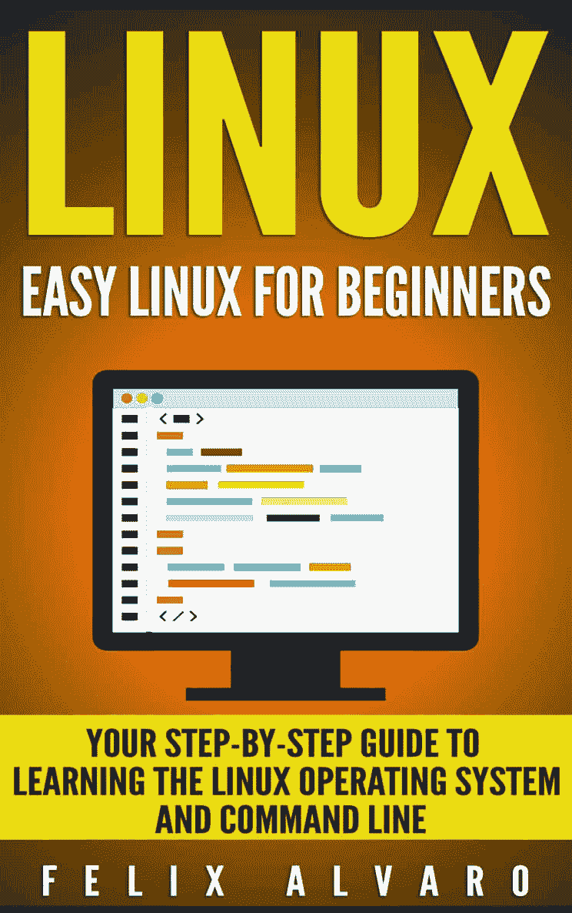

## 致谢

首先，我要感谢上帝赐予我知识和灵感，让我能够汇成这本内容丰富的书籍。我还要感谢我的父母、兄弟以及我的伴侣 Silvia 的支持。

# 引言

你好！恭喜你获得了这本书。你在获取 Linux 新知识方面做了一项非常明智的投资。

我的名字是 Felix Alvaro，我是一名网络营销人员、企业家和作家。我的使命是通过我的书籍分享我的知识和经验，激励并启迪你实现你的目标。

由于你对这本书感兴趣，我推测你已经听过 Linux 了。虽然它不是大多数个人电脑上最受欢迎的操作系统，但 Linux 绝对是最强大的。这里有一个冷知识：世界上 98.8% 的最快系统（想象一下超级计算机）都在使用`Linux kernel`（Linux 内核）。如果它们都在使用，你又为什么不能使用它呢？

除了我个人在自己的电脑上使用它之外，自从大公司采用开源操作系统作为它们的服务器以来，对 Linux 管理员的需求一直处于高水平。

无论你是为了第一次体验使用 Linux 而购买这本书，还是计划在未来获得 Linux 专业认证，购买这本书绝对能让你走在正确的道路上。我可以保证，这本书将为你提供所需的知识，帮助你入门并让你在 Linux 知识之旅上持续。

一旦你熟悉了系统的特性，入门 Linux 是容易的。在这份指南中，我将用简单的方法为你拆解一切，让你能够快速掌握所有内容。我并不假设你已经了解某些内容，而是对我教导的每个概念进行详细说明。

# 第一章：入门

## 什么是操作系统？

一台电脑连同它的所有部分——`CPU`、鼠标、显示器和键盘——如果没有一个将它们所有整合在一起的核心程序，是无法工作的。操作系统，简简称 `OS`，是将计算机硬件与你想安装在上面的不同程序结合在一起的软件。当你启动一台没有 `OS` 的 PC 时，你会被引导到`command prompt`（命令提示符），这对于大多数计算机用户来说毫无意义。你将无法观看视频、听音乐、编辑照片或简单地写笔记。

操作系统负责执行以下任务：

* **检测硬件** – `OS` 负责在启动期间验证计算机组件（`硬盘`、`CPU`、网卡、鼠标等），并加载相应的硬件驱动程序和模块，以便硬件能够正常运行。

* **管理进程** – 类似于我们大脑运作的方式，此时电脑上有多个进程或应用程序正在运行。是 `OS` 负责分配`CPU resources`（CPU 资源）。`OS` 还为用户提供启动、停止或重启进程的选项。

* **管理内存** – 每个应用程序都需要特定量的 `RAM` 和 `swap memory`（交换内存）来运行。`OS` 负责分配内存并在并处理内存请求。

* **启动用户界面** – `OS` 为用户提供访问系统的方法，可以通过`command line`（命令行）或图形用户界面（`GUI`）。

* **建立文件系统** – `OS` 处理文件的管理（访问、目录和结构），包括对`file system`（文件系统）的访问。

* **访问与用户验证** – `OS` 允许创建具有不同文件和进程权限的用户账户。

* **提供管理平台** – 计算机的 `OS` 为管理员添加用户、分配磁盘空间、安装软件以及执行管理计算机的操作提供了平台。

* **启动服务** – `OS` 管理后台运行的多个进程，称为守护进程 `daemon processes`。

让我们进入一个我们都能理解的场景——工作中的经理。`OS` 就像一个经理，负责监督团队的不同部分、分配任务、分配负载并检查每个人的表现。虽然团队的每个成员都有特定的工作职责，但经理确保团队协作工作。

你可能听过的操作系统示例包括`Windows 10`（及其之前的版本）、`Mac OS X Yosemite`（以及之前的版本）以及 `Unix`。

那么 Linux 处于什么位置呢？我们将在下一节中讨论。

## 什么是 Linux？

Linux 是一种操作系统，与上一节提到的示例相似，通常被描述为类 Unix 系统。

Linux 与其他操作系统的显著区别在于 Linux 是一个开源操作系统。这意味着 Linux 是通过协作持续开发的，不像`Windows`和`OS X`均绑定于各自的公司（`Windows`和`Apple`），没有哪一家公司拥有 `Linux` 的开发和支持。构建 Linux 是一个共同的愿景，不同的公司共享研究、开发和相关成本。公司与开发者之间的这种开源合作使得 Linux 成为从小型数字手表到服务器和超级计算机的最佳可用生态系统之一。根据统计，每发布一个内核版本，至少有 100 家公司和 1000 多名开发者共同工作。

Linux 由`kernel`（内核，即核心控制软件）以及许多提供不同功能的库和实用组成。Linux 通过许多发行版提供，这些就是我们所说的 Linux 发行版（flavours）。发行版是特定内核和程序的组合。目前最流行的发行版包括`Arch`、`SUSE`、`Ubuntu`和`Red Hat`。本书重点关注大多数 Linux 发行版中存在的功能，尽管这些发行版有时会有自己特定的工具。

该操作系统最初被用作服务器操作系统，然后被用作 Android 开发的基础。直到现在，Linux 在服务器操作系统方面拥有最大的市场份额，但在个人和家庭使用（如桌面电脑和笔记本电脑）方面是最不受欢迎的。在接下来的章节中，我们将深入讨论 Linux 相比其他操作系统更好的原因。

除了操作系统执行的任务外，Linux 还具有以下特点：

* 支持集群 – 可以配置多个 Linux 系统，使其从外部看起来像一个系统。服务可以在集群之间进行配置，并仍然提供无缝的用户体验。

* 运行虚拟化 – 虚拟化允许一台计算机在用户看来是几台计算机。Linux 可以配置为虚拟化主机——可以在运行其他操作系统，如`Windows`、`Mac OS`或其他 Linux 系统。所有虚拟化系统在外部看来都是独立的系统。

* 云计算 – Linux 可以处理复杂的、大规模的虚拟化需求——包括虚拟网络、网络存储和虚拟机。

* 存储选项 – 数据不需要始终存储在计算机硬盘中。Linux 提供了不同的本地和网络存储选项，如`Fibre Channel`和`iSCSI`。

我将不会详细讨论上述功能，因为它们的应用非常高级。然而，在比较 Linux 和其他操作系统时，了解这些点是有益的。

## Linux 的历史

来自芬兰的学生 Linus Benedict Torvalds（莱纳斯·托瓦尔斯）于 1991 年使用`C`和汇编语言创建了 Linux。Linux 是作为一个免费、开源、开放许可的操作系统开发的，这使得全世界的开发者能够学习和修改该操作系统。自从 1991 年发布初始源代码以来，它在`GNU General Public License`下已增长到超过 1800 万行代码。

最初，Torvalds 将他发明的操作系统命名为`Freax`，这是“free”、“freak”和“x”几个词的组合。他将文件上传到`FTP`服务器，他的同事`Ari Lemmke`是该`FTP`服务器管理员。Lemmke 认为`Freax`听起来不太好，因此在没有告诉 Torvalds 的情况下将文件夹重命名为`Linux`。后来，Torvalds 同意了更命名。

1992 年，Linux 以`GNU GPL`许可，第一批 Linux 发行版（也称为`distro`）被创建出来——`Boot-root`、`MCC Interim Linux`、`Softlanding Linux System (SLS)`和`Yggdrasil Linux`，其中几个是在同同年发布的。随着时间的推移，创建了多个发行版：`Slackware`——最老的现有发行版，`Debian`——最大的社区发行版，以及商业发行版`Red Hat`和`SUSE`。

近年来，Linux 经历了更多发展。Linux 的服务器市场收入已经超过了`Unix`。基于 Linux 的移动操作系统`Android`已经获得了 75% 的市场份额。2015 年，`Linux Kernel Version 4.0`发布。

通过协作工作，Linux 现在是最强大的操作系统之一。数据表明，世界上 98.8% 的最快系统使用`Linux kernel`。知道你正在使用与这些超级计算机相同的操作系统，难道不令人欣慰吗？

## Linux 与其他操作对比

现在，让我们来看重要的问题：Linux 比其他的更好吗？让我们 Linux 与其他著名的操作系统进行比较。

### 成本

如果你合法获取了`Windows`，你将支付超过 100 美元，专业版甚至更高。相反，Linux 是免费的。对于 Linux 商业发行版，公司销售支持和文档等服务，但操作系统本身是免费的。

### 病毒

Linux 几乎没有任何病毒。由于大多数 PC 运行在`Windows`上，攻击者的目标是于`Windows OS`。Linux 的开源政策是关键。由于许多开发者在 Linux 上工作，有更多的眼睛关注安全漏洞。如果真的出现了 Linux 病毒，也有很多帮助。专有操作系统与其雇佣的工程师数量和他们拥有的资源挂钩。对于 Linux，世界各地的任何开发者都可以简单下载源代码并帮助发现和解决漏洞。

### 系统稳定性

如上一节所述，Linux 被用于服务器和超级计算机。大型系统可以运行多年而无需重启。进行适当重启的时间是在`kernel upgrades`（内核升级）期间——即使是运行在 Linux 服务器上的软件的升级，也只执行服务重启，而不是节点重启。

与之相比，你经历过由于程序崩溃而丢失数据的次数，或者在`Windows`中插入设备时看到“蓝屏”的次数有多少呢？

### 安装

当你安装 Linux（其任何发行版——`Ubuntu`、`Fedora`等）时，你得到了所需的一切——文本编辑器、电子表格、演示文稿、照片编辑器、浏览器、播放器、PDF 阅读器等。与`Windows`和其他操作系统相比，一旦设置好操作系统，你必须逐个安装所需的所有其他软件。

这对硬件驱动程序也是如此。在 Windows 中，你必须先安装驱动程序。驱动程序通常在购买硬件时附带光盘。现在，想想你需要安装驱动程序却找不到光盘是什么时候？在 Linux 中，驱动程序包含在`Linux Kernel installation`中——你节省了时间而且方便得多。

### 支持

Linux 有一个大型在线社区，新用户可以在那里获取信息、阅读常见问题解答（FAQs），并在你认为某些程序或功能运行不正常时进行提问。开源的伟大之处在于，由于许多人参与该操作系统，有无限的资源供你使用和学习。这些也都是免费的！

这些是 Linux 相比其他操作系统更好的原因。然而，请注意 Linux 使用的是开源软件，因此如果你担心下列的任何项目，那么你应该坚持使用`Windows`或你当前的操作系统：

* 你需要使用专有软件工作。如果你绝对找不到匹配你所需的专有软件的开源程序，请保留你当前的操作系统。

* 你是一个硬核游戏玩家。大多数游戏仅兼容`Windows`。

* 硬件尚未在 Linux 中支持。某些仅在几个月前发布的新硬件，Linux 可能尚未提供支持。硬件厂商通常只为 Windows 和 Mac 发布驱动程序，因为这两个系统最流行。

大多数安装了 Linux 的个人会通过所谓的“双启动”来解决这个问题。双启动是指在你的设备上同时安装 Windows 和 Linux，这样你就可以根据需要选择其中任何一个操作系统。

在本章中，我们讨论了 Linux 操作系统可以做什么，以及它与其他现有操作系统的对比。在下一章中，我们将深入理解 Linux 操作系统是如何运行的。

# 第二章：理解 Linux

在本章中，我将提供关于该操作系统架构的简要信息，并讨论初学者可以选择的不同 Linux 发行版。

## Linux 架构

Linux 架构可以分为两部分：用户空间（User Space）和内核空间（Kernel Space）。

- **用户空间** – 这是运行的地方。用户空间中的 GNU C 库是连接内核并在用户空间与内核空间之间切换的接口。它使用所有可用内存。

- **内核空间** – 所有的内核服务都在此处处理。内核空间进一步分为三部分：

    - **系统调用接口** – 用户进程可以通过系统调用（System Call）访问内核空间。当执行系统调用时，参数会从用户空间传递到内核空间。这是实现基础功能的层。

    - **内核代码** – 这是与架构无关的代码，可见 Linux 支持的所有架构中。

    - **依赖架构的内核代码** – 这是针对特定平台的代码层。

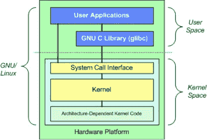

图 1：Linux 架构

## Linux 发行版

每个 Linux 发行版都由 Linux 内核加上实用程序和配置文件组成。大多数 Linux 发行版都可以从它们的网站下载。

让我们根据以下标准来看看几个流行的 Linux 发行版（或称为不同变体）之间的差异：

### 可用性

如前所述，Linux 是一款免费软件，但提供支持合同和专有组件的公司会收取费用提供。在下表中，Red Hat Enterprise 和 SUSE Enterprise 都提供商业版 Linux，但它们也有免费的替代方案——`Fedora`和`openSUSE`。

### 包格式

Linux 发行版以包的形式出现。包是将文件分组到单个文件中的。`RPM`是最常用的。

### 发布周期

这是发行版发布新软件的频率。发布周期较短的发行版以最短的时间提供最新的软件，而发布周期较长的发行版则旨在提供尽可能稳定的环境。一个发行版可以同时采用这两种方式。看看`Ubuntu`，它既发布长期支持（`LTS`）版本（长周期），也通过 6 个月的周期发布最新软件。

| 发行版 | 可用性 | 包格式 | 发布周期 |
| :--- | :--- | :--- | :--- |
| Arch | 免费 | `pacman` | 滚动更新 |
| CentOS | 免费 | `RPM` | 约 2 年 |
| Debian | 免费 | `Debian` | 2 年 |
| Fedora | 免费 | `RPM` | 约 6 月 |
| Gentoo | 免费 | `ebuild` | 滚动更新 |
| Mint | 免费 | `Debian` | 6 个月 |
| openSUSE | 免费 | `RPM` | 8 个月 |
| Red Hat Enterprise | 商业 | `RPM` | 约 2 年 |
| Scientific | 免费 | `RPM` | 约 6 月 |
| Slackware | 免费 | `tarballs` | 不规律 |
| SUSE Enterprise | 商业 | `RPM` | 2-3 年 |
| Ubuntu | 免费 | `Debian` | 6 个月 |

表 1：流行的 Linux 发行版对比

为了帮助你决定哪种发行版适合你，请考虑上述标准并在列出的其他领域进行研究：

- **桌面环境**：进行研究并发现你看中的特定发行版是否具有你喜欢的界面外观，并检查它的可定制程度。

- **硬件兼容性**：取决于你使用的硬件，在你安装发行版时，某些驱动程序可能尚未可用。先检查在线资源以了解哪些可以开箱即用。

- **社区支持**：寻找拥有大型在线社区的版本。社区越大，找到文档和获取支持就越容易。

我个人向从未用过 Linux 的人推荐`Linux Mint`。它的安装简单且省心，而且菜单非常熟悉（见下图）。它还附带了预装的专有软件（例如：`Adobe Flash`、`MP3 支持`）。

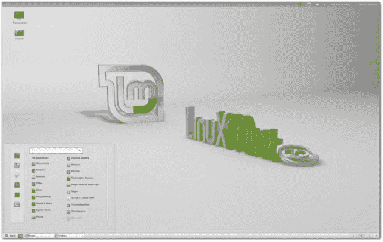

图 2：Mint 桌面

一旦你熟悉了`Mint`并觉得想尝试其他发行版，我推荐`Ubuntu`作为你的下一个发行版。`Ubuntu`让经验丰富的普通用户觉得 Linux 易于使用。该发行版还带有一套标准程序，让你在安装后就能开始工作。

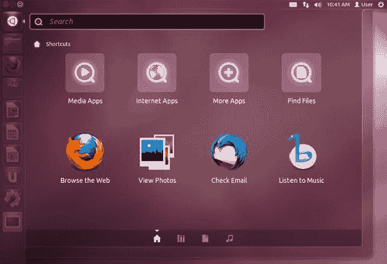

图 3：Ubuntu 发行版

在本章中，我们讨论了构成 Linux 的不同组件，并涉及了流行发行版之间的差异。希望这能帮助你找到想要开始 Linux 体验的发行版。在下一章中，我将带你完成 Linux 的安装过程。

# 第三章：Linux 安装

在本章中，我们将讨论如何在你的计算机上最终安装 Linux。根据你希望的设置，你可以清空硬盘并用 Linux 替换现有操作系统，也可以保留现有操作系统并共享磁盘。后者需要额外的步骤来完成磁盘分区。

## PC 上的 Linux

对于初学者来说，有两种方法可以尝试 Linux。

首先，你可以获取 Live CD。如果你想在不触动当前操作系统的情况下尝试 Linux，这是最佳选择。使用 Live CD 允许从光盘启动。完成后，移除光盘并重启电脑。当你运行 Live CD 时，可能会觉得有点慢，因为操作系统是从驱动器加载的。

其次，你可以直接在计算机上安装 Linux，无论是独立安装还是与现有操作系统共享。

后续章节讨论的步骤适用于 Live CD 和直接安装 Linux。

## 安装前的步骤

在继续安装之前，最好先检查你的 PC 硬件。

- **DVD 驱动器**：安装 Linux 需要 DVD 驱动器，且计算机必须能够从驱动器启动。如果你的硬盘控制器是 IDE/ATA 或 USB DVD，这将适用于 Linux。

- **硬盘**：如果你将使用 Live CD 则不需要。如果你将安装 Linux，最好至少有 4GB 的磁盘空间。Linux 支持`IDE`和`SCSI`硬盘控制器。

- **键盘**：所有键盘都适用于 Linux。

- **显示器**：大多数发行版安装程序都能检测现代显示器。如果你发现显示不好，请选择显示器类型和特定的分辨率（`1024x768`）。

- **鼠标**：`PS/2`或`USB`鼠标适用于 Linux。

- **网卡**：安装程序可以检测大多数网卡。如果你发现某个网卡有问题，请在网上查找额外信息。

- **处理器**：要求的最低处理速度为`700 MHz`。现在的处理器速度远高于这个数值。就速度而言，数字越高越好。

## 硬件要求


- **RAM**：内存越大越好。最低要求为 512MB。请检查适用于你特定发行版的相应内存要求——其他发行版可能需要更大的内存分配。
- **声卡、显卡、打印机**：确保这些设备与 Linux 兼容。更多信息请参阅硬件供应商网站。

## 为 Linux 准备空间

如果你选择在不移除当前操作系统的情况下安装 Linux，请注意你现有的操作系统占用了整个硬盘。这意味着 Linux 和你当前的操作系统需要共享硬盘，以便两个操作系统能够共存。你将需要对硬盘进行分区和划分。如果你选择此路线，请务必对系统进行备份，因为存在清除硬盘上数据的风险。

为了方便分区，你可以获取运行在 Windows 上的硬盘分区产品，或者使用大多数 Linux 发行版自带的名为`QTParted`的图形界面工具。某些发行版（如`openSUSE`或`Xandros Desktop`）可以缩小 Windows 分区并自动为 Linux 创建分区。如果你选择的发行版提供此功能，你将不再需要分区工具了。

### Ubuntu 分区步骤

一旦 Ubuntu 启动并出现 GUI 桌面，请按照以下步骤缩小 Windows 分区的大小：

1. 从 Ubuntu 桌面点击 `System ➪Administration ➪GParted`。`GParted`窗口将出现，并显示在你的电脑上找到的驱动器。你看到的第一个硬盘设备名称为`/dev/sda`，下一个将命名为`/dev/sdb`，依此类推。
2. 在`GParted`窗口的右侧，从设备列表中选择硬盘。
3. 选择你想要调整大小的分区。你需要寻找最大的分区。
4. 从`GParted`菜单中选择`Resize/Move`（调整大小/移动）。
5. 为分区指定新大小，然后点击`Resize/Move`。指定一个大小，以便在分区后获得 4GB 或更多的空闲磁盘空间。
6. 点击`Apply`（应用）开始应用你所做的更改。

在硬盘获得 Linux 所需的空空间，你现在可以开始安装你选择的 Linux 发行版了。

## 安装步骤

前往 Linux 发行版网站下载发行版文件。你下载的文件将附带安装步骤。在本节中，让我们讨论任何 Linux 发行的通用安装步骤。

### 第一步

准备你的 CD/DVD 安装程序或 Live CD。下载一份你计划安装的发行版副本并将其刻录到 CD/DVD。

### 第二步

确保你的电脑可以从 CD/DVD 驱动器启动。如果当驱动器中有 CD/DVD 时你的电脑仍从硬盘启动，请先更改`Boot Devices`（启动设备）。进入 BIOS 并更改启动设备顺序——选择`CD/DVD drive`为第一个启动选项。你可以通过重启电脑并按键（大多数电脑上为`F2`或`Del`）进入设置菜单。确认你电脑品牌和型号对应的按键。完成分配 CD/DVD 驱动器为第一个启动选项后，将光盘放入驱动器并重启电脑。

### 第三步

如果你使用的是 Live CD，请重启电脑。电脑将启动并从你的 Live CD 加载操作系统。

如果你正在安装 Linux，第 3 步是对硬盘进行分区。分区的方法之一在上一节中描述过。

一旦你完成了分区，从 CD/DVD 驱动器启动电脑并继续安装。虽然安装过程因发行版而异，但这些通常是简单且直接的步骤。参考随文档附的安装屏幕，你应该在一小时或两小时内完成。

安装过程中包含一些配置步骤，例如设置日期和时间、语言以及选择要安装的软件包。

安装完成后，请重启电脑。

## 安装故障排除

我们都希望安装过程顺利，但万一情况不如人意，这里有一些你可以检查的初始故障排除提示。

### 安装程序未能启动 X Window

X Window 是许多 Linux 发行版包含的图形用户界面。如果安装程序没有检测到显卡或由于其他原因导致安装程序未能启动 X，你可以选择文本模式安装。

参考下表获取访问文本模式安装界面的不同方法。

| 发行版 | 访问文本模式安装的方法 |
| :--- | :--- |
| Debian | 默认为文本模式 |
| Fedora | 在看到 boot: 提示符时输入 text |
| SUSE | 按`F3`并使用方向键选择 Text-Mode 选项。按回车。 |
| Ubuntu | 默认为文本模式 |
| Xandros | 从 CD/DVD 驱动器重启时按 Shift 键。选择 Rescue Console（救援控制台）。在看到 bash 提示符时输入`quick_install`。 |

**表 2：安装期间如何访问文本模式**

你的发行版不在列表中吗？请在网上查找如何为你的发行版启动文本模式安装。

文本模式安装界面与安装界面类似，在其中你必须响应提示以执行安装。一旦你进入文本模式，请仔细阅读提示并遵循说明操作。

### 安装后 X 无法工作

如果你在安装期间恰好看到 GUI，但在首次重启后面对的是灰屏或中间带有 X 的黑屏，这里有一些你可以使用的步骤。

1. 重启电脑。按`Ctrl+Alt+Delete`。
2. 一旦电脑启动，如果发行版使用 GRUB，按`A`然后输入`single`。如果使用 LILO，输入`single`。Linux 内核将在单用户模式启动，提示如下：

```bash
sh-300#
```

一旦看到此提示符，现在就可以配置 X 了。根据发行版的不同，X 使用配置文件设置显示卡、显示器和分辨率。问题有时发生在配置不正确。通过创建一个配置文件来解决这个问题：

1. 输入以下命令：

```bash
X -configure
```

一旦你输入此命令，X 服务器将创建一个配置文件。你会看到屏幕变空并显示多条信息。

2. 使用文本编辑器`vi`编辑文件`/etc/xorg.conf`。在`Section "Files"`下插入下方：

```
FontPath "unix/:700"
```

使用 Fedora 时，你还需要将`/dev/mouse`改为`/dev/input/mice`。

3. 输入命令启动 X 字体服务器：

```bash
xfs
```

4. 输入下方启动新配置：

```bash
X -config /etc/xorg.new
```

一旦看到带有 X 光标的空屏，说明配置文件正常。

5. 使用`Ctrl+Alt+Backspace`停止 X 服务器。

6. 输入命令将配置文件拷贝到`/etc/X11`目录：

```bash
cp /etc/xorg.new /etc/X11/xorg.conf
```

7. 输入单词`reboot`或按`Ctrl+Alt+Delete`重启电脑。

如果配置文件更改成功，将会登录界面。大多数 Linux 发行版都有在线社区。如果你在安装过程中遇到问题，请搜索该问题、详细描述它或使用实际错误信息作为搜索关键词。你会找到所需的信息，如果没有找到，你也可以可以在论坛发帖，社区将随时提供帮助。

访问以下论坛获取更多信息：

- Ubuntu: [`ubuntuforums.org/`](http://ubuntuforums.org/)
- Linux Mint: [`linuxmint.com/forum/`](http://linuxmint.com/forum/)
- SUSE: [`forums.suse.com/forum.php`](https://forums.suse.com/forum.php)
- Debian: [`www.debianhelp.org/`](http://www.debianhelp.org/)

***

在本章中，我们讨论了 Linux 的正确安装方法。现在你已经在电脑上安装了 Linux，我们将带你体验第一次 Linux 之之旅。

# 第四章：你的第一次 Linux 体验

既然你的 Linux 系统已经在电脑上运行，让我们开始探索这个系统吧。

## 开启你的电脑

一旦你打开电脑，引导程序——`GRUB`或`LILO`——就会出现并显示电脑中安装的操作系统的名称。使用方向键选择你想要加载的操作系统。这适用于安装了两个操作系统的电脑。如果 Linux 是你电脑上唯一的操作系统，请等待几秒钟让引导程序启动 Linux。

一旦 Linux 启动，将显示图形化登录界面。但请注意，其他发行版在启动时不需要登录。每个 Linux 发行版都使用 root 用户名进行管理员访问。为了避免在使用 root 时对系统进行任何意外更改，请使用不同的账户登录系统。分配 root 密码是安装过程的一部分。请确保你知道并记得系统的 root 密码。

以下是登录后 Ubuntu 桌面的示例：

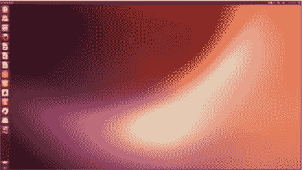

图 4：Ubuntu 桌面

出现的桌面是`KDE`或`GNOME`。我们将在后续章节中详细讨论这些内容。

## 了解 Shell

来自`KDE`或`GNOME`的 GUI 通过图标、窗口和指针提供了探索 Linux 的最佳方式。然而，万 GUI 无法工作（正如我们在“安装故障排除”章节中看到的），如果知道如何使用终端将是一个加分项。在终端中输入命令通常比导航和点击更快。

在你的桌面上，浏览并找到看起来像显示器的图标。这是终端窗口的图标。如果你找不到该图标，浏览主菜单并找到标记为`Console`（控制台）或`Terminal`（终端）的选项。

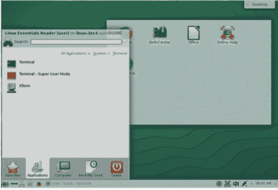

图 5：KDE 桌面上的终端

Ubuntu 的外观是这样的：

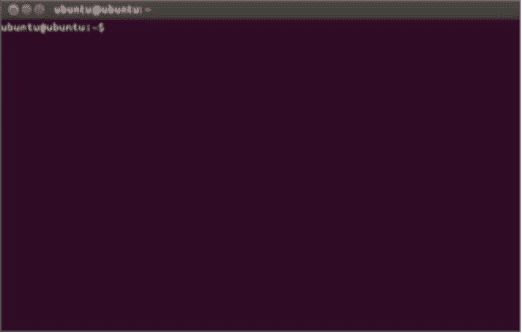

图 6：Ubuntu 上的终端屏幕

Shell 是你可以运行可执行文件和 shell 脚本的地方。Shell 就是我们所谓的命令行。命令使用下面的通用语法编写：

```
command option1 option2 . . . optionN
```

以下是你可以在 Linux 环境中尝试的几个示例命令及其对应的输出：

```
uptime
```

19:26  up 29 days,  1:39, 2 users, load averages: 1.32 1.36 1.34

`uptime`是显示电脑运行持续时间的命令。在这种情况下，电脑已经运行了 29 天，或者接近 1 个月。

```bash
uname –srv
```

Linux 3.9.31.5-127.fc12.i686 #1 SMP Mon Nov 18 18:21:25 EST 2015

`uname`是显示操作系统名称的命令。`-s`（打印操作系统名称）、`-r`（打印操作系统发行版本）和`-v`（打印操作系统版本）是可以用于`uname`命令的选项。在特定示例中，我们想使用所有三个，所以我们输入`n –srv`来简化。如果我们想像使用所有选项一样显示结果，可以使用`-a`选项。

要了解某个特定命令可以使用的选项，你可以使用`man`命令。

```bash
man uname
```

`man`命令极其有用，特别是对初学者来说。它显示了你可以使用的所有选项。尝试对你遇到的每一个 Linux 命令使用该命令。

在 shell 中切换到 root，输入命令`su`然后输入你的 root 密码。在 shell 环境中切换到 root 密码将允许你运行只有管理员和超级用户才能够执行的任务。

## Linux 桌面

Linux 发行版通常带有两种常用的 GUI：`GNOME`和`KDE`。你可以在电脑上同时安装这两者，并随时随地在两者之间切换。这两个 GUI 也可以运行在 Unix 上，虽然在 Linux 上可以安装其他 GUI，但这两个仍然是最受欢迎的。

这里有一张对比这两个桌面的图表：

|  | GNOME | KDE |
| :--- | :--- | :--- |
| 可用性 | 免费 | 免费 |
| 最低系统要求 | 700 Mhz CPU, 768 MB RAM | 1 Ghz CPU, 615 MB RAM |
| 开发重点 | 关注自由、可访问性和对开发者友好 | 提供一个美观且具有高度可配置性的网站 |
| 定制化体验 | 界面简单易用，非常适合 Linux 初学者，高级用户可能会发现其定制设置具有局限性 | 允许多功能配置以创建美观的桌面，但用户必须学习如何导航选项。定制化会消耗更多资源 |
| 默认外观（注意两者都提供定制选项） | 默认设置：顶部的工具栏 | 默认设置：底部的工具栏 |
| 通用搜索 | 使用文本搜索功能 | 使用菜单导航 |
| 资源占用 | 比 KDE 消耗资源少 | 资源密集型 |
| 用户体验 | 适合来自 Windows 的用户 | 类似于 Windows 系统 |

表 3：GNOME 和 KDE 桌面的对比

这些是 GUI 之间的不同之处。我鼓励你尝试这些桌面，看看哪种最适合你。接下来的截图显示了桌面的默认设置。GNOME 桌面如下：

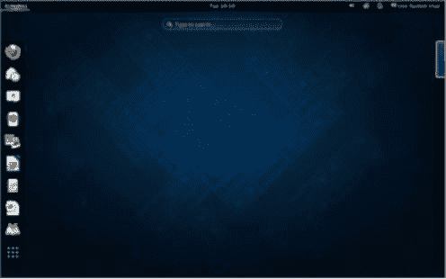

图 7：Fedora 上的 GNOME 桌面

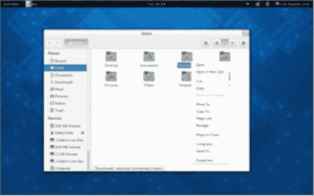

图 8：Gnome 菜单

接下来的截图显示了`KDE`的默认桌面。

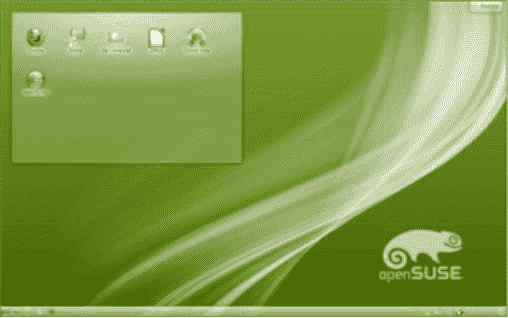

图 9：openSUSE 上的 KDE 桌面

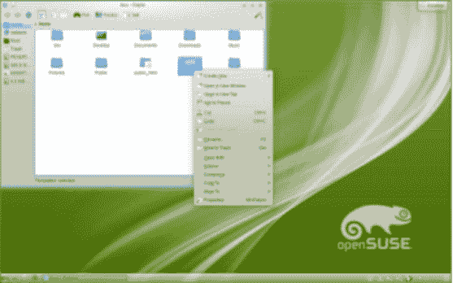

图 10：KDE 选项

两者都可以定制以获得你想要的外观和感受。大胆尝试这些桌面吧！

## 导航 Linux 文件系统

Linux 使用层级结构组织文件。文件存储在目录中，目录也可以包含目录。当你将 Linux 文件系统与 Windows 进行比较时，你会发现 Linux 没有驱动器号。所有文件都存储在根目录下，无论数据物理存储在何处（硬盘、外部驱动器或光盘）。

要在 Linux 中查找文件，还需要关于路径的层级结构信息。下图剖析了一个示例路径。

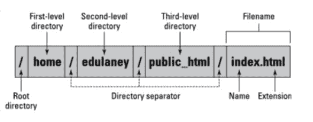

图 11：Linux 中的路径

路径由顶层目录、目录层级和带有扩展名的文件名组成。所有部分都由斜杠（`/`）分隔。

以下是 Linux 顶层目录及其包含的数据列表：

| 顶层目录 | 目录包含的文件 |
| :--- | :--- |
| `/` | 单根目录 – 文件系统基础 |
| `/bin` | 可执行文件，例如 Linux 命令`cat,cp,ls` |
| `/boot` | 引导程序启动期间访问的文件——包括 Linux 内核 |
| `/dev` | 用于不同硬件/设备的文件 |
| `/etc` | 初始化脚本和系统配置文件 |
| `/home` | 用户目录 |
| `/lib` | 库文件，包括驱动程序模块 |
| `/lost-found` | 用于丢失的文件 |
| `/media` | 用于挂载可移除的介质文件系统 |
| `/mnt` | 临时用于挂载文件系统的挂载点 |
| `/opt` | 用于存储应用程序包 |
| `/proc` | Linux 进程信息 |
| `/root` | Root 用户家目录 |
| `/sbin` | root 用户使用的命令的可执行文件 |
| `/srv` | 用于系统托管的服务（例如 FTP、Web 服务） |
| `/tmp` | 临时目录 – 系统重启动时会被删除 |
| `/usr` | 包含程序文件的子目录 |
| `/var` | 日志文件 |

表 4：Linux 顶层目录

在 Linux 目录中导航时，你可以使用 GUI 通过浏览文件夹来查找特定文件，使用通用的文本搜索功能，或者使用命令行。

你可以在终端中使用以下实用命令在文件系统中进行导航和操作：

| 命令 | 功能 |
| :--- | :--- |
| `ls` | 列出目录下的所有内容 |
| `cd /bin/` | 切换目录并进入 bin 目录 |
| `cd ~` | 波浪号 (`~`) 符号用户的家目录 – 切换到家目录 |
| `cd ..` | 切换到上一级目录。例如，你当前在`/home/edulaney/`，使用该命令将带你回到`/home/` |
| `mkdir` | 用于创建目录的命令 |
| `pwd` | present working directory（当前工作目录）的缩写。此命令将显示你当前所在的目录 |

表 5：目录导航命令

在这里我提供更多你可以用于命令行管理文件的命令。在你的终端上尝试一下。

| 命令 | 功能 |
| :--- | :--- |
| `cat /home/edulaney/files/file1.txt` | 在屏幕上打印 file1.text 所有内容的命令 |
| `cp /home/ /tmp/` | 将`/home/`的内容复制到`/tmp/` |
| `mv /home/edulaney/files/file1.txt /tmp/` | 将文件 file1.txt 移动到`/tmp/`目录。你可以使用此命令将整个目录移动到另一个目录 |
| `rm file1.txt` | 删除文件 file1.txt。使用`rm`命令要格外小心，尤其是当你以 root 身份登录时 |
| `find / -name “linux*"` | `find`命令是一个当你使用命令行搜索时非常有用的工具。此命令将搜索任何名称以 linux 开头的文件或目录 |

表 6：文件管理基础命令

通过`man`命令探索更多命令。

## 关闭你的电脑

关闭 Linux PC 与你如何在其他操作系统中操作非常类似。点击主菜单（Main Menu），选择关机（Shutdown），并点击确定（OK）。这将启动系统关。某些发行版不允许在不注销的情况下关闭系统。要做到这一点，请点击注销（Log Out），然后在登录页面选择关机（Shutdown）。

***

现在你已经熟悉了 Linux 环境的外观和感受，让我们开始进行安装后的活动，例如管理电脑硬件和安装应用程序。

# 第五章：安装后活动

在本章中，我们将讨论在安装 Linux 操作系统后可以做的事情——从管理硬件到安装额外的软件。

## 管理硬件和外设

### CPU

操作系统保持程序和硬件顺畅运行。Linux 的功能受到系统硬件限制的影响（例如磁盘空间和内存），因此了解更多关于电脑硬件的细节非常重要。


让我们从 CPU 开始。CPU 执行所有的计算，其速度（以 MHz 为单位）代表了你的电脑处理事务的速度。你的 CPU 规格还会告诉你 CPU 家族（最常见的是 x86 和 x86-64）以及它的核心数。要了解更多关于你的 CPU 信息，请使用下面的 Linux 命令：

| 命令 | 功能 |
| :--- | :--- |
| `uname -a` | 此命令显示关于机器、处理器架构和操作系统的详细信息。使用 `-p` 选项将显示机器处理器名称。例如 i386 或 x86_64 AMD Phenom (tm) II X3 700e Processor |
| `lscpu` | 此命令返回更多关于系统的信息，例如 CPU 数量和 CPU 速度。示例输出：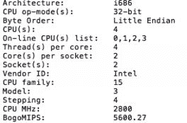 |
| `cat /proc/cpuinfo` | 该文件包含比 `lscpu` 命令显示的信息更多。`/proc/cpuinfo` 文件的片段：`processor: 1vendor_id: Intelcpu family: 11model : 2model name: Intel(R) Pentium(R) 4 CPU 2.86GHzstepping: 4microcode: 0xe` |

### 表 7：获取 CPU 信息的命令

### 硬盘

接下来，让我们讨论你电脑的硬盘。在安装章节中，我提到了确保电脑有足够的磁盘空间运行 Linux 的重要性，以及如果你想同时运行两个操作系统，可能需要对硬盘进行分区。

如果你计划在未来添加新磁盘，学习如何分区将非常有帮助。Linux 支持以下分区工具：

*   **Fdisk Tools** – 这由文本工具组成：`fdisk`、`cfdisk` 和 `sfdisk`。这些工具在分区时非常好用，但对于还不熟悉分区的初学者来说，可能会有些无从下手。
*   **libparted Tools** – `libparted` 库提供了 GUI 和文本分区工具。一个特别的例子如下截图所示的 `GParted`。该界面让初学者更容易使用。
*   **GPT fdisk Tools** – 这些为 GPT（全局唯一标识分区表）磁盘创建的工具。


图 12：GParted - 基于 GUI 的分区工具

以下是一些你可以用来检查磁盘空间的命令：

| 命令 | 功能 |
| :--- | :--- |
| `df -h` | 此命令显示所有挂载设备的磁盘空间使用情况。`-h` 选项以易读的格式显示结果 |
| `du /home/edulaney/files/` | 此命令显示该目录下的所有文件及其对应的大小 |
| `du -s /home/edulaney/files/` | `-s` 选项提供目录的总大小 |

### 表 8：检查磁盘空间的命令

### 可移动存储设备

在 Linux 中使用 USB 闪盘和外部硬盘等存储设备与 Windows 或 macOS 类似。插入设备后 Linux 将检测设备。除了通过桌面 GUI 访问驱动器外，你也可以进入 `/media` 目录找到子目录。

在使用移动介质后，请卸载磁盘以避免任何磁盘问题。你通常可以右键点击设备名称，并点击卸载（Unmount）、弹出（Eject）或安全删除（Safely Remove）等选项。


图 13：弹出介质

### USB 设备

你可以与其他设备（键盘、鼠标）、摄像头、手机、扫描仪和打印机连接到你的 Linux 电脑，并预期它们以即插即用的方式工作。

对于打印机，在 Linux 检测到设备后还需要设置打印机配置。按照下面的步骤设置新打印机。注意截图截自 Ubuntu 发行版，但与大多数发行版类似。

1.  点击桌面上的系统设置（System Settings）中的打印机（Printers）。提供 root 密码。


图 14：打印机设置菜单

2.  点击添加（Add）按钮。如果系统检测到了你的打印机，设备将出现在列表中。否则，你需要继续配置并提供打印机驱动。点击下一步（Forward）。


图 15：新打印机

3.  选择正确的驱动程序。将显示可用驱动列表——选择适用于你打印机型号的一个。如果你在列表中找不到驱动，你也可以提供打印机驱动或从网上下载文件。


图 16：选择驱动程序

4.  填写打印机名称和描述。


图 17：打印机描述

5. 最后，打印一个测试页面以确保其运行正常。

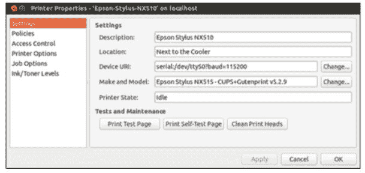

图 18：打印测试页

## 安装额外软件

兼容 Linux 的软件提供`.rpm`格式（用于 RPM，如 Fedora、SUSE）或`.deb`格式（用于 Debian，如 Debian、Ubuntu、Xandros）。尽管软件包类型不同，但 RPM 和 Debian 软件包都可以安装在任何类型的 Linux 发行版中。流行的发行版提供了用于安装额外应用程序的图形界面。在本节中，我将讨论在 Ubuntu 和 Fedora 中安装软件的方法。

### 在 Ubuntu 中安装应用程序

基于 Debian 的发行版使用`APT`或高级软件包工具（Advanced Packaging Tool）。

你可以使用以下命令将软件包安装到电脑中。

```bash
apt-get install package-name
```

此命令将下载你想要安装的特定包名。如果你不知道包名，可以搜索关键词。

```bash
apt-cache search keyword
```

例如，我正在寻找一个可以在我的 GNOME 桌面上进行截屏的应用程序。我可以通过以下命令进一步完善我的搜索功能：

```bash
apt-cache search screenshot | grep GNOME
```

该命令将显示符合搜索字符串的适用行：

```bash
shutter - feature-rich screenshot program
```

`Shutter` 是包名。使用该包名再次运行`apt-get install`命令。

除了通过命令行安装软件包外，你还可以使用“软件与更新”（Software & Updates）工具。GUI 提供了一种简单快捷的方法来更新 Ubuntu 软件并下载软件包。

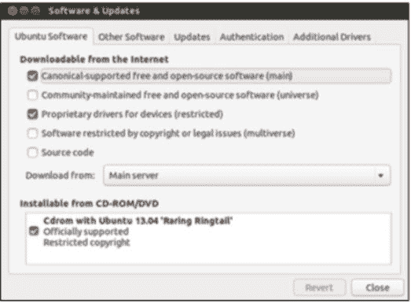

图 19：软件与更新工具

类似于 Windows 和 Mac OS 的应用商店，Ubuntu 也有自己的软件中心，你可以在那里获取新软件并下载最新更新。

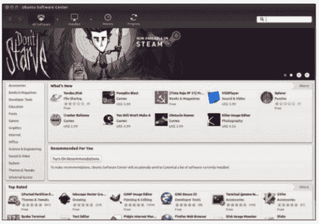

图 20：Ubuntu 软件中心

### 在 Fedora 中安装应用程序

Fedora 使用`RPM`软件包。如果你正在使用 GNOME 桌面，可以地可以使用“添加或删除软件”工具（类似于 Windows）来安装新软件。

点击“系统➪ 管理”，然后点击“添加/删除软件”进入菜单。该实用程序将显示软件包管理器窗口，列出所有软件包的列表。选择相应的复选框并点击“应用”或“更新”（如果你正在更新软件包）。点击“应用”按钮将安装（或卸载）特定的软件包。

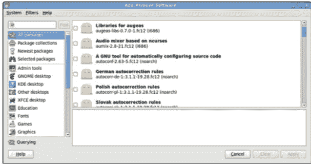

图 21：Fedora 添加/删除软件包

***

在本章中，我们回顾了 Linux 安装后可以完成的硬件设置和软件安装步骤。如需更详细的操作，请参考你所使用的特定发行版的步骤。在下一章中，我们将简要讨论 Linux 默认应用程序。

# 第六章：Linux 应用程序

Linux 发行版预装了满足你计算需求的应用程序。在本章中，我们将快速概览其中一些应用程序。

### 办公应用程序

LibreOffice 套件是 Linux 对 Windows Office 工具的响应。该套件包含文字处理器、演示文稿程序、电子表格、日历和计算器应用程序。如果你是 Windows 用户，可能需要一些时间来适应界面，但在使用几次程序后，你最终会熟悉它。

LibreOffice 包含以下应用程序：

*   `Writer` – 文字处理器。文件以`.odt`扩展名创建。用 Microsoft Word 编写的文档与`Writer`兼容。

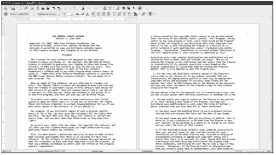

图 22：Writer 界面

*   `Calc` – 电子表格程序，工作方式与 Microsoft Excel 类似。默认文件具有`.ods`扩展名。

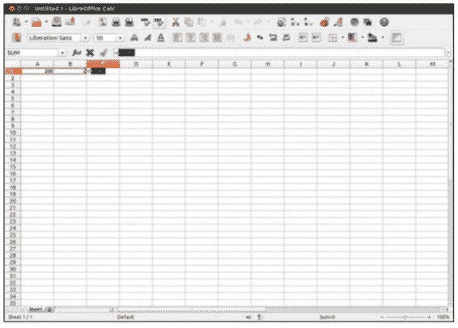

图 23：类似 Microsoft Excel 的 Calc

*   `Impress` – Microsoft PowerPoint 的对应软件。在`Impress`中，你可以根据现有模板制作幻灯片，也可以像在 Microsoft Office 中那样进行同样的自定义。

所有 Libre-Office 应用程序都可以从主菜单中的“办公”选项访问。

### 多媒体应用程序

如何访问多媒体？Linux 发行版带有允许你打开照片、听音频文件、播放视频以及刻录 CD 或 DVD 的应用程序。

SUSE 和 Xandros 发行版预装了`digiKam`，这是一个数字相机软件。你也可以从 USB 驱动器访问照片文件。只需点击存储驱动器名称并查看照片。

KDE 和 GNOME 都带有音频 CD 播放器。插入 CD，默认音频播放器将检测并播放音频。对于其他音频文件如 MP3，你可以使用`XMMS`或`Rhythmbox`等播放器。根据你使用的发行版，你可以进入“音乐播放器”应用程序、“多媒体”或“音频与视频”类别来打开播放器。

最近，不同的发行版已经在其文件管理器中发布了内置的 CD/DVD 刻录功能。它们运行良好，但如果你仍然想要一个独立的应用程序来刻录文件，可以使用最常用的刻录软件，如 KDE 的`K3b`。

### 图像应用程序

Linux 也确保你获得所需的照片编辑和图形创建应用程序。Linux 世界中最流行的两个是`The GIMP`（GNU 图像处理程序）和`GNOME Ghostview` (`GGv`)。

`GIMP` 相当于 Adobe Photoshop。用户可以进行图像处理、合成和创建。如果你在主菜单的“图形”类别中找不到`GIMP`，请检查是否需要先安装。参考安装额外软件 中的步骤下载`The GIMP`。该应用程序可以读取大多数格式：`JPEG`、`TIFF`、`PNG`、`PCX` 和 `GIF`。关于`The GIMP`的更多信息，请访问其网站：[www.gimp.org](http://www.gimp.org)

`GNOME Ghostview` 可以读取 PostScript 或 PDF 文档，功能类似于 Acrobat Reader。要在 Fedora 电脑上打开 Ghostview，点击“图形”然后“PostScript 查看器”。

探索预装应用程序并判断它们是否符合你的需求。

***

在本章中，我们简要讨论了不同的办公、多媒体和图像应用程序。在下一章中，我们将深入理解命令行。

# 第七章：使用命令行

在第四章中，我们讨论了命令行或终端以及如何从桌面访问它。在之前的章节中，你已经在终端可以使用简单的命令。每个 GUI 操作都有对应的命令行操作。在本章中，我们将更多地讨论 Linux 中使用的不同命令，并学习不同的 shell 功能。

### 使用 shell 功能

你现在已经看到了使用`Bash` shell 的能力。命令行执行任务比在 GUI 中花费的时间少。为了进一步享受使用`CLI`（命令行界面）的便利，这里有一些你应该使用的 shell 功能：

*   命令完成

启动终端并尝试输入未完成的命令。

例如，输入以下单词并按 Tab 键：

```
uname
```

注意 Linux 将自动补全单词为`uname`。接下来，删除其余字母并只保留字母`u`，Linux 将显示所有以字母 'u' 开头的命令列表。此功能让用户输入命令变得更快。你也可以对文件名或目录名这样做。输入文件名的几个字母，Linux 就会为你完成剩余部分。

当你尝试记住某个命令时，这非常有帮助，因为 Linux 会列出所有以你输入的字母开头的命令。将此功能与`man`结合，你应该就能找到你正在寻找的命令了。

### 命令历史

Linux 也通过命令历史功能让用户变得更加方便。系统会记住你最近输入过的命令，因此你不再需要重新输入。只需使用方向键即可查看之前的命令。

以下是一些你可以使用的技巧，以充分利用这一功能：

| 使用的按键 | 功能 |
| :--- | :--- |
| 向上/向下方向键 | 从最近到最早输入的顺序显示之前的命令 |
| 向右/左方向键 | 将光标向右/左移动一个字符 |
| `CTRL` 键 + A | 将光标移动到行首 |
| `CTRL` 键 + E | 将光标移动到行尾 |
| Delete 键 | 删除光标下的字符 |
| 退格键 (Backspace) | 删除光标左侧的字符 |
| `CTRL` 键 + R | 从命令历史中搜索特定命令。使用`CTRL`键 + R 后，输入你想要使用的命令的前几个字母 |

表 9：命令行历史快捷键

系统管理员充分利用了这些功能，因为它们让管理任务的完成变得更加简单快速。尝试在你学过的命令上使用这些技巧，看看使用命令行工作有多酷。

### 基础 Linux 命令

作为一个新的 Linux 爱好者，你可以使用 GUI 执行许多任务。然而，如果你想学习更多可以在 shell 提示符中使用的命令，这里有一份最重要的 Linux 命令备查表。

| 命令 | 作用 |
| :--- | :--- |
| **帮助类命令** | |
| `info` | 显示有关命令的在线信息 |
| `man` | 显示命令的详细信息 |
| `whatis` | 显示特定关键词的简短描述 |
| `type` | 显示命令文件的位置 |
| `alias` | 为命令分配别名——对长命令特别有用 |
| `unalias` | 移除命令别名 |
| **管理文件和目录** | |
| `cd` | 切换目录 |
| `pwd` | 显示当前目录 |
| `ln` | 创建文件和目录的链接 |
| `touch` | 触发文件的时间戳更新 |
| **查找文件** | |
| `find` | 根据名称搜索文件 |
| `whereis` | 搜索可执行文件 |
| `which` | 在`PATH`变量的目录部分搜索文件 |
| **处理文件** | |
| `dd` | 复制数据行 |
| `diff` | 显示两个文件之间比较的结果 |
| `more` | 每次页显示一次文本文件——显示只能向前移动 |
| `less` | 每次页显示一次文本文件——显示可以向前和向后移动 |
| `wc` | 显示文件中字符、单词和行的计数 |
| `cat` | 在单次输出中显示文本文件 |
| `cut` | 获取文件中的文本段 |
| `grep` | 显示文件中查找表达式的结果 |
| `sed` | 执行编辑命令然后复制到标准输出 |
| `split` | 指定大小以拆分文件 |
| `sort` | 对文件中的行进行排序 |
| `uniq` | 保留文件中的唯一行并删除重复项 |
| **压缩文件** | |
| `compress` | 用于压缩文件 |
| `uncompress` | 如果文件是用`compress`命令压缩的，使用此项进行解压缩 |
| `gunzip` | 使用 GNU Zip 解压缩文件 |
| `gzip` | 使用 GNU Zip 压缩文件 |
| `tar` | 对一个或多个目录进行归档 |
| **日期和时间** | |
| `cal` | 显示指定月份或年的日历 |
| `date` | 显示/设置当前日期和时间 |
| **进程管理** | |
| `bg` | 在后台运行程序或进程 |
| `free` | 检查空闲内存 |
| `kill` | 停止进程 |
| `nice` | 以低优先级运行程序 |
| `ps` | 显示当前运行的进程 |
| `top` | 显示进程的 CPU 和内存利用率列表 |
| `reboot` | 重启计算机 |
| `shutdown` | 关闭计算机 |

表 10：重要 Linux 命令列表

现在，尝试上面的命令。如果你不确定如何使用命令的选项，请使用帮助命令（特别是`man`和`info`）来获取更多信息。

在本章中，我给你提供了一个可以在命令行中尝试的命令和技巧。继续练习这些命令并在网上进行更多研究。在下一章中，我们将学习如何保护你的操作系统。

# 第八章：基础管理与安全

你的系统现在已经运行了，你应该考虑的下一步是加固它。系统管理员考虑安全的两个方面——主机安全和网络安全。如果有多个用户使用一台计算机，应该对用户目录和文件进行安全保护，不应让任何未经授权的人访问。由于你的计算机连接到了互联网，你还必须保护它免受互联网的访问。让我们在后面的章节中讨论这些内容。

## 基础系统管理

类似于 Windows 和 Mac 等流行的操作系统，Linux 发行版也带有用于执行管理任务的 GUI 工具。添加和删除用户账户、管理硬件、安装应用程序、维护系统、设置和监控安全是管理员执行的一些活动。

images/0026.jpeg

图 25：SUSE YaST 管理任务

上述管理任务在使用 SUSE 时可以使用 YaST 完成。这些功能也适用于 Ubuntu 和 Fedora。

images/0027.jpeg

图 26：Ubuntu 设置界面

images/0028.jpeg

图 27：Fedora 设置界面

## 性能监控

为了有效监控计算机的性能，应该检查以下方面：

### CPU 和内存使用

要查看消耗最多资源的进程，使用`top`命令。该命令显示负载和内存平均值、进程 ID、进程使用的 CPU 百分比以及使用的内存百分比。`top`命令的结果每 5 秒刷新一次。要退出`top`命令输出，按`Q`。

images/0029.jpeg

图 28：top 命令

### 磁盘空间


监控磁盘空间以确保有足够的空间用于日志和备份。使用`df -h`命令验证磁盘空间。这是一个示例输出：

| 文件系统 | 大小 | 已用 | 可用 | 使用率 | 挂载点 |
| :--- | :--- | :--- | :--- | :--- | :--- |
| `/dev/hda1` | 7.1G | 3.9G | 2.9G | 59% | `/` |
| `/dev/hda2` | 99M | 18M | 77M | 19% | `/boot` |

在监控中，设置特定的阈值，让你作为管理员在达到值时采取行动。例如，一旦磁盘空间使用百分比达到 80% 等特定阈值，进行文件清理以释放磁盘空间。如果 CPU 达到允许的阈值，调查哪些进程正在消耗资源并采取必要的行动（例如等待进程结束、杀死进程等）。

## 用户管理

Linux 在安装时会自动创建多个用户账户，即使你是唯一使用这台计算机的人。系统使用这些账户来运行程序。不同的账户可以保护系统（包括文件和目录）免受未经授权的访问。用户可以分配到组以便方便。

要添加、修改或删除用户或组帐户，你可以使用图形用户界面（GUI），也可以通过命令行完成。作为初学者，建议你尝试这两种方法，以便观察哪种方法最适合你。

## 通过 GUI 管理用户和组

如果你使用的是 SUSE，请打开`YaST`；或者使用你发行版中相应的“设置菜单”。点击“安全与用户”或类似的用户管理类别。

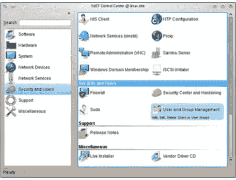

图 29：YaST 添加用户

点击“添加用户”按钮并提供必要的信息，如用户的全名、首选用户名和密码。你可以探索并配置其他信息，如登录尝试限制、密码设置和用户组。完成后，点击“确定”按钮继续创建用户账户。

你也可以使用 GUI 修改或删除账户。执行必要的账户修改并点击“确定”按钮以应用更改。

若要创建、修改或删除用户组，请选择“组”而不是“用户”。下面的图片显示了添加新组的`YaST`界面。提供必要的信息并点击“确定”按钮即可完成组的创建。

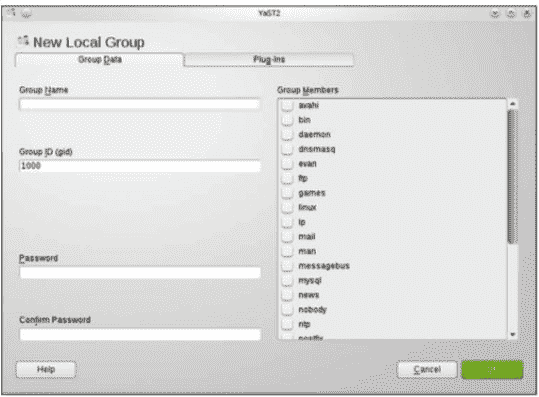

图 30：添加组

## 通过 CLI 管理用户和组

通过 CLI 添加新用户仅需几行命令。首先，使用命令`su–`以`root`身份登录。

使用以下命令创建一个新账户：

```bash
/usr/sbin/useradd -c "Kevin Jones" kjones
```

接下来，设置密码。当你执行以下命令后，系统会提示你两次输入并确认密码。

```bash
passwd kjones
```

若要修改账户，请使用`usermod`命令并配合与你想要修改的信息相关的选项。若要删除用户账户，请使用`/usr/sbin/userdel username`命令。

要添加用户组，你需要使用命令`groupadd groupname`。

例如，让我们创建一个名为`office`的组。要创建此组，输入以下命令：

```bash
groupadd office
```

由于 Kevin 是工作中的同事，我们将他加入`office`组。执行此操作，请使用以下命令：

```bash
usermod -G office kjones
```

若要删除该组，请使用命令`groupdel office`。

再次，我鼓励你使用`man`命令来了解更多关于特定命令可用的选项。

## 文件所有权

用户和组帐户拥有 Linux 文件或目录。要查看特定文件的所有者，请使用命令`ls –l filename`。

这里是命令的示例输出。选择一个文件名并在你的终端上尝试一下！

```text
-rw-rw-r-- 1 kjones office 40909 Jul 16 20:37 file1.txt
```

第一组字母代表权限设置（执行、读、写）。第二部分值为`kjones office`，表示拥有该文件的用户账户和组账户。

如果你想将文件的所有权从`kjones`更改为用户`rbley`，请以`root`登录并使用以下命令：

```bash
chown rbentley file1.txt
```

此外，要更改文件的组所有者，输入命令：

```bash
chgrp staff file1.txt
```

## Linux 基础安全

### 设置密码

在创建账户时，作为管理员，务必创建难以破解强度密码。记住避免使用由个人信息（如生日、街道地址或姓名）组成的密码、字典中可以找到的单词，以及简单的字母数字组合。

使用包含大小写字母（大写和小写字母）、带有数字或标点符号的密码，或者反序写的密码。还要实施其他预防机制，例如每隔 X 天提示用户更改密码，并在登录尝试 Y 次后锁定账户。

### 文件保护

为了保护文件免受未经授权的访问（查看和修改），请重新检查你的文件权限设置。在上一节中，我们讨论了如何为文件分配用户和组所有者。接下来，我们需要为所有者、组和全局（所有其他用户）指定正确的文件权限。

回到`ls`命令的结果：

```text
rw-rw-r-- 1 kjones office 40909 Jul 16 20:37 file1.txt
```

第一组字母（绿色）表示用户的文件权限。下一组（蓝色）针对用户组，而橙色部分代表全局权限。

* `r` – 允许读取文件内容
* `w` – 允许对文件进行写入
* `x` – 允许执行（如果文件包含 bash 脚本）

这意味着`kjones`对该文件具有读取和写入权限。这与`office`组账户的权限相同。所有其他用户（全局）将被允许读取该文件。

要更改权限，使用权限的八进制表示法并为 3 个级别（用户、组和全局）指定值。

| 权限 | 表示法 |
| :--- | :--- |
| `rwx` | 7 |
| `rw-` | 6 |
| `r--` | 4 |
| `r-x` | 5 |
| `--x` | 1 |

表 11：权限值

现在尝试移除组的写入权限。

```bash
chmod 644 file.txt
```

当你列出文件详情时，如下：

```text
rw-r--r-- 1 kjones office 40909 Jul 16 20:37 file.txt
```

有多种方法可以保护你的系统，例如设置防火墙、安全服务以及加密文件。对于本本书（Linux 初学者），我们只讨论了基础安全实践。在下一章中，我将提供脚本的概述。

# 第九章：脚本简介

我们已经到了书的最后一章。到此时，你已经熟悉了 Linux 环境如何工作，并且已经注意到它与你之前的操作系统有多不同。我的建议是提高水平并开始学习脚本。在本章中，我将提供脚本的快速预览。

## 选择文本编辑器

脚本是文本文件。为了开始你的脚本之旅，请选择最适合你的文本编辑器。Linux 发行版预装了文本编辑器，最常用的包括：

* `vi` – 通常默认安装。管理员的首选，因为它是一个强大且灵活的编辑器。
* `emacs` – 包含许多功能但不对初学者友好
* `pico` – `emacs` 的简化版本（不带功能）
* `nano` – `pico` 的克隆但带有功能

下载这些编辑器的包并尝试使用。我个人使用`vi`是因为它易于使用、简单而且我非常熟悉。

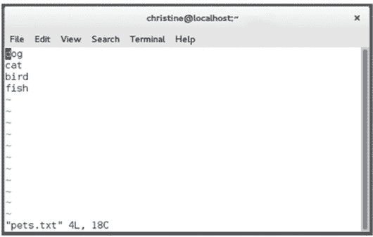

图 31：vi 文本编辑器

`vi`使用命令。以下是一些示例：

| vi 命令 | 功能 |
| :--- | :--- |
| `o` | 在命令模式下输入此键可新行并输入文本 |
| `i` | 在光标左侧插入后续字符 |
| `u` | 撤销更改 |
| `ESC` | 退出插入模式 |
| `:wq!` | 保存更改并退出 |

表 12：示例 vi 命令

## 简单脚本

脚本是可以由 shell 解释或编译的程序。在 Linux 中我们称 shell 脚本，因为大多数脚本都在`bash`或任何其他 shell（`ksh`、`csh`、`bash`）中运行。

脚本对于自动化和简化管理任务、系统日志监控以及数据处理非常有用。要编写脚本，使用`vi`或你喜欢的文本编辑器打开一个文本文件。

文件的第一行指示应使用哪个 shell 来解释脚本。

```bash
#!/bin/sh
```

这表示应使用 bourne shell 来解释脚本。

## 简单脚本

让我们编写一个简单的脚本。输入以下脚本行。将文件保存为`simplescript.sh`。确保该文件的用户权限设置为`744`，以便你可以运行该脚本。

```bash
#!/bin/sh

echo "My name is: $1"

echo I’m using Linux distro: $2

echo Today is: $3
```

带有 3 个参数运行脚本：

`./simplescript.sh Steve Fedora Tuesday`

输出应该如下：

```text
My name is: Steve
I’m using Linux distro: Fedora
Today is: Tuesday
```

这是一个关于如何使用它来维护计算机性能的示例。如果你已经使用了 80% 的磁盘空间，那么检查计算机上哪些文件最大可能是一个好主意。

使用以下命令编写一个新脚本：

```bash
find / -type f -atime +30 -size +1000k -exec ls -l {} \; > /tmp/filecleanup
```

此 shell 脚本将生成一个名为`fileCleanup`的新文件，其中包含旧文件和大文件的列表。作为管理员，下一步是在删除这些文件之前，联系文件所有者通知他们。

正如你可能观察到的，你可以将不同的 Linux 命令与变量、条件表达式、循环和函数结合起来创建脚本。

此时，我强烈鼓励你继续学习高级 Linux，在在那里将学习更复杂、更强大的`awk`和`sed`工具。这两个工具在处理数据时特别有用。

# 以下是对我们所涵盖内容的快速回顾，以防你需要复习某个步骤：

1. 你现在理解了什么是 Linux。
2. 你现在知道 Linux 如何与其他操作系统进行对比。
3. 你现在熟悉了不同的 Linux 发行版以及它们之间的区别。
4. 你学会了如何为 Linux 安装做准备，并了解了 Linux 如何安装的。
5. 你现在知道了不同的 Linux 桌面及其对应的外观和感受。
6. 你现在对 Linux 文件系统的样貌有了洞解。
7. 你现在可以在 Linux 文件系统中进行导航。
8. 你学会了 Linux 中的基础管理任务。
9. 你现在可以在 Linux 中创建用户并限制访问，作为系统安全防护的一部分。
10. 你现在对 Linux 中脚本的工作原理有了了解。

转到下一页获取免费视频课程的权限，并查看我该系列的其他畅销书！

# 在离开之前

在本书中，我为你提供了开启学习 Linux 之路所需的基础知识。这里最初教授的概念应该帮助你在自己的计算机上安装 Linux，并在那里继续熟悉熟悉该环境。

我建议你学习并尝试进一步的主题，例如高级脚本、Linux 编程和 Linux 系统管理。这些新增的主题将帮助你获得 Linux 专业认证（如果你有此打算的话）。你也可以转向其他编程语言，例如[JavaScript](http://amzn.to/1mBhUYM)或[Python](http://amzn.to/1WOBiy2)。（点击这 2 个链接之一或查看下方获取更多关于我编程书籍的信息）。

最后，请继续在 Linux 计算机上使用和练习。通过书中传授的知识并结合实践，你将能够开启你的 Linux 职业。

我现在非常感谢你的评价和反馈。如果你真的喜欢这本书，请尽管分享它，让其他人也能从这些信息中获益。

这里是我的一些其他优秀的畅销书！

# 集合论和数学集合论类别的销量第一畅销书！

通过我为初学者提供的循序渐进课程学习如何用`JAVASCRIPT`编程。这本书将教你网页设计的高级方法，涵盖了关键的`HTML`和`CSS`基础，并教你网页设计就业市场上需求最高的技能之一。


“[JAVASCRIPT: Easy JavaScript Programming For Beginners- Your Step-By-Step Guide to Learning JavaScript Programming](http://amzn.to/1mBhUYM)”


### 你将学习以下内容：

* `JavaScript`的历史及其用途
* `HTML`和`CSS`的关键基础
* 如何使用`jQuery`
* 运行`JavaScript`的不同方式
* 学习`Syntax`（语法）
* 理解`Comments`（注释）
* 使用`Variables`（变量）
* `Data Types`（数据类型）
* 使用`Operators`（运算符）
* 设计流程控制、循环和分支
* 使用`Functions`（函数）
* 使用`JavaScript Objects`（对象）
* 使用`Arrays`（数组）操作
* 以及更多内容！

[点击此处](http://amzn.to/1mBhUYM)或访问[`amzn.to/1mBhUYM`](http://amzn.to/1mBhUYM)立即下载！

[PYTHON: Easy Python Programming For Beginners, Your Step-By-Step Guide to Learning Python Programming](http://amzn.to/1WOBiy2)

通过我为初学者提供的循序渐进课程学习如何用`PYTHON`编程。这本书将教你网页设计的高级方法，涵盖了你能够自信地创建第一个程序并增长技能所需的全部学习内容。


### 你将学习以下内容：

* `Python Programming`的历史及其用途
* 你入门需要什么
* 它如何工作
* 创建你的第一个程序
* `Numbers`（数字）
* `Variables`（变量）
* `String Values`（字符串值）
* `String Methods`（字符串方法）
* `If, Else and Elif`
* `Loops`（循环）
* 定义函数
* `Parameters`（参数）
* 以及更多内容！

[点击此处](http://amzn.to/1WOBiy2)立即下载：[`amzn.to/1WOBiy2`](http://amzn.to/1WOBiy2)

# 功能分析和非营利类别的销量第一畅销书！

通过这门畅销课程，学习如何为你的网站引入流量、潜在客户和客户：


“[SEO: Easy Search Engine Optimization, Your Step-By-Step Guide to Sky-High Ranking](http://amzn.to/21HWFWb)”


### 以下是你将学习的内容预览：

* 什么是`SEO`以及它是如何工作的？
* 搜索引擎是如何运行的
* 学习排名的第一步
* `keywords`（关键词）的重要性以及如何使用免费工具进行关键词研究
* 页面优化
* `Header`、`Meta`和`Title Tags`的使用
* 免费跟踪你的网站性能！
* 外部优化以及强大的`backlinks`（反链）的使用
* 产生高质量反链并增加网站流量的 8 种策略
* `Indexing`（索引）和`Sitemaps`（站点地图）的重要性
* 如何生成和提交站点地图
* 高质量内容的重要性
* 如何高质量的内容
* 以及更多！

# 网页设计和计算机与技术类别的销量第一！

通过这本销量第一的书，学习如何使用非常流行的网页设计平台 WordPress 创建网站。


“[WORDPRESS: Simple WordPress Guide to Create an Attractive Website or Blog from Scratch, Step-By-Step](http://amzn.to/1VHtxZi)”


### 你将获得以下技能：

* 为什么选择`WordPress`是正确的决定以及它们能提供什么
* 如何选择正确的域名以及如何通过托管服务器让你的网站上线
* 如何轻松地将你选择的域名和托管服务器与`WordPress`同步
* 如何通过使用精美免费的主题增添你的个性！
* 如何添加页面和令人惊叹的内容供你的观众欣赏
* 通过使用`Plugins`（插件）为你的网站添加高级功能
* 以及更多，更多内容！！

[点击此处购买](http://amzn.to/1VHtxZi)! 或者访问此页面[`amzn.to/1VHtxZi`](http://amzn.to/1VHtxZi)

# 商业保险类别中的畅销量第一！

学习如何像世界上最受欢迎的在线零售商一样，建立一个盈利的在线业务。遵循这门循序渐变的课程，学习如何在在线上建立兼职甚至全职收入。


“[eBay：在 eBay 上找到你销售所需的一切，并从零开始一步步建立一个盈利的业务](http://amzn.to/1R1vnCP)”


## 你将获得以下技能：

* 为什么现在是开始在线业务的最佳时机，以及为什么你需要在 eBay 上销售
* 整个流程是如何运作的，以及为了正确地开设你自己的商店需要采取哪些步骤
* 如何知道哪些物品利润最高，以及在哪里找到你产品的最佳来源
* 如何有效地为你的业务进行品牌化和推广，以获得更多曝光和更高的收入
* 如何创建一个高排名、引人注目且获利的商品列表？
* 如何通过自动化和外包将你的业务和收入提升到更高？
* 以及更多内容！


[点击此处](http://amzn.to/1R1vnCP) 或访问 [`amzn.to/1R1vnCP`](http://amzn.to/1R1vnCP) 立即购买书籍！

## 现在进入赠送环节！！

正如承诺过的，我将让你免费访问我的热门课程“25 种网站流量方法”中的 5 个视频！


拥有一个漂亮且专业的网站固然，但如果没有人访问，又有什么意义呢？这就是创建这门课程的原因！

该计划将教你如何为你的网站引入大量的目标流量。有些课程你可能已经熟悉了，但我确信你将获得一些金石，为你提供额外的推力。

要访问这门课程，请点击下方的按钮或访问此链接！[`bit.ly/1PtpgK7`](http://bit.ly/1PtpgK7)


最后，如果你有任何问题、反馈或只是想打个招呼，也可以给我发电子邮件！（我会回复的！）我的电子邮箱地址是：`Felix_Alvaro@mail.com`

再次感谢你，愿上帝保佑你！

Felix Alvaro
