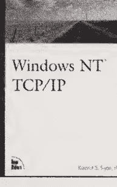
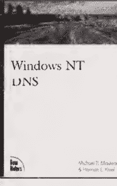
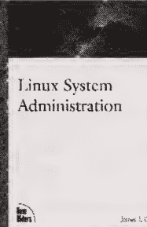
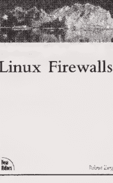
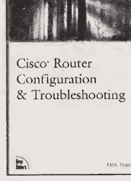

# Linux 核心参考指南


献给我已故的兄弟 Ken，他是一位职业飞行员和业余音乐家，他的奉献精神启发了我许多人。

## 关于作者

Ed Petron 是一位独立的计算机顾问，在处理大型机系统的程序员和系统管理员方面拥有十多年的经验。他从 1995 年开始通过 Slack 发行版 2.0 版本使用和学习 Linux。他现在使用并为 Debian 发行版做出贡献，并为《Linux Journal》写过几篇关于钢琴、管键和风琴的文章。他毕业于印第安纳大学获得计算机科学学士学位。他目前正在加州国立大学攻读硕士学位。

## 关于技术审查员

Debbie 在回到学校全职学习计算机科学之前担任六年系统管理员。她最近在普渡大学获得了计算机科学学士学位。

Herman Bolton 拥有南非普利亚大学学士学位，过去几年一直在 Windows NT 操作系统上进行 C++ 技术编程。

通用进程控制 155

- `kill 155`
- `renice 155`

设备文件 (`MAKEDEV`) 199

`/proc` 文件系统 200

内核消息日志 203

- `dmesg 203`
- `syslogd 203`

## 致谢

非常感谢 New Riders 的所有支持本项目的项目的同事。当人们意识到手稿文本与完成的书籍之间有多大的差异时，也会对那些处理校对、排版、索引等制作任务的人产生由衷的感谢。还要感谢开发编辑 Robin Drake 以及技术人员 Herman Bolton 和 Debbie Daily，他们在内容和结构提供的许多宝贵建议。当然，还要感谢 Laurie Petrycki 和 Katie Purdum，他们不仅提供了项目管理，更让我有机会撰写了这本书。

本书的大部分信息提取自。

## 通用用法

- 1 Shell 实用工具
- 2 文本工具
- 3 文件工具
- 4 编程
- 5 网络客户端
- 6 bash
- 7 进程控制

# 1 Shell 实用工具

本节中的命令作为 shell 脚本的组件最为有用。它们执行的任务如打印消息、执行简单的算术运算和条件测试、输入输出重定向、文件和路径处理，以及 shell 脚本编写者感兴趣的功能。

### 常用选项

除了后续章节介绍的选项外，每个 Linux 实用工具命令都可以可以使用选项调用：

| 选项 | 说明 |
|---|---|
| `--help` | 打印出所有可用选项的用法信息并成功退出。 |
| `--version` | 打印版本号并成功退出。 |

### 文本打印

这些命令根据传递给命令的变量和字面量值打印文本。

```
echo
```

```
echo [ OPTION ... ] [ STRING ... ]
```

`echo` 将每个 `STRING` 写入标准输出，每个字符串之间有一个空格，在最后一个字符串后有一个换行符。

| 选项 | 说明 |
|---|---|
| `-n` | 不打印末尾的换行符。 |
| `-e` | 启用解释每个 `STRING` 中的反斜杠转义字符： |
| `\a` | 铃声。 |
| `\b` | 退格。 |
| `\c` | 抑制末尾的换行符。 |

继续

| 选项 | 说明 |
| --- | --- |
| `\f` | 换页。 |
| `\n` | 换行。 |
| `\r` | 回车。 |
| `\t` | 水平制表符。 |
| `\v` | 垂直制表符。 |
| `\\` | 反斜杠。 |
| `\NNN` | ASCII 值为八进制 `NNN` 的字符。如果 `NNN` 不是有效的八进制，则按字面打印。 |

`printf FORMAT [ ARGUMENT ... ]`

`printf` 根据 `FORMAT` 字符串打印指定的 `ARGUMENTS`。`FORMAT` 参数的指定方式与 C 语言中的 `printf` 相同。

需要时重复使用 `FORMAT` 来转换所有给 `ARGUMENTS`。除了以下外，`printf` 命令的 `FORMAT` 参数在功能上与 C `printf` 库程序完全相同（完整描述请参见 `printf(3)` 手册页）：

- `printf` shell 命令有一个额外的指令 `%b`，它以与 `FORMAT` 字符串相同的方式解释其带有 `\` 转义符的字符串。
- `printf` shell 命令将 `FORMAT` 中的 `\000` 解释为八进制数（如果 000 是零到三位的八进制数字），指定要打印的字符，并将 `xHHHH`（如果 `HHH` 为一到三位数）指定要打印的字符。
- 额外的转义符 `\c` 导致 `printf` 不产生进一步输出。

例如，

```
printf '%f' 10
```

将 10 转换为浮点数，应用换行符，并打印以下内容：

10.000000

可以通过以下方式实现相同效果：

```
printf '%fb' 10 '\012'
```

以下命令，

```
printf '%.3f' * 3.1416 20.123 30.5
```

将所有三个参数值转换为浮点数格式，并以三位精度打印它们，如下：

3.142 20.123 30.500

`yes [ STRING ]`

`yes` 打印命令行参数，用空格分隔并在后跟一个换行符，无限运行直到被杀死。如果没有给出参数，`yes` 将无限打印 `yes` 并后跟一个换行符，直到被杀死。`STRING` 参数可以由任何任意字符串组成。

# 条件

本节中的命令执行简单的算术运算并执行条件测试。它们主要用于控制 shell 脚本中的执行流。

`expr ARG ...`

`expr` 将其参数视为操作符和操作数。它将命令行参数集评估为表达式并将结果写入标准输出。为了与运算符兼容，会对表达式和子表达式进行必要的类型转换。如果类型转换是不可能的，`expr` 将以状态 0（非零结果）、1（零结果）、2（无效表达式）退出。

下表显示了运算符（按优先级增加排序）：

| 符号 | 说明 |
| --- | --- |
| `!` | 逻辑非。 |
| `&` | 逻辑与。 |
| `<`, `>`, `==`, `<=`, `!=` | 比较操作。`=` 和 `==` 等效。 |
| `+`, `-` | 加法和减法。 |
| `*`, `/`, `%` | 乘法、除法、取模。 |
| `:` | 模式匹配。第一个参数与第二个参数中的正则表达式进行匹配。 |

以下函数可以使用：

| 语法 | 说明 |
| --- | --- |
| `match STRING REGEXP` | `match STRING REGEXP` 等效于 `expr STRING REGEXP`，其中 `STRING` 与指定的正则表达式匹配。 |
| `substr POSITION LENGTH` | 返回从 `POSITION` 开始、长度最多为 `LENGTH` 的字符串。 |

继续

| 语法 | 说明 |
| --- | --- |
| `index STRING CHARACTER-CLASS` | 返回 `STRING` 中第一个 `CHARACTER-CLASS` 的位置。如果未找到则返回0。 |
| `length STRING` | 返回 `STRING` 的长度。 |

例如，此命令：

```
expr 5 '*' 3 + 2
```

在标准输出打印结果1。注意表达式的所有部分（包括括号）必须分离。对于某些 shell（如 `bash`），需要加引号以确保运算符 `*` 不会被展开为文件名列表。

括号可以覆盖标准运算符优先级，如下命令所示：

```
expr 5 '(' 3 + 2 )
```

除了 `*` 符号外，括号可能也需要引号（例如 `bash` 将尝试执行子 shell）。布尔表达式产生 0（假）或 1（真）。例如，以下两个都将打印1：

```
expr 1 |= 2
expr 1 <= 2
```

对于使用 `<` 进行输入重定向的 shell（同样适用于 `>`），`=` 需要引号。

模式匹配也输出布尔 0 或 1 结果：

```
expr a : b
```

打印1和

```
expr 1 : b
```

打印0。

`false` 除了返回状态 1（意味着失败）之外什么都不做。

```
test { EXPRESSION }
```

`test` 根据表达式的评估返回状态 0（真）或1（假）。表达式的每个部分必须是独立的参数。以下选项执行与访问相关的测试：

| 选项 | 说明 |
| --- | --- |
| `-b FILE` | 如果 `FILE` 存在是块设备。 |
| `-c FILE` | 如果 `FILE` 存在且字符设备。 |
| `-d FILE` | 如果 `FILE` 存在且是目录。 |
| `-e FILE` | 如果 `FILE` 存在。 |
| `FILE1 -ef FILE2` | 如果 `FILE1` 和 `FILE2` 具有相同的设备和节点号。 |

以下选项对字符串进行测试：

| 选项 | 说明 |
| --- | --- |
| `STRING1 = STRING2` | 如果字符串相等。 |
| `STRING1 != STRING2` | 如果字符串不等。 |
| `-n STRING` | 如果 `STRING` 的长度非零。 |
| `-z STRING` | 如果 `STRING` 的长度为零。 |

以下选项执行数值关系测试：

| 选项 | 说明 |
| --- | --- |


| `ARG1 -eq ARG2` | `ARG1` 等于 `ARG2`。 |

| `ARG1 -ne ARG2` | `ARG1` 不等于 `ARG2`。 |

继续

| 选项 | 说明 |
| --- | --- |
| `ARG1 -lt ARG2` | `ARG1` 小于 `ARG2`。 |
| `ARG1 -le ARG2` | `ARG1` 小于等于 `ARG2`。 |
| `ARG1 -gt ARG2` | `ARG1` 大于 `ARG2`。 |
| `ARG1 -ge ARG2` | `ARG1` 大于等于 `ARG2`。 |

以下选项可以作为连接符形成复合表达式。

| 选项 | 说明 |
| --- | --- |
| `! EXPR` | 如果 `EXPR` 为假。 |
| `EXPR -a EXPR` | 如果 `EXPR` 和 `EXPR` 都为真。 |
| `EXPR -o EXPR` | 如果 `EXPR` 或 `EXPR` 之一为真。 |

以下 `bash` 脚本可以用于判断作为第一个参数的文件是否存在。如果文件存在，脚本将指示它是否为普通文件。

```bash
#!/bin/bash

if test -e $1;
then
  if test -f $1;
    then echo $1 is a regular file;
    else echo $1 is not a regular file;
  fi;
else echo $1 is not found;
fi;
```

`true` 除了返回状态 `0`（意味着“成功”）之外什么都不做。

Shell 通常提供自己的输入输出重定向机制。本节描述由单独命令执行的重定向。

`tee [ OPTION ... ] [ FILE ... ]`

`tee` 将标准输入复制到标准输出并复制到作为参数提供的任何文件中。如果文件不存在，则创建它。

| 选项 | 说明 |
| --- | --- |
| `-a` or `--append` | 将标准输入追加到给定文件而不是覆盖它们。 |
| `-i` or `--ignore-interrupts` | 忽略中断信号。 |

本节中的命令对文件名和路径名操作。

```
basename NAME [ SUFFIX ]
```

`basename` 删除 `NAME` 中任何前面的目录组件。如果指定了 `SUFFIX` 且其与 `NAME` 的末尾相同，它也会从 `NAME` 中删除。

`basename` 将结果打印到标准输出。例如，命令：

```
basename /usr/bin/script.pl
```

输出：

```
script.pl
```

如果还给出了 `.pl` 扩展名，命令：

```
basename /usr/bin/script.pl .pl
```

输出：

```
script
```

```
dirname NAME
```

`dirname` 打印字符串中所有由斜杠分隔的最后一个组件（假设为文件名）。如果 `NAME` 是单个组件，`dirname` 仅打印一个点（`.`），当满足以下任一条件时：

```
pathchk [ OPTION ... ] NAME ...
```

`pathchk` 检查文件名的移植性。对于每个 `NAME`，如果满足以下任一条件，`pathchk` 将打印一条消息：

- `NAME` 中存在的某个目录没有搜索（执行）权限。
- `NAME` 的长度超过了其文件系统的最大长度。
- `NAME` 中对应于现有目录名的某个组件的长度超过了其文件系统对文件名组件的最大长度。

`pathchk` 有一个选项，描述如下表：

| 选项 | 说明 |
| --- | --- |
| `-p` 或 `--portability` | 代替长度检查，`pathchk` 会检查文件名及其组件是否符合 `POSIX.1` 最小长度和字符集规范。 |

本节中的命令显示或更改当前上下文的方面，例如终端设置、当前目录和环境变量。

`printenv [ VARIABLE ... ]`

`printenv` 打印环境变量的值。如果没有指定 `VARIABLES`，`printenv` 会打印每个环境变量的值。否则，它会打印每个已设置 `VARIABLE` 的值，对于未设置的变量则不输出内容。如果找到了所有指定的变量，退出状态为 `0`；如果至少有一个变量未找到，退出状态为 `1`；如果发生写入错误，退出状态为 `2`。

`pwdd`

`pwd` 打印当前目录的完全解析名称。也就是说，打印名称的所有组件都将是实际目录名称——都不会是符号链接。

`stty [ SETTING ... ]`

`stty [ OPTION ]`

`stty` 打印或设置控制终端的特性。有效的 `OPTIONS` 如下：

| 选项 |  |
| --- | --- |
| `-a` 或 `--save` 或 `-all` | 以人类可读的形式打印所有当前设置。 |
| `-g` 或 `--save` | 以可以传递给另一个 `stty` 命令以恢复设置的格式打印所有当前设置。 |

可能的 `SETTINGS` 在随后的章节中描述。`SETTING` 的许多值可以通过在它们前面加一个连字符（`-`）来取反（如章节表格所示）。

## 控制设置

| 设置 |  |
| --- | --- |
| `parenb` | 在输出中生成奇偶校验位并在输入中期望奇偶校验位。可以取反。 |
| `parodd` | 设置奇数偶校验（即使取反也是如此）。 |
| `cs5`, `cs6`, `cs7`, `cs8` | 将字符大小设置为 5, 6, 7 或 8 位。 |
| `hup` 或 `ihopcl` | 当最后一个进程关闭 `TTY` 时发送挂起信号（hang signal）。可以取反。 |
| `cstopb` | 每个字符使用两个位（取反时使用一个）。 |
| `creat` | 允许接收输入。可以取反。 |
| `clocal` | 禁用调制调器控制信号。可以取反。 |
| `crtscts` | 启用 `RTS/CTS` 流控。可以取反。 |

## 输入设置

| 设置 | | |
| --- | --- | |
| `ignbrk` | 忽略中断符。可以取反。 |
| `brkint` | 使中断产生中断信号。可以取反。 |
| `ignpar` | 忽略带有奇偶校验错误的字符。可以取反。 |
| `parmrk` | 标记奇偶校验错误（使用 255-0 字符序列）。可以取反。 |
| `inpck` | 启用奇偶校验检查。可以取反。 |
| `istrip` | 清除输入字符的高位（第 8 位）。可以取反。 |
| `inlncr` | 将换行符转换为回车符。可以取反。 |
| `igncr` | 忽略回车符。可以取反。 |
| `icrnl` | 将回车符转换为换行符。可以取反。 |
| `ixon` | 启用 `XON/XOFF` 流控（Ctrl+S/Ctrl+Q）。可以取反。 |
| `ixoff` 或 `tandem` | 当系统缓冲区几乎满时发送停止字符，当它再次变得几乎空时发送起始字符。可以取反。 |
| `iuclc` | 将大写字母转换为小写。可以取反。 |
| `ixany` | 允许任何字符重启（如果取反，仅允许起始字符）。可以取反。 |
| `imaxbel` | 启用蜂鸣声，且当输入缓冲区满时有字符到达，不刷新输入缓冲区。可以取反。 |

## 输出设置

| 设置 | | |
| --- | --- | |
| `opost` | 输出后处理。可以取反。 |
| `olcuc` | 将小写字母转换为大写。可以取反。 |
| `ocrnl` | 将回车符转换为换行符。可以取反。 |
| `onlcr` | 将换行符转换为回车-换行符。可以取反。 |
| `onocr` | 不在第一列打印回车符。可以取反。 |
| `onlret` | 换行执行回车操作。可以取反。 |
| `ofill` | 使用填充字符代替计时来产生延迟。可以取反。 |
| `ofdel` | 使用删除字符代替空字符填充。可以取反。 |
| `nll1` 或 `nl0` | 换行符延迟样式。 |

## 12 Shell Utilities: stty

| 设置 | | |
| --- | --- | |
| `cr3`, `cr2`, `cr1`, 或 `cr0` | 回车延迟样式。 |
| `tab3`, `tab2`, `tab1`, 或 `tab0` | 水平制表延迟样式。 |
| `bs1` 或 `bs0` | 退格延迟样式。 |
| `vt1` 或 `vt0` | 垂直制表延迟样式。 |
| `ff1` 或 `ff0` | 分页延迟样式。 |

## 本地设置

| 设置 | | |
| --- | --- | |
| `isig` | 启用中断、退出和挂特殊字符。可以取反。 |
| `ican` | 启用删除、杀死、擦除和打印特殊字符。可以取反。 |
| `...` | `...` |

## 组合设置

| 设置 | | |
| --- | --- | |
| `evenp` 或 `parity` | 等于 `parenb cs7`。可以取反。如果取反，同于 `cs8`。 |
| `oddp` | 等于 `parenb cs7`。可以取反。如果取反，同于 `cs8`。 |
| `nl` | 等于 `icrnl -oncr`。可以取反。 |

许多命令使用文件结束（EOF）字符来指示输入结束，并在检测到它时终止。标准的 EOF 字符是 Ctrl+D（在 `stty` 中称为 `^D`）。命令 `stty eof ^E` 允许在需要时将 EOF 字符设置为 Ctrl+E。


# Shell 实用工具：logname 15

## tty [ 选项 ... ]

`tty` 打印连接到其标准输入的终端文件名。如果标准输入不是终端，则打印不是一个 tty。如果标准输入是终端，返回退出状态 0；如果标准输入不是终端，返回 1；如果提供的参数错误，返回 2；如果发生写入错误，返回 3。

`tty` 只有一个可用选项：

| 选项 | 描述 |
| - | - |
| `-s` or `--silent` or `--quiet` | 不打印内容；仅返回退出状态。 |

## 用户信息

本节描述了打印用户相关数据项（如组和登录信息）的命令。

## groups

- [ `USERNAME` ... ]

`groups` 打印每个给定 `USERNAME` 的主组和任何补充组的名称，如果没有提供名称，则打印当前进程。如果提供了名称，则会在该用户的组列表之前打印每个用户的名称。组列表等同于命令 `id -Gn` 的输出。

## id

- [ 选项 ... ] [ `USERNAME` ]

`id` 打印关于给定 `USERNAME` 的信息，如果未指定 `USERNAME`，则打印运行的进程。

| 选项 | 描述 |
| - | - |
| `-g` or `--group` | 仅打印组 ID。 |
| `-G` or `--groups` | 仅打印补充组。 |
| `-n` or `--name` | 打印用户名或组名而非 ID 数字。需要 `-u`、`-g` 或 `-G`。 |
| `-r` or `--real` | 打印实际（而非有效）用户或组 ID。需要 `-u`、`-g` 或 `-G`。 |
| `-u` or `--user` | 仅打印用户 ID。 |

## logname

`logname`

`logname` 打印在文件 `/etc/utmp` 中找到的调用用户的用户名，并以状态 0 退出。如果调用进程不存在 `/etc/utmp` 条目，`logname` 将打印错误消息并以状态 1 退出。

## users

`users` [ `FILE` ]

`users` 打印单行，包含每个会话用空格分隔的用户名列表。如果一个用户登录多次，其名称将出现多次。默认情况下，`users` 从 `/etc/utmp` 读取，但如果指定了 `FILE`，将从该文件获取信息。

## who

`who` [ 选项 ] [ `FILE` ] [ am i ]

`who` 打印关于每个会话的详细信息。如果不带任何参数调用，它将打印每个登录用户的登录名、终端行、登录时间以及远程主机名或 X 显示。

如果给出了 `FILE`，`who` 将使用该文件代替 `/var/run/utmp` 作为包含登录用户记录的文件名。通常将 `/var/log/utmp` 作为参数传递给 `who` 以查看以前登录过的用户。

| 选项 | 描述 |
| --- | --- |
| `-m` | 等同于 `whoami`。 |
| `-q` or `--count` | 仅打印登录名和登录人数。覆盖所有其他选项。 |
| `-s` | 忽略。为了与其他版本的 `who` 兼容而提供。 |
| `-i` or `-u` or `--idle` | 包含每个会话的空闲时间。 |
| `-H` or `--heading` | 为列提供标题。 |
| `-w`, `-T`, `--mesg`, `--message`, or `--writable` | 包含每个用户状态的信息：<br>`+` 允许写入消息。<br>`-` 禁止写入消息。<br>`?` 无法找到终端设备。 |

## whoami

`whoami`

`whoami` 打印与当前有效用户 ID 关联的用户名。它等等于命令 `id -un`。

## 系统上下文

这些命令打印或更改系统范围的信息。

## date

`date` [ 选项 ... ] [FORMAT]

`date` [ -u | --utc | --universal ] [ MMDDHMM [ CC] YY ] [ .SS ]

`date` 可根据 `FORMAT` 打印当前的时间日期，或设置系统时钟。以下章节描述了可用的选项和格式。

### 选项

| 选项 | 描述 |
| --- | --- |
| `-d DATESTR` or `--date=DATESTR` | 显示 `DATESTR` 中的时间和日期而非当前时间日期。 |
| `-f DATEFILE` or `--file=DATEFILE` | 格式化 `DATEFILE` 中的每一行并按 `-d` 选项进行显示。 |
| `--rfc-822` | 使用 RFC 822 指定的格式显示时间和日期，`%a, %d %b %Y%H:%M:%S`。如果也使用了 `--utc`，则用 GMT（格林尼标准时间）代替 `%z`。 |
| `-r FILE` or `--reference=FILE` | 显示 `FILE` 的最后修改时间和日期。 |
| `-s DATESTR` or `--set=DATESTR` | 设置日期为 `DATESTR`。 |
| `-u` | --utc | --universal | 使用 UTC 时间。 |

### 格式

|  |  |
| --- | --- |
| `-d DATESTR` or `--date=DATESTR` | 显示 `DATESTR` 中的时间和日期而非当前时间日期。 |
| `-f DATEFILE` or `--file=DATEFILE` | 格式化 `DATEFILE` 中的每一行并按 `-d` 选项进行显示。 |
| `-r FILE` or `--reference=FILE` | 显示 `FILE` 的最后修改时间和日期。 |

| 格式 | 描述 |
|  |  |
| `--rfc-822` | 使用 RFC 822 指定的格式显示时间和日期，`%a, %d %b %Y%H:%M:%S`。如果也使用了 `--utc`，则用 GMT（格林尼标准时间）代替 `%z`。 |
| `-s DATESTR` or `--set=DATESTR` | 设置日期为 `DATESTR`。 |
| `-u` | --utc | --universal | 使用 UTC 时间。 |

### 时间指令

| 指令 | 描述 |
| --- | --- |
| `%H` | 0-23 小时。 |
| `%I` | 1-12 小时。 |
| `%k` | 0-23 小时。 |
| `%l` | 1-12 空。 |
| `%M` | 0-59 分。 |
| `%p` | AM 或 PM。 |
| `%r` | 12 小时制 (hh:mm:ss)。 |
| `%S` | 0-60 秒。 |
| `%T` | 24 小时制 (hh:mm:ss)。 |
| `%Z` | 本地时间。 |

### 日期指令

| 指令 | 描述 |
| --- | --- |
| `%a` | 简写的星期。 |
| `%A` | 完整的星期名。 |
| `%b` | 简写的月份。 |
| `%B` | 完整的月份名。 |
| `%d` | 1-31 日。 |
| `%e` | 1-31 日（前带空格）。 |
| `%j` | 1-366 天。 |
| `%m` | 1-12 月。 |
| `%Y` | 四位年份。 |
| `%y` | 两位年份。 |
| `%U` | 从周开始的第几周。 |
| `%w` | 星期中的第几天。 |

### 字面量指令

| 指令 | 描述 |
| --- | --- |
| `%%` | 字面量 `%`。 |
| `%n` | 换行。 |
| `%t` | 制表符。 |


| 格式 | 描述 |
| %c | 本地日期和时间。 |
| %x | 本地日期。 |
| %X | 本地时间。 |

### 填充

| 填充 | 描述 |
| --- | --- |
| `-` | 不填充字段。 |
|  | 用空格填充字段。 |

# 修改后的命令调用

本节描述了在与当前环境中运行其他命令（通常指定为 `COMMAND [ ARG ... ]`）的命令（例如，在修改后的环境中或以不同用户的身份）。

## chroot

`chroot` `NEWROOT` [ `COMMAND` [ `ARG` ... ] ]

`chroot` 使用指定的 `ARGs` 运行 `COMMAND`，并将根目录更改为 `NEWROOT`。如果未指定 `COMMAND`，`chroot` 将使用环境变量 `SHELL` 指定的 shell。如果未设置 `SHELL`，则执行 `/bin/sh -i`。只有超级用户才能更改根目录。

## env

`env` [ `OPTION` ... ] [ `NAME=VALUE` ... ] [ `COMMAND` [ `ARG` ... ]

`env` 在由 `NAME` 和 `VALUE` 对修改过的环境中运行 `COMMAND`。如果未指定 `COMMAND`，则将像 `printenv` 一样打印新环境的值。适用于以下 OPTIONS：

| 选项 | 描述 |
|---|--|
| `-u NAME` 或 `--unset=NAME` | 从环境中移除变量 `NAME`。 |
| `-or` 或 `-i` 或 `--ignore-environment` | 从空环境启动，忽略继承的环境。 |

## nice

`nice` [ `OPTION` ... ] [ `COMMAND` [ `ARG` ... ]


nice 以修改的调度优先级使用给定的 `ARGs` 执行 `COMMAND`。如果没有提供参数，nice 将打印当前调度优先级。如果没有指定调整值，则在当前优先级上加上 10。

nice 接受单个 `OPTION`，如下表所示。

| 选项 | 描述 |
|---|--|
| -n ADJUSTMENT 或 -ADJUSTMENT | 在调度优先级上增加 ADJUSTMENT。 |
| 或 --adjustment=ADJUSTMENT | |

## nohup

`nohup COMMAND [ ARG ... ]`

`nohup` 执行 `COMMAND` 及其 `ARGs` 且忽略挂断信号（hangup signals）。`COMMAND` 的调度优先级增加 5。如果标准输出是终端，且标准错误被重定向以追加方式写入到文件 `nohup.out` 中。如果无法写入 `nohup.out`，则它们将追加到文件 `$HOME/nohup.out`。如果该文件无法写入，则不运行命令。

# Shell 工具：sudo 21

## su

`su [ OPTION ... ] [ USER ARG ... ]`

`su` 允许调用用户临时变为 `USER`。使用指定的 `ARGS` 调用一个 shell。如果没有给出 `USER`，则 `USER` 默认为 root，即超级用户。如果 `USER` 有密码，则会提示密码，除非调用用户的有效 ID 为零（超级用户）。使用的 shell 取自 `USER` 的 `passwd` 条目，如果未指定，则使用 `/bin/sh`。

适用于以下 `OPTIONS`：

| 选项 | 描述 |
| --- | --- |
| -c COMMAND 或 --command=COMMAND | 将 `COMMAND`（要运行的命令行）通过 `-c` 选项传递给 shell，而不是启动交互式 shell。 |
| -f 或 --fast | 将 `-f` 选项传递给 shell。 |
| -l 或 --login | 使 shell 成为登录 shell。 |
| -m 或 -p --preserve-environment | 不更改环境变量 `HOME`、`USER`、`LOGNAME` 或 `SHELL`。 |
| -s SHELL 或 --shell=SHELL | 运行环境变量 `SHELL` 指定的 shell（如果已设置）或 `/etc/passwd` 中指定的 shell。 |

## sudo

`sudo [ OPTION ... ] COMMAND`

`sudo` 允许许可的用户以超级用户或 `-u` 选项指定的用户执行 `COMMAND`。`sudo` 通过查询文件 `/etc/sudoers` 来确定谁是授权用户。使用一个与用户名相同且包含在 `/var/run/sudo` 中的时间戳文件来确定是否需要提示密码。如果时间戳早于 N 分钟（N 是在编译 `sudo` 时定义的），则将提示用户输入必要的密码。

下表描述了 `sudo` 接受的选项。

| 选项 | 描述 |
| --- | --- |
| - | 停止处理命令行参数。 |
| -b | 在后台运行给定的命令。如果使用了 `-b` 选项，则无法使用 shell 作业控制。 |
| -H | 将环境变量 `HOME` 设置为在 `/etc/passwd` 中指定的目标用户的家目录。 |
| -h | 打印版本和用法信息并退出。 |
| -k | 移除用户的时间戳文件，因此下次运行 `sudo` 时需要密码。 |
| -l | 列出该用户在当前主机上允许的命令。 |
| -p PROMPT | 使用 `PROMPT` 作为默认密码提示。如果密码包含 `%u` 转义字符，`%u` 将被用户的登录名替换。同样，`%%` 将被替换为本地主机名。 |
| -s | 运行环境变量 `SHELL` 指定的 shell（如果设置）或 `/etc/passwd` 中指定的 shell。 |

## 暂停执行

这描述了指定时间内延迟或暂停 shell 脚本执行的方法。

### sleep

```
sleep NUMBER[UNIT]
```

`sleep` 暂停 `NUMBER` 指定的时间间隔。`UNIT` 是以下之一：

| 选项 | 描述 |
|---|--|
| s | 秒（默认）。 |
| m | 分钟。 |
| h | 小时。 |
| d | 天。 |

# 数值操作

这些命令执行与数值相关的操作。

## factor

```
factor [ NUMBER ... ]
```

`factor` 打印每个 `NUMBER` 的因数。如果命令行上没有指定 `NUMBER`，`factor` 从标准输入读取它们，由换行符、制表符或空格分隔。

## seq

```
seq [ OPTION ... ] [ FIRST [ STEP ] LAST
```

`seq` 按 `STEP` 将从 `FIRST` 到 `LAST` 的数字序列打印到标准输出。

| 选项 | 描述 |
| --- | --- |
| -f | 使用 `FORMAT` 打印数字。默认情况下 `FIRST` 和 `STEP` 均为 1。 |
| --format=FORMAT | `FORMAT` 必须包含 `%e`、`%f` 或 `%g` 之一。 |
| 选项 | 描述 |
| --- | --- |
| -s STRING | 使用 `STRING` 分隔数字。默认是换行符。 |
| -w 或 --equal-width | 通过前导零打印等宽数字。 |

# 文本工具

大多数和应用程序数据以纯文本格式存储在 Linux 上。本章描述的命令用于常用的文本转换。

## 通用选项

除了后续章节的选项外，每个命令都可以通过以下选项调用：

| 选项 | 描述 |
| --- | --- |
| --help | 列出所有选项并退出。 |
| --version | 打印版本并退出。 |

# 输出整个文件

本节命令输出所有数据。在某些情况下，输出是修改的形式。

## cat

```
cat [ OPTION ... ] [ FILE ... ]
```

`cat` 合并命名文件到标准输出。如果未指定文件，则包括标准输入。

| 选项 | 描述 |
| --- | --- |
| -A 或 --show-all | 同于 -v |
| -b 或 --number=nonblank | 从 1 开始对非空行编号。 |
| -e | 同于 -VE |
| -E 或 --show-ends | 在每行尾显示 `$`。 |
| -n 或 --number | 从 1 开始对输出行编号。 |
| -s 或 --squeeze-blank | 将连续空行替换为单个空行。 |
| -t | 同于 -vT |
| -T 或 --show-tabs | 将制表符显示为 ^T。 |
| -u | 忽略但为了兼容 UNIX 而提供。 |
| -v 或 --show-nonprinting | 显示除换行符和制表符以外的控制字符使用脱符号（^）表示。设置高位的字符。 |

## n1

`n1 [ OPTION ... ] [ FILE ... ]`

`n1` 合并命名文件到标准输出并添加行号。逻辑页章节由以下字符指示：

+   
:\ 头部开始。
\: 正文开始。
\: 页脚开始。

字符 \ 和可以通过下表描述的 `-d` 和 `--section-delimiter` 选项覆盖。

| 选项 | 描述 |
| --- | --- |
| -b STYLE 或 --body-numbering=STYLE | 设置逻辑页正文每行的编号 `STYLE`。有效的 `STYLE` 值如下：<br>a 对所有行编号。<br>t 只对非空行编号（正文默认）。<br>d 不对编号（头部和页脚默认）。<br>pREEXP 只对包含正则表达式 `REGEXP` 匹配的行编号。 |
| -d CD 或 --section-delimiter=CD | 将章节分隔符设置为 `CD`（默认是 \ :). 第二字符 `D` 是可选的，默认为 : |
| -f STYLE 或 --footer-numbering=STYLE | 同 `--body-numbering` 但应用于页脚。 |
| -h STYLE 或 --header-numbering=STYLE | 同 `--body-numbering` 但应用于头部。 |
| -i NUMBER 或 --page-increment=NUMBER | 按 `NUMBER` 增加行号（默认为 1）。 |

## 文本实用：od 27

| 选项 | 说明 |
|---|---|
| -l NUMBER or --join-blank-lines=NUMBER | 将 `NUMBER` 个连续的空行视为一个逻辑行进行编号，并且仅对最后一行进行编号。空行是不包含任何字符的行，甚至是空格或制表符。 |
| -n FORMAT or --number-format=FORMAT | 设置行号格式。`FORMAT` 的有效值如下：<br>r 左对齐，无前导零。<br>r 右对齐，无前导零。<br>rz 右对齐，并带有前导零。 |
| -p or --no-renumber | 在逻辑页开始处时不重置行号。 |


## 选项

| `-s STRING` or `--number-separator=STRING` | 在行号和文本行之间插入 `STRING`（默认为空字符）。 |
| `-v NUMBER` or `--starting-line-number=NUMBER` | 将每个逻辑页的初始行号设置为 `NUMBER`（默认为 1）。 |
| `-w NUMBER` or `--number-width=NUMBER` | 行号宽度为 `NUMBER` 个字符（默认为 6）。 |

## `od`

`od { OPTION ... } [ FILE ... ]`

`od -C [ FILE ] [[OFFSET[+LABEL]]]`

`od` 将输入数据重写为原始数据对象的 ASCII 表示序列。如果没有指定文件名或如果 `FILE` 为 `-`，则包含标准输入。输出的每行都以该行显示的第一个数据对象的字节偏移量开头。默认情况下，`od` 以八进制格式写入数据。

| 选项 | 说明 |
|---|---|
| `-A RADIX` or `--address-radix=RADIX` | 选择打印文件偏移量的基数。`RADIX` 的有效值如下：<br>`d` 十进制。<br>`o` 八进制（默认）。<br>`x` 十六进制。<br>`n` 无（不打印偏移量）。 |
| `-j BYTES` or `--skip-bytes=BYTES` | 在格式化和写入之前跳过 `BYTES` 个输入字节字节。除非 `BYTES` 以以下之一开头，否则将解释为十进制：<br>`0x` 或 `0X` 十进制。<br>`0x` 八进制。 |

除非 `BYTES` 以以下之一结尾，否则它将被解释为单个字节：

- `+ b` 块 (`BYTES` 乘以 512)。
- `+ k` 千字节 (`BYTES` 乘以 1024)。
- `+ m` 兆字节 (`BYTES` 乘以 1048576)。

输出输入中最多 `BYTES` 内容。前缀和后缀与 `-j` 选项相同。

- `N BYTES` or `--read-byte=BYTES`
- `- s [N]` or `--strings=[N]`

仅输出长度至少为 `N` 个字符的字符串字面量。字符串字面量定义为一个或多个 ASCII 字符后跟一个空字节（零字节）。如果省略 `N`，则最小长度默认为 8。

- `-t TYPE` or `--format=TYPE`

指定输出格式。`TYPE` 是由一个或多个以下指示字符组成的字符串。如果使用了多个字符，`od` 将按照指定的顺序为每种格式写入一份输出行。

- `+ a` 命名字符（`'sp'` 表示空格，`'\n'` 表示换行，等）。
- `+ b` ASCII 字符或反斜杠转义（`'/'` 表示空格，`'\n'` 表示换行，等）。
- `+ c` 有符号十进制。
- `+ d` 浮点数。
- `+ e` 八进制。
- `+ f` 无符号十进制。
- `+ g` 十六进制。

除类型 `a` 和 `c` 外，类型字符后可以跟一个十进制数表示给定数据类型包含的字节数。或者，可以使用 C 编译器的内置数据类型之一指定大小。对于整数 (`d`, `o`, `u`, 和 `x`)：

- `+ C` 字符 (`Char`)。
- `+ S` 短整数 (`Short`)。
- `+ I` 整数 (`Int`)。
- `+ L` 长整数 (`Long`)。

对于浮点数 (`f`)：

- `+ F` 单精度 (`Float`)。
- `+ D` 双精度 (`Double`)。
- `+ L` 长双精度。

## 文本实用：`tac`

| 选项 | 说明 |
|---|---|
| `-v` or `--output-duplicates` | 输出连续相同的行。默认情况下，当两个或多个连续行相同时，仅输出第一行并在后续行加上一个星号 `*`。 |
| `-w[N]` or `--width=[N]` | 每行输出代表 `N` 字节。`N` 必须是指定类型的最小公倍数。如果省略 `N`，默认为 32。如果省略整个选项，默认为 16。 |
| `-a` | 输出命名字符。 |
| `-b` | 输出八进制字节。 |
| `-c` | 输出 ASCII 字符或反斜杠转义。 |
| `-d` | 输出无符号十进制。 |
| `-f` | 输出浮点数。 |
| `-h` | 输出十六进制短。 |
| `-i` | 输出十进制短。 |
| `-l` | 输出长整数。 |
| `-0` | 输出八进制短。 |
| `-x` | 输出十六进制短。 |

## `tac`

`tac [ OPTION ... ] [ FILE ... ]`

`tac` 以反序合并文件到标准输出（默认按行）。如果没有命名文件或 `FILE` 为 `-`，则包含标准输入。记录由字符串分隔。默认情况下，每个记录末尾是换行符。

| 选项 | 说明 |
|---|---|
| `b` or `--before` | 分隔符附加在其之前的记录开头。 |
| `-r` or `--regex` | 将分隔符字符串视为正则表达式。 |
| `-s=separator` | 使用 `SEPARATOR` 代替换行。 |

## 文件子集

此部分的命令输出输入的部分，例如前几行或后几行。

## `csplit`

```
csplit [ OPTION ... ] INPUT PATTERN ...
```

`csplit` 将 `INPUT`（如果为 `-` 则为标准输入）分割为章节。每个章节输出到一个文件。边界由 `PATTERN` 决定。如果 `PATTERN` 指向不存在的行则报错。匹配所有 `PATTERNS` 后，剩余输入复制到最后一个文件中。`csplit` 打印写入每个文件的字节数。

| 模式 |  |
|---|---|
| `N` | 创建一个包含输入但不包含 `N` 的输出文件。如果后面跟着重复计数，也会创建一个包含后续 `N` 行的文件。 |
| `/REGEXP[OFFSET]` | 创建一个从匹配 `REGEXP` 的当前行到（但不包含）下一行的输出文件。可选的 `OFFSET` 是 `+` 或一个正整数。如果给出，则 `OFFSET` 位于匹配行或开始下一个章节。 |
| `%REGEXP[OFFSET]` | 与之前的类型相同，但不会为相应的章节创建输出文件。用于抑制由 `REGEXP` 分隔的章节。 |
| `{REPEAT-COUNT}` | 重复模式 `REPEAT-COUNT` 次。`REPEAT-COUNT` 可以正整数或星号 (`*`)。星号意味着重复持续到输入耗尽。 |

输出文件名由前缀（默认为 `xx`）后跟后缀组成。默认情况下，后缀是从 00 到 99 的两位数字序列。在任何情况下，按排序合并输出文件产生原始输入文件。

默认情况下，如果 `csplit` 遇到错误或接收到挂断、中断、退出或终端信号，将在退出前删除已创建的输出文件。

| 选项 | 说明 |
|---|---|
| `-f PREFIX` or `--prefix=PREFIX` | 使用 `PREFIX` 作为文件名的前缀。 |
| `-b SUFFIX` or `--suffix=SUFFIX` | 使用 `SUFFIX` 作为文件名的后缀。指定此选项时，它内部传递给 `sprintf` 函数，必须适用于二进制整数转换为字符串格式。因此，只允许 `d`, `i`, `u`, `o` 和 `x` 转换。如果使用了此选项，则忽略 `--digits` 选项。 |
| `-n DIGITS` or `--digits=DIGITS` | 输出文件名包含 `DIGITS` 位数字代替默认的两位。 |
| `-k` or `--keep-files` | 遇到错误时不删除输出文件。 |
| `-z` or `--elide-empty-files` | 抑制零长度输出文件的生成。（在输入文件的分隔符应该标记每个章节的第一行的情况下，即使指定了此选项，除非序列号从 0 开始，否则第一个输出文件通常是零长度文件。） |
| `-s` or `q` or `--silent` or `--quiet` | 不打印输出文件的大小。 |

## `head`

`head [ OPTION ... ] [ FILE ... ]`

`head --NUMBER [ OPTION ... ] [ FILE ... ]`

`head` 输出每个文件 `FILE` 的开头（默认前 10 行）。如果没有命名文件或指定了 `-f`，则包含标准输入。如果指定了多个文件，`head` 会为每个文件打印包含 `=> FILE <=` 的单行头。`head` 接受两种选项格式：新的，即为选项指定数字 (`-q n 1`)；旧的，即数字在选项字母之前 (`-1q`)。

| 选项 | 说明 |
|---|---|
| `-COUNT[OPTIONS]` | 此选项仅在指定为开头时被识别。`COUNT` 是一个十进制数，可选跟随大小字母（`b`, `k`, `m`）作为 `-c`，或者用于计数行，或其他选项字母 (`cqv`)。打印前 `BYTES` 字节而不是输入行。追加 `b`（块）将 `BYTES` 乘以 512，`k`（千字节）乘以 1024，`m`（兆字节）乘以 1048576。 |

# 文本工具：`head`

>>续

| 选项 | 说明 |
| --- | --- |
| `-q` 或 `--quiet --silent` | 从不打印文件名头。 |
| `-v` 或 `--verbose` | 始终打印文件名头。 |

## `split`

`split [ OPTION ] [ INPUT [ PREFIX ] ]`

`split` 创建包含 `INPUT` 连续分部分的输出文件（如果未给出 `INPUT` 或 `INPUT` 为 `-`，则使用标准输入）。


每个输出文件名由 `PREFIX`（默认为 `x`）组成，后紧跟一组字母 `a`、`b` 等，使得按排序顺序连接输出文件可以生成原始输入文件。（如果需要超过 676 个输出文件，`split` 将使用 `zaa`、`zab` 等）。

注：此处原文有表格缺失：

| 选项 | 说明 |
| --- | --- |
| `-LINES` 或 `-l LINES` 或 `--lines=LINES` | 将 `INPUT` 的每行放入每个输出文件。 |
| `-b BYTES` 或 `--bytes=BYTES` | 将 `INPUT` 的前 `BYTES` 字节放入每个输出文件。增加 `BYTES` 时，`b` 乘以 512，`k` 乘以 1024，`m` 乘以 1048576。 |
| `-C BYTES` 或 `--line-bytes=BYTES` | 在不超过 `BYTES` 的情况下，尽可能放入 `INPUT` 的完整行；但对于超过 `BYTES` 的行，每个输出文件将直到剩余少于 `BYTES` 的行，然后正常继续。`BYTES` 的格式与 `--bytes` 选项相同。 |
| `--verbose` | 在打开每个输出文件之前，向标准错误写入诊断信息。 |

# tail

`tail [ OPTION ... ] [ FILE ... ]`

`tail -NUMBER [ OPTION ... ] [ FILE ... ]`

`tail +NUMBER [ OPTION ... ] [ FILE ... ]`

`tail` 打印每个 `FILE` 的最后部分（默认 10 行）；如果没有给出文件或指定的 `FILE` 为 `-`，则从标准输入读取。如果指定了多个 `FILE`，`tail` 在每个 `FILE` 的输出前会打印一个单行头，由 `==> FILE` 组成。

`tail` 接受两种选项格式：新格式，数字是选项的参数（`-n 1`），以及旧格式，其中数字在任何选项字母之前（`-1` 或 `+1`）。

如果任何选项参数是以 `+` 开头的数字，`tail` 将从每个文件的从第 `N` 个项目开始打印，而不是从末尾开始。

# 文本工具：fmt 33

| 选项 | 说明 |
| --- | --- |
| `-COUNT` 或 `+COUNT` | 该选项仅在指定为第一个时被识别。`COUNT` 是一个小数，后面可选跟随一个大小字母（`b`, `k`, `m`）如 `-c`，或 `1` 用于计数行，或其他选项类型（参见 `cfqv`）。 |
| `-c BYTES` 或 `--bytes=BYTES` | 输出最后的 `BYTES` 字节而不是最后几行。追加 `b`（块）会将 `BYTES` 乘以 512，`k`（千字节）乘以 1024，`m`（兆字节）乘以 1048576。 |
| `-f` 或 `--follow` | 无限循环尝试从文件末尾读取更多字符，推测是因为文件正在增长。如果从管道读取，则被忽略。如果给了多个文件，`tail` 每当从不同的文件获取输出时，都会打印一个头，以指示输出来源。 |
| `-n N` 或 `--lines=N` | 输出最后 `N` 行。 |
| `-q` 或 `--quiet` 或 `--silent` | 从不打印文件名头。 |
| `-v` 或 `--verbose` | 始终打印文件名头 |

## 格式化

本节中的命令用于以不同的格式重写文件内容。

## fmt

`fmt { OPTION ... } [ FILE ... ]`

`fmt` 从指定的 `FILE` 参数读取（如果没有给出 `FILES`，则从标准输入读取）并写入到标准输出。

默认情况下，空行、单词之间的空格、缩进在输出中被保留；不同缩进的连续行不会合并；制表符在输入时展开，在输出时引入。

`fmt` 倾向于在句末处换行，并尝试避免在句子第一个单词或最后一个单词后换行。句结束定义为段落结束，或以任何 `?` `!` 结尾的单词后跟两个空格或行尾，忽略任何中间的括号或引号。

| 选项 | 说明 |
| --- | --- |
| `-c` 或 `--crown-margin` | 皇冠边缘模式：保留段落内前两行的缩进，并将后续每行的左边距与第二行对齐。 |

# 34 文本工具：fmt

>>续

| 选项 | 说明 |
| --- | --- |
| `-t` 或 `--tagged-paragraph` | 标记段落模式：类似于皇冠边缘模式，但段落第一行的缩进与第二行相同，第一行被视为单行段落。 |
| `-s` 或 `--split-only` | 仅拆分行。不合并短行以形成更长的行。这可以防止代码示例和其他“格式化””的文本被过度合并。 |
| `-u` 或 `--uniform-spacing` | 均匀间距。将单词间的间距减少为一个空格，句子间的间距减少为两个空格。 |
| `-WIDTH` 或 `w WIDTH` 或 `--width=WIDTH` | 将行填充到 `WIDTH` 个字符（默认为 75）。`fold` 初步尝试使行比此短约 7%，这为平衡行留出了空间。 |
| `-p PREFIX` 或 `--prefix=PREFIX` | 只对带有 `PREFIX`（可能前面有空格）的行进行格式化。前缀和任何先前的空格在格式化时会被删除，然后重新附加到每个输出行。一种用途是格式化某些类型的程序注释，而 |

## fold

`fold [ OPTION ... ] [ FILE ... ]`

`fold` 将每个 `FILE` 或标准输入（如果没有给出）折叠到标准输出。

默认情况下，`fold` 按 80 字符折叠。如果指定了 `WIDTH`，则按 `WIDTH` 折叠。

| 选项 | 说明 |
| --- | --- |
| `-b` 或 `--bytes` | 按字节而不是列计数。 |
| `-s` 或 `--spaces` | 在单词边界折叠；在最大长度折折。 |
| `-d` | 双倍空格。 |
| `-e[IN-TABCHAR[IN-TABWIDTH]]` | 将输入中的制表符转换为空格。可选参数 `IN-TABCHAR` 是制表符（默认为 `<TAB>`）。可选参数 `IN-TABWIDTH` 是制表符的宽度（默认为 8）。 |
| `-WIDTH` 或 `--width=WIDTH` | 使用 `WIDTH` 作为最大行长度。 |

# pr

`pr [ OPTION ... ] [ FILE ... ]`

`pr` 将每个 `FILE` 或标准输入（如果没有给出）写入标准输出。提供了分页、多列格式、每列并行打印等选项。

| 选项 | 说明 |
| --- | --- |
| `+FIRST_PAGE[:LAST_PAGE]` | 从 `FIRST_PAGE` 开始打印并在 `LAST_PAGE` 停止。如果省略 `LAST_PAGE`，则在文件末尾停止。 |
| `-a -COLUMN` | 对于单个 `FILE`，以 `COLUMN` 列产生输出并向下打印。`COLUMN` 必须大于。 |
| `-c` | 使用表示法打印控制字符（例如 "@”）；其他不可打印字符使用八进制表示法。默认情况下，不可打印字符不变。 |
| `-f` 或 `-F` | 使用格式代替换行符分隔页面。默认 66 行页长度未更改，但每页文本行从 56 行变为 63 行。 |
| `-h HEADER` | 用居中的 `HEADER` 替换文件名。 |
| `-i[OUT-TABCHAR[OUT-TABWIDTH]]` | 在输出时将空格转换为制表符。可选参数 `OUT-TABCHAR` 是输出制表符（默认为 `<TAB>`）。可选参数 `OUT-TABWIDTH` 是制表符的宽度（默认为 8）。 |
| `-j` | 合并全行。与列选项 `-COLUMN`、`a -COLUMN` 或 `-m` 配合使用时关闭 `-w` 裁剪，不使用列对齐，并可与 `-s` 使用。 |
| `-1 PAGE_LENGTH` | 将页设置为 `PAGE_LENGTH` 行（默认为 66）。 |
| `-m` | 合并并按列打印文件。 |
| `-n[NUMBER-SEPARATOR[DIGITS]]` | 在每列前加上行号。对于并行文件（`m`），仅在每个 `a` 前加上行号。`NUMBER-SEPARATOR` 打印在每个数字之后（默认为 `<TAB>`），`DIGITS` 是行号的位数（默认为 5）。 |

# 36 文本工具：pr

>>继续

| 选项 | 描述 |
| --- | --- |
| `-N LINE_NUMBER` | 从 `LINE_NUMBER` 开始计数行 |
| `-o N` | 将缩进设置为 `N` 个空格（默认为 0） |
| `-r` | 对无法打开的文件不打印警告信息 |
| `-s[SEPARATOR]` | 使用字符串 `SEPARATOR` 分隔列（默认为空格） |
| `-t` | 不在每页打印通常的页眉（和页脚），并且不填充页底（使用空行或分页符）。输入文件中的页符将被保留 |
| `-T` | 与 `-t` 相同，但会消除输入文件中的页符 |
| `-v` | 用八进制斜杠表示法打印不可打印字符 |
| `-w PAGE_WIDTH` | 将页宽设置为 `PAGE_WIDTH` 个字符（默认为 72） |

## 文件摘要

本节中的命令用于生成有关文件的信息，例如行数和校验和。

## cksum

`cksum [ OPTION ... ] [ FILE ... ]`

`cksum` 会为每个 `FILE` 输出一行，如果没有指定文件名或 `FILE` 为 `-`，则包含标准输入。每行以文件的循环冗余检查（CRC）校验和开头，随后是文件的计数，并用空格分隔。这对于检查文件在通过不稳定手段传输过程中是否损坏非常有用。

## sum

`sum [ OPTION ... ] [ FILE ... ]`


`sum` 会为每个命名的文件输出 16 位校验和和大小，如果没有指定文件名或 `FILE` 为 `-`，则包含输入。默认情况下，文件大小以 1024 字节块（向上取整）计算。提供 `sum` 是为了兼容性；新应用程序建议使用 `cksum` 命令。

| 选项 | 描述 |
| --- | --- |
| `-r` | 使用默认（BSD 兼容）算法。包含此选项是为了兼容 System V `sum`。除非也给出了 `-s`，否则它没有作用 |
| `-s` or `--sys` | 使用与 System V `sum` 默认算法兼容的算法计算校验和，并以 512 字节块为单位打印文件大小。 |

## `WC`

`wc [ OPTION ... ] [ FILE ... ]`

`wc` 统计每个命名 `FILE` 的字节数、单词数或行数。如果没有指定文件名或 `FILE` 为 `-`，则包含标准输入。默认情况下，`wc` 会打印每个文件的所有三个计数。

| 选项 | 描述 |
| --- | --- |
| `-c` or `--bytes` or `--chars` | 仅打印字节数。 |
| `-w` or `--words` | 仅打印单词数。 |
| `-l` or `--lines` | 仅打印行数。 |

# 数据排序和处理排序后的数据

本节中的命令对已排序的文件进行排序或操作。

## `comm`

`comm [ OPTION ... ] FILE1 FILE2`

`comm` 读取两个已排序的文件（`-` 表示标准输入）并输出三列，包含第一个文件中特有的行（第一列）、第二个文件特有的行（第二列）以及两个文件共有的行（第三列）。可以使用选项 `-1`、`-2` 和 `-3` 来抑制相应列的输出。列由制表符分隔。

## `sort`

`sort [ OPTION ... ] [ FILE ... ]`

`sort` 对给定 `FILES` 的所有行进行排序、合并或比较。如果没有提供文件或 `FILE` 为 `-`，则包含标准输入。`sort` 有三种操作模式：排序（默认）、合并以及确定文件是否已排序的模式。

| 选项 | 描述 |
| --- | --- |
| `-c` | 确定文件是否已排序。如果并非所有文件都排序，则在标准错误上打印错误信息并以状态 1 退出。否则成功退出。 |
| `-m` | 合并给定的文件。合并前必须单独对输入文件进行排序。 |
| `-b` | 在每行查找排序键时忽略领先空格。 |
| `-d` | 排序时忽略除字母、数字和空格以外的所有字符（如“电话簿”）。 |
| `-f` | 排序时将字母转换为大写。 |
| `-g` | 数值排序。内部使用 `str` 函数将值转换为双精度浮点数。 |
| `-i` | 排序时忽略可打印 ASCII 范围八进制 040–0176（包含）之外的字符。 |

继续 >>

# 38 文本工具：sort

>>继续

| 选项 | 描述 |
| --- | --- |
| `-M` | 解析包含初始空格后接三个月份缩写的键字段。这三个字母被转换为大写并按时间顺序排序（JAN, FEB, ...DEC）。 |
| `-n` | 数值排序。每行开头由一个可选空格、一个可选的 `-` 和零或多个数字组成数字，随后跟一个小数点和零或多个数字。如果数据包含领先的 `+` 或指数法，则必须使用 `-g` 选项。 |
| `-r` | 反序排序。 |
| `-o OUTPUT-FILE` | 写入 `OUTPUT-FILE`。可以使用一个输入文件作为输出。 |
| `-t SEPARATOR` | 使用 `SEPARATOR` 作为字段分隔符。默认情况下，字段由非空白字符和空白字符之间的空字符串分隔。 |
| `-u` | 对于默认情况或 `-m` 选项，仅保留一组比较相等行中的第一行。对于 `-c` 选项，检查是否没有连续的行比较相等。 |
| `-k POS1[,POS2]` | 指定排序字段的推荐选项。该字段由 `POS1` 到 `POS2` 之间的行（如果省略 `POS2`，则到行尾）包含在内组成。字段和字符位置从 1 开始编号。参见侧边栏“Position”。 |
| `-z` | 使用 NULL（零）字符代替换行符输入。 |
| `-k` | 指定字段的推荐选项。该字段由 `POS1` 到 `POS2` 之间的行（如果省略 `POS2`，则到行尾）包含在内。字段和字符位置从 1 开始编号。参见侧边栏“Position”。 |

## `uniq`

`uniq [ OPTION ... ] [ INPUT ]`

`uniq` 从文件或标准输入（如果没有指定文件或指定了 `-`）写入唯一的行。输出写入到文件或标准输出。可选情况下，`uniq` 可以仅显示出现一次的行，或出现多次的行。输入必须是排序的。

# 文本工具：cut 39

| 选项 | 描述 |
| --- | --- |
| `-N` or `-f N` or `--skip-fields=N` | 在检查唯一性时跳过 `N` 个字段。 |
| `-s N` or `--skip-chars=N` | 在检查唯一性之前跳过 `N` 个字符。如果同时指定了字段和字符跳过选项，则先跳过字段。 |
| `-c` or `--count` | 在行内打印每行出现的次数 |
| `-i` or `--ignore-case` | 比较行时忽略大小写 |
| `-d` or `--repeated` | 仅打印重复行。 |
| `-u` or `--unique` | 仅打印唯一行。 |
| `-W N` or `--check-chars=N` | 跳过字段和字符后，比较 `N` 个字符。默认情况下比较行的剩余部分。 |

## 字段处理

文本行通常用于表示逻辑记录，每个记录包含一个或多个字段。本节中的命令对这种结构的文件进行。

## `cut`

`cut [ OPTION ... ] [ FILE ... ]`

`cut` 将每个输入文件的选定行部分写入标准输出。如果没有指定文件或指定了 `-`，则可以使用标准输入文件。在此表中，`BYTE-LIST`、`CHARACTER-LIST` 和 `COLUMN-LIST` 是逗号分隔的数字或逗号分隔的范围（两个由连字符分隔的数字）。字节、字符和字段从 1 开始编号。可以给出不范围：`-M` 表示 1-M；`N-` 表示 N 到行尾或最后一个字段。

## 位置描述

以下示例说明了排序数据的生成和使用。假设 `access_log` 是 Apache 日志格式，每行文本代表一次 HTTP 传输，第七个空格分隔的字段包含传输的文件名，可以使用以下 Shell 管道来获取每个文件传输频率的报告。最频繁请求的文件出现在输出的顶部。使用 `awk` 提取文件名。然后对文件名进行排序，以便 `uniq` 计数。`uniq` 的 `-c` 选项用于获取每个文件的频率。第二次调用 `sort` 生成了按频率降序排列记录的最终输出。

```
awk '{print $7}' access_log | sort | uniq -c | sort -r -k 1
```

## 40 文本实用工具：cut

| 选项 | 说明 |
| --- | --- |
| `-b BYTE-LIST` or `--bytes=BYTE-LIST` | 仅打印 `BYTE-LIST` 指定位置的字节。 |
| `-c CHARACTER-LIST` or `--characters=CHARACTER-LIST` | 目前与 `-b` 相同，但国际化将引入变化。 |
| `-f FIELD-LIST` or `--fields=FIELD-LIST` | 仅打印 `FIELD-LIST` 中列出的字段。 |
| `-d DELIM` or `--delimiter=DELIM` | 字段由 `DELIM` 中的第一个字符分隔（默认是制表符）。 |
| `-n` | 不拆分多字节字符。（此选项目前被忽略）。 |
| `-s` or `--only-delimited` | 不打印不包含字段分隔符的行。 |

## `join`

`join [ OPTION ...] FILE1 FILE2`

`join` 为每一对输入行向标准输出写入一行，前提是这些输入行在指定字段上具有匹配的值。其中一个输入文件（但不同于两个）可以是 `-`，表示标准输入。两个输入文件都应该是经过排序的。

| 选项 | 说明 |
| --- | --- |
| `-a FILE-NUMBER` | 除了正常输出外，还为 `FILE-NUMBER`（1 或 2）中的每个无法配对的行打印一行。 |
| `-e STRING` | 将输入中缺失的输出字段替换为 `STRING`。 |
| `-i` or `--ignore-case` | 比较键时忽略大小写。输入文件必须以相同的方式排序。 |
| `-1 FIELD` or `-j1 FIELD` | 在文件 1 的字段 `FIELD`（正整数）上进行连接。 |
| `-2 FIELD` or `-j2 FIELD` | 在文件 2 的字段 `FIELD`（正整数）上进行连接。 |
| `-j FIELD` | 等于 `-1 FIELD -2 FIELD`。 |
| `-o FIELD-LIST` | 根据 `FIELD-LIST` 格式化输出行，`FIELD-LIST` 是一个元素列表，元素元素是 `$0`（连接字段）或 `M.N`，其中 `M` 是文件编号（1 或 2），`N` 是正字段编号。 |
| `-t CHAR` | 使用字符 `CHAR` 作为输入和输出字段的分符。 |
| `-v FILE-NUMBER` | 为 `FILE-NUMBER`（1 或 2）中的每个无法配对的行打印一行，而不是正常输出。 |

## `paste`


`paste` [ `OPTION` ... ] [ `FILE` ... ]

`paste` 将每个文件中对应的对应的行顺序输出到标准输出。

如果指定 `-` 为文件名或未指定任何文件，则使用标准输入。

| 选项 | 说明 |
| --- | --- |
| `-s` or `--serial` | 一次输出一个文件的行，而不是每个文件输出一行 |
| `-d DELIM-LIST` or `--delimiters DELIM-LIST` | 连续使用 `DELIM-LIST` 中的字符代替 `<TAB>` 来分隔合并后的行。当 `DELIM-LIST` 耗尽时，从其开始重新开始 |

## 字符处理

本节中的命令对输入文本执行字符级操作。它们执行单个字符的翻译、删除和转换。

### expand

`expand` [ `OPTION` ... ] [ `FILE` ... ]

`expand` 将输入文件中的制表符转换为空格，并将结果写入标准输出。如果指定了 `-` 或未指定任何文件，则使用标准输入。

| 选项 | 说明 |
| --- | --- |
| `-TAB1,[TAB2] ...` or `-t TAB1,[TAB2] ...` or `--tabs=TAB1,[TAB2] ...` | 设置制表符。如果只给出一个制表符，则设置间隔 `TAB1` 个空格（默认为 8）。否则，在位置 `TAB1` 和 `TAB2` 处设置制表符。如果 `-t` 或 `--tabs` 形式是数字的（从 0 开始），则列数可以用空格或逗号分隔。 |
| `-i` or `--initial` | 将每行开头的制表符转换为空格。 |

### tr

`tr` [ `options` ] `SET1` [ `SET2` ]

`tr` 从标准输入翻译、压缩和/或删除字符。

| 选项 | 说明 |
| --- | --- |
| `-c` or `--complement` | 使用 `SET1` 的补集。 |
| `-d` or `--delete` | 删除 `SET1` 中的字符。 |
| `-s` or `--squeeze` | 将 `SET1` 中的重复字符替换为单个。将 `SET1` 替换为 `SET2`。 |
| `-t` --truncate | 将 `SET1` 替换为单个。重复。 |
| `-i` or `--ignore-case` | 比较键时忽略大小写。输入文件必须以相同的方式排序。 |

| 符号 | 说明 |
| --- | --- |
| `\a` | 响铃 (beep)。 |
| `\b` | 退格。 |
| `\f` | 换页。 |
| `\n` | 换行。 |
| `\r` | 回车。 |
| `\t` | 制表符。 |
| `\v` | 垂直制表符。 |

| 符号 | 说明 |
| --- | --- |
| `NNN` | 八进制数字。 |

| 集合 | 说明 |
| --- | --- |
| `[:alphanum:]` | 字母和数字。 |
| `[:alpha:]` | 字母。 |
| `[:blank:]` | 空格。 |
| `[:cntrl:]` | 控制字符。 |
| `[:digit:]` | 数字。 |
| `[:graph:]` | 可打印的字符。 |
| `[:lower:]` | 小写字母。 |
| `[:punct:]` | 标点符号。 |
| `[:space:]` | 空白字符。 |
| `[:upper:]` | 大写字母。 |
| `[:xdigit:]` | 十六进制数字。 |

## 高级文本处理

本节描述了一些复杂的文本处理工具。这些命令适用于需要模式识别和复杂逻辑的应用程序。

### gawk

```
gawk [ OPTION ... ] PROGRAM [ FILE ... ]
```

`gawk` 是 `awk` 的 GNU 实现。它的基本功能是搜索包含指定模式的文件。匹配时执行指定的操作。

#### 文本实用工具：gawk

下表总结了 `gawk` 接受的命令行选项：

| 选项 | 说明 |
| --- | --- |
| `-F FS` or `--field-separator FS` | 使用 `FS` 作为字段分隔符以及预定义变量 `FS` 的值。 |
| `-f PROGRAM-FILE` or `--file PROGRAM-FILE` | 从 `PROGRAM-FILE` 读取程序。 |
| `-mf NNN` or `--mr NNN` | 设置最大字段数 (`-mf`) 或记录长度 (`-mr`)。`gawk` 忽略这些选项，仅为了兼容。 |
| `-v VAR=VAL` or `--assign VAR=VAL` | 在程序执行前将值赋值给变量。 |
| `-W traditional` or `-W compat` or `--traditional` or `--compat` | 关闭 `gawk` 扩展。兼容模式。 |
| `-W copyleft` or `-W copyright` or `--copyleft` or `--copyright` | 打印 GNU 通用许可证的简短总结并退出。 |
| `-W help` or `-W usage` or `--help` or `--usage` | 打印命令行选项的简短总结并退出。 |
| `-W lint` or `--lint` | 对怀疑或不可移植的 `awk` 结构打印警告。使用 POSIX 兼容模式，这将关闭 `gawk` 扩展。 |
| `-W re-interval` or `--re-interval` | 在正则表达式中使用区间表达式。 |
| `-W source=PROGRAM-TEXT` or `--source PROGRAM-TEXT` | 使用 `PROGRAM-TEXT` 作为 `awk` 程序源。这允许命令行源码与文件源码混合。 |
| `-W version` or `--version` | 打印 `gawk` 版本并退出。 |
| `..` | 表示选项结束。 |

### 语言总结

一个 `gawk` 程序由一系列以下一类语句组成：

+ `- PATTERN`
- `{ ACTIONS }`
- `PATTERN { ACTIONS }`
- `function FUNCTION( PARAMETERS ) { ACTIONS }`

### 文本工具：gawk 45

对于每一行输入，如果该行匹配 `PATTERN`，`gawk` 就会执行 `ACTIONS`。对于不包含 `PATTERN` 的语句，`gawk` 会对每一行输入执行 `ACTIONS`。对于不包含 `ACTIONS` 的语句，`gawk` 会打印每个匹配 `PATTERN` 的输入行。`function` 语句用于创建用户定义的函数，该函数由 `ACTIONS` 组成，并应用于 `PARAMETERS` 中指定的的值。

### 模式 (Patterns)

`gawk` 使用的模式分为以下几类：

- `/REGEX/`—当输入行文本匹配正则表达式 `REGEX` 时，这些模式匹配成功。
- `EXPRESSION`—当 `EXPRESSION` 为非零（如果是数值）或非空（如果是字符串）时，这些模式匹配成功。
- `PATTERN1 PATTERN2`—一对模式被用于选择连续输入记录的范围。`PATTERN1` 匹配每个范围中的第一个记录，`PATTERN2` 匹配每个范围中的第二个记录。
- `BEGIN` 和 `END`—这些用于指定启动和清理动作。`BEGIN` 关联的操作在读取任何输入记录之前执行。`END` 的操作在所有输入记录被读取并处理后执行。

### 变量、记录和字段

变量和字段可以是浮点数、字符串或两者兼有。它们根据其上下文动态确定类型。

记录通常由 `RS` 变量中包含的字符或正则表达式分隔。如果 `RS` 设置为空字符串，则通过空行分隔记录。

字段由 `FS` 变量中包含的字符或正则表达式分隔。如果 `FS` 为空字符串，则每个字符都是一个独立的字段。`FIELDWIDTHS` 变量可以用于定义固定宽度的字段。在这种情况下，`FS` 会被忽略。给 `FS` 赋新值将覆盖对 `FIELDWIDTHS` 的使用。

每个字段都可以通过其在输入记录中的位置进行引用。第一个字段是 `$1`，最后一个字段是 `$NF`，因为变量 `NF` 表示当前输入记录中的字段数量。`$0` 指向整个输入记录。对 `NF` 之外字段的引用是空字符串，但是可以赋值的。

对 `NF` 之外字段的赋值会增加 `NF` 的值，将值赋给 `$NF`，并对任何中间字段赋空值。新的中间字段将由 `OFS` 的值进行分隔。

#### 预定义变量

下表描述了 `gawk` 内置的变量，可以在 `gawk` 脚本中使用而无需显式定义。

| 变量 | 描述 |
| --- | --- |
| `ARGC` | 命令行参数的数量。 |
| `ARGV` | 命令行参数数组。 |
| `ARGIND` | 当前正在处理的文件在 `ARGV` 中的索引。 |
| `CONVMT` | 控制数字到字符串的转换。它内部传递给 `sprintf`。默认值为 `"%.6g"`。 |
| `ENVIRON` | 以变量名索引的环境变量值数组。 |
| `ERRNO` | 如果在 `getline` 或 `close` 发生错误，`ERRNO` 描述该错误。 |
| `FIELDWIDTHS` | 用空格分隔的列宽列表，告诉 `gawk` 如何分割输入。 |
| `FILENAME` | 当前正在处理的文件名。 |


| `FNR` | 当前文件中当前记录的编号。 |
| `FS` | 字段分隔符或字符串。其默认值是一个空格。 |
| `IGNORECASE` | 非零或非空值表示正则表达式匹配不区分大小写。有关关于基于正则表达式的模式匹配的更多信息，请参附录 A，“正则表达式”。 |
| `NF` | 当前输入记录中的字段数量。 |
| `NR` | 当前记录的编号。 |
| `OFMT` | 控制用于 `print` 命令打印时数字到字符串的转换。它内部传递给 `sprintf`。默认值为 `"%.6g"`。 |
| `OFS` | 输出分隔符。默认值是一个空格。 |
| `RLENGTH` | 函数匹配的子字符串的长度。 |
| `RS` | 记录分隔符。默认值是换行。 |
| `RSTART` | 函数匹配的子字符串的字符起始索引。 |
| `RT` | 包含与 `RS` 的文本匹配的输入文本。 |
| `SUBSEP` | 用于分隔多维数组的部分。默认值是 `\034`。 |

## 数组

数组是关联的，可以使用任何字符串表达式进行索引。表达式包含在括号 `[]` 中。从技术上讲，`gawk` 数组是一维的，但通过用 `SUBSEP` 变量的值分隔下标值来模拟多维数组。例如，在表达式 `x["i","j"]` 中，如果 `SUBSEP` 设置为 `"@"`，则用于从 `x` 获取值时实际使用的索引是 `"i@j"`。

# 文本工具：gawk

## 运算符

下表列出了 `gawk` 中的运算符，按优先级从高到低排序。

| 符号 | 描述 |
| --- | --- |
| `( ... )` | 分组。 |
| `$` | 字段引用。 |
| `+, -` | 递增、递减。 |
| `^ or **` | 幂。 |
| `+, -, !` | 一元加、一元减、逻辑非。 |
| `*, /, %` | 乘法、除法、取模。 |
| `+` | 加法、减法。 |
| `space` | 字符串拼接。 |
| `<, >, >=, !=, ==` | 关系测试。 |
| `-, =!` | 正则表达式匹配和取反匹配。 |
| `in` | 数组成员性测试。 |
| `&&` | 逻辑与。 |
| `||` | 逻辑或。 |
| `?` | C 语言条件表达式。 |
| `=, +=, -=, *=, ^= ` | 复合赋值。支持两种形式形式。 |

## 语句

下表描述了控制 `gawk` 执行流的语句。

| 语法 | 描述 |
| --- | --- |
| `if ( CONDITION ) THEN-BODY { else-BODY }` | 如果 `CONDITION` 为真，则执行 `THEN-BODY`。 |
| `while ( CONDITION ) BODY` | 重复执行语句，直到 `CONDITION` 为假。在每次迭代之前检查 `CONDITION`。 |
| `do BODY while CONDITION` | 重复执行语句，直到 `CONDITION` 为假。在每次迭代后检查 `CONDITION`。 |
| `for ( INITIALIZATION ; CONDITION ; INCREMENT ) BODY` | 在 `INITIALIZATION` 之后，执行 `BODY` 和 `INCREMENT` 直到 `CONDITION` 为假。 |
| `break` | 跳出包含它的内层 `for`、`while` 或 `do` 循环。 |
| `continue` | 跳到包含它的内层 `for`、`while` 或 `do` 循环的末尾。 |
| `next` | 停止处理当前记录。 |
| `nextfile` | 停止处理当前输入文件。 |
| `exit [ RETURN_CODE ]` | 以整数 `RETURN_CODE` 作为状态码退出 `gawk`。如果省略 `RETURN_CODE`，则 `gawk` 以 0 退出。 |

## 函数

下表描述了 `gawk` 内置的函数。

| 函数 | 描述 |
| --- | --- |
| `atan2(Y, X)` | Y / X 的反正正切，Y 为弧度。 |
| `close( FILENAME )` | 关闭文件 `FILENAME`。 |
| `cos(X)` | X 的余弦，X 为弧度。 |
| `exp(X)` | X 的指数。 |
| `flush( [ FILENAME ] )` | 刷新与 `FILENAME` 关联的缓冲区输出。如果省略 `FILENAME`，将刷新标准输出。如果 `FILENAME` 为空，将刷新所有输出文件和管道。 |
| `index(IN, FIND)` | `FIND` 在字符串 `IN` 中的索引。未找到返回零。 |
| `int(X)` | 返回截断后的 X。 |
| `gensub( REGEXP, REPLACEMENT, HOW [, TARGET ] )` | 与 `gsub` 相同，但 `TARGET` 不被改变且转换后的字符串是函数的返回值。`HOW` 以 g 或 s 开头替换相同。否则，`HOW` 是整数，指示替换哪个 `REGEXP` 匹配。 |
| `gsub( REGEXP, [, TARGET ] )` | 与 `gsub` 相同，替换能找到的所有非重叠子字符串。 |
| `length( { STRING } )` | `STRING` 的长度。如果省略 `STRING`，返回变量 `$0` 的长度。 |
| `log(X)` | X 的自然对数。 |
| `match( STRING, REGEXP )` | `STRING` 中被正则表达式 `REGEXP` 匹配的最长、最左侧子字符串的位置。 |
| `rand()` | 一个随机数。 |
| `sin(X)` | X 的正弦，X 为弧度。 |

# 文本工具：gawk

| 函数 | 描述 |
| --- | --- |
| `split( STRING, ARRAY [, FIELDSEP ] )` | 将 `STRING` 按 `FIELDSEP` 分割成若干部分，并将这些部分存储在 `ARRAY` 中。如果省略 `FIELDSEP`，则使用 `FS`。 |
| `sprintf( FORMAT, EXPRESSIONS )` | 返回按照 `FORMAT` 格式化后的 `EXPRESSIONS`，但不进行打印。 |
| `sqrt(X)` | X 的平方根。 |
| `rand([ X ] )` | 将随机种子设置为 X。如果忽略 X，则将种子设置为当前日期和时间；`rand` 返回上一个种子的值。 |
| `strftime( FORMAT [, TIMESTAMP ] )` | 返回按照 `FORMAT` 格式化的 `TIMESTAMP`。如果未提供 `TIMESTAMP`，则使用当前系统时间。如果未提供 `FORMAT`，则返回 `"%a %b %d %H:%M:%SZ"`。 |
| `sub( REGEXP, REPLACEMENT [, TARGET ] )` | 将 `TARGET` 中从左侧开始匹配 `REGEXP` 的第一个子字符串替换为 `REPLACEMENT`，并将生成的字符串放回 `TARGET`。如果省略 `TARGET`，则使用变量 `$`（当前记录）。 |
| `substr( STRING, START [, LENGTH ] )` | 返回 `STRING` 中从字符 `START` 开始的长度为 `LENGTH` 的子字符串。如果省略 `LENGTH`，则返回从 `START` 到字符串末尾的整个后缀。 |
| `system( COMMAND )` | 执行命令 `COMMAND` 并返回其状态。 |
| `systime()` | 返回系统时间，表示自 UTC 1970 年 1 月 1 日午夜以来的秒数。 |
| `tolower( STRING )` | 返回转换为小写的 `STRING`。 |
| `toupper( STRING )` | 返回转换为大写的 `STRING`。 |

以下命令按列生成一个按字母顺序排序的用户账户列表。它使用 `gawk` 从 `/etc/passwd` 文件中提取名称。注意，`/etc/passwd` 中的数据值是用冒号（`:`）字符分隔的。

```
awk -F ':' '{print $1;}' < /etc/passwd | sort
```

# 文本工具：gawk

以下 `gawk` 脚本假设输入文件为 Apache 日志格式，其中每行文本代表一次 HTTP 传输，第七个由空格分隔的字段包含传输的文件名。脚本统计了传输的 GIF (`.gif`) 和 JPEG（扩展名为 `.jpg`）文件的数量。它还在最后给出了记录总数。

```
#!/usr/bin/gawk -f
# 初始化计数器为零并打印报告头。我们还希望
# 模式匹配不区分大小写。
BEGIN {gifs = 0; jpegs = 0;
IGNORECASE=1;
print "GIFs\tJPEGs\n";}

# 如果字段 7 以 ".gif" 结尾，增加 GIF 计数器。
match($7,/\.gif$/) {gifs++}

# 如果字段 7 以 ".jpg" 结尾，增加 JPEG 计数器。
match($7,/\.jpg$/) {jpegs++}

# 打印报告尾。
END {
printf "%d\t%d\t%d\n", gifs, jpegs;
printf "Total Records: %d\n", NR;
}
```

以下 `bash` 脚本使用 `gawk` 打印作为参数提供的文件的行、单词和字符计数。格式与 `we` 的输出类似。


```bash
#!/bin/bash
for i in "@"; do
# 初始化计数器
gawk 'BEGIN {chars = 0; words = 0};
# 字符数是行长度
# 加上换行符的一个。
chars += length($0)+1;
# 每行中的单词数是字段数。
words += NF;
# 打印当前文件的摘要。
END {printf "%d\t%d\t%d\t%s\n", NR, words, chars, FILENAME};' "$i"
done
```

# grep

```
grep [ OPTION ... ] PATTERN [ FILE ...]
```

`grep`在命名的输入文件中搜索包含`PATTERN`的行。如果没有命名文件或指定了名称为`-`，则搜索标准输入。

`PATTERN`通过三种方式之一指定：

- 作为命令参数的`-PATTERN`。
- 紧跟在`-e`命令参数后的`-PATTERN`。
- 在紧跟在`-f`参数后的名为`FILE`的文件中找到`-PATTERN`。

关于模式的更多信息，请参见附录 A。

`grep`接受以下命令选项：

| 选项 | 描述 |
| --- | --- |
| `-G` 或 `--basic-regex` | 将`PATTERN`解释为基本正则表达式（默认）。 |
| `-E` 或 `--extended-regex` | 将`PATTERN`解释为扩展正则表达式。 |
| `-F` 或 `--fixed-strings` | 将`PATTERN`解释为由换行符分隔的固定字符串列表，其中任何一个都将被匹配。 |
| `-NUM` 或 `--after-context=NUM` | 匹配项将带有`NUM`行的前导和后缀上下文打印。`grep`永远不会重复打印任何给行。 |
| `-B NUM` 或 `--before-context=NUM` | 在匹配行之前打印`NUM`行的前导上下文。 |
| `-C` 或 `--context` | 等于`-2`。 |
| `-V` 或 `--version` | 输出版本号。 |
| `-b` 或 `--byte-offset` | 在输入中打印字节偏移量。 |
| `-c` 或 `--count` | 打印匹配行的计数。 |
| `-e PATTERN` 或 `--regexp=PATTERN` | 使用`PATTERN`作为正则表达式。 |
| `-f FILE` 或 `--file=FILE` | 从文件读取模式。 |
| `-h` 或 `--quiet` | 不打印文件名。 |
| `-i` 或 `--ignorecase` | 忽略大小写。 |
| `-L` 或 `--files-without-match` | 输出不匹配的文件。 |
| `-l` 或 `--files-with-match` | 输出匹配的文件。 |
| `-n` 或 `--line` | 打印行号。 |
| `-q` 或 `--silent` | 静默模式。 |
| `-v` 或 `--invert-match` | 反向匹配。 |
| `-w` 或 `--word` | 匹配整个单词。 |
| `-x` 或 `--line` | 匹配整行。 |

# sed

```
sed [ OPTION ... ] EXPRESSION [ FILE ]
```

`sed`（流编辑器）读取输入，根据脚本进行编辑，并写入标准输出。下表总结了`sed`命令。

| 选项 | 描述 |
|---|---|
| `-e SCRIPT` | 将表达式添加到命令行。 |
| `-f FILE` | 从文件读取脚本。 |
| `-h` | 显示用法。 |
| `-n` | 抑制输出。 |
| `-V` | 输出版本。 |

## 操作

`sed`按以下方式操作：

- 无地址的命令应用于每行。
- 带有地址的命令应用于匹配的行。
- 用逗号分隔的两个地址选择从第一个地址到第二个地址的行。如果第二个地址在第一个地址之前或相同，则只选择第一行。
- 地址后跟`!`选择所有不匹配的行。

## 地址

`sed`使用地址来确定是否应用命令。地址采用以下形式：

- 十进制表示的行号。
- 正则表达式。
- `$`指最后一行。
- `N-M`，匹配行号`N`。如果缺失`M`，则使用`1`。

## 模式空间

以下规则适用于包含地址的命令：

- 模式空间用于临时存储。当输入结束时将被清除。

以下字符仅在替换模式中具有特殊含义：

- `\`转义后续字符。
- `\n`匹配由`\n`保存的`%n`模式，其中`N`是`0`到`9`的数字。之前保存的模式从行的左侧计数。
- `&`在替换字符串中使用时打印整个搜索模式。

## 命令

下表总结了`sed`命令。通常每行有一个命令，但也可以用分号在同一行内连接命令。以地址开头的命令可以有一个地址。以地址开头的命令也可以可以是一个地址或用逗号分隔的两个地址。可以使用括号`{}`嵌套多个命令。嵌套时，左括号`{}`必须结束一行，右括号`}`必须独占一行。`TEXT`变量必须单独起一行，`TEXT`中的多行由`\`字符分隔。例如，以下脚本使用命令在文件末尾追加三行：

```
$$
这是追加到文件末尾的第一行。\
这是追加到文件末尾的第二行。\
这是追加到文件末尾的最后一行。
```

`READ-FILENAME`和`WRITE-FILENAME`参数终止命令行，且必须恰好有一个空格。

## 54 文本实用工具：sed

>>接上

| 命令 | 描述 |
| --- | --- |
| `[ADDRESS]a\TEXT` | 在读取下一行输入之前，在标准输出中每个由地址匹配的行之后追加`TEXT`。 |
| `ADDRESSESb [LABEL]` | 无条件地将控制权转移到带有`LABEL`的`: `命令。如果未指定`LABEL`，则跳转到脚本末尾。 |
| `ADDRESSESc\TEXT` | 将模式替换为`TEXT`。 |
| `ADDRESSESd` | 删除模式。 |
| `ADDRESSESD` | 删除到第一个换行符为止的模式。 |
| `ADDRESSESg` | 将模式替换为暂存空间（hold space）。 |
| `ADDRESSESG` | 在模式空间中追加换行符以及随后的暂存空间。 |
| `ADDRESSESh` | 将暂存空间替换为模式空间。 |
| `ADDRESSESH` | 在暂存空间中追加换行符以及随后的模式空间。 |
| `[ADDRESS]i\TEXT` | 通过将`TEXT`写入标准输出来插入。 |
| `ADDRESSES1` | 以歧义的形式将模式空间写入标准输出。非打印字符将显示为以`\`开头的三位八进制值，或以下内容之一： `\n`反斜杠。 `\n\a`警报。 `\n\b`退格。 `\n\f`get。 `\n\n`换行。 `\n\t`回车。 `\n\v`水平制表。 `\n\w`垂直制表。长行将被折叠并用`\`和换行符指示。行尾用`$`标记。 |
| `ADDRESSESn` | 将模式空间复制到标准输出。将模式空间替换为下一行输入。 |
| `ADDRESSESN` | 将下一行输入追加到模式空间中，并带有嵌入的换行符。当前行号会发生变化。 |

## 文本实用工具：sed 55

| 命令 | 描述 |
|---|---|
| `ADDRESSESp` | 将空间打印到标准输出。 |
| `ADDRESSESEP` | 将模式空间中第一个换行符为止的初始段复制到标准输出。 |
| `ADDRESSESq` | 退出当前脚本不再启动新循环。将模式空间写入标准输出。 |
| `ADDRESSESREAD-FILENAME` | 读取`READ-FILENAME`的内容并在读取下一次输入之前将其写入标准输出。 |
| `ADDRESSES/REGEXP/REPLACEMENT/FLAGS` | 在模式空间中将正则表达式`REGEXP`的实例替换为`REPLACEMENT`字符串。任何字符都可以替换`/`。`FLAGS`是以下内容的零个或多个： |
| `ADDRESSt LABEL` | 如果自上一次读取输入行或执行`t`指令以来发生了任何替换，则跳转到标记为`LABEL`的`: `。如果`LABEL`为空，则跳转到脚本末尾。 |
| `ADDRESSWRITE-FILENAME` | 将模式空间追加到`WRITE-FILENAME`。 |
| `ADDRESSX` | 交换模式空间和暂存空间。 |
| `ADDRESS1/STRING2` | 将`STRING1`中所有字符字符替换为`STRING2`中对应的字符。`STRING1`和`STRING2`长度必须相等。除换行符外，任何其他字符都可以代替`/`。如果分隔符前面有反斜杠，则可以在`STRING1`或`STRING2`中使用。 |

## 3

### 文件实用工具

本章描述了操作文件以及显示和修改文件特性的命令。

## 普通选项

除了后续章节描述的选项外，每个命令都可以用以下选项调用：

| 选项 | 描述 |
| --- | --- |
| `--help` | 打印出所有可用选项的使用信息并成功退出。 |
| `--version` | 打印版本号并成功退出。 |


## 备份选项

本节描述的一些程序在写入新版本之前可以选择创建文件的备份副本。

下表描述了控制备份的选项：

| 选项 | 描述 |
| --- | --- |
| `-b --backup` | 在覆盖或删除文件之前创建备份。如果未指定此选项，则不会对将被覆盖或删除的文件创建备份。 |
| `-S SUFFIX --suffix=SUFFIX` | 在创建备份的文件名后追加 `SUFFIX`。如果未指定 `SUFFIX`，则使用 `BACKUP_SUFFIX` 变量。 |

继续

## 58 文件实用工具：备份选项

接上

`METHOD` 决定备份类型，自上次读取输入行或执行 `t` 命令以来发生了任何替换，则跳转到标记为 `LABEL` 的 `:`。如果 `LABEL` 为空，则跳转到脚本末尾。

- `nil` or `always`—总是创建备份，无论文件是否被修改过。
- `never` or `never`—从不创建备份。
- `-l --format=long` or `--verbose` | 除文件名外，还打印文件类型、权限、硬链接数、所有者、组、大小（以字节）和时间戳（默认是修改时间）。对于超过六个月或在未来一小时的文件，时间戳包含年份而不是时间。对于列出的每个目录，在文件前加上一行 `Total BLOCKS`，其中 `BLOCKS` 是该目录下所有文件使用的磁盘空间。默认情况下使用 1024 字节块；如果设置了环境变量 `POSIXLY_CORRECT`，则使用 512 字节块（除非给出了 `-k` 选项）。计算的 `BLOCKS` 分别计算每个硬链接；这被认为是一个缺陷。 |

- `nil` or `always`—总是创建备份，无论文件是否被修改过。
- `never` or `never`—从不创建备份。

## 文件信息

本节描述了列出信息的命令。

- `-I PATTERN --ignore=PATTERN` | 不列出名称匹配模式（非正则表达式）`PATTERN` 的文件。在 shell 中一样，文件名开头的点不匹配通配符。 |
- `-L --dereference` | 在长格式列表中，显示符号链接的目标的文件信息而不是符号链接。 |
- `-R --recursive` | 递归列出所有目录的内容。 |

## 选择要列的文件

下表描述了决定列出哪些 `ls` 命令行选项。

| 选项 | 描述 |
| --- | --- |
| `-a --all` | 列出所有文件，包括以点开头的文件。 |
| `-A --almost-all` | 列出所有文件，但不包括 `.` 和 `..` |
| `-BB --` | 不列出带有波浪号（*）的文件。 |
| `-d --directory` | 只列出目录本身，而不是列出其内容。 |

继续

[PAGE 85]

## 60 文件实用工具：ls

接上

| 选项 | 描述 |
| --- | --- |
| `-C` | 默认情况下，文件按列显示。 |

- `-u` | 按访问时间排序。 |
- `-t` | 按修改时间排序。 |
- `-r` | 反转排序。 |
- `-f` | 不排序，并允许包含隐藏 目录。 |
- `-h --human-readable` | 以人类可读的格式（如 K, M, G）显示大小。 |
- `-S --sort=size` | 按大小排序。 |
- `-time --time-style=FORMAT` | 指定时间格式。 |
- `-T --full-time` | 打印完整的时间。 |
- `-u --sort=access` | 按访问时间排序。 |
- `-t --sort=time` | 按修改时间排序。 |
- `-c --sort=creation` | 按创建时间排序。 |
- `-v --version-sort` | 按版本号排序。 |

## 选择要列出的信息

下表描述了 `dir`。

| 选项 | 描述 |
| --- | --- |
| `-D --directory` | 在长格式（`-l`）下，在输出后额外打印一行：

`DIRE // BEG1 END1 BEG2 END2`

`BEGN` 和 `ENDN` 是整数，记录文件名在输出中的起始和结束字节位置。这使得 Emacs 能够找到文件名（即使它们包含空格或换行等特殊字符）而无需搜索。目录正在递归列表（`-R`），会在每个子目录后输出类似的行：

`SUBDI RED // BEG1 END1` |

## 文件工具：ls 61

| 选项 |  |
| --- | --- |
| `-0` | 生成长格式的目录列表，不显示组信息。等同于使用 `--format=long` 配合 `--no-group`。 |
| `-s` 或 `--size` | 在文件名左侧打印以 1024 字节为块计算的文件大小。如果设置了环境变量 `POSIXLY_CORRECT`，则使用 512 字节块，除非给出了 `-k` 选项。 |

## 输出内容的排序

下表描述了决定文件信息排序方式的 `ls` 命令行选项。

| 选项 | 描述 |
| --- | --- |
| `-c` 或 `--time=ctime` 或 `--time=status` | 根据状态更改（inode 中的时间）进行排序。如果使用长列表格式 (`-l`)，则打印状态时间而不是修改时间。 |
| `-f` | 不排序。按照文件在目录中的存储顺序列出文件。同时启用 `-a`（列出所有文件）并禁用 `-1`、`--color` 和 `-s`（如果它们在 `-f` 之前被指定了）。 |
| `-r` 或 `--reverse` | 反转排序顺序。 |
| `-S` 或 `--sort=size` | 按文件大小排序，最大的在前面。 |
| `-t` 或 `--sort=time` | 按修改时间（inode 中的 mtime）排序，最新的在前面。 |
| `-u` 或 `--time=atime` 或 `--time=use` | 按访问时间（inode 中的 atime）排序。如果使用长列表格式，则打印最后访问时间。 |
| `-U` 或 `--sort=none` | 不排序。按照文件在目录中的存储顺序列出文件，但不执行 `-f` 执行的其他任何无关操作。 |
| `-X` 或 `--sort=extension` | 按扩展名（最后一个点之后的字符）对目录内容进行字母顺序排序。没有扩展名的文件排在前面。 |

## 通用输出格式

下表描述了控制输出外观的 `ls` 命令行选项。

| 选项 | 描述 |
| --- | --- |
| `-1` 或 `--format=single-column` | 每行列出一个文件。当标准输出不是终端时，这是 `ls` 的默认设置。 |
| `-C` 或 `--format=vertical` | 按列列出文件并进行垂直方向排序。当标准输出是终端时，这是 `ls` 的默认设置。 |

## 62 文件工具：ls

| 选项 | 描述 |
| --- | --- |
| `--color[WHEN]` | 指定是否使用颜色区分文件类型。`WHEN` 可以省略，也可以是以下值之一：

`none` 完全不使用颜色。这是默认值。

`auto` 仅在标准输出为终端时使用颜色。

`always` 始终使用颜色。指定 `--color` 且不带 `WHEN` 等同于 `--color=always`。 |
| `-F` 或 `--classify` | 在每个文件名后附加一个字符以指示文件类型。对于可执行的普通文件，附加 `*`。文件类型指示器为：`/` 表示目录，`@` 表示符号链接，`；` 表示 FIFO（命名管道），`=` 表示套接字，普通文件则留空。 |
| `--full-time` | 以完整格式列出，而不是使用标准的缩写启发式。格式与 `date'` 相同。无法更改此设置，但你可以使用 `cut` 提取字符串，然后将结果传递给 `date -d` |
| `-k` 或 `--kilobytes` | 以 KB 为单位打印文件大小。这会覆盖环境变量 `POSSIBLY_CORRECT`。 |
| `-m` 或 `--format=commas` | 在每行尽可能多地列出文件，用逗号和空格分隔。 |
| `-n` 或 `--numeric-uid-gid` | 使用数字 UID 和 GID 而不是名称。 |
| `-x` 或 `--format=across` 或 `--format=horizontal` | 按列列出文件并进行水平方向排序。 |
| `-T COLS` 或 `--tabsize=COLS` | 假设制表宽度为 `COLS`。 |
| `-w COLS` 或 `--width=COLS` | 假设宽度为 `COLS`。如果未指定，则使用终端宽度。 |
| `-S` 或 `--sort=size` | 按文件大小排序。 |
| `--sparse=WHEN` | 稀疏文件处理。将 `COLS` 设置为 8。 |

## 文件名格式化

下表描述了控制文件名显示方式的 `ls` 命令行选项。


| 选项 | 描述 |
| --- | --- |
| `-b` 或 `--escape` | 使用反斜杠转义文件名中的字符。 |
| `-N` 或 `--literal` | 不转义文件名。 |
| `-q` 或 `--hide-chars` | 在文件名中使用问号代替控制字符。 |
| `-Q` 或 `--quote-name` | 将文件名包含在双引号中。 |

## `mkdir [ ARG ]`

在不带参数调用时，它等同于 `ls -d`。详细信息见 `ls`。

## 基础文件操作

本节描述了用于复制、移动和删除文件的命令。

## `cp [ OPTION ] SOURCE`

`cp [ OPTION ] SOURCE DEST`

`cp [ OPTION ] SOURCE DIRECTORY`

`cp` 复制文件和目录。

### 64 文件工具：`cp`

| 选项 | 描述 |
| --- | --- |
| `-f` 或 `--force` | 强制覆盖现有文件。 |
| `-i` 或 `--interactive` | 询问是否覆盖现有目标文件。 |
| `-l` 或 `--link` | 创建硬链接而不是复制目录。 |
| `-p` 或 `--preserve` | 保留原始文件的所有者、组权限和时间戳。 |
| `-P` 或 `--parents` | 通过向目标目录附加斜杠（`/`）和源文件名形成目标名称。例如：`cp --parents a/c/c existing_dir` 会创建 `existing_dir/a/c`。 |
| `-R` 或 `--recursive` | 递归复制目录，并将符号链接（管道、套接字和设备文件）视为普通文件进行复制。 |
| `--sparse=WHEN` | 稀疏文件包含“空洞”，即不占用物理磁盘块的零字节序列。系统调用将其读取为零。这可以节省大量的空间并提高速度，因为许多文件包含连续的零。默认情况下，`cp` 也会通过粗略的启发式检测输入源文件的空洞。`WHEN` 的有效值为：<br> `auto` 如果输入是稀疏的，则输出稀疏文件。这是默认值。<br> `always` 始终输出稀疏文件。当输入文件位于不支持稀疏文件的文件系统，而输出文件不是另一种类型的文件系统时，非常有用。<br> `never` 不输出稀疏文件。 |
| `-s` 或 `--symbolic-link` | 创建符号链接而不是复制目录。除非目标文件在当前目录下，否则所有源文件名必须是绝对路径（以 `/` 开头）。 |
| `-S SUFFIX` 或 `--suffix=SUFFIX` | 为使用 `-b` 创建的每个备份文件附加 `SUFFIX`。详见备份选项。 |
| `-u` 或 `--verbose` | 在复制每个文件之前打印文件名。 |
| `-V METHOD` | 更改使用 `-b` 创建的备份类型。详见备份选项。 |
| `--version-control=METHOD` | 设置版本控制方法。 |

## 文件工具：`dd` 65

| 选项 | 描述 |
| --- | --- |
| `-x` or `--one-file-system` | 跳过与复制起始目录不在同一个文件系统的子目录。 |

### `dd`

`dd [ OPTION ... ] FILE`

`dd` 以可更改的 I/O 块大小复制文件，同时可选对其进行转换。默认情况下，将标准输入复制到标准输出。

- `ascii` 将 EBCDIC 转换为 ASCII。
- `ebcdic` 将 ASCII 转换为 EBCDIC。
- `ibm` 将 ASCII 转换为交替 EBCDIC。
- `block` 为输入中的每行输出字节，将输入换行符替换为空格，并根据需要用空格填充。
- `unblock` 将每个输入块末尾的空格替换为换行符。
- `lcase` 将大写字母改为小写字母。
- `ucase` 将小写字母改为大写字母。
- `swab` 交换每对输入字节。当读取的字节数为奇数时，最后一个字节仅直接复制。

| 选项 | 描述 |
| --- | --- |
| `noerror` | 在读取错误后继续。 |
| `notrunc` | 不截断输出文件。 |
| `sync` | 用末尾零字节填充每个输入块，使其达到 `ibs` 的大小。 |

## `install`

```
install { OPTION ... } SOURCE DEST
install { OPTION ... } SOURCE DIRECTORY
install { -d DIRECTORY } { OPTION ... } DIRECTORY ...
```

`install` 在复制文件的同时设置其权限模式，并在可能的情况下设置其所有者和组。在第一种形式中，每个 `SOURCE` 文件被复制到 `DEST` 目标文件。在第二种形式中，每个 `SOURCE` 文件被复制到目标 `DIRECTORY`。在第三种形式中，会创建每个 `DIRECTORY` 以及任何缺失的父目录。

`install` 类似于 `cp`，但它允许你控制目标文件的属性。它通常用于 `Makefile` 中将程序复制到目标目录。它拒绝将文件复制到自身。

| 选项 | 描述 |
| --- | --- |
| `-b` or `--backup` | 为即将被覆盖或删除的文件创建备份。更多信息请参阅前面的“备份选项”部分。 |
| `-c` | 为了兼容旧版 UNIX 版本的 `install` 而被忽略。 |
| `-d` or `--directory` | 创建每个目录及任何缺失的父目录，根据命令行指定的或默认值设置所有者、组。还将将这些属性赋予它创建的目录。 |
| `-g GROUP` or `--group=GROUP` | 将安装文件或目录的所有组设置为 `GROUP`。默认是进程的当前组。`GROUP` 可以是组名或数字 ID。 |
| `-m MODE` or `--mode=MODE` | 将安装文件或目录的权限设置为 `MODE`，`MODE` 可以是八进制数或符号模式（如 `chmod`）。默认模式为 `0755`：所有者具有读、写、执行权限，组和其他用户具有读、执行权限。 |
| `-o OWNER` or `--owner=OWNER` | 如果以 root 身份运行 `install`，则将安装文件或目录的所有者设置为 `OWNER`。默认是 root。`OWNER` 可以是用户名或数字 ID。 |

## 文件工具：`mv` 67

| 选项 | 描述 |
| --- | --- |
| `-p` or `--preserve-timestamps` | 保留所有安装文件的创建和修改时间。默认行为是将这些值设置为当前时间。 |
| `-s` or `--strip` | 剥离安装的二进制执行文件中的符号表。 |
| `-S SUFFIX` or `--suffix=SUFFIX` | 为 `-b` 创建的每个备份文件追加 `SUFFIX`。更多信息请参阅“备份选项”部分。 |
| `-V METHOD` or `--version-control=METHOD` | 更改 `-b` 创建的备份类型。更多信息请参阅“备份选项”部分。 |

`mv [ OPTION ... ] SOURCE DEST`

`mv [ OPTION ... ] SOURCE ... DIRECTORY`

`mv` 移动或重命名文件或目录。如果最后一个参数是一个已存在的目录，`mv` 将每个给文件移动到该目录下的同名文件中。否则，如果只给出两个文件，则将第一个重命名为第二个。如果最后一个参数不是目录且给出了两个以上的文件，则为错误。

如果定义文件存在但通常不可写、标准输入是终端，且没有给出 `-f` 或 `--force` 选项，`mv` 会提示用户是否替换该文件。（你可能拥有该文件，或对其所在的目录有写权限。）如果响应不以 `Y` 或 `y` 开头，则跳过该文件。

| 选项 | 描述 |
| --- | --- |
| `-b` or `--backup` | 为即将被覆盖或删除的文件创建备份。更多信息请参阅前面的“备份选项”部分。 |
| `-f` or `--force` | 在不提示用户的情况下删除现的目标文件。 |
| `-i` or `--interactive` | 无论权限如何，都会提示是否覆盖每个目标文件。如果响应不以 `Y` 或 `y` 开头，则跳过该文件。 |
| `-u` or `--update` | 不移动比目标更新新的非目录。 |
| `-v` or `--verbose` | 在移动前打印每个文件。 |

| 选项 | 描述 |
| --- | --- |
| `--suffix=SUFFIX` | 为 `-b` 创建的每个备份文件追加 `SUFFIX`。请参阅“备份选项”部分。 |
| `-V METHOD` | 更改 `-b` 创建的备份类型。请参阅“备份选项”部分。 |

`rm [ OPTION ... ] FILE [ ]`

`rm` 删除文件或目录。如果定义文件存在但通常不可写、标准输入是终端，且没有给出 `-f` 或 `--force` 选项，`rm` 会提示用户是否替换该文件。（你可能拥有该文件，或对其所在的目录有写权限。）如果响应不以 `Y` 或 `y` 开头，则跳过该文件。

| 选项 | 描述 |
| --- | --- |
| `-b` or `--backup` | 为即将被覆盖或删除的文件创建备份。更多信息请参阅前面的“备份选项”部分。 |
| `-f` or `--force` | 在不提示用户的情况下删除现的目标文件。 |
| `-i` or `--interactive` | 无论权限如何，都会提示是否覆盖每个目标文件。如果响应不以 `Y` 或 `y` 开头，则跳过该文件。 |


| `-u` or `--update` | 不移动比目标更新新的非目录。 |
| `-v` or `--verbose` | 在移动前打印文件名。 |

## 特殊文件

本节介绍了用于创建和删除目录、管道和设备的命令。

## `ln`

```
ln [ OPTION ... ] SOURCE [ DEST ]
ln [ OPTION ... ] SOURCE DIRECTORY
```

在文件之间创建链接。默认创建硬链接，如果提供了 `-s` 则创建符号链接（软链接）。

## 文件工具：`mkdir` 69

如果最后一个参数是一个已存在的目录，`mv` 将每个给文件移动到该目录下的同名文件中。如果只给出一个文件，它会将该文件链接到当前目录。否则，如果只给出两个文件，则将第一个链接到第二个。如果最后一个参数不是目录且给出了两个以上的文件，则为错误。默认情况下，它不删除现有文件。

| 选项 | 描述 |
| --- | --- |
| `-b` or `--backup` | 为即将被覆盖或删除的文件创建备份。 |
| `-d` or `-F` or `--directory` | 允许超级用户对目录创建硬链接。 |
| `-f` or `--force` | 删除现的目标文件。 |
| `-i` or `--interactive` | 提示是否覆盖目标文件。 |
| `-n` or `--no-dereference` | 当显式目标为符号链接时，将目标视为普通文件。 |
| `-s` or `--symbolic` | 创建符号链接而非硬链接。 |
| `-v` or `--verbose` | 在链接前打印文件名。 |

```
mkdir [ OPTION ... ] NAME
```

`mkdir` 创建指定的 `NAME`s 目录。如果任何 `NAME` 已经是目录，则不视为错误。在这种情况下，`mkdir` 会继续操作。如果 `NAME` 存在且不是目录，`mkdir` 会产生错误消息并继续操作。

| 选项 | 描述 |
| --- | --- |
| `-m MODE` or `--mode=MODE` | 将创建的目录的模式设置为 `MODE`，`MODE` 的指定方式同 `chmod`。 |
| `-p` or `--parents` | 为每个参数创建任何缺失的父目录。父目录的模式通过 `umask` 设置为 `u+xx`。 |
| `--verbose` | 为每个创建的目录打印消息。 |

# `mkfifo`

```
mkfifo [ OPTION ] NAME ...
```

`mkfifo` 创建一个指定 `NAME` 的 FIFO（“先进先出”或“命名管道”）。FIFO 允许两个独立的进程交换数据；它是 shell 脚本中通过 `|` 操作符指定的匿名管道在磁盘上的对应物。

|  | 描述 |
| --- | --- |
| `-m MODE` or `--mode=MODE` | 将创建的 FIFO 的模式设置为 `MODE`，其指定方式与 `chmod` 相同 |

# `mknod`

```
mknod [ OPTION ] NAME TYPE [ MAJOR MINOR ]
```

`mknod` 创建一个名为 `NAME` 的特殊文件。`TYPE` 的有效值如下：

* `p` 一个 FIFO 或命名管道。
* `b` 一个块特殊设备。需要 `MAJOR`（主设备号）和 `MINOR`（次设备号）。
* `c` 一个字符特殊设备。需要 `MAJOR`（主设备号）和 `MINOR`（次设备号）。
* `u` 一个无缓冲特殊设备。需要 `MAJOR`（主设备号）和 `MINOR`（次设备号）。

|  | 描述 |
| --- | --- |
| `-m MODE` or `--mode=MODE` | 将创建文件的模式设置为 `MODE`，其指定方式与 `chmod` 相同 |

# `rmdir`

```
rmdir [ OPTION ] DIRECTORY ...
```

`rmdir` 移除目录。对于任何非空的 `DIRECTORY` 都会报告错误。

|  | 描述 |
| --- | --- |
| `-p` or `--parents` | 移除在删除参数 `DIRECTORY` 后变空的父目录。 |

# 修改文件属性

本节描述了更改文件所有权、访问权限和时间戳的命令。

# `chgrp`

```
chgrp [ OPTION ... ] GROUP FILE ...
```

`chgrp` 将每个给定 `FILE` 的组所有权更改为 `GROUP`。`GROUP` 可以是组名或数字组 ID。

# 文件实用工具：`chmod`

|  | 描述 |
| --- | --- |
| `-c` or `--changes` | 详细描述每个组所有权发生变化的 `FILE` 的操作。 |
| `-f` or `--silent` or `--quiet` | 不打印无法更改组的文件的错误信息。 |
| `-h` or `--no-dereference` | 对符号链接本身操作而非其指向的文件。 |
| `-v` or `--verbose` | 详细描述对每个 `FILE` 的或未采取的操作。 |
| `-R` or `--recursive` | 递归更改目录及其内容的组所有权。 |

```
chmod [ OPTION ... ] MODE FILE
```

`chmod` 更改指定 `FILES` 的访问权限。对于符号链接形式的 `FILES`，`chmod` 会更改所引用文件的权限。`MODE` 指定了新权限。

`MODE` 参数可以以符号形式或八进制数字格式给出。符号模式的格式是以下内容中的一个或多个实例，用逗号隔开：

`[USERS|+,;=]|[PERMISSIONS]`

其中 `USERS` 是字母 `u`, `g`, `o` 的任何组合，而 `PERMISSIONS` 是字母 `r`, `w`, `x`, `s`, `t`, `u`, `g`, 或 `o` 的任何组合。

`+` 运算符导致所选权限被添加。`-` 导致这些权限被移除。`=` 导致它们成为文件拥有的唯一权限。

`USERS` 控制将更改对文件访问权限的用户选择：

* `u` 文件的所有者。
* `g` 文件所在组的其他用户。
* `o` 不在文件所在组的其他用户。
* `a` 所有用户。

如果未给出 `USERS`，则默认为 `a`，但 `umask` 中设置的位（通过 bash `umask -S` 显示此内容）不受影响。

`PERMISSIONS` 选择受影响用户的新权限：

* `r` 读取。
* `w` 写入。
* `x` 对于文件为执行，对于目录为访问。
* `X` 仅当文件是目录或已对某些用户具有执行权限时才执行。
* `s` 在执行时设置用户 ID 或组 ID。
* `t` 在交换设备上保存程序文本。
* `u` 用户当前对该文件拥有的权限。
* `g` 文件所在组的其他用户对该文件拥有的权限。
* `o` 不在文件所在组的用户对该文件拥有的权限。

数字 `MODE` 为一到四位（0–7），通过累加值为 4、2 和 1 的位得出。任何省略的数字均假定为前导零。第一位选择用户 ID (4) 组 ID (2) 和保存文本 (1) 属性。第二位选择文件所有者的权限：读取 (4)、写入 (2) 和执行 (1)。第三位选择文件所在组中其他用户的权限，值相同。第四位选择不在文件所在组的其他用户的权限，值相同。

例如，以下操作为文件所有者添加了执行能力：

```
chmod u+x file
```

使用数字 `MODE` 参数的等效操作为：

```
chmod 100 file
```

以下操作为文件所有者添加了执行和读取权限，将所有者的访问权限复制到文件组，并设置其他用户的访问权限为执行：

```
chmod u+xr,g=r,o=x file
```

|  | 描述 |
| --- | --- |
| `-c` or `--changes` | 详细描述每个权限发生变化的 `FILE` 的操作。 |
| `-f` or `--silent` or `--quiet` | 不打印无法更改权限的文件的错误信息。 |
| `-v` or `--verbose` | 详细描述对每个 `FILE` 的或未采取的操作。 |
| `-R` or `--recursive` | 递归更改目录及其内容的权限。 |

# `chown`

```
chown [ OPTION ... ] NEW-OWNER FILE ...
```

`chown` 更改命令行指定的每个 `FILE` 的用户和组所有权。`NEW-OWNER` 是第一个非选项参数，以不包含空格的形式指定：

`[ OWNER ] {[::]} [ GROUP ]`

一个 或 `GROUP` 均可以省略。省略的不更改。此外，如果 `NEW-OWNER` 以以下形式之一指定，则 `OWNER` 成为文件的所有者，文件组为登录组：

`OWNER.`

|  | 描述 |
| --- | --- |
| `-c` or `--changes` | 详细描述每个所有权实际发生变化的 `FILE` 的操作。 |
| `-f` or `--silent` or `--quiet` | 不打印无法更改所有权的文件的错误信息。 |
| `-h` or `--no-dereference` | 对符号链接本身操作而非其指向的文件。 |

# `touch`

```
touch [ OPTION ...] FILE ...
```

`touch` 更改指定 `FILES` 的访问和/或修改时间。默认，任何不存在的 `FILE` 被创建为空。

如果将访问和修改时间改为当前时间，`touch` 可以更改用户所有但拥有权限的文件的时间戳。否则，用户必须拥有这些文件。

|  | 描述 |
| --- | --- |


| `-c` or `--no-create` | 不创建的文件。 |
| `-d` or `--date=TIME` | 使用 `TIME` 代替当前时间。它可以包含月份名称、时区、`am` 和 `pm` 等。 |
| `-f` | 忽略；为了与 BSD 版本的 `touch` 兼容而包含。 |
| `-m` or `--time=mtime` | 仅更改修改时间。 |
| `-r FILE` or `--reference=FILE` | 使用引用 `FILE` 的代替当前时间。 |
| `-t MMDDhhmm[[CC]YY][.ss]` | 使用参数（月份、日期、小时、分钟、可选的世纪和年份、可选的秒）代替当前时间。 |

# 76 编程：gcc 和 g++

>> 续

| 后缀 | 处理操作 |
| --- | --- |
| `.i` | 编译并汇编之前经过预处理的 C 源码。 |
| `.ii` | 编译并汇编之前经过预处理的 C++ 源。 |
| `.s` | 汇编已经预处理过的汇编语言源码。 |
| `.S` | 预处理并汇编汇编语言源码。 |
| `.o` | 链接可重定位对象。 |
| `.a` | 链接包含可重定位对象的存档文件。 |

## 命令行选项

`gcc` 和 `g++` 接受任何命令行选项。其中某些选项是特定于架构的。以下章节介绍了对所有 Linux 版本的 `gcc` 和 `g++` 都有用的命令行选项。

### 通用选项

| 选项 | 说明 |
| --- | --- |
| `-C` | 编译并汇编但不链接。 |
| `-E` | 在预处理后停止。输出是发送到标准输出的处理后的源代码。 |
| `-g` | 包含调试符号以供 `gdb` 使用。 |
| `-o FILE` | 将输出放在 `FILE` 中 |
| `-pipe` | 使用管道代替临时文件在阶段之间传递数据。 |
| `-S` | 编译但不汇编。这会留下一个带有 `.s` 后缀的编译源文件。可以使用 `-o` 选项指定另一个名称。 |
| `-V` | 详细模式。在标准错误上输出处理阶段。 |
| `-x LANGUAGE` | 指定输入的语言，而不是假设它基于文件名后缀。`LANGUAGE` 的有效值为 `c`, `objective-c`, `c-header`, `c++`, `cpp-output`, `assembler` 和 `assembler-cpp`。 |
| `-x none` | 关闭由 `-x LANGUAGE` 开启的任何语言规范。 |

### 语言选项

| 选项 | 说明 |
| --- | --- |
| `-ansi` | 假设输入为 ANSI C。 |
| `-fall-virtual` | 隐式地将所有可能的成员函数视为虚函数。所有成员函数（构造函数和 new delete 成员运算符除外）都被视为它们所出现类的虚函数。 |
| `-fcond-mismatch` | 允许第二、第三参数中使用参数不匹配的条件表达式。此类表达式的值为 `void`。 |

## 编程：gcc 和 g++

| 选项 | 说明 |
| --- | --- |
| `-fdollars-in-identifiers` | 允许在标识符中使用 `$`（仅限 C++）。 |
| `-fenum-int-equiv` | 允许 `int` 隐式转换为枚举类型（仅限 C++）。 |
| `-fexternal-templates` | 通过仅在每个模板函数的定义处生成一个副本，来为模板声明产生更小的代码（仅限 C++）。 |
| `-fno-asm` | 不将 `asm`、`inline` 或 `typeof` 视为关键字。这些词可以作为标识符。你可以使用 `asm__`、`__inline__` 和 `__typeof__` 代替；`ansi` 意味着 `-fno-asm`。 |
| `-fno-builtin` | 不识别不以双划线开头的内置函数。 |
| `-fno-strict-prototype` | 将无参数的函数声明视为 C 语言处理它的的方式——即不说明参数的数量或类型（仅限 C++）。 |
| `-fsigned-char` | 让类型成为有符号的，就像 `char` 一样。 |
| `-fthis-is-variable` | 允许对 `this` 赋值（仅限 C++）。 |
| `-fsigned-bitfields` | 这些选项控制在没有显式有符号或无符号限定符声明时，位域是有符号的还是无符号的。 |
| `-fno-signed-bitfields` |  |
| `-fno-unsigned-bitfields` |  |
| `-funsigned-char` | 让类型成为无符号的，就像 `unsigned char` 一样。 |
| `-fwritable-strings` | 将字符串常量存储在可写数据段。 |
| `-traditional` | 尝试支持传统 C 编译器的某些特性。详情请参见 GNU C 手册。 |
| `-traditional-cpp` | 尝试支持传统 C 预处理器的某些特性。 |
| `-trigraphs` | 支持 ANSI 三元组。由 `-ansi` 隐含。 |

### 预处理器选项

| 选项 | 说明 |
| --- | --- |
| `-QUESTION(ANSWER)` | 为 `QUESTION` 断言 `ANSWER`，以防它通过预处理器条件（如 `#if QUESTION(ANSWER)`）进行测试。 |
| `-DMACRO` | 定义 `MACRO` 值为 `1`。 |
| `-DMACRO=DEFN` | 将 `MACRO` 定义为 `DEFN`。`-D` 指令在 `-U` 指令之前处理。 |
| `-dD` | 告诉预处理器在后续输出中按正确顺序传递所有宏定义。 |
| `-dM` | 告诉预处理器仅输出处理结束时有效的宏定义列表。常与 `-E` 使用。 |
| `-dN` | 与 `-dD` 类似，但省略了宏参数和内容。输出中仅包含 `#define NAME`。 |
| `-C` | 告诉预处理器不要丢弃命令。与 `-E` 使用。 |
| `-idirafter DIR` | 将 `DIR` 添加到第二个包含路径。当在主包含路径（由 `-I` 添加的路径）的任何目录未找到头文件时，将搜索第二个包含路径的目录。 |
| `-H` | 打印使用的每个头文件的名称。 |
| `-imacros FILE` | 将 `FILE` 作为输入并丢弃结果以保留宏定义。 |
| `-include FILE` | 在常规输入文件之前将 `FILE` 作为输入。 |
| `-iprefix PREFIX` | 指定 `PREFIX` 为后续 `-withprefix` 选项的前缀 |
| `-withprefix DIR` | 指定 `PREFIX` 为前缀将 `DIR` 添加到第二个包含路径。 |
| `-M` | 告诉预处理器输出每个文件的依赖关系。 |
| `-MD` | 告诉预处理器在输出中按正确顺序传递所有宏定义。 |
| `-MM` | 与 `MD` 类似，但省略了宏参数和内容。输出中仅包含 `#define NAME`。 |
| `-H` | 告诉预处理器输出依赖关系到头文件。 |
| `-x` | 与 `M` 类似，但只输出头文件 |
| `-MG` | 与 `M` 类似，但只输出头文件 |
| `-MMD` | 与 `MD` 类似，但只输出头文件 |
| `-nostdinc` | 不在系统目录中搜索头文件 |
| `-nostdinc++` | 不在 C++ 特定的系统目录中搜索头文件 |
| `-P` | 告诉预处理器不生成 `#line` 命令。与 `-E` 使用 |
| `-UMACRO` | 取消任何宏 `MACRO`。`-U` 选项在所有 `-D` 选项之后评估 |
| `-undef` | 不重定义不存在的宏 |

### 汇编器选项

| 选项 | 说明 |
| --- | --- |
| `-Wa,OPTIONS` | 将 `OPTIONS` 传递给汇编器。`OPTIONS` 被拆分为独立的参数。 |

### 链接器选项

| 选项 | 说明 |
| --- | --- |
| `OBJECT_FILENAME` | 如果给的文件没有以识别的选项结尾，则假设它是对象文件或库。如果是这种情况，会将 `OBJECT_FILENAME` 传递给链接器。 |
| `-LIBRARY` | 链接时使用 `LIBRARY`。文件名名为 `libLIBRARY`。链接将在标准列表加上使用 `-L` 选项的目录中搜索。 |
| `-ljbj` | 链接 Objective 程序需要。 |
| `-nostartfiles` | 不链接系统启动文件。 |
| `-nostlib` | 不链接系统库和启动文件。 |
| `-static` | 防止链接共享库。 |
| `-shared` | 生成共享对象，然后可以与其他对象链接生成可执行文件。 |
| `-Xlinker OPTION` | 将 `OPTION` 传递给链接器。 |
| `-Wl,OPTIONS` | `OPTIONS` 是传递给链接器的逗号分隔选项列表。在传递之前会被拆分为单独选项。 |
| `-u SYMBOL` | 假装 `SYMBOL` 未定义以强制链接包含它的模块。 |

### 目录选项

| 选项 | 说明 |
| --- | --- |
| `-IDIR` | 将 `DIR` 添加到搜索包含文件的目录列表中。 |


`-I-` 后续的 `-I` 指令将被包含在 `#include <FILE>` 以及 `#include "FILE"` 搜索中。此选项根据其在命令行上的位置延迟操作。如果 `-I` 在另一个 `-I` 之后，则只搜索 `#include FILE` 语句。如果 `-I` 在另一个 `-I` 之前，指定的 `-I` 目录将同时搜索 `#include FILE` 和 `#include <FILE>` 语句。

`-LDIR` 将 `DIR` 添加到用于 `-L` 选项链接的目录列表中。

`-BPREFIX` 使用 `PREFIX` 作为编译器输入执行文件、库和数据文件的前缀。

## 80 编程：gcc 和 g++

### 警告选项 (Warning Options)

| 选项 | 描述 |
| --- | --- |
| `-syntax-only` | 检查语法但不生成任何输出。 |
| `-pedantic` | 发出严格 ANSI C 标准要求的所有警告，并拒绝所有使用禁用扩展的程序。 |
| `-pedantic-errors` | 与 `-pedantic` 类似，但产生的是错误而非警告。 |
| `-W` | 在以下情况下打印额外的警告信息：<br> - 非 `volatile` 自动变量可能会被 `longjump` 调用更改。<br> - 函数可以带返回值返回，也可以不带返回。<br> - 表达式或逗号的左侧没有副作用。<br> - 无符号值使用 `>` 或 `<=` 与 `0` 进行比较。 |
| `-Waggregate-return` | 如果函数返回结构体或在定义/调用时返回结构体则警告。 |
| `-Wall` | 启用以下所有选项：`-W`, `-Wimplicit`, `-Wreturn-type`, `-Wused`, `-Wswitch`, `-Wcomment`, `-Wtrigraph`, `-Wformat`, `-Wchar-subscriptions`, `-Winitialized`, `-Wparentheses`, 以及 `-Wtemplate-debugging`。 |
| `-Wcast-qual` | 每当指针被强制转换以移除某种类型时警告。 |
| `-Wcast-align` | 每当指针的强制转换导致目标对齐要求增加时警告。 |
| `-Wchar-subscripts` | 如果数组下标的类型为 `char` 则警告。 |
| `-Wcomment` | 每当注释起始序列 `/` 出现在注释中时警告。 |
| `-Wconversion` | 如果原型声明 `prototype` 导致的转换与没有原型声明时相同参数发生的情况不同，则警告。 |
| `-Wenum-class` | 针对不同枚举类型之间的转换发出警告（仅限 C++）。 |
| `-Werror` | 将警告视为错误，并在出现任何警告后立即中止编译。 |
| `-Wformat` | 检查对 `printf`、`scanf` 等调用，确保参数与格式字符串兼容。 |
| `-Wid-clash-LEN` | 每当两个不同的标识符在长度 `LEN` 个字符内不唯一时警告。 |
| `-Wimplicit` | 每当函数或参数被隐式声明时警告。 |
| `-Winline` | 如果函数无法内联且被声明为 `inline` 或给出了 `-finline-functions` 选项，则警告。 |

## 编程：gcc 和 g++

| 选项 | 描述 |
| --- | --- |
| `-Wmissing-declarations` | 如果全局函数在没有先前声明的情况下被定义则警告。 |
| `-Wmissing-prototypes` | 如果全局函数在没有先期原型声明的情况下被定义则警告。 |
| `-Wnested-externs` | 在函数内部遇到 `extern` 声明时警告。 |
| `-Wno-import` | 抑制关于使用 `#import` 的警告信息。 |
| `-Woverloaded-virtual` | 当函数名称与基类中的虚函数相同，但其类型签名不与基类中的任何虚函数匹配时警告（仅限 C++）。 |
| `-Wparentheses` | 如果在某些上下文中省略了括号则警告。 |
| `-Wpointer-arith` | 对任何依赖于函数类型或 `void` 的“大小”的内容发出警告。 |
| `-Wredundant-decls` | 如果在同一作用域内多次声明某内容则警告，即使在多次声明有效且不改变任何内容的情况下也是如此。 |
| `-Wreturn-type` | 每当定义一个默认为 `int` 的返回类型的函数时警告。还会对返回类型非 `void` 的函数中的任何无值返回语句发出警告。 |
| `-Wshadow` | 当局部变量遮蔽另一个局部变量时警告。 |
| `-Wstrict-prototypes` | 如果在未指定参数类型的情况下声明或定义函数则警告。 |
| `-Wswitch` | 当 `switch` 语句具有枚举索引类型且缺少 `case` 时警告。 |
| `-Wtemplate-debugging` | 在使用模板时，如果调试信息尚未完全可用。 |
| `-Wtraditional` | 针对在传统模式下不同的内容发出警告：<br> - 字符串常量中的参数。 |

## 82 编程：gcc 和 g++

| 选项 | 描述 |
| --- | --- |
| `-Wmissing-declarations` | 如果全局函数在没有先前声明的情况下被定义则警告。 |
| `-Wmissing-prototypes` | 如果全局函数在没有先期原型声明的情况下被定义则警告。 |
| `-Wnested-externs` | 在函数内部遇到 `extern` 声明时警告。 |
| `-Wno-import` | 抑制关于使用 `#import` 的警告信息。 |
| `-Woverloaded-virtual` | 当函数名称与基类中的虚函数相同，但其类型签名不与基类中的任何虚函数匹配时警告（仅限 C++）。 |
| `-Wparentheses` | 如果在某些上下文中省略了括号则警告。 |
| `-Wpointer-arith` | 对任何依赖于函数类型或 `void` 的“大小”的内容发出警告。 |
| `-Wredundant-decls` | 如果在同一作用域内多次声明某内容则警告，即使在多次声明有效且不改变任何内容的情况下也是如此。 |
| `-Wreturn-type` | 每当定义一个默认为 `int` 的返回类型的函数时警告。还会对返回类型非 `void` 的函数中的任何无值返回语句发出警告。 |
| `-Wshadow` | 当局部变量遮蔽另一个局部变量时警告。 |
| `-Wstrict-prototypes` | 如果在未指定参数类型的情况下声明或定义函数则警告。 |
| `-Wswitch` | 当 `switch` 语句具有枚举索引类型且缺少 `case` 时警告。 |
| `-Wtemplate-debugging` | 在使用模板时，如果调试信息尚未完全可用。 |
| `-Wtraditional` | 针对在传统模式下不同的内容发出警告：<br> - 字符串常量中的参数。 |

### 调试选项 (Debugging Options)

| 格式 | 描述 |
| --- | --- |
| `-g` | 生成调试信息。 |
| `-gstabs` | 以 `stabs` 格式生成调试信息。 |
| `-gstabs+` | 生成 `stabs` 格式。 |
| `-gwarf` | 以 `dwarf` 格式生成调试信息。 |

| 选项 | 描述 |
| --- | --- |
| `-a` | 输出所有中间文件。 |
| `-da` | 在汇编输出中添加指示模式的注释。 |
| `-dc` | 在合并后打印。 |
| `-dd` | 在预处理结束后打印所有宏，并无输出。 |
| `-df` | 在流分析后打印。 |
| `-dg` | 在全局寄存器分配后打印。 |
| `-dJ` | 在跳转优化后打印。 |
| `-dj` | 在第一次优化后打印。 |
| `-dk` | 在寄存器转换为栈后打印。 |
| `-dl` | 在循环优化后打印。 |
| `-d1` | 在寄存器分配后打印。 |
| `-d` | 在预处理结束后打印所有宏，否则。 |
| `-dm` | 结束结束向标准错误打印内存使用统计信息。 |
| `-dn` | 在预处理结束后打印所有宏。 |
| `-dp` | 在汇编输出中添加指示模式的注释。 |
| `-dR` | 在第二次指令调度后打印。 |
| `-dr` | 生成 `RTL`（寄存器传输语言）后打印。 |
| `-dS` | 在第一次指令调度后打印。 |
| `-ds` | 在 `CSE`（公共表达式消除，包括随后的跳转优化）后打印。 |
| `-dt` | 在第二次 `CSE` 后打印。 |
| `-dx` | 仅为函数生成 `RTL` 而不编译。通常配合 `dr` 使用。 |
| `-dy` | 在解析期间将调试信息打印到标准错误。 |
| `-fpret-float` | 交叉编译时产生目标机器的浮点格式。 |
| `-o` 或 `-pg` | 生成写入分析信息的代码。生成的程序可以使用 `gprof` 分析数据。 |


| `-print-file-name=LIBRARY` | 打印链接时使用的 `LIBRARY` 文件的完整绝对名称，不执行其他操作。 |

| `-print-libgcc-file-name` | 等于 `-print-file-name=libgcc.a`。 |

| `-print-prog-name=PROGRAM` | 类似于 `-print-file-name` 但会搜索 `cpp` 等程序文件。 |

| `-save-temps` | 将通常是临时的中间文件永久保存。它们存放在当前目录并根据源文件命名。 |

## 84 编程：gcc 和 g++

### 优化选项

| 选项 | 说明 |
|---|---|
| `-fcaller-saves` | 如果函数调用会覆盖某些分配到寄存器的值，则在函数调用之间保存并恢复这些值。 |
| `-fcse-follow-jumps` | 在公共子表达式消除 (`CSE`) 中，当跳转的目标未通过任何其他路径到达时，则扫描跳转指令。 |
| `-fcse-skip-blocks` | 与 `-fcse-follow-jumps` 类似，但它会导致 `CSE` 跟踪条件条件跳过代码块的跳转。 |
| `-fdelayed-branch` | 如果目标机器支持，则尝试重新排序指令，以利用延迟分支指令后的可用指令槽。 |
| `-felide-constructors` | 在看似安全的情况下省略构造函数（仅限 C++）。 |
| `-fexpensive-optimizations` | 执行若干相对昂贵的优化。 |
| `-ffast-math` | 允许为了优化代码速度而违反某些 ANSI 或 IEEE 规则/规范。 |
| `-ffloat-store` | 不将浮点变量存储在寄存器中。 |
| `-fforce-addr` | 强制在对内存地址常量进行算术操作之前复制到寄存器。 |
| `-fforce-mem` | 强制在对内存操作数进行算术操作之前复制到寄存器。 |
| `-finline-functions` | 生成简单函数的代码而不是调用它。 |
| `-fkeep-inline-functions` | 即使对给定函数的所有调用已整合且该函数被声明为静态，也会输出一个独立的运行时可调用函数版本。 |

## 85 编程：gcc 和 g++

| 选项 | 说明 |
|---|---|
| `-fmemoize-lookups`, `-fsave-memoized` | 使用启发式方法进行快速编译（仅限 C++）。 |

这些启发式方法默认启用，因为它们只对某些输入文件有效，并可能导致其他输入文件的编译速度变慢。

当编译器第一次构建对成员函数的调用或数据成员的引用时，它必须首先确定类是否实现了对应名的函数。然后，它必须解析调用哪个成员函数，这涉及确定需要进行什么类型的类型转换。最后，它必须检查成员函数对调用者的可见性。所有这一切导致了编译变慢；第二次成员调用或引用强制编译器再次通过相同的过程。通过使用软件缓存，“命中”可以显著降低这种成本。遗憾的是，使用它引入了另一层必须实现的机制，并因此产生了开销。`-fmemoize-lookups` 启用了软件缓存。

由于成员和成员函数的访问权限（可见性）在不同的函数上下文中不同，C++ 可能需要刷新缓存。使用 `-fmemoize-lookups` 标志，缓存会在每个编译的函数后被刷新。`-fsave-memoized` 启用相同的软件缓存，但当编译器确定上一个编译的函数将产生与下一个要编译的函数相同的访问权限时，它会保留缓存。这在为同一个类定义许多函数时最有帮助。除了作为其他类友单元的成员函数外，每个函数的访问权限与所有其他函数完全相同，不需要刷新缓存。

## 86 编程：gcc 和 g++

| 选项 | 说明 |
| --- | --- |
| `-fno-default-inline` | 不默认将成员函数设为内联，因为它们在类作用域内（仅限 C++）。 |
| `-fno-defer-pop` | 始终在函数返回时立即弹出每次函数调用的参数。 |
| `-fno-function-cse` | 不将函数地址放入寄存器中。让每个调用常量函数的指令显式包含该函数的地址。 |
| `-fno-peehole` | 禁用任何特定机器的孔洞优化。 |
| `-fomit-frame-pointer` | 对于不需要帧指针的函数，不在寄存器中保留帧指针。 |
| `-frerun-cse-after-loop` | 在执行循环优化后，重新运行公共子表达式消除 (`CSE`)。 |
| `-fschedule-insns` | 如果目标机器支持，则尝试指令调度以消除或最小化流水线停顿。 |
| `-fschedule-insns2` | 与 `-fschedule-insns` 类似，在寄存器分配后请求额外的指令调度周期。 |
| `-fstrength-reduce` | 执行循环强度归约和消除迭代的优化。 |
| `-fthread-jumps` | 判断跳转是否指向一个发现第一个比较所包含的另一个比较的位置。如果是，则将第一个分支重定向到第二个分支的目标或其紧随后的点，取决于条件是否已知为真或假。 |
| `-funroll-all-loops` | 展开所有循环。 |
| `-funroll-loops` | 展开迭代次数可以在编译时或运行时确定的循环。 |
| `-O0` | 不优化。 |
| `-O0` 或 `-O1` | 基础优化；减少编译的开销。 |
| `-O2` | `-O1` 优化，加上几乎所有支持的优化。 |
| `-O3` | `-O2` 优化并启用 `-finline-functions`。 |

## 87 编程：make

### 代码生成选项

| 选项 | 说明 |
|---|---|
| `-finhibit-size` |  |
| `-fno-common` |  |
| `-fno-null` |  |
| `-fno-ident` |  |
| `-fpic` |  |
| `-freg` |  |
| `-fshared-data` |  |
| `-fshort-data` |  |
| `-fverbose` |  |

## 88 编程：make

### 软件项目

本节介绍了使用 `make` 管理软件项目。例如，对象文件可能依赖于源文件。在这种情况下，`make` 可以被指示调用 `gcc` 编译源文件。通常使用文件的时间戳来确定是否需要重新生成。

### Makefile

`Makefile` 包含：

- 显式规则：显式规则列出要构建的目标、其所依赖的文件以及构建目标的命令。
- 隐式规则：隐式规则根据名称说明何时以及制作一类文件。
- 变量定义：变量定义指定变量名称以及在引用该名称时替换它的文本字符串。
- 指令：指令是 `make` 的特殊说明。这些包括条件语句、包含其他 `Makefile` 以及定义变量的多行值。
- 注释：行中的 `#` 开始注释；其后的文本将被忽略。

### 示例 Makefile 语句

此显式规则在 `source.c` 或 `defs.h` 比 `object.o` 新时将 `source.c` 编译为 `object.o`：

```
object.o : source.c defs.h
	cc source.c -o object.o
```

以下示例说明了隐式规则的使用：

```
prog : object1.o object2.o
	cc prog object1.o object2.o
```

如果没有其他构建 `object1.o` 和 `object2.o` 的规则，这些文件通常从 `object1.c` 和 `object2.c` 使用 C 编译器构建。

上述的示例可以使用变量定义重写：

```
OBJS = object1.o object2.o
prog : $(OBJS)
	cc prog $(OBJS)
```

## 89 编程：make

| 选项 | 说明 |
|--- |--- |
| `--assume-new=FILE` | 假装目标 `FILE` 刚刚被修改，以强制重新生成 `FILE`。 |
| `--assume-old=FILE` | 无论 `FILE` 的年龄或依赖关系，都不重新生成。将 `FILE` 视为旧文件。 |
| `-b` | 忽略，但为了与其他版本的 `make` 兼容而包含。 |
| `-C DIR` | 在读取 `Makefile` 之前切换到目录 `DIR`。 |
| `-d` or `--debug` | 打印调试信息，包含描述 `make` 如何决定操作的信息。 |
| `--directory=DIR` | 与 `-C DIR` 相同。 |
| `-e` or `--environment-overrides` | 使来自环境变量的变量优先级高于 `Makefile` 中的变量。 |
| `-f FILE` or `--file=FILE` | 使用 `FILE` 作为 `Makefile`。 |
| `-h` or `--help` | 打印选项摘要并退出。 |
| `-1 DIR` or `--include-dir=DIR` | 在 `DIR` 中搜索包含的 makefiles。如果使用了多个选项，将按指定的顺序搜索目录。 |
| `-i` or `--ignore-errors` | 忽略 `make` 执行的所有命令中的错误。 |


| `-j [JOBS]` or `--jobs=JOBS` | 允许 `JOBS` 个作业（命令）同时运行。如果省略 `JOBS`，则允许有限的数量。 |

| `--just-print` | 与 `--dry-run` 相同。 |

| `-k` or `--keep-going` | 在发生错误后尽可能继续执行。 |

| `-l [LOAD]` or `--load=LOAD` or `--max-load=[LOAD]` | 指定如果其他作业正在运行且平均负载至少为 `LOAD`（一个浮点数），则不启动新作业（命令）。如果不带参数，则移除之前的负载限制。 |

| `-m` | 忽略，但为了与其他版本的 `make` 兼容而包含。 |

| `--makefile=FILE` | 使用 `FILE` 作为 `Makefile`。 |

| `-n` or `--just-print` or `--dry-run` or `--recon` | 打印将执行的命令，但不实际执行它们。 |

| `--new-file=FILE` | 与 `--assume-new=FILE` 相同。 |

| `--no-builtin-rules` | 禁止使用内置式规则。 |

| `--no-keep-going` | 取消 `-k` 选项的效果。 |

| `--no-print-directory` | 禁用打印工作目录 `-w`。 |

| `-o FILE` `--old-file=FILE` | 与 `--assume-old=FILE` 相同。 |

| `-p` or `--print-data-base` | 打印执行前读取 `Makefile` 得到的数据库（规则和值）。 |

# 90 编程：make

| 选项 | 说明 |

| --- | --- |

| `--print-directory` | 在执行 `Makefile` 之前和之后打印包含工作目录的消息。 |

| `-q` or `--question` | 在执行任何命令的情况下运行。如果指定的目标已更新，返回退出状态 `0`；如果需要重新生成，返回 `1`；如果遇到错误，返回 `2`。 |

| `--quiet` | 静默操作。不打印执行的命令。 |

| `-r` | 与 `--no-built-rules` 相同。 |

| `--recon` | 与 `--dry-run` 相同。 |

| `-S` | 与 `--keep-going` 相同。 |

| `-s` or `--silent` | 与 `--quiet` 相同。 |

| `--stop` | 与 `--keep-going` 相同。 |

| `-t` or `--touch` | 触摸文件（将其标记为已更新而不实际更改它们），而不是运行它们的命令。 |

| `-V` or `--version` | 打印 `make` 版本信息并退出。 |

| `-W FILE` | 与 `--assume-new=FILE` 相同。 |

| `-w` | 与 `--print-directory` 相同。 |

| `--warn-undefined-variables` | 当 `make` 看到对未定义变量的引用时发出警告消息。 |

| `--what-if=FILE` | 与 `--assume-new=FILE` 相同。 |

# 处理二进制文件

可重定位二进制文件是源代码编译的直接结果。这些可重定位二进制文件组合生成可执行程序和库。本节描述了用于操作可重定位和执行二进制文件的命令。这些命令通常在从源代码构建软件的过程中从 `make` 脚本调用。

## ar

```
ar [-]P [REPOS] ARCHIVE [ MEMBER ...]
ar -M
```

`ar` 创建、修改和从归档中提取。归档是一个单一文件，以结构持有一组其他文件，使得能够检索原始单个文件（称为归档的成员）。每个文件的属性（如所有权、时间戳等）都得到了保存，可以在提取时恢复。

归档包含任何类型的文件，但通常用作常用编译子程序的库。

## 编程：ar

`ar` 可以用两种模式运行。第一种完全通过 `t` 命令行选项控制，如上面的第一形式所示。第二种由标准输入驱动，可以是交互式的，也可以来自脚本文件。注意，脚本文件需要使用 `<` 输入重定向操作符提供。

## 命令行选项

`ar` 执行的每个操作都由一个 `P` 操作代码指定，后跟 `off`、`MOV` 和 `RELPOS` 选项。`GNU ar` 允许在第一个命令行参数中按任何顺序混合操作代码 `P` 和修饰标记 `MOD`。第一个命令行参数可以以连字符 `-` 开头。

操作代码 `P` 可以是以下任何一个：

| 代码 | 说明 |

|---|---|

| `d` | 从 `ARCHIVE` 中删除 `MEMBER(s)`。 |

| `m` | 移动 `ARCHIVE` 中的 `MEMBER`。 |

| `p` | 打印执行前读取 `Makefile` 得到的数据库（规则和值）。 |

| `q` | 快速追加。 |

| `r` | 仅当 `MEMBERS` 比同名成员的成员较新时，才替换它们。 |

| `t` | 列出 `ARCHIVE` 的成员。 |

| `x` | 提取 `MEMBER`。 |

| 修饰 | 说明 |

|---|---|

| `a` | 将 `RELPOS` 放在成员之后。 |

| `b` | 将 `RELPOS` 放在成员之前。 |

| `c` | 如果 `ARCHIVE` 不存在则创建它。 |

| `f` | 截断 `ARCHIVE` 中的名称。 |

| `0` | 提取时保留成员的原始日期。 |

| `S` | 将对象文件索引写入归档或更新现有的索引。 |

| `u` | 仅当 `MEMBERS` 较新时，替换它们。 |

| `v` | 详细操作。 |

| `V` | 显示版本号。 |

## 使用 ar 脚本

当使用单个选项 `-M` 调用 `ar` 时，其操作可以使用原始命令语言进行控制。这种形式的 `ar` 通过直接来自终端的标准输入进行交互式操作。在交互式使用期间，`ar` 会提示输入（提示符为 `ar` )），并在发生错误后继续执行。如果你将标准输入重定向到脚本文件，则不会发出提示，并在发生任何错误时都会放弃执行（带有非零退出码）。

以下规则适用于 `ar` 命令：

- 命令不区分大小写。`LIST` 与 `list` 相同。
- 每行只有一条命令。命令是该行的第一个单词。
- 多行命令使用 `+` 延续。
- 允许空行，且没有影响。
- 命令的参数之间用逗号或空格分隔。

下表描述了可以在 `ar` 脚本使用的命令。

| 命令 |  |

| --- | --- |

| `addlib ARCHIVE [ ( MODULE ... ) ]` | 将整个 `ARCHIVE` 或 `ARCHIVE` 中指定的 `MODULE ...` 添加到当前归档。需要先打开或创建。 |

| `addmod MEMBER ...` | 将每个命名的 `MEMBER` 作为模块添加到当前归档。需要先打开或创建。 |

| `clear` | 清除当前归档的内容。 |

## 编程：ar 93

| 命令 | 描述 |

| :--- | --- |

| `create ARCHIVE` | 创建归档并将其设置为当前归档（许多其他命令均需要）。`ARCHIVE` 可能已经存在，在执行 `save` 之前不会被替换。 |

| `delete MODULE ...` | 从当前归档中删除每个 `MODULE`。需要先执行 `open` 或 `create`。 |

| `directory ARCHIVE ( MODULE ... ) [ OUTPUTFILE ]` | 列出 `ARCHIVE` 中存在的每个命名 `MODULE`。如果指定了 `OUTPUTFILE`，则将列表打印到该文件中；否则，打印到标准输出。 |

| `end` | 以 `@ exit` 指定的退出码退出 `ar`。当前归档的任何更改（如果有）都不会被保存。 |

| `extract MODULE ...` | 从当前归档中提取每个命名 `MODULE`，并将其作为单独的文件写入当前目录。需要先执行 `open` 或 `create`。 |

| `list` | 以“详细”样式显示当前归档的完整内容，无论 `verbose` 状态如何。需要先执行 `open` 或 `create`。 |

| `open ARCHIVE` | 打开一个现有归档作为当前归档使用（许多其他命令均需要）。后续命令引起的任何更改在执行 `save` 之前都不会影响 `ARCHIVE`。 |

| `replace MODULE ...` | 在当前归档中，用当前工作目录中的文件替换每个现有 `MODULE`。为了无错误执行，当前归档中的文件和模块必须存在。需要先执行 `open` 或 `create`。 |

| `save` | 将更改提交到当前归档，并将其保存为上次 `create` 或 `end` 命令指定的名称的文件。需要先执行 `open` 或 `create`。 |

| `verbose` | 切换一个控制 `directory` 输出的内部标记。 |

## 94 编程：1d

### 1d

`1d [-o OUTPUT OBJFILE ... [ OPTION ... ]]`

`1d` 将 `OBJFILE(s)` 合并为单个可执行程序。`OBJFILEs` 是通常由 `gcc`、`g++` 或其他语言编译器创建的可重定位对象文件。当请求输出可执行文件时，编译器通常会自动调用 `1d`。

| 选项 | 描述 |

| :--- | --- |


## 编程：ld 95

| `-aKEYWORD` | `KEYWORD` 必须是 `archive`、`shared` 或 `default` 字符串之一。功能上等同于 `-Static`，另外两个关键字功能上等同于 `-Dynamic`。此选项可以使用多次。 |
| `-b INPUT_FORMAT` | 指定 `OBJFILE(s)` 的输入格式。默认使用该机器最常用的格式。也可以使用 `GNUTART` 环境变量设置。可以通过 `objdump -info` 获取支持的格式列表。 |
| `-c MRI-COMMANDFILE` or `-m-script=MRI-COMMANDFILE` | 使用兼容 `MRI` 的链接器脚本 `MRI-COMMANDFILE`。 |
| `-d` or `-dc` or `-dp` | 如果指定了重定位输出文件（使用 `-r`），则为公共符号分配空间。 |
| `-e ENTRY` | 使用显式符号作为程序的开始执行，而不是默认入口。 |
| `-E` or `--export-dynamic` | 在创建动态链接 `ELF` 可执行文件时，将所有符号存入动态符号表。动态符号表是动态运行时可见的符号集。 |
| `-f` or `--auxiliary NAME` | 创建 `ELF` 共享对象时，将内部 `DT_AUXILIARY` 字段设置为指定的 `NAME`。这告诉动态链接器，共享对象的符号表应被用作共享对象 `NAME` 的辅助过滤器。 |
| `-F NAME` or `--filter NAME` | 创建 `ELF` 共享对象时，将内部 `DT_FILTER` 字段设置为指定的 `NAME`。这告诉动态链接器，正在创建的共享对象的符号表应被用作共享对象 `NAME` 符号表的过滤器。 |
| `--force-exe-suffix` | 使输出文件不具有 `.exe` 后缀。 |
| `-g` | 忽略，但为了与其他工具兼容而提供。 |
| `-hNAME` or `-soname=NAME` | 创建 `ELF` 共享对象时，将内部 `DT SONAME` 字段设置为 `NAME`。 |
| `-i` | 执行增量链接（同于 `-r`）。 |

### 编程：ld 95

| 选项 | 描述 |
| :--- | --- |
| `-ARCHIVE` or `--library=ARCHIVE` | 将归档文件 `ARCHIVE` 添加到链接文件列表中。 |
| `-LSEARCHDIR` or `--library-path=SEARCHDIR` | 将 `SEARCHDIR` 添加到搜索归档库和控制脚本的路径列表中。 |
| `-EMULATION` | 仿真链接器。`--verbose` 或 `-V` 选项列出可用的仿真。也可以使用 `LDEMULATION` 环境变量控制。 |
| `-M` or `--print-map` | 将链接映射（link map）打印到标准输出。 |
| `-n` or `--magic` | 将文本段设为只读，并将输出标记为 `OMNAGIC`。 |
| `-N` or `--omagic` | 将文本和数据段设为可读可写。不对数据段进行页对齐。将输出标记为 `OMAGIC`。 |
| `-o OUTPUT` or `--output=OUTPUT` | 将输出写入文件 `OUTPUT`。默认是 `a`。 |
| `-r` or `--relocatable` | 生成重定位文件而非可执行文件。此选项等同于 `-i`。此选项不会解析对 `C++` 构造函数的引用。应使用 `-Ur`。 |
| `-R FILENAME` or `--just-symbols=FILENAME` | 从 `FILENAME` 读取符号名称和地址，但不进行重定位或将其包含在输出中。这允许输出文件通过符号引用其他程序中定义的内存绝对位置。 |
| `-s` or `--strip-all` | 从输出中省略符号信息。 |
| `-t` or `--trace` | 打印处理输入的文件名称。 |
| `-T COMMANDFILE` or `--script=COMMANDFILE` | 从文件中读取链接命令。 |
| `-u SYMBOL` or `--undefined=SYMBOL` | 强制 `SYMBOL` 作为未定义符号存入输出。 |
| `-v` or `--version` | 显示版本信息。 |
| `-x` or `--discard-all` | 删除所有符号。 |
| `-X` or `--discard-locals` | 删除本地符号。 |
| `-y SYMBOL` or `--trace-symbol=SYMBOL` | 打印出现 `SYMBOL` 的链接文件。 |
| `-Y PATH` | 将 `PATH` 添加到默认搜索路径。 |
| `-z KEYWORD` | 为了兼容 `Solaris` 而被忽略。 |

### 96 编程：1d

| 选项 | 描述 |
| :--- | --- |
| `-` `ARCHIVES` `-` or `--start-group ARCHIVES --end-group` | `ARCHIVES` 应该是归档列表。可以是显式文件名或 `-l` 选项。指定的归档将被反复搜索直到没有未定义引用。通常，归档只按其在命令行上的顺序搜索一次。如果后续对象需要该归档中的符号，链接器无法解析该引用。通过分组归档，可以反复搜索直到解决所有可能的引用。 |
| `-assert KEYWORD` | 被忽略。 |
| `-Bdynamic -dy` or `-call_shared` | 链接动态库。 |
| `-Bstatic -dn` or `-non_shared` or `static` | 不链接动态库。 |
| `-symbolic` | 创建共享库时，将对全局符号的引用绑定到库内的定义（如果有）。 |
| `--href` | 输出交叉引用。 |
| `--defsym SYMBOL=EXPRESSION` | 在输出文件中创建一个全局符号 `SYMBOL`，其绝对地址由 `EXPRESSION` 给。`EXPRESSION` 可以是十六进制常量或现有符号，或使用 `+` 和 `-` 加减十六进制常量或符号。 |
| `--dynamic-linker FILE` | 设置动态链接器的名称为 `FILE`。仅在生成动态链接的 `ELF` 可执行文件时有效。默认链接器通常是。除非你知道在做什么，否则不要使用。 |
| `-EB` | 链接大端对象。这影响默认输出格式。 |
| `-EL` | 链接小端对象。这影响默认输出格式。 |
| `--help` | 输出命令行选项摘要。 |
| `-Map MAPFILE` | 将链接映射打印到 `MAPFILE`。 |
| `--no-keep-memory` | 通过需要时重新读取符号表来优化内存使用。如果 `id` 在链接大型可执行文件时内存不足，可能有用。 |
| `--no-warn-mismatch` | 允许不匹配的输入文件。只有当已采取措施确保链接器错误不当时，才应使用此选项。 |
| `--no-whole-archive` | 取后续归档文件对 `--whole-archive` 选项的影响。 |

# 编程：ld 97

| 选项 | 说明 |
| --- | --- |
| `--noinhibit-exec` | 只要可执行输出文件仍然可用，即使遇到错误也保留该文件。 |
| `--oformat OUTPUT-FORMAT` | 指定输出文件的格式。可以通过可以通过 `objdump --info` 获取支持的格式列表。 |
| `--retain-symbols file FILENAME` | 仅保留 `FILENAME` 中列出的符号并丢弃所有其他符号。`FILENAME` 只是一个纯文本文件，每行一个符号名。 |
| `--rpath DIR` | 将目录 `DIR` 添加到运行时库搜索路径。这用于将 `ELF` 可执行文件与共享对象链接。 |
| `--shared -Bshareable` | 创建共享库。 |
| `--sort-common` | 通过将公共符号放在适当的输出段中进行排序。 |
| `--split-by-file` | 为每个输入文件创建一个新的输出段。 |
| `--split-by-reloc COUNT` | 尝试在输出文件中创建额外的段，以便文件中的任何单个输出段包含的重定位次数都不超过 `COUNT`。 |
| `--stats` | 计算并显示链接器操作的统计信息，例如执行时间和内存使用。 |
| `-Tbss` OR `-Tdata` OR or `bss,--Text` OR | 分别使用 `ORG` 作为数据或文本输出文件段的起始地址。`OR` 必须是一个十六标识符。 |
| `-Ur` | 对于未用 `C++` 编写的程序，等同于 `-r`。对于 `C++` 程序，它还会解析对构造函数的引用。 |
| `--verbose` | 显示版本号并列出支持的仿真。 |
| `--version-script=VERSION-SCRIPT` | 指定版本脚本的名称。该文件提供了正在构建库的版本层次结构信息。 |
| `--warn-common` | 当公共符号与另一个公共符号或符号定义合并时发出警告。此选项允许您发现合并全局符号时可能出现的问题。 |
| `--warn-constructors` | 如果使用了任何全局构造函数，则警告。 |
| `--warn-once` | 对每个未定义符号只警告一次，而不是每次引用时都警告一次。 |
| `--warn-section-align` | 如果由于对齐导致输出段的地址发生变化，则警告。 |


| `--whole-archive` | 对于 `--whole-archive` 之后提到的每个归档，整个归档都被包含在链接中，而不是所需的模块。这通常用于将归档转换为共享库。 |

# 98 编程：1d

| 选项 | 说明 |
| --- | --- |
| `--wrap SYMBOL` | 为 `SYMBOL` 使用包装函数。任何对 `SYMBOL` 的未定义引用将解析为 `__wrap_SYMBOL`。任何对 `__real_SYMBOL` 的未定义引用将解析为 `SYMBOL`。 |

## nm

```
nm [ OPTION ... ] [ OBJFILE ... ]
```

`nm` 列出来自对象文件(s) `OBJFILE ...` 的符号。如果没有列出对象文件作为参数，`nm` 假设为 `a.out`。

对于每个符号，`nm` 显示符号的值、类型和名称。符号的值默认以十六进制显示，但也可以通过 `-t` 或 `--radix=` 选项选择另一种基数。符号类型包括但不限于以下列表（取决于对象文件格式，还可能存在其他类型）：

| 符号 | 说明 |
| --- | --- |
| A | 符号的值是绝对的，不会被进一步的链接改变。 |
| B | 符号位于未初始化数据段（称为 bss）。 |
| C | 符号是公共符号。公共符号是未初始化数据。当链接 |

以下表描述了 `nm` 行命令选项：

| 选项 | 说明 |
| --- | --- |
| `-A` or `-o` or `--print-file-name` | 在每个符号前加上发现它的输入文件名称或归档元素名称。否则，`nm` 仅在列出符号之前识别文件名。 |
| `-a` or `--debug-syms` | 显示所有符号，即使是通常不列出的调试器专用符号。 |
| `-B` | 等同于 `--format=bsd`。 |
| `-C` or `--demangle` | 将低级符号名解码（反混淆）为用户级名称。除了移除系统预置的任何初始下划线外，此 C++ 函数使名称具有可读性。 |
| `--no-demangle` | 不对低符号符号进行反混淆。这是默认设置。 |
| `-D` or `--dynamic` | 显示动态符号而非普通符号。这对于动态对象（例如某些类型的共享库）才有意义。 |
| `-f FORMAT` or `--format=FORMAT` | 使用输出 `FORMAT`，可以是 bsd、sys 或 posix。默认是 bsd。`FORMAT` 的第一个字符是重要的；可以是大写也可以是小写。 |
| `-g` or `--extern-only` | 仅显示外部符号。 |
| `-l` or `--extern-only` | 在符号符号前显示文件名。否则，`nm` 仅在列出符号之前识别文件名。对于每个符号，显示其重定位信息。 |
| `-n` or `--numeric-sort` | 按数字排序。 |
| `-p` or `--no-sort` | 不排序。按出现顺序列出符号。 |
| `-P` or `--portability` | 使用 POSIX 标准输出其成员。 |
| `-r` or `--reverse-sort` | 反向排序。 |
| `--size-sort` | 按大小排序。 |
| 选项 | 说明 |
| `-t RADIX` or `--radix=RADIX` | 使用 radix：十进制、八进制或十六进制。 |
| `--target=BFDNF` | 指定目标格式。 |
| `-u` or `--undefined-only` | 仅显示未定义的符号。 |
| `--defined-only` | 仅显示定义的符号。 |
| `-v` or `--version` | 显示版本。 |
| `--help` | 显示帮助。 |

# ranlib

```
ranlib ARCHIVE [ OPTION ]
```

`ranlib` 为归档生成索引。

| 选项 | 说明 |
| --- | --- |
| `-o FILE` | 将输出保存到 `FILE` 而不是替换它。 |
| `-p` or `--preserve-dates` | 保留访问和修改日期。 |
| `-X` or `--discard-all` | 移除所有全局符号。 |
| `-X` or `--discard-locals` | 移除生成的本地符号。这些通常以 L 开头。 |
| `-V` or `--version` | 显示版本。 |
| `-v` or `--verbose` | 详细输出。列出所有修改过的成员。 |

# strip

```
strip [ OPTION ... ] OBJFILE ...
```

`strip` 从对象文件(s) `OBJFILE` 中删除所有符号。必须提供一个文件。

| 选项 | 说明 |
| --- | --- |
| `-O BFDNAME` or `--output-target=BFDNF` | 使用输出格式 替换 `OBJFILE`。 |
| `-R SECTIONNAME` or `--remove-section=SECTIONNAME` | 从文件中删除命名的段。此选项可以给出多次。不当使用此选项可能会导致输出文件不可用。 |
| `-s` or `--strip-all` | 删除所有符号。 |
| `-g` or `-S` | 删除调试符号。 |
| `--strip-unneeded` | 删除重定位不需要的符号。 |
| `-K SYMBOLNAME` or `--keep-symbol=SYMBOLNAME` | 从文件中仅保留 `SYMBOLNAME`。此选项可以给出多次。 |
| `-N SYMBOLNAME` or `--strip-symbol=SYMBOLNAME` | 从文件中删除符号 `SYMBOLNAME`。此选项可以给出多次，并可以与 `-K` 以外的 strip 选项组合。 |
| `-o FILE` | 将输出保存到 `FILE`。使用此参数时，只能指定 `OBJFILE` 参数。 |

# 编程: gdb

`gdb` 是一个符号级调试器，用于为 C 和 C++ 程序提供源码级的问题隔离。它对 Modula-2、Chill、Pascal 和 Fortran 提供部分支持。对于使用不支持语言编写的程序或没有源代码的程序，`gdb` 可以提供汇编语言级别的支持。

`gdb` 可以有四种使用方式：

- 启动并调试新进程。
- 对已失败并留下核心转储文件（core dump）的进程进行“事后”调试。
- 调试正在运行的进程。
- 作为调试设施的后端，例如 emacs 调试器 xxgdb。

`PROGRAM` 是一个链接了包含符号数据的可执行二进制文件。当遇到段错误等错误时，某些程序会在后台使用一个 `CORE` 文件（通常命名为 core）。该文件的目的是对失败的进程进行调试。`CORE` 文件包含了描述故障时进程状态的数据。

提供 `PID` 可以对已经正在运行的进程进行调试。

## gdb 命令行选项

可以使用以下命令行选项：

| 选项 | 描述 |
| --- | --- |
| `-b BPS` | 设置 `gdb` 用于远程调试的任何串口接口的波特率（每秒比特数）。 |
| `-batch` | 以批模式运行。执行完所有通过 `-x` 指定的命令后带状态退出。 |
| `-cd DIRECTORY` | 使用 `DIRECTORY` 作为工作目录运行 `gdb`，而不是当前目录。 |
| `-command FILE` | 执行来自文件 `FILE` 的命令。 |
| `-core FILE` 或 `-c FILE` | 使用该文件作为核心转储。 |
| `-c NUMBER` | 连接到进程 ID `NUMBER`。如果存在核心转储格式的文件名，则将 `NUMBER` 作为核心文件。 |
| `-directory DIRECTORY` 或 `-d DIRECTORY` | 将 `DIRECTORY` 添加到搜索源文件的路径中。 |
| `-exec FILE` 或 `-e FILE` | 使用该文件作为适时执行的可执行文件，并结合核心转储文件检查数据。 |
| `-fullname` 或 `-f` | 每次显示帧（包括程序停止的每次）时，以标准、可识别的方式输出完整文件名和行号。 |
| `-nx` 或 `-n` | 不执行任何初始化文件（通常称为 `.gdbinit`）中的命令。 |
| `-quiet` 或 `-q` | 不打印介绍信息和版权消息。 |
| `-r` 或 `-readnow` | 立即读取每个符号文件的整个符号表。 |

# 编程: ltrace 103

| 选项 | 描述 |
| --- | --- |
| `-se FILE` | 从 `FILE` 读取符号表并将其作为可执行文件。 |
| `-symbols FILE` `-s FILE` | 从 `FILE` 读取符号表。 |
| `-tty DEVICE` | 使用 `DEVICE` 作为程序的标准输入和输出。 |
| `-x FILE` | 与 `-command FILE` 相同。 |

## 交互式 gdb 命令

`gdb` 命令仅占一行，但行的长度可以是任意的。每个命令以命令名开始，并带有取决于所用命令的参数。可以通过按下 Return 或 Enter 键重复许多命令。从 `#` 到行尾的任何文本都会被忽略并视为注释数据。这对于使用命令文件批处理运行 `gdb` 特别有用。

`gdb` 命令太多，无法在此处列出所有。在线帮助设施提供了可用命令的完整信息：

| 命令 | 描述 |
| --- | --- |


## help

| `help` 或 `h` | 列出命令类别并对每个类进行描述。 |

| `help CLASS` | 列出 `CLASS` 下方的列并对每个命令进行描述。 |

| `help COMMAND` | 提供关于如何使用 `COMMAND` 的短段说明。 |

## ldd

```
ldd [ OPTION ... ] FILE ...
```

`ldd` 打印每个 `FILE` 的共享库依赖关系。每个 `FILE` 必须是一个程序或共享 ELF 库。对于 `FILE` 依赖的库，`ldd` 会打印一行，包含库名、箭头 (`=`) 以及满足该引用的库的完整路径（或指示无法找到该库的消息）。

| 选项 | 描述 |
| --- | --- |
| `-d` | 执行重定位并报告任何缺失的函数（仅限 ELF）。 |
| `-r` | 对数据对象和函数均执行重定位，并报告任何缺失的对象（仅限 ELF）。 |
| `-V` | 打印动态链接器 `ld.so` 的版本。 |
| `-v` | 打印 `ldd` 的版本号。 |

## ltrace

```
ltrace [ OPTION ... ] [ COMMAND [ ARG ... ] ]
```

`ltrace` 拦截并记录进程所调用的系统调用以及它们收到的信号。每个系统调用的名称、格式化的参数列表和返回值将打印到标准错误或指定的 `-o` 选项指定的的文件中。`strace` 的主要功能是提供有关用户进程与内核之间交互的信息。它作为诊断工具（特别是在处理没有源代码的程序时）以及研究用户/内核交互的辅助工具都是非常有价值的。

| 选项 | 描述 |
| --- | --- |
| `-a` 或 `--align` | 将返回值对齐成列。 |
| `-C` 或 `--demangle` | 将低级名称反汇（demangles）为用户级名称。 |
| `-d` 或 `--debug` | 增加调试级别。 |
| `-e EXPR` | `Expr` 是一个修改逗号分隔函数列表的表达式。 |
| `-f` | 跟踪创建的进程。 |
| `-h` 或 `--help` | 显示输出。 |
| `-i` | 将指针显示为时间。 |
| `-L` | 跟踪创建的进程。 |
| `-o` 或 `--output` | 将跟踪写入 `FILENAME` 而不是标准错误。 |
| `-p` | 附加到进程并开始跟踪。 |
| `-s SIZE` | 指定打印的最大字符串大小（默认为 32）。 |
| `-S` | 显示系统调用以及库调用。 |
| `-t` | 在每行跟踪信息前加上当天的时间。 |
| `-tt` | 在每行跟踪信息前加上当天的时间，包括微秒。 |
| `-ttt` | 在每行跟踪信息前加上当天的时间，包括微秒。 |
| `-u USERNAME` | 使用用户 ID、组 ID 和补充组运行命令。此选项仅在以 root 身份运行时有效用，并允许正确执行 setuid 和 setgid 二进制文件。 |
| `-V` 或 `--version` | 显示 `ltrace` 的版本号并退出。 |

## size

```
size [ OPTION ... ] [ OBJFILE ... ]
```

`size` 列出参数列表中每个对象文件或存档文件 `OBJFILE ...` 的段大小和总大小。如果没有给出 `OBJFILE`，则将使用 `.out` 文件。

| 选项 | 描述 |
| --- | --- |
| `-A` 或 `-B` 或 `--format=COMPATIBILITY` | 设置输出格式：<br>System V: `--format=sysv` 或 `-A`<br>Berkeley: `--format=berley` 或 `-B` |
| `--help` | 显示输出。 |
| `-d` 或 `-o` `-x` 或 `--radix=NUMBER` | 指定每个段输出的基数：<br>十进制: `-d` 或 `--radix=10`<br>八进制: `-o` 或 `--radix=8`<br>十六进制: `-x` 或 `--radix=16`<br>总大小以两个基数给出：<br>对于 `-d` 或 `-x` 输出为十进制和十六进制，<br>如果使用 `-0` 则为八进制和十六进制 |
| `--target=BFNAME` | 指定 `OBJFILE` 的目标代码格式。此选项可能不是必需，因为 `size` 可以自动识别许多格式。可以通过 `objdump --info` 获取支持的格式列表。 |

## strace

`strace` 拦截并记录进程所调用的系统调用以及它们收到的信号。每个系统调用的名称、格式化的参数列表和返回值将打印到标准错误或指定的 `-o` 选项指定的的文件中。`strace` 的主要功能是提供有关用户进程与内核之间交互的信息。它作为诊断工具（特别是在处理没有源代码的程序时）以及研究用户/内核交互的辅助工具都是非常有价值的。

### 106 编程：strace

| 选项 | 描述 |
| --- | --- |
| `-a COLUMN` | 将返回值对齐到特定列。默认是第 40 列。 |
| `-c` | 打印系统活动摘要。 |
| `-d` | 在标准错误上显示 `strace` 自身的调试输出。 |
| `-e EXPR` | `EXPR` 是一个限定表达式，用于指定要跟踪的事件以及跟踪方式。`EXPR` 的格式为 `[QUALIFIER][!]VALUELIST`，其中 `VALUELIST` 是取决于所使用的 `QUALIFIER` 决定的分隔值列表。`!` 用于反转 `EXPR` 指定的值集。例如，`-e trace=open` 意味着跟踪除 `open` 以外的所有系统调用。`QUALIFIER` 为以下之一：<br>`trace=SET` 仅跟踪指定的系统调用。例如<br>`trace=open,close` 仅跟踪 `open` 和 `close` 调用。<br>`trace=file` 跟踪所有以文件名作为参数的系统调用。<br>`trace=process` 跟踪所有进程管理调用。<br>`trace=network` 跟踪所有与网络相关的系统调用。<br>`trace=signal` 跟踪所有与信号相关的系统调用。<br>`trace=ipc` 跟踪所有与 IPC 相关的系统调用。<br>`abrev=SET` 输出 `SET` 中每个调用的缩写。默认是 `abbrev=all`。<br>`verbose=SET` 对系统调用的结构进行解引用。默认是 `verbose=all`。<br>`raw=SET` 打印 `SET` 中调用参数的原始数据值。<br>`signal=SET` 仅跟踪指定的信号子集。默认是 `signal=all`。<br>`read=SET` 以十六进制或 ASCII 格式导出从 `SET` 中文件描述符读取的所有数据。<br>`write=SET` 以十六进制或 ASCII 格式导出写入 `SET` 中文件描述符的所有数据。 |
| `-f` | 跟踪因 `fork` 系统调用而创建的子进程。一旦知道新进程的 PID，`strace` 就会挂载到该进程。 |
| `-ff` | 如果启用了 `-o FILENAME` 选项，每个进程的跟踪结果将写入 `FILENAME.PID`，其中 `PID` 是每个进程的数字进程 ID。 |
| `-h` | 打印帮助摘要。 |
| `-i` | 打印系统调用时的指令指针。 |
| `-O OVERHEAD` | 将跟踪系统调用的开销设置为 `OVERHEAD` 微秒。这对于覆盖默认启发式算法（用于猜测使用 `-c` 选项测量计时系统调用时花费多少时间）非常有用。 |
| `-o FILENAME` | 将跟踪输出写入文件 `FILENAME` 而不是标准错误。 |
| `-p PID` | 挂载到进程 ID 为 `PID` 的进程并开始跟踪。可以通过键盘中断信号（Ctrl+C）随时终止跟踪，该信号将从正在跟踪的进程中脱离并让进程继续运行。可以使用多个 `-p` 选项，在 `COMMAND` 中多多支持 32 个进程。如果使用了 `-p`，则 `COMMAND` 是可选的。 |
| `-q` | 抑制关于挂载、卸载等信息。当输出重定向到文件且直接运行命令而不是挂载时，此操作会自动发生。 |
| `-r` | 在进入每个系统调用时打印相对时间戳。它记录了连续系统调用开始之间的时间差。 |
| `-S SORTBY` | 对使用 `-c` 时打印的直方图进行排序。`SORTBY` 的合法值为 `calls`、`name` 和空。 |

## 编程：strings


进入`/path/to/xxx`目录，找到`xxx.json`。

在表达式`cvar = avar + bvar`中，加法运算符（`+`）将`avar`与`bvar`相加，得到它们的和`cvar`

在`List.of(arg0, arg1, arg2)`中，`List`接口的工厂方法`of()`接受一系列的元素，返回包含它们的只读列表。

之后我们这样调用`cmd`命令：`cmd arg0 arg1 arg2`。

```
if (condVar > someVal) {console.log("xxx")}
```


# 网络客户端：ftp 113

| 命令 | 描述 |
| --- | --- |
| `form` `FORMAT` | 将文件传输设置为 `FORMAT`。 |
| `get` `REMOTE_FILE` [ `LOCAL_FILE` ] | 将远程机器上的 `REMOTE_FILE` 传输到本地机器的 `LOCAL_FILE`。如果未指定 `LOCAL_FILE`，则将 `REMOTE_FILE` 传输到本地机器。 |
| `glob` | 切换 `mdelete`、`mget` 和 `mput` 的文件名扩展功能。 |
| `hash` | 切换对每个传输数据块（1024 字节）打印哈希符号（`#`）。 |
| `help` [ `COMMAND` ] | 打印命令 `COMMAND` 的帮助信息。如果未给出 `COMMAND`，则显示可用命令列表。 |
| `idle` [ `SECONDS` ] | 将远程空闲计时器设置为 `SECONDS`。如果未指定 `SECONDS`，则显示当前设置。 |
| `lcd` [ `DIRECTORY` ] | 更改本地机器的工作目录。如果未指定 `DIRECTORY`，则使用当前目录。 |
| `ls` [ `REMOTE_DIRECTORY` ] [ `LOCAL_FILE` ] | 将远程机器上 `REMOTE_DIRECTORY`（如果未指定则为当前工作目录）的文件列表打印到 `LOCAL_FILE`（或标准输出）。 |
| `macdef` `MACRO_NAME` | 定义名为 `MACRO_NAME` 的宏。后续行可以使用，`$` 引用该宏。 |
| `mdelete` `REMOTE_FILE` | 在远程机器上删除 `REMOTE_FILE`。 |
| `mdir` `REMOTE_DIRECTORY` | 类似于 `dir`，但可以指定多个远程目录。 |
| `mget` `REMOTE_FILE` [ `LOCAL_FILE` ] | 将远程机器上的 `REMOTE_FILE` 传输到本地机器的 `LOCAL_FILE`。 |
| `mkdir` `DIRECTORY` | 在远程机器上创建 `DIRECTORY`。 |
| `mls` `REMOTE_FILE` | 类似于 `ls`，但可以指定多个远程文件列表。 |
| `mode` [ `MODE_NAME` ] | 设置文件传输模式为 `MODE_NAME`（默认为 "`stream`"）。 |
| `mput` `LOCAL_FILE` [ `REMOTE_FILE` ] | 将本地机器上的 `LOCAL_FILE` 传输到远程机器 `REMOTE_FILE`。如果未指定 `REMOTE_FILE`，则使用 `LOCAL_FILE`。 |

# 114 网络客户端：ftp

| 命令 | 描述 |
| --- | --- |
| `newer` `FILENAME` [ `LOCAL_FILE` ] | 如果远程机器上 `FILENAME` 的修改时间比 `LOCAL_FILE` 更新，则传输它。如果 `LOCAL_FILE` 不存在，则进行传输。 |
| `nlist` [ `REMOTE_DIRECTORY` ] [ `LOCAL_FILE` ] | 将远程机器上 `REMOTE_DIRECTORY`（如果未指定则为当前工作目录）的文件列表打印到 `LOCAL_FILE`（或标准输出）。 |
| `nmap` [ `INPATTERN` `OUTPATTERN` ] | 设置或使用文件名映射机制。如果未指定参数，则取消映射。`INPATTERN` 是 `OUTPATTERN` 的模板。 |

# 115 网络客户端：ftp

| 命令 | 描述 |
| --- | --- |
| `ntrans` [ `INCHARS` [ `OUTCHARS` ] | 设置或取消文件名字符翻译机制。如果未指定参数，则取消。如果指定了参数，在 `mput` 命令和未指定目标文件名的 `put` 命令期间会对文件名进行翻译。匹配 `INCHARS` 的字符将被替换为 `OUTCHARS` 中对应的字符。如果字符在 `INCHARS` 中的位置超过 `OUTCHARS` 的长度，则从文件名中删除该字符。 |
| `open` `HOST` [ `PORT` ] | 连接到 端口 `PORT`（未指定时默认为 21）。 |
| `prompt` | 切换交互式提示。 |
| `proxy` `FTP_COMMAND` | 在辅助控制连接上执行 ftp 命令。这允许同时连接到两个远程 FTP 服务器进行文件传输。`proxy` 应该是 `open` 以建立辅助控制连接。当执行 `get`、`mget`、`put` 和 `append` 命令时，辅助连接上的主机将取代本地主机。 |
| `put` `LOCAL_FILE` [ `REMOTE_FILE` ] | 将 `LOCAL_FILE` 存储在远程机器的 `REMOTE_FILE`。如果未指定 `REMOTE_FILE`，将使用 `LOCAL_FILE`。 |
| `pwd` | 打印远程机器上当前工作目录的名称。 |
| `quit` | `bye` 的同义词。 |
| `quote` `ARG` ... | 将指定的参数原样发送给 FTP 服务器。 |
| `recv` `REMOTE_FILE` [ `LOCAL_FILE` ] | `get` 的同义词。 |
| `regret` `REMOTE_FILE` [ `LOCAL_FILE` ] | `regret` 类似于 `get`，但如果 `LOCAL_FILE` 存在且小于 `REMOTE_FILE`，则假设 `LOCAL_FILE` 已部分传输。传输将从故障点继续。如果 `LOCAL_FILE` 不存在，FTP 将不传输文件。这对于在不稳定连接上传输大文件很有用。 |
| `remotehelp` [ `COMMAND_NAME` ] | 请求远程 FTP 服务器提供帮助。 |

## 116 网络客户端：ftp

继续

| 命令 | 描述 |
| --- | --- |
| `remotestatus` [ `FILENAME` ] | 不带参数时，显示远程机器的状态。如果指定了 `FILENAME`，则显示远程机器上文件 `FILENAME` 的状态。 |
| `rename` [ `FROM_FILE` ] [ `TO_FILE` ] | 将远程服务器上的 `FROM_FILE` 重命名为远程服务器上的 `TO_FILE`。 |
| `reset` | 清空查询。将命令/响应序列与远程 FTP 服务器重新同步。 |
| `restart` `BYTE_COUNT` | 在紧随其后的位置或指定的 `BYTE_COUNT` 处重启。 |
| `rmdir` `DIRECTORY` | 从远程服务器上删除目录 `DIRECTORY`。 |
| `unique` | 切换已存在本地文件的唯一名称生成功能。默认情况下，`get` 和 `overwrite` 会获取并覆盖重名冲突的本地文件。当 `unique` 开启时，会为每个冲突文件生成一个后缀。这些后缀从 `.1` 开始递增，直到找到唯一名称或达到 `.99`（以先者为准）。如果通过这种方式生成了唯一名称，将报告错误并取消传输。将报告生成的唯一文件名。 |
| `send` `LOCAL_FILE` [ `REMOTE_FILE` ] | `sendport` 的同义词。切换 FTP 协议 `PORT` 命令的使用。 |
| `site` `ARG` ... | 参数将原封不动地作为 `SITE` 命令发送到 FTP 服务器。 |
| `size` `FILENAME` | 返回远程机器上文件 `FILENAME` 的大小。 |
| `status` | 显示 ftp 的当前状态。 |
| `struct` [ `STRUCT_NAME` ] | 将文件传输设置为 `STRUCT_NAME`。默认使用 "`stream`"（流式）。 |
| `unique` | 切换使用唯一名称存储远程文件。 |
| `system` | 显示远程主机上运行的操作系统类型。 |
| `tenex` | 将文件传输类型设置为 `TENEX` 机器类型。 |
| `trace` | 切换数据包追踪。 |
| `type` [ `TYPE_NAME` ] | 将文件传输类型设置为 `TYPE_NAME`。如果未给出 `TYPE_NAME`，则打印当前类型。默认类型为网络 ASCII。 |

## 网络客户端：tftp 117

| 命令 | 描述 |
| --- | --- |
| `umask` [ `NEWMASK` ] | 将远程服务器上的默认掩码设置为 `UMASK`。如果省略 `NEWMASK`，则打印当前掩码。 |
| `user` `USER_NAME` [ `PASSWORD` [ `ACCOUNT` ] | 将 tftp 标识为远程主机的 `USER_NAME`。如果需要 `PASSWORD` 和 `ACCOUNT` 参数但未提示，则在与服务器建立连接时自动执行此命令，除非禁用了“自动登录”（`auto-login`）。 |
| `verbose` | 切换详细模式。在详细模式下，将显示服务器的所有响应以及文件传输效率统计数据。默认开启详细模式。 |
| `?` [ `COMMAND` ] | `help` 的同义词。 |

## rcp

`rcp` [ `OPTION` ... ] `FILE1` `FILE2`

`rcp` [ `OPTION` ... ] `FILE` ... `DIRECTORY`

`rcp` 在机器之间复制文件。每个文件或目录可以是本地文件名，也可以形式为 `FILE@HOST:PATH` 的远程文件名。

| 选项 | 描述 |
| --- | --- |
| `-k` `REALM` | 获取领域 `REALM` 中远程主机的票，而不是根据 `krb_realmhost` 确定的远程主机领域。 |


| `-p` | 保留或复制源文件的修改时间和模式。 |

| `-r` | 递归复制。`rcp` 会复制任何目录形式源文件的子树。目标必须是一个目录。 |

| `-x` | 为所有传输的数据开启 DES 加密。 |

## tftp

`tftp [ HOST ]`

`tftp` 是简易文件传输协议（TFTP）的用户界面。如果指定了 `HOST`，`tftp` 将使用其用作传输的默认主机。在 `tftp` 内部，接受以下命令：

| 命令 | 描述 |
| --- | --- |
| `? COMMAND_NAME ...` | 打印 `COMMAND_NAME` 的帮助信息。 |
| `ascii` | 将传输模式切换为 ASCII。 |
| `binary` | 将传输模式切换为二进制。 |

继续 >>

## 18 网络客户端：tftp

| 命令 | 描述 |
| --- | --- |
| `connect HOST [ PORT ]` | 设置传输的 `HOST`（可选 `PORT`）。注意 TFTP 协议与 FTP 协议不同，它不连接。`connect` 命令并不实际创建连接，仅记录传输使用的主机。 |
| `get FILENAME` 或 `get LOCALNAME get FILENAME ...` | 从 `SOURCE` 获取文件或一组文件。`SOURCE` 有两种形式：如果已指定主机，则是远程主机上的文件名；或者是形式为 `HOST:FILENAME` 的字符串指定主机和文件名。如果使用后者，指定的主机将成为后续传输的默认主机。 |
| `mode TRANSFER_MODE` | 将传输模式设置为 `TRANSFER_MODE`，可以是 `ascii` 或 `binary`。默认是 `ascii`。 |
| `put FILE` 或 `put LOCALFILE put ... REMOTE_DIRECTORY` | 将文件或一组文件放入指定的远程文件或目录。目标有两种形式：如果已指定主机，则是远程主机上的文件名；或者是形式为 `HOST:FILENAME` 的字符串指定主机和文件名。 |
| `quit` | 退出 `tftp`。 |
| `retransmission_TIMEOUT` 设置每个数据包的重传超时时间（秒）。 |
| `status` | 显示当前状态。 |
| `timeout TOTAL_TIMEOUT` 设置总传输超时时间（秒）。 |
| `trace` | 切换数据包追踪。 |
| `verbose` | 切换详细模式。 |

## toport

`toport [ OPTION ... ] HOST PORT`

`toport` 将数据发送到 `HOST` 的 `PORT`。`toport` 通常与在 `HOST` 上运行并监听 `PORT` 的 `fromport` 配合使用。

## 网络客户端：login 19

| 选项 | 描述 |
| --- | --- |
| `-b BLOCKSIZE` | 设置 I/O 缓冲区的大小。默认为 1024。 |
| `-p` | 使用点分表示法打印 IP 地址而不是主机名。 |
| `-t` | 打印传输统计。 |
| `-v` | 详细模式。用于调试。 |

## 远程命令执行

本节描述在远程主机上执行命令并建立会话的命令。

## rexec

```
rexec [ OPTION ... ] HOST COMMAND
```

`rexec` 使用用户名/密码在 `HOST` 上执行 `COMMAND`。用户名和密码可以在 `~/.netrc` 中指定。

| 选项 | 描述 |
| --- | --- |
| `-a` | 使用 Kerberos 认证。 |
| `-b` | 设置 I/O 缓冲区的大小。默认为 1024。 |
| `-c` 定义 `c` 为转义字符——字字符或八进制值。 |
| `-d` | 开启 socket 调试。 |
| `-E` | 防止任何字符识别为转义字符。与 `-8` 选项一起使用时提供透明连接。 |
| `-h` | 打印用法信息。 |
| `-K` | 关闭 Kerberos 认证。 |
| `-k REALM` | 获取领域 `REALM` 中远程主机的票，而不是根据 `krb_realmhost` 确定的远程主机领域。 |
| `-p` | 使用点分表示法打印 IP 地址而不是主机名。 |
| `-PASSWORD` 将 `PASSWORD` 提供给远程主机。 |
| `-1 USERNAME` 以 `USERNAME` 执行命令或建立会话。默认情况下，远程用户与本地用户相同。 |
| `-s` 设置用于认证的名称。 |
| `-t` | 打印传输统计。 |
| `-v` | 详细模式。用于调试。 |
| `-x` 为所有传输的数据开启 DES 加密。 |

## login

```
login [ OPTION ... ] HOST
```

`login` 在远程主机上启动会话。`login` 首先尝试使用 Kerberos 认证。如果远程主机不支持 Kerberos，则使用 Berkeley 认证。

## 网络客户端：rlogin

| 选项 | 描述 |
| --- | --- |
| `-8` | 始终允许 8 位数据。否则，除 Ctrl+S/Q 外，将剥离校验位。 |
| `-d` | 开启 socket 调试。 |
| `-e` 定义 `c` 为转义字符——字字符或八进制值。 |
| `-K` | 关闭 Kerberos 认证。 |
| `-k REALM` | 获取领域 `REALM` 中远程主机的票，而不是根据 `krb_realmhost` 确定的远程主机领域。 |
| `-L` 允许 `rlogin` 会话在没有任何输出后处理的情况下运行（lit 模式）。 |
| `-x` 为所有传输的数据开启 DES 加密。 |

## rsh

`rsh [ OPTION ] HOST [ COMMAND ]`

`rsh` 在 `HOST` 上执行 `COMMAND`。如果未指定 `COMMAND`，则使用 `rlogin` 在 `HOST` 上建立会话。

| 选项 | 描述 |
| --- | --- |
| `-d` | 开启 socket 调试。 |
| `-K` | 关闭 Kerberos 认证。 |
| `-k REALM` 获取领域 `REALM` 中远程主机的票，而不是根据 `krb_realmhost` 确定的远程主机领域。 |
| `-1 USERNAME` 以 `USERNAME` 执行命令或建立会话。默认情况下，远程用户与本地用户相同。 |
| `-n` 将输入从 `/dev/null` 设备重定向。此选项通常在后台运行 `rsh` 时使用。 |
| `-x` 为所有传输的数据开启 DES 加密。 |

## rwall

`rwall HOST [ FILE ]`

`rwall` 将 `FILE` 中的消息广播到登录到 `HOST` 的所有用户。如果未指定 `FILE`，则从标准输入读取消息并以 EOF 结束。

## talk

`talk PERSON [ TTYNAME ]`

`talk` 是一个交互式通信程序，允许用户互相输入消息。`PERSON` 是本地用户名或形式为 `USER@HOST` 的远程用户。`TTYNAME` 用于在用户登录时识别其终端。

多一次。如果 `USERA` 执行了 `talk USERB`，用户 `USERB` 必须响应 `talk USER` 来“回答呼叫”并完成连接。可以使用中断字符退出对话。

## 网络客户端：telnet 121

`telnet [ OPTIONS ... ] [ HOST [ PORT ] ]`

`tnet` 允许用户使用 Telnet 协议在远程主机上建立并维护会话。如果在不带选项的情况下调用，它将进入命令模式。如果指定了 `HOST`，它将隐式执行 `open` 命令。如果需要连接到非标准的 TCP 端口，则使用 `PORT` 参数。标准端口为 23。

## 命令行选项

| 选项 | 描述 |
| --- | --- |
| `-8` | 8 位操作。 |
| `-a` | 尝试自动登录。如果远程系统支持，将通过 `ENV` 选项中的 `USER` 变量发送用户名。用户名通过 `login` 获取。 |
| `-d` | 开启套字级调试。 |
| `-E` | 禁止转义字符。 |
| `-e ESCAPECHAR` | 将转义字符设置为 `ESCAPECHAR`。输入转义字符将导致 `telnet` 进入命令模式。 |
| `-L` | 在输出时指定 8 位数据路径。 |
| `TRACEFILE` | 打开 `TRACEFILE` 以记录跟踪信息。 |
| `-r` | 模拟登录。 |
| `-S TOS` | 将连接的 IP 服务类型 (`TOS`) 选项设置为 `TOS`。 |

`telnet` 接受来自命令行的以下选项：

## 交互式命令

`telnet` 接受交互模式下的命令：

| 命令 | 描述 |
| --- | --- |
| `! [ COMMAND ]` | 在本地系统的子 shell 中执行 `COMMAND`。如果省略了 `COMMAND`，则调用交互式 shell。 |
| `? [ COMMAND ]` | 获取帮助信息。在不带参数时，`telnet` 打印帮助摘要。如果指定了 `COMMAND`，`telnet` 将打印该 `COMMAND` 的帮助信息。 |
| `close` | 关闭与远程主机（任意一个）的连接并返回命令模式。 |


| display `ARGUMENT` ... | 显示设置和切换的值。 |

# 122 网络客户端：telnet

| 命令 | 描述 |
| --- | --- |
| `environ ARGUMENT ...` | `environ` 用于将环境变量传播到远程会话。有效的 `ARGUMENTS` 如下：<br>- `define VARIABLE VALUE` 将 `VARIABLE` 设置为 `VALUE`。<br>- `undefined VARIABLE` 移除 `VARIABLE` 的定义。<br>- `export VARIABLE` 将 `VARIABLE` 标记为导出到远程主机。<br>- `unexport VARIABLE` 表示不将 `VARIABLE` 标记为传播到远程主机。远程主机仍然可以显式请求未导出的变量。<br>- `list` 列出当前设置的环境变量列表。<br>- `?` 打印 `environ` 命令的帮助信息。 |
| `logout` | 向远程主机发送 `TELNET LOGOUT` 协议选项。如果远程主机支持 `LOGOUT` 选项，将关闭连接。 |
| `mode TYPE` | `telnet` 请求远程主机进入请求的模式。`TYPE` 的有效选项取决于会话状态，如下：<br>- `character` 禁用 `TELNET LINENAME` 选项。如果远程侧不理解 `LINENAME` 选项，则进入“逐个字符”模式。<br>- `line` 启用 `TELNET LINENAME` 选项，如果远程侧不理解 `LINENAME` 选项，则尝试进入“逐行”模式。<br>- `isig` 或 `-isig` 尝试启用或禁用 `LINENAME` 选项的 `TRAPS` 模式。这需要启用 `LINENAME` 选项。<br>- `edit` 或 `-edit` 尝试启用或禁用 `LINENAME` 选项的 `EDIT` 模式。这需要启用 `LINENAME` 选项。<br>- `softtabs` 或 `-softtabs` 启用或禁用 `LINENAME` 选项的 `SOFT_TAB` 模式。这需要启用 `LINENAME` 选项。<br>- `litech` 或 `-litech` 尝试启用或禁用 `LINENAME` 选项的 `LIT_ECHO` 模式。这需要启用 `LINENAME` 选项。<br>- `?` 打印 `mode` 命令的帮助信息。 |

# 网络客户端：telnet 123

| 命令 | 描述 |
| --- | --- |
| `open HOST [ -l USER ] [-PORT ]` | 打开到指定 `HOST` 的连接。如果没有指定端口号，`telnet` 使用标准端口 `23`。主机规格可以是主机名或 IP 地址。`-l` 选项可用于指定远程系统的用户名。当连接到标准端口以外的端口时，`telnet` 不尝试进行 `telnet` 协议协商。数字前的可选连字符 `-` 会强制 `telnet` 进行 `telnet` 协议协商。在建立连接后，将执行用户 `.telnetrc` 文件中与远程主机相关的任何命令。`.telnetrc` 文件的格式如下：忽略空行和以 `#` 开头的行。文件的其余部分应由主机名和使用该主机的 `telnet` 命令序列组成。每个行一个命令，并用空格缩进；不以空格开头的行被解释为主机。连接到特定主机时，将执行与该主机相关的命令。 |
| `quit` | 关闭所有打开的会话并退出 `telnet`。 |
| `send ARGUMENT` | 向远程主机发送一个或多个特殊的 `telnet` 协议字符序列。以下是 `ARGUMENT` 的有效代码：<br>- `abort` 发送 `TELNET ABORT`（中断）序列，<br>- `a` 发送 `TELNET AO`（中断输出）序列，这应该导致远程系统将所有从远程系统的输出刷新到用户的终端。<br>- `ayt` 发送 `TELNET AYT`（在吗？）序列。远程系统可能响应，也可能不响应。<br>- `brk` 发送 `TELNET BRK`（中断）序列，这可能具有意义。<br>- `ec` 发送 `TELNET EC`（清除字符）序列，这会导致远程系统清除上一个字符。<br>- `eof` 发送 `TELNET EOF`（文件结束）序列。<br>- `eor` 发送 `TELNET EOR`（记录结束）序列。<br>- `escape` 发送当前的 `telnet` 转义字符。<br>- `?` 打印 `send` 命令的帮助。 |

# 网络客户端：telnet 125

| 命令 | 描述 |
| --- | --- |
| `eof` | 如果 `telnet` 在 `LINMODE` 或“逐行”模式下运行，在行首输入此字符将将其发送到远程系统。`eof` 字符的初始值取自终端的 `eof`。 |
| `erase` | 如果 `telnet` 在 `localchars` 模式（见下文）并在“逐个字符”模式下运行，输入此字符将向远程主机发送 `TELNET EC` 序列。`erase` 字符的初始值取自终端的 `erase`。 |
| `escape` | 这是 `telnet` 转义字符（初始为 `Ctrl+f`），在连接到远程系统时进入命令模式。 |
| `flushoutput` | 如果 `telnet` 在 `localchars` 模式（见下文）并输入 `flushoutput` 字符，将向远程主机发送 `TELNET AO` 序列。`flush` 字符的初始值取自终端的 `flush`。 |
| `for1` or `for2` | 如果 `telnet` 在 `LINMODE` 下运行，这些字符在输入时会将部分行转发到转发系统。转发字符的初始值取自终端的 `eol` 和 `eol`。 |
| `interrupt` | 如果 `telnet` 在 `localchars` 模式（见下文）并输入 `interrupt` 字符，将向远程主机发送 `TELNET IP` 序列。`interrupt` 字符的初始值取自终端的 `intr`。 |
| `kill` | 如果 `telnet` 在 `localchars` 模式（见下文）并在“逐个字符”模式下运行，输入此字符将向远程系统发送 `TELNET EL` 序列。`kill` 字符的初始值取自终端的 `kill`。 |
| `lnext` | 如果 `telnet` 在 `LINMODE` 或“逐行”模式下运行，该字符将取自终端的 `lnext`。`lnext` 字符的初始值取自终端的 `lnext`。 |
| `quit` | 如果 `telnet` 在 `localchars` 模式（见下文）并输入 `quit` 字符，将向远程主机发送 `TELNET BRK` 序列。`quit` 字符的初始值取自终端的 `quit`。 |

## 126 网络客户端：telnet

>>继续

| Command | Description |
|---|---|
| `reprint` | 如果 `telnet` 在 `LINEMODE`（行模式）或“逐行”模式下运行，则该字符视为终端的重打印字符。重打印字符的初始值取自终端自身的重打印字符。 |
| `\login` | 这是登录模式的转义字符。设置它将启用登录模式，类似于 `-f` 命令行选项的作用。 |
| `\start` | 如果启用了 `TELNET TOGGLE-FLOW-CONTROL` 选项，则该字符视为终端的起始字符。起始字符的初始值取自终端自身的起始字符。 |
| `stop` | 如果启用了 `TELNET TOGGLE-FLOW-CONTROL` 选项，则该字符视为终端的停止字符。停止字符的初始值取自终端自身的停止字符。 |
| `tracefile` | 如果 `netdata` 或选项跟踪选项为 `TRUE`，则输出将写入此文件。如果设置为 `-`，则信息将写入标准输出（默认）。 |
| `orderase` | 如果 `telnet` 在 `LINEMODE`（行模式）或“逐行”模式下运行，则该字符视为终端的擦除（`orderase`）字符。擦除字符的初始值取自终端自身的擦除字符。 |
| `?` | 显示所有合法的设置或取消命令列表。 |
| `slc STATE` | 设置本地字符。在启用 `TELNET LINEMODE` 选项时，用于设置或更改特殊字符的状态。特殊字符是指映射到 `TELNET` 命令序列（如 `ip` 或 `quit`）或行编辑字符（如 `erase` 或 `kill`）的字符。特殊字符默认导出的。以下是 `STATE` 的有效值： |
| `check` | 验证特殊字符的当前设置。请求远程端发送所有特殊字符设置。如果与本地端有任何差异，本地端将切换到远程值。 |
| `export` | 将特殊字符切换回本地默认值。本地默认字符是 `telnet` 启动时的本地终端字符。 |

# 网络客户端：telnet 127

| Command | Description |
| --- | --- |
| `import` | 将特殊字符切换为远程默认值。远程默认字符是 `Telnet` 连接建立时远程系统的字符。<br><br>`?` 打印 `slc` 命令的帮助信息。 |
| `status` | 显示 `telnet` 进程的状态。这包括远程主机的模式（如果有）以及当前模式。 |


| toggle FLAG | 切换控制 telnet 对事件响应的各种标志的 TRUE 和 FALSE。这些标志也可以通过 `set` 和 `unset` 命令显式设置为 TRUE 或 FALSE。可以同时切换多个标志。可以使用 `display` 命令检查这些标志的状态。FLAG 的有效值如下：<br><br>? 显示合法的切换命令。<br>autflush 如果 autofocus 和 localchars 均位 TRUE，当识别到 ao 或 quit 字符并将其转换为 Telnet 序列时，telnet 将拒绝在用户终端上显示任何数据，直到远程系统确认（通过 TELNET TIMING MARK 选项）其已处理了这些 Telnet 序列。如果终端终端用户未执行过 stny notify，则此切换的初始值为 TRUE；否则为 FALSE（请参见第 1 章“Shell 实用工具”中的 stty 命令）。<br><br>autosync 如果 autofocus 和 localchars 均位 TRUE，当输入 intr 或 quit 字符时，发送的 Telnet 序列后将跟随 TELNET SYNCH 序列。此过程理应导致远程系统开始丢弃之前输入的所有输入，直到这两个序列都被读取并处理。此切换的初始设置为 FALSE。<br><br>binary 启用或禁用输入和输出的 TELNET BINARY 选项。<br><br>crlf 如果此为 TRUE，回车将作为 <CR><LF>发送。如果为 FALSE，回车将作为 <CR><N>发送。此切换的初始设置为 FALSE。 |

继续 >>

## 128 网络客户端：telnet

>>继续

| Command | Description |
| --- | --- |
| cmod | 切换回车模式。当启用此模式时，从远程主机接收的大多数回车字符将映射为一个回车后跟一个换行符。此模式不影响用户输入的字符——仅影响从远程主机接收的字符。如果远程主机发送不带换行的回车，此模式非常有用。此切换的初始值为 FALSE。 |
| debug | 切换套字级别的调试。此切换的初始设置为 FALSE |
| localchars | 如果此为 TRUE，则冲空、中断、擦除和杀死等字符将被识别并转换为相应的 TELNET 控制序列（分别为 ao, ip, brk 和 et）。此切换在“行模式”下初始值为 TRUE，在“实时字符模式”下为 FALSE。当启用 LINMODE 选项时，localchars 的值被忽略，并始终视为 TRUE。如果已启用 LINMODE，quit 将作为 aof 和 eof susp 发送。 | 启用或禁用输入的 TELNET BINARY 选项。 |
| netdata | 切换所有网络数据的显示（十六进制格式）。此切换的初始值为 FALSE。 |
| options | 切换某些内部 telnet 协议处理的显示。此切换的初始值为 FALSE。 |
| prettydump | 当 netdata 切换启用时，prettydump 使 netdata 命令的输出以更易于读的格式输出。输出用空格分隔字符以及 TELNET 转义序列的开头。 |
| outbinary | 启用或禁用输出的 TELNET BINARY 选项。 |
| skiprc | 如果切换为 TRUE，则不处理 .bashrc。 |
| termdata | 切换终端数据的显示（十六进制格式）。 |

挂起 bash。

## 基本命令

本节介绍了每个 bash 用户都需要需要的命令。

### cd

```
cd [ -PL ] [ DIR ]
```

`cd` 将工作目录更改为 `DIR`。变量 `HOME` 是默认 `DIR`。`CDPATH` 定义了包含 `DIR` 的目录的搜索路径。`CDPATH` 中的备用目录用冒号 (`:`) 分隔。空目录 name 与当前目录（`.`）相同。如果未找到 `DIR` 且设置了 shell 选项 `cdable_vars`，bash 将尝试将 `DIR` 作为变量名。如果该变量有值，则该变量的值将成为新的当前工作目录。

| 选项 | 描述 |
| :--- | --- |
| -P | 使用物理目录结构，而不是跟随符号链接。 |
| -L | 遵循符号链接。 |

### exit

```
exit [ N ]
```

`exit` 以状态 `N` 退出 shell。如果省略了 `N`，则退出状态为上一个执行的命令的状态。

### help

```
help [ PATTERN ... ]
```

`help` 显示关于内置命令的帮助信息。如果指定了 `PATTERN`，`help` 将为所有匹配 `PATTERN` 的命令提供详细帮助；否则，它将打印内置命令的列表。

### logout

```
logout
```

`logout` 从登录 shell（login shell）退出。

### pwd

```
pwd [ -PL ]
```

`pwd` 打印当前工作目录。使用 `-P` 选项，`pwd` 会打印物理目录，不包含任何符号链接。`-L` 选项让 `pwd` 遵循符号链接。

### time

```
time [-p] PIPELINE
```

`time` 执行 `PIPELINE`（任意数量的使用管道和/或 I/O 重定向的命令），并在终止时打印实际时间、用户 CPU 时间和执行 `PIPELINE` 花的系统 CPU 时间的摘要。`-p` 选项导致 `time` 根据 `TIMEFORMAT` 变量打印计时摘要格式。

### times

```
times
```

`times` 打印从当前 shell 运行的进程的累积用户时间和系统时间。

### bash: type

```
type [ -all ] [ -type -path ] [ NAME ... ]
```

对于每个 `NAME`，`type` 指明如果它被用作命令名，将如何被解释（shell 内置、可执行文件等）。

| 选项 | 描述 |
| :--- | --- |
| -all | 显示可以找到 `NAME` 的所有位置。当仅当没有使用 `-path` 标志时，这包括别名和函数。 |
| -path | 返回将执行的磁盘文件的名称，或者如果 `-type` 不返回文件，则不执行任何操作。 |
| -type | 如果 `NAME` 分别是别名、shell 函数、shell 内置、磁盘文件或保留字，则返回相应的单词别名、函数、内置、文件或关键字。如果未找到 `NAME`，不打印任何内容，`type` 返回失败状态 |

## bash 变量

这是变量引用的最基本形式：

```
$NAME
```

下表显示变量引用的其他形式。

| 表达式 | 描述 |
| :--- | --- |
| `${NAME:-WORD}` | 如果 `NAME` 定义，则返回 `NAME`。否则，返回 `WORD`。 |
| `${NAME:=WORD}` | 如果 `NAME` 定义且不为空，返回 `NAME`。否则，返回 `WORD`。 |
| `${NAME?:MESSAGE}` | 如果 `NAME` 定义且不为空，返回 `NAME`。否则，打印 `NAME` 后跟 `MESSAGE` 并终止当前命令或脚本。 |
| `${NAME:+WORD}` | 如果 `NAME` 存在且不为空，返回 `WORD`。否则返回为空。 |
| `${NAME#PATTERN}` | 如果 `PATTERN` 匹配 `NAME` 值的开头，删除匹配的最短部分并返回。 |
| `${NAME##PATTERN}` | 如果 `PATTERN` 匹配 `NAME` 值的开头，删除匹配的最长部分并返回剩余部分。 |
| `${NAME%PATTERN}` | 如果 `PATTERN` 匹配 `NAME` 值的结尾，删除匹配的最短部分并返回。 |
| `${NAME%%PATTERN}` | 如果 `PATTERN` 匹配 `NAME` 值的结尾，删除匹配的最长部分并返回剩余部分。 |

当运行 bash 脚本时，一组变量代表传递给命令行的参数：

| 变量 | 描述 |
| :--- | --- |
| 0 | 此变量持有脚本被调用的名称。 |
| # | 此变量持有传递的参数个数。 |
| N | 此变量持有第 N 个参数的值。 |

## bash: bash 特殊字符

| 变量 | 描述 |
| :--- | --- |
| * | 这是一个单字符的字符串，包含所有位置参数，并用环境变量 `IFS` 的第一个字符分隔。 |
| @ | 这是一个由 N 个双引号字符串 `"$1" "$2" ...` 组成的单字符字符串，其中 N 是位置参数的数量。 |

例如，此脚本会打印传递给它的参数个数，然后是每个参数的值，每个值占一行（在 for 语句中假设使用 @）：

```
echo $#
for i do echo $1; done
```

## bash 特殊字符

某些字符在 bash 中有特殊含义。下表列出了这些字符并描述了 bash 如何解释它们。

| 字符 | 描述 |
| :--- | --- |
| - | 用户的家目录。 |
| $ | 命令替换。'COMMAND' 被视为一个表达式，COMMAND 的标准输出作为该表达式的值。 |
| # | # 之后的文本被忽略并被视为注释。 |
| $ | 变量替换。表达式 `$NAME` 的值是环境变量 `NAME` 的值。如果 `NAME` 未定义，则值为空。 |
| & | 命令行在后台运行 COMMAND。 |


## 特殊字符

| `*` | 文件名通配符。匹配任何字符串。 |
| `( )` | 开始和结束一个子壳。`( )`之间的文本将在`bash`进程下作为脚本执行。 |
| `\` | 引用下一个字符。如果它是一个特殊字符但需要被字面解释，则非常有用。也用作行延续符：行尾的`\`让`bash`解释后续内容。 |
| `;` | 管道。`COMMAND1`执行并将其标准输出传递给下一个命令。 |
| `[ ]` | 字符集。 |
| `{ }` | 开始并结束块。 |
| `$` | 命令替换。`'COMMAND'`被视为一个表达式，`COMMAND`的标准输出作为该表达式的值。 |
| `#` | `#`之后的文本被忽略并被视为注释。 |
| `$` | 变量替换。表达式`$NAME`的值是环境变量`NAME`的值。如果`NAME`未定义，则值为空。 |
| `&` | 命令行在后台运行。 |

# 命令历史与编辑

## `fc`

```
fc [-e ENAME] [-nl] [FIRST] [LAST]
fc -s [OLD=NEW] [COMMAND]
```

`fc`回顾、编辑并重新执行一组命令。对于第一种形式，`FIRST`和`LAST`可以指定范围的数字，或者`FIRST`是一个字符串，意味着最近以该字符串开头的命令。

| 选项 | 描述 |
| :--- | --- |
| `-e ENAME` | `ENAME`选择使用的编辑器。默认是`FCEDIT`，然后是`EDITOR`，最后是对应当前`readline`模式的编辑器。 |
| `-l` | 列出而不是编辑。 |
| `-n` | 不列出。 |

## `history`

```
history [-c] [N]
history -awrn [FILENAME]
history -ps ARG [ARG ...]
```

`history`显示带有行号的历史列表。带有 * 的。给出`N`时，`history`只显示最后`N`行。如果给出`FILENAME`，则使用该文件作为值，除非`HISTORYFILE`环境变量有值。如果`HISTORYFILE`有值，则将其作为历史文件的名称。如果上述两者都不成立，则使用`/.bash_history`作为历史文件。

| 选项 | 描述 |
| :--- | --- |
| `-a` | 将会话的历史追加到历史文件。 |
| `-c` | 清空历史列表。 |
| `-n` | 读取未从历史文件中读取的历史行并添加到历史列表中。 |
| `-p` | 对每个`ARG`执行历史展开并显示结果，但不存储在历史列表中。 |
| `-r` | 读取文件并将其内容追加到历史列表中。 |
| `-s` | 将非选项`ARG`作为单个条目追加到历史列表中。 |
| `-w` | 将当前历史写入历史文件。 |

# 环境上下文

本节描述用于更改`bash`内部工作上下文的命令。

## `alias`

```
alias [-p] [ NAME=[VALUE] ... ]
```

无参数或带有`-p`选项，`alias`在标准输出上打印别名列表，其格式允许作为输入重复。如果提供了参数，则为每个给出`VALUE`的`NAME`定义别名。如果没有给出`VALUE`，则打印别名和值。

## `export`

```
export [-fn] [-p] [NAME[=VALUE] ... ]
```

`export`将每个`NAME`标记为传递给子进程的环境变量，并可选地将`NAME`的值设置为`VALUE`。

| 选项 | 说明 |
| --- | --- |
| `-f` | `NAME`s指向`shell`函数。 |
| `-n` | `NAME`不再被导出。 |
| `-p` | 如果给出`-p`或未给出任何`NAMES`，则打印导出的名称列表。 |

## `set`

```
set [-abefhkmnptuvxBCHP] [-o OPTION] [ARGUMENT ...]
```

`set`提供通用的环境控制。使用`+`会关闭标志。这些标志也可以在调用`shell`时使用。当前的标志集可以在`$-`中找到。

| 选项 | 说明 |
| --- | --- |
| `-a` | 将被修改或创建的变量标记为可导出。 |
| `-b` | 导致立即查找已结束后台作业的状态，而不是在打印下一个提示符之前查找。 |
| `-e` | 如果简单命令以非零状态退出，则立即退出。 |
| `-f` | 禁止文件名文件名（通配符匹配）。 |
| `-h` | 在查找执行命令时定位并记忆（哈希）命令。 |
| `-k` | 所有以赋值语句形式的参数都放在命令环境中，而不仅仅是命令名之前的参数。 |
| `-m` | 启用作业控制。 |
| `-n` | 读取命令但不执行它们。 |
| `-o OPTION` | 设置与`OPTION`对应的标志。`OPTION`的有效值如下： |
| `allexpand` | 与`-a`相同。 |
| `braceexpand` | 与`-B`相同。 |
| `emacs` | 使用`Emacs`风格的行编辑。 |
| `errexit` | 与`-e`相同。 |
| `hashall` | 与`-h`相同。 |
| `histexpand` | 与`-H`相同。 |
| `history` | 启用命令历史。 |
| `ignoreeof` | `shell`在读取`EOF`时不会退出。 |

### `bash: set 137`

| 选项 | 说明 |
| --- | --- |
| `keyword` | 与`-k`相同。 |
| `monitor` | 与`-m`相同。 |
| `noclobber` | 与`-C`相同。 |
| `noexec` | 与`-f`相同。 |
| `noglob` | 与`-b`相同。 |
| `notify` | 与`-u`相同。 |
| `nounset` | 与`-t`相同。 |
| `onecmd` | 与`-t`相同。 |
| `physical` | 与`-P`相同 |
| `posix` | 当默认操作与标准不同时，更改`bash`的行为以匹配`POSIX 1003.2`标准。这旨在让`bash`成为该标准的严格超集。 |
| `privileged` | 与`-p`相同。 |
| `verbose` | 与`-v`相同。 |
| `vi` | 使用`vi`风格的行编辑接口。 |
| `xtrace` | 与`-x`相同。 |

- `-p`开启特权模式。在此模式下，不会处理`BASH_ENV`变量，环境变量`shell`函数。如果有效用户（组）`ID`不等于实际用户（组）`ID`，则在启动时自动启用。开启此选项会导致有效用户和组`ID`设置为实际用户和组`ID`。
- `-t`读取并执行一个命令后退出。
- `-u`在替换时将未设置的变量打印为错误。
- `-v`按读取顺序打印输入行。
- `-X`在执行时打印命令及其参数。
- `-B` `shell`执行大括号扩展。
- `-C`不允许输出重定向到现有文件。此标志在交互式`shell`中默认开启。
- `-v`如果设置，在执行`cd`等更改当前目录的命令时不跟从符号链接。
- `-`如果此标志后没有参数，则位置参数将变为未设置。否则，如果某些参数以`.`开头，则位置参数设置为`ARGUMENTS`。
- `-`表示选项结束，导致所有剩余`ARGUMENTS`被分配给位置参数。关闭`-x`和`-v`选项。如果没有参数，位置参数保持不变。

## `shopt`

```
shopt [·pqsu] [-o] [OPTNAME ...]
```

`shopt`切换控制可选`shell`行为变量的值。如果不带任何选项或使用`-p`选项，将显示所有可设置选项列表，并指示每个选项是否设置。其他选项具有以下含义：

| 选项 | 说明 |
| --- | --- |
| `-o` | 将`OPTNAME`的值限制为内置命令`-o`选项定义的值。 |
| `-p PROMPT` | 在尝试读取任何输入之前显示`PROMPT`（末尾无换行符）。只有当来自终端时才显示提示。 |
| `-q` | 抑制正常输出。返回状态指示`OPTNAME`是否设置或未设置。如果使用`-q`给出多个`OPTNAME`参数，如果所有`OPTNAME`都启用，则返回值为零，否则为零。 |
| `-s` | 启用（设置）每个`OPTNAME`。 |
| `-u` | 禁用（取消）每个`OPTNAME`。 |

下表显示`shopt`选项列表。

| 选项 | 说明 |
| --- | --- |
| `cdable_vars` | 如果设置，`cd`内置命令的不是目录的参数将被视为变量名。该变量的值将成为当前工作目录。 |
| `cdspell` | 如果设置，`cd`命令中目录组件的拼写细微错误将被纠正。 |
| `checkhash` | 如果设置，在执行前检查命令的哈希值。 |
| `checkwins` | 如果设置，检查终端的窗口大小。 |
| `cmdhist` | 如果设置，每个命令都会保存到历史文件中。 |


| `dotglob` | 如果设置，匹配隐藏文件的模式将扩展为空字符串。 |
| `execfail` | 如果设置，如果命令失败，shell 将退出。 |
| `histappend` | 如果设置，历史将追加到历史文件中。 |
| `histreedit` | 如果设置，允许用户编辑历史条目。 |
| `histverify` | 如果设置，检查历史列表的大小。 |
| `hostcomplete` | 如果设置，允许对以 @ 开头的单词进行补全。 |

`bash: ulimit 139`

| 选项 | 说明 |
| --- | --- |
| `interactive_comments` | 如果设置，交互式 shell 将注释。 |
| `lithist` | 如果启用，多行命令将保存到历史中。 |
| `mailwarn` | 如果设置，达到 MAIL 限制时将显示警告。 |
| `nullglob` | 如果设置，不匹配任何文件的模式将扩展为空字符串。 |
| `promptvars` | 如果设置，提示符中的变量将被展开。 |
| `shift_verbose` | 如果设置，当位移计数超过参数数量时，打印错误。 |
| `sourcepath` | 如果设置，源内置命令使用 PATH 查找文件。 |

# `ulimit`

`ulimit [-acdflmnptuvSH] [LIMIT]`

`ulimit` 对由 shell 启动的进程的可用资源进行控制。如果给出 `Limit`，则设置指定资源的新值。否则，`ulimit` 打印指定资源的软限制当前值，除非提供了 `-H` 选项。选项解释如下：

选项 | 
| --- | --- |
| `-a` | 报告所有当前限制。 |
| `-c` | 创建的核心文件最大大小。 |
| `-d` | 进程数据段的最大大小。 |
| `-f` | shell 创建的文件最大大小。 |
| `-H` | 资源的硬限制。 |
| `-l` | 可以锁定内存的最大大小。 |
| `-m` | 最大驻留集大小。 |
| `-n` | 打开的文件描述符的最大数量。 |
| `-p` | 管道缓冲区大小。打印块数，每个块为 512 字节。此变量无法更改。 |
| `-S` | 资源的软限制。 |
| `-s` | 最大堆栈大小。 |
| `-t` | 最大 CPU 时间（秒）。 |
| `-u` | 单个用户可用的最大进程数。 |
| `-v` | 进程可用的最大虚拟内存量。 |

# `umask`

`umask [-S] [MODE]`

`umask` 将 shell 的文件创建掩码设置为 `MODE`。如果 `MODE` 以数字开头，则它被解释为八进制。如果不是，它被解释为符号模式掩码，类似于 `chmod` 命令接受的模式掩码。如果省略了 `MODE`，`umask` 会打印掩码的当前值。如果提供了 `-S` 选项但没有提供 `MODE` 参数，则将以符号格式打印掩码。

# `alias`

`alias [-a] [NAME ...]`

`alias` 从别名列表中移除每个 `NAME`。如果提供了 `-a`，`alias` 将移除所有别名。

# `unset`

`unset [-fv] [NAME]`

使用 `unset`，每个变量或函数 `NAME` 都将变为未定义。如果没有提供选项或给出 `-v` 选项，则每个 `NAME` 指向 shell 变量。如果给出 `-f` 选项，`NAMEs` 指向 shell 函数，并删除函数定义。只读变量和函数无法 `unset`。

# `bash` 编程

`bash` 拥有内置命令，支持复杂命令序列的自动化。本节描述了这些命令。

# `(period)`

`. FILENAME`

与 `source FILENAME` 相同。

# `[bracket ...]`

`[ ARG ]`

将 `ARGs` 集合评估为条件表达式。例如，以下脚本检查作为第一个参数给出的文件是否存在：

```
if [-e $1 ]; then
  echo $1 exists;
fi
```

# `break`

`break [ N ]`

`break` 退出当前的 `for`、`while`、`until` 或 `select` 循环。如果提供了 `N`，`break` 将向上退出 `N` 级。

```
bash: declare 141
```

## `builtin`

`builtin [ COMMAND ARGS ]`

`builtin` 将 `COMMAND` 作为内置 shell 命令运行。如果 `COMMAND` 当前由用户定义，则使用此命令。

## `case`

`case WORD in [ PATTERN_LIST ] COMMANDS ;; ] ... esac`

如果 `IF WORD` 被 `PATTERN_LIST` 匹配，则执行 `case`。其中 `PATTERN_LIST` 是一个或多个由竖线 (`|`) 分隔的模式列表。注意，双分号 (`;;`) 用于分隔每个分支与下一个分支。有关模式的更多信息请参见附录 A。

```
对于示例脚本：
case $1 in
horse | dog | cat) echo -n "four";
man | kangaroo) echo -n "two";
ant | beetle) echo -n "six";
spider) echo -n "eight";
\*) echo -n "an unknown number of";
esac
echo * legs."
```

将输出此：

The man has two legs

当以此方式调用时：

`script man`

注意 `$1` 绑定到第一个脚本参数，且 `-n echo` 选项用于抑制回车符。

## `continue`

`continue [ N ]`

`continue` 恢复外层 `for`、`while`、`until` 或 `select` 循环的下一次迭代。如果提供了 `N`，则恢复第 `N` 个嵌套循环的执行。

## `declare`

`declare [ OPTION ... ] [ NAME=VALUE ] ...`

`declare` 声明变量并赋予它们属性。如果没有给出 `NAMES`，`declare` 会显示已安装变量的值。

| 选项 | 说明 |
|---|---|
| | 每个 `NAME` 都是一个数组变量。 |
| `-f` 或 `-F` | 打印函数声明。 |
| `-1` | 变量将被处理为整数。在给变量赋值时会进行算术评估。 |
| `-r` | 使每个 `NAME` 为只读。 |
| `-x` | 导出每个 `NAME`。 |

# `dirs`

`dirs [ OPTION ... ]`

`dirs` 显示当前在目录栈中的目录。

| 选项 | 说明 |
|---|---|
| `+N` | 显示第 `N` 个目录（从不带选项调用 `dirs` 时打印的列表的左侧计数，从零开始）。 |
| `-N` | 显示第 `N` 个目录（从不带选项调用 `dirs` 时打印的列表的右侧计数，从零开始）。 |
| `-c` | 清空目录栈。 |
| `-1` | 生成全名列表。默认列表格式使用 ~ (波浪) 表示主目录。 |
| `-p` | 每行打印一个目录栈项。 |
| `-v` | 每行打印一个目录栈目并包含每个条目在栈中的索引。 |

## `echo`

`echo [ OPTION .. ] [ ARG .. ]`

`echo` 输出由空格分隔的 `ARGs`，并以换行符结束。

| 选项 | 说明 |
|---|---|
| `-E` | 禁用转义字符的解释。 |
| `-e` | 像 `echo` shell 工具一样解释反斜杠转义字符。参见第 1 章“Shell 工具”中的“echo”部分。 |
| `-n` | 抑制末尾的换行符。 |

# `enable`

`enable [-n ] [-p ] [-f FILENAME ] [ -ads ] [ NAME ... ]`

`enable` 启用或禁用内置 shell 命令。

| 选项 | 说明 |
|---|---|
| `-a` | 列出每个内置命令并指示其是否已启用。 |
| `-d` | 删除用 `-f` 加载的内置命令。 |
| `-f FILENAME` | 从共享目录 `FILENAME` 加载带有命令 `NAME` 的新内置。 |
| `-n` | 启用 `NAMES`。否则，启用 `NAMES`。如果未给出 `NAMES`，则打印禁用的内置命令名称。 |
| `-p` | 与 `-p` 或无 `NAME` 参数一起时，打印 shell 内置命令列表。如果没有其他参数，列表包含所有已启用的内置命令。 |
| `-s` | 如果与 `-f` 一起使用，新的内置将成为特殊内置。将 `enable` 限制为 POSIX.2。 |

## `eval`

`eval [ ARG ]`

使用 `eval`，将 `ARGs` 拼接并执行。

# `exec`

`exec [ -a ] [ -c ] COMMAND [ ARG ...`

`exec` 执行 `COMMAND`，替换当前的 shell。

| 选项 | 说明 |
|---|---|
| `-a` | 列出每个内置命令并指示其是否已启用。 |
| `-d` | 删除用 `-f` 加载的内置命令。 |
| `-f FILENAME` | 从共享目录 `FILENAME` 加载带有命令 `NAME` 的新内置。 |
| `-n` | 启用 `NAMES`。否则，启用 `NAMES`。如果未给出 `NAMES`，则打印禁用的内置命令名称。 |
| `-p` | 与 `-p` 或无 `NAME` 参数一起时，打印 shell 内置命令列表。 |

## `false`

`false`


返回非零退出状态。

## `for`

`for NAME [in WORDLIST ]; do COMMANDS`

`for` 为 `WORDLIST` 中的每个元素执行 `COMMANDS`。

## `function`

`[ function ] NAME () { COMMAND-LIST; }`

此结构定义了一个名为 `NAME` 的函数。在体内，变量是。

## `getopts`

`getopts OPTSTRING NAME [ARGS]`

`getopts` 用于 shell 脚本解析位置参数。如果字母后面跟着冒号，则预期该选项有一个参数。

## `if`

`if [ CONDITION ]; then COMMANDS; else COMMANDS; fi`

如果 `CONDITION` 为真，则执行 `COMMANDS`。

## `while`

`while [ CONDITION ]; do COMMANDS; done`

只要 `CONDITION` 为真，就一直执行 `COMMANDS`。

# `until`

`until [ CONDITION ]; do COMMANDS; done`

直到 `CONDITION` 为假，一直执行 `COMMANDS`。

# `read`

`read [ OPTION ... ] NAME`

`read` 从标准输入读取一行并赋值给 `NAME`。

# `replace`

`replace STRING REPLACE ARG`

`replace` 将 `ARG` 中所有的 `STRING` 替换为 `REPLACE`。

# `set`

`set [ ARG ... ]`

`set` 位置参数和环境变量。

# `source`

`source FILENAME`

与 `source FILENAME` 相同。

# `exit`

`exit [ STATUS ]`

`exit` 退出 shell。如果提供了 `STATUS`，将其作为退出状态。

# `unset`

`unset [-fv] [NAME]`

使用 `unset`，每个变量或函数 `NAME` 都将变为未定义。

## `wait`

`wait [ [ NAME ] ]`

`wait` 等指定的作业完成。

等待所有后台进程完成。

此片段将输出以下内容：

Processing -c 选项

Processing -b 选项

boption 是 option -b 参数

当使用此命令行调用时：

```
script -c -b boption
```

## `if`

```bash
if CONDITION_COMMANDS; then
CONSEQUENT_COMMANDS;
elif CONDITION_COMMANDS; then
CONSEQUENT_COMMANDS;
else ALTERNATE_CONSEQUENTS;
fi
```

`if` 为 bash 提供了一个典型的 if-then-else 条件流控制机制。

第一组退出状态为 0 的 `CONDITION_COMMANDS` 会触发相应的 `CONSEQUENT_COMMANDS`set。如果没有 `CONSEQUENT_COMMANDS` 执行成功，则执行 `ALTERNATE_CONSEQUENTS`。

## `local`

```bash
let EXPRESSION [EXPRESSION]
```

`let` 允许对 shell 执行算术运算。如果最后一个 `EXPRESSION` 结果为 0，则 let 返回 1；否则返回 0。更多信息请参见后文“算术运算符”章节。

```bash
local NAME=[VALUE]
```

`local` 用于函数内部声明一个局部变量 `NAME` 并将其赋值为 `VALUE`。

## `popd`

`popd [+N | -N] [-n]`

`popd` 弹出目录栈并切换到新的顶层目录。当给出参数时，`popd` 从栈中移除顶部目录并 `cd` 到新目录。元素从 0 开始编号，从 `dirs` 列出的第一个目录开始。

| 选项 | 描述 |
| --- | --- |
| +N | 移除第 N 个目录（从 `dirs` 输出列表的左侧计数，从 0 开始）。 |
| -N | 移除第 N 个目录（从列表的右侧计数）。 |
| -n | 抑制 `cd` 操作。仅改变目录栈。 |

## `pushd`

`pushd [DIR | +N | -N] [-n]`

`pushd` 将当前目录推入目录栈并切换到 `DIR`。

在没有参数的情况下，交换两个目录。

| 选项 | 描述 |
| --- | --- |
| DIR | 在将当前目录推入栈顶后，`cd` 到 `DIR`。 |
| +N | 通过旋转栈，将第 N 个目录（从 `dirs` 输出列表的左侧计数，从 0 开始）带到列表顶部。 |
| -N | 通过旋转栈，将第 N 个目录（从 `dirs` 输出列表的右侧计数，从 0 开始）带到列表顶部。 |
| -n | 抑制 `cd` 操作。仅改变目录。 |

# `read`

`read [ OPTION ... ] [ NAME ...]`

`read` 从标准输入读取一行，并将第一个 `NAME` 赋值为第一个单词，第二个 `NAME` 赋值为第二个单词，以此此类推。剩余单词将分配给最后一个 `NAME`。只有 `IFS` 变量中的字符被识别为单词分隔符。如果没有提供名称，则读取的行将赋值给变量 `REPLY`。

在遇到 EOF 之前，返回码为 0。

| 选项 | 描述 |
| --- | --- |
| -a ANAME | 单词被赋值给数组变量 `ANAME` 的连续索引，从 `@` 开始。 |
| -e | 使用 readline 库获取行。 |
| -p | 显示提示符并读取行。 |
| -r | 禁用转义字符。 |

## `readonly`

`readonly [ OPTION ... ] [ NAME ...]`

`readonly` 用于将变量 `NAME` 设置为只读。

## `return`

```bash
return N
```

`return` 退出函数并返回状态码。

## `select`

`select NAME [` 一个列表。

## `shift`

`shift [ N ]`

`shift` 将位置参数左移。

# `source`

`source` 在当前 shell 中读取并执行文件名。

## `test`

`test ARG ...`

`test` 作为条件表达式。

## `true`

`true` 返回真条件。

## `typeset`

`typeset` 已废用。请使用 `declare` 代替。

## `until`

`until TEST_COMMANDS; do CONSEQUENT_COMMANDS; done`

`until` 执行 `CONSEQUENT_COMMANDS`，直到命令退出状态非零。

## `while`

`while TEST_COMMANDS; do CONSEQUENT_COMMANDS; done`

`while` 执行 `CONSEQUENT_COMMANDS`，直到命令退出状态为零。

## `bash`: 条件表达式

>>继续

| 表达式 | 满足以下条件真 |
| --- | --- |
| -k FILE | FILE 设置了“粘滞位”（sticky bit）。 |
| -L FILE | FILE 存在且符号链接。 |
| -p FILE | FILE 存在是一个命名管道。 |
| -r FILE | FILE 存在且可读。 |
| -s FILE | FILE 存在且大小大于零。 |
| -S FILE | FILE 存在是一个套接字（socket）。 |
| -t FD | FD 在终端上打开。 |
| -u STRING | FILE 存在且设置了用户 ID 位（set-user-ID bit）。 |
| -w STRING | FILE 存在且可写。 |
| -x FILE | FILE 存在且可执行。 |
| -O FILE | FILE 存在且由有效用户 ID 所有。 |
| -G FILE | FILE 存在且由有效组 ID 所有。 |
| FILE1 -nt FILE2 | FILE1 比 FILE2（根据修改日期）新。 |
| FILE1 -ot FILE2 | FILE1 比 FILE2 旧。 |
| FILE1 -ef FILE2 | FILE1 和 FILE2 具有相同的设备号和索引节点号。 |

- `-o OPTNAME`: 启用选项 `OPTNAME`。选项列表出现在 `set` 内置命令的 `-o` 选项的描述中。
- `-z STRING`: `STRING` 的长度为零。
- `-n STRING`: `STRING` 的长度不为零。
- `STRING1 == STRING2`: 字符串相等。
- `STRING1 != STRING2`: 字符串不相等。
- `STRING1 < STRING2`: `STRING1` 在字典序上小于 `STRING2`。
- `STRING1 > STRING2`: `STRING1` 在字典序上大于 `STRING2`。
- `! EXPR`: `EXPR` 为假。
- `EXPR1 -a EXPR2`: `EXPR1` 和 `EXPR2` 都为真。


- `EXPR1 -o EXPR2`：`EXPR1` 或 `EXPR2` 其中一个为真。

- `EXPR1 OP EXPR2` 是正整数或负整数。`OP` 可以是以下内容之一：

  - `-eq` 等于。
  - `-ne` 不等于。
  - `-lt` 小于。
  - `-le` 小于或等于。
  - `-gt` 大于。
  - `-ge` 大于或等于。

## bash: 作业控制

作业控制是指选择性地暂停进程执行并在稍后恢复其执行的能力。本节介绍了 `bash` 接受的作业控制命令。

### bash: jobs 151

`% %[DIGITS | WORD] [&]`

`%` 恢复停止或后台作业。如果给出 `DIGITS`，则使用该作业。如果给出 `WORD`，则使用名称以 `WORD` 开头的作业。在作业规范后加上 `&` 会将作业置于后台运行。

### bg

`bg [JOBSPEC]`

`bg` 将 `JOBSPEC` 置于后台运行。如果没有给出 `JOBSPEC`，则使用当前作业。

### disown

`disown [-h] [JOBSPEC ...]`

`disown` 从活动作业表中移除每个 `JOBSPEC`。如果给出了 `-h` 选项，作业不会从表中移除，但会被标记，以便在 shell 接收到 `SIGHUP` 时不会向该 shell 发送 `SIGHUP`。

### fg

`fg [JOBSPEC]`

`fg` 将 `JOBSPEC` 置于前台运行。如果没有给出 `JOBSPEC`，则使用当前作业。

### jobs

```
jobs [-lnprs] [JOBSPEC ...]
jobs -x COMMAND [JOBSPEC ...]
```
`jobs` 显示活动作业的信息。

| 选项 |  |
| --- | --- |
| `-l` | 在列表中包含进程 ID。 |
| `-n` | 显示自上次通知以来状态发生变化的进程。 |
| `-p` | 仅列出进程 ID。 |
| `-r` | 仅显示运行中的作业。 |
| `-s` | 仅显示停止的作业。 |
| `-x COMMAND` | 使用 `JOBSPECs` 提供的作业组首进程 ID 运行 `COMMAND`。 |

后台作业可以通过以下引用引用 `jobs` 命令：

| 引用 | 说明 |
| --- | --- |
| `%N` | 作业号 `N`。 |
| `%STRING` | 命令以 `STRING` 开头的作业。 |
| `%STRING` | 命令包含 `STRING` 的作业。 |

继续

# 152 bash: jobs

>>继续

| 引用 | 说明 |
| --- | --- |
| `+%` | 最近调用的后台作业。 |
| `%$` 等于 `+%`。 |
| `%-` 次次调用的后台作业。 |

## 进程处理

本节描述了 `bash` 在与其他进程交互时使用的命令。

# kill

```
kill [-s SIGSPEC] [-n SIGNUM] [-SIGSPEC] [PID [| JOB]] ...
kill -1 [SIGSPEC ... ]
```
`kill` 向 `PID`（或 `JOB`）命名的进程发送 `SIGSPEC` 或 `SIGNUM`。`SIGSPEC` 是符号名称；`SIGNUM` 是数字。`-n` 或 `-s` 切换用于指示 `kill` 的信号名称。`-1` 参数被认为是信号数字，如果达到了创建进程的限制，将启动一个新的进程。有关信号的更多信息，请参见第 7 章“信号”。

## suspend

`suspend [-f]`

`suspend` 挂起此 shell 的执行，直到接收到 `SIGCONT` 信号。`-f` 表示无论如何。

## wait

`wait [ N ]`

`wait` 指定进程并报告其终止状态。如果没有给出 `N`，则等待所有活动子进程。如果给出作业规范，则等待管道中的所有进程。

# 7 进程控制

本章介绍了管理用户进程和检查它们状态的命令和工具。

## 信号

信号经常用于进程通信和进程管理。逻辑上，信号从发送者传输到接收者。例如，内核可以使用信号在遇到非法指令时指示配置。当接收到信号时，接收进程可以忽略该信号或执行名为信号处理程序的子程序。使用 `kill` 命令发送信号时，信号值和处理程序的地址作为参数。如果没有指定处理程序，接收进程将执行默认操作。某些信号有多个值。在情况下，第一个用于 Alpha 系统，第二个用于 Intel 和 PowerPC，第三个用于 MIPS 架构。

| 名称 | 值(s) | 默认操作 | 说明 |
| --- |---|---|---|
| `SIGHUP` | 1 | 终止进程。 | 控制终端。 |
| `SIGINT` | 2 | 终止进程 | 键盘中断。 |
| `SIGQUIT` | 3 | 终止进程 | 键盘退出。 |
| `SIGILL` | 4 | 终止进程 | 非法指令。 |

继续

## 154 进程控制:信号

| 名称 | 值(s) | 默认操作 | get |
| --- |---|---|---|
| `SIGABRT` | 6 | 倾储核心。 | 来自 `abort(3)` 的中止信号。 |
| `SIGFPE` | 8 | 倾储核心。 | 浮点异常。 |
| `SIGKILL` | 9 | 终止进程。 | 杀死信号。此信号无法忽略且没有信号处理程序。 |
| `SIGSEGV` | 11 | 倾储核心。 | 无效内存引用。 |
| `SIGPIPE` | 13 | 终止进程。 | 破管道。当尝试向没有读取器的管道写入时产生。 |
| `SIGALRM` | 14 | 终止进程。 | 来自 `alarm(2)` 的时间信号。 |
| `SIGTERM` | 15 | 终止进程。 | 终止信号。 |
| `SIGUSR1` | 30, 10, 16 | 终止进程。 | 用户定义信号 1。 |
| `SIGUSR2` | 31, 12, 17 | 终止进程。 | 用户定义信号 2。 |
| `SIGCHLD` | 20, 17, 18 | 忽略。 | 子进程停止或终止。 |
| `SIGCONT` | 19, 18, 25 | 忽略 | 停止的作业已继续。 |
| `SIGSTOP` | 17, 19, 23 | 进程已停止。 | 停止进程。此信号无法忽略且没有信号处理程序。 |
| `SIGTSTP` | 18, 24, 24 | 进程已停止。 | 输入到 TTY。 |
| `SIGTIN` | 21, 21, 26 | 进程已停止。 | 后台作业的 TTY 输入。 |
| `SIGTOU` | 22, 22, 27 | 进程已停止。 | 后台作业的 TTY 输出。 |
| `SIGTRAP` | 5 | 倾储核心。 | 跟踪/断点陷阱。 |
| `SIGIOT` | 6 | 倾储核心。 | I/O 陷阱。`SIGABRT` 的同义词。 |
| `SIGEMT` | 7, - | 倾储核心。 | 仿真陷阱。 |
| `SIGBUS` | 10, 7, 10 | 终止进程。 | 总线错误。 |
| `SIGSYS` | 12, -, 12 | 倾储核心。 | 错误的系统调用参数。 |
| `SIGKFLT` | -, 16, - | 终止进程。 | 协处理器栈溢出。 |
| `SIGURG` | 16, 23, 21 | 忽略。 | 套接字上的紧急情况。 |
| `SIGIO` | 23, 29, 22 | 终止进程。 | I/O 现在可用。 |
| `SIGPOLL` | 23, 29, 22 | 终止进程。 | `SIGIO` 的同义词。 |
| `SIGCLD` | -, 18 | 忽略。 | `SIGCHLD` 的同义词。 |
| `SIGXCPU` | 24, 24, 30 | 终止进程。 | CPU 时间限制。 |
| `SIGXFSZ` | 25, 25, 31 | 终止进程。 | 文件大小限制。 |
| `SIGVTALM` | 26, 26, 28 | 终止进程。 | 虚拟闹钟。 |
| `SIGPROF` | 27, 27, 29 | 终止进程。 | 性能分析闹钟。 |
| `SIGPWR` | 29, 30, 19 | 终止进程。 | 断电。 |
| `SIGINFO` | 29, -, - | 终止进程。 | `SIGPWR` 的同义词。 |
| `SIGWINCH` | 28, 28, 20 | 忽略。 | 窗口大小调整信号。 |

# 通用进程控制

本节描述了用于向进程发送信号、更改调度优先级以及显示系统负载状态的命令。

# kill

```
kill [ -SIGNAL ] PID ...
kill [ -1 ]
```
`kill` 向由 `PID` 参数指定的进程发送信号。`SIGNAL` 既可以是符号化名称，也可以是信号数字。使用 `-1` 标志可以获取有效信号名称和数字列表。如果未指定信号，`kill` 将发送 `SIGTERM`（软件终止）。

`kill` 命令通常用于终止那些失控且不会自动退出的进程。虽然 `SIGTERM` 是默认信号，但当 `SIGTERM` 不起作用时，可以使用 `SIGKILL`。由于 `SIGKILL` 无法被捕获或忽略，它将始终强制终止进程。然而，出于相同的原因，它会导致进程在不执行清理操作（如删除临时工作文件或保存进行中的数据）的情况下直接退出。因此，只有当进程对 `SIGTERM` 无响应时，才应使用 `SIGKILL`。

`kill` 命令的另一个常见用途是告诉守护进程（daemons）重新初始化。按照惯例，守护进程通常使用 `SIGHUP` 表示应该重新加载配置。


关于信号及其含义的更多信息，请参见前面的“信号”章节。

# renice

```
renice PRIORITY [ PROCESS ... ]
```

`renice`更改一个或多个运行进程的调度优先级。`PROCESS`是以下内容之一：

```
ID ... 解释为进程 ID (PID)。
-g ID ... 解释为组 ID (GID)。
-p ID ... 解释为进程 ID (PID)。
-u ID ... 解释为用户 ID (UID)。
```

`ID`和`-p ID`是相同的。如果没有提供标志，则`ID`被解释为进程 ID。

# skill

```
skill [ -SIGNAL ] [ -OPTIONS ] { CATEGORIES }
```

`skill -1`

`skill`向由`CATEGORIES`参数指定的进程发送信号。使用`-1`标志可以获取有效信号名称和数字列表。如果未指定信号，`kill`（此处原文误应为`skill`）将发送`SIGTERM`（软件终止）。`CATEGORIES`是以下一个或多个项：

- `-c COMMAND`选择正在运行`COMMAND`的进程。
- `-u USER`选择由`USER`运行的进程。
- `-t TTY`选择控制终端为`TTY`的进程。
- `-p PID`选择进程`PID`。

如果按给定顺序指定了`TTY`、`USER`、`COMMAND`和`PID`，则可以省略`-c`、`-u`、`-t`和`-p`切换。

下表中的选项可以任意组合使用。

| 选项 | 描述 |
|---|---|
| `-i` | 交互模式。系统会针对每个候选操作的进程提示用户。 |
| `-v` | 详细模式。对每个成功执行操作的进程显示其 ID。 |
| `-f` | 在快速模式下，允许依赖系统的进程读取代码进行决策，以牺牲错误报告为代价来提高速度。 |
| `-w` | 为无法访问的进程显示警告信息。 |
| `-n` | 显示进程 ID 但不执行操作。 |

# snice

```
snice [ -|PRIORITY ] [ OPTIONS ] [ CATEGORIES ]
```

`snice`更改所选进程的调度优先级，其选择方式与`skill`一（`OPTIONS`和`CATEGORIES`的解释方式与`skill`相同）。默认情况下，新优先级为`+4`，但可以使用`+N`或`-N`形式的参数指定不同的值。无效的优先级会被静默向下取整（或向上取整）到第一个接受的值。

# uptime

```
uptime [ -V ]
```

`uptime`以单行显示以下信息：

- 当前时间。
- 系统运行了多久。
- 当前登录的用户数。
- 过去 1、5 和 15 分钟的系统负载平均值。

`uptime -V`显示版本信息。

# 进程状态

本节描述了用于查看进程状态的命令。

# ps

```
ps [ OPTION ... ] [ PID ... ]
```

`ps`提供进程状态的快照。

## ps 字段说明

`ps`输出的字段描述如下：

| 字段 | 描述 |
|---|---|
| `PRI` | 优先级 |
| `VIRT` | 虚拟内存大小 |
| `NI` | nice 值 |
| `VSZ` | 虚拟内存大小 |
| `RSS` | 驻留内存大小 |
| `TTY` | 控制终端 |
| `STAT` | 进程状态 |
| `TIME` | 进程进程 |
| `PPID` | 父 父进程 ID |
| `cgroup` | 容器化组 |
| `STAT` | 进程状态 |
| `START` | 启动时间 |
| `TIME` | CPU 时间 |
| `COMMAND` | 命令行 |

## ps 排序键

`ps`的输出可以根据不同的字段进行排序。

| 短键 | 长键 | 描述 |
|---|---|---|
| `c` | `cmdline` | 执行文件 |
| `C` | `cmd` | 命令行 |
| `f` | `flags` | 标志 |
| `g` | `pgrp` | 进程组 |
| `G` | `pgid` | 组 ID |
| `j` | `jobs` | 任务 |
| `K` | `cstime` | 系统时间 |
| `M` | `minime` | 系统时间 |
| `n` | `utime` | 用户时间 |
| `N` | `nstime` | 累计系统时间 |
| `p` | `pid` | 进程 ID |
| `P` | `ppid` | 父进程 ID |
| `R` | `rss` | 驻留内存 |
| `S` | `share` | 共享大小 |
| `t` | `tty` | TTY |
| `T` | `stime` | 开始时间 |
| `U` | `uid` | 用户 ID |
| `u` | `user` | 用户名 |
| `v` | `vsize` | 虚拟内存 |
| `y` | `priority` | 优先级 |

## ps 命令行选项

下表描述了`ps`的命令行选项。

| 选项 | 描述 |
|---|---|
| `h` | 不输出表头 |
| `r` | 仅显示运行中的进程 |
| `n` | 对`USER`和`WCHAN`使用数值输出 |
| `x` | 显示带有控制终端的进程 |
| `a` | 显示其他用户的进程 |
| `c` | 显示命令行而非命令名 |
| `s` | 指定累计模式 |
| `e` | 显示环境变量 |
| `w` | 宽输出输出。不截断命令行以适应单行 |

# 进程控制：top

下表描述了`top`的命令行选项。

| 选项 | 描述 |
|---|---|
| `d` | 指定屏幕更新的间隔（秒） |
| `q` | 使`top`无延迟地刷新 |
| `s` | 指定累计模式，列出每个进程及其死子进程消耗的 CPU 时间 |
| `s` | 以安全模式运行。这禁用了潜在危险的交互命令 |
| `i` | 忽略任何空闲或僵尸进程 |
| `c` | 显示命令行而非仅命令名 |

## top 交互命令

下表描述了在`top`内部使用的交互命令。

| 命令 | 描述 |
|---|---|
| `space` | 按空格键立即更新显示 |
| `Ctrl+L` | 擦除并重绘屏幕 |
| `h ?` | 显示帮助屏幕，提供命令摘要以及安全模式和累计模式的状态 |
| `k` | 杀死进程。提示输入 PID 和要发送的信号 |

# 160 进程控制：top

>>继续

| 命令 | 描述 |
|---|---|
| `i` | 切换忽略空闲进程和僵尸进程。 |
| `n or #` | 更改显示的进程数量。 |
| `q` | 退出。 |
| `r` | 重新调整进程的 nice 值。提示 PID 和要 nice 的值。 |
| `S` | 切换累积模式。 |
| `s` | 更改更新之间的延迟。 |
| `f or F` | 从延迟添加或移除字段。 |
| `o or O` | 更改显示字段的顺序。 |
| `1` | 切换显示平均负载和运行时间。 |
| `m` | 切换内存信息的显示。 |
| `t` | 切换进程和 CPU 状态信息的显示。 |
| `c` | 在完整命令行和仅显示命令名称之间切换。 |
| `M` | 按驻留内存使用情况排序任务。 |
| `P` | 按 CPU 使用率排序任务（默认）。 |
| `T` | 按时间和累积时间排序任务。 |
| `W` | 将当前设置写入 `~/.toprc`。这是设置 `top` 配置文件的推荐方式。|

# 调度和管理批量作业

本节描述了执行批量作业时使用的命令。

# at

```
at [ OPTION ... ] TIME -c JOB ...
```

在`TIME`运行作业。要执行的命令从标准输入或磁盘文件读取。

`at`允许相当复杂的`TIME`规范，扩展了`POSIX.2`标准。它接受`HH:MM`格式的时间以便在某天的特定时间运行作业。（如果时间已过去，则假设为第二天）。你还可以指定午（midnight）、正午（noon）或茶点（teatime，下午 4 点），以及带有`AM`或`PM`后缀的时间以便在早上或晚上运行。通过提供`MONTH-DAY`格式的日期指定作业运行的日期。可选可选`YEAR`，或`MMDDYY`或`MM/DD.YY`格式的日期。日期规范必须遵循时间规范。时间格式为`now + COUNT TIME-UNITS`，其中`COUNT`是数字，`TIME-UNITS`是分钟、小时、天或周。你还可以通过在时间后加上`today`告诉`at`今天运行作业，或加上`tomorrow`告诉它明天运行作业。

作业继承自调用`at`的进程的工作目录、环境（针对`TERM`、`DISPLAY`和`_`）以及未掩码（unmask）。

# 进程控制：batch 16

|  | 描述 |
|---|---|
| `-c` | 将命令行上列出的作业打印到标准输出。 |
| `-d JOB` | 从调度中删除`JOB`。`JOB`是作业调度时分配的数字。 |
| `-f FILE` | 从`FILE`读取作业而非标准输入。 |
| `-1` | 列出已调度的作业。`-1`是`atq`的别名。 |
| `-m` | 作业完成后向用户发送邮件，即使没有输出。 |
| `-q QUEUE` | 使用指定的`QUEUE`。队列标识由单个字母组成。有效的队列标识范围从`a`到`z`以及`A`到`Z`。该队列是`at`的默认队列，`b`队列是`batch`的默认队列。字母靠后的队列以更高的 nice 值运行。特殊队列`=`留给当前运行的作业。 |


| `-V` | 打印版本号。 |

# atq

`atq [ -V ] -q QUEUE`

`atq` 输出队列 `QUEUE` 的作业编号、执行时间和队列。它列出用户的待处理作业（如果用户是 root 则列出所有）。如果未指定队列，`atq` 显示所有调度的作业。`-V` 标志显示 at 版本号。`atq` 是 at 的符号链接。

# atm

`atm [ -V ] JOB...`

`atm` 从调度中移除指定的 `JOB`(s)。`-V` 标志显示 at 版本号。`atm` 是 at 的符号链接。

# batch

`batch [ OPTION ... ]`

当系统平均负载低于 0.8 或 at 调用中指定的值时执行命令。`-V` 标志也显示 at 版本号。

| 选项 | 描述 |
|---|---|
| `-f FILE` | 从 `FILE` 读取作业而非标准输入。 |
| `-m` | 作业完成后向用户发送邮件，即使没有输出。 |
| `-V` | 打印版本号。 |

# crontab

`crontab [ -u USER ] FILE`

`crontab [ -u USER ] { -l | -r | -e }`

`crontab` 用于维护周期性作业。周期调度中的每行都是环境变量 `NAME=ENVIRONMENT` 或是 cron 命令。cron 命令格式如下：

`DATE_AND_TIME COMMAND`

`DATE_AND_TIME` 是五个空格分隔的字段，用于 `COMMAND` 的执行调度：

`MINUTE HOUR DAY_OF_MONTH DAY_OF_WEEK`

下表描述这些字段的允许值。

| 字段 | 有效值 |
|---|---|
| `MINUTE` | 0 to 59 |
| `HOUR` | 0 to 23 |
| `DAY_OF_MONTH` | 1 to 31 |
| `MONTH` | 1 to 12 |
| `DAY_OF_WEEK` | 0 to 6（星期日为0） |

以下也允许：

- `*` 表示“所有”或“任意”。
- 逗号分隔列表 `5, 10, 15`。
- 范围范围 `1-5`。
- 逗号分隔列表 `1-5,10-15`。

日期规范必须遵循时间规范。时间格式为 `now + COUNT TIME-UNITS`，其中 `COUNT` 是数字，`TIME-UNITS` 是分钟、小时、天或周。你还可以在时间后加上 `today` 告诉 at 今天运行作业，或加上 `tomorrow` 告诉它明天运行作业。

作业继承自调用 at 的工作目录、环境（针对 `TERM`、`DISPLAY` 和 `_`）以及未掩码。

以下也允许：

- `*` 表示“所有”或“任意”。
- 逗号分隔列表 `5, 10, 15`。
- 范围范围 `1-5`。
- 逗号分隔列表 `1-5,10-15`。

以下也允许：

- `*` 表示“所有”或“任意”。
- 逗号分隔列表 `5, 10, 15`。
- 范围范围 `1-5`。
- 逗号分隔列表 `1-5,10-15`。

## 用户管理：cage 167

| 选项 | 说明 |
| --- | --- |
| `-s` | 更改 `NAME` 的登录 shell，或者在未指定 `NAME` 时调用该用户。 |
| `-u` | 通过将密码改回其之前的值来重新启用 `NAME` 账户。 |
| `-w WARN` | 设置用户 `NAME` 在密码过期前收到的警告天数。 |
| `-x MAX` | 设置用户 `NAME` 密码保持有效的最大天数。 |

## 用户和组维护

本节描述了创建、删除和修改用户及组账户的命令。

## chage

```
chage [ -m MINDAYS ] [ -M MAXDAYS ] [ -d LASTDAY ] [ -I INACTIVE ] [ -E EXPIRED ] [ -w WARNDAYS ] USER
chage -1 USER
```

`chage` 修改密码更改与上次更改密码日期之间的天数。`chage` 命令限制 root 用户使用，`-1` 选项除外，该选项可供非特权用户用于确定其密码或账户是否即将过期。其他选项如下表所示：

| 选项 | 说明 |
| --- | --- |
| `-d LASTDAY` | `LASTDAY` 的值是自 1970 年 1 月 1 日以来上次更改密码的天数。该日期也可以以 `MM/DD/YY` 或 `MM/DD/YYYY` 格式表示。 |
| `-E EXPIRED` | 设置用户账户不再可访问的日期。`EXPIRED` 是自 1970 年 1 月 1 日以来账户锁定的天数。该日期也可以以 `MM/DD/YY` 或 `MM/DD/YYYY` 格式表示。 |
| `-I INACTIVE` | 设置密码过期后账户锁定前的闲置天数。`INACTIVE` 是闲置天数。值为 0 则禁用此功能。 |
| `-M MAXDAYS` | `MAXDAYS` 的值是密码有效的最大天数。当 `MAXDAYS` 加上 `LASTDAY` 小于当前日期时，用户将被要求在使用账户前更改密码。 |
| `-m MINDAYS` | `MINDAYS` 的值是两次密码更改之间的最小天数。此字段的值为 0 表示用户可以随时更改密码。 |
| `-W WARNDAYS` | `WARNDAYS` 是要求更改密码前的警告天数。 |

## 用户管理：chfn

```
chfn [ -f FULL_NAME ] [ -r ROOM_NO ] [ -w WORK_PHONE ] [ -h HOME_PHONE ] -> [ -o OTHER ] [ USER ]
```

`chfn` 修改用户账户的全名、办公室号码、办公室分机和家庭电话信息。这些信息通常由 `finger` 和类似的程序打印。普通用户可以更改其所属账户的字段，但超级用户可以更改任何账户的字段。此外，只有超级用户可以使用 `-o` 选项。

对字段内容的唯一限制是不能包含任何控制字符，也不能包含任何逗号（`,`）、冒号（`:`）或等号（`=`）。`OTHER` 字段没有此限制，用于存储其他应用程序使用的统计信息。

在没有选项的情况下，`chfn` 对当前用户的账户进行交互式操作。

## chsh

```
chsh
chsh [ -s LOGIN_SHELL ] [ USER ]
```

`chsh` 将 `USER` 的登录 shell 更改为 `LOGIN_SHELL`。普通用户只能更改其所属账户的登录 shell。超级用户可以更改任何账户。如果使用 `-s` 选项指定，`chsh` 会提示 `LOGIN_SHELL` 的值。对 `LOGIN_SHELL` 的唯一限制是，除非调用者是超级用户，否则命令名必须列在 `/etc/shells` 中，在这种情况下可以添加任何值。受限制登录 shell 的账户无法更改其登录 shell。

## groupadd

```
groupadd [ -g GID [ -o ] ] GROUP
```

`groupadd` 命令使用命令行指定的值和系统默认值创建新组账户。新组将根据需要输入系统文件。组 ID 的数值值由 `-g GID` 指定。除非使用 `-o` 选项，否则该值必须是唯一的，且不能为负。默认使用大于 99 且大于其他所有组的最小 ID 值。0 到 99 之间的值通常预留给系统账户。

## groupdel

```
groupdel GROUP
```

`groupdel` 命令修改系统账户文件，删除所有引用 `GROUP` 的条目。指定的组必须存在。在不删除用户的情况下，无法删除现有用户的主组。

## 用户管理：/etc/group

## groupmod

```
groupmod [ -g GID [ -o ] ] [ -n GROUP_NAME ]
```

`groupmod` 命令修改系统账户文件以反映命令行指定的更改。

| 选项 | 说明 |
| --- | --- |
| `-g GID` | `GID` 是组 ID 的数值值。除非使用 `-o` 选项，否则该值必须是唯一的，且不能为负。0 到 99 之间的值通常预留给系统组。任何旧组 ID 作为组 ID 的文件必须手动更改文件组。 |
| `-n GROUP_NAME` | 更改组的名称。 |

## newusers

```
newusers [ USERS ]
```

`newusers` 读取包含用户名和明文对的文件，并使用这些信息更新或创建用户。格式与 `passwd` 相同，但有例外：

- 密码字段将加密。
- 组 ID 可以现有组的名称，在这种情况下将添加用户。
- 如果给出不存在的数值组，将创建一个新组。
- 目录字段将检查存在性。

## 认证数据维护

登录前的认证基于两个文件：`etc/group` 和 `/etc/passwd`。本节描述这些文件以及维护它们的命令。

## /etc/group

`/etc/group` 文件每个组账户包含一行。每行包含由冒号（`:`）分隔的字段：

- 组名。
- 可选的加密密码。
- 数值组 ID。
- 组内所有用户的逗号分隔列表。

## 用户管理:/etc/group


为了增加安全性，某些系统使用只有超级用户可以访问的密码文件，用于存储密码。

## `/etc/passwd`

`/etc/passwd` 文件每个用户账户包含一行。每行包含由冒号（`:`）分隔的字段：

- 登录名。
- 可选的加密密码。
- 数值用户 ID。
- 数值组 ID。
- 用户名或注释字段。
- 用户家目录。
- 用户命令解释器。

## `/etc/shadow`

`/etc/shadow` 文件在密码影子系统中存储用户密码。它每个用户账户包含一行。每行包含由冒号（`:`）分隔的字段：

- 登录名。
- 加密密码。
- 自 1970 年 1 月 1 日以来上次更改密码的天数。
- 密码可以更改前的天数。
- 必须更改密码的天数。
- 密码过期前警告用户的天数。
- 密码过期后账户锁定的天数。
- 自 1970 年 1 月 1 日以来账户锁定的天数。
- 一个预留字段。

## `grpck`

```
grpck [ -r ] [ GROUP SHADOW ]
```

`grpck` 检查组密码文件的完整性。检查 `/etc/group` 和 `/etc/gshadow` 中的所有条目，以确保条目具有正确的格式且每个字段的数据有效。将提示用户删除格式错误或存在其他无法错误的条目。字段数量和组名唯一性的检查是致命的。如果条目的字段数量错误，将提示用户删除整行。如果用户不回答肯定，则将跳过后续检查。重复组名的条目将提示删除，但仍将进行剩余检查。所有其他错误都是警告，建议用户运行 `grpmod` 命令来纠正错误。

可以使用 `GROUP` 和 `SHADOW` 参数选择备文件。`-r` 标志会导致所有关于更改的询问在无需用户干预的情况下回答为“否”。

## `pwck`

```
pwck [ -r ] [ PASSWD SHADOW ]
```

`pwck` 验证用户密码文件的完整性。会检查 `/etc/passwd` 和 `/etc/shadow` 中的所有条目，以确保条目具有正确的格式且每个字段中的数据均有效。系统会提示用户删除格式不正确或有不可纠正错误的条目。针对字段数量正确和用户名唯一的检查是致命（fatal）。如果条目的字段数量错误，将提示用户删除整行。如果用户没有肯定回答，将跳过所有后续检查。对于重复的用户名，会提示删除，但仍会进行后续检查。所有其他错误均为警告，建议用户使用 `us` 命令修正错误。可以使用 `PASSWD` 和 `SHADOW` 参数选择备文件。`-r` 选项使所有问题在无需用户干预的情况下得到回答。

## `pwconv`, `pwunconv`, `grpconv`, and `grpunconv`

```
pwconv
pwunconv
grpconv
grpunconv
```

这些命令将用户和组密码文件转换为 shadow 格式：

- `pwconv` 根据 `passwd` 和可选的 `shadow` 创建 `shadow`。
- `pwunconv` 根据 `passwd` 和 `shadow` 创建 `passwd`，然后移除 `shadow`。
- `grpconv` 根据 `group` 和可选的 `gshadow` 创建 `gshadow`。
- `grpunconv` 根据 `group` 和 `gshadow` 创建 `group`，然后移除 `gshadow`。

## `shadowconfig`

```
shadowconfig { on | off }
```

`shadowconfig` 开启或关闭 shadow 密码。

# 用户管理：`useradd`

```
useradd [ -c COMMENT ] [ -d HOME_DIR ] [ -e EXPIRE_DATE ] [ -f INACTIVE_TIME ] [ -g INITIAL_GROUP [ -G GROUP_LIST ] [ -m [ -k SKELETON_DIR ] [ -s SHELL ] [ -u UID ] LOGIN

useradd -D [ -g DEFAULT_GROUP ] [ -b DEFAULT_HOME ] [ -f DEFAULT_INACTIVE ] [ -e DEFAULT_EXPIRY_DATE ]
```

`useradd` 用于创建新用户或更新默认用户信息。当使用 `-D` 选项调用时，`useradd` 命令将使用命令行指定的值和系统默认值创建新账户。根据命令行选项，新用户账户将根据需要输入系统文件，创建主目录并复制初始文件。

## 创建新用户的命令选项

| 选项 | 说明 |
| --- | --- |
| `-c COMMENT` | 将 `COMMENT` 放置于密码文件中新用户记录的注释字段中。 |
| `-d HOME_DIR` | 创建新用户时将使用 `HOME_DIR` 作为用户登录目录的值。默认是将 `LOGIN` 名称附加到 `DEFAULT_HOME` 之后并将其用作登录目录。 |
| `-e EXPIRE_DATE` | 用户账户将被禁用的日期，格式为 `MM/DD/YY` 或 `MM/DD/YYYY`。 |
| `-f INACTIVE_DAYS` | 密码过期到账户被永久禁用之间的天数。值 `0` 表示密码过期后立即禁用账户，值 `-1` 表示禁用此功能。 |
| `-g INITIAL_GROUP` | 用户初始登录组的组名或组号。组名必须存在。组号必须引用已存在的组。默认组号为 `1`。 |
| `-G GROUP_LIST` | 新用户是 `GROUP_LIST` 的成员，其中 `GROUP_LIST` 是逗号分隔的组列表。这些组将受到与 `-g` 选项给定的组相同的限制。默认是用户仅属于初始组。 |
| `-m` | 如果主目录不存在则将其创建。如果使用了 `-k` 选项，则会将 `SKELETON_DIR` 中的文件复制到主目录；否则 `/etc/skel` 或 `/etc/skel` 目录中的文件也将创建在 `SKELETON_DIR` 或主目录中。`-k` 选项仅在配合 `-m` 选项时有效。默认是不创建目录也不复制任何文件。 |
| `-s SHELL` | 将 `SHELL` 设置为用户的登录 shell。默认留此字段为空，这将导致系统选择默认登录 shell。 |
| `-u UID` | 用户 ID 的数值。除非使用 `-o` 选项，否则此值必须是唯一的且为非负。默认使用大于 `99` 且大于其他所有用户的最小 ID 值。`0` 到 `99` 之间的值通常留给系统账户使用。 |

## 修改默认值的命令选项

| 选项 | 说明 |
| --- | --- |
| `-b DEFAULT_HOME` | 新用户主目录的初始路径前缀。创建新账户时如果未使用 `-d` 选项，则会将用户名附加到 `DEFAULT_HOME` 的末尾以创建新目录名。 |
| `-e DEFAULT_EXPIRE_DATE` | 用户账户将被禁用的日期。 |

## 用户管理：`usermod`

| 选项 | 说明 |
| --- | --- |
| `-f DEFAULT_INACTIVE` | 密码过期到禁用账户之间的天数。 |
| `-g DEFAULT_GROUP` | 新用户的组名或 ID。 |

## `userdel`

```
userdel [-r] LOGIN
```

`userdel` 从系统文件中删除用户。如果给出了 `-r` 选项，则也会删除用户的主目录和邮件邮箱池。

## `usermod`

```
usermod [ -c COMMENT ] [ -d HOME_DIR ] [ -e EXPIRE_DATE ] [ -f INACTIVE_TIME ] [ -g INITIAL_GROUP [ -G GROUP_LIST ] [ -m [ -k SKELETON_DIR ] [ -s SHELL ] [ -u UID ] [-l LOGIN]
```

`usermod` 修改系统文件以反映命令行指定的更改。

| 选项 | 说明 |
| --- | --- |
| `-c COMMENT` | 将 `COMMENT` 放置于密码文件中用户记录的注释字段中。 |
| `-d HOME_DIR` | 修改用户的主目录。如果给出了 `-m` 选项，则将内容移动到新位置。 |
| `-e EXPIRE_DATE` | 用户账户将被禁用的日期，格式为 `MM/DD/YY` 或 `MM/DD/YYYY`。 |
| `-f INACTIVE_DAYS` | 密码过期到账户被永久禁用之间的天数。值 `0` 表示密码过期后立即禁用账户，值 `-1` 表示禁用此功能。 |
| `-g INITIAL_GROUP` | 用户的初始登录组。组名必须存在。组号必须引用已存在的组。 |
| `-G GROUP_LIST` | 更改用户所属的组，其中 `GROUP_LIST` 是逗号分隔的组列表。这些组将受到与 `-g` 选项给定的组相同的限制。 |
| `-m` | 将用户的主目录移动到新位置。此选项与 `-d` 配合使用。 |
| `-s SHELL` | 将 `SHELL` 设置为用户的登录 shell。默认留此字段为空，这将导致系统选择默认登录 shell。 |
| `-u UID` | 用户 ID 的数值。除非使用 `-o` 选项，否则此值必须是唯一的且为非负。默认使用大于 `99` 且大于其他所有用户的最小 ID 值。`0` 到 `99` 之间的值通常留给系统账户使用。 |
| `-l LOGIN` | 将用户名更改为 `LOGIN`。如果给了 `-m` 选项，则主目录也会移动到新位置。 |

## `vipw` 和 `vigr`


```
vipw [ -s ]igr [ -s ]
```

`vipw` 和 `vigr` 分别启用手动编辑密码和组文件：`-s` 选项会导致编辑 `shadow` 文件。程序调用选定的文本编辑器并设置相应的锁以防止文件损坏。寻找编辑器时，程序首先尝试环境变量 `VISUAL`，然后是 `EDITOR`，最后是默认编辑器 `vi`。

有关这些内容的描述，请参考之前对 `/etc/passwd` 和 `/etc/group` 的描述。

# 配额

配额是对用户和组磁盘使用的限制。本节描述的命令用于维护配额。

## edquota

```
edquota [ -p PROTO_USER ] [ -ug ] NAME ...
edquota [ -u ; -g ] -t
```

`edquota` 是配额编辑器。可以在命令行上指定一个或多个用户或组。会为每个用户或组创建一个临时文件，其中包含其当前磁盘配额的 ASCII 表示形式，然后调用编辑器处理该文件。随后可以修改配额、添加新配额等。在离开编辑器后，`edquota` 会读取临时文件并修改二进制配额文件以反映所做的更改。

### 用户管理：配额 (quota)

| 选项 | 描述 |
|---|---|
| `-u` | 编辑用户 `NAME` 的配额。这是默认选项。 |
| `-g` | 编辑组 `NAME` 的配额。 |
| `-p` | 为每个指定的用户复制指定的原型用户的配额。这是为用户组初始化配额的正常机制。 |
| `-t` | 编辑每个文件系统的时间限制。如果时间限制为 0，则使用 `<linux/quota.h>` 中的默认时间限制。支持秒(`sec`)、分(`min`)、小时(`hour`)、天(`day`)、周(`week`)和月(`month`)等时间单位。时间限制将以该值大于或等于 1 的最大时间单位打印。 |

## quota (配额查询)

```
quota [ -guv | -q ]nquota [ -uv | -q ] USER
quota [ -gv | -q ] GROUP
```

`quota` 显示用户的磁盘使用情况和限制。默认情况下，只打印配额。同时指定 `-g` 和 `-u` 会同时显示配额和组配额（针对该用户）。

只有超级用户可以使用 `-u` 标志和可选的 `USER` 参数来查看其他用户的限制。普通用户可以使用 `-g` 标志和可选的 `GROUP` 参数来仅查看其所属组的限制。

`-q` 标志优先级优于 `-v` 标志。

`quota` 报告 `/etc/fstab` 中列出的所有文件系统的配额。对于 NFS 挂载的文件系统，会调用服务器机器上的 `rpc-quota` 来获取信息。如果 `quota` 以非零状态退出，则表示一个或多个文件系统超过了配额。

| 选项 | 描述 |
|---|---|
| `-g` | 打印用户所属组的组配额。 |
| `-u` | 此选项与默认设置等效。 |
| `-v` | 显示未分配存储空间的文件系统上的配额。 |
| `-q` | 打印一条仅包含使用量超过配额的文件系统信息的消息。 |

## quotacheck (配额检查)

```
quotacheck [ -g ] [ -u ] [ -v ] -a
quotacheck [ -g ] [ -u ] [ -v ] FILESYSTEM ...
```

`quotacheck` 对文件系统进行扫描，检查用户或组使用的文件和目录。输出是对应文件系统的配额文件。默认情况下，这些文件的名称如下：

- 用户扫描：`quota.user`。
- 组扫描：`quota.group`。

生成的文件包含一个对于最高用户 ID 或组 ID 的每个可能 ID 的 `struct dbblk` 结构体，其中包含磁盘文件、块使用情况以及这些值可能存在的超额时间（`struct dbblk` 的定义参见 `<linux/quota.h>`）。

每次系统启动并挂载非有效文件系统时，都应该运行 `quotacheck`。这最可能发生在系统崩溃之后。

## quotaon 和 quotaoff (配额开启与关闭)

```
quotaon [ -vug ] FILESYSTEM ...
quotaon [ -avug ] ...
quotaoff [ -vug ] FILESYSTEM ...
quotaoff [ -avug ] ...
```

`quotaon` 向系统宣布，应在一个或多个文件系统上启用磁盘配额。文件系统配额文件必须存在指定文件系统的根目录下，并命名为 `userquota` 或组配额的 `quota.group`。

`quotaoff` 向系统宣布，应该关闭指定文件系统上的任何磁盘配额。

### quotaon 选项

| 选项 | 描述 |
|---|---|
| `-a` | `/etc/fstab` 中所有标记为读写且带有配额的文件系统都将开启配额。这通常在启动时启用配额。 |
| `-g` | 操作组配额。 |
| `-u` | 操作用户配额。这是默认选项。 |
| `-v` | 为每个开启配额的文件系统显示一条消息。 |

### quotaoff 选项

| 选项 | 描述 |
|---|---|
| `-a` | 关闭 `/etc/fstab` 中所有带配额的文件系统的配额。 |
| `-g` | 操作组配额。 |
| `-u` | 操作用户配额。这是默认选项。 |
| `-v` | 显示每个关闭配额的消息。 |

## repquota (配额报告)

```
repquota [ -vug ] FILESYSTEM ...
repquota [ -avug ]
```

`repquota` 报告用户的磁盘使用情况和限制。默认情况下只打印配额。同时指定 `-g` 和 `-u` 会同时显示配额和组配额。

| 选项 | 描述 |
|---|---|
| `-a` | `/etc/fstab` 中所有标记为读写且带有配额的文件系统都将报告配额。 |
| `-g` | 操作组配额。 |
| `-u` | 操作用户配额。 |
| `-v` | 显示每个开启配额的文件系统的消息。 |

# 启动与关闭：lilo 18

| 选项 | 描述 |
| --- | --- |
| `-s SAVE_FILE` | 将当前启动区保存到 `SAVE_FILE` 而不是默认的 `/boot/boot.NNNN`，其中 `NNNN` 是启动设备的设备编号。启动区将从 `-u` 恢复。 |
| `-t` | 仅进行测试；不会实际向映射文件写入新的启动区。与 `-v` 选项配合使用，以查看 `lilo` 将执行的操作。 |
| `-u [ DEVICE_NAME ]` | 与 `-s` 相同，但不检查时间戳。 |
| `-u [ DEVICE_NAME ]` | 恢复指定启动区的备份副本。如果没有指定 `DEVICE_NAME`，则使用配置文件中 `boot` 变量的值。如果两者都不可用，则使用当前根设备。`lilo` 通过检查时间戳来验证备份副本。 |
| `-v` | 增加输出详细程度。在命令行上给出 `-v` 会让 `lilo` 输出更详细的调试信息。 |

`lilo` 的运行很大程度上取决于配置文件。配置文件的默认名称为 `/etc/lilo.conf`，但 `lilo` 命令选项也可以使用其他命名的文件。以下章节描述了这些配置文件的内容。

## 全局 LILO 选项

| 选项 | 描述 |
| --- | --- |
| `backup=BACKUP_FILE` | 将原始启动区复制到 `BACK_FILE`（也可以是设备如 `/dev/null`），而不是 `/boot/boot.NNNN`，其中 `NNNN` 是启动设备的设备编号。 |
| `boot=BOOT_DEVICE` | 设置包含启动区的设备名称（通常是硬盘分区）。如果没有指定，将使用当前挂载的根设备。 |
| `compact` | 将相邻扇区的请求合并为一个请求。这极大地缩短了加载时间并保持映射文件更小。在从软磁盘启动时，特别推荐使用 `compact`。 |
| `default=NAME` | 使用 `NAME` 作为默认镜像。如果省略 `default`，则使用配置文件中第一个镜像。 |
| `delay=TSECS` | 在启动第一个镜像之前等待 `TSECS` 十分秒。这对于那些在启用键盘后立即从硬盘启动的系统非常有用。如果省略 `delay` 或将其设置为零，启动加载程序不会等待。 |

# 182 启动与关闭：lilo

| 选项 | 描述 |
| --- | --- |
| `disk=DEVICE_NAME` | 为指定的磁盘定义非标准参数。详情请参阅 LILO 用户手册的“磁盘几何”部分。 |
| `disktab=DISKTAB_FILE` | 指定磁盘参数表的名称。如果省略 `disktab`，映射安装程序将查找 `/etc/disktab`。不建议使用 `disktabs`。 |
| `fix-table` | `lilo` 调整分区表中的 3D 地址。每个分区条目包含分区起始和结束部分的 3D（扇区/头/柱面）和线性地址。如果分区未对齐或某些其他操作系统（如 MS-DOS 或 OS/2）使用同一磁盘，它们可能会更改 3D 地址。只有设置了 `fix-table` 时，`lilo` 才能存储启动区。 |
| `force-backup=BACKUP_FILE` | 与 `backup` 类似，如果存在旧备份副本，则会覆盖它。 |
| `ignore-table` | `lilo` 忽略损坏的分区。 |


# 182 启动与关闭：lilo

| 选项 | 描述 |
| --- | --- |
| `disk=DEVICE_NAME` | 为指定的磁盘定义非标准参数。详情请参阅 LILO 用户手册的“磁盘几何”部分。 |
| `disktab=DISKTAB_FILE` | 指定磁盘参数表的名称。如果省略 `disktab`，映射安装程序将查找 `/etc/disktab`。不建议使用 disktabs。 |
| `fix-table` | `lilo` 调整分区表中的 3D 地址。每个分区条目包含分区起始和结束部分的 3D（扇区/头/柱面）和线性地址。如果分区未对齐或某些其他操作系统（如 MS-DOS 或 OS/2）使用同一磁盘，它们可能会更改 3D 地址。只有设置了 `fix-table` 时，`lilo` 才能存储启动区。 |
| `force-backup=BACKUP_FILE` | 与 `backup` 类似，如果存在旧备份副本，则会覆盖它。 |
| `ignore-table` | `lilo` 忽略损坏的分区。 |
| `install=BOOT_SECTION` | 将文件 `BOOT_SECTION` 安装为新的启动区。如果省略此选项，则使用 `/boot/boot.b`。 |
| `linear` | 生成线性地址而非扇区/头/柱面地址。线性地址在运行时翻译，不依赖于磁盘几何结构。 |
| `lock` | 启用自动记录后续启动时的启动命令行。通过这种方式，`lilo` 会“锁定”某个选择，直到手动覆盖。 |
| `map=MAP_FILE` | 指定映射文件为 `MAP_FILE`。如果省略此选项，则使用 `/boot/map`。 |
| `message=MESSAGE_FILE` | 在启动提示前显示 `MESSAGE_FILE` 中包含的消息。 |

## 启动与关闭：lilo

| 选项 | 描述 |
| --- | --- |
| `verbose=level` |  |
| `nowarn` | 关闭可能问题的警告。 |
| `optional` | 如果在创建时不存在，则省略该镜像。这对于不总是存在的测试内核非常有用。 |
| `password=password` | 使用密码保护镜像。 |
| `prompt` | 如果设置了 `prompt`，则不会强制进入启动提示。 |
| `restricted` | 只有在命令行上指定参数时，才需要密码。 |
| `table=DEVICE` | 指定包含分区表的设备。如果省略此变量，启动加载程序将把分区信息传递给操作系统。注意，如果修改了分区表，必须重新运行 `lilo`。 |
| `unsafe` | 在创建时不访问启动区。这将禁用某些安全检查，包括分区表检查。如果启动区在固定格式软磁盘上，使用 `unsafe` 可以避免在运行映射安装程序时将可读磁盘插入驱动器。`unsafe` 和 `table` 是不兼容的。 |

## 启动与关：初始化与运行级别

| 选项 | 说明 |
| --- | --- |
| `read-write` | 将根文件系统挂载为读写模式。 |
| `root=ROOT_DEVICE` | 将 `ROOT_DEVICE` 挂载为根。如果使用特殊名称 `current`，则根设备设置为当前挂载根文件系统的设备。如果通过 `mount` 命令的 `-r ROOT_DIRECTORY` 选项更改了根目录，则使用包含 `ROOT_DIRECTORY` 的设备。如果省略 `root`，则使用内核镜像中包含的根设备设置。 |
| `vga=MODE` | 启动时将 VGA 文本模式设置为 `MODE`。识别以下值（不区分大小写）：`normal` 选择 80 x 25 文本模式。`extended` 选择 80 x 50 文本模式。`ask` 在启动时请求用户输入。`NUMBER` 使用相应的文本模式。可以通过使用 `vga=ask` 启动并按回车键获取可用模式的列表。 |

以下是一个 `lilo` 配置文件的示例，该文件可以启动 Linux 或 DOS，这两者都位于同一块硬盘上，但位于不同的分区中：

# LILO 配置文件

# 开始 LILO 全局部分

# 告诉内核在哪里找到 CDROM 控制器

```
append="spbcd=0x63,LaserMate"
boot=/dev/vda
prom
vga=normal # 强制正常状态
randmask=0 # 安全设置
```

# 结束 LILO 全局部分

# Linux 可启动分区配置开始

```
image = /vmlinuz
root = /dev/hda2
label = Linux
read-only
```

# Linux 可启动分区配置结束

# DOS 可启动分区配置开始

```
other = /dev/hda1
label = DOS
table = /dev/vda
```

# DOS 可启动分区配置结束

# 初始化与运行级别


初始化由 `init` 处理；`init` 是内核加载后运行的第一个进程，所有用户进程的终极祖先。它的主要作用是根据存储在 `/etc/initab` 文件中的数据创建进程。典型的条目会创建在连接有终端的串口端口上提示登录的进程。它还负责管理自主进程，如网络服务守护进程。

# 启动与关机：初始化与运行级别

运行级别（`runlevel`）是一种系统状态，允许一组选定的进程存在。`init` 为每个运行级别创建的进程定义在 `/etc/initab` 文件中。有效的运行级别是 0 到 6、`S` 和 `s`。运行级别 `S` 和 `s` 是相同的。可以通过特权用户运行 `init` 来更改运行级别，向 `init` 发送适当的信号，告诉它使用哪种运行级别。

运行级别 0、1 和 6 是预留的。运行级别 0 停止系统，运行级别 6 重启系统，运行级别 1 将系统进入单用户模式。运行级别 `S` 不供直接使用。它通常用于启动和多用户模式之间的转换。它还用于从多用户模式切换到单用户维护模式的转换。

`initabb` 文件描述了在启动后和正常运行期间启动了哪些进程。每个条目具有以下格式：

```
RUNLEVEL:ACTION:PROCESS
```

以 `#` 开头的行被视为注释并被 `init` 忽略。

`ID` 是一个一到四个字符的唯一序列，用于标识 `initabb` 中的条目。`RUNLEVELS` 列出了该条目应用的运行级别。`ACTION` 描述了应该采取什么操作。`PROCESS` 指定了要执行的进程。`PROCESS` 字段以加号 (`+`) 字符开头，`init` 将不对该进程进行 `utmp` 和 `wtmp` 统计。这对于坚持自己进行 `utmp`/`wtmp` 维护的 `getty` 版本是需要的。

`RUNLEVELS` 可以包含多个字符，因此可以指定多个运行级别的操作和进程。

`ondemand` 的运行级别可以包含 `A`、`B` 或 `C`。`sysinit`、`boot` 和 `bootwait` 的 `RUNLEVELS` 字段被忽略。

当系统运行级别更改时，任何未为新运行级别指定的运行进程将被杀死，首先通过 `SIGTERM`，然后通过 `SIGKILL`。

有关 `SIGTERM`、`SIGKILL` 和普通信号的更多信息，请参阅第 7 章“进程控制”中的“信号”部分。

下表描述了 `ACTION` 字段的有效值：

| Action | 说明 |
|---|---|
| boot | 进程将在系统启动期间执行。忽略 `RUNLEVELS` 字段。 |
| bootwait | 与 `boot` 相同，但 `init` 会等待进程终止。 |
| ctrlaltdel | 当 `init` 接收到 `SIGINT` 信号时执行进程。这意味着系统控制台上的有人按了 `Ctrl+Alt+Del` 组合。 |
| initdefault | 指定系统启动后应进入的运行级别。如果不存在，`init` 将在控制台上询问运行级别。忽略 `PROCESS` 字段。 |
| krequest | 当 `init` 接收到键盘处理程序的信号，显示控制台键盘上按下了特殊键组合时执行进程。 |
| off | 什么都不做。 |

## 启动与关：getty

| Action | 说明 |
| --- | --- |
| once | 进程将在系统启动时执行一次。 |
| ondemand | 进程将在启动时执行一次。 |
| ctrlaltdel | 当 `init` 接收到 `SIGINT` 信号时执行进程。这意味着系统控制台上的有人按了 `Ctrl+Alt+Del` 组合。 |
| initdefault | 指定系统启动后应进入的运行级别。如果不存在，`init` 将在控制台上询问运行级别。 |
| krequest | 当 `init` 接收到键盘处理程序的信号，显示控制台键盘上按下了特殊键组合时执行进程。 |
| off | 什么都不做。 |
| once | 进程在进入指定的运行级别时执行一次。 |
| powerfail | 与 `powerwait` 相同，但 `init` 不等待进程终止。 |
| ondemand | 只要调用指定的 `demand`，就会执行进程。然而，不会发生运行级别变化（`ondemand` 运行级别为 `A`、`B` 和 `C`）。 |
| powerfailnow | 当 `init` 收到外部 UPS 电池信号时执行进程。 |
| powerok | 当 `init` 收到外部 UPS 电池信号时执行进程。 |
| powerwait | 当 `init` 收到外部 UPS 电池信号时，执行进程。 |
| respawn | 当 `init` 收到外部 UPS 电池信号时，执行进程。 |
| sysinit | 当 `init` 收到外部 UPS 电池信号时，执行进程。 |
| wait | 当 `init` 收到外部 UPS 电池信号时，执行进程。 |

下表描述了 `getty` 的命令行选项：

| 选项 | 说明 |
| --- | --- |
| `-t ISSUE_FILE` | 显示 `ISSUE_FILE` 的内容，而不是 `/etc/issue`。 |
| `-h` | 启用硬件 (`RTS/CTS`) 流控。 |

## 启动与关：getty

| 选项 | 说明 |
| --- | --- |
| `-I INIT_STRING` | 发送任何内容之前向 `TTY` 发送 `INIT_STRING`。 |
| `-i` | 不显示 `/etc/issue` 的内容。 |
| `-l LOGIN_PROGRAM` | 运行 `LOGIN_PROGRAM` 而不是 `/bin/login`。 |
| `-m` | 尝试从兼容 Hayes 的调制器状态消息中提取波特率。`getty` 假设其状态消息的速度与 `BAUDRATES` 中指定的第一个值相同。 |
| `-n` | 不向用户提示登录名。 |

# 启动与关机 189

在独立工作站上，`getty` 用于启用虚拟控制台会话。它也可以用于接受连接到串口端口的终端的登录。终端可以是哑终端，也可以是运行终端仿真软件的其他机器（可能是无法无法运行 Linux 的预-i386 Intel 架构或更旧的 PC）。这可能是通过让旧（廉价的）硬件发挥作用来节省资金的极佳方法。

例如，在 `/etc/inittab` 文件中，这一行：

```
S12:respawn:/sbin/getty -L 19200 tty1 vt102
```

允许连接到 `tty1`（MS-DOS 中的 `COM2`）的终端或 PC 以 19200 波特率运行会话。`vt102` 是终端类型。`getty` 将将 `TERM` 环境变量设置为此值。在这个示例中，`getty` 会在进入第 2 和第 3 级时运行，并在每次被杀死后自动重启。

有关在字符终端上配合使用 `getty` 的更多信息，请参阅附录 C 中列出的引用。

## telinit

`telinit -t SECONDS ARGUMENT`

`telinit` 链接到 `init`。它接受单个字符 `ARGUMENT` 并向信号 `init` 执行相应的操作。以下参数作为 `telinit` 的指令：

| 参数 | 描述 |
| --- | --- |
| Ø 到 6 | 切换到指定的运行级别（`runlevel`）。 |
| a, b, 或 c | 仅处理具有相应运行级别的 `/etc/inittab` 条目。 |
| Q 或 q | 重新检查 `/etc/inittab` 文件。 |
| S 或 s | 切换到单用户模式。 |
| U 或 u | 告诉 `init` 重新运行自身，但保留状态。不重新检查 `/etc/inittab` 文件。当前运行级别应为 `S`, `s`, `1`, `2`, `3`, `4` 或 `5`；否则，请求将被静忽略。 |

`- SECONDS` 会导致 `telinit` 告诉 `init` 在向进程发送 `SIGTERM` 和 `SIGKILL` 信号之间等待秒数。

## 关机

本节中的命令用于关机，其方式确保了逻辑和物理数据的完整性。这些命令并非简单地停止处理器，而是向进程发送信号，通知它们如果需要将完成清理工作。它们还向终端用户发送警告消息，并将磁盘缓存与其相关的磁盘块重新同步。

### 启动与关机：halt, poweroff, and reboot

#### halt, poweroff, and reboot

```
halt OPTION ...npoff OPTION ...nreboot OPTION ...halt 会
在 /var/log/wtmp 中标记系统正在关机，
然后告诉内核停止、重启或关机系统。poweroff 和 reboot
是 halt 的链接。如果当系统不在运行级别 0 或 6 时调用 halt 或 reboot，则将调用 shutdown（带有标志 -h 或 -r）。
```

| 选项 | 描述 |
| - | - |
| `-d` | 不写入 `wtmp` 记录 `-n` 意味着 `-d` |
| `-f` | 强制停止或重启。不调用 `shutdown` |
| `-i` | 在停止或重启前关机/关闭所有网络接口 |
| `-n` | 不进行同步。通常不应使用此选项，因为同步对于确保已挂载磁盘的物理完整性是必要的 |
| `-p` | 在停止系统时，执行关机。当 `halt` 被调用时，默认作为 `poweroff` |
| `-w` | 实际上不重启或停止；仅在 `/var/log/wtmp` 中写入 `wtmp` 记录 |

## shutdown


TIME 参数可以有不同的格式。首先，它可以是 `HH:MM` 格式的绝对时间，其中 `HH` 是小时（一位或两位数字），`MM` 是小时的分钟（两位数字）。其次，可以是 `+M` 格式，其中 `M` 是等待的分钟数。`now` 是 `+0` 的别名。

| 选项 | 描述 |
| - | - |
| -a | 使用 `/etc/shutdown.allow` |
| -c | 取消正在运行的 `shutdown` |
| -F | 重启时强制 `fsck` |
| -f | 重启时跳过 `fsck` |
| -h | 关机后停止 |
| -k | 只发送警告消息而不实际关机系统。 |

### 启动与关机：shutdown 191

| 选项 | 描述 |
| --- | --- |
| -n | 此选项已弃用，`shutdown` 直接关机而不是通过信号 `init`。不建议使用此选项，其结果并不总是你预期的 |
| -r | 关机后重启。 |
| -t SECONDS | 告诉 `init` 在切换到另一个运行级别之前，发送警告和杀死信号之间等待 `SECONDS`。 |
| TIME | 何时关机。 |
| WARNING_MESSAGE | 发送给所有用户的消息。 |

# 10 内核及其接口

内核负责管理资源，包括 CPU（多处理器系统中的 CPUs）、内存和 I/O 设备。内核包含在系统启动时加载到内存中的文件，并持续到重启。内核模块是内核的组成部分，可以根据需要加载和卸载。模块通常用于提供硬件或系统支持服务，当这些服务不再需要时卸载。本章描述了内核和内核模块的配置、编译和安装。它还描述了用于查询内核状态的命令和特殊文件。

## 安装内核

本节描述了内核和内核模块的配置、编译和安装。

## 配置内核

```
make config
make menuconfig
make xconfig
```

这些命令从内核源码树根目录（通常是 `/usr/src/linux`）发出，用于配置内核。此步骤之后应该是 `make dep`，它设置文件依赖。`make` 使用这些文件依赖来控制内核的编译。有关 `make` 的更多信息，请参见第 4 章“编程”。配置内核时，应采取若干措施：

- 确保指定正确的处理器类型。例如，为 Pentium 编译的内核无法在 486 上运行。

## 编译内核

编译新内核开始：

- `make image`——创建一个压缩镜像。
- `make disk`——创建一个依赖文件。
- `make lilo`——如果使用了 `lilo`，制作新内核。
- `make bzImage`——如果选择了 `module` 选项。

## 安装内核

如果选择了 `module` 选项，安装已完成。否则，应将新内核复制到其启动位置。建议保留旧内核备份以防问题。

## 编译并安装模块

接下来，执行命令 `make_install` 将模块复制到 `/lib/KERNEL_RELEASE` 下，`KERNEL_RELEASE` 是内核的版本号。

# 使用模块

本节描述使用和管理模块的命令和工具。

## depmod

```
depmod -a [VERSION]
depmod MODULE_NAME ...
```

`depmod` 创建一个使用 `Makefile` 语法描述模块之间关系的依赖文件。该依赖文件稍后由 `modprobe` 用于加载相关模块。`-a` 选项为 `/lib/VERSION` 中的所有模块创建一个依赖文件，`VERSION` 是内核版本。第二种形式为命令行指定的指定创建依赖关系。`depmod` 和 `modprobe` 的行为都由配置文件 `/etc/modprobe` 控制。

## genksym

```
genksym [ -wq ] [ -dD ] [ -V VERSION [ p STRING ] OUTPUT_DIRECTORY ]
```

`genksym` 从标准输入读取预处理后的 C 源（`-E` 的输出）并生成包含版本信息的文件。按照 `-k` 选项指定的输出格式，输出写入指定的 `OUTPUT_DIRECTORY` 中的 `.ver` 文件或标准输出。

`genksym` 通常在源文件中寻找显式的符号表定义。`typedef`、`struct`、`union` 和 `enum` 的所有定义和声明都被保存以备后展开。每个全局符号也会被保存，并带有以后进行展开的指针。

当在源中发现符号时，该符号被展开为其完整定义，其中所有的 `struct`、`union` 和 `typedef` 都会递归展开到它们的基本部分。此最终字符串被用作 CRC 算法的输入，产生一个只要符号结构发生变化就会变化的整数。

内核中的版本信息通常如下：

```
symbol1-12345678
```

`12345678` 是 CRC 的十六进制表示。

| 选项 | 描述 |
| --- | --- |
| -D | 将展开符号符号 dump 到 stderr。 |
| -d | 输出调试信息。重复……级别 1 生成关于正在执行的操作的中等信息。级别 2 启用解析器输出。级别 3 启用词法分析输出。 |
| -k | 指定生成输出的内核版本。省略此选项假设版本低于 2.1.0。2.1.18 以下的版本使用校验版本 1 并在命令行给出的目录产生输出。2.1.18 及以上的版本使用校验版本 2 并在标准输出上产生输出。 |

### 196 内核及其接口：genksys

>> 续

| 选项 | 描述 |
| - | - |
| -p STRING | 在所有符号生成的 CRC 前面加上 `STRING`。这通常用于模块间的兼容性低于数据类型所描述的级别的情况。这主要是由模块代码中的内联函数展开引起的。 |
| -q | 静默操作。反转 `-w` 选项。 |
| -v | 打印 `genkms` 版本并退出。 |
| -w | 启用对未识别语法和声明为未定义结构体的警告。这些警告通常会被抑制。 |

## insmod

`insmod [ -fkmpsxxV ] [ -o MODULE_NAME OBJECT_FILE [ SYMBOL=VALUE ... ]`

`insmod` 将一个可加载模块安装到运行的内核中。`insmod` 尝试通过解析内核导出符号表中的所有符号，将模块链接到运行的内核中。如果给出的对象文件名没有扩展名

| 选项 | 描述 |
| - | - |
| -f | 如果运行内核的版本与编译该模块的内核版本不匹配，则尝试加载该模块。 |
| -k | 设置自动清理标记，以移除一段时间内未使用的模块（通常为一分钟）。 |
| -m | 输出加载映射，以便在发生内核恐慌（`kernel panic`）时更容易调试模块。 |
| -o MODULE_NAME | 显式命名模块，而不是从源文件名推导出名称。 |
| -p | 探测模块以查看其是否可以成功加载。这包括在模块路径中定位对象文件、检查版本号以及解析符号。 |
| -s | 将所有内容输出到 `syslog` 而不是终端。 |

# 内核及其接口 kerneld

| 选项 | 描述 |
| --- | --- |
| SYMBOL=VALUE | 将由符号 `SYMBOL` 指定的变量初始化为 `VALUE`。 |
| -v | 详细操作。 |
| -X 或 -x | 分别导出或不导出模块的外部符号。默认情况下，仅当模块没有显式导出其控制的符号表时，此操作才有效。 |

## kdstat

`kdstat kdstat [debug;nodebug] kdstat [keep;nokeep] kdstat flush kdstat delay=TIME`

`kdstat` 用于查看或更改当前运行的 `kerneld` 状态。它也被用于调试内核。

| 选项 | 描述 |
| debug | 打开调试模式。开启调试模式后，`kerneld` 会在控制台上显示它正在执行。 |
| delay=TIME | 更改 `kerneld` 从内核中移除未使用模块之前的等待时间（秒）。 |
| flush | 刷新用于与 `kerneld` 通信的 IPC 消息队列。 |
| keep | 开启保留模块。当 `keep` 关闭时（默认值），模块在一段时间未未使用后会被卸载。 |
| nodebug | 关闭调试模式。 |
| noke | 关闭保留模块。 |

## kerneld

```
kerneld [ debug ] [ keep ] [ delay=SECONDS ] [ type=MESSAGE_NUMBER ]
```

除了移除未使用的模块外，`kerneld` 还会通过专门的 IPC 队列响应来自内核的请求，从用户空间执行内核操作。

| 选项 | 描述 |
| debug | 启用调试模式。这也可以通过 `kdstat` 开启。 |
| delay=SECONDS | 更改移除未使用模块的时间。 |
| keep | 忽略所有卸载模块的请求。 |
| type=MESSAGE_NUMBER | 如果 `MESSAGE_NUMBER` 为正，则只监听该类型的消息。默认值为 `-255`，这意味着 `kerneld` 将监听所有类型小于或等于 255 的消息。 |

### 198 内核及其接口：kernelversion

`kernelversion`


`kernelversion` 报告当前运行内核的主版本号。

## ksyms

```
ksyms [ -a ] [ -h ] [ -m ]
```

`ksyms` 显示关于导出内核符号的信息。

| 选项 | 描述 |
| --- | --- |
| `-a` | 显示所有符号。默认情况下，会抑制内核自身的符号。 |
| `-h` | 抑制列标题行。 |
| `-m` | 显示模块信息。在列表中包含每个模块的内核加载地址和大小。 |

## lsmod

```
lsmod
```

`lsmod` 显示所有已加载模块的信息。其格式与 `/proc/modules` 中的格式相同。

## modinfo

```
modinfo [ OPTION ... ] MODULE_NAME
```

`modinfo` 报告从与内核模块 `MODULE_NAME` 关联的对象文件中提取的信息。

| 选项 | 描述 |
| --- | --- |
| `-a` | 显示模块的作者。 |
| `-d` | 显示模块的描述。 |
| `-fFORMAT_STRING` 或 `--formatFORMAT_STRING` | 允许用户指定任意的格式字符串，可以从 `MODULE_NAME` 中包含模块信息的 ELF 段中提取值。替换内容由百分号 (%) 后跟大括号 ({}) 内的标签名组成。 |
| `-h` 或 `--help` | 显示用法信息。 |
| `-p` 或 `--parameters` | 显示模块支持的带类型参数。 |
| `-V` 或 `--version` | 显示 `modinfo` 版本。 |

## modprobe

```
modprobe FILE [symbol=VALUE]
modprobe -t TAG
modprobe -a -t TAG
modprobe [ -l ] -t
modprobe [r ]
```

`modprobe` 根据名称、模式和依赖加载或卸载模块。`modprobe` 的行为由以下选项控制：

| 选项 | 描述 |
| --- | --- |
| `-a` | 添加模块。 |
| `-c` | 打印配置。 |
| `-l` | 列出模块。 |
| `-r` | 移除依赖的模块。 |
| `-t` | 选择类型。 |

## rmmod

```
rmmod [ -as ] MODULE
```

`rmmod` 从运行内核中卸载模块。

| 选项 | 描述 |
| --- | --- |
| `-a` | 移除所有模块。 |
| `-s` | 将所有内容输出到 syslog 而不是终端。 |

## makedev

```
makedev [ -v ] NAME
```

`makedev` 更新 `/dev` 以匹配 `proc/devices` 中的条目。以下是特殊值：

+ `update`—更新 `/dev` 以匹配 `proc/devices`。
- `local`—创建设备文件。此选项已弃，仅打印信息。

当需要创建单个设备时，可以使用 `mknod` 命令。要了解更多关于支持设备的信息，请参见第三章“文件工具”。

要找到有关设备以及访问它们的特殊文件，请阅读内核源码中的 `Documentation/devices.txt`。

# 内核及其接口：设备文件 (MAKEDEV)

下表描述 `makedV` 选项：

| 选项 | 描述 |
| --- | --- |
| `-v` | 详细模式。描述执行的每个步骤。 |
| `-c` | 创建由 `NAME` 指定设备。 |
| `-d` | 删除由 `NAME` 指定设备。 |
| `-n` | 描述 `-v` 执行的步骤但不执行。 |
| `-h` | 打印版本号。 |
| `-v` | 打印版本号。 |
| `-I` | 在当前目录而不是 `/dev` 创建设备文件。 |

`NAMES` 位于 `devinfo` 文件。以下是特殊值：

+ `/etc/devinfo`—设备信息。
- `/usr/local/etc/devinfo`—本地设备信息。
- `/etc/devinfo.local`—`devinfo` 的替代位置。
- `/etc/makedev.cfg`—包含所有权的文件。
- `/proc/devices`—包含主号的虚拟文件。

`/proc` 文件系统是一个虚拟文件系统，内核维护的内部数据对用户进程可用。`proc` 目录下的文件在用户程序看来是文件，但实际上是内核数据的门户。大多数这些文件以 ASCII 格式导出数据，因此可以使用 shell 程序使用。

例如，如果用户想知道机器 CPU 的特征，可以发出以下命令：

`cat /proc/cpuinfo`

```
processor : 0
cpu : 686
model : 3
vendor_id : GenuineIntel
stepping : 4
fdiv_bug : no
hlt_bug : no
f0f_bug : no
fpu : yes
fpu_exception : yes
cpuid : yes
wp : yes
flags : fpu vme de pse tsc mr pae cx8 11 mtrr pse mca ov mmx
bogomips : 264.60
```

# 内核及其接口：/proc 文件系统

`/proc` 文件系统提供了全局数据和特定于进程的数据。特定于进程的数据通过 `/proc/PID` 目录下的文件提供，其中 `PID` 是目标进程的标识。`/proc/self` 文件是一个指向当前进程目录的链接。

`/proc` 及其子目录下的某些文件是符号链接，指向格式为 `[DEV]:INODE` 的文件名，其中 `DEV` 是设备号，`INODE` 是 inode 节点号。

`/proc` 文件系统的结构取决于内核版本和系统配置。下表描述了典型系统下的可用文件。

| 文件 | 描述 |
| --- | --- |
| `/proc/cmdline` | 启动时传递给内核的参数。 |
| `/proc/cpuinfo` | CPU 描述，包括厂商名称、是否具有浮点单元等。 |
| `/proc/devices` | 主设备设备及其名称。 |
| `/proc/dma` | 直接内存访问 (DMA) 通道及其设备名称。 |
| `/proc/filesystems` | 当前配置支持的文件系统类型。 |
| `/proc/interrupts` | 每个中断请求 (IRQ) 编号已的服务中断次数以及设备名称。 |
| `/proc/ports` | I/O 端口地址及关联设备的名称。 |
| `/proc/kcore` | 内核内存映像。 |
| `/proc/kmsg` | 内核例程名称和变量的地址。对于由可加载模块定义的符号，包含了模块名称。 |
| `/proc/loadavg` | 负载平均值、运行进程数、系统总进程数以及最后创建的进程 PID。 |
| `/proc/locks` | 当前持有的文件锁信息。 |
| `/proc/meminfo` | RAM 和交换空间的内存使用统计。 |
| `/proc/misc` | 杂项设备（主设备号 10）的次设备统计和名称。 |
| `/proc/modules` | 每个已加载的模块，使用的内存页数、使用该模块的进程数以及依赖它的模块。 |
| `/proc/mounts` | 卷挂载点。 |
| `/proc/net/arp` | 地址解析协议 (ARP) 信息。对于每个使用 ARP 的设备，显示 IP 地址、硬件类型、硬件设备等。 |
| `/proc/net/dev` | 每个网络接口设备的性能统计。发送和接收的数据包数量、错误数量等。 |
| `/proc/net/raw` | 每个使用中的原始套接字描述。列出远程和本地地址、队列长度等。 |
| `/proc/net/route` | 路由表。列出目的和地址、最大传输单元等。 |
| `/proc/net/rt_cache` | 格式与 `/proc/net/route` 相同的路由缓存。 |
| `/proc/net/snmp` | 简单网络管理协议 (SNMP) 数据。 |
| `/proc/net/sockstat` | 套接字描述符使用情况。对于每种类型的套接字（TCP、UDP 等），显示使用数量和可用数量。 |
| `/proc/net/tcp` | 用于 TCP 套接字的与 `/proc/net/raw` 相同。 |
| `/proc/net/udp` | 用于 UDP 套接字的与 `/proc/net/tcp` 相同。 |
| `/proc/unix` | 每个 UNIX 本地域套接字的描述。列出文件名、其所在的 inode 节点等。 |
| `/proc/pci` | 所有当前安装的 PCI 设备的描述。 |
| `/proc/scsi/scsi` | 所有当前安装的 SCSI 设备的描述。 |
| `/proc/stat` | 内核和系统统计：CPU 时间、读写操作、交换、中断、上下文切换和启动时间。 |


| `/proc/uptime` | 运行时间和空闲时间（以百分秒为单位）。 |

| `/proc/version` | 内核版本、编译用户、编译时 gcc 版本以及编译日期时间。 |

对于系统上的每个进程，`/proc` 目录都包含描述该进程的文件。此外，存在一个 `/proc/self` 文件，它是指向正在运行进程的链接。下表描述了 `/proc/PID` 下的文件。

| 文件 | 描述 |

| --- | --- |

| `cwd` | 指向当前工作目录的链接。目标格式为 `[DEV]:inode`，其中 `DEV` 是当前工作目录所在的设备，`INODE` 是目录的 inode 节点。 |

| `fd` | 包含给定进程打开的描述符的目录。它们根据描述符表中的位置命名（0 是标准输入，1 是标准输出，依此类推）。每个链接的目标格式与 `cwd` 相同。 |

| `root` | 指向给定进程根目录的链接。目标格式与 `cwd` 相同。 |

| `cmdline` | 命令名和参数，由空字符分隔。这包含了被交换出或僵尸进程的完整命令行行。 |

| `environ` | 环境变量名称/值对，由空字符分隔。每对名称/值对的格式为 `NAME=VALUE`。 |

| `exe` | 指向进程可执行文件的链接。目标格式与 `cwd` 相同。 |

| `maps` | 包含虚拟地址到磁盘地址映射的管道。 |

| `status` | 格式化的进程信息：状态（睡眠、运行等）、父进程 PID、组 ID、内存使用和信号处理。 |

# 11 网络管理

本章涉及网络传输和服务的管理。命令、守护进程和配置文件分为几个功能组。

有关涉及 Linux 服务器和工作站的网络安装和设置的更多信息，请参阅录 C“Web 资源”中列出的资源。

## 硬件/IP 地址映射

网络主机使用地址解析协议（ARP）和反向地址解析协议（RARP）将地址映射到 IP 地址，反之亦然。本节中的命令和配置文件用于设置 ARP 和 RARP。

### arp

```bash
arp [-vn] [-H TYPE] [-i IF] -a [HOSTNAME]
arp [-v] [-i IF] -d HOSTNAME [pub]
arp [-v] [-H TYPE] [-i IF] -s HOSTNAME HW_ADDR [temp]
arp [-v] [-H TYPE] [-i IF] -s HOSTNAME HW_ADDR [netmask NM] pub
arp [-v] [-H TYPE] [-i IF] -ds HOSTNAME IFA [netmask NM] pub
arp [-vn] [-H TYPE] [-i IF] -f FILENAME
```

`arp` 用于操作内核的 ARP 缓存。它主要用于清除地址条目和手动设置新条目。它还可以生成格式化的 ARP 缓存转储以便诊断。下表描述了 `ARP` 接受的选项。`HOSTNAMES` 可以是符号名称，也可以是点进制表示法的 IP 地址。

| 选项 | 描述 |

| :--- | :--- |

| `-a [HOSTNAME]` 或 | 显示 `HOSTNAME` 的条目。如果省略 `HOSTNAME`，则将显示所有条目。 |
| `--display [HOSTNAME]` | |

| `-D` 或 `--device` | 与 `-s` 选项配合。使用接口 `IFA` 的硬件地址。 |

| 选项 | 描述 |

| :--- | :--- |

| `-d HOSTNAME` 或 | 移除主机 `HOSTNAME` 的条目。 |
| `--delete HOSTNAME` | |

| `-f FILENAME` 或 | 与 `-s` 选项类似，但地址信息是从文件 `FILENAME` 读取的。可以使用 `/etc/ethers` 或具有相同格式的文件。更多信息请参阅 `/etc/ethers`。 |

| `-H TYPE` 或 `--hw-type TYPE` | 对硬件类型 `TYPE` 条目的限制。`TYPE` 的默认值为（IEEE 802.3 10Mbps 以太网）。其他可能的值包括 `arcnet` (ARC)、`ax2s` (AX 25) 和 `netrom` (NET/ROM)。 |

| `-i IF` 或 `--device IF` | 仅选择接口，匹配接口 ARP 缓存的条目。设置永久或临时 ARP 条目将使用指定的设备。如果没有给出设备，内核将根据路由表猜测设备。对于 `pub` 条目，指定的接口是响应 ARP 请求的接口。 |

| `-n` 或 `-numeric` | 显示数字而不是尝试确定符号主机、端口或用户名。 |

| `-s HOSTNAME HW_ADDR` 或 `--set HOSTNAME HW_ADDR` | 手动为主机 `HOSTNAME` 创建一个 ARP 地址-映射条目，并将硬件地址设为 `HW_ADDR` 类。在添加代理 ARP 条目（即设置了发布标志的条目）时，可以为代理 ARP 条目指定子网掩码，该条目将永久存储在 ARP 缓存中。 |

| `-v` | 详细操作。 |

### rarp

```bash
arp [-V] [--version] [-h] [--help]
arp -a
arp [-v] -d HOSTNAME ...
arp [-v] [-t TYPE] -s HOSTNAME HW_ADDR
```

`arp` 用于管理内核的 RARP 表。它主要用于设置和清除地址映射条目。为了诊断目的，它还可以用于生成格式化的 RARP 表转储。

RARP 协议通常由无磁盘工作站使用，这些工作站会在启动时知道硬件地址但不知道 IP 地址。为了使用 RARP 查找自己的 IP 地址（RARP 请求），必须在内核中启用“反向 ARP”网络选项。

| 选项 | 描述 |

| :--- | :--- |

| `-a` 或 `--list` | 列出 RARP 表中的条目。 |

| `-d HOSTNAME` 或 | 移除 `HOSTNAME` 的条目。 |
| `--delete HOSTNAME` | |

| `-s HOSTNAME HW_ADDR` 或 | 为主机 `HOSTNAME` 创建一个 RARP 地址-映射条目，并将硬件地址设为 `HW ADDR` 类。 |
| `--set HOSTNAME HW_ADDR` | |

| `-V` | 显示正在使用的 `rarp` 版本。 |

| `-v` | 详细操作。 |

| `-t TYPE` | 默认类型。 |

## bootpd 和 bootpgw

```
bootpd [ -v ] [ -i -s -t TIMEOUT -d LEVEL -c CHDIR_PATH]
-w bootptab DUMPFILE ]
```

```
bootpgw [ -v ] [ -i -s -t TIMEOUT -d LEVEL ] SERVER
```

`bootpd` 实现了在 RFC951、RFC1532、RFC1532 和 RFC1533 中定义的网络启动协议（BOOTTP）服务器端。它通常由 `inetd` 调用，但也可以从 shell 以独立模式运行。当 `bootpd` 与大型配置数据库配合使用时，独立模式特别有用，因为否则启动延迟可能会导致无法对客户端请求做出及时响应。配置数据库为 `BOPTAB`。如果未安装 `bootpd`，则使用 `/etc/bootptab`。`DUMPFILE` 是 `bootpd` 在接收到 `SIGUSR1` 信号时将其内部数据库转储到的文件。此选项仅在使用 `-DDEBUG` 标志编译时才会被识别。

`bootpgw` 实现了一个简单的 BOOTTP 网关，可用于将一个子网上的客户端请求和响应转发到另一个子网上的 BOOTTP 服务器（即 `bootpd`）。`bootpgw` 也可以以独立模式运行，但这并没有太大用，因为不需要读取配置文件，它的启动延迟非常小。`SERVER` 是 `bootpgw` 将 `BOOTREQUEST` 数据包转发到的 BOOTTP 服务器名称。

虽然 `bootpd` 或 `bootpgw` 都会转发 `BOOTREPLY` 数据包，但只有 `bootpgw` 会转发 `BOOTREQUEST` 数据包。

| 选项 | 描述 |

| - | - |

| `-c CHDIR_PATH` | `bootpd` 在检查客户端文件存在性和大小的同时设置当前目录 |

| `-d DEBUG_LEVEL` | 设置 `DEBUG_LEVEL` 变量，控制生成的调试消息数量。例如，`-d4` 或 `-d 4` 将调试级别设置为 4。为了与旧版本的 `bootpd` 兼容，省略数字参数将使调试级别加 1 |

| `-i` | 强制使用 `inetd` 模式。此选项已过时，但保留它是为了与旧版本的 `bootpd` 兼容 |

| `-s` | 强制使用独立模式。此选项已过时，但保留它是为了与旧版本的 `bootpd` 兼容 |

| `-t TIMEOUT` | 指定 `bootpd` 进程在退出前等待 BOOTTP 数据包的超时值（分钟）。如果在 `TIMEOUT` 时间内没有收到任何数据包，程序将退出。`TIMEOUT` 值为 0（零）意味着“永久运行”。在独立模式下，此选项被强制置为零 |

| `-v` | 打印版本并退出 |

## bootpef

`bootpef OPTION ... [ CLIENT_NAME ... ]`


bootpef 构建由 RFC 1497（标记 18）描述的扩展路径文件。如果指定了任何 `CLIENT_NAME` 参数，`bootpef` 将为这些客户端编译扩展文件。

# 网络管理：chat 211

| 选项 | 描述 |
| --- | --- |
| `-c CHDIR_PATH` | 设置创建扩展文件时使用的当前目录。当扩展文件名指定为相对路径，且 `bootpd` 需要使用 TFTP 服务器使用相同的当前目录（通常为 `/tftpboot`）时，这非常有用。 |
| `-d DEBUG_LEVEL` | 设置 `DEBUG_LEVEL` 值，控制生成的调试消息。例如，`-d4` 或 `-d 4` 将调试级别设置为 4。 |
| `-f CONFIG_FILE` | 设置指定发送到每个客户端的选项数据的配置文件名称。默认值为 `/etc/bootptab`。 |

# boottest

`boottest OPTION ... SERVER_NAME [ TEMPLATE_FILE ]`

`boottest` 向指定为 `SERVER_NAME` 的主机按一个间隔发送 `BOOT REQUEST`，直到收到响应或十个请求未被答复。收到响应后，`boottest` 将再等待一秒，监听额外的响应。可以指定 `TEMPLATE_FILE`，其中可以指定选项。

| 选项 | 描述 |
| --- | --- |
| `-f CONFIG_FILE` | 设置指定发送到每个客户端的选项数据的配置文件名称。 |
| `-h` | 指定一个 `TEMPLATE_FILE`。 |
| `-m` | 指定 `TEMPLATE_FILE`。 |
| `-s` | 指定 `TEMPLATE_FILE`。 |
| `-t` | 指定 `TEMPLATE_FILE`。 |
| `-u` | 指定 `TEMPLATE_FILE` |
| `-v` | 打印版本并退出 |

# 214 网络管理: dip, diplogin, and diplogini

>>继续

```bash
#创建新连接默认路由并进入 CSLIP（带有压缩
#数据报头部的 SLIP）模式。
done:
default
mode CSLIP
goto exit
```

error:

打印：连接失败

exit:

## pppconfig

```bash
pppconfig [--help] [--version]
```

`pppconfig` 是一个交互式的菜单驱动实用程序，可以帮助自动设置拨号连接 PPP 连接。

| 选项 | 描述 |
|---|---|
| `--help` | 打印帮助信息并退出。 |
| `--version` | 打印版本号并退出。 |

## pppd

```bash
pppd [ TTY_NAME ] [ SPEED ] [ OPTIONS ]
```

`pppd` 是点对点协议（PPP）守护进程。它是通过串行点对点链路传输数据报的首选方法。PPP 由三部分组成：一种在串行链路上封装数据报的方法，一个可扩展的链路控制协议（LCP），以及一组用于建立和配置不同网络层协议的网络控制协议（NCP）。

封装方案由内核中的驱动代码进行认证，该代码提供了基本的 LCP、认证支持以及用于建立和配置 Internet 协议（IP）的 NCP——称为 IP 控制协议，或 IPCP。

`pppd` 接受大量的命令行选项。最常用的选项列如下表所示：

| 选项 | 描述 |
|---|---|
| `SPEED` | 将波特率设置为 `SPEED`（十进制）。 |
| `TTY_NAME` | 进行通信的串行设备名称。如有必要，将添加 `/dev` 前缀。如果没有给设备设备名称，或者给出的是连接到标准输入的终端名称，`pppd` 将使用该终端，且不会派生并将自己置于后台。 |

## 网络管理: pppp 25

| 选项 | 描述 |
|---|---|
| `asyncmap MAP` | 将异步字符映射设置为 `MAP`。此映射描述了哪些控制字符无法在串行线路上成功接收。`pppp` 会要求对端以双字节转义序列的形式发送这些字符。该参数是一个 32 位的十六进制数，每位代表一个需要转义的字符。位 0 (`00000001`) 代表字符 `0x00`；位 1 (`00000010`) 代表字符 `0x1f` 或 _。如果给出多个 `asyncmap` 选项，这些值将通过或 操作组合。如果没有给出 `asyncmap` 选项，则接收方向将不会协商异步字符映射。对端应该对所有控制字符进行转义。 |
| `auth` | 要求对端在允许发送或接收网络包之前进行身份认证。 |
| `call NAME` | 从文件 `/etc/ppp/peers/NAME` 读取选项。字符串名称不能以 `/` 开头，或包含 `..` 作为路径组件。 |
| `connect SCRIPT` | 使用 `SCRIPT` 指定的可执行文件或 shell 命令来设置串行链路。此脚本通常使用 `chat` 程序拨号调制解调器并启动 PPP 会话。 |
| `crtscts` | 使用硬件流控来控制串口上的数据流。 |
| `defaultroute` | 当 IPCP 协商成功完成后，向内核路由表添加默认路由，使用对端作为网关。当 PPP 连接断开时，该项将被移除。 |
| `disconnect SCRIPT` | 在 `pppp` 终止链路后，运行 `SCRIPT` 指定的可执行文件或 shell 命令。 |
| `escape CHARS` | 指定在传输时转义某些字符，无论对端是否要求通过其异步控制字符映射进行转义。`CHARS` 是一个用逗号分隔的十六进制列表。 |
| `file NAME` | 从文件 `NAME` 读取选项。 |
| `lock` | 指定 `pppp` 应为串行设备创建一个 UUCP 类型的锁，以确保对设备的独占访问。 |
| `mru N` | 将最大接收单元（MRU）值设置为 `N`。`pppp` 将要求对端发送不超过 `N` 字节的数据包。最小 MRU 值 128。 |
| `mtu N` | 将 MTU（最大传输单元）值设置为 `N`。除非对端通过 MRU 协商请求更小的值，否则 `pppp` 将要求内核通过 PPP 接口发送不超过 `N` 字节的数据包。 |
| `passive` | 启用 LCP 中的“被动”选项。当 `pppp` 尝试启动连接时如果没有收到对端的回复，`pppp` 将被动等待来自对端的有效 LCP 包，而不是像没有此选项时那样退出。 |

## 网络管理: pppp

以下 bash 脚本用于启动 PPP 连接。这是这对脚本的第一部分。尽管这些脚本很简单，但它们是不安全的，因为代码可以通过 `ps` 命令看到。

```bash
#!/bin/sh
#
## 这些是参数。根据需要更改。
TELEPHONE=555-1212    # 连接的电话号码
ACCOUNT=mistered      # 登录账户名
PASSWORD=wilbur       # 该账户的密码
LOCAL_IP=0.0.0.0      # 如果需要的本地 IP 地址。动态 IP = 0.0.0.0
REMOTE_IP=0.0.0.0    # 如果需要的远程 IP 地址。通常为 0.0.0.0
NETMASK=255.255.255.255
```

## 网络管理: pppstats 27

以下脚本用于关闭由前面的脚本建立的 PPP 连接。


```bash
#!/bin/sh
################################################################
# 确定要终止的设备。
#
if [ "$1" = "" ];
  DEVICE=ppp0
else
  DEVICE=$1
fi
################################################################
# 如果存在 ppp0 pid 文件，则程序正在运行。停止它。
if [ -r /var/run/$DEVICE.pid ]; then
  kill -INT /var/run/$DEVICE.pid
fi
# 如果 kill 没有作用，则没有该 pid 的进程。
# 它也意味着留下了锁文件。你可能希望同时删除锁文件。
if [ "$1" = "" ]; then
  rm -f /var/run/$DEVICE.pid
  echo "ERROR: 删除了过期的 pid 文件"
fi
```

```bash
# 成功。让 pppd 清理自己的垃圾。
echo "到 $DEVICE 连接终止。"
exit 0

# ppp0 没有运行 ppp 进程
echo "ERROR: PPP 连接在 $DEVICE 未激活"
exit 1
```

### pppstats

`pppstats OPTION ... [ INTERFACE ]`

`pppstats` 定期为指定的 PPP `INTERFACE` 报告 PPP 相关统计数据。如果没有给出 `INTERFACE`，将使用 `ppp0`。

| 选项 | 描述 |
| --- | --- |
| `-a` | 显示绝对值而非自上次报告变化。 |
| `-c COUNT` | 重复显示 `COUNT` 次。 |
| `-v` | 显示额外的统计数据，总结所用包压缩算法实现的压缩率。 Van Jacobson TCP 头部压缩算法的性能。 |
| `-w SECONDS` | 显示之间暂停 `SECONDS`。默认间隔为五秒。 |
| `-z` | 不使用标准显示，而是指示所用包压缩算法性能的统计数据。 |

# slattach

`slattach [-dehlMcnqv] [-c COMMAND] [-p PROTO] [-s SPEED] [TTY]`

`slattach` 将设备（通常是调制解调器）连接到网络接口。这使得设备能够驱动到另一台计算机的对点链路。

| 选项 | 描述 |
| :--- | :--- |
| `-c COMMAND` | 在线路挂断时执行 `COMMAND`。可用于在链路掉用运行时脚本或重新建立连接。 |
| `-d` | 启用调试输出。在确定为何某些配置不起作用时有用。 |
| `-e` | 在初始化设备后立即退出，而不是等待线路挂断。 |
| `-h` | 在丢失载波时退出。通过每 15 秒监控一次载波状态，对 `/dev/tty` 和 `/dev/cua` 设备均有效。 |
| `-L` | 启用三线操作。当禁用载波时，终端移动到 `CLOCAL` 模式。 |
| `-l` | 在 `/var/lock` 中为设备创建一个 UUCP 风格的锁文件 |
| `-m` | 不将线路初始化为 8 位原始模式。 |
| `-n` | 禁用设备访问。等同于 `mesgn`。 |
| `-p PROTO` | 在线路上使用协议。其他可能的值有 `slip`（普通 SLIP）、`adaptive`（自适应 CLIP/SLIP）、`ppp`（点点协议）和 `kiss`（一种用于与 AX.25 数据包无线终端节点控制器通信的协议）。 |
| `-q` | 静默模式。完全没有任何消息。 |
| `-s SPEED` | 将线路模式设置为 `SPEED`。 |
| `TTY` | 连接 `TTY`。如果提供，则使用当前终端线路。 |
| `-v` | 启用详细模式。 |

# 远程过程调用 (Remote Procedure Calls)

在管理远程过程调用 (RPC) `set` 时，注意某些服务（如 `NFS`）是基于 RPC 的。大多数提供 RPC 服务的守护进程文件名都以 `rpc` 开头。

## pmap_dump

`pmap_dump`

`pmap_dump` 打印运行在本地主机上的所有注册 RPC 程序的列表。输出可以作为 `pmap_set` 的输入，以重启 `portmapper`。

## pmap_set

`pmap_set`

`pmap_set` 用于重启 RPC `portmapper` 并恢复其注册表。它从标准输入读取注册表信息，格式由 `pmap_dump` 产生。

## portmap

`portmap [-d] [-v]`

`portmap` 提供 TCP/IP 和 UDP/IP 端口号到 RPC 程序号的映射，供基于 RPC 服务使用。当 RPC 程序的客户端请求服务时，它们首先联系 `portmap` 获取通信服务的端口号。在调用任何 RPC 服务器之前，必须启动 `portmap`。

| 选项 | 描述 |
| :--- | :--- |
| `-d` | 调试模式：防止 `portmap` 作为守护进程运行。错误和调试信息打印到标准错误。 |
| `-v` | 以详细模式运行 `portmap`。 |

## rpcinfo

`rpcinfo -p [HOST]`

`rpcinfo [-n PORTNUM] -u HOST PROGRAM [VERSION]`

`rpcinfo [-n PORTNUM] -t HOST PROGRAM [VERSION]`

`rpcinfo -b PROGRAM VERSION`

`rpcinfo -d PROGRAM VERSION`

`rpcinfo` 报告在 `HOST` 上的 RPC 服务器状态。`PROGRAM` 可以是名称（如果包含在 `/etc/rpc` 中）也可以是数字。

如果指定了 `VERSION`，`rpcinfo` 会尝试调用指定 `PROGRAM` 的版本。否则，`rpcinfo` 尝试通过调用版本 0 并尝试调用所有注册版本来查找指定程序的所有注册版本号。注意：`b` 和 `-d` 选项需要版本号。

| 选项 | 描述 |
| :--- | :--- |
| `-b PROGRAM VERSION` | 使用 UDP 对 `PROGRAM` 的 `VERSION` 的过程 0 进行 RPC 广播，并报告所有响应的主机。 |
| `-d PROGRAM VERSION` | 删除 `PROGRAM` 版本 `VERSION` 的注册。 |
| `-n PORTNUM` | 使用 `PORTNUM` 作为 `-t` 和 `-u` 选项的端口号，而不是 `portmapper` 提供的端口号。 |
| `-p [HOST]` | 探测 `HOST` 上的 `portmapper` 并提供所有 RPC 程序的列表。如果没有提供 `HOST`，则探测本地主机。 |
| `-t HOST PROGRAM` | 使用 TCP 对指定 `HOST` 上 `PROGRAM` 的版本 0 进行 RPC 调用，并报告是否收到响应。 |
| `-u HOST PROGRAM` | 使用 UDP 对指定 `HOST` 上 `PROGRAM` 的版本 0 进行 RPC 调用，并报告是否收到响应。 |

# /etc/rpc

`/etc/rpc` 文件用于将 RPC 服务名称映射到其程序号，反之亦然。每行包含服务的名称，随后是程序号以及该服务可能具有的任何别名。字段由空格和制表符分隔。注释以 `#` 开头。

示例条目：

```
rstat 100001 rstat rstat_svc rup perfmter
```

# 通用网络服务

启用、禁用和管理网络服务。

## inetd

```
inetd [-] [-d] [-q QUEUELENGTH] [CONFIG_FILE]
```

`inetd` 通常在启动时运行。它监听某些 Internet 套接字上的连接。当在其字上发现连接时，它决定对应哪个服务套接字，并调用程序来处理请求。`inetd` 的基本功能是允许一个守护进程调用多个其他进程并减轻系统负载。`inetd` 将读取其配置信息。

| 选项 | 描述 |
| :--- | :--- |
| `-d` | 调试模式。 |
| `-q` | 设置监听队列的大小。 |

`inetd` 将从 `CONFIG_FILE` 读取配置信息。`inetd` 的基本功能是允许一个守护进程调用多个其他进程并减轻系统负载。

## 网络管理: /etc/services

每个条目均采用如下形式：

```
SERVICE_NAME PORT/PROTOCOL { ALIAS ... }
```

`SERVICE_NAME` 是用于识别和查找服务的名称。`PORT` 是该服务将使用的端口十进制数字。`PROTOCOL` 是所使用的协议类型。此值应与 `/etc/protocols` 中找到的值之一匹配。典型值包括 `tcp` 和 `udp`。`ALIAS` 是同一服务的其他名称。

示例条目：

```
ftp     21/tcp
smtp 25/tcp mail
```

## 诊断与监控工具

本节描述了用于调查网络问题和测量网络性能的工具。

## fping

```
fping [ OPTION ... ] [ SYSTEM ... ]
```


# fping

`fping` 使用互联网控制消息报协议 (ICMP) 显回请求来确定一个或多个主机是否可达。目标主机在命令行中指定名称，或从文件中读取（标准输入）。与 `ping` 不同，`fping` 的输出适用于 shell 脚本自动处理。如果所有主机均可达，退出状态为 0；如果某些主机不可达，则为 1；如果发现任何 IP 地址，则为 2；命令行参数无效则为 3；系统调用失败则为 4。

| 选项 | 描述 |
| --- | --- |
| `-A` | 通过 IP 地址而非 DNS 名字显示目标。 |
| `-a` | 显示存活时间。 |
| `-b N` | 在默认模式下，`fping` 在放弃之前会向目标发送请求，并等待每个连续请求的响应。该参数是连续请求时时间的乘倍数。必须以浮点数形式输入。默认值为 1.5。 |
| `-b N` | 要发送的每个数据包字节数。最小大小（通常为 12）允许包含 `fping` 执行工作所需的数据（序列号、时间戳）。接收的数据大小包括 IP 头部（20 字节）和 ICMP 头部（8 字节），因此最小总大小为 40 字节。默认值为 56，与 `ping` 一致。 |
| `-C N` | 与 `-c` 类似，但统计信息以专为响应时间分析设计的格式进行显示。 |
| `-c N` | 向每个目标发送的请求次数。使用此选项时，每个收到的响应都会显示一行（可以使用 `-q` 或 `-Q` 抑制）。当所有请求发送完毕后，将显示每个目标的响应统计信息。 |
| `-d` | 使用 DNS 为 IP 地址查找主机名。这允许你使用 `fping` 的 IP 地址列表作为输入，并在输出中打印主机名。 |
| `-e` | 显示数据包的已往返时间。 |
| `-f FILE` | 从文件 `FILE` 读取目标列表。 |
| `-h` | 打印用法信息。 |
| `-i N` | 向每个目标发送 ping 包之间的最小时间间隔（毫秒）。默认值为 25。 |
| `-l` | 无限循环向每个目标发送数据包。按 `Ctrl+C` 中断将显示每个目标的统计信息。 |
| `-m` | 向目标的多个接口各发送 ping。 |
| `-n` | 与 `-d` 相同。 |
| `-p` | 在循环或计数模式 `-1`, `-c`, 或 `-C` 下，设置 `fping` 在向单个目标发送连续数据包之间等待的毫秒数。默认值为 1000。 |
| `-Q N` | 类似于 `-q`，但每 `N` 秒显示一次摘要结果。 |
| `-q` | 静默模式。仅设置退出状态且不显示每个目标的结果。 |
| `-r N` | 重试限制。这是尝试 ping 目标的次数，包括第一次尝试。默认值为 3。 |
| `-s` | 退出时打印累积统计信息。 |
| `-t N` | 初始目标时间（毫秒）。在默认模式下，这是 `fping` 等待第一个请求响应的时间。连续超时将乘以回退因子。默认值为 500。 |
| `-u` | 显示不可达的主机。 |
| `-v` | 打印 `fping` 版本信息。 |

## 网络管理: netstat

### netstat

```
netstat [-noca] [ADDRESS_FAMILIES]
netstat [-noca] [SOCKET_TYPES]
netstat -i [-a] [-c]
netstat -r [-c] [-n]
netstat -v
```

`netstat` 显示网络传输状态信息。在不带任何选项的默认操作中，它显示所有已配置地址族的活动套接。它还可以打印内核路由表内容的格式化列表。

`ADDRESS_FAMILIES` 可以包含 `--inet`、`--ipx`、`--netrom`、`--ddp`、`--ax25` 中的一个或多个，或者 `-A` 后接由一个或多个 `inet`, `ipx`, `netrom`, `ddp` 或 `ax25` 组成的列表，并用逗号分隔。

例如，

```
netstat -A inet,ipx
```

或其等效命令，

```
netstat --inet --ipx
```

`SOCKET_TYPES` 是 `{-t|--tcp}`, `{-u|--udp}`, `{-w|--raw}`, `{-x|--unix}`, `-ax25`, `-ipx` 或 `--netrom` 中的一个或多个。

下表描述了 `netstat` 的选项：

| 选项 | 描述 |
| --- | --- |
| `-a` | 显示所有套接的信息，即使是仅处于监听状态的套接。 |
| `-c` | 生成网络状态列表，每秒生成一次直到中断。 |
| `-i` | 显示网络设备。 |
| `-n` | 禁用地址到主机名的解析。 |
| `-p` | 填充模式。 |
| `-r` | 显示路由表。 |
| `-v` | 打印版本信息。 |

## ping

```
ping OPTION ... HOST
```

`ping` 使用互联网控制消息协议 (ICMP) 显回请求来确定一个或多个主机是否可达。目标主机在命令行中指定名称，或从文件中读取（标准输入）。与 `fping` 不同，`ping` 的输出适用于 shell 脚本自动处理。如果所有主机均达，退出状态为 0；如果某些主机不可达，则为 1；如果发现任何 IP 地址，则为 2；命令行参数无效则为 3；系统调用失败则为 4。

| 选项 | 描述 |
| --- | --- |
| `-c COUNT` | 发送 `COUNT` 次显回请求后停止。 |
| `-d` | 设置数据包的二进制表示。 |
| `-f` | 洪泛模式。以尽可能的速度发送包，这会对网络产生压力。 |
| `-t WAIT` | 在包之间等待的秒数。 |

`traceroute` 打印到达指定的路径。默认探测报文长度为 38，或可通过 `PACKETSIZE` 字节进行增加。

| 选项 | 描述 |
| --- | --- |
| `-1` | 显示返回包的“存活时间”`ttl` 值。这有助于检查非对称路由。 |
| `-m MAX_TTL` | 设置出站探测包的最大存活时间（最大跳数）。默认值为 30 跳。 |
| `-n` | 禁用数字地址到符号名称的解析。仅打印数字地址。 |
| `-p PORT` | 设置探测中使用的基础 UDP 端口号。默认值为 33434。 |
| `-q QUERIES` | 设置每个 TTL 的探测器数量。默认值为 3。 |
| `-s SRC_ADDR` | 使用以下 IP 地址（必须提供 IP 地址，而非主机名）作为出站探测包的源地址。在具有多个 IP 地址的主机上，可以使用此选项强制源地址不是于发送探测包的接口的 IP 地址。如果该 IP 地址不是本机的接口地址之一，则返回错误且不发送任何内容。 |

## 网络管理: traceroute

| 选项 | 描述 |
| --- | --- |
| `-n` | 禁用地址到符号名的解析。 |
| `-p PATTERN` | `PATTERN` 是十六进制格式的模式。最多 16 字节可用于填充包。 |
| `-R` | 记录路由。在显回请求中包含 `RECORD_ROUTE` 选项并在返回包中显示路由。许多主机忽略此选项。 |
| `-g` | 跳过常规路由表，直接发送到直接连网络的主机。如果主机不在直接连网络上，则返回错误。此选项可用于通过一个没有通过该接口路由的接口来 ping 本地主机。 |
| `-s PACKETSIZE` | 指定每个数据包的字节数。默认值为 56，与 8 字节的 ICMP 头部结合为 64 字节。 |
| `-v` | 详细输出。列出除显回响应以外的所有接收到的 ICMP 包。 |

# 226 网络管理：traceroute

>>继续

| 选项 | 说明 |
| - | - |
| `-t TOS` | 将探测数据包的“服务类型”`type-of-service` 设置为 `TOS`。默认值为（0）。该值必须是 0 到 255 之间的十进制整数。此选项用于查看不同的服务类型值是否会导致不同的路径。 |
| `-v` | 详细输出。列出除 `TIME_EXCEEDED`（超时）和 `UNREACHABLES`（不可达）之外的接收 ICMP 数据包。 |
| `-w` | 设置等待探测响应的时间（秒）。默认值为 3 秒。 |

# 网络路由

网络接口设备的设置与配置以及内核路由表的配置。

## ifconfig

```
ifconfig [INTERFACE]
ifconfig INTERFACE [AFTYPE] OPTION ... ADDRESS ...
```

`ifconfig` 用于配置内核驻留的网络接口。它主要用于在系统启动时启用网络传输。此之后，通常在调试或调优系统时需要它。

如果不提供任何参数，`ifconfig` 将显示当前活动接口的状态。如果给出一个名称作为参数，则仅显示指定接口的状态。如果仅使用 `-a` 参数，则显示所有接口的状态，即使是关闭（down）的接口。否则，它将配置接口。

如果提供了 `AFTYPE` 参数，它指的是用于解码和显示所有协议地址的支持的地址族。目前 `AFTYPE` 的有效值包括 `(TCP/IP)`, `ax25` (AMPR 射电), `ddp` (Appletalk 第2阶段), `ipx` (Novell IP) 和 `netrom` (AMPR. NET/ROM)。

`INTERFACE` 是网络接口的。这是一个由单元号命名的驱动程序，例如第一个以太网接口命名为 `eth0`。

`OPTION` 的有效参数见下表：


# 网络管理：ifconfig

| 选项 | 说明 |
| - | - |
| `-a` | 显示所有接口的状态，即使是关闭（down）的接口。 |
| `ADDRESS` | 要配配给 `INTERFACE` 的 IP 地址。 |
| `allmulti` 或 `-allmulti` | 启用或禁用“全组播”模式。如果选择，`INTERFACE` 将接收网络上的所有组播数据包。 |
| `arp` 或 `-arp` | 启用或禁用 `INTERFACE` 上的 ARP 协议。 |
| `[-]broadcast [ADDRESS]` | 如果提供了 `ADDRESS` 参数，则设置此接口的广播地址。否则，设置或清除接口的 `IFF_BROADCAST` 标志。 |
| `down` | 禁用 `INTERFACE`。 |

## 227

| 选项 | 说明 |
| --- | --- |
| `-dstaddr ADDRESS` | 设置点对点链路的远程 IP 地址。此关键字已过，已被 `pointopoint`（点对点）取代。 |
| `hw CLASS ADDRESS` | 如果设备驱动支持此操作，则设置接口的硬件地址。`CLASS` 是硬件类的名称。目前支持的硬件类包括 `ether`（以太网）、`ax25`（AMPR AX.25）、`ARCnet` 和 `netrom`（AMPR/ROM）。`ADDRESS` 是硬件地址的可打印 ASCII 等效值。 |
| `io_addr ADDRESS` | 设置设备 I/O 空间的起始地址。 |
| `irq ADDRESS` | 设置设备使用的中断线。 |
| `media TYPE` | 设置设备使用的物理端口或介质。并非所有设备都能更改此设置，且其支持的值也因设备而异。`TYPE` 的典型值为 `10base2`（细以太网）、`10baseT`（双绞线 10Mbps 以太网）、`AUI`（电子收发器）等。`auto` 特殊介质类型可指示驱动程序自动感介质。 |
| `mem_start ADDRESS` | 设置设备使用的共享内存的起始地址。 |
| `metric N` | 设置 `INTERFACE` 的度量（Metric）。此参数未实现，但为了兼容性仍被接受。 |
| `mtu N` | 设置 `INTERFACE` 的最大传输单元（MTU）。 |
| `multicast` | 设置接口上的组播标志。通常不需要，因为驱动程序会正确地设置该标志。 |
| `netmask ADDRESS` | 设置 `INTERFACE` 的 IP 网络掩码。此值默认为常用的 A 类、B 类或 C 类网络掩码（派生自接口 IP 地址），但可以设置为任何值。 |
| `[-]pointoint [ADDRESS]` | 启用接口的点对点模式，这意味着它是两台机器之间的直接链路，没有人在监听。如果还提供了 `ADDRESS` 参数，则设置链路另一侧的协议地址。否则，它将清除接口的 `IFF_POINTPOINT` 标志。 |
| `promis` 或 `-promisc` | 启用或禁用 `INTERFACE` 的“混杂”模式。如果选择，接口将接收网络上的所有数据包。 |
| `txqueelen LENGTH` | 设置设备的发送队列长度。对于高延迟设备（调制解调器链路和 ISDN 链路），设置较小的值很有用，可以防止快速批量传输减慢 telnet 会话和其他交互流量。 |
| `up` | 激活 `INTERFACE`。如果为接口分配了地址，则此操作是隐含。 |

# 网络管理：ripquery

## 228

### ripquery

`ripquery [-n] HOST`

`ripquery` 可以从远程 `HOST` 请求内核路由表的列表。远程主机必须运行 RIP 服务器才能处理请求。`-n` 选项可抑制 IP 地址到名称的解析。

## route

```
route [-CFvnee]
route [-v] [-A FAMILY] add OPTION ...
route [-v] [-A FAMILY] del
route [-version] [-help]
```

`route` 用于管理内核路由表。它可以为特定的主机或网络添加或删除路由。它通过显示路由表来管理路由。

| 选项 | 说明 |
| --- | --- |
| `-A FAMILY` | 指定路由地址族。目前有效的族值包括 `inet`、`ddp`、`ipx`、`netrom` 和 `ax25`。 |
| `-C` | 显示路由表。 |
| `-F` | 显示 FIB。 |
| `-h` | 显示帮助信息。 |
| `-n` | 抑制 IP 地址到名称的解析。 |
| `-v` | 详细输出。 |
| `add OPTION ...` | 添加路由。 |
| `del` | 删除路由。 |

# 网络管理：mount 和 rpc.mount

| 选项 | 说明 |
| :--- | :--- |
| `-d` or `--debug` | 将每个事务详细地记录到标准错误输出。默认情况下，除非 `mount` 在前台运行，否则日志输出将发送到 `syslog`。 |
| `-F` or `--foreground` | 给定此选项时，`mount` 将从终端运行。如果请求了调试，输出将发送到标准错误。 |
| `-f FILE` or `--exports-file FILE` | 使用 `FILE` 代替 `/etc/exports`。 |
| `-h` or `--help` | 提供帮助总结。 |
| `-n` or `--allow-non-root` | 允许传入的挂载请求，即使它们并非源于 root IP 端口也能被处理。 |
| `-P PORTNUM` or `--port PORTNUM` | 监听端口 `PORTNUM`。默认情况下，`mount` 将监听 `/etc/services` 中的 `mount/udp` 端口。如果未定义，它将使用某些随机端口 1024。 |
| `-p` or `--promiscuous` | 为网络上的任何主机提供服务。 |
| `-r` or `--re-export` | 允许导入的 NFS 或 SMB 文件系统被导出。 |
| `-v` or `--version` | 当前版本号。 |

# nfsd 和 rpc.nfsd

`rpc.nfsd OPTION ... [ NUMPIES ]`

`nfsd` 是一个 NFS 服务守护进程，用于处理客户端文件系统请求。与某些其他系统不同，`nfsd` 作为普通的用户级进程运行。该服务器与其他 NFS 服务器实现不同之处在于，它挂载了整个文件层次结构，不受物理文件系统边界的限制。该实现允许客户端对服务器的文件层次结构具有只读或读写访问。

`nfsd` 通常在启动时启动。它也可以由 `inetd` 调用。通过在 `/etc/inetd.conf` 中添加以下两行可以启用：

```
nfs/2 dgram rpc/udp wait root /usr/sbin/rpc.nfsd rpc.nfsd
nfs/2 stream rpc/tcp wait root /usr/sbin/rpc.nfsd rpc.nfsd
```

`NUMPIES` 允许并行运行多个 `nfsd` 实例。如果 `NUMPIES` 大于 1，`nfsd` 将派生（fork） `NUMPIES - 1` 次。由于服务器不共享共同的文件句缓存，当使用此选项调用时，`nfsd` 将禁止所有操作。

`nfsd` 还支持 WebNFS 协议。WebNFS 是 NFS 的扩展，允许通过 Web 浏览器检索文件。为了支持此功能，`-R` 或 `--public-root` 选项是相对的。公共根目录也必须在 `/etc/exports` 中命名。

# 网络管理：showmount

## 23

| 选项 | 说明 |
| :--- | :--- |
| `-d FACILITY` or `--debug FACILITY` | 详细地记录操作。`FACILITY` 的当前合法值为：`call` 用于 RPC 调用和参数，`fcache` 用于文件句柄操作，`auth` 用于身份验证程序，以及 `uid` 用于 UID 映射代码。除非守护进程在前台运行，否则调试消息将记录到 `syslog`。 |
| `-F` or `--foreground` | 使用此选项时，`nfsd` 不会脱离终端。 |
| `-f FILE` or `--exports-file` | 从 `FILE` 而不是从 `/etc/exports` 读取访问权限。 |
| `-h` or `--help` | 提供简要总结。 |
| `-l` or `--log-transfers` | 对于每个文件的存储或检索，都会向系统日志守护进程写入一行，包含客户端的 IP 地址和文件名。这些传输记录的日志级别为 `daemon.info`。 |
| `-n` or `--allow-no-root` | 允许 NFS 请求即使并非源于 IP 端口也能被处理。某些 NFS 客户端实现需要此项。某些较新的 NFS 客户端实现不使用端口检查。可以通过在 `/exports` 中指定 `insecure` 导出选项来为单个主机关闭此检查。 |
| `-P PORTNAME` or `--port PORTNAME` | 让 NFS 监听端口 `PORTNAME` 而不是默认端口 2049 或 `/etc/services` 中指定的 `nfs/udp` 端口。 |
| `-p` or `--promiscuous` | 将服务器处于混杂模式，它将为网络上的任何主机提供服务。 |


| `-R DIRNAME` or `--public-root DIRNAME` | 将 `DIRNAME` 设置为 WebNFS 使用的公共文件的关联目录。 |

| `-r` or `--re-export` | 允许远程挂载的文件系统被导出。这可以将一台机器转换为 NFS 或 Novel 服务器的倍增器。在重新导出回环 NFS 挂载时应小心，因为重新进入挂载点将导致 NFS 客户端和 NFS 服务器之间发生死锁。它可能导致重新导出 `/proc`，从而带来安全风险。 |

| `-v` or `--version` | 输出版本号。 |

`showmount`

`showmount [-adehv] [--all] [--directories] [--exports] [--help] [--version] [ HOST ]`

`showmount` 查询 `HOST` 上的挂载守护进程以获取其 NFS 服务器状态的信息。在不带选项的情况下，`showmount` 列出从该主机挂载的客户端集合。

# 网络管理：showmount

| 选项 | 说明 |
| :--- | :--- |
| `-a` or `--all` | 以 `HOST:DIR` 格式列出客户端主机名和挂载目录。 |
| `-d` or `--directories` | 仅列出某些客户端挂载的目录。 |
| `-e` or `--exports` | 显示 NFS 服务器的导出列表。 |
| `-h` or `--help` | 打印用法总结。 |
| `--no-headers` | 抑制输出中的标题头。 |
| `-v` or `--version` | 输出当前版本号。 |

# 网络信息

此节描述了提供给客户端服务的服务。

## apache

`apache OPTION ...`

`apache` 是 Web 服务器。通过超文本传输协议 `HTTP` 为 Web 浏览器提供超文本标记语言 `HTML` 文档。它可以独立运行，也可以通过 `inetd` 调用。

| 选项 | 说明 |
| :--- | :--- |
| `-C DIRECTIVE` | 在启动前处理配置 `DIRECTIVE`。 |
| `-c DIRECTIVE` | 与 `-C` 相同。 |
| `-d SERVERROOT` | 设置 `ServerRoot` 的初始值为 `SERVERROOT`。Web 浏览引用相对于此值。 |
| `-f FILE` | 在启动时执行文件 `FILE`。如果不以 `/` 开头，则相对于 `ServerRoot`。 |
| `-h` | 输出在指令有效处具有参数的列表。 |
| `-1` | 输出在指令有效处具有参数的列表。 |
| `-S` | 显示配置中的设置。 |
| `-V` | 输出 `apache` 的版本和编译参数。 |
| `-v` | 输出 `apache` 的版本。 |

# fingered 和 in.fingerd

`fingered [-wul] [-pl PATH]`

`fingered` 服务响应 `finger` 客户端。更多信息请见第五章“网络客户端”。

# identd 和 inetd

`identd [-i|-w|-b] OPTION ... { KERNFILE { KMEMFILE } }`

`identd` 是实现 RFC 1413 文档指定的 TCP/IP 用户标识协议的服务器。它通过查找特定的 TCP/IP 连接并返回拥有连接的用户名来运行。

`-i` 标志可以在 `/etc/inetd.conf` 使用 `nowait` 选项启动守护进程时使用。使用此模式会导致 `inetd` 为每个连接请求启动 `identd` 守护进程。

`-w` 标志可以在 `/etc/inetd.conf` 使用 `wait` 选项启动守护进程时使用。这是推荐的操作模式，因为它会在第一个连接请求时启动 `identd` 副本，后续请求无需像 `-i` 模式那样每次都解析 `KERNEL` 文件中的 `nlist`。

`-b` 标志可以让守护进程以独立模式运行。这是最不受欢迎的模式，因为服务器的错误或任何致命条件都会终止它且必须手动重启。除外，它与 `-w` 模式具有相同优势，只需解析 `nlist`。

`KERNELFILE` 默认为当前运行的内核文件。`KMEMFILE` 默认为当前运行内核的内存空间。

## 网络管理：identd 和 in.identdd

| 选项 | 说明 |
| :--- | :--- |
| `-e` | 始终返回 `UNKNOWN-ERROR` 以代替 `NO-USER` 或 `INVALID-ID:PORT` 错误。 |
| `-gGID` | 使用 `-b` 选项绑定到 TCP/IP 端口后，切换到组 ID *GID ID*。 |
| `-1` | 使用 `syslog` 进行日志记录。 |
| `-0` | 不向客户端公开操作系统类型。始终返回 `OTHER`。 |
| `-m` | 允许每个会话处理多个请求。每个请求每行指定，响应将每行返回一个。在连接端关闭其行尾之前，连接不会关闭。 |
| `-N` | 为守护进程即将返回用户名的用户，在每个目录中检查是否存在 `.ident` 文件。如果文件存在，则向客户端返回 `HIDDEN-USER` 而不是实际 ID。 |
| `-n` | 返回用户 ID 而不是用户名。 |
| `-pPORT` | 使用 `-b` 运行模式绑定到端口 `PORT`。`PORT`可以是名称或数字。默认端口为 `113`。 |
| `-t SECONDS` | 将超时时间设置为 `SECONDS`。与 `-w` 一起使用。 |
| `-uUUID` | 使用 `-b` 选项绑定到 TCP/IP 端口后，切换到用户 ID *UUID*。 |
| `-V` | 显示版本号并退出。 |

## rpc.rusersd

`rpc.rusersd` 是 `rusers` 客户端程序的服务器。它返回当前登录到系统的用户信息。更多信息请参阅 `rusers`（第 5 章）。

## rwhod

`rwhod [-b]`

`rwhod` 是使用 `rwho` 和运行时客户端程序维护数据库的服务器。它同时作为状态信息的生产者和消费者运行。作为信息的生产者，它定期查询系统状态，并构建在网络上广播的状态消息。作为信息的消费者，它监听来自其他 `rwho` 服务器的状态消息，对其进行验证，并将它们记录在位于 `/var/spool/rwho` 目录下的文件汇集中。更多信息请参阅第 5 章中的 `rwhod` 和 `runtime` 命令。

| 选项 | 说明 |
| :--- | :--- |
| `-a` | 使用所有类型的网络接口。这是默认设置。 |
| `-b` | 仅使用广播接口（如以太网）。 |
| `-p` | 仅使用点对点接口。 |

## 网络管理：ftppd 和 in.ftpd 235

## ugiddd 和 rpc.ugidd

`rpc.ugidd`

`ugidd` 处理 RPC 请求，将 UID 和 GID 数字映射到字符串名称。每当客户端和服务器不共享相同的密码词典文件（`passwd` word file）时，`nfsd` 服务器会调用它。

## 网络文件传输

本节描述了允许在网络主机之间复制文件的服务。

## ftppd 和 in.ftpd

`ftppd [-dDHIMS] [-T MAXTIMEOUT] [-u MASK]`

`ftppd` 服务来自 `ftp` 客户端的请求。更多信息请参阅第 5 章中的 `ftppd`。

| 选项 | 说明 |
| --- | --- |
| `-A` | 仅允许匿名 FTP 连接或 `/etc/ftpchroot` 中列出的账户。其他连接尝试将被拒绝。 |
| `-D` | `ftppd` 将分离并成为守护进程，在 FTP 端口上接受连接并派生子进程来处理它们。这比在 `inet` 中启动 `ftppd` 产生更低的开销，适用于繁忙服务器以减轻负载。 |
| `-d` | 使用 `LOG_FTP` 将调试信息写入 `syslog`。 |
| `-h` | 服务器将使用高端口范围（通常为 `40000..44999`）中的数据端口进行被动连接。 |
| `-1` | 每个成功或失败的 `FTP(1)` 会话都使用 `syslog` 的 `LOG_FTP` 进行记录。如果指定两次此选项，获取 `get`、存储 `put`、追加、删除、创建目录、删除目录和重命名操作及其文件名也将记录。 |
| `-M` | 启用多方法。它不再简单地使用账户的主目录 `~`，而是使用与客户端所连接的主机名匹配且位于其内部的目录。例如，如果一个主机有多个主机名，但客户端连接到 `host.net`，`ftppd` 将使用 `~/` 作为其主目录。 |
| `-S` | 如果 `/var/log/ftppd` 存在，则将所有匿名传输记录到其中。 |
| `-T MAXTIMEOUT` | 客户端可以请求不同的超时时间。可以使用 `T` 选项将允许的最大时间设置为 `MAXTIMEOUT` 秒。默认限制为两小时。 |
| `-t TIMEOUT` | 将活动超时时间设置为 `TIMEOUT`（默认为 15 分钟）。 |
| `-u MASK` | 将默认 `umask` 从 `027` 更改为 `MASK`。 |


## tftpd 和 in.ftpd

`in.tftpd [-1] [-n] [DIRECTORY ...]`


`tftpd` 是简易文件传输协议 (`tftp`) 的服务器。`tftpd` 不需要任何认证，它只允许访问公共可读的文件。包含字符串 `:/` 的无法无法。如果使用了 `DIRECTORY` 参数，则可以将访问限制为以这些前缀命名的文件。更多信息请参阅第 5 章中的 `tftp`。

| 选项 | 说明 |
| :--- | :--- |
| `-1` | 将所有请求记录到 `syslog`。 |
| `-n` | 抑制。 |

## 远程命令执行

本节描述了允许用户执行命令的服务。

### rexecd 和 in.rexecd

`in.rexecd`

`rexecd` 是 `rexec` 客户端的服务器。它根据用户名提供远程执行功能。

### rlogind 和 in.rlogind

`in.rlogind` `[-ahl]`

`rlogind` 是 `rlogin` 客户端的服务器。它根据主机提供远程登录功能。更多信息请参阅 `rlogind`。

| 选项 | 说明 |
| :--- | :--- |
| `-a` | 确保主机名和地址匹配。否则将返回主机名匹配错误并拒绝连接。 |
| `-h` | 使用超级用户 `.rosts` 文件。 |
| `-L` | 使用 `syslog` 的 `LOG_FTP` 记录所有成功的访问，并记录所有失败的访问。 |
| `-1` | 禁止根据用户的 `.rosts` 文件进行认证。如果用户以超级用户身份登录并使用了 `-h` 选项，`.rosts` 处理将保持启用。 |
| `-n` | 抑制。 |

## 网络管理：telnetd 和 in.telnetd 237

### rshd 和 in.rshd

`in.rshd` `[-ahll]`

`rshd` 是 `rcmd` 程序的服务器。它根据主机提供远程执行功能。更多信息请参阅第 5 章中的 `rsh`。

| 选项 | 说明 |
| :--- | :--- |
| `-a` | 确保主机名和地址匹配。否则将返回主机名匹配错误并拒绝连接。 |
| `-h` | 使用超级用户 `.rosts` 文件。 |
| `-L` | 使用 `syslog` 的 `LOG_FTP` 记录所有成功的访问，并记录所有失败的访问。 |
| `-1` | 禁止根据用户的 `.rosts` 文件进行认证。如果用户以超级用户身份登录并使用了 `-h` 选项，`.rosts` 处理将保持启用。 |
| `-n` | 抑制。 |

### rwalld 和 rpc.rwalld

`rpc.rwalld`

`rwalld` 是 `rwall` 客户端程序的服务器。它会向当前登录到系统的用户发送消息。更多信息请参阅第 5 章中的 `rwall`。

### talkd, in.talkd 和 in.ntalkd

`in.talkd`

`talkd` 是 `talk` 客户端程序的服务器。更多信息请参阅第 5 章中的 `talk` 命令。

### telnetd 和 in.telnetd

`in.telnetd` `OPTION ...`

`telnetd` 是 `telnet` 客户端的服务器。更多信息请参阅第 5 章中的 `telnet` 命令。

| 选项 | 说明 |
| :--- | :--- |
| `-debug PORT` | 以交互模式运行 `telnet` 并在端口 上接受连接。 |
| `-D DEBUGMODE` | 调试模式。`DEBUGMODE` 的有效值如下：`options` 打印 `telnet` 选项协商信息。`report` 打印上述信息以及关于正在处理的额外信息。`netdata` 显示 `telnetd` 接收的数据流。 |

## 238 网络管理：telnetd 和 in.telnet

继续

| 选项 | 描述 |
| --- | --- |
|  | `ptydata` 显示写入伪终端（pry）的数据。该练习功能尚未实现。 |
| `-h` | 在未完成登录前，禁用打印主机特定信息的输出。 |
| `-L LOGINPRAG` | 使用 `LOGINPRAG` 作为登录程序代替 `/bin/login`。 |
| `-n` | 禁用 TCP 保持存跳（keep-alives）。通常 `telnetd` 会启用 TCP 保持存跳机制来探测空闲一段时间的连接，以确定客户端是否在线，从而防止已崩溃或无法清理的机器产生的空闲连接占用资源。 |

## 邮件传输服务

本节描述了邮件传输服务。

### sendmail 和 mail

`small` `[ 选项 ... ]` `目的 ...`

`sendmail` 是一个邮件传输代理。许多安装使用 BSD `sendmail`，但另一些则使用 `small`。虽然 `smallmail` 在内部结构上不同，但它被设计为 `sendmail` 的无缝替代品，深受许多关注安全性和易用性的人青睐。无论如何，这里给出的命令行选项对 `sendmail` 和 `smallmail` 都有效。当安装 `sendmail` 时，`sendmail` 通常是指向 `smallmail` 的链接。

关于 `sendmail` 和 `mail` 的更多信息，请参见附录 C 中的参考文献。

| 选项 | 描述 |
| --- | --- |
| `-bc` | 显示版权并退出。 |
| `-bd` | 以守护进程运行。在域域套接字上监听连接请求。 |
| `-bm` | 将邮件投递给接收者 `ADDRESS`。 |
| `-bp` | 列出输入池目录中当前消息的信息。当 `small` 作为 `mailq` 调用时，这是默认的运行模式。 |
| `-bi` | 初始化别名文件。这是当作为 `aliases` 调用时的默认选项。 |
| `-bP` | 将命令行给出的地址视为配置文件名，并将对应的值写入标准输出。 |
| `-t` | 进入测试模式。从标准输入读取地址，并在标准输出上打印主机路由和解析结果。这对于调试配置文件非常有用。 |
| `-bv` | 验证地址（包括路由和解析结果），但不进行投递。同时还可以知道哪些地址可以解析以及原因原因。 |
| `-C FILENAME` | 如果不使用默认值，则设置配置文件名。 |

## 网络管理：sendmail 和 smail 239

| 选项 | 描述 |
| --- | --- |
| `-d N` | 将调试级别设置为 `N` |
| `-F FULLNAME` | 显式设置传入邮件的发送者全名 |
| `-f NAME` | 显式设置传入邮件的发送者地址 |
| `-h N` | 将跳数设置为 `N`。邮件在经过 `N` 次跳转后将发生退回 |
| `-n` | 不进行别名处理 |
| `-oO VALUE` | 将处理选项 `O` 的值设置为 `VALUE` |
| `-q[INTERVAL]` | 指定输入池队列的扫描频率。`INTERVAL` 是一个数字序列，后跟单位后缀，后缀可以是 `s`（秒）、`m`（分钟）、`h`（小时）、`d`（天）、`w`（周）和 `y`（年）。例如，`-q2h30m` 意味着每 2½ 小时检查一次队列。 |

# 12 文件系统

`*filesystems*`（文件系统）一词是指存储在磁盘卷上的文件集合。本章描述了文件系统的管理。Linux 系统上最常用的卷格式是`*二级扩展文件系统*`，也称为 `*ext2fs*`。关于 `ext2fs` 的更多信息，请参见附录 C 中的“网络资源”。

## Linux 文件系统层次结构标准

Linux 文件系统层次结构标准基于`*文件系统层次结构标准 (FHS)*`。`FHS` 包含了一套针对类 Unix 操作系统文件和目录放置的要求和指南。需要注意的是，`FHS` 仅是一项指南，其合规程度可能随发行版的不同而异。更多信息请咨询附录 C。

## 根文件系统

| 目录 | 描述 |
| --- | --- |
| `/bin` | 所有用户使用的基本命令二进制文件。 |
| `/boot` | 引导加载器的静态文件。 |
| `/dev` | 设备文件。 |
| `/etc` | 主机特定的系统配置。 |
| `/etc/X11` | X Window 系统的配置。 |
| `/etc/opt` | `/opt` 的配置文件。 |
| `/home` | 用户主目录（可选）。 |
| `/lib` | 基本共享库和内核模块。 |
| `/mnt` | 临时挂载文件系统的挂载点。 |
| `/opt` | 附加应用程序软件包。 |
| `/proc` | 内内核和进程信息的虚拟文件系统。 |
| `/root` | `root` 用户的主目录（可选）。 |
| `/sbin` | 系统二进制文件。 |
| `/tmp` | 临时文件。 |

## /usr 文件系统

| 目录 | 描述 |
|---|---|
| `/usr/X11` | X Window 系统 (`X11, Release 6`)。 |
| `/usr/bin` | 大多数用户二进制命令。 |
| `/usr/include` | 编程头文件目录。 |
| `/usr/lib` | 库。 |
| `/usr/local` | 本地程序和工具。 |
| `/usr/sbin` | 系统二进制文件。 |
| `/usr/share` | 体系无关数据。 |
| `/usr/share/dict` | 字典列表。 |
| `/usr/share/man` | 手册。 |
| `/usr/share/misc` | 杂项数据。 |
| `/usr/src` | 源代码。 |

## /var 文件系统

| 目录 | 描述 |
|---|---|
| `/var/account` | 进程核算日志。 |
| `/var/cache` | 应用程序缓存。 |


| `/var/cache/fonts` | 字体。 |
| `/var/cache/man` | 本手册。 |
| `/var/crash` | 系统崩溃转储。 |
| `/var/games` | 游戏数据。 |
| `/var/lock` | 锁文件。 |
| `/var/log` | 日志文件。 |
| `/var/mail` | 用户邮箱文件。 |
| `/var/opt` | 应用程序数据。 |
| `/var/run` | 运行时文件。 |
| `/var/spool` | 应用程序池数据。 |
| `/var/spool/cron` | cron 任务。 |
| `/var/spool/lpd` | 打印队列。 |
| `/var/spool/rwhod` | rwhod 数据。 |
| `/var/state` | 状态。 |
| `/var/tmp` | 应用程序状态。 |

## 创建文件系统

本节描述了用于创建文件系统的命令。

### mke2fs

`mke2fs [ 选项 ... ] DEVICE [ BLOCKS_COUNT ]`

`mke2fs` 用于在指定的 `DEVICE`（通常是磁盘分区）上创建二级扩展文件系统。如果省略 `BLOCKS_COUNT`，`mke2fs` 将自动确定文件系统的大小。

| 选项 | 描述 |
|---|---|
| `-c` | 在创建文件系统前检查设备坏块 |
| `-f FRAGMENT_SIZE` | 指定碎片的大小（字节） |
| `-i BYTES_PER_INODE` | `mke2fs` 每 `BYTES_PER_INODE` 字节的空间创建一个节点。默认值为 4096。`BYTES_PER_INODE` 至少为 1024。 |
| `-l FILENAME` | 从 `FILENAME` 读取坏块列表。 |
| `-m RESERVED_BLOCKS_PERCENTAGE` | 指定为超级用户保留的区块百分比。默认值为 5%。 |
| `-o CREATOR_OS` | 手动覆盖文件创建者字段的默认值。通常创建者设置为 `mke2fs` 可执行文件的原生操作系统。 |
| `-q` | 静默执行。 |
| `-v` | 详细执行。 |
| `-F` | 即使指定的设备不是块设备也强制运行 `mke2fs`。 |
| `-L VOLUME_LABEL` | 设置文件系统的卷标。 |
| `-M LAST_MOUNTED_DIRECTORY` | 设置文件系统的最后挂载目录。这对于通过最后挂载目录来确定文件系统挂载位置的工具可能有用。 |
| `-r REVISION` | 设置新文件系统的版本 |
| `-R RAID_OPTIONS` | 设置文件系统的 RAID 相关选项。`RAID_OPTIONS` 用逗号分隔，并可以使用等号 `=` 带有参数。 |
| `-s` | 仅写入超级块和组描述。这在所有超级块和备份超级块都损坏且需要最后的挽救方法时有用。它导致 `mke2fs` 初始化超级块和组描述，而不触碰节点表以及块和节点位图。 |

### 文件系统：mkfs

#### mkfs

`mkfs [ -V ] [ - FSTYPE ] [ FS_OPTIONS ] FILESYS [ BLOCKS ]`

`mkfs` 用于在设备（通常是硬盘分区）上构建 Linux 文件系统。`FILESYS` 既可以是设备名称（例如 `/dev/hda1` 或 `/dev/sdb2`），也可以是文件系统的挂载点（例如 `/`、`/usr`、`/home`）。`BLOCKS` 是用于该文件系统的块数。

`mkfs` 在成功时返回退出代码 0，失败时返回 1。

`mkfs` 实际上是各种文件系统构建器（`mkfs.FTYPE`）的前端。程序会首先在 `/sbin/fs` 中查找特定文件系统的构建器，然后是在 `/sbin` 中查找，最后在 `PATH` 环境变量列出的目录中查找。

| 选项 | 描述 |
| :--- | :--- |
| `-v` | 生成详细输出，包括所有执行的特定系统特定命令。指定此选项可能会抑制任何文件系统特定命令的执行。 |
| `-t FTYPE` | 指定要构建的文件系统类型。如果未指定，将通过在 `/etc/fstab` 中搜索 `FILESYS` 并使用相应的项来推断类型。如果无法推断类型，则使用默认文件系统类型（当前为 minimax）。 |
| `FS_OPTIONS` | 传递给实际文件系统构建器的文件系统特定选项。虽然不能保证，但大多数构建器都支持以下选项： |
- `-c` 在构建文件系统之前检查设备是否存在坏块。
- `-l FILENAME` 从 `FILENAME` 读取坏块。
- `-v` 生成详细输出。

## 访问文件系统

本节描述了用于启用和禁用对文件系统访问的命令。

### losetup

```
losetup [ -e ENCRYPTION ] [ -o OFFSET ] LOOP_DEVICE FILE
losetup [ -d ] LOOP_DEVICE
```

`losetup` 用于将环设备与普通文件关联、卸离环设备以及查询环设备的状态。如果只给出 `LOOP_DEVICE` 参数，则显示相应环设备的状态。

| 选项 | 描述 |
| :--- | :--- |
| `-d` | 卸离与指定环设备关联的文件或设备 |
| `-e ENCRYPTION` | 启用数据加密。识别以下关键词： |
- `NONE`—不使用加密（默认值）。
- `XOR`—使用简单的 XOR 加密。 |

### 文件系统：mount

| 选项 | 描述 |
| :--- | :--- |
| `-o OFFSET` | --使用 DES 加密，只有在内核已添加可选的 DES 加密包后才能使用 DES 加密。DES 加密使用额外的起始值，用于保护密码免受字典攻击。<br>数据起始位置在指定的文件或设备中移动 `OFFSET` 字节。 |

#### mount

```
mount [ -HV ]
mount a [ -Ffnrvw ] [ -t VFTYPE ]
mount [ -fnrvw ] [ -o OPTIONS { DEVICE; DIR }]
mount [ -fnrvw ] [ -t VFTYPE ] [ -o OPTIONS ] DEVICE DIR
```

UNIX 系统中所有可访问的文件组织在以 `/` 为根的树中。这些文件可以分布在多个设备上。`mount` 命令的作用是将某些设备上找到的文件系统附加到文件树上。大多数设备通过块设备文件名（如 `/dev/sda1`）指示，但也有其他可能性。例如，在 NFS 挂载的情况下，设备可能看起来像 `ftp.digital.com:/archive`。

文件 `/etc/fstab` 可能包含若干行，描述通常使用哪些选项挂载哪些设备。`mount` 命令有三种使用方式：

- 命令 `mount -a [ -t TYPE ]`（通常在启动脚本中给出）会导致挂载 `fstab` 中提到的所有（正确类型）文件系统，但包含 `noauto` 关键字的文件系统除外。添加 `-F` 选项会让 `mount` 派生，从而同时挂载文件系统。
- 文件 `/etc/fstab` 可能包含行，描述哪些设备通常使用哪些选项挂载。
- 文件 `/etc/fstab` 可能包含行，描述哪些设备通常使用哪些选项挂载。

## 文件系统的检查与调优

本节描述了用于调优文件系统和诊断文件系统问题的命令。

### badblocks

```
badblocks [ OPTION ... ] DEVICE_BLOCKS_COUNT [ START_BLOCK ]
```

`badblocks` 用于在设备（通常是磁盘分区）上搜索坏块。`DEVICE` 是对应设备的特殊文件。`BLOCKS_COUNT` 是设备上的块数。

| 选项 | 描述 |
| --- | --- |
| `- BLOCK_SIZE` | 指定块的大小（单位为字节）。 |
| `- OUTPUT_FILE` | 将坏块列表写入的文件。如果不使用此选项，`badblocks` 将在标准输出中显示列表。 |
| `-v` | 详细模式。 |


| `-w` | 使用写模式测试。使用此选项后，`badblocks` 将通过在设备上的每个块上写入某些模式、读取每个块并比较内容来扫描坏块。此选项不应在包含现有文件系统的设备上使用，因为它会擦除数据。 |

# debugfs

```
debugfs [ OPTION ... ] [ DEVICE ]
```

`debugfs` 是一个文件系统调试器。它可以用于检查和更改 ext2 文件系统的状态。`DEVICE` 是包含 ext2 文件系统的对应特殊文件。下表描述了命令行选项。

| 选项 | 描述 |
| --- | --- |
| `-f CMD_FILE` | 从 `CMD_FILE` 读取命令并执行它们。执行完命令后退出。 |
| `-R REQUEST` | 执行单条命令 `REQUEST` 后退出。 |
| `-w` | 以读写模式打开文件系统。默认为只读模式。 |

`debugfs` 是一个交互式调试器。它理解许多命令：

| 命令 | 描述 |
| --- | --- |
| `cat FILESPEC` | 将 inode `FILESPEC` 的内容转储到标准输出。 |
| `cd FILESPEC` | 将当前工作目录更改为 `FILESPEC`。 |
| `chroot FILESPEC` | 将根目录更改为目录 `FILESPEC`。 |
| `close` | 关闭打开的文件系统。 |
| `clri FILE` | 清空 inode `FILE` 的内容。 |

## 文件系统：debugfs

| 命令 | 描述 |
| --- | --- |
| `dump [ -p ] FILESPEC OUT_FILE` | 将 inode `FILESPEC` 的内容转储到输出文件 `OUT_FILE`。如果给出 `-p` 选项，则将 `OUT_FILE` 的所有者、组和权限信息设置为与 `FILESPEC` 匹配。 |
| `expand_dir FILESPEC` | 扩展目录 `FILESPEC`。 |
| `find_free_block [ GOAL ]` | 从 `GOAL` 开始查找第一个空闲块并分配它。 |
| `find_free_inode [ DIR | MODE ]` | 查找空闲 inode 并分配它。如果存在，`DIR` 指定要定位 inode 的目录的 inode 号。第二个可选参数 `MODE` 指定新 inode 的权限。 |
| `freeb BLOCK` | 将块号 `BLOCK` 标记为未分配。 |
| `free FILESPEC` | 释放由 `FILESPEC` 指定的 inode。 |
| `help` | 打印 `debugfs` 理解的命令列表。 |
| `check BLOCK ...` | 打印使用命令行上指定的块(s) 的 inode 列表。 |
| `initialize DEVICE BLOCKSIZE` | 为 `DEVICE` 上大小为 `BLOCKSIZE` 的 ext2 文件系统设置超级块和块描述符。 |
| `kill_file FILESPEC` | 释放 inode `FILESPEC` 及其对应的块。 |
| `ln FILESPEC DEST_FILE` | 创建一个名为 `DEST_FILE` 的命名链接，该链接指向 `FILESPEC`。 |
| `ls [ -l ] FILESPEC` | 打印目录 `FILESPEC` 中的文件列表。 |
| `modify_inode FILESPEC` | 修改 `FILESPEC` 的 inode 中的内容结构。 |
| `mkdir FILESPEC` | 创建目录。 |
| `mknode FILESPEC [ p | [ c b ] MAJOR MINOR ]` | 创建命名管道、字符设备或块设备。如果要创建字符或块设备，必须指定主设备号（`MAJOR`）和次设备号（`MINOR`）。 |
| `ncheck INODE_NUM ...` | 打印指向请求 inode 的路径列表。 |
| `open [ -w ] DEVICE` | 打开文件系统进行编辑。 |
| `pwd` | 打印当前工作目录。 |
| `quit` | 退出 `debugfs`。 |
| `rm PATHNAME` | 取消 `PATHNAME`。如果这导致指向的 inode 没有其他引用，则释放文件。 |
| `setb BLOCK` | 将块号 `BLOCK` 标记为已分配。 |
| `seti FILESPEC` | 在 inode 位映射图中将 inode `FILESPEC` 标记为已用。 |
| `show_super_stats` | 列出超级块的内容。 |
| `stat FILESPEC` | 显示 `FILESPEC` 的结构或 inode 内容。 |
| `testb BLOCK` | 确定块 `BLOCK` 是否在块位映射图中已分配。 |
| `testi FILESPEC` | 确定 `FILESPEC` 的 inode 是否在 inode 位映射图中已分配。 |
| `unlink PATHNAME` | 移除 `PATHNAME` 指定的 inode 链接。 |
| `write SOURCE_FILE OUT_FILE` | 将 `SOURCE_FILE` 写入 `OUT_FILE`。 |

# dumpe2fs

```
dumpe2fs [ -b ] [ -V ] DEVICE
```

`2fs` 打印 `DEVICE` 上文件系统的超级块和块组信息。

| 选项 | 描述 |
| --- | --- |
| `-b` | 打印文件系统中标记为坏的块。 |
| `-V` | 输出版本并退出。 |

# e2fsck

```
e2fsck [ OPTION ... ] DEVICE
```

`e2fsck` 用于检查 `DEVICE` 上的系统。`e2fsck` 返回的退出码是各项之和：

- `0` 无错误。
- `1` 文件系统已修复。
- `2` 需要重启。
- `4` 文件系统未修复。
- `8` 操作错误。
- `16` 使用或语法错误。
- `128` 共享库错误。

| 选项 | 描述 |
| --- | --- |
| `-A` | 遍历 `/etc/fstab` 并尝试检查所有文件系统。 |
| `-R` | 使用 `-A` 检查所有文件系统时，跳过根分区。 |
| `-T` | 启动时不显示标题。 |
| `-N` | 不执行。 |
| `-P` | 设置 `-A` 标志时，与其他文件系统并行检查根分区。 |
| `-S` | 序列化 fsck 操作。 |
| `-V` | 详细输出，包括执行的所有文件特定命令。 |
| `-t FTYPE` | 指定要检查的文件系统类型。当指定 `-A` 时，只检查匹配 `FTYPE` 的系统。如果 `FTYPE` 前缀 `no`，则检查不是 `FTYPE` 的系统。 |

# fsck

```
fsck [ OPTION ... ] FILESYS
```

`fsck` 用于检查并可选修复文件系统。每个 `FILESYS` 是设备名或挂载点。

`fsck` 实际上是 Linux 下各种文件系统检查器（`fsck.FTYPE`）的前端。首先在 `/bin` 中搜索文件特定的检查器，然后在 `/etc/fs`，最后在 `PATH` 环境变量中列出的目录中搜索。

## 文件系统特定选项

任何 `fsck` 不理解的或在 `--` 选项之后的选项都被视为传递给文件特定检查器的文件系统特定选项。

目前，标准的文件系统特定选项尚在变化中。尽管大多数文件系统支持以下选项：

- `-a`
- `-r`

# mklost+found

```
mklost+found
```

用于在 Linux 第二扩展文件系统的当前工作目录下创建一个 `lost+found` 目录。它为该目录预分配磁盘块，以便 `e2fsck` 使用。

# 254 文件系统：tune2fs

>>继续

| 选项 | 描述 |
| --- | --- |
| `-U UUID` | 设置文件系统的 UUID。示例 UUID 类似于 `"bce7e5d0-37fc-11d3-96fa-dd8c3a503ad"`、`null`（将 UUID 设置为空 UUID）或 `random`（生成新的随机 UUID）。 |

# 报告空间使用情况

本节描述了控制磁盘空间使用和可用性的命令。

# df

```
df [ OPTION ... ] [ FILE ... ]
```

报告文件系统已用和可用磁盘空间量。在没有参数的情况下，`df` 报告所有当前挂载文件系统的已用可用空间。否则，`df` 报告与每个 `FILE` 关联的文件系统。

如果系统挂载到 `FILE`，`df` 将显示该文件系统的空间使用情况。否则，`df` 显示包含该文件的文件系统空间使用情况。

磁盘空间默认以 1024 字节块显示，除非设置了环境变量 `POSIX_CORRECT`，则将使用 512 字节块（除非给出 `-k` 选项）。

| 选项 | 描述 |
| --- | --- |
| `-a` or `--all` | 在列表中包含大小为 0 块的文件系统，这些系统默认会被忽略。 |
| `-h` or `--human-readable` | 在每个大小后添加字母，例如兆字节使用 `M`。 |
| `-i` or `--inodes` | 列出 inode 信息而不是块使用情况。 |
| `-k` or `--kilobytes` | 以 1024 字节块（千字节）报告大小。这会覆盖环境变量 `POSIX_CORRECT`。 |
| `-m` or `--megabytes` | 以兆字节（1024 字节块）报告大小。 |


| `--no-sync` | 在获取任何使用数据前不调用 `sync` 系统调用。这是默认设置。 |

| `-P` or `--portability` | 使用 POSIX 输出格式。这将为每个文件系统生成一行输出，但当挂载设备长度超过 20 个字符时，会导致列未对齐。 |

## 文件系统：du 255

| 选项 | 描述 |
|---|---|
| `--sync` | 在获取任何使用数据前调用 `sync` 系统调用。 |
| `-t FTYPE` or `--type=FTYPE` | 将列表限制为 FTYPE 类型的文件系统。可以通过提供多个 `-t` 选项指定多个文件系统类型。 |
| `-T` or `--print-type` | 打印每个文件系统的类型。打印的类型与你通过 `-t` 和 `-x` 包含或排除的类型相同。 |
| `-x FTYPE` or `--exclude-type=FTYPE` | 从列表中排除 FTYPE。可以通过提供多个 `-x` 选项消除多个文件系统类型。 |
| `-v` | 忽略，但为了兼容 System V 版本的 du 而包含 |

### `du [ OPTION ... ] [ FILE ... ]`

`du` 报告每个 `FILE` 使用的磁盘空间。每个 `FILE` 可以是一个文件或目录。在没有参数的情况下，`du` 报告当前目录的磁盘空间。输出默认以 1024 字节为单位，除非设置了环境变量 `POSIXLY_CORRECT`，则使用 512 字节块（除非指定了 `-k`）。 |

| 选项 | 描述 |
|---|---|
| `-a` or `--all` | 显示所有文件的计数，而不只是目录。 |
| `-b` or `--bytes` | 以字节而不是千字节显示计数。 |
| `-c` or `--total` | 在处理完所有参数后打印所有参数的总计。 |
| `-D` or `--dereference-args` | 跟踪符号链接的文件。 |
| `-h` or `--human-readable` | 在每个大小后添加大小单位字母（如兆字节使用 M）。 |
| `-k` or `--kilobytes` | 以千字节报告大小。这会覆盖环境变量 `POSIXLY_CORRECT`。 |
| `-l` or `--count-links` | 计算所有文件的大小，即使它们已经出现过。 |
| `-L` or `--dereference` | 跟踪符号链接。 |
| `-m` or `--megabytes` | 以兆字节（1024 字节块）报告大小。 |
| `-s` or `--summarize` | 为每个参数显示总计。 |
| `-S` or `--separate-dirs` | 分别报告每个目录的大小，不包括子目录的大小。 |
| `-x` or `--one-file-system` | 跳过与处理参数不同的文件系统。 |

## 交换空间

本节描述了用于格式化、启用和禁用交换空间的命令。

## mkswap

```
mkswap [ -c ] SPECIALFILE [ SIZE_IN_BLOCKS ]
```

`mkswap` 在设备或文件上设置交换区域。`SPECIALFILE` 通常是以下形式之一：

- `/dev/hda[N]`
- `/dev/hdb[N]`
- `/dev/sda[N]`
- `/dev/sdb[N]`

其中 N 是 1 到 8 的数字。`SPECIALFILE` 也可以是普通文件。`SIZE_IN_BLOCKS` 参数是期望的大小，以块为单位。如果省略，则由 `mkswap` 自动。块计数向下取整，以便总大小是页面大小的整数倍。允许 `MINCOUNT` 到 `MAXCOUNT` 范围内的块计数。如果超过 `MAXCOUNT`，将被截断并发出警告消息。

交换区域的 `MINCOUNT` 和 `MAXCOUNT` 值如下：

`MINCOUNT = 10 * PAGE_SIZE / 1024`

`MAXCOUNT = (PAGE_SIZE) * 8 / 1024`

为了设置交换文件，在运行 `mkswap` 之前创建该文件。以下命令序列是合理的：

```
dd if=/dev/zero of=swapfile bs=1024 count=8192
mkswap swapfile
sync
```

`-c` 选项用于在创建文件系统之前检查设备的坏块。如果发现，则打印计数。此选项适用于交换分区，不应用于普通文件。为了确保普通文件不包含坏块，该文件应使用 `mkfs -c` 创建。

## swapoff 和 swapon

```
swapoff [ -h -V ]
swapon [ -a -v ]
swapon [ -v ] -p PRIORITY ] SPECIALFILE
swapoff [ -h -V ]
swapon -a
swapoff -a ...
```

## 文件系统：swapoff 257

| 选项 | 描述 |
|---|---|
| `-a` | 启用或禁用所有。 |
| `-h` | 提供帮助。 |
| `-p PRIORITY` | 设置优先级 `PRIORITY`。交换区域按优先级分配。对于相同优先级，高优先级优先。 |
| `-f FILE` | 将备份写入 `FILE`，`FILE` 可以是特殊文件，如磁带驱动、磁盘驱动或 `-`（输出）。可以使用多个文件作为一个卷。每个文件将按顺序用于一个卷。如果 `dump` 需要的卷多于给出的名称，则在提示更换介质后使用最后一个文件名用于剩余卷。如果文件名格式为 `user@host`，`dump` 将写入远程主机。 |
| `-s` | 显示摘要。 |
| `-V` | 显示版本。 |
| `-v` | 详细模式。 |

## 存档与备份

本节描述了用于备份的命令。

## dump

```
dump [ OPTION ... ] FILESYSTEM
dump [ OPTION ... ] DIRECTORY
```

`dump` 告诉操作哪些哪些需要备份。信息从 `/var/lib/dumpdates` 和 `/etc/fstab` 文件获取。`W` 选项允许 `dump` 为 `/var/lib/dumpdates` 中的每个文件系统打印最近的备份日期和级别，并突出显示应该备份的文件系统。如果设置了 `-W` 选项，将忽略所有其他选项并退出 `dump`。

## 文件系统：dump 258

| 选项 | 描述 |
| --- | --- |
| `-B` | 每个卷的记录数。覆盖默认值。 |
| `-b BLOCKSIZE` | 千字节数。 |
| `-C` | 修改磁带大小的计算。 |
| `-d DENSITY` | 设置磁带密度为 `DENSITY`。默认是 1600BPI。 |
| `-f FILE` | `FILE`，`FILE` 可以是特殊文件，如磁带驱动、磁盘驱动或 `-`（输出）。可以使用多个文件作为一个卷。每个文件将按顺序用于一个卷。如果 `dump` 需要的卷多于给出的名称，则在提示更换介质后使用最后一个文件名用于剩余卷。如果文件名格式为 `user@host`，`dump` 将写入远程主机。 |
| `-h` | 提供帮助。 |
| `- LEVEL` | 仅对或高于该级别尊重用户标志。默认的尊重级别是当前的，以便增量备份跳过此类文件但保留它们。 |
| `-n` | 每当 `dump` 需要注意时，通过类似于 `wall` 的方式通知组内的所有操作员。 |
| `-N` | `N` 是 0 到 9 的整数。级别 0，全备份。 |
| `-s FEET` | 尝试计算特定密度下需要的磁带量。如果超过此量，`dump` 将提示使用新磁带。磁带长度为 2300 英尺。 |
| `-T DATE` | 使用指定的 `DATE` 作为备份的时间，而不是从 `/var/lib/dumpdates` 确定的时间。`DATE` 的格式与 `ctime` 相同。`T` 选项与 `-u` 选项互斥。 |
| `-u` | 在成功备份后更新 `/var/lib/dumpdates`。文件格式是人类可读的，每行包含一条自由格式记录：文件系统名称、增量级别和 `ctime` 格式日期。每个级别只能有一个文件系统。可以手动编辑级别以更改日期。 |
| `-W` | `dump` 告诉操作哪些文件系统需要备份。信息从 `/var/lib/dumpdates` 和 `/etc/fstab` 文件获取。`W` 选项允许 `dump` 为 `/var/lib/dumpdates` 中的每个文件系统打印最近的备份日期和级别，并突出显示应该备份的文件系统。如果设置了 `-W` 选项，将忽略所有其他选项并退出 `dump`。 |
| `-w` | 类似于 `-W` 但仅打印需要备份的文件系统。 |

# 文件系统：restore 259

# restore

`restore [ OPTION ... ] [ FILE ... ]`

`restore` 执行 `dump` 的反向函数。可以恢复文件系统的完整备份，并在此基础上对后续的增量备份进行叠加恢复。可以从完整备份或部分备份中恢复单个文件和目录子树。

必须提供以下标志位之一：

| 模式 | 说明 |
| :--- | :--- |
| `-C` | 允许比较从 `dump` 中提取的文件。`restore` 读取备份并将其内容与磁盘上存在的文件进行比较。它首先将工作目录更改为被转储的文件系统的根目录，然后将磁带与当前目录下的文件进行比较。 |
| `-h` | 抑制分级目录遍历。 |


# 260 文件系统：restore

可以指定以下附加选项：

| 选项 | 说明 |
| :--- | :--- |
| `-b BLOCKSIZE` | 每个 dump 记录的千字节数。 |
| `-c` | 读取旧格式（4.4 之前）的 dump。 |
| `-D FILESYSTEM` | 允许用户在使用 `restore` 时配合 `-C` 选项指定文件系统名称以检查备份。 |
| `-f FILE` | 从 `FILE` 读取备份，设备文件、普通文件或 `-`（标准输入）。如果文件名格式为 `host:file` 或 `user@host:file`，则 `restore` 从远程主机上的同名文件读取。 |
| `-h` | 提取实际目录而不是其引用的文件。这防止了从 dump 中分级恢复完整的子树。 |
| `-m` | 按 inode 号而不是按文件名提取。 |
| `-N` | 仅打印文件名。不恢复文件。 |

## restore 选项

| `-i` | 允许从 dump 交互式恢复文件。在从 dump 中读取目录信息后，`restore` 会提供一个类似 shell 的界面，允许用户在目录树中移动并选择要提取的文件。可用命令如下（对于需要参数的命令，默认参数为当前目录）：<br>`- [ARG]` 将当前目录或指定的参数添加到待提取文件列表中。如果指定了目录，则其所有后代节点都会被添加到提取列表中。<br>`- cd ARG` 将工作目录更改为 `ARG`。<br>`- delete [ARG]` 从待提取文件列表中删除 `ARG`。<br>`- help` 打印可用命令的摘要。<br>`- ls [ARG]` 列出当前目录或 `ARG` 下的文件。<br>`- wpd` 打印当前工作目录的路径。<br>`- quit` 立即退出 `restore`。<br>`- modes` 所有已添加到提取列表的目录，其所有者、模式和时间都将被设置。不会从 dump 中提取任何内容 |
| `-R` | 请求一个多卷集中的磁带，以便在该卷上重新开始完整恢复（参见 `-r` 标志）。 |
| `-r` | 重建文件系统 |
| `-t` | 如果指定的文件出现在备份中，则列出这些文件的名称。如果未给出 `FILE` 参数，则列出根目录，除非指定了 `-h` 标志，否则将列出备份的所有内容 |
| `-v` | 详细操作 |
| `-X` | 从给定的介质中读取命名的文件。如果命名文件与备份中包含内容的目录匹配且未指定 `-h` 标志，则递归提取该目录。将恢复所有者、修改时间和模式（如果可能）。如果未给出 `FILE` 参数，则提取根目录，除非指定了 `-h` 标志，否则将提取备份的所有内容 |

# 文件系统：tar

`tar OPTION ... [ NAME ]`

`tar` 用于将文件存储在归档中、从归档中提取文件，并完成其他类型的归档操作。`tar` 的主要参数“操作”指定了要执行的操作。`tar` 的其他参数要么是“选项”（更改 `tar` 执行操作的方式），要么是 `tar` 要处理的文件名或成员。参数可以以任何顺序给出，尽管主操作通常在第一个。当主命令为 `--compare (--diff,d)`、`--delete`、`--extract (-get,-x)`、`--list (-t)` 或 `--update (-u)` 时，每个 `NAME` 都会被解释为归档成员名称。在命名归档成员时，必须给出归档成员的名称，正如 `--list (-t)` 打印的那样。对于 `--append (-r)` 和 `--create (-c)`，名称参数指定要放入归档的文件或目录层次结构的名称。这些在执行 `tar` 之前必须存在于文件系统中。`tar` 将相对文件名解释为相对于工作目录的路径，除非使用 `--absolute-names (-P)` 选项另有指定。`tar` 会将所有文件名变为相对路径（在归档或恢复文件时删除开头的斜杠），如果提供的文件名或成员名是目录，`tar` 将对该目录下的所有文件和目录进行递归操作。例如，该名称标识了 `tar` 要处理的所有文件和目录。

## 操作

下表总结了 `tar` 操作。

| 操作 | 说明 |
| :--- | :--- |
| `--append` or `-r` | 将文件附加到归档末尾。 |
| `--catenate` or `-A` | 与 `--concatenate` 相同。 |
| `--compare` or `-d` | 比较归档成员与文件系统的对应项，报告文件大小、模式、所有者、修改日期和内容的差异。 |
| `--concatenate` or `-A` | 将其他归档附加到归档末尾。 |
| `--create` or `-c` | 创建新归档。 |
| `--delete` | 删除归档中的成员。不要用于存储在磁带上的归档。 |
| `--diff` or `-d` | 与 `--compare` 相同。 |
| `--extract` or `-x` | 从归档中提取成员。 |
| `--get` or `-x` | 与 `--extract` 相同。 |
| `--list` or `-t` | 列出归档中的成员。 |
| `--update` or `-u` | 如果文件较新，则将其添加到归档末尾。 |

## 选项

下表描述了 `tar` 选项。

| 选项 | 说明 |
| :--- | :--- |
| `--absolute-names` or `-P` | 创建归档时，`tar` 会剥离开头的 `/`。 |
| `--after-date=DATE` | 与 `--newer=DATE` 相同。 |
| `--backup[BACKUP_TYPE]` | `t` 或 数字——始终创建备份。`BACKUP_TYPE` 为以下： |
| `--block-number` or `-R` | 带有编号打印错误。 |
| `--blocking-factor=BLOCKING` or `-b` | 设置块因子为 `BLOCKING`。每个块长度为 512 字节。 |
| `--checkpoint` | 读取归档时打印定期消息。 |
| `--compress` or `--uncompress` or `-Z` | 通过 `gzip` 读取或写入归档。 |
| `--confirmation` | 在覆盖文件等潜在破坏性操作前向用户确认。 |
| `--dereference` or `-h` | 归档时跟踪符号链接而不是归档链接。 |
| `--directory=DIR` or `-C` | 在执行其他操作之前将工作目录更改为 `DIR`。 |
| `--exclude=PATTERN` | 跳过匹配 `PATTERN` 的文件。模式信息请参见录 A，“正则表达式”。 |
| `--exclude-from=FILE` or `-X` | 与 `--exclude` 相同，但模式包含在 中。 |
| `--file=ARCHIVE` or `-f` | 使用 `ARCHIVE` 作为归档文件。 |
| `--files-from=FILE` or `-T` | 使用 `FILE` 内容作为归档成员或文件列表，除了命令行中指定的。 |
| `--force-local` | 即使文件名看起来像远程驱动器，也将其解释为本地文件。 |
| `--group=GROUP` | 添加到归档的文件将具有组 ID，而不是源文件的组。`GROUP` 被解码为符号名称，但如果解释失败，则假设为十进制数字 ID。 |
| `--gzip` or `--gzip` or `-z` | 通过 `gzip` 读取或写入归档。这允许直接（透明地）对多层压缩归档进行 `tar` 操作。 |
| `--help` | 打印操作和选项的简短描述。 |
| `--ignore-failed-read` | 遇到无法访问的文件时安全退出。 |
| `--ignore-umask` | 参见 `--preserve-permissions`。 |
| `--ignore-zeros` or `-i` | 忽略归档中的零块。否则这些块将指示文件结束。 |
| `--incremental` or `-G` | 告知 `tar` 正在处理 GNU 增量备份归档。主要用于向后兼容。 |
| `--info-script=SCRIPT_FILE` or `--new-volume-script=SCRIPT_FILE` or `F SCRIPT_FILE` | 在执行多磁带备份时，每块磁带结束后运行 `SCRIPT_FILE`。 |
| `--interactive` or `--confirmation -w` | 在执行覆盖文件等潜在破坏性操作前向用户确认。 |
| `--keep-old-files` or `-k` | 提取文件时，不覆盖现有文件。 |
| `--label=NAME` or `-V NAME` | 在创建归档时，将 `NAME` 写入归档的名称记录。在提取或列出归档时，仅对标签与 `NAME` 中指定的模式匹配的归档进行操作。 |
| `--listed-incremental=SNAPSHOT_FILE` or `-g SNAPSHOT_FILE` | 在操作期间，指定正在创建的归档是一个新的增量备份，使用 `SNAPSHOT_FILE` 确定需要备份哪些文件。 |


| `--mode=PERMISSIONS` | 向归档中添加文件时，将归档成员的权限设置为 `PERMISSIONS`，而不是文件本身的权限。`PERMISSIONS` 的格式与 `chmod` 相同。更多信息请参阅第 3 章“工具”中的 `chmod` 节。 |

| `--multi-volume` or `-M` | 通知 `tar` 正在处理多卷归档。 |

| `--new-volume-script` | 参阅 `--info-script`。 |

| `--newer=DATE` or `--after-date=DATE` or `-N DATE` | 创建归档时，仅添加自 `DATE` 以来更改的文件。有关如何指定 `DATE` 的信息，请参阅附录 B“日期格式”。 |

| `--newer-mtime` | 与 `--newer` 结合使用，仅添加内容更改的文件（与之相反，`--newer` 还会备份任何状态信息发生变化的文件）。 |

| `--no-recursion` | 除非显式指定目录作为参数，否则不对子目录进行操作。 |

| `--null` | 使用 `--files-from` 选项时，期望文件名以 NUL 终止，以便处理包含换行符的文件名。 |

| `--numeric-owner` | 创建归档时，使用数字用户 ID 和组 ID 而不是名称。 |

| `--old-archive` | 参阅 `--portability`。 |

## 264 文件系统：tar

| 选项 | 描述 |

| --- | --- |

| `--one-file-system` or `-l` | 创建归档时，不处理位于当前目录不同文件系统上的目录。 |

| `--owner=USER` | 创建归档时使用 `USER` 作为成员的所有者，而不是与源文件关联的用户。`USER` 首先被解码为符号名称，但如果解析失败，则假设为数字用户 ID。 |

| `--portability` or `--old-archive` or `-o` | 创建与 UNIX V7 `tar` 兼容的归档。 |

| `--posix` | 创建符合 POSIX 标准的 `tar` 归档。 |

| `--preserve` | 与同时指定 `--preserve-permissions` 和 `--same-order` 同。 |

| `--preserve-order` | 参阅 `--same-order`。 |

| `--preserve-permissions` or `--same-permissions` or `-p` | 提取时，将文件权限设置为分配给相应成员的权限。 |

| `--read-full-records` or `-B` | 重新分块输入。此选项用于在具有缺陷实现的的系统上从管道读取。 |

| `--record-size=SIZE` | 访问归档时每记录使用 `SIZE` 字节。 |

| `--recursive-unlink` | 与 `--unlink-first` 类似。在从归档中提取同名目录之前，删除现有的目录结构。 |

| `--remove-files` | 将源文件添加到归档后，从文件系统中删除它们。 |

| `--rsh-command=CMD` | 使用 `CMD` 与远程设备通信。 |

| `--same-order` or `--preserve-order` or `-s` | 通知 `tar` 文件列表参数已排序，以匹配归档中的文件顺序。此选项用于内存较小的机器。 |

| `--same-owner` | 提取时，尝试保留归档中指定的所有者。 |

| `--same-permissions` | 参阅 `--preserve-permissions`。 |

## 文件系统：tar 265

| 选项 | 描述 |

| -- | -- |

| `--show-omitted` | 创建归档时，列出跳过的目录。 |

| `--sparse` or `-S` | 在创建归档时，处理稀疏文件。 |

| `--starting-file=NAME` or `-K` | 创建归档时，仅添加 `NAME` 之后的文件。 |

| `--suffix=SUFFIX` | 使用 `SUFFIX` 扩展归档。 |

| `--length=NUM` or `-L` | 在提取文件时，设置长度为 `NUM`。 |

| `--stdout` | 将归档输出到标准输出。 |

| `--totals` | 显示处理过的文件的总数。 |

| `--touch -m` | 在提取文件时设置修改时间。 |

| `--uncompress` | 参阅 `--compress`。 |

| `--unlink-first` or `-U` | 在从归档中提取文件之前删除现有文件。 |

| `--use-compress-program=PROG` | 使用 `PROG` 压缩。 |

| `--verbose` or `-v` | 详细模式，显示正在进行的操作。 |

| `--verify` or `-W` | 验证归档的完整性。 |

| `--version` | 输出版本信息。 |

| `--volno-file=FILE` | 在多卷时指定卷号文件。 |

# 13 安全

本章描述了一些常用的安全机制。

## `/sudoers` 文件

`/sudoers` 文件控制哪些用户可以使用 root 身份运行程序。它由可选的主机别名、可选的命令别名以及用户指定组成。

以下是一个简单的 示例：

```sudoers
# 别名指定
Cnd_Alias DPKG=/usr/bin
Cnd_Alias BUILD=/bin/build
# 用户指定
epetron ALL=DPKG
epetron ALL=BUILD
```

示例中，用户 `epetron` 可以在任何主机上执行 `dpkg`（由 `BUILD` 别名定义）。

### 限制批量访问

限制计划任务的运行。

### `/etc/at.allow` 和 `/etc/at.deny`

`/etc/at.allow` 和 `/etc/at.deny` 文件决定哪些用户可以提交批量作业。每个文件包含一个用户名，每行一个。不允许空格。如果 `/etc/at.allow` 文件存在，只有提到的用户可以使用 `/at`。如果不存在，则检查 `/etc/at.deny`。如果两者都不存在，只有 root 可以访问 `/at`。如果 `/etc/at.deny` 为空，所有用户都可以访问 `/at`。

### 限制登录权限

限制登录、信任访问以及登录 shell。

## `/etc/login.access`

`/etc/login.access` 是一个访问控制表，决定哪些用户可以从哪些来源登录。来源可以指定为串口（TTY）设备和/或网络主机。

每行格式如下：

`PERMISSION:USERS:ORIGINS`

`PERMISSION` 是 `+`（允许）或 `–`（拒绝）。`USERS` 是登录名、组名或 `ALL`（始终匹配）。`ORIGINS` 是一个或多个 TTY 名称、主机名、域名、主机地址、`ALL` 或 `LOCAL`。

只有当名称与登录用户名称不匹配时，才会搜索组文件。只有在显式列出用户的组组会被匹配。用户的主组 ID 值不被考虑。

示例：

```text
# 禁止所有少数账户从控制台登录。
#
  -:ALL EXCEPT shutdown sync:console
#
# 禁止非本地登录特权账户（wheel 组）。
#
  -:wheel:ALL EXCEPT LOCAL .win.tie.nl
```

## `checkhosts`

`checkhosts` 检查每个用户的 `.hosts` 文件，是否存在潜在的安全问题。它会显示 `.hosts` 不安全，并简要说明不安全的原因以及如何纠正这些问题。

## `.hosts`

`$HOME/.hosts` 文件通过 r-commands（`login, rsh, rcp` 等）授予或拒绝受信任的访问（无需密码）。条目格式如下：

`HOSTNAME [USERNAME]`

该条目授予来自远程主机 `HOSTNAME` 且登录名为 `USERNAME` 的用户受信任的 r-command 访问权限。如果未指定 `USERNAME`，则该用户在远程主机上的登录名必须与本地主机相同。建议对 `HOSTNAME` 始终使用完全限定域名名（FQDN），而不是最短的主机名。

通过在网络组前加上 `(@)` 符号可以指定网络组（netgroups）。

`.hosts` 文件必须具有 `600` 权限（仅所有者可读可写）。

## `/etc/hosts.equiv`

`/etc/hosts.equiv` 通过 r-commands（`login, rsh, rcp` 等）授予或拒绝受信任的（无需密码）的访问。每个条目的格式如下：

`[ + | ] [HOSTNAME] [USERNAME]`

`HOSTNAME` 是逻辑上等同于本地主机的主机。登录到该主机的用户允许在不提供密码的情况下访问本地主机上同名的用户账户。`HOSTNAME` 前可选加上加号 `+` 符号。如果单独使用加号，则允许任何主机访问该系统。可以使用减号 `-` 符号拒绝访问。来自该主机的用户必须提供密码。建议对 `HOSTNAME` 始终使用完全限定域名名。

`USERNAME` 授予特定用户访问 root 以外的所有用户账户的权限，无需提供密码。该用户不受限于同名账户。`USERNAME` 前可选加上加号 `+`。这可以通过在用户名前加上减号 `-` 符号显式地拒绝特定用户的访问。这表示无论该主机存在什么其他条目，该用户都是不被信任的。


通过在网络组前加上 `@` 符号可以指定网络组。

## `/etc/netgroup`

`/etc/netgroup` 定义了全网络组。netgroup 文件的每一行定义一个组，格式如下：

`GROUPNAME MEMBER ...`

其中 `GROUPNAME` 是组的名称，`MEMBER` 采用以下格式：`(HOSTNAME, USERNAME, DOMAINNAME)`

三个字段中的任何一个都可以为空。空字段表示“通配符”——例如所有人所属的通用组 `(,,)`。

netgroup 中定义的组在各种网络访问控制方案中被引用。

## `/etc/securetty`

`/etc/securetty` 包含了 TTY 行设备名称（每行一个，不带前头的 `/dev/`），root 允许在上面登录。

## `/etc/shells`

`chsh` (change shell) 命令允许用户更改其登录 shell。

`/etc/shells` 包含了有效登录 shell 的完整路径（每行一个）。它被 `chsh` 命令用于验证用户对登录 shell 的选择。

## 限制 NFS 文件共享

控制文件系统和子目录的共享。

## `/etc/exports`

`/etc/exports` 是可以导出到 NFS 客户端的文件系统的访问控制列表。它被 NFS 守护进程和 NFS 文件服务器 `nfsd` 共同使用。

每行包含一个挂载点和一个允许在该点处挂载该文件系统的机器或网络组名称列表。每个机器名称后面可以跟一个可选的挂载参数列表。空行会被忽略，注释以 `#` 字符开始。长条目可以使用反斜杠 (`\`) 跨多行续写。

例如：

```
#
#允许 local.domain 中的所有主机对 "usr" 具有读写权限，
# 并对网络组 "trusted" 中的所有人具有读写权限
#/usr *.local.domain(ro) @trusted
```

关于主机名格式、访问选项和用户 ID 映射的完整描述，请参 `exports (5)` 手页。

## 限制网络文件传输

限制通过网络文件传输对文件的访问。

## `/etc/ftpchroot`

此文件包含一个用户名列表，每行一个。如果用户名在此文件中，则会话的 root 将通过 `chroot` 更改为用户的登录目录，类似于匿名账户或 ftp 账户。这旨在作为完全匿名账户和完全特权账户之间的一种权衡中方案。

## `/etc/ftpusers`

此文件包含一个用户名列表，每行一个。如果用户名出现在此文件中，则无法以该用户身份建立 ftp 会话。

## TCP 封装机制 (TCP Wrapping Facility)

根据用户名和/或请求服务的主机来控制网络服务的访问。

### `tcpd`

`tcpd FILENAME [ ARG ... ]`

`tcpd` 是用于 telnet、ftp、finger 等 Internet 服务的访问控制机制，这些服务与可执行文件有一一对应的映射关系。当远程客户端请求服务时，由 `inetd` 启动它。不是由 `inetd` 直接运行服务器，而是运行 `tcpd`。服务器的完全路径和服务器的参数将作为参数传递给 `tcpd`。例如，以下是出现在 `inetd.conf` 中的典型条目：

`telnet stream tcp nowait /usr/sbin/tcpd /usr/sbin/in.telnet`

`tcpd` 将根据 `/etc/hosts.allow` 和/或 `/etc/hosts.deny` 中列出的指令允许或拒绝请求的访问。

### `tcppdchk`

`tcppdchk [-a] [-d] [-i INETD_CONF] [-v]`

`tcppdchk` 检查系统的 TCP wrapper 配置并报告它能找到的所有潜在和实际问题。它检查 `/etc/hosts.allow` 和/或 `/etc/hosts.deny`。

| 选项 | 描述 |
| --- | --- |
| `-a` | 报告所有问题。 |
| `-d` | 检查 hosts.allow 和 hosts.deny 文件。 |
| `-i INETD_CONF` | 检查 inetd.conf 文件。 |
| `-v` | 显示每个规则的内容。 |

### `tcpdmatch`

`tcpmatch` 预测 TCP wrapper 如何处理请求。

| 选项 | 描述 |
| --- | --- |
| `CLIENT` | 主机名、网络地址或通配符。 |
| `DAEMON` | 进程名。 |
| `-d` | 检查 hosts.allow 和 hosts.deny 文件。 |
| `-i INETD_CONF` | 检查 inetd.conf 配置。 |
| `SERVER` | 主机名、网络地址或通配符。 |
| `USER` | 客户端标识符。 |

## `/hosts.allow` 和 `/etc/hosts.deny`

`/etc/hosts.allow` 和 `/etc/hosts.deny` 是访问控制文件。它们包含使用访问控制语言编写的语句，该语言基于客户端（主机名/地址，用户名）和进程模式的模式。当服务器/客户端对匹配 `/etc/hosts.allow` 中的条目时，允许访问。否则，当服务器/客户端对匹配 `/etc/hosts.deny` 中的条目时，将拒绝访问。如果这两个条件都不成立，将允许访问。如果任何文件不存在，则被视为空文件。可以通过删除文件来关闭访问控制。

长行可以使用反斜杠 (`\`) 字符续写。空行和以 `#` 开头的行会被忽略。语句使用以下形式：

```
DAEMON_LIST : CLIENT_LIST : SHELL_COMMAND ]
```

`DAEMON_LIST` 是一个或多个进程名称列表。也可以使用通配符。`CLIENT_LIST` 是一个或多个主机、主机地址和通配符列表，将与客户端的主机名或地址进行匹配。`SHELL_COMMAND` 如果包含，则是一个使用 `/bin/sh` 运行的命令，其标准输入、输出和错误连接到 `/dev/null`。

以下是示例：

+   - `ALL: LOCAL @some_netgroup`

- `ALL: ..foobar.edu EXCEPT terminalserver.foobar.edu`

# IP 防火墙管理

内核中的 IP 防火墙和计数设施提供了 IP 计数、基于数据包级过滤的防火墙、使用透明代理的防火墙（通过将数据包重定向到本地套接字）以及转发包伪装的机制。这些功能的管理在内核中通过四个独立的列表维护，每个列表包含零或多个规则。每条规则包含关于源地址、目的地址、协议、端口号和其他特征的特定信息。当规则的特征与 IP 数据包的特征匹配时，数据包即与规则匹配。这些规则分为以下四类：

- 计数（Accounting）。计数规则用于通过一个本地网络接口发送或接收的所有 IP 数据包。每个数据包都会与列表中的所有规则进行比较，每次匹配都会导致与该规则相关的数据包和字节计数加增。

- 入站防火墙（Input firewall）。这些规则规定了入站 IP 数据包的接受。所有通过本地网络接口进入的数据包将根据输出防火墙规则进行检查。第一个匹配数据包的规则决定了要使用的策略，并导致该规则的数据包和字节计数加增。当未找到匹配的规则时，将使用输出防火墙的默认策略。

- 出站防火墙（Output firewall）。这些规则定义了发送 IP 数据包的权限。所有准备通过本地网络接口发送的数据包将根据输出防火墙规则进行检查。第一个匹配规则的规则决定了要使用的策略，并导致该规则的数据包和字节计数加增。当未找到匹配的规则时，将使用输出防火墙的默认策略。

- 转发防火墙（Forwarding firewall）。这些规则定义了转发 IP 数据包的权限。所有由远程主机发送且另一个远程主机为目的的数据包将根据转发防火墙规则进行检查。第一个匹配数据包的规则决定了要使用的策略，并导致该规则的数据包和字节计数加增。当未找到匹配的规则时，将使用转发防火墙的默认策略。

每条防火墙规则都包含一个策略，规定了数据包与规则匹配时应采取的动作。共有三种策略：

- `accept`（接受）允许数据包通过防火墙。

- `reject`（拒绝）拒绝数据包并向发送者发回一个 ICMP 主机不可达消息作为通知。

- `deny`（丢弃）忽略数据包而不发送任何通知。

对于所有三种类型的防火墙，都存在一个默认策略，当没有任何规则匹配时，适用于所有数据包。

内核 2.0 及更高版本提供了 `ipfadm` 防火墙支持。版本 2.2 提供了 `ipfadm` 的更新版本 `ipchains`。

## `ipchains-restore`

`ipchains-restore [ -f ] [ -v ]`

`ipchains-restore` 从标准输出恢复防火墙链。

| 选项 | 说明 |
| --- | --- |
| `-f` | 在不询问的情况下清除链。 |
| `-v` | 打印规则。 |

## `ipchains-save`

`ipchains-save [CHAIN] [ -v ]`

`ipchains-save` 将防火墙链打印到标准输出。如果给定了 `CHAIN`，则只打印命名的链。`-v` 导致打印所有规则。

## `ipchains`

- `ipchains [-ADC] CHAIN RULE_SPECIFICATION [OPTION ...]`


`ipchains [-RI] CHAIN RULENUM_RULE_SPECIFICATION [OPTION ...]`

`ipchains -D CHAIN RULENUM [OPTION ...]`

`ipchains [-LFZNZ] [CHAIN] [OPTION ...]`

`ipchains -P CHAIN TARGET [OPTION ...]`

`ipchains -M [-L | -S] [OPTION ...]`

`ipchains` 用于设置、维护和检查 Linux 内核中的 IP 防火墙规则。如果数据包符合符合，则检查链中的下一条规则。如果匹配，则下一条规则由 `target` 的值指定，`target` 可以是用户定义链的，或者是特殊值 `ACCEPT`, `DENY`, `REJECT`, `MASQ`, `REDIR` 或 `RETURN` 之一。`ACCEPT` 允许数据包通过。`DENY` 意味着直接丢弃数据包。`REJECT` 与 drop 相同，但更礼貌且易于调试，因为它会向发送者发送一条 ICMP 消息指示数据包已被丢弃。对于 ICMP 数据包，`DENY` 和 `ACCEPT` 是相同的。

`MASQ` 仅对于转发链和用户定义链合法，且仅在内核编译时定义了 `CONFIG_IP_MASQUERADE` 时才能使用。使用此选项，数据包将被伪装为仿佛源自本地主机。此外，反向数据包将被识别为此类并自动去伪装，从而绕过防火墙。

`REDIR` 仅对于入站链和用户定义链合法，且仅在 Linux 内核编译时定义了 `CONFIG_IP_TRANSPARE_PROXY` 时才能使用。使用此选项，数据包将被重定向到本地套接字，即使它们是发送给远程主机的。如果指定的重定向端口为 0（默认值），数据包的目的端口将变为重定向端口。使用此项时可以提供额外的参数（端口号）。

如果到达用户定义链的末尾或匹配了带有 `RETURN` 的规则，则将检查前一个（调用）链中的下一条规则。如果到达内置链的末尾，或者内置链中目标为 `RETURN` 的规则匹配，则由链策略指定的目标决定数据包的命运。

# 安全：ipchains 275

`ipchains` 识别的选项分为三类：指示执行特定动作的命令、组成规则规范的参数、以及附加选项。

下表描述了 `ipchains` 接受的命令选项。

| 选项 | 说明 |
| --- | --- |
| `-A` | 向所选链的末尾添加一个或多个规则。当源/目的名称解析为多个地址时，将为每种地址组合添加一条规则。 |
| `-C` | 使用所选链检查给定的数据包。使用构造数据包的相同参数。特别是 `-s`（源）、`-p`（协议）和 `-i`（接口）标志是强制性的。 |
| `-D` | 从所选链删除一个或多个规则。此命令有两个版本：规则可以指定为链中的编号（从1开始）或匹配规则。 |
| `-F` | 清空所选链。这等同于一次删除所有规则。 |
| `-h` | 帮助。命令语法的简要描述。 |
| `-I` | 在所选链的指定位置插入一个或多个规则。如果规则编号为 1，则插入到链头部。 |
| `-L` | 列出所选链的所有规则。如果没有选择链，则列出所有链。也可以指定 `-Z`（零）选项，在这种情况下不允许指定链。确切输出受其他参数的影响。 |
| `-M` | 用于查看当前伪装连接（与 `-L` 选项结合）或设置内核伪装参数（使用 `-S` 选项）。 |
| `-N NAME` | 创建名为 `NAME` 的新用户定义链。该名称的链必须不存在。 |
| `-P` | 将链的策略设置为指定的目标。只有非用户定义链可以拥有策略，且内置用户定义链不能作为策略目标。 |
| `-R` | 替换所选链中的规则。如果源/目的名称解析为多个地址，命令将失败。规则编号从 1 开始。 |
| `-S TCP UDP` | 修改用于伪装的超时值。此命令始终接受三个参数，分别代表 TCP 会话、接收 FIN 包后的 TCP 会话以及 UDP 数据包的超时值（秒）。超时值 0 表示保留对应条目的当前超时值。此选项仅与 `-M` 标志结合使用。 |
| `-X` | 删除指定的用户定义链。该链不能有引用。如果存在引用，必须先删除引用规则才能删除该链。如果没有给出参数，此选项尝试删除所有非内置链。 |

# 安全: ipchains

| 选项 | 说明 |
| --- | --- |
| `-Z` | 清零所有链中的数据包计数和字节计数器。也可以指定 `-L`（列表）选项，以便在清零之前立即查看计数器。如果这样做，则不能指定特定的链（所有链都将显示并清零）。 |

以下 `ipchains` 命令参数用于规则规范。

| 选项 | 说明 |
| --- | --- |
| `-d [!]ADDRESS[/MASK]` | 目的规格。`ADDRESS` 可以是主机名、网络名或纯 IP 地址。掩码可以是网络掩码或纯名称，用于指定网络掩码左侧 `!` 的数量。`!` 字符反转地址规格。源可以包含端口规格或 ICMP 类型。这可以是服务名、端口号、数字 ICMP 类型或命令 `ipchains -h icmp` 显示的 ICMP 类型之一。也可以使用 `PORT:.` 格式指定包含性范围。如果省略第一个端口，则默认为 0。如果省略最后一个端口，则默认为 65535。端口只能与 tcp、udp 或 icmp 协议结合使用。`!` 字符反转端口规格。 |
| `[!] -f` | 规则仅引用分片数据包的第二个及后续碎片。`!` 字符反转规格。 |
| `-i [!]NAME` | 接收或将发送数据包的接口名称。如果省略此标志，`NAME` 为空字符串。`!` 字符反转规格的含义。如果接口以 `+` 结尾，则任何以该字符开头的接口都匹配。 |
| `-j TARGET` | 指定规则的目标。`TARGET` 是数据包匹配时要执行的操作。目标可以是用户定义的链（不是该规则所属的链），也可以是立即决定数据包命运的特殊目标之一。 |
| `-p [!]PROTOCOL` | 规则或要检查的数据包的协议。指定的协议可以是 tcp、udp、icmp、all 或代表其中之一或不同协议的数字值。`!` 字符反转测试。`@ PROTOCOL` 等同于 all。如果省略此选项，则 all 被视为默认值。 |
| `-s [!]ADDRESS[/MASK]` | 源规格。详细语法说明请参考本表前面的 `-d` 标志。 |
| `[!] PORT ...` |  |

下表描述了 `ipchains` 接受的其余选项。

| 选项 | 说明 |
| --- | --- |
| `-b` | 双向模式。规则将匹配两个方向的 IP 数据包。 |
| `-1` | 开启内核对匹配数据包的日志记录。信息将通过 `printk` 输出。 |

# 安全: ipfwadm 277

| 选项 | 说明 |
| --- | --- |
| `-m MARKVALUE` | 标记匹配的数据包。数据包可以用 32 位无符号值进行标记。如果 `MARKVALUE` 以 `+` 或 `-` 开头，则该值将在当前标记值上加上或减去。 |
| `-n` | 数字输出。IP 地址和端口号以数字格式打印。 |
| `-o[MAXSIZE]` | 将匹配的数据包复制到用户空间。`MAXSIZE` 限制复制的字节数。 |
| `-t ANDMASK XORMASK` | 当数据包匹配规则时，其服务类型（TOS）字段首先与 `ANDMASK` 进行位与运算，然后结果与 `XORMASK` 进行位异或运算。掩码应以 8 位十六进制值指定。 |
| `-v` | 详细输出。此选项允许列表命令显示接口、规则选项（如果有）和 TOS 掩码。还列出数据包和字节计数器，后缀 K、M 或 G 分别表示 1,000、1,000,000 和 1,000,000,000 个数据包。（查看 `-x` 标志更改）。与 `-M` 结合使用，还会列出与差异序列号的信息。对于追加、插入、删除和替换，这将打印有关规则的详细信息。 |
| `-x` | 扩展数字。显示字节计数器的精确值与四舍五后的千字节（K）、兆字节（M）或吉字节（G）数字对比。与 `-L` 命令配合。 |
| `-y` | 仅匹配设置了 SYN 位且清除了 ACK 和 FIN 位的 TCP 数据包。如果给出 `!` 则反转。 |

# ipfwadm

```
ipfwadm -A { -I -O -F } COMMAND_PARAMETERS [ OPTION ... ]
ipfwadm -M [ -1 -s ] [ OPTION ...]
```

`ipfwadm` 用于设置、维护和检查内核中的 IP 防火墙和计数规则。第一个参数识别要与命令选项一起使用的规则类别：

- `-A [DIRECTION]` 形式适用于 IP 计数规则。`DIRECTION` 可以是 `in`、`out` 或两者。默认是两者。
- `-I` 适用于 IP 输入防火墙规则。
- `-O` 适用于 IP 输出防火墙规则。
- `-F` 适用于 IP 转发规则。
- `-M` 适用于 IP 伪装管理。

下表描述了 `COMMAND_PARAMETERS` 参数。

# 278 安全: ipfwadm

| 选项 | 说明 |
| --- | --- |
| `-a [POLICY]` | 将一个或多个规则添加到所选列表的末尾。对于计数链，不指定 `POLICY`。对于防火墙链，必须指定 `POLICY`。`POLICY` 可以是 `accept`、`deny`、`reject` 或 `masquerade`。当源和或目标解析为多个地址时，将为每种可能的组合添加规则。 |


# 安全: ipfwadm 279

| `-c` | 检查此 IP 数据包是否会被所选类型的防火墙接受、拒绝或拒绝。 |

| `-d [POLICY]` | 从所选规则列表中删除一个或多个项目。语义与 `-a` 和 `-l` 命令相同。仅删除列表中的第一个匹配规则。 |

| `-h` | 提供命令语法的简要描述。 |

| `-i [POLICY]` | 将一个或多个规则插入到所选列表的开头。详情见本表前面的 `-a` 命令。 |

| `-f` | 清空所选规则列表。 |

| `-l` | 列出所选列表中的所有规则。 |

| `-p POLICY` | 更改所选类型防火墙的默认设置。给定的策略必须是 `accept`、`deny`、`reject` 或 `masquerade`。当未找到匹配规则时使用默认策略。 |

| `-s TCPFIN UDP` | 更改用于伪装的超时值。此命令允许三个参数，分别代表 TCP 会话、接收 FIN 后 TCP 会话和 UDP 数据包的超时值（以秒计）。超时值 `ø` 表示保留超时值。 |

| `-z` | 重置所选列表的数据包和字节计数器 |

以下参数可用于追加、插入、删除或检查命令。

| 选项 | 说明 |

| --- | --- |

| `-P PROTOCOL` | 规则或要检查的数据包的协议。`PROTOCOL` 可以是 `tcp`、`udp`、`icmp`、`all` 或代表其中之一或不同协议的数字。 |

| `-D ADDRESS[/MASK] [PORT ... ]` | 目的规格。`ADDRESS` 可以是主机名、网络名或纯 IP 地址。掩码可以是网络掩码或纯名称，指定网络掩码左侧 `!` 的数量。 |

| `-S ADDRESS[/MASK] [PORT ... ]` | 源规格。语义与 `-D` 相同，但 `-S` 允许 ICMP 类型。`MASK` 可以是网络掩码或指定掩码左侧 1 的数量的数字。如果指定 `PORT` 参数，可以是服务名或端口号。 |

# 安全: ipfwadm 279

| 选项 | 说明 |

| --- | --- |

| `-V ADDRESS` | 接收或将发送数据包的接口可选地址。`ADDRESS` 可以主机名或纯 IP 地址。指定主机名时，它应解析为一个 IP 地址。如果省略此选项，则假设为 `0.0.0.0`，具有特殊含义并匹配任何接口。对于检查命令，此选项是强制性的。 |

| `-W NAME` | 接收或将发送数据包的接口可选名称。如果省略，则为空字符串，匹配任何接口。对于检查命令，这是强制性的。 |

| `-b` | 双向模式。规则将匹配两个方向的 IP 数据包。 |

| `-c` | 扩展输出。显示接口地址、规则选项、数据包和字节计数器、`TOS` 掩码以及差异序列号。仅适用于列表命令。 |

| `-k` | 仅匹配设置了 ACK 位的 TCP 数据包。仅适用于追加、插入和删除命令。 |

| `-m` | 伪转发的数据包。设置此选项后，数据将被伪装为来自本地主机。反向数据包将通过转发防火墙自动识别并去伪装。此选项仅在策略为 `accept` 的转发规则（或在指定 `accept` 为默认策略时）有效，且仅当内核编译了 `CONFIG_IP_MASQUERADE` 时可使用。 |

| `-n` | 数字输出。IP 地址和端口以数字格式打印 |

## 280 安全：ipfwadm

继续

| 选项 | 说明 |

| --- | --- |

| `-r [PORT]` | 将数据包重定向到本地套接字。设置此选项时，即使此规则接受的数据包的目标是远程主机，它们也会被重定向到本地套接字。如果指定的重定向端口为 `0`（默认值），则使用数据包的目标端口作为重定向端口。此选项仅在策略为 `accept` 的输入防火墙规则中有效，且仅在 Linux 内核编译时定义了 `CONFIG_IP_TRANSPARENT_PROXY` 时才能使用。 |

| `-t ANDMASK XORMASK` | 当数据包匹配规则时，其服务类型（`TOS`）首先与 `ANDMASK` 进行位与运算，结果再与 `XORMASK` 进行位异或运算。掩码应以 8 位十六进制值指定。 |

| `-v` | 详细输出。打印要添加、删除或检查的规则或数据包的详细信息。 |

| `-x` | 展开数据包和字节计数器的精确值，而不是舍入后的千字节 (`K`)、兆字节 (`M`) 或吉字节 (`G`) 数字。 |

| `-y` | 仅匹配 SYN 位置位且 ACK 位未置零的 TCP 数据包。 |

## ipfwadm-wrapper

```
ipfwadm-wrapper { -A | -I | -O | -F } COMMAND_PARAMETERS [OPTION ...]
ipfwadm-wrapper -M [ -1 | -s ] [OPTION ... ]
```

`ipfwadm-wrapper` 模拟 `ipfwadm`。它配合 `iptchains` 使用，以维护在 `ipfwadm` 下创建的规则。命令行选项与 `ipfwadm` 相同。

## III

## 附录

- A 正则表达式

- B 日期输入格式

- C 网络资源

## 正则表达式

正则表达式是描述字符串集的模式。与算术表达式一样，正则表达式可以由多个子表达式和运算符组成。本附录描述了正则表达式的语法和语义。

大多数字符（包括所有字母和数字）本身就是正则表达式。某些字符具有特殊含义，这些特殊字符被称为元字符。如果在元字符前面加上反斜杠（`\`），元字符也可以匹配其自身。

方括号（`[]`）包括起来的字符列表匹配列表中的任何字符。如果列表的第一个字符是脱字符（`^`），则匹配不在列表中的任何字符。可以使用形式为 `FIRST_CHAR_LAST_CHAR` 的表达式指定 ASCII 字符范围。例如，`[a-z]` 将匹配任何小写字母，`[0-9]` 将匹配任何数字。可以使用以下符号类名：

| `[:alnum:]` | `:print:` |

| `[:alpha:]` | `:punct:` |

| `[:ctrl:]` | `:space:` |

| `[:digit:]` | `:upper:` |

| `[:graph:]` | `:xdigit:` |

类名中的括号必须在界定列表的括号之外出现。例如，`[[:alnum:]]` 等于 `[0-9a-z]`。大多数元字符在括号内会失去其含义。如果右括号（`)`）出现在列表中，它可以作为列表的一个元素。如果脱字符（`^`）不在列表首位，则它可以作为列表的一部分。如果连字符（`-`）位于末尾，它可以作为列表的一部分。

两个正则表达式可以拼接。生成的正则表达式匹配由两个分别匹配拼接子表达式的子串组合成的任何字符串。

两个正则表达式可以通过中缀运算符（`|`）连接。生成的正则表达式匹配垂直线两侧的子表达式。

重复的优先级高于拼接，而拼接的优先级又高于交替。可以使用括号包裹子表达式来覆盖这些优先级规则。

## 284 正则表达式

下表描述了某些字符序列在正则表达式中使用时的含义：

| 表达式 | 含义 |

|---|---|

| `.` | 匹配任何单个字符。 |

| `\w` | 等于 `[:alnum:]]`。 |

| `\W` | 等于 `[^[:alnum:]]`。 |

| `^` | 匹配行首的空字符串。 |

| `$` | 匹配行尾的空字符串。 |

| `\<` | 匹配单词开头的空字符串。 |

| `\>` | 匹配单词结尾的空字符串。 |

| `\b` | 匹配单词边缘的空字符串。 |

| `\B` | 匹配单词边缘的空字符串。 |

| `?` | 匹配前面的元素零次或一次。 |

| `*` | 匹配前面的元素零次或多次。 |

| `+` | 匹配前面的元素一次或多次。 |

| `{n}` | 匹配前面的元素恰好 `n` 次。 |

| `{n,m}` | 匹配前面的元素 `n` 到 `m` 次之间。 |

| `{n,}` | 匹配前面的元素 `n` 次或多次。 |

日期字符串中的时区部分是国际时区的标准缩写。包含的点会被忽略。军事代号使用单个字母。

## 日期输入格式

日期字符串中的时区部分是国际时区的标准缩写。包含的点会被忽略。军事代号使用单个字母。

日期字符串中的时区部分是国际时区的标准缩写。包含的点会被忽略。军事代号使用单个字母。

以下格式：

- `+`   `DAY MONTH`

- `DAY MONTH`

- `DAY-YEAR`

- `MONTH DAY`

## 日历日期

日期字符串中的时区部分是国际时区的标准缩写。包含的点会被忽略。军事代号使用单个字母。

日期字符串中的时区部分是国际时区的标准缩写。包含的点会被忽略。军事代号使用单个字母。

## 每日时间

每日时间可以以 `HOUR:MINUTE:SECOND` 的形式给出，其中 `HOUR` 为 0 到 23，`MINUTE` 为 0 到 59，`SECOND` 为 0 到 59。`SECOND` 可以省略，默认为 0。

时间后面可以跟 `am`、`a.m.`、`pm` 或 `p.m.`。当使用这些时，`HOUR` 限制在 1 到 12 之间。

时间后面可以跟形式为 `SHMM` 的时区修正，其中 `S` 为加 或减 (`-`)，`HH` 是小时数，`MM` 是分钟数。给出这种时区修正将强制以 UTC 解析时间，覆盖之前对时区或本地时间的指定。使用时区时，无法编辑日期的分钟部分。这是指定部分小时时区修正的唯一方法。

可以使用 `am/pm` 或时区修正，但两者不能同时使用。

## 时区

日期字符串中的时区部分是国际时区的标准缩写。包含的点会被忽略。军事代号使用单个字母。

下表列出了非夏令时（DST）时区，按小时值索引。


| 时区小时 | 缩写 |
| +000 | GMT（格林尼治时间）、UT 或 UTC（世界协调时）、MET（西欧时间），以及 Z（军事时间）。 |
| +100 | WAT（西非时间）、A（军事时间）。 |
| +200 | 中大西洋、AT（亚速群岛时间）、B（军事时间）。 |
| +300 | 格陵兰、C（军事时间）。 |
| +400 | AST（大西洋标准时间）、D（军事时间）。 |
| +500 | EST（东部标准时间）、E（军事时间）。 |
| +600 | CST（中部时间）、F（军事时间）。 |
| +700 | MST（山区时间）、G（军事时间）。 |
| +800 | PST（太平洋标准时间）、H（军事时间）。 |

# 日期输入格式：时区

| 时区小时 | 缩写(s) |
| --- | --- |
| +900 | 育空盆标准时间 YST，军用使用 I。 |
| +1000 | 阿拉斯斯加-夏威夷标准时间 HST，中部阿拉斯加标准时间 CAT，夏威夷标准时间 HST，军用使用 K。 |
| +1100 | 诺姆标准时间 NT，军用使用 L。 |
| +1200 | 国际日期线西侧 IDLW，军用使用 M。 |
| -100 | 欧洲中部标准时间 CET，法国冬季时间 PWT，中欧标准时间 MET，中欧冬季时间 MEWT，瑞典冬季时间 SWT，军用使用 N。 |
| -200 | 东欧标准时间 EET，俄罗斯第 1 时区，军用使用 0。 |
| -300 | 巴格达时间 BT，俄罗斯第 2 时区，军用使用 P。 |
| -400 | 俄罗斯第 3 时区 ZP4，军用使用 Q。 |
| -500 | 俄罗斯第 4 时区 ZP5，军用使用 R。 |
| -600 | 俄罗斯第 5 时区 ZP6，军用使用 S。 |
| -700 | 西澳大利亚标准时间 WAST，中国沿岸时间 CCT，俄罗斯第 6 时区，军用使用 T。 |
| -800 | 中国沿岸时间 CCT，俄罗斯第 7 时区，日本标准时间 JST，军用使用 U。 |
| -900 | 东澳大利亚标准时间 EAST，俄罗斯第 8 时区，军用使用 V。 |
| -1000 | 俄罗斯第 9 时区，军用使用 W。 |
| -1100 | 俄罗斯第 10 时区，军用使用 X。 |
| -1200 | 国际日期线东侧 IDLE，新西兰标准时间 NZST，新西兰时间 NZT，俄罗斯第 11 时区，军用使用 Y。 |

下表列出了按时区小时值索引的夏令时（DST）时区。如果非夏令时时区后跟着字符串 DST，则可以指定相应的夏令时时区。

| 时区小时 | 缩写(s) |
| --- | --- |
| 0 | 英国夏令时间 BST。 |
| +400 | 大西洋夏令时间 ADT。 |
| +500 | 东部夏令时间 EDT。 |
| +600 | 中部夏令时间 CDT。 |
| +700 | 山地夏令时间 MDT。 |
| +800 | 太平洋夏令时间 PDT。 |
| +900 | 育空夏令时间 YDT。 |
| +1000 | 夏威夷夏令时间 HDT。 |
| -100 | 中欧夏季时间 MEST，中欧夏令时间 MESZ，瑞典夏季时间 SST，以及法国夏季时间 FST。 |
| -700 | 西澳大利亚夏令时间 WADT。 |
| -1000 | 东部夏令时间 EADT。 |
| -1200 | 新西兰夏令时间 NZDT。 |

# 星期

命名某个星期将在必要时将日期向前移动以到达未来的该星期。星期可以全拼，也可以使用前三个字母缩写，可选后跟一个句号。还允许特殊的缩写，如 tues（周二）、wednes（周三）和 thor（周四）。

数字可以位于星期项之前，以向前移动补充的周数。它最好用于此类表达式中，例如第三 Monday（第三周一）。在这种语境下，last DAY（上周几）或 next DAY（下周几）也是接受的，相对于 DAY 本身代表的日期提前一周或后一周。

星期项后面的逗号会被忽略。

# 相对项

诸如 `2 days` 或 `1 year ago` 这样的相对项会将日期向后或向后调整。如果给出多个相对项，这些值将累加。

时间偏移单位可以通过字符串 `year`（年）或 `month`（月）来按年或按月移动。这些是模糊单位，因为年和月的长度并不相等。更精确的单位有 `fortnight`（两周）、`week`（一周）、`day`（一天）、`hour`（一小时）、`minute` 或 `min`（一分钟）以及 `second` 或 `sec`（一秒）。单位上的 `s` 后缀是被接受但会被忽略的。

时间单位可以有一个乘数。无符号数字被视为正数。带有 `ago` 字符串的相对项相当于乘以值为 -1 的乘数。字符串 `now` 和 `today` 是对应于值为 0 时间偏移的相对项。这些字符串不会被之前的项改变。当相对项导致结果日期跨越夏令时（DST）与非夏令时的边界（或相反）时，小时将根据当地时间进行调整。

# 纯数字

纯数字的精确解释取决于日期字符串的上下文：

- 如果数字格式为 `YYYYMMDD` 且日期字符串中没有出现其他日期项，则 `YYYY` 被视为年份，`MM` 为月份，`DD` 为日期。
- 如果数字格式为 `HHMM` 且日期字符串中没有出现其他时间项，则 `HH` 被视为小时，`MM` 为分钟。
- 如果日期字符串中数字左侧同时出现日期时间和，但没有相对项，则该数字覆盖年份。

# 网页资源

附录包含用于参考和进一步阅读的 URL。许多是 Linux 文档项目（LDP），它们在世界各地都有镜像。主页位于 http://metalab.unc.edu/mdw/。镜像列表位于 http://metalab.unc.edu/mdw/mirrors.html。用户应该使用最近的镜像。下面的 LDP 链接以 `LDP_ROR` 开头，每个地址应单行输入。

| 资源名称 | 位置 |
|---|---|
| Caldera Open Linux | www.caldera.com |
| Linux Mandrake | www.linux-mandra.com |
| Redhat Software | www.redhat.com |
| Debian Distribution | www.debian.org |
| Slackware | ftp://ftp.cdrom.com/pub/linux |
| Suse.u.E. | www.suse.com |
| Trans-Ameritech Linux | www.trans-am.com/linux |
| WGS Linux Pro | www.wgs.com |

## 发行版

| 资源名称 | 位置 |
|---|---|
| The Linux Project | LDP_ROR/linux.html |
| Linux Gazette | www.linuxgazette.com |
| Linux International | www.li.org |
| The Linux Journal | www.linuxjournal.com |
| Linux Today | linuxtoday.com |

## 一般信息

## 网络

| 资源名称 | 位置 |
| --- | --- |
| The Linux Electronic Mail HOWTO | LDP_ROR/HOWTO/Mail-HOWTO.html |
| The Linux Networking HOWTO | LDP_ROR/HOWTO/NET3-4-HOWTO.html |
| The Linux Networking Overview HOWTO | LDP_ROR/HOWTO/Networking-HOWTO.html |
| Linux PPP HOWTO | LDP_ROR/HOWTO/PPP-HOWTO.html |
| The Linux Administrator's Guide | LDP_ROR/LDP/nag/html |
| DNS Howto | LDP_ROR/HOWTO/DNS-HOWTO.html |

# 非 Intel 平台

| 资源名称 | 位置 |
| --- | --- |
| Alpha Linux | www.alphalinux.org |
| Li/Next | www.black.linux-m68.org |
| Linux/m68k | www.linux-m68k.org |
| Linux/m68k for Macintosh | www.mac.linux-m68k.org |
| Linux/sun3 Homepage | www.netppl.fi/~pp/sun3 |
| Linux for 680x0 VME boards | www.sleepie.demon.co.uk/linuxme/index.html |
| Linux for PowerPC Systems | www.linuxppc.org |


| Linux on the Fujitsu AP1000 | `cap.anu.edu.uk/cap/projects/linux` |
| Linux VAX | `mssl.ucl.ac.uk/~atp/linux-vax/index.html` |
| Monolithic Linux on the PCI Macintosh | `www.cs.wisc.edu/~tesch/linux_info` |
| Alpha Minloader Howto | `LDP_ROR/HOWTO/MIL-HOWTO.html` |
| ARM Linux | `www.arm.uk.org/~arm/linux.org` |
| Brief Introduction to Alpha Systems and Processors | `LDP_ROR/HOWTO/Alpha-HOWTO.html` |
| iMac Linux | `www.imaclinux.net/` |
| The Linux/MIPS FAQ | `lena.free.fr` |
| Linux/MIPS Howto | `LDP_ROR/HOWTO/MIPS-HOWTO.html` |
| Linux on the IBM ESA/390 Mainframe Architecture | `linas.org/i370.html` |
| The Puffin Group's PA-RISC/Linux Development Project | `www.thepuffingroup.com/parisc` |

## 内核资源

| 资源名称 | 路径 |
|---|---|
| Linux 内核 | `LDP_MIRROR/LDP/tlk/tlk.html` |
| Linux 2.0.35 内核源码之旅 | `www.tamacom.com/tour/linux/index.html` |
| Linux 内核 Man Pages | `www.puppapet.com/linux/man9` |
| Linux 内核模块编程指南 | `LDP_MIRROR/LDP/1kmpg/linux.html` |
| Linux 源码导航 | `metalab.unc.edu/linux-source` |

## 文件系统

| 资源名称 | 路径 |
|---|---|
| 文件系统层次结构标准 | `www.pathname.com/fhs/fhs-toc.html` |
| ext2fs 主主页 | `web.mit.edu/tytso/www/linux/ext2.html` |
| Linux 开发项目 | `LDP_MIRROR/devel.html#kernel` |

## Linux 与其他操作系统共存

| 资源名称 | 路径 |
|---|---|
| 从 DOS/Windows 到 Linux 的 HOWTO | `LDP_MIRROR/HOWTO/DOS-Win-to-Linux-HOWTO.html` |
| Linux-DOS-Win95-OS2 迷你HOWTO | `LDP_MIRROR/HOWTO/mini/Linux+DOS+Win95+OS2.html` |
| Linux+FreeBSD 迷你HOWTO | `LDP_MIRROR/HOWTO/mini/Linux+FreeBSD.html` |
| NT OS Loader + Linux 迷你HOWTO | `LDP_MIRROR/HOWTO/mini/Linux+NT-Loader.html` |
| Linux+Win95 迷你HOWTO | `LDP_MIRROR/HOWTO/mini/Linux+Win95.html` |
| Loadlin+Win95 迷你HOWTO | `LDP_MIRROR/HOWTO/mini/Loadlin+Win95.html` |

# 索引

## 符号/数字

- `\` 反斜杠 序列, 188
- 续行字符, `bash`, 133
- 元字符, 283
- 引用, `bash`, 133
- `[]` 括号, 283
- `%` 命令 (`bash`), 151
- `/` 配置文件
  - `/etc/at.access`, 268
  - `/etc/at.deny`, 268
  - `/etc/ethers`, 207
  - `/etc/exports`, 270
  - `/etc/fstab`, 177
  - `/etc/fchroot`, 270
  - `/etc/fusers`, 271
  - `/etc/group`, 169
  - `/etc/host.conf`, 208-209
  - `/etc/hosts`, 208
  - `/etc/hosts.allow`, 272
  - `/etc/hosts.deny`, 272
  - `/etc/hosts.equiv`, 269
  - `/etc/inetd.conf`, 220-221
  - `/etc/issue`, 抑制内容显示, 188
  - `/etc/lilo.conf`, 181
  - `/etc/login.access`, 268
  - `/etc/netgroup`, 269
  - `/etc/networks`, 209
  - `/etc/passwd`, 170
  - `/etc/protocols`, 221
  - `/etc/rpc`, 222
  - `/etc/security`, 270
  - `/etc/services`, 221-222
  - `/etc/shadow`, 170
  - `/etc/shells`, 270
  - `/etc/sudoers`, 267
- `/proc` 文件系统, 200
  - 特定于进程数据, 显示, 201
  - 结构, 201-202
- `/usr` 文件系统, 242
  - `/var` 文件系统, 242
- 3D 地址 分区表, 调整, 182
- 48 位地址 以太网, 映射到 IP 地址, 207

## A

- 接受策略 IP 防火墙, 273
- 访问控制, 互联网服务, 271
- 显示规则, 271
- 文件系统, 270
- 用户访问, 268
- 访问文件系统, 244-247
- 计费规则, IP 防火墙管理, 273
- 账户
  - 组
    - 创建, 168
    - 密码, 更改或删除, 166
  - 配额
    - 显示, 175
    - 编辑, 174
    - 在文件系统上启用, 176
    - 维护, 174-177
  - 用户
    - 创建, 171-172
    - 过期日期, 指定, 173
    - 字段, 169
    - 登录 shell, 更改, 168, 172
    - 名称, 显示状态, 166
    - 数值, 172
    - 密码, 166
    - 状态, 显示, 166
    - 信任信任访问, 269
    - 用户 ID, 更改, 174
- `ACTION` 字段 `inittab` 文件, 186-187
- 操作, 指定 `gawk` 命令, 45
- 激活调试模式 `kdstat` 命令, 197
- 混杂模式 接口, 227
- 另见
  - 添加
    - 拨号密码, 165
    - 行号到标准输出, 26

### 地址解析协议 Address Resolution Protocol

- 地址解析协议, 见 `ARP`
- 地址映射条目, 清除, 206
- 禁用, 225, 228
- 编辑文件, 52-53
- 查找, 指定顺序, 209
- 端口, 201
- 名称解析, 抑制, 224-225, 228
- 解析器库, 列表, 208
- `sendmail`, 测试模式, 238
- 调整分区表, 3D 地址, 182
- 留块百分比, 253
- HST 阿拉斯加-夏威夷标准, 格式化, 287
- `alias` 命令 `bash`, 135
- `alias` 选项 `/etc/lilo.conf`, 184
- `alias` 处理 `sendmail`, 抑制, 239
- `aliases` 文件, 初始化, 238
- 对齐 列, 保留, 43
- 全组播模式 `ifconfig`, 禁用, 226
- 分配块/节点, 249
- Alpha 网站, 292
- Alpha MiniLoader 网站, 292
- Alpha Systems 网站, 292
- 匿名传输, 日志, 253
- `append` 选项 `/etc/lilo.conf`, 184
- 向链添加防火墙规则, 275
- 标准输入到文件, 8, 64, 68
- 应用, 网站, 293
- 向链应用策略, 275
- 存档, 260
- 内容, 显示, 91
- 转换为共享库, 97
- 创建, 91, 260–261
- 删除成员, 261
- 提取到标准输出, 265
- 文件权限, 设置, 264
- 文件系统, 257
- 索引, 生成, 100


- 库, 版本层次结构, 97

- 列出文件, 261

- 日期, 保留, 92

- 删除, 91

- 提取, 91

- 标记, 263

- 权限, 设置, 263

- 替换, 91

- 模块, 93

- 对象文件索引, 写入, 92

- 打开, 93

- 符合 POSIX 标准, 264

- 跳过的目录, 列表, 265

- UNIX V7, 兼容性, 264

- 零块, 忽略, 262

- 参数 bash, 133

- 算术操作, 5–8

- bash, 149

- ARM Linux 网站, 292

- ARP (地址解析协议), 创建地址映射条目, 206

- `arp` 命令, 205–206

- 数组, `gawk` 命令, 46

- ASCII 文件输出, 27–29

- 在表达式中指定 ASCII 字符, 283

- 分配异步字符映射, 215

- 组名到用户账户, 173

- 关联循环设备, 244

- AST (大西洋标准时间), 格式化, 286

- 异步字符映射, 分配, 215

- `at` 命令, 160–161

- 后缀, 添加到文件名, 64, 67

- 磁带密度, 设置, 258

- `atq` 命令, 161

- 磁带长度, 计算, 258

- `atrm` 命令, 161

- `badblocks` 命令, 248

- 将串口设备连接到网络接口, 218

- `basename` 命令, 9

- 属性 (文件) bash, 129

- 目标文件, 设置, 66

- 算术操作符, 149

- 修改, 70–73

- 花括号扩展, 137

- 复制文件时保留属性, 63

- 字符集 ([|]), 133

- 认证命令块 ({}), 133

- Kerberos, 禁用, 120

- `pppd` 节点命令, 215

- 抑制, 237

- (.), 140

- 作者 (模块), 显示, 198

- 自动清理标记 (模块), 设置, 196

- 表达式, 140

- `alias`, 135

- 自动登录, `telnet` 命令, 121

- `bg`, 151

- 自动记录, 命令行, 182

- `break`, 140

- 自动化 PPP 连接建立, 214

- 内置, 141

- AYT (你在吗?) (`telnet` 命令), 123

- `case`, 141

- `cd`, 130–131

- `continue`, 141

- `declare`, 141

- `dirs`, 142

# 命令列表着色编码 299

- 每图像选项, 183-184

- 设置默认命令, 180

- 线性扇区地址, 生成, 180

- 映射文件压缩,启用, 180

- 运行级别, 186–187

- VGA 文本模式,设置, 185

- `cat` 命令, 25-26

- `cd` 命令 (`bash`), 130–131

- `chage` 命令, 167

- 链加载器,指定, 184

- 链, IP 防火墙

- 管理, 274–275

- Bourne-Again SHell，见 `bash`

- 花括号扩展 ([]), `bash` shell, 137

- 括号 ([\]]), 在正则表达式中, 283

- `break` 命令 (`bash`), 140

## 字符

- `bash` shell, 133

- 回显 (`echoing`), 12, 24

- 擦, 13

- 忽略, 139

- 位置描述, 38

- 正则表达式, 283

- 字符串中的替换, 42–43

- 序列, 188, 284

- 不打印, 打印, 36

## 换行长行（输出文件）, 39

## 缓冲区

- 缓存 (文件系统), 刷新, 251

- 模式空间, 52

- 字符终端, `getty`

- 进程, 189

## 构建

- 文件系统, 243–244

- 内核, 194

- `chat` 命令, 211–212

- `chat` 脚本, 212

- `checkrosts` 命令, 268

- 校验和, 打印, 36

- `chfn` 命令, 168

- `chgrp` 命令, 70

- 子进程, 跟踪, 106

- `chmod` 命令, 71

- `chown` 命令, 72

- `chpasswd` 命令, 165

- `chroot` 命令, 20

- `chsh` 命令, 168

- `cksum` 命令, 36

- 类名, 283

## 内置命令, bash

- 编程, 140

- 内置函数, `gawk` 命令, 48–50

- 内置命令 (`bash`), 141

- 绕过路由表, 225

- 字节偏移, 为文件输出指定, 27–29

- 字节模式,指定, 225

- 字节交换 (文件系统), 251

- 字节, 按每个文件计数, 37

## C

- Calcaria Linux7k 网站, 293

- 计算磁带长度 (备份), 258

- Caldera Open Linux 网站, 291

- 日期, 格式化, 285–286

## 调用

- 进程管理, 跟踪, 106

- 记录, 105–107

- 取消关机, 190

- 回车模式, `telnet` 命令, 128

- 回车, 操控, 11

- 大小写字母, 更改, 37

- `case` 命令 (`bash`), 141

- 类, `gdb` 命令, 103

## 清除

- 地址映射条目, 205–206

- 环形, 203

- 客户端 (BOOTP), 识别, 211

- 钟, 见系统时钟

## 关闭

- 文件系统, 248

- 脚本, 147

- Telnet 连接, 122–123

- 代码生成选项 (`gcc` 和 `g++`), 87

- 命令列表着色编码, 58–59

# 300 列

## 列

- 对齐, 保留, 43

- 从输出文件创建, 35

- 文件, 列出, 62

- 编号, 35

- 分隔, 36

- 设置, `stty` 命令, 12-13

- 合并读取请求, 181

- 命令 `comm`, 37

- 命令行选项自动记录, 182

- `getty` 进程, 187-188

- `tnet` 命令, 121

## 命令

- `apache`, 232

- `ar`, 90-93

- `arp`, 205-206

- `atc`, 160-161

- `atq`, 161

- `badblocks`, 248

- `basename`, 9

- `bash`, 见 `bash`

- `batch`, 161

- `bootparam`, 209

- `bootpd`, 210

- `bootpeef`, 210

- `bootpgw`, 210

- `bootpest`, 211

- `cat`, 25-26

- `cd` (`bash` shell), 130-131

- `hnage`, 167

- `chat`, 211-212

- `checkrosts`, 268

- `hchfn`, 168

- `chgrp`, 70

- `chmod`, 71

- `chown`, 72

- `chpasswd`, 165

- `chroot`, 20

- `chsh`, 168

- `cksum`, 36

- `comm`, 37

- `cp`, 63-64

- `crontab`, 162

- `csplit`, 30-31

- `cut`, 39-40

- `date`, 17-19

- `dd`, 65

- `debugfs`, 248

- `depmod`, 195

- `df`, 254-255

- `dip`, 212-213

- `diplogin`, 212

- `diplogini`, 213

- `dir`, 58

- `dircolors`, 58

- `dirname`, 9

- `dmesg`, 203

- `dpasswd`, 165

- `du`, 255

- `dump`, 257-258

- `dumpef`, 250

- `e2ck`, 250-251

- `dequota`, 174-175

- `env`, 20

- `exit` (`bash` shell), 131

- `expand`, 41

- `arguments`, 5

- 布尔表达式, 6

- `factor`, 22

- `false`, 6

- `finger`, 109

- `finggerd`, 232-233

- `fint`, 33

- `fold`, 34

- `fping`, 222-223

- `frompt`, 111

- `fisk`, 251-252

- `ftp`, 111

- `fputd`, 235

- `g++`, 75-87

- `gawk`, 43-44

  - `arrays`, 46

  - `fields`, 45

  - `functions`, 48-50

  - `operators`, 47

  - `patterns`, 45

  - `predefined变量`, 46

  - `records`, 45

  - `statements`, 47

  - `variables`, 45

- `gcc`, 75-87

- `gdb`, 102-103

- `genksym`, 195-196

- `etty`, 178-188

- `gpasswd`, 166


- `grep`, 50-51

- `groupadd`, 168

- `groupdel`, 168

- `groupmod`, 169

- `groups`, 15

- `grpck`, 170

- `grpconv`, 171

- `grupunconv`, 171

- `halt`, 190

- `head`, 31

- `help` (bash shell), 131

- `hostname`, 19

- `id`, 15

- `ident`, 233

- `ifconfig`, 226-227

- `inetet`, 220

- `insmod`, 196

- `install`, 66

- `ipchains`, 274-277

- `ipchains-restore`, 274

- `ipchains-save`, 274

- `ipfwmad`, 277-280

- `options`, 277-280

- `syntax`, 278

- `ipfwmad-wrapper`, 280

- `kdstat`, 197

- `kernelversion`, 198

- `kill`, 153, 155

- `ksym`, 198

- `ld`, 94-297

- `ldd`, 103

- `filo`, 180-181

- `ln`, 68-69

- `logname`, 15

- `logout` (bash shell), 131

- `losetup`, 244

- `ls`, 59-63

- `nnismod`, 198

- `lntrace`, 103-104

- `make`, 87-90

- `options`, 88-89

- `silent`操作, 90

- `MAKEVVV`, 199-200

- `mkdir`, 69

- `mke2f`, 243

- `mkifos`, 70

- `mkfs`, 244

- `mklost+found`, 252

- `mknod`, 70

- `mkswap`, 256

- `modinfo`, 198

- `modprobe`, 199

- `mount`, 245-246

- `mounted`, 229-230

- `mv`, 67

- `named`, 207-208

- `netstat`, 223-224

- `newusers`, 169

- `nifd`, 230-231

- `nice`, 20

- `nl`, 26-27

- `mm`, 98-99

- `nohup`, 20

- `od`, 27-29

- `options`,移除, 184

- `passwd`, 166

- `paste`, 241

- `pathch`, 9

- `ping`, 224-225

- `pmap_dump`, 218

- `pmap_set`, 218

- `portmap`, 219

- `poweroff`, 190

- `pppconfig`, 214

- `pppd`, 214

- `ppstats`, 217

- `pr`, 35-36

- `printenv`, 10

- `printf`, 4

- `ps`, 157-159

- `pwck`, 171

- `pwcon`, 171

- `pwd`, 100

- `bash shell`, 131

- `pwunconv`, 131

- `quota`, 175

- `quotacheck`, 176

- `quotaoff`, 176

- `quotaon`, 176

- `ranlib`, 100

- `rarp`, 206

- `reboot`, 190

- `rence`, 155

- `repquota`, 177

- `restore`, 259-260

- `reexec`, 119

- `reexec`, 236

- `ripquery`, 228

- `login`, 119-120

- `rlog`, 236

- `rm`, 68

- `rmdir`, 70

- `rmmod`, 199

- `route`, 228-229

- `routed`, 229

- `rpcinfo`, 219

- `rpc.rusers`, 234

- `rsh`, 120

- `rshd`, 237

- `rstat`, 110

- `running in background`, 21

- `rup`, 110

- `rutime`, 110

- `rusers`, 110

- `rwall`, 120

- `rwalld`, 237

- `rrho`, 111

- `rwhod`, 234

- `sed`, 52

- `pattern space`, 52

- `sendmail`, 238

- `seq`, 22

- `shadowconfig`, 171

- `showmount`, 231

- `shutdown`, 190

- `size`, 105

- `skill`, 16

- `sleep`, 22

- `smail`, 238

- `snice`, 156

- `sort`, 37-38

- `split`, 32

- `strace`, 105-107

- `strings`, 100-101

- `strip`, 10-14

- `sty`, 12-13

- `sum`, 36

- `swapop`, 256

- `swapon`, 256

- `syslogd`, 203

- `tac`, 29-33

- `tail`, 32-33

- `talk`, 120

- `talkd`, 237

- `tar`, 260-265

- `tcpd`, 271

- `tcpcdchk`, 271

- `tcpdmatch`, 272

- `tee`, 8

- `telinit`, 189

- `telnet`, 121-128

- `command-line-options`, 121

- `connections`, 建立, 123

- `echoing characters`, 124

- `environment`, variables, 122

- `flags`, 切换, 127-128

- `interactive mode`, 121-122

- `linemode option`, 禁用, 122

- `logging out`, 122

- `sequences`, 123-124

- `telnetd`, 237-238

- `test`, 6-8

- `tftp`, 117-118

- `tftpd`, 236

- `time` (bash shell), 131

- `times` (bash shell), 131

- `top`, 159-160

- `toport`, 118

- `touch`, 73

- `tr`, 41-43

- `traceroute`, 225-226

- `true`, 8

- `tty`, 15

- `type` (bash shell), 132

- `uggid`, 235

- `mount`, 247

- `uname`, 19

- `unexpand`, 43

- `uniq`, 38-39

- `nuptime`, 156

- `useradd`, 171-172

- `userderl`, 173

- `susermod`, 173-174

- `users`, 16

- `vdir`, 63

- `vigr`, 174

- `vipw`, 174

- `wc`, 37

- `who`, 160

- `whoami`, 16

- `yes`, 5

- `comments` (makefiles), 88

- `common subexpression elimination`, 见 CSE

- `communication`, talk command, 120

- `compact option` (`/etc/lilo.conf`), 181

- `comparing dump files`, 259

- `compatibility`, 见 interoperability

## 编译器

- `g++`, 75-87

- `gcc`, 75-87

- `heuristics`, 85

- `compound expressions`, 8

- `concatenating expressions`, 283

- `named files`, 25–29

## 创建 303

- `conditional expressions`, bash, 149-150

- `continue command` (bash), 141

- `conditional tests`, 执行, 5-8

## 配置文件

- `/etc/at.access`, 268

- `/etc/at.deny`, 268

- `/etc/ethers`, 207

- `/etc/exports`, 270

- `/etc/fstab`, 177

- `/etc/ftproot`, 270

- `/etc/ftpusers`, 271

- `/etc/group`, 169

- `/etc/host.conf`, 208-209

- `/etc/hosts`, 208

- `/etc/hosts.allow`, 272

- `/etc/hosts.deny`, 272

- `/etc/hosts.equiv`, 269

- `/etc/inetd.conf`, 220-221

- `/etc/issue`, 188

- `/etc/lilo.conf`, 181

- `/etc/login.access`, 268

- `/etc/netgroup`, 269


- `/etc/networks`, 209

- `/etc/passwd`, 177

- `/etc/protocols`, 221

- `/etc/rpc`, 220

- `/etc/security`, 270

- `/etc/shadow`, 170

- `/etc/shells`, 270

# 304 creator 字段 (filesystem)

`creator` 字段 (filesystem),

覆盖, 243

`crontab` 命令, 162

`crown margin mode`

(`fint` 命令), 33

`CSE` (公共子表达式

消除), 运行, 86

`cslip` (压缩 SLIP), 218

`csplit` 命令, 30–31

`CST` (标准中部时间),

格式, 286

`gdb` 命令, 102

`inetd` 命令, 220

`kdstat` 命令, 197

`kernel`, 197

`kerneld` 命令, 197

`level`, 208–210

`portmap` 命令, 219

`PPP`, 218

`routed` 命令, 229

`syslog` 命令, 203

`TCP/IP`, 233

`tnetd` 命令, 237–238

十进制，输入, 284

`declare` 命令 (`bash`), 141

声明本地变量, 145

默认选项 (`/etc/lilo.conf`), 181

默认设置

当前时间和日期，打印, 17–19

自定义终端设置, 10–15

`cut` 命令, 39–40

命令，启动, 180–181

`IP` 防火墙管理策略, 273

特殊字符值, 13

# D

+ `daemons` (守护进程)

`NFS` 服务, 230–231

`portmap`, 抑制, 219

`pppd`, 214

重新初始化, 155

`sendmail`, 238

`DARPA`, 协议, 221

数据字节 (数据包),指定, 225

`--date` 选项, `date` 命令, 197

`date` 命令, 17–19

日期, 17–19

格式

日历日期, 285–286

星期几, 288

纯数字, 288

相对日期, 288

每天时间, 286

时区, 286–287

+ 定义网络范围组, 269

`delay` 选项 (`/etc/lilo.conf`), 181

`delay` 样式, 11–12

延迟关机, 191

删除

计划中的批作业, 161

拨号字, 165

目录, 68

文件, 68

防火墙规则条目, 278

本地符号, 95

来自存档的成员, 91, 261

选项, 184

来自防火墙的规则, 275

用户定义链, 275

反混淆符号, 99

密度 (备份磁带), 258

拒绝 策略 (`IP` 防火墙), 273

+ 星期几, 输入格式, 288

`dd` 命令, 65

取消符号链接, 255

禁用调试模式, 197

释放 `inodes`, 244

`Debian` 发行版网站, 291

`debugs` 命令, 248–249

调试

`ftip`, 111

`gcc` 和 `g++`, 82–83

+ 拒绝

`FTP` 会话建立, 271

信任访问, 269

`depmod` 命令, 195

`DES` 加密，启用, 120, 244

描述原始套字, 201

目标文件

属性, 66

`IP` 防火墙管理, 276

命名, 64

覆盖, 67

卸载循环设备, 244, 247

检测坏块, 248

设备文件, 创建, 200

设备

+ - 块

- 检查, 243

- 定位坏块, 248

- 文件系统

- 构建, 244

- 挂载, 245-246

- `I/O` 端口地址, 201

- 中断线,设置, 227

- 锁文件, 218

- 循环设备, 卸载, 244, 247

- 介质类型,设置, 227

- 性能, 201

- `SCI`, 列出, 202

- 共享内存,启动 `start`

- 地址, 227

- 起始地址,设置, 227

- 统计,显示, 224

- 交换区,建立, 256

- 传输队列,配置, 227

# `df` 命令, 254-255

诊断工具

`fping`, 222-223

`netstat`, 223-224

`ping`, 224-225

`traceroute`, 225

拨号密码,修改, 165

字典攻击,保护

再次, 245

`dip` 命令, 212-213

`diplogin` 命令, 212-213

`diplogini` 命令, 212-213

+ `dir` 命令, 58

`dircolors` 命令, 58

指令 (`makefile`), 88

目录

- `/usr` 文件系统, 242

- `/var` 文件系统, 242

复制, 63-64

创建, 69

磁盘空间,报告, 255

提取, 259

文件

- 列出, 59, 249

- 移除, 68

文件系统, 243

完全解析名称,打印, 10

`gcc` 和 `g++`, 79

硬链接, 创建, 69

名称,列出, 59

所有权,更改, 71

权限,修改, 72

移除, 68, 145

`root` 文件系统, 241

大小,报告, 255

修正, 138

# `dirname` 命令, 9

`dirs` 命令 (`bash`), 142

禁用地址解析, 225

- 到主机名解析, 228

全组播模式 (`ifconfig` 命令, 226)

启动扇区, 184

`Kerberos` 身份验证, 120

匹配, 279

调制调器控制信号, 10

数字地址, 225

重定向 (`bash`), 137

配额, 176

重定向 (`named` 命令), 208

`syslog`, 212

`TCP` 存活, 238

用户账户, 166

警告, 182

磁盘 选项 (`/etc/lilo.conf`), 182

无磁盘客户端 (`BOOTP`),调试信息, 209

磁盘几何结构,指定, 180

磁盘参数,指定, 182

磁盘配额,维持, 174-177

文件交换, 256

预分配块, 252

空间可用性 (文件系统), 254-255

禁用 选项 (`/etc/lilo.conf`), 182

`disown` 命令 (`bash`), 151

显示访问控制规则, 271

活动配额, 176

存档内容, 91

# 306 显示

`CPU` 描述, 201

当前, 207

设备统计, 201, 224

目录名称, 59

丢弃包, 224

文件统计, 58

`fping` 统计, 222

用户账户,配额, 177

`inode` 内容, 250

接口状态, 226

`FIB` 路由表, 228

缓存, 228

路由表, 224

统计, 202

版本, 198

链接器统计, 97

模块信息, 198

网络状态, 223–224

输出文件,唯一行, 38

性能统计 (设备), 201

进程信息, 157–159

201–202

哑终端, 189

`dump` 命令, 257-258

`dumpe2fs` 命令, 250

+ 文件,比较, 259

交互式恢复, 259

日志, 258

开始日期,指定, 258

磁带驱动器,状态, 258

重复行 (输出文件),打印, 39

动态库,调用, 103-104

# E

`e2fsck` 命令, 250–251

`EAST` (澳大利亚东部),格式, 287

`echo` 命令, 3

`echo` 命令 (`bash`), 142

配额, 175

远程进程, 158

远程用户信息, 109

解析器库警告, 208

返回包缓冲区 (`ping`), 225

套接字信息, 202, 224

系统调用, 103–104

系统信息, 156

目标 `IP` 地址 (`fping`), 222

定时器统计, 224

`TTL` (生存时间), 225

用法消息, 228

用户账户状态, 166

`Van Jacobson TCP`头部头部算法统计, 217

版本信息, `bash`, 130

`echo` 字符, `telnet` 命令, 124

控制, 12

输入文件, 12

`kill` (特殊字符), 12

`SLIP` 连接上的调制调器, 212

换行, 12

# 编辑

输入文件, 52

地址, 52–53

模式空间, 52

用户账户配额, 174

# 分割输出文件, 30–32

`DMA` (直接内存访问)

通道, 201

`dmesg` 命令, 203

`DNS HOWTO` 网站, 292

双倍间隔输出, 35

双引号字符串,打印, 129

`dpasswd` 命令, 165

丢弃包,显示, 224

`du` 命令, 255

编辑缓冲区,修改, 138

`edquota` 命令, 174–175

`email HOWTO` 网站, 292

空目录,移除, 70

`enable` 命令 (`bash`), 142

启用接口,点对点和混杂模式, 227

作业控制, 180

`RTS/CTS` 流控, 187

封装, 214

加密,启用, 120, 244

`env` 命令, 201

# 字段 307

环境控制 `bash`, 135-137


`telnet`, 122

值,打印, 10

清除文本, 136

错误消息日志, 212

静默报告, 144

转义字符解释, 142

`telnet` 会话, 211

显式规则 (`makefiles`), 88

`export` 命令 (`bash`), 136

导出外部符号 (模块), 97

文件系统, 230

`expr` 命令

参数, 5

布尔表达式, 6

表达式

ASCII 字符, 283

字符序列, 284

复合, 8

连接, 283

变量引用, `bash` shell, 132

EST (美国东部时间),

格式, 286

建立连接

自动 PPP, 214

`pppd`, 211-212

`telnet`, 223

虚拟控制会话, 189

`ext2` 文件系统,块描述符, 249

`ext25f`, 241, 294

扩展文件系统,创建, 243

扩展输出, 防火墙管理规则, 279

扩展, `bash`, 129

以太网

BOOTP 客户端识别, 221

映射 48 位地址到 IP

地址, 207

提取

目录, 259

文件到标准输出, 265

来自存档的成员, 91

来自存档的模块, 93

欧洲时区,

格式, 287

`eval` 命令 (`bash`), 143

`exec` 命令 (`bash`), 143

执行

在后台执行命令, 221

位置测试, 5–8

脚本，挂起, 222

退出码, `e2fsck` 命令, 250

退出状态, `fping`,显示, 232

`exit` 命令 (`bash`), 131

# F

退出

备份, 262

文件系统, 248

`tftp` 命令, 118

`expand` 命令, 41

扩展

提示符字符串, 139

制表符转空格, 35

过期日期

密码

更改, 166

设置, 167

用户账户,设置, 172–183

FHS (文件系统层次结构

标准), 241

`/usr` 文件系统, 242

`/var` 文件系统, 242

`root` 文件系统, 241

网站, 294

FIB 路由表 (内核),

显示, 228

字段

`gawk` 命令, 45

位置描述, 382

`ps` 命令, 157

# 308 个字段

- 输出选择, 39–40

- 分隔符, 38

- 用户账户, 修改, 168

创建 FIFO, 70

- `--fifo` 选项 (`date`), 17

文件名

- 通配配符 (`bash`), 133

- 可移植性，验证, 9

- 打印, 9

- 文件路径 (内核), 打印, 180

文件

- 存档, 90–92, 100–261

- 属性, 修改, 70–73

- 备份, 57–58, 63, 66

- 启动参数, 指定, 209

- 校验和, 打印, 36

- 合并, 26–29

- 配置, 参见配置文件

- 复制, 63–64, 117

CRC (循环冗余校验)

- 执行, 36

- 创建, 70

- 从存档中删除, 68

- 从循环设备中脱离, 224

- 磁盘空间,报告, 255

- 编辑, 52

- 组所有权, 70–72

- 镜像, 启动, 186

- `innitab`, 186

- `inode` 号, 打印, 60

- 链接, 68–69

- 列出, 59, 61–62

- 存档成员, 261

- `makefiles`, 87

- 修改时间, 修改, 73

输出

- 合并, 25–26

- 打印, 31

- 分割, 30–31

- 宽度, 指定, 34

- 写入, 64

- 权限, 修改, 71–72

- 打印, 详细格式, 60

- `rhosts`, 268–269

- 共享, 限制, 270

- 排序, 37, 61

- 稀疏, 64

- 标准输入, 追加, 8

- 统计数据, 显示, 58

- 交换, 256

- 符号链接, 创建, 69

- 传输, 限制, 270–271

- 另另系统

文件系统层级标准 (Filesystem Hierarchy Standard),

参见 FHS

文件系统

- 访问控制列表, 270

- 编码, 244–247

存档

- 符合 POSIX 标准, 264

- 存储, 257

备份

- 确认, 262

- 错误信息, 打印, 261

- 日志, 258

- 输出, 指定, 258

- 磁带密度, 设置, 258

- 磁带长度, 计算, 258

块

- 分配, 249

- 预留, 253

- 缓冲区缓存, 刷新, 251

- 字节切换, 251

- 关闭, 248

- 损坏块, 定位, 248

- 创建, 243

- 创建者字段, 覆盖, 243

- 调试, 248

- 磁盘空间,报告可用性, 254–255

- 转储, 指定开始日期, 258

- 导出, 230

- FHS (文件系统层级标准), 241

- `inodes`, 分配, 249

- 交互式调试, 248–250

- 挂载, 243–246

- 写入时, 185

- 请求, 230

NFS

- 挂载, 229–230

- 服务器, 安全性, 230–231

- WebN 协议, 230

- 打开系统进行编辑, 249

- POSIX 输出格式, 254

- 修剪, 251

- `/proc`, 200–201

- `/proc/structure`, 201–202

- 静默执行, 243

配额

- 禁用, 176

- 启用, 176

- 打印, 175

- RAID, 243

- 读写模式, 248

- 重建, 259

- 重新挂载, 246

- 修复, 251-252

- `root`, 241, 259

超级块

- 列出内容, 253

- 初始化, 243

- 调优, 253

- 卸载, 247

- 详细执行, 243

- 卷标签, 创建, 243

- 网站, 294

- 工作目录, 修改, 259, 262

- `/usr`, 242

- `/var`, 242

刷新

- 文件系统缓冲区缓存, 251

- IPC 消息队列, 197

- 规则列表 (IP 防墙管理), 278

- `fmt` command, 33-34

- `fold` command, 34

- `for` command (`bash`), 143

- `force-backup` 选项 (`/etc/lilo.conf`), 182

强制

- 文件系统检查, 251

- 重启, 190

- 换页 (输出文件), 35-36

格式化

- 过滤数据包, 参见 IP 防墙管理

- 查找和替换功能, 43-44

- 数组, 46

- 字段, 45

- 函数, 48–50

- 语言摘要, 45

- 操作符, 47

- 预定义变量, 45–46

- 语句, 47

日期, 17–18, 285–286

- 星期, 228

- 欧洲时区, 287

- 输出文件, 34

- 纯数字, 288

- 相对日期, 288

- 俄语时区, 287

查找

- 设备上的坏块, 248

- `makefiles`, 89

- 模式, 50–51

- `finger` command, 109

- `finger` command, 232–233

- 防墙管理, 273–274

链

- 位置描述, 33

- 句子断句符, 33

- TIME 参数 (`shutdown` command), 190

- 日期, 286

- 时区, 286–287

换页样式, 12

转发

- 消息, 203

- 防墙规则, 273

- 创建, 275

- 打印, 274

- 恢复, 274

- 策略, 273

规则

- 追加, 275

- 检查, 274–277

- 管理, 277–280

- 命令, 222–223

- 来自, 111

- `fsck` command, 251–252

- `ftp` command, 111–117

- 会话建立, 271

- `ftptpd` command, 235

- 网站, 293

- 固定表格选项 (`/etc/lilo.conf`), 382

- 富士及 Linux 网站, 292

- 函数 (`bash`), 143

- 函数, `gawk` command, 48–50

标志

- `ident` command, 233

- `telnet` command, 切换, 127–128

- 洪水攻击, 224

流量控制

- `if-then-else`, 145

- RTS/CTS, 启用, 187

- ON/OFF, 11

# `g++` command 309

- 选项, 76–87

# `gawk` command

- `gawk` command, 43-44

- 数组, 46

- 字段, 45

- 函数, 48–50

- 操作符, 47

- 模式, 45

- 记录, 45

- 语句, 47

- 变量, 45-46

- `gcc` command, 75-87

生成

- 存档索引, 100

- 线性扇区, 180, 182


- 校验位, 10

- 位置无关代码, 87

- PPP 统计, 217

- gens, 195-196

- `getops` command (bash), 144-145

- `getty` command, 187

- 命令行选项, 188

- 字符终端, 189

- glob, 136

- 通配, 禁用, 136

- 全局选项, LILO, 181-183

- GMT (格林威治标准时间), 17

- 格式化, 286

- `gpasswd` command, 166

- 授予信任访问, 269

- 完整性, 检查, 170-171

- 移除, 166

- 在文件系统上启用, 176

- 管理, 174-177

- 打印, 175

- 摘要信息, 177

- 更新, 169

- 组 ID 存档文件, 262

- 组成员身份, 管理

- 组统计数据, 166

- 组号, 指定, 173

- 组所有权, 修改, 70-72

- `groupadd` command, 168

- `groupdel` command, 168

- `groupmod` command, 169

- 组, 定义网络, 269

- `groups` command, 15

- `gprck` command, 170

- `gprpconv` command, 171

- `gprpun` command, 171

- `halt` command, 190

- 手持系统网站, 223

- 挂断信号, 发送, 10

硬盘

- 地址, 182

- 分区表, 调整, 33

- 硬链接, 创建, 64, 68-69

- 硬件地址, 在网络上设置

- 接口, 227

- 流量控制, 串口端口, 215

- 哈希命令, 回忆, 136

- 字符, 35

- `head` command, 31

- 请求头, 修改, 135

- 打印, 33

- 标题选项 (`who` command), 16

- `help` command (bash shell), 131

- `mountd` command, 230

- `telnet` command, 121–122

- 启发式, 语言编译器, 85

- 十进制字节模式, 指定, 225

- 历史命令 (bash), 134

- 主目录, 172

- 换页样式, 12

- 地址, 201

- I/O 端口地址, 201

- I/O 端口地址, 201

- `id` command, 155

- `dentd` command, 233

- 识别 BOOTP 客户端, 211

- `--idle` 选项 (`who` command), 16

- IDLE (东部国际日期线), 格式化, 287

- IDLW (西部国际日期线), 287

- `if` command (bash), 145

- `config` command, 226–227

- `--interrupts` 选项 (`tee` command), 8

- `ignore-table` 选项 (`/etc/lilo.conf`), 182

- 忽略回车符, 11

- 唯一行情况 (输出文件), 39

- 损坏分区表, 212

- 中断信号, 8

- 奇偶错误, 11

- 存档中的零块, 262

镜像

- 启动, 181

- 内核, 加载, 180-181

- 密码保护, 184

输入缓冲区溢出, 警告, 11

输入

- 追加文件, 8

- 字符, 回显, 12

- 合并, 26

- 复制, 8

- 编辑, 52-53

- 换页符, 移除, 36

格式

- 日历日期, 285-286

- 星期, 288

- 纯数字, 288

- 相对日期, 288

- 小时, 286

- 时区, 286-287

输出

- 作为 ASCII, 27-29

- 部分数据, 39-40

- 奇偶校验, 11

# 312 input

模式，查找, 50–51

打印, 32

速度，设置, 14

分割, 32

系统缓冲区, 11

制表符，转换为空格, 41

终止, 14

Internet 控制消息协议，

参见 ICMP

互操作性 网站

非 Intel 平台, 292

操作系统, 294

输入防火墙规则，IP 防火墙

管理, 273

解释转义字符, 142

进程间通信，

信号, 153

输入重定向，(bash), 133

中断

中断信号

忽略, 8

发送, 13

输入设置，`stty` 命令, 11

输入池化队列 (`sendmail`), 设置间隔

处理间隔, 239

为设备设置输入行, 227

调用

shell 命令, 3, 21

文本工具, 25

插入

在链中插入 IP 防火墙管理规则, 275

标准输出中插入行号, 26–27

IP 地址

映射到主机名, 208

映射到网络名, 209

抑制, 228

目标 (`fiping`), 显示, 222

`insmod` 命令, 196

检查 IP 防火墙规则, 274–277

`install` 命令, 66

`install` (/etc/lico.conf), 182

IP 防火墙管理

链

策略，应用, 273–275

打印, 274

恢复, 274

用户定义，删除, 275

数据包，过滤, 274

规则

安装

阻塞路由, 228

内核, 194

模块, 194–196

从链中删除, 275

指定目标地址, 276

删除条目, 278

扩展输出, 279

刷新, 278

在链中插入, 275

检查, 274–277

列出, 278

维护, 280

匹配数据包，拷贝, 277

匹配数据包，标记, 277

策略，更改, 278

打印, 274

完整性 (账户密码)，

验证, 170–171

交互模式

bash, 129

转储文件，恢复, 259

文件系统，调试, 248–250

`telnet` 命令, 121–122

`telted` 命令, 237

接口

配置, 226–227

硬件地址，设置, 227

多播标志，设置, 227

点对点模式，激活, 227

PPP 统计，生成, 217

混杂模式，激活, 227

状态，显示, 226

Internet

访问访问控制设施, 271

DARPA, 221

防火墙管理, 273–274, 276–280

TCP/IP，调试, 233

Web 服务器, Apache, 232

目标，指定, 276

冗详细输出, 277

IPC 消息队列，刷新, 197

IPC 相关系统调用，跟踪, 106

`ipchains` 命令, 274–277

`ipchains-restore` 命令, 274

# ipchains-save 命令, 274

IPCP (IP 控制协议), 214

`ipfwadm` 命令

选项, 277–280

语法, 278

`ipfwadm-wrapper` 命令, 280

ISDN (集成服务数字网络)，替换

元字符, 212

路径，打印, 180

进程

作业控制, 150–152

操作, 159–160

统计信息，查看, 201

环形缓冲区，维护, 203

路由缓存，显示, 228

路由表

默认路由, 215

显示, 224

统计信息, 202

支持的文件系统，显示, 201

符号, 198

版本信息

显示, 198

输出到文件, 195

启用警告, 196

网站, 294

# J-K

作业控制, 150–152

启用, 136

格式化，`ps` 命令, 158

`jobs` 命令 (bash), 151

`kdstat` 命令, 197

保持跳跳消息

`logfind` 命令，抑制, 236

`rsh` 命令，抑制, 237

TCP, 238

保留模块, 197

Kerberos 认证，

禁用, 120

内核, 193

ArP，查看信息, 201

启动，指定, 180

构建, 194

CPU，查看描述, 201

调试, 195–197

FIB 路由表，显示, 228

镜像，加载, 180–181

安装, 194

IP 防火墙规则, 277–280

日志记录，对匹配数据包禁用, 279

内存使用，显示, 201

模块, 193

暂停, 194

保留, 197

管理, 195–97

内存使用，查看, 201

命名, 196

卸载, 199

选项, LILO, 180–185

内核, 253

参数, 201

内核命令, 197

`kernelversion` 命令, 198

值，转换为双精度, 37

键盘输入, 183

关键字, `/etc/host.conf`, 208–209

`kill` (特殊字符)，重置, 13

`kill` 命令, 152–153

杀死进程, 186

`ksym` 命令, 198

# L

标签归档, 263

长度 (`expr` 命令), 6

`let` 命令 (bash), 145

Li/Next 网站, 292

库，层次结构, 97

# 314 lilo 命令


`lilo` 命令, 180–181

全局选项, 181

内核选项, 184–185

`per-image` 选项, 183–184

行号，添加到标准输出, 26–27

行延续 (`bash`), 133

线性选项 (`/etc/lilo.conf`), 182

线性扇区地址，生成, 180–182

`linemode` 选项 (`telnet` 命令)，禁用, 122

行

每个文件计数, 37

排序, 37

链接器

显示统计, 97

链接

归档文件, 95

大端对象, 68–69

小端对象, 96

到 inode 的链接, 250

根目录, 202

Linux Documentation 网站, 291

Linux Gazette 网站, 291

Linux International 网站, 291

The Linux Journal 网站, 291

Linux Loader 见 LILO

Linux Mandrake 网站, 291

Linux Today 网站, 291

Linux/m68k 网站, 292

Linux/Microcontroller Home, 293

Linux/MIPS 网站, 292

Linux/sun3 首页, 292

列表

可用命令, 259

内置命令，`bash`, 131

目录

名称, 59

文件, 249

文件, 59, 249

按颜色代码, 62

按列, 61

按类型, 62

列, 62

在行中, 62

每行一个, 61

`fping` 目标, 223

`inodes`, 249

IP 防火墙管理规则, 275

映射内核文件, 180

存档中的成员, 261

网络状态, 224

选项, 3

PCI 文件描述, 202

RARP 表条目, 207

注册的 RPC 程序, 218

解析器地址, 208

RPC 请求程序, 219

规则 (IP 防火墙管理), 278

`runleivs,stab` 文件, 816

调度批处理作业, 161

SCSI 设备描述, 250

信号名称, 148

`superblock` 内容, 250

符号, 98–99

`option` (`/etc/lilo.conf`), 184

小端对象, 96

In 命令, 68–69

可加载模块

显示信息, 198

安装, 196

`loader` 选项 (`/etc/lilo.conf`), 184

加载

内核镜像, 180–181

模块, 199

`local` 命令 (`bash`), 145

本地文件系统，挂载到

远程目录, 229

本地行，抑制载波检测, 188

本地设置，`stty` 命令, 12

本地符号，删除, 95

定位

坏块, 248

`makefiles`, 89

`lock` 选项 (`/etc/lilo.conf`), 182-184

`lockfiles`，创建, 218

# `match` function (`expr` command) 315

日志记录

匿名传输, 235

备份, 258

BOOTP 调试信息, 209

聊天脚本, 212

调试信息, 203, 229

错误消息, 212

文件系统，损坏, 248

NFS 守护进程，详细操作, 231

TFTP 请求, 236

时间戳, 203

`mail` (入站)，设置

发送者, 239

维护

组成员数据, 166

IP 防火墙规则, 280

内核环形缓冲区, 203

周期性作业调度, 162

配额, 174–177

`make` 命令, 87–90

隐式规则，抑制, 89

选项, 88–89

`MAKEDEV` 命令, 199–220

`makefiles`

注出，Telnet 会话, 122

`-login` 选项 (`su` 命令), 21

登录, 17

目录，指定, 173

名称，打印, 16

远程主机，`logroid` 命令, 236

限制, 268–269

`shell`

定位, 89

语句, 88

管理

IP 防火墙规则, 274–280

内核路由表, 228

模块, 195–197

网络路由表, 229

RPC (远程过程调用), 218

软件，`make` 命令, 87-90

`bash`, 130

拨号密码, 165

修改, 168, 270

用户账户，更改名称, 167

`telnet` 命令, 122

参见账户；用户账户

操作进程, 159–160

`map` 文件

启动扇区

备份，恢复, 181

根设备，指定, 181

测试, 181

压缩，启用, 180

指定, 180

# `map` option

`map` option (`/etc/lilo.conf`), 182

映射

48 位以太网地址到

IP 地址, 207

到主机名, 208

到网络名, 209

基于 RPC 的服务名到程序

号, 220

TCP/IP 端口号, 219

UDP 端口号, 219

标记

匹配数据包 (规则), 277

奇偶错误, 111

伪装匹配数据包

(规则), 279

# M

宏定义，转储, 82

`match` function (`expr` command), 5

# 数据包匹配（规则）

- 匹配数据包（规则）

- 内核日志、禁用, 279

- 伪装, 279

- 重定向到本地套接字, 280

- 诗句输出, 277

- 数学运算符, `expr-command`, 5

- 最大段大小，见 MSS

- 媒体类型（设备），设置, 227

- 成员（归包）, 90

- 日期，保留, 92

- 从归包删除, 91

- 从归包中提取, 91

- 替换, 91

- 合并

- 输出文件, 37

- 读取请求, 181

- `--message` 选项, 是什么命令, 16

- `message` 选项, `/etc/lilo.conf`, 182

- 消息

- 转发, 203

- 保持存，抑制, 237

- 发送关机警告, 190

- 用法，显示, 228

- 警告

- `c` 和 `g++`, 80-81

- 打印, 80

- 抑制, 36

- 元字符, 283

- 最小化管道停顿, 86

- `mkdir` 命令, 69

- `mk2f2` 命令, 243

- `mkfio` 命令, 70

- `mkfs` 命令, 244

- `mklofs+found` 命令, 252

- `mknod` 命令, 70

- `mkswap` 命令, 256

- 调制调器

- 控制信号，禁用, 10

- `hayes` 兼容性，确定波特率, 188

- SLIP，回, 212

- 修改

- 编辑缓冲区, 138

- 文件

- 属性, 70-73

- 组所有权, 72

- 权限, 71-72

- 组账户密码, 166

- 登录 `shell`, 270

- 输出文件头, 35

- 进程，调度优先级, 155-156

- 规则策略（IP 防火墙）, 278

- 运行级别, 186

- 系统账户文件, 168-169

- `modinfo` 命令, 198

- `modprobe` 命令, 199

- 模块, 193

- 作者，显示, 198

- 清理标记，设置, 196

- 调试, 196

- 显示信息, 198

- 外部符号，导出, 197

- 从归包中提取, 93

- 安装, 194–196

- 保留, 197

- 加载, 198–199

- 管理, 195–197

- 内存，查看统计数据, 201

- 命名, 196

- 删除, 197

- 类型参数，显示, 198

- `mount` 命令, 245–246

- `mount` 命令, 229–230

- 挂载文件系统, 243

- 作为只读, 184

- 作为读写, 185

- NFS, 229–230

- 选项, 246

- 重新挂载, 246

- 移动归包成员, 851

- MRU（最大接收单元），设置, 215

- MSS（最大段大小），设置, 228

- MST（山地标准时间），格式化, 286

- MTU（最大传输单元），设置, 215

- 多播标记，在接口上设置, 227

- 多宿主模式，`ftpd` 命令, 235

- 多行命令，`bash`, 139

- 乘法运算符（`expr` 命令），语法, 6

- `m` 命令, 67

# N

- 数值（用户账户），指定, 172

- 名解析，抑制, 228

- `named` 命令, 207-208

# O

- 命名管道，创建, 70, 249

- 命名

- 对象文件索引，写入归包, 92

- 归包成员成员, 260

- 配置文件, 211

- 目标文件, 64

- 模块, 196

- `od` 命令, 27-29

- 打开

- 归包, 93

- 用于编辑的文件系统, 249

- `netstat` 命令, 223-224

- 操作系统

- 互操作性网站, 294

- 内核，调试, 197

- 发布，打印, 19

- 统计数据，打印, 19

- 类型，抑制, 234

- 网络

- 组，定义, 269

- 主机名, 229

- HOWTOs，网站, 292


- 接口

- 配置, 226-227

- 硬件地址，设置, 227

- 串口设备，附加, 218

- 关闭, 190

- 操作，`tar` 命令, 260

- 操作员干预，`dump` 命令, 257

- 名称，映射到 IP 地址, 209

- 路由表，管理, 229

- 系统调用，跟踪, 106

- 运算符

- `expr` 命令, 5

- `gawk` 命令, 47

- 覆盖, 6

- 新行，回显, 12

- `newusers` 命令, 169

- 优化（gcc 和 g++）, 84-86

- 可选选项 (`/etc/lilo.conf`）, 182-184

- NFS（文件系统）

- 访问控制列表, 270

- 挂载文件系统, 229-230

- 服务器，混杂模式, 231

- NFS 协议, 230

- 选项

- `/etc/host.conf`, 208

- `ar` 命令, 91-92

- `arp` 命令, 205-206

- `bootparam` 命令, 210

- `crontab` 命令, 162

- `g++` 命令, 76-87

- `gcc` 命令, 76-87

- `gdb` 命令, 102

- `halt` 命令, 190

- `inet` 命令, 220

- `ipchains` 命令, 275-277

- `ipchains-restore` 命令, 274

- `ipadm` 命令, 277-280

- `make` 命令, 88-89

- 列表, 3

- 挂载文件系统, 246

- `poweroff` 命令, 190

- `pppd` 命令, 214

- `rarp` 命令, 206

- `reboot` 命令, 184

- NIS（信息服务）

- `nm` 命令, 98-99

- `nohup` 命令, 27

- 非-DST（夏令时）区域, 286-287

- 非交互模式，`efsck` 命令, 251

- `nowarn` (`/etc/lilo.conf`）, 182

- `null strings`，文件名模式, 139

- 备份文件, 35, 58, 261

- 数值字段，填充, 19

- 数值符号地址, 225

- 选项

- `route` 命令, 228

- `shutdown` 命令, 190

- `tcpd` 命令, 272

- `useradd` 命令, 171

- 覆盖

- 启动扇, 182

- 目标文件, 67

- 起源，访问控制表, 268

- 所有权

- 目录, 71

- 安装文件，设置, 66

- 输出

- 参数, 33

- 备份，指定, 258

- `bash`，抑制, 138

- 列

# P

- 对齐，保留, 43

- 编号, 35

- 分隔, 36

- 双倍间距, 35

- 重复行，打印, 39

- 防火墙规则，IP 防火墙管理, 273

- 数据包

- 数据字节，指定, 225

- 丢弃，显示, 224

- 过滤，IP 防火墙管理

- 符, 35

- 格式化, 34

- 头部，更改, 35

- 缩进, 36

- 行

- 循环, 222

- 往返时间，显示, 222

- 发送到多个接口, 223

- 大小, 222

- 破坏, 34

- 计数, 36

- 编号, 26-27

- 排序, 37

- 合并

- IP 管理, 273-274, 276-280

- 跟踪，`tfcmd` 命令, 118

- 传输，超时, 224

- 页面尺寸，设置, 35-36

- 校验位，生成, 10

- 打印, 35

- TTL（生存），显示, 225

- `ps` 命令

- 字段描述, 157

- 排序, 157-158

- 重定向，`bash`, 134, 137

- 重启, 11, 14

- 填充，数值字段, 19

- 页面尺寸（输出文件）, 35-36

- 段落换行, 33

- 扩展，提示符, 139

- 父目录，创建, 69

- 括号，乘法接口（`expr` 命令）, 6

- `stty` 命令, 11-12

- 制表符，扩展为空格, 35

- 唯一行

- 大模式，忽略, 39

- 显示, 38

- 宽度，指定, 34

- 校验位

- 检查, 11

- 错误, 11

- 生成校验位, 10

- 数值，串口行, 183

- 分区表

- 块，检查, 243

- 文件系统，构建, 244

- 修复, 180

- 根设备，指定, 184

- `passwd` 命令, 166

- 密码选项 (`/etc/lilo.conf`), 183-184

- 密码

- 批量更新, 165

- 拨号，修改, 165

- 字典攻击，防护, 245

- 覆盖

- 创建者字段（文件系统）, 243

- 标准运算符，`expr` 命令, 26

# 打印 319

- 过期日期, 166–167

- 可移植性, 219

- 组账户, 216

- `portmap` 命令, 219

- 完整性，检查, 170

- 成员身份，维持, 166

- 位置描述, 38

- 镜像, 198

- 保护, 184

- 寿命，设置, 167

- 根密码，安全, 267

- 影子，启用/禁用, 171

- 用户账户，检查, 225

- POSIX 输出格式, 254

- `paste` 命令, 41

- 路径前缀，主目录, 172

- Power Macintosh 和 Linux 网站, 292

- 模式, 9

- `poweroff` 命令, 190

- 函数, 48-50

- 语言总结, 45

- `ppnconfig` 命令, 214

- 运算符, 47

- `ppd` 命令, 214-217

- `ppstats` 命令, 217

- 语句, 47

- `pr` 命令, 35-36

- 在文件中的查找, 50-52

- 预分配磁盘块, 252

- `gawk` 命令, 45

- 定义变量，`gawk` 命令, 45-46

- 指定（`gawk` 命令）, 45

- 预处理文件系统, 251

- 预处理选项（`gcc` 和 `g++`）, 77-78

- 描述, 202

- `--preserve-environment` 选项), 21

- 节点（`pppd`），身份验证, 215

- 保留

- 每镜像选项，LILO, 182–184

- 文件拷贝属性, 63

- 列表对齐, 43

- 提取时的成员日期, 92

- 性能

- 质数, 22

- 设备, 201

- `printenv` 命令, 10

- 文件系统，调优, 253

- `print!` 命令, 4

- 定期调度，批作业, 196

- 打印

- 权限

- 可用命令, 259

- 修改, 71-72

- `bootpd` 版本, 210

- 归包成员设置, 263–264

- 调用用户名, 15

- `ping`

- 洪泛, 224

- 校验和, 36

- 返回的数据包，显示路由

- 缓冲区, 225

- 控制字符, 35

- 管道列表，最小化, 286

- `mpap_dump` 命令, 218

- `mpap_set` 命令, 218

- 点对点模式（接口），

- 启用, 227

- 策略

- 应用到链, 275

- IP 防火墙管理, 273

- `popd` 命令 (`bash`), 145

# 320 打印

- 损坏的块列表, 250

- 调试输出, `e2fsk`

- 命令, 251

- 双引号字符串, 129

- 环境变量值, 10

- 文件, 60

- 防火墙链, 274

- 使用消息的 `ping`, 223

- 完全解析名称, 10

- 组 ID, 15

- 组名, 15

- 组配额, 175

- 头部, 333

- 输入文件, 32

- IP 防火墙管理规则, 274

- 内核文件路径, 180

- 列出的批作业, 161

- 登录名, 16

- `lpd` (行打印守护进程), 242

- 机器类型 (主机), 19

- 操作系统, 19

- 输出文件, 31, 35, 39

-  inode 路径, 249

- 质数, 22

- 打印引号, 242

- 注册的 RPC 程序, 218–219

- 规则 (IP 防火墙), 280

- 会话信息, 16

- 共享库依赖, 103

- 信号名称, 148

- 字符串, 107–108

- 补充组, 15

- 系统时间, 131

- `tar` 命令操作, 262

- 终端文件, 15

- 终端设置, 10

- 文本, 3–5

- 时间和日期, 17–19

## 定时计时统计

- `e2fsk`, 251

- PIPELINE 执行, 131

- 传输统计, `toport` 命令, 119

- 不可打印字符, 36

- 用户 ID, 15

- 用户名, 16

- 警告信息, 80

- 工作目录, 249

- 探测数据包, TOS, TOS (服务类型), 226

## 进程

- 地址映射, 202

- 调试, 102

- 描述, 202

- 执行, 186

- `getty` 命令, 187

- 作业控制, 150–152

- 杀死, 186


## 链接
- `202`
- 操作, `159–160`
- 远程 显示, `158`
- 根目录, 链接, `202`

## 运行级别
- `186`

## 优先级
- 修改, `155–156`

## 信号
- `153`

## 静态
- 查看, `157–259`

## 系统调用
- `103–104`
- 记录, `105–107`
- 终止, `155`
- 处理器类型 (主机), 打印, `19`
- 配置信息, 输出, `83`

## 编程
- `bash`, `140`
- 网站, `293`
- 程序, 移除符号表, `67`

## 混杂模式
- 在接口上激活, `227`
- NFS 服务器, `231`
- 提示选项 (`/etc/lo.conf`), `183`

## 提示
- 字符串, 扩展, `139`
- 用户登录, 抑制, `188`

## 协议
- SNMP, `202`
- TCP/IP
- 调试, `233`
- 列出, `221`
- Telnet, `121`
- WebNFS, `230`
- 代理服务器网站, `293`
- `ps` 命令, `157–159`
- PST (太平洋标准时间), 格式化, `286`

## 优先级排序
- 交换页, `257`
- 进程, `155`
- 特权模式, `bash` shell, `137`
- 纯数字, 输入格式, `288`

## 读写访问权限
- `pushd` 命令 (`bash`), `249`
- 文件系统, `248`
- `pwck` 命令, `171`
- NFS 服务器, `230`
- `pwconv` 命令, `171`
- 配额, 启用, `176`
- `pwd` 命令, `10`, `131`
- 读写选项
- `pwunconv` 命令, `171`
- (`etc/lilo.conf`), `185`

## Q
- 从标准输出读取命令, `130`
- 查询回环设备状态, `244`
- 队列, 指定 (批作业), `211`
- 只读命令 (`bash`), `146`
- 静默执行, 文件系统, `243`
- 重启命令, `190`
- 退出信号, 发送, `13`
- 重建文件系统, `259`
- `debugfs`, `249`
- 回想命令, `134`
- `fftp` 命令, `118`
- 接收进程, `153`
- 配额命令, `175`
- 系统调用, `105–108`
- `quotacheck` 命令, `176`
- 记录, `gawk` 命令, `45`
- 递归 (命名命令), 在文件系统上禁用/禁用, `208`
- 配额, `174–177`

## 重定向
- `bash`, `133`
- 输出, 抑制 (`bash`), `137`
- 打印, `175`
- 摘要信息, 显示, `177`
- 重新建立连接, `218`

## R
- RAID, 文件系统, `243`
- ASCII 字符, `283`
- 字符序列, `284`
- (`/etc/lilo.conf`), `184`
- (`/etc/lilo.conf`), `184`
- 守护进程, `155`
- `ramlib` 命令, `100`
- 超块, `243`
- 规则 (IP 防火墙), 表目, `207`
- 关系测试, 执行, `7`
- 相对日期, 输入格式, `288`
- 相对文件名, `260`
- 原始套字字 描述, `201`
- 文件系统, `229`
- `rcp` 命令, `117`
- `read` 命令 (`bash`), `146`
- 读取请求, `181`
- 只读访问, `184`
- 只读选项 (`/etc/lilo.conf`), `184`
- 点对链接, `227`
- 远程 IP 地址, 设置, `230`
- 远程进程, 显示, `158`
- 远程用户, `finger` 命令, `109`
- 重新挂载文件系统, `246`

## 移除
- 批作业调度, `161`
- IP 防火墙规则, `278`
- 输入文件中的, `36`
- 到 inode 的链接, `250`
- 模块, `197`
- 组账户密码, `166`
- 防火墙链, `275`
- `utables`, `67`
- 根目录, `145`
- 用户定义链, `275`

## 恢复
- 引导区复制, `181`
- IP 防火墙链, `274`
- (`/etc/lilo.conf`), `183–184`
- 批访问, `268`
- 文件共享, `270`
- 文件传输, `270–271`
- 登录, `268–269`
- shell, `130`
- `sudo` 命令操作, `267`
- 排序 (解析器库), `209`
- 分区表, `180`
- 设置, `180`
- 存档中的模块, `93`
- 存档成员, `91`
- 字符串中的, `42-43`
- 输出头部, `35`
- (IP 防火墙) 链, `275`
- 带有制表符的空间, `35`
- 安装文件的属性, `67`
- 重试限制 (`fping`), 设置, `223`
- 返回命令 (`bash`), `147`
- 返回的数据包 (`ping`), 显示
- 路由缓冲区, `225`

## 反向地址解析
- RARP
- `reexec` 命令, `119`
- `rexed` 命令, `17`, `236`
- `--rfc-882` 选项, `date` 命令, `17`
- 信任访问, `269`
- 安全保护, `268`
- `repquota` 命令, `177`
- `fping`, `222`
- `tftpd` 命令, 日志, `236`
- 预留块, `243`, `253`
- `ripquery` 命令, `228`
- `rlog` 命令, `119–120`
- `rlogind` 命令, `236`
- `rm` 命令, `68`
- `rmdir` 命令, `70`
- `rmmod` 命令, `199`

## 根
- 设备, `185`
- 分区表, 指定, `184`
- 引导区指定, `181`
- 目录
- 提取, `259`
- 链接, `202`
- 文件系统, `184`
- 主机名, `222`
- 根密码, `267`
- 路由缓存, `225`
- 路由命令, `228`
- 路由表, `209`
- `rput`, `230`
- `rputime`, `230`

## 安全
- S.u.S. 网站, `291`
- SAL (Linux 应用程序) 网站, `293`

## 调度
- 批作业, `160–162`
- 优先级 (进程), 修改, `155–156`
- 脚本
- `ar`, `92-93`
- `bash`, `132-133`
- `gawk`, 预定义变量, `45-46`

## SCSI 设备, 列出
- 访问控制, 显示, `271`
- 双向模式, `276`
- 删除条目, `278`
- 删除链, `275`
- 目的地址, 指定, `276`
- 扩展输出, `279`
- 刷新, `278`
- 在链中插入, `275`
- 检查, `274-277`
- 列出, `275`, `278`
- 维护, `280`
- 管理, `277-280`
- 策略, 修改, `278`
- 打印, `274`
- 在链中替换, `275`
- versebot 输出, `277`, `280`
- 匹配数据包
- 拷贝到用户空间设备, `277`
- 标记, `277`
- 伪地址装, `279`
- 运行级别, `186-187`
- 延迟, `191`
- 列出, `initab` 文件, `186`
- CSE (公共子表达式消除), `86`
- 作为守护进程 `sendmail`, `238`

## 第二扩展文件系统,
see `ext2fs`
- 扇区, 合并读取, `181`

## 安全
- `.hosts` 文件, `268`
- 加密, 抑制, `237`
- 加密, 启用, `244`
- 文件
- 共享, 限制, `270`
- 传输, 限制, `270-271`
- 防火墙管理, `273-274`, `276-280`
- 主机名欺骗, `208`
- 图像, 密码保护, `184`
- 登录
- 限制, `268-269`
- shell, 修改, `270`
- 运行

## 324 安全
- NFS 服务器, `230–231`
- 密码
  - 更改过期日期, `166`
  - root 密码保护, `sudo` 命令, `267`
  - shadow 密码,
    - 启用/禁用, `171`
    - 系统账户文件, 修改, 受信任访问, `269`, 用户访问, `268`
- 网站, `293`
- NFS
  - 混杂模式, `231`
  - 安全, `230–231`
- 服务
  - Internet, 访问控制设施, `271`
  - RPC, `220`
- 会话
  - FTP, 拒绝建立, `271`
  - 统计, 打印, `123`
  - Telnet, 关闭, `227`
  - 虚拟控制台, 建立, `189`
- `sed` 命令, `52`
  - 地址, `52–53`
  - 模式大小, `52`
- `--opt` 选项 (`date` 命令), `17`
- 设置
  - 调试级别, `208`, `210`
  - 设备媒体类型, `227`
  - MRU (最大接收单元), `215`
  - MTU (最大传输单元), `215`
  - 接口上的组播标志, `227`
  - root 设备, `185`
  - `stry` 属性, `10–14`
  - 交换优先级, `257`
  - 时间 (`date` 命令), `19`


- VGA 文本模式, 185
- `select` 命令 (`bash`), 147
- 为输出选择数据 (输入文件), 39–40
- 发送进程, 信号, 153
- 发送
  - 文件, `FTP`, 111–127
  - 向多个接口发送 ping 包包, 223
  - 挂断信号 (串口线), 10
  - 中断信号, 13
  - 消息, `talk` 命令, 120
  - 信号, 153
  - 停止字符, 11
  - 终端停止信号, 14
- 设置, 修复, 180
- `shadow` 密码, 启用/禁用, 171
- `shadowconfig` 命令, 171
- 共享库
  - 创建, 97
  - 依赖, 打印, 103
- `sendmail` 命令, 238
- sent break, 33
- 分离
  - 命令 (`bash`), 133
  - 执行行, 141
- `seq` 命令, 22
- 共享内存, 设置起始地址, 227
- `--shell` 选项, 命令, 21
- `shell` 命令
  - `basename`, 9
  - `bash`, 129
- 序列 (`telnet` 命令),
  - 发送, 123–124
- 串口线
  - 从其启动, 183
  - 发送挂断信号, 102
  - 登录, 270
  - 奇偶校验, 333
  - 端口, 硬件流控, 215
  - 速度, 配置, 102
- `+ %` 命令, 151
- (句号), 140
- (括号), 140
- `alias` 命令, 135
- 算术运算符, 149
- `bg` 命令, 151
- `+` 大括号扩展, 137
- `break` 命令, 140
- 内建命令, 141
- `case` 命令, 141
- `cd` 命令, 130–131
- 命令块, 133
- 条件表达式, 149-150
- `continue` 命令, 14
- `serial` 选项 (`/etc/lilo.conf`), 183
- 服务器
  - 访问限制, 272
  - `Apache` Web 服务器, 232

## shell 命令 325
- `+` `declare` 命令, 141
- `dirs` 命令, 142
- `disown` 命令, 142
- `echo` 命令, 142
- `enable` 命令, 142
- 环境控制, 135-137
- `eval` 命令, 143
- `exec` 命令, 143
- 执行初始化命令, 140
- `exit` 命令, 131
- `export` 命令, 136
- `false` 命令, 143
- `fc` 命令, 143
- `fg` 命令, 151
- `for` 命令, 143
- `function` 命令, 143
- `getops` 命令, 144-145
- 通用符匹配, 抑制, 136
- `hash` 命令, 136
- `help` 命令, 131
- `history` 命令, 135
- 历史机制, 134-135
- `if` 命令, 145
- 初始化命令, 130
- 调用, 129
- 作业控制, 136, 150-152
- `jobs` 命令, 151
- `kill` 命令, 152
- `let` 命令, 145
- 换行符, 133
- `local` 命令, 145
- 登录 `shell`, 131
- `logout` 命令, 131
- 多行命令, 139
- 输出, 抑制, 138
- `popd` 命令, 145
- pileged 模式
  - 编程, 140
- `pushd` 命令, 146
- `pwd` 命令, 131
- `read` 命令, 146
- `readonly` 命令, 146
- 回忆, 134-135
- 重定向, 134
- `return` 命令, 147
- 脚本, 132
- `select` 命令, 147
- `shift` 命令, 147
- `shopt` 命令, 138-39
- `source` 命令, 147
- 特殊字符, 133, 39
- 子 `shell`, 133
- `suspend` 命令, 152
- `test` 命令, 148
- `+` `time` 命令, 131
- `times` 命令, 131
- `trap` 命令, 148
- `true` 命令, 148
- `type` 命令, 132
- `typeset` 命令, 148
- `ulimit` 命令, 139
- `umask` 命令, 140
- `alias` 命令, 140
- `unset` 命令, 140
- 变量替换, 133
- 变量, 123-333
- 版本信息, 显示, 130
- `wait` 命令, 152
- `while` 命令, 149
- 日期, 格式, 17-19
- 名称, 9
- `env`, 20
- 示例, 284
- 参数, 5
- 布尔表达式, 6
- `factor`, 22
- `false`, 6
- 组, 15
- 主机, 19
- `id`, 5
- 调用, 21
- 层, 切换, 14
- 名称, 15
- `nice`, 20
- `nohup`, 20
- `pathchk`, 9
- `printenv`, 10
- `printf`, 4
- `pwd`, 10
- 重定向, 8
- 限制, 130
- 挂起执行, 22
- `seq`, 22
- `sleep`, 10
- 组合设置, 12-13
- 输入设置, 10
- 本地设置, 12
- 输出设置, 11-12
- `su`, 21
- `sudo`, 21
- `tee`, 8
- `test`, 6–8
- `tty`, 15
- 用户, 16
- 变量算术操作, 147
- `who`, 16
- `whoami`, 16
- `yes`, 5
- `SNMP` (简单网络管理协议), 统计, 202
- 调试, 登录命令, 120
- Internet, 监听大小, 220
- `raw`, 描述, 201
- 统计, 221
- 显示, 224
- `shift` 命令 (`bash`), 147
- `opt` 命令 (`bash`), 138-39
- `showmount` 命令, 231
- 软件, 管理, 87-90
- `sort` 命令, 37-38
- 数据, 示例, 39
- 按字母顺序, 61
- 按访问时间, 191
- 按修改时间, 61
- 大小, 61
- 反向顺序, 61
- 输入文件, 37
- 输出文件, 37
- 示例, 39
- `ps` 命令, 157-158
- 符号, 99
- 取消, 190
- 延迟, 191
- `poweroff` 命令, 217
- `PPP` 连接, 217
- `shutdown` 命令, 190
- 信号, 153-154
- 格式, `ps` 命令, 158
- 处理器, 119, 153
- 打印, 148
- 发送, 153
- 发送到进程, 156
- 终止, 155
- 源地址 (`traceroute`), 指定输出探测包, 225
- `source` 命令 (`bash`), 147
- `source` 文件, 后缀, 75
- 静默操作
  - 错误报告, 144
- `make` 命令, 90
- 空格替换为制表符, 35
- 稀疏文件, 64
- 网络 HOWTOs, 292
- 非 Intel 平台, 292
- 编程, 293
- 安全相关, 293
- 特殊字符 `bash`, 133
- 默认值, 设置, 13
- 转义字符, 解释, 142
- 忽略, 139
- `kill`, 回显: 12
- `size` 命令, 105
- `skill` 命令, 156
- Slackware 网站, 291
- `slattach` 命令, 218
- `sleep` 命令, 22
- 指定
  - 动作 (`gawk` 命令), 45
- 备份文件, 258
- 波特率, 187
- `boot`
  - `SLIP` (串口 IP)
  - `clip` (压缩 `SLIP`), 218
- 拨号连接, 213
- `pppd`, 建立连接, 211–212
- 内核, 180
- 参数文件, 209
- 参数表, 182
- 扇, 180
- `small` 命令, 238–239
- `snice` 命令, 156
- 文件输出的字节量, 287–92
## 替换 327
- 字节模式, 225
- 链式加载器, 184
- 类名, 283
- `sendmail` 配置文件, 231
- 数据包, 225
- 过期日期, 166
- 字段, 位置, 38
- 主机查找, 209
- 映射文件, 180
- 最大行长度, 225
- 多种类型, 32
- 输出页面, 35
- 分区设备, 180
- 分区表, 184
- 模式 (`gawk` 命令), 45


- RAM 磁盘大小, 184

- 运行级别, 186

- `sort`, 38

- 基于 Sun的服务, 220

- 超时, 5

## 统计

- 设备, 显示, 224

- `fping`, 222

- 组成员身份, 176

- 接口, 显示, 226

- 内核, 显示, 201

- 链接器, 显示, 97

- PPP, 生成, 217

- 远程用户, 显示, 202

- SNMP, 202

- 套接字, 显示, 224

- `bootpd`, 210

- 数据包传输, 217

- 输出宽度, 34

- 指定

  - 目录中的拼写错误, 32

- `split` 命令, 22

- 停止字符, 发送, 11

- 输出, 14

- 存储远程文件, 116

- `strace` 命令, 105

- 流编辑器, 52

- 输入文件, 32

- 输出文件, 31-33

- 标准输入, 附加到 8

- 标准运算符, 覆盖

- (`expr` 命令), 6

- 启动日期, 文件转储, 258

- 启动

- 字符, 替换, 42-43

- 表达式, 拼接, 283

- 正则表达式, 283

- 测试, 7

- `strings` 命令, 107-108

- `strip` 命令, 100-101

- 强引号 (' ') (`bash`), 133

- 字节函数, 37

- 结构

- boot 管理

  - 访问, 禁用, 184

  - 初始化, 186-187

  - 内核, 指定, 180

  - LILO, 180-185

  - 运行级别, 186-187

  - 扇, 测试, 181

  - 命令块, `bash`, 133

  - 从串口线, 183

  - 初始化, 185-187

  - 映射文件压缩, 启用, 180

  - 运行级别, 186

  - VGA 文本模式, 设置, 185

`/proc` 文件系统, 201-202

保留在文件中, 63

`tty` 命令, 12, 14

组合设置, 12-13

控制设置, 10

输入设置, 11

本地设置, 12

输出设置, 11-12

特殊字符设置, 13-14

## 328 substr function (expr command)

`substr` function (`expr` command), 5

`sudo` command, 21, 267

- 后缀

- 附加到备份文件, 64, 67-68

- 源文件, 75

- `sum` command, 36

- 汇总

- `strip` 命令选项, 100

- 系统调用活动, 106

- 符号

- 去混淆, 99

- 显示信息,内核, 198

- 列出, 98-99

- 数学算符, `expr` command, 5

- 排序, 99

- 未定义,显示, 100

Sun, 基于 RPC 的服务, 220

- 超块

- 内容,列出, 250, 253

- 重新, 243

- 预留, 243

- 语法

- `/etc/hosts.equiv` 文件条目, 269

- `/etc/login.access` 文件, 268

- `ipfwadm` 命令, 278

- 乘法运算符 (`expr` command), 6

- `.rhosts` 命令, 269

- 辅助组,打印, 15

- 抑制

- `/etc/file` 内容显示, 188

- 地址解析, 224-225, 228

- 别名地址, `sendmail`, 239

- 认证, 237

- 载波检测, 188

- 守护进程函数, `portmap` 命令, 219

- 通配符, 136

- 组信息显示, 60

- 主机欺骗, 208

- 保持活动消息

- `rlogind` 命令, 236

- `rshd` 命令, 237

- 操作系统类型显示, 234

- 用户登录提示, 188

- 警告消息, 36

`syslog`, 禁用, 212

`syslogd` 命令, 203

- 系统账户文件,修改, 168-169

- 系统缓冲区（输入）,发送停止字符, 11

- 系统调用

- 显示, 103-104

- 记录, 105-107

- 跟踪, 106

- 系统时钟,设置, 19, 133

- 系统配置文件, 见配置文件

- 系统关机/启动

- `poweroff` 命令, 190

- 运行级别, 187

- `suspend` 命令 (`bash`), 152

- 挂起 脚本执行, 22

- 交换区,建立, 256

- `swapoff` 命令, 256

- `swapon` 命令, 256

- 切换 shell 层, 14

- 符号调试器, `gdb` 命令, 102

## T

- 表条目 (RARP),列出, 207

- 表选项 (`/etc/lilo.conf`), 184

- 制表符,转换为空格, 41

- `tac` 命令, 29

- 标记段落模式 (fimt 命令), 34

- 符号

- 类名,指定, 283

- 主机,显示数字地址, 206

- 链接

- 复制, 63

- 创建, 69

- 解引用, 255

- 目标, 60

- `tail` 命令, 32-33

- `talk` 命令, 120

- `talkd` 命令, 237

- 磁带（备份）,设置密度, 258

- `tar` 命令, 260–265

## 工具 tools 329

- 目标 (`fping`)

- IP 地址, 222

- 列出, 222-223

- 数据包,循环, 223

- 不可达,显示, 223

- 脚本, 147

- 信号, 155

- `test` 命令, 6-8, 148

- 测试启动扇区, 181

## TCP

- 保持活动,禁用, 238

- Van Jacobson 头部压缩

- 算法,统计, 271

- wrapper 配置,故障排除, 271

## text

- 擦除, 14

- 查找和替换函数, 43-50

- 格式化

- 位置描述, 38

- 句子断句, 33

- 输出,均匀间距, 34

- 打印, 3-4

- 分割, 34

## TCP/IP

- 调试, 233

- `fromport` 命令, 111

- 端口号,映射, 219

- 协议,列出, 221

- `tcpd` 命令, 271

- `tcpdech` 命令, 271

- `tcpmatch` 命令, 272

## TFTP (简单文件传输协议) (Protocol), 117

- `tftp` 命令, 117-118

- `tfpfd` 命令, 236

- 三线操作 (PPP), 218

- `tee` 命令, 218

- `telinet` 命令, 189

- `netnet` 命令, 121-127

- AYT (你在吗?), 123

- 字符,回显, 124

- 命令行选项, 221

- 连接,建立/关闭, 123

- 环境变量, 122

- 标志,切换, 127-128

- 帮助系统, 121

- 交互模式, 121-122

- 退出, 122

- 序列,发送, 123-124

- 软制表模式, 121

- 时间

- 格式化, 286

- GMT (格林尼治时间),显示, 17

- 打印, 17-19

- 设置 (`date` 命令), 19

- UTC (协调世界时),显示, 17

- 时间 (`shutdown` 命令), 190

- 时间 命令 (`bash`), 131

- 时区, 286-287

- 超时 (`/etc/lilo.conf`), 183

- `telnet` 命令, 237-238

- `.telnet` 文件, 123

- 终端 (TTY),附加, 218

- 终端停止信号,发送, 144

- 终端

- `bootpd` 进程,指定, 210

- 键盘输入,设置, 183

- 数据包传输, 224

- 定时器状态,显示, 203

- 计时统计 (`fsck`) 251

- 定制, 10-14

- 文件名,打印, 15

- 调制调器控制,禁用, 10

- RTS/CTS 流控,启用, 10

- 设置,打印, 10

- 切换 `telnet` 命令标志, 127-128

- 终止

- 命令行参数, 21

- 输入, 14

- 工具

- 诊断

- `ping`, 222-223

- `netstat`, 223-224

- `ping`, 224-225

- `traceroute`, 225

- 文本编辑器,调用, 236

## top 命令

- `top` 命令, 159-160

- `top` 目录,删除, 145

- `top` 命令, 118

- OS (服务类型), 226

- `touch` 命令, 73

- `trace` 命令, 41-43

- `trace` 信息,记录, 121

- `traceroute` 命令, 225-226

- 跟踪系统调用, 105-107

- 传输 (文件), 限制, 271-271

- 传输模式, `tftp` 命令, 118

- 传输超时, `tftp` 命令, 118

- 传输状态 (网络),显示, 223


- `trap` 命令 (bash), 148
- 故障排除级别,设置, 208
- `true` 命令, 8, 148
- TTL (生存时间), 225
- 调整, 218
- `tty` 命令, 15
- 调整文件系统, 253
- 关闭 Kerberos 认证, 120
- `type` 命令 (bash), 132
- `typeset` 命令 (bash), 148

## U

- UDP (不可靠数据报协议), 219
- `uget` 命令 (bash), 139
- `umask` 命令, 140
- `mount` 命令, 247
- `alias` 命令 (bash), 184
- `uname` 命令, 199
- 未定义符号,显示, 100
- 扩展空格, 43
- 统一输出文件, 34
- `uniq` 命令, 38–39
- 显示唯一行, 38
- 忽略大小写, 39
- UTC (协调时),显示, 17
- 通用选项 (命令), 17
- UNIX 本地套接字, 202
- V7, 兼容性, 264
- 卸载模块, 199
- 卸载文件系统, 247
- 不可打印字符, 35-36
- 不可达目标 (fping),显示, 223
- 不安全选项 (/etc/lilo.conf), 184
- `unset` 命令 (bash), 140
- `until` 命令 (bash), 148
- 更新拨号密码, 165
- 用户账户, 169
- 大写,转为小写, 11
- `uptime` 命令, 156
- 显示用法消息, 228
- `fping`, 打印, 223

## 用户账户

- 访问控制表, 268
- 分配到组, 173
- 配置文件, 170
- 创建, 169-172
- 数据库维护, 234
- 过期日期,指定, 172-173
- 字段,更改, 168
- 目录,创建, 172
- ID 更改, 174
- 打印, 15-16
- 记录, 234
- 登录 shell 更改, 168
- 指定, 172
- 更改,更改, 166
- 数值,指定, 172
- 密码
  - 批量更新, 165
  - 更改, 166
  - 过期日期, 166-177
  - 完整性,检查, 171
  - 寿命,设置, 177
  - 警告 (过期日期), 167
- 配额显示, 175
- 编辑, 174
- 在文件系统上启用, 176
- 维护, 174
- 用户格式, `ps` 命令, 158
- 用户定义链,删除, 275
- `useradd` 命令, 171-172
- `userdel` 命令, 173
- `usermod` 命令, 174
- 用户命令, 15

## 工具程序

- `vigr` 命令, 174
- `vipw` 命令, 174
- 虚拟控制会话,
  - 建立, 189
- 虚拟内存格式,
  - `ps` 命令, 158
- VMELinux 网站, 293
- 卷标签（文件系统）,
  - 创建, 243
- 单词
  - 按文件计数, 37
- 查找和替换功能, 43-44
- 数组, 46
- 字段, 45
- 函数, 48-50
- 语言总结, 49
- 操作符, 47
- 定义变量, 45-46
- 语句, 47
- 工作目录
  - 修改, 259, 262
  - 打印, 249

# W

- `wait` 命令 (bash), 152
- 警告消息
  - 禁用, 182
  - 内核, 启用, 196
  - 密码过期日期,
    - 配置, 167
  - 打印, 80
  - 解析库错误, 208
  - 关机, 190
  - 抑制, 36
# X-Z

- XON/XOFF 流控制, 11
- XOR 加密，启用, 294
- `y` 命令, 5.
- 警告选项 (`gcc` 和 `g++`) 80-81
- WAST（西澳大利亚标准时间）,格式, 287
- `wc` 命令, 37
- 弱引号 ("") (bash), 133
- Web 服务器, Apache, 232
- YST（育空标准时间）,格式, 287
- 零填充块，忽略或归档, 262
- Web 网站, 293
- 文件系统, 294
- 与内核相关的, 294
- 网络 HOWTOs, 292
- 非 Intel 平台, 292
- 操作系统，互操作性, 294
- 编程, 293
- 安全性, 293
- WebNFS 协议, 230
- WGS Linux Pro 网站, 291
- `while` 命令 (bash), 149
- `who` 命令, 16
- `whoami` 命令, 16
- 宽输出，`ps` 命令, 158
- 宽度（输出文件），指定, 34

# 面向专业新者的书籍

# Windows NT 系列书籍



## Windows NT TCP/IP

作者: Karanjit Siyan

第 1 版

480 页，$29.99

ISBN: 1-56205-887-8

如果你仍在寻找关于微软 TCP/IP 的良好文档，那么不用再找了——这就是你的书。《Windows NT TCP/IP》剖析了复杂性，并提供了关于基于 Windows 的 TCP/IP 最信息丰富、最全面的参考书。TCP/IP 管理中的核心概念得到了详尽的解释，并与微软 TCP/IP 在真实网络环境中的实际应用联系起来。本书从涵盖 TCP/IP 架构、高级安装和配置问题开始，然后转向基于 TCP/IP 的路由、DHCP 管理以及 WINS/DNS 名称解析。

书中详细探讨了 Windows NT 中域名解析服务的实现，从丰富的 Windows NT 专业人士的视角进行了透彻分析。贯穿其中的许多详细、真实的示例有助于进一步加深对材料的理解。本书涵盖了 NT 内部 DNS 函数的细节，然后探索了与关键网络组件的特定交互，并演示了设计和设置 DNS 的证明程序。你还可以在书中找到相关主题，如维护、安全和故障排除。


## Windows NT 注册表

作者: Sandra Osborne

第 1 版

564 页，$29.99

ISBN: 1-56205-941-6

对于那些能够使用它的人来说，NT 注册表是一个非常强大的工具。遗憾的是，由于源代码被保密，关于 NT 注册表的信息很少。如果你想优化对注册表的使用，将迫使自己在网络上搜索零散信息。这本书就是你的资源库。它涵盖了配置网络协议的关键问题和设置，包括 NWLink、RTP、TCP/IP 和 DHCP。本书从独特的视角处理这些材料，讨论了特定组件，然后讨论了设置——即实现稳健解决方案所需的实际更改。书中还包含了注册表设置和命令的全面参考，使其成为你技术书架的绝佳补充。



## Windows NT DNS

作者: Michael Masterson, Herman L. Knief, Scottnick, 和 Eric Roll

第 1 版

340 页，$29.99

ISBN: 1-56205-943-2

你是否曾经打开过 Windows 相关书籍寻找关于 DNS 的详细信息，结果发现它甚至连皮毛都没触及？DNS 可能是 NT 管理员最复杂的主题之一，市场上只有几本书能真正详细地解决这个问题。这本书回答了你最复杂的 DNS 问题，侧重于

## Windows NT 性能

作者: Mark Emead 和 Paul Ginsberg

第 1 版

288 页，$29.99

ISBN: 1-56205-942-4

他们可能是的，他们只知道 NT 文档中关于实现安全性的说明。谁有时间去研究分析；去玩弄功能、服务包、热补丁和插件；去弄清楚到底是什么让 NT 变得稳固？嗯，Richard Pickett。他已经在弗吉尼亚大学研究 Windows 安全性有一段时间了，并且他带来了一些非常好的消息。他将向你展示如何在我们的环境中让 NT 安全，而我们确实需要这样做。

性能监控对于管理员来说像是一点预防性医学：没有人喜欢检查工作，但定期这样做是件好事。这有助于你专注于改进你的 NT 系统性能的关键方面，向你展示如何监控和调整你的网络。本书按资源组件组织，便于作为参考工具使用。

## Windows NT 网络管理

作者: Anil Desai

第 1 版

400 页，$34.99

ISBN: 1-56205-941-7

## Windows NT 终端服务器

作者: Ted Hardwood

第 1 版

416 页，$29.99

ISBN: 1-56205-944-0

Windows NT 就像是在赶羊————一项不可能完成的任务。Windows 2000 有望成为十年中规模最大、最重要的发布之一。

## Windows NT 安全


作者: Richard Puck

1999

600 页，$29.99

ISBN: 1-56205-900-6

## 规划 2000

作者: Eric Cone

第 1 版

400 页，$29.99

ISBN: 1-56205-945-9

## 实现 Exchange 服务器

作者: Doug Hauger, Mary Leon, William C. Wade III

1 版

400 页分页29.99

ISBN: 1-56205-931-9

## MCSE 核心考试必备参考

作者: Matthew Sheper

1 版

256 页，$19.99

ISBN: 0-7357-0006-0

## 后台办公书籍


...

## SQL Server 系统管理

## SMS 管理

SQL Server 系统管理

作者：Sean Baird, Chris Miller 等

第 1 版

352 页，$29.99

ISBN: 1-56205-955-6

SMS 管理

作者：Wayne Koop 和 Brian Steck

第 1 版，1999年

350 页，$29.99

ISBN: 0-7357-0082-6


当大家都想要访问数据时，你的 SQL Server 一天中经常宕机？你大部分时间都在当同事和老板的“报告打字员”吗？《SQL Server 系统管理》帮助你保持用户数据的可用性。本书提供了入门级信息。作者并没有花时间解释查询及其工作原理。相反，他们专注于你无法在其他地方获得的信息，例如如何选择正确的复制拓扑结构以及实现信息的高可用性。

微软新版本的系统管理服务器（SMS）开始引起关注。尽管其复杂，但它允许管理员降低总拥有成本，并更高效地管理客户端、应用程序和支持操作。如果你的组织正在实施 SMS，你将需要专家建议。Wayne Koop 和 Brian Steck 将通过专家技巧和真实案例帮助你物超所值。Brian 和 Wayne 专攻 SMS，他们曾与微软合作过世界上最复杂的 SMS 部署项目之一，涉及 32 个国家、15 种语言和数千个客户端。

## Internet 信息服务器管理

作者：Kelly Adam 等

第 1 版，1999年

300 页，$29.99

ISBN: 0-7357-0022-2

## UNIX/Linux 丛


## Solaris 核心参考

作者：John P. Mulligan

第 1 版

350 页，$24.99

ISBN: 0-7357-0023-0

信息服务器中的新互联网技术让你头疼吗？保护网络安全安全占据了你所有的时间吗？这本书是为你准备的。通过实操配置培训、对新协议 IIS 的高级研究，以及关于使用新证书服务器进行用户验证和实施新电子商务功能的详细说明，《Internet 信息服务器管理》为你提供了所需的真实世界解决方案。这本权威资源通过提供有关如何使用微软管理控制台（首次用于……）的建议，为 Windows 2000 的发布做好了准备。

正在寻找最快、最简单的方法找到你所需的 Solaris 命令吗？关于 Shell 脚本编写的一些要点？关于安全问题的高级管理技巧和实践经验如何？你是否正在寻找关于能够增强你操作系统的可用第三方软件包的可靠信息？作者 John Mulligan——广受欢迎的《Solaris Web 非官方指南》(sun.iisnet.com) 的创建者——在一部引人注目且易用的参考书中交付了你所需的一切。通过清晰且


关于如何执行重要管理和管理任务的简洁指令，以及关于强大命令和高级主题的关键信息，《Solaris 核心参考》当你知道想做什么只需要知道如何做时，就是你需要的参考书。

## 开发 Linux 应用

作者：Eric Harlow

第 1 版

400 页，$34.99

ISBN: 0-7357-0021-4


## Linux 系统管理

作者：M. Carling 和 James T. Dennis

第 1 版

450 页，$29.99

ISBN: 1-56205-934-3



作为管理员，你可能觉得你的大部分精力和精力花在了无尽的战斗中。如果你的网络已经变成由临时补丁和变通方案组成的脆弱百补布，那么这本书就是为你准备的。例如，如果你最近在发送或接收电子邮件时遇到困难？你是否正在寻找一种增强性能以保持网络顺畅运行的方法？你的用户渴望更多的存储、更多的和服务和更快的速度？《Linux 系统管理》指导你应对维护稳定系统的许多复杂性。在这部权威著作中，作者解决了所有与系统管理相关的问题，从添加用户到互联网服务和 Web 托管，到恢复计划。这本书满足了对专家建议的需求，以确保无故障的环境。我们知道 Linux 是最强大且稳定的操作系统之一。随着 Linux 的成功增长，对利用 Linux 开发图形用户界面的兴趣日益增加。在书中，软件开发者 Eric Harlow 为你提供了专注于 GTK+ 工具包的不可或缺的开发知识。比起应用程序设计的概述，这是一本深入研究技术的实践书籍。通过对各种编程工具的深度材料和大量示例，这本书独特的关注将为你提供设计高质量应用程序所需的信息。

## Linux 防墙

作者：Robert Ziegler

400 页，$35.00

ISBN: 0-7357-0900-9



New Riders 自豪地提供第一本专门针对 Linux 安全的书。虽然有很多通用书籍，但我们认为 Robert Ziegler 采取了平衡的方法，讨论了规划安全环境、防火墙和利用脚本等话题。通过对入侵以及如何修复它们的全面信息，这是每个 Linux 管理员书架上应该有一本书。

## GTK+/Gnome 开发

## Lotus Notes 和 Domino 丛

GTK+/Gnome 开发

作者：Havoc Pennington

400 页，$29.99

ISBN: 0-7357-0078-8


Domino 系统管理

作者：Rob Kirkland

第 1 版，1999年

500 页，$29.99

ISBN: 1-52605-948-3

GTK+/Gnome 开发为丰富的程序员提供了使用强大的 GTK+ 工具包开发应用程序的知识。作者提供了每个应用程序应该具备的功能清单、高级 GUI 技术以及创建自定义控件的能力。该书还包含了对于熟悉用法但需要函数原型和详细描述的用户参考信息。这些工具让读者以创性的速度编写强大的应用程序。

你的老板让你升级到最新版本的 Notes 和 Domino。如果你正在寻找离开 Microsoft Exchange Server 的方法，你需要关于新功能以及如何让某些高级功能发挥作用的简洁实用解释。你需要来自多年研究该产品并了解你需要什么的人的答案和解决方案。《Domino 系统管理》就是答案——它是第一本从专业水平研究 Domino 的书，并提供了在组织中运行 Domino 的实操帮助。


Python 核心参考

作者：David Beasley

300 页，$34.95

ISBN: 0-7357-0901-1

这本书描述了 Python 编程语言及其标准库模块。Python 成为成为计算专业人士非常有价值的软件工具。本语言参考涵盖了 Python 的词法规范、内置数据类型、控制流、函数、语句、类和执行模型。这本书还涵盖了标准发行版包含的 Python 库内容。

## 网络 丛

Lotus Notes & Domino 核心参考

作者：Dave Hatter & Tim Binkes

第 1 版

700 页，$45.00

ISBN: 0-7357-0007-9


Cisco 路由器配置与故障排除

作者：Mark Tripod

第 1 版

300 页，$34.99

ISBN: 0-7357-0024-9




你陷入了困境——你被要求为一个重要客户在 Notes 中设计并编写一个新数据库，用于跟踪和列出大量的库存和出货数据。客户希望有一个用户友好的界面，同时又不牺牲速度或功能。你很有经验（甚至可以在睡中开发出这个应用），但觉得你需要将自己的才华提升一个层次。你需要一些能够促进你创意和技术能力的东西，某些可以完善你的东西，你的答案正在等待你：《Lotus Notes & Domino 核心参考》。它紧凑且设计简单。它包含了大量信息。所有的对象、类、函数和方法都列了出来。它向你展示了对象的层次结构以及它们之间的重叠关系。它非常适合你。问题解决。

想知道如何让你的 Cisco 路由器运行如梦般顺利的真实故事吗？为什么不买一本《Cisco 路由器配置与故障排除》，看看 Mark Tripod 怎么说？他的公司负责运营互联网上一些最大的网站，如 Amazon.com、Hotmail、USAToday、Geocities 和 Sony。在书中，他提供了高级配置问题的故障排除。你不会看到关于 TCP/IP 的通用概述——他谈论的是更有实质的问题，如安全、监控、流量管理等。在故障排除部分，Mark 提供了一种独特的方法论和大量的示例问题来进行说明。通过提供真实世界的见解和案例，而不是重述 Cisco 的文档，Mark 为网络管理员提供了今天就可以开始的信息。


# 虚拟专用网络实现

作者：Tina Bird 和 Ted Stockwell

1999年第1版

300页，$32.99

ISBN: 0-7357-0047-8


# 理解数据通信，第6版

作者：Gilbert Held

第6版

550页，$34.99

ISBN: 0-7357-0036-2

你是否厌倦了寻找关于虚拟专用网络的优良、实用且实时的信息？由著名权威专家 Tina Bird 博士和 Ted Stockwell 编写的《虚拟专用网络实现》，终于为你提供了所需要的内容——一份关于基于 Internet 的私有网络接入的设计、实现和维护的权威指南。本书侧重于组织的业务需求和技术需求如何与 VPN 架构相匹配。Tina 和 Ted 为你提供了所需的信息，以判断 VPN 是否适用于你的组织，选择适合你需求的 VPN，并设计和实现你选择的 VPN。

本书在非常成功的第五版基础上，解释了数据通信系统及其各种硬件和软件组件的工作原理。这并非一本入门级书籍，而是探讨了当今网络互涉及的复杂问题。这本书由著名权威 Gilbert Held 编写，是经验丰富的网络专业人士的优秀参考书。

## 新 Riders 的读者，我们想听听您的意见

为了更好地服务，我们希望获得您对本书内容和质量的意见。请填写此卡并邮寄给我们，或传真至 317-581-4663。

- 姓名：
- 地址：
- 城市：州 邮编：
- 电话：
- 电子邮箱：
- 职业：
- 你使用的操作系统有：
- 什么因素影响了你对这本书的购买？
- 推荐度
- 封面设计
- 目录
- 索引
- 杂志评论
- 广告
- New Riders 的声誉
- 作者姓名
- 你最喜欢这本书的哪一点？
- 请勾选所有适用项。
- 内容
- 写作风格
- 准确性
- 示例
- 列表
- 设计
- 索引
- 页数
- 价格
- 插图
- 你对本书的内容会如何打分？
- 优秀
- 非常好
- 良好
- 中等
- 低于平均水平
- 差
- 你最不喜欢这本书的哪一点？
- 请勾选所有适用项。
- 内容
- 写作风格
- 准确性
- 示例
- 列表
- 设计
- 索引
- 页数
- 价格
- 插图
- 你计划如何使用这本书？
- 快速参考
- 自学
- 课堂教学
- 其他

对你来说，哪种书作为这本书的后续会很有用？

你在哪里购买的这本书？

你能列举出一本你认为比这本书更好，或者同样优秀的书吗？为什么？

你拥有多少本 New Riders 的书？

你最喜欢的计算机书籍是什么？

你还希望看到我们开发哪些其他书目？

对我们有任何建议吗？

Linux 核心参考，0-7357-0852-5

在此处折叠并胶好邮寄


New Riders 出版

201 W. 103rd St.

Indianapolis, IN 46290

## New Riders 如何联系我们

### 访问我们的网站

www.newriders.com

在我们的网站上，您将找到关于我们其他书籍、作者、目录、索引和勘误的信息。您还可以通过我们的网站订购书籍。

### 电子邮件联系我们

请通过此地址与我们联系：newriders@mcp.com

- 如果对本书有任何意见或问题
- 报告你在书中发现的错误
- 如果你有书稿提案想要提交，或有兴趣为 New Riders 写作
- 如果你希望我们寄一份作者包
- 如果你是某个计算机主题或技术的专家，并兴趣担任技术编辑以审核稿件的技术准确性

newriders-sales@mcp.com

- 如要在你所在的地区寻找销商，请通过上述地址联系我们的国际部。

newriders-pr@mcp.com

- 教育机构的教师如希望预阅 New Riders 的书籍供课堂使用。邮件正文应包含您的姓名、职称、学校、部门、地址、电话号码、办公日/时间、使用的教材以及注册人数，并附上对样书/考试副本和/或额外信息的请求。

### 写信联系我们

New Riders 出版

201 W. 103rd St.

Indianapolis, IN 46290-1099

### 电话联系我们

免费热线 (800) 571-5840 + 9 + 7494

若在美国境外请拨 (317) 581-3500。请转 New Riders。

### 传真联系我们

(317) 581-4663

## Linux 核心参考

如果你正在寻找一份准确、全面的 Linux 指南，这本书将向你展示如何

- 使用 shell 工具，如 `echo`、`printf` 和 `date`
- 使用高级文本处理工具（如 `grep`, `sed`）
- 执行编程任务

本书是系统管理员和其他专业 Linux 用户的资源。对于常用命令的实现、shell 脚本以及利用有效措施等管理任务，书中以结构良好的格式提供了清晰简洁的指令，使这本书成为高效的答案来源。

- 掌握信息和诊断工具（`finger`, `netstat`）、文件和数据传输（`ftp`, `scp`）以及远程会话（`telnet`, `rsh`）
- 构建内核并使用模块
- 配置网络，包括守护进程、文件共享和邮件管理
- 管理文件，包括磁盘使用和备份

考虑到时间敏感环境中需要快速获取准确信息，作者 Ed Petron 对内容进行了组织，使其易于使用，并填充了单本书无法提供的信息——从编程到网络配置，从用户管理到文件管理，从文本处理工具到内核模块。这是专业指南。

Ed Petron 是一位独立的计算机顾问，拥有十多年大型机和 Unix系统的程序员及系统管理员经验。他从 1995 年使用 Debian 发行版 2.0.1 开始使用和学习 Linux。他现在使用并贡献该发行版，并在《Linux Journal》上发表过数篇文章。Ed 拥有印第安纳大学键盘演奏（钢琴、羽键琴和管风琴）音乐学学位，以及加州国立大学计算机科学与工程学科学（计算机科学方向）学士学位。

US USA / $37.95 CAN / £19.50 Net UK

Linux

ISBN 0-7357-0852-5
