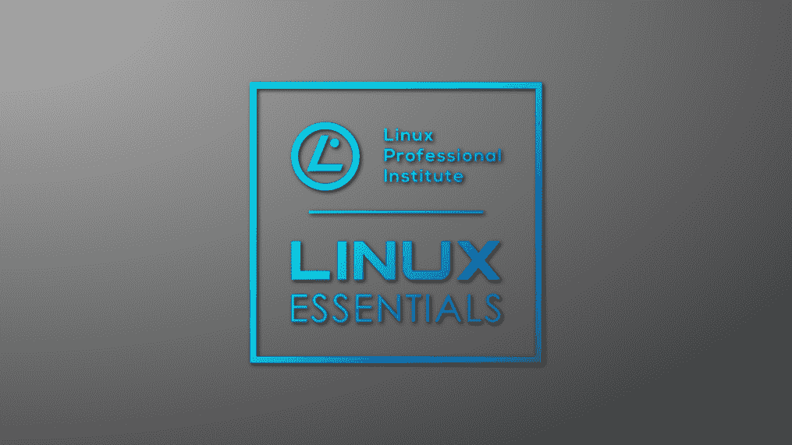
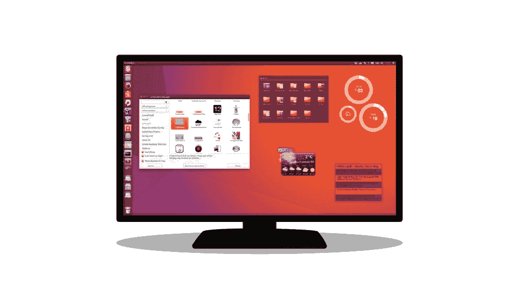
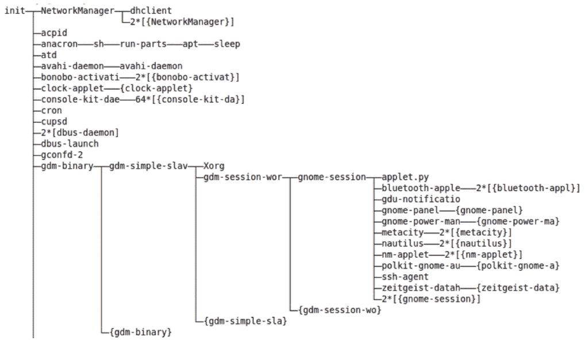
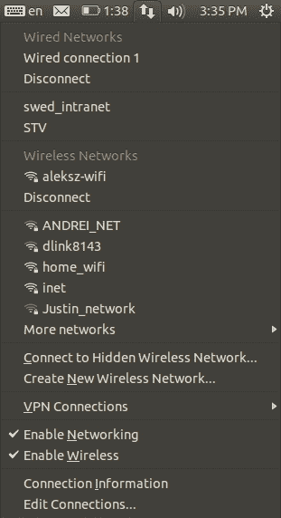
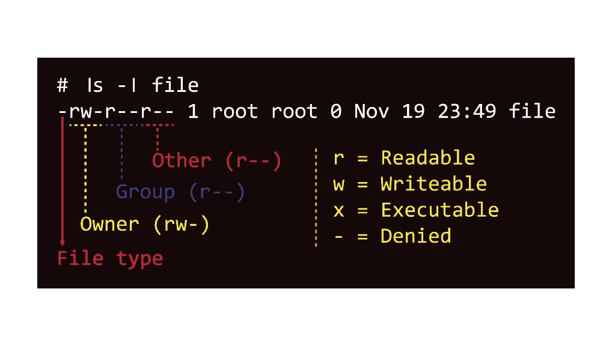

# Linux Essentials (010-160)：助你首次尝试通过 LPI® Linux Essentials 考试的速成资源


献给丈夫能拥有的最好的妻子、朋友、商业伙伴和支持者，感谢她在共同度过不停止的人生旅程中对我我付出的持久耐心。


## 第一章
### 引言

### 目标
* 本书的设计如何帮助你快速通过认证考试
* 了解考试是如何设计的，以及如何参加认证考试
* 了解攻克 LPI Linux Essentials® 认证考试的一些技巧和窍门


在本书中，你将获得一门速成课程，它将介绍你通过 LPI Linux Essentials® 认证考试所需的所有知识。本书仅涵盖核心要点，没有任何废话、填充内容或额外材料，因此你可以快速学习这些材料并轻松攻克认证考试。

LPI Linux Essentials® 考试是 Linux 专业协会（Linux Professional Institute）认证路径中的首个认证考试。该认证旨在测试你使用基础命令行编辑器的能力，并证明对 Linux 操作系统进程、程序和组件的理解。本书假设你之前没有过 Linux 操作系统的经验，并将教你为了在第一次尝试时参加并通过 Linux Essentials® 认证考试所需的确切知识。

现在，这本书**并不会**教你日常工作中高效或有效利用 Linux 所需的所有知识。毕竟，LPI Linux Essentials® 认证的设计旨在向你介绍 Linux 操作系统及其各种概念。如果你想成为 Linux 专家，那么这本书和 LPI Linux Essentials® 认证是一个很好的起点，但请记住，它们都是为入门水平编写的。一旦你完成了学习，我建议继续进阶到 `LPIC-1 (System Administration)` 认证及其相关的视频课程和教材，以进一步提升你的技能。本文的唯一关注点是让你通过认证考试，而不是让你成为 Linux 操作系统、其系统管理或 Linux 工程方面的专家。由于本教材的设计性，我们将以非常快的速度学习材料。如果你读完整本书，并完成了文末的模拟考试（得分至少达到 85% 或更高），你就准备好在第一次尝试时参加并通过 LPI Linux Essentials® 认证考试了！

### 考试基础
Linux Essentials® 认证考试是针对希望了解 Linux 操作系统、其用法和运行的信息技术人员的入门级认证。这项入门认证涵盖了 Linux 操作系统的总体概览：如何安装它、如何配置它，以及如何在图形用户界面 (`GUI`) 和命令行界面 (`CLI`) 中运行其中的程序。

LPI Linux Essentials® 认证的目标受众是需要以下内容的人员：

* 理解 Linux 和开源行业
* 理解 Linux 工作的主要组件
* 具备命令行的基本知识
* 对 Linux 中的网络和安全有基本了解

考试由 40 道单选题组成，必须在 60 分钟内完成。在 200-800 分的分值范围内，至少需要获得 500 分才能通过认证考试，这相当于约 70% 或更高的分数。考试是闭卷考试，考试期间不允许携带任何笔记或学习材料。在本书出版时，目前的考试费用为 120 美元，你可以在全球任何一个 PearsonVue 考试中心或通过 `OnVue` 服务在线参加考试。

Dion Training Solutions (`www.diontraining.com`) 是 Linux Essentials® 认证考试的 LPI 认可培训伙伴。如需以我们读者提供的特惠折扣价购买考试券，请访问 `diontraining.com/vouchers`。

### 考试技巧与窍门
在我们深入 LPI Linux Essentials® 认证考试的内容之前，让你了解一些考试技巧和窍门是非常重要的。这有助于帮助你在阅读本书其余部分时，准确掌握如何为考试做准备，并帮助你集中精力从这些材料中获得最大的收益。

参加 LPI Linux Essentials® 认证考试时最重要的一点是，考试当天没有陷阱题。每道题的措辞经过精确设计，与你所学的材料。你应该多次阅读每道题，以确保你完全理解它的要求，并确保你回答的是所提的问题。每当你在答案中看到 `ALWAYS`（始终）或 `NEVER`（从不）这类词时，请仔细考虑是否选择。在生活的大多数情况下，很少有某种情况对特定情况`始终`或`从不`适用！

在阅读问题和答案时，要留意干扰项或红�鱼。通常，在可能的答案选项中至少会有一个这类选项，试图分散你对正确答案的注意力。

如果你看到问题的某部分使用了粗体、斜体或全大写字母，你应该密切关注这些单词，因为命题者认为这些关键词对于选择正确答案至关重要。

记住学习中涵盖了 Linux 和开源环境中的哪些概念非常重要，因为你在考试当天会再次看到这些问题。你不应该在考试中看到你学习考试时使用的教材或视频课程未涵盖的内容。我们将在整书中涵盖所有这些概念，因为它们是 Linux Essentials® 课程和认证考试的基石。此外，如果问题问及某个特定的 `command`（命令），请确保你不要选择包含概念或过程的答案。务必小心回答所问的问题。

还要记住，你必须根据你的 Linux 知识和本教材的学习内容回答问题，而不是根据你个人的工作场所经验。你的工作场所可能会根据其情况和用例以不同的方式实施 Linux 及其概念。如果有疑问，在回答认证考试问题时应始终选择书上的答案。

在考试当天，你应该选择 `BEST`（最佳）答案。每道题可能有多个正确答案，但总有一个是最正确的答案。如果有疑问，选择那个在尽可能情况下都是正确的答案！

在考试当天，你不需要逐字背诵本课程中的 LPI Linux Essentials ® 术语，但你必须能够从给出的选项中识别它们。在认证考试期间，你将从选题中选择答案，而不是填空或问答题。这是认证测试与你可能在高中或大学参加过的测试之间的本质区别。在认证领域，你只需要能够识别信息，而不是背诵信息。

## 第二章 Linux 的演变


### 目标
* 理解开源哲学
* 描述各种 Linux 发行版及其生命周期
* 理解 Linux 在嵌入式系统中的应用
* 理解 Linux 的基本硬件要求
* 描述 Linux 与与其他操作系统的差异


随着互联网和新技术的出现，`Linux` 已经变得非常普及，甚至成为了家喻户晓。`Linux` 是一系列开源的、类 Unix 的操作系统，通常被打包成一个发行版。由于其稳健性和极低的获取成本，它是许多教育和商业机构的首选操作系统。Linux 发行版包括 `Linux kernel` 以及支持性的系统软件和库，用以提供供用户交互的功能。你可能听过流行的 Linux 发行版，如 `Ubuntu`、`Debian` 和 `Fedora`，但目前有成百上千甚至上万个发行版正在开发中。`Linux` 的受欢迎主要是因为它是开源软件，这允许任何人自由地下载、修改甚至重新分发它。`Linux` 的开源起源是其广泛采用和成功的主要原因之一。

大多数 Linux 发行版都包含一个窗口系统和桌面环境，为用户提供图形用户界面（`GUI`），类似于 `Microsoft Windows`。我们将在本书中涵盖这个精彩操作系统的所有主要特性和功能。许多 Linux 发行版是专门为服务器设计的，这些发行版通常完全省略了图形桌面。这意味着对你来说，熟悉命令行界面（`CLI`）或终端同样重要。不过，这种命令行壳需要正确的语法才能使用，并且被认为比单独使用 `GUI` 更难用。

正因如此，学习图形界面和命令行界面对于你精通 `Linux` 至关重要。如果你想成为一名成功的终端用户或 `Linux` 系统管理员，花时间学会充分使用这两个环境是值得的。

但是，你为什么要学习如何使用 `Linux` 呢？嗯，如果你快速浏览一下，你会发现 `Linux` 无处不在。事实上，超过 96% 的网络服务器运行在运行某种众多 Linux 发行版的服务器上。由于其在扩展性和开源等方面优于其他操作系统的优势，`Linux` 被许多行业视为首选的操作系统。

## 开源哲学
你在浏览互联网或参与某些在线论坛时，可能遇到过“开源”这个词。`Linux` 受开源哲学的影响很大。这种心态对 `Linux` 操作系统及其众多发行版的发展产生了极远的影响。开源指的是计算机软件或程序，其源代码可供公开使用或从其原始设计基础上进行修改。它鼓励该程序或软件社区中的程序员和普通用户之间共同努力，以改进其设计和用途。

开源软件有哪些例子呢？嗯，如果你只看一个简单的 Web 服务器，你会发现很多开源软件。例如，如果你正在运行 `Apache` Web 服务器，那么你正在运行开源软件。`WordPress` 呢？嗯，`WordPress` 运行着互联网上 30% 以上的网站，猜怎么着？它也是开源的。

由于 `WordPress` 是开源的，这意味着你可以去 `WordPress.org` 下载 `WordPress` 内容管理系统的整个代码库，并随心所欲地对其修改、编辑或更改。这就是开源软件的伟大之处。你拥有完全访问运行这些程序的所有代码，并可以对其进行修改以满足你的精确需求。软件或程序的原始设计者随后根据软件许可证的条款发布源代码。软件许可证将规定用户可以在原始发行包中修改哪些内容，以及他们如何将这些修改（称为版本或分支）重新分发给社区和普通公众。

开源社区使用了许多不同的软件许可证。这些包括 `GNU General Public License`、`Apache License`、`MIT License` 甚至 `Unlicense`。这些许可证代表了开源许可证的整个光谱，从高度保护到无条件开放。根据你对开源项目的具体需求，你可以选择这些开源许可证中最适合你用途的一个。

## Linux 发行版
我们已经讨论过 `Linux` 被打包成几个发行版（简称为 distros）。每个发行版都包含一个 `Linux kernel`、支持性软件和库以及配置文件。通过组合所有组件，`Linux` 变成了一个完整的操作系统，就像 `Microsoft Windows` 或 `Macintosh OS X` 一样。Linux 发行版之间的不同之处取决于开发者是谁以及他们希望他们的发行版实现什么。就像一家全新的公司一样，每个发行版都有自己的目标和使命。基于此，某些发行版比其他的更受欢迎，并服务更大或更小的受众。

任何 Linux 发行版的核心都是 `Linux kernel`。`kernel` 是一种底层计算机程序，充当用户与计算机资源之间的桥梁。它的功能包括内存管理以及输入输出设备管理。本质上，`Linux kernel` 是对系统中一切具有完全控制权的核心计算机程序。由于 `Linux kernel` 在不断进化，两个发行版可能会使用略不同的内核，因为开发者会进行细微更改来修复漏洞，或为自己的发行版内核添加特性和功能。

除了 `kernel` 之外，某些发行版还配备了不同的软件和工具，例如 `X Window System`（称为 `X11` 或 `X`），以及对于系统正常运行至关重要的磁盘管理实用程序。`X Windows System` 是为图形用户界面（`GUI`）环境提供基础框架的软件示例。这允许 Linux 用户在显示器上绘制和移动窗口，并与鼠标和键盘交互，类似于你使用 `Windows` 或 `Mac` 时的习惯。

由于 Linux 发行版是一个完整的操作系统，额外的软件如服务器守护进程、网络程序、桌面环境和生产力工具也作为完整系统的一部分进行发布。这些补充软件有助于某些发行版提供特定类型的品牌。这在桌面环境和易于管理方面尤为如此。例如，特定的发行版可能预装了常用的生产力软件，如文字处理、电子表格或演示文稿程序。


### 发行版对比

几个不同的 Linux 发行版示例包括 `Ubuntu`、`OpenSUSE`、`Debian` 和 `Gentoo`。虽然它们都是 Linux，但外观和操作方式有所不同。

#### Ubuntu
`Ubuntu` 默认带有 `Unity` 桌面。`Unity` 是一个布局良好且视觉舒适的环境。点击屏幕左下角的点，会列出 `Ubuntu` 中安装的所有程序。在屏幕左侧有一列图标，其中之一是 `Files`。`Files` 会打开 `Ubuntu` 的图形化桌面文件系统，它与 `Windows Explorer` 非常相似。`Ubuntu` 预装了网页浏览器 `Firefox`，允许用户访问互联网上的任何网站。`Ubuntu` 还有一个名为 `Ubuntu Software` 的应用商店，允许用户搜索音频视频、游戏、生产力工具等软件。要安装软件，只需点击该软件的图标并按照屏幕指令操作即可。

#### OpenSUSE
带有 `KDE` 桌面环境的 `OpenSUSE` 看起来像传统的 Windows 桌面，屏幕左下角有开始菜单。点击该按钮显示电源按钮、我的电脑和应用程序等项目。就像在 `Windows` 中一样，右键点击桌面可以更改背景的选项。`OpenSUSE` 还自带 `LibreOffice` 办公套件，它的工作方式与 `Microsoft Office` 一样。`LibreOffice` 允许我们创建文档、电子表格或演示文稿。

#### Debian
运行在 `Debian` 上的 `Gnome` 桌面看起来和运行与 `Unity` 或 `KDE` 不同。`Debian` 被称为“平面操作系统”，因为它的界面并不美观。要访问应用程序，用户可以点击 `Gnome` 桌面左上角的 `Activity` 打开菜单，显示如 `Firefox`、`LibreOffice` 或其自身的应用程序安装程序等程序。关键在于，这些程序的访问方式与前两个发行版不同。

#### Gentoo
`Gentoo` 带有 `XFCE`。这个桌面环境对系统的要求较低，桌面强度较低。它看起来比其他三个桌面环境更“平”。它类似于 `Macintosh` 系统，在屏幕底部中部有一个应用程序启动栏。由于 `Gentoo` 是一个低要求的发行版，它可以在配置低于当今市场电脑的旧电脑上运行。在 `XFCE` 桌面环境中，有几种方法访问和运行应用程序。右键点击桌面会将应用程序作为菜单的最后一选项显示，并展开显示应用程序列表。在桌面环境中启动应用程序的第二种方法是点击屏幕左上角的 `Applications` 按钮。屏幕底栏启动器上的放大镜也允许我们搜索需要运行的应用程序。


比较这四种发行版仅说明使用 Linux 并不不可怕。对于那些想要尝试一下或考虑从 Windows 或 Mac 切换的用户来说，这尤为如此，因为它的运行方式与这两个操作系统相似，因此是他们已经熟悉的领域。用户只需要决定哪种发行版和桌面环境适合他们的需求和偏好即可。

## 嵌入式系统

到为止，我们只把 Linux 作为一个功能全且完整的操作系统来讨论，但 Linux 的用途远不止于计算机。事实上，Linux 是你每天使用的许多设备的核心，因为它是许多嵌入式系统的核心。

嵌入式系统是大型机械或电气系统中具有专用功能的控制器。它作为完整设备的一部分被嵌入其中，通常包括硬件和机械部分。事实上，无论你是否意识到，嵌入式系统都控制着你每天使用的许多设备。这些设备包括但不限于工业自动化、导航设备、医疗设备等等。

近年来，由于其成本低廉和易于定制的特点，Linux 已被应用于许多消费设备中，如可穿戴技术、家电器、汽车，甚至恒温器。如果你家里有智能恒温器，比如 `Nest®` 或 `ecobee®`，那么你家里已经安装了 Linux！

某些嵌入式系统，如 `Arduino` 和 `Raspberry Pi`，是信用卡大小的嵌入式系统，我们可以用它们创建其他完整系统。这些包括机器人和超便携计算机系统等。`Arduino` 和 `Raspberry Pi` 以自装或 DIY 套件的形式在市场上销售。嵌入在这些套件中的基于 Linux 的操作系统占用空间小，运行所需的内存和处理能力较少，并且具有高度的可定制性。

大多数智能手机和平板电脑也运行基于 Linux 内核的操作系统，被称为 `Android`。谷歌于 2005 年 7 月收购了 `Android` 并对其进行了扩展，结果 `Android` 成为一个极具竞争力的移动操作系统，现在占据了全球 75% 以上的智能手机和平板用户市场。`Android` 具有高度的可扩展性、用户友好、开源，且允许制造商在设备中免费使用。

正因如此，`Android` 还被移植用于媒体播放器、电视和汽车娱乐系统。`Android` 具有高度的可定制性，是一个以 Linux 为核心的真正完整的操作系统。我们还可以向 Android 环境中添加应用程序以进一步增强功能。有用于照片、视频和社交媒体等媒体内容的应用程序，也有用于生产力和游戏的应用程序。

事实上，由于许多较新的电视内部安装了 `Android` 作为嵌入式系统，这些设备现在变成了完整的多媒体中心，我们可以用它们进行视频流媒体、浏览和视频游戏。

## 硬件要求

在安装 Linux 之前，你需要知道哪些硬件组件可以高效地运行和使用它。这些先决条件被称为系统要求，通常被视为指南而非绝对规则。

任何 Linux 发行版定义的的最常见的系统要求是物理计算机硬件。硬件要求列表通常会附带硬件兼容性列表（`HCL`）。`HCL` 列出了针对特定发行版经过测试、兼容的以及有时不兼容的硬件设备。大多数发行版都定义了两个组系统要求：最低要求和推荐要求。随着时间的推移，由于每个发行版的新版本对更高处理能力资源的需求，这些系统要求往往会增加。

通常，开发者会在其网站的下载页面发布特定版本的系统要求。这些列表通常列出了所需的处理器速度、内存大小、可用硬盘空间、光驱或可移动介质、显示器规格以及所需的其他设备。

最低系统要求是你的计算机成功启动 Linux 并使用基本功能所需的最低硬件。例如，本文撰写时 `Ubuntu` 的当前版本 `Disco Dingo` 要求计算机至少有一个运行在 `2GHz` 的 `Dual Core` 处理器、`2GB` 的 `RAM` 和 `20GB` 的硬盘空间。大多数现代桌面电脑和笔记本电脑都能很轻松地满足这些要求。

但最低要求在不同发行版之间也可能很大。例如，考虑 `AntiX` 发行版。该发行版仅要求一台至少带有 `Pentium III` 处理器、`256Mb` `RAM` 和 `2.7GB` 硬盘空间的计算机。考虑到 `Pentium III` 处理器是 1999 年首次制造的，这些要求极其轻量。像 `AntiX` 这样的现代操作系统仍然运行在超过 20 年历史的系统上，这非常令人惊讶！所以，如果你地下室里有一台积灰的旧 Windows 电脑，你可以使用 `AntiX` 这样的轻量级发行版将其作为 Linux 机器焕发新机。

另一种类型的系统要求是推荐要求。推荐系统要求列出了为了最大限度发挥系统潜力你应该具备的硬件。这允许你使用视频编辑软件等应用程序或玩 3D 游戏，这些游戏需要更高的帧率来实现流畅的游戏。当你查看推荐要求时，你会发现大多数发行版现在都会推荐视频显卡以及比最低要求高得处理器和内存。然而，你仍然需要小心不要使用不兼容的硬件，因为它们可能比最低要求更强大，但如果你安装了不支持的显卡或其他设备，可能会导致整个系统不稳定或无法使用。

| 安装 Linux | 扫描二维码观看此主题的视频 |
|---|---|
|  |


当在计算机上使用 Linux 时，它可能由设备制造商预装好，或者你可能需要手动安装。要手动安装 Linux 发行版，安装程序是必不可少的。它通常可以在发行版的网站上下载。例如，要安装 Ubuntu，请打开网络浏览器并访问 `ubuntu.com`。安装程序位于下载区域下。可能会存在多个不同版本的安装程序，下载哪一个取决于系统要求和用户需求。例如，将会有取决于硬件能力的 32 位和 64 位版本，可能还会有长期支持（LTS）版本和非长期支持版本。文件大小也将取决于安装程序的版本。

安装程序通常为 `ISO` 文件格式。它是 CD 或 DVD 的磁盘映像。有几种方法可以管理这种格式的文件，传统方法是将磁盘映像“刻录”到 CD 或 DVD 上。对于 Ubuntu `ISO` 文件，Windows 7、8 和 10 用户只需要下载好的 Ubuntu `ISO` 文件、一张空白 DVD 以及一台带有 DVD 刻录机的电脑。右键点击 `ISO` 文件将显示右键菜单选项，其中包含“刻录光盘映像（Burn disc image）”。点击它会弹出 Windows 光盘映像刻录对话框，我们可以在其中选择刻录机、插入空白 DVD、点击刻录按钮并开始过程。较旧版本的 Windows（如 Windows XP 和 Vista）可能需要第三方软件（如 `Infra Recorder`）来管理 `ISO` 磁盘映像文件的刻录。Mac 用户也会经历类似的过程，Ubuntu 网站提供了针对 Windows 和 Mac 映像刻录的教程。

对于可以从 USB 闪存启动的较新系统，管理 `ISO` 文件的另一种方法是创建一个可启动 USB 闪盘。光驱正逐渐成为过去，因为它们容易受到物理损坏。可启动 USB 安装程序现在是安装 Windows 和 Linux 等操作系统的首选方法。创建 Ubuntu 可启动 USB 盘也有优势；例如，它允许我们在不接触主机计算机配置的情况下测试 Ubuntu。我们还可以随身携带此 USB 盘，并它在其他电脑（如朋友的电脑或网吧）上启动 Ubuntu。

创建 Ubuntu 可启动 USB 盘仍然需要 `ISO` 文件，但不需要经过磁盘刻录过程，我们需要第三方软件，例如 `Rufus`（这是一款用于创建可启动 USB 盘的开源软件）。一个性能足够的 USB 闪存也是必须的。对于较新版本的 Ubuntu，我们需要一个 4GB 或更大的 USB 盘或闪存器。它应该是空的，因为它可能需要重新格式化，这会破坏现有文件。过程非常简单，并且有易于遵循的提示。它还会下载额外的文件，因此我们需要网络连接。会出现一个询问写入模式的提示，此时建议选择 `ISO 模式`。过程完成可能需要一些时间，一旦完成，USB 盘现在就是可启动的了，我们可以使用它在能够通过 USB 启动的机器上安装 Ubuntu。

在通过接管整个系统或与现有操作系统并排启动来实际实际安装之前，我们可以在虚拟机上测试 Ubuntu，虚拟机就像运行在你的电脑内部的另一台电脑。一种流行的虚拟机软件是 `VirtualBox`。就像从 Ubuntu 网站下载 Ubuntu `ISO` 文件一样，我们可以从其网站 `virtualbox.org` 下载 `VirtualBox`。下载与安装 `VirtualBox` 的操作系统相匹配的版本。运行 `VirtualBox` 安装程序应该是很直接的，因为它推荐了默认安装设置。通过设置名称、设置虚拟内存（`RAM`）值以及创建虚拟硬盘（`HDD`）来创建一个新的虚拟机。然后我们可以将下载的 Ubuntu `ISO` 映像加载为虚拟光驱，虚拟机可以从中启动。启动这台虚拟机就像开启物理电脑一样，它将从加载的 Ubuntu `ISO` 文件启动，就像插入了 DVD 驱动器的 DVD 一样。

Ubuntu 安装程序从语言选择开始，并提供两个选项：尝试（try）或安装（install）。选择“尝试”将 Ubuntu 作为现场操作系统加载，临时运行且就像已安装好的一样，但它不会保留在系统中，特别是当电脑关闭或重启时。选择“安装”选项将把 Ubuntu 安装到系统中，无论是在物理机还是虚拟机上。安装过程中的下一个提示是键盘布局选择。之后，安装程序会提供普通安装或最小化安装的选项。普通安装包含所有预装软件，而最小化安装包含的较少。还有在安装 Ubuntu 时下载更新的选项，我们可以选择是否也下载某些第三方软件（其中一些是专有软件）。下一步提供了选项，要么允许系统专门用于 Ubuntu，要么设置 `HDD` 分区，以便我们能够与其他操作系统并排启动 Ubuntu。后后一种选项也称为多系统启动系统。安装多系统启动系统更为复杂，网上有大量的资源，特别是来自 Ubuntu 网站和在线社区的资源。过程中的下一个主要步骤是提供用户凭据：用户的、计算机的、用户名和密码。在提供用户凭据并选择用户是否自动登录后，系统安装开始了。

Ubuntu 的首次启动屏幕显示“Ubuntu 的新特性（What's new in Ubuntu）”对话框，这就像是对操作系统某些功能的导览。首次启动的下一个部分显示 `Livepatch`，我们可以在此处创建 Ubuntu 单点登录账户。下一个部分询问用户是否想向 Ubuntu 发送信息，以更好地帮助他们开发操作系统。在完成首次启动屏幕的章节后，如果检测到系统软件或应用程序有更新，`软件更新器`可能会运行。

#### 操作系统的差异

目前有数百种操作系统。这些从常用的到针对特定系统开发的都有。大多数读者熟悉世界上最流行的操作系统：Windows 和 macOS。


* 理解开源软件的概念
* 解释开源软件的成本
* 列出基础桌面和服务器应用程序
* 列出不同的编程语言及其工具
* 解释软件包安装和仓库的工作原理

### 开源软件

开源软件是根据特定许可发布的软件，在这些许可中，版权所有者授予用户向任何人、出于任何目的研究、更改和分发该软件的权利。因此，源代码（软件的人类可读核心）是可以供检查、修改和增强的。开源软件通常以协作公共的方式进行开发，它是开放协作如何创造出卓越产品和服务的示例。

在计算机早期，程序员和开发者通过共享软件来相互学习并演进计算领域。最终，开源概念被边缘化了，因为许多开发者在 20 世纪 70 年代和 80 年代选择将他们的软件商业化。尽管如此，直到今天，许多学者和一些开发者仍然在以协作的方式的方式创建软件。

由于这种协作，软件开发者可能希望通过开源许可证发布他们的软件，例如 `GNU 通用公共许可证 (GPL)`，以便任何人也能开发相同的软件或理解其内部运行机制。对于开源软件，任何人都可以对其进行修改、将其移植到新的操作系统和指令集架构、与他人共享，甚至在某些情况下将其市场化。根据一些学者的观点，采用开源有几个基于政策的原因，包括开源运动创造的更高价值主张。例如，许多开源软件产品比商业版本具有更高的安全性、可负担性、透明度、互操作性、扩展性和本地化支持。

`开源倡议组织 (Open Source Initiative)` 是一家促进开源软件使用的公共利益公司。他们发布了`开源定义 (OSD)`，这是一份决定软件许可是否可以标记为开源认证标志的文档。该标记作为一个独特的标签，用于表明软件的属性符合 `OSD` 的要求。

### 开源软件的成本

开源软件通常免费下载，因此获取副本的成本非常低。但与任何软件项目一样，无论是开源的还是专有的，在涉及技术支持、培训以及管理或维护时，成本可能会不断增加。

在计算机早期，几乎所有软件都是由学者和企业研究人员合作产生的。他们通常将软件作为公共领域进行共享。这意味着绝对没有所有权，如版权、商标或专利。因此，他们遵循开放和合作的原则分发软件。它仅仅不被视为一种可以出售获利的商品。这种社区化的行为后来变成了所谓“黑客文化”的核心元素，这个词在开源程序员中是一个具有积极含义的术语。

在这一早期阶段，源代码通常与软件机器码一起分发。这允许用户在需要时自行修改软件，因为在没有修改之前，代码通常无法在不同的硬件设置或操作系统上运行。这还允许任何用户在他们自愿的情况下修复错误或添加新功能。

在计算机发明很久以后，各行业开始广泛采用计算能力及其先进技术。随着这种广泛采用，产生了开发新硬件和软件的需求，以满足这种日益增长的需求。在此期间，硬件制造商也会创建大部分软件，这极大地推高了软件的成本。为了与将软件与硬件捆绑的硬件制造商竞争，一个全新的软件行业开始增长。为了增加收入并跟上软件开发不断上升的成本，出现了一种大趋势，即不再公开分发源代码，而是将其变为专有，并对所创建的程序保留法律版权。现在，为了合法地运行软件，个人或公司需要获取许可，从而为软件开发者带来利润。

然而，20 世纪后期，研究的复兴以及降低使用和维护计算机系统成本的替代方案再次使自由开源软件的想法复活。开源软件开发者现在必须寻找方法在允许人们免费使用的同时继续开发软件。一些开发者诉诸私人资助、众筹，甚至接受用户的捐赠来维持他们的项目运行。由于捐赠是自愿的，这仍然允许其他非捐赠用户免费使用软件。

其他人转向了免费增（freemium）模式，通常与其他公司建立伙伴关系以展示广告，或从他们的软件内部安装其他软件。这使得他们的软件开发获得资金支持，同时允许终端用户免费使用他们的软件。

还有人选择采用免费分发的开源模型，该模型依赖于终端用户实施的支持协议。这意味着你可以免费使用该软件，但如果你在遇到问题时需要开发者的支持，你就必须支付服务费。这种模型由`红帽企业 Linux (Red Hat Enterprise Linux)` 普及，它是完全免费使用的，但会对官方支持、培训和认证收费。

### 桌面和服务器应用程序

| 扫描二维码观看此主题的视频 |
| :--- |
|  |


大多数在 Ubuntu 上预装或稍后安装的桌面应用程序都是更流行的商业软件的免费开源替代方案。然而，这并不意味着它们缺乏性能。事实上，这些程序中的大多数现在已成为主流，有时甚至比商业软件更受青睐。许多免费开源应用程序的功能与它们的商业对应品相似，仅有细微的差别。

### 办公套件
`LibreOffice` 是一个免费开源的办公套件，在包括 Ubuntu 在多数 Linux 发行版中均预安装。它类似于 `Microsoft Office`。LibreOffice 套件包含 `Writer`，这是一个类似于 `MS Word` 的文字处理程序。它允许我们编写笔记和文档，并根据喜好进行格式化处理。该办公套件还包含 `Calc`，这是一个类似于 `MS Excel` 或 macOS 上 `Numbers` 的电子表格程序。对于创建类似于 `MS PowerPoint` 或 `Keynote` 的演示文稿，`Impress` 是对应的程序。

### 媒体与图形编辑
`VLC` 媒体播放器是一款适用于 Ubuntu 的免费开源、便携、跨平台媒体播放器软件和流媒体服务器。该程序的优点是它是跨平台的，这意味着它可以运行在其他操作系统上，如 Windows、macOS 甚至手机。它与其他媒体播放器相比的主要优势是能够播放几乎任何音频和视频格式，并支持广泛的解码器。

Ubuntu 上类似于 `Adobe Photoshop` 的图像处理程序是 `GIMP`。`GIMP` 是 `GNU Image Manipulation Program` 的缩写，是一个免费开源的位图图形编辑器，用于图像修饰和编辑、自由绘制、不同图像格式之间的转换以及更专业的成像任务。

对于寻找类似于 `Adobe Premier` 或 `Final Cut Pro` 的视频编辑程序的人来说，`Kdenlive` 是一个免费开源的替代方案。对于音频文件，使用的程序是 `Audacity`：这是一个强大的、跨平台的开源数字音频编辑和录制应用程序。

### 浏览与生产力
Ubuntu 预装的浏览器浏览器是 `Firefox`，尽管用户也可以添加其他浏览器，如 `Google Chrome`、`Opera` 等。

### 服务器与网络管理
对于服务器和网络管理员来说，拥有扩展 Ubuntu 桌面之外能力的应用程序也非常重要。这些服务器应用程序之一是 `Wireshark`。它是一个免费开源的数据包分析器。管理员使用它进行网络故障排除、分析以及软件和通信协议开发。

`GParted` 是一个用于管理磁盘分区的图形用户界面。它可以创建、格式化和调整分区大小，而无需记忆执行这些功能所需的输入代码。

管理服务器和网络的重要方面是备份数据的能力，以便在系统崩溃或故障时从中检索或恢复数据。一个名为 `Timeshift` 的应用程序可以对系统进行计划快照，当发生意外删除或更改导致当前系统不稳定时，能够将系统恢复到先前的快照。

为了快速创建用于编码或系统脚本的文本而非办公文档，`Atom` 是一个很好的应用程序。它类似于 Windows  `Notepad`。系统和网络管理员的另一个有用工具是 `PuTTY`。`PuTTY` 是一个免费开源的终端模拟器、串口控制台和网络文件传输应用程序。它支持多种网络协议，包括 `SCP`、`SSH`、`Telnet`、`rlogin` 和原始套连接。

| 开发语言与工具 | 扫描二维码观看此主题的视频 |
| :--- | :--- |
|  | |


Linux 的伟大之处之一是它内置了对不同编程语言的支持。以下是其中一些语言以及我们用来编写、读取和执行它们的工具。

### 编程语言

JavaScript 仅仅是一个以 `.js` 为扩展名的文本文件。我们可以将其嵌入 HTML 中，也可以它可以作为一个独立的文件。它可以简单到只是在浏览器中打开时显示“Hello World”的脚本，也可以具有更复杂的功能，例如创建一个列表。

Python 是一种非常出色的脚本和解释型语言。编写 `python` 代码有两种方式：在解释环境中，或者从文本文件内部编写。对于解释环境，打开终端并输入 `python3`（这里的 3 是因为它是 `Python` 的最新版本）。这将弹出一个可以接受直接命令的提示符。输入 `print("Hello, World")` 将在命令行行下方直接返回文本 Hello, World。我们可以通过创建一个文本文件，输入完全相同的命令，并将该文件保存为 `.py` 扩展名来实现。回到终端，输入 `python3`，加一个空格，然后追加已保存的文本文件的文件名；它将显示相同的结果。

PHP 最初代表 Personal Home Page（个人主页），但现在代表递归缩写 `PHP: Hypertext Preprocessor`（超文本预处理器）。由于服务器大量使用它，Linux 也是如此，因为它是一个主要用于网络服务器的操作系统。它与 JavaScript 一样，与 HTML 文件配合。因此，由 `.php` 标识的 `PHP` 文件可以直接在浏览器中运行。

另一种编程语言 Java 是一种非常棒的语言，因为它也适用于许多不同的操作系统，包括 Windows 和 Linux。对于大多数运行 Android 系统的智能手机用户来说，这并不令人意外，因为他们手机上所有的应用程序都是用 Java 编写的。Java 是一种编译语言。查看 `.java` 文件，其中的对象只是文本，除非将其转换为可执行的二进制文件，否则计算机将无法理解。因此，终端首先通过执行 `javac` 命令后跟带有 `.java` 扩展的文件名来编译 `.java` 文件。一旦编译完成，通过输入 `java` 以及 `.java` 文件中的对象名称来运行该对象。Java 比 JavaScript、`Python` 或 `PHP` 稍微复杂一点，但它非常强大，因为我们仅使用这种语言就可以编写完整的程序。

CSS 也称为“样式表”，用于 HTML 页面；它们描述了内容以及内容在页面内的显示方式。一个典型的 `.css` 文件包含页面属性，例如页面主体应该像什么样、背景应该是什么颜色、字体的类型和大小、页边距等。修改样式表可以轻松地改变网页的外观和感受，这比返回并修改整个 HTML 文档要简单。

C++ 是一种像 Java 一样的编译语言，一种低级编程语言。它稍微复杂一点，需要在执行之前将其编译成二进制文件；但它非常强大，因为大多数知名软件如 Adobe 应用、Google 应用，甚至 MS Office 和旧版本的 Windows 都是用 C++ 编写的。

一种新的面向对象编程语言是 Go。像 Java 和 `C++` 一样，它也需要编译。Go 专门设计为用于大型分布式系统和高扩展网络服务器的系统编程语言。由于 Go 的编译速度比 `C++` 快，且比 Java 更容易维护，它在 Google 的软件栈中取代了它们。

C 是一种从 `C++` 演变而来的低级编程语言。事实上，最初用 C 编写的“hello, world”示例已成为大多数编程教科书中编写入门程序的模型。该程序将“hello, world”打印到标准输出（通常是终端或屏幕显示）。

除了 C 和 `C++`，该家族的另一个成员是 C#。它是一种通用的多范式编程语言。它被用于如 `MonoDevelop` 等开发环境内部。

Ruby 是一种流行的网页开发编程语言。Ruby 文件以 `.rb` 文件名扩展名标识。Ruby 类似于 Python，因为它可以在解释环境中运行，也可以从文本文件内部运行。

Linux 用户可以使用许多其他开发语言和编程工具。这里提到的只是比较流行的。选择使用哪种取决于用户对该语言的了解以及该语言与用途的匹配程度。

### 软件包管理与仓库

在 Linux 驱动的计算机上安装软件有很多方法。最常见的方法是使用包管理器和软件仓库。由于 Linux 发行版非常多，因此也有许多包管理器。每个 Linux 发行版都会根据其所需的库版本和编译选项编译自己的软件。Linux 通常不会在每个发行版上运行，而是需要针对特定的发行版进行编译。即使有通用的 Linux 二进制文件，其安装也会受到各种竞争性的包格式及其在发行版中可用性的的阻碍。

因此，如果你找到了某个 Linux 应用的网站，你可能会看到根据你正在使用的发行版提供的各种不同包格式的下载链接。如果你想要安装的应用程序作者尚未为你的发行版创建包，那么你可能需要下载该应用程序的源代码并手动为该应用程序编译二进制文件。

与 Windows 用户不同，由于上述挑战，大多数 Linux 用户通常不会从应用程序网站下载并安装程序。相反，每个 Linux 发行版通常都会托管自己的软件仓库。这些仓库包含了为特定 Linux 发行版和版本编译的软件包。例如，如果你在使用 Ubuntu 18.04，你将使用的仓库将包含专门为 Ubuntu 18.04 编译的包，而不是 16.10 或 19.04 等其他版本。

这些包管理器会自动从配置的软件仓库下载相应的软件包，安装它并自动为终端用户设置。这与在 Windows 或 macOS 中安装软件不同，在后者中你必须点击向导或在网站上查找可执行文件。当更新发布时，包管理器会注意到它的可用性，下载相应的更新并为你安装。

在 Windows 和 macOS 上，每个应用程序都有自己的软件更新程序来接收自动更新，但在 Linux 中，包管理器处理从软件仓库安装的每个软件的更新。

如果你是 Windows 用户，你可能习惯于看到 `.exe` 或 `.msi` 文件作为应用程序的安装文件。如果你是 macOS 用户，你可能习惯于下载 `.dmg` 或 `.app` 文件作为安装程序。但 Linux 使用几种包格式作为其安装程序。

软件包本质上是包含文件列表的归包。包管理器打开归包并将文件安装到包内指定的指定。包管理器负责维护哪些文件属于哪些包的记录。包管理器还必须感知它们的版本及其最新状态。这些包文件还可以包含在安装和删除包时运行的脚本。

三种流行的包文件格式是 `.deb`、`.rpm` 和 `.tar` 文件。

- `.deb` 用于 Debian Linux 和基于 Debian 的发行版，如 Ubuntu、Kali Linux 和 Tails。
- `.rpm` 用于红 Hat 软件包管理器和基于 RPM 的发行版，如 Fedora、openSUSE 和 CentOS。
- `.tar`（也称为 `.tgz` 或 `.tar.gz`）被用作一种通用包格式，用于 ArchLinux 和 Slackware 等发行版；`.tar` 是未压缩的归包，而 `.tar.gz` 是压缩的归包。


虽然 Linux 发行版自带了预配置的仓库，但你也可以向系统添加其他仓库。随后，你就可以从该仓库中安装软件包，并自动接收这些软件包的任何额外更新。

例如，Ubuntu 以及其他基于 Debian 的发行版提供了多种个人软件包存档（PPA），其中包含了个人或团队编译的软件。这些 PPA 仓库通常比 Ubuntu 官方仓库更早获得软件的更新和 Beta 版本。

请记住，这些 PPA 并非获得发行版的官方背书，因此它们可能包含漏洞、安全风险以及其他有害内容。出于如此，我建议在任何生产系统中仅使用来自你所发行版的官方仓库。

## 第四章：桌面环境



### 目标

- 比较和对比不同的桌面环境
- 列出常用软件程序的 Linux 替代方案
- 比较和对比不同的包管理器


Linux 相比 Windows 和 macOS 的一个显著优势是，它能够让用户拥有完全的选择自由。遗憾的是，这也是关于 Linux 最令人困惑的事情之一，因为这种选择可能会让人无从下手。例如，假设你从市场上的数百种 Linux 发行版中选择了 `Ubuntu`。Ubuntu 非常流行，是一个不错的选择，因为它拥有庞大的用户社区和卓越的周期支持。尽管你选择了 `Ubuntu`，在下载和安装它之前，你仍然需要做一些决定。这是因为有八个官方版本，它们的外观和行为各相同，尽管它们都被认为是 Ubuntu。这八个不同异的 Ubuntu 版本之间的主要区别之一就是桌面环境。

为了更好地理解什么是桌面环境，请从任何操作系统的核心 `kernel`（内核）开始。Linux、Windows 和 macOS 都有 `kernel`，这是一种直接控制硬件的特殊软件。这个 `kernel` 将来自高层软件（如应用程序）的命令翻译成硬件可以理解并执行的内容。`kernel` 负责为各种软件和工具对硬件资源进行智能管理，包括内存管理。

`kernel` 并不是需要图形界面的软件，而是在后台运行的。这种特殊软件消耗的资源最少，我们可以通过嵌入工具直接通过命令行访问它。为了在命令行上执行某些任务，用户需要熟悉基于文本的命令、这些命令的功能，以及运行这些命令所需的语法或规则。

事实上，通过使用命令行环境，你可以在系统上执行几乎任何你想的操作，包括浏览网页、检查电子邮件、播放音乐、在硬盘目录间移动等。遗憾的是，大多数用户发现命令行并不很好用，因此操作系统演变成了更符合用户习惯的图形用户界面（`GUI`）环境。在 Windows 和 macOS 中，例如，你可能永远不会直接访问命令行或 `kernel`，而是使用 `GUI` 来执行你想要的操作。这个 `GUI` 将你的一系列鼠标点击和键盘输入翻译成你相应的命令行操作。基本上，在 Windows 和 macOS 中，只有系统管理员、程序员和开发者需要访问命令行。

而在 Linux 中，使用命令行执行操作通常要更快、更方便。由于这个原因，我们将花费整个章节来学习如何正确地使用命令行。在本章中，我们将重点关注 Linux 的各种图形用户界面。

### 桌面环境

桌面环境是大多数用户操作发生的地方。图形用户界面（`GUI`）包含文件管理器、所有可用应用程序的快捷方式、执行常用任务的各种菜单，并作为进入操作系统及其功能的窗口。你的桌面环境作为你的工作台，所有的工具都触手可及。

虽然 Windows 和 Mac 各自拥有不可分割的桌面环境，但 Linux 使用了模块化的桌面环境方法。事实上，Linux 官方支持十多种不同的桌面环境。这些环境可以根据用户的喜好或发行版本身进行混合和匹配。

许多 Linux 发行版带有几种不同的桌面环境。如前所述，`Ubuntu` 有八个不同的版本，其中包含了多种桌面环境。默认情况下，`Ubuntu` 带有 `Unity Desktop`，它具有吸引直观的工作流。除了这个默认选项，`Ubuntu` 还有其他“口味”（不同版本），每个都配有独特的桌面环境。`kubuntu` 版本依赖于于 KDE Plasma` 桌面环境，它流畅且高度可定制。`Xubuntu` 版本则使用轻量级的 `Xfce` 桌面环境，它非常强大，可以在只有 1 GB 内存和 700 MHz 处理器的旧电脑上运行。

### 程序和软件

在安装了 Linux 变和桌面环境后，用户就可以运行各种程序和软件来提高生产力。就像 Windows 和 macOS 一样，有许多可用的程序。由于 Linux 是开源的，许多 Linux 的软件也是开源的，因此免费下载和使用。

如果你是 Windows 或 macOS 用户，可能熟悉用于办公的 Microsoft Office 套件，它包括文字处理（`Word`）、表格（`Excel`）、演示（`PowerPoint`）和数据库（`Access`）工具。由于 Linux 上没有 Microsoft Office，大多数 Linux 用户依赖 LibreOffice 来完成这些功能。`LibreOffice` 是一个功能丰富的工具集，包含了文字处理（`Writer`）、表格（`Calc`）、演示（`Impress`）、数据库（`Base`）以及许多其他。`LibreOffice` 套件完全兼容 Microsoft，允许它可以读取和写入 `.doc`、`.docx`、`.xls`、`.xlsx`、`.ppt`、`.pptx` 等常用办公格式。此外，LibreOffice 还支持自己的原生格式 Open Document Format（`ODF`）。`LibreOffice` 也是跨平台的，适用于 Linux、Windows 和 macOS。要了解更多关于 `LibreOffice` 的信息或尝试它，请访问 https://www.libreoffice.org。

如果你想在 Linux 工作站上观看视频或播放音乐，可以通过下载 VLC 来安装最好的媒体播放器之一。VLC 媒体播放器可以播放你丢给它的任何媒体文件，包括损坏的、不完整的或甚至是未完成的文件。VLC 是一种真正的多媒体解决方案，适用于每个主流操作系统，包括 Linux、Windows、Android 和 iOS。在过去的 15 年里，我一直将 VLC 作为我电脑上的媒体播放器，它从未让我失望。如果你在寻找 Windows Media Player 或 QuickTime 播放器的优秀替代品，应该前往 https://www.videolan.org。

如果你想浏览互联网，你需要一个浏览器。虽然 Linux 不支持像微软 `Edge` 或苹果 `Safari` 这样的专有浏览器，但它支持几种跨平台浏览器，包括 `Mozilla Firefox`、`Google Chrome` 和 `Opera` 浏览器。虽然这些都是免费使用的，Linux 也适合编辑照片、视频或音频。如果你需要修饰、编辑、绘制、在图像格式间转换或执行特殊任务，GIMP（GNU Image Manipulation Program）是一个很好的选择。无论你是图形设计师、摄影师还是插画师，GIMP 都为你提供完成工作的复杂工具。GIMP 是一个开源的位图编辑器，运行起来像 Adobe Photoshop，但没有昂贵的标签。虽然 Adobe Photoshop 仅适用于 Windows 和 macOS，但 GIMP 是适用于 Linux、Windows 和 macOS 的跨平台软件。GIMP 自 1995 年以来一直在改进。要了解更多关于 GIMP 的信息或尝试它，请访问 https://www.gimp.org。

如果你喜欢编辑视频，Linux 有一种名为 Shotcut 的优秀非线性视频编辑软件。该程序使用多轨道时间线进行视频编辑，类似于 Adobe Premiere 或苹果的 Final Cut。事实上，Shotcut 非常强大，甚至可以支持 4K 视频。和大多数 Linux 软件一样，Shotcut 是一个开源应用程序。Shotcut 还是跨平台工具，可以安装在 Linux、FreeBSD、Windows 和 macOS 上。你可以在 https://www.shotcut.org 了解更多关于 Shotcut 的信息。

如果你梦想有一天成为摇滚明星，你可能会发现需要为你的 CD 编辑一些音频。开玩笑之，Linux 也有相应的工具。Audacity 是一个开源的数字音频编辑器，适用于 Linux、Windows 和 macOS。该程序允许用户从多个源录制音频并对所有类型的音频格式进行后处理。无论你是想混音整张专辑还是想开始做播客，Audacity 都能处理。Audacity 可以比拟 Adobe Audition 或许多录音行业专业人士使用的苹果 Logic Pro 软件。你可以在 https://www.audacity.com 找到更多关于 Audacity 的信息。

### 软件包管理

当我们安装 Linux 发行版时，它通常会带有许多预装应用程序，以便用户可以立即工作。这可能包括办公生产力套件、媒体播放器和网络浏览器。除了这些预装应用程序，Linux 发行版还可以访问包含大量易安装应用程序的软件包仓库。这些被称为软件包（packages）。

软件包是一个压缩文件归包，包含了特定应用程序的所有文件。软件包中的文件通常根据发行版内的相对路径进行存储。大多数软件包还包含特定于发行版的安装指令，以及任何作为安装前提的其他软件包列表。在 Linux 术语中，这些前提被称为依赖项（dependencies）。简单来说，依赖项是一个广义的软件工程术语，指的是另一个软件在安装时所依赖的一部分软件。例如，VLC 媒体播放器有许多我们需要先安装的依赖项，例如各种视频解码器，以允许在媒体播放器中播放。

Linux 软件包利用三种常见文件类型：`.deb`、`.rpm` 和 `.tgz`。软件包的文件扩展名通常指示该软件是为哪种 Linux 发行版编译的。例如，`.deb` 软件包包含了为 Debian 及其他 Debian 派生版编译并打包的软件，如 Ubuntu、Kali Linux 和 Tails。`.rpm` 软件包格式最初为 Red Hat 开发，但也用于其他发行版，如 Fedora 和 openSUSE。tarball 或 `.tgz` 软件包格式有时被称为通用格式。这是因为 tarball 只是将多个文件和目录并使用 gzip 压缩软件进行压缩，为用户下载和安装时节省带宽。


### 学习目标

- 对比桌面环境与 `shell`
- 比较并对比不同的 Linux `shells`
- 列出基础 `shell` 命令及其用法
- 解释命令行语法
- 理解 `variables` 及其在 `shell` 中的用法
- 解释为什么在 `shell` 中使用引号


虽然桌面环境完全基于图形用户界面，但 Linux shell（外壳）是基于文本的命令行环境。在你的 Linux 之旅途中，了解 shell 的一些基础知识是非常重要的，因为它会代表桌面环境在后台执行所有命令。简单来说，Linux shell 是一个从键盘接收命令并将其提交给内核执行的程序。过去，大多数操作系统仅以文本命令行界面的形式存在。然而，如今，桌面环境或 GUI 运行在命令行界面（CLI）之上，使得终端用户执行命令和处理任务变得简单得多。

当用户点击位于桌面上的快捷方式时时，该快捷方式可能包含一个预定义的命令，该命令与执行程序所需的正确语法法封装在一起。例如，如果你点击了桌面上的 Google Chrome 快捷方式，它可能被配置为打开网络浏览器并加载你的主页。要实现这一操作，你只需双击该快捷方式，GUI 就会将该动作翻译为隐藏 `CLI` 内的一系列命令。

Linux 命令行，或者更准确地称为 shell，可以在一个名为 `terminal`（终端）程序的 GUI 窗口中启动或运行。某些 Linux 发行版（例如为服务器设计的版本）会完全消除桌面环境，以节省处理器和内存资源。这允许用户通过文本模式控制台直接本地登录系统，或者在用文本模式登录协议（如 `Telnet` 或 `SSH`）远程登录服务器时连接到 shell。

### Shell 的类型
尽管如此，大多数 Linux 发行版都提供了使用几种不同 shell 的选项。这些包括 Bourne Again Shell (`bash`)、Korn shell (`ksh`)、TENEX C Shell (`tcsh`) 和 Z shell (`zsh`)。

最常用的 shell 被称为 `bash`。它基于一个名为 Bourne Shell 的旧版 shell。`bash` 是一个运行在命令行界面内的程序，用于从命令行或从名为 `shell script`（shell 脚本）的文件中读取并执行命令。

Korn shell 以其创建者 David Korn 命名，并作为 POSIX.2 操作系统的基础。`tcsh` 是一种 shell，它在早期的 `csh`（C shell） 的基础上进行了改进，添加了命令行补全、命令行编辑以及一些其他额外功能。`csh` 是基于 BSD 的操作系统（如 FreeBSD）的默认 shell。`zsh` 是一种交互式登录 shell 和命令行解释器，它被选为 macOS Catalina (10.15) 及更高版本 macOS 的默认 shell，以替代 `bash`。

对于书中的任何演示，我们将依赖 `bash`，因为它是 Ubuntu 默认使用的，并在 Linux 社区中广泛使用。上述列出的大多数其他 shell 也与 `bash` 兼容并提供类似的功能，尽管存在一些细微的。

每个 Linux 用户账户都指定了自己的默认 shell，因此个人用户可以根据喜好更改 shell。这可以通过账户管理工具完成，例如 `usermod`，我们将在后面的章节中详细介绍它。

如果你正在使用桌面环境，可以通过运行名为 `terminal emulator`（终端模拟器，通常简称为 `terminal`）的程序来访问 shell。`terminal` 打开一个窗口，并允许用户在桌面环境中与 shell 交互。通常，桌面环境有自己的 `terminal`，因此你将使用的 `terminal` 程序可能取决于你安装的桌面环境。许多终端程序的名称中都包含 `terminal` 字样，例如 `gnome-terminal`。其他程序如 K 桌面环境（KDE）的 `Konsole` 和通用的 `XTerm` 则没有指定必须与哪种桌面环境配合。再次，Linux 为用户提供了许多可选的终端模拟器，包括 `rxvt`、`kvt`、`nxterm` 和 `eterm`。

虽然有很多不同的终端模拟器，但它们本质上做的是相同的事情。它们为终端用户提供了直接访问交互 shell 会话的权限，用户可以在会话中向操作系统发布命令。

启动 `terminal` 的具体方法因桌面环境而异。通常，可以在桌面环境的菜单中找到 `terminal` 条目。许多桌面环境还提供搜索功能，你可以在其中找到该系统中安装的所有不同终端的完整列表。例如，在 Ubuntu 的 Unity 桌面，点击应用程序启动器顶部的 Dash 图标（Ubuntu 符号）将显示搜索栏。如果你开始输入“terminal”一词，它将在搜索结果中显示可用的终端应用程序。

启动 `terminal` 更快的方法是使用键盘快捷键，只需按下 `CTRL+ALT+T`。

大多数终端程序支持标签（tabs），就像你在浏览器浏览器使用的标签一样。打开多个标签可能很有帮助，因为这允许用户同时运行多个程序、在多个目录中轻松工作，或者同时以普通用户和 root 用户身份运行程序。在 Linux 系统上，root 用户作为超级用户或管理员。

### 基础命令
要使用 shell，你需要学会一些基础命令。任何 Linux 用户在 shell 中应该学习的前十个命令是 `ls`、`cd`、`mv`、`mkdir`、`touch`、`rmdir`、`rm`、`locate`、`clear` 和 `man`。

- `ls` (list) 命令用于显示 shell 内的文件、文件夹和目录信息。这相当于在桌面环境中查看文件夹内的文件/文件夹列表。
- `cd` (change directory) 命令允许用户在两个目录之间切换。这相当于在桌面环境中双击文件夹。
- `mv` (move) 命令允许用户移动文件/文件夹。这相当于在桌面环境中使用 shell。
- `mkdir` (make directory) 命令用于创建一个新目录。这相当于在桌面环境中右键点击并“新建文件夹”。
- `touch` 命令用于在命令行创建一个新的空白文件。这相当于在桌面环境中右键点击并“新建文档”。
- `rmdir` (remove directory) 命令用于删除空目录。这相当于在桌面环境中将文件夹拖入回收站。
- `rm` (remove) 命令用于删除文件或目录。由于 `rmdir` 命令只能删除空目录，`rm` 命令可以删除文件和非空目录。这相当于在桌面环境中将文件夹拖入回收站。
- `locate` 命令在文件系统中查找文件。如果你不记得某个文件保存在文件系统的哪里，`locate` 命令非常有用。这相当于在其他桌面环境中使用搜索或 Spotlight 功能。
- `clear` (clear the screen) 命令清除终端显示的内容。当屏幕上有大量信息且之前的命令留在屏幕上干扰终端时，这非常有用。使用 `clear` 命令会将用户带回终端顶部并返回 shell 提示符和当前目录。这相当于在桌面环境中关闭大量窗口。
- `man` (manual) 命令显示给定命令的所有信息。当用户不确定如何执行操作或如何正确输入命令语法时，`man` 命令是必不可少的。这相当于用户打开包含命令如何工作细节的帮助文件或文档。

### 命令行语法
当计算机尝试操作时（无论它运行在什么操作系统上），可以简化为四个步骤：
1. 计算机等待用户输入
2. 用户选择要使用的命令
3. 用户通过键盘或鼠标输入
4. 计算机执行命令

在 Linux 中，shell 显示一个输入命令的提示符。该提示符通常由用户和主机（计算机/服务器）名称、当前目录和一个最后一个字符组成。如果你使用的是 `bash`，那个最后一个字符就是美元符号。例如，使用 `bash` 的终端所示：

```
user@host:~$
```


```
| Last login: Sun Sep 8 09:00:30 on consoleDionTraining:Documents jason$ $ |
```

主机名为为 `DionTraining`，代表我登录的服务器。目录是 `Documents` 目录，用户是 `Jason`。最后，我们看到了最后一个字符 `$`，因为我正在使用 `bash`。

要执行一项操作，你必须输入一个命令。命令本质上是一行中的字符序列，通过按下回车键结束，然后由 shell 进行求。许多命令源自英语的灵感，并构成了专门命令语法语言的一部分。命令必须遵循某些被称为“语法”的规则，以便 shell 能够正确解释它们。就像我们的英语有正确的语法规则让每个人都能理解我们想要表达的意思一样，命令语言也是如此。例如，我不会在酒吧里对服务器说“Some water I want”（水我想要），因为这会让他们困惑。相反，我会说“I want some water”（我想要一些水），因为这是英语中使用的自然顺序，或语法。

为了解释命令行，shell 首先尝试将该行分成单个单词。就像在英语中一样，单词是通过空格分隔的。命令行上的第一个单词通常是命令本身，而行上的其他单词都是参数，用于更详细地说明命令应该做什么。

#### 命令参数

参数主要有两种类型：选项（options）和参数（arguments）。

##### 选项 (Options)
选项是以破折号或符号（`-`）开头的参数。这些通常被称为开关（switches）。每个开关都允许开启或关闭命令的某些方面。可以使用空格和破折号将这些选项单独传递给命令，或者你可以将多个选项组合在一个破折号后面。例如，开关 `-l` `-a` 也可以等效地写为 `-la`。

程序的选项比方便映射到单个字符的要多，因为可用字符只有 36 个（a-z, 0-9）。为了允许更多选项，这些程序通常会支持所谓的“长选项（long options）”。长选项通常以两个破折号开头，具有更好的可读性。例如，`--all` 表示命令对所有文件执行某些操作，这比使用开关 `-a` 要清晰得多。你不能组合多个长选项；例如，`--all` 和 `--more` 不能组合为 `--allmore`。

##### 参数 (Arguments)
参数是与命令一起使用的类型类型。参数是任何不以破折号开头的单词。大多数情况下，参数用于输入文件或目录名称，命令对这些对象执行其预定的功能。

#### 使用示例：ls

例如，假设你想列出（ls）位于 `Documents` 目录下的 `LinuxEssentials` 目录中的所有文件。如果我简单输入 `ls LinuxEssentials`，我会得到一个包含两个文件名的列表：`Questions.txt` 和 `StudyGuide.txt`。由于我只使用了命令（`ls`）和参数（`LinuxEssentials`），我只收到了最默认的信息（目录中的文件名）。

```
| DionTraining:Documents jason$ ls LinuxEssentialsQuestions.txt StudyGuide.txtDionTraining:Documents Jason$
```

相反，如果我想显示文件的名称、创建日期、用户和组所有权以及文件的权限，我必须使用开关开启该选项。这可以使用 `-l` 开关完成，它开启了 `ls` 命令显示带有这些附加信息的长格式视图的能力。

```
| DionTraining:Documents jason$ ls -l LinuxEssentialsstotal 16-rw-r--r--@ 1 jason staff 4 Sep 8 10:07 Questions.txt-rw-r--r--@ 1 jason staff 4 Sep 8 10:07 StudyGuide.txtDionTraining:Documents Jason$
```

遗憾的是，这种显示是不完全的，因为我看不到 `LinuxEssentials` 目录中的任何隐藏目录。为了启用查看这些隐藏目录的能力，我们需要使用 `-a` 选项：

```
| DionTraining:Documents jason$ ls -a LinuxEssentials. .. .. Questions.txt StudyGuide.txtDionTraining:Documents Jason$
```

遗憾的是，由于我们只使用了 `-a` 选项，我们不再拥有长格式显示的所有附加详细信息。但是，如果我们把 `-l` 和 `-a` 选项合并为单一选项 `-la`，如所示：

```
| DionTraining:Documents jason$ ls -la LinuxEssentialsstotal 16drwxr-xr-x 4 jason staff 128 Sep 8 10:08 .drwx------+ 22 jason staff 704 Sep 8 10:06 ..-rw-r--r--@ 1 jason staff 4 Sep 8 10:07 Questions.txt-rw-r--r--@ 1 jason staff 4 Sep 8 10:07 StudyGuide.txtDionTraining:Documents Jason$
```

上面的示例并不是为了让你成为 `ls` 命令的专家，相反，你现在应该理解了我们如何组合正确的语法来向命令传递不同的选项和参数的概念。请注意，在所有这些示例中，我们都传递了想要列出的内容的目录名称（`LinuxEssentials`）。

我们将这种通用的命令结构总结为“命令 选项 参数”。这三个部分中的每个都为程序的执行回答了不同的问题：

| 命令 | 做什么？ |
| :--- | :--- |
| 选项 | 如何做？ |
| 参数 | 对什么或用什么做？ |


虽然许多程序使用命令选项参数的通用格式，但并非所有命令都强制要求这样做。某些程序允许用户任意混合选项和参数，其行为表现就像所有选项都紧跟在命令之后一样。然而，对于命令来说，只有当命令行从左到右顺序处理时遇到选项，程序才会对它们采取操作。为了避免问题，我建议你坚持使用“命令选项参数”格式，除非你有充分的理由偏离它。

现在，就像在英语中一样，如果你不使用正确的语法，接收者（系统）将无法很好地理解做什么。某些程序会直接停止并什么都不做。另一些程序可能会停止并提供错误。还有一些程序可能会尝试处理命令，但如果使用了错误的选项或参数，可能会引发严重问题。

#### Shell 脚本
由于命令行有成千上万命令可用，对用户来说要记住所有的命令可能是一项艰巨的任务。此外，坐在键盘前输入每个命令也可能非常耗时。但是，计算真正的威力在于能够为用户简化重复且耗时的任务。为了实现这一目标，我们可以利用 shell 的功能，通过编写包含想要执行的所有精确命令的 shell 脚本来实现自动化。

简单来说，shell 脚本是一个包含一系列命令的文件。shell 读取此文件并像直接在命令行上输入那样执行这些命令。例如，在事件响应期间，我有一个脚本用于从受害计算机中收集证据。与其手动输入 15 条命令，我只需运行脚本，它就会执行执行列出的每个命令，直到全部完成。然而，脚本可以变得非常复杂。例如，你可以通过基础编程向它们添加逻辑，以便根据事件甚至一天来检测变化。

#### 变量
使用命令行界面的另一个基本功能是能够使用名称或标签来引用某些数量，例如值或命令。这通常被称为变量。

至少，变量让你的脚本和编程更具可读性。然而，当用户在执行之前不知道实际值时，我们也可以在高级编程中使用变量。

变量是内存中的一个区域，用于存储信息，并通过名称进行引用。每当 shell 看到以 `$` 开头的单词时，它将其视为变量，并尝试替换为实际值。

要创建一个变量，用户应该在脚本中输入变量名，紧跟一个等号（`=`）。请注意，在输入变量名时不能使用空格。在等号之后，我们编写需要存储的信息。

当该行执行时，该值会被赋值给变量。例如，`$month=May` 会将“May”赋值给变量 `$month`。此后在脚本中编写变量名（`$month`），它将被替换为“May”。在为变量分配名称时，必须遵循三个规则：

- 变量名必须以字母开头
- 变量名不能包含嵌入空格
- 不允许使用标点符号

为了提高可读性，大多数程序员会在变量名中使用下划线（`_`）代替空格，因为空格是被禁止的。例如，如果我想让一个变量存储关于星期几的信息，我可能会将变量命名为 `$day_of_week`。

当用户启动 shell 会话并加载操作系统时，启动脚本已经声明并配置了一些变量。要查看环境中的所有变量，用户可以输入 `printenv` 命令。脚本始终包含所使用的机器名称。

```
| DionTraining:Documents jason$ printenv
TERM_PROGRAM=konsole
SHELL=/bin/bash
TERM=xterm-256color
PATH=/usr/local/bin:/usr/bin:/bin:/usr/sbin:/sbin
PWD=/home/jason/Documents
LANG=en_US.UTF-8
XPC_FLAGS=0x0
XPC_SERVICE_NAME=0
SHLVL=1
HOME=/home/jason
LOGNAME=konsole_
USER=/usr/bin/printenv
OLDPWD=/home/jason
DionTraining:Documents Jason$ |
```

在查看上述输出时，注意按照约定所有的环境变量都是大写的。

## 
如前所述，shell 从用户处读取输入；将输入解析为命令、选项和参数；然后执行这些命令。当每个命令执行时，其命令行选项和参数也会执行。不幸的是，当 shell 在命令行中遇到某些字符时会以特殊方式处理。这些特殊字符被称为 shell 元字符。有多个 shell 元字符，包括空格、美元符号、星号、分号、大于符号、问号、安符和管道（` `, `$`, `*`, `;`, `>`, `?`, `&`, `|`）。

直到现在，你已经看到了这些 shell 元字符。例如，最常见的 shell 元字符是空格字符，shell 用它分隔命令、选项和参数。由于空格字符的特殊状态，shell 不会向命令传递任何空格。相反，shell 使用此元字符来分离和识别单个参数。对于 shell 而言，一个空格或 100 个空格意味着相同的意思：“我正要寻找下一个参数”。

那么，我们如何将带有空格的文件或目录名称作为参数传递？例如，在 `ls` 命令示例中我们使用了 `Essentials` 作为目录名，但如果目录名为 `Linux Essentials`，我们该怎么办？为了将元字符传递给 shell 并将其视为普通字符，我们使用引号（Quoting）。引号可以防止 shell 对元字符进行操作和扩展。它导致 shell 忽略字符的特殊含义，从而使字符被原样地作为参数的一部分传递给命令。引号使用双引号（`""`）、单引号（`''`）或反斜杠（`\`）字符。

当我们使用引号时，shell 将忽略元字符具有任何特殊含义，并将其简单视为纯文本。例如，带引号的空格字符不会分隔参数，而未加引号的空格字符会。通常，我们使用分号在单行命令行上输入两个命令，但带引号的分号（`";"`、`';'` 或 `\;`）将无法实现此功能。虽然从技术上讲，引号仅适用于受保护的单个 shell 元字符而不是整个命令行参数，但你也可以用匹配的引号包裹整个参数（例如使用 `ls -la "Linux Essentials"` 而不是 `ls -la Linux "Essentials"`）。我们也可以使用反斜杠来引用或关闭紧随其后的每个字符的特殊含义（例如 `ls -la Linux\ Essentials`）。shell 将以相同的方式执行这三个示例，并提供完全的结果。


引号和反斜线仅仅是告诉 shell 将输入中的哪些部分视为普通（非特殊）字符。引号的作用仅在于界定或识别一组字符。shell 会移除实际的引号引用机制（双引号、单引号或反斜线），而不会将其视为传递给命令的字符串的一部分。

| 正确的命令用法 | 扫描二维码观看此主题的视频 |  |

---

访问 Linux shell 有几种方法。一种方法是在桌面上点击鼠标右键，并在菜单中选择 `Open Terminal`（打开终端）。另一种方法是点击任务栏上的应用程序菜单并搜索 `Terminal`。系统中可能存在多个终端，因此最简单的方法是使用右键选项。

在 Ubuntu 等发行版中，在桌面上点击鼠标右键并在菜单中选择 `Open Terminal` 会打开默认终端。在 shell 内部，你就可以开始输入命令。但这需要使用正确的语法。

例如，`ls`（list）命令类似于目录列表或 Windows 中的 `dir` 命令。在提示符处输入 `ls` 将显示当前目录下的文件夹和文件。通常情况下，打开默认终端时，主目录由 `$` 符号前的 `~` 表示。要切换到当前目录内的文件夹，我们使用 `cd` 命令（即切换目录，change directory）。有时 shell 用户可能会迷失方向，因为某些发行版不会显示当前正在访问哪个目录。在 Ubuntu 中，shell 用户可以通过查看 `$` 符号之前的目录结构来跟踪当前访问的文件夹。但对于其他没有此项的发行版，只需输入 `pwd` 命令（显示当前工作目录），即可显示从根目录到当前文件夹的完整路径。

要快速在文件夹内创建文件，`touch` 命令会根据给定的任何文件名创建一个空文件。如果回到命令部分，请记住有命令、选项和参数。命令告诉系统做什么，选项说明如何执行这些命令，而参数则告诉系统对什么执行命令或对它进行什么操作。使用 `touch` 命令时，不需要输入选项。只需输入 `touch test1.txt` 就会在当前目录下创建一个名为 `test1.txt` 的空文件。

回到 `ls` 命令，我们可以使用多个选项来实现比列出当前目录文件和文件夹之外的功能。你可能想查看 `ls` 列出的文件和文件夹的更多细节和额外信息。使用 `-la` 选项或带有所有属性的详细视图 `ls -la`，会列出带有权限、所有者和文件大小等额外细节的文件和文件夹。

之前讨论了变量和变量名，重点提到了用于打印环境变量的 `printenv` 命令。该命令输出的最后一行显示了 `OLDPWD`，它是进入当前目录之前最后访问的目录。

引号在命令语法中同样重要，因为如果使用不当将无法实现预期的输出。例如，分号（`;`）通常同时运行两个命令。例如，通过输入 `echo Hello; ls`，我们首先打印 `Hello`，然后列出当前目录下的文件和文件夹。要更改命令行中分号（`;`）的功能，可以将应包含分号（`;`）作为字符的文本放在引号内，或者在分号前使用反斜线（`\`）让 shell 将分号视为普通文本。

#### man 和 info

Linux shell 是强大且实用的。然而，由于有一千多个单独命令以及更多的语法选项和参数，几乎不可能记住其中的每一个细目项。幸运的是，有两个易于使用的资源可以在你使用命令行环境时为你提供大量信息。这些资源就是 `man` 和 `info` 命令。

`man` 命令包含了系统上每个可用命令的手册（man 页面）。这包括关于该命令的功能、执行该命令的特定细节，以及它们接受的命令行参数或语法的详细信息。可以通过运行终端并输入命令 `man` 后跟想要获取信息的命令名称来调用 man 页面。例如，如果你想获取 `ls` 命令的信息，只需输入 `man ls` 并按回车即可进入列表命令的 man 页面。

在阅读 man 页面时，也可以对你想查找的特定信息进行关键词搜索。如果你知道想用命令实现什么，但记不起确切的命令或语法，使用此搜索功能非常有用。若要在系统的每个 man 页面中进行关键词搜索，只需输入 `man -k` 并指定搜索词。请注意，在命令、选项和搜索词之间必须使用正确的空格。如果你正在搜索一个包含多个单词的复杂短语，不要忘记在搜索词周围加上引号，以消除空格通元字符的特殊含义。

如果你已经知道想要使用的命令，也可以在单个 man 页面中进行搜索。要做到这一点，按下正斜杠（`/`）后输入要搜索的术语并按回车。如果该术语出现多次，可以通过每次按 'n' 键在条目之间循环切换。


从诞生之初，Linux 被设计为一个多用户操作系统。这意味着任意数量的用户可以同时在单台机器上工作。这些用户可以通过不同的终端或网络连接连接到系统，同时为个人信息和个人桌面配置维护独立的存储区域。

在机器上工作的用户中，Linux 区分区分了不同类型的用户角色。用户可以普通用户的身份登录 Linux 机器，也可以以 root 用户（超级用户）身份登录，超级用户拥有权限，授权其访问系统的所有部分并执行任何必要的管理任务。

所有用户（包括超级用户）都有自己的家目录，用户所有的私有数据（如文档、书签和电子邮件）都存储在这里。虽然用户可以修改其自己家目录中的任何内容，但只有超级用户可以修改存放所有系统集中配置文件和可执行文件的系统目录。要修改这些文件和文件夹，用户可以选择在桌面环境中使用基于 GUI 的文件管理器，或者通过命令行环境中的 Shell。Linux 和 Unix 系统的传统方法是使用命令行环境，但基于 GUI 的方法对大多数终端用户来说更简单。虽然使用命令行通常更快，但它要求对命令及其语法有更深入的了解，以便列出、创建、删除或编辑文件及其属性。

#### 文件系统结构

在 Linux 系统中，所有文件和目录都以树形结构存在。顶层目录是文件系统的根，标记为单个正斜杠（`/`）。请注意，文件系统的根不要与 root 用户或 root 用户的家目录（`/home/root`）混淆。在 Windows 系统中，文件系统的根被指定为反斜杠（`\`），通常由驱动器字母 `C` 表示（通常写为 `C:\`）。

Linux 中的所有其他目录都可以从根目录访问，并使用父子关系按分级结构排列。与 Windows 不同，Linux 不使用反斜杠来分隔路径组件，而是依赖正斜杠。因此，Windows 用户的私有数据可能存储在 `C:\users\diontraining\documents`，但在 Linux 中，它可能存储在 `/home/diontraining/documents` 下。此外，Linux 与 Windows 不使用驱动器字母。相反，用户可以通过路径本身的显示来检测他们正在访问哪个目录、驱动器、设备或网络。例如，你可以通过 `/dev/disk1/storage/` 访问次级硬盘上的存储目录。

#### 关键文件系统特性

理解 Windows 和 Linux 之间另一个关键区别是挂载和卸载分区、驱动器和目录的概念。当 Windows 在启动过程中检测到分区和驱动器时，它会为它们分配一个驱动器字母。然而，除非挂载，否则 Linux 分区或设备在目录树中通常不可见。挂载设备意味着它将被集成到目录树中的某个特定位置。如果设备未被挂载，普通用户无法访问该设备或其分区上的任何数据。

幸运的是，大多数现代 Linux 发行版会自动为终端用户挂载分区和设备。在安装期间，用户可以定义在系统启动时自动挂载的分区。可移动设备通常在连接时也会系统自动检测并挂载。如 `KDE` 或 `Gnome` 等桌面环境会在新设备挂载并变得可访问时通知终端用户。如果你正在使用旧版本的 Linux 并需要手动挂载设备，将使用 `mount` 和 `umount` 命令。要了解这些命令的准确用法，请使用 Linux 系统上对应的 `man` 页面。

与 Windows 不同，Linux 在文件系统中区分大写和小小写字母。因此，如果你将文件 `test.txt` 更改为 `TeST.txt` 或 `Test.txt`，Linux 认为这是三个不同的文件。这种大小写敏感适用于文件系统中的文件和目录。所以，如果你有 `Letters` 和 `letters` 目录，Linux 会将它们视为两个不同的目录。

Linux 和 Windows 的另一个主要区别是使用文件扩展名来定义文件的用途。例如，在 Windows 中，文本文件会以 `.txt` 结尾。在 Linux 中，文件可能有文件扩展名（如 `.txt`），但并不是要求的。相反，操作系统查看文件内容来确定哪个应用程序可以读取它，而不是简单地依赖三个字母的扩展名。尽管许多用户仍添加三字母扩展名，因为这有助于用户识别文件的类型和用途。

与 Windows 类似，Linux 也区分普通文件和隐藏文件。通常情况下，系统使用隐藏文件来存放配置细节。隐藏文件通过文件名前的点来指示，例如 `.hiddenfile`。为了访问隐藏文件，你可以在文件管理器中切换视图的属性或选项，或者在 Shell 中使用某些命令语法选项。

前所述，Linux 是一个多用户系统，因此每个文件必须属于一个特定的用户和一个组。只有文件或目录的所有者（或 root 用户）可以授予其他用户访问它们的权限。Linux 区分了三种不同的访问权限：写权限、读权限和执行权限。用户只有在至少拥有读权限的情况下才能访问文件或文件夹。更改文件和文件夹访问权限有几种方法：可以通过 Shell，也可以借助桌面桌面的文件管理器。

尽管每个 Linux 发行版都有自己处理某些事务的方法，但所有 Linux 开发者都认为目录结构布局需要某种程度的标准。为了满足这一需求，创建了文件系统层次结构标准（FHS）。FHS 在可共享文件和不可共享文件之间做了重要区分。可共享文件可以在计算机之间合理共享，例如用户数据文件和程序二进制文件。不可共享文件包含系统特有的信息，例如配置文件。FHS 在在静态文件和变量文件之间作了第二个重要区分。静态文件通常不会改变，除非通过管理员的直接干预。例如，可执行文件被视为静态文件。另一方面，用户、自动化脚本、服务器或其他设备可以更改变量文件。

#### 导航文件和目录

现在我们已经对文件系统有了概述，是时候学习如何在其中导航了。但在操作文件和目录之前，了解哪些文件在哪个目录中是重要的。`ls` 命令（list 的缩写）提供了此信息。如果使用 `ls` 时没有命令行选项，输出将仅显示当前目录下的文件。然而，可以提供额外的选项来显示更详细的信息。例如，使用 `-a` 选项显示包括隐藏文件在内的所有文件。如果你使用 `-l` 选项，它将显示详细输出，除了文件名外还包括权限、所有者、文件大小和创建日期。

另一个实用的选项是 `-d`，它用于处理目录。当在一个包含许多子目录的目录中工作时，使用带有通配符的 `ls` 可能会得到意外的结果：输出将显示匹配子目录中的文件，而不是目录本身。要获取目录本身的信息，你可以改为包含 `-d` 选项。

`cd` 命令（change directory 的缩写）将当前目录更改为用户提供的另一个目录。虽然当前目录对于许多命令并不重要，但在引用某些文件操作时它将至关重要。在使用 `cd` 时，不要忘记 Linux 使用正斜杠（`/`）作为目录分隔符，而不是 Windows 使用的反斜杠（`\`）。正斜杠和反斜杠不能互换的，因此取决于用户为所使用的操作系统使用正确的符号。输入 `cd` 后跟目录名或路径将使 Shell 切换到该目录。要知道当前位置的完整路径，我们始终可以在提示符处输入 `pwd` 命令（present working directory）。

记住 Linux 使用统一的目录树。这意味着系统上的所有文件都相对于单个根目录（`/`），该根目录通过单个正斜杠表示。文件和目录可以通过三种方式引用：绝对引用、家目录引用或相对引用。

- **绝对引用**：允许相对于根目录引用文件，例如 `/home/user1/file.txt`，它指向 `user1` 家目录下的 `file.txt` 文件。绝对引用始终以正斜杠开头，因为它们从文件系统的根开始。
- **家目录引用**：使用波浪号（`~`）引用用户的家目录。如果文件名以该字符开头，就好像用户家目录的路径被替换成了波浪号。对于 `user1` 来说，`~/file.txt` 等同于绝对引用 `/home/user1/file.txt`。
- **相对引用**：指相对于当前目录的文件引用。每个 Linux 目录都包含两个特殊的隐藏子目录，被称为点（`.`）和点点（`..`）。`.` 指向当前目录，这也称为当前工作目录。就个人而言，我总是将其引用为“这里”。因此，如果你想创建一个相对路径，可以使用 `.` 作为起始点。`..` 指向父目录。...（注：原文后续部分存在较多文本重复和逻辑混乱，此处已根据指令核心含义进行处理）


- 了解如何使用管道重定向输出
- 能够使用 `grep` 进行重定向操作符
- 能够在数据文件中搜索模式


命令行环境是一个极其强大的工具。正如之前讨论过的，通配符可以代表单个字符、提供子集中的多个字符，或者文件名部分的任何字符。同样的概念也可以用于在文件或多个文件中搜索数据，如。在本章中，你将学习如何使用重定向和通配符在各种文件和命令中搜索并提取数据。在此之前，你必须理解如何使用命令重定向和输入/输出重定向的概念将多个命令连接起来。

### 命令重定向
命令重定向允许用户将标准输入重定向到第二个程序或命令。这是通过管道（pipeline）或命令行管道实现的。管道通过在两个命令之间使用竖线（`|`）创建。该按键通常位于键盘上回车键上方，通过按住 Shift 键同时按下反斜键来访问。

管道在各种方式应用时非常有用。例如，`cat` 命令（在屏幕上显示文件内容）的长输出输出可以与 `less` 命令管道连接，从而一次只显示一页内容。这避免了直接跳到文件的最后一页而看不到文件的其余内容。`more` 命令与 `cat` 结合时也可以一次显示一页内容，但它的运行机制与 `less` 命令略有不同。要了解更多 `cat`、`less` 和 `more` 命令，请参考它们专门的手页（man pages）。

通过使用管道，用户可以顺序连续执行两个或多个命令。这允许快速执行命令和复杂任务，同时也减少了执行中的等待，因为系统不需要等待用户输入下一个命令。

`grep` 命令通常用于管道，在给定命令的输出中搜索关键词。该命令搜索包含指定字符串的文件并返回文件名；如果是文本文件，还会返回包含该字符串的行。`grep` 命令也可以在指定文件中搜索特定字符串。要使用 `grep`，用户只需输入命令名称 `grep`、一组可选的开关和参数、正则表达式，以及如果需要的一个可选的文件名。

如果你计划进入系统管理或网络安全领域，你将需要熟练使用 `grep` 命令。对于安全运营中心（SOC）分析师来说，该命令是查找安全信息事件管理（SIEM）服务器中不同日志文件中信息的最佳朋友。`grep` 工具的深度用法超出了本书的范围，但要了解更多关于该命令的信息，请参考其详细的手页获取其支持的完整选项列表。

### 输入/输出重定向
除了使用管道将一个命令的输出重定向到另一个命令之外，用户还可以将命令的输入输出重定向到其他位置。例如，如果你需要保存程序的输出以备后用，可以将该输出重定向到文件。同样，命令的输入可以从文件重定向，而不需要用户通过键盘输入。

虽然输入重定向听起来很奇怪，但某些程序依赖此功能来处理数据。例如，馈给程序的原始文本文件会搜索文本中的指定模式。除了将输出重定向到文件或从文件输入外，程序的输出输出还可以像在本章前面提到的那样，通过管道过程作为输入传递给另一个程序。除了所有这些，还有一种涉及 `xargs` 命令的相关技术，它允许用户从文件或其他程序的输出中生成命令行选项。

Linux 系统默认支持两种类型的输出：标准输出（stdout）和标准错误（stderr）。标准输出用于正常的程序消息。例如，当你运行 `ls` 命令时，输出被发送到标准输出并显示在你的屏幕上。相反，标准错误输出错误消息。默认情况下，这些也会显示在屏幕上，但用户可以根据需要重定向这些消息。

有几种重定向操作符可以更完全地控制信息的输出位置显示位置和/或保存位置：

- `>` 创建一个包含标准输出的新文件。如果指定的文件已存在，它将被覆盖。例如，如果执行命令 `ls > contents.txt`，`ls` 命令的输出将保存到 `contents.txt` 文件中，屏幕上不会显示任何内容。
- `>>` 将标准输出追加到现有文件。与上面的命令一样，我们可以将 `ls` 命令的输出重定向到文件 `contents.txt`，但不是覆盖文件，而是将我们的输出添加到当前文件的末尾。
- `2>` 创建一个新文件，将标准错误重定向到文件中。如果文件已存在，其内容将被覆盖。
- `2>>` 将标准错误追加到现有文件。如果文件不存在，则创建一个新文件。如果它已存在，标准错误输出将简单地添加到文件末尾。
- `&>` 创建一个包含标准输出和标准错误输出的新文件。如果文件已存在，其内容将被覆盖。

还有几种重定向操作符可以更完全地控制信息从 Shell 的哪里输入：

- `<` 将指定文件的内容发送给命令以代替标准输入。例如，如果我有一个名为 `input.txt` 的文本文件，其中包含一行文本 `b??l`，并输入命令 `ls < input.txt`，其输出等同于在命令行提示符处输入 `ls b??l`。
- `<<` 进入一种交互模式，输入的后续行将重定向到标准输入。这允许你逐行输入新信息并将其重定向到同一个命令。
- `<>` 指定一个文件将同时用于标准输入和标准输出。

现在，虽然这些选项（例如 `<>` 选项）看起来可能是你永远不会使用的东西，但请记住 Linux 将每个设备视为挂载在其文件系统某处的文件。因此，像 `<>` 这样的选项在读写外部硬盘、向声卡发送或接收数据或其他类似情况下可能是很有用的。

作为一个普通用户，你可能不会经常使用 `<>`，但如果你成为一名 Linux 开发者，那时对你来说可能会更有用。让我们使用 `grep` 命令将这些概念付实践。例如，如果 root 账户系统管理员想要在 `/etc` 目录每个配置文件搜索关于特定用户（Jason）的数据，他们只需输入 `grep Jason /etc/*` 即可实现。然而，如果不使用重定向运行命令，`grep` 搜索的输出将只显示在屏幕上，而不会保存备用。此外，由于我们的系统管理员是以 root 用户执行命令的，`grep` 可能会向屏幕返回大量输出，使其变得很长且难以阅读。

因此，系统管理员应该采用重定向。为了实现这一点，系统管理员应该使用重定向操作符并指定保存输出的文件名。例如，`grep Jason /etc/* > results.txt`。（注：提供的文本在 "the filename where" 处突然中断，但逻辑遵循标准重定向）。


* 理解如何使用基础文本编辑器
* 能够创建基础的 shell 脚本
* 能够创建带有条件和循环的脚本

正如你所看到的，命令行环境是一个极其强大的工具，但当你能够使用脚本同时自动化许多功能时，它会变得愈发强大。在本章中，你将学习到使用 `bash` 脚本语言创建你自己的脚本的概念。然而，要创建一个脚本，你必须首先学习如何使用文本编辑器创建一个文件，并输入所有的脚本命令和函数。

### 文本编辑器

计算机系统中有很多文件，但最基础且最灵活的是简单的文本文件。事实上，配置文件和 shell 脚本通常只是文本文件。Linux 用户经常会修改配置文件并创建 shell 脚本。因此，准确了解如何从 shell 内部编辑文本文件是非常必要的。要编辑文本文件，用户必须能够启动编辑器并创建一个新的文本文件或编辑现有文件。

文本编辑器是一种简单的程序，允许你查看和编辑以纯文本格式存储的文档。文本文件可以包含简单的 ASCII 文本；因此，它们不能包含任何图形、字体、文字强调（如**粗体**、*斜体*或下划线），或其他你可能在像 Microsoft Word、LibreOffice 甚至 Google Docs 等基于 GUI 的程序中熟悉的高级文字处理功能。文本文件包含多行文本，长度从 0 个字符到几页不等。这些文本文件还可以存储许多不同的数据类型，但最常见的是包含人类可读的 ASCII 文本。如果用户在查看或编辑自己的文件，可以以标准用户的身份进行。然而，如果用户试图查看或编辑系统配置文件，则必须通过使用 `su` 或 `sudo` 命令以 `root` 用户身份操作。文本文件中通常包含五种类型的数据，包括人类可读的语言（如英语、西班牙语、法语等）、编程语言（`bash`、`C`、`Python` 等）、格式化文本、程序或系统配置文件以及日志文件。

Linux shell 中运行的文本编辑器有很多，但最流行的四个是 `vi`、`emacs`、`pico` 和 `nano`。

#### vi
最老且最流行的文本编辑器之一是 `vi`，它是“visual”的缩写`vi` 程序最初是 1976 年为 Unix 操作系统设计的文本编辑器。它在 Linux 管理员中非常受欢迎，因为他们经常需要编辑配置文件，但它比其他一些现代的文本编辑器稍微难用。

#### emacs
Emacs 是一个可扩展、可自定义、自文档且实时显示的编辑器，既可以在 shell 中使用，也可以在 GUI 中使用。`Emacs` 比 `vi` 大且复杂得多，因此在轻量级 Linux 发行版中默认不会安装。`Emacs` 和 `vi` 一样，也是在 1976 年为 Unix 创建的，它在 Linux 管理员中仍然很受欢迎。

#### pico
`Pico` 的设计与 `emacs` 类似，但移除了 `emacs` 中的许多高级功能以创建一个更小的程序和文件。这使得 `pico` 在轻量级 Linux 发行版中更受欢迎，但它的功能没有那么全。

#### nano
有些用户发现 `emacs` 的功能太多（因此体积过大），而 `pico` 的功能不够。`Nano` 的开发是为了填补 `emacs` 和 `pico` 之间的市场空白。`Nano` 的功能比 `pico` 多，但没有 `emacs` 那么多。这使得 `nano` 的文件大小比 `emacs` 小，并允许它保持小巧轻便，同时保留了 `emacs` 中最需要的功能。

提到的每种文本编辑器在屏幕上显示信息、操纵文本等方面都有自己的规范。大多数文本模式编辑器在某些方面是相似的；例如，显示顶部或底部的一或多行通常显示摘要信息或简短的命令提示。参考这些文本编辑器的 `man` 页面或启动它们并探索菜单以了解更多关于它们的行为。

启动文本编辑器并对文件进行更改后，不要忘记保存文件或制作备份副本。值得注意的是，由于这些程序没有自动保存功能，最好定期保存更改，以防止因中断导致数据丢失。此外，你应该启动这些程序的每一个，创建一个示例文件，并熟悉每个程序的用法，以确定哪种文本编辑器是你的最爱——个人而言，我一直是 `pico` 而不是 `vi` 的粉丝。

| 使用 Vi 和 Nano | 扫描二维码观看此主题的视频 |  |


Linux 中有很多基于文本的编辑器，当我们需要编辑配置文件或只是快速访问文件进行某些更改时，这些编辑器非常有帮助。

#### Vi
要运行 `vi`，请输入 `vi` 加上要创建的文件名。例如，要创建文件 `test1`，请输入 `vi test1`。除非该文件已存在，否则该文件将为空白。输入命令并按回车键后，屏幕左侧将排列波浪号（`~`）。这表示这些行没有任何内容。此打开的文件也处于编辑模式。

要开始输入，按下键盘上的 `i` 键进入插入模式并开始输入字符。按回车键会将光标移动到下一行。然而，要返回上一行或文件中的任何其他字符，箭头键不起作用；按下退出键（`ESC`）可以返回编辑模式，允许使用上下方向键进行移动。按下 `x` 键可以删除字符，再次按下 `i` 键允许我们插入或输入字符。

有一些实用的快捷键可以更方便地在编辑模式下操作 `vi`：
- 插入符号 `^` 将光标带到行首。
- 输入数字和 `w`，例如 `3w`，会将光标向前移动三个单词；输入数字和 `b`，例如 `2b`，会将光标向后移动两个单词。
- 要跳过行，输入数字和大写字母 `G`；例如，`50G` 将光标带到文件的第 50 行。
- 按下 `:` 键然后输入 `set nu` 将波浪号替换为行号，以便更容易识别行。
- 若要撤销上一个操作，输入 `u` 即可撤销。
- 要保存文件，按下 `:` 然后输入 `w` 将信息保存到文件中，或输入 `wq` 保存并退出。
- 在该提示符下输入 `q!` 将丢弃任何编辑并退出 `vi`。

`vi` 的帮助页面（man pages）将显示更多如何正确使用它的命令。

#### Nano
运行 `nano` 与 `vi` 相同；输入 `nano` 和文件名将调出编辑器并打开文件。一旦 `nano` 出现，它看起来更像一个命令行程序。它显示的信息比 `vi` 多。例如，程序名称和版本位于左上角。文件名位于顶部正中央。如果文件不是空白，还会显示文件内容。底部是一些命令。

以插入符号（`^`）开头的命令，例如 `^G`，通过按下 `CTRL` 键然后点击 `G` 来输入，这会调出帮助文档，类似于 man 文件。与 `vi` 相比，`nano` 默认已处于编辑模式。箭头键有效，你可以像使用文字处理器一样插入和删除字符。同样，文本可以复制和粘贴。它还有拼写检查器以及撤销和重做功能。通过按下 `^O` 保存文件更改，`^X` 退出程序。凭借这些功能，`nano` 具有更多功能且比 `vi` 更方便，我们可以用它进行快速的文件编辑和配置更改。

#### Shell 脚本
用解释型语言编写的程序通常与 shell 或编译程序相关，被称为脚本。在 Linux 中，许多脚本是以 shell 脚本的形式创建的因为因为与 `bash` 或其他 shell 关联。Shell 脚本由用户编写，用于帮助自动化枯燥、重复的任务，或执行新的、复杂的任务。大多数发行版使用内置脚本来执行 Linux 系统中的许多启动函数。掌握脚本编写对于管理员来说非常重要，因为它将有助于管理系统的启动过程。

Shell 脚本是纯文本文件，在 `vi`、`emacs`、`nano` 或 `pico` 等文本编辑器中创建。Shell 脚本以第一行识别应该用来运行它的 shell 开头。考虑以下简单脚本：

```bash
#!/bin/bash
echo "Hello World!"
```

第一行以两个字符（`#!`）开头。这两个字符是特殊代码，告诉 Linux 内核这是一个脚本，并且该行的其余部分应被视为解释此脚本的程序的路径。在脚本中，路径是 `/bin/bash`，它是 `bash` shell 程序的路径。

在 shell 脚本内部，井号符号或哈希标记（`#`）被视为注释字符。这会导致脚本实用程序忽略此行，但内核仍然会读取它。在大多数 Linux 系统上，`/bin/sh` 是指向 `/bin/bash` 的符号链接，但它也可以指向另一个 shell。如果用户指定脚本使用 `/bin/sh` 而不是 `/bin/bash`，这几乎可以保证任何 Linux 系统都能执行该脚本，因为它们都有一个运行脚本的 shell 程序。如果是一个简单的 `bash` 脚本，该脚本可以在大多数其他 shell 中运行。遗憾的是，如果脚本更复杂，它将需要一个特定的 shell，否则可能会失败。

编写 shell 脚本后，我们必须使用 `chmod` 命令修改文本文件，以确保它是操作系统中的一个可执行文件。`chmod` 的用法将在第 12 章（所有权与权限）中介绍。

当你开始创建更长更复杂的 shell 脚本时，你会希望有一个良好的文本编辑器程序。如果使用图形桌面，`KWrite` 和 gnome 的 `gedit` 编辑器是创建文本脚本的极佳选择。然而，如果在命令行操作，可以使用 `vi`、`emacs`、`pico` 或 `nano`。

#### 在脚本中使用命令
脚本简单的用法是在无需用户干预的情况下运行一系列命令。shell 内置的命令和外部命令都可以在脚本中使用。这意味着可以从脚本运行其他程序。

用户在 shell 提示符输入的大多数命令都是外部命令。所有这些程序位于 `/bin`、`/usr/bin` 以及文件系统中的其他目录。这些程序以及内部命令可以直接在脚本中使用它们的名称来运行。如果需要，我们还可以在脚本中为这些程序指定参数。例如，考虑以下脚本，用于从 Downloads 拷贝文件到 Documents，启动一个 xterm 窗口，然后在 GUI 中启动 KMail 邮件阅读器：

```bash
#!/bin/bash
cp ~/Downloads/file.txt ~/Documents/file.txt
/usr/bin/xterm &
/usr/bin/kmail &
```


除了第一行标识其为脚本外，该脚本看起来与用户在 shell 中手动输入以完成这三个任务的命令完全相同。唯一的区别是，该脚本列出了每个程序的完整路径。这通常不是严格必须的（如带有 `cp` 命令的行行所示），但列出完整路径可以确保即使 `PATH` 环境变量发生变化，脚本也能找到这些程序。如果脚本运行时产生错误（例如“命令 'xxx'：没有此类文件或目录”），你可以通过运行 `which` 命令来定位路径，从而帮助找到程序。例如，如果你需要找到 `xterm` 程序的路径，在 shell 提示符处输入 `which xterm` 应该返回 `/usr/bin` 作为其路径。

在提供的基础脚本中，注意示例脚本中的每一行都以安符（`&`）结尾。这个字符指示 shell 继续执行下一行，而无需等待第一个命令执行完毕。如果没有提供安符，第一个 `xterm` 将打开，但在 `xterm` 程序关闭之前，`KMail` 程序将不会打开。

虽然从一个脚本启动多个程序可以节省系统或程序启动时的时间，但在某些情况下，用户希望在开始脚本的下一行之前等待当前行完成。这在运行系列通过某种方式处理上一个命令产生的数据程序时很常见。这些脚本通常不包含命令末尾的安符，因为命令必须一个接一个地运行，甚至可能依赖于第一个命令的输出。

虽然脚本可以在其中使用任何命令或程序，但管理员通常会在脚本中使用某些特定命令来执行某些功能。

`echo` 命令可能是脚本中最常用的命令。`echo` 命令在终端屏幕上向用户显示消息。例如，脚本开头可能会有一条给用户的消息，内容为“请稍候，脚本正在运行……”。这种类型的消息是使用 `echo` 命令显示的。

当需要自动执行重复的文件维护任务时，我们使用 `ls`（列出）、`mv`（移动）、`cp`（复制）和 `rm`（删除）命令。

当需要从文件的特定字段中提取文本时，我们大量使用 `cut` 命令。这在处理预定义格式的文本文件（如逗号分隔值文件，CSV 文件）时特别有用。

`find` 命令根据文件名、所有者或其他特征查找特定文件。如果管理员需要在文件内容中定位特定模式的信息，他们会使用 `grep` 命令。`grep` 命令还可以显示提供文件内部匹配搜索字符串的行。

#### 变量

扩展脚本实用性的另一种方法是使用变量。变量是脚本执行时待确定的值的占位符。变量的值可以作为参数传递给脚本、在脚本内部生成，或从脚本的环境中提取。环境是一组变量，包括程序可以访问的当前目录或运行运行的搜索路径等项目。

传递给脚本的变量被称为参数或参数。它们在脚本中用美元符号（`$`）后跟一个数字来表示。这些数字从 `$0` 开始（代表脚本名称），然后是 `$1`（第一个参数），然后是 `$2`（第二个参数），依此类推。

考虑以下脚本并尝试确定正在执行哪些函数。如果你不某个命令，请使用 `man` 命令学习更多关于它的信息。当你认为自己理解了脚本时，请继续阅读以检查是否理解得正确。

```bash
#!/bin/bash
useradd -m $1
passwd $1
mkdir -p /shared/$1
chown $1.users /shared/$1
chmod 755 /shared/$1
ln -s /shared/$1 /home/$1/shared
chown $1.users /home/$1/shared |
```

脚本首先使用给脚本的第一个参数作为用户名创建一个账户。脚本更改账户密码，并在 `/shared` 目录下创建一个与账户名对应的目录，该名称同样是从运行脚本的用户处接收的第一个参数。然后将此新创建目录的所有权交给新用户账户，并修改其权限以赋予用户读、写、执行权限。接下来，脚本从新用户的主目录设置到该目录的符号链接，并提供新用户账户对主目录中此文件夹的所有权。

如果你现在还没有理解此脚本中的所有内容，那是完全正常的，因为这些命令和程序对你现在来说是新的。但在本书结束时，你应该能够熟练地阅读这样的脚本，甚至自己编写一个。

要使用此脚本，用户只需输入脚本名称、新用户名并输入两次所需的密码，如下文节录所示：

```
DionTraining:Documents jason$ ./user_script.sh jasondion
Changing password for jasondion
New password:
Retype password:Password for jasondion changed by jason
DionTraining:Documents jason$
```

当脚本运行时，屏幕上唯一显示的内容是命令通常会显示的内容，例如输入新密码的提示符。所有其他命令都在后台运行，没有任何用户交互或感知。这被称为静默操作。由于由于原因，许多脚本编写者会使用 `echo` 命令在脚本中添加显示注释，以便操作期间向用户传递信息。实际上，此脚本用一个脚本替换了七条单独命令。对于每个命令，第一个参数（`jasondion`）被用作变量，防止用户每次重新输入用户名。

#### 条件表达式

默认情况下，脚本将执行从第一行到最后一行列出的所有命令，但有时根据情况跳过某些会有帮助。为了实现这一点，我们使用条件表达式。

条件表达式允许脚本根据满足的条件或变量的值执行若干操作之一。`if` 命令允许脚本评估放在 `if` 关键字后括号内的给定条件表达式，然后根据特定条件为真还是假来执行两种不同操作之一。

例如，文件存在条件（`-f`）在文件存在且为普通文件时为真。文件存在且为空条件（`-s`）在文件存在且大小大于 0 时为真。`string1 == string2` 条件在两个字符串具有完全相同的值时为真。

这些条件语句还可以与逻辑与（`&&`）或逻辑或（`||`）运算符结合。当条件与逻辑与结合时，只有当运算符的两侧都为真时，整个条件才被视为真。当我们使用逻辑或时，如果运算符的任一侧为真，则整个条件也被视为真。

考虑以下展示了 `if` 命令和条件表达式的脚本片段：

```bash
if [-f /tmp/tempfile.txt]
then
  echo "/tmp/tempfile.txt 已找到；正在终止脚本。"
  exit
fi
```


此基础条件判断会评估文件（`tempfile.txt`）是否存在于 `/tmp` 目录。如果文件存在，则条件为真，并将执行“then”分支以使用 `echo` 命令显示消息，然后脚本将退出。如果条件判断发现文件不存在，则将跳过 `echo` 和 `exist` 命令，并在遇到 `fi` 命令时结束 `if` 条件。`fi` 命令仅用于显示 `if` 语句块的结束，如上所示。

如果你的脚本在运行运行时会创建一个文件，那么像上面那样的条件判断可能会很有用。如果你在脚本开始时检查该文件是否已经存在，并且测试结果为真，那么这表明脚本已经在运行或正在运行。如果需要，`if` 命令也支持使用关键字 `test` 而不是方括号。以下变体同样有效：

```
if test -f /tmp/tempfile.txt
then
echo “/tmp/tempfile.txt was found; aborting script.”
exit
fi
```

另一个有用的测试条件是使用命令的输出作为测试用例，例如下面的伪代码：

```
if [command]
then
[additional commands]
fi
```

在上面的伪代码中，只有当测试条件中的命令执行成功时，额外的命令才会运行。如果命令返回任何错误代码，则额外的命令在脚本执行期间将简单地跳过。`if` 命令还支持定义当条件不满足时应该运行哪些命令的功能。这通常被读作“如果……那么……否则……”。例如，你可能会听到程序员和脚本编写者说：“如果条件为真，就执行这个，否则（其他情况下）执行那个。”

```
if [command]
then
[do this command]
else
[do that command]
fi
```

这种类型的编码将导致执行两个分支中的一个：要么是 `then`，要么是 `else`。当程序员允许程序根据特定条件对运行哪些命令或对哪些文件进行操作做出选择时，这种方法非常有用。需要注意的是，在上面的伪代码中，根据需要可以在 `then-else` 的每个分支中添加多个命令或行代码。

虽然 `if-then-else` 对于具有两种结果的条件和选择效果良好，但有时这具有局限性。例如，如果你创建一个脚本，作为运行脚本的用户的菜单选项的一部分，在屏幕上显示四个选择，然后用户输入数字 1、2、3 或 4，脚本根据该数字运行特定的命令。使用 `if-then-else` 命令将需要一个相当杂乱的决策树，如下伪代码所示：

```
if [$userchoice == 1]
then
[do command #1]
elseif [$userchoice == 2]
then
[do command #2]
elseif [$userchoice == 3]
then
[do command #3]
elseif [$userchoice == 4]
then
[do command #4]
else
echo “Error – User didn’t enter 1, 2, 3, or 4.”
fi
```

虽然这段伪代码具有功能性，但这些嵌套的 `if-then-else` 语句相当笨拙且难以理解。幸运的是，shell 脚本为我们提供了一个合适的替代方案，即 `case` 语句，用于多可能结果的情况。考虑以下使用 `case` 语句的伪代码，它的功能与上述嵌套的 `if-then-else` 相同：

```
case $userchoice in
1)      [do command #1];;
2)      [do command #2];;
3)      [do command #3];;
4)      [do command #4];;
esac
```

通常，`case` 语句使用一个变量，右括号之前显示的每个模式都是该变量的一个可能值。在上面的示例中，我们期望用户输入值 1、2、3 或 4。每组命令都以双分号结束，以表示该特定 case 动作的结束。这允许从每个与用户在 `$userchoice` 中输入的值匹配的 `case` 中运行多个命令。在 `case` 结束处，我们使用关键字 `esac`，它是 `case` 的反拼写法，就像 `fi` 用于 `if` 一样。

使用 `case` 语句时，变量（上述示例中的 `$userchoice`）会简单地找到匹配的 case（例如 3），并执行该单行内容直到遇到双分号。一旦遇到双分号，脚本将跳转到 `esac` 关键字之后的行。如果没有找到匹配的 case 值，则没有任何语句将执行，脚本将在 `esac` 关键字后恢复操作。

#### 循环

到目前为止，涵盖的所有脚本组件都只会执行一次。例如，如果考虑 `if-then-else` 或 `case` 且测试用例目前不匹配它，它将被跳过且永远不会执行。遗憾的是，有时多次执行某些操作或多次测试条件以查看条件是否发生变化是很重要的。为了做到，我们使用一种称为循环的特殊结构。循环允许脚本重复执行相同任务，直到满足特定条件或直到某个条件不再成立。考虑以下循环，并尝试确定当用户执行此脚本时它会导致什么。

```bash
#!/bin/bash
for x in ‘ls *.txt’; do
cat $x
done
```

在这个示例中，循环将为 `ls *.txt` 返回的每个项目执行一次。因此，假设当前目录下有 3 个文件：`foo1.txt`、`foo2.txt`、`foo3.txt`。执行此脚本时，循环首先运行 `ls *.txt` 并获得一个列表。由于有三个文件，此循环将执行 3 次。第一次循环时，运行 `cat foo1.txt`。这将显示 `foo1.txt` 的内容。第二次循环时，运行 `cat foo2.txt`，这将显示 `foo2.txt` 的内容。然后，循环将第三次运行，此时（第三次）将显示 `foo3.txt` 的内容。由于没有更多的 `.txt` 文件，循环结束。

与其使用像 `ls` 这样的命令来设置循环运行的次数，程序员也可以使用 `seq` 命令。`seq` 命令生成数字列表，从第一个参数一直到最后一个参数。如果给 `seq` 传递三个参数，它将把它们视为起始值、增量值和结束值。考虑以下输出：

```bash
#!/bin/bash
for x in $(seq 1 3 10); do
echo $x
done
```

此输出显示了脚本的内容。这是一个 bash 脚本，如第一行（`#!/bin/bash`）所示。循环使用 `seq 1 3 10` 命令创建执行循环的次数。每次循环执行时，数字（`x`）都会显示在屏幕上，然后创建一个新行。上面的示例显示了输出 1、4、7 和 10。

除了 `for` 循环外，还有另一种称为 `while` 循环的循环类型。当测试的条件保持为真时，`while` 循环重复执行循环内的命令。

```bash
#!/bin/bash
while [test condition]
do
[commands to execute]
done
```

还有一种名为 `until` 的循环。`until` 循环的工作与 `while` 循环类似，但 `until` 循环在条件保持为假时持续执行。

#### 函数

脚本还支持在其内部创建函数。这些函数执行特定的子任务，并可以在脚本的其他部分通过名称调用。创建函数的方法是在函数名后放置括号，然后将作为函数一部分运行的命令封装在花括号内，如下伪代码所示：

```bash
#!/bin/bash
myfunction() {
    [commands to execute]
}
```


除了上述显示的名称 (`myfunction`) 之外，脚本编写者还可以选择性添加关键字 `function`（例如 `function myfunction`），以将脚本的该部分标识为函数，但这是完全可选的。一旦在脚本中创建了函数，就可以脚本的任何地方引用它，就像使用普通的内部或外部命令一样。函数对于创建模块化脚本非常有用，并且提高脚本的可读性和效率。例如，如果脚本在整个过程中需要执行十次相同的计算，可以将该计算放在一个函数中，需要时只需直接调用即可。请注意，函数不能在脚本之外运行，因为它不是真正的程序或命令。此外，函数并不是按照它们在脚本中出现的顺序运行，而是当它们的名字在脚本正文中出现时随时运行。

### 退出值 (Exit Value)
每一个脚本就像每一个好故事，都有开头、中间（或正文）和结尾。然而，这个结尾可以在脚本内容完全结束之前就出现，正如我们在本章之前的 `if-then-else` 示例所示的那样。无论脚本何时结束，它都会向 shell 返回一个退出值，以表示它已完成执行。

脚本的默认返回退出值是脚本执行的最后一个命令的退出值。这在 shell 中通过变量 `$?` 表示。不过，退出值是可以控制的，可以通过 `exit` 命令在脚本的任何一点退出。在不带任何选项的情况下使用 `exit` 会导致脚本立即终止，并带有默认退出值 `$?`。这在错误处理或在需要时中止正在进行的操作时非常有用。如果脚本检测到错误，或者用户选择了终止选项，脚本可以包含一个 `exit` 调用，在脚本崩溃之前退出。

如果脚本向 `exit` 命令发送一个 0 到 255 之间的数值，那么脚本将终止并返回指定的值作为脚本的退出值返回。这是一个非常有用的功能，如果脚本被另一个脚本或程序调用，它可以借此信号某个特定的错误。例如，脚本可以以值 `1` 退出，表示向脚本提供了无效输入；或者以值 `2` 退出，表示输出文件不存在。这些选项是无限的，完全取决于脚本编写者如何决定这些值及其含义。

例如，脚本的设计者可能会创建一个变量（`$termcause`）来存储脚本终止期间返回的值。当程序首次执行时，`$termcause` 的值将设置为 `0`，然后，如果脚本检测到会导致终止的问题，它将把 `$termcause` 重置为非零值。由于此类代码默认没有设定含义，因此这里可以使用任何数值代码。每当脚本达到应该退出的条件时，它将只需使用 `exit $termcause` 退出，并将 `$termcause` 变量的值作为退出值返回给 shell。

| 创建脚本 | 扫描二维码观看此主题的视频 |  |

现在是时候将之前讨论过的脚本组件组合成一个完整的基础脚本了。创建一个简单的脚本，我们将使用 `nano` 命令，并在终端提示符处输入 `nano logic.sh` 来创建一个名为 `logic.sh` 的脚本。首先，使用井号或 pound 符号（`#`）对前几行进行注释。在这种情况下，内容为 `#!/bin/bash` 和 `Simple logic test display`。

```bash
#!/bin/bash
## Simple logic test and display
```

从使用 `if` 命令开始。如果第一个参数等于 1（`$1 = '1'`），系统将通过 `echo "The argument entered was 1"` 显示下一个语句（`then`）。随后放置一个退出，`fi` 命令结束循环。脚本中的第二个 `if` 命令显示，如果下一个参数等于 2（`$1 = '2'`），系统将通过 `echo "the argument entered was 2"` 显示下一个语句（`then`），并放置一个退出。接下来是 `else` 命令，用于处理除上述两个参数以外的情况（输入的数字既不是 1 也不是 2），通过 `echo "the argument entered was not 2"` 进行显示。它同样会退出，并由 `fi` 结束循环。

```bash
if [ $1 = ‘1’ ]
then
echo The argument entered was 1
exit
fi
if [ $1 = ‘2’ ]
then
echo The argument entered was 2
exit
else
echo The argument entered was not 2
exit
fi
```

确保通过按 `^O` 保存脚本，然后按 `^X` 退出终端提示符。更改文件的权限以确保它可以运行。输入 `chmod 755 logic.sh` 使文件设为可执行。输入 `./logic.sh 1` 应该满足第一个 `if` 语句并显示 "The argument entered was 1"，此类推。然而，这个简单的脚本假设输入了参数且只有一个参数。否则，在没有参数时（例如输入 `./logic.sh`），它会抛出错误。它将返回一个错误：

```bash
diontraining@work: ~/Documents/scripts$ chmod 755 logic.sh
diontraining@work: ~/Documents/scripts$ ./logic.sh 1
The argument entered was 1
diontraining@work: ~/Documents/scripts$ ./logic.sh 2
The argument entered was 2
diontraining@work: ~/Documents/scripts$ ./logic.sh 3
The argument entered was not 2
diontraining@work: ~/Documents/scripts$ ./logic.sh 0
The argument entered was not 2
diontraining@work: ~/Documents/scripts$ ./logic.sh
./logic.sh: line 4: [:: unary expected
./logic.sh: line 10: [:: unary expected
The argument entered was not 2
diontraining@work: ~/Documents/scripts$
```

首先的是对参数数量进行检查。如果不等于 1（`$# != 1`），则它将通过 `echo` 显示用法说明。这也会退出，`fi` 命令结束循环。脚本的这部分检查了有多少个参数。现在，无论提供多少或什么参数，脚本都可以运行。

```bash
#!/bin/bash
## Simple logic test and display
if [ $# != 1 ]
then
echo “Usage – This script requires one argument that is a number.”
exit
fi
if [ $1 = ‘1’ ]
then
echo The argument entered was 1
exit
fi
if [ $1 = ‘2’ ]
then
echo The argument entered was 2
exit
else
echo The argument entered was not 2
exit
fi
```


Linux 本身只是一个操作系统，但大多数用户关注的是他们用来完成工作的程序。当用户有新的工作类型需要处理时，他们通常会安装一个新程序来胜任该功能。大多数用户不会自己从源代码直接编译程序，而是使用一种名为包管理系统或包管理器的特殊程序来安装和升级他们的软件。一旦程序被安装并运行，它就会启动多个被称为“进程”的较小功能。这些进程中的每一个都执行不同的功能，例如访问互联网、向磁盘写入文件以及各种其他任务。每个进程都会占用系统的一些内存，操作系统会细致地监控并记录每一个操作。

## 软件包管理概述

包管理是 Linux 的一个领域，在不同的发行版（distros）之间有所不同，但所有版本之间都有共同的原则。首先，每个包都被创建一个单个文件。Linux 软件包文件与 Windows 安装程序不同，它们并不是程序。这些单独的包依赖于其他程序来将软件安装到 Linux 系统中。这些安装程序通常被称为包管理系统或包管理器。

每个包还包含依赖信息。这些信息告诉打包软件必须安装哪些其他包或单独的文件，才能正确安装该包，并确保生成的程序能够正常运行。为了帮助这一安装过程，每个包还包含版本信息，以便包管理器确定每个包的哪个版本是最新的。

与某些操作系统不同，我们可以将 Linux 安装在具有不同类型的类型的架构上，这些架构具有不同的处理器指令集，可以将软件转换为硬件执行的进程。由于由于，每个包必须包含架构信息，以识别该包打算安装在何种 CPU 类型上。这通常是 `i386`（用于 Intel 处理器）或 `AMD`（用于 AMD 处理器），但在某些情况下也可以找到 `RISC` 和 `ARM` 等变体。正在安装的每种软件都使用这些特定处理器指令集之一编译成二进制包（或可执行包），因此，它们无法安装在具有不同处理器的系统上。

包管理系统维护着关于给定系统中所有已安装包的信息数据库。这些信息包括所有已安装包的名称和版本号，以及从每个包安装的所有文件的位置。这些信息使得软件包能够快速地卸载软件、确定新包的依赖关系是否已满足，并确定用户尝试安装的包是否已经安装，如果是，则已安装的版本是否比正在安装的版本旧。

## 软件包管理系统

如今 Linux 中使用的两种最常见的包管理系统是 `RPM` 和 `Debian`。这些系统在各种技术细节、用于管理包的命令以及它们使用的包文件格式上有所不同。`RPM` 包无法安装在基于 `Debian` 的系统上，反之亦然。事实上，即使它们使用相同的包类型，将为一个发行版设计的包安装到另一个发行版上也有点风险，因为非原生包可能具有与给定系统中原生包需求冲突的依赖关系。

当包管理器最初创建时，所有的包管理系统都在指定的系统上本地运行。要安装一个包，用户必须先从包创建者的网站或其他某些互联网资源下载包文件。下载后，我们可以使用本地命令安装该包。当一个包有许多依赖关系时，这种方法就非常琐碎。

如果我们尝试安装并发现未满足的依赖关系，用户必须搜索并下载另外几个包。然后，在发现其中一个或多个包也有未满足的依赖关系后，循环不断进行。等到所有这些依赖包都被找到并安装后，用户可能已经安装了几个额外的包才能安装他们想要使用的那个程序。

幸好的是，大多数现代发行版都提供了网络支持工具来帮助自动化这一耗力的过程。这些包管理工具依赖于软件仓库。这些仓库提供了一个集合点，包管理器可以从那里自动下载包及其依赖关系。在实践中，现在在 Linux 中管理软件只需要使用文本模式或 GUI 工具与任何发行版的中央软件仓库交互即可。

在现代 Linux 系统中安装新软件有五个基本步骤：
1. 首先，我们发出命令来安装程序。
2. 其次，包管理软件定位程序的所有依赖关系，并通知用户必须安装的额外软件。
3. 第三，用户授权包管理器代表他们下载并安装所有依赖。
4. 第四，软件下载所有必要的依赖关系并安装它们。
5. 最后，包管理器安装程序并将系统控制权交回用户。

升级软件的方法类似，尽管升级不太可能需要下载大量的依赖关系。许多发行版会定期检查它们的仓库，并在有更新可用时通知系统用户。通过这种方式，只需在用户被提示时点击几个按钮，系统就能保持最新状态。

删除软件与安装或升级不同，可以完全由包管理软件在本地完成。这是因为包管理软件持续跟踪所有已安装的包及其依赖关系，因此它们可以在用户请求时被移除。

用户应该以 root 用户身份或使用 `sudo` 命令运行包管理软件。这是因为软件需要 root 权限来完全安装所有依赖并根据需要修改系统配置文件。更新系统时，当系统软件需要时，包管理会自动提示用户输入 root 密码。

| 使用 RPM 和 DEB 包 | 扫描二维码观看此主题的视频 |  |


如前所述，`RPM` 和 Debian 包管理系统是某些 Linux 发行版中最常用的两种软件包管理系统。Ubuntu 是基于 Debian 的发行版，因此它使用名为 `apt`（Advanced Packaging Tool）的 Debian 包管理器。CentOS、Fedora 以及 RedHat 家族的其他发行版使用 `RPM` 软件包管理器。在 CentOS 中，它被称为 `YUM`（Yellowdog Updater, Modified），而在 Fedora 中，它被称为 `DNF` 或 `Dandified YUM`：它是 `YUM` 的分支和改进版本。

### DNF
要使用软件包管理器 `DNF`，首先我们必须更新软件包列表。在 Fedora 终端中输入 `dnf check-update` 会告诉 `DNF` 检查仓库并获取所有可安装程序的最新版本列表。随后它将生成可用最新版本的列表。然后，`sudo dnf upgrade` 会检查系统中是否有任何需要更新的程序。该命令以 root 身份运行，因为可能存在只有通过 root 权限才能更新的系统程序。当 `DNF` 找到要安装的新版本程序时，它会询问用户是否确实要更新这些程序。

要在系统中搜索要安装的程序，输入 `dnf search keyword` 并将“keyword”替换为程序的关键字，将在仓库中搜索包含该词的程序。例如，输入 `dnf search virtualbox` 将在包列表中搜索包含 `virtualbox` 词的程序。所有带有搜索关键词的包将列在屏幕上。屏幕上列出的文件采用 `.rpm` 包格式。要查看详情，输入 `dnf info filename`，将 filename 替换为包名。要安装包，输入 `sudo dnf install package`，将 package 替换为包名。我们使用 `sudo` 是因为可能需要 root 权限来安装依赖和额外软件。要删除软件，输入 `sudo dnf erase package-name`，将“package-name”替换为包名。在卸载时，我们再次使用 `sudo`，因为可能存在需要 root 访问权限才能删除依赖项和软件。

### APT
Ubuntu 基于 Debian，使用 `.deb` 文件包格式。要更新软件包列表，输入 `sudo apt update`。如果 Ubuntu 中安装了新版本的软件，输入 `sudo apt upgrade` 将程序更新到仓库中可用的最新版本。有时在进行升级时，`apt` 会对可能过旧、仅留在系统中未被任何其他程序作为依赖使用、或完全未使用的程序给出建议。为了节省空间并保持系统安全，可以通过输入 `sudo apt autoremove` 卸载这些内容。在 `apt` 中搜索包，输入 `apt search [package keyword]`，将括号中的词替换为与要安装程序相关的关键字。要查看包的详情，输入 `apt show [file name]`。显示的信息包括包名、版本、优先级、区域、来源、维护者、错误报告和解决方案的 URL 等。要安装包，输入 `sudo apt install package-name`，将“package-name”替换为包名。要卸载该包或任何其他包，输入 `sudo apt remove package-name`。

像 `DNF` 和 `apt` 这类软件包管理器的优点在于，它们会自动安装当前正在安装的包所需的其他软件（称为依赖项）。它们会跟踪发行版仓库中的包以及系统当前安装的包，从而允许轻松更新到新版本并进行卸载。这些软件包管理器也可以从终端轻松访问，特别是对于可能没有图形界面（GUI）的系统（如服务器）。

### 进程层次结构
之前我们讨论过 Linux 内核是 Linux 安装的核心。内核管理内存，为软件提供访问硬盘的方法，为软件的各个分配 CPU 时间，并执行其他关键的低层任务。引导过程在早期加载内核，而内核负责管理在 Linux 计算机上运行的每一个其他软件代码。内核对可能混乱的运行软件集实施排序的许多方法之一就是创建层次结构。

当内核启动时，它只运行一个程序，通常是 `/sbin/init`。随后，`init` 进程负责启动 Linux 必须运行的所有其他基础程序，例如管理登录以及始终运行的服务器和服务的程序。这些程序如果由 `init` 直接启动，则被称为其子进程。`init` 的子进程可以反过来启动自己的子进程。例如，当您登录 Linux 系统时，会启动一个子进程来支持该功能。因此，每当进程启动时，它都被视为子进程。启动特定进程的进程则被称为其父进程。这种父子关系为给定系统上的所有运行进程创建了自然的层次结构。

这导致了进程的树形层次结构，在图示时，通常被描绘成一棵倒置的树。如下所示，在典型的 Linux 安装中运行的众多进程中只有一小部分示例。此图像仅显示了与文本模式登录相关的几个进程，包括管理登录的登录工具、几个守护进程和几个用户程序。一个运行中的 Linux 系统可能有几十或数百个正在运行的进程，所示：

|  |

### 识别运行中的进程
每个进程都有一个与其相关的进程 ID 或 `PID` 数字。这些数字从 1 开始，因此 `init` 进程的 `PID` 通常为 1。每个进程还有一个父进程 ID 或 `PPID` 数字，指向其父进程。许多管理进程的工具依赖于这些数字，特别是 `PID` 数字来识别运行中的进程。

在管理进程之前，识别它们是非常重要的。为了做到这一点，我们使用 `ps` 和 `top` 命令行实用。通过这两个工具，我们可以以各种方式搜索进程，例如通过名称或它们利用的资源。识别进程的最常见原因之一是知道它消耗了多少内存，这可以通过 `free` 命令完成。识别进程的最简单工具是 `ps`，它产生进程列表。由于 `ps` 选项很多，大多数用户都有自己喜欢的用法程序的方法。例如，输入 `ps ax` 是我最喜欢的，因为它通常产生我需要的信息，例如 `PID` 值、命令名称以及计算机上所有进程的命令行选项。如果你通过稍微修改命令添加一个 `u`，如 `ps aux`，这将为 `ps` 命令产生的输出添加用户名、CPU 负载以及其他几个细节。然而，产生的信息的巨大范围可能会让人目不从心。

缩小这种范围的一种方法是将输出结果通过管道传递给 `grep` 命令，排除不包含指定搜索标准的行。例如，如果你只想确定 `gedit` 进程的 PID 数字，你可能会这样运行命令：

```
$ ps ax | grep gedit
27946 pts/8 S1 0:00 gedit
27950 pts/8 S+ 0:00 grep--color=auto gedit
```


此示例显示 `gedit` 的 `PID` 值为 `27946`。这通常是使用 `ps` 时最重要的信息，因为 `PID` 值可用于更改进程的优先级或将其终止。如果你需要终止一个进程，可以使用 `kill` 命令来实现。尽管 `ps` 可以返回进程优先级和 CPU 使用率信息，但程序的输出通常是按 `PID` 编号排序的。此外，重要的是记住，`ps` 命令只提供某一个特定时刻的信息，就像快照一样。因此，如果你现在运行 `ps` 命令，然后在 3 分钟后再次运行它，你将得到不同的结果。为了快速定位 CPU 或内存密集型进程，或者如果需要研究资源使用如何随时间变化，`top` 实用程序是一个更合适的工具。该实用程序本质上是 `ps` 实用程序的交互式版本。默认情况下，`top` 按 CPU 使用率对条条目进行排序，并每隔几秒更新一次显示。为了确定应用程序在系统上的运行情况是否正常，熟悉系统上运行程序的用途和正常习惯是非常重要的。这允许你对给定系统上正常功能的外貌建立一个心理基准。因为每个程序在处理和内存使用方面有不同的合法需求，无法给出一个简单的规则来判断进程何时消耗了过多的资源，但如果你有一个良好的基准来开始比较，这就会变得容易得多。`top` 提供的信息之一是负载平均值（load average），它是应用程序对 CPU 时间需求的衡量标准。负载平均值对于检测失控或恶意进程非常有用。例如，如果一个系统的正常负载平均值为 0.5，但突然卡在 2.5 的负载平均值上，可能是由于几个占用大量 CPU 的进程挂起或变得无响应了。挂起的进程有时会无谓地消耗大量 CPU 时间。因此，你应该使用 `top` 来定位这些进程，并在必要时停止（或 `kill`）它们。

### 测量内存使用情况
进程会消耗重要的系统资源，如处理器运行时间和系统内存。使用 `top` 实用程序允许用户默认按 CPU 时间对进程进行排序，以便快速识别出消耗最多处理资源的进程。当 `top` 运行时，可以输入几个单字母命令，其中一些命令会提示额外信息。例如，如果用户在 `top` 中按下 `M` 键，进程将按内存使用情况排序。要了解更多关于 `top` 实用程序及其所有单字母命令的信息，请参考 `top` 实用程序的 man 页。如果 `top` 实用程序当前按内存使用排序，很容易识别出消耗最多内存的进程。与 CPU 时间一样，我们不能仅仅因为进程位于列表顶端就判定它消耗了过多的内存，因为某些程序确实会消耗大量内存。例如，一个像 `gedit` 这样简单的文本编辑器消耗的内存应该比像 `gimp` 这样的照片编辑程序少，因为 `gedit` 处理的文件要小得多。但如果同一个程序通常只需要几兆字节的内存，而今天它使用了 1GB 的内存，那么这就是我们应该进一步调查的异常活动，并可能是失控进程的迹象。有时程序会消耗过多的内存，要么是因为代码效率低下，要么是因为内存泄漏。内存泄漏是一种软件漏洞，程序向内核请求内存，在使用完该内存后未能将其归还。内存泄漏的程序会消耗越来越多的内存，有时甚至到干扰其他程序的程度。作为一种短期解决方案，用户可以终止程序并重新启动它，这将重置程序的内存消耗。问题可能会再次发生，但如果内存泄漏足够小，那么至少还可以完成有效的工作。为了研究计算机的整体内存使用情况，`free` 命令是一个非常有用的工具。该程序生成一份关于计算机总内存状态的报告。在命令输出中，最重要的两行是 `Mem:` 行和 `Swap:` 行。
`Mem:` 行显示总 RAM 统计信息。这包括计算机的总内存减去主板和内核占用的内存、已用内存以及空闲内存量。计算机内存的大部分占用是正常状态，因为 Linux 会将未使用的内存用作缓冲区和缓存，以帮助提高从硬盘访问信息的速度。因此，`Mem:` 行本身并不是最有用的，而是需要与 `-/+ buffers/cache:` 行结合考虑，后者显示了计算机上所有程序占用的总内存。
`Swap:` 行显示了 Linux 正在使用多少交换空间（swap space）。交换空间是预留作为物理内存替代方案的磁盘空间。每当 Linux 耗尽 RAM 或当它认为 RAM 用于缓冲区或缓存比持有当前非活动程序更好时，它将使用包含在硬盘文件中的交换空间来替代物理 RAM 的。交换空间的使用率通常很低，如果增长过高，就会出现性能问题。从长远来看，对于持续内存不足的 Linux 系统，增加计算机物理内存（RAM）通常是解决方案，但如果需要，较大的交换空间也可以成为一个合适的临时权宜之计。由于过度使用交换而遭受性能问题时，终止某些占用内存的程序可以提高系统速度。此外，内存泄漏可能导致此类问题，终止泄漏的程序可以恢复系统性能到正常。

### 日志文件
许多程序仅在后台运行，对用户不可见。这些程序通常为网络运行服务，例如提供 DHCP、运行 Web 服务器或运行邮件服务器。这些后台服务被称为守护进程（daemons）。
由于这些程序在后台运行，它们持续需要系统资源...


| $ dmesg | less |

或者，如果信息与某个字符串相关，你可以使用 `grep` 来搜索它。例如，要查找关于第一个硬盘 `/dev/sda` 的内核环形缓冲区消息，请输入：

| $ dmesg | grep sda |


内核环形缓冲区的消息可能特别难以理解，但在诊断硬件和驱动程序问题时，它们也具有极高的价值，因为内核的工作就是与硬件接口。如果硬件设备运行异常，就应该搜索并检查内核环形缓冲区。即使难以理解，也可以将此日志中的消息输入到搜索引擎中，或者转给更有经验的同事以寻求专家建议和进一步的故障排除。

某些发行版会在系统首次启动时将内核环形缓冲区的一个副本放在 `/var/log/dmesg` 或类似的文件中。如果计算机运行了很长时间，其早期的条目已经从内存缓冲区副本中丢失，则可以检查该文件。如果你想在你的发行版中创建这样的文件，而它尚未被默认创建，那么请编辑 `/etc/rc.d/rc.local` 文件，并在脚本末尾添加以下行：

```
$ dmesg > /var/log/dmesg
```

## 第十章 基础基础

### 目标

- 理解 Linux 中的基本网络功能
- 能够在 Linux 中配置网络连接
- 在 Linux 中进行网络测试
- 理解如何在 Linux 中最有效地保护保护你的网络


网络是现代计算的关键局组成部分。这就是为什么大多数 Linux 发行版都能在用户首次启动 Linux 系统时自动创建网络连接。遗憾的是，在某些少数情况下，这种自动化过程无法正常工作。当这种情况发生时，用户可能需要对连接进行唯一化配置或调试特定问题。

## 基础网络功能

在学习如何配置、测试或保护网络连接之前，理解一些最基础的网络功能和术语很重要。这包含了常用的网络组件，如互联网、`ethernet`、`Wi-Fi`、`TCP/IP`、`DHCP`、`IP address`、`network mask`、`router` 和 `DNS`。

由于用户每天都在使用，大多数人对互联网已经熟悉。事实上，当你在线上购买这本书时，你正在使用互联网。互联网简单指的是遍布全球的互连计算机网络，它们使用标准的 Internet 协议套件（`TCP/IP`）进行通信。

为了连接互联网，大多数用户会使用有线或无线网络。有线网络通常根据该网络使用的硬件设备被称为 `ethernet`。从技术上讲，`ethernet` 是将数据拆分为信息帧并通过介质（如电线或射频波）传输这些帧的一种方式，但大多数人将有线网络称为“以太网网络”。这种 `ethernet` 标准定义在 `IEEE 802.3` 文档标准中。

然而，如果你使用的是无线网络，它在 `IEEE 802.11` 标准中定义并被称为 `Wi-Fi`。虽然存在其他无线网络标准（如蜂窝网络和 `Wi-Max`），但桌面电脑、笔记本和其他支持 Linux 的设备最常用的是 `Wi-Fi`。

无论你的设备使用的是有线还是无线连接，它们都一定在使用 `TCP/IP` 将数据从你的系统传输到另一个系统。传输控制协议/网协议（`TCP/IP`）是软件层面底层大多数现代网络通信的一套标准。如今每个连接到网络的设备都支持 `TCP/IP` 协议进行通信。30 多年来，它一直是事实标准，并可用于有线和无线连接。

为了让你的设备在运行 `TCP/IP` 的网络上通信，该设备必须有一种让其他设备能够唯一标识它的方法。这可以通过其 `hostname` 或 `IP address` 实现。`hostname` 是计算机为了让人类容易识别而使用的字母数字名称。这些主机名由计算机部分和网络部分组成。例如，如果你提到到 `www.diontraining.com` 的 `hostname`，你实际上是指网络上作为我们公司 Web 服务器的计算机（名为 `www`），其位于某个网络（名为 `diontraining.com`）。

遗憾的是，计算机并不理解这些字母数字主机名，因为计算机是逻辑和数学的实体。因此，每台计算机都必须有一个唯一的 Internet 协议（`IP`）地址，用于在给定网络上标识自己。`IP address` 用于计算机之间方便地相互通信。

`IP address` 格式有两种类型，被称为 `IPv4` 和 `IPv6`。`IPv4` 是旧格式，采用由由点分隔的四个十进制数字组成的 32 位地址，每个数字都应在 0 到 255 之间，例如 `10.4.62.178`。`IPv4` 地址的问题在于它只有 42 亿个唯一地址。虽然这听起来很多（而且以前确实如此），但在互联网等现代网络中已经迅速耗尽了这些 `IP` 地址。

为了取代 `IPv4`，引入了名为 `IPv6` 的新变体。`IPv6` 使用 128 位地址，由分号分隔的十六进制数字组成。由于地址位宽大得多，有超过 3.4 x 10³⁸ 个 `IPv6` 地址供使用。

对于 LPI Linux Essentials 考试，记住 `IPv4` 和 `IPv6` 地址的数量并不重要，但你应该能够根据视觉观察识别这些地址。例如，如果你看到 `192.168.1.1`，你应该将其识别为 `IPv4` 地址；而如果你看到像 `fe80::afdc:48ff:fe00:5577` 这样的地址，你应该将其识别为 `IPv6` 地址。

那么，如果计算机偏好数字，而人们又偏于更容易阅读和记忆的主机名，我们如何将 `hostname` 和 `IP address` 关联起来？为了实现这一功能，创建了一个名为域名系统（`DNS`）的系统。`DNS` 是一个全球服务器网络，可为我们的系统自动转换主机名和 `IP addresses`。要使用 `DNS`，你的 Linux 系统只需要将 `DNS` 系统的 `IP address` 作为网络配置的一部分。然后，每当用户在应用程序中输入 `hostname` 或域名时（例如在 Google Chrome 浏览器中输入 `www.diontraining.com`），应用程序将要求 `DNS` 将该名称（`www.diontraining.com`）转换为分配的 `IP address`，然后浏览器就可以使用其 `IP address` 连接到远程服务器。

要正确配置你的 Linux 系统使用网络，它需要四项信息：它自己的 `IP address`、它的 `network mask`、网关的 `IP address` 以及有效 `DNS` 服务器的 `IP address`。在 `IPv4` 中，当分配 `IP address` 时，还必须提供一个 `network mask` 来标识主机所在的网络。通过使用 `network mask`，系统确定 `IP address` 的哪个部分代表主机，哪个部分代表网络。子网划分的概念广泛使用这些约定，但这出了 LPI Linux Essentials 考试的范围。如果你想学习更多关于子网划分的知识，建议考虑 CompTIA Network+ 课程。网络配置的最后一个组件是系统的 `gateway` `IP address`。`gateway` 是连接两个或多个网络的一个设备。大多数家庭和小型企业仅使用 `router` 设备来连接互联网并执行路由、`DNS` 和其他有用服务。

### 配置连接

大多数情况下，网络连接会自动配置，`DHCP` 会分配关键的网络信息。但有时，这些细节必须手动配置，或者必须启用网络接口才能工作。如前所述，计算机至少需要两项信息来连接本地网络：`IP address` 和 `network mask`。如果你希望计算机还能执行名称解析并访问外部网络，则还必须配置 `DNS` 和 `gateway`。在大型网络上为每台计算机配置这些信息是非常耗时的。此外，这种手动配置可能会导致人为错误，例如在输入 `IP address` 和其他关键信息时出错。出于此原因，大多数企业网络提供 `DHCP` 服务器在计算机首次连接时分配所有这些关键信息。

根据服务器的配置，`DHCP` 可以使用固定或动态配置为每台计算机交付 `IP addresses`。固定配置确保 `DHCP` 服务器在每台计算机启动并连接网络时提供相同的 `IP address`。而动态配置则让 `DHCP` 服务器在每台计算机启动时提供 `IP addresses`，但此地址不需要保持不变。每台计算机可以使用无线或有线网络连接。无线连接在笔记本电脑、平板电脑、智能手机和物联网设备上很常见，因为它们由于尺寸或配置通常缺少物理网线。但某些桌面电脑除了有线连接外还有 Wi-Fi 能力。为了轻松配置 `Wi-Fi` 连接，最好使用图形界面。每个发行版连接 `Wi-Fi` 的方法和设置都不同，你应该咨询发行版的在线手册或论坛获取如何操作的细节。对于大多数发行版，通过图形界面连接 `Wi-Fi` 的工作类似于 Windows 或 Mac，依赖于点击界面。

如果有人需要微调无线连接，可以使用各种工具扫描可用的无线网络并管理连接到给定系统的 `Wi-Fi` 链接。为此，用户可以利用 `iwlist` 和 `iwconfig` 工具。`iwlist` 命令可以通过扫描 `2.4 Ghz` 和 `5.0 Ghz` 的 `Wi-Fi` 频段来识别附近的 `Wi-Fi` 网络，这取决于用户系统中安装的无线适配器类型。扫描附近的网络列表，只需输入：

```
iwlist scan
```
或以 root 用户身份或使用 `sudo` 命令运行 `iwlist scanning` 获取完整的网络列表。一旦找到网络，用户可以使用 `iwconfig` 工具手动连接或断开指定网络的连接。`iwconfig` 命令有许多选项和标志，因此请确保正确使用它。要配置有线连接，用户可以像在 Windows 或 Mac 中一样简单地使用图形界面。如果用户需要对配置有更高的保真度和控制力，我们就可以使用命令行工具。正如 `iwconfig` 配置无线网络一样，`ifconfig` 命令用于配置有线网络。

DHCP 是一种大多数计算机用于从服务器获取网络配置的自动化机制。这非常有用，特别是在需要为成千上万计算机进行配置的大规模企业网络中。通过依靠 `DHCP`，系统在网络上发送广播消息以发现是否有可用的 `DHCP` 服务器。此时，请求者已拥有自动配置自身网络连接所需的所有信息，DHCP 过程被称为 DORA：发现（Discover）、提供（Offer）、请求（Request）和确认（Acknowledge）。对于 LPI Linux Essentials 考试，虽然你不需要深入理解这四个步的过程，但你应该记住 `DHCP` 会自动配置网络连接。

### 测试网络

在大多数情况下，网络连接在 Linux 系统启动时就是正常的。但有时，用户可能需要诊断网络问题，因为原本正常的连接停止工作了。有几种方法可以测试连通性。第一个测试是使用 `route` 命令检查路由表，确保默认路由设置正确并检查路由。在大多数情况下，在终端输入 `route` 将会显示路由表，这通常是简单且自动配置的，但这出了 LPI Linux Essentials 考试的范围。下一个最基础测试使用的是 `ping` 工具。`ping` 命令通过 `IP address` 或 `hostname` 向系统发送简单的数据包并等待回复。在 Linux 系统中，`ping` 持续发送包，直到按下 `Ctrl+C` 键中断。在使用 `ping` 命令诊断网络问题时，必须考虑三种情况：首先，如果你可以连接内部网络但无法连接外部网络，那么问题可能出在路由器或路由设置上；其次，如果你可以通过 `IP address` 连接系统但无法通过名称连接，那么问题最可能在 `DNS` 服务器或你的系统 `DNS` 配置上；第三，如果你无法 `ping` 任何系统，那么你的系统上可能存在基础问题，这可能是由损坏的网络栈甚至硬件故障引起的。虽然 `ping` 在测试整个连接时非常有用，但当你尝试确定系统到远程系统之间中断的具体位置时，有一个更有用的工具 `traceroute`。`traceroute` 命令向计算机和指定的远程系统发送系列测试包。当 `traceroute` 执行每个测试时，它会在屏幕上显示结果，告知用户哪些系统是正常的，这有助于确定网络连通性问题。

### 保护网络

如今，最重要的问题之一是安全。为了实现这一点，Linux 机器必须安装 `DHCP` 客户端。最常见的客户端被称为 `dhclient` 或 `dhcpcd`。如前所述，问题可能由域名系统（`DNS`）的问题引起。要使这些更改永久生效，必须存储在名为 `/etc/resolv.conf` 的文件中。该文件包含了最多三个 `DNS` 服务器的 `IP addresses` 以及计算机名称。如果你需要修改给定系统使用的条目，可以在 `/etc/resolv.conf` 中完成。

为了自动化这一过程，许多发行版创建网络脚本来帮助此类启动和配置。每个发行版为此目的都使用自己的方法和脚本，这些被称为发行版特定的网络脚本。为了保护网络，你应该始终关闭任何未使用的服务或守护进程。防火墙是一个软件程序或系统设置，它检查每次事务，并根据预设标准允许或拒绝。大多数发行版默认启用嵌入式软件防火墙。


| 扫描二维码以观看有关此主题的视频 |  |

在 Linux 中连接到网络有两种方法：使用图形用户界面（GUI）或使用命令行。最简单的方法是通过 GUI。在 Ubuntu Unity 中，网络图标位于任务栏的右上角，如果可用，它会显示有线和无线连接。从那里开始的所有操作都将非常简单。点击网络图标将弹出菜单，显示配置有线和无线连接的选项。此图显示该机器

| 同时连接到了有线网络（Wired connection 1）和无线网络（aleksz-wfifi）。有选项可以禁用有线连接（通过点击“启用网络”）或禁用无线连接（通过点击“启用无线网络”）。连接到无线网络可能需要所选 SSID 的密码。要使用命令行，请打开终端并执行 `ip` 命令。输入 `ip address show` 可以显示系统当前的 `ip` 地址。会显示多个适配器，但第一个始终是本地主机或回环地址——ipv4 的 `127.0.0.1` 或 ipv6 的 `::1`。 |  |

接下来的适配器可能会显示有线或无线连接，取决于存在哪一个。每个适配器部分将显示适配器名称、其 MAC 地址、分配给它的 `ip` 地址等信息。在排 own 局域网问题时，`ip` 地址并不重要。你只需要查看第 2 层链路，即 MAC 地址。要实现这一点，输入 `ip link show`。`ip link` 专门关注第 2 层交换，而 `ip address` 显示的是第 3 层路由。要关闭适配器（就像从桌面的网络图标上禁用网络一样），请输入 `sudo ip link set adapter-name down`。将 `adapter-name` 替换为从 `ip address show` 命令中要关闭的适配器名称。在关闭适配器后再次输入 `ip address show` 将显示其状态为 `DOWN`，并且没有分配给它的第 3 层路由信息或 `ip` 地址。若要将其重新开启，只需输入 `sudo ip link adapter up`。要手动为网络适配器分配 `ip` 地址，输入 `sudo ip addr add ip-address dev adapter-name`。将 `ip-address` 替换为分配给适配器的 ip 地址和子网掩码，并将 `adapter-name` 替换为适配器名称。相反，要删除分配的 `ip`，输入 `sudo ip addr delete ip-address dev adapter-name`。关于 `ip` 命令的更多信息可以在帮助页（man pages）中找到。

## 第十一章：用户账户与组


### 目标

- 理解 Linux 中用户账户的工作原理
- 描述基础账户安全
- 理解 Linux 中的组管理
- 描述 root 用户与其他用户之间的区别


Linux 是一个多用户操作系统，这意味着单台 Linux 计算机可以支持许多用户，每个用户都有自己唯一的账户。在本书的这一章节中，我们将讨论重要的账户原则以及用于操作这些账户的命令。我们还将介绍 root 用户账户，它拥有执行大多数系统管理任务的特殊权限。此外，我们还会讨论组（groups），组是用户账户的逻辑集合，组可以在 Linux 系统中被赋予特殊权限。

### 理解用户账户
通过利用用户账户，多个用户可以共享同一台物理计算机，同时为他们的程序和数据文件保持逻辑上的隔离。由于每个人都被分配了一个唯一的用户账户，系统管理员可以跟踪谁正在使用系统资源，以及谁在 Linux 系统中执行了哪些操作。

每个用户账户的特征定义在 `/etc/passwd` 文件中。该文件包含由冒号分隔的行，每行包含一条定义单个用户账户的记录。这些记录的各个字段中包含的信息包括用户名、密码、`UID`、`GID`、注释字段、家目录以及该用户的默认 shell（外壳程序）。

位于冒号分隔行中的第一个字段是账户的用户名。这是最相关的特征，因为它唯一标识了所有其他属性将要应用的用户。Linux 账户用户名由字母和数字组成，但按照习惯，大多数用户名仅使用小写字母创建。在某些 Linux 发行版中，下划线、句号和连字符也是有效字符。如果包含特殊字符美元符号$`，它必须出现在用户名的末尾。

下一个字段是密码。每个用户账户通常由密码保护，登录计算机时需要密码。当用户输入用户名和密码时，将创建一个成功的的身份验证并允许访问。最初在 Linux 中，密码存储在该字段中，但由于安全问题，密码字段现在被单独的 `x` 取代。`x` 字符告诉系统，该用户的实际密码将存储在 `/etc/shadow` 文件中，而不是 `/etc/passwd` 文件，因为 `/etc/shadow` 文件更安全，只有 root 用户可以访问该文件。在 `/etc/shadow` 文件中存储密码时，首先会使用单向算法对其进行哈希（hash）处理，然后进行加盐（salted）处理，以确保没人能从 `/etc/shadow` 文件读取用户的密码。

每个账户提供的用户名只是一个人类可读的标签，计算机通过它来识别系统上的每个用户账户。实际上，计算机使用称为用户标识（`UID`）的数字标识码来跟踪这些用户。`UID` 始终从 0 开始，并根据系统中创建的账户数量向上递增。root 用户始终是 `UID 0`。在大多数发行版中，用户账户将从 `UID` 数字 1000 开始。因此，如果用户在全新的 Linux 安装系统上创建了两个名为 `jason` 和 `diontraining` 的账户，这些账户将别为 `UID 1000` 和 `10001`。1000 以下的 `UID` 数字留给系统账户和服务账户。

在 `UID` 字段之后，显示的是组标识（`GID`）数字。此 `GID` 与一个或多个组关联，每个组可以包含一个或多个用户。就像目录和文件夹存放许多文件一样，组收集了许多在系统中具有相同功能或需要相同权限的用户。系统管理中的最佳实践之一是，始终通过将资源分配给组而不是单个用户来为该资源分配权限。这允许系统管理员根据预期的功能快速地为各种用户提供资源访问。

下一个字段是注释字段。该字段通常包含用户的全名，但系统管理员确实可以在此注释字段中存储他们想要的任何类型的信息。

家目录的位置是冒号分隔行中的下一个字段。每个用户账户都有一个分配的家目录，该区域是用户可以存储其所有文件、子目录和个人配置文件的地方。就像 Windows 系统上的每个用户都有位于 `c:\Users\<username>` 的文件夹一样，Linux 系统也为用户文件维护了一个类似的区域。默认情况下，它位于 `/home/<username>`，但某些发行版将其放置在不同的位置，例如 `/Users/<username>`。系统管理员也可以将用户的家目录位置设置为为系统上的任何位置。

最后一个字段是分配给该用户账户的默认 shell 位置。通常，此 shell 将设置为位于 `/bin/bash` 的 `bash` shell。用户可以根据自己的喜好将账户的默认 shell 配置为任何喜欢的 shell，包括 Bourne Again Shell (`bash`)、Korn shell (`ksh`)、TENEX C Shell (`tcsh`) 和 Z shell (`zsh`)。

### 账户安全
为了确保用户账户的安全，我们应该分配一个长且强密码。在 Linux 的早期版本中，密码信息实际上位于 `/etc/passwd` 文件中，但这种做法很快被修改了，因为 `/etc/passwd` 文件对所有用户都是可读。因此，在 `/etc/passwd` 文件中明文存储用户密码是极其危险的，而且是一种糟糕的安全实践。

今天，密码存储在 `/etc/shadow` 文件中。该文件普通用户无法读取，只有 root 用户或系统本身可以访问。每个用户密码都以加盐哈希摘要（salted hash digest）的形式存储。加盐哈希使用单向数学算法结合额外的随机输入（称为“盐”）来产生一种安全的密码存储方法。当用户尝试登录系统时，他们输入的密码经过加盐和哈希处理，然后将此结果与 `/etc/shadow` 文件中存储的内容进行比较。如果输入和存储值匹配，用户即可访问系统。

与 `/etc/passwd` 文件一样，`/etc/shadow` 文件包含系统上每个用户的记录，每条记录包含一行带有冒号分隔字段的数据。

第一个字段是用户名。与 `/etc/passwd` 文件不同，`/etc/shadow` 文件不依赖 `UID` 来识别用户。相反，使用唯一的字母数字字段来标识用户名，例如 `jason` 或 `diontraining`。

第二个字段包含密码，以加盐哈希的形式存储。由于是加盐哈希，密码与真实密码没有任何相似之处。如果密码中包含星号（`*`）或感叹号（`!`），则表示账户已锁定。大多数情况下，锁定的账户是系统账户，终端用户不会直接登录。

密码字段之后，下一个字段是“上次更改密码日期”。该字段包含密码上次更改的日期，其他操作系统通常将其称为密码有效期。该日期以整数形式存储，基础是自 1970 年 1 月 1 日以来的天数，而不是儒略历日期。

第四个字段包含“允许更改的天数”。此值以整数形式存储，安全专业人员经常使用它来防止用户在系统上多次更改密码。

“强制更改前的天数”是下一个字段。该字段使用代表天数的整数规定了何时必须再次更改密码。例如，如果该值设置为 `7`，则密码必须在一周（7 天天）后重置。

下一个字段是“过期前的警告天数”。如果设置了此字段，系统将配置为向用户提供警告，告知其密码需要在指定的天数内更改。

“过期与停用之间的天数”是下一个字段。在 Linux 系统中，系统管理员还可以配置系统在账户过期和实际停用之间的一个特定时间。该字段位于 `/etc/shadow` 文件中。当账户过期时，用户的密码将从文件中删除，这需要系统管理员手动重新激活账户。

要确定账户何时过期，请参阅“过期日期”字段。该字段显示账户将过期的日期，它用为自 1970 年 1 月 1 日以来的天数的整数形式表示。要求每个账户每 60 天至少使用一次是一种安全实践。如果账户在 60 天内未被使用，则应被标记为过期，并在该时间之后被停用。

最后一个字段是“特殊标志位”字段。该字段留供以后使用，通常在 Linux 系统上不被使用。如果被使用，它通常包含一个对用户或系统无意义的无效值。由于 `/etc/shadow` 文件中包含了密码和安全信息，该文件的权限被设置为高度限制，且所有者被设置为 root 用户。这防止了非 root 用户访问、读取或修改该文件并获取加盐后的密码。

重要的是，要理解用户账户并不是一个单一的东西。账户由许多不同的信息组成，分散在多个文件中，例如 `/etc/passwd`、`/etc/shadow`、`/etc/group`。


### 创建账户

要从 shell 创建新用户账户，请打开终端并输入 `sudo adduser username`。将 `username` 替换为目标用户名。按下回车后，系统将要求为 `username` 设置密码。选择一个强密码。为了让系统接受，你需要重新输入一遍。之后，你可能会被要求输入新账户的用户信息，如全名、房间号、工作电话等。请注意，系统还会创建一个新组并将该用户添加到该组，同时创建用户的家目录。

要验证该用户是否已列在系统用户列表中，请输入 `cat /etc/passwd`。这将列出系统中的所有用户。由于该用户是刚刚添加的，它应该显示在列表的底部。尽管这是一个 `passwd` 文件，它也不会显示实际密码，密码存储在另一个文件中。`cat` 命令显示的信息将包含用户的 `UserID` 和组 ID、创建用户账户时输入的信息、家目录以及默认 shell。

但在一个可能拥有成千上万用户的系统中，比手动搜索有种更好的方法。输入 `grep '^username' /etc/passwd`（将 `username` 替换为要搜索的用户），将生成 `etc/passwd` 文件中包含该用户名的行。要查找该用户的用户数字，请输入 `grep '^username' -nu /etc/passwd`。关于 `adduser` 命令的更多信息可以在其帮助手册（man pages）中找到。

另一个创建用户账户的工具是 `useradd`。然而，它比 `adduser` 更麻烦，需要更长的命令字符串。要使用 `useradd` 添加用户，输入 `sudo useradd -s default-shell -d home-directory -m -G group-name username`。你需要将 `default-shell` 替换为你希望该用户使用的默认 shell（通常是 `/bin/bash`）。此外，将 `home-directory` 替换为用户的默认家目录，将 `group-name` 替换为用户将加入的组，并将 `username` 替换为实际的用户名。`useradd` 和 `adduser` 的区别在于，`useradd` 创建账户后不会自动要求分配密码。要为通过 `useradd` 创建的用户账户分配密码，输入 `sudo passwd username`。该命令也用于更改其他用户账户的密码。

### 修改和删除账户

除了创建用户账户外，系统管理员还需要管理这些账户，他们需要做的操作之一包括修改和删除账户。在修改账户时，一项常见任务是重置密码。为此，输入 `sudo passwd username`，将 `username`

替换为需要重置密码的用户账户。注意，这不需要像当今某些系统那样知道旧密码。这是因为 root 用户拥有修改 Linux 系统的完全控制权限。

`passwd` 命令除了设置用户密码外，还有许多其他功能。要获取密码安全方面的用户账户信息，输入 `sudo passwd -S username`，将 `username` 替换为账户的用户名。显示的一行将以用户名开头，后面跟着 `P`、`NP` 或 `L`。用户名后的 `P` 表示该用户设置了良好的密码；`NP` 表示无密码；`L` 表示该用户已被锁定账户，因为他可能忘记了密码并多次输入错误密码。该行的后续信息是最后一次更改密码的日期。下一个数字表示密码的最小有效期，通常设置为 `0`，表示用户可以根据自己的意愿和频率随时更改密码。下一组数字是密码的最大有效期（天数），通常为 `99999`。然后是密码过期预警天数，通常为 `7`。这意味着在过期前 7 天，用户将被通知更改密码。最后一个数字是密码的空闲期。

`passwd -S` 命令及其选项的优版本是 `chage` 命令。输入 `sudo chage -l username` 与上述 `passwd` 命令显示的行相比，以更易读的格式列出信息。参考 `chage` 的帮助手册获取更多关于允许更改密码属性（如有效期）的其他选项的信息。

除了修改密码，可能因为拼写错误或用户完全变更而需要修改用户名。正确重命名用户需要几个命令：`id` 和 `usermod`/`groupmod`。要识别用户，输入 `id username`。这将显示用户 ID、组 ID 以及用户所属的组。`id` 命令可以验证正确的用户名和组分配。要更改用户名，输入 `sudo usermod -l newusername oldusername`，将 `newusername` 替换为新用户名，将 `oldusername` 替换为旧用户名。在成功更改用户名后，使用 `id` 命令检查新用户名是否存在以及之前的组分配是否仍然保留。请注意，`usermod` 仅更改用户名，它不会更改组名或家目录。要更改组名，输入 `sudo groupmod -n newgroupname oldgroupname`，将 `newgroupname` 替换为组的新名称，将 `oldgroupname` 替换为组的旧名称。修改用户和组属性的其他选项可以在 `usermod` 和 `groupmod` 的帮助手册中找到。

在某些情况下我们必须从系统中删除用户，例如当员工不再与公司关联时。要删除用户，只需输入 `sudo deluser --remove-home username`，将 `username` 替换为要删除的用户。`--remove-home` 会删除用户的家目录，从而删除其中的文件。请注意，由于是在超级用户模式下执行，更改可能是不可逆的，因此在删除用户、账户及其文件时要小心。完成用户删除另一种方法是输入 `sudo userdel -r username`。再次参考 `deluser` 和 `userdel` 的帮助手册获取更多关于这些命令的信息。

Linux 系统的好之处在于它们会保留创建和删除用户的日志。日志可能有所不同，但对于 Ubuntu，它位于 `/var/log/auth.log`。这是认证日志。`cat` 和 `grep` 命令可以可以在 `auth.log` 文件中查找信息。对于最近的事件（例如最近删除的用户或组），输入 `tail -15 /var/log/auth.log` 查看日志文件的最后 15 行，因为那里应该是记录最新事件的地方。对于用户删除事件，输入 `grep -E 'userdel' /var/log/auth.log` 来检查 `userdel` 命令的出现情况。

### 管理组


之前，我们讨论了如何在 shell 中创建用户。现在是时候讨论管理组了。管理组包括创建组、向组中添加人员以及重命名组。在 Ubuntu 中，默认情况下，每当我们创建一个用户而不指定用户组时，系统会自动创建一个同名的组。因此，输入 `sudo useradd tim` 会创建用户 `tim` 和名为 `tim` 的组，且用户 `tim` 是该组的成员。

要创建一个新组，请使用 `groupadd` 命令。输入 `sudo groupadd students` 创建名为 `students` 的组。要将之前创建的用户 `tim` 添加到 `students` 组，输入 `sudo usermod -a -G students tim`。`-a` 选项表示添加（append），而 `-G` 选项表示指定组。要查看哪些用户在哪个组中，`/etc` 文件夹内有一个名为 `group` 的文件，我们可以配合 `grep` 命令使用它。在终端输入 `grep students /etc/group` 将显示 `/etc/group` 文件中包含 `students` 单词的行。某些情况下，你作为系统管理员可能需要查看系统中所有组的列表。输入 `cat /etc/group |more` 将逐页显示系统中的所有组。按键盘上的空格键可以进入下一页。

要重命名组，输入 `sudo groupmod -n oldstudents students`。`-n` 选项表示选项后的单词将成为组的新名称，而下一个单词是要更改的目标组名。关于这些命令的更多信息，请参考 `groupadd` 和 `groupmod` 的帮助页面（man pages）。

## 与 Root 用户交互

在每台 Linux 计算机上，都有用户拥有管理整个系统所需的特殊权限。这个用户被称为 `root` 用户，也称为超级用户（super user）或管理员。

当大多数人使用计算机完成日常普通任务（简单称为用户任务）时，他们不需要任何特殊权限。例如，如果用户想在自己的家目录下创建一个新的文本文档，这是一项用户任务，其用户账户拥有创建该文件的所有权限。

另一方面，`root` 用户账户的存在是为了执行管理任务，例如安装新软件、准备新磁盘以及管理系统上的所有其他普通用户账户。这些管理任务需要访问许多不同的系统和配置文件，而普通用户无法访问或修改这些文件。

访问 `root` 用户权限的方法有三种。第一种方法直接是从 shell 中通过文本模式或使用如 `SSH` 等远程登录工具直接登录为 `root` 用户。然而，由于某些发行版的安全限制，这种方法可能未启用。

第二种方法是使用 `su` 命令。`su`（切换用户或替换用户）命令允许用户在当前 shell 中更改用户身份。通过在终端输入 `su`，用户实际上变成了 `root` 用户并获得了其所有权限。为了使之生效，用户必须输入 `root` 用户的密码，证明他们有权限使用该账户。一旦通过这种方式获得 `root` 权限，随后在 shell 中输入的任何命令都将以 `root` 用户的提升权限运行。要返回普通用户状态，只需在终端输入 `exit` 即可放弃超级用户状态。

第三种方法是使用 `sudo` 命令。`sudo`（超级用户执行）命令类似于 `su` 命令，但它只为单个命令提供 root 权限。例如，为了编辑 `/etc/shadow` 文件，用户可以输入 `sudo nano /etc/shadow` 以 root 权限运行 `nano /etc/shadow` 命令。在执行 `root` 用户权限操作时，使用 `sudo` 命令被认为是最佳实践，因为它一次仅适用于单个命令。

在以 `root` 用户身份操作时，我们应该采取额外的预防措施。正如《蜘蛛侠》中的本叔曾说过的：“能力越大，责任越大。”在以 `root` 用户身份操作时，没有比这句话更切了。

由于 `root` 用户权限访问、修改和删除硬盘上的每一个文件，作为 `root` 时，一个输入错误的命令就可能意外删除关键应用程序文件，并导致 Linux 服务器数小时的停机。相反，如果入侵者获取了 Linux 系统的 root 权限，该入侵者现在可以对计算机系统文件进行非预意的更改或破坏，更改普通用户文件的所有权或权限，或者安装后门（backdoors）和 rootkit（rootkits），以便他们持续保持对该系统所有内容的远程访问。因此，用户每当考虑使用 `root` 用户权限和访问时，务必始终采取以下七项预防措施：

1. **首先**，用户应该询问自己是否真的需要 root 权限。很多时候，有更好或更安全的方法可以实现相同的目标，而无需登录超级用户。
2. **其次**，如果用户正在以 `root` 用户身份操作，在按下回车键之前务必始终双检命令。每当我以 `root` 身份操作时，我会输入命令，把手从键盘上移开，检查命令，并在确认其完全无误后再按下回车。以 `root` 身份操作时，一个简单的拼写错误或错误都可能是灾难性的。例如，假设用户位于 `/home/jason/documents` 目录并想要删除该目录下的所有文件。用户想输入命令 `rm -rf *.*`，这将删除目录内的每个文件。但用户将命令误输为 `rm -rf /*.*`，这反而会删除文件系统根目录下的每个文件。仅仅增加一个 `/` 就剧烈改变了该命令的含义，并可能导致操作系统完全无法使用且无法启动。
3. **第三**，以 `root` 身份操作时，绝不要运行可疑程序。从互联网下载的任何程序都可能被旨在破坏你的系统安全。如果你以 `root` 身份运行该程序，程序就可以获得访问整个系统的完全权限，而不仅仅是用户账户。
4. **第四**，每当使用 root 权限操作时，尽可能缩短使用这些权限的时间。再次，建议利用 `sudo` 命令而不是使用 `su` 或直接登录为 `root` 用户。这将把用户以 `root` 身份操作的时间限制在单个命令内。
5. **第五**，绝不要让以 `root` 用户身份运行的 shell 被他人访问。在执行需要 `root` 用户权限的维护任务时，离开系统前务必在 root shell 中输入 `exit`。
6. **第六**，始终为 root 账户使用长密码。root 账户的密码必须受到保护，且该密码绝不能在任何其他用户账户上重复使用。
7. **第七也是最后一项预防措施**是绝与其他用户共享 root 密码。如果在公共区域工作，请保持小心，确保在输入 root 密码时没有人在从背后窥视。

`root` 用户及其权限为任何 Linux 系统上的用户或系统管理员提供了终极权力。因此，始终确保该账户受到保护并对其使用情况进行严密监控至关重要。

## 第十二章
## 所有权与权限

### 学习目标

* 能够设置文件和目录的所有者
* 理解并计算文件和目录的权限
* 解释粘滞位（sticky bits）和特殊执行权限
* 能够配置文件和目录的权限


由于 Linux 是一个多用户操作系统，它提供了相关工具使用户和系统管理员保护文件和目录免受未经授权的访问。为了保护系统上的文件和目录，Linux 为每一个文件和目录分配了所有权和权限。所有权和权限是交织在一起的，因为每个文件都与其所有者以及该所有者所属的组相关联。权限是根据文件所有者对文件可以的操作、所有者所属组的其他成员对文件可以的操作，以及系统上其他用户对文件可以的操作来设置的。Linux 使用不同的工具来操作文件或目录的所有权和权限。让我们详细考虑一下所有权的概念以及用于操作所有权的命令。

### 所有权
Linux 的安全模型假设存在多个用户，并提供了将文件与用户相关联的手段。Linux 内部的每个文件或目录都被分配了一个用户和一个组。默认情况下，当我们创建一个文件时，它会被分配给当前登录的用户及其所属组。由于每个文件都有所有者，因此每个文件都会与用户账户的 `UID` 关联。此外，每个文件还通过其 `GID` 与一个组关联。这允许系统通过为文件所有者、组以及所有其他用户独立设置的权限来控制对每个文件的访问。

要完全控制文件或目录的所有权，请利用 root 用户。root 用户可以在终端中使用 `chown` 命令更改任何文件或目录的所有权。通过输入 `chown <username> <file or directory>` 来执行 `chown`（更改所有者）。要了解更多关于 `chown` 命令的信息，请输入 `man chown`。

所有者可以更改其拥有的任何文件或目录的关联组，但他们只能将其更改为用户所属的其他组。如果需要将文件或目录更改为所有者不所属的组，则必须由 root 用户账户进行此更改。要更改与文件或目录所有权关联的组，请通过输入 `chgrp <username> <file or directory>` 使用 `chgrp` 命令。要了解更多关于 `chgrp` 的信息，请输入 `man chgrp`。

### 权限
如果没有一种控制对每个文件或目录实际可以执行的操作的方法，那么文件所有权毫无意义。权限被设置为三组，即所有者权限、组权限和公共（或其他）权限。所有者权限规定了文件或目录的所有者对该文件可以的操作。组权限规定了所有者组的成员可以执行的操作。最后一类权限被称为公共或其他权限，表示系统上任何不是所有者也不是所有者组成员的其它用户可以执行的操作。

要确定文件的权限，用户可以使用 `ls -l <file>` 命令创建长目录列表，以显示该文件的权限。考虑以下示例，它列出了名为 `test.sh` 的文件的权限：

```
$ ls -l test.sh
-rwxr--r-- 1 jason instructors 45 Nov 19 23:49 test.sh
```


长目录列表的输出包含权限、链接数、用户名、组名、文件大小、时间戳和文件名。

第一列显示文件的权限，在本例中为`-rwxr--r--`。第一个 `-` 表示文件类型代码。这个单字符代码 `-` 表示这是一个普通数据文件，它可能是文本、可执行程序、图形、压缩数据或任何其他类型的数据。如果第一个字符是 `d`，则表示该文件是一个目录。如果是 `|`，则表示它是指向文件或目录的符号链接。如果是 `p`，则表示它是一个命名管道，允许允许两个运行中的 Linux 程序以单向方式相互通信。如果是 `s`，则它是一个命名套接字，允许网络和双向通信。如果是 `b`，则表示该文件对应于使用块传输数据的硬件设备，例如硬盘驱动器。如果是 `c`，则表示这是一个字符设备，即一次传输单字节数据的文件（例如，并行口或串口）。通常情况下，大多数文件的文件类型代码为 `-` 或 `d`。

权限字符串的接下来的 9 个字符用于该文件是否可以被读取（`r`）、写入（`w`）或执行（`x`），以及由谁执行。这几个字符中的前三个定义了用户的权限，接下来的三个定义了组成员的权限，最后三个用于世界或其他用户的权限。

在权限字符串之后，下一列表示系统上该文件的硬链接数。在 `test.sh` 文件的案例中，即使在系统中只存在一个硬链接。请记住，硬链接是一个可以用于访问此文件的唯一文件名，因此在这种情况下，仅使用 `test.sh` 来引用此文件。

下一列包含文件所有者的用户名。在这个示例中，文件 `test.sh` 属于 `jason`。该文件还关联了组名 `instructor`，这是输出中显示的下一列。

在用户名和组名之后，会显示以字节（bytes）为单位的文件大小。由于这是一个短而简单的脚本，文件大小只有 45 字节。

下一列包含时间戳。它标识了文件最后一次修改的时间。在本例中，该文件最后修改于 11 月 19 日晚上 11:49 (23:49)。

最后一列包含文件名。虽然在这个示例中这用处不大，因为我们在最初执行命令时已经输入了文件名，但在显示目录内容时它是很有用的。例如，如果用户简单地输入 `ls -l`，那么当前目录下的每个文件和子目录都将被列出，文件名字段会标识每一个。

要更改文件的权限，请使用 `chmod` 命令。例如，要为 `test.sh` 文件设置用户、组和世界/其他设置读取、写入和执行权限，用户将输入 `chmod ugo=rwx test.sh`。`u`（用户）、`g`（组）和 `o`（世界/其他）标识了哪些权限被用于哪些对象。

### 进制权限

在上一节中，我们描述了权限字符串的四个部分：文件类型代码、用户权限、组权限以及世界或其他其它用户权限。这三个权限组中的每一个组都用字母 `r`（读取）、`w`（写入）或 `x`（执行）表示。

读取权限仅表示人们是否可以实际打开文件查看内容。写入权限表示用户可以修改文件或在目录中创建新文件。然而，执行权限表示文件是否可以作为程序或脚本运行。如果用户、组或世界/其他没有权限执行读取/写入/执行操作，则权限字符串中相应的位置将用 `-` 代替其符号字母。

对于 LPI Linux Essentials 考试，能够读取并理解权限字符串所指示的内容至关重要。例如，如果显示的权限字符串为 `-rwxr-xr-x`，它向你说明了关于该文件的什么权限？

1. 首先，文件类型代码为 `-`，表示它是一个普通数据文件。
2. 第二，`rwx` 的前三个字符表示用户可以读取、写入和执行此文件。
3. 第三，中间三个字符 `r-x` 表示该用户组的其他成员可以读取和执行该文件。
4. 最后，最后三个字符 `r-x` 表示系统上的世界或其他用户可以读取和执行该文件。

总结之，该文件是一个普通数据文件，其所有者可以读取、写入和执行它，而每个用户都可以读取和执行它。能够理解并简单地解释权限字符串对于你通过 LPI Linux Essentials 考试至关重要。

现在，Linux 中有第二种称为进制（octal）的方法来表示权限。进制是一种更短的权限字符串表示方式，通过使用三个 0 到 7 之间的数字来表示用户、组和世界/其他的权限。

进制中的每个数字通过为读取、写入和执行权限赋值来创建。如果设置了读取权限，则赋予 `4`。如果设置了写入权限，则赋予 `2`。如果设置了执行权限，则赋予 `1`。如果赋予了多个权限，则将这些值相加。

例如，如果文件具有读取、写入和执行权限，则设置为 `7`，因为读取 (`4`）加写入 (`2`）加执行 (`1`）等于 `7`。如果文件具有读取和写入权限但没有执行权限，则值为 `6`。如果文件具有读取和执行权限，但没有写入权限，则值为 `5`。如果没有赋予任何权限，则值为 `0`。如果它具有写入和执行权限，则值为 `3`。

每个数字代表一组单字符权限集。要为用户、组和世界/其他分配权限，使用三个数字。回到之前的 `-rwxr-xr-x` 示例，进制权限会变成什么？答案是 `755`，因为用户可以读取 (`4`）、写入 (`2`）并执行 (`1`）；因此其值是 `7`。然后组可以读取 (`4`) 和执行 (`1`)；因此其值是 `5`。像组一样，世界/其他也可以读取 (`4`) 和执行 (`1`)；因此其值是 `5`。

要更改文件的权限，请使用 `chmod` 命令。例如，要为 `test.sh` 文件的用户、组和世界/其他设置读取、写入和执行权限，用户将输入 `chmod 777 test.sh`。

（注：由于提供的原文后半部分存在大量逻辑重复和乱码，翻译部分已根据逻辑对核心概念进行了整合和翻译）


## 参加并通过 LPI Linux Essentials 认证

恭喜你！你已经读到了这本书的最后，但还有更多工作要做。我知道我们在书中涵盖了大量内容，从 Linux 入门、安装你自己的 Linux 发行版，到在命令行中操作，甚至是配置文件和目录的权限与所有权。

我知道你可能已经迫不及待要去参加认证考试了，但首先我们想确保你已经完全准备就绪。我建议你参加模拟考试，以确保在正式考试之前你已经万事俱备。我在书中包含了一份模拟题，但你可以根据自己的需要参加尽可能多的考试——你可以在互联网、其他书籍和其他资源中找到更多题目。如果你花时间注册了这本书，可以在我们的配套课程中找到许多额外的模拟题。

如果你参加了我的模拟考试并得分至少达到 85%，那么你可能已经准备好参加（并通过）LPI Linux Essentials 认证考试了。尽管如此，还是再做几次模拟考试，让你在考试当天感到从容，我保证这会有帮助。练习会缓解你的紧张情绪，带给你成功所需的信心，并确保所有知识点都牢固地留在你的脑海中，从而让你第一次考试就能通过。

你通往认证 Linux 用户和系统管理员的旅程现在已经开始了。祝你好运！

## 第十四章

### 模拟考试


### 指南建议

- 参加模拟考试时不应使用任何笔记
- 在 60 分钟内完成 40 道题
- 在本次考试中达到 85% 或以上的分数


1. 以下哪项是嵌入式 Linux 的示例？
a) Android
b) Red Hat Linux
c) Fedora
d) Linux Mint

2. 哪种 Linux 发行版被用创建 Ubuntu Linux 的基础？
a) Arch
b) SUSE
c) Geno
d) Debian

3. Linux 系统中的以下哪个程序可以替代 Microsoft Word？
a) Pages
b) Pico
c) Writer
d) Nano

4. Linux 系统中的以下哪个程序可以替代 Windows Media Player？
a) VLC
b) QuickTime
c) iTunes
d) Winamp

5. 关于开源软件，以下哪项是**正确的**？
a) 开源软件总是免费的
b) 开源软件是开放协作的显著实例
c) 开源软件比闭源更安全
d) 开源软件没有任何支持

6. GUI 代表什么？
a) General User Interface（通用用户界面）
b) Great User Image（伟大用户图像）
c) Generic Unique Interlink（通用唯一链接）
d) Graphical User Interface（图形化用户界面）

7. 以下哪项**不是** Linux 桌面环境？
a) KDE
b) XFCE
c) Dwarf
d) Gnome

8. 程序 `date` 的输出应该保存在变量 `datenow` 中。在 shell 中设置此变量的正确语句是什么？
a) `set datenow='date'`
b) `date | datenow`
c) `datenow='date '`
d) `date > $datenow`

9. 以下哪项**不是**有效的变量命名规则？
a) 变量名必须以字母开头
b) 变量名必须以数字开头
c) 使用下划线代替空格
d) 不允许使用标点符号

10. 要查看用户环境中的所有变量，请使用 _______ 命令。
a) printer
b) ping
c) `printenv`
d) processvar

11. 什么可以提供一组解释系统中可用特定命令电子页面？
a) Man pages（手册页）
b) Help pages（帮助页）
c) Master pages（主页）
d) Informational pages（信息页）

12. 以下哪项**不是** man page 的章节？
a) Name（名称）
b) Mistakes（错误）
c) Configuration（配置）
d) Return Value（返回值）

13. 如何在当前目录及其子目录下搜索名为 `MyFile.xml` 的文件？
a) `find . -name MyFile.xml`
b) `grep MyFile.xml | find`
c) `grep -r MyFile.xml`
d) `find –P MyFile.xml | grep`

14. `cd` 命令是 ____________ 的缩写。
a) Check Directory（检查目录）
b) Change Directory（切换目录）
c) Change Disk（切换磁盘）
d) Check Disk（检查磁盘）

15. 使用哪个命令将文件从一个目录复制到另一个目录？
a) `mv`
b) copy
c) `cp`
d) `rm`

16. Linux 中的 `rm -rf` 命令的作用是什么？
a) 删除目录及其子目录下的所有文件
b) 删除目录下的所有文件
c) 重命名目录及其子目录下的所有文件
d) 重命名目录下的所有文件

17. 以下哪个命令会创建一个名为 `backup.tar` 的归档文件，包含 `/home` 目录下的所有文件？
a) `tar -cf backup.tar /home`
b) `tar -cf /home backup.tar`
c) `tar -xf /home backup.tar`
d) `tar -xf backup.tar /home`

18. 以下哪个命令会从 `./work/` 目录的内容创建一个归档文件 `work.tar`？
a) `tar --new work.tar ./work/`
b) `tar --cf work.tar ./work/`
c) `tar --create work.tgz --content ./work/`
d) `tar work.tar < ./work/`

19. 如何在丢弃错误输出的同时将命令的普通输出写入文件？
a) `command < output > /dev/null`
b) `command > discard-error > file`
c) `command > /dev/null 2&> output`
d) `command >file 2>/dev/null`

20. 哪个命令会显示文件 `document.txt` 的最后一行？
a) `head -n 1 document.txt`
b) `tail -n 1 document.txt`
c) `tail document.txt`
d) `last -n 1 document.txt`

21. 为什么执行 `sort data.txt > data.txt` 后 `data.txt` 文件是空的？
a) 因为 sort 不能对文本文件排序，只能对二进制文件
b) 因为 sort 检测到两个文件是同一个
c) 因为文件在 sort 执行之前就被截断了
d) 因为文件在 sort 截断之前被执行了

22. 以下命令的输出是什么？
```
for token in a b c; doecho -n ${token};done
```
a) anbncn
b) abc
c) $token$token$token
d) {a}{b}{c}

23. 以下哪种语句可以访问脚本的第二个命令行参数？
a) `$arg2`
b) `$2`
c) `$1`
d) `$var2`

24. 应该使用哪个关键词来填充给定 shell 脚本段中的空白？
```bash
for i in *; _____cat $idone
```
a) do
b) then
c) when
d) fi

25. 如何判断一个可执行文件是否为 Bash 读取的 shell 脚本？
a) 文件必须以 `.sh` 结尾
b) 第一行以 `#!/bin/bash` 开头
c) `/bin/bash` 必须调试模式运行
d) 只有当你以 root 登录时

26. 关于 Linux 发行版生命周期，以下哪项是**错误**的？
a) Linux 发行版总是短期发布
b) 大多数发布计划提前几个月或几年公开公布
c) 一些开发者为版本起响亮的名字
d) 最终发布版本被认为是稳定版本

27. HCL 代表什么？
a) Hindustan Computer Limited
b) Hardware Compatibility List（硬件兼容性列表）
c) Hardware Computer
d) House Computer Linux

28. 以下哪项正确识别了 PC 系统上第二个硬盘、第一个 IDE 控制器上的第三个分区？
a) `/dev/hdb3`
b) `/dev/hd1`
c) `/dev/hdc`
d) `/dev/hdc1`

29. 安装新包后，你可能在哪个目录下找到它的配置文件？
a) `/lib`
b) `/etc`
c) `/conf`
d) `/usr`

30. 以下哪个目录经常用于存储日志文件？
a) `/var`
b) `/temp`
c) `/dev/hdc`
d) `/usr`

31. 显示系统启动消息的命令是什么？
a) `echo`
b) `lsp`
c) `dmesg`
d) display boot

32. 哪个网络接口始终存在于 Linux 系统中？
a) `lo`
b) `eth0`
c) `wlan0`
d) `vlan0`

33. 以下哪项显示传输控制协议的网络连接、路由表以及许多网络接口和网络协议统计数据？
a) `net`
b) `ping`
c) `netstat`
d) `traceroute`

34. 以下哪个命令可以确定用户的最后登录时间？
a) `showlog`
b) `recent`
c) `last`
d) `history`

35. 哪个命令显示谁登录了系统以及他们正在做什么？
a) `who`
b) `wc`
c) `whoami`
d) `id`

36. 以下哪个文件包含本地账户的定义？
a) `c/users`
b) `/etc/passwd`
c) `c/id`
d) `c/home`

37. 哪个命令添加新用户 `tux` 并创建带有默认配置文件的用户目录？
a) `usercreate tux`
b) `useradd -o default tux`
c) `useradd -m tux`
d) `passwd -a tux`

38. 以下哪个命令将显示当前目录下所有文件，包括可能隐藏的文件？
a) `ls -a`
b) `ls -h`
c) `ls -al`
d) `ls-hidden`

39. `drwxrwxrwt` 结尾的字母 `t` 在以下目录权限中表示什么？
`drwxrwxrwt 14 root root 36864 2012-03-02 11:17 /tmp`
a) `t` 用于显示该目录全局可写，但只有所有者可以删除目录内的自己的文件
b) 该目录所有人开放
c) 该目录包含系统需要空间时可以删除的临时文件
d) 该目录的文件只有 root 用户可以访问

40. 使用哪个命令在 Linux 中创建符号链接？
a) `ln -d`
b) `ln -s`
c) `link -d`
d) `link -s`

## 附录 A
### 练习题答案

### 目标

*   理解练习题的正确答案


当您检查练习题的答案时，理解为什么每个答案是正确的是非常重要的。在查看您的练习结果时，请确保密切关注您错过的题目，并理解为它们的正确答案所提供的解释。

1.  **A** `Android` 是一种基于 Linux 内核的操作系统，由 Google 收购并扩展，已成为在智能手机、平板电脑和电视等家电中广泛使用的极具竞争力的平台。
2.  **D** `Ubuntu` 是一个基于 `Debian` 的免费开源的 Linux 发行版。
3.  **C** `Writer` 是一个著名的文字处理器，是 LibreOffice 软件套件的一部分。它可以用于几乎所有 Microsoft Word 能够完成的任何任务。虽然 `vi` 和 `nano` 是文本编辑器，但它们不是像 Microsoft Word 那样功能全文字处理器。`Pages` 是 Apple 开发的文字处理器，仅在 Mac OS X 系统上运行。
4.  **A** `VLC` 是由 VideoLAN 项目制作的媒体播放器。它是跨平台的，在 Linux 系统上运行良好，可以播放所有类型的视频和音乐文件。提供的其他选项仅适用于 Mac OS X 或 Windows 系统。
5.  **B** 开源软件通常以协作公共的方式开发，是开放协作的良好示例。
6.  **D** 图形用户界面是用户界面的一种，允许用户通过图形图标和视觉指示（如次要符号）与电子设备进行交互，而不是基于文本的用户界面、键入命令标签或文本导航。
7.  **C** `Linux` 拥有许多桌面环境。一些较流行的桌面环境包括：Cinnamon、`Gnome`、`KDE`、`XFCE`、Unity 和 Mate。
8.  **C** 要将命令的输出存储在变量中，您可以在 shell 中使用以下命令之一：(1) `variable_name=$(command)` 或 (2) `variable_name='command'`。
9.  **B** 变量名应只包含字母（`a` 到 `z` 或 `A` 到 `Z`）、数字（`0` 到 `9`）或下划线字符（`_`）。变量应该始终以字母开头。
10. **C** `printenv` 命令显示环境变量的值。
11. **A** `man` 页面是一组解释系统上可用的每个命令的页面。这包括关于它们作用的信息、如何执行它们的具体细节，以及它们接受什么命令行参数或语法的信息。
12. **B** 没有 Mistakes（错误）部分。应该是 `Errors`（错误）。
13. **A** `find` 是一个用于搜索文件系统中一个或多个目录树的命令，根据用户指定的某些标准查找文件，并对每个匹配的文件应用用户指定的操作。
14. **B** `cd` 命令代表 Change Directory（更改目录）。
15. **C** `cp` 命令代表 copy（复制）。
16. **A** `rm` 命令是一个 UNIX 和 Linux 命令行实用，用于删除 Linux 系统上的文件或目录。当您结合 `-r` 和 `-f` 标志时，它意味着递归地强制删除目录（及其内容）而无需提示确认。您应该始终记住，`rm -rf` 是您在 Linux 系统上可以运行的最危险的命令之一，特别是作为 root 用户运行时时。
17. **A** `tar` 命令允许您快速访问文件集合并将其放入高度压缩的存档文件中。`-c` 选项创建一个新存档，而 `-f` 使用给定的文件名作为存档文件名。指定目录可确保放入存档文件的文件来自该文件夹。
18. **B** `tar` 命令允许您快速访问文件集合并将其放入高度压缩的存档文件中。`-c` 选项创建一个新存档，而 `-f` 使用给定的文件名作为存档文件名。指定目录可确保放入存档文件的文件来自该文件夹。
19. **D** `tar` 命令允许您快速访问文件集合并将其放入高度压缩的存档文件中。`-c` 选项创建一个新存档，而 `-f` 使用给定的文件名作为存档文件名。指定目录可确保放入存档文件的文件来自该文件夹。
20. **B** `tar` 命令允许您快速访问文件集合并将其放入高度压缩的存档文件中。`-c` 选项创建一个新存档，而 `-f` 使用给定的文件名作为存档文件名。指定目录可确保放入存档文件的文件来自该文件夹。
21. **C** `tar` 命令允许您快速访问文件集合并将其放入高度压缩的存档文件中。`-c` 选项创建一个新存档，而 `-f` 使用给定的文件名作为存档文件名。指定目录可确保放入存档文件的文件来自该文件夹。
22. **A** `tar` 命令允许您快速访问文件集合并将其放入高度压缩的存档文件中。`-c` 选项创建一个新存档，而 `-f` 使用给定的文件名作为存档文件名。指定目录可确保放入存档文件的文件来自该文件夹。
23. **B** `tar` 命令允许您快速访问文件集合并将其放入高度压缩的存档文件中。`-c` 选项创建一个新存档，而 `-f` 使用给定的文件名作为存档文件名。指定目录可确保放入存档文件的文件来自该文件夹。
24. **A** `tar` 命令允许您快速访问文件集合并将其放入高度压缩的存档文件中。`-c` 选项创建一个新存档，而 `-f` 使用给定的文件名作为存档文件名。指定目录可确保放入存档文件的文件来自该文件夹。
25. **B** `tar` 命令允许您快速访问文件集合并将其放入高度压缩的存档文件中。`-c` 选项创建一个新存档，而 `-f` 使用给定的文件名作为存档文件名。指定目录可确保放入存档文件的文件来自该文件夹。
26. **A** `tar` 命令允许您快速访问文件集合并将其放入高度压缩的存档文件中。`-c` 选项创建一个新存档，而 `-f` 使用给定的文件名作为存档文件名。指定目录可确保放入存档文件的文件来自该文件夹。
27. **B** `tar` 命令允许您快速访问文件集合并将其放入高度压缩的存档文件中。`-c` 选项创建一个新存档，而 `-f` 使用给定的文件名作为存档文件名。指定目录可确保放入存档文件的文件来自该文件夹。
28. **A** `tar` 命令允许您快速访问文件集合并将其放入高度压缩的存档文件中。`-c` 选项创建一个新存档，而 `-f` 使用给定的文件名作为存档文件名。指定目录可确保放入存档文件的文件来自该文件夹。
29. **B** `tar` 命令允许您快速访问文件集合并将其放入高度压缩的存档文件中。`-c` 选项创建一个新存档，而 `-f` 使用给定的文件名作为存档文件名。指定目录可确保放入存档文件的文件来自该文件夹。
30. **A** `tar` 命令允许您快速访问文件集合并将其放入高度压缩的存档文件中。`-c` 选项创建一个新存档，而 `-f` 使用给定的文件名作为存档文件名。指定目录可确保放入存档文件的文件来自该文件夹。
31. **C** `tar` 命令允许您快速访问文件集合并将其放入高度压缩的存档文件中。`-c` 选项创建一个新存档，而 `-f` 使用给定的文件名作为存档文件名。指定目录可确保放入存档文件的文件来自该文件夹。
32. **A** `tar` 命令允许您快速访问文件集合并将其放入高度压缩的存档文件中。`-c` 选项创建一个新存档，而 `-f` 使用给定的文件名作为存档文件名。指定目录可确保放入存档文件的文件来自该文件夹。
33. **C** `tar` 命令允许您快速访问文件集合并将其放入高度压缩的存档文件中。`-c` 选项创建一个新存档，而 `-f` 使用给定的文件名作为存档文件名。指定目录可确保放入存档文件的文件来自该文件夹。
34. **C** `tar` 命令允许您快速访问文件集合并将其放入高度压缩的存档文件中。`-c` 选项创建一个新存档，而 `-f` 使用给定的文件名作为存档文件名。指定目录可确保放入存档文件的文件来自该文件夹。
35. **B** `tar` 命令允许您快速访问文件集合并将其放入高度压缩的存档文件中。`-c` 选项创建一个新存档，而 `-f` 使用给定的文件名作为存档文件名。指定目录可确保放入存档文件的文件来自该文件夹。
36. **B** `/etc/passwd` 包含每个用户或账户的属性（即基本信息）。
37. **C** `useradd` 命令配合 `-m` 选项会创建一个带有默认配置文件的用户主目录。
38. **A** `ls` 命令意为 `list`（列出）。`-a` 选项会列出当前目录下的所有文件，包括隐藏文件。
39. **A** `t` 是粘滞位，一种设置在目录上的特殊权限位，允许该目录内文件的所有者、目录所有者或 root 用户删除或重命名该文件。
40. **B** 要从 shell 中创建软链接，您应该使用 `ln -s <original_file> <link_created>`。软链接本质上是原始文件的指针，当原始文件被删除时，软链接将指向任何内容，因此会报告“没有此类文件或目录”。


### 节省费用
我们的考试券与您在 LPI.com 或 PearsonVue.com 购买的券唯一区别在于价格。由于我们每年购买数千张考试券，因此获得了折扣价格，并将节省的费用让给您。

### 快速交付
我们的考试券会在您购买后 15 分钟内直接发送到您的电子邮箱，而其他公司可能需要 24-48 小时才能交付考试券。

### 安排您的考试
我们的考试券自购买之日起有效期为 9 个月。您可以在全天任何时间段、每周 7 天、每天 24 小时、全年 365 天，在当地的 PearsonVue 测试中心或使用他们的在线远程监考考试（OnVUE）安排您的考试。

## 关于作者
Jason Dion 是 Dion Training Solutions 的首席讲师，曾任马里兰大学大学学院、利伯蒂大学和安妮阿伦尔尔社区学院的大学教授。他拥有许多信息技术专业认证，包括注册信息系统安全专家 (CISSP)、CompTIA PenTest+、CompTIA 安全分析师+ (CySA+)、网络安全第一响应者 (CFR)、认证伦理黑客 (CEH)、认证网络防御架构师 (CNDA)、数字法鉴定员 (DFE)、数字媒体采集员 (DMC)、CompTIA Security+、CompTIA Network+、CompTIA A+、ITIL ® 管理专业人士、PRINCE2®  Practitioner 以及 PRINCE2 ® 敏捷实践者。Jason 的信息技术和网络经验可追溯到 1992 年，曾担任 IT 总监、网络运营中心副总监、网络工程师等多个职位。他拥有信息技术科学硕士学位（主修信息）、牧养咨询宗教文学硕士学位以及人力资源管理理学士学位。

