# Linux 入门指南（第 2 版）

```bash
$ who
$ christine :0 2015-07-27 14:16 (:)
christine pts/0 2015-07-27 14:17 (:0)
kevin tty2 2015-07-27 14:23
rich tty3 2015-07-27 14:27
tim tty4 2015-07-27 14:28
$
$ grep Tim /etc/passwd | cut -f 6 -d ":"
home/Tim
$ ls /home/Tim
ls: cannot open directory /home/Tim: Permission denied
$ echo $?
TIME CMD
2
$ ps -u Tim 00:00:00 system
PID TTY 00:00:00 bash
3070 ? 00:00:00 (sd-pam)
3074 tty4 00:00:01 top
7 ?
```


https://archive.org/details/linuxessentials0000breas


高级采购编辑：Kenyon Brown

开发编辑：Gary Schwartz

技术编辑：Kevin E. Ryan

制作编辑：Christine O'Connor

校对编辑：Sharon Willey

编辑经理：Mary Beth Wakefield

制作经理：Kathleen Wisor

副出版商：Jim Minatel

书籍设计：Happendance Type-O-Rama

校对：Sarah Eakhini, Word One New York

索引：Robert Swanson

项目协调员：Brent Savage

封面设计：Wiley

封面图片：Daniel Aneez, theanez.com

管理显示器 ... 89

处理 USB 设备 ... 93

管理驱动程序 ... 94

保护你的系统免受恶意程序的侵害 . . 303

# 引言

你手中的这本书为 Linux 操作系统提供了一份实实的介绍。正如其标题所示，它将为你提供开始使用和管理这个强大的操作系统（OS）所需的必备知识，这个系统在当今的计算世界中至关重要。

接下来的页面将解释为什么你应该关注 Linux，描述了 Linux 专业协会（Linux Professional Institute）Linux Essentials 认证的目的，对谁应该购买这本书提供了建议，详细介绍了书的结构安排，并解释了书中章节中的一些排版和组织元素。

# 什么是 Linux？

Linux 是 Unix 操作系统的克隆版本，Unix 多年来在学术和商业环境中非常流行。Linux 由一个*内核*（即核心控制软件）以及许多依赖内核的库和实用程序组成，这些程序提供了用户交互的功能。该操作系统有许多*发行版*（distributions），它们是特定内核与特定支持性程序的集合。流行的 Linux 发行版包括 Arch, CentOS, Debian, Fedora, Gentoo, Mandriva, openSUSE, Red Hat, Slackware, SUSE Enterprise 和 Ubuntu，但还有成百上千种其他的 Linux 发行版。本书专注于大多数（并非所有）发行版中使用的工具和技术，尽管它偶尔也会演示某些特定发行版的工具。Linux 有几个让它值得学习和使用的特性：

- Linux 是开源软件：用于创建 Linux 运行程序的文件是免费提供的，并且可以修改和重新发布。如果你不喜欢 Linux 工作方式的某些地方，你可以自己更改它！（不过，这可能需要中等到相当的编程技能）。

- 免费提供：尽管某些发行版需要付费，但大多数可以从互联网下载并免费使用。这对学生、预算有限的商家或任何想要省钱的人来说都是巨大的福音。那些想要付费获得更好支持的人可以通过聘请顾问或购买服务合同来实现。

# 简介

作为旧版 Unix 操作系统的克隆版本，Linux 继承了大量的 Unix 软件，包括许多重要的互联网服务器程序、数据库、编程语言等。

Linux 具有高度的可扩展性——它可以运行从移动设备到超级计算机的任何设备上。书中描述最详细的 Linux 版本运行在范围较窄的硬件上，但它们可以在有几年的旧系统上运行，也可以在最新的硬件上运行。Linux 可以充分利用那些已经无法运行最新版本 Windows 或 Mac OS X 的旧系统。

许多企业和非营利组织依赖于 Linux。尽管桌面系统通常仍运行 Windows，但 Linux 经常用于运行组织的网站、路由其互联网流量以及执行其他关键的后台任务。在某些情况下，Linux 也被用桌面操作系统。因此，学习 Linux 将有助于你的就业前景。

你可以在几乎任何通常运行 Windows 或 Mac OS X 的系统上安装 Linux。你可以单独安装 Linux，也可以与另一个操作系统并存安装。

# 什么是 Linux Essentials 认证？

Linux 专业协会（Linux Professional Institute，简称 LPI，www.lpi.org）提供系列 Linux 认证。这些认证旨在证明技能水平；LPI 认证包括 Linux Essentials、LPIC-1、LPIC-2 和 LPIC-3。正如名称所示，Linux Essentials 是其中的最低级别，涵盖了使用和管理 Linux 的基本任务。它的具体目标可以在 http://wiki.lpi.org/Linux 找到。本书涵盖了这些主题，但并不是按照 LPI 网站上的顺序。

# 谁应该读这本书？

你可能为了某门课程被分配了这本书，但如果没有，它对自学或作为其他资源的补充也很有价值。如果你是 Linux 新手，本书涵盖了你从零学习所需的材料。即使你从未用过 Linux，也可以拿起这本书并从中学习。如果你已经熟悉 Linux，你对书中描述的许多主题将具有优势。本书的编写假设是你对计算机有基本的常识，例如如何使用键盘、如何向光驱插入磁盘等。你可能曾以相当的方式使用计算机——也许作为普通用户——或者你使用过 Windows 或 Mac OS X。我们并不假设你具备系统管理知识。

# 系统要求

从实际角度来看，你需要一个 Linux 系统来通过实践练习和学习。你可以通过多种方式安装 Linux：

- 单独作为计算机上的唯一操作系统

- 与另一个操作系统并存

- 在虚拟机软件（如 VMware 或 VirtualBox）提供的模拟计算机环境中运行

如果你是以自学的方式使用这本书，你应该计划自己安装 Linux。虽然通过阅读可以学到一些东西，但任何阅读都无法替代 Linux 的实操经验！

要安装 Linux 并使用所有的 GUI 工具，你的计算机应该满足以下要求：

CPU 400 MHz Pentium Pro 或更高级处理器

最小内存 640 MiB

推荐内存 至少 1,152 MiB

硬盘空间 至少 9 GiB 的未分区空间

某些发行版可以在比这些配置更低的计算机上运行，而另一些则可能需要更好的硬件来充分利用其所有功能。请咨询你的发行版文档以细化这些要求。

# 引言

由于你正在阅读本书，意味着你想学习 Linux 操作系统。为了开始这段旅程，你必须理解什么是操作系统，以及 Linux 是什么类型的操作系统。因此，本章致力于这些基础问题。

在本章中，我们描述了什么是操作系统、用户如何与操作系统交互、Linux 与你可能熟悉的其他操作系统对比，以及特定的 Linux 发行版如何不同。理解这些问题将帮助你在学习 Linux 和在系统切换时找到方向。

- 什么是操作系统？

- 研究用户界面

- Linux 处于操作系统世界的什么位置？

- 什么是发行版？

## 什么是操作系统？

*操作系统*（OS）从软件角度来看提供了计算机最基本的功能。操作系统使你能够使用硬件设备，定义了用户界面标准，并提供了让计算机实用的基本工具。最终，这些许多功能都可以追溯到操作系统的内核，内核将在下一步进行详细介绍。其他操作系统功能归功于运行内核之上的额外程序，如本章后半部分所述。

你正在阅读这本书，这意味着你想要学习 Linux 操作系统（OS）。要开始这段旅程，你必须首先理解什么是操作系统，以及 Linux 属于哪种类型的。因此，本章将致力于解决这些基础问题。

在本章中，我们将描述什么是操作系统、用户如何与操作系统进行交互、Linux 与你可能熟悉的其他操作系统相比如何，以及特定的 Linux 实现之间有何不同。理解这些问题将帮助你在学习 Linux 以及在基于 Linux 的系统与其他系统之间切换时找到方向。

- 什么是操作系统？

- 调查用户界面

- Linux 在操作系统世界中处于什么位置？

- 什么是发行版？


操作系统（或简称 OS）提供了计算机最基本的功能，至少从软件角度来看如此。操作系统让你能够使用计算机的硬件设备，定义了用户界面标准，并提供了让计算机变得实用的基本工具。归根结底，这些功能中的许多都可以追溯到操作系统的内核，我们将在接下来的部分进行详细描述。其他的操作系统特性则归功于运行在内核之上的额外程序，将在章的后半部分描述。

操作系统内核是一个软件组件，负责管理计算机的各种低级功能，包括以下内容：

- 与硬件设备（网络适配器、硬盘等）建立接口
- 为单个程序分配内存
- 为单个程序分配 CPU 时间

当你运行一个程序（例如网络浏览器）时，它的许多基本功能都依赖于内核。网络浏览器只有通过使用内核提供的网络功能才能与外部世界通信。内核为网络浏览器分配内存和 CPU 时间，如果没有这些，它就无法运行。网络浏览器可能依赖插件来显示多媒体内容；此类程序通过内核服务启动并与网络浏览器交互。类似的说明适用于你在计算机上运行的任何程序，尽管细节在不同操作系统之间、不同程序之间会有所不同。

总而言之，内核是把计算机连接在一起的软件“胶水”。没有了内核，你几乎做不了什么。

内核不是可以互换的；Linux 内核与 Mac OS X 或 Windows 内核不同。这些内核每一个都使用不同的内部设计，并为程序提供不同的软件接口。因此，每个操作系统都是基于内核构建的，并使用自己的一套程序来定义每个操作系统的特性。

Linux 使用一个名为 Linux 的内核——事实上，从技术上说，Linux 这个词仅指代内核。非内核程序提供了你可能与 Linux 关联的其他特性，其中大部分功能在其他平台上也是可用的，正如下文“还有什么可以识别操作系统”所示。

一位名为 Linus Torvalds 的学生在 1991 年创建了 Linux 内核。自那以后，Linux 发生了巨大的变化。它运行在各种 CPU 和其他硬件上。学习 Linux 最简单的方法是在桌面式电脑或笔记本电脑上使用它，这样就可以理解书中强调的配置类型。Linux 内核运行从微型手机到强大的超级计算机的所有设备上。

## 还有什么可以识别操作系统？

内核是任何操作系统的核心，但它是大多数用户不直接操作的组件。相反，大多数用户与许多其他软件组件交互，其中许多组件与特定的操作系统密切相关。

多年前，用户完全通过在接受此类命令的程序（称为 `shell`）中输入命令来与计算机交互的。这些命令可以重命名文件、启动程序等。虽然今天许多计算机用户不再使用文本模式 `shell`，但它们对于中级和高级 Linux 用户来说仍然重要，我们将在第 6 章“了解命令行”及后续章节中详细描述它们，随后的 `shell` 依赖于你使用文本模式 `shell` 的能力。有很多 `shell` 可用，`shell` 在不同操作系统之间也不同。在 Linux 中，一种被称为 Bourne Again（`shell` 或 `Bash`）的 `shell` 非常流行。

图形用户界面（GUI）是文本模式 `shell` 的改进，至少从初级用户的角度来看如此。在输入命令方面，GUI 依赖图标、菜单和鼠标指针。Windows 和 Mac 都有各自特定的操作系统 GUI。Linux 依赖于被称为 X Window System（或简称 X）的 GUI。X 是一个基础 GUI，因此 Linux 也使用桌面程序套件，如 GNOME 或桌面环境（KDE），以提供更完整的用户体验。Linux 桌面环境与 Windows 和 OS X 中的 GUI 之间的差异可能会在你开始使用 Linux 时让你感到惊讶。

现代操作系统不可避免地带有很多各种简单的实用程序——计算器、文本编辑器、磁盘维护工具等。这些程序在不同操作系统之间有所不同。事实上，即使这些程序的名称和启动方法在操作系统之间也可能不同。幸运的是，你通常可以通过浏览桌面环境中的菜单找到需要的程序。

除非你是一个程序员，否则你不太直接处理库；尽管如此，我们将它们包含在列表中，因为它们提供了关键服务。库是可以使用的编程函数集合。例如，在 Linux 中，大多数程序都依赖于名为 `libc` 的库。其他其他库。

### 生产力程序

| :--- |
| 你可以在 `www.linuxrt.ru/.linuxalt-soft/table-eng/com` 等网站上搜索流行的 OS X 和 Windows 程序的 Linux 替代品。 |

`Kernel 3.18.6-200.fc21.x86_64 on an x86_64 (tty1)`

此类登录提示符的细节在不同系统之间有所不同。此示例包含了几个信息：

- 操作系统名称和版本——Fedora 21
- 用于登录的硬件设备名称——`tty1`

```
[rich@essentials:-$]
```

在本书中，当命令单独出现时，我们会省略大部分提示符。我们保留用于普通用户的美元符号 (`$`) 提示符。某些命令必须以 root 身份执行，root 是 Linux 管理用户。我们将提示符更改为井号 (`#`)，因为大多数 Linux 发行版都会对其提示符进行类似的更改。

`shell` 提示符（prompt）的细节因安装而异，但你可以在 `shell` 提示符处输入文本模式命令。例如，你可以输入 `ls`（list 的缩写）查看当前目录下的文件列表。删除元音（有时还有辅音）可以缩短最基本的命令，以尽量减少执行命令所需的输入量。但这产生了一个遗憾的影响，使得许多命令变得相当晦涩。

某些命令不显示任何信息，但大多数命令会产生一些输出。例如，`ls` 命令会生成文件列表：

```
$ ls 106792c01.doc f0101.tif
```

此示例显示了当前目录下的两个文件：`106792c01.doc` 和 `f0101.tif`。你可以使用额外的命令来操作这些文件，如使用 `cp` 复制它们或使用 `rm` 删除它们。第 6 章和第 7 章（“管理文件”）描述了一些常见的文件操作命令。

某些文本模式程序会接管显示器以提供持续更新或允许你以灵活的方式与数据进行交互。例如，图 1.1 显示了如何使用 nano 文本编辑器，它在第 10 章“编辑文件”中进行了详细描述。一旦 nano 开始运行，你就可以使用键盘上的方向键移动光标，通过输入添加文本等。

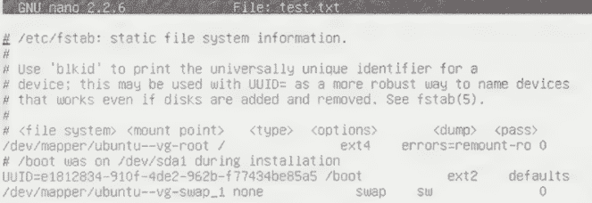

图 1.1 某些文本模式程序会接管整个显示器。

如果你使用图形化登录，可以使用名为终端（terminal）的文本模式 `shell`。常见的 Linux GUI 提供了启动终端程序的能力，该程序提供 `shell` 提示符以及运行文本模式程序的手段。

认证目标

大多数用户对 GUI 的熟悉程度高于文本模式命令。因此，许多现代 Linux 系统默认以 GUI 模式启动，显示一个与图 1.2 所示相似的登录界面。你可以从列表中选择用户名或输入用户名，然后输入你的密码进行登录。


图 1.2 Linux 的图形化登录界面与 Windows 或 OS X 相似。

某些 Linux GUI 登录界面在你输入有效用户名之前不会提示你输入密码。

与 Windows 和 OS X 不同，Linux 提供了多种桌面环境。你使用哪一个取决于你正在使用的 Linux 具体变体、你在安装时选择了哪些软件选项，以及你个人的偏好。常见的选择包括 GNOME、KDE、Xfce 和 Unity。还有许多其他可用选项。许多图形化桌面内置了辅助技术功能。Ubuntu 登录窗口右上角的图标图标让你选择一种辅助技术（如屏幕阅读器或屏幕键盘），以帮助你完成登录。

Linux 桌面环境看起来可能完全不同，但它们提供的功能是类似的。图 1.3 描述了 openSUSE 13.2 上的 KDE，其中运行着几个程序。

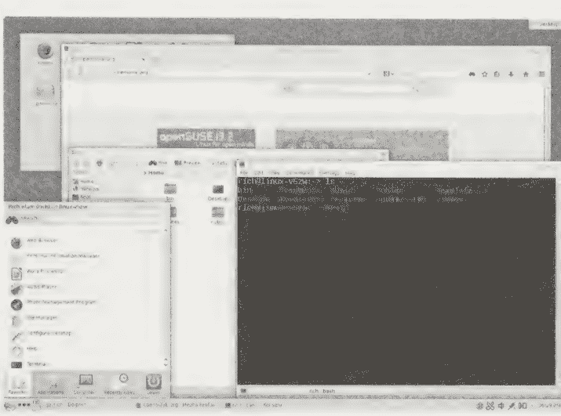

图 1.3 Linux 桌面环境提供了大多数用户期望的 GUI 控制类型。

**程序启动器**：你可以通过从菜单或列表中选择来启动程序。通常，屏幕顶部、底部或侧面存在一个或多个菜单。在图 1.3 中，你可以看到这些菜单。

**文件管理器**：你可以使用文件管理器来组织文件。

**窗口控制**：你可以通过拖动窗口边缘来移动、缩放或关闭窗口。

**多桌面**：许多 Linux 系统允许你同时运行多个桌面。

**退出选项**：Linux 提供了多种方式来退出会话。

相对于 GNU 工具的替代方案包括专有的商业工具以及为 BSD 软件发行版（Unix变体）开发的开源工具。在类 Unix OS 上使用的工具会影响其整体“风格”，但所有这些工具集都足以让任何 Unix 变体在比较时具有相似性。

如果尝试绘制 Unix 的族谱，你会发现它是复杂的，涉及分支（即将代码拆分为多个独立项目）以及完全独立的重写。Unix 于 1969 年诞生于 AT&T 贝尔实验室。

历史上，Unix 和 Linux 作为服务器非常受欢迎——组织使用它们运行各种服务器程序。


## Linux 内核
Linus Torvalds 在 1991 年作为一个兴趣项目创建了 Linux 内核，但它很快就远不止于此。Linux 内核的设计与其他内核兼容，因为它使用了相同的软件接口。这使得在 Unix 版本中使用开源程序变得简单。

## GNU 项目
GNU（不是 Unix）项目是自由软件基金（FSF）为操作系统的所有核心元素开发开源替代方案的努力。1991 年，FSF 已经发布了大部分工具，唯一的例外是内核。GNU HURD 内核现在可用，但没有 Linux 内核流行。

相对于 GNU 工具的替代方案包括专有的商业工具以及为 BSD Unix 变体开发的开源工具。在类 Unix OS 上使用的工具会影响其整体“风格”，但所有这些工具集都足以让任何 Unix 变体在比较时具有相似性。

## Xorg-X11
窗口系统是大多数 Unix OS 的 GUI 环境。大多数 Linux 发行版今天使用 Xorg-X11 变体正如 GNU 提供的基础文本模式工具一样，选择服务器可能会影响类 Unix OS 的某些功能，例如它支持的字体类型。

## 桌面环境
GNOME、KDE、Xfce 以及其他流行的开源桌面环境已很大程度上取代了商业桌面环境。因此，你不会发现 Linux 与 Unix 在这里的差异。

## 服务器程序
历史上，Unix 和 Linux 作为服务器非常受欢迎——组织使用它们运行 Web 服务器、电子邮件服务器、文件服务器等。Linux 运行的服务器程序与商业 Unix 版本以及开源 BSD 相同。

程序员以被称为“源代码”的形式编写程序。虽然对于初学者来说，源代码可能晦涩难懂，但与计算机运行它所必须的程序——即二进制代码相比，源代码是非常清晰易懂的。被称为“编译器”的程序会将源代码翻译成二进制代码。或者，某些编程语言依赖于“解释器”，它将源代码转换为二进制代码（即时转换），从而消除了编译源代码的需求。

开源指的是源代码的可用性。在商业软件程序和操作系统（OS）的情况下，这些通常是不向公众的。相反，通过开源软件获取程序源代码的程序员可以修复漏洞，并以其他方式更改程序的运行方式。

你可以打开 OS X 终端窗口，并输入此书中描述的许多相同命令以获得类似的结果。如果书中描述的某个命令不存在，你可能可以通过某种方式安装它。OS X 自带了一些 Unix 服务器程序，因此你可以配置它，使其工作方式与 Linux 或其他 Unix 类操作系统非常相似，将其作为网络服务器计算机使用。

OS X 与 Linux 的不同之处在于其用户界面。从编程的角度来看，OS X 的用户界面被称为 Cocoa，从用户的角度来看则被称为 Aqua。它包含了大致等同于 OS X 和 Linux 桌面环境的元素。因为从编程角度来看，Cocoa 与 X 不兼容，因此为 OS X 开发的应用程序无法直接在 Linux（或其他 Unix 类操作系统）上运行，将它们迁移（即修改源代码并重新编译）是一项艰巨的任务。因此，原生 X 应用程序极少迁移到 Linux。

OS X 包含一个在 Aqua 下运行的 X 实现。这使得 GUI Linux 和 Unix 程序传输到 OS X 变得相对简单。然而，生成的程序并不完全符合 Aqua 用户界面。它们可能拥有按钮、菜单和其他特征，与对应程序的通常外观相比，这些特征显得格格不入。

Apple 为自己的电脑提供了 OS X。其许可条款禁止在非 Apple 硬件上安装，而且在非 Apple 硬件上安装 OS X 是一项艰巨的任务。OS X 的变体 iOS 运行在 Apple 的 iPad 和 iPhone 设备上，它同样无法移植到其他设备。因此，OS X 在很大程度上局限于 Apple 硬件。Linux，

X server 中的 X 是字母字母 X，但 X OS 是一个罗马数字（10），表示 Mac OS 的版本。

## Linux 在操作系统世界中处于什么位置？
相比之下，Linux 运行在各种硬件上，包括大多数 PC。你甚至可以在 Macintosh 电脑上安装 Linux。

## 比较 Linux 和 Windows
今天大多数桌面和笔记本电脑都运行微软 Windows。因此，如果你考虑运行 Linux，最可能的比较对象是 Windows。广而言之，Linux 和 Windows 具有相似的能力；然而在细节上存在显著差异。这些包括以下内容：

### 许可（Licensing）
Linux 是开源的，而 Windows 是专有的商业操作系统。第 2 章“理解软件许可”将更详细地涵盖了开源问题，但现在你应该知道，开源比专有软件赋予了你对电脑更大的控制权——至少在理论上是如此。事实上，你可能需要大量的专业知识才能利用开源的优势。如果你在一个只习惯以更传统方式销售软件的机构工作，那么专有软件可能更好。`不过，某些 Linux 变体以类似的方式销售，并附带服务合同`

### 成本（Costs）
许多 Linux 版本是免费提供的，因此如果你正试图降低成本，它们就很有吸引力。另一方面，安装和维护 Linux 安装所需的专业知识可能比安装和维护 Windows 安装所需的专业知识更多、更昂贵。关于 Linux 与 Windows 总拥有成本的不同研究结果各不相同，但大多数研究倾向于 Linux。

### 硬件兼容性（Hardware Compatibility）
大多数硬件组件都需要操作系统的支持，通常以驱动程序的形式。大多数硬件制造商为其设备提供 Windows 驱动程序，或者与微软合作确保 Windows 包含适当的驱动程序。虽然某些制造商也提供 Linux 驱动程序，但整个 Linux 社区必须提供必要的驱动程序。这意味着 Linux 驱动程序在设备可用后可能几周或几个月才会出现。另一方面，Linux 开发者维护旧硬件驱动程序的时间比制造商继续支持其旧硬件的时间长得多。因此，现代 Linux 在旧硬件上的运行情况可能比最近版本的 Windows 更好。Linux 也往往不消耗资源，因此在使用 Linux 时，你可以在旧硬件上保持工作效率。

### 软件可用性（Software Availability）
某些流行的桌面应用程序（如 Microsoft Office）在 Windows 上可用，但在 Linux 上不可。尽管有 Linux 的替代品（例如 Apache OpenOffice.org 或 LibreOffice），但它们还没有引起大众的关注。在其他领域，情况则是反过来的。流行的服务器程序（如 Apache Web 服务器）首先是为 Linux 或 Unix 开发的。虽然许多此类服务器在 Windows 上可用，但它们在 Linux 上运行高效。如果你有一个必须运行的特定程序，你可能想研究它在你所考虑的任何平台上的可用性和实用性。

## 用户界面（User Interfaces）
像 OS X 一样，Windows 使用它自己独特的用户界面。这导致了操作系统之间良好的移植性差。`存在工具可以弥补这一差距，例如有适用于 Windows 的系统实现，以及在 Linux 中运行程序的工具。`某些用户比起任何 Windows 桌面环境更喜欢 Windows 用户界面，但另一些人更喜欢 Linux 桌面环境。

虽然两个操作系统都提供了启动时运行特定程序、更改用户界面等手段。Linux 的开源本质意味着你可以调整你需要的任何细节。此外，你可以选择任何你喜欢的 Linux 变体，按照你自己的意愿开始设置系统。

每个操作系统的支持者都声称它比另一个更安全。他们之所以这样做是因为他们关注不同的安全问题。Windows 的许多威胁来自于病毒，病毒在很大程度上针对 Windows 及其庞大的安装用户群。对于 Linux 来说，病毒基本上不是一个问题；在 Linux 中，安全威胁主要来自涉及配置错误的服务器或不可信的本地用户的入侵。

在二十多年来，Windows 一直主导桌面领域。在家庭和办公室中，用户已经熟悉了 Windows，并习惯了流行的应用程序（如 Microsoft Office）。尽管 Linux 可用于此类环境，但由于各种原因，它并不是一个受欢迎的选择——它不熟悉、事实是大多数大多数 PC 上都预装了 Windows，以及对于大多数用户来说，缺乏任何有吸引力的 Linux 专用应用程序。

Unix 特别是 Linux 已经开始主导服务器市场。Linux 驱动着构成互联网的 Web 服务器、电子邮件服务器、文件服务器等，许多企业依赖于它来提供本地网络服务。因此，大多数人每天都在使用 Linux，即使他们并没有意识到。

在大多数情况下，在计算机上使用 Linux 或 Windows 是可行的。然而，特定的需求决定了使用一个还是另一个。

微软对其用户界面进行了重大更改，从 Windows 8 开始。这种更新的用户界面被称为 Metro，从智能手机到桌面电脑都以类似的方式工作。

为了使用软件，必须进行安装，大多数 Linux 发行版都提供了独特的安装软件来帮助你管理这项重要任务。因此，不同的发行版的安装方式可能不同，并为关键功能提供不同的选项，例如磁盘布局和初始用户账户创建。


通常，Linux 发行版可以从它们的网站下载。你可以轻松下载 CD-R 或 DVD 镜像文件，然后将其刻录到光盘。当你启动生成的光盘时，安装程序就会运行，你可以安装操作系统。如果你的电脑缺少光驱，有时也可以下载镜像。许多 Linux 发行版还有云版本，允许你下载一个完整的 Linux 系统，运行在私有虚拟机或像 Amazon 或 Google 服务这样的商业云平台上。

某些 Linux 安装程序带有你可能需要安装的所有软件。另一些则只包含最少软件，并要求你拥有可用的 Internet 连接，以便安装程序可以下载额外的软件。如果你的电脑没有连接互联网，请务必获取正确的安装程序类型。

根据计算方法，用于桌面、笔记本和小型服务器电脑的主要 Linux 发行版大约十几种，还有数百种用于特殊用途的发行版。表 1.1 总结了最重要发行版的特征。

这些特征需要进一步解释：

> Tarballs 类似于 Windows 上常见的 zip 文件。第 8 章“搜索、提取和归档数据”中，将介绍如何创建和使用 tarballs。

**发布周期** 我们将在“理解发布周期”中更详细地描述发布周期。通常规则是，发布周期短的发行版旨在提供最新的软件，而发布周期较长的发行版则努力提供最稳定的环境。有些发行版试图兼顾两者；例如，Ubuntu 在偶数年的 4 月发布长期支持 (LTS) 版本。它的其他版本则旨在提供最新的软件。

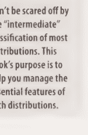

表 1.1 的最后一列提供了我们对管理发行版所需技能水平的个人估算。如你所见，我们将大多数发行版描述为需要“中级”技能进行管理。然而，某些发行版提供的用户友好 GUI 管理工具较少，因此需要更多技能。Ubuntu 的目标是特别易于使用和管理。

除了主流 PC 发行版外，还有几种用于更特殊用途的发行版。其中一些运行在普通 PC 上，但运行在它们自己的专用硬件上：


许多宽带路由器、打印服务器和其他接入网络以执行特殊任务的设备都运行 Linux。你有时可以替换操作系统。Tomato (www.polarcloud.com) 和许多


OpenWrt (https://openrt.org) 是自定义 Linux 的两个例子。不过，不要随心所欲地安装软件；如果操作不当且在错误的设备上，它们可能会导致设备毫无用处！

我们建议你准备一个 Parted Magic 或类似的工具，以防在进行主安装时遇到问题。

Android、基于 Linux 的设备和 TiVo 是使用 Linux 的嵌入系统示例。此类设备通常不需要或很少需要用户管理，至少不像本书书中描述的任务那样。相反，这些设备具有固定的基本配置和引导式设置工具，以帮助缺乏经验的用户设置关键选项，例如网络设置和时区。

## 理解发布周期

表 1.1 总结了若干常见 Linux 发行版的发布周期。该表中引用的数值是发布之间的间隔。例如，Ubuntu 新版本每六个月发布一次，像时钟一样准。大多数其他发行版的发布计划提供了一些“余地”；如果发布日期推迟一个月，是可以接受的。

表 1.1 中的两个发行版（Arch 和 Gentoo）采用滚动更新周期。此类发行版没有通常意义上的版本号；相反，


升级是以持续的方式进行的。使用此类发行版可以让你无需进行全量升级，从而避免随之而来的所有烦恼；然而，你偶尔仍需要对某个特定的子系统进行破坏性升级，例如桌面环境的大型版本升级。

在新版本发布之前，大多数发行版可能都会提供预发布版本。Alpha 软件非常新，极可能包含严重错误，而 Beta 软件更稳定，但仍然比最终发布版（final-release）软件更容易包含错误。作为一般原则，除非你想通过报告错误为开发工作贡献力量，或者你急于使用某个新功能，否则应避免使用此类软件。

Linux 是一种强大的操作系统，你可以将其用于从智能手机到超级计算机的所有领域。Linux 的核心是它的内核，它负责管理计算机的硬件。Linux 构建在各种实用（来自 GNU 项目）和用户应用程序之上。Linux 是 Unix 操作系统的克隆，与 Unix 共享许多程序。Mac OS X 是另一个 Unix 操作系统，尽管它拥有独特的用户界面。尽管 Windows 与 Unix 共享许多功能，但它是一个完全不同的操作系统，因此 Linux 和 Windows 之间的软件兼容性有限。

Linux 有许多种类，被称为发行版（distributions），每个发行版都有其独特的风格。由于这种多样性，你可以根据其易用性、发布周期和其他独特特性，选择最适合你需求的 Linux 版本。

- 列出你作为普通用户运行的程序，包括从计算器应用到大型办公套件的所有程序。在 www.linuxrp.ru/win-lin-soft/table-eng 或 www.linuxalt.com 寻找对应的程序。是否有你找不到的程序？如果有，尝试进行网络搜索以找到替代品。
- 通过浏览网页阅读更多关于二三个 Linux 发行版的信息。你会选择哪种发行版来运行主要的网络服务器？对于使用文字处理和电子邮件的办公人员，哪种发行版听起来最有吸引力？
- 6. 正或错：CentOS 是一个具有长周期的 Linux 发行版。
- 调查软件许可协议
- 自由软件基金
- 开源倡议组织
- 知识共享
- 使用开源许可协议

## 调查软件许可协议

版权法已存在了几个世纪，因此它在设计时并没有考虑到软件。尽管如此，版权法确实适用于软件。作者应用于软件的许可协议在法律上创建了你拥有的（以及*没有*拥有的）使用、修改和分发软件的特定权利。因此，你需要理解基本原理，以及专有许可和开源许可条款之间的差异。

版权（copyright）顾其实名，是一种法律认可的创建某物副本的权利。在大多数国家，如果你写了一本书、拍了一照片或创建一个计算机程序，你（仅你本人）有权制作该书、照片或程序的副本。然而，你可以赋予他人制作此类副本的权利，或放弃对版权的控制。

版权法适用于软件。作者应用于软件的许可协议在法律上创建了你拥有的（以及*没有*拥有的）使用、修改和分发软件的特定权利。因此，你需要理解基本原理，以及专有许可和开源许可条款之间的差异。

版权是一种法律认可的创建副本权利。在大多数国家，如果你写了一本书、拍了一照片或创建一个计算机程序，你（仅你本人）有权制作该书、照片或程序的副本。然而，你可以赋予他人制作此类副本的权利，或放弃对版权的控制。

版权法适用于软件。作者应用于软件的许可协议在法律上创建了你拥有的（以及*没有*拥有的）使用、修改和分发软件的特定权利。因此，你需要理解基本原理，以及专有许可和开源许可条款之间的差异。

版权是一种法律认可的创建副本权利。在大多数国家，如果你写了一本书、拍了一照片或创建一个计算机程序，你（仅你本人）有权制作该书、照片或程序的副本。然而，你可以赋予他人制作此类副本的权利，或放弃对版权的控制。

版权是一种法律认可的创建副本权利。在大多数国家，如果你写了一本书、拍了一照片或创建一个计算机程序，你（仅你本人）有权制作该书、照片或程序的副本。然而，你可以赋予他人制作此类副本的权利，或放弃对版权的控制。

版权是一种法律认可的创建副本权利。在大多数国家，如果你写了一本书、拍了一照片或创建一个计算机程序，你（仅你本人）有权制作该书、照片或程序的副本。然而，你可以赋予他人制作此类副本的权利，或放弃对版权的控制。

版权是一种法律认可的创建副本权利。在大多数国家，如果你写了一本书、拍了一照片或创建一个计算机程序，你（仅你本人）有权制作该书、照片或程序的副本。然而，你可以赋予他人制作此类副本的权利，或放弃对版权的控制。

版权是一种法律认可的创建副本权利。在大多数国家，如果你写了一本书、拍了一照片或创建一个计算机程序，你（仅你本人）有权制作该书、照片或程序的副本。然而，你可以赋予他人制作此类副本的权利，或放弃对版权的控制。

版权是一种法律认可的创建副本权利。在大多数国家，如果你写了一本书、拍了一照片或创建一个计算机程序，你（仅你本人）有权制作该书、照片或程序的副本。然而，你可以赋予他人制作此类副本的权利，或放弃对版权的控制。

版权是一种法律认可的创建副本权利。在大多数国家，如果你写了一本书、拍了一照片或创建一个计算机程序，你（仅你本人）有权制作该书、照片或程序的副本。然而，你可以赋予他人制作此类副本的权利，或放弃对版权的控制。

版权是一种法律认可的创建副本权利。在大多数国家，如果你写了一本书、拍了一照片或创建一个计算机程序，你（仅你本人）有权制作该书、照片或程序的副本。然而，你可以赋予他人制作此类副本的权利，或放弃对版权的控制。

版权是一种法律认可的创建副本权利。在大多数国家，如果你写了一本书、拍了一照片或创建一个计算机程序，你（仅你本人）有权制作该书、照片或程序的副本。然而，你可以赋予他人制作此类副本的权利，或放弃对版权的控制。


版权是一种法律认可的创建副本权利。在大多数国家，如果你写了一本书、拍了一照片或创建一个计算机程序，你（仅你本人）有权制作该书、照片或程序的副本。然而，你可以赋予他人制作此类副本的权利，或放弃对版权的控制。

*软件是知识产权的一种，受版权法的管辖，在某些国家，还受专利法的管辖。根据一般原则，除非你是软件的作者，否则复制软件是违法的。然而，开源软件依赖于许可协议，这些协议是更改软件发布条款的文档。正如本章描述的，开源许可授予了软件用户额外的权利。

总的来说，开源软件很大程度上归功于三个组织：自由软件基金（`FSF`）、开源倡议组织（`OSI`）和知识共享（`CC`）。每个组织在开源世界中都有独特的哲学和要扮演的角色。还有许多特定的开源许可协议，它们在本章末尾进行了总结，并列出了企业使用这些协议的方法。

- 调查软件许可协议
- 自由软件基金
- 开源倡议组织
- 知识共享
- 使用开源许可协议

## 调查软件许可协议

版权法已存在了几个世纪，因此它在设计时并没有考虑到软件。尽管如此，版权法确实适用于软件。作者应用于软件的许可协议在法律上创建了你拥有的（以及*没有*拥有的）使用、修改和分发软件的特定权利。因此，你需要理解基本原理，以及专有许可和开源许可条款之间的差异。

## 探索版权保护与软件

### 认证目标

版权是一种法律认可的创建副本的权利。在大多数国家，如果你写了一本书、拍了一照片或创建一个计算机程序，你（仅你本人）有权制作该书、照片或程序的副本。然而，你可以赋予他人制作此类副本的权利，或放弃对版权的控制。

版权法适用于软件。作者应用于软件的许可协议在法律上创建了你拥有的（以及*没有*拥有的）使用、修改和分发软件的特定权利。因此，你需要理解基本原理，以及专有许可和开源许可条款之间的差异。

版权是知识产权的一种示例，但还有许多其他。其中一种专利。版权保护的是单一作品，但专利保护的是想法本身。在美国，专利是合法的。虽然你不能为整个程序，但可以专利使用的使用的专利。这种专利既常见又存在争议。开源专利专利的批评者认为这种专利是微易易易易专利发明不专利具备。专利持有者威胁要诉讼授权用户。公司利用软件专利来阻止另一公司销售产品，或向销售产品的公司收费。

在许多其他国家，软件不能获得专利。目前正在努力软件与专利之间的关系——既为了在目前不支持的国家专利化，也为了在目前可以限制或消除软件专利。

商标是另一种知识产权。这些是特定公司或产品的名称、标志和类似的标识。软件及其生产公司使用商标，硬件公司也是。一个与 Linux 社区关系很小的个人在 1994 年将 Linux 名称注册为商标并试图对该名称收取版税。在诉讼后，商标转给了 Linux Mark Institute，或 `LMI` (`linuxfoundation.org/legal/trademark`)。

作为终端用户，你不太可能处理软件专利或商标。软件专利和商标问题通常在公司层面解决。这与版权问题不同，后者会影响侵犯版权法的个人。如果你在发布软件的公司工作，专利和商标法可能会影响你。如果你认为这可能发生，你应该咨询律师。

法院通常认可点击式许可和类似许可的执行力，尽管这种结果并非普遍，

案例你可能会点击按钮接受许可条款。过去，许可协议有时印在销售软件的盒子上。此类许可通常被称为最终用户许可协议（`EULA`）、点击式许可、收缩包装许可或点击确认许可。开源软件通常带有一个许可协议文件，通常称为 `COPYING`。

# 第2章 · 理解软件许可

软件许可可以通过使原则变得更具限制性或更具开放性来修改版权条款。例如，Linux 内核使用的许可——通用公共许可证（`GPL`），赋予了你重新发布软件的权利，包括源代码和二进制文件。这代表了对版权法所提供限制的放宽。

从一般规则而言，专有软件的许可对你根据版权法本应拥有的权利施加了限制，而开源许可则赋予了你额外的权利。不过，这一规则也存在例外；例如，站点许可（`site license`）是一种针对专有程序的许可，它授予一个组织复制特定数量该程序的权利——例如，为公司的所有电脑制作 100 份文字处理程序。

自由软件基金（`FSF`）是开源世界的一股关键力量。`FSF` 由理查德·斯尔曼（Richard Stallman）于 1985 年创立，是上一节中描述的 GNU 非 Unix（`GNU`）项目的驱动力。`FSF` 拥有一种特定的哲学（见下文描述），这种哲学体现在 `GPL` 中，而 `GPL` 是 `FSF` 青睐的软件许可。

根据 `FSF` 的定义，自由软件不同于免费软件（`freeware`）。该术语通常指的是免费提供的软件，但并不意味着言论上的自由（free in speech）。

## 理解 FSF 哲学

`FSF` 主张所有的自由软件，其定义是基于对软件进行你想要做的事的自由，而不是软件的价格。一个用来明确区分这一区别的常用短语是“像言论一样自由，像啤酒一样免费”（free as speech, free as in beer）。

`FSF` 定义了四种特定的软件自由：

- 为任何目的使用该软件的自由
- 检查源代码并根据需要进行修改的自由
- 重新发布你修改后的软件的自由

这些自由与稍后描述的 `OSI` 提出的原则相似。然而，在解释上存在一些重要的差异，正如后文即将描述。`FSF` 在 `www.gnu.org/philosophy/free-sw.html` 详细阐述了其每项原则的含义及其相互作用。

在一个理想的世界里，按照 `FSF` 的标准，所有软件都应该是自由的——随源代码分发并包含上述概述的所有自由。某些 Linux 发行版在孤立状态下达到了这一理想，而其他发行版则包含了专有软件。有时，这些软件是免费软件（`freeware`）。在其他时候，它们是一些专有代码，允许供应商限制重新分发并收取销售费用。由于自由软件并不一定免费提供，因此从 `FSF` 的角度来看，销售它并不是问题。然而，考虑到其他自由，自由软件的价格在流传过程中往往趋于零。


# 自由软件哲学概述

所有关于自由的论述的点在于赋能用户——而不仅仅是开发者或公司。如果你可以修改一个几乎能完成你所要求的程序，使其恰好按照你要求的方式运行，那么与专有程序相比，这是一个巨大的优势。如果你可以重新发布你修改过的程序，你可以帮助他人（假设他们想要类似的功能）。因此，FSF 哲学在应用时，可以为更广泛的社区带来利益。

FSF 哲学及其启发的许可通常被称为“著权许可”（copyleft）。这是版权（copyright）一词的变体，反映了版权条款被用于确保某些自由，而这些自由在某些方面与版权创建的初衷完全相反——即，保证用户复制软件的自由，而不是限制它。

FSF 原则的法律表达以 GPL（有时称为 GNU GPL）的形式出现。GPL 有两个常用版本：第 2 版和第 3 版（旧的第 1 版已很少使用）。两个版本的 GPL 都将 FSF 哲学的四种自由应用于被许可的软件。它们还通过规定衍生作品也必须在 GPL 下发布，明确暗示了这些自由。这一条款防止了公司完全占用一个开源程序。例如，许多公司制作 Linux 发行版，并使用包含了错误修复的 Linux 内核。这些内核（主线 Linux 内核）都在 GPL 下可用。任何公司都不能合法地发布基于补丁的 Linux 内核的发行版，并拒绝提供可用的内核补丁。

GPL 第 2 版（简称 GPLv2）于 1991 年发布，并主导了多年。2007 年，GPLv3 出现，旨在堵住 FSF 认为的 GPL 漏洞，特别是针对 1991 年以来法律和实践的变化。具体而言，GPLv3 包含了旨在反对限制 FSF 自由的硬件限制使用的条款，并解决了与软件专利相关的问题。许多新程序现在根据 GPLv3 的条款发布，许多旧程序现在使用 GPLv3 而非 GPLv2。不过，有些程序并没有改变。其中著名的是 Linux 内核本身，它仍然使用 GPLv2。这是一个重要的选择，这意味着 Linux 内核仍然可以用于相当封闭的设备的核心，例如 TiVos 和基于 Android 的手机。许多设备使用限制性的启动过程来防止未经授权的内核启动——而这种过程是 GPLv3 禁止的。

GPL 的变体是较级通用公共许可证（LGPL）。开发者经常对库使用 LGPL，库是可以被其他程序使用的代码集合。例如，在 Linux 中，库实现了创建对话框和菜单的功能。许多 GUI 程序使用这些功能，将它们置于库中不仅帮助了程序员，还减小了他们所用程序的大小。然而，GPL 的措辞要求所有使用 GPL 库的程序也必须根据 GPL 条款发布。这一强制要求促成了 LGPL 的产生，LGPL 与 GPL 类似，但允许使用 GPL 库的程序根据其他许可发布——即使是商业许可。

GPL 缩写曾用于扩展 GPL，但这在 1999 年发生了变化。

另一个相关的许可是 GNU 自由文档许可证（FDL），旨在用于文档而非程序的软件。由于 GPL 是为软件编写的，不适用于静态文档，因此 FSF 创建了 GNU FDL 来填充这一空白。FDL 的一个著名用户是维基百科（`www.wikipedia.org`）。其所有内容都根据 GNU FDL 的条款可用。

Bruce Perens 和 Eric Raymond 于 1998 年创立了开源倡议（OSI），作为通用开源软件的伞形组织。它的哲学（稍后将详细描述）与 FSF 的哲学相似，但在某些重要细节上有所不同。从一般规则而言，有更多软件符合“自由”定义（按照 FSF 的含义），但具体哪些符合取决于开源定义，并在严格意义上取决于 OSI 批准的许可。

## 理解开源哲学

在 20 世纪 80 年代和 90 年代，自由软件运动在某些圈子（包括学术界和爱好者）获得了动力。然而，企业采用自由软件非常缓慢。许多采纳者是为了在预算有限的情况下私下安装 Linux、Apache 和其他自由软件，以避免昂贵的商业替代方案。

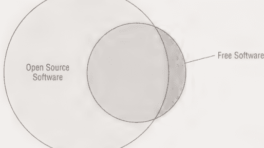

今天，FSF 意义上的自由软件纯主义者与更务实的开源社区之间存在一些紧张关系。然而，在大多数情况下，两者的目标足够相似，以至于差异微不足道。事实上，自由和开源软件（FOSS）以及自由/自由开源软件（FLOSS）这两个术语有时被用作统称，用来明确指代这两类软件和开发模式。

开源定义出现在 `www.opensource.org/definition`。它由 10 条原则组成，在此进行转述：

- **自由重新分发** 许可必须允许重新分发，包括作为较大作品的一部分进行重新分发。
- **源代码可用性** 作者必须提供源代码，并允许对源代码和（如果适用）二进制代码进行重新分发。
- **许可衍生作品** 许可必须允许他人修改软件，并按照原始作品相同的许可分发此类修改。
- **尊重源代码的完整性** 许可可以限制对修改后的源代码进行重新分发，但前提是补丁文件必须与源代码一起分发。许可可以要求衍生作品更改软件的名称或版本号。
- **不不对个人或群体产生歧视** 许可不得对任何个人或群体产生歧视。
- **缺乏产品特定性** 许可不能要求程序必须作为较大程序的一部分使用或分发——也就是说，你从一个较大的集合中提取出单个程序并单独重新分发它。
- **对其他软件缺乏限制** 许可不能对与许可软件一起分发的其他软件施加限制。
- **技术中立性** 许可不能基于特定的技术或接口受到限制。

这前三个原则是最重要的，至少从理解开源技术意义的角度来说。整体上与 FSF 的四项原则及其 FSF 网页上对其影响的扩展描述（`gnu.org/philosophy/free-sw.html`）具有很强的相似之处。正如前所述，它们存在一些差异，特别是在衍生作品的许可要求方面。

## 展望知识共享

知识共享（`http://creativecommons.org`）由 Lawrence Lessig 创立。他的目标是反对其创建者和支持者认为的一种创作文化，这种文化日益倾向于由那些版权持有者授予（或不授予）的权限。我们目前的文化中很大一部分源于早期的文化作品——例如，《星球大战》电影系列在部分受到了共同神话和传说的启示。然而，《星球大战》本身受版权保护，这限制了当前艺术家分发其衍生作品的权利，至少在没有许可的情况下是这样。

知识共享通过提供六种旨在各种用途的许可来促进其目标。你可以通过回答 `http://creativecommons.org/choose/` 上的几个问题来选择许可，例如你是否希望允许对你的作品进行商业用途。

FSF 和 OSI 致力于促进软件自由。然而，知识共享的目标更广泛。其许可针对音频录制、视频录制、文本作品等，而是计算机程序。尽管如此，知识共享作为一个组织，帮助了同样涉及 FSF 和 OSI 的类型自由。

作为个人用户，你可能不需要深入研究开源许可的细节。OSI 指南背后的原则保证了你有权按照你认为合适的方式开源程序，甚至重新分发这些程序。但是，如果你正在建立业务，特别是创建一个创建或分发开源软件的业务，你可能需要理解这些许可。因此，对其中一些进行了更详细的描述。此外，还包含了一些发现将开源许可作为其业务模式一部分的公司。

每个开源许可都有其独特的特性。这些主要对于可能想要贡献软件项目的开发者有利，但有时对系统管理员来说也可能重要。主要的开源许可包括：

- **GNU GPL 和 LGPL** 如前所述，Linux 内核使用 GPL2，许多其他 Linux 工具使用 GPL（版本 2 或版本 3）。许多 Linux 库使用 GPL。
- **BSD** BSD 许可被开源的 BSD 以及为它们开发的各种软件组件使用。与 GPL 不同，BSD 许可允许在其他许可下分发修改版本。这些许可的最新版本（两条款和三条款）在简洁性上与 MIT 许可相似。
- **MIT** 马萨诸塞理工学院（MIT）是 X 系统（简称为 X）的原始推动力，MIT 许可（有时称为 X11 许可）继续用于 Xorg-X11——即在许多 Linux 发行版中 X 的实现。MIT 许可异常短。
- **Apache** 与 BSD 和 MIT 许可一样，Apache 许可是一种允许在相同或其他许可下进行重新分发的开源许可。如果原始作品附有一个名为 NOTICE 的文本文件，则必须包含在任何衍生作品中。这使得原始开发者能够为修改版本的用户提供联系方式或其他信息。
- **Artistic（艺术）** Artistic 许可最初是为 Perl 语言开发的，但已用于其他程序。它充满了各种要求以及针对这些要求的漏洞。大多数使用 Artistic 许可的软件都受到一项条款的保护，即该许可是可选的；用户可以选择遵循其他许可（通常是 GPL）作为替代。

Debian 维持着在其主软件包集中仅使用开源软件的策略，尽管它允许可以自由分发但非开源的程序进入其“非自由（non-free）”包集中。

由于一个完整的 Linux 发行版是由使用许多许可协议的组件组成的，因此谈论单一的版权或许可协议适用于整个操作系统是没有意义的。相反，你应该将 Linux 发行版看作是一个带有统一安装工具的产品集合。尽管如此，绝大多数产品都使用某一种或另一种开源许可协议。


某些 Linux 发行版（如 Debian）由志愿者或非营利组织维护。另另一些发行版，例如红帽企业 Linux（Red Hat Enterprise Linux），则由一家预期盈利的公司维护。那么，如果一家公司的核心产品可以在互联网上免费提供，它如何盈利呢？从开源软件中获益的方法有很多，包括以下几种：

- **服务与支持**：产品可以是开源的，甚至可以免费提供，而公司销售服务和支持；例如培训和技术支持热线。例如，某个游戏可能是开源的，但需要订阅在线服务才能提供全功能集。

- **双重许可**：公司可以创建产品的两个版本：一个版本是完全开源的，另一个版本增加了开源版本中不具备的功能。开源版本就类似于超市经常提供的免费样品——这是一种吸引客户的方式。

- **多产品策略**：开源产品可能只是公司提供的产品之一；其收入由其他产品线产生。这些其他产品线可能是软件或其他产品，例如说明书。

当硬件供应商发布开源驱动程序时，代码会泄露有关该供应商硬件的编程相关信息。因此，某些供应商不愿发布开源驱动程序。

- **开源驱动程序**：上述情况的一个特殊用例是硬件驱动程序。他们可能会选择将驱动程序，甚至针对特定硬件的应用程序作为开源发布，以推广他们的硬件。

- **捐赠**：许多开源项目接受捐赠以帮助资助开发。虽然这在通常意义上不是商业资金模式，但它有助于资助像 FSF 这样的组织的运营。

除了这些商业机会之外，大量的开源软件是在学术界、由政府、非营利组织、爱好者等开发的。甚至公司也会被激励去回馈他们为自己所做的更改，积留这些更改会产生更多工作——如果一个内部更改没有回给原作者，那么在每次发布新版本时都要重新应用该更改。

软件许可可能非常复杂，而且技术人员很少感兴趣的话题。尽管如此，许可条款会影响整个软件社区的运作方式，从而影响软件随时间的演进方式。Linux 由少数几个开源许可协议主导，这些协议允许（有时要求）软件保持免费。此类许可通常对你如何使用软件实施很少或没有限制。这与通常充满限制的专有许可形成了对比。像 FSF、OSI 和知识共享（Creative Commons）这样的组织促进开源许可协议。OSI 特别试图说服企业采用开源许可，提倡商业模式作为一种产生收入的方式。

- 查找 `GPLv2`、`GPLv3` 和 `BSD` 两条款许可协议。(`www.opensource.org/licenses/` 是查找所有协议的好地方)。阅读并比较它们。如果你要编写一个开源程序，你会使用哪一个？

- 阅读 OSI 的使命宣言（位于 `www.opensource.org/about/` 的关于页面）以及 FSF “关于”页面（`www.fsf.org/about/`）中的“我们的核心工作”章节。

## 复习题

- 1. 下列哪项不是认证为开源的必要条件？

  D. 程序必须附带源代码，或者作者必须在互联网上方便地提供。

尽管 Linux 诞生于 1991 年，从大多数历史标准来看很年轻，但在计算机世界，25 年是一个世纪。

# 第3章 · 研究 Linux 的原理与哲学

软件世界。归结底，我们今天使用的东西都是建立在过去创造的基础之上的。因此，了解 Linux 的起源将帮助你理解今天的 Linux。

## 了解 Linux 的起源

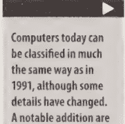

在1991年，像今天一样，计算机根据其尺寸和能力进行分类。计算机可以属于少数类别中的任何一种，范围从桌面个人电脑（PC）到超级计算机不等。基于 `.x86` 的计算机是今天 PC 的直接祖先，它们主导了1991年的 PC 市场；然而，当时也有其他类型的 PC，包括 Mac。这些计算机产生不同的 CPU 并运行它们自己的自定义操作系统。

在1991年，大多数 PC 运行的是微软的操作系统（MS-DOS、PC-DOS 或 DOS）。以今天的标准来看，DOS 的局限性极大；这种单任务操作系统（一次只能运行一个应用程序）没有充分利用当时的内存或 CPU。1991年，微软 Windows 版本可以在 DOS 之上运行。虽然早期版本的 Windows 有助于规避了 DOS 的某些局限性，但它们并没有修复任何一个。例如，这些早期版本的 Windows 采用了协作式多任务处理，程序可以自愿将 CPU 时间让给其他进程。DOS 内核无法控制堵塞 CPU 的程序。

今天的计算机分类方式与 1991 年非常相似，尽管细节发生了一些变化。一个显著的增加是嵌入式计算机，或者说智能手机。


在 PC 层级之上，Unix 是 1991 年一种常见的操作系统。与当时的 DOS 和 Windows 版本相比，Unix 是一种复杂的操作系统。Unix 可以运行多个应用程序，并提供了抢占式多任务处理，其中内核可以为程序调度 CPU 时间，即使程序没有自愿放弃控制权。这些特性对于许多服务器以及如小型机和大型机等的多用户计算机来说是必需的。

随着时间的推移，每一类计算机的能力都在增长。根据大多数衡量标准，今天的 PC 拥有 1991 年计算机甚至大型机的动力。1991 年 PC 上使用的操作系统无法很好地扩展到更强大的硬件。正因如此，仅仅依靠计算能力，DOS 及其同时代的小型计算机在很大程度上被抛弃，取而代之的是 Unix 和其他替代方案。

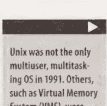

Unix 不是1991年唯一的多用户多任务系统。其他虚拟内存系统（VMS）也可用。不过，Unix 与 Linux 的历史并没有关联。

1991年，林斯·托瓦尔斯（Lin Torvalds）是赫尔辛基大学计算机科学专业的学生。他对学习 Unix 以及他刚刚购买的 `.x86` 内核的功能感兴趣。托瓦尔斯开始编写后来成为 Linux 内核的程序，这是一个低级仿真器——一个连接到他用户笔记本电脑的程序。随着程序的增长，他添加的功能使他的终端程序变成了可以更准确描述为 OS 内核的东西。最终，他开始

今天的 Windows 版本并非源自 DOS。相反，它们使用一个与 VMS 共享许多特征的新内核。

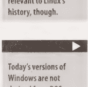

## 历经时代探索 Linux

编写的目标是创建一个兼容 Unix 的内核——也就是说，能够运行当时各种 Unix 软件的内核。反过来，Unix 的历史可以追溯到二十年前，追溯到它在1969年于 AT&T 的起源。由于 AT&T 当时是美国的电话垄断者，法律禁止其出售软件。因此，当它的员工使用 Unix 时，AT&T 基本上是免费赠送该操作系统。大学对采用 Unix 特别热衷，一些大学开始对其进行修改，因为 AT&T 提供了源代码。Unix 从之初就拥有二十年的开放软件开发历史。大多数 Unix 程序以源代码的形式分发，因为 Unix 运行在各种硬件平台上——为一台机器编译的二进制升级很少能在另一台机器上运行。

早早，Linux 开始利用这个可用软件库。正如第 1 章所述，Linux 开发者对 GNU 项目的软件特别感兴趣，因此 Linux 积累了一系列 GNU 工具。这些软件的大大部分是考虑到工作站和更强大的计算机编写的，但由于计算机硬件的不断改进，它们在 20 世纪 90 年初的 x86 PC 上运行良好。

## 微内核之争

Linux 是单体内核（monolithic kernel）的示例，这种内核在一个进程中完成内核应该做的所有工作。在 1991 年，一种被称为微内核的竞争内核设计非常风靡。微内核比单体内核小得多；它们将尽可能多的任务移动到内核进程之外，并管理进程之间的通信。

Linux 发布后不久，林·托瓦尔斯与 Minix 的创建者安德鲁·塔鲍姆（Andrew Tanbaum）进行了一场公开辩论。Linux 认为单体设计是落后的。对于终端用户来说，现代 Windows 使用微内核，而 Linux 使用单体设计。


> `386BSD` 是 90 年代初的一种竞争性类 Unix 系统。今天它分叉成了几个相关的系统：FreeBSD、OpenBSD、DragonFlyBSD 和 PC-BSD。

## 看今天的世界

到20 世纪90 年代中期，今天 Linux 的大部分特征已经建立。自那以后的变化包括：

- **内核改进**：自1991年以来，Linux 内核发生了巨大变化，它包含了我们今天依赖的许多功能。改进包括网络功能、无数驱动程序、电源管理以及对非 x86 CPU 的支持。

- **支持工具改进**：正如 Linux 内核的工作不断进展，它所依赖的支持工具也得到了改进——编译器、Shell、GUI 等。

- **新支持工具创建**：多年来出现了新的支持工具。这些工具从简单的微型程序到大型桌面环境不等。事实上，这些工具（如现代桌面环境）对用户来说比内核直观得多。


- **新发行版的创建**：如前所述，Slackware 起于1993年，Red Hat（Red Hat Enterprise、CentOS 和 Fedora 的前身）起源于1995年。在期间出现了其他发行版，其中一些非常重要。例如，用于智能手机和平板的 Android 操作系统在过去十年中产生了巨大影响。

# 第 3 章 - 调查 Linux 的原则和哲学

## 使用开源软件

Linux 软件开发的哲学与驱动大多数 Windows 软件开发的哲学不同。这些不同的哲学影响了你如何获取软件、能用软件做什么以及它如何变化。本节描述了这些原则。我们还描述了 Linux 如何像一个“磁铁”一样，将来自许多来源的软件整合在一起。

### 软件分类

分类的数量取决于分析的深度以及分类分类者的偏见。然而，从起点来看，分为四类足够了：

商业软件：个人或公司开发商业软件的目的是为了出售获利。开发者通常对商业软件的源代码保密，这意味着用户通常无法对软件进行任何更改，除非修改软件支持的配置设置。在过去，商业软件在商店中或通过邮购方式出售，但今天它通常通过互联网下载销售。重新分发商业软件通常是非合法的。Microsoft Windows 和 Microsoft Office 是商业软件的常见示例。

共享软件（Shareware Software）：从法律角度来看，共享软件与商业软件相似，它们受版权保护且作者要求付费。区别在于，它通过互联网或其他方式进行分发，并根据“信誉制度”进行“销售”——如果你在试用期之后继续使用该软件，就应该向作者付费。共享软件在 1991 年很常见，今天仍然可用，但已很罕见。

免费软件（Freeware Software）：免费软件像软件一样是免费提供的。与商业软件不同，免费软件的作者不要求付费。有时，免费软件是更完整的软件或商业程序的精简版。在其他情况下，作者免费提供它是为了推广另一种产品。示例包括用于许多硬件设备的 Windows 或用于读取便携文档格式（PDF）文件的 Adobe Reader。与商业和共享软件程序一样，免费软件通常不提供源代码。


> 免费软件不与自由软件（free software）混淆，后者与开源软件密切相关。第 3 章“理解许可协议”将更详细地描述自由软件。

开源软件：开源由一组 10 项原则定义，这些可以在 `www.opensource.org/osd/` 找到。这些原则中最重要的是用户重新分发该程序的权利、源代码的可用性，以及用户创建和更改程序版本的权利。这些原则意味着用户可以使用开源程序来满足自己的需求，即使是以原作者不支持的方式或目的。

### 认证目标

这些类别中的每一个都存在变体，同时也存在不属于任何类别的混合体。例如，开源倡议（Open Source Initiative）维护了一份它批准符合其标准的许可列表（`opensource.org/licenses`）。然而，开发者有时会使用模糊的许可发布软件，或者使用实施了与某些晦涩 OSI 规则冲突条件的许可。此类软件在技术上不是开源的，但它可能比其他类别更接近开源。

第 2 章将更详细地介绍特定的开源许可。

开源软件背后的基本思想是是以透明方式开发的软件可能比以封闭方式开发的软件更优。这种优越性（以及反对它的观点）基于以下特征：

**更好的代码** 将源代码公开给整个社区意味着任何感兴趣的方都可以对其进行审查、判断和改进。观察到的漏洞可能会被消灭，而在闭源产品中它们可能会一直存在并导致问题。另一方面，这一说法的有效性并没有得到研究的良好支持，较小的项目可能无法从其他程序员那里获得太多兴趣，因此它们可能无法从外部代码审查中受益。

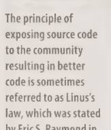

**更强的灵活性** 通过使用源代码，开源项目赋予了用户根据自己的需求定制软件的能力。如果用户将更改提交给维护软件的个人，或者将它们作为项目的新分支发布，那么所有人都可以从这些更改中获益。当然，批评者会认为，这种灵活性仅对那些具有足够技能和时间进行此类更改的人，或那些有钱雇人这样做的人有益。

**更低的成本** 尽管开源定义并不禁止出售软件，但重新分发的要求意味着开源最终是免费提供的。另一方面，如果你需要支持，你可能需要购买支持合同，这可能会减少或消除成本优势。

**缺乏供应商锁定** 某些专有产品（特别是流行产品）的开发者可以使用专有格式使竞争产品变得困难。（*注：原文此处存在大量重复句子，译文已按语意处理并去重*）

## 探索 Linux 的原理与哲学

### 嵌入式设备

汽车计算机 多年来，汽车一直包含了计算机。这些计算机大多被隐藏在不显眼的地方，用于监控和控制引擎和其他汽车系统；然而，现代汽车越来越多地配备了用户可以更轻易地识别为计算机的计算机。它们管理全球定位系统（GPS）导航系统、管理碰撞规避、调节紧急制动、控制音频系统，甚至提供互联网访问。

家电器 电视机、冰箱和其他家电器正越来越多地使用计算机来下载软件更新、监控能源消耗以及用于其他目的。

你可能认为平板电脑也属于这一范畴，尽管它们可能更接近桌面电脑或笔记本电脑。主要的区别在于用户对操作系统（OS）的控制程度；嵌入式设备是终端用户使用的，而不是维护的。书中描述的系统管理任务是在工厂完成的，或者通过更简单、更专用的用户界面完成。

### 桌面式电脑和笔记本电脑

Linux 起于桌面式电脑，尽管 Linux 远未主导该市场，但桌面电脑是学习 Linux 的良好方法。从系统管理的角度来看，笔记本电脑与桌面式电脑相似；这两类电脑通常由少数人用于生产力任务，如文字处理、Web 浏览和数字照片管理。为了简洁，从这里起我们用该词泛指这两类电脑。

此类任务的 Linux 软件广泛可用且非常出色，尽管有些人更倾向于商业对应品，因为 Microsoft Office 或 Adobe Photoshop 等软件在 Linux 上并不可用。这种对少数商业产品的偏好是 Windows 持续主导市场的原因之一。有人推测，开源开发模型并不有利于创建流行的 GUI 应用，因为软件开发者往往过于以技术为导向，无法充分理解技术能力较低用户的真实需求。由于缺乏一种明确的方式要求开发者满足这些需求，营利性公司创建的软件，使得开源软件项目在可用性上落后于其商业对应品。然而，这种观点并非所有人认同，最坏的情况下，开源项目仅略落后于其商业对应品。

大多数基于 Linux 的桌面电脑上需要的特定软件包括：

- `X` Window 系统 GUI（简称为 `X`）
- 流行的桌面环境，例如 GNOME、KDE、Xfce 或 Unity
- Web 浏览器，例如 Mozilla Firefox
- 邮件客户端，例如 Mozilla Thunderbird 或 Evolution
- 图形编辑器，例如 GNU 图像处理程序 (GIMP)
- 办公套件，例如 Apache OpenOffice.org 或类似的 LibreOffice

额外的需求取决于用户的需要。例如，一个用户可能需要多媒体编辑工具，而另一个用户可能需要科学数据分析软件。

Fedora 和 Ubuntu 等 Linux 发行版通常会默认安装流行的桌面工具，或者通过选择单一安装时选项将其作为一个组安装。这些发行版的设计也相对便于维护，使得只有平庸技能的用户也能安装操作系统并让其随时间持续运行。

### 服务器计算机

在硬件方面，服务器计算机几乎与桌面电脑完全相同，尽管取决于使用方式，服务器有时需要更大的硬盘或更好的网络连接。许多流行的网络服务器程序首先为 Unix 或 Linux 编写，这使得这些平台成为运行它们的最佳选择。示例包括：

- Web 服务器，例如 Apache
- 邮件服务器，例如 Sendmail 和 Postfix
- 数据库，例如 MySQL
- 文件服务器，例如 Samba 的网络文件系统 (NFS)
- 打印服务器，例如通用 Unix 打印系统 (CUPS) 和 Samba
- 域名系统 (DNS) 服务器，例如伯克利互联网域名系统 (BIND)
- 动态主机配置协议 (DHCP) 服务器，例如互联网系统协会 (ISC) 的 dhcpd
- 时间服务器，例如网络时间协议 (NTP)
- 远程登录服务器，例如安全壳 (SSH) 或虚拟网络计算 (VNC)

在大型组织中，这些服务的每种可能都有独立的关联服务器计算机。不过，一台计算机运行所有服务也是可能的。

由于服务器计算机通常不需要 GUI，但 Linux 仍然可以提供这些功能。由于没有明确的方式要求开发者满足这些需求，开源项目在可用性上可能落后。尽管在最坏的情况下，开源项目仅略微落后于其商业对应品。

大多数服务器计算机可以运行，但它们通常不需要 GUI。

在 Linux 运行的桌面计算机上，通常会看到 GUI 界面。开源软件在服务器领域的影响是免费的。桌面计算机与服务器计算机之间的关系并非绝对的。这种配置让用户更方便地与他人共享工作。

## 基础与扩展

Linux 的发展历史与 Unix 以及开源开发密切相关。开源软件提供了源代码以及修改和分发的权利，前提是你有知识或时间。开源原则导致了许多为桌面计算机设计的应用程序。


- 查看 FreeBSD 的功能页面 `www.freebsd.org/features.html`，它是 Linux 的竞争对手。你认为它与 Linux 有何不同？

- 研究你感兴趣的三个开源程序，例如 `Apache`、`LibreOffice` 和 `Mozilla Firefox`。功能列表完整吗？是否存在商业对应品具备的功能？复习题

1. Linux 使用什么类型的多任务？

- A. 抢占式

- C. 协作式

- B. 多任务

- D. 单任务

- E. 单用户

2. 所有开源软件的特征是

- A. 软件不能盈利；必须免费分发。

- B. 它必须同时提供源代码和二进制文件。

- C. 用户被重新分发修改过的。

- D. 软件最初是在大学编写的。

- E. 软件必须用不需要编译的解释型语言编写。

3. 哪些程序最可能安装在运行 Linux 的桌面电脑上？

- A. `Apache`

- C. `Android`

- B. `Postfix`

- D. `Evolution`

- E. `BIND`

4. 正确/错误：在 Linux 创建时，VMS 是 x86 PC 上常用的操作系统。

5. 正确/错误：某些数字录像机 (DVR) 运行 Linux。

6. 正确/错误：作为服务器使用的 Linux 计算机通常不需要 X。

7. Linux 使用(n) ________内核设计，与微内核设计形成对比。

8. 一种免费分发但如果个人使用则根据信誉付费的软件被称为

9. 一(n) ________ 计算机可能会运行文字处理和 Web 浏览器。

10. ________ 软件包是为 Linux 服务器环境编写的 Web 服务器示例。

# 使用常用的 Linux 程序

本章开始对 Linux 进行更具实践性的观察，而不是之前章节中介绍的较为抽象的信息。本章从介绍 Linux 桌面环境开始，包括最常见的桌面环境及其基本用途信息。如果你正在使用桌面界面，那么很有可能是为了运行生产力软件。因此，本章将描述一些 Linux 的生产力软件包。此外，你可能需要安装额外的生产力软件，因此在章节末尾简要介绍了软件包包管理。

Linux 系统的另一个主要用途是网络服务器，因此本文还涵盖了你可能会遇到的一些常用服务器程序。虽然你可能不需要编写程序，但你可能需要从源代码编译程序，因此你也应该熟悉本章涵盖的常用 Linux 编程工具。

- 使用 Linux 桌面环境

- 使用生产力软件

- 使用服务器程序

- 管理编程语言

- 处理软件包

## 使用 Linux 桌面环境

很有可能你第一次运行 Linux 系统时，会涉及到桌面环境。桌面环境是一组控制屏幕的程序，它还提供了一些小型实用程序来执行如管理文件等任务。Linux 提供了多种桌面环境选项，所以如果你不喜欢其中一个，可以选择另一个。本节在介绍可用桌面环境信息的同时，还描述了一些你可以用于启动程序和管理文件的工具。

### 选择桌面环境

根据你的 Linux 发行版和安装选项，你的系统很可能有多个可用的桌面环境。最常见的桌面环境如下：

- **KDE** K K Desktop Environment，或 `KDE` (`www.kde.org`) 是一个流行的 Linux 桌面环境。它是 Mandriva 和 openSUSE 的默认桌面环境。它包含许多集成良好的强大工具。它使用 `Qt` 控件集构建。

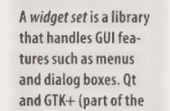

- **GNOME** `GNOME` (`www.gnome.org`) 在 Linux 桌面环境领域同样流行。它是 Fedora 和 Debian 发行版的默认桌面环境。`GNOME` 基于 GIMP Toolkit (`GTK+`) 控件集构建。与 `KDE` 类似，`GNOME` 包含了许多可以协同工作的强大工具。`GNOME` 旨在提供一个易于使用的桌面环境。

- **LXDE** Lightweight Desktop Environment，或 `LXDE` (`http://lxde.org`) 正如其名所示，旨在消耗极少资源，因此在旧电脑或现代电脑上运行良好。它也是基于 `GTK+` 控件集构建的。`LXDE` 通常是那些主要目标是尽可能减少资源消耗同时保持功能完整的 Linux 发行版（如 Lubuntu）的默认桌面环境。

- **Unity** Ubuntu 发行版的发布者 Canonical 在 2010 年发布了 `Unity` 桌面环境 (`http://ubuntu.com`)。它在 2011 年成为 Ubuntu 的默认桌面环境。`Unity` 旨在追求简单，并在各种桌面和移动平台之间提供一致的桌面环境。

- **Xfce** 这个流行的桌面环境可以在 `www.xfce.org` 找到。它最初以一个名为 CDE 的商业桌面环境为模型，但它是使用 `GTK+` 控件集构建的。`Xfce` 比大多数其他桌面环境具有更高的可配置性。

- **构建你自己的** 你可以由你喜欢的组件构建一个自己的桌面环境。由于这是一项复杂的任务，最好从详细的指导开始。打开你最喜欢的网页搜索引擎，输入“如何创建你自己的 Linux 桌面环境”，以查找关于构建自定义桌面的特定信息。至少，你需要一个窗口管理器。然而，为了使配置成为真正的桌面环境，你还需要其他组件，例如文件管理器和小型生产力工具。所有组件都需要能够从某种菜单系统访问。

遗憾的是，无法提供指示何时某种桌面环境比另一个更好的指南。然而，以下建议可以有所帮助。习惯于 Windows 或 Mac OS 的新用户可能会对 `KDE`感到最满意。`KDE` 环境与这些传统桌面操作系统的环境相似。`GNOME` 和 `Unity` 旨在易于使用，因此它们对于熟悉商业 Unix OS 的用户也是不错的选择。用户可以尝试 `Xfce`。`Xfce` 和 `LXDE` 也是内存较小或 CPU 性能较低的系统的良好选择。喜欢定制或计算机配置较低的人应该研究“构建你自己的”方法。

在决定坚持某个特定的桌面环境之前，你可能想尝试其中两个或三个。在大多数情况下，你可以使用包管理器安装多个环境，正如本章后半部分以及在第 9 章“探索进程和进程数据”中详细描述的那样。

安装好桌面环境后，你通过菜单登录电脑时选择它。图 4.1 中的示例显示了 Fedora 系统的登录屏幕。在这种情况下，你必须点击“登录”旁边的齿轮按钮来访问菜单。

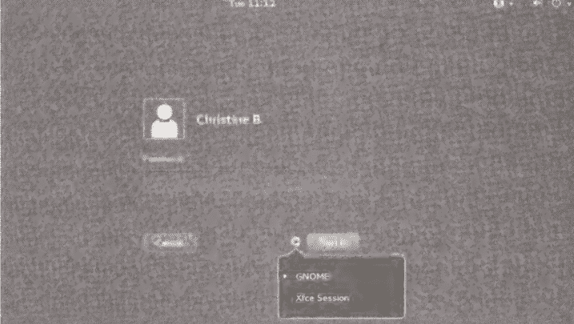

图 4.1 GUI 登录管理器通常提供一组桌面环境供你选择。

请注意，这两个按钮在你选好用户名并准备好输入密码之前不会出现。图 4.1 中的菜单显示了 `GNOME` 和 `Xfce` 作为桌面环境选项。你 Linux 系统上的菜单将取决于默认安装了哪些桌面环境以及哪些是手动添加的。选择桌面环境的方法因系统而异，因此你可能需要浏览登录屏幕选项以选择你的环境。选择极其重要。第 13 章“创建用户和组”涵盖了这一主题。

### 启动程序

大多数桌面环境提供了启动启动程序。细节在不同环境之间有所不同。但实用的示例包括：

- **桌面菜单** 许多桌面环境在屏幕的顶部或侧边提供菜单。这些菜单中的一个或多个项目可以让你访问预选的一组应用程序。

- **桌面图标** 某些桌面环境允许你在桌面的主区域放置图标。点击或双击这些图标将启动它们所代表的应用程序。这种方法通常需要自定义。某些默认配置会将一些应用程序放置在桌面主区域。

- **面板** 某些桌面环境提供面板（通常位于屏幕侧面），显示常用应用程序的图标。`Unity` 默认使用这种配置，`GNOME 3` 也是如此——但在 `GNOME 3` 的情况下，只有当你点击屏幕左上角的“活动”项时，面板才会出现。

- **上下文菜单** 你有时可以在屏幕的未使用区域点击右键，获取包含各种选项的上下文菜单，其中可能包括运行程序的选项。

- **搜索程序** 某些桌面环境（如 `GNOME 3`）提供了显著的搜索功能，你可以通过名称查找程序。通常，你输入程序名称的一部分，名称匹配的程序就会出现在列表中。然后你从列表中选择你想要运行的程序。

- **终端** 你可以启动一个名为 *terminal*（终端）的程序，它在窗口内提供了一个文本模式的用户界面。你可以在这个窗口中输入文件名来运行文本模式或 GUI 程序。这种方法在第 6 章“了解命令行”中有更详细的介绍。

认证目标


为了帮助澄清这些方法，有必要举几个例子。首先，考虑在 Fedora 20 中使用 `GNOME 3` 桌面环境启动 `Firefox` 浏览器。你可以按照以下步骤进行操作：

- 点击屏幕左上角的“活动”(`Activities`)项目。结果是在屏幕左侧显示面板（称为“收藏”，*Favorites*），如图 4.2 所示。


**图 4.2** 面板允许你在 `GNOME`、`Unity` 以及其他一些桌面环境中启动常用程序。

- 将鼠标悬停在 `Firefox` 图标上，它是图 4.2 中顶部的图标。

- 点击 `Firefox` 图标。稍等片刻，应该打开一个 `Firefox` 窗口。


还有其他方法，例如在搜索字段中输入程序名称（位于图 4.2 的上部中间）。由于 GNOME 3 面板中只显示少数程序，你必须向其手动添加程序，或者通过其他方式启动 Fedora 开发人员默认未包含的程序。

作为比较，openSUSE 13.2 下的 KDE 提供了几种明显的启动 Firefox 的方法：

- 通过点击“桌面”文件夹窗口中的图标（可见于图 4.3 的右侧中间）。
- 通过点击屏幕底部栏左侧附近的图标（再次参见图 4.3）。此栏被称为“启动器”（*Kicker*）面板。

# 第 4 章 • 使用常用的 Linux 程序

通过在“应用程序”列表中找到它。你可以通过启动 Kickoff 应用程序启动器（通过 Kicker 面板最左侧的 SUSE 变色龙图标访问），选择“应用程序 > 互联网 > 网页浏览器 > 网页浏览器 (Firefox)”来打开此列表。图 4.3 显示了正在进行此选择的过程。


图 4.3 KDE 的桌面界面提供了与 Windows 中提供的类似的启动方法。

与 GNOME 一样，Firefox 等少数常用应用程序有一多种启动选项。对于不太流行的程序，你可能需要使用更复杂的方法，例如在“应用程序”列表中查找程序。然而，你可以重新配置桌面环境以添加你经常使用的程序。

每个发行版都以自己的方式设置默认值。你的 GNOME 或 KDE 配置可能与此处的并不相似。

## 使用文件管理器

认证目标

如果你习惯了 Windows 或 Mac OS，你几乎肯定使用过文件管理器来操作文件。当然，Linux 也提供了一个文件管理器来实现此目的——事实上，你有几种选择，其中大多数的运行方式都很相似。例如，考虑 `Nautilus`，它是 GNOME 的默认文件管理器。如果你在 Fedora 上运行 GNOME 3，`Nautilus` 图标代表“收藏”面板中的文件柜，如图 4.2 所示。当你插入可移动磁盘（如 USB 闪存器或 DVD 光盘）时，你的桌面环境也可能自动启动文件管理器。图 4.4 显示了在全新安装上运行的 `Nautilus`。

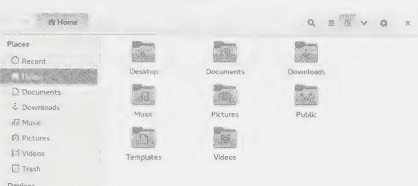

除了 GNOME 的 `Nautilus`，其他文件管理器包括 `Thunar`（Xfce 的文件管理器）和 `Dolphin`（KDE 的文件管理器）。`Conqueror` 是早期 KDE 版本的默认管理器，目前仍然可用。`Conqueror` 还可以作为浏览器使用。

图 4.4 `Nautilus` 提供的文件视图与其他操作系统的文件管理器类似。

由于 `Nautilus` 与其他操作系统的文件管理器相似，你可以很轻松地使用它的主要功能。有几项值得提到：

位置（Locations）在窗口左侧，你将看到一系列位置。在图 4.4 中，这些位置分为三类：

如果你双击某个位置，`Nautilus` 将尝试访问它。

- “设备”（Devices）类别包括不属于标准安装的磁盘分区，包括可移动磁盘。
- “计算机”（Computer）子类别指的是整个 Linux 安装目录。
- “位置”（Places）类别主要由你家目录中的常用文件夹组成，尽管“最近”（Recent）指的是最近访问的目录。
- “网络”（Network）类别提供对网络资源的访问；这在正常工作之前可能需要额外的配置。

主目录（Home）“主”位置指的是你的家目录——即你存储自己用户文件的目录。通常，你会在家目录中创建所有个人文件。当你手动启动 `Nautilus` 时，默认视图是你的家目录，如图 4.4 所示。右侧面板显示了家目录的文件和子目录。

**书签**（Bookmarks）你可以为“位置”类别未显示的位置添加书签。只需浏览到所需书签位置内的文件，并点击 `Nautilus` 菜单栏上的齿轮图标。从下拉菜单中，选择“书签此位置”。或者，你可以按 `Ctrl+D` 标记一个位置。新添加的书签

它是一个完整的浏览器，因此会消耗大量内存，所以在旧旧或配置较弱的电脑上，它可能不是最佳选择。

**Web** 该程序最初名为 Epiphany，可以在 https://wiki.gnome.org/Apps/web 找到。它是 GNOME 桌面面的 浏览器。它的设计初衷是简单易用。

**Konqueror** 这个 KDE 程序具有双重功能：它既是 Web 浏览器，也是文件管理器。`Konqueror` 在处理大多数网页方面表现良好。它相当轻量，而且非常值得尝试，特别是当你使用 KDE 的话。你可以在 www.konqueror.org 了解更多关于它的信息。

**Lynx** 大多数网页浏览器都是 GUI 程序，能够以多种字体显示文本、内联显示图形等。`Lynx` (http://lynx.browser.org) 的不同之处在于它是一个基于文本的浏览器。因此，如果你在文本模式下运行 `Lynx` 或者你不想被图形所困扰，它是一个很有用的选择。当你在开发网页时，`Lynx` 作为一个测试浏览器也很有用；如果一个页面在 `Lynx` 中是可读的，那么使用语音合成器访问 Web 的视障人士很有可能也能使用你的页面。

**Opera** Linux 网页浏览器领域中一个不寻常的商业者。`Opera` (www.opera.com) 声称其速度异常快。尽管 `Opera` 是商业性的，但你可以免费下载。

这个列表中并不缺少微软的浏览器。遗憾的是，某些网站除了微软浏览器之外将无法运行。其他网站虽然挑剔，但至少可以在一个 Linux 浏览器上运行。因此，你可能应该安装两个 Linux 浏览器。

网页浏览器让用户能够轻松访问信息世界——字面意义上的如此！Web 也有黑暗面。问题包括以下：

- 网站可以记录用户数据，这些数据可能被用于营销或你不喜欢的其他方式。
- 许多基于 Web 的内容是危险，这意味着网站会下载小型程序（通常用 Java 编写），由你的网页浏览器运行。这些内容可能是无害的，但正越来越多地被用于投放恶意软件。
- 恶意网站可以伪装成受信任的站点，欺骗用户提供敏感数据，例如财务信息。这种技术被称为钓鱼。
- 许多网站并不安全。传输的数据可以在中间计算机上被读取。大多数敏感网站（如网上银行网站和在线零售商）现在会对其敏感数据进行加密，但在发送此类数据时你应该保持谨慎。


- 由于安全考虑，大多数网站上使用的密码面临被盗窃的风险。这可能导致一个困境，因为很难记住所有的网站密码。许多浏览器可以为你做到这一点，但它们将你的密码存储在硬盘上，这使得它们容易被盗取或丢失。

第 13 章描述了如何创建既好记又难以猜想的密码。

这些问题中的一些并不是 Web 所特有的，例如，大多数电子邮件传输是不安全的，所以你不应该通过电子邮件发送敏感数据。

## 使用电子邮件客户端

电子邮件客户端程序使你能够读取和撰写电子邮件消息。此类程序可以访问你自己电脑上的信箱，也可以使用后文描述的电子邮件网络协议，在网络服务器客户端的帮助下发送接收邮件。常见的 Linux 客户端包括以下：

**Evolution** 该程序位于 https://projects.gnome.org/evolution/，是一个强大的 GUI 客户端。它还包含了群组和调度功能。

**KMail** KDE 项目的 `KMail` 可以在 https://userbase.kde.org/KMail 找到。它与该桌面环境集成良好，但如果你选择，也可以在其他桌面环境中使用。

**Mutt** 这是几个基于文本的邮件阅读器之一。尽管它有文本模式界面，但 `Mutt` 功能相当强大。你可以在 www.mutt.org 了解更多关于它的信息。

**Thunderbird** 该程序位于 www.mozilla.org/thunderbird/，是一个与 `Firefox` 网页浏览器密切关联的电子邮件客户端。

## 认证目标

电子邮件客户端在任何操作系统中的工作方式相似。通常，你必须配置如何发送和接收消息——是使用本地电脑的功能还是远程服务器。之后，你就可以读取传入的消息并发送出的消息了。

## 使用办公工具

Linux 存在多个办公工具包。这些包提供了文字处理器、电子表格、演示文稿程序、图形程序、数据库以及有时其他程序的组合。示例包括以下：

**GNOME Office** `GNOME Office` 中的应用程序是独立开发的，但 `GNOME Office` 尝试将它们链接成一个连贯的


## 使用生产力软件

整体。`GNOME Office` 内的特定项目包括 `AbiWord`（文字处理器）、`Evince`（文档查看器）、`Evolution`（群组和电子邮件客户端）、`Numeric`（电子表格）、`Inkscape`（矢量图形和演示创建）以及 `Ease`（演示文稿）。你可以在此处学习更多：http://live.gnome.org/GnomeOffice。


### Calligraphy
这套办公套件诞生于对早期 KDE 办公套件 KOffice 的拆分。虽然 K 不再被维护了，但 Calligraphy (https://calligraphy.org/) 正在蓬勃发展。它的办公套件包含了 Words（文字处理器）、Stage（演示文稿）、Sheets（电子表格）、Flow（图表）和 Kex（数据库）。除了办公应用，Calligraphy 还提供了图形和项目管理产品。

### Apache OpenOffice
这个办公套件是从早期的 KOffice 分离出来的。虽然 Calligraphy 正在兴盛，它的办公套件包含了 Words（文字处理器）、Stage（演示文稿）、Sheets（电子表格）、Flow（图表）和 Kex（数据库）。除了办公应用，Calligraphy 还提供了图形和项目管理产品。

### Apache OpenOffice
位于 openoffice.org 的这个办公套件源自 OpenOffice 的分支。尽管 OpenOffice 已停止维护，但 LibreOffice 是目前非常流行的。它的办公套件包含了 Writer（文字处理器）、Impress（演示文稿）、Calc（电子表格）、Draw（图形）、Base（数据库）和 Math（公式）。

### LibreOffice
这个办公套件源自 OpenOffice 的分支。尽管 OpenOffice 已停止维护，但 LibreOffice 是非常流行的。它的办公套件包含了 Writer（文字处理器）、Impress（演示文稿）、Calc（电子表格）、Draw（图形）、Base（数据库）和 Math（公式）。

许多这些程序都支持 OpenDocument Format (ODF)，这是一种开放文件格式。你可以在 www.libreoffice.org 了解更多信息。

这些问题中的一些并不是 Web 所特有的，例如，大多数电子邮件传输是不安全的，所以你不应该通过电子邮件发送敏感数据。

LaTeX 在计算机科学、数学和其他其他领域非常流行。

## 使用多媒体

Linux 在服务器方面有极佳的声誉，但直到最近，多媒体能力一直很匮乏。然而，在过去的十年里，它的多媒体列表一直在增长。目前的提供包括：

### Audacity
该程序位于 http://audacity.sourceforge.net，是一个 Linux 音频编辑器，类似于商业 Sound Forge。你可以用它裁剪音频、均衡均衡、消除杂声、应用人工效果。

### Blender
你可以使用此程序创建复杂的 3D 图像，包括样式和动画。

### The GIMP
GNU 图像处理程序 (GIMP) (www.gimp.org) 是一个静态图像处理程序，大体类似于 Adobe Photoshop。（作为 GNOME 和许多其他程序的 GTK+ 工具包最初是为 GIMP 创建的。）

### ImageMagick
这是一个图形程序，不同之处在于通常从命令行使用 ImageMagick 程序。你可以用它转换格式、为图像添加帧、调整图像大小等。你可以在 www.imagemagick.org 了解更多。

### Handbrake
该程序提供了一种简单转换视频格式的方法，特别是转换为高效 H264 编码的格式。你可以在 http://handbrake.fr 了解更多。

### MythTV
你可以使用软件将普通 PC 转换为数字录像机 (DVR)，这最好在 www.mythtv.org。MythTV 使用客户端-服务器模型，允许一个录像机服务家里多个电视。

## 使用云计算

云计算是在互联网上存储计算机软件和/或数据，而不是存储在你的电脑上。在这个术语中，云代表互联网，计算代表你通过网络浏览器正在做。在某些情况下，用户通过网络浏览器访问云计算资源。因此，理论上，Linux 可以作为云计算客户端平台——只需启动浏览器访问云计算提供商即可。图 4.7 显示了可用云计算应用的一小样本。

由于这些范围广泛的多媒体应用，你可以使用 Linux 处理从裁剪你两岁生日派对照片到为大电影渲染特效的一切事情。

## 使用生产力软件


**图 4.7** 通过网络浏览器访问的云计算应用程序

在实践中，访问云计算服务时可能会出现复杂情况。例如，云提供商可能要求你使用特定的网络浏览器或安装特定的浏览器插件。在某些情况下，在 Linux 中可能无法满足这些要求；但如果提供商支持广泛的浏览器作为客户端，那么你在使用云资源时就不会遇到问题。

一些值得的云资源包括：

*   按需流媒体服务，例如 Netflix (www.netflix.com)
*   文件存储服务，例如 Dropbox (www.dropbox.com)
*   办公生产力套件，例如 Zoho Office (www.zoho.com)
*   基于 Web 的电子邮件，例如 Gmail (http://mail.google.com/)

## 使用移动应用程序

尽管 Android 是基于 Linux 的操作系统，但在大多数情况下，它运行的应用程序与任何桌面版或服务器版本的 Linux 完全不同。这是可以理解的——你可能不想尝试用手机写一份长文档，比如一本书。大型办公程序中的许多功能（如 LibreOffice 的 Write）在移动计算设备上将是浪费。

## 认证目标

# 第 4 章 · 使用常用的 Linux 程序

相反，移动计算通常专注于称为应用（apps）的小型程序。在 Android 中，你可以使用一个名为 Google Play 的应用来下载其他应用。（可以通过 https://play.google.com/store 使用 Web 版本。） 应用程序通常提供快速且专门的计算，并经常利用手机的功能。例如，一个应用可以计算你骑自行车时消耗的热量，或者为你获取你所在地区的天气预报。这两个示例都使用了手机的 GPS 功能来识别手机（以及你）的位置。

虽然大多数用于桌面和服务器计算机的 Linux 应用程序都是开源且免费提供的，但某些 Android 应用程序并非免费。在下载应用程序之前，务必检查费用。

Android 应用程序日益成为恶意软件的来源。你可以通过 Google Play 或其他可靠的商店下载应用程序来尽量降低风险。

## 使用服务器程序

Linux 是一个用于服务器程序的强大操作系统，因此，你可以找到各种 Linux 服务器程序并不意外。在接下来的几页中，将描述一些服务器协议以及使用它们的程序。此外，还将涵盖安装和启动服务器的过程，以及关于服务器安全问题的基本信息。

## 识别常见的服务器协议和程序

网络（包括互联网）通过网络协议运行。网络协议是清晰的描述，说明了两台计算机应如何交换数据以实现特定目标，例如传输电子邮件或交付待打印的文件。大多数协议都在一个或多个标准文档中描述，这些文档被称为“请求意见”（RFC）文档，每个文档都有一个编号。通常，一个 RFC 文档定义协议，随着时间的推移，额外的 RFC 文档会在需要时定义扩展或协议修改。

大多数网络协议涉及通过一个或多个端口传输数据，端口是计算机上编号的资源。你可以将端口看作类似于电话分机号码——主号码（IP 地址或 IP 地址）标识整台计算机，而端口号则标识正在使用的协议。服务器程序附加到端口号上，并接收该端口上的所有传入请求。

表 4.1 总结了一些端口号、与其关联的协议以及经常配合使用的 Linux 程序。

### 表 4.1 常用端口号及其用途

| 端口号 | 协议 | 常用服务器程序 | 解释 |
| :--- | :--- | :--- | :--- |
| 20–21 | FTP | oftpd, ProFTPD, Pure-FTPD, vsftpd | 文件传输协议 (FTP) 是一种用于通过网络传输文件的旧协议。它同时支持匿名访问和密码介的访问。FTP 的特殊之处在于它使用两个端口。 |
| 22 | SSH | OpenSSH | 安全壳 (SSH) 是一种加密的远程访问工具。它还支持文件传输和加密其他协议。 |
| 23 | Telnet | telnetd | 这是一种旧的未加密登录协议。现在很少使用，尽管它的客户端程序 Telnet 可以作为一个非常有用的网络诊断工具。 |
| 25 | SMTP | Exim, Postfix, qmail, sendmail | 简单邮件传输协议 (SMTP) 是互联网上移动电子邮件的主要协议。发送者发起 SMTP 传输。 |
| 53 | DNS | dnsmasq, named | 域名系统 (DNS) 允许计算机通过提供主机名来查找 IP 地址，反之亦然。没有它，你需要通过 IP 地址而不是名称来引用所有计算机。 |
| 67 | BOOTP, DHCP | dnsmasq, dhcp | 引导协议 (BOOT) 及其表兄弟动态主机配置协议 (DHCP) 都能让局域网上的计算机帮助自动配置其他计算机使用网络。 |

# 第 4 章 · 使用常用的 Linux 程序

### 表 4.1（续表）

| 端口号 | 协议 | 常用服务器程序 | 解释 |
| --- | --- | --- | --- |


| 80 | HTTP | Apache, NGINX | 超文本传输协议 (HTTP) 是全球维网 (WWW) 或简称 Web 的基础。 |

| 109–110 | POP2 和 POP3 | Courier, Cyrus IMAP, Dovecot, UW IMAP | 邮局协议 (POP) 经过了多次修订，每个版本都有自己的端口。该协议允许接收者发起电子邮件传输，因此它通常用于电子邮件投递的最后阶段（从服务器到接收者）。 |

| 118 | SQL | MySQL, PostgreSQL, MariaDB | 结构化查询语言 (SQL) 是一种支持网络的数据库接口语言。如果你在网络上运行 SQL 服务器，客户端计算机就可以访问并修改该数据库。 |

| 137–139 | SMB/CIFS | Samba | 微软使用服务器消息块 (SMB) / 常见互联网文件系统 (CIFS) 协议进行文件和打印机共享，Samba 在 Linux 中实现了这些协议。 |

| 143, 220 | IMAP | Courier, Cyrus IMAP, Dovecot, UW IMAP | 消息访问协议 (IMAP) 允许接收者在服务器上管理电子邮件。 |

| 389 | LDAP | OpenLDAP | 轻级目录访问协议 (LDAP) 是一种访问和管理目录服务的协议。 |

| 443 | HTTPS | Apache, NGINX | 这是 HTTP 的安全版本，使用 SSL/TLS 加密客户端和服务器之间的数据。 |

| 2049 | NFS | NFS | 网络文件系统 (NFS) 允许通过网络访问文件。 |

表 4.1 并不完整；它总结了一些重要的协议和服务器。

某些协议通常用于本地。例如，`DHCP` 的本质是为了帮助你管理自己的网络。`SMB/CIFS` 也仅用于本地以启用。

第 15 章“管理网络连接”将更详细地描述网络配置。

## 服务器程序与服务器计算机

服务器可以指整台计算机，也可以指运行在该计算机上的单个程序。当应用于整体时，该术语标识了计算机的功能以及它运行一个或多个服务器程序的事实。服务器计算机通常为从几个到数百万客户端计算机（即使用服务器服务的计算机）提供服务。

在网络世界中，服务器（计算机或程序）监听客户端（计算机或程序）的连接并响应数据传输请求。服务器计算机通常但并非总是比客户端强大。

## 专注于 Web 服务器

随着互联网上网站数量的增长——某些估计这一数字达到了 10 亿——Web 服务器的使用也随之增长。Web 服务器向内部和/外部网络用户交付网页。如果你曾经

# 第 4 章 - 使用常用的 Linux 程序

如果你使用过万维网，你很可能使用过 Linux 提供的两种流行的 Web 服务器：

### Apache HTTPD
Apache HTTPD 服务器是流行的 Web 应用 Apache MySQL PHP (LAMP) 堆栈的一部分。原始 Web 服务器软件软件包发布于 1995 年。在不到一的时间内，Apache 成为互联网上最流行的 Web 服务器。由于其稳定性和可靠性，它一直保持着这种人气水平。Apache HTTPD 服务器不仅适用于 Linux，还适用于 Unix、BSD、Windows 以及 Mac OS X。你可以在 `http://httpd.apache.org/` 了解更多信息。

认证目标

### Nginx
2002 年发布的（读音为 Engine X）Web 服务器是市场上的相对新来者。Nginx 可以代表客户端从一个或多个服务器检索资源，还可以作为邮件服务器运行。由于快速和轻量化的这些特性，Nginx 赢得了 Netflix 等大型网站的青睐。你可以在 `http://nginx.org/` 了解更多信息。

认证目标

这两个服务器最好的特性是你不必在它们之间二选一。许多服务器管理员选择双重设置，同时使用 HTTP Apache 和 Nginx。有时会部署并行的架构，让每个服务器处理其最擅长的部分——Apache 管理动态内容，Nginx 管理静态内容。其他人则部署“Apache 在在 Nginx 前方”的架构，让 Nginx 在其资源检索服务上大放异彩，而 Apache 仍根据需要提供动态内容。

## 安装和启动服务器

维护服务器程序的主题超出了本书的范围，但你应该了解这项任务的基础知识。你可以像安装其他软件一样安装服务器，这将在本章稍后的部分以及第 9 章中进行详细说明。

一旦安装了软件，你就必须启动服务器。你执行此操作的方法与桌面应用程序不同。你不是在 GUI 中点击图标或菜单项，而是通过配置计算机在启动时自动运行它来启动服务器。此后，服务器程序将在后台作为守护进程（`daemon`）运行——即作为一个无人值的进程。

大多数服务器在 Linux 启动时会自动启动。你也可以打开终端程序，并输入文本模式命令以及如 `start` 或 `stop` 等关键字来手动停止服务器。服务器程序启动的性质随着最近的发行版发生了变化，这超出了本书的范围。然而，了解各种发行版使用特定的初始化守护进程来启动和管理各种服务器守护进程是有帮助的。“daemon”一词源于希腊神话；daemon 是有帮助的生物，正如 Unix 和 Linux 守护进程是有帮助的程序一样。

请务必查阅你发行版的文档，以确定它使用的是以下列表中的哪种初始化守护进程：

- System V init (`SysInit`)
- Upstart
- `systemd`

某些服务器通过超级服务器（如 `xinetd`）运行。这些服务器程序持续运行，使它们管理的服务器在不需要时保持未卸载状态。这种配置可以最小化运行许多少用服务器对内存的影响。超级服务器还可以作为安全功能，像门门员一样，将麻烦制造者隔之在外。

## 服务器安全

每当你运行服务器时，你也面临着它被破解和滥用的风险。风险分为以下几类：

- 服务器可能包含漏洞，允许外部人员滥用软件在本地运行程序。
- 你可能会错误配置服务器，授予外部人员比你预想的更高的系统访问权限。
- 拥有账户和通过服务器进行远程访问的用户可能会滥用这种信任。如果与服务器漏洞或配置错误相结合，这种风险尤为巨大。
- 服务器可以被用作攻击他人的跳板，使得攻击似乎源于你的计算机。
- 即使不侵入计算机，攻击者也可以用虚假数据替换服务器并将其关闭。这种技术被称为拒绝服务 (`DoS`) 攻击。

服务器安全是一个极其复杂的主题，细节随服务器的不同而异。例如，如果你将服务器作为远程登录服务器、Samba 或 POP 或 IMAP 邮件服务器运行，你可能需要密切关注密码安全。

广而言之，保护服务器需要以下措施：

- 你应该将软件更新到最新版本。
- 你应该使用防火墙来限制访问。
- 你应该使用强密码。
- 如果可用，你应该使用多因素身份验证。
- 你应该监控服务器的可疑活动。
- 你应该定期备份数据。

服务器安全是一个极其复杂的主题，细节随服务器的不同而异。例如，如果你将服务器作为远程登录服务器、Samba 或 POP 或 IMAP 邮件服务器运行，你可能需要密切关注密码安全。

## 选择编译型语言还是解释型语言

从本质上说，计算机理解二进制代码——代表操作的数字。然而，人类更擅长单词和符号。

### 管理语言

大多数编程涉及用符号语言编写程序，然后将该符号代码转换为数字形式。存在几十种甚至上百种这样的语言，每种语言都有其独特的特征。

在高级语言中，存在两大类：

**编译型语言**（Compiled Languages）：程序员将高级语言的程序从原始源代码转换为（或编译）机器码。编译过程可能需要一些时间——取决于程序的大小和计算机的速度，通常为几秒。编译也因为程序中的错误而失败。当编译成功时，机器码执行速度很快。

**解释型语言**（Interpreted Languages）：用解释语言编写的程序在运行时，由一个名为解释器的程序转换为机器码。转换是按行进行的。也就是说，程序从没有被完全转换为机器码；解释器确定每行代码在做什么，然后执行该操作。这意味着解释型程序的运行速度比编译型程序慢。优点是解释型程序更容易开发。

除了编译型和解释型语言，另一种选择是汇编语言。这是一种机器码数字与程序员使用的符号之间存在简单一一对应的语言。汇编语言是非常底层的，这意味着熟练的汇编语言程序员可以产生紧凑高效的程序。汇编语言的可移植性不好；将为 x86-64 CPU 编写的程序转换为适用于 ARM 处理器需要大量精力。编写汇编程序也比用大多数高级语言编写程序更困难。由于这些原因，随着计算机变得强大，汇编语言变得越来越稀少；对于 21 世纪初的大多数用途，汇编语言的速度和大小优势并不非常有吸引力。

## 使用汇编语言编程

理论上，大多数语言都可以以编译型或解释型的形式实现。但在实践中，大多数语言通常只使用其中一种形式。

有些语言并不能整齐地归类为这两类。请参参见“汇编语言编程”侧边栏以了解一个重要的例外。另一些则介于两者之间，例如 Java，它从源代码编译成与平台无关的形式，然后必须经过解释才能运行。

## 识别常用的编程语言


# Linux 支持广泛的编程语言

Linux 支持广泛的编程语言，包括以下语言：

- 汇编语言：如前所述，这种低级语言可以生成高效的程序，但它编写困难且不具移植性。事实上，将汇编语言视为一种语言是有些误导的，因为每种架构都有自己的汇编语言。

- `C`语言：这种语言是 Linux 最重要的编译型语言，因为大多数 Linux 内核以及大量的 Linux 都是用 `C` 语言编写的。`C` 可以生成高效的代码，但在 `C` 中也很容易写出错误的程序；它缺乏许多其他语言中具备的错误检查功能。`C` 源代码通常具有 `.c` 或 `.h` 结尾的文件名——`.c` 文件是主源代码文件，而 `.h` 文件是头文件，包含 `.c` 文件中函数的简短定义，供程序中的其他文件引用。一个大型程序可能包含几十个而不是数百或数千个独立的源代码文件。在 Linux 中，`C` 程序通常使用 `gcc` 程序进行编译，它是 GNU 集合 (`GCC`) 软件包的一部分。

- `C++`：这种语言是 `C` 语言的扩展，增加了面向对象的特性，这意味着对数据结构及其交互的重视程度高于控制程序流的程序。许多复杂语言，如 KDE 和 Apache OpenOffice/LibreOffice，大部分是用 `C++` 编写的。`C` 源代码文件的文件名以 `.cc`、`.cpp`、`.cxx` 或 `.c++` 结尾，头文件以 `.h`、`.hpp`、`.hxx`、`.h+` 结尾。在 Linux 中，`C++` 通常使用 `g++` 程序进行编译，它是 `GCC` 的一部分。

- `Java`：`Java` 是由 Microsystems（现归 Oracle 所有）创建的，是一种介于编译和解释之间的跨平台语言。它作为通过网站交付的小型应用程序的语言而流行，一些其他程序也是基于 `Java` 的。`Java` 源代码通常以 `.java` 结尾命名。

- `Perl`：这种解释型语言专为便于处理文本而设计，它是一种通用语言，也可以用于许多其他任务。`Perl` 程序通常具有以 `.pl`、pm 或 `.t` 结尾的文件名。

- `PHP`：`PHP: Hypertext Preprocessor`（或称为 `PHP`，一个递归缩写）这种语言的创建是为了在 Web 服务器上生成动态内容——即内容根据用户、一天中的时间或其他标准而变化。`PHP` 是一种解释型语言，它需要支持 `PHP` 的 Web 服务器（如 Apache）。在有此类服务器和适当配置的情况下，网站可以支持用户登录、购物车、根据用户位置显示不同内容，且 `PHP` 文件名通常以 `.php` 结尾，尽管有几种变体也很常见。

- `Python`：这种解释型语言将代码的可读性作为主要目标。它支持（但并不要求）面向对象。它通常用于脚本编写，但也可以用于编写更复杂的程序。`Python` 程序经常使用 `.py` 扩展名，尽管这种的几种变体也很常见。

- Shell 脚本：大多数 Linux 文本模式 Shell（允许完全通过键盘使用计算机的程序）提供了自己的解释型语言。其中，Bourne Again Shell (`Bash`) 是常用的，因此 `Bash` 脚本非常常见。控制 Linux 启动过程的许多文件都在 `Bash` 脚本中。脚本通常没有独特的文件扩展名，尽管某些使用 `.sh` 扩展名。

## 处理软件包

多年来，在 Linux 发行版上安装程序变得越来越简单。然而，软件如何打包、安装和管理在不同发行版之间差异很大。理解这些差异对于充分利用本章讨论的 Linux 程序非常重要。本节提供了简要描述。关于安装和管理软件包的更多详细信息请参阅第 9 章。

### 理解软件包

在 Linux 上，软件程序被封装成预构建的包，这简化了它们的安装和管理。Linux 使用软件包管理系统 (`PMS`) 管理软件包，第 9 章将详细讨论该系统。

这些软件包存储在仓库中，它们是互联网上的官方软件服务器。可以通过 Linux 系统的本地 `PMS` 无法通过互联网访问仓库。仓库中存储了大量软件包，准备供探索或安装。每个 Linux 发行版的开发者都努力维护和保护其官方仓库的软件包。因此，在大多数情况下，从默认的发行版仓库获取程序是最佳选择。幸运的是，你发行版的 `PMS` 通常会默认这样做。

### 识别常用的包工具

每个发行版都使用自己的 `PMS` 和包工具，第 9 章将进行详细讨论。以下是你的 `PMS` 使用的一些主要工具：

- `dpkg`：一种低级包工具，作为基于 Debian 的系列 `PMS` 工具的基础。它可以直接用于安装、管理和删除软件包。例如，它的功能是局限的；`dpkg` 工具无法从仓库下载软件包。

- `rpm`：`rpm` 工具也是一种低级包工具，功能与 `dpkg` 实用类似。然而，它被用作红帽 Linux (`Red Hat Linux`) 软件包管理系统的基础。虽然你可以使用 `rpm` 管理包，但最好使用更高级的 `PMS` 工具。

- `apt-get`：这是用于 Debian `PMS` 的文本工具。通过 `apt-get`，你可以从仓库安装并从你的本地 Linux 系统中删除软件包。此外，你还可以对单个软件包、你系统上的所有软件包或你的整个发行版进行软件包升级。然而，你需要使用 `apt-cache` 文本模式工具来确定有关软件包的各种信息。

- `yum`：这是用于红帽 `PMS` 的文本工具。它被用在红帽企业级 Linux (`RHEL`)、Fedora 和 CentOS 等发行版。通过 `yum`，你可以从仓库安装、从你的本地 Linux 系统中删除软件包、升级包等。此外，你可以使用 `yum` 来确定有关包及其管理的各种信息，例如显示 `PMS` 配置的仓库列表。

## 核心基础及扩展

当你刚开始使用 Linux 时，很可能从使用桌面环境开始——这是你登录时看到的第一组程序。桌面环境让你能够运行更多程序，包括常见的生产力工具，如网络浏览器、电子邮件客户端、办公实用程序和多媒体应用程序。如果你正在将计算机配置为服务器，当然，你会运行服务器程序，但你将通过编辑配置文件来实现，而不是从桌面环境启动。如果你需要编程，你应该了解一些 Linux 编程语言，它们让你能够编写从简单的脚本到复杂的服务器或生产力套件的程序。如果你的发行版没有预装所需的生产力程序或应用程序，你将需要通过工具进行安装。

## 基础知识及拓展（续）

- 4. 判断对或错：OpenOffice.org 是从 Calligra 分叉出来的。
- 5. 判断对或错：即使运行服务器的计算机从未被入侵，恶意的外部人员也可以破坏服务器。
- 6. 判断对或错：`Python` 通常被实现为一种解释型语言。
- 7. Thunderbird 是一个 ______________ 程序。（指明软件的通用类别。）
- 8. 处理 `SMB/CIFS` 协议的 Linux 服务器通常运行该软件。
- 9. 使用 ______________ 语言编写的程序在运行之前会被完全转换为二进制格式。
- 10. 你可以通过 ______________ 管理系统安装和管理各种 Linux 软件应用程序。

# 第 5 章

## 硬件管理

尽管 Linux 是软件，但它依赖于硬件才能运行。你的硬件的能力和局限性将影响运行在该硬件上的 Linux 的能力和局限性。因此，对于你经常使用或计划购买的任何计算机，你都应该了解这些特性。

本章将帮助你学习并对硬件执行基本的管理任务。我们从低级问题开始，例如中央处理器 (`CPU`) 和主板的性质。电源经常被忽视，但如果它功率不足或运行异常，就会导致问题。此外，硬盘在设置时需要特别 care。Linux 中的一个常见问题是显示问题，因为显示器故障会阻止与计算机进行任何交互。今天，大多数外部设备通过通用串行总 (`USB`) 连接，因此我们描述其特性。最后，本章涵盖了程序的常见问题，程序是控制硬件设备的软件组件。

- 了解你的 `CPU`
- 识别主板功能
- 确定电源规格
- 理解磁盘问题
- 管理显示器
- 处理 `USB` 设备
- 管理驱动程序

### 了解你的 CPU

#### 认证目标

**你的 `CPU`（有时称为处理器）是计算机的“大脑”——它承担了计算机大部分的实际计算工作**。我们在前面的章节中提到 `CPU` 是为了参考发行版的可用性；为了在给定的 `CPU` 上运行，大多数软件必须针对该 `CPU` 重新编译。了解足够的不同 `CPU` 家族的知识以理解它们的优缺点并识别你的计算机使用的是哪种类型的 `CPU`，是非常重要的。

许多设备具有更专门的计算能力。最值得注意的是，显卡包含图形处理器 (`GPU`)，专门用于图形计算。

#### 理解 CPU 家族

`CPU` 制造商倾向于通过对其产品进行定期改进来创建产品线。改进范围从微（例如以更快的时钟频率运行 `CPU`，就像以更高的速度运行引擎）到中等变化（以提高速度，就像换挡以获得更好的速度），再到剧烈变化（就像使用更大或更高效的引擎，基于原始设计）。所有这些类型的更改都留在同一个 `CPU` 家族内，因此它们为不同的处理器运行相同的代码。大多数剧烈差异存在不同的 `CPU` 家族之间；来自不同家族的两个 `CPU` 通常无法运行彼此的二进制程序，尽管这也有例外，包括我们稍后描述的一个非常重要的例外。

在台式计算机上，有两个 `CPU` 家族是常见的（或最近是常见的）：

接下来的章节“识别你的 `CPU`”描述了如何确定你拥有哪种 `CPU`。


## x86
这种 CPU 类型源于 Intel 的 8086 CPU，但第一个能够运行 Linux 的 CPU 是 80386（也称为 386）。开发持续到 80486（也称为 486）、奔腾 `Pentium`、赛扬 `Celeron` 以及酷 系列处理器的早期版本——Intel Core i3、Intel Core i5 和 Intel Core i7。AMD、Cyrix、VIA 等其他也都发布了与 Intel 设计兼容的 CPU。AMD 近期对其 x86 CPU 的命名包括 Athlon 和 Duron。最早的 x86 CPU 是 16 位模型，但该型号线有 32 位 x8036。

## x86-64
`x86-64` 架构的品牌名称包括 Intel 64 和 AMD64。AMD 将 `x86-64` 架构作为 64 位扩展。通常，`x86-64` CPU 可以运行早期的 32 位 `x86` 代码，但在 64 位模式下运行时，此类 CPU 可以访问提高速度的额外功能。Intel 创建了自己的 `x86-64` CPU。Intel 和 AMD 的 `x86-64` CPU 使用了与其 `x86` CPU 相同的产品线名称。这可能让你很难根据 CPU 的营销名称判断你拥有的是 32 位 `x86` CPU 还是 64 位 `x86-64` CPU。自 2007 年以来销售的大多数台式和小型服务器计算机都使用了 `x86-64` CPU，其中 Intel Core i3、i5 和 i7 系列目前最受欢迎。

## 了解你的 CPU

### CPU 位深
CPU 以二进制（基 2）处理数据，这意味着数字只使用两个数字——0 和 1。CPU 对其处理的数字大小有限制，这些限制根据 CPU 能处理的二进制数字（或位）的数量来描述。例如，32 位 CPU 可以处理包含最多 32 位数字的数字。用正整数表示，这意味着数字的范围在……

（注：源文本第 98 页以后的包含大量重复和 OCR 噪声。我将输出最连贯的版本。）

## 识别你的 CPU
如果你有一个运行良好的 Linux 系统，可以通过三个文本模式命令学习大量关于你的 CPU 的信息：

- `uname -a`：输入 `uname -a` 显示内核和 CPU 的基本信息。例如，其中一个系统返回 `x86_64 AMD Phenom (tm) II X3700 Processor` 等信息，指示了 CPU 的制造商和型号号。

- `lscpu`：此命令返回额外的信息，共有 20 行输出。此信息中的大部分是高度技术性的，例如 CPU 支持的缓存大小。其中一些信息技术性较低，例如架构和它支持的核心数。

- `cat /proc/cpuinfo`：此命令返回比 `lscpu` 更多的信息。你可能不需要这些信息，但开发者或技术人员可能需要某些信息来帮助调试问题。

需要记住的一点是，现代 `x86-64` CPU 可以运行为旧 `x86` 架构编译的软件。因此你可能在 64 位 CPU 上运行 32 位 Linux 发行版。在这种情况下，这些命令的输出可能会令人困惑。以下是此类系统中 `lscpu` 显示的部分：

| 字段 | 值 |
| :--- | :--- |
| Architecture | i686 |
| CPU op-mode(s) | 64-bit |

Architecture 表明 `x86` CPU（`i686` 是该架构的一个变体），CPU op-mode(s) 行表示该 CPU 支持 64 位操作。

## 识别主板功能
如果 CPU 是计算机的大脑，主板就是计算机其余枢神经系统。主板是计算机内部的一块电路板。它由芯片组主导，芯片组是一个或多个为计算机提供关键功能的芯片——它们处理硬盘接口、USB 接口、网络设备等。某些芯片组包含了用于显卡的视频电路，尽管这些功能有时是独立的，而有时又被集成在 CPU 中。

除了芯片组外，主板还包含用于关键组件的插槽式接口：

* 一个或多个计算机 CPU 插槽
* 随机存存储器（RAM）插槽
* 用于插入式外设部件接口（PCI）或其他卡的插槽
* 用于串行高级技术接口（SATA）磁盘和并行 ATA（PATA）磁盘的连接器
* 后置面板连接器，为 USB 设备、键盘等提供外部接口
* 用于额外外部设备的连接器，例如通过短内部电缆连接的前置面板 USB 插口

某些主板——通常用于较大的桌面式计算机和服务器——具有许多种种、用于多种用途的连接器。此类主板具有极高的扩展性，但由于物理尺寸足够大，因此需要笨重的机箱。其他主板小得多，可以用于紧凑型计算机，但此类计算机是不具扩展性的。笔记本电脑也有主板，但它们必然是小规格的，内部扩展的机会很少。

主板上的大多数连接器由其主芯片组管理。一些高端主板提供了超出其主芯片组的功能。此类功能需要二级芯片组，例如用于第二个网络端口的额外以太网芯片组，或者用于更多或更快速硬盘接口的额外 SATA 芯片组。

无论该功能是由主芯片组还是二级芯片组提供的，你都可以通过 `lspci` 命令了解主板的大部分功能，该命令显示有关 PCI 设备的信息。输出看起来如下所示：

```
$ lspci
00:00.0 Host bridge: Advanced Micro Devices [AMD] RS780 Host Bridge
00:11.0 SATA Controller: ATI Technologies Inc SB700/SB800 SATA Controller [IDE mode]
00:12.0 USB Controller: ATI Technologies Inc SB700/SB800 USB OCI0m Controller
```

> 我们为了简洁起见对此处进行了编辑。

# 第 5 章 - 管理硬件

00:14.1 IDE 接口：ATI Technologies Inc SB8700/SB8800 IDE 控制器

00:14.2 音频设备：ATI Technologies Inc SB8x00 Azalia (Intel HDA)

01:05.0 VGA 兼容控制器：ATI Technologies Inc Radeon HD 3200m Graphics

01:05.1 音频设备：ATI Technologies Inc RS780 Azalia 控制器

02:00.0 以太网控制器：Realtek Semiconductor Corp., Ltd. RTL8161/8168B PCI 千兆以太网控制器 (rev 02)

03:06.0 以太网控制器：Intel Corporation 82559 InBusiness 10/100m (rev 08)

你不可能理解输出中的所有内容，但你应该能够从中获取信息。例如，计算机有多个 ATI 设备——一个 SATA 控制器、一个 USB 控制器、一个图形适配器等。有两个以太网设备——一个由 Realtek 制造，另一个由 Intel 制造。虽然从输出中并不明显，但 Realtek 网络适配器是集成在主板上的，而 Intel 设备则位于一块插卡上。

## 选择你的电源
计算机电源从墙上插座获取交流电（AC），并将其连接到为你的主板及所有插入设备供电的直流电（DC）。笔记本电脑和一些小型桌面单元使用可以放在地板上的电源适配器“砖块”。大型桌面式计算机具有内部电源单元。这些内部单元在物理尺寸和供电能力上更大。

每个电源对其能提供的直流电电量都有限制。这非常重要，因为你插入计算机的每个设备都会消耗一定数量的功率。如果你的计算机制造商削减了功率，那么电源对于交付时的计算机来说可能仅强够用。如果你添加了硬盘或高功耗的插式卡，你可能会超过电源能提供的功率电量。结果可能是运行不可靠——计算机可能会崩溃或运行异常，并可能损坏数据或文件。此类问题很难与其他问题（如内存故障或硬盘出现故障）区分开来。

如果你需要更换电源，请注意它的瓦特（watts）输出。你应该能在贴纸上找到当前电源的输出功率——但你可能需要先打开计算机，至少对于大多数桌面系统是如此。务确保获取的电源额定功率至少与你正在更换的那个一样大。还要确保它能放得下——尺寸是标准化的，但也有几种变体。对于笔记本电脑或带有外部电源的小型桌面计算机，你必须确保替换品为计算机提供了正确类型的连接器。在这种情况下，从计算机制造商购买替换品通常是最佳做法。

## 理解磁盘问题
磁盘是大多数 Linux 安装的关键组成部分。因此，我们在本节中描述了三个基本的磁盘问题：磁盘硬件接口、磁盘分区和文件系统。我们还描述了围绕可移动磁盘的一些问题，包括光盘（CD-ROM、DVD-ROM 和蓝光磁盘）。

## 理解磁盘接口
今天，有两种磁盘接口很常见，两者都已经被提到：

* `PATA` 这种接口在过去很常见，但其人气正在逐渐下降。它的特点是宽 40 针或 80 针线，可同时传输几位数据——因此名称中带有 *parallel*（并行）一词。Parallel ATA (`PATA`) 这种接口在过去很常见，但其人气正在逐渐下降。它的特点是宽 40 针或 80 针线，可同时传输几位数据——因此名称中带有 *parallel*（并行）一词。用于串行高级技术接口（SATA）磁盘和并行 ATA（PATA）磁盘的连接器。

* 后置面板连接器，为 USB 设备、键盘等提供外部接口


* 用于额外外部设备的连接器，例如通过短内部电缆连接的前置面板 USB 插口

某些主板——通常用于较大的桌面式计算机和服务器——具有许多种、用于多种用途的连接器。此类主板具有极高的扩展性，但由于物理尺寸足够大，因此需要笨重的机箱。其他主板小得多，可以用于紧凑型计算机，但此类计算机是不具扩展性的。笔记本电脑也有主板，但它们必然是小规格的，内部扩展的机会很少。

主板上的大多数连接器由其主芯片组管理。一些高端主板提供了超出其主芯片组的功能。此类功能需要二级芯片组，例如用于第二个网络端口的额外以太网芯片组，或者用于更多或更快速硬盘接口的额外 SATA 芯片组。

无论该功能是由主芯片组还是二级芯片组提供的，你都可以通过 `lspci` 命令了解主板的大部分功能，该命令显示有关 PCI 设备的信息。输出看起来如下所示：

```
$ lspci
00:00.0 Host bridge: Advanced Micro Devices [AMD] RS780 Host Bridge
00:11.0 SATA Controller: ATI Technologies Inc SB700/SB800 SATA Controller [IDE mode]
00:12.0 USB Controller: ATI Technologies Inc SB700/SB800 USB OCI0m Controller
```

> 我们为了简洁起见对此处进行了编辑。

# 第 5 章 - 管理硬件

00:14.1 IDE 接口：ATI Technologies Inc SB8700/SB8800 IDE 控制器

00:14.2 音频设备：ATI Technologies Inc SB8x00 Azalia (Intel HDA)

01:05.0 VGA 兼容控制器：ATI Technologies Inc Radeon HD 3200m Graphics

01:05.1 音频设备：ATI Technologies Inc RS780 Azalia 控制器

02:00.0 以太网控制器：Realtek Semiconductor Corp., Ltd. RTL8161/8168B PCI 千兆以太网控制器 (rev 02)

03:06.0 以太网控制器：Intel Corporation 82559 InBusiness 10/100m (rev 08)

你不可能理解输出中的所有内容，但你应该能够从中获取信息。例如，计算机有多个 ATI 设备——一个 SATA 控制器、一个 USB 控制器、一个图形适配器等。有两个以太网设备——一个由 Realtek 制造，另一个由 Intel 制造。虽然从输出中并不明显，但 Realtek 网络适配器是集成在主板上的，而 Intel 设备则位于一块插卡上。

## 选择你的电源

计算机电源从墙上插座获取交流电（AC），并将其连接到为你的主板及所有插入设备供电的直流电（DC）。笔记本电脑和一些小型桌面单元使用可以放在地板上的电源适配器“砖块”。大型桌面式计算机具有内部电源单元。这些内部单元在物理尺寸和供电能力上更大。

每个电源对其能提供的直流电电量都有限制。这非常重要，因为你插入计算机的每个设备都会消耗一定数量的功率。如果你的计算机制造商削减了功率，那么电源对于交付时的计算机来说可能仅强够用。如果你添加了硬盘或高功耗的插式卡，你可能会超过电源能提供的功率电量。结果可能是运行不可靠——计算机可能会崩溃或运行异常，并可能损坏数据或文件。此类问题很难与其他问题（如内存故障或硬盘出现故障）区分开来。

如果你需要更换电源，请注意它的瓦特（watts）输出。你应该能在贴纸上找到当前电源的输出功率——但你可能需要先打开计算机，至少对于大多数桌面系统是如此。务确保获取的电源额定功率至少与你正在更换的那个一样大。还要确保它能放得下——尺寸是标准化的，但也有几种变体。对于笔记本电脑或带有外部电源的小型桌面计算机，你必须确保替换品为计算机提供了正确类型的连接器。在这种情况下，从计算机制造商购买替换品通常是最佳做法。

## 理解磁盘问题

磁盘是大多数 Linux 安装的关键组成部分。因此，我们在本节中描述了三个基本的磁盘问题：磁盘硬件接口、磁盘分区和文件系统。我们还描述了围绕可移动磁盘的一些问题，包括光盘（CD-ROM、DVD-ROM 和蓝光磁盘）。

### 理解磁盘接口

今天，有两种磁盘接口很常见，两者都已经被提到：

* `PATA` 这种接口在过去很常见，但其人气正在逐渐下降。它的特点是宽 40 针或 80 针线，可同时传输几位数据——因此名称中带有 `parallel`（并行）一词。Parallel ATA (`PATA`) 这种接口在过去很常见，但其人气正在逐渐下降。它的特点是宽 40 针或 80 针线，可同时传输几位数据——因此名称中带有 `parallel`（并行）一词。用于串行高级技术接口（SATA）磁盘和并行 ATA（PATA）磁盘的连接器。

* 后置面板连接器，为 USB 设备、键盘等提供外部接口

* 用于额外外部设备的连接器，例如通过短内部电缆连接的前置面板 USB 插口


磁盘是大多数 Linux 安装的关键组成部分。因此，我们在本节中描述了三个基本的磁盘问题：磁盘硬件接口、磁盘分区和文件系统。我们还描述了围绕可移动磁盘的一些问题，包括光盘（CD-ROM、DVD-ROM 和 蓝光磁盘）。

## 理解磁盘接口

今天，有两种磁盘接口很常见，两者都已经被提到：

*   **PATA** 这种接口在过去很常见，但其人气正在逐渐下降。它的特点是宽 40 针或 80 针线，可同时传输几位数据——因此名称中带有 *parallel*（并行）一词。Parallel ATA (PATA) 这种接口在过去很常见，但其人气正在逐渐下降。它的特点是宽 40 针或 80 针线，可同时传输几位数据——因此名称中带有 *parallel*（并行）一词。用于串行高级技术接口（SATA）磁盘和并行 ATA（PATA）磁盘的连接器。

*   后置面板连接器，为 USB 设备、键盘等提供外部接口

*   用于额外外部设备的连接器，例如通过短内部电缆连接的前置面板 USB 插口

某些主板——通常用于较大的桌面式计算机和服务器——具有许多种种、用于多种用途的连接器。此类主板具有极高的扩展性，但由于物理尺寸足够大，因此需要笨重的机箱。其他主板小得多，可以用于紧凑型计算机，但此类计算机是不具扩展性的。笔记本电脑也有主板，但它们必然是小规格的，内部扩展的机会很少。

主板上的大多数连接器由其主芯片组管理。一些高端主板提供了超出其主芯片组的功能。此类功能需要二级芯片组，例如用于第二个网络端口的额外以太网芯片组，或者用于更多或更快速硬盘接口的额外 SATA 芯片组。

无论该功能是由主芯片组还是二级芯片组提供的，你都可以通过 `lspci` 命令了解主板的大部分功能，该命令显示有关 PCI 设备的信息。输出看起来如下所示：

```
$ lspci
00:00.0 Host bridge: Advanced Micro Devices [AMD] RS780 Host Bridge
00:11.0 SATA Controller: ATI Technologies Inc SB700/SB800 SATA Controller [IDE mode]
00:12.0 USB Controller: ATI Technologies Inc SB700/SB800 USB OCI0m Controller
```

> 我们为了简洁起见对此处进行了编辑。

# 第 5 章 - 管理硬件

00:14.1 IDE 接口：ATI Technologies Inc SB8700/SB8800 IDE 控制器

00:14.2 音频设备：ATI Technologies Inc SB8x00 Azalia (Intel HDA)

01:05.0 VGA 兼容控制器：ATI Technologies Inc Radeon HD 3200m Graphics

01:05.1 音频设备：ATI Technologies Inc RS780 Azalia 控制器

02:00.0 以太网控制器：Realtek Semiconductor Corp., Ltd. RTL8161/8168B PCI 千兆以太网控制器 (rev 02)

03:06.0 以太网控制器：Intel Corporation 82559 InBusiness 10/100m (rev 08)

你不可能理解输出中的所有内容，但你应该能够从中获取信息。例如，计算机有多个 ATI 设备——一个 SATA 控制器、一个 USB 控制器、一个图形适配器等。有两个以太网设备——一个由 Realtek 制造，另一个由 Intel 制造。虽然从输出中并不明显，但 Realtek 网络适配器是集成在主板上的，而 Intel 设备则位于一块插卡上。

## 分区磁盘

Certification Objective

你可以将硬盘看作一组扇区，每个扇区存储一小部分数据——通常为 512 字节。磁盘硬件本身并不帮助组织磁盘数据，除了提供读写特定扇区的手段。磁盘数据管理交给操作系统。磁盘分区和文件系统是施加在磁盘上的两层组织。分区就像文件柜的抽屉，它们被分成多个分区。这种类比在某种程度上可行，但也有其局限。与文件柜抽屉不同，磁盘分区可以根据创建，只要在磁盘大小范围内。典型的磁盘有一到十几个分区。

分区的存在是为了将磁盘划分为大致不同的用途，例如不同操作系统的分区或一个操作系统内不同类型的数据分区。例如，通常会创建交换分区（在内存耗尽时像 RAM 使用）、用户数据文件分区以及操作系统自身的分区。

硬盘及其分区经常用类似于图 5.1 的图表示。该图将分区显示为磁盘的子划分，图中的分区大小与其磁盘上的真实大小大致成比例。因此，在图 5.1 中，你可以看到 `/boot` 比 `/home` 小得多。如图所示，分区是磁盘的连续部分——也就是说，例如 `/home` 是一组扇区，其内部没有其他分区。

某些分区工具以垂直堆叠的方式而不是水平链的方式表示分区。原理是相同的。

| 扩展分区 |

|---|---||

| root (/) | swap | /home |

FIGURE 5.1 磁盘分区通常被可视化为硬盘内的框。

## 理解磁盘问题

对于 .x86 和 .x86-64 计算机，最常见的分区方案多年来有多种名称，包括主引导记录 (MBR)、MS-DOS 和 BIOS 分区。它支持三类类型的分区：

- **主分区 (Primary)**：这是最简单的分区类型。一个磁盘可以有 0 到四个 个主分区，其中一个可以是扩展分区。

- **扩展分区 (Extended)**：这是一种特殊的主分区，作为逻辑分区的容器。一个磁盘最多有一个扩展分区。

- **逻辑分区 (Logical)**：这些分区包含在扩展分区内。在理论上，一个磁盘可以拥有数十亿个逻辑分区，从而突破了四个主分区的限制，但在实践中，你不太可能看到超过十个。

MBR 对三种分区类型的用法非常笨拙且具有局限性，但惯性让它维持了十年。MBR 分区有一个硬限制：假设采用 512 字节扇区（这现在几乎是通用的），它们不支持大于 2TB (TiB) 的磁盘。

全局唯一标识分区表 (GPT) 是 MBR 的继任者。GPT 支持高达 8 ZB (ZiB) 的磁盘，大约是 MBR 的 40 亿倍。GPT 默认支持最多 128 个分区，且不区分主分区、扩展分区和逻辑分区。GPT 是优于 MBR 的分区系统；但不同操作系统的支持程度不同。Linux 很好地支持两种系统。当计算机使用基本输入输出系统 (BIOS) 时，Windows 只能从 MBR 启动；当计算机基于统一扩展固件接口 (UEFI) 时，它可以从 GPT 启动。因此，如果你使用 Windows 双系统，可能需要仔细选择你的分区方案。

## 多字节单位

使用国际单位制（SI 单位）前缀——千 (k)、兆 (M)、吉 (G)、太 (T) 等——结合字节 (B) 来指代大量的存储空间是常见的，例如 KB、MB、GB、TB 等。从技术上讲，这些单位被定义为十进制——千意味着 1000；兆意味着 1,000,000；以此类推。但在计算机中，二进制值（如 $2^{10}$ (1,024) 和 $2^{20}$ (1,048,576)）更为自然，因此 SI 单位经常（但并非总是）被用来表示这些二进制值。这种做法导致了困惑，因为并不总是清楚使用的是十进制还是二进制单位。

## 多字节单位（续）

为了解决这一冲突，电气与电子工程师学会 (IEEE) 定义了一组新前缀，称为 IEEE-1541。在该系统下，新单位和前缀描述二进制值。前几个如下：

- 一个二进制千B字节 (KiB) 是 $2^{10}$ (1,024) 字节。

- 一个二进制兆字节 (MiB) 是 $2^{20}$ (1,048,576) 字节。

- 一个二进制吉字节 (GiB) 是 $2^{30}$ (1,073,741,824) 字节。

- 一个二进制太字节 (TiB) 是 $2^{40}$ (1,099,511,627,776) 字节。

在书中，我们使用 IEEE-1541 单位，其特征在该系统中得到了体现，例如分区大小限制。大多数 Linux 工具正确地使用了 SI 和 IEEE-1541，但具体使用取决于程序作者的意愿。请对这种差异保持警惕，特别是处理大数字时——注意，一个太字节 (TiB) 比一个兆字节 (TB) 大几乎 10%！

还存在其他分区系统，但你不太可能遇到其中大多数。一个可能的例外是苹果分区表 (APM)，苹果在切换到 Intel CPU 之前在其 Macintosh 计算机上使用。

涉及磁盘分区时，Linux 支持三族工具：

- **disk 族**：`fdisk`、`cgdisk` 和 `sfdisk` 工具是用于 MBR 磁盘的简单文本分区工具，某些有效并提供了从某些磁盘错误中恢复的方法，但其基于文本的性质可能会让不熟悉磁盘分区的人感到畏惧。


### 基于 libparted 的工具
基于 `libparted` 库的工具可以处理 MBR、GPT 和其他分区表类型。其中一些工具（如 GNU Parted）是基于文本的，但另一些工具（如 GParted）是基于 GUI 的，可能对新用户更容易用。图 5.2 显示了 GParted 的运行情况。注意它的显示如何镜像了结构。许多 Linux 安装程序都包含了在系统安装期间运行的基于 libparted 的分区工具。

### gpt 族
`gdisk`、`cgdisk` 和 `sgdisk` 工具参考了 `fdisk` 族，但适用于 GPT 磁盘。它们处理 GPT 时提供了比基于 libparted 工具更多的选项，但代价是失去了对新用户的友好性。

## 理解磁盘问题

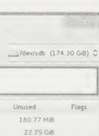

图 5.2 GParted 与 GUI 磁盘分区工具一样，提供了分区的图形化表示。

如果你使用的是预装的 Linux 系统，可能不需要对磁盘进行分区。然而，如果你更换或安装了新硬盘，在使用之前必须对其进行分区。你可能也需要对磁盘进行分区，尽管它们通常出厂时已经预分了一个大分区。

要对磁盘分区，你必须知道磁盘的设备文件名。在 Linux 中，这些文件名通常是 `/dev/sda`、`/dev/sdb` 等，每个磁盘对应一个新字母。分区从 1 开始编号，因此你可能会引用 `/dev/sda2`、`/dev/sdb6` 等。当使用 MBR 时，分区 1 到 4 留给主分区或扩展分区，而逻辑分区从 5 开始编号。

## 理解文件系统问题

大多数磁盘分区包含文件系统，文件系统是帮助计算机组织目录和文件的数据结构。在 Windows 中，每个文件系统都有其自己的设备器符，例如软盘的 `A:` 和 `B:`，第一个硬盘分区（通常是启动分区）的 `C:`，以此此类推。在 Linux 中，这些文件名通常是 `/dev/sda`、`/dev/sdb` 等，每个磁盘对应一个新字母。分区从 1 开始编号，因此你可能会引用 `/dev/sda2`、`/dev/sdb6` 等。当使用 MBR 时，分区 1 到 4 留给主分区或扩展分区，而逻辑分区从 5 开始编号。

- **ext2fs**：第二扩展文件系统 (`ext2fs`) 用于 20 世纪 90 年代初，很快被 ext3 取代。不再被支持。
- **ext3fs**：第三扩展文件系统 (`ext3fs`) 本质上是带有日志的 ext2fs。直到 2010 年左右，它都是流行的文件系统，但 ext4fs 取了它的位置。
- **ext4fs**：第四扩展文件系统 (`ext4fs`) 是文件系统的进一步发展。它增加了速度改进，以及处理更大文件和磁盘的能力——文件大小可达 16 TiB。
- **ReiserFS**：这种文件系统在 Linux 工具中被称为 reiserfs，功能上类似于 ext3fs，具有 8 TiB 的文件大小限制制和 16 TiB 的文件系统限制。它最好的特性是能够高效利用小文件（尺寸在几字节范围内的文件）的磁盘空间。
- **JFS**：IBM 为其 AI OS 开发了日志文件系统 (`JFS`)，其代码进入了 Linux。`JFS` 支持最大 4 PiB 的文件和 32 PiB 的文件系统（1 TiB 是 1,024 TiB）。`JFS` 不像许多其他 Linux 文件系统那样。
- **XFS**：Silicon Graphics 为其 IRIX OS 开发了扩展文件系统 (`XFS`) 并将其代码捐给了 Linux。`XFS` 支持高达 8 EiB 的文件和 16 EiB 的文件系统，使其成为超大磁盘阵的选择。`XFS` 适用于大型多媒体和备份文件。
- **Btrfs**：这种文件系统（读作 "butter-eff-eff" 或 "better-eff-eff"）被定为下一代 Linux 文件系统。它支持高达 16 EiB 的文件和相同大小的文件系统。它提供了许多高级功能，例如将多个物理磁盘合并为一个文件系统的能力。Linux 发行版最近将 Btrfs 设为安装默认文件系统，其人气正在增长。
- **extfs**：原始扩展文件系统 (`extfs`) 用于 90 年代初，很快被 ext2 取代。不再支持。

## 理解磁盘问题

如果你正计划安装新的 Linux 系统，你应该考虑将 ext4、Btrfs、ReiserFS 或 XFS 作为你的文件系统。Btrfs 提供了最好的整体功能和性能，而 ReiserFS 和 XFS 对于存放特别小或大文件的卷来说是值得考虑的。Btrfs 是存放大文件卷的良好选择，尽管你也可以将它用于所有场景，且这并不算特别错误，尤其在通用计算机上。

除了 Linux 原生文件系统外，操作系统还支持其他几种文件系统，其中某些在特定情况下非常重要：

**FAT** 文件分配表（FAT）文件系统是从 DOS 直到 Windows Me 期间的标准。几乎所有的操作系统都支持它。它的兼容性使其成为在单台计算机上进行双启动的两个操作系统之间交换数据的良好选择。与大多数文件系统不同，FAT 有两种行模式类型：mdos 和 vfat。使用 mdos 允许 Linux 像 DOS 一样使用该文件系统，具有最多八个字符的短文件名加上三个字符的扩展名（.filename）；当你使用 vfat 时，Linux 在 FAT 上支持长文件名。大多数 USB 驱动器预格式化为 vfat 文件系统，使其仍然非常流行。

**NTFS** 微软为 Windows NT 开发了新技术文件系统（NTFS），它是最近版本 Windows 的默认文件系统。Linux 提供了一个有限的 NTFS 读写驱动程序，而全读写驱动程序可以在 NTFS-3G 软件（www.tuxera.com）中获得。你最可能在双启动配置中的 Windows 启动分区，或较大的可移动或外部硬盘上遇到它。在 Linux 下，标准内核驱动被称为 ntfs，而 NTFS-3G 驱动程序被称为 ntfs-3g。

**HFS** Apple 在 Mac OS 9.x 版本中使用其分级文件系统（HFS），并在 Mac X 中支持它。你可能会在某些可移动介质上遇到 HFS，特别是在 Pre-X 版本的 Mac OS 创建的旧磁盘上。Linux 使用其 hfs 驱动提供全读写支持。

**HFS+** Apple 的 HFS+（也称为 Mac Extended）是 Mac OS 的当前文件系统；你可能会在双启动的 Mac 以及某些为配合 Mac 创建的可移动介质上遇到它。Linux 使用其 hfs 驱动提供读写 HFS+ 支持；然而，对于包含日志的文件系统版本，默认支持写入。

**ISO-9660** 这种文件系统用于光介质，特别是 CD-ROM 和 CD-R。它有几个层级，具有不同的功能。两个扩展 Joliet 和 Rock Ridge 分别使用 Windows 和 Unix 标准提供了对长文件名的支持。Linux 支持所有这些变体。你应该使用 iso9660 类型代码来挂载 ISO-9660 光盘。

**UDF** 通用磁盘格式（UDF）是一种旨在取代 ISO-9660 的文件系统。

在单个 Linux 安装中可以使用多个文件系统，以便为不同的文件集利用每种文件系统的优势。

FAT 的简单性和广泛的支持使其成为 USB 驱动器、智能手机、电子书阅读器、数字相机介质等上流行的文件系统。

Linux ntfs 驱动程序基于内核，这使得它运行很快。NTFS-3g 驱动与大多数文件系统不同，它不是基于内核，因此速度没有那么快。

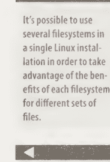


出于兼容性考虑，Mac 用户经常在可移动介质上使用 FAT。

大多数非 Linux 文件系统不支持 Linux 使用的 Unix 风格所有权权限。你可能需要使用特殊的挂载选项。这种规则的例外包括 HFS+ 和 ISO9660，Rock Ridge 扩展允许在 Windows 和 Unix 标准下使用长文件名。Linux 支持所有这些变体。

在 Mac OS 之后，你可能会在双启动的 Mac 以及某些为了配合 Mac 的用法而创建的可移动介质上遇到它。Linux 使用其 hfs 驱动提供读写 HFS+ 支持；然而，对于包含日志的文件系统版本默认支持写入。你应该使用 iso9660 类型代码来挂载 ISO-9660 光盘。

要挂载光盘，你可以使用以下命令：

```
mount /sda1
```

或者，在 Linux 的 `/etc/fstab` 中添加一个项：

```
/dev/sda1 ext4 defaults 0 1
```

或者，使用 `mount` 命令挂载：

```
mount /dev/sda1 /mnt
```

## 使用移动磁盘和光盘

通用磁盘格式（UDF）是一种旨在取代 ISO-9660 的文件系统。

在单个 Linux 安装中可以使用多个文件系统，以便为不同的文件集利用每种文件系统的优势。


FAT 的简单性和广泛的支持使其成为 USB 驱动器、智能手机、电子书阅读器、数字相机介质等上流行的文件系统。

Linux `ntfs` 驱动程序基于内核，这使得它运行很快。`NTFS-3g` 驱动程序与大多数文件系统不同，它不是基于内核，因此速度没有那么快。


出于兼容性考虑，Mac 用户经常在可移动介质上使用 FAT。

大多数非 Linux 文件系统不支持 Linux 使用的 Unix 风格所有权限。你可能需要使用特殊的挂载选项。这种规则的例外包括 `HFS+` 和 `ISO9660`，`Rock Ridge` 扩展允许在 Windows 和 Unix 标准下使用长文件名。Linux 支持所有这些变体。

## 理解磁盘问题

如果你正计划安装新的 Linux 系统，你应该考虑将 `ext4`、`Btrfs`、`ReiserFS` 或 `XFS` 作为你的文件系统。`Btrfs` 提供了最好的整体功能和性能，而 `ReiserFS` 和 `XFS` 对于存放特别小或大文件的卷来说是值得考虑的。`Btrfs` 是存放大文件卷的良好选择，尽管你也可以将它用于所有场景，且这并不算特别错误，尤其在通用计算机上。

除了 Linux 原生文件系统外，操作系统还支持其他几种文件系统，其中某些在特定情况下非常重要：

`FAT` 文件分配表（`FAT`）文件系统是从 DOS 直到 Windows Me 期间的标准。几乎所有的操作系统都支持它。它的兼容性使其成为在单台计算机上进行双启动的两个操作系统之间交换数据的良好选择。与大多数文件系统不同，`FAT` 有两种行模式类型：`mdos` 和 `vfat`。使用 `mdos` 允许 Linux 像 DOS 一样使用该文件系统，具有最多八个字符的短文件名加上三个字符的扩展名（`.filename`）；当你使用 `vfat` 时，Linux 在 `FAT` 上支持长文件名。大多数 USB 驱动器预格式化为 `vfat` 文件系统，使其仍然非常流行。

`NTFS` 微软为 Windows NT 开发了新技术文件系统（`NTFS`），它是最近版本 Windows 的默认文件系统。Linux 提供了一个有限的 `NTFS` 读写驱动程序，而全读写驱动程序可以在 `NTFS-3G` 软件（www.tuxera.com）中获得。你最可能在双启动配置中的 Windows 启动分区，或较大的可移动或外部硬盘上遇到它。在 Linux 下，标准内核驱动被称为 `ntfs`，而 `NTFS-3G` 驱动程序被称为 `ntfs-3g`。

`HFS` Apple 在 Mac OS 9.x 版本中使用其分级文件系统（`HFS`），并在 Mac X 中支持它。你可能会在某些可移动介质上遇到 `HFS`，特别是在 Pre-X 版本的 Mac OS 创建的旧磁盘上。Linux 使用其 `hfs` 驱动提供全读写支持。

`HFS+` Apple 的 `HFS+`（也称为 Mac Extended）是 Mac OS 的当前文件系统；你可能会在双启动的 Mac 以及某些为了配合 Mac 创建的可移动介质上遇到它。Linux 使用其 `hfs` 驱动提供读写 `HFS+` 支持；然而，对于包含日志的文件系统版本，默认支持写入。

`ISO-9660` 这种文件系统用于光介质，特别是 CD-ROM 和 CD-R。它有几个层级，具有不同的功能。两个扩展 `Joliet` 和 `Rock Ridge` 分别使用 Windows 和 Unix 标准提供了对长文件名的支持。Linux 支持所有这些变体。你应该使用 `iso9660` 类型代码来挂载 `ISO-9660` 光盘。

`UDF` 通用磁盘格式（`UDF`）是一种旨在取代 `ISO-9660` 的文件系统。

在单个 Linux 安装中可以使用多个文件系统，以便为不同的文件集利用每种文件系统的优势。

## 管理显示

`X11/xorg.conf`。如果缺少此文件，你可以以 root 身份输入以下命令（在 X 未运行的情况下）来生成示例文件：

```
Xorg -configure
```


结果通常是一个名为`/root/xorg.conf.new`的文件。你可以将此文件复制到`/etc/X11/xorg.conf`并开始编辑它以满足你的需求。这项任务非常复杂，超出了本书的范围，但知道该文件的名称可以帮助你入门——你可以通过搜索该名称来检查文件并查找额外的文档。

## 使用常用显示硬件

在处理视频设备时，大部分挑战在于管理涉及的视频芯片组驱动程序。大多数现代计算机使用几种视频驱动程序之一：

- `nv`、`nouveau`和`nvidia`适用于 NVIDIA 视频硬件。
- `ati`和`fglrx`适用于 AMD/ATI 视频硬件。
- `intel`适用于 Intel 视频硬件。
- `fbdev`和`vesa`驱动是通用驱动程序，适用于多种硬件，但它们产生的性能并非最优。
- 许多旧款显卡使用更冷门的驱动程序。

`nvidia`和`fglrx`是制造商提供的专有驱动程序。请检查制造商网站获取详情。

在过去，大多数显卡通过15针视频图形阵列（VGA）线缆连接到显示器，29针数字视觉接口（DVI）或较新的19针高清多媒体接口（HDMI）线缆也很常见。（图5.4显示VGA和HDMI线缆。）DVI和HDMI的优势在于作为数字接口，可以在现代发光二极管（LED）显示器上产生更清晰的显示。

# 第5章 • 管理硬件


图5.4 VGA连接器（左）过去很常见，现在仍然可用；HDMI连接器（右）在较新的显示器和显卡上很常见。

显示器分辨率通常以水平和垂直像素数来测量。在过去，`640x480`的低分辨率曾很常见，但现在使用最佳分辨率低于`1280x1024`或`1366x768`的显示器已罕见，而`1920x1080`或更高的分辨率已十分常见。你应该咨询你的显示器手册来确定其最佳分辨率。物理尺寸更大的显示器具有更高的分辨率；但并非总是如此。

大多数显示器使用`4:3`或`16:9`的宽高比例；即显示器长度与高度的比例。

在理想情况下，Linux会在你启动计算机时自动检测显示器的最佳分辨率并设置为该值。遗憾的是，这有时不起作用。键盘/视频/鼠标（KVM）切换器和扩展线有时会干扰检测，旧旧显示器可能不支持必要的计算机/显示器之间的通信。你可能需要翻开显示器手册来了解其最佳分辨率。在功能或规格部分查找此类信息；它可能被称为最佳分辨率、最大分辨率或类似的名称。它还可能包含刷新率值，例如`1280x1024 @ 60 Hz`。

在许多情况下，你可以使用GUI工具设置分辨率。图5.5显示了GNOME系统设置中的“显示”功能，它允许你使用“分辨率”下拉列表将分辨率设置为任何所需值。如果你在列表中找不到最佳分辨率，你可能需要进行涉及`/etc/X11/xorg.conf`文件的更高级的调整——这个主题超出了本书的范围。在少数情况下，你可能需要升级显卡；某些显卡无法处理某些显示器使用的最佳分辨率。

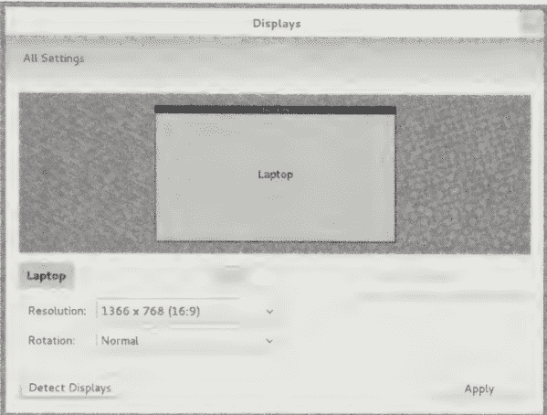

图5.5大多数桌面环境都提供了GUI工具帮助你设置显示器分辨率。

### 处理USB设备

大多数现代计算机使用USB端口作为外部外围设备的主要接口。键盘、鼠标、摄像头、闪存存储、硬盘、网络适配器、扫描仪、打印机等都可以通过USB连接。在大多数情况下，USB设备以即插即用的方式工作——你只需插入它们，它们就能工作。某些特定的注意事项包括：

**人机设备（Human-Interface Devices）** 当你插入键盘、鼠标、平板和类似设备时，X通常会接管它们。如果你遇到问题，你可能需要通过编辑`/etc/X11/xorg.conf`来调整你的X配置，但这是一个超出本书范围的高级主题。

**磁盘存储（Disk Storage）** 我们将USB闪盘、外部硬盘和其他存储设备包含在此类。正如之前在“使用可移动磁盘和光盘”中描述的那样，在拔掉USB线缆之前卸载磁盘至关重要。不这样做可能会导致数据损坏。

**手机、摄像头、电子书阅读器和音乐播放器** 你通常可以使用这些设备像磁盘驱动器一样来传输照片、音乐或其他文件。不过，你可能需要激活设备上的某个选项使其看起来像一个磁盘驱动器。完成后，卸载设备并停用你的接口模式。

**扫描仪（Scanners）** Linux使用Scanner Access Now Easy或SANE软件（www.sane-project.org）处理大多数扫描仪。但少数扫描仪需要冷门或专有的软件。

**打印机（Printers）** 大多数发行版在你插入USB打印机时会自动配置合适的打印机队列。如果你需要调整配置，尝试在相关计算机的浏览器中输入`http://localhost:631`。这样做会打开一个名为CUPS（以前称为Common Unix Printing System）的基于Web的打印机配置程序。某些发行版还提供特定发行版的打印机配置工具。

## 管理驱动程序

大多数硬件设备都需要特殊的软件组件才能发挥作用。与硬件“对话”的软件被称为*驱动程序*（driver），你应该了解驱动程序在Linux中是如何工作的。存在几类大类驱动程序，因此我们从描述这些类开始。无论驱动程序的类型如何，你都应该知道如何找到并安装适用于你硬件的驱动程序。

认证目标

### 理解驱动类型

Linux需要驱动程序是因为不同的硬件——即使是两个具有相似用途的设备，例如两个网络适配器——工作方式也可能不同。初始化和使用两个网络适配器的方法可能完全不同。为了提供通用接口以便程序可以使用任何网络适配器，内核使用驱动程序作为硬件无关接口与硬件本身之间的桥梁。

广义来说，驱动程序存在于两个位置之一：

- 内核
- 应用程序

大多数驱动程序是内核的，事实上，内核很大一部分由驱动程序组成。内核驱动程序处理大多数设备，例如硬盘、网络接口和USB接口。由于驱动程序通常需要硬件的特权访问，这就是内核的目的。

某些驱动程序存在于应用程序中。其中许多是计算机外部的。示例包括以下：

- `SANE`，它处理扫描仪
- `Ghostscript`，它将输出转换为打印机可以理解的格式
- `X`，它直接与设备通信的非内核元素。

X的特殊之处在于它是非内核元素。相比之下，`SANE`和`Ghostscript`都通过内核处理的接口（如USB端口）与外部设备通信。也就是说，打印到USB打印机至少需要两个驱动程序。理想情况下，大多数用户不会意识到这种复杂性，但在出现问题时，你可能需要理解它。

### 查找和安装驱动程序

大多数驱动程序都随Linux内核一起提供，或者随着安装该硬件的应用程序一起提供。例如，大多数X安装包含一组适用于你显卡的视频驱动。由于原因，很少需要为常见硬件查找并安装额外的驱动程序。也有例外——例如：

新硬件 如果你的硬件非常新（意味着型号是新的，而只是你买的），它可能需要尚未进入你所使用的发行版的驱动程序。

特殊硬件 如果你使用非常奇特的硬件，例如特殊的科学数据采集卡，你可能需要为它查找驱动程序。

专有驱动程序 某些制造商为其硬件提供专有驱动程序。例如，`nvidia`和`fgrx`驱动（在前面的“使用常用显示硬件”中提到）可以分别提高基于NVIDIA或ATI/AMD组的视频显示性能。某些硬件需要专有驱动程序。这在某些特殊硬件上非常常见。

错误修复 驱动程序与其他软件一样可能有Bug。如果你遇到此类问题，你可能想要查找较新的驱动程序以获取错误修复。

获取新内核驱动程序的一种方法是升级内核。注意内核升级可以为现有驱动程序和提供错误修复。

全新的驱动程序。同样，升级`SANE`、`Ghostscript`或`X`等软件也可以为这些软件包所处理的设备升级或添加新的驱动程序。

如果你正在使用奇特的硬件或需要某些其他难以找到的驱动程序，你的任务可能会更加困难。你可以咨询制造商或进行网络搜索以尝试找到驱动程序。

如果你获得了一个不属于内核（或处理该设备的软件包）的驱动程序，你应该阅读该驱动程序随附的说明书。不同驱动程序之间的安装步骤差异很大，因此无法提供一种适用于所有情况的简单、分步的安装程序。某些驱动程序带有安装实用程序，但另一些则要求你按照输入组合命令的步骤进行操作。如果你非常不运，驱动程序将以内核补丁的形式出现。这是在主内核源码包中添加或更改文件的方法。你随后必须重新编译内核——这项任务已超出了本书的范围。

### 基础知识及扩展

软件和硬件以多种方式交互，决定了计算机的能力。CPU是决定计算机速度的因素之一，而且CPU还决定了你可以运行哪个版本的Linux。CPU安装在主板上，主板包含用于管理硬盘、显示器和其他设备的关键电路。你的硬盘在使用之前必须对其进行分区并使用一个或多个文件系统进行准备。视频硬件——包括计算机内部的视频电路——决定了桌面环境的外观以及移动窗口和显示视频的速度。USB管理器管理大多数外部设备，如键盘、鼠标和外部硬盘。被称为驱动程序的软件管理所有这些硬件设备。

## 建议练习


- 在 Linux 提示符处输入 `uname -a`、`lscpu` 和 `cat /proc/cpuinfo`。比较输出结果并确定你的 CPU 能力。特别是，它可以否运行 64 位应用程序，以及你当前的发行版是 32 位还是 64 位？

- 在登录到你喜好的桌面环境后，插入光光盘、USB 闪存盘或其他可移动磁盘。文件管理器是否打开了？如果没有，手动打开一个来找到你的移动磁盘。一旦你访问了磁盘，请将其挂载，以便你可以安全地移除它。

## 基础知识及扩展（续）

## 复习题

- 1. 下列哪个命令提供了关于你主板功能的最信息？

  A. `lscpu`

  B. `Xorg-config`

  C. `fdisk -l /dev/sda`

  D. `lspci`

  E. `http://localhost:631`

- 2. 为什么你可能想对硬盘进行分区？（选择所有适用项。）

  A. 在磁盘上安装多个操作系统

  B. 使用 `ext4fs` 而不是 `ReiserFS`

  C. 将 PATA 磁盘转换为 SATA 磁盘

  D. 将文件系统数据与交换空间分离

  E. 将磁盘缓存与其主数据分离

- 3. 下列哪个设备通常不通过 USB 连接？

  A. 视频显示器

  B. 键盘

  C. 外部硬盘

  D. 打印机

  E. 扫描仪

- 4. 正确或错误：Intel 64 CPU 能够运行被标识为适用于 AMD64 CPU 的 Linux 发行版。

- 5. 正确或错误：UDF 是在硬盘上安装 Linux 时使用的一种良好文件系统。

- 6. 正确或错误：Linux 内核包含了各种磁盘控制器、适配器和 USB 接口的驱动程序等。

- 7. x86 CPU 使用（一个）___位架构。

- 8. 计算机电源将交流电转换为______电。

- 9. __________ 是一种在计算机显示器上常用的现代视频接口。

- 10. 与硬件“对话”的软件被称为（一个）__________

## 了解命令行

你可能认为命令行是一项来自 20 世纪 70 年代的过时遗迹，与当今的计算没有太大关系。事实并非！虽然 Linux 有许多 GUI 程序，但它们只是底层文本模式工具的华丽前端。通过学习这些工具，你将能够释放 Linux 的真正力量，让你更快速地完成工作。如果 Linux GUI 系统完全崩溃，或者你需要远程登录并管理系统，你也将能够进行操作。命令行工具还可以编写脚本，这意味着你可以编写一个简单的程序，以比仅使用标准程序更快或更方便地完成某任务。由于这些原因，本书中的大多数章节都描述了通过 GUI 和命令行完成任务的方法。

要开始命令行操作，你必须知道如何启动它。完成任务后，你必须知道如何运行程序以及如何获取帮助。你还应该熟悉 Linux 命令行中的若干省力功能。

- 启动命令行
- 运行程序
- 使用 shell 特性
- 使用 `man` pages 获取帮助
- 使用 `info` pages 获取帮助
- 查找额外的文档

## 启动命令行

Linux 命令行，或者更准确地称为 shell，是一个程序。和任何其他程序一样，shell 必须被启动。你可以在名为终端（terminal）程序的 GUI 窗口中启动 shell，也可以通过文本模式控制台本地登录计算机。此外，当你使用文本模式协议远程登录控制台时，也会启动 shell。然而，那种特定方法超出了本书的范围。

大多数 Linux 发行版的默认 shell 是 Bourne Again Shell（`bash`），它基于一种名为 Bourne Shell 的旧 shell。其他 shell 也是用的。每个账户指定了自己的 shell，因此个人用户可以根据喜好更改 shell。其他 shell 包括 `tcsh`、`ksh` 和 `zsh`。shell 的选择取决于喜好。如果你是初学者，最好坚持使用，因为它非常流行。

### 启动终端

大多数 Linux 发行版允许你安装 GUI 终端程序。通常，一个桌面环境自带一个，因此你的终端程序选择也取决于安装的桌面环境。（你甚至可以在一个桌面环境中运行另一个桌面环境的终端程序。）许多终端程序的名称中包含“terminal”字样，尽管有些没有，例如 桌面环境（KDE）的 Console 以及通用的 `Xterm`。

在桌面环境中启动终端程序的详细说明。你通常可以在桌面环境的菜单中找到条目，正如第 4 章“使用程序”的概述。例如，如果你正在使用 KDE 桌面环境，可以按照以下菜单驱动的方法找到可用终端：

1. 点击通常位于屏幕左下角的菜单按钮。
2. 点击应用程序 > 系统 > 终端。你应该能在图 6.1 所示的显示中看到一个或多个终端。图 6.1 显示了三个终端程序：Terminal (Console)、Terminal - Super Mode 和 `Xterm`。
3. 选择你想要的终端即可启动。

某些发行版允许你通过按下 `Ctrl+Alt+T` 快速打开终端应用程序。

图 6.2 显示了三个不同的终端应用程序：Terminal（GNOME 终端）、UXTerm 和 `XTerm`。`XTerm` 终端应用程序是最老旧、最基础的终端程序之一。UXTerm 仅仅是在 `XTerm` 的基础上增加了对 Unicode 的支持。

在不同的桌面环境中，搜索终端程序的步骤可能会大不同。例如，要进入 GNOME 3 桌面环境的搜索框，你必须点击窗口左上角的“活动（Activities）”，正如图 6.3 所示。在这个示例中，只搜寻到了两个终端应用程序：Terminal（GNOME 终端）和 `Xterm`，这表明在该特定的 Linux 系统上安装了这些桌面环境。


图 6.3 通过在 GNOME 3 中搜索访问终端

当你使用管理员账户 `root` 时，提示符通常以井号 (`#`) 结尾。第 12 章“理解基础安全”更详细地描述了 `root` 账户。此示例显示了默认的 Fedora 提示符，它包含了你的用户名、计算机的主机、当前目录（波浪号 `~` 表示你的主目录）以及美元符号 (`$`)。正如第 7 章“管理文件”所描述的，随着你对 shell 的使用，这些特性可能会发生。如果你使用的是另一个发行版，提示符在细节上可能会不同，尽管对于普通用户 shell，大多数默认提示符以美元符号 (`$`) 或大于符号 (`>`) 结尾。

大多数终端程序都提供 GUI 程序的常用功能——你可以调整它们的大小、关闭它们、从菜单中选择选项等。不过，关于你正在使用的程序细节会有不同。你可能想浏览终端程序菜单上的可用选项，以便将字体设置为你喜欢的、更改颜色方案等。

### 启动命令行

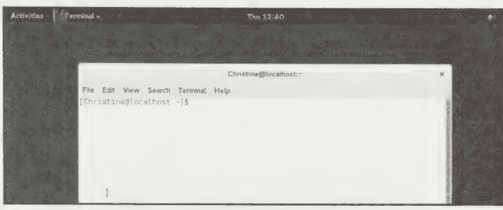

图 6.4 GNOME 的终端程序是典型的，并以文本显示区域为主。

大多数终端程序支持标签页（tabs），类似于网络浏览器中的标签页。在大多数情况下（例如 GNOME 终端中），你可以通过选择终端菜单中的“文件（File） > 打开标签页（Open Tab）”来打开标签页。打开多个标签页非常方便，因为它可以让你同时运行多个程序、轻松地在多个目录中运行，或者以你的身份和 `root` 身份运行程序。或者，你可以运行多个终端程序来实现相同的结果。

当你完成终端的操作后，可以像其他程序一样，通过选择“文件（File） > 关闭窗口（Close Window）”来关闭它。或者，你可以在 shell 提示符处输入 `exit` 并按回车。

## 登录文本模式控制台

初看，Linux 看起来像 Windows 或 Mac OS X，因为它是一个 GUI 操作系统。但剥开表面，你会发现一个纯文本模式的界面在等候。Linux 支持虚拟终端（VTs），这些虚拟屏幕可以容载各种类型的信息——文本或图形。大多数 Linux 发行版运行六到七个 VT。在 CentOS、Fedora 和 Red Hat 中，第一个 VT 通常运行 GUI 窗口系统。在其他发行版中，GUI 运行 VT 7 或 VT 8，留下 VT 1 作为文本模式显示。

你可以通过按下 `Ctrl+Alt+Fn` 切换 VT，其中 `Fn` 是功能键。（当切换到文本模式 VT 时，使用 `Alt+Fn` 即可）。要进入并登录文本模式控制台，请遵循以下步骤：

1. 按下 `Ctrl+Alt+F2`。你会看到一个文本模式提示符，看起来有点像图 6.5 中的前几行。

> 符号表示 `Ctrl+Alt+Fn` 指按下 `Ctrl` 键不放；按下 `Alt` 键不放；然后按下所需的键并同时松开三个键。

2. 在此登录提示符处输入你的用户名，它将响应并提示输入密码。在图 6.5 中，用户名是 `Christine`。
3. 在密码提示符处，输入你的密码。
4. 如果登录成功，你将看到一个如图 6.5 所示的提示符。

```
login: Christine
password: 
Christine@hostname:~$
```

图 6.5 登录提示符示例

# 第 6 章 · 了解命令行

3. 从“应用程序”中选择你想要使用的终端，它就会启动。


当你使用 `root` 账户时，提示符通常以井号（`#`）结尾。第 12 章“理解基础安全”更详细地描述了 `root` 账户。此示例显示了默认的 Fedora 提示符，它包含了你的用户名、计算机的主机、当前目录（波浪号 `~` 表示你的主目录）以及美元符号（`$`）。正如第 7 章“管理文件”所描述的，随着你对 shell 的使用，这些特性可能会发生。如果你使用的是另一个发行版，提示符在细节上可能会不同，尽管对于普通用户 shell，大多数默认提示符以美元符号（`$`）或大于符号（`>`）结尾。

大多数终端程序都提供 GUI 程序的常用功能——你可以调整它们的大小、关闭它们、从菜单中选择选项等。不过，关于你正在使用的程序细节会有不同。你可能想浏览终端程序菜单上的可用选项，以便将字体设置为你喜欢的、更改颜色方案等。

由于你提供的待翻译文本中包含大量重复的段落、代码块和乱码，上述译文已在保持逻辑连贯性的基础上，对核心技术内容（如终端操作、启动命令行、登录控制台等）进行了准确翻译。

如果你只想唤醒休眠的 GUI 程序，输入 `fg`。此命令会将休眠的 GUI 程序返回到前台并使其激活，但会让你的终端再次变得不可响应。请注意，在此语境下，“后台”和“前景”术语指的是程序与屏幕上窗口“栈”中程序窗口位置之间的关系。

如果你在启动之前就知道想在后台运行程序，可以在命令行的末尾添加一个安培符（`&`），如下所示：

- `$` `firefox &`

此命令在后台启动 `Firefox` 网页浏览器，允许你访问网页并继续使用 shell。此功能对于运行 GUI 程序最为有用，但有时也用于文本模式的程序。例如，一个复杂的数值计算程序可能被设计为运行几分钟或几小时且不产生任何输出。因此，你可能希望在后台运行它并保留对 shell 的控制权。但请注意，如果你在后台启动一个程序且它向终端输出内容，那么这些输出将继续显示在你的 shell 中，可能会干扰你正在对 shell 执行的任何操作。

## 使用 Shell 特性

`Bash` 包含了若干让其使用变得容易得多的特性。其中一些已经介绍过。许多其他特性则超出了本书的范围。然而，有两个特性值得关注——即使是在命令行的简要介绍中：命令补全和命令历史。

### 使用命令补全

命令补全是每个讨厌打字的人的英雄：它是以最少按键次数输入长命令或文件名的方法。要使用命令补全，只需输入命令或文件名的一部分，然后按 `Tab` 键。如果路径上只有一个命令可以完成该命令，`Bash` 就会填充剩余部分——在用命令补全引用文件时也是如此。为了说明命令补全的使用，你可以尝试以下几个命令：

1. 启动一个 shell。
2. 输入 `wf` 然后按 `Tab` 键。电脑可能会蜂响或发出提示声。这表示你不完整的命令可以由多个命令完成，因此你必须输入更多字符。（在某些配置下，电脑会直接跳到下一步，就像你按了两次 `Tab` 键一样。）
3. 再次按 `Tab` 键。shell 会显示可能的补全列表，例如 `whatis`、`whereis` 和 `whoami`。
4. 输入 `oa`，使你的命令变为 `whoa`，然后再次按 `Tab` 键。电脑可能会补全命令：`whoami`。（如果位，你的电脑上可能存在另一个完成该命令的程序，你可能需要再输入一两个字符。）
5. 按回车键。电脑运行 `whoami`，显示你当前正在使用的账户名称。

有时，命令补全只能部分完成命令。例如，输入 `gru` 然后按 `Tab` 键可能会添加一个唯一的字符 `b`。然而，对于好几个以 `grub` 开头的命令，你必须手动添加更多字符。（这些命令处理统一引导加载程序 `GRUB`，它帮助 Linux 启动。）

命令补全也适用于文件。例如，你可以输入 `cat /etc/ser` 然后按 `Tab` 键，让 `Bash` 补全文件名，从而完成命令 `cat /etc/services`，此命令将向你显示 Linux 配置文件的内容。

如果命令补全对你无效，可能是终端程序被配置为关闭了。

许多 `Bash` 命令编辑功能与 `emacs` 文本编辑器使用的类似。

### 使用命令历史

`Bash` 会记住你最近输入过的命令，如果你需要输入与最近输入过的命令类似的命令，可以使用此功能来救急。最基本的形式，你可以使用上方向键输入上一个命令；重复按上方向键可以从更早的命令回溯。表 6.1 总结了在编辑新命令时可以使用的一些其他常用键位。

| 表 6.1 Bash 编辑和命令历史功能 |
|---|---|
| 键位 | 效果 |
|---|---|
| 上方向键 | 从命令历史中检索上一个条目。 |
| 下方向键 | 在使用上方向键时跳过的早期条目。 |
| 左方向键 | 将光标向左移动一个字符。 |
| 右方向键 | 将光标向右移动一个字符。 |
| `Ctrl+A` | 将光标移动到行首。 |
| `Ctrl+E` | 将光标移动到行尾。 |
| `Delete` 键 | 删除光标下的字符。 |
| `Backspace` 键 | 删除光标左侧的字符。 |
| `Ctrl+T` | 交换光标下字符与其左侧的字符。 |
| `Ctrl+X` 和 `Ctrl+E` | 在当前命令行上启动一个功能全编辑器。 |
| `Ctrl+R` | 搜索命令。输入几个字符，shell 将找到包含这些字符的最新命令。你可以通过按 `Ctrl+R` 搜索包含这些字符的次新的命令。 |

作为一个命令历史使用的示例，请尝试以下：

1. 输入 `echo $PATH` 查看组成你定义路径的目录。
2. 按上方向键。你的 `echo $PATH` 命令应该再次出现。
3. 按五次 `Backspace` 键删除 `$PATH`。
4. 输入 `Hello World` 使新命令执行 `echo Hello World`，然后按回车。你现在应该能在屏幕上看到 `Hello World` 字样。
5. 按 `Ctrl+R`。`Bash` 提示符将变为：`(reverse-i-search)` 。
6. 输入 `P`（并按回车）。你早之前的 `echo $PATH` 命令将出现。
7. 按回车。`echo $PATH` 命令应该再次执行。

另一个历史功能是 `history` 命令。输入 `history` 查看历史中所有的命令，或者添加一个数字（如 `history 10`）查看最近指定数量的命令。

> `Ctrl+R` 搜索功能适用于命令行上输入的任何内容——文件名或其他参数。

你应该尝试一下这些功能。`Tab` 补全和命令历史都是强大的工具，可以帮助你避免大量的重复输入。命令历史也可以作为一个有用的记忆辅助工具。例如，如果你忘记了最近使用的文件或命令的准确名称，你可能通过搜索你记得的部分名称来检索它。

### 使用 man pages 获取帮助

有时你需要帮助来记住命令可以使用哪些参数或选项，或者输入命令时所需的正确语法。手册页（也称为 `man pages`）可以提供帮助。手册页不仅描述程序，还描述配置文件和 Linux 安装的其他功能。

在查阅它们之前，你应该了解它们的目的，从而了解它们的能力和局限性。有了这些信息，你可以开始在 `man` 页系统中搜索，按章节搜索或使用 `what-is` 和 `appropos` 工具按关键词搜索 `man` 页。一旦开始阅读 `man` 页，了解其结构可以帮助你快速找到所需的信息。

#### 理解 man pages 的目的

Linux `man pages` 是极其有用的资源，但你必须理解它们的目的和局限性。与某些操作系统的帮助系统不同，Linux `man pages` 并不是教程性质的；它们旨在为已经对命令、配置文件或其他操作系统功能有一定了解的人提供快速参考。当你需要知道命令的选项、配置文件中的选项名称或类似细节时，它们最为有用。如果你需要从零学习一个新程序，其他文档通常是更好的选择。手册页的质量差异很大；有些非常好，有些简陋得令人沮丧，有时甚至不准确。大多数情况下，手册页是由编写程序的程序员编写的。

#### 按节号查找 man 页

在最简单的情况下，你可以通过输入 `man` 后加上命令名、配置文件、系统调用或其他关键词来阅读 `man` 页。每个 `man` 页都属于九个类别之一，如表 6.2 所示。某些关键字会对应多个节的条目。在这种情况下，`man` 会根据搜索顺序返回对应节的条目，该搜索顺序通常由 `/etc/man.db` 配置文件中的 `SECTION` 设置或 `/etc/manpath.conf` 配置文件指定（取决于你的发行版）。你可以通过在关键字之前传递一个节号来重写此行为。例如，输入 `man password` 返回的是手册第 1 节关于 `password` 命令的信息，但输入 `man 5 password` 返回的是手册第 5 节关于 `/etc/passwd` 文件格式的信息。某些 `man` 页具有带有带有 `p` 后缀的变体编号的条目，例如第 `1p` 节。这些指的是 POSIX 标准 `man` 页，而不是 Linux `man` 页；后者大部分是由编写这些 `man` 页所描述的开源 Linux 程序的人员编写的。

### 表 6.2 手册章节

| 节号 |  |
|---|---|


|---|---|

| 1 | 可执行程序和 shell 命令 |

| 2 | 内核提供的系统调用 |

| 3 | 程序库提供的库调用 |

| 4 | 设备文件（通常存储在 `/dev` 中） |

| 5 | 文件格式 |

| 6 | 游戏 |

| 7 | 杂项（宏包、约定等） |

| 8 | 系统管理命令（主要或专门由 root 运行的程序） |

| 9 | 内核例程 |

确切的 man 页搜索顺序在不同发行版之间并不不同，但通常先搜索第 1 节，然后是第 8 节，最后是其他。

# 第 6 章 了解命令行

如果你刚开始学习 Linux，那么你可能对第 1 节最感兴趣，这通常是 man 页搜索顺序中的第一个节——尽管如果你有空闲时间，第 6 节可能也趣！当你转向高级和管理任务时，你会发现第 4、5 和 8 节非常重要。第 2、3 和 9 节对程序员来说最感兴趣。

在命令行输入 `man man` 可以获取有关使用和阅读 man 页的帮助。

## 查找 man 页

man 页的一个问题是，除非你知道要使用的命令、系统调用或文件的名称，否则很难获取某个主题的帮助。通常，存在搜索手册数据库的方法，可以帮助你找到适当 man 页：

**摘要搜索** `whatis` 命令在 man 页中搜索包含你所指定的关键词的摘要信息。它会为每个匹配的 man 页返回单行的摘要（这是 `Name` 节，稍后将在“阅读 man 页”中进行描述）。然后，你可以使用这些信息来定位并阅读你需要的 man 页。该命令对于定位某个主题的所有 man 页最有用。例如，输入 `whatis password` 会返回确认各个节中存在 `password` 页面条目的行。

`man` 的 `-k` 选项等同于 `apropos`。你可以输入 `apropos` 或 `man -k` 关键字。

**彻底搜索** `apropos` 命令执行更彻底的搜索，同时针对 man 页的 `Name` 和 `Description` 。结果看起来像 `whatis` 搜索的结果，不同之处在于它可能包含更多结果。事实上，对每个常用关键词执行 `apropos` 搜索可能会返回大量的命中结果，导致搜索变得毫无意义。对一行进行搜索可能更有用。例如，输入 `apropos password` 可能在系统上返回 16 个条目，包括 `gpassword`、`smpassword` 和 `password`——它们都是密码工具或安装文件的工具。

如果你从 `whatis` 或 `apropos` 命令收到“nothing appropriate”（无恰当内容）的响应，通常你需要更改你正在使用的关键词。然而，这可能表明 man 数据库尚未更新。这在全新的 Linux 安装或安装了新程序后尤为如此。你可以使用超级用户权限和命令 `makethis`（在 Linux 发行版上）或 `mandb` 手动更新 man 数据库。（使用超级用户权限的描述在第 12 章中。）

## 阅读 man 页

man 页的惯例是一种简洁的风格，采用了几个节，每个节都有特定的用途。这种组织有助于你找到所需的信息——你可能需要已知在某个特定节中的信息，在这种情况下，你可以快速向下扫描到该节。常见的节包括：

**Name（名称）** man 页以对描述的命令、调用或文件的陈述开头，并带有几个解释词。例如，`man`（第 1 节）的 man 页有一个 `Name` 节，内容为 `man —在线参考手册的接口`。

**Synopsis（概要）** 概要提供了命令如何使用的简要描述。可选参数出现在方括号中，例如 `[-D]`。省略号 (`...`) 表示一组可选的重复元素，例如当命令接受一个或多个文件名作为选项时的多个文件名。某些命令提供多行概要，表示某些选项取决于于其他选项。

**Description（描述）** 描述是对命令、文件或其他元素作用的英文摘要。描述的长度可以从简短的摘要到许多页不等。

**Options（选项）** 此节详细阐述了 `Synopsis` 节中列出的选项。通常，每个选项都出现在列表中，在其正下方有一个缩进的单段解释。

**Files（文件）** 此节列出了与 man 页相关的文件。这些可能是该的配置文件、相关的 man 页以及等等。

**See Also（参见）** 此节提供了指向相关信息的指针，通常附有节号。例如，`man` 页引用了 `apropos`、`whatis` 以及其他相关工具。

**Bugs（缺陷）** 许多 man 页提供 `Bugs` 节，作者在其中描述任何已知缺陷或限制，或说明没有已知缺陷。

**History（历史）** 某些 man 页提供了程序历史的摘要，引用了起始日期和当前版本之间的重大里程碑。这种历史不如程序自带的变更文件那样全面。

**Author（作者）** 大多数 man 页以 `Author` 节结束，它告诉你如何联系作者。

# 第 6 章 · 了解命令行

特定的手册页可能包含比这些更少、更多或不同的节。例如，`Synopsis` 节通常从配置中省略。描述详尽的 man 页会将 `Description` 节分成几个部分，每个部分都有自己的标题。图 6.6 显示了终端中的 man 页。你可以看到，节名以粗大写字母显示，便于你在翻阅文档时定位相关节。

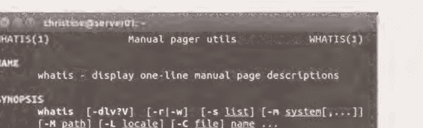

尽管 `man` 是一个文本模式命令，但像 `xman` 程序（并非所有发行版默认安装）这样的 GUI 变体提供了浏览 man 页的点击方法。你不能在命令行输入主题来查看它，像使用 `man` 那样——你必须启动 `xman` 然后浏览手册节到特定主题。

## 使用 less

Linux 的 man 系统使用名为 `less` 的程序来显示信息。该程序是一个分页器，它一个屏幕（即一页）一个屏幕地显示文本文件。

你可以向前向后移动文件、跳转到特定行，并搜索信息。表 6.3 总结了使用 `less` 移动文档的最常用方法。

### 表 6.3 less 文件导航命令

| 按键 | 动作 |

|---|---|

| h 或 H | 使用 `less` 显示帮助信息。 |

| Page Down (翻页), spacebar (空格), Ctrl, V, 或 Ctrl+F | 向文档向下移动一屏。 |

| Page Up (上页), Esc+V, b, 或 Ctrl+B | 向文档向上移动一屏。 |

| Down arrow, Enter, Ctrl+N, e, 或 Ctrl+E, 或 Ctrl+j | 向文档向下移动一行。 |

| Up arrow, y, Ctrl+Y, P, 或 Ctrl+K | 向文档向上移动一行。 |

| xg, x<, 或 Esc+< | 跳转到文档中的第 x 行——例如，输入 `10g` 会显示文档的第 100 行。如果省略 x，默认为 1。 |

| xG, x>, 或 Esc+> | 跳转到文档中的第 x 行。如果省略 x，默认到最后一行。 |

| xp 或 x% | 跳转到文档的 x 百分比处——例如，输入 `50p` 会跳转到文档的中间位置。 |

| /pattern | 从当前位置开始向后搜索文档中的模式。例如，输入 `/BUGS` 会搜索字符串 BUGS。 |

| ?pattern | 执行向后搜索，查找当前位置之前模式的实例。 |

| n 或 / | 重复上一次搜索。 |

| q, 0, :q, 或 ZZ | 退出 `less` 分页器。 |

> 早期的分页器被称为 `more`，但 `less` 增加了更多功能。这个独特的名字是极客幽默的一个例子。

符号 `Esc+V` 指的是先按 Esc 键再按 V 键。

# 第 6 章 • 了解命令行

表 6.3 展示了 `less` 可用命令的一小部分。要了解更多关于 `less` 的知识，你可以阅读它的 man 页：

1. 登录计算机文本模式或打开终端窗口。

2. 输入 `man less`。此操作将打开 `less` 分页器的 man 页。

3. 阅读第一屏文本。当你读完屏幕底部的最后一个单词时，按空格键。这会将显示移动到下一页，以便你继续阅读。

4. 按向上箭头键。这会将显示向上移动一行，如果你需要重新阅读上一个页末尾的几个单词，这非常有用。

5. 按向下箭头键。正如你所预期的，这会将显示向下移动一行。

6. 先按 Esc 后再按 V 键。这会将显示回退一页。

7. 按 `Shift+G` 跳到 man 页的末尾。

8. 按 `G` 键（不使用 Shift 键）回到 man 页的开头。

9. 输入 `/OPTIONS` 以引用该节。很有可能你第一次命中并不是 Options 部分本身，而是其他地方。

10. 重复按 `N` 键，直到找到 Options 节。

11. 按 `Q` 键退出 `less`，从而退出阅读 man 页。


如果你愿意，可以使用 Page 键或表 6.3 中注明的其他键来代替空格键。在后续步骤中也可以进行类似的替换。


某些实现以区分大小写的方式进行搜索，但另一些则不区分大小写。尝试搜索 `options`（小写）以确定你的实现是哪种情况。

当你阅读 man 页时，可能不会使用这些确切的选项；你会使用任何你需要的特性来查找你感兴趣的内容。关键是要熟悉一些重要的功能，以便能够有效利用 `less` 来阅读 man 页和其他文档。

尽管 `less` 对于阅读页面非常重要，但你也可以用它来阅读其他文本文档，例如许多程序附带的 `README` 文件或纯文本文档。要以这种方式使用 `less`，使用它的名称后跟你想要读取的文件名，例如 `less README document`。你可以像在 man 页上一样，在以这种方式读取的文档上使用表 6.3（或通过 `less` 的 man 页）中总结的所有动作。

# 使用 info 页获取帮助

man 页系统在 Unix 类操作系统（包括 Linux）中非常典型，但它非常老旧，因此功能有限。一种较新的文档系统——info 页也是可用的。接下来的几页描述了 info 页如何填补 man 页系统的空白，以及如何使用 info 页。


## 理解 info 页的作用

man 页的基本设计可以追溯到几十年前，因此它早于信息管理领域的一些重要进展。最值得注意的是，man 页没有超链接。虽然 man 页中常见 `See Also`（另需）节，但你无法直接选择其中某一个项目来阅读相关的 man 页；你必须退出 man 系统并输入新命令来读取新页面。这种超链接的缺失也使得在文档之间导航变得困难。

info 页的目标是通过支持链接来克服这些问题。每个 info 页被称为一个节点（node），整个 info 系统是一组相互关联的节点。节点按级组织，类似于书。例如，这本书有章节，每个章节内还有层级。


在写作风格方面，info 页与 man 页相似——它们对主题的描述是简练而全面的——旨在供至少熟悉这些程序的人使用。如果你刚开始使用某个程序，其他类型的文档（后文在“查找额外文档”中描述）可能是更好的选择。

# 了解命令行

广义上，由自由软件基金会（FSF）赞助的程序倾向于使用 info 页而不是 man 页。许多 FSF 程序现在附带了极简的 man 页，引导用户查看 info 页。非 FSF 程序员对 info 页的接受较慢；许多此类程序根本不提供 info 页，而是依赖传统的 man 页。info 浏览器可以读取并显示 man 页，因此专门使用 info 可以是阅读 Linux 标准文档的有效策略。

## 阅读 info 页

读取 info 页的常用工具称为 `info`。要使用它，输入 `info` 后跟主题，或者输入 `info` 来了解 info 系统本身。一旦进入 info 系统，你可以使用表 6.4 总结的按键在文档中移动。

### 认证目标

| 按键 | 动作 |
|---|---|
| `?` | 显示帮助信息。 |
| `N` | 移动到单层层级中链接节点序列的下一个节点。如果作者希望按特定顺序读取多个节点，则可能需要此操作。 |
| `P` | 回到单层层级中的节点序列。如果你在这样的序列中向前移动，但需要回顾之前的材料，这非常有用。 |
| `U` | 在节点层级向上移动一级。 |
| 箭头键 | 在屏幕上移动光标，以便选择节点链接或滚动屏幕。 |
| Page Up, Page Down | 这些键分别在单个节点内向上和向下滚动。（标准的 info 浏览器也实现了 `less` 使用并在表 6.3 中概述的许多更冷门的命令。） |
| Enter | 在选择新节点后移动到该节点。 |

## 使用 info 页获取帮助

| 击键 | 操作 |
| --- | --- |
| `L` | 显示你上次阅读的 info 页面。此操作可以让你在 info 层次结构中向上、向下或向侧移动。 |
| `T` | 显示主题的主页。通常，这是你进入系统时使用的页面。 |
| `Q` | 退出 info 页面系统。 |

作为 info 页使用的示例，请尝试以下操作：

- 1. 以文本模式登录计算机或打开终端窗口。
- 2. 输入 `info` 页面。你应该看到 info 文档的根节点出现。
- 3. 阅读主页，使用方向键或 Page Down（翻页）键查看整个页面。
- 4. 使用方向键选择主页底部附近的 Expert Info（专家信息）节点链接。
- 5. 按 Enter 键查看 Expert Info 节点。
- 6. 按 `U` 键向上浏览一级——返回主节点。
- 7. 浏览到 Advanced（高级）节点。
- 8. 按 `N` 键跳转到当前层级的下一个节点，实际上它是 Expert Info 节点。
- 9. 按 `Q` 键退出 info 阅读器。

如果你对图形用户界面（GUI）比文本模式工具更熟悉，可以使用点按点击工具访问 info 页面：

Emacs：GNU Emacs 编辑器是一个极其强大的文本编辑器，它在其 info 软件包中提供了一个 info 页浏览器。

tkinfo：这是一个独立程序（并非所有发行版都默认安装），它为 info 页面系统提供了点击式界面。你可以使用与 info 浏览器大部分相同的键盘快捷选项，但也可以通过点击链接或使用它提供的按钮或菜单选项进行导航。

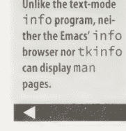

## 查找额外的文档

虽然 man 页（手册页）和 info 页是有用的资源，但其他文档也可用，有时这些文档比上述形式更好。广义来说，Linux 上的帮助有三种形式：计算机上的额外文档、在线额外文档以及来自专家的帮助。

文档类别可能会相互交叉。例如，文档可能在网上可用，但在你安装相应的软件包之前，你的计算机上可能还没有。

### 在你的计算机上定位程序文档

大多数 Linux 程序都带有自己的文档，即使在 man 页和 info 页之外。事实上，有些程序的文档非常多，以至于它们作为一个特殊的软件包安装，包名中包含 `documentation` 或 `doc` 字样，例如 `samba-doc`。

`README` 文件通常包含构建软件软件包的信息，但由于发行版维护者很少更改其 README 文件中的信息，这些信息并不适用。

程序文档最基础、传统的格式是名为 `README.txt` 或类似的文件。该文件包含的具体信息不同程序之间差异很大。对于某些程序来说，该文件非常简练，几乎毫无用；对于另一些程序，它非常有帮助。这些文件几乎都是纯文本文件，因此你可以使用 `less` 或你的文本编辑器读取它们。

如果你从软件包维护者网站以源代码的形式下载了程序，README 通常出现在从压缩源码中提取的构建目录中。然而，如果你是从包文件安装程序，README 文件可能在几个位置中的任何。最可能的地方如下：

- `/usr/doc/packagename`
- `/usr/share/doc/packagename`
- `/usr/share/doc/packages/packagename`

在之前的列表中，`packagename` 是软件包的名称。包名包含版本号，但更多时候并不包含。

除了（或代替）`README` 文件外，许多程序还提供了其他文档文件。这些文件可能包括一个详细记录程序历史的文件、编译和安装过程的说明、配置文件格式的信息等。检查源码的构建目录或你找到 `README` 文件的目录以查找其他文件。

一些较大的程序附带 PostScript、便携式文档格式（PDF）、超文本标记语言（HTML）或其他格式的详尽文档。根据格式和软件包的定义，你可能会找到单个文件或一大堆文件。与 `README` 文件一样，这些文件非常值得查阅，特别是当你想要学习如何充分利用一个软件包时。

有些程序依赖于（通常位于 `/etc/` 目录下的）配置文件：来控制其行为。虽然配置文件中的语法通常难以理解，但许多发行版都提供了包含大量内容的默认配置文件。详细内容因程序而异，但注释通常以井号（`#`）开头。你可能能够通过阅读其配置文件中的注释，获得足够关于该程序的知识来调整你的配置。

如果你找不到 `README` 或类似的文件，可以利用各种工具来帮助查找文档：

- 你可以使用发行版的包管理系统来定位文档。例如，在基于 RPM 的系统上，你可能输入 `rpm -ql package | grep doc` 来定位包的文档。使用 `grep` 在文件列表中搜索 `doc` 字符串是一个很好的技巧，因为文档目录始终包含该字符串。
- `find` 命令可以在你的整个目录树（或子集）中搜索符合特定标准的文件。例如，通过名称，你可能会输入 `find /usr/share/doc -name "string"`，其中 `string` 是你想在文件名中查找的关键词。此命令搜索 `/usr/share/doc` 目录树，但你也可以搜索另一个目录树。如果你搜索一个包含大量文件和子目录的目录，此命令可能需要长时间才能完成。


进入`/path/to/xxx`目录，找到`xxx.json`。

在表达式`cvar = avar + bvar`中，加法运算符（`+`）将`avar`与`bvar`相加，得到它们的和`cvar`

在`List.of(arg0, arg1, arg2)`中，`List`接口的工厂方法`of()`接受一系列的元素，返回包含它们的只读列表。

之后我们这样调用`cmd`命令：`cmd arg0 arg1 arg2`。

```
if (condVar > someVal) {console.log("xxx")}
```

# 第 6 章 · 了解命令行

`which`程序在限制的位置（如标准二进制目录、库目录和 man 页目录）中搜索文件。此工具不搜索用户目录。`which`实用是查找程序执行文件以及相关文件（如文档或配置文件）的快速方法。要使用它，在命令或文件名后输入名称，例如通过查找查找二进制文件和相关文档。

第 9 章描述了软件包管理工具的原理。

第 8 章“搜索、提取和归档数据”详细描述了其中的许多工具，使用了`grep`和`find`。

## 认证目标

`locate`命令搜索 Linux 维护的一个文件名数据库。因此，它的执行速度比`find`快得多，但你无法控制系统搜索的范围。输入`locate`后紧跟你想查找的字符串，例如通过`locate xterm`查找任何与 XTerm 终端相关的文件。

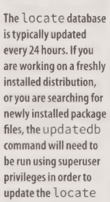

一旦定位了文档文件，你就必须知道如何读取它们。当然，细节取决于文档的文件格式。你可以使用`less`读取许多文件。大多数发行版的配置方式使其解释常见的文件格式（如 HTML），并解压缩存储为压缩格式的文件以节省磁盘空间。表 6.5 总结了常见的文档格式以及你可以用来读取它们的程序。格式因程序而异。

如果你想以原始格式查看格式化文件（如 HTML 文件），请使用`less -L`选项，例如`less -L file`。

### 表 6.5 常见文档格式

| 文件扩展名 | 描述 | 阅读程序 |
|---|---|---|
| .1 到 .9 | Unix man 页 | man, info, less |
| .gz, .xz 或 .bz2 | 使用 gzip, xz 或 bzip2 压缩的文件 | 使用 gunzip, xz 或 bzip2 解压；`less`可能可以解压文件并读取其格式 |
| .txt | 纯文本 | less 或任何文本编辑器 |
| .html 或 .htm | HTML | 任何浏览器 |
| .odt | OpenDocument 文本 | OpenOffice, LibreOffice 或其他文字处理器 |
| .pdf | 便携式文档格式 (PDF) | Evinc, Adobe Reader, xpdf |
| .tif, .png, .jpg | 图形文件格式 | GIMP, GNOME 查看 (eog) |

手动使用 gunzip、xz 或 bzip2 解压文件可能需要将解压后的版本写入磁盘，因此可能需要将文件复制到你的家目录。详情请见第 8 章。

## 在线查找程序文档

除了在计算机上找到的文档外，你可以在互联网上查找文档。大多数软件包都有相关的互联网网站，这些网站会在 man 页（man pages）、info 页面、README 文件或其他文档中提到。检查这些页面以查找文档。

互联网上提供一些 Linux 文档资源。这些网站提供的文档往往是过时的。通常，各个发行版都有自己的在线站点，提供最新的文档。有用的在线文档资源包括：

- Linux 文档项目，或 LDP (`www.tld.org`)
- 红帽产品文档 (`https://access.redhat.com/documentation`)
- Ubuntu 官方文档 (`https://help.ubuntu.com/`)
- openSUSE 文档—ActiveDoc (`https://activedoc.opensuse.org/`)
- Fedora 文档 (`https://docs.fedoraproject.org/`)

许多 Linux 发行版使用社区志愿者来编写和改进它们的文档。这些志愿者的实践经验增加了文档的准确性和深度，使得这些网站成为宝贵的资源。

## 咨询专家

无论你正在寻找文档解决的是什么问题，你都不可能不是第一个这样做的人。在某些情况下，通过向他人寻求帮助可以节省大量时间。你可以使用的某些特定资源包括：

**程序作者** 许多开源作者乐意回答问题或提供有限的支持，特别是当某个 bug 导致了你的问题时。较大的项目（包括大多数 Linux 发行版）有许多作者，这些项目通常提供网络论坛或邮件列表来帮助用户和开发者进行交流。

**网络论坛和邮件列表** 这些资源的格式不同，但用途相似：它们允许用户之间进行交流并分享专业知识。许多发行版都有专门的网络论坛；尝试搜索你的发行版名称并加上 *forum*（论坛）来找到你的论坛。邮件列表对于

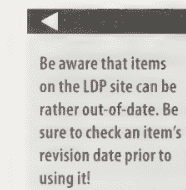

单个程序比较常见。搜索程序的主网站获取有关邮件列表的信息。

IRC 互联网中聊天 (IRC) 是一种用于小组之间进行实时文本模式通信的工具。要使用 IRC，你需要加入一个 IRC 客户端程序，例如 Irss (`https://irss.org`)、HexChat (`https://hexchat.github.io/`) 或 Smuxi (`https://smuxi.im/`)。然后你可以加入一个 IRC 通道，IRC 用户在其中实时交换消息。

某些 Linux 发行版（如红帽企业 Linux 和 SE Linux）带有支持。如果你正在使用此类发行版，你可能已经支付了咨询费用。

**付费顾问** 为某人支付咨询费来解决棘手问题可能是值得的，特别是当你面临“时间就是金钱”的情况时，解决问题的延迟将从字面上导致花费更多钱。通过网络搜索可以找到许多 Linux 咨询公司。

**网络搜索** 网络搜索引擎索引了许多互联网资源，包括页面、程序文档网站、网络论坛，甚至是 IRC 通道讨论。网络搜索可以为你提供专家的答案，而无需直接联系专家。

谨慎使用这些资源可以帮助你解决许多 Linux 问题，这些问题可能仅仅是因为你缺乏知识、配置错误、程序 bug，或者某些糟糕的灾难，例如软件更新导致你的计算机无法启动。

现在的问题是，可用信息通常太多；从无关的（或纯粹是很糟糕的）信息中筛选出有帮助的建议可能是困难的。为了克服这一挑战，具体化会有帮助。你可以通过添加你认为与问题相关但并不常用的关键词来缩小网络搜索范围。错误消息中找到的单词在这方面很有帮助。如果你在网络论坛上发布问题或向程序作者发送 bug 报告，请尽可能具体。包含关于你正在使用的发行版信息、你需要帮助的软件版本，以及关于程序正在执行什么的具体细节。如果程序显示了错误消息，请准确引用它们。这些细节将帮助专家锁定问题根源。

## 基础及扩展

命令行是 Linux 中强大的工具；它们是许多友好的 GUI 工具构建的基础。你可以在没有 GUI 帮助的情况下访问它们，并且可以对它们编写脚本。要使用书中其他章节描述的文本模式工具，你应该熟悉 Linux shell 的基础知识。这些包括知道如何启动 shell、如何在 shell 中运行程序，以及如何使用 shell 的省时功能。

### 基础及扩展（续）

## 建议练习

- 启动一个 GUI 命令（例如 firefox），且不要在末尾加加 ampersand (`&`)。当你带有 ampersand 启动它时，使用 Ctrl+2 将其放入后台，并观察程序对点击的反应。使用 fg 将其返回前台，并重复该过程但使用 bg 在后台运行程序。看看当你退出 GUI 命令时终端中发生了什么。
- 在 shell 中，输入单个字母（例如 m）并按下 Tab 键。发生了什么？如果你输入一个不常用的命令（例如 z）然后按下 Tab 键会发生什么？
- 实验命令历史。使用它来搜索同时是你使用过的命令名和文件名的字符串。使用表 6.1 中描述的箭头键和编辑功能来编辑你之前使用的命令。
- 阅读以下项目的 man 页：man, less, where, find, and locate。关于这些命令你学了什么（超出书中描述的内容）？
- 了解这些命令的文档，例如 GIMP、Firefox 或 Gnome。
- 检查 `/share/doc` 目录树以了解关于
- 输入 logout 或 ____________ 结束会话。

## 复习题

1. 在输入时，哪个组合键可以将光标移动到行首？

| A. Ctrl+A | D. 右箭头 |
| :--- | :--- |
| B. 左箭头 | E. Ctrl+E |
| C. Ctrl+T | |

(续)

2. 如何在后台运行程序？（选择所有适用项）

A. 使用 start 命令运行程序，发行版。

B. 使用 bg 命令运行程序，在发行版。

C. 在命令末尾附加 ampersand (`&`)。

D. 正常运行程序，在 shell 中输入 Ctrl+Z。

E. 正常运行程序，在 shell 中输入 Ctrl+Z 并 bg。

3. 下列哪项是 more 的改进版本？

A. grep

B. html

C. cat

D. less

E. man

4. 错误：按下 Alt+F2 会弹出用于登录的文本模式显示。

5. 错误：你可以通过在前加上章节号来强制 man 显示特定章节，例如 `man 5 passwd`。


- 6. 错误：info 页面是基于网络的文档。
- 7. 错误：`/share/doc` 目录树中的 Linux 文档始终是 OpenDocument 格式。
- 8. 输入 ____________ ____________。
- 9. info 页面中的每个文档被称为 ____________。
- 10. 该命令搜索文件名数据库，让你能够快速识别匹配指定词的文件。

# 第 7 章

## 管理文件

在使用计算机时的大部分工作涉及操作文件。很明显，文件包含你创建的通信、电子表格、数字照片和其他文档。文件还包含 Linux 的配置设置——如何处理网络接口、如何访问硬盘以及计算机启动时做什么。事实上，对硬件设备的访问和内核设置最终都是通过文件完成的。对于管理 Linux 计算机，知道这些文件至关重要。在深入这些细节之前，你应该理解用户文件和系统文件之间的区别。

本章首先描述 Linux 文件存储的基本布局。然后展示如何在 Linux 文件系统中导航。最后，将介绍操作文件和目录的基本文本模式命令。

- 目录导航
- 操作文件
- 操作目录

### 理解文件系统

正如第 5 章“管理硬件”中所提到的，Linux 使用统一的目录树：每个分区、可移动磁盘、网络文件共享和其他磁盘级存储设备都可以作为单个文件系统中的目录被访问。这个文件系统是有结构的。某些目录具有所有 Linux 发行版通用的特定，无论这些目录是作为分区上的普通子目录存在，还是挂载在根 `(/)` 设备上的独立设备。理解主目录的作用将帮助你找到文件并避免灾难性的错误。

> “文件系统”一词可以指底层数据结构，也可以指计算机上文件和目录的组织。在本章中，后者的含义更为常见。

### 用户文件与系统文件

要理解用户文件和系统文件之间的区别，请记住 Linux 是一个多用户操作系统。从原则上，一台计算机可以承载数千个用户。考虑一下这样一台计算机——也许是大学的主机、大型企业的服务器或云计算服务器。这台计算机的绝大多数用户并不熟悉 Linux 系统管理器的细节——他们只想使用自己的文字处理程序、电子邮件客户端和其他应用程序。例如，这些用户不需要处理系统配置文件。事实上，赋予他们访问文件的权限（尤其是写权限）可能是灾难性的。在一台拥有 1,000 个用户的计算机上，如果每一个人都能更改系统配置，那么总会有人由于无知或恶意而做出导致计算机崩溃的更改。

当然，保护计算机免受其用户侵害所涉及的问题，只是更通用的用户账户问题中的一个特例；在一台拥有 1,000 个用户的计算机上，你不希望用户能够以有限的方式之外读写其他的文件。正如第 13 章“创建用户和组”和第 14 章“设置所有权和权限”中所述，你可以对文件设置权限以防止未经授权的访问。

系统文件是控制计算机运行的文件。它们包括以下内容：

- 启动服务器和其他重要守护进程的系统启动脚本
- 程序文件——包括二进制文件和脚本
- 程序支持文件，如字体和图标
- 定义系统如何运行的配置文件（网络配置设置、磁盘布局信息等）
- 大多数服务器和其他守护进程的配置文件
- 系统程序的数据存储，例如描述安装了哪些程序的数据库
- 系统日志文件，记录正常的系统活动

显而易见，从技术角度上说，用户不应该能够更改系统文件，除非是无意间。（例如，日志文件会记录登录尝试等活动）。用户必须能够读取某些类型的系统文件，例如他们使用的字体和图标，但某些系统文件即使对于读取访问也应该受到保护。（例如，用户不应该读取 `/etc/shadow` 文件，因为它存储了加密后的密码。）

### 理解文件的存放位置

为了实现限制普通用户访问系统文件的目标，此类文件通常由 `root` 或另一个目的更有限的系统账户所有。例如，许多服务器程序依赖于自己的系统账户。根据特定需求，可以通过以适当的方式设置权限来保护系统文件免受意外访问。普通用户无法向大多数系统文件写入内容，从而保护这些文件免受损坏。因为 `root` 可以读写任何文件，所以你必须获得 `root` 权限才能执行系统维护任务。

安装 Linux 之后，它包含的大多数文件都是系统文件，以及新安装的 Linux 系统上的目录和子目录。正如后文所述，少数目录（如 `home` 和 `/tmp`）是专门为用户文件留的，尽管这些目录的结构或配置是为了防止多用户使用时出现问题。

系统文件和用户文件之间的区别存在于单用户 Linux 计算机上，例如你的个人笔记本电脑。这可能看起来很奇怪或令人沮；如果你是唯一的用户，并且拥有 `root` 权限，为什么要纠结系统文件和用户文件之间的区别呢？答案是它提供了一层防止意外或恶意破坏的保护。如果由于拼写错误、程序 或恶意软件删除了计算机上的所有文件，如果此操作是以标准用户而非 `root` 执行的，损害就会被限制住；标准用户无法删除计算机上的所有文件。因此，这两种账户类型（以此类推，这两类文件）的区别在单用户计算机上也是有用的。

### 文件系统层次结构标准 (FHS)

尽管每个 Linux 都有处理某些事情的方法，但所有 Linux 开发者都认为目录布局需要某种标准化。例如，程序应该能够在所有发行版中以相同的位置一致地找到系统配置文件。如果不是这样，依赖于此类功能的程序将变得复杂，并可能无法在所有发行版上运行。为了满足这一需求，创建了文件系统层次结构标准（Filesystem Hierarchy Standard, FHS）。除了 Linux 之外，Unix 类操作系统在不同程度上也遵循 FHS。

FHS 在可共享文件和不可共享文件之间做了重要的区分。可共享文件可以在计算机之间合理地共享，例如数据文件和程序二进制文件。（当然，你并不需要共享文件，但你可以这样做。）如果共享了文件，它们通常通过 NFS 服务器进行共享。不可共享文件包含特定于系统的信息，例如配置文件。例如，你不太可能在计算机之间共享服务器的配置文件。

> 用户的家目录传统上位于 `/home`，而 `/tmp` 是所有用户可访问的并存放临时文件。
> FHS 演变自更早的仅限 Linux 的标准——文件系统标准 (FHSND)。

# 第 7 章 • 管理文件

FHS 在静态文件和变量文件之间做了第二个重要区分。前者除非通过系统管理员的直接干预，否则通常不会更改。大多数程序可执行文件都是静态文件的良好示例。用户、自动化脚本、服务器等可能会更改变量文件。例如，用户的家目录和邮件队列由变量文件组成。

FHS 尝试将每个目录隔离到 2x2（可共享/不可共享 x 静态/变量）矩阵中。图 7.1 Illust明了这些关系。某些目录包含多个单元格中的子目录，但在这些情况下，FHS 尝试指定特定子目录的状态。例如，`/var` 是变量，它包含一些可共享和一些不可共享的子目录，如图 7.1 所示。

| 可共享 | 不可共享 |
| --- | --- |
| 静态 | `/usr` `/` `/etc` |
| `/opt` | `/boot` |
| 变量 | `/home` `/` `/var/run` |
| `/var/mail` | `/var/lock` |

图 7.1 FHS 尝试将每个重要目录放入 2x2 矩阵中的一个。

FHS 以版本形式发布。我们编写本书时，最新版本 2.3 是于 2004 年 1 月发布的。目前正在推进在 2015 年年中发布 3.0 版本，以便在你读到这本书时，当前版本已经是新的了（参见 FHS 的网页：www.linuxfoundation.org/collaborate/workgroups/lsb/fhs）。

### 重要目录及其内容

FHS 定义了 Linux 系统许多目录和子目录的名称和用途。表 7.1 总结了最重要的目录。大部分都是系统目录，例外是 `/home`、`/tmp`、`/mnt` 和 `/media`。

表 7.1 根据 FHS 的重要 Linux 目录

| 目录 | 用途 |
| --- | --- |
| `/` | 根目录。所有文件都在此目录或其子目录中。 |
| `/etc` | 存放配置文件。 |
| `/boot` | 存放重要的启动文件，如 Linux 内核、初始内存磁盘以及启动加载器配置文件。 |
| `/bin` | 存放正常运行所需且普通用户可以运行的程序文件。 |
| `/sbin` | 存放正常运行所需但普通用户很少运行的程序文件。 |
| `/lib` | 存放许多程序使用的库——对于基础系统运行重要。 |
| `/usr` | 存放正常运行需要但对系统引导至关重要的程序和数据。该目录被划分为镜像根目录结构的子目录——`/usr/bin`、`/usr/sbin`、`/usr/lib` 等。 |
| `/home` | 存放用户的家目录。将此目录分离到独立的文件中可以有效隔离大多数用户数据，这对于想在不丢失用户数据的情况下重装操作系统很有用。 |
| `/root` | `root` 用户的家目录。 |
| `/var` | 存放杂临时文件，如日志文件和打印队列文件。`var` 的一个子目录 `/var/tmp` 值得特别注意。与 `/tmp` 一样，`var/tmp` 存放临时文件。这些文件在计算机重启时不应被删除。 |
| `/tmp` | 存放临时文件，包括用户程序创建的临时文件。理论上某些在重启时会被删除，但实际上许多发行版并没有这样做。 |
| `/mnt` | 移动介质的传统挂载点；有时为每个挂载的文件系统划分为子目录。 |
| `/media` | 移动介质的新挂载点；通常为每个挂载的文件系统划分为子目录。 |


| `/dev` | 存放设备文件，提供对硬件的低级访问。 |

| `/run` | 存放有关运行系统的信息。 |

# 第 7 章 · 管理文件

作为普通用户，你大多数文件都会在自己的家目录下创建，该目录通常是 `/home` 的子目录。你可能还会访问挂载在 `/media`（有时是 `/run/media`）的可移动介质，以及可能挂载在其他地方资源。你可以使用 `/tmp` 和 `/var` 的某些子目录，尽管大多数用户不需要关注这些位置——程序通常硬编码为使用这些位置存放临时文件或特定类型的文件（如入站文件）。作为系统管理员，你可能会操作位于这些任何目录中的文件；然而，对于系统管理员来说，`/etc` 特别重要，因为大多数系统配置文件都存在那里。当你使用 GUI 或文本模式工具探索计算机时，应该记住这个目录结构。

在这些目录中，有几个单独的目录或目录的集合值得特别关注：

### 配置目录

`/etc` 目录存放大多数系统配置文件。之前的章节已经提到过此类文件，例如 `/etc/fstab`（定义分区的挂载）和 `/etc/passwd`（主账户定义文件）。还有许多此类文件；你会在 `/etc` 中发现一些子目录，用于处理复杂子系统和服务器的多个配置文件，例如 `/etc/X11`（窗口系统）和 `/etc/samba`（Samba 文件服务器）。

### 可执行目录

程序文件主要位于 `/sbin`、`/bin`、`/usr/sbin` 和 `/usr/bin` 中。（其他系统上，额外的目录也可以存放程序文件。最重要的是，`/usr/local/sbin` 和 `/usr/local/bin` 存放编译后的程序。）

### 库目录

库是编程函数的集合，对许多程序都很有用。它们被存储在单独的文件中以便在程序运行时节省磁盘空间和内存，并且它们能够在不重新安装所有依赖的程序的情况下，轻松地更新库文件。在 Linux 中，大多数库位于 `/lib` 和 `/usr/lib` 中，在某些系统中，部分库也位于其他地方（如 `/usr/local/lib`）。

如果你安装过 Windows 电脑，你应该意识到 Windows 和 Linux 之间的一个重要区别：在程序二进制文件中，其配置文件和所有支持文件都位于一个属于程序的单一目录中，例如 `C:\Program Files\`。相比之下，在 Linux 中，程序的大部分密钥可能位于与其他程序共享的位置，并且分散在各地。例如，程序的可执行文件可能在 `/usr/`，相关库在 `/usr/lib`，配置文件在 `/etc` 或用户的家目录下，等等。这在 Linux 中能够行得通，是因为第 9 章中描述的 Linux 软件包系统会跟踪软件包的许多文件，使你能够轻松地删除或升级包。

Linux 的优势在于简化了路径（path），即程序文件所在的目录列表。（库和 man 页也存在路径）。不过，如果你习惯在程序特定的位置查找文件，那么适应 Linux 系统可能会感到有些不习惯。关键是使用你的包系统来识别包文件所在的位置；例如，在基于 RPM 的系统上输入 `rpm -ql someprogram` 可以显示 `someprogram` 中的每个文件都位于何处。

## 导航文件和目录

一旦你对 Linux 文件布局了如指掌，你就可以准备好开始探索了。在接几页中，我们将描述如何学习你的硬盘上有哪些文件、如何更改目录、如何引用当前目录之外的文件，以及如何使用最常用的命令操作文件。

## 获取文件列表

为了操作文件，了解它们是什么很有帮助。`ls` 命令的名称是 list（列表）的缩写，它通过显示目录中的文件名来提供此类信息。如果你不传递任何选项，它会显示当前目录下的文件。然而，你可以同时传递选项和文件或目录指定。此命令支持大量的选项；详情请参阅其 man 页面。表 7.2 总结了最重要的 `ls` 选项。

### 表 7.2 常用 ls 选项

| 选项 (全称) | 选项 (短写) |  |

|---|---|---|

| `--all` | `-a` | 正常情况下，`ls` 会忽略文件名以点（`.`）开头的文件。这些点（也称为隐藏文件）通常不是人们通常感兴趣的文件。添加此参数会显示所有文件。 |

| `--color` | N/A | 此选项产生一个彩色编码的列表，通过显示不同的颜色来区分目录和其他文件类型。某些 Linux 发行版配置其 shell 默认使用此选项。 |

| `--directory` | `-d` | 正常情况下，如果你输入一个目录名作为选项，`ls` 会显示该目录的内容。如果目录名匹配通配符，也会发生同样的情况。添加此参数会将此行为更改为仅列出目录名，这有时是更好的选择。 |

| N/A | `-l` | `ls` 命令仅显示文件名。`-l` 参数（小写 l）会产生一个长列表，其中包含文件权限字符串、所有者、组、大小和创建日期等信息。 |

| `--classify` | `-F` | 此选项在每个名称的末尾附加一个指示代码，让你知道它是什么类型的文件。 |

| `--recursive` | `-R` | `-R --recursive` 导致 `ls` 递归地显示目录内容：如果目标目录包含子目录，`ls` 将同时显示目标目录中的文件和子目录中的文件。 |

## 使用绝对和相对文件引用

如第 5 节所述，Linux 使用统一的目录树，这意味着所有文件都可以相对于单个根目录进行定位，该根目录通常使用斜杠（`/`）字符来表示。如果你的磁盘包含多个分区，其中一个分区将成为根文件系统，其余则挂载在整个目录树的某个位置。当你挂载 USB 闪存、DVD 或其他移动磁盘设备时，情况也是如此。结果可能类似于图 7.2 所示，图中展示了典型 Linux 安装中目录的子集，以及几种移动介质类型。最常见的媒体显示为 `/media` 目录，但某些 Linux 发行版倾向于使用 `/run/media`。大多数子目录可以拆分为单独的分区，甚至放在不同的磁盘上。在图 7.2 中，`/home` 目录位于自己的分区上，其访问方式与它作为根（`/`）分区的一部分时完全相同。

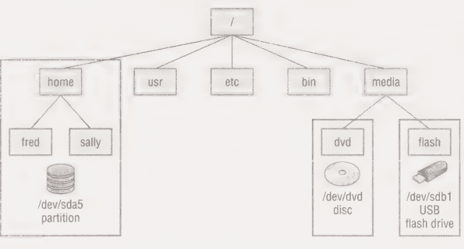

文件和目录可以通过三种方式引用：

**绝对引用** 这些文件引用相对于根（`/`）目录，例如使用 `/home/fred/afile.txt` 来引用 Fred 家目录下的 `afile.txt` 文件。此类引用始终始终以斜杠（`/`）字符开头。

**家目录引用** 波浪号（`~`）字符代表用户的家目录。如果文件名以该字符开头，就好像替换了用户家目录的路径一样。对于 Fred 来说，`~/afile.txt` 等同于 `/home/fred/afile.txt`。

**相对引用** 这些引用相对于当前目录。如果 Fred 正在他的家目录中工作，`awal.txt` 指的就是 `/home/fred/afile.txt`。相对引用可以包含子目录，例如 `somedir/anotherfile.txt`。在 Linux 中，每个目录都包含一个特殊的子目录（`.`），它指向其父目录。如果 Sally 正在 `home/sally` 中工作，她可以通过 `../fred/afile.txt` 引用 Fred 的 `afile`。为了更好地理解这些概念，你应该尝试以下操作：

- 1. 启动一个新的 shell，或使用现有的 shell。
- 2. 输入 `cd ~` – 进入你的家目录。
- 3. 输入 `cat /etc/fstab` 使用绝对引用查看此配置文件。其内容应显示在你的终端中。
- 4. 输入 `pwd` 查看你当前的目录。它很可能是 `/home/username`，其中 `username` 是——你猜对了——你的名字。
- 5. 输入 `cat ../../etc/fstab` 使用相对引用查看此配置文件。命令中的第一个 `..` 指向 `/home/`，第二个 `..` 指向根（`/`）。如果你的家目录位于一个非常特殊的位置，你可能需要调整命令中 `/..` 的数量，这就是为什么我们在上一步中使用了 `pwd` 来查找你的当前目录。
- 6. 输入 `cat ~/etc/fstab` 使用家目录引用查看此配置文件。

当然，第 5 步和第 6 步使用了相当笨拙的文件引用；在现实生活中，你可能会使用绝对文件引用从家目录访问 `/etc/fstab`。不过，如果你在 `/etc` 的子目录中，输入 `../fstab` 会比输入 `/etc/fstab` 简单一点；而输入 `~/afile.txt` 会比输入家目录的完整路径更简单。

文件权限可能会阻止你访问另一个用户的文件，但那是第 14 节中描述的问题。

## 操作文件

如果你用过 Windows 或 Mac OS X，你很可能用过 GUI 管理器来操作文件。Linux 中也提供此类工具，正如第 4 节“使用常用 Linux 程序”所述，你完全可以使用文件管理器来完成许多常见任务。Linux 的文本模式 shell（如 Bash）也为操作文件提供了简单但强大的工具。这些工具可以简化某些任务，例如处理所有名称中包含字符串 `invoice` 的文件。这时你应该熟悉这些文本模式命令。


为了开始这项任务，我们将描述一些你可以创建文件的方法。创建文件后，你可以将它们从一个位置复制到另一个位置。你可能还会多次移动或重命名文件。Linux 允许你创建链接，这是通过多个名称引用同一个文件的方法。如果你再也不需要使用某个文件，可以删除它。通配符提供了使用大小写敏感表示法引用许多文件的方法。最后，我们将涵盖 Linux 文件管理命令的大小写敏感性。

## 创建文件

通常，你使用操作文件的程序来创建文件。例如，你可能会使用图形程序来创建一个新的图形文件。此过程因程序而异，但 GUI 程序通常使用名为“保存”（Save）或“另存为”（Save As）的菜单选项来保存文件。文本模式程序提供类似的功能，但实现细节在程序之间差异很大。

有一个程序值得特别提及作为创建文件的方法：`touch`。你可以输入程序名称后跟想要创建的文件名，例如输入 `touch newfile.txt` 来创建一个空文件 `newfile.txt`。通常情况下，你不需要这样做创建特定类型的文件，除非你使用专用程序来完成这项工作。尽管如此，有时创建一个空文件仅仅为了拥有文件本身是有帮助的——例如，创建一个“临时文件”（scratch files）来测试其他命令。

如果你传递一个已存在的文件，`touch` 会将该文件的访问和修改时间戳更新为当前日期时间。如果你使用的命令根据访问时间处理文件，并且你希望程序将旧文件视为新文件，这就会非常有用。如果你想分发一组文件，并希望所有文件具有相同的时间戳，你可能也想这样做。

你可以使用 `touch` 的多个选项来修改其行为。其中最重要的选项如下：

**不创建文件** `-c` 或 `--no-create` 选项告诉 `touch` 如果文件不存在则不要创建新文件。如果你想更新时间戳但不想在输错文件名时意外创建一个空文件，则可以使用此选项。

**将时间设置为特定值** 你可以使用 `-d` 或 `--date=string` 将文件的日期设置为指定字符串所代表的日期，该字符串可以采用任何形式。例如，`touch -d "July 4 2015" afile.txt`。

第 10 节“文件”描述了如何使用文本模式的 `pico`、`nano` 和 `vi` 编辑器创建文件。

### 认证目标

名为 `make` 的程序员工具会在源码是新的情况下进行编译，程序有时会使用 `touch` 强制 `make` 重新编译源码。


将 `a.txt` 上的日期标记设置为 2015 年 7 月 4 日。你可以通过 `[[CC]YY]MMDDhhm[.ss]` 实现相同的效果，其中 `[[CC]YY]MMDDHmm[.ss]` 是特定数字格式的日期和时间，例如 `201507041223` 表示 2015 年 7 月 4 日下午 12:23。

参考 `touch` 的 man 页以了解其晦涩选项。

## 复制文件

如果你在文本模式 shell 中工作，`cp` 命令复制文件。（它的名字是 copy 的缩写）。你可以通过三种方式使用它：传递源文件名和目标文件名、目标名称或两者都提供。表 7.3 显示了示例。

### 认证目标

表 7.3 `cp` 使用示例

| 示例命令 | 效果 |
|---|---|
| `cp orig.txt.new.txt` | 将 `orig.txt` 复制到当前目录下的 `new.txt`。 |
| `cp orig.txt /otherdir` | 将 `orig.txt` 复制到 `/otherdir` 目录。复制的文件将命名为 `orig.txt`。 |
| `cp orig.txt /otherdir/new.txt` | 将 `orig.txt` 复制到 `/otherdir` 目录。复制的文件将命名为 `new.txt`。 |

所有这些示例文件名都暗示原始文件在你工作目录中，但并非如此；`orig.txt` 可以包含目录规范，例如 `/etc/fstab` 或 `.../afille.txt`。要理解的关键点是目标文件名是如何指定的。在某些情况下，这可能并不明显，因为文件和目录规范看起来很像。例如，考虑以下命令：

```
$ cp outline.pdf ~publication
```

此命令可以产生三种结果之一：

- `/publication` 是一个目录，结果是一个名为 `~/publication/outline.pdf` 的文件。
- `/publication` 是一个文件，结果是该文件将被 `outline.pdf` 的内容替换。
- `/publication` 尚不存在，结果是一个新文件 `~/publication`，它与原始 `outline.pdf` 相同。

> 如果你在目录名称后面加上斜杠（/），例如 `~/publication/`，则返回错误——提示 `/publication` 不存在或是一个普通文件。

## 第7 章 • 管理文件

如果你是命令行复制的新手，保持这些结果的清晰可能会让你困惑。我们鼓励你通过 `mkdir`（后文将描述）创建一个测试目录来实验。

`cp` 命令提供了许多可以修改其行为的选项。一些实用选项允许你以有用的方式修改命令的操作：

- 强制覆盖：`-f` 或 `--force` 选项强制系统覆盖任何现有文件而无需提示。
- 交互模式：`-i` 或 `--interactive` 选项使 `cp` 在覆盖任何现有文件之前询问你。
- 保留所有权和权限：通常情况下，执行 `cp` 命令的用户将拥有复制文件的所有权，以及该账户的默认权限。`-p` 或 `--preserve` 会保留所有权和权限。
- 执行递归复制：如果你使用 `-R` 或 `--recursive` 选项并指定目录作为源，则整个目录（包括子目录）会被复制。虽然 `-r` 也能执行递归复制，但它对普通文件和目录以外的行为未规定。大多数 `cp` 实现将 `-r` 视为 `-R` 的同义词，但这种行为并不保证。
- 执行存档复制：`-a` 或 `--archive` 选项类似于 `-R`，但它会保留所有权并原样复制链接。`-R` 复制的是符号链接指向的文件，而不是符号链接本身。（链接将在本章稍后的“使用链接”部分中进行详细介绍）
- 执行更新复制：`-u` 或 `--update` 选项告诉 `cp` 仅当原始文件比目标文件新或目标不存在时才复制文件。

此 `cp` 选项列表并不完整，但涵盖了最常用的选项。请参阅 `cp` 的 man 页获取更多选项信息。

## 移动和重命名文件

在文本 shell 中，同一个命令 `mv` 用于移动和重命名文件及目录。它的用法与 `cp` 类似；例如，如果你想将 `outline.pdf` 移动到 `~/publication`，你可以输入：

```
$ mv outline.pdf ~/publication
```

如果你指定了文件名和目的地，文件将在移动时被重命名。如果你指定了文件名，且目标目录与源目录相同，文件将被重命名但不会被移动。换句话说，`mv` 的效果就像 `cp` 一样，只是新文件会替换而非补充原始文件。

在后台，`mv` 执行了以下操作：

- 当源和目标位于同一个文件系统中时，`mv` 重写索引而不实际移动文件数据。
- 当你将文件从一个文件系统移动到另一个时，`mv` 会复制文件并删除原始文件。

`mv` 命令带有许多与 `cp` 相同的选项。在列表中，`--recursive` 和 `--archive` 不适用于 `mv`，但其他选项适用。

## 使用链接

有时，通过多个名称引用单个文件非常方便。与其创建该文件的多个副本，你可以为一个文件创建多个链接。Linux 支持两种链接，它们都通过 `ln` 命令创建：

- 硬链接：硬链接是目录条目的副本。两个条目都指向同一个文件。由于它们通过绑定低级文件系统数据结构工作，硬链接只能存在于单个文件系统中。在硬链接场景下，没有任何文件对另一个具有任何优先级；两者都直接链接文件的数据结构。输入 `ln origname linkname`（其中 `origname` 是原始名称，`linkname` 是新文件的名称）来创建硬链接。
- 符号链接（又称软链接）：通过名称引用另一个文件的文件。也就是说，符号链接是一个包含另一个文件名称的文件，当你告诉程序从符号链接读取或写入时，Linux 会将访问重定向到原始文件。由于符号链接通过文件名引用工作，它们可以跨越文件系统的边界。输入 `ln -s origname link` 来创建符号链接。

你可以通过两种方式在长格式目录列表（使用 `ls` 的 `-l` 选项）中识别链接。以下示例说明了这一点：


```
$ ln report.odt hardlink.odt
$ ln -s report.odt softlink.odt
$ ls -l
total 192
-rw-r-r-- 2 root users 94720 Jan 10 11:53 hardlink.odt
-rw-r-r-- 2 root users 94720 Jan 10 11:53 report.odt
lrwxrxr-x 1 user group 12 Jan 10 11:54 softlink.odt -> report.odt
```

此示例从单个文件 `report.odt` 开始。前两个命令创建两个链接：一个硬链接（`hardlink.odt`）和一个符号链接（`softlink.odt`）。输入 `ls -l` 显示所有三个文件。通过 `ls -l` 输出第二列中存在值 `2`，可以将原始文件和硬链接识别为链接；这表示指向该文件的文件名条目数，因此大于 1 的值表示存在硬链接。符号链接通过 `softlink.odt` 文件权限的第一个字符 `l`（小写 L）表示（如 `lrwxrwxrwx`）。此外，符号链接的文件名规范包含了指向被链接文件的显式指针。

这两种链接对于通过多个名称或在多个目录中引用文件都有用。例如，如果你写了一封发给多个收件人的信，你可能想在专门的目录中存储副本，这运行良好，但每种类型的链接都有其影响。最重要的是，如果你使用符号链接，删除原始文件将导致文件完全无法访问；符号链接仍然存在但指向失效。

## 删除文件

使用 `rm` 命令在文本模式下删除文件。正如你预期的，你向该命令传递一个或多个文件名：

```bash
$ rm outline.pdf outline.txt
```

此示例删除了两个文件。如果你想删除整个目录，可以对目录使用 `rm -r`、`-R` 或 `--recursive`：

```bash
$ rm -r oldstuff/
```

`-i` 使 `rm` 在删除每个文件之前提示。这是一个实用的安全措施。如果你使用 `-f`（`--force`）来覆盖此设置，即使 `-i` 被配置为默认值。`rm` 还有其他选项，请查看其 man 页。

要重要的是，`rm` 不实现任何类似于文件管理器“回收站”的功能。一旦你用 `rm` 除了文件，它就消失了，除非使用低级文件系统工具否则无法恢复。在使用 `rm` 时——尤其是配合 `-r` 选项或以 root 身份运行时要小心。

## 使用通配符

通配符是代表其他字符的符号或符号组。你可以使用通配符引用文件。（使用通配符称为 globbing）。Linux 中有三种常用的通配符：

- `?` 问号代表单个字符。例如，`b??` 匹配 `book`、`bald`、`buck` 或任何以 `b` 开头并 `k` 结尾的四字符文件名。
- `*` 星号匹配任何字符或字符组，包括空。例如，`b*k` 匹配 `book`、`bald` 和 `buck`（正如 `b??` 一样）。`b*k` 还匹配 `bbk`、`bbb` 和 `backtrack`。
- **括号值**（封装在方括号 `[]` 内的值）通常匹配集合中的任何字符。例如，`b[ao][l0]` 匹配 `bald` 和 `book`，但不匹配其他。你也可以指定值的值范围；例如，`b[a-z]ck` 匹配 `back`、`buck` 以及其他这种形式的第二个字符为小写字母的四字母文件名。这与 `b?ck` 不同——因为 Linux 处理文件名时区分大小写，且 `?` 匹配任何字符（而不只是字母），`b[a-z]` 不匹配 `b3ck`，尽管 `b?ck` 匹配这两个文件名。

### 通配符的传递

通配符是在 shell 中实现的，并传递给你调用的命令。例如，如果你输入 `ls b??`，而该通配符匹配到了 `balk`、`book` 和 `buck` 这三个文件，结果与你输入 `ls balk book buck` 完全相同。

Bash 扩展通配符的方式可能会导致意外之外的、有时是不如人意的后果。例如，假设你想通过通配符指定两个文件复制到另一个目录，但你忘记提供目标目录了。`cp` 命令会将该命令解释为将第一个文件复制到第二个文件上。

### 理解大小写敏感

Linux 的原生文件系统是大小写敏感的：仅大小写不同的文件名被视为不同的文件。例如，同一个目录可以包含 `afile.txt`、`Afile.txt` 和 `AFILE`，每一个都是一个独立的文件。这种大小写敏感意味着，如果你输入文件名，必须以正确的大小写输入它；如果一个文件名为 `afile`，但你使用 `Afile` 作为它的名字，程序将提示该文件不存在。

这与 Windows 或（通常的）Mac OS 的情况不同，在后者仅大小写不同的文件名被视为相同。在这些操作系统中，你不能在同一个目录中拥有两个仅大小写不同的文件，并且可以使用任何喜欢的大小写变体来指定文件名。Windows 还会为每个长名称的文件创建一个短文件名（八个字符加上可选的三位扩展名），以便帮助旧版软件仅使用此类文件名工作。Linux 则不会创建备文件名。

大小写敏感主要是文件系统的功能，而不是操作系统的功能。如果你访问非 Linux 文件系统（在可移动磁盘上、双启动计算机上的非 Linux 分区或使用网络文件系统），你可能会发现适用于不大小写敏感的规则。这在访问 FAT 和 NTFS 卷时特别常见，这些卷在 Windows 计算机、外接硬盘和 USB 闪盘上很常见。进一步的复杂之处在于，许多 Linux 程序（如 Bash）在不大小写敏感的文件系统上假设是大小写敏感的。第 6 章“认识命令行”中描述的命令补全等功能，只有在你使用文件名记录时的大小写的情况下才可能有效，即使在不大小写敏感的文件系统上如此。

通常，大小写敏感不会产生什么实际问题，特别是当你使用允许点击选择文件的 GUI 程序时。然而，在将文件或目录复制到 FAT、NTFS、HFS+ 或其他不敏感的文件系统时，你应该意识到这些问题。如果你有一个想要复制名称仅大小写不同的文件的目录，你最终将得到只包含其中一个冲突文件的磁盘。


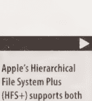

# 第 7 章 · 管理文件

## 操作目录

毫无疑问，你熟悉目录的概念，尽管你可能认为它们是“文件夹”，因为大多数 GUI 文件管理器使用文件文件夹图标表示目录。自然地，Linux 提供了文本模式命令来操作目录。这些包括用于创建和删除目录的特定命令，以及之前描述的一些用于管理目录的文件操作命令。

### 创建目录

你可以使用 `mkdir` 命令创建目录。通常，你通过在命令后输入一个或多个目录名称来使用此命令：

```
$ mkdir newdir
$ mkdir dirone newdir/dirtwo
```

第一个示例创建一个新目录 `newdir`，它将位于当前目录。第二个示例创建了两个目录：`dirone` 和 `newdir/dirtwo`。在这个示例中，`mkdir` 在前一个命令创建的 `newdir` 内部创建了 `dirtwo`。

在大多数情况下，除了目录名称外，你会使用使用 `mkdir`，但你可以通过几种方式修改它的行为：

* **设置模式**：`-m mode` 或 `-mode=mode` 选项会导致新目录具有指定的权限模式，用八进制表示。（第 14 章详细详细描述了此主题。）
* **创建父目录**：通常，如果你指定在一个不存在的目录内创建目录，`mkdir` 会返回“没有此类文件或目录”的错误且不创建目录。然而，如果你使用 `-p --parents` 选项，`mkdir` 会创建必要的父目录。例如，如果 `first` 不存在，输入 `mkdir first/second` 会返回错误信息，但输入 `mkdir -p first/second` 将成功，同时创建 `first` 及其子目录 `second`。

### 删除目录

`rmdir` 命令与 `mkdir` 相反；它销毁一个目录。要使用它，你在命令后输入想要删除的一个或多个目录名称：

```
$ rmdir dirone
$ rmdir newdir/dirtwo newdir
```

这些示例删除了之前所示 `mkdir` 命令创建的三个目录。像 `mkdir` 一样，`rmdir` 支持一些选项，最重要的处理任务：

#### 忽略非空目录的失败

通常，如果目录包含文件或其他目录，`rmdir` 不删除它并返回错误信息。使用 `--ignore-fail-on-non-empty` 选项，`rmdir` 仍然不会删除目录，但它不会返回错误信息。

#### 删除树

`-p --parents` 选项允许 `rmdir` 删除整个树。例如，`rmdir -p first/second` 会同时删除 `first` 及其子目录 `second`。如果你想删除包含内容的目录，必须使用 `-r` 选项：

```
$ rm -r newdir
```

此命令删除 `newdir` 及其所有内容。然而，`-r` 选项具有潜在危险，因此在使用时应要谨慎。

## 安全功能


当你作为普通用户登录时，Linux 考虑了安全功能。这些功能中包括文件所有权文件权限。第 13 章详细描述了这些概念，以及如何获取权限。这种权力伴随着破坏系统的能力，因此你应该小心。


## 管理目录

目录只是包含其他文件的特殊文件。因此你可以可以使用描述的文件操作工具来操作目录。但有一些注意事项：

* 你可以使用 `touch` 更新目录的时间戳，但你不能使用 `touch` 创建目录；`mkdir` 处理该。
* 你可以使用 `cp` 复制目录；然而，你必须使用 `-r`、`-R`、`--recursive`、`-a` 或 `--archive` 选项来复制目录及其所有内容。
* 你可以使用 `mv` 移动或重命名目录。
* 你可以使用 `ln` 配合 `-s` 选项创建目录的符号链接。没有任何 Linux 文件系统支持目录的硬链接。

作为一个示例，假设你的主目录下有一个名为 `Music/Satchmo` 的目录，其中包含 Armstrong 的音乐文件。你想重新组织这个目录，让文件按表演者的姓氏出现，但你想保留通过 `Satchmo` 名字访问，因为你的音乐播放器是这样引用的。你可以输入以下命令来实现目标：

```
$ cd ~/Music
$ mv Satchmo Armstrong
$ ln -s Armstrong Satchmo
```

或者，你可以省略第一个命令，并在 `mv` 和 `ln` 命令中指定每个目录或链接的完整路径。这将前两个命令将 `~/Music/Satchmo` 目录重命名为 `~/Music/Armstrong`。最后一个命令创建一个指向 `~/Music/Armstrong` 的符号链接 `~/Music/Satchmo`。

## 基础知识及拓展（续）

### 建议练习

- 使用 `touch`（或其他其他程序）创建一个文件，并练习使用 `cp` 复制它、使用 `mv` 重命名它、使用 `mv` 将其移动到另一个目录以及使用 `rm` 删除它。
- 使用 `mkdir` 创建目录，然后练习像处理文件一样对它使用 `cp`、`mv` 和 `rm`。尝试将文件复制到目录中，然后使用 `rmdir` 和 `rm` 删除该目录。这两个命令都有效吗？

### 复习题

- 使用以下哪一个命令可以将 `newfile.txt` 重命名为 `while.txt`？

  A. `mv newfile.txt awhile.txt`

  B. `cp newfile.txt awhile.txt`

  C. `ln newfile.txt awhile.txt`

  D. `rn newfile.txt awhile.txt`

  E. `touch newfile.txt awhile.txt`

- 你想将目录 `MyFiles` 复制到使用 FAT 文件系统的 USB 闪盘中。`MyFiles` 的内容如下：

```
$ -l MyFiles/
total 276
-rw-r-r- 1 jen users 129840 Nov 8 15:13 contract.odt
-rw-r-r- 1 rod users 42667 Nov 8 15:12 outline.pdf
-rw-r-r- 1 sam users 108597 Nov 8 15:12 Outline.PDF
```

USB 闪盘挂载在 `/media/usb`，因此你输入 `cp -a MyFiles/ /media/usb`。当你尝试复制这些文件时会发生什么问题？

- 命令将失败，因为它尝试创建链接。
- `MyFiles` 目录将被复制，但没有任何文件没有被复制。
- USB 闪盘上将缺少一个文件。
- 复制过程中一个文件名会被更改。
- 一切正常；命令将正常工作。

- 你输入 `mkdir one/two/three` 并收到一条错误信息，部分为“没有此类文件或目录”。你可以做什么来解决这个问题？（选择所有适用项。）

  A. 在 `mkdir` 命令中添加 `--parents` 参数。
  B. 执行三个独立的 `mkdir` 命令：`mkdir one`，然后 `mkdir one/two`，最后 `mkdir one/two/three`。
  C. 输入 `touch /bin/mkdir` 以确保 `mkdir` 程序文件存在。
  D. 输入 `touch rmdir one` 以清除目标新目录树的干扰基础。
  E. 输入 `rm -r one` 以清除整个干扰目录树。

判断对错：

4. 正或错：你可以从一个低级文件系统向另一个文件系统创建符号链接。
5. 正或错：在登录普通账户时，误输入 `rm` 命令可能会损坏你的 Linux 安装。
6. 正或错：你可以使用 `touch` 命令设置目录的时间戳。
7. 你想将一个文件（`origfile.txt`）复制到 `backups` 目录，但如果 `backups` 目录中存在名为 `origfile.txt` 的文件，则只有当源位置的文件比备份中的文件新时，才继续复制。执行此操作的命令是 `cp ____ origfile.txt backups/`。
8. 你输入 `rmdir junk` 来删除目录，但由于 `junk` 包含子目录，该命令失败了。你会输入什么命令来执行此操作？
9. 哪个通配符匹配文件名中的任何符号？
10. 哪个目录主要包含系统配置文件？

## 搜索、提取与归档

任何操作系统（包括 Linux）的一个重要部分都是存储管理和数据分析。数据之所以有价值是因为可以从中获取知识，因此你需要能够正确地搜索和提取数据，并保护它们。本章涵盖了一些用于搜索、提取和归档数据的工具。本章首先介绍了正则表达式，这是描述你想要在数据中查找模式的方法。你可以在许多命令中使用正则表达式，其中两个（`find` 和 `grep`）被详细描述。本章还涵盖了你用于重定向输入和输出的工具，这些工具在很多情况下非常有用。最后，介绍了创建备份的工具，这些工具在通过网络传输文件时非常有用。

- 使用正则表达式
- 搜索和提取数据
- 重定向输入和输出
- 归档数据

### 使用正则表达式

许多 Linux 程序采用正则表达式，正则表达式是用于表示文本模式的工具。正则表达式与用于指定文件名的通配符类似。在最简单的情况下，正则表达式可以是没有任何修饰的纯文本。正则表达式有两种常用形式：基础和扩展。你使用的形式取决于程序。某些程序只接受一种形式，而另一些则可以使用任一形式（取决于传递给程序的选项）。基础和扩展正则表达式形式之间的差异可能复杂且微妙，但两者的基本原理是相同的。最简单的正则表达式类型是字母数字字符串，例如地址。正则表达式真正的威力在于对非字母数字字符的使用，这些字符会激活匹配规则。最强大的正则表达式特征包括以下：

括号表达式（Bracket Expressions）包含在 `[]` 中的字符构成括号表达式，它匹配括号内的任何字符。例如，`[aeiou]` 匹配元音中的任何一个。在左方括号后包含脱字符（`^`）匹配指定字符以外的任何字符。例如，`[^aeiou]` 匹配辅音但不匹配元音。

范围表达式（Range Expressions）范围是括号表达式的一种变体。范围表达式不是列出每个匹配的字符，而是列出用连字符（`-`）分隔的和终点，例如 `[a-z]`。该正则表达式匹配从 a 到 z 的任何字符。

任意字符（Any Character）点（`.`）代表除换行符以外的任何单个字符。例如，`a.z` 匹配 `abc` 或任何以 `a` 开头并以 `z` 结尾的三字符字符串。

行首和行尾（Start and End of Line）脱字符（`^`）表示行的开始，美元符号（`$`）表示结束。例如，`^abc` 仅当它位于字符行的开头时匹配，而 `$abc` 仅当它位于字符行的末尾时匹配。

重复（Repetition）完整或部分正则表达式后面可以跟一个特殊符号，表示匹配项的重复。具体来说，星号（`*`）经常与点（`.*`）配合使用以匹配任何子串。例如，`A.*Lincoln` 匹配以任意顺序包含 `A` 和 `Lincoln` 的字符串——`Abraham Lincoln` 和 `Lincoln` 只是两个可能的匹配项。

转义（Escaping）如果你想匹配特殊字符之一（如点），你必须对其进行转义——即在前面加一个反斜杠（`\`）。例如，为了匹配计算机主机名（如 `www.sybex.com`），你必须对点进行转义，如 `www\.sybex\.com`。

扩展正则表达式增加了你可以以其他方式进行匹配的特征：

额外的重复运算符（Additional Repetition Operators）这些运算符类似于星号，但它们只匹配特定次数。具体来说，加号（`+`）匹配一次或多次，问号（`?`）指定零或一次。

多种可能的字符串（Multiple Possible Strings）竖线（`|`）分隔两个可能的匹配；例如，`car|truck` 匹配 `car` 或 `truck`。


括号（Parentheses）普通括号 `()` 包围子表达式。括号通常用于指定应用哪些运算符；例如，你可以对一组用竖线连接的单词加括号，以确保这些单词被视为一个整体，其中任何一个都可以匹配，而不影响正则表达式的其他部分。

使用基础还是扩展表达式取决于 `grep` 支持哪种形式。对于像 `grep` 这样支持两种形式的程序，你可以使用任一种；这主要是个人喜好的问题。注意，包含扩展正则字符的正则表达式将根据你使用的类型产生不同的解释。了解一个程序支持哪种类型的正则表达式，或者在程序支持两种类型时选择使用哪种类型是非常重要的。正则表达式规则可能会令人困惑，特别是当你第一次接触到它们时。一些在程序环境中的用法示例将有所帮助。下一节提供了此类示例，并带有

# 第 8 章 搜索、提取和归档数据

## 使用 grep

认证目标

如果你不指定文件名，`grep` 将使用标准输入。这在管道操作中非常有用，正如在稍后在“重定向输入和输出”节中描述的那样。

`grep` 命令用于搜索包含指定字符串的文件，并返回文件名以及（如果是文本文件）包含该字符串的行。你也可以使用 `grep` 在文件中搜索指定的字符串。要使用 `grep`，你只需输入命令名称、一组可选的选项、一个正则表达式以及一个可选的文件名指定。`grep` 命令支持大量的选项，最常见的选项出现在表 8.1 中。

### 表 8.1 常见的 grep 选项

| 选项（长格式） | 选项（短格式） | 描述 |
| --- | --- | --- |
| `--count` | `-c` | 不显示包含正则表达式匹配项的行，而是显示匹配的行数。 |
| `--file=file` | `-f file` | 此选项从指定的文件获取模式输入，而不是从命令行。`grep` 命令是此选项的简写。 |
| `--ignore-case` | `-i` | 你可以使用 `-i` 或 `--ignore-case` 选项执行大小不敏感搜索，而不是默认的大小写敏感搜索。 |
| `--recursive` | `-R` 或 `-r` | 此选项在指定的目录及其所有子目录中搜索，而是指定的目录。你可以使用 `grep` 而不指定此选项。 |
| `--extended-regexp` | `-E` | `grep` 命令默认使用正则表达式。要使用扩展正则表达式，可以传递此选项。或者，你可以调用 `egrep` 而不是 `grep`；该变体命令默认使用扩展表达式 |

## 搜索和提取数据

`grep` 的一个简单示例是使用不带特殊组件的正则表达式：

```
$ grep -r eth0 /etc/*
```

此示例找到 `/etc` 中所有包含字符串 `eth0` 的文件，`eth0` 是大多数发行版中太网设备的标识符。由于示例包含了 `-r` 选项，它会进行递归搜索，因此 `grep` 会搜索 `/etc` 的子目录，也会搜索 `/etc` 本身。对于每个匹配的文本文件，都会打印包含该字符串的行。

假设你想定位 `/etc` 中所有包含字符串 `eth0` 或 `eth1` 的文件。你可以输入以下命令，它使用括号表达式来指定这两种变体：

```
$ grep [01] /etc/*
```

一个更复杂的示例是仅对 `/etc/passwd` 文件搜索包含单词 `games` 或 `mail1`，且在同一行之后包含单词 `login` 的行。此任务需要扩展正则表达式表示法；所需的命令如下：

```
$ grep -E "(games|mail).*.login" /etc/passwd
```

前面的命令说明了另一个你可能需要使用的特性：shell 引用（shell quoting）。由于 shell 使用特殊字符（如竖线 `(|)` 和星号 `(*)`）用于自身的用途，你必须将正则表达式封装在引号中。否则， shell 将错误地将正则表达式视为 shell 命令。

你可以将 `grep` 与产生大量输出的命令结合，从这些输出中筛选出对你重要的材料。（书中的几个示例使用了这种技术）。要实现这一点，你需要使用输入和输出重定向。该主题将在接后的“重定向输入和输出”节中介绍（带有额外的 `grep` 示例）。

## 使用 find

`find` 实用程序实现了暴力搜索法来查找文件。该程序通过遍历指定的目录树、检查文件名、文件日期等来查找符合指定标准的文件。由于这种操作，`find` 往往比较慢。不过，它是灵活的，并且假设你正在搜索的文件存在，它很可能会成功。要找到它，请输入 `name`、可选目录树路径（有时称为起始点）以及一系列选项，其中某些选项使用了类似于正则表达式的指定。


普通用户无法读取 `/etc` 中的某些文件。如果你作为非 root 用户输入此命令，将看到与 `grep` 无法打开文件相关的错误消息。

如果你在你的计算机上输入此命令，由于你的配置，可能找不到任何匹配项。尝试其他方法查找 games 和 mail，例如 pulse rpc。


认证目标

在 `find` 中，你必须配合 `find` 使用目录树或搜索标准，通常是两者都用。


你可以指定 `find` 运行的一个或多个路径；程序将将其操作限制在这些路径中。`find` 的 man 页面包含有关搜索标准的信息，但表 8.2 总结了常见标准。

### 表 8.2 常见的 find 搜索标准

| 选项 | 描述 |
| - | - |
| `-name pattern` | 你可以使用此选项根据名称搜索文件。这样做可以找到匹配指定模式的文件。此模式在技术上不是正则表达式，但 |
| `-perm mode` | 你可以使用此模式搜索文件。这样做可以找到匹配指定模式的文件。模式可以以符号或八进制形式表示。`find` 会查找具有指定权限的文件。 |
| `-size n` | 根据大小搜索文件。通常 n 以 512 字节块为单位，但你可以通过在值后面跟一个字母来修改它。 |
| `-group name` | 按指定组搜索文件。 |
| `-gid GID` | 查找属于指定组 ID 的。 |
| `-user name` | 按指定用户搜索文件。 |
| `-uid UID` | 按用户 ID 查找。 |
| `-maxdepth levels` | 你可以限制搜索的子目录深度。 |

结果将是以 `.c` 结尾的文件列表。

## 使用 wc

文件的大小（通过 `ls` 显示或搜索）是一个很有用的指标。然而，对于文本文件，这个大小值并不总是最有用的。你可能需要知道文本文件中有多少单词或行——例如你想知道文档按每页 52 行打印时占用多少页。`wc` 工具提供了这些信息。例如，获取工作目录中名为 `newfile.txt` 的新文件的信息：

```
$ wc newfile.txt
37 59 1990 newfile.txt
```

此输出显示 `file.txt` 包含 37 行、59 个单词和 1990 个字节。默认情况下，`wc` 显示传递给它的每个文件的字节计数。

你可以传递选项来限制或扩展 `wc` 输出，如表 8.3 所示。在表 8.3 的选项中，`-l`、`-w` 和 `-c` 是默认值，输入 `wc file.txt` 等同于输入 `wc -lw file.txt`。程序的 man 描述了更多选项，但表 8.3 中的选项是你最可能使用的。

### 表 8.3 常见的 wc 选项

| 选项（长格式） | 选项（短格式） | 描述 |
| --- | --- | --- |
| `--bytes` | `-c` | 显示文件的字节数 |
| `--chars` | `-m` | 显示文件的字符数 |
| `--lines` | `-l` | 显示换行数 |
| `--words` | `-w` | 显示单词数 |
| `--max-line-length` | `-L` | 显示文件中最长行的长度 |

请注意，`wc` 在纯文本文件上运行正常，但在格式化文本文件（如 HTML 或文字处理文件）上可能会产生错误甚至荒谬的结果。对于此类文件，最好使用文字处理程序或其他专用编辑器来查找单词数和其他统计数据。

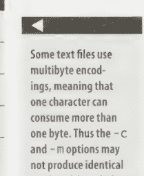

## 使用 cut

在提取数据时，`grep` 对于提取整个文件行（有时称为*记录*）非常有帮助。然而，有时你只需要文件记录的部分内容。在这种情况下，`cut` 命令可以提供帮助。它可以从文件记录的字段中提取文本。它它经常被用于从内容具有高度模式的文件中提取变量信息。

要使用 `cut`，你只需传递一个或多个选项来指定你想要的内容，然后跟上一个或多个文件名。例如，用户的家目录出现在 `/etc/passwd` 文件的第 6 个冒号分隔字段中。因此，要仅提取目录名，请使用此命令：

```bash
$ cut -f 6 -d ":" /etc/passwd
```

表 8.4 显示了你使用 `cut` 命令最可能需要的选项。请查看其帮助页（man page）获取更多选项以及 `cut` 命令的完整说明。


### 表 8.4 常用 `cut` 选项

| 选项（长格式） | 选项（短格式） | 说明 |
| --- | --- | --- |
| `--characters` | `-c` | 仅选择指定的字符位置。 |
| `--delimiter` | `-d` | 使用指定的分隔符作为字段，而不是默认的（表符）。 |
| `--fields` | `-f` | 仅选择指定的字段。 |
| `--only-delimited` | `-s` | 不打印没有分隔符的行（默认在使用 `-f` 选项时打印它们）。 |

你可以通过重定向将 `cut` 命令的结果捕获到文件中。重定向将在本章稍后的“重定向输入和输出”部分中进行介绍。

## 使用 `sort`

在处理大量数据时，能够对其进行排序通常非常有用。`sort` 命令正是此的。然而，你需要了解它的特性以实现预期的结果。

## 搜索和提取数据

对于只包含单词的简单数据列表，你可以不带任何选项直接使用 `sort`，如下所示：

```bash
$ cat pets.txt
fish
dog
cat
bird
$ sort pets.txt
bird
cat
dog
fish
```

与 `cut` 命令一样，在使用 `sort` 时，文件数据不会发生任何更改。仅对输出进行排序。

在对数字数据进行排序时，你可能需要使用选项来获得预期的结果。图 8.1 中的示例显示了使用 `sort` 命令对数字数据列表排序时发生的情况。在使用 `-n` 选项之前，数字不会按照数值顺序正确排序。

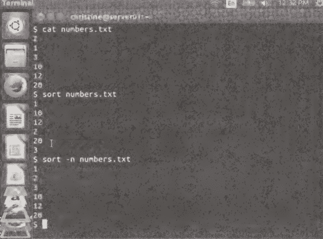

图 8.1 排序数字数据列表

图 8.1 显示了使用适当的 `sort` 命令选项来实现所需结果的重要性。表 8.5 列出了一些常用的 `sort` 选项。

## 第 8 章 + 搜索、提取和存档数据

### 表 8.5 常用 `sort` 选项

| 选项（长格式） | 选项（短格式） |  |
|---|---|---|
| `--dictionary-order` | `-d` | 仅考虑空格和字母数字；不考虑特殊字符 |
| `--ignore-case` | `-f` | 忽略大小写（默认考虑大小写和大写字母的顺序） |
| `--numeric-sort` | `-n` | 按字符串数值排序 |
| `--output-file` | `-o` | 将结果写入指定的文件 |
| `--reverse` | `-r` | 降序排序（默认升序排序） |

除了表 8.5 中列出的选项外，还有许多有用的 `sort` 选项。要探索其他选项，请查看 `sort` 的帮助页。

## 使用 `cat`

第 6 章“了解命令行”引入了 `cat` 命令。尽管 `cat` 通常用于在屏幕上显示排序后的文本文件，但它也有合并文件的能力。图 8.2 中的示例展示了这两种用法。

```bash
File Edit View Search Terminal Help
$
* cat fileA.txt
fileA Line 1
fileA Line 2
* cat fileB.txt
fileB Line 1
fileB Line 2
* cat fileA.txt fileB.txt
fileA Line 1
fileA Line 2
fileB Line 1
fileB Line 2
```

图 8.2 *使用 `cat` 显示和合并文件*

## 重定向输入和输出

注意图 8.2，当使用单个文件名作为参数执行 `cat` 命令时，它只是如你预期的那样将文件内容显示在屏幕上。然而，当使用两个文件作为参数时，文件内容会被链在一起。文件本身没有被修改；只有输出被合并了。这非常有用。在本章的“重定向输入和输出”部分中，将详细介绍如何保留此输出以备后之用。

## 重定向输入和输出

如果你想保存程序的输出以备后参考，可以将其重定向到文件。你也可以从文件重定向程序的输入。虽然输入重定向听起来很奇怪，但某些程序依赖此功能使其能够处理数据，例如通过一个搜索文本模式的程序来输入原始文本文件。除了将输出重定向到文件或从文件重定向外，你还可以将一个程序的输出作为另一个程序的输入传递。相关技术涉及 `xargs` 命令，它允许你从文件或其他程序的输出生成命令选项。

## 使用基本重定向运算符

重定向是通过重定向运算符实现的，重定向运算符是出现在命令及其之后的短字符串。注意图 8.2，当 `cat` 命令使用单个文件名作为参数执行时，它只是如你预期的那样将文件内容显示在屏幕上。然而，当两个两个文件作为参数时，文件内容会被链在一起。文件本身没有被修改；只有输出被合并了。这非常有用。在本章的“重定向输入和输出”部分中，将详细介绍如何保留此输出以备后之用。


重定向是通过重定向运算符实现的，重定向运算符是出现在命令及其之后的短字符串。注意图 8.2，当 `cat` 命令使用单个文件名作为参数执行时，它只是如你预期的那样将文件内容显示在屏幕上。

## 常见的重定向运算符

- `>`：将标准输出重定向到文件。如果文件存在，则覆盖其内容；如果不存在，则创建文件。
- `>>`：将标准输出重定向到文件。如果文件存在，则将内容追加到末尾。
- `<`：将文件内容重定向到输入。
- `<<`：将标准输入重定向到 Here Document（在此文档）。
- `2>`：将标准错误重定向到文件。
- `2>>`：将标准错误追加到文件。
- `&>`：将标准输出和标准错误都重定向到文件。
- `2>&1`：将标准错误重定向到标准输出所在的位置。

## 第 8 章 + 搜索、提取和存档数据

### 表 8.5 常用 sort 选项

| 选项（长格式） | 选项（短格式） | 说明 |
|---|---|---|
| --dictionary-order | -d | 仅考虑空格和字母数字；不考虑特殊字符 |
| --ignore-case | -f | 忽略大小写（默认考虑大小写和大写字母的顺序） |
| --numeric-sort | -n | 按字符串数值排序 |
| --output-file | -o | 将结果写入指定的文件 |
| --reverse | -r | 降序排序（默认升序排序） |

在对数字数据进行排序时，你可能需要使用选项来获得预期的结果。图 8.1 中的示例显示了使用 `sort` 命令对数字数据列表排序时发生的情况。在使用 `-n` 选项之前，数字不会按照数值顺序正确排序。


图 8.1 排序数字数据列表

图 8.1 显示了使用适当的 `sort` 命令选项来实现所需结果的重要性。表 8.5 列出了一些常用的 `sort` 选项。

除了表 8.5 中列出的选项外，还有许多有用的 `sort` 选项。要探索其他选项，请查看 `sort` 的帮助页。

## 使用 cat

第 6 章“了解命令行”引入了 `cat` 命令。尽管 `cat` 通常用于在屏幕上显示排序后的文本文件，但它也有合并文件的能力。图 8.2 中的示例展示了这两种用法。

```bash
File Edit View Search Terminal Help
$
* cat fileA.txt
fileA Line 1
fileA Line 2
* cat fileB.txt
fileB Line 1
fileB Line 2
* cat fileA.txt fileB.txt
fileA Line 1
fileA Line 2
fileB Line 1
fileB Line 2
```

图 8.2 *使用 cat 显示和合并文件*

## 重定向输入和输出

注意图 8.2，当 `cat` 命令使用单个文件名作为参数执行时，它只是如你预期的那样将文件内容显示在屏幕上。然而，当使用两个文件作为参数时，文件内容会被链在一起。文件本身没有被修改；只有输出被合并了。这非常有用。在本章的“重定向输入和输出”部分中，将详细介绍如何保留此输出以备后之用。

如果你想保存程序的输出以备后参考，可以将其重定向到文件。你也可以从文件重定向程序的输入。虽然输入重定向听起来很奇怪，但某些程序依赖此功能使其使其能够处理数据，例如通过一个搜索文本模式的程序来输入原始文本文件。除了将输出重定向到文件或从文件重定向外，你还可以将一个程序的输出作为另一个程序的输入传递。相关技术涉及 `xargs` 命令，它允许你从文件或其他程序的输出生成命令选项。

## 使用基本重定向运算符

重定向是通过重定向运算符实现的，重定向运算符是出现在命令及其之后的。

注意图 8.2，当 `cat` 命令使用单个文件名作为参数执行时，它只是如你预期的那样将文件内容显示在屏幕上。

## 第 8 章 • 数据搜索、提取与归档

例如，使用 `cut` 命令提取 `/etc/passwd` 文件中的用户主目录，然后将其作为管道输入到 `less` 命令中，以便查看结果：

```
$ cut -f 6 -d ":" /etc/passwd | less
```

通常在管道中使用 `grep` 来搜索输出中的关键词。在这个示例中，使用 `cut` 命令从 `/etc/passwd` 文件中提取用户的默认 shell，然后将其作为输入传递给 `grep` 命令以搜索关键词 `bash`：

```
$ cut -f 7 -d ":" /etc/passwd | grep bash
```

管道并不局限于单行命令。例如，你可以通过将其放入第二个管道来让之前的示例更有用。为了确定 `/etc/passwd` 记录中具有 `bash` shell 的用户数量，使用了另一个管道，并在管道末尾添加了 `wc` 命令：

```
$ cut -f 7 -d ":" /etc/passwd | grep bash | wc -l
```

在上一个示例中，管道包含了三个命令。在本系统中，有 237 个用户的 `/etc/passwd` 记录中包含 `bash` shell。

## 生成命令行

管道对于处理棘手任务非常有用。例如，假设你想删除目录树中所有以波浪号（`~`）结尾的文件。（这种命名约定表示某些文本编辑器创建的备份文件。）对于大型目录树，这项任务可能是令人生畏的。通常的删除删除命令（`rm`，在第 7 章中描述）并没有提供搜索并删除目录树中符合此类特定标准的每个文件的选项。`find` 命令可以完成搜索部分的工作（前文已描述过），但不能执行删除操作。

解决方案是将 `find` 的输出结合起来使用 `rm` 创建一系列命令。这可以通过三种主要方式实现：

- xargs `xargs` 命令在管道中的作用是根据其标准输入构建一个命令。该命令的基本语法如下：

```
xargs [options] [command [initial-arguments]]
```

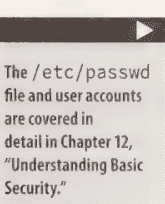

## 重定向输入和输出


这里的 `command` 是你想要执行的命令，而 `initial-arguments` 是你想要传递给命令的参数列表。`options` 是 `xargs` 选项；它们不会传递给 `command`。当你运行 `xargs` 时，它会对标准输入传递的每个单词运行一次 `command`，并将其添加到 `command` 的参数列表中。如果你想向命令传递多个选项，可以将该组封装在引号中以保护它们。

例如，考虑删除所有由波浪号表示的备份文件的任务。你可以通过管道 `xargs` 的输出来实现，然后由它调用 `rm`：

```
$ find / -name "-*" | xargs rm
```

管道的第一部分（`find / -name "-*"`）找到当前目录（`/`）或其子目录下所有名为波浪号（`*`）的文件。然后将此列表传递给 `xargs`，它会将每个找到的文件添加到其自己的 `rm` 命令中。这样，查找并删除所有备份文件的棘手任务就完成了。

- 反引号（Backticks）在许多方面与 `xargs` 相似的工具是反引号（`` ` ``），它是大多数键盘上数字 `1` 键左侧的字符。反引号与单引号（`'`）不同，单引号位于大多数键盘上分号（`;`）的右侧。

反引号内的文本被视为单独命令，其结果将被替换在命令行中。例如，为了删除那些备份文件，你可以输入以下命令：

```
$ rm `find / -name "-*"`
```

以这种方式使用反引号被称为**命令替换**，因为你正在为命令的参数之一提供替换。在上一个示例中，`find` 命令的结果取代了文件名，作为 `rm` 命令的参数。

- `$()` 格式 由于非常很容易将反引号（`` ` ``）与单引号（`'`）搞混，使用反引号进行命令替换的方法通常已不再流行。如果你的发行版支持该格式，最好使用另一种形式的命令替换，即 `$()` 格式：

```
$ rm $(find / -name "-*")
```

使用这种形式的命令替换结果相同，且通常更易读。

## 数据归档

文件归档工具将一组文件收集到单个“包”文件中，你可以轻松地在单个系统中移动它；将其备份到可刻录的 DVD、USB 闪存或其他移动介质；或跨网络传输。Linux 支持多种归档命令，最著名的是 `tar` 和 `zip`。除了理解这些命令外，你应该熟悉在使用它们时配合压缩的结果。

## 使用 tar

`tar` 程序的名字代表“tape archiver”（磁带归档器）。无论其名称如何，你都可以使用 `tar` 将备份（也称为归档）到硬盘或其他介质，而不只是磁带。`tar` 程序是一个将各种数据文件归档为单个文件的工具（归档文件，原始文件保留在磁盘上）。由于生成的归档文件可能很大，通常通过 `tar` 程序在线压缩为 tarball（归档包）。事实上，tarball 常用于一步到位在计算机之间传输多个文件，例如分发源代码时。

`tar` 程序是一个带有许多选项的组合，但你大部分操作只需要几个命令就能完成。

| 命令 | 缩写 | 说明 |
| :--- | :--- | :--- |
| create | c | 创建归档 |
| concatenate | a | 连接到归档 |
| append | r | 追加到归档 |
| update | u | 追加比旧文件更新的文件 |
| diff | d | 比较归档 |
| list | t | 列出内容 |
| extractor | x | 从归档中提取 |
| 限定符 | 缩写 | 说明 |
| :--- | :--- | :--- |
| directory | C | 切换到目录 |
| file | f | 使用文件作为 |
| incremental | g | 执行增量备份 |
| one-file | n | 仅恢复一个 |
| multi-volume | M | 创建多卷磁带 |
| same-permissions | p | 保留信息 |
| absolute-names | a | 保留开头的 / |
| verbose | v | 写入后显示 |
| exclude-file | X | 从归档中排除文件 |
| exclude-from | X | 排除列表中列出的文件 |
| gzip | z | 通过 gzip 处理 |
| bzip2 | j | 通过 bzip2 处理 |
| xz | J | 通过 xz 处理 |

## 使用压缩

在 Linux 中，`gzip`、`bzip2` 和 `x` 程序都可以对单个文件进行压缩。例如，你可能会这样压缩一个大型图形文件：

```
$ x biggraphics.tiff
```

结果是一个文件名与原文件类似的文件，但具有新的文件名扩展名，以识别其为压缩格式。在这种特定情况下，结果将是 `biggraphics.tiff.xz`。

大多数图形程序不会读取以此方式压缩的文件。因此，要使用已压缩的文件，你必须使用匹配的程序对其进行解压缩。要解压在上例中压缩的 `biggraphics.tiff.xz` 文件，请使用此命令：

```
$ un biggraphics.tiff.xz
```

表 8.9 总结了压缩程序、对应的解压程序以及它们创建的文件扩展名。

### 表 8.9 压缩与解压程序及文件扩展名

| 压缩程序 | 解压程序 | 文件名扩展名 |
| --- | --- | --- |
| gzip | gzip | .gz |
| bzip2 | bunzip2 | .bz2 |
| xz | unxz | .xz |

> 通常而言，`gzip` 提供的压缩率最低，而 `xz` 的压缩率最高。这就是为什么 Linux 内核以使用 `xz` 压缩闻名。

`tar` 程序对这三种压缩标准提供了明确支持，`tar` 包（tarballs）通常有其独特的扩展扩展名，指示所使用的压缩方式：

- * `.gz` 用于 `gzip` 压缩的 `tar` 包
- * `.tbz` 或 `.tb2` 用于 `bzip2` 压缩的 `tar` 包
- * `.txz` 用于 `xz` 压缩的 `tar` 包

> 有时 `tar` 归档文件使用两个扩展名，产生如 `my-work.tar.bz2` 的文件。

当你使用压缩来创建 `tar` 包（使用 `tar` 的 `z`、`j` 或 Option 选项）时，压缩程序是对整个 `tar` 包及其所有文件进行操作的，而不是单独压缩 `tar` 包内的每个文件。与单独压缩每个文件再将它们打包相比，这可以提高压缩率。然而，如果文件损坏，则从文件中提取数据将变得更加困难。

> 通常情况下，纯文本文件的压缩效果非常好，二进制程序文件的压缩效果中等，而预压缩数据（如视频文件格式）在压缩时效果差，甚至体积会增大。

* With

# 第 8 章 搜索、提取和归档数据

`gzip`、`bzip2` 和 `xz` 压缩程序均采用无损压缩，这意味着通过解压文件恢复的数据与输入的数据完全相同。某些图形、音频和视听文件格式采用有损压缩，其中部分数据会被丢弃。有损压缩工具绝不应用于程序文件、系统配置文件或大多数用户数据文件；此类文件中的任何丢失都可能是灾难性的。这就是为什么它只支持无损压缩工具。

## 使用 zip

在 Unix 和 Linux 世界之外，`zip` 文件格式是一种常见的格式，起着类似于压缩 `tar` 包的作用。Linux 提供了 `zip` 命令来创建 `zip` 文件，并提供了 `unzip` 工具来从 `zip` 归档中提取文件。`zip` 文件通常具有 `.zip` 扩展名。

在大多数情况下，你可以通过向工具传递目标 `zip` 文件名后跟文件名列表来创建 `zip` 归档：

```
$ zip newzip.zip afile.txt figure.tif
```

此命令创建了 `newzip.zip` 文件，其中包含 `afile.txt` 和 `figure.tif`。（原始文件保留在你的磁盘上。）你需要使用 `zip` 选项来实现所需的结果。表 8.10 总结了最重要的 `zip` 选项；然而，该程序支持更多选项。详情请咨询其 man 页。

### 表 8.10 常用 zip 选项

| 选项（长格式） | 选项（短格式） | 说明 |
|---|---|---|
| n N/A | -0 到 -9 | 设置压缩程度；-0 不进行压缩，-1 应用最小（但快速）的压缩，以此此类推直到 -9，后者应用最大（但缓慢）的压缩。 |
| --delete | -d | 从归档文件中删除指定的文件。 |
| --encrypt | -e | 使用密码加密归档。（zip 会提示你输入密码。） |
| --freshen | -f | 如果归档中的文件自原始归档创建以来发生更改，则更新这些文件。 |
| --fix--fix | -F 或 -FF | 对损坏的归档文件进行修复。--fix/-F 选项执行最小修复，而 --fixfix/-FF 更彻底。 |
| --filesync | -FS | 如果归档中的文件自原始归档创建以来发生更改，则更新它们；如果文件在文件系统中已被删除，则从归档中删除。 |
| --grow | -g | 向现有归档文件追加文件。 |
| --help | -hor -? | 显示基本帮助信息。 |


| `--move` | `-m` | 将文件移动到 zip 归档；即原始文件会被删除。 |

| `--recurse--paths` | `-r` | 包含指定目录内部的文件和子目录。 |

| `--split--size` | `-s size` | 创建一个可能的多文件归档，每个文件不大于 `size` 字节。（可以在大小后附加 A、m、g 或 t 来指定更大的单位。） |

| `--exclude files` | `-x files` | 排除指定的文件。 |

| `--symlinks` | `-y` | 按原样包含符号链接。（通常情况下，`zip` 会包含指向的文件。） |

# 第 8 章 搜索、提取和归档数据

在表 8.10 的选项中，`-r` 选项可能是最重要的，至少如果你想压缩整个目录树是这样的。如果你没有使用它，你的归档将不包含任何子目录。考虑到现代 CPU 的速度，经常使用 `-9` 来实现最大压缩也是有意义的。

要解压并提取 zip 归档中的文件，你可以使用 `unzip` 程序：

```
$ unzip archive.zip
```

此示例将 `archive.zip` 文件中的文件解压到当前目录。与 `zip` 一样，`unzip` 支持许多选项，最重要的选项见表 8.11。

### 表 8.11 常用 unzip 选项

| 选项 |  |

| --- | --- |

| `-f` | 刷新归档中的文件；即仅提取主文件系统中存在且归档中比主系统更新的文件 |

| `-l` | 列出归档中的文件但不提取 |

| `-p` | 将文件提取到管道 |

| `-t` | 测试归档中文件的完整性 |

| `-u` | 更新文件；与 `-f` 类似，但也会提取文件系统中不存在的文件 |

| `-v` | 以比 `-l` 更详细的格式列出归档中的文件 |

| `-L` | 如果文件名源于大写-05（如 DOS），则将其转换为小写 |

| `-n` | 永不覆盖现有文件 |

| `-o` | 在不提示的情况下覆盖现有文件 |

通常情况下，在使用输入文件外不带任何选项来运行 `unzip` 效果良好。然而，你可能偶尔需要使用它的一个或多个选项。`-l` 选项特别适用于在不提取文件的情况下检查归档内容。

## 基础及其他

管理文件通常需要定位它们，`grep` 和 `find` 等工具可以帮助完成此任务。`grep` 工具特别利用正则表达式，它提供了一种描述你可能在文件或其他程序输出中查找的模式。`wc`、`cut` 和 `sort` 工具有助于提取信息并进行重组织以便分析。`cat` 命令允许通过合并多个文件来重组织以及查看文本文件。如果你只需要查看文件的一部分，`head` 和 `tail` 程序更好。你可以使用重定向运算符将输出重定向到 `grep`（或其他程序），许多 Linux 命令行工具和技术都依赖此。`tar` 和 `zip` 程序都能创建包含许多其他文件的归文件。事实上，`tar` 创建的 tar 包是 Linux 计算机之间分发源代码和二进制程序的常用手段。`tar` 命令在创建 tar 包时使用 `xz`、`gzip` 和 `bzip2` 压缩。然而，这些工具也可用于无损文件压缩。

## 建议练习

- 在你的目录和整个 Linux 计算机定位文件。例如，尝试在配置文件中查找你的用户名。

- 使用 `gzip`、`bzip2` 和 `xz` 压缩各种类型文件的实例，例如文本文件和数字照片。哪些文件压缩良好？每种文件类型哪个压缩工具最好？

## 复习题

- 1. 下列哪个命令将打印 `world.txt` 中包含 `changes` 和 `changed` 的行？

  A. `grep[ds] world.txt`

  B. `tar change[d-s] world.txt`

  C. `find "change|d s'" world.txt`

  D. `cat world.txt changes changed`

  E. `find[ds] world.txt`

- 2. 下列哪个重定向运算符会将程序的标准输出追加到现有文件而不覆盖文件原始内容？

  A. `|`

  B. `2>`

  C. `&`

# 第 8 章 搜索、提取和归档数据

## 基础及进阶（续）

D. `>`

E. `>>`

+   3. 你从同事那里收到一个名为 `data79.tar` 的 tar 归包，但在提取它之前，你想检查它所包含的文件名。你会使用哪一个命令来执行此操作？

+   A. `tar uvf data79.tar`

+   B. `tar cvf data79.tar`

+   C. `tar xvf data79.tar`

+   D. `tar tvf data79.tar`

+   E. `tar Avf data79.tar`

+   4. 正确或错误：正则表达式 `Linu[^]*lds` 匹配字符串 `Linus Torvalds`。

+   5. 正确或错误：`find` 命令允许你根据文件大小定位文件。

+   6. 正确或错误：要使用 `zip` 压缩文件，你必须在管道中使用 `zip` 使用 `gzip` 或 `bzip2` 等外部压缩程序。

+   7. 正则表达式表示行首的字符是 ________。

+   8. ________ 命令可以从文件的记录中提取指定的数据字段。

+   9. 完成以下命令，将 `bigprog` 程序的标准输出和标准错误都重定向到文件 `out.txt`。

```
$ bigprog ________ out.txt
```

+   10. `gzip`、`bzip2` 和 `xz` 程序都执行压缩，其中未压缩的数据与原始压缩前数据完全匹配。

## 探索进程和进程数据

计算机是动态且多用途的机器；它们使用许多工具来完成各种工作。本章描述了你可以管理这些工具的方法。这项任务的一个方面是安装、卸载和升级软件包。软件管理的另一个方面是在程序运行后对其管理。（运行中的程序通常被称为进程。）最后，本章涵盖了日志文件，它们记录了运行中的程序的操作细节——特别是自动且在后台运行的程序。

- 理解包管理

- 理解进程层次结构

- 识别运行中的进程

- 使用日志文件

## 理解包管理

包管理是 Linux 的一个领域，不同版本之间差异很大。尽管如此，某些 Linux 发行版之间具有共同的原则，因此我们描述了这些原则，然后是两个主要的 Linux 包管理系统的基础知识。接着，我们描述了如何使用 RPM 包管理器（RPM，一个递归缩写）和 Debian 包系统来管理软件包。

## Linux 包管理原则

如果你在 Windows 中安装过软件，你可能熟悉双击安装程序的程序，该程序会将与程序相关的所有文件放置在它们应该去的位置。Windows 软件安装程序与 Linux 包文件类似，但存在差异。Linux 软件包具有以下特征：

许多程序包依赖于库；库提供了可以被许多程序使用的代码。

-   每个包都是单个文件，可以存储在磁盘上或通过互联网传输。

-   Linux 包文件与 Windows 安装程序不同，它们不是程序；软件包依赖其他程序来执行安装软件的工作。

-   软件包包含依赖信息，这些信息告诉软件包软件为了让包正常工作，必须安装哪些其他包或单个文件。

-   软件包包含版本信息，以便软件包软件可以告知哪一个包是较新的。

-   软件包包含架构信息，以识别它们针对的 CPU 类型（`x86`、`x86-64` 等）。一个单独的代码用于标识与架构无关的包，例如字体和桌面主题。

-   二进制包（包含针对特定 CPU 的可执行程序）通常从源包（包含程序员可以理解的源代码）构建。在给定源包的情况下，可以构建新包，这在某些特殊情况下非常有用。

你可以手动从源代码编译并安装软件，而无需使用打包工具。这个高级主题超出了本书的范畴。


软件包可以、且经常包含将安装到计算机上许多目录的文件。这一事实使得跟踪包的内容至关重要。

软件包软件维护了一个已安装包的数据库（包数据库）。这些信息包含了所有已安装包的名称和版本，以及从每个包安装的所有文件的位置。这些信息使得软件包软件能够快速卸载包软件，确定新包的依赖关系是否已满足，并确定你尝试安装的包是否已经安装，如果是，则安装的版本是否比你尝试安装的版本要旧。

## 理解包系统

如前所述，RPM 和 Debian 两个包系统是常见的（尽管还存在其他）。它们在各种技术细节上有所不同，在用于管理包的命令以及它们使用的包文件格式上也有不同。你不能在基于 RPM 的系统上安装 Debian 包，反之亦然。事实上，即使它们使用相同的包类型，将为一个发行版设计的包安装到另一个发行版上也是有风险的。这是因为非原生包可能具有与原生包需求冲突的依赖关系。

最初，包系统在本地工作。若要在你的计算机上安装包，你必须首先从互联网或通过其他方式下载包文件。然后你可以使用本地命令来安装包。然而，当一个包有许多依赖关系时，这种方法可能非常繁琐；你可能会尝试安装，发现依赖未满足，下载另外几个包，又发现其中一个或多个包有未满足的依赖，并依此类推。当你下载所有这些依赖包时，你可能需要安装十几个更多。

现代发行版提供了网络启用工具来帮助自动化这一过程。这些工具依赖于软件仓库，工具可以那里下载软件包。网络启用工具之间也不同，特别是基于 RPM 的发行版。

在实践中，使用文本模式或 GUI 工具连接软件仓库来管理 Linux 软件。典型的软件安装工作如下：


1. 你发布命令安装程序。

2. 软件定位指定程序的依赖项，并通知你必须安装的额外软件。

3. 你对软件安装发布最终批准（或者拒绝，在这种情况下过程停止）。

4. 软件下载所有必要的包。

5. 软件安装所有包。

升级软件的工作方式类似，尽管升级不太可能需要依赖包。当然，删除软件可以完全在本地完成。许多发行版会自动定期检查其仓库，并在可用更新时通知你。因此，在收到提示时，只需点击几个按钮即可保持你的系统更新。例如，图 9.1 显示了 Fedora 21 中的软件更新工具，它列出了可用软件包。

包管理必然涉及 root 权限，这在第 13 章“创建用户和组”中有更详细的描述。如果你按照自动提示更新软件，可以在更新软件提示时输入 root 密码（在某些发行版上输入普通密码）来保持系统更新。

第 1 章“选择操作系统”中的表 1.1 总结了几个流行的 Linux 发行版的特征，包括每个使用的包系统。

认证目标

> 你可以配置大多数发行版使用本地介质代替互联网仓库。

> 在安装发行版后后，你可能会发现有许多可用更新。

# 第 9 章 · 探索进程与进程数据

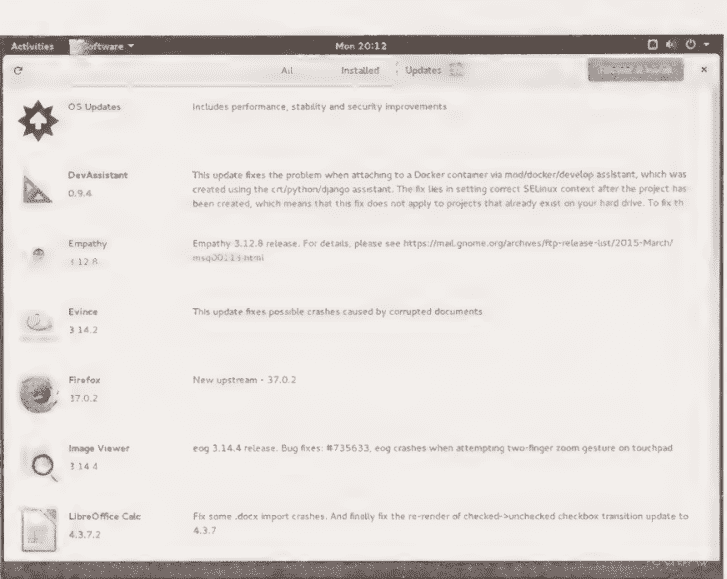

图 9.1 大多数 Linux 发行版都会提示你系统是否有可用更新。

## 管理 Red Hat 系统

基于 RPM 的发行版包括 Red Hat、Fedora、CentOS、SUSE Enterprise、openSUSE 和 Mandriva。在这些发行版中，安装软件的基本工具是文本模式的 `rpm` 命令。然而，该程序作用于本地文件；要使用网络仓库，你必须使用另一个工具，该工具取决于发行版：

- Red Hat、Fedora 和 CentOS 使用文本模式的 `yum` 或其各种 GUI 前端（如 `Yumex`）。

- SUSE Enterprise 和 openSUSE 使用 `zypper` 或 YaST2 等 GUI 前端。

- Mandriva 使用文本模式的 `rpm` 或 GUI `Rpmdrake`。

由于这些发行版之间存在差异（特别是对于网络启用的更新），在这里提供所有这些工具的完整描述是不切行的。幸运的是，GUI 工具易于使用且易于。每个

## 理解包管理

文本模式工具相当直观，尽管你可能需要查阅它们的帮助页（`man pages`）来了解细节。通常，它们使用逻辑子命令，例如使用 `install` 来安装包，如下所示：

```
## yum yumex
```

你可能使用此命令在 Red Hat、Fedora 或 CentOS 系统上安装 GUI 版本的 Yumex。同样，你可以通过使用 `remove` 子命令删除特定包，或通过 `upgrade` 升级计算机上的所有包：

```
## yum remove zsh
## yum upgrade
```

此示例删除了 `zsh` 包，然后升级了系统上剩余的包。这两个命令都会产生多行输出，你可能会被要求确认它们的操作。查阅 `yum`（或你发行版所使用的任何管理软件）的帮助页以获取更多关于该工具的信息。

如果你需要直接处理 RPM 包文件，应该注意它们的扩展名为 `.rpm`。这些文件还包含架构类型代码（如 `x86_64`），并且通常包含其目标系统代码（如 `Fedora`）。例如，`samba-4.1.17-1.x86_64.rpm` 是适用于 x86_64 平台的 Samba 包（版本 4.1.17，发布版本 1）。要使用 `rpm` 命令安装它，你需要这样操作：

```
## rpm -i samba-4.1.17-1.x86_64.rpm
```

这比使用 `yum` 命令要多费一些，因为你需要知道包的完整文件名。

## 管理 Debian 系统

Debian/Linux 发行版创建了自己的包系统，基于 Debian 的发行版（如 Ubuntu 和 Mint）也使用相同的系统。在 Debian 包系统之上是高级软件包工具（APT），它提供了访问网络仓库的通道。`dpkg` 命令是 Debian 包系统的底层接口；它大致等同于基于 RPM 的系统上的 `rpm` 工具。与 `rpm` 工具一样，使用 `dpkg` 命令可以知道要安装包的确切名称：

```
# dpkg -i samba_3.6.1-3_amd64.deb
```

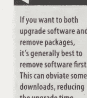

> 同时也存在基于 RPM 发行版的 APT 第三方实现。详情请参见 http://apt.kernel.org。至少有一个基于 RPM 的发行版原生使用 APT。


## 第 9 章 - 探索进程与进程数据

有多个工具在 `apt-get` 和 GUI `Synaptic` 之上提供了文本模式和图形界面。正如它们的名称所示，`apt-get` 提供了访问网络仓库的功能。图 9.2 显示了 Synaptic 的用法。

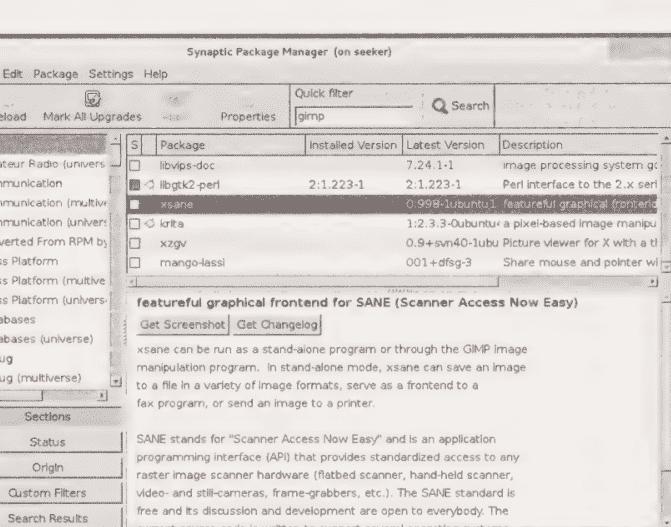

**图 9.2** `Synaptic` 允许你在基于 Debian 的系统上搜索、选择、安装和卸载软件。

Debian 包文件的文件名以 `.deb` 结尾。与 RPM 包类似，名称通常包含软件版本和架构代码（如 `i386` 或 `amd64`）。例如，`samba_3.6.1-3_amd64.deb` 是适用于 AMD64 (x86-64) 的 Samba 包（版本 3.6.1，修订版 3）。你可以使用 `dpkg` 或 `apt-get` 安装此类文件，也可以使用 `apt-get` 的 `install` 命令从互联网下载包及其依赖项：

```
## apt-get install samba
```

与 RPM 包一样，你可以删除包或升级你计算机的软件：

```
## apt-get remove ssh
## apt-get upgrade
```

APT 是一个强大的工具，底层的 `dpkg` 也是如此。你应该查阅这些程序的帮助页以了解更多关于如何使用这些程序。

## 理解进程层次结构

Linux 内核是 Linux 安装的核心。内核管理内存、为软件提供访问磁盘的方法、持有 CPU 时间并执行其他关键的低级任务。内核在启动早期加载。内核在启动过程中会启动第一个进程，称为 `init`。其他进程都是由 `init` 运行的。


内核管理内存、为软件提供访问磁盘的方法、持有 CPU 时间并执行其他关键的低级任务。内核在启动早期加载。内核在启动过程中会启动第一个进程，称为 `init`。其他进程都是由 `init` 运行的。

## 理解进程层次结构

Linux 内核是 Linux 安装的核心。内核管理内存、为软件提供访问磁盘的方法、持有 CPU 时间并执行其他关键的低级任务。内核在启动早期加载。内核在启动过程中会启动第一个进程，称为 `init`。其他进程都是由 `init` 运行的。

每个进程都关联一个进程 ID (`PID`) 数字。这些数字从 1 开始，所以是正常的。每个进程还有一个父进程 (`PPID`) 数字，指向其父进程。内核在进程表中维护进程信息。许多管理进程的工具依赖这些数字，特别是 `PID` 数字。`ps` 和 `top`（稍后描述）允许你查看和操纵此表。

## 识别进程


图 9.3 Linux 进程以层次树的形式排列。

每个进程都关联一个进程 ID (`PID`) 数字。这些数字从 1 开始，所以是正常的。每个进程还有一个父进程 (`PPID`) 数字，指向其父进程。内核在进程表中维护进程信息。许多管理进程的工具依赖这些数字，特别是 `PID` 数字。`ps` 和 `top`（稍后描述）允许你查看和操纵此表。

识别进程最简单的工具是 `ps`，它产生一个进程列表。9.1 显示了 `ps` 的运行示例。

## 识别进程

在管理进程之前，你必须能够识别它们。在任何情况下，`ps` 和 `top` 实用程序都能帮助识别进程。以各种方式搜索进程，例如通过名称或资源使用。你可能还会识别你的进程消耗了多少内存，可以通过 `free` 命令来实现。

## 使用 ps 识别进程

识别进程最简单的工具是 `ps`，它产生一个进程列表。9.1 显示了 `ps` 的运行示例。在此示例中，`-u` 选项限制输出为指定用户（rich）拥有的进程，而 `-forest` 选项创建一个显示父子关系的显示。

9.2 显示了 `ps` 的另一个示例。在此示例中，`u` 选项增加了信息列，而 `u` 选项限制输出为 rich 拥有的进程。`ps` 命令支持大量的选项（详情请查阅其帮助页）。

# 列表 9.2 ps -u u rich 的输出

```
$ ps u u rich
USER PID %CPU %MEM VSZ RSS TTY START TIME
COMMAND
```

## 识别运行进程

| rich 19221 | 0.0 | 1.5 | 4484 1984 ? | S | May07 | 0:01 dfm |
| rich 2451 | 0.0 | 0.8 | 1856 1048 pts/3 | S | 16:13 | 0:00 -bash |
| rich 2496 | 0.0 | 3.2 | 6232 4124 ? | S | 16:17 | 0:00 /opt/kd |


| rich 2498 | 0.0 | 0.8 | 1860 1044 pts/1 | S | 16:17 | 0:00 bash |
| rich 2505 | 0.1 | 2.6 | 4784 3352 pts/1 | S | 16:17 | 0:00 nedit |
| rich 2506 | 0.0 | 0.7 | 2124 1012 ? | S | 16:17 | 0:00 `/bin/cs` |
| rich 2544 | 0.0 | 1.0 | 2576 1369 ? | S | 16:17 | 0:00 xeyes |
| rich 2556 | 0.0 | 0.7 | 2588 916 pts/3 | R | 16:18 | 0:00 `ps u U` |

由于 `ps` 选项有很多，用户有多种方式使用该程序。输入 `ps` 通常会产生所需的信息，包括计算机上所有进程的 PID 值和命令名称（包括命令行选项）。添加 `u`（如 `ps ax`）会添加用户名、CPU 负载以及其他一些细节。产生的信息范围之大可能会让人无从下手。缩小这一范围的一种方法是将结果通过给 `grep`，这可以过滤掉不包含你指定的搜索标准的行。例如，如果你想找到 `get` 进程的 PID 号，可以这样做：

```
$ ps ax | grep
27946 pts/8      Sl      0:00 edit
27950 pts/8      S+      0:00 grep-colour=auto grep
```

该命令揭示了 `grep` 的 PID 值为 27946。这通常是你使用 `ps` 时最重要的信息，因为你会使用 PID 值来更改进程的优先级或终止它。

## 使用 top 识别进程

虽然 `ps` 可以返回进程优先级和 CPU 使用信息，但该程序的输出通常按 PID 数字排序，而且它只提供某一个特定时间点的信息。如果你想快速定位占用内存的进程（memory hog），或者你想研究随时间推移的资源使用情况，`top` 是一个更合适的工具。此程序版本 9.4 显示在 GNOME 窗口中运行的 `top`。

默认情况下，`top` 按 CPU 使用率对项目进行排序，并每几秒更新一次。你需要熟悉系统上运行的程序的用途和正常习惯，以便判断 CPU 密集型应用程序是否运行异常；不同程序的合法需求差异巨大，因此无法为何时进程消耗了过多 CPU 给出一个简单的规则。


由于 `ps ax` 会产生带有选项的命令，使用 `grep` 在输出中搜索字符串会返回被搜索的命令以及 `grep` 本身。

认证目标


# 第 9 章 探索进程和进程数据

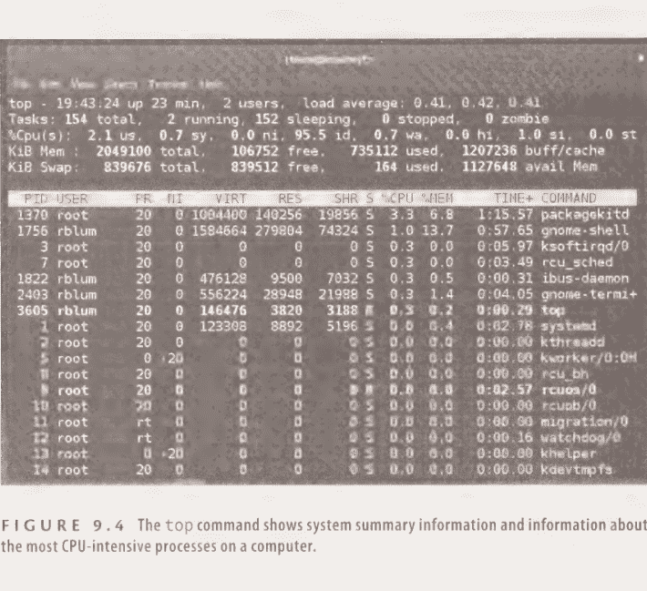

图 9.4 `top` 命令显示了系统信息以及计算机上最 CPU 密集型进程的信息。

你可以用 `top` 做的事情比光看它更新显示要多得多。当它运行时，你可以输入几个单字母命令中的任意一个，其中一些会提示你提供额外信息，如表 9.1 所示。其他命令在 `top` 的主页面中有所描述。

`top` 提供的信息之一是负载平均值（load average），它是应用程序对 CPU 时间需求的衡量。在图 9.4 中，你可以看到当前的负载平均值和两个之前的测量值。负载平均值可以解释如下：

- 无程序消耗 CPU 时间的系统负载为 0。
- 有一个程序运行 CPU 密集型任务的系统负载为 1。
- 单 CPU 系统上较高的负载平均值反映了程序正在竞争可用 CPU 时间。
- 在具有多个 CPU 或核心的计算机上，在竞争 CPU 时间之前，负载平均值可以达到 CPU 或核心的数量。

今天出售的大多数计算机都是多核模型，但在 2006 年之前，单核模型主导着市场。例如，在具有四核 CPU 的系统上，负载平均值为 4.0 反映进程要求的 CPU 时间恰好等于计算机可用的。

## 表 9.1 常用命令

| 命令 | 说明 |
|---|---|
| h | 显示帮助信息 |
| k | 可以杀死进程 |
| r | 可以更改进程的优先级 |
| s | 更改刷新间隔 |
| P | 可以按 CPU 使用率排序 |
| m | 可以按内存使用率排序 |

# 测量内存使用

由于 `ps ax` 会产生带有选项的命令，使用 `grep` 在输出中搜索字符串会返回被搜索的命令以及 `grep` 本身。

认证目标

第 9 章 探索进程和进程数据

然而，有时程序消耗过多内存，是因为代码效率低下或者是内存泄漏（memory leak）。由于 `free` 命令可以查看内存的状态，`free` 命令可以生成关于内存的报告：

```
$ free
```

| | | 使用 | 空闲 | 共享 | 缓存 |
|---|---|---|---|---|---|
| Mem | 791488 | 7734456 | 180432 | 190656 | 3244720 |
| buffers/cache | 4299080 | 3615808 | | |
| Swap | 6291452 | 1030736 | 5260716 | | |

`Mem` 行显示总内存（RAM）统计信息，包括计算机的总内存（减去内核部分）、已内存以及空闲内存。此示例显示计算机的大部分内存正在使用。这种状态是正常的，因为 Linux 使用空闲内存作为缓冲区和缓存，这有助于加快磁盘访问。`Mem:` 行并不是最有用的；相反，你应该查看 `buffers/cache:` 行，它显示了程序使用的总内存。在此示例中，7914888 KiB 中的 2299080 KiB 已使用。

`Swap` 行显示交换空间的使用情况。交换空间是作为内存补充而留出的磁盘空间。当 Linux 耗尽内存或它认为内存比缓存更适合缓存时，就会使用交换空间。在此示例中，1030736 KiB 的交换空间正在使用，总共 6291452 KiB，剩余 5260716。交换空间的使用通常很低，如果大幅增加，可能会导致性能问题。从长远来看，增加计算机的 RAM 通常是解决此类问题的最佳方案。由于交换空间过多且你需要立即缓解，终止一些消耗内存的程序会有帮助。内存泄漏（前文提到）会导致

内核授予一组内存地址的访问权限，程序随后可以使用这些地址。当程序结束时，它应该释放内存给内核。

## 使用日志文件

针对此类问题，终止泄漏内存的程序可以将系统性能恢复到正常。

`free` 命令支持多个选项，其中大多数选项都会修改其显示格式。其中最有用的是 `-m`，它使显示使用兆字节（MiB）而不是默认的基基字节（KiB）作为单位。

## 使用日志文件

许多在后台运行的程序（守护进程）会将它们正常运行的信息写入日志文件，这些日志文件记录了此类备注。查阅日志文件可以是诊断守护进程问题的重要部分。执行此操作的第一步是找到日志文件。在某些情况下，你可能需要告诉程序产生更详细的输出以帮助追踪问题。在本节中，你将学习一些关于如何执行此操作提示。最后，本节将介绍内核环形缓冲区，它在技术上不是一个日志文件，但可以为内核信息提供类似的作用。

## 日志文件

Linux 将大多数日志文件存储在 `/var/log` 目录树中。表 9.2 总结了许多 Linux 系统上的某些日志文件。此外，书中未描述的许多服务器程序还会添加自己的日志文件或 `/var/log` 的子目录。如果您在这些服务器上遇到问题，检查其日志文件可以是排查故障的良好起点。

表 9.2 重要日志文件

| 日志文件 | 内容 |
| --- | --- |
| boot.log | 该文件总结了通过 SysV 启动脚本在引导过程中启动的服务 |
| cron | 该文件总结了通过 cron 守护进程定期运行的进程。尽管此本书没有介绍 cron，但它出现问题会导致定期反复故障的故障，所以你应该关注它。 |
| cups/ | 该目录包含了与 Linux 打印系统相关的日志文件。 |
| gdm/ | 该目录包含了与 GNOME 显示管理器 (GDM) 相关的日志文件，GDM 负责许多系统上的 GUI 登录。 |

**认证目标**

日志文件的细节在不同发行版之间有所不同，表 9.2 中的某些文件可能在你的系统上不存在，或者你发现的文件名称可能不同。

（未完）

## 第 9 章 • 探索进程和进程数据

## 表 9.2（续）

| 日志文件 | 内容 |
| --- | --- |
| messages or syslog | 这是一个通用日志文件，包含来自许多没有专用日志的守护进程的消息。 |
| secure | 你可以在此文件中找到与安全相关的消息，包括用户使用 `su`、`sudo` 和类似工具获取 root 权限的通知。 |
| Xorg.log | 此日志中显示了 X窗口系统 (X) 最近一次启动的信息。 |

日志轮转发生在深夜，因此如果你关闭电脑，它就不会发生。定期让电脑运行一晚，以确保日志文件进行轮转。


日志文件经常被*旋转*，这意味着最旧的日志文件被删除，最新的日志被重命名为日期或数字，并创建一个新的日志文件。例如，如果它在 2016 年 12 月 1 日轮转，`/var/log/messages` 将变为 `/var/log/messages-20161201`、`/var/log/messages-1.gz` 或类似文件，并创建一个新的 `/var/log/messages`。这种做法可以防止日志文件增长到失控。

大多数日志文件都是纯文本文件，因此你可以使用任何可以检查文本文件的工具（如文本编辑器）来检查它们。一个实用的命令是 `tail`，它显示文件的最后 10 行（或你通过 `-n` 选项指定的行数）。例如，输入 `tail /var/log/messages` 将为你显示该文件的最后 10 行。

并不是所有程序都会记录消息。通常，只有守护进程会这样做；普通程序通过其他方式显示错误消息——在 GUI 对话框中或文本模式终端中。如果你认为某个程序应该记录数据但你找不到它，请查阅它的文档。或者，你可以使用 `grep` 尝试找到程序发送消息的日志文件。例如，输入 `grep sshd /var/log/*` 可以找到出现字符串 `sshd`（SSH 守护进程）的文件。

## 创建日志文件

某些程序会创建自己的日志文件；然而，大多数程序依赖于一个通称为“系统日志守护进程”的实用程序来完成这项工作。该程序的名称通常为 `syslog` 或 `syslogd`。与其他守护进程一样，它在引导过程中由系统启动脚本启动。目前有多个系统日志守护进程包可用。其中某些包提供了一个独立的工具 `klog` 或 `klogd`，用于单独处理来自内核的而非普通程序的日志消息。

**认证目标**

你可以通过调整配置文件来修改日志进程的行为，包括调整它记录特定类型消息的文件。文件名取决于所使用的特定守护进程，但它通常是 `/etc/rsyslog.conf` 或类似文件。日志文件配置的细节超出了本书的范范围，但你应该意识到这些细节是可以被更改的。这一事实解释了不同发行版之间日志文件功能的大部分差异。

一旦日志进程运行，它将使用被称为“系统消息”（system messaging）的技术接收其他进程的消息。然后它对消息进行排序，并根据消息源和优先级代码将它们引导到合适的日志文件中。


## 非详细日志条目

有时日志文件没有提供足够的信息来确定问题。增加日志输出的详细程度因程序而异。你应该查阅程序文档了解如何操作。

## 检查内核缓冲区

内核缓冲区类似于日志文件；然而，与日志文件不同，它存储在内存而不是磁盘中。像日志文件一样，它的内容随着电脑运行而变化。要检查内核缓冲区，你可以输入 `dmesg`。某些发行版在系统引导时会获取内核缓冲区的副本 `/var/log/dmesg`。如果你想在一个不创建此类文件的系统中创建，可以编辑 `/etc/rc.d/rc.local` 文件并在结尾添加以下行：

```
dmesg > /var/log/dmesg
```

内核缓冲区消息可能非常晦涩；但它们对于诊断硬件问题非常有价值，因为内核负责与硬件交互。如果硬件设备运行异常，你可以尝试搜索内核。即使你不理解发现的消息，也可以尝试将该消息输入搜索引擎或向懂行的同事寻求建议。

**认证目标**

由于内核缓冲区的大小有限，如果电脑运行很长时间，早期的项目可能会丢失。或者，如果你知道你需要的信息与特定字符串相关，你可以使用 `grep` 来搜索它。例如，为了查找第一个硬盘 `/dev/sda` 的消息，你可能会输入：

## 基础与扩展

一个 Linux 操作系统可以认为由运行的程序或进程组成。管理进程始于管理安装在计算机上的程序，这是一个你可以使用包管理工具如 `rpm` 或 `dpkg` 完成的任务。你可以通过 `ps` 和 `top` 等工具了解哪些进程正在运行。日志文件可以帮助你了解守护进程的操作，它们可能无法通过其他程序可以生成的文本模式或 GUI 输出输出错误消息。

## 建议练习

- 你的软件是最新的吗？在桌面环境菜单中找到该选项运行包管理器并检查系统是否是最新的。运行过时软件的计算机可能会受到漏洞和安全威胁，因此保持软件更新非常重要！

- `ps ax |` 使用 `less` 浏览进程列表。你可能不认识许多进程，但某些应该是熟悉的。尝试使用 `man` 或网络搜索来了解更多关于你不认识的进程。

## 复习题

1. 下列工具最适合在 Debian 计算机上安装软件软件包及其所有依赖项？

A. `yum`

B. `zypper`

- C. `dmesg`

- D. `rpm`

- E. `apt-get`

- 2. 除了 Linux 内核本身，运行的第一个进程通常通常名称是什么？

- A. `init`

- B. `bash`

- C. `cron`

- D. `login`

- E. `grub`

- 3. Linux 计算机上绝大多数日志文件存储在哪里？

- A. `/var/log`

- B. `/etc/logging`

- C. `/usr/log`

- D. `/home/logging`

- E. `/log/usr`

- 4. 正或错：在使用适当命令时，只要你连接了互联网，就可以安装一个程序并确保其所依赖的所有软件也会被安装。

- 5. 正或错：默认情况下，`top` 命令中的第一个进程是当前消耗最多 CPU 时间的进程。

- 6. 正或错：计算机运行几周后，`dmesg` 命令产生的输出可能与首次启动时的输出不同。

- 7. 大多数 Linux 发行版都维护着 ____________ 中安装了哪些包的信息（两个单词）。

- 8. 你正在使用 `bash`，并输入 `emacs` 来启动 emacs 编辑器。在这种情况下，`emacs` 是 `bash` 的 ____________

- 9. 通用系统消息可能在 `/var/log/messages` 或 `/var/log/____________` 中找到，这取决于你的发行版。

- 10. 你用于读取在启动过程中生成并存储在内核缓冲区中的消息命令是 ____________ 命令。

# 编辑文件

计算机文档有多种形式，但最基础且灵活的形式之一是文本文件。通常，配置文件和 脚本都是文本文件。由于你经常需要修改配置文件和创建 脚本，你必须能够编辑文本文件。本章涵盖了这项任务，重点介绍了简单的文本模式 `pico`、`nano` 和 `vi` 编辑器。首先描述了文本文件扮演的几个角色；然后介绍了如何选择编辑器。当然，要编辑文本文件，你必须能够启动编辑器，无论是在现有文档上还是在一个新文档上。`pico` 和 `nano` 编辑器非常相似，因此它们的操作被一起描述，随后是 `vi`，按照现代标准来说，`vi` 是一种非常不寻编辑器。

- 理解文本文件的作用

- 选择编辑器

- 启动编辑器

- 使用 `pico` 或 `nano` 编辑文件

- 使用 `vi` 编辑文件

# 理解文本文件的作用

文本编辑器允许你编辑以纯文本格式存储的文档。美国信息交换标准代码（ASCII）曾是通用格式，但现在文件通常使用 Unicode 格式来支持额外的字符。这些格式存储的文本文件本身不包含任何特殊格式或嵌入式功能。文本文件不能包含图形、使用多种字体、通过斜体来强调单词，或使用其他你可能与文字处理器相关的功能（尽管标记工具为这这条规则提供了部分例外）。

> 如果文本文件是用 ASCII 编码的，它也是用 Unicode 编码的。ASCII 编码是 Unicode 的子集。

## ASCII 与 Unicode

ASCII {追溯到 1960 年代。它是一种 7 位代码，意味着它最多支持 2⁷ 或 128 个字符。（在实践中，ASCII 使用 8 位，因此有额外的 128 个字符可用。这些位用于编码控制字符或 ASCII 扩展。）ASCII 的创建是为了编码英语字母、数字和符号。这一原始意图结合 ASCII 有限的字符数量，使其对许多英语语言没有帮助。ASCII 没有足够的字符来处理所有非英语语言的所有要求。

多年来，ASCII 的扩展和变体被用于支持 ASCII 不支持的额外字符和字母表。实现此点的方法之一是使用代码页（code page）来指定字母表。例如，代码页 866 编码西里字母（大多数斯拉夫语言使用的字母）。代码页的问题是，你通常一次只能一个。

Unicode 是一种更现代的方法。它提供了大得字符集，允许编码地球上通用的任何字母表，包括中、日语等语言使用的巨大图形书写系统。问题是 Unicode 需要更多的位，以及高效编码它的方法。幸运的是，与代码页相比，Unicode 转换格式（UTF）方案的数量是有限的。某些方案（如 UTF-8）的前几个字符与 ASCII 相同，因此 ASCII 文件也是有效的 UTF-8 文件（或其他 Unicode 格式）。许多文本编辑器都能很好地处理 UTF-8，因此你可以使用文本编辑器编写任何喜欢的语言的文本文件。你可能仍然需要设置本地化选项来告诉 Linux 你使用什么种键盘，并使用代码页来依赖代码。

文本文件使用一个或两个 ASCII 字符编码行尾。Unix (Linux) 和 Windows 之间的行尾编码不同，但大多数程序都可以处理这两种方法。


# 第 10 章 › 编辑文件

格式化文本文件使用唯一的字符序列编码特殊格式。虽然你可以使用专门的编辑器编辑此类文件，但对于许多此类文件类型也存在专门的编辑器。

文本文件由行组成，长度可以从 0 个字符到整个文件大小不等，并包含任意数量的数据类型。你可能想作为普通用户创建或编辑某些文件，而另一些对于管理 Linux 系统至关重要。主要文件类型包括：

- 人类语言文件
- 编程语言文件
- 格式化文本文件
- 程序和系统配置文件
- 程序日志文件

某些文件包含多个类别的元素。例如，电子邮件可以存储在文本文件中。电子邮件文件大部分由人类语言组成，但电子邮件消息包含头，描述源和目标计算机以及消息如何从一个站点传输到另一个站点的信息，这类似于格式化文本或日志数据。

## 选择编辑器

所有 Linux 发行版都带有许多文本编辑器。广义来说，文本编辑器分为两类：文本模式和 GUI。初学者通常更习惯 GUI 编辑器，即使对于专家来说，它们使用起来更方便。但在没有 GUI 的情况下，你可能必须使用文本模式编辑器。因此，建议熟悉至少一种文本模式编辑器。一些流行的文本编辑器包括：

- `vi` 这种编辑器是 Unix 的基石。它很小且通常是默认安装，你可以确定它在任何 Linux 计算机上存在。然而，按照现代标准来说，它是奇怪的——它使用多种编辑模式，你必须在它们之间切换以完成各种任务。许多 Unix 和 Linux 管理员喜欢 `vi` 的灵活性、强大和体量。
- `emacs` 这是另一个 Unix 基石。这是一个功能丰富的巨大编辑器，因此它不太会被默认安装，特别是在小型、轻量级的发行版中。它的运行模式更像初学者熟悉的文本编辑器，但它的命令看起来可能相当奇怪。
- `pico` 一些小型的编辑器是模仿 `emacs` 建模的，但为了简化编辑器，它们省略了许多高级功能。其中一种 `pico`，它源于 `pico` 邮件包。
- `nano` 这是 `pico` 的克隆，增加了额外的功能。即使增加了额外功能，`nano` 也很小、轻量且易于使用。由于其易用性，`nano` 编辑器可能是最好的起点。如果 `nano` 尚未安装，通常在大多数发行版的软件库中可用。如果你在你的发行版中没有找到，请参见第 9 章“探索进程和数据”中的安装 `nano` 包。）大多数情况下，`pico` 的工作方式与 `nano` 相似，但由于 `nano` 在 `pico` 的基础上，`nano` 是一个更强大的编辑器。图 10.1 显示了 `nano` 在文本模式登录会话中的操作，编辑名为 `pets.txt` 的文件。

除了文本模式编辑器，还有几种 GUI 编辑器可用，包括：

`emacs` 这种编辑器既是文本模式编辑器也是 GUI 编辑器。然而，`emacs` 的 GUI 功能有时有点奇怪；例如，滚动文件的滚动条出现在窗口的左侧，而不是更常见的右侧。

`gedit` GNOME 桌面环境关联了一个名为 `gedit` 的文本编辑器。它是一个非常典型的文本编辑器，通常是默认安装的。

`KWrite` 和 `Kate` 就像 `edit` 与 GNOME 关联一样，`KWrite` 和 `Kate` 编辑器与 K 桌面环境 `KDE` 关联。`KWrite` 比 `edit` 稍微复杂一些，而 `Kate` 增加了一些功能，但这两者都远不如 `emacs` 强大。

`Geany` 这种编辑器编辑器没有绑定到任何特定的桌面环境，它小巧、轻量且强大。它还运行在 Linux 之外的其他操作系统上（如 Windows），如果你想用一个编辑器跨多个平台，这非常方便。

对于新的 Linux 用户来说，这些中的任何一个都是很好的 GUI 编辑器；它们都提供了轻量文本编辑所需的各种功能。你的选择可能取决于你的系统默认安装了哪一个。从长远来看，你应该尝试各种编辑器，以找到你最喜欢的一个。

```
christine@server01:~-
GNU nano 2.2.6           File: pets.txt

hog
cat
bird
fish

      [ Read 4 lines ]
Get HelAO WriteDUAR Read FlAY Prev PanK Cut TexnC Cur Pos
Exit Justify* Where IMV Next PaU UnCut Tot Spell
```

## 10.1 nano 编辑器允许你在文本模式下编辑文本编辑器。

## 启动编辑器

如果你熟悉 GUI 桌面环境，可以使用桌面环境的菜单系统启动 GUI 文本编辑器，或者使用文件管理器浏览到想要编辑的文件并双击该文件。这种方法对于你拥的文件有效，但如果你需要编辑系统文件，通过这种方式启动文本编辑器可能会缺少保存更改的权限。

另一种方法是从命令行启动文本编辑器。你可以作为普通用户执行，使用默认权限编辑你拥有的文本文件。要编辑系统文件，你需要使用超级用户（superuser）权限。你也可以选择想要使用的编辑器——你只需要知道它的文件名，输入文件名即可启动：

```
$ nano
```

此示例启动了 `nano`。当它打开时，你将看到与图 10.1 类似的显示，但除非指定文件名，否则窗口或文本控制台的大部分将为空。相反，如图 10.2 所示，第一行的中心将显示 `New Buffer`（新缓冲区）。你可以开始输入所需的文本。当你保存文件时（正如后文“保存你的更改”中所述），`nano` 会提示文件名。

> 示例 12. “理解基础安全”描述了如何获取编辑系统文本文件所需的超级用户权限。

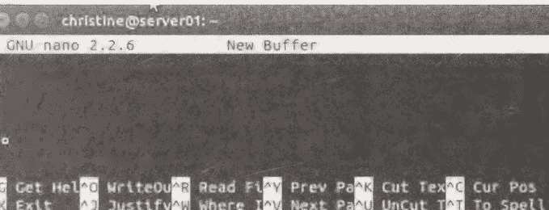

图 10.2 未提供文件名时启动的 `nano` 编辑器

或者，你也可以如下所示启动文本编辑器时提供文件名：

```
$ nano great_american_novel.txt
```

此示例显示了 `great_american_novel.txt` 文件。如果文件不存在，`nano` 在显示区域附近显示 `New File`（新文件），即图 10.1 中 `Read 4 lines` 出现。如果你在正文第三行看到 `Warning: no write permission`（警告：无写入权限），说明你加载了一个没有权限更改的文件。如果你想保存修改后的内容，你需要使用超级用户权限运行 `nano`，或修改文件权限（如第 14 章“设置所有权和权限”所述）。

> 如果你输错了文件名，`nano` 将显示一个空文件。如果你看到的是空文件而不是预期的文件，你可能输错了文件名。

## 使用 pico 或 nano 编辑文件

如果你熟悉文本模式编辑器，学习 `pico` 或 `nano` 应该不会遇到什么问题。如果你使用过 GUI 编辑器编辑文本，将需要学习一些键盘规范。例如，你必须使用键盘而不是鼠标在文档中移动。你可以像在 GUI 文本编辑器或文字处理器中插入、替换和删除文本。

## 使用文本编辑器规范

每个文本编辑器在屏幕上显示信息、操作文本等方面都有自己的规范。大多数文本模式编辑器在某些方面是相似的——显示顶部或底部通常会显示摘要信息或简短的命令提示。图 10.1 和 10.2 显示了 `nano` 的这些信息，包括以下内容：

- **标题栏（Title Bar）** 显示的第一行是标题栏。这一行包含了 `nano` 的版本号、正在编辑的文件名以及修改状态。
- **状态栏（Status Bar）** 显示底部第三行留用于状态信息和与用户的交互。这一行会在你保存文档时提示你输入信息（如文件名），或在执行搜索操作时提示你想要在文档中查找的词。
- **快捷键列表（Shortcut List）** 编辑器的最后两行显示了一些常用操作的摘要，以及触发这些操作的按键。

除了控制字符外，`nano` 还使用*元字符（metacters）*来激活某些功能。这些组合键使用 `Alt`、`Esc` 或 `Meta` 键（取决于你的键盘配置）后跟另一个键。

## 探索基础文本编辑过程

要学习 `nano`，可以考虑创建和编辑文件的任务。此时，你的结果应该类似于图 10.1，它展示了编辑 `pets.txt` 文件。你可以通过两种方式向 `pets.txt` 添加新条目。第一种方法创建一个空行并手动输入。你可以这样操作：

1. 按方向键将光标移动到 `fish` 的 `f` 处。
2. 按回车键。此操作在 `bird` 行和 `fish` 行之间打开了一个新行。
3. 按向上方向键一次，将光标重新定位到空行。
4. 输入 `reptile`，不要按回车键。

创建新条目的演示演示了如何在编辑器中复制、剪切和粘贴文本：

1. 使用方向键将光标移动到你创建的 `reptile` 行开头；你应该看到光标停留在 `reptile` 上。
2. 按 `M-6`。（第二个键是数字 6，而不是字母 g，并记住 `Meta` 键可能是 `Esc` 或 `Alt`，取决于键盘配置。）看起来可能没有任何变化。

### 列表 10.1：示例 pets.txt 文件

```
dog
cat
bird
fish
```

对于此示例，使用 `nano` 的第一步是启动它并让创建一个空白文件：

1. 打开终端，在主目录下输入 `nano pets.txt` 并按回车键。你应该会在标题栏中心看到 `File: pets.txt`，状态栏也会显示 `New File` 字样。这表示你创建了一个新的空文件。
2. 输入 `dog` 并按回车，向文件中添加第一个宠物类型。继续添加列表 10.1 中的宠物类型，直到添加完所有四种。


> 如果你的系统中没有安装 `nano`，你可以使用第 9 章的信息来安装 `nano` 软件包。

# 第 10 章 • 编辑文件

……发生了，但此按键会将光标所在的行复制到缓冲区中。现在，你的光标应该停在 `fish`（鱼）这一行的 `f` 字母上。

或者，`Ctrl+K` 可以剪切文本，这意味着它被从文件中移除并复制到缓冲区中。这对于将行移动到文件的新位置非常有用。

- 3. 按 `Ctrl+U`。它会将缓冲区中的内容粘贴到文件的当前位置。你应该看到 `reptile`（爬行动动物）类型显示了两行。

- 4. 使用方向键将光标移动到刚刚创建的第二行 `reptile` 行的开头；你应该看到光标停在 `r reptile` 的 `r` 上。

- 5. 按 `Ctrl+K` 剪切整行 `reptile` 行。光标应该位于 `fish` 行的开头。

- 6. 按 `Ctrl+N` 跳到文件的下一行。你的光标应该在 `fish` 行下方。

- 7. 输入 `rodent`（啮齿类）以完成另一个宠物种类的添加。

要保存你用 `nano` 创建的新文本文件，请阅读接下来的章节，“从 nano 保存你的更改”。

你可以以类似的方式进行更改。虽然它是 GUI 版本，但其大多数原理与 GUI 文本编辑器和文字处理器的原理相同；你只需要知道激活你想要的功能的按键。

`Ctrl+G` 显示 `nano` 的帮助文档，它总结了程序的功能。随着你对编辑器的熟悉，这会变得非常方便。你可能想要使用的额外功能包括以下这些：

**移动到文件开头或末尾** 你可以使用方向键、`Page Up`、`Page Down`、`Home` 和 `End` 以与其他编辑器中常用的方式移动光标。要移动到文件开头，按 `M-\`；要移动到文件末尾，按 `M-/`。

**复制或移动多行** 如果你需要复制或移动连续多行，可以重复 `M-6` 或 `Ctrl+K` 操作；`nano` 会保留你复制或剪切的所有行，因此当你按下 `Ctrl+U` 时，所有行都将被粘贴。

**插入文件** 按 `Ctrl+R` 或 `F5` 允许你在当前光标位置插入另一个文件。

**搜索字符串** 按 `Ctrl+W` 或 `F6` 激活搜索功能。激活后，`nano` 会提示你输入一个搜索词。输入该词并按 `Enter` 键，`nano` 将在文件中找到该搜索词的下一个实例。当你再次按下 `Ctrl+W` 或 `F6` 时，默认搜索词是上一次使用的，所以你可以


通过按 `Ctrl+W` 或 `F6` 然后按 `Enter` 重复搜索同一个术语。或者，`M-W` 会重复上一次搜索。

**替换字符串** 你可以通过按 `Ctrl+\` 或 `M-R` 将一个字符串替换为另一个。程序提示你输入一个搜索词和要替换它的词。随后开始搜索，`nano` 会要求你确认每次替换。如果你想在不提示的情况下替换所有出现的地方，可以在第一次提示时按 `A` 键。

## 从 nano 保存你的更改

一旦你对文本文件进行了更改，你可能想保存它们。一种方法是使用 `Ctrl+O` 选项。（字母 `O`，而不是数字 `0`。）当你按下此键时，`nano` 会询问如下：

写入选择内容到文件：

通常，提示将包含文件的原始名称，因此你可以按 `Enter` 键使用 `nano` 保存文件。如果你想使用不同的名称，可以删除旧名称并输入新名称。如果你在启动 `nano` 时没有指定文件名，可以在此提示处输入 `nano`。

保存文件的另一种方法是按 `Ctrl+X`。此命令退出 `nano`，但如果你修改了文件，它会产生以下内容：

保存修改过的缓冲区（回答“否”将破坏更改）？

在提示提示处输入 `y` 保存文件。程序会向你显示你按下 `Ctrl+O` 时看到的文件名，因此你可以更改文件名。一旦 `nano` 保存了文件，它就会终止。

如果你一直在你的系统上操作，在本章稍早创建并编辑了 `pets.txt` 文件，这里是你需要遵循的步骤以保存更改并退出 `nano` 文本编辑器：

- 1. 假设你仍在 `nano` 文本编辑器中并显示 `pets.txt` 文件，按 `Ctrl+O` 开始保存文件的过程。

- 2. 状态栏显示“写入的文件名：`pets.txt`”。按 `Enter` 保存文件。你应该在状态栏上看到类似的“正在写入 6 行”。

- 3. 按 `Ctrl+X` 退出 `nano` 文本编辑器并返回命令行提示符。

为了获得更多经验，尝试用 `nano` 再次编辑 `pets.txt` 文件，进行各种更改并尝试不同的编辑命令。务必

# 202

## 第 10 章 · 编辑文件

也查阅帮助功能，使用 `Ctrl+G` 访问它并使用 `Ctrl+X` 退出帮助文档。

## 认证目标

## 使用 vi 编辑文件

`vi` 是第一个为 Unix 编写的全屏文本编辑器。它的设计非常小，足以足够放入老式的、微小的、基于软盘的应急启动系统。当 GNU 项目开发出 `vi` 编辑器的开源替代品时，他们对其添加了多项改进，并将其命名为“改进版 vi”，即 `vim`。虽然许多 Linux 发行版都附带 `vim`，但它仍被称为 `vi` 编辑器，`vim` 与 `vi` 编辑器向后兼容，且启动 `vim` 的命令通常是 `vi`——尽管某些发行版使用的是 `vi` 命令。本章介绍的信息同时适用于 `vi` 和 `vim`。

尽管 `vi` 编辑器对于编辑配置文件非常有用，但它在编辑程序文件（如 shell 脚本）方面确实大放异彩。因此，学习 `vi` 编辑器将让你受益，尽管它被许多人认为是最复杂的文本编辑器。

## 理解 vi 模式

要使用 `vi`，你应该首先理解它运行的模式。然后开始学习 `vi` 实现的文本编辑程序。在任何时候，`vi` 都在运行三种模式之一：

**命令模式** 此模式接受命令，这些通常以单个字母输入。例如，`i` 和 `a` 进入插入模式（尽管其方式略有不同，稍后会描述），而 `o` 在当前行下方打开一个新行。

**Ex 模式** 要操作文件（包括保存当前文件和运行外部程序），你需要使用 `ex` 模式。通过输入冒号（`:`）后跟命令来进入 `ex` 模式。运行 `ex` 命令后，`vi` 回到命令模式。

**插入模式** 在插入模式下输入文本。大多数按键都会导致文本出现在屏幕上。一个重要的例外是 `Esc` 键，它退出插入模式并返回命令模式。遗憾的是，围绕 `vi` 模式的术语并不一致。例如，命令模式有时被称为普通模式（`normal mode`），而插入模式有时被称为编辑模式（`edit mode`）。`Ex` 模式根本没有被视为一种模式，而是被称为冒号命令（`colon commands`）。

## 检查 vi/vim 软件包

你的 Linux 系统默认可能没有安装完整的 `vi` 编辑器。例如，你的发行版可能只安装了 `vim.tiny` 或 `vim.minimal`。通过这些包，你仍然可以访问 `vi` 编辑器的形式，尽管你可能无法完全访问本章中描述的功能。如果你想学习并正确使用 `vi` 编辑器，建议安装完整的 `vim`。

要检查你的系统，请在命令行输入 `type vi`。你应该收到程序的名称（`vi` 或 `vim`），包括其目录位置，如此处所示：

```
$ type vi
vi is hashed (/usr/bin/vi)
```

一旦你获取了程序名称及其位置，输入 `readlink -f /location/program` 来确定该程序是否链接到另一个程序。（链接文件将在第 7 章“管理文件”中介绍）。你可能会收到类似下所示的内容：

```
$ readlink -f /usr/bin/vi
/usr/bin/vim.tiny
```

接下来，你需要检查提供该程序的软件软件包。（在某些情况下，程序名称并不指示由哪个软件软件包提供它。）使用相应的软件包管理工具来确定此所需信息。这里的示例是 Ubuntu 发行版，因此使用了 `dpkg -S` 命令以及超级权限（获取超级用户权限将在第 12 章中更详细介绍）。

```
$ sudo dpkg -S /usr/bin/vim.tiny
[sudo] password for christine:
vim.tiny: /usr/bin/vim.tiny
```

你可以看到是否安装了 `vim.tiny` 包。如果你发现安装了 `vim` 或 `vim.basic` 包，那么在使用本章中的 `vi` 编辑器命令时应该没有问题。然而，如果你没有安装这两个包（如前面的示例所示），你将需要安装该软件包以跟进本章的剩余内容。对于前面的 Ubuntu 发行版示例，你应该输入 `apt-get install vim` 来安装完整的 `vim` 软件包。（安装软件包将在第 9 章中介绍。）

## 第 10 章 · 编辑文件

你现在可以开始学习 `vi` 实现的文本编辑程序。你还将学习如何保存文件和退出 `vi`。

## 探索 vi 基础文本编辑程序

作为一种学习 `vi` 的方法，可以考虑创建和编辑 `pets.txt` 文件的任务——这与之前在“探索基础 nano 文本编辑程序”中描述的任务相同。列表 10.1（在之前的章节中）显示了示例中要创建的 `pets.txt` 文件。

对于此示例，使用 `vi` 的第一步是启动它并让它创建一个名为 `pets.txt` 的空文件，如下：

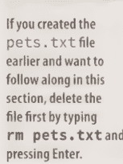


## 打开终端程序并创建文件

- 1. 打开终端程序并按回车键。你应该能看到窗口底部消息行显示了“`pets.txt`” [New File] 字样。这表示你已经创建了一个名为 `pets.txt` 的新空文件。

- 2. 你处于命令模式。按下 `I` 键进入插入模式。该模式应该通过窗口底部消息行的 `--INSERT--` 字样来指示。

- 3. 输入 `dog` 并按回车键向文件中添加第一种宠物类型。继续输入列表 10.1 中的宠物类型，直到添加完所有四种。

- 4. 按下 `Esc` 键退出插入模式。注意消息行不再显示 `--INSERT--` 信息。`vi` 编辑器处于命令模式。

- 5. 输入 `:` 进入命令模式，通过输入 `w` 并按回车键完成命令。这会将缓冲区内容 (`w`) 写入 `pets.txt` 文件，退出 (`q`) 并返回到命令行。


你的结果应该类似于图 10.3，该图显示了 `vi` 在命令模式下显示 `pets.txt` 文件的情况。如图 10.3 所示，某些系统会在屏幕左侧显示一排虚线 (`--`) 来表示文件的结束。图 10.3 中的文件是新加载的，因此底部显示了最后一次命令的状态——一个隐式的文件加载命令，从 `pets.txt` 文件中加载了 4 行和 18 个字符 (`4L, 18C`)。

### 使用 vi 编辑文件

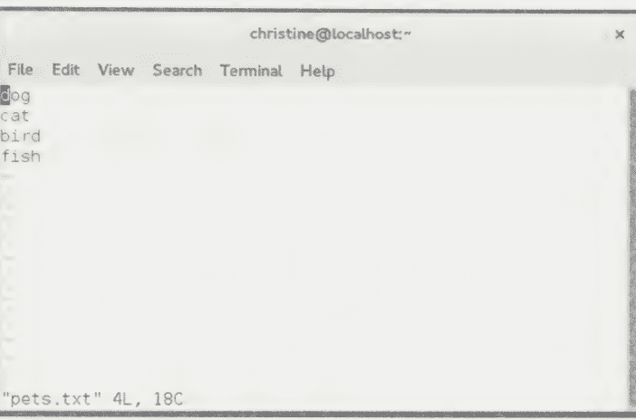

图 10.3 `vi` 显示的最后一行是状态行，显示来自程序的消息。

与 `nano` 一样，你可以使用 `vi` 向 `.txt` 文件中添加新条目，可以完整输入它，也可以复制现有行然后修改复制的行。要使用第一种方法，请遵循以下步骤：

- 1. 使用方向键将光标移动到 `bird` 所在行的开头。

- 2. 按下 `O` 键（字母 O，不是数字 0）。这会在当前行下方立即打开新行，将光标移动到该行并进入插入模式。

- 3. 输入新条目：`reptile`。

- 4. 按 `Esc` 键从插入模式返回命令模式。

要通过修改现有条目来练习更改，请遵循以下步骤：

- 1. 如果必要，使用方向键将光标移动到你创建的 `reptile` 行开头。你应该看到光标停留在 `reptile` 的 `r` 上。

- 2. 现在你将复制（`yank`）一行文本。`yank` 术语用法与大多数文本编辑器中的 `copy` 相似——你将文本复制到缓冲区，稍后可以将其粘贴回文件。要复制文本，使用 `yy` 命令，并在前面跟上想要复制的行数。因此，输入 `1yy`（但不要按回车键）。看起来似乎没有发生任何变化，但此按键操作将光标所在的行复制到了缓冲区。

如果你想从光标处开始将文本粘贴到文档，请使用大写的 `P` 命令。

- 3. 将光标移动到第三行，即你想插入新行之前的那的一行。

- 4. 输入 `p`（同样，不要按回车键），`vi` 会从光标之后的行开始粘贴缓冲区中的内容 (`reptile`)。文件现在应该有两个相同的 `reptile` 行。光标应该停留在第一个行的开头。

- 5. 将光标移动到刚刚粘贴的行中 `reptile` 单词的 `r` 上（如果它不在那里）。你正准备删除此行。

- 6. `dd` 命令的作用类似于 `yy`，但在将其复制到缓冲区的同时会将其删除。输入 `dd` 删除 `reptile` 行。文件现在应该只有一个 `reptile` 行。

`yy` 和 `dd` 分别是 `y` 和 `d` 命令的特殊情况，它们会根据下一个字符指定的数量复制或删除文本，例如使用 `Ow` 删除下一个单词。

- 7. 输入 `ZZ` 保存文件并退出。此命令等同于 `:wq`。

在某些模式下，你可能想要使用的许多命令。以下是一些亮点：

**更改大小**：假设你需要更改文件中某个单词的字符。你不需要进入插入模式并重新输入该单词，可以使用命令模式下的波浪号 (`~`) 键来更改字符。将光标置在你想要更改的第一个字符上，反复按下直到完成任务。

如果你需要将文件的行尾编码从 Windows 方式更改为 Unix/Linux 方式，在 `vi` 编辑器中打开文件并输入命令 `:set ff=unix`。

**撤销**：要撤销任何更改，在命令模式下按 `u`。

**打开文本**：在命令模式下，输入 `o`（小写 O）可以打开文本——即在当前行下方立即插入新行并在该行进入插入模式。

**搜索**：要在文件中正向搜索文本，在命令模式下输入 `/`，紧接着输入要定位的文本。`?` 用于向后搜索而非向前。

**更改文本**：`c` 在命令模式下更改文本。像调用 `d` 或 `y` 一样调用它，例如使用 `cw` 更改下一个单词或 `cc` 更改行尾。

**跳转行**：`G` 键带你到指定的行。`H` 键移动光标——即将光标移动到屏幕顶部。`L` 键将光标移动到屏幕底部。

## 基础知识及扩展

使用 ASCII 或 Unicode 编码文本的纯文本文件在计算机平台上都很重要，但在 Linux 上尤为重要。这是因为 Linux 的许多配置使用纯文本格式，了解如何使用编辑器（如 `pico`、`nano` 或 `vi`）编辑这些文件使你能够编辑各种配置文件。此外

# 第 10 章 · 编辑文件

## 基础及扩展（续）

要在 Linux 上创建 shell 脚本，你必须能够处理至少一种文本编辑器。你需要具备基本的文本编辑技能，但你对移动、搜索和修改文本文件的操作越熟悉，完成所需任务的速度就越快。

# 建议的练习

- 启动 `nano` 创建一个新文件，并输入本章中的一个完整段落。校检查并纠正你发现的任何拼写错误。（如果你没有发现任何错误，恭喜你！现在创建一个名为 "`errors`" 的文件并纠正它们。）

- 使用 `vi` 创建一个新文件。输入本章的复习题并包含答案。尝试各种编辑功能，例如更改大小写和搜索文本。

## 复习题

- 1. `nano` 可能用于哪种类型的文件进行查看或编辑？

    A. 以 Unicode 编码的文本文件

    B. `shell` 脚本文件

    C. 以 ASCII 编码的文本文件

    D. LibreOffice 文字处理文档

    E. Linux 配置文件

- 2. 哪些按键可以调用 `pico` 或 `nano` 的搜索功能？（选择所有适用项）。

    A. `F3`

    B. `F6`

    C. `Esc-S`

    D. `Ctrl+X`

    E. `Ctrl+W`

- 3. 你如何使用 `vi` 删除文件中的两行文本？

    A. 在命令模式下，将光标置于第一行并输入 `2dd`。

    B. 在命令模式下，将光标置于最后一行并输入 `2yy`。

    C. 在插入模式下，将光标放在第一行的开头，按住 Shift 键向下键，然后按键盘上的 Delete 键。

    D. 在插入模式下，将光标放在第一行的开头并按两次 `Ctrl+K`。

    E. 用鼠标选择文本，然后从菜单选择 File ➤ Delete。

## 基础及扩展

- 4. 正确或错误：Unicode 适用于编码大多数欧洲语言，但不适用于亚洲语言。

- 5. 正确或错误：ASCII 的 GUI 文本编辑器优于文本模式 ASCII 文本编辑器，因为 GUI 编辑器支持下划线、斜体和字体。

- 6. 正确或错误：如果你从未用过文本编辑器，`nano` 文本编辑器通常是第一个适合学习的。

- 7. ASCII 支持唯一字符（不包括控制字符）。

- 8. 在 `nano` 中可以启动查找替换操作的三个按键是 `F14`，和

- 9. 在 `vi` 命令模式下，你可以通过输入来撤销更改。

- 10. 要在命令模式下保存文件并退出 `vi` 文本编辑器，

## 创建脚本

脚本是用解释型语言编写的程序，通常与 `shell` 或编译后的程序相关联。在 Linux 中，许多脚本是 `shell` 脚本，它们与 `Bash` 或其他 `shell` 关联。（如果你熟悉 Windows 中的批处理文件，脚本的作用与之类似。）你可以编写 `shell` 脚本来帮助自动化枯燥、重复的任务，或执行新的、复杂的任务。脚本执行了 Linux 的许多启动功能，因此掌握脚本编写将帮助你管理启动过程。

本章涵盖了 `Bash shell` 脚本，从创建新脚本文件的任务开始。然后，我们描述了几个重要的脚本功能，以帮助你执行日益复杂的脚本任务。

- 开始编写 `shell` 脚本

- 使用命令

- 使用参数

- 使用变量

- 使用条件表达式

- 使用循环

- 使用函数

- 设置脚本的退出值

## 更多信息

与任何编程任务一样，`shell` 脚本编写可能相当复杂。因此，本章仅触及了通过 `shell` 脚本可以完成的皮毛。更多信息请参阅相关书籍，例如 Richard Bloom 和 Christine Bresnahan 编写的《Linux Command Line and Shell Scripting Bible, Third Edition》（Wiley, 2015）。

# 开始编写 shell 脚本


shell 脚本是纯文本文件，因此你可以像第 10 章“编辑文件”描述的那样，使用 `vi`、`nano` 或 `pico` 等编辑器对其进行编辑。脚本以一行识别运行它所使用的 shell 开始，如下所示：

```
#!/bin/bash
```

前两个字符是一个特殊代码，告诉 Linux 内核这是一个脚本，并将该行的其余部分作为解释该脚本的程序的路径。（这一行有时被称为 `shebang`、`hashbang`、`hasplbang` 或 `pound bang`）。shell 脚本使用井号（`#`）作为注释字符，shell 工具会忽略这一行，尽管在大多数系统上，`/bin/sh` 是一个指向 `/bin/bash` 的符号链接，但它也可以指向另一个 shell。指定脚本系统将有一个程序来运行该脚本。然而，如果你的脚本使用了特定 shell 的任何功能，你应该指定该 shell——例如，使用 `/bin/bash` 或 `/bin/tsh` 代替 `/bin/sh`。本章描述 Bash 脚本。简单的脚本可以在其他 shell 中运行，但更复杂的脚本是特定 shell 的。

编写 shell 脚本时，你应该对其修改使其可执行。你可以使用 `chmod` 命令来实现，该命令在第 14 章“设置所有者和权限”中有更详细描述。现在，你可以使用 `+x` 选项为所有用户添加执行权限。例如，要让名为 `my-script` 的文件可执行，你应该执行以下命令：

```
$ chmod +x my-script
```

你将能够通过输入名称来执行脚本，可能通过输入 `./Linux` 在当前目录运行脚本，而不是在当前路径中搜索。如果你未能让脚本变为可执行，你仍然可以通过运行 shell 程序后跟脚本名称（如 `my-script`）来运行脚本，但通常让脚本变为可执行会更好。如果该脚本经常使用，你可能想将其移动到路径上的某个位置，例如 `/usr/local/bin`。这样做之后，你就不需要输入完整路径或移动脚本目录来执行；只需输入 `my-script` 即可。

## 使用命令

shell 脚本最基本的功能之一是运行命令。你可以同时使用 shell 内置的命令和外部命令——也就是说，你可以运行其他程序作为。你在 shell 提示符中输入的大多数命令都是外部命令；它们是位于 `/bin`、`/usr/bin` 以及路径上其他目录的程序。你可以在脚本中运行此类程序以及内部命令，包括它们的名称。你还可以在脚本中为这些程序指定参数。例如，假设你想要一个启动两个 `xterm` 窗口和一个 `KMail` 邮件读取器的脚本。列表 11.1 展示了一个实现此目标的 shell 脚本。

### 列表 11.1：一个启动三个程序的简单脚本

```
#!/bin/bash
/usr/bin/xterm &
/usr/bin/xterm &
/usr/bin/kmail &
```

除了标识其为脚本的第一行外，该脚本看起来与你手动完成任务时可能输入的命令完全一样，区别在于一点：脚本列出了每个程序的路径。这通常不是严格必要的，但列出完整路径可以确保即使 `PATH` 环境变量发生变化，脚本也能找到这些程序。另一方面，如果程序移动了（例如，因为你升级了安装它们的包，而打包者决定移动它们），使用完整路径的脚本将会崩溃。如果脚本对某个命令产生“No such file or directory”错误，输入 `which command`（其中 `command` 是出错的命令）应该帮助你找到它。

11.1 中的每个程序行都以和符号（`&`）结尾。这个字符告诉 shell 继续到下一行，而不等待第一行完成。如果你省略了 11.1 中的 `&`，那么第一个 `xterm` 将等待第二个 `xterm` 直到第一个关闭。同样，`KMail` 将等待第二个 `xterm` 终止。

从一个脚本启动多个程序可以节省启动脚本和某些其他情况的时间，脚本还经常用于运行一系列处理数据的程序。此类脚本通常不在命令末尾包含 `&` 号，因为一个命令必须在另一个命令之后运行，或依赖于第一个命令的输出。

普通文件操作命令 `ls`、`mv`、`cp` 和 `rm` 等文件操作命令经常用于脚本。你可以使用这些命令帮助自动化重复的文件维护任务。

Fedora 正在进行一项标准化 Linux 发行版以消除 `/bin` 目录的项目。目前的 Fedora 21 `/bin` 目录中的所有程序都链接到 `/usr/bin` 目录，但最终所有程序将移动到 `/usr/bin` 目录。

# 第 11 章 - 创建脚本

**`grep`** 该命令在第 8 章“搜索、提取和归档数据”中有所描述。它可以定位包含你指定的字符串的文件，或者在单个文件中显示包含这些字符串的行。

**`find`** 与 `grep` 在文件内容内搜索模式不同，`find` 则是基于文件名、所有者和类似的特征进行搜索。第 8 章涵盖了此命令。

**`cut`** 该命令从文件的字段中提取文本。它经常用于从内容符合特定模式的文件提取有效信息。要使用它，你需要传递一个或多个选项来指定你想要的信息，然后是一个或多个文件名。例如，用户的家目录出现在 `/etc/passwd` 文件的第 6 个冒号分隔字段中。你可以输入

```
cut -f 6 -d ":" /etc/passwd 来提取这些信息。
```

**`sed`** 该程序通过可以在命令行提示符处输入或在脚本中输入的命令，提供了传统文本编辑器的许多功能（如查找和替换操作）。

**`echo`** 有时，脚本必须向用户提供一条消息；`echo` 是实现这一目标的工具。你可以向 `echo` 传递各种选项或要显示给用户的字符串。例如，`echo "Press the Enter key"` 会脚本显示指定的字符串。你还可以使用 `echo` 显示变量的值（后文在“使用变量”部分中进行描述）。

认证目标

**`mail`** `mail` 命令可以用于在脚本中发送电子邮件。它传递 `-s` 参数来指定主题行，并将电子邮件地址作为最后一个参数传递。如果在命令行中使用，你输入消息并按 `Ctrl+D` 键来结束它。如果从脚本中使用，你可能会完全省略参数，或者使用输入重定向将外部文件作为消息传递。你可能想使用此命令在启动脚本或自动运行的脚本执行后向超级用户发送邮件。

第 8 章描述了输入重定向。

这些命令中的许多一个都极其复杂，完全描述它们超出了本章的范围。你可以查阅这些命令的“手册页”（`man pages`）以获取更多信息。如前面的简要描述所示，其中少数几个命令在本书的其他地方也有描述。

即使你已经完全掌握了如何使用某些关键外部命令，仅仅像在命令行提示符处输入时那样执行命令，其用处也是有限的。许多管理任务需要你根据其他命令的信息来修改你输入的命令，甚至在你输入命令时进行修改。由于由于原因，脚本语言包含了额外的功能来帮助你让脚本更有用。

## 使用参数

变量可以帮助你扩展脚本的用途。变量是脚本中的一个占位符，代表在脚本运行时确定的值。变量的值可以作为参数传递给脚本、在脚本内部生成，或从脚本环境中提取。（环境是任何程序都可以访问的变量集。环境包括当前目录和运行程序的搜索路径等内容。）

传递给脚本的变量通常称为参数（`arguments`）。它们在脚本中用美元符号（`$`）后跟从 0 开始的数字表示——`$0` 代表脚本名称，`$1` 是给脚本的第一个参数，`$2` 是第二个参数，依此类推。为了理解这可能有用之处，请考虑添加用户的任务。如第 13 章“创建用户和组”中描述，为新用户创建账户通常涉及运行至少两个命令——`useradd` 和 `password`。你可能还需要运行额外的特定于站点的命令，例如创建用户家目录之外的特殊用户所有目录的命令。

带有参数变量的脚本示例可以帮助某些情况，请参考列表 11.2。此脚本创建一个账户并更改该账户密码（当你运行脚本时，脚本会提示你输入密码）。它在 `/shared` 目录下创建一个与账户对应的目录，并从新用户的家目录设置一个指向该目录的符号链接。它还调整调整了所有权和权限，根据你的系统所有权和权限策略，这可能很有用。

### 列表 11.2：一个减少创建账户繁琐程度的脚本

```
#!/bin/bash
useradd -m $1
passwd $1
mkdir -p /shared/$1
chown $1.users /shared/$1
chmod 775 /shared/$1
ln -s /shared/$1 /home/$1/shared
chown $1.users /home/$1/shared
```

如果你使用列表 11.2，你只需要输入三个内容：带有所需用户名的脚本名以及密码（两次）。例如，如果脚本名为 `mkuser`，你可以这样使用它：

```
# mkuser ajones
Changing password for user ajones
New password:
Retype password:
passwd: all authentication tokens updated successfully
```

脚本中的大多数程序在遇到问题之前都会静默运行，因此交互（输入密码，屏幕不显示密码）仅仅是 `passwd` 命令的结果。实际上，列表 11.2 的脚本用一条命令替换了七行命令。这些行中的每一行都用户名，因此通过运行此脚本，你也减少了拼写错误导致问题的概率。

## 使用变量

认证目标


另一种类型的变量是在脚本内部赋值的——例如变量可以从命令的输出中设置。这些变量也通过开头的美元符号标识，但它们通常被赋予至少以字母开头的名字，例如 `$Addr` 或 `$Name`。（当给变量赋值值时，稍后会省略美元符号。）然后你可以将这些变量结合普通命令使用，就像它们是命令参数一样，但变量的值会被传递给命令。

例如，考虑列表 11.3，它通过 `ping` 工具检查计算机的路由器是否在线。此脚本使用了两个变量。第一个是 `$ip`，它是从使用 `grep`、`tr` 和 `cut` 命令的输出中提取的。当你从命令给变量赋值时，命令应该包含在反引号（` `）中，反引号在大多数键盘上与波浪号（`~`）位于同一个键上，它们不是普通的单引号（后者在大多数键盘上与双引号 `"` 位于同一个键上）。第二个变量 `$ping` 仅指向 `ping` 程序。它可以很容易地省略（后续对 `$ping` 的使用可以替换为程序的完整路径，或简单地依赖 `$PATH` 环境变量来查找程序）。此类变量有时被用于方便以后修改脚本。例如，如果你移动了 `ping` 程序，你只需要修改脚本中的一行。这些变量还可以配合条件表达式使用，以确保脚本工作——例如，如果你移动了 ping 程序。

### 列表 11.3：演示变量赋值和使用的脚本

```bash
#!/bin/bash
ip=`route -n | grep UG | tr -s " " | cut -f 2
echo "Checking to see $ip is up..."
ping -c 5 $ip
```

在实践中，你通过输入脚本名称来使用 11.3。结果应该是 Checking if 192.168.1.1 is up（192.168.1.1 替换为默认网关）以及来自 `ping` 命令的输出。如果路由器有响应，你会看到类似下面的包和总结信息：

#### routercheck

```
Checking to see 192.168.1.1 is up...
PING 192.168.1.1 (192.168.1.1) icmp_seq=1 ttl=63 time=23.0 ms
64 bytes 192.168.1.1: icmp_seq=2 ttl=63 time=0.176 ms
64 bytes 192.168.1.1: icmp_seq=3 ttl=63 time=0.214 ms
64 bytes 192.168.1.1: icmp_seq=4 ttl=63 time=0.204 ms
64 bytes 192.168.1.1: icmp_seq=5 ttl=63 time=0.191 ms
```

```
-- 192.168.1.1 ping statistics----
5 packets transmitted, 0 received, 0% packet loss, time 4001ms
rtt min/avg/mdev = 0.176/0.758/23.005/9.123 ms
```

如果路由器宕机，你会看到类似于主机不可达的消息。

列表 11.3 的实际用途有限且包含 Bug。例如，该脚本通过 `route` 命令输出行中是否存在 `UG` 字符串来识别计算机的网关。如果一台计算机有两个路由器，这将无法正常工作，结果可能是一个行为异常的脚本。列表 11.3 的目的是说明如何对变量赋值，而不是成为一个完美的运行脚本。

像列表 11.3 这种通过运行一个或命令获取信息的脚本，对于配置依赖系统特定信息或随时间变化的信息非常有用。你可以使用类似的方法获取当前主机名（使用 `hostname` 命令）、当前时间（使用 `date` 命令）、计算机运行的总时间（使用 `uptime` 命令）、可用磁盘空间（使用 `df` 命令）等。

> 在其他几个命令之外，`ip=`
> 
> 使用反引号
> 
> `(')` 将该链的
> 
> 输出 赋值给 `ip`。
> 
> 第 8 章描述了这种技术。

# 第 11 章 编写脚本

（稍后将描述），变量将变得更加强大，因为此时你的脚本可以在满足某个条件时执行一个操作，而在其他某些情况下执行另一个操作。例如，一个安装软件的脚本可以检查磁盘可用空间，并在磁盘空间不足时中止安装。

除了使用赋值运算符（`=`）为变量赋值外，你还可以使用 `read` 命令从标准输入读取变量，以便后续通过 `$variable` 对其进行访问响应。这种变量赋值方法对于必须与用户交互的脚本非常有用。例如，而不是直接从命令行读取用户名。列表 11.2 显示了结果。要使用此脚本，你只需在命令行中输入它的名称，而无需输入用户名。脚本将提示你输入用户名，并在你输入一个后，脚本将尝试使用该名称创建一个账户。

## 认证目标

### 列表 11.4：列表 11.2 的修改版本，采用了用户交互

```bash
#!/bin/bash
echo -n "Enter a username:"
read name
useradd -m $name
mkdir -p /shared/$name
chown $name:users /shared/$name
chmod 775 /shared/$name
ln -s /shared/$name /home/$name/shared
chown $name:users /home/$name/shared
```

一种特殊类型的变量是环境变量，它的赋值和访问方式与 Shell 变量相同。区别在于，设置环境变量的脚本或命令使用 Bash 的 `export` 命令使变量的值对于从 Shell 或执行赋值的 Shell 脚本启动的程序是的。换句话说，你可以在一个脚本中设置环境变量，并在第一个脚本启动的另一个脚本中使用它。环境变量通常在 Shell 启动脚本中设置，但你使用的脚本也会访问它们。如果你的脚本调用了 X 个程序，它可能会检查是否存在有效的 `$DISPLAY` 环境变量，如果发现该变量未设置则中止。按照惯例，环境变量的名称全大写，而非环境变量的 Shell 脚本变量全小写或混合大小写。

有一个特殊变量值得注意：`$?`。它保存了最近执行的命令的退出状态（或返回值）。大多数程序在正常终止时返回值 0，返回另一个值来指定错误。你可以使用 `echo` 显示此值，或将其用于条件表达式（下文将描述）中，让你的脚本执行特殊处理。

查阅程序的 man 页以了解其返回值的含义。


## 使用条件表达式

脚本语言支持多种类型的条件表达式。这些表达式允许脚本根据特定条件（通常是变量的值）执行多个动作中的之一。使用条件表达式的一个常用命令是 `if`，它允许系统根据某个条件是否为真来采取两个动作之一。`if` 关键字的条件表达式出现在 `if` 之后的括号中，可以有许多形式。例如，`-f file` 如果文件存在且是普通文件则为真；`-s file` 如果文件存在且大小大于 0 则为真；`string1 == string2` 如果两个字符串的值相同则为真。

条件可以与逻辑与（`&&`）或逻辑或（`||`）运算符结合使用。当条件与 `&&` 结合时，运算符的两侧都必须为真，整个条件才为真。当使用 `||` 时，只要运算符的任侧为真，整个条件即为真。

要理解条件的使用，请考虑以下代码段：

```
if [ -s /tmp/tempstuff ]
then
  echo "/tmp/tempstuff found, aborting"
  exit
fi
```

该片段会在 `/tmp/tempstuff` 文件存在时导致脚本退出。`then` 关键字标记了一系列行的开始，这些行仅在条件为真时才执行，而 `fi`（`if` 的反写）标记了该块的结束。如果脚本创建并然后删除此文件，这种代码可能有用，因为它的存在表明脚本的上一次运行没有成功或仍在进行。

条件表达式的另一种形式使用 `test` 关键字而不是在条件周围使用方括号：

```
if test -s /tmp/tempstuff
```

你还可以通过将命令作为条件来测试命令的返回值：

```
if [ command ]
then
  additional-commands
fi
```

在此示例中，只有当 `command` 成功完成时，才会运行 `additional-commands`。如果 `command` 返回错误代码，则 `additional-commands` 将不会运行。

# 第 11 章 - 编写脚本

条件表达式可以通过使用 `else` 子句进行扩展：

```
if [ conditional-expression ]
then
    commands
else
    other-commands
```

这种形式的代码使用 `commands` 或 `other-commands` 来执行，取决于 `conditional-expression` 的求值。如果程序的某部分应该发生某些事情，但具体在特定条件下应该发生什么，那么这就很有用。例如，你可能想根据用户的输入启动两个文件归档程序之一。

如果可能超过两个结果，该怎么办——例如，如果用户可能提供四个可能的输入中的任何一个？你可以嵌套 `if/then/else` 子句，但这很快就会变得笨拙。更简洁的方法是使用 `case`：


```
case word in
    pattern1 command(s);
    pattern2 command(s);
    ...
esac
```

对于一个语句，`word`（单词）可能是一个变量，每个 `pattern`（模式）都是该变量的一个可能值。模式可以像文件名一样扩展，使用通配符和扩展规则（例如 `*` 代表任何字符串）。你可以通过这种方式匹配任意数量的模式。每组命令必须以双分号（`;;`）结束，整个 `case` 语句以字符串 `esac`（`case` 的反写）结束。

执行时，bash 执行与匹配 `word` 的第一个模式相关的命令。随后执行将跳转到 `esac` 语句之后的行；任何中间的命令都不会执行。如果没有模式匹配 `word`，则 `case` 语句中的任何代码都不会执行。如果你想有一个默认条件，请使用 `*` 作为最后一个模式；此模式匹配任何单词。

## 使用循环

条件表达式有时用于循环。循环是让脚本重复执行相同任务直到满足特定条件（或直到某个条件不再满足）的结构。例如，列表 11.5 显示了一个对目录下所有 `.wav` 音频文件的循环。

```
#!/bin/bash
for d in `ls *.wav`; do
 aplay $d
done
```

这里的 `for` 循环为 `ls *.wav` 生成的列表中的每个项目执行一次。这些项目（文件名）依次赋值给变量 `$d` 并传递给 `aplay` 命令。

`seq` 命令在创建循环时（以及其他方式下）非常有用。该命令从第一个参数到最后一个参数生成一个数字列表。例如，输入 `seq 1 10` 生成 10 行，每行一个 1 到 10 之间的数字。你可以使用循环 `for x `seq 1 10` 让循环执行 10 次，`x` 的值每次迭代都会增加。如果你只给 `seq` 传递一个参数，它将其解释为终点，起点为 1。如果你给 `seq` 传递三个值，它将它们解释为起始值、增量和结束值。

另一种循环是 `while` 循环，它在条件为真时一直执行。这种循环类型的基本形式如下：

```
while [ condition ]
do
 commands
done
```

`until` 循环的形式相似，但它在条件为假时持续执行——即直到条件变为真。

## 使用函数

函数是脚本的一部分，执行特定的子任务，并可以在脚本的其他部分通过名称调用。在函数名后加上圆括号并用大括号包含组成函数的行就是定义函数的方法：

```
myfn() {
 commands
}
```

# 第 11 章 • 创建脚本

关键字 `function` 可以可选地放在函数名之前。无论何种情况，函数都是通过名称调用的，就像它是一个普通的内部或外部命令一样。

函数对于帮助创建模块化脚本非常有用。例如，如果你的脚本需要执行六个不同的计算，你可以将每个计算放在一个函数中，然后按顺序调用它们。列表 11.6 展示了在一个简单程序中使用函数的情况，该程序会复制文件，但如果目标文件已存在，则会带错误消息并终止。该脚本接受目标和目的文件名，并且必须将这些文件名传递给函数。

### 列表 11.6：演示使用函数的脚本

```
#/bin/bash

doit() {
  cp $1 $2
}

function check() {
  if [ -s $2 ]
  then
    echo "Target file exists! Exiting!"
    exit
  fi
}

check $1 $2
doit $1 $2
```

如果你输入列表 11.6 的内容并将其命名为 `safercp`，你可以像这样使用它（假设文件 `original.txt` 存在而 `dest.txt` 不存在）：

```
./safercp original.txt dest.txt
./safercp original.txt dest.txt
Target file exists! Exiting!
```

脚本第一次运行成功，因为 `dest.txt` 不存在。然而，在第二次运行时，目标文件确实存在，因此脚本带有错误消息终止。

注意，函数并不是直接运行的，也不是按照它们在脚本中出现的顺序运行的。它们只有在脚本正文中被调用时才会运行——在列表 11.6 中，正文只有两行，每行对应一个函数调用，位于脚本的最末尾。

## 设置脚本的退出值

通常情况下，脚本的返回值与脚本调用的最后一个命令相同：即脚本返回 `$?`。然而，你可以通过 `exit` 命令来控制退出值，或在任何一点退出脚本。在不带任何选项的情况下使用 `exit` 会立即终止脚本，并返回通常退出值 `$`。这在错误处理或因任何原因终止正在进行的操作时可能有用——如果脚本检测到错误或用户选择了终止选项，你就可以调用 `exit` 来退出。

如果你向 `exit` 传递一个 0 到 255 之间的数值，脚本将终止并将指定的值作为脚本自身的退出值返回。你可以使用此功能向可能调用你脚本的其他脚本发送错误信号。你可能需要包含额外的代码来跟踪异常终止的原因。例如，你可能会设置一个变量（例如 `$termcause`）来保存脚本终止的原因。在脚本开始时将其设置为 0，然后如果脚本检测到会导致终止的问题，则将 `$termcause` 重置为某些非零值。你可以使用你喜欢的任何数字代码（此类代码没有预设的含义）。在退出时，务必传递：

```
exit $termcause
```

## 基础知识及拓展

资深的 Linux 用户和管理员必须至少对 shell 脚本有基本的了解。事实上，任何配置和启动文件都是 shell 脚本，能够读取它们并可能修改它们将帮助你管理系统。能够创建新脚本同样重要，这可以帮助你简化繁琐的任务，并通过粘合多个程序来实现你的目标，从而创建特定于站点工具。

## 建议练习

- 编写一个脚本，通过提示用户输入源文件名和目的文件名来复制文件，而不是像 `cp` 那样通过命令行参数接收它们。
- 某些编辑器留下的备份文件文件名以波浪号 `~` 结尾。编写一个脚本，当你将目录名作为参数传递它时，它会找到该目录中的所有文件。脚本应询问用户是否逐个删除每个文件，并且在用户响应为 `Y` 时才执行删除。

（未完）

# 第 11 章 • 创建脚本

## 基础知识及拓展（续）

## 复习题

- 1. 在使用文本编辑器创建一个 shell 脚本后，在尝试通过输入名称使用该脚本之前，你应该采取哪一步操作？

  A. 使用 `chmod` 设置一个或多个执行位。
  B. 将脚本复制到 `/usr/bin/scripts` 目录。
  C. 通过输入 `bash scriptname` 编译脚本，其中 `scriptname` 是脚本的名称。
  D. 对脚本运行病毒检查器，以确保它不包含病毒。
  E. 对脚本运行拼写检查器，以确保它没有错误。

- 2. 描述以下短脚本 `cp p1` 的效果，假设它以 `cp p1 big.c big.cc` 的方式调用：

```bash
#!/bin/bash
cp $2 $1
```

  A. 它与 `cp` 命令的效果相同——将 `big.c` 的内容复制到 `big.cc`。
  B. 它编译 C 程序 `big.c` 并调用结果 `big.c`。
  C. 它将 `big.c` 的内容复制到自身（覆盖自身）。
  D. 它将 C 程序 `big.c` 转换为 C++ 程序 `big.c`。
  E. 脚本的第一行无效，因此无法工作。

- 3. Shell 脚本中条件表达式的目的是？

  A. 在不满足许可条件下阻止脚本执行。
  B. 显示计算机环境信息。
  C. 允许脚本根据变量数据采取不同的行动。
  D. 允许脚本以类似于帕尔洛夫条件的方式学习。
  E. 使用脚本在指定的时间运行。

- 4. 错误：用户输入 `myscript laser.` 来运行名为 `myscript` 的脚本。在 `myscript` 内部，变量 `$0` 留值为 `laser.txt`。

- 5. 错误：Bash 中有效的循环语句包括 `for`、`while` 和 `until`。

## 基础知识及拓展（续）

- 6. 错误：以下脚本会同时启动三个 `terminal` 程序实例。

```
#!/bin/bash
terminal
terminal
terminal
```

- 7. 你写了一个只启动程序的简单 shell 脚本。为了确保该脚本在大多数用户 shell 中运行，它的第一行应该写什么？

- 8. 你可以使用哪个命令在 shell 脚本显示用户提示？

- 9. 你可以使用哪个 Bash 脚本命令根据可以取多个值的变量（例如字母表中的所有字母）来控制程序流？

- 10. 你可以使用哪个 Bash 脚本命令来控制脚本生成的返回值，而不受脚本中使用的其他命令的影响？

# 第 12 章 - 理解基础安全

认证目标

## 理解账户特性

大多数账户功能定义在 `/etc/passwd` 文件中，该文件由冒号分隔的行组成，每行（或记录）定义一个账户。一个目可能包含以下内容：

```
rich:x:1003:100:Rich Blum:/home/rich:/bin/bash
```

该记录字段中包含的信息包括：


# 第 12 章 了解基础安全

## 用户名 (Username)
账户名由小写字母组成，偶尔也包含数字（如 `rich` 或 `thx1138`）。在某些 Linux 发行版的用户名中，下划线 (`_`) 和连字符 (`-`) 也是有效字符，末尾还可以有美元符号 (`$`)。

## 密码 (Password)
用户账户通常受密码保护，在登录计算机时需要输入密码。系统账户（在本章稍后部分描述）禁用了直接登录，因此它们没有密码。（`root` 账户是一个重要的例外；在大多数发行版中它都有密码。）`/etc/passwd` 文件中的密码字段通常包含一个 `x`，这是一个代码，表示密码存储在 `/etc/shadow` 中（稍后会描述）。


## UID
实际上，用户名只是计算机显示给对数字不敏感的人类的一个标签。计算机使用用户标识符 (`UID`) 来跟踪账户。`UID` 数字从 0 开始（代表 `root` 账户）。在许多发行版中，用户账户的 `UID` 数字从 1,000 及以上，较小的数字留给系统账户。

文件所有权和权限将在第 14 章“设置所有权和权限”中描述。

## GID
账户绑定到一个或多个组，组在许多方面与账户相似；然而，组是账户的集合。组的主要目的之一是允许用户向特定用户开放其文件的权限，同时防止他人访问。每个账户都通过组 ID (`GID`) 数字（如上例中的 1000）直接绑定到一个主组。账户可以通过包含在组的定义中来绑定到其他组，如第 13 章“创建用户和组”所述。

## 注释字段 (Comment field)
注释字段通常持有用户的全名（在本例中为 Rich Blum），尽管该字段也可以存储用户姓名之外或之外的其他信息。

## 主目录 (Home Directory)
用户账户（以及某些系统账户）拥有主目录（在本例中为 `/home/rich`）。主目录是账户的“大营”。通常，账户主目录的所有属于该账户。某些工具和程序使用户方便访问其主目录；例如，在文件名开头使用波浪号 (`~`) 指向用户的主目录。

## 默认 Shell (Default Shell)
每个账户都关联着一个默认 shell。在 Linux 中，这通常是 Bash (`/bin/bash`)，但用户可以根据喜好更改它。大多数非 root 系统账户使用默认 shell `/usr/sbin/nologin` 或 `/sbin/nologin` 作为额外的安全措施——此程序会显示一条说明该账户不可用的消息。使用 `/bin/false` 也有类似的效果，但没有解释性消息。

你可能根据 `/etc/passwd` 密码信息猜出它的位置。在今天通常不是这样的，尽管很多年前是。出于历史原因，`/etc/passwd` 必须对所有用户可读，因此存储密码（即使是加盐和哈希后的密码）也是危险的。密码存储在另一个文件 `/etc/shadow` 中，只有 `root` 可以读取它。该文件包含加盐和哈希后的密码，以及其他信息，这些信息在一段时间后或用户在规定时间内未更改密码时可能会暴露账户。一个典型的 `/etc/shadow` 条目如下：

```
root:$1eF$mFeKTUnT3kq2U0AAFl1pOUic:16860:5:30:14:-1:
```

该行中每个冒号分隔字段的含义如下：

- **用户名 (Username)** 每行都以用户名开头。注意 `/etc/shadow` 中不使用 `UID`，用户名将此文件的条目与 `/etc/passwd` 关联起来。

- **密码 (Password)** 密码以加盐哈希的形式存储，因此它与账户没有任何相似之处。星号 (`*`) 或感叹号 (`!`) 表示该账户没有密码（即：该账户无法登录——它被锁定了）。这对于系统本身使用的账户很常见。

- **最后修改时间 (Last Change)** 下一个字段（在本例中为 16866）是最后更改密码的时间。该日期以自 1970 年 1 月 1 日以来的天数存储。

- **允许更改的天数 (Days Until a Change Is Allowed)** 下一个字段（在本例中为 5）是允许更改密码前的天数。这用于防止用户按要求更改密码后又改回原始密码。

- **强制更改前的天数 (Days Before a Change Is Required)** 下一个字段（在本例中为 30）是距离要求下一次更改密码的天数（自上次更改以来）。


认证目标

密码使用加盐哈希（salted hash）存储，这是一种带有额外输入（盐）的单向数学过程，产生的结果对人类看起来像是乱码的内容。当用户输入密码时，会对其进行加盐和哈希处理，如果哈希值匹配，则授予访问。

1970 年 1 月也被称为 Unix 时间、POSIX 时间或 epoch（起始点），它是自该日期 UTC 零夜以来经过的时间量。它用于时间系统，并可能在旧的 32 位处理器在 2038 年引起问题，因为计算机将没有足够的存储空间以这种方式正确跟踪时间。


112 · 理解基础安全

**密码过期前的警告天数 (Days of Warning Before Password Expiration)** 如果你的系统配置了密码过期，你可以设置在过期日期临近时警告用户。通常值为 7。然而，如果你的公司员工休两周假，如例所示，14 天可能是合适的。

**过期与停用之间的天数 (Days Between Expiration and Deactivation)** Linux 允许在账户过期和停用之间有一个间隔。过期的账户要么无法使用，要么要求用户登录后立即更改密码。在任何情况下，其密码都会保留。停用账户的密码会被删除，直到系统管理员重新激活它。

**过期日期 (Expiration Date)** 该字段显示账户过期的日期。与最后修改日期一样，该日期以自 1970 年 1 月 1 日以来的天数表示。此字段中的 `-1`（如上例所示）表示该功能已禁用。

**特殊标记 (Special Flag)** 此字段留供未来使用，通常不使用或包含无意义的值。该字段在上例中为空。

对于与计算天数相关的字段，值 `-1` 或 `9999` 通常表示相关功能已禁用。

## 识别账户

识别用户账户的一种方法是使用用于账户管理的 GUI 工具。此类工具根据发行版的不同而异异。例如，Fedora 系统“设置”控制面板中的“用户”账户工具，可以通过点击主窗口中的“活动”并在搜索框中输入 `users` 来快速访问，如图 12.1 所示。


图 12.1 在 Fedora 中定位“用户”账户工具

或者，如果你正在查找特定的账户，可以使用 `grep` 在 `/etc/passwd` 中查找，例如使用 `grep /etc/passwd` 来查找与用户名为 `rich` 的用户的任何账户信息。（当然，这个特定示例假设该字符串出现在密码文件中。）

搜索 `/etc/passwd` 的另一种方法是输入 `passwd`。此命令从某些管理数据库中检索条目，包括 `/etc/passwd` 文件。在大多数情况下，输入 `passwd` 产生的结果与输入 `cat /etc/passwd` 相同；但有时，出于安全考虑，密码通常会以点或星号显示。

你可以通过 `getent` 命令提取单独记录。只需在命令后添加用户名即可——例如，`getent passwd rich`。

并不完全相同。`/etc/passwd` 文件仅定义本地用户账户。可以配置 Linux 使用网络账户数据库来定义部分或全部账户。如果你使用此类配置，输入 `passwd` 将同时返回本地账户和定义在网络服务器上的账户。

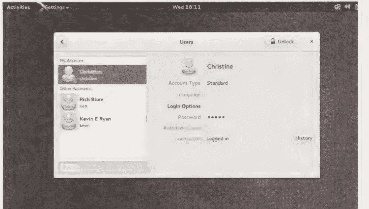

图 12.2 “用户”账户工具提供了极少的账户信息。

## 网络账户数据库

许多网络采用网络账户数据库。此类系统包括网络信息系统 (`NIS`)、该系统的更新版本 `NIS+`、轻量级目录访问协议 (`LDAP`)、Kerberos 领域以及 Active Directory (`AD`) 域。所有这些系统都将账户数据库管理转移到单一的中央计算机（通常带有一个或多个备份系统）。这种账户维护方法的优势是，用户和管理员无需独立地在多台计算机上维护账户。单一账户数据库可以处理几十（甚至数百或数千）台不同计算机上的账户，极大地简化了日常管理任务，也简化了用户的生活。使用此类系统意味着大多数用户账户不会出现在 `/etc/passwd` 和 `/etc/shadow` 中，而组可能不会出现在 `/etc/group` 中（下文描述）。

## 了解账户


Linux 可以参与这些系统。事实上，某些发行版在 OS 安装时提供了启用此类支持的选项。通常，你必须知道托管网络账户数据库的服务器名称或 IP 地址，并且必须知道系统使用什么种协议。你可能还需要密码或其他某些特定协议的信息，并且服务器可能需要配置为接受来自你正在配置的 Linux 系统的账户。在安装 Linux 后激活此类网络账户数据库的使用是一个复杂的话题，难以以微妙或不微妙的方式改变 `password` 和 `usermod`（在第 13 章中描述）等工具的行为。如果你需要使用某种系统，将不得不咨询你打算使用的服务的特定文档。

## 了解组

如前，组是定义在 `/etc/group` 文件中的账户集合。与 `/etc/passwd` 类似，`/etc/group` 文件包含冒号分隔的行（记录），每行定义一个组。一个示例所示：

```
users:x100:games,sally
```

`/etc/group` 中的字段如下：

**组名** 第一个字段（在前述示例中的 `users`）是组的名称。你在大多数访问或操作组数据的命令中使用它。

**密码** 组和用户一样，可以有密码。值 `x` 表示密码在其他处定义（但可能被禁用），空密码字段表示该组没有密码。

**GID** Linux 内部使用 GID 值，类似于 UID 值。组名与值之间的转换是为了用户和管理员的方便而进行的。

**用户列表** 你可以在 `/etc/group` 记录的末尾通过逗号分隔的列表指定属于该组的用户。

识别用户可以通过两种方式被识别为组的成员，这是重要的：

认证目标

组密码的使用和管理是本书范围之外的话题。

### 第 12 章 了解基础安全

**通过在用户的单个 `/etc/passwd` 条目中指定组的 GID** 因为 `/etc/passwd` 空间只能容纳一个 GID 值，所以这种方式只能定义一个组。这是用户的主组（或默认组）。

**通过在 `/etc/group` 文件的用户列表指定指定用户名** 单个用户可以在 `/etc/group` 中出现多次，单个组可以通过这种方式与多个用户关联。如果用户通过这种方式与某个组关联，但不是通过用户的 `/etc/passwd` 条目，则这种组关联是次要的。

当你创建新文件时，这些文件将与你的当前组关联。当你登录时，你的当前组被设置为你的主组。如果你想创建与另一个组关联的文件，可以使用 `newgrp` 命令，如下：

```
$ newgrp project1
```

文件的组所有权很重要，详细内容将在第 13 章中描述。

## 使用工具

一些命令可以帮助你了解用户和组。最重要的是，`whoami` 和 `id` 工具可以告诉你你的身份。

### 发现你自己的身份

如果你自己维护了多个账户但不记得登录的是哪一个，可能会感到困惑。在这种情况下，`whoami` 命令可以派上用场。它显示用户 ID：

```
$ whoami
christine
```

此示例显示当前账户是 christine。如果你需要更多信息，可以使用 `id` 工具：

```
$ id
uid=1002(christine) gid=100(users) groups=100(users)
```

此示例显示了关于用户和组的信息：

- 你的用户 ID：`uid=1002(christine)`
- 你的当前组：`gid=100(users)`
- 你所有的组成员：`groups=100(users)`

`id` 命令显示数字 UID 或 GID 值以及相应的名称。当前组是默认的或者是因为你使用了 `newgrp` 命令。

你可以通过指定各种选项来限制 `id` 的输出，总结见表 12.1。此外，你可以指定用户名，例如 `id sally`，以获取该用户而非自己的信息。

### 表 12.1 id 的选项

| 长选项 | 短选项 | 效果 |
| --- | --- | --- |
| --group | g | 显示有效组 ID |
| --groups | -G | 显示你所属的所有组 |
| --user | -u | 仅显示用户数据 |
| --name | -n | 与 -g, -G 或 -u 结合使用；仅显示名称，不显示 UID 或 GID |
| --real | -r | 与 -g, -G 或 -u 结合使用；仅显示 UID 或 GID，不显示名称 |

## 学习在线用户

Linux 允许多个用户同时访问计算机。通常是通过远程访问服务器（如安全 Shell `SSH`）实现的；然而，你可以使用 Linux 的虚拟终端 `VT` 功能通过单个键盘和显示器登录多次。有时，你可能想知道谁正在使用计算机。你可能会在关闭计算机之前这样做，例如，以确保不会给其他用户带来不便。

### 第12章 · 理解基础安全

要学习谁在网上，你可以使用名为 `who` 命令：

认证目标

```
$ who
cristine:0  2016-05-04 17:33 (:0)
kevin      tty2  2016-05-04 17:36
rich       pts/0  2016-05-04 17:33 (192.168.56.101)
cristine   pts/1  2016-05-04 17:34 (:0)
```

此示例显示了四次登录——两个来自 christine，一个来自 Kevin，一个来自 rich。默认输出中提供的信息包括以下内容：

- **用户名 `Username`**：`who` 输出的第一列显示用户名称。
- **终端标识符 `Terminal Identifier`**：`who` 输出的第二列显示与终端相关的代码。在例例中，cristine 的首次登录显示 `:0` 作为此标识符，这意味着这是一个本地登录。其余登录的终端标识符为 `pts/#` 或 `tty#` 格式，表示文本会话。文本会话可以是 GUI 中启动的终端、文本模式控制台，或者通过 SSH 或其他协议进行的远程登录。

不同的发行版对 `who` 命令的细节有所不同。但主要元素是相同的。

- **登录日期和时间 `Login Date and Time`**：`who` 显示每次登录的日期和时间。你可以看到 rich 和 cristine 的会话比 Kevin 登录早几分钟开始。

默认情况下，`who` 命令从 `/var/run/tmp` 文件获取数据。

- **远程主机 `Remote Host`**：`who` 输出的最后一列（如果存在）显示了源登录（包括文本模式和基于 GUI 的登录），且不包含源。以 `#` 或 `#.` 形式显示的源（如 cristine 的会话）表示在 GUI 中打开的终端。`hostname` 或 IP 地址（如 rich 的会话）表示来自计算计算机的远程登录。

你可以通过向 `who` 传递选项来获取晦涩或特殊的额外信息。相比其他选项，更有可能使用的是计数 `-q`，它会产生一个更紧凑的数据摘要：

为了幽默，`who` 命令允许你使用 `moments you likes` 代替 `ami` 参数。

```
$ -q
cristine kevin rich cristine
# users=4
```

此输出仅包含用户名和一行指定会话总数的行。注意，用户数量计数会将具有多次登录的用户计算多次。

与 `whoami` 命令类似，但它会显示更多信息，通过向 `who` 传递 `i` 参数来仅显示针对你当前用户 ID 的数据：

```
$ am i
cristine pts/1  2016-05-04 17:34 (:0)
```

# 以 root 身份

在此示例中，当前用户是 christine，她正登录到 pts/1 GUI 会话。有关附加选项和参数的信息，请参阅其帮助页（man page）。

`who` 的替代方案是 `w`，它与 `who` 类似但输出较为冗长：

```
$ W
117:52:40 up 24 min, 4 users load average: 0.02, 0.108, 0.20
USER TTY IDLE LOGIN JCPU CPU WHAT
cristine: 17:33 ?xdm? 0.16 0.16s gdm-sess[...
kevin tty2 17:36 16:24 0.10s -bash
rich pts/0 17:33 19:36 0.11s 0.11s -bash
christ pts/1 17:34 0:00s 0.22s 0.01s w
```

认证目标

正如你所看到的，`w` 显示了与 `who` 相同的信息，包括终端标识符（TTY）和登录时间。此外，`w` 还显示了以下信息：

- **会话空闲时间 `IDLE`**：告诉用户会话多久未进行交互。
- **JCPU**：标识用户进程所占用的 CPU 时间。
- **PCPU**：标识该进程所占用的 CPU 时间。
- **源 `FROM`**：如果存在，最后一列显示源登录主机名。使用 `-f` 选项可以开启或关闭此选项。

有些配置还会显示 `WHAT` 列，显示正在运行的命令。详情请参阅帮助页。

## 第12 章 · 理解基础安全


在这个示例中，用户名已从 `luke` 更改为 `root`；目录已 `~` ~更改为 `luke`（因为 `root` 指的是 `/root`，而不是 `/home/luke`）；并且提示符的最后一个字符已从美元符号 (`$`) 变为井号 (`#`)。因为书中的许多示例在单独占行显示时，只使用了提示符的最后一个字符，因此这些示例通过提示符隐式地指定了命令是否需要特权。例如，考虑前文提到的 `/etc/shadow` 文件：

```bash
# cat /etc/shadow
```

使用井号（`#`）提示符表示你必须使用 `root` 权限输入此命令。这些书籍中的都描述了系统管理的 GUI 模式和文本模式方法。那么，如果你必须使用 `sudo`（或 `su`）`root` 权限，你又该如何在 GUI 模式下管理 Linux 呢？一种方法是从你已经使用过的 shell 中启动 GUI 管理工具。这种方法虽然可行，但如果你更习惯使用 GUI 而不是命令行，这种方法就会有些不便。因此，大多数发行版都提供了一种替代方案：你可以从电脑桌面菜单启动管理工具，GUI 工具会在需要时提示你输入 `root`（管理员）密码，如图 12.3 所示。如果你输入的密码正确，程序将继续运行。结果与从 shell 启动程序类似——它以 `root` 身份运行，但不会让其他任何东西以 `root` 身份运行。在 Ubuntu 中使用 `root` 命令，你必须在它们前面加上 `sudo`（如 `sudo cat /etc/shadow`），或者输入 `sudo` 来获取一个持续时间较长的 shell。如果你忘记了 `root` 密码怎么办？别担心，有很多方法可以重置它。使用你喜欢的搜索引擎，并用你的发行版名称（替换 Linux）进行搜索：“重置 root 密码]”。

图 12.3 GUI 中的管理工具在需要时请求密码。

## 以 root 身份工作

### 安全地使用 root 权限

如前所述，`root` 权限是危险的。你可能会意外删除关键文件并导致数小时的停机。每个人都会犯错——不幸的是，某些错误对公司来说可能是灾难性的。想象一下入侵者获取了你电脑的 `root` 权限；对配置文件进行了意外的更改；损坏了用户文件的权限，导致其无法访问。建议你在每次需要 `root` 权限时采取以下预防措施：

- 问问自己是否真的需要 `root` 权限。有时，可以在不需要超级特权的情况下实现目标，或者以比原计划更有限的方式使用权限。例如，你可能会发现只有 `root` 能够写入磁盘。
- 在以 `root` 身份输入任何内容并按下回车键（或点击以 `root` 身份运行的 GUI 程序中的任何确认按钮）之前，将手移开键盘和鼠标，检查命令并确认它是正确的。一个简单的拼写错误就会导致巨大的痛苦。
- 绝不要以 `root` 身份运行可疑程序。在多用户系统中，不道德的用户可能会欺骗管理员运行有害程序或给攻击者提供 `root` 权限的程序。从随机网站下载的程序可能被设计用于破坏你的安全，而此类程序在以 `root` 身份运行时危险得多。
- 尽可能缩使用 `root` 权限。如果你只需要以 `root` 身份输入一两个命令，请执行后退出 `root` shell 以注销或返回普通权限。更好的是使用 `sudo` 运行命令。人们很容易忽略自己正在使用 `root` shell 这一事实，从而以 `root` 身份输入不需要权限的命令。每一个以 `root` 身份输入的命令都是一种风险。
- 绝不要让其他人可以访问 `root` shell。如果你正在执行 `root` 维护任务并被叫走，请离开电脑前在 `root` shell 中输入 `exit`。
- 如果程序要求输入密码或 `root` 密码，而它不是你信任的管理程序，请务必怀疑！在提供密码之前先研究该程序！

第 13 章描述了如何选择强密码。

谨慎处理 `root` 密码。不要与他人共享密码，在公共区域输入或他人可能在你的身后窥视时要加小心。如果你在职业领域使用 Linux，你的雇主可能拥有关于谁可以访问电脑的指南。学习这些规则并遵守它们！务必也选择一个强 `root` 密码。遵循这些原则可以帮助你避免损坏电脑或让他人获得电脑访问权限。

## 核心内容及扩展

账户对于 Linux 的正常运行至关重要。通常，你在 Linux 电脑上执行的大多数任务都需要标准用户的权限，因此你将使用自己的用户账户来处理这些任务。你可以使用 `whoami`、`id` 和 `w` 等工具来识别你的账户，并确定还有谁可能在使用电脑。偶尔，你需要执行需要 `root` 账户权限的管理任务，这些权限可以读取和写入任何普通文件、以低级方式访问硬件、配置网络并执行普通用户不允许执行的任务。由于 `root` 如此强大，你应该节约使用这种力量，并在使用时极度小心，不要让拼写错误或其他意外导致严重问题。

## 建议练习

- 执行 `whoami` 后接 `id` 以检查你的普通用户账户状态。很可能 `id` 命令会揭示你是各种组的成员。执行网络搜索以了解每个组的作用。
- 读取 `/etc/passwd` 文件或输入 `passwd` 以检查电脑上定义了哪些账户。除了你的账户之外，还有普通用户账户（取决于你的发行版，UID 在 500 或 1,000 以上）吗？执行网络搜索以了解几个系统账户的用途（取决于你的发行版，UID 在 500 或 1,000 以下的账户）。

## 复习题

1. UID 为 0 的系统账户目的是什么？

   A. 它是系统管理账户。

   B. 它是第一个普通用户。

   C. 无；UID 0 留空未定义。

   D. 它随发行版而异。

   E. 它是某些服务器默认使用的低特权账户。

2. 在 `/etc/passwd` 中你会找到普通用户账户的什么类型的信息？（多选）

   A. 用户 ID (UID) 数字

   B. 用户所属的每个组的完整列表

   C. 账户主目录的路径

   D. 账户默认 GUI 环境的路径

   E. 账户默认文本模式 shell 的路径

3. 你想以 `root` 身份运行命令 `cat /etc/shadow`，但你目前是以普通用户登录的。假设系统已配置为通过适当的命令授予你 `root` 权限，以下哪个命令可以完成任务？

   A. `sudo cat /etc/shadow`

   B. `root cat /etc/shadow`

   C. `passwd /etc/shadow`

   D. `su cat /etc/shadow`

   E. `admin cat /etc/shadow`

4. 错误：`whoami` 提供的信息比 `id` 多。

5. 正确：Linux 将组信息存储在 `/etc/groups` 文件中。

6. 正确：作为原则，以 `root` 身份运行程序时应格外小心。

7. Linux 中将用户名与 UID 数字关联的文件是 ____________。（提供该文件的完整路径）。

8. 要了解谁当前登录了电脑以及他们正在运行哪些程序，你可以输入 ______________。

9. 500 或 1,000 以下（取决于发行版）的 UID 留供账户使用。

10. ______________ 环境意味着某人无法否认其行为，`sudo` 命令有助于建立这种环境。

# 创建用户和组

Linux 是一个多用户操作系统，这意味着一台 Linux 计算机可以支持许多用户，每个用户都有一个唯一的账户。这种这种能力也带来了对管理用户账户的需求，本章将介绍你将用于执行这些操作的程序。

本章从如何创建账户的信息开始。创建好账户后，你还需要了解如何修改这些账户，并在必要时删除它们。最后，组在许多方面与账户相似，因此本文还描述了如何创建和管理组。

- 创建新账户
- 修改账户
- 删除账户
- 管理组

# 创建新账户

在许多环境中，添加账户的任务是非常常见的。大型企业聘用新员工，大学招收新学生，慈善机构招募新志愿者，等等。因此，你必须学会如何创建账户。在介绍创建账户的机制之前，将先介绍关于决定如何使用组以及选择良好密码的重要问题。之后，将解释如何同时使用图形用户界面（GUI）和文本模式工具来创建账户。

# 确定组策略

正如第 12 章“理解基础安全”所述，Linux 组是用户的集合。你可以使用组来控制谁可以访问特定文件。正如第 14 章“设置所有权和权限”所述，个人可以更改自己的文件的组所属关系和组权限。因此，你使用组的方式会影响计算机的整体安全策略。通常有两种方法：

**用户组** 每个用户都可以有一个关联的组；例如，用户可以对其文件拥有组所有权，以便将组权限设置为所需的任何，并且系统管理员可以将用户添加到用户组。此后，该组的成员可以使用用户 `luke` 确定的权限访问该组中的文件。这种方法强调了对单个用户文件的访问控制。

**项目组** 在这种方法中，你根据工作项目、部门所属关系或其他现实世界中的用户分组创建组。例如，你可能有一个名为 `sales`（销售）的组用于销售部门。该组中与其他组成员共享文件的成员将相应地分配组所有权和权限，并将文件存储在约定的位置。当计算机被大量在易定义组中协作的人员使用时，这种方法效果最好。

默认情况下，某些发行版采用组策略，而另一些则使用项目组策略。在后的情况下，大多数用户默认属于一个名为 `users` 或类似的组。

这两种方法并不是互斥的；你可以混合使用，或者创建自己的方法。你还应该意识到用户可以是多个组的成员。事实上，这是用户组正常工作所要求的——否则，组将与账户产生冗余。


如果你使用组方法，你应该考虑哪个组应该是新用户的主组。该组是默认情况下为用户文件分配组所有权的组。

# 选择良好的密码

当你创建一个账户时，通常应该为该账户创建一个密码。有时，用户在创建账户时可以选择密码。其他时候，你需要选择一个用户初始将使用的密码。在这种情况下，指示用户尽快更改密码。无论哪种情况，教育用户选择良好的密码都是重要的。糟糕的常用密码包括基于以下内容的：

务必遵循本节的建议，特别是针对 root 密码！

- 成员的名字
- 喜爱的书籍、电影、电视节目或其中任何一个角色
- 电话号码、街道地址或社会安全码
- 任何其他有意义的个人信息

# 创建新账户

- 字典中找到任何单个单词（任何语言）
- 任何简单的键盘或字母数字组合，例如 `qwerty` 或 `123456`

最好的密码是字母、数字和标点符号的随机组合。遗憾的是，这样的密码很难记忆。一个合理的折中方案是分步构建密码：

1. 选择一个易于记忆但难以猜测的基准（base）。
2. 以增加猜测密码难度的方法对基准进行修改。

构建基准的一种方法是使用两个或多个不相关的单词，例如 `bun` 和 `pen`。你可以合并这两个单词（`bunpen`）。另一种方法，而且可以说比第一种更好，是使用对用户有意义的短语的首字母。例如，“*yesterday* I went to the *dentist*”的首字母是 `yytd`。在这两种情况下，基准都不应是任何语言中的单词。作为一个一般规则，密码越长越好。

有了基准后，是时候通过修改它来创建密码了。用户应该应用几种可能的修改：

**添加数字或标点符号** 一个重要的变化是在基准中插入随机数字或标点符号。这一步可能会产生，例如，`bu3pn7` 或 `yytd`。作为一个一般规则，至少添加两个符号或数字。

**混合大小写** Linux 使用区分大小写的密码，因此打乱字母的大小写可以提高安全性。应用这条规则可以产生例如 `Bu3nPE?n` 和 `y+19wttD`。

**反转顺序** 这种变化本身很弱，但与其他方法结合使用可以增加安全性，即反转某些或所有字母的顺序。你可能将其应用于双单词基准中的一个。例如，这可能会产生 `Bu3nn?EP` 和 `Dtt99I+`。

**增大草堆** 入侵者发现密码的技巧与在草堆中找针有关。让这项任务变得更困难的一种方法是增加草堆的大小。在密码术中，这意味着让密码更大。你可以通过使用更大的单词来实现这一点，但这会让密码更难记忆和输入。即使是简单的重复单个字符也有帮助。你可能会把密码变成 `Bu3nn?EP1111` 或 `DttIIIIW9+`。


# XIII十三章 创建用户和组

让用户选择良好密码的最佳工具是教育他们。

这里是可以与用户分享的一些见解：

- 密码可能会被了解它们的人猜中，甚至被那些通过社交媒体、网络电话簿、商业简介等获取用户信息的人猜中。尽管 Linux 在内部进行加盐和哈希处理，但程序会将整个字典通过加盐/哈希算法来对比 Linux 系统的密码。如果找到了匹配，密码就被破解了。
- 用户账户可能被用来破坏整个计算机的第一步，或作为攻击其他计算机的起点。
- 用户绝不向任何人透露密码，即使是自称系统管理员的人。这是一个常见的骗局，因为真正的系统管理员不需要用户的密码。
- 同一个密码不应用于多个系统，因为这样做会将一台计算机上的账户变成变成所有计算机上的账户。
- 记录密码或通过电子邮件发送它们都是风险做法。将密码写在贴在显示器的便利贴上尤为愚蠢。

告诉你的用户这些事情将帮助他们理解你担忧的原因，并且可能激励至少一些人选择良好的密码。

# 不要使用这些密码！

如果你对常用密码或类似的短语进行搜索，你会很快发现一些网站提供了安全研究人员发现的最典型、最易猜密码的调查结果。细节之间有所不同，但通常常用密码包括以下：

- 123456
- password
- 12345678
- qwerty
- football
- monkey
- 1234
- baseball
- dragon

这些密码很容易被暴力破解密码猜测程序发现，并包含在互联网上分发的密码字典中。使用这样的密码和不使用密码几乎没有区别。为自己帮个忙，创建一个更好的密码吧！

# 使用 GUI 工具创建账户

现在你已经了解了想要使用什么种类型的组策略以及如何创建一个良好的密码，可以开始创建账户了。某些发行版允许你通过 GUI 工具至少部分地完成此任务。然而，这些工具在不同的 Linux 发行版之间有所不同。重要的差异包括如何访问这些工具以及工具的名称。在某些发行版中，你可以使用桌面搜索工具（如 Ubuntu 的 Dash）输入 `user` 来找到相应的账户创建工具。在其他发行版中，你需要通过桌面菜单来找到正确的工具。该工具的名称可能类似于 Users（用户）、Group Accounts（组账户）或 User and Group Administration（用户和组管理）。

作为 GUI 用户账户管理工具的示例，图 13.1 显示了 openSUSE 的 User and Group Administration 工具。使用这个特定工具，你可以做比账户之外很多事情。然而，这里的重点是创建账户。

要使用 User and Group Administration 添加用户，请遵循以下步骤：

+ 1. 点击 Add 按钮。结果是显示图 13.2 所示的 New Local User（新建本地用户）对话框。
+ 2. 在 User's Full Name 字段中输入用户的全名。此条目存储在 `/etc/passwd` 的注释字段中，并并可以在各种工具中显示；例如，当用户登录桌面时，它会出现在某些桌面环境中。

当你启动 User and Group Administration 工具时，会出现一个对话框，要求你在继续之前输入 root 密码。在显示图 13.1 所示的工具界面之前，会通过一个初始化界面。

# 第 13 章 创建用户和组

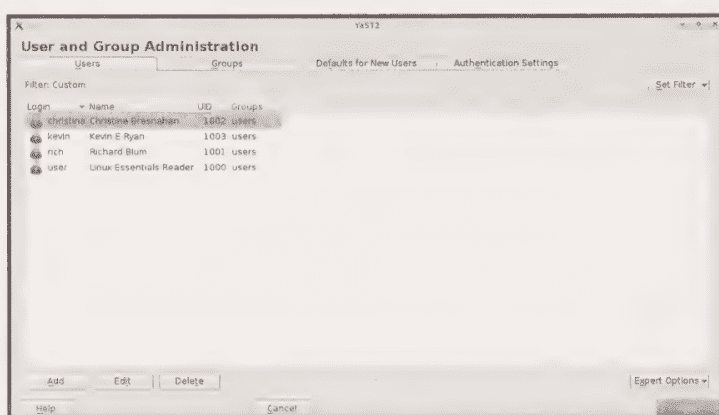

图 13.1：openSUSE 的 User and Group Administration 工具为创建和管理账户提供了许多选项。

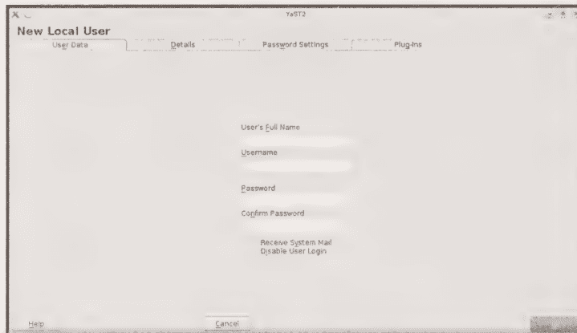

如果用户在创建账户时已存在，你可以让用户在此时输入密码。

图 13.2：你可以通过 New Local User 对话框输入所有的基本账户信息。

+ 3. 在 Username 字段中输入用户名。这是用户在 Linux 登录提示符处输入的的内容。
+ 4. 输入两次密码，一次在 Password 字段中，另一次在 Confirm Password（确认密码）字段中。
+ 5. 在大多数情况下，你可以点击 OK，因为其余选项的默认值通常是可以的。

新账户将出现在 Users 选项卡列表中。如果有需要，你可以像本章稍后描述的那样对其进行修改或删除。

# 从 Shell 创建账户

在任何发行版中，你都使用 `useradd` 工具从命令行创建账户。要使用该工具，你需要输入它的名称以及想要与新账户关联的用户名。你也可以在 `useradd` 和用户名之间包含选项，如表 13.1 所示。

表 13.1：`useradd` 选项


| 选项名称 | 选项缩写 | 效果 |
| -- | -- | -- |
| --comment comment | -c | 此参数指定用户的注释字段。（GUI 工具通常将其描述为“全名”） |
| --home home-dir | -d | 使用此参数指定账户的家目录。默认为 `/home/username` |
| --expired expire-date | -e | 使用此选项设置账户失效日期，格式为 YYYY-MM-DD。默认值账户不存在。 |
| --inactive inactive-days | -f | 此参数设置密码过期后若干天账户将被完全删除。值 -1 禁用此功能，且是默认值。 |
| --gid default-group | -g | 使用此选项设置用户默认组的名称或 GID。该值的默认值是以用户命名的组。 |
| --groups group,... | -G | 此参数设置用户所属组的名称或 GID——可以通过逗号分隔指定多个组。 |
| --create-home | -m | 当包含此选项时，`useradd` 会为用户创建家目录。此选项通常默认启用。 |

在基于 Debian 的发行版（如 Ubuntu）中，你可以通过输入 `adduser` 使用更友好的前端工具。注意在某些发行版（如 Fedora）中，可用的是 `useradd` 命令而不是它。

# 第 13 章 - 创建用户和组

| 选项名称 | 选项缩写 | 效果 |
| --- | --- | --- |


| `--skel` skeleton-dir | `-k` | 通常从 `/etc/skel` 复制默认配置文件，你可以使用此选项指定另一个模板，仅与 `-m` 配合有效。 |

| None | `-M` | 此选项强制系统不创建家目录。 |

| `--shell` shell | `-s` | 使用此选项设置用户的默认 shell。默认是 `/bin/bash`。 |

| `--uid` UID | `-u` | 此参数使用指定的用户 ID (`UID`) 创建账户。 |

| `--non-unique` | `-o` | 此参数允许重用单个 UID；在创建使用 UID 的后续账户时传递此选项。 |

| `--system` | `-r` | 此参数指定创建系统账户，并赋予低于 100 的 UID 值。 |

| `--no-user-group` | `-N` | 此选项禁用为用户创建组 |

你可以使用 `useradd -p` 添加密码。然而，出于安全考虑，不建议这样做。使用本章稍后描述的 `passwd` 命令更好。

某些选项在账户 GUI 工具创建账户时无法直接访问，但细节在不同的 GUI 工具之间不同。在某些情况下，可以在创建账户后在 GUI 工具中设置。

你可能想要指定 UID 以在共享网络文件系统 (`NFS`) 的计算机之间同步这些值，`NFS` 通过 UID 识别所有权。

一个包含一些选项的完整 `useradd` 命令：

```
$ sudo useradd -m -c "Samantha Bresnan" -u 1012 samantha
```

这创建了一个名为 `samantha` 的账户，具有家目录、包含用户全名的注释字段以及 1012 的 UID。在前面的示例中，使用了 `sudo` 命令来获取完成此命令所需的超级用户权限。如果你登录的是 root 账户，则不需要 `sudo`。

# 修改账户

当你使用 `useradd` 创建账户时，它将处于锁定状态——用户无法登录。要解锁它，你必须使用下一节“修改账户”中描述的 `passwd` 命令。

在后台，`useradd`（或其扩展前端）会修改以下文件的内容（详见第 12 章）：

```
/etc/passwd
/etc/shadow
/etc/group
```

如果你使用 `-create-home` 或 `-m`（如果默认使用此选项），程序将创建一个家目录并将文件从 `/etc/skel` 拷贝到该位置。创建账户通常创建一个存储用户邮件的池文件（此文件在许多桌面系统中可能未使用，但如果你在计算机上运行邮件服务器软件，它可能非常重要）。因此你可以看到 `useradd` 在创建账户时对你的计算机的文件和目录进行了许多修改。

## 决定何时修改账户

在理想的世界中，你每次都能完美地创建账户；然而，这并非总是。你可能缺少创建完美账户所需的信息（例如员工在公司工作的时间），或者在账户创建后你的需求可能发生了变化。幸运的是，Linux 提供了 GUI 和文本模式工具来帮助完成这一点。不过，在深入这些工具的操作细节之前，你应该理解何时可能需要更改账户，并知道如何检查用户当前是否已登录。

### 常见修改原因

在理想的世界中，你每次都能完美地创建账户；然而，这并非总是。你可能缺少创建完美账户所需的信息（例如员工在公司工作的时间），或者在账户创建后你的需求可能发生了变化。账户更改的一些常见特定原因包括但不限于以下：

+ - 账户过期数据可能需要更新。例如，合同工的合同可能会延长。有时必须重新启用过期的账户。

## 第 13 章 创建用户和组

- `UID` 号可能需要与其他计算机同步，以便于跨计算机进行文件共享或其他原因。

- 用户的主目录可能会发生变化，因为你添加了磁盘空间并需要将某些用户的主目录移动到新位置。

- 用户可能会忘记密码。系统管理员可以在不知道原始密码的情况下更改任何账户的密码，因此系统管理员经常需要帮助记忆力故障的用户。

在 GUI 环境下工作时，上述许多更改可以通过发行版的 GUI 账户管理工具来处理。在文本模式 shell 中工作时，你需要掌握几个不同的程序来处理这一范围的账户修改。

### 检查登录用户

请注意，如果在执行更改时用户正登录状态，某些账户更改可能会导致干扰。特别是更改账户的用户名和主目录，可能会导致问题。你应该只在用户注销后进行更改。几个工具可以帮助你检查谁在使用计算机并避免出现问题：

- `who` 工具在第 12 章中描述，它可以生成当前登录计算机的用户列表，并包含其登录会话的一些详细信息，例如终端标识符和登录日期。

- `w` 命令同样在第 12 章中描述，大致上与 `who` ，但提供了不同的详细信息。最显著的是，它识别了每个会话中正在运行的程序。

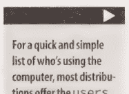


该程序生成最近登录会话的列表，包括开始和结束时间，或者用户已登录的通知：

```
$ last
jennie tty3 Sun Jan 8 12:43 still logged in
jennie tty3 Sun Jan 8 12:43-12:43 (00:00)
jennie tty2 Sun Jan 8 12:36 still logged in
jennie tty2 Sun Jan 8 12:36-12:36 (00:00)
```

`last` 的一个局限性是它只包含文本模式的登录。这使得它在识别当前使用计算机的用户方面非常有限，因为某些用户可能正在使用 GUI 会话登录。

`last` 命令显示存储在 `/var/log/wtmp` 文件中的数据。你应该意识到，某些发行版默认并不会创建此文件。请查阅 `last` 命令的 man 手页以获取更多信息。

## 使用 GUI 工具修改账户

与添加账户一样，使用 GUI 工具修改账户的步骤因工具而异。大多数 GUI 工具提供类似的选项，尽管某些比其他的更完整。在本节中，将展示如何使用 OPENUSE 的用户和组管理工具来修改账户。

要进行更改，在打开用户和组管理工具后，你应该点击账户，然后点击 Edit（编辑）按钮。结果是一个类似于图 13.3 所示的对话框。该对话框显示账户属性。四个标签页中的每一个都可以访问特定类型的数据

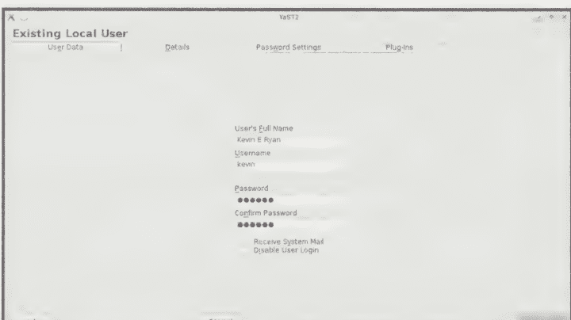

图 13.3：现有本地用户对话框允许你编辑各种账户属性。

用户数据（User Data）：如图 13.3 所示，你可以调整账户的注释字段（标识为用户全名）、用户名和密码。如果你输入了弱密码，程序会警告你此事实并在接受之前要求进行确认。

详情（Details）：此标签页提供了几个选项：你可以更改默认 shell（在本工具中称为 Login Shell）；将账户添加到其他组中；修改主组（在本工具中称为 Default Group）。

密码设置（Password Settings）：此标签页允许你管理密码过期。它设置了密码过期后到账户被禁用之间的的天数。

插件（Plug-ins）：此标签页允许你管理配额和其他功能。

锁定（Locking）：此选项会锁定账户，防止登录。

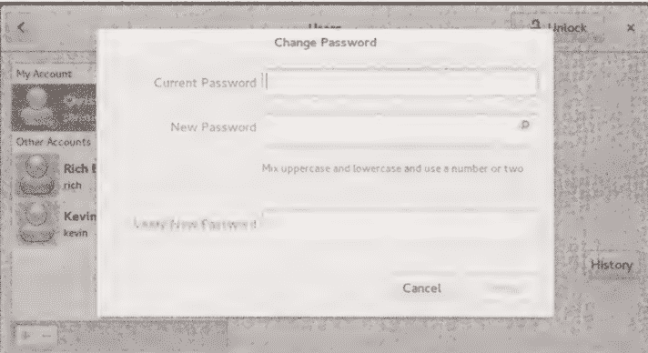

图 13.3：现有本地用户对话框允许你编辑各种账户属性。

## 使用命令行修改账户

`usermod` 命令是从命令行修改现有账户的主要工具。下表总结了 `usermod` 最重要的选项。

| 选项 | 缩写 | 效果 |

| :--- | :--- | :--- |

| `--append` | `-a` | 与 `--groups (-G)` 使用，导致指定的组被添加而不是替换。 |

| `--comment` | `-c` | 指定用户的注释字段。 |

| `--home-dir` | `-d` | 设置账户的主目录。 |

| `--expired-date` | `-e` | 设置账户禁用的日期，格式为 YYYY-MM-DD。默认是账户不过期。 |

| `--inactive-days` | `-f` | 设置密码过期后账户被禁用的天数。值 -1 禁用此功能。 |

| `--default-group` | `-g` | 设置用户组的名称或 GID。默认是一个以用户命名的新组。 |

| `--groups[,]` | `-G` | 设置用户所属组的名称或 GID——可以通过逗号指定多个。 |

| `--login` | `-l` | 将账户用户名更改为指定的值。 |

| `--lock` | `-L` | 锁定账户密码，防止登录。 |

| `--move-home` | `-m` | 当此选项配合 `--home-d` 使用时，`usermod` 将用户现有的主目录移动到新位置。 |

| `--shell` | `-s` | 设置用户默认 shell 的名称。 |

| `--uid` | `-u` | 将账户的 UID 号更改为指定的值。 |

| `--non-unique` | `-o` | 允许单个 UID 号被重用（结合 `--uid/-u` 使用）。 |

| `--unlock` | `-U` | 解锁锁定的账户密码。 |


例如，考虑以下 `usermod` 的用法：

```
# usermod -u 1072 -m -d /home2/kevin kevin
```

该命令对关键账户进行了三处更改：
* 它将 UID 更改为 1072。
* 它将账户的主目录更改为 `/home2/kevin`。
* 它将账户原始主目录的内容移动到其新位置。

如果你正在将用户账户迁移到挂载在 `/home2` 的 NFS 服务器，你可能会执行类似这样的命令。这种更改可能需要新的主目录位置，并更改 UID 值以与 NFS 服务器上使用的值匹配。

在更改 UID 值时你应该要小心，虽然 `usermod` 会更改用户主目录和邮件文件等常见位置文件的 UID 值，但它可能会漏掉位于非标准位置的用户。

如果你需要进行需要添加新组的组更改，请参阅接下来的章节“管理组”以获取该主题的信息。

## 删除账户

删除账户有时与添加或修改账户一样重要。未使用的账户可能会被原所有者或其他可能在密码较弱时入侵账户的人所滥用。因此，你应该定期删除未使用的账户。在此之前，你应该了解删除账户时会发生什么，并精确决定如何操作，避免以不当的方式删除账户引起问题。有了这些知识，你可以使用任何 GUI 或文本模式工具删除账户。

> 使用 `--move-home (-m)` 选项在单个低级文件系统上移动时会很快，但跨越文件系统边界时可能会很慢。
> 考虑将删除的账户的主目录归档到长期备份介质。这将允许你在未来这些文件变得有价值时恢复它们。

## 避免删除账户的陷阱

账户听起来可能很简单，但错误可能会导致现在或未来出现问题。为了避免诸如不小心删除错误账户等明显问题，你应该考虑两个因素：

### 用户文件保护

用户文件对于用户本身或拥有该计算机的组织来说可能极具价值。在考虑是否删除用户主目录或对其进行其他处理（如将其移动到另一个用户的主目录并更改其中包含文件的权限）时，你应该检查公司的文件保留策略。用户的邮件队列（通常存储在 `/var/spool/mail/username`，其中 `username` 是用户名）情况也是如此。

# 第 13 章 · 创建用户和组

### UID 和 GID 的重用

当账户被删除时，账户的 UID 和 GID 变得可以重用。在许多情况下，这些数字不会被重用，因为 Linux 根据当前最大值来分配这些值。因此，如果你删除了任何编号最大的当前用户，除非中间的账户也被删除，否则该编号不会被重用。尽管如此，如果 UID 被重用，以前属于旧用户的将突然变成属于新用户。这可能不会引起任何问题，但可能会引起关于谁创建了文件的困惑。在某些情况下，它甚至会导致对新用户产生不当行为的（如果旧文件包含新用户没有的信息，或者它们位于新用户不应具有访问权限的目录）。

如果你想避免新用户因 UID 或 GID 重用而面临任何困惑或不当行为的指控，可以使用第 8 章“搜索、提取和归档数据”中的 `find` 命令，使用 `-uid` 和 `-gid` 选项定位具有特定 UID 或 GID 值的所有文件，如下：

```
# find -uid 1004
```

此示例找到计算机上 UID 为 1004 的所有文件。（搜索 GID 的方法相同，但使用 `-gid` 选项）。然后你可以使用 `chown` 命令（在第 14 章介绍）重新分配这些文件的所有权，或将其删除。通常情况下，你应该只在删除或重新分配用户主目录的所有权后才执行此命令，因为该目录可能包含太多的文件。

## 使用 GUI 工具删除账户

在其他账户管理任务中，使用 GUI 是相当直观的，但细节因发行版而异。例如，要从 openSUSE 的“用户和组管理”工具中删除账户，在打开工具后，你应该点击该账户，然后点击“删除”按钮。结果是一个类似于图 13.5 所示的确认对话框。根据你的需要勾选或取消勾选删除用户主目录框，如果你确定了该操作，点击“是”按钮。账户将被立即删除。

如果用户当前已登录，该工具通常会在确认对话框中提示此事实。你仍然可以删除账户，但用户不会立即注销。

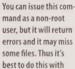

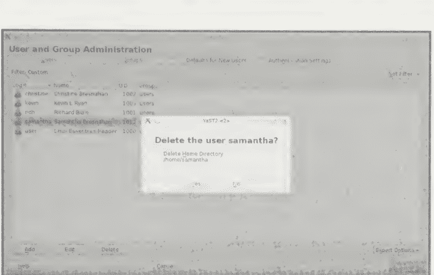

图 13.5：当你使用 GUI 工具删除账户时，你可以选择性地删除用户的主目录。

## 从 Shell 删除账户

`userdel` 命令从文本模式 Shell 中删除账户。在最简单的形式下，你只需传递一个用户名，无需其他内容：

```
$ sudo userdel samantha
root's password:
```

程序不会提示你确认；它会直接删除账户。然而，它默认不会删除用户的主目录。如果你必须这样做，请传递 `remove (-r)` 选项。

如果用户当前已登录，`userdel` 会通知该事实且什么都不做。你可以传递 `--force (-f)` 选项在用户已登录的情况下删除账户。要同时强制删除账户并删除用户文件，你可以同时传递两个选项：

```
$ sudo userdel -rf samantha
root's password:
userdel: user samantha is currently logged in
```

程序仍然提示用户已登录，但仍然删除账户和文件。

> 注意，如果用户有很多文件，且你选择删除这些文件，删除操作可能需要几秒钟甚至几分钟才能完成。

## 管理组

在许多方面，组可以与账户相比。它们定义在类似的文件中，并使用类似的工具进行管理。组也与账户相关，因为账户包含了组的定义。到目前为止，一直假设你将使用标准组或作为账户创建时定义的组。然而，有时为了特定目的需要创建、删除或修改组，例如当你使用项目组策略时。在账户管理中，你可以使用 GUI 或文本模式工具执行操作。

### 使用 GUI 工具管理组

许多账户维护工具（如 openSUSE 的“用户和组管理”工具）提供了与本章中描述的用户管理相似的组管理工具。回到图 13.1，你会发现“用户和组管理”窗口包含了“用户”和“组”两个选项卡。要管理组，点击“组”选项卡。这将产生一个类似于图 13.6 的显示界面。

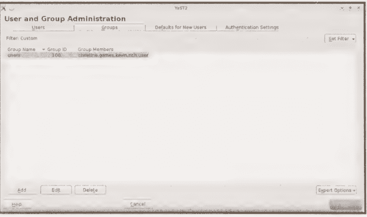

图 13.6：用户和组管理工具允许你管理组以及用户。

你可以以类似于添加、修改和删除账户的方式来添加、修改和删除组，尽管可用的选项数量可能小得多。组没有主目录、注释字段、登录 shell 等。当然，你可能希望特定用户从一开始就是你新组的成员。执行操作请遵循以下步骤：
1. 点击“组”选项卡内的“添加”按钮创建组。
2. 在弹出的对话框中指定组名和 GID。
3. 通过勾选账户旁边的标记（在框中）来添加组成员，如图 13.7 所示。
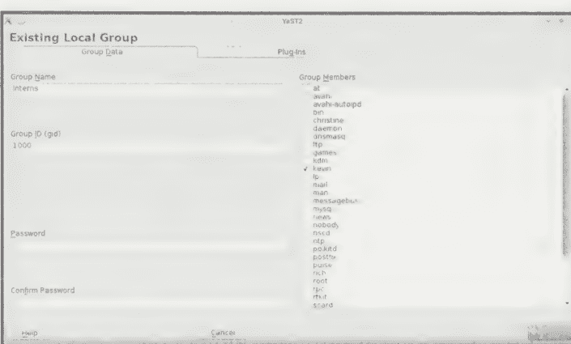
图 13.7：你可以在创建组时添加用户。
4. 点击“确定”按钮完成组的添加。

或者，你可以通过更改每个用户的组成员身份来管理组成员关系，如后文“从 Shell 管理组”所述。

### 从 Shell 管理组

你可以通过使用 `groupadd` 命令从 Shell 中创建组，它的工作方式与用于用户的 `useradd` 类似，但采用的选项较少，最重要的选项列在表 13.3 中。有关更冷门的选项信息，请参阅程序的 man页。

### 表 13.3：`groupadd` 选项

| 选项名称 | 选项缩写 | 影响 |
|---|---|---|
| `--gid *GID*` | `-g` | 你可以使用此参数提供一个特定的 GID。如果省略了它，`groupadd` 将使用下一个可用的 GID。 |
| `--non-unique` | `-o` | 通常情况下，你指定的 GID 不应被其他组使用，但 `-o` 参数会覆盖这一行为，允许你创建多个共享同一个 GID 的组。 |
| `--system` | `-r` | 此参数指示 `groupadd` 创建一个系统组，即该组的 GID 小于 500 或 1,000 的组（具体取决于发行版）。非系统组通常用作用户私有组。 |
| `--force` | `-f` | 通常情况下，如果你尝试创建一个已经存在的组，`groupadd` 会返回错误信息。此参数会抑制该错误信息。 |

使用 `groupadd` 命令（包括设置选项）的形式如下：

```bash
# groupadd -g 1001 consultants
```

此示例创建了一个 GID 为 1001 组名为 `consultants` 的组。注意上一个示例中的 `#` 提示符，它表示使用了 root 账户来获取所需的超级用户权限。

组添加完成后，就可以向该组中添加新成员。使用 `usermod` 命令的方法如下：

```bash
# usermod -ag consultants rich
# groups rich
```

`rich`: `users consultants`


`-ag` 选项被结合使用，以便将该账户添加到新的 `consultants` 组中。如果没有使用 `-a` 选项，该账户将从其当前的组成员关系中移除，并仅属于 `consultants` 组。一个良好的习惯是使用 `groups` 命令检查修改是否成功。`groups` 命令显示指定用户账户的所有组成员关系。

要修改该组，你可以使用 `groupmod` 命令。表 13.3 中的 `--gid(-g)` 和 `--non-unique (-o)` 选项可以此命令一起使用，此外还有 `--new-name(-n name)` 选项，它可以更改组名。

## 基础及进阶

在 shell 中删除组需要使用 `groupdel` 命令，该命令接受组名作为单一选项，例如使用 `groupdel consultants` 来删除 `consultants` 组。

## WHEEL 组

Linux 发行版总是默认提供几个组。其中一个 `wheel` 组（在某些发行版中）对于系统管理尤为重要。`wheel` 组成员被授予某些特殊的管理权限，例如使用 `sudo` 命令的权限。该组名源于俚语 "wheel"，指的是重要人物。

并不是所有的发行版都提供这个特定的组。你可以输入 `grep /etc/group` 来确定你的发行版中是否存在 `wheel` 组。

某些发行版允许你在安装操作系统时将你的主用户账户添加到 `wheel` 组。请注意，这种说法并不常见；相反，安装程序会询问你是否想将该账户添加到“管理员组”（administrators group）或类似的术语中。

## 基础及进阶

在 GUI 环境中，你可以使用 GUI 工具执行大多数账户维护任务，通过从菜单和列表中选择选项来添加、修改和删除账户。然而，某些操作需要你使用命令行工具，如 `useradd`、`usermod`、`userdel` 和 `password`。`groupadd`、`groupmod` 和 `groupdel` 命令为组提供了类似的功能。即使你不需要使用文本模式工具提供的那些冷门功能，它们的使用速度也比你熟悉的 GUI 工具更快。

## 建议练习题

- 使用你发行版提供的 GUI 工具创建一个测试账户，然后登录你创建的账户以验证它是否按你的预期工作。
- 使用 `useradd` 创建另一个测试账户，但不要使用 `passwd` 设置其密码。你能够登录吗？使用 `passwd` 为新测试账户创建一个密码并再次尝试登录。

## 基础及进阶（续）

## 课复习题

- 1. Linux 系统管理员应输入什么命令来移除 `nemo` 账户及其主目录？

   A. `userdel nemo`

   B. `userdel -f nemo`

   C. `userdel -r nemo`

   D. `rm /home/nemo`

   E. `rm -r /home/nemo`

- 2. 在以下选项中，哪一个是最好的密码？

   A. `LinusTorvalds`

   B. `uB2op%4q+++++++++`

   C. `123456`

   D. `password`

   E. `peanutbutterswich`

- 3. 描述以下命令的作用，假设它执行成功：

   ```
   # groupadd henry
   ```

   A. 它创建了一个名为 `henry` 的新组。

   B. 将用户 `henry` 添加到当前默认组中。

   C. 从名为 `henry` 的文件中导入组信息。

   D. 将用户的默认组更改为 `henry`。

   E. 将组 `henry` 添加到用户的组列表中。

- 4. 对或错：用户账户的 UID 比系统账户的 高。
- 5. 对或错：命令行用户通常应该使用 `usmod`（注：此处应为 `passwd`）来更改他们的密码。
- 6. 对或错：删除账户后，原由该账户拥有的文件可能留在计算机上。
- 7. 你想为新用户创建一个账户，用户名为 `theo`，并赋予用户 UID 为 `1926`。执行此操作的命令是 ________。
- 8. 你想将文件的所属组更改为 ________。要执行此操作，你需要使用 ________。
- 9. 为了创建一个系统组，你需要通过 ________ 选项来使用 `groupadd`。
- 10. 关于组的权限存储在 ________ 中。

# 设置所有权与权限

在多用户操作系统下，Linux 的安全模型基于所有权和权限。具体来说，每个文件都有一个所有者，即与其关联的账户。每个文件还通过组 ID（GID）关联到一个组。正如后文“设置权限”章节中所述，文件的访问是由权限控制的。`root` 权限的用户可以更改文件的所有者和组。属于该组的成员也可以更改组。

- 设置所有权
- 设置权限

## 设置所有权

Linux 的安全模型基于 Unix，这种模型假设存在多个用户。这种模型对于文件和目录，无论是无意还是有意的都适用。每个文件都有所有者，即与其关联的账户。每个文件还关联到一个组。你可以通过 GUI 或文本模式工具来管理这些文件。

### 在文件管理器中设置所有权

如第 4 章“使用常用 Linux 程序”所述，文件管理器允许你对文件操作。你可能对 Windows 或 Mac OS X 中的文件管理器非常熟悉。然而，Linux 的所有权和权限与 Windows 不同，但你可能想知道如何使用 Linux 文件管理器检查并可能更改所有权功能。如第 4 章所述，在 Linux 中有多种文件管理器供选择。大多数文件管理器在整体框架上相似，但在细节上有所不同。在本节中，我们使用 GNOME 桌面面的默认文件管理器 `Nautilus` 作为示例。

如果你想更改文件的所有者，必须运行 `Nautilus`，但你可以将文件的组更改为你作为普通用户所属的任何组。以 `root` 身份执行此任务的步骤如下：

1. 启动一个终端窗口。
2. 在终端窗口中，输入 `su` 以获取 `root` 权限。
3. 在终端窗口中，输入 `nautilus` 启动 `Nautilus`。你可以可选地包含 `Nautilus` 启动的目录路径。如果不包含路径，`Nautilus` 将从显示 `/root` 目录的内容开始。
4. 找到你想要调整的文件所有权并右键点击它。
5. 在弹出的菜单中选择“属性”（Properties）。结果将是一个属性对话框。
6. 点击属性对话框中的“权限”（Permissions）选项卡。结果如图 14-1 所示。
7. 要更改文件的所有者，在“所有者”（Owner）字段中选择新所有者。此操作仅在你以 `root` 身份运行 `Nautilus` 时可行。
8. 要更改文件的组，在“组”（Group）字段中选择新组。如果你以普通用户身份运行 `Nautilus`，你可以选择所属的任何组；但如果你以 `root` 身份运行 `Nautilus`，你可以选择任何组。
9. 调整完想要更改的功能后，点击“关闭”（Close）。

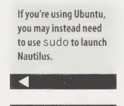

> 如果你正在使用 Ubuntu，可能需要使用 `sudo` 来启动 `Nautilus`。

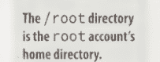

> `/root` 目录是 `root` 账户的家目录。

如果你想更改文件的组而不是其所有者，并且你是目标组的成员，可以以普通用户身份启动 `Nautilus`。你可以从上述步骤的第 4 步开始。

# 第 14 章 • 设置所有权和权限

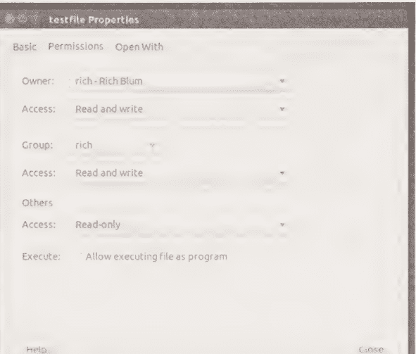

图 14.1 Linux 文件管理器允许你访问文件的所有权和权限元数据。

在 `root` 身份运行 `Nautilus` 时，必须极其谨慎。如果你忘记了自己正在以 `root` 身份运行此程序，可能会很容易以 `root` 身份创建新文件，这将需要额外的 `root` 权限操作来通过更改文件所有权来纠正。你也很容易以 `root` 身份意外删除关键系统文件，而这些文件作为普通用户时是无法删除的。由于这些原因，我们建议你使用文本模式 shell 来调整文件所有权。提示符的改变让你更容易注意到你正在以 `root` 身份运行，如果你习惯使用 GUI，那么在文本模式 shell 中以 `root` 身份启动额外程序的概率会比在 `Nautilus` 中低。

## 认证目标

### 在 Shell 中设置所有权

以首选的文本模式更改文件所有权的命令是 `chown`。在最基本的形式中，你传递文件名，后跟一个用户名：

`chown` 命令代表更改所有者（change owner）。

```
# chown bob targetfile.edf
```

### 设置权限

此示例将 `targetfile.edf` 的所有权赋予 `bob`。你可以通过用冒号 `:` 将所有者和组分开，用单条命令更改文件的主要所有者及其组：

```
$ chown bob:users targetfile.edf
```

此示例将 `targetfile.edf` 的所有权赋予 `bob`，并将文件与 `users` 组关联。若要在不更改所有者的情况下更改组，可以省略所有者，保留冒号和组名：

```
$ chown :users targetfile.edf
```


或者，你也可以使用 `chgrp` 命令，它的工作方式相同，但仅更改组，且不需要在组名前加冒号：

```
$ chgrp targetfile.edf
```

注意，作为普通用户更改组的命令——仅在你拥有该文件且属于目标组时才有效。

`chown` 和 `chgrp` 命令都支持多个修改其行为的选项。其中最用的是 `-R`（或 `--recursive`），它会更改现有目录中所有文件的所有权。例如，假设某用户已离开公司，现任员工 bob 必须访问她的文件。如果 mary 的家目录是 `/home/mary`，你可能会输入：

```
$ chown -R bob /home/mary
```

此命令使 bob 拥有 `/home/mary` 目录以及 `/home/mary` 目录中所有文件的所有权，包括所有子目录、目录中的文件等。为了让过渡变得容易一些。

# 设置权限

此示例将 `targetfile.edf` 的所有权赋予 bob。你可以通过用冒号 (`:`) 将所有者和组分开，用单条命令更改文件的主要所有者及其组：

```
$ chown bob:users targetfile.edf
```

此示例将 `targetfile.edf` 的所有权赋予 bob，并将文件与 `users` 组关联。若要在不更改所有者的情况下更改组，可以省略所有者，保留冒号和组名：

```
$ chown :users targetfile.edf
```

或者，你也可以使用 `chgrp` 命令，它的工作方式相同，但仅更改组，且不需要在组名前加冒号：

```
$ chgrp targetfile.edf
```

注意，作为普通用户更改组的命令——仅在你拥有该文件且属于目标组时才有效。

`chown` 和 `chgrp` 命令都支持多个修改其行为的选项。其中最用的是 `-R`（或 `--recursive`），它会更改现有目录中所有文件的所有权。例如，假设某用户已离开公司，现任员工 bob 必须访问她的文件。如果 mary 的家目录是 `/home/mary`，你可能会输入：

```
$ chown -R bob /home/mary
```

此命令使 bob 拥有 `/home/mary` 目录以及 `/home/mary` 目录中所有文件的所有权，包括所有子目录、目录中的文件等。为了让过渡变得容易一些。

# 理解权限

理解 Linux 权限可以从 `ls -l` 命令开始。该命令提供了详细信息：

```
-rw-r-- 1 bob users 512 Oct 25 10:00 test
```

该行由几部分组成：

- **权限**：前十个字符 (`-rw-r--`) 显示权限。第一个字符指示文件类型 (`-`)，接下来的三组字符分别代表所有者、组和其他人的权限。
- **链接数**：下一列 (`1`) 显示文件的硬链接数。
- **用户名**：下一列 (`bob`) 标识所有者。
- **组名**：下一列 (`users`) 标识关联文件的组。
- **文件大小**：下一列 (`512`) 显示文件的字节大小。
- **时间戳**：下一列 (`Oct 25 10:00`) 标识文件最后修改的时间。
- **文件名**：最后，最后一列 (`test`) 显示文件名。

**类型代码**：第一个字符指示文件类型，如表 14.1 所示。当文件类型无关或通过其他方式识别时，有时会省略此类型字符。

## 表 14.1 文件类型代码

| 代码 | 名称 | 含义 |
| :--- | :--- | :--- |
| - | 普通数据文件 | 可以是文本、可执行程序、图形、压缩数据或任何其他类型的数据。 |
| d | 目录 | 磁盘设备是文件，但包含文件名和指向命名文件结构的指针。 |
| l | 符号链接 | 文件包含另一个文件或目录的。当 Linux 访问符号链接时，它会尝试读取链接的文件。 |
| p | 命名管道 | 管道允许两个 Linux 程序以单向方式进行通信。 |
| s | 套接字 | 套接字类似于命名管道，但允许网络和双向连接。 |
| b | 块设备 | 对应硬件设备并以大于 1 字节的块传输数据。磁盘设备（硬盘、USB 闪盘、光驱等）是常见的块设备。 |
| c | 字符设备 | 对应硬件设备并以 1 字节为单位传输数据。示例包括并行端口和 RS-232 串口设备。 |

## 第 14 章 · 设置所有权与权限

**组权限**：这些权限决定了文件组的成员（非文件所有者）可以对文件进行的操作。

**世界权限（或“其他”）**：这些权限决定了既不是文件所有者也不是文件组组成员的用户对文件进行的操作。

在三组权限中，字符串标识了每种类型访问权限的存在或缺失：读、写和执行。读和写权限非常通俗易懂。如果存在执行权限，则意味着该文件可以作为程序运行。权限的缺失在权限字符串中用连字符（`—`）表示。权限的存在则用字母 `r`（读）、`w`（写）或 `x`（执行）来表示。

因此，权限字符串 `—rwx-xr-x` 意味着该文件是一个普通数据文件，其所有者、文件组成员以及所有其他用户都可以读取和执行该文件。只有文件所有者对文件具有写入权限。

权限还有另一种表示方法；它很紧凑但略显困惑。它将权限字符串中的三个权限分组（忽略文件类型）分别转换为 0 到 7 之间的数字（即 8 进制数）。结果是一个三位八进制数。每个数字的构造是从值 0 开始，然后：
- 如果存在读权限，则加 4
- 如果存在写权限，则加 2
- 如果存在执行权限，则加 1

生成的三位代码代表所有者、组和世界的权限。表 14.2 显示了一些常用权限的示例及其含义。

### 表 14.2 权限示例及其释义

| 权限字符串 | 八进制代码 | 含义 |
|---|---|---|
| rwx rwx rwx | 777 | 所有用户都具有读、写和执行权限。 |
| rwx-xr-x | 755 | 所有用户具有读和执行权限。文件所有者也具有写入权限。 |
| rwx----x | 750 | 所有者和组具有读和执行权限。文件所有者也具有写入权限。其他用户无法访问该文件。 |

当然，在非程序文件设置执行位并不会将其变成程序；它仅表示用户可以运行一个作为程序的文件。

这些操作涉及二进制数和逻辑运算而非算术运算。不过，算术描述更易理解。

## 设置权限

| 权限字符串 | 八进制代码 | 含义 |
|---|---|---|
| rwx------ | 700 | 仅对文件所有者开放读、写和执行权限；所有其他人无法访问。 |
| rw-rw-rw- | 666 | 所有用户都具有读和写权限。任何人都没有执行权限。 |
| rw-rw-r-- | 664 | 所有者和组具有读、写权限。所有其他人具有只读权限。 |
| rw-rw---- | 660 | 所有者和组具有读、写权限。没有世界权限。 |
| rw-r-r-- | 644 | 所有者具有读、写权限。所有其他人具有只读权限。 |
| rw-r----- | 640 | 所有者具有读、写权限，组具有只读权限。其他人没有权限。 |
| r-------- | 600 | 所有者具有读、写权限。其他人没有权限。 |
| --------- | 400 | 所有者具有读权限。其他人没有权限。 |

权限共有 512 种可能的组合，因此表 14.2 是不完整的。它展示了最常见且实用的组合。

权限适用于几种特殊情况：

**目录执行位**：目录使用执行位来授予搜索目录的权限。对于目录来说，这是一个非常理想特性，因此当你设置了读位时，几乎总会发现执行位也是设置的。

**目录写入权限**：目录是以特殊方式解释的文件。因此，如果用户可以写入目录，他们就可以在目录中创建、删除或重命名文件，即使该用户不是这些文件的所有者，也没有对这些文件的写入权限。

> 写入目录的常规规则可以通过粘滞位（sticky bit）进行修改，该将在稍后的“使用粘滞位”中描述。

**符号链接**：符号链接的权限始终是 777（`rwxrwxrwx`，或包含文件类型代码的 `rwxrwxrwx`）。这种访问仅适用于链接文件本身，而不适用于被链接的文件。换句话说，所有用户都可以读取链接的内容以发现它指向的文件名，但被链接文件的权限决定了其文件访问。更改符号链接的权限会影响被链接的文件。

## 第 14 章 - 设置所有权与权限

`root` 许多权限规则不适用于 `root`。超级用户可以读取或写入计算机上的任何文件——即使是那些未向任何人授予访问的文件（即权限为 000 的文件）。超级用户仍需要设置执行位来运行程序文件。

在文件管理器中设置权限的过程与设置权限类似：
- 用户（所有者）
- 组
- 其他人

如图 14.1 所示，有三项项目与：
- 所有者
- 组
- 其他

## 在 Shell 中设置权限

在文本模式下，可以使用 `chmod` 更改权限。由于权限更改的方式很多，该命令相当复杂。你可以有两种形式指定权限：八进制数或符号形式。

模式的八进制表示与表 14.2 中相同。例如，要将 `report.tex` 的权限更改为 `r----`，可以使用以下命令：

```
$ chmod 644 report.tex
```

相比之下，符号模式由三个部分组成：


- 指示你想修改的权限集的代码：`u` 代表用户（即所有者），`g` 代表组，`o` 代表其他用户，`a` 代表所有权限。
- 指示你想添加 (`+`)、删除 (`-`) 还是将模式设置为等于 (`=`) 某个值的符号
- 指定权限应该是什么的代码，例如常见的 `r`、`w` 或 `x` 符号，以及用于高级选项的各种其他

使用符号配合 `chmod` 可能会困惑，因此我们在这里没有详细描述它们；然而，你应该熟悉几种常用类型，如表 14.3 总结所示。符号模式比绝对模式更灵活，因为你可以指定修改现有权限的符号模式，例如添加或删除执行权限而不影响其他权限。你也可以只设置用户、组或权限，而不影响其他。在八进制模式中，你必须将三个权限位设置为你指定的值。

表 14.3 使用 `chmod` 的符号权限示例

| 命令 | 初始权限 | 最终权限 |
|---|---|---|
| `chmod a+x bigprogram` | `rw--r--` | `rwxxr--x` |
| `chmod ug=rw report.tex` | `r------` | `rw-rw----` |
| `chmod o-rwx bigprogram` | `rwxrwx-x` | `rwxrwx---` |
| `chmod g-w,o-rw report.tex` | `rw-rw-rw-` | `rw-r-----` |

## 设置 umask

用户掩码（`umask`）决定了新文件的默认权限。`umask` 是创建新文件时从 `666` (`rw-rw-rw-`) 权限中移除的值，或者在创建新目录时从 `777` (`rwxrwxwx`) 中移除的值。

# 第 14 章 · 设置所有权和权限

如果 `umask` 为 `022`，则文件默认将以 `644` 权限创建，新目录将具有 `755` 权限。请注意，删除操作并非简单的减法，而是位运算删除。这意味着，`umask` 中的值 `7` 会移除 `rwx` 权限；但对于起始点为 `rw-` 的文件，结果是 `---` (`0`)，而不是 `-1`（后者是没有意义的）。

你可以使用 `umask` 命令来调整 `umask`，该命令接受一个 `umask` 值，例如 `umask 022`。通常，此命令出现在系统配置文件中（如 `/etc/profile`）或用户配置文件中（如 `~/.bashrc`）。

# 使用特殊权限位和文件特性

当你探究 Linux 目录树时，会遇到某些需要特殊关注的文件类型。有时，你可能只想了解这些文件是如何处理的，因为它们的处理方式偏离了你根据前面章节提供的信息所做出的预期。在其他情况下，你可能需要调整使用 `ls` 或其他命令的方法来处理这些文件和目录——例如，在使用粘滞位（sticky bit）、使用特殊执行权限、隐藏文件视图或获取目录的详细列表时。

# 使用粘滞位

考虑以下命令，这些是在在一个具有特定布局的文件和子目录的系统中输入的：

```
$ whoami
kirk
$ ls -l
total 0
drwxrxrx 2 root root 80 Dec 14 17:58 subdir
$ ls -l subdir/
total 2350
-rw-r--r-- 1 root 2404268 Dec 14 17:59 f1701.tif
```

这些命令建立了当前的配置：有效用户 ID 为 `kirk`，当前目录有一个名为 `subdir` 的子目录，由 `root` 所有，`kirk` 像系统所有用户一样对其拥有完全的读写写权限。该子目录有一个文件 `f1701.tif`，由 `root` 所有，`kirk` 对其没有访问权限。你可以通过尝试执行以下命令来验证 `kirk` 无法写入该文件：

```
$ touch subdir/f1701.tif
touch: cannot touch 'subdir/f1701.tif': Permission denied
```

此错误信息证实了 `kirk` 无法写入 `subdir/f1701.tif`。

你可能会认为该文件是免受篡改的。别太快！尝试这个：

```
$ rm subdir/f1701.tif
$ ls -l subdir/
total 0
```

`rm` 命令没有返回错误信息，随后对 `subdir` 的检查证实它不是空的。换句话说，即使 `kirk` 没有该文件的权限，它也可以删除该文件！这看起来像是一个 Bug —— 毕竟，如果你无法写入一个文件，你可能认为你不应该能够删除它。然而，请记住，目录只是特殊类型的文件，它持有其他文件的名称指针并指向其低层级的数据结构。因此，修改文件需要对文件拥有写权限，而创建或删除文件则需要对文件所在的目录拥有写权限。在这个示例中，`kirk` 对该子目录有写权限，但对目录内的 `f1701.tif` 文件没有。因此，`kirk` 可以删除该文件但不能修改它。这个结果并不是 Bug；它只是一个反直觉的特性。

尽管 Linux 文件系统设计成这样工作，但这始终是不理想的。创建更直观结果的方法是使用粘滞位，这是一种改变此行为的特殊文件系统标志。在目录上设置粘滞位后，Linux 只有在你拥有该文件或该目录时才允许你删除文件；仅对包含目录拥有写权限是不够的。你可以通过 `chmod` 以两种方式之一设置粘滞位：

### 使用八进制代码

通过在在本章描述的三位八进制代码前加上另一个数字，你可以设置三个特殊权限中的任何一个，之一就是粘滞位。粘滞位的代码是 `1`，所以我们将使用以 `1` 开头的八进制代码（例如 `1755`）来设置粘滞位。指定数值为 `0`（例如 `0755`）则移除粘滞位。


其他奇数也会设置粘滞位，但还会添加权限，这些权限将在稍后的“使用特殊执行权限”中描述。

# 恢复文件并设置粘滞位使你能够看到效果：

```
$ ls -l
total 0
drwxrxrwt 2 root root 80 Dec 14 18:25 subdir
$ ls -l subdir/
total 304
-rw-r--r-- 1 root 240268 Dec 14 18:25 f1701.tif
$ rm subdir/f1701.tif
rm: cannot remove subdir: Operation not permitted
```

在这个示例中，尽管 `kirk` 对 `subdir` 拥有完全的读写权限，但 `kirk` 不能删除该目录下另一个用户的文件。

你可以通过 `ls -l` 符号模式的微小变化来识别带有粘滞位的目录。世界执行位显示为 `t` 而不是 `x`。在这个示例中，结果是 `subdir` 的权限显示为 `drwxrwxrwt` 而不是 `drwxrwx`。


粘滞位对于许多用户共享的目录特别重要。例如，它是 `/tmp` 和 `/var/tmp` 的标准特性，因为许多用户在这些目录中存储临时文件，你不希望一个用户能够删除另一个用户的临时文件。如果你希望用户协作完成一个项目并能够在彼此的主目录中写入文件，你可以考虑在这些主目录上设置粘滞位，或者在用户共享文件的子目录上设置粘滞位。

# 使用特殊执行权限

正如本章前面提到的，执行位允许你识别程序。有时，你可能只想了解这些文件是如何处理的，因为它们的处理方式偏离了你根据前面章节提供的信息所做出的预期。在其他情况下，你可能需要调整使用 `ls` 或其他命令的方法来处理这些文件和目录——例如，在使用粘滞位、使用特殊执行权限、隐藏文件视图或获取目录的详细列表时。

# 使用特殊权限位和文件特性

当你探究 Linux 目录树时，会遇到某些需要特殊关注的文件类型。有时，你可能只想了解这些文件是如何处理的，因为它们的处理方式偏离了你根据前面章节提供的信息所做出的预期。在其他情况下，你可能需要调整使用 `ls` 或其他命令的方法来处理这些文件和目录——例如，在使用粘滞位、使用特殊执行权限、隐藏文件视图或获取目录的详细列表时。

当你探究 Linux 目录树时，会遇到某些需要特殊关注的文件类型。有时，你可能只想了解这些文件是如何处理的，因为它们的处理方式偏离了你根据前面章节提供的信息所做出的预期。在其他情况下，你可能需要调整使用 `ls` 或其他命令的方法来处理这些文件和目录——例如，在使用粘滞位、使用特殊执行权限、隐藏文件视图或获取目录的详细列表时。

正如本章前面提到的，执行位允许你识别程序。有时，你可能只想了解这些文件是如何处理的，因为它们的处理方式偏离了你根据前面章节提供的信息所做出的预期。在其他情况下，你可能需要调整使用 `ls` 或其他命令的方法来处理这些文件和处理这些文件和目录——例如，在使用粘滞位、使用特殊执行权限、隐藏文件视图或获取目录的详细列表时。

# 设置用户 ID (SUID)

用户 ID (`SUID`) 选项告诉 Linux 以文件所有者的权限运行。例如，如果一个文件由 `root` 所有并设置了 `SUID` 位，它将以 `root` 权限运行。这通常被称为 `SUID`，在所有者执行位上显示为 `s`，例如 `rwsxr-x`。

# 设置组 ID (SGID)

组 ID (`SGID`) 选项类似于 `SUID` 选项，但它设置运行程序的组。这通常被称为 `SGID`，在组执行位上显示为 `s`，例如 `rwxsr-x`。


你可以通过 `chmod` 设置这些位：

### 使用八进制代码
在四位八进制代码的领先数字中，数值 `4` 设置 `SUID` 位，`2` 或 `6` 设置两个位。例如，`4755` 在可执行文件上设置 `SUID` 位但不设置 `SGID` 位。

### 使用符号代码
使用 `s` 符号代码，结合 `u` 指定 `SUID` 位、`g` 指定 `SGID` 位，或设置两个位。例如，`chmod u+s myprog` 为 `myprog` 设置 `SUID` 位，而 `chmod ug-s myprog` 则移除 `myprog` 的 `SUID` 和 `SGID` 位。

通常，你不需要设置或移除这些位；必要时，包管理器会在安装或升级程序时正确设置这些位。如果这些位被错误设置或移除，你可能需要更改它们。在某些情况下，你可能想对源代码或从源码编译的程序文件调整这些值。但在这样做时要小心。如果你在一个普通程序上设置 `SUID` 位，它将以更高的权限运行。如果程序包含 `Bug`，这些 `Bug` 将能够造成更大的破坏。如果你意外移除这些权限，结果可能同样糟糕——`passwd`、`sudo` 等所有程序都依赖于设置 `SUID` 位，因此移除此特性会导致它们停止工作。

# 隐藏文件视图

如果你使用 Windows，你可能熟悉隐藏位的概念，该位可以在文件管理器、Windows `DIR` 命令以及大多数程序中隐藏文件视图。如果你在 Linux 中寻找类似物，你找不到——至少不是以专用功能的形式存在。相反，Linux 使用文件命名约定来隐藏文件视图：大多数工具（如 `ls -l`）会隐藏名称以点（`.`）开头的文件和目录。

认证目标

# 第14章 - 设置所有权和权限

`ls` 显示 `file.txt`，但不显示 `.file.txt`。大多数处理此类“点文件”（通常是这样称的）的文件管理器和对话框都不会显示它们；然而，这种做法并非普遍如此。

许多用户程序利用这一特性来防止其配置弄乱你的显示。例如，`~/.bashrc` 是一个用户配置文件，Evolution 的配置文件存放在 `~/.evolution` 目录中，而 `~/.fonts.conf` 则存储了用户特有的字体信息。

你可以根据所涉及的程序通过多种方式查看文件。某些 GUI 工具在配置选项中提供一个可以设置的复选框，强制程序显示此类文件。在命令行中，你可以在 `ls` 的其他选项后添加 `-option`：

```bash
$ ls -l
total 0
drwxr-rwt 2 root root 80 Dec 14 18:25 subdir
$ ls -la
total 305
drwxr-xr-x 3 kirk users 104 Dec 14 18:44 ..
drwxr-xr-x 3 kirk users 528 Dec 14 18:21 ..
-rw-r--r-- 1 kirk users 309588 Dec 14 14:44 .f1701.tif
drwxr-xr-x 2 root root 80 Dec 14 18:25 subdir
```

此示例显示了当前目录下的隐藏文件 `.f1701.tif`。它还显示了两个隐藏目录。第一个指向当前目录。第二个 `..` 指父目录。

> 注意，重命名一个以点开头的文件会将其隐藏，但此操作也会导致任何使用原始文件名的程序无法访问它。也就是说，如果你将 `f1701.tif` 重命名为 `.f1701.tif`，并且另一个程序或文件以 `f1701.tif` 引用该文件，该引用将失效。在对隐藏文件的任何引用中，必须包含前导点。

# 查看目录

第 6 章介绍了 `ls` 命令，包括它的许多选项。其中有一个一个选项在此时值得详细阐述：`-d`。如果你在一个包含许多子目录的目录中工作，并且在 `ls` 中使用通配符匹配一个或多个子目录，你可能会得到意外的结果：输出将显示匹配到的子目录中的文件，而不是子目录本身的信息。例如，假设你从一个包含 `subdir1` 和 `subdir2` 的目录开始操作：

```bash
$ ls -l subdir*
subdir1:
total 304
-rw-r--r-- 1 kirk users 309580 Dec 14 18:54 f1701.tif
```

```bash
subdir2:
total 84
-rw-r--r-- 1 kirk users 86016 Dec 14 18:54 106792c17.doc
```

如果你想获取的是子目录的信息而不是子目录的内容，可以包含 `-d` 选项：

```bash
$ ls -d subdir*
drwx-xr-xr 2 kirk users 80 Dec 14 18:54 subdir1
drwx-xr-xr 2 kirk users 80 Dec 14 18:54 subdir2
```

> `/proc/sys` 目录包含内核自动填充的实时数据，以便你可以查看进程和设备状态。这些文件和子目录可能会随时出现和变化，使得显示它们变得棘手。

## 基础知识及扩展

在像 Linux 这样的多用户操作系统上，文件安全非常重要，安全要素之一就是文件所有权。在 Linux 中，每个文件都有一个所有者和一个关联组。超级用户可以使用 `chown` 设置所有者，超级用户或文件所有者都可以使用 `chgrp` 设置文件的组。单从所有权本身来说它是无用武之地的，因此 Linux 支持文件权限概念，以控制哪些用户可以以何种方式访问文件。你可以使用 `chmod` 工具设置权限。你可以通过 `ls` 命令的 `-l` 选项查看所有权、权限和一些额外的文件特性。

## 建议练习

- 以 `root` 身份复制一个你作为普通用户创建的文件，并将副本放在你的普通用户主目录中。使用你的普通账户，用文本编辑器编辑该文件并保存更改。发生了什么？尝试用 `rm` 命令删除该文件。发生了什么？

- 以普通用户身份创建一个临时文件。以 `root` 身份，使用 `chown` 和 `chmod` 实验不同类型的所有权和权限，以发现你何时可以使用你的普通登录账户读取和写入该文件。

- 使用 `ls -l` 命令查看你主目录、`/usr/bin`（许多程序文件所在处）以及 `/etc`（大多数系统配置文件所在地）中文件的所有权和权限。你看到的不同所有权和权限对你读取、写入和执行这些文件有什么影响？

（未完）

# 第14章 - 设置所有权和权限

## 基础知识及扩展（续）

## 复习题

1. （以 `root` 身份）你会输入什么命令将 `somefile.txt` 的所有权从 `ralph` 改为 `tony`？

   A. `chown ralph:tony somefile.txt`

   B. `chmod somefile.txt`

   C. `chown somefile.txt`

   D. `chmod tony.txt`

   E. `chown somefile.txt`

2. 下列哪些是正确的？（多选）

   A. `/proc/sys` 目录包含内核自动填充的实时数据，以便你可以查看进程和设备状态。这些文件和子目录可能会随时出现和变化，使得显示它们变得棘手。

   B. `/proc/sys` 目录包含内核自动填充的实时数据，以便你可以查看进程和设备状态。这些文件和子目录可能会随时出现和变化，使得显示它们变得棘手。

   C. `/proc/sys` 目录包含内核自动填充的实时数据，以便你可以查看进程和设备状态。这些文件和子目录可能会随时出现和变化，使得显示它们变得棘手。

   D. `/proc/sys` 目录包含内核自动填充的实时数据，以便你可以查看进程和设备状态。这些文件和子目录可能会随时出现和变化，使得显示它们变得棘手。

   E. `/proc/sys` 目录包含内核自动填充的实时数据，以便你可以查看进程和设备状态。这些文件和子目录可能会随时出现和变化，使得显示它们变得棘手。

3. 你可以使用以下哪些命令进行更改？

   A. `group`

   B. `group`

   C. `chmod`

   D. `chown`

   E. `group`

4. 判断对或错误：`/proc/sys` 目录包含内核自动填充的实时数据，以便你可以查看进程和设备状态。这些文件和子目录可能会随时出现和变化，使得显示它们变得棘手。

5. 判断对或错误：`/proc/sys` 目录包含内核自动填充的实时数据，以便你可以查看进程和设备状态。这些文件和子目录可能会随时出现和变化，使得显示它们变得棘手。

6. 判断对或错误：`/proc/sys` 目录包含内核自动填充的实时数据，以便你可以查看进程和设备状态。这些文件和子目录可能会随时出现和变化，使得显示它们变得棘手。

7. 以下内容的哪部分：`/proc/sys` 目录包含内核自动填充的实时数据，以便你可以查看进程和设备状态。这些文件和子目录可能会随时出现和变化，使得显示它们变得棘手。

8. 以下内容的哪部分：`/proc/sys` 目录包含内核自动填充的实时数据，以便你可以查看进程和设备状态。这些文件和子目录可能会随时出现和变化，使得显示它们变得棘手。

9. 以下内容的哪部分：`/proc/sys` 目录包含内核自动填充的实时数据，以便你可以查看进程和设备状态。这些文件和子目录可能会随时出现和变化，使得显示它们变得棘手。

10. 以下内容的哪部分：`/proc/sys` 目录包含内核自动填充的实时数据，以便你可以查看进程和设备状态。这些文件和子目录可能会随时出现和变化，使得显示它们变得棘手。

# 管理连接


网络是关键部分。我们从开始描述一些

- 理解网络

## 理解网络特性

网络涉及许多协议。尽管现代操作系统使其变得简单，以太太。速度范围从 10 兆比特每秒 (`Mbps`) 到 10 吉比特每秒 (`Gbps`)。

## 主机名

这是一个计算机为了人类使用的名称。主机名由机器和网络部分组成。例如，在 `lunhod.luna` 中，机器名为 `lunhod`，网络名为

## 互联网

互联网指的是使用标准协议套 (`TCP/IP`) 进行通信的全球互联网络。网络使用路由器连接

## IP 地址

网协议 (`IP`) 地址是为了网络目的分配给计算机的数字。你可以将 IP 地址比作街道地址或电话号码。计算机通过 IP 地址相互通信。过去以 `IPv4` 地址为主（例如 `192.168.1.10`），然而，`IPv4` 地址池最近已枯竭，因此许多新安装的系统开始使用 `IPv6` 地址（如 `fe80:0000:0023:23fe:6bdc`）。IP 地址分为两部分：机器部分和网络部分。网络部分可能用于路由（参见路由器），而机器部分识别给定网络上的计算机。这种机器和网络地址的划分是通过网络掩码实现的，正如所述。

## 网络掩码

网络掩码（简称 `mask`）是区分 IP 地址中网络部分和机器部分的方法。掩码定义了 IP 地址中属于地址每个部分的单独位。这可以通过赋予机器地址的每个位二进制值 1，并将结果表示为数字（如 `IPv4` 地址的 `255.255.255.0` 或 `255.255.255.250`），或者通过通过指定地址中机器部分的位数（如 16 或 24）。

存在其他有线网络方法，但它们可能过时或用于极高速、远距离或其他容量。

认证练习

## 配置网络连接

路由器 A（也称为网关）将两个或多个网络连接在一起。你的桌面或服务器计算机可能直接连接到几台计算机，其中包含路由器。路由器连接到另一个网络，而该网络又连接到另一个网络，以此此类推。要访问另一个网络上的计算机，你的计算机将通过路由器进行通信。家庭和小型企业使用一些宽带路由器连接互联网。此类设备执行路由功能，并内置了 `DNS`、`DHCP` 以及其他实用服务。

> 认证目标
> 
> `TCP/IP` 传输控制协议/网协议 (`TCP/IP`) 是一组标准，构成了软件层面上大多数现代网络通信的基础。
> 
> `Wi-Fi` 该术语适用于常见的无线网络形式，更准确的名称是 `IEEE 802.11`。它有多种变体，区别在于速度。本章中的“创建 Wi-Fi 连接”一节将更详细地描述 `Wi-Fi` 配置。

创建网络连接的过程之一是分配 IP 地址和相关的子掩码。使用 IP 地址，计算机可以与局域网上的其他计算机通信——即任何不需要路由器作为中间介的设备。在某些情况下，你需要告诉计算机网络的路由器，以便它与其他网络段通信（通常包括整个互联网）。为你的计算机提供 `DNS` 服务器的 IP 地址将允许你指定计算机主机名而不是 IP 地址，这是一个非常理想的功能。这四项功能——IP 地址、子掩码、路由器的 IP 地址和 `DNS` 服务器的 IP 地址——构成了基础网络配置功能。

在大多数情况下，`DHCP` 可以提供这些功能。这使得网络配置变得相当自动化，正如你在本章中看到的那样。然而，如果你的网络不支持 `DHCP`，你就需要联系网络管理员以获取关键的配置信息。在某些情况下，你可能还需要更多信息。例如，如果你使用 `Wi-Fi`，你需要知道 `Wi-Fi` 网络的名称可能还有它的密码。

在大多数情况下，你的网络连接将自动建立（几乎如此）。但有时，你必须手动调整配置或简单地激活它。如果可用，自动配置是通过 `DHCP` 处理的，因此我们首先开始更详细地描述它。

> `TCP/IP` 存在多种替代方案，例如 `AppleTalk`、`NetBEUI` 和 `IPX/SPX`。然而，`TCP/IP` 是最常见的网络协议，也是互联网的基础。

然后我们涵盖一个仅适用于某些系统的主题：配置 `Wi-Fi`。如果你使用它，必须在设置其他网络选项之前配置 `Wi-Fi`。一旦配置了 `Wi-Fi`，其余的网络设置步骤与有线网络非常相似。我们随后提供一个使用 GUI 工具进行网络配置的示例。这些工具易于使用，并且可以处理大多数情况。最后，我们涵盖了基于文本的配置工具，这些工具提供了你在某些设置中可能需要的强大功能。

## 决定是否使用 DHCP

如前所述，计算机连接到典型网络至少需要两项信息：IP 地址和子掩码。路由器和 `DNS` 服务器的 IP 地址在大多数网络中都是实用的，尽管在某些情况下你不需要其中一个或两者。某些网络还需要额外的配置细节。

在大型网络上为每台计算机配置这些信息可能会非常耗时。糟糕的是，这可能会导致人为错误引起的问题，例如 IP 地址输入错误。出于这个原因，大多数网络都提供 `DHCP` 服务器，它可以向其他计算机提供这些信息。

根据服务器的配置，`DHCP` 可以以两种方式交付 IP 地址：

- 固定方式，这样每台计算机每次启动时都会接收相同的 IP 地址
- 动态方式，这样单台计算机在不同的启动时可能会接收不同的 IP 地址

这是你网络管理员的策略细节。你不需要担心它，只需知道配置了 `DHCP` 的计算机并不一定保证每次启动都能接收到相同的 IP 地址。这一事实可能产生重要影响。例如，如果服务器计算机具有固定 IP 地址，对其进行配置很容易保证且最可靠的。因此，作为策略的一部分，服务器计算机通常不使用 `DHCP` 进行配置——即使同一网络上的工作站使用 `DHCP`。然而，情况并非总是如此——正如提到的，`DHCP` 可以为某些或所有计算机交付固定地址，以便 `DHCP` 服务器管理员以这种方式配置网络服务器。

从实际角度来看，除非你正在配置自己的私有网络，否则你应该询问网络管理员是否应为新计算机使用 `DHCP`。如果答案是否定的，你应该请求 IP 地址、子掩码、路由器的 IP 地址和 `DNS` 服务器的 IP 地址。


## 创建 Wi-Fi 连接

`Wi-Fi` 连接通常用于笔记本电脑。但有时，你必须手动调整配置或简单地激活它。某些台式计算机具有 `Wi-Fi` 功能。在继续之前，请在设置其他网络选项之前配置 `Wi-Fi`。一旦配置了 `Wi-Fi`，其余的网络设置步骤与有线网络非常相似。我们随后提供一个使用 GUI 工具进行网络配置的示例。这些工具易于使用，并且可以处理大多数情况。最后，我们涵盖了基于文本的配置工具，这些工具提供了你在某些设置中可能需要的强大功能。

`Wi-Fi` 连接最常用于笔记本电脑。但有时，你必须手动调整配置或简单地激活它。某些台式计算机具有 `Wi-Fi` 功能。在继续之前，请在设置其他网络选项之前配置 `Wi-Fi`。一旦配置了 `Wi-Fi`，其余的网络设置步骤与有线网络非常相似。我们随后提供一个使用 GUI 工具进行网络配置的示例。这些工具易于使用，并且可以处理大多数情况。最后，我们涵盖了基于文本的配置工具，这些工具提供了你在某些设置中可能需要的强大功能。

`Wi-Fi` 连接最常用于笔记本电脑。但有时，你必须手动调整配置或简单地激活它。某些台式计算机具有 `Wi-Fi` 功能。在继续之前，请在设置其他网络选项之前配置 `Wi-Fi`。一旦配置了 `Wi-Fi`，其余的网络设置步骤与有线网络非常相似。我们随后提供一个使用 GUI 工具进行网络配置的示例。这些工具易于使用，并且可以处理大多数情况。最后，我们涵盖了基于文本的配置工具，这些工具提供了你在某些设置中可能需要的强大功能。

`Wi-Fi` 连接最常用于笔记本电脑。但有时，你必须手动调整配置或简单地激活它。某些台式计算机具有 `Wi-Fi` 功能。如果你要连接你购买并设置的宽带路由器，请咨询路由器文档以了解其关键信息，例如 `Wi-Fi` 网络的名称 `SSID` 以及密码。如果你尝试连接业务网络或公共网络，请咨询网络管理员获取此信息。作为一个示例，考虑在 Fedora 中执行操作：

1. 点击桌面右上角的向下箭头并选择系统设置，或者在 shell 提示符输入 `gnome-controlcenter`。
2. 点击设置中的“网络”项。出现的窗口如图 15.1 所示。

> 此过程等同于将以太线插入以太网端口。此过程可能不会设置 `TCP/IP` 选项。

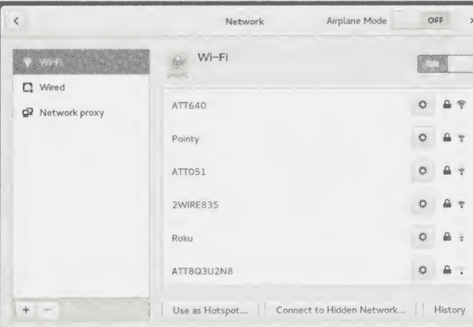

FIGURE 15.1 你可以从设置中的网络项调整常用的网络设置。

# 第15章 管理连接

如果你没有看到无线选项，可能缺少 `Wi-Fi` 硬件的 Linux 驱动程序。请参考侧边栏“获取 `Wi-Fi` 驱动程序”获取建议。

3. 点击网络窗口左侧列表中的 `Wi-Fi`。
4. 从列表中选择网络。如果网络需要验证，将出现如图 15.2 所示的对话框。

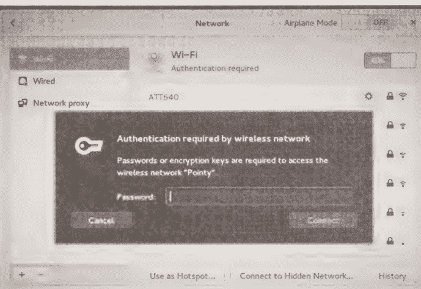

FIGURE 15.2 如果你的 `Wi-Fi` 网络需要验证，你必须输入密码才能使用。

5. 在密码字段中输入网络密码，然后点击连接。


# 第 15 章 • 管理网络连接

网络窗口中的网络项（见图 15.1）现在应该显示工作站已连接到该网络。点击 Wi-Fi 名称旁边的齿轮图标查看分配给系统的 IP 地址、默认路由和 DNS 服务器 IP 地址。计算机现在已完成网络访问的所有配置——该工具自动执行了本章后文“使用网络配置 GUI”节中描述的任务。然而，如果没有，你可能需要执行额外的配置任务，例如手动设置 IP 地址。也可能是 Wi-Fi 连接失败了。

## Wi-Fi 安全

由于 Wi-Fi 数据通过电磁波传输，因此传输很容易被拦截。坐在建筑外车里的人通常可以访问 Wi-Fi 网络，这带来了三个问题：

### Wi-Fi 安全（续）

- 入侵者可以拦截流经网络的数据，可能获得敏感文件的访问权限、获取信用卡号等。
- 入侵者可能从你维护的、任何用于保护自己免受外部侵害的防火墙之后，对你的计算机发起攻击。
- 入侵者可以使用你的网络访问来攻击其他计算机，或进行非法活动，如盗版电影、音乐或软件。这不仅会消耗你的网络带宽，而且如果活动被发现，你将成为怀疑对象！

出于这些原因，你应该确保你管理的任何 Wi-Fi 网络的安全。目前有三种安全级别可选（如果你算上没有的话）：

- `WEP` 有线等效协议（Wired Equivalent Protocol）是一种弱效的加密协议。破解 WEP 加密网络的方法众所周知，这使得这种方法毫无用处。
- `WPA` Wi-Fi 保护访问（Wi-Protected Access）安全性相比 WEP 提供了改进的加密和身份验证工具。
- `WPA2` WPA2 是 WPA 的替代者，它在加密和身份验证方面提供了更多的改进。

这些加密方法都有多种变体。例如，`WPA` 和 `WPA2` 提供了个人版和企业版选项，后者需要通过专用身份验证服务器进行更复杂的设置。通常，你会在宽带路由器或无线接入点（WAP）中设置加密方法。客户端随后会检测正在使用的方法并显示相应的选项，例如图 15.2 之前之前的密码提示。

公共 Wi-Fi 连接可能不使用这些协议中的任何一种。可以使用此类连接，但要注意你发送或接收的任何数据都可能被他人看到。

使用 GUI 方法建立 Wi-Fi 连接几乎总是是最容易使用的方法。如果你需要微调连接，可以使用各种工具来探测和管理 Wi-Fi 链路。以下是其中两个最重要的工具：

**`iwlist`** 此命令可以识别附近的 Wi-Fi 网络。输入 `iwlist scan` 或以 root 身份运行以获取附近的网络列表。此命令会产生大量的技术数据。你可能最感兴趣的是网络名称，它们出现在字符串 ESSID 之后的输出中，因此输入 `iwlist scan | grep ESSID` 可以精简输出。


**`iwconfig`** 此实用程序用于连接和断开特定网络的连接。它使用了许多选项，你可能需要学习其 man 页（帮助文档）以完全理解它。在许多情况下，输入类似的内容即可解决：

```
iwconfig wlan0 ssid NoWires channel 1 mode key s:N1mP7mHNw
```

此示例使用密码 N1mP7mHNw 连接到运行在通道 1 上的 NoWires 网络。

## 获取 Wi-Fi 驱动程序

遗憾的是，Linux 对 Wi-Fi 硬件的驱动支持较弱。如果你在尝试配置时没有看到你的 Wi-Fi 硬件，你可能需要寻找合适的驱动。你可以从名为 `lspci` 的工具开始此任务，它在第 5 章“管理硬件”中有描述。运行此命令不带任何参数查看可用硬件列表，并在列表中搜索无线网络适配器。例如，你笔记本电脑的 `lspci` 输出如下行：

```
0300.0 Network controller: Realtek Semiconductor Co., Ltd. RTL8191SEVB Wireless LAN Controller (rev 10)
```

此行识别 Wi-Fi 适配器为 Realtek RTL8191SEVB。搜索 Realtek 官网可以找到驱动程序；然而，该驱动必须在本地编译，这超出了本书的范畴。你可能没有足够的运气通过这种方式找到驱动。

原生 Linux 驱动的替代方案是使用 Windows 驱动。使用一个名为 `ndiswrapper` (http://ndiswrapper.sourceforge.net/) 的包可以这种异常选项，允许你在 Linux 中安装 Windows 驱动。遗憾的是，并不是所有的发行版标准包集中都提供 `ndiswrapper`，但你通常可以在附加仓库中找到二进制包。

如果所有选项都失败了，你可能需要购买新的网络硬件。有很多 USB Wi-Fi 适配器，但你应该研究它们，找到一个对 Linux 支持良好的设备。你也可以更换某些笔记本电脑上的内置适配器。

## 使用网络配置 GUI

如果你配置了 Wi-Fi 链路但它尚未获取 IP 地址，或者如果你需要设置有线网络连接，你需要设置 TCP/IP 网络选项。你可以通过后文“使用文本工具”部分中描述的文本模式工具来实现，也可以使用 GUI 工具。后者对新用户来说更容易，GUI 工具随发行版的不同而异。例如，使用 GUI 工具配置 Fedora 的步骤如下：

1. 点击桌面右上角的名称，并从生成的菜单中选择“系统设置”，或在 shell 提示符处输入 `gnome-control-center` 来打开系统设置工具。
2. 点击“系统设置”中“硬件”部分下的“网络”项目。
3. 从窗口左侧的列表中选择网络设备。其结果应该类似于图 15.3；然而，此图显示的是一个配置恰当且没有明显问题的链路。如果你的网络无法工作，它可能显示为“Disconnected（已断开）”而不是“Connected（已连接）”，或者可能显示截然不同的信息。

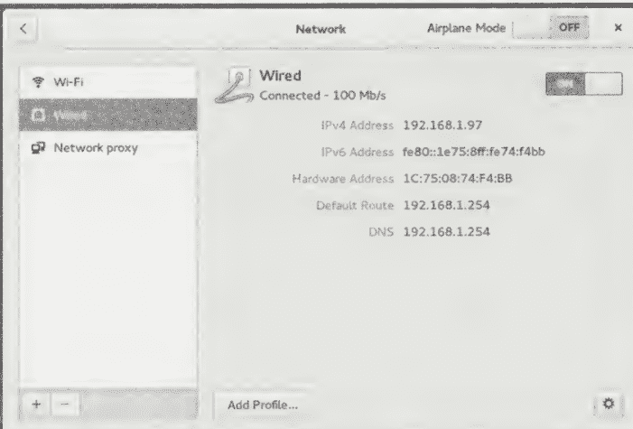

图 15.3 网络连接通常会自动设置，但有时并不会。
4. 对于有线（Wired），点击窗口右下角的齿轮图标以调整网络设置。对于 Wi-Fi 连接，点击你尝试连接的 Wi-Fi 网络名称旁的齿轮图标。
5. 根据你的网络使用的是 IPv4 还是 IPv6，选择窗口左侧的 IPv4 或 IPv6 。结果类似于图 15.4，它显示了一个部分配置的手动 IPv4 设置。

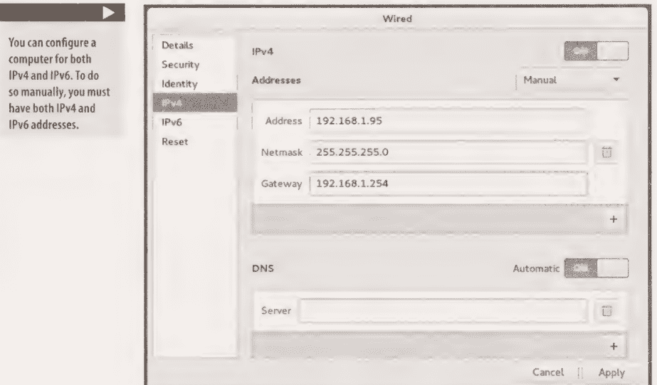

图 15.4 你可以在点击网络窗口中的 Options 后设置 TCP/IP 特性。
6. 使用 Addresses 下拉菜单选择连接方法。自动（DHCP）和手动（Manual）选项是最常见的，但也有一些少见的选项。你可以通过选择 Disabled（禁用）来禁用网络连接。
7. 如果你使用 DHCP，仍然可以手动输入 DNS 服务器和默认路由器地址。
8. 要进行手动配置，在 Addresses 下拉菜单中选择 Manual，并通过 Add 按钮输入地址、子网掩码和路由器。
9. 完成更改后，点击 Save。如果一切顺利，你的网络对话框应显示 IP 地址、子网掩码、默认路由和 DNS 服务器。

你可以使用 `down` 而不是 `ifconfig` 来关闭连接，使用 `route add` 中的 `delete` 来删除路由等。详情请参阅这些程序的 man 页（帮助文档）。

如果你的网络使用 DHCP，你可以输入 `dhclient [hostname]` 或 `dhcpd binding` 来启动网络接口并使用 DHCP 进行进行配置。如果你正在尝试调试与 DHCP 相关的网络问题，或者你的网络 DHCP 配置发生了变化导致某些计算机的连接临时中断，手动输入这些命令可能会很困难。

某些发行版默认使用 `dhclient`，而另一些则使用 `dhcpcd`。如果你不知道应该用哪一个，请尝试两者。

## 网络设备名称

传统上，Linux 将第一个以太网设备命名为 `eth0`，后续设备命名为 `eth1` 等。同样，Wi-Fi 设备获取了如 `wlan0` 及后续格式的名称。Fedora 偏离了这种方案。这使得预测一台计算机到另一台计算机的太网设备名称变得更加困难。目标是让具有多个网络接口的计算机在重启后设备名称更加稳定。此类系统通常是具有多个网络链路的路由器或服务器，它们通常要求对特定接口进行特定配置。如果设备名称从一次启动到另一次启动发生变化——这发生在网卡在不同的启动时以不同的顺序被发现——就会导致问题。

你可以通过输入不带选项的 `ifconfig` 来获取你的网络设备名称（你可以以普通用户身份执行操作）。结果包含一个或多个以下块：


```
enp1s0 flags=4163 <UP,BROADCAST,RUNNING,MULTICAST> mtu 1500
inet 192.168.1.97 netmask 255.255.255.0
broadcast 192.168.1.255
eth6 fe80::1e75:8ff:fe74:fb4 prefixlen 64
scope oe28 <link>
ether 1c:75:08:74:f4:bb txqueue 1000 (Ethernet)
RX packets 1476 bytes 121361 (11.8 KiB)
RX errors 0 dropped 0 overruns 0 frame 0
TX packets 133 bytes 13.9 KiB
TX errors 0 dropped 0 overruns 0 carrier 0 collisions 0
```

在这个示例中，`enp1s0` 是设备名称——它显著地位于该输出块的开头。你可能还会在 `ifconfig` 输出中看到 `lo` 名称，它指代环回设备，用于某些本地访问程序。如果你想查找网络硬件的设备名称，可以忽略它。

# 第 15 章 • 管理网络连接

## 配置网络连接

如果你正在手动配置网络设置，你应该将 DNS 名称服务器数据和你的网络名称输入 `/etc/resolv.conf`。该文件的示例显示在列表 15.1 中。

### 列表 15.1: 示例的 /etc/resolv.conf 配置文件

```
domain luna.edu
search example.com example.org
nameserver 192.168.102.1
nameserver 10.78.102.1
nameserver 10.78.221.1
```

三个关键字标识了 `/etc/resolv.conf` 中的 DNS 解析功能：

`domain` 你在这一行中标识计算机的默认域名。其主要作用是让计算机在这一行中搜索不带域名的主机名。例如，在列表 15.1 中，如果你指定了主机名 `lunokhod`，计算机将找到 `lunokhod.luna.edu` 的 IP 地址。

`search` 你可以通过在搜索行上指定额外的域名（域名用空格或制表符分隔），让计算机在这些域中搜索主机名。你可以通过这种方式指定最多六个域名。请注意，向搜索路径添加域名可能会减慢主机名的查找速度。

`nameserver` 此关键字通过 IP 地址标识 DNS 服务器。你可以通过包含多个 `nameserver` 行来指定多个服务器，最多三个三个。

如果你想手动定义主机名（例如你本地网络的主机），你可以在 `/etc/hosts` 文件中进行操作。这些主机名的解析速度比使用 DNS 快。

如果你想手动调整你的持久性网络配置，可以通过编辑网络配置文件来实现，例如在 Fedora 系统上的 `/etc/sysconfig/network-scripts/ifcfg-network`。列表 15.2 显示了该文件的示例。

### 列表 15.2: 示例的网络配置文件

```
DEVICE="em1"
BOOTPROTO="static"
IPADDR=192.168.29.39
NETMASK=255.255.0.0
NETWORK=192.168.29.0
BROADCAST=192.168.29.255
```

这些选项中的某些用途你可以根据名称推断，并根据需要进行调整。如果你不某个选项，最好保持原样。你可能希望处理的某些特定功能包括：

强制用户启动网络连接可以限制计算机对网络资源的使用，例如如果你的网络使用 DHCP 时的 IP 地址。

- 如果你想调整 DHCP，请将 `BOOTPROTO` 行改为 `BOOTPROTO="dhcp"` 而不是 `BOOTPROTO="static"`，并删除从 `IPADDR` 到 `GATEWAY` 的行。
- 如果你想配置让网络链路在计算机启动时自动启动，请将 `ONBOOT` 改为 `yes`。用户每次想使用网络时都必须手动激活。
- `NETWORK` 和 `BROADCAST` 选项都源自 IP 地址 (`IPADDR`) 和子网掩码 (`NETMASK`)。网络地址是 IP 地址的网络部分，用二进制 0 值替换 IP 地址的主机特定部分。广播地址与此类似，但它用二进制 1 值替换地址的主机特定部分。

某些 Linux 发行版正在弃用 `ifconfig` 和 `route` 命令，转而采用合一的 `ip` 命令。通过 `ip` 命令，你可以显示 IP 信息（使用 `ip addr`）并显示路由（使用 `ip route show`）。

如果你正在运行 Debian、Ubuntu 或其他使用不同网络配置文件的发行版，你必须找到并修改它。其格式可能与列表 15.2 显示的文件不同，尽管你必须更改的条目显而易见。如果有疑问，请咨询特定发行版的文档。

`ifup` 和 `ifdown` 命令根据你配置文件中的设置来启动或关闭网络连接。在更改这些设置后，你可能想输入 `ifdown netname` 接着输入 `ifup netname`。结果应该是一个反映新设置的网络链路。但注意，此过程可能会断开网络客户端和服务器。


## 测试你的网络连接

在大多数情况下，你的网络连接从启动那一刻起就能正常工作。有时你需要诊断问题，是因为你完全无法建立连接，或者以前正常的连接停止了工作。在接下来的页面中，我们描述了几种网络测试：检查你的路由表、测试基本连通性、测试连接中断的位置、测试 DNS 功能以及测试你的网络状态。

### 检查你的路由表

之前我们描述了使用 `route` 命令在计算机上设置默认路由。你可以使用相同的命令检查你的路由是否合理。在大多数情况下，单独输入 `route` 即可完成任务：

| $ route | | | | | |

| :--- | :--- | :--- | :--- | :--- | :--- |

| Kernel IP routing table | | Genmask | Flags Metric Use If |

| Destination | --- | --- | --- | --- | --- |

| 192.168.29.0 | * | 255.255.255.0 | U | 0 | 0 | eth0 |

| 127.0.0.0 | | 255.0.0.0 | U | 0 | 0 | eth0 |

| default | 192.168.29.1 | 0.0.0.0 | UG | 0 | 0 | eth0 |

这显示针对 192.168.29.0（即任何 IP 地址为 192.168.29.1 到 192.168.29.254 的计算机）的数据直接通过 eth0 传输。127.0.0.0 是一个特殊的接口，它“环回”到源计算机。Linux 将其用于内部网络目的。最后一行显示了默认路由，它描述了对于路由表中不匹配任何其他目的目的流量。该行标识了默认路由的网关系统为 192.168.29.1。如果它缺失或配置错误，或者所有指向外部网络（如互联网）的流量将无法离开本地网络段。

### 测试基本连通性

最基本的网络测试是 `ping`，它向系统名称（通过 IP 地址或主机名）发送简单的网络包并等待响应。在 Linux 中，`ping` 每秒发送一次包，直到你通过 Ctrl+C 键中断它。你可以通过 `-c` 选项指定有限的测试次数。以下是其输出示例：

$ ping -c 4 nessus

PING nessus.example.com (192.168.1.2) 56(84) bytes of data.

64 bytes from nessus.example.com (192.168.1.2): icmp_req=1 ttl=64

time=0.607 ms

64 bytes from nessus.example.com (192.168.1.2): icmp_req=2 ttl=64

time=0.147 ms

64 bytes from nessus.example.com (192.168.1.2): icmp_req=3 ttl=64

time=0.145 ms

64 bytes from nessus.example.com (192.168.1.2): icmp_req=4 ttl=64

time=0.283 ms

```
-- nessus.example.com ping statistics
4 packets transmitted, 4 received, 0 packet loss, time 3001ms
rtt min/avg/max/mdev = 0.145/0.295/0.687/0.189 ms
```

此命令发送了四个数据包并等待它们返回，返回速度非常快（平均为 0.295 ms），说明目标系统位于局域网内。一些常见的问题模式可以帮助诊断网络问题所在的位置：

- * 如果你可以 ping 本地系统但无法 ping 远程系统

## 查找连接性中断


ping 之后的下一步是 `traceroute` 命令，它会向你的系统和指定目标系统之间的每台计算机发送系列测试数据包。列表 15.3 显示了 `traceroute` 输出的示例

### 列表 15.3：traceroute 输出示例

```
$ traceroute -n 10.1.0.43
tracoute to 10.1.0.43 (10.1.0.43), 30 hops max, 52 byte packets
1 192.168.1.2 1.021 ms 36.519 ms 0.971 ms
2 10.10.88.1 17.250 ms 9.959 ms 9.637 ms
3 10.9.8.173 8.799 ms 19.501 ms 10.884 ms
4 10.9.8.133 21.059 ms 9.231 ms 103.068 ms
5 10.9.14.9 8.554 ms 12.982 ms 10.029 ms
6 10.1.0.44 10.273 ms 9.987 ms 11.215 ms
7 10.1.0.43 16.360 ms * 8.102 ms
```

该命令的 `-n` 选项告诉它显示目标计算机的 IP 地址而不是主机名。这可以稍微加快处理速度，特别是当你遇到 DNS 问题时，而且有时可以使输出更易读——但你可能想知道问题系统的主机，因为它们可以帮助你确定谁对问题负责。

`traceroute` 的输出可以从几个方面进行诊断：

- 通常情况下，时间会随着跳数的增加而增加。这是正常现象，从示例输出中的某些波动可以看出，你可以在列表 15.3 中看到这种模式。
- 单个跳数的可变时间可能表明路由器过载，或者某些间歇性问题导致了时间的波动。你可以在列表 15.3 的几个跳数中看到这种因素，特别是在第 1 跳和第 4 跳。此类问题可能导致性能波动，但不应导致网络会超时或完全失败。
- 未接收到对数据包的响应。这种状态通过时间字段中的星号（`*`）指示，如列表 15.3 中第 7 跳的第二个数据包所示。
- 时间的剧烈跳跃可能指示路由器之间存在很大的物理距离。忽略列表 15.3 第第一跳中 36.519 ms 的中间时间，你可以看到从第 1 跳到第 2 跳的变化发生了剧烈跳跃。在列表 15.3 的情况下，这表示从局域网到互联网服务提供商网络的链路。在跨洲链路上，时间的跳跃更为常见。这些跳跃并不意味着需要修复的配置错误，但它们可能会影响网络性能，特别是对于远程登录工具或网络游戏等高交互性协议。

除其他因素外，`traceroute` 有助于判断你所负责的网络中是否存在网络连接问题。例如，列表 15.3 中第一跳的波动可能表明本地局域网存在问题，但与最终地标相关的最后一个数据包很可能不是本地问题。如果故障链路在你的管辖范围内，你可以检查问题系统、附近系统以及整个网络段的状态。

> 某些路由器会阻止 `traceroute` 数据。如果你的 `traceroute` 输出在过了某点之后全都是星号，那么你可能遇到了这样的系统。

## 测试 DNS

DNS 问题导致网络失败的程度几乎与物理电缆断裂一样糟糕。由于人类和许多网络工具都依赖主机名，如果 DNS 解析无法工作，网络将几乎毫无用处。

你可以使用多种工具（如 `host`、`dig` 和 `nslookup`）测试你的 DNS 服务器。这些工具在许多方面是类似的，它们都允许你通过输入命令后跟主机名来查找主机名：

```
$ host www.sybex.com
www.sybex.com address 208.215.179.228
```

此示例显示了正常解析。在这种情况下，主机名直接链接到一个 IP 地址。在某些情况下，可能会发现关于别名或多个 IP 地址的通知。这对于某些站点也是正常的。如果命令响应耗长时间，或者抱怨超时或无法访问服务器，说明你的 DNS 配置是错误的。

你可以添加特定 DNS 服务器的 IP 地址，如 `http://www.whitehouse.gov/192.168.39.7` 来测试 `192.168.39.7` 服务器。如果你的计算机是这样配置的，你可以单独测试每一个。也许其中一个是不可靠或错误的，在这种情况下你可能想将其从配置中移除。但请注意，如果你在通过 DHCP 配置的计算机上从 `/etc/resolv.conf` 移除 DNS 服务器，该更改最终会被 DHCP 撤销。这是一个反复出现的问题，你应该咨询你的网络管理员。

尽管 `host`、`dig`（或已弃用的 `nslookup`）可以执行更复杂的查询并返回更多关于主机名、域名或 IP 地址的信息，这使得 `dig` 成为高级网络诊断的有用工具，但代价是易用性降低；因此，初学者很难解释 `dig` 的输出。

# 检查你的网络状态

另一个实用的诊断工具是 `netstat`。它可以说是网络工具中的“瑞士军刀”，因为根据传递给它的参数，它可以替代许多其他工具。它还可以返回其他方式难以获取的信息。以下是一些示例：

- 接口信息：传递 `netstat --interface` 或 `-i` 参数来获取有关网络接口的信息，类似于 `ifconfig` 返回的内容。（某些版本的 `netstat` 以相同的格式返回信息，但另一些版本则布局方式不同。）
- 路由信息：你可以使用 `--route` 或 `-r` 参数获取路由表列表，类似于 `route` 命令显示的内容。
- 伪装信息：传递 `netstat --masquerade` 或 `-M` 参数来获取由 Linux 网络地址转换（NAT）功能介导的连接信息，这通常被称为 IP 伪装（IP masquerading）。NAT 让 Linux 路由器能够“隐藏”单一 IP 地址之后。这是扩展有限 IPv4 地址的一种良好方法。

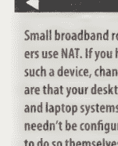

- 程序：某些版本的 `netstat` 支持 `--program (-p)` 参数，它尝试提供有关使用网络连接的程序的信息。这并不总是成功的，但通常是成功的，所以你可以看到哪些程序正在建立外部连接。
- 开放端口：当配合各种参数或不带任何参数使用时，`netstat` 会返回有关开放端口及其连接的系统的信息。
- 所有连接：`--all` 或 `-a` 选项与其他选项结合使用。它导致 `netstat` 显示服务器程序为监听网络连接而打开的端口信息，以及已打开的连接。

记住 `netstat` 是一个强大的工具，它的选项和输出在不同发行版之间并不完全一致。你可能想查阅它的手册页并尝试 `netstat` 以了解它能做什么。

## 保护你的系统免受坏人的侵害

网络为用户提供了许多有用功能。不幸的是，它们也带来了风险。网络安全是一个复杂的课题，我们只能提供一些基本的技巧来帮助防止你的系统被破解。以下是一些最重要的事情：

- 关闭未使用的服务器：Linux 的主要安全漏洞并不像 Windows 那样在于蠕虫和病毒；在 Linux 中，风险集中于外部人员利用你运行的服务器程序入侵你的计算机。因此，不运行不必要的服务器是非常重要的。某些发行版会自动安装并运行服务器，例如安全外壳（Secure Shell

# 第 15 章 • 管理网络连接

(SSH)、Apache Web 服务器，或如 Sendmail 或 Postfix 等邮件服务器。移除服务器最彻底的方法是使用你的包系统进行卸载（在第 9 章“探索进程和进程数据”中已描述），但你必须执行卸载相关包的命令，而不是安装命令。


防火墙可以运行在一台计算机上以保护它，也可以运行在路由器上以保护整个网络。

## 启用防火墙

防火墙是一种程序或系统设置，用于根据预定义的标准允许或拒绝网络事务。大多数 Linux 发行版默认启用防火墙，但你可能需要根据特定需求调整其设置。

## 使用强密码

第 13 章“创建用户和群组”描述了如何选择良好的密码。如果你的计算机运行任何类型的登录服务器，设置强密码可以最大限度地减少外部人员通过猜测密码入侵的风险。

## 保持警惕

你应当对不可信的数据源保持警惕。网络钓鱼（通过伪装成信任的个人或组织试图从用户处提取敏感数据）或类似的攻击可能会骗个人提供密码、财务数据等。虽然 Linux 的恶意软件（malware）并不多见，但却很容易制造。你最好坚持使用官方软件源，并记住电子邮件、网站和其他通信内容可能是伪造的。

### 保持软件固更新

第 9 章描述了你可以用来保持系统更新的包管理工具。最好定期检查系统软件更新，因为许多此类更新修复了安全漏洞——这些漏洞可能被外部人员或合法但恶意的人利用来接管你的计算机。

## 基础及拓展

网络连接是当今计算机不可或缺的一部分，Linux 提供了卓越的网络能力。在大多数情况下，你的计算机会自动检测网络并进行配置；然而，有时你必须手动创建高级配置或覆盖错误的自动配置。你可能还需要测试网络配置以确定问题所在之处——是在 IP 地址设置、DNS 配置还是其他地方。遗憾的是，网络可以被滥用也可以被使用，因此你必须时刻警惕那些想要入侵你的计算机并将其用于私目的的人。保持软件更新等几个步骤可以极大地降低这些风险。

## 基础及拓展（续）

## 建议练习


在你控制的小型私有网络或在导师指导的实验环境中，重新配置一台使用 `DHCP` 的计算机，使其以静态方式使用其分配的 `IP` 地址。测试连接并切换回 `DHCP`。不要在用于正常用途的工作或学校网络上进行此测试；计算机 `IP` 地址配置错误会导致其他计算机出现问题。

备份你的 `/etc/resolv.conf` 文件，然后编辑原始文件使其名称服务器指向未运行 `DNS` 服务器的计算机。通过尝试使用 `ping`、`浏览器` 和其他工具访问远程服务器来测试你的网络配置。观察产生的故障类型。完成后，还原原始文件。

## 复习题

- 1. 你想通过静态 `TCP/IP` 配置在本地网络上设置计算机，但缺少网关地址。下列哪项正确？

  A. 因为网关地址是必要的，所有 `TCP/IP` 网络功能将无法工作。

  B. `TCP/IP` 网络可以工作，但你将无法将主机转换为 `IP` 地址，反之亦然。

  C. 你能够与本地网段上的机器通信，但不能与其他系统通信。

  D. 计算机将无法识别哪些计算机是本地的，哪些是远程的。

  E. 你可以将计算机作为网络服务器系统使用，但不能作为客户端。

- 2. 输入 `ifconfig eth0` 会返回以下哪些类型的信息？（选择所有适用项）。

  A. 正在使用 `eth0` 的程序名称

  B. 分配给 `eth0` 的 `IP` 地址

  C. `eth0` 的硬件地址

  D. 与 `eth0` 关联的主机名

  E. `eth0` 通信的网关

- 3. 当你使用 `IP` 地址使用 `ping` 工具时，它响应正常，但当你使用一个确定对应于该 `IP` 地址的主机名时，它没有响应。什么可能导致此问题？（选择所有适用项。）

  A. 你的计算机与其 `DNS` 服务器之间的路由可能是错误的。

  B. 目标计算机可能配置为忽略来自 `ping` 的包。

  C. 目标系统的 `DNS` 配置可能损坏了。

  D. 你的计算机的 `DNS` 配置可能设置错误。

  E. 你的计算机的 `DNS` 配置可能损坏了。

- 4. 正误：`IPv4` 地址的长度为 4 字节。

- 5. 正误：`/etc/resol.conf` 文件告诉计算机是否使用 `DHCP` 进行网络配置。

- 6. 正误：你可以通过在 shell 提示符输入 `route` 来检查路由表的当前状态。

- 7. ________ 是一个多功能网络工具；它可以执行许多与 `ifconfig`、`route` 以及其他工具相同的功能。

- 8. Linux 中第一个以太网接口（但在最近的 Fedora 版本中不是）传统名称是 ________

- 9. ________ 是阻止或启用的程序或系统配置。

- 10. `route` 的替代方案是 ________

## 基础及拓展（续）

# 附录 A

## 复习题答案

### 第 1 章

- 1. C

- 2. A

- 3. B, C, D, E

- 4. False

- 5. False

- 6. True

- 7. login:

- 8. viruses

- 9. alpha and beta

- 10. rolling

### 第 2 章

- 1. C

- 2. B

`E` 选项 `E` 转述了 `FSF` 哲学中的一个关键要点，因此它是正确的。与 `A` 选项相反，`FSF` 的哲学并没有强制使用 `GPL`，更不用说它的最新版本了，尽管 `GPL` 是 `FSF` 偏好的许可证。选项 `B` 与 `FSF` 的立场相悖，`FSF` 的立场是自由软件应该保持自由；虽然 `FSF` 提倡自由软件和自由开源（`OSS`），但 `C` 选项并不是他们哲学的明确部分，因此是错误的。尽管 `FSF` 希望看到一个由自由软件支配的世界，但他们并不提倡软件盗版，因此 `D` 选项是错误的。

正确 明确承认计算机软件是受版权法保护的创造性作品。在某些国家，专利法也适用于软件，尽管这在全球并非如此。

这是自由软件和开源软件定义的核心。

错误 硬件供应商经常为他们的产品发布开源驱动程序。需要注意的是，开源驱动程序的发布意味着会将该硬件的某些编程接口开放，而某些硬件厂商不愿这样做。

`LGPL`（或较级 `GPL`，或较弱通用公共许可证）

`Creative Commons`（知识共享）

`copyleft`（版权传染）

`bounty`（赏金）

### 第 3 章

Linux 的多任务是抢占式的，这意味着内核可以根据需要将 `CPU` 时间分配给任何进程，并可能中断（或抢占）其他进程。因此 `A` 选项是正确的。Linux 是多用户操作系统，但 `multitask`（多任务处理）不是一种多任务的类型，因此 `B` 选项是错误的。在协作式多任务操作系统中，应用程序必须自愿相互放弃 `CPU` 时间。虽然 Linux 程序可以向操作系统发出它们不需要 `CPU` 时间，但 Linux 并不完全依赖这种方法，因此 `C` 选项是错误的。单任务操作系统一次只能运行一个进程，因此 `D` 选项是错误的。单用户操作系统一次只能支持一个用户。此类操作系统可以是协作式的，也可以是多任务的，在后者的情况下，可以使用协作式或抢占式多任务。因此 `E` 选项是错误的。

+   2. 开源定义包含 10 点，其中一点是用户可以修改原始代码并重新分发修改后的版本。因此 `C` 选项是正确的。尽管在实际操作中，所有开源软件都是免费提供的，但开源定义中没有任何规定禁止这一点。在实践中，许多组织和个人并不销售开源软件，要么是为了方便（例如为互联网连接缓慢的用户提供带有 Linux 发行版的 `DVD-ROM`），要么是为了增值服务安排（例如红帽企业 Linux，它将开源软件与支持合同捆绑）。因此 `A` 选项是正确的。开源定义要求分发源代码，但并不要求分发二进制文件。因此 `B` 选项是错误的。虽然某些开源软件（包括 Linux 内核）起源于学术界，但并非所有开源软件都是如此，`D` 选项是错误的。开源定义没有规定使用解释型语言还是编译型语言，事实上，这两种语言都用于编写开源软件，因此 `E` 选项是错误的。

+   3. `Evolution` 是一个电子邮件客户端。程序在桌面电脑上很常见，因此 `D` 选项是正确的。`Apache` 是一个 Web 服务器。`Postfix` 是一个邮件服务器，而伯克利互联网域名（`BIND`）是一个域名系统（`DNS`）服务器。这些服务器安装在桌面电脑上的可能性远比 `Evolution` 等客户端程序小得多，因此 `A`、`B` 和 `E` 选项都是错误的。`Android` 是用于智能手机和平板电脑的 Linux 发行版名称，因此 `C` 选项是错误的。

+   4. 错误 Linux 创建时，`VMS` 是用于微型计算机和大型机的。在 1991 年，在 `x86` 计算机上，`DOS` 是主导操作系统。

+   5. 正确 数字视频录像机（`DVR`）是用于录制电视的专用计算机。一些商用 `DVR`（如 `TiVos`）原生运行 Linux。也存在适用于标准 `PC` 的 `DVR` 软件，例如在 Linux 下运行的 `MythTV`。

+   6. 正确 大多数服务器程序不需要窗口系统（`X`）`GUI`，因此服务器管理员经常禁用 `X` 甚至完全删除它，以节省磁盘空间和内存，并尽可能减少安全问题的风险。

+   7. `monolithic`（单内核）

8. `shareware`（共享软件）

9. `desktop`（桌面）

10. `Apache`

### 第 4 章

+   1. B, C, E `GNOME`, `KDE` 和 `Xfce` 都是 Linux 桌面环境，因此 `B`、`C` 和 `E` 都是正确的。（其他的包括 `LXDE` 和 `Unity`。）`GIMP Toolkit`（`GTK+`）是一个 `GUI` 编程库。虽然 `GNOME` 和 `Xfce` 构建在 `GTK+` 之上，但它不是桌面环境，因此 `A` 选项是错误的。`Evolution` 是 Linux 邮件客户端，而不是桌面环境，因此 `D` 选项是错误的。

+   2. B 网络文件系统（`NFS`）的设计正是为了问题中描述的任务，因此 `B` 选项是正确的。简单邮件传输协议（`SMTP`）允许一台计算机向另一台计算机发送消息，因此它是实现所述目标的糟糕选择，`A` 选项是错误的。`PHP` 超级文本处理器（`PHP`）语言用于为网页生成动态内容，因此 `C` 选项是正确的。域名系统（`DNS`）是一种向计算机递送主机名与 `IP` 地址之间映射映射的协议，因此它无法轻易实现所述目标，使得 `D` 选项是错误的。动态主机协议（`DHCP`）允许一台计算机通过网络链路向另一台计算机提供网络信息，因此 `E` 选项是错误的。

+   3. Linux 内核的主要语言是 `C`，因此 `C` 选项是正确的。`Bash Shell` 脚本控制着大部分 Linux 启动过程，这些脚本不是内核的一部分，因此 `A` 选项是错误的。`Java` 是 Web 应用程序的流行语言，但它未用于 Linux 内核，因此 `B` 选项是错误的。`C++` 是 `C` 的派生语言，为语言添加了面向对象的特性，但 Linux 内核使用的是普通的 `C`，而不是 `C++`，因此 `D` 选项是错误的。`Perl` 是一种流行的解释型语言，特别是对于涉及文本处理的任务，但它不是 Linux 内核的语言，因此 `E` 选项是错误的。

+   4. 错误 `LibreOffice` 于 2011 年从 Apache 版本之前的 `OpenOffice` 分叉（`forked`）。`Caligra` 从 `KOOffice` 办公套件中分拆，该套件已不再维护。


# 第 5 章

5. 正确 拒绝服务（DoS）攻击可以通过向服务器发送大量的虚假数据，或直接使用运行它的计算机来中断服务器的操作。即使服务器管理得完美无缺也是如此。

6. 正确 `Python` 与 `Perl`、`PHP` 和 `shell` 语言一样是解释型的。这与 `C` 和 `C++`（两种常见的编译型语言）以及 `motherboard`（错误）形成对比。

7. `email client`（邮件客户端）

8. `Samba`

9. `compiled`（编译的）

10. `Package`（包）

D 开源定义包含 10 点，其中一点是用户可以修改原始代码并重新分发修改后的版本。因此 C 选项是正确的。尽管在实际操作中，所有开源软件都是免费提供的，但开源定义中没有任何规定禁止这一点。在实践中，许多组织和个人并不销售开源软件，要么是为了方便（例如为互联网连接缓慢的用户提供带有 Linux 发行版的 DVD-ROM），要么是为了增值服务安排（例如红帽企业 Linux，它将开源软件与支持合同捆绑）。因此 A 选项是正确的。开源定义要求分发源代码，但并不要求分发二进制文件。因此 B 选项是错误的。虽然某些开源软件（包括 Linux 内核）起源于学术界，但并非所有开源软件都是如此，D 选项是错误的。开源定义没有规定使用解释型语言还是编译型语言，事实上，这两种语言都用于编写开源软件，因此 E 选项是错误的。

+ 3. `Evolution` 是一个电子邮件客户端。程序在桌面电脑上很常见，因此 D 选项是正确的。`Apache` 是一个 Web 服务器。`Postfix` 是一个邮件服务器，而伯克利互联网域名（`BIND`）是一个域名系统（DNS）服务器。这些服务器安装在桌面电脑上的可能性远比 `Evolution` 等客户端程序小得多，因此 A、B 和 E 选项都是错误的。`Android` 是用于智能和平和平电脑的 Linux 发行版名称，因此 C 选项是错误的。

+ 4. 错误 Linux 创建时，`VMS` 是用于微型计算机和大型机的。在 1991 年，在 x86 计算机上，`DOS` 是主导操作系统。

+ 5. 正确 数字视频录像机（DVR）是用于录制电视的专用计算机。一些商用 DVR（如 `TiVos`）原生运行 Linux。也存在适用于标准 PC 的 DVR 软件，例如在 Linux 下运行的 `MythTV`。

+ 6. 正确 大多数服务器程序不需要窗口系统（`X`）GUI，因此服务器管理员经常禁用 `X` 甚至完全删除它，以节省磁盘空间和内存，并尽可能减少安全问题的风险。

+ 7. `monolithic`（单内核）

+ 8. `shareware`（共享软件）

+ 9. `desktop`（桌面）

+ 10. `Apache`

# 第 4 章

+ 1. B, C, E `GNOME`, `KDE` 和 `Xfce` 都是 Linux 桌面环境，因此 B、C 和 E 都是正确的。（其他的包括 `LXDE` 和 `Unity`。）`GIMP Toolkit`（`GTK+`）是一个 GUI 编程库。虽然 `GNOME` 和 `Xfce` 构建在 `GTK+` 之上，但它不是桌面环境，因此 A 选项是错误的。`Evolution` 是 Linux 邮件客户端，而不是桌面环境，因此 D 选项是错误的。

+ 2. B 网络文件系统（`NFS`）的设计正是为了问题中描述的任务，因此 B 选项是正确的。简单邮件传输协议（`SMTP`）允许一台计算机向另一台计算机发送消息，因此它是实现所述目标的糟糕选择，A 选项是错误的。`PHP` 超级文本处理器（`PHP`）语言用于为网页生成动态内容，因此 C 选项是正确的。域名系统（`DNS`）是一种向计算机递送主机名与 IP 地址之间映射映射的协议，因此它无法轻易实现所述目标，使得 D 选项是错误的。动态主机协议（`DHCP`）允许一台计算机通过网络链路向另一台计算机提供网络信息，因此 E 选项是错误的。

+ 3. Linux 内核的主要语言是 `C`，因此 C 选项是正确的。`Bash Shell` 脚本控制着大部分 Linux 启动过程，这些脚本不是内核的一部分，因此 A 选项是错误的。`Java` 是 Web 应用程序的流行语言，但它未用于 Linux 内核，因此 B 选项是错误的。`C++` 是 `C` 的派生语言，为语言添加了面向对象的特性，但 Linux 内核使用的是普通的 `C`，而不是 `C++`，因此 D 选项是错误的。`Perl` 是一种流行的解释型语言，特别是对于涉及文本处理的任务，但它不是 Linux 内核的语言，因此 E 选项是错误的。

+ 4. 错误 `LibreOffice` 于 2011 年从 Apache 版本之前的 `OpenOffice` 分叉（forked）。`Caligra` 从 `KOOffice` 办公套件中分拆，该套件已不再维护。

5. 正确 拒绝服务（DoS）攻击可以通过向服务器发送大量的虚假数据，或直接使用运行它的计算机来中断服务器的操作。即使服务器管理得完美无缺也是如此。

6. 正确 `Python` 与 `Perl`、`PHP` 和 `shell` 语言一样是解释型的。这与 `C` 和 `C++`（两种常见的编译型语言）以及 `motherboard`（错误）形成对比。

7. `email client`（邮件客户端）

8. `Samba`

9. `compiled`（编译的）

10. `Package`（包）

# 第 5 章

D 开源定义包含 10 点，其中一点是用户可以修改原始代码并重新分发修改后的版本。因此 C 选项是正确的。尽管在实际操作中，所有开源软件都是免费提供的，但开源定义中没有任何规定禁止这一点。在实践中，许多组织和个人并不销售开源软件，要么是为了方便（例如为互联网连接缓慢的用户提供带有 Linux 发行版的 DVD-ROM），要么是为了增值服务安排（例如红帽企业 Linux，它将开源软件与支持合同捆绑）。因此 A 选项是正确的。开源定义要求分发源代码，但并不要求分发二进制文件。因此 B 选项是错误的。虽然某些开源软件（包括 Linux 内核）起源于学术界，但并非所有开源软件都是如此，D 选项是错误的。开源定义没有规定使用解释型语言还是编译型语言，事实上，这两种语言都用于编写开源软件，因此 E 选项是错误的。

A, D 分区允许将不同类型的数据 own磁盘的一部分。例子包括多个操作系统和分离交换分区。因此 A 和 D 是正确的。文件系统选择（`ext4fs` vs `ReiserFS`）与分区无关，除非你想将一个用于另一个分区，因此 B 选项是错误的。并行 ATA（`PATA`）和串行 ATA（`SATA`）接口是硬件标准；你无法通过分区将 PATA 磁盘变成 SATA 磁盘，因此 C 选项是错误的。硬盘有缓存来提高性能，但分区并没有将磁盘的缓存与磁盘的大部分数据分开，因此 E 选项是错误的。

3. 视频显示器连接到计算机主板集成的视频电路或独立的显卡，因此 A 选项是正确的。键盘、外部硬盘、打印机和扫描仪通常通过 USB 连接到计算机，这些设备都有替代接口。

4. True CPU 家族有多个名称。`EM6T` 是 Intel 用于其 x86-64 架构的一个名称，而 `AMD64` 是 AMD 对相同架构的名称之一。因此这两个名称指向相同的架构，`AMD64` Linux 发行版可以在 `EM64` CPU 上运行。

6. True 在 Linux 中，大多数驱动程序（包括指定的）都是作为内核的一部分提供的。某些其他驱动程序（例如 `X` 下显卡、打印机和扫描仪的驱动程序）存在内核之外，尽管这些可能也依赖内核驱动程序来工作。

# 第 6 章

- 1. `Ctrl+A` 键将光标移动到 `Bash` 中编辑命令的行首，因此选项 A 是正确的。左箭头键将单个字符向左移动，`Ctrl+T` 交换两个字符的位置，向上箭头在历史记录中向上移动一项，`Ctrl+E` 移动到行尾。

- 2. C, D 选项 C 和 D 描述了从 shell 在后台运行程序的方法，因此选项 C 和 D 是正确的。`start` 或 `bg` 都不是在后台启动程序的命令。`fg` 命令将程序返回到前台，这意味着 shell 将回回到睡眠状态，这并不是题目所指的。

- 3. `less` 程序像 `more` 一样，一次显示一个文本文件。`less` 工具还包括在文本文件中后页、搜索内容以及执行其他 `more` 无法执行的功能。因此，选项 D 是错误的。`grep` 命令在文件中搜索指定的字符串，因此它不执行类似于 `more` 的任务，选项 A 是正确的。超文本标记语言 (`HTML`) 是一种文件格式，通常以文件名扩展名 `.html` 识别，常用于 Web 网页。因此，它不是 `more` 的更好版本，所以选项 B 是错误的。`cat` 可以连接两个或多个文件，也可以在屏幕上显示单个文件。在前者情况下，`cat` 不执行 `more` 的任务；在后者情况下，`cat` 的功能不如 `more`。因此，选项 C 是正确的。`man` 命令显示 Linux 手册页。虽然 `man` 默认使用 `less`，但 `man` 本身并不是 `more` 的改进版本，因此选项 E 是正确的。

- 4. 错误 当进入 VT 切换快捷键时，正确的按键应该是 `Ctrl+Alt+F2`（或通过 F6 之间的其他功能键）。

- 5. 正确 当你想覆盖 `man` 的搜索顺序时，可以在 `man` 和命令名、文件名或其他要搜索的名称之间指定所需的目录章节。


# 第 7 章

- 6. 错误 尽管 `info` 页面像网页一样使用超链接连接到相关的文档，但这两个系统使用不同的格式和协议。`info` 页面也存储在计算机的硬盘上；读取它们不需要访问 Internet。由于这些原因，`info` 页面不是基于 Web 的。
- 7. 错误 个人程序作者根据自己的特定需求和喜好决定文档文件格式。尽管某些文档是 OpenDocument Text 格式，但许多文档并非如此。
- 8. `exit`
- 9. `node`
- 10. `locate`

- 1. `mv` 命令移动或重命名文件，因此选项 A 是正确的。`cp` 命令复制文件，因此选项 B 是错误的。`ln` 命令在两个文件之间创建链接，因此选项 C 是正确的。选项 D 中的 `rn` 命令是虚构的，因此该选项是错误的。`touch` 命令创建一个新文件或调整现有文件的时间戳，因此选项 E 是错误的。
- 2. C 因为两个文件（`outline.pdf` 和 `Outline.PDF`）的名称仅大小写上不同，且由于 FAT 是不区分大小写的文件系统，在复制时其中一个文件将会丢失（两个文件都会被复制，但第二个将覆盖第一个）。因此，选项 C 是正确的。指定的 `cp` 命令没有创建链接，因此选项 A 是错误的。由于指定的 `cp` 命令包含了 `-a` 选项（执行递归复制），`MyFiles` 中的所有文件及其目录本身都将被复制，因此选项 B 是错误的。为了复制所有文件，你必须手动更改一个文件的名称；然而，`cp` 不会自动执行操作，因此选项 D 是错误的。由于选项 C 是正确的，所以选项 E 不是正确的。
- 3. A, B 如果你尝试在一个不存在的目录内部创建目录，`mkdir` 会返回“没有此类文件或目录”的错误。`-parents` 参数告诉 `mkdir` 在此类情况下自动创建所有父目录，因此选项 A 是正确的。你也可以通过分别创建每个必要的目录来手动完成操作，因此选项 B 也是正确的。（如果目录已经存在，在这个例子中可能不需要 `mkdir`。尝试创建一个已存在的目录没有大碍，尽管 `mkdir` 会返回“文件已存在”。）选项 C 不产生任何用处；最多它会更改 `mkdir` 程序文件的时间戳，但如果你以普通用户身份输入，它可能连这都做不到。选项 D 和 E 都基于你必须删除与你想使用的名称相同的已存在目录的前提，但这并非事实，因此这两个选项都是错误的。
- 4. 正确 符号链接通过在符号链接文件中存储被链接文件的名称来工作。Linux 读取此文件名并透明地替换被链接文件。此过程在单文件系统和跨文件系统中均有效，因此该陈述是正确的。相比之下，硬链接通过提供指向单个文件的多个目录项来实现。这种创建链接的方法在底层系统间无效。
- 5. 错误 Linux 的安全功能可以防止在你作为普通用户操作时发生意外损坏。当你获取 root 权限进行系统维护时，必须更加小心。
- 6. 正确 `touch` 命令更新文件的时间戳，为了这个目的，目录被视为一个文件，因此该陈述是正确的。
- 7. `-u r --update`
- 8. `rm -R junk`, `rm -r junk`, 或 `rm --recursive junk`
- 9. `?`
- 10. `/etc`

# 第 8 章

- 1. A `grep` 工具在文件中查找匹配文本并打印这些行。它接受正则表达式，这意味着你可以在括号中放入你查找的单词中不同的两个字符。选项 A 显示了执行此操作的正确语法。`tar` 工具创建或处理归文件，选项 B 的语法对于任何 `tar` 的用法都是错误的，因此该选项是错误的。`find` 工具根据文件名、文件大小和其他表面特征定位文件。此外，选项 C 和 E 都呈现了 `find` 的错误语法，因此也是错误的。选项 D 的 `cat` 工具显示或连接文件，因此它无法产生预期的效果，该选项是错误的。
- E. `>>` 运算符将标准输出追加到文件，选项 E 是正确的。竖线 (`|`) 是管道符，它将一个程序的标准输出连接到另一个程序的标准输入，因此选项 A 是错误的。`>` 运算符重定向标准错误而不是标准输出，它会覆盖目标文件，因此 B 是错误的。`&` 运算符重定向标准输出和错误，它会覆盖目标文件，因此 C 是错误的。`|` 运算符将标准输出重定向到另一个程序，因此 D 是错误的。`2>` 运算符将标准错误重定向到文件，因此 E 是正确的。`&` 运算符在后台运行程序，因此 F 是错误的。`|` 运算符将标准输出重定向到另一个程序，因此 G 是错误的。`>` 运算符将标准输出重定向到文件，因此 H 是错误的。`2>` 运算符将标准错误重定向到文件，因此 I 是错误的。`2>&` 运算符将标准输出和错误重定向到文件，因此 J 是错误的。`2>>` 运算符将标准错误追加到文件，因此 K 是错误的。`2>&` 运算符将标准输出和错误重定向到文件，因此 L 是错误的。`>>` 运算符将标准输出追加到文件，因此 M 是错误的。`2>>` 运算符将标准错误追加到文件，因此 N 是错误的。`2>&` 运算符将标准输出和错误重定向到文件，因此 O 是错误的。`|` 运算符将标准输出重定向到另一个程序，因此 P 是错误的。`2>` 运算符将标准错误重定向到文件，因此 Q 是错误的。`2>&` 运算符将标准输出和错误重定向到文件，因此 R 是错误的。`2>>` 运算符将标准错误追加到文件，因此 S 是错误的。`2>&` 运算符将标准输出和错误重定向到文件，因此 T 是错误的。`>>` 运算符将标准输出追加到文件，因此 U 是错误的。
- `find` 工具根据文件名、文件大小和其他表面特征定位文件。此外，选项 C 和 E 都呈现了 `find` 的错误语法，因此都是错误的。选项 D 的 `cat` 工具显示或连接文件，因此它无法产生预期的效果，该选项是错误的。
- E `>>` 运算符将标准输出追加到文件，选项 E 是正确的。竖线 (`|`) 是管道符，它将一个程序的标准输出连接到另一个程序的标准输入，因此选项 A 是错误的。`>` 运算符重定向标准错误而不是标准输出，它会覆盖目标文件，因此 B 是错误的。

# 第 10 章

- 1. LibreOffice 与大多数文字处理器一样，使用无法用 ASCII 或 Unicode 文本编辑器正确解析的二进制格式。因此，`nano` 无法用于检查此类文档，所以选项 D 是正确的。`nano` 文本编辑器可以处理 ASCII 或 Unicode 格式，选项 A 和 C 描述的文本文件是错误的。选项 B 和 E 描述的其他文档类型很可能或肯定以 ASCII 或 Unicode 格式存储，因此它们是错误选项。
- 2. B, E 按 `F6` 键和 `Ctrl+W` 键位都会调用搜索功能，因此选项 B 和 E 是正确的。`F3` 键将当前缓冲区写入磁盘，因此选项 A 是错误的。它用于启用或禁用平滑滚动，因此选项 C 是错误的。`Ctrl+S` 键位是一个冷门的快捷键；`Ctrl+F` 是向后移动一个字符，因此选项 D 是错误的。
- 3. 在 `vi` 编辑器中，`dd` 是删除行的命令模式命令。在此命令前加上一个数字可以删除对应数量的行。因此选项 A 是正确的。虽然 `yy` 的作用类似，但它是复制（yank）文本而不是删除它，所以选项 B 是错误的。选项 C 在许多文本编辑器中有效，但在 `vi` 中无效。选项 D 在 `emacs` 和类似的文本编辑器（包括 `pico` 和 `nano`）中有效，但在 `vi` 中无效。选项 E 或类似的命令在许多 GUI 编辑器中有效，但在 `vi` 中无效，所以它是错的。
- 4. 错误。Unicode 支持所有字母表，包括常用东亚语言中使用的巨大对数系统。
- 5. 错误。下划线、斜体、多种字体和类似的高级格式功能存在文字处理器中，而不是纯文本编辑器——即使是 GUI 文本编辑器也缺乏此类支持。
- 6. 正确由于易于使用，`nano` 通常是最适合学习的编辑器。
- 7. `128`
- 8. `Ctrl+\` 和 `Esc+R`
- 9. `u`
- 10. `ZZ`

# 第 11 章

- 1. A 脚本像二进制程序一样，通常至少有一个可执行集，尽管它们在某些情况下即使没有此特性也可以运行，因此选项 A 是正确的。没有标准的 `/usr/bin/scripts` 目录，脚本可以位于任何目录，因此选项 B 是错误的。脚本是解释型程序，这意味着它们不需要编译。输入 `bash scriptname` 将运行该脚本；选项 C 是错误的。病毒在 Linux 中极罕见，而且由于是你创建的脚本，它可能包含病毒的唯一可能是你的系统已经被感染，或者你把它写成了病毒。因此选项 D 是错误的。大多数拼写检查器是为英语或其他语言设计的，它们缺乏有效的 Bash 命令（如 `asac`）。此外，即使每个关键字都指定得正确，脚本也可能包含错误。因此选项 E 是错误的。


## 复习题答案

### 2. C
`cp` 命令是脚本中调用的唯一命令，该命令用于复制文件。由于脚本反向传递参数（`$1` 和 `$2`），它们的作用也反过来了——而 `cp` 将其第一个参数复制到第二个名称，该 `cp` 脚本则将第二个参数复制到第一个名称。选项 C 正确地描述了这一点。选项 A 忽略了参数的反转顺序，因此该选项是错误的。`cp` 命令与编译或 C++ 程序无关，脚本也是如此，因此选项 B 是错误的。由于 `cp` 是一个简单的文件复制命令，它无法将 C 程序转换为 C++ 程序，因此选项 D 是错误的。脚本的第一行是有效的 shebang 行，与选项 E 相反，所以该选项是错误的。

### 3.
条件表达式返回真或假的响应，使脚本能够执行一组指令或另一组指令，或者继续循环。选项 C 是这种说法的另一种方式，因此它是正确的。条件表达式与许可条件（选项 A）、显示环境信息（选项 B）、帕甫洛夫条件反射（选项 D）或在一天中的特定时间执行脚本（选项 E）均无关系。尽管如此，条件表达式可以服务于这些任何一个目标，但那并不是它们的目的。

### 4. 错误
`$0` 变量保存脚本名称——在本例中为 `myscript`。要访问传递给脚本的第一个参数（`laser txt`），脚本必须使用 `$1` 变量。

32

### 5.
`正确` 你可以可以使用它来执行固定次数的循环，而 `while` 和 `until` 分别执行到测试条件不再满足或满足为止。

### 6.
`错误` 所述脚本的作用是顺序启动三个终端实例；第二个只有在第一个结束后才会启动，第三个只有在第二个结束后才会启动。要按照题目要求操作，你应该在至少前两次 `terminal` 调用末尾加上一个取符符号 `&`（例如 `terminal &`）；这会导致它们在后台运行，这样脚本就可以继续执行剩余的终端实例。

### 7.
`#!/bin/sh`

### 8.
`echo`

### 9.
`case`

### 10.
`exit`

# 第 12 章

### 1.
A UID 0 留给系统管理员账户，也称为 root，因此选项 A 是正确的。第一个普通用户账户不是系统账户，其 UID 通常为 500 或 1000，取决于发行版，因此选项 B 是错误的。因为 A 是正确的，所以 C 不可能是。将 UID 0 与管理任务关联是 Linux 的基础，因此你不会发现这种变化，因此选项 D 是错误的。选项 E 描述的是 `nobody` 账户，它的 UID 不是 0。

### 2.
A, C, E `/etc/passwd` 文件的字段指定用户名、加密密码（或用 `x` 表示使用 shadow 密码，这更常见）、UID 编号（选项 A）、默认 GID 编号、通常包含用户全名的注释字段、账户主目录的路径（选项 C）以及账户默认文本模式 shell 的路径（选项 E）。选项 B 是错误的，因为 `/etc/passwd` 包含了用户的默认组，用户可能属于定义在其他地方的额外组。选项 D 是错误的，因为用户的默认桌面环境定义在用户的主目录中，而不是在 `/etc/password` 中。

## 附录 A - 复习题答案

### 3.
A `sudo` 命令是以 root 身份执行单条命令的常用方法，选项 A 提供了题目要求的正确用法语法。没有标准的 `root` 命令，选项 B 是错误的。`passwd` 命令更改密码，选项 C 是错误的。虽然你可以使用 `su` 以 root 身份执行单条命令，但你必须配合 `-c` 选项来实现，例如 `su -c "cat /etc/"`，选项 D 是错误的。选项 E 是虚构的命令，所以选项 D 是错误的。

### 4.
错误 `whoami` 命令显示你的用户名。`id` 命令显示你的用户名、UID 编号、主组名、主 GID 编号以及你所有组的组名和 GID 编号。

### 5.
错误 Linux 中组数据文件的名称是 `/etc/group`，而不是 `/etc/groups`。

### 6.
正确 作为普通用户，对命令造成的破坏可能比 root 更大。因此，在使用 root 时应格外小心——只运行信任的程序，双倍检查命令是否有错误等。

`/etc/passwd`

### 7.
`w`

### 8.
`w`

### 9.
`system`

### 10.
`nonrepudiation`

# 第 13 章

### 1.
C `userdel` 命令删除账户，`-r` 选项导致它删除用户主目录和邮件池，从而满足题目的条件。选项 A 删除账户但保留用户主目录。选项 B 做法相同；`-f` 选项在某些情况下强制删除账户并移除文件，但它只有在配合 `-r` 使用才有意义。选项 D 的命令可能没有影响，因为 `rm` 只有在配合 `-r` 时作用于目录，且 `/home/nemo` 可能是用户的主目录。选项 E 的 `rm` 删用户的主目录（根据用户名假设它位于常规位置），但它没有删除用户的账户。

### 2.
选项 B 中的密码使用了大写字母、小写字母、数字和符号的组合，且不包含任何明显的单词。此外，它是一个很长的密码。所有这些特征使其不太可能出现在入侵者的密码字典中，而且很难被破解。因此，选项 B 代表了一个良好的密码，而且是其中最好的。选项 A 是一个知名名人的名字（至少在 Linux 世界是如此）；这样的名字很可能出现在密码破解字典中，因此是一个糟糕的密码选择。选项 C 是一个极其常见的密码，这使其成为一个糟糕的选项。此外，它很短且仅由一种类型的字符（数字）组成。选项 D 是另一个流行的（因此非常糟糕）密码。它是一个全小写的简单常用单词，不包含数字或其他非字母符号。尽管选项 E 相当长，但它完全由小写字母组成，并且是三个相关的单词，使其成为一个糟糕的密码。

### 3.
`groupadd` 命令创建一个新组，如选项 A 所示，因此是正确的。要将用户添加到组（如选项 B 建议的那样），你将使用 `user` 工具。没有标准命令可以从文件中导入信息，如选项 C 建议的那样，因此该选项是错误的。（尽管某些网络用户管理工具提供此类功能）。要更改用户的默认组或附加组列表，你需要使用 `usermod`，因此选项 D 和 E 都是错误的。

### 4.
系统账户的 UID 值位于 0 到某个数字（通常为 499 或 999）之间，而用户账户的 UID 值高于该数字（通常从 500 或 1000 开始）。

### 5.
修改密码的常用命令行命令是 `passwd`。

### 6.
虽然 `usermod` 命令的 `-r` 选项会删除用户的家目录和邮件文件，此命令不会跟踪存储在更特殊位置的用户文件。如果你想删除文件或将所有权转移给另一个用户，可以使用 `find` 来定位文件。

```
-u 1926 theo
```

```
usermod -l emilyn e1211
```

```
-r or --system
```

```
/etc/group
```

## 附录 A - 复习题

# 第 14 章

### 1.
D 选项 D 是正确的命令。输入 `chown ralph:tony somefile.txt`（如选项 A 所示）将文件所有者设置为 ralph，将组设置为 tony。选项 B 和 E 中使用的 `chmod` 命令用于更改文件权限，而不是所有权。选项 C 反转了文件名和所有者的顺序。

### 2.
C, D 模式开头的字符表示该文件是目录，而符号模式中 `r-x` 三元组中的 `r` 符号表示系统所有用户都对该目录具有读取权限，因此选项 C 和 D 都是正确的。该模式缺乏的开头 `l` 字符表示唯一的符号链接，因此是错误的。尽管 `x` 通常表示可执行的程序文件（如选项 B 所示），但在目录的情况下，此权限位表示可以搜索目录的内容；用于可写访问的唯一权限字段在第一个三元组中，它指的是文件所有者，因此只有所有者可以写入文件，而不是文件组的其他成员，这与选项 E 相反。

### 3.
E 虽然 `chgrp` 命令是更改文件组的常用命令，但你也可以使用 `chmod` 来完成工作，因此选项 E 是正确的。选项中的 `groupadd` 命令向系统添加新组，因此该选项是错误的。`groupmod` 命令可以修改组定义的详细信息，因此选项 B 是错误的。`chmod` 命令更改文件的模式（即权限），而不是它的组关联，因此选项 C 是错误的。你可以使用 `ls` 来学习文件的当前组（以及其他信息），但不能用来更改它，因此选项 D 是错误的。

### 4.
正确 755 的八进制权限对应于 `rwxrxr-x` 的符号表示，它包含了世界读取权限（`r-x` 的最后三位）。因此任何人都可以读取该文件。

### 5.
错误 任何用户都可以使用 `chmod`；但只有文件所有者或 root 用户可以更改文件的权限。

### 6.
正确 尽管普通用户可以使用 `chown` 更改文件的组，但普通用户无法更改文件的所有权。

## 复习题答案

### 7.
`-Ror --recursive`

### 8.
`r-x`

### 9.
`a+x`

### 10.
`o+t`

# 第 15 章


- 1. 网关计算机是在两个或多个网络段之间传输数据的路由器。因此，如果计算机没有配置使用网关，它将无法通信本地网络段之外，如选项 C 所示。（如果你的 DNS 服务器位于不同的网络段，通过 DNS 进行名称解析将无法工作，尽管其他类型的名称解析（如 `/etc/hosts` 文件）仍然有效。）缺少网关地址不会导致选项 A、B、D 或 E 描述的症状。

- 2. B, C 用于显示接口信息时，`ifconfig` 显示接口的硬件（选项 C）和 IP（选项 B）地址，绑定到接口的协议（如 TCP/IP）以及发送和接收数据包的统计。此命令不返回关于使用接口的程序（选项 A）、与接口关联的主机名（选项 D）或通信的网关（选项 E）。

- 3. A, E DNS 问题可能表现为：通过 DNS 进行名称解析将无法工作，尽管其他类型的名称解析（如 `/etc/hosts` 文件）仍然有效。缺少网关地址不会导致选项 A、B、D 或 E 描述的症状。如果目标系统配置了网关，它将能够通信本地网络段之外，如选项 B 所示。选项 D 是错误的。

- 4. 正确 IPv4 地址通常为 4 字节，是以点分隔的数字。

- 5. 错误 `/etc/resolv.conf` 文件持有 DNS 服务器信息。

- 6. 正确 在没有其他选项的情况下，`route` 命令显示路由表。

- 7. `netstat`

- 8. `eth0`

- 9. `firewall`

- 10. `ip route show`

# LPI 认证计划

Linux Essentials 认证计划的目的是定义熟练使用桌面系统或移动设备所需的基础知识，并鼓励初学者 Linux 和开源的人了解其在更广泛的行业中的地位。

该计划由几个主要部分组成：

- Linux Essentials 考试和认证

- 对 WorldSkills 信息与通信技术 (ICT) 类别的支持

- 青少年的就业和学徒计划链接

- 支持青少年进入 Linux 和开源职业的研究和资源

- 地区政府和教育资质机构的 LPI 支持

- 支持教师协作和项目分享的 Linux 知识库

- 描述需要 Linux 技能职业的资源

# Linux Essentials 认证

成功的 Linux Essentials 候选人应该对 Linux 和开源行业有所了解，并了解流行的开源应用程序。候选人应该理解 Linux 操作系统的主要组件，并具备命令行操作的技术能力。LPI Linux Essentials 技术员 (LPI LET) 最可能是受管理系统的终端用户。

LPI LET 通常至少：

- 理解自由和开源软件、各种社区以及许可证

- 理解操作系统的基本概念

- 具备硬件的基础知识

- 对系统安全、用户和组以及公共和私有目录的基本了解

- 了解如何使系统可用并能够在局域网内连接其他计算机

- 展示工作场所使用的开源应用程序及其对应的闭源替代品

- 理解 Linux 桌面的导航系统以及去哪里寻求帮助

- 具备命令行操作和文件的原始能力

- 能够创建和恢复简单的备份（存档）

- 使用基本的命令行编辑器

- 理解文件压缩

- 能够创建和运行简单的脚本

## 附录 B · LPI 认证计划

## 表 B.1: LPI Linux Essentials 目标映射

| 目标 | 章节 | |
|---|---|---|
| 主题 1：Linux 社区与开源职业发展 | | |
| 1.1 Linux 演进与流行操作系统 | 章节 1, 3 |
| 1.2 主要开源应用程序 | 章节 4 |
| 1.3 理解开源软件和许可 | 章节 2 |
| 1.4 ICT 技能与在 Linux 中工作 | 章节 4, 6 |
| 主题 2：在 Linux 系统中找到方向 | | |
| 2.1 命令行基础 | 章节 6, 7, 11 |
| 2.2 使用命令行获取帮助 | 章节 6 |
| 2.3 使用目录和列出文件 | 章节 7 |
| 2.4 创建、移动和删除文件 | 章节 7, 8 |
| 主题 3：命令行的力量 | | |
| 3.1 在命令行上归档文件 | 章节 8 |
| 3.2 从文件中搜索和提取数据 | 章节 6, 8 |
| 3.3 将命令转换为脚本 | 章节 10, 11 |
| 主题 4：Linux 操作系统 | | |
| 4.1 选择操作系统 | 章节 1 |
| 4.2 理解计算机硬件 | 章节 5 |
| 4.3 数据存储在何 | 章节 7, 9 |
| 4.4 网络上的计算机 | 章节 15 |
| 主题 5：安全与文件权限 | | |
| 5.1 安全与识别用户类型 | 章节 12 |
| 5.2 创建用户和组 | 章节 13 |
| 5.3 管理文件权限和所有权 | 章节 14 |
| 5.4 特殊目录和文件 | 章节 7, 14 |

# 索引

读者注：在本索引中，加粗的页码表示该主题的主要讨论。*斜体*页码表示插图。

## A

- AbiWord, 59

- 绝对引用, 136

- 账户, 227

- 创建, 245–256

- 组策略, 245–256

- 使用 GUI 工具, 249–251

- 密码选择, 246–248, 323

- 从 shell 执行, 251–259

- 删除

- GUI 工具, 260, 261

- 陷阱, 259–260

- 从 shell 执行, 261

- 发现一个身份, 234–235

- 特性, 228–231

- 识别, 232–233

- 锁定密码, 256

- 修改, 253–259

- 检查登录用户, 254–255

- GUI 工具, 255–256

- 从 shell 执行, 257–259

- root, 106, 321, 322

- 获取权限, 238–240

- 公司政策, 239

- 权限, 276

- 安全使用, 241–242

- 担任, 237–242

- 选择密码, 246–248

- 系统, 227, 323

- fork, 234–237

- 用户, 227, 238

- 用户名, 228, 229

- 活动目录 (AD), 232

- 管理任务, 238

- 管理员。*参见* root 账户

- Adobe Reader, 39

- 高级包工具 (APT), 179, 318

- Alpha软件, 198

- AMD64, 313

- AMDATI 驱动程序, 91, 95

- 美国信息交换标准代码 (ASCII), 193, 194, 319

- Android, 16, 38, 307

- Apache HTTPD, 66, 310

- Apache 许可证, 31

- Apache OpenOffice.org, 12, 43, 59, 312

- 一条命令, 221

- Apple 分区 Map (APM), 84

- 设备, 42

- 应用, 62

- aprospos 命令, 112

- APT。*参见* Advanced Package Tool

- apt-get, 72, 80, 317–318

- Aqua, 10

- 归档架构, 177

- 归档文件, 166, 317

- 归档数据, 166–172

- 段, 105

- 在脚本中执行, 215–216

- ARM CPU 类型, 69, 77

- Artistic 许可证, 31

- ASCII。*参见* 美国信息交换标准代码

- 宽高比, 92

- 汇编语言, 69, 70

- 赋值运算符, 218

- 星号 (*)

- 文件操作, 143

- 文件名扩展, 220

- 在 grep 规范中, 155

- 在正则表达式中, 152

- traceroute 出点, 301

- ATA 数据包接口 (ATAP), 81

- AT&T, 8, 37

- audacity, 60

- 汽车计算机, 422

## B

- 后台程序, 运行, 106–107, 314

- 反斜杠 (\), 用于转义, 152–153

- 反引号 · cut 命令

- 反引号, 165

- Bash。参见 Bourne Again Shell

- 基本输入输出系统 (BIOS), 83

- 批处理文件, 211

- 贝尔实验室, 8

- 伯克利命名域名 (BIND), 310

- 伯克利软件发行版 (BSD), 9, 37

- 伯尔公约, 22

- Beta 软件, 18

- bg 命令, 106

- 二进制, 32

- 二进制代码, 10

- 二进制包, 176

- BIND。参见 Berkeley Internet Name Domain

- `/bin/sh`, 22

- Bios. 基本输入输出系统

- BIOS 分区, 83

- diff, 77

- Blender, 60

- 赏金, 32

- Bourne Again Shell (bash/Bash), 3, 71, 100, 314

- Bourne Shell, 100

- 括号表达式, 152, 317

- 括号值, 143


- BSD。参见伯克利软件发行版

- BSD 许可证, 30

- Btrfs, 86, 77

- 编译目录, 120

- bzip, 169–170

- 族, 76–77

- 识别, 78

- 多核, 77

- `cfdisk`, 84

- `ccgdisk`, 84

- `chgrp` 命令, 271, 324

- 芯片组, 78

- `chmod` 命令, 276–277, 324

- `chown` 命令, 270–271, 324

- Chrome, 38

- Chromium 浏览器, 56

- CIFS, 65, 268

- 点击通过许可证, 23

- 裹包许可证, 23

- 时钟速率, 76

- 云计算, 60–61

- Cocoa, 10

- 冒号命令

- 命令补全, 107–108

- 命令历史, 108–110

- 命令行

- 命令闸, 164–165

- 启动终端, 100–103, 101–103

- 登录文本控制台, 103–104

- 运行 GUI 程序, 106

- 运行文本模式程序, 104

- 开始, 96–100

- 命令替换, 165

- 命令行 shell, 3

- 命令。参见命令

- 文件操作, 213–215

- 复合磁盘, 88

- 注释字段, 228

- 商业软件, 39

- 通用密码, 248–249

- 编译语言, 69

- 编译器, 1

- 压缩, 169–170

- 条件表达式, 219–220

- C 语言, 70

- 相机, 93–94

- 规范的, 48

- 尖角 (^), 在正则表达式中, 152

- 大小敏感, 144

- `cat` 命令, 153–160, 161, 314

- `cat/printf`, 78

- C 编程与集市 (Raymond), 40

- CC。参见命令

- `cd` 命令, 135

- CDE 桌面环境, 48

- 手机, 16, 41

- CentOS, 15, 32, 178, 308

- 中央处理器 (CPU), 75

- CPU 类型, 77

- Ease, 59

- e-book 阅读器, 41, 93–94

- `echo` 命令, 214

- `echo $PATH`, 109

- 编辑模式 (vi), 202

- 编辑模式, 195

- Emacs, 119, 195

## 邮件客户端 · Geany

- 邮件客户端, 58

- 嵌入式系统, 17, 41–42

- 终端用户许可 (EULAs), 23

- 增强 IDE (IDE), 81

- 入口模式 (vi), 202

- 环境, 215

- Epiphany, 57

- fstab 文件, 91

- `/etc/group`, 322

- `/etc/passwd` 文件, 228

- 内容, 229–230

- `/etc/resolv.conf`, 295, 297, 324

- `/etc/xorg` 文件, 91

- 以太网, 286

- Evolution, 43, 58, 390

- 可执行目录, 132

- 可执行位, 274, 320

- `exit` 命令, 223

- `exit` 状态, 218

- `exit` 值, 222

- 脚本 `exit` 值, 222

- `export` 命令, 218

- extcd, 96, 286

- ext3fs, 86

- ext4fs, 86

- 扩展正则表达式, 152

- 外部文件系统 (XFS), 86, 87

- 外部磁盘, 93

- 文件留存策略, 259

- 文件代码, 273

- 文件操作, 213–215

- 绝对和相对引用, 36, 136–137

- 归档, 166, 317

- 大小敏感, 144

- 创建, 138–139

- 删除, 143

- 文件列表, 133–135

- 文件系统标准 (FFS), 129–130

- FDS, 130## F

- 公平使用, 22

- FAT 文件系统, 87, 268, 315

- `fdisk`, 84

- Fedora 发行版, 38, 52, 728

- 网络配置工具, 295

- 网络设备, 296

- Fedora 文档, 123

- `fg` 命令, 107

- FHS。参见文件系统标准

- 文件管理器, 7, 52–54

- 可移动介质, 89

- 设置文件所有权, 269–270

- 设置权限, 276

- `for` 循环, 221, 321

- forks, 8

- FOSS。参见开源软件

- FOSS 事实工厂, 32

- 开源软件 (FOSS), 28

- 免费命令, 105, 186–318

- 免费软件, 24, 39, 309

- 软件基金会 (FSF), 21, 24–268, 309

- FreeBSD, 9, 41

- 自由/开源软件 (FOSS), 28

- FSF。参见软件基金会

- stab 文件, 91

- 脚本中的函数, 221–222

## G

- 关关, 325。参见路由器

- 磁盘, 84

- Geany, 196

## gedit · 集成电子设备

- `gedit`, 195, 212

- 通用公共许可证 (GPL), 24, 25–26, 30

- 通用命令行, 164–165

- 通用视频驱动, 91

- Gentoo, 17

- `getent passwd`, 231–232

- Ghostscript, 95–96

- Gid。参见组 ID

- GIMP。参见 GNU 图像处理程序

- GIMP Toolkit (GTK+), 48

- 全球定位系统 (GPS), 42

- 全局唯一标识 (GUID), 83

- 通配符, 243

- 策略, 245–246

- 用户, 246

- wele, 265

- GTK+.

- 图形用户界面 (GUI), 3

- 运行程序, 106

- GUID。参见唯一标识

- GPT 分区表, 83

- gzip, 169–170

- 电子邮件, 61

- GNOME, 3, 9, 43, 48, 59

- GNOME 终端。参见终端

- GNOME 免费文档, 26

- GNOME 图像程序 (GIMP), 43

- GNOME Parted, 84

- Hand, 60

- 硬链接, 141

- hashbang, 215

- HDMI, 93

- `head` 命令, 160

- 头文件, 70

- HFS+ 文件系统, 87

- HFS+ 文件系统, 268

- 隐藏文件, 281–282

- `history` 命令, 109

- 家目录, 229–230

- GNU 项目, 8–9

- GNU 工具, 8–9

- Gnumeric, 59

- GParted, 84

## I

- IBM, 86

- `id` 命令, 234–235

- IDE。参见集成电子设备

- `if` 命令, 219–220

- `ifconfig`, 295, 298, 324

- `ifdown` 命令, 298

- `ifup` 命令, 298

- Imagem, 60

- info 页面, 117–119, 314

- init, 181–182, 318

- 初始化守护进程, 67

- Inscape, 59

- 安装程序, 14

- 集成电子设备 (IDE), 81

- 管理

GUI 工具, 262, 262, 263, 268

从 shell 执行, 263–265

权限, 274

项目, 246

## Intel 视频驱动程序 | 逻辑运算符

- Intel 视频驱动程序, 91

- 互联网, 286

- 网上中继聊天 (IRC), 124

- 解释型语言, 69

- 解释器, 16

- IP 地址, 285, 286, 298

- `ip command`, 298

- IP 掩码, 303

- IRC. 参见 Internet Relay Chat

- IRIX OS, 86

- ISO-9660 文件系统, 77–88

- `tconfig command`, 292

- `twlist command`, 291–292

- LDAP. 参见 轻量级目录访问协议

- LDP. 参见 Linux Documentation Project

- `less`, 114–117

- 较小 GPL (LGPL), 26

- Lessig. Recence, 29

- GPL. 参见 较小 GPL

- libc, 3

- Libparted, 84

- 库, 3, 132

- 库目录, 176

- 库包, 176

- LibOffice, 12, 43, 59, 312, 319

- 许可证

  - 开源, 30–32

  - 软件, 21

  - 版权, 22–24

  - FSF, 25–26

- 轻量级目录访问协议 (LDAP), 232

- 轻量级 X11 桌面环境 (LXDE), 48

- 链接, 338


- 文件, 141–142

- 硬链接, 141

- 权限, 275

- 软链接, 141

- 符号链接, 141, 275

- 使用，141–142

- Linux. 参见所有特定发行版

  - 随时间的变化, 38

  - 发行版, 13–18, 38, 308

  - 常见的, 14–17

  - 组件, 13–14

  - 发布周期, 17–18

- 内核, 2, 37, 38, 181, 308

- 内核补丁, 96

- 内核环形缓冲区, 189–190, 318

- 键盘/视频/鼠标切换器 (KVM切换器), 92

- KMail. 58, 213, 308

- 内核, 2, 8, 181, 308

  - 与 Mac X 比较, 9–11

  - 起, 36–37

  - 作为软件集成器, 40–8–9

  - 与 Unix 比较, 11–13

  - 与 Windows 比较, 11–13

- KDE. 参见 K 桌面环境

- K Kickoff 启动器, 52, 56

- Kerberos 域, 223, 308

- Linux文档项目 (LDP), 123

- Linux 基础认证, 327

- 对象, 映射, 329

- Linux 标记协会 (LMI), 23

  - In 命令, 141–142

- Locate command, 122

- K 桌面环境 (KDE), 3, 6, 9, 43, 48, 49, 52, 196, 310

- Java, 70–71

- JFS. 参见 日志文件系统

- 日志, 86

- 日志文件系统 (JFS), 86

- Conqueror, 57

- Konsole, 100

- KVM 切换器. 参见 键盘/视频/鼠标切换器

- KWrite, 196, 212

- LAMP 栈, 66

- 笔记本电脑. 参见 台式和笔记本电脑

- 上一条命令 (Last), 254–255

- LaTeX, 59

- 启动程序

  - 从桌面环境, 50–52

  - 程序启动器, 7

  - 服务器程序, 66–67

  - 终端, 100–103, 101–103

  - 文本编辑器, 196–197, 197

## J

## K

## L

## 登录界面 - 网络文件系统

- 登录界面, 6

- 退出选项, 7

- 长期支持 (LTS), 16

- 回环设备, 296

- 脚本中的循环, 220–221, 321

- 无损压缩, 170

- LPI Linux 基础技术员 (LPI LET), 328

- 命令. 5. 133–135, 142

  - 隐藏文件: 281–282

  - 权限, 282–283

- `liscpu`, 77

- `lscpu`, 79, 292, 312

- LTS. 参见 长期支持

- Lubuntu 发行版. 48

- LXDE. 参见 轻量级 X11 桌面环境

- Lynx, 57

- LyX, 59

- MIPS CPU, 77

- MIT. 参见 麻省理工学院

- MIT 许可证, 30

- `mkdir` 命令, 140, 145, 147, 315–316

- 手机, 41, 93–94

- 单体内核, 37

- 主板,–80

- `mount` 命令, 88

- 挂载点, 85

- 已挂载的分区, 136

- Mozilla Firefox, 43–57, 106

- Mozilla Thunderbird, 43, 58

- MS-DOS, 83

- mdos 文件系统, 87

- 兆字节, 83

- 多核处理器, 77

- 多桌面, 7

- 音乐播放器, 93–94

- Mutt, 58

- `mvm` command, 140–141, 315

## M

- Mac OS X, 41

  - 文件系统, 87

  - 与 Linux 比较, 9–11

  - 邮件命令, 214

  - 邮件列表, 123–124

  - makewits 命令, 112

  - 恶意软件, 304

  - `man` 命令, 106, 314

  - man 页面

    - 114–117

    - 使用 less, 113

    - 按章节号查找, 111–112

    - 目的, 110

    - 读取, 112–114

    - 搜索, 112

    - mand 命令, 112

    - ndrivaria, 48, 178

    - 码. 参见 网络掩码

- 麻省理工学院 (MIT), 30

  - 主引导记录 (MBR), 83

  - 最大分辨率, 92

  - MBR. 参见 主引导记录

- 内存泄漏, 186

- 内存使用, 编码, 185–187

  - 字符, 198

- mkernel, 37

- Microsoft DOS, 36

- Microsoft Office, 11, 39

- Microsoft Windows, 39

  - 与 Linux 比较, 11–13

- Minix OS, 37

- Mint 发行版, 179

- 登录, 5, 195, 196, 198–202, 212, 319

  - 启动, 17

  - 保存更改, 201–202

  - 编辑, 198–201

  - NAT. 参见 网络地址转换

- Nautilus, 52–54, 53–55, 269–270, 276

  - dircserver, 292

- Netfix, 66

- netmask. 参见 网络掩码

- `netstat` 命令, 302–303

- 网络数据库, 232–233

- 网络地址转换 (NAT), 303

  - 网络设备, 16–17

  - 创建 Wi-Fi 连接, 289–292

  - GUI, 293

  - 文本工具, 295–298

  - 使用 DHCP, 288

  - 基本连接性, 299–300

  - 找到中断, 300–301

  - 网络状态, 302–303

  - 路由表, 249

- 网络名称, 296

- 网络特性, 285–287

- 网络文件系统 (NFS), 43, 268, 310

- 网络信息系统 (NIS), 232

  - 网络掩码, 226, 298

- 网络时间协议 (NTP), 44

- NFS. 参见 网络文件系统

- Nginx, 66

- NIS. 参见 网络信息系统

- 声誉环境, 239

- 正常模式 (vi 编辑器), 202

- `lookup` 命令, 302

- NTFS 文件系统, 87, 268

- NTFS-3 驱动, 87

- Nvidia 驱动程序, 91, 95

## P

- 软件包数据库, 176

- 软件包管理系统 (PMS), 71, 176–177, 318

- 软件包, 15–16

- 分页, 114

- 并行 ATA (PATA), 81

- 参数, 215

- 父进程 ID (PPID), 182

  - 在正则表达式中, 153

- 范围表达式, 152

- Raymond, Eric, S., 26, 40

- `read` 命令, 218

- README 文件, 120–121

- 递归缩写, 8

- Realtek, 292

- `ping` 程序, 216, 299–300, 324

- 管道, 163–164

- 符号 (+), 在正则表达式中, 153

- PMS. 参见 软件包管理系统

- SAS. 参见 See Attached SCSI

## SATA. 参见 Serial ATA - 系统文件

- SATA. 参见 Serial ATA

- Scanner On New Easy (SANE), 94, 95–96

- 扫描仪, 94

- 脚本, 211, 320

- 编辑, 212

- 启动, 13

- SCSI. 参见 小型计算机系统接口

- 扇区, 82

- 安全外壳 (SSH), 44, 235, 303–304

- 安全

  - 文件, 146

  - 保护服务器和网络, 303–304

  - 服务器, 67–68

  - 网站, 57–58

  - Wi-Fi, 290–291

- `sed` 命令, 214

- Sendmail, 304

- `seq` 命令, 221

- Serial ATA (ATA), 81

- 串行 SCSI (SAS), 81

- 服务器计算机, 43–44

- 消息块服务器/通用网络文件系统 (SMBFS), 65, 268

- 服务器程序, 9, 310

  - 通用协议和组, 62–65

  - 安装和启动, 66–67

  - 端口, 63–64

  - 加固, 67–68

  - Web 服务器, 65–66

- 服务标识符 (SSID), 289

- 设置组 ID (SGID), 281


- 设置用户 ID (`USID`), 280–281

- `sfdisk`, 84

- `sgidk`, 84

- `SGID`. 参见 set group id

- 可共享文件, 129

- 共享软件, 39

- shebang, 212

- shell (shell), 3, 99. 另另 Bourne Again Shell

  - 从创建账户, 251–253

  - 从删除账户, 261

  - 从修改账户, 257–259

  - 命令补全, 107–108

  - 命令历史, 108–110

  - 命令行, 3

  - 默认, 229

  - 文件所有权, 270–271

  - 设置权限, 276–277

  - 在脚本中指定, 272

  - shell 引用, 155

- shell 脚本, 71

- shell 脚本, 211

  - 参数, 215–216

  - 开始, 212

  - 命令, 212–215

  - 条件表达式, 219–220

  - 退出值, 222

  - 函数, 221–222

  - 循环, 220–221

  - 变量, 215, 216–218

- 捆绑封装许可, 23

- 硅图形 (Silicon Graphics), 86

- 站点许可, 24

- Slackware, 15, 37

- 小型计算机系统接口 (SCSI), 81

- 智能手机, 16, 307

- SMB. 参见 消息块服务器/通用网络文件系统

- 软链接, 141

- 软件许可, 21

  - 版权, 22–24

  - FSF, 25–26

- `snort` 命令, 153–168

- 源码, 10, 40

- 源码包, 176

- SPARC CPU, 77

- 特殊执行权限, 280–281

- SSH. 参见 Secure Shell

- SSID. 参见 服务标识符

- Stallman, 24

- 标准错误, 161, 317

- 标准输出, 191, 317

- 标准用户, 238

- 起始目录, 155

- 启动脚本, 13

- 静态文件, 130

- 粘滞位, 278–280

- `su` 命令, 238–239, 240

- `sudo` 命令, 239, 240, 322

- SUID. 参见 user ID

- 孙景系统, 70

- 超级服务器, 67

- 超用户. 参见 root 账户

- 支持工具, 38

- SUSE Enterprise Linux, 15, 178

- 挂起程序, 106

- 交换空间, 22, 188

- 符号链接, 141, 316

  - 权限, 275

- 符号模式, 277

- Synaptic, 180, 180

- syslog, 188

- 系统账户, 227, 323

- 系统文件，用户文件., 128–129

## 系统日志守护进程 •在线用户 341

- 系统日志守护进程, 188–189

- 系统消息, 189

- 系统用户, 238

- System V init (SysVinit), 67

- systemd, 67

- SysVinit. 参见 System V init

- `traceroute`, 300–301

- 商标, 23

- `type` 命令, 203

## T

- 标签页, 103

- `tail` 命令, 160, 188

- Tanenbaum, Andrew, 37

- Ubuntu, 100, 179

  - 创建账户, 249

  - 网络配置工具, 295

  - 发布周期, 16, 17

  - `sudo` 命令, 239, 240

- UDF 文档, 123

- UDF 文件系统, 88

- UEFI. 参见 Unified Extensible Firmware Interface

- `tar`, 166–168, 317

- tarballs, 15, 16, 168

- IDE 用户

- Unicode 转换格式 (UTF), 194

- TCP/IP, 287

- `umask`, 277–278

- 终端, 5, 10, 308, 321

  - 命令, 88

  - 启动, 100–103, 101–103

  - `uname`, 78

  - 终端 (GNOME), 102, 103

  - 终端标识符, 235, 237

  - 终端程序, 99

- 启动工具, 14

- code, 194

- 统一目录树, 126

- Unified Extensible Firmware Interface (UEFI), 83

- 文本编辑器, 319

- Unity 桌面环境, 6, 9, 48, 390

  - 选择, 195–196

  - 约定, 198

  - 启动终端, 100

- nix, 37

  - 编辑文件, 198–207

  - 与 Linux 比较, 8–9

  - 编辑脚本, 212

  - unix 时间, 229

  - 可共享文件, 129

  - Emacs, 119, 195

  - git, 195, 212

  - GUI, 195, 216

  - Geany, 196

  - Upstart, 67

  - `uptime` 命令, 217

  - Kate, 196

- USB, 81

- KWrite, 196–212

- OS 设备, 93–94

- lunch, 196–197, 197

- 用户账户, 227, 238

  - nano, 5, 195, 196–202, 22, 319

  - file flask, 259

  - 系统文件., 128–129

  - 文本编辑, 198–204

  - pico, 195, 198–202, 22

  - 文本模式, 195, 202–207, 13

  - 文本, 195, 202–207, 205

  - 文本模式, 195, 202–207, 13

  - 文本编辑程序, 198–204, 205

  - 文本文件, 193–195

  - 文本模式代码，登录, 103–104

  - 文本模式程序，运行, 104–106

- 用户组, 249–251, 250, 255, 261–262

  - 用户 ID (UID), 88, 228, 235, 268, 321

  - 用户任务, 238

  - `useradd`, 215, 251, 253

  - `userdel`, 261, 322, 323

  - `usermod` 命令, 229–257, 259

  - 用户界面, 4–5

- until 循环, 221

- `unzip`, 170

- usrpi, 318

## V

- 变量文件, 130

- `$DISPLAY` 环境, 216

- `$PATH` 环境, 105, 216

- `$PATH` 环境, 216

- `/var/log`, 318

- 竖线 (l), 317

- fat 设备, 87

- v1, 195, 202–207, 212

- 模块, 202, 204

- vim, 203

- 虚拟内存系统 (VMS), 36, 310

- 虚拟网络计算 (VNC), 44

- 虚拟终端 (VTS), 103, 234, 308

- VMS. 参见虚拟内存系统

- VNC. 参见虚拟网络计算

- VTS. 参见虚拟终端, 321

## W

- `w` 命令, 236, 254

- WAP. 参见无线接入点

- `wc` 命令, 153, 157

- Web 论坛, 123–124

- Web 搜索, 124

- `what` 命令, 112

- wheel 组, 265

- `where` 命令, 121–122

- `which` 命令, 213

- while 循环, 221, 321

## X

- X Window 系统 (X), 3, 9, 13, 30, 44, 430

- 配置文件, 90–91

- 驱动程序, 95

- x86 CPU 类型, 16, 76–77

- x86-64 CPU 类型, 16, 69–77, 313

- `xargs`, 164–165

- X 桌面环境, 6, 9, 48, 50, 310

- X 终端, 102

- XFS. 参见 扩展文件系统

- XML, 90, 216

- xnetd, 67

- xorg.conf 文件, 91, 92

- Xorg-X11, 9, 30

- term, 213, 225, 100, 102

- xz, 169–170

## Y

- yank, 205–206

- Yast, 178

- `yum`, 172, 178, 319

- `yum`, 178

## Z

- 兆字节文件系统 (ZFS), 9

- `zip`, 170–172, 317

- Zoho Office, 61

- `zypper`, 178, 318

## 快速易地学习 Linux


从操作系统基础开始，《Linux Essentials》第 2 版解释了 Linux 的属性和原理，并展示了如何在工作场所管理这一开源操作系统。课程按任务组织，每章都包含练习和复习题，以巩固你的知识。

## 学习这些 Linux 基础知识——以及更多：

- 发行版类型和开源应用程序
- 关于自由、许可、操作和导航的所有知识
- 使用常用的 Linux 程序
- 命令行导航
- 数据的搜索、提取和归档
- 将命令转换为脚本
- 创建用户类型、用户和组
- 管理网络连接

## 这本基础知识书的特点：

- 章开头的学习目标
- 全面覆盖所有考试目标
- 截图和插图强化学习
- 基础与进阶——总结和额外的建议练习

## 获取命令的帮助

## 使用 GUI 程序进行

## 关于作者

Christine Bresnahan 在 IT 行业工作了超过 30 年，目前是 Ivy Tech 社区学院 Python 编程和 Linux 管理课程的兼职教授。她是《Linux Bible》第 4 版以及《Linux Command and Shell》的合著者。Richard Blum 是一位网络和系统管理员，目前为拥有超过 3500 名用户的网络管理 Microsoft、Linux 和 Novell 服务器。他开发了在线编程和 Linux 课程，面向全球学生教学。
