# Linux 入门指南：LPI 基础课程

作者：Tobias Elsner, Thomas Erker, Anselm Lingnau  
技术编辑：Anselm Lingnau (*anselm.lingnau@linupfront.de*)  
排版字体：Palatino, Optima 和 DejaVu Sans Mono  

**注册** 本手册：请通过左侧的二维码或 [http://shop.linupfront.com/register/hn1Nu0TQazzc17hfR1N80o/](http://shop.linupfront.com/register/hn1Nu0TQazzc17hfR1N80o/) 在线注册，以获取更新和有趣的特别优惠。


# 前言

Linux Essentials 是 Linux 专业协会（LPI）的一项新认证，特别面向中小学和大学，旨在向儿童和年轻人介绍 Linux。Linux Essentials 证书旨在定义使用 Linux 计算机进行生产性活动所需的基本知识，并通过相应的教育项目帮助初识开源社区的年轻人和成年人理解 Linux 和开源软件在 IT 行业背景下的应用。有关 Linux Essentials 证书的更多信息，请参阅附录 C。

通过这本培训手册，Linup Front GmbH 介绍了首份用于 Linux Essentials 考试准备的全面文档。该手册广泛地介绍了必备知识，并包含许多实际示例，因此为考生以及一般的 Linux 新手奠定了使用和理解自由 Linux 操作系统以及获得关于 Linux 运行和管理深入知识的坚实基础。除了详细介绍 Linux 和自由/开源软件的历史背景外，我们还解释了最重要的 Linux 概念和工具，如 Shell、如何管理文件和脚本以及文件系统结构。对系统管理、用户和权限管理以及 Linux 作为网络客户端的见解完善了本手册的内容。

基于本培训手册的内容，Linux Essentials 毕业生已充分做好准备，可以进一步追求包括 LPI 的 LPIC 计划以及来自 Red Hat 或 Novell/SUSE 等供应商特定证书在内的其他认证。

本培训手册特别适用于普通教育学校、职业学校、学院或大学的 Linux Essentials 预备课程，但凭借其详细的方法和大量带有样本解答的练习，也可用于自学。

本课程资料包旨在通过以密集、广泛的形式呈现材料，以支持阅读、复习或备考，从而尽可能有效地支持培训课程。材料分为自包含的章节，详细说明课程的一部分；每章的目标和先决条件在其开头清晰总结，而在结尾处则有一个总结（如适用）以及指向额外文献或提供更多信息的网页的指针。

- 额外的材料或背景信息通过段落开头的“灯泡”图标标记。这些段落有时会使用在课程资料中稍后才会真正解释的概念，以建立所介绍材料的更广泛背景；这些“灯泡”段落可能只有在实际课程结束后第二次阅读课程资料包时才能完全理解。
- 带有“警告标志”的段落会提醒注你注意可能需要特别小心的潜在问题或事项。注意危险弯角！
- 大多数章节还包含练习，每个段落开头都标有“铅笔”图标。练习编号，最重要的练习的样本解答在课程资料末尾提供。

ware 软件包。每个练习都标注了方括号内的难度级别。标有感叹号（“!”）的练习特别推荐。

配置文件摘录、命令示例和计算机输出示例均采用打字机字体显示。在多行用户与计算机的对话中，用户输入以粗体打字机字体呈现，以避免误解。“<<<<<” 符号出现在命令输出必须被省略的部分处。有时，为了使内容排版整齐，不得不添加额外的换行符；这些换行符显示为“> <”。

在讨论命令语法时，用尖括号（“<Word>”）括起来的词表示可取不同值的“变量”；方括号中的内容（“[-i {file}]”）是可选的。备选项使用竖线（“-a|-b”）分隔。

重要概念通过“页边注释”加以强调，以便于查找；**重要术语的定义** 在正文和页边栏中均以粗体显示。

- *重要概念定义*

参考文献和有趣网页的引用在正文中以“ [GPL91]”的形式出现，并在每章末尾进行详细交叉引用。

我们力求提供尽可能最新、完整且无错误的课程材料。尽管如此，错误或疏漏仍可能混入其中。如果您注意到某些您认为可以改进的地方，请告诉我们，例如通过发送电子邮件至

courseware@linupfront.de

（为了简化流程，请注明课程软件包的标题、封底上的修订 ID 以及相关的页码。）我们同样欢迎通过电话、传真或“蜗牛邮件”联系我们。非常感谢！

## 1 计算机、软件与操作系统

### 目录

- 1.1 究竟什么是计算机？ . . . . . . . . . . . . . . . . . . . 14
- 1.2 计算机的组件 . . . . . . . . . . . . . . . . . . . . . . . . . 15
- 1.3 软件 . . . . . . . . . . . . . . . . . . . . . . . . . . . . . . . . 19
- 1.4 最重要的操作系统 . . . . . . . . . . . . . . . . . . . . . . 20
  - 1.4.1 Windows 和 OS X . . . . . . . . . . . . . . . . . . . . 20
  - 1.4.2 Linux . . . . . . . . . . . . . . . . . . . . . . . . . . . . . . . . 21
  - 1.4.3 更多的差异与相似之处 . . . . . . . . . . . . . . . . . . . 22
- 1.5 总结 . . . . . . . . . . . . . . . . . . . . . . . . . . . . . . . . 22

### 目标

- 获取基本的计算机硬件知识
- 了解不同的操作系统并评估它们的异同

### 先决条件

- 基本计算知识有助于学习

### 1.1 究竟什么是计算机？

在深入探讨计算机的定义之前，这里有一些来自计算机领域名人的引言：

> “起初人们以为，如果在美国有大约六台大型计算机，藏在研究实验室里，这就足以满足我们全国各地的所有需求。”

> *霍华德·H·艾肯，1952 年*

霍华德·艾肯是计算领域的先驱，也是 IBM 第一台计算机 *Harvard Mark IV* 的设计者。现代意义上的第一台计算机是在二战期间建造的，用于协助解密秘密信息或执行复杂的计算。这些设备体积庞大、结构复杂且容易出错——如今计算机所依赖的晶体管或集成电路等电子元件当时尚未发明出来。然而，在二战期间及战后几年间，出现了一些基本假设，一个设备若要被视为“计算机”，必须满足这些假设：

- 计算机根据一串*自动*执行的指令——即*程序*——来处理*数据*。
- 程序必须允许*条件执行*和*循环*。
- 必须能够更改或替换计算机执行的程序。

例如，如今许多技术设备——从电视机、数码相机到洗衣机或汽车——都包含编程控制单元，几乎就像是小型计算机。即便如此，我们并不将这些设备视为“计算机”，因为它们只执行固定的、不可更改的程序。相反，计算器可以用来“处理数据”，但——至少只要它不是那种昂贵的“可编程计算器”，处理过程并不自动发生；必须由人类按键操作。

在 20 世纪 50 年代早期，计算机是高度专业化的设备，正如艾肯所规定的那样，人们预计它们主要存在于研究机构中。当时的科幻电影展示了布满神秘旋转卷轴柜子的机房。在不到 70 年的时间里，这一形象发生了巨大变化¹。

> “没有人理由把计算机放在家里。”

> *肯·奥尔森，1977 年*

肯·奥尔森是另一家计算机制造商数字设备公司（DEC）的首席执行官，该公司在 20 世纪 70 年代引领了“小型”计算机的发展²——当时的*小型*意味着诸如“不需要拥有独立空调机房和发电厂的计算机房，且成本低于一百万美元”；硬件技术的进步使这一概念在 70 年代末期演变为“可由两人直接抬起”。

DEC 对 Linux 社区至关重要，因为 Unix——这一操作系统启发了林纳斯·托瓦兹在大约二十年后启动 Linux 项目——最初是在 DEC PDP-8 和 PDP-11 计算机上开发的。


20 世纪 70 年代也见证了第一台“家用计算机”的出现。它们无法与今天的 PC 相比——当时需要自己焊接组装（这在今天物理上是不可能的），并且很少有合理的键盘，也极少配备像样的显示器。它们大多是 tinkering（搞小发明/折腾）的消遣，非常像电动火车模型，因为老实说，它们实际上没什么太大用处。即便如此，按照我们之前的定义，它们仍是“计算机”，因为它们可以自由编程——尽管程序必须费力地通过键盘输入，或者（幸运的话）从音频磁带加载。尽管如此，它们并没有被完全认真对待，肯·奥尔森的引言因此经常被曲解：他并不反对小型计算机（毕竟他靠卖小型计算机为生）。他无法想象的是用计算机控制整个家庭（供暖、灯光、娱乐等）的想法——这一概念在当时相当假设性，但现在似乎相当可行，也许不再那么荒谬。

直到 20 世纪 70 年代末和 80 年代，“家用计算机”才从套件转变为即插即用设备（像“Apple II”或“Commodore 64”这样的名字可能对年纪稍大的读者依然耳熟），并开始出现在办公室中。第一台 IBM PC 于 1981 年推出，苹果于 1984 年推出了第一台“Mac-intosh”。剩下的，如人们所说，就是历史了——但不应忘记，计算机世界不仅仅由 PC 和 Mac 组成。昔日占据整个大厅的巨型计算机依然存在——尽管它们越来越罕见，且通常实际上是由许多与我们桌上 PC 非常相似的 PC 组成的大型集群。然而，自霍华德·艾肯时代以来，基本原理并未改变：计算机仍然是根据可包含条件和循环的可变程序自动处理数据的设备。事情很可能会保持这样。


### 练习

- 1.1 [1] 您使用的第一台计算机是什么？它包含什么类型的处理器，有多少 RAM，硬盘有多大（如果有——如果没有，数据是如何永久存储的）？

## 1.2 计算机的组件

让我们趁此机会一窥计算机的“内部”（更准确地说，是“IBM 兼容”PC）以及我们可能在那里找到的组件：

**处理器** 处理器（或称“CPU”，即“中央处理单元”）是计算机的核心：这里是自动程序控制的数据处理发生的地方，正是这一点使其成为计算机。如今的处理器通常包含多个“核心”，这意味着处理器的主要组件存在多个副本，并且可以独立运行，这在理论上提高了计算机的处理速度，从而提高了其性能——而且特别快的计算机通常拥有不止一个处理器。PC 通常包含 Intel 或 AMD 的处理器（它们在细节上可能有所不同，但可以执行相同的程序）。平板电脑和智能手机通常使用 ARM 处理器，它们威力稍弱但能效更高。Intel 和 AMD 处理器无法直接执行为 ARM 处理器准备的程序，反之亦然。

**RAM** 计算机的工作内存称为“RAM”（或“随机存取存储器”，其中“随机”意味着“任意”而非“杂乱无章”）。它不仅存储正在处理的数据，还存储正在执行的程序代码。

> 这是一个巧妙的技巧，可追溯到计算先驱约翰·冯·诺依曼，他是霍华德·艾肯的同时代人。这意味着代码和数据之间不再有区别——这意味着程序
> 
> 可以像操作地址或厨房食谱一样熟练地操控代码。（在旧时代，人们通过插拔计算机外部的线路来“编程”，或者将程序打在纸带或卡片上，无法直接修改。）

如今，计算机通常配备 1 吉字节或更多的随机存取存储器。1 吉字节是 $2^{30}$，即 1,073,741,824 字节³ – 这真是一个难以想象的大数字。作为一个比较：《哈利·波特与死亡圣器》大约包含 600 页，每页多达 1,700 个字母、空格和标点符号 – 也许有一百万个字符。因此，1 吉字节大约对应 1,000 本哈利·波特书籍，每本略重于一磅，那就已经装满了一辆货车；如果你对年轻巫师的冒险故事并不感兴趣，1,000 本书也是一个令人印象深刻的图书馆。

**图形卡** 不久前，人们还满足于计算机能控制一台电动打字机来产生输出。老式的家用计算机连接到电视上，生成的图像往往只能用“糟糕透顶”来形容。然而今天，即使是简单的“智能手机”也具备相当出色的图形功能，常见的个人电脑中包含的图形硬件如果在 20 世纪 90 年代出现，其价值相当于昂贵的跑车或小型住宅。今天的关键词是“3D 加速”，这并不意味着显示屏实际上以 3D 方式工作（尽管这种趋势也逐渐流行起来），而是指在计算机内部*处理*图形时，不仅涉及左、右、上、下 – 即计算机显示器上可见的方向 – 还包括前和后，而且在相当字面的意义上：对于照片级真实感游戏来说，怪物是潜伏在墙的前面还是后面，决定了它是可见还是不可见，现代图形卡的目标之一就是从计算机的 CPU 中解脱出这类判断，以便让 CPU 专注于其他任务。当代图形卡包含自己的处理器，通常可以比计算机自身的 CPU 更快地执行计算，但通用性较差。

> 许多计算机甚至不包含独立的图形卡，因为它们的图形硬件是 CPU 的一部分。这使得计算机更小、更便宜、更安静且更节能，但其图形性能也会略有损失 – 除非你对玩最新游戏很感兴趣，否则这可能并不是实际问题。

**主板** 主板是计算机的 CPU、随机存取存储器（RAM）和图形卡所固定的一块（通常）矩形层压塑料板 – 连同计算机所需的许多其他组件，如硬盘、打印机、键盘和鼠标的连接器，网络线缆，以及控制这些连接器所需的电子元件。计算机的主板有各种各样的尺寸和颜色⁵ – 用于客厅中可作为视频录像机的安静小型计算机，或需要大量空间存放随机存取存储器和多个处理器的大型服务器。

**电源** 计算机工作需要电力 – 具体需要多少电力取决于它包含的组件。电源用于将 240 伏交流市电转换为计算机内部电子元件所需的多种低压直流电。选择电源时必须确保它能为所有组件提供足够的电力（高性能图形卡通常是耗电大户），同时不要过度设计，以保证其仍能高效运行。

电源泵入计算机的大部分电力最终都会变成热量，因此良好的散热非常重要。为了简化，大多数计算机包含一个或多个风扇，用于向昂贵的电子元件吹送新鲜空气，或从机箱中排出热空气。通过适当的护理，可以构建出不需要风扇的计算机，使它们非常安静，但这类计算机相对昂贵，而且通常速度稍慢（因为对于处理器和图形卡而言，“快”通常意味着“热”）。

### 1.2 计算机的组件

**硬盘** 计算机的随机存取存储器用于当前正在处理的数据（文档、电子表格、网页、正在开发的程序、音乐、视频……以及当然还有处理这些数据的程序），而未正在使用的数据则存储在硬盘上。主要原因是硬盘比常见计算机的随机存取存储器能存储多得多的数据 – 现代硬盘的容量以太字节计量（1 TiB = $2^{40}$ 字节），因此它们的容量比典型的随机存取存储器大 100 到 1000 倍。

我们用检索时间的增加来换取空间 – 随机存取存储器的访问时间以纳秒计，而（磁性）硬盘上的数据访问时间则以毫秒计。这仅仅是 6 个数量级的差异 – 相当于一米和 1,000 公里之间的差距。

传统上，硬盘由涂有磁性材料的旋转盘片组成。读写头可以在不同位置磁化这种材料，并稍后重新读取存储的数据。盘片的转速为每分钟 4,500 到 15,000 转，读写头与盘片之间的距离极其微小（高达 3 纳米）。这意味着硬盘对震动和跌落非常敏感，因为如果在硬盘运行期间读写头与盘片接触 – 即可怕的“磁头撞击” – 硬盘就会损坏。

新款移动计算机硬盘配有加速度传感器，可以检测到计算机正在跌落，并尝试关闭硬盘以防止损坏。

最新潮流是固态硬盘（SSD），又称“固态盘”，它们使用“闪存”而不是磁化盘片进行存储 – 这是一种即使在没有电力的情况下也能保持内容的随机存取存储器。固态硬盘比磁性硬盘更快，但每吉字节存储的成本也高出不少。然而，它们没有移动部件，抗摔抗冲击，并且比传统硬盘更节能，这使得它们对便携式计算机很有吸引力。

据说固态硬盘会“磨损”，因为闪存存储空间（称为“单元”）仅适用于一定数量的写入操作。测量表明，这在实践中并不会导致问题。

将硬盘（磁性或固态硬盘）连接到计算机的方法多种多样。目前最常见的是“串行 ATA”（SATA），较旧的计算机使用“并行 ATA”，也称为“IDE”。服务器还使用 SCSI 或 SAS（“串行连接 SCSI”）硬盘。对于外部磁盘，则使用 USB 或 eSATA（一种具有更坚固连接器的 SATA 变体）。

顺便提一下：吉字节和吉比字节（或太字节和太比字节）之间的差异在硬盘上最为明显。例如，你购买了一个“100 GB 驱动器”，将其连接到计算机后，震惊地发现计算机只显示新磁盘上有 93“GB”的可用空间！但是，你的驱动器没有损坏（万幸） – 磁盘驱动器制造商只是（完全正确地）使用了“吉字节”，即十亿字节，而你的计算机可能（不准确地将）可用空间以“吉字节”或 $2^{30}$ 字节为单位进行计算。

**光盘驱动器** 除了硬盘之外，个人电脑通常支持能够读取，有时还能写入 CD-ROM、DVD 或蓝光光盘等介质的光盘驱动器。（移动设备有时在物理上没有空间容纳光盘驱动器，这并不意味着无法外部连接此类驱动器。）光盘介质 – 其名称源于通过激光访问其上信息的事实 – 主要用于软件分发和“内容”（音乐或电影），随着越来越多的公司依赖互联网作为分发媒介，其重要性正在减弱。


在过去，人们也曾考虑使用光盘介质进行备份，但今天这已不再现实 – `CD-ROM` 最多可容纳约 900 `MiB` 的数据，`DVD` 最多可容纳约 9 `GB`，因此要完整备份 1 `TiB` 的硬盘，你需要 1000 张 `CD` 大小或 100 张 `DVD` 大小的介质，而且频繁更换它们也将非常麻烦。（甚至蓝光光盘也只能容纳约 50 `GB`，并且能够*写入*蓝光光盘的驱动器仍然相当昂贵。）

## 显示器
你在老电影中还能看到它：计算机屏幕上的绿色光晕。实际上，绿色显示器几乎已经完全消失，彩色已成为时尚，新型显示器不再像我们过去使用的 `CRT`（阴极射线管）那样笨重，而是基于液晶（`LCD`，“液晶显示器”）的纤薄、优雅的监视器。液晶显示器不仅具有在桌面上占用空间较小的优势，而且不会闪烁，也不会让用户受到可能有辐射的困扰 – 这是一举两得的情况。有一些缺点，例如在查看角度过陡时颜色会发生变化，较便宜的设备由于背光不均匀可能会提供不均匀的画面。

在使用 `CRT` 时代，人们通常小心不要让它们长时间闲置显示同一张图片，因为图像可能会“烧入”，表现为永久性的模糊背景。相应地，人们使用“屏幕保护程序”，在空闲一定时间后，用或多或少可爱的动画替换屏幕内容，以避免烧入（经典的是带有鱼和其他水生生物的水族馆）。液晶显示器不再存在烧入问题，但屏幕保护程序为了装饰价值仍然保留。

液晶显示器具有从“智能手机”到墙大小屏幕的各种尺寸；其最重要的属性是“分辨率，对于个人电脑显示器，通常范围在 $1366 \times 768$（水平 $\times$ 垂直）到 $1920 \times 1080$ 像素之间。（较低和较高的分辨率是可能的，但不一定在经济或视觉上有意义。）许多计算机支持多个屏幕，以扩大工作空间。

如今常见的还有 $16:9$ 的宽高比，这对应于高清电视 – 实际上是一个愚蠢的发展，因为大多数计算机甚至不用于看电视，而更高但更窄的显示器（如以前常见的 $4:3$ 格式）更适合大多数更常用的应用程序，如文字处理或电子表格计算。

## 其他外设
当然，除了我们提到的之外，你还能将许多其他设备连接到计算机：打印机、扫描仪、相机、电视接收器、调制解调器、机械臂、小型导弹发射器以惹恼你爱社交的邻居，等等。这个列表几乎是无穷无尽的，我们无法在此单独讨论每一类设备。但我们仍可做出一些观察：

³ 人们通常称之为“吉字节”，但“吉字节”实际上是 $10^9$ 字节，*即*，少近 7 个百分点。

⁴ 顺便提一下，这一切都归功于令人惊叹的计算机游戏经久不衰的流行。任何认为电子游戏毫无用处的人，都应该花一分钟考虑一下这一点。

⁵ 真的！尽管不应根据颜色选择主板。

例如，一个值得称赞的趋势是连接方式的简化。过去，几乎所有类型的设备都有自己专用的接口（打印机使用并行接口，调制解调器使用串行接口，键盘和鼠标使用“`PS/2`”接口，扫描仪使用 `SCSI` 接口……），而今天，大多数设备都使用 `USB`（通用串行总线），这是一种相对可靠且速度尚可的方法，它还支持在计算机运行时进行“热插拔”连接。

另一个趋势是外设本身拥有更多的“智能”：以前，即使是昂贵的打印机也是相当“笨拙”的设备，其智能水平相当于电动打字机，程序员必须非常小心地发送完全正确的控制代码才能让打印机产生所需的输出。如今，打印机（至少是好的打印机）本身就是独立的计算机，支持自己的编程语言，这让程序员的工作变得轻松许多。许多其他外设也呈现出类似的状况。


当然，仍然有一些非常“笨”的打印机（尤其是在较低价位段），它们将输出的准备工作留给计算机本身。然而，这些打印机对程序员来说，使用起来与其更昂贵的同类相比同样便捷。

## 练习


- 1.2 [2] 打开你的计算机（最好是在老师、讲师或法定监护人的指导下——别忘了先关机并拔掉电源！），识别出最重要的组件，如 `CPU`、`RAM`（随机存取存储器）、主板、显卡、电源和硬盘。你的计算机中有哪些组件是我们这里没有讨论到的？

## 1.3 软件

与计算机的“硬件”（即构成它的那些技术组件）⁶同等重要的是它的“软件”——即它正在运行的程序。这可以大致分为三类：

- **固件**存储在计算机的主板上，如果允许更改或替换，操作也会非常不便。它用于在开机后将计算机置于预定状态。通常有一种方法可以调用设置模式，允许你设置时钟并启用或禁用主板的特定属性。


在个人电脑上，固件被称为“`BIOS`”（基本输入/输出系统），而在较新的系统中则称为“`EFI`”（可扩展固件接口）。


一些主板包含一个小型的 `Linux` 系统，据称其启动速度比 `Linux` 更快，旨在用于上网或观看 `DVD`，而无需启动 `Windows`。这是否真的物有所值尚存争议。

- **操作系统**使计算机成为可用的设备：它管理计算机的资源，如 `RAM`、硬盘、分配给各个程序的 `CPU` 处理时间，以及对其他外设的访问权限。它允许启动和停止程序，并强制执行多个用户之间的隔离。此外，它使计算机能够在基础层面上参与局域网或互联网。操作系统通常提供一个图形用户界面，从而决定计算机对其用户而言“看起来和感觉”如何。

当你购买新计算机时，它通常预装了操作系统：个人电脑通常装 Microsoft `Windows`，`Mac` 电脑装 `OS X`，智能手机常装 `Android`（一种 `Linux` 衍生版）。不过，操作系统不像固件那样紧密绑定到计算机上，在许多情况下可以被不同的系统替代——例如，你可以在大多数个人电脑和 `Mac` 电脑上安装 `Linux`。

或者，你也可以在现有操作系统*之外*安装 `Linux`——通常这也不是什么问题。

- **用户级程序**让你能够做有用的事情，如撰写文档、绘制或处理图片、创作音乐、玩游戏、上网浏览或开发新软件。这类程序也被称为*应用程序*。此外，操作系统通常还会提供许多*实用工具*，允许你（或指定的“系统管理员”）更改计算机的配置等。另一方面，服务器通常支持为其他计算机提供服务的软件，如 Web 服务器、邮件服务器或数据库服务器。

## 1.4 最重要的操作系统

### 1.4.1 Windows 和 OS X

在谈到计算机操作系统时，大多数人会自然而然地想到 Microsoft `Windows`²。这是因为如今大多数个人电脑都预装了 `Windows`——这本身并非坏事，因为用户无需费事安装操作系统即可使用，但另一方面，这也给 `Linux` 等替代操作系统带来了困扰，使得它们的普及变得困难。

事实上，购买一台没有预装 `Windows` 的计算机（例如，如果你想专门使用 `Linux`）并不简单，除非你从头开始组装。理论上，你应当能够从计算机制造商处获得未使用的预装 `Windows` 副本的退款，但我们从未见过任何人真正拿到过这笔钱。

今天的 `Windows` 是“`Windows NT`”的后裔，那是微软在 20 世纪 90 年代试图建立一个符合当时标准操作系统的尝试（像“`Windows 95`”这样的早期版本只是对当时主流微软操作系统 `MS-DOS` 的图形化扩展，即使按当时的标准来看也相当原始）。出于礼貌，我们无法在此对 `Windows` 进行批判性评价；只需说明，它大致完成了人们期望操作系统完成的工作，提供图形用户界面并支持大多数外围设备（对更多设备的支持由各个设备制造商提供）。

苹果的“`Macintosh`”于 1984 年推出，此后一直使用名为“`Mac OS`”的操作系统。多年来，苹果对该平台（今天的 `Mac` 在技术上与 `Windows` 个人电脑大致相同）和操作系统进行了各种更改，其中一些相当激进。直到第 9 版为止，`Mac OS` 都是一个相当脆弱的产物，例如，它仅提供了对同时运行多个程序的有限支持。当前的“`Mac OS X`”——其中的“`X`”是罗马数字 10，而非字母“`X`”——基于与 `BSD Unix` 相关的架构，在许多方面与 `Linux` 并不相上下。

自 2012 年 2 月起，`Macintosh` 操作系统的官方名称是“`OS X`”，而非“`Mac OS X`”。如果我们偶尔还是口误说了“`Mac OS`”，你知道我们指的是什么。

`Windows` 和 `OS X` 之间的主要区别在于，`OS X` 仅随苹果计算机销售，且无法在“普通”个人电脑上运行。这使得苹果能够提供一个显然非常均匀的系统变得更加直接。另一方面，`Windows` 必须运行在各种个人电脑上，并支持在完全无法预见的组合中出现的更广泛的硬件组件。因此，`Windows` 用户必须应对有时难以甚至无法解决的不兼容问题。另一方面，基于 `Windows` 的计算机的硬件选择范围要大得多，而且价格通常更不那么昂贵。

`Windows` 和 `OS X` 的相似之处在于它们都是*专有*软件：用户被迫接受微软或苹果提供的东西，他们无法检查系统的实际实现，更不用说对其进行修改了。他们受制于系统的升级日程，如果制造商移除或替换了某些功能，他们需要随之适应。

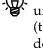


不过，这里存在一个差异：苹果基本上是一家硬件制造商，提供 OS X 只是为了给人们购买 Mac 的动力（这就是为什么 OS X 在非 Mac 平台上不可用）。另一方面，微软不制造计算机，而是通过销售 Windows 等运行在任意个人电脑上的软件来获利。因此，像 Linux 这样的操作系统对微软的威胁远大于对苹果的威胁——大多数购买苹果计算机的人是因为想要一台苹果计算机（完整的套装），而不是特别对 OS X 感兴趣。然而，个人电脑作为平台正受到平板电脑和其他新型计算机类型的侵蚀，而这些新型计算机并不运行 Windows，这使得微软承受着巨大的压力。苹果即使只销售 iPhone 和 iPad 而不卖 Mac 也很容易生存——而微软如果没有 Windows，尽管银行账户里有很多钱，也很可能会很快破产。⁸

### 1.4.2 Linux

Linux 是一个最初由 Linus Torvalds 出于好奇而启动的操作系统，但后来它有了自己的生命——在此期间，数百名开发人员（不仅仅是学生和业余爱好者，还有 IBM、Red Hat 或 Oracle 等公司的专业人士）都在进一步开发它。

Linux 受到 Unix 的启发，Unix 是一个在 20 世纪 70 年代由 AT&T 贝尔实验室开发的操作系统，面向“小型”计算机（关于本语境中“小型”的含义，请见上文）。Unix 很快成为研究和技术的优选系统。在大多数情况下，Linux 使用与 Unix 相同的概念和基本思想，让 Unix 软件在 Linux 上运行很容易，但 Linux 本身并不包含 Unix 代码，而是一个独立的项目。

与 Windows 和 OS X 不同，Linux 并非由某家经济成败系于 Linux 成功的单一公司背书。Linux 是“自由可用”的，任何人都可以（包括商业用户）在遵守游戏规则（如下一章所述）的前提下使用它。这加上 Linux 现在已经不仅运行在个人电脑上，而且以基本相同的形式运行在从电话（最受欢迎的智能手机操作系统

[^6]: 硬件的定义：“计算机中可以被踢的一大部分”（Jeff Pesis）

[^2]: 许多人甚至可能意识不到还有其他操作系统的存在。

[^8]: 原文中缺少脚注 8 的内容。

system, Android, 作为源自 Linux 的分叉系统，以及 Linux 在大型机（全球前十最快的计算机均运行 Linux）上的广泛应用，使得 Linux 成为现代计算史上功能最强大的操作系统。

严格来说，“Linux” 仅指操作系统*内核*，即负责向应用程序和工具分配资源的程序。由于一个没有应用程序的操作系统实用性有限，通常人们会安装 Linux 发行版，即一个包含“Linux” 本体及一系列应用程序、工具、文档和其他有用内容的软件包。值得一提的是，与 Linux 本身类似，大多数 Linux 发行版都是“*可自由获取*”的，因此可以免费或仅支付很少的费用获得。这使得我们可以用那些在 Windows 或 OS X 上可能花费数千美元才能获得的等效软件来装备计算机，而且你不会仅仅因为将 Linux 发行版安装在你所有的计算机上，以及姑妈 Millie 的计算机上，还有你的好友 Susan 和 Bob 的计算机上，而担心触犯许可协议限制。


有关 Linux 和 Linux 发行版的更多信息见第 2 章。

### 1.4.3 更多的差异与相似之处

实际上，三大主要操作系统——Linux、Windows 和 OS X——在向用户呈现方面仅在细节上有所不同。三者都提供了图形用户界面（GUI），即使是普通用户也能通过“拖放”等简单手势来管理文件。许多流行的应用程序都适用于这三个操作系统，因此，只要你大部分时间都花在网页浏览器、办公套件或电子邮件程序中，最终使用哪一个操作系统几乎无关紧要。这是一个优势，因为它实现了从一个系统到另一个系统的“渐进式”迁移。

除了图形界面外，这三个系统也都提供使用“命令行”输入文本命令的方式，然后由系统执行这些命令。在 Windows 和 OS X 中，此功能主要被系统管理员使用，而“普通”用户倾向于回避它——这是一种文化习惯问题。而在 Linux 中，命令行受到的排斥程度要低得多，这可能与它源自科学/技术 Unix 哲学有关。事实上，许多任务在命令行上执行起来更方便、更高效，特别是借助 Linux（实际上还有 OS X）提供的强大工具。作为一名初学 Linux 的用户，你最好能够接受命令行，了解其优缺点，就像你应了解 GUI 的优缺点一样。结合使用两者将赋予你最大的灵活性。

## 练习

- 1.3 [1] 如果你有使用专有操作系统（如 Windows 或 OS X）的经验：你最频繁使用哪些应用程序？其中哪些是“自由软件”？

## 1.5 摘要

当今的 PC，无论是基于 Linux、Windows 还是 OS X，它们的相似度都大于差异——就其硬件、基本概念及其使用而言。毫无疑问，你可以使用这三者中的任何一个来开展日常工作，且没有哪一个显然且无可争议地是“最好的”。

然而，本手册主要讲述 Linux，我们将利用剩余页面尽可能全面地介绍该系统——解释其用法，强调其优势，并在必要时指出其弱点。目前，Linux 已是其他两个系统的严肃替代者，并在多个方面超越它们，在某些方面甚至大幅超越。我们很高兴看到大家愿意参与其中，并祝大家在学习、实践和使用 Linux 的过程中充满乐趣——如果你有兴趣考取 LPi 的 *Linux Essentials* 认证——祝你在考试中取得最佳成绩！

### 摘要

- 计算机是根据自动执行、可变更的程序处理数据的设备，允许条件执行和循环。
- PC 最重要的组件包括处理器、RAM、显卡、主板、硬盘等。
- 计算机软件可分为固件、操作系统和用户级程序。
- 最流行的 PC 操作系统是 Microsoft 的 Windows。Apple 计算机使用一种称为 OS X 的不同操作系统。
- Linux 是一种 PC（以及许多其他类型的计算机）的替代操作系统，它不是由单一公司开发的，而是由大量志愿者共同开发的。
- Linux 发行版通过应用程序和文档扩展 Linux 操作系统内核，从而形成一个实际可用的系统。


# 2

# Linux 与自由软件

## 目录

- 2.1 Linux：一个成功的故事 . . . . . . . . . . . . . . . . . . . . . . . . . . . . . . . . . . . . . 26
- 2.2 自由还是开源？ . . . . . . . . . . . . . . . . . . . . . . . . . . . . . . . . . . . . . . . . . . . . . 28
- 2.2.1 版权与“自由软件” . . . . . . . . . . . . . . . . . . . . . . . . . . . . . . . . . . . . . 28
- 2.2.2 许可证 . . . . . . . . . . . . . . . . . . . . . . . . . . . . . . . . . . . . . . . . . . . . . 31
- 2.2.3 GPL . . . . . . . . . . . . . . . . . . . . . . . . . . . . . . . . . . . . . . . . . . . . . 32
- 2.2.4 其他许可证 . . . . . . . . . . . . . . . . . . . . . . . . . . . . . . . . . . . . . . . . . . . . . 35
- 2.3 重要的自由软件 . . . . . . . . . . . . . . . . . . . . . . . . . . . . . . . . . . . . . . . . . . . . . 37
- 2.3.1 概述 . . . . . . . . . . . . . . . . . . . . . . . . . . . . . . . . . . . . . . . . . . . . . . . . 37
- 2.3.2 办公和生产效率工具 . . . . . . . . . . . . . . . . . . . . . . . . . . . . . . . . . . . . . . 37
- 2.3.3 图形和多媒体工具 . . . . . . . . . . . . . . . . . . . . . . . . . . . . . . . . . . . . . . 38
- 2.3.4 互联网服务 . . . . . . . . . . . . . . . . . . . . . . . . . . . . . . . . . . . . . . . . . . . . 39


### 2.3.5 基础架构软件 . . . . . . . . . . . . . . . . . . . . . . . . . . . . . . . . . . . . . . . . . . . . 39

### 2.3.6 编程语言和开发 . . . . . . . . . . . . . . . . . . . . . . . . . . . . . . . . . . . . . . . . . 39

### 2.4 重要的 Linux 发行版 . . . . . . . . . . . . . . . . . . . . . . . . . . . . . . . . . . . . . . . . . . . . . . . . 40

#### 2.4.1 概述 . . . . . . . . . . . . . . . . . . . . . . . . . . . . . . . . . . . . . . . . . . . . . . . . 40

#### 2.4.2 Red Hat . . . . . . . . . . . . . . . . . . . . . . . . . . . . . . . . . . . . . . . . . . . . . . . . 40

#### 2.4.3 SUSE . . . . . . . . . . . . . . . . . . . . . . . . . . . . . . . . . . . . . . . . . . . . . . . . 41

#### 2.4.4 Debian . . . . . . . . . . . . . . . . . . . . . . . . . . . . . . . . . . . . . . . . . . . . . . . . 42

#### 2.4.5 Ubuntu . . . . . . . . . . . . . . . . . . . . . . . . . . . . . . . . . . . . . . . . . . . . . . . . 43

#### 2.4.6 其他 . . . . . . . . . . . . . . . . . . . . . . . . . . . . . . . . . . . . . . . . . . . . . . . . . . . 44

#### 2.4.7 差异与相似之处 . . . . . . . . . . . . . . . . . . . . . . . . . . . . . . . . . . . . . . . . . . . . 44

## 目标

- 了解 Linux 和自由软件的基本原则
- 能够定位基本的 FOSS 许可证
- 听说过最重要的自由应用程序
- 听说过最重要的 Linux 发行版

## 先决条件

- 关于计算机和操作系统的基础知识（第 1 章）

### 2.1 Linux：一个成功的故事

1991 年夏天，当时 21 岁的 Linus Torvalds 正在芬兰赫尔辛基理工大学学习计算机科学。当时他拥有一个新的 386 PC，想要进行实验，他自娱自乐地编写了一个终端模拟器，该模拟器在裸硬件上运行，没有操作系统，允许他访问大学的 Unix 系统。这个程序逐渐发展成为第一个 Linux 操作系统内核。

- 那时 Unix 已经有大约 20 年的历史了，但它是大学和所有进行研究或开发的地方的首选操作系统——当时科学“工作站”几乎都运行各种版本的 Unix。
- Unix 本身——几乎和 Linux 一样——起源于 Bell 实验室 Ken Thompson 和 Dennis Ritchie 的业余项目，Bell 实验室是美国电信巨头 AT&T 的研究部门。它很快演变成一个非常实用的系统，由于它在很大程度上是用一种高级语言（C）编写的，因此可以相对快速地移植到其他计算平台，而不仅仅是原始的 PDP-11。此外，在 1970 年代，AT&T 因一项和解协议而被禁止销售软件，因此 Unix 是“免费”提供的，没有支持——由于该系统很小且相当直观，它成为了大多数大学操作系统研讨课中的热门案例研究。
- 到了 1970 年代末，加州大学伯克利分校的学生将 Unix 移植到 VAX（PDP-11 的继任者），并引入了各种改进，这些改进开始作为“BSD”（“Berkeley Software Distribution”的缩写）流传开来。BSD 的各种分支至今仍在使用。
- 为了开发 Linux 的早期版本，Linus 使用了“Minix”，这是由阿姆斯特丹自由大学的 Andrew S. Tanenbaum 编写的类 Unix 操作系统，用于教学目的。Minix 被刻意保持简单，并且不可自由获取，因此不能代表一个严肃的操作系统——显然需要帮助！

1991 年 8 月 25 日，Linus 向公众宣布了他的项目，并邀请世界其他地方加入。此时，该系统作为 Minix 的替代操作系统内核发挥作用。

- 当时系统还没有一个正式的名字。Linus 称之为“Freax”（是“freak”和“Unix”的合成词）；他短暂地考虑过“Linux”，但认为这个名字太自我中心而拒绝了。当 Linus 的系统上传到大学的 FTP 服务器时，不喜欢“Freax”这个名字的 Linus 的同事 Ari Lemmke 擅自将其重命名为“Linux”。Linus 后来批准了这一更改。

Linux 引起了相当大的兴趣，许多志愿者决定合作。Linux 0.99 是第一个在 GPL（第 2.2.3 节）许可下发布的版本，出现在 1992 年 12 月，代表了相当成熟的操作系统，具有完整但简单的 Unix 功能。

Linux 2.0 出现在 1996 年初，引入了一些重要的新功能，例如对多处理器的支持以及在运行时加载内核模块的能力——这是迈向用户友好的 Linux 发行版的重要创新。

- Linux 2.0 的另一个新功能是官方“Tux”——企鹅。

1. Linus Torvalds 是芬兰族人（他在 2010 年 9 月成为美国公民），但属于讲瑞典语的少数群体。这就是为什么他的名字读起来比较顺口。
2. 当时 BSD 也不是免费获取的；Linus 曾说过，如果当时 BSD 可用，他就永远不会开始开发 Linux。

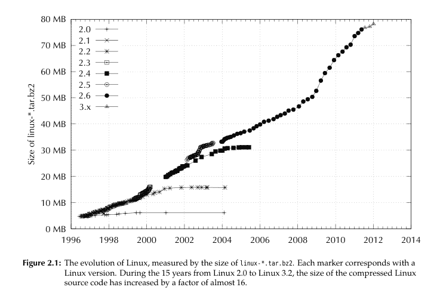

Linux 吉祥物。林纳斯·托瓦兹（Linus Torvalds）曾在澳大利亚被一只企鹅袭击，这给他留下了深刻的印象。那只黄色脚和喙的标志性坐姿企鹅由拉里·欧文（Larry Ewing）绘制，并向社区公开提供。

Linux 2.6 见证了开发流程的重构。此前，版本号中第二部件为奇数（如 "2.3"）的版本被视为开发者版本，而第二部件为偶数（如 "2.0"）的版本则被视为适合最终用户的稳定版本。Linux 开发人员决定防止开发版和稳定版像过去那样出现较大程度的分歧。从 Linux 2.6 开始，不再有单独的开发内核分支，改进措施会被引入下一个版本，并在该版本正式发布前尽可能广泛地进行测试。

其大致工作流程如下：在 Linux 2.6.37 发布后，Linux 收集针对下一内核的提议变更和改进，将它们纳入官方版本，并将其发布为 Linux 2.6.38-rc1（即“候选版本 1”）。该版本由各方进行测试，任何修复或改进都会汇总到 Linux 2.6.38-rc2，依此类推。最终，当代码看起来足够稳定时，就会正式发布为 "Linux 2.6.38"，然后针对版本 2.6.39 重复这一流程。

除了林纳斯的官方版本外，还有由其他开发人员维护的 Linux 版本。例如，有一个“暂存树”（staging tree），新的设备驱动程序可以在此“成熟”，经过几轮改进后，被认为足够好便可提交给林纳斯，以便将其纳入他的版本。一旦发布，许多 Linux 内核会在一定时期内接收修复，因此可能会出现像 2.6.38.1、2.6.38.2 等版本。

2011 年 7 月，林纳斯宣布正在准备的版本 2.6.40 为“Linux 3.0”——据称是为了简化编号，因为没有特别突出的改进。


如今，候选版本被称为 3.2-rc1 等，而原始版本发布后带有修复的版本被称为 3.1.1、3.1.2 等。

“Linux”项目至今并未终结。Linux 不断被全世界数百名程序员扩展和改进，他们服务于数百万满意的个人和商业用户。也不能说该系统仅仅是由学生和其他业余爱好者开发的——许多参与 Linux 内核开发的人员在计算机行业身居要职，并跻身于最受尊敬的职业开发人员之列。可以毫无争议地宣称，Linux 是现存硬件支持最通用的操作系统，不仅从它运行的平台多样性（包括智能手机和巨型机）来判断，还从例如针对 Intel PC 平台的硬件驱动程序的可用性来判断。Linux 还是工业界和学术界探索新操作系统理念的研发载体；毫无疑问，它是当今最具创新性的操作系统之一。

- 虚拟化
- 云计算


Linux 的多功能性也使其成为虚拟化和“云计算”等应用的首选操作系统。虚拟化使得在一台实际的（“物理”）计算机上模拟几台到多台“虚拟”计算机成为可能，这些虚拟机使用自己的操作系统，对于在其上运行的程序来说看起来就像真实的计算机。这带来了更高效的资源利用和更大的灵活性：通用的虚拟化基础设施允许非常快速地将虚拟机从一台物理机器“迁移”到另一台，这使得作为此类基础设施的操作人员能够非常方便地应对负载情况或故障。基于此，云计算的理念是提供“按需”的计算能力，从而允许企业免去运营大型计算中心的成本——这些中心仅在短时间的峰值需求期间被充分利用，其余时间主要只是产生费用。云计算提供商允许客户通过互联网使用虚拟机，并根据实际使用量收费，与维持一个“真实”计算中心相比，这可能带来可观的节省，尤其是考虑到作为客户，你原本不仅要承担初始建设支出，还要承担 24/7 运行计算中心所涉及的人员、物资和能源费用。

## 练习

- 2.1 [2] 在互联网上搜索安德鲁·S·谭恩巴姆（Andrew S. Tanenbaum）和林纳斯·托瓦兹之间那场著名的辩论，在辩论中谭恩巴姆表示，如果产生像 Linux 这样东西的人是他，他会让他不及格。你怎么看？
- 2.2 [1] 你能找到的最旧的 Linux 内核源代码集的版本号是多少？

## 2.2 自由还是开源？

### 2.2.1 版权与“自由软件”

在中世纪，复制书籍和其他著作是一件昂贵的事情。你需要找到一个会写字且有空闲时间的人——这使得像抄写圣经这样的大型项目成为修道院的领域（那里的僧侣懂得如何书写，并且有大量可用时间）。16 世纪活版印刷术的发明制造了一个前所未有的问题：突然之间，复制变得简单且廉价得多（至少在当时手头有印刷机的情况下），勤奋的出版商利用这一点复制了他们认为值得出售的一切。当时的作者几乎没有权利；他们能出版商付钱印刷他们的作品就谢天谢地了。广泛的再版也导致原始印刷商感到被欺骗，因为其他人在没有补偿的情况下接管了他们的出版物。这促使他们中的许多人向政府请求特殊特权，以获得发布特定作品的独占权。政府对此没有异议，因为统治者试图对其管辖范围内印刷的内容保持一定控制。随着时间推移，这些“特权”连同其他发展（如赋予作者获得报酬权利这一值得称道的想法），演变成了现代“版权”（或更一般地，“作者权利”）概念。

版权本质上意味着作品的创造者，即书籍的作者、绘画的画家等，拥有决定作品命运的权利。作为作者，他们可以授予（或实际上是有偿转让给）出版商印刷书籍并将其发行的权利；出版商从中获利，而作者无需操心印刷、宣传、运输等事宜，这惠及双方。

除了这些“版权”外，还有“道德权利”，例如被确认为作品创造者的权利。这些道德权利通常无法转让。

在 20 世纪（大致期间），版权概念被置于国际公认的基准上，并扩展到其他类型的作品，如录音和电影。

20 世纪末计算机和互联网的兴起再次严重改变了局势：虽然版权的目的过去是保护出版商免受其他出版商的侵害（个人很少有能力在商业相关规模上复制书籍、唱片或电影），但突然之间，每个拥有计算机的人都能无限次地复制数字内容（如软件或书籍、数字形式的音乐或电影）且不会损失质量——这对出版商、音乐、电影或软件公司来说是一场灾难，因为它们基于销售书籍或 CD 等实物制品的现有商业模式受到了威胁。自那以后，“内容行业”一直在游说要求制定更严厉的版权法和对“盗版复制者”进行更高额的处罚，并试图追究版权侵权者的侵权责任（效果不一）。

当前的术语是“知识产权”，它不仅包括版权，还包括商标和专利。专利旨在通过赋予技术流程发明者有限期限的独家使用权（例如，允许他人付费使用这些发明）来补偿他们记录和公开其发明的行为。商标确保没有人能在未经许可的情况下，通过在该品牌名称下销售自己的产品来利用品牌的知名度。例如，“Coca-Cola”（可口可乐）的商标确保了任何能调配出棕色糖饮料的人都无法将其作为“Coca-Cola”销售。这三种“知识产权”类型相关但截然不同——专利关于想法，版权关于想法在具体作品中的具体表达，而商标关于阻止不正当竞争行为。

你通过创作作品自动获得该作品的版权——至少该作品需具备最低限度的创造性。专利必须向专利局注册并进行新颖性审查。商标也可以注册，或者通过在商业中使用某标志一定时间并被公众确认为某产品或服务的提供者而获得。

计算机软件（可被视为一种书面作品，并可能包含大量的创造性）受版权保护。

这意味着，原则上，未经版权持有者（程序员或其雇主）的明确许可，复制或完整软件包是非法的。


在计算机的早期，软件销售并不常见。你要么在购机时免费获得软件（当时计算机价格昂贵——动辄数百万美元），要么自己编写软件。在 20 世纪 60 年代和 70 年代的大学环境中，交换或复制程序是完全正常的。1976 年，一位名叫比尔·盖茨（Bill Gates）的人震惊地发现，他为 MITS Altair 8800 编写的 BASIC 解释器竟然非常受欢迎，因此备受赞誉，但几乎没有人觉得有必要支付他要求的费用！当然，对用户来说这样做并不妥当，但当时，软件需要付费这一*观念*实在太离经叛道，以至于很少有人真正考虑过这一点。


随着计算机在 20 世纪 70 年代末和 80 年代遍布办公室，销售软件而非赠送的做法变得越来越普遍。不仅如此——软件公司只出售可执行的机器代码，而不提供源代码，这意味着人们无法检查源代码来了解软件的工作原理，甚至无法对其进行修改。在某个时刻，曾是麻省理工学院研究员的理查德·M·斯托曼（Richard M. Stallman）决定通过开发一个系统来扭转这一趋势，该系统将强调在 20 世纪 60 年代和 70 年代已成为常态的共享文化。这个“GNU”系统³尚未完成，但其许多组件现已在 Linux 系统上投入使用。

理查德·M·斯托曼（常简称为“RMS”）可以被视为*自由软件*理念之父。在此语境下，“free”（自由/免费）并不指“无收费”，而是指用户拥有“自由”去做各种在专有软件⁴上无法做到或不被允许的事情。如果满足四个条件，即“四大自由”，RMS 便称该软件包为“自由”的：

- 出于任何目的运行程序的自由（自由 0）。
- 研究程序工作原理，并对其进行修改以使其按你意愿运行的自由（自由 1）。
- 重新分发副本，从而帮助邻居的自由（自由 2）。
- 改进程序，并向公众发布你的改进（以及一般意义上的修改版本），使整个社区受益的自由（自由 3）。

访问程序源代码是行使自由 1 和自由 3 的先决条件。自由软件的理念总体上是受欢迎的，但即便如此，RMS 和*自由软件基金会*（FSF）的目标仍经常被误解。特别是，许多公司对“free”一词表示异议，尽管有适当的澄清，该词仍常被混淆为“无收费”。20 世纪 90 年代末，埃里克·S·雷蒙德（Eric S. Raymond）、布鲁斯·佩伦斯（Bruce Perens）和蒂姆·奥莱利（Tim O’Reilly）创立了*开放源代码促进会*（OSI），其目标是为自由软件提供更佳且更少意识形态色彩的营销。FSF 并不热衷于这种对其理念的“稀释”，尽管 FSF 和 OSI 的目标非常相似，但这场争论至今并未完全平息（这在一定程度上可能源于主要参与者的相当自负）。


虽然“自由软件”中的“free”容易让人误以为“无收费”，但“开放源代码软件”中的“open source”（开放源代码）可被解读为：源代码可供检查，但不可修改或传播——而这两点恰恰是 OSI 的基本原则。从这个意义上说，这两个术语都没有 100% 的明确性。社区通常将其称为“FOSS”（自由和开放源代码软件）或甚至“FLOSS”（自由、libre 和开放源代码软件，其中 FLOSS 中的 libre 旨在支持“自由/liberty”的含义）。

如果任何人都可以修改和复制软件，那么如何通过自由软件赚钱？这是一个非常正当的问题。以下是关于“开放源代码商业模式”的一些想法：

- 你可以通过为自由软件提供额外的服务（如支持、文档或培训）并因此获得报酬（这对作者所在的公司 Linup Front GmbH 非常有效，LPI 似乎也能从销售 Linux 认证中谋生）。
- 你可以为特定客户创建定制的改进或扩展，并因此获得报酬（即使你的开发成果随后成为通用版本的一部分。即使对于并非你最初编写的自由软件，这种模式也适用）。
- 如果你分发软件包，你可以提供基本版本作为 FOSS，并期望这将吸引足够多的人购买专有的“完整版本”以真正完成工作。（行内术语称此模式为“open core”（开放核心）。）

这是一把双刃剑：一方面，如果有更多的自由软件当然是好事，但另一方面，结果往往是你需要专有版本，因为重要功能在免费版本中不可用，且独立添加该功能的工作量太大。在这种情况下，如果制造商希望显得现代且“对开放源代码友好”，那么“free”（免费/自由）版本主要充当公共关系引擎——即“只说不做”（“talk the talk” without “walking the walk”）。

### 2.2.2 许可证


软件如何成为“自由”或“开放源代码”的？我们提到，某些权利——例如复制或修改作品的权利——保留给作品的作者，但这些权利也可以转让给其他人。这（如果发生的话）是通过“许可证”（licence）进行的，这是一份规定软件接收方在购买、下载……软件时获得哪些权利的法律文件。版权本身允许软件包的买家（或合法下载者）在计算机上安装该软件并启动和运行它。这仅仅是因为软件被作者提供给他们的结果——显然，不允许买家使用却向其出售程序是没有意义的¹。（相反，向作者支付款项以获取程序的人，有权以付款为交换来使用该程序。）其他行为，如不受限制的复制和分发，或修改程序，均被版权明确禁止；如果原作者希望允许人们做这些事情，这些必须写入许可证中。

专有程序通常附带“最终用户许可协议”（`EULA`），买家必须在实际使用软件前接受该协议。软件供应商使用 `EULA` 禁止买家做那些实际上根据版权法是被允许的事情——例如将软件作为“二手”卖给他人，或在公开场合说软件坏话（甚至说任何话）。这种 `EULA` 需要双方同意的合同，且法律门槛（至少在德国）相当高。例如，软件买家必须在购买软件前能够检查 `EULA` 条款，或者至少，如果买家不同意 `EULA`，则必须能够退回未使用的软件并获得全额退款。

另一方面，`FLOSS` 的开放源代码许可证用于允许软件接收方执行否则会被版权禁止的行为。它们通常不试图限制软件的使用，而是主要管理修改和分发软件的问题。从这个意义上说，软件接收方的处境不会比购买其他商品时预期的更差。因此，与 `EULA` 不同，自由软件许可证通常不是接收方必须明确接受的合同，而是软件作者的单方面声明，其赋予的权利构成了除法律规定的基本使用权之外的额外利益。

如今，存在着一个满足自由或开放源代码软件基本要求的许可证“动物园”。最著名的自由软件许可证是由理查德·M·斯托曼发布的通用公共许可证（`GPL`），但还有其他许多。`OSI`“认证”那些据其观点体现开放源代码精神的许可证，正如 `FSF` 批准保护“四大自由”的许可证一样。经批准的许可证列表可在这些组织的网页上找到。

如果你考虑启动一个自由或开放源代码软件项目，你当然可以自行制定满足 `FSF` 或 `OSI` 要求的许可证。然而，通常采用现有的、已经过批准的许可证更好。这意味着你不需要向 `FSF` 或 `OSI` 申请批准你的许可证，且现有许可证通常已经过法律专业人士审查，可以认为是相当严密的——作为合同法或知识产权法的外行，你可能会忽略重要细节，从而日后惹上麻烦。

重要的是要观察到，自由或开放源代码软件的支持者并不打算完全废除软件的版权。事实上，我们所知道自由软件之所以能运作，正是因为版权赋予了软件作者法定权利，使其能够以条件为前提来允许修改和分发其软件，例如要求软件接收方也必须获得修改和分发该软件的权利。没有版权，每个人都可以随意使用任何可用的软件片段，而“四大自由”等核心原则将受到威胁，因为人们可能囤积而不进行任何共享。

### 2.2.3 GPL

Linux 内核以及通常被认为属于“Linux”的大部分组件均在通用公共许可证（`GPL`）下分发。`GPL` 由 `RMS` 为 `GNU` 项目开发，旨在确保最初在 `GPL` 下分发的软件仍保持 `GPL` 状态（这种类型的许可证也称为 copyleft 许可证）。其运作方式大致如下：

> 5 事实上，许多国家的版权法包含明确的澄清，规定将程序从磁盘复制到 RAM 以在计算机上运行的过程不受版权保护。

³“`GNU`”是“`GNU's Not Unix`”（`GNU` 不是 Unix）的“递归缩写”。

⁴斯托曼所在的组织“自由软件基金会”将此称为“自由如言语，而非如啤酒”（free as in speech, not as in beer）。

- `GPL` 软件必须以源代码形式提供，并且可以出于任意目的使用。
- 明确允许修改源代码，并以未修改或修改后的形式分发，只要接收者被赋予相同的 `GPL` 权利即可。
- 还明确允许以可执行文件形式分发（甚至出售）`GPL` 软件。在这种情况下，必须随可执行文件提供源代码（包括 *`GPL` 权利*），或者在特定时间段内应请求提供。

在此语境下，“源代码”指的是“在计算机上运行软件所需的一切”。具体意味着什么——例如，是否包括在适当“锁定”的计算机上启动修改过的 Linux 内核所需的加密密钥——是争论激烈的话题。

如果某人花钱购买 `GPL` 软件，他们自然获得的权利不仅是在所有电脑上安装该软件，还可以复制和转售它（根据 `GPL`）。其中一个后果是，按“席位”出售 `GPL` 软件意义不大，但一个重要的附带好处是，例如 Linux 发行版的价格保持合理。

- 如果你编写了一个将（部分）`GPL` 程序结合进去的新程序，那么新程序（即“衍生作品”）也必须置于 `GPL` 之下。

在此，关于多少以及 `GPL` 程序的哪些部分必须结合到另一个程序中才能使该程序成为“衍生作品”，也存在着激烈的争论。根据自由软件基金会（`FSF`）的观点，在程序中使用动态加载的 `GPL` 库会强制该程序受 `GPL` 约束，即使该程序本身不包含任何 `GPL` 代码，因此在法律意义上不能被认定为“衍生作品”。这在多大程度上是一厢情愿，又在多大程度上在法律上站得住脚，原则上必须由法庭裁定。

`GPL` 规定了修改和分发软件的规则，而不是其实际使用的规则。

目前，两个版本的 `GPL` 被广泛使用。较新的版本 3（也称为“`GPLv3`”）于 2007 年 6 月底发布，与较旧的版本 2（也称“`GPLv2`”）的区别在于，它澄清了软件专利、与其他自由许可证的兼容性，以及引入限制，禁止通过特殊硬件使理论上“自由”软件在设备中的修改变得不可能（“`tivoisation`”，得名于其内核无法修改或替换的基于 Linux 的数字 PVR）。`GPLv3` 允许用户添加更多条款。`GPLv3` 并未在社区内获得普遍认可，因此许多项目（最著名的是 Linux 内核）故意坚持使用更简单的 `GPLv2`。此外，许多项目分发其代码时采用“`GPLv2` 或任何后续版本”，因此你可以决定在分发或修改此类软件时遵循 `GPL` 的哪个版本。

在自由软件开发者中，以项目当前使用的相同许可证向该项目做出贡献，被认为是一种良好的风格，大多数项目至少对于要纳入软件“官方”版本的代码坚持这一点。一些项目甚至坚持*版权转让*，其中代码作者将其权利赋予项目（或合适的组织）。这一步骤的好处是，代码的版权仅归属于项目，而侵犯版权——只有版权持有人有法律资格追究——更容易处理。一个要么被期望要么被明确视为不可接受的副作用是，更改整个项目的许可证变得更容易，这也是只有版权持有人才被允许做的事情。

在明确不要求版权转让的 Linux 内核项目中，更改许可证是困难的或不可能的，因为代码是超过一千名作者的贡献补丁集合。在引入 `GPLv3` 期间讨论了这一问题，开发者们同意，理清 Linux 内核源代码每一行法律来源并获得作者对许可证变更的同意，将是一个庞大的工程。一些 Linux 开发者会坚决反对，而其他人无法找到甚至可能已经去世，相应的代码必须由版权清晰的类似代码替换。然而，至少 Linus Torvalds 仍然是 `GPLv2` 的支持者，因此这个问题在实践中并不真正存在。

## GPL 与金钱

`GPL` 没有规定产品的可能价格。只要提供源代码或应请求提供，并且接收者也获得 `GPL` 权利，赠送 `GPL` 软件副本或索取金钱是完全合法的。这意味着 `GPL` 软件不一定代表“免费软件”（freeware）。

你可以通过研究 `GPL` [`GPL91`] 了解更多，该文档必须随每个 `GPL` 产品（包括 Linux）一起分发。

`GPL` 被认为是最具一致性的自由许可证之一，其意义在于——正如我们所说——它试图确保，一旦以 `GPL` 发布，代码必须*保持*自由。在多个场合，公司试图将 `GPL` 代码纳入他们不愿以 `GPL` 发布的产品中。然而，在受到版权持有人（通常是 `FSF`）的严厉谴责后，这些公司已经符合了 `GPL`。至少在德国，`GPL` 也在法庭上得到了验证——一名 Linux 内核程序员在法兰克福地区法院对 D-Link（一家网络设备制造商，本案中的基于 Linux 的 NAS 设备）获得判决，指控其分发设备时未遵守 `GPL` [`GPL-Urltd06`]。

`GPL` 为什么有效？一些认为 `GPL` 限制过于沉重的公司试图宣布或获取声明其无效。例如，在美国，它被称作“反美”或“违宪”，在德国，一家公司试图使用反托拉斯法使 `GPL` 无效，因为它 supposedly 暗示了非法的价格固定。似乎大家的想法是，如果 `GPL` 存在可证明的错误，任何人都可以出于任何目的使用 `GPL` 软件。所有这些攻击都忽略了一个重要事实：如果没有 `GPL`，除原作者外的任何人都不拥有对该代码做任何事的权利，因为分发或实际上销售软件等行为受版权法保留。因此，如果 `GPL` 消失，所有对该代码感兴趣的各方状况会比之前糟糕得多。

软件作者起诉分发其 `GPL` 代码但不遵守 `GPL` 的公司，诉讼大约看起来像这样：

**法官** 问题似乎是什么？

**软件作者** 大人，被告在没有许可证的情况下分发了我的软件。

**法官** （对被告律师说） 是吗？

在此，被告可以说“是”，诉讼实质上结束（除了判决）。他们也可以说“否”，但此时他们需要证明为什么版权法不适用于他们。这是一个令人不安的困境，也是很少有公司这样做的原因——大多数 `GPL` 纠纷是在法庭外解决的。


如果专有软件制造商违反 GPL（例如，在其产品中包含来自 GPL 项目的几百行源代码），这并不意味着该产品的所有代码现在必须以 GPL 条款发布。它只意味着他们在没有许可证的情况下分发了 GPL 代码。制造商可以通过多种方式解决这个问题：

- 他们可以移除 GPL 代码并用自己的代码替换。此时 GPL 对他们的软件变得无关紧要。
- 他们可以与 GPL 代码的版权持有人协商（如果版权持有人存在并愿意配合），例如同意支付许可证费用。参见下文关于多重许可证的部分。
- 他们*自愿*将其整个程序以 GPL 发布，从而符合 GPL 的条件（这种方法可能性最小）。

独立于此，可能会对先前的违规行为支付赔偿金。但是，专有软件的版权状态不会受到任何影响。

### 2.2.4 其他许可证

除了 GPL，其他许可证在 FOSS 环境中也很流行。以下是简要概述：

**BSD 许可证** BSD 许可证源自加州大学伯克利的 Unix 发行版，并故意保持非常简单：软件接收者基本上可以对软件为所欲为，只要不给人留下他们的使用得到了大学（或引申为原始软件作者）背书的印象即可。尽可能排除对该程序的责任。许可证文本必须保留在程序的源代码中——如果以可执行文件形式分发程序或修改版本——及其文档中。

如果软件包包含 BSD 许可的代码，BSD 许可证过去要求任何相关软件或系统的宣传材料必须提及这一事实和版权持有人。这个“广告条款”已被废除。

与 GPL 不同，BSD 许可证并不试图保持软件源代码的公开。获得 BSD 许可软件的人基本上可以将其集成到自己的软件中，并以二进制形式分发（GPL 会要求他们也分发以 GPL 发布的相应源代码）。

像 Microsoft 或 Apple 这样的商业软件公司通常对 GPL 软件不太热情，但通常对 BSD 许可软件没有异议。例如，Windows NT 曾包含来自 BSD 的 TCP/IP 网络代码（经过修改），Macintosh OS X 操作系统内核的很大一部分源自 BSD。

在 FOSS 社区内部，长期以来对于 GPL 或 BSD 许可证哪一个“更自由”存在分歧。一方面，作为接收者，用 BSD 许可的软件可以做更多事情，因此 BSD 许可证传达更多从绝对意义上讲是自由的。另一方面，GPL 的支持者认为，代码对所有人保持自由可用比消失在专有系统中更为重要，并且 GPL 更大自由度的体现之一是，从 GPL 软件池中获得代码的人也被迫回馈一些东西。

**Apache 许可证** Apache 许可证类似于 BSD 许可证，允许使用并采用受许可的代码，而不要求（像 GPL 那样）修改后的 Apache 许可代码必须向公众开放。它比 BSD 许可证更复杂，但也包含关于专利和商标使用以及其他细节的条款。

**Mozilla 公共许可证（MPL）** Mozilla 许可证（适用于包括 Firefox 浏览器在内的其他软件包）是 BSD 许可证和 GPL 的混合体。它是一种“弱 Copyleft 许可证”，因为一方面，它要求根据 MPL 获得的代码在分发的情况下必须按 MPL 分发（类似 GPL），但另一方面也允许添加在其他许可证下的代码，这些代码不需要按 MPL 分发。

自由软件（FOSS）社区的成功激励了法律教授劳伦斯·莱斯格（Lawrence (Larry) Lessig）将该概念应用于软件以外的其他作品。目标在于扩大文化资产（如书籍、图像、音乐、电影等）的自由使用、修改和分发池。由于常见的 FOSS 许可证主要面向软件，开发了一套*Creative Commons*（知识共享）许可证，以使创作者能够以受控方式将其作品捐赠给公众。他们可以规定各种限制，例如“仅逐字复制作品”、“允许修改，但（类似 GPL）修改后作品的接收者必须被允许进行进一步修改”或排除商业用途。

“公共领域”适用于不再受版权保护的文化作品。虽然在盎格鲁-撒克逊法律传统中，创作者可以通过放弃对其所有权利来明确将某项作品（如一段软件）放入公共领域，但在其他法律环境中这是不可能的。例如，在德国，作品在参与创作的最后一人去世 70 年后自动进入公共领域。我们必须再等一段时间，才能看到第一个计算机程序通过这种方式对所有人可用。

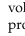

很有可能，1930 年左右之后创作的受版权保护作品永远不会进入公共领域。在美国，每当某只卡通老鼠的版权即将到期时，国会就会延长版权期限，而世界其他地区通常也乐于跟随。究竟为什么华特·迪士尼的*曾孙*应该能够像史高治·麦克鸭（Scrooge McDuck）一样基于这位伟大艺术家的创造力赚取大量金钱，这一点并不完全清楚，但通常这主要取决于谁拥有最有影响力的游说团体。

原则上，软件包的版权持有者也可以同时通过多个许可证分发该软件包——例如，对 FOSS 开发者使用 GPL，对不愿公开自己源代码的公司使用专有许可证。当然，这对于其他程序员可以集成到他们程序中的库最有意义。任何想要开发专有软件的人都可以通过这种方式“摆脱”GPL 的限制。

### 练习


- 1. 2.3 [!2] 以下关于 GPL 的陈述中，哪些是正确的，哪些是错误的？
  - 1. GPL 软件不得出售。
  - 2. GPL 软件不得由公司修改，以便基于它开发自己的产品。
  - 3. GPL 软件包的拥有者可以同时将程序分发在其他许可证下。
  - 4. GPL 无效，因为只有在获得相关软件包后人们才能看到许可证。为了使许可证有效，必须在获取软件之前能够查看并接受它。
- 2. 2.4 [2] 将 FSF 的“四大自由”与 *Debian 自由软件准则*（<http://www.debian.org/social_contract#tgldlines>）进行比较。你更喜欢哪个自由软件定义？为什么？

## 2.3 重要的自由软件

### 2.3.1 概述

Linux 是一个强大而优雅的操作系统，但没有程序运行的最漂亮操作系统也毫无价值。本节介绍了在典型的 Linux PC 上可以找到的最重要的一些自由/开源程序的精选。

> 如果未包含某个特定程序，并不意味着我们不认为它有价值。空间有限，我们主要覆盖 LPL 在考试目标中提到的那些软件包（以防万一）。

### 2.3.2 办公与生产力工具

大多数计算机可能用于诸如写信和备忘录、研讨会论文或博士论文、使用电子表格和图形包评估数据等“办公应用”。用户还将大量计算机时间花在互联网上或阅读和撰写电子邮件上。难怪有很多优秀的免费软件可以帮助完成这些任务。

> 本节中的大多数程序不仅适用于 Linux，还适用于 Windows、OS X 甚至其他 Unix 变体。这使得可以逐渐将用户引入 FOSS 生态系统，例如在 Windows PC 上安装 LibreOffice、Firefox 和 Thunderbird 来替代 Microsoft Office、Internet Explorer 和 Outlook，然后再用 Linux 替换操作系统本身。如果你巧妙地应对⁶，用户甚至可能察觉不到差别。

**OpenOffice.org** 多年来一直是 FOSS 社区的主要大型办公应用程序。它多年前以“StarOffice”之名起步，最终被 Sun 收购并作为自由软件提供（在一个略微精简的包中）。OpenOffice.org 包含人们期望从办公包中得到的所有内容——文字处理器、电子表格、演示图形程序、商业图表生成器、数据库……——并且还能（在一定程度上）处理其主要竞争对手 Microsoft 的文件格式。

**LibreOffice** 在 Sun 被 Oracle 收购且 OpenOffice.org 的未来变得不明朗之后，一些主要的 OpenOffice.org 开发者联合起来，发布了他们自己的 OpenOffice.org 版本，名为“*LibreOffice*”。目前这两个包并排维护（Oracle 将 OpenOffice.org 捐赠给了 Apache 软件基金会）——这不是最佳状态，但目前尚不清楚是否以及如何实现“统一”。

⁶ 例如，你可以将当前的 Ubuntu 作为“Windows 8 beta”植入用户系统中……

如今，大多数主要 Linux 发行版都包含 LibreOffice，它发展得更具进取性，且——更重要的是——经过了清理。

Firefox 现在是最受欢迎的 web 浏览器，由 Mozilla 基金会分发。Firefox 比前“领头羊”（Microsoft 的 Internet Explorer）更安全、更高效，功能更多，且更符合管理万维网的标准。此外，还有大量的扩展可供选择，可以根据您的特定需求自定义 Firefox。

Chromium 是 Google 浏览器 Chrome 的 FOSS 变体。Chrome 最近开始与 Firefox 竞争——Chrome（和 Chromium）也是一个强大、安全的浏览器，具有各种扩展。特别是 Google 的 web 服务是为 Google 浏览器量身定制的，并很好地支持它。


Thunderbird 是 Mozilla 基金会的一款电子邮件程序。它与 Firefox 浏览器共享大量底层基础设施，并且——像 Firefox 一样——提供各种用途的扩展池。

### 2.3.3 图形与多媒体工具

图形和多媒体长期以来一直是 Macintosh 计算机的领域（尽管 Windows 方面也有不错的软件）。承认地讲，Linux 仍然缺乏类似 Adobe Photoshop 的真正等效软件，但现有的软件也绝非微不足道。

GIMP 是一个用于编辑照片和类似图像的程序。它尚未达到 Photoshop 的水平（例如，缺少某些印前功能），但对于许多用途绝对可用，甚至提供了一些 Photoshop 无法同样方便处理的工具，例如创建万维网图形。

Inkscape 如果 GIMP 是 Linux 版的 Photoshop，那么 Inkscape 就对应于 Illustrator——一个创建基于矢量的图形的强大工具。

ImageMagick 是一个软件包，允许你将几乎任何图形格式转换为几乎任何其他格式。它还支持通过脚本控制以无穷无尽的方式操作图像。这对于 web 服务器和其他需要无鼠标和显示器处理图形的环境非常有用。

Audacity 用作多轨录音机、调音台和各种音频数据的编辑工作站，在 Windows 和 Mac 上也很受欢迎。

Cinelerra 以及 KDEnlive 或 OpenShot 等其他程序是“非线性视频编辑器”，可以编辑和从数字摄像机、电视接收机或网络摄像头录制视频，应用各种效果并以各种格式（从 YouTube 到 DVD）输出结果。

Blender 不仅是一个强大的视频编辑器，还允许对三维动画场景进行照片级真实的“渲染”，因此是创建专业质量动画电影的首选工具。

我们在这里也许应该顺便提一下，如今没有哪部好莱坞大片是在不使用 Linux 的情况下制作的。各大电影制片厂的特效“渲染农场”现在都基于 Linux。

## 2.3.4 互联网服务

如果没有 Linux，互联网将无从谈起：谷歌的数十万台服务器运行着 Linux，世界上大多数大型证券交易所（包括德国交易所以及伦敦和纽约证券交易所）的交易系统也是如此，因为只有在 Linux 上才能实现所需的性能。事实上，大多数互联网软件最初都是在 Linux 上开发的，而这些领域的大部分大学研究也是在开源 Linux 平台上进行的。

`Apache` 是互联网上流行程度最高的 Web 服务器——超过半数的网站运行在 Apache 服务器上。


当然，Linux 还有其他优秀的 Web 服务器——例如 Nginx 或 Lighttpd——但 Apache 仍然是最常见的。

`MySQL` 和 `PostgreSQL` 是免费可用的关系型数据库服务器。`MySQL` 最适合用于网站，而 `PostgreSQL` 则是一款创新且高性能的数据库服务器，适用于各种用途。

`Postfix` 是一款安全且功能极其强大的邮件服务器，适用于从“家庭办公室”到大型 ISP 或财富 500 强企业的各种环境。

## 2.3.5 基础设施软件

Linux 服务器在局域网内可能非常有用：它如此可靠、快速且维护成本低，以至于安装后即可忘记它（当然，定期进行备份除外！）。

`Samba` 将 Linux 机器变成 Windows 客户端的服务器，使网络上的所有 Windows 机器（包括 Linux 机器）都能访问磁盘空间和打印机。借助新的 `Samba 4`，Linux 服务器甚至可以充当活动目录域控制器，从而使 Windows 服务器变得多余。可靠性、效率以及节省的许可费是非常有说服力的理由。

`NFS` 是 `Samba` 的 Unix 等价物，允许网络上的其他 Linux 和 Unix 机器访问 Linux 服务器的磁盘。Linux 支持具有增强性能和安全的现代 `NFSv4`。

`OpenLDAP` 作为中型和大型网络的目录服务，通过其强大的数据分布和复制功能，为查询和更新提供高度的冗余性和性能。

`DNS` 和 `DHCP` 是基本网络基础设施的一部分。通过 `BIND`，Linux 支持参考 DNS 服务器，`ISC DHCP` 服务器可以与 `BIND` 协作，即使在非常大的网络中也能为客户端提供 IP 地址等网络参数。`Dnsmasq` 是一个易于操作的小型网络 DNS 和 DHCP 服务器。

## 2.3.6 编程语言和开发

从诞生之初，Linux 就始终是一个由开发者为开发者打造的系统。相应地，所有重要编程语言的编译器和解释器均可用——例如，`GNU` 编译器系列支持 C、C++、Objective C、Java、Fortran 和 Ada。当然，流行的脚本语言如 Perl、Python、Tcl/Tk、Ruby、Lua 或 PHP 也得到支持，而不那么常见的语言如 Lisp、Scheme、Haskell、Prolog 或 Ocaml 也是许多 Linux 发行版的一部分。

非常丰富的编辑器和辅助工具集使软件开发成为一种享受。标准编辑器 `vi` 可用，也有专业开发环境，如 `GNU Emacs` 或 `Eclipse`。

Linux 也是“嵌入式系统”（即运行在消费电器内部、基于 Linux 本身或使用专用操作系统的计算机）的开发环境的有用工具。在 Linux PC 上，安装能够生成机器代码的编译器环境（例如针对 ARM 处理器）是非常简单的。Linux 也用于开发 Android 智能手机软件，谷歌免费提供了用于此目的的专业工具。

# 练习

- **2.5 [!]** 你听说过哪些自由及开源软件（FOSS）程序？你自己用过哪些？你认为它们比专有替代品更好还是更差？如果是，为什么？如果不是，为什么？

## 2.4 重要的 Linux 发行版

### 2.4.1 概述

如果有人说诸如“我的电脑运行 Linux”之类的话，他们通常指的不是（仅仅）Linux 操作系统内核，而是基于 Linux 的完整软件环境。这通常包括 shell (`bash`) 和 `GNU` 项目的命令行工具、`X.org` 图形服务器以及 `KDE` 或 `GNOME` 等图形桌面环境、`LibreOffice`、`Firefox` 或 The GIMP 等生产力工具，以及前几节提到的许多其他有用软件。当然，可以从互联网上的原始源码组装所有这些工具，但大多数 Linux 用户更喜欢现成的软件集合，即“Linux 发行版”。

首批 Linux 发行版出现在 1992 年初——然而，其中没有一个仍在开发中，且大多已被遗忘。仍在维护的最古老的发行版是 `Slackware`，最早出现在 1993 年 7 月。

有许多 Linux 发行版，具有不同的目标、方法以及不同的组织结构。一些发行版由公司发布，可能仅通过销售获利，而其他发行版则由志愿者团队甚至个人汇编。在本节中，我们将讨论最重要的通用发行版。

如果我们没有在这里提到您最喜欢的发行版，这并不是因为我们无法忍受它，而确实是出于我们空间和时间有限的考虑，不得不（不幸地！）将自己限制在 essentials 上（无文字游戏之意）。如果一个发行版不在我们的列表中，这并不意味着它不好或无用，而只是意味着它不在我们的列表中。

“DistroWatch”网站 (`http://distrowatch.com/`) 列出了最重要的 Linux 发行版，并作为以发行版为中心的新闻焦点。目前它包含 317 个发行版（即三百一十七个！），但到阅读此文时，这个数字可能已不再准确。

### 2.4.2 Red Hat

`Red Hat` (`http://www.redhat.com/`) 于 1993 年作为“ACC Corporation”成立，是一家销售 Linux 和 Unix 附件的发行公司。1995 年，公司创始人 Bob Young 收购了 Marc Ewing 的业务，后者在 1994 年发布了一个名为“Red Hat Linux”的 Linux 发行版，并将其公司更名为“Red Hat Software”。1999 年，Red Hat 上市，如今很可能是唯一一家完全基于 Linux 和开源软件的最大公司。它是“标准普尔 500”的一部分，这是一个作为美国经济指标的股票指数。

Red Hat 已退出其原有的个人客户业务（最后一个“Red Hat Linux”发布于 2004 年 4 月），现在以“Red Hat Enterprise Linux” (`RHEL`) 的名义面向企业的专业用途营销一种发行版。`RHEL` 按服务器授权许可，虽然您不需要为软件付费——它是根据 GPL 和类似 FOSS 许可证提供的——但需要为及时更新和问题支持付费。`RHEL` 主要面向数据中心，除其他事项外，支持（使用适当的附加工具）构建容错“集群”。


“Fedora” ([http://www.fedoraproject.org](http://www.fedoraproject.org)) 是一个主要由 Red Hat 控制的发行版，用作 RHEL 的“试验场”。新软件和创意首先在 Fedora 中试用，任何被证明有用的功能迟早会出现在 RHEL 中。与 RHEL 不同，Fedora 不销售，而是提供免费下载；该项目由一个委员会管理，其成员部分由开发者社区选举产生，部分由 Red Hat 提名。（委员会主席由 Red Hat 提名，并拥有否决权。）对于许多 Fedora 用户而言，关注最新软件和创意是该发行版吸引力的部分原因，尽管这意味着频繁的更新。Fedora 不太适合初学者以及旨在保持可靠的服务器使用。

由于 Red Hat 严格根据 FOSS 许可证（如 GPL）分发其软件，原则上可以运行与当前 RHEL 对应的系统，而无需向 Red Hat 支付许可费。有像 CentOS ([http://www.centos.org](http://www.centos.org)) 或 Scientific Linux ([http://www.scientificlinux.org](http://www.scientificlinux.org)) 这样的发行版，它们基本上基于 RHEL，但去除了所有 Red Hat 品牌标识。这意味着您获得本质上相同的软件，但没有 Red Hat 支持。

CentOS 特别是与 RHEL 如此接近，以至于 Red Hat 很乐意为您 CentOS 机器提供支持。您甚至无需先安装 RHEL。

### 2.4.3 SUSE

德国公司 SUSE 最初于 1992 年作为一家名为“Gesellschaft für Software- und System-Entwicklung”的 Unix 咨询公司成立，并相应地拼写为“S.u.S.E.”。其产品之一是 Patrick Volkerding 的 Linux 发行版 Slackware 的德语版本，而 Slackware 又源自第一个完整的 Linux 发行版 Softlanding Linux System 或 SLS。S.u.S.E. Linux 1.0 出现在 1994 年，并通过引入 Red Hat Linux 的功能（如 RPM 包管理或 `/etc/sysconfig` 文件）逐渐与 Slackware 产生分歧。1996 年的 S.u.S.E. Linux 4.2 是第一个不再看起来像 Slackware 的版本。SUSE（某时去掉了点号）很快成为领先的德语 Linux 发行版，并以“盒装套装”形式发布 SUSE Linux，分为两种口味：“Personal”和“Professional”——后者明显更昂贵，包含更多面向服务器的软件等。

2003 年 11 月，美国软件公司 Novell 宣布以 2.1 亿美元收购 SuSE；交易于 2004 年 1 月完成。（此时，“U”也变成了大写。）2011 年 4 月，包括 SUSE 在内的 Novell 被 Attachmate 收购，Attachmate 是一家销售终端仿真、系统监控、应用集成工具和服务的公司，此前在 Linux 和开源社区中并不引人注目。自那以来，Novell 继续作为两个独立的业务部门运营，其中之一是 SUSE。

与 Red Hat 一样，SUSE 也提供“企业 Linux”，即 SUSE Linux Enterprise Server (SLES, [http://www.suse.com/products/server/](http://www.suse.com/products/server/))，它类似于 RHEL，发布频率较低，并承诺具有较长的生命周期 7至10年。此外，还有 SUSE Linux Enterprise Desktop (SLED)，这是一个旨在用于桌面工作站的发行版。SLES 和 SLED 在包含的软件包选择上有所不同：SLES 的重点在于服务器软件，而 SLED 则更侧重于交互式软件。

SUSE 也开放了其“私人客户”发行版，并作为“openSUSE”免费提供下载（http://www.opensuse.org/）。在过去，该发行版通常要在光介质发布几个月后才提供下载。与 Red Hat 不同，SUSE 仍然提供包含专有软件的“盒装套装”。与 Fedora 不同，openSUSE 是一个严肃的平台，其生命周期相对较短。

#### YaST

SUSE 发行版的一个显著特性是“YaST”，这是一个全面的图形化系统管理工具。

### 2.4.4 Debian

与 Red Hat 和 Novell/SUSE 这两家大型 Linux 发行版公司不同，Debian 项目（http://www.debian.org/）是由志愿者组成的协作组织，其目标是发布一个名为“Debian GNU/Linux”的高质量 Linux 发行版。Debian 项目由 Ian Murdock 于 1993 年 8 月 16 日宣布成立；其名称是他自己的名字与他当时的女友（现为前妻）Debra 的名字的结合体（因此发音为“debb-ian”）。如今，该项目已包含超过 1000 名志愿者。

- Debian 自由软件准则（DFSG）定义了该项目认为哪些软件是“自由”的。这一点很重要，因为只有符合 DFSG 的自由软件才能成为 Debian GNU/Linux 发行版本体的一部分。该项目也分发非自由软件，这些软件在发行版的服务器上被严格地与 DFSG 自由软件分开：后者位于名为 `main` 的子目录中，前者则位于 `non-free` 中。（还有一个中间区域称为 `contrib`；其中包含的软件本身符合 DFSG 自由标准，但如果没有其他非自由组件则无法工作。）

- `社会契约` 描述了项目的目标。

- `Debian 宪法` 描述了项目的组织架构（见图 2.2）。

在任何给定时间，Debian GNU/Linux 至少有三个版本：新版本的软件包或修正后的版本会被放入 `unstable` 分支。如果在一段时间内，某个软件包没有出现严重错误，它就会被复制到 `testing` 分支。每隔一段时间，testing 分支的内容会被“冻结”，经过非常彻底的测试，最终发布为 `stable` 版。人们对 Debian GNU/Linux 的一个常见批评是 `stable` 版本之间间隔时间较长；然而，许多人认为这是一个优点。Debian 项目仅提供 Debian GNU/Linux 的下载服务，光盘等介质需从第三方供应商处获取。

凭借其组织形式、免受商业利益干扰的特点以及对自由软件与非自由软件的清晰划分，Debian GNU/Linux 为衍生项目奠定了坚实的基础。一些较流行的衍生项目包括 Knoppix（一种“Live CD”，允许用户在 PC 上测试 Linux 而无需先进行安装）、SkoleLinux（一种特别针对学校需求调整的 Linux 版本），以及 Xandros 等商业发行版。Linux，慕尼黑市政府使用的桌面 Linux 变体，也是基于 Debian GNU/Linux 的。

### 2.4.5 Ubuntu

最受欢迎的 Debian 衍生版之一是 Ubuntu，它由南非企业家 Mark Shuttleworth 创立的英国公司 Canonical Ltd. 提供。（“Ubuntu” 是祖鲁语中的一个词，大致意思是对他人的“人性”或关怀。）Ubuntu 的目标是基于 Debian GNU/Linux，提供一个当前、强大且易于理解的 Linux 系统，并按固定间隔进行更新。例如，与 Debian 支持约十种计算机架构不同，Ubuntu 仅提供三种计算机架构版本，并且限制其使用的软件仅为 Debian GNU/Linux 提供软件的子集，这些都有助于简化工作。

Ubuntu 基于 Debian GNU/Linux 的 `unstable` 分支，大部分使用相同的软件分发工具，但 Debian 和 Ubuntu 的软件包不一定相互兼容。Ubuntu 遵循相当可靠的六个月发布周期，每两年会有一个“LTS”或“长期支持”版本，Canonical 承诺提供五年的更新。

一些 Ubuntu 开发者同时也是 Debian 项目的积极参与者，这确保了一定程度上的交流。另一方面，并非所有 Debian 开发者都对 Ubuntu 偶尔出于实用主义采取的捷径持积极态度，在这种情况下，Debian 可能会寻找更全面的解决方案，即使这需要付出更多的努力。此外，Ubuntu 似乎不像 Debian 那样对自由软件理念负有如此强烈的责任感；虽然 Debian 的所有基础设施工具（如缺陷管理系统）都以自由软件形式提供，但 Ubuntu 的情况并非总是如此。

Ubuntu 不仅旨在提供一个有吸引力的桌面系统，还旨在通过提供具有长生命周期和良好支持的稳定发行版，在服务器领域挑战 RHEL 或 SLES 等更成熟的系统。目前尚不清楚 Canonical Ltd. 打算如何长期盈利；暂时而言，该项目主要依靠 Mark Shuttleworth 的个人资金支持，由于他将互联网证书颁发机构 Thawte 卖给了 Verisign，这笔资金相当充裕。

### 2.4.6 其他


除了我们提到的发行版外，还有许多其他发行版，例如作为 Red Hat 和 SUSE 较小竞争对手的 Mandriva Linux（`http://www.mandriva.com/linux/`）或 Turbolinux（`http://www.turbolinux.com/`），以源代码为重点的 Gentoo Linux（`http://www.gentoo.org/`），各种用于不同用途（从防火墙到游戏或多媒体平台）的“Live 系统”，或者非常紧凑的系统，可用作路由器、防火墙或救援系统。仅就“安装系统”的数量而言，Android 也值得一提，它可以被看作是一种“Linux 发行版”。Android 由 Linux 操作系统内核和一个由 Google 维护的用户空间环境组成，该环境基于 Google 的 Java 版本（“Dalvik”），而不是大多数“常规”发行版所基于的由 GNU、X、KDE 等组成的常规环境。Android 智能手机或平板电脑向用户呈现的界面与运行 openSUSE 或 Debian GNU/Linux 的典型 Linux PC 完全不同，但它无疑仍然是一个 Linux 系统。


虽然大多数 Android 用户购买的是预装系统的手机或平板电脑且不再更改，但大多数基于 Android 的设备都允许（有时需要通过黑客手段）安装替代的 Android“发行版”，这类发行版有好几种。对于许多设备来说，如果设备制造商和/或电话服务提供商认为没有必要发布官方新版本，这可能是获取最新 Android 版本的唯一途径。

## 2.4.7 差异与相似之处

尽管 Linux 发行版数量众多，但至少主要发行版在日常使用中相当相似。这 partly 源于它们使用相同的基本程序——例如，命令行解释器几乎总是 `bash`。另一方面，存在一些标准试图遏制无序增长。其中包括*文件系统层次结构标准*（`FHS`）或*Linux 标准基础*（`LSB`），后者试图编码统一的 Linux“基础版本”，以便第三方软件供应商更轻松地为其软件分发尽可能多的 Linux 发行版。


不幸的是，`LSB` 并没有取得预期的成功——它经常被误解为一种减缓或停止 Linux 创新以及减少多样性的方法（尽管大多数发行版都允许并行且独立于发行版提供的软件环境，提供一个 `LSB` 环境），而最初旨在针对的第三方供应商通常更喜欢将他们的软件包针对主要的“企业发行版”如 `RHEL` 和 `SLES` 进行“认证”，并只支持这些平台。虽然在未来将 SAP 或 Oracle 运行在 Debian GNU/Linux 上（或设法使其运行）并非不可能，但授权大型商业软件包的成本如此之高，以至于 `RHEL` 和 `SLES` 的许可证费用在总成本中并不显眼。

发行版之间一个明显的差异领域是用于管理（安装和卸载）软件包的方法，以及由此产生的发行版内预制软件包的文件格式。目前主要有两种方法，即 Debian GNU/Linux 的方法（“`deb`”）和最初由 Red Hat 开发的方法（“`rpm`”）。通常情况下，两者没有哪一种明显优于另一种，但各自都有足够的优点，使其拥护者不愿改变。`deb` 方法被 Debian GNU/Linux、Ubuntu 和其他 Debian 衍生版使用，而 Red Hat、SUSE 以及源自这些系统的各种发行版则依赖 `rpm`。

## 表 2.1：最重要的 Linux 发行版比较（截至 2012 年 2 月）

| | RHEL | Fedora | SLES | openSUSE | Debian | Ubuntu |
|---|---|---|---|---|---|---|
| 供应商 | Red Hat | Red Hat + 社区 | SUSE | SUSE/社区 + 社区 | Debian 项目 | Canonical + 社区 |
| 目标用户 | 企业 | 极客 | 企业 | 个人 | 企业/个人 | 企业/个人 |
| 需付费？ | 是 | 否 | 支持费 | 否 | 否 | 否 |
| 首次发布 | 2003 | 2003 | 2000 | 2006 | 1993 | 2004 |
| 发布周期 | 3-4 年 | ≈ 6 个月 | 3-4 年 | 8 个月 | ≈ 2 年 | 6 个月 |
| 生命周期 | 10 年 | ≈ 1 年 | 7 年 | 18 个月 | 3-4 年 | 5 年 (LTS) |
| 平台数量 | 6 | 2 | 5 | 2 | 10 | 3 |
| 软件包数量 (约) | 3000 | 26,000 | ? | 14,650 | 29,050 | 37,000 |
| 软件包格式 | rpm | rpm | rpm | rpm | deb | deb |
| 有 Live 介质？ | ? | 是 | 否 | 是 | 是 | 是 |

这两种方法都包含对软件包之间“依赖关系”的全面管理，这有助于确保系统的一致性，并防止移除系统中其他软件包所依赖的软件包（或者，相反地，如果正在安装的其他软件包需要这些依赖项且它们尚未安装，则强制安装这些依赖项）。

虽然 Windows 和 OS X 的用户习惯于从多种来源获取软件[7]，但至少像 Debian、openSUSE 或 Ubuntu 这样的大型发行版试图通过软件包管理工具直接向用户提供非常全面的软件选择。这些工具允许访问发行版的“仓库”，并为特定的软件包提供搜索功能（质量参差不齐），然后可以通过网络方便地安装它们，甚至包括它们的依赖项。

重要的是要注意，即使不同的发行版使用相同的基础软件包格式（`deb` 或 `rpm`），它们之间的软件包也不一定能互换——这些软件包包含了关于发行版如何组装的各种假设，而这些假设远远超出了软件包格式本身。这并非完全不可行（例如，Debian GNU/Linux 和 Ubuntu 足够相似，在适当的条件下，完全可以在 Ubuntu 系统上安装 Debian 软件包，反之亦然），但作为一般原则，软件包在系统中的根植越深，出现问题 的可能性就越大——仅包含几个可执行文件及其文档的软件包出现的问题可能比必须整合到机器启动序列中的系统服务要少得多。如果不确定，请避免进行结果不确定的实验。

表 2.1 展示了最重要的 Linux 发行版概览。欲了解更多信息，请查阅 DistroWatch 或各个发行版的网站。

> [7] 不过，Apple 和 Microsoft 现在也急于在其 PC 操作系统中建立智能手机所熟知的集中式“应用商店”概念。

## 摘要

- 第一个 Linux 版本由 Linus Torvalds 开发，并作为“自由软件”在互联网上发布。如今，数百名开发人员在全球范围内合作，以更新和扩展该系统。
- 自由软件允许你出于任何目的使用软件，检查并修改代码，并将修改后或未修改的副本传递给他人。
- 自由软件许可证赋予软件包接收者原本不会拥有的权利，而专有软件的许可协议则试图让接收者放弃原本拥有的权利。
- `GPL` 是最受欢迎的自由软件许可证之一。
- 自由软件的其他常见许可证包括 `BSD` 许可证、`Apache` 许可证或 `Mozilla` 公共许可证。知识共享许可证适用于软件以外的文化作品。
- 对于各种用途，存在大量的自由和开源软件包。
- 有许多不同的 Linux 发行版。最流行的包括 Red Hat Enterprise Linux 和 Fedora，SUSE Linux Enterprise Server 和 openSUSE，Debian GNU/Linux 和 Ubuntu。

## 参考文献

- **GPL-Urteil06**: Landgericht Frankfurt am Main. “Urteil 2-6 0 224/06”，2006 年 7 月。`http://www.jbb.de/urteil_lg_frankfurt_gpl.pdf`
- **GPL91**: Free Software Foundation, Inc. “GNU General Public License, Version 2”，1991 年 6 月。`http://www.gnu.org/licenses/gpl.html`
- **TD01**: Linus Torvalds, David Diamond (Eds.) *Just for Fun: Wie ein Freak die Computerwelt revolutionierte.* Hanser Fachbuch, 2001. ISBN 3-446-21684-7.


## 3 Linux 起步

### 内容

- 3.1 登录和注销 ... 48
- 3.2 桌面环境和浏览器 ... 49
- 3.2.1 图形桌面环境 ... 49
- 3.2.2 浏览器 ... 51
- 3.2.3 终端和 Shell ... 51
- 3.3 创建和修改文本文件 ... 51

### 目标

- 尝试简单的 Linux 功能
- 学习使用文本编辑器创建和修改文件


## 先决条件

- 具备其他计算机操作系统的基本知识会有所帮助

## 3.1 登录和注销

Linux 系统区分不同的用户。因此，在计算机开机后，你可能无法立即开始使用。首先，你必须告诉计算机你是谁——你需要“登录”（或“上线”）。基于你提供的信息，系统随后可以决定你可以做什么（或不能做什么）。当然，你需要对系统有访问权限（一个“账户”）——系统管理员必须将你录入为有效用户，并分配给你一个用户名（例如，`joe`）和密码（例如，`secret`）。密码旨在确保只有你可以使用该系统；你必须保密，并且不应让其他人知道。任何知道你的用户名和密码的人都可以冒充你，读取（或删除）你的所有文件，以你的名义发送电子邮件，并 generally 进行各种恶作剧。

> 一些现代 Linux 发行版试图让事情更简单，允许你在只由你使用的计算机上跳过登录过程。如果你使用这样的系统，你无需明确登录，计算机将直接启动到你的会话中。当然，只有在你不预见第三方可以访问你的计算机时才应利用这一点；特别是在笔记本电脑或其他容易丢失或被盗的移动系统上，应避免这样做。

**在图形环境中登录** 如今，Linux 工作站呈现图形环境（理应如此）是常见的，登录过程也在图形界面上进行。你的计算机显示一个表单，让你输入用户名和密码。

> 不要惊讶于输入密码时只能看到星号。这并不意味着你的计算机误解了你的输入，而是它想增加那些在你肩后窥视以发现你密码的人的难度。

登录后，计算机为你启动一个图形会话，你可以通过菜单和图标（“桌面”背景上的小图片）方便地访问你的应用程序。大多数 Linux 图形环境都支持“会话管理”，以便在你结束会话时恢复到你上次结束会话时的状态（在可能的范围内）。这样，你不需要记住你在运行哪些程序，它们的窗口在屏幕上的位置，以及你正在使用哪些文件。

**在图形环境中注销** 如果你完成了工作或想释放计算机供其他用户使用，你需要注销。这也重要，因为会话管理器需要保存你当前的会话以备下次使用。注销的具体操作取决于你的图形环境，但通常会有某个菜单项为你完成所有操作。如果不确定，请查阅文档或询问你的系统管理员（或懂行的朋友）。

**在文本控制台登录** 与工作站不同，服务器系统通常仅支持文本控制台，或者安装在多风、嘈杂的机房中，在那里你不希望花费比绝对必要更多的时间。因此，你最好通过网络登录此类计算机。在这两种情况下，你不会看到图形登录屏幕，但计算机会直接要求输入用户名和密码。例如，你可能只是看到类似以下内容

```
computer login: _
```

（如果我们假定该计算机被称为“计算机”）。你必须在此输入你的用户名，并按 `Enter` 键结束。计算机随后会要求你输入密码：

```
Password: _
```

在此处输入你的密码。（这次你甚至看不到星号——什么也看不到。）如果你正确输入了用户名和密码，系统将接受你的登录。它会启动命令行解释器（shell），你可以使用键盘输入命令并调用程序。登录之后，你会被放入你的“主目录”，在那里你可以找到你的文件。

> 如果你使用“secure shell”（例如通过网络登录到另一台机器），通常跳过用户名的询问，因为除非你另有指定，否则系统假定远程计算机上的用户名与你发起会话的计算机上的用户名相同。这些细节超出了本手册的范围；secure shell 在 Linux 前线培训手册 *Linux Administration II* 中进行了详细讨论。

**在文本控制台上注销** 在文本控制台上，你可以使用例如 `logout` 命令来注销：

```
$ logout
```

一旦你注销，在文本控制台上，系统会再次显示启动信息和下一个用户的登录提示。如果使用 secure shell 会话，你只需从本地计算机获得另一个命令提示符。

## 练习

- 3.1 [!1] 尝试登录系统。之后，再次注销。（你可以在系统文档中找到用户名和密码，或者——在培训中心/学校——你的讲师/老师会告诉你使用什么。）

- 3.2 [!2] 如果你输入 (a) 不存在的用户名，(b) 错误的密码，会发生什么？你注意到什么异常吗？系统这样表现的原因可能是什么？

## 3.2 桌面环境和浏览器

### 3.2.1 图形桌面环境

如果你登录了图形环境，你的 Linux 计算机呈现的桌面与其他现代计算机上你看到的没有太大区别。

> 不幸的是，我们在这里无法更具体，因为每一个“Linux”都不同。不像 Windows 或 Macintosh 操作系统等系统附带“官方”图形环境一样，Linux 让你选择——当系统安装时，大多数主要发行版提供几种图形环境供你选择：

- KDE 和 GNOME 是“桌面环境”，它们试图提供一套具有相似外观和感觉的综合应用程序。KDE 和 GNOME 的目标是提供与专有系统相当或更优的用户体验。它们试图包含创新功能，如 KDE 的“语义搜索”，它在后台索引文件和文档，应该可以方便地访问“我上个月在西班牙拍的所有照片”，无论这些文件存储在磁盘的哪里。¹ 大致上说，KDE 专注于为高级用户提供全面的可定制性，而 GNOME 出于简洁性和可用性的考虑，倾向于提供默认设置，这些设置可能无法更改或更改起来不那么直接。

- LXDE 和 XFCE 是“轻量级”环境。它们在基本方法上类似于 KDE 和 GNOME，但更侧重于经济地使用资源，因此省略了诸如语义搜索等昂贵的服务。

- 如果你不想使用完整的桌面环境，你可以安装许多“窗口管理器”之一。这意味着在程序的光学一致性和协作方面存在某些权衡，这是因为历史上，Unix 和 Linux 上图形程序的外观和感觉通常很少有指导原则。以前——在 KDE 等为此建立了一定标准化的之前——这是通常的做法，但今天大多数 Linux 用户依赖于其中一个预组装的图形环境。


即使两个发行版使用相同的图形环境（例如，KDE），这也不意味着它们在屏幕上看起来相同。通常，图形环境允许基于“主题”对它们的“外观”进行高度定制，发行版利用这一点来使自己与其他发行版区分开来。想想汽车；几乎所有汽车都有四个轮子和一个挡风玻璃，但你仍不会将宝马与雪铁龙或法拉利混淆。

无论如何，你很可能会在屏幕的顶部或底部找到一个**控制栏**（dock、panel，或者什么的），它允许你通过菜单条目访问最重要的应用程序，或者注销或关闭计算机。KDE 依赖于一个“面板”，大致类似于 Windows 的面板，其中“开始按钮”（实际上不叫这个名字）打开程序菜单，而栏的其余部分显示当前运行应用程序的图标，以及一些有用的辅助工具，如时钟、网络状态等。GNOME 不使用“开始按钮”，而是将菜单栏移到屏幕顶部；最重要的程序可以通过屏幕左侧的下拉菜单访问，而右侧部分保留用于系统状态图标等。

图形环境通常提供一个**文件管理器**，它允许你访问磁盘上的目录（“文件夹”）并操作它们包含的文件和子目录。这里的流程与其他图形系统上的流程没有太大区别：你可以通过将文件从一个目录窗口拖动到另一个目录窗口来复制或移动文件，如果你使用最右侧的鼠标按钮点击文件的图标，会打开一个“上下文菜单”以提供你可以应用于文件的附加操作。不妨尝试一下。

经常使用的文件或程序通常可以放置在屏幕背景上或屏幕上的特定区域（“**dock**”），以便快速便捷地访问。

大多数基于 Linux 的图形环境的一个有用功能（OS X 和 Windows 默认不提供）是“**虚拟桌面**”。这些通过使在几个模拟的“桌面”之间方便地切换来回从而扩大了屏幕上的可用空间——每个都有自己的程序窗口选择。这允许你将工作某个程序或文档所需的一切放在一个桌面上，为电子邮件阅读器保留另一个，为游戏和音乐播放器保留另一个，为你的 web 浏览器保留另一个，而无需重新排列你“编程桌面”上的窗口即可快速发送电子邮件消息。

¹ Microsoft 几次承诺该特定功能，但在下一个 Windows 版本发布之前，它总是明显地从新奇功能列表中消失。

### 3.2.2 浏览器

当代计算机上最重要的程序之一是 web 浏览器。幸运的是，最受欢迎的浏览器是开源程序，Firefox 或 Google Chrome 既适用于 Linux，也适用于 Windows 或 OS X。（你的发行版可能不提供 Google Chrome，而是真正的开源变体 Chromium，但这并不是很大的区别。）在你的应用程序菜单中查找类似“Internet”的条目，你在那里应该能找到浏览器（以及其他东西）。

由于商标方面的顾虑，在 Debian GNU/Linux 系统和各种衍生版中，Firefox 浏览器被称为“Iceweasel”（聪明的双关语，对吧？）。这是因为 Mozilla 基金会，Firefox 的生产者，只允许以“Firefox”名义分发编译好的浏览器版本如果代码与“官方”版本对应。由于 Debian 项目一方面保留自行修复安全问题的权利，另一方面非常认真地对待版权和商标，因此名称不得不更改。（其他发行版坚持使用官方版本或不那么仔细地查看命名问题。）

### 3.2.3 终端和 shell

即使在图形 Linux 环境中，访问可以输入文本命令的“终端窗口”“shell”通常也很方便（本手册的其余部分主要讨论 shell 命令，因此你很可能需要这个）。


幸运的是，在大多数 Linux 桌面环境中，终端窗口只需几次鼠标点击即可到达。例如，在 Debian GNU/Linux 上的 KDE 中，启动菜单下“System”中有一个名为“Konsole (Terminal)”的条目，它将打开一个方便的运行 shell 的程序，该程序将接受并执行文本命令。其他桌面环境和发行版也有类似的方法。

# 练习

- 3.3 [!2] 你的计算机上安装了哪个图形环境（如果有）？四处看看。打开一个文件管理器，弄清楚如果你右键单击文件图标会发生什么。如果你右键单击空的窗口背景（图标之间）会发生什么？你如何将文件从一个目录移动到另一个目录？你如何创建新文件或目录？你如何重命名文件？
- 3.4 [!2] 你的计算机上安装了哪个 web 浏览器？有多个吗？尝试启动浏览器（或浏览器）并确保它们工作正常。
- 3.5 [!2] 打开一个终端窗口，然后再次关闭它。你的终端窗口程序是否支持在同一窗口内的多个会话（可能使用带有“标签”的子窗口）？

## 3.3 创建和修改文本文件

无论你是编写脚本或程序，作为系统管理员编辑配置文件，还是仅仅记下购物清单：Linux 在修改文本文件方面表现最佳。因此，作为新 Linux 用户，你的首要行为之一应该是学习如何创建和编辑文本文件。选择这个的工具是文本

### 3.5.1 Linux 文本编辑器

Linux 文本编辑器形态各异，种类繁多。我们选择了一种简便的方法，即介绍“GNU Nano”的最重要功能。这是一款简单且对新手友好的文本编辑器，可在终端会话中运行。

当然，常见的图形用户界面也支持带有菜单、工具栏以及各种实用小工具的图形化文本编辑器——功能堪比 Windows 上的“记事本”程序（甚至更好）。例如，你可以在 KDE 桌面环境中寻找“Kate”，或在 GNOME 桌面环境中寻找“gedit”。出于以下两个原因，我们在此不会详细讲解这些编辑器：

- 这些编辑器大部分功能都是自解释的，我们不想在不必要的情况下冒犯您的智慧。
- 您并不总能处于可以使用图形界面的环境中。您可能正在使用“安全外壳”（secure shell）操作远程计算机，或者站在地下室机房里的服务器控制台前，届时您手头可能只有文本屏幕可用。

无论如何，您不必现在就决定在余生中使用*哪一种*编辑器。没人阻止您在图形桌面 PC 上使用图形化编辑器，只在别无选择时才拿出像 Nano 这样的工具。

老派的 Linux 爱好者会对 Nano 之类的编辑器嗤之以鼻：真正的 Linux 专业人士首选的编辑器是 *vi*（发音为“vee aye”），它就像活化石一样，从那个文本终端的绿色光芒充斥机房、且无法依赖带有方向键（！）的键盘的时代存活至今。如果您打算从事系统管理职业生涯，迟早应该熟悉 *vi*（至少是入门级别），因为 *vi* 是唯一一个值得使用且在几乎所有 Linux 或 Unix 变体上几乎都以相同形式存在的编辑器。但这还不是时候。

GNU Nano 是名为 *pico* 的简单编辑器的“克隆版”，该编辑器曾是 PINE 邮件包的一部分。（根据普遍接受的定义，PINE 并非自由软件，因此 GNU 项目从头编写了这个新编辑器。目前，PINE 的继任者以“alpine”之名自由提供，且其中也包含 *pico* 的自由版本。）大多数发行版应提供 GNU Nano 或 *pico*；为简洁起见，本节余下部分我们将主要讨论 GNU Nano。此处所述内容几乎也适用于 *pico*。

与原始的 *pico* 相比，GNU Nano 具备一些扩展功能（考虑到其名称暗示它比原版好三个数量级，这并不令人惊讶），但其中大多数与我们的直接需求无关。确实有一个扩展功能非常直观：GNU Nano 已经“国际化”，因此，例如在一个其他方面都配置为使用德语的系统中，它应该会用德语的消息和帮助文本让您感到高兴。

#### 启动 GNU Nano

在终端窗口（第 3.2.3 节）中启动 GNU Nano 最为方便，使用的命令类似于：

```
$ nano myfile
```

这里的“$ ”只是命令提示符的风格化缩写——在您的系统上它可能看起来更华丽些——您不需要输入这个符号。但别忘了用 [↵] 结束命令！随后，您应该看到类似图 3.1 的内容——即一个大部分为空的窗口，顶部有一行高亮行，底部有两行“帮助行”，列出了重要命令及其简要说明。紧挨着帮助行之上是“状态行”，Nano 的消息会出现在这里，当您保存数据到磁盘时，也可以在此输入文件名。

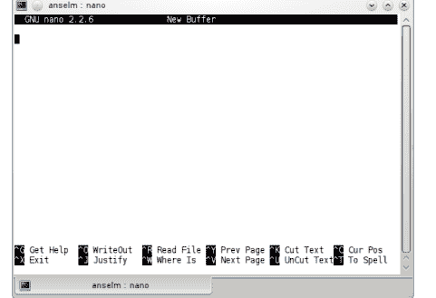

**图 3.1：** GNU Nano 文本编辑器

如果您需要更多的可用屏幕空间，可以使用 `Alt` + `x` 来抑制帮助行（按下键盘空格键左侧的 `Alt` 键并保持按住，同时按下 `x`）。再次按 `Alt` + `x` 会重新显示它们。（如果您需要更多的可用空间，还可以使用 `Alt` + `o` 来抑制紧挨在顶部行之下的空行。）

##### 输入和修改文本

要输入新文本，只需在 Nano 窗口内开始打字。如果您犯了错，“退格”键 `<backspace>` 会删除光标左侧的字符。使用方向键在文本中导航，例如为了修改靠近开头的部分。如果您输入新内容，它将正好出现在光标所在的位置。`Del` 键会删除光标下的字符，并导致该行的剩余部分（如果有的话）向左移动一个位置。一切都相当直观。

某些 Nano 版本甚至支持鼠标，因此——鉴于您在图形屏幕上运行 Nano，或您的文本环境可以处理鼠标——您可以单击文本中的任意位置，将光标定位到该处。您可能需要通过按下 `Alt` + `m` 来启用鼠标支持。

##### 保存文本

完成文本输入或编辑后，您可以使用 `Ctrl` + `o` 进行保存（按住 `Ctrl` 的同时按下 `o`）。Nano 会提示您为文件提供一个名称（在状态行上），然后您可以输入并以 `Enter` 键结束。（您最迟在第 6 章会了解有关文件名的更多知识。）Nano 随后会将文本存储到指定名称的文件中。

##### 退出 Nano

您可以使用 `Ctrl` + `x` 退出 Nano。如果您的文本包含未保存的修改，Nano 会询问是否保存文本；回答 `y` 即可保存（Nano 可能会要求您输入文件名），或回答 `n` 立即退出 Nano（这将导致您的未保存修改被丢弃）。

##### 加载文件

可以使用 `Ctrl` + `r` 将不同的（已存在的）文件加载到当前文本中——它将被插入到光标位置。Nano 会提示您输入文件名，您可以直接输入，或者使用 `Ctrl` + `l` 打开“文件浏览器”，它会为您提供现有文件的交互式选择列表。（顺便提一下，使用 `Ctrl+O` 保存文件时，这也有效。）

##### 剪切和粘贴

您可以使用 `Ctrl+K` 命令删除（“剪切”）包含光标的行并将其存储在缓冲区中（*注意*：无论光标在行内的实际位置如何，Nano 始终会删除整行）。`Ctrl+U` 随后将再次插入（“粘贴”）缓冲区的内容——如果您是不小心按了 `Ctrl+K`，或者只是想复制该行而不是移动它，内容会被插入到同一位置；否则，内容会被插入到文本的其他位置。

*插入始终发生在光标所在的位置。* 因此，如果您在按下 `Ctrl+U` 时光标位于行中间，缓冲区中的该行将成为该行的右半部分，而原始行中光标右侧的任何内容将变成新的一行。

您可以通过连续多次按 `Ctrl+K` 将多行连续的行移动到缓冲区中。这些行随后将*整体*再次被插入。

如果您只想剪切实体的一部分，请将光标定位到相应位置，然后按 `Ctrl+^`（在某些预期您在按下“^”后输入带扬抑符字符的键盘上，如某些德语文键盘，可替换为 `Alt+a`）。然后将光标移动到要剪切材料的末尾——Nano 会贴心地突出显示您选择剪切的文本部分——并使用 `Ctrl+K` 将该区域移动到缓冲区。请注意，光标下的字符本身*没有被剪切！* 之后，您可以按 `Ctrl+U` 将缓冲区内容插入到其他位置，如前所述。

##### 搜索文本

如果您按下 `Ctrl+W`，Nano 会使用状态行向您询问一段文本。然后，光标会跳转到文档中该段文本的下一个出现位置，从当前位置开始。这使得定位文本中的特定位置变得方便。

##### 在线帮助

您可以使用 `Ctrl+G` 显示 Nano 的内部帮助屏幕，其中解释了编辑器的基本操作以及各种键盘命令（比此处解释的要多得多）。使用 `Ctrl+X` 再次退出帮助屏幕。

这些是 GNU Nano 最重要的功能。熟能生巧——请随意尝试实验，您不会造成任何损坏。

回到 vi 的话题（您可能还记得——Linux 高手们的编辑器）。如果您愿意进行一次冒险，请确保您的系统上安装了 vi 编辑器（这是当今 vi 的主要实现；在 Linux 上几乎没人使用原始的 BSD vi），启动 *vi tutor* 程序，并花上一个既激动人心又富教育意义的半小时，体验交互式的 vi 介绍。（根据您使用的 Linux 发行版不同，您可能需要单独安装 *vi tutor* 包。如有疑问，请咨询您的系统管理员或其他懂行的人。）

## 练习

**3.6 [I2]** 启动 GNU Nano 并输入一些简单文本——类似以下示例：


```
Roses are red,
Violets are blue,
Linux is brilliant,
I know this is true.
```

将此内容保存为名为 `roses.txt` 的文件。

### 3.7 [2] 使用上一题中的文本，剪切这一行

```code
Linux is brilliant,
```

并将其粘贴三次，使得文本现在的样子如下：

```code
Roses are red,
Violets are blue,
Linux is brilliant,
Linux is brilliant,
Linux is brilliant,
I know this is true.
```

然后将光标定位在第一个句子中的“is”里的“i”上，标记该位置，导航到第三行“is”中的“i”，并删除标记的区域。

### 本章命令

| 命令 | 描述 | 手册 | 页码 |
| :--- | :--- | :--- | :--- |
| `logquit` | 终止 shell 会话 | `bash(1)` | 49 |
| `pico` | 来自 PINE/Alpine 包的一个非常简单的文本编辑器 | `pico(1)` | 52 |

### 摘要

- 在使用 Linux 系统之前，你必须登录并提供你的用户名和密码。使用完系统后，你必须再次注销。
- Linux 提供了多种图形化环境，这些环境在大多数情况下工作方式相似且相当直观。
- 终端窗口允许你在图形化环境中输入文本 shell 命令。
- GNU Nano 是一个简单的文本编辑器。


# 4 谁在害怕强大的 Shell？

## 目录

4.1 为什么？ ... 58

4.1.1 什么是 Shell？ ... 58

4.2 命令 ... 59

4.2.1 为什么是命令？ ... 59

4.2.2 命令结构 ... 60

4.2.3 命令类型 ... 61

4.2.4 更多规则 ... 61

### 目标

- 欣赏命令行用户界面的优势
- 操作 Bourne-Again Shell (`Bash`) 命令
- 理解 Linux 命令的结构

### 先决条件

- 具备基本的计算机使用知识会有帮助

## 4.1 为什么？

与其他的现代操作系统相比，Linux（像 Unix 一样）基于通过键盘输入文本命令的理念。这对某些人来说可能听起来很古老，特别是如果你习惯了像 Windows 这样的系统，它们大约花了 15 年时间试图说服用户认为图形用户界面是万能且最终的解决方案。对于许多从 Windows 转向 Linux 的人来说，命令行界面的相对突出地位起初是一种“文化冲击”，就像 21 世纪的人突然被传送到亚瑟王的宫廷一样——没有手机信号，餐桌礼仪糟糕，还有可怕牙医！

然而，事情并没有那么糟糕。一方面，如今 Linux 也有图形化界面，其功能等同于 Windows 或 Mac-OS X 所提供的，在某些方面甚至在便利性和功能上甚至超越了它们。另一方面，图形化界面和基于文本的命令行并不是互斥的，而是互补的（根据“适合每项工作的正确工具”这一理念）。

归根结底，这意味着你作为一个初出茅庐的 Linux 用户，*也应该*习惯基于文本的用户界面，即所谓的“shell（壳层）”。当然，没有人会阻止你在任何可以做的事情上都使用图形化桌面。但是，shell 提供了一种方便的方式，可以执行许多用图形界面很难表达的强大操作。拒绝 shell 就像拒绝汽车中除一档以外的所有档位$^{1}$。当然，即使只用一档你最终也能到达目的地，但速度相对较慢，且伴随着巨大的噪音。那么，为什么不学习如何真正利用 Linux 加速呢？如果你仔细观察，我们将能够展示另外一两个技巧。

### 4.1.1 什么是 Shell？

用户不能直接与操作系统内核通信。只有通过通过“系统调用”访问内核的程序才能实现这一点。然而，你必须能够以某种方式启动这些程序。这就是 shell 的任务，它是一个特殊的用户程序，通常从键盘读取命令并解释它们（例如）作为要执行的命令。相应地，shell 充当计算机的“接口”，它像贝壳（shell，如“shellfish”——因此得名）一样包裹住实际的操作系统，并将其隐藏起来。当然，shell 只是众多访问操作系统的程序之一。


即使是今天的图形化“桌面”（如 KDE）也可以被视为“shells”。它们不再是通过键盘读取文本命令，而是通过鼠标读取图形命令——但正如文本命令遵循某种“语法”一样，鼠标命令也同样如此。例如，你通过点击对象来选择它们，然后确定对它们做什么：打开、复制、删除……

即使是早期的 Unix——1960 年代早期——也有 shell。目前在博物馆之外发现的最古老的 shell 是在 1970 年代中期由 Stephen L. Bourne 为“Unix 版本 7”开发的。这个所谓的“Bourne shell”包含大多数基本功能，曾经被广泛使用，但现在很少以其原始形式见到。

- Bourne shell
- C shell
- Korn shell
- Bourne-again shell

其他的经典 Unix shell 包括 C Shell，由加州伯克利分校创建（非常模糊地）基于 C 编程语言，以及主要与 Bourne-shell 兼容但功能增强的 Korn shell（由 AT&T 的 David Korn 开发）。

Linux 系统上的标准是 Bourne-again shell，简称为 `bash`。它由 Brian Fox 和 Chet Ramey 在自由软件基金会（Free Software Foundation）的 GNU 项目指导下开发，并统一了 Korn 和 C shell 的许多功能。

> $^{1}$ 这个比喻适用于欧洲人和其他能够操作手动换挡杆的人；我们的美国读者当然都使用那些弱不禁风的自动变速箱。这就好比他们都在运行 Windows。

除了上面提到的 shell，还有很多其他的。在 Unix 中，shell 就像其他所有程序一样，只是一个应用程序，你不需要特殊权限就可以编写一个——你只需要遵守控制 shell 如何与其他程序通信的“游戏规则”。

Shell 可以交互式调用以读取用户命令（通常是在某种“终端”上）。大多数 shell 也可以从包含预定义命令序列的文件中读取命令。这样的文件被称为“shell 脚本”。

Shell 执行以下步骤：

1. 从终端（或文件）读取命令
2. 验证命令
3. 直接运行命令或启动相应的程序
4. 将结果输出到屏幕（或其他位置）
5. 继续第 1 步。

除了这个标准的命令循环，shell 通常还包含其他功能，如编程语言。这包括涉及循环、条件和变量的复杂命令结构（通常是在 shell 脚本中，较少在交互式使用中出现）。回收最近使用的命令的先进方法也使用户的生活更轻松。

Shell 会话通常可以使用 `exit` 命令终止。这也适用于你在登录后立即获得的 shell。

虽然，如前所述，有不同的 shell，但我们将在这里集中讨论 `bash`，因为它是大多数 Linux 发行版上的标准 shell。LPI 考试也专门引用 `bash`。

### 练习

**4.1** [2] 注销并再次登录，检查登录 shell 中 `echo $0` 命令的输出。使用 `bash` 命令启动一个新的 shell，再次输入 `echo $0`。比较这两个命令的输出。你注意到什么不寻常的地方吗？

## 4.2 命令

### 4.2.1 为什么是命令？

计算机的操作，无论运行的是哪种操作系统，都可以粗略地描述为三个步骤：

1. 计算机等待用户输入
2. 用户选择一个命令并通过键盘或鼠标输入
3. 计算机执行该命令

在 Linux 系统中，shell 显示一个“提示符”，意味着可以输入命令。这个提示符通常由用户和主机（计算机）名称、当前目录以及一个最终字符组成：

```
joe@red: /home > _
```

在这个例子中，用户 `joe` 在计算机 `red` 上的 `/home` 目录中工作。

### 4.2.2 命令结构

一个命令本质上是一串字符，以按下 `Enter` 键结束，随后由 shell 进行评估。许多命令在某种程度上受英语语言的启发，是专门的“命令语言”的一部分。该语言中的命令必须遵循某些规则，即“语法”，以便 shell 能够解释它们。

为了解释命令行，shell 首先尝试将行划分为单词。就像在现实生活中一样，单词之间用空格分隔。行中的第一个单词通常是实际的命令。该行上的其他所有单词都是参数，用于更详细地说明想要做什么。

DOS 和 Windows 用户可能会在这里被 shell 区分大写字母和小写字母这一事实绊倒。Linux 命令通常仅用小写字母拼写（例外情况证明了规则），否则无法理解。另请参阅第 4.2.4 节。


在将命令划分为单词时，一个空格字符和多个空格字符效果一样——这种差异对 shell 来说无关紧要。实际上，shell 甚至不强制要求使用空格；制表符也是允许的，但这主要在从文件读取命令时很重要，因为 shell 不允许你直接输入制表符（无论如何，不经过一些麻烦的步骤）。

你甚至可以使用行终止符（`Enter`）将长命令分布在多个输入行上，但你必须在其前面立即加一个 `\`，这样 shell 才会认为你的命令尚未结束。

命令的参数大致可以分为两种类型：

- 以破折号（`-`）开头的参数称为选项。这些通常是，呃，可选的——具体细节取决于所涉及的命令。从比喻上讲，它们是“开关”，允许开启或关闭命令的某些方面。如果你想向命令传递多个选项，它们可以（通常）累积在单个破折号后面，即选项序列`-a -l -F`对应于`-alF`。许多程序拥有的选项比可以方便地映射到单个字符的要多，或者为了可读性支持“长选项”（通常除了等效的单个字符选项之外）。长选项通常以两个破折号开头，并且不能累积：`foo --bar --baz`。
- 没有前置破折号的参数称为参数（arguments）。这些通常是命令要处理的文件的名称。

一般的命令结构可以显示如下：

- 命令——“做什么？”
- 选项——“怎么做？”
- 参数——“用什么做？”

通常选项跟随命令，且位于参数之前。然而，并非所有命令都坚持这一点——有些命令允许参数和选项任意混合，并且表现得好像所有选项都紧跟在命令之后。对于其他命令，只有当命令行按顺序处理遇到选项时，选项才会被考虑在内。

当前 Unix 系统（包括 Linux）的命令结构在几乎 40 年的时间里有机地发展而来，因此表现出各种不一致性和小惊喜。我们也认为应该进行一次彻底的大扫除，但 30 年积累的 shell 脚本很难完全忽视……因此，请做好准备，偶尔要习惯一些小怪异。

### 4.2.3 命令类型

在 shell 中，基本上有两种类型的命令：

**内部命令** 这些命令由 shell 本身提供。Bourne-again shell 包含大约 30 个这样的命令，它们可以非常快速地执行。某些命令（如 `exit` 或 `cd`）会改变 shell 本身的状态，因此不能由外部提供。

**外部命令** shell 不自己执行这些命令，而是启动可执行文件，这些文件在文件系统中通常位于 `/bin` 或 `/usr/bin` 等目录中。作为用户，你可以提供自己的程序，shell 会像执行所有其他外部命令一样执行它们。

你可以使用 `type` 命令来确定命令的类型。如果你将命令名称作为参数传入，它会输出命令类型或相应的文件名，例如：

```bash
$ type echo
echo is a shell builtin
$ type date
date is /bin/date
```

（`echo` 是一个有趣的命令，它简单地输出其参数：

```bash
$ echo Thou hast it now, king, Cawdor, Glamis, all
Thou hast it now, king, Cawdor, Glamis, all
```

`date` 显示当前日期和时间，可能根据当前时区和语言设置进行调整：

```bash
$ date
Mon May 7 15:32:03 CEST 2012
```

（你将在第 9 章中更多地了解 `echo` 和 `date`。）

你可以通过 `help` 命令获取 Bash 内部命令的帮助：

```bash
$ help type
type: type [-afpt] name [name ...]
        For each NAME, indicate how it would be interpreted if used as a
        command name.

        If the -t option is used, `type' outputs a single word which is one of
        `alias', `keyword', `function', `builtin', `file' or ``, if NAME is an
```

## 练习

1. 4.2 [2] 在使用 bash 时，以下哪些程序是外部提供的，哪些是在 shell 内部实现的：`alias`、`echo`、`rm`、`test`？

### 4.2.4 更多规则

如上所述，当输入命令时，shell 会区分大写字母和小写字母。这不仅适用于命令，而且结果也适用于选项和参数（通常是文件名）。

此外，你应该意识到 shell 对输入中的某些字符有特殊处理。最重要的是，前面提到的空格字符用于分隔命令行上的单词。具有特殊含义的其他字符包括：

- “转义”字符

```text
$&;(){}[]*?!<=>"'
```

如果你想使用这些字符中的任何一个而不让 shell 根据它们的特殊含义进行解释，你需要“转义”它。你可以使用反斜杠 "`\`" 来转义单个特殊字符，或者使用单引号或双引号（`"...", '...'`）来转义多个特殊字符。例如：

```bash
$ touch 'New File'
```

由于使用了引号，此命令应用于名为 `New File` 的单个文件。如果没有引号，将涉及名为 `New` 和 `File` 的两个文件。

> 我们无法在这里解释所有其他特殊字符。其中大部分将在本手册的其他地方出现——或者查阅 Bash 文档。

## 本章命令

- **bash**： "Bourne-Again-Shell"，一个交互式命令解释器 `bash(1) 58`
- **date**：显示日期和时间 `date(1) 61`
- **echo**：将其所有参数写入标准输出，用空格分隔 `bash(1), echo(1) 61`
- **help**：显示 bash 命令的联机帮助 `bash(1) 61`
- **type**：确定命令的类型（内部、外部、别名） `bash(1) 61`

## 总结

- shell 读取用户命令并执行它们。
- 大多数 shell 具有编程语言特性，并支持包含预定义命令序列的 shell 脚本。
- 命令可能具有选项和参数。选项确定命令*如何*操作，而参数确定操作*在什么上*。
- Shell 区分*内部*命令（在 shell 本身中实现）和*外部*命令（对应于在单独进程中启动的可执行文件）。


# 5 获取帮助

## 目录

- 5.1 自助 ... 64
- 5.2 help 命令和 --help 选项 ... 64
- 5.3 联机手册 ... 64
  - 5.3.1 概述 ... 64
  - 5.3.2 结构 ... 65
  - 5.3.3 章节 ... 66
  - 5.3.4 显示手册页 ... 66
- 5.4 Info 页 ... 67
- 5.5 HOWTO ... 68
- 5.6 其他信息源 ... 68

## 目标

- 能够处理手册页和 info 页
- 了解并找到 HOWTO
- 熟悉其他最重要的信息源

## 先决条件

- Linux 概述
- 基本的命令行 Linux 使用（例如，来自前面的章节）

## 5.1 自助

Linux 是一个强大且复杂的系统，而强大且复杂的系统通常都是错综复杂的。文档是管理这种复杂性的重要工具，Linux 的许多（遗憾的是并非所有）方面都已有非常详尽的文档记录。本章描述了一些访问这些文档的方法。

在 Linux 中，“帮助”在许多情况下意味着“自助”。自由软件的文化意味着不要无端占用其他人在社区中花费闲暇时间的人的时间和善意，去询问那些在手册前几段中就已显而易见的内容。作为 Linux 用户，你最好至少对可用的文档和紧急情况下获取帮助的方式有一个大致了解。如果你做了功课，人们通常愿意帮你摆脱困境，但对于那些指望别人在他们自己的时间里为你费尽心思的懒惰者，人们的宽容度通常并不高。

如果你希望有人全天候、每周七天倾听你那些研究不足的问题和难题，你必须利用众多“商业”支持服务之一。这些服务适用于所有主流发行版，由发行版供应商本身或第三方提供。请比较不同的服务提供商，选择一家服务级别协议（SLA）和定价适合你的服务。

## 5.2 help 命令和 --help 选项

在 bash 中，内部命令由 help 命令提供更详细的描述，需将相关命令名称作为参数提供：

```bash
$ help exit

exit: exit [n]
    Exit the shell with a status of N.
    If N is omitted, the exit status
    is that of the last command executed.
$ _
```

更详细的解释可以在 shell 的手册页和 info 文档中找到。这些信息源将在本章稍后介绍。


许多外部命令（程序）支持 `--help` 选项。大多数命令会显示其参数和语法的简要列表。

并非每个命令都对 `--help` 做出反应；通常该选项被称为 `-h` 或 `-?`，或者当你指定任何无效选项或其他非法命令行时，会输出帮助信息。不幸的是，没有通用的惯例。

## 5.3 在线手册

### 5.3.1 概述

几乎所有命令行程序都附带“手册页”（或“man 页”），许多配置文件、系统调用等也是如此。这些文本通常随软件一起安装，可以使用“`man (name)`”命令进行查看。

表 5.1：手册页章节

| 章节 | 内容 |
|:---|:---|
| NAME | 命令名称及简要描述 |
| SYNOPSIS | 命令语法的描述 |
| DESCRIPTION | 命令效果的详细描述 |
| OPTIONS | 可用的选项 |
| ARGUMENTS | 可用的参数 |
| FILES | 辅助文件 |
| EXAMPLES | 示例命令行 |
| SEE ALSO | 相关主题的交叉引用 |
| DIAGNOSTICS | 错误和警告消息 |
| COPYRIGHT | 命令的作者 |
| BUGS | 命令的已知限制 |

这里，(*name*) 是你希望解释的命令或文件名称。“`man bash`”，例如，会产生上述内部 shell 命令的列表。

然而，手册页有一些缺点：许多手册页仅有英文版本；虽然存在不同语言的翻译集，但往往不完整。此外，解释通常非常复杂。每个单词都可能很重要，这使得文档对初学者来说难以入手。另外，特别是对于较长的文档，结构可能晦涩难懂。即便如此，这些文档的价值不容小觑。与向用户灌输大量纸质资料不同，在线手册始终随系统可用。

> 许多 Linux 发行版遵循这样的理念：命令行上可调用的每个命令都应该有一个手册页。但这在 KDE 和 GNOME 图形桌面环境的程序中并不完全适用，其中许多程序不仅完全没有附带手册页，而且在图形环境本身的文档也非常糟糕。这些程序中的许多是由志愿者贡献的事实，只是一个弱冠借口。

### 5.3.2 结构

手册页的结构大致遵循表 5.1 给出的大纲，尽管并非每个手册页都包含其中提到的每个章节。特别是，EXAMPLES 部分经常篇幅很短。

> BUGS 标题常常被误解：实现中的 bug 当然会被修复；这里记录的通常是命令采取的*方法*所带来的限制，这些限制无法通过合理的努力消除，且作为用户你应该知晓。例如，`grep` 命令的文档指出，要在其中定位的各种正则表达式构造可能会导致 `grep` 进程使用大量内存。这是 `grep` 实现搜索方式的结果，而不是一个微不足道、容易修复的错误。

手册页是用一种特殊的输入格式编写的，可以由名为 `groff` 的程序处理以进行文本显示或打印。手册页的源代码存储在 `/usr/share/man` 目录中名为 `man$n` 的子目录中，其中 `n` 是表 5.2 中的章节号之一。

> 通过设置 `MANPATH` 环境变量，你可以将来自其他目录的手册页整合进来，该变量包含 `man` 将按顺序搜索的目录。`manpath` 命令提供了设置 `MANPATH` 的提示。

### 5.3.3 章节

每个手册页都属于概念“手册”的一个“章节”（表 5.2）。第 1、5 和 8 章最为重要。你可以在 man 命令行中指定章节号以缩小搜索范围。例如，“`man 1 crontab`”显示 crontab 命令的手册页，而“`man 5 crontab`”解释 crontab 文件的格式。在引用手册页时，惯例是在括号中附加章节号；我们相应地区分 crontab(1)，即 crontab 命令手册，和 crontab(5)，即文件格式描述。

使用 `-a` 选项，man 会显示所有与给定名称匹配的手册页；如果没有此选项，则只显示找到的第一个页面（通常来自第 1 章）。

表 5.2：手册页主题

| 编号 | 主题 |
| :-- | :-- |
| 1 | 用户命令 |
| 2 | 系统调用 |
| 3 | C 语言库函数 |
| 4 | 设备文件和驱动程序 |
| 5 | 配置文件和文件格式 |
| 6 | 游戏 |
| 7 | 杂项（例如 groff 宏、ASCII 表等） |
| 8 | 管理员命令 |
| 9 | 内核函数 |
| n | “新”命令 |

### 5.3.4 显示手册页

实际上用于在文本终端上显示手册页的程序通常是 less，这将稍后详细讨论。现阶段重要的是要知道，你可以使用光标键 ← 和 ↑ 在手冊页中导航。你可以通过按下 `/` 在文本中搜索关键字——输入单词并按回车键后，光标会跳转到该单词的下一次出现位置（如果存在）。一旦你满意了，可以使用 `q` 退出显示并返回 shell。

使用 KDE 网页浏览器 Konqueror，可以方便地获取格式美观的手册页。只需在浏览器的地址栏中输入 URL "`man:⟨name⟩`"（甚至可以是 "`#⟨name⟩`"）。这在 KDE 命令行上也行得通。

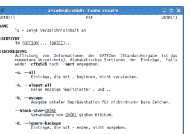

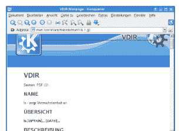

**图 5.1：** 文本终端中的手册页（左）和 Konqueror 中的手册页（右）

在盲目地在无数手册页中翻找之前，通常明智的做法是尝试通过 `apropos` 访问关于某个主题的一般信息。这个命令的作用就像“man -k”，它都在所有手册页的“NAME”部分搜索命令行上给定的关键字。输出是一个包含该关键字在其名称或描述中的所有手册页列表。

相关的命令是 `whatis`。这也搜索所有手册页，但针对的是 whatis 命令（`file`, ...,）的 `name` 而不是关键字——换句话说，即“NAME”部分中破折号左侧的部分。这显示了所需命令、系统调用等的简要描述；特别是相关手册页“NAME”部分的第二部分。`whatis` 等效于“man -t”。

### 练习

- 5.1 [!1] 查看 `ls` 命令的手册页。使用基于文本的 `man` 命令以及（如果可用）Konqueror 浏览器。

- 5.2 [2] 你系统中哪些手册页（至少根据其“NAME”部分）涉及进程？

- 5.3 [5]（进阶。）使用文本编辑器预先为假想的 `man(?)` 手册页编写一个手册页。检查该手册页在屏幕上的外观（使用“`groff -tascii -man <file> | less`”）以及打印输出（使用类似“`groff -tfs -man <file> | gv -`”的工具）。

## 5.4 Info 页面

对于某些命令——通常是更复杂的命令——有所谓的“info 页面”而不是（或除了）更常见的手册页。这些通常更详尽，并基于超文本原理，类似于万维网。

Info 页面的理念起源于 GNU 项目；因此，它们最常出现在由 FSF 发布或属于 GNU 项目的软件中。最初，“GNU 系统”只有 info 文档；然而，由于 GNU 也吸收了大量并非在 FSF 赞助下创建的软件，并且 GNU 工具也在采用更保守方法的系统上被使用，FSF 在许多情况下已做出让步。

与手册页类似，info 页面使用“`info <command>`”命令显示（包含 `info` 程序的软件包可能需要显式安装）。此外，info 页面可以使用 `emacs` 编辑器查看，或者通过类似“`info:/<command>`”的 URL 在 KDE 网页浏览器 Konqueror 中显示。

Info 页面的一个优点是，与手册页一样，它们是用一种源格式编写的，可以方便地用于屏幕显示或使用 PostScript 或 PDF 打印手册。使用 `tex` 排版程序而不是 `groff` 来准备打印输出。

### 练习

- 5.4 [!1] 查看 `ls` 程序的 *info* 页面。尝试基于文本的 *info* 浏览器以及（如果可用）Konqueror 浏览器。

- 5.5 [2] Info 文件使用一种粗糙的(?)超文本形式，类似于万维网上的 HTML 文件。为什么 info 文件最初不写成 HTML 格式？

## 5.5 操作指南 (HOWTOs)

手册页和 info 页面都面临一个问题：用户基本上必须知道要使用的程序名称。即使使用 `apropos` 进行搜索，也往往只是碰运气。此外，并非每个问题都能通过单个命令解决。因此，通常会有人呼吁“面向问题”而非“面向命令”的文档。操作指南（HOWTOs）正是为了帮助解决这一问题而设计的。

操作指南是更为详尽的文档，它们不局限于孤立地讲解单个命令，而是试图解释解决问题的完整方法。例如，有一份“DSL HOWTO”详细介绍了如何通过电话线（DSL）将 Linux 系统连接到互联网，还有一份“天文学 HOWTO”讨论 Linux 上的天文学软件。许多操作指南提供有除英语之外的其他语言版本，尽管译文通常滞后于英文原版。


大多数 Linux 发行版都会以软件包的形式提供操作指南（或其重要子集）供本地安装。这些文件最终会存放在发行版特定的目录中——SUSE 发行版位于 `/usr/share/doc/howto`，Debian GNU/Linux 位于 `/usr/share/doc/HOWTO`，通常以纯文本或 HTML 文件的形式存在。可以在“Linux 文档项目”（`http://www.tldp.org`）的网站上找到所有操作指南的最新版本以及 PostScript 或 PDF 等其他格式，该网站还托管了其他 Linux 文档。

## 5.6 更多信息来源

你可以在 `/usr/share/doc` 或 `/usr/share/doc/packages`（取决于你的发行版）下找到几乎所有已安装软件包附加的文档和示例文件。许多图形用户界面（GUI）应用程序（例如来自 KDE 或 GNOME 包的那些）提供“帮助”菜单。此外，许多发行版提供专门的“帮助中心”，方便访问系统上的大部分文档。

除了本地系统外，互联网上也有大量文档，包括万维网（WWW）和 USENET 归档站点上的资源。

一些更有趣的 Linux 网站包括：

- `http://www.tldp.org/` “Linux 文档项目”，负责维护 man 手册页和 HOWTOs（以及其他内容）。
- `http://www.linux.org/` 一个面向 Linux 爱好者的通用“门户”站点。
- `http://www.linuxwiki.de/` 一个关于一切 Linux 相关事物的自由形式文本信息数据库（德语）。
- `http://lwn.net/` *Linux 周刊*——可能是各类 Linux 新闻中最好的网站。除了每日最新进展、产品、安全漏洞、媒体中的 Linux 宣传等概况外，每周四还会刊登一篇内容详尽的在线杂志文章，包含对前一周事件的深入背景报道。每日新闻免费开放，而周刊需付费订阅（起价为每月 5 美元，有不同价位）。周刊发行一周后，也会提供免费访问。
- `http://freesco.com/` 该网站发布新软件包（主要是自由软件）的公告，这些软件包通常可用于 Linux。此外还有一个数据库，允许查询有趣的项目或软件包。
- `http://www.linux-knowledge-portal.de/` 一个收集其他有趣 Linux 站点“头条新闻”的网站，包括 LWN 和 Freshmeat。

如果在网络或 Usenet 归档中找不到所需信息，可以在邮件列表或 Usenet 新闻组中提问。在这种情况下，你应注意到许多使用这些论坛的用户认为，提问那些在文档或“FAQ”（常见问题）资源中已有答案的问题是非常没有礼貌的。尝试详细描述你的问题，并提供相关的日志文件摘录，因为像你的复杂问题在远程很难诊断（而且非复杂问题你肯定能自己解决）。

可以通过 `http://groups.google.com/`（前身为 DejaNews）访问新闻归档。

有趣的 Linux 新闻组可以在英语的 `comp.os.linux.*` 或德语的 `de.comp.os.unix.linux.*` 层次中找到。许多 Unix 新闻组也适用于 Linux 主题；关于 shell 的问题应在专门讨论 shell 编程的新闻组中提出，而不是 Linux 新闻组，因为 shell 通常并非 Linux 特有。

可以在 `major-domo@vger.kernel.org` 找到面向 Linux 的邮件列表。若要订阅名为 LIST 的列表，应发送一封包含 "`subscribe LIST`" 的电子邮件至该地址。可以在 `http://vger.kernel.org/vger-lists.html` 找到该系统上所有可用邮件列表的注释列表。

应对看似无法解释的问题的一个既定策略是，使用 Google（或你信任的其他搜索引擎）搜索相关的错误信息。如果你没有立即获得有用的结果，可以省略查询中依赖你具体情况的部分（例如仅在你系统中存在的域名）。其优势在于 Google 索引的不仅是常见的网页，还有许多邮件列表归档，因此你很可能会遇到某人讨论过类似你问题的对话。

顺便一提，开源软件的一个巨大优势不仅在于大量的文档，还在于大多数文档的限制程度与软件本身一样少。这促进了软件开发人员和文档作者之间的协作，也使文档翻译成不同语言变得更容易。事实上，非程序员也有很多机会帮助自由软件项目，例如编写良好的文档。自由软件社区应试图给予文档作者与程序员同等的尊重——这是一场已经开始但远未结束的范式转变。

### 本章命令

- `apropos`：显示其 NAME 部分包含给定关键字的所有手册页
- `groff`：精密的排版程序
- `help`：显示 bash 命令的在线帮助
- `info`：在基于字符的终端上显示 GNU Info 页面
- `less`：分页显示文本（如手册页）
- `man`：显示系统手册页
- `manpath`：确定系统手册页的搜索路径
- `whatis`：在其描述中查找包含给定关键字的手册页

### 摘要

- "`help` (命令)" 解释 bash 内部命令。许多外部命令支持 `--help` 选项。
- 大多数程序都配有手册页，可以使用 `man` 查阅。`apropos` 在所有手册页中搜索关键字，`whatis` 查找手册页名称。
- 对于某些程序，info 页面是手册页的替代方案。
- HOWTOs 是一种面向问题的文档形式。
- 万维网和 USENET 上有大量有趣的 Linux 资源。

## 6

## 文件：护理与喂食

### 目录

- 6.1 文件和路径名称 . . . . . . . . . . . . . . . . . . . . . . . . . . . . . 72
    - 6.1.1 文件名 . . . . . . . . . . . . . . . . . . . . . . . . . . . . . . . . . 72
    - 6.1.2 目录 . . . . . . . . . . . . . . . . . . . . . . . . . . . . . . . . . 73
    - 6.1.3 绝对和相对路径名称 . . . . . . . . . . . . . . . . . . . . . . . . . 74
- 6.2 目录命令 . . . . . . . . . . . . . . . . . . . . . . . . . . . . . . . . . . . . . 75
    - 6.2.1 当前目录：`cd` 及其类似命令 . . . . . . . . . . . . . . . . . . . . . . . . 75
    - 6.2.2 列出文件和目录——`ls` . . . . . . . . . . . . . . . . . . . . . . . . . . 76
    - 6.2.3 创建和删除目录：`mkdir` 和 `rmdir` . . . . . . . . . . . . . . . . . . 77
- 6.3 文件搜索模式 . . . . . . . . . . . . . . . . . . . . . . . . . . . . . . . . . . . . 78
    - 6.3.1 简单搜索模式 . . . . . . . . . . . . . . . . . . . . . . . . . . . . . . . 78
    - 6.3.2 字符类 . . . . . . . . . . . . . . . . . . . . . . . . . . . . . . . . . . 80
    - 6.3.3 大括号 . . . . . . . . . . . . . . . . . . . . . . . . . . . . . . . . . . . 81
- 6.4 文件处理 . . . . . . . . . . . . . . . . . . . . . . . . . . . . . . . . . . . . 82
    - 6.4.1 复制、移动和删除——`cp` 及其类似命令 . . . . . . . . . . . . . . 82
    - 6.4.2 链接文件——`ln` 和 `ln -s` . . . . . . . . . . . . . . . . . . . . . . 84
    - 6.4.3 显示文件内容——`more` 和 `less` . . . . . . . . . . . . . . . . . . . . . . 87
    - 6.4.4 搜索文件——`find` . . . . . . . . . . . . . . . . . . . . . . . . . . . . . . . . 87
    - 6.4.5 快速查找文件——`locate` 和 `slocate` . . . . . . . . . . . . . . . . . . . . 91

### 目标

- 熟悉有关 Linux 文件和目录名称的惯例
- 知道处理文件和目录的最重要命令
- 能够使用 shell 文件名搜索模式

### 先决条件


- 使用 shell

- 使用文本编辑器（见第 3 章）


## 6.1 文件和路径名称

### 6.1.1 文件名

类 Linux 操作系统最重要的一项服务，是将数据存储在硬盘或 USB 键等永久存储介质上，并在稍后检索它们。为了让人类更容易接受这种复杂性，通常会将类似的数据收集为存储在介质上的“文件”，并赋予其一个名称。

> 即使这看起来微不足道，但这绝非理所当然。在过去，某些操作系统要求用户了解磁盘上的磁道号等令人厌恶的细节才能检索自己的数据。

因此，在向你解释如何处理文件之前，我们需要先向你解释 *Linux* 如何*命名*文件。

在 Linux 文件名中，你基本上可以使用计算机能显示的任何字符（甚至更多）。然而，由于某些字符具有特殊含义，我们建议不要在文件名中使用它们。只有两个字符是完全禁止使用的：斜杠和零字节（ASCII 值为 0 的字符）。其他字符如空格、变音符（umlauts）或美元符号可以自由使用，但在命令行中通常必须通过反斜杠或引号进行转义，以避免 shell 的误解。

> 初学者容易掉入的一个陷阱是，Linux 区分文件名中的*大写*和*小写*字母。与 Windows 不同（在 Windows 中，文件名中的大写和小写字母虽然显示不同，但被视为相同），Linux 将 *x* 文件和 *X* 文件视为两个不同的文件名。

在 Linux 中，文件名可以“相当长”——没有固定的上限，因为最大长度取决于“文件系统”，也就是字节在介质上的具体排列方式（Linux 上有几种方法）。典型的上限是 255 个字符——但由于这样的名字在标准文本终端上大约占三行以上，这实际上不应该限制你的风格。

与 DOS 和 Windows 计算机的另一个区别是，Linux 不使用后缀来表征文件的“类型”。因此，点在文件名中是一个完全普通的字符。你自由地将文本存储为 *mumble*.txt，但从原则上讲，*mumble* 同样是可以接受的。当然，这不应该让你完全放弃使用后缀——你确实使识别文件内容变得更加容易。

> 某些程序坚持要求输入文件具有特定的后缀。例如，C 编译器 *gcc* 将文件名以“*.c*”结尾的文件视为源代码，以“*.s*”结尾的视为汇编语言源代码，以“*.o*”结尾的视为预编译目标文件。

你可以在文件名中自由使用变音符和其他特殊字符。然而，如果文件需要在其他系统上使用，最好避免在文件名中使用特殊字符，因为在其他地方它们显示为相同字符并不保证。

> 特殊字符的处理也取决于你的区域设置，因为对于表示超出 ASCII 字符集（涵盖英语、数字和最常见的特殊字符的 128 个字符）的字符并没有通用的标准。广泛使用的编码例如 ISO 8859-1 和 ISO 8859-15（通常分别称为 ISO-Latin-1 和 ISO-Latin-9……别问为什么），以及 ISO 10646，通常被不很正确地随意称为“Unicode”，通常编码为“UTF-8”。当编码 *X* 处于活动状态时创建的文件名，当编码 *Y* 处于生效状态时查看目录可能会看起来完全不同。这个话题不是你在吃饭时想要思考的。

如果你发现自己面对一堆根据错误字符集编码名称的文件，`convmv` 程序可能对你有帮助，它可以转换各种字符编码之间的文件名。（你可能需要自己安装它，因为它通常不是大多数发行版标准安装的一部分。）然而，你不应该在做完本章其余内容后再开始处理这个，因为我们甚至还没有解释正则 #w...

以下字符集中的所有字符都可以在文件名中自由使用：

**便携式文件名**

- A-Z, a-z, 0-9

- + - . _

然而，你应该注意以下提示：

- 为了允许在 Linux 和较旧的 Unix 系统之间移动文件，文件名长度应最多为 14 个字符。（真的，是“古代”的意思。）

- 文件名应以字母或数字之一开头；其他四个字符只能在文件名内部无问题地使用。

通过查看一些例子，这些约定最容易理解。例如，允许的文件名有：

- x-files

- foo.txt.bak

- 50.something

- 7_of_9

相反，以下文件名可能会存在问题（如果不确定的话甚至更糟糕）：

| 文件名 | 注释 |

| :--- | :--- |

| `-10`f | 以“-”开头，包含特殊字符 |

| `.profile` | 将被隐藏 |

| `3/4-metre` | 包含非法字符 |

| `Smörrebröd` | 包含变音符 |

作为另一个特殊之处，以点（"."）开头的文件名在某些地方会被跳过，例如在列出目录中的文件时——具有此类名称的文件被视为“隐藏文件”。

**隐藏文件**

此功能通常用于包含程序设置的、不应在目录列表中分散用户对更重要文件注意力的文件。

对于 DOS 和 Windows 专家：这些系统允许通过“文件属性”来“隐藏”文件，该属性可以独立于文件名设置。Linux 和 Unix 不支持此类功能。

### 6.1.2 目录

由于可能有多个用户在同一 Linux 系统上工作，如果每个文件名只能出现一次，那将是一个问题。很难向用户 Joe 解释他不能创建一个名为 letter.txt 的文件，因为用户 Sue 已经有一个同名文件。此外，必须有一种（方便的）方法确保 Joe 无法读取 Sue 的所有文件，反之亦然。

因此，Linux 支持分层“目录”的概念，用于对文件进行分组。文件名不需要在整个系统中唯一，只需要在同一目录内唯一。这意味着系统特别可以将不同的目录分配给 Joe 和 Sue，并且在其中他们可以随意命名自己的文件，而无需担心彼此的文件。

此外，我们可以禁止 Joe 访问 Sue 的*目录*（反之亦然），而不再需要担心其中的单个文件。

在 Linux 中，目录只是文件，尽管你无法使用用于“普通”文件的方法来访问它们。然而，这意味着我们为文件名讨论的规则（见上一节）也适用于目录名称。我们只需要了解斜杠 (`"/"`) 用于分隔文件名与目录名以及目录名与目录名。`joe/letter.txt` 是目录 `joe` 中的文件 `letter.txt`。

目录可以包含其他目录（这就是我们之前提到的“分层”术语），从而形成树状结构（巧妙地称为“目录树”）。Linux 系统有一个特殊的目录，形成树的根，因此称为“根目录”。它的名称是 `"/"`（斜杠）。

尽管名为根目录，但与系统管理员 root 没有任何关系。只是它们的名字相似。

这里的斜杠双重用途——它既作为根目录的名称，也作为其他目录名称之间的分隔符。我们稍后将回到这一点。

常见 Linux 发行版的基本安装通常包含数以万计的文件，位于主要根据某些约定分层的目录层次结构中。我们将在第 10 章中更多地介绍此目录层次结构。

### 6.1.3 绝对路径名和相对路径名

Linux 系统中的每个文件都由一个名称描述，该名称从根目录开始构建，沿着到包含该文件的路径提及每个目录，然后跟随文件本身的名称。例如，`joe/letter.txt` 命名了文件 `letter.txt`，它位于 `joe` 目录内，而 `joe` 目录又位于 `home` 目录内，而 `home` 目录又是根目录的直接后代。以根目录开头的名称称为“绝对路径名”——我们谈论“路径名”，因为名称描述了通过目录树的“路径”，其中可能包含目录名和文件名（即，它是一个集合术语）。

Linux 系统中的每个进程都有一个“当前目录”（通常也称为“工作目录”）。文件名在此目录内搜索；因此，`letter.txt` 是“当前目录中名为 `letter.txt` 的文件”的便捷缩写，而 `sue/letter.txt` 代表“当前目录中 `sue` 目录内的文件 `letter.txt`”。从当前目录开始的此类名称称为“相对路径名”。

区分绝对路径名和相对路径名很简单：以“/”开头的路径名是绝对的；其他所有都是相对的。

当前目录在父进程和子进程之间“继承”。因此，如果你从一个 shell 启动新的 shell（或任何程序），该新 shell 使用与启动它的 shell 相同的当前目录。在我们的新 shell 中，你可以使用 `cd` 命令更改到另一个目录，但旧 shell 的当前目录不会改变——如果你离开新 shell，你会回到（未更改的）旧 shell 的当前目录。

相对路径名（甚至绝对路径名）有两个方便的快捷方式：名称 `..` 始终指目录树中*高于*相关目录的目录——例如，在 `home/joe` 的情况下，是指 `/home`。这通常允许你方便地引用目录树“侧枝”中的文件（相对于当前目录），而无需诉诸绝对路径名。假设 `home/joe` 有子目录 `letters` 和 `novels`。以 `letters` 作为当前目录，你可以引用 `novels` 中的 `ivanhoe.txt` 文件

可以通过相对路径名 `../novels/ivanhoe.txt` 访问目录，而无需使用繁琐的绝对路径名 `/home/joe/novels/ivanhoe.txt`。


第二个快捷方式的意义并不那么显而易见：目录内的 `"."` 名称始终代表目录本身。乍一看并不清楚为什么需要一种方法来引用一个已经到达的目录，但在某些情况下这非常方便。例如，你可能知道（或者可以在第 9 章中查阅到）shell 会在环境变量 `PATH` 中列出的目录中搜索外部命令的程序文件。如果你是一名软件开发人员，想要调用一个名为 `prog` 的程序，该程序 (a) 位于当前目录的一个文件中，且 (b) 该目录未列在 `PATH` 中（出于安全原因，这始终是个好习惯），你仍然可以通过输入

```
$ ./prog
```

来让 shell 启动该文件作为程序运行，而无需输入绝对路径名。

> 作为 Linux 用户，你拥有一个“主目录”，在登录系统后你会立即进入该目录。系统管理员在创建你的用户帐户时会确定该 `directory` 的名称，但它通常与你的用户名相同，并位于 `/home` 下方——对于用户 *joe*，通常类似于 `/home/joe`。

## 6.2 目录命令

### 6.2.1 当前目录：cd 及相关

你可以使用 `cd` shell 命令来更改当前目录：只需将目标目录作为参数即可：

```
$ cd letters    切换到 letters 目录
$ cd ..        切换到上一级目录
```

如果你不提供参数，你将回到你的主目录：

```
$ cd
$ pwd
/home/joe
```

你可以使用 `pwd`（"print working directory"，打印工作目录）命令输出当前目录的绝对路径名。

你可能还会看到当前目录作为提示符的一部分：根据系统设置，可能会出现类似

```
joe@red:~/letters> _
```

的情况，其中 `~/letters` 是 `/home/joe/letters` 的简写；波浪号（`"~"`）代表当前用户的主目录。

> `"cd ."` 命令会切换到最近一次执行 `cd` 命令之前的当前目录。这使得在两个目录之间切换变得非常方便。

### 练习

- 1. **6.1** [2] 在 shell 中，`cd` 是内部命令还是外部命令？为什么？
- 2. **6.2** [3] 阅读 `bash` 手册页中关于 `pushd`、`popd` 和 `dirs` 命令的内容。确认这些命令确实如其中所述那样工作。

**表 6.1：** `ls` 中的一些 `file type`（文件类型）标识

| 文件类型 | 颜色 | 后缀 (`ls -F`) | 类型字母 (`ls -1`) |
| --- | --- | --- | --- |
| 普通文件 | 黑色 | 无 | . |
| 可执行文件 | 绿色 | * | - |
| 目录 | 蓝色 | / | d |
| 链接 | 青色 | @ | l |

**表 6.2：** 一些 `ls` 选项

| 选项 | 结果 |
| --- | --- |
| -a 或 --all | 同时显示隐藏文件 |
| -i 或 --inode | 显示唯一的文件编号（inode 编号） |
| -l 或 --format=long | 显示额外信息 |
| -o 或 --no-color | 省略输出的颜色编码 |
| -p 或 -F | 通过添加特殊字符标记文件类型 |
| -r 或 --reverse | 反转排序顺序 |
| -R 或 --recursive | 递归进入子目录（DOS: DIR/S） |
| -S 或 --sort=size | 按大小对文件排序（最长的优先） |
| -t 或 --sort=time | 按修改时间对文件排序（最新的优先） |
| -X 或 --sort=extension | 按扩展名（"文件类型"）对文件排序 |

### 6.2.2 列出文件和目录——ls

为了在目录树中导航，能够查找哪些文件和目录位于某个目录内是非常重要的。`ls`（"list"，列出）命令可以做到这一点。

如果没有选项，该信息将以按文件名排序的多列表格形式输出。如今，彩色屏幕已不再是个例外，而是规范，因此惯例是用不同颜色显示不同类型文件的名称。（我们尚未讨论文件类型；这个话题将在第 10 章中提及）。

谢天谢地，到目前为止，大多数发行版已就使用的颜色达成了共识。表 6.1 展示了最常见的分配。

在单色显示器上——这种情况仍可能存在——选项 `-F` 或 `-p` 显得自不待言。这些选项会根据文件类型在文件名后添加特殊字符。表 6.1 给出了这些字符的一个子集。

你可以通过提供 `-a`（"all"，全部）选项来显示隐藏文件（文件名以点开头）。另一个非常有用的选项是 `-l`（小写字母 "L"，代表 "long"，而非数字 "1"）。这不仅显示文件名，还显示每个文件的一些额外信息。

一些 Linux 发行版预设了某些有用选项组合的缩写；例如，SUSE 发行版使用简单的 `l` 作为 `ls -aF` 的缩写。`11` 和 `la` 也是 `ls` 变体的缩写。

以下是 `ls` 不带选项和带 `-l` 选项的示例：

```
$ ls
file.txt
file2.dat
$ ls -l
-rw-r--r-- 1 joe users 4711 Oct 4 11:11 file.txt
-rw-r--r-- 1 joe users 333 Oct 2 13:21 file2.dat
```

在第一种情况下，列出了目录中所有可见（非隐藏）文件；第二种情况添加了额外信息。

长格式的不同部分具有以下含义：第一个字符表示文件类型（参见第 10 章）：普通文件为“-”，目录为“d”，等等（表 6.1 中的“类型字符”）。

接下来的九个字符显示访问权限。接下来是一个引用计数器、文件的属主（此处为 joe）以及文件的组（users）。在文件的字节大小之后，你可以看到文件内容最后修改的日期和时间。在最右侧是文件名。

根据你使用的语言，特别是日期和时间列可能与我们的示例（我们使用最小语言环境“C”生成）看起来完全不同。这在交互使用中通常不是问题，但如果你试图在 shell 脚本中解析“ls -l”的输出，它可能会成为一个主要麻烦。（不想在《Advanced Linux》培训手册中提前预告，我们建议在 shell 脚本中将语言环境设置为定义的值。）

如果你想查看目录（如 `/tmp`）的额外信息，“ls -l /tmp” 并没有真正的帮助，因为 ls 将列出 `/tmp` 内所有文件的数据。使用 `-d` 选项来抑制这种行为并获取关于 `/tmp` 本身的信息。

`ls` 支持的选项比这里提到的多得多；表 6.2 展示了其中几个更重要的选项。

在 LPI 考试，Linux Essentials 和 LPI-101 中，没人期望你记住 `ls` 的所有 57 种选项变体。但是，你可能希望将最重要的大约六个——表 6.2 的内容，大致上——记入记忆。

### 练习

- 6.3 [1] `/boot` 目录包含哪些文件？该目录是否有子目录，如果有，是哪些？
- 6.4 [2] 解释 `ls` 带文件名参数和 `ls` 带目录名参数之间的区别。
- 6.5 [2] 如果向程序传递了目录名，你如何让 `ls` 显示关于该目录本身的信息，而不是该目录中的文件？（提示：文档。）

### 6.2.3 创建和删除目录：mkdir 和 rmdir

为了保持自己的文件井然有序，创建新目录是有意义的。你可以按照主题（例如）在这些“文件夹”中保存文件。当然，为了进一步结构化，你可以在这样的目录中创建更多目录——你的雄心壮志不会受到任意限制的限制。

要创建新目录，可以使用 `mkdir` 命令。它需要一个或多个目录名作为参数，否则你只会获得一条错误消息，而不是一个新目录。要在一步中创建嵌套目录，可以使用 `-p` 选项，否则该命令假设路径名中除最后一个外的所有目录都已存在。例如：

## 6.2 创建和删除目录

**删除目录**

有时目录不再需要了。为了减少杂乱，你可以使用 `rmdir`（“remove directory”）命令将其删除。

与 `mkdir` 一样，必须至少给出一个要删除的目录的路径名。此外，相关的目录必须是空的，即它们不得包含文件、子目录等条目。同样，每个名称中只有最后一个目录会被删除：

```bash
$ rmdir pictures/holiday
$ ls -F
pictures/
```

使用 `-p` 选项，可以在一步中删除名称中提到的所有空子目录，从最右侧的那个开始。

```bash
$ mkdir -p pictures/holiday/summer
$ rmdir pictures/holiday/summer
$ ls -F pictures
pictures/holiday/
$ rmdir -p pictures/holiday
$ ls -F pictures
ls: pictures: No such file or directory
```

### 练习


### 6.6 [!]
在你的主目录中，创建一个包含子目录 `dir1`、`dir2` 和 `dir3` 的目录 `grd1-test`。切换到目录 `grd1-test/dir1`，并创建一个名为 `hello` 的文件（例如，使用文本编辑器），内容包含“hello”。在 `grd1-test/dir2` 中，创建一个名为 `howdy` 的文件，内容包含“howdy”。检查这些文件是否存在。使用 `rmdir` 删除子目录 `dir3`。接下来，尝试使用 `rmdir` 删除子目录 `dir2`。发生了什么，为什么？

## 6.3 文件搜索模式

### 6.3.1 简单搜索模式

你通常希望对多个文件同时应用命令。例如，如果你想将 `prog1` 目录中所有以“p”开头且以“.c”结尾的文件复制到 `prog2` 目录中，明确地列出每一个文件会相当繁琐——至少当你需要处理几个以上的文件时！使用 shell 的搜索模式要方便得多。

如果你在 shell 命令行中指定一个包含星号的参数——例如：

```bash
prog1/p*.c
```

——shell 会在实际程序调用中将该参数替换为所有“匹配”该参数的文件名的排序列表。“匹配”意味着在实际文件名中，星号的位置可以是任意长度的任意字符序列。例如，像这样的名称：

```bash
prog1/p1.c
prog1/polly.c
prog1/pop-rock.c
prog1/p.c
```

是符合条件的（特别注意示例中的最后一个名称——“任意长度”包括“长度为零”）。星号不匹配的唯一字符是——你能猜到吗？——斜杠；通常最好将像星号这样的搜索模式限制在当前目录中。

💡 你可以方便地使用 `echo` 来测试这些搜索模式。命令 `echo prog1/p*.c` 将输出匹配的文件名，没有任何义务或后果。

💡 如果你确实希望对从特定目录开始的目录树中的所有文件应用命令，也有办法做到这一点。我们将在第 6.4.4 节中讨论这一点。

搜索模式 `*` 表示“当前目录中的所有文件”——除了所有以句点开头的隐藏文件。为了避免可能不方便的意外，搜索模式会仔细忽略隐藏文件，除非你明确请求通过类似 `.*` 的方式将它们包含在内。

⚠️ 你可能已经在像 DOS 或 Windows¹ 这样的操作系统的命令行上遇到过星号，并且习惯了指定 `*.` 模式来表示目录中的所有文件。在 Linux 上，这是不正确的——`*.*` 模式匹配“文件名包含句点的所有文件”，但句点不是必需的。正如我们所说，Linux 的等价物是 `*`。

¹ 你恐怕太年轻了，没经历过 CP/M。

顺便说一句，没人说搜索模式的结果总是需要被解释为路径名。例如，如果一个目录包含一个名为 `_V` 的文件，在该目录中运行 `ls _*` 将产生一个有趣且可能令人惊讶的结果（参见练习 6.9）。

如果 shell 找不到文件名与搜索模式匹配的文件怎么办？在这种情况下，相关命令会收到该搜索模式本身；它如何处理这是它自己的事。通常这类搜索模式被解释为文件名，但找不到相关的“文件”，并发出错误消息。然而，有些命令可以对你传递给它们的搜索模式执行有用的操作——对于它们，真正的挑战确实是确保调用该命令的 shell 不试图用自己的扩展方式介入。（提示：引号）

### 6.3.2 字符类

通过“字符类”可以提供对搜索模式中匹配字符的稍精确的指定：在以下形式的搜索模式中：

```bash
prog[123].c
```

方括号匹配其中列出的那些字符（不匹配其他字符）。因此，示例中的模式匹配 `prog1.c`、`prog2.c`、`prog3.c`，但不匹配 `prog.c`、`prog4.c`（4 未被列出）、`proga.c`（a 也不匹配）、`prog12.c`（请只取一个字符）。

作为一种更便捷的表示法，你可以指定范围，例如：

```bash
prog[1-9].c
[A-Z]bracadabra.txt
```

第一行中的方括号匹配所有数字，第二行中的方括号匹配所有大写字母。

请注意，在常见的字符编码中，字母不是连续的：像 `prog[A-Z].c` 这样的模式不仅匹配 `prog0.c` 和 `prog_.c`，还匹配 `progQ.c`。（例如，使用 `man ascii` 查看 ASCII 表。）如果你想匹配“仅大写字母和小写字母”，你需要使用：

```bash
prog[A-Za-z].c
```

像 `prog[A-Za-z].c` 这样的构造不能捕获变音符号，即使它们看起来很像字母。

作为一种进一步的便利，你可以指定否定字符类，它们被解释为“除了这些之外的所有字符”：像 `prog[^A-Za-z].c` 这样的内容匹配所有在“g”和“.”之间的字符不是字母的名称。通常，斜杠除外。

### 6.3.3 花括号

在诸如 `{red,yellow,blue}.txt` 的表达式中，花括号的展开常常与 shell 搜索模式一起被提及，尽管它实际上只是一个远亲。shell 将其替换为 `red.txt yellow.txt blue.txt`。

一般来说，命令行中包含多个逗号分隔文本块（在花括号内）的单词会被替换为与花括号之间文本块数量相同数量的单词，其中每个单词中的整个花括号表达式都被替换为其中一个文本块。这种替换完全基于命令行文本，并且完全独立于任何文件或目录的存在与否——这与搜索模式不同，搜索模式始终只生成系统中实际存在的路径名。

你可以在一个单词中有多个花括号表达式，这将产生笛卡尔积，换句话说，所有可能的组合：

```bash
{a,b,c}{1,2,3}.dat
```

产生 `a1.dat a2.dat a3.dat b1.dat b2.dat b3.dat c1.dat c2.dat c3.dat`。

这在系统地创建新目录时很有用；通常的搜索模式在那里帮不上忙，因为它们只能找到已经存在的东西：

```bash
$ mkdir -p revenue/2008{8,9}/q{1,2,3,4}
```

### 练习

- 6.7 [1] 当前目录包含文件 `prog.c`、`prog1.c`、`prog2.c`、`progab.c`、`p.txt`、`p1.txt`、`p21.txt`、`p22.txt`、`p22.dat`。哪些名称匹配以下搜索模式 (a) `prog*.c`，(b) `prog7.c`，(c) `p*.txt`，(d) `p[12]*`，(e) `p*`，(f) `*`？

- 6.8 [12] `ls` 和 `ls *` 之间有什么区别？（提示：在包含子目录的目录中尝试两者。）

- 6.9 [2] 解释为什么以下命令导致显示的输出：

## 表 6.3：cp 选项

| 选项 | 结果 |
|---|---|
| `-b` *(备份)* | 通过在现有目标文件名称后添加波浪号来创建其备份副本 |
| `-f` *(强制)* | 在未经提示的情况下覆盖现有的目标文件 |
| `-i` *(英文：交互式)* | 询问（每个文件一次）是否应该覆盖现有的目标文件 |
| `-p` *(英文：保留)* | 尝试为副本保留源文件的所有属性 |
| `-R` *(英文：递归)* | 复制目录及其所有内容 |
| `-u` *(英文：更新)* | 仅当源文件比目标文件新（或目标文件不存在）时进行复制 |
| `-v` *(英文：详细)* | 在屏幕上显示所有操作活动 |

```
$ ls -l file1 file2 file3
-rw-r-r-r-- 1 joe users 0 Dec 19 11:24 file1
-rw-r-r-r-- 1 joe users 0 Dec 19 11:24 file2
-rw-r-r-r-- 1 joe users 0 Dec 19 11:24 file3
```

6.10 [2] 为什么“\*”不匹配以点开头的文件名是有道理的？

### 6.4 文件处理

#### 6.4.1 复制、移动和删除——cp 及其伙伴

复制文件

你可以使用 `cp`（“复制”）命令复制任意文件。有两种基本方法：

1: 1 复制 如果你告诉 `cp` 源文件和目标文件的名称（两个参数），则源文件内容的 1:1 副本将放置到目标文件中。通常，如果目标文件已经存在，`cp` 不会询问是否应该覆盖该文件，而是直接执行——这里需要谨慎（或使用 `-i` 选项）。

你也可以提供一个目标目录名称代替目标文件名称。此时，源文件将被复制到该目录中，保留其旧名称。

```
$ cp list list2
$ cp /etc/passwd .
$ ls -l
-rw-r-r-r-- 1 joe users 2500 Oct 4 11:11 list
-rw-r-r-r-- 1 joe users 2500 Oct 4 11:25 list2
-rw-r-r-r-- 1 joe users 8765 Oct 4 11:26 passwd
```

在这个例子中，我们首先在文件 `list` 下创建了一个名为 `list2` 的完全副本。之后，我们将 `/etc/passwd` 文件复制到当前目录（用点号作为目标目录名称表示）。`cp` 最重要的选项列于表 6.3 中。


## 源文件列表

代替单个源文件，允许使用更长的源文件列表（或 shell 通配符模式）。然而，这样就不能将文件复制到不同的名称，只能复制到不同的目录。虽然 DOS 可以使用 `COPY *.TXT *.BAK` 命令为每个 TXT 文件创建带有相同名称和 BAK 后缀的备份副本，但 Linux 命令 `cp *.txt *.bak` 通常会失败并显示错误消息。

要理解这一点，你必须想象 shell 是如何执行此命令的。它首先尝试用相应的文件名替换所有通配符模式，例如将 `*.txt` 替换为 `letter1.txt` 和 `letter2.txt`。`*.bak` 的结果取决于 `*.txt` 的展开以及当前目录中是否存在匹配 `*.bak` 的文件名——但结果几乎不会像 DOS 用户预期的那样！通常，shell 会将未展开的 `*.bak` 通配符模式作为最终参数传递给 `cp` 命令，从 `cp` 的角度来看这是失败的，因为这是一个（不太可能的）现有目录名称。

虽然 `cp` 命令创建文件的完全副本，在存储介质上物理复制文件或在不同的存储介质上创建新的相同副本，但 `mv`（“移动”）命令用于将文件移动到不同位置或更改其名称。这严格来说是针对目录内容的操作，除非文件被移动到不同的文件系统——例如从硬盘分区移动到 USB 密钥。在这种情况下，必须通过物理方式移动文件，将其复制到新位置并从旧位置删除。

`mv` 的语法和规则与 `cp` 相同——你可以再次指定源文件列表而不仅仅是单个文件，在这种情况下，命令期望目录名称作为最终参数。主要区别在于 `mv` 允许你重命名目录以及文件。

`mv` 的 `-b`、`-f`、`-i`、`-u` 和 `-v` 选项对应于在 `cp` 中描述的相应选项。


```
$ mv passwd list2
$ ls -l
-rw-r--r-- 1 joe users 2500 Oct 4 11:11 list
-rw-f--r-- 1 joe users 8765 Oct 4 11:26 list2
```

在这个例子中，原始文件 `list2` 被重命名的文件 `passwd` 替换。与 `cp` 类似，如果目标文件名存在，`mv` 也不会请求确认，而是无情地覆盖该文件。

删除文件的命令称为 `rm`（“移除”）。要删除文件，你必须在相应的目录中拥有写入权限。因此，在你自己的主目录中你是“庄园领主”，在那里你可以删除甚至那些不正式属于你的文件。


> 另一方面，文件的写入权限对于删除该文件来说完全无关紧要，正如该文件属于哪个用户或组的问题也是如此。

`rm` 像 `cp` 或 `mv` 一样无情地工作——相关文件在没有确认的情况下从文件系统中彻底清除。你应该特别小心，特别是当使用 shell 通配符模式时。与 DOS 不同，Linux 文件名中的点只是一个没有特殊含义的字符。因此，`rm "*"` 命令会删除当前目录中的所有非隐藏文件。子目录将完好无损；使用 `rm -r *"` 也可以删除它们。


> 作为系统管理员，你可以使用诸如 `rm -rf /` 的命令摧毁整个系统；必须极其小心！很容易错误地输入 `rm -rf foo *"` 而不是 `rm -rf foo*"`.

`rm` 删除所有传递给它名称的文件，而 `rm -i"` 则稍微谨慎一点：

```
$ rm -i lis*
rm: remove 'list'? n
rm: remove 'list2'? y
$ ls -l
-rw-f--r-- 1 joe users 2500 Oct 4 11:11 list
```

该示例说明，对于每个文件，rm 都会询问是否应该删除它（“y”代表“是”）或不删除（“n”代表“否”）。

像 KDE 这样的桌面环境通常支持“回收站”的概念，它接收从文件管理器中删除的文件，并允许检索被意外移除的文件。命令行也有类似的软件包。

除了 `-i` 和 `-r` 选项外，`rm` 还允许使用 `cp` 的 `-v` 和 `-f` 选项，结果类似。

### 练习

- 6.11 [2] 在你的主目录中，创建 `/etc/services` 文件的一个副本，命名为 `myservices`。将此文件重命名为 `srv.dat` 并复制到 `/tmp` 目录（保持新名称不变）。删除该文件的两个副本。
- 6.12 [1] 为什么 `mv` 没有 `-R` 选项（像 `cp` 那样）？
- 6.13 [2] 假设你的某个目录中包含一个名为 `-file` 的文件（名称以破折号开头）。你会如何删除此文件？
- 6.14 [2] 如果你有一个目录，你不希望意外成为 "rm *" 的受害者，你可以在那里创建一个名为 `-i` 的文件，如下所示：

  ```
  $ > -i
  ```

  （将在第 8 章中详细解释）。如果你现在执行 "rm *" 命令，会发生什么，为什么？

#### 6.4.2 链接文件—ln 和 ln -s

Linux 允许你创建指向文件的引用，即所谓的“链接”，从而为同一文件分配多个名称。但这有什么作用呢？应用范围从文件和目录名称的快捷方式，到防止意外删除文件的“安全网”，再到为程序员提供便利，以及为大型目录树节省空间，这些目录树可能需要以仅有微小差异的几个版本可用。

`ln`（“链接”）命令除了文件现有名称（第一个参数）外，还为文件分配一个新名称（第二个参数）：

```
$ ln list list2
$ ls -l
-rw-r--f-    2 joe users    2500 Oct 4 11:11 list
-rw-f--f-    2 joe users    2500 Oct 4 11:11 list2
```

目录现在看起来包含一个名为 `list2` 的新文件。实际上，只是有两个指向同一文件的引用。这由 `ls -l` 输出第二列中的引用计数器暗示。其值为 2，表示该文件确实有两个名称。两个文件名是否真的指向同一个文件只能通过 `ls -i` 命令来判定。如果是这种情况，第一列中的文件号对于两个文件必须相同。文件号（也称为 inode 号）在其文件系统中唯一地标识文件：

```
$ ls -i
876543 list     876543 list2
```

“Inode”是“indirection node”（间接节点）的缩写。inode 存储了系统关于文件的所有信息，但文件名除外。每个文件正好有一个 inode。

如果你修改其中一个文件的内容，另一个文件的内容也会随之改变，因为实际上只有一个文件（具有唯一的 inode 编号 876543）。我们只是给这个文件起了另一个名字。

目录只是一个将文件名映射到 inode 编号的表格。显然，表格中可以包含多个条目，它们具有不同的名称但相同的 inode 编号。一个包含名称和 inode 编号的目录条目被称为“链接”。

你应该意识到，对于一个具有两个链接的文件，要找出哪个名称是“原始”的（即 `ln` 命令中的第一个参数）几乎是不可能的。从系统的角度来看，这两个名称完全等价且无法区分。

> 顺便一提，在 Linux 中不允许创建指向目录的链接。唯一的例外是“.”和“..”，这是系统为每个目录维护的。由于目录也是文件，并且拥有自己的 inode 编号，因此你可以跟踪文件系统的内部结构是如何组合在一起的。（参见练习 6.19）

删除两个文件中的一个会减少文件编号 876543 的名称数量（引用计数器会相应调整）。直到引用计数器的值变为 0，文件的内容才会被实际移除。

```
$ rm list2
$ ls -li
876543 -rw-r--r-- 1 joe users 2500 Oct 4 11:11 list2
```

由于 inode 编号仅在同一个物理文件系统（磁盘分区、U 盘等）内是唯一的，因此此类链接仅在该文件所在的同一文件系统内是可能的。

关于删除文件内容的解释并不完全正确：如果最后一个文件名被移除，文件将不能再被打开，但如果某个进程仍在使用该文件，它可以继续使用，直到该进程显式地关闭文件或终止。在 Unix 软件中，这是一种处理临时文件的常见惯用法，这些临时文件应在程序退出时消失：你创建它们用于读写，然后立即“删除”它们，但在程序中不关闭它们。然后你可以向文件写入数据，稍后再跳回开头重新读取它们。

`ln` 命令不仅可以接受两个文件名参数，还可以接受一个或多个参数。在前一种情况下，会在当前目录创建一个与原始文件同名链接（该链接名称应与文件所在目录不同）；在后一种情况下，所有命名的文件都会以它们原始的名称“链接”到作为最后一个参数给出的目录中（请想想 `mv`）。


然而，事情不止于此：在 Linux 系统中，有两种不同类型的链接。上面解释的类型是 `ln` 命令的默认情况，被称为“硬链接”。它始终使用文件的 inode 编号进行标识。此外，还有符号链接（相对于“硬链接”也称为“软链接”）。符号链接实际上是包含其“目标文件”名称的文件，以及一个标志，表明该文件是一个符号链接，并且访问应重定向到目标文件。与硬链接不同，目标文件并不“知道”符号链接的存在。创建或删除符号链接不会对目标文件产生任何影响；然而，当目标文件被移除时，符号链接就会“悬空”，即指向无（访问时会引发错误消息）。

与硬链接不同，符号链接允许创建指向目录以及不同物理文件系统上文件的链接。在实践中，符号链接通常更受青睐，因为通过路径名更容易跟踪链接关系。

- 如果文件或目录名称改变，但需要保持一定的向后兼容性，符号链接很受欢迎。例如，曾约定用户邮箱（存储未读电子邮件的）应存储在 `/var/mail` 目录中。传统上，该目录被称为 `/var/spool/mail`，许多程序在内部硬编码了这个值。为了便于过渡到 `/var/mail`，发行版可以创建一个名为 `/var/spool/mail` 的符号链接，指向 `/var/mail`。（如果使用硬链接则不可能做到，因为不允许创建指向目录的硬链接。）

要创建符号链接，必须向 `ln` 传递 `-s` 选项：

```
$ ln -s /var/log short
$ ls -l
-rw-r--r-- 1 joe users 2500 Oct 4 11:11 liste2
lrwxrwxrwx 1 joe users 14 Oct 4 11:40 short -> /var/log
$ pwd -P
/var/log
```

除了用于创建“软链接”的 `-s` 选项外，`ln` 命令还支持（包括但不限于）前面讨论过的 `-b`、`-f`、`-i` 和 `-v` 选项。

要删除不再需要的符号链接，只需像普通文件一样使用 `rm` 将它们删除即可。此操作作用于链接本身，而不是链接的目标。

```
$ cd
$ rm short
$ ls
liste2
```

## 练习

- **6.15 [2]** 在你的主目录中，创建一个具有任意内容的文件（例如，使用 `"echo Hello >~/hello"` 或文本编辑器）。为该文件创建一个名为 `link` 的硬链接。确保该文件现在有两个名称。尝试使用文本编辑器修改该文件。会发生什么？

- **6.16 [2]** 为上一步练习中的文件创建一个名为 `~/symLink` 的符号链接。检查通过符号链接访问文件是否可行。如果你删除符号链接所指向的文件（名称），会发生什么？

- **6.17 [2]** “/”目录中的 `..` 链接指向哪个目录？

- **6.18 [3]** 考虑以下命令及其输出：

```
$ ls -ai /
  2 .
  330211 etc
  1 proc
  4303 var
  2 ..
  2 home
  65153 root
  4833 bin
  244322 lib
  313777 sbin
  228033 boot
  460935 mnt
  244321 tmp
  330625 dev
  460940 opt
  390938 usr
```

显然，`/` 和 `/home` 目录具有相同的 inode 编号。既然这两个目录显然不可能是同一个目录——你能解释这种现象吗？

- **6.19 [3]** 我们提到不允许创建指向目录的硬链接。原因可能是什么？

- **6.20 [3]** 如何从“`ls -l`”的输出中判断子目录中不包含更深层的子目录？

- **6.21 [4]** （脑筋急转弯/研究练习）硬链接和符号链接哪个在磁盘上占用更多空间？为什么？

## 6.4.3 显示文件内容——更多与更少

使用 `more` 命令可以方便地在屏幕上显示文本文件，它允许你逐页查看长文档。输出在一屏后停止，最后一行显示“.More.”（后面可能跟随已显示文件的百分比）。按下任意键后，输出继续。表 6.4 解释了各种键的含义。

### 表 6.4：more 的键盘命令

| 键 | 结果 |
| --- | --- |
| ↑ | 向上滚动一行 |
| ↓ | 向下滚动一屏 |
| b | 回退一屏 |
| h | 显示帮助 |
| d | 退出 more |
| / | 搜索 * |
| ! | 在子 shell 中执行 |
| v | 调用编辑器 |
| Ctrl+r | 重绘屏幕 |

*注：‘Key’ 列中的键以键帽形式显示。原始表格的列标题为 ‘Key’ 和 ‘Result’。原始图像中表示为键帽的键已映射为上述最接近的文本等价形式，其中视觉上的键帽并非单个字母/符号。例如，第一个键帽是向上箭头，第二个是向下箭头，第三个是 'b'，第四个是 'h'，第五个是 'd'。下一行有斜杠 '/' 的键帽，然后是 '!'（命令）的键帽，接着是 'v' 的键帽，最后是 'Ctrl+r' 的键帽。*

`more` 还能理解一些选项。使用 `-s`（“squeeze”，压缩）时，连续的空行会被压缩为一行；`-l` 选项忽略分页符（通常表示为“^L”），否则分页符会阻止输出。`-n`（number）选项将屏幕行数设置为（number），否则 `more` 会从 TERM 指向的终端定义中获取该数值。

`more` 的输出仍受限于一些令人烦恼的限制，例如无法向前移动输出位置的通用限制。因此，改进版本 `less`（一个弱双关语——想想“less is more”）如今更为常见（原文如此）。`less` 允许你像平常一样使用方向键在文本中移动，搜索例程已得到扩展，允许向前和向后搜索文本。最常用的键盘命令总结在表 6.5 中。

如第 5 章所述，`less` 通常充当 `man` 命令的手册页显示程序。因此，在浏览手册页时，所有命令均可用。

## 6.4.4 搜索文件—find

谁没有过这种感觉：“曾经有一个文件 foo.tar ……但我把它放哪了？” 当然，你可以繁琐地手动遍历所有目录。但如果 Linux 没有提供便捷的帮助工具，它就不会是 Linux 了。

`find` 命令递归搜索目录树，查找符合一组标准的文件。“递归”意味着它会考虑子目录、它们的子目录，依此类推。`find` 的结果由匹配文件的路径名组成，这些路径名可以传递给其他程序。以下示例介绍了命令结构：

### 表 6.5：less 的键盘命令

| 按键 | 结果 |
| :--- | :--- |
| **g** 或 **q** | 向上滚动一行 |
| **j** 或 **k** | 向下滚动一行 / 向上滚动一行 |
| **f** 或 **b** | 回退一屏 / 前进一屏 |
| **Home** 或 **g** | 跳转到文本开头 |
| **End** 或 **(Shift + G)** | 跳转到文本末尾 |
| **p** **(百分号)** **⏎** | 跳转到文本的 *(percent)* 位置（以百分比计） |
| **h** | 显示帮助 |
| **q** | 退出 **less** |
| **/** **(单词)** **⏎** | 向末尾方向搜索 *(word)* |
| **n** | 继续向末尾方向搜索 |
| **?** **(单词)** **⏎** | 向开头方向搜索 *(word)* |
| **(Shift + N)** | 继续向开头方向搜索 |
| **!** **(命令)** **⏎** | 在子 shell 中执行 *(command)* |
| **v** | 调用编辑器 (**vi**) |
| **R** 或 **(Ctrl + l)** | 重绘屏幕 |

```bash
$ find . -user joe -print
./.list
```

该命令在当前目录（包括所有子目录）中搜索属于用户 *joe* 的文件。-print 命令在终端上显示结果（在本例中为单个文件）。为了方便起见，如果你未指定对匹配文件执行的操作，系统将默认使用 -print。

请注意，**find** 需要一些参数来执行其任务。

### 起始目录

起始目录的选择应慎重。如果选择根目录，所需文件（如果存在）一定会被找到，但搜索可能需要很长时间。当然，你只能搜索那些你拥有适当权限的文件。

如果起始目录使用绝对路径名，输出中的文件名也将是绝对的；如果起始目录使用相对路径名，则会产生相对路径名。

你可以指定一个目录列表，依次对这些目录进行搜索，而不仅仅是一个起始目录。

### 测试条件

这些选项详细说明了文件的要求。表 6.6 展示了最重要的测试。**find** 的文档解释了许多其他测试。

### 表 6.6：find 的测试条件

| 测试 | 描述 |
| :--- | :--- |
| -name | 指定文件名模式。允许使用所有 shell 搜索模式字符。-iname 选项会忽略大小写差异。 |


| -type | 指定文件类型（参见第 10.2 节）。包括：<br> b 块设备文件 <br> c 字符设备文件 <br> d 目录 <br> f 普通文件 <br> l 符号链接 <br> p FIFO（命名管道） <br> s Unix 域套接字 |

| -user | 指定文件所属的用户。可以指定用户名或数字 UID。 |

| -group | 指定文件所属的组。与 `-user` 一样，可以指定数字 GID 或组名。 |

| -size | 指定特定的文件大小。纯数字表示 512 字节块；通过添加 `c` 或 `k` 分别表示字节或 kibibyte。前面的加号或减号表示下限或上限；例如，`-size +10k` 匹配所有大于 10 KiB 的文件。 |

| -atime | (英文 *access*) 允许根据最后访问时间（读取或写入）搜索文件。此选项及接下来的两个选项以天为单位接受参数；将 `...min` 替换 `...time` 可获得 1 分钟精度。 |

| -mtime | (英文 *modification*) 根据修改时间进行选择。 |

| -ctime | (英文 *change*) 根据最后 inode 更改时间进行选择（包括内容访问、权限更改、重命名等）。 |

| -perm | 指定文件必须匹配的一组权限。权限以八进制数字给出（参见 `chmod` 命令）。要搜索特定的权限，八进制数字前必须加减号，例如，`-perm -20` 匹配所有具有组写权限的文件，无论其他权限如何。 |

| -links | 指定符合条件的文件必须匹配的引用计数值。 |

| -inum | 查找指向具有给定 inode 编号的文件的链接。 |

### 表 6.7：find 的逻辑运算符

| 选项 | 运算符 | 含义 |
| :--- | :--- | :--- |
| `!` | 非 | 后续的测试必须不匹配 |
| `-a` | 与 | `-a` 左侧和右侧的测试都必须匹配 |
| `-o` | 或 | `-o` 左侧和右侧的测试至少有一个必须匹配 |

如果同时给出多个测试，它们会被隐式地进行“与”（AND）操作——所有测试都必须匹配。`find` 支持额外的逻辑运算符（参见表 6.7）。

为了避免在评估逻辑运算符时出错，最好将测试括在括号内。当然，括号必须从 shell 中转义：

```bash
$ find . \( -type d -o -name "A*" \) -print
./
./.. 
./.bolder
./.Attic
```

此示例列出所有名称，这些名称要么指向目录，要么以 "A" 开头，或者两者皆是。

## 操作

如前所述，可以使用 `-print` 选项在屏幕上显示搜索结果。除此之外，还有两个选项 `-exec` 和 `-ok`，它们执行包含文件名的命令。`-ok` 和 `-exec` 的唯一区别在于，`-ok` 在实际执行命令前会请求用户确认；而对于 `-exec`，则默认假设用户已确认。我们将仅讨论 `-exec`。

有一些通用规则支配着 `-exec` 选项：

- 跟随 `-exec` 的命令必须以分号 (";") 结尾。由于分号在大多数 shell 中是特殊字符，因此必须对其进行转义（例如，作为 "\;" 或使用引号），以便 `find` 能识别它。
- 命令中的两个花括号 ("{}") 将被替换为找到的文件名。最好将花括号放在引号中，以避免文件名中包含空格时出现的问题。

例如：

```bash
$ find . -user joe -exec ls -l '{}' \;
-rw-r--r-- 1 joe users 4711 Oct 4 11:11 file.txt
```

此示例搜索当前目录（及以下）中属于用户 `joe` 的所有文件，并对每个文件执行 "`ls -l`" 命令。以下操作更有意义：

```bash
$ find . -atime +13 -exec rm -i '{}' \;
```

这将交互式删除当前目录（及以下）中两周未访问的所有文件。

有时——如上例所述——使用 `-exec` 为每个找到的文件名启动一个新进程效率非常低。在这种情况下，`xargs` 命令非常有用，它会在实际执行命令之前尽可能多地收集文件名：

```bash
$ find . -atime +13 | xargs -r rm -i
```

`xargs` 读取其标准输入，直到达到（可配置的）最大字符数或行数，并将这些材料作为指定命令（这里是 `rm`）的参数。在输入时，参数由空格字符（可通过引号或 "\" 转义）或换行符分隔。命令会被调用尽可能多次，直到输入耗尽。`-r` 选项确保只有当 `find` 实际发送文件名时才执行 `rm`；否则它至少会被执行一次。

奇怪的文件名可能会让 `find`/`xargs` 组合陷入困境，例如包含空格或甚至换行符的文件名，这些可能被误认为是分隔符。万灵药是使用 `find` 的 "`-print0`" 选项，它像 "`-print`" 一样输出文件名，但使用空字节（null bytes）而不是换行符来分隔它们。由于空字节不是路径名中的有效字符，因此混淆不再可能发生。`xargs` 必须使用 "`-0`" 选项调用才能理解这种类型的输入：

```bash
$ find . -atime +13 -print0 | xargs -0r rm -i
```

## 练习

- 6.22 [2] 找到系统中所有大于 1 MiB 的文件，并输出它们的名称。
- 6.23 [2] 你如何使用 `find` 删除文件名异常的文件（例如，包含旧 shell 无法处理的不可见控制字符或变音符号）？
- 6.24 [3] （第二次通读本书。）你如何确保退出登录时删除 `/tmp` 中属于你的文件？

## 6.4.5 快速查找文件——locate 和 slocate

`find` 命令根据许多不同的标准搜索文件，但需要遍历起始目录下的完整目录树。根据树的大小，这可能需要相当长的时间。对于典型应用——搜索具有特定名称的文件——有一种加速方法。

`locate` 命令列出所有名称匹配给定 shell 通配符模式的文件。在最简单的情况下，这是一个简单的字符字符串：

```bash
$ locate letter.txt
/home/joe/Letters/letter.txt
/home/joe/Letters/granny/letter.txt
```

虽然 `locate` 是一项相当重要的服务（由它是 LPI C1 课程大纲的一部分这一事实可以证实），但并非所有 Linux 发行版都将其包含在默认安装中。

例如，如果你使用的是 SUSE 发行版，必须明确安装 `findutils - locate` 软件包后才能使用 `locate`。

“ *”, “ ?”, 和 “ […]” 字符对 `locate` 的含义与对 shell 的含义相同。但是，虽然没有通配符字符的查询会定位包含该模式的任何位置的所有文件名，但带有通配符字符的查询仅返回该模式完全描述的名称——从开头到结尾。因此，对 `locate` 的模式查询通常以 “ *” 开头：

```bash
$ locate "*/letter.*"
/home/joe/Letters/letter.txt
/home/joe/Letters/letter.tab
```

请务必为包含 shell 通配符字符的 `locate` 查询加引号，以防止 shell 尝试展开它们。

斜杠 ("/") 没有被特殊处理：

```bash
$ locate Letters/granny
/home/joe/Letters/granny/letter.txt
/home/joe/Letters/granny/letter.txt
```

`locate` 之所以如此快速，是因为它不遍历文件系统树，而是检查一个“数据库”，该数据库中的文件名必须之前已使用 `updatedb` 程序创建。这意味着 `locate` 无法捕获自上次数据库更新以来添加到系统的文件，反之，它可能会输出在此期间已被删除的文件名称。

通过使用 "`-e`" 选项，你可以让 `locate` 仅返回已存在的文件，但这会抵消 `locate` 的速度优势。

`updatedb` 程序用于为 `locate` 构建数据库。由于这可能耗费相当长的时间，你的系统管理员通常会将其设置为在系统空闲时运行，例如在深夜。

为此所需的 cron 服务将在《高级 Linux》中详细讲解。目前，请记住大多数 Linux 发行版都包含一种机制，该机制会不时地运行 `updatedb`。

作为系统管理员，你可以告诉 `updatedb` 在设置数据库时考虑哪些文件。具体的细节取决于你的发行版：`updatedb` 本身不读取配置文件，而是从命令行和（部分）环境变量中获取设置。即便如此，大多数发行版都会通过 shell 脚本调用 `updatedb`，该脚本通常会读取诸如 `/etc/updatedb.conf` 或 `/etc/sysconfig/locate` 之类的文件，在其中可以设置适当的环境变量。

你可能在 `/etc/cron.daily` 等地方找到这样的文件（具体细节可能因你的发行版而异）。


例如，你可以让 `updatedb` 搜索某些目录并忽略其他目录；该程序还允许你指定被多台计算机使用的“网络文件系统”，这些文件系统应在其根目录中拥有自己的数据库，以便只需一台计算机来构建数据库。

一个重要的配置设置是运行 `updatedb` 的用户身份。主要有两种可能：

- `updatedb` 以 `root` 身份运行，因此可以将其数据库中的每个文件都收录进来。这也意味着用户可以挖掘出他们原本无法访问的目录中的文件名，例如其他用户的家目录。
- `updatedb` 以受限权限运行，例如以 `nobody` 用户的身份运行。在这种情况下，仅收录 `nobody` 用户可读目录内的文件名。

`slocate` 程序——是常规 `locate` 的一个替代方案——通过在数据库中除存储文件名外，还存储文件的属主、组和权限来规避此问题。只有当运行 `slocate` 的用户确实能访问相关文件时，它才会输出文件名。`slocate` 也附带一个 `updatedb` 程序，但这只是 `slocate` 本身的另一个名称。

在许多情况下，`slocate` 的安装方式使得它也可以通过 `locate` 命令来调用。

## 练习

- 6.25 [1] `README` 是一个非常流行的文件名。给出系统中所有名为 `README` 的文件的绝对路径名。
- 6.26 [2] 在你的家目录中创建一个新文件，并通过调用 `locate` 确认该文件未被列出（使用一个离奇的文件名以确保确认）。调用 `updatedb`（可能需要管理员权限）。之后 `locate` 能找到你的文件吗？删除该文件并重复这些步骤。
- 6.27 [1] 以普通用户身份搜索如 `/etc/shadow` 等文件，从而让自己确信 `slocate` 程序有效。

## 本章命令

| 命令 | 描述 | 参考 | 页码 |
|---|---|---|---|
| `cd` | 更改 shell 的当前工作目录 | bash(1) | 75 |
| `convmv` | 在字符编码之间转换文件名 | convmv(1) | 72 |
| `cp` | 复制文件 | cp(1) | 82 |
| `find` | 搜索符合特定给定标准的文件 | find(1), Info: find | 87 |
| `less` | 分页显示文本（如手册页） | less(1) | 87 |
| `ln` | 创建（“硬”或符号）链接 | ln(1) | 84 |
| `locate` | 在文件名数据库中按名称查找文件 | locate(1) | 91 |
| `ls` | 列出文件信息或目录内容 | ls(1) | 75 |
| `mkdir` | 创建新目录 | mkdir(1) | 77 |
| `more` | 分页显示文本数据 | more(1) | 87 |
| `mv` | 将文件移动到其他目录或重命名 | mv(1) | 83 |
| `pwd` | 显示当前工作目录的名称 | pwd(1), bash(1) | 75 |
| `rm` | 删除文件或目录 | rm(1) | 83 |
| `rmdir` | 删除（空）目录 | rmdir(1) | 78 |
| `slocate` | 在文件名数据库中按名称搜索文件，并考虑文件权限 | slocate(1) | 92 |
| `updatedb` | 为 locate 创建文件名数据库 | updatedb(1) | 91 |
| `xargs` | 从标准输入构建命令行 | xargs(1), Info: find | 90 |

## 总结

- 几乎所有可能的字符都可能出现文件名中。然而，为了可移植性，你应将自己限制在字母、数字和一些特殊字符。
- Linux 在文件名中区分大写字母和小写字母。
- 绝对路径名始终以斜杠开头，并提及从目录树根到相关目录或文件的所有目录。相对路径名从“当前目录”开始。
- 你可以使用 `cd` 命令更改 shell 的当前目录。你可以使用 `pwd` 显示其名称。
- `ls` 显示关于文件和目录的信息。
- 你可以使用 `mkdir` 和 `rmdir` 创建或删除目录。
- `cp`、`mv` 和 `rm` 命令复制、移动和删除文件和目录。
- `ln` 命令允许你创建“硬”和“符号”链接。
- `more` 和 `less` 在终端上分页显示文件（和命令输出）。
- `find` 搜索符合某些标准的文件或目录。


# 7 正则表达式

## 目录

- 7.1 正则表达式：基础 ... 96
    - 7.1.1 正则表达式：扩展 ... 96
- 7.2 在文件中搜索文本——grep ... 97

## 目标

- 理解并能够表述简单和扩展的正则表达式
- 了解 `grep` 程序及其变体，`fgrep` 和 `egrep`

## 先决条件

- Linux、shell 和 Linux 命令的基本知识（例如，来自前面的章节）
- 文件和目录的处理（第 6 章）
- 文本编辑器的使用（第 3 章）

```
grd1-regex.tex ()
```

## 7.1 正则表达式：基础

许多 Linux 命令用于文本处理——“对所有看起来像这样的行执行 xyz” 形式的模式反复出现。一个用于描述文本片段（最常见的是文件的行）的非常强大的工具被称为“正则表达式” $ ^{1} $ 。

乍一看，正则表达式类似于 shell 的文件名搜索模式（第 6.3 节），但它们的工作方式不同，并提供了更多的可能性。

正则表达式通常由本身被视为正则表达式的基本元素“递归”构建。最简单的正则表达式是字母、数字和常规字符集中的许多其他字符，它们代表自身。例如，“ $ a $ ”是一个匹配“ $ a $ ”字符的正则表达式；正则表达式“abc”匹配字符串“abc”。可以定义类似于 shell 搜索模式的字符类；因此，正则表达式“ $ \[a-e\] $ ”精确匹配“a”到“e”中的一个字符，而“ $ a\{xy\}b $ ”匹配“axb”或“ayb”。与 shell 一样，范围可以拼接——“ $ \{A-Za-z1\} $ ”匹配所有大写字母和小写字母——但范围的补集构建方式略有不同：“ $ \[^abc\] $ ”匹配除“a”、“b”和“c”以外的所有字符。（在 shell 中，那是“ $ \[\!abc\] $ $ ^{*} $ 。”点，“.”，对应于 shell 搜索模式中的问号，因为它将匹配单个任意字符——唯一的例外是换行符，“ $ \backslash n $ ”。因此，“ $ a.b $ ”匹配“abc”、“ab/c”等等，但不匹配多行结构

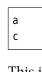

这是由于大多数程序按行操作，多行结构会更难处理。（这并不意味着有时候能做就很好。）

虽然 shell 搜索模式必须总是从文件名的开头开始匹配，但在基于正则表达式选择行的程序中，通常只要正则表达式在行中的任何位置匹配即可。不过，你可以限制这一点：以 careat（“^”）开头的正则表达式仅在行首匹配，而以美元符号（“$”）结尾的正则表达式仅在行尾匹配。每行末尾的换行符被忽略，因此你可以使用“xyz$”来选择所有以“xyz”结尾的行，而不必写“xyz\n$”。

> 严格来说，“^”和“$”分别匹配行首和行末换行符左侧的“不可见”概念字符。

最后，你可以使用星号（“*”）表示前面的正则表达式可以重复任意多次（包括不重复）。星号本身不代表输入中的任何字符，但仅修改前面的表达式——因此，shell 搜索模式“a*.txt”对应于正则表达式“ $ a*\\.txt $ ”（请记住表达式的“锚定”到输入行的开头和结尾，以及未转义的点匹配任何字符）。重复的优先级高于拼接；“ab*”是一个“a”后跟任意数量的“b”（包括没有），而不是“ab”的任意数量重复。

### 7.1.1 正则表达式：扩展

前一节的说明适用于几乎所有处理正则表达式的 Linux 程序。各种程序支持不同的扩展，提供了：

> $^{1}$ 这原本是一个计算机术语，描述了一种特征化方法，即从“字母”、选择和重复的拼接以及它们潜在的无界重复中产生的字符串集合。识别正则例式的例程是许多程序（如编程语言编译器）的基本构建模块。正则表达式在 Unix 历史中很早就出现了；大多数早期的 Unix 开发者都有计算机科学背景，因此这个概念对他们来说很熟悉。

ing either notational convenience or additional functionality. 如今最先进的实现方式可以在 Tcl、Perl 或 Python 等现代脚本语言中找到，这些语言的实现早已超越了正则表达式在计算机科学原始概念中的能力。

一些常见的扩展功能包括：

- **单词括号**：“^”匹配单词的开头（即非字母字符后面紧跟着一个字母的位置）。类似地，“$”匹配单词的结尾（即一个字母后面紧跟着非字母字符的位置）。
- **分组**：括号（“(...)”）允许对正则表达式的连接进行重复：“a(bc)*”匹配“a”后跟任意次数重复的“bc”。


- **选择**：使用垂直线（“|”）可以在多个正则表达式之间进行选择。表达式“`motor (bike | cycle | boat)`”匹配“motor bike”、“motor cycle”和“motor boat”，但不匹配其他内容。

- **可选表达式**：问号（“?”）使前一个正则表达式变为可选，即它必须出现一次或不出现。“`ferr??(man)?`”匹配“ferry”或“ferryman”。

- **至少一次重复**：加号（“+”）对应于重复运算符“*”，但前一个正则表达式必须至少出现一次。

- **指定重复次数**：您可以在花括号中指定重复的最小和最大次数：“`ab{2,4}`”匹配“abb”、“abbb”和“abbbb”，但不匹配“ab”或“abbbbb”。您也可以省略最小或最大重复次数；如果没有指定最小值，则默认为 0；如果没有指定最大值，则默认为“无穷大”。

- **反向引用**：使用类似“`\n`”的表达式，您可以要求重复输入中匹配正则表达式中第 n 个括号表达式的部分。例如，“`(ab)\1`”匹配“abab”；如果在处理“`(ab*a)\1`”时，括号匹配到了 aba，那么整个表达式将匹配 ababaaba（且不匹配其他内容）。更多详情请参阅 `GNU grep` 的文档。

- **非贪婪匹配**：“*”、“+”和“?”运算符通常是“贪婪”的，即它们试图匹配尽可能多的输入：“`a.*a`”应用于输入字符串“abacada”时，匹配“abacada”或“abaca”。然而，存在对应的“非贪婪”版本“*?”、“+?”和“??”，它们试图匹配尽可能少的输入。在我们的示例中，“`a.*?a`”将匹配“aba”。花括号运算符也可能提供非贪婪版本。

并非每个程序都支持所有扩展功能。表 7.1 展示了主要程序的支持情况概览。特别是，Emacs、Perl 和 Tcl 支持许多此处未讨论的扩展功能。

### 7.2 在文件中搜索文本——`grep`

使用正则表达式的最重要的 Linux 程序之一可能是 `grep`。它在一个或多个文件中搜索匹配给定正则表达式的行。匹配的行会被输出，不匹配的行则被丢弃。

`grep` 有两个版本。传统上，精简版的 *`fgrep`*（“固定字符串”）不允许使用正则表达式——它仅限于字符字符串——但速度非常快。*`egrep`*（“扩展”）提供额外的正则表达式运算符，但速度稍慢且需要更多内存。

#### 表 7.1：正则表达式支持

| 扩展 | GNU grep | GNU egrep | trad egrep | vim | emacs | Perl | Tcl |
| :--- | :--- | :--- | :--- | :--- | :--- | :--- | :--- |
| 单词括号 | • | • | • | •¹ | •¹ | •⁴ | •⁴ |
| 分组 | •¹ | • | • | •¹ | •¹ | • | • |
| 选择 | •¹ | • | • | •² | •¹ | • | • |
| 可选 | •¹ | • | • | •³ | • | • | • |
| 至少一次 | •¹ | • | • | •¹ | • | • | • |
| 限制 | •¹ | • | ○ | •¹ | •¹ | • | • |
| 反向引用 | ○ | • | • | ○ | • | • | • |
| 非贪婪 | ○ | ○ | ○ | •⁴ | • | • | • |

• 支持；○：不支持

*注释：*

1. 需要前缀反斜杠（"\"），例如 "`ab\+`" 而不是 "`ab+`".
2. 不需要括号；选择始终指代完整的表达式。
3. 使用 "*=" 代替 "*?".
4. 语法完全不同（参见文档）。

#### 表 7.2：`grep` 的选项（精选）

| 选项 | 结果 |
| :--- | :--- |
| `-c` | （count）仅输出匹配行的数量 |
| `-i` | （ignore）大写字母和小写字母被视为等价 |
| `-l` | （list）仅输出匹配文件的名称，不输出实际匹配内容 |
| `-n` | （number）在输出中包含匹配行的行号 |
| `-r` | （recursively）同时搜索子目录中的文件 |
| `-v` | （invert）仅输出*不*匹配正则表达式的行 |

💡 这些观察结果在过去在某种程度上是成立的。特别是，`grep` 和 `egrep` 曾使用完全不同的算法来进行正则表达式评估，这可能导致性能结果因正则表达式的大小和结构以及输入的大小而大相径庭。在使用 Linux 常见的 `grep` 实现中，实际上这三种变体都是同一个程序；它们的区别主要在于允许使用的搜索模式语法。

- **语法**

`grep` 的语法至少需要一个要搜索的正则表达式。这之后是待搜索的文本文件（或文件）的名称。如果没有指定文件名，`grep` 将引用标准输入（参见第 8 章）。

- **正则表达式**

要在输入中搜索的正则表达式除了第 7.1 节中的基本正则表达式外，还可以包含第 7.1.1 节中大多数扩展功能。然而，对于 `grep`，运算符 "`\+`"、" `\?`" 和 "`\( `必须由反斜杠引导。（对于 `egrep`，这不是必需的。）不幸的是，没有“非贪婪”运算符。

💡 您应该将正则表达式放在单引号中，以防止 shell 尝试展开它，特别是当它比简单的字符字符串更复杂时，如果它类似于 shell 搜索模式，则更是如此。

除了正则表达式和文件名外，还可以传递各种选项在命令行上（参见表 7.2）。

- **文件中的搜索模式**

使用 `-f`（"file"）选项，可以从文件中读取搜索模式。如果该文件包含多行，每一行的内容都将被视为一个独立的搜索模式，同时进行搜索。特别是对于常用的搜索模式，这可以大大简化操作。

如上所述，`fgrep` 不允许使用正则表达式作为搜索模式。另一方面，`egrep` 使正则表达式的大多数扩展功能更便于使用（表 7.1）。

最后是一些 `grep` 的示例。`frog.txt` 文件包含了格林兄弟的童话《青蛙王子》（参见附录 B）。包含字符序列 `frog` 的所有行都可以轻松通过以下方式找到：

```bash
$ grep frog frog.txt
frog stretching forth its big, ugly head from the water. »Ah, old
»Be quiet, and do not weep,« answered the frog, »I can help you, but
«Whatever you will have, dear frog,« said she, »My clothes, my pearls
```

若要找到所有恰好包含单词 "*frog*"（而不像 "*bullfrog*" 或 "*frogs*pawn*" 这样的组合）的行，您需要单词括号扩展功能：

```bash
$ grep \<frog\> frog.txt
frog stretching forth its big, ugly head from the water. »Ah, old
```

（事实证明，这在英文翻译中实际上没有区别）。同样简单的是找到所有以 "*frog*" *开头* 的行：

```bash
$ grep ^frog frog.txt
frog stretching forth its big, ugly head from the water. »Ah, old
frog, that he had caused three iron bands to be laid round his heart,
```

另一个示例：文件 `/usr/share/dict/words` 包含一个英语单词列表（通常称为“字典”）²。我们感兴趣的是所有包含三个或更多 "*a*" 的单词：

```bash
$ grep -n "a.*a.*a" /usr/share/dict/words
8:aardvark
21:abaca
22:abacate
.... 7030 more words ...
234831:zygomatacauricularis
234832:zygomatocofacial
234834:zygomatoaxillary
```

（依次为：一种非洲动物（*Orycteropus afer*），一种用于纤维的香蕉植物（*Musa textilis*），鳄梨的巴西名称（*Persea sp.*），以及面部肌肉和来自同一医学领域的两个形容词。）

使用更复杂的正则表达式时，`grep` 为什么输出一行而不输出另一行可能很快就会变得不清晰。这在一定程度上可以通过使用 `--color` 选项来缓解，该选项会以特定颜色显示文件中匹配的部分：

```bash
$ grep --color root /etc/passwd
root:x:0:0:root:/root:/bin/bash
```

像 `export GREP_OPTIONS='--color=auto'`（例如，在 `~/.profile` 中）这样的命令可以永久启用此选项；`auto` 参数会抑制当输出发送到管道或文件时的颜色输出。

### 练习


### 7.1 [2] 正则表达式运算符 `?` 和 `+` 真的有必要吗？

² 字典的大小可能会因发行版不同而差异巨大。

**7.2 [1]** 在 `frog.txt` 中，查找所有包含单词“king”或“king’s daughter”的行。

**7.3 [2]** 在 `/etc/passwd` 中列出了系统上的用户（大多数情况下都是如此）。该文件的每一行都是由冒号分隔的字段序列组成。每行中的最后一个字段给出了该用户的登录 shell。请给出一个 `grep` 命令行，以找出所有使用 `bash` 作为登录 shell 的用户。

**7.4 [3]** 在 `/usr/share/dict/words` 中搜索所有恰好包含五个元音字母“a”、“e”、“i”、“o”和“u”且按此顺序排列的单词（前面、中间和后面可能有辅音）。

**7.5 [4]** 给出一个命令，定位并输出“青蛙王子”中所有至少出现两次的长度不小于四个字母的单词所在的行。

## 本章命令

| 命令 | 描述 | 手册 | 页码 |
|---|---|---|---|
| `egrep` | 搜索文件中匹配特定正则表达式的行；允许使用扩展正则表达式 | `grep(1)` | 97 |
| `fgrep` | 搜索文件中包含特定内容的行；不允许使用正则表达式 | `fgrep(1)` | 97 |
| `grep` | 搜索文件中匹配给定正则表达式的行 | `grep(1)` | 97 |

## 摘要

- 正则表达式是描述字符字符串集合的一种强大方法。
- `grep` 及其相关命令搜索文件内容中匹配正则表达式的行。

# 8 标准输入/输出和过滤器命令

### 目录

- 8.1 输入/输出重定向和命令管道 ... 102
  - 8.1.1 标准通道 ... 102
  - 8.1.2 重定向标准通道 ... 103
  - 8.1.3 命令管道 ... 106
- 8.2 过滤器命令 ... 107
- 8.3 读写文件 ... 108
  - 8.3.1 输出和拼接文本文件——`cat` ... 108
  - 8.3.2 开始和结束——`head` 和 `tail` ... 108
- 8.4 数据管理 ... 109
  - 8.4.1 排序文件——`sort` 和 `uniq` ... 109
  - 8.4.2 列和字段——`cut`, `paste` 等 ... 114

### 目标

- 掌握 shell 输入/输出重定向
- 了解最重要的过滤器命令

### 先决条件

- Shell 操作
- 文本编辑器的使用（参见第 3 章）
- 文件和目录处理（参见第 6 章）


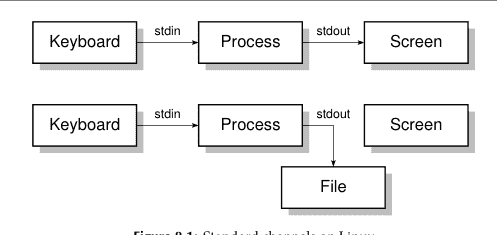

## 8.1 输入/输出重定向和命令管道

### 8.1.1 标准通道

许多 Linux 命令——例如第 7 章中的 `grep` 及其相关命令——被设计用来读取输入数据，以某种方式操作它，并输出这些操作的结果。例如，如果你输入

```
$ grep xyz
```

你可以在键盘上输入文本行，`grep` 将只允许包含字符序列“xyz”的那些行通过：

```
$ grep xyz
abc def
xyz 123
xyz 123
aaa bbb
YYxyzZZZ
YYxyzZZ
Ctrl+d
```

（最后的键组合让 `grep` 知道输入已经结束。）

我们说 `grep` 从“标准输入”——在这种情况下是键盘——读取数据，并写入到“标准输出”——在这种情况下是控制台屏幕或更可能是图形桌面环境中的终端程序。这些“标准通道”中的第三个是“标准错误输出”；虽然 `grep` 产生的“有效数据”被写入标准输出，但标准错误输出接收任何错误消息（例如，关于不存在的输入文件或正则表达式中的语法错误）。

在本章中，你将学习如何将程序的标准输出重定向到文件，或从文件获取程序的标准输入。更重要的是，你将学习如何将一个程序的输出直接（不经过文件绕道）作为输入传递给另一个程序。这为使用 Linux 命令打开了大门，这些命令单独来看都相当简单，但可以作为构建块来构建非常复杂的应用程序。（想想一套乐高积木。）

我们将无法在本章中穷尽这个话题。请期待《高级 Linux》手册，其中使用 Unix“工具箱”中的命令构建 shell 脚本起着非常重要的作用！在这里，你将学习在命令行上巧妙组合 Linux 命令的重要基础知识。


**表 8.1：Linux 上的标准通道**

| 通道 | 名称 | 缩写 | 设备 | 用途 |
|---|---|---|---|---|
| 0 | 标准输入 | `stdin` | 键盘 | 程序的输入 |
| 1 | 标准输出 | `stdout` | 屏幕 | 程序的输出 |
| 2 | 标准错误输出 | `stderr` | 屏幕 | 程序的错误消息 |

**标准通道**在表 8.1 中再次总结。在段落中，它们通常使用其缩写名称来指代——标准输入为 `stdin`，标准输出为 `stdout`，标准错误输出为 `stderr`。这些通道分别被分配数字 0、1 和 2，我们将稍后使用这些数字。

Shell 可以为个别命令重定向这些标准通道，而相关程序不会察觉。这些程序始终使用标准通道，尽管输出可能不再写入屏幕或终端窗口，而是写入其他任意文件。该文件可以是另一个设备，如打印机——但也可能指定一个将接收输出的文本文件。该文件甚至不必存在，如果需要的话会被创建。

标准输入通道可以以相同的方式重定向。程序不再从键盘接收输入，而是从指定文件获取输入，该文件可以指代另一个设备或严格意义上的文件。

> 你正在使用的“终端”的键盘和屏幕（无论这是一个 Linux 文本控制台、串口上的“真实”终端、图形环境中的终端窗口，还是使用安全 shell 等的网络会话）可以通过 `/dev/tty` 文件来访问——如果你想读取数据，这意味着键盘；对于输出则是屏幕（反过来做就很傻了）。
>
> ```
> $ grep xyz /dev/tty
> ```
>
> 将等同于本节前面提到的例子。有关这些“特殊文件”的更多信息，请参见第 10 章。

### 8.1.2 重定向标准通道

你可以使用 shell 运算符 `>`（“大于”符号）重定向标准输出通道。在下面的示例中，`ls -laF` 的输出被重定向到一个名为 *filelist* 的文件；屏幕输出仅包含

```
$ ls -laF >filelist
$ _
```

如果 *filelist* 文件不存在，它将被创建。然而，如果存在同名文件，其内容将被覆盖。Shell 甚至在调用相关程序之前就安排了这一点——即使实际命令调用中包含拼写错误，或者程序确实没有写入任何输出（在这种情况下，*filelist* 文件将保持为空），输出文件也会被创建。

> 如果你想避免使用 shell 输出重定向覆盖现有文件，你可以使用 bash 命令 `set -o noclobber`。在这种情况下，如果输出重定向到现有文件，将发生错误。

你可以以通常的方式查看 *filelist* 文件，例如使用 `less`：

```
$ less filelist
total 7
drwxr-xr-x  12 joe  users  1024  Aug 26 18:55  ./
drwxr-xr-x   5 root root  1024  Aug 13 12:52  ../
drwxr-xr-x   3 joe  users  1024  Aug 20 12:30  photos/
-rw-r--r--   1 joe  users      0  Sep 6 13:50  filelist
-rw-r--r--   1 joe  users  15811  Aug 13 12:33  pingu.gif
-rw-r--r--   1 joe  users  14373  Aug 13 12:33  hobby.txt
-rw-r--r--   2 joe  users   3316  Aug 20 15:14  chemistry.txt
```

如果你仔细查看 filelist 的内容，可以看到一个大小为 0 的 filelist 目录项。这是因为 shell 的工作方式：在解析命令行时，它首先注意到输出重定向并创建一个新 filelist 文件（或删除其内容）。之后，shell 执行命令，在这种情况下是 `ls`，同时将 `ls` 的标准输出连接到 filelist 文件而不是终端。

> 💡 `ls` 输出中文件的长度为 0，是因为 `ls` 命令在任何内容写入该文件之前查看了 filelist 的文件信息——尽管在 filelist 之上有三个其他条目。这是因为 `ls` 首先读取所有目录项，然后按文件名排序，最后才开始写入文件。因此，`ls` 看到的是新创建（或已清空）的 filelist 文件，目前没有任何内容。


如果你想将命令的输出追加到现有文件而不替换其之前的内容，请使用 `>>` 运算符。如果该文件不存在，在这种情况下也会创建该文件。

```
$ date >> filelist
$ less filelist
total 7
drwxr-xr-x  12 joe  users  1024  Aug 26 18:55  ./
drwxr-xr-x   5 root root  1024  Aug 13 12:52  ../
drwxr-xr-x   3 joe  users  1024  Aug 20 12:30  photos/
-rw-r--r--   1 joe  users      0  Sep 6 13:50  filelist
-rw-r--r--   1 joe  users  15811  Aug 13 12:33  pingu.gif
-rw-r--r--   1 joe  users  14373  Aug 13 12:33  hobby.txt
-rw-r--r--   2 joe  users   3316  Aug 20 15:14  chemistry.txt
Wed Oct 22 12:31:29 CEST 2003
```

在此示例中，当前日期和时间被追加到 `filelist` 文件。

重定向命令标准输出的另一种方法是使用“反引号”（`` `...` ``）。这也称为命令替换：反引号中命令的标准输出将被插入到命令行中，取代该命令（和反引号）；由替换产生的任何结果都将被执行。例如：

```
$ cat dates
Our little diary
22/12 Get presents
23/12 Get Christmas tree
24/12 Christmas Eve
$ date +%d/%m
What’s the date?
23/12
$ grep $(date +%d/%m) *
What’s up?
23/12 Get Christmas tree
```

> 💡 `date` 的一种可能更便捷的语法是 `$(date)`。这使得嵌套这样的调用更容易。然而，这种语法仅由现代 shell（如 `bash`）支持。

你可以使用 `<`，“小于”符号，重定向标准输入通道。这将读取指定文件的内容，而不是键盘输入：

## 练习

- **8.1 [2]** 你可以使用 `-U` 选项让 `ls` 在输出目录项时不进行排序。即便如此，在 `ls -laU >filelist` 之后，输出文件中 `filelist` 的条目显示长度为零。可能的原因是什么？

- **8.2 [2]** 比较命令 `ls /tmp` 和 `ls /tmp >ls-tmp.txt` 的输出（在第二种情况下，我们将 `ls-tmp.txt` 的内容视为输出）。你注意到什么吗？如果是，你能如何解释这一现象？

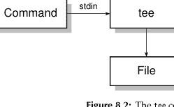

- **8.3 [2]** 为什么不可能通过一步操作（例如使用 `grep xyz file >file`）用新版本替换文件？

- **8.4 [1]** 假设文件 `foo` 非空，`cat foo >foo` 有什么问题？

- **8.5 [2]** 在 shell 中，你如何输出一条错误消息，使其发送到标准错误输出？

### 8.1.3 命令管道

输出重定向经常用于将程序的结果存储起来，以便通过另一个命令继续处理。然而，这种中间存储不仅相当繁琐，而且一旦不再需要中间文件，你还必须记得将其删除。因此，Linux 提供了一种通过管道直接链接命令的方式：一个程序的输出自动成为另一个程序的输入。

这种将多个命令直接连接成管道的做法是使用 `|` 运算符完成的。你不需要先将 `ls -laR` 的输出重定向到文件，然后使用 `less` 查看该文件，你可以在不产生中间文件的情况下通过一步操作完成相同的事情：

```
$ ls -laR | less
total 7
drwxr-xr-x   12 joe   users        1024 Aug 26 18:55   ./
drwxr-xr-x    5 root  root         1024 Aug 13 12:52   ../
drwxr-xr-x    3 joe   users        1024 Aug 20 12:30   photos/
-rw-r--r--    1 joe   users          449 Sep  6 13:50   filelist
-rw-r--r--    1 joe   users        15811 Aug 13 12:33   pingu.gif
-rw-r--r--    1 joe   users        14373 Aug 13 12:33   hobby.txt
-rw-r--r--    2 joe   users         3316 Aug 20 15:14   chemistry.txt
```

这些命令管道的长度几乎可以是任意的。此外，最终结果可以重定向到文件：

```
$ cut -d: -f1 /etc/passwd | sort | pr -2 >userlst
```

这个命令管道从 `/etc/passwd` 文件的第一个逗号分隔列中提取所有用户名，按字母顺序排序，并以两列的形式写入 `userlst` 文件。此处使用的命令将在本章的其余部分中描述。

有时，在命令管道的特定点存储数据流会很有帮助，例如，因为该阶段的中间结果对于不同的任务很有用。`tee` 命令复制数据流，并将一份副本发送到标准输出，另一份副本发送到文件。如果你了解任何有关管道（plumbing）的知识，这个命令名称应该是不言而喻的（见图 8.2）。

不带选项的 `tee` 命令会创建指定的文件，或者如果文件存在则覆盖它；使用 `-a`（“追加”）选项时，输出可以追加到现有文件中。

```
$ ls -laF | tee list | less
total 7
drwxr-xr-x 12 joe users 1024 Aug 26 18:55 ./
drwxr-xr-x 5 root users 1024 Aug 13 12:52 ../
drwxr-xr-x 3 joe users 1024 Aug 20 12:30 photos/
-rw-r-- 1 joe users 449 Sep 6 13:50 content
-rw-r-- 1 joe users 15811 Aug 13 12:33 pingu.gif
-rw-r-- 1 joe users 14373 Aug 13 12:33 hobby.txt
-rw-r-- 2 joe users 3316 Aug 20 15:14 chemistry.txt
```

在这个例子中，当前目录的内容同时写入 `list` 文件和屏幕。(`list` 文件不会出现在 `ls` 输出中，因为它只在 `tee` 之后才被创建。)

## 练习

- **8.6 [!]** 你如何同时将相同的中间结果写入几个文件？

### 8.2 过滤命令

Unix——以及随之而来的 Linux——的一个基本理念是“工具箱原则”。系统附带了大量系统程序，每个程序执行一个（概念上）简单的任务。这些程序可以作为“构建块”来构建其他程序，从而免去那些程序开发者自己开发所需函数的麻烦。例如，并非每个程序都包含自己的排序例程，但许多程序利用了 Linux 提供的 `sort` 命令。这种模块化结构有几个优点：

- 它使程序员的生活更轻松，他们不需要总是开发（或集成）新的排序例程。

- 如果 `sort` 收到一个大版本更新或性能改进，所有使用 `sort` 的程序都会受益——而且在大多数情况下，甚至不需要对它们进行更改。

从标准输入读取输入并将输出写入标准输出的工具被称为“过滤命令”或简称“过滤器”。如果没有输入重定向，过滤器将从键盘读取输入。要结束此类程序的键盘输入，你必须输入键序列 `Ctrl` + `d`，终端驱动将其解释为“文件结束”。

> 请注意，最后一点仅适用于键盘输入。磁盘上的文件当然可以包含 `Ctrl` + `d` 字符（ASCII 4），而系统不会认为文件在那一点结束。这与某些非常流行的操作系统相反，传统上它们对 Control-Z（ASCII 26）字符即使在文本文件中的含义也有某种古怪的观念 . . .

许多“常规”命令，如前述的 `grep`，如果你不指定要处理的输入文件名，它们的行为就像过滤器一样。

在本章的其余部分，你将熟悉一些最重要的此类命令。有一些命令已经混入其中，它们在技术上并不是真正的过滤命令，但它们都是管道的重要组成部分。

### 表 8.2: cat 的选项（选集）

| 选项 | 结果 |

| :--- | :--- |

| -b | (英文: number non-blank lines) 对输出中的所有非空行进行编号，从 1 开始。 |

| -E | (英文: end-of-line) 在每行末尾显示 $（对于检测否则不可见的空格字符很有用）。 |

| -n | (英文: number) 对输出中的所有行进行编号，从 1 开始。 |


| `-s` | (英文: squeeze) 用单个空行替换连续的空行。 |

| `-T` | (英文: tabs) 将制表符显示为 “^I”。 |

| `-v` | (英文: visible) 将控制字符 c 显示为 “^c”，将字符代码大于 127 的字符 a 显示为 “M-a”。 |

| `-A` | (英文: show all) 等同于 `-vET`。 |

### 8.3 读写文件

#### 8.3.1 输出和连接文本文件——`cat`

`cat`（“concatenate”，连接）命令的真正目的是将命令行上指定的几个文件连接成一个。如果你只传递一个文件名，该文件的内容将被写入标准输出。如果你根本没有传递文件名，`cat` 读取其标准输入——这似乎没什么用，但 `cat` 提供了选项来对行进行编号、使行尾和特殊字符可见或压缩连续的空行（表 8.2）。


不言而喻，只有文本文件在使用 `cat` 时才会产生合理的屏幕输出。如果你将该命令应用于其他类型的文件（例如二进制文件 `/bin/cat`），很有可能——至少在文本终端上——输出完成后，shell 提示符将由不可读字符组成。在这种情况下，你可以通过（盲打）输入 `reset` 来恢复正常字符集。如果你将 `cat` 输出重定向到文件，当然这不是问题。


“无用的 cat 使用奖”颁发给那些在多余的情况下使用 `cat` 的人。在大多数情况下，命令接受文件名，而不仅仅读取其标准输入，因此不需要使用 `cat` 通过标准输入向它们传递单个文件。像 `cat data.txt | grep foo` 这样的命令是不必要的，如果你可以同样简单地写 `grep foo data.txt`。即使 `grep` 只能读取标准输入，`grep foo < data.txt` 也会更短，并且不会涉及额外的 `cat` 进程。

### 练习

- **8.7 [2]** 如何检查目录中是否包含带有“奇怪”名称的文件（例如，末尾有空格或中间有不可见控制字符的名称）？

#### 8.3.2 开头和结尾——`head` 和 `tail`

有时你只对文件的一部分感兴趣：前几行以检查它是否是正确的文件，或者特别是对于日志文件，最后几条记录。`head` 和 `tail` 命令正好提供了这一点——默认情况下，它们分别提供作为参数传递的每个文件的前十行和后十行（或者像往常一样，它们标准输入的前十行或后十行）。`-n` 选项允许你指定不同的行数：`head -n 20` 返回其标准输入的前 20 行，`tail -n 5 data.txt` 返回文件 `data.txt` 的最后 5 行。

传统上，你可以直接通过 `-n` 参数指定期望的行数 *n*。官方上这已不再被允许，但 `head` 和 `tail` 的 Linux 版本仍然支持该用法。

你可以使用 `-c` 选项来指定按字节而非行进行计数：`head -c 20` 会显示标准输入的前 20 个字节，无论它们占用多少行。如果在计数值后附加一个 `b`、`k` 或 `m`（分别代表 `blocks`（块）、`kibibytes`（kibibytes）和 `mebibytes`（mebibytes）），计数值将分别乘以 512、1024 或 1048576。

`head` 还允许你使用负号：`head -c -20` 会显示标准输入的所有内容，但排除最后 20 个字节。

作为一种报复，*tail* 可以执行 *head* 不支持的操作：如果行数前带有 `"+"`，它将显示*从*给定行开始的全部内容：

```
$ tail -n +3 file
Everything from line 3
```

`tail` 命令还支持重要的 `-f` 选项。这使得 `tail` 在输出当前文件末尾后继续等待，以输出后续追加的数据。如果你想监控某些日志文件，这将非常有用。如果你向 `tail -f` 传入多个文件名，它会在每个输出数据块前添加一行标题，说明新数据写入的是哪个文件。

# 练习

- 8.8 [2] 你如何仅输出标准输入的第 13 行？

- 8.9 [3] 试试 `tail -f`：创建一个文件并对其进行调用 `tail -f`。然后，在另一个窗口或虚拟控制台中，使用例如 `echo >>...` 向该文件追加内容，并观察 tail 的输出。当 tail 同时监控多个文件时，输出看起来是什么样子的？

- 8.10 [3] 如果被观察的文件大小变小，`tail -f` 会发生什么？

- 8.11 [3] 解释以下命令的输出：

```
$ echo Hello >/tmp/hello
$ echo "Hiya World" >/tmp/hello
```

假设你在上述第一个 echo 之后已在另一个窗口中启动了以下命令：

```
$ tail -f /tmp/hello
```

# 8.4 数据管理

## 8.4.1 排序文件——*sort* 和 *uniq*

`sort` 命令允许你根据预设标准对文本文件的行进行排序。默认设置是升序（从 A 到 Z），基于每行前几个字符的 ASCII 值¹。这就是为什么诸如德语变音符号等特殊字符经常被错误排序的原因。例如，字符 `"Ä"` 的字符代码为 143，因此该字符排在字符代码为 90 的 `"Z"` 之后很远的位置。即使小写字母 `"a"` 也被视为“大于”大写字母 `"Z"`。

> ¹ 当然，ASCII 仅涵盖 0 到 127。这里真正指的是 ASCII 加上当前用于代码 128 至 255 字符的扩展，例如 ISO-8859-1，也称为 ISO-Latin-1。

当然，`sort` 可以适应不同的语言和文化。要按照德语约定进行排序，将环境变量 `LANG`、`LC_ALL` 或 `LC_COLLATE` 设置为诸如 `"de"`、`"de_DE"` 或 `"de_DE@UTF-8"` 的值（具体值取决于你的发行版）。如果你只想为单次 `sort` 调用设置此选项，请执行以下操作：

```
$ _ | LC_COLLATE=de_DE.UTF-8 sort
```

`LC_ALL` 的值优先于 `LC_COLLATE` 的值，而后者又优先于 `LANG` 的值。作为副作用，德语排序规则会在排序时忽略字母的大小写。

除非你另行指定，否则 `sort` 会“按字典顺序”考虑整个输入行。也就是说，如果两行的开头字符比较相等，则行内第一个不同的字符将决定它们的相对位置。当然，`sort` 不仅可以按整行排序，还可以更具体地按（概念性）表格中某些“列”或字段的值进行排序。字段的编号从 1 开始；使用 `"-k 2"` 选项时，第一个字段将被忽略，而每行的第二个字段将用于排序。如果两行在第二个字段中的值相等，系统将查看行的剩余部分，除非你使用类似 `"-k 2,3"` 的格式指定最后一个要查看的字段。顺便提一下，允许在同一个 `sort` 命令中指定多个 `-k` 选项。

此外，`sort` 还支持一种已废弃的位置指定形式：这里字段的编号从 0 开始，初始字段指定为 `"+m"`，最终字段指定为 `"-n"`。为了与现代形式区分，最终字段是“排他性”指定的——你给出第一个不应被纳入排序考虑的字段。上述例子分别对应 `"+1"`、`"+1 -3"` 和 `"+1 2"`。

空格字符充当字段之间的分隔符。如果连续出现多个空格，只有第一个被视为分隔符；其余的空格被视为后续字段值的一部分。下面是一个小例子，即 Lameborough 田径俱乐部年度马拉松赛的参赛者名单。首先，我们通过重置相应环境变量来确保使用系统的标准语言环境（`"POSIX"`）。（顺便提一下，第四列给出的是选手的号码布编号。）

```
$ unset LANG LC_ALL LC_COLLATE
$ cat participants.dat
Smith Herbert Pantington AC 123 Men
Prowler Desmond Lameborough TFC 13 Men
Fleetman Fred Rundale Sportsters 217 Men
Jumpabout Mike Fairing Track Society 154 Men
de Leaping Gwen Rundale Society 26 Ladies
Runninton Vivian Lameborough TFC 117 Ladies
Sweat Susan Rundale Sportsters 93 Ladies
Runninton Kathleen Lameborough TFC 119 Ladies
Longshanks Loretta Pantington AC 55 Ladies
O'Finnar Jack Fairing Track Society 45 Men
Oblomovsky Katie Rundale Sportsters 57 Ladies
```

让我们尝试按姓氏排序的列表。原则上这很简单，因为姓氏位于每行的开头：


```
$ sort participants.dat
Fleetman Fred Rundle Sportsters 217 Men
Jumpabout Mike Fairing Track Society 154 Men
Longshanks Loretta Pantington AC 55 Ladies
O’Finnan Jack Fairing Track Society 45 Men
Oblomovsky Katie Rundle Sportsters 57 Ladies
Prowler Desmond Lameborough TFC 13 Men
Runnigton Kathleen Lameborough TFC 119 Ladies
Runnigton Vivian Lameborough TFC 117 Ladies
Smith Herbert Pantington AC 123 Men
Sweat Susan Rundle Sportsters 93 Ladies
de Leaping Gwen Fairing Track Society 26 Ladies
```

你一定会注意到这个列表中的两个小问题：`“Oblomovsky”` 应该排在 `“O’Finnan”` 之前，而 `“de Leaping”` 应该出现在列表的开头，而不是结尾。如果我们指定 `“English”`（英语）排序规则，这些问题就会消失：

```
$ LC_COLLATE=en_GB sort participants.dat
de Leaping Gwen Fairing Track Society 26 Ladies
Fleetman Fred Rundle Sportsters 217 Men
Jumbabout Mike Fairing Track Society 154 Men
Longshanks Loretta Pantington AC 55 Ladies
Oblomovsky Katie Rundle Sportsters 57 Ladies
O’Finnan Jack Fairing Track Society 45 Men
Prowler Desmond Lameborough TFC 13 Men
Runnigton Kathleen Lameborough TFC 119 Ladies
Runnigton Vivian Lameborough TFC 117 Ladies
Smith Herbert Pantington AC 123 Men
Sweat Susan Rundle Sportsters 93 Ladies
```

（`en_GB` 是 `“British English”`（英式英语）的缩写；这里使用 `en_US`，即 `“American English”`（美式英语），也可以正常工作。）接下来让我们按名字排序：

```
$ sort -k 2,2 participants.dat
Smith Herbert Pantington AC 123 Men
Sweat Susan Rundle Sportsters 93 Ladies
Prowler Desmond Lameborough TFC 13 Men
Fleetman Fred Rundle Sportsters 217 Men
O’Finnan Jack Fairing Track Society 45 Men
Jumbabout Mike Fairing Track Society 154 Men
Runnigton Kathleen Lameborough TFC 119 Ladies
Oblomovsky Katie Rundle Sportsters 57 Ladies
de Leaping Gwen Fairing Track Society 26 Ladies
Longshanks Loretta Pantington AC 55 Ladies
Runnigton Vivian Lameborough TFC 117 Ladies
```

这说明了上述提到的 `sort` 的一个特性：一连串空格中的第一个空格被视为分隔符，其余空格成为后续字段值的一部分。如你所见，名字按字母顺序列出，但仅限于姓氏长度相同的情况下。使用 `-b` 选项可以修复这个问题，该选项将连续的多个空格视为单个空格：

```
$ sort -b -k 2,2 participants.dat
Prowler Desmond Lameborough TFC 13 Men
Fleetman Fred Rundle Sportsters 217 Men
Smith Herbert Pantington AC 123 Men
O’Finnan Jack Fairing Track Society 45 Men
Runnigton Kathleen Lameborough TFC 119 Ladies
Oblomovsky Katie Rundle Sportsters 57 Ladies
de Leaping Gwen Fairing Track Society 26 Ladies
Longshanks Loretta Pantington AC 55 Ladies
Jumbabout Mike Fairing Track Society 154 Men
```

### 表 B.3：`sort`（选择）选项

| 选项 | 结果 |
| :--- | :--- |
| `-b` (blank) | 忽略字段内容中的前导空格 |
| `-d` (dictionary) | 按“字典序”排序，即只考虑字母、数字和空格 |
| `-f` (fold) | 使大写字母和小写字母等效 |
| `-i` (ignore) | 忽略非打印字符 |
| `-k` ⟨field⟩, ⟨field⟩ (key) | 根据 ⟨field⟩（包含 ⟨field⟩ 在内）进行排序 |
| `-n` (numeric) | 将字段值视为数字，并按其数值排序；前导空格将被忽略 |
| `-o` ⟨file⟩ (output) | 将结果写入文件，文件名可与原始输入文件相同 |
| `-r` (reverse) | 按降序排序，即从 Z 到 A |
| `-t` ⟨char⟩ (terminate) | 使用 ⟨char⟩ 字符作为字段分隔符 |
| `-u` (unique) | 仅写出相等输出行序列中的第一行 |

Sweat Susan Rundale Sportsters 93 Ladies

Runntington Vivian Lameborough TFC 117 Ladies

这个排序后的列表仍然有一点瑕疵；参见练习 8.14。

排序字段可以指定得更详细，如下例所示：

```
$ sort -br -k 2.2 participants.dat
Sweat Susan Rundale Sportsters 93 Ladies
Fleetman Fred Rundale Sportsters 217 Men
Longshanks Loretta Pantington AC 55 Ladies
Runntington Vivian Lameborough TFC 117 Ladies
Jumpabout Mike Failing Track Society 154 Men
Prowler Desmond Lameborough TFC 13 Men
Smith Herbert Pantington AC 123 Men
de Leaping Gwen Failing Track Society 26 Ladies
Oblomovsky Katie Rundale Sportsters 57 Ladies
Runntington Kathleen Lameborough TFC 119 Ladies
O’Finnnan Jack Failing Track Society 45 Men
```

在这里，`participants.dat` 文件根据第二个表格字段（即名字）的第二个字符按降序（`-r`）排序。同样，这里也需要使用 `-b` 选项来忽略前导空格。（练习 8.14 中的瑕疵在这里依然显现。）

使用 `-t`（terminate）选项，你可以选择任意字符代替字段分隔符。从原理上讲这是一个好主意，因为这样字段就可以包含空格了。以下是我们示例文件的一个更实用（但可读性稍差）版本：

Smith:Herbert:Pantington AC:123:Men

Prowler:Desmond:Lameborough TFC:13:Men

Fleetman:Fred:Rundale Sportsters:217:Men

Jumpabout:Mike:Failing Track Society:154:Men

de Leaping:Gwen:Failing Track Society:26:Ladies

Runntington:Vivian:Lameborough TFC:117:Ladies

Sweat:Susan:Rundale Sportsters:93:Ladies

Runntington:Kathleen:Lameborough TFC:119:Ladies


Longshanks:Loretta: Pantington AC:55:Ladies

O’Finnnan:Jack:Failing Track Society:45:Men

Oblomovsky:Katie:Rundale Sportsters:57:Ladies

现在，使用 `LC_COLLATE=en GB sort -t: -k2,2` 按名字排序会得到正确的结果。同样，按参赛者编号（现在是第 4 字段，无论俱乐部名称中包含多少个空格）排序也变得更加容易：

```
$ sort -t: -k4 participants0.dat
Runntington:Vivian:Lameborough TFC:117:Ladies
Runntington:Kathleen:Lameborough TFC:119:Ladies
Smith:Herbert:Pantington AC:123:Men
Prowler:Desmond:Lameborough TFC:13:Men
Jumpabout:Mike:Fairing Track Society:154:Men
Fleetman:Fred:Rundale Sportsters:217:Men
de Leaping:Gwen:Fairing Track Society:26:Ladies
O’Finnam:Jack:Fairing Track Society:45:Men
Longshanks:Loretta: Pantington AC:55:Ladies
Oblomovsky:Katie:Rundale Sportsters:57:Ladies
Sweat:Susan:Rundale Sportsters:93:Ladies
```

当然，“数字”排序是按字典序进行的，除非另有指定——“117” 和 “123” 排在 “13” 之前，而 “13” 又排在 “154” 之前。可以通过提供 `-n` 选项来强制进行数值比较来修复这个问题：

```
$ sort -t: -k4 -n participants0.dat
de Leaping:Desmond:Lameborough TFC:13:Men
de Leaping:Gwen:Fairing Track Society:26:Ladies
O’Finnam:Jack:Fairing Track Society:45:Men
Longshanks:Loretta: Pantington AC:55:Ladies
Oblomovsky:Katie:Rundale Sportsters:57:Ladies
Sweat:Susan:Rundale Sportsters:93:Ladies
Runntington:Vivian:Lameborough TFC:117:Ladies
Runntington:Kathleen:Lameborough TFC:119:Ladies
Smith:Herbert:Pantington AC:123:Men
Jumpabout:Mike:Fairing Track Society:154:Men
Fleetman:Fred:Rundale Sportsters:217:Men
```

表 8.3 展示了 `sort` 的这些以及其他一些重要选项；研究该程序的文档是非常值得的。`sort` 是一个多功能且强大的命令，它将为你节省大量工作。

`uniq` 命令执行着重要的任务：仅让输入中相等行序列中的第一行通过（或者最后一条行，随你喜好）。什么被视为“相等”可以像往常一样通过选项指定。`uniq` 与我们迄今为止看到的大多数程序不同之处在于，它不接受任意数量的命名输入文件，而只接受一个；如果提供第二个文件名，则被视为所需输出文件的名称（如果没有提供，则默认为标准输出）。如果在 `uniq` 调用中未命名文件，`uniq` 将读取标准输入（这是合理的）。

如果输入行已排序，使得所有相等的行都连续出现，`uniq` 的效果最佳。如果情况并非如此，则无法保证输出中的每一行只出现一次：

```
$ cat uniq-test
Hipp
Hopp
Hopp
Hipp
Hipp
Hopp
$ uniq uniq-test
Hipp
Hopp
Hipp
Hopp
```

将此与 `sort -u` 的输出进行比较：

```
$ sort -u uniq-test
Hipp
Hopp
```

## 练习

- 8.12 [2] 根据俱乐部名称对 `participants8.dat`（使用冒号分隔符的文件）中的参赛者列表进行排序，并在各俱乐部内部按跑者的姓和名（按此顺序）进行排序。
- 8.13 [3] 如何按俱乐部名称升序对参赛者列表进行排序，并在各俱乐部内部按编号降序排序？（*提示*：阅读文档！）
- 8.14 [2] 示例中提到的“瑕疵”是什么，为什么会发生？
- 8.15 [2] 一个目录中包含以下名称的文件：

```
01-2002.txt    01-2003.txt    02-2002.txt    02-2003.txt
03-2002.txt    03-2003.txt    04-2002.txt    04-2003.txt
...
11-2002.txt    11-2003.txt    12-2002.txt    12-2003.txt
```

提供一个 `sort` 命令，将 `ls` 的输出按“时间上正确”的顺序排序：

```
01-2002.txt
02-2002.txt
...
12-2002.txt
01-2003.txt
...
12-2003.txt
```

### 8.4.2 列与字段——`cut`、`paste` 等

虽然你可以使用 `grep` 来定位文本文件中的行并将其“剪切”，但 `cut` 命令是按“列”遍历文本文件的。这可以通过两种方式实现：

一种可能性是对列进行绝对处理。这些列对应于一行中的单个字符。要剪切出这样的列，必须在 `-c`（column）选项后给出列号。要在一步中剪切多个列，可以将其指定为逗号分隔的列表。甚至可以指定列的范围。

```
$ cut -c 12,1-5 participants.dat
Smith
ProwlD
FleetF
Jumpa®
de LeG
...
```

在此示例中，提取了名字的第一个字母和姓氏的前五个字母。这也说明了输出始终包含与输入相同顺序的列这一显著事实。即使选定的列范围重叠，每个输入字符也最多只输出一次：

```
$ cut -c 1-5,2-6,3-7 participants.dat
Smith
Prowler
Fleetma
Jumpabo
de Leap
...
```

第二种方法是剪切相对字段，这些字段由分隔符字符界定。如果要剪切分隔的字段，`cut` 需要 `-f`（field）选项和所需的字段编号。适用于列的规则同样适用。`-c` 和 `-f` 选项是互斥的。

默认的分隔符是制表符；可以使用 `-d`（delimiter）选项指定其他分隔符：

```
$ cut -d: -f 1,4 participants0.dat
Smith:123
Prowler:13
Fleetman:217
Jumpabout:154
de Leaping:26
...
```

通过这种方式，从列表中获取了参赛者的姓氏（第 1 列）和编号（第 4 列）。为了可读性，仅显示了前几行。

顺便说一下，使用 `--output-delimiter` 选项，你可以为输出字段指定与输入字段不同的分隔符字符：

```
$ cut -d: --output-delimiter=' ' -f 1,4 participants0.dat
Smith: 123
Prowler: 13
Fleetman: 217
Jumpabout: 154
de Leaping: 26
```

如果你真的想更改列和字段的顺序，就必须动用“重器”，例如 `awk` 或 `perl`；你可以使用稍后将介绍的 `paste` 命令来做到这一点，但那相当繁琐。

当文件按字段（而不是列）处理时，`-s` 选项（separator）很有帮助。如果 `cut -f` 遇到不包含分隔符字符的行，这些行通常会被完整输出；`-s` 选项会抑制这些行。

`paste` 命令将指定文件的行连接在一起。因此，它经常与 `cut` 一起使用。你会立即注意到，`paste` 不是一个过滤器命令。不过，你可以用减号代替其中一个输入文件名，让 `paste` 在该位置读取标准输入。其输出始终去往标准输出。

如前所述，`paste` 按行工作。如果指定了两个文件名，第一个文件的第一行和第二个文件的第一行将被连接（使用制表符作为分隔符）以形成输出的第一行。对所有其他行也是如此。要指定不同的分隔符，请使用 `-d` 选项。

举个例子，我们可以构建一个马拉松跑者列表的版本，其中参赛者的编号在前面：

Relative fields

separators

Suppressing no-field lines

Joining lines of files

Join files "in parallel"

separator

### 9.1 简单命令：`sleep`、`echo` 和 `date`

为了提供一些实验工具，我们将解释几个非常简单的命令：


`sleep` 此命令在指定秒数的参数所指示的时间内不执行任何操作。如果你想让 shell 休息一下，可以使用它：

```
$ sleep 10
大约 10 秒内没有发生任何事情
$
```

`echo` 命令 `echo` 输出其参数（没有其他内容），参数之间以空格分隔。这仍然有趣且有用，因为 shell 会先替换变量引用（参见 9.2 节）以及类似内容：

```
$ p=Planet
$ echo Hello $p
Hello Planet
$ echo Hello ${p}oid
Hello Planetoid
```

（第二个 `echo` 说明了如果你想在变量的值后面直接添加一些内容，应该怎么做。）

> 如果使用 `-n` 选项调用 `echo`，它不会在输出末尾写入行终止符：

```
$ echo -n Hello
Hello_
```

`date` 命令 `date` 显示当前日期和时间。在确定输出格式时，你有很大的自由度——调用 "`date --help`" 或使用 "`man date`" 阅读在线文档。

> （第二次阅读本手册时特别需要注意：）具体来说，如果你首先将 `TZ` 环境变量设置为时区或重要城市（通常是首都）的名称，`date` 可以作为世界时钟使用：

```
$ date
Thu Oct  5 14:26:07 CEST 2006
$ export TZ=Asia/Tokyo
$ date
Tue Oct  5 21:26:19 JST 2006
$ unset TZ
```

你可以通过翻找 `/usr/share/zoneinfo` 来了解有效的时区和城市名称。

虽然每个用户都被允许读取系统时间，但只有系统管理员或 root 可以使用 `date` 命令和形式为 `MMDDhhmm` 的参数来更改系统时间，其中 *MM* 是日历月份，*DD* 是日历日，*hh* 是小时，*mm* 是分钟。你可以选择性地添加两位数字的年份（可能再加两位表示世纪）和秒（用点分隔），但这通常只在极少数情况下是必要的。

```
$ date
Thu Oct  5 14:28:13 CEST 2006
$ date 08181715
date: cannot set date: Operation not permitted
Fri Aug 18 17:15:00 CEST 2006
```

`date` 命令仅更改 Linux 系统的内部时间。这个时间不一定被传输到计算机主板上的 CMOS 时钟，因此可能需要一条特殊命令来完成此操作。许多发行版会在系统关机时自动执行此操作。

## 练习

- **9.1 [!]** 假设现在是 2003 年 10 月 22 日，12:34:56。研究 `date` 文档，并说明实现以下输出的格式化指令：

  1. 22-10-2003

  2. 03-294 (MM43)（两位数字年份，一年中的第几天，日历周）

  3. 12h34m56s

- **9.2 [!?]** 现在洛杉矶是几点？

### 9.2 Shell 变量和环境

与大多数通用 shell 一样，bash 具有通常仅在编程语言中发现的功能。例如，可以将文本片段或数字存储在变量中，稍后检索它们。变量还控制 shell 本身操作的各个方面。

在 shell 内部，变量通过类似于 "`foo=bar`" 的命令进行设置（此命令将 `foo` 变量设置为文本值 `bar`）。注意，**不要**在等号前后插入空格！你可以通过在变量名称前使用美元符号来检索变量的值：

```
$ foo=bar
$ echo foo
foo
$ echo $foo
bar
```

（注意区别）。

我们区分环境 shell 变量和 shell 变量。shell 变量仅在定义它们的 shell 中可见。另一方面，当外部命令启动时，环境变量会被传递给子进程，并可以在那里使用。（子进程不一定是 shell；每个 Linux 进程都有环境变量）。shell 的所有环境变量也是 shell 变量，但反之则不然。

使用 `export` 命令，你可以将一个现有的 shell 变量声明为环境变量：

```
$ foo=bar            foo 现在是一个 shell 变量
$ export foo         foo 现在是一个环境变量
```

或者你可以同时定义一个新的变量为 shell 变量和环境变量：

## 9.2 Shell 变量与环境

### 表 9.1：重要的 Shell 变量

| 变量 | 含义 |
| :--- | :--- |
| `PWD` | 当前目录的名称 |
| `EDITOR` | 用户首选编辑器的名称 |
| `PS1` | Shell 命令提示符模板 |
| `UID` | 当前用户的用户 ID |
| `HOME` | 当前用户的主目录 |
| `PATH` | 包含可作为外部命令的可行使程序的目录列表 |
| `LOGNAME` | 当前用户的用户名 |

```
$ export foo=bar
```

同样的方法可以同时处理多个变量：

```
$ export foo baz
$ export foo=bar baz=quux
```

你可以使用 `export` 命令（不带参数）显示所有环境变量。`env` 命令（同样不带参数）也可以显示当前环境。可以使用 `set` 命令显示所有 shell 变量（包括那些同时也是环境变量的变量）。表 9.1 展示了最常用的变量及其含义。

`set` 命令还能做许多其他奇妙的事情。你将在《高级 Linux》Linup Front 培训手册中再次遇到它，该手册涵盖了 shell 编程内容。

实际上，`env` 也旨在操纵进程环境，而不仅仅是显示它。考虑以下示例：

```
$ env foo=bar bash
$ echo $foo
bar
$ exit
$ echo $foo
$ _
```

至少在使用 bash（及其相关版本）时，你不需要使用 `env` 来在扩展环境中执行命令——一个简单的

```
$ foo=bar bash
```

就可以做到同样的事。但是，`env` 还允许你临时从环境中移除变量（如何操作？）。

### 删除变量

如果你已经厌倦了某个 shell 变量，可以使用 `unset` 命令将其删除。这也会将其从环境中移除。如果你想从环境中移除一个变量但保留它作为 shell 变量，请使用 "`export -n`"：

```
$ export foo=bar
$ export -n foo
$ unset foo
```

### 9.3 命令类型 – 重新加载

Shell 变量的一个应用是控制 shell 本身。这里还有另一个例子：正如我们在第 4 章中讨论的，shell 区分内部命令和外部命令。外部命令对应可执行程序，shell 会在组成 `PATH` 环境变量值的目录中查找它们。以下是 `PATH` 的一个典型值：

```
$ echo $PATH
/home/joe/bin:/usr/local/bin:/usr/bin:/bin:/usr/games
```

列表中的各个目录由冒号分隔，因此示例中的列表由五个目录组成。如果你输入一个像

```
$ ls
```

这样的命令，shell 知道这不是一个内部命令（它知道它的内部命令），因此开始搜索 `PATH` 中的目录，从最左边的目录开始。特别地，它检查以下文件是否存在：

```
/home/joe/bin/ls
    无 ...
/usr/local/bin/ls
    仍然没有运气 ...
/usr/bin/ls
    再次没有运气 ...
/bin/ls
    抓住了！
目录 /usr/games 未被检查。
```

这意味着将使用 `/bin/ls` 文件来执行 `ls` 命令。


当然，这种搜索是一个相当复杂的过程，这就是为什么 shell 为未来做准备：如果它曾经识别出 `/bin/ls` 文件是 `ls` 命令的实现，它会暂时记住这种对应关系。这个过程称为“哈希”，你可以通过对 `ls` 命令应用 `type` 来看到它确实发生了。

```
$ type ls
ls is hashed (/bin/ls)
```


`hash` 命令告诉你你的 bash 已“哈希”了哪些命令，以及在此期间它们被调用了多少次。使用 "`hash -r`" 可以删除 shell 的完整哈希记忆。还有其他一些选项，你可以在 bash 手册中查找或通过 "`help hash`" 了解。


严格来说，`PATH` 变量甚至不需要是环境变量——对于当前 shell 来说，一个简单的 shell 变量就足够了（参见练习 9.5）。但是，将其定义为环境变量很方便，这样 shell 的子进程（通常也是 shell）就会使用所需的值。

如果你想知道 shell 对给定的外部命令具体使用哪个程序，可以使用 `which` 命令：


```
$ which grep
/bin/grep
```

它使用与 shell 相同的方法——从 *PATH* 中的第一个目录开始，检查相关目录中是否包含与所需命令同名的可执行文件。

`which` 不了解 shell 的内部命令；即使像“`which test`”返回“`/usr/bin/test`”，这并不意味着实际上会执行该程序，因为内部命令具有优先权。如果你想确切知道，需要使用“`type`” shell 命令。

`whereis` 命令不仅返回可执行程序的名称，还返回与相关命令有关的文档（man 页）、源代码和其他有趣文件。例如：

```
$ whereis passwd
passwd: /usr/bin/passwd /etc/passwd /etc/psswd.org /usr/share/passwd>  
<| /usr/share/man/man1/passwd.1.gz /usr/share/man/man1/passwd.1.ssl.gz>  
<| /usr/share/man/man5/passwd.5.gz
```

这使用了一种硬编码方法，在 `whereis(1)` 中（草率地）进行了说明。

## 练习

- 9.3 [2] 通过执行以下命令序列，让自己确信将（或不将）环境 shell 变量传递给子进程的工作方式正如宣传的那样：

```
$ foo=bar                                     foo 是一个 shell 变量
$ bash                                          新 shell（子进程）
$ echo $foo
$ exit                                            foo 未定义
$ export foo                                      回到父 shell
$ bash                                            foo 是一个环境变量
$ echo $foo                                       新 shell（子进程）
bar                                             环境变量已传递
$ exit                                          回到父 shell
```

- 9.4 [2] 如果在子进程中更改环境变量会发生什么？考虑以下命令序列：

```
$ foo=bar                                     foo 是一个 shell 变量
$ bash                                          新 shell（子进程）
$ echo $foo
bar                                             环境变量已传递
$ foo=baz                                        新值
$ exit                                            回到父 shell
$ echo $foo                                      我们得到什么？？
```

- 9.5 [2] 确保即使 `PATH` 只是一个简单的 shell 变量而不是环境变量，shell 的命令行搜索也能正常工作。如果你完全移除 `PATH` 会发生什么？

- 9.6 [1] 处理以下命令使用了哪些可执行程序：`fgrep`, `sort`, `mount`, `xterm`？

- 9.7 [1] 你系统中的哪些文件包含“`crontab`”命令的文档？

## 9.4 作为便捷工具的 Shell

由于 shell 是许多 Linux 用户最常用的工具，其开发人员不遗余力地使其使用变得方便。以下是一些更多有用的琐事：

### 命令编辑器

你可以像在简单的文本编辑器中那样编辑命令行。因此，在使用回车键完成输入之前，你可以随意移动输入行中的光标或删除或添加字符。可以使用 `set -o vi` 和 `set -o emacs` 命令将此编辑器的行为调整为 Linux 上最受欢迎的编辑器（第 3 章）的行为。

### 中止命令

有这么多 Linux 命令，很容易混淆使用名称或传递错误的参数。因此，你可以在命令执行过程中中止它。你只需要同时按下 <kbd>Ctrl</kbd>+<kbd>C</kbd> 键。

### 历史记录

Shell 会记住你最近执行的许多命令，作为“历史记录”的一部分，你可以使用 <kbd>↑</kbd> 和 <kbd>↓</kbd> 光标键在此列表中移动。如果你找到一个喜欢的以前的命令，你可以使用 <kbd>↵</kbd> 重新执行它（不做更改），或者如上所述对其进行编辑。你可以使用 <kbd>Ctrl</kbd>+<kbd>R</kbd> 对列表进行“增量”搜索——只需输入一串字符，shell 就会显示包含此序列的最近执行的命令。你的序列越长，搜索越精确。

> 💡 当你注销系统时，shell 将历史存储在隐藏文件 `~/.bash_history` 中，并在你下次登录后再次提供它。（通过设置 `HISTFILE` 变量为相应名称，你可以使用不同的文件名。）

> 💡 历史记录存储在“纯”文件中的一个结果是，你可以使用文本编辑器编辑它（第 3 章告诉你如何做）。因此，如果你不小心在命令行输入了密码，你可以（并且应该！）手动将其从历史记录中移除——特别是如果你的系统是那些较宽松的系统中之一，其中主目录对任何人都可见。

### 自动补全

`bash` 自动补全命令和文件名的能力是一个巨大的便利。如果你按下 <kbd>Tab</kbd> 键，如果可以唯一确定延续，shell 会补全不完整的输入。对于命令的第一个单词，`bash` 考虑所有可执行程序，而在其余命令行中考虑当前或指定目录中的所有文件。如果存在多个名称开头相同的命令或文件，shell 会尽可能补全名称，然后发出声音信号表明命令或文件名可能仍不完整。再次按下 <kbd>Tab</kbd> 会列出剩余的可能性。


> 💡 可以调整 shell 的补全机制以适应特定程序。例如，在 FTP 客户端的命令行上，它可能提供最近访问的 FTP 服务器的名称而不是文件名。有关详细信息，请查阅 `bash` 文档。

表 9.2 概述了 `bash` 中最重要的击键。

### 在一行上输入多个命令

你完全可以自由地在同一输入行中输入几个命令。你只需要使用分号将它们分开：

```
$ echo Today is; date
Today is
Fri  5 Dec 12:12:47 CET 2008
```

在这种情况下，一旦第一个命令完成，第二个命令将被执行。

### 表 9.2：bash 中的关键按键

| 按键 | 功能 |
| :--- | :--- |
| ↑ 或 ↓ | 浏览最近的命令 |
| Ctrl + r | 搜索命令历史 |
| ← 或 → | 在当前命令行中移动光标 |
| Home 或 Ctrl + a | 跳转到命令行的开头 |
| End 或 Ctrl + e | 跳转到命令行的末尾 |
| ← 或 Del | 分别删除光标前或光标下的字符 |
| Ctrl + u | 交换光标前和光标下的两个字符 |
| Ctrl + l | 清屏 |
| Ctrl + c | 中断命令 |
| Ctrl + d | 结束输入（对于登录 shell：注销） |

### 条件执行

有时，让第二个命令的执行取决于第一个命令是否执行成功，会很有用。每个 Unix 进程都会返回一个值，该值说明它是成功执行了，还是发生了某种错误。在前一种情况下，返回值为 0；在后一种情况下，返回值不为 0。

你可以通过查看 `$?` 变量来找到 shell 子进程的返回值：

```bash
$ bash
$ exit 33
exit
$ echo $?
33
$ _
```

启动一个子 shell ...

... 并立即再次退出

上述 `exit` 的值

但这与以下内容其实没有太大关系。

使用 `&&` 作为两个命令之间的“分隔符”（否则这里应该是分号），只有当第一个命令成功退出时，第二个命令才会被执行。为了演示这一点，我们使用 shell 的 `-c` 选项，通过它可以在命令行向子 shell 传递命令（是不是很酷？）：

```bash
$ bash -c "exit 0" && echo "Successful"
Successful
$ bash -c "exit 33" && echo "Successful"
Nothing — 33 isn’t success!
```

相反，使用 `||` 作为“分隔符”，只有当第一个命令未成功结束时，第二个命令才会被执行：


```bash
$ bash -c "exit 0" || echo "Unsuccessful"
$ bash -c "exit 33" || echo "Unsuccessful"
Unsuccessful
```

# 练习

- **9.8 [3]** 命令 `echo "He\lo!"` 有什么问题？（提示：实验形式为 `\1.*2` 或 `\1s*.` 的命令）

## 9.5 来自文件的命令

你可以将 shell 命令存储在一个文件中并 *整体* 执行它们。（你将在第 3 章学习如何方便地创建文件。）你只需调用 shell 并将文件名作为参数传递即可：

```bash
$ bash my-commands
```

这样的文件也被称为 **shell 脚本**，shell 具有广泛的编程特性，我们这里只能非常简要地概述一下。（《The Linup Front 培训手册 *Advanced Linux*》详细解释了 shell 编程。）

💡 你可以在文件的第一行插入以下“魔法咒语”，并使文件变为“可执行”，从而避免每次都必须在前面加上 *bash* 命令：

```bash
#!/bin/bash
```

使文件变得“可执行”：

```bash
$ chmod +x my-commands
```

（关于 `chmod` 和访问权限的更多信息，请参见第 14 章。）之后，只需执行

```bash
$ ./my-commands
```

这条命令即可。

如果你像上面那样调用 shell 脚本，无论是通过前面加上 *bash* 还是作为可执行文件，它都会在 *子 shell* 中执行，该子 shell 是当前 shell 的子进程。这意味着对 shell 变量或环境变量的更改（*例如*）不会影响当前 shell。例如，假设文件 *assignment* 包含如下行：

```bash
foo=bar
```

考虑以下命令序列：

```bash
$ foo=quux
$ bash assignment          # 包含 foo=bar
$ echo $foo
quux                       # 没有改变；assignment 只在子 shell 中生效
```

这通常被认为是一个特性，但偶尔我们确实希望文件中的命令能影响 *当前* shell。这也是可行的：*source* 命令读取文件中的行，就像你直接在当前 shell 中输入它们一样——因此对变量（以及其他内容）的所有更改都会在你的当前 shell 中生效：

```bash
$ foo=quux
$ source assignment        # 包含 foo=bar
$ echo $foo
bar                        # 变量被更改了！
```

顺便说一下，*source* 命令的另一个名称是 `.`（你没看错——点号！）因此

```bash
$ source assignment
```

等价于

```bash
$ . assignment
```

与外部命令的程序文件一样，使用 `source` 或 `.` 读取的文件也是在 `PATH` 变量给出的目录中搜索的。

## 9.6 Shell 作为编程语言

能够执行来自文件的 shell 命令当然是件好事。但更好的是能够组织这些 shell 命令，使得它们不必每次都做同样的事情，而是——例如——可以获取命令行参数。优点显而易见：在常用流程中，你可以节省大量枯燥的打字工作；在很少使用的流程中，你可以避免因偶然遗漏某些重要步骤而引入的错误。这里没有足够空间完整解释 shell 作为编程语言的用法，但幸运的是，我们有足够空间给出几个简短的例子。

**命令行参数**

当你向 shell 脚本传递命令行参数时，shell 会在变量 `$1`, `$2`, .... 中提供它们。考虑以下示例：

```bash
$ cat hello
#!/bin/bash
echo Hello $1, are you free $2?
$ ./hello Joe today
Hello Joe, are you free today?
$ ./hello Sue tomorrow
Hello Sue, are you free tomorrow?
```

`$*` 包含所有参数，而参数个数在 `$#` 中：

```bash
$ cat parameter
#!/bin/bash
echo $# parameters: $*
$ ./parameter
0 parameters:
$ ./parameter dog
1 parameters: dog
$ ./parameter dog cat mouse tree
4 parameters: dog cat mouse tree
```

**循环**

`for` 命令让你可以构建循环，遍历由空白字符分隔的单词列表：

```bash
$ for i in 1 2 3
> do
>     echo And $i!
> done
And 1!
And 2!
And 3!
```

在这里，`i` 变量依次取列表中的每个值，当执行 `do` 和 `done` 之间的命令时。

如果单词来自变量，这就更有趣了：

```bash
$ list='4 5 6'
$ for i in $list
> do
>     echo And $i!
> done
And 4!
And 5!
And 6!
```

如果你省略了 `in ...`，循环将遍历命令行参数：

```bash
$ cat sort-wc
#!/bin/bash
# 根据文件行数排序
for f
do
    echo `wc -l <$f` lines in $f
done | sort -n
$ ./sort-wc /etc/passwd /etc/fstab /etc/motd
```

（`wc -l` 命令统计其标准输入或命令行传递的文件行数。）请注意，你可以使用管道将循环的标准输出重定向到 `sort`！

### 替代方案

你可以使用上述 `&&` 和 `||` 运算符，仅在特定情况下执行某些命令。例如，下面的

```bash
#!/bin/bash
# grepqp REGEX
rm -rf backup; mkdir backup
for f in *.txt
do
    grep $1 "$f" && cp "$f" backup
done
```

脚本只会将文件复制到备份目录，如果该文件名以 .txt 结尾（`for` 循环确保了这一点）并且包含至少一行匹配作为参数传递的正则表达式。

一个用于替代方案的有用工具是 `test` 命令，它可以检查多种条件。如果条件成立，它返回退出代码 0（成功），否则返回非零退出代码（失败）。例如，考虑：

```bash
#!/bin/bash
# filetest NAME1 NAME2 ...
for name
do
    test -d "$name" && echo $name: directory
    test -f "$name" && echo $name: file
    test -L "$name" && echo $name: symbolic link
done
```

此脚本查看作为参数传递的多个文件名，并输出每一个是指向目录、（普通）文件还是符号链接。

> ⚠ `test` 命令既存在为 `/bin/test` 中的独立程序，也作为 `bash` 和其他 shell 中的内置命令。这些变体在涉及更离奇测试时可能会有细微差异。如有疑问，请阅读文档。

### if

你可以使用 `if` 命令，以便以一种方便且可读的方式让多个命令依赖于某个条件。你可以写 `[...]` 代替 `"test ..."`：

```bash
#!/bin/bash
# filetest2 NAME1 NAME2 ...
for name
do
    if [ -L "$name" ]
    then
        echo $name: symbolic link
    elif [ -d "$name" ]
    then
        echo $name: directory
    elif [ -f "$name" ]
    then
        echo $name: file
    else
        echo $name: no idea
    fi
done
```

如果 `if` 后的命令指示“成功”（退出代码 0），则 `then` 后的命令将被执行，直到下一个 `elif`、`else` 或 `fi`。如果它指示“失败”，则下一个 `elif` 后的命令将被评估，并考虑其退出代码。shell 继续此模式，直到到达匹配的 `fi`。`else` 后的命令在没有任何 `if` 或 `elif` 命令导致“成功”时执行。如果不需要，`elif` 和 `else` 分支可以省略。

**更多循环**


对于 `for` 循环，循环次数在开始时是固定的（列表中的单词数量）。然而，我们常常需要处理开始时不知道循环应执行多少次的情况。为了处理这种情况，shell 提供了 `while` 循环，它（像 `if` 一样）执行一个命令，其成功或失败决定循环的后续操作：成功时，“依赖”的命令将被执行；失败时，执行将在循环之后继续。

以下脚本读取如下的文件：

```text
Aunt Maggie:maggie@example.net:the delightful tea cosy
Uncle Bob:bob@example.com:the great football
```

（文件名通过命令行传递）并从每一行构建一封感谢电子邮件消息（Linux 在日常生活中非常有用）：

```bash
#!/bin/bash
# birthday FILE
IFS=:
while read name email present
do

    (echo $name
    echo ""
    echo "Thank you very much for $present!"
    echo "I enjoyed it very much."
    echo ""
    echo "Best wishes"
    echo "Tim") | mail -s "Many thanks!" $email
done <$1
```

`read`

`read` 命令逐行读取输入文件，并按冒号分割每一行

（变量 `$IFS`）分割为三个字段：`name`、`email` 和 `present`，这些字段随后在循环内部作为变量使用。有些反直觉的是，循环的输入重定向位于脚本的末尾。

> 请仅使用无害的电子邮件地址来测试此脚本，以免让您的联系人关系变得混乱！

## 练习

- 9.9 [1] 就循环执行而言，以下两者之间有什么区别：

```
for f; do _; done
```

以及

```
for f in $*; do _; done
```

？（如有必要，请尝试一下）

- 9.10 [2] 在 `sort-wc` 脚本中，为什么我们要使用

```
wc -l <$f
```

而不是

```
wc -l $f
```

- 9.11 [2] 修改 `grep-cp`，使得要处理的文件列表也从命令行获取。（提示：shell 命令 `shift` 会移除第一个命令行参数 `$1`，并将其后的所有参数前移以填补空缺。执行 `shift` 后，原来的 `$2` 变为 `$1`，`$3` 变为 `$2` 等。）

- 9.12 [2] 为什么 `filetest` 脚本对符号链接输出

```
$ ./filetest foo
foo: file
foo: symbolic link
```

（而不是仅仅 >foo: symbolic link<）？

## 本章涉及的命令

- • 读取包含 shell 命令的文件，就像在命令行上输入一样 `bash(1)` 127

- *date* 显示日期和时间 `date(1)` 120

- *env* 输出进程环境，或在调整后的环境中启动程序 `env(1)` 122

- *export* 定义和管理环境变量 `bash(1)` 121

- *hash* 显示和管理 bash 中“已见过”的命令 `bash(1)` 123

- *set* 管理 shell 变量和选项 `bash(1)` 122

- *source* 读取包含 shell 命令的文件，就像在命令行上输入一样 `bash(1)` 127

- *test* 在命令行上对逻辑表达式求值 `test(1), bash(1)` 129

- *unset* 删除 shell 或环境变量 `bash(1)` 122

- *whereis* 搜索指定程序的可执行文件、手册页和源代码 `whereis(1)` 123

- *which* 沿 PATH 搜索程序 `which(1)` 123

## 摘要

- • `sleep` 命令会等待指定参数所代表的秒数。

- • `echo` 命令输出其参数。

- • 可以使用 `date` 命令确定日期和时间

- • 各种 bash 特性支持交互式使用，例如命令和文件名自动补全、命令行编辑、别名和变量。


# 第10章 文件系统

## 目录

- 10.1 术语 . . . . . . . . . . . . . . . . . . . . . . . 134
- 10.2 文件类型 . . . . . . . . . . . . . . . . . . . . . 134
- 10.3 Linux 目录树 . . . . . . . . . . . . . . . . . 135
- 10.4 目录树与文件系统 . . . . . . . . . . . . . . . 143

## 目标

- * 理解“文件”和“文件系统”术语
- * 识别不同的文件类型
- * 熟悉 Linux 系统的目录树结构
- * 了解外部文件系统如何集成到目录树中

## 先决条件

- * 基本的 Linux 知识（来自前面的章节）
- * 文件和目录的处理（第6章）

### 表 10.1: Linux 文件类型

| 类型 | `ls -l` | `ls -F` | 创建方式 |
|----------------|---------|---------|----------------|
| 普通文件 | - | name | 各种程序 |
| 目录 | d | name/ | `mkdir` |
| 符号链接 | l | name@ | `ln -s` |
| 设备文件 | b 或 c | name | `mknod` |
| FIFO（*命名管道*） | p | name| | `mkfifo` |
| Unix 域套接字 | s | name= | 无专用命令 |

## 10.1 术语

一般来说，**文件** 是一个自包含的数据集合。文件内部数据的类型没有限制；一个文件可以是几个字母的文本，也可以是包含用户完整生命周期作品、长达数兆字节的归档。文件不需要包含纯文本。图像、声音、可执行程序以及许多其他内容都可以作为文件存储在存储介质上。要猜测文件中包含的数据类型，可以使用 `file` 命令：

```
$ file /bin/ls /usr/bin/groups /etc/passwd
/bin/ls:			ELF 32-bit LSB executable, Intel 80386, version 1 (SYSV), for GNU/Linux 2.4.1, dynamically linked (uses shared libs), for GNU/Linux 2.4.1, stripped
/usr/bin/groups:	Bourne shell script text executable
/etc/passwd:		ASCII text
```

`file` 根据 `/usr/share/file` 目录中的规则来猜测文件的类型。`/usr/share/file/magic` 包含这些规则的明文版本。你可以通过将规则放入 `/etc/Magic` 文件来定义自己的规则。详情请参见 `magic(5)`。

为了正常运行，Linux 系统通常需要数千个不同的文件。此外，还有系统中各个用户创建和拥有的许多文件。

**文件系统** 确定了在存储介质上排列和管理数据的方法。硬盘基本上存储的是字节，系统必须以某种方式再次找到它们——并且尽可能高效、灵活地找到，即使是对于非常大的文件也是如此。文件系统的操作细节可能有所不同（Linux 认识许多不同的文件系统，如 ext2、ext3、ext4、ReiserFS、XFS、JFS、btrfs...），但呈现给用户的大体相同：一个由不同类型文件组成的文件和目录名称的树状层级结构。（另见第6章。）

在 Linux 社区中，“文件系统”一词有多种含义。除了本文提出的含义——“介质上字节排列的方法”——外，文件系统通常也被视为我们一直所说的“目录树”。此外，特定的介质（硬盘分区、USB 闪存...）连同其上的数据通常也被称为“文件系统”——也就是说，例如，硬链接（第 6.4.2 节）在“跨文件系统边界”时不起作用，即在两个不同的硬盘分区之间，或硬盘与 USB 闪存之间。

## 10.2 文件类型

Linux 系统遵循“一切皆文件”的基本前提。这起初可能令人困惑，但这是一个非常实用的概念。原则上可以区分六种文件类型：

**普通文件** 这一组包括文本、图形、声音文件等，但也可执行程序。普通文件可以使用通常的工具生成，如编辑器、`cat`、shell 输出重定向等。

**目录** 也称为“文件夹”；如前所述，其功能是帮助组织存储。目录基本上是一个给出文件名和关联 inode 编号的表格。目录是使用 `mkdir` 命令创建的。

**符号链接** 包含路径说明，将对该链接的访问重定向到不同的文件（类似于 Windows 中的“快捷方式”）。另见第 6.4.2 节。符号链接使用 `ln -s` 创建。


**设备文件**
这些文件用作任意设备（如磁盘驱动器）的接口。例如，文件 `/dev/fd0` 代表第一个软盘驱动器。对这种文件的任何写入或读取访问都会被重定向到相应的设备。设备文件使用 `mknod` 命令创建；这通常是系统管理员的特权，因此本手册中不会详细解释。

**FIFO**
常被称为“命名管道”。与 shell 的管道一样，它们允许进程之间直接通信，而不使用中间文件。一个进程打开 FIFO 用于写入，另一个进程用于读取。与 shell 用于其管道的管道不同，后者从程序的角度来看表现得像文件，但是“匿名”的——它们不存在于文件系统中，只存在于进程之间——FIFO 具有文件名，因此可以被任意程序像文件一样打开。此外，FIFO 可以具有访问权限（管道则不行）。FIFO 使用 `mkfifo` 命令创建。

**Unix 域套接字**
与 FIFO 类似，Unix 域套接字是进程间通信的一种方法。它们在本质上使用了与通过 TCP/IP 进行的“真实”网络通信相同的编程接口，但仅适用于同一台计算机上的通信对等方。另一方面，Unix 域套接字比 TCP/IP 效率高得多。与 FIFO 不同，Unix 域套接字允许双向通信——两个参与进程既可以发送数据也可以接收数据。例如，如果 X 服务器和客户端在同一台计算机上运行，X11 图形系统就会使用 Unix 域套接字。没有专门用于创建 Unix 域套接字的程序。

## 练习

- **10.1** [3] 在你的系统中查找各种文件类型的示例。（表 10.1 展示了如何识别相关文件。）

## 10.3 Linux 目录树

一个 Linux 系统由数十万个文件组成。为了保持条理，对于组成 Linux 系统的目录结构和文件，存在某些约定，即 *文件系统层次标准*（**FHS**）。大多数发行版都遵守此标准（可能有小的偏差）。FHS 描述了文件系统根目录下所有的目录，以及 `/usr` 下面的第二层目录。

文件系统树始于 **根目录**，“/”（不要与用户 root 的主目录 `/root` 混淆）。根目录仅包含子目录，或者如果不存在 `/boot` 目录，则还包含操作系统内核。

你可以使用 “`ls -la /`” 命令列出根目录的子目录。结果应该类似于图 10.1。各个子目录遵循 FHS，因此每个发行版中大致包含相同的文件。我们现在将更仔细地查看其中的一些目录：

图 10.1：根目录的内容（SUSE）

```bash
$ cd /
$ ls -l
insgesamt 125

drwxr-xr-x   2 root root   4096 Dez 20 12:37 bin
drwxr-xr-x   2 root root   4096 Jan 27 13:19 boot
lrwxrwxrwx   1 root root     17 Dez 20 12:51 cdrecord -> /media/cdrecorder
lrwxrwxrwx   1 root root     12 Dez 20 12:51 cdrom -> /media/cdrom
drwxr-xr-x  27 root root  49152 Mär  4 07:49 dev
drwxr-xr-x  40 root root   4096 Mär  4 09:16 etc
lrwxrwxrwx   1 root root     13 Dez 20 12:51 floppy -> /media/floppy
drwxr-xr-x   6 root root   4096 Dez 20 16:28 home
drwxr-xr-x   6 root root   4096 Dez 20 12:36 lib
drwxr-xr-x   6 root root   4096 Feb  2 12:43 media
drwxr-xr-x   2 root root   4096 Mär 21 2002 mnt
drwxr-xr-x  14 root root   4096 Mär  3 12:54 opt
dr-xr-xr-x  95 root root      0 Mär  4 08:49 proc
drwx------  11 root root   4096 Mär  3 16:09 root
drwxr-xr-x   4 root root   4096 Dez 20 13:09 sbin
drwxr-xr-x   6 root root   4096 Dez 20 12:36 srv
drwxrwxrwt  23 root root   4096 Mär  4 10:45 tmp
drwxr-xr-x  13 root root   4096 Dez 20 12:55 usr
drwxr-xr-x  17 root root   4096 Dez 20 13:02 var
```

关于 FHS（文件系统层次结构标准），人们有很多共识，但它在 Linux 上的约束力与其他任何规范一样，即并不那么强。一方面，确实有一些 Linux 系统（例如你的宽带路由器或 PVR 上的系统）基本上只由制造商接触，而完全符合 FHS 的每个角落并不会带来任何好处。另一方面，你可以在自己的系统上随心所欲，但必须准备好承担后果——你的发行版供应商保证遵守 FHS 协议中他那一方的条款，但也期望如果你没有完全遵守规则并发生问题时，不要抱怨。例如，如果你在 `/usr/bin` 中安装了一个程序，而该文件在下一次系统升级时被覆盖，这是你自己的错误，因为根据 FHS，你不应该将自己的程序放入 `/usr/bin`（正确的做法应该是 `/usr/local/bin`）。

### 操作系统内核——/boot

`/boot` 目录包含实际的操作系统：`vmlinuz` 是 Linux 内核。`/boot` 目录中还有引导加载程序（LILO 或 GRUB）所需的其他文件。

### 通用实用程序——/bin

`/bin` 中包含系统启动所必需的最重要的可执行程序（主要是系统程序）。这包括例如 `mount` 和 `mkdir`。其中许多程序如此关键，不仅在系统启动时需要，在系统运行过程中也需要——例如 `ls` 和 `grep`。`/bin` 还包含一些程序，如果只有包含根目录的文件系统可用，这些程序对于让损坏的系统重新运行是必需的。不需要在启动时或系统修复时使用的额外程序可以在 `/usr/bin` 中找到。

### 特殊系统程序——/sbin

与 `/bin` 类似，`/sbin` 包含系统启动或修复所需的程序。然而，其中大部分是系统配置工具，实际上只有 root 用户才能使用。“普通”用户可以使用其中的一些程序来查询系统，但不能更改任何内容。与 `/bin` 一样，有一个名为 `/usr/sbin` 的目录，其中包含更多的系统程序。

### 系统库——/lib

这是 `/bin` 和 `/sbin` 中程序使用的“共享库”所在之处，它们以文件和（符号）链接的形式存在。共享库是各种程序使用的代码片段。这些库节省了大量资源，因为许多进程使用相同的基本部分，而这些基本部分只需加载到内存一次；此外，当这些库在系统中只存在一次时，修复其中的 bug 更容易，所有程序都从一个中心文件获取相关代码。顺便说一下，在 `/lib/modules` 下面有**内核模块**，即不一定正在使用的内核代码——设备驱动程序、文件系统或网络协议。内核可以在需要时加载这些模块，在许多情况下，使用后也可以将它们移除。

### 设备文件——/dev

此目录及其子目录包含大量设备文件条目。**设备文件**构成了 shell（或更一般地说，命令行用户或程序员可访问的系统部分）与内核内部设备驱动程序之间的接口。它们不像其他文件那样有“内容”，而是通过“设备号”引用内核中的驱动程序。

在过去，Linux 发行版通常会在 `/dev` 中包含每个可想象设备的条目。因此，即使是笔记本电脑 Linux 系统也包含所需的设备文件，用于十个带有 63 个分区的硬盘、八个 ISDN 适配器、十六个串行接口和四个并行接口等等。如今，趋势是远离包含每个可想象设备条目的过度拥挤的 `/dev` 目录，转向与运行中的内核更紧密绑定、仅包含实际存在设备条目的系统。在此上下文中，一个神奇单词是 udev（用户空间 `/dev` 的缩写），将在*《Linux 管理 I》*中详细讨论。

Linux 区分**字符设备**和**块设备**。字符设备例如终端、鼠标或调制解调器——提供或处理单个字符的设备。块设备按块处理数据——这包括硬盘或软盘，其中的字节不能单独读取，只能以 512（或类似数量）字节一组的形式读取。根据其类型，设备文件在 `ls -l` 输出中标记为“c”或“b”：

```bash
crw-rw- -   1 root root  10,   4 Oct 16 11:11 amigamous
brw-rw- ---   1 root disk   8,   1 Oct 16 11:11 sda1
brw-rw- ---   1 root disk   8,   2 Oct 16 11:11 sda2
crw-rw- -   1 root root   1,   3 Oct 16 11:11 null
```


列表中没有文件长度，而是包含两个数字。第一个是“主要设备号”，指定设备的类型并决定哪个内核驱动程序负责该设备。例如，所有 SCSI 硬盘的主要设备号都是 8。第二个数字是“次要设备号”。驱动程序使用它来区分不同的类似或相关设备，或表示磁盘的各个分区。

有几个值得注意的伪设备。空设备 `/dev/null` 就像一个“垃圾桶”，用于放置实际不需要但必须指向某处的程序输出。使用像

```bash
$ program >/dev/null
```

这样的命令，程序的标准输出（否则会在终端上显示）会被丢弃。如果读取 `/dev/null`，它表现得像一个空文件并立即返回文件结束符。`/dev/null` 必须对所有用户可读可写。

“设备” `/dev/random` 和 `/dev/urandom` 返回“密码学质量”的随机字节，这些字节由系统中的“噪声”（例如不可预测事件如按键之间的间隔）生成。来自 `/dev/random` 的数据适合为常见的加密算法创建密钥。`/dev/zero` 文件返回无限数量的空字节；你可以使用它们，例如通过 `dd` 命令创建或覆盖文件。

## /etc 目录

`/etc` 目录非常重要；它包含大多数程序的配置文件。例如，文件 `/etc/inittab` 和 `/etc/init.d/*` 包含启动系统服务所需的大部分系统特定数据。以下是对最重要文件的更详细描述——除了少数几个文件外，只有 root 用户有写入权限，但所有人都可读。

- `/etc/fstab`

  这描述了所有可挂载的文件系统及其属性（类型、访问方法、“挂载点”）。

- `/etc/hosts`

  此文件是 TCP/IP 网络的配置文件之一。它将网络主机的名称映射到它们的 IP 地址。在小型网络和独立主机上，它可以替代名称服务器。

- `/etc/inittab`

  `/etc/inittab` 文件是 `init` 程序的配置文件，因此也是系统启动的配置文件。

- `/etc/init.d/*`

  此目录包含各种系统服务的“初始化脚本”。这些用于在系统启动或关闭时启动或关闭系统服务。

- `/etc/issue`

  此文件包含在用户被要求登录前输出的问候语。在安装新系统后，这通常包含供应商的名称。

- `/etc/motd`

  此文件包含用户成功登录后显示的“今日信息”。系统管理员可以使用此文件向用户通知重要事实和事件[^1]。

- `/etc/mtab`

  这是所有已挂载文件系统（包括其挂载点）的列表。`/etc/mtab` 与 `/etc/fstab` 的不同之处在于，它包含所有当前已挂载的文件系统，而 `/etc/fstab` 仅包含可能挂载的文件系统（通常是在系统启动时，但也可以是之后）的设置和选项。即使是这个列表也不完整，因为你可以通过命令行在你喜欢的位置和方式挂载文件系统。

- `/etc/passwd`

  在 `/etc/passwd` 中有一个所有系统已知用户列表，以及各种用户特定信息。尽管文件名如此，但在现代系统中，密码并不存储在此文件中，而是存储在另一个名为 `/etc/shadow` 的文件中。与 `/etc/passwd` 不同，该文件不能被普通用户读取。

[^1]: 有一个众所周知的说法，世界上所有 Unix 系统共同拥有的唯一事物是“今日信息”，询问用户删除不需要的文件，因为所有磁盘 98% 已满。

## /opt 目录

此目录确实是为第三方软件准备的——由供应商准备的完整软件包，假设它们可以安装而不会与发行版文件或本地安装的文件冲突。这些软件包占用子目录 `/opt/(package)`。从权利上讲，在空磁盘上安装发行版后，`/opt` 目录应该完全是空的。

## “不变的”文件——/usr

`/usr` 中包含各种子目录，里面存放着程序和文件，这些并非开机、修复系统或其他关键操作所必需。最重要的目录包括：

- `/usr/bin` 用于非开机必需或不太重要的系统程序
- `/usr/sbin` 更多供 root 使用的系统程序
- `/usr/lib` 其他库（不用于 `/bin` 或 `/sbin` 中的程序）
- `/usr/local` 由本地系统管理员安装的文件目录。对应于 `/opt` 目录——发行版通常不会在此处放置任何内容
- `/usr/share` 与架构无关的数据。原则上，一个由例如 Intel、SPARC 和 PowerPC 主机组成的 Linux 网络可以在中央服务器上共享一份 `/usr/share`。不过如今磁盘空间如此廉价，以至于没有发行版肯费心去真正实现这一点。
- `/usr/share/doc` 文档，例如 HOWTO
- `/usr/share/info` Info 信息页
- `/usr/share/man` 手册页（在子目录中）
- `/usr/src` 内核和其他程序的源代码（如果可用）

> `/usr` 的名称常被错误地认为是 "Unix system resources"（Unix 系统资源）的缩写。实际上，这个目录源于计算机通常拥有一个小型快速硬盘和另一个较大但较慢的硬盘的时代。所有常用的程序和文件都放在小硬盘上，而大硬盘（挂载为 `/usr`）则作为存储不太常用或体积太大的文件和程序的仓库。今天这种分离可以用另一种方式利用：小心地将 `/usr` 放在单独的分区上，并可以挂载该分区为“只读”。甚至可以从远程服务器引入 `/usr`，不过如今由于磁盘存储价格的下跌，这种必要性已不复存在（实际上，常见的 Linux 发行版并不支持这种做法）。

## 内核的窗口——/proc

这是最有趣且最重要的目录之一。`/proc` 其实是一个“伪文件系统”：它不占用磁盘空间，但其子目录和文件由内核在有人关注其内容时创建。你可以在这里找到大量关于正在运行的进程的数据，以及内核掌握的关于计算机硬件的其他信息。例如，在某些文件中你会找到完整的硬件分析。最重要的文件包括：

- `/proc/cpuinfo` 这里包含了关于 CPU 类型和时钟频率的信息。
- `/proc/devices` 这是内核支持的设备完整列表，包括它们的主要设备号。在创建设备文件时会参考这个列表。
- `/proc/dma` 正在使用的 DMA 通道列表。在当今基于 PCI 的系统中，这既不太有趣也不重要。
- `/proc/interrupts` 所有正在使用的硬件中断列表。这包含了中断号、触发的中断次数以及处理该特定中断的驱动程序。（只有内核中存在驱动程序声明该中断时，该中断才会出现在此列表中。）
- `/proc/ioports` 与 `/proc/interrupts` 类似，但针对 I/O 端口。
- `/proc/kcore` 这个文件因其体积巨大而引人注目。它提供了计算机的完整 RAM，并用于调试内核。读取此文件需要 root 权限。最好远离它！
- `/proc/loadavg` 此文件包含三个数值，分别测量过去 1、5 和 15 分钟内的 CPU 负载。这些数值通常由 `uptime` 程序输出。
- `/proc/meminfo` 显示内存和交换空间使用情况。此文件被 `free` 程序使用。
- `/proc/mounts` 所有当前挂载文件系统的另一个列表，大多与 `/etc/mtab` 相同。
- `/proc/scsi` 在此目录中有一个名为 `scsi` 的文件，列出了可用的 SCSI 设备。针对系统中每种类型的 SCSI 主机适配器都有另一个子目录，其中包含一个文件 0（如果同类型有多个适配器则为 1, 2, ...），其中提供了关于 SCSI 适配器的信息。
- `/proc/version` 包含当前内核的版本号和编译日期。

在 `/proc` 尚未发明之前，`ps` 等必须访问内核信息的程序（如进程状态显示工具）需要包含关于内部内核结构的大量知识，以及从运行中的内核读取相关数据所需的相应访问权限。由于这些数据结构的变更相当频繁，因此经常需要在安装新版本内核的同时安装这些程序的新版本。`/proc` 文件系统在这些内部数据结构和实用工具之间充当抽象层：如今你只需确保在内部变更后，`/proc` 中的数据格式保持不变——`ps` 及其同类工具即可照常工作。

## 硬件控制——/sys

自 2.6 版本起，Linux 内核就拥有了这个目录。与 `/proc` 类似，它由内核按需提供，并通过大量子目录层级，提供对可用硬件的一致视图。它还通过多种特殊文件支持对硬件的管理操作。

理论上，`/proc` 中所有与单个进程无关的条目都应缓慢迁移到 `/sys`。然而，这个战略目标何时能实现，无人知晓。

## 动态变化的文件——/var


此目录包含动态变化的文件，分布在不同目录中。在执行各种程序时，用户经常会创建数据（通常不自知）。例如，`man`命令会导致压缩的手册页源被解压，而格式化后的man页可能会被保留一段时间，以防很快再次需要。类似地，当文档被打印时，打印数据在发送到打印机之前必须存储，例如在`/var/spool/cups`中。`/var/log`中的文件记录登录和登出时间以及其他系统事件（“日志文件”），`/var/spool/cron`包含关于定期自动命令执行的信息，用户的未读电子邮件则保存在`/var/mail`中。

就让你听说过一次（可能会考）：在Linux中，系统日志文件通常由“syslog”服务处理。一个名为`syslogd`的程序接收来自其他程序的消息，并根据来源和优先级（从“调试辅助”到“错误”再到“紧急，系统正在崩溃”）将这些消息分类到`/var/log`下的文件中，你可以稍后在那里找到它们。除了文件，syslog服务还可以将消息写入其他地方，例如控制台或通过网络写入作为中央“管理站”的计算机，该计算机会合并来自你数据中心的所有日志消息。


除了`syslogd`，一些Linux发行版还包含一个`klogd`服务。它的任务是接收来自操作系统内核的消息并将其传递给`syslogd`。其他发行版不需要单独的`klogd`，因为它们的`syslogd`可以自行完成该工作。


即使系统还没有启动到可以运行`syslogd`（以及可能的`klogd`）来接收消息的程度，Linux内核也会发出各种消息。由于这些消息可能仍然很重要，Linux内核会将它们存储在内部，你可以使用`dmesg`命令访问它们。

## 瞬态文件——/tmp

许多实用工具需要临时文件空间，例如某些编辑器或`sort`。在`/tmp`中，所有程序都可以存放临时数据。许多发行版可以设置为在系统启动时清理`/tmp`；因此你不应该在那里放置任何具有持久重要性的内容。


按照传统，`/tmp`在系统启动时会被清空，但`/var/tmp`不会。你应该检查你的发行版是如何处理的。

## 服务器文件——/srv

在这里你会找到由各种服务器程序提供的文件，例如

```
drwxr-xr-x    2 root root 4096 Sep 13 01:14 ftp
drwxr-xr-x    5 root root 4096 Sep 9 23:00 www
```

这个目录是一个相对较新的发明，而且很可能在你的系统中尚未存在。不幸的是，对于网页、FTP服务器的文档等，没有其他明显的位置能让FHS作者达成一致（这就是引入`/srv`的实际原因），因此在没有`/srv`的系统上，这些文件可能会出现在完全不同的地方，例如`/usr/local`或`/var`的子目录中。

## 访问 CD-ROM 或软盘——/media

此目录通常自动生成；它包含额外的空目录，如`/media/cdrom`和`/media/floppy`，可作为CD-ROM和软盘的挂载点。根据你的硬件配置，如果`/media/dvd`等作为挂载点有意义且未被你的发行版厂商预装，你完全可以自由添加更多目录。

## 访问其他存储介质——/mnt

此目录（也是空的）作为额外存储介质短期挂载的挂载点。在某些发行版（如Red Hat）中，CD-ROM、软盘等介质挂载点可能出现在这里，而不是在`/media`下。

## 用户主目录——/home

此目录包含除`root`（其主目录位于其他地方）外所有用户的主目录。


如果你有几百个用户以上，从隐私保护和效率角度出发，最好将所有主目录都直接作为`/home`的子目录。例如，你可以使用用户的主组作为进一步细分的标准：

```
/home/support/jim
/home/develop/bob
```

## 表 10.2：根据 FHS 进行目录划分

| 类别 | 静态 | 动态 |
| :--- | :--- | :--- |
| 本地 | `/etc`, `/bin`, `/sbin`, `/lib` | `/dev`, `/var/log` |
| 远程 | `/usr`, `/opt` | `/home`, `/var/mail` |

**管理员主目录** — `/root`

系统管理员的主目录位于`/root`。这是一个与其他用户类似的标准主目录，其显著区别在于它不位于`/home`之下，而是直接位于根目录（`/`）之下。

这样做的原因是`/home`通常位于单独分区或硬盘上的文件系统上。然而，即使单独的`/home`文件系统因某种原因不可访问，`root`也必须能够访问其自身的用户环境。

目录布局的另一动因如下：FHS根据两个标准大致划分文件和目录——它们是需要本地可用，还是可以驻留在另一台计算机上并通过网络访问，以及其内容是静态的（文件仅通过明确的管理员操作更改），还是在系统运行时发生变更？（见表10.2）

这种划分背后的想法是简化系统管理：目录可以移动到文件服务器上进行集中维护。不包含动态数据的目录可以以只读方式挂载，从而对崩溃具有更强的抵抗力。

### 练习

- **10.2** [1] 你的系统在“常规”位置包含多少个程序？
- **10.3** 如果在命令行中调用`grep`时指定了多个文件名，它会在每一行匹配结果前输出相应文件的名称。如果你使用shell通配符模式（例如 `"*.txt"`）调用`grep`，这可能是一个问题，因为无法预见`grep`输出的确切格式，这可能会扰乱管道下游的程序。你如何强制输出文件名，即使搜索模式仅扩展为单个文件名？（提示：`/dev`中有一个非常有用的“文件”。）
- **10.4** `cp foo.txt /dev/null`命令基本上什么也不做，但`mv foo.txt /dev/null`——假设具有适当的访问权限——会用`foo.txt`替换`/dev/null`。为什么？
- **10.5** [2] 在你的系统中，哪些（如果有）软件包安装在`/opt`下？哪些是由发行版提供的，哪些是第三方产品？发行版是否应该在`/opt`或其他位置安装第三方产品的“试用版”？你是怎么想的？
- **10.6** [1] 为什么不建议对以`/proc`为根的目录树创建备份副本？

## 10.4 目录树与文件系统

Linux系统的目录树通常扩展跨越磁盘上的多个分区，并且必须考虑可移动介质，如CD-ROM光盘、USB密钥以及便携式MP3播放器、数码相机等。如果你熟悉Microsoft Windows，你可能知道该问题在那里是通过使用字母识别不同的“驱动器”来解决的——而在Linux中，所有可用的磁盘分区和介质都整合到从“/”开始的目录树中。

通常，没有任何东西阻止你将完整的Linux系统安装到单个硬盘分区上。然而，将至少`/home`目录——用户主目录所在之处——放在自己的分区上是很常见的。这种方法的优点在于，你可以从头开始完全重新安装实际的操作系统（你的Linux发行版），而无需担心自身数据的安全性（你只需在正确时刻留意，即在发行版的安装程序中选择安装目标分区时。）这也简化了创建备份副本的过程。

在较大的服务器系统中，将其他目录（通常`/tmp`, `/var/tmp`或`/var/spool`）分配给自己的分区也是非常常见的。其目标是防止用户通过完全填满重要分区来干扰系统操作。例如，如果`/var`已满，则无法将协议消息写入磁盘，因此我们希望阻止用户使用大量未读邮件、未打印的打印作业或`/var/tmp`中的巨型文件填满文件系统。另一方面，所有这些分区都倾向于使系统杂乱无章。

- ☀ 更多有关分区的信息和策略在*Linux管理I*培训手册中介绍。

`/etc/fstab`文件描述了系统如何从各种磁盘分区组装。在启动期间，系统安排使各种文件系统以正确的方式可用——Linux内部人士称之为“挂载”——在正确的位置，作为普通用户你无需担心。然而，你可能确实感兴趣的是如何访问你的CD-ROM光盘和USB密钥，这些也需要挂载。因此，尽管这确实是管理员的领域，我们简要介绍这个主题也是很有益的。

要挂载介质，你需要该介质的设备文件名（通常是一个块设备，如`/dev/sda1`）以及目录树中某个目录，介质内容应显示在该目录中——即所谓的*挂载点*。这可以是任何目录。

- ☀ 目录甚至不需要是空的，尽管一旦你在其上“覆盖”挂载了另一个介质，你就无法访问原始内容。（在卸载介质后，内容会重新出现。）
- ⚠ 原则上，有人可能会在重要的系统目录（如`/etc`）上挂载可移动介质（理想情况下是一个名为*passwd*的文件，其中包含一个没有密码的*root*条目）。这就是为什么在目录树中的任意位置挂载*文件系统*被限制为系统*管理员*，他们不需要进行此类恶作剧，因为他们已经是*root*。


- ☀ 之前，我们将“介质的设备文件”称为 */dev/sda1*。这实际上是系统中第一个 SCSI 磁盘驱动器上的第一个分区——实际名称可能因你使用的介质类型而完全不同。尽管如此，对于 USB 密钥，这是一个显而易见的名称，由于技术原因，系统将其视为 SCSI 设备进行处理。

凭借这些信息——设备名称和挂载点——系统管理员可以如下挂载介质：

```
# mount /dev/sda1 /media/usb
```

这意味着介质上名为 file 的文件将显示为目录树中的 `/media/usb/file`。使用如下的命令

```
# umount /media/usb      注意：没有 "n"
```

管理员也可以再次卸载介质。

## 本章中的命令

| 命令 | 描述 | 手册页 | 页码 |
| :--- | :--- | :--- | :--- |
| dmesg | 输出内核消息缓冲区的内容 | dmesg(8) | 141 |
| file | 根据规则猜测文件内容的类型 | file(1) | 134 |
| free | 显示主内存和交换空间使用情况 | free(1) | 140 |
| klogd | 接受内核日志消息 | klogd(8) | 141 |
| mkfifo | 创建 FIFO（命名管道） | mkfifo(1) | 135 |
| mknod | 创建设备文件 | mknod(1) | 135 |
| syslogd | 处理系统日志消息 | syslogd(8) | 141 |
| uptime | 输出自上次系统启动以来的时间以及系统平均负载 | uptime(1) | 139 |

## 摘要

文件是存储在名称下的自包含数据集合。Linux 对设备和其他对象也使用“文件”抽象。在磁盘上安排数据和行政信息的方法称为文件系统。同一术语涵盖了系统中的完整树状目录和文件层次结构，或特定存储介质及其上的数据。Linux 文件系统包含普通文件、目录、符号链接、设备文件（两种类型）、FIFO 和 Unix 域套接字。文件系统层次结构标准（FHS）描述了 Linux 系统中最重要的目录的含义，并且大多数 Linux 发行版都遵循该标准。

# 11 文件的归档与压缩

## 目录

- 11.1 归档与压缩 . . . . . . . . . . . . . . . . . . . . . . . . . . . . . . . . . . . 146
- 11.2 使用 `tar` 归档文件 . . . . . . . . . . . . . . . . . . . . . . . . . . . . . . 147
- 11.3 使用 `gzip` 压缩文件 . . . . . . . . . . . . . . . . . . . . . . . . . . . . 150
- 11.4 使用 `bzip2` 压缩文件 . . . . . . . . . . . . . . . . . . . . . . . . . . . . 151
- 11.5 使用 `zip` 和 `unzip` 归档和压缩文件 . . . . . . . . . . . . . . . . . . 152

## 学习目标

- 理解“归档”和“压缩”这两个术语
- 能够使用 `tar`
- 能够使用 `gzip` 和 `bzip2` 压缩和解压缩文件
- 能够使用 `zip` 和 `unzip` 处理文件

## 先决条件

- Shell 的使用（第 4 章）
- 文件和目录的处理（第 6 章）
- 过滤器（filters）的使用（第 8 章）

### 11.1 归档与压缩

“归档”是将许多文件收集到一个文件中的过程。典型的应用场景是将目录树存储在磁带上——磁带驱动器在 Linux 中表现为一个设备文件，归档程序的输出可以写入该文件。相反，你可以使用解归档工具读取磁带驱动器的设备文件，并从归档数据中重建目录树。由于大多数相关程序既可以创建归档也可以解开归档，因此我们将这两种操作都归在“归档”标题下讨论。

“压缩”是将数据重写为一种表示形式，与原始数据相比，这种表示形式更节省空间。在这里，我们只关注“无损”压缩，即可以从压缩数据以完全相同的形式重建原始数据。

另一种方法是通过放弃完美重建原始数据的要求来实现更高程度的压缩。像 JPEG（用于照片）和“MPEG-1 音频第 3 层”（更为人知的是“MP3”，用于音频数据）这样的压缩方案采用的是这种“有损”方法。其中的关键在于去除多余的数据；例如，在 MP3 中，我们会根据人类听力的“心理声学模型”，丢弃听众本来就无法分辨的信号部分，并尽可能高效地编码其余部分。JPEG 也遵循类似的原理。

**游程编码** 作为一个简单的示例，你可能会将像


这样的字符字符串表示得更紧凑，如下所示：


在这里，“`4B`”代表四个连续出现的“B”字符。这种简单的方法称为“游程编码”，即使今天也依然常见，例如在传真机中（经过改进）。“真正的”压缩程序如 `gzip` 或 `bzip2` 使用更复杂的方法。

尽管在 Windows 世界中广泛使用结合归档和压缩的程序（如 PKZIP、WinZIP 等），但在 Linux 和 Unix 中，这两个步骤通常分开处理。一种流行的做法是首先使用 `tar` 对一组文件进行归档，然后使用例如 `gzip` 压缩 `tar` 的输出——而 PKZIP 及其同类工具则是单独压缩每个文件，然后将压缩后的文件收集到一个大文件中。

与 PKZIP 及其相关工具相比，这种方法的优势在于压缩可以跨越多个原始文件进行，从而获得更高的压缩率。然而，这也成为一个缺点：如果压缩后的归档文件损坏（例如，由于介质故障或传输过程中位翻转），从损坏点开始的整个归档文件可能会变得不可用。

当然，即使在 Linux 上，也没人禁止你先压缩文件再进行归档。不幸的是，这种方法不如另一种方法方便。

当然，Linux 也有 Windows 世界中流行的压缩和归档程序（如 `zip` 和 `rar`）的实现。

### 练习

- 11.1 [1] 为什么游程编码的示例使用 AA 而不是 `*2A`？
- 11.2 [2] 你如何使用上述游程编码方法表示字符串 “A*2B***A”？

### 11.2 使用 tar 归档文件

`tar` 的名称源自“tape archive”（磁带归档）。该程序将各个文件依次写入归档文件，并为其添加额外的信息（如日期、访问权限、所有者等）。尽管 `tar` 最初是设计用于磁带驱动的，但 `tar` 归档可以直接写入各种介质。在其他用途中，`tar` 文件是分发 Linux 和其他自由软件包源代码的标准格式。

Linux 上常用的 GNU `tar` 实现包含其他 Unix 变体 `tar` 实现中没有的各种扩展功能。例如，GNU `tar` 支持创建跨多个介质的多卷归档。这甚至允许使用软盘进行备份，当然，这只对小归档有意义。


顺带一提：`split` 命令让你可以将归档等大文件切割成方便的小块，以便复制到软盘或通过电子邮件发送，并可以在目的地使用 `cat` 重新拼接。

`tar` 的优点包括：它易于使用，可靠且工作良好，并且可以普遍用于所有 Unix 和 Linux 系统。其缺点是介质故障可能会导致问题，并且不是所有版本的 `tar` 都能存储设备文件（这只有在你要对系统进行完整备份时才会成为一个问题）。

`tar` 归档可以包含文件和整个目录层次结构。如果通过网络挂载了 Windows 介质到目录树中，甚至可以使用 `tar` 归档它们的内容。使用 `tar` 创建的归档通常未压缩，但可以使用外部压缩软件（如今通常是 `gzip` 或 `bzip2`）进行压缩。就备份副本而言，这不是个好主意，因为压缩数据中的位错误通常会导致归档文件剩余部分的丢失。

`tar` 归档的典型后缀包括 `.tar`、`.tar.bz2` 或 `.tar.gz`，具体取决于它们是否完全没有压缩、使用 `bzip2` 压缩还是使用 `gzip` 压缩。当 zipped 的 `tar` 格式数据需要存储在 DOS 文件系统上时，`.tgz` 后缀也很常见。`tar` 的语法是

```
tar (选项) (文件)|(目录)
```

其中最重要的包括：

- c （“create”）创建一个新归档
- f 文件 在 (文件) 上创建新归档（或从 (文件) 读取现有归档），其中 (文件) 可以是普通文件或设备文件（包括其他类型）
- M 处理多卷归档
- r 向归档追加文件（不适用于磁带）
- t 显示归档的“目录”
- u 替换比归档中版本新的文件。如果文件根本未被归档，则将其插入（不适用于磁带）
- v 详细模式——显示 `tar` 当前正在执行的操作
- x 从归档中提取文件和目录
- z 使用 `gzip` 压缩或解压缩归档
- Z 使用 `compress` 压缩或解压缩归档（在 Linux 上通常不可用）
- j 使用 `bzip2` 压缩或解压缩归档


# 选项语法
`tar` 的选项语法有些特别，因为它允许（就像其他地方一样）在单个短横线后“捆绑”多个选项，其中包括（异常地）像 `-f` 这样需要参数的选项。选项参数需要在“捆绑”之后指定，并按顺序匹配捆绑中相应的需要参数的选项。

你可以省略第一个“选项捆绑”前面的短横线——你会经常看到像
```
tar cvf …
```
这样的命令。

然而，我们不建议这样做。

以下示例将当前目录中所有以 data 开头的文件名归档到用户主目录中的 `data.tar` 文件：
```
# tar -cvf ~/data.tar data*
data1
data10
data2
data3
```
`-c` 选项指定创建新归档，“`~/data.tar`” 指定了归档的名称。`-v` 选项不会改变结果；它只是在文件被归档时使文件名显示在屏幕上。（如果要归档的文件中有一个真的是目录，该目录的完整内容也会添加到归档中。）

## 目录
`tar` 还允许你归档完整的目录。最好在包含该目录的上层目录中执行此操作，这将在归档中创建一个子目录，当归档解包时也会重建该子目录。以下示例更详细地展示了这一点。
```
# cd /
# tar -cvf /tmp/home.tar /home
```
系统管理员 `root` 将 `/home` 目录（即，所有用户数据）的归档以 `home.tar` 的名称存储在 `/tmp` 目录中。

如果使用绝对路径名指定文件或目录，`tar` 会自动将它们存储为相对路径名（换句话说，每个名称开头的“`/`”会被移除）。这避免了在其他计算机上解包归档时出现的问题（参见练习 11.6）。

你可以使用 `-t` 选项显示归档的“目录”：
```
$ tar -tf data.tar
data1
data10
data2
```
`-v` 选项让 `tar` 变得稍微话多一些：
```
$ tar -tvf data.tar
-rw-r--r-- joe/joe   7 2009-01-27 12:04 data1
-rw-r--r-- joe/joe   8 2009-01-27 12:04 data10
-rw-r--r-- joe/joe   7 2009-01-27 12:04 data2
```
你可以使用 `-x` 选项来解包数据：
```text
$ tar -xf data.tar
```
在这种情况下，`tar` 在终端上不会产生任何输出——你必须再次加上 `-v` 选项：
```text
$ tar -xvf data.tar
data1
data10
data2
```
如果归档包含目录层次结构，该层次结构将在当前目录中被忠实地重建。（你会记得，`tar` 会从所有绝对路径生成相对路径名。）你可以相对于任何目录解包归档——它总是保持其结构不变。

在解包时，你还可以指定文件或目录名称。在这种情况下，只有所述文件或目录会被解包。不过，你需要注意使名称与归档中的名称完全匹配：
```bash
$ tar -cf data.tar ./data
$ tar -tvf data.tar
drwxr-xr-x joe/joe    0 2009-01-27 12:04 ./data/
-rw-r--r-- joe/joe    7 2009-01-27 12:04 ./data/data2
$ mkdir data-new
$ cd data-new
$ tar -xvf ../data.tar data/data2
                                  . / missing
tar: data/data2: Not found in archive
tar: Error exit delayed from previous errors
```

## 练习题
- **11.3** [2] 将你主目录中的文件列表存储在一个名为 `content` 的文件中。从该文件创建一个 `tar` 归档。比较原始文件和归档。你发现了什么？
- **11.4** [2] 创建三到四个空文件，并将它们添加到刚才创建的归档中。
- **11.5** [2] 删除原始文件，然后解包 `tar` 归档的内容。
- **11.6** [2] 如果文件或目录要归档的名称作为绝对路径给出，为什么 GNU `tar` 会预防性地移除路径名称开头的 `/`？（提示：考虑该命令，并设想如果 `etc-backup.tar` (a) 包含绝对路径名称，且 (b) 被传输到另一台计算机并在其上解包，会发生什么。）
```text
$ tar -cvf /tmp/etc-backup.tar /etc
```

### 11.3 使用 gzip 压缩文件
Linux 中最常见的压缩程序是由 Jean-loup Gailly 和 Mark Adler 编写的 `gzip`。它用于压缩单个文件（如前所述，这些文件可能是包含许多文件的归档）。

`gzip` 程序（“GNU *zip*”的简称）于 1992 年发布，旨在避免使用 `compress` 程序带来的问题，后者是专有 Unix 版本上的标准压缩工具。`compress` 基于 Lempel-Ziv–Welch 算法（LZW），该算法曾受美国专利 4,558,302 保护。该专利属于 Sperry（后来的 Unisys）公司，并于 2003 年 6 月 20 日过期。另一方面，`gzip` 使用 Phil Katz 的 DEFLATE 方法 [RFC1951]，该方法基于一种称为 LZW77 的无专利 LZW 先驱以及霍夫曼编码方案，因此不受专利限制。此外，它比 LZW 效果更好。

`gzip` 可以*解压*使用 `compress` 压缩的文件，因为 Unisys 的专利仅涵盖压缩。你可以通过文件名的 ".*z*" 后缀来识别此类文件。

不要将 `gzip` 与 PKZIP 和名称中包含“ZIP”的类似 Windows 程序混淆。这些程序可以压缩文件并立即进行归档；而 `gzip` 只负责压缩，将归档工作留给 `tar` 或 `cpio` 等程序。——只要归档恰好包含一个使用 DEFLATE 方法打包的文件，`gzip` 就可以解包 ZIP 归档。

`gzip` 处理并替换单个文件，在其文件名后添加 File*.gz* 后缀。无论结果文件是否确实比原始文件更小，这种替换都会发生。如果要压缩多个文件并将其放入单个归档中，必须结合使用 `tar` 和 `gzip`。

`gzip` 的重要选项包括：
- `-c` 将压缩文件写入标准输出，而不是替换原始文件；原始文件保持不变
- `-d` 解压文件（替代方案：`gunzip` 的作用类似于 `gzip -d`）
- `-l`（“list”）显示有关压缩文件的重要信息，例如文件名、原始大小和压缩后大小
- `-r`（“recursive”）压缩子目录中的文件
- `-s`（*suffix*）使用指定的后缀代替 `.gz`
- `-v` 输出每个文件的名称和压缩因子
- `-1` – `-9` 指定压缩因子：`-1`（或 `--fast`）速度最快，但压缩程度不如其他选项，而 `-9`（或 `--best`）在较慢的速度下获得最佳压缩效果；默认设置为 `-6`。

以下命令压缩 `letter.tex` 文件，将压缩后的文件存储为 `letter.tex.gz` 并删除原始文件：
```text
$ gzip letter.tex
```
可以使用以下命令解包该文件
```text
$ gzip -d letter.tex
```
或者
```text
$ gzip -v5 .t letter.tex
```
在此处，压缩文件被保存为 `letter.tex.t` 而不是 `letter.tex.gz`（-s .t），并且输出该文件达到的压缩率（-v）：
```text
$ gzip -v5 .t letter.tex
```
解压时也必须指定 -s 选项，因为 "`gzip -d`" 期望文件名以 .gz 结尾：
```text
$ gzip -d5 .t letter.tex
```
如果要压缩所有 `.tex` 文件并将其存储在文件 `tex-all.tar.gz` 中，命令为
```text
$ tar -cvzf tex-all.tar.gz *.tex
```
请记住，`tar` 不会删除原始文件！可以使用以下命令解包
```text
$ tar -xvzf tex-all.tar.gz
```

## 练习题
- **11.7** [2] 使用最大压缩率压缩练习 11.3 中的 `tar` 归档。
- **11.8** [3] 检查压缩归档的内容。恢复原始的 `tar` 归档。
- **11.9** [2] 你会如何将所有主目录的内容打包到一个 `gzip` 压缩文件中？

### 11.4 使用 `bzip2` 压缩文件
Julian Seward 开发的 `bzip2` 是一个与 `gzip` 在很大程度上兼容的压缩程序。然而，它使用一种不同的方法，该方法能提供更高的压缩率，但压缩时需要更多的时间和内存（对于解压而言，这种差异并不显著）。


> 如果你迫切想知道细节：`bzip2` 使用“Burrows-Wheeler 变换”将输入中经常出现的子串编码为单个字符序列。这个中间结果根据单个字符的“局部频率”进行排序，排序后的结果在经过游程编码后，使用霍夫曼方案进行编码。然后，霍夫曼码以非常紧凑的方式写入文件。

> 那 `bzip2` 呢？`bzip` 是 `bzip2` 的前身，它在块变换后使用算术编码而不是霍夫曼编码。然而，作者决定避开算术编码，因为其周围存在各种软件专利问题。

与 `gzip` 类似，`bzip2` 接受一个或多个文件名作为压缩参数。这些文件会被压缩版本替换，其文件名以 `.bz2` 结尾。

`-c` 和 `-d` 选项分别对应 `gzip` 的同名选项。然而，“质量选项” `-1` 到 `-9` 的工作方式不同：它们确定压缩期间使用的块大小。默认值为 `-9`，而 `-1` 并不会带来显著的速度提升。

`-9` 使用 900 KiB 的块大小。这对应于解压时约 3.7 MiB 的内存占用（压缩时为 7.6 MiB），这在现代硬件上应该不成问题。进一步增加块大小似乎不会带来明显的优势。——值得注意的是，*压缩*时块大小的选择决定了*解压*时所需的内存量，如果你使用多吉字节的 PC 为内存很小的计算机（烤面包机、机顶盒、……）准备 `.bz2` 文件，这一点值得牢记。`*bzip2(1)*` 对此有更详细的说明。

类比 `gzip` 和 `gunzip`，使用 `bunzip2` 来解压使用 `bzip2` 压缩的文件。（这实际上是 `bzip2` 程序的另一个名称：你也可以使用 "`bzip2 -d`" 来解压文件。）

### 11.5 使用 zip 和 unzip 归档和压缩文件

为了与 Windows 计算机或互联网交换数据，使用广泛流行的 ZIP 文件格式通常是有意义的（尽管如今许多 Windows 上的文件归档程序也可以处理 `.tar.gz`）。在 Linux 上，有两个独立的程序 `zip`（用于创建归档）和 `unzip`（用于解包归档）。

根据你的发行版不同，你可能需要单独安装这些程序。例如，在 Debian GNU/Linux 中，有两个不同的软件包，`zip` 和 `unzip`。

`zip` 程序以类似 PKZIP 等程序的方式结合归档和压缩。在最简单情况下，它收集命令行上传递的文件：

```text
$ zip test.zip file1 file2
  adding: file1 (deflated 66%)
  adding: file2 (deflated 62%)
$
```

此处 `test.zip` 是结果归档的名称。

你可以使用 `-r` 选项告诉 `zip` 递归下降到子目录中：

```text
$ zip -r test.zip ziptest
  adding: ziptest/ (stored 0%)
  adding: ziptest/testfile (deflated 62%)
  adding: ziptest/file2 (deflated 62%)
  adding: ziptest/file1 (deflated 66%)
```

使用 `-@` 选项时，`zip` 从标准输入读取要归档的文件名：

```text
$ find ziptest | zip -@ test
  adding: ziptest/ (stored 0%)
  adding: ziptest/testfile (deflated 62%)
  adding: ziptest/file2 (deflated 62%)
  adding: ziptest/file1 (deflated 66%)
```

你可以省略归档文件名称中的 `.zip` 后缀。

`zip` 知道两种将文件添加到归档的方法。`stored` 表示文件未经压缩存储，而 `deflated` 表示已压缩（百分比表示文件被压缩了*多少*——即“*deflated*”的程度）。

62%"，例如，意味着归档内的文件仅为其原始大小的 38%）。`zip` 会自动选择更合理的处理方式，除非你使用 `-0` 选项完全禁用压缩。

如果你以一个现有的 ZIP 归档作为第一个参数调用 `zip`，且没有指定其他任何内容，则要归档的文件会被*追加*到归档中，位于现有内容之上（同名文件将被覆盖）。在这种情况下，`zip` 的行为与 `tar` 和 `cpio` 不同（特此说明）。如果你希望得到一个"干净"的归档，你必须先移除该文件。

除了盲目地添加文件外，`zip` 还支持其他几种操作模式：`-u` 选项"更新"归档，仅当命令行中指定的文件比归档中已存在的同名文件更新时才将其添加到归档中（对于尚未存在于归档中的指定名称文件，无论如何都会添加）。`-f` 选项"刷新"归档——归档内的文件会被命令行中的更新版本覆盖，但前提是这些文件已经存在于归档中（不会添加全新的文件到归档中）。`-d` 选项将命令行中的文件名视为归档内的文件名，并删除这些文件。

较新版本的 `zip` 还支持 `-F5`（"文件系统同步"）模式：此模式通过基本上执行 `-u` 的操作并将那些未在命令行中列出的文件从归档中删除（或者在 `-r` 的情况下，删除目录搜索过程中的一部分）来"同步"归档与文件系统。与完全重构归档相比，这种方法的优点是归档中预先存在且未变更的文件无需再次压缩。

`zip` 支持各种选项，你可以使用 `zip -h` 查看列表（或使用 `-h2` 查看更详细的列表）。手册页 `zip(1)` 也很有用。

你可以使用 `unzip` 再次解包 ZIP 归档（这也可能是来自 Windows 机器的 ZIP 归档）。最好先使用 `-v` 选项 peek 一下归档内部，看看里面有什么——这可能会为你省去处理子目录（或缺失目录）的麻烦。

```
$ unzip -v test
Archive:  test.zip
Length  Method   Size  Cmpr  Date   Time  CRC-32  Name
--------  ----------  ------  ----  ---------- -----  ---------  ----------------
     0   Stored         0   0% 2012-02-29 09:29  00000000  ziptest/
   16163 Defl:N     6191  62% 2012-02-29 09:46  0d9df6ad  ziptest/testfile
   18092 Defl:N     6811  62% 2012-02-29 09:01  4e46f1a1  ziptest/file2
   35147 Defl:N    12119  66% 2012-02-29 09:01  6777f57c  ziptest/file1
--------          ----------  -----  ---------  ----------------
   69402         25121   64%                    4 files
```

仅将归档名称作为唯一参数调用 `unzip` 即可解包归档：

```
$ mv ziptest ziptest.orig
$ unzip test
Archive:  test.zip
 creating: ziptest/
 inflating: ziptest/testfile
 inflating: ziptest/file2
 inflating: ziptest/file1
```

使用 `-d` 选项可以在当前目录以外的目录解包归档。如有必要，该目录会首先创建：

```
$ unzip -d dir test
Archive:  test.zip
creating: dir/ziptest/
inflating: dir/ziptest/testfile
inflating: dir/ziptest/file2
inflating: dir/ziptest/file1
```

如果在命令行中指定特定文件，则只会解包这些文件：

```
$ rm -rf ziptest
$ unzip test ziptest/file1
Archive:  test.zip
inflating: ziptest/file1
```

在这种情况下，`ziptest` 目录也会被创建。

或者，你可以使用 `-x` 选项有选择地排除某些文件不被解包：

```
$ rm -rf ziptest
$ unzip test -x ziptest/file1
Archive:  test.zip
creating: ziptest/
inflating: ziptest/testfile
inflating: ziptest/file2
```

你还可以使用 shell 搜索模式来解包特定文件（或阻止它们被解包）：


```
$ rm -rf ziptest
$ unzip test "ziptest/f*"
Archive:  test.zip
inflating: ziptest/file2
inflating: ziptest/file1
$ rm -rf ziptest
$ unzip test -x "*/*"
Archive:  test.zip
creating: ziptest/
inflating: ziptest/file2
inflating: ziptest/file1
```

（注意引号，它们用于将搜索模式隐藏在实际 shell 之外，以便 `unzip` 能够看到它们。）与 shell 不同，搜索模式指的是*完整*的文件名（包括任何`/`）。

正如预期的那样，`unzip` 还支持各种其他选项。使用"`unzip -h`"或"`unzip -hh`"查看程序帮助信息，或者阅读 `unzip(1)`。

## Exercises

- 11.10 [!2] 在你的主目录中创建一些文件，并将它们存储在一个 zip 归档中。使用"`unzip -v`"查看归档内容。在 `/tmp` 目录中解包归档。
- 11.11 [!1] 如果你试图使用 `unzip` 解包的文件已存在于文件系统中，会发生什么？
- 11.12 [2] 一个名为 `files.zip` 的 ZIP 归档包含两个子目录 `a` 和 `b`，其中又包含混合了各种后缀（例如，`*.c`、`*.txt` 和 `*.dat`）的文件。给出一个 `unzip` 命令，在一一步中提取 `a` 的完整内容，但排除 `*.txt` 文件。

## Commands in this Chapter

- `bunzip2`: `.bz2` 文件的文件解压缩程序 [`bzip2(1)`, p. 152]
- `bzip2`: 文件压缩程序 [`bzip2(1)`, p. 147]
- `gzip`: 文件压缩实用程序 [`gzip(1)`, p. 147]
- `split`: 将文件分割成不超过给定最大大小的块 [`split(1)`, p. 147]
- `tar`: 文件归档管理器 [`tar(1)`, p. 146]
- `unzip`: 用于解包 (Windows 风格) ZIP 归档的解压缩软件 [`unzip(1)`, p. 153]
- `zip`: 类似 PKZIP 的归档和压缩软件 [`zip(1)`, p. 152]

## Summary

- "Archival"（归档）将许多文件收集到一个大文件中。"Compression"（压缩）可逆地确定文件的更紧凑表示。
- `tar` 是 Linux 上最常见的归档程序。
- `gzip` 是一个用于压缩和解压缩任意文件的程序。它可以与 `tar` 一起使用。
- `bzip2` 是另一个压缩程序。它可以比 `gzip` 实现更高的压缩率，但也需要更多的时间和内存。
- `zip` 和 `unzip` 程序可用于处理 ZIP 归档，例如 Windows 上 PKZIP 程序所使用的 ZIP 归档。

## Bibliography

- **RFC1951** P. Deutsch. "DEFLATE 压缩数据格式规范版本 1.3", 1996 年 5 月. http://www.ietf.org/rfc/rfc1951.txt


# 12

## Introduction to System Administration

### Contents

- 12.1 系统管理基础 . . . . . . . . . . . . . . . . . . . . 158
- 12.2 系统配置 . . . . . . . . . . . . . . . . . . . . . . . . . . . . . . . . 159
- 12.3 进程 . . . . . . . . . . . . . . . . . . . . . . . . . . . . . . . . 160
- 12.4 软件包管理 . . . . . . . . . . . . . . . . . . . . . . . . . . 165

### Goals

- 了解系统管理员的角色
- 理解操作系统内核和进程的基础知识
- 了解软件包管理概念

### Prerequisites

- Shell 的基本使用（第 4 章）
- 了解 Linux 文件系统结构（第 10 章）

# 12.1 System Administration Basics

系统管理员做什么？配置计算机，安装软件（偶尔也移除），连接外设并使它们可用，制作备份（偶尔恢复它们），添加和移除用户账户，帮助用户解决问 题，……这是一份令人印象深刻的任务列表。在早期家用计算机时代，计算机用户也是管理员，在 Windows 等系统中，这种观念延续了很长时间（即使 Windows 引入了不同用户概念后，人们仍常使用"Administrator"账户，仅仅因为许多重要程序假定相应的特权是可用的）。Unix——启发 Linux 的系统——从一开始就旨在支持多个用户，因此，具有特殊特权的"管理员"与"普通"用户之间的分离比来自家用计算机传统的操作系统更深入地植根于系统中。


LPI 的 `Linux Essentials` 考试并不强调系统管理，但你应该至少有一个总体概述——也许不是为了*成为*系统管理员，而是为了更好地理解你的系统管理员为你做了什么，或者在某个时刻*成为*系统管理员。对系统管理员重要的知识是 LPI 的 LPIC 认证课程的一部分，特别是 LPIC-2 和 LPIC-3。

在本章中，我们将提及一些与 Linux 计算机直接用途关系不大的主题，但包括例如如何获得计算机上正在运行什么的概览（提示："为什么我的电脑这么慢？？"），以及软件如何在该计算机上管理。我们这里真正追求的是宏观图景，而不是细节。

在 Linux 系统上，系统管理员可以访问一个特殊的用户账户，`root`。该账户免于通常执行的访问检查（第 14 章），因此可以访问系统上的所有文件。这是必要的，例如，安装新软件——"普通"用户可以读取和执行系统目录中的程序文件，但为了防止对其他用户造成损害的操纵，不能写入它们。管理员还必须能够读取*任何*用户的文件，以便创建备份副本（并在需要恢复备份时写回它们）。


显然，能够写入系统上的所有文件包括了严重破坏系统的可能性。如果你以 `root` 身份登录，Linux 不会阻止你使用如

```
rm -rf /
```

之类的命令来破坏整个文件系统（还有许多更微妙的方式来造成损害）。因此，你只应在确实需要时利用 `root` 特权。在 `root` 状态下上网或读邮件是绝对不可以的。


如果你能以 `root` 身份读取系统上的所有文件，你可能会屈服于诱惑，比如说，定期查看你老板的（或配偶的）电子邮件。别这样做。这可能是破坏性的（至少在你的配偶的情况下）和/或非法的（至少在你老板的情况下），可能会给你带来各种麻烦，从而破坏你使用 Linux 和系统管理的乐趣，更不用说家庭或工作场所的安宁了。在咨询相关人员的情况下，偶尔简短地看一下邮箱文件以诊断或修复问题并没有错——但不要让它成为一种习惯。


当有疑问时，想想彼得·帕克，又名蜘蛛侠："能力越大，责任越大。"

您应避免直接以 root 用户登录（尤其是在图形界面下）。相反，请在以普通用户身份启动的终端会话中使用 `su` 程序，以获取以 `root` 身份运行的 shell：

```
$ /bin/su -
Password: secret                             Password for root
# _
```

在退出 root shell 后（使用 `exit` 或 <kbd>Ctrl</kbd>+<kbd>d</kbd>），您将回到最初调用 `su` 时所在的 shell。

一些发行版试图在没有独立 root 账户的情况下运行。例如，Ubuntu 允许系统在安装过程中创建的第一个用户通过在命令前加 `sudo` 来以 root 权限执行单个命令，例如：

```
$ sudo less /var/log/syslog            Peruse system log
```

（如有需要，该用户可以扩展此权限给其他用户）。对于较大的任务，可以使用“`sudo -i`”来获得一个以管理员权限运行的 shell。

> 大多数 Linux 发行版通过输出以 *“#”* 结尾的提示符来表明 shell 正在以 `root` 权限运行。如果显示的是其他内容——通常是 *“$”* 或 *“$”*——则该 shell 没有权限。

## 练习

- **12.1 [2]** 尝试使用 `su`。为什么示例使用绝对路径名来调用该程序？


### 12.2 [2] 使用 `su` 时需要知道 `root` 密码。`sudo` 通常要求输入您自己的密码。哪一个更好？

## 12.2 系统配置

虽然其他系统将配置细节隐藏在只能通过专用工具修改且易受“`bit rot`”（`Windows` 注册表即是例子）影响的数据库中，但 `Linux` 上的系统级配置条目通常包含在 `/etc` 目录中的文本文件里（第 10.3 节中可以看到几个例子），系统管理员可以使用他们选择的文本编辑器来修改或扩展这些文件。例如，可以通过在 `/etc/passwd` 文件中添加相关参数（如用户名、数字用户 ID 或主目录名）来添加新用户。可以通过在 `/etc/fstab` 中追加一行来配置新硬盘，指定设备文件名和硬盘应该出现的目录。

> `Linux` 系统是一个由来源广泛（有些甚至比 `Linux` 本身更古老）的软件组件构成的复杂系统。从这种历史形成的设置来看，`/etc` 中的不同配置文件的结构非常不统一——有些按行组织，有些包含由花括号分隔的部分，甚至是 `XML` 文件或可执行的 shell 脚本。这 certainly 给需要处理所有这些不同格式的管理员带来了困扰，但改变现状也并非易事，因为所有类型的软件包都需要修改。

> 然而，有一些非常普遍的约定：例如，大多数配置文件都允许在以 `"#"` 开头的行中添加注释。

虽然将系统配置管理在单独的文本文件中这一想法乍一看可能显得*陈旧*（antediluvian），但它确实有一些具体的优势：

- 通常不可能因为单个软件包或服务的配置错误而损坏整个系统。（当然，有少数几个配置文件对系统功能至关重要，其中的错误可能会导致例如系统无法启动。但即使如此，它们也是少数中的少数。）
- 大多数配置文件允许注释。这使得直接在配置项出现的地方记录详细信息成为可能，从而便于团队协作或避免因自身遗忘而发生的事故。这 certainly 比必须记住在菜单 Y 中有一个条目 X，它可以打开一个对话框，在标签页 Z 上有一个框必须绝对勾选否则什么都不会工作要好得多。（记录这类智慧的纸张有一个不幸的趋势，即在最需要它们时消失。）
- 您可以将文本文件“检入”版本控制系统（如 `Git` 或 `Mercurial`），从而不仅记录跨越多个文件的大更改，而且在需要时以有序的方式撤销它们。这也使得将计算机的完整配置存储在中央服务器上变得方便，这样如果计算机因任何原因需要重新安装——例如，在灾难性的硬件故障之后——配置可以立即使用。在数据中心，这是一个非常有决定性的优势，特别是如果需要对所有配置更改进行详细的“审计”。
- 文本文件允许通过从中央服务器向要管理的计算机分发配置文件，方便地配置整个计算机网络。像 `Puppet` 或 `Salt` 这样的系统允许使用配置文件的“模板”，这些模板在分发时使用目标计算机的适当细节进行实例化，这可以完全消除对单个计算机进行手动配置（“sneaker net”即人工传送）的需要。这也使得管理大型网络变得更加容易，但对于较小的安装也是一种明确的帮助。

### 练习

- 12.3 [3] 在 `/etc` 中四处看看。那里的许多文件都有手册页——尝试像 "`man fstab`" 这样的命令。`/etc` 中是否有您作为普通用户无法读取的文件，为什么？

## 12.3 进程

正在执行的程序被称为“进程”。除了程序代码本身（在相应处理器的机器语言中），进程还包括用于数据的工作存储以及管理信息，如当前使用的文件、环境（用于环境变量）、当前目录，以及唯一标识系统内该进程的进程号或“PID”。操作系统内核负责创建进程，为它们分配 CPU 时间和存储，并在它们退出后进行清理。进程可以调用操作系统内核以访问文件、设备或网络。

当现有进程——不同于细菌或其他低等生物——分裂成两个几乎相同的副本（“几乎相同”，因为一个进程被视为“父”进程，另一个被视为“子”进程）时，新进程就会产生。此外，进程可以安排执行不同的程序：例如，如果在 shell 中调用 `ls` 命令，shell 会创建一个子进程，该子进程最初也执行 shell 的程序代码。该代码（除其他事项外）负责安排可能的输入/输出重定向，然后用 `/bin/ls` 程序文件替换自身。在 `ls` 程序结束时，子进程结束，shell 要求输入下一个命令。

PID 为 1 的第一个进程由操作系统内核在启动期间创建。根据约定，这是一个名为 `/sbin/init` 的程序，也被称为“init 进程”。init 进程负责启动系统，并例如启动用于运行后台系统服务的额外进程。

### ps

您可以使用 "`ps`" 命令来获取有关系统上正在运行的进程的信息。在最简单的情况下，`ps` 显示您当前终端（或者如今是图形屏幕上的当前终端窗口）上正在运行的所有进程：

```
$ ps

PID TTY   STAT TIME COMMAND
 997 pts/8 S    0:00 -bash
1005 pts/8 R    0:00 ps
$ _
```

PID 和 **COMMAND** 列不言自明。TTY 给出终端的名称（“pts/某物”通常指终端窗口），**TIME** 是进程迄今使用的 CPU 时间，**STAT** 是“进程状态”。

Linux 上的进程始终处于若干状态之一，即（进程状态）

- **可运行 (R)** 进程可以被分配 CPU 时间。
- **睡眠 (S)** 进程正在等待事件，通常是输入或输出——按键或来自磁盘的数据。
- **深度（不可中断）睡眠 (D)** 进程正在等待事件且不能被干扰。进程不应在此状态停留过久，因为它们只能通过重启系统来移除。如果发生这种情况，通常是由于某种错误。
- **临时停止 (T)** 进程被其所有者或管理员临时停止，但之后可以继续运行。
- **僵尸 (Z)** 进程确实已经结束，但其退出代码尚未被其父进程接收。这意味着进程无法“死亡”但在系统中保持未死状态。与现实生活不同，僵尸并不是真正的问题，因为它们除了进程表中的一个槽位外不占用其他资源。如果您的系统中充斥着大量僵尸，这表明最初创建这些进程的程序存在问题——终止该程序应该会使僵尸消失。

使用参数来控制 `ps` 提供的信息。例如，您可以输入一个进程号来查找有关特定进程的信息：

```
$ ps 1

PID TTY   STAT TIME COMMAND
 1 ?      Ss   0:00 init [2]
```

`l` 选项为您提供有关进程的更详细信息：

```
$ ps l $$
F   UID   PID  PPID PRI  NI VSZ  RSS WCHAN  STAT TTY      TIME COMMAND
 0  1000  3542 3491  20   0  21152 2288   -    Ss   pts/8  0:00 /bin/bash
```

（`$$` 表示**当前进程**，即 shell）。

UID 是进程所有者的数字 ID（见第 13 章），PPID 是进程的“父进程”的进程 ID。PRI 是其优先级——数字越高，优先级越低 ()——，VSZ 是其在主存（工作内存）中的大小（以 KiB 为单位），RSS 是其当前在 RAM 中的大小（也以 KiB 为单位）。

VSZ 和 RSS 并不相同，因为进程的一部分可能被移动到磁盘上。毕竟，你可以通过在磁盘分区或文件中添加交换空间来扩大 Linux 计算机上的可用工作内存。

`ps` 命令支持许多选项，用于控制所考虑进程的选择以及每个进程输出的信息类型和数量。请阅读 `ps(1)`。

`ps` 和类似的程序从 proc 文件系统获取信息，该文件系统通常挂载在 `/proc` 上，并由操作系统内核提供。此目录中的“文件”包含有关进程和系统其他属性的最新信息。（另见第 10.3 节。）

### free

`free` 命令提供有关系统内存的信息：

```
$ free
Mem:      total    used    free    shared    buffers    cached
            3921956   1932696   1989260      0        84964    694640
-/+ buffers/cache:   1153092   2768864
Swap:       8388604       0   8388604
```

“Mem:”行告诉你，这台计算机大约有 4 GiB 的 RAM（在“total”下；操作系统内核占用了一些不在此处显示的内存），大约有一半已使用（参见“used”和“free”）。操作系统使用约 700 MiB 来存储磁盘数据（“buffers”和“cached”列），第二行告诉你这对空闲和已用内存的影响。第三行（“Swap:”）描述了交换空间的使用情况（在这台机器上，共 8 GiB）。

在现代 Linux 机器上，“shared”列始终为零，因此可以忽略。

`free` 也支持一些选项，例如生成更友好的输出格式：


```
$ free --human
             total     used     free    shared    buffers    cached    “-h” would do, too
Mem:      3,7G      1,9G      1,8G      0B        84M       670M
-/+ buffers/cache:   1,2G      2,5G
Swap:       8,0G       0B      8,0G
```

这里 `free` 使用“M”和“G”单位来指代计算机友好的 mebibyte 和 gibibyte。`-si` 选项切换到十的幂（兆字节和吉字节）。

`top`

最后，`top` 命令是 `ps` 和 `free` 的组合，并带有持续更新。它显示包括系统和进程信息在内的全屏信息：图 12.1 显示了一个示例：

### 12.3 进程

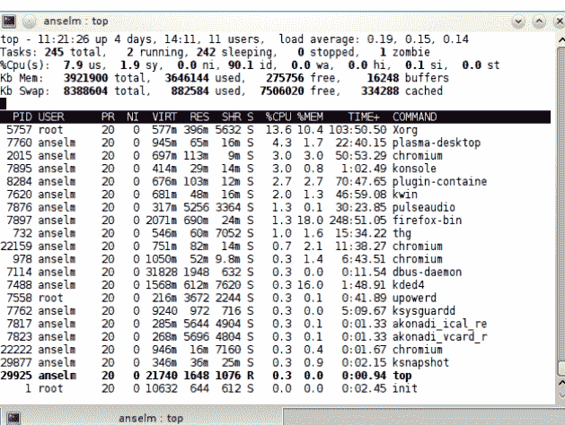

**图 12.1：** `top` 程序

- 在输出的顶部部分，第一行显示当前的挂钟时间和“uptime”，即自系统启动以来经过的时间（在此为四天，十四小时，和一些分钟）以及登录用户的数量（这里的“11”不应被过于严肃对待；终端窗口中的每个会话都算作一个用户）。右侧有三个数字，即所谓的平均负载，用于描述系统负载。

💡 平均负载指定了可运行进程（状态 R）的数量，分别取最近一分钟、最近五分钟和最近十五分钟的平均值。这些值的效用不应被高估（{}）；它们并没有真正告诉你很多信息。如果最近一分钟的值很高，而最近 15 分钟的值很低，那么你的系统突然有很多工作要做；如果最近一分钟的值很低，但最近 15 分钟的值很高，你的系统之前有很多工作要做但现在已经结束了。

💡 如果平均负载始终低于你系统中处理器核心的数量，这意味着你在昂贵的处理器上不必要的超支了。例如，在八核系统上，围绕 8 的数值（传统上会使系统管理员脊背发凉）完全不足为奇；在很长一段时间内远小于 8 的数值则是可悲的。

- 第二行给出了进程的数量以及它们在各个进程状态中的分布情况。

- 第三行包含根据 CPU 利用率类型划分的百分比：“us”是指操作系统内核之外的代码执行，“sy”是指内核内部的代码执行。“ni”是指用户故意降低其优先级的操作系统内核之外的代码，“id”表示空闲，“wa”表示等待 I/O，其他三列则不太有趣。

- 接下来的两行基本上对应于 `free` 的输出。

- 屏幕的下半部分是一个类似 `ps 1` 的进程列表。与上半部分一样，它每隔几秒更新一次，并且默认按照列表中进程占用的 CPU 时间百分比进行排序（系统花费最多时间的进程排在列表首位）。

💡 如果你按下 `[m]` 键，列表将根据内存使用情况进行排序——最“肥胖”的进程排在顶部。使用 `[p]`，你可以回到 CPU 时间列表。

你可以使用 `[h]` 键在 `top` 内部显示帮助页面。`top(1)` 手册页详细解释了输出和可能的按键组合，并展示了如何根据需求调整进程列表的内容。

## 练习

- ✏️ **12.4** [1] 使用 `ps` 选项 `ax`，你可以显示系统上的所有进程。查看列表。你认出哪些进程？

- ✏️ **12.5** [2] 在 shell 会话中启动一个长时间运行的进程（类似 `sleep 120` 的即可）。在另一个会话中，调用 `ps ax` 并尝试在输出中定位该进程。（提示：`grep` 是你的朋友。）

- ✏️ **12.6** [2] 使用 `top` 找出当前使用 CPU 时间最多的进程。哪些进程使用了最多的内存？

# 12.4 软件包管理

当代 Linux 发行版通常由众多（通常成千上万）“软件包”组成，每个软件包都包含系统某项功能所需的一切：可执行程序、库、文档，…… 在初始配置 Linux 计算机时，作为管理员，你可以指定应在计算机上安装哪些软件包，当然，你以后也可以随时从你的发行版中添加任意软件包，或移除未使用的软件包。

功能如何划分为软件包取决于发行版。对于库，通常区分“运行时软件包”和“开发软件包”。运行时软件包包含其他程序使用该库所需安装的文件（例如 `.so` 文件中实际的动态加载库）。只有当你打算使用库编译新程序或现有程序时，才需要安装开发软件包——这包含了 C 编译器使用该库所需的信息（“头文件”）、用于调试的静态链接库，或关于库内容的文档。如果文档很大，它可能会被分离到另一个软件包中。

例如，以下是 Debian GNU/Linux 6.0（“Squeeze”）中 `rsvg` 库（处理 SVG 格式图形）的软件包划分：

| 软件包名称 | 描述 |

| :--- | :--- |

| `librsvg2-2` | 实际的（运行时）库 |

| `librsvg2-dev` | 开发软件包 |

| `librsvg2-bin` | 命令行程序 |

| `librsvg2-dbg` | 调试信息 |

| `librsvg2-doc` | 文档 |

| `librsvg2-common` | 更多命令行程序 |

| `python-rsvg` | Python 语言绑定 |

| `libimage-linuxrsvg-perl` | Perl 语言绑定 |

在每台 Linux 计算机<sup>1</sup> 上，都有一个“软件包数据库”，其中包含关于计算机已知软件包以及其中哪些当前已安装的信息。你可以定期将软件包数据库与你的发行版的“存储库”（包含软件包的服务器）进行同步，从而找出你计算机上的哪些软件包因为发行版提供了新版本而过时了。软件包管理系统通常会提供机会让你选择性地更新相关软件包。

这在实践中效果如何（再次强调）取决于你的发行版。特别是，问题可能比看起来更复杂：例如，一个软件包的新版本可能需要安装一个库（作为其自身的软件包提供）的新版本，如果另一个已安装的程序绝对需要该库的旧版本，这就可能导致问题。有时，如果不进行系统其他地方的重大更改，就无法更新软件包。好的软件包管理系统会检测到这种情况并向你作为管理员发出警告，和/或提供干预的机会。

正如第 2.4.7 节所述，主要的 Linux 发行版使用两种不同的软件包管理系统之一，两者都带有自己的工具和软件包文件自己的格式——Debian GNU/Linux 及其衍生版本的软件包管理系统，以及 Red Hat、SUSE 等使用的 RPM 软件包管理器。原则上，两者解决的是同一个问题，但在用于软件包管理的命令等细节上有所不同。例如，在

1. 至少是使用主要发行版的那些——有一些发行版似乎在没有软件包管理系统的情况下也能运行，但这些是给极客用的。

版权所有 © 2012 Linup Front GmbH


在基于 RPM 的系统（如 RHEL、Fedora 或 openSUSE）中，您可以使用 `rpm --query --all` 命令显示所有已安装包的列表，而在基于 Debian 的系统上，则需改用 `dpkg --list` 命令。

包数据库本身通常位于 `/var/lib` 目录下；在类似 Debian 的系统中位于 `/var/lib/dpkg`（此外 `/var/cache/apt` 还包含仓库服务器的目录内容以及已下载的包文件），在基于 RPM 的系统中则位于 `/var/lib/rpm`。

如今，像 `dpkg` 和 `rpm` 这样的程序构成了包管理系统的“基石”。管理员更倾向于使用基于这些基础程序构建的更便捷的 工具，例如方便访问软件包仓库以及自动解决包之间的依赖关系。在 Debian 世界中，这些工具包括“`Aptitude`”和“`Synaptic`”，而在 RPM 阵营中，Red Hat 依赖于名为 `YUM` 的程序，SUSE 则依赖于名为“`Zypper`”的程序（尽管包管理功能也已集成到通用管理工具 `YaST` 中）。

其中一些工具甚至独立于底层的包管理系统。例如，“`PackageKit`”不仅可以使用 Debian 或 RPM 包管理，还可以在受控条件下允许没有管理员权限的普通用户安装或更新软件包。

## 练习

**12.7 [2]** 您的系统上安装了多少个软件包？使用上述显示的 `rpm` 或 `dpkg` 命令并统计输出中的行数。（注意：`dpkg -l` 还会显示曾经安装但已被移除或被更新版本取代的软件包。只统计输出中以“ii”开头的行。）

## 本章命令

| **命令** | **描述** | **手册页** |

|---|---|---|

| `dpkg` | Debian GNU/Linux 包管理工具 | `dpkg`(8) 166 |

| `free` | 显示主内存和交换空间使用情况 | `free`(1) 162 |

| `ps` | 输出进程状态信息 | `ps`(1) 161 |

| `rpm` | 多种 Linux 发行版（Red Hat、SUSE 等）使用的包管理工具 | `rpm`(8) 166 |

| `su` | 以不同用户的身份启动 shell | `su`(1) 158 |

| `sudo` | 允许普通用户以管理员权限执行特定命令 | `sudo`(8) 159 |


| `top` | 基于屏幕的进程监控和控制工具 | `top`(1) 162 |

## 摘要

- Linux 区分“普通”用户和系统管理员 `root`。`root` 免于通常的权限检查。
- 作为普通用户，您可以通过 `su` 或 `sudo` 获取临时管理员权限。
- Linux 计算机的配置包含在 `/etc` 目录下的文本文件中。
- 进程是被执行的程序。
- `ps` 和 `top` 等命令允许您洞察当前系统状态。
- 重要的 Linux 发行版要么使用 GNU/Linux 的包管理系统，要么使用由 Red Hat 最初开发的 RPM 系统。
- 基于基础工具，大多数发行版提供便于管理、安装和删除软件包（包括依赖项）的软件。

## 用户管理

### 内容

13.1 基础知识 ..... 170

- 13.1.1 为什么需要用户？ ..... 170
- 13.1.2 用户和组 ..... 171
- 13.1.3 人与伪用户 ..... 173

13.2 用户和组信息 ..... 173

- 13.2.1 `/etc/passwd` 文件 ..... 173
- 13.2.2 `/etc/shadow` 文件 ..... 176
- 13.2.3 `/etc/group` 文件 ..... 178
- 13.2.4 `/etc/gshadow` 文件 ..... 179

13.3 管理用户账户和组信息 ..... 180

- 13.3.1 创建用户账户 ..... 180
- 13.3.2 `passwd` 命令 ..... 182
- 13.3.3 删除用户账户 ..... 183
- 13.3.4 修改用户账户和组分配 ..... 184
- 13.3.5 直接修改用户信息—`vipw` ..... 184
- 13.3.6 创建、修改和删除组 ..... 184

### 目标

- 理解 Linux 的用户和组概念
- 了解 Linux 如何存储用户和组信息
- 能够使用用户和组管理命令

### 先决条件

- 关于处理配置文件的知识

# 13 用户管理

## 13.1 基础知识

### 13.1.1 为什么需要用户？

计算机过去又大又贵，但如今，没有自己 PC（“个人计算机”）的办公场所几乎不可想象，大多数家庭的“书房”里也难免会出现一台计算机。虽然家庭内部可能只需达成一致，让爸爸、妈妈和孩子们将文件放入不同的目录即可，但在公司或大学中这就行不通了——一旦由中央服务器提供共享磁盘空间或其他设施供许多用户访问，计算机系统就必须能够区分不同的用户，并为他们分配不同的访问权限。毕竟，来自开发部门的琼斯女士与公司薪资数据没有任何关系，正如来自人力资源部的史密斯先生无权访问明年产品的详细计划一样。甚至在家里也可能需要一定的隐私——圣诞礼物清单或十几岁女儿的日记（以前还配把锁）不应理所当然地对窥探者开放。

我们将忽略十几岁女儿的日记可能在整个世界的 Facebook（或类似平台）上可见的事实；即使如此，整个世界也不应被允许*写入*十几岁女儿的日记。（这就是为什么即使 Facebook 也支持不同用户概念的原因。）

区分不同用户的第二个原因源于这样一个事实：系统的各个方面在没有特殊权限的情况下不应可见，更不应可更改。因此，Linux 为系统管理员管理一个独立的用户身份（`root`），这使得将密码等用户信息对“普通”用户保持隐藏成为可能。旧版 Windows 系统的弊端——通过电子邮件获得或无差别网络冲浪时获得的程序随后破坏整个系统——不会在 Linux 上困扰您，因为您作为普通用户可执行的任何操作都不具备造成系统性破坏的能力。

不幸的是，这并不完全正确：时不时会有 bug 暴露出来，使得“普通用户”能够执行通常仅限管理员的操作。这种错误极其棘手，通常在发现后会被迅速修复，但存在相当大的可能性，此类 bug 已在系统中*未被检测到*相当长的时间。因此，在 Linux 上（就像在其他所有操作系统上一样），您应努力运行您的发行商支持的关键系统组件（如内核）的最新版本。

即使是 Linux 保护系统配置免受普通用户未授权访问这一事实，也不应引诱您停止思考。我们确实给您一些建议（例如不要以 `root` 身份登录图形用户界面），但您应保持思考。要求您查看网站 X 并在那里输入您的信用卡号和 PIN 的电子邮件消息即使是在 Linux 上也可能到达您，您应像在其他任何地方一样无视它们。

Linux 通过不同的 `用户账户` 来区分不同的用户。常见的发行版通常在安装过程中创建两个用户账户，即用于管理任务的 `root` 和用于“普通”用户的另一个账户。您（作为管理员）可以稍后添加更多账户，或者在大型网络中的客户端 PC 上，它们可能自动从存储在别处的用户账户数据库中出现。

Linux 区分的是*用户账户*，而不是用户。例如，如果您想 100% 确保从...


Copyright © 2012 Linup Front GmbH

网络无法访问你的重要数据（尽管存在用户/管理员的划分，否则可能会发生这种情况）。凭借一点巧思，你甚至可以在你的“普通”程序之间显示一个正在你的“上网账户”下运行的浏览器和电子邮件程序 [1]。

在 Linux 中，每个用户账户都会被分配一个唯一的数字，即所谓的用户 ID（或简称 UID）。每个用户账户还有一个文本形式的用户名（例如 `root` 或 `joe`），这对于人类来说更容易记忆。在大多数重要的地方——例如登录时，或在文件及其所有者的列表中——Linux 总是尽可能使用文本形式的名称。


Linux 内核并不了解任何关于文本用户名的信息；进程数据和文件系统中的所有权数据仅使用 UID。如果一个用户在仍然拥有系统中文件的情况下被删除，且其 UID 被重新分配给另一个用户，这就可能导致困难。那位用户将“继承”之前 UID 所有者的文件。


将相同的（数字）UID 分配给不同的用户名在技术上没有障碍。这些用户对该 UID 所拥有的所有文件具有平等的访问权限，但每个用户都可以拥有自己的密码。你实际上不应该使用这种功能（或者如果使用，务必极其谨慎）。

### 13.1.2 用户和组

要操作 Linux 计算机，你首先需要登录。这使系统能够识别你并为你分配正确的访问权限（相关内容将在后文详细讨论）。你在会话期间所做的一切（从登录到注销）都在你的用户账户下进行。此外，每个用户都有一个主目录，在此目录中，他们只能存储和管理自己的文件，而其他用户通常没有读取权限，更绝没有写入权限。（只有系统管理员——`root`——可以读写所有文件。）


取决于你使用的 Linux 发行版（提示：Ubuntu），你也许不需要显式地登录系统。这是因为计算机“知道”通常使用它的是你，并简单地假设情况如此。你是在用安全性换取便利性；这种交易可能仅在你能够相当确定除你之外没有人会开机——因此对于没有清洁工的单人家庭而言，应该通过电脑权限加以限制——这种情况下才有意义。我们早就告诉过你这一点。

希望共享访问特定系统资源或文件的多个用户可以组成一个组。Linux 通过名称固定识别组成员，或通过类似于用户登录的临时登录过程识别组成员。组没有像用户那样的“主目录”，但作为管理员，你当然可以创建旨在供特定组使用并具有相应访问权限的任意目录。

组在内部也是通过数字标识符（“组 ID”或 GID）来识别的。


组名与 GID 的关系相当于用户名与 UID 的关系：Linux 内核只知晓前者，并且仅在进程数据或文件系统中存储前者。

每个用户属于一个主组，并可能属于多个次要组或附加组。在企业环境中，例如，可以引入特定于项目的项目组，并将参与这些项目的协作者分配到相应的组中，以便允许他们在仅对组成员可访问的目录中管理共同数据。

¹ 这当然又稍微危险一些，因为运行在同一屏幕上的程序可以相互通信


就访问控制而言，所有组的权重是等同的——每个用户始终享有其所属所有组的所有权限。主组和次要组之间唯一的区别在于，用户新建的文件通常² 会被分配给其主组。

直到 Linux 内核 2.4 版本（包括该版本），用户最多可以是 32 个附加组的成员；自 Linux 2.6 起，次要组的数量没有限制。

你可以使用 `id` 程序来查看用户账户的 UID、主组和次要组以及相应的 GID：


```bash
$ id
uid=1000(joe) gid=1000(joe) groups=24(cdrom),29(audio),44(video),1000(joe)
$ id root
uid=0(root) gid=0(root) groups=0(root)
```

通过选项 `-u`、`-g`、`-G`，可以说服 `id` 仅输出账户的 UID、主组的 GID 或次要组的 GID。（这些选项不能组合使用。）使用附加选项 `-n` 你将获得名称而非数字：

```bash
$ id -G
1000 24 29 44
$ id -Gn
joe cdrom audio video
```

`groups` 命令产生的结果与 `id -Gn` 命令相同。

你可以使用 `last` 命令来查找谁登录了你的计算机以及登录时间（如果是通过网络登录，则还会显示来源位置）：

```bash
$ last
joe     pts/1      pcjoe.example.c  Wed Feb 29 10:51   still logged in
bigboss pts/0      pc01.example.c   Wed Feb 29 08:44   still logged in
joe     pts/2      pcjoe.example.c  Wed Feb 29 01:17 - 08:44 (07:27)
sue     pts/0      :0               Tue Feb 28 17:28 - 18:11 (00:43)
<reboot>
reboot  system boot 3.2.0-1-amd64      Fri Feb   3 17:43 - 13:25 (4+19:42)
<xxxxxx>
```

对于基于网络的会话，第三列指定了 `ssh` 客户端计算机的名称。“`:0`” 代表图形屏幕（确切地说是第一个 X 服务器——可能存在多个）。

也请注意 `reboot` 条目，它告诉你计算机已启动。第三列包含了由 `uname -r` 提供的 Linux 操作系统内核版本号。

提供用户名后，`last` 会提供关于特定用户的信息：

```bash
$ last joe
joe     pts/1      pcjoe.example.c  Wed Feb 29 10:51   still logged in
joe     pts/2      pcjoe.example.c  Wed Feb 29 01:17 - 08:44 (07:27)
<xxxxxx>
```

² 例外情况发生在目录的所有者规定该目录内的新文件和子目录应被分配给与目录本身相同的组时。我们提及这一点纯粹是为了完整性。

你可能会被（并且有理地！）困扰于这样的事实：这些略带敏感的信息显然被随意地开放给任何系统用户访问。如果你（作为管理员）想要比你的 Linux 发行版默认设置更好地保护用户的隐私，你可以使用

```bash
# chmod o-r /var/log/wtmp
```

命令移除 `last` 查阅数据的那个文件的通用读取权限。没有管理员权限的用户随后看到的将类似于：

```bash
$ last
last: /var/log/wtmp: Permission denied
```

### 13.1.3 人员和伪用户

除了“自然”人——系统的人类用户——之外，用户和组概念也被用于向系统的特定部分分配访问权限。这意味着，除了像你这般的“真实”用户的个人账户外，还有一些并不对应实际人类用户而是内部分配给管理功能的账户。它们通过自己的账户和组定义了功能性的“角色”。

安装 Linux 后，你会在 `/etc/passwd` 和 `/etc/group` 文件中找到若干这样的伪用户和组。最重要的角色是 `root` 用户（你已了解）及其同名组。`root` 的 UID 和 GID 均为 0（零）。

`root` 的特权与 UID 0 绑定；GID 0 并不赋予任何额外的访问权限。

其他伪用户属于某些软件系统（例如，使用 INN 的 Usenet 新闻的 `news`，或 Postfix 邮件服务器的 `postfix`）或某些组件或设备（如打印机、磁带机或软盘驱动器）。如有必要，你可以通过 `su` 命令像其他用户账户一样访问这些账户。这些伪用户作为文件或目录所有者很有用，以便将文件所有权绑定的访问权限适应特殊需求，而不必使用 `root` 账户。组也是如此；例如，`disk` 组的成员对系统磁盘具有块级访问权限。

## 练习

- 13.1 [1] 操作系统内核如何区分不同的用户和组？

- 13.2 [2] 如果将 UID 分配给两个不同的用户名会发生什么？这被允许吗？

- 13.3 [1] 什么是伪用户？举例说明！

- 13.4 [2] （在第二遍阅读时。）将你不希望信任 `root` 密码的用户分配给 `disk` 组是否可接受？为什么（不）？

## 13.2 用户和组信息

### 13.2.1 /etc/passwd 文件

`/etc/passwd` 文件是系统用户数据库。系统中每个用户在此文件中都有一个条目——一行由诸如 Linux 用户名等属性组成，

“真实”姓名等。系统在首次安装后，该文件将包含大多数伪用户的相关条目。

`/etc/passwd` 中的条目格式如下：

```
(用户名):(密码):(UID):(GID):(GECOS):(主目录):(shell)
```

- **(用户名)** 此名称应由小写字母和数字组成；第一个字符应为字母。Unix 系统通常只考虑前八个字符——Linux 没有此限制，但在异构网络中你需要予以考虑。


切勿使用变音符号、标点符号和其他类似特殊字符作为用户名，即使系统允许你这样做——并非所有创建新用户账户的工具都如此挑剔，并且你当然可以手动编辑 `/etc/passwd`。乍看之下似乎完美运行的设置，日后可能会在别处导致问题。


你应避免使用仅由大写字母或仅由数字组成的用户名。前者可能会让所有者在登录时遇到麻烦（见练习 13.6），后者则可能导致混淆，特别是当数字用户名不等于账户的数字 UID 时。如果 `/etc/passwd` 中没有对应的条目，诸如 `ls -l` 这样的命令将显示 UID，而仅凭 ls 输出中的纯数字用户名来区分 UID 并非直观明了。

- **(密码)** 传统上，此字段包含用户的加密密码。如今，大多数 Linux 发行版使用“影子密码”；密码不再存储在可公开读取的 `/etc/passwd` 文件中，而是存储在 `/etc/shadow` 文件中，该文件只能由管理员和某些特权程序访问。在 `/etc/passwd` 中，字符 “x” 用于提示这一情况。每个用户都可以使用 `passwd` 程序来更改其密码。

- **(UID)** 数字用户标识符——一个介于 0 和 $2^{32} - 1$ 之间的数字。按照惯例，0 到 99（含）的 UID 保留给系统使用，100 到 499 的 UID 供软件包使用，如果软件包需要伪用户账户。在大多数流行发行版中，“真实”用户的 UID 从 500（或 1000）开始。

正是因为系统根据 UID 而非用户名来区分用户，内核会将两个包含不同用户名但相同 UID 的账户视为完全相同——至少就访问权限而言如此。显示用户名的命令（例如 `ls -l` 或 `id`）将显示用户登录时使用的用户名。

- **(主组 GID)** 用户登录后的主组 GID。


Novell/SUSE 发行版（以及其他发行版）将单一组（如 `users` 组）指定为所有用户的共享主组。这种方法相当成熟且易于理解。


许多发行版，例如 Red Hat 或 Debian GNU/Linux，在创建新账户时也会创建一个新的组，该组的 GID 等于该账户的 UID。其背后的想法是允许比将所有用户放入同一个 `users` 组的方法更精细的权限分配。考虑以下情况：Jim（用户名 `jim`）是首席执行官 Sue（用户名 `sue`）的私人助理。在此身份下，他有时需要访问存储在 Sue 主目录中但其他用户无权访问的文件。Red Hat、Debian 等使用的“每用户一组”方法使得将用户 `jim` 添加到组 `sue` 中，并设置 Sue 的文件对组内所有成员（默认情况）可读但对其他用户不可读变得简单直接。若采用“每人一组”的方法，则必须从头引入一个全新的组，并相应重新配置 `jim` 和 `sue` 的账户。

根据 `/etc/passwd` 中的分配，每个用户必须是至少一个组的成员。

用户的次要组（如果适用）由 `/etc/group` 文件中的条目决定。

- **(GECOS)** 这是注释字段，也称为“GECOS 字段”。


GECOS 代表 "General Electric Comprehensive Operating System"（通用汽车综合操作系统），除了早期 Unix 时代为了兼容 GECOS 远程作业输入服务而将此字段添加到 `/etc/passwd` 中外，与 Linux 没有任何关系。

此字段包含有关用户的各种信息，特别是其“真实”姓名以及诸如办公室编号或电话号码等可选数据。这些信息被 `mail` 或 `finger` 等程序使用。新闻和邮件软件通常会在发件人地址中包含全名。

理论上，有一个名为 `cshn` 的程序允许你（作为用户）更改你的 GECOS 字段的内容。但这是否能在特定情况下正常工作是另一个问题，因为至少在企业环境中，不一定希望允许人们随心所欲地更改自己的姓名。

- **(主目录)** 此目录是该用户存储个人文件的专用区域。新建的主目录绝非空空如也，因为新用户通常会获得若干“配置文件”作为其基本配置。当用户登录时，其 shell 会将主目录用作当前目录，即，登录后用户立即被放置在此目录中。

- **(shell)** 成功验证后由 `login` 启动的程序名称——通常是一个 shell。第七个字段延伸到行尾。

用户可以通过 `csh` 程序更改此条目。可用的程序（shells）列在 `/etc/shells` 文件中。如果用户不应拥有交互式 shell，则可以在这里输入一个带有参数 的任意程序（常见候选项是 `/bin/true`）。此字段也可以保持为空，在这种情况下，将启动标准 shell `/bin/sh`。

如果你登录到图形环境，会有各种程序代你启动，但不一定是交互式 shell。然而，当你调用终端仿真器（如 `xterm` 或 `konsole`）时，`/etc/passwd` 中的 shell 条目便显得尤为重要，因为这些程序通常检查此项以确定你首选的 shell。

此处显示的部分字段可能为空。绝对必需的只有用户名、UID、GID 和主目录。对于大多数用户账户，所有字段都会被填写，但伪用户可能仅使用部分字段。

主目录通常位于 `/home` 之下，并以所有者的用户名为名。通常，这是一个相当合理的约定，使得特定用户的主目录易于查找。理论上，主目录可以放置在文件系统下的任何位置，并具有完全任意的名称。主目录

在大型系统中，常见做法是在 `/home` 和“用户名”目录之间引入一个或多个额外的目录层级，例如

| 路径 | 描述 |
| :--- | :--- |
| `/home/hr/joe` | 人力资源部的小乔 |
| `/home/devel/sue` | 开发部的小苏 |
| `/home/exec/bob` | 首席执行官小鲍勃 |

这样做有几个原因。一方面，这使得更容易将某个部门的主目录保留在该部门的服务器上，同时仍可将其提供给其他客户端计算机。另一方面，Unix（以及一些 Linux）文件系统过去在处理包含大量文件的目录时速度较慢，这对拥有数千个条目的 `/home` 会产生不利影响。然而，随着当前 Linux 文件系统（如带有 `dir_index` 的 `ext3` 及类似系统）的发展，这已不再是问题。

请注意，作为管理员，你不应该真的手动编辑 `/etc/passwd`。有许多程序可以帮助你创建和维护用户账户。


原则上，用户数据库也可以存储在 `/etc/passwd` 之外的其他位置。在拥有非常多用户（数千）的系统中，将用户数据存储关系型数据库中更可取；而在异构网络中，基于 LDAP 目录的共享多平台用户数据库可能更为合适。但细节超出了本课程的讨论范围。

### 13.2.2 `/etc/shadow` 文件

出于安全考虑，几乎所有当前 Linux 发行版都在 `/etc/shadow` 文件中存储加密的用户密码（“影子密码”）。此文件对普通用户不可读；只有 `root` 可以写入，`shadow` 组的成员除了 `root` 之外也可以读取。如果你尝试以普通用户身份显示该文件，将发生错误。


使用 `/etc/shadow` 并非强制性的，但高度推荐。然而，可能存在某些系统配置会使影子密码提供的额外安全性失效，例如当使用 NIS 将用户数据导出到其他主机时（尤其是在异构 Unix 环境中）。

同样，此文件包含每个用户的一行，格式如下：

```
<用户名>::<密码>::<更改>::<最小值>::<最大值>::<警告>::<宽限期>::<锁定>::<保留>
```

例如：

```
root:GaY2L19jxHj5:10816:0:10000:::
daemon:0*:8902:0:10000:::
Joe:GodY6c5p2kIxs:10816:0:10000:::
```

各个字段的含义如下：

- **用户名** 这必须与 `/etc/passwd` 文件中的一个条目对应。此字段“连接”这两个文件。

- **密码** 用户的加密密码。空字段通常意味着用户无需密码即可登录。星号或感叹号会阻止相关用户登录。通常，通过在相应密码开头放置星号或感叹号来锁定用户账户，而不是完全删除账户。

- **更改** 上次密码更改的日期，以自 1970 年 1 月 1 日起的天数为单位。

`min` 在上次密码更改之后，密码允许再次更改前必须经过的最小天数。

`max` 密码在不进行更改的情况下保持有效的最大天数。超过此时间后，用户必须更改其密码。

`warn` 在（`max`）期限到期前多少天，系统将警告用户必须更改其密码。通常，此警告会在登录时显示。

`grace` 从（`max`）期限到期开始计算的天数，如果用户在此期间未更改密码，账户将被锁定。（在（`max`）期限到期到该宽限期结束这段时间内，用户可以登录，但必须立即更改其密码。）

`lock` 账户将被永久锁定的日期，同样以自 1970 年 1 月 1 日起的天数表示。

关于密码加密，有一些简短的说明。你可能认为既然密码被加密了，它们就可以被再次解密。这会使系统的所有账户向任何设法获取 `/etc/shadow` 副本的高明破解者敞开大门。然而，现实情况并非如此，因为密码的“加密”是一条单行道。由于所使用加密方法的特性，无法从“加密”形式恢复 Linux 密码的解密表示。要“破解”加密的唯一方法是对可能的密码进行加密，并检查它们是否与 `/etc/shadow` 中的内容匹配。

假设你从 95 个可见 ASCII 字符（区分大小写字母）中选择密码字符。这意味着有 95 种不同的单字符密码，`95^2=9025` 种双字符密码，等等。使用八个字符时，可能性已经达到 6.6 千万亿（`6.6 * 10^15`）。假设你每秒可以试加密 200,000 个密码（在当前的硬件上并非完全不可实现），这意味着你需要大约 841 年才能遍历所有可能的密码。

但请不要过早感到安全。传统的加密方法（通常称为“crypt”或“DES”——后者是因为它基于但不等同于同名的加密方法）在可以避开的情况下不应再使用。它具有一个令人不快的属性：只查看输入密码的前八个字符，而如今高明得破解者可以购买足够的磁盘空间，构建一个包含 5000 万（左右）最常见密码的预加密缓存。要“破解”密码，他们只需在其缓存中搜索加密的密码，这可以极快地完成，然后读取对应的明文密码。

为了让事情变得更加费力，当新输入的密码被加密时，系统传统上会添加一个随机元素（所谓的“盐”，salt），它选择 4096 种不同的加密密码可能性之一。盐的主要目的是避免随机命中，例如用户 X 出于某种原因瞥见了 `/etc/shadow` 的内容，并注意到其加密密码看起来与用户 Y 的完全一样（从而让他能够使用自己的明文密码登录用户 Y 的账户）。一个令人愉快的附带效应是，前一段中提到的破解者预加密字典所需的磁盘空间被扩大了 4096 倍。


如今，密码加密通常基于 MD5 算法，允许任意长度的密码，并使用 48 位盐而不是传统的 12 位。体贴的是，加密过程比“crypt”慢得多，这对于常规用途（在登录时检查密码——你仍然可以每秒加密几百个密码）无关紧要，但在一定程度上给高明破解者带来了麻烦。（你不应该因为密码学家诋毁 MD5 方案的不安全性而感到困扰。就密码加密而言，这是毫无意义的。）


你不应该对各种密码管理参数期望太高。它们被文本控制台登录过程使用，但系统的其他部分（如图形化登录屏幕）是否注意它们取决于你的配置。通常，在短间隔内强制用户设置新密码也没有优势——这通常会导致诸如 `bob1`, `bob2`, `bob3`, ... 这样的序列，或者用户在两个密码之间交替使用。*允许用户再次更改密码前必须经过的最小间隔是极其危险的，因为它可能给破解者提供一个“窗口”进行非法访问，尽管用户知道其密码已被泄露。*


作为系统管理员，你需要应对的问题通常不是人们试图通过“暴力破解”来破译你系统的密码。通常更有希望的是使用“社会工程学”。为了猜测你的密码，高明破解者不会从 a, b 等开始，而是从你配偶的名字、你孩子的名字、你车的车牌号、你狗的生日等开始。（我们绝不暗示*你*会使用如此愚蠢的密码。不，不，绝对不可能是*你*。然而，你对你的老板并不那么肯定 ...）当然，还有老派的电话方法：“你好，我是 IT 部门。我们正在进行安全系统测试，紧急需要你的用户名和密码。”

有多种方法可以使 Linux 密码更安全。除了上述改进的加密方案（现在大多数 Linux 发行版默认使用）外，这些方法包括在首次设置时对（过于）弱的密码发出警告，或者主动运行软件以尝试识别弱的加密密码，就像高明破解者那样。（*注意：仅在获得老板的书面（！）预先批准后才在你的工作场所这样做！*）其他方法完全避免使用密码，转而使用不断变化的魔数（如 SecurID）或智能卡。所有这些内容都超出了本手册的范围，因此我们推荐你参阅 Linup Front 手册 *Linux 安全性*。

## 13.3.3 /etc/group 文件

默认情况下，Linux 在 */etc/group* 文件中保存组信息。此文件包含系统中每个组的一行条目，与 */etc/passwd* 中的条目一样，由冒号（`:`）分隔的字段组成。更准确地说，*/etc/group* 每行包含四个字段。

```
(group name)::password::GID::members
```

它们的含义如下：

- `(*group name*)` 组的名称，用于目录列表等。
- `(*password*)` 该组的一个可选密码。这允许未通过 */etc/shadow* 或 */etc/group* 成为该组成员的用户使用 `newgrp` 假设该组成员身份。作为无效字符的 `"*"` 阻止普通用户更改到该组。 `"x"` 指代单独的密码文件 `/etc/gshadow`。
- **`<GID>`** 组的数值组标识符。
- **`<Members>`** 用逗号分隔的用户名列表。此列表包含所有将此组作为次要组的用户，即，那些属于该组但在 `/etc/passwd` 条目的 GID 字段中拥有不同值的人。（将此组作为其主要组的用户也可以列在这里，但这是不必要的。）

/etc/group 文件可能如下所示：

```
root:x:0:root
bin:x:1:root,daemon
users:x:100:
project1:x:101:joe,sue
project2:x:102:bob
```

`root` 和 `bin` 组的条目是管理组的条目，类似于系统的伪用户账户。许多文件被分配给此类组。其他组包含用户账户。与 UID 一样，GID 从特定值计数，通常是 100。对于有效条目，至少必须填写第一个和第三个字段（组名和 GID）。这样的条目为 GID（可能在 `/etc/passwd` 中用户的 Primary GID 字段中出现）分配一个文本名称。

仅对于作为次要组分配给用户的组，才必须填写密码和/或成员字段。列在成员列表中的用户在使用 `newgrp` 命令更改 GID 时不会被要求输入密码。如果提供了加密密码，没有成员列表条目的用户可以验证密码以假设组 membership。

实际上，组密码几乎从未使用，因为管理开销几乎不能证明由此产生的好处是合理的。一方面，将组直接分配给相关用户更方便（因为从 Linux 内核 2.6 版本开始，用户可以加入的次要组数量没有限制），另一方面，必须*所有*组成员都知道的*单个*密码并不能提供无懈可击的安全性。

如果你想确保安全，请确保每个组密码槽中都有一个星号（“*”）。

### 13.3.4 /etc/gshadow 文件

与用户数据库一样，组数据库也有影子密码扩展。组密码，否则在 `/etc/group` 中是加密的但任何人都可读（类似于 `/etc/passwd`），存储在单独的文件 `/etc/gshadow` 中。此文件还包含关于组的附加信息，例如有权从组中添加或移除成员的组管理员的名称。

## 练习

- 13.5 [1] 你将在 `/etc/passwd` 文件的第二列中找到什么值？为什么你在那里找到那个值？
- 13.6 [2] 切换到文本控制台（例如使用 `[Alt]+[F1]`）并尝试登录，但输入大写形式的用户名。会发生什么？

## 13.3 管理用户账户和组信息

在安装完一个新的 Linux 发行版后，通常只有*root*（系统管理员）账户和伪用户账户。其他用户账户必须首先创建（如今大多数发行版都会温和但坚定地提示安装者创建至少一个“普通”用户账户）。作为管理员，您有责任创建和管理所有必需用户（包括真实用户和伪用户）的账户。为了便于此操作，Linux 附带了几个用于用户管理的工具。使用这些工具，这主要是一项直接明了的任务，但了解其背景知识非常重要。


### 13.3.1 创建用户账户

创建新用户账户的过程（原则上）始终相同，包括以下步骤：

- 1. 您必须在 `/etc/passwd`（以及可能的 `/etc/shadow`）文件中创建条目。
- 2. 如有必要，需要在 `/etc/group` 文件中创建一个（或多个）条目。
- 3. 您必须创建主目录，将一组基本文件复制到其中，并将所有内容的权限转让给新用户。
- 4. 如有必要，必须将用户添加到其他数据库中，例如磁盘配额、数据库访问权限表和特殊应用程序。

所有涉及添加新账户的文件都是纯文本文件。您可以使用文本编辑器手动执行每个步骤。然而，由于这项工作既繁琐又细致，最好让系统通过 `useradd` 程序来帮助您完成。


在最简单情况下，您只需向 `useradd` 传递新用户的用户名。可选地，您可以输入各种其他用户参数；对于未指定的参数（通常是 UID），系统会自动选择“合理”的默认值。根据请求，用户的主目录将被创建，并被赋予一组程序从 `/etc/skel` 目录获取的基本文件。`useradd` 命令的语法是：

```
useradd [ {options} ] (user name)
```

以下是可用的选项（其中包括）：

- `-c comment` GECOS 字段条目
- `-d home directory` 如果缺少此选项，则默认为 `/home/(user name)`
- `-e date` 在该日期，账户将自动失效（格式为“YYYY-MM-DD”）
- `-g group` 新用户的主组（名称或 GID）。该组必须存在。
- `-G group[,group]...` 附加组（名称或 GID）。这些组也必须存在。
- `-s shell` 新用户的登录 shell
- `-u UID` 新用户的数字 UID。除非提供“-o”选项，否则该 UID 必须未被使用
- `-m` 创建主目录并将基本文件集复制到其中。除非使用“-k (directory)”指定了不同的目录，否则这些文件来自 `/etc/skel`。

例如，

```
# useradd -c "Joe Smith" -m -d /home/joe -g devel -k /etc/skel.devel
```

该命令为名为 Joe Smith 的用户创建了名为 `joe` 的账户，并将其分配到 `devel` 组。Joe 的主目录创建为 `/home/joe`，并且 `/etc/skel.devel` 中的文件将被复制进去。

使用 `-D` 选项（在 SUSE 发行版中为 `--show-defaults`），您可以为 newUser 账户的某些属性设置默认值。如果不添加其他选项，将显示默认值：

```
# useradd -D
GROUP=100
HOME=/home
INACTIVE=-1
EXPIRE=
SHELL=/bin/sh
SKel=/etc/skel
CREATE_MAIL_SPOOL=no
```

您可以分别使用 `-g`、`-b`、`-f`、`-e` 和 `-s` 选项来更改这些值：

```
# useradd -D -s /usr/bin/zsh
zsh as the default shell
```

列表中最后两个值无法更改。

`useradd` 是一个相当低级的工具。在实际工作中，作为一名经验丰富的管理员，您可能不会通过 `useradd` 添加新的用户账户，而是通过包含您本地策略（以便您不必总是记住它们）的 shell 脚本来添加。不幸的是，您必须自己编写这个 shell 脚本——除非您使用的是 Debian GNU/Linux 或其衍生版（见下文）。

*注意：* 尽管每个主要的 Linux 发行版都附带一个名为 `useradd` 的程序，但它们的实现在细节上有所不同。

Red Hat 发行版包含一个相当普通的 `useradd` 版本，没有花哨的功能，提供了上述功能。


SUSE 发行版的 `useradd` 旨在选择将用户添加到 LDAP 目录中，而不是 `/etc/passwd` 文件。（这就是为什么不能像其他地方那样使用 `-D` 选项来查询或设置默认值——它已经被用于执行 LDAP 相关的操作。）具体细节超出了本手册的范围。

在 Debian GNU/Linux 和 Ubuntu 上，`useradd` 确实存在，但创建新用户账户的推荐方法是名为 `adduser` 的程序（值得庆幸的是这不会引起混淆）。`adduser` 的优势在于它遵循 Debian GNU Linux 的规则，并且除了创建实际的账户外，还允许对新账户执行任意其他操作。例如，可以在 Web 服务器的文档树中创建一个目录，以便新用户（且仅新用户）可以在那里发布文件，或者用户可以自动授权访问数据库服务器。您可以在 `adduser(8)` 和 `adduser.conf(5)` 中找到详细信息。

在使用 `useradd` 创建后，新账户尚不可访问；系统管理员必须先设置密码。我们将随后解释这个密码。

### 13.3.2 passwd 命令

`passwd` 命令用于为用户设置密码。如果您以 root 身份登录，那么

```
# passwd joe
```

会要求输入用户 `joe` 的新密码（您必须输入两次，因为屏幕不会回显）。

`passwd` 命令也供普通用户使用，以便他们更改自己的密码（更改其他用户的密码是 root 的特权）：

```
$ passwd
Changing password for joe.
(current) UNIX password: secret123
Enter new UNIX password: 321terces
Retype new UNIX password: 321terces
passwd:  password  updated  successfully
```

普通用户必须正确输入一次自己的密码，然后才被允许设置新密码。这旨在让那些在您不得不紧急外出且没有时间启用屏幕锁定时，在您电脑上捣乱的恶作剧者感到困难。

顺便说一下，`passwd` 还用于管理 `/etc/shadow` 中的各种设置。例如，您可以通过调用带有 `-S` 选项的 `passwd` 命令来查看用户的“密码状态”：

```
# passwd -S bob
bob LK 10/15/99 0 99999 7 0
```

输出中的第一个字段（再次）是用户名，后面是密码状态：如果设置了密码，则为 `PS` 或 `P`；如果是锁定账户，则为 `LK` 或 `L`；如果是完全没有密码的账户，则为 `NP`。其他字段分别是最后更改密码的日期、更改密码的最小和最大间隔、过期警告间隔以及密码过期后账户完全锁定前的“宽限期”。（另见第 13.2.2 节。）

您可以通过 `passwd` 选项更改其中一些设置。以下是一些示例：

```
# passwd -l joe    Lock the account
# passwd -u joe    Unlock the account
# passwd -m 7 joe  Password change at most every 7 days
# passwd -x 30 joe Password change at least every 30 days
# passwd -w 3 joe  3 days grace period before password expires
```

通过 `-l` 和 `-u` 锁定和解锁账户的工作原理是在 `/etc/shadow` 中的加密密码前放置一个 `!`。由于 `!` 不可能由密码加密产生，因此在登录时输入的任何内容都无法匹配用户数据库中的“加密密码”——因此，通过常规登录程序阻止了访问。一旦移除 `!`，原始密码重新生效。（很聪明，对吧？）但是，请记住，用户可能能够通过不引用用户数据库中加密密码的其他手段（例如使用公钥认证的 secure shell）访问系统。

更改 `/etc/shadow` 中剩余的设置需要 `chage` 命令：

```
# chage -E 2009-12-01 joe    Lock account from 1 Dec 2009
# chage -E -1  joe    Cancel expiry date
```

```
# chage -I 7 joe
# chage -m 7 joe
# chage -M 7 joe
# chage -W 3 joe
```

密码过期后 1 周的宽限期

类似于 `passwd -m`

类似于 `passwd -x`（啊，真烦。）

类似于 `passwd -w`（啊，真烦。）

（`chage` 可以修改 `passwd` 能修改的所有设置，还能做一些其他事情。）

如果您记不住选项名称，可以仅使用用户名账户名称调用 `chage`。程序将向您展示一系列当前值以供修改或确认。

即使您是管理员，也无法检索明文密码。即使检查 `/etc/shadow` 也无济于事，因为该文件已经存储了所有加密后的密码。如果用户忘记密码，通常使用 `passwd` 命令重置其密码即可。

如果您忘记了 root 密码，且无法以 root 身份登录，最后的办法是引导 Linux 进入 shell，或者从救援磁盘或 CD 引导。之后，您可以使用编辑器清除 `/etc/passwd` 中 root 条目的（密码）字段。

## 练习

- 1. **13.7** [3] 修改用户 `joe` 的密码。`/etc/shadow` 文件发生了哪些变化？查询该账户的密码状态。
- 2. **13.8** [2] 用户 `dumbo` 忘记了密码。您如何帮助他？
- 3. **13.9** [5] 调整用户 `joe` 的密码设置，使他至少在密码过期后一周才能修改密码，且最多两周后必须修改。在两周期限到来前两天应发出警告。之后检查这些设置。

### 13.3.3 删除用户账户

要删除用户账户，您需要从 `/etc/passwd` 和 `/etc/shadow` 中移除该用户的条目，删除 `/etc/group` 中对该用户的所有引用，并移除该用户的主目录以及该用户创建或拥有的其他所有文件。如果该用户拥有 `/var/mail` 中用于接收邮件的邮箱，该邮箱也应予以删除。

同样，有一个合适的命令可以自动化这些步骤。`userdel` 命令会完全移除用户账户。其语法如下：

```
userdel [-r] <用户名称>
```

`-r` 选项确保删除用户的主目录（包括其内容）以及 `/var/mail` 中的邮箱；属于该用户的其他文件——例如 cron 任务文件——必须手动删除。快速定位并删除属于特定用户的文件的方法是：

```
find / -uid <UID> -delete
```

命令。如果不加 `-r` 选项，则仅从用户数据库中移除用户信息；主目录仍保留在原地。

### 13.3.4 修改用户账户和组分配

用户账户和组分配传统上是通过编辑 `/etc/passwd` 和 `/etc/group` 文件来更改的。然而，许多系统包含 `usermod` 和 `groupmod` 等命令用于相同目的，您应优先使用这些命令，因为它们更安全且——*大多数情况下*——更便于使用。

`usermod` 程序接受的选项大多与 `useradd` 相同，但它修改的是现有用户账户，而不是创建新账户。例如，使用

```
usermod -g <组名> (用户名称)
```

您可以更改用户的主组。

*注意！* 如果您想更改现有用户账户的 UID，您可以直接编辑 `/etc/passwd` 中的 `(UID)` 字段。但是，您还应使用 `chown` 将该用户的文件转移至新的 UID：`chown -R tux /home/tux`——在更改该账户的 UID 后，将用户 `tux` 主目录下所有文件的重新所有权授予用户 `tux`。如果 `ls -l` 显示的是数字 UID 而非文本名称，这意味着这些文件的 UID 没有对应的用户名。您可以使用 `chown` 修复此问题。

### 13.3.5 直接修改用户信息——vipw

`vipw` 命令调用编辑器（`vi` 或其他编辑器）直接编辑 `/etc/passwd`。同时，该文件会被锁定，以防止其他用户同时通过（例如）`passwd`（这样会导致更改丢失）修改该文件。使用 `-s` 选项，可以编辑 `/etc/shadow`。

> 实际调用的编辑器由 `VISUAL` 环境变量的值决定，或者由 `EDITOR` 环境变量的值决定；如果两者都不存在，将启动 `vi`。

## 练习

- 13.10 [2] 创建一个名为 `test` 的用户。切换到 `test` 账户，并使用 `touch` 创建几个文件，包括主目录之外的几个目录（例如 `/tmp`）。切换回 root 并更改 `test` 的 UID。列出用户 `test` 的文件时您看到了什么？
- 13.11 [2] 使用您的发行版的图形工具（如果可用）创建一个名为 `test1` 的用户，使用 `useradd` 命令创建 `test2`，并手动创建另一个用户 `test3`。查看配置文件。使用这三个账户中的任何一个是否都能正常工作？使用每个新账户创建一个文件。


- 13.12 [2] 删除用户 `test2` 的账户，并确保系统中没有留下属于该用户的文件。
- 13.13 [2] 更改用户 `test1` 的 UID。您还需要做其他什么？
- 13.14 [2] 将用户 `test1` 的主目录从 `/home/test1` 更改为 `/home/user/test1`。

### 13.3.6 创建、修改和删除组

与用户账户类似，您可以使用多种方法创建组。与创建新用户账户相比，这里的“*手动*”方法要简单得多：由于组没有主目录，通常只需使用任意文本编辑器编辑 `/etc/group` 文件，并添加合适的新行（参见下文关于 `vigr` 的部分）。当使用组密码时，必须在 `/etc/gshadow` 中另外添加一个条目。

顺便说一下，为组创建目录并没有错。组成员可以将他们集体劳动的成果放在那里。这种方法与创建用户主目录类似，只是不需要复制基本配置文件集。

类比于 `useradd`、`usermod` 和 `userdel`，组管理有 `groupadd`、`groupmod` 和 `groupdel` 程序，您应优先使用这些程序，而不是直接编辑 `/etc/group` 和 `/etc/gshadow`。通过提供正确的命令参数，您可以使用 `groupadd` 简单地创建新组：

```
groupadd [-g ⟨GID⟩] ⟨组名⟩
```

`-g` 选项允许您指定特定的组编号。如前所述，这是一个正整数。通常 99 及以下的值保留给系统组。如果未指定 `-g`，则使用下一个空闲的 GID。

您可以使用 `groupmod` 编辑现有组，而无需直接写入 `/etc/group`：

```
groupmod [-g ⟨GID⟩] [-n ⟨名称⟩] ⟨组名⟩
```

“-g ⟨GID⟩” 选项更改组的 GID。未解决的文件组分配必须手动调整。“-n ⟨名称⟩” 选项为组设置新名称，而不更改 GID；无需手动调整。

还有一个工具用于移除组条目，不出所料，它被称为 `groupdel`：

```
groupdel ⟨组名⟩
```

这里，检查文件系统并使用 `chgrp` 命令调整文件的“孤立”组分配也是明智的。不能移除用户的主组——必须事先移除相关用户，或将他们重新分配到另一个主组。

`gpasswd` 命令主要用于以类似 `passwd` 命令的方式操作组密码。但是，系统管理员可以将组成员列表的管理委托给一个或多个组管理员。组管理员也使用 `gpasswd` 命令：

```
gpasswd -a ⟨用户⟩ ⟨组⟩
```

将 `⟨用户⟩` 添加到 `⟨组⟩`，而

```
gpasswd -d ⟨用户⟩ ⟨组⟩
```

将其再次移除。使用

```
gpasswd -A ⟨用户⟩,… ⟨组⟩
```

系统管理员可以指定将作为组管理员的用户。


SUSE 发行版已有一段时间没有包含 `gpasswd` 了。取而代之的是经过修改的用户和组管理工具版本，它们可以处理 LDAP 目录。

作为系统管理员，您可以使用 `vigr` 命令直接修改组数据库。它的工作原理类似于 `vipw`，通过调用编辑器获得 `/etc/group` 的“独占”访问权限。同样，“`vigr -s`” 允许您访问 `/etc/gshadow`。

# 练习

- 13.15 [2] 创建用户组的作用是什么？请举出可能的例子。
- 13.16 [1] 你能否创建一个目录，让组的所有成员都可以访问？
- 13.17 [2] 创建一个补充组 `test`。仅允许用户 `test1` 成为该组的成员。设置组密码。以用户 `test1` 或 `test2` 登录，并尝试切换到新组。

# 本章命令

| 命令 | 描述 | 参考 | 页码 |
| :--- | :--- | :--- | :--- |
| `adduser` | 创建新用户账户的便捷命令 (Debian) | adduser(8) | 181 |
| `chfn` | 允许用户更改用户数据库中的 GECOS 字段 | chfn(1) | 175 |
| `gpasswd` | 允许组管理员更改组成员身份并更新组密码 | gpasswd(1) | 185 |
| `groupadd` | 向系统组数据库添加用户组 | groupadd(8) | 185 |
| `groupdel` | 从系统组数据库中删除组 | groupdel(8) | 185 |
| `groupmod` | 修改系统组数据库中的组条目 | groupmod(8) | 185 |
| `groups` | 显示用户所属的组 | groups(1) | 172 |
| `id` | 显示用户的 UID 和 GID | id(1) | 172 |
| `last` | 列出最近登录的用户 | last(1) | 172 |
| `useradd` | 添加新用户账户 | useradd(8) | 180 |
| `userdel` | 移除用户账户 | userdel(8) | 183 |
| `usermod` | 修改用户数据库 | usermod(8) | 183 |
| `vigr` | 允许使用“文件锁定”编辑 `/etc/group` 或 `/etc/gshadow`，以避免冲突 | vigr(8) | 185 |

# 总结

- 对系统的访问由用户账户控制。
- 用户账户具有数字 UID 和（至少）一个文本用户名。
- 用户可以组成组。组具有名称和数字 GID。
- “伪用户”和“伪组”用于进一步细化访问权限。
- 中心用户数据库通常存储在 `/etc/passwd` 文件中。
- 用户的加密密码与其他密码参数一起存储在 `/etc/shadow` 文件中，该文件普通用户无法读取。
- 组信息存储在 `/etc/group` 和 `/etc/gshadow` 文件中。
- 密码使用 `passwd` 程序进行管理。
- `chage` 程序用于管理 `/etc/shadow` 中的密码参数。
- 用户信息使用 `vipw` 或——更好的——使用专用工具 `useradd`、`usermod` 和 `userdel` 进行修改。
- 可以使用 `groupadd`、`groupmod`、`groupdel` 和 `gpasswd` 程序来操作组信息。


# 14 访问控制

# 目录

- 14.1 Linux 访问控制系统 . . . . . . . . . . . . . . . . 188
- 14.2 文件和目录的访问控制 . . . . . . . . . . . . . . . . . . . . 188
    - 14.2.1 基础知识 . . . . . . . . . . . . . . . . . . . . . . . . . . . 188
    - 14.2.2 检查和更改访问权限 . . . . . . . . . . . . . . . . . . 189
    - 14.2.3 指定文件所有者和组——chown 和 chgrp . . . . . 190
- 14.3 进程所有权 . . . . . . . . . . . . . . . . . . . . . . . 191
- 14.4 可执行文件的特殊权限 . . . . . . . . . . . . . . . . 191
- 14.5 目录的特殊权限 . . . . . . . . . . . . . . . . . . . . . . . 192

# 目标

- 理解 Linux 访问控制/权限机制
- 能够向文件和目录分配访问权限
- 了解 SUID、SGID 和“粘滞位”（sticky bit）

# 先决条件

- 了解 Linux 用户和组概念（参见第 13 章）
- 了解 Linux 文件和目录

每当多个用户访问同一计算机系统时，必须存在针对进程、文件和目录的访问控制系统，以确保用户 *A* 无法随意访问用户 *B* 的私人文件。为此，Linux 实现了标准的 Unix 权限系统。

遵循 Unix 传统，每个文件和目录都恰好分配给用户（其所有者）一个和组一个。每个文件支持针对其所有者、所属组的成员（简称“该组”）和所有其他用户（“其他”）的独立权限。可以为这三类用户分别启用读取、写入和执行权限。所有者可以决定文件的访问权限。只有当所有者授予组和其他用户适当的权限时，组和其他用户才能访问文件。文件的访问权限总和也称为其 `访问模式`。

在存储私人或组内数据且通常可公开访问的多用户系统中，文件所有者可以通过实施适当的访问控制来阻止他人读取或修改其文件。可以独立且单独地确定文件对其所有者、其组和其他人的权限。访问权限允许用户将组协作流程的职责映射到组正在处理的文件上。

### 14.2 文件和目录的访问控制

#### 14.2.1 基础知识

对于系统中的每个文件和每个目录，Linux 允许针对三类用户——所有者、文件组成员和其他用户——分别设置不同的访问权限。这些权限包括读取权限、写入权限和执行权限。


就文件而言，这些权限大致控制着名称所暗示的内容：拥有读取权限的人可以查看文件内容，拥有写入权限的人可以更改其内容。启动文件作为进程需要执行权限。


运行二进制“机器语言程序”只需要执行权限。对于包含 shell 脚本或其他类型“解释型”程序的文件，你还需要读取权限。

对于目录，情况有些不同：查看目录内容需要读取权限——例如，通过执行 `ls` 命令。你需要写入权限才能在目录中创建、删除或重命名文件。“执行”权限代表“使用”目录的可能性，即你可以使用 `cd` 进入目录，或在指向目录树中更深层次文件的路径名称中使用其名称。


在你只有读取权限的目录中，你可以读取文件名，但无法了解关于文件的其他任何信息。如果你对目录只有“执行权限”，只要你知道文件名，就可以访问文件。

通常，单独将写入和执行权限分配给目录意义不大；但在某些特殊情况下可能有用。


重要的是要强调，如果要 **删除** 文件，对 *文件* 的写入权限完全无关紧要——你需要对该文件所在的 *目录* 具有写入权限，仅此而已！因为“删除”文件仅仅是从目录中移除对实际文件信息（inode）的引用，这纯粹是一个目录操作。如果你试图删除你没有写入权限的文件，`rm` 命令会警告你，但如果你确认该操作并且对相关目录具有写入权限，那么将没有任何障碍阻止操作成功。（与其他类 Unix 系统一样，Linux 没有直接“删除”文件的方法；你只能移除文件的所有引用，在这种情况下，Linux 内核自行决定没有人再能访问该文件，并清除其内容。

如果你拥有文件的写入权限但不拥有其目录的权限，你不能完全移除该文件。但是，你可以将其截断为 0 字节，从而移除其内容，尽管该文件原则上仍然存在。

对于每个用户，Linux 确定“最合适”的访问权限。例如，如果文件组的成员没有文件的读取权限，但“其他”用户有，那么组成员就不能读取该文件。（令人诱人的）理由——如果其他所有用户都可以查看文件，那么作为“其他”用户中某种意义上的组成部分，组成员也应该被允许读取它——并不适用。

### 14.2.2 检查和更改访问权限

你可以使用“`ls -l`”获取关于文件适用的权限、用户和组分配的信息：

```bash
$ ls -l
-rw-r--- 1 joe users 4711 Oct 4 11:11 datei.txt
 drwx-r-x-- 2 joe group2 4096 Oct 4 11:12 testdir
```

表格第一列中的字符串详细说明了所有者、文件组和其他人的访问权限（第一个字符仅仅是文件类型，与权限无关）。第三列给出所有者的用户名，第四列给出文件组的名称。

在权限字符串中，“`r`”、“`w`”和“`x`”分别表示现有的读取、写入和执行权限。如果列表中只有“-”，则相应的类别不享受相应的权限。因此，“`rw-r--r--`”表示“所有者具有读取和写入权限，但组成员和其他人仅具有读取权限”。

作为文件所有者，你可以使用 `chmod` 命令（源自“change mode”）为文件设置访问权限。你可以使用缩写“`u`”（用户/所有者/你自己）、“`g`”（组/文件组成员）和“`o`”（其他/所有人）来指定这三类用户。权限本身由前面提到的缩写“`r`”、“`w`”和“`x`”给出。使用“`+`”和“-”，你可以指定是否应将相关权限添加到现有权限中，从现有权限中“减去”，或替换之前设置的内容。例如：

```bash
$ chmod u+x file           赋予所有者执行权限
$ chmod go+w file          为组和其他人设置写入权限
$ chmod g+rw file          为组设置读取和写入权限
$ chmod g-rw,o-r file
                           移除组执行权限；
                           仅为其他人设置读取权限
$ chmod a-w file           等价于 ug-s
```

实际上，权限规范可以复杂得多。请参阅 `chmod` 的手册页以了解所有细节。

文件的所有者是唯一（除 `root` 外）允许更改文件或目录访问权限的用户。此特权独立于实际权限；所有者可以撤销他们自己的所有权限，但这并不妨碍他们稍后重新授予这些权限。

`chmod` 命令的一般语法为

## 14.2.2 指定文件权限——`chmod`

```
chmod [⟨options⟩] ⟨permissions⟩ ⟨name⟩ ..
```

您可以指定任意数量的文件或目录名称。最重要的选项包括：

-   **-R** 如果给定目录名称，则该目录内文件和目录的权限也会被更改（并且沿树向下一直更改）。
-   **--reference=⟨name⟩** 使用文件 `⟨name⟩` 的访问权限。在这种情况下，命令中无需提供 `⟨permissions⟩`。

💡 你也可以用“数值”方式而非“符号”方式（我们刚刚讨论过的方式）来指定文件的访问模式。在实践中，这常用于一次性设置文件或目录的所有权限，其工作原理如下：三个权限组合被表示为一个三位八进制数——第一位数字表示文件所有者的权限，第二位表示文件所属组的权限，第三位表示“其他人”的权限。这些每一位数字都源自单个权限的总和，其中读权限值为 4，写权限值为 2，执行权限值为 1。以下是一些常见访问模式在“`ls -l`”中的符号形式和八进制形式的示例：

```
rwxr-xr-x    644
r-x------    400
rwxr-xr-x    755
```

💡 使用数值访问模式时，你只能一次性设置所有权限——无法像在符号表示法中使用“`+`”和“-”运算符那样，单独设置或删除某些权限而保留其他权限不变。因此，命令

```
$ chmod 644 file
```

等同于符号形式的

```
$ chmod u=rw,go=r file
```

### 14.2.3 指定文件所有者和组——`chown` 和 `chgrp`

`chown` 命令允许你设置文件或目录的所有者和组。该命令接受期望的所有者用户名和/或组名，以及要应用更改的文件或目录名称。其调用方式为

```
chown ⟨user name⟩[:⟨group name⟩] ⟨name⟩ ..
chown :⟨group name⟩ ⟨name⟩ ..
```

如果同时给出用户名和组名，则两者都会更改；如果只给出用户名，则组保持不变；如果给出用户名后跟一个冒号，则文件将被分配给该用户的主要组。如果只给出组名（前面带冒号），则所有者保持不变。例如：

```
# chown joe:devel letter.txt
# chown www-data foo.html              新用户 www-data
# chown :devel /home/devel              新组 devel
```

💡 `chown` 还支持一种过时的语法，其中使用点代替冒号。

要将文件“移交”给其他用户或任意组，你需要是 `root`。这样做的主要原因是，如果系统使用配额（即每个用户只能使用一定量的存储空间），普通用户否则会互相干扰。

使用 `chgrp` 命令，即使作为普通用户，你也可以更改文件的组——前提是你拥有该文件并且是 *新组* 的成员：

```
chgrp ⟨group name⟩ ⟨name⟩
```

💡 更改文件的所有者或组不会更改各类别的访问权限。

`chown` 和 `chgrp` 也支持 `-R` 选项，以递归地将更改应用于目录层级结构的一部分。

💡 当然，你也可以使用大多数流行的文件浏览器（如 Konqueror 或 Nautilus）来更改文件的权限、组和所有者。

# 练习

-   **14.1 [2]** 创建一个新文件。该文件的组是什么？使用 `chgrp` 将该文件分配给你的一个辅助组。如果你尝试将该文件分配给一个你并非其成员的组，会发生什么？
-   **14.2 [4]** 比较各种文件浏览器（如 Konqueror、Nautilus ...）提供的设置文件权限、所有者、组等机制。是否有显著差异？

# 14.3 进程所有权

Linux 不仅将存储介质上的数据视为可拥有的对象。系统中的进程也有所有者。

许多命令会在系统内存中创建进程。在正常使用过程中，系统中始终存在多个进程，系统会将它们彼此隔离保护。每个进程及其虚拟地址空间内的所有数据都被分配给一个用户，即其所有者。这通常是启动该进程的用户——但使用管理员权限创建的进程可能会更改其所有权，SUID 机制（第 14.4 节）也可能在此过程中起作用。

如果在使用 `-u` 选项时调用 `ps` 程序，它会显示进程的所有者。


```
# ps -u
USER  PID %CPU %MEM SIZE    RSS TTY STAT START TIME COMMAND
bin   89  0.0  1.0 788     328 ?   S    13:27  0:00 rpc.portmap
test1 190 0.0  2.0 1100    28  3   S    13:27  0:00 bash
test1 613 0.0  1.3 968     24  3   S    15:05  0:00 vi XF86.tex
nobody 167 0.0  1.4 932    44  ?   S    13:27  0:00 httpd
root  1   0.0  1.0 776     16  ?   S    13:27  0:03 init [3]
root  2   0.0  0.0 0       0   ?   SW   13:27  0:00 (kflushd)
```

# 14.4 可执行文件的特殊权限

使用"`ls -l`"命令列出文件时，你有时可能会遇到与常规 `rwx` 不同的权限集，例如

```
-rwsr-xr-x  1 root shadow  32916 Dec 11  20:47 /usr/bin/passwd
```

这意味着什么？我们需要在此处稍作展开：

假设 `passwd` 程序具有常规的访问模式：

```
-rwxr-xr-x  1 root shadow  32916 Dec 11 20:47 /usr/bin/passwd
```

一个普通的（非特权）用户，例如 `Joe`，想要更改他的密码并调用 `passwd` 程序。接着，他收到“permission denied”（权限被拒绝）的消息。原因是什么？`passwd` 进程（使用 `Joe` 的特权）试图打开 `/etc/shadow` 文件进行写入并失败，因为只有 `root` 可以写入该文件——这是必须的，否则任何人都可以任意操纵密码，例如更改 `root` 密码。


通过 **set-UID 位**（通常简称为 "SUID 位"），可以使程序不以调用者的特权运行，而是以文件所有者的特权运行——在这里，即 `root`。对于 `passwd` 而言，执行 `passwd` 的 `进程` 对 `/etc/shadow` 具有写权限，即使调用者通常不是系统管理员也不具备此权限。确保没有恶作剧发生（例如，利用编程错误更改 `/etc/shadow` 以外的任意文件，或更改 `/etc/shadow` 中除调用者密码字段以外的条目）是 `passwd` 程序作者的责任。顺便一提，在 Linux 上，set-UID 机制仅适用于二进制程序，而不适用于 shell 或其他解释器脚本。


> Bell Labs 曾拥有 SUID 机制的专利，该机制由 Dennis Ritchie [SUID] 发明。最初，AT&T 在分发 Unix 时附带说明，专利申请获批后将征收许可费；然而，由于向数百家 Unix 安装机构追溯收取少量费用的后勤难度极大，该专利被释放到公共领域。


类比 set-UID 位，还有一个 **SGID 位**，它使进程以程序文件的组及相应的特权（通常是访问分配给该组的其他文件的权限）执行，而不是以调用者的组设置执行。

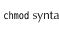

SUID 和 SGID 模式，与其他所有访问模式一样，可以通过 `chmod` 程序更改，方法是提供符号权限，如 `u+s`（设置 SUID 位）或 `g-s`（删除 SGID 位）。你还可以通过在最左边添加第四位数字在八进制访问模式设置这些位：SUID 位的值为 4，SGID 位的值为 2——因此，你可以将访问模式 4755 分配给文件，使其对所有用户可读可执行（所有者还可以写入），并设置 SUID 位。


你可以在“`ls -l`”的输出中通过可执行文件中用符号缩写“`s`”代替“`x`”来识别 set-UID 和 set-GID 程序。

# 14.5 目录的特殊权限

根据创建者身份分配文件所有者的原则还有一个例外：目录的所有者可以规定在该目录中创建的文件应属于与目录本身相同的组。这可以通过在目录上设置 SGID 位来指定。（由于目录不能被执行，因此 SGID 位可用于此类用途。）


目录的访问权限不会通过 SGID 位更改。要在此类目录中创建文件，用户必须在适用于他的类别（`owner`、`group`、`others`）中具有写权限。例如，如果用户既不是目录的所有者，也不是目录 `group` 的成员，则该目录必须对“`others`”可写，他才能在其中创建文件。在 SGID 目录中创建的文件随后将属于该目录的 `group`，即使该用户根本不是该组的成员。


> 目录上的 SGID 位的典型应用程序是用作“项目组”文件存储的目录。（仅）项目组成员应能够读取和写入目录中的所有文件，并且

## 14.5 目录的特殊权限

……以创建新文件。这意味着你需要将所有协作项目的用户加入到一个项目组（一个次要组就足够了）：

```bash
# groupadd project
# usermod -a -G project joe
# usermod -a -G project sue
```

*注意：创建新组 `project`，将用户 `joe` 添加到该组，并将用户 `sue` 也添加到该组。*

现在你可以创建该目录并将其分配给新组。所有者和组被赋予所有权限，其他用户无权限；你还设置了 SGID 位：

```bash
# cd /home/project
# chgrp project /home/project
# chmod u=rwx,g=srwx /home/project
```

现在，如果用户 hugo 在 /home/project 中创建一个文件，该文件应该被分配给 project 组：

```bash
$ id
uid=1000(joe) gid=1000(joe) groups=101(project),1000(joe)
$ touch /tmp/joe.txt
Test: standard directory
$ ls -l /tmp/joe.txt
-rw-r--r-- 1 joe joe 0 Jan 6 17:23 /tmp/joe.txt
$ touch /home/project/joe.txt
project directory
$ ls -l /home/project/joe.txt
-rw-r--r-- 1 joe project 0 Jan 6 17:24 /home/project/joe.txt
```

这里有一点小小的瑕疵，如果你仔细查看示例中的最后一行，就能发现：文件确实属于正确的组，但 project 组的其他成员仍然可能只能读取该文件。如果你希望 project 组的所有成员也能写入该文件，你必须事后再应用 `chmod`（这很麻烦），或者设置 `umask` 以便保留组的写权限（参见练习 14.4）。

SGID 模式仅在新文件创建时改变系统的行为。现有文件与其他地方的行为相同。这意味着，例如，在 SGID 目录外创建的文件，当移动进去时，仍保留其原有的组分配（而在复制时，新的副本会被放入目录的组中）。

`chgrp` 程序在 SGID 目录中一如既往地工作：文件的所有者可以将其分配给他所属的任何组。如果所有者不是目录所属组的成员，他无法使用 `chgrp` 将文件放入该组——他必须在该目录内重新创建该文件。

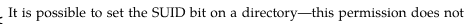

Linux 还支持目录的另一种特殊模式，在该模式下，只有文件的所有者可以删除或移除该目录内的文件：

```
drwxrwxrwt 7 root root 1024 Apr 7 10:07 /tmp
```

这个 `t` 模式，即“粘滞位”（sticky bit），可用于应对公共目录共享使用时出现的问题：对目录的写权限允许用户删除其他用户的文件，无论其访问模式或所有者是谁！例如，`/tmp` 目录是公共区域，许多程序在那里创建临时文件。为此，所有用户对该目录都有写权限。这意味着任何用户都有权限删除那里的文件。


通常，在删除或重命名文件时，系统不会考虑该文件的访问权限。如果目录设置了“粘滞位”，则该目录中的文件只能由其所有者、目录的所有者或 `root` 删除。“粘滞位”可以通过指定符号模式 `+t` 和 `-t` 来设置或移除；在八进制表示中，它在与 `SUID` 和 `SGID` 相同的位上有值 `1`。

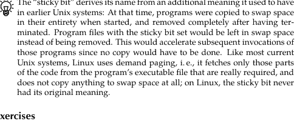

## 练习

- **14.3** [2] 特殊的“*s*”权限意味着什么？你可以在哪里找到它？你可以为你自己创建的文件设置这个权限吗？

- **14.4** [!1] 哪个 *umask* 调用可以用来设置 `umask`，使得在上述项目目录示例中，*project* 组的所有成员都可以读取*并*写入项目目录中的文件？

- **14.5** [2] 特殊的“*t*”权限意味着什么？你可以在哪里找到它？

- **14.6** [4] （面向程序员。）编写一个 C 程序，调用合适的命令（如 *id*）。将此程序设置为 `SUID` *root*（或 `SGID` *root*）并观察执行时会发生什么。

- **14.7** [!1] 如果你让他们在 *root* shell 中停留几分钟，聪明的用户可能会试图在系统中某处隐藏一个 `SUID` *root* shell，以便在需要时获得管理员权限。这在 *bash* 中可行吗？在其他 shell 中呢？

## 本章命令

- `chgrp` — 设置文件或目录的分配组 — `chgrp(1)` 190

- `chmod` — 设置文件和目录的访问模式 — `chmod(1)` 189

- `chown` — 设置文件的所有者和/或分配组 — `chown(1)` 190

## 摘要

- Linux 支持文件的读、写和执行权限，这些权限可以分别为文件的所有者、文件组的成员和“其他人”单独设置。

- 文件权限的总和也被称为其访问模式。

- 每个文件（和目录）都有一个所有者和一个组。访问权限——读、写和执行权限——被分别分配给这两个类别和“其他人”。只有所有者可以设置访问权限。

- 访问权限不适用于系统管理员（`root`）。他可以读取或写入所有文件。

- 可以使用 `chmod` 命令操作文件权限。

- 使用 `chown`，系统管理员可以更改任意文件的用户和组分配。

- 普通用户可以使用 `chgrp` 将他们的文件分配给不同的组。

- `SUID` 和 `SGID` 位允许以文件所有者或文件组的特权执行程序，而不是以调用者的特权执行。

- 目录上的 `SGID` 位会导致该目录中的新文件被分配该目录的组（而不是创建用户的主组）。

- 目录上的“粘滞位”仅允许所有者（和系统管理员）删除文件。

## 参考文献

- **SUID** Dennis M. Ritchie. “Protection of data file contents”. US patent 4,135,240.


# 15

## Linux 网络

### 目录

- 15.1 网络基础 . . . . . . . . . . . . . . . . . . . . . . . . . . 198

  - 15.1.1 介绍与协议 . . . . . . . . . . . . . . . . . . . . . . . . . . 198

  - 15.1.2 寻址与路由 . . . . . . . . . . . . . . . . . . . . . . . . . . . . . . 199

  - 15.1.3 名称与 DNS . . . . . . . . . . . . . . . . . . . . . . . . . . . . . . . . 201

  - 15.1.4 IPv6 . . . . . . . . . . . . . . . . . . . . . . . . . . . . . . . . 202

- 15.2 作为网络客户端的 Linux . . . . . . . . . . . . . . . . . . . . . . . . . . . . 203

  - 15.2.1 需求 . . . . . . . . . . . . . . . . . . . . . . . . . . . . . . . . . . . . . . . . . . . . 203

  - 15.2.2 故障排除 . . . . . . . . . . . . . . . . . . . . . . . . . . . . . . . . . . . . . . . . 204

### 目标

- 了解基本网络概念

- 理解将 Linux 计算机集成到（现有）局域网中的需求

- 了解重要的故障排除命令

- 了解重要的网络服务

### 先决条件

- 文件处理（第 6 章）和文本编辑器的使用

- 了解 Linux 文件系统结构（第 10 章）

- 了解 TCP/IP 和使用网络服务会有帮助

## 15.1 网络基础

### 15.1.1 介绍与协议

在 21 世纪，只有连接到互联网时，计算机才真正有趣——通过公司范围的“局域网”、家庭 DSL 路由器，或者在外出时通过无线连接（WiFi 或蜂窝网络）。接入互联网的方法有很多种——无论你使用哪种方式，互联网本身的工作方式都差不多。

互联网基于称为“TCP/IP”的“协议族”。协议是关于计算机如何相互通信的约定，可以涵盖从特定的电气、光学或无线电信号到与 Web 服务器的请求和响应（但不能同时涵盖所有层面）。如果不划分得太细，可以区分三种不同类型的协议：

- **介质访问协议** 管理数据在网卡和电缆层面的传输（通俗地说）。例如，包括以太网（用于局域网）或 WLAN 协议，如 IEEE 802.11。

- **通信协议** 管理不同网络上站点之间的通信。如果你想在英国访问澳大利亚的网站，通信协议 IP 和 TCP 会确保你发送的数据字节实际上到达“大洋彼岸”，反之亦然。

- **应用协议** 确保澳大利亚的数据接收方确实能对数据做些什么。例如，Web 应用协议 HTTP 允许你获取一张考拉的图片；澳大利亚的服务器解释你的请求并向你发送考拉图片（而不是袋鼠图片），而你英国的 Web 浏览器可以识别出你实际上收到了一张图片，而不是（文本）错误消息。

这种多层架构有一个显著的优点，即每层只需与其直接上层和直接下层通信。应用协议 HTTP 不需要知道字节是如何从英国传输到澳大利亚的（幸运的是！），因为它将这项工作委托给通信协议。通信协议转而将字节的实际传输交给介质访问协议。

在此处，通常习惯引用“ISO/OSI 参考模型”，该模型规定了组织计算机网络不少于七（！）层。为了简洁起见，我们将省略详细细节。

TCP/IP 应用协议——除了 HTTP，还包括 SMTP（用于电子邮件）、SSH（用于远程机器上的交互式会话）、DNS（用于解析主机名）或 SIP（用于基于互联网的电信）以及许多其他——通常基于 UDP 或 TCP 两种通信协议之一。UDP 提供无连接、不可靠的服务（通俗地说：数据在传输过程中可能会丢失，或者到达目的地的顺序可能与发送顺序不同），而 TCP 提供面向连接的可靠服务（这意味着所有数据都将按正确顺序到达另一端）。

应用程序决定哪种通信协议更合适。在 Web 上，你通常不希望数据在传输过程中丢失（一段文本、图片或下载的软件可能会丢失，从而导致恼人甚至灾难性的后果），因此 TCP 是正确的选择。对于电视或语音聊天，通常宁愿忍受服务中的小断档（像素化的画面或短暂的静电噪声），也不愿让系统忙于安排重新发送缺失的数据报而导致一切停滞。

重传。在此时，UDP 更有意义。对于像 DNS 这样的服务，UDP 也更合适，因为小的请求应该得到非常快速且简短的回答。

TCP/IP 通信的第三种协议 ICMP，用于控制和故障排查目的，通常不被用户级应用程序直接使用。

### 15.1.2 寻址与路由

为了允许通过互联网进行直接访问——你的计算机向特定服务器发送请求，而该请求的响应必须以某种方式找到回你计算机的路径——每台计算机都使用一个唯一的地址，即其“IP 地址”。在（仍然）最流行的方案“IPv4”中，这是由四个“八位组”（即 0 到 255 之间的数字）组成的序列，例如 192.168.178.10。

你不能随意为计算机选择任何 IP 地址。相反，地址是被分配给你的。在公司中，这通常由系统或网络管理员完成，而你的 ISP（互联网服务提供商）则会为你的家庭连接处理此事。

在公司里，你很可能始终使用同一个 IP 地址。另一方面，你的 ISP 只会“借给你”一个地址，且期限有限；下次你会获得一个不同的地址。一方面，这使得你的 ISP 可以使用比其客户数量更少的地址（因为并非所有客户都始终在线）；另一方面，这旨在阻止你提供那些需要恒定 IP 地址的服务，因为不断变化的 IP 地址会给这类服务带来不便。

IP 地址本身并非从天而降，而是——尽可能——经过深思熟虑进行分配的，以便保持不同网络之间数据交换，即“路由”的简洁明了。我们将在后面更详细地讨论这一点。


计算机通常拥有多个 IP 地址。“环回地址” `127.0.0.1` 在任何计算机上都可用，并指向该计算机本身；它无法从外部访问。绑定到 `127.0.0.1` 地址的服务只能由运行在同一台机器上的客户端访问。环回地址

这听起来可能很荒谬且无用，但事实上意义重大：例如，你可能正在开发一个必须能够向用户发送邮件的网站（比如，包含用户账户激活链接）。为了在你的开发机器上测试这一点，你可以安装一个仅在环回地址上接受邮件的本地邮件服务器——这对于你的项目来说完全足够，同时也能保护你免受来自互联网其他地方的垃圾邮件冲击。

在具备以太网或 WiFi 的计算机上，相应的接口也有 IP 地址——至少当计算机当前连接到网络时。此外，没有什么阻止你为网络接口分配额外的地址，用于测试或专业配置。

挑战在于安排互联网上任意计算机 X 能够与另一台任意计算机 Y 进行通信，只要 X 知道 Y 的 IP 地址即可。（如果 X 位于英国，而 Y 位于澳大利亚，X 的字节如何到达 Y 并不是 100% 显而易见的。）使这成为可能的魔法词汇是“路由”。其大致工作原理如下：路由

- 你的计算机 X 可以找出 Y 的 IP 地址（这就是 DNS 的作用）。假设它是 `10.11.12.13`。
- 计算机 X 可以判断 IP 地址 `10.11.12.13` 与其自身不在同一个局域网中（考虑到 Y 在澳大利亚，这并不奇怪）。这意味着计算机 X 不能直接发送数据到计算机 Y（令人惊讶的事实）。
- 计算机 X 的网络配置包含一个“默认路由”，也被称为处理那些无法直接发送到目的地的数据的配方。这可能看起来像是“将你无法立即送达的任何东西发送到计算机 Z”。计算机 Z 也被称为“默认网关”。
- 计算机 Z——可能是你的 DSL 路由器——也无法直接将数据发送到计算机 Y。然而，它知道如何处理未发送给像 X 这样直接连接到它的计算机的数据，即将其转发给你的 ISP。
- 这种游戏继续跨越几个层级，直到你的数据到达一台知道地址为 `10.11.x.y` 的数据必须发送给澳大利亚 ISP（让我们称之为“`Billabong-Net`”）的计算机，因此数据被发送在那里。
- `Billabong-Net` 知道（希望如此），发往 `10.11.12.13` 的传入数据如何转发到其最终目的地。特定的计算机 Y 可能位于 `Billabong-Net` 的某个客户处，或者是该客户的客户处，但如果一切都配置正确，它将正常工作。
- Y 对 X 的任何响应都通过类似的路径返回。

这里的重要观察是，数据从计算机 X 到计算机 Y 的实际路由是在数据传输过程中确定的。计算机 X 不需要指定中间目的地的完整列表，而是依赖每个中间目的地做正确的事。反过来，每台计算机只需要“本地”知识，不需要知道整个互联网上哪里有什么——这将是不可能的。


IP 作为通信协议的一个特性是，路由原则上可以从一个数据报到下一个数据报改变（尽管这种情况通常不会发生）。这使得互联网能够以灵活的方式对拥塞或连接中断做出反应。


这基本上类似于“蜗牛邮件”。你不需要知道你送给悉尼弗兰姨的生日卡片走的确切路线；你只需将盖好邮票的信封放入你友好的社区邮筒即可。

归根结底，这意味着你的 Linux 计算机需要知道三件事：它自己的 IP 地址，它可以直接到达的地址集合，以及用于其他地址的默认网关。你的计算机可以直接到达的地址集合由你的本地网络的 IP 地址加上一个“子网掩码”来描述，如今这通常指定为一个数字。


想象你的计算机 IP 地址为 `192.168.178.111`，位于本地网络 `192.168.178.0/24` 中。在这里，24 是子网掩码——它指定你地址的前 24 位（即前三个八位组，也就是 `192.168.178`）指向网络本身。最后一个八位组（或者使总数达到 32 位的最后 8 位）可用于本地地址。这意味着所有地址从 `192.168.178.0` 到 `192.168.178.255` 的计算机——如果它们存在的话——都可以直接到达；要到达任何其他 IP 地址，必须使用默认网关（网关必须具有本地网络中的地址）。

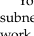

实际上，在我们的示例中，地址 `192.168.178.0` 和 `192.168.178.255` 对计算机来说是不可用的，因为它们具有特殊含义，但我们仅为了完整性而提及这一点。

原则上，你可以手动设置这些基本网络参数——IP 地址、子网（掩码）和默认网关——作为计算机网络配置的一部分。（具体细节取决于你的发行版。）然而，你的网络很可能提供一个“`DHCP` 服务器”，它将在你无需担心的情况下向你的计算机提供这些参数。

因此，如果你想添加一台 Linux 计算机作为局域网客户端，通常只需将其开机，并将以太网电缆插入相应的插槽，或从相应菜单中选择 WiFi 网络，必要时输入相应的密码即可。如果有任何问题，大声且坚持地呼叫你的系统或网络管理员。

### 15.1.3 名称与 DNS

IP 地址很好且重要，但使用起来有些不便。如果你不得不输入（更不用说记住）地址 `213.157.7.75` 来访问提供本手册最新版本的服务器，那将非常令人烦恼。`shop.linupfront.com` 就更难了。

通过域名系统（或 `DNS`）可以获得方便的名称对应的不便 IP 地址（反之亦然）。`DNS` 是一个全球分布式数据库，用于主机名、IP 地址和各种其他项目，可以通过 DNS 服务器（也称为“名称服务器”）访问。你的公司或 ISP 应该正在替你运行一个（或更好的是，为了冗余运行两个）DNS 服务器。


如果你想，你可以自己做——当然基于 Linux——而且，当你为你的公司运行一个相当规模的局域网时，带有 Web 和邮件服务器，这通常是个好主意。然而，这将把我们带到 LPI/C-2 领域的危险边缘。


DNS 服务器的地址与上一节中的其他“基本网络参数”——IP 地址、子网（掩码）、默认网关——一起，这是每台 Linux 机器都应具备的。

与 IP 地址和路由一样，单个 DNS 服务器不需要拥有所有现有名称的完整知识（现在名字实在太多了）。事实上，存在一个层次结构：

- “根级名称服务器”知道名称最右侧的部分——如 `.de`, `.com`, `.tv` 等——并知道哪些名称服务器负责这些区域的内容。
- `.de` 的名称服务器（举例说明）知道所有形式为 `something.de` 的名称，并可以告知哪些名称服务器知道这些名称下方的名称。
- 像 `something.de` 这样的名称的名称服务器（通常位于相关公司或其 ISP）知道像 `www.something.de` 这样的名称的 IP 地址，并在需要时提供它。

这意味着，为了“解析”像 `shop.linupfront.de` 这样的名称，你的计算机首先向根级名称服务器询问负责 `de` 的名称服务器。然后，它向这些名称服务器之一询问负责 `linupfront.de` 的名称服务器。最后，它向一个 `linupfront.de` 名称服务器询问 `shop.linupfront.de` 的地址。

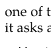

实际上，做这些工作的不是“你的计算机”，而是你的计算机正在使用的 DNS 服务器。但这并不减损其原理。

当然，这是一个相当复杂的方案，这也是为什么你的系统会将任何答案保留一段时间。如果你发现 `shop.linupfront.de` 对应 IP 地址 `213.157.7.75`，假设在一段时间内这将保持不变，因此只有在该时间到期后才会重复解析过程。


这种方案的好处是，我们 Linup Front 可以随意分配 `linupfront.de` “下方”的名称，并按我们的意愿将它们添加到我们的 DNS 服务器中。其他人可以直接从那里获取。如果必须向“互联网办公室”申请新名称，并等待它被添加到官方列表中，那将麻烦得多。（想想地籍变更通常需要多长时间。）

### 15.1.4 IPv6

作为通信协议的 IP 已经存在了大约 30 年，在此期间我们发现当时做出的一些假设似乎有些天真。例如，`IPv4`（该协议的当前版本）在理论上允许 $2^{32}$ 或约 40 亿个地址。由于协议本身的限制以及地址分配的各种不便，几乎没有或没有未使用的 IPv4 地址了——在这样一个几乎人手一部互联网智能手机，且更多人希望拥有一部的时代，这是一个确定的问题。


有一些缓解此问题的方法——例如，并非每部联网手机都分配一个在整个互联网上可见的 IP 地址。相反，运营商将其网络与真正的互联网隔离开来，以便能够分配更多的地址（这就是“网络地址转换”，`NAT`）。这些方法相当令人反感，且会导致其他问题。

`IPv4` 的指定继任者 `IPv6`¹ 自 20 世纪 90 年代后期以来即可用。`IPv6` 取消了 `IPv4` 的各种限制，但 `ISPs`（互联网服务提供商）在全面推广 `IPv6` 方面仍有些犹豫。`Linux` 能很好地处理 `IPv6`，而且由于您可以并行运行 `IPv4` 和 `IPv6`，没有任何东西阻止您在公司（甚至家庭局域网——如今许多 DSL 路由器都支持 `IPv6`）中搭建基于 `IPv6` 的基础设施。以下是 `IPv6` 的一些更重要特性：

- **扩展的地址空间** 不同于 32 位地址，`IPv6` 使用 128 位地址，预期这足以满足可预见的未来（可能性相当大）。`IPv6` 地址的表示方法是将两个字节为一组用十六进制（基数 16）写出，使用冒号作为分隔符：

```
fe80:0000:0000:0000:025a:b6ff:fe9c:406a
```

每个四位数字块的前导零可以省略：

```
fe80:0:0:0:25a:b6ff:fe9c:406a
```

此外，最多一个全零块序列可以被替换为“`::`”：

```
fe80::25a:b6ff:fe9c:406a
```

回环地址，即 `IPv4` 中 `127.0.0.1` 的等效地址，是 `::1`。

- **地址分配** 在 `IPv4` 中，您的 `ISP` 会分配给您一个 `IPv4` 地址或最多几个（除非您是一家真正的大公司或另一家 `ISP`——甚至对于他们来说，地址现在也相当稀缺）。如果您需要为计算机分配更多地址，您需要采取一些变通手段。而在 `IPv6` 中，您被分配的则是一个完整的*网络*，即一个“子网前缀”，它只固定了 128 位地址位中的 48 或 56 位。随后您可以自由地在若干子网中各分配 $2^{64}$ 个地址，这很可能超出了您的使用能力（根据 `IPv4`，*整个互联网*仅使用了 $2^{32}$ 个地址——这只是其中的一小部分）。

- **简单的配置** 使用 `IPv4` 时，必须为计算机分配一个本地 IP 地址——可能借助 `DHCP` 服务器——，而使用 `IPv6` 时，计算机可以自行分配一个适合与附近其他计算机通信的地址。使用 `IPv6` 时，计算机还可以在没有 `DHCP` 的情况下找到愿意将数据转发到互联网的附近路由器。这避免了 `IPv4` 中与 `DHCP` 相关的各种问题。顺便提一下，`IPv6` 不使用“默认路由”。

### 其他改进
`IP` 数据报的格式发生了变化，以实现更高效的路由。此外，`IPv6` 定义了比在 `IPv6` 中更改网络地址更容易更改网络子网前缀的方法——这也是简化路由的一种尝试。此外，`IPv6` 支持加密网络（`IPsec`）和移动性，后者允许计算机——想想手机——从一个网络迁移到另一个网络，而无需更改地址或中断现有连接（“移动 `IPv6`”）。

### 兼容性
引入 `IPv6` 仅影响 `IP`——像 `TCP` 和 `UDP` 这样的协议以及在其之上的应用协议保持不变。正如我们提到的，也可以并行运行 `IPv4` 和 `IPv6`。

## 练习

- **15.1** [!] 你知道哪些介质访问协议（以太网或 `IEEE-802.11` 除外）？哪些通信协议（`IP`、`TCP` 和 `UDP` 除外）？哪些应用协议是上述未提到的？

- **15.2** [!] 网络 `10.11.12.0/22` 包含多少个可用的 IP 地址？（由于特殊含义，减去第一个和最后一个地址。）

## 15.2 作为网络客户端的 Linux

### 15.2.1 需求

我们已经概述了将基于 `Linux` 的计算机作为（`IPv4`）客户端添加到现有网络所必需的要点（*Linux Essentials* 中相关的唯一用例）：

- 计算机本身的 IP 地址

- 计算机的网络地址和子网掩码（以便它可以识别哪些 IP 地址是“本地”的）

- 本地网络上默认网关的地址

- 一个（最好两个）`DNS` 服务器的地址。

在理想情况下，当计算机启动、插入局域网电缆或从移动系统登录无线网络时，它会自动通过 `DHCP` 获取这些设置。如果没有，您必须自行配置这些参数。细节取决于您的发行版：

- 在 `Debian GNU/Linux` 及其衍生发行版中，网络配置存储在一个名为 `/etc/network/interfaces` 的文件中。格式在很大程度上是自解释的，并且在 `/usr/share/doc/ifupdown/examples/network-interfaces.gz` 中有一个带注释的示例。在紧急情况下，可以参考 `interfaces(5)` 中的文档。

- 在 `SUSE` 发行版中，通过 `YaST` 配置网络参数最直接（见“网络设备/网卡”）。否则，在 `/etc/sysconfig/network` 下方有配置文件。

- 在 `Red Hat` 发行版及其衍生版中，在 `/etc/sysconfig/network-scripts` 目录中有配置文件。

对于短期实验，您也可以使用 `ifconfig` 命令。例如

```
# ifconfig eth0 192.168.178.111 netmask 255.255.255.0
```

将 IP 地址 `192.168.178.111` 分配给网络接口 `eth0`（以太网）。本地网络是 `192.168.178.0/24`——`255.255.255.0` 是写子网掩码（24）的一种迂回方法。默认网关（例如，`192.168.178.1`）使用 `route` 命令配置：

```
# route add -net default gw 192.168.178.1
```

这些设置仅在下次重启前有效！`DNS` 服务器的地址通常存储在 `/etc/resolv.conf` 文件中，该文件可能大致如下：

```
# /etc/resolv.conf
search example.com
nameserver 192.168.178.1
nameserver 192.168.178.2
```

（“`search example.com`”会将“`example.com`”附加到任何未带句点的名称后——因此如果您使用 `www`，实际查找的名称将是“`www.example.com`”）。

如果您的系统自动配置网络——例如使用 `WiFi` 时——`/etc/resolv.conf` 的内容经常会被无情地覆盖。请检查您的发行版文档，了解如何以及在哪里持久地配置名称服务器。

### 15.2.2 故障排除

如果简单的接入互联网方法（插入电缆或连接到 `WiFi` 网络）不起作用，或者出现其他问题——例如访问网站时的漫长延迟，或无法解释的连接中断——您应该咨询系统或网络管理员，或者一般来说，咨询比您更熟悉该主题的人。（至少直到您通过 `LPIC-2` 考试；在那之后，当他们遇到麻烦时会来找*您*。）

另一方面，如果您自己已排除了最明显的问题或稍微缩小了错误范围，总是会得到好评。这可以为您的管理员节省一些工作，或者至少让您在管理员眼中显得像个有分量的人，而不是个完全的新手。

本节的其余部分解释了最重要的故障排除工具及其使用方法。

我们刚刚介绍了用于网络配置的 `ifconfig` 命令。`ifconfig` 也可用于查询网络接口的设置：

```
$ /sbin/ifconfig eth0
eth0      Link encap:Ethernet  HWaddr 70:5a:b6:9c:40:6a
          inet addr:192.168.178.130  Bcast:192.168.178.255  <Mask:255.255.255.0>
          inet6 addr: 2002:4fee:5912:0:725a:b6ff:fe9c:406a/64  <Scope:Global>
          inet6 addr: fe80::725a:b6ff:fe9c:406a/64  Scope:Link
          UP BROADCAST RUNNING MULTICAST  MTU:1500  Metric:1
          RX packets:112603  errors:0  dropped:0  overruns:0  frame:0
          TX packets:98512  errors:0  dropped:0  overruns:0  carrier:0  collisions:0  txqueuelen:1000
```

## 网络诊断工具

`RX bytes:102695538 (97,9 MiB) TX bytes:13169349 (12,5 MiB)`  

`Interrupt:20 Memory:d7400000-d7420000`

最有趣的部分包括各种地址：

- 输出的第一行包含接口的“硬件”或“`MAC` 地址”。它由接口制造商分配（在此处，是一个以太网接口）。

- 第二行包含分配给接口的 `IPv4` 地址。在最右侧是旧式/冗长表示法的子网掩码。

- 第三行和第四行指定了各种 `IPv6` 地址。第四行是计算机自行分配的本地地址，而第三行包含一个理论上可以从互联网访问的子网前缀。


> 如果你仔细看，你会在每个 IPv6 地址的后半部分识别出接口的 MAC 地址。

第五行开头的“`up`”表示该接口实际处于开启状态。

如果在执行 `ifconfig` 时不带任何参数，它会输出计算机上所有活动网络接口的信息。当给出 `-a` 选项时，它还显示当前不活动的接口。

### ping

你可以使用 `ping` 命令在你的计算机和其他计算机之间进行低层（IP）连接检查。`ping` 使用控制协议 ICMP 向另一台计算机询问“生命迹象”。如果这些指示返回到你的计算机，你就知道 (a) 你的计算机可以发送数据到另一台计算机，并且 (b) 另一台计算机可以发送数据到你的计算机（前者并不一定意味着后者）。

在最简单的情况下，你通过指定想要通信的计算机名称来调用 `ping`：

```bash
$ ping fritz.box
PING fritz.box (192.168.178.1) 56(84) bytes of data.
64 bytes from fritz.box (192.168.178.1): icmp_req=1 ttl=64 time=3.84 ms
64 bytes from fritz.box (192.168.178.1): icmp_req=2 ttl=64 time=5.09 ms
64 bytes from fritz.box (192.168.178.1): icmp_req=3 ttl=64 time=3.66 ms
64 bytes from fritz.box (192.168.178.1): icmp_req=4 ttl=64 time=3.69 ms
64 bytes from fritz.box (192.168.178.1): icmp_req=5 ttl=64 time=3.54 ms
--- fritz.box ping statistics ---
5 packets transmitted, 5 received, 0% packet loss, time 4006ms
rtt min/avg/max/mdev = 3.543/3.967/5.095/0.575 ms
```

这里一切正常：所有五个发送的包都已返回，顺序正确，并且传输时间对于本地网络来说是合理的。相反，如果你看到一段时间后出现以下内容：

```bash
From 192.168.178.130 icmp_seq=1 Destination Host Unreachable
From 192.168.178.130 icmp_seq=2 Destination Host Unreachable
From 192.168.178.130 icmp_seq=3 Destination Host Unreachable
```

那就说明有问题——无法联系目标计算机。

如果你无法连接到互联网上的远程计算机，问题原则上可能位于你和远程计算机之间的任何地方。为了系统地处理，你可以使用以下策略：

- 使用 `ping` 检查你是否可以到达回环接口 `127.0.0.1`。如果不工作，你的计算机出大问题了。
- 使用 `ping` 检查你是否可以到达你当前正在使用（或你认为正在使用）的访问互联网的网络接口（以太网、WLAN 等）的地址。如果需要，你可以使用类似以下方式找到该地址：

```bash
$ /sbin/ifconfig eth0
```

这也应该工作——如果不工作，那么存在本地问题。
- 使用 `ping` 检查你是否可以到达你的本地默认网关。（如果你不知道那个地址，你可以使用 `route` 命令查找它。在以下输出中：

```bash
$ /sbin/route
Kernel IP routing table
Destination     Gateway         Genmask         Flags Metric Ref Use Iface
default        fritz.box       0.0.0.0         UG    0      0 0   eth0
link-local       *               255.255.0.0     U     1000  0   0 lo
192.168.178.0    *               255.255.255.0   U     0     0 0 eth0
```

在 `Destination` 下方的默认条目告诉你该使用什么——在这里是“`ping fritz.box`”。如果不工作并且你收到类似以下消息：

```bash
Destination Host Unreachable
```

那么你的本地网络存在问题。如果可以，询问一位正在正常访问互联网的同事，或者尝试另一台计算机。如果那边一切看似正常，那么你的计算机很可能是罪魁祸首。否则——在这种情况下也很可能——该找系统管理员了。

💡 例如，你的默认路由可能不正确，指向了错误的计算机。（当网络配置是手动设置时，这种情况更有可能发生。）这不太可能影响其他计算机的用户，因为它们的配置可能是正确的。

- 如果你确实可以正确到达默认网关，那么问题要么在你的局域网之外，在某个互联网位置（可能不仅超出你的控制范围，甚至超出你管理员的范围），要么在“协议栈”的更高处。例如，你可能可以通过 `ping` 到达远程 web 服务器，但你的（公司？）互联网访问可能不允许直接访问 Web，因为你应该使用“代理服务器”（并且忘记了配置它）。你的系统管理员可以提供帮助。

有时工作有时不工作的网络连接（电缆故障？啮齿动物损坏？）可以使用 `ping -i1` 进行测试。与通常每秒发送一个数据包不同，`ping` 会以尽可能快的速度发送数据。它为每个发送的数据包输出一个点，并为每个接收的数据包输出一个退格字符。如果你在丢失数据包，你会看到越来越长的一串点。

💡 如果你不是 root 而是普通用户，你必须接受两个发送的数据包之间最小间隔为 0.2 秒。只有当你作为管理员时，你才允许洪水攻击网络。

为了检查 IPv6 连接，你必须使用 `ping6` 命令而不是 `ping`：

```bash
$ ping6 ::1
```

### dig

`dig` 命令用于测试 DNS 名称解析。除非你另有指定，否则它尝试在命令行给定的名称中找到对应的 IP 地址：

```bash
$ dig www.linupfront.de
; <<> DiG 9.8.1-P1 <<> www.linupfront.de
; global options: +cmd
; Got answer:
;->HEADER<- opcode: QUERY, status: NOERROR, id: 34301
; flags: qr rd ra; QUERY: 1, ANSWER: 2, AUTHORITY: 0, ADDITIONAL: 0
; QUESTION SECTION:
;www.linupfront.de.          IN  A
; ANSWER SECTION:
www.linupfront.de.    3600 IN CNAME  s0a.linupfront.de.
s0a.linupfront.de.    3600 IN A      31.24.175.68
; Query time: 112 msec
; SERVER: 127.0.0.1#53(127.0.0.1)
; WHEN: Thu Mar 1 16:06:06 2012
; MSG SIZE  rcvd: 69
```

这个（非常冗长）的输出在“QUESTION SECTION”中告诉我们在寻找 `www.linupfront.de`（尽管我们已经知道这一点）。“ANSWER SECTION”揭示了实际上没有 IP 地址对应于 `www.linupfront.de`，但 `www.linupfront.de` 实际上是名为 `s0a.linupfront.de` 的计算机的“昵称”（一种流行的方法）。然而，`s0a.linupfront.de` 拥有地址 31.24.175.68。最后，最后一个块告诉我们这个响应来自运行在 127.0.0.1 上的 DNS 服务器。

如果在一段时间内没有答案，然后出现类似以下内容：

```bash
; <<> DiG 9.8.1-P1 <<> www.linupfront.de
; global options: +cmd
; connection timed out; no servers could be reached
```

那么说明问题出在“丹麦的现状”上（意指系统状态糟糕）。要么你 `/etc/resolv.conf` 中的设置不正确，要么名称服务器没有执行其应有的功能。

你可以通过在命令行中提到特定名称服务器来询问它：

```bash
$ dig www.linupfront.de @fritz.box          # 询问 fritz.box
```

当然，解析此名称不应涉及昂贵的 DNS 查询（否则你可能会陷入鸡生蛋蛋生鸡的问题）；如有疑问，你总是可以直接指定 IP 地址：

```bash
$ dig www.linupfront.de @192.168.178.1
```


如果你熟悉 DNS，你可以使用 `dig` 查找 A 记录以外的 RR 类型。只需在命令行告诉 `dig` 你想要什么：

```bash
$ dig linupfront.de mx
```

为了找到给定 IP 地址所属的名称（如果有的话），你必须指定 `-x` 选项：

```
$ dig +short -x 31.24.175.68
```

s0a.linupfront.de.

（使用 `+short` 选项时，`dig` 会产生非常简短的输出。）

当然，`dig` 还能做很多其他事情，但其中大多数内容仅对需要配置或维护名称服务器的人员感兴趣。如果你无法抗拒，`dig(1)` 手册页中有大量细节可供参考。

## netstat

`netstat` 命令是一把瑞士军刀，提供有关计算机及其网络连接的各种信息。如果你只是执行

```
$ netstat
```

你会得到一个所有活动连接的列表。这不仅仅包括 TCP 连接，还包括通过 Unix 域套接字（Unix domain sockets）进行的本地连接，它们既冗长乏味又极其无趣。使用类似以下命令会更有趣：

```
$ netstat -tl
```

Active Internet connections (only servers)

Proto Recv-Q Send-Q Local Address  Foreign Address  State

tcp        0      0 ceol:domain       *:*               LISTEN

tcp        0      0 ceol-eth.fri:domain *:*             LISTEN

tcp        0      0 *:::ssh           *:*               LISTEN

tcp        0      0 *:::ipp           *:*               LISTEN

tcp        0      0 *:::postgresql    *:*               LISTEN

tcp        0      0 ceol:smtp         *:*               LISTEN

以获取本计算机上正在监听传入连接的 TCP 端口的服务列表。

TCP 和 UDP 使用“端口”来允许同一台计算机同时提供或访问多个服务。许多协议使用固定的端口号——列表位于 `/etc/services` 文件中。

此示例输出告诉你，在 `ceol` 地址上，该计算机提供 DNS 服务器（服务 `domain`）、用于打印的 CUPS 服务器（服务 `ipp`）以及邮件服务器（服务 `smtp`）。它甚至在所有配置的地址上都提供 `ssh` 服务（安全外壳）。

"`netstat -tl`" 是处理网络服务连接问题的重要故障排除工具。如果某项服务未在此处显示，但你认为它实际上应该显示，这表明其配置存在问题——可能它没有使用正确的地址/端口，或者服务启动时发生了灾难性错误导致其根本未运行。

用 `-u` 选项代替 `-t` 会显示基于 UDP 的服务，而 `-p` 选项还会显示提供该服务的进程的 `名称` 和 `PID`（进程 ID）。后一个功能仅当你以 root 用户身份调用命令时可用。

`-n` 选项将使用 IP 地址和端口号而不是名称来显示所有内容。只要你熟悉端口号，这有时更直观明了。

```
$ netstat -tln
```

Active Internet connections (only servers)

Proto Recv-Q Send-Q Local Address  Foreign Address  State

tcp 0 0 127.0.0.1:53 0.0.0.0:* LISTEN

tcp 0 0 192.168.178.130:53 0.0.0.0:* LISTEN

tcp 0 0 0.0.0.0:22 0.0.0.0:* LISTEN

"`netstat -s`" 会显示类似以下的统计信息：

Ip:

145845 total packets received

8 with invalid addresses

0 forwarded

0 incoming packets discarded

145037 incoming packets delivered

138094 requests sent out

16 outgoing packets dropped

172 dropped because of missing route

Icmp:

30 ICMP messages received

0 input ICMP message failed.

而 "`netstat -r`" 基本上等同于 `route`（不带参数）。

### 练习

- **15.3 [2]** 使用 `ping` 确保你可以访问互联网上众所周知的服务器（例如 `www.google.com`）。
- **15.4 [1]** 使用 `dig` 检查 `www.heise.de` 对应的 IP 地址。
- **15.5 [2]** `dig` 的 `+trace` 选项会使程序记录从根级名称服务器开始的完整名称查找链。对一些有趣的名称尝试此操作并检查中间步骤。
- **15.6 [2]** 你的计算机提供哪些网络服务？其中哪些可以从其他计算机访问？

## 本章命令

| 命令 | 描述 | 参考 |
| :--- | :--- | :--- |
| dig | 在 DNS 中搜索信息（非常方便） | dig(1) 206 |
| ifconfig | 配置网络接口 | ifconfig(8) 203, 204 |
| netstat | 显示有关网络连接、服务器和路由的信息 | netstat(8) 208 |
| ping | 使用 ICMP 检查基本网络连接 | ping(8) 205 |
| ping6 | 检查基本网络连接（用于 IPv6） | ping(8) 206 |
| route | 管理 Linux 内核的静态路由表 | route(8) 203 |

## 总结

- 有三种类型的网络协议：介质访问协议、通信协议和应用协议。
- 在“协议栈”中，每个协议仅与其紧挨的上方和下方协议交互。
- TCP/IP 包含通信协议 IP、TCP（可靠且面向连接）和 UDP（不可靠且无连接），控制协议 ICMP，以及基于 TCP 或 UDP 的大量应用协议。
- 互联网上的计算机拥有唯一的 IP 地址。
- 路由允许未直接相互连接的计算机之间进行通信。
- 要连接到网络，Linux 计算机需要一个 IP 地址、一个带掩码的子网地址、一个默认网关以及至少一个 DNS 服务器的地址。
- DNS 是一个分布式数据库，将主机名映射到 IP 地址，反之亦然（以及其他功能）。
- IPv6 是 IPv4 的后继标准，它消除了各种限制并融入了改进。
- `ifconfig` 和 `route` 用于手动配置网络。发行版使用各种方案进行持久化网络配置。
- `ifconfig`、`ping`、`dig` 和 `netstat` 程序用于网络故障排除。


# A

## 示例解答

本附录包含选定练习的示例解答。

- **1.1** 作者在 1982 年首次在一台“真正的”计算机上上手，使用的是 Apple II plus。那台机器有一个 6502 处理器，令人惊叹的时钟频率为 1 MHz，以及当时难以想象的 48 KiB 内存容量。没有硬盘，但有 5¼ 英寸的软盘，每面存储 143 KiB 的数据——每面都是。你本来应该只使用“软盘”的一面，但通过小心操作或使用特殊的冲头，可以塑料套圈的 `另一面` 切出一个“写保护缺口”，从而可以将软盘翻转。（每盒 10 张盘售价 20 美元，这使得这种操作变得非常有必要。）
- **2.1** 一个好的资源是 http://oreilly.com/catalog/opensources/book/appa.html。同时也请阅读 http://www.cs.vu.nl/~ast/reliable-os/。
- **2.2** ftp.kernel.org 有一个名为 linux-0.01.tar.gz 的文件。


### 2.3
1. 错误。只要买家收到源代码（等）并拥有 GPL 权利，GPL 软件可以以任意金额出售。 2. 错误。鼓励公司开发基于 GPL 代码的产品，但这些产品也必须以 GPL 许可证分发。当然，公司无需将产品无偿提供给全世界——它只需向购买可执行文件的直接客户提供源代码，但这些客户可以充分利用其在 GPL 下对该软件的权利。 3. 正确。 4. 错误。你可以自由使用程序，而不必接受 GPL（它不是一份合同）。GPL 仅规范软件的分发，你可以在分发前重新审视 GPL。（交互式程序理应提醒你注意 GPL。）观察到的一点是，只有那些软件接收者在购买产品之前能够知晓的条件才有效；由于 GPL 赋予了接收者原本并不存在的权利——例如分发原始或修改代码的权利——因此这不是一个问题：完全可以忽略 GPL，并且仍然可以执行版权法允许的所有软件操作。这与专有程序的 `EULA`（最终用户许可协议）形成了鲜明对比：后者试图建立一种合同关系，买家在其中明确让渡权利

（他本来可以）通过版权法获得的权利（例如检查程序以了解其结构的权利）。当然，这只在购买前（如果可行的话）才有效。

### 3.2
在这两种情况下，信息“*login incorrect*”都会出现，但只在密码被提示并输入之后。这旨在使猜测有效的用户名（那些不会立即引发错误信息的用户名）变得困难。由于系统的设置方式，“*破解者*”无法判断是用户名本身无效，还是密码错误，这使得入侵系统变得更加困难。

### 4.1
在登录 shell 中，输出为“*bash*”，而在“*子 shell*”中也是“*bash*”。开头的减号告诉 shell 要像登录 shell 而非“*普通*” shell 那样行为，这涉及初始化。

### 4.2
`alias` 是一个内部命令（否则不起作用），`rm` 是一个外部命令。在 `bash` 内部，`echo` 和 `test` 既是内部命令，也可用作外部命令（可执行程序文件），因为其他 shell 没有将它们实现为内部命令。对于 `bash` 而言，它们主要是出于效率原因而作为内部命令存在的。

### 5.2
尝试“*apropos process*”或“*man -k process*”。

### 5.5
`info` 文件的格式和工具是在 20 世纪 80 年代中期编写的。那时甚至还没有发明 HTML。

### 6.1
在 Linux 中，当前目录是一个进程属性，即每个进程都有自己的当前目录（而在 DOS 中，当前目录是磁盘驱动器的特性，这在多用户系统中显然是不合适的）。因此 `cd` 必须是一个内部命令。如果它是一个外部命令，它将在一个新进程中执行，更改该进程的当前目录然后退出，而调用 shell 的当前目录在整个过程中将保持不变。

### 6.4
如果将文件名传递给 `ls`，它只输出关于该文件的信息。如果使用目录名，则输出关于该目录中所有文件的信息。

### 6.5
`ls` 的 `-d` 选项正好可以做到这一点。

### 6.6
这可能大致如下所示：

```bash
$ mkdir -p grd1-test/dir1 grd1-test/dir2 grd1-test/dir3
$ cd grd1-test/dir1
$ vi hello
$ cd
$ vi grd1-test/dir2/howdy
$ ls grd1-test/dir1/hello grd1-test/dir2/howdy
grd1-test/dir1/hello
grd1-test/dir2/howdy
$ rmdir grd1-test/dir3
$ rmdir grd1-test/dir2
rmdir: grd1-test/dir2: Directory not empty
```

要使用 `rmdir` 删除目录，该目录必须是空的（除了条目“ . ”和“ . . ”，它们不能被删除）。

### 6.7
匹配的名称分别是：

- (a) `prog.c`, `prog1.c`, `prog2.c`, `progabc.c`

- (b) `prog1.c`, `prog2.c`

- (c) `p1.txt`, `p2.txt`, `p21.txt`, `p22.txt`

- (d) `p1.txt`, `p21.txt`, `p22.txt`, `p22.dat`

- (e) 所有名称

- (f) 除了 `prog` 之外的所有名称（不包含点）

### 6.8
没有参数的 `"ls"` 会列出当前目录的内容。当前目录中的目录只通过名称提及。另一方面，带参数的 `"ls"`（特别是 `"ls *"`——毕竟 `ls` 看不到搜索模式）会列出关于给定参数的信息。对于目录，这意味着还会列出目录的 *内容*。

### 6.9
`"-i"` 文件（在第一个命令的输出中可见）被 `ls` 命令解释为一个选项。因此，它不会出现在第二个命令的输出中，因为带路径名参数的 `ls` 只输出关于指定为参数的文件的信息。

### 6.10
如果星号匹配以点开头的文件名，递归删除命令 `"rm -r *"` 也会应用于目录的 `"."` 条目。这将不仅删除当前目录的子目录，还会删除包含的目录等等。

### 6.11
命令如下：

```bash
$ cd
$ cp /etc/services myservices
$ mv myservices src.dat
$ cp src.dat /tmp
$ rm src.dat /tmp/src.dat
```

### 6.12
当你重命名一个目录时，其所有文件和子目录都会自动被“移动”到以新名称命名的目录中。因此，对 `mv` 使用 `-R` 是完全不必要的。

### 6.13
简单的方法——类似于 `"rm -file"`——会失败，因为 `rm` 将文件名误读为一系列选项。像 `"rm .file"` 或 `"rm .file"` 这样的命令也是如此。以下方法更好：

- 1. 使用 `"rm ./file"`，破折号不再位于参数的开头，因此不再引入一个选项。

- 2. 使用 `"rm -- .file"`，你告诉 `rm` 在 `"--"` 之后肯定没有选项，只有路径名。这对于许多其他程序也适用。

### 6.14
在替换 `"*"` 期间，`"-i"` 文件也被选中。由于文件名按 ASCII 顺序插入命令行，`rm` 看到的参数列表类似于

`-i a.txt b.jpg c.dat 或其他`

并将 `"-i"` 视为 *选项* `-i`，这使其仅在有确认的情况下删除文件。我们希望这足以让你仔细考虑。

### 6.15
如果你通过一个链接编辑文件，新内容也应该通过另一个链接可见。然而，有些“聪明”的编辑器在保存时不会覆盖你的文件，而是保存一个新文件然后重命名它。在这种情况下，你将再次拥有两个不同的文件。

### 6.16
如果符号链接的目标不存在（或不再存在），访问该“悬空”链接将导致错误消息。

### 6.17
指向自身。你可以通过此识别文件系统根目录。

### 6.18
在这个系统中，`/home` 目录在一个单独的分区上，并且在该分区上具有 inode 号 2，而 `/` 目录在其自己的文件系统上具有 inode 号 2。由于 inode 号仅在同一个物理文件系统中唯一，不同的文件在“ls -i”输出中可能出现相同的编号；这无需担心。

### 6.19
硬链接是不可区分的、等效的名称，指向同一个文件（或假设情况下的目录）。但每个目录都有一个名为“..”的“链接”，指向上面一级的目录。每个目录只能有一个这样的链接，这与该目录有多个等效名称的想法不符。反对目录硬链接的另一个理由是，在文件系统树中的每个名称必须有一条唯一的路径，在有限步数内到达根目录（/）。如果允许对目录的硬链接，那么诸如

```bash
$ mkdir -p a/b
$ cd a/b
$ ln .. c
```

这样的命令序列可能导致循环。

### 6.20
子目录的引用计数器的值为 2（一个链接来自子目录在 ~ 中的名称，另一个来自子目录本身的“..”链接）。如果在目录内还有额外的子目录，它们的“..”链接会使引用计数器超过其最小值 2。

### 6.21
硬链接几乎不需要空间，因为它们只是额外的目录条目。符号链接是独立的文件，至少需要一个 inode（每个文件都有自己的 inode）。此外，需要一些空间来存储目标文件的名称。从理论上讲，磁盘空间以文件系统的块大小（1 KiB 或更多）为单位分配给文件，但在 `ext2` 和 `ext3` 文件系统中有一个特殊例外，即“短”符号链接（小于大约 60 字节），它们可以存储在 inode 本身内，而不需要完整的数据块。像 Reiser 文件系统这样更先进的文件系统可以非常高效地处理任何类型的短文件，因此符号链接所需的空间应该是可以忽略不计的。

### 6.22
一个可能的命令可以是“`find / -size +1024k -print`”。

### 6.23
基本方法类似于

```bash
find . -maxdepth 1 (\{fs\}) -ok rm \f \;
```

（`\{fs\}` 应尽可能精确地匹配文件。“`-maxdepth 1`”选项将搜索限制在当前目录（不包括子目录）。在最简单的情况下，使用“`ls -i`”确定文件的 inode 号（例如，4711），然后使用


```bash
find . -maxdepth 1 -inum 4711 -exec rm -f \f \;
```

来删除该文件。

## 6.24 添加一行类似

```
find /tmp -user $LOGNAME -type f -exec rm '{}' \n
```

或者——更高效地——

```
find /tmp -user $LOGNAME -type f -print0 | xargs -0 -r rm -f
```

到你的主目录下的 `_.bash_logout_` 文件中。(`LOGNAME` 环境变量包含当前用户名。)

## 6.25 使用类似 "`locate */README*`" 的命令

当然，像 "`find / -name README*`" 这样的东西也能解决问题，但它会花费*更多*的时间。

## 6.26 新文件在创建后立即不会出现在数据库中，因此无法找到（你需要先运行 `*updatedb*`）。数据库也不会注意到你删除了文件，直到你再次调用 `*updatedb*`。—最好不要直接调用 `*updatedb*`，而是通过你的发行版所使用的 shell 脚本（例如在 Debian GNU/Linux 上为 `/etc/cron.daily/find`）。这确保了 `*updatedb*` 始终使用相同的参数。

## 6.27 `*slocate*` 应只返回调用用户可访问的文件名。包含用户加密密码的 `/etc/shadow` 文件受限于系统管理员（参见 `*Linux Administration*` I）。

## 7.1 正则表达式 `r+` 仅仅是 `r*r*` 的简写，因此我们可以省略 `+`。但对于 `?` 来说情况不同，至少在我们必须假设（如 `grep` 与 `egrep` 所示）不能用 `r( |r)` 替换 `r?` 的情况下，没有便捷的替代方案。(`GNU grep` 支持同义的 `r{1}`—参见表 7.1—但这并不受传统 Unix 厂商的 `grep` 实现支持。

## 7.2 你想要一个示例解决方案吗？别开玩笑了。—好吧，如果你坚持的话 ...

```
egrep "\.king('s daughter)?\>" frog.txt
```

## 7.3 一种可能的做法是

```
grep :/bin/bash$ /etc/passwd
```

## 7.4 我们要寻找以（可能为空的）辅音序列开头，然后是 "a"，然后可能再次是辅音，接着是 "e"，依此类推的单词。我们特别需要注意不要让额外的元音“溜进来”。由此产生的正则表达式相当难看，因此我们允许自己做一些记法上的简化：

```
$ k='[aeiou]'
$ grep -i[BJa]$k[es][i$]{k}$o${k}u${k}$ /usr/share/dict/words
```

abstemious

abstemiously

abstentious

acheilous

acheirous

acleistous

affectious

annelidous

arsenious

arterious

bacterious

caesi

caeti

faction

factiously

fracedinous

majestious

（你可以在空闲时间自己查阅这些单词。）

## 7.5 尝试

```
egrep '(\.([A-Za-z]){4,}\).*\<\1\>' frog.txt
```

我们需要 `egrep` 来进行反向引用。词括号也是必需的（试试没有它们的情况！）

## 8.1 （可能的）解释是 `ls` 程序大致是这样工作的：

```
Read directory information to list l;
if (option -u not specified) {
    Sort the entries of l;
}
Write l to standard output;
```

也就是说，所有内容都被读取，然后排序（或不排序），最后输出。

另一种解释是，在读取文件列表条目时，实际上并没有向该文件写入任何内容。为了效率，大多数文件写入程序内部会缓冲其输出，并且只有当收集到相当多的数据（例如 8192 字节）时才调用操作系统将数据写入文件。这可以通过产生相对缓慢的大量输出的命令观察到；输出文件每次会增加 8192 字节。

## 8.2 当 `ls` 写入屏幕（或通常指“类屏幕”设备）时，它格式化输出的方式与写入“真实”文件时不同：如果文件名长度允许，它试图在同一行显示多个文件名，并且还可以根据文件类型对文件名进行着色。当输出重定向到“真实”文件时，仅输出文件名，每行一个，没有格式化。

乍一看，这似乎与程序不知道其输出去向是屏幕还是其他地方的说法相矛盾。这种说法在正常情况下是正确的，但如果某个程序非常关心其输出是否去往类屏幕设备（“终端”），它可以向系统询问。对于 `ls` 来说，这样做的推理基础是终端输出通常由人查看，这些人应尽可能多地获得信息。另一方面，重定向输出由其他程序处理，因此应尽可能简单；因此限制为每行一个文件名，并省略颜色，因为颜色必须使用会“污染”输出的终端控制字符来设置。

## 8.3 `shell` 在调用命令之前安排输出重定向。因此，命令只看到一个空的输入文件，这通常不会导致期望的结果。

## 8.4 文件从头开始读取，同时所有读取的内容都被追加到文件末尾，因此文件不断增长，直到占用磁盘上的所有可用空间。

## 8.5 你需要将标准输出重定向到标准错误输出：

```sh
echo Error >&2
```

## 8.6 原则上

```sh
_ | tee foo | tee bar | _
```

没有任何错误。

但是，写起来更容易的是

```sh
_ | tee foo bar | _
```

另见 `tee` 的文档（`man` 页或 `info` 页）。

## 8.7 将文件名列表通过 `"cat -b"` 管道传输。

## 8.8 一种方法是 `"head -n 13 | tail -n 1"`。

## 8.10 `tail` 会注意到这一点，发出警告，并从文件的新末尾继续。

## 8.11 `tail` 窗口显示


第一行结果来自第一个 `echo`；第二个 `echo` 覆盖了整个文件，但 `"tail -f"` 知道它已经写出了文件的前六个字符（“Hello”和一个换行符）——它只是在等待文件变长，然后输出任何新内容，特别是“orld”（和一个换行符）。

## 8.14 包含名称“de Leaping”的那一行排序错误，因为在该行中第二个字段实际上不是名，而是单词“Leaping”。如果你仔细查看示例，你会发现排序输出总是正确的——关于“Leaping”，而不是“Gwen”。这是支持第二种类型输入文件的有力论据，即以冒号作为分隔符的文件。

## 8.15 你可以使用 `"sort -k 1.4,1.8"` 按年份对行进行排序。如果两行根据排序键相等，`sort` 会进行“紧急比较”，考虑整行，在这种情况下导致月份在每一年内正确排序。如果你想确定且非常明确，你也可以写 `"sort -k 1.4,1.8 -k 1.1,1.2"`。

## 8.19 使用类似

```sh
cut -d : -f 4 /etc/passwd | sort -u | wc -l
```

`cut` 命令隔离了用户数据库中每行的组号。`"sort -u"` 构建了一个排序的列表，其中包含每个组号恰好一次。最后，`"wc -l"` 计算该列表中的行数。结果是系统中正在使用的不同主组数量。

## 9.1 例如：

- `%d-%m-%Y`

- `%y-%M`（`WK%V`）

- `%4th%Mon%5s`

## 9.2 我们也不知道，但试试像 `"TZ=America/Los_Angeles date"` 这样的东西。

## 9.4 如果你在子进程中更改环境变量，其在父进程中的值保持不变。有一些方法可以将信息传回父进程，但环境不是其中之一。

## 9.5 启动一个新的 `shell` 并从环境中移除 `PATH` 变量（不删除变量本身）。尝试启动外部程序。—如果 `PATH` 完全不存在，`shell` 将不会启动外部程序。

## 9.6 遗憾的是，我们无法提供独立于系统的示例解决方案；你需要自己查看（使用 `which`）。

## 9.7 使用 `whereis`，你应该能够定位两个名为 `/usr/share/man/man1/crontab.1.gz` 和 `/usr/share/man/man5/crontab.5.gz` 的文件。前者包含实际 `crontab` 命令的文档，后者包含 `crontab` 创建的文件格式的文档。（详细情况对本题练习无关紧要；参见 `*Advanced Linux*`。）

## 9.8 `bash` 使用 `!{字符}` 形式的字符序列来访问前一个命令（作为键盘功能（如 `Ctrl` + `g`，这些功能已从 C shell 迁移到 `bash` 的替代方案）。然而，`"!"` 字符序列被视为语法错误。

## 9.9 没有。

## 9.10 如果文件名作为参数传入，`wc` 坚持将其与行数一起输出。如果 `wc` 读取其标准输入，它只输出行数。

## 9.11 尝试类似


```bash
#!/bin/bash
pattern=$1
shift
<<< <<<
for f
do
    grep $pattern "$f" && cp "$f" backup
done
```

在 `shift` 之后，正则表达式不再是第一个参数，这一点必须在 `"for f"` 中予以考虑。

## 9.12 如果对符号链接应用 `-f` 文件测试，它始终应用于链接所指向的文件（或目录，或任何东西）。因此，如果该名称确实只是一个符号链接，它也会成功。（为什么这个问题不适用于 `filetest2`？）

## 10.2 你可以使用类似

```
ls /bin /sbin /usr/bin /usr/sbin | wc -l
```

来了解这一点。

或者，你可以在 shell 提示符处按下两次 `Tab`—shell 会回复类似


并且这就是——取决于 `PATH`——你的答案。（如果你是以普通（非特权）用户身份登录的，`/sbin` 和 `/usr/sbin` 中的文件通常不会被包含在总计数中。）

### 10.3

使用 "`grep (pattern) *.txt /dev/null`" 代替 "`grep (pattern) *.txt`"。这样 `grep` 始终至少有两个文件名参数，但 `/dev/null` 并不会改变其他输出行为。—— GNU 版本的 `grep`，通常可以在 Linux 上找到，支持一个 `-H` 选项，可以实现相同的效果，但这种方式不具备可移植性。

### 10.4

使用 `cp` 复制到一个已存在的文件时，该文件会先被打开用于写入并被截断为长度 0，然后源数据才会写入其中。对于 `/dev/null`，这会使数据消失。使用 `mv` 移动到一个已存在的文件时，目标文件会先被删除——这是一个目录操作，尽管忽略了 `/dev/null` 的特殊性，但这仅仅是从目录 `/dev` 中删除名为 `null` 的名称，并在该位置创建一个名为 `null` 的新文件，其内容为 `foo.txt` 的内容。

### 10.6

这并不建议这样做，首先是因为它不起作用；其次，相关数据不值得备份，因为它在不断变化（你会在备份介质上浪费大量空间，并在复制过程中浪费时间）；最后，因为这样的备份永远无法恢复。对诸如 `/proc/kcore` 的文件进行不受控制写入操作，几乎可以肯定会导致系统崩溃。

### 11.1

因为 `AA` 比 `2A` 短。

### 11.2

主要问题在于如何表示星号。在最简单的情况下，你可以写类似 "`^A128^4^A`" 的内容。当然，用三个字符来表示单个星号会降低压缩率；你可以设立一个例外，例如让 `**` 代表单个星号，但这会使解压缩步骤变得更加复杂。

### 11.3

使用 "`ls -1 >content`" 和 "`tar -cvf content.tar content`"。你会注意到归档文件比原始文件大得多。这是由于归档中包含的元数据。`tar` 不进行压缩；它进行归档。从单个文件创建归档（文件）并不是一个真正可行的主意。

### 11.4

例如，输入 "`touch file(1,2,3)`" 和 "`tar -rvf content.tar files`"。

### 11.5

使用 "`tar -xvf content.tar`" 解包归档。

### 11.6

如果你想在另一台计算机上解包 `etc-backup.tar`（例如，因为你想知道里面有什么），并且归档中包含绝对路径名，数据将不会写入当前目录的子目录 `etc`，而是会放到远程计算机的 `/etc` 目录中。这很可能不是你想要的结果。（当然，你应该注意不要在当前目录为 `/` 时解包含相对路径名的归档。）

### 11.7

如果你想使用 `gzip`，请输入 "`gzip -9 contents.tar`"。

### 11.8

注意：要处理经 `gzip` 压缩的 `tar` 归档，`tar` 需要 `-z` 选项： "`tar -tzf contents.tar.gz`" 。要恢复原始归档，你需要使用 "`gunzip contents.tar.gz`" 命令。

### 11.9

尝试使用 `tar -cvzf /tmp/homearchive.tar ~`。

### 11.11

`unzip` 会提示你忽略归档中的文件、重命名它，或覆盖现有文件。

### 11.12

尝试类似

```
$ unzip files.zip "a/*" -x "*/*.c"
```

## 12.1

一个简单的 `su`（前面没有 `/bin/`）原则上同样有效。然而，习惯使用 `/bin/su` 是有意义的，因为它能更好地保护你免受“特洛伊木马”的攻击：一个狡猾的用户可能会将一个名为 `su` 的程序放在他们的 `PATH` 中，使得该程序在 `/bin/su` 之前被找到。然后，他们会假装遇到某些问题而召唤你到他们的机器上。你会对自己说“我会很快解决这个问题，我只是借用这个终端会话片刻变成 `root`”，无害地调用 "`su`" ，而这个狡猾用户的程序会像真正的 `su` 一样要求你输入 `root` 密码。只不过它会悄悄地将密码保存到某个文件中，输出错误消息，然后自我删除。你很可能会认为你是输入错误，再次调用 "`su`" ，得到真正的程序，从此一切正常——除了那个狡猾的用户现在知道了 `root` 密码。如果你一开始就使用 "`/bin/su`" ，这种攻击就不会这么顺利。

## 12.2

使用 `su`，任何任意用户仅仅通过知道 `root` 密码就可以获得管理员权限。然而，使用 `sudo`，只有当你在 `sudo` 的授权用户列表中时才能成功。因此，`sudo` 询问密码的目的不是确定你是否允许成为 `root`，而是为了确认你确实是*你自己*。（其他人可能在你暂时离开的期间接管了你的计算机。）你的密码在这方面（甚至优于）`root` 的密码同样适用（或更有效）。`sudo` 特别有用，如果你与几位同事分担系统管理员的工作，因为那样*没有人*需要知道实际的 `root` 密码——你可以设置一个非常长且复杂的密码，在计算机安装后将其放在保险箱中的密封信封里（以备不时之需）。使用 `su` 时，*所有* 管理员都需要知道密码，这使得更改密码变得困难。（SUSE 发行版默认使用 `root` 密码配合 `sudo`，他们甚至似乎以这种类型的脑损伤为荣。）

## 12.7

这是 RPM 的变体：

```
$ rpm --query --all | wc -l
```

在类 Debian 系统上，你应该使用类似

```
$ dpkg --list | grep ^ii | wc -l
```

## 13.1

通过它们各自的数值 UID 和 GID。

## 13.2

这有效，但不一定是个好主意。就系统而言，这两个账户是同一个用户，即，具有该 UID 的所有文件和进程都属于这两个用户名。

## 13.3

伪用户的 UID 被程序使用，以获得特定的、定义明确的访问权限。

## 13.4

任何在 `disk` 组中的人员都对系统的磁盘具有块级读写权限。了解文件系统结构后，可以通过直接在磁盘上更改文件系统元数据，轻松地将 `/bin/sh` 复制为 SUID `root` `shell`（见第 14.4 节）。因此，`disk` 组成员资格等同于 `root` 权限；你不应该将*root* 密码直接告诉任何你不想让 `disk` 组成员知道的人。

## 13.5

你通常会发现一个 "`x`" 。这是一个提示，表明通常存储在此处的密码实际上存储在另一个文件中，即 `/etc/shadow`，与前者不同，该文件仅 `root` 可读。

## 13.6

基本上有两种可能性：

- 1. 没有反应。在这种情况下，输入密码后系统应该拒绝你，因为全大写的用户名不对应任何用户账户。

- 2. 从现在开始，系统仅以大写字母与你对话。在这种情况下，你的 Linux 系统假设你坐在一个非常古老的终端（约 1970 年代）前，该终端不支持小写字母，并贴心地切换其输入和输出数据的处理，使输入中的大写字母被解释为小写，输出中的小写字母显示为大写。如今这用处有限（除非你在计算机博物馆工作），你应尽快注销，以免你的脑袋爆炸。不过，由于这种行为非常原始，并非所有 Linux 发行版都支持它。

## 13.7

如果你以用户 `joe` 身份登录，请使用 `passwd` 命令，或者以 `root` 身份使用 "`passwd joe`" 。在 `joe` 的 `/etc/shadow` 文件条目中，第二个字段应该有不同值，并且上次密码修改日期（第 3 字段）应显示当前日期（以什么单位？）

## 13.8

作为 `root`，由于即使是管理员也无法检索旧密码，你需要使用 "`passwd dumbo`" 为他设置新密码。

## 13.9

使用命令 "`passwd -n 7 -m 14 -w 2 joe`" 。你可以使用 "`passwd -S joe`" 验证设置。

## 13.10


使用 `useradd` 命令创建用户，使用 "`usermod -u`" 修改 UID。由于该 UID 没有已知用户名，文件应显示该 UID 作为其拥有者，而不是用户名 ...

### 13.11

对于三个用户账户中的每一个，`/etc/passwd` 和 `/etc/shadow` 中应各有一行。要操作这些账户，你并不一定需要密码（你可以使用 `root` 身份的 `su`），但如果你想登录，则需要密码。你可以在 `/tmp` 中创建一个没有主目录的文件（以防你忘记——不过，为新用户设置主目录通常是个好主意）。

### 13.12

使用 `userdel` 命令删除账户。要删除文件，使用 "`find / -UID (UID) -delete`" 命令。

### 13.13

如果你使用 "`usermod -u`" ，你必须将用户的文件重新分配给新的 UID，例如通过 "`find / -uid (UID) -exec chown test1 {} ;`" 或（更高效地） "`chown -R --from=(UID) test1 /`" 。在每种情况下，`(UID)` 是原来的（数值）UID。

### 13.14

你可以使用 `vi` 编辑 `/etc/passwd`，或者调用 `usermod`。

## 13.15

群组使得向用户组授予特定权限成为可能。例如，你可以将所有 HR 员工添加到同一个群组中，并给该群组分配文件服务器上的一个工作目录。此外，群组还可以帮助组织对某些外设（例如通过 `disk`、`audio` 或 `video` 群组）的访问权限。

## 13.16

使用以下命令创建目录，并使用以下命令将该目录分配给该群组。你还应该设置 SGID 位，以确保新创建的文件也属于该群组。

`mkdir <directory>`
`chgrp <groupname> <directory>`

## 13.17

使用以下命令：

```bash
# groupadd test
# gpasswd -a test1 test
Adding user test1 to group test
# gpasswd -a test2 test
Adding user test2 to group test
# gpasswd test
Changing the password for group test
New Password: x9q.Rt/y
Re-enter new password: x9q.Rt/y
```

要切换群组，请使用 "`newgrp test`" 命令。只有当你不是该群组成员时，系统才会要求你输入密码。

## 14.1

新文件将被分配给你当前的主群组。你无法将文件分配给你不是成员的群组——除非你是 `root`。

## 14.3

这是 SUID 或 SGID 位。这些位使进程采用可执行文件的 UID/GID，而不是执行该进程的用户的 UID/GID。你可以使用 "`ls -1`" 查看这些位。当然，你可以更改自己文件的所有权限。然而，至少 SUID 位仅对二进制可执行文件有意义，对 shell 脚本等则不然。

## 14.4

以下两个（等效）命令之一即可满足需求：

```bash
$ umask 007
$ umask -S u=rwx,g=rwx
```

你可能会问为什么这个 umask 包含 x 位。对于文件而言，它们确实无关紧要，因为文件默认并不是以可执行方式创建的。但是，项目目录中可能需要子目录，赋予这些子目录允许合理使用的权限是有意义的。

## 14.5

目录上所谓的“sticky bit”（粘性位）意味着只有文件的所有者（或目录的所有者）可以删除或重命名它。例如，你可以在 `/tmp` 目录上找到它。

## 14.7

这在 bash shell 中不起作用（至少在不使用其他技巧的情况下如此）。我们无法为其他 shell 作出保证。

## 15.2

1022 (= $2^{32}-22-2$)。对于这种类型的计算——如果你不想在脑海中进行计算的话——一个有用的工具叫做 `ipcalc`。


# B

# 示例文件

在多个地方，使用了童话故事《青蛙王子》（更确切地说是《青蛙王子，或铁亨利》），选自格林兄弟的《德国儿童和家庭童话》，作为示例。这里完整呈现该童话故事，以便与示例进行对比。

# 青蛙王子，或铁亨利

在古代，当愿望还能实现的时候，住着一位国王，他的女儿们都非常美丽，但最年轻的那位如此美丽，以至于连见识过世间万物的太阳本身，每当照耀在她的脸上时都会感到惊讶。

在国王城堡附近有一片茂密黑暗的森林，森林里的一棵老榆树下有一口井。当天气非常炎热时，国王的孩子们会走进森林，坐在清凉的泉水边。当他们感到无聊时，他们会拿起一个金球，高高抛起再接住，这个球是他们最喜欢的玩具。

碰巧有一天，公主的金球没有落入她伸出接球的小手中，而是掉到了地上，径直滚入了水中。国王的公主用眼睛追随着它，但它消失了，而井很深，深得看不见底。她开始哭泣，哭得越来越大，无法被安慰。

正当她如此哀叹时，有人对她说道：“怎么了，公主？你哭得连石头都会感到怜悯。”

她回头看向声音传来的方向，看到一只青蛙从水中伸出它巨大丑陋的头。“啊，老的水中生物，是你吗，”她说道，“我正在为我的金球哭泣，它掉进了井里。”

“安静些，别再哭了，”青蛙回答，“我可以帮你，但如果我把你的玩具取回来，你会给我什么？”

“亲爱的青蛙，你想要什么我都给你，”她说，“我的衣服，我的珍珠和珠宝，甚至我戴着的金冠。”

青蛙回答：“我不在意你的衣服、珍珠和珠宝，也不在意你的金冠，但如果你愿意爱我，让我做你的伴侣和玩伴，坐在你小桌子旁，用你的小金盘吃饭，用你的小杯喝水，在你的小床上睡觉——如果你答应我这些，我就会下去，把你的金球取回来。”

“哦，是的，”她说，“只要你把球带回来，我就答应你的所有要求。”但她心想：“这只愚蠢的青蛙说什么呢。他只是和其他青蛙一起坐在水里呱呱叫。他不可能成为任何人的伴侣。”

但青蛙听到这个承诺后，把头伸入水中沉了下去；过了一会儿，它嘴里叼着球游了上来，把它扔在草地上。国王的公主看到漂亮的玩具再次出现，非常高兴，捡起它，跑开了。

“等等，等等，”青蛙说。“带上我。我跑不过你。”但他拼命向她身后呱呱叫，却无济于事。她没有理会，跑回家，很快就忘记了那只可怜的青蛙，它被迫回到井里去了。

第二天，当她和国王以及所有廷臣一起坐在桌旁，用小金盘吃饭时，有什么东西叮叮当当地爬上大理石楼梯，叮叮当当，啪嗒啪嗒，到了顶部，它敲门喊道：“公主，最小的公主，请给我开门。”

她跑过去看外面是谁，但打开门时，青蛙正坐在门前。然后她迅速关上门，又坐下来吃饭，非常害怕。

国王明显看出她心跳剧烈，说道：“我的孩子，你怕什么？外面难道是巨人想要把你带走吗？”

“啊，不，”她回答，“不是巨人，是一只令人讨厌的青蛙。”

“那只青蛙要你做什么？”

“昨天我在森林里坐在井边玩耍时，我的金球掉进了水里。因为哭得厉害，青蛙把它捞了上来，因为它坚持要求，我答应让它做我的伴侣，但我从没想过它能走出水来。现在它在外面，想进来找我。”

与此同时，它第二次敲门，喊道：“公主，最小的公主，请给我开门，你不记得昨天在清凉的井水边对我说的话了吗？公主，最小的公主，请给我开门。”

于是国王说：“你承诺过的必须做到。去，让他进来。”

她走过去打开门，青蛙跳进来，一步一步跟着她走到她的椅子旁。它坐在那里喊道：“把我抬到你身边。”她拖延着，直到最后国王命令她这样做。青蛙上了椅子后，它想上桌子，当它在桌子上时，它说：“现在，把你的小金盘拉近点，让我们一起吃。”青蛙对它吃的东西很满意，但她几乎每一口都噎住了。

最终它说：“我吃饱了，满足了，现在累了，把我带到你的小房间，铺好你的小丝绸床，我们都要躺下睡觉。”国王的公主开始哭泣，因为她害怕这只冷的青蛙，她不想碰它，而现在它要睡在她漂亮干净的小床上了。

但国王生气了，说：“在你困难时帮助了你的人，事后不应被你轻视。”

于是她用手指捏起青蛙，把他带到楼上，放在角落里，但当她上床时，它爬到她身边说：“我累了，我也想像你一样睡觉，把我抬起来，否则我会告诉你父亲。”

这时她非常生气，把他拿起来，用尽全力把他扔向墙。“现在，你安静吧，可恶的青蛙，”她说。但当他落地时，不再是青蛙，而是一位有着善良美丽眼睛的王子。根据她父亲的意愿，他现在是她的亲爱的伴侣和丈夫。然后他告诉她，他曾被一个邪恶的女巫施了魔法，除了她没人能救他出井，明天他们将一起去他的王国。

确实，第二天早上，一辆马车开来了，由八匹白马牵引，马头上插着白色鸵鸟羽毛，套着金链，后面站着年轻王子的仆人忠实的亨利。

当他的主人变成青蛙时，忠实的亨利如此伤心，以至于他在心周围套上了三个铁环，生怕它因悲伤和痛苦而破裂。马车是用来送年轻王子回他的王国的。忠实的亨利帮他们两个上车，又坐回后面，因为这次解脱而充满了喜悦。

当他们行驶了一段路后，国王的儿子听到身后传来咔嚓声，好像有什么东西断了。于是他回头喊道：“亨利，马车断了。”“不，主人，马车没断。是我心上的铁环，在你还是青蛙困在井里时，因我巨大的痛苦而套上的。”


在路上，一次又一次地听到断裂声，每次国王的儿子都以为马车断了，但实际上只是忠实的亨利心中的铁环因主人获救和快乐而崩断。

（Lupin Front GmbH 想要指出，作者强烈反对虐待动物。）

# C

## Linux 基础认证


*Linux Professional Institute*（LPI，Linux 专业学院）是一个独立的非营利组织，致力于推动 Linux 的专业应用。LPI 工作的一方面涉及创建和提供独立于发行版的认证考试，例如面向 Linux 专业人士的考试。这些考试在全球范围内提供，并在 Linux 专业人士和雇主中享有相当高的声誉。

本培训手册作为准备*Linux Essentials*（Linux 基础）考试的辅助工具。LPI 在其网站上解释道：

> > Linux Essentials 证书旨在定义使用 Linux 操作系统使用桌面或移动设备所需的基本知识。相关的 Linux Essentials 项目将引导和鼓励年轻人（以及 Linux 和开源的新手）理解 Linux 和开源在更广泛的 IT 行业背景中的地位。

LPI 以**考试目标**列表的形式汇编了通过考试所需的知识，这些目标发布在其网站 `http://www.lpi.org/` 上。

下表显示了手册中的哪些章节涵盖了哪些考试目标的内容。考试目标本身列在本附录的后面。请注意，*Linux Essentials* 目标不适合作为 Linux 入门课程教学传递的指导方针。因此，出于使材料更易于理解的主题逻辑顺序的考虑，本手册并不遵循 LPI 列表中目标的顺序，而是有所偏离。

⚠️ 请注意，LPI 网站上的考试目标可能会不时修改，并且例如，可能会出现尚未纳入本培训手册的补充信息。为了安全起见，请参阅 LPI 版本的考试目标。

### C.1 考试目标概览

下表列出了*Linux Essentials*考试的目标以及涵盖这些目标的章节。右栏中的数字指的是包含相关材料的章节。

| No | Wt | Title | LXES |
|:---|:---|:---|:---|

| 1.1 | 2 | Linux 演进及流行操作系统 | 2 |
| 1.2 | 2 | 主要开源应用程序 | 2 |
| 1.3 | 1 | 理解开源软件及授权 | 2 |
| 1.4 | 2 | ICT 技能及在 Linux 中工作 | 2–3, 13 |
| 2.1 | 2 | 命令行基础 | 4, 6, 9 |
| 2.2 | 2 | 使用命令行获取帮助 | 5 |
| 2.3 | 2 | 使用目录及列出文件 | 6 |
| 2.4 | 2 | 创建、移动和删除文件 | 6 |
| 3.1 | 2 | 在命令行上归档文件 | 11 |
| 3.2 | 4 | 搜索和提取文件中的数据 | 7–8 |
| 3.3 | 4 | 将命令转换为脚本 | 3, 9 |
| 4.1 | 1 | 选择操作系统 | 1–2 |
| 4.2 | 2 | 了解计算机硬件 | 1 |
| 4.3 | 3 | 数据存储位置 | 10 |
| 4.4 | 2 | 您的计算机在网络中 | 15 |
| 5.1 | 2 | 基本安全和识别用户类型 | 10, 13 |
| 5.2 | 2 | 创建用户和组 | 13 |
| 5.3 | 2 | 管理文件权限和所有权 | 14 |
| 5.4 | 1 | 特殊目录和文件 | 6, 10, 14 |

### C.2 Linux Essentials 考试目标

## 1.1 Linux 演进及流行操作系统

**权重** 2

**描述** 对 Linux 开发和主要发行版的知识。

- **关键知识领域**
  - 开源理念
  - 发行版
  - 嵌入式系统

以下是所使用的文件、术语和实用程序的部分列表：

- Android
- Debian
- CentOS

## 1.2 主要开源应用程序

**权重** 2

**描述** 了解主要应用程序及其用途。

- **关键知识领域**
  - 桌面应用程序
  - 服务器应用程序
  - 移动应用程序
  - 开发语言
  - 包管理工具和仓库

以下是所使用的文件、术语和实用程序的部分列表：

- OpenOffice.org, LibreOffice, Thunderbird, Firefox
- Blender, Gimp, Audacity, ImageMagick
- Apache, MySQL, PostgreSQL
- NFS, Samba, OpenLDAP, Postfix, DNS, DHCP
- C, Java, Perl, shell, Python, PHP

## 1.3 理解开源软件及授权

**权重** 1

**描述** 开源社区以及用于商业的开源软件授权。

**关键知识领域**

- 授权
- 自由软件基金会 (FSF)，开源促进会 (OSI)

以下是所使用的文件、术语和实用程序的部分列表：

- GPL, BSD, Creative Commons
- 自由软件，开源软件，FOSS, FLOSS
- 开源商业模式

需要了解：

- 知识产权 (IP)：版权、商标和专利
- Apache 许可证，Mozilla 许可证

## 1.4 ICT 技能及在 Linux 中工作

**权重** 2

**描述** 基本信息和通信技术 (ICT) 技能以及在 Linux 中工作。

**关键知识领域**

- 桌面技能
- 进入命令行
- Linux、云计算和虚拟化的行业应用

以下是所使用的文件、术语和实用程序的部分列表：

- 使用浏览器，隐私顾虑，配置选项，搜索网络及保存内容
- 终端和控制台
- 密码问题
- 隐私问题和工具
- 在演示和项目中使用常见的开源应用程序

## 2.1 命令行基础

**权重** 2

**描述** 使用 Linux 命令行的基础。

**关键知识领域**

- 基本 shell
- 格式化命令
- 使用选项
- 变量
- 通配符
- 引用

以下是所使用的文件、术语和实用程序的部分列表：

- `echo`
- `history`
- `PATH` 环境变量
- `export`
- `which`

需要了解：

- 替换
- `||`, `&&` 和 `;` 控制运算符

## 2.2 使用命令行获取帮助

**权重** 2

**描述** 运行帮助命令并在各种帮助系统中导航。

**关键知识领域**

- Man
- Info

以下是所使用的文件、术语和实用程序的部分列表：

- `man`
- `info`
- Man 手册页
- `/usr/share/doc`
- `locate`

需要了解：

- `apropos`, `whatis`, `whereis`

## 2.3 使用目录及列出文件

**权重** 2

**描述** 在主目录和系统目录中导航，并在各种位置列出文件。

**关键知识领域**

- 文件，目录
- 隐藏文件和目录
- Home
- 绝对路径和相对路径

以下是所使用的文件、术语和实用程序的部分列表：

- `ls` 的常用选项
- 递归列表
- `cd`
- `.` 和 `..`
- home 和 -

## 2.4 创建、移动和删除文件

**权重** 2

**描述** 在主目录下创建、移动和删除文件和目录。

**关键知识领域**

- 文件和目录
- 大小写敏感性
- 简单通配符和引用

以下是所使用的文件、术语和实用程序的部分列表：

- `mv`, `cp`, `rm`, `touch`
- `mkdir`, `rmdir`

## 3.1 在命令行上归档文件

**权重** 2

**描述** 归档用户主目录中的文件。

**关键知识领域**

- 文件，目录
- 归档，压缩

以下是所使用的文件、术语和实用程序的部分列表：

- `tar`
- 常用 `tar` 选项
- `gzip`, `bzip2`
- `zip`, `unzip`

需要了解：

- 从归档中提取单个文件

## 3.2 搜索和提取文件中的数据

**权重** 4

**描述** 搜索和提取主目录中文件的数据。

**关键知识领域**

- 命令行管道
- I/O 重定向
- 部分 POSIX 正则表达式 (., [, ], *, ?, \)

以下是所使用的文件、术语和实用程序的部分列表：

- `find`
- `grep`
- `less`
- `cat`, `head`, `tail`
- `sort`
- `cut`
- `wc`

需要了解：

- 部分 POSIX 基本正则表达式 (.*, ], ^, \$)
- 部分 POSIX 扩展正则表达式 (*, +, (,), \|)
- `xargs`

## 3.3 将命令转换为脚本

**权重** 4

**描述** 将重复的命令转换为简单的脚本。

**关键知识领域**

- 基本文本编辑
- 基本 Shell 脚本

以下是所使用的文件、术语和实用程序的局部列表：

- `/bin/sh`
- 变量
- 参数
- for 循环
- `echo`
- 退出状态
- 常见文本编辑器的名称

了解更好：


- 使用 `pico`, `nano`, `vi` （仅限创建脚本的基本知识）

- `Bash`

- `if`, `while`, `case` 语句

- `read` 和 `test`，以及 `|` 命令

## 4.1 选择操作系统

**权重** 1

**描述** 对主要操作系统和 Linux 发行版的了解。

**关键知识领域**

- Windows、Mac、Linux 的区别

- 发行版生命周期管理

以下是所使用的文件、术语和实用程序的局部列表：

- GUI 与命令行，桌面配置

- 维护周期，Beta 和 Stable 版本

## 4.2 理解计算机硬件

**权重** 2

**描述** 熟悉用于构建桌面和服务器计算机的组件。

**关键知识领域**

- 硬件

以下是所使用的文件、术语和实用程序的局部列表：

- 硬盘和分区，主板，处理器，电源，光驱，外设

- 显示器类型

- 驱动程序

## 4.3 数据存储在哪里

**权重** 3

**描述** 各类信息在 Linux 系统中的存储位置。

**关键知识领域**

- 内核

- 进程

- `syslog`, `klog`, `dmesg`

- `/lib`, `/usr/lib`, `/etc`, `/var/log`

以下是所使用的文件、术语和实用程序的局部列表：

- 程序，库，包和包数据库，系统配置

- 进程和进程表，内存地址，系统消息和日志记录

- `ps`, `top`, `free`

## 4.4 你的计算机在网络中

**权重** 2

**描述** 查询重要的网络设置并确定局域网（LAN）中计算机的基本要求。

**关键知识领域**

- 互联网，网络，路由器

- 域名服务（DNS）

- 网络配置

以下是所使用的文件、术语和实用程序的局部列表：

- `route`

- `resolv.conf`

- `IPv4`, `IPv6`

- `ifconfig`

- `netstat`

- `ping`

了解更好：

- `ssh`

- `dig`

## 5.1 基本安全与识别用户类型

**权重** 2

**描述** Linux 系统中的各种用户类型。

**关键知识领域**

- Root 和标准用户

- 系统用户

以下是所使用的文件、术语和实用程序的局部列表：

- `/etc/passwd`, `/etc/group`

- `id`, `who`, `w`

- `sudo`

了解更好：

- `su`

## 5.2 创建用户和组

**权重** 2

**描述** 在 Linux 系统中创建用户和组。

**关键知识领域**

- 用户和组命令

- 用户 ID

以下是所使用的文件、术语和实用程序的局部列表：

- `/etc/passwd`, `/etc/shadow`, `/etc/group`

- `id`, `last`

- `useradd`, `groupadd`

- `passwd`

了解更好：

- `usermod`, `userdel`

- `groupmod`, `groupdel`

## 5.3 管理文件权限和所有权

**权重** 2

**描述** 理解和操作文件权限和所有权设置。

**关键知识领域**

- 文件/目录权限和所有者

以下是所使用的文件、术语和实用程序的局部列表：

- `ls -l`

- `chmod`, `chown`

了解更好：

- `chgrp`

## 5.4 特殊目录和文件

**权重** 1

**描述** Linux 系统中的特殊目录和文件，包括特殊权限。

**关键知识领域**

- 系统文件，库

- 符号链接

以下是所使用的文件、术语和实用程序的局部列表：

- `/etc`, `/var`

- `/tmp`, `/var/tmp` 和粘滞位（Sticky Bit）

- `ls -d`

- `ln -s`

了解更好：

- 硬链接

- Setuid/Setgid


# 命令索引

本附录汇总了手册中解释的所有命令，并指向其文档以及文本中引入这些命令的位置。

- `.` 读取包含 shell 命令的文件，就好像它们在命令行上输入一样 `bash(1)` 127

- `adduser` 创建新用户帐户的便捷命令（Debian） `adduser(8)` 181

- `apropos` 显示所有 NAME 部分包含给定关键字的手册页 `apropos(1)` 67

- `bash` “Bourne-Again-Shell”，一个交互式命令解释器 `bash(1)` 58

- `bunzip2` .bz2 文件的文件解压程序 `bzip2(1)` 152

- `bzip2` 文件压缩程序 `bzip2(1)` 147

- `cat` 连接文件（以及其他功能） `cat(1)` 108

- `cd` 更改 shell 的当前工作目录 `bash(1)` 75

- `chfn` 允许用户更改用户数据库中的 GECOS 字段 `chfn(1)` 175

- `chgrp` 设置文件或目录的指定组 `chgrp(1)` 190

- `chmod` 为文件和目录设置访问模式 `chmod(1)` 189

- `chown` 设置文件或目录的所有者和/或指定组 `chown(1)` 190

- `convmv` 在不同字符编码之间转换文件名 `convmv(1)` 72

- `cp` 复制文件 `cp(1)` 82

- `cut` 从输入中提取字段或列 `cut(1)` 114

- `date` 显示日期和时间 `date(1)` 120, 61

- `dig` 在 DNS 中搜索信息（非常方便） `dig(1)` 206

- `dmesg` 输出内核消息缓冲区的内容 `dmesg(8)` 141

- `dpkg` Debian GNU/Linux 包管理工具 `dpkg(8)` 166

- `echo` 将其所有参数写入标准输出，由空格分隔 `bash(1), echo(1)` 61

- `egrep` 搜索文件中匹配特定正则表达式的行；允许扩展正则表达式 `grep(1)` 97

- `env` 输出进程环境变量，或以调整后的环境启动程序 `env(1)` 122

- `export` 定义和管理环境变量 `bash(1)` 121

- `fgrep` 搜索文件中具有特定内容的行；不允许使用正则表达式 `fgrep(1)` 97

- `file` 根据规则猜测文件内容的类型 `file(1)` 134

- `find` 搜索符合某些给定标准的文件 `find(1), Info: find` 87

- `test` 在命令行上评估逻辑表达式 `test(1), bash(1)` 129

- `top` 面向屏幕的进程监控和控制工具 `top(1)` 162

- `type` 确定命令的类型（内部、外部、别名） `bash(1)` 61

- `uniq` 将其输入中相同的行序列替换为单个实例 `uniq(1)` 113

- `unset` 删除 shell 或环境变量 `bash(1)` 122

- `unzip` （Windows 风格）ZIP 存档的解压缩软件 `unzip(1)` 153

- `updatedb` 为 locate 创建文件名数据库 `updatedb(1)` 91

- `uptime` 输出自上次系统启动以来的时间以及系统负载平均值 `uptime(1)` 139

- `useradd` 添加新的用户帐户 `useradd(8)` 180

- `userdel` 删除用户帐户 `userdel(8)` 183

- `usermod` 修改用户数据库 `usermod(8)` 183

- `vigr` 允许使用“文件锁定”编辑 `/etc/group` 或 `/etc/gshadow`，以避免冲突 `vipw(8)` 185

- `whatis` 根据描述中的给定关键字查找手册页 `whatis(1)` 67

- `whereis` 搜索给定程序的可执行程序、手册页和源代码 `whereis(1)` 123

- `which` 沿 PATH 搜索程序 `which(1)` 123

- `xargs` 从其标准输入构造命令行 `xargs(1), Info: find` 90

- `zip` 类似于 PKZIP 的存档和压缩软件 `zip(1)` 152


# 索引

此索引指出了本文档中最重要的大关键字。对于各个关键字特别重要的位置用**粗体**字体强调。排序仅按字母进行；因此“-, .bashrc”被放置在“B”下。

- ,, 74

- ,, 127

- ,,, 74

- `/`, 149

- `/`, 142

- 访问模式, 188

- `adduser`, 181

- Adler, Mark, 149

- Aiken, Howard, 14–15

- `alias`, 61, 212

- Android, 19, 39, 44

- Apple, 20–21

- 应用程序, 20

- `apropos`, 67

- Attitude, 166

- AT&T, 26

- `awk`, 115


# 索引

- `bash`, 40, 58–59, 62, 64, 69, 75, 99, 103–104, 121–123, 125, 127, 129, 131–132, 194, 218, 222, 236
  - `-c` （选项）, 126
  - `/-/.` `bash` 历史, 125
- Berkeley, 26
- `/bin`, 61, 136–137, 139
- `/bin/ls`, 123
- `/bin/sh`, 220
- `/bin/true`, 175
- 块设备, 137
- `/boot`, 135–136
- Bourne, Stephen L., 58
- BSD, 26
- `bunzip2`, 152
- `bzip`, 151
- `bzip2`, 146–147, 151–152, 155
  - `-i` （选项）, 151
  - `-9` （选项）, 151
  - `-c` （选项）, 151
  - `-d` （选项）, 151–152
- Canonical Ltd., 43
- `cat`, 105, 108, 134, 147
- `cd`, 61, 74–75, 93, 188, 212
- CentOS, 41
- `chage`, 182–183
- 字符设备, 137
- `chfn`, 175
- `chgrp`, 185, 190–191, 193
  - `-R` （选项）, 191
- `chmod`, 88, 127, 189, 192–193
  - `-R` （选项）, 190
  - `-reference=(name)` （选项）, 190
- `chown`, 184, 190–191
  - `-R` （选项）, 191
- `csh`, 175
- `COMMAND`, 161
- 命令替换, 104
- `compress`, 147, 149–150
- `convmv`, 72
- `cp`, 82–84, 219
  - `-i` （选项）, 82
- `cpio`, 150, 152
- `cron`, 92
- `crontab`, 124, 218
- `cut`, 114–115, 217
  - `-c` （选项）, 114–115
  - `-d` （选项）, 115
  - `-f` （选项）, 115
  - `-output-delimiter` （选项）, 115
  - `-s` （选项）, 115
- `date`, 61, 120–121
- `dd`, 137
- Debian 项目, 42
- 定义, 12
- 按需分页, 194
- `/dev`, 137, 219
- `/dev/fd0`, 135
- `/dev/null`, 137, 142, 219
- `/dev/random`, 137
- `/dev/tty`, 103

## 索引

- `/dev/urandom`, 137
- `/dev/zero`, 137
- `dig`, 206-209
  - `-short` (选项), 207
  - `-trace` (选项), 209
  - `-x` (选项), 207
- `dirs`, 75
- Disney, Walt, 36
- distribution, 40
- DistroWatch, 40
- `dmesg`, 141
- `dpkg`, 166
  - `--list` (选项), 166
- `echo`, 61, 79, 109, 120, 212, 217
  - `-n` (选项), 120
- Eclipse, 39
- `EDITOR` (环境变量), 184
- `egrep`, 97-98, 215-216
- `emacs`, 97
- `env`, 122
- 环境变量
  - `EDITOR`, 184
  - `LANG`, 109-110
  - `LC_ALL`, 109-110
  - `LC_COLLATE`, 109-110
  - `LOGNAME`, 215
  - `MANPATH`, 65
  - `PATH`, 74, 122-124, 127, 131, 218, 220, 237
  - `TERM`, 87
  - `TZ`, 120
  - `VISUAL`, 184
- 环境变量, 121
- `/etc`, 138, 159-160
- `/etc/cron.daily`, 92
- `/etc/fstab`, 138, 143, 159
- `/etc/group`, 173, 175, 178-180, 183-185
- `/etc/gshadow`, 178-179, 184-186, 237
- `/etc/hosts`, 138
- `/etc/init.d/*`, 138
- `/etc/inittab`, 138
- `/etc/issue`, 138
- `/etc/magic`, 134
- `/etc/motd`, 138
- `/etc/mtab`, 138, 140
- `/etc/network/interfaces`, 203
- `/etc/passwd`, 99, 106, 116, 138, 159, 173-176, 178-181, 183-184, 221
- `/etc/rc.d/init.d`, 138
- `/etc/resolv.conf`, 204, 207
- `/etc/services`, 208
- `/etc/shadow`, 92, 138, 174, 176-178, 180, 182-184, 186, 192, 215, 221
- `/etc/shells`, 175
- `/etc/skel`, 180
- `/etc/sysconfig/locate`, 92
- `/etc/sysconfig/network`, 203
- `/etc/update.deb`, 92
- Ewing, Larry, 26
- Ewing, Marc, 40
- 考试目标, 227
- `exit`, 59, 61, 126
- `export`, 121-122
  - `-n` (选项), 122
- Fedora, 41
- `fgrep`, 97-98, 124
- FHS, 135
- `file`, 134
- `find`, 87-91, 215
  - `-exec` (选项), 90
  - `-maxdepth` (选项), 214
  - `-name` (选项), 215
  - `-ok` (选项), 90
  - `-print` (选项), 88, 90
  - `-print0` (选项), 90
- `finger`, 175
- 固件, 19
- Fox, Brian, 58
- Freax, 26
- `free`, 140, 162, 164
  - `-h` (选项), 162
  - `-si` (选项), 162
- 共享软件, 34
- `frog.txt`, 98
- Gallily, Jean-loup, 149
- Gates, Bill, 30
- `gcc`, 72
- GNOME, 49
- GNU Emacs, 39
- Google, 21, 39
- `gpasswd`, 185
  - `-a` (选项), 185
  - `-a` (选项), 185
  - `-d` (选项), 185
- `grep`, 65, 97-99, 102, 107-108, 114, 136, 142, 164, 215, 219
  - `--color` (选项), 99
  - `-f` (选项), 98
  - `-H` (选项), 219
- `groff`, 65, 67
- 组, 171
  - 管理, 179
  - 管理员, 185
  - 密码, 178-179, 185
- `groupadd`, 185
  - `-g` (选项), 185
- `groupdel`, 185
- `grouppass`, 183, 185
  - `-g` (选项), 185
  - `-n` (选项), 185
- 组, 172
- `gunzip`, 150, 152
- `gzip`, 146-147, 149-152, 155, 219
  - `-1` (选项), 150
  - `-6` (选项), 150
  - `-9` (选项), 150
  - `-best` (选项), 150
  - `-c` (选项), 150
  - `-d` (选项), 150-151
  - `-fast` (选项), 150
  - `-i` (选项), 150
  - `-r` (选项), 150
  - `-s` (选项), 150-151
  - `-v` (选项), 150
- `hash`, 123
  - `-r` (选项), 123
- `head`, 108-109
  - `-c` (选项), 109
  - `-n` (选项), 108
  - `-n` (n), 108
- `help`, 61, 64, 123
- `/home`, 86, 141-142, 148, 175-176
- 主目录, 171
- `-i`, 213
- `id`, 172, 174, 194
  - `-6` (选项), 172
  - `-g` (选项), 172
  - `-Gn` (选项), 172
  - `-n` (选项), 172
  - `-u` (选项), 172
- `ifconfig`, 203-205, 210
  - `-a` (选项), 205
- `info`, 67
- `init`, 138
- 索引节点号, 84


- `ipcalc`，222

- Katz, Phil，149

- KDE，49

- 内核模块，137

- `klogd`，141

- Knoppix，43

- `konsole`，175

- Korn, David，58

- Kraft, Martin F.，42

- `LANG` (环境变量)，109-110

- `last`，172-173

- `LC_ALL` (环境变量)，109-110

- `LC_COLLATE` (环境变量)，109-110

- Lemmke, Ari，26

- `less`，66, 87, 103, 106

- Lessig, Lawrence (Larry)，36

- `/lib`，137

- `/lib/modules`，137

- Linux，14, 21

- `linux-0.01.tar.gz`，211

- `ln`，84-86, 135
  - `-b` (选项)，86
  - `-f` (选项)，86
  - `-i` (选项)，86
  - `-s` (选项)，86, 135
  - `-v` (选项)，86

- `locate`，91-93, 215, 237
  - `-e` (选项)，91

- `login`，175

- `LOGNAME` (环境变量)，215

- `logout`，49

- `lost+found`，142

- `ls`，67, 75-77, 79, 81, 84, 104-105, 107, 114, 123, 136, 160, 174, 188-189, 212-213, 216
  - `-a` (选项)，76
  - `-d` (选项)，77, 212
  - `-f` (选项)，76
  - `-i` (选项)，84
  - `-l` (选项)，76-77, 174, 189
  - `-p` (选项)，76
  - `-u` (选项)，105

- LXDE，50

- Macintosh，20

- `mail`，175

- `man`，64-67, 80, 87, 140, 160
  - `-a` (选项)，66
  - `-f` (选项)，67
  - `-k` (选项)，67

- `MANPATH` (环境变量)，65

- `manpath`，65

- `/media`，141

- `/media/cdrom`，141

- `/media/dvd`，141

- `/media/floppy`，141

- Microsoft，19-20

- `mkdir`，77-78, 134-136
  - `-p` (选项)，77

- `mkfifo`，135

- `mknod`，135

- `/mnt`，141

- `more`，87
  - `-l` (选项)，87
  - `-n` (number) (选项)，87
  - `-s` (选项)，87

- `mount`，124, 136

- MS-DOS，20

- Murdock, Ian，42

- `mv`，83-85, 213, 219
  - `-b` (选项)，83
  - `-f` (选项)，83
  - `-i` (选项)，83
  - `-R` (选项)，84, 213
  - `-u` (选项)，83
  - `-v` (选项)，83

- `netstat`，208-209
  - `-r` (选项)，209
  - `-s` (选项)，209

- `newgrp`，178-179

- nobody，92

- O'Reilly, Tim，30

- Olsen, Ken，14

- 操作系统，19

- `/opt`，138–139, 142

- OS X，19, 21

- PackageKit，166

- `passwd`，174, 181–185, 191–192, 221
  - `-l` (选项)，182
  - `-s` (选项)，182
  - `-u` (选项)，182

- `passwd -m`，182

- `passwd -w`，182

- `passwd -x`，182

- 密码，171, 174, 176
  - 更改，182
  - 组，178–179, 185
  - 设置，181
  - 影子密码，174
  - 影子密码，176

- `paste`，115–116
  - `-d` (选项)，115
  - `-s` (选项)，116

- `PATH` (环境变量)，74, 122–124, 127, 131, 218, 220, 237

- PDP-11，14

- Perens, Bruce，30

- Perl，96

- `perl`，115

- Pesis, Jeff，19

- `pico`，52

- `ping`，205–206, 209
  - `-f` (选项)，206

- `ping6`，206

- 管道，106

- 管道，106

- `popd`，75

- 主组，174

- `/proc`，139–140, 142, 162
  - `/proc/cpuinfo`，139
  - `/proc/devices`，139
  - `/proc/dma`，139
  - `/proc/interrupts`，139
  - `/proc/iports`，139
  - `/proc/kcore`，139, 219
  - `/proc/loadavg`，139
  - `/proc/meminfo`，140
  - `/proc/mounts`，140
  - `/proc/scsi`，140

- `ps`，140, 161–162, 164, 167, 191
  - `ax` (选项)，164
  - `l` (选项)，161
  - `u` (选项)，191

- 伪设备，137

- 伪用户，173

- Puppet，160

- `pushd`，75

- `pwd`，75, 93

- Python，96

- Ramey, Chet，58

- `rar`，146

- Raymond, Eric S.，30

- Red Hat，40

- Red Hat Enterprise Linux，40

- 引用计数，84

- `reset`，108

- 返回值，125

- Ritchie, Dennis，26, 192

- `rm`，61, 83–84, 86, 90, 188, 212–213
  - `-f` (选项)，84
  - `-i` (选项)，83–84, 213
  - `-r` (选项)，84
  - `-v` (选项)，84

- `rmdir`，78, 212
  - `-p` (选项)，78

- `/root`，135, 141

- 根目录，135

- `route`，203, 206, 209–210

- `rpm`，166

- Salt，160

- `/sbin`，136–137, 139

- `/sbin/init`，161

- Scientific Linux，41

- `set`，122

- Seward, Julian，151

- shell 脚本，127

- shell 变量，121

- Shuttleworth, Mark，43

- SkoleLinux，43

- `sleep`，164

- `slocate`，92, 215

- `sort`，107, 109–111, 113–114, 117, 124, 129, 141, 217
  - `-b` (选项)，111–112
  - `-k` (选项)，110
  - `-n` (选项)，113
  - `-r` (选项)，112
  - `-t` (选项)，112
  - `-u` (选项)，242
  - `-u`，114

- `source`，127

- `split`，147

- `/srv`，141

- `ssh`，172

- Stallman, Richard M.，30, 32

- 标准通道，102

- `su`，158–159, 166, 173, 220–221

- `sudo`，159, 166, 220
  - `-i` (选项)，159

- SUSE，41

- 符号链接，85

- Synaptic，166

- `/sys`，140

- `syslogd`，140–141

- `tail`，108–109, 217
  - `-c` (选项)，109
  - `-f` (选项)，109
  - `-n` (选项)，108
  - `-v` (选项)，108

- Tanenbaum, Andrew S.，26, 28

- `tar`，146–152, 155, 219
  - `-c` (选项)，147–148
  - `-f` (选项)，147–148
  - `-j` (选项)，147
  - `-M` (选项)，147
  - `-r` (选项)，147
  - `-t` (选项)，147–148
  - `-u` (选项)，147
  - `-v` (选项)，147–148
  - `-x` (选项)，147–148
  - `-Z` (选项)，147
  - `-z` (选项)，147, 219

- `tcl`，96

- `tee`，106–107, 217
  - `-a` (选项)，106

- `TERM` (环境变量)，87

- `test`，61, 129, 212
  - `-f` (选项)，218

- Thawte，43

- Thompson, Ken，26

- `/tmp`，141, 143, 184, 193, 221


- `top`，162, 164, 167

- Torvalds, Linus，14, 21, 26, 28, 34

- `touch`，184

- `type`，61, 123

- `TZ` (环境变量)，120

- Ubuntu，43

- `UID`，171

- `umask`，194

- `uname`，172

  - `-r` (选项)，172

- `uniq`，113

- Unix，14, 21, 26

- `unset`，122

- `unzip`，152–155, 219

  - `-d` (选项)，153

  - `-h` (选项)，154

  - `-hh` (选项)，154

  - `-v` (选项)，153–154

  - `-x` (选项)，154

- `updatedb`，91–92, 215

- `uptime`，139

- 用户账户，170

- 用户数据库，173, 176

  - 存储在其他位置，176

- 用户名，171

- 用户级程序，20

- `useradd`，180–181, 183–185, 221

- `userdel`，183, 185

  - `-r` (选项)，183

- `usermod`，183, 185, 221

- `/usr`，135, 138–139

- `/usr/bin`，61, 135, 139

- `/usr/lib`，139

- `/usr/local`，139, 141

- `/usr/local/bin`，135

- `/usr/sbin`，139

- `/usr/share`，139

  - `/usr/share/dict/words`，99–100

  - `/usr/share/doc`，139

  - `/usr/share/doc/ifupdown/examples/network-interfaces.gz`，203

  - `/usr/share/file`，134

  - `/usr/share/file/magic`，134

  - `/usr/share/info`，139

  - `/usr/share/man`，65, 139

  - `/usr/share/zoninfo`，120

- `/usr/src`，139

- 实用工具，20

- `/var`，140–141, 143

- `/var/cache/apt`，166

- `/var/lib/dpkg`，166

- `/var/lib/rpm`，166

- `/var/log`，140

- `/var/mail`，86, 140, 183

- `/var/spool`，143

- `/var/spool/cron`，140

- `/var/spool/cups`，140

- `/var/tmp`，141, 143

- Verisign，43

- `vi`，39, 52, 184

- `vigr`，184–185

  - `-s` (选项)，185

- `vim`，54, 97

- `vimtutor`，54

- `vipw`，184–185, 221

  - `-s` (选项)，184

- `VISUAL` (环境变量)，184

- `vm.linux`，136

- Volkerding, Patrick，41

- von Neumann, John，15

- Watson, Thomas J.，14

- `wc`，105, 129, 218

  - `-l` (选项)，129

- `whatis`，67

- `whereis`，123, 218

- `which`，123, 218

- Windows，19–21

- Xandros，43

- `xargs`，90

  - `-0` (选项)，90

  - `-r` (选项)，90

- XFCE，50

- `xterm`，124, 175

- YaST，42, 166

- Young, Bob，40

- YUM，166

### 索引

- `.zip`, 152–153

- `zip`, 146, 152–155

    - `-0`（选项）, 152

    - `-8`（选项）, 152

    - `-d`（选项）, 153

    - `-f`（选项）, 153

    - `-F5`（选项）, 153

    - `-h`（选项）, 153

    - `-h2`（选项）, 153

    - `-r`（选项）, 152–153

    - `-u`（选项）, 153

- `zsh`, 181

- Zypper, 166
