# Linux 入门指南


---


## 亲爱的读者，

感谢您选择 *Linux Essentials*。本书是高质量 Sybex 系列丛书的一部分，所有此类书籍均由将实践经验与教学天赋相结合的优秀作者撰写。

Sybex 成立于 1976 年。30 多年后的今天，我们仍然致力于持续制作出色的书籍。通过我们的每一部作品，我们都在努力为行业设定新标准。从我们打印的纸张到我们合作的作者，我们的目标是为您提供市面上最好的书籍。

我希望您能在这些篇章中感受到这一切。我非常希望能听到您的评论，并获得关于我们工作进展的反馈。如果您对本书或任何其他 Sybex 书籍有任何看法，请随时通过电子邮件 nedde@wiley.com 告知我。如果您认为在本书中发现了技术错误，请访问 http://sybex.custhelp.com。客户反馈对于我们在 Sybex 的努力至关重要。

顺颂商祺，

NEIL EDDE
副总裁兼出版人
Sybex, Wiley 旗下品牌

## 致谢

**虽然这本书**以我的名字作为作者，但许多其他人为它的创建做出了贡献。没有他们的帮助，这本书不会存在，或者最多只会以较低质量的形式存在。Agatha Kim 是策划编辑，帮助启动了本书。开发编辑 Denise Lincoln 和 David J. Clark，以及制作编辑 Rebecca Anderson 在书籍所有阶段的推进过程中进行了监督。Ross Brunson 是技术编辑，他检查了文本中的技术错误和遗漏——但任何遗留的错误均由我本人负责。文字编辑 Liz Welch 帮助保持文本的语法正确且易于理解。校对员 Scott Klemp 检查了文本中的拼写错误。我还想感谢 Studio B 的 Neil Salkind 和其他人，他们帮助我与 Wiley 取得联系以撰写本书。

## 关于作者

**Roderick W. Smith, LPIC-2, LPIC-1, CompTIA Linux+** 是一名 Linux 顾问、作者和开源程序员。他撰写了 20 多本关于 Linux 和其他开源技术的书籍，包括 Sybex 出版的 *Linux+ Complete Study Guide*、*LPIC-1 Study Guide, 2nd Edition*、*LPIC-2 Study Guide* 以及 *Linux Administrator Street Smarts*。


## 简介

你手中的这本书是一本关于 Linux 操作系统的入门教科书。正如书名所示，它为你提供了开始使用和管理这个强大操作系统的核心知识，而该系统在当今的计算世界中占有重要地位。接下来的页面将阐述你为什么应该关注 Linux，介绍 Linux Professional Institute 的 Linux Essentials 认证的目的，就谁应该购买本书提供建议，描述本书的组织结构，并解释书中各章节内的一些排版和组织元素。

### 什么是 Linux？

Linux 是 Unix 操作系统的克隆版本，多年来在学术和商业环境中一直很受欢迎。Linux 由内核（即核心控制软件）以及许多依赖内核来提供用户交互功能的库和实用程序组成。该操作系统有许多不同的*发行版*（distributions），即特定内核与特定支持程序的集合。流行的 Linux 发行版包括 Arch、CentOS、Debian、Fedora、Gentoo、Mandriva、openSUSE、Red Hat、Slackware、SUSE Enterprise 和 Ubuntu，但除此之外还有数百个，甚至数千个其他的 Linux 发行版。本书专注于大多数或所有发行版中都使用的工具和技术，尽管偶尔也会演示一些特定发行版的工具。

Linux 具有几个使其值得学习和使用的特性：

- Linux 是开源软件，这意味着用于创建构成 Linux 的运行程序的源文件是免费提供的，并且可以被修改和重新分发。因此，如果你不喜欢 Linux 运行方式中的某些部分，你可以自己更改它！（不过，你可能需要具备中等至相当高的编程技巧才能做到这一点。）
- Linux 是免费提供的。虽然某些发行版需要付费，但大多数可以通过互联网下载并免费使用。对于学生、预算有限的企业或任何想要省钱的人来说，这是一个巨大的福音。那些希望获得更强大支持的人可以通过聘请顾问或购买服务合同来实现。


## 简介

- 作为早期 Unix 操作系统的克隆，Linux 继承了大量的 Unix 软件，包括许多非常重要的互联网服务器程序、数据库、编程语言等。
- Linux 具有高度的可扩展性——它能运行在从手机到超级计算机的所有设备上。本书详细描述得最详细的 Linux 版本运行在较为有限的硬件范围内，但它们也可以运行在几年前的旧 PC 或最新的硬件上。Linux 可以很好地利用那些运行最新版本 Windows 已经太旧的 PC。
- 许多企业和非营利组织依赖 Linux。虽然桌面系统通常仍运行 Windows，但 Linux 常被用于运行组织的网站、路由互联网流量以及执行其他关键的幕后任务。在某些情况下，Linux 也被用作桌面操作系统。因此，学习 Linux 将有助于提高你的就业前景。

你可以在几乎任何通常运行 Windows 或 Mac OS X 的 PC 上安装 Linux。你可以单独安装 Linux，或者将其与另一个操作系统并行安装，这样你就可以在不丧失在常规操作系统中完成工作能力的情况下学习 Linux。

### 什么是 Linux Essentials 认证？

Linux 专业协会（LPI；http://www.lpi.org）提供一系列 Linux 认证。这些认证旨在为雇主提供技能水平证明；如果你通过了某项特定认证，你应该具备在 Linux 计算机上执行某些任务的能力。LPI 考试包括 Linux Essentials、LPIC-1、LPIC-2 以及几门 LPIC-3 考试。顾名思义，Linux Essentials 考试是最低级别的考试，涵盖了使用和管理 Linux 计算机最基本的任务。其具体目标可以在 http://wiki.lpi.org/wiki/LinuxEssentials 找到。本书涵盖了所有这些主题，尽管顺序与 LPI 网站上的出现顺序并不完全一致。

### 谁应该阅读本书？

你可能是因为参加某个课程而被指派阅读本书，但即便如此，它对于自学或作为其他资源的补充仍然具有价值。如果你是 Linux 新手，本书涵盖了从零开始学习该操作系统所需的材料。即使你从未接触过 Linux，也可以拿起这本书开始学习。如果你已经熟悉 Linux，那么在阅读这些页面所描述的许多主题时，你会更有优势。

本书在编写时假设你至少对计算机有一定的一般了解，例如如何使用键盘、如何将光盘插入光驱等等。你很有可能在过去已经大量使用了计算机——甚至可能作为普通用户使用过 Linux，或者使用过 Windows 或 Mac OS X。我*不*假设你具备 Linux 系统管理知识。

### 系统要求

从实际操作出发，你需要一个 Linux 系统来进行实践和上手学习。你可以通过几种方式安装 Linux：

- 作为计算机上唯一的操作系统单独安装
- 与另一个操作系统并行安装
- 在由虚拟化程序（如 VMware (http://www.vmware.com) 或 VirtualBox (http://www.virtualbox.org)）提供的模拟计算机环境中安装

如果你正在参加 Linux 课程，你可能会在实验室环境中使用 Linux；但如果你是以自学方式使用本书，你应该计划自行安装 Linux。虽然仅通过阅读本书也能学到一些知识，但无论读多少遍都无法替代在 Linux 上的实际操作经验！

你可以使用任何流行的 Linux 发行版来配合本书学习，但如果你是 Linux 新手，使用一些更用户友好的发行版（如 CentOS、Fedora、openSUSE 或 Ubuntu）可能会让你感到更愉快。本书不包含如何安装 Linux 的指令；你应该查阅特定发行版的文档来完成此任务。

为了安装 Linux 并使用其所有 GUI 工具，你的计算机应满足以下要求：

| 组件 | 要求 |
| :--- | :--- |
| **CPU** | 400 MHz Pentium Pro 或更高 |
| **最低 RAM** | 640 MiB |
| **推荐 RAM** | 至少 1,152 MiB |
| **硬盘空间** | 至少 9 GiB 的未分区空间 |

某些发行版可以在性能低于此标准的计算机上运行，而其他发行版可能需要更好的硬件才能充分利用所有功能。请查阅你所用发行版的文档以微调这些要求。

### 本书结构

本书由 17 个章节以及本简介组成。章节组织如下：

**第 1 章，“选择操作系统”**，提供了操作系统世界的概览。本章将帮助你了解 Linux 是什么以及你可能希望在哪些情况下使用它。

**第 2 章，“探究 Linux 的原则与哲学”**，涵盖了 Linux 的历史以及 Linux（和其他操作系统）的常用使用方式。

**第 3 章，“理解软件许可”**，描述了版权法以及 Linux 和非 Linux 操作系统用于扩展或限制用户使用和复制软件权利的许可证。

**第 4 章，“使用常用 Linux 程序”**，涵盖了 Linux 软件的主要类别，并提供了关于一些最流行 Linux 程序的指南。

**第 5 章，“管理硬件”**，提供关于在 Linux 中如何选择和使用硬件的建议。具体主题涵盖从中央处理器 (CPU) 到设备驱动程序。

**第 6 章，“认识命令行”**，探讨通过输入命令来控制 Linux。虽然许多新用户觉得这个主题令人生畏，但通过命令行控制 Linux 非常重要。

**第 7 章，“管理文件”**，描述如何移动、重命名、删除和编辑文件。目录只是一个特殊类型的文件，因此也一并涵盖在内。

**第 8 章，“获取帮助”**，涵盖 Linux 的帮助资源。这些包括内置的 man 和 info 包，以及使用网站等计算机外部资源。

**第 9 章，“使用程序和进程”**，描述如何在 Linux 中安装程序，以及如何调整运行程序的优先级或终止选定的程序。

**第 10 章，“搜索、提取和归档数据”**，总结了你可以在计算机上查找数据所使用的工具，以及如何操作数据归档文件以进行数据传输和备份。

**第 11 章，“编辑文件”**，介绍了编辑文本文件的主题。这包括 pico、nano 和 Vi 文本模式编辑器的基本功能，以及一些常见的配置文件和格式化文本文件约定。

**第 12 章，“创建脚本”**，描述如何创建简单的脚本（即可以运行其他程序的程序）。你可以使用脚本来帮助自动化原本枯燥的手动任务，从而提高生产力。

**第 13 章，“理解用户和组”**，介绍了对于理解 Linux 多用户特性至关重要的概念。它还涵盖了 Linux 用于大多数管理任务的 root 账户。

**第 14 章，“创建用户和组”**，涵盖了用于创建、修改和删除账户及组的软件和流程，这些定义了谁可以使用该计算机。

**第 15 章，“设置所有权和权限”**，描述如何控制哪些用户可以访问文件以及他们可以如何访问。与用户和组结合，所有权和权限控制着计算机的安全性。

**第 16 章，“导航 Linux 文件系统”**，描述文件在 Linux 中的存放位置——你可以在哪里查找程序文件、配置文件、用户文件等。

**第 17 章，“管理网络连接”**，涵盖了告诉 Linux 如何使用网络这一关键主题，包括测试连接和一些基本的网络安全措施。

广义上讲，各章节按照所述任务和系统的复杂度递增顺序排列。本书以 Linux 的背景信息及其开发哲学开始。接下来的章节描述基本的用户任务，例如移动文件。本书最后以系统管理员最感兴趣的任务结束，如账户管理和网络配置。

每章开头都有一个该章涵盖主题的列表。在每章末尾，你会发现几个用于总结材料并鼓励你进一步探索的元素：

**要点与进阶 (The Essentials and Beyond)** 这是对本章涵盖材料的一段话总结。如果你在阅读时觉得某些内容不熟悉，请返回并复习该章的相关章节！

**建议练习 (Suggested exercises)** 每章包含两到四个你应该执行的练习，以让你获得更多 Linux 实际操作经验。这些练习不一定有“正确”答案；相反，它们旨在促进你对自己的计算机和 Linux 的探索与发现。

**复习题 (Review questions)** 每章以一系列九个复习题结束，形式包括单选题、正误判断题或填空题。（答案在

复习题出现在附录 A 中。）这些问题可以帮助你测试自己的知识掌握情况并为 Linux Essentials 考试做准备。但请注意，这些问题*并非*取自 LPI 的正式考试。你不*应该*死记硬背这些问题的答案，并认为这样做就能让你通过考试。相反，你应该研究书中的文本并*使用 Linux*。

为了充分利用本书，你应该从头到尾阅读每一章，完成建议的练习并回答复习题。即使你已经熟悉某个主题，也应该浏览该章节；Linux 足够复杂，以至于完成一项任务通常有多种方法，因此即使你在某个领域已经胜任，也可能会学到新东西。

### 本书使用的约定

本书使用特定的排版样式，以帮助你快速识别重要信息，并避免对诸如屏幕提示符之类词汇的含义产生混淆。请特别留意以下样式：

- *斜体文本* 表示在该章节中首次描述或定义的关键术语。（斜体也用于强调。）
- `等宽字体` 表示配置文件的内容、在文本模式 Linux shell 提示符下显示的消息、文件名、文本模式命令名称以及 Internet URL。
- *斜体等宽文本* 表示一个变量——即在不同系统或不同次命令运行中会有所不同的信息，例如客户端计算机的名称或用户数据文件的名称。
- **粗体等宽文本** 是你需要输入到计算机中的信息，通常是在 Linux shell 提示符下。这段文本也可以是斜体，以表示你应该根据自己的系统替换为合适的值。当命令单独成行时，其前面会带有非粗体等宽的 `$` 或 `#` 命令提示符，分别表示普通用户或系统管理员使用。

除了这些可应用于单个词或整个段落的约定外，还有几种约定用于突出显示文本片段。

> 一般而言，边注最好在它们所指的段落之后阅读。

边注提供了可能与随附段落的主旨相关、但对于基本理解并非至关重要的附加信息。这可能是对另一章信息的交叉引用，一个有趣但非关键的次要事实，或者是关于某个步骤中罕见陷阱的警告。

### 侧栏 (SIDEBARS)

侧栏是对一个与正文相关但无法自然融入周围段落流畅度的主题的扩展描述。它可能会展开某个点以提供额外的背景信息，或者建议一种与正文强调的方法不同的替代方案。

本书的许多章节同时描述了完成任务的 GUI（图形用户界面）和文本模式方法。由于你可能更熟悉 GUI 工具，大多数章节以它们开始；然而，在大多数情况下，Linux 的文本模式工具更为强大。此外，Linux Essentials 认证主要涵盖文本模式工具。因此，你应该确保学习文本模式工具。随着你对 Linux 的熟练程度提高，你可能会发现自己使用文本模式工具多于 GUI 工具，因为文本模式工具提供了更高的灵活性。此外，GUI 工具在不同发行版之间往往差异很大，而文本模式工具的差异则小得多。

## 第一章

### 选择操作系统

**你正在**阅读这本书，意味着你想了解 Linux 操作系统 (OS)。为了开启这段旅程，你必须首先理解什么是 Linux 以及什么是操作系统。因此，本章致力于探讨这些基本问题。我将描述什么是操作系统、用户如何与操作系统交互、Linux 与你可能熟悉的其他操作系统相比如何，以及具体的 Linux 实现之间有何不同。理解这些问题将帮助你在学习 Linux 以及在基于 Linux 的系统与其他计算机之间切换时顺利进行。

- 什么是操作系统？
- 探讨用户界面
- Linux 在操作系统世界中处于什么位置？
- 什么是发行版？

## 什么是操作系统？

从软件的角度来看，操作系统提供了计算机所有最基础的功能。操作系统使你能够使用计算机的硬件设备，它定义了用户界面标准，并提供了使计算机变得有用的基础工具。最终，这些功能中的许多都可以追溯到操作系统的 *内核 (kernel)*，接下来的内容将详细描述。操作系统的其他功能则归功于运行在内核之上的附加程序，这将在本章稍后部分描述。

### 什么是内核？

操作系统内核是一个负责管理计算机各种底层功能的软件组件，包括：

- 与硬件设备（网络适配器、硬盘等）交互
- 为单个程序分配内存
- 为单个程序分配 CPU 时间
- 使程序能够相互交互

当你使用一个程序（例如 Web 浏览器）时，它的许多基本功能都依赖于内核。Web 浏览器只能通过内核提供的网络功能与外界通信。内核为 Web 浏览器分配内存和 CPU 时间，否则它无法运行。Web 浏览器可能依赖插件来显示多媒体内容；此类程序的启动以及与 Web 浏览器的交互是通过内核服务实现的。同样的观点适用于你在计算机上运行的任何程序，尽管具体细节因操作系统而异，因程序而异。

总之，内核是将计算机连接在一起的软件“胶水”。没有内核，现代计算机几乎无法完成任何工作。

内核不是可以互换的；Linux 内核不同于 Mac OS X 内核或 Windows 内核。这些内核中的每一个都使用不同的内部设计，并为程序提供不同的软件接口。因此，每个操作系统都是从内核向上构建的，并使用其自己的一套程序来进一步定义每个操作系统的功能。

Linux 使用一个名为 *Linux* 的内核——事实上，从技术上讲，*Linux* 这个词仅指内核。你可能与 Linux 联系在一起的其他功能是由非内核程序提供的，其中大多数在其他平台上也可以获得，正如稍后在“还有什么能定义操作系统”中所述。

一名叫林纳斯·托瓦兹 (Linus Torvalds) 的学生在 1991 年创建了 Linux 内核。自那时起，Linux 已经有了长足的进化。今天，它运行在各种 CPU 和其他硬件上。学习 Linux 最简单的方法是在台式机或笔记本电脑上使用它，因此本书强调的是这类配置。然而，Linux 内核运行在从微型手机到强大超级计算机的所有设备上。

## 还有什么能定义操作系统？

内核是任何操作系统的核心，但它是大多数用户不会直接操作的组件。相反，大多数用户与许多其他软件组件交互，其中许多与特定的操作系统密切相关。此类程序包括以下内容：

**命令行 Shell** 许多年前，用户完全通过在一个接收此类命令的程序（称为 *shell*）中输入命令来与计算机交互。这些命令用于重命名文件、启动程序等等。虽然现在的许多计算机用户不再使用文本模式 shell，但它们对于中高级 Linux 用户仍然很重要，因此我在第六章“认识命令行”中详细描述了它们，随后的章节将严重依赖你使用文本模式 shell 的能力。有许多不同的 shell 可用，且可用且流行的 shell 在不同操作系统之间有所不同。在 Linux 中，一个名为 Bourne Again Shell (bash 或 Bash) 的 shell 非常流行。

**图形用户界面**
图形用户界面 (GUI) 相比文本模式 shell 有所改进，至少从初学者用户的角度来看是这样。GUI 不使用输入命令，而是依赖图标、菜单和鼠标指针。Windows 和 Mac OS 都有各自的操作系统专用 GUI。Linux 依赖一个名为 X Window System（简称 X）的 GUI。X 是一个非常基础的 GUI，因此 Linux 还使用 *桌面环境 (desktop environment)* 程序集，例如 GNU Object Model Environment (GNOME) 或 K Desktop Environment (KDE)，以提供更完整的用户体验。当你第一次开始使用 Linux 时，Linux 桌面环境与 Windows 或 OS X 中的 GUI 之间的差异可能会给你留下最深刻的印象。

**实用程序**
现代操作系统总是附带各种简单的实用程序——计算器、日历、文本编辑器、磁盘维护工具等等。这些程序在不同操作系统之间有所不同。事实上，甚至启动这些程序的名称和方法在操作系统之间也可能有所不同。幸运的是，你通常可以通过浏览主桌面环境中的菜单找到你想要的程序。

**库 (Libraries)**
除非你是程序员，否则你不太可能需要直接与库打交道；尽管如此，我将它们列在此列表中，因为它们为程序提供了关键服务。库是编程函数的集合，可被各种程序使用。例如，大多数 Linux 程序依赖一个名为 `libc` 的库。其他库提供与 GUI 相关的特性，或帮助程序解析在命令行传递给它们的选项。Linux 拥有许多库，这有助于丰富 Linux 的软件生态。

> 你可以在 http://www.linuxrp.ru/en-lin-soft/table-eng 或 http://www.linuxalt.com 等网站上搜索流行 Mac OS X 或 Windows 程序的 Linux 等效替代品。

**生产力程序**
主要的生产力程序——Web 浏览器、文字处理器、图形编辑器等——通常是使用计算机的原因。虽然这些程序在技术上通常与操作系统分离，但有时它们会与某些操作系统相关联。即使一个程序可在许多操作系统上运行，由于不同的 GUI 和其他操作系统特定功能的缘故，它在每个操作系统上的“感觉”可能会有所不同。


除了运行在操作系统（OS）上的软件外，还有许多其他特征可以将不同的操作系统区分开来，例如用户账户的细节、磁盘文件的命名规则以及计算机启动的技术细节。当然，这些特征都由操作系统的一部分软件控制——有时由内核控制，有时由非内核软件控制。

## 调查用户界面

早些时候，我提到了文本模式界面和图形用户界面之间的区别。尽管大多数最终用户因为易用性而青睐 GUI，但 Linux 依然保留了强大的文本模式传统。第 6 章将更详细地描述 Linux 的文本模式工具，而第 4 章“使用常见的 Linux 程序”则涵盖了 Linux GUI 操作的基本原理。现在，让你对文本模式和图形用户界面的基本原理都有一定的了解是非常重要的，因为在接下来的章节中，用户界面问题会不时出现。

### 使用文本模式用户界面

> **认证目标**

在过去，甚至在今天有时依然如此，Linux 计算机在文本模式下启动。一旦系统完全启动，屏幕将显示一个简单的文本模式登录提示，可能类似于这样：

```
Debian GNU/Linux 6.0 essentials tty1

essentials login:
```

登录提示的细节因系统而异。这个示例包含了几部分信息：

- 操作系统名称和版本——Debian GNU/Linux 6.0
- 计算机名称——essentials
- 用于登录的硬件设备名称——tty1
- 登录提示本身——login:

要登录到这样一个系统，你必须在 `login:` 提示符处输入你的用户名。随后系统会提示你输入密码，你也必须输入。如果你输入了有效的用户名和密码，计算机可能会显示一条登录消息，随后出现一个 shell 提示符：

```
rodsmith@essentials:~$
```

要尝试文本模式登录，你必须首先在计算机上安装 Linux。Linux Essentials 考试和本书都不涵盖 Linux 的安装；请参阅你所用发行版的文档以了解更多信息。

如果你看到的是 GUI 登录提示，可以通过按下 `Ctrl+Alt+F1` 或 `Ctrl+Alt+F2` 来获得文本模式提示符。要返回 GUI 登录提示，请按下 `Alt+F1` 或 `Alt+F7`。

在本书中，当示例命令单独成行出现时，我省略了大部分提示符。不过，对于普通用户命令，我保留了美元符号 (`$`) 提示符。某些命令必须以 root 身份输入，root 是 Linux 的管理用户。对于此类命令，我将提示符更改为井号 (`#`)，因为大多数 Linux 发行版对其 root 用户的提示符也做了类似的更改。

这个 shell 提示符的细节因安装而异，但你可以在 shell 提示符处输入文本模式命令。例如，你可以输入 `ls`（*list* 的缩写）来查看当前目录下的文件列表。最基础的命令通过删除元音字母，有时甚至是辅音字母来缩写，以尽量减少执行命令所需的输入量。这产生了一个不幸的影响，使得许多命令变得相当晦涩。

有些命令不显示任何信息，但大多数会产生某种形式的输出。例如，`ls` 命令会产生一个文件列表：

```
$ ls
106792c01.doc	 f0101.tif
```

这个示例显示了当前目录中的两个文件：106792c01.doc 和 f0101.tif。你可以使用其他命令来操作这些文件，例如使用 `cp` 来复制它们，或使用 `rm` 来删除 (remove) 它们。第 6 章（“认识命令行”）和第 7 章（“管理文件”）描述了一些常用的文件操作命令。

一些文本模式程序会接管显示界面，以便提供实时更新或让你能够以灵活的方式与数据交互。例如，图 1.1 显示了 nano 文本编辑器，在第 11 章“编辑文件”中会有更详细的描述。一旦 nano 开始运行，你可以使用键盘上的方向键移动光标，通过输入添加文本，等等。

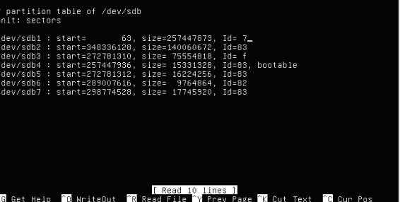
**图 1.1** 一些文本模式程序会接管整个显示界面。

> 第 13 章“理解用户和组”将更详细地描述 Linux 账户，包括 root 账户。

即使你使用图形登录，你也可以在窗口内使用文本模式 shell，这被称为*终端 (terminal)*。常见的 Linux GUI 提供了启动终端程序的能力，该程序提供 shell 提示符以及运行文本模式程序的方法。

### 使用图形用户界面

大多数用户比起文本模式命令，更习惯于使用 GUI。因此，许多现代 Linux 系统默认在 GUI 模式下启动，呈现类似于图 1.2 所示的登录界面。你可以从列表中选择用户名或直接输入，然后输入密码以进行登录。

> **认证目标**
一些 Linux GUI 登录界面在输入有效的用户名之前不会提示你输入密码。

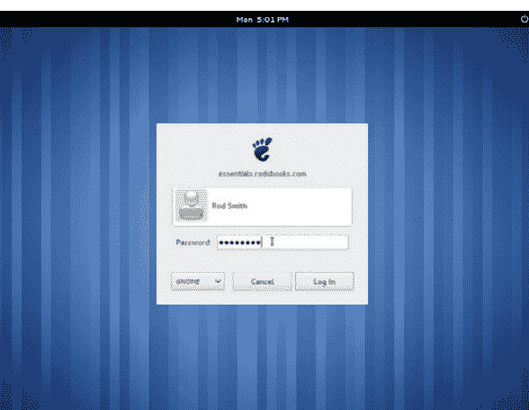
**图 1.2** Linux 上的图形登录界面与 Windows 或 Mac OS X 的类似。

与 Windows 和 Mac OS X 不同，Linux 提供了多种桌面环境。你使用哪一个取决于你使用的具体 Linux 变体、安装时选择的软件选项以及你个人的偏好。常见的选择包括 GNOME、KDE、Xfce 和 Unity。此外还有许多其他选项。在图 1.2 中，你可以在中央对话框的左下角看到桌面环境的选择选项。在图 1.2 中显示的是 GNOME，这意味着如果该项保持不变，计算机将在用户登录时启动 GNOME。

Linux 桌面环境之间看起来可能截然不同，但它们都提供类似的功能。图 1.3 显示了 openSUSE 12.1 安装上的默认 KDE，并且运行着几个程序。第 4 章将更详细地描述常见的桌面环境及其特性，但目前，你应该知道它们都提供如下功能：

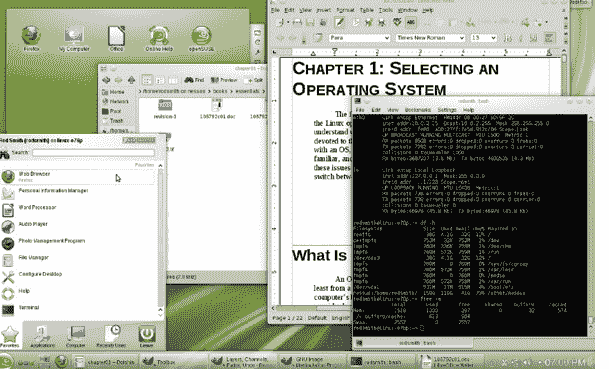
**图 1.3** Linux 桌面环境提供了大多数用户所期望的 GUI 控制类型。

- **程序启动器**：你可以通过从菜单或列表中选择来启动程序。通常，屏幕的顶部、底部或侧边存在一个或多个菜单。在图 1.3 中，你可以点击屏幕左下角的 openSUSE gecko 图标，弹出该图中显示的菜单。
- **文件管理器**：Linux 提供了类似于 Windows 或 Mac OS X 的 GUI 文件管理器。图 1.3 的中心打开了这样一个窗口。
- **窗口控制**：你可以通过点击并拖动标题栏来移动窗口，通过点击并拖动边缘来调整窗口大小，等等。
- **多桌面**：大多数 Linux 桌面环境允许你保持多个虚拟桌面处于活动状态，每个桌面拥有自己的程序集。当你同时运行许多程序时，这个功能对于保持屏幕整洁非常方便。通常，菜单中的一个图标可以让你在虚拟桌面之间进行切换。
- **注销选项**：你可以注销 Linux 会话，从而关闭计算机或让另一个用户登录。

> 在公共计算环境中，注销非常重要。如果你未能注销，陌生人可能会过来并出于恶意目的使用你的账户。

随着你对 Linux 了解的深入，你会发现它的 GUI 环境非常灵活。如果你发现你不喜欢发行版默认的环境，你可以更改它。虽然它们提供的功能相似，但有些人对桌面环境有强烈的偏好。Linux 在这方面给了你 Windows 或 Mac OS X 所不具备的选择权，所以请随意尝试多种桌面环境。

你可能需要安装额外的桌面环境才能使用它们。本话题在本书中不予讨论。

## Linux 在操作系统世界中处于什么位置？

本章的标题暗示了一种比较，由于本书是关于 Linux 的，因此比较的对象必然是非 Linux 操作系统。因此，我将 Linux 与另外三种操作系统或操作系统家族进行比较：Unix、Mac OS X 和 Microsoft Windows。

正如稍后在“什么是发行版？”中所描述的，Linux 可以被认为是一个操作系统家族。因此，你可以将一个 Linux 版本与另一个版本进行比较。

### 将 Linux 与 Unix 进行比较

如果你尝试绘制一个操作系统的“家族树”，你可能会经常感到困惑。这是因为操作系统设计者经常模仿彼此的功能，有时甚至将彼此的代码整合到自己的操作系统运行机制中。结果可能是操作系统之间产生了一团乱麻般的相似性，其原因从巧合到代码“借用”不等。试图映射这些影响可能很困难。但在 Linux 和 Unix 的情况下，可以做一个宽泛的陈述：Linux 是模仿 Unix 构建的。

> **认证目标**

Unix 创建于 1969 年的 AT&T 贝尔实验室。Unix 的历史非常复杂，涉及多次分叉（即代码分裂成两个或多个独立项目），甚至完全独立的代码重写。现代 Linux 系统在很大程度上是克隆 Unix 程序的开源项目，或是针对通用 Unix 的原始开源代码项目的产物。这些项目包括：

开源软件是指你不仅可以运行，还可以自行修改并重新分发的软件。第 2 章“调查 Linux 的原则与哲学”涵盖了有关开源软件的哲学和法律问题。

- **GNU 内核**：Linus Torvalds 在 1991 年将 Linux 内核作为一个业余编程项目创建，但它很快就发展成了远超于此的存在。Linux 内核被设计为与其他 Unix 内核兼容，也就是说它在源代码中使用了相同的软件接口。这使得在 Linux 内核中使用其他 Unix 版本的开源程序变得非常容易。
- **GNU 项目**：GNU's Not Unix (GNU) 项目是自由软件基金会 (FSF) 为开发 Unix 操作系统所有核心元素的开源替代品而做出的努力。到 1991 年，FSF 已经发布了其中最重要的一些工具，唯一的显著例外是内核。（GNU HURD 内核现在已经可用，但不如 Linux 内核受欢迎。）GNU 工具的替代方案包括专有商业工具以及为 BSD Unix 变体开发的开源工具。在类 Unix 操作系统上使用的工具会影响其整体


## Linux 在操作系统世界中处于什么位置？

“口味”，但所有这些工具集都足够相似，使得任何 Unix 变体与非 Unix  Unix 操作系统相比，都具有相似的感受。

**Xorg-X11** X Window 系统是大多数 Unix 操作系统的 GUI 环境。如今大多数 Linux 发行版都使用 Xorg-X11 版本的 X。与 GNU 项目提供的基础文本模式工具一样，X 服务器的选择会影响类 Unix 操作系统的某些特性，例如它支持的字体类型。

**桌面环境** GNOME、KDE、Xfce 以及其他流行的开源桌面环境在很大程度上取代了商业桌面环境，即使在商业版本的 Unix 中也是如此。因此，在这个领域，你不会发现 Linux 和 Unix 之间有很大的区别。

**服务器程序** 从历史上看，Unix 和 Linux 作为服务器操作系统一直很受欢迎——组织使用它们来运行 Web 服务器、电子邮件服务器、文件服务器等等。Linux 运行的流行服务器程序与商业 Unix 版本以及开源 BSD 相同。

**用户生产力程序** 在这个领域，与服务器程序一样，Linux 运行的软件与其他类 Unix 操作系统相同。在少数情况下，Linux 运行的程序更多，或者运行得更好。这主要是因为 Linux 的普及以及它提供的庞大硬件驱动程序库。例如，如果一个程序需要先进的显卡支持，那么在 Linux 上找到这种支持的可能性比在不太流行的类 Unix 操作系统上更高。

总的来说，Linux 可以被认为是类 Unix 操作系统家族的一员。虽然从技术上讲 Linux 不是一个 Unix 操作系统，但它足够相似，以至于与这个家族整体及其他操作系统（如 Windows）之间的差异相比，这些区别并不重要。由于其普及程度，Linux 提供了更好的硬件支持，至少在通用 PC 硬件上是这样。不过，一些 Unix 变体提供 Linux 所缺乏的特定功能。例如，在 Solaris、FreeBSD 和其他一些操作系统上可用的 Zettabyte 文件系统 (ZFS) 提供了先进的文件系统功能，这些功能在 Linux 中尚未完全实现。

> GNU 是一个递归缩写词的例子——即其展开内容中包含该缩写词本身。这是极客幽默的一个例子。

> 稍后将介绍的 Mac OS X 是一种商业 Unix，它抛弃了 X 以及运行在 X 之上的桌面环境，转而采用 Apple 自己的 GUI。

> Linux 也有 ZFS 插件可用，但它并未完全集成到操作系统中。一种名为 Btrfs 的 Linux 文件系统提供了许多 ZFS 功能，但 Btrfs 尚未完成。

## 代码类型

人类以一种被称为*源代码*的形式编写程序。虽然对于外行来说，源代码可能显得深奥，但与计算机运行程序必须采取的形式——*二进制代码*相比，它是非常清晰的。一个被称为*编译器*的程序将源代码翻译成二进制代码。（或者，一些编程语言依赖于*解释器*，它将源代码“即时”转换为二进制代码，从而无需编译源代码。）

> *开源*一词是指源代码的可用性，而商业程序和操作系统通常会对公众隐藏源代码。能够访问程序源代码的程序员可以修复漏洞、添加功能，以及在其他方面更改程序的运行方式。

## Linux 与 Mac OS X 的比较

Mac OS X 是一款基于 Unix 的商业操作系统，它大量借鉴了 BSD，并抛弃了常见的 Unix GUI（即 X），转而采用自己的用户界面。这使得 OS X 在某些方面与 Linux 非常相似，但在另一些方面又截然不同。

你可以打开一个 OS X 终端窗口，输入本书中描述的许多相同命令来实现类似的目的。如果书中描述的某个命令不存在，你可能可以通过某种方式安装它。OS X 随附了一些流行的 Unix 服务器程序，因此你可以将其配置为像 Linux 或其他类 Unix 操作系统一样作为网络服务器计算机工作。

不过，OS X 与 Linux 在用户界面上有所不同。从编程角度看，OS X 的用户界面被称为 *Cocoa*；从用户角度看，则被称为 *Aqua*。它包含的元素大致相当于 Linux 中的 X 和桌面环境。由于 Cocoa 在编程层面与 X 不兼容，因此为 OS X 开发的应用程序不能直接在 Linux（或其他类 Unix 操作系统）上运行，而将它们移植（即修改源代码并重新编译）到 Linux 是一个艰巨的任务。因此，原生的 OS X 应用程序很少迁移到 Linux。

OS X 包含一个运行在 Aqua 之下的 X 实现。这使得将 GUI Linux 和 Unix 程序转移到 OS X 变得相对简单。不过，由此产生的程序并不完全符合 Aqua 用户界面。与 OS X 的同等程序相比，它们的按钮、菜单和其他功能可能看起来格格不入。

Apple 将 OS X 提供给其自有计算机。其许可条款禁止安装在非 Apple 硬件上，而且即使抛开许可问题，在非 Apple 硬件上安装 OS X 也是一项艰巨的任务。OS X 的一个变体 iOS 运行在 Apple 的 iPad 和 iPhone 设备上，同样无法移植到其他设备。因此，OS X 在很大程度上被限制在 Apple 硬件中。相比之下，Linux 运行在各种硬件上，包括大多数 PC。你甚至可以在 Macintosh 计算机上安装 Linux。

**认证目标**

> X server 中的 X 是字母 X，但 OS X 中的 X 是罗马数字 (10)，代表 Mac OS 的第十个版本。

## Linux 与 Windows 的比较

如今大多数台式机和笔记本电脑运行的是 Microsoft Windows。因此，如果你在考虑运行 Linux，最可能的比较对象就是 Windows。广义上讲，Linux 和 Windows 具有相似的功能；然而，在细节上存在显著差异。这些差异包括以下内容：

**认证目标**

**许可** Linux 是一个开源操作系统，而 Windows 是一个专有的商业操作系统。第 2 章将更详细地讨论开源问题，但目前你应该知道，开源软件比专有软件能让你对计算机拥有更大的控制权——至少在理论上是这样。在实践中，你可能需要大量的专业知识才能利用开源的优势。如果你在一家只习惯于以传统方式销售软件的组织工作，那么专有软件可能会更合适。（不过，一些 Linux 变体也以类似的方式销售，并附带服务合同。）

**成本** 许多 Linux 变体是免费提供的，因此如果你试图降低成本，它们会非常有吸引力。另一方面，安装和维护 Linux 所需的专业知识可能比安装和维护 Windows 所需的专业知识更多，因此成本更高。关于 Linux 与 Windows 总拥有成本问题的不同研究结果不一，但大多数倾向于支持 Linux。

**硬件兼容性** 大多数硬件组件需要操作系统的支持，通常是以驱动程序的形式。大多数硬件制造商为他们的设备提供 Windows 驱动程序，或与 Microsoft 合作确保 Windows 包含适当的驱动程序。虽然一些制造商也提供 Linux 驱动程序，但在很大程度上，必须由整个 Linux 社区提供必要的驱动程序。这意味着 Linux 驱动程序在设备上市后可能需要几周甚至几个月才会出现。另一方面，Linux 开发人员维护旧硬件驱动程序的时间通常比制造商支持其自有旧硬件的时间长得多。因此，在旧硬件上，现代 Linux 的运行效果可能比最新版本的 Windows 更好。Linux 往往也占用资源较少，因此在使用 Linux 时，你可以在较旧的硬件上高效工作。

**软件可用性** 一些流行的桌面应用程序（如 Microsoft Office）在 Windows 上可用，但在 Linux 上不可用。虽然有 OpenOffice.org 或 LibreOffice 等 Linux 替代方案，但它们在公众心中的认可度尚未达到同样的高度。在其他领域，情况则相反。流行的服务器程序（如 Apache Web 服务器）最初是为 Linux 或 Unix 开发的。


虽然 Windows 上有许多此类服务器可用，但它们在 Linux 上运行效率更高。如果您必须运行某个特定程序，您可能需要研究该程序在您考虑的任何平台上的可用性和实用性。

微软在 Windows 8 中对其用户界面进行了重大更改。全新的用户界面 Metro 在从手机到台式机的所有设备上运行方式均相同。

**用户界面** 与 Mac OS X 类似，Windows 使用其独特的用户界面。这一事实导致了较低的跨操作系统可移植性。（不过，目前已存在一些有助于弥补这一差距的工具；例如，可用于 Windows 的 X Window 系统实现，以及在 Linux 中运行 Windows 程序的工具。）一些用户比起任何 Linux 桌面环境更喜欢 Windows 用户界面，但另一些用户则更偏好 Linux 桌面环境。

**可配置性** Linux 是一个比 Windows 可配置性强得多的操作系统。虽然两种操作系统都提供了在启动时运行特定程序、更改用户界面主题等手段，但 Linux 的开源特性意味着您可以调整任何您想要的细节。此外，您可以选择任何您喜欢的 Linux 变体，以便按照您的意愿在设置系统时获得领先起步。

**安全性** 每种操作系统的支持者都声称其比另一种更安全。他们之所以能这么说，是因为他们关注的安全问题不同。Windows 面临的许多威胁来自病毒，而病毒在很大程度上针对的是 Windows 及其庞大的安装用户群。对于 Linux 来说，病毒基本上不是问题；在 Linux 中，安全威胁主要来自涉及配置错误服务器或不可信本地用户的入侵。

十年来，Windows 一直主导着桌面领域。无论是在家庭还是办公室，用户都已经熟悉了 Windows，并且习惯于使用流行的 Windows 应用程序，如 Microsoft Office。虽然 Linux 也可以在这些环境中使用，但由于多种原因，它不是一个受欢迎的选择——包括其陌生感、大多数 PC 预装 Windows 这一事实，以及对于大多数用户来说缺乏任何具有吸引力的 Linux 独有应用程序。

另一方面，广义上的 Unix，尤其是 Linux，已经主导了服务器市场。Linux 为构成互联网的 Web 服务器、电子邮件服务器、文件服务器等提供动力，许多企业依赖这些服务器来提供本地网络服务。因此，大多数人每天都在使用 Linux，即使他们没有意识到这一点。

在大多数情况下，在计算机上使用 Linux 或 Windows 都能完成可接受的工作。然而，有时特定的需求决定了必须使用其中一种操作系统。例如，您可能需要运行某个特定的稀有程序，或者您的硬件对于现代 Windows 来说太旧，或者对于 Linux 来说太新。在其他情况下，您或您的用户对其中一种操作系统的熟悉程度可能会使其成为首选。

## 什么是发行版？

到目前为止，我将 Linux 描述为单一的操作系统，但事实并非如此。目前有许多不同的 Linux *发行版（distributions）*，每个发行版由一个 Linux 内核以及一组实用程序和配置文件组成。其结果是一个完整的操作系统，而两个 Linux 发行版之间的差异可能像它与 OS X 甚至 Windows 之间的差异一样大。因此，我将更详细地描述什么是发行版、哪些发行版比较流行，以及发行版维护者如何保持其产品的更新。

### 创建一个完整的基于 Linux 的操作系统

我已经描述了组成 Linux 操作系统的部分内容，但某些细节需要重申或详述：

**认证目标**

- **Linux 内核** 当然，Linux 内核是任何 Linux 操作系统的核心。我将此项写为 *Linux* 内核，是因为 Linux 内核在不断演进。两个不同的发行版可能会使用略有不同的内核。发行版维护者还经常 *修补（patch）* 内核——也就是说，他们进行微小更改以修复 Bug 或添加功能。
- **核心 Unix 工具** 诸如 GNU 工具集、X Window 系统以及用于管理磁盘的实用程序等工具，对于 Linux 系统的正常运行至关重要。大多数 Linux 发行版包含大致相同的一组此类工具，但与内核一样，它们的版本和补丁可能会有所不同。
- **补充软件** 大多数 Linux 发行版随附额外的软件，例如主要的服务器程序、桌面环境和生产力工具。与核心 Unix 软件一样，大多数 Linux 发行版为这类软件提供类似的选项。不过，发行版有时会提供自己的“品牌化”设计，尤其是在桌面环境的图形界面上。
- **启动脚本** Linux 发行版的很大一部分“个性”来自于它管理启动过程的方式。Linux 使用脚本和实用程序来启动数十个程序，这些程序将计算机连接到网络、呈现登录提示等。这些脚本和实用程序在不同发行版之间有所不同，这意味着它们具有不同的功能，并且可以用不同的方式进行配置。
- **安装程序** 软件必须安装后才能使用，大多数 Linux 发行版提供独特的安装软件，以帮助您管理这项重要任务。因此，两个发行版的安装方式可能截然不同，在磁盘布局和初始用户账户创建等关键功能上为您提供不同的选项。

UNetbootin 工具 (http://unetbootin.sourceforge.net) 可以将 Linux 安装光盘镜像文件中的文件复制到 USB 闪存驱动器中。

通常，Linux 发行版可以从其网站下载。您通常可以下载一个 CD-R 或 DVD 镜像文件，然后将其刻录到光盘上。当您启动 resulting 光盘时，安装程序会运行，随后您就可以安装操作系统。如果您的计算机没有光驱，有时您可以下载一个可以复制到 USB 闪存驱动器的镜像。

一些 Linux 安装程序随附了您可能安装的所有软件。另一些则仅包含极简软件，并要求您拥有可用的互联网连接，以便安装程序可以下载额外软件。如果您的计算机没有连接到互联网，请确保获取正确类型的安装程序。

## 常见 Linux 发行版汇总

**认证目标**

取决于您的计算方式，大约有十几个面向桌面、笔记本和小型服务器计算机的主要 Linux 发行版，以及数百个服务于专门用途的发行版。表 1.1 总结了最重要发行版的特点。

**表 1.1 主要 Linux 发行版的特点**

| 发行版 | 可用性 | 软件包格式 | 发布周期 | 管理员技能要求 |
| :--- | :--- | :--- | :--- | :--- |
| Arch | 免费 | pacman | 滚动更新 | 专家 |
| CentOS | 免费 | RPM | 约 2 年 | 中级 |
| Debian | 免费 | Debian | 2 年 | 中级至专家 |
| Fedora | 免费 | RPM | 约 6 个月 | 中级 |
| Gentoo | 免费 | ebuild | 滚动更新 | 专家 |
| Mandriva | 免费 | RPM | 1 年 | 中级 |
| openSUSE | 免费 | RPM | 8 个月 | 中级 |
| Red Hat Enterprise | 商业 | RPM | 约 2 年 | 中级 |
| Slackware | 免费 | tarballs | 不定期 | 专家 |
| SUSE Enterprise | 商业 | RPM | 2-3 年 | 中级 |
| Ubuntu | 免费 | Debian | 6 个月 | 初级至中级 |

这些特点需要进一步解释：

**可用性** 大多数 Linux 发行版完全是开源或自由软件；然而，有些包含专有组件并收费销售，通常附带支持合同。Red Hat Enterprise Linux (RHEL) 和 SUSE Enterprise Linux 是这类发行版最著名的两个例子。两者都有完全免费的“亲戚”。对于 RHEL，CentOS 是一个省略了专有组件的近乎克隆版，而 Fedora 是一个开源版本，作为可能最终被纳入 CentOS 的技术的测试平台。对于 SUSE Enterprise，openSUSE 是一个免费的替代方案。

**软件包格式** 大多数 Linux 发行版以 *软件包（packages）* 形式分发软件，软件包是将许多文件集合在一起的单一文件。软件包软件维护着一个已安装文件的本地数据库，使得升级和卸载变得简单。RPM 软件包管理器 (RPM) 系统在 Linux 世界中最受欢迎，但 Debian 软件包也非常常见。其他打包系统运行良好，但仅限特定发行版。Slackware 比较特殊，它使用 *tarballs* 作为软件包。这些是由标准 tar 工具创建的软件包文件，该工具用于备份计算机和分发源代码等。Slackware 将 tarballs 用于其软件包，其中包含 Slackware 特有的信息以帮助进行软件包管理。Gentoo 也很特殊，因为它的软件包系统基于从源代码编译大多数软件。这虽然耗时，但允许经验丰富的管理员调整编译选项，以针对其自身的硬件和软件环境优化软件包。

> Tarballs 类似于 Windows 上常见的 zip 文件。第 10 章“搜索、提取和存档数据”描述了如何创建和使用 tarballs。

**发布周期** 我将在接下来的“理解发布周期”部分详细描述发布周期。通常情况下，发布周期短的发行版旨在提供尽可能最新的软件，而发布周期较长的发行版则努力追求

以提供尽可能稳定的环境为目标。有些发行版试图兼顾两者；例如，Ubuntu 在偶数年的 4 月发布长期支持 (LTS) 版本，而其他版本则旨在提供最新的软件。

## 管理员技能要求

表 1.1 的最后一列提供了我对管理某个发行版所需技能水平的个人评估。如你所见，我将大多数 Linux 发行版的管理要求描述为“中级”技能。然而，有些发行版提供的用户友好型 GUI 管理工具较少，因此需要更高的技能。Ubuntu 则旨在使其特别易于使用和管理。

大多数 Linux 发行版至少支持两个平台——即 CPU 类型：x86（也称为 i386, i486, i586 及其几种变体）和 x86-64（也称为 AMD64, EM64T 和 x64）。直到 2007 年左右，x86 计算机是最常见的类型，但最近 x86-64 计算机已成为标准。如果你拥有一台 x86-64 计算机，你可以运行 x86 或 x86-64 发行版，尽管后者能提供少许的速度提升。此外，还有 PowerPC、Alpha 和 SPARC 等更冷门的平台。这类平台大多仅限于服务器和专用设备（稍后介绍）。

除了主流的 PC 发行版外，还有几个用于更专业目的的发行版。其中一些运行在普通 PC 上，而另一些则运行在专门的硬件上：

### Android

许多手机设备使用一种名为 Android 的基于 Linux 的操作系统。其用户界面与其他智能手机类似，但在底层运行着 Linux 内核以及大量你在 PC 上能找到的相同 Linux 基础设施。不过，这类手机不使用 X 或典型的桌面应用程序，而是运行专为手机设计的应用程序。

### 网络设备

许多宽带路由器、打印服务器以及其他插入本地网络执行特定任务的设备都运行 Linux。如果你想为设备添加功能，有时可以用定制的操作系统替换标准操作系统。Tomato (http://www.polarcloud.com/tomato) 和 OpenWrt (https://openwrt.org) 就是这类定制 Linux 发行版的两个例子。不过，不要心血来潮地安装此类软件；如果操作不当或安装在错误的设备上，可能会导致设备失效！

### TiVo

这款流行的数字视频录像机 (DVR) 使用 Linux 内核和大量标准支持程序，以及专有驱动程序和 DVR 软件。虽然许多使用者没有意识到，但其表面之下其实是基于 Linux 的计算机。

### Parted Magic

这个基于 http://partedmagic.com 的发行版是一款面向 PC 的 Linux 发行版，旨在用于紧急恢复操作。它运行在单张 CD-R 上，如果主系统无法启动，你可以使用它来访问 Linux 或 Windows 硬盘。

> 不要被大多数发行版的“中级”分类吓到。本书的目的是帮助你管理这些发行版的核心功能。

> Android 以手机操作系统而闻名，但它也可以用于其他设备。例如，某些电子书阅读器就运行 Android。

> 我建议你下载 Parted Magic 或类似的工具，以便在主 Linux 安装出现问题时能够应对。

Android、基于 Linux 的网络设备和 TiVo 都是使用 Linux 的*嵌入式系统*的例子。此类设备通常不需要用户进行多少（或不需要）管理工作，至少不是以本书中描述的任务方式进行。相反，这些设备具有固定的基础配置和引导式设置工具，以帮助没经验的用户设置关键的基础选项，如网络设置和时区。

> 认证目标

## 理解发布周期

表 1.1 总结了几个常用 Linux 发行版采用的发布周期。表中引用的数值是两次发布之间的时间间隔。例如，Ubuntu 的新版本每六个月准时发布。大多数其他发行版的发布计划则有一定的“缓冲空间”；如果发布日期推迟一个月，通常是可以接受的。

> 认证目标

发行版在发布后，通常会一直受到支持，直到下一个版本发布后的*某个时间点*——通常是几个月到一年或更长时间。在支持期间，发行版的维护者会提供软件更新以修复 bug 和安全问题。一旦支持期结束，你仍可以继续使用该发行版，但只能靠自己——如果你需要更新的软件，你必须自己从源代码编译，或者希望能在其他来源找到兼容的二进制包。因此，从实际操作来看，在支持期结束前升级到最新版本通常是个好主意。这一事实使得发布周期较长的发行版对企业更具吸引力，因为安装间隔越长，与升级相关的干扰和成本就越低。

表 1.1 中的两个发行版（Arch 和 Gentoo）具有*滚动*发布周期。这类发行版在通常意义上没有版本号；相反，升级以持续的方式进行。使用这类发行版无需进行完整的系统升级（以及随之而来的各种麻烦）；不过，你偶尔需要对某个特定的子系统进行具有破坏性的升级，例如桌面环境的大版本升级。

在发布新版本之前，大多数发行版会提供预发布版本。*Alpha 软件*非常新，极有可能包含严重的 bug，而 *beta 软件*则更稳定，但仍然比最终发布版更容易包含 bug。通常情况下，除非你想通过报告 bug 为开发工作做出贡献，或者极度渴望某个新功能，否则应避免使用此类软件。

> 认证目标

## 核心要点与延伸

Linux 是一个强大的操作系统，你可以将其应用于从手机到超级计算机的所有设备。Linux 的核心是其*内核*，用于管理计算机硬件。在内核之上构建了各种实用程序（许多来自 GNU 项目）和用户应用程序。Linux 是 Unix 操作系统的克隆，两者共享许多程序。Mac OS X 是另一个 Unix 操作系统，尽管它拥有独特的用户界面。虽然 Windows 与 Unix 共享许多特性，但它是一个完全不同的操作系统，因此 Linux 和 Windows 之间的软件兼容性有限。Linux 有许多变体，称为发行版，每个发行版都有其独特的“风格”。由于这种多样性，你可以根据易用性、发布周期和其他独特功能，选择最适合你需求的 Linux 版本。

### 建议练习

- 列出你作为普通用户运行的程序清单，包括从计算器小工具到大型办公软件的所有内容。在 http://www.linuxrsp.ru/win-lin-soft/table-eng 或 http://www.linuxalt.com 查找对应的替代软件。是否有你找不到的？如果有，尝试通过网络搜索寻找替代品。
- 通过浏览网页，进一步了解两到三个 Linux 发行版。如果要运行一个大型 Web 服务器，你会选择哪个发行版？对于从事文字处理和电子邮件工作的办公室职员，哪个发行版看起来最吸引人？

### 复习题

1. 以下哪项*不是* Linux 内核的功能？
    A. 为程序使用分配内存
    B. 为程序使用分配 CPU 时间
    C. 在 GUI 程序中创建菜单
    D. 控制对硬盘的访问
    E. 使程序能够使用网络

2. 以下哪个是嵌入式 Linux 操作系统的例子？
    A. Android
    B. SUSE
    C. CentOS
    D. Debian
    E. Fedora

### 核心要点与延伸（续）

3. 以下哪个是 Linux 和 Mac OS X 之间的显著区别？
    A. Linux 可以运行常见的 GNU 程序，而 OS X 不行。
    B. Linux 的 GUI 基于 X Window 系统，而 OS X 则不是。
    C. Linux 不能运行在 Apple Macintosh 硬件上，而 OS X 只能运行在 Apple 硬件上。
    D. Linux 严重依赖 BSD 软件，而 OS X 不使用任何 BSD 软件。
    E. Linux 支持文本模式命令，而 OS X 是纯 GUI 操作系统。

4. 正确或错误：Linux 内核衍生自 BSD 内核。

5. 正确或错误：如果你以图形模式登录 Linux 系统，在该会话中无法使用文本模式命令。

6. 正确或错误：CentOS 是一个具有长发布周期的 Linux 发行版。

7. Linux 文本模式的登录提示符显示为 __________（一个单词）。

8. Windows 中一个常见且在 Linux 中基本不存在的安全问题是 __________。

9. 可能包含 bug 的预发布软件被称为 __________ 和 __________。


## 第 2 章
## 探究 Linux 的原理与哲学

**你经常可以**纯粹基于实用主义地选择某种产品或技术——例如，对于给定任务哪个操作系统（OS）运行良好，哪套软件套件最便宜等等。然而，有时理解一项技术背后的原理和哲学会很有用，甚至能引导你的选择。对于一些 Linux 用户来说确实如此：我在第一章“选择操作系统”中介绍的 Linux 开源模型，其影响会波及 Linux 的运行方式。此外，Linux 世界中的一些人会对这些原理持有相当狂热的态度。无论你是否同意这些人的观点，理解他们的视角都能帮助你欣赏在职场、网络、会议等场合中会遇到的 Linux 文化。

本章将涵盖这些议题，首先介绍 Linux 的起源以及从那时起直到现在的发展历程。接着，我将描述开源原则及其在现实世界中如何影响开源操作系统的运行方式。最后，我将描述 Linux 可以承担的一些角色——作为嵌入式操作系统、桌面或笔记本操作系统，以及服务器操作系统。

- 纵观 Linux 的历史
- 使用开源软件
- 理解操作系统的角色

## 纵观 Linux 的历史

尽管按照大多数历史标准来看，Linux 诞生于 1991 年较为近期，但在计算机世界里，20 年已是一个永恒。尽管如此，20 世纪 90 年代初甚至更早之前的软件和文化，对今天的软件世界留下了深远的遗产。毕竟，我们今天所使用的一切都构建在过去创建的基础之上。因此，回顾 Linux 的起源将有助于你理解今天的 Linux。

## 理解 Linux 的起源

在 1991 年，就像今天一样，计算机是按其尺寸和能力分类的。计算机可以属于几个类别中的任何一个，范围从桌面个人计算机（PC）到超级计算机。1991 年的 PC 市场由基于 x86 的计算机主导，它们是今天 PC 的直接祖先；不过，当时也有其他类型的 PC，例如 Macintosh。这类计算机通常使用不同的 CPU 并运行各自定制的操作系统。

1991 年，大多数 PC 运行的是微软的磁盘操作系统（MS-DOS, PC-DOS 或 DOS）。按照今天的标准，DOS 极其有限：它是一个单任务操作系统，未能充分利用当时可用的内存或 CPU。1991 年可用的 Microsoft Windows 版本运行在 DOS 之上。虽然 Windows 帮助解决了 DOS 的一些局限性，但并没有从根本上修复其中任何一项。例如，这些早期的 Windows 版本采用了 *协作式多任务处理（cooperative multitasking）*，在这种模式下，程序可以自愿将 CPU 时间让给其他进程。DOS 内核无法从霸占 CPU 时间的程序中强行夺回控制权。

在 PC 级别之上，Unix 世界在 1991 年是一个常见的操作系统。与当时的 DOS 和 Windows 相比，Unix 是一个成熟的操作系统。Unix 支持多用户账户并提供 *真正的抢占式多任务处理（true preemptive multitasking）*，其中内核可以为程序调度 CPU 时间，即使程序没有自愿放弃控制权。对于许多服务器以及小型机和大型机等多用户计算机来说，这些功能是实际需求。

随着时间的推移，每一类计算机的能力都在增长。根据大多数衡量标准，今天的 PC 拥有 1991 年小型机甚至大型机的能力。1991 年 PC 上使用的操作系统无法很好地扩展到更强大的硬件上，而今天的 PC 已经足够强大，可以运行 1991 年那些更复杂的操作系统。因此，DOS 及其同时代的小型计算机操作系统在很大程度上已被抛弃，取而代之的是 Unix 或其他替代方案。

1991 年，Linus Torvalds 是赫尔辛基大学的一名计算机科学专业的学生。他感兴趣于学习 Unix 以及他刚刚购买的新 x86 计算机的能力。Torvalds 开始将后来成为 Linux 内核的项目作为一个低级终端模拟器——一个用于连接大学里大型计算机的程序。随着程序的增长，他开始添加功能，将他的终端程序变成了更适合被描述为操作系统内核的东西。最终，他开始以创建 Unix 兼容内核为目标进行编写——也就是说，一个能够运行当时广泛可用的 Unix 软件的内核。

而 Unix 的历史则进一步追溯到二十年前，即 1969 年在 AT&T 的起源。因为 AT&T 当时是美国的电话垄断公司，法律禁止其销售软件。因此，当其员工创建 Unix 时，AT&T 基本上将该操作系统免费赠送了。大学对于采用 Unix 特别热情，而且由于 AT&T 提供了源代码，一些大学开始对其进行修改。因此，Unix 拥有长达二十年的开放软件开发历史。大多数 Unix 程序以源代码形式分发，因为 Unix 运行在多种硬件平台上——为一台机器制作的二进制程序很少能在不同的机器上运行。

> 今天的计算机可以用与 1991 年基本相同的方式进行分类，尽管一些细节有所变化。一个显著的增加是嵌入式计算机，如手机。

> Unix 并不是 1991 年唯一的多用户、多任务操作系统。当时还有其他系统，如虚拟内存系统 (VMS)。不过，Unix 与 Linux 的历史最相关。

> 今天的 Windows 版本并非衍生自 DOS。相反，它们使用了一个与 VMS 共享许多设计特性的新内核。

在早期，Linux 开始利用这个现成的软件资源库。如第 1 章所述，早期的 Linux 开发者对 GNU's Not Unix (GNU) 项目的软件特别感兴趣，因此 Linux 迅速积累了一套 GNU 工具集。这些软件中的很多是针对工作站和更强大的计算机编写的，但由于计算机硬件不断提高，它们在 20 世纪 90 年代初的 x86 PC 上运行良好。

Linux 迅速获得了一批忠实开发者的追随，他们看到了将工作站级软件带到 PC 上的潜力。这些人致力于改进 Linux 内核，对现有的 Unix 程序进行必要的修改使其能在 Linux 上运行，并编写 Linux 特有的支持程序。到 90 年代中期，出现了几个 Linux 发行版，其中一些一直延续至今。（例如，Slackware 发布于 1993 年，Red Hat 发布于 1995 年。）

> 386BSD 操作系统是 90 年代初一个竞争的类 Unix 操作系统。如今它已分叉为几个相关的操作系统：FreeBSD, NetBSD, OpenBSD, Dragonfly BSD 和 PC-BSD。

## 微内核之争

Linux 是宏内核（monolithic kernel）的一个例子，这种内核是在一个大进程中完成内核所应该完成的所有工作。1991 年，一种名为微内核（microkernel）的竞争性内核设计风靡一时。微内核比宏内核小得多；它们将尽可能多的任务移至非内核进程中，然后管理进程之间的通信。

在 Linux 发布后不久，Linus Torvalds 与 Andrew Tanenbaum 进行了公开辩论，后者是 Minix 操作系统的创建者，而 Torvalds 早期将 Minix 作为 Linux 的开发平台。Minix 使用微内核设计，Tanenbaum 认为 Linux 的宏内核设计是过时的。

从最终用户的实际使用来看，两种设计都可行。Linux 和 BSD 衍生内核使用宏内核设计，而现代版本的 Windows、GNU HURD 和 Minix 则是微内核的例子。不过，有些人仍然会对这个区分感到激动。

## 审视今天的 Linux 世界

到 90 年代中期，今天 Linux 所具备的最重要特性已经确立。此后的变化包括：

- **内核的改进**：Linux 内核自 1991 年以来发生了巨大的变化，当时它缺乏许多我们今天依赖的功能。改进包括增加了网络功能、无数的硬件驱动程序、对电源管理功能的支持以及对许多非 x86 CPU 的支持。
- **支持工具的改进**：正如 Linux 内核在不断进步，它所依赖的支持程序（编译器、Shell、GUI 等）也得到了改进。
- **新支持工具的创建**：多年来出现了新的支持工具。这些工具从简单的小实用程序到庞大的桌面环境不等。事实上，其中一些工具（如现代桌面环境）对于最终用户来说比内核本身要直观得多。
- **新发行版的创建**：如前所述，Slackware 可追溯到 1993 年，Red Hat（Red Hat Enterprise Linux, CentOS 和 Fedora 的前身）起源于 1995 年。在随后的几年中，其他发行版也相继出现，其中一些非常重要。例如，智能手机和平板电脑上使用的 Android 操作系统在 2010 年代初变得极具影响力。

Linux 的根基依然深深植根于 20 世纪 80 年代和 90 年代的开源软件中。虽然典型的桌面或嵌入式操作系统用户可能会通过 GUI 的视角来感知操作系统，但在底层发生的许多事情都是由 Linux 内核和开源工具驱动的，其中许多工具已经存在了几十年。

## 使用开源软件

支撑 Linux 大部分软件开发的哲学与驱动大多数 Windows 软件开发的哲学不同。这些不同的哲学影响了你如何获取软件、你可以用它做什么以及它如何随时间演变。因此，我将描述这些原则。我还将描述 Linux 如何扮演一种“磁铁”的角色，将来自许多来源的软件整合在在一起。

### 理解开源基本原则

广义上讲，软件可以被描述为有几种不同的形式，每种形式在付费、重新分发和用户权利方面都有不同的预期。


类别的数量取决于分析的深度以及分类者的主观见解，但作为起点，分为四个类别即可：

**商业软件 (Commercial software)** 个人或公司开发商业软件的目的是为了通过销售获利。商业源代码软件的开发人员通常会对源代码保密，这意味着用户通常无法对软件进行更改，除非修改软件支持的配置设置。过去，商业软件在商店销售或通过邮购销售，但如今通常通过互联网下载销售。重新分发商业软件通常是违法的。Microsoft Windows 和 Microsoft Office 都是商业软件的常见示例。

**共享软件 (Shareware software)** 从法律角度来看，*共享软件* 与商业软件类似，因为它拥有版权且作者要求付费。不同之处在于，共享软件通过互联网或其他方式分发，并基于“荣誉制度”进行“销售”——如果你在试用期之后继续使用该软件，你应该向作者付费。共享软件在 1991 年很常见，如今依然存在，但已少见得多。

> 不要将免费软件 (Freeware) 与自由软件 (free software) 混淆，后者与开源软件密切相关。第 3 章“理解软件许可”将更详细地描述自由软件。

**免费软件 (Freeware)** 免费软件和共享软件一样，可以免费获取。但与共享软件作者不同，免费软件的作者不要求付费。有时，免费软件是功能更完整的共享软件或商业程序的简化版本。另一些时候，作者将其免费提供是为了推广另一种产品。示例包括许多硬件设备的 Windows 驱动程序，或用于阅读便携式文档格式 (PDF) 文件的 Adobe Reader 程序。与商业程序和共享软件一样，免费软件通常不提供源代码。

**开源软件 (Open source software)** 开源软件由一组十项原则定义，详见 http://www.opensource.org/docs/oss。其中最重要的原则是用户重新分发程序的权利、源代码的可获取性，以及用户制作并分发程序修改版本的权利。这些原则意味着用户可以根据自己的需求修改开源程序，即使是以原作者不支持的方式或出于原作者不支持的目的。

> 认证目标

每个类别中都存在变体，以及不完全属于任何类别的混合体。例如，开源倡议组织 (Open Source Initiative) 维护着一份其认可的符合标准的许可列表 (http://www.opensource.org/licenses)；然而，开发人员有时会使用晦涩的许可，或使用强加了某些条件的许可，而这些条件违反了开源倡议组织中一些较为冷门的规则。此类软件在技术上不属于开源，但它可能比属于其他类别更接近开源。

> 第 3 章将更详细地介绍具体的开源许可证。

## 第 2 章 • 探讨 Linux 的原理与哲学

开源软件背后的基本理念是，以透明方式开发的软件可能优于以封闭方式开发的软件。这种优越性（以及针对它的反驳观点）体现在几个方面：

**更好的代码** 将源代码向广大社区开放，意味着任何感兴趣的方都可以对其进行审查、评判和改进。原本晦涩的 bug 可能会被发现并修复，而这些 bug 在闭源产品中可能会长期存在并引发问题。另一方面，这一主张的有效性并未得到研究的充分支持，且小型项目可能无法获得其他程序员的大量关注，因此可能无法从外部代码审查中获益。

> 这一原则有时被称为“Linux 之法”，由 Eric S. Raymond 在《大教堂与集市》中提出：“只要有足够的眼睛，所有的 bug 都是浅显的。”

**更高的灵活性** 通过向用户提供源代码，开源项目赋予了用户根据自身需求定制软件的能力。如果用户将更改提交回维护者，或将其作为项目的新分支发布，那么每个人都能从这些更改中受益。当然，批评者会认为，这种灵活性仅对那些拥有必要技能和时间进行修改的人，或有资金雇人进行修改的人才有益。

**更低的成本** 虽然开源定义并不禁止软件销售，但重新分发的要求意味着开源软件最终能够免费获取。另一方面，如果你需要支持，可能需要购买支持合同，这可能会减少或抵消成本优势。

**缺乏供应商锁定** 一些专有产品的开发人员，尤其是非常流行产品的开发人员，可以通过使用专有文件格式或标准且不支持更开放的标准，来给竞争产品制造困难。开源工具较少受到此类问题的影响，因为即使最初不支持开放标准，它们也可以被修改以支持开放标准。不过从实际操作来看，即使是专有的文件格式和协议通常也会被反向工程，因此供应商锁定通常是一个暂时的问题而非永久性问题。

当然，在 Linux 社区中，普遍共识是这些因素中的每一个都是 Linux 以及广义上开源软件的真实优势；相比之下，上述缺点通常被认为是很小的。最终，在使用了不同类型的软件后，你需要对这些问题做出自己的判断。

## Linux 作为软件集成商

在 Unix 创建后不久，该操作系统就分裂成了一组松散关联的 OS。这些 OS 在二进制层面上是不兼容的，但在源代码层面上或多或少是兼容的。这一点在今天依然成立。你可以获取同一个程序并为其在 FreeBSD、OS X 和 Linux 上进行编译，它在所有三个平台上运行效果相同——但为某个平台编译的二进制文件无法在其他平台上运行。

不过，这个规则也有例外。有些程序依赖于仅在某些类 Unix OS 上可用的特性。另一些程序则有一些特性，导致无法在某些 OS 上编译。如果一个程序不再被使用，它在较新的 OS 上可能会变得无法使用，因为它依赖于已经改变的编译器或 OS 特性。这类问题往往会随着时间的推移而解决，但它们确实会定期出现。

由于 Linux 的流行，大多数开源 Unix 程序在 Linux 上都能顺利编译并运行。虽然大多数 Linux 商业程序都比较冷门或专业化，但它们确实存在。无论如何，Linux 已成为大多数开源 Unix 程序必须支持的 OS。这种影响如此之强，以至于许多项目现在将 Linux 作为主平台。

## 理解 OS 角色

计算机在世界上承担许多角色，随着计算机变得更加普及且价格降低，这些角色也随之增加。Linux 可以担任大多数这些角色的 OS，每个角色都依赖于其自己的支持实用程序子集。其中一些角色还需要对内核本身进行调整。我简单描述其中三个角色：嵌入式计算机、台式和笔记本计算机，以及服务器计算机。

### 理解嵌入式计算机

正如第 1 章所述，嵌入式计算机是为了实现特定目的而设计的专用设备。示例包括：

- **手机** 现代手机使用的计算机 OS 复杂度不等，从简单到复杂。Linux 为其中一些手机提供动力，通常以 Android 的形式存在。
> **认证目标**
Apple、Microsoft 和其他供应商为手机提供自己的 OS。

- **电子书阅读器** 这些设备与手机一样，是专用计算机，因此使用 OS 来驱动。对于许多目前的电子书阅读器来说，该 OS 是 Linux——要么是自定义的 Linux 版本，要么是 Android。

- **DVR (数字视频录像机)** 数字视频录像机 (DVR) 用于记录电视节目以便稍后观看，它们是带有专用软件的计算机。其中一些（包括流行的 TiVo 型号）运行 Linux。

- **车载计算机** 汽车包含计算机已有多年。这些计算机大多被隐藏起来，用于监控和控制发动机；然而，现代汽车越来越多地配备了用户更容易将其识别为计算机的设备。它们管理全球定位系统 (GPS) 导航系统，控制收音机，甚至提供互联网访问。

- **家用电器** 电视、冰箱和其他电器越来越多地使用计算机来监控能源使用情况以及实现其他目的。

你可能认为平板电脑也属于这一类别，尽管它们更像台式或笔记本计算机。其区别主要在于用户对 OS 的控制程度；嵌入式设备被设计为由最终用户使用，而不是由其维护。本书中描述的系统管理任务是在工厂完成的，或者通过简单得多且更专业的用户界面完成的。

### 理解台式和笔记本计算机

Linux 起步于台式计算机，虽然 Linux 远未主导该市场，但台式计算机是开始学习 Linux 的一个好方法。从系统管理的角度来看，笔记本计算机与台式计算机类似；这两类计算机通常由少数人用于生产力任务，如文字处理、网页浏览和管理数字照片。为了简洁起见，从现在起我将使用 *desktop* (台式机) 一词来指代这两类计算机。

用于此类任务的 Linux 软件广泛可用且质量相当不错，尽管有些人更喜欢商业对应产品，如 Microsoft Office 或 Adobe Photoshop，而这些产品在 Linux 上不可用。对少数特定商业产品的这种偏好，是 Microsoft Windows 继续主导桌面市场的部分原因。有些人推测，开源开发模式不利于创建流行的 GUI 应用程序，因为软件开发人员往往过于倾向于技术，而不能充分体会技术能力较低用户的需求。如果没有一种明确的方式要求开发人员满足这些需求（而营利公司能做到这一点），开源软件项目在可用性方面就会落后于其商业对应产品。这种观点并不

> MyTV 软件包 (http://www.mythtv.org) 可以将一台普通的 PC 变成基于 Linux 的 DVR，不过你需要电视调谐器和其他特定硬件才能使其工作。

> **认证目标**
台式机与另一类被称为工作站 (workstations) 的计算机相似。工作站往往更强大且更专业，它们通常运行 Unix 或 Linux。


然而，这并非普遍看法，最糟糕的情况也就是开源项目比其商业对手稍稍落后一点。

大多数基于 Linux 的桌面计算机所需的特定软件包括：

- X Window 系统 GUI（简称 X）
- 一个流行的桌面环境，例如 GNOME、KDE、Xfce 或 Unity
- 一个 Web 浏览器，例如 Mozilla Firefox
- 一个电子邮件客户端，例如 Mozilla Thunderbird 或 Evolution
- 一个图形编辑器，例如 GIMP
- 一个办公套件，例如 OpenOffice.org 或类似的 LibreOffice

额外的需求取决于用户的需要。例如，一名用户可能需要多媒体编辑工具，而另一名用户可能需要科学数据分析软件。

像 Fedora 和 Ubuntu 这样的 Linux 发行版通常默认安装这些流行的桌面工具，或者在安装时通过选择单个选项将其作为一组安装。这些发行版在设计上也考虑到了相对简单的维护，以便技能有限的用户也能安装操作系统并使其长期运行。

## 理解服务器计算机

在硬件方面，服务器计算机与桌面计算机几乎完全相同，不过根据用途的不同，服务器有时需要更大的硬盘或更好的网络连接。许多流行的网络服务器程序最初是为 Unix 或 Linux 编写的，这使得这些平台成为运行它们的最佳选择。示例包括：

**认证目标**

- Web 服务器，例如 Apache
- 电子邮件服务器，例如 sendmail 和 Postfix
- 数据库，例如 MySQL
- 文件服务器，例如网络文件系统 (NFS) 或 Samba
- 打印服务器，例如通用 Unix 打印系统 (CUPS) 或 Samba
- 域名系统 (DNS) 服务器，例如 Berkeley Internet Name Domain (BIND)
- 动态主机配置协议 (DHCP) 服务器，例如 Internet Name System Consortium (ISC) 的 dhcpd
- 时间服务器，例如网络时间协议 (NTP)
- 远程登录服务器，例如 Secure Shell (SSH) 或 Virtual Network Computing (VNC)

远程登录服务器允许用户远程在计算机上运行桌面风格的程序。因此，有时在桌面系统上也能找到它们。

在一个大型组织中，每项服务可能都有一个独立的关联服务器计算机。不过，一台计算机也可以同时运行许多这类服务器程序。

大多数此类服务器不需要 GUI，因此服务器计算机可以不需要 X、桌面环境或在桌面计算机上常见的典型桌面程序。Linux 优于 Windows 的优势之一在于，你可以运行不包含这些元素的计算机，甚至可以完全卸载它们。这样做意味着 GUI 不会无谓地消耗系统资源（如 RAM）。此外，如果 X 等项目没有运行，它可能潜藏的任何安全漏洞就变得无关紧要。一些发行版（如 Debian、Arch 和 Gentoo）避开了 GUI 配置实用程序。这使得这些发行版对新用户不友好，但对于经验丰富的服务器计算机管理员来说，依赖文本模式配置工具并不是问题。

维护大型服务器计算机的人员通常在技术上非常精通，并且经常能直接为他们使用的开源服务器项目做出贡献。用户与程序员之间的这种密切联系有助于使服务器项目保持在现实世界需求的尖端。

请注意，桌面计算机和服务器计算机之间的区别并非绝对；一台计算机可以混合运行这两类软件。例如，你可能会配置办公环境中的桌面计算机来运行文件服务器软件。这种配置使用户能够更轻松地与办公室中的其他人共享工作。在家庭或小型办公室设置中，在桌面计算机上运行其他服务器可以避免为了实现这些功能而购买专门的硬件。

## 核心内容及延伸

Linux 的发展历史与 Unix 以及广义上的开源开发紧密相连。开源软件提供源代码以及修改和重新分发源代码的权利。这保证了你即使在原作者没有预见到或支持的情况下也能使用该软件，前提是你拥有修改它的知识和时间，或者有资源雇请他人来完成。开源原则催生了大量流行软件，尤其是在服务器领域；然而，开源开发者在捕捉公众对于桌面计算机应用程序的热情方面能力稍弱。

（继续）

### 核心内容及延伸（续）

### 建议练习

- 阅读 Linux 的竞争对手 FreeBSD 的特性网页 http://www.freebsd.org/features.html。你会认为它与 Linux 有何不同？
- 研究两三个你感兴趣的开源程序的特性，例如 Apache、LibreOffice 和 Mozilla Firefox。特性列表看起来完整吗？是否有商业对手具备但这里缺失的特性？

### 复习题

1. Linux 使用哪种类型的多任务处理？
   A. 抢占式 (Preemptive)
   B. 多用户 (Multi-user)
   C. 协作式 (Co-operative)
   D. 单任务 (Single-tasking)
   E. 单用户 (Single-user)

2. 以下哪项是所有开源软件的特征？
   A. 软件不能用于盈利；必须免费分发。
   B. 必须同时分发源代码和二进制文件。
   C. 允许用户重新分发原软件的修改版本。
   D. 软件最初是在学院或大学编写的。
   E. 软件必须用不需要编译的解释语言编写。

3. 以下哪个程序 *最* 可能被安装并在运行 Linux 的桌面计算机上经常使用？
   A. Apache
   B. Postfix
   C. Android
   D. Evolution
   E. Bind

4. 判断对错：在 Linux 创建时，VMS 是 x86 PC 上常见的操作系统。
5. 判断对错：一些数字视频录像机 (DVR) 运行 Linux。
6. 判断对错：被用作服务器的 Linux 计算机通常不需要 X。
7. Linux 使用 __________ 内核设计，与微内核 (microkernel) 设计相对。
8. 一种免费分发但如果人员使用则要求基于“荣誉制度”支付费用软件被称为 __________。
9. 一台 __________ 计算机很可能会运行文字处理器和 Web 浏览器。

## 第 3 章

## 理解软件许可

*软件是一种* 知识产权 (IP)，受版权法以及某些国家的专利法管辖。通常情况下，除非你是软件作者，否则复制软件是非法的。然而，开源软件依赖于许可 (licenses)，这些文档更改了软件发布的条款。如本章所述，开源许可授予了软件用户额外的权利。

广义上的开源软件在很大程度上归功于三个组织：自由软件基金会 (FSF)、开源促进会 (OSI) 和知识共享 (Creative Commons)。每个组织在开源世界中都有独特的哲学和角色。此外还有许多具体的开源许可，我在本章末尾将对其进行总结，并介绍企业使用这些许可的方式。

- 调查软件许可
- 自由软件基金会
- 开源促进会
- 知识共享
- 使用开源许可

## 调查软件许可

版权法已存在数世纪之久，因此在设计时并未考虑到软件。尽管如此，版权法确实适用于软件，且软件作者对其软件适用的许可与版权法相互作用，从而创建了你在使用、修改和重新分发软件方面所拥有（以及不拥有）的具体权利。因此，我将概述这些基本原则，以及专有许可条款与开源许可条款之间的主要区别。

### 版权与软件

**认证目标**

版权 (Copyright) 正如其名，是一种在法律上被认可的创建某物副本的权利。在大多数国家，如果你写了一本书、拍了一张照片或创建了一个计算机程序，只有你一个人有权制作该书、照片或程序的副本。你可以赋予他人制作此类副本的权利，甚至将版权的控制权转交给他人。

版权法因国家而异，但大多数国家都是《伯尔尼公约》的签署国，这是一项要求各国相互承认对方版权的国际条约。也就是说，如果 Fred 在美国写了一本书（或歌剧、计算机程序），该作品不仅在美国享有版权，在冰岛、肯尼亚、英国以及其他批准该条约的国家也享有版权。

因为大多数版权法在计算机出现之前很久就编写好了，它们经常无法很好地适应计算机的需求。例如，版权法禁止复制作品，但如果没有此类副本，计算机程序将毫无用处。为了运行程序而必须制作，或为了安全而建议制作的副本示例包括：

- 将程序从安装介质复制到硬盘
- 将程序从硬盘复制到计算机的随机存取存储器 (RAM)
- 将 RAM 复制到交换空间 (swap space)
- 将 RAM 复制到主板或 CPU 上用于提高性能的各种较小缓存中
- 制作一个或多个硬盘备份，以防止硬盘故障

交换空间是作为 RAM 辅助的磁盘空间。例如，如果 RAM 满了，操作系统会开始将交换空间当作 RAM 来使用。

在过去，基于“合理使用” (fair use) 原则，这类复制行为通常被忽略——也就是说，这是对版权持有者享有的排他性复制权的一种例外。合理使用的其他示例包括评论或新闻报道中使用的引用，以及研究或教学中使用的摘录。如今，至少在美国，版权法已经明确承认了为了使用软件而需要复制软件的需求。


### 专利、商标和软件

**认证目标**

版权是知识产权（IP）的一个例子，但除此之外还有其他形式。其中之一就是专利。版权保护的是单一的创意作品（可以被视为某种想法的表达），而专利保护的是想法本身。专利通常适用于发明，例如俗称的“更好的捕鼠器”。

在美国，软件专利是合法的。虽然你不能为整个程序申请专利，但你可以为该程序使用的算法申请专利。此类专利既普遍又充满争议。一些开源程序不使用某些文件格式，是因为使用这些格式所需的算法已被授予专利，且专利持有者威胁要起诉未经授权的用户。软件专利的批评者认为，大多数此类专利都是琐碎或显而易见的——而这两点恰恰是专利发明所不能具备的。公司有时将软件专利作为阻止另一家公司销售产品或向销售产品的公司索要付款的手段。许多销售基于 Android 的手机的公司已经向对其产品提出软件专利主张的专利持有者支付了费用。

在许多其他国家，软件算法不能申请专利。目前人们正在努力改变软件与专利之间的关系——既旨在使软件在目前不能申请专利的国家变得可申请专利，也在旨在限制或消除软件专利的那些目前允许申请的国家中进行努力。

商标是另一种类型的知识产权。它们是指特定公司或产品的名称、徽标（Logo）及类似的标识符。软件及其生产公司经常使用商标，硬件公司也是如此。Linux 这个名称在 1994 年由一名与 Linux 社区实际参与度较低的个人注册了商标，并试图就该名称收取特许权使用费。经过诉讼，该商标被移交给 Linux 商标协会（LMI；http://www.linuxfoundation.org/programs/legal/trademark）。

作为终端用户，你不太可能需要直接处理软件专利或商标。软件专利和商标的博弈是在公司层面进行的。这与版权问题形成对比，版权问题可能会影响违反版权法的个人。不过，如果你在一家发布软件的公司工作，如果你的软件触犯了某人的软件专利或商标，专利法和商标法可能会影响到你。如果你认为可能出现这种情况，应咨询律师。

## 使用许可修改版权条款

认证目标

虽然软件受版权法管辖，但大多数软件在发布时都附带一份*许可（license）*，这是一份用法律术语编写的文件，旨在修改版权法授予的权利。在大多数情况下，你不需要签署此类许可，尽管在某些情况下你必须点击按钮以接受许可条款。过去，许可有时会被印在分发软件的包装盒上。此类许可通常被称为*最终用户许可协议 (EULAs)*、*点击通过许可 (click-through licenses)*、*缩封许可 (shrink-wrap licenses)* 或 *点击包装许可 (click-wrap licenses)*。开源软件通常在文件中附带一份许可，该文件通常被称为 COPYING。

法院经常维持点击通过及类似许可的可执行性，尽管这一结果并非普遍如此。

软件许可可以通过使条款变得更具限制性或更宽松地来修改版权条款。例如：

- Microsoft Windows 7 家庭基础版的许可将软件与一台计算机绑定；一旦你使用了该软件，就不能将其移动到另一台计算机，否则将违反许可条款。与版权法相比，这一条款代表了一种限制，因为版权法适用于软件，而没有明确提及运行该软件的机器。
- 通用公共许可 (GPL) 是 Linux 内核所使用的许可，它授予你重新分发该软件（包括源代码和二进制文件）的权利。这代表了对版权法所提供限制的放宽。

通常而言，专有软件的许可会对版权法原本赋予你的权利做出限制，而开源许可则授予你额外的权利。不过，这条规则也有例外；例如，*站点许可 (site license)* 是一种针对专有程序的许可，它授予一个组织制作一定数量程序副本的权利——例如，为公司所有计算机提供 100 份文字处理软件副本。

## 自由软件基金会

自由软件基金会 (FSF) 是开源世界中的一股关键力量。FSF 由理查德·斯托曼 (Richard Stallman) 于 1985 年创立，是前两章描述的 GNU's Not Unix (GNU) 项目的推动力量。FSF 拥有一套特定的哲学，我将在接下来的内容中描述。这套哲学体现在 GPL 中，而 GPL 是 FSF 最青睐的软件许可。

### 理解 FSF 哲学

FSF 主张它所谓的*自由软件 (free software)*，它将其定义为：你可以对软件做任何想做之事的自由，而不是软件的价格。一个常用的短语来区分这一点是“自由（free）是指言论自由，而不是啤酒免费”。FSF 定义了四项具体的软件自由：

- 将软件用于任何目的的自由
- 检查源代码并根据你的需求对其进行修改的自由
- 重新分发软件的自由
- 重新分发你修改后的软件的自由

这些自由与 OSI 所拥护的原则（稍后将详细描述）相似；然而，在解读上存在一些重要差异，稍后也将描述。FSF 在 http://www.gnu.org/philosophy/free-sw.html 详细阐述了其每项原则的影响及其相互作用。

在 FSF 标准的理想世界中，所有软件都应该是自由的——随源代码分发并拥有上述所有自由。一些 Linux 发行版在孤立状态下符合这一理想；然而，一些发行版包含专有软件。有时这些软件是免费的，但有时它是一小段专有代码，使供应商能够限制重新分发并收取软件销售费用。由于自由软件不一定免费，因此从 FSF 的观点来看，销售它是没有问题的，但考虑到其他自由，自由软件的价格在传播过程中往往趋向于零。

所有这些自由的目的是为了赋予用户权力——而不仅仅是开发者或公司。如果你能修改一个*几乎*能满足你需求的程序，使其*完全*符合你的要求，那么与专有程序相比，这是一个巨大的优势。如果你随后能够重新分发你修改后的程序版本，你就可以帮助他人（假设他们需要类似的功能）。因此，当 FSF 哲学被应用时，可以为更广泛的社区创造利益。

FSF 的哲学及其启发而产生的许可通常被称为*copyleft（左版/自由版权）*。这是对 *copyright（版权）* 一词的谐音戏称，反映了这样一个事实：版权条款被用来确保某些在某些方面与版权创建之初目的完全相反的自由——也就是说，保证用户复制软件的自由，而不是限制该权利。

**认证目标**

正如 FSF 所定义，自由软件 (Free software) 不同于免费软件 (freeware)。后者通常是指免费提供的软件，但不一定具有言论般的自由。

### 自由软件与 GPL

FSF 原则的法律表达形式就是 GPL（有时称为 GNU GPL）。GPL 的两个版本较为常见，分别是版本 2 和版本 3。（较旧的版本 1 已经很少使用了。）这两个版本的 GPL 都将 FSF 哲学的四项自由应用于被许可的软件。它们还通过规定衍生作品也必须在 GPL 下发布，从而明确了这四项自由的一项隐含意义。这一条款防止了公司完全据为己有一个开源程序。例如，许多公司制作 Linux 发行版，其中一些使用包含错误修复“补丁”的 Linux 内核。这些内核与主流 Linux 内核一样，都在 GPL 下提供。没有任何公司可以合法地发布一个基于补丁 Linux 内核的发行版，然后拒绝公开其内核补丁。

GPL 版本 2（简称 GPLv2）于 1991 年发布，并在多年中占据主导地位。2007 年，GPLv3 出现，旨在堵住 FSF 认为 GPLv2 中存在的漏洞，特别是针对 1991 年以来法律和实践的变化。具体而言，GPLv3 包含旨在打击使用硬件限制（限制 FSF 四项自由）的条款，并解决与软件专利相关的问题。许多新程序现在根据 GPLv3 的条款发布，许多旧程序现在也使用 GPLv3 而非 GPLv2。不过，一些程序没有改变。其中最著名的是 Linux 内核本身，它仍然使用 GPLv2。这是一个重要的选择，因为这意味着 Linux 内核仍然可以用在那些相对封闭的设备核心中，例如 TiVo 和基于 Android 的手机。许多此类设备使用限制性引导过程来防止未经授权的内核启动——而这种过程在 GPLv3 中是被禁止的。

GPL 的一个变体是 Lesser GPL，或 LGPL。开发者经常将 LGPL 用于库（libraries），库是可被其他程序使用的代码集合。例如，在 Linux 中，库实现了创建对话框和菜单的功能。许多 GUI 程序使用这些功能，将它们放入库中可以帮助程序员并减小使用它们的程序的大小。然而，GPL 的措辞将要求所有使用 GPL 库的程序也必须在 GPL 条款下发布。这一强硬要求促成了 LGPL 的创建，它与 GPL 类似，但允许使用该库的程序在另一种许可（甚至是商业许可）下发布。

另一个相关的许可是 GNU 自由文档许可证 (FDL)，它旨在用于文档而非程序。GPL 是为软件编写的，不能完美地应用于静态文档，因此 FSF 创建了 GNU FDL 来填补这一空白。FDL 的一个著名应用就是 Wikipedia。

一个 Linux 发行版是许多程序的集合，这些程序可能使用不同的独立许可。没有哪一个许可优先于其他许可。

LGPL 这个缩写过去展开为 Library GPL，但在 1999 年进行了更改。


(http://www.wikipedia.org)：其所有内容均根据 GNU FDL 条款提供。

## 开源倡议 (The Open Source Initiative)

OSI 由 Bruce Perens 和 Eric S. Raymond 于 1998 年创立，作为一个通用开源软件的伞形组织。其哲学（稍后将详细描述）与 FSF 类似，但在某些重要细节上有所不同。一般来说，符合开源定义的软件比符合自由软件（FSF 所定义的方式）的软件更多，但具体哪些符合条件取决于开源定义，并且从严格意义上讲，取决于 OSI 批准的许可证。

### 理解开源哲学

在 20 世纪 80 年代和 90 年代，自由软件运动在某些圈子（包括学术界和爱好者）中势头强劲。然而，企业在采用自由软件方面进展缓慢。许多采用它的企业是勉强甚至不情愿的——系统管理员在预算极低的情况下，为了完成职责，会悄悄安装 Linux、Apache、Samba 等自由软件，以避免购买昂贵的商业替代品。

FSF 的倡导工作（过去和现在）基于一种强烈的道德必要性——在 FSF 看来，*软件应该是自由的*，其中“自由”的定义如前所述。这种方法吸引了一些人，但其他人——特别是希望通过软件赚钱的企业——认为这种倡导方式充其量很奇怪，最严重则具有威胁性。

基于这些原因，OSI 的创建者将他们的组织设计为一种倡导自由软件的方式。通过使用一个新术语——*开源 (open source)*——并弱化 FSF 的一些道德必要性，OSI 旨在商业世界中推广开源软件。与 FSF 道德必要性的语气差异可见于 OSI 网站 (http://www.opensource.org) 的开篇声明：

> 开源是一种软件开发方法，它利用了分布式同行评审的力量和过程的透明度。开源的承诺是更好的质量、更高的可靠性、更大的灵活性、更低的成本，以及结束掠夺性的供应商锁定。

FSF 和 OSI 之间最大的哲学分歧反映在 GPL 的一项要求中：即衍生作品也必须在 GPL 下分发。OSI 已认证许多许可证为开源，包括 GPL；然而，其中许多许可证缺乏类似的限制。在过去，基于此类许可证发布的软件已进入闭源产品中。OSI 对此并不反对，只要该软件的许可方式允许这样做。而 FSF 则在 GPL 中明确禁止将软件挪用于私有目的。

一般来说，FSF 意义上的自由软件也是开源软件，尽管一些被 FSF 认可为自由的许可证尚未获得 OSI 的批准。不过，许多开源许可证按照 FSF 的定义并不符合自由软件的标准。图 3.1 说明了这种关系。

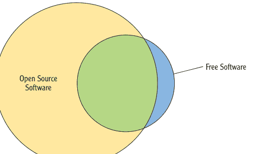

**图 3.1** 大多数自由软件都是开源的，但很大一部分开源软件并非自由软件。

**认证目标** 如今，FSF 意义上的自由软件纯粹主义者与更务实的开源社区之间存在一定的紧张关系。但在大多数情况下，两者的目标足够相似，以至于其分歧很小。事实上，*自由开源软件* (FOSS) 和 *自由/自由开源软件* (FLOSS) 这两个术语有时被用作伞形词，以明确指代这两类软件和开发模式。

### 定义开源软件

**认证目标** 开源定义可见于 http://www.opensource.org/docs/osd。它由十项原则组成（概括如下）：

- **自由再分发** 许可证必须允许再分发，包括作为更大作品的一部分进行再分发。
- **源代码可用性** 作者必须提供源代码，并允许源代码和（如果适用）二进制代码的再分发。
- **允许衍生作品** 许可证必须允许他人修改软件，并根据与原软件相同的许可证分发此类修改。
- **尊重源代码完整性** 许可证可以限制修改后源代码的再分发，但前提是必须允许随原源代码一起分发补丁文件。许可证可以要求衍生作品更改软件的名称或版本号。
- **不歧视个人或群体** 许可证不得歧视任何个人或群体。
- **不歧视努力领域** 许可证不得禁止在任何领域使用该程序，例如在商业领域或由遗传学研究人员使用。
- **自动许可证分发** 许可证必须适用于任何接收该程序的人，而无需单独签署协议。
- **缺乏产品特定性** 许可证不得要求该程序必须作为更大程序的一部分来使用或分发——也就是说，你可以从一个较大的集合中提取单个程序并单独分发。
- **不对其他软件施加限制** 许可证不得对与被许可软件一起分发的其他软件施加限制。
- **技术中立性** 许可证不得基于特定技术或接口而受到限制。

> OSI 的十项原则源自 Debian GNU/Linux 开发者的表述。

> 请注意，开源定义允许（但并不要求）许可证要求在原许可证下进行再分发。

这前三项原则是最重要的，至少在理解开源技术的重点方面如此。整个集合与 FSF 的四项原则以及 FSF 网页 (http://www.gnu.org/philosophy/free-sw.html) 上关于其影响的详细描述非常相似。然而，如前所述，两者之间存在一些差异，特别是在衍生作品的许可要求方面。

## 知识共享 (The Creative Commons)

知识共享总部位于 http://creativecommons.org，由 Lawrence Lessig 创立。其目标是打击其创建者和支持者认为的一种日益依赖于早期作品版权持有者所授予（或*不授予*）许可的创作文化。我们目前的许多文化都源于早期的文化作品——例如，《星球大战》在一定程度上受到常见神话和传奇的启发。然而，《星球大战》本身受版权保护，这限制了当前艺术家分发其衍生作品的权利，除非获得许可。

知识共享通过提供六种为不同目的设计的许可证来推进其目标。你可以通过在知识共享网站 (http://creativecommons.org/choose/) 上回答几个问题来选择许可证，例如你是否允许他人将你的作品用于商业用途。

FSF 和 OSI 致力于推广软件自由。但知识共享的目标更广泛；其许可证针对音频录制、视频录制、文本作品等，而不仅仅是计算机程序。尽管如此，知识共享作为一个组织，有助于推广 FSF 和 OSI 所关注的自由类型。

## 使用开源许可证

作为个人用户，你可能不需要深入研究开源许可证的细节。OSI 指南背后的原则保证你有权根据自己的需要使用开源程序，甚至再分发这些程序。但如果你在创建企业，特别是创建或分发开源软件的企业，你可能需要更好地理解这些许可证。因此，我将详细描述其中几个，并描述公司将开源许可证作为其商业模式一部分的一些方式。

### 理解开源许可证

每个开源许可证都有其独特的特点。这些特点主要让那些希望为软件项目做贡献的开发者感兴趣，但在某些情况下，对于系统管理员来说也很重要。主要的开源许可证包括以下各项：

- **GNU GPL 和 LGPL** 如前所述，Linux 内核使用 GPLv2，许多其他 Linux 工具使用 GPL（版本 2 或版本 3）。许多 Linux 库使用 LGPL。
- **BSD** BSD 许可证被开源的 BSD 操作系统及其为之开发的各种软件组件使用。与 GPL 不同，BSD 许可证允许将修改后的代码在其他许可证下分发。该许可证的最新版本与 MIT 许可证非常相似。

> 两种 BSD 许可证较为常见：较旧的 3 条款版本和较新的 2 条款版本。（3 条款版本有时被称为“新”或“修订”许可证，以区别于更早的版本。）

**认证目标**


## 使用开源许可证

**MIT** 麻省理工学院 (MIT) 是 X Window 系统（简称 X）最初的推动力量，而 MIT 许可证（有时也被称为 X11 许可证，目前仍被用于 Xorg-X11——即所有主要 Linux 发行版中包含的 X 实现。MIT 许可证异常简洁。

**Apache** 与 BSD 和 MIT 许可证一样，Apache 许可证是一种允许在相同或另一种许可证下重新分发的开源许可证。如果原始作品附带名为 NOTICE 的文本文件，则在任何衍生作品中必须包含该文件。这使得原始开发人员能够提供联系方式或其他信息，即使是针对经过大量修改的程序版本用户也是如此。

**Artistic** Artistic 许可证最初是为 Perl 编程语言开发的，但后来也被用于其他程序。它充满了各种要求，以及针对这些要求的漏洞。大多数使用 Artistic 许可证的软件在发布时会规定该许可证是可选的；用户可以选择转而遵循某些其他许可证（通常是 GPL）的条款。

**NPL 和 MPL** Netscape 公共许可证 (NPL) 和 Mozilla 公共许可证 (MPL) 是 Netscape 在将其 Netscape 网页浏览器（Firefox 浏览器的前身）引入开源领域时开发的。NPL 为版权持有者保留了一些权利，而 MPL 则更加开放。

许多其他许可证也符合 OSI 的要求。您可以在开源促进会 (Open Source Initiative) 的网站 `http://www.opensource.org/licenses/` 上找到完整的列表。

对于大多数系统管理员来说，各种开源许可证的细节可能并不重要。您可以根据自己的喜好使用和重新分发任何开源程序。但是，如果您修改了一个程序，则应注意重新分发的要求，特别是当您想要合并两个或多个程序，或者在修改后的许可证下分发程序时。您还应该意识到，某些 Linux 发行版可能包含不符合开源定义的软件。其中一些是商业软件，另一些则属于某种变体类别。

在描述软件许可证时，最后一个需要关注的是 Linux 整体的许可证。当您下载 CD-ROM 镜像文件或购买 Linux 安装包时，您获得的软件使用了许多不同的许可证——如 GPL、BSD 许可证、MIT 许可证等。其中大多数是开源的，但有些则不是。许多发行版会附带少量共享软件或并非完全开源的软件包，例如共享软件 XV 图形程序。零售安装包有时包含纯粹的商业软件。因此，除非您研究过该问题并确认复制是允许的，否则不应复制零售 Linux 安装包的光盘。如果分发供应商提供了免费下载链接，那么复制通常是没有问题的。

> 认证目标
> 顾名思义，Apache 许可证起源于 Apache 网页浏览器；然而，它也被许多其他项目使用。

> 认证目标
> 某些开源许可证的组合彼此不兼容，这意味着您无法合法地将代码组合在一起并发布修改版本。

Linux 发行版包含安装程序、配置程序等。从版权角度来看，这些工具通常是发行版打包者唯一可以主张权利的部分。大多数发行版维护者已将他们的安装和配置例程在 GPL 或其他开源许可证下提供，但情况并非总是如此。这些细节可能会将一个看起来像开源的操作系统变成一个并非完全开源的东西。Debian 维持一项政策，在其主软件包集中仅使用开源软件，尽管它允许可自由重新分发但非开源的程序进入其“non-free”软件包集。

由于一个完整的 Linux 发行版由使用许多不同许可证的组件组成，因此讨论适用于整个操作系统的单一版权或许可证是没有太大意义的。相反，您应该将 Linux 发行版视为一组由统一安装实用程序组合在一起的不同产品的集合。不过，绝大多数程序都使用某种开源许可证。

## 理解开源商业模式

**认证目标** 某些 Linux 发行版（如 Debian）由志愿者或非营利组织维护。而其他一些发行版（如 Red Hat Enterprise Linux）则由旨在获利的公司维护。然而，如果核心产品在互联网上免费提供，公司如何盈利呢？利用开源软件赚钱有几种方法，包括：

- **服务与支持** 产品本身可以是开源的，甚至可以免费赠送，而公司则通过销售服务和支持（如培训和技术支持电话线）来获利。例如，一款游戏可能是开源的，但需要订阅在线服务才能提供完整的功能集。
- **双重许可** 公司可以创建产品的两个版本：一个版本完全开源，另一个版本则增加了开源版本中没有的功能。开源版本就像超市经常提供的免费样品——一种吸引付费客户的方式。
- **多种产品** 开源产品可能只是公司的其中一项产品，而收入则由其他产品线产生。这些其他产品线可以是其他软件或某种其他产品（如手册）。
- **开源驱动程序** 一个特殊案例是硬件供应商，他们通过销售硬件赚钱。他们可能会选择将驱动程序，甚至硬件特定应用程序作为开源发布，以此来推广其硬件。一些硬件供应商不愿发布开源驱动程序，因为这样做必然会泄露其硬件的专有信息。
- **赏金 (Bounties)** 用户可以通过出资购买新软件或现有软件的新功能来驱动开源创作。像 FOSSFactory (http://www.fossfactory.org) 这样的网站可以帮助将用户聚集在一起（单个用户可能无法提供足够的资金来激励开发），从而诱导程序员编写所需的代码。
- **捐赠** 许多开源项目接受捐赠以资助开发。虽然这在通常意义上不是一种商业资助模式，但它确实有助于资助 FSF 等组织的运作。

当然，除了这些商业机会之外，大量开源软件是由学术界、政府、非营利组织、业余爱好者等开发的。即使是公司，也可能有动力将他们为自己所做的更改贡献回来，因为囤积更改会增加更多工作——如果内部更改没有交还给原始作者，那么在每个新版本发布时，该更改都必须重新应用。

## 要点与延伸

软件许可可能很复杂，而且这是一个技术人员很少感兴趣的话题。尽管如此，许可证条款会影响整个软件社区的运作方式，从而影响软件随时间的演进。Linux 由少数几种开源许可证主导，这些许可证允许（有时要求）更改保持免费。此类许可证通常对软件的使用方式几乎没有或完全没有限制。这与通常充满限制的专有许可证形成对比。FSF、OSI 和 Creative Commons 等组织致力于推广开源许可证。特别是 OSI 试图说服企业采用开源许可证，倡导以采用开源作为产生收入方式的商业模式。

### 建议练习

- 查询 GPLv2、GPLv3 和 BSD 2-clause 许可证。（http://www.opensource.org/licenses/ 是查找这些许可证的好地方。）阅读它们并进行比较。如果您要编写一个开源程序，您会使用哪一个？
- 阅读 OSI 的使命宣言（其主页 http://www.opensource.org 顶部的三个段落）和 FSF “关于”页面（http://www.fsf.org/about/）的“我们的核心工作”部分。


### 核心要点及延伸（续）

### 复习题

- 1. 以下哪项*不是*软件被认证为开源软件的必要条件？
    A. 许可证不得歧视个人或群体。
    B. 许可证不得要求软件必须作为特定产品的一部分进行分发。
    C. 许可证必须要求对软件的修改必须在相同的许可证下分发。
    D. 程序必须随附源代码，或者作者必须在互联网上提供便捷的获取方式。
    E. 许可证必须自动适用于任何获取该软件的人员。

- 2. 关于 Linux 发行版整体而言，以下哪项是正确的？
    A. 根据发行版的不同，它们受 GPL 或 BSD 许可证保护。
    B. 有时，由于包含非开源软件，它们可能不允许被复制。
    C. 只有在移除使用 MIT 许可证的软件后，它们才能被复制。
    D. 它们全部完全符合开源运动的原则。
    E. 按照 FSF 的定义，它们全部符合自由软件的资格。

- 3. 以下哪项是 FSF 哲学中的核心部分？
    A. 开发者应使用 FSF GPL 的最新版本。
    B. 用户应有权修改自由软件并将其在商业许可证下分发。
    C. 开发者应仅为 GNU/Linux 等自由操作系统编写软件。
    D. 用户应通过复制专有软件来参与公民不服从运动。
    E. 用户必须拥有按照其认为合适的方式使用软件的权利。

- 4. 判断正误：在大多数国家，版权法监管软件的分发。

- 5. 判断正误：FSF 的自由软件定义和 OSI 的开源软件十条原则都要求用户能够检查程序的运行机制——即其源代码。

- 6. 判断正误：由于硬件设计是专有的，硬件厂商无法为其产品发布开源驱动程序。

- 7. 由 FSF 创建且经常用于库的许可证是 \_\_\_\_\_\_。

- 8. 一个致力于在视频和音频录制等领域推广类开源原则的组织是 \_\_\_\_\_\_。

- 9. FSF 的通用原则被总结为 \_\_\_\_\_\_ 一词，该词是指利用版权法来实现某种程度上与版权原始意图相反的目的。

## 第 4 章
## 使用常用 Linux 程序

本章将开始对 Linux 进行更具实践性的探讨，而非前几章中呈现的较为抽象的信息。本章首先介绍 Linux 桌面环境，包括最常见的桌面环境信息和基本使用信息。如果你正在使用桌面环境，很可能是为了运行生产力软件，因此我会介绍一些常见的 Linux 生产力软件包。Linux 系统的另一个主要用途是作为网络服务器，所以我也会介绍一些你可能会遇到的最常见的服务器程序。虽然你可能不需要亲自编写程序，但你可能需要从源代码编译程序，因此你应该熟悉一些常用的 Linux 编程工具，我也将对此进行介绍。

- 使用 Linux 桌面环境
- 使用生产力软件
- 使用服务器程序
- 管理编程语言

## 使用 Linux 桌面环境

你第一次接触运行中的 Linux 系统时，很可能会涉及到*桌面环境*，它是一组控制屏幕并提供小型实用程序以执行任务（如管理文件）的程序。Linux 提供了多种桌面环境选项，因此如果你不喜欢其中一个，可以选择另一个。除了介绍可用的桌面环境外，我还将介绍一些可用于启动程序和管理文件的工具。

### 选择桌面环境

根据你的 Linux 发行版和安装选项，你的系统很可能提供不止一种可用的桌面环境。最常见的桌面环境有：

**KDE** K 桌面环境 (KDE; http://www.kde.org) 是 Linux 上最受欢迎的桌面环境之一。它是 Mandriva 和 SUSE 的默认桌面环境。它包含许多集成度非常高的强大工具。它是使用 Qt 控件集构建的。

> 控件集（widget set）是一个处理 GUI 特性（如菜单和对话框）的库。Qt 和 GTK+ 是当今 Linux 上最常见的两种控件集。

**GNOME** GNU 网络对象模型环境 (GNOME; http://www.gnome.org) 是 KDE 在 Linux 桌面环境领域的首要竞争对手。Fedora 和 Debian 将其作为默认桌面环境。GNOME 构建在 GIMP 工具包 (GTK+) 控件集之上。与 KDE 类似，GNOME 包含许多协同工作的强大工具。GNOME 旨在提供一个非常易于使用的桌面环境，因此它提供的选项比 KDE 少。

**LXDE** 轻量级 X11 桌面环境 (LXDE; http://lxde.org) 正如其全称所示，旨在消耗极少资源，因此在旧电脑或配置较低的电脑上运行良好。

**Unity** Ubuntu 发行版的发布者 Canonical 在 2010 年发布了 Unity 桌面环境。与 GNOME 一样，它追求简洁，旨在帮助缺乏经验或不希望界面过于杂乱的用户。

**Xfce** 这一桌面环境（主页为 http://www.xfce.org）最初是以一个名为 CDE 的商业桌面环境为模型设计的，但它是使用 GTK+ 控件集构建的。Xfce 比 GNOME 或 Unity 提供更多的可配置性，并且旨在比大多数其他桌面环境消耗更少的系统资源。

**自定义 (Roll-Your-Own)** 你可以从自己喜欢的组件中构建自己的桌面环境。起码你需要一个窗口管理器（有几十种可选；请参阅 http://xwinman.org 获取部件列表），但要使配置真正成为一个桌面环境，你还需要其他组件，例如文件管理器和小型生产力工具。所有组件都需要能通过某种菜单系统访问。

遗憾的是，无法给出简单的一套规则来决定哪种桌面环境比另一种更好，尽管一些普遍规律确实存在。

习惯于 Windows 或 Mac OS 的新用户可能会最喜欢 KDE；这个环境与这些传统桌面操作系统的环境最相似。虽然 GNOME 和 Unity 更加偏离其他 OS 所采用的模型，但它们旨在易于使用，因此对于缺乏经验的用户来说是不错的选择。熟悉商业 Unix OS 的用户可以尝试 Xfce。在内存不充裕或 CPU 性能较低的系统上，Xfce 和 LXDE 是不错的选择。喜欢自定义一切或拥有低配置电脑的人应该研究自定义构建方法。

你可能想尝试两种或三种桌面环境。在大多数情况下，你可以使用软件包管理器安装多个环境，详见第 9 章“使用程序和进程”。之后，当你登录计算机时，你会看到一个选择桌面环境的选项，如图 4.1 所示，该图显示了 Fedora 系统的登录界面。请注意登录对话框左下角的按钮。在图 4.1 中显示为 GNOME，但通过点击它，你可以在输入密码之前选择另一个桌面环境。不过，选择桌面环境的具体细节在不同系统之间有所不同，因此你可能需要仔细查看登录界面上的选项以找到你想要的那个。

> 密码选择极其重要。第 14 章“创建用户和组”涵盖了这一主题。

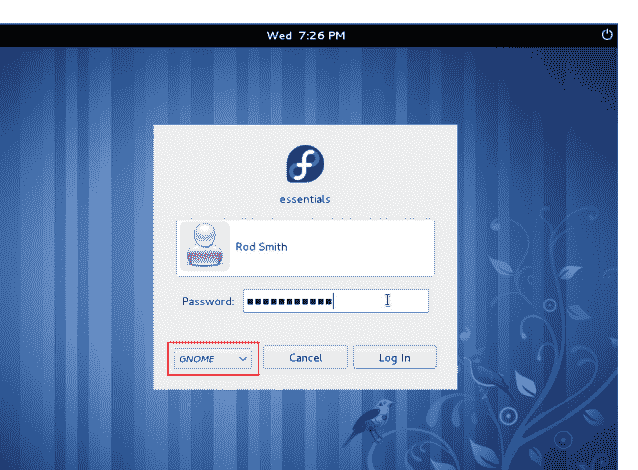

**图 4.1** GUI 登录管理器通常提供一系列可供选择的运行环境。


## 启动程序

认证目标

大多数桌面环境提供了多种启动程序的方法。不同环境之间的细节差异很大，但示例包括以下内容：

- **桌面菜单** 许多桌面环境在屏幕的顶部、底部或侧边提供菜单。这些菜单中的一个或多个项目可以让你访问一组预选的应用程序。
- **桌面图标** 一些桌面环境允许你在桌面的主区域放置图标。点击或双击这些图标即可启动它们代表的应用程序。不过，这种方法通常需要自定义，因为很少有默认配置会将应用程序放置在桌面主区域。
- **面板** 一些桌面环境提供面板（通常位于屏幕两侧），其中显示常用应用程序的图标。Unity 默认使用这种配置，GNOME 3 也是如此——尽管在 GNOME 3 的情况下，只有当你点击屏幕左上角的“活动”（Activities）项目时，面板才会出现。
- **上下文菜单** 你有时可以在屏幕的未使用区域点击右键，以获取包含多种选项的上下文菜单，其中可能包括运行程序的选项。
- **搜索程序** 一些桌面环境（如 GNOME 3）提供了显著的搜索功能，你可以通过名称查找程序。通常，你输入程序名称的一部分，名称匹配的程序将出现在列表中。然后你可以从该列表中选择要运行的程序。

认证目标

- **终端** 你可以启动一个名为*终端*（terminal）的程序，它在窗口内提供一个文本模式的用户界面。然后，你可以通过在该窗口中输入文件名来运行文本模式或 GUI 程序。这种方法在第 6 章“认识命令行”中将进行更详细的介绍。

为了帮助阐明其中一些方法，这里举几个例子。首先，考虑在运行 GNOME 3 的 Fedora 16 中启动 Firefox 网页浏览器。为此，你需要执行以下步骤：

1. 点击屏幕左上角的“活动”项目。结果是屏幕左侧出现一个面板（称为“收藏夹”），如图 4.2 所示。

> 这里描述的步骤要求你拥有现代显卡。如果你缺乏此类硬件，GNOME 3 将回退到较旧的基于菜单的程序启动系统。


**图 4.2** 面板使你能够在 GNOME、Unity 和一些其他桌面环境中启动常用程序。

2. 将鼠标移至 Firefox 图标上，它是图 4.2 中最顶端的图标。
3. 点击 Firefox 图标。短暂延迟后，Firefox 窗口应该会打开。

还存在其他几种实现此操作的方法，例如在搜索字段（见图 4.2 右上角附近）中输入程序名称，或者在应用程序列表中（通过点击图 4.2 顶部中左侧的“应用程序”进入）查找该程序。由于 GNOME 3 面板中仅出现少数几个程序，你必须将其添加到面板中，或者通过其他方式启动 Fedora 开发人员未默认包含的程序。

作为对比，openSUSE 12.1 下的 KDE 提供了几种明显启动 Firefox 的方法：

- 点击“桌面文件夹”窗口（见图 4.3 左上角）中的图标。
- 点击屏幕底部面板左侧附近的图标（同样参见图 4.3）。
- 在“应用程序”列表中查找。你可以通过启动 Kicker（可通过屏幕左下角的 SUSE 变色龙图标访问）并选择 应用程序 $\Rightarrow$ 互联网 $\Rightarrow$ 网页浏览器 $\Rightarrow$ 网页浏览器 (Firefox) 来打开此列表。图 4.3 显示了此选择过程的开始部分。

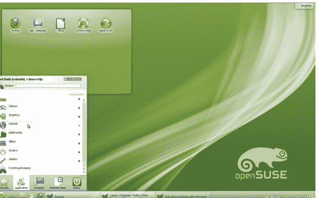

与 GNOME 一样，最广泛的启动选项仅适用于 Firefox 等少数几个流行应用程序。对于不太流行的程序，你可能需要使用更复杂的方法，例如在“应用程序”列表中定位程序。不过，你可以重新配置桌面环境以添加你经常使用的程序。

每个发行版以自己的方式设置默认值。因此，你自己的 GNOME 或 KDE 配置可能与这里显示的并不相同。

## 使用文件管理器

如果你习惯于 Windows 或 Mac OS X，那么你几乎肯定使用过*文件管理器*（file manager）来操作文件。当然，Linux 为了这个目的也提供了文件管理器——事实上，你有几种选择，尽管大多数的操作方式相似。举个例子，考虑 Nautilus，它是 GNOME 的默认文件管理器。如果你在 Fedora 上运行 GNOME 3，Nautilus 图标在“收藏夹”面板中看起来像一个文件柜，如图 4.2 所示。当你插入可移动磁盘（如 USB 闪存盘或 CD-ROM 或 DVD-ROM 光盘）时，你的桌面环境也可能会启动文件管理器。图 4.4 显示了在全新安装环境下运行的 Nautilus。

除了 GNOME 的 Nautilus，其他文件管理器还包括 Thunar（Xfce 的文件管理器）和 Konqueror（KDE 的文件管理器）。Konqueror 兼作网页浏览器。

由于 Nautilus 与其他操作系统中的文件管理器相似，你很可能能够非常轻松地使用其主要功能。有几项内容值得提及：

如果你双击一个位置，Nautilus 将尝试访问它。

- **位置** 在窗口的左侧，你会看到一系列位置。在图 4.4 中，这些位置分为三类：
    - “设备”类别包括不属于标准安装的磁盘分区，包括可移动磁盘。
    - “计算机”类别主要是你自己主目录中的常用文件夹，尽管“文件系统”指的是整个 Linux 安装。
    - “网络”类别提供对网络资源的访问；不过，这在正确运行前可能需要额外的配置。

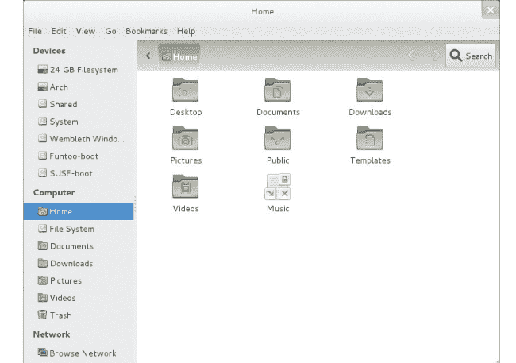
**图 4.4** Nautilus 提供的文件视图与其它操作系统的文件管理器类似。

- **主目录 (Home)** “主目录”位置是指你的*主目录*（home directory）——即你存储个人用户文件的目录。通常，你会在主目录中创建所有个人文件。当你手动启动 Nautilus 时，其默认视图是你的主目录，如图 4.4 所示，因此右侧窗格显示的是该目录的文件和子目录。

- **书签** 如果你想更改默认位置列表，可以从主菜单选择 编辑 $\Rightarrow$ 书签。随后出现的对话框类似于图 4.5。你可以删除现有书签，或通过输入目录路径、为其命名并点击“关闭”来创建新书签。如果你添加了书签，它们将出现在名为“书签”的新部分中。

- **文档属性** 你可以右键单击文件并在结果对话框中选择“属性”。这将产生一个属性对话框，如图 4.6 所示。“打开方式”选项卡允许你将文档类型与应用程序关联。

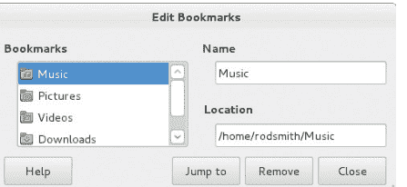
**图 4.5** 你可以通过管理书签来快速访问你感兴趣的目录。

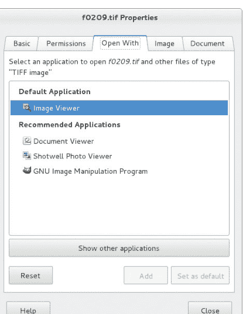
**图 4.6** Nautilus 允许你将文档类型与应用程序关联。

## 使用生产力软件

生产力软件的领域极其广泛：存在数百个甚至数千个生产力应用程序，许多程序甚至有专门的整本书籍讲述。因此，在本章中，我只能提供其中一些最重要的工具的名称和简短描述。我首先提供一些关于如何在 Linux 中查找执行特定任务的程序的技巧。然后，我将描述几个常见类别中的一些工具，包括网页浏览器、电子邮件客户端、办公工具、多媒体应用程序、云计算和移动应用程序。

### 为工作寻找合适的工具

Linux 在许多大类中提供了生产力应用程序，但如果你还不熟悉这个领域，你可能会很难找到它们。尤其是因为应用程序的名称并不总是能清晰地表明其用途。

一些技巧可以帮助你找到合适的应用程序：

- **使用桌面菜单** 你可以使用桌面环境中的菜单或其他应用程序显示工具来定位生产力应用程序。这类工具通常以有用的方式对应用程序进行分类。例如，KDE Kicker（如图 4.3 所示）将应用程序分为若干类别（教育娱乐、游戏、图形等）和子类别（例如图形类别中的摄影和扫描）。这可以帮助你找到应用程序，但前提是它已经安装。
- **使用搜索功能** 你可以使用桌面环境或网页浏览器中的搜索功能来寻找合适的应用程序。输入一个关键单词或短语，例如 *office*（如果进行网页搜索，可结合 *Linux* 一起搜索），可能有助于你定位办公应用程序（文字处理器、电子表格等）。
- **使用等效对照表** 如果你通常使用某个特定的 Windows 应用程序，你可以通过查阅等效应用程序对照表来寻找 Linux 替代品，例如 `http://www.linuxrsp.ru/win-lin-soft/table-eng` 或 `http://www.linuxalt.com` 上的表格。
- **借助他人的专业知识** 你可以向其他人（同事、朋友或在线论坛中的人们）寻求帮助以找到合适的应用程序。如果你自己已经进行了基础搜索但没有发现符合特定标准的程序，这种方法尤其有用。

其中一些方法（如使用桌面菜单）只能找到已经安装的软件。而其他技巧（如网页搜索）可以找到你尚未安装的程序。你通常可以通过发行版的软件包管理系统安装软件，详见第 9 章。


## 使用 Web 浏览器

Linux 支持多种 Web 浏览器，包括以下浏览器：

- **Chrome**：谷歌的 Chrome 浏览器 (http://www.google.com/chrome) 旨在实现快速且易于使用。自 2008 年推出以来，它的普及速度极快。虽然 Chrome 在技术上是一款商业产品，但可以免费使用。此外，还有一个名为 Chromium 的开源变体也可供使用。

- **Firefox**：该程序总部位于 http://www.mozilla.org，是 Linux 上最受欢迎的浏览器，在 Windows 和 Mac OS X 上也非常流行。它是一款功能非常完备的浏览器，但可能会消耗大量内存，因此在较旧或性能较弱的计算机上可能不是最佳选择。

- **Galeon**：该程序总部位于 http://galeon.sourceforge.net，是一款官方属于 GNOME Office 套件的浏览器。它被设计为一个轻量级的 GUI Web 浏览器。

- **Konqueror**：这款 KDE 程序具有双重功能：它既是 Web 浏览器，又是文件管理器。Konqueror 能很好地处理大多数网页。它相当轻量，因此非常值得尝试，尤其是如果你使用 KDE 的话。你可以在 http://www.konqueror.org 阅读更多信息。

- **Lynx**：大多数 Web 浏览器是 GUI 程序，可以显示多种字体的文本、显示内联图形等等。Lynx (http://lynx.browser.org) 比较特殊，它是一款基于文本的 Web 浏览器。因此，如果你在文本模式下运行 Linux，或者不想被图形干扰，它是一个有用的选择。Lynx 在你开发自己的网页时也很有用作测试浏览器——如果一个页面在 Lynx 中可读，那么使用语音合成器浏览网页的视障人士很有可能也能使用你的页面。

- **Opera**：Opera (http://www.opera.com) 是 Linux Web 浏览器竞争中的一个不寻常的商业参赛者，它声称速度极快。虽然 Opera 是商业软件，但你可以免费下载。

值得注意的是，这份名单中缺少微软的 Internet Explorer，它在 Windows 上极其流行。不幸的是，有些网站除了 Internet Explorer 之外在任何浏览器中都无法工作。其他网站则比较挑剔，但它们至少能与一款 Linux 浏览器兼容。因此，你可能应该安装至少两个 Linux Web 浏览器。

Web 浏览器让用户能够轻松访问一个信息世界——字面意义上的！不幸的是，Web 也有阴暗面。问题包括：

- 网站可以记录用户访问数据，这些数据可用于营销或其他你可能不喜欢的方式。
- 许多基于 Web 的内容是动态的，这意味着网站会下载由你的 Web 浏览器运行的小程序（通常用 Java 编写）。这些内容可能是无害的，但越来越多地被用于传递恶意软件。
- 恶意网站可以通过伪装成可信网站，诱骗用户泄露敏感数据，如财务信息。这种技术被称为 *网络钓鱼（phishing）*。
- 大多数网站是不安全的——传输的数据可以在中间计算机上被读取。大多数敏感网站（如网上银行网站和在线零售商）现在会对敏感数据进行加密，但在发送此类数据时仍应谨慎。
- 出于安全考虑，大多数网站上传输的密码容易被盗。这可能会导致一个困境，因为很难记住所有网站的密码。许多浏览器可以为你完成这项工作，但这会将你的密码存储在硬盘上，使其容易被盗或丢失。

当然，其中一些问题并非 Web 所特有。例如，大多数电子邮件传输是不安全的，因此你不应通过电子邮件发送敏感数据。

## 使用电子邮件客户端

电子邮件客户端程序使你能够阅读和编写电子邮件。此类程序既可以访问你自己计算机上的邮箱，也可以使用稍后描述的电子邮件网络协议，在网络邮件服务器计算机的帮助下发送和接收电子邮件。常见的 Linux 电子邮件客户端包括：

- **Evolution**：该程序位于 http://projects.gnome.org/evolution/，是一款功能强大的 GUI 电子邮件客户端。它还包括群组软件和调度功能。
- **KMail**：KDE 项目的 KMail (http://userbase.kde.org/KMail) 与该桌面环境集成良好，但如果你愿意，也可以在其他桌面环境中运行。
- **mutt**：这是几种基于文本的电子邮件阅读器之一。尽管采用了文本模式界面，但 mutt 功能相当强大。你可以在 http://www.mutt.org 阅读更多信息。
- **Thunderbird**：该程序位于 http://www.mozilla.org/thunderbird/，是一款与 Firefox Web 浏览器密切相关的电子邮件客户端。

电子邮件客户端在任何操作系统中的工作方式都类似。通常，你必须对其进行配置，使其知道如何发送和接收消息——是使用本地计算机的设施还是远程服务器。之后，你就可以阅读接收到的消息并发送传出消息。

## 使用办公工具

Linux 存在几种办公工具包。这些软件包提供了文字处理器、电子表格、演示文稿程序、图形程序、数据库以及有时还包括其他程序的组合。示例包括：

- **GNOME Office**：GNOME Office 中的应用程序是独立开发的，但 GNOME Office 试图将它们链接在一起，形成一个协调的整体。GNOME Office 内部的具体项目包括 AbiWord（文字处理器）、Evince（文档查看器）、Evolution（群组软件和电子邮件客户端）、Gnumeric（电子表格）、Inkscape（矢量图形和演示文稿创建）以及 Ease（演示文稿）。你可以在 http://live.gnome.org/GnomeOffice 了解更多信息。

- **KOffice**：这个办公套件位于 http://www.koffice.org，与 KDE 项目有松散的关联，即使你使用另一个桌面环境也可以使用它。它包括 KWrite（文字处理器）、KCells（电子表格）、Artwork（矢量图形）、Showcase（演示文稿）和 KioVio（流程图）。

- **LibreOffice**：这个办公套件是作为较旧的 OpenOffice.org 套件（稍后描述）的 *分支（fork）* 创建的。它正成为 Linux 中最受欢迎的办公套件。它提供六个应用程序：Writer（文字处理器）、Calc（电子表格）、Impress（演示文稿）、Base（数据库）、Draw（矢量图形）和 Math（公式编辑器）。LibreOffice 以套件体积庞大且速度缓慢而著称。在现代硬件上，速度问题不是主要问题，但在较旧的系统上，你可能需要考虑其他选择。你可以在 http://www.libreoffice.org 阅读更多信息。

- **OpenOffice.org**：直到 2011 年初，这个位于 http://www.openoffice.org 的办公套件一直是 Linux 上最著名的套件。其企业赞助商 Oracle 停止了对该项目商业开发的支持，从而触发了 LibreOffice 项目的分支。

这些程序大多支持 OpenDocument 格式 (ODF)，这是一组开放的文件格式，正缓慢地成为文字处理、电子表格和其他办公文件的标准。虽然 ODF 旨在实现跨应用程序的文件轻松传输，但特定应用程序的假设经常阻碍此类传输，尤其是在复杂文档中。

这个领域还存在许多其他程序，尽管许多程序并不属于办公套件。有些比较特殊。例如，LyX (http://www.lyx.org) 可以替代文字处理器，但它相当不寻常：它是作为一种创建和编辑 LaTeX 文档的方式构建的，LaTeX 是一种在计算机科学、数学和一些其他技术领域很受欢迎的文档格式。

## 使用多媒体应用程序

Linux 作为强大的服务器平台享有盛誉，但直到最近，它作为多媒体操作系统的能力一直有所欠缺。这在很大程度上是因为缺乏应用程序；然而，在过去的十年中，Linux 的多媒体应用程序列表已显著增加。目前的提供方案包括：

- **Audacity**：该程序位于 http://audacity.sourceforge.net，是一款 Linux 音频编辑器，类似于其他平台上的 Sound Forge 等商业产品。你可以使用它从音频文件中剪切片段、均衡音量、去除磁带嘶嘶声或其他噪音、应用人工音频效果等。

- **Blender**：你可以使用这个程序创建复杂的 3D 图像，包括静态图和动画。你可以在 http://www.blender.org 了解更多关于 Blender 的信息。

- **The GIMP**：GNU 图像操纵程序 (GIMP; http://www.gimp.org) 是一款静态图像操纵程序，在大方向上类似于 Adobe Photoshop。（作为 GNOME 和许多其他程序基础的 GTK+ 工具包最初就是为 GIMP 创建的。）

- **ImageMagick**：这是一套图形程序，但有一个特点：你通常从命令行调用 ImageMagick 程序。你可以使用它来转换文件格式、给图像添加框架、调整图像大小等等。你可以在 http://www.imagemagick.org 了解更多信息。

- **HandBrake**：该程序提供了一种在视频格式之间进行转换的简便方法，特别是转换为使用高效 H.264 编码的格式。你可以在 http://handbrake.fr 了解更多信息。

- **MythTV**：你可以使用这款位于 http://www.mythtv.org 的软件将普通 PC 变成数字视频录像机 (DVR)。MythTV 使用客户端-服务器模型，使一台录像机能够为家中电视上的多个播放器提供服务。

凭借这些多媒体应用程序，你可以使用 Linux 完成从裁剪 2 岁孩子生日聚会照片到为大制作电影渲染特效的所有工作。如果你有非常特殊的需求，深入挖掘可能会发现其他工具——这个列表仅仅是个开始！


## 在云计算中使用 Linux

认证目标

云计算是将计算机软件作为一种服务（通常通过互联网）进行交付，而不是以存储在用户计算机上的应用程序形式。在大多数情况下，用户通过 Web 浏览器访问云计算资源。因此，理论上 Linux 可以作为云计算的客户端平台——只需在云计算提供商的平台上启动一个 Web 浏览器即可开始使用。

在实践中，有时会出现复杂情况。例如，云计算提供商可能要求您使用特定的 Web 浏览器或安装特定的浏览器插件。在某些情况下，在 Linux 中可能无法满足这些要求；然而，如果提供商支持广泛支持各种浏览器作为客户端，那么您在使用云计算资源时应该不会遇到问题。

云计算的示例包括：

- Dropbox (http://www.dropbox.dropbox.com)，一种在线文件存储和备份服务
- Google Apps (http://www.google.com/apps)
- Microsoft Office Web Apps (http://office2010.microsoft.com/en-us/web-apps/)
- 由许多提供商提供的基于 Web 的电子邮件

## 使用移动应用程序

认证目标

虽然 Android 是一个基于 Linux 的操作系统，但在很大程度上，它运行的应用程序与 Linux 的桌面或服务器实现完全不同。这是可以理解的——您可能不想尝试用手机编写长篇文档（如书籍），因此像 LibreOffice Write 这样大型办公程序中的许多功能在移动计算设备上将会被浪费。

相反，移动计算通常专注于被称为“app”的小程序。在 Android 的情况下，您可以使用一个名为 Market 的应用来下载 app。（Web 版本可在 http://market.android.com 获取。）App 通常提供快速且专业化的计算，并且经常利用手机的功能。例如，一个 app 可以计算您在骑自行车时消耗的热量，或者获取您所在地区的天气预报。这两个示例都使用了手机的全球定位系统 (GPS) 功能来识别手机（以及您！）的位置。

虽然大多数用于桌面和服务器计算机的 Linux 应用程序是开源且免费的，但 Android app 通常是非免费的，尽管成本较低。在下载 app 之前请务必确认费用！

## 使用服务器程序

Linux 是运行服务器程序的强大操作系统，因此，您可以为 Linux 找到各种各样的服务器程序也就不足为奇了。在接下来的页面中，我将描述一些常见的服务器协议以及使用这些协议的程序。我还将简要描述安装和启动服务器的过程，并提供有关服务器安全问题的基本信息。

### 识别常见的服务器协议和程序

包括互联网在内的网络是通过 *网络协议* 运行的，网络协议是对两台计算机如何交换数据以实现某种目的（如传输电子邮件或交付待打印的文件）的明确定义。大多数协议在一部或多部标准文档中描述，这些文档被称为 Request for Comments (RFC) 文档，每部文档都有一个编号。通常，一部 RFC 文档定义该协议，随着时间的推移，当有必要时，额外的 RFC 文档会定义该协议的扩展或修改。

大多数网络协议涉及通过一个或多个 *端口* 传输数据，端口是计算机上的编号资源。您可以将端口想象成电话分机号——主号（互联网协议，或 IP 地址）标识整台计算机，而端口号则标识所使用的协议。服务器程序将自身附加到一个端口号上，并接收该端口上的所有传入请求。

表 4.1 总结了一些常见的端口号、与之相关的协议以及通常与这些协议结合使用的 Linux 程序。请注意，许多端口和协议与不止一个程序相关联。这是因为 Linux 为许多协议提供了选择——您可以从几个服务器程序中选择一个用于给定的协议，就像您可以从几个文字处理器或 Web 浏览器中做出选择一样。

> Android app 正日益成为恶意软件的来源。您可以通过仅从 Google 自己的 Market 渠道下载 app 来降低风险。

> `/etc/services` 文件将常见的端口号链接到经常在其他配置文件中使用的简短名称。

**表 4.1 常见端口号及其用途**

认证目标

| 端口号 | 协议 | 常见服务器程序 | 说明 |
| :--- | :--- | :--- | :--- |
| 20–21 | FTP | oftpd, ProFTPD, Pure-FTPd, vsftpd | 文件传输协议 (FTP) 是一种用于在网络上传输文件的旧协议。它支持匿名访问和密码介导访问。FTP 的特殊之处在于它使用两个端口。 |
| 22 | SSH | OpenSSH | 安全外壳 (SSH) 是一种加密的远程访问工具。它还支持文件传输和对其他协议的加密。 |
| 23 | Telnet | telnetd | 这是一种旧的未加密远程登录协议。如今很少使用，尽管其客户端程序 telnet 可以是一个有用的网络诊断工具。 |
| 25 | SMTP | Exim, Postfix, qmail, sendmail | 简单邮件传输协议 (SMTP) 是互联网上移动电子邮件的主要协议。发送者发起 SMTP 传输。 |
| 53 | DNS | dnsmasq, named | 域名服务 (DNS) 使计算机能够通过提供主机名来查询 IP 地址，反之亦然。没有它，您需要通过 IP 地址而不是名称来引用所有计算机。 |
| 67 | BOOTP, DHCP | dnsmasq, dhcpd | 自举协议 (BOOTP) 及其较新的同类协议动态主机配置协议 (DHCP)，都允许本地网络上的计算机帮助其他计算机自动配置以使用网络。 |
| 80 | HTTP | Apache | 超文本传输协议 (HTTP) 是万维网 (WWW 或 Web) 的基础。 |
| 109–110 | POP2 and POP3 | Courier, Cyrus IMAP, Dovecot, UW IMAP | 邮局协议 (POP) 经过了几次修订，每次修订都有自己的端口。该协议允许接收者发起电子邮件传输，因此它通常被用作电子邮件交付的最后一步，即从服务器到接收者。 |
| 118 | SQL | MySQL, PostgreSQL | 结构化查询语言 (SQL) 是一种支持网络的数据库接口语言。如果您在网络上运行 SQL 服务器，客户端计算机就可以访问和修改该数据库。 |
| 137–139 | SMB/CIFS | Samba | 微软使用服务器消息块 (SMB/通用互联网文件系统 (CIFS) 协议进行文件和打印机共享，而 Samba 在 Linux 中实现了这些协议。 |
| 143, 200 | IMAP | Courier, Cyrus IMAP, Dovecot, UW IMAP | 互联网消息访问协议 (IMAP) 是另一种由接收者发起的电子邮件传输协议，类似于 POP。不过，IMAP 使接收者更容易在服务器计算机上永久存储和管理电子邮件。 |
| 389 | LDAP | OpenLDAP | 轻量级目录访问协议 (LDAP) 是一种用于访问目录的网络协议，在这种语境下，目录是一种数据库。LDAP 常用于存储网络登录信息等。 |
| 443 | HTTPS | Apache | 该协议是 HTTP 的安全（加密）变体。 |
| 2049 | NFS | NFS | 网络文件系统 (NFS) 是一种协议，也是一个同名服务器，用于 Unix 和类 Unix 操作系统之间的文件共享。 |

表 4.1 是不完整的；它仅总结了一些较重要的协议及其提供的服务器。还存在许多其他协议和服务器，其中许多用于非常专业的任务。

某些协议最常用于本地网络。例如，DHCP 从其本质上就是为了通过简化客户端计算机的配置来帮助您管理自己的本地网络——只需告诉计算机使用 DHCP 即可。SMB/CIFS 通常也仅在本地使用，以方便用户更轻松地访问彼此的文件和打印机。另一方面，像 HTTP 这样的协议通常在整个互联网上使用，尽管它们也可以在本地网络上使用。

> 第 17 章 “管理网络连接”更详细地描述了网络配置。

### 服务器程序与服务器计算机

“服务器”一词可以指代一整台计算机，也可以指代运行在该计算机上的单个程序。当应用于整台计算机时，该术语标识了计算机的用途以及它运行了一个或多个服务器程序的事实。服务器计算机通常提供由少量到数百万台客户端计算机（即使用服务器服务的计算机）所使用的服务。

在网络世界中，服务器（计算机或程序）监听来自客户端（计算机或程序）的连接，并响应数据传输请求。服务器计算机通常（但并非总是）比其客户端更强大。

当您读到“服务器”（或者“客户端”）这个词时，它可能指的是计算机或程序。上下文通常会明确其含义，尽管有时并非如此——事实上，有时


### 服务器程序与服务器计算机（续）

说话者或作者可能并不清楚！例如，有人可能会报告“Samba 服务器无法工作”。在这种情况下，你可能需要弄清楚到底是 Samba 服务器程序出了问题，还是服务器计算机上的其他因素导致了问题！

有时，客户端与服务器的界限会变得模糊。例如，在办公环境中，许多计算机通过运行 Samba 或 NFS 等文件服务器软件来充当*文件服务器*是很常见的。这种配置允许 Sam 将他的文件提供给 Jill 使用，同时也允许 Jill 将她的文件提供给 Sam。在这种情况下，两台计算机既充当客户端又充当服务器，并且同时运行这两类软件。但在任何一次特定的交换中，其中一方是客户端，另一方是服务器。

### 安装与启动服务器

维护服务器程序的课题超出了本书的范围，但你应该了解这项任务的基础知识。你可以像安装其他软件一样安装服务器，具体请参阅第 9 章。

软件安装完成后，你必须启动服务器。启动服务器的方式与启动桌面应用程序不同。你通常不是在 GUI 中点击图标或菜单项，而是通过配置计算机在每次启动时自动运行该程序来启动服务器。此后，服务器程序在后台作为*守护进程（daemon）*运行——也就是说，作为一个无人值守运行的进程。

> daemon（daemones）这个词源自希腊神话；daemons 是有帮助的超自然生物，正如 Unix 和 Linux 的守护进程是有帮助的程序一样。

大多数服务器通过启动脚本运行，Linux 在每次启动时都会自动运行该脚本。你也可以输入启动脚本的名称，通常后接 start 或 stop 等关键字，以手动启动或停止服务器。传统上，Linux 启动脚本存储在 `/etc/init.d` 或 `/etc/rc.d` 中。随着近期发行版的更新，这个位置以及启动脚本的性质一直在发生变化，尽管大多数发行版在这些旧位置保留了兼容性脚本。

一些服务器通过*超级服务器（super server）*运行，例如 `inetd` 或 `xinetd`。这些服务器程序持续运行，在不需要时保持其管理的服务器处于未加载状态。这种配置可以最大限度地减少运行许多极少使用的服务器对内存的影响。超级服务器还可以作为一项安全功能；就像门卫一样，它可以将无关人员挡在门外。

### 服务器安全

每当你运行服务器时，都会面临被入侵和滥用的风险。风险分为几个类别：

- 服务器可能包含漏洞，使外部人员能够滥用软件在本地运行程序。
- 你可能会误配置服务器，从而授予外部人员比预期更高的系统访问权限。
- 通过服务器拥有账户和远程访问权限的用户可能会滥用这种信任。如果结合服务器漏洞或误配置，这种风险将尤其巨大。
- 服务器可能被用作攻击他人的跳板，使攻击看起来像是源自你的计算机。
- 即使没有入侵计算机，攻击者也可以用虚假数据淹没服务器，从而使其关闭。这种技术被称为*拒绝服务（DoS）攻击*。

服务器安全是一个极其复杂的话题，且细节因服务器而异。例如，如果你运行远程登录服务器、Samba 或 POP/IMAP 电子邮件服务器，你可能需要密切关注密码安全，因为所有这些服务器都依赖密码。然而，对于 DHCP 或 DNS 服务器来说，密码并不重要。当然，即使 DHCP 或 DNS 服务器程序不使用密码，运行在同一台计算机上的其他服务器程序可能会使用！

广义上讲，保障服务器安全涉及关注上述每个风险因素。你可以采取的一些具体步骤包括：

- 你应该通过使用软件包管理工具，在有升级可用时随时升级服务器，以保持服务器程序处于最新状态。你也可以研究特定的服务器，选择那些具有良好安全声誉的服务器。
- 你应该学习足够的服务器配置知识，以确保能正确配置你的服务器。
- 你应该删除不使用的账户，并审计必要账户以确保它们使用了强密码。
- 你可以使用防火墙配置来限制外部人员访问仅供内部使用的服务器计算机。你还可以使用防火墙来最大限度地降低你的计算机被用于攻击他人的风险。

> 第 14 章“创建用户和组”描述了如何创建强密码。

## 管理编程语言

许多用户永远不需要处理编程语言；然而，出于各种原因，了解它们是什么以及它们之间有何区别对于 Linux 用户来说很重要。你可能需要为所管理系统上的用户安装语言，或者亲自使用编程语言从源代码编译软件。你可能还想或需要学习编程，特别是当你发现需要低级别地修改计算机配置时——许多启动和其他任务是由你可以自行修改的脚本处理的。

基于这些原因，本章的其余部分致力于介绍编程语言的基础信息。我首先描述编译型语言和解释型语言之间的区别，理解这一点很重要，这样你才能正确处理程序文件或选择你想使用的语言。然后，我将简要描述一些常见的编程语言，以便你能识别并使用它们的源代码文件，或者选择你想学习使用的语言。

### 选择编译型语言还是解释型语言

从核心来看，计算机理解二进制代码——代表操作的数字，例如将两个数字相加或在两个动作中选择一个。然而，人类更擅长处理词汇和符号，例如 + 或 if。因此，大多数编程涉及使用符号编程语言编写程序，然后将该符号代码翻译成计算机能够理解的数字形式。目前存在数十种甚至数百种这样的*编程语言*，每种语言都有其独特的功能。

在高级语言中，存在两个大类：

**编译型语言** 程序员在编写程序时，将用编译型语言编写的程序从原始源代码形式转换（或*编译*）为机器码形式。编译过程可能需要一段时间——通常从几秒钟到几个小时不等，具体取决于程序的大小和计算机的速度。由于程序中的错误，编译也可能会失败。当编译成功时，生成的机器码执行速度很快。

**解释型语言** 用解释型语言编写的程序在运行时由一个称为*解释器（interpreter）*的程序转换为机器码。事实上，这种转换是逐行进行的。也就是说，程序从未被完全转换为机器码；解释器弄清楚每一行要做什么，然后执行该操作。这意味着解释型程序的运行速度比编译型程序慢得多。其优势在于解释型程序更容易开发，因为你不需要处理编译过程。解释型程序也易于修改；只需在文本编辑器中打开程序文件并保存即可。这一特性使得解释型语言在协助系统管理员可能想要更改的系统启动任务时非常有用——管理员可以快速地进行更改并测试。

### 汇编语言编程

除了编译型和解释型语言之外，另一个选择是*汇编语言*。这是一种在机器码数字与程序员使用的符号之间具有简单一一对应关系的语言。汇编语言是非常低级的，这意味着一名熟练的汇编语言程序员可以编写出非常紧凑且高效的程序。不过，汇编语言的可移植性较差；将为 x86-64 CPU 编写的程序转换为在 PowerPC 处理器上运行需要付出很大努力。编写汇编语言程序也比编写大多数高级语言程序更困难。由于这些原因，随着计算机变得更加强大，汇编语言程序变得越来越少；在 21 世纪初，汇编语言在速度和大小上的优势对于大多数用途来说已经不再那么诱人了。

理论上，大多数语言都可以实现为编译形式或解释形式。但在实践中，大多数语言通常仅以其中一种形式使用。

一些语言不完全属于这两个类别。请参阅“汇编语言编程”侧栏了解一个重要的特例。其他一些则属于中间类别，例如 Java，它从源代码编译成一种平台无关的形式，然后必须经过解释。

### 识别常见的编程语言

Linux 支持广泛的编程语言，包括以下内容：

**汇编（Assembly）** 如前所述，这种低级语言可以产生非常高效的程序，但难以编写且不可移植。事实上，将“汇编”视为一种语言是有误导性的，因为每种架构都有自己的汇编语言。


**C** 这种语言可以说是在 Linux 中最重要的编译语言，因为 Linux 内核的大部分以及大量的 Linux 应用程序都是用 C 编写的。C 能产生相当高效的代码，但由于它缺乏许多其他语言中常见的错误检查功能，因此用 C 编写带有 bug 的程序也很容易。C 源代码文件的文件名通常以 `.c` 或 `.h` 结尾——`.c` 文件是主源代码文件，而 `.h` 文件是 *头文件*，其中包含 `.c` 文件中函数的简短定义，供程序中的其他文件参考。一个大型程序可以由数十个，甚至数百或数千个单独的源代码文件组成。在 Linux 中，C 程序通常使用 `gcc` 程序进行编译，该程序是 GNU 编译器集合 (GCC) 软件包的一部分。

> 认证目标
> 虽然 Linux 内核大部分是用 C 编写的，但其中部分内容是用汇编语言编写的。

**C++** 这种语言是对 C 的扩展，增加了 *面向对象* 的特性，这意味着它更强调数据结构及其交互，而不是用于控制程序流程的步骤。许多复杂的 Linux 程序（如 KDE 和 OpenOffice.org/LibreOffice）主要用 C++ 编写。C++ 源代码的文件名可以以 `.cc`、`.cpp`、`.cxx` 或 `.c++` 结尾，头文件则以 `.h`、`.hh`、`.hpp`、`.hxx` 或 `.h++` 结尾。在 Linux 中，C++ 通常使用 `g++` 程序进行编译，该程序是 GCC 的一部分。

**Java** Java 由 Sun Microsystems（现由 Oracle 所有）创建，是一种介于编译和解释之间的跨平台语言。它作为一种通过网站交付的小型应用程序语言而变得流行——尽管其他一些程序也基于 Java。Java 源代码的文件名通常以 `.java` 或 `.class` 结尾，而 Java 字节码文件的文件名通常以 `.jar` 结尾。

**Perl** 这种解释型语言旨在方便地处理文本，但它也是一种通用语言，可用于许多其他任务。Perl 程序的文件名通常以 `.pl`、`.pm` 或 `.t` 结尾。

> 认证目标

**PHP** PHP: Hypertext Preprocessor (PHP；一个递归缩写) 语言被创建用于 Web 服务器，以生成动态内容——也就是说，根据用户、时间或其他标准而变化的内容。PHP 是一种解释型语言，它需要一个支持 PHP 的 Web 服务器，例如 Apache。在拥有此类服务器和适当配置的情况下，网站可以支持用户登录、购物车、根据用户位置显示不同内容等等。PHP 文件最常见的名称以 `.php` 结尾，尽管几种变体也很常见。

> 认证目标
> Python 编程语言的名字是对英国邪典电视节目《蒙提·派森的飞行马戏团》(Monty Python's Flying Circus) 的致敬。

**Python** 这种解释型语言将代码的可读性作为主要目标。它支持（但不要求）面向对象。它经常被用于脚本编写目的，但也可以用来编写更复杂的程序。Python 程序通常使用 `.py` 文件名扩展名，尽管几种变体也很常见。

> 认证目标

**Shell 脚本** 大多数 Linux 文本模式 Shell（允许完全基于键盘使用计算机的程序）提供自己的解释型语言。其中，Bourne Again Shell (Bash 或 bash) 是最常用的，因此 Bash 脚本非常普遍。许多控制 Linux 启动过程的文件实际上是 Bash 脚本。此类脚本通常没有唯一的文件名扩展名，尽管有些使用 `.sh` 扩展名。

第 12 章“创建脚本”涵盖了创建或修改 Bash 脚本的基础知识。

## 核心要点及延伸

当你刚开始接触 Linux 时，很可能会从使用桌面环境开始——也就是你登录后看到的的第一组程序。桌面环境使你能够运行更多程序，包括常见的生产力工具，如 Web 浏览器、电子邮件客户端、办公实用程序和多媒体应用程序。当然，如果你将计算机配置为服务器，你会希望运行服务器程序，但你将通过编辑配置文件来实现，而不是从桌面环境启动它们。如果你需要进行编程，你应该了解一些常见的 Linux 编程语言，它们使你能够编写从简单的脚本到巨大的服务器或生产力套件的一切内容。

### 建议练习

- 尝试至少两种不同的桌面环境。将每个桌面环境用于你正常的计算任务一两天，以便决定你更喜欢哪个。
- 尝试至少两种不同的 Linux Web 浏览器。使用每个浏览器访问你最喜欢的网站。你是否注意到速度或页面元素布局上的差异？你更喜欢哪一个？

### 复习题

1. 以下哪些是 Linux 桌面环境？（选择所有适用项。）
    A. GTK+
    B. GNOME
    C. KDE
    D. Evolution
    E. Xfce

2. 如果你想让一台 Linux 计算机能够访问存储在另一台 Linux 计算机硬盘上的文件，以下哪个网络协议是最佳选择？
    A. SMTP
    B. NFS
    C. PHP
    D. DNS
    E. DHCP

3. Linux 内核的大部分是用以下哪种语言编写的？
    A. Bash shell 脚本
    B. Java
    C. C
    D. C++
    E. Perl

4. 正确或错误：OpenOffice.org 和 LibreOffice 是非常相似的办公套件。

5. 正确或错误：即使运行服务器的计算机从未被攻破，服务器也可能被恶意外部人员干扰。

6. 正确或错误：Python 通常被实现为一种解释型语言。

7. Thunderbird 是一个(n) ___________________ 程序。（请指定软件的一般类别。）

8. 处理 SMB/CIFS 协议的 Linux 服务器通常运行 ________________ 软件。

9. 使用 ___________________ 编程语言编写的程序在运行前会被完全转换为二进制形式。

## 第 5 章：管理硬件

**虽然 Linux 是软件**，但它依赖硬件来运行。硬件的功能和局限性将影响运行在该硬件上的 Linux 的功能和局限性。因此，对于任何你广泛使用或计划购买的计算机，你都应该了解这些特性。本章将帮助你学习并执行硬件的基本管理任务。我将从底层问题开始，例如中央处理器 (CPU) 和主板的性质。经常被忽视的电源在功率不足或运行异常时可能会导致问题，因此我会对其进行描述。硬盘在设置时需要特别小心，对此我会简要描述。Linux 中一个常见的难点是显示问题，因为显示故障会阻止与计算机的任何交互。如今，大多数外部设备通过通用串行总线 (USB) 连接，因此我会描述其特性。最后，本章涵盖了 *驱动程序* 这一常见问题，驱动程序是控制硬件设备的软件组件。

- 了解你的 CPU
- 识别主板功能
- 确定电源功率
- 理解磁盘问题
- 管理显示
- 处理 USB 设备
- 管理驱动程序

## 了解你的 CPU

**认证目标** 你的 CPU（有时称为 *处理器*）是计算机的“大脑”——它执行计算机大部分的实际计算。我在前面的章节中提到过 CPU，是关于发行版可用性的——为了在给定的 CPU 上运行，大多数软件必须针对该 CPU 重新编译。因此，了解不同 CPU 系列的足够知识，以识别它们的优缺点并确定你的计算机使用的是哪种类型的 CPU 非常重要。

许多设备具有更专业的计算电路。最显著的是，显卡包含图形处理单元 (GPU) 以进行专门的图形计算。

### 理解 CPU 系列

CPU 制造商倾向于通过对产品进行常规改进来创建产品线。改进范围从微小的（例如以更快的 *时钟频率* 运行 CPU，这就像以更快的速度运行发动机）到旨在提高速度的中度重新设计（这就像换挡以获得更好的速度），再到彻底的重新设计（这就像使用一个更大或更高效的发动机，但仍基于原始设计）。所有这些类型的更改都保持在单个 CPU 系列中，因此它们可以运行与其前代相同的代码。不同 CPU 系列之间存在更根本的区别；来自不同系列的两颗 CPU 通常不能运行彼此的二进制程序，尽管这个规则有例外，其中一个非常重要的例外我稍后会描述。

在桌面计算机上，最近常见的有两个 CPU 系列：

**x86** 这种 CPU 类型起源于 Intel 的 8086 CPU，但第一个能够运行 Linux 的型号是 80386（也称为 *.386*）。随后的发展包括 80486（也称为 *486*）、Pentium 以及相关的 Intel CPU（如 Celeron）。AMD、Cyrix、VIA 等公司都发布了与 Intel 设计兼容的 CPU。AMD 最近为其 x86 CPU 命名的包括 Athlon 和 Duron。最早的 x86 CPU 是 16 位型号，但自 80386 以来，该型号系列一直是 32 位的。

**x86-64** 该架构的其他名称包括 *AMD64*、*x64* 和 *EM64T*。AMD 创建 x86-64 架构作为 x86 架构的 64 位扩展。不寻常的是，x86-64 CPU 可以运行早期的 32 位 x86 代码，但当以 64 位模式运行时，此类 CPU 可以访问提高速度的附加功能。Intel 也创建了自己的 x86-64 CPU。Intel 和 AMD 在其 x86-64 CPU 上使用了与 x86 CPU 相同的产品线名称。这一事实使得人们很难判断你拥有的是 32 位 x86 CPU 还是 64 位 x86-64 CPU，至少基于 CPU 的营销名称是这样。自 2007 年以来销售的大多数桌面和小型服务器计算机都使用了 x86-64 CPU。

接下来的“识别你的 CPU”部分将描述如何确定你拥有什么样的 CPU。


### CPU 位深 (BIT DEPTH)

CPU 以二进制（2 进制）处理数据，这意味着数字仅使用两个数字——0 和 1 来表示数字。不过，CPU 对其能处理的数字大小有限制，这些限制是通过 CPU 能处理的二进制位数（即 bit，位）来描述的。例如，一个 32 位的 CPU 可以处理最多包含 32 个二进制位的数字。如果表示为正整数，这意味着数字的范围是从 0 到 $2^{32}-1$（在人们更常用的 10 进制中为 4,294,967,295）。在处理更大的数字时，CPU 必须将两个或更多数字组合在一起，这需要额外的代码。

位深较大的 CPU 在处理大量内存时具有优势，因为内存地址必须能够适配 CPU 的基本单元大小。特别地，32 位 CPU 的内存限制为 4 GiB——尽管包括 x86 在内的一些架构提供了绕过此限制的技巧。除了处理极大的数字外，更大的位深本身并不会提高速度；然而，64 位的 x86-64 CPU 架构由于不相关的原因，比其 32 位的 x86 前身速度更快。

除了 x86 和 x86-64 CPU 之外，还有其他几种型号系列。其中大多数 CPU 用于嵌入式应用或高端服务器。你在台式机或小型服务器上可能会遇到的是：

- **PowerPC**：这款 CPU 是由 Apple、IBM 和 Motorola 共同协作创建的，是 Apple 在 1994 年至 2006 年间选择的 CPU，因此在那个时期的 Macintosh 电脑中可以找到。如今，它被用于一些游戏机、嵌入式设备和服务器。该架构提供 32 位和 64 位版本。PPC 是该架构的常用缩写。
- **Itanium**：英特尔创建了 Itanium（或 IA-64 架构）作为 x86 系列的 64 位替代方案；然而，除了在服务器领域外，它几乎没有获得市场渗透。

Linux 可以在 PowerPC 和 Itanium 以及其他 CPU 家族（如 MIPS 和 SPARC）上运行；但是，你的发行版选择可能会受到限制。由于软件必须在新的架构上重新编译和测试，为每种架构准备发行版需要投入大量精力，许多发行版维护者不愿或无法在 x86 和 x86-64 之外的架构上投入这些精力。

> Debian 支持许多架构，因此如果你需要让 Linux 支持广泛的 CPU，使用 Debian 是有意义的。

如今许多 CPU 都是`multi-core`（多核）模型。这些 CPU 将两个或更多 CPU 的电路封装在一个单元中。当插入主板时，这种 CPU 对操作系统来说就像是多个 CPU。其优点是 Linux 可以运行与核心数量一样多的 CPU 密集型程序，且它们不会因为竞争 CPU 资源而显著降低彼此的速度。

一些高端主板还支持多个 CPU，因此你可以使用，例如，两个 4 核 CPU 来获得 8 CPU 系统的性能。

### 识别你的 CPU

如果你有一个可以运行的 Linux 系统，你可以通过使用三个文本模式命令来了解关于 CPU 的大量信息：

`uname -a` 输入 `uname -a` 会显示内核和 CPU 的基本信息。例如，我的其中一台系统会返回 `x86_64 AMD Phenom (tm) II X3 700e Processor` 等信息，指明了 CPU 的制造商和型号。

`lscpu` 此命令会返回大约 20 行输出的附加信息。其中很多信息是非常技术性的，例如 CPU 支持的`caches`（缓存）大小。有些信息则没那么技术化，例如架构以及它支持的 CPU 或核心数量。

`cat /proc/cpuinfo` 与 `lscpu` 相比，此命令会返回更多信息。你可能不需要这些信息，但开发人员或技术人员可能需要其中某些信息来帮助调试问题。

需要记住的一点是，现代 x86-64 CPU 可以运行为旧版 x86 架构编译的软件。因此，你可能在 64 位 CPU 上运行 32 位 Linux 发行版。在这种情况下，这些命令的输出可能会令人困惑。例如，以下是此类系统上 `lscpu` 显示的部分内容：

```
Architecture: i686
CPU op-mode(s): 64-bit
```

Architecture 行提示这是一个 x86 CPU（i686 是该架构的一个特定变体），但 CPU op-mode(s) 行表明该 CPU 支持 64 位操作。如果你难以解析此输出，你可以尝试在制造商的网站上查找 CPU 型号；不过，制造商往往将此类信息埋在难以阅读的规格说明书中，所以请做好仔细阅读的准备。

## 识别主板能力

**认证目标** 如果说 CPU 是计算机的大脑，那么主板就是计算机其余的中枢神经系统。主板是计算机内部的一块大型电路板。它由一个 *chipset*（芯片组）主导，芯片组是一个或多个提供计算机关键功能的芯片——它们处理硬盘接口、USB 接口、网络设备等等。一些芯片组包含用于显卡的视频电路，尽管这项功能有时是独立的，有时则内置在 CPU 中。

> 主板有时也被称为 *mainboards*。

除了芯片组外，主板还包括关键组件的插槽接口：

- 一个或多个用于计算机 CPU 的插槽
- 用于随机存取存储器 (RAM) 的插槽
- 用于插入外设组件互连 (PCI) 或其他卡的插槽
- 用于串行高级技术附件 (SATA) 磁盘的连接器，有时还用于并行 ATA (PATA) 磁盘
- 提供 USB 设备、键盘、显示器等外部接口的背板连接器
- 用于其他外部设备的连接器，例如前置面板 USB 插口；此类设备通过短的内部电缆连接

一些主板（通常用于大型台式机和服务器电脑）拥有许多用于多种目的的连接器。此类主板扩展性极强，但物理尺寸很大，需要笨重的机箱。其他主板则小得多，可用于紧凑型计算机，但此类计算机的扩展性较差。笔记本电脑也有主板，必然属于小型号，内部扩展机会很少。

主板上的大多数连接器由其主芯片组管理。一些高端主板提供了超出主芯片组范围的功能。此类功能需要辅助芯片组，例如用于第二个网络端口的额外以太网芯片组，或用于更多/更快速硬盘接口的额外 SATA 芯片组。

无论功能是由主芯片组还是辅助芯片组提供，你都可以使用 `lspci` 命令了解主板的大部分功能，该命令显示 PCI 设备的信息。输出看起来像这样：

```
$ lspci
00:00.0 Host bridge: Advanced Micro Devices [AMD] RS780 Host Bridge
00:11.0 SATA controller: ATI Technologies Inc SB700/SB800 SATA Controller [IDE mode]
00:12.0 USB Controller: ATI Technologies Inc SB700/SB800 USB OHCI Controller
00:14.1 IDE interface: ATI Technologies Inc SB700/SB800 IDE Controller
00:14.2 Audio device: ATI Technologies Inc SBx00 Azalia (Intel HDA)
01:05.0 VGA compatible controller: ATI Technologies Inc Radeon HD 3200 Graphics
01:05.1 Audio device: ATI Technologies Inc RS780 Azalia controller
02:00.0 Ethernet controller: Realtek Semiconductor Co., Ltd. RTL8111/8168B PCI Express Gigabit Ethernet controller (rev 02)
03:06.0 Ethernet controller: Intel Corporation 82559 InBusiness 10/100 (rev 08)
```

> 为了简洁，我对该输出进行了编辑。

你可能无法理解输出中的所有内容，但你应该能从中获取一些信息。例如，这台电脑有多个 ATI 设备——一个 SATA 控制器、一个 USB 控制器、一个显卡适配器等等。存在两个以太网设备——一个由 Realtek 制造，另一个由 Intel 制造。虽然从输出中不明显，但 Realtek 网络适配器是内置在主板上的，而 Intel 设备则位于一块插件卡上。

## 确定电源功率

**认证目标** 计算机的电源将来自墙壁插座的交流电 (AC) 转换为你的主板及其所有插入设备所使用的直流电 (DC)。笔记本电脑和一些小型台式机使用可以放在地板上的电源适配器“砖块”。大型台式机拥有内置电源单元。这些内置单元在物理尺寸和可提供的电量方面都更大。

每个电源对它可以提供的直流电量都有上限。这很重要，因为你插入计算机的每个设备都会消耗一定量的电能。如果你的计算机制造商为了节省成本而偷工减料，电源可能仅勉强满足出厂时的计算机需求。如果你添加了一个硬盘或一个高功耗的插件卡，你可能会超过电源能提供的电量。结果可能是运行不稳定——计算机可能会崩溃或行为异常，甚至可能损坏数据或文件。此类问题很难与其他问题（如 RAM 故障或硬盘损坏）区分开来。

如果你需要更换电源，请注意其输出瓦数。你应该能在贴纸上找到当前电源的输出功率——但对于大多数台式系统，你首先需要打开计算机。请确保购买的电源额定瓦数至少与被替换的电源相同。同时确保它能装入——虽然尺寸是标准化的，但仍有几种变体。对于使用外部电源的笔记本或小型台式机，你必须确保替代品提供了与计算机匹配的正确连接器类型。在这种情况下，从计算机制造商那里购买替代品通常是最佳方案。


## 理解磁盘问题

磁盘是大多数 Linux 安装中的关键部分。因此，在本章中，我将描述三种基本的磁盘问题：磁盘硬件接口、磁盘分区和文件系统。我还将描述一些关于可移动磁盘的内容，包括光盘（CD-ROM、DVD-ROM 和蓝光）。

### 磁盘接口

如今，两种磁盘接口很常见，且之前都已经提到过：

- **PATA** 该接口在过去非常普遍，但现在流行度正在下降。它的特点是使用宽大的 40 针或 80 针电缆，能够同时传输多个比特的数据——因此 Parallel ATA (PATA) 的名称中包含 *parallel*（并行）一词。一根 PATA 电缆最多可以有三个连接器——一个用于主板或磁盘控制器卡，另外两个最多可连接两块硬盘。PATA（或其特定变体）的其他名称包括集成驱动电子 (IDE) 或增强型 IDE (EIDE)。ATA 数据包接口 (ATAPI) 标准定义了一个软件接口，帮助 ATA 管理硬盘以外的设备。虽然在某些情况下，这些变体术语所描述的技术差异很重要，但如今它们通常被当作同义词使用。
- **SATA** 2003 年，ATA 协议的串行版本诞生了，因此被称为 Serial ATA (SATA)。SATA 在软件上与 PATA 差不多兼容，但它使用更细的电缆，每根电缆仅能处理一块硬盘。到 2012 年，SATA 已成为新计算机上的主流磁盘技术。其外部变体 eSATA 为外部硬盘提供了高速连接。

除了这些技术外，还存在其他接口。小型计算机系统接口 (SCSI) 是一种并行接口，曾经在服务器和高端接口上很常见，但现在已不那么普遍。串行连接 SCSI (SAS) 是一种与 SATA 非常相似的串行变体。这两种技术都很重要，因为 ATAPI 是模仿 SCSI 建模的。通用串行总线 (USB) 接口常用于连接外部磁盘。

### 磁盘分区

你可以将硬盘视为一组*扇区*（sectors），每个扇区存放少量数据——通常为 512 字节，尽管某些磁盘的扇区更大。磁盘硬件本身在组织磁盘数据方面起到的作用很小，仅提供读写特定扇区的手段。磁盘上的数据管理由操作系统（OS）负责。磁盘分区和文件系统是施加在磁盘上的两个组织层级，旨在帮助管理其中存储的数据。

> 你可以在*无盘*（diskless）配置下安装 Linux，在这种配置中，Linux 计算机使用存储在网络服务器上的文件启动。
> **认证目标**

> 从软件角度来看，大多数现代 Linux 发行版将所有磁盘都视为 SCSI 磁盘。
> **认证目标**

分区非常像文件柜中的抽屉。将单个磁盘视为一个主文件柜，然后将其分为多个分区，就像抽屉一样。这个类比在一定程度上是成立的，但它也有局限性。与文件柜抽屉不同，在磁盘容量限制内，磁盘分区可以根据方便的大小和数量来创建。典型的磁盘有 1 到 12 个分区，不过你也可以创建更多。

磁盘分区的目的是将磁盘细分为用途广泛不同的部分，例如为不同的操作系统创建分区，或为操作系统内不同类型的数据创建分区。例如，为交换空间（swap space，在内存不足时像 RAM 一样使用）、用户数据文件以及操作系统本身创建独立的分区是很常见的。

硬盘及其分区经常在类似于图 5.1 的图表中表示。该图将分区显示为磁盘的细分部分，图中的分区大小与它们在磁盘上的实际大小大致成比例。因此，在图 5.1 中，你可以看到 /boot 相比 /home 非常小。如图所示，分区是磁盘上连续的区域——也就是说，例如 /home 是一组扇区，其内部没有被切分出其他分区。

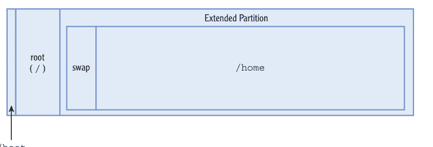
**图 5.1** 磁盘分区通常被可视化为硬盘内的方块。

对于 x86 和 x86-64 计算机，最常见的分区方案在多年来有各种称呼，包括*主引导记录* (MBR)、*MS-DOS* 和 *BIOS 分区*。它支持三种类型的分区：

**主分区（Primary）** 这是最简单的分区类型。一个磁盘可以有 0 到 4 个主分区，其中一个可以是扩展分区。

> 一些分区工具将分区表示为垂直堆叠而非水平链条。无论哪种方式，原理都是一样的。

**扩展分区（Extended）** 这是一种特殊的主分区，作为逻辑分区的占位符。一个磁盘最多只能有一个扩展分区。

**逻辑分区（Logical）** 这些分区包含在扩展分区内。理论上，一个磁盘可以有数十亿个逻辑分区，从而克服了 4 个主分区的限制，但在实践中，你看到的通常不会超过十几个。

MBR 使用三种分区类型的方式显得笨拙且具有局限性，但惯性使其维持了三十年。不过，MBR 分区有一个硬性限制：假设使用如今几乎通用的 512 字节扇区，它们无法支持大于 2 TiB（tebibytes）的磁盘。

全局唯一标识符 (GUID) 分区表 (GPT) 是 MBR 的继任者。GPT 支持高达 8 ZiB (zebibytes) 的磁盘，这大约是 MBR 限制的 40 亿倍。GPT 默认还支持最多 128 个分区，且不再区分主分区、扩展分区和逻辑分区。在这些方面，GPT 是比 MBR 更先进的分区系统；然而，其支持情况在不同操作系统之间有所不同。Linux 对这两个系统都支持得很好。当计算机使用基本输入输出系统 (BIOS) 时，Windows 只能从 MBR 启动；当计算机基于统一可扩展固件接口 (UEFI) 时，它只能从 GPT 启动。因此，如果你安装 Windows 双系统，可能需要谨慎选择分区系统。

> 1 TiB 是 $2^{40}$ 字节，而 1 ZiB 是 $2^{70}$ 字节。

### 多字节单位

在指代大量存储空间时，人们习惯于将国际单位制（SI 单位）的前缀——*kilo* (k)、*mega* (M)、*giga* (G)、*tera* (T) 等与*byte* (B) 结合使用，如 kB、MB 等。从技术上讲，这些单位被定义为 10 进制值——*kilo* 表示 1,000，*mega* 表示 1,000,000，依此类推。但在计算机中，2 进制值（如 $2^{10}$ (1024) 和 $2^{20}$ (1,048,576)）通常更自然，因此 SI 单位经常（但并非总是）被用来表示这些 2 进制值。这种做法导致了混淆，因为并不总是能清楚地知道使用的是 10 进制还是 2 进制单位。

为了解决这个冲突，电气电子工程师学会 (IEEE) 定义了一套新的前缀，即 IEEE-1541。在这个系统中，新的单位和前缀描述的是 2 进制值。前几个如下：

- 1 kibibyte (KiB) 是 $2^{10}$ (1024) 字节。
- 1 mebibyte (MiB) 是 $2^{20}$ (1,048,576) 字节。
- 1 gibibyte (GiB) 是 $2^{30}$ (1,073,741,824) 字节。
- 1 tebibyte (TiB) 是 $2^{40}$ (1,099,511,627,776) 字节。

在本书中，我在描述最适合用该系统表达的特性（如分区表大小限制）时，会使用 IEEE-1541 单位。大多数 Linux 磁盘工具能正确使用 SI 和 IEEE-1541 单位，但具体使用哪个取决于程序作者的随意决定。请留意这个区别，尤其是在处理大数字时——请注意，一个 tebibyte 比一个 terabyte 大了近 10%！

还存在其他几种分区系统，但你不太可能遇到其中的大多数。一个可能的例外是 Apple 分区图 (APM)，Apple 在切换到 Intel CPU 之前的 Macintosh 计算机上使用它。

在对磁盘进行分区时，Linux 支持三类工具：

**fdisk 家族** `fdisk`、`cfdisk` 和 `sfdisk` 是适用于 MBR 磁盘和一些更罕见的分区表类型的简单文本分区实用程序。这些工具运行良好，并提供了从某些磁盘错误中恢复的手段，但其基于文本的特性对于不熟悉磁盘分区的人来说可能有些令人生畏。

**基于 libparted 的工具** 基于 `libparted` 库的工具可以处理 MBR、GPT 和其他几种分区表类型。其中一些工具（如 GNU Parted）是基于文本的，而另一些（如 GParted）则是图形界面 (GUI)，因此新用户可能更容易使用。图 5.2 展示了 GParted 的运行情况。注意它的显示如何镜像了图 5.1 所示的结构。许多 Linux 安装程序包含在系统安装期间运行的基于 libparted 的分区工具。

**GPT fdisk 家族** `gdisk`、`cgdisk` 和 `sgdisk` 工具是模仿 `fdisk` 家族建模的，但适用于 GPT 磁盘。与基于 libparted 的工具相比，它们提供了更多处理 GPT 的选项，但代价是对新用户不够友好。

> 我是 GPT fdisk 家族分区工具的作者。

如果你使用的是预装的 Linux 系统，可能不需要对磁盘进行分区；但是，如果你更换或安装新的硬盘，在使用之前必须对其进行分区。你可能还需要对可移动磁盘进行分区，尽管它们通常在出厂时就已预分区为一个大分区。


要对磁盘进行分区，你必须知道磁盘的设备文件名。在 Linux 中，这些文件名通常是 `/dev/sda`、`/dev/sdb` 等，每块磁盘占用一个新字母。分区的编号从 1 开始，因此你可能会看到 `/dev/sda2`、`/dev/sdb6` 等。使用 MBR 时，分区 1 到 4 被保留给主分区或扩展分区，而逻辑分区的编号则从 5 开始。

**图 5.2** GParted 与其他 GUI 磁盘分区工具一样，提供了分区的图形化表示。

## 理解文件系统问题

大多数磁盘分区包含文件系统，文件系统是帮助计算机组织目录和文件的数据结构。在 Windows 中，每个文件系统都有自己的设备盘符，例如 A 和 B 用于软盘，C 用于第一个硬盘分区（通常是启动分区），依此类推。相比之下，在 Linux 中，所有文件系统都是单个目录树的一部分。主文件系统被称为根 (`/`) 文件系统。如果一个磁盘有多个文件系统分区，每个分区都挂载在根 (`/`) 文件系统的某个*挂载点*上——也就是说，附加文件系统的内容在特定的目录中可用，例如 `/home`（保存用户数据文件）或 `/boot`（保存启动文件）。Linux 存在多种文件系统，每种都有其独特的功能：

- **Ext2fs**：第二代扩展文件系统 (ext2fs) 在 20 世纪 90 年代很流行，但现在很少使用，因为它缺乏*日志 (journal)*。日志是一种文件系统特性，可以加快断电或系统崩溃后的文件系统检查速度。不过，日志会占用磁盘空间，因此 ext2fs 在小磁盘上仍然有用。例如，你可能想将其用于独立的 `/boot` 分区，因为此类分区通常较小。其 Linux 文件系统类型代码为 ext2。

> **文件系统 (filesystem)** 一词有时被用于指代整个目录结构，即使它包含多个底层文件系统。具体指哪个含义通常可以通过上下文清楚地判断。

> 原始的扩展文件系统 (extfs) 用于 20 世纪 90 年代初，但很快被 ext2fs 取代。Extfs 已不再受支持。

- **Ext3fs**：第三代扩展文件系统 (ext3fs) 本质上是带有日志的 ext2fs。直到 2010 年左右，它一直是非常流行的文件系统，但后来被 ext4fs 取代。它支持最高 2 TiB 的文件和最高 16 TiB 的文件系统（ext2fs 也有相同的限制）。其 Linux 类型代码为 ext3。
目前的分区工具将 ext4 文件系统的大小限制在 16 TiB；不过，这个限制迟早会被提高。

- **Ext4fs**：第四代扩展文件系统 (ext4fs) 是 ext 文件系统系列的进一步发展。它提高了速度，并增强了处理大文件和大磁盘的能力——文件大小最高可达 16 TiB，文件系统最高可达 1 EiB (2⁶⁰ 字节)。Linux 实用程序将其称为 ext4。

- **ReiserFS**：该文件系统在 Linux 工具中被称为 reiserfs，其功能与 ext3fs 相似，文件大小限制为 8 TiB，文件系统大小限制为 16 TiB。它最出色的特性是能够高效利用存储小文件（大小在几个 kibibyte 范围内）的磁盘空间。ReiserFS 的开发已经放缓，但仍然可用。

- **JFS**：IBM 为其 AIX 操作系统开发了日志文件系统 (JFS)，其代码最终被引入 Linux。JFS 支持的最大文件和文件系统大小分别为 4 PiB 和 32 PiB（1 PiB 为 1024 TiB）。JFS 不像许多其他 Linux 文件系统那样流行。Linux 工具使用 jfs 作为其类型代码。

- **XFS**：Silicon Graphics 为其 IRIX 操作系统开发了 Extents 文件系统 (XFS；Linux 类型代码为 xfs)，随后将其代码捐赠给 Linux。XFS 支持最高 8 EiB 的文件和最高 16 EiB 的文件系统，使其成为超大磁盘阵列的首选。XFS 在处理大型多媒体文件和备份文件方面表现出色。

- **Btrfs**：这种新文件系统（读作 "butter-eff-ess" 或 "better-eff-ess"）旨在作为下一代 Linux 文件系统。它支持最高 16 EiB 的文件以及相同大小的文件系统。它还提供了一系列高级功能，例如将多个物理磁盘组合成单个文件系统的能力。截至 2012 年初，Btrfs 仍处于实验阶段，但一旦完成，它可能会提供最佳的综合功能组合。其 Linux 类型代码为 btrfs。

如果你计划安装一个新的 Linux 系统，应考虑将 ext4fs、ReiserFS 或 XFS 作为你的文件系统。目前，ext4fs 提供了最佳的综合功能和性能，而 ReiserFS 和 XFS 则分别值得在存储极小文件和极大文件的卷中使用。不过，ext4fs 也是存储大文件的不错选择，因此你可以将所有内容都使用 ext4fs 且不会出大错，尤其是在通用计算机上。

在单个 Linux 安装中使用几种文件系统是可能的，这样可以利用不同文件系统对不同文件集的优势。

除了 Linux 的原生文件系统外，该操作系统还支持其他几种文件系统，其中一些在特定情况下非常重要：

- **FAT**：文件分配表 (FAT) 文件系统是 DOS 和 Windows (直到 Windows Me) 的标准。几乎所有操作系统都支持它。其兼容性使其成为在单机双启动的两个操作系统之间交换数据的良好选择。与大多数文件系统不同，FAT 有两个 Linux 类型代码：`msdos` 和 `vfat`。使用 `msdos` 会使 Linux 像 DOS 那样使用该文件系统，采用最多 8 个字符加上 3 个字符扩展名的短文件名 (`8.3 filenames`)；当你使用 `vfat` 时，Linux 在 FAT 上支持长文件名。

> FAT 的简单性和广泛支持使其在软盘、USB 闪存盘、手机、电子书阅读器、数码相机存储介质等设备上成为流行的文件系统。

- **NTFS**：微软为 Windows NT 开发了新技术文件系统 (NTFS)，它是近期 Windows 版本的默认文件系统。Linux 提供了一个有限的读/写 `ntfs` 驱动程序，而完整的读/写驱动程序可在 NTFS-3G 软件 (http://www.tuxera.com) 中获得。你最有可能在双启动配置的 Windows 启动分区，或较大的可移动/外接硬盘上遇到它。在 Linux 下，标准内核驱动程序被称为 `ntfs`，而 NTFS-3G 驱动程序被称为 `ntfs-3g`。

> Linux 的 `ntfs` 驱动程序基于内核，因此速度较快。而 `ntfs-3g` 驱动程序与大多数文件系统驱动不同，它不是基于内核的，因此速度没有那么快。

- **HFS**：苹果公司在其 Mac OS 9.x 及之前的版本中使用分级文件系统 (HFS)，并且在 Mac OS X 中仍然支持它。你可能会在某些可移动介质上遇到 HFS，特别是在 pre-X 版本的 Mac OS 下创建的旧磁盘上。Linux 使用其 `hfs` 驱动程序提供完整的 HFS 读/写支持。

- **HFS+**：苹果的 HFS+，也称为 *Mac OS Extended*，是 Mac OS X 的当前文件系统；你可能会在双启动的 Mac 和某些为 Mac 创建的可移动介质上遇到它。Linux 使用其 `hfsplus` 驱动程序提供 HFS+ 的读/写支持；然而，在包含日志的文件系统版本中，写支持默认被禁用。

> 出于兼容性原因，Mac 用户经常在可移动介质上使用 FAT。

- **ISO-9660**：这种文件系统用于光介质，特别是 CD-ROM 和 CD-R。它有几个不同的能力级别。两种扩展，*Joliet* 和 *Rock Ridge*，分别根据 Windows 和 Unix 标准提供对长文件名的支持。Linux 支持所有这些变体。你应该使用 `iso9660` 类型代码来挂载 ISO-9660 光盘。

- **UDF**：通用磁盘格式 (UDF) 是一种旨在取代 ISO-9660 的文件系统。它最常见于 DVD 和蓝光介质，尽管有时也用于 CD-R。其 Linux 类型代码自然是 `udf`。


大多数非 Linux 文件系统缺乏对 Linux 所使用的 Unix 风格所有权和权限的支持。因此，您可能需要使用特殊的挂载选项来按照您的意愿设置所有权和权限。此规则的例外情况包括在使用 Rock Ridge 扩展时的 HFS+ 和 ISO-9660。Rock Ridge 光盘通常在创建时就带有了允许正常使用光盘的所有权和权限，但如果您面对的是 HFS+ 磁盘，您可能会发现用户 ID (UID) 值与您的 Linux 用户不匹配。因此，您可能需要以 root 身份复制数据，创建一个具有匹配 UID 值的账户，或者更改 HFS+ 磁盘上文件的所有权。 (如果您计划再次在 Mac OS X 下使用该磁盘，那么最后一个选项可能是不理想的。)

要访问文件系统，您必须使用 `mount` 命令将其挂载。例如，要将 `/dev/sda5` 上的文件系统挂载到 `/shared，您需要输入以下命令：

```
# mount /dev/sda5 /shared
```

或者，您可以在 `/etc/fstab` 文件中为该文件系统创建一项条目，该文件存储了设备文件、文件系统类型和挂载点等信息。当您使用完文件系统后，可以使用 `umount` 命令将其卸载，例如 `umount /shared`。

> **umount** 命令的名字中只有一个 n。

## 使用可移动磁盘和光盘

如果您将可移动磁盘插入运行大多数现代 Linux 发行版的计算机，计算机可能会检测到这一事实，将磁盘挂载在 `/media` 的子目录中，并启动该磁盘上的文件管理器。这种行为使系统的操作方式与 Windows 或 Mac OS 用户所熟悉的习惯一致。

当您使用完磁盘后，在安全移除之前，您**必须**将其卸载。大多数文件管理器允许您通过右键单击左侧窗格中磁盘的条目，并选择名为“卸载 (Unmount)”、“弹出卷 (Eject Volume)”或“安全删除 (Safely Remove)”的选项来完成此操作，如图 5.3 所示。如果您未能执行此操作，文件系统可能会受到损坏。

> 某些设备（如光驱）可以锁定其弹出机制，以防止强制移除介质。

大多数可移动磁盘要么没有分区，要么只有一个分区。它们经常使用 FAT，这是跨平台兼容性的一个好选择。如果需要，您可以对 USB 闪存盘和其他可移动介质进行分区。

光盘比较特殊，因为它们需要自己的特殊文件系统 (ISO-9660 或 UDF)。虽然您可以像其他磁盘一样挂载和卸载这些光盘，但您只能读取它们，不能向其中写入。如果您想在空白介质上创建光盘，必须使用特殊软件，例如文本模式的 `mkisofs`、`cdrecord` 或 `growisofs`，或者图形界面的 K3B 或 X-CD-Roast。这些工具根据您指定的文件创建 ISO-9660 文件系统，然后将其刻录到空白光盘上。之后，您可以用通常的方式挂载光盘。

认证目标

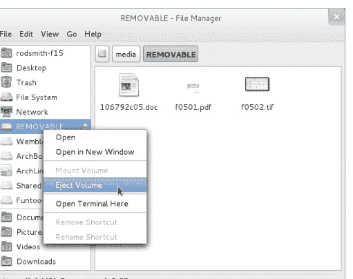
**图 5.3** Linux 文件管理器允许您卸载可移动介质。

## 管理显示

Linux 提供两种显示模式：文本模式和 GUI（图形用户界面）。文本模式显示相当简单，几乎不需要管理。另一方面，GUI 显示则更为复杂。在 Linux 中，X Window System（简称 X）管理 GUI 显示。在接下来的几页中，我将描述 X 是什么以及 X 如何与常见的显示硬件交互。

认证目标

### 理解 X 的作用

大多数人不会过多考虑计算机显示背后的软件；它运行得很好。当然，在幕后，管理显示的任务相当复杂。在任何平台上，软件必须完成的部分工作包括：

- 1. 初始化显卡，包括设置其分辨率
- 2. 分配显示区域以持有属于特定应用程序的窗口
- 3. 管理重叠的窗口，以便仅显示“最顶层”窗口的内容
- 4. 管理由用户通过鼠标或类似设备控制的指针
- 5. 将来自键盘的用户输入引导至任何处于活动状态的应用程序
- 6. 根据用户程序的请求，在窗口内显示文本和简单形状
- 7. 提供用于移动和调整窗口大小的用户界面元素
- 8. 管理窗口内部，例如显示菜单和滚动条

在 Linux 中，任务 1 到 6 由 X 处理，但任务 7 由名为 *窗口管理器 (window manager)* 的程序处理，任务 8 由被称为 *组件集 (widget sets)* 的 GUI 库处理。任务 6 中的字体显示元素可以由 X 处理，但近年来许多程序已开始使用名为 Xft 的库来执行此任务。因此，处理显示的整体工作被分摊到多个程序中，尽管 X 处理了大多数底层任务。

现代 Linux 发行版使用一个能够检测硬件（包括显卡、显示器、键盘和鼠标）并自动配置自身的 X 版本。结果是，软件通常无需任何显式配置即可正常工作。不过，有时这种自动配置会失败。当这种情况发生时，您必须手动编辑 X 配置文件 `/etc/X11/xorg.conf`。如果该文件丢失，您可以通过以 root 身份输入以下命令（在 *X 未运行* 的情况下）来生成一个示例文件：

```
# Xorg -configure
```

结果通常是一个名为 `/root/xorg.conf.new` 的文件。您可以将此文件复制到 `/etc/X11/xorg.conf` 并开始编辑以适应您的需求。这项任务很复杂，超出了本书的范围，但知道该文件的名称可以帮助您入门——您可以通过搜索该名称来检查文件并查找额外的文档。

### 使用常见的显示硬件

处理视频设备的大部分挑战在于管理涉及的视频芯片组的驱动程序。大多数现代计算机使用少数几种视频驱动程序之一：

- nv、nouveau 和 nvidia 适用于 NVIDIA 视频硬件。
- ati 和 fglrx 适用于 AMD/ATI 视频硬件。
- intel 适用于 Intel 视频硬件。

> 桌面环境包含窗口管理器，但也可以使用不带桌面环境的窗口管理器。

> 第 11 章“编辑文件”描述了 pico、nano 和 Vi 文本模式编辑器。

> 认证目标

- fbdev 和 vesa 驱动程序是通用驱动程序，可与多种硬件协作，但其性能并非最优。
- 许多旧显卡使用更冷门的驱动程序。

nvidia 和 fglrx 驱动程序是由其制造商提供的专有驱动程序。请查看制造商的网站获取详细信息，或寻找安装这些驱动程序的软件包。这些专有驱动程序提供了其开源对应版本中没有的功能，尽管 nouveau 驱动程序实现了一些此类功能。在这种情况下，视频驱动程序的“功能”转化为性能的提升，特别是在 3D 图形和实时显示（如播放视频文件）方面。

过去，大多数显卡使用 15 针视频图形阵列 (VGA) 电缆连接到显示器。如今，29 针数字视觉接口 (DVI) 电缆更为常见。（图 5.4 显示了这两种类型。）DVI 的优势在于它是一个数字接口，可以在现代液晶显示 (LCD) 显示器上产生更清晰的显示效果。


**图 5.4** VGA 连接器（左）在过去几年很常见，现在仍然可用；DVI 连接器（右）在较新的显示器和显卡上很常见。

> 高定义多媒体接口 (HDMI) 是另一种电缆类型。HDMI 和 DVI 相似，但 HDMI 在电视上更常见，而 DVI 在计算机上更常见。

显示器分辨率通常以水平和垂直像素数来衡量。过去，低至 640×480 的分辨率很常见，但如今很少使用最佳分辨率低于 1280×1024 或 1366×768 的显示器，而 1920×1080 或更高的分辨率已非常普遍。您应该查阅显示器手册以确定其最佳分辨率。通常，物理尺寸较大的显示器具有更高的分辨率；但情况并非总是如此。

> 大多数显示器使用 4:3 或 16:9 的屏幕宽高比，指显示器的长度与高度之比。

在最理想的情况下，Linux 会自动检测显示器的最佳分辨率，并在您每次启动计算机时将其设置为该值。不幸的是，这有时不起作用。键盘/视频/鼠标 (KVM) 切换盒和延长线有时会干扰这种自动检测，并且

旧款显示器可能不支持必要的计算机/显示器通信。因此，您可能需要查阅显示器手册以了解其最佳分辨率。请在功能或规格部分查找此信息；它可能被标注为最佳分辨率（optimum resolution）、最大分辨率（maximum resolution）或类似的名称。它还可能包含刷新率数值，例如 1280×1024 @ 60 Hz。

在大多数情况下，您可以使用 GUI 工具来设置分辨率，例如 GNOME 系统设置面板中的“显示”项目（如图 5.5 所示）。在图 5.5 中，“分辨率”按钮允许您将分辨率设置为任何所需的值。如果您在列表中找不到最佳分辨率，则可能需要进行更高级的调整，涉及 `/etc/X11/xorg.conf` 文件——这是一个超出本书范围的主题。在极少数情况下，您可能需要升级显卡；某些显卡无法处理某些显示器所使用的最佳分辨率。

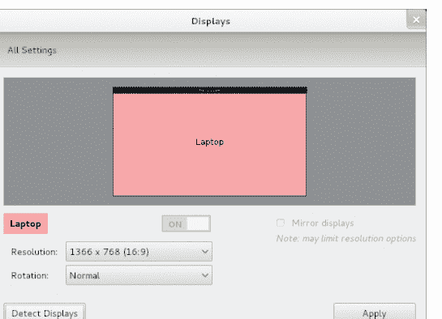
**图 5.5** 大多数桌面环境都提供 GUI 工具来帮助您设置显示分辨率。

## 处理 USB 设备

**认证目标** 大多数现代计算机使用 USB 作为外部外设的主要接口。键盘、鼠标、摄像头、闪存盘、硬盘、网络适配器、扫描仪、打印机等都可以通过 USB 连接。在大多数情况下，USB 设备以即插即用的方式工作——您只需将其插入即可使用。一些特定的注意事项包括以下内容：

- **人体工程输入设备（HID）**：当您插入键盘、鼠标、平板电脑和类似设备时，X 通常会自动接管。如果您遇到问题，可能需要通过编辑 `/etc/X11/xorg.conf` 来调整 X 配置，但这是一个超出本书范围的高级主题。
- **磁盘存储**：我将 USB 闪存盘、外接硬盘和其他存储设备归入此类。正如之前在“使用可移动和光盘”中所述，在拔掉 USB 线缆之前，务必卸载（unmount）该设备。否则可能会导致数据损坏。
- **手机、照相机、电子书阅读器和音乐播放器**：您通常可以像使用磁盘设备一样使用这些设备来传输照片、音乐或其他文件。不过，您可能需要在设备上激活某个选项，使其在计算机看来像一个磁盘设备。完成后，请卸载设备并禁用其接口模式。
- **扫描仪**：Linux 使用 Scanner Access Now Easy（SANE; http://www.sane-project.org）软件来处理大多数扫描仪。不过，少数设备需要晦涩的或专有软件。
- **打印机**：当您插入 USB 主机打印机时，大多数发行版会自动配置合适的打印队列。如果您需要微调配置，请尝试在相关计算机的 Web 浏览器中输入 `http://localhost:631`。这样做会打开一个基于 Web 的打印机配置实用程序。一些发行版还提供特定于发行版的打印机配置工具。

## 管理驱动程序

大多数硬件设备需要特殊的软件组件才能发挥作用。与硬件“对话”的软件被称为*驱动程序（driver）*，因此您应该了解驱动程序在 Linux 中是如何工作的。驱动程序分为几个大类，我将先从描述这些类别开始。无论驱动程序类型如何，您都应该知道如何为您硬件定位和安装驱动程序。

> 认证目标

### 理解驱动程序的类型

Linux 需要驱动程序，是因为不同的硬件——即使是用途非常相似的两个设备（例如两个网络适配器）——其工作方式可能截然不同。也就是说，初始化和使用两个网络适配器所需的方法可能完全不同。为了提供通用接口，以便像 Firefox 浏览器这样的程序可以使用任何网络适配器，Linux 内核使用驱动程序作为硬件无关的内核接口与硬件本身之间的桥梁。

事实上，在网络硬件和像 Firefox 这样的程序之间存在多个层级；驱动程序只是其中一层。

广义上讲，驱动程序可能存在于两个位置之一：
- 内核
- 库或应用程序

大多数驱动程序基于内核，事实上，Linux 内核的大部分内容由驱动程序组成。内核驱动程序处理大多数计算机机箱内部的设备，如硬盘、网络接口和 USB 接口。内核承载大多数驱动程序，是因为驱动程序通常需要对硬件的特权访问，而这正是内核的作用。

一些驱动程序驻留在库或应用程序中。其中许多设备位于计算机外部。示例包括：
- SANE，处理扫描仪
- Ghostscript，将打印输出转换为特定打印机能理解的形式
- X，管理显示

X 比较特殊，它是一个非内核元素，但能够几乎直接地与视频硬件通信。相比之下，SANE 和 Ghostscript 都是通过由内核处理的接口（如 USB 端口）与外部硬件设备通信。也就是说，处理此类设备至少需要两个驱动程序。例如，要使用 USB 打印机打印，您需要使用内核的 USB 驱动程序和一个 Ghostscript 打印机驱动程序。理想情况下，大多数用户无需意识到这种复杂性，但如果出现问题，您可能需要了解这一点。

### 定位和安装驱动程序

大多数驱动程序随 Linux 内核本身，或随处理该类型硬件的库或应用程序一起提供。例如，大多数 X 安装包含一组视频驱动程序，以便您可以使用大多数显卡。因此，对于常见硬件，很少需要费力地寻找并安装额外的驱动程序。但也有例外，例如：

- **新硬件**：如果您的硬件非常新（指型号新，而不仅仅是最近购买的），它可能需要尚未进入您所使用的发行版的驱动程序。
- **罕见硬件**：如果您使用非常冷门的硬件，例如专门的科学数据采集板，您可能需要寻找对应的驱动程序。
- **专有驱动程序**：一些制造商为其硬件提供专有驱动程序。例如，`nvidia` 和 `fglrx` 视频驱动程序（在之前的“使用常用显示硬件”中提到）可以分别提高基于 NVIDIA 或 ATI/AMD 芯片组的视频显示性能。某些硬件必须使用专有驱动程序，这在一些特殊硬件中尤为常见。
- **错误修复（Bug fixes）**：驱动程序与其他软件一样，可能存在漏洞。如果您遇到此类问题，可能需要寻找更新的驱动程序以获取修复补丁。

获取新内核驱动程序的一种方法是升级内核。请注意，内核升级既能为现有驱动程序提供错误修复，也能提供全新的驱动程序。同样，升级 SANE、Ghostscript 或 X 等软件也可以升级或添加这些软件包所处理设备的驱动程序。

如果您使用罕见硬件或需要某种难以找到的驱动程序，任务可能会更艰巨。您可以咨询制造商或进行 Web 搜索尝试寻找驱动程序。

如果您获得了一个不属于内核（或处理设备的软件安装包）的驱动程序，您应该阅读随驱动程序附带的说明。不同驱动程序的安装步骤差异很大，因此无法提供一个适用于所有情况的简单分步安装程序。一些驱动程序带有安装实用程序，而另一些则需要您按照包含输入各种命令的步骤进行操作。如果您运气非常糟糕，驱动程序可能会以*内核补丁（kernel patch）*的形式提供。这是一种在主内核源代码包中添加或更改文件的方法。随后您必须重新编译内核——这项任务已远远超出本书的范围。

## 核心要点与延伸

软件和硬件通过多种方式相互作用，决定了计算机的能力。CPU 是决定计算机速度的因素之一，同时也决定了您可以运行哪个版本的 Linux。CPU 安装在主板上，主板包含管理硬盘、显示器和其他设备的重要电路。您的硬盘在投入使用前必须进行分区并准备一个或多个文件系统。视频硬件（包括显示器和计算机内部的视频电路）决定了桌面环境的外观以及计算机移动窗口和播放视频的速度。USB 管理大多数外部设备，如键盘、鼠标和外接磁盘。被称为驱动程序的软件则管理所有这些硬件设备。

*（待续）*

### 核心要点及进阶（续）

### 建议练习

- 在 Linux 命令行提示符下，输入 `uname -a`、`lscpu` 和 `cat /proc/cpuinfo`。对比输出结果并尝试确定你 CPU 的能力。特别是，它能否运行 64 位应用程序，以及你当前的发行版是 32 位还是 64 位发行版？
- 在登录到你偏好的桌面环境后，插入一张光盘、一个 USB 闪存盘或其他可移动磁盘。文件浏览器是否会自动打开？如果没有，请手动打开一个并尝试找到你的可移动磁盘。访问磁盘后，请将其卸载以便安全移除。

### 复习题

1. 以下哪个命令能提供关于主板特性的最多信息？
    A. `lscpu`
    B. `Xorg -configure`
    C. `fdisk -l /dev/sda`
    D. `lspci`
    E. `http://localhost:831`
2. 为什么你可能想要对硬盘进行分区？（选择所有适用项。）
    A. 为了在磁盘上安装多个操作系统
    B. 为了使用 ext4fs 而不是 ReiserFS
    C. 为了将 PATA 磁盘转换为 SATA 磁盘
    D. 为了将文件系统数据与交换空间分离
    E. 为了将磁盘缓存与其主数据分离
3. 以下哪个设备*不*常通过 USB 连接？
    A. 视频显示器
    B. 键盘
    C. 外接硬盘
    D. 打印机
    E. 扫描仪
4. 正确或错误：EM64T CPU 能够运行被标识为适用于 AMD64 CPU 的 Linux 发行版。
5. 正确或错误：UDF 是在硬盘上安装 Linux 的一个好文件系统。
6. 正确或错误：Linux 内核包含了各种磁盘控制器、网络适配器和 USB 接口等的驱动程序。

*（继续）*

7. x86 CPU 使用的是 __ 位架构。
8. 计算机电源将电流从交流电转换为 __________。（两个单词）
9. __________ 标准是一种现代视频接口，常用于计算机显示器。

## 第 6 章

## 认识命令行

**你可能会认为**命令行是 20 世纪 70 年代的古董，对今天的计算而言就像迪斯科球一样无关紧要。事实并非如此！虽然 Linux 有许多 GUI 程序，但它们大多只是底层文本模式工具的华丽前端。通过学习这些工具，你将能够解锁 Linux 的真正威力，使你能够更快速地完成工作。此外，如果 Linux GUI 系统完全崩溃，或者你需要远程登录并管理系统时，你也能应对。命令行工具还可以编写脚本，这意味着你可以编写一个简单的程序，比仅使用标准程序更快速或更轻松地执行任务。出于这些原因，本书的大多数章节都会描述完成任务的 GUI 方式和命令行方式。

要开始命令行操作，你必须知道如何启动它。掌握了这一点后，你必须知道如何运行程序和操作文件。你还应该熟悉 Linux 命令行的一些省力特性。

- 启动命令行
- 运行程序
- 操作文件
- 使用 Shell 特性

## 启动命令行

Linux 命令行，或者更准确地称为 *shell*，与任何其他程序一样，必须以某种方式启动。通常使用三种方法：在名为 *终端 (terminal)* 的 GUI 窗口中启动 shell，在文本模式控制台中登录计算机，以及使用文本模式登录协议远程登录计算机。

大多数 Linux 发行版的默认 shell 是 Bourne-Again Shell (Bash 或 bash)，它是基于一个名为 Bourne Shell 的较旧 shell 开发的。还有其他 shell 可用。其中大多数在整体上与 Bash 类似，尽管某些细节有所不同。每个账户都指定了自己的默认 shell，因此个人用户可以根据喜好更改他们的 shell。（这可以通过账户管理工具如 `usermod` 来完成，详见第 14 章“创建用户和组”。）

其他 shell 包括 tcsh、ksh 和 zsh。Shell 的选择取决于个人偏好。如果你刚开始学习，最好坚持使用 Bash，因为它非常流行。

“终端”这个词也可以指处理计算机之间文本模式连接的工具，通常被称为串口线和调制解调器。这类终端程序在今天已不常见。

当你使用管理账户 root 时，提示符通常以井号 (#) 结尾。第 13 章“理解用户和组”将更详细地描述 root 账户。

### 启动终端

大多数 Linux 发行版提供几个终端程序，尽管具体情况取决于你的安装选项——大多数桌面环境提供自己的终端，因此你的选择取决于你安装的桌面环境。（如果你愿意，可以在一个桌面环境中运行另一个桌面环境的终端程序。）大多数终端程序在名称中包含“terminal”一词，但有些不包含，例如 K 桌面环境 (KDE) 的 Konsole 和通用的 xterm。

启动终端程序的具体操作在不同桌面环境之间有所不同。你通常可以在桌面环境的菜单中找到对应项，如第 4 章“使用常用 Linux 程序”中所述。例如，如果你使用的是流行的 GNU 网络对象模型环境 (GNOME) 第 3 版，可以通过以下步骤找到可用的终端：

1. 点击屏幕左上角的“活动 (Activities)”。
2. 点击“应用程序 (Applications)”标题。
3. 选择屏幕右侧附近的“系统工具 (Systems Tools)”过滤器，这将显示类似于图 6.1 的界面。你应该能看到至少一个终端程序，可能不止一个。图 6.1 显示了 Konsole、LXTerminal 和两个名为 Terminal 的程序（GNOME 的 Terminal 和 Xfce 的 Terminal）。
4. 选择你想使用的终端，它将启动。图 6.2 显示的是 GNOME 的 Terminal，但你也可以使用另一个终端程序。

终端程序会显示一个提示符——如图 6.2 中的 `[∼rodsmith@web1eth ~] $`。这个例子显示了 Fedora 的默认提示符，其中包含你的用户名、计算机的主机名、当前目录（波浪号 “~” 指你的主目录）和一个美元符号 ($)。正如本章后续章节所述，这些特性在你使用 shell 时可能会发生变化。

如果你使用的是其他发行版，提示符在细节上可能会有所不同，尽管大多数默认提示符对于普通用户 shell 来说都以美元符号 ($) 或大于号 (>) 结尾。

**图 6.1** 标准的 Linux 安装应提供至少一个终端程序。

**图 6.2** GNOME 的 Terminal 程序很典型，由一个文本显示区域主导。

大多数终端程序提供 X 程序的通用特性——你可以调整它们的大小、关闭它们、从菜单中选择选项等等。不过，具体情况取决于你使用的程序。你可能想要浏览程序菜单中的可用选项，以便将字体设置为你喜欢的字体，更改配色方案等等。

大多数终端程序支持标签页，类似于 Web 浏览器的标签页。在大多数情况下，你可以通过在终端菜单中选择“文件 $\rightarrow$ 打开标签页 (File $\rightarrow$ Open Tab)”来打开标签页。打开多个标签页很方便，因为它可以让你同时运行多个程序，轻松在多个目录中工作，或者同时以普通用户和 root 身份运行程序。或者，你也可以运行多个终端程序来达到同样的目的。

当你使用完终端后，可以像关闭其他程序一样，通过菜单选择“文件 $\rightarrow$ 关闭窗口 (File $\rightarrow$ Close Window)”来关闭它。或者，你可以在其 shell 提示符下输入 `exit`。

### 登录到文本模式控制台

乍一看，Linux 像 Windows 或 Mac OS 一样是一个 GUI 操作系统。但只要深入挖掘，你会发现一个纯文本模式界面在等待着。Linux 支持虚拟终端 (VT)，即可以持有不同类型信息（文本或图形）的虚拟屏幕。大多数 Linux 发行版运行 6 或 7 个 VT。在 CentOS、Fedora 和 Red Hat 中，第一个 VT 通常运行 X Window System（Linux 的 GUI）。在大多数其他发行版中，X 运行在 VT 7 或 VT 8，将 VT 1 留给文本模式显示。你可以通过按下 `Ctrl+Alt+Fn` 在 VT 之间切换，其中 `Fn` 是功能键。（在文本模式 VT 之间切换时，`Alt+Fn` 就足够了。）因此，要启用文本模式控制台，请执行以下步骤：

1. 按下 `Ctrl+Alt+F2`。你将看到一个文本模式提示符，内容类似于：

    Fedora release 16 (Verne)
    Kernel 3.1.0-7.fc16.x86_64 on an x86_64 (tty2)
    wembleth.rodsbooks.com login:

2. 在此提示符下输入你的用户名，它将响应一个新的提示符：

    Password:

3. 在此处输入你的密码，你将看到一个类似于图 6.2 窗口中所示的 Bash 提示符。


您可以使用 Ctrl+Alt+Fn 快捷键在文本模式登录和 X 会话之间来回切换。您还可以启动多个文本模式登录，并以同样的方式在它们之间切换。如果您正尝试调试一个与 X 相关的问题，这个功能会非常方便。

当您完成文本模式会话后，输入 `exit` 或 `logout 来终止它。

## 远程登录

远程登录必须通过运行服务器程序（如 Secure Shell (SSH)）来启用，您可能会发现默认情况下无法启动此类连接。不过，一旦您配置好 SSH 以接受远程登录，就可以使用 SSH 客户端程序（例如 ssh）来完成这项工作：

```
$ ssh wembleth
rodsmith@wembleth's password:
```

输入密码后，您将登录成功。本示例假设您在客户端计算机上使用 Linux shell。请注意，Linux 的 ssh 客户端会将您当前的用户名传递给服务器。您可以通过在远程系统的主机名前加上用户名和 at 符号 ( @ ) 来使用另一个用户名登录，例如使用 `ssh rodsmith@wembleth` 以 rodsmith 的身份登录 wembleth。其他操作系统（包括 Windows）的 SSH 客户端也是可用的，但其操作细节有所不同。

还存在其他文本模式远程登录程序，如 telnet 和 rlogin；然而，大多数这些程序使用的是较旧的协议，不采用加密，因此应尽量避免使用。图形用户界面 (GUI) 远程登录工具（如 Virtual Network Computing (VNC)）也可使用。这些工具中的大多数同样缺乏加密功能，不过它们可以通过 SSH 隧道来增加加密——这超出了本书的讨论范围。

远程登录后，您可以使用这台计算机，就像它在本地一样。完成后请务必通过输入 `exit` 或 `logout` 登出。

> 登出非常重要，尤其是在公共计算机上。人们很容易忘记自己使用了远程 shell，因此请养成检查此细节的习惯。

## 认证目标

> 配置 SSH 服务器超出了本书的范围，但您可以使用此处所示的 SSH 客户端连接到任何已经配置好的服务器。

## 运行程序

一旦您打开了终端或使用文本模式工具登录，您就应该知道如何使用 shell。Bash 包含一些内置命令，但在 shell 中执行的大部分操作涉及运行其他程序。正如接下来的章节所述，您可以运行文本模式程序和 GUI 程序。有时您可能希望在后台运行程序，同时仍能自己使用 shell。运行程序的另一个技巧是重定向输入和输出，这在许多情况下都非常有用。

### 运行文本模式程序

Linux 将程序存储在多个位置，包括 /bin、/usr/bin 和 /usr/local/bin。（主要由 root 使用的程序则出现在 /sbin、/usr/sbin 和 /usr/local/sbin 中。）如果一个可执行程序出现在这些目录（它们构成了路径 path）中的一个目录里，您只需输入其名称即可运行它：

```
$ free
```

| | total | used | free | shared | buffers | cached |
| :--- | :--- | :--- | :--- | :--- | :--- | :--- |
| Mem: | 3798016 | 3759004 | 39012 | 0 | 24800 | 1117444 |
| -/+ buffers/cache: | | 2616760 | 1181256 | | | |
| Swap: | 6291452 | 0 | 6291452 | | | |

这个示例命令显示了计算机内存使用情况的信息。不过，您无需担心此命令输出的细节；只需注意 free 程序在启动它的同一个终端中显示了信息。

您可以通过输入以下命令来了解哪些目录构成了路径：

```
$ echo $PATH
```

结果将是一组以冒号分隔的目录名称，每当您输入一个 shell 无法直接处理的命令时，shell 就会按顺序在这些目录中搜索。

许多命令接受参数，参数是紧跟在程序名之后的子命令或代码。例如，cat 命令（其名称是 concatenate 的缩写）可以快速在屏幕上显示一个短文本文件：

```
$ cat afile.txt
```
This is the contents of afile.txt.

在这个例子中，cat 将文件名 afile.txt 作为参数。许多程序允许您根据给定的精确参数执行各种不同的任务。您可以通过使用 Linux 手册系统来学习这些参数和其他用法细节。执行此操作的程序称为 man，您将想要了解的命令名称作为参数传递给它，例如使用 `man cat` 来了解 cat。

man 命令展示了某些文本模式程序的一个特点：它们可以接管启动它们的整个终端。在 man 的情况下，您可以使用方向键、Page Up、Page Down 等在文档中上下滚动。文本编辑器（如 vi、emacs、nano）也使用类似的功能。

> 我用**等宽粗体**表示您应该自行输入的命令，用标准等宽字体表示程序的输出。

> 第 8 章“获取帮助”将更详细地描述 man 页系统和其他文档。

### 运行 GUI 程序

您可以像运行文本程序一样从终端运行 GUI 程序；但是，如果您使用的是文本模式 VT 登录，则此操作无效，而且即使您在本地运行 X，远程登录时可能也无法运行。您还必须知道程序的文件名才能运行它。文件名通常与您从桌面菜单启动程序时使用的名称相关，但并不总是完全相同。例如，GNOME Terminal 的文件名是 `gnome-terminal`，因此如果您想通过这种方式启动另一个 GNOME Terminal，就需要输入该名称。

一些 GUI 程序会产生文本模式的输出，这在追踪问题源头时非常有用，因此从终端窗口启动程序可以是调试问题的一个良好第一步。您可能还想以这种方式启动程序，因为这比在桌面环境的菜单中寻找程序更快，或者是因为某个程序没有出现在环境菜单中。

### 在后台运行程序

当您从终端窗口启动 GUI 程序时，该 GUI 程序会打开自己的窗口。终端窗口保持打开状态，但通常会变得无响应。如果您想在此窗口中输入更多命令，可以通过选中它并按下 Ctrl+Z 来实现。*这将暂停程序——也就是说，它被发送到了睡眠状态。* 在睡眠状态下，GUI 程序不会响应输入，也不会执行任何工作。如果您想同时使用 GUI 程序和启动它的终端，可以在终端中输入 `bg`（*background* 的缩写）。此时两个程序都将处于活动状态。输入 `fg` 会将睡眠中的程序返回到前台，使其能够运行，但会使您的 shell 失去响应。请注意，在这种情况下，*后台*和*前台*是指程序与 shell 的关系，而不是程序窗口在屏幕窗口“堆栈”中的位置。

如果您在启动前就知道想在后台运行程序，可以在命令行末尾添加一个和符号 (&)，例如：

```
$ gedit afile.txt &
```

此命令在后台启动针对 `afile.txt` 的 gedit GUI 编辑器，使您能够编辑文件的同时继续使用 shell。此功能对于运行 GUI 程序最有用，但有时也用于文本模式程序。例如，一个复杂的数值计算程序可能被设计为运行几分钟或几小时且不产生任何输出。因此，您可能希望将其在后台运行并保留对 shell 的控制。但请注意，如果您在后台启动一个程序且它产生了输出，该输出将继续出现在您的 shell 中，可能会干扰您尝试在 shell 中执行的任何其他操作！

> 按下 Ctrl+Z 也会暂停大多数文本模式程序，使您能够在输入 fg 返回程序之前使用 shell。

## 文件操作

您在命令行中执行的大部分工作涉及操作文件。因此，了解处理文件的规则极其重要。在接下来的几页中，我将描述如何了解硬盘上有哪些文件、如何在目录之间切换、如何引用不在当前目录中的文件，以及最常用的文件操作命令。

### 获取文件列表

为了操作文件，了解它们是什么很有帮助。ls 命令（其名称是 list 的缩写）可为您提供此信息。ls 命令显示目录中文件的名称。如果您不传递任何选项，它将显示当前目录中的文件；不过，您可以同时传递选项以及文件或目录规范。此命令支持大量选项；详细信息请参阅其 man 页。表 6.1 总结了最重要的 ls 选项。

## 认证目标

| 选项 (长形式) | 选项 (短形式) | 描述 |
| :--- | :--- | :--- |
| `--all` | `-a` | 通常，ls 会省略名称以点 (.) 开头的文件。这些点文件（也称为隐藏文件）通常是不常用的配置文件。添加此参数可显示点文件。 |
| `--color` | N/A | 此选项生成颜色编码的列表，通过以不同颜色显示来区分目录和其他特殊文件类型。一些 Linux 发行版将其 shell 配置为默认使用此选项。 |
| `--directory` | `-d` | 通常，如果您将目录名称作为选项输入，ls 会显示该目录的内容。如果目录名称匹配通配符，也会发生同样的情况。添加此参数将更改此行为，仅列出目录名称，这在某些情况下更可取。 |


## 表 6.1（接上页）

| 选项（长形式） | 选项（短形式） | 描述 |
| :--- | :--- | :--- |
| N/无 | -l | `ls` 命令通常仅显示文件名。`-l` 参数（小写 L）会产生一个详细列表，其中包含文件的权限字符串、所有者、所属组、大小和创建日期等信息。 |
| --file-type | -p | 此选项在每个名称的末尾添加一个指示符代码，以便你知道该文件是什么类型。 |
| --recursive | -R | `-R` 或 `--recursive` 选项使 `ls` 递归地显示目录内容。也就是说，如果目标目录包含子目录，`ls` 将同时显示目标目录中的文件及其子目录中的文件。如果一个目录有许多子目录，结果可能会是一个巨大的列表。 |

你可以选择性地向 `ls` 提供一个或多个文件或目录名称，在这种情况下，`ls` 将显示这些文件或目录的信息，如下例所示：

```
$ ls -p /usr /bin/ls
/bin/ls

/usr:
X11R6/ games/ include/ man/ src/
bin/ I386-glibc20-linux/ lib/ merge@ tmp@
doc/ I486-linux-libc5/ libexec/ sbin/
etc/ I586-mandrake-linux/ local/ share/
```

该输出同时显示了 `/bin/ls` 程序文件和 `/usr` 目录的内容。后者主要由子目录组成，在使用 `-p` 时，子目录由末尾的斜杠 (/) 表示。默认情况下，`ls` 创建的列表按文件名排序，如本例所示。但请注意，大写字母（如 X11R6）始终出现在小写字母（如 bin）之前。

最常用的 `ls` 选项之一是 `-l`，它会创建如下列表：

```
$ ls -l t* x
-rwxr-xr-x 1 rodsmith users 111 Apr 13 13:48 test
-rw-r--r-- 1 rodsmith users 126322 Dec 16 09:34 chtptpd-1.20b-1.i686.rpm
-rw-r--r-- 1 rodsmith users 1838045 Apr 24 18:52 tomsrbtbt-1.7.269.tar.gz
-rw-r--r-- 1 rodsmith users 3265021 Apr 22 23:46 tripewire.rpm
```

除了文件名外，此输出还包括权限字符串（如 `-rwxr-xr-x`）、所有权（所有这些文件的所有者均为 rodsmith，所属组均为 users）、文件大小和文件创建日期。本例还演示了 `*` 通配符的使用，它可以匹配任何字符串——因此，`t*` 匹配任何以 `t` 开头的文件名。

> 末尾的 At 符号 (@) 表示符号链接，即指向另一个文件的文件。

### 更改目录

`cd` 命令用于更改你当前工作的目录。虽然对于许多命令来说，当前目录并不重要，但在你开始引用文件时，它就变得至关重要。正如接下来的“使用绝对和相对文件引用”部分所述，某些类型的文件引用取决于你的当前目录。

当你更改当前目录时，你的 Shell 提示符可能会发生变化（取决于你发行版的设置），类似于这样：

```
[rodsmt@then1 eth ]$ cd /usr/bin
[rodsmt@then1 eth bin]$
```

许多发行版的默认配置仅显示当前目录的最后一部分——在上述示例中是 bin 而不是 /usr/bin。如果你需要知道当前位置的完整路径，可以使用 `pwd`：

```
$ pwd
/usr/bin
```

Linux 使用斜杠 (/) 字符作为目录分隔符。如果你熟悉 Windows，你可能知道 Windows 使用反斜杠 (\) 来实现此目的。不要混淆两者！在 Linux 中，反斜杠充当“引号”或“转义”字符，用于在文件名中输入否则难以指定的字符（例如空格）。同时请意识到，由于这个原因，斜杠在 Linux 文件名中不是合法字符。

### 使用绝对和相对文件引用

正如第 5 章“管理硬件”中所述，Linux 使用统一的目录树，这意味着所有文件都可以相对于单个根目录进行定位，根目录通常使用斜杠 (/) 字符来引用。如果你的磁盘包含多个分区，其中一个设备将成为根文件系统，而其他设备则挂载在整体目录树的某个位置。当你挂载 USB 闪存盘、DVD 或其他可移动磁盘设备时，情况也是如此。

结果可能类似于图 6.3，它显示了典型 Linux 安装中发现的部分目录以及几个可移动介质。通常，可移动介质显示为 `/media` 目录的子目录。大多数子目录可以拆分为单独的分区，甚至放置在单独的磁盘上。在图 6.3 中，`/home` 目录位于自己的分区上，但访问它的方式与它作为根 (/) 分区的一部分时完全相同。

> 第 15 章“设置所有权和权限”详细介绍了这些主题。
> 在本书中，当我将命令单独显示在行中时，我会将大多数 Shell 提示符缩写为一个字符，例如 `$`。
> 不要将根 (/) 目录与 `/root` 目录混淆，后者是 root 用户的家目录。

**图 6.3** 在 Linux 中，所有文件都是相对于单个根 (/) 目录进行引用的。

文件和目录可以通过三种方式引用：

- **绝对引用**：这些文件引用是相对于根 (/) 目录的，例如使用 `/home/fred/afile.txt` 来引用 Fred 家目录中的 afile.txt 文件。此类引用始终以斜杠 (/) 字符开头。
- **家目录引用**：波浪号 (~) 字符是指向用户的家目录。如果文件名以该字符开头，就相当于将路径替换为用户家目录的路径。因此，对于 Fred 来说，`~/afile.txt` 等同于 `/home/fred/afile.txt`。
- **相对引用**：这些文件引用是相对于当前目录的。因此，如果 Fred 在他的家目录中工作，`afile.txt` 指的就是 `/home/fred/afile.txt`。相对引用可以包含子目录，例如 `somedir/another-erfile.txt`。在 Linux 中，每个目录都包含一个特殊的隐藏子目录 `..`，它指向其父目录。因此，如果 Sally 在 `/home/sally` 中工作，她可以将 Fred 的 afile.txt 文件引用为 `../fred/afile.txt`。

为了更好地理解这些概念，你应该尝试以下操作：

1. 启动一个新的 Shell，或使用现有的一个。
2. 输入 `cd ~` 切换到你的家目录。
3. 输入 `cat /etc/fstab`，使用绝对文件引用来查看此配置文件。其内容应出现在你的终端中。
4. 输入 `pwd` 查看你的当前目录。它可能是 `/home/yourusername`，其中 `yourusername` 就是——你猜对了！——你的用户名。
5. 输入 `cat ../../etc/fstab`，使用相对文件引用来查看此配置文件。该命令中的第一个 `..` 指向 `/home`，第二个指向根 (`/`) 目录。（如果你的家目录位于不寻常的位置，你可能需要调整此命令中 `../` 元素的数量，这就是为什么我在上一步让你使用 `pwd` 来查找当前目录的原因。）
6. 输入 `cat ~/etc/fstab`，使用家目录引用来查看此配置文件。

> 文件权限可能会阻止你访问另一个用户的文件，但那是第 15 章中描述的内容。

当然，步骤 5 和 6 使用的文件引用相当别扭；在现实生活中，你可能会使用绝对文件引用从家目录访问 `/etc/fstab`。不过，如果你在 `/etc` 的子目录中，输入 `../fstab` 会比输入 `/etc/fstab` 稍微简单一点；而输入 `~/afile.txt` 则比输入家目录的完整路径更方便。

### 使用常用的文件操作命令

第 7 章“管理文件”详细介绍了用于操作文件的最常用命令，第 15 章介绍了与文件所有权和权限相关的命令。本章剩余部分将使用其中一些命令，因此表 6.2 对其进行了总结。

## 表 6.2 常用文件操作命令

| 命令 | 效果 |
|---|---|
| `cat` | 在标准输出上显示文件。可以指定两个或更多文件，并将输出重定向以将它们合并在一起。 |
| `chgrp` | 更改文件的组所有权。在第 15 章中有更详细的描述。 |
| `chmod` | 更改文件的权限。在第 15 章中有更详细的描述。 |
| `chown` | 更改文件的所有权。在第 15 章中有更详细的描述。 |
| `cp` | 复制文件。在第 7 章中有更详细的描述。 |

> 记得使用 man！你可以用它来学习大多数 Linux 命令和实用程序，包括常用的文件操作命令。


## 表 6.2 (接前页)

| 命令 | 效果 |
| :--- | :--- |
| echo | 在屏幕上回显你输入的内容。虽然从技术上讲这不是一个文件命令，但它可以与重定向结合使用来创建文件或向文件中添加文本。 |
| head | 显示文本文件的前几行。 |
| less | 分页显示文件内容。 |
| ln | 创建文件链接。在第 7 章中会有更详细的描述。 |
| ls | 显示目录中的文件，如前所述。 |
| mkdir | 创建新目录。在第 7 章中会有更详细的描述。 |
| mv | 移动或重命名文件。在第 7 章中会有更详细的描述。 |
| pwd | 打印当前工作目录的名称。 |
| rm | 删除文件。在第 7 章中会有更详细的描述。 |
| rmdir | 删除目录。在第 7 章中会有更详细的描述。 |
| tail | 显示文本文件的最后几行。 |
| wc | 统计文本文件中的字符数、单词数和行数。在第 10 章中会有更详细的描述。 |

## 使用 Shell 特性

Bash 包含了一些让使用变得更加简单的特性。我已经描述了其中的一部分，而许多其他特性超出了本书的范围。不过，即使在简短的 Shell 介绍中，有两个特性也值得关注：命令补全（command completion）和命令历史（command history）。

### 使用命令补全

命令补全是所有厌恶打字的人的救星：它是一种通过最少按键次数输入长命令或文件名的途径。要使用命令补全，你可以输入命令或文件名的部分内容，然后按下 Tab 键。如果在路径中只有一个命令能匹配该输入，Bash 会自动填满剩余部分——使用命令补全引用文件时也是如此。

关于命令补全如何工作的某些细节在不同的发行版之间有所不同。

为了演示命令补全的使用，你可以尝试以下几个命令：

- 1. 启动一个 shell。
- 2. 输入 `if` 然后按下 Tab 键。计算机可能会发出蜂鸣声或提示音。这表示你的不完整命令可以通过多个命令来补全，因此你必须输入更多字符。（在某些配置中，计算机会直接跳到下一步，就像你按了两次 Tab 键一样。）
- 3. 再次按下 Tab 键。shell 将显示一个可能的补全列表，例如 `if`、`ifconfig` 和 `ifdown`。
- 4. 输入 `co`，使你目前的命令变为 `ifco`，然后再次按下 Tab 键。计算机可能会补全该命令为：`ifconfig`。（如果没有补全，可能是因为你的计算机上存在另一个能补全该命令的程序，因此你可能需要再输入一个或两个字符。）
- 5. 按下 Enter 键。计算机运行 `ifconfig`，该命令会显示你的网络连接信息。

有时，命令补全只能部分地补全命令。例如，输入 `gru` 然后按下 Tab 键可能会添加一个唯一的字符 `b`；然而，有几个命令都以 grub 开头，因此你必须手动添加更多字符。（这些命令用于处理通用引导加载程序 GRUB，它帮助 Linux 启动。）

命令补全同样适用于文件。例如，你可以输入 `cat /etc/ser` 然后按下 Tab 键，让 Bash 将文件名（从而也是将命令）补全为 `cat /etc/services`。（该命令会向你展示 Linux 配置文件的内容。）

第 17 章“管理网络连接”将更详细地描述 `ifconfig`。

### 使用命令历史

Bash 会记住你最近输入过的命令，如果你需要输入一个与最近输入过的命令类似的命令，可以利用这一点来省力。在最基本的形式中，你可以使用上方向键来输入上一个命令；重复按下上方向键可以向后追溯更早的命令。表 6.3 总结了在命令历史中（甚至在编辑新命令时）可以使用的一些其他常用按键。

## 表 6.3 Bash 编辑和命令历史特性

| 按键 | 效果 |
| :--- | :--- |
| 上方向键 | 从命令历史中检索上一条记录。 |
| 左方向键 | 将光标向左移动一个字符。 |
| 右方向键 | 将光标向右移动一个字符。 |
| Ctrl+A | 将光标移动到行首。 |
| Ctrl+E | 将光标移动到行尾。 |
| Delete 键 | 删除光标下的字符。 |
| Backspace 键 | 删除光标左侧的字符。 |
| Ctrl+T | 交换光标下的字符与光标左侧的字符。 |
| Ctrl+X 然后 Ctrl+E | 在当前命令行启动一个功能齐全的编辑器。 |
| Ctrl+R | 搜索命令。输入几个字符，shell 将定位到包含这些字符的最新命令。再次按下 Ctrl+R 可以搜索包含这些字符的次新命令。 |

> 许多 Bash 命令编辑特性与 emacs 文本编辑器所使用的特性相似。

作为一个使用命令历史的示例，请尝试以下操作：

- 1. 输入 `cd /tmp` 切换到 `/tmp` 目录，许多程序在该目录中存储临时文件。
- 2. 输入 `ls` 以查看当前目录 (`/tmp`) 中的文件列表。
- 3. 按下上方向键。你的 `ls` 命令应该会重新出现。
- 4. 按空格键并输入 `~` 使新命令变为 `ls ~`，然后按 Enter。你现在应该能看到主目录的内容。
- 5. 输入 `cat /etc/fstab` 查看 `/etc/fstab` 的内容，该文件定义了磁盘空间的使用方式。
- 6. 按下 Ctrl+R。Bash 提示符将变为 `(reverse-i-search)` `:`。
- 7. 输入 `ls`（不要按 Enter）。你之前的 `ls ~` 命令会出现。
- 8. 再次按下 Ctrl+R。命令应该变为一个简单的 `ls`——即你在步骤 2 中输入的那个。
- 9. 按 Enter。`ls` 命令应该再次执行。

另一个历史特性是 `history` 命令。输入 `history` 可查看历史记录中的所有命令，或者添加一个数字（如 `history 10`）来查看最近指定数量的命令。

我鼓励你尝试这些特性。Tab 补全和命令历史都是强大的工具，可以帮你避免大量的重复打字。命令历史还可以作为一个有用的记忆辅助工具——如果你忘记了最近使用的文件或命令的确切名称，可以通过搜索你*记得*的部分名称将其检索出来。

> Ctrl+R 搜索功能会搜索你在命令行输入的任何内容——命令名称、文件名或其他命令参数。

## 核心要点与延伸

命令行是 Linux 中的强大工具；许多更友好的 GUI 工具都是基于它们构建的，且在没有 GUI 的情况下也可以访问，并且可以编写脚本。为了使用本书其他章节中描述的文本模式工具，你应该熟悉 Linux shell 的基础知识。这些包括知道如何启动 shell、如何在 shell 中运行程序、如何操作文件以及如何使用 shell 的省时特性。

### 建议练习

- 阅读以下命令的 man 手册：`man`、`less`、`cat`、`cd`、`ls`、`grep` 和 `su`。
- 启动一个 GUI 程序（如 `gedit`），分别尝试在末尾添加和不添加和符号 (&)。当你未添加和符号启动它时，使用 Ctrl+Z 将其放入后台，观察程序对鼠标点击的反应。使用 `fg` 将其返回前台，然后重复该过程但使用 `bg` 在后台运行程序。观察退出 GUI 程序时终端会发生什么。
- 在 shell 中输入单个字母（如 `m`），然后按下 Tab 键。发生了什么？如果你输入一个不常用的字母（如 `z`）然后按下 Tab，会发生什么？

### 复习题

- 1. 在 Bash 中输入命令时，哪个按键可以将光标移动到行首？
    A. Ctrl+A
    B. 左方向键
    C. Ctrl+T
    D. 上方向键
    E. Ctrl+E

- 2. 从 shell 启动程序时，如何让程序在后台运行？（选择所有适用项）
    A. 通过输入 `start command` 启动程序，其中 `command` 是你想运行的命令。
    B. 通过输入 `bg command` 启动程序，其中 `command` 是你想运行的命令。
    C. 在命令行末尾附加一个和符号 (&)。
    D. 正常启动程序，在 shell 中输入 Ctrl+Z，然后在 shell 中输入 `bg`。
    E. 正常启动程序，在 shell 中输入 Ctrl+Z，然后在 shell 中输入 `fg`。

- 3. 在 Bash 提示符下输入以下哪个命令可以将你带回主目录？
    A. `home`
    B. `cd /home`
    C. `cd homedir`
    D. `homedir`
    E. `cd ~`

- 4. 正确或错误：在 X 中输入 Alt+F2 按键可以调出一个可用于登录 Linux 的文本模式显示界面。

- 5. 正确或错误：文件名 `..\upone.txt` 指的是当前目录父目录中的 `upone.txt` 文件。


### 核心知识及进阶（续）

6. 判断对错：`ls` 的 `-r` 选项会创建递归目录列表。
7. _____________________ 命令用于显示当前工作目录的路径。
8. 要查看当前目录中的所有文件（包括隐藏文件和目录），你应该输入 `ls` _____________________。
9. _____________________ 命令用于显示文本文件或将多个文件连接在一起。

## 第 7 章：管理文件

你在计算机上执行的大部分操作都涉及对文件的处理。最明显的是，文件存储了你创建的信函、电子表格、数字照片和其他文档。文件还存储了 Linux 的配置设置——例如如何处理网络接口、如何访问硬盘以及计算机启动时执行的操作。事实上，甚至对大多数硬件设备和内核设置的访问最终也是通过文件完成的。因此，了解如何管理这些文件对于管理 Linux 计算机至关重要。本章首先介绍用于操作文件的基本文本模式命令。目录也是文件，因此本章也将涵盖目录，包括用于创建和操作目录的命令。

- 操作文件
- 操作目录

## 操作文件

如果你使用过 Windows 或 Mac OS X，很可能你已经使用过 GUI 文件管理器来操作文件。正如第 4 章“使用常用 Linux 程序”中所提到的，Linux 中也提供此类工具，你当然可以使用文件管理器来完成许多常见任务。Linux 的文本模式 Shell（如 Bash）也提供了简单但强大的文件操作工具。这些工具可以简化某些任务，例如处理所有文件名中包含字符串 invoice 的文件。因此，你应该熟悉这些文本模式命令。

在开始这项任务之前，我将介绍几种创建文件的方法。文件创建后，你可以将它们从一个位置复制到另一个位置。有时你可能想要移动或重命名文件，因此我会解释如何操作。Linux 允许你创建链接（links），这是一种通过多个名称引用同一个文件的方法。如果你不再需要某个文件，可以将其删除。通配符（Wildcards）提供了使用简洁符号引用多个文件的方法，因此我将对其进行介绍。最后，我将讨论 Linux 文件操作命令的区分大小写特性。

### 创建文件

通常，你使用操作文件的程序来创建文件。例如，你可能会使用图形程序来创建新的图形文件。这个过程在不同程序之间有所不同，但 GUI 程序通常使用名为“保存”或“另存为”的菜单选项来保存文件。文本模式程序提供类似的功能，但具体实现方式在不同程序之间差异很大。

有一个程序作为创建文件的方法值得特别提及：`touch`。你可以输入该程序名，后跟要创建的文件名，例如 `touch newfile.txt` 来创建一个名为 `newfile.txt` 的空文件。通常，你不需要这样做来创建特定类型的文件，因为你会使用专门的程序来完成。不过，有时创建一个空文件仅仅是为了拥有这个文件本身是有用的——例如，创建几个“临时”文件来测试其他命令。

如果你向 `touch` 传递一个已经存在的文件名，`touch` 会将该文件的访问和修改时间戳更新为当前日期和时间。如果你正在使用一个基于文件访问时间工作的命令，并且希望该程序将旧文件视为新文件，那么这会非常方便。如果你计划分发一组文件并希望它们具有相同的时间戳，你可能也想这样做。

你可以使用 `touch` 的许多选项来修改其行为。其中最重要的选项如下：

- **不创建文件**：`-c` 或 `--no-create` 选项告知 `touch` 如果文件尚不存在，则不要创建新文件。如果你想更新时间戳，但担心在输错文件名时意外创建空文件，请使用此选项。
- **将时间设置为特定值**：你可以使用 `-d string` 或 `--date=string` 将文件的日期设置为由指定字符串表示的日期，该字符串可以采取多种形式。例如，`touch -d "July 4 2012" afile.txt` 会将 `afile.txt` 的日期戳设置为 2012 年 7 月 4 日。你也可以通过 `-t [[CC]YY]MMDDhhmm[.ss]` 达到同样的效果，其中 `[[CC]YY]MMDDhhmm[.ss]` 是特定数字格式的日期和时间，例如 201207041223 代表 2012 年 7 月 4 日下午 12:23。

请查阅 `touch` 的 man 手册页以了解其更冷门的选项。

> 第 11 章“编辑文件”介绍了如何使用文本模式的 pico、nano 和 Vi 编辑器创建文本文件。

> 一个名为 make 的程序员工具会在源代码更新时进行编译；有些程序员有时会使用 touch 来强制 make 重新编译源代码文件。

### 复制文件

如果你在文本模式 Shell 中工作，`cp` 命令用于复制文件（其名称是 `copy` 的缩写）。其基本用法是向其传递源文件名和目标文件名、目标目录名，或者两者兼有。因此，正如表 7.1 所示，有三种使用方法。虽然表 7.1 中的示例文件名暗示原文件在当前工作目录中，但事实并非如此；`orig.txt` 可以包含目录规范，例如 `/etc/fstab` 或 `../a/file.txt`。

**表 7.1 cp 使用示例**

| 示例命令 | 效果 |
| :--- | :--- |
| `cp orig.txt new.txt` | 将当前目录下的 `orig.txt` 复制为 `new.txt`。 |
| `cp orig.txt /otherdir` | 将 `orig.txt` 复制到 `/otherdir` 目录。副本将命名为 `orig.txt`。 |
| `cp orig.txt /otherdir/new.txt` | 将 `orig.txt` 复制到 `/otherdir` 目录。副本将命名为 `new.txt`。 |

理解的关键点在于目标文件名是如何指定的。在某些情况下，这可能不够直观，因为文件和目录的规范看起来很像。例如，考虑以下命令：

```
$ cp outline.pdf "~/publication"
```

该命令可能会产生以下三种结果之一：

- 如果 `~/publication` 是一个目录，结果是一个名为 `~/publication/outline.pdf` 的文件。
- 如果 `~/publication` 是一个文件，结果是该文件将被 `outline.pdf` 的内容替换。
- 如果 `~/publication` 尚不存在，结果是一个名为 `~/publication` 的新文件，其内容与原 `outline.pdf` 相同。

如果你是命令行文件复制的新手，理清这些结果可能会令人困惑。因此，我鼓励你通过使用 `mkdir`（稍后在“创建目录”中介绍）创建测试目录，在该目录中创建子目录，并使用所有这些引用文件的方法将文件复制到该测试目录树中来进行实验。（这就是 touch 在创建测试文件时大显身手的情况。）

`cp` 命令提供了许多修改其行为的选项。其中一些更有用的选项允许你以有益的方式修改命令的操作：

**强制覆盖**：`-f` 或 `--force` 选项强制系统在不提示的情况下覆盖任何现有文件。

> 第 6 章“了解命令行”涵盖了各种类型的绝对和相对目录引用。

> 如果你在目录名后加上斜杠 (/)，如 `/publication/`，且 `~/publication` 不存在或是一个普通文件，则 cp 会返回错误消息。

**使用交互模式**：`-i` 或 `--interactive` 选项会使 `cp` 在覆盖任何现有文件之前询问你。

**保留所有权和权限**：通常，复制的文件由发出 `cp` 命令的用户所有，并使用该账户的默认权限。`-p` 或 `--preserve` 选项在可能的情况下保留所有权和权限。

**执行递归复制**：如果你使用 `-R` 或 `--recursive` 选项并将目录指定为源，则整个目录（包括其子目录）将被复制。虽然 `-r` 同样执行递归复制，但它处理普通文件和目录以外的文件时的行为是不确定的。大多数 `cp` 实现将 `-r` 作为 `-R` 的同义词，但这种行为并不保证。

**执行归档复制**：`-a` 或 `--archive` 选项与 `-R` 类似，但它还会保留所有权并将链接作为链接复制。`-R` 选项复制的是符号链接指向的文件，而不是符号链接本身。（关于链接的详细描述见本章后面的“使用链接”部分。）

**执行更新复制**：`-u` 或 `--update` 选项告知 `cp` 仅在原文件比目标文件新，或目标文件不存在时才复制文件。

这个 `cp` 选项列表是不完整的，但涵盖了最常用的选项。有关其他 `cp` 选项的更多信息，请查阅 `cp` 的 man 手册页。

### 移动和重命名文件

在文本模式 Shell 中，同一个命令 `mv` 既用于移动文件和目录，也用于重命名它们。它的用法与 `cp` 非常相似；例如，如果你想将 `outline.pdf` 移动到 `~/publication`，你会输入：

```
$ mv outline.pdf ~/publication
```

如果你在目标位置指定了文件名，文件将在移动的同时被重命名。如果你指定了文件名且目标目录与源目录相同，文件将被重命名但不会被移动。换句话说，`mv` 的效果非常像 `cp`，不同之处在于新文件是替换原文件，而不是补充原文件。

在后台，`mv` 执行以下操作：

- 当源和目标在同一个文件系统上时，`mv` 重写目录项，而无需实际移动文件数据。
- 当你将文件从一个文件系统移动到另一个文件系统时，`mv` 复制该文件，然后删除原文件。

`mv` 命令采用了许多与 `cp` 相同的选项。在之前的列表中，`--preserve`、`--recursive` 和 `--archive` 不适用于 `mv`，但其他选项适用。

第 13 章“理解用户和组”介绍了 Linux 账户。第 15 章“设置所有权和权限”介绍了文件权限。

**认证目标**

Linux 使用 `mv` 来重命名文件，因为当源目录和目标目录相同时，这两种操作是完全相同的。


## 使用链接

有时，用多个名称来引用同一个文件会很方便。与其创建该文件的多个副本，您可以为同一个文件创建多个*链接*。Linux 支持两种类型的链接，两者都使用 `ln` 命令创建：

- **硬链接 (Hard link)**：硬链接是一个重复的目录项。两个条目都指向同一个文件。由于硬链接是通过将底层文件系统数据结构绑定在一起来工作的，因此硬链接只能存在于单个文件系统中。在硬链接场景中，任何一个文件名都不比另一个具有优先级；两者都直接绑定到文件的数据结构和数据。输入 `ln originalname linkname`（其中 originalname 是原名，linkname 是新链接的名称）即可创建硬链接。

- **符号链接 (Symbolic link)**：符号链接（也称为软链接）是一个通过名称引用另一个文件的文件。也就是说，符号链接是一个保存另一个文件名称的文件，当您指示程序读取或写入一个符号链接文件时，Linux 会将访问重定向到原文件。由于符号链接是通过文件名引用工作的，因此它们可以跨越文件系统边界。输入 `ln -s originalname linkname` 即可创建符号链接。

> 符号链接类似于 Windows 桌面上的**快捷方式**。

您可以通过几种方式在长格式目录列表中（使用 `ls` 的 `-l` 选项）识别链接。下面的示例将对此进行说明：

```
$ ln report.odt hardlink.odt
$ ln -s report.odt softlink.odt
$ ls -l
total 192
-rw-r--r-- 2 rod 94720 Jan 10 11:53 hardlink.odt
-rw-r--r-- 2 rod 94720 Jan 10 11:53 report.odt
lrwxrwxrwx 1 rod 10 Jan 10 11:54 softlink.odt -> report.odt
```

这个示例始于一个单一文件 report.odt。前两条命令创建了两个链接：一个硬链接 (hardlink.odt) 和一个符号链接 (softlink.odt)。输入 `ls -l` 会显示所有三个文件。原文件和硬链接可以通过 `ls -l` 输出第二列中出现的值 2 来识别为链接；这一列标识了指向该文件的文件名条目数量，因此大于 1 的值表示存在硬链接。符号链接则由 softlink.odt 文件权限字符串 (lrwxrwxrwx) 的第一个字符 l（小写 *L*，而不是数字 *1*）表示。此外，符号链接的文件名规格中包含一个指向被链接文件的显式指针。

这两类链接在通过多个名称或在多个目录中引用文件时都非常有用。例如，如果您写了一封信并发送给多个收件人，您可能希望在为每个收件人设立的目录中存储副本。在这种情况下，两种类型的链接可能都可行，但每种类型都有不同的影响。最重要的一点是，如果您使用符号链接，删除原文件将导致文件完全无法访问；符号链接仍然存在，但指向一个不存在的文件。相比之下，如果您使用硬链接，您必须删除文件的所有副本才能删除文件本身。这是因为硬链接是指向同一个文件的重复目录项，而符号链接是通过名称引用原文件的独立文件。

如果您通过访问软链接或任何硬链接名称来修改文件，您应确保所使用的程序会修改原文件。一些程序会创建原文件的备份，以便在发现更改错误时恢复原状。大多数编辑器通过创建新备份文件并向原文件写入更改的方式来实现，从而同时影响原文件和链接。然而，有些程序会重命名原文件，然后写入一个带有更改的新文件。如果程序这样做而您是通过链接访问文件的，那么被链接的文件将不会受到您的更改影响。如有疑问，请测试您的程序以确保其执行符合您的预期。

如果您想创建指向目录的链接，请注意，通常只能通过符号链接来实现。目录之间的硬链接在底层文件系统数据结构方面具有潜在危险，因此 `ln` 工具仅允许超级用户创建此类链接。即便如此，大多数文件系统也不允许目录之间的硬链接，因此在实践中，即使是 root 用户通常也无法创建它们。不过，任何用户都可以创建指向目录的符号链接。

Linux 安装在多处使用了链接（主要是符号链接）。例如，系统启动脚本通常通过位于特定启动条件目录（称为运行级别 runlevels）中的符号链接来引用。运行级别管理超出了本书的讨论范围。

> `rm` 命令的名称是 remove 的（非常！）简写。

## 删除文件

`rm` 命令用于在文本模式 shell 中删除文件。正如您所预料的，您可以将一个或多个文件名传递给此命令：

```
$ rm outline.pdf outline.txt
```

这个示例删除了两个文件：outline.pdf 和 outline.txt。如果您想删除整个目录树，可以将 `-r`、`-R` 或 `--recursive` 选项连同目录名一起传递给 `rm`：

```
$ rm -r oldstuff/
```

`-i` 选项会使 `rm` 在删除每个文件前进行提示。这是一个有用的安全措施。如果 `-i` 被配置为默认值，您可以使用 `-f` (`--force`) 选项来覆盖此设置。`rm` 还存在其他几个选项；请查阅其 man 手册页以了解详情。

> 发行版有时会为 root 用户默认设置 `-i` 选项，但不对普通用户设置。

重要的是要意识到 `rm` *没有* 实现像文件管理器的“回收站”那样的功能。一旦您使用 `rm` 删除文件，它就消失了，除非使用底层文件系统工具，否则无法恢复——这已经远超本书的讨论范围。因此，在使用 `rm` 时应格外小心，在使用 `-r` 选项或以 root 身份使用时则更应如此！

## 使用通配符

您可以使用*通配符 (wildcards)* 来引用文件。（使用通配符有时也被称为 *globbing*。）通配符是一个或一组代表其他字符的符号。Linux 中常见的通配符分为三类：

- **?** 问号 (?) 代表单个字符。例如，b??k 匹配 book, ba1k, buck，或任何其他以 b 开头、以 k 结尾的四个字符的文件名。
- **\*** 星号 (*) 匹配任何字符或字符集，包括空字符。例如，b\*k 与 b??k 一样，可以匹配 book, ba1k 和 buck。b\*k 还可以匹配 bk, bbk 和 backtrack。
- **方括号值 (Bracketed values)**： enclosed 在方括号 ([]) 中的字符通常匹配集合中的任何字符。例如，[ba0][1k]k 匹配 ba1k 和 book，但不匹配 buck。还可以指定一个值范围；例如，b[a-z]k 匹配 book, buck 以及其他形式相同且第二个字符为小写字母的四个字母文件名。这与 b?k 不同——因为 Linux 对文件名区分大小写，且 ? 匹配任何字符（而不仅仅是字母），所以 b[a-z]k 不匹配 bAck 或 b3ck，尽管 b?k 都能匹配这两个文件名。

通配符在 shell 中实现并传递给您调用的命令。例如，如果您输入 `ls b??k`，且该通配符匹配了 ba1k, book 和 buck 这三个文件，其结果就等同于您输入了 `ls ba1k book buck`。Bash 展开通配符的方式可能会导致意外且有时是不希望出现的结果。例如，假设您想通过通配符将两个文件复制到另一个目录，但您忘记了提供目标目录。`cp` 命令会将该命令解释为将第一个文件覆盖到第二个文件的请求。

## 理解大小写敏感性

Linux 的原生文件系统是大小写敏感的，这意味着仅在大小写上有所不同的文件名被视为不同的文件。例如，一个目录可以包含名为 afile.txt、Afile.txt 和 AFILE.TXT 的文件，且每一个都是独立的文件。


区分大小写还意味着，如果你输入文件名，必须输入正确的大小写——如果一个文件的名称是 `afile.txt` 但你将其输入为 `Afile.txt` 输入，你所使用的程序会告诉你该文件不存在。

> Apple 的分层文件系统 Plus (HFS+) 同时支持区分大小写和不区分大小写的变体。Apple 默认使用不区分大小写模式。

这与 Windows 或（通常）Mac OS X 中的情况不同，在这些系统中，仅在大小写上有所不同的文件名被视为相同。这意味着在这些操作系统中，你在同一个目录下只能有两个仅在大小写上不同的文件，并且你可以使用任何你喜欢的大小写变体来指定文件名。Windows 还会为每个长文件名的文件创建一个短文件名（8 个字符，可选 3 个字符的扩展名），以帮助仅支持此类文件名的旧软件。Linux 不会创建此类备用文件名。

区分大小写主要是由文件系统决定的，而不是由操作系统决定的。因此，如果你访问非 Linux 文件系统（在可移动磁盘上、双启动计算机上的非 Linux 分区，或使用网络文件系统），你可能会发现不区分大小写的规则将适用。在访问文件分配表 (FAT) 和新技术文件系统 (NTFS) 卷时尤其如此，这些卷在 Windows 计算机、外接硬盘和 USB 闪存盘上很常见。该规则的一个进一步转折是，许多 Linux 程序（如 Bash）即使在不区分大小写的文件系统上也会假设区分大小写。例如在第 6 章“认识命令行”中描述的命令补全功能，即使在不区分大小写的文件系统上，可能也只有在你使用记录文件名的实际大小写时才能工作。

通常情况下，区分大小写很少产生实际问题，特别是如果你使用允许通过点选来选择文件的 GUI 程序。然而，在将文件或目录复制到 FAT、NTFS、HFS+ 或其他不区分大小写的文件系统时，你应该意识到这些问题。如果你想复制的目录包含仅在大小写上不同的文件，最终磁盘上将只包含其中一个冲突文件。

## 操作目录

毫无疑问，你已经熟悉了目录的概念，尽管你可能将它们视为“文件夹”，因为大多数 GUI 文件管理器使用文件文件夹图标来表示目录。自然地，Linux 提供了文本模式命令来操作目录。这些包括用于创建和删除目录的目录专用命令，以及使用前面描述的一些文件操作命令来管理目录。

### 创建目录

你可以使用 `mkdir` 命令来创建目录。通常，你通过在命令后面输入一个或多个目录的名称来使用此命令：

```
$ mkdir newdir
$ mkdir dirone newdir/dirtwo
```

第一个示例仅创建了一个新目录 `newdir`，它将位于当前目录下。第二个示例创建了两个新目录：`dirone` 和 `newdir/dirtwo`。在这个示例中，`mkdir` 在由前一个命令创建的 `newdir` 目录内部创建了 `dirtwo`。

在大多数情况下，你会使用 `mkdir` 且不带除目录名称以外的选项，但你可以通过几种方式修改其行为：

- **设置模式**：`-m mode` 或 `--mode=mode` 选项使新目录具有指定的权限模式，用八进制数表示。（第 15 章“设置所有权和权限”中详细描述了这些内容。）
- **创建父目录**：通常，如果你指定在一个不存在的目录中创建目录，`mkdir` 会响应 `No such file or directory` 错误且不创建该目录。但如果你包含 `-p` 或 `--parents` 选项，`mkdir` 会创建必要的父目录。例如，如果 `first` 不存在，输入 `mkdir first/second` 会返回错误消息，但输入 `mkdir -p first/second` 则会成功，同时创建 `first` 及其子目录 `second`。

> 认证目标
> 第 6 章包含关于如何指定当前目录以外位置的信息，以及如何使用 `cd` 命令更改当前目录。

### 删除目录

`rmdir` 命令与 `mkdir` 相反；它用于销毁目录。要使用它，你通常输入命令，后跟一个或多个要删除的目录名称：

```
$ rmdir dirone
$ rmdir newdir/dirtwo newdir
```

这些示例删除了之前由 `mkdir` 命令创建的三个目录。

与 `mkdir` 类似，`rmdir` 支持很少的选项，其中最重要的选项用于处理以下任务：

- **忽略非空目录的失败**：通常，如果一个目录包含文件或其他目录，`rmdir` 不会删除它并返回错误消息。

> 认证目标
> 使用 `--ignore-fail-on-non-empty` 选项时，`rmdir` 仍然不会删除目录，但它不会返回错误消息。

- **删除树**：`-p` 或 `--parents` 选项使 `rmdir` 删除整个目录树。例如，输入 `rmdir -p newdir/dirtwo` 会导致 `rmdir` 先删除 `newdir/dirtwo`，然后删除 `newdir`。你可以使用这个命令而不是之前显示的第二个命令来同时删除这两个目录。

你应该明白 `rmdir` 只能删除*空*目录；如果目录包含任何文件，它就无法工作。（不过，你可以使用 `-p` 选项来删除一组嵌套目录，只要其中没有一个包含非目录文件。）当然，在现实生活中，你可能想要删除包含文件的目录树。在这种情况下，你可以使用之前在“删除文件”中描述的 `rm` 命令及其 `-r`（或 `-R` 或 `--recursive`）选项：

```
$ rm -r newdir
```

此命令将删除 `newdir` 及其可能包含的任何文件或子目录。这一事实使得 `rm` 及其 `-r` 选项具有潜在危险，因此在使用时应格外小心。

## LINUX 安全特性

当你以普通用户登录时，如果你在执行 `rm` 或各种其他命令时出错，可能会不小心删除自己的文件。然而，你无法对 Linux 安装本身造成严重损坏。这是因为 Unix 在设计时就是考虑到多用户操作系统的多用户安全特性的，而 Linux 作为 Unix 的克隆，继承了这些安全特性。这些特性包括文件所有权和文件权限的概念。你只能删除自己的文件——更准确地说，只有当你对文件所在的目录具有写权限时，你才能删除这些文件。你对自己的家目录拥有此类权限，但对 Linux 系统文件所在的目录没有。因此，你无法损坏这些 Linux 系统文件。

第 13 章“理解用户和组”将更详细地涵盖这些概念。第 13 章还描述了你如何获取管理计算机的权力。然而，这种权力随之而来的是破坏系统的能力，因此你应该小心，仅在必要时才这样做。

## 管理目录

目录只是特殊的文件——它们是持有其他文件的文件。因此，你可以使用本章其他部分描述的大多数文件操作工具来操作目录。不过，有一些注意事项：

- 你可以使用 `touch` 来更新目录的时间戳，但不能使用 `touch` 来创建目录：`mkdir` 处理该任务。
- 你可以使用 `cp` 来复制目录；但是，你必须使用 `-r`、`-R`、`--recursive`、`-a` 或 `--archive` 选项来复制目录及其所有内容。
- 你可以使用 `mv` 来移动或重命名目录。
- 你可以使用 `ln` 及其 `-s` 选项来创建指向目录的符号链接。不过，没有通用的 Linux 文件系统支持指向目录的硬链接。

举个例子，假设你的家目录下有一个名为 `Music/Satchmo` 的目录，其中包含路易斯·阿姆斯特朗（Louis Armstrong）的音乐文件。你想重新组织这个目录，使文件显示在表演者的姓氏下，但你想保留通过 Satchmo 名称访问文件的权限，因为你的音乐播放器是以这种方式引用它们的。你可以输入以下命令来实现这个目标：

```
$ cd ~/Music
$ mv Satchmo Armstrong
$ ln -s Armstrong Satchmo
```

或者，你可以省略第一个命令，并在 `mv` 和 `ln` 命令中指定每个目录或链接的完整路径。按照目前的写法，前两个命令将 `~/Music/Satchmo` 目录重命名为 `~/Music/Armstrong`。最后一个命令创建了一个符号链接 `~/Music/Satchmo`，该链接指向 `~/Music/Armstrong`。

## 核心要点及延伸

你在计算机上所做的许多操作都属于文件管理。因此，你必须掌握 Linux 中管理文件的基本工具。这些包括创建、删除、复制、移动和重命名文件的命令，以及创建文件链接的命令。Linux 中的目录只是包含其他文件的文件，因此大多数可用于文件的命令同样适用于目录。同时，也存在用于创建和删除目录的专用命令。

*(待续)*

### 核心要点及进阶（续）

### 建议练习

- 使用 `touch`（或其他程序）创建一个文件，然后练习使用 `cp` 复制它，使用 `mv` 重命名它，使用 `mv` 将其移动到另一个目录，以及使用 `rm` 删除它。
- 使用 `mkdir` 创建一个目录，然后像对待文件一样练习对其使用 `cp`、`mv` 和 `rm`。尝试将文件复制到其中，然后尝试分别使用 `rmdir` 和 `rm` 删除该目录。这两个命令都能起作用吗？

### 复习题

1. 要将 `newfile.txt` 重命名为 `afile.txt`，你应该输入以下哪个命令？
    - A. `mv newfile.txt afile.txt`
    - B. `cp newfile.txt afile.txt`
    - C. `ln newfile.txt afile.txt`
    - D. `rn newfile.txt afile.txt`
    - E. `touch newfile.txt afile.txt`

2. 你想将一个名为 `MyFiles` 的目录复制到使用 FAT 文件系统的 USB 闪存盘中。`MyFiles` 的内容如下：

    ```
    $ ls -l MyFiles/
    total 276
    -rw-r--r-- 1 jen users 129840 Nov 8 15:13 contract.odt
    -rw-r--r-- 1 rod users 42667 Nov 8 15:12 outline.pdf
    -rw-r--r-- 1 sam users 105979 Nov 8 15:12 Outline.PDF
    ```

    USB 闪存盘挂载在 `/media/usb`，因此你输入了 `cp -a MyFiles/ /media/usb`。在尝试复制这些文件时会出现什么问题？

    - A. 命令将失败，因为它尝试创建链接。
    - B. `MyFiles` 目录将被复制，但其中的任何文件都不会被复制。
    - C. USB 闪存盘上将缺失一个文件。
    - D. 在复制过程中，一个文件的名称将被更改。
    - E. 一切都会正常运行；该命令将正确执行。

3. 你输入 `mkdir one/two/three` 并收到一条错误消息，其中部分内容为“No such file or directory”。你可以采取什么措施来解决这个问题？（选择所有适用项。）
    - A. 在 `mkdir` 命令中添加 `--parents` 参数。
    - B. 发出三个独立的 `mkdir` 命令：`mkdir one`，然后 `mkdir one/two`，最后 `mkdir one/two/three`。
    - C. 输入 `touch /bin/mkdir` 以确保 `mkdir` 程序文件存在。
    - D. 输入 `rmdir one` 以清除干扰目标新目录树的根基。
    - E. 输入 `rm -r one` 以清除整个干扰的目录树。

4. 判断正误：你可以从一个低级文件系统创建到另一个低级文件系统的符号链接。

5. 判断正误：当你登录普通账户时，如果误输入 `rm` 命令，很容易损坏你的 Linux 安装。

6. 判断正误：你可以使用 `touch` 命令设置目录的时间戳。

7. 你想将一个文件（`origfile.txt`）复制到备份目录中，但如果备份目录中已经存在名为 `origfile.txt` 的文件，你希望仅在源位置的文件比备份中的文件更新时才执行复制。实现此操作的命令是 `cp ____ origfile.txt backups/`。

8. 你输入了 `rmdir junk` 来删除 junk 目录，但该命令失败了，因为 junk 目录中包含文字处理文件。你应该输入什么命令来完成这项工作？

9. 哪个通配符可以匹配文件名中的任意一个符号？

## 第 8 章：获取帮助

我们有时都需要一点帮助。在使用计算机时，问题通常是简单的记忆失误——你可能忘记了一个命令的名称，或者忘记了你记得的某个命令选项的具体使用细节。对于这种情况，现代操作系统提供了帮助系统。在 Linux 中，这些系统有多种形式。其中最古老的一种是手册页系统，由于读取它们时使用的命令而通常被称为 man pages。一个目标类似但更现代的系统是 info 页系统。除了这两个正式的文档系统外，还有其他信息来源，例如操作系统随附的教程和其他手册、在线文档以及向专家咨询。

- 使用 man pages
- 使用 info pages
- 查找其他文档

## 使用 man Pages

**认证目标** 手册页描述了 Linux 安装中的程序、配置文件和其他功能。不过，在查阅它们之前，你应该了解它们的目的，从而了解其功能和局限性。有了这些信息，你就可以开始在 man page 系统中搜索信息，包括按章节搜索 man pages，或使用 `whatis` 或 `apropos` 工具搜索关键字。一旦你在阅读 man page，了解其结构可以帮助你快速找到所需信息。

### 理解 man Pages 的目的

Linux man pages 可以是非常有用的资源，但你必须理解它们的目的和局限性。与某些操作系统中的帮助系统不同，Linux man pages 的性质并非教程；它们旨在作为快速参考，帮助那些已经对某个命令、配置文件或其他操作系统功能至少有所了解的人。当你需要知道某个命令的选项、配置文件中的选项名称或类似细节时，它们最有用。如果你需要从零开始学习一个新程序，其他文档通常是更好的选择。手册页的质量也参差不齐：有些非常好，但有些则简短得令人沮丧，偶尔甚至不准确。在大多数情况下，它们是由编写相关软件的程序员编写的，而程序员很少将用户文档放在高优先级。

在本书中，我以教程风格描述了许多 Linux 命令，但我经常省略关于冷门选项、细微程序效果等信息。原则上，man pages 应该涵盖这些细节。如果你需要进一步深入研究，这使得 man pages 成为学习本书中描述的命令更多细节的绝佳资源。

### 按章节号定位 man Pages

在最简单的情况下，你可以通过输入 `man` 后跟命令、配置文件、系统调用或其他关键字的名称来阅读 man page。每页 man page 都属于九个类别之一，如表 8.1 所示。某些关键字会指向多个章节的条目。在这种情况下，man 工具会根据 `/etc/man.conf` 配置文件中 `MANSECT` 条目指定的搜索顺序返回对应章节的条目。你可以通过在关键字前传递章节号来覆盖此行为。例如，输入 `man passwd` 返回手册第 1 节中关于 `passwd` 命令的信息，而输入 `man 5 passwd` 则返回手册第 5 节中关于 `/etc/passwd` 文件格式的信息。一些 man pages 在带有变体编号的章节中有条目，包含后缀 p，例如第 1p 节。这些是指 POSIX 标准手册页，与 Linux 手册页相对，后者大部分是由编写 man pages 所描述的开源 Linux 程序的开发人员编写的。

接下来的“查找其他文档”部分将描述如何定位比 man pages 更具教程性质的文档。

MANSECT 定义的精确 `man` 页面搜索顺序因发行版而异，但通常首先搜索第 1 节，然后是第 8 节，接着是其他节。

**表 8.1 手册章节**

| 章节号 | 描述 |
| :--- | :--- |
| 1 | 可执行程序和 shell 命令 |
| 2 | 内核提供的系统调用 |
| 3 | 程序库提供的库调用 |
| 4 | 设备文件（通常存储在 /dev 中） |
| 5 | 文件格式 |
| 6 | 游戏 |
| 7 | 杂项（宏包、约定等） |
| 8 | 系统管理命令（主要或仅由 root 运行的程序） |
| 9 | 内核例程 |

如果你刚开始接触 Linux，你可能对第 1 节最感兴趣，这通常也是 man page 搜索顺序中的第一节——不过如果你有闲暇时间，第 6 节也会很有趣！随着你转向更高级的管理任务，你会发现第 4、5 和 8 节非常重要。第 2、3 和 9 节则最令程序员感兴趣。

### 搜索 man Page

man pages 的问题之一是，除非你知道要使用的命令、系统调用或文件的名称，否则很难找到相关主题的帮助。幸运的是，目前存在搜索手册数据库的方法，可以引导你找到合适的 man page：

**摘要搜索** `whatis` 命令在 man pages 中搜索你指定的关键字的摘要信息。该命令为每个匹配的 man page 返回一行摘要。（此摘要是稍后在“阅读 man Pages”中描述的 Name 部分。）然后你可以利用此信息定位并阅读所需的 man page。此命令在列出关于某个主题的所有 man pages 时最有用。例如，输入 `whatis man` 会返回多行信息，确认各个章节中存在 man 的手册页条目。

**深入搜索** `apropos` 命令执行更深入的搜索，涵盖 man pages 的 Name 和 Description（描述）部分。结果看起来与 `whatis` 搜索的结果非常相似，但可能会包含更多结果。事实上，对一个非常常见的词（如 the）进行 `apropos` 搜索可能会返回过多结果，导致搜索失去意义。对较少见词汇的搜索可能更有用。例如，在我的一个系统上，输入 `apropos samba` 会返回 13 个条目，包括 cupsdsmb、smbpasswd 和 lmhosts——这些都是与 Samba 文件和打印机共享工具相关的工具。

> 可用 man pages 的详细内容因发行版而异。这将影响 `whatis` 和 `apropos` 搜索的结果。

**认证目标**
`man` 的 `-k` 选项等同于 `apropos`。因此，你可以输入 `apropos keyword` 或 `man -k keyword`。


### 阅读 man 页

man 页的约定是一种简洁的风格，它采用了多个章节，每个章节都有特定的目的。这种组织方式可以帮助您定位所需的信息——如果您知道某些信息位于特定章节，就可以快速扫描到该章节。常见的章节包括以下内容：

- **Name（名称）** man 页以对所描述的命令、调用或文件的陈述开始，并附带简短的解释。例如，`man`（第 1 节）的 man 页有一个 Name 章节，内容为 `man an interface to the online reference manuals`。

- **Synopsis（概要）** 概要简要描述了命令的使用方法。可选参数出现在方括号中，例如 `[-D]`。省略号 (`...`) 表示一组可选的重复元素，例如如果命令接受一个或多个文件名作为选项，则表示多个文件名。某些命令提供多行概要，表明某些选项取决于其他选项相关联。

- **Description（描述）** 描述是对命令、文件或其他元素功能的英文摘要。描述的长度不等，从简短的摘要到长达数页的内容均有。

- **Options（选项）** 本节详细阐述了 Synopsis 章节中列出的选项。通常，每个选项出现在一个列表中，其下方紧跟一个缩进的段落解释。

- **Files（文件）** 本节列出了与 man 页主题相关的文件。这些可能是服务器或其他程序的配置文件，或者是配置文件的相关配置文件，或者您拥有的其他文件。

- **See Also（另请参阅）** 本节提供了指向 man 系统中相关信息的指针，通常附有节号。例如，`fdisk`（磁盘分区工具）的 man 页引用了 `cfdisk`、`sfdisk`、`parted` 以及其他几种分区工具的 man 页。

- **Bugs（错误）** 许多 man 页提供一个 Bugs 章节，作者在其中描述任何已知错误或限制，或者声明不存在已知错误。

- **History（历史）** 一些 man 页提供程序的历史摘要，引用项目开始日期以及从那时起直到当前版本之间的主要里程碑。这种历史记录远不如大多数程序源代码随附的变更文件（changes file）那样全面。

- **Author（作者）** 大多数 man 页以 Author 章节结束，告诉您如何联系程序的作者。

特定的手册页可能包含比这些更少、更多或不同的章节。例如，配置文件的 man 页通常省略 Synopsis 章节。描述特别详细的手册页通常将 Description 章节拆分为几个部分，每个部分有自己的标题。

图 8.1 显示了终端窗口中的典型 man 页。如您所见，章节编号以粗体大写字母显示，方便您在阅读文档时快速定位相关章节。

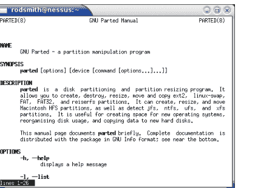

> 默认情况下，`man` 使用 `less` 程序，使您能够在文档中前后移动。接下来的“使用 `less`”章节将详细描述该程序。

**图 8.1** man 页的格式可帮助您快速定位信息。

虽然 `man` 是一个文本模式的命令 GUI，但仍然存在命令 GUI 的变体。例如，`xman` 程序提供了一种通过点击浏览 man 页的方法。不过，您不能像使用 `man` 那样在命令行上输入主题来查看——您必须启动 `xman`，然后在手册章节中浏览到特定主题。

> 早期的分页器被称为 `more`，但 `less` 增加了一些功能。这个古怪的名字是极客幽默的一个例子。

## 使用 less

Linux 系统使用一个名为 `less` 的程序来显示信息。该程序是一个*分页器（pager）*，它一次显示文本文件的一屏（即一页）。您可以向前或向后移动文件，跳转到特定行，以及搜索信息。表 8.2 总结了使用 `less` 在文档中移动的最常用方法。

> **认证目标**

**表 8.2 less 文件导航命令**

| 按键 | 操作 |
|---|---|
| h 或 H | 显示关于使用 `less` 的帮助。 |
| Page Down, 空格键, Ctrl+V, f, 或 Ctrl+F | 在文档中向下移动一屏。 |
| Page Up, Esc+V, b, 或 Ctrl+B | 在文档中向上移动一屏。 |
| 下方向键, Enter, Ctrl+N, e, Ctrl+E, j, 或 Ctrl+J | 在文档中向下移动一行。 |
| 上方向键, y, Ctrl+Y, Ctrl+P, k, 或 Ctrl+K | 在文档中向上移动一行。 |
| xg, x<, 或 x Esc-< | 跳转到文档的第 x 行——例如，输入 `100g` 显示文档的第 100 行。如果省略 x，则默认为 1。 |
| xG, x>, 或 x Esc-> | 跳转到文档的第 x 行。如果省略 x，则默认为文档的最后一行。 |
| xp 或 x% | 跳转到文档的 x 百分比位置——例如，输入 `50p` 跳转到文档的中点。 |
| /pattern | 从当前位置开始，在文档中向前搜索 *pattern*。例如，输入 `/BUGS` 搜索字符串 BUGS。 |
| ?pattern | 执行向后搜索，定位当前位置之前的 *pattern* 实例。 |
| n 或 / | 重复上一次搜索。 |
| q 或 Q 或 :q 或 :Q 或 ZZ | 退出 `less` 分页器。 |

> 标记 Esc+V 指的是按下 Esc 键，然后按下 V 键。

表 8.2 仅展示了 `less` 中可用命令的一小部分。要了解更多关于 `less` 的信息，您可以阅读其 man 页：

1. 以文本模式登录计算机或打开终端窗口。
2. 输入 `man less`。此操作将打开 `less` 分页器的 man 页。
3. 阅读第一屏文本。当您到达屏幕底部的最后一个单词时，按下空格键。这将使显示跳转到下一页，以便您继续阅读。
4. 按上方向键。这将使显示向上移动一行，如果您需要重新阅读上一页末尾的几个词，这非常有用。
5. 按下下方向键。正如您所预料的，这将使显示向下移动一行。
6. 按下 Esc 键，然后按下 V 键。这将使显示回退一页。
7. 按 G 键（即 Shift+G）移动到 man 页的末尾。
8. 按 g 键（即不使用 Shift 键的 `g`）返回 man 页的开头。
9. 输入 `/OPTIONS` 来定位 Options 章节。很可能您第一次搜索到的是指向该章节的引用，而不是 Options 章节本身。
10. 重复按下 n 键，直到找到 Options 章节。
11. 按 q 键退出 `less`，从而结束阅读 man 页。

> 如果您愿意，可以使用 Page Down 键或表 8.2 中标注的其他按键来代替空格键。在后续步骤中也可以进行类似的替换。

> 某些实现采用区分大小写的方式搜索，而另一些则不区分大小写。尝试搜索 **options**（小写）以确定您使用的是哪一种。

当然，当您阅读 man 页时，不太可能完全使用这些选项；您将使用任何您需要的功能来查找感兴趣的内容。关键在于熟悉几个重要功能，以便能够有效地利用 `less` 阅读 man 页和其他文档。

虽然 `less` 主要用于阅读 man 页，但您也可以用它来阅读其他文本模式文档，例如许多程序随附的 README 文件，或者您在互联网上找到的、朋友或同事给您的纯文本文档。要以这种方式使用 `less`，请输入其名称，后跟要阅读的文件名，例如 `less README` 来阅读 README 文档。您可以像在 man 页上一样，在以这种方式阅读的文档上使用表 8.2（或 `less` 的 man 页）中总结的所有操作。

## 使用 info 页

**认证目标**

man 页系统在包括 Linux 在内的类 Unix 操作系统中无处不在，但它也相当古老，因此有所局限。因此，一种更新的文档系统——info 页（info pages）也可供使用。在接下来的几页中，我将描述 info 页如何填补 man 页系统的空白，以及如何使用 info 页。

### 理解 info 页的目的

man 页的基本设计可以追溯到几十年前，因此它早于信息管理方面的一些重要发展。最显著的是，man 页没有超链接。虽然 man 页中常见 See Also 章节，但您不能选择其中一项直接阅读相关的 man 页；您必须退出 man 系统并输入一个新的 man 命令来阅读新页面。这种超链接的缺失也使得在大型 man 页中导航变得笨拙。您可以使用文本搜索来定位所需信息，但这经常会找到错误的文本——或者如果您输入字符串有误，搜索可能会完全失败。

info 页的目标是通过支持超链接来克服这些问题。每个 info 页被称为一个节点（node），而整个 info 页系统是一组交织的节点，类似于互联网上的万维网（WWW 或 Web）。单个程序的产品文档可能会分布在多个节点中，这使得每个节点更容易定位和搜索——但如果您需要搜索信息且不确定它位于哪个节点中，您可能需要搜索多个节点。

节点按级别组织，类似于书籍中的组织级别。例如，本书有章节，且每个章节内有两个级别的标题。同样，一个程序的 info 页可能会有一个主节点（类似于章节），以及多个较低级别的节点（类似于章节标题）。一些程序的 info 页包含进一步的级别以帮助组织信息。

在写作风格方面，info 页与 man 页相似——它们是对主题简明但全面的描述，面向那些已经至少广泛熟悉相关程序的人员。如果您刚刚开始使用某个程序，其他类型的文档（稍后在“寻找额外文档”中描述）可能是更好的选择。

广义上说，由自由软件基金会（FSF）赞助的程序倾向于使用 info 页而非 man 页。许多 FSF 程序现在随附极简的 man 页，引导用户查看程序的 info 页。非 FSF 程序员接纳 info 页的速度较慢；许多此类程序根本不随附 info 页，而是依赖传统的 man 页。


info 浏览器可以读取并显示 man 页面，因此专门使用 info 可以成为阅读 Linux 标准文档的一种有效策略。

### 阅读 info 页面

阅读 info 页面的常用工具名为 info。要使用它，请键入 `info` 后跟主题，例如键入 `info info` 来了解 info 系统本身。进入 info 系统后，你可以使用表 8.3 中总结的一系列按键在文档中移动。

> 认证目标

### 表 8.3 info 文件导航命令

| 按键 | 操作 |
|---|---|
| ? | 显示帮助信息。 |
| N | 移动到同一层级链接节点序列中的下一个节点。如果作者打算让几个节点按特定顺序阅读，则可能需要此操作。 |
| P | 在同一层级节点序列中向后移动。如果你在该序列中向前移动但发现需要回顾之前的材料，这会非常方便。 |
| U | 在节点层级结构中向上移动一级。 |
| 方向键 | 在屏幕上移动光标，使你能够选择节点链接或滚动屏幕。 |
| Page Up, Page Down | 这两个键分别在单个节点内向上和向下滚动。（标准 info 浏览器还实现了 less 使用的许多较冷门的命令，详见表 8.2。） |
| Enter | 选择节点后移动到新节点。链接在其名称左侧由星号 (*) 标出。 |
| L | 显示你阅读的最后一个 info 页面。此操作可以在 info 树层级中让你向上、向下或向侧面移动。 |
| T | 显示某个主题的顶层页面。通常这是你进入系统时使用的页面。 |
| Q | 退出 info 页面系统。 |

作为 info 页面使用的示例，请尝试以下操作：

- 1. 以文本模式登录计算机或打开终端窗口。
- 2. 输入 `info info`。你应该会看到 info 文档的顶层节点出现。
- 3. 阅读主页，使用方向键或 Page Down 键查看整个页面。
- 4. 使用方向键，选择主页底部附近的 Expert Info 节点链接。
- 5. 按 Enter 键查看 Expert Info 节点。
- 6. 按 U 键向上浏览一级——回到主节点。
- 7. 浏览到 Advanced 节点。
- 8. 按 N 键进入当前层级的下一个节点，实际上就是 Expert Info 节点。
- 9. 按 Q 键退出 info 阅读器。

如果你更习惯使用 GUI 而非文本模式工具，可以通过点选工具访问 info 页面：

**Emacs** GNU Emacs 编辑器是一个极其强大的文本编辑器，其 `info` 软件包提供了一个 info 页面浏览器。

**tkinfo** 这个独立程序（如图 8.2 所示）为 info 页面系统提供了一个点选界面。你可以使用与 info 浏览器大部分相同的键盘选项，但也可以通过点击链接或使用其提供的按钮或菜单选项进行导航。

与文本模式的 info 程序不同，Emacs 的 info 浏览器和 tkinfo 都无法显示 man 页面。

## 查找其他文档

虽然 man 页面和 info 页面都是非常有用的资源，但还有其他文档可用，有时这些形式的文档更受欢迎。广义上讲，Linux 的帮助可以通过三种形式获得：计算机上的附加文档、在线附加文档以及专家的帮助。

当然，这些类别之间存在重叠。例如，某些文档可能在线提供，但在你安装相应的软件包之前，你的计算机上没有。

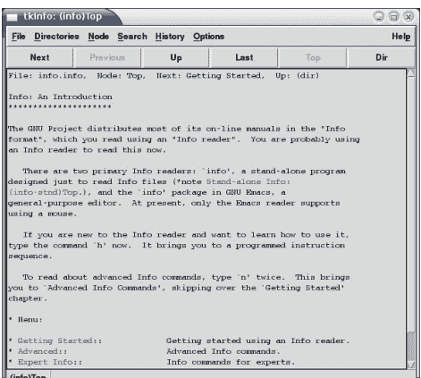

图 8.2 GUI info 页面浏览器可以让那些不习惯使用命令行的人也能方便地阅读此类文档。

### 在计算机上定位程序文档

大多数 Linux 程序在随附 man 或 info 页面之外，还带有自己的文档。事实上，有些程序的文档非常多，以至于被安装为一个单独的软件包，软件包名称中通常包含 documentation 或 doc 字样，例如 samba-doc。

最基础且最传统的程序文档形式是一个名为 README、readme.txt 或类似的文件。该文件包含的具体信息在不同程序之间差异很大。对于某些程序，该文件过于简略，几乎没有用处；而对于另一些程序，它则是帮助信息的宝库。这些文件几乎总是纯文本文件，因此你可以使用 less 或你最喜欢的文本编辑器来阅读它们。

如果你是从软件包维护者站点下载的源代码 tar 包，README 文件通常出现在从 tar 包解压出的主构建目录中。但如果你是从二进制软件包文件安装的程序，

> README 文件通常包含关于构建软件包的信息，这些信息不适用于发行版提供的二进制文件。不过，发行版维护者很少在他们的 README 文件中更改此类信息。

README 文件可能位于多个位置中的任何一个。最可能的地方是 `/usr/doc/packagename`、`/usr/share/doc/packagename` 和 `/usr/share/doc/packages/packagename`，其中 `packagename` 是软件包的名称（有时包含版本号，但通常不包含）。

除了 README 文件，许多程序还提供其他文档文件。这些可能包括详细记录程序历史的文件、编译和安装步骤的说明、关于配置文件格式的信息等等。请检查源代码的构建目录或发现 README 文件的目录以寻找其他文件。

一些较大的程序随附有大量的 PostScript、便携式文档格式 (PDF)、超文本标记语言 (HTML) 或其他格式的文档。根据格式和软件包的不同，你可能会发现单个文件或大量文件的集合。与 README 文件一样，这些文件非常值得参考，特别是如果你想充分学习如何使用一个软件包时。

一些程序依赖于通常位于 `/etc` 目录中的配置文件来控制其行为。虽然配置文件的语法通常很晦涩，但许多发行版提供了包含详细注释的默认配置文件。详情因程序而异，但注释行通常以井号 (#) 开始。因此，你可能只需通过阅读配置文件中的注释，就能学习到足够的信息来调整其配置。

如果你找不到 README 或类似文件，可以使用多种工具来帮助查找文档文件：

- 你可以使用发行版的软件包管理系统来定位系统文档。例如，在基于 RPM 的系统上，你可以输入 `rpm -ql apachekg | grep doc` 来定位 `apachekg` 的文档。使用 `grep` 在文件列表中搜索字符串 doc 是一个好技巧，因为文档目录几乎总是包含字符串 doc。

- Linux `find` 命令可以在整个目录树或其子集中搜索符合指定标准的文件。例如，要搜索文件名中包含某个字符串的文件，你可以输入 `find /usr/share/doc -name "*string*"`，其中 `string` 是你想在文件名中查找的关键字。此命令搜索 `/usr/share/doc` 目录树，但你可以改为搜索另一个目录树。如果你搜索包含大量文件和子目录的目录，此命令可能需要很长时间才能完成。

- Linux `locate` 命令搜索 Linux 维护的文件名数据库。因此，它的执行速度比 `find` 快得多，但你无法控制系统搜索的计算机部分。输入 `locate` 后跟要查找的字符串，例如 `locate parted` 来查找任何与 parted 磁盘分区工具相关的文件。

- `whereis` 程序在受限的一组位置中搜索文件，例如标准二进制文件目录、库目录和 man 页面目录。该工具*不会*搜索用户目录或许多可由 `find` 或 `locate` 轻松搜索的其他位置。`whereis` 实用程序是查找程序可执行文件以及相关文件（如文档或配置文件）的一种快速方法。要使用它，请输入 `whereis` 后跟命令或文件的名称，例如 `whereis ls` 来查找 ls 二进制文件及其相关文档。

> 认证目标

第 9 章“使用程序和进程”描述了软件包管理工具的原理。

一旦找到了文档文件，你必须知道如何阅读它们。具体细节当然取决于文档的文件格式。你可以使用 `less` 来阅读许多文件。大多数发行版对 `less` 进行了配置，使其能够解析常见的文件格式（如 HTML），并自动解压以节省磁盘空间的压缩格式文件。表 8.4 总结了常见的文档文件格式以及你可以用来阅读它们的程序。所使用的格式因程序而异。

> 如果你想以不中断的形式查看格式化文本文件（如 HTML 文件），请为 less 使用 -L 选项，例如 `less -L file.html`。

### 表 8.4 常见文档文件格式

| 文件扩展名 | 描述 | 阅读程序 |
|---|---|---|
| .1 到 .9 | Unix man 页面 | man, info, less |
| .gz 或 .bz2 | 使用 gzip 或 bzip2 压缩的文件 | 使用 gunzip 或 bunzip2 解压；或使用 less，它可能能够解压压缩文件并读取其底层格式 |
| .txt | 纯文本 | less 或任何文本编辑器 |
| .html 或 .htm | HTML | 任何 Web 浏览器 |
| .odt | OpenDocument 文本 | OpenOffice.org, LibreOffice 或许多其他文字处理器 |
| .pdf | 便携式文档格式 (PDF) | Adobe Reader, xpdf |
| .tif, .png, .jpg | 图形文件格式 | GIMP, Eye of GNOME (eog) |

> 使用 gunzip 或 bunzip2 手动解压缩文件可能需要将解压后的版本写入磁盘，因此你可能需要将文件复制到你的主目录中。


### 在线查找程序文档

除了在计算机上找到的文档外，您还可以在互联网上查找文档。大多数软件包都有相关的互联网网站，这些网站可能会在 man 页、info 页、README 文件或其他文档中被提及。请检查这些页面以查找文档。通常，在线文档随软件一起分发，因此您可能能在本地硬盘上找到它；然而，有时与在线可用版本相比，本地文档可能较旧或较为简略。当然，如果您的本地文档过时了，您的本地软件可能也过时了——请尽量不要使用与您实际使用的版本相差太大的软件文档！

另一个非常有帮助的在线资源是 Linux 文档项目（LDP；http://www.tldp.org）。LDP 致力于提供比大多数 Linux 程序通常自带的更丰富的教程信息。在该网站上，您可以找到几种类型的信息：

- **HOWTOs**：Linux HOWTO 文档是短篇或中篇的教程，旨在让您快速上手某个主题或技术。过去，较短的 HOWTO 会被单独分类为 mini-HOWTO；然而，这两类文档之间的区别在近年来已大大减弱。HOWTO 的侧重点各不相同——有些描述特定的程序，而另一些则更倾向于面向任务，涵盖了为完成该任务而服务的一系列工具。顾名思义，它们通常旨在告诉您如何实现某个目标。

- **Guides**：指南是较长的文档，通常被描述为书籍长度。（事实上，其中一些有印刷版。）指南旨在作为针对大型程序或通用技术（例如整个 Linux 网络）的详尽教程或参考著作。

- **FAQs**：常见问题解答（FAQ）顾名思义，就是经常出现的问题——更准确地说，在 LDP 的分类意义上，是指该问题及其答案。LDP FAQ 按类别组织，例如 Linux-RAID FAQ 或 Linux 上的 WordPerfect FAQ。每个 FAQ 包含多个问题及其答案，通常分组在子类别中。如果您对某个程序或技术有具体问题，查找相应的 FAQ 是寻找答案的一个很好的切入点。

LDP 文档在详尽程度和质量上差异很大。有些（尤其是某些指南）是不完整的；您可能会点击一个章节标题，然后看到一个空白页，或者一条提示文本尚未编写的注释。（许多 LDP 文档在 Web 上设有超链接。）一些 LDP 文档非常新，但另一些则已过时，因此在开始阅读前请务必检查文档日期——否则，您可能会以一种费劲的方式，或者以一种不再有效的方式去操作。尽管存在这些缺陷，LDP 仍然是学习特定程序或泛泛了解 Linux 的绝佳资源。优秀的 LDP 文档非常出色，即使是质量一般的文档，通常也能提供从 man 页、info 页或官方程序文档中无法直观获知的信息。

大多数 Linux 发行版将 LDP 文档包含在一个或多个特殊的文档软件包中。请检查您的 `/usr/doc` 和 `/usr/share/doc` 目录以查找这些文件。如果不存在，请使用您的软件包管理工具寻找可能的软件包。另一方面，使用 LDP 文档的在线版本可能是更好的选择，因为您可以确保它们是最新的。随发行版一起分发的文档在您阅读时可能已经过时数周或数月。

## 咨询专家

无论是什么问题促使您查找文档，您可能都不是第一个遇到该问题的人。在某些情况下，请求他人帮助可以为您节省大量时间。您可以使用的具体资源包括：

- **本地专家**：无论是隔壁办公室的 Linux 专家、邻居还是同学，一个您认识且比您更懂 Linux 的人都可以是宝贵的资源。

- **付费顾问**：为了解决棘手的问题，支付咨询费通常是值得的，特别是当您面临“时间就是金钱”的情况，即解决问题的延迟会直接导致金钱损失时。通过 Web 搜索可以找到众多的 Linux 咨询公司。

- **程序作者**：许多开源作者很乐意回答问题或提供有限的支持，特别是当您的问题是由 Bug 引起时。较大的项目（包括大多数 Linux 发行版）拥有许多作者，这些项目通常提供 Web 论坛、邮件列表或 Usenet 新闻组，以帮助用户和开发者进行交流。

- **Web 论坛、邮件列表和 Usenet 新闻组**：这些资源的格式不同，但目的相似：它们使用户能够相互交流并分享专业知识。许多发行版都有专门的 Web 论坛；请尝试通过 Web 搜索您的发行版名称和 *forum* 来找到它。邮件列表在单个程序中更为常见。在程序的官方网站上搜索关于邮件列表的信息。Usenet 新闻组在多年前很流行，但现在已不那么受欢迎。尽管如此，它们仍然可以是有用的资源。要使用它们，您可以使用 *news reader*（新闻阅读器）程序，且您的互联网服务提供商（ISP）必须提供 Usenet 访问权限。或者，您可以使用 Google Groups (http://groups.google.com)。

> 一些 Linux 发行版，如 Red Hat Enterprise Linux 和 SUSE Enterprise Linux，自带支持服务。如果您使用的是此类发行版，您可能已经支付了咨询费用。

- **IRC**：互联网中继聊天（IRC）是一种用于小规模群体之间实时文本模式通信的工具。要使用 IRC，您需要一个 IRC 客户端程序，例如 Irssi (http://www.irssi.org)、BitchX (http://www.bitchx.com) 或 ChatZilla (http://www.hackrsus.com/~ginda/chatzilla/)。然后您可以加入一个 IRC *channel*（频道），在其中 IRC 用户实时交换消息。IRC 与 Web 论坛、邮件列表和新闻组一样，允许用户直接相互交流；但 IRC 能为问题的解决提供更快速的方案。

- **Web 搜索**：Web 搜索引擎索引了许多互联网资源，包括 man 页、程序文档站点、Web 论坛，甚至 IRC 频道讨论。因此，Web 搜索可以在您无需直接联系专家的情况下，为您提供专家的答案。

谨慎地使用这些资源可以帮助您解决许多 Linux 问题，无论这些问题是简单的知识匮乏、配置错误、程序 Bug，还是像软件更新导致计算机无法访问这样的严重灾难。事实上，如今的问题往往是可用信息 *太多* 了；在无关（或纯粹错误）的信息中筛选出有用的建议可能很困难。为了克服这一挑战，尽可能具体地描述问题会很有帮助。您可以通过添加认为与问题相关但较为罕见的关键字来缩小 Web 搜索范围。错误消息中出现的词汇在这方面非常有帮助。如果您在 Web 论坛上发布问题或向程序作者发送 Bug 报告，请尽可能详细。包含您使用的发行版信息、需要帮助的软件版本以及程序具体运行情况的详细信息。如果程序显示错误消息，请原封不动地引用。这些细节将帮助专家快速锁定问题原因。

## 核心要点及延伸

无论您是需要学习更多关于某个程序的知识以高效使用它，还是为了解决一个运行异常程序的故障，寻求帮助通常是必要的。Linux 为此类情况提供了多种文档资源。其中首先是 man 页系统，它记录了大多数文本模式命令、配置文件和系统调用。info 页系统与 man 页系统类似，但 info 页采用了更...


### 核心内容及延伸（续）

高级超文本文件格式。如果你需要比 man 信息页提供的更多教程信息，通常可以通过扩展的官方用户手册、网页、HOWTO 和其他文档来获取帮助，这些文档既存在于你的计算机上，也存在于互联网上。最后，与专家交流可以帮助解决问题，因此你可以利用大量的面对面和在线资源，例如你认识的人、程序作者和 Web 论坛，以获得你所需的帮助。

### 建议练习

- 完整阅读至少三个常用 Linux 命令的 man 页，例如 `ls`、`cp`、`cat` 或 `less`。关于这些命令，你学到了哪些超出本书描述的内容？
- 在 `/usr/share/doc` 中搜索你经常使用的重要程序的文档，例如 GIMP、Firefox 或 GNOME。
- 查看你所用发行版的官方网站，或进行网页搜索，找到一个支持该发行版的 Web 论坛。阅读一些讨论帖，以了解一些经常出现的话题。

### 复习题

1. 以下哪个命令是 `more` 的改进版本？
    - A. `grep`
    - B. `html`
    - C. `cat`
    - D. `less`
    - E. `man`

2. 关于 man 页与 HOWTO 文档的比较，以下哪项陈述是公正的？
    - A. 读取 man 页需要互联网连接；HOWTO 则不需要。
    - B. man 页是一种印刷文档；HOWTO 是电子文档。
    - C. man 页从用户的角度描述软件；HOWTO 是程序员的文档。
    - D. man 页是简短的参考文档；HOWTO 的性质更倾向于教程。
    - E. man 页使用超链接格式，而 HOWTO 不使用。

3. 用户输入 `whatis less`。预计会产生什么样的输出？
    - A. 关于 `less` 命令用途的简短的一段描述
    - B. `less` 命令在 Linux 文件系统中的完整路径
    - C. 来自 Name 部分提到 `less` 的 man 页的摘要信息
    - D. `less` 的完整 man 页，然后你可以通过终端滚动浏览
    - E. 包含 `less` 命令信息的网站 URL

4. 判断对错：你可以通过在搜索名称前加上章节号（如 `man 5 passwd`），强制 `man` 在手册的特定章节中显示 man 页。

5. 判断对错：`info` 页是一种基于 Web 的文档格式。

6. 判断对错：`/usr/share/doc` 目录树中的 Linux 文档几乎总是 OpenDocument Text 格式。

7. 文件格式在 man 的第 __________ 章节中描述。

8. `info` 页中的每个文档被称为一个(n) __________。

9. __________ 命令搜索文件名数据库，使你能够快速识别名称与你指定术语匹配的文件。

# 第 9 章：使用程序和进程

计算机是动态且多用途的机器；它们使用许多工具执行各种工作。本章描述了管理这些工具的方法。这项任务的一个方面是安装、卸载和升级软件包。软件管理的另一个方面是在程序运行后对其进行管理。（运行中的程序通常被称为进程。）最后，本章涵盖了日志文件，它们记录了运行程序执行细节的记录——尤其是那些自动并在后台运行的程序。

- 理解软件包管理
- 理解进程层级结构
- 识别运行中的进程
- 使用日志文件

## 理解软件包管理

软件包管理是 Linux 中一个在不同发行版之间差异巨大的领域。尽管如此，大多数 Linux 发行版都遵循某些共同原则，因此我将描述这些原则，随后介绍两种主要的 Linux 软件包管理系统的基础知识。然后，我将描述如何使用 RPM 软件包管理（RPM；一个递归缩写）和 Debian 软件包系统来管理软件包。

### Linux 软件包管理原则

**认证目标** 如果你在 Windows 中安装过软件，你可能熟悉双击安装程序的步骤，它会将与程序相关的所有文件放置在应有的位置。Windows 软件安装程序类似于 Linux 软件包文件，但两者存在差异。Linux 软件包具有以下特点：

- 每个软件包可以是一个单独的文件，可以存储在磁盘上或通过互联网传输。
- 与 Windows 安装程序不同，Linux 软件包文件不是程序；软件包依赖于其他程序来执行安装软件的工作。
- 软件包包含 *依赖（dependency）* 信息——也就是说，它们可以告诉打包软件为了使该软件包正常工作，必须安装哪些其他软件包或单个文件。
- 软件包包含版本信息，以便打包软件可以分辨两个软件包中哪个更先进。
- 软件包包含架构信息，以识别其面向的 CPU 类型（x86、x86-64、PowerPC 等）。一个单独的代码用于标识与架构无关的软件包，例如字体和桌面主题。
- *二进制（Binary）* 软件包（即包含特定于 CPU 的可执行程序的软件包）通常由 *源码（source）* 软件包（包含程序员可以理解的源代码）构建。在某些特殊情况下，可以通过源码包构建新的二进制包，这可能会很有用。

许多程序包依赖于 *库（library）* 软件包；库提供了可被许多程序使用的代码。

你可以手动从源代码编译并安装软件，而不使用打包工具。这个高级话题超出了本书的范围。

**认证目标**
软件包可以（而且经常）包含将安装到计算机多个目录中的文件。这一事实使得追踪软件包内容变得至关重要。

软件包软件维护着一个关于已安装软件包的信息数据库（*软件包数据库*）。这些信息包括所有已安装软件包的名称和版本号，以及从每个软件包安装的所有文件的位置。这些信息使软件包软件能够快速卸载软件，确定新软件包的依赖关系是否已满足，并确定你尝试安装的软件包是否已经安装，如果已安装，则确定已安装的版本是否比你尝试安装的版本旧。

### 理解软件包系统

如前所述，RPM 和 Debian 这两种软件包系统很常见，尽管也存在其他系统。这些系统在各种技术细节、用于管理软件包的命令以及所使用的软件包文件格式方面有所不同。你不能在基于 RPM 的系统上安装 Debian 软件包，反之亦然。事实上，即使使用相同的软件包类型，将为一个发行版设计的软件包安装到另一个发行版上也是有风险的。这是因为非原生软件包可能具有与原生软件包需求相冲突的依赖关系。

最初，软件包系统在本地工作——也就是说，要在计算机上安装软件包，你必须先从互联网或其他方式下载软件包文件。然后，你才能使用本地命令安装该软件包。然而，当一个软件包有许多依赖项时，这种方法可能会很繁琐——你可能会尝试安装，发现依赖项未满足，下载更多软件包，发现其中一个或多个依赖项仍未满足，以此类推。当你追踪完所有这些被依赖的软件包时，你可能需要安装十几个或更多软件包。因此，现代发行版提供了支持网络的工具来帮助自动化这个过程。这些工具依赖于网络软件仓库，工具可以从中自动下载软件包。支持网络的工具在不同发行版之间有所不同，尤其是在基于 RPM 的发行版之间。

因此，在实践中，Linux 中管理软件的过程涉及使用文本模式或 GUI 工具与软件仓库对接。一个典型的软件安装任务大致如下：

1. 你发出安装程序的命令。
2. 软件定位指定程序的依赖项，并通知你必须安装的任何额外软件。
3. 你对软件安装给出最终批准（或决定取消，在这种情况下过程停止）。
4. 软件下载所有必要的软件包。
5. 软件安装所有软件包。

升级软件的方式类似，尽管升级较少需要下载被依赖的软件包。当然，删除软件可以完全在本地完成。许多发行版会不时自动检查其仓库，并在有更新可用时通知你。因此，你可以在收到提示时点击几个按钮来保持系统的最新状态。例如，图 9.1 显示了 Fedora 16 的软件更新实用程序，其中显示了可用更新的列表。

> 第 1 章“选择操作系统”中的表 1.1 总结了一些流行 Linux 发行版的特性，包括每个发行版使用的软件包系统。

**认证目标**
- 你可以将大多数发行版配置为使用本地介质代替或补充互联网仓库。
- 在安装发行版后，你可能会发现有大量的更新可用。


## 第 9 章 • 使用程序和进程

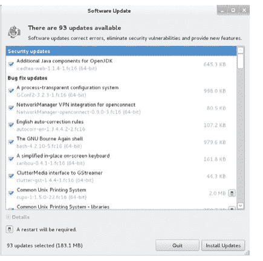

图 9.1 大多数 Linux 发行版会在软件有可用更新时通知您。

软件包管理必然涉及 root 权限，这在第 13 章“理解用户和组”中会有更详细的描述。如果您按照自动提示更新软件，可以在更新软件程序提示时输入 root 密码（在某些发行版中为您的普通用户密码），从而保持系统的最新状态。

## 管理 RPM 系统

基于 RPM 的发行版包括 Red Hat、Fedora、CentOS、SUSE Enterprise、openSUSE 和 Mandriva。在这些发行版上安装软件的基本工具是文本模式的 `rpm` 命令。该程序操作本地文件；然而，要使用网络仓库，必须使用另一个工具，具体取决于发行版：

- Red Hat、Fedora 和 CentOS 使用文本模式的 `yum` 或其各种 GUI 前端，例如 Yumex。
- SUSE Enterprise 和 openSUSE 使用 `zypper` 或 GUI 前端（如 YaST 2）。
- Mandriva 使用文本模式的 `urpmi` 或 GUI 界面 Rpmdrake。

由于这些发行版之间存在差异，特别是在支持网络的更新方面，在这里对所有这些工具进行完整描述是不切实际的。幸运的是，GUI 工具易于使用且触手可及。即使是文本模式工具也相当直观，尽管您可能需要查阅其 man 手册页以了解详情。通常，它们使用逻辑子命令，例如使用 `install` 来安装软件包，如下所示：

```
# yum install yumex
```

您可以使用此命令在 Red Hat、Fedora 或 CentOS 系统上安装 GUI 工具 Yumex。同样，您可以使用 `remove` 子命令删除特定软件包，或使用 `upgrade` 升级计算机上的所有软件包：

```
# yum remove zsh
# yum upgrade
```

这些示例首先升级计算机，然后删除 `zsh` 软件包。这两个命令都会产生多行输出，并且您可能会被要求确认其操作。请查阅 `yum`（或您的发行版所使用的任何软件包管理软件）的 man 手册页以了解有关此工具的更多信息。

如果您需要直接处理 RPM 软件包文件，您应该意识到它们的后缀名是 `.rpm`。这些文件通常还包含架构类型的代码（如 i386 或 x86_64），以及通常包含其目标发行版的代码（如 Fedora 16 的 fc16）。例如，`samba-3.6.1-77.fc16.x86_64.rpm` 是一个 samba 软件包的文件，版本为 3.6.1，发布版本 77，适用于 x86-64 平台上的 Fedora 16。

> 如果您想批量升级软件并删除软件包，通常最好先删除软件。这可以避免某些下载，从而缩短升级时间。

## 管理 Debian 系统

Debian GNU/Linux 发行版创建了自己的软件包系统，基于 Debian 的发行版（如 Ubuntu 和 Mint）也使用该系统。Debian 软件包系统的基础是高级软件包工具 (APT)，它提供了对网络仓库的访问。

`dpkg` 命令是 Debian 软件包系统的最低级接口；它大致相当于基于 RPM 系统的 `rpm` 工具。有几种工具在 `dpkg` 之上提供了文本模式和图形界面，其中最重要的是文本模式的 `apt-get` 和 GUI 界面 Synaptic。正如其名称所示，`apt-get` 和 Synaptic 通过 APT 提供对网络仓库的访问。图 9.2 展示了 Synaptic 的使用情况。

Debian 软件包文件的名称以 `.deb` 结尾。与 RPM 软件包一样，这些名称通常包含软件版本和架构的代码（如 i386 或 amd64）。例如，`samba_3.6.1-3_amd64.deb` 是一个 samba 软件包的 Debian 软件包文件，版本 3.6.1，修订版 3，适用于 AMD64 (x86-64) CPU。您可以使用 `dpkg` 或 `apt-get` 安装此类文件，或者可以使用 `apt-get` 的 `install` 命令从互联网下载软件包及其依赖项，如下所示：

> 许多基于 RPM 的发行版也存在 APT 的第三方实现。详情请参阅 http://apt4rpm.sourceforge.net。至少有一个基于 RPM 的发行版 PCLinuxOS 原生使用 APT。

```
# apt-get install samba
```

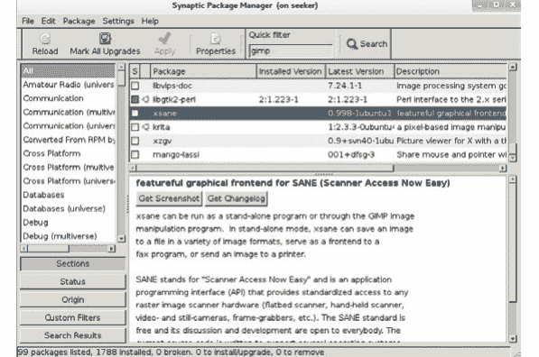

图 9.2 Synaptic 使您能够在基于 Debian 的系统中搜索、选择、安装和卸载软件。

与 RPM 软件包一样，您也可以删除软件包或升级计算机软件：

```
# apt-get remove zsh
# apt-get upgrade
```

APT 是一个强大的工具，底层的 `dpkg` 同样如此。您应该查阅这些程序的 man 手册页以了解如何使用这些程序。

## 理解进程层次结构

Linux 内核是 Linux 安装的核心。内核管理内存，为软件提供访问硬盘的方法，分配 CPU 时间，并执行其他关键的低级任务。内核在引导过程的早期被加载，内核负责管理运行中的 Linux 计算机上的每一个其他软件。

您可以通过在引导加载程序的内核选项行中添加 `init=` 选项来更改哪个程序作为第一个进程运行，例如 `init=/bin/bash` 来运行 bash。

内核将潜在混乱的运行软件集有序化的方法之一是创建一种层次结构。在引导时，内核仅运行一个程序——通常是 `/sbin/init`。然后，init 进程负责启动 Linux 必须运行的所有其他基础程序，例如管理登录和常驻服务器的程序。如果此类程序由 init 直接启动，则被称为其子进程（children）。init 的子进程反过来又可以启动它们自己的子进程。当您登录 Linux 时就会发生这种情况。启动给定进程的进程被称为其父进程（parent）。

该系统的结果是一个树状的进程层次结构，如图 9.3 所示。（计算机科学中的“树”通常被描绘成颠倒的。）图 9.3 显示了典型 Linux 安装中运行的许多进程的一个小子集：仅包含与文本模式登录相关的一些进程，包括管理登录的 `login` 工具、几个 bash shell 和几个用户程序。一个运行中的 Linux 系统可能会有几十个或数百个运行进程。我正在输入这些文字的这台机器同时有 213 个进程在运行！

> **认证目标**
>
> 有时，一个进程会终止但留下子进程。当这种情况发生时，`init` 会“收养”这些子进程。

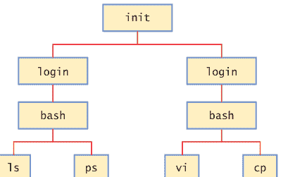

**图 9.3** Linux 进程排列成层次树状结构。

每个进程都关联有一个进程 ID (PID) 编号。这些编号从 1 开始，因此 `init` 的 PID 通常是 1。每个进程还有一个父进程 ID (PPID) 编号，指向其父进程。许多管理进程的工具都依赖于这些编号，尤其是 PID 编号。

> 在内部，内核在进程表中维护进程信息。`ps` 和 `top`（稍后描述）等工具使您能够查看和操作此表。

## 识别运行中的进程

在管理进程之前，您必须能够识别它们。`ps` 和 `top` 实用程序可以帮助您识别进程。在这两种情况下，您可以通过多种方式搜索进程，例如按名称或按资源使用情况。您可能还想识别进程消耗了多少内存，您可以使用 `free` 命令来完成。

### 使用 ps 识别进程

识别进程最简单的工具是 `ps`，它会产生一个进程列表。列表 9.1 显示了 `ps` 运行的示例。在这个示例中，`-u` 选项将输出限制为指定用户 (`rodsmith`) 拥有的进程，而 `--forest` 则创建一个显示父/子关系的界面。

> **认证目标**


## 示例 9.1：`ps -u rodsmith --forest` 的输出

```
$ ps -u rodsmith --forest
PID TTY TIME CMD
2451 pts/3/0 00:00:00 bash
2551 pts/3/0 00:00:00 ps
2496 ? 00:00:00 kvt
2498 pts/1/0 00:00:00 bash
2505 pts/1/0 00:00:00 └─ nedit
2506 ? 00:00:00 └─ csh
2544 ? 00:00:00 └─ xeyes
19221 ? 00:00:01 dfm
```

示例 9.2 展示了 `ps` 的第二个示例。在这个示例中，`u` 选项增加了信息列，而 `U rodsmith` 将输出限制为由 rodsmith 拥有的进程。`ps` 命令支持大量的选项（详情请参阅其 man 手册页）。

## 示例 9.2：`ps u U rodsmith` 的输出

```
$ ps u U rodsmith
USER PID %CPU %MEM VSZ RSS TTY STAT START TIME COMMAND
rodsmith 19221 0.0 1.5 4484 1984 ? S May07 0:01 dfm
rodsmith 2451 0.0 0.8 1856 1048 pts/3 S 16:13 0:00 -bash
rodsmith 2496 0.2 3.2 6323 4124 ? S 16:17 0:00 /opt/kd
rodsmith 2498 0.0 0.8 1860 1044 pts/1 S 16:17 0:00 bash
rodsmith 2505 0.1 2.6 4784 3332 pts/1 S 16:17 0:00 nedit
rodsmith 2506 0.0 0.7 2124 1012 ? S 16:17 0:00 /bin/cs
rodsmith 2544 0.0 1.0 2576 1360 ? S 16:17 0:00 xeyes
rodsmith 2556 0.0 0.7 2588 916 pts/3 R 16:18 0:00 ps u U
```

大多数 Linux 发行版中使用的 `ps` 版本包含了几个早期 `ps` 实现的一些特性。结果就是产生了一系列有时甚至冗余的选项。

鉴于 `ps` 选项数量庞大，不同的用户可能有不同的使用偏好。我发现输入 `ps ux` 通常能产生我想要的信息，包括计算机上所有进程的 PID 值和命令名称（包括命令行选项）。加上 `u`（如 `ps aux`）会增加用户名、CPU 负载和其他一些琐碎信息。然而，产生的信息量之大可能会令人不知所措。缩小范围的一种方法是将结果通过 `grep` 管道传输，从而删除不包含你指定搜索标准的行。例如，如果你想知道 gedit 进程的 PID 编号，可以这样做：

因为 `ps` 输出的命令带有其选项，所以使用 `grep` 在输出中搜索字符串时，会返回搜索到的值以及 `grep` 命令本身。

```
$ ps ax | grep gedit
27946 pts/8 S1 0:00 gedit VSZ RSS TTY STAT START TIME COMMAND
27950 pts/8 S+ 0:00 grep --colour=auto gedit
```

该命令显示 `gedit` 的 PID 值为 27946。这通常很有用；每当你想要停止或更改一个进程时，你会使用 PID 值来更改进程的优先级或终止它。

### 使用 top 识别进程

虽然 ps 可以返回进程优先级和 CPU 使用率信息，但程序的输出通常按 PID 编号排序，并且仅提供单一时间点的信息。如果你想快速定位占用 CPU 或内存过高的进程，或者想研究资源使用随时间的变化情况，另一个更合适的工具是：`top`。这个程序是 ps 的交互版本。图 9.4 显示了在 GNOME 终端窗口中运行的 top。

**认证目标**
（图 9.4：`top` 命令显示系统摘要信息以及计算机上 CPU 密集度最高的进程信息。）

默认情况下，top 按 CPU 使用率对其条目进行排序，并且每隔几秒更新一次显示。你需要熟悉系统中运行程序的用途和正常习惯，才能判断一个 CPU 饥饿的应用是否运行异常；不同程序的正当需求差异巨大，因此无法给出一个简单的规则来判断进程何时消耗了过多的 CPU 时间。

你可以用 top 做更多的事情，而不仅仅是观看它的显示更新。在运行时，你可以输入几个单字母命令中的任何一个，其中一些会提示你输入额外信息，如表 9.1 所示。其他命令在 top 的 man 手册页中有所描述。

### 表 9.1 常用 top 命令

| 命令 | 描述 |
| :--- | :--- |
| h 或 ? | 这些按键显示帮助信息。 |
| k | 你可以使用此命令杀死一个进程。`top` 程序将询问 PID 编号，如果能够杀死该进程，它将执行此操作。 |
| q | 此选项退出 `top`。 |
| r | 你可以使用此命令更改进程的优先级。 |
| s | 此命令更改显示的更新频率，程序将提示你输入（单位：秒）。 |
| P | 此命令将显示设置为按 CPU 使用率排序，这是默认设置。 |
| M | 你可以使用此命令将显示更改为按内存使用率排序。 |

`top` 提供的信息之一是 *平均负载 (load average)*，它是应用程序对 CPU 时间需求的衡量标准。在图 9.4 中，你可以在顶行看到三个平均负载估计值；它们分别对应当前的平均负载和之前的两次测量值。平均负载可以解释如下：

- 没有程序请求 CPU 时间的系统，其平均负载为 0。
- 有一个程序运行 CPU 密集型任务的系统，其平均负载为 1。
- 在单 CPU 系统上，较高的平均负载反映了程序在竞争可用的 CPU 时间。
- 在具有多个 CPU 或 CPU 核心的计算机上，平均负载在 CPU 时间竞争开始之前，可以达到 CPU 或核心的数量。例如，在一个具有 4 核 CPU 的系统上，4.0 的平均负载反映出进程请求的 CPU 时间恰好等于计算机可提供的量。

如今销售的大多数计算机都是多核模型，但在 2006 年之前，单核模型主导市场。

第 13 章中描述的 `w` 命令可以告诉你整个终端会话消耗了多少 CPU 时间。

平均负载在检测失控进程时非常有用。例如，如果一个系统的正常平均负载为 0.5，但突然卡在 2.5，则可能有两个占用 CPU 的进程 *挂起 (hung)* 了——也就是说，它们变得没有响应。挂起的进程有时会无谓地消耗大量 CPU 时间。你可以使用 `top` 来定位这些进程，并在必要时将其杀死。

## 衡量内存使用

进程消耗许多系统资源，其中最重要的是 CPU 时间和内存。如前所述，top 默认按 CPU 时间对进程进行排序，因此你可以识别出消耗 CPU 时间最多的进程。你可以在 top 中按下 M 键，使其按内存使用率排序，从而识别出消耗内存最多的进程。与 CPU 时间一样，你不能简单地因为一个进程位于列表顶部就说它消耗了太多内存；一些程序正当地需要消耗大量内存。

尽管如此，有时程序会消耗过多内存，这可能是因为编码低效，或者是由于 *内存泄漏 (memory leak)*——这是一种程序错误，程序向内核请求内存，但在使用完毕后未能将其归还。存在内存泄漏的程序会消耗越来越多的内存，有时甚至会干扰其他程序。作为短期解决方案，你通常可以终止该程序并重新启动，这会重置程序的内存消耗，就像排干一个由于水龙头漏水而填满的水槽一样。问题会再次出现，但如果内存泄漏足够小，你至少可以在此期间完成有用的工作。

如果你想研究计算机的整体内存使用情况，`free` 命令非常有用。该程序生成一份关于计算机总内存状态的报告：

```
$ free

             total        used       free     shared  buffers    cached
Mem:       7910888    7733456    180432         0    190656   3244720
-/buffers/cache: 4299080   3615808
Swap:      6291452   1030736    5260716
```

`Mem:` 行显示了总随机存取存储器 (RAM) 统计数据，包括计算机中的总内存（减去主板和内核使用的部分）、已使用内存量和空闲内存量。本例显示计算机的大部分内存都在使用中。这种状态是正常的，因为 Linux 将原本不使用的内存用作缓冲区 (buffers) 和缓存 (caches)，这有助于加快磁盘访问速度。因此，`Mem:` 行并不是最有用的一行；相反，你应该检查 `-/buffers/cache:` 行，它显示了计算机程序使用的总内存。在这个例子中，7,914,888 KiB 中的 4,299,080 KiB 正在被使用，剩余 3,615,808 KiB 空闲。换句话说，计算机内存的一半多一点被程序使用，因此不应出现与内存相关的性能问题。

`Swap:` 行显示了 Linux 正在使用多少 *交换空间 (swap space)*。交换空间是预留作为内存辅助的磁盘空间。当 Linux 耗尽 RAM，或者判定将 RAM 用于缓冲区或缓存比持有当前不活跃的程序更好时，就会使用交换空间。在本例中，使用了 1,030,736 KiB 交换空间，总计 6,291,452 KiB，空闲 5,260,716 KiB。

**认证目标**
内核授予程序访问一组内存地址的权限，程序随后可以使用这些地址。当程序结束时，它应该将内存释放回内核。


使用率通常相当低，但如果大幅上升，你可能会遇到性能问题。从长远来看，增加计算机的 RAM 通常是解决此类问题的最佳方案。如果你因为交换分区（swap）过度使用而遭受性能问题且需要立即缓解，终止一些内存占用极高的程序会有所帮助。前面描述的内存泄漏会导致此类问题，终止泄漏的程序可以将系统性能恢复到正常状态。

`free` 命令支持许多选项，其中大多数用于修改其显示格式。其中最有用的是 `-m`，它使显示单位使用 mebibytes (MiB) 而非默认的 kibibytes (KiB)。

## 使用日志文件

许多在后台运行的程序（即守护进程）会将其正常运行的信息写入*日志文件*，这些文件记录了此类笔记。因此，查阅日志文件是诊断守护进程问题的重要组成部分。执行此操作的第一步是定位你的日志文件。在某些情况下，你可能需要告知程序生成更详细的输出以帮助追踪问题，因此我提供了一些关于如何实现此操作的指引。最后，我将介绍内核环形缓冲区，它在技术上不是日志文件，但对于内核信息可以起到类似的作用。

### 定位日志文件

> **认证目标**
> 日志文件的细节在不同发行版之间有所不同，因此表 9.2 中的某些文件可能不存在于你的系统中，或者你找到的文件可能有不同的名称。

Linux 将大多数日志文件存储在 `/var/log` 目录树中。一些日志文件直接位于该目录中，但一些服务器会创建整个子目录来存储自己的日志文件。表 9.2 总结了许多 Linux 系统上一些常见的日志文件。此外，许多本书中未描述的服务器程序会添加自己的日志文件或 `/var/log` 的子目录。如果你在这样的服务器上遇到问题，检查其日志文件是一个很好的故障排除起点。

**表 9.2 常见日志文件**

| 日志文件 | 内容 |
| :--- | :--- |
| boot.log | 此文件总结了在启动过程中通过 SysV 启动脚本较晚启动的服务。 |
| cron | 此文件总结了通过 cron 守护进程定期运行的进程。虽然本书不涵盖 cron，但其问题可能会导致定期出现的故障，因此你应该关注它。 |
| cups/ | 此目录包含与 Linux 打印系统相关的日志文件。 |
| gdm/ | 此目录包含与 GNOME 显示管理器 (GDM) 相关的日志文件，该管理器处理许多系统上的 GUI 登录。 |
| messages 或 syslog | 这是一个通用日志文件，包含许多缺乏专用日志文件的守护进程的消息。 |
| secure | 你可以在此文件中找到与安全相关的消息，包括用户使用 su、sudo 和类似工具获取 root 权限的通知。 |
| Xorg.0.log | X 窗口系统 (X) 最近一次启动的信息出现在此日志文件中。 |

日志文件经常被*轮转*（rotated），这意味着最旧的日志文件被删除，最新的日志文件被重命名为日期或数字，然后创建一个新的日志文件。例如，如果它在 2012 年 12 月 1 日轮转，`/var/log/messages` 将变成 `/var/log/messages-20121201`、`/var/log/messages-1.gz` 或类似名称，并创建一个新的 `/var/log/messages`。这种做法可以防止日志文件无限增长。

> 日志文件轮转发生在深夜，所以如果你关机，它就不会发生。请定期让计算机在夜间运行，以确保日志文件得到轮转。

大多数日志文件是纯文本文件，因此你可以使用任何能够检查文本文件的工具（如 `less` 或文本编辑器）来检查它们。一个特别方便的命令是 `tail`，它显示文件的最后十行（或者使用 `-n` 选项指定行数）。例如，输入 `tail /var/log/messages` 可以向你显示该文件的最后十行。

请注意，并非所有程序都会记录日志消息。通常，只有守护进程会这样做；普通用户程序通过其他方式显示错误消息——在 GUI 对话框中或在文本模式终端中。如果你认为某个程序应该记录数据但你找不到，请查阅其文档。或者，你可以使用 `grep` 来查找程序发送消息的日志文件。例如，输入 `grep sshd /var/log/*` 可以找到出现字符串 `sshd`（SSH 守护进程的名称）的文件。

### 创建日志文件

一些程序会创建自己的日志文件；然而，大多数程序依赖于一个通称为*系统日志守护进程*的实用程序来完成这项工作。该程序的进程名称通常是 *syslogd* 或 *syslogd*。与其他守护进程一样，它在启动过程中由系统启动脚本启动。有几种系统日志守护进程软件包可用。其中一些提供了单独的工具 *klogd* 或 *klogd*，用于将内核的日志消息与普通程序分开处理。

你可以通过调整其配置文件来修改日志守护进程的行为，包括调整它记录特定类型消息的文件。该文件的名称取决于所使用的具体守护进程，但通常是 `/etc/rsyslog.conf` 或类似文件。日志文件配置的细节超出了本书的范围，但你应该意识到这些细节是可以更改的。这一事实解释了不同发行版之间在日志文件功能上的许多差异。

一旦运行，日志守护进程会使用一种称为*系统消息传递*（system messaging）的技术接收来自其他进程的消息。然后，它会根据消息的来源和优先级代码对消息进行分类，并将它们定向到合适的日志文件中。

### 生成更详细的日志文件条目

有时日志文件提供的信息不足以确定问题的根源。幸运的是，许多生成日志文件输出的程序都可以配置为生成*更多此类输出*。不幸的是，这样做有时会使筛选所有条目以查找相关信息变得更加困难。

增加日志文件输出详细程度的步骤因程序而异。通常，你必须在程序的配置文件中设置一个选项。你应该查阅程序的文档以了解如何操作。

> 由于内核环形缓冲区的大小有限，如果计算机运行时间较长或有某些内容产生了大量条目，其最早的条目可能会丢失。

## 检查内核环形缓冲区

内核环形缓冲区类似于内核的日志文件；然而，与其他日志文件不同，它存储在内存中而不是磁盘文件中。与常规日志文件一样，其内容随着计算机的运行而不断变化。要检查内核环形缓冲区，你可以输入 **dmesg**。不过，这样做会产生大量输出，因此你通常会将输出通过 *less* 管道传输：

```
$ dmesg | less
```

或者，如果你知道你想要的信息将与特定字符串相关联，可以使用 `grep` 来搜索它。例如，要查找关于第一个硬盘 `/dev/sda` 的内核环形缓冲区消息，你可以输入以下内容：

```
$ dmesg | grep sda
```

内核环形缓冲区消息可能特别晦涩；然而，在诊断硬件和驱动程序问题时，它们也非常宝贵，因为与硬件接口是内核的工作。如果硬件设备行为异常，你可以尝试搜索内核环形缓冲区。即使你不理解找到的消息，你也可以尝试将该消息输入 Web 搜索引擎，或将其交给更有经验的同事寻求建议。

一些发行版在系统首次启动时将内核环形缓冲区的一个副本放置在 `/var/log/dmesg` 或类似文件中。如果计算机运行时间足够长，导致最早的条目已丢失，你可以查阅此文件。如果你想在默认不支持此功能的发行版上创建此类文件，可以编辑 `/etc/rc.d/rc.local` 文件并在其末尾添加以下行：

```
dmesg > /var/log/dmesg
```

## 核心要点与扩展

运行中的 Linux 计算机可以被认为是由运行中的程序——即进程——组成的。管理进程始于管理安装在计算机上的程序，这是一个你可以使用 `rpm` 或 `dpkg` 等包管理工具执行的任务。你可以使用 `ps` 和 `top` 等工具来了解运行中的进程。日志文件可以帮助你了解守护进程的行为，而守护进程可能无法通过其他程序能生成的文本模式或 GUI 输出来传递错误消息。

### 建议练习

- 你的发行版软件是最新的吗？在桌面环境的菜单中找到运行包管理器的选项，并检查系统是否为最新状态。运行过时软件的计算机容易受到漏洞和安全威胁的影响，因此保持软件更新非常重要！
- 输入 `ps ax | less` 并浏览进程列表。你可能认不出许多进程，但有些应该是熟悉的。尝试使用 `man` 或 Web 搜索来进一步了解一些你不认识的进程。

（待续）

### 核心要点及进阶（续）

### 复习题

- 1. 在 Debian 计算机上，以下哪个工具最适合用于安装软件及其所有依赖项？
    A. yum
    B. zypper
    C. dmesg
    D. rpm
    E. apt-get

- 2. 除内核本身外，Linux 内核运行的第一个进程通常叫什么？
    A. init
    B. bash
    C. cron
    D. login
    E. grub

- 3. 在 Linux 计算机上，大多数日志文件存放在哪里？
    A. /var/log
    B. /etc/logging
    C. /usr/log
    D. /home/logging
    E. /log/usr

- 4. 判断对错：只要有互联网连接，使用合适的命令，通常可以安装一个程序并确保其依赖的所有软件也会被安装。

- 5. 判断对错：默认情况下，`top` 命令中列出的第一个进程是目前消耗 CPU 时间最多的进程。

- 6. 判断对错：`dmesg` 命令在计算机运行数周后的输出可能与刚启动时不同。

- 7. 大多数 Linux 发行版在 ———————————— 中维护已安装软件包的信息。（两个单词。）

- 8. 你正在使用 bash，并输入 `emacs` 来启动 emacs 编辑器。在这种情况下，emacs 是 bash 的 ————————————。

- 9. 根据你的发行版，通用系统消息可能出现在 /var/log/messages 或 /var/log/—————— 中。

## 第 10 章：数据的搜索、提取与归档

虽然“计算机”这个词暗示它是一个进行数学计算的设备，但计算机的大部分工作与数据存储和检索的关系比与计算的关系更为密切。本章介绍了一些可用于搜索、提取和归档数据的工具。

本章首先探讨 *正则表达式*（regular expressions），这是一种描述你在数据文件中想要查找的模式的方法。你可以将正则表达式与许多命令结合使用，其中我将详细描述两个命令（`find` 和 `grep`）。本章还涵盖了可用于重定向程序输入和输出的工具，这在许多情况下是一个非常有用的技巧。最后，我将介绍一些创建归档文件的工具，这在通过网络传输大量文件或创建备份时非常有用。

- 使用正则表达式
- 搜索与提取数据
- 重定向输入和输出
- 归档数据

## 使用正则表达式

许多 Linux 程序采用了正则表达式，它是用于表达文本模式的工具。正则表达式在原理上与第 7 章“管理文件”中描述的用于指定多个文件名的通配符类似。最简单的正则表达式可以是无需修饰的纯文本。不过，某些字符被用于表示模式。

> **认证目标**
> 文档中有时使用缩写 `regexp` 来指代正则表达式（regular expression）。

正则表达式有两种常见形式：基本（basic）和扩展（extended）。你必须使用哪种形式取决于具体的程序；有些程序仅接受一种形式，而另一些则可以根据传递给程序的选项使用任一类型。（某些程序在这两类正则表达式的基础上使用了自己的细微或重大变体。）基本正则表达式和扩展正则表达式之间的差异复杂且微妙，但两者的基本原理相似。

最简单的正则表达式类型是字母或字母数字字符串，例如 `HWaddr` 或 `Linuux3`。这些正则表达式会匹配任何包含该正则表达式且长度相同或更长的字符串。例如，`HWaddr` 正则表达式可以匹配 `HWaddr`、`This is the HWaddr` 以及 `The HWaddr is unknown`。正则表达式真正的威力在于使用非字母数字字符，这些字符可以激活高级匹配规则。最强大的基本正则表达式特性包括以下内容：

**方括号表达式** 包含在方括号 (`[]`) 中的字符构成方括号表达式，它可以匹配方括号内的任意一个字符。例如，正则表达式 `[a:eau]g` 可以匹配单词 `bag`、`big`、`big`、`bog` 和 `bug`。在左方括号后加上脱字符 (`^`) 则匹配 *除* 指定字符以外的任何字符。例如，`b[^'aeiou]g` 匹配 `bbg` 或 `bg`，但不匹配 `bag` 或 `big`。

**范围表达式** 范围表达式是方括号表达式的一种变体。范围表达式不是列出每个匹配字符，而是用连字符 (`-`) 分隔起始点和终点，如 `a[2-4]z`。该正则表达式匹配 `a2z`、`a3z` 和 `a4z`。

**任意单个字符** 点号 (`.`) 代表除换行符以外的任何单个字符。例如，`a.z` 匹配 `a2z`、`abz`、`aqz` 或任何其他以 a 开头、z 结尾的三字符字符串。

**行首和行尾** 脱字符 (`^`) 代表一行的开始，美元符号 (`$`) 代表一行的结束。

**重复** 完整或部分正则表达式后面可以跟一个特殊符号，以表示匹配项的重复。具体来说，星号 (`*`) 表示零次或多次匹配。星号经常与点号结合使用（如 `.*`）以指定匹配任何子字符串。例如，`A.*Lincoln` 匹配任何包含 A 和 Lincoln 且顺序一致的字符串——`Abe Lincoln` 和 `Abraham Lincoln` 只是其中两种可能的匹配。

**转义** 如果你想匹配某个特殊字符（如点号），必须对其进行 *转义*（escape）——即在其前面加上反斜杠 (`\`)。例如，要匹配计算机主机名（假设为 `twain.example.com`），必须转义点号，如 `twain\.example\.com`。

扩展正则表达式增加了更多可用功能，使你可以通过更多方式进行匹配：

**额外的重复运算符** 这些运算符的作用类似于星号，但它们仅匹配特定次数的匹配。具体来说，加号 (+) 匹配一次或多次出现，问号 (?) 指定零次或一次匹配。

**多个可能的字符串** 竖线 (|) 分隔两个可能的匹配项；例如，`car|truck` 匹配 car 或 truck 中的任何一个。

**圆括号** 普通圆括号 (()) 将子表达式括起来。圆括号通常用于指定运算符的适用方式；例如，你可以将一组用竖线连接的单词括在圆括号中，以确保这些单词被视为一个整体，其中任何一个即可匹配，而不会影响正则表达式的周围部分。

你是使用基本还是扩展正则表达式，取决于程序支持哪种形式。对于像 `grep` 这样两者都支持的程序，你可以使用任何一种；选择哪种主要取决于个人喜好。请注意，包含扩展正则表达式相关字符的正则表达式，其解释方式将取决于你使用的是哪种类型。因此，了解程序支持哪种类型的正则表达式，或者在程序支持两种类型时如何选择，是非常重要的。

通用正则表达式可能会令人困惑，尤其是当你初次接触它们时。结合使用这些正则表达式的程序来看一些示例会很有帮助。下一节将结合 `find` 和 `grep` 程序提供此类示例。

> 从技术上讲，在这三个程序中，只有 `grep` 使用正则表达式，尽管 `find` 支持使用类似机制的模式匹配。

## 搜索与提取数据

`grep` 和 `find` 这两个命令都使用正则表达式，并且在定位数据方面非常有用。`grep` 工具通过扫描文件内容来定位文件。`grep` 程序还会返回文件中包含的部分数据，如果你想从文件或程序的输出中提取少量数据，这会非常有用。顾名思义，`find` 用于定位文件。它使用表面特征，如文件名和文件的日期戳。另一个命令 `wc` 则提供文本文件的基本统计信息。


### 使用 grep

`grep` 命令用于搜索包含指定字符串的文件，并返回该文件名以及（如果是文本文件）该字符串所在行的上下文。要使用 grep，你需要输入命令名称、一组可选选项、一个正则表达式以及一个可选的文件名规范。`grep` 命令支持大量选项，其中最常见的见表 10.1。

> 如果你不指定文件名，`grep` 将使用标准输入。这在管道操作中非常有用，详见稍后“重定向输入和输出”章节中的描述。

### 表 10.1 常用 grep 选项

| 选项（长格式） | 选项（短格式） | 描述 |
| :--- | :--- | :--- |
| `--count` | `-c` | 不显示包含正则表达式匹配项的行，而是显示匹配行的数量。 |
| `--file=file` | `-f file` | 此选项从指定的文件而非命令行获取模式输入。`fgrep` 命令是此选项的快捷方式。 |
| `--ignore-case` | `-i` | 使用 `-i` 或 `--ignore-case` 选项可以进行不区分大小写的搜索，而非默认的区分大小写搜索。 |
| `--recursive` | `-R` 或 `-r` | 此选项在指定目录及其所有子目录中进行搜索，而不仅仅是指定目录。你可以使用 `rgrep` 而无需指定此选项。 |
| `--extended-regexp` | `-E` | `grep` 命令默认使用基本正则表达式。要使用扩展正则表达式，可以传递此选项。或者，你可以调用 `egrep` 而不是 `grep`；该变体命令默认使用扩展正则表达式。 |

一个简单的 `grep` 示例使用了不含特殊组件的正则表达式：

```
$ grep -r eth0 /etc/*
```

此示例在 `/etc` 中查找所有包含字符串 `eth0` 的文件（大多数发行版中第一个以太网设备的标识符）。由于示例中包含了 `-r` 选项，它会进行递归搜索，因此 grep 会搜索 `/etc` 及其子目录中的文件。对于每个匹配的文本文件，都会打印出包含该字符串的行。

稍微提高难度，假设你想在 `/etc` 中定位所有包含字符串 `eth0` 或 `eth1` 的文件。你可以输入以下命令，其中使用了括号表达式来指定两种变体设备：

```
$ grep eth[01] /etc/*
```

一个更复杂的示例是搜索 `/etc` 中所有包含数字 `127` 且在同一行的后面包含主机名 `twain.example.com` 或 `localhost` 的文件。这项任务需要使用多个正则表达式特性。使用扩展正则表达式符号表示，该命令如下所示：

```
$ grep -E "127.*(twain\.example\.com|localhost)" /etc/*
```

> 普通用户无法读取 `/etc` 中的某些文件。因此，如果你以非 root 用户身份输入此命令，你会看到与 grep 无法打开文件相关的错误消息。

此示例展示了你可能需要使用的另一个特性：shell 引用（quoting）。因为 shell 将某些字符（如竖线或星号）用于其自身目的，你必须将某些正则表达式用引号括起来，否则 shell 会尝试将正则表达式解析为 shell 命令。

> 在你的计算机上输入此命令。它应该至少匹配一个文件，`/etc/hosts`。再次输入且不带 `-E` 选项，看看它在使用基本正则表达式时的运行情况。

你可以将 `grep` 与产生大量输出的命令结合使用，以便在输出中筛选出对你重要的资料。（本书中的多个示例使用了这种技术。）例如，假设你想查找正在运行的 `xterm` 的进程 ID (PID)。你可以使用管道将 `ps` 命令的结果发送给 `grep`：

```
# ps ax | grep xterm
```

结果是所有名为 `xterm` 的运行进程列表及其 PID。在这个系列操作中，你还可以做得更多，使用 `grep` 根据其他标准进一步限制输出，如果初步筛选产生的输出仍然过多，这将非常有用。例如，假设你想查找与低功耗通用串行总线 (USB) 设备相关的内核消息。正如第 9 章“使用程序和进程”中所述，你可以使用 `dmesg` 查看内核消息，但它会产生大量输出。你可以将此输出传递给 `grep` 来查找与 USB 设备相关的消息，或包含单词 `low` 的消息，但仅凭其中任何一项搜索仍会产生许多无关的命中。连续两次使用 `grep` 可以成功地将输出限制在同时包含这两个搜索字符串的行中：

> 接下来的“重定向输入和输出”章节将更详细地描述管道。

```
$ dmesg | grep -i usb | grep low
usb 4-1.1: new low speed USB device number 3 using uhci_hcd
usb 4-1.2.2: new low speed USB device number 5 using uhci_hcd
usb 4-1.2.2: new low speed USB device number 8 using uhci_hcd
```

这与使用单个 grep 命令配合两个搜索术语（使用如 `usb.*low` 之类的正则表达式）的不同之处在于：在单个搜索中，搜索术语出现的顺序很重要，而使用两次 grep 时则不然。当你两次调用 grep 时，还可以使用不同的选项，就像在本例中搜索 usb 时使用了 `-i`，而搜索 low 时没有使用一样。

### 使用 find

> **认证目标**

find 工具实现了一种暴力搜索文件的方法。该程序通过在指定的目录树中搜索，检查文件名、文件创建日期等，以定位符合指定标准的文件。由于这种运行方式，find 往往速度较慢，但它非常灵活，并且只要你要搜索的文件存在，就极有可能成功。要使用 find，输入其名称，后面可选地跟一个路径名和一系列选项，其中一些选项使用了类似于正则表达式的规范。

> 在实践中，使用 find 时必须指定路径名或搜索标准，通常两者都需要。

你可以指定一个或多个 find 运行的路径；程序将把操作限制在这些路径中。find 的 man 手册包含了关于其搜索标准的信息，表 10.2 总结了常用标准。

### 表 10.2 常用 find 搜索标准

| 选项 | 描述 |
| :--- | :--- |
| `-name pattern` | 你可以使用此选项通过文件名搜索文件。这样做可以找到匹配指定模式的文件。从技术上讲，此模式不是正则表达式，但它支持许多正则表达式特性。 |
| `-perm mode` | 如果你需要查找具有某些权限的文件，可以使用 `-perm mode` 表达式。模式可以用符号形式或八进制形式表示。如果在 mode 前加 `+`，find 会定位任何一个指定权限位被设置的文件。如果在 mode 前加 `-`，find 会定位所有指定权限位都被设置的文件。 |
| `-size n` | 你可以使用此表达式根据大小搜索文件。通常，$n$ 以 512 字节块为单位指定，但你可以在值后面加上字母代码来修改此项，例如 `c` 表示字符（字节）或 `k` 表示千字节。 |
| `-group name` | 此选项搜索属于指定组的文件。 |
| `-gid GID` | 此表达式搜索组 ID (GID) 被设置为 `GID` 的文件。 |
| `-user name` | 此选项搜索由指定用户拥有的文件。 |
| `-uid UID` | 你可以使用此选项通过用户 ID (UID) 数字搜索文件。 |
| `-maxdepth level` | 如果你想搜索一个目录以及（可能的）有限数量的子目录，可以使用此表达式来限制搜索深度。 |

> 第 15 章“设置所有权和权限”涵盖了文件权限内容。

还有许多变体和附加选项；`find` 是一个非常强大的命令。作为其用法的示例，考虑在所有用户的主目录中查找所有 C 源代码文件（通常文件名以 `.c` 结尾）的任务。如果这些主目录位于 `/home` 中，你可以发出以下命令：

```
# find /home -name "*.c"
```

结果将是所有匹配搜索标准的文件列表。

> 如果你缺乏列出目录内容的权限，`find` 将返回该目录名称和错误消息 `Permission denied`。

### 使用 wc

通过 `ls` 揭示或使用 `find` 搜索的文件字节大小可以是一个有用的指标。不过，对于文本文件，这个大小值并不总是最有用的一项。例如，你可能想知道一个文本文件中有多少个单词或多少行——比如你正在写一篇 1,000 字的论文，或者你想知道一个文本文档在每页 52 行打印时会占用多少页。`wc` 工具提供了这些信息。默认情况下，它会显示你传递给它的每个文件的行数（准确地说是换行符数量）、单词数和字节数。例如，

> **认证目标**


你可以通过以下方式发现主目录下所有 `.txt` 扩展文件的相关信息：

```
$ wc "*.txt"
 1471  1839  71039 /home/rodsmith/500.txt
  31   180  1236 /home/rodsmith/Commands Outputs.txt
1012  8909  66989 /home/rodsmith/parts.txt
  19    33   383 /home/rodsmith/Problem.txt
   4     4    31 /home/rodsmith/stuff.txt
```

该输出显示文件 500.txt 包含 1,471 行、1,839 个单词和 71,039 字节，并为其余文件提供了类似的统计数据。

你可以传递选项来限制或扩展 `wc` 的输出，如表 10.3 所示。在表 10.3 的选项中，-c、-l 和 -w 是默认选项，因此输入 `wc file.txt` 等同于输入 `wc -clw file.txt`。该程序的 man 手册页描述了更多选项，但表 10.3 中的选项是你最可能用到的。

### 表 10.3 常用 wc 选项

| 选项（长格式） | 选项（短格式） | 描述 |
| :--- | :--- | :--- |
| --bytes | -c | 显示文件的字节数 |
| --chars | -m | 显示文件的字符数 |
| --lines | -l | 显示文件的换行数 |
| --words | -w | 显示文件的单词数 |
| --max-line-length | -L | 显示文件中最长行的长度 |

> 一些文本文件使用多字节编码，这意味着一个字符可能占用多个字节。因此，-c 和 -m 的结果可能并不一致，尽管它们通常相同。

请注意，`wc` 在纯文本文件上工作正常，但在格式化文本文件（如超文本标记语言 (HTML) 文件或文字处理器文件）上可能会产生错误甚至无意义的结果。对于此类文件，你最好使用文字处理器或其他专业编辑器来查找单词数和其他统计数据。

## 重定向输入和输出

如果程序的输出变得令人烦恼，或者你想将其保存以备后用，你可以将其 *重定向* 到一个文件中。你也可以将文件重定向为程序的输入。虽然重定向听起来很奇怪，但某些程序依赖此功能来处理数据，例如通过搜索文本模式的程序输入原始文本文件。除了将输出重定向到文件或从文件重定向输入外，你还可以将一个程序的输出作为另一个程序的输入传递。一种相关技术涉及 `xargs` 命令，它允许你从文件或其他程序的输出中生成命令行选项。

### 使用基本重定向运算符

重定向是通过 *重定向运算符* 实现的，这些运算符是出现在命令及其参数之后的短字符串。表 10.4 显示了最常见的重定向运算符。请注意，输出分为两种类型：

- **标准输出 (Standard output)**：这是正常的程序消息。
- **标准错误 (Standard error)**：这包含错误消息。

> **认证目标**
拥有两种类型的输出使得它们可以被分开，这样错误消息就不会干扰那些可能期望从另一个程序接收特定类型输入的程序。

### 表 10.4 常用重定向运算符

| 重定向运算符 | 效果 |
| :--- | :--- |
| `>` | 创建一个包含标准输出的新文件。如果指定的文件已存在，则被覆盖。 |
| `>>` | 将标准输出追加到现有文件。如果指定的文件不存在，则创建它。 |
| `2>` | 创建一个包含标准错误的新文件。如果指定的文件已存在，则被覆盖。 |
| `2>>` | 将标准错误追加到现有文件。如果指定的文件不存在，则创建它。 |
| `&>` | 创建一个同时包含标准输出和标准错误的新文件。如果指定的文件已存在，则被覆盖。 |
| `<` | 将指定文件的内容发送以用作标准输入。 |
| `<<` | 将随后的行文本作为标准输入接收。 |
| `<>` | 使指定文件同时用于标准输入和标准输出。 |

## 第 10 章 • 搜索、提取和归档数据

作为一个重定向输出的示例，考虑使用 `grep` 命令在 `/etc` 的所有配置文件中搜索关于特定用户的信息。如果没有重定向，这样的命令可能如下所示：

```
$ grep david /etc/*
```

该命令将返回一系列如下的输出行：

```
Binary file /etc/aliases.db matches
/etc/group:wheel:x:10:root,david
/etc/group:audio:x:18:mythtv,david,pulse
/etc/group:cdrom:x:19:hdadaemon,david
```

此类输出可能非常冗长，你可能想在以后清除它。为此，你可以像这样重定向输出：

```
$ grep david /etc/* > david-in-etc.txt
```

如果你随后想查看输出，可以使用 `cat`：

```
$ cat david-in-etc.txt
```

在这个例子中，与直接输入 `grep david /etc/*` 相比，你没有获得任何好处，但在其他情况下可能会有。例如，假设一个命令产生了大量的错误消息。你可以将标准错误重定向到一个文件中，并将该文件加载到文本编辑器中，这样你就可以在再次尝试运行该命令（或其修改版本）的同时，浏览文件、搜索可能相关的字符串等等。

这个例子说明了标准错误和标准输出是如何分开的。如果你以普通用户身份输入 `grep david /etc/*`（也许用你自己的用户名代替 david），你可能会看到早先显示的输出，指定了你的用户名出现的文件；然而，你也很可能会看到错误消息，因为你没有权限读取 `/etc` 中的某些文件：

```
grep: /etc/securetty: Permission denied
grep: /etc/shadow: Permission denied
```

关于 david 出现的文件的信息是通过标准输出显示的，但错误是通过标准错误显示的。如果你对错误不感兴趣，可以将它们重定向到 `/dev/null`——这是一个充当你要丢弃数据的“垃圾场”的设备文件：

```
$ grep david /etc/* 2> /dev/null
```

同样，如果你将标准输出重定向到文件但不重定向标准错误，你会在屏幕上看到错误消息，但你创建的文件（例如前面命令中的 `david-in-etc.txt`）将不包含错误消息。你可以尝试使用 `grep david /etc/*` 进行所有不同类型的输出重定向，以感受它们是如何工作的。

> 许多程序都有在命令行或配置文件中设置的选项，这些选项会影响其输出的生成方式。请查阅程序的 man 手册页以了解这些选项。

## 使用管道

另一种类型的重定向输出是 *管道 (pipe)* 或 *流水线 (pipeline)*。在管道中，一个程序的标准输出被重定向为第二个程序的标准输入。你通过在两个命令之间使用竖线 (|) 来创建管道，这通常是 Enter 键上方的一个移位字符。流水线在以各种方式应用时非常有用。例如，你可以将程序的冗长输出通过 `less` 分页器传递，从而能够上下翻页查看输出，或者使用 `grep` 在输出中搜索关键字：

```
$ dmesg | grep sda
```

`dmesg` 命令显示来自 Linux 内核关于硬件和其他底层活动的メッセージ。因此，这两个命令的结果是你将看到所有包含字符串 `sda`（与第一个硬盘相关的标识符）的内核消息。

## 生成命令行

有时你会发现自己在构建一系列彼此相似但又不足以让你使用其常规选项来替代单个命令的命令。例如，假设你想删除目录树中所有以波浪号 (~) 结尾的文件（这种文件名约定表示某些文本编辑器创建的备份文件）。对于一个巨大的目录树，这项任务可能令人畏缩；常规的文件删除命令（`rm`，在第 7 章中详细描述）没有提供搜索并删除目录树中所有符合如此特定条件的文件的选项。不过，能够完成搜索部分的命令是 `find`，它在前面已有详细描述。如果你能将 `find` 的输出结合起来，使用 `rm` 创建一系列命令行，那么任务就解决了。这正是 `xargs` 命令的目的，它根据其标准输入构建命令。该命令的基本语法如下：

```
xargs [options] [command [initial-arguments]]
```

*command* 是你想执行的命令，*initial-arguments* 是你想传递给该命令的参数列表。选项是 *xargs* 的选项；它们不会被传递给 *command*。当你运行 *xargs* 时，它会对通过标准输入传递给它的每个单词运行一次 *command*，并将该单词添加到参数中。

> **认证目标**
第 8 章“获取帮助”描述了 `less` 分页器。


`command` 的参数列表。如果你想向命令传递多个选项，可以通过将该组选项组用引号括起来来对其进行保护。

例如，考虑删除所有以波浪号（~）结尾的备份文件的任务。你可以通过将 `find` 的输出通过管道传递给 `xargs`，然后由 `xargs` 调用 `rm` 来实现：

```
$ find ./ -name "*~" | xargs rm
```

该命令的第一部分 (`find ./ -name "*~"`) 在当前目录 (`./`) 或其子目录中查找所有以波浪号 (`~`) 结尾的文件。该列表随后被传递给 `xargs`，`xargs` 将每个文件添加到其自身的 `rm` 命令中。

在很多方面与 `xargs` 类似的工具是反引号 (`` ` ``)，在大多数键盘上，它位于 1 键的左侧。反引号与单引号 (`'`) *不同*，单引号在大多数键盘上位于分号 (`;`) 的右侧。

反引号内的文本被视为一个单独的命令，其结果会被替换到命令行中。例如，要删除那些备份文件，你可以输入以下命令：

```
$ rm `find ./ -name "*~"`
```

## 数据归档

文件归档工具将一组文件收集到一个单一的“包”文件中，这样你就可以在单个系统中轻松移动它；将其备份到可记录 DVD、USB 闪存盘、磁带或其他可移动介质中；或者通过网络进行传输。Linux 支持几种归档命令，最著名的是 `tar` 和 `zip`。除了理解这些命令外，你还应该熟悉使用压缩功能所带来的影响。

### 使用 tar

`tar` 程序的名称代表 “tape archiver”（磁带归档）。尽管如此，你可以使用 `tar` 将数据归档到硬盘或其他介质，而不仅仅是磁带。事实上，`tarballs`（由 `tar` 创建并通常使用 `gzip` 或 `bzip2` 压缩的归档文件）经常被用于在计算机之间一步到位地传输多个文件，例如分发源代码时。

`tar` 程序是一个复杂的软件包，具有许多选项，但你使用该实用程序的大部分操作都可以通过几个常用命令来完成。表 10.5 列出了主要的 `tar` 命令，表 10.6 列出了修改命令行为的限定符。每当你运行 `tar` 时，你会使用且仅使用一个命令，并且通常至少使用一个限定符。

> 另一个归档程序 `cpio` 有时也会在 Linux 中使用。它的原理与 `tar` 类似，但在操作细节上有所不同。

### 表 10.5 tar 命令

| 命令 | 缩写 | 描述 |
|---|---|---|
| --create | c | 创建归档文件 |
| --concatenate | A | 将 tar 文件追加到归档文件中 |
| --append | r | 将非 tar 文件追加到归档文件中 |
| --update | u | 将比归档文件中更新的文件追加到归档中 |
| --diff 或 --compare | d | 将归档文件与磁盘上的文件进行比较 |
| --list | t | 列出归档文件的内容 |
| --extract 或 --get | x | 从归档文件中提取文件 |

> 与 Linux 中大多数单字母程序选项不同，你可以直接使用单字母的 tar 命令和限定符，而无需在前面加上破折号 (-)。

### 表 10.6 tar 限定符

| 限定符 | 缩写 | 描述 |
|---|---|---|
| --directory dir | C | 在执行操作前切换到目录 dir |
| --file [host:]file | f | 使用名为 host 的计算机上的名为 file 的文件作为归档文件 |
| --listed-incremental file | g | 执行增量备份或恢复，使用 file 作为先前归档文件的列表 |
| --one-file-system | (无) | 仅备份或恢复单个文件系统（分区） |
| --multi-volume | M | 创建或提取多带归档文件 |
| --tape-length N | L | 在 N KB 后更换磁带 |
| --same-permissions | p | 保留所有保护信息 |
| --absolute-paths | P | 保留文件名开头的 / |
| --verbose | v | 列出所有读取或提取的文件；与 `--list` 结合使用时，显示文件大小、所有权和时间戳 |
| --verify | W | 在写入归档文件后进行验证 |
| --exclude file *file* | (无) | 将 *file* 从归档中排除 |
| --exclude-from *file* | X | 将 *file* 中列出的文件从归档中排除 |
| --gzip 或 --ungzip | z | 通过 gzip 处理归档文件 |
| --bzip2 | j (某些旧版本使用 l 或 y) | 通过 bzip2 处理归档文件 |
| --xz | J | 通过 xz 处理归档文件 |

在表 10.5 列出的命令中，最常用的是 `--create`、`--extract` 和 `--list`。表 10.6 中最实用的限定符是 `--file`、`--listed-incremental`、`--one-file-system`、`--same-permissions`、`--gzip`、`--bzip2`、`--xz` 和 `--verbose`。如果你没有使用 `--file` 限定符指定文件名，`tar` 将尝试使用默认设备，这通常（但并非总是）是一个磁带设备文件。

举个例子，考虑将主目录下的 `my-work` 子目录归档并压缩到挂载在 `/media/flash` 的 USB 闪存盘中。以下命令可以实现：

```
$ tar cvfz /media/flash/my-work.tgz ~/my-work
```

如果你随后将此驱动器转移到另一个系统，将其挂载在 `/media/usb` 并且想要提取该归档文件，可以使用另一个命令：

```
$ tar xvfz /media/usb/my-work.tgz
```

> `tar` 实用程序会保留 Linux 的所有权和权限信息，即使归档文件存储在不支持此类元数据的文件系统上。

此命令在当前工作目录中创建名为 `my-work` 的子目录，并将其用归档文件中的文件填充。如果你不知道归档文件中包含什么，在提取其内容之前先使用 `--list` 命令检查它是一个好习惯。虽然通用做法是创建将文件存储在单个子目录中的 tarball，但有时 tarball 会将许多文件直接释放到当前工作目录中，如果你在已经拥有许多文件的目录中运行该命令，可能会导致这些文件难以追踪。

### 使用压缩

在 Linux 中，`gzip`、`bzip2` 和 `xz` 程序都可以压缩单个文件。例如，你可以像这样压缩一个大型图形文件：

```
$ bzip2 biggraphics.tiff
```

结果是一个文件名与原文件相似但增加了新文件扩展名以标识其为压缩格式的文件。在这种具体情况下，结果将是 `biggraphics.tiff.bz2`。不过，大多数图形程序无法读取这样压缩的文件。要使用已压缩的文件，必须使用相应的程序对其进行解压缩。表 10.7 总结了压缩程序、其对应的解压缩程序以及它们创建的文件扩展名。通常情况下，`gzip` 提供的压缩率最低，而 `xz` 最高。

> 一旦你压缩了一个文本文件，如果不先解压缩，就无法使用 `grep` 对其进行搜索。不过，`zgrep` 变体可以搜索由 `gzip` 压缩的文件。

### 表 10.7 压缩与解压缩程序及其文件扩展名

| 压缩程序 | 解压缩程序 | 文件扩展名 |
|---|---|---|
| gzip | gunzip | .gz |
| bzip2 | bunzip2 | .bz2 |
| xz | unxz | .xz |

`tar` 程序明确支持所有这三种压缩标准，压缩后的 tarballs 通常有其独特的扩展名（由 `gzip`、`bzip2` 和 `xz` 压缩的 tarballs 分别为 `.tgz`、`.tbz` 或 `.tbz2` 或 `.txz`）。在 tarballs 上使用两个扩展名（如 `archive.tar.bz2`）也很常见。当你压缩一个 tarball 时，即使是使用 `tar` 的 `-z`、`-j` 或 `-J` 选项，压缩程序也是对包含所有文件的 tarball 整体进行操作，而不是对 tarball 内部的单个文件进行操作。与先压缩单个文件再将它们打包相比，这可以提高压缩率，但如果文件损坏，则更难从中提取数据。

压缩在某些文件类型上的效果比其他类型更好。通常，纯文本文件压缩效果极佳，二进制程序文件压缩效果中等，而预压缩数据（如大多数视频文件格式）压缩效果较差，甚至在再次压缩时体积会增大。你应该意识到这一点，以决定是否对你的归档文件应用压缩。例如，如果你备份一个包含程序和配置文件但不含用户数据的 Linux 安装，结果可能会消耗硬盘空间的一半左右。另一方面，如果你想备份包含 MP3 音频文件或 JPEG 图片的目录（两者均为预压缩），那么最好不要应用压缩。

`gzip`、`bzip2` 和 `xz` 压缩程序都采用 *无损压缩*，这意味着解压缩文件后恢复的数据与输入的数据完全相同。某些图形、音频和视听文件格式采用 *有损压缩*，其中部分数据会被丢弃。如果操作得当且压缩级别较低到中等，你很难察觉到损失，因为算法丢弃的是人类难以感知的数据。然而，当用户激进地使用有损算法时，我们会注意到这种影响。绝不能在程序文件、系统配置文件或大多数用户数据文件上使用有损压缩工具；这些文件中的任何损失都可能是灾难性的。这就是为什么 `tar` 仅支持无损压缩工具的原因。

### 使用 zip

在 Unix 和 Linux 世界之外，`zip` 文件格式非常通用，扮演着与压缩 tarball 类似的角色。Linux 提供了 `zip` 命令来创建 zip 文件，以及 `unzip` 实用程序来从 zip 归档中提取文件。Zip 文件通常具有 `.zip` 的文件扩展名。

在大多数情况下，你可以通过向该实用程序传递目标 zip 文件名，随后跟上文件名列表来创建 zip 归档：

```
$ zip newzip.zip afile.txt figure.tif
```

此命令创建 `newzip.zip` 文件，其中包含 `afile.txt` 和 `figure.tif` 文件。（原文件仍保留在磁盘上。）在某些情况下，你需要使用 `zip` 的选项来实现所需的结果。表 10.8 总结了最重要的 zip 选项；不过，该程序还支持更多选项。详情请参阅其 man 手册页。


## 表 10.8 常用 zip 选项

| 选项（长格式） | 选项（短格式） | 描述 |
|---|---|---|
| N/A | -0 至 -9 | 设置压缩量；-0 不进行压缩，-1 进行极小（但快速）的压缩，依此类推直到 -9 进行最大（但缓慢）的压缩。 |
| --delete | -d | 从存档文件中删除指定文件。 |
| --encrypt | -e | 使用密码对存档进行加密。（zip 会提示您输入该密码。） |
| --freshen | -f | 如果存档中的文件自原始存档创建以来已更改，则更新它们。 |
| --fix 或 --fixfix | -F 或 -FF | 对损坏的存档文件进行修复。--fix/-F 选项执行最小修复，而 --fixfix/-FF 则更为彻底。 |
| --filesync | -FS | 如果存档中的文件自原始存档创建以来已更改，则更新它们；如果文件在文件系统中已被删除，则从存档中删除。 |
| --grow | -g | 将文件追加到现有的存档文件中。 |
| --help | -h 或 -? | 显示基本帮助信息。 |
| --move | -m | 将文件移动到 zip 存档中；也就是说，原文件将被删除。 |
| --recurse-paths | -r | 包含您指定目录及其内部的文件和子目录。 |
| --split-size size | -s size | 创建一个潜在的多文件存档，每个文件的大小不超过 size 字节。（可以在 size 后加上 k、m、g 或 t 以指定更大的单位。） |
| `--exclude files` | `-x files` | 排除指定文件。 |
| `--symlinks` | `-y` | 将符号链接本身包含在内。（通常，zip 包含的是被链接到的文件。） |

在表 10.8 的选项中，`-r` 选项可能是最重要的，至少如果您想压缩整个目录树时是这样。如果您忘记使用此选项，您的存档将不包含任何子目录。考虑到现代 CPU 的速度，经常使用 `-9` 也是合理的。

要解压缩并提取 zip 存档文件中的文件，您可以使用 `unzip` 程序：

```
$ unzip anarchive.zip
```

这个示例将 `anarchive.zip` 文件中的文件解压缩到当前目录。与 `zip` 类似，`unzip` 支持大量选项，其中最重要的选项显示在表 10.9 中。

Zip 文件通常在主目录中包含“散乱”的文件，因此您通常应该在为此目的创建的空子目录中提取 zip 存档。

## 表 10.9 常用 unzip 选项

| 选项 | 描述 |
|---|---|
| `-f` | 从存档中更新文件；也就是说，仅提取那些在主文件系统中存在，且存档中的版本比主文件系统中的版本更新的文件 |
| `-l` | 列出存档中的文件但不提取它们 |
| `-p` | 将文件提取到管道 |
| `-t` | 测试存档中文件的完整性 |
| `-u` | 更新文件；类似于 `-f`，但也会提取那些在文件系统中不存在的文件 |
| `-v` | 以比 -l 更详细的格式列出存档中的文件 |
| `-L` | 如果文件名源自仅支持大写的操作系统（如 DOS），则将其转换为小写 |
| `-n` | 绝不覆盖现有文件 |
| `-o` | 直接覆盖现有文件而无需提示 |

一般来说，除了输入文件名之外，不使用任何选项运行 `unzip` 效果很好；不过，您偶尔可能需要使用一个或多个选项。`-l` 选项在无需提取即可检查存档内容时特别有用。

## 要点与延伸

管理文件通常需要定位它们，而 `grep` 和 `find` 等工具可以帮助您完成此任务。特别是 `grep` 工具利用了正则表达式，它提供了一种方法来描述您可能想在文件中或另一个程序的输出中寻找的模式。您可以使用重定向运算符将此类输出重定向到 `grep`（或其他程序或文件），许多 Linux 命令行工具和技术都依赖于这种重定向。`tar` 和 `zip` 程序都可以让您创建包含许多其他文件的存档文件。事实上，`tar` 创建的 tarball 是在 Linux 计算机之间分发源代码甚至二进制程序的常用手段。

### 建议练习

- 使用 `find` 和 `grep` 在您自己的目录以及整个 Linux 计算机中定位文件。例如，尝试在 `/etc` 的配置文件中定位对您自己用户名的引用。
- 使用 `gzip`、`bzip2` 和 `xz` 压缩几种不同类型的文件实例，例如文本文件和数字照片。哪些文件类型压缩效果好？每种文件类型最适合哪种压缩工具？

### 复习题

1. 以下哪个命令将打印 `world.txt` 文件中包含 matches to changes 和 changed 的行？
    A. `grep change[ds] world.txt`
    B. `tar change[d-s] world.txt`
    C. `find "change'd|s'" world.txt`
    D. `cat world.txt changes changed`
    E. `find change["ds] world.txt`

2. 以下哪个重定向运算符将程序的标准输出追加到现有文件，而不覆盖该文件的原始内容？
    A. `|`
    B. `2>`
    C. `&>`
    D. `>`
    E. `>>`

3. 您收到同事发送的一个名为 `data79.tar` 的 tarball，但在提取之前您想检查其中包含的文件名称。您会使用以下哪个命令来执行此操作？
    A. `tar uvf data79.tar`
    B. `tar cvf data79.tar`
    C. `tar xvf data79.tar`
    D. `tar tvf data79.tar`
    E. `tar Avf data79.tar`

4. 正确或错误：正则表达式 `Linu["*].*lds` 匹配字符串 Linus Torvalds。

5. 正确或错误：`find` 命令允许您根据文件大小来定位文件。

6. 正确或错误：要压缩用 `zip` 存档的文件，必须在管道中使用 `gzip` 或 `bzip2` 等外部压缩程序与 `zip` 配合。

7. 正则表达式中代表行首的字符是 ___。

8. 完成以下命令，将 `bigprog` 程序的标准输出和标准错误都重定向到文件 `out.txt`。
   `$ bigprog ___ out.txt`

9. `gzip`、`bzip2` 和 `xz` 程序都执行 ________________ 压缩，其中解压后的数据与压缩前的原始数据完全一致。

## 第 11 章：编辑文件

计算机文档有多种形式，但最基本且最灵活的形式之一是文本文件。由于其重要性和普及性，您必须能够编辑文本文件。本章将介绍这项任务，重点讨论简单的文本模式编辑器 pico、nano 和 Vi。我首先描述文本文件扮演的一些角色，然后介绍如何选择文本编辑器。当然，要编辑文本文件，您必须能够启动编辑器，无论是在现有文档上还是创建新文档。pico 和 nano 编辑器非常相似，因此我将它们的操作放在一起描述，随后是 Vi，以现代标准来看，Vi 是一款非常不寻常的编辑器。在本章最后，我将探讨配置文件中使用的约定以及常见的格式化文本文件——这两类文本文件您迟早都需要编辑。

- 理解文本文件的作用
- 选择编辑器
- 启动编辑器
- 使用 pico 或 nano 编辑文件
- 使用 Vi 编辑文件
- 使用配置文件约定
- 编辑格式化文本文件

## 理解文本文件的作用

文本编辑器允许您编辑以纯文本格式存储的文档——通常使用美国标准信息交换代码 (ASCII)，但这类文件越来越多地使用 Unicode 格式以支持更多字符。这些格式存储的文本文档本身不包含特殊格式或嵌入功能。也就是说，文本文件不能包含图形、使用多种字体、通过斜体强调单词，或使用您可能与文字处理器联系在一起的其他功能。（不过，稍后会描述到，标记工具为这一规则提供了一个部分例外。）


### ASCII 与 UNICODE

ASCII 可追溯到 20 世纪 60 年代。它是一种 7 位代码，这意味着它最多支持 2⁷，即 128 个字符。（在实践中，ASCII 使用 8 位，因此还有额外的 128 个字符可用。这些字符用于编码各种控制字符或用于 ASCII 扩展。）结合它最初是为了编码英语字母、数字和符号而创建的事实，ASCII 有限的字符数使其对于许多非英语语言相当没用——可用的字符根本不足以处理所有非英语语言的所有字符。

多年来，ASCII 的扩展和变体被用来支持 ASCII 不支持的额外字符和字母表。实现这一方法之一是使用“代码页”（code page）来指定一个字母表。每个代码页指定一个适用于特定字母表的 ASCII 变体。例如，代码页 866 编码西里尔字母（俄语和大多数其他斯拉夫语言使用的字母表）。代码页的问题在于，通常一次只能使用一个代码页。

Unicode 是一种更现代的方法。它提供了一个大得多的字符集，能够编码地球上常用的任何字母表，包括中文和日文等语言中使用的大规模表意文字系统。问题在于 Unicode 需要更多的位数，且存在多种高效编码它的方法。幸运的是，与代码页相比，这些 Unicode 转换格式（UTF）方案的数量有限。其中一些（如 UTF-8）对前几个字符的映射方式与 ASCII 相同，因此 ASCII 文件也是有效的 UTF-8 文件。如今，许多文本编辑器都能自动处理 UTF-8（或其他 Unicode 格式），因此您可以使用文本编辑器用任何您喜欢的语言编写文本文件。您可能仍然需要设置区域化选项，以告诉 Linux 您使用的是什么样的键盘，以及对于仍依赖代码页的程序默认使用哪个代码页。

文本文件使用一个或两个特殊的 ASCII 字符来编码行尾。Unix（或 Linux）和 Windows 之间的行尾编码有所不同，但大多数程序都可以处理这两种方法。

格式化文本文件使用唯一的字符序列来编码特殊的格式。虽然您可以使用文本编辑器编辑此类文件，但针对许多此类文件类型也存在专门的编辑器。

文本文件由行组成，其长度可从 0 个字符到整个文件的大小不等。较长的行长通常限制在 80 个字符或更少，以便在传统的终端和打印机上更容易地查看和打印文件，因为这些设备通常有 80 个字符的行长限制。

文本文件可以保存任何数量类型的数据。其中一些您可能希望以普通用户身份创建或编辑，而另一些对于管理 Linux 系统至关重要。主要文件类型包括以下内容：

- 人类语言文件
- 编程语言文件
- 格式化文本文件
- 程序和系统配置文件
- 程序日志文件

某些文件包含多个类别的元素。例如，电子邮件可以存储在文本文件中。电子邮件文件主要由人类语言组成，但电子邮件消息包含 *报头*（headers），描述了源计算机和目的计算机，以及消息如何从一个站点传输到另一个站点的信息，这类似于格式化文本或日志文件数据。

## 选择编辑器

所有 Linux 发行版都自带许多文本编辑器。广义上讲，文本编辑器分为两类：文本模式和 GUI。初学者通常对 GUI 编辑器更习惯，即使对于专家来说，它们使用起来也更方便。但有时 X Window 系统（简称 X）无法正常启动，因此您可能必须使用文本模式编辑器。因此，我建议您至少熟悉一个文本模式编辑器。一些流行的文本模式编辑器包括：

- **Vi**: 这是一个 Unix 经典编辑器。它体积小且通常默认安装，因此您可以相当确定任何 Linux 计算机上都有它。然而，按现代标准来看，它很奇怪；它使用多种编辑 *模式*（modes），您必须在这些模式之间切换以完成各种任务。许多资深的 Unix 和 Linux 管理员因其灵活性、强大功能和体积小而喜欢 Vi。
- **emacs**: 这是另一个 Unix 经典编辑器。它是一个功能极其丰富的庞大编辑器，因此不太可能默认安装，尤其是在小型紧急系统中。它的操作模式更像初学者熟悉的文本编辑器，但其命令可能看起来相当古怪。
- **pico**: 几种小型编辑器是以 emacs 为模型设计的，但为了简化编辑器而省略了其许多高级功能。其中一个编辑器就是 pico，它最初是 pine 电子邮件软件包的一部分。
- **nano**: 这个编辑器是 pico 的克隆版，增加了额外的功能。许多发行版默认安装 nano。

在上述编辑器中，nano 可能是最好的入门选择；它足够普遍，您很可能在系统中发现它已经安装，而且它的操作方式不像 Vi 那样古怪。虽然 emacs 是一个功能强大的编辑器，但它不太可能默认安装，这可能是一个缺点，尤其是在使用紧急恢复系统时。在大多数情况下，pico 的工作方式与 nano 相同，但因为 nano 增加了 pico 的功能，所以 nano 是一个功能更强大的编辑器。图 11.1 显示了 nano 在文本模式登录会话中运行，编辑名为 fstab 的文件。

一些发行版提供 pico，而另一些则不提供。有些不提供 pico，但当您使用 pico 命令时，会启动 nano。

（图 11.1 nano 编辑器允许您在文本模式下编辑文本文件。）

与文本模式编辑器一样，也有几种可用的 GUI 编辑器，包括：

- **emacs**: 这个编辑器既是文本模式编辑器也是 GUI 编辑器。然而，emacs 的 GUI 特性有时有点奇怪；例如，用于在文件中移动的滚动条出现在窗口的左侧，而不是更常见的右侧。
- **gedit**: GNU 网络对象模型环境 (GNOME) 桌面环境有一个相关的文本编辑器，称为 gedit。它是一个相当典型的文本编辑器，通常默认安装。
- **KWrite 和 Kate**: 就像 gedit 与 GNOME 相关联一样，KWrite 和 Kate 是与 K 桌面环境 (KDE) 相关联的编辑器。KWrite 比 gedit 稍微复杂一点，Kate 增加了更多功能，但两者都没有 emacs 那么强大。
- **NEdit**: 这个编辑器不绑定于任何特定的桌面环境，但也不太可能默认安装。它的功能与 KWrite 相当。

对于 Linux 新用户来说，这些都是不错的 GUI 入门编辑器；它们都提供了轻量级文本文件编辑所需的基本功能。您选择哪一个可能取决于您的系统默认安装了哪一个。从长远来看，您应该尝试各种编辑器，以找到您最喜欢的一个。

## 启动编辑器

如果您习惯于 GUI 桌面环境，可以使用桌面环境的菜单系统启动 GUI 文本编辑器，或者使用文件管理器浏览到要编辑的文件并双击该文件。这种方法对于您拥有的文件效果很好，但如果您需要编辑系统文件，如果您以此方式启动文本编辑器，可能会因为缺乏权限而无法保存更改。

另一种启动文本编辑器的方法是从命令行启动。您可以以普通用户或 root 身份执行此操作，这样您就可以编辑您拥有的文本文件以及系统文件。您还可以选择想要使用的编辑器——您只需要知道它的文件名，输入文件名即可启动编辑器：

```
$ nano
```

此示例启动了 nano。打开时，您将看到类似于图 11.1 所示的显示界面，但窗口或文本模式控制台的大部分将是空的，因为您没有指定文件名。相反，顶行的中心将显示 `New Buffer`。您可以开始输入文件内容。当您保存文件时（详见后文“从 nano 保存更改”），nano 会要求输入文件名。或者，您可以在启动程序时提供文件名：

```
$ nano great_american_novel.txt
```

此示例打开并显示 `great_american_novel.txt` 文件。如果文件不存在，nano 会在显示界面的底部附近显示 `New File`（在图 11.1 中显示 `Read 16 lines` 的位置）。如果您输错了文件名，nano 将显示一个空文件，因此您会看到一个空文件而不是您期望看到的文件。如果您在倒数第三行看到 `Warning: no write permission`，这意味着您加载了一个没有写入权限的文件。如果您想保存该文件，需要以 root 身份运行 nano 或修改文件权限，详见第 15 章“设置所有权和权限”。

## 使用 pico 或 nano 编辑文件

如果您熟悉文本模式编辑器，学习 pico 或 nano 应该没什么问题。但如果您只使用过 GUI 编辑器来编辑文本，则必须学习一些关于如何使用键盘的约定。例如，您必须使用键盘而不是鼠标在文档中移动。您可以像在 GUI 文本编辑器或文字处理器中那样插入、替换和删除文本。


### 使用文本编辑器约定

每个文本编辑器在屏幕显示信息、文本操作等方面都有自己的约定。大多数文本模式的文本编辑器在一定程度上是相似的——例如，显示区域的顶部或底部通常有一行或多行用于显示摘要信息或简短的命令提示。图 11.1 显示了 nano 的此类信息，其中包括：

- **标题栏** 显示区域的第一行是标题栏。该行包括 nano 的版本号、正在编辑的文件名以及修改状态。
- **状态栏** 显示区域从底部起第三行预留给状态信息以及与用户的交互。当你保存文档需要输入文件名，或执行搜索操作需要输入搜索词时，该行会提示你输入相关信息。
- **快捷键列表** 编辑器的最后两行显示了一些最常用操作的摘要，以及触发这些操作的按键。

> 顶号 (^) 位于控制字母之前，表示一个控制字符。在本书中，我使用 "Ctrl+" 而非顶号来表示此类组合键。

除控制字符外，nano 还使用 *meta* 字符来激活某些功能。这些组合键使用 Esc 键后跟另一个键。在 nano 的文档中，meta 序列由 M-k 表示，其中 *k* 是一个键。在本书中，我使用 Esc 而非 M 来作为 meta 组合键的前缀。例如，图 11.1 将 M-? 描述为移动到文档最后一行的按键序列。请注意，这些是独立的按键操作，不同于 Ctrl 键序列；也就是说，你需要按下 Esc，释放它，然后按下问号 (?) 键（包括其 Shift 修饰键），才能移动到文档的最后一行。

### 探索 nano 基础文本编辑步骤

> 如果你愿意，可以使用 pico 代替 nano；对于此任务，两者的操作几乎完全相同。

为了学习 nano，可以尝试编辑 `/etc/fstab` 来为计算机添加一块新磁盘。（不必过于担心这个文件的用途或格式；我只是将其作为一个具体的例子来演示编辑器。）代码清单 11.1 显示了本例中使用的原始 `/etc/fstab` 文件。如果你想跟着操作，可以使用你熟悉的文本编辑器将其输入并保存到磁盘文件中。或者，将你自己系统中的 `/etc/fstab` 复制到主目录下使用，但请注意它与代码清单 11.1 中的内容并不完全相同。不要将真实的 `/etc/fstab` 文件作为学习练习进行编辑；一个错误可能会导致你的系统在下次重启时无法启动。相反，请在对此文件的副本上进行操作。

### 代码清单 11.1：示例 /etc/fstab 文件

```
/dev/sda2 / ext4 defaults 1 1
/dev/sda1 /boot ext4 defaults 1 2
/dev/sda4 /home ext4 defaults 1 2
/dev/sda3 swap swap defaults 0 0
tmpfs tmpfs /dev/shm tmpfs defaults 0 0
devpts /dev/pts devpts gid=5,mode=620 0 0
sysfs /sys sysfs defaults 0 0
proc /proc proc defaults 0 0
```

使用 nano 的第一步是启动它并加载文件。在本例中，在包含该文件的目录下输入 `nano fstab`。结果应类似于图 11.1（前文已显示），该图展示了 nano 编辑代码清单 11.1 的情况，但文件开头包含了一些注释。

你可以通过几种方式在 fstab 中添加新条目。第一种方式是创建一行新的空行并手动输入条目。操作步骤如下：

1. 重复按下向下方向键，直到光标出现在 `tmpfs` 的 t 之上。
2. 按下 Enter 键。此操作将在 `/dev/sda3` 行和 `tmpfs` 行之间打开一个新行。
3. 按一次向上方向键，将光标重新定位在新的空行上。
4. 输入以下新行：
   `/dev/sdb1 /home2 ext4 defaults 0 0`

创建新条目的第二种方式可以演示如何在编辑器中剪切和粘贴文本：

1. 使用方向键将光标移动到刚刚创建的 `/dev/sdb1` 行的开头；你应该看到光标停在 `/dev/sdb1` 的 / 上。
2. 按下 Esc-6。此按键将光标所在的行复制到剪切/复制缓冲区中。
3. 按下 Ctrl+U。此按键将剪切/复制缓冲区的内容粘贴到文件的当前位置。
4. 使用方向键将光标移动到 `/dev/sdb1` 的右侧。

> 注释和其他配置文件约定将在稍后的“使用配置文件约定”中描述。

> 另外，Ctrl+K 会剪切文本，这意味着文本从文件中被移除并复制到缓冲区。这对于将行移动到文件中的新位置非常有用。

5. 按一次 Backspace 键，然后按 2 键，将 `/dev/sdb1` 更改为 `/dev/sdb2`。
6. 使用方向键将光标移动到 `/home2` 的左侧。
7. 按一次 Backspace 键，然后按 3 键，将 `/home2` 更改为 `/home3`。

这些更改的结果是一行新内容，与你之前添加的非常相似：

```
`/dev/sdb2 /home3 ext4 defaults 0 0`
```

你可以用类似的方法进行其他更改。虽然 nano 缺乏图形用户界面 (GUI)，但其大多数原理与 GUI 文本编辑器和文字处理软件相同；你只需要知道激活所需功能的按键即可。按下 Ctrl+G 会显示一个帮助列表，其中汇总了程序的功能，这在你熟悉编辑器的过程中会很有帮助。

你可能想使用的一些额外功能包括：

- **移动到文件开头或结尾** 你可以使用方向键、Page Up、Page Down、Home 和 End 来移动光标，这些方式与其他编辑器通用。要移动到文件开头，请按 Esc-\；要移动到文件结尾，请按 Esc-/
- **复制或移动多行** 如果你需要复制或移动多个连续行，可以重复 Esc-6 或 Ctrl+K 操作；nano 会保留所有你复制或剪切的行，因此当你按下 Ctrl+U 时，所有行都将被粘贴回来。
- **插入文件** 按下 Ctrl+R 或 F5 可以让你在当前文件的光标位置插入另一个文件。
- **搜索字符串** 按下 Ctrl+W 或 F6 可激活搜索功能。激活后，nano 会提示你输入搜索词。输入搜索词并按下 Enter 键，nano 将在文件中找到该搜索词的下一个实例。当你再次按下 Ctrl+W 或 F6 时，默认搜索词是上一次使用的词，因此你可以通过按下 Ctrl+W 或 F6 并在每次搜索操作后按下 Enter 来重复搜索同一个词。或者，Esc-W 或 F16 可以重复上一次搜索。
- **替换字符串** 你可以通过按下 Ctrl+\, Esc-R 或 F14 将一个字符串替换为另一个。程序会提示你输入搜索词以及要替换成的词。随后开始搜索，nano 会要求你确认每次替换。如果你想在不提示的情况下*替换所有*出现的地方，可以在第一个提示时按下 A 键。

> 如果愿意，你可以对 `fstab` 文件进行更广泛的更改，但请务必在文件的`副本`上操作！

### 在 nano 中保存更改

一旦你对文本文件进行了更改，当然，你可能想要保存它们。一种方法是使用 Ctrl+O 选项。（那是字母 O，不是数字 0。）当你按下此键时，nano 会询问：

```
Write Selection to File:
```

通常，提示将包含文件的原始名称，因此你可以按下 Enter 键使用该名称保存文件。不过，如果你想使用不同的名称，可以删除旧名称并输入新名称。如果你在启动 nano 时没有指定文件名，可以在此提示处输入一个。

另一种保存文件的方法是按下 Ctrl+X。此命令将退出 nano，但如果你修改了文件，它会产生以下提示：

```
Save modified buffer (ANSWERING "No" WILL DESTROY CHANGES) ?
```

在此提示处输入 y 以保存文件。然后程序会显示如果你按下 Ctrl+O 时会看到的的文件名提示，因此你可以根据需要更改文件名。一旦 nano 保存了文件，它就会终止。

## 使用 Vi 编辑文件

Vi 是第一个为 Unix 编写的全屏文本编辑器。它的设计目标是小巧且简单。Vi 足够小，可以安装在微小的、基于软盘的紧急启动系统中。仅凭这一点，Vi 就值得学习；你可能在紧急恢复情况下需要使用它。然而，Vi 有点奇怪，尤其是如果你习惯了 GUI 文本编辑器的话。要使用 Vi，你应该首先理解它运行的三种模式。一旦理解了这些模式，你就可以开始学习 Vi 实现的文本编辑步骤。你还将研究如何保存文件并退出 Vi。

> **认证目标**
>
> 大多数 Linux 发行版附带一个名为 Vim（即 "Vi Improved"）的 Vi 变体。这里介绍的信息同时适用于 Vi 和 Vim。

### 理解 Vi 模式

在任何给定时刻，Vi 都在以下三种模式之一中运行：

- **命令模式 (Command mode)** 此模式接受命令，这些命令通常以单个字母形式输入。例如，i 和 a 都能进入插入模式（尽管方式略有不同，稍后会描述），而 o 则在当前行下方打开一个新行。
- **Ex 模式 (Ex mode)** 要操作文件（包括保存当前文件和运行外部程序），请使用 ex 模式。你可以通过在命令模式下输入冒号 (:) 进入 ex 模式，通常后面直接跟着你想要使用的 ex 模式命令的名称。运行 ex 模式命令后，Vi 会自动返回到命令模式。


**插入模式**（Insert mode）在插入模式下输入文本。大多数按键都会导致文本出现在屏幕上。一个重要的例外是 Esc 键，它用于退出插入模式并返回到命令模式。

如果你不确定 Vi 处于什么模式，请按下 Esc 键。这样做会让你返回命令模式，如有必要，你可以从中重新进入插入模式。

不幸的是，围绕 Vi 模式的术语在大多数情况下并不统一。例如，命令模式有时被称为普通模式（normal mode），插入模式有时被称为编辑模式（edit mode）或输入模式（entry mode）。Ex 模式通常根本不被描述为一种模式，而是被称为*冒号命令*（colon commands）。

### 探索基础 Vi 文本编辑步骤

作为学习 Vi 的一种方法，可以考虑编辑 /etc/fstab 以添加一块新硬盘的任务——这与之前在“探索基础 nano 文本编辑步骤”中针对 nano 所描述的任务相同。之前的列表 11.1（在那个章节中）显示了本例中使用的原始 /etc/fstab 文件。如果你想跟着练习，请使用你已经熟悉的文本编辑器将其输入并保存到磁盘文件中。不要将真实的 /etc/fstab 文件作为学习练习进行编辑；一个错误可能会导致你的系统在下次重启时无法启动。相反，请在副本文件上操作。

使用 Vi 的第一步是启动它并加载文件。在本例中，在包含该文件的目录中输入 `vi fstab`。结果应类似于图 11.2，该图显示了 Vi 在文本会话中显示原始文件的样子。虽然图 11.2 中没有显示，但某些系统会在屏幕左侧显示一列波浪号 (~) 以表示文件的末尾。底行显示了最后一条命令的状态——这是一个隐式的文件加载命令，从 fstab 文件中加载了 16 行和 611 个字符 (16L, 611C)。

```
# /etc/fstab
# Created by Anaconda on Mon Oct 31 19:46:24 2011
# Accessible filesystem, by reference, are maintained under `/dev/disk`
# See man pages fstab(5), findmnt(8), mount(8) and/or blkid(8) for more info

/dev/sda2 /boot ext4 defaults 1 1
/dev/sda3 / ext4 defaults 1 2
/dev/sda4 /tmp tmpfs defaults 1 2
/dev/sda5 /home ext4 defaults 0 0
tmpfs /dev/shm tmpfs defaults 0 0
devpts /dev/pts devpts reluide-620 0 0
sysfs /sys sysfs defaults 0 0
proc /proc proc defaults 0 0
```

`"fstab" 16L, 611C`

## 使用 Vi 编辑文件

与 nano 一样，你可以使用 Vi 通过完整输入或复制现有行并修改其中一份来向 fstab 添加新条目。按照以下步骤执行第一种方法：

- 1. 使用方向键将光标移动到 /dev/sda3 行的开头。
- 2. 按下 O 键（字母 O，不是数字 0）。这会在当前行下方立即打开一个新行，将光标移动到该行，并进入插入模式。
- 3. 输入一个新条目，例如：
  `/dev/sdb1 /home2 ext4 defaults 0 0`
- 4. 按下 Esc 键返回命令模式。

要练习通过修改现有条目来做出更改，请执行以下步骤：

- 1. 如有必要，使用方向键将光标移动到你刚刚创建的 /dev/sdb1 行的开头；你应该看到光标停在 /dev/sdb1 的第一个 / 上。
- 2. 你现在必须 `yank`（拽取）一行文本。这个术语在 Vi 中的用法与大多数文本编辑器中的*复制*（copy）类似——你将文本复制到一个缓冲区，稍后可以将其粘贴回文件中。要拽取文本，请使用 `yy` 命令，并在其前面加上你想要拽取的行数。因此，输入 `1yy`（但*不要*按下 Enter 键）。`dd` 命令的功能与 `yy` 非常相似，但它在将行复制到缓冲区的同事也会将其删除。`yy` 和 `dd` 分别是 `y` 和 `d` 命令的特例，后者根据下一个字符指定的数量来拽取或删除文本，例如 `dw` 用于删除下一个单词。
- 3. 将光标移动到你希望新行出现的那一行 *之前* 的行。
- 4. 输入 `p`（同样，不要按下 Enter 键）。Vi 会将缓冲区的内容粘贴到光标所在行的下一行。现在文件应该有两行完全相同的 /dev/sdb1。光标应该停在第二行的开头。如果你想将文本粘贴到光标 *之前* 的行开始，请使用大写 `P` 命令。
- 5. 将光标移动到你刚刚粘贴的行中 /dev/sdb1 的 1 上。你现在准备开始自定义这一行。
- 6. 到目前为止，你一直在命令模式下操作 Vi。现在你可以使用几种命令中的任何一种来进入插入模式。此时，最合适的是 `R`，它进入插入模式并将其配置为文本替换而非插入。如果你更倾向于插入文本而不是覆盖它，可以使用 `i` 或 `a`（后者将光标前移一个空格，这在行尾有时很有用）。为了演示这些指令，请输入 `R` 进入插入模式。你应该在状态行中看到 `-- REPLACE --` 出现。
- 7. 输入 2 将 /dev/sdb1 修改为 /dev/sdb2。
- 8. 使用方向键将光标移动到 /home2 中的 2。你必须手动修改这个挂载点。
- 9. 输入 3 将 /home2 修改为 /home3。
- 10. 按 Esc 键退出插入模式。
- 11. 输入 `:wq` 保存文件并退出。这是一个 ex 模式命令，稍后会详细说明。（`ZZ` 命令与 `:wq` 等效。）

在某些情况下，你可能还想使用许多其他可用命令。以下是一些亮点：

**更改大小写** 假设你需要更改文件中一个单词的大小写。与其进入插入模式重新输入单词，不如在命令模式下使用波浪号 (~) 键来更改大小写。将光标置于你要更改的第一个字符上，重复按下 `~` 直到完成任务。

**撤销** 要撤销任何更改，在命令模式下输入 `u`。

**打开文本** 在命令模式下，输入 `o`（小写字母 O）会打开文本——也就是说，它会在当前行下方立即插入一个新行，并在该行进入插入模式。

**搜索** 要在文件中正向搜索文本，在命令模式下输入 `/`，然后立即输入你要定位的文本。输入 `?` 则进行反向搜索而非正向搜索。

**更改文本** `c` 命令在命令模式下更改文本。你调用它的方式与 `d` 或 `y` 命令非常相似，例如 `cw` 更改下一个单词，或 `cc` 更改整行。

**跳转到某行** `G` 键带你跳转到指定的行。`H` 键将光标“归家”（home）——即将光标移动到屏幕的顶行。`L` 键将光标移动到屏幕的底行。

**全局替换** 要将一个字符串的所有出现实例替换为另一个，输入 `:%s/original/replacement`，其中 original 是原字符串，replacement 是替换后的字符串。将 `%` 更改为起始行号、逗号和结束行号，可以在一小范围的行中执行此更改。

> 如果愿意，你可以对 fstab 文件进行更广泛的更改，但请务必在文件的副本上操作！

Vi 提供的深度远不止这里展示的内容；这个编辑器功能非常强大，一些 Linux 用户对其非常依赖。关于 Vi 已经写了整本书。如需更多信息，请参考这些书籍或像 http://www.vim.org 这样的 Vi 网页。

### 从 Vi 保存更改

要保存对文件的更改，在命令模式下输入 `:w`。这将进入 ex 模式并运行 `w` ex 模式命令，使用你在启动 Vi 时指定的任何文件名写入文件。相关命令可实现其他功能：

- **编辑新文件** `:e` 命令编辑一个新文件。例如，`:e /etc/inittab` 加载 `/etc/inittab` 进行编辑。除非现有文件自上次更改以来已被保存，或者你在 `:e` 后面加上感叹号 (`!`)，否则 Vi 不会加载新文件。
- **包含现有文件** `:r` 命令将旧文件的内容包含在现有文件中。
- **执行外部命令** ex 模式命令 `:!` 执行你指定的外部命令。例如，输入 `:!ls` 运行 `ls`，使你能看到当前目录中存在哪些文件。
- **退出** 使用 `:q` 命令退出程序。与 `:e` 一样，除非更改已保存或你在命令后面附加感叹号（如 `:q!`），否则此命令将无法工作。

你可以组合这些 ex 命令来顺序执行多个操作。例如，输入 `:wq` 写入更改然后从 Vi 退出。

## 使用配置文件约定

大多数 Linux 系统配置文件位于 `/etc` 目录树中，但你的用户配置文件位于你的家目录中，通常在以点 (.) 开头的文件或子目录中，例如 `.bashrc`（Bash 配置文件）。配置文件的格式因程序而异。因此，无论你想编辑系统配置文件还是个人配置文件，建议参考相关程序的文档。然而，许多配置文件有一些共同的特点。

> Bash 配置文件实际上是一个 shell 脚本——也就是说，它是一个程序。第 12 章“创建脚本”描述了如何创建和编辑 Bash 脚本。

配置文件的一个常见用途是将某些程序功能设置为特定值。例如，你可能想告诉一个邮件服务器程序

为了将传出邮件发送到另一台计算机，或者您可能想告诉一个 GUI 程序其窗口的高度和宽度。大多数配置文件通过将一个命名的 `variable` 设置为某个 `value` 来实现这一点，将两者放在同一行，有时它们之间会有一个等号。例如，主 Postfix 邮件服务器配置文件 (`/etc/postfix/main.cf`) 使用等号将 relayhost 变量设置为一个值，如下所示：

```
relayhost = franklin.pangaea.edu
```

当设置了 `relayhost` 变量时，它会告知 Postfix 通过指定的系统（在本例中为 `franklin.pangaea.edu`）转发传出邮件。另一个例子是 `/etc/ntp.conf` 文件，它包含网络时间协议 (NTP) 守护进程的数据，该进程将您的计算机时钟与其他计算机的时钟同步。您可以使用 server 变量指定外部时钟源：

```
server tardis.example.com
```

这一行告诉 ntp 使用 `tardis.example.com` 作为时间源。配置文件是否需要等号是程序作者的设计决定。一些配置文件使用更复杂的格式，但在配置文件中给变量赋值是非常常见的。

之前作为示例使用的 `/etc/fstab` 文件并没有通过这两种方式设置变量，但它确实将各种类型的数据链接在一起，每行一组。信息包括分区的设备文件名、挂载点、文件系统及其挂载选项。此类集合在配置文件中很常见，但细节有所不同。例如，`/etc/fstab` 使用 `whitespace`（即空格或制表符）来分隔元素。其他一些文件使用分隔符，例如在 `/etc/passwd`、`/etc/shadow` 和 `/etc/group` 文件中分隔用户账户信息的冒号 (`:`)。（第 13 章将更详细地描述这些文件）。

配置文件的另一个共同特征是 `comments`（注释）——即描述文件、一组行甚至单行用途的英文（或其他自然语言）文本。通常，注释以一个或多个特殊字符开始。然后注释一直持续到行尾，有时直到另一个字符或一组字符终止该注释。

配置文件中最常见的注释字符是井号 (`#`)，它用于开始注释。此类注释通常在出现的那一行行尾结束。例如，`/etc/ntp.conf` 文件可能包含以下行：

```
# You do need to talk to an NTP server or two (or three).
# server wells.pangaea.edu
server tardis.example.com
```

> 不要过于关注 Postfix 或 NTP 的具体配置；我仅仅将它们作为方便的示例。

第一行是一个描述后续行用途的注释。第二行说明了注释的一个重要次要用途：通过在行首添加注释字符，您可以禁用该行。因此，wells.pangaea.edu 计算机未被配置为 NTP 服务器。以这种方式注释掉配置文件的条目在测试设置时非常有用——也许您怀疑 wells.pangaea.edu 存在问题，因此将其条目注释掉作为临时措施。您可以通过删除井号及其后的空格轻松地取消注释该行。

一些服务器使用其他字符或字符串来表示注释。例如，sendmail 电子邮件服务器使用字符串 `dn1` 来表示注释。如果您正在检查一个不熟悉的配置文件，应该留意注释。即使您不知道文件中使用的常用注释字符，通常也可以通过识别文件中的普通英文文本来推断出来。仅了解这两个约定（变量赋值和注释）就能帮助您确定配置文件在做什么，从而使您能够更改其工作方式。

> 一些程序提供带有详细注释的默认配置文件。此类文件可以帮助您了解如何调整程序的配置。

## 编辑格式化文本文件

正如在“理解文本文件的作用”中提到的，格式化文本文件使用 ASCII 或 Unicode 格式，结合布局语言的约定，来描述比单独使用 ASCII 或 Unicode 更复杂的文本。一种常见的格式化文本文件格式是超文本标记语言 (HTML)，它被用于 Web——大多数网页都使用 HTML。

虽然关于如何编辑 HTML 或任何其他格式化文本文件的完整教程超出了本书的范围，但您可能想快速浏览一下这类文件，这样您至少能开始理解它，并可能对其进行微小修改。为此，代码清单 11.2 显示了一个简单的 HTML 文件。

**代码清单 11.2：一个 HTML 文件示例**

```html
<!DOCTYPE HTML PUBLIC "-//W3C//DTD HTML 4.01 Transitional//EN"
"http://www.w3.org/TR/html4/loose.dtd">
<HTML>
<HEAD>
<TITLE>Linux Essentials</TITLE>
</HEAD>
<BODY BGCOLOR="#FFFFFF" TEXT="#000000">
<CENTER><H1 ALIGN="CENTER">Linux Essentials</H1></CENTER>
<P>The <i>Linux Essentials</i> book covers the essential tools for using Linux!</P>
</BODY>
</HTML>
```

HTML 标签不区分大小写。HTML 的扩展版本（称为 XHTML）使用区分大小写的小写标签。

在 HTML 中，大多数格式化信息出现在尖括号 (`<>`) 中。这些标签通常成对出现，结束标签与开始标签名称相同，但结束标签的名称包含一个斜杠 (`/`)。例如，`<P>` 开始一个段落，`</P>` 结束该段落。同样，`<i>` 开始斜体文本，`</i>` 结束它。

在代码清单 11.2 中，第一行标识了文档使用的 HTML 版本。这使得 Web 浏览器能够调整处理文件的方式。`<HTML>` 标签开始文档的主体。`<HEAD>` 和 `<BODY>` 标签标识文档的两个关键部分——通常出现在 Web 浏览器标题栏中的页眉和文档的主体部分。

一些开始标签包含额外信息。例如，代码清单 11.2 中的 `<BODY>` 标签指定了背景颜色 (`BGCOLOR="#FFFFFF"`) 和文本颜色 (`TEXT="#000000"`)。

描述这些内容的目的不是为了让您成为 HTML 专家，而是为了指出，您通常可以用极少的知识来解析甚至编辑格式化文本文件。例如，您可以更改代码清单 11.2 正文中的文本，通过模仿第一个段落的指定方式添加新段落，等等。不过，如果您犯了错误，结果可能会很奇怪。例如，如果您将代码清单 11.2 输入到文本编辑器中，保存它，并将 Web 浏览器指向该文件，您可以看到它作为网页的样子。但是，如果您在段落中漏掉了 `</i>` 标签，那么书名之后的所有文本都将变为斜体。如果您在第一个段落之后输入另一个段落，它也将变为斜体。Web 浏览器将一直将文本设为斜体，直到遇到 `</i>` 标签。

## 核心要点与延伸

使用 ASCII 或 Unicode 编码文本的纯文本文件在大多数计算机平台上都很重要，但在 Linux 上尤为重要。这是因为 Linux 的许多配置文件都使用纯文本格式，因此了解如何使用编辑器（如 pico、nano 或 Vi）编辑这些文件，使您能够编辑各种配置文件。您还应该了解某些配置文件格式所使用的约定，例如配置文件的共同特征和格式化文本文件。即使是对您可能发现的内容有基础的了解，也会在需要时帮助您编辑此类文件。

### 建议练习

- 启动 nano 创建一个新文件，并输入本章中的一个完整段落。校对文本并纠正发现的任何拼写错误。（如果没有发现，恭喜你！）现在故意制造几个“错误”并纠正它们。

### 核心要点与延伸（续）

将代码清单 11.2 输入到 Vi 中并保存。用 Web 浏览器打开该文件（例如，如果您将其保存为 `/sample.html`，请在 Web 浏览器的地址栏中输入 `file:///home/yourusername/sample.html`）。通过剪切和粘贴现有段落并更改文本来添加一个新段落。重新加载文件以查看 Web 浏览器如何渲染它。

### 复习题

- 1. 对于哪类文件的检查或编辑，nano *最不* 可能有用？
    A. `/var/log/messages` 日志文件
    B. 一个 HTML 网页文件
    C. 从电子邮件客户端保存的电子邮件消息
    D. 一个 LibreOffice 文字处理文档
    E. 一个 `/etc/X11/xorg.conf` 配置文件

- 2. 哪些按键可以调用 pico 或 nano 的搜索功能？（选择所有适用项。）
    A. F3
    B. F6
    C. Esc-S
    D. Ctrl+F
    E. Ctrl+W

- 3. 在 Vi 中如何删除文件中的两行文本？
    A. 在命令模式下，将光标置于第一行并输入 `2dd`。
    B. 在命令模式下，将光标置于最后一行并输入 `2yy`。
    C. 在插入模式下，将光标置于第一行开头，按住 Shift 键的同时按下两次向下箭头键，然后按下键盘上的 Delete 键。
    D. 在插入模式下，将光标置于第一行开头并按下两次 Ctrl+K。
    E. 用鼠标选择文本，然后从菜单中选择 文件 $\succ$ 删除。

- 4. 正确或错误：Unicode 有助于编码大多数欧洲语言，但不能编码亚洲语言。


### 重点回顾及延伸（续）

5. 判断对错：用于 ASCII 的 GUI 文本编辑器优于文本模式的 ASCII 文本编辑器，因为 GUI 编辑器支持下划线、斜体和多种字体。
6. 判断对错：许多（但并非全部）配置文件使用井号 (#) 来标识注释行。
7. ASCII 支持 ______ 个唯一字符。
8. 在 nano 中可以启动查找和替换操作的三个按键是 F14, ______ 和 ______。
9. 在 Vi 的命令模式下，您可以输入 ______ 来撤销更改。

## 第 12 章：创建脚本

*脚本*（script）是用解释型语言编写的程序，通常与 shell 或其他主要用途并非作为解释语言的程序相关联。在 Linux 中，许多脚本是 *shell 脚本*，它们与 Bash 或其他 shell 相关联。（如果您熟悉 DOS 或 Windows 中的 *批处理文件*，脚本的作用与之类似。）您可以编写 shell 脚本来帮助自动化冗长的重复任务，或执行新的复杂任务。Linux 的许多启动功能都是由脚本执行的，因此掌握脚本编写将有助于您管理启动过程。

本章涵盖 Bash shell 脚本，从创建新脚本文件的任务开始。随后我将描述几个重要的脚本特性，帮助您执行逐渐复杂的脚本任务。

- 开始编写 shell 脚本
- 使用命令
- 使用参数
- 使用变量
- 使用条件表达式
- 使用循环
- 使用函数
- 设置脚本的退出值

> **深入学习**
>
> 与任何编程任务一样，shell 脚本编写可能相当复杂。因此，本章仅触及了您通过 shell 脚本能够实现的功能的皮毛。欲了解更多信息，请参考相关主题的书籍，例如 Cameron Newham 的 *Learning the Bash Shell, 3rd Edition* (O'Reilly, 2005) 或 Richard Blum 的 *Linux Command Line and Shell Scripting Bible* (Wiley, 2008)。

## 开始编写 Shell 脚本

认证目标

Shell 脚本是纯文本文件，因此您可以像第 11 章“编辑文件”中所述那样，在 Vi、nano 或 pico 等文本编辑器中创建它们。Shell 脚本以一行标识用于运行它的 shell 开始，例如：

```bash
#!/bin/bash
```

认证目标

前两个字符是一个特殊代码，它告诉 Linux 内核这是一个脚本，并使用该行剩余部分作为解释该脚本的程序的路径名。（这一行有时被称为 shebang、hashbang、hashpling 或 pound bang 行。）Shell 脚本语言使用井号 (#) 作为注释字符，因此脚本实用程序会忽略这一行，但内核不会。在大多数系统上，/bin/sh 是一个指向 /bin/bash 的符号链接，但它也可以指向其他 shell。指定脚本使用 /bin/sh 可以保证任何 Linux 系统都有 shell 程序来运行该脚本，但如果脚本使用了特定 shell 的任何特性，您应该指定该 shell——例如，使用 /bin/bash 或 /bin/tcsh 代替 /bin/sh。

本章描述 Bash shell 脚本。简单的 Bash 脚本可以在其他 shell 中运行，但更复杂的脚本更有可能是特定于某种 shell 的。

编写完 shell 脚本后，您应该对其进行修改使其可执行。您可以使用 `chmod` 命令来完成此操作，第 15 章“设置所有权和权限”中对此有更详细的描述。目前只需知道，您可以使用 `+x` 选项为所有用户添加执行权限。例如，要使名为 my-script 的文件可执行，您应执行以下命令：

```bash
$ chmod a+x my-script
```

然后，您可以通过输入其名称来执行脚本，名称前可能需要加上 `./` 以告诉 Linux 在当前目录下运行脚本，而不是在当前路径中搜索。如果您未能使脚本可执行，仍然可以通过运行 shell 程序后跟脚本名称（如 `bash my-script`）来运行脚本，但通常最好使脚本可执行。如果该脚本是您经常运行的，您可能希望将其移动到路径（path）中的某个位置，例如 `/usr/local/bin`。这样一来，您就无需输入完整路径或移动到脚本所在目录即可执行它；您只需输入 `my-script` 即可。

### 使用命令

Shell 脚本最基本的功能之一是运行命令的能力。您可以使用 shell 内置命令和外部命令——也就是说，您可以将其他程序作为命令运行。您在 shell 提示符下输入的大多数命令都是外部命令——它们是位于 `/bin`、`/usr/bin` 以及路径中其他目录下的程序。您可以通过在脚本中包含这些程序的名称来运行它们，也可以运行内部命令。您还可以在脚本中为这些程序指定参数。例如，假设您想要一个启动两个 xterm 窗口和 KMail 邮件阅读器程序的脚本。清单 12.1 展示了一个实现此目标的 shell 脚本。

#### 清单 12.1：一个启动三个程序的简单脚本

```bash
#! /bin/bash
/usr/bin/xterm &
/usr/bin/xterm &
/usr/bin/kmail &
```

除了第一行将其标识为脚本外，该脚本看起来就像您为了手动完成任务而输入的一系列命令，唯一不同的一点是：脚本列出了每个程序的完整路径。这通常不是严格必要的，但列出完整路径可以确保即使 `PATH` 环境变量发生变化，脚本也能找到这些程序。另一方面，如果程序文件被移动（例如，因为您升级了安装它们的软件包，而打包者决定移动它们），使用完整路径的脚本将会失效。如果脚本针对某个命令产生 `No such file or directory` 错误，输入 `which command`（其中 `command` 是出错的命令）应该能帮您定位它。

> Fedora 计划从 Fedora 17 开始重新排列其目录树。完成后，大多数程序文件将驻留在 `/usr/bin` 中。

清单 12.1 中的每个程序启动行都以和号 (&) 结尾。这个字符告诉 shell 在不等待第一行完成的情况下继续执行下一行。如果您省略清单 12.1 中的和号，效果将是第一个 xterm 打开，但直到第一个关闭之前，第二个才会被打开。同样，直到第二个 xterm 终止，KMail 才会启动。

虽然在一个脚本中启动多个程序可以在启动脚本和某些其他场景中节省时间，但脚本也经常被用于运行一系列以某种方式处理数据的程序。此类脚本通常 *不* 在命令末尾包含和号，因为命令必须一个接一个运行，或者甚至依赖于前一个命令的输出。此类命令的完整列表是不可能的，因为您可以在脚本中将任何安装在 Linux 中的程序作为命令运行——甚至是另一个脚本。脚本中常用的几个命令包括以下内容：

**常规文件操作命令** 文件操作命令，如 `ls`、`mv`、`cp` 和 `rm`，经常用于脚本中。您可以使用这些命令来帮助自动化重复的文件维护任务。

**grep** 此命令在第 10 章“搜索、提取和归档数据”中有所描述。它用于定位包含您指定字符串的文件，或显示单个文件中包含这些字符串的行。

**find** grep 是在文件内容中搜索模式，而 find 则是根据文件名、所有权和类似特征进行搜索。第 10 章涵盖了此命令。

**cut** 此命令从文件的字段中提取文本。它经常用于从内容高度模式化的文件中提取变量信息。要使用它，您需要传递一个或多个指定所需信息的选项，然后是文件名。例如，用户的家目录出现在 `/etc/passwd` 文件中以冒号分隔的第六个字段中。因此，您可以输入 `cut -f 6 -d ":" /etc/passwd` 来提取此信息。在脚本中使用相同的命令将提取此信息，您可能会将其保存到变量中或传递给后续命令。

**sed** 该程序提供了传统文本编辑器的许多功能（如查找和替换操作），但是通过可以在命令提示符下输入或在脚本中进入的命令来实现的。

**echo** 有时脚本必须向用户提供消息；echo 就是实现此目标的工具。您可以向 echo 传递各种选项，或者直接传递要显示给用户的字符串。例如，`echo “Press the Enter key”` 会使脚本显示指定的字符串。您还可以使用 echo 来显示变量的值（稍后在“使用变量”中描述）。

**mail** mail 命令可用于在脚本内发送电子邮件。传递 `-s` 主题参数以指定主题行，并将电子邮件地址作为最后一个参数。如果在命令行中使用，您随后输入消息并以 Ctrl+D 按键终止。如果在脚本中使用，您可能会完全省略主题，或使用输入重定向将外部文件作为消息传递。您可能希望使用此命令向超级用户发送关于启动脚本或自动运行脚本执行情况的邮件。

其中许多命令极其复杂，完整描述它们超出了本章的范围。您可以查阅这些命令的 man 手册以获取更多信息。其中一部分在本书的其他地方有所描述，如其说明所述。

即使您完全掌握了如何使用某些关键外部命令，仅仅像在命令提示符下那样执行命令，其效用也是有限的。许多管理任务要求您根据其他命令提供的信息，来修改您在命令中输入的内容，甚至修改您输入的命令。出于这个原因，脚本语言包含额外的特性来帮助您提高脚本的实用性。

> 认证目标
>
> 第 10 章描述了输入重定向。


## 使用参数

变量可以帮助你扩展脚本的功能。变量是脚本中的一个占位符，其值在脚本运行时确定。变量的值可以通过参数传递给脚本，在脚本内部生成，或者从脚本的环境中提取。（环境是指任何程序都可以访问的一组变量。环境包括当前目录和运行程序的搜索路径等内容。）

**认证目标**

传递给脚本的变量通常被称为参数（parameters）或论据（arguments）。在脚本中，它们由美元符号 ($) 后跟一个从 0 开始的数字来表示——$0 代表脚本的名称，$1 是脚本的第一个参数，$2 是第二个参数，依此类推。为了理解这在实际中如何发挥作用，请考虑添加用户的任务。如第 14 章“创建用户和组”所述，为新用户创建账户通常涉及运行至少两个命令——`useradd` 和 `passwd`。你可能还需要运行其他特定于站点的命令，例如创建除用户主目录之外的特殊用户所有目录的命令。

为了举例说明带有参数变量的脚本在这种情况下的帮助，请参考示例 12.2。该脚本创建账户并更改账户密码（运行脚本时，脚本会提示你输入密码）。它在 `/shared` 目录树中创建与账户相对应的目录，并从新用户的主目录设置指向该目录的符号链接。它还会根据你系统的所有权和权限策略，以一种可能有用且合适的方式调整所有权和权限。

示例 12.2：一个旨在减少账户创建繁琐步骤的脚本

```bash
#!/bin/bash
useradd -m $1
passwd $1
mkdir -p /shared/$1
chown $1.users /shared/$1
chmod 775 /shared/$1
ln -s /shared/$1 /home/$1/shared
chown $1.users /home/$1/shared
```

如果你使用示例 12.2，你只需要输入三样东西：脚本名称、所需的用户名以及密码（输入两次）。例如，如果脚本名为 `mkuser`，你可以这样使用它：

```text
# mkuser ajones
Changing password for user ajones
New password:
Retype new password:
passwd: all authentication tokens updated successfully
```

除非遇到问题，否则脚本中的大多数程序都会静默运行，因此（包括不回显到屏幕的密码输入在内的）交互结果仅来自 `passwd` 命令。实际上，示例 12.2 的脚本用一行命令取代了七行命令。由于每一行都使用了用户名，因此运行此脚本还可以降低因拼写错误导致出现问题的机会。

## 使用变量

**认证目标**：另一种变量是在脚本内部赋值的——例如，此类变量可以由命令的输出结果设置。这些变量同样由前导美元符号标识，但通常被赋予以字母开头的名称，如 `$Addr` 或 `$Name`。（在给变量赋值时，省略美元符号，稍后将对此进行演示。）然后，你可以将这些变量与普通命令结合使用，就像它们是命令参数一样，但传递给命令的是变量的值。

例如，参考示例 12.3，它借助 `ping` 工具检查计算机的路由器是否在线。该脚本使用了两个变量。第一个是 `$ip`，它是使用 `grep`、`tr` 和 `cut` 命令从 `route` 的输出中提取的。当你从命令的输出为变量赋值时，该命令应包含在反引号（` ` `）中，在大多数键盘上，反引号与波浪号（`~`）位于同一个键上。它们不是普通单引号，普通单引号在大多数键盘上与常规引号字符（`'`）位于同一个键上。第二个变量 `$ping` 简单地指向 `ping` 程序。它也可以很容易地被省略，将随后对 `$ping` 的使用替换为程序的完整路径，或者直接使用 `ping`（依靠 `$PATH` 环境变量来查找程序）。此类变量有时用于方便以后修改脚本。例如，如果你移动了 `ping` 程序，你只需修改脚本中的一行。变量还可以与条件语句结合使用，以确保脚本在某些系统上能够运行——例如，如果 `ping` 在某些系统上的名称不同。

> 除了几个命令之外，`ip=` 行使用反引号（` ` `）将该命令链的输出赋值给 `ip`。第 12 章详细描述了这一技术。

示例 12.3：演示变量赋值和使用的脚本

```bash
#!/bin/bash
ip=`route -n | grep UG | tr -s " " | cut -f 2 -d " "` 
ping="/bin/ping"
echo "Checking to see if $ip is up..."
$ping -c 5 $ip
```

在实践中，你通过输入脚本名称来运行示例 12.3。结果应该是显示消息 `Checking to see if 192.168.1.1 is up...`（其中 `192.168.1.1` 被替换为计算机的默认网关系统）以及 `ping` 命令的输出，该命令将尝试向路由器发送五个数据包。如果路由器在线且配置为响应 ping，你将看到五个返回数据包和摘要信息，类似于以下内容：

```text
$ routercheck
Checking to see if 192.168.1.1 is up...
PING 192.168.1.1 (192.168.1.1) 56(84) bytes of data.
64 bytes from 192.168.1.1: icmp_seq=1 ttl=63 time=23.0 ms
64 bytes from 192.168.1.1: icmp_seq=2 ttl=63 time=0.176 ms
64 bytes from 192.168.1.1: icmp_seq=3 ttl=63 time=0.214 ms
64 bytes from 192.168.1.1: icmp_seq=4 ttl=63 time=0.204 ms
64 bytes from 192.168.1.1: icmp_seq=5 ttl=63 time=0.191 ms

--- 192.168.1.1 ping statistics ---
5 packets transmitted, 5 received, 0% packet loss, time 4001ms
rtt min/avg/max/mdev = 0.176/0.475/23.005/0.923 ms
```

如果路由器不在线，你将看到提示主机不可达的错误消息。

示例 12.3 的实际用途有限且包含 Bug。例如，脚本仅仅是通过 `route` 输出行中是否存在字符串 `UG` 来识别计算机网关的。如果一台计算机定义了两个路由器，这将无法正常工作，结果可能会导致脚本行为异常。示例 12.3 的目的是演示变量如何赋值和使用，而不是为了提供一个完美运行的脚本。

像示例 12.3 这样通过运行一个或多个命令来获取信息的脚本，在配置依赖于系统特定信息或随时间变化的信息的功能时非常有用。你可以使用类似的方法来获取当前的主机名（使用 `hostname` 命令）、当前时间（使用 `date`）、计算机运行的总时间（使用 `uptime`）、可用磁盘空间（使用 `df`）等等。当与条件表达式（稍后描述）相结合时，变量会变得更加强大，因为你的脚本可以根据满足的条件执行不同的操作。例如，一个安装软件的脚本可以检查可用磁盘空间，如果在可用空间不足时中止安装。

除了使用赋值运算符 (`=`) 为变量赋值外，你还可以使用 `read` 从标准输入读取变量，例如将对 `read` 输入的响应读取为 `$response` 以供后续访问。这种变量赋值方法对于必须与用户交互的脚本非常有用。例如，示例 12.2 可以被修改为提示用户输入用户名，而不是从命令行读取用户名。示例 12.4 显示了结果。要使用此脚本，你只需输入其名称而无需在命令行输入用户名。随后脚本会提示输入用户名，在你输入之后，脚本将尝试创建该名称的账户。

**认证目标**

示例 12.4：采用用户交互的示例 12.2 修改版

```bash
#!/bin/bash
echo -n "Enter a username: "
read name
useradd -m $name
passwd $name
mkdir -p /shared/$name
chown $name.users /shared/$name
chmod 775 /shared/$name
ln -s /shared/$name /home/$name/shared
chown $name.users /home/$name/shared
```

一种特殊的变量是环境变量，它的赋值和访问方式与 shell 脚本变量完全相同。不同之处在于，设置环境变量的脚本或命令使用 Bash 的 `export` 命令，使该变量的值对于从执行赋值的 shell 或 shell 脚本中启动的程序可见。换句话说，你可以在一个脚本中设置环境变量，并在该脚本启动的另一个脚本中使用它。环境变量最常在 shell 启动脚本中设置，但你使用的脚本可以访问它们。例如，如果你的脚本调用 X 窗体程序，它可能会检查是否存在有效的 `$DISPLAY` 环境变量，如果发现该变量未设置，则中止运行。按照惯例，环境变量名称全部大写，而非环境变量的 shell 脚本变量则全部小写或大小写混用。

一个特殊的变量值得一提：`$?`。该变量保存最近执行命令的 *退出状态（或返回值）*。大多数程序在正常终止时返回 0，在指定错误时返回其他值。你可以使用 `echo` 显示此值，或将其用于条件表达式（接下来描述），以便让你的脚本执行特殊的错误处理。

> 请参阅程序的 man 手册以了解其返回值的含义。

## 使用条件表达式

脚本语言支持多种类型的 *条件表达式*。这些表达式使脚本能够根据某些条件（通常是变量的值）执行多个动作之一。使用条件表达式的一个常用命令是 `if`，它允许系统根据某个条件是否为真来采取两种动作之一。`if` 关键字的条件表达式出现在 `if` 关键字后的方括号中，并可以采取多种形式。


## 使用条件表达式

例如，如果 `file` 存在且是一个常规文件，则 `-f file` 为真；如果 `file` 存在且大小大于 0，则 `-s file` 为真；如果两个字符串的值相同，则 `string1 == string2` 为真。

条件可以通过逻辑与 (`&&`) 或逻辑或 (`||`) 运算符结合在一起。当条件使用 `&&` 结合时，运算符的两边必须都为真，整个条件才为真。当使用 `||` 时，只要运算符的任意一边为真，整个条件就为真。

**认证目标**
为了更好地理解条件语句的用法，请考虑以下代码片段：

```bash
if [ -s /tmp/tempstuff ]
    then
        echo "/tmp/tempstuff found; aborting!"
        exit
fi
```

如果文件 `/tmp/tempstuff` 存在，该片段将导致脚本退出。`then` 关键字标志着一系列行的开始，这些行仅在条件为真时执行，而 `fi`（if 的反写）标志着 if 块的结束。如果脚本在创建该文件后稍后将其删除，这类代码会很有用，因为该文件的存在表明之前的脚本运行未成功或仍在进行中。

条件表达式的另一种形式是使用 `test` 关键字，而不是在条件周围使用方括号：

**认证目标**

```bash
if test -s /tmp/tempstuff
```

您还可以通过将命令作为条件来测试命令的返回值：

```bash
if [ command ]
    then
        additional-commands
fi
```

在这个例子中，只有在 `command` 成功完成时，才会运行 `additional-commands`。如果命令返回错误代码，则不会运行 `additional-commands`。

条件表达式可以通过使用 `else` 子句进行扩展：

```bash
if [ conditional-expression ]
    then
        commands
    else
        other-commands
fi
```

这种形式的代码会导致 `commands` 或 `other-commands` 其中之一执行，具体取决于 `conditional-expression` 的求值结果。如果程序在某个部分应该发生“某些事情”，但具体发生什么取决于某个条件，那么这会很有用。例如，您可能想根据用户的输入启动两种不同文件归档程序中的一个。

如果可能出现两种以上的运行结果怎么办——例如，如果用户可能提供四种可能的输入之一？您可以嵌套多个 `if/then/else` 子句，但这很快就会变得笨拙。一个更简洁的方法是使用 `case`：

**认证目标**

```bash
case word in
    pattern1) command(s) ; ;
    pattern2) command(s) ; ;
    ...
esac
```

对于 `case` 语句，`word` 通常是一个变量，而每个 `pattern` 是该变量的一个可能值。模式的扩展方式与文件名非常相似，使用相同的通配符和扩展规则（例如，`*` 代表任何字符串）。您可以以此方式匹配任意数量的模式。每组命令必须以双分号 (`; ;`) 结尾，而整个 case 语句以字符串 `esac`（case 的反写）结尾。

**认证目标**
使用星号 (`*`)、问号 (`?`) 等进行的文件名扩展有时被称为 globbing。

执行时，bash 会执行与第一个匹配 `word` 的模式相关联的命令。然后执行流程将跳转到 `esac` 语句之后的行；任何中间的命令都不会执行。如果没有模式匹配 `word`，则 `case` 语句内的任何代码都不会执行。如果您想要一个默认条件，请将 `*` 作为最后一个 `pattern`；此模式匹配任何 `word`，因此如果没有其他模式匹配，它的命令将会执行。

## 使用循环

条件表达式有时被用于 `loops`（循环）中。`Loops` 是告诉脚本重复执行同一任务，直到满足某个条件（或直到某个条件不再满足）的结构。例如，Listing 12.5 显示了一个播放目录中所有 `.wav` 音频文件的循环。

`aplay` 命令是一个基础的音频文件播放器。在某些系统上，您可能需要使用 `play` 或其他命令来代替 `aplay`。

**Listing 12.5: 一个对目录中每个匹配文件执行命令的脚本**

```bash
#!/bin/bash
for d in `ls *.wav` ; do
    aplay $d
done
```

此处使用的 `for` 循环会对 `ls *.wav` 生成的列表中的每个项目执行一次。这些项目（文件名）依次被分配给 `$d` 变量，并传递给 `aplay` 命令。

`seq` 命令在创建 for 循环（以及其他用途）中非常有用：该命令生成一个从第一个参数开始并持续到最后一个参数的数字列表。例如，输入 `seq 1 10` 会生成 10 行，每行包含 1 到 10 之间的一个数字。您可以使用以 `for x in 'seq 1 10'` 开始的 for 循环来让循环执行 10 次，且 `x` 的值在每次迭代时递增。如果您只向 `seq` 传递一个参数，它会将该数字解释为终点，起点为 1。如果您向 `seq` 传递三个值，它将把它们解释为起始值、增量值和终止值。

另一种循环类型是 `while` 循环，只要其条件为 `true`，它就会一直执行。这种循环类型的基本形式如下：

```bash
while [ condition ]
do
    commands
done
```

`until` 循环在形式上与之相似，但只要其条件为 `false`，它就会继续执行——也就是说，直到条件变为真为止。

## 使用函数

*function*（函数）是脚本的一部分，用于执行特定的子任务，并且可以通过名称从脚本的其他部分调用。函数的定义方法是在函数名后加上圆括号，并将组成函数的行包含在大括号内：

```bash
myFn() {
    commands
}
```

`function` 关键字可以可选地放在函数名前面。无论哪种情况，函数都通过名称被调用，就像它是一个普通的内部或外部命令一样。

函数在帮助创建模块化脚本方面非常有用。例如，如果您的脚本需要执行六个不同的计算，您可以将每个计算放在一个函数中，然后依次调用它们。Listing 12.6 展示了在一个简单程序中使用函数的情况，该程序复制文件，但如果目标文件已存在，则显示错误消息并中止。此脚本接收一个目标文件名和一个目的文件名，并且必须将这些文件名传递给函数。

**Listing 12.6: 一个演示函数用法的脚本**

```bash
#!/bin/bash

doit() {
    cp $1 $2
}

function check() {
    if [ -s $2 ]
    then
        echo 'Target file exists! Exiting!'
        exit
    fi
}

check $1 $2
doit $1 $2
```

如果您输入 Listing 12.6 并将其命名为 `safercp`，您可以这样使用它（假设文件 `original1.txt` 存在且 `dest.txt` 不存在）：

```bash
$ ./safercp original1.txt dest.txt
$ ./safercp original1.txt dest.txt
Target file exists! Exiting!
```

脚本的第一次运行成功了，因为 `dest.txt` 不存在。但在第二次运行中，目的文件已经存在，因此脚本以错误消息终止。

请注意，函数并不是直接按照它们在脚本中出现的顺序运行的。它们只有在脚本的主体中被调用时才会运行——在 Listing 12.6 中，主体仅由脚本末尾的两行组成，每行对应一个函数调用。

## 设置脚本的退出值

**认证目标**
通常，脚本的返回值与脚本调用的最后一个命令相同——也就是说，脚本返回 `$?`。但是，您可以使用 `exit` 命令控制退出值，或在任何时间点退出脚本。在不带任何选项的情况下使用 `exit` 会导致脚本立即终止，并返回常规的退出值 `$?`。这在错误处理或出于任何原因中止正在进行的操作时非常有用——如果脚本检测到错误或用户选择了终止选项，您可以调用 `exit` 来退出。

如果您向 `exit` 传递一个 0 到 255 之间的数值，脚本将终止并返回该指定值作为脚本自身的退出值。您可以使用此功能向可能会调用您脚本的其他脚本发出错误信号。您可以

不过，你必须包含额外的代码来跟踪异常终止的原因。例如，你可以预留一个变量（比如 `$termcause`）来保存脚本终止的原因。在脚本开始时将其设置为 0，然后，如果脚本检测到会导致终止的问题，则将 `$termcause` 重置为某个非 0 值。（你可以使用任何你喜欢的数字代码；这类代码没有固定的含义。）在退出时，请务必将 `$termcause` 传递给 exit：

```
exit $termcause
```

## 要点与拓展

资深的 Linux 用户和管理员必须至少具备对 shell 脚本的基本了解。许多配置和启动文件实际上都是 shell 脚本，能够阅读它们（或许还能修改它们）将有助于你管理系统。能够创建新的 shell 脚本同样重要，因为这样做可以帮助你简化繁琐的任务，并通过将多个程序组合在一起以实现你的目标，从而创建特定于站点的工具。

### 建议练习

- 编写一个脚本，通过提示用户输入源文件名和目标文件名来复制文件，而不是像 `cp` 那样通过命令行参数来接收。
- 某些文本编辑器会留下以波浪号 (~) 结尾的文件名备份文件。编写一个脚本，当你将目录名作为参数传递给它时，它能定位该目录中的所有此类文件。然后，脚本应询问用户是否单独删除每个文件，并且当且仅当用户输入 Y 回答时才执行删除。

### 复习题

1. 在使用文本编辑器创建 shell 脚本后，在尝试通过输入其名称来使用该脚本之前，你应该采取什么步骤？
    A. 使用 chmod 设置一个或多个可执行位。
    B. 将脚本复制到 /usr/bin/scripts 目录。
    C. 通过输入 bash scriptname（其中 scriptname 是脚本名称）来编译脚本。
    D. 对脚本运行病毒扫描，以确保其不含病毒。
    E. 对脚本运行拼写检查，以确保其没有 bug。

2. 描述以下短脚本 `cp1` 在被调用为 `cp1 big.c big.cc` 时的效果：

```bash
#!/bin/bash
cp $2 $1
```

    A. 它与 `cp` 命令的效果相同——将 `big.c` 的内容复制到 `big.cc`。
    B. 它编译 C 程序 `big.c` 并将结果命名为 `big.cc`。
    C. 它将 `big.cc` 的内容复制到 `big.c`，从而覆盖旧的 `big.c`。
    D. 它将 C 程序 `big.c` 转换为名为 `big.cc` 的 C++ 程序。
    E. 脚本的第一行无效，因此它无法工作。

3. shell 脚本中条件表达式的目的是什么？

    A. 如果未满足许可条件，则防止脚本执行。
    B. 显示有关脚本计算机环境的信息。
    C. 使脚本能够根据变量数据的不同而采取不同的操作。
    D. 使脚本能够以类似于巴甫洛夫条件反射的方式进行学习。
    E. 使脚本仅在一天中的特定时间运行。

4. 判断对错：用户输入 `myscript laser.txt` 来运行名为 `myscript` 的脚本。在 `myscript` 内部，变量 $0 持有值 `laser.txt`。

5. 判断对错：Bash 中有效的循环语句包括 `for`、`while` 和 `until`。

6. 判断对错：以下脚本会同时启动三个 `terminal` 程序实例。

```bash
#!/bin/bash
terminal
terminal
terminal
```

7. 你编写了一个简单的 shell 脚本，除了启动程序外不做其他事情。为了确保该脚本在大多数用户 shell 中都能工作，其第一行应该写什么？

8. 在 shell 脚本中，你可以使用哪个命令来向用户显示提示？

9. 你可以使用哪个 Bash 脚本命令根据可以取多个值的变量（例如字母表中的所有字母）来控制程序流？

## 第 13 章

## 理解用户与组

Linux 是一个多用户操作系统，这意味着它提供了帮助多个个体使用计算机的功能。总的来说，这些功能构成了账户。本书之前的章节曾简要提及过账户，但没有详细讲解。本章将改变这一点；它描述了重要的账户原理以及一些你可以用来开始研究账户的命令。与账户相关的是组，组是账户的集合，可以在计算机上被赋予特殊权限，因此本章也将描述组。有一个名为 root 的账户在计算机上拥有特殊特权。你使用这个账户来执行大多数系统管理任务，因此在你处理本书最后几章描述的管理任务之前，你应该了解这个账户。

- 理解账户
- 使用账户工具
- 以 root 身份工作

## 理解账户

账户使多个用户能够共享一台计算机而不会给彼此带来太多麻烦。它们还使系统管理员能够跟踪谁在使用系统资源，有时还能跟踪谁在做不该做的事情。因此，账户功能帮助用户使用计算机，并帮助管理员管理计算机。理解这些功能是让你能够管理账户的基础。

一些账户功能可以帮助你识别账户以及与之关联的文件和资源。了解如何使用这些功能将有助于你追踪与账户相关的问题并管理计算机用户。

> 即使是单用户工作站也利用了多个账户。这样的计算机可能只有一个用户账户，但有几个系统账户来帮助计算机运行。

### 理解账户功能

**认证目标** 大多数账户功能在 `/etc/passwd` 文件中定义，该文件由冒号分隔的行组成，每行定义一个账户。一个条目可能类似于以下内容：

```
luke:x:1003:100:Luke Jones:/home/luke:/bin/bash
```

该行字段中包含的信息包括以下内容：

**用户名** 账户的用户名是它对人类来说最显著的特征。大多数 Linux 账户用户名由小写字母组成，偶尔包含数字，如 `luke` 或 `thx1138`。下划线 (`_`) 和连字符 (`-`) 在 Linux 用户名中也是有效字符，结尾的美元符号 (`$`) 同样有效。

**密码** 用户账户通常由密码保护，登录计算机时需要密码。大多数系统账户的直接登录是被禁用的，因此它们没有密码。（root 账户是一个重要的例外；在大多数发行版中它都有密码。）`/etc/passwd` 文件中的密码字段通常包含一个 x，这是一个代码，意味着密码存储在 `/etc/shadow` 中，稍后将对此进行描述。

**UID** 实际上，用户名只是计算机显示给我们这些对数字不敏感的人类的一个标签。计算机使用用户标识 (UID) 号来跟踪账户。UID 号从 0 开始（指 root 账户），在现代 Linux 系统上最高可达 4,294,967,295。在大多数发行版中，用户账户的编号为 1,000 及以上，较低的编号留给系统账户。

**GID** 账户与一个或多个组绑定，组在许多方面与账户相似；然而，组是账户的集合。组的主要目的之一是允许用户向某些用户授予访问其文件的权限，同时防止其他人访问。每个账户通过组 ID (GID) 号（前例中为 100）直接绑定到一个主组。账户可以通过包含在组的定义中与其它组绑定，详见第 14 章“创建用户和组”。

**注释字段** 注释字段通常保存用户的全名（本例中为 Luke Jones），不过该字段也可以保存除用户名以外的或除用户名之外的其他信息。

**主目录** 用户账户和一些系统账户拥有 *主目录*。主目录是一个账户的“大本营”。通常，账户主目录的所有权属于该账户。某些工具和程序使得用户可以轻松访问其主目录；例如，当波浪号 (`~`) 用于文件名的开头时，它指的是用户的主目录。

> 一些发行版的用户账户编号从 500 开始，而不是 1,000。

> 文件所有权和权限在第 15 章“设置所有权和权限”中描述。


**默认 Shell** 每个账户都关联一个默认的文本模式 shell。在 Linux 中，这个 shell 通常是 Bash (`/bin/bash`)，但个人用户可以根据喜好自行更改。大多数非 root 系统账户将默认 shell 设置为 `/sbin/nologin` 作为一项额外的安全措施——该程序会显示一条消息，说明该账户不可用。使用 `/bin/false` 的效果类似，但没有解释性消息。

虽然你可能会根据文件名猜测 `/etc/passwd` 保存密码信息，但如今的情况通常并非如此，尽管很多年前确实如此。出于历史原因，`/etc/passwd` 必须允许所有用户读取，因此在那里存储密码（即使是加密形式）也是有风险的。因此，如今的密码现在存储在另一个普通用户无法读取的文件 `/etc/shadow` 中。该文件将加密后的密码以及其他信息与账户关联。这些信息可以在一段时间后，或者如果用户在给定时间内未更改密码时禁用账户。一个典型的 `/etc/shadow` 条目如下所示：

```
luke:$1$sOfMfkTE5UntQ:0:15369:0:-1:7:-1:-1:
```

该行中每个由冒号分隔的字段含义如下：

- **用户名** 每行以用户名开始。请注意，`/etc/shadow` 中 *没有* 使用 UID；用户名将此文件中的条目与 `/etc/passwd` 中的条目相关联。
- **密码** 密码以加密形式存储，因此与实际密码没有明显的相似之处。星号 (*) 或感叹号 (!) 表示没有密码的账户（即该账户不接受登录——已被锁定）。这在系统自身使用的账户中很常见。
- **上次密码更改时间** 下一个字段（本例中为 15369）是上次更改密码的日期。该日期存储为自 1970 年 1 月 1 日起经过的天数。
- **允许更改前的天数** 下一个字段（本例中为 0）是允许更改密码之前的天数。
- **必须更改前的天数** 此字段是上次更改密码后，必须再次更改密码的天数。
- **密码过期前的警告天数** 如果你的系统配置了密码过期，你可以设置在过期日期临近时向用户收到警告。如前例中的 7 是典型值。
- **过期到停用之间的天数** Linux 允许账户过期与完全停用之间存在间隔。过期的账户要么无法使用，要么要求用户在登录后立即更改密码。在任何一种情况下，其密码都保持不变。停用账户的密码会被擦除，且在系统管理员重新激活之前无法使用。
- **过期日期** 此字段显示账户过期的日期。与上次密码更改日期一样，日期表示为自 1970 年 1 月 1 日起经过的天数。
- **特殊标志** 此字段保留给未来使用，通常不被使用或包含一个无意义的值。在前例中，此字段为空。

> 密码使用哈希（hash）存储，这是一种单向加密。当用户输入密码时，它会被计算哈希值，如果哈希值匹配，则授予访问权限。

> 如果你忘记了 root 密码，可以使用紧急启动盘引导，并复制一个你记得密码的账户的密码字段内容。

对于与天数相关的字段，值 -1 或 99999 通常表示相关功能已被禁用。`/etc/shadow` 的值通常最好通过 `usermod`（在第 14 章“创建用户和组”中介绍）和 `chage` 等命令进行修改。了解该文件的格式使你能够在忘记 root 密码时，通过紧急启动盘进行剪切和粘贴来查看其内容或替换 root 密码。

`/etc/shadow` 文件通常存储在非常严格的权限下，例如 `rw-------` (600)，所有者为 root。（不过，具体权限在不同发行版之间有所不同。）这一事实对于影子密码系统的实用性至关重要，因为它防止了非 root 用户读取该文件并获取密码列表（即使是加密形式）。相比之下，`/etc/passwd` 必须允许普通用户读取，通常具有 `rw-r--r--` (644) 权限。如果你手动修改 `/etc/shadow`，请确保完成后其具有正确的权限。

重要的是要意识到，账户并不是像程序二进制文件那样的一个单一实体。账户信息分散在多个配置文件中，例如 `/etc/passwd`、`/etc/shadow`、`/etc/group`，以及可能引用账户的其他配置文件中。用户文件驻留在用户的家目录中，也可能在其他地方。因此，管理账户可能不仅仅需要编辑一两个文件——虽然对于系统账户来说，这可能就足够了。出于这个原因，存在各种实用工具来帮助创建、管理和删除账户，详见本章剩余部分和第 14 章。

> 存储在用户家目录之外的用户文件示例包括 `/var/spool/mail` 中的电子邮件和 `/tmp` 中的临时文件。

### 识别账户

识别用户账户的一种方法是使用账户管理的 GUI 工具。不过，这类工具在不同发行版之间有所不同。一个例子是 Fedora 系统中“系统设置”控制面板中的“用户账户”工具。访问此选项会产生一个类似于图 13.1 所示的窗口。

该工具仅显示用户账户，不显示系统账户。它允许通过点击来更改一些功能（如用户的密码），但作为账户管理工具，其用途有限。然而，普通用户可以相当容易地访问它并用它来更改自己的密码。作为管理员，你可以使用此工具快速验证哪些账户处于活动状态。

> 作为一项安全功能，密码通常显示为点或星号。

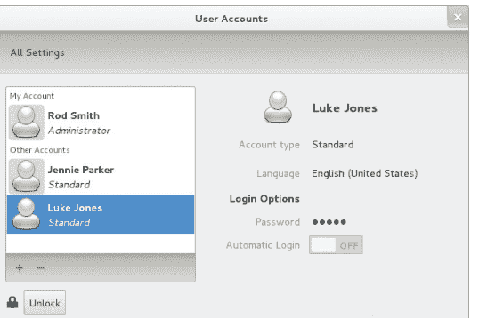
**图 13.1** 系统设置中的“用户账户”工具提供最基本的账户信息。

你可以通过使用 `cat` 或 `less` 查看 `/etc/passwd` 文件的内容，或者用文本编辑器加载该文件，来识别计算机上的所有账户。这样做将揭示所有账户，包括系统账户和用户账户。

或者，如果你在搜索特定账户的信息，可以使用 `grep` 在 `/etc/passwd` 中查找，例如使用 `grep Jones /etc/passwd` 来查找任何与名为 Jones 的用户关联的账户信息。（当然，这个具体假设是 Jones 这个字符串出现在 passwd 文件中。）

另一种与浏览 `/etc/passwd` 类似的方法是输入 `getent passwd`。该命令从某些管理数据库（包括账户数据库）中检索条目。在大多数情况下，输入 `getent passwd` 产生的结果与输入 `cat /etc/passwd` 相同；然而，有时两者并不相同。`/etc/passwd` 文件仅定义本地用户账户。可以将 Linux 配置为使用网络账户数据库来定义部分或全部账户。如果你使用了这种配置，输入 `getent passwd` 将同时返回本地账户和在网络服务器上定义的账户。

### 网络账户数据库

许多网络采用网络账户数据库。这类系统包括网络信息服务 (NIS)、该系统的更新版本 NIS+、轻量级目录访问协议 (LDAP)、Kerberos 领域、Windows NT 4.0 域以及 Active Directory (AD) 域。所有这些系统都将账户数据库管理移至一台单一的中央计算机（通常配备一个或多个备份系统）。这种账户维护方法的优点是，用户和管理员无需在多台计算机上独立维护账户。一个单一的账户数据库可以处理数十个（甚至数百或数千个）不同计算机上的账户，大大简化了日常管理任务并方便了用户。不过，使用这样的系统意味着大多数用户的账户名称不会出现在 `/etc/passwd` 和 `/etc/shadow` 中，组也可能不会出现在 `/etc/group` 中（稍后在“理解组”中介绍）。不过，这些文件仍然会保留本地系统账户和组的信息。

Linux 可以参与这些系统。事实上，一些发行版在 OS 安装时提供了启用此类支持的选项。通常，你必须知道托管网络账户数据库的服务器名称或 IP 地址，并且必须知道该系统使用的协议。你可能还需要密码或某些其他协议特定的信息，并且服务器可能需要配置为接受来自你正在配置的 Linux 系统的访问。

在安装 Linux 后激活此类网络账户数据库的使用是一个复杂的话题，本书不予讨论。此类系统通常会以微妙或不那么微妙的方式改变 `passwd` 和 `usermod`（在第 14 章中介绍）等工具的行为。如果你需要使用此类系统，必须查阅与你打算使用的服务相关的特定文档。我的书 *Linux in a Windows World* (O'Reilly, 2005) 涵盖了 Windows NT 4.0 域、LDAP 和 Kerberos 的相关主题；而 Mark Minasi 和 Dan York 的 *Linux for Windows Administrators* (Sybex, 2002) 涵盖了 Windows NT 4.0 域和 NIS 的相关主题。

## 理解组

**认证目标** 如前所述，组是在 `/etc/group` 文件中定义的账户集合。与 `/etc/passwd` 类似，`/etc/group` 由一系列由冒号分隔的行组成，每行定义一个组。示例及其如下所示：

```
users:x:100:games,sally
```


/etc/group 中的字段包括：

**组名** 第一个字段（如前例中的 users）是组的名称。在大多数访问或操作组数据的命令中都会用到它。

**密码** 组和用户一样，也可以设有密码。值 `x` 表示密码定义在其他地方，而密码字段为空则表示该组没有密码。

**GID** Linux 内部使用 GID 值（类似于 UID 值）。为了方便用户和管理员，系统会在组名和 GID 之间进行转换。

**用户列表** 您可以在 /etc/group 行的末尾使用逗号分隔的列表来指定属于该组的用户。

需要认识到，用户可以通过以下两种方式被识别为组的成员：

- 在用户的个人 /etc/passwd 条目中指定组的 GID。由于 /etc/passwd 只能容纳一个 GID 值，因此只能通过这种方式定义一个组。这就是用户的初始（或默认）组。
- 在 /etc/group 文件的用户列表中指定用户名。单个用户可以在 /etc/group 中多次出现，且单个组可以通过这种方式关联多个用户。如果用户通过这种方式与组关联，而没有在 /etc/passwd 条目中指定，则该组关联为次要组。

当您创建新文件时，这些文件将与您当前的组关联。当您登录时，您的当前组会被设置为您的初始组。如果您想创建与您所属的另一个组关联的文件，可以使用 `newgrp` 命令，例如：

```
$ newgrp project1
```

该命令将 project1 设为您的当前组，这样您创建的文件将与该组关联。文件的组所有权在文件安全中至关重要，这将在第 15 章“设置所有权和权限”中详细描述。

## 使用账户工具

有几个命令可以帮助您了解计算机上的用户和组。最显著的是，`whoami` 和 `id` 工具可以告知您的身份，而 `who` 和 `w` 工具可以提供关于当前谁在用计算机的信息。

> 组密码的使用是一个高级话题，超出了本书的讨论范围。

### 发现您自己的身份

如果您一直使用 `su` 来更改有效用户 ID，或者您为自己维护了多个账户且不记得是用哪个登录的，您可能会对当前状态感到困惑。在这种情况下，`whoami` 命令会非常有用：它会显示您的有效用户 ID：

```
$ whoami
luke
```

认证目标：此示例表明当前账户是 luke。如果您需要更多信息，可以使用 `id` 工具：

```
$ id
uid=1003(luke) gid=100(users) groups=100(users),16(cron),18(audio)
```

此示例显示了用户和组的信息：

- 您的用户 ID 和用户名——本例中为 `uid=1003(luke)`
- 您的当前组——本例中为 `gid=100(users)`
- 您所有的组员身份——本例中 `groups=` 之后的条目

`id` 命令同时显示数值形式的 UID 和 GID 值及其关联的名称。当前组是指处于活动状态的组，可能是默认设置，也可能是因为您使用了 `newgrp` 命令。

您可以通过指定若干选项来限制 `id` 的输出，如表 13.1 所示。此外，您可以指定用户名（如 `id sally`），以获取该用户而非您自己的信息。

### 表 13.1 id 的选项

| 长选项 | 短选项 | 效果 |
| :--- | :--- | :--- |
| --group | -g | 仅显示有效组 ID |
| --groups | -G | 显示您所属的所有组 |
| --user | -u | 仅显示用户数据 |
| --name | -n | 与 -g, -G 或 -u 配合使用，仅显示名称而非 UID 或 GID |
| --real | -r | 与 -g, -G 或 -u 配合使用，仅显示 UID 或 GID，而非名称 |

### 了解谁在线

Linux 允许多个用户同时访问计算机。这通常是通过安全外壳 (SSH) 等远程访问服务器实现的；不过，您也可以使用 Linux 的虚拟终端 (VT) 功能，使用单个键盘和显示器多次登录。有时您可能想知道谁在使用计算机。例如，在关闭计算机之前，您可能会这样做，以确保不会给另一位用户带来不便。

要了解谁在线，可以使用一个名为 `who` 的常用命令：

```
$ who
luke :0 2012-03-06 13:27
luke pts/0 2012-03-06 15:16 (:0.0)
sally pts/7 2012-03-07 13:00 (callisto)
rod pts/9 2012-03-07 13:22 (remote.example.org)
```

此示例显示了四次登录——luke 两次，sally 一次，rod 一次。默认输出中提供的信息包括：

**用户名** `who` 输出的第一列显示用户名。

**终端标识符** `who` 输出的第二列显示与终端关联的代码。在本例中，luke 的第一次登录显示 `:0` 作为标识符，这意味着这是一个本地 GUI (X) 登录。其余登录的终端标识符均形如 `pts/#`，表示文本会话。文本会话可以是 X 中启动的终端、文本模式的控制台登录，或者是通过 SSH 或其他协议进行的远程登录。

**登录日期和时间** `who` 显示每次登录的日期和时间。因此，您可以看到 luke 的 X 会话在 rod 登录前几乎整整一天就开始了。

**远程主机** `who` 输出的最后一列（如果存在）显示登录来源。控制台登录（包括文本模式和基于 X 的登录）不包含来源。形如 `#` 或 `:#.#` 的来源（如 luke 的第二个会话）表示在 X 中打开的终端。主机名或 IP 地址（如 sally 和 rod 的会话）表示从指定的计算机远程访问。

您可以通过向 `who` 传递选项来获取额外信息，其中大部分比较晦涩或专业。一个比较实用的选项是 `--count (或 -q)`，它可以生成更简洁的数据摘要：

```
$ who -q
luke luke sally rod
# users=4
```

此输出仅包含用户名和一行指定会话总数的文字。（该数字将同一个用户多次登录计算为多次。）有关其他 `who` 选项的信息，请参考其 man 手册页。

> 认证目标
>
> 文本模式会话也可以由形如 `tty#` 的代码表示。

`who` 的替代方案是 `w`，它与 `who` 类似，但输出内容更为详细：

```
$ w
12:36:40 up 37 days, 45 min, 3 users, load average: 0.00, 0.02, 0.05
USER TTY LOGIN0 IDLE JCPU PCPU WHAT
luke 0: 06Mar12 40:23 0.01s 0.01s -bash
luke pts/0 06Mar12 40.00s 0.01s 0.01s nano
sally pts/7 13:00 20:37m 0.00s 0.00s -bash
rod pts/9 13:22 2:50 12.44m 0.00s /bin/sh /etc/xdg/xfce4/xinitrc
```

如您所见，`w` 显示的信息与 `who` 大部分相同，包括终端标识符 (TTY) 和登录时间（格式不同）。此外，`w` 还显示了一些进一步的信息：

- 会话的空闲时间 (idle time) 告诉您用户上次与该会话交互已过去多久。此信息可以帮助您识别用户可能已放弃的会话。
- JCPU 列标识与该会话关联的 CPU 总时间。如果计算机因失控的进程而变得迟缓，这可以作为有用的调试信息。
- PCPU 列标识会话中当前运行进程的 CPU 总时间。同样，此信息可以帮助您追踪失控的进程。
- WHAT 列告诉您该会话正在运行什么程序。

某些配置还会显示 FROM 列，显示远程主机名。使用 `-f` 选项可以开启或关闭此选项。其他一些选项可以消除或修改 `w` 的输出。详情请参阅程序的 man 手册页。

## 以 root 身份工作

Linux 是模仿 Unix 设计的，而 Unix 被设计为一个多用户操作系统。原则上，单台 Unix（或 Linux）计算机上可以拥有数千个账户。然而，一名用户需要拥有极高的权限才能管理计算机整体的功能。这就是 root 用户，也被称为超级用户 (superuser) 或管理员。了解 root 存在的原因、如何以 root 身份操作以及如何安全地使用 root 权限，对于管理 Linux 系统至关重要。


### 为什么以 root 身份工作？

大多数人使用计算机执行普通的日常任务——浏览网页、写信、管理音乐收藏等等。这些活动被统称为*用户任务*，它们不需要特殊的权限。如前所述，一台 Linux 计算机可以拥有多个用户账户，用户可以通过这些账户（也称为*非特权账户*或*非特权用户*）来执行此类用户任务。

另一方面，root 账户的存在是为了让你能够执行*管理任务*。这些任务包括安装新软件、准备新磁盘以供计算机使用，以及管理普通用户账户。此类任务需要访问普通用户不需要修改、有时甚至不需要读取的系统文件。

为了方便执行这些任务，root 可以读取和写入计算机上的每一个文件。由于 Linux 依赖文件来存储系统设置，这实际上赋予了 root 更改操作系统运行中任何细节的权力，而这正是设立超级用户账户的目的。如果计算机是一台仅由一个人使用的工作站，你可能会好奇为什么 root 和用户账户之间的区分是必要的。解释是：root 账户的权力可能会导致意外损坏。例如，以 `rm` 命令为例。如果你作为普通用户误输入了一个 `rm` 命令，你可能会意外删除自己的文件，但不会删除系统文件。然而，如果以 root 身份犯同样的错误，你可能会删除系统文件，甚至导致计算机无法启动。因此，在使用 root 账户时应格外小心——我将在接下来的“安全地使用 root 权限”部分再次讨论这个话题。

### 获取 root 权限

当你需要执行需要 root 权限的命令行任务时，可以通过以下三种方式之一来实现：

- **以 root 身份登录。** 你可以直接在文本模式的 shell 中以 root 身份登录，或者使用 SSH 等远程登录工具。在某些 Linux 发行版上，你也可以以 root 身份登录 GUI 模式，尽管一些发行版默认禁用此功能，因为这非常危险。

- **使用 su。** `su` 命令允许你在 shell 中切换身份。输入 `su username` 可将身份切换为指定的*username*。如果你省略了*username*，则默认为 root，因此输入 `su` 实际上能让你变成 root。不过，要使该命令生效，你必须知道目标账户的密码。通过这种方式获取 root 权限后，你可以根据需要输入任意数量的 root 命令。完成后，输入 `exit` 以放弃超级用户状态。你还可以使用 `-c` 选项通过 `su` 以 root 身份运行单个命令，例如使用 `su -c command` 以 root 身份运行 `command`。如果你在命令中使用短横线（`-`），例如 `su -` 或 `su - luke`，程序将开启一个登录会话，运行目标用户的登录脚本。这很重要，因为这些脚本通常会设置对该用户至关重要的环境变量，例如 `$PATH`。
  *（注：su 代表 switch user 或 substitute user。）*

- **使用 sudo。** `sudo` 命令与 `su` 类似，但它一次仅对一个命令生效，该命令紧跟在 `sudo` 之后，类似于使用 `su -c`。例如，输入 `sudo cat /etc/shadow` 可以让你查看 `/etc/shadow` 文件的内容，而普通用户无法读取该文件。根据 sudo 的配置，使用此程序时必须输入你自己的密码或 root 密码。（使用 `su -c` 时，必须始终输入 root 密码。）接下来的命令将使用你的普通账户权限执行。默认情况下，大多数发行版仅允许 `wheel` 组的成员使用 `sudo`。一些发行版（如 Ubuntu）严重依赖 sudo，且默认不允许直接 root 登录。

如果你通过直接以 root 登录或使用 `su` 获取 root 权限，你的 shell 提示符会发生变化：

```
[luke@wembleth ~]$ su
Password:
[root@wembleth luke]#
```

在这个例子中，用户名从 `luke` 变为了 `root`；目录从 `~` 变为了 `luke`（因为对于 root 来说，`~` 指的是 `/root` 而不是 `/home/luke`）；提示符的最后一个字符从美元符号 (`$`) 变为了井号 (`#`)。因为在本书中，对于大多数单独成行的示例，我仅使用提示符的最后一个字符，因此这类示例通过所使用的提示符隐式指定了该命令是否需要 root 权限。例如，考虑访问前面提到的 `/etc/shadow` 文件：

*（注：在 Ubuntu 中使用 root 命令，你必须在命令前加上 sudo（如 sudo cat /etc/shadow）或输入 sudo 以获取一个持续时间较长的 root shell。）*

```
# cat /etc/shadow
```

井号提示符的使用表明你必须以 root 身份输入此命令。

本书的一些章节同时描述了系统管理的 GUI 和文本模式方法。那么，如果你必须使用文本模式的 `su`（或 `sudo`）命令来获取 root 权限，如何在 GUI 模式下管理 Linux 呢？一种方法是从一个已经执行过 `su` 的 shell 中启动 GUI 管理工具。如果你更习惯于 GUI 而非命令行，这种方法虽然可行但不够优雅。因此，大多数发行版提供了另一种选择：你可以从计算机的桌面菜单启动管理工具，然后 GUI 工具会提示你输入 root 密码，如图 13.2 所示。如果密码输入正确，程序将启动。其结果与在 shell 中使用 `sudo` 启动程序类似——它以 root 身份运行，但不会让其他任何东西以 root 身份运行。

*（注：如果你是 `wheel` 组的成员，大多数发行版在使用此类工具时会提示你输入自己的密码，而不是 root 密码。）*

**图 13.2** 当你从 GUI 启动管理工具时，Linux 会要求你输入密码。

### 设置 ROOT 密码

如果你使用的是自己的计算机，你可能已经知道或拥有 root 密码，因为大多数发行版在安装系统时会提示你输入 root 密码。一些发行版（如 openSUSE）默认将 root 密码设置为与第一个用户账户的密码相同。Ubuntu 则完全不设置 root 密码；相反，Ubuntu 的安全模型倾向于使用 `sudo` 或其 GUI 等效工具。

如果你忘记了 root 密码，可以通过几种方式恢复或重置，例如：

- 你可以输入 `sudo passwd root` 来重置 root 密码。如第 14 章所述，`passwd` 是设置账户密码的工具，因此该命令将重置 root 密码。以这种方式使用时，`sudo` 会提示你输入密码（你应该输入你的用户密码），然后连续两次提示输入新的 root 密码。不过，这种方法仅在你系统中是 `sudo` 授权用户时才有效。

- 重启进入应急系统，例如 Parted Magic (http://partedmagic.com)，并挂载常规安装的根文件系统。然后你可以找到其 `/etc/shadow` 文件（它将位于另一个挂载点，例如 `/mnt/local1/etc/shadow`）并用文本编辑器打开。找到一个你知道密码的账户条目，将该行中第二个冒号分隔的条目复制到 root 账户的相应位置。密码是以加密形式存储的，因此你无法识别这样复制粘贴的密码。保存更改后，重启并登录 root 账户。登录后，将 root 密码更改为唯一的密码。

如果你使用的是学校或雇主的计算机，你应该避免尝试以 root 身份执行任务，或者通过授权渠道获取 root 密码。如果你被雇佣为系统管理员，你的雇主应该提供此信息，或指定另一种维护方式（例如使用 `sudo`）。如果你不是计算机的正式管理员，尝试在其上执行 root 任务可能会成为被解雇的理由。事实上，未经授权擅自进入计算机甚至可能导致你被起诉或监禁！

### 安全地使用 root 权限

*（注：应急系统，如 Parted Magic，通常会以 root 身份运行所有命令，因此使用时请小心！）*

如前所述，root 的权力是危险的。例如，准备磁盘需要创建文件系统。本书没有详细讨论这个话题，但你应该知道可以使用 `mkfs` 创建文件系统，它接受分区标识符作为选项。假设你想在 `/dev/sda3` 上创建新文件系统，于是快速输入了一个命令：

```
# mkfs /dev/sda2
```

你发现错误了吗？命令指定的是 `/dev/sda2` 而不是 `/dev/sda3`。如果 `/dev/sda2` 包含重要数据（例如你的 Linux 安装或 `/home` 目录），这个错误将是毁灭性的。

这仅仅是不当使用 root 可能导致问题的一个例子。其他问题还包括：入侵者获得计算机的 root 访问权限；配置文件被意外修改；部分（即使不是全部）计算机系统文件受损；以及普通用户的所有权或权限被更改。

文件，使其真实所有者无法访问。因此，我建议每当你需要 root 权限时，请采取以下预防措施：

- 问问自己是否真的需要 root 权限。有时可以通过非超级用户权限，或者以比原计划更受限的方式使用这些权限来实现目标。例如，你可能会发现只有 root 才能向可移动磁盘写入数据。这类问题通常可以通过某种方式调整磁盘权限来解决，从而限制 root 的使用。
- 在以 root 身份输入任何命令并按下 Enter 键（或在以 root 身份运行的 GUI 程序中点击任何确认按钮）之前，请将手离开键盘和鼠标，仔细审视该命令，并核实其在各方面都正确无误。一个简单的输入错误可能会带来巨大的麻烦。这个步骤曾多次将我从灾难中挽救回来！
- 永远不要以 root 身份运行可疑程序。在多用户系统中，不法用户可能会试图诱骗管理员运行执行恶意操作或向攻击者授予 root 权限的程序。从随机互联网站点下载的程序原则上可能被设计为破坏你的安全性，且这类程序在以 root 身份运行时危险得多。
- 尽可能缩短使用 root 权限的时间。如果你只需要以 root 身份输入一两条命令，请在执行完毕后在 root shell 中输入 `exit` 以注销或返回普通权限。或者，使用 `sudo` 来运行命令。人们很容易忽略自己正处于 root shell 中，从而以 root 身份输入了并不需要该权限的命令。每一条以 root 身份输入的命令都是一个风险。
- 永远不要将 root shell 暴露给他人。如果你正在执行 root 维护任务且被临时叫走，在离开电脑前请在 root shell 中输入 `exit`。
- 小心对待 root 密码。不要与他人分享密码，并在公共区域或他人可能窥视时谨慎输入。如果你在专业环境下使用 Linux，你的雇主可能会有关于谁可以拥有计算机 root 权限的指导方针。请学习并遵守这些规则。同时，请确保选择一个强 root 密码。

> 如果一个程序要求你输入 root 密码，且它不是一个你信任的管理程序，请保持警惕！在提供密码之前请先对该程序进行调研！

> 第 14 章介绍了如何选择强密码。

遵循这些经验法则可以帮助你避免损坏计算机或将 root 权限泄露给他人。

## 核心要点及延伸

账户对于 Linux 的正常运行至关重要。通常情况下，你在 Linux 计算机上执行的大多数任务只需要普通用户的权限，因此你会使用自己的用户账户来处理这些任务。你可以使用 `whoami`、`id`、`who` 和 `w` 等工具来识别你的普通账户，并确定还有谁在运行计算机。偶尔，你需要执行需要额外权限的管理任务。为了获得此类权限，你必须使用 root 账户，它可以读写任何普通文件，以底层方式访问硬件，重新配置网络，并执行普通用户不允许执行的其他任务。因为 root 功能如此强大，你应该谨慎使用这种权力，并且在使用时极其小心，以免输入错误或其他意外导致严重问题。

### 建议练习

- 先执行 `whoami` 然后执行 `id` 来查看你的普通用户账户状态。`id` 命令很可能会显示你是多个组的成员。进行网络搜索以了解每个组的作用。
- 阅读 `/etc/passwd` 文件或输入 `getent passwd` 来查看计算机上定义了哪些账户。除了你自己的账户外，是否还有其他普通用户账户（UID 在 500 或 1,000 以上，具体取决于你的发行版）？尝试通过网络搜索了解几个系统账户（UID 在 500 或 1,000 以下，具体取决于你的发行版）的用途。

### 复习题

1. UID 为 0 的系统账户的目的是什么？
    - A. 它是系统管理账户。
    - B. 它是第一个普通用户的账户。
    - C. 没有目的；UID 0 被故意留空。
    - D. 不同发行版之间有所不同。
    - E. 它是一个低权限账户，被某些服务器用作默认账户。

2. 在 `/etc/passwd` 中，你会为普通用户账户找到哪些类型的信息？（选择所有适用项）
    - A. 用户 ID (UID) 号
    - B. 用户所属每个组的完整列表
    - C. 账户主目录的路径
    - D. 账户默认 GUI 桌面环境的路径
    - E. 账户默认文本模式 shell 的路径

3. 你想以 root 身份运行命令 `iptables -L`，但你当前以普通用户登录。假设系统已配置为允许你通过适当的命令获得 root 权限，以下哪个命令可以完成此操作？
    - A. sudo iptables -L
    - B. root iptables -L
    - C. passwd iptables -L
    - D. su iptables -L
    - E. admin iptables -L

4. 判断对错：`whoami` 提供的信息比 `id` 更多。

5. 判断对错：Linux 将组信息存储在 `/etc/groups` 文件中。

6. 判断对错：作为一般原则，以 root 身份运行程序时应格外小心。

7. 在 Linux 中，将用户名与 UID 号关联的文件是 ________________。（提供文件的完整路径。）

8. 要了解当前谁登录了计算机以及他们正在运行什么程序，你可以输入 ________。

9. 500 或 1,000 以下（取决于发行版）的 UID 保留给 ________ 账户使用。

## 第 14 章：创建用户和组

Linux 是一个多用户操作系统，这意味着一台 Linux 计算机可以支持许多用户，每个用户拥有唯一的账户。随着这种能力的提升，产生了管理用户账户的需求，本章涵盖了你将用于管理账户的步骤。本章首先介绍如何创建账户。在创建账户之后，我将向你展示如何修改这些账户，并在必要时将其删除。最后，由于组在许多方面与账户相似，我也将描述如何创建和管理组。

- 创建新账户
- 修改账户
- 删除账户
- 管理组

## 创建新账户

在许多环境中，添加账户的任务非常常见。大型企业经常雇佣新员工，大学会有新学生入学，等等。因此，你必须知道如何创建新账户。在介绍创建账户的具体操作之前，我将描述关于决定如何使用组以及选择良好密码的重要问题。然后，我将解释如何使用 GUI 和文本模式工具创建账户。

### 决定组策略

正如第 13 章“理解用户和组”中所述，Linux 组是用户的集合。你可以使用组来控制谁可以访问特定文件。正如第 15 章“设置所有权和权限”中将要描述的，个人可以更改自己文件的组关联和组权限。因此，你使用组的方式会影响计算机的整体安全策略。两种常见的方法是：

**用户组**：每个用户可以有一个关联的组；例如，用户 `luke` 可以有一个名为 `luke` 的组。随后，该用户可以将文件的组所有权设置为 `luke`，或将组权限设置为任何所需值，而系统管理员可以将用户添加到 `luke` 组中。此后，luke 组的成员可以使用由用户 `luke` 确定的权限访问该组中的文件。这种方法侧重于控制对单个用户文件的访问。

**项目组**：在这种方法中，你根据工作项目、部门隶属关系或其他现实世界的用户分组来创建组。例如，你可以为销售部门的用户创建一个名为 `sales` 的组。该组成员如果想与组内其他成员共享文件，将适当分配组所有权和权限，并将文件存储在约定位置。当计算机被大量在易于定义的分组中协作的人员使用时，这种方法效果最好。

这两种方法并不是互斥的；你可以混合使用，或者创建自己的方法。你还应该意识到，用户可以是多个组的成员。事实上，这是用户组方法能够运作的前提——否则，组就与账户冗余了。

如果你使用项目组方法，你应该考虑哪个组应该是新用户的主组。该组将被默认分配为用户文件的组所有者。

### 选择一个良好的密码

当你创建账户时，通常应该为其创建密码。有时，用户可以在创建账户时输入密码。但在其他情况下，你需要选择一个用户随后使用的密码。在这种情况下，你应该指示用户尽快更改密码。无论哪种情况，你都应该教育用户如何选择一个良好的密码。常见但糟糕的密码包括基于以下内容的密码：

- 家人、朋友和宠物的名字
- 最喜欢的书、电影、电视节目或其中的角色
- 电话号码、街道地址或社会保障号码
- 任何其他具有实际意义的个人信息

> 默认情况下，某些发行版采用用户组策略，而另一些则采用项目组策略。在后一种情况下，某些用户默认在名为 users 的组中。

> 请务必亲自遵循本节中的建议，尤其是针对 root 密码！


- 字典中能找到的任何单词（*任何*语言）
- 任何简单的键盘排列或字母数字组合，例如 `qwerty` 或 `123456`

最理想的密码是字母、数字和标点符号的随机组合。遗憾的是，此类密码难以记忆。一个合理的折中方案是分两步构建密码：

1. 选择一个容易记忆但难以猜测的基准。
2. 以增加猜测难度的各种方式修改该基准。

构建基准的一种方法是使用两个或多个*不相关*的单词，例如 `bun` 和 `pen`。然后你可以将这两个词合并（`bunpen`）。另一种方法（可以说比第一种更好）是使用对用户有意义的短语的首字母。例如，“yesterday I went to the dentist”的首字母变为 `yiwttd`。在这两种情况下，基准都不应该是任何语言中的单词。一般规律是，密码越长越好。

有了基准后，就可以对其进行修改以创建密码。用户应至少应用几种可能的修改方案：

**添加数字或标点** 一个重要的改动是在基准中插入随机数字或标点。这一步可能会产生例如 `bu3npe8n` 或 `#yiwttd` 这样的结果。一般规律是，至少添加两个符号或数字。

**混合大小写** Linux 使用区分大小写的密码，因此打乱字母的大小写可以提高安全性。应用此规则可能会产生 `Bu3nPE8n` 和 `y#iWttD` 等结果。

**反转顺序** 这种改变单独使用时非常弱，但与其他方法结合使用时可以增加一定的安全性，即反转部分或全部字母的顺序。你可以仅对两个单词基准中的一个单词应用此操作。例如，这可能会产生 `Bu3nnE&p` 和 `DttW9i#y`。

**增加“干草堆”** 潜在入侵者破解密码的任务被比作在大干草堆中找一根针。让这项任务变得更困难的一种方法是增加干草堆的大小。在密码术语中，这意味着增加密码的长度。当然，你可以通过使用更长的单词或短语来实现，但这会使密码更难记忆和输入。即使只是简单地重复单个字符来增加长度也会有所帮助。因此，你可以将密码变为 `Bu3nnE&EPiiiiiiiiiii` 或 `Dtt:::::::::::::W9i#y`。

> 许多发行版对密码长度设置了下限，例如 6 或 8 个字符。

## 第 14 章 • 创建用户和组

引导用户选择优质密码的最佳工具就是对他们进行教育。以下是一些可以与用户分享的见解：

- 了解用户或甚至针对用户并在电话簿、网页等处查找个人信息的恶意人员可以猜出密码。
- 虽然 Linux 内部会对密码进行加密，但存在一些程序可以将整个字典通过 Linux 的密码加密算法运行，并与加密后的密码进行比对。如果找到匹配项，则密码被破解。
- 用户账户可能被用作攻击整个计算机的第一步，或者作为攻击其他计算机的跳板。
- 用户*绝不*应向他人透露密码，即使是自称系统管理员的人——这是一种常见的诈骗手段，真正的系统管理员不需要用户的密码。
- 同一个密码不应在多个系统上使用，因为这样做会迅速地将一台计算机上被破解的账户扩展到所有计算机上的被破解账户。
- 将密码写下来或通过电子邮件发送都是冒险的行为。将密码写在贴在计算机显示器上的便签上则极其危险。

告知用户这些内容将帮助他们理解你关注的原因，并有可能激励其中至少一部分人选择优质的密码。

垃圾邮件有时会尝试通过声称电子邮件、银行或其他账户已被停用或被破解，来诱骗用户透露密码。

## 不要使用这些密码！

如果你在网上搜索 *worst passwords*（最糟糕的密码）或类似的词组，你会迅速发现安全研究人员揭露的最常见且最容易被猜到的密码列表。不同调查的细节有所不同，但在 2011 年的一项研究 (http://www.splashdata.com/press/PR111121.htm) 中，最常见的 10 个密码是：

1. password
2. 123456
3. 12345678
4. qwerty
5. abc123
6. monkey
7. 1234567
8. letmein
9. trustnol
10. dragon

此类密码很容易被暴力破解密码程序发现，并被包含在互联网上分发的密码集中。使用此类密码几乎和完全不使用密码一样。请帮自己一个忙，使用一个更好的密码！

### 使用 GUI 工具创建账户

现在你已经大概了解了想要使用什么样的组策略以及如何创建优质密码，你可以开始创建账户了。最简单的方法是借助 GUI 工具；然而，此类工具在不同的 Linux 发行版中有所不同。最重要的区别在于访问这些工具的方式。例如：

- 在 Fedora 16 中，你可以作为 root 用户在 shell 提示符下输入 **system-config-users** 来启动用户管理器（User Manager）实用程序。或者，你可以使用类似于 Ubuntu 中那个功能较少的系统设置（System Settings）实用程序。
- 在 openSUSE 12.1 中，你可以启动 YaST 配置工具，并在 YaST 内部打开用户和组管理工具。
- 在 Ubuntu 11.10 中，你可以打开桌面环境中的系统设置实用程序，然后点击用户账户选项。在进行更改之前，必须点击锁图标并输入密码。

作为一个 GUI 用户管理工具的示例，图 14.1 显示了 Fedora 的用户管理器实用程序，它比系统设置工具中的用户账户实用程序提供了更多功能。与简单的用户账户工具相比，使用像用户管理器这样更完整的工具，你将能够更好地调整账户选项。

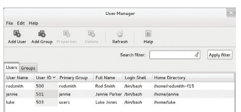
**图 14.1** 用户管理器实用程序提供了许多创建和管理账户的选项。

要使用用户管理器添加用户，请执行以下步骤：

1. 点击“添加用户”（Add User）。结果将显示如图 14.2 所示的“添加新用户”对话框。

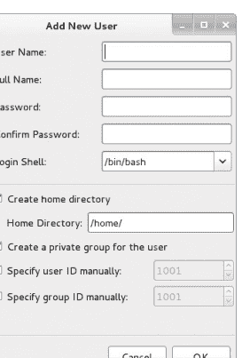
**图 14.2** 你可以通过“添加新用户”对话框输入所有基本账户信息。

2. 在“用户名”（User Name）字段中输入用户名。这就是用户在 Linux 登录提示符下输入的内容。
3. 在“全名”（Full Name）字段中输入用户的全名。此条目存储在 `/etc/passwd` 的注释字段中，并显示在各种工具中；例如，当用户登录 GNOME 时，它会出现在屏幕的右上角。
4. 输入两次密码，一次在“密码”（Password）字段中，一次在“确认密码”（Confirm Password）字段中。
5. 在大多数情况下，你可以直接点击“确定”（OK），因为其余选项的默认值通常就足够了。（“主目录”字段将根据你输入的用户名自动填充。）不过，在点击“确定”之前，你可以自定义登录 shell、主目录位置和其他功能。

新账户将出现在用户管理器列表中。如果以后有需要，你可以随后对其进行修改或删除，详见本章后面的内容。

### 从 Shell 创建账户

在任何发行版中，你都可以使用 `useradd` 实用程序从命令行创建账户。要使用此实用程序，请输入其名称以及你想要关联到新账户的用户名。你还可以在 `useradd` 和用户名之间包含选项，如表 14.1 所示。

> 如果你在创建账户时用户就在身边，可以让用户在此时输入密码。

> 如果你愿意，可以将 `useradd` 调用为 `adduser`；这两个命令名称是等价的。

### 表 14.1 useradd 的选项

| 选项名称 | 选项缩写 | 效果 |
| :--- | :--- | :--- |
| `--comment comment` | `-c` | 此参数指定用户的注释字段。（GUI 工具通常将其描述为“全名”。） |
| `--home home-dir` | `-d` | 你可以使用此参数指定账户的主目录。默认为 `/home/username`。 |
| `--expiredate expire-date` | `-e` | 使用此选项设置账户被禁用的日期，格式为 YYYY-MM-DD。默认为账户永不过期。 |
| `--inactive inactive-days` | `-f` | 此参数设置密码过期后的天数，之后账户将完全被禁用。值为 -1 将禁用此功能，且为默认值。 |


## 表 14.1（续）

| 选项名称 | 选项缩写 | 效果 |
|---|---|---|
| `--gid default-group` | `-g` | 使用此选项设置用户的默认组名称或 GID。该值的默认值是一个以用户名命名的新组。 |
| `--groups group[,...]` | `-G` | 此参数设置用户所属组的名称或 GID。可以通过逗号分隔来指定多个组。 |
| `--create-home` | `-m` | 包含此选项时，`useradd` 将为用户创建主目录。此选项默认启用。 |
| `--skel skeleton-dir` | `-k` | 通常，默认用户配置文件是从 `/etc/skel` 复制的，但您可以使用此选项指定另一个模板目录，该选项仅在与 `-m` 结合使用时有效。 |
| 无 | `-M` | 此选项强制系统 *不* 自动创建主目录。 |
| `--shell shell` | `-s` | 使用此选项设置用户的默认登录 Shell 名称。默认值为 `/bin/bash`。 |
| `--uid UID` | `-u` | 此参数创建一个具有指定用户 ID 值 (UID) 的账户。 |
| `--non-unique` | `-o` | 此参数允许单个 UID 编号被重复使用；在创建第二个或后续重复使用 UID 的账户时传递此选项。 |
| `--system` | `-r` | 此参数指定创建系统账户。`useradd` 不为系统账户创建主目录，并赋予它们 100 以下的 UID 值。 |
| `--no-user-group` | `-N` | 此选项禁用为用户创建组。 |

> `useradd` 命令支持更多选项；详情请参阅其 `man` 页。

在使用 GUI 工具创建账户时，其中一些选项可能无法直接访问，但具体情况因 GUI 工具而异。在某些情况下，选项可以在账户创建后在 GUI 工具中设置，但不能在创建时设置。

一个包含几个选项设置的完整 `useradd` 命令如下所示：

```
# useradd -e 2012-12-31 -u 1012 pamela
```

此示例创建了一个用户名为 `pamela` 且 UID 为 1012 的账户。该账户将于 2012 年 12 月 31 日过期。在该日期之后，用户将无法登录账户，尽管她的文件不会被删除，且 root 用户能够重新激活该账户。

> 您可能希望指定 UID，以便在通过网络文件系统 (NFS) 共享文件的计算机之间保持这些值同步，因为 NFS 通过 UID 来识别文件所有权。

使用 `useradd` 创建账户时，它将处于 `锁定` 状态——用户将无法登录。要解锁它，您必须使用 `passwd` 命令，接下来的“修改账户”章节将对此进行详细说明。

在后台，`useradd`（以及它的 GUI 前端）会修改 `/etc/passwd`、`/etc/shadow` 和 `/etc/group` 的内容，所有这些在第 13 章“理解用户和组”中都有详细描述。如果您使用了 `--create-home` 或 `-m`，或者该选项被默认使用，程序将创建主目录并将文件从 `/etc/skel` 复制到该位置。创建账户通常还会创建一个 `邮件池文件 (mail spool file)`，用于存储用户的接收邮件。（在许多桌面系统上，此文件可能不会被使用，但如果您在计算机上运行邮件服务器软件，它可能会非常重要。）因此，您可以看到 `useradd` 在创建账户时对计算机的文件和目录进行了相当多的修改。

## 修改账户

正如您刚刚学到的，在创建账户时，您可以指定许多影响账户的选项，例如为账户赋予特定的 UID 编号。然而，有时在账户创建后有必要更改账户选项。幸运的是，Linux 提供了 GUI 和文本模式工具来帮助您完成此操作。但在深入研究这些工具的操作细节之前，您应该了解在什么时候可能需要对账户进行更改，并知道如何检查用户当前是否已登录。

### 决定何时修改账户

在理想情况下，您每次创建账户都会完美无缺；然而，有时这并不可能。您可能缺乏创建完美配置账户所需的信息（例如员工将在公司工作多长时间），或者您的需求在账户创建后发生了变化。一些常见的账户变更具体原因包括（但绝不限于）以下内容：

- 用户可能会忘记密码。系统管理员可以在不知道原密码的情况下更改任何账户的密码，因此系统管理员经常需要帮助记忆力不佳的用户。
- 由于协作安排的重组，组隶属关系可能需要更改。
- 账户过期日期可能需要更新。例如，一名学生可能会再注册一个学期。有时过期的账户必须被重新启用。
- UID 编号可能需要与其他计算机同步，以便于跨计算机共享文件或出于其他原因。
- 有时可能需要更改用户名——例如，如果用户结婚且您的站点策略在用户名为中使用姓氏。
- 用户的主目录可能会更改，因为您增加了磁盘空间，需要将某些用户的主目录移至新位置。

在 GUI 中工作时，上述所有更改都可以在“用户管理器”中处理。但在文本模式 Shell 中工作时，您需要掌握几个不同的程序来处理这类账户修改。

### 检查已登录用户

请注意，如果您在执行某些账户更改时用户正处于登录状态，可能会产生较大的干扰。尤其是更改用户名和主目录很可能会导致问题。因此，您应该仅在用户注销后进行此类更改。有几种工具可以帮助您检查谁在使用计算机，从而避免问题：

**who** 此实用程序在第 13 章中有所描述，它会生成当前登录到计算机的用户列表，以及他们登录会话的一些详细信息，例如终端标识符和登录日期。

**w** 此命令在大概方向上与 `who` 类似，但它提供不同的细节。最显著的是，它能识别每个会话中当前运行的程序。

**last** 此程序生成最近登录会话的列表，包括它们的开始和结束时间，或者用户仍处于登录状态的通知：

```
$ last
  jennie  tty3  Sun Jan  8 12:43  still logged in
  jennie  tty3  Sun Jan  8 12:43 - 12:43 (00:00)
  jennie  tty2  Sun Jan  8 12:36  still logged in
  jennie  tty2  Sun Jan  8 12:36 - 12:36 (00:00)
```

`last` 的一个显著局限是它仅包含文本模式的登录。这使得它在识别当前正在使用计算机的用户方面的效用相当有限，因为这类用户很可能是通过 GUI 会话登录的。

### 使用 GUI 工具修改账户

与添加账户一样，使用 GUI 工具修改账户的步骤因工具而异。大多数 GUI 工具提供类似的选项，尽管有些比其他的更完整。在本节中，我将描述如何使用 Fedora 的用户管理器修改账户，您可以通过在终端窗口中输入 **system-config-users** 来启动它。

要进行更改，您应该点击该账户，然后从菜单中选择 文件 $\Rightarrow$ 属性，或点击工具栏中的属性图标。结果是一个类似于图 14.3 所示的对话框。此对话框呈现账户属性。四个选项卡中的每一个都提供了对特定类型数据的访问：

**用户数据** 如图 14.3 所示，您可以调整账户的用户名、注释字段（标识为“全名”）、密码、主目录，

> 认证目标
> 如果您以普通用户身份启动用户管理器，您将必须通过输入您的密码或 root 密码来进行身份验证，具体取决于您的配置。

> 用户管理器程序不会重命名或移动磁盘上的用户主目录；您必须使用 `mv` 手动完成此操作。

以及用户的登录 shell。如果你输入了一个弱密码，程序会向你发出警告，并在接受该密码前要求你确认。

**图 14.3** “用户属性”对话框允许你编辑多种账户属性。

**账户信息 (Account Info)** 此选项卡提供两个选项：你可以启用或禁用账户过期（如果启用，则包括设置过期日期），以及锁定或解锁密码。

**密码信息 (Password Info)** 此选项卡允许你设置密码过期数据。该信息与账户过期数据不同，因为过期的账户会被完全禁用，而过期的密码至少在一段时间内可以由用户重置。你可以设置各种更改值，例如在更改密码后多少天用户必须再次更改密码。你还可以设置一个选项，强制用户在下次登录时更改密码。（一旦完成更改，此选项将被清除。）

**组 (Groups)** 此选项卡显示计算机上所有组的完整列表。勾选任何你希望用户所属组旁边的复选框。你还可以设置用户的主组，但只能设置为用户已经所属的组。

用户可以使用桌面环境中的 GUI 选项更改自己的密码。例如，在 GNOME 中，点击屏幕右上角的用户名后，从弹出的菜单中选择“我的账户”项会产生“用户账户”对话框，如图 14.4 所示。点击“密码”字段中的点号会弹出一个对话框，用户可以在其中输入新密码。管理员也可以使用此工具来添加和修改账户，但在这一角色上，它远不如“用户管理器 (User Manager)”强大。

> 锁定账户密码会阻止登录，但不会完全禁用该账户。

> 如果你想将用户添加到一个完全的新组，必须先创建该新组，具体步骤请参阅“管理组”章节。

**图 14.4** “用户账户”窗口允许用户更改自己的密码。

### 从 Shell 修改账户

最频繁的账户修改操作之一是更改用户的密码，这可能是账户创建的一部分，或者是因为用户忘记了密码。你可以使用 `passwd` 程序进行此更改。普通用户可以单独输入此命令名称来更改自己的密码，但不能更改其他用户的密码。然而，超级用户可以通过向命令传递用户名来更改任何账户的密码：

```
# passwd pamela
Changing password for user pamela.
New password:
Retype new password:
passwd: all authentication tokens updated successfully.
```

作为一项安全措施，你输入密码时，屏幕上不会回显。如果你输入的两次密码不匹配，程序将拒绝接受更改，并再次提示你输入一对新密码。程序还会检查密码强度，并拒绝接受其认为过于弱的密码。

你可以使用 `usermod` 程序处理大多数其他账户修改。该命令的工作方式与 `useradd` 非常相似，但它不是创建新账户，而是修改现有账户。表 14.2 汇总了最重要的 `usermod` 选项。

> 认证目标：除了设置密码外，`passwd` 工具还允许你调整密码过期和老化选项。详见其 man 页。

### 表 14.2 usermod 选项

| 选项名称 | 选项缩写 | 效果 |
|---|---|---|
| `--append` | `-a` | 与 `--groups` (`-G`) 配合使用，使指定的组被添加到用户现有的组集之中，而不是替换它们。 |
| `--comment comment` | `-c` | 此参数指定用户的注释字段。（GUI 工具通常将其描述为“全名”。） |
| `--home home-dir` | `-d` | 你可以使用此参数指定账户的主目录。默认值为 `/home/username`。 |
| `--expiredate expire-date` | `-e` | 你可以使用此选项设置账户禁用的日期，格式为 YYYY-MM-DD。默认值为账户永不过期。 |
| `--inactive inactive-days` | `-f` | 此参数设置密码过期后，账户被完全禁用的天数。值为 `-1` 将禁用此功能，这也是默认值。 |
| `--gid default-group` | `-g` | 你可以使用此选项设置用户默认组的名称或 GID。该值的默认值是以用户命名的组。 |
| `--groups group[...]` | `-G` | 此参数设置用户所属组的名称或 GID。可以通过逗号分隔来指定多个组。 |
| `--login username` | `-l` | 将账户的用户名更改为指定值。 |

### 表 14.2 （续）

| 选项名称 | 选项缩写 | 效果 |
|---|---|---|
| `--lock` | `-L` | 锁定账户密码，阻止登录。 |
| `--move-home` | `-m` | 当此选项与 `--home (-d)` 一起使用时，usermod 会将用户现有的主目录移动到新位置。 |
| `--shell shell` | `-s` | 你可以使用此选项设置用户的默认登录 shell 名称。 |
| `--uid UID` | `-u` | 此参数将账户的 UID 编号更改为指定值。 |
| `--non-unique` | `-o` | 此参数允许单个 UID 编号被重复使用（需与 `--uid/-u` 配合使用）。 |
| `--unlock` | `-U` | 此选项解锁被锁定的账户密码。 |

例如，考虑以下 `usermod` 的用法：

```
# usermod -u 1072 -m -d /home2/luke luke
```

该命令对 `luke` 账户进行了三项更改：

- 将 UID 值更改为 1072。
- 将账户的主目录更改为 `/home2/luke`。
- 将原主目录的内容移动到新位置。

如果你将用户账户迁移到挂载在 `/home2` 的 NFS 服务器上，可能会发出类似这样的命令。此类更改可能需要新的主目录位置，并需要更改 UID 值以与 NFS 服务器上使用的值匹配。在更改 UID 值时应小心，因为虽然 `usermod` 会更改常见位置（如用户主目录和电子邮件文件）中文件的 UID 值，但它可能会遗漏位于不寻常位置的用户文件。如果你需要进行需要添加新组的组更改，请参阅即将到来的“管理组”章节。

> 许多 `usermod` 选项与 `useradd` 选项相同。

> 当移动操作在同一个低级文件系统上进行时，`--move-home (-m)` 选项速度很快；但当跨文件系统边界时，速度可能会很慢。

## 删除账户

删除账户有时与添加或修改账户同样重要。不使用的账户会占用磁盘空间。更重要的是，它们可能会被滥用，无论是被原所有者还是被能够破解弱密码的他入。因此，你应该定期删除不使用的账户。但在执行此操作之前，你应该了解删除账户时会发生什么，并决定具体如何操作，以免因不恰当的删除方式而产生问题。掌握这些知识后，你可以使用 GUI 或文本模式工具删除账户。

### 避免删除账户的陷阱

删除账户听起来很简单，但一个错误可能会立即或在将来引发问题。除了误删账户等明显问题外，你还应考虑两个因素：

> 考虑将删除账户的主目录归档到长期备份介质中。这样如果这些文件在未来变得有价值，你就可以恢复它们。

**用户文件保留** 我提到删除账户的原因之一是为了回收该账户占用的磁盘空间。然而，回收磁盘空间有时可能是 *错误之举*。用户的文件对于用户本身或拥有计算机的组织来说可能极其宝贵。因此，你应该仔细考虑是删除用户主目录，还是对其进行其他处理，例如将其移动到另一个用户的主目录中并更改其中文件的权限。用户的邮件队列（通常存储在 `/var/spool/mail/username` 中，其中 `username` 是用户名）也是如此。

**UID 和 GID 重用** 当账户被删除时，该账户的 UID 和 GID 将可被重用。在许多情况下，这些数字不会被重用，因为 Linux 是根据当前最大值来分配这些值的。因此，除非中间的账户也被删除，否则如果你删除的不是当前编号最高的用户，该用户的旧 UID 和 GID 编号将不会被重用。尽管如此，此类删除仍可能发生，或者你可能会覆盖默认值。如果 UID 被重用，之前由旧用户拥有的任何文件将突然显示为由新用户拥有。这可能不会产生问题，但可能会导致关于谁创建了文件的混淆。在某些情况下，如果旧文件包含新用户不应拥有的信息，或者位于新用户不应访问的目录中，甚至可能导致新用户被怀疑有不当行为。

如果你想避免因 UID 或 GID 重用而导致任何混淆或新用户被指责行为不端的可能性，你可以使用 `find` 命令

要定位所有具有特定 UID 或 GID 值的文件，可以使用 `-uid` 和 `-gid` 选项，如下所示：

```
# find / -uid 1004
```

这个示例会查找计算机上所有 UID 为 1004 的文件。（通过 GID 搜索的方式相同，但使用 `-gid` 选项。）随后，您可以使用 `chown` 重新分配这些文件的所有权或将其删除。通常，您只有在删除或重新分配用户主目录的所有权之后才会执行此命令，因为该目录可能包含过多匹配的文件。

### 使用 GUI 工具删除账户

与其他账户管理任务一样，使用 GUI 非常直观，但具体细节因发行版而异。例如，要从 Fedora 的用户管理器 (`system-config-user`) 中删除账户，请选择该账户，然后点击工具栏中的“删除”，或从菜单中选择“编辑 $\rightarrow$ 删除”。结果是一个类似于图 14.5 所示的确认对话框。根据您的需要，勾选或取消勾选删除用户主目录的复选框，如果您确定要执行该操作，请点击“是”。账户将被立即删除。

> 您可以用非 root 用户执行此命令，但它会返回错误，并且可能会遗漏某些文件。因此，最好以 root 身份执行此操作。

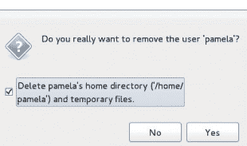

> 如果用户拥有许多文件且您选择删除这些文件，删除操作可能需要几秒钟甚至几分钟才能完成。

**图 14.5** 当您使用用户管理器删除账户时，可以选择删除用户的主目录。

如果用户当前已登录，用户管理器将在确认对话框中对此事实发出警告。您仍然可以删除账户，但该用户不会立即被登出。

### 从 Shell 删除账户

`userdel` 命令用于从文本模式 shell 中删除账户。在最简单的形式中，您只需向其传递一个用户名即可：

```
# userdel pamela
```

> 认证目标

该程序不会提示您确认，而是直接删除账户。但是，默认情况下它不会删除用户的主目录。若要删除，请传递 `--remove` (`-r`) 选项。

如果用户当前已登录，`userdel` 会通知您此事实且不执行任何操作。您可以传递 `--force` (`-f`) 选项，即使账户正在使用中也强制删除。要同时强制删除账户并移除用户文件，可以同时传递这两个选项：

```
# userdel -rf pamela
userdel: user pamela is currently logged in
```

程序仍然会抱怨用户已登录，但它同样会删除账户和文件。

## 管理组

在许多方面，组与账户类似。它们定义在类似的文件中，并使用类似的实用程序进行管理。组还与账户绑定，因为账户中包含组定义。到目前为止，我假设您将使用标准组或在创建账户时定义的组。然而，有时您需要出于特定目的创建、删除或修改组，例如您使用项目组策略。与账户管理一样，您可以使用 GUI 或文本模式工具来完成此操作。

### 使用 GUI 工具管理组

许多 GUI 账户维护工具（如 Fedora 的用户管理器 `system-config-user`）提供了与本章所述的用户管理工具类似的组管理工具。参考图 14.1，您会看到用户管理器窗口包含“用户”和“组”两个选项卡。要管理组，请点击“组”选项卡。这将产生一个类似于图 14.6 的界面。

> 如果您想管理系统组以及用户组，请选择“编辑 $\rightarrow$ 首选项”，在弹出的对话框中，取消勾选“隐藏系统用户和组”。

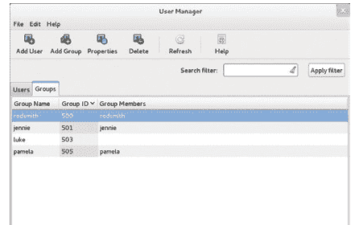

**图 14.6** 用户管理器实用程序使您能够管理组以及用户。

您可以以与添加、修改和删除账户非常类似的方式来添加、修改和删除组。不过，可用选项的数量要少得多；例如，在添加组时，您只能指定其名称和 GID。组没有主目录、登录 Shell 等。当然，您可能希望某些特定用户从一开始就是新组的成员。为此，请执行以下步骤：

- 1. 点击“添加组”创建组，并在弹出的对话框中指定组名。
- 2. 选择该组，点击“属性”，然后选择“组用户”选项卡。结果如图 14.7 所示的“组属性”对话框。

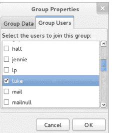

**图 14.7** 您可以使用“组属性”对话框将用户添加到组中。

- 3. “组用户”选项卡包含一个按字母顺序排列的用户列表；找到应该成为组员的用户，选择他们，然后点击“确定”。

或者，您可以通过单独更改每个用户的组员身份来管理组员资格，正如之前在“修改账户”中所描述的那样。

### 从 Shell 管理组

您可以使用 `groupadd` 命令从 shell 创建组，其工作方式与用户的 `useradd` 非常相似，但接收的选项集较小，其中最重要的选项见表 14.3。有关更冷门选项的信息，请参考该程序的 man 手册页。

> 认证目标

### 表 14.3 groupadd 选项

| 选项名称 | 选项缩写 | 效果 |
|---|---|---|
| `--gid GID` | `-g` | 您可以使用此参数提供特定的 GID。如果省略，`groupadd` 将使用下一个可用的 GID。 |
| `--non-unique` | `-o` | 通常，您指定的 GID 必须未被其他组使用，但 `-o` 参数会覆盖此行为，允许您创建多个共享同一个 GID 的组。 |
| `--system` | `-r` | 此参数指示 `groupadd` 创建一个系统组，其 GID 小于 500 或 1,000（取决于发行版）。非系统组通常用作用户私有组。 |
| `--force` | `-f` | 通常，如果您尝试创建一个已经存在的组，`groupadd` 会返回错误消息。此参数会抑制该错误消息。 |

要修改现有组，您有三种选择：

- `usermod` 命令包含 `--groups` (`-G`) 选项，用于按用户逐个修改组员身份。您可以使用此功能来调整谁是特定组的成员。
- 您可以使用 `groupmod` 命令。您可以使用表 14.3 中的 `--gid` (`-g`) 和 `--non-unique` (`-o`) 选项，以及 `--new-name name` (`-n name`) 来更改组名。但是，您不能使用 `groupmod` 更改组员身份。
- 您可以直接编辑存储组定义的 `/etc/group` 文件。如果您想将多个用户添加到一个新组，此选项有时很方便；但它有点冒险，因为一次误触按键就可能损坏该文件。

从 shell 删除组需要使用 `groupdel` 命令，它将组名作为唯一选项，例如 `groupdel ginkgo` 用于删除 ginkgo 组。

## WHEEL 组

Linux 发行版总是默认提供几个组。其中 `wheel` 组对于系统管理尤为重要，因为 `wheel` 组的成员被授予某些特殊的管理权限，例如使用 `sudo` 命令的权利。某些发行版允许您在安装操作系统时将主用户账户添加到 `wheel` 组。通常，安装程序不会使用这种措辞，而是询问您是否要将账户添加到“管理员组”或类似的术语中。

您可以通过此处描述的方法更改 `wheel` 组的成员。但在使用用户管理器时，您必须取消勾选“隐藏系统用户和组”选项，才能在组列表中看到 `wheel`。如果您使用其他 GUI 工具，可能需要寻找类似的选项。

## 要点总结及延伸

在 GUI 环境中，您可以使用 GUI 工具执行大多数常见的账户维护任务，通过从菜单和列表中选择选项来添加、修改和删除账户。然而，某些操作要求您使用命令行工具，如 `useradd`、`usermod`、`userdel` 和 `passwd`。（`groupadd`、`groupmod` 和 `groupdel` 命令为组提供了类似的功能。）即使您不需要使用文本模式工具提供的更冷门的功能，一旦您熟悉了它们，它们的使用速度可能比 GUI 工具更快。

### 建议练习

- 使用用户管理器（或您的发行版提供的其他 GUI 工具）创建一个测试账户，然后登录到创建的账户以验证其是否按预期工作。
- 使用 `useradd` 执行相同的操作，但**不要**使用 `passwd` 设置其密码。您能登录吗？使用 `passwd` 后再次尝试登录。


### 基础知识及进阶（续）

### 复习题

- 1. Linux 系统管理员应输入什么命令来删除 nemo 账户及其主目录？
    A. `userdeluser nemo`
    B. `userdel -f nemo`
    C. `userdel -r nemo`
    D. `rm /home/nemo`
    E. `rm -r /home/nemo`

- 2. 在以下选项中，哪个是最好的密码？
    A. LInusTorva1ds
    B. uB2op!q4%^*************
    C. 123456
    D. password
    E. peanutbuttersandwich

- 3. 假设以下命令执行成功，请描述其效果：
    `# groupadd henry`
    A. 创建一个名为 henry 的新组。
    B. 将用户 henry 添加到当前的默认组。
    C. 从名为 henry 的文件中导入组信息。
    D. 将用户的默认组更改为 henry。
    E. 将 henry 组添加到用户的组列表中。

- 4. 判断对错：用户账户的 UID 编号比系统账户更高。

- 5. 判断对错：命令行用户通常应使用 usermod 来更改其密码。

- 6. 判断对错：删除账户后，原属于该被删账户的文件可能会保留在计算机上。

- 7. 你想为新用户创建一个账户，使用用户名 theo 并给予 UID 1926。执行此操作的命令是 `useradd` ________。

- 8. 你想将用户的用户名从 e1211 更改为 emilyn，而不更改账户的其他任何信息。为此，你需要输入 ________。

- 9. 要创建系统账户，必须向 groupadd 传递 ________ 选项。

## 第 15 章：设置所有权和权限

作为一个多用户操作系统，Linux 提供了相关工具来帮助你保护文件免受未经授权的访问——毕竟，你肯定不希望另一个用户无意地（或故意地）读取你的个人文件，甚至删除你的文件！Linux 通过文件和目录的两个特性来处理这些任务：所有权（ownership）和权限（permissions）。每个文件都有一个关联的所有者（即与其链接的账户），以及一个关联的组。三组权限定义了文件的所有者、文件组的成员以及所有其他用户可以对该文件执行的操作。因此，所有权和权限是交织在一起的，尽管你使用不同的文本模式命令来操作它们。（如本章所述，GUI 工具通常将两者结合在一起。）

- 设置所有权
- 设置权限

> 在第 16 章“浏览 Linux 文件系统”中描述的设置用户 ID (SUID) 和设置组 ID (SGID) 权限位，可以修改与程序关联的账户和组。

## 设置所有权

Linux 的安全模型基于 Unix，而 Unix 被设计为一个多用户操作系统。因此，该安全模型假设计算机上存在多个用户，并提供了将单个文件与创建它的用户相关联的手段——也就是说，文件具有所有者。你应该彻底理解这个概念，在此基础上，你可以使用 GUI 文件管理器或文本模式 shell 来更改文件的所有权。

所有权也适用于运行中的程序（即进程）。你运行的大多数程序都与你启动它们时所使用的账户绑定。该身份与文件的所有权和权限共同决定了一个程序是否可以修改某个文件。

### 理解所有权

第 13 章“理解用户和组”以及第 14 章“创建用户和组”描述了 Linux 的账户系统。这些账户是文件所有权的基础。具体来说，每个文件都有一个所有者——一个与之关联的账户。这种关联是通过账户的用户 ID (UID) 编号实现的。每个文件还通过组 ID (GID) 编号与一个组关联。

正如稍后在“设置权限”部分所述，对文件的访问是通过权限来控制的，这些权限可以为文件的所有者、文件的组以及计算机的所有其他用户独立设置。作为 root 用户，你可以更改任何文件的所有者和组。文件的所有者也可以更改文件的组，但只能更改为其所属的组。

所有权在目录上的适用原则与在文件上的适用原则相同：目录同样具有所有者和组。这些可以通过 root 用户更改，或者在有限的范围内由目录的所有者更改。

### 跨安装的 UID 和 GID

你可能会使用多个 Linux 安装，无论是单机双启动还是安装在多台计算机上。如果是这样，且你在不同安装之间传输文件，你可能会发现文件的所有权在移动过程中似乎发生了变化。在非 Linux 的类 Unix 操作系统（如 Mac OS X）中也会发生同样的情况。原因是这些操作系统的文件系统使用 UID 和 GID 编号来存储所有权和组信息，而同一个用户或组在不同的计算机上可能有不同的 UID 或 GID 编号，即使与账户或组关联的名称完全相同。

在使用原生 Linux 或 Unix 文件系统传输数据时最容易出现这个问题，包括基于磁盘的文件系统（如 Linux 的 ext2fs 或 Mac OS X 的 HFS+）或用于远程文件访问的网络文件系统 (NFS)。如果你使用非 Linux/Unix 文件系统，例如磁盘上的文件分配表 (FAT) 或新技术文件系统 (NTFS)，或者使用服务器消息块/通用互联网文件系统 (SMB/CIFS；在 Linux 中由 Samba 处理) 进行网络访问，则不太可能出现这个问题。

如果你遇到了这个问题，存在几种解决方案，但其中许多超出了本书的范围。不过，你可以使用的一种方法是更改一个或多个安装上的 UID 或 GID 映射，使它们全部匹配。第 14 章描述了如何使用 usermod 更改用户的 UID 编号，以及如何使用 groupmod 更改组的 GID 编号。在通过可移动磁盘传输数据时，使用 FAT 或 NTFS 可能是一个简单的解决方案，前提是你不需要在文件中保留 Unix 风格的权限。

### 在文件管理器中设置所有权

正如第 4 章“使用常用 Linux 程序”中所述，文件管理器使你能够操作文件。你可能熟悉 Windows 或 Mac OS X 中的文件管理器。不过，Linux 的所有权和权限与 Windows 不同，因此你可能想知道如何使用 Linux 文件管理器来检查以及（可能地）更改所有权特性。如第 4 章所述，在 Linux 中你可以选择几种文件管理器。大多数在宏观上很相似，但在某些细节上有所不同。在本节中，我以 GNOME 文件管理器 Nautilus 为例。

如果你想更改文件的所有者，必须以 root 身份运行 Nautilus，但作为普通用户，你可以将文件的组更改为你所属的任何组。以 root 身份执行此任务的步骤如下：

- 1. 启动终端窗口。
- 2. 在终端窗口中，输入 `su` 以获取 root 权限。
- 3. 在终端窗口中，输入 `nautilus` 来启动 Nautilus。你可以选择地包含希望 Nautilus 启动时的目录路径。如果不包含路径，Nautilus 将开始显示 `/root` 目录的内容。
- 4. 定位到你想调整所有权的文件并右键单击它。
- 5. 在弹出的菜单中，选择“属性”（Properties）。结果是一个属性对话框。
- 6. 在属性对话框中，点击“权限”（Permissions）选项卡。结果类似于图 15.1。
- 7. 要更改文件的所有者，在“所有者”（Owner）字段中选择一个新所有者。只有在以 root 身份运行 Nautilus 时才能执行此操作。
- 8. 要更改文件的组，在“组”（Group）字段中选择一个新组。如果你以普通用户身份运行 Nautilus，你将能够选择任何你所属的组；但如果你以 root 身份运行 Nautilus，你将能够选择任何组。
- 9. 调整好想要更改的特性后，点击“关闭”（Close）。

如果你想更改文件的组而不想更改所有者，并且你是目标组的成员，你可以以普通用户身份启动 Nautilus。然后你可以从上述步骤 4 开始执行。

> 如果你使用的是 Ubuntu，你可能需要使用 `sudo` 来启动 Nautilus。

> `/root` 目录是 `root` 账户的主目录。


## 第 15 章 • 设置所有权和权限

**图 15.1** Linux 文件管理器允许您访问文件的所有权和权限元数据。

在以 root 身份运行 Nautilus 时，您应当*极其*谨慎。如果您忘记了自己是以 root 身份运行该程序，很容易以 root 身份创建新文件，而这需要额外的 root 权限操作（通过更改文件所有权）来纠正。此外，以 root 身份还很容易意外删除那些作为普通用户无法删除的关键系统文件。出于这些原因，我建议您使用文本模式的 shell 来调整文件所有权。提示符的变化让您更容易注意到自己正以 root 身份运行，而且如果您习惯于使用 GUI，那么从文本模式 shell 启动额外 root 程序的可能性比从 Nautilus 启动要低。

### 在 Shell 中设置所有权

在首选的文本模式下更改文件所有权的命令是 `chown`。在其最基本的形式中，您需要向其传递文件名，随后是用户名：

```
# chown bob targetfile.odf
```

这个例子将 targetfile.odf 的所有权交给了 bob。您可以通过用冒号 (:) 分隔所有者和组，使用单个命令同时更改文件的主要所有者及其组：

```
# chown bob:users targetfile.odf
```

> **认证目标**
> `chown` 命令的名字代表 change owner（更改所有者）。

这个例子将 targetfile.odf 的所有权交给 bob，并将该文件与 users 组关联。要在不更改所有者的情况下更改组，您可以省略所有者，仅保留冒号和组名：

```
$ chown :users targetfile.odf
```

或者，您可以使用 `chgrp` 命令，其工作方式相同，但*仅*更改组，并且在组名前不需要冒号：

```
$ chgrp users targetfile.odf
```

请注意，用于更改所有者的命令需要 root 权限，而您可以作为普通用户更改组——但前提是您必须拥有该文件并且属于目标组。

`chown` 和 `chgrp` 命令都支持一些用于修改其行为的选项。其中最有用的是 `-R`（或 `--recursive`），它会导致整个目录树中所有文件的所有权发生更改。例如，假设用户 mary 已经离职，现有员工 bob 必须访问她的文件。如果 mary 的家目录是 `/home/mary`，您可以输入：

```
# chown -R bob /home/mary
```

该命令将 `/home/mary` 目录、`/home/mary` 目录中的所有文件（包括所有子目录、子目录中的文件等）的所有权全部交给 bob。为了让 bob 的过渡更轻松一些，您可能还想将 mary 之前的家目录移动到 bob 的家目录中。

## 设置权限

如果没有一种方式来指定特定用户可以对其自身或其他用户的文件执行什么操作，那么文件所有权就毫无意义。这就是权限发挥作用的地方。Linux 的权限结构模仿了 Unix 的结构，在您处理这个问题之前需要一些解释。一旦您理解了基础知识，就可以开始使用 GUI 文件管理器或文本模式 shell 来修改权限。您还可以为您创建的新文件设置默认权限。

### 理解权限

要理解 Unix（以及 Linux）权限，您可以从 `ls` 命令创建的显示开始，该命令列出目录中的文件，并结合其 `-l` 选项，该选项会创建包含文件权限的长目录列表。例如，要查看文件 test 的长列表，您可以输入：

```
$ ls -l test
-rwxr-xr-x 1 rodsmith users 111 Apr 13 13:48 test
```

这一行由几个部分组成，提供了关于该文件的各种信息：

- **权限 (Permissions)** 第一列（本例中为 `-rwxr-xr-x`）是文件的权限，这是目前我们关注的重点。
- **链接数 (Number of links)** 下一列（本例中为 1）显示指向该文件的硬链接数量——也就是说，可以用作访问该文件的唯一文件名的数量。
- **用户名 (Username)** 下一列（本例中为 rodsmith）通过用户名标识文件的所有者。
- **组名 (Group name)** 接下来出现的是文件的组（本例中为 users）。
- **文件大小 (File size)** 本例中文件的大小非常小——111 字节。
- **时间戳 (Time stamp)** 时间戳（本例中为 Apr 13 13:48）标识文件最后一次修改的时间。
- **文件名 (Filename)** 最后，`ls -l` 显示文件名——本例中为 test。

该输出开头的字符串（本例中为 `-rwxr-xr-x`）是权限字符串的符号表示。图 15.2 显示了这个字符串是如何被分为四个部分的：

**图 15.2** 文件权限的符号表示分为四个部分。

**文件类型代码 (The file type code)** 第一个字符是文件类型代码，代表文件的类型，如表 15.1 所总结。当文件类型不相关或通过其他方式标识时，描述中有时会省略此类型字符。

> 第 6 章“了解命令行”介绍了 `ls` 命令，并描述了额外的 `ls` 选项。
> 第 7 章“管理文件”更详细地描述了链接。
> 您将操作的大多数文件是普通文件、目录和符号链接。

**所有者权限 (Owner permissions)** 这些权限决定了文件的所有者可以对该文件执行什么操作。

**组权限 (Group permissions)** 这些权限决定了文件组的成员（非所有者）可以对该文件执行什么操作。

**全球（或“其他”）权限 (World (or “other”) permissions)** 这些权限决定了既不是文件所有者也不是其组员的用户可以对该文件执行什么操作。

#### 表 15.1 Linux 文件类型代码

| 代码 | 名称 | 含义 |
| :--- | :--- | :--- |
| - | 普通数据文件 | 可能是文本、可执行程序、图形、压缩数据或任何其他类型的数据。 |
| d | 目录 | 磁盘目录也是文件，但它们包含文件名以及指向这些命名文件数据结构的指针。 |
| l | 符号链接 | 该文件包含另一个文件或目录的名称。当 Linux 访问符号链接时，它会尝试读取被链接的文件。 |
| p | 命名管道 | 管道使两个运行中的 Linux 程序能够以单向方式相互通信。 |
| s | 套接字 (Socket) | 套接字类似于命名管道，但它允许网络和双向链接。 |
| b | 块设备 | 对应于硬件设备的文件，数据以大于一个字节的块形式与之传输。磁盘设备（硬盘、软盘、CD-ROM 等）是常见的块设备。 |
| c | 字符设备 | 对应于硬件设备的文件，数据以单字节为单位与之传输。示例包括并行口和 RS-232 串口设备。 |

> 当然，在非程序文件上设置执行位并不会把它变成程序；它仅仅表示用户可以运行一个本身就是程序的文件。

在三组权限中，字符串标识了三种访问类型的存在或缺失：读取 (read)、写入 (write) 和执行 (execute)。读取和写入权限相当直观。如果存在执行权限，意味着该文件可以作为程序运行。权限的缺失在权限字符串中用短横线 (-) 表示。权限的存在则用字母 `r` 表示读取，`w` 表示写入，`x` 表示执行。

因此，示例权限字符串 `-rwxr-xr-x` 意味着该文件是一个普通数据文件，且其所有者、文件组员以及所有其他用户都可以读取和执行该文件。只有文件的所有者具有对该文件的写入权限。

权限还有另一种表示方法。它很紧凑但有点令人困惑：它将权限字符串中的三组权限（省略文件类型代码）中的每一组转换为一个 0 到 7 之间的数字（即 8 进制数）。结果是一个三位八进制数。每个数字的构建方式是从 0 开始，然后：

- 如果存在读取权限，则加 4
- 如果存在写入权限，则加 2
- 如果存在执行权限，则加 1

生成的三位代码分别代表所有者、组和全球的权限。表 15.2 显示了一些常见权限及其含义的示例。

#### 表 15.2 权限示例及其解释

| 权限字符串 | 八进制代码 | 含义 |
| :--- | :--- | :--- |
| `rwx rwx rwx` | 777 | 所有用户均具有读取、写入和执行权限。 |
| `rwxr-xr-x` | 755 | 所有用户均具有读取和执行权限。文件所有者还具有写入权限。 |
| `rwxr-x---` | 750 | 所有者和组具有读取和执行权限。文件所有者还具有写入权限。其他用户无法访问该文件。 |
| `rwx------` | 700 | 仅文件所有者具有读取、写入和执行权限；所有其他人无法访问。 |
| `rw- rw- rw-` | 666 | 所有用户均具有读取和写入权限。任何人都没有执行权限。 |
| `rw- rw- r--` | 664 | 所有者和组具有读取和写入权限。所有其他人仅具有只读权限。 |

这些步骤实际上涉及二进制数和逻辑运算而非算术运算。不过，算术描述更容易理解。

权限共有 512 种可能的组合，因此表 15.2 是不完整的。但它展示了最常见且最实用的组合。

(待续)

## 表 15.2 表（续）

| 权限字符串 | 八进制代码 | 含义
---|---|---
`r w- r w----` | 660 | 所有者和组具有读写权限。其他人没有权限。
`r w- r-- r--` | 644 | 所有者具有读写权限。所有其他用户仅具有只读权限。
`r w- r-----` | 640 | 所有者具有读写权限，组具有只读权限。其他人没有权限。
`r w-------` | 600 | 所有者具有读写权限。除此之外任何人都没有权限。
`r--------` | 400 | 所有者具有只读权限。除此之外任何人都没有权限。

权限中适用几个特殊情况：

**目录执行位** 目录使用执行位来授予搜索目录的权限。对于目录来说，这是一个非常重要的特性，因此当你看到读位被设置时，几乎总是能发现执行位也被设置了。

**目录写权限** 目录是以特殊方式解释的文件。因此，如果一个用户可以向目录写入，该用户就可以在目录中创建、删除或重命名文件，即使该用户不是这些文件的所有者且没有写入这些文件的权限。

**符号链接** 符号链接的权限始终是 777 (`rwxrwxrwx`，或者包含文件类型代码的 `lrwxrwxrwx`)。此访问权限仅适用于链接文件本身，而不适用于被链接的文件。换句话说，所有用户都可以读取链接的内容以发现它所指向的文件名称，但被链接文件的权限决定了对其文件的访问。更改符号链接的权限会影响到被链接的文件。

> 写入目录的常规规则可以通过粘滞位（sticky bit）进行修改，详见第 16 章。

**root** 许多权限规则不适用于 root。超级用户可以读取或写入计算机上的任何文件——即使是那些不授予任何人访问权限的文件（即权限为 000 的文件）。超级用户在运行程序文件时仍然需要设置执行位。

### 在文件管理器中设置权限

在文件管理器中设置权限的步骤与设置文件所有权的步骤类似：

- 你通常使用与调整所有权相同的对话框来调整这些设置，例如前面图 15.1 中显示的 Nautilus 对话框。
- 你不需要是 root 就可以调整你拥有的文件的权限。
- 你应该仅在不拥有的文件上使用 root 权限执行此操作。

如图 15.1 所示，有三个访问项目，分别与所有者（Owner）、组（Group）和其他人（Others）相关联：

- 所有者项目提供两个选项：只读（Read-Only）和读写（Read and Write）。
- 组和其他人项目均提供只读和读写，以及无权限（None）选项。你可以使用这些选项来设置文件的读写权限位。

Nautilus 要求通过勾选“允许将文件作为程序执行”（Allow Executing File As Program）复选框来单独设置执行位。此复选框会设置所有三个执行权限位；你无法使用 Nautilus 更精确地控制执行权限。你也不能使用 Nautilus 调整目录的执行权限。

### 在 Shell 中设置权限

在文本模式的 shell 中，你可以使用 `chmod` 来更改权限。这个命令相当复杂，主要是因为更改权限的方式多种多样。你可以通过两种形式指定权限：八进制数字或符号形式（一组与权限字符串表示相关的代码）。

模式的八进制表示与前面描述并汇总在表 15.2 中的一致。例如，要将 report.tex 的权限更改为 rw-r--r--r--，可以使用以下命令：

```
$ chmod 644 report.tex
```

相比之下，符号模式由三个组件组成：

- 一个指示你想修改的权限集的代码——`u` 代表用户（即所有者），`g` 代表组，`o` 代表其他用户，`a` 代表所有权限
- 一个指示你是想添加 (+)、删除 (-) 还是将模式设置为 (=) 指定值的符号
- 一个指定权限应为什么的代码，例如常见的 `r`、`w` 或 `x` 符号，以及用于更高级操作的其他各种符号

> 其他文件管理器的细节有所不同，但原理与此处描述的相同。

> 认证目标：`chmod` 命令的名称代表 change mode（更改模式），mode 是 permissions（权限）的另一种称呼。

使用 `chmod` 的符号模式可能会令人困惑，因此我在这里不详细描述；不过，你应该熟悉表 15.3 中汇总的几种常见用法。符号模式比八进制模式更灵活，因为你可以指定修改现有权限的符号模式，例如在不影响其他权限的情况下添加或删除执行权限。你还可以仅设置用户、组或世界的权限而不影响其他权限。而使用八进制模式时，你必须将所有三个权限位设置为你指定的值。

> 与 `chown` 和 `chgrp` 命令一样，你可以为 `chmod` 使用 `-R`（或 `--recursive`）选项，使其作用于整个目录树。

## 表 15.3 chmod 符号权限示例

| 命令 | 初始权限 | 最终权限 |
| :--- | :--- | :--- |
| `chmod a+x bigprogram` | `rw-r--r--` | `rwxr-xr-x` |
| `chmod ug=rw report.tex` | `r--------` | `rw-rw----` |
| `chmod o-rwx bigprogram` | `rwxrwxr-x` | `rwxrwx---` |
| `chmod g-w,o-rw report.tex` | `rw-rw-rw-` | `rw-r-----` |

## 设置 umask

*用户掩码*，或 *umask*，决定了新文件的默认权限。umask 是在创建新文件时从 666 (`rw-rw-rw-`) 权限中，或在创建新目录时从 777 (`rwxrwxrwx`) 权限中*移除*的值。例如，如果 umask 是 022，那么文件默认将以 644 权限创建，新目录将具有 755 权限。请注意，移除操作不是简单的减法，而是按位移除。也就是说，umask 中的 7 值会移除相应的 `rwx` 权限；但对于起点是 `rw-` 的文件，结果是 `---` (0)，而不是 -1（这是没有意义的）。

你可以使用 `umask` 命令来调整 umask，该命令接受 umask 值，如 `umask 022`。通常，此命令出现在系统配置文件（如 `/etc/profile`）或用户配置文件（如 `~/.bashrc`）中。

## 要点与延伸

在 Linux 这样的多用户操作系统上，文件安全性非常重要，而所有权是安全拼图的一部分。在 Linux 中，每个文件都有一个所有者和一个关联组。超级用户可以使用 `chown` 设置所有者，超级用户或文件所有者可以使用 `chgrp` 设置文件的组。所有权本身是没用的，因此 Linux 支持文件权限的概念，用于控制哪些其他用户可以访问文件以及以何种方式访问。你可以使用 `chmod` 工具设置权限。你可以使用 `ls` 命令的 `-l` 选项来查看所有权、权限和一些额外的文件特性。

### 建议练习

- 以 root 身份，复制一个你以普通用户身份创建的文件，将副本放在你的普通用户主目录中。使用你的普通账户，尝试用文本编辑器编辑该文件并保存更改。发生了什么？尝试用 `rm` 命令删除该文件。发生了什么？
- 以普通用户身份创建一个临时文件。以 root 身份，使用 `chown` 和 `chmod` 尝试不同类型的所有权和权限，以发现何时可以使用你的普通登录账户读取和写入该文件。
- 使用 `ls -l` 命令查看你主目录中、`/usr/bin`（许多程序文件所在地）以及 `/etc`（大多数系统配置文件所在地）中文件的所有权和权限。你看到的这些不同的所有权和权限对于谁能读取、写入和执行这些文件意味着什么？

### 复习题

1. 要将 somefile.txt 的所有权从 ralph 更改为 tony，（以 root 身份）你应该输入什么命令？
    - A. `chown ralph:tony somefile.txt`
    - B. `chmod somefile.txt tony`
    - C. `chown somefile.txt tony`
    - D. `chown tony somefile.txt`
    - E. `chmod tony somefile.txt`

（待续）

### 核心要点及进阶（续）

2. 输入 `ls -1d wonderjaye` 显示的符号文件模式为 `drwxr-xr-x`。以下哪些选项是正确的？（选择所有适用项。）
    A. wonderjaye 是一个符号链接。
    B. wonderjaye 是一个可执行程序。
    C. wonderjaye 是一个目录。
    D. 系统的所有用户都可以读取 wonderjaye。
    E. 该文件的组内任何成员都可以写入 wonderjaye。

3. 你可以使用以下哪个命令来更改文件的组？
    A. groupadd
    B. groupmod
    C. chmod
    D. ls
    E. chown

4. 判断对错：假设所有用户都可以读取其所在的目录，一个权限为 755 的文件可以被计算机上的任何用户读取。

5. 判断对错：只有 root 用户可以使用 chmod 命令。

6. 判断对错：只有 root 用户可以使用 chown 更改文件的所有权。

7. 哪个选项可以让 chown 更改整个目录树的所有权？

8. 哪个三个字符的符号字符串代表具有读和执行权限，但没有写权限？

9. 你可以向 chmod 传递什么样的符号表示，以赋予所有用户对文件的执行权限，而不影响其他权限？

## 第 16 章：浏览 Linux 文件系统

本书之前的几个章节曾提到过 Linux 计算机上文件的组织方式，甚至描述了一些具体细节——例如，/home 是存放用户主目录的目录。本章将详细探讨这一主题。首先是对一些关键 Linux 目录的描述，包括它们的名称和用途。我还描述了一些你可以设置在文件和目录上的特殊权限位，以影响 Linux 处理它们的方式。这些属性可以让你隐藏文件，或者以对共享用户目录有帮助的方式改变常规的权限规则。

- 理解文件存放位置
- 使用特殊权限位和文件特性

## 理解文件存放位置

正如第 6 章“认识命令行”中所描述的，Linux 使用统一的目录树——也就是说，每个分区、可移动磁盘、网络文件共享以及其他磁盘或类磁盘存储设备，都可以作为单个目录树（或文件系统）中的一个目录来访问。这个文件系统是有结构的——某些目录具有特定的用途，无论这些目录是作为单个分区上的普通子目录存在，还是作为挂载在根 (/) 设备上的独立设备。理解主目录的用途将帮助你定位文件并避免犯严重的错误。在深入探讨这些细节之前，你应该了解用户文件和系统文件之间的区别。

> “文件系统”一词可以指底层数据结构，也可以指计算机上文件和目录的组织方式。在本章中，后一种含义最为常见。

### 用户文件 vs. 系统文件

要理解用户文件和系统文件之间的区别，你应该回想起来 Linux 是一个多用户操作系统。原则上，一台计算机可以承载数千个用户。考虑这样一台计算机——可能是大学或大型企业的 mainframe，或者是云计算服务器。这台计算机的数千名用户中，绝大多数对 Linux 系统管理细节并不熟悉——他们只想使用文字处理器、电子邮件客户端和其他用户应用程序。这些用户不需要处理系统配置文件。事实上，给予他们访问此类文件的权限——尤其是写入权限——可能会导致灾难性的后果。在一台拥有 1,000 名用户且每人都能够更改系统配置的计算机上，无论是因为无知还是恶意，总会有人做出导致计算机崩溃的更改。

当然，保护计算机免受用户破坏的问题只是更普遍的用户账户问题的一个特例——在那台 1,000 用户的计算机上，你可能不希望用户能够读取和写入彼此的文件，除非在有限的范围内。因此，正如第 13 章“理解用户和组”和第 15 章“设置所有权和权限”中所描述的，你可以设置文件权限以防止未经授权的访问。

**认证目标**

系统文件是控制计算机如何运行的文件——它们包括：

- 启动服务器和其他重要守护进程的系统启动脚本
- 程序文件，包括二进制文件和脚本
- 程序支持文件，如字体和图标
- 定义系统工作方式的配置文件（网络配置设置、磁盘布局信息等）
- 大多数服务器和其他守护进程的配置文件
- 系统程序的数据存储，例如描述安装了哪些程序的数据库
- 记录正常系统活动的系统日志文件

第 9 章“使用程序和进程”描述了软件包管理。

显然，非技术用户不应该能够修改系统文件，除非是通过间接方式。（例如，日志文件记录登录尝试等活动。）用户必须能够读取某些类型的系统文件，例如他们使用的字体和图标，但某些系统文件甚至应该被禁止读取。例如，用户不应该能够读取 /etc/shadow 文件，因为它包含加密的密码。

为了实现限制普通用户访问系统文件的目标，这些文件通常由 root 或另一个用途较受限的系统账户所有。例如，许多服务器程序依赖于它们自己的特定系统账户。然后，可以通过根据具体需求以适当的方式设置权限，来保护系统文件免受不必要的访问。普通用户因此无法写入大多数系统文件，从而保护它们免受损害。因为 root 可以读取和写入任何文件，所以你必须获取 root 权限才能执行大多数系统维护任务。

在安装 Linux 后，其中包含的大多数文件都是系统文件，且新安装的 Linux 上的大多数目录和子目录都是系统目录。正如稍后所述，有几个目录（如 /home 和 /tmp）被预留给用户文件，尽管它们的结构或配置方式是为了防止多用户访问出现问题。

> 用户的主目录传统上位于 /home，而 /tmp 对所有用户开放并存放临时文件。

即使在单用户 Linux 计算机（如你的个人笔记本电脑）上，系统文件和用户文件之间的区别依然存在。这可能看起来很奇怪或令人沮丧；毕竟，如果你是唯一的用户，并且拥有 root 访问权限，为什么还要费心区分系统文件和用户文件？答案是，它提供了一层保护，以防止意外或恶意的损坏。如果一个输入错误、一个 bug 或恶意软件试图删除计算机上的所有文件，那么如果该操作是以普通用户而非 root 身份执行的，损害将被控制在一定范围内——普通用户无法删除计算机上的所有文件。因此，即使在单用户计算机上，这两种账户类型（以及由此延伸的这两类文件）之间的区别也是有用的。

### 文件系统层次结构标准

虽然每个 Linux 发行版在处理某些事情时都有自己独特的方式，但它们的开发人员都意识到在目录布局方面需要某种标准化。例如，程序在所有发行版中应该能够一致地在相同位置找到关键的系统配置文件。如果不是这样，依赖这些功能的程序会变得更加复杂，并且可能无法在所有发行版上运行。为了解决这个需求，*文件系统层次结构标准* (FHS) 应运而生。除了 Linux 之外，一些类 Unix 操作系统也在不同程度上遵循 FHS。

> FHS 演变自早期仅适用于 Linux 的标准——文件系统标准 (FSSTND)。

FHS 做出的一个重要区分是 *可共享文件* (shareable files) 和 *不可共享文件* (unshareable files)。可共享文件可以在计算机之间合理地共享，例如用户数据文件和程序二进制文件。（当然，你不一定需要共享这些文件，但你可以这样做。）如果文件被共享，它们通常通过网络文件系统 (NFS) 服务器共享。不可共享文件包含特定于系统的信息，例如配置文件。例如，你可能不想在计算机之间共享服务器的配置文件。

FHS 做出的第二个重要区分是 *静态文件* (static files) 和 *变量文件* (variable files)。前者通常不会更改，除非由系统管理员直接干预。大多数程序可执行文件都是良好的

静态文件的示例。可变文件可能会被用户、自动化脚本、服务器等更改。例如，用户的主目录和邮件队列就是由可变文件组成的。

FHS 试图将每个目录隔离到这个 $2 \times 2$（可共享/不可共享 $\times$ 静态/可变）矩阵的一个单元格中。图 16.1 展示了这些关系。某些目录包含分布在多个单元格中的子目录，但在这些情况下，FHS 试图指定特定子目录的状态。例如，`/var` 是可变的，它包含一些可共享和一些不可共享的子目录，如图 16.1 所示。

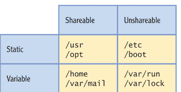
**图 16.1** FHS 试图将每个重要目录放入 $2 \times 2$ 矩阵的一个单元格中。

FHS 分为多个版本。在我撰写本书时，最新版本是 2.3 版，于 2004 年 1 月发布。FHS 官方网页的 URL 是 `http://www.pathname.com/fhs/`。

## 重要目录及其内容

FHS 定义了 Linux 系统中许多目录和子目录的名称和用途。表 16.1 总结了其中最重要的部分。这些目录大多是系统目录，主要的例外是 `/home`、`/tmp`、`/mnt` 和 `/media`。

**表 16.1** 根据 FHS 定义的重要 Linux 目录

| 目录 | 用途 |
|---|---|
| / | 根目录；所有文件都出现在此目录或其子目录中。 |
| /etc | 存放系统配置文件。 |
| /boot | 存放重要的引导文件，如 Linux 内核、初始 RAM 磁盘，以及通常包含的引导加载程序配置文件。 |
| /bin | 存放对正常运行至关重要且普通用户可以运行的程序文件。 |
| /sbin | 存放对正常运行至关重要但普通用户很少运行的程序文件。 |
| /lib | 存放库文件——被许多其他程序使用的代码——这些库对于基础系统运行至关重要。 |
| /usr | 存放正常系统运行中使用的程序和数据，但对于系统的精简启动（bare-bones boot）并非至关重要。该目录被分为镜像根组织部分的子目录——`/usr/bin`、`/usr/sbin`、`/usr/lib` 等。 |
| /home | 存放用户的主目录。将此目录分离到自己的低级文件系统中，可以有效地将大多数用户数据与操作系统隔离，如果你想在不丢失用户数据的情况下重新安装操作系统，这将非常有用。 |
| /root | root 用户的主目录。请注意，这与发音同样为 root 的 `/` 不同。 |
| /var | 存放各种临时文件，如日志文件和打印缓存文件。`/var` 的一个子目录 `/var/tmp` 值得特别提到。与 `/tmp`（下文描述）类似，`/var/tmp` 存放临时文件。这些文件在计算机重启时**不应**被删除。 |
| /tmp | 存放临时文件，通常包括用户程序创建的临时文件。从理论上讲，此类文件在计算机重启时可以被删除，尽管在实践中许多发行版并不这样做。 |
| /mnt | 可移动介质的传统挂载点；有时为每个挂载的文件系统分为子目录。 |
| /media | 可移动介质的新挂载点；通常为每个挂载的文件系统分为子目录。 |
| /dev | 存放设备文件，提供对硬件的低级访问。 |

> FHS 已经稳定多年。Fedora 计划在 Fedora 17 中进行更改，这将违反或需要对 FHS 进行修改。

认证目标

作为普通用户，你将在主目录中创建大多数文件，主目录通常是 `/home` 的一个子目录。你可能还会访问挂载在 `/media` 的可移动介质，以及可能挂载在其他位置的网络资源。你也可以使用 `/tmp` 和 `/var` 的某些子目录，尽管大多数用户不需要显式地意识到这些位置——程序通常被硬编码为将它们用于临时文件或特定类型的文件（如接收到的电子邮件文件）。作为系统管理员，你可以操作位于这些目录中任何位置的文件；然而，对于系统管理员来说，`/etc` 尤为重要，因为大多数系统配置文件都驻留在那里。当你使用 GUI 或文本模式工具探索计算机时，应牢记这个目录结构。

在这些目录中，有几个单独的目录或目录集合需要特别注意：

- **配置目录**：`/etc` 目录存放大多数系统配置文件。之前的章节已经提到过几个此类文件，例如 `/etc/fstab`（定义分区挂载位置）和 `/etc/passwd`（主要账户定义文件）。此外还存在很多其他文件。事实上，你会在 `/etc` 中发现子目录，用于存放复杂子系统和服务器的多个配置文件，例如 `/etc/X11`（用于 X Window 系统）和 `/etc/samba`（用于 Samba 服务器文件）。

- **可执行目录**：程序主要驻留在 `/sbin`、`/bin`、`/usr/sbin` 和 `/usr/bin` 中。（在某些系统中，其他目录也可以存放程序文件。）最值得注意的是，`/usr/local/sbin` 和 `/usr/local/bin` 存放本地编译的程序。

- **库目录**：库是编程函数的集合，可供许多程序使用。它们被存储在单独的文件中，以便在程序运行时节省磁盘空间和 RAM，并能够在不重新安装所有依赖它们的程序的情况下轻松更新库文件。在 Linux 中，大多数库驻留在 `/lib` 和 `/usr/lib` 中，但在某些系统上，某些库可能驻留在其他地方（如 `/usr/local/lib`）。

如果你管理过 Windows 计算机，你应该意识到 Windows 和 Linux 之间的一个重要区别：在 Windows 中，程序的二进制文件、其配置文件及其所有支持文件通常驻留在属于该程序的单个目录树中，例如 `C:\Program Files\SomeProgram`。相比之下，在 Linux 中，程序的大多数关键文件可能会驻留在与其他程序共享的标准位置中，并且分散各处。例如，程序的执行文件可能在 `/usr/bin` 中，相关库在 `/usr/lib` 中，配置文件在 `/etc` 或用户主目录中，等等。这在 Linux 中运行良好，因为第 9 章描述的 Linux 软件包系统会跟踪一个软件包的许多文件去向，使你能够轻松删除或升级软件包。Linux 系统的优势在于简化了*路径*（path），即程序文件驻留的目录列表。（库和帮助页也有路径。）不过，如果你习惯于在程序特定的位置寻找文件，适应 Linux 系统可能会感到不便。关键是使用你的软件包系统来识别软件包文件的位置；例如，在基于 RPM 的系统上输入 `rpm -ql someprogram` 可以显示 `someprogram` 软件包中的每个文件驻留在何处。

> 普通用户无法向大多数系统目录（如 `/usr`）写入。因此，如果你是以普通用户身份运行，可以通过检查这些目录而不会损坏你的安装！

> 请参阅侧边栏“Fedora 17 与 FHS”，了解 Fedora 计划对其存储程序文件位置所做的更改信息。

认证目标

### FEDORA 17 与 FHS

Fedora 的开发人员宣布，他们打算将几个目录的内容合并在一起——例如，将 `/bin`、`/sbin`、`/usr/bin`、`/usr/sbin` 和 `/usr/sbin` 合并到一个单一目录（`/usr/bin`）中。这种更改违反了 FHS，但它是否会引起任何问题仍有待观察。（截至本文撰写时，Fedora 17 尚未发布。）

## 使用特殊权限位和文件特性

当你研究 Linux 目录树时，会遇到某些需要特别注意的文件类型。有时你可能只需要意识到这些文件是如何处理的，因为它们与你根据前几章信息所预期的不同。在其他情况下，你可能需要调整使用 `ls` 或其他命令的方式来处理这些文件和目录。这些特殊情况包括“粘滞位”（sticky bit）、隐藏文件、获取目录的长列表以及使用特殊的执行权限。

### 使用粘滞位

考虑以下命令，这些命令是在一个具有特定布局的文件和子目录的系统上输入的：

> 认证目标

```
$ whoami
kirk
$ ls -l
total 0
drwxrwxrwx 2 root root 80 Dec 14 17:58 subdir
$ ls -l subdir/
total 2350
-rw-r----- 1 root root 2404268 Dec 14 17:59 f1701.tif
```


这些命令建立了当前的配置：有效用户 ID 为 kirk，当前目录下有一个名为 subdir 的子目录，该目录由 root 所有，但 kirk 和所有系统用户一样，拥有完整的读/写权限。该子目录下有一个文件 f1701.tif，由 root 所有，kirk 没有访问权限。你可以尝试使用 touch 命令写入该文件，以此验证 kirk 无法写入：

```
$ touch subdir/f1701.tif
touch: cannot touch `subdir/f1701.tif': Permission denied
```

这个错误消息证实了 kirk 无法写入 subdir/f1701.tif。你可能会认为，该文件现在免受篡改。别高兴得太早！试试这个：

```
$ rm subdir/f1701.tif
$ ls -1 subdir/
total 0
```

rm 命令没有返回任何错误消息，随后的 subdir 检查证实它现在为空——换句话说，即使没有对文件的写入权限，kirk 也能删除该文件！这看起来像个 bug——毕竟，如果你不能写入一个文件，你可能会认为你也不应该能删除它。然而，请记住，目录只是一种特殊类型的文件，它保存着其他文件的名称以及指向其底层数据结构的指针。因此，修改文件需要对该文件的写入权限，但创建或删除文件需要对其所在的目录拥有写入权限。在本例中，kirk 对 subdir 目录拥有写入权限，但对该目录内的 f1701.tif 文件没有写入权限。因此，kirk 可以删除该文件但不能修改它。这个结果不是 bug，而是一个反直觉的特性。

> 第 15 章介绍了 chown 的基础知识。

虽然 Linux 文件系统被设计为这样工作，但这种行为并不总是理想的。要创建一个更直观的结果，可以使用粘滞位（sticky bit），这是一种特殊的文件系统标志，可以改变这种行为。当目录设置了粘滞位后，Linux 仅在你是文件所有者或包含目录的所有者时才允许你删除文件；仅拥有包含目录的写入权限是不够的。你可以使用 chmod 通过两种方式之一设置粘滞位：

> 其他奇数也会设置粘滞位，但同时还会设置额外的特殊权限位，这些将在接下来的“使用特殊执行权限”中详细描述。

- **使用八进制代码**：通过在第 15 章描述的 3 位八进制代码前加上另一个数字，你可以设置三个特殊权限位中的任何一个，其中之一就是粘滞位。粘滞位的代码是 1，因此你会使用以 1 开头的八进制代码（如 1755）来设置粘滞位。指定 0（如 0755）则会移除粘滞位。

- **使用符号代码**：为 others 权限传递符号代码 t，例如 `chmod o+t subdir`，即可为 subdir 设置粘滞位。你可以通过使用减号以类似方式移除粘滞位，例如 `chmod o-t subdir`。

恢复文件并设置粘滞位后，你就能看到效果：

```
$ ls -l -1
total 0
drxwxrwxrwt 2 root root 80 Dec 14 18:25 subdir
$ ls -l subdir/
total 304
-rw-r--r-- 1 root root 2404268 Dec 14 17:25 f1701.tif
$ rm subdir/f1701.tif
rm: cannot remove `subdir/f1701.tif': Operation not permitted
```

在这个例子中，尽管 kirk 仍然对 subdir 拥有完整的读/写权限，但 kirk 无法删除该目录中其他用户的文件。

你可以通过 `ls -l` 显示的符号模式的一处微小变化来识别设置了粘滞位的目录：others 的执行位显示为 t 而不是 x。在本例中，结果是 subdir 的权限显示为 drwxrwxrwt 而不是 drwxrwxrwx。

粘滞位对于由许多用户共享的目录尤为重要。例如，它是 /tmp 和 /var/tmp 的标准特性，因为许多用户在这些目录中存储临时文件，你不希望某个用户能够删除另一个用户的临时文件。如果你希望在项目上协作的用户能够将文件写入彼此的主目录，你可能会考虑在这些主目录或用户共享文件的子目录上设置粘滞位。

> 如果你删除了 /tmp 或 /var/tmp 并且需要重新创建它，请务必在新的替代目录上设置粘滞位！

### 使用特殊执行权限

正如第 15 章所述，执行权限位使你能够将程序文件标识为可执行文件。Linux 随后允许你运行这些程序。此类程序使用你自己的凭据运行，这通常是一件好事——将运行中的进程与特定用户关联是 Linux 安全模型的核心部分。不过，有时程序需要以提升的权限运行。例如，用于设置用户密码的 passwd 程序必须以 root 身份运行，才能写入（在某些情况下还要读取）它处理的配置文件。如果用户正在更改自己的密码，即使是由普通用户运行，passwd 也必须拥有 root 权限。

为了完成这项任务，存在两个特殊的权限位，类似于前面描述的粘滞位：

> 认证目标

- **设置用户 ID (SUID)**：设置用户 ID (SUID) 选项告诉 Linux 以文件所有者的权限运行程序，而不是以运行该程序的用户的权限运行。例如，如果一个文件由 root 所有并且设置了 SUID 位，则该程序将以 root 权限运行，因此可以读取计算机上的任何文件。一些服务器和其他系统程序以此方式运行，这通常被称为 SUID root。SUID 程序在权限字符串的所有者执行位位置由 `s` 表示，如 `rwsr-xr-x`。

- **设置组 ID (SGID)**：设置组 ID (SGID) 选项与 SUID 选项类似，但它将运行程序的组设置为文件的组。它在权限字符串的组执行位位置由 `s` 表示，如 `rwxr-sr-x`。

你可以使用 `chmod` 设置这些位：

- **使用八进制代码**：在 4 位八进制代码的首位中，将首位值设置为 4 以设置 SUID 位，设置为 2 以设置 SGID 位，或设置为 6 以同时设置这两个位。例如，4755 会在可执行文件上设置 SUID 位，但不会设置 SGID 位。

- **使用符号代码**：使用 `s` 符号代码，结合 `u` 指定 SUID 位，`g` 指定 SGID 位，或两者结合以同时设置。例如，输入 `chmod u+s myprog` 为 `myprog` 设置 SUID 位，而 `chmod ug-s myprog` 则同时移除 SUID 位和 SGID 位。

通常情况下，你不需要设置或移除这些位：在必要时，软件包管理程序会在你安装或升级程序时正确设置这些位。如果文件上的这些位被误设或误删，你可能需要修改它们。在某些情况下，如果你从源代码编译程序文件，或者需要修改程序的工作方式，你可能想要或需要调整这些值。但在这样做时要非常小心。如果你在普通程序上设置 SUID 或 SGID 位，它将以更高的权限运行。如果程序包含 bug，那么这些 bug 将能够造成更大的破坏。如果你意外地移除了这些权限，结果可能同样糟糕——像 `passwd`、`sudo` 和 su 这样的程序都依赖于它们的 SUID 位被设置，因此移除此特性会导致它们停止工作。

## 隐藏文件

如果你习惯于 Windows，你可能熟悉 *隐藏位（hidden bit）* 的概念，它在文件管理器、Windows `DIR` 命令以及大多数程序中将文件隐藏。如果你在 Linux 中寻找类似的东西，你将找不到，至少不是以专门的文件系统特性的形式存在。相反，Linux 使用一种文件命名约定来隐藏文件：大多数工具（如 `ls`）如果文件名以点 (.) 开头，就会将文件和目录从视图中隐藏。因此，`ls` 会显示文件 `afile.txt` 但不会显示 `.afile.txt`。大多数处理文件的文件管理器和对话框也会隐藏这类通常被称为 *点文件（dot files）* 的文件；不过，这种做法并非普遍适用。

> 认证目标


许多用户程序利用这一特性来防止其配置文件使你的显示界面变得混乱。例如，`~/.bashrc`是一个 Bash 用户配置文件，Evolution 的配置文件位于`~/.evolution`目录中，而`~/.fonts.conf`则保存用户特定的字体配置信息。

你可以根据具体程序的不同，通过多种方式查看点文件（dot files）。一些 GUI 工具在配置选项中提供了一个复选框，你可以设置它以强制程序显示此类文件。在命令行中，你可以对 ls 使用 `-a` 选项：

```
$ ls -l
total 0
drwxrwxrwt 2 root root 80 Dec 14 18:25 subdir
$ ls -la
total 305
drwxr-xr-x 3 kirk users 104 Dec 14 18:44 .
drwxr-xr-x 3 kirk users 528 Dec 14 18:21 ..
-rw-r--r-- 1 kirk users 309580 Dec 14 18:44 .f1701.tif
drwxrwxrwt 2 root root 80 Dec 14 18:25 subdir
```

这个示例显示了当前目录中的隐藏文件 `.f1701.tif`。它还显示了两个隐藏目录文件。第一个 `.` 指的是当前目录，第二个 `..` 指的是父目录。

请注意，将文件重命名为以点开头会将其隐藏，但此操作也会导致任何使用原文件名的程序无法访问该文件。也就是说，如果你将 `f1701.tif` 重命名为 `.f1701.tif`，并且另一个程序或文件将其引用为 `f1701.tif`，那么该引用将不再生效。在对隐藏文件的任何引用中，你 *必须* 包含前导点。

## 查看目录

第 6 章介绍了 `ls` 命令及其许多选项。其中一个选项在此需要详细阐述：`-d`。如果你在一个包含许多子目录的目录中工作，并且使用了像 `*` 这样匹配一个或多个子目录的通配符，你可能会得到一个意外的结果：输出将显示匹配子目录中的文件，而不是子目录本身的信息。例如，在一个具有两个子目录 `subdir1` 和 `subdir2` 的目录中启动：

```
$ ls -l subdir*
subdir1:
total 304
-rw-r--r-- 1 kirk users 309580 Dec 14 18:54 f1701.tif

subdir2:
total 84
-rw-r--r-- 1 kirk users 86016 Dec 14 18:54 106792c17.doc
```

> 认证目标
> 回想第 6 章，`..` 是一个相对目录引用。正是因为这个隐藏条目的存在，它才能起作用。

如果你想要的是子目录的信息，而不是这些子目录的内容，你可以包含 `-d` 选项：

```
$ ls -ld subdir
drwxr-xr-x 2 kirk users 80 Dec 14 18:54 subdir1
drwxr-xr-x 2 kirk users 80 Dec 14 18:54 subdir2
```

## 核心要点及延伸

Linux 的目录树根据文件的功能将文件放置在特定位置——程序二进制文件、库、配置文件、用户文件等等。了解这些文件的存放位置将帮助你定位它们（例如寻找配置文件）。当你寻找文件时，你应该意识到一些有用的工具和文件系统特性——如果你不了解它们，这些特性可能会让你感到困惑。粘滞位（Sticky bits）、隐藏（".dot"）文件、ls 的 `-d` 选项以及 SUID 和 SGID 特性，在你查看或修改文件（尤其是系统文件）时都非常重要。

### 建议练习

- 检查 `/etc` 中配置文件的名称，并尝试在 `/bin`、`/sbin`、`/usr/bin` 和 `/usr/sbin` 中找到匹配的程序文件。使用 `less` 或文本编辑器检查配置文件，并阅读它们的 man 手册。（不过不要对 `/etc` 中的所有配置文件都这么做——那会花掉一辈子的时间！选几个就足够了。）
- 在一个“临时（scratch）”目录上实验粘滞位。使用你的普通账户以及另一个普通账户或 root 账户，以不同方式设置临时目录的所有权和粘滞位，并测试你是否可以删除和修改该目录中的文件。

### 复习题

1. 根据 FHS，你在 `/usr/lib` 中最可能找到什么类型的文件？
    A. Liberty 文件
    B. Liberated 文件
    C. Libra 文件
    D. Library 文件（库文件）
    E. Liberal 文件

2. 你想发现一个目录中几个点文件的大小。你会使用以下哪个命令来实现？
    A. `ls -la`
    B. `ls -p`
    C. `ls -R`
    D. `ls -d`
    E. `ls -ld`

3. 程序何时应该被配置为 SUID root？
    A. 任何时候；可执行程序都需要此权限。
    B. 每当程序需要能够访问设备文件时。
    C. 仅当它们需要 root 权限来执行工作时。
    D. 每当程序必须能够访问账户的用户 ID (UID) 号时。
    E. 绝不；此权限是一个严重的安全风险。

4. 判断对错：打印缓存文件存储在 `/var` 的一个子目录中。

5. 判断对错：在一个配置正确的 Linux 系统上，任何用户都可以删除 `/tmp` 中的任何文件。

6. 判断对错：如果你通过将其变为点文件来隐藏 Linux 中的一个文件，则必须更改配置文件中对该文件的所有现有引用，这些引用才能继续工作。

7. 通常，光盘和 USB 闪存盘挂载在 `/mnt` 或 ________ 的子目录中。

8. 保证在重启期间 *不会* 被删除的临时文件位于 ________。

9. 你想在不改变现有权限的情况下，为现有目录 `subdir` 设置粘滞位。为此，你应该输入 `chmod ____ subdir`。

## 第 17 章：管理网络连接

*网络是* 现代计算的关键部分。幸运的是，大多数 Linux 发行版通常可以自动创建网络连接；然而，有时这个过程不起作用，或者你可能需要在出现问题时调整连接或调试问题。因此，本章涵盖了网络配置。

我首先描述一些你必须理解才能正确管理网络配置的基础网络特性。然后，我描述配置网络连接的过程。几个测试将帮助你追踪并纠正问题，因此我在你遇到困难时会解释它们。最后，我探讨网络阴暗面：互联网上的不速之客以及如何让他们远离你的计算机。

- 理解网络特性
- 配置网络连接
- 测试你的网络连接
- 保护你的系统免受坏人侵害

## 理解网络特性

网络涉及许多以复杂方式相互作用的协议和技术。虽然现代网络和操作系统使用户设置计算机变得非常简单（至少与 10 或 20 年前相比），但要进行除最简单配置之外的任何操作，都需要理解关键的网络协议和技术。首先，我提供以下网络术语微词典：

**认证目标**

**DNS** *域名系统 (DNS)* 是一个全球服务器网络，用于在 *主机名 (hostnames)* 和 *IP 地址 (IP addresses)* 之间进行转换（两者稍后描述）。大多数计算机被配置为使用 *DNS 服务器*，即执行 DNS 查询的服务器。

**DHCP** *动态主机配置协议 (DHCP)* 是网络上的大多数计算机从网络上的另一台计算机（DHCP 服务器）获取配置信息的一种方式。DHCP 是如今便捷网络配置的关键。在接下来的“决定是否使用 DHCP”章节中将对其进行更详细的描述。

**Ethernet (以太网)** 这是目前最常用的有线网络硬件。以太网有多种类型，其中最常见的是使用类似于电话线但插头更宽的电缆。常见速度范围从 10 兆比特每秒 (Mbps) 到 1 吉比特每秒 (Gbps，或 *千兆以太网*)，尽管还有更高速率可用。

**Hostname (主机名)** 这是计算机为了方便人类而使用的一个名称。主机名由计算机部分和网络部分组成。例如，在 `lunokhod.luna.edu` 中，`lunokhod` 是机器名，`luna.edu` 是网络名。

**Internet (互联网/因特网)** 当泛指时（使用小写 *i*），*word internet* 指的是通过 *路由器 (routers)*（稍后描述）连接的网络之网络。而使用大写 *I* 时，*word Internet* 指的是你无疑熟悉的全球范围网络。Internet 是有史以来创建的最大 internet。

**IP address (IP 地址)** *互联网协议 (IP)* 地址是为计算机分配的一个用于网络寻址的数字。你可以将 IP 地址想象成街道地址或电话号码。计算机通过 IP 地址相互通信。过去，四字节的 *IPv4* 地址占据主导地位；然而，IPv4 地址池最近已经枯竭，因此许多新安装现在使用 16 字节的 *IPv6* 地址。IP 地址分为两部分：机器部分和网络部分。网络部分可用于路由（见 *router*），而机器部分则标识给定网络上的一台计算机。这种机器地址和网络地址的划分是通过 *网络掩码 (network mask)* 实现的，如下所述。

**Network mask (网络掩码)** *网络掩码*（简写为 mask 或 *netmask*）是一种区分 IP 地址的网络部分和机器部分的方法。网络掩码定义了 IP 地址中属于地址每个部分的单个比特。这可以通过给机器地址的每个比特赋予二进制值 1 并将结果表示为一个数字（例如 IPv4 地址的 255.255.255.0），或者通过指定地址机器部分的比特数（如 16 或 24）来完成。

> 虽然存在其他名称解析手段，但对于处理超过几十台计算机的情况是不切实际的。

> 虽然存在其他有线网络方法，但大多数要么已经过时，要么用于极高速、远距离或其他特殊用途。

**认证目标**


## 配置网络连接

**路由器 (Router)** *路由器*（也称为*网关*）将两个或多个网络连接在一起。您的台式机或服务器电脑可能会直接连接到少数其他计算机，其中包括一台路由器。路由器连接到另一个网络，而该网络又连接到另一个，依此类推。要访问另一个网络上的计算机，您的计算机需要通过路由器进行通信。家庭和小企业经常使用小型**宽带路由器**来连接到互联网。此类设备执行路由功能，并内置了 DNS、DHCP 和其他有用的服务。

**TCP/IP** *传输控制协议/互联网协议 (TCP/IP)* 是一套标准，构成了大多数现代网络通信在软件层面的基础。

**Wi-Fi** 该术语适用于最常见的无线网络形式，更准确的名称是 *IEEE 802.11*。目前有多种在速度上有所不同的变体。本章后面的“配置 Wi-Fi 连接”部分将更详细地描述 Wi-Fi 配置。

创建网络连接的过程包括为计算机分配一个 IP 地址和相关的子网掩码。通过使用 IP 地址，计算机可以与本地网络上的其他计算机通信——也就是说，任何不需要路由器作为中介的通信。在大多数情况下，您需要告知计算机网络路由器的信息，以便它可以与其他网络分段（通常包括整个互联网）上的计算机通信。为您的计算机提供 DNS 服务器的 IP 地址将使您能够指定计算机主机名而不是 IP 地址，这是一个非常实用的功能。因此，这四个特性——IP 地址、子网掩码、路由器的 IP 地址和 DNS 服务器的 IP 地址——构成了基础的网络配置特性。

在大多数情况下，DHCP 可以分配这四个特性。正如您在本章中将看到的，这可以使网络配置相当自动化。但是，如果您的网络不支持 DHCP，则需要联系您的网络管理员以获取关键的配置信息。在某些情况下，您还需要更多信息。例如，如果您使用 Wi-Fi，则需要知道 Wi-Fi 网络的名称，可能还需要它的密码。

在大多数情况下，您的网络连接会自动建立（或接近自动）。但有时，您必须手动调整配置，或者简单地激活它。如果可用，自动配置是通过 DHCP 处理的，因此我首先详细描述它。然后，我将涵盖一个仅适用于某些系统的课题：配置 Wi-Fi。如果您必须在设置其他网络选项之前配置 Wi-Fi，一旦 Wi-Fi 配置完成，其余的网络设置步骤与有线网络非常相似。随后，我将提供一个使用 GUI 工具进行网络配置的示例；这些工具易于使用且能处理大多数情况。最后，我将介绍基于文本的配置工具，它们提供了您在某些设置中可能需要使用的大量功能。

> 认证目标：存在多种 TCP/IP 的替代方案，例如 AppleTalk、NetBEUI 和 IPX/SPX。然而，TCP/IP 是最常见的网络协议，也是互联网的基础。

### 决定是否使用 DHCP

如前所述，计算机连接到典型网络至少需要两项信息：一个 IP 地址和一个子网掩码。在大多数网络中，路由器和 DNS 服务器的 IP 地址是实际必需的，尽管在某些情况下您可以省去其中一个或全部。某些网络还需要额外的配置细节。

为大型网络上的每台计算机配置所有这些信息可能非常耗时。更糟糕的是，这可能会导致人为错误引起的问题，例如 IP 地址中的拼写错误。因此，大多数网络提供 DHCP 服务器，它可以向其他计算机提供这些信息。

根据服务器的配置，DHCP 可以通过以下两种方式之一交付 IP 地址：

- 以固定方式，使每台计算机在每次启动时都接收到相同的 IP 地址
- 以动态方式，使单台计算机在不同启动时可能会接收到不同的 IP 地址

使用哪种方式是网络管理员的策略细节。您无需关注这一点，只需知道通过 DHCP 配置的计算机不一定保证在每次启动时都接收到相同的 IP 地址。这一事实可能会产生重要影响。例如，如果服务器计算机拥有固定 IP 地址，通常配置起来最简单且最可靠。因此，作为一项策略，服务器计算机通常在配置时 *不* 使用 DHCP，即使同一网络上的工作站使用 DHCP。但情况并非总是如此——如前所述，DHCP 可以向部分或全部计算机交付固定地址，因此 DHCP 服务器管理员可以用这种方式配置网络的服务器。

从实际操作来看，除非您在配置自己的小型私有网络，否则您应该询问网络管理员新计算机是否使用 DHCP。如果答案是 *否*，您应该询问 IP 地址、子网掩码、路由器的 IP 地址和 DNS 服务器的 IP 地址。

> DHCP 甚至可以使用更低级别的寻址方法向没有 IP 地址的计算机交付信息。

> 如果您使用宽带路由器配置家庭或小型办公室网络，该路由器几乎 certainly 包含一个您可以使用 DHCP 服务器。详情请参阅其文档。

### 创建 Wi-Fi 连接

Wi-Fi 连接最常用于笔记本电脑和小型便携式计算机，因为在不使用物理网络电缆的情况下使用此类设备通常更方便。不过，一些台式机也具有 Wi-Fi 能力，您可能想要使用它们。

在继续之前，请注意您必须能够访问 Wi-Fi 网络。如果您正在配置计算机以连接到您购买并设置的宽带路由器，请参阅路由器的文档，学习如何查找路由器的关键信息，例如服务集标识符 (SSID)，即 Wi-Fi 网络的名称（它可能与 TCP/IP 网络的名称以及所使用的密码不同）。如果您尝试连接到企业网络或公共网络，请咨询网络管理员以获取此信息。

> 这里描述的步骤等同于将以太网电缆插入以太网端口。此步骤可能会或可能不会设置 TCP/IP 选项。

无论计算机类型如何，配置 Wi-Fi 连接最简单的方法是使用 GUI。具体操作细节因发行版而异。以在 Fedora 中执行该任务为例：

1. 点击桌面右上角的用户名，从弹出的菜单中选择“系统设置”，或在 shell 提示符下输入 `gnome-control-center` 来打开“系统设置”工具。
2. 在“系统设置”的“硬件”部分点击“网络”项。
3. 点击“网络”窗口左侧列表中的“无线”。窗口将变为类似于图 17.1 的界面。

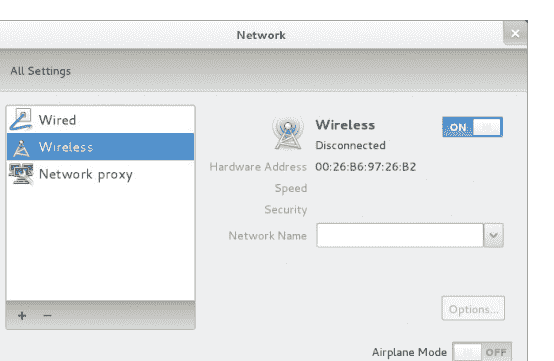
**图 17.1** 您可以通过“系统设置”菜单中的“网络”项调整最常见的网络设置。

> 如果您没有看到“无线”选项，您可能缺少 Wi-Fi 硬件的 Linux 驱动程序。请参阅侧边栏“获取 Wi-Fi 驱动程序”以获取解决此问题的建议。

4. 点击“网络名称”字段右侧的倒三角符号，访问包含网络列表的下拉菜单。
5. 从列表中选择您的网络。如果该网络需要身份验证，将出现类似于图 17.2 所示的对话框。
6. 在“密码”字段中输入您的网络密码，然后点击“连接”。

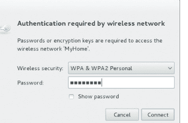
**图 17.2** 如果您的 Wi-Fi 网络需要身份验证，则必须在开始使用前输入密码。

“网络”窗口（图 17.1）中的“未连接”字样应变为“连接中”，然后变为“已连接”。根据您网络的配置，您可能还会在窗口中看到 IP 地址、默认路由和 DNS 服务器的 IP 地址出现。如果是这样，计算机现在已完全配置好网络访问——该实用程序已自动执行了本章后面“使用网络配置 GUI”部分中描述的任务。但如果不是，您可能需要执行额外的配置任务，例如手动设置 IP 地址。此外，也可能是 Wi-Fi 连接失败。

### Wi-Fi 安全

由于 Wi-Fi 数据是通过无线电波传输的，传输内容很容易被截获。坐在建筑物外汽车里的人通常可以访问 Wi-Fi 网络，这带来了三个问题：

- 入侵者可以截获在网络上传输的数据，从而可能访问敏感文件、获取信用卡号等等。


## Wi-Fi 安全（续）

- 入侵者可能能够绕过你为了防止外部人员进入而维护的任何防火墙，从而对你的计算机发起攻击。
- 入侵者可以利用你的网络访问权限攻击其他计算机，或进行非法活动，例如盗版电影、音乐或软件。这不仅会消耗你的网络带宽，而且如果这些活动被检测到，你将陷入嫌疑！

出于这些原因，你应该保护你管理的任何 Wi-Fi 网络。目前有三种安全级别可用（如果你把“无加密”也算作一种，那么就是四种）：

**WEP** 有线等效保密 (Wired Equivalent Privacy, WEP) 是一种非常弱的加密协议。破解 WEP 加密网络的方法已广为人知，这使得该方法基本上毫无价值。

**WPA** Wi-Fi 保护访问 (Wi-Fi Protected Access, WPA) 安全机制与 WEP 相比，提供了改进的加密和身份验证工具。

**WPA2** WPA2 是 WPA 的替代方案，它在加密和身份验证方面提供了进一步的改进。

每种加密方法都有几种变体。例如，WPA 和 WPA2 都提供*个人 (personal)*和*企业 (enterprise)*选项，后者需要一个带有专用身份验证服务器的更复杂设置。通常，你在宽带路由器或无线访问点 (WAP) 中设置加密方法。随后，客户端检测所使用的方法并提供相应的选项，例如之前在图 17.2 中显示的密码提示。

公共 Wi-Fi 连接可能不使用这些协议中的任何一种。你可以使用此类连接，但请意识到你发送或接收的任何数据都可能对他人可见。

> 你可以使用 `iwlist scan` 来定位咖啡馆或酒店中的公共 Wi-Fi 网络，然后使用 `iwconfig` 命令连接到你找到的网络。

使用 GUI 建立 Wi-Fi 连接几乎总是最简单的方法。不过，如果你需要微调连接，可以使用各种工具来探测和管理 Wi-Fi 链路。以下是其中最重要的两个工具：

**iwlist** 该命令可以识别附近的 Wi-Fi 网络。以 root 用户身份输入 `iwlist scan` 或 `iwlist scanning` 即可获取附近网络的列表。不过，该命令会产生大量的技术数据。你可能最感兴趣的是网络名称（出现在输出中 ESSID 字符串之后），因此输入 `iwlist scan | grep ESSID` 可以精简输出结果。

**iwconfig** 该实用程序用于将你连接到或断开特定的网络。它使用了许多选项，你可能需要研究其 man 手册页才能充分理解。但在大多数情况下，输入类似 `iwconfig wlan0 essid NoWires channel 1 mode Managed key s:N1mP7mHw` 这样的命令就能奏效。此示例连接到在信道 1 上运行、密码为 N1mP7mHw 的 NoWires 网络。

### 获取 Wi-Fi 驱动程序

不幸的是，Linux 对 Wi-Fi 硬件的驱动支持相当薄弱。如果你在尝试配置 Wi-Fi 硬件时没有看到它，你可能需要寻找合适的驱动程序。你可以使用名为 `lspci` 的工具开始这项工作，该工具在第 5 章“管理硬件”中有所描述。不带选项运行此命令以查看可用硬件列表，并在列表中搜索无线网络适配器。例如，我自己的笔记本电脑 `lspci` 输出包含以下行：

```
03:00.0 Network controller: Realtek Semiconductor Co., Ltd. RTL8191SEvB Wireless LAN Controller (rev 10)
```

这一行将 Wi-Fi 适配器识别为 Realtek RTL8191SEvB。在 Realtek 的网站上搜索可以找到驱动程序；然而，该驱动程序必须在本地编译，这超出了本书的讨论范围。你可能也没有足够的好运能通过这种方式找到驱动程序。

使用原生 Linux 驱动程序的另一种替代方案是使用 Windows 驱动程序。通过一个名为 `ndiswrapper` (http://ndiswrapper.sourceforge.net) 的软件包，这种不寻常的选项成为可能，它允许你在 Linux 中安装 Windows Wi-Fi 驱动程序。遗憾的是，并非所有发行版都在其标准软件包集中提供 `ndiswrapper`，但你通常可以在附加仓库中找到二进制软件包。Linuxant DriverLoader 软件 (http://www.linuxant.com/driverloader/) 也提供了类似的功能，虽然它不如 `ndiswrapper` 流行，但仍然值得考虑。

如果所有其他选项都失败了，你可能需要购买新的网络硬件。市面上有许多 USB Wi-Fi 适配器，但你应该对其进行研究，以找到一个对 Linux 支持良好的产品。你也可以更换某些笔记本电脑上的内置适配器。

### 使用网络配置 GUI

如果你已经配置了 Wi-Fi 链路但尚未获得 IP 地址，或者你需要设置有线网络连接，你必须设置 TCP/IP 网络选项。你可以通过文本模式工具完成（详见后文“使用基于文本的工具”），或者可以使用 GUI 工具。后者对于新用户来说更容易，但 GUI 工具在不同发行版之间有所不同。以使用 GUI 工具配置 Fedora 为例，步骤如下：

1. 点击桌面右上角的用户名，从弹出的菜单中选择“系统设置”，或在 shell 提示符下输入 `gnome-control-center` 来打开系统设置工具。
2. 在系统设置的“硬件”部分点击“网络”项。
3. 从窗口左侧的列表中选择网络设备。结果应类似于图 17.3；然而，该图显示的是一个已正确配置且没有明显问题的网络链路。如果你的网络链路无法工作，它可能会显示为“已断开 (Disconnected)”而不是“已连接 (Connected)”，或者显示显著不同的信息。
4. 点击“选项 (Options)”来调整你的网络设置。

**图 17.3** 网络连接通常会自动设置，但有时不会。

你可以为计算机配置 IPv4 和 IPv6。但要手动执行此操作，你必须同时拥有 IPv4 和 IPv6 地址。

5. 根据你的网络使用 IPv4 还是 IPv6，选择“IPv4 设置”或“IPv6 设置”选项卡。结果类似于图 17.4，图中显示了一个部分配置的手动 IPv4 设置。

**图 17.4** 在网络窗口中点击“选项”后，你可以设置关键的 TCP/IP 特性。

6. 使用“方法 (Method)”按钮选择连接方式。“自动 (DHCP)”和“手动 (Manual)”选项是最常见的，但也有一些较冷门的选项可用。你可以通过选择“禁用 (Disabled)”来禁用网络连接。
7. 如果你使用 DHCP，可以在“DHCP 客户端 ID”字段中输入计算机的 DHCP 客户端 ID。某些网络使用此信息为计算机分配主机名或固定 IP 地址。如果你的网络管理员没有提供此信息，你可以让该字段为空。
8. 要进行手动配置，请在“方法”按钮中选择“手动”，并输入其余信息。点击“添加 (Add)”按钮输入 IP 地址、网络掩码和路由器地址，随后对话框“地址”部分中相应的字段将变为可用状态。
9. 完成更改后，点击“保存 (Save)”。

如果一切顺利，你的网络对话框应更改为显示 IP 地址、子网掩码、默认路由和 DNS 服务器地址——尽管某些网络会省略其中部分项目。

### 使用基于文本的工具

虽然 GUI 网络配置工具易于使用且在大多数情况下运行良好，但有时你必须使用一组更灵活的基于文本的工具。这些工具包括：

**ifconfig** 该程序通过将 IP 地址和网络掩码与网络硬件关联，来启动或关闭网络连接。
*(认证目标)*

**route** 该程序调整计算机的*路由表 (routing table)*，路由表决定了特定的网络数据包通过哪个网络设备发送。
*(认证目标)*

**/etc/resolv.conf** 该文件包含最多三个 DNS 服务器的 IP 地址，以及计算机的 Internet 域名以及当用户在主机名中省略域名时应搜索的其他域名。
*(认证目标)*

**DHCP 客户端** DHCP 客户端程序（如 `dhclient` 或 `dhcpcd`）通常可以自动配置网络连接。你只需输入程序名称，后面可能跟着网络设备名称。

> 不要将 DHCP 客户端 `dhcpcd` 与 DHCP 服务器 `dhcpd` 混淆。

**发行版特定的网络脚本** `ifconfig`、`route` 和 DHCP 客户端程序对计算机网络配置产生的更改是临时的。如果你想进行永久更改，必须将设置存储在配置文件中。该文件的名称和格式随发行版而异。例如，在 Fedora 中它是 `/etc/sysconfig/network-scripts/ifcfg-netname`（其中 netname 是网络设备的名称）；在 Debian 或 Ubuntu 中，它是 `/etc/network/interfaces`。

`ifconfig` 和 `route` 命令都相当复杂；然而，它们的基本用法非常简单。假设你想将 IP 地址 192.168.29.39/24 分配给 eth0 网络设备，并告知其使用 192.168.29.1 作为路由器。以下两个命令可以实现：

```bash
# ifconfig eth0 up 192.168.29.39 netmask 255.255.255.0
# route add default gw 192.168.29.1
```

同样地，你可以使用 `ifconfig` 的 `down` 而非 `up` 来断开连接，使用 `route` 的 `del` 而非 `add` 来删除路由，依此类推。详情请参阅这些程序的 man 手册页。


某些发行版默认使用 `dhclient`，而其他发行版则使用 `dhcpcd`。如果你不知道该用哪个，可以两个都尝试一下。

如果你的网络使用 DHCP，可以输入 `dhclient netname` 或 `dhcpcd netname` 来启动 `netname` 接口并使用 DHCP 进行配置。如果你正在尝试调试与 DHCP 相关的网络问题，或者网络的 DHCP 配置发生了变化导致某些计算机暂时失去连接，手动输入此命令会非常方便。

## 网络设备名称

传统上，Linux 将第一个以太网设备命名为 eth0，随后的设备命名为 eth1，以此类推。同样，Wi-Fi 设备的名称形式为 wlan0 及以上。然而，Fedora 从 15 版本开始逐渐背离这一方案。这使得在不同计算机之间预测以太网设备的设备名称变得更加困难。其目标是让拥有多个网络接口的计算机在重启之间地设备名称更加稳定。这类系统通常是具有多个网络链路的路由器或服务器，它们通常需要在特定的接口上进行特定的配置。如果设备名称在一次次启动之间发生变化——这可能会在不同启动时网络卡的检测顺序不同而发生——就可能会产生问题。

你可以通过输入不带选项的 `ifconfig` 来获取你的网络设备名称。（即使是普通用户也可以执行此操作。）结果包含一个或多个如下所示的输出块：

```
em1 Link encap:Ethernet HWaddr 00:26:6C:36:C8:58
	inet addr:172.24.21.11 Bcast:172.24.21.255 Mask:255.255.255.0
	inet6 addr: fe80::226:6cff:fe36:c858/64 Scope:Link
	UP BROADCAST RUNNING MULTICAST MTU:1500 Metric:1
	RX packets:159562 errors:0 dropped:0 overruns:0
frame:0
	TX packets:9150 errors:0 dropped:0 overruns:0
carrier:0
	collisions:0 txqueuelen:1000
	RX bytes:22295082 (21.2 MiB) TX bytes:2050687 (1.9 MiB)
	Interrupt:45
```

在这个示例中，em1 是设备名称——它显著地位于该输出块的开头。名称 lo 指的是回环设备（loopback device），用于某些本地访问过程，因此如果你想寻找网络硬件的设备名称，可以忽略它。

如果你在手动配置网络设置，应该将你的 DNS 名称服务器数据和网络名称输入到 /etc/resolv.conf 中。该文件的示例见列表 17.1。

列表 17.1：一个 /etc/resolv.conf 配置文件示例

```
domain luna.edu
search example.com example.org
nameserver 192.168.1.2
nameserver 10.78.102.1
nameserver 10.78.221.1
```

/etc/resolv.conf 中有三个关键字用于标识 DNS 解析功能：

- **domain** 你在此行标识计算机的默认域名。主要效果是计算机会在该域名中搜索不带域名的主机名。例如，在列表 17.1 中，如果你指定主机名为 lunokhod，计算机将查找 lunokhod.luna.edu 的 IP 地址。

> /etc/resolv.conf 支持其他关键字，但很少使用。详情请参阅其 man 手册页。

- **search** 你可以通过在 search 行指定额外的域名，让计算机在这些域名中搜索主机名，域名之间用空格或制表符分隔。你最多可以这样指定六个域名。但请注意，向搜索路径添加域名可能会减慢主机名查询的速度。

- **nameserver** 此关键字通过 IP 地址标识 DNS 服务器计算机。你可以通过包含多行 nameserver 来指定多个服务器，最多三台。

如果你想手动调整永久网络配置，可以通过编辑网络配置文件来实现，例如 Fedora 系统上的 /etc/sysconfig/network-scripts/ifcfg-netname。列表 17.2 显示了该文件的示例。

### 列表 17.2：一个网络配置文件示例

```
DEVICE="em1"
BOOTPROTO="static"
IPADDR=192.168.29.39
NETMASK=255.255.255.0
NETWORK=192.168.29.0
BROADCAST=192.168.29.255
GATEWAY=192.168.29.1
ONBOOT=yes
NM_CONTROLLED="yes"
HWADDR=00:26:6C:36:C8:58
TYPE=Ethernet
DEFROUTE=yes
PEERDNS=yes
PEERROUTES=yes
IPV4_FAILURE_FATAL=yes
IPV6INIT=no
NAME="System em1"
UUID=1dad842d-1912-ef5a-a43a-bc23fb8f267e7
```

其中一些选项的目的可以通过其名称推断出来，你可以根据需要进行调整。如果你不理解某个选项，最好不要动它。你可能需要关注的一些特定功能包括：

- 如果你想使用 DHCP，请将 BOOTPROTO 行改为 `BOOTPROTO="dhcp"` 而不是 `BOOTPROTO="static"`，并删除从 IPADDR 到 GATEWAY 的行。
- 如果你不想在计算机启动时自动启动网络链路，请将 ONBOOT 改为 no。这样用户在想要使用网络时必须手动激活。
- NETWORK 和 BROADCAST 选项都由 IP 地址 (IPADDR) 和子网掩码 (NETMASK) 衍生而来。NETWORK 地址是 IP 地址的网络部分，但将 IP 地址的主机特定部分替换为二进制 0 值。BROADCAST 地址类似，但将地址的主机特定部分替换为二进制 1 值。

> 强制用户启动网络连接可以限制计算机对网络资源的使用，例如当网络使用 DHCP 时。

如果你运行的是 Debian、Ubuntu 或其他使用不同网络配置文件的发行版，你必须找到该文件并对其进行修改。其格式可能与列表 17.2 所示的文件有所不同，尽管必须修改的条目通常相当明显。如有疑问，请参阅特定发行版的文档。

`ifup` 和 `ifdown` 命令根据配置文件中的设置启动或关闭网络连接。因此，在更改这些设置后，你可能需要输入 `ifdown netname` 然后输入 `ifup netname`。结果应该是网络链路反映了新设置。但请注意，此过程可能会断开网络客户端和服务器的连接。

## 测试你的网络连接

在大多数情况下，你的网络连接从启动那一刻起就能正常工作。但有时，你可能需要诊断问题，要么是因为你完全无法建立连接，要么是因为之前正常的连接停止工作了。在接下来的页面中，我将描述几种类型的网络测试：检查路由表、测试基础连通性、测试定位连接中断的位置、测试 DNS 功能以及测试网络状态。

### 检查你的路由表

之前，我描述了使用 `route` 命令在计算机上设置默认路由。你可以使用相同的命令来检查你的路由是否合理。在大多数情况下，仅输入 `route` 即可完成工作：

> 认证目标

```
$ route
Kernel IP routing table
Destination Gateway Genmask Flags Metric Ref Use Iface
192.168.29.0 * 255.255.255.0 U 0 0 0 eth0
127.0.0.0 * 255.0.0.0 U G 0 0 0 lo
default 192.168.29.1 0.0.0.0 UG 0 0 0 eth0
```

这些数据显示，发往 192.168.29.0（即 IP 地址在 192.168.29.1 和 192.168.29.254 之间的任何计算机）的数据直接通过 eth0 发送。127.0.0.0 网络是一个特殊的接口，它“回环”到源计算机。Linux 将其用于某些内部网络目的。最后一行显示了默认路由，它描述了如何处理路由表中不匹配任何其他条目的所有内容。这一行将默认路由的网关系统标识为 192.168.29.1。如果缺失或配置错误，部分或全部发往外部网络（如 Internet）的流量将无法超出你的本地网络段。

典型的工作站甚至服务器的路由表非常简单，可以自动配置。不过，网络路由器通常需要复杂的路由表。

### 测试基础连通性

最基础的网络测试是 ping，它向你指定的系统（通过 IP 地址或主机名）发送一个简单的网络数据包并等待回复。在 Linux 中，

> 认证目标


ping 会每隔大约一秒继续发送数据包，直到你使用 Ctrl+C 快捷键将其中断。你也可以通过 `-c` *num* 选项指定有限的测试次数。以下是其输出示例：

```
$ ping -c 4 nessus
PING nessus.example.com (192.168.1.2) 56(84) bytes of data.
64 bytes from nessus.example.com (192.168.1.2): icmp_seq=1 ttl=64 time=0.607 ms
64 bytes from nessus.example.com (192.168.1.2): icmp_seq=2 ttl=64 time=0.147 ms
64 bytes from nessus.example.com (192.168.1.2): icmp_seq=3 ttl=64 time=0.145 ms
64 bytes from nessus.example.com (192.168.1.2): icmp_seq=4 ttl=64 time=0.283 ms

--- nessus.example.com ping statistics ---
4 packets transmitted, 4 received, 0% packet loss, time 3001ms
rtt min/avg/max/mdev = 0.145/0.295/0.607/0.189 ms
```

该命令发送了四个数据包并等待其返回，由于目标系统在本地网络中，响应速度非常快（平均 0.295 毫秒）。一些常见的故障模式可以帮助你诊断网络问题所在：

- 如果你可以 ping 通本地系统但不能 ping 通远程系统，问题可能出在你的路由器或不正确的路由器配置上。
- 如果你可以通过 IP 地址 ping 通但不能通过名称 ping 通，问题极有可能是你的 DNS 服务器或 DNS 配置。
- 如果你完全无法 ping 通，即使使用 IP 地址也不行，那么你可能遇到了根本性的配置问题。

### 查找连接断点

比 ping 更进阶的工具是 traceroute 命令，它向你的系统与指定目标系统之间的每台计算机发送一系列三个测试数据包。清单 17.3 展示了 traceroute 输出的一个示例。

清单 17.3：traceroute 输出示例

```
$ traceroute -n 10.1.0.43
traceroute to 10.1.0.43 (10.1.0.43), 30 hops max, 52 byte packets
 1 192.168.1.2 1.201 ms 36.519 ms 0.971 ms
 2 10.0.88.1 17.250 ms 9.959 ms 9.637 ms
 3 10.9.8.173 8.799 ms 19.501 ms 10.884 ms
 4 10.9.8.133 21.059 ms 9.231 ms 103.068 ms
 5 10.9.14.9 8.554 ms 12.982 ms 10.029 ms
 6 10.1.0.44 10.273 ms 9.987 ms 11.215 ms
 7 10.1.0.43 16.360 ms * 8.102 ms
```

该命令的 `-n` 选项告诉它显示目标计算机的 IP 地址而不是主机名。这可以稍微加快处理速度，特别是在你遇到 DNS 问题时，有时还能使输出更容易阅读——但你可能想知道故障系统的主机名，因为这能帮你精准定位是谁在导致问题。

traceroute 的输出可以通过多种方式进行诊断：

- 通常，响应时间随跳数（hop numbers）的增加而增加。这是正常现象，除了示例输出中的一些波动外，你可以在清单 17.3 中看到这种模式。
- 单次跳转的时间波动可能表明路由器过载，或者某些其他间歇性问题导致时间波动。你在清单 17.3 的几个跳数中可以看到这一因素的影响，尤其是在第 1 跳和第 4 跳。此类问题可能会导致性能不稳定，但不应导致网络会话超时或完全失败。
- 有时无法收到对数据包的响应。这种情况在时间字段中用星号 (*) 表示，如清单 17.3 中第 7 跳的第二个数据包。
- 时间的剧烈跳跃可能表明路由器之间存在巨大的物理距离。忽略清单 17.3 第一跳中 36.519 毫秒的中间时间，你可以看到从第 1 跳到第 2 跳发生了这种跳跃。在清单 17.3 的情况下，这表明是从本地网络到互联网服务提供商（ISP）网络的链路。在跨洲链路中，更大幅度的时间跳跃非常常见。此类跳跃不一定是需要修复的配置错误，但它们会影响网络性能，尤其是对于远程登录工具或网络游戏等高度交互的协议。

> 某些路由器会拦截所有 traceroute 数据。如果你的 traceroute 输出在某个点之后全是星号，那么你可能遇到了这样的系统。

除此之外，traceroute 有助于确定网络连接问题是否存在于你负责的网络中。例如，清单 17.3 中第一跳的波动可能表明本地网络存在问题，但与最终目的地相关的数据包丢失极可能不是本地问题。如果故障链路在你的管辖范围内，你可以检查故障系统、周边系统以及整个网络段的状态。

### 测试 DNS

DNS 问题导致网络失效的严重程度几乎与物理线缆被切断相当。因为许多用户和网络工具都依赖主机名，如果 DNS 解析无法工作，网络将几乎变得毫无用处。

你可以使用多种工具来测试网络的 DNS 服务器，例如 `host`、`dig` 和 `nslookup`。这些工具在许多方面非常相似，它们都允许你通过输入命令名称后跟主机名来查询主机名：

```
$ host www.sybex.com
www.sybex.com has address 208.215.179.220
```

这个示例展示了正常的名称解析。在这种情况下，主机名直接链接到一个 IP 地址。在某些情况下，你可能会看到关于别名（aliases）或多个 IP 地址的通知。这同样是正常的，至少对某些网站而言如此。但是，如果命令响应时间过长，或者抱怨超时、无法连接到服务器，这意味着你计算机的 DNS 配置有误。

你可以添加特定 DNS 服务器的 IP 地址，例如使用 `host www.whitehouse.gov 192.168.39.7` 来测试 192.168.39.7 服务器。如果你的计算机配置了多个 DNS 服务器，你可以用这种方式单独测试每一个。也许其中一个不可用或配置错误，在这种情况下，你可能希望将其从配置中删除。但请注意，如果你的计算机是通过 DHCP 配置的，你在 `/etc/resolv.conf` 中删除的 DNS 服务器最终会被 DHCP 还原。如果这是一个重复出现的问题，你应该咨询你的网络管理员。

虽然 `host` 对执行基础主机名查询很有用，但 `dig` 工具（或已弃用的 `nslookup`）可以执行更复杂的查询，并返回关于主机名、域名或 IP 地址的更多信息。这使得 `dig` 成为高级网络诊断的有用工具，但代价是易用性较低；初学者较难解读 `dig` 的输出。

## 检查网络状态

另一个有用的诊断工具是 `netstat`。它可以被视为网络工具中的“瑞士军刀”，因为根据传递给它的参数，它可以替代其他几种工具。它还能返回一些难以通过其他方式获取的信息。示例包括：

- **接口信息**：向 `netstat` 传递 `--interface` 或 `-i` 参数，以获取与 `ifconfig` 返回类似的网络接口信息。（某些版本的 `netstat` 返回格式相同，而其他版本则布局不同。）
- **路由信息**：你可以使用 `--route` 或 `-r` 参数来获取类似于 `route` 命令显示的路由表列表。
- **伪装信息**：向 `netstat` 传递 `--masquerade` 或 `-M` 参数，以获取关于由 Linux 网络地址转换（NAT）功能介导的连接信息，该功能通常被称为 *IP masquerading*（IP 伪装）。NAT 允许 Linux 路由器将一个网络“隐藏”在单个 IP 地址之后。这是一个扩展有限的 IPv4 地址的好方法。
- **程序使用情况**：某些版本的 `netstat` 支持 `--programs` 或 `-p` 参数，尝试提供有关使用返回网络连接的程序的信息。这种尝试并不总是成功，但通常有效，因此你可以看到哪些程序正在进行外部连接。
- **开放端口**：与各种其他参数一起使用，或在不带任何参数的情况下，`netstat` 会返回关于开放端口及其连接系统的信息。
- **所有连接**：`--all` 或 `-a` 选项与其他选项结合使用。它使 `netstat` 除了显示已打开的连接外，还显示服务器程序为监听网络连接而打开的端口信息。

请记住，`netstat` 是一个功能强大的工具，其选项和输出在不同发行版之间并不完全一致。你可能需要查阅其 man 手册并尝试使用 `netstat` 来了解它的功能。

> **认证目标**
> `nslookup` 程序已被弃用，这意味着开发人员计划最终将其从常规使用中移除，但目前它仍然可用。

> **认证目标**
> 请记住，`/etc/resolv.conf` 包含了你网络 DNS 服务器的 IP 地址。它们在 `nameserver` 行中标识。

> 小型宽带路由器使用 NAT。如果你拥有这样的设备，你的台式机和笔记本系统很可能不需要自行配置 NAT。

## 保护系统免受攻击

网络为用户提供了许多有用的功能。不幸的是，它们也带来了许多风险。网络安全是一个复杂的话题，我只能提供一些基本技巧来帮助你防止系统被攻破。以下是你能做的最重要的一些事项：

**关闭不使用的服务器。** Linux 的主要安全漏洞不在于蠕虫和病毒（像 Windows 那样）；在 Linux 中，风险集中在外部人员通过滥用你运行的服务器程序侵入你的计算机。因此，不要不必要地运行服务器至关重要。某些发行版会自动安装并运行服务器，例如 Secure Shell (SSH)、Apache Web 服务器，或者像 sendmail 或 Postfix 这样的邮件服务器。移除服务器最彻底的方法是使用你的软件包系统将其卸载（在第 9 章“使用程序和进程”中描述）——但你必须发出 *uninstall*（卸载）相关软件包的命令，而不是安装命令。


启用防火墙。防火墙是一个程序或系统设置，用于监管网络交易，根据预设的标准允许或禁止这些交易。大多数 Linux 发行版默认启用防火墙，但您可能需要根据具体需求调整其设置。

防火墙可以运行在单台计算机上以保护该计算机，也可以运行在路由器上以保护整个网络。

使用强密码。第 14 章“创建用户和组”描述了如何选择一个强密码。如果您的计算机运行任何类型的登录服务器，设置强密码可以最大限度地降低外部人员通过猜测密码入侵的风险。

保持警惕。您应对不可信的数据源保持怀疑。网络钓鱼（通过伪装成某个受信任的个人或组织试图从用户那里提取敏感数据）及类似的攻击可能会欺骗个人泄露密码、财务数据等。虽然针对 Linux 的恶意软件（或 malware）很少见，但它们很容易被制造出来。最好的做法是坚持使用官方软件源，并记住电子邮件、网站和其他通信手段都可能被伪造。

保持软件更新。第 9 章介绍了您可以用来保持系统更新的软件包管理工具。最好定期检查系统的软件更新，因为许多此类更新修复了安全漏洞——这些问题可能会被外部人员或合法但怀有恶意的用户利用来接管您的计算机。

## 核心要点及进阶内容

网络对于当今的计算机至关重要，而 Linux 提供了卓越的网络能力。在大多数情况下，您的计算机会自动检测网络并进行配置；然而，有时您必须手动创建高级配置或覆盖不正确的自动配置。您可能还需要测试网络配置，以确定问题出在哪里——是在 IP 地址设置中、DNS 配置中还是其他地方。不幸的是，网络在被利用的同时也可能被滥用，因此您必须对那些企图潜入您的计算机并将其用于自身目的的人保持警惕。采取一些简单的步骤，如保持软件更新，可以大大降低风险。

请勿在用于正常工作的办公网络或学校网络上进行此测试；计算机 IP 地址的配置错误可能会给其他计算机带来问题。

备份您的 `/etc/resolv.conf` 文件，然后编辑原文件，使其 nameserver 行指向不运行 DNS 服务器的计算机。尝试使用 `ping`、Web 浏览器和其他实用工具访问远程服务器，以测试您的网络配置。观察结果中出现的失败类型。完成后，还原原文件。

### 建议练习

- 在您控制的小型私有网络中或在指导教师监督的实验室环境中，将一台通常使用 DHCP 的计算机重新配置为以静态方式使用其分配的 IP 地址。测试连接，然后切换回 DHCP。

### 复习题

- 1. 您想通过静态 TCP/IP 配置在本地网络上设置一台计算机，但您缺乏网关地址。以下哪项是正确的？
    A. 因为网关地址是必需的，所有 TCP/IP 网络功能都将无法工作。
    B. TCP/IP 网络将正常工作，但您将无法将主机名转换为 IP 地址，反之亦然。
    C. 您能够与本地网络段上的机器通信，但无法与其他系统通信。
    D. 计算机将无法分辨哪些其他计算机是本地的，哪些是远程的。
    E. 您可以将计算机用作网络服务器系统，但不能用作网络客户端。

- 2. 输入 `ifconfig eth0` 会返回以下哪类信息？（选择所有适用项）
    A. 正在使用 eth0 的程序名称
    B. 分配给 eth0 的 IP 地址
    C. eth0 的硬件地址
    D. 与 eth0 相关联的主机名
    E. eth0 通信的网关

- 3. 当您对 `ping` 实用程序使用 IP 地址时它响应正常，但当您使用确定对应于该 IP 地址的主机名时它却不响应。什么原因可能导致此问题？（选择所有适用项）
    A. 您的计算机与其 DNS 服务器之间的路由可能不正确。
    B. 目标计算机可能被配置为忽略来自 ping 的数据包。
    C. 目标系统上的 DNS 配置可能已损坏。
    D. 您的计算机主机名可能设置不正确。
    E. 您的计算机 DNS 配置可能已损坏。

- 4. 正确或错误：IPv4 地址的长度为四个字节。

- 5. 正确或错误：`/etc/resolv.conf` 文件告知计算机是否为其网络配置使用 DHCP。

- 6. 正确或错误：您可以通过在 shell 提示符下输入 `route` 来检查路由表的当前状态。

- 7. ________ 程序充当多用途网络工具；它可以完成与 `ifconfig`、`route` 以及其他几个工具相同的许多工作。

- 8. Linux 中第一个以太网接口的传统名称（但在最近的 Fedora 版本中不是）是 ______________。

- 9. ________ 是一个程序或系统配置，它根据您指定的标准阻止或允许进入、发出或穿过计算机的网络访问。

## 附录 A

## 复习题答案

## 第 1 章

- 1. **C** GUI 程序在专门为此设计的库的帮助下创建菜单；这不是 Linux 内核的功能。因此，选项 C 是非内核功能，是正确的。内核分配内存和 CPU 时间，并控制对磁盘和网络硬件的访问，因此选项 A、B、D 和 E 描述的都是内核功能，故错误。

- 2. **A** Android 用于手机和其他小型便携设备，因此它符合嵌入式操作系统的定义，使选项 A 正确。SUSE、CentOS、Debian 和 Fedora 都是主要旨在用于桌面、笔记本和服务器计算机的发行版示例；它们不符合嵌入式操作系统的定义，因此选项 B、C、D 和 E 均错误。

- 3. **B** Linux 的 GUI 基于 X Window 系统。虽然 OS X 提供了 X 的实现，但其主要的 GUI 是 Apple 的专有产品。因此，选项 B 正确。选项 A 错误，因为 Linux 和 OS X 都能运行大多数 GNU 程序。选项 C 错误，因为 Linux 可以在 Apple Macintosh 和通用 PC 硬件上运行。选项 D 错误，因为 OS X 的标准形式包含许多 BSD 实用工具。此外，大多数 Linux 发行版使用 GNU 实用工具而非其 BSD 等效工具，尽管如果您愿意，也可以在 Linux 中使用 BSD 实用工具。选项 E 错误，因为 Linux 和 OS X 都支持文本模式命令，尽管 OS X 除了其 GUI 终端应用程序外，很难使用这些命令。

- 4. **错误** Linux 内核旨在作为一个“从零开始”的项目来创建一个新的类 Unix 内核。虽然存在影响和相似之处，但这两个内核在很大程度上是相互独立的。

- 5. **错误** 被称为 *终端* 的程序允许您在以 GUI 模式登录 Linux 后输入文本模式命令。您还可以通过使用 Ctrl+Alt+F2 等按键在多个 *虚拟终端* 之间切换。

- 6. **正确** CentOS 的发布周期大约为 2 年，按照 Linux 发行版的标准来看很长，其中一些发行版的发布周期仅为 6 个月。

- 7. login:

- 8. viruses

- 9. alpha and beta

## 第 2 章

- 1. **A** Linux 的多任务处理是抢占式的，这意味着内核可以根据其认为合适的情况将 CPU 时间分配给任何进程，并有可能中断（或抢占）其他进程。因此，选项 A 正确。Linux 是一个多用户操作系统，但多用户并不是一种多任务处理类型，因此选项 B 错误。在协作式多任务操作系统中，应用程序必须自愿向彼此让出 CPU 时间。虽然 Linux 程序可以向操作系统发出不需要 CPU 时间的信号，但 Linux 并不完全依赖这种方法，因此选项 C 错误。单任务操作系统一次只能运行一个进程，因此选项 D 错误。单用户操作系统一次只能支持一个用户。此类操作系统可以是单用户单任务或多任务的，在后一种情况下，可以使用协作式或抢占式多任务处理。因此，选项 E 错误。

- 2. **C** 开源定义包含十个要点，其中一点是用户可以修改原始代码并重新分发修改后的版本。因此，选项 C 正确。虽然在实际操作中所有开源软件都是免费提供的，但开源定义中没有任何内容禁止销售它。实际上，许多组织和个人确实销售开源软件，要么是为了方便（例如为互联网连接缓慢的人提供包含 Linux 发行版的 DVD-ROM），要么是通过增值安排（例如 Red Hat Enterprise Linux，它将开源软件与支持合同捆绑在一起）。因此，选项 A 错误。开源定义要求分发源代码，但不要求分发二进制文件。因此，选项 B 错误。虽然包括 Linux 内核在内的一些开源软件起源于学术界，但并非所有开源软件如此，因此选项 D 错误。开源定义没有规定必须使用解释型或编译型语言，事实上两者都曾被用于编写开源软件，因此选项 E 错误。

- 3. **D** Evolution 是一个电子邮件阅读程序。此类程序在桌面计算机上很常见，因此选项 D 正确。Apache 是一个 Web 服务器，Postfix 是一个电子邮件服务器，而 Berkeley Internet Name Domain (BIND) 是一个域名系统 (DNS) 服务器。此类服务器被安装在桌面计算机上的可能性远低于 Evolution 等客户端程序，因此选项 A、B 和 E 均错误。Android 是用于手机和平板电脑的 Linux 发行版的名称，因此选项 C 错误。


- 4. **错误** 在 Linux 创建时，VMS 是用于小型机和大型机的操作系统。而在 1991 年的 x86 计算机上，DOS 是主导的操作系统。

- 5. **正确** 数字视频录像机 (DVR) 是用于录制电视节目的专用计算机。一些商业 DVR（如 TiVo）原生运行 Linux）。此外，也存在运行在 Linux 下的标准 PC 端的 DVR 软件，例如 MythTV。

- 6. **正确** 大多数服务器程序不需要 X Window System (X) 图形用户界面 (GUI)，因此服务器计算机管理员经常禁用 X 甚至将其完全删除，以节省磁盘空间和内存，并最大限度地降低安全问题的风险。

- 7. **单体 (monolithic)**

- 8. **共享软件 (shareware)**

- 9. **桌面 (desktop)**

## 第 3 章

- 1. **C** 开源定义规定用户能够分发更改，但它并不要求许可证要求在相同许可证条款下进行分发。因此，选项 C 并不描述一项开源要求，所以是正确答案。选项 A、B、D 和 E 都是对实际开源许可证条款要求的转述。

- 2. **B** 某些发行版（特别是付费销售的“企业”版本）包含既非开源甚至也不允许自由重新分发的软件，因此选项 B 正确。发行版整体使用了多种许可证，而不仅仅是一种，所以选项 A 错误。MIT 许可证是几种开源许可证之一；此类软件不会阻碍发行版的复制，因此选项 C 错误。虽然某些发行版（如 Debian）旨在使其主系统完全符合开源标准，但并非所有发行版都这样做，所以选项 D 错误。同样，并非所有发行版都完全由 FSF 所定义意义上的自由软件组成。

- 3. **E** 选项 E 转述了 FSF 哲学中的四个关键点之一，因此正确。与选项 A 相反，FSF 的哲学并不强制使用 GPL，更不用说其最新版本，尽管 GPL 是 FSF 首选的许可证。选项 B 与 FSF 的立场相反，其立场是自由软件应当保持自由；然而，该选项与 OSI 的哲学兼容。虽然 FSF 主张自由软件和自由操作系统，但选项 C 并非其哲学的明确组成部分，因此错误。虽然 FSF 希望看到一个由自由软件主导的世界，但他们并不主张软件盗版，因此选项 D 错误。

- 4. **正确** 法院和法律明确承认计算机软件是受版权法管辖的创作作品。在某些国家，专利法也适用于软件，尽管这并非全球通用。

- 5. **正确** 这一原则是自由软件定义和开源软件定义的核心。

- 6. **错误** 硬件供应商经常为其产品发布开源驱动程序。一个注意事项是，发布开源驱动程序必然会使硬件的部分编程接口公开，而一些硬件供应商对此不愿这样做。

- 7. **LGPL (或 Lesser GPL，或 Lesser General Public License)**

- 8. **知识共享 (Creative Commons)**

- 9. **版权左移 (copyleft)**

## 第 4 章

- 1. **B, C, E** GNOME、KDE 和 Xfce 都是 Linux 桌面环境，因此选项 B、C 和 E 均正确。（其他还包括 LXDE 和 Unity。）GIMP 工具包 (GTK+) 是一个 GUI 编程库。虽然 GNOME 和 Xfce 都是构建在 GTK+ 之上的，但它本身不是桌面环境，所以选项 A 错误。Evolution 是一个 Linux 电子邮件客户端，而非桌面环境，所以选项 D 错误。

- 2. **B** 网络文件系统 (NFS) 正是为问题中所描述的任务而设计的（尽管是针对通用 Unix 而非仅限 Linux），因此选项 B 正确。简单邮件传输协议 (SMTP) 是一种允许一台计算机向另一台计算机发送电子邮件消息的协议，因此它是实现所述目标的糟糕选择，选项 A 错误。PHP: Hypertext Processor (PHP) 语言用于为网页生成动态内容，因此选项 C 错误。域名系统 (DNS) 是一种将主机名与 IP 地址之间的映射传递给计算机的协议，因此它无法轻易实现所述目标，使得选项 D 错误。动态主机配置协议 (DHCP) 允许一台计算机通过网络链路向另一台计算机提供网络配置信息，因此选项 E 错误。

- 3. **C** Linux 内核的主要语言是 C，因此选项 C 正确。虽然 Bash shell 脚本控制了 Linux 的大部分启动过程，但这些脚本不是内核的一部分，因此选项 A 错误。Java 是 Web 应用程序的流行语言，但它没有被用于 Linux 内核，因此选项 B 错误。C++ 是 C 的衍生语言，为语言增加了面向对象特性，但 Linux 内核使用的是常规 C 而非 C++，因此选项 D 错误。Perl 是一种流行的解释型语言，尤其适用于涉及文本处理的任务，但它不是 Linux 内核的语言，因此选项 E 错误。

- 4. **正确** LibreOffice 在 2011 年从 OpenOffice.org 分叉。虽然存在一些微小差异，但两者仍然几乎相同，并且在未来几年可能仍将非常相似。

- 5. **正确** 拒绝服务 (DoS) 攻击可以通过向服务器程序或运行该程序的计算机发送海量伪造数据来破坏服务器的运行。即使服务器管理得完美无缺，这一点依然成立。

- 6. **正确** Python 和 Perl、PHP 以及 shell 语言一样，是解释型的。这与 C 和 C++（两种常见的编译型语言）以及 Java（处于两者之间）形成对比。

- 7. **电子邮件客户端 (e-mail client)**

- 8. **Samba**

- 9. **编译的 (compiled)**

## 第 5 章

- 1. **D** `lspci` 命令显示 PCI 设备的信息。由于许多主板功能在 Linux 中表现为 PCI 设备，因此选项 D 提供了大量关于主板的信息，所以正确。选项 A 的 `lscpu` 命令提供 CPU 信息，这意味着它几乎不提供关于主板的直接信息，因此选项 A 错误。Xorg 程序是 Linux X 服务器，选项 B 创建了一个新的 X 配置文件。该文件可能会提供关于主板上视频硬件的提示，但选项 D 提供的信息更好且更多，因此选项 B 错误。`fdisk` 工具可以对磁盘进行分区，选项 C 中的命令显示 `/dev/sda` 如何分区的信息。不过，此信息与主板功能无关，因此选项 C 错误。你可以在 Web 浏览器中输入 `http://localhost:631` 来配置打印机，但即使这样做，你也无法获得关于主板功能的任何信息，因此选项 E 错误。

- 2. **A, D** 磁盘分区使你能够将不同类型的数据分离到磁盘的不同部分。这样做的原因示例包括安装多个操作系统以及将文件系统数据与交换空间分离。因此，选项 A 和 D 均正确。文件系统的选择（ext4fs 与 ReiserFS）与分区无关，除非你想在一个分区使用一种文件系统而在另一个分区使用另一种，因此选项 B 错误。并行高级技术附件 (PATA) 和串行 ATA (SATA) 接口是硬件标准；你无法通过对磁盘分区将 PATA 磁盘变成 SATA 磁盘，因此选项 C 错误。硬盘拥有缓存以提高性能，但对磁盘分区并不会将磁盘缓存与磁盘的大部分数据分离，因此选项 E 错误。

- 3. **A** 视频显示器通常连接到计算机主板内置的视频电路或单独的显卡上，因此选项 A 正确。键盘、外接硬盘、打印机和扫描仪通常都通过 USB 连接到计算机，尽管所有这些设备都存在替代接口。

- 4. **正确** 大多数 CPU 系列有多个名称。EM64T 是 Intel 为其 x86-64 架构实现所使用的名称之一，而 AMD64 是 AMD 为同一架构使用的名称之一。因此，这两个名称标识相同的架构，AMD64 Linux 发行版可以在 EM64T CPU 上运行。

- 5. **错误** 通用磁盘格式 (UDF) 是一种主要用于光盘而非硬盘的文件系统。将它用于硬盘上的 Linux 安装会很尴尬或根本不可能。Linux 特定文件系统（ext2fs, ext3fs, ext4fs, ReiserFS, JFS, XFS 和 Btrfs）是硬盘安装 Linux 的唯一实用选择。

- 6. **正确** 在 Linux 中，大多数驱动程序（包括指定的那些）作为内核的一部分提供。其他一些驱动程序（如 X 下的显卡驱动、打印机和扫描仪驱动）存在于内核之外，尽管这些驱动程序在工作时也可能依赖于内核驱动程序。

- 7. **32**

- 8. **直流电 (direct current)**

- 9. **数字视觉接口 (Digital Visual Interface, DVI)**

## 第 6 章

- 1. **A** 在 Bash 中编辑命令时，`Ctrl+A` 快捷键将光标移至行首，因此选项 A 正确。左方向键向左移动单个字符，`Ctrl+T` 交换两个字符，上方向键在历史记录中向上移动一项，`Ctrl+E` 移至行尾。

- 2. **C, D** 选项 C 和 D 都描述了从 shell 在后台运行程序的方法，因此选项 C 和 D 均正确。`start` 和 `bg` 都不是启动后台程序的命令。`fg` 命令将程序从后台返回前台，这意味着 shell 将重新进入睡眠状态，这并不是问题所指定的。

- 3. **E** 因为 `cd` 命令更改当前目录，而波浪号 (~) 指代你的主目录，所以选项 E 实现了问题指定的功能，因此正确。`home` 和 `homedir` 都不是标准的 Linux 或 Bash 命令，因此选项 A 和 D 均错误。选项 B 将当前目录设置为 `/home`，这是一个可能包含你主目录的目录，但它本身不是你的主目录，因此选项 B 错误。选项 C 将当前目录设置为当前目录下的 `homedir` 子目录（如果存在）。由于这几乎肯定不是你的主目录，因此该选项错误。

- 4. **错误** 在 X 界面中，切换虚拟终端 (VT) 的快捷键必须加上 `Ctrl` 键，因此正确的快捷键应该是 `Ctrl+Alt+F2`（或其他函数键，直到 F6）。


- 5. **False** 在 Linux 中，目录分隔符是斜线 (/) 而不是反斜线 (\)；反斜线用于“转义”随后的字符，因此 `. \upone.txt` 指的是当前目录下的 `.upone.txt` 文件。指定 `./upone.txt`（使用斜线而非反斜线）则是指父目录中的 `upone.txt`。

- 6. **False** 你可以通过使用 `--recursive` 或 `-R` 来让 ls 获取递归目录列表，但小写的 `-r` 没有这个效果。

- 7. `pwd`

- 8. `-a`

- 9. `cat`

## 第 7 章

- 1. **A** `mv` 命令用于移动或重命名文件，因此选项 A 正确。`cp` 命令用于复制文件，因此选项 B 错误。`ln` 命令用于在两个文件之间创建链接，因此选项 C 错误。选项 D 中的 `rn` 命令是虚构的，因此该选项错误。`touch` 命令用于创建新文件或调整现有文件的的时间戳，因此选项 E 错误。

- 2. **C** 因为两个文件（`outline.pdf` 和 `Outline.PDF`）的文件名仅在大小写上有所不同，且由于 FAT 是一个不区分大小写的文件系统，因此在复制时其中一个文件会丢失。（两个文件都会被复制，但第二个会覆盖第一个。）因此，选项 A 错误。指定的 `cp` 命令不创建链接，因此选项 A 错误。因为指定的 `cp` 命令包含了执行递归复制的 `-a` 选项，`MyFiles` 中的所有文件以及目录本身都将被复制，因此选项 B 错误。为了复制所有文件，你必须手动更改其中一个文件的名称；然而，`cp` 不会自动执行此操作，因此选项 D 错误。因为选项 C 正确，所以选项 E 不正确。

- 3. **A, B** 如果你尝试在一个不存在的目录内创建目录，`mkdir` 会返回 `No such file or directory`（没有那个文件或目录）错误。`--parents` 参数告诉 `mkdir` 在这种情况下自动创建所有必要的父目录，因此选项 A 正确。你也可以通过分别创建每个必要的目录来手动完成此操作，因此选项 B 同样正确。（如果目录 one 已经存在，那么在这个例子中 `mkdir` 可能是不必要的。尝试创建一个已经存在的目录不会带来危害，尽管 `mkdir` 会返回 `File exists` 错误。）选项 C 没有实用效果；最多它会改变 `mkdir` 程序文件的时间戳，但如果你以普通用户身份输入，它可能根本无法实现。选项 D 和 E 都基于一个前提，即你必须删除与你想使用的名称相同的现有目录，但这并不属实，因此这两个选项都错误。

- 4. **True** 符号链接的工作原理是在符号链接文件中存储被链接文件的名称。Linux 读取该文件名并透明地替换为被链接的文件。这个过程在单个文件系统内以及跨文件系统均可工作，因此该说法正确。相比之下，硬链接的工作原理是提供多个指向单个文件的目录项。这种创建链接的方法无法跨低级文件系统工作。

- 5. **False** Linux 的安全特性可防止你在以普通用户身份工作时造成意外损坏。不过，当你获取 root 权限进行系统维护时，必须更加小心。

- 6. **True** touch 命令更新文件的时间戳，而就此目的而言，目录也被视为一个文件，因此该说法正确。

- 7. `-u or --update`

- 8. `rm -R junk, rm -r junk, or rm --recursive junk`

- 9. `?`

## 第 8 章

- 1. **D** `less` 程序像 `more` 一样，一次显示一个文本文件页面。`less` 工具还具备在文本文件中向后翻页、搜索其内容以及执行 `more` 无法完成的其他操作的能力。因此，选项 D 正确。`grep` 命令在文件中搜索指定字符串，因此它执行的任务与 `more` 不同，选项 A 错误。超文本标记语言 (HTML) 是一种文件格式，通常以 `.html` 文件扩展名表示，常用于 Web。它是一种格式，但并不是 `more` 的增强版本，因此选项 B 错误。`cat` 命令可以将两个或多个文件连接起来，或在屏幕上显示单个文件。在前一种能力中，`cat` 不执行 `more` 的任务；在后一种能力中，`cat` 的功能弱于 `more`。因此，选项 C 错误。`man` 命令显示 Linux 手册页。虽然 `man` 默认使用 `less`，但 `man` 本身并不是 `more` 的改进版本，因此选项 E 错误。

- 2. **D** man 手册页旨在为你提供关于命令、配置文件等信息的快速查询。HOWTO 则旨在作为软件包或广泛主题的介绍。因此，选项 D 正确。man 手册页和 HOWTO 都可以通过互联网获取，并且都可以安装在你的计算机上，因此选项 A 错误。man 手册页和 HOWTO 都是以电子形式提供的，且两种类型的文档都很容易打印，因此选项 B 错误。一些 man 手册页面向普通用户，另一些则面向程序员。HOWTO 也是如此，因此选项 C 错误。man 手册页是“扁平”的（非超链接）文档，而许多 HOWTO 是带有超链接的，因此选项 E 错误。

- 3. **C** whatis 命令搜索一个包含 man 手册页 Name 部分的数据库，以查找与指定关键字匹配的内容，并返回其手册页包含该关键字的命令名称。因此，选项 C 正确。选项 A、D 和 E 基本上是虚构的描述。选项 B 描述的是 which 命令的输出。

- 4. **True** 当你想覆盖 man 的搜索顺序时，你需要在 man 和命令名、文件名或其他搜索名称之间指定所需的手册部分。

- 5. **False** 尽管 info 页面像 Web 页面一样使用超链接将相关文档联系在一起，但这两个系统使用不同的格式和协议。info 页面也存储在计算机的硬盘上；阅读它们不需要访问互联网。基于这些原因，info 页面不是基于 Web 的。

- 6. **False** 各个程序的作者根据自己的独特需求和偏好决定文档文件格式。虽然有些文档采用 OpenDocument Text 格式，但许多文档并非如此。

- 7. **5**

- 8. **node**

- 9. **locate**

## 第 9 章

- 1. **E** apt-get 工具是一个支持网络的工具，可以解析依赖关系并检索所有必需的软件包，以安装你指定的软件包。Debian 及其衍生版本都使用它，因此选项 E 正确。yum 和 zypper 程序在概念上与 apt-get 类似，但它们分别运行在 Red Hat（及其衍生版本）和 SUSE 发行版上，因此选项 A 和 B 都错误。dmesg 程序显示内核环形缓冲区；然而，它与软件包管理无关，因此选项 C 错误。rpm 程序是一个非网络程序，用于在基于 RPM 的系统上（而非 Debian 系统）管理软件包，因此选项 D 错误。

- 2. **A** 通常，Linux 将 init 作为第一个进程启动，因此选项 A 正确。bash 是一个 Linux 文本模式的 shell 程序。虽然它对于用户交互非常重要，但它远非 Linux 启动的第一个进程。cron 守护进程管理程序的定时执行，以处理例行维护任务。它在启动过程中自动启动，但它不是内核启动的第一个进程，因此选项 C 错误。虽然 login 进程对于将用户登录到文本模式至关重要，但它是由 init 或另一个进程启动的，因此选项 D 错误。GRand Unified Bootloader (GRUB) 用于引导计算机，因此 GRUB 的部分内容在内核之前运行。有几个 Linux 程序有助于管理 GRUB 的安装，但内核不会自动启动其中任何一个。因此，选项 E 错误。


- 3. A 选项 A，`/var/log`，是 Linux 中日志文件的标准存放地。选项 B 到 E 提供的都是虚构的位置，因此全部错误。

- 4. 正确 启用网络的包管理器（package）管理器，例如 APT、yum、zypper 和 urpmi，可以自动下载并安装你想要安装的包所依赖的包。

- 5. 正确 `top` 程序按 CPU 使用率对进程列表进行排序，因此列表顶部的项目当前消耗的 CPU 时间最多。不过，你可以通过多种方式更改排序顺序。

- 6. 正确 与磁盘上的日志文件一样，内核环形缓冲区（`dmesg` 显示的内容）会随着计算机的运行而变化。因此，启动后立即的内容可能与计算机运行数周后的内容不同。

- 7. 包数据库 (package database)

- 8. 子进程 (child)

- 9. syslog

## 第 10 章

- 1. A `grep` 工具在文件中查找匹配的文本并打印这些行。它接受正则表达式，这意味着你可以在方括号中放入你寻找的词中不同的两个字符。选项 A 显示了执行此操作的正确语法。`tar` 工具创建或操作归档文件，选项 B 的语法对于 `tar` 的任何用途都是不正确的，因此该选项错误。`find` 工具根据文件名、文件大小和其他表面特征定位文件。此外，选项 C 和 E 提供的 `find` 语法均不正确，因此错误。选项 D 的 `cat` 工具用于显示或拼接文件，因此不会产生预期的效果，该选项错误。

- 2. E `>>` 运算符将标准输出追加到文件，因此选项 E 正确。垂直线 (|) 是管道字符；它将一个程序的标准输出连接到另一个程序的标准输入，因此选项 A 错误。`2>` 运算符重定向的是标准错误而非标准输出，且它会覆盖目标文件。因此，选项 B 错误。`&>` 运算符同时重定向标准输出和标准错误，且它会覆盖目标文件，因此选项 C 错误。`>` 运算符重定向标准输出，但它会覆盖目标文件，因此选项 D 错误。

- 3. D 使用 `tar` 工具时，`--list` (`t`) 命令用于读取归档并显示其内容。`--verbose` (`v`) 选项创建详细的文件列表，`--file` (`f`) 指定文件名——在本例中为 `data79.tar`。选项 D 使用了所有这些功能，因此实现了题目指定的操作。选项 A、B、C 和 E 都用其他命令替换了题目要求的 `--list`，因此这些选项全部错误。

## 第 11 章

- 4. **正确** 特殊字符 `[^x]` 匹配 *除* x 之外的任何单个字符，而 `.` 匹配任何字符的任何序列。字符串 `Linus Torvalds` 只是许多匹配指定正则表达式的字符串之一。

- 5. **正确** 你可以使用 `find` 的 `-size n` 选项根据文件大小来定位文件。

- 6. **错误** `zip` 工具创建或操作 zip 归档文件。这种文件类型直接支持压缩，`zip` 程序也是如此。因此，无需涉及另一个压缩程序来压缩使用 zip 归档的文件。

- 7. **^**

- 8. **&>**

- 9. **无损 (lossless)**

- 1. **D** LibreOffice 与大多数文字处理器一样，使用一种不能使用 ASCII 或 Unicode 文本编辑器正确解析的二进制格式。因此，nano 在检查此类文档时没有用处，使得选项 D 正确。选项 A、B、C 和 E 中描述的其他文档类型都可能存储为 ASCII 或 Unicode 格式，nano 可以处理这些格式，因此它们都是错误选择。

- 2. **B, E** F6 和 Ctrl+W 按键均可调用搜索功能，因此选项 B 和 E 正确。F3 键将当前缓冲区写入磁盘，因此选项 A 错误。Esc+K 是一个冷门按键；它用于启用或禁用平滑滚动，因此选项 C 错误。Ctrl+F 向前移动一个字符，因此选项 D 错误。

- 3. **A** 在 vi 中，`dd` 是删除行的命令模式命令。在该命令前加上数字可删除相应数量的行。因此，选项 A 正确。虽然 yw 的作用类似，但它是复制（yank）文本而非删除，因此选项 B 错误。选项 C 在许多现代文本编辑器中有效，但在 vi 中无效。选项 D 在 emacs 和类似的文本编辑器（包括 pico 和 nano）中有效，但在 vi 中无效。选项 E 或类似操作在许多 GUI 文本编辑器中有效，但在 vi 中无效。

- 4. **错误** Unicode 为大多数字母表提供支持，包括东亚语言中常用的庞大表意文字系统。

- 5. **错误** 对下划线、斜体、多种字体及类似高级格式功能的支持存在于文字处理器中，而非纯文本编辑器中——即使是 GUI 文本编辑器也缺乏此类支持。

- 6. **正确** 在配置文件中使用井号 (#) 来标识注释是一种常见的惯例，但并非普遍适用。

- 7. **128**

- 8. **Ctrl+\ 和 Esc-R**

- 9. **u**

## 第 12 章

- 1. **A** 脚本与二进制程序一样，通常至少设置了一个可执行位，尽管在某些情况下不需要此功能也能运行，因此选项 A 正确。不存在标准的 `/usr/bin/scripts` 目录，且脚本可以存放在任何目录中，因此选项 B 错误。脚本是解释型程序，这意味着它们不需要编译。输入 `bash scriptname` 将运行该脚本；选项 C 错误。Linux 中病毒极其罕见，且因为脚本是你刚刚创建的，它可能包含病毒的唯一方式是你的系统已经被感染，或者你将其编写成了病毒。因此，选项 D 错误。大多数拼写检查器是为英语或其他人类语言设计的，因此它们缺乏有效的 Bash 命令（如 `exec`）。此外，即使每个关键字都拼写正确，脚本仍可能包含 bug。因此，选项 E 错误。

- 2. **C** 脚本中唯一被调用的命令是 `cp`，该命令用于复制文件。因为脚本将参数 ($1 和 $2) 以相反的顺序传递给 `cp`，所以它们的效果被反转了——`cp` 将其第一个参数复制到第二个名称，而 `cp1` 脚本将第二个参数复制到第一个名称。选项 C 正确描述了这一效果。选项 A 忽略了参数的反转顺序，因此该选项错误。`cp` 命令与编译 C 或 C++ 程序无关，脚本也是如此，因此选项 B 错误。由于 `cp` 是一个简单的文件复制命令，它不能将 C 程序转换为 C++ 程序，因此选项 D 错误。脚本的第一行是一个有效的 shebang 行，与选项 E 相反，因此该选项错误。

- 3. **C** 条件表达式返回真或假响应，使脚本能够执行一组指令或另一组指令，或者终止或继续循环。选项 C 是对此的另一种表述，因此正确。条件表达式不需要与许可条件（选项 A）、显示环境信息（选项 B）、巴甫洛夫条件反射（选项 D）或在一天中的特定时间执行脚本（选项 E）有关。也就是说，条件表达式 *可以* 用于实现这些目标中的任何一个，但这并不是它们的目的。

- 4. **错误** `$0` 变量保存脚本的名称——在本例中为 `myscript`。要访问传递给脚本的第一个参数 (`laser`)，必须使用 `$1` 变量。

- 5. **正确** 你可以使用 `for` 来执行固定次数的循环，而 `while` 和 `until` 则分别执行直到测试条件不再满足或被满足。

- 6. **错误** 指定脚本的效果是顺序启动三个 `terminal1` 实例；第二个仅在第一个终止后启动，第三个仅在第二个终止后启动。要实现题目指定的效果，你应该在至少前两次调用 `terminal1` 时加上尾随和符号 (&)（如 `terminal1 &`）；这会使它们在后台运行，从而使脚本能够继续执行以启动剩余的 `terminal1` 实例。


- 7. `#!/bin/sh`
- 8. `echo`
- 9. `case`

## 第 13 章

- 1. UID 0 为系统管理员账户（也称为 root）保留，因此选项 A 正确。第一个普通用户账户不是系统账户，其 UID 通常为 500 或 1000（取决于发行版），因此选项 B 错误。由于 A 正确，C 就不可能正确。将 UID 0 与管理任务关联在 Linux 中是非常基础的，因此你不会看到对此内容的变动，使得选项 D 错误。选项 E 描述的是 nobody 账户，它的 UID 不是 0。

- 2. A, C, E `/etc/passwd` 文件的字段指定了用户名、加密密码（或用 x 表示使用 shadow 密码，这更为常见）、UID 编号（选项 A）、*单个* 默认 GID 编号、通常包含用户全名的注释字段、账户主目录的路径（选项 C）以及账户默认文本模式 shell 的路径（选项 E）。选项 B 错误，因为尽管 `/etc/passwd` 包含了用户的 *默认* 组，但用户 *可能* 属于在其他地方定义的附加组。选项 D 错误，因为用户的默认桌面环境是在用户主目录中定义的，而不是在 `/etc/passwd` 中。

- 3. A `sudo` 命令是作为 root 执行单个命令的常用方法，选项 A 给出了问题中所要求的正确语法。不存在标准的 root 命令，因此选项 B 错误。`passwd` 命令用于更改密码，因此选项 C 错误。虽然可以使用 `su` 以 root 身份执行单个命令，但必须配合 `-c` 选项使用，例如 `su -c "- iptables -L"`，因此选项 D 错误。选项 E 中的 admin 是一个虚构的命令，因此该选项错误。

- 4. 错误 `whoami` 命令仅显示您的用户名。`id` 命令显示您的用户名、UID 编号、主组名称、主 GID 编号以及您所有组的组名和 GID 编号。

- 5. 错误 Linux 中组数据文件的名称是 `/etc/group`，而不是 `/etc/groups`。

- 6. 正确 作为 root 用户对计算机造成的损害可能比普通用户更多。因此，在使用 root 时应格外小心——仅运行受信任的程序，仔细检查命令是否有误，等等。

- 7. `/etc/passwd`
- 8. `w`
- 9. `system`

## 第 14 章

- 1. C `userdel` 命令用于删除账户，且 `userdel` 的 `-r` 选项会使其删除用户的主目录和邮件池，从而满足题目的条件。选项 A 删除账户但保留用户主目录。选项 B 同样如此；`-f` 选项在某些情况下强制删除账户和文件，但只有在同时使用 `-r` 时才有意义。选项 D 的命令可能没有效果，因为 `rm` 只有在配合 `-r` 时才能操作目录，而 `/home/nemo` 很可能是用户的主目录。选项 E 的 `rm` 命令删除了用户主目录（假设其位于给定用户名的常规位置），但没有删除用户账户。

- 2. B 选项 B 中的密码使用了大小写字母、数字和符号的组合，且不包含任何明显的单词。此外，它是一个长密码。所有这些特性使得它不太可能出现在入侵者的密码字典中，且难以猜测。因此，选项 B 代表一个好的密码，并且是所示选项中的最佳选择。选项 A 是一个知名名人的名字（至少在 Linux 世界中）；这样的名字很可能出现在破解密码的字典中，因此不是一个好的密码选择。选项 C 是一个极其常见的密码，因此是糟糕的选择。此外，它很短且仅由一种符号类型（数字）组成。选项 D 是另一个流行（因此也非常糟糕）的密码。它是一个全小写且不含数字或其他非字母符号的常见单词。虽然选项 E 相当长，但它完全由小写字母组成，且由三个相关单词组成，因此是一个糟糕的密码。

- 3. A `groupadd` 命令用于创建新组，如选项 A 所述，因此该选项正确。若要将用户添加到组（如选项 B 所示），应使用 `usermod` 工具。没有标准命令可以像选项 C 建议的那样从文件中导入组信息，因此该选项错误。（不过，某些网络用户管理工具确实提供此类功能）。要更改用户的默认组或补充组列表，应使用 `usermod`，因此选项 D 和 E 均错误。

- 4. 正确 系统账户的 UID 值在 0 到某个数字之间（通常是 499 或 999），而用户账户的 UID 值则高于该数字（通常从 500 或 1,000 开始）。

- 5. 错误 更改密码的常用命令行命令是 `passwd`。

- 6. 正确 虽然 `userdel` 命令的 `-r` 选项会删除用户的主目录和邮件文件，但该命令不会追踪存储在更冷门位置的用户文件。如果你想删除这些文件或将所有权转移给另一个用户，可以使用 `find` 来定位这些文件。

- 7. `-u 1926 theo`
- 8. `usermod -l emilyn el211`
- 9. `-r or --system`

## 第 15 章

- 1. **D** 选项 D 是正确的命令。输入 `chown ralph:tony somefile.txt`（如选项 A 所示）会将文件的所有者设置为 `ralph`，组设置为 `tony`。选项 B 和 E 中使用的 `chmod` 命令用于更改文件权限，而不是所有权。选项 C 颠倒了文件名和所有者的顺序。

- 2. **C, D** 模式开头的 `d` 字符表明该文件实际上是一个目录，而末尾符号模式 `r-x` 三元组中的 `r` 符号表明系统的所有用户对该目录具有读取权限，因此选项 C 和 D 均正确。符号链接由开头的 `l` 字符表示，而此模式中缺少该字符，因此选项 A 错误。虽然 `x` 符号通常表示可执行程序文件（如选项 B 所述），但在目录的情况下，该权限位表示可以搜索目录的内容；执行一个目录是没有意义的。唯一设置为写权限的权限字段是在第一个三元组中，这指的是文件的所有者，因此只有该用户（而不是文件组的其他成员）可以写入文件，这与选项 E 相反。

- 3. **E** 虽然 `chgrp` 命令是更改文件组的常用命令，但你也可以使用 `chown` 来完成这项工作，因此选项 E 正确。选项 A 的 `groupadd` 命令向系统添加一个新组，因此该选项错误。`groupmod` 命令可以修改组定义的详细信息，但它不能更改与文件关联的组，因此选项 B 错误。`chmod` 命令更改文件的模式（即权限），而不是组关联，因此选项 C 错误。你可以使用 `ls` 来了解文件的当前组（以及其他信息），但不能用它来更改组，因此选项 D 错误。

- 4. **正确** 八进制权限 755 对应的符号表示为 `--rwxr-xr-x`，其中包含全球读取权限（在最后的三个位 `r-x` 中）。因此，任何人都可以读取该文件。

- 5. **错误** 任何用户都可以使用 `chmod`；然而，只有文件的所有者或 root 才能更改文件的权限。

- 6. **正确** 虽然普通用户可以使用 `chown` 来更改文件的组，但普通用户不能更改文件的所有权。

- 7. `-R` 或 `--recursive`
- 8. `r-x`
- 9. `a+x`

## 第 16 章

- 1. **D** `/usr/lib` 目录存放库文件，如选项 D 所述。这些文件包含可被多个程序使用的代码。使用库可以减小其他程序的大小，并简化升级和漏洞修复。选项 A, B, C 和 E 都是虚构的文件类型。

- 2. **A** `-l` 参数产生长列表，包括文件大小。`-a` 参数产生目录中所有文件的列表，包括点文件。将两者结合可以产生所需的信息（以及其他文件的信息），因此选项 A 正确。`-p`, `-R` 和 `-d` 选项没有指定的效果，因此选项 B, C, D 和 E 均错误。

- 3. **C** 设置用户 ID (SUID) 位允许程序以程序所有者的身份运行，而不是以运行该程序的用户的身份运行。这使得 SUID root 程序具有风险，因此只有在程序正常运行需要时，才应在 root 拥有的程序上设置 SUID 位，如选项 C 所述。绝对 *不能* 为所有程序这样做，因为并非所有可执行程序都需要 SUID 位，如选项 A 所断言。虽然 SUID root 配置确实允许程序访问设备文件，但如果需要，可以通过修改设备文件的权限来允许程序访问这些文件，因此选项 B 错误。尽管缩写相似，但 SUID 位与访问账户的用户 ID (UID) 数据无关，因此选项 D 错误。虽然 SUID root 程序存在安全风险（如选项 E 所述），但对于少数程序来说这是必要的风险，因此选项 E 同样不成立。

- 4. **正确** `/var` 目录存放可变数据文件，其用途非常多样。驻留在 `/var` 中的众多文件类型之一就是打印池文件，如题中所述。

- 5. **错误** 通常，粘滞位 (sticky bit) 设置在 `/tmp` 上，这防止了除目录所有者（通常是 root）或文件所有者以外的任何人删除其中的文件，即使目录的全球写权限位已设置。

- 6. **正确** 点文件是通过在文件名首位放置一个点 (.) 创建的。因此，将现有文件转换为点文件意味着其文件名已更改，如果现有的文件引用要继续工作，则必须随之更改。

- 7. `/media`


- 8. `/var/tmp`
- 9. `a+t`

## 第 17 章

1. C 网关计算机是一个在两个或多个网络段之间传输数据的路由器。因此，如果一台计算机未配置使用网关，它将无法与本地网络段之外的设备通信，正如选项 C 所建议的。（如果您的 DNS 服务器位于不同的网络段，通过 DNS 进行的名称解析将无法工作，尽管其他类型的名称解析，如 `/etc/hosts` 文件条目，仍然有效。）缺乏网关地址不会导致选项 A、B、D 或 E 中描述的症状。

2. B, C 当用于显示接口信息时，`ifconfig` 会显示接口的硬件（选项 C）和 IP（选项 B）地址、绑定到接口的协议（如 TCP/IP）以及发送和接收数据包的统计信息。此命令不会返回关于使用该接口的程序（选项 A）、与该接口关联的主机名（选项 D）或与之通信的网关（选项 E）的信息。

3. A, E DNS 问题可能表现为能够使用 IP 地址连接计算机，但无法使用主机名连接。因此，选项 A 和 E（以及各种其他与 DNS 相关的问题）可能会产生所述症状。如果目标系统被配置为忽略 ping 数据包（如选项 B 所述），那么当您通过 IP 地址标识它时，它将不会响应。目标系统的 DNS 配置（选项 C）不在此讨论范围内，因为它仅通过 IP 地址响应 ping 请求。您计算机的本地主机名配置不会影响其发送或接收数据包的能力（即使是通过主机名），因此选项 D 是错误的。

4. 正确 IPv4 地址长度为四个字节，通常表示为四个由点分隔的十进制数字，例如 192.168.0.1。

5. 错误 `/etc/resolv.conf` 文件保存 DNS 服务器信息——最多三个 DNS 服务器的 IP 地址以及在用户省略域名时应搜索的域名。

6. 正确 当不使用任何其他选项时，`route` 命令会显示当前的路由表。

7. `netstat`

8. `eth0`

9. `firewall`

## 附录 B

## LPI 认证计划

Linux Essentials 计划的**目的是**定义胜任地使用运行 Linux 操作系统的桌面或移动设备所需的基础知识。该计划引导并鼓励那些初识 Linux 以及整体开源领域的人员，在更广泛的 IT 行业背景下理解这些工具的地位。

该计划由几个主要组成部分组成：

- Linux Essentials 考试与认证
- 支持在世界技能大赛信息通信技术类别（IT 网络系统管理）中参与全球竞争
- 为青年提供与就业和学徒计划相关的区域链接
- 支持青年进入 Linux 和开源职业生涯的研究与资源
- 在适当情况下，Linux Professional Institute (LPI) 为区域政府和教育资格认定机构提供支持
- LPI 为教师协作以及 Linux Essentials 知识库的项目和练习共享提供支持
- 为青年提供描述需要 Linux 技能的工作和行业的资源

## Linux Essentials 认证

合格的 Linux Essentials 候选人应了解 Linux 和开源行业，并掌握最流行的开源应用程序知识。候选人应理解 Linux 操作系统的主要组件，并具备在 Linux 命令行上工作的技术熟练度。候选人至少对安全性及管理相关的主题有基本理解，例如管理用户和组、在命令行上工作以及使用权限。LPI Linux Essentials 技术员 (LPI LET) 最可能是某种高度托管系统的最终用户。LPI LET 至少通常：

- 对自由和开源软件、各种社区和许可证有基本理解
- 理解进程、程序和操作系统组件的基本概念
- 具有计算机硬件的基础知识
- 对系统安全性、用户/组以及公共和私有目录的文件权限有基本认识
- 基本理解如何使系统可访问，并能够连接到局域网 (LAN) 上的其他计算机
- 能够证明其掌握职场中开源应用程序及其对应的闭源软件的知识
- 理解 Linux 桌面的导航系统以及寻求帮助的途径
- 具备在命令行上工作以及处理文件的初步能力
- 能够进行简单的备份和归档及恢复
- 能使用基础的命令行编辑器
- 理解文件压缩
- 能够创建并运行简单的脚本

## 认证目标映射表

表 B.1 提供了 LPI Linux Essentials 计划的近似目标映射。它标识了涵盖考试目标的章节和部分。但请注意，某些特定的程序和技术在多个目标中被提及，因此您可能会在表 B.1 标注的章节之外的章节中找到某些主题更完整的覆盖内容。如果您需要寻找特定主题，请参阅本书的索引。

#### 表 B.1 LPI Linux Essentials 目标映射表

| 目标 | 章节 |
| :--- | :--- |
| **主题 1：开源职业与加入 Linux 社区** | |
| 1.1 Linux 演进与流行操作系统 | 第 1, 2 章 |
| 1.2 主要开源应用程序 | 第 4 章 |
| 1.3 理解开源软件与许可 | 第 3 章 |
| 1.4 ICT 技能与在 Linux 中工作 | 第 4 章 |
| **主题 2：在 Linux 系统中寻找方向** | |
| 2.1 命令行基础 | 第 6, 12 章 |
| 2.2 使用命令行获取帮助 | 第 8 章 |
| 2.3 使用目录和列出文件 | 第 6 章 |
| 2.4 创建、移动和删除文件 | 第 7 章 |
| **主题 3：命令行的威力** | |
| 3.1 在命令行上归档文件 | 第 10 章 |
| 3.2 从文件中搜索和提取数据 | 第 10 章 |
| 3.3 将命令转换为脚本 | 第 11, 12 章 |
| **主题 4：Linux 操作系统** | |
| 4.1 选择操作系统 | 第 1 章 |
| 4.2 理解计算机硬件 | 第 5 章 |
| 4.3 数据存储位置 | 第 9 章 |
| 4.4 网络中的计算机 | 第 17 章 |
| **主题 5：安全与文件权限** | |
| 5.1 基础安全与识别用户类型 | 第 13 章 |
| 5.2 创建用户和组 | 第 14 章 |
| 5.3 管理文件权限与所有权 | 第 15 章 |
| 5.4 特殊目录与文件 | 第 16 章 |

# 索引

读者注：在本索引中，**粗体**页码表示该主题的主要讨论内容。*斜体*页码表示插图。

### A

- AbiWord 程序, 60
- 绝对文件引用, 108–110, 109
- 账户, 217
    - 创建, 235–252
        - GUI 工具, 239–241, 240
        - shell, 241–243
        - 删除, 250–252
    - 特性, 218–220
    - 组策略, 235–236
    - 组, 222–223
    - 识别, 220–221, 221
    - 修改, 244–245
        - GUI 工具, 245–246, 246–247
        - shell, 247–249
    - 网络数据库, 422
    - 密码, 236–239
    - root 用户, 226–231, 229
    - 工具, 223–226
- 管理任务, 227
- 发行版的管理员技能要求, 16
    - 管理员。参见 root users
- 高级软件包工具 (APT), 153
- 算法, 35
- alpha 软件, 17
- 美国信息交换标准代码 (ASCII), 185–186
    - 和符号 (&)
        - 后台程序, 105
        - 条件表达式, 211
        - 重定向运算符, 173
        - 脚本, 205
    - 符号链接, 107
- 条件表达式中的 AND 运算符, 211
- Android 操作系统, 16, 27, 62–63
- HTML 文件中的尖括号 (< >), 200
- Apache 许可证, 43
- aplay 命令, 212–213
- 专用设备, 28, 60–61
- 应用 (apps), 62
- apropos 命令, 133
- APT (Advanced Package Tool), 153
- Aqua 界面, 10
- Arch 发行版, 17
- 数据归档, 176
    - 压缩, 179–180
    - 复制文件, 120
    - 磁带归档 (tape archiver), 176–179
- zip 命令, 180–183
    - 脚本中的参数, 207–208
- Artistic 许可证, 43
- Artwork 程序, 60
- ASCII (American Standard Code for Information Interchange), 185–186
- 纵横比, 91
- 汇编语言, 70
- 变量的赋值运算符 (=), 209
- 星号 (*)
    - 账户密码, 219
    - case 语句, 212
    - 文件列表, 108
    - 文件操作, 123
        - grep, 169
    - info 页面, 139
    - 密码, 221
    - 正则表达式, 166
    - traceroute, 301
- ATA 数据包接口 (ATAPI), 81
- Audacity 程序, 61
- man 页面的作者 (Author) 部分, 135
- 作者, 程序, 145
- 自动许可证分发, 41
- 发行版的可用性, 15

### B

- 后台, 在后台运行程序, 105–106
- 反斜杠 (\)
    - 目录分隔符, 108
    - 正则表达式, 166–167


- 反引号 (`\``) 用于命令, 176, 208
- 八进制数, 264
- Base 程序, 60
- bash (Bourne Again Shell), 3
    - 默认 shell, 100
    - 编辑和命令历史功能, 113
    - 脚本, 72
- 基本输入/输出系统 (BIOS), 83
- 基本正则表达式, 166
- 批处理文件, 203
- 伯尔尼公约, 34
- Beta 软件, 17
- bg 命令, 105
- /bin 目录, 275–276
- 二进制代码, 2, 9
- 二进制软件包, 150
- BIOS (基本输入/输出系统), 83
- BIOS 分区, 82
- CPU 的位深度, 77
- BitchX IRC 客户端程序, 146
- Blender 程序, 61
- 书签功能, 55, 56
- /boot 目录, 274
- boot.log 文件, 160
- 引导协议 (BOOTP), 64
- 赏金, 45
- Bourne Again Shell (bash), 3
    - 默认 shell, 100
    - 编辑和命令历史功能, 113
    - 脚本, 72
- 括号 (<, >), 1
    - HTML 文件, 200
    - 正则表达式, 166
    - 通配符, 123
- 连接中断, 300–301
- 宽带路由器, 287
- BSD 许可证, 42
- Btrfs 文件系统, 9, 86
- 缓冲区，环形, 162–163
- 驱动程序错误修复, 95
- man 手册页中的 Bugs 部分, 134
- 商业模式，开源, 44–45
- bzip2 程序, 179–180
- Calc 程序, 60
- 摄像头, 93
- 车载电脑, 28
- 重音符 (´)
    - 正则表达式, 166
    - 文本编辑器, 190
- 密码中字符的大小写, 237
- 文件名的大小写敏感性, 123–124
- case 语句, 212
- cat 命令, 104, 110
- cat /proc/cpufreq 命令, 78
- cd 命令, 108
- cdrecord 工具, 88
- 手机, 27, 93
- cfdisk 工具, 84
- cgdisk 工具, 84
- 切换目录, 108
- IRC 中的频道, 146
- 正则表达式中的字符, 166
- Chatzilla IRC 客户端程序, 146
- chgrp 命令, 110, 261
- 子进程, 154
- 芯片组, 70
- chmod 命令, 110
    - 权限, 266–267
    - 脚本, 204
    - 特殊执行权限, 280
    - 符号代码, 278
- chown 命令, 110, 260–261
- Chrome 浏览器, 58
- 点击通过许可证 (click-through licenses), 36
- 点击包裹许可证 (click-wrap licenses), 36
- 时钟频率, 76
- 云计算, 62
- Cocoa 接口, 10
- 代码页, 186
- 代码类型, 9–10
- 冒号命令, 194
- 命令行, 99。另见：
    - 文件操作, 106–111, 109
    - 生成, 175–176
    - 启动终端, 100–102, 101
    - 概述, 2–3
    - 远程登录, 103
    - 运行程序, 103–106
    - Shell 功能, 111–114
    - 启动, 99–100
    - 文本模式控制台登录, 102–103

## C

- C 语言, 71
- C++ 语言, 71
- 命令
    - 补全, 111–112
    - 历史, 112–114
    - 脚本, 204–206
- 注释
    - 账户, 218
    - 配置文件, 198–199
    - 脚本, 204
- 商业软件, 25
- 常见端口号, 63–66
- 编译语言, 69–70
- 命令补全, 111–112
- 文件压缩, 179–180
- 计算机类别, 55
- 连接 (concatenation), 104
- 条件表达式, 210–212
- Linux 与 Windows 的可配置性对比, 12
- 配置目录, 276
- 配置文件, 197–199
- 连接，网络。见网络连接
- 连接器，主板, 79
- 控制台，文本模式, 102–103
- 上下文菜单, 52
- 控制字符, 186
- 协作式多任务, 22
- 复制
    - 目录, 127
    - 文件, 118–120
- Copyleft 许可证, 37
- 版权法, 33–36
- 核心 Unix 工具, 13
- 成本
    - Linux 与 Windows, 11
    - 开源软件, 26
- cp 命令, 110, 118–120
- cpio 程序, 176
- CPU (中央处理器), 75–76
    - 位深度, 77
    - 分发版, 16
    - 系列, 76–78
    - 识别, 78
- 知识共享 (Creative Commons), 41–42
- cron 日志文件, 161
- cups 目录, 161
- 用于函数的花括号 ({}), 213
- cut 命令, 206

## D

- 守护进程 (daemons), 67
- 正则表达式中的连字符 (−), 166
- 数据库
    - 网络账户, 222
    - 软件包, 150
- Debian 软件包系统, 15, 150–151, 153–154, 154
    - 默认权限, 267
    - 默认 shell, 219
- 删除
    - 账户, 250–252
    - 目录, 125–126
    - 文件, 122–123
    - 用户组, 255
- 拒绝服务 (DoS) 攻击, 68
- 软件包依赖, 150–151
- 已弃用的程序, 302
- 开源倡议 (OSI) 中的衍生作品, 41
- man 手册页中的 Description 部分, 134
- 台式电脑, 28–29
- 桌面环境, 6–7, 7, 49
    - 选择, 50–51, 51
    - 文件管理器, 54–55, 55–56
    - 启动程序, 52–54, 53–54
    - 生产力软件。见生产力软件
- 程序套件, 3
- 服务器程序, 63–67
- Unix, 9
- 桌面图标, 52
- 桌面菜单, 52, 57
- /dev 目录, 275
- 设备名称
    - 网络, 296–297
    - 分区, 85
- 设备类别, 54
- dhclient 程序, 295–296
- DHCP (动态主机配置协议)
    - 客户端程序, 295
    - 描述, 286
    - 概述, 288
- dhcpcd 程序, 295–296
- 数字视频接口 (DVI) 线缆, 91, 97
- 数字视频录像机 (DVR), 28
- 目录, 124
    - 切换, 108
    - 创建, 125
    - 删除, 125–126
    - 重要目录, 274–277
    - 列出目录中的文件, 106–108
    - 管理, 127
    - 权限, 171
    - 查看, 281–282
- 开源倡议 (OSI) 中的非歧视原则, 41
- 磁盘操作系统 (DOS), 22
- 无盘配置, 81
- 磁盘, 81
    - 文件系统, 85–88
    - 接口, 81
    - 分区, 81–85, 82, 85
    - 可移动和光盘, 88, 89
    - USB 设备, 89, 93
- 显示器, 89–92, 91–92
- 特定分发版的网络脚本, 295–296
- 分发版 (distributions)
    - 常见分发版, 14–17
    - 组件, 13–14
    - 新版本, 24
    - 发布周期, 15–17
- dmesg 命令, 162–163, 175
- DNS (域名系统)
    - 描述, 285–286
    - 端口号, 64
    - 测试, 302
- do 命令, 213
- 文档属性, 55
- 文档查看程序, 60
- 文档
    - 在线文档, 144–145
    - 程序文档, 141–143
- 美元符号 ($)
    - 参数, 207
    - 退出状态变量, 210
    - 提示符, 5
    - 正则表达式, 166
    - 用户名, 218
    - 变量, 208
- 域名系统 (DNS)
    - 描述, 285–286
    - 端口号, 64
    - 测试, 302
- 开源商业模式中的捐赠, 45
- DoS (拒绝服务) 攻击, 68
- DOS (磁盘操作系统), 22
- 隐藏文件 (dot files), 280
- 正则表达式中的点 (.), 166
- down 命令, 296
- Draw 程序, 60
- 驱动程序
    - 定位与安装, 94–95
    - 开源商业模式, 44
    - 类型, 93–94
    - Wi-Fi, 292
- Dropbox 云服务商, 62
- 双重许可, 44
- DVI (数字视频接口) 线缆, 91, 91
- DVR (数字视频录像机), 28
- 动态主机配置协议 (DHCP)
    - 客户端程序, 295
    - 描述, 286
    - 概述, 288
- 动态 Web 内容, 59

## E

- 电子书阅读器, 28, 93
- Ease 程序, 60
- echo 命令, 111, 206
- 编辑文件, 185
    - 配置文件, 197–199
- 编辑器
    - 选择, 187–188, 188
    - 约定, 190
    - 启动, 189
    - pico 和 nano, 189–193
    - vi, 193–197, 194
    - 文本文件, 185–187, 199–200
- EIDE (增强型 IDE) 接口, 81
- else 关键字, 211–212
- emacs 编辑器, 140, 187–188
- 电子邮件客户端, 59–60
- 嵌入式系统, 17, 22, 27–28
- 紧急启动磁盘, 219
- 加密
    - 哈希, 219
    - 密码, 238
    - SSH, 103
    - WiFi, 291
- 正则表达式中的行尾, 166
- 最终用户许可协议 (EULA), 36
- 增强型 IDE (EIDE) 接口, 81
- 环境
    - 桌面，见桌面环境
    - 脚本, 207
    - 变量, 210
- 公式编辑器程序, 60
- esac 语句, 212
- 正则表达式转义, 166–167
- /etc 目录
    - init.d 目录, 67
    - man.conf 文件, 132
    - 用途, 274, 276
    - rc.d 目录, 67
    - /etc/fstab 文件, 88, 276
    - /etc/group 文件, 222–223, 254
    - /etc/passwd 文件, 218–222, 276
    - /etc/resolv.conf 文件, 295, 297, 302
    - /etc/rsyslog.conf 文件, 162
    - /etc/samba 文件, 276
    - /etc/services 目录, 63
    - /etc/shadow 文件, 218–220, 222, 272
    - /etc/X11 文件, 276
    - /etc/X11/xorg.conf 文件, 90, 92
- 以太网网络硬件, 286
- EULAs (最终用户许可协议), 36
- Evince 程序, 60
- Evolution 程序, 59–60
- 感叹号 (!)
    - 账户密码, 219
    - 脚本, 204
- 可执行目录, 276
- 执行权限
    - 目录, 265
    - 特殊权限, 279–280
- exit 命令, 214
- 退出值, 210, 214–215
- 专家咨询, 57, 145–146
- 密码过期, 219–220
- 表达式
    - 条件, 210–212
    - 正则, 165–167
- ext2fs (第二代扩展文件系统), 85
- ext3fs (第三代扩展文件系统), 86
- ext4fs (第四代扩展文件系统), 86
- 扩展分区, 83
- 扩展正则表达式, 166
- Extents 文件系统 (XFS), 86
- 提取数据
    - find, 170–171
    - grep, 167–170
    - wc, 171–172

## F

- 合理使用原则, 34
- FAQ (常见问题解答), 144
- FAT (文件分配表) 文件系统, 87, 124
- fbdev 驱动程序, 91
- fdisk 工具, 84
- FDL (自由文档许可证), 38
- fg 命令, 105
- fglrnx 驱动程序, 91
- FHS (文件系统层次结构标准), 273–274, 274
- fi 关键字, 211
- 文件分配表 (FAT) 文件系统, 87, 124
- 文件管理器, 7
    - 用于所有权, 259–260, 260
    - 用于权限, 266
    - 操作, 54–55, 55–56
- 文件传输协议 (FTP), 64
- 文件, 117
    - 绝对和相对引用, 108–110, 109
    - 大小写敏感, 123–124
    - 压缩, 179–180
    - 复制, 118–120
    - 创建, 118
    - 已删除账户中的文件, 250
    - 删除, 122–123
    - 目录。见目录
    - 编辑。见编辑文件
    - 隐藏, 280–281
    - 链接, 121–122
    - 列出, 106–108
    - 日志, 160–163
    - 操作命令, 110–111
    - 移动和重命名, 120
    - 脚本命令, 205–206
    - 安全功能, 126
    - 系统文件, 271–273
    - 通配符, 123
- man 手册页中的 Files 部分, 134
- 文件系统层次结构标准 (FHS), 273–274, 274
- 文件系统标准 (FSSTND), 273
- 文件系统, 271
    - 目录, 274–277
    - FHS, 273–274
- 普通文件与系统文件的区别, 271–273
- 隐藏文件, 280–281
- 特殊执行权限, 279–280
- 粘滞位 (sticky bits), 277–279
- 查看目录, 281–282
- find 工具, 170–171, 206
- Firefox 程序, 53–54, 54, 58
- 防火墙, 304
- 开源软件的灵活性, 26
- FLOSS (自由/自由开源软件), 40


## 流程图程序 • gzip 程序

- 流程图程序, 60
- for 循环, 213
- 强制覆盖选项, 119
- 前台程序, 105
- 分叉 (forks), 程序, 8, 60
- 格式, 文件, 143
    - 格式化文本文件, 编辑, 199—200
- FOSS (自由和开源软件), 40
- FOSSFactory 站点, 45
- 第四扩展文件系统 (ext4fs), 86
- 自由和开源软件 (FOSS), 40
- free 命令, 104, 155, 159—160
- 自由文档许可证 (FDL), 38
- 自由/自由开源软件 (FLOSS), 40
- 自由再分发, 40
- 自由软件, 37—39
- 自由软件基金会 (FSF), 8, 36—39
- freeswan, 25, 37
- 常见问题解答 (FAQs), 144
- FSF (自由软件基金会), 8, 36—39
- FSSTND (文件系统标准), 273
- FTP (文件传输协议), 64
- 脚本中的函数, 213—214
- GNU 图像操作程序 (GIMP), 61
- Gnumeric 程序, 60
- GNU's Not Unix (GNU) 项目, 8, 23, 36
- Google Apps 云服务提供商, 62
- GParted 工具, 84, 85
- GPL (通用公共许可证), 36, 38
- GPT (全局唯一标识符 (GUID) 分区表), 83
- GPU (图形处理单元), 76
- 图形用户界面 (GUI) 工具和程序
    - 账户
        - 创建, 239—241, 240
        - 删除, 251—251
        - 修改, 245—246, 246—247
        - 组, 252—253, 252—253
    - 网络连接, 293—295, 293—294
    - 概述, 3.6—8, 6—7
    - 运行, 105
    - 图形处理单元 (GPU), 76
- 图形程序, 61
- 用于重定向操作符的大于号 (>), 173
- grep 程序
    - 使用重定向, 174
    - 脚本, 206
    - 操作方法, 167—170
- 组 ID (GID) 编号, 223
    - 账户, 218
    - 跨安装, 258
        - 已删除的账户, 250—251
        - 显示, 224
- groupadd 命令, 253—255
- groupdel 命令, 255
- groupmod 命令, 254
- 用户组, 217
    - 删除, 255
    - 字段, 222—223
    - 管理
        - GUI 工具, 252—253, 252—253
        - Shell, 253—255
    - 权限, 263
    - 策略, 235—236
- 群组软件程序, 60
- growisofs 工具, 88
- GTK+ 控件集, 50
- 指南, 144
- GUI。参见 图形用户界面 (GUI) 工具和程序
- gzip 程序, 179—180

## G

- Galeon 程序, 58
- 网关, 287
- gdisk 工具, 84
- gdm 目录, 161
- gedit 编辑器, 188
- 通用公共许可证 (GPL), 36, 38
- Gentoo 发行版, 15, 17
- getent passwd 命令, 221
- 吉比字节 (GiB), 84
- GID (组 ID) 编号, 223
    - 账户, 218
    - 跨安装, 258
        - 已删除的账户, 250—251
        - 显示, 224
- GIMP (GNU 图像操作程序), 61
- 全局唯一标识符 (GUID) 分区表 (GPT), 83
- 通配符 (globbing), 123
- GNOME (GNU 网络对象模型环境), 3
    - 描述, 50—51, 57
    - 办公应用, 60
    - GNU GPL, 38, 42

## H

- HandBrake 程序, 61
- 硬链接, 121–122
- 硬件, 75
    - CPU, 75–78
    - 磁盘。*参见 disks*
    - 显示器, 89–92, 91–92
    - 驱动程序, 93–95
    - Linux 与 Windows 兼容性, 11
    - 主板, 78–80
    - 电源, 80
    - USB 设备, 92–93
- 井号 (#)
    - 注释, 142, 198–199
    - 提示符, 5, 101, 228
    - 脚本, 204
- Shebang (hashbangs), 204
- 密码哈希, 219
- HDMI (高清晰度多媒体接口), 91
- head 命令, 111
- 头文件, 71
- 邮件头, 137
- 帮助, 131
    - 专家, 145–146
    - info 页, 138–140
    - man 页。*参见 man pages*
    - 在线文档, 144–145
    - 效率软件, 57
    - 程序文档, 141–143
- HFS (分级文件系统), 87
- HFS+ (Mac OS Extended) 文件系统, 87–88, 124
- 隐藏位, 280
- 隐藏文件, 280–281
- 分级文件系统 (HFS), 87
- 进程层级, 154–155, 155
- 高清晰度多媒体接口 (HDMI), 91
- history 命令, 114
- 命令历史, 112–114
- man 页中的 History 部分, 134–135
- 家目录, 273
    - 描述, 218
    - 在文件管理器中, 55
    - 用途, 273
    - 引用, 108–109
- DNS 中的主机名, 285–286
- HOWTO 文档, 144
- HTML (超文本标记语言), 199–200
- HTTP (超文本传输协议), 65
- HTTPS, 66
- 人机接口设备, 93
- HURD 内核, 8
- 超文本标记语言 (HTML), 199–200
- 超文本传输协议 (HTTP), 65

## I

- id 命令, 224
- IDE (集成设备电子) 接口, 81
    - 识别, 发现, 224
    - 账户, 220–221, 221
    - CPU, 78
    - 进程, 157
    - 协议和程序, 63–66
- 身份, 发现, 224
- IEEE-1541 前缀, 83–84
- if 关键字, 210–212
- ifconfig 命令, 295
- ifdown 命令, 298–299
- ifup 命令, 298–299
- ImageMagic 图形内存, 61
- IMAP (因特网邮件接收协议), 65
- inetd 守护进程, 67
- info 页, 138
    - 用途, 138–139
    - 阅读, 139–140
- init 进程, 154
- Inkscape 程序, 60
- 输入, 重定向, 172–176
    - 发行版安装程序, 13–14
    - 安装
        - 驱动程序, 94–95
        - 服务器程序, 67
- 集成设备电子 (IDE) 接口, 81
- 接口
    - 磁盘, 81
    - 网络, 302
    - 用户
        - GUI, 6–8, 6–7
        - Linux 与 Windows, 12
        - 文本模式, 4–6, 5
- 因特网, 定义, 286
- 因特网邮件接收协议 (IMAP), 65
- IRC (因特网中继聊天) 工具, 146
- 因特网, 定义, 286
- 解释型语言, 9, 69–70

## 发明 • 锁定账户状态

- 发明, 35
- IP 地址, 285–286
- IP 伪装, 303
- IPv4 地址, 286
- IPv6 地址, 286
- IRC (因特网中继聊天) 工具, 146
- IRC 客户端程序, 146
- Irssi IRC 客户端程序, 146
- ISO-9660 文件系统, 87–88
- Itanium CPU, 77
- ifconfig 工具, 277
- iwlist 命令, 291

## J

- Java 语言, 71
- Joliet 文件系统, 87
- 日志文件系统 (JFS), 86
- 日志, 85

## K

- Kate 编辑器, 188
- KCells 程序, 60
- KDE (K 桌面环境), 7, 7
    - 描述, 50–51
    - Kicker, 57
    - 启动程序, 53–54, 57
- 内核
    - 开发, 8
    - 发行版, 13
    - 改进, 24
    - 概述, 1–2
    - 补丁, 13, 95
    - 进程层级, 154
    - 环形缓冲区, 162–163
- 基比字节 (KiB), 83
- Kivo 程序, 60
- klog 守护进程, 162
- klogd 守护进程, 162
- KMail 程序, 59
- KOffice 办公套件, 60
- Konqueror 文件管理器, 54, 58
- ksh shell, 100
- KWrite 编辑器, 60, 188

## L

- 笔记本电脑, 28–29
- last 程序, 245
- LaTeX 格式, 61
- 启动
    - 编辑器, 189
    - 程序, 52–54, 53–54
    - 服务器程序, 67
    - 终端, 100–102, 101
- LDAP (轻量级目录访问协议), 65
- LDP (Linux 文档项目), 144–145
- less 程序, 111, 135–137
- 用于重定向操作符的小于号 (<), 173
- 较宽松的 GPL (LGPL), 38, 42
- info 页的级别, 138
- /lib 目录, 275
- libparted 库, 84
- 库
    - LGPL, 38, 42
    - 概述, 3
    - 软件包, 150
- 库目录, 276
- LibreOffice 办公套件, 60
- 许可
    - Linux 与 Windows, 11
    - 软件, 参见 software licensing
- 轻量级目录访问协议 (LDAP), 65
- 轻量级 X11 桌面环境 (LXDE), 50–51
- 链接, 137
    - 文件, 121–122
    - 符号, 107, 265
- Linux 定律, 26
- Linux 文档项目 (LDP), 144–145
- Linux 概述, 21
    - 随时间的变化, 23
    - 开源软件, 24–27
    - 起源, 22–23
    - 角色, 27–30
    - 作为软件集成商, 27
- 列出文件, 5
- ln 工具, 111, 122
- 平均负载, 158
- 本地专家, 145
- locate 命令, 142–143
- 定位驱动程序, 94–95
- 位置, 54
- 锁定账户状态, 243

## 日志文件 • MythTV 软件包

- 日志文件, 160
    - 创建, 162
    - 内核环形缓冲区, 162–163
    - 定位, 160–161
    - 详细条目, 162
- 已登录用户, 检查, 245
- 条件表达式中的逻辑运算符, 211
- 逻辑分区, 83
- 登录提示, 4–5
- 登录
    - 日期和时间显示, 225
    - 远程, 103
    - 以 root 身份, 227
    - 文本模式控制台, 102–103
- 登出选项, 7
- 回环设备, 29
- 脚本中的循环, 212–213
- 无损压缩, 180
- 有损压缩, 180
- ls 命令, 5, 106–108, 111, 281–282
- lspci 命令, 78
- lspci 工具, 78, 292
- LXDE (轻量级 X11 桌面环境), 50–51
- Lynx 程序, 58
- LyX 程序, 60

## M

- Mac OS Extended (HFS+) 文件系统, 87–88, 124
- Mac OS X 操作系统, 10
    - mail 命令, 206
    - 邮件池文件, 243
    - 邮件列表, 145
- 主板, 79
- make 工具, 118
- 恶意软件
    - Android 应用, 63
    - 动态 Web 内容, 59
    - 网络连接, 304
- man 页, 104, 131
    - less 程序, 135–137
    - 用途, 131–132
    - 阅读, 134–135, 135
    - 搜索, 133
    - 节号, 132–133
- Market 应用, 62
- 掩码
    - 网络, 286
    - 用户, 267
- 伪装信息, 303
- 麻省理工学院 (MIT)
    - 许可证, 43
- 主引导记录 (MBR), 82–83
- Math 程序, 60
    - 最大显示分辨率, 92
- MBR (主引导记录), 82–83
- 梅比字节 (MiB), 84
- /media 目录, 275
- 内存泄漏, 150
- 进程的内存使用, 159–160
- messages 日志文件, 161
- 元字符, 190
- Metro 界面, 12
- 微内核, 23
- Microsoft Office Web Apps 云服务提供商, 62
- Minix OS, 23
- MIT (麻省理工学院)
    - 许可证, 43
- mkdir 命令, 111, 125, 127
- mkfs 命令, 230
- mkisofs 工具, 88
- /mnt 目录, 275
- 移动应用, 62–63
- mode 命令, 125
- more 分页器, 135
    - 主板, 78–80
- mount 命令, 88
    - 挂载点, 85
    - 已挂载分区, 85
- 移动
    - 目录, 127
    - 文件, 120
- Mozilla 公共许可证 (MPL), 43
- MS-DOS 分区, 82
- 多核 CPU, 78
- 多媒体应用, 61
- 多个桌面, 7
- 多任务, 22
- 音乐播放器, 93
- mutt 邮件阅读器, 59
- mv 命令, 111, 120
- MythTV 软件包, 28, 61


## N

- man 页中的 Name 部分，134
- 名称 (names)
    - DNS 解析，285–286
    - 文件，120
    - 组，223
    - 用户名，218–219
- nano 编辑器，5, 5, 187–193, 188
- Nautilus 文件管理器，54, 55–56
- nfs-common 软件包，292
- NEdit 编辑器，188
- 网景公共许可证 (NPL)，43
- 网络账户数据库，222
- 网络设备，16
- 网络类别 (Network category)，55
    - 网络连接，285
    - 配置，287–288
    - DHCP，288
    - GUI 工具，293–295, 293–294
    - 安全，303–304
    - 测试，299–303
    - 基于文本的工具，295–299
    - Wi-Fi，289–292, 289–290
- 网络文件系统 (NFS)，66
- 网络信息服务 (NIS)，222
- 网络掩码，286
- 网络时间协议 (NTP) 守护进程，198
- 网络 (networks)
    - 设备名称，296–297
    - 特性，285–287
    - 状态检查，302–303
    - 新硬件驱动程序，94
- 新技术文件系统 (NTFS)，87, 124
- newgrp 命令，223
- 新闻阅读程序，146
- 新闻组，145–146
- NFS (网络文件系统)，66
- NIS (网络信息服务)，222
- info 页的节点，138
- nouveau 驱动程序，91
- NPL (网景公共许可证)，43
- nslookup 程序，302
- NTFS (新技术文件系统)，87, 124
- NTP (网络时间协议) 守护进程，198
- 密码中的数字，237
- nvidia 驱动程序，91

## O

- 面向对象特性，71
- 权限的八进制代码，264–265
    - chmod，266–267
    - 模式，125
    - 特殊执行权限，280
    - 粘滞位 (sticky bits)，278
- ODF (OpenDocument 格式)，60
- 办公工具，60–61
- 在线文档，144–145
- 在线用户，225–226
- 开放端口，303
- 开源倡议 (OSI)，39–41, 40
- 开源软件，24
    - 商业模式，44–45
    - 定义，10
    - 许可证，42–44
    - 原则，24–26
- OpenDocument 格式 (ODF)，60
- OpenOffice.org 办公套件，60
- OpenWrt 发行版，16
- Opera 浏览器，58
- 操作系统
    - 特点，2–4
    - 发行版，13–17
    - 内核，1–2
    - Linux vs. Mac OS X，10
    - Linux vs. Unix，8–10
    - Linux vs. Windows，11–12
    - 用户界面，4–8, 5–7
- 光盘，88, 89
- 最佳显示分辨率，92
- man 页中的 Options 部分，134
- 条件表达式中的 OR 运算符，211
- OSI (开源倡议)，39–41, 40
- 输出重定向，172–176
- 所有者权限，263
- 所有权，257
    - 复制的文件，120
    - 对应的文件管理器，259–260, 260
    - 概述，258
    - 对应的 Shell，260–261
    - UID 和 GID，258

## P

- 软件包数据库，150
- 软件包管理，149
    - 发行版，15
    - 软件包系统，150–152, 151
        - Debian，153–154, 154
        - RPM，152–153
    - 原则，149–150
- 分页器 (pagers)，135
- pads 顾问，145
- 面板，52, 53
- 并行 ATA (PATA) 接口，81
- 脚本中的参数，207–208
- 父目录，125
- 父进程 ID (PPID) 编号，155
- 父进程，154
- 正则表达式中的圆括号 ( )，167
- Parted Magic 工具，16–17, 230
- 磁盘分区，81–85, 82, 85
- passwd 工具，132, 247
- 密码
    - 账户，218–219
    - 组，223
    - 登录，4, 6
    - 网络连接，304
        - 远程登录，103
        - root 用户，229–230
    - 选择，236–238
    - 服务器，68
        - 文本模式控制台，102
        - 网站，59
        - Wi-Fi，290, 290
        - 蠕虫，223–239
- PATA (并行 ATA) 接口，81
- 内核补丁，13, 95
- 专利，35
- path 命令，104
- 文件的路径，276–277
- case 语句中的模式匹配，212
- Perens, Bruce, 39
- Perl 语言，71
- 权限，257
    - 复制的文件，120
    - 默认，267
    - 目录，171
        - 对应的文件管理器，266
        - 文件类型代码，262–265
    - 列出，261–262
        - 对应的 Shell，266–267
    - 特殊执行权限，279–280
- 网络钓鱼 (phishing)，59, 304
- PHP: Hypertext Preprocessor (PHP) 语言，71
- pico 编辑器，187–190
- PID (进程 ID) 编号，155–157
- ping 工具，208–209, 299–300
- 管道，175–176
- 正则表达式中的加号 ( + )，167
- 服务器程序的端口，63–66
- 邮局协议 (POP)，65
- 井号感叹号行 (pound bang lines)，204
- 电源，80
- PowerPC CPU，77
- PPID (父进程 ID) 编号，155
- 抢占式多任务处理，22
- IEEE-1541 中的前缀，83–84
- 演示程序，60
- 主分区，82–83
- 原则
    - 合理使用，34
    - 开源软件，24–26
- 打印机，93
- root 用户的特权，227–229, 229
- 进程 ID (PID) 编号，155–157
- 进程表，155
- 进程，149
    - 层级结构，154–155, 155
    - 标识，159–160
    - 内存使用，159–160
- 处理器。参见 CPUs (中央处理器)
- 效率软件 (productivity software)，56–57
    - 选择，57
    - 云计算，62
    - 电子邮件客户端，59–60
    - 移动应用，62–63
    - 多媒体应用，61
    - 办公工具，60–61
    - 概述，3
    - Unix，9
    - Web 浏览器，58–59
- 程序作者，145
- 程序启动器，7
- 编程语言，69
    - 常用语言，70–72
    - 编译型 vs. 解释型，69–70
- 程序
    - 文档，141–143
    - 启动，52–54, 53–54
    - 日志文件，160–163
    - 效率。参见 效率软件
    - 运行，103–106
    - 服务器，63–68
- 项目组，236
- 提示符
    - 登录，4–5
    - 终端程序，100–101
- 文档属性，55
- 专有驱动程序，95
- 服务器程序的协议，63–66
- ps 工具，155–157
- 密码中的标点符号，237
- pwd 命令，110–111
- Python 语言，71–72

## Q

- Qt 组件集，50
- 问号 (?)
    - case 语句，212
    - 退出状态变量，210
    - 文件名，123
    - 正则表达式，167

## R

- 正则表达式中的范围，166
- Raymond, Eric S., 26, 39
- 阅读
    - info 页，139–140
    - man 页，134–135, 135
- README 文件，141–142
- 递归缩写，9
- 递归复制，120
- Red Hat 发行版，24
- Red Hat Enterprise Linux (RHEL) 发行版，15
- 输入和输出重定向，172–176
- 开源软件的重新分发，40
- 刷新率，92
- 正则表达式，165–167
- ReiserFS 文件系统，86
- 相对文件引用，108–110, 109
- 发行版的发布周期，15–17
- who 命令的远程主机字段，225
- 远程登录，103
- 可移动磁盘，88, 89
- 重命名文件，120
- 正则表达式中的重复，166–167
- 软件包仓库，151
- Request for Comments (RFC) 文档，63
- 分辨率，显示，91–92, 92
- 返回值，210
- RFC (Request for Comments) 文档，63
- RHEL (Red Hat Enterprise Linux) 发行版，15
- 环形缓冲区，162–163
- rlogin 程序，103
- rm 命令，111, 122–123
- rmdir 命令，111, 125–126
- Rock Ridge 文件系统，87
- 滚动发布周期，17
- 根目录，108, 109
    - 文件引用，109
    - 用途，274–275
    - 根文件系统，85, 271
- root 用户，226
    - 密码，229–230
    - 权限，265
    - 特权，227–229, 229
    - 安全使用，230–231
    - 及其系统文件，273
    - 作为 root 工作，227
    - /root/sorg.conf.new 文件，90
- 轮转日志文件，161
- route 命令，285, 299
- 路由器，287
- 路由信息，303
- 路由表，299
- RPM 软件包管理器 (RPM) 系统，15, 150–153
- 运行级别 (runlevels)，122
- 运行中的进程，标识，155–160, 157
- 运行程序，103–106

## S

- SANE (Scanner Access Now Easy) 软件，93
- SAS (Serial Attached SCSI) 接口，81
- SATA (Serial ATA) 接口，81
- 保存
    - nano 的更改，193
    - vi 的更改，197
- /sbin 目录用途，275–276
- /sbin/init 程序，154
- Scanner Access Now Easy (SANE) 软件，93
- 扫描仪，93
- 脚本，203
    - 参数，207–208
    - 开头，204
    - 命令，204–206
    - 条件表达式，210–212
    - 发行版，13
    - 退出值，214–215
    - 函数，213–214
    - 循环，212–213
    - 网络，295–296
    - Shell，72, 203
    - 变量，207–210
- SCSI (小型计算机系统接口) 接口，81
- 搜索特性，52, 57
- 搜索
    - 搜索数据
        - find，170–171
        - grep，167–170
        - wc，171–172
    - man 页，133, 152
    - 搜索程序，52
- 第二扩展文件系统 (ext2fs)，85
- man 页中的章节编号，132–133
- 扇区，81
- 安全日志文件，161
- Secure Shell (SSH) 协议
    - 端口号，64
    - 远程登录，103
- 安全
    - 文件，126
    - Linux vs. Windows，12
    - 网络连接，303–304
    - 服务器，68
    - 网站，59
    - Wi-Fi，280–291
- sed 命令，206
- man 页中的 See Also 部分，134
- case 语句中的分号 (;)，212
- seq 命令，213
- Serial ATA (SATA) 接口，81
- Serial Attached SCSI (SAS) 接口，81
- Server Message Block (SMB)/Common Internet File System (CIFS) 协议，65
- 服务器，63
    - 计算机，29–30, 66–67
    - 安装与启动，67
    - 协议，63–66
    - 安全加固，68
    - 关闭，303
    - Unix，9
- 服务集标识符 (SSID)，89
- 开源商业模式中的服务，44
- 设置组 ID (SGID) 权限，257, 280
- 设置用户 ID (SUID) 权限，257, 279–280
- sfdisk 工具，84
- sgdisk 工具，84
- SGID (设置组 ID) 权限，257, 280
- 可共享文件，273–274, 274
- 共享软件，25
- shebang (#!)，204
- Shell，2–3。另见 command line
    - 账户
        - 创建，241–243
        - 删除，251–252
        - 修改，247–249
    - 命令补全，111–112
    - 命令历史，112–114
    - 组，253–255
        - 用于所有权，260–261
        - 用于权限，266–267
    - 脚本编写。参见 脚本
- 文本编辑器的快捷键列表，190
- 文件快捷方式，121
- Showcase 程序，60
- 封装许可证 (shrink-wrap licenses)，36
- 关闭未使用的服务器，303
- 简单邮件传输协议 (SMTP)，64
- 站点许可证，36
- 密码长度，237
- Slackware 发行版，15, 24
- 斜杠 (/)
    - 绝对引用，109
    - 目录，107–108, 119
    - HTML 文件，200
    - 根文件系统，85, 108
- Small Computer System Interface (SCSI) 接口，81
- SMTP (简单邮件传输协议)，64
- 软链接，121–122
- Linux vs. Windows 的软件可用性，11
- 软件集成，27
- 软件许可
    - 及其版权，33–36
    - 知识共享 (Creative Commons)，41–42
    - 自由软件基金会 (Free Software Foundation)，36–39
    - 开源倡议 (Open Source Initiative)，39–41, 40
    - 开源许可证，42–45
- 源代码，71
    - 可用性，41
    - 描述，9–10
    - 完整性，41
- 源码包，150
- 特殊执行权限，279–280
- 电子表格程序，60
- SQL (结构化查询语言)，65


方括号 ([ ])
- 正则表达式, 166
- 通配符, 1233

SSH (Secure Shell) 协议
- 端口号, 64
- 远程登录, 103

SSID (服务集标识符), 289

Stallman, Richard, 36
- 标准错误, 173
- 标准输出, 173
- 正则表达式中的起始行, 166
- 发行版的启动脚本, 13
- 静态文件, 273–274, 277
- 文本编辑器中的状态栏, 190
- 粘滞位 (sticky bits), 265, 277–279

结构化查询语言 (SQL), 65

su 命令, 227–228
- 子表达式, 167
- 命令替换, 176, 208
- sudo 命令, 228

SUID (设置用户 ID) 权限, 257, 279–280
- man 页的摘要搜索, 133
- 超级用户, 67
- 超级用户。参见 *root 用户*

发行版中的补充软件, 13
- 支持
    - 改进和新工具, 24
    - 开源商业模式, 44
    - SUSE 发行版, 15
    - 挂起程序, 105
    - 交换空间, 34, 159–160
    - 符号代码
        - 特殊执行权限, 280
        - 粘滞位, 278

符号链接, 107, 121–122, 265

man 页中的 Synopsis 部分, 134
- syslog 守护进程, 162
- syslog 日志文件, 161
- syslogd 守护进程, 162
- 系统账户, 217
- 系统配置命令, 239, 245, 251
- 系统文件, 271–273
- 系统日志守护进程, 162
- 系统消息传递, 162

## T

等价表, 57
- 平板电脑, 28

终端程序的制表符 (tabs), 102
- HTML 文件的标签, 200
- tail 命令, 111, 161
- Tanenbaum, Andrew, 23
- 磁带存档 (tape archiver), 176–179
- tar 工具, 15, 176–179
    - tar 包 (tarballs), 15, 179–180

TCP/IP (传输控制协议/网际协议) 标准, 287
- tcsh shell, 100
- tebibytes (TiB), 84
- 开源倡议 (Open Source Initiative) 中的技术中立, 41
- telnet 端口
    - 局限性, 103
    - 端口号, 64

who 命令的终端标识符, 225

终端程序, 6, 52, 99–102, 101
- test 关键字, 211
    - 测试网络连接, 299–303

用于网络连接的文本工具, 295–299

文本文件, 185–187

文本模式
- 登录, 102–103
- 运行程序, 104
- 用户界面, 4–6, 5
- then 关键字, 211–212

第三扩展文件系统 (ext3fs), 86

man 页的彻底搜索, 133

Thunar 文件管理器, 54

Thunderbird 电子邮件程序, 59

用于主目录引用的波浪号 (~) 字符, 100, 109, 201
- 文本编辑器的标题栏, 190

TiVo, 16–17

tkinfo 程序, 140, 141
- /tmp 目录, 273, 275–276

Tomato 发行版, 16

top 命令, 157–158, 157
- Torvalds, Linus, 2, 8, 22–23
- touch 程序, 118
- tracert/route 命令, 300–301

商标, 35

传输控制协议/网际协议 (TCP/IP) 标准, 287

SSH 中的隧道, 103

## U

Ubuntu 发行版, 16

UDF (通用磁盘格式) 文件系统, 87
UEFI (统一可扩展固件接口), 83
UID (用户识别) 号
- 账户, 218
- 交叉安装, 258
- 已删除账户, 250–251
- 显示, 224
- umask, 267

umount 命令, 88
uname 命令, 78
解压缩文件, 182
解压缩程序, 179
UNetbootin 工具, 14
Unicode 格式, 185–186
Unicode 转换格式 (UTF) 方案, 186
统一可扩展固件接口 (UEFI), 83
Unity 桌面环境, 50
通用磁盘格式 (UDF) 文件系统, 87
通用串行总线 (USB) 接口
- 设备, 92–93
- 磁盘, 81

Unix 操作系统
- 发展过程, 22–23
- 与 Linux 的对比, 8–10

非特权账户, 227
不可共享文件, 273–274, 274
until 循环, 213
关闭不使用的服务器, 303
不寻常硬件的驱动程序, 95
unzip 命令, 182
更新副本, 120
升级软件包系统, 153
USB (通用串行总线) 接口
- 设备, 92–93
- 磁盘, 81

Usenet 新闻组, 145–146
用户账户工具, 220–221, 221
用户识别 (UID) 号
- 账户, 218
- 交叉安装, 258
- 已删除账户, 250–251
- 显示, 224

用户界面
- GUI, 6–8, 6–7
- Linux 与 Windows 对比, 12
- 文本模式, 4–6, 5

用户管理器工具, 239–240, 240
用户掩码 (user masks), 267
用户生产力程序。参见 生产力软件
用户任务, 227

useradd 命令, 241–243
userdel 命令, 251–252
usermod 程序
- 用户组, 254
- 用户, 247–249

用户名
- 账户, 218–219
- 登录, 4
- 文本模式控制台, 102
- who 命令, 225

用户
- 账户。参见 账户
- 用户组。参见 用户组
- root。参见 root 用户
- /usr 目录, 275–276
- /usr/bin 目录, 276
- /usr/lib 目录, 276
- /usr/sbin 目录, 276

UTF (Unicode 转换格式) 方案, 186
实用程序, 3

## V

配置文件中的值, 198
/var 目录, 275–276
- /var/log 目录, 160

变量文件, 273–274, 274
变量
- 配置文件, 198
- 脚本, 207–210

矢量图形程序, 60
供应商锁定, 26
垂直线 (|)
- 条件表达式, 211
- 管道, 175
- 正则表达式, 167

vesa 驱动程序, 91
VGA (视频图形阵列) 线缆, 91, 91
vi 编辑器, 187, 193
- 模式, 193–194
- 保存更改, 197
- 文本编辑步骤, 194–197, 194

显卡, 91
视频图形阵列 (VGA) 线缆, 91, 91
虚拟桌面, 7
虚拟内存系统 (VMS), 22
虚拟网络计算 (VNC), 103
虚拟终端 (VTs), 102, 225

## W

- w 工具, 226, 245
- WAP (无线访问点), 291
- wc 工具, 111, 167, 171–172
- 浏览器, 58–59
- 网络论坛, 145
- 通过网络搜索寻求帮助, 146
- WEP (有线等效加密) 协议, 291
- whatis 命令, 133
- wherever 程序, 143
- which 命令, 205
- while 循环, 213
- 配置文件中的空白字符, 198
- who 工具, 225–226, 245
- whoami 命令, 224
- Wi-Fi, 287
    - 连接, 289–292, 289–290
    - 驱动程序, 292
    - 安全, 290–291
- Wi-Fi 保护访问 (WPA) 安全, 291
- 控件集 (widget sets), 50, 90
- 通配符
    - case 语句, 212
    - 目录, 281
    - 文件, 108, 117, 123
- 窗口控件, 7
- 窗口管理器, 90
- Windows 操作系统, 11–12
- 有线等效加密 (WEP) 协议, 291
- 无线访问点 (WAPs), 291
- 字数统计工具, 171–172
- 文字处理程序, 60
- 工作站, 28
    - 全世界权限 (world permissions), 263
- 最糟糕的密码, 238–239
- WPA (Wi-Fi 保护访问) 安全, 291
- WPA2 安全, 291
- 写入权限, 265
- Writer 程序, 60

## X

- X Window 系统, 3, 9, 89–90
- x86 CPU 类型, 16, 76
- x86-64 CPU 类型, 16, 76
- xargs 命令, 173, 175–176
- Xfce 桌面环境, 50–51
- XFS (扩展文件系统), 86
- Xft 库, 90
- XHTML, 200
- xinetd 守护进程, 67
- xman 程序, 135
- Xorg.0.log 文件, 161
- Xorg-X11 系统, 9
- xz 程序, 179–180

## Y

- Yumex 工具, 153
- yumremove 命令, 153

## Z

- Zettabyte 文件系统 (ZFS), 9
- zgrep 工具, 179
- zip 命令, 180–183
- zsh shell, 100
