# Linux 防火墙

## 对 Linux 防火墙早期版本的赞誉


“作者的叙述方式是先讲基础，然后逐步深入到更高级的主题。这本书包含了让防火墙运行起来所需知道的一切。无论读者的经验水平如何，这都是一个绝佳的方法。”

— Randy Flood，RHCE2B.com 创始人

“就内容而言，这本书是我用过最全面的单一参考书。这本书涵盖了 SSH，建议哪些服务应该在防火墙上运行以及哪些不应该，展示了如何使用入侵检测系统，并解释了如何应对安全事件。内容详实且全面。”

— Ray Rallison，  
犹他州立大学电气与计算机工程系研究助理；  
USU 自由软件和 GNU/Linux 俱乐部系统管理员

“这本书对 iptables、规则优化和调试进行了详细且实用的讲解。”

— Abhijit Menon-Sen，linux.wiw.org 网站管理员

“Linux 防火墙 是一本关于配置和管理防火墙的优秀且最新的参考手册。由于对网络安全关注的增加和对安全网络需求的增长，这一点非常重要。作者的思路很棒，因为他没有直接深入硬核的主题，但这也不是一本入门书。这本书适合那些处于中间水平的读者，他们是这类书最大的用户群体。”

— William C. Mounts，卡特彼勒公司高级 Linux 管理员

## 关于作者

**Steve Suehring** 是一位技术架构师，拥有多元化的技能。他广泛运用多种技术，从大型机 OS/390 到 Microsoft Windows，再到多个 Linux 发行版。他撰写了一本关于 MySQL 的书，并发表了众多杂志文章。在担任 *LinuxWorld Magazine* 编辑期间，他致力于推广 Linux 和开源软件，同时也关注计算机安全。他为 *LinuxWorld Magazine* 撰写了一篇封面故事，介绍了 WilliamsF1 车队如何使用 Linux 设计其一级方程式赛车。Suehring 还是思科认证网络专业人士（CCNP），据他称，他为一些开源项目贡献了“极少量的代码”，并且潜伏在许多邮件列表中，在力所能及的范围内提供帮助和解答问题。

**Robert Zigler** 是一位著名的防火墙架构师和顾问，曾为包括 Nokia 路由器和接入组在内的各类组织工作。他因担任前两大版本《Linux Firewalls》一书的作者而闻名，并运营着一个备受尊敬的防火墙资源网站，用于分享他的设计技能及对工具的评估。

## 献词

*致我的妻子，Rebecca*

## 致谢

首先感谢我的家人，在我几乎每天都要写作的时候给予我支持。我还要感谢我的经纪人、Studio B 的 Laura Lewin，感谢她辛勤的工作和不断的帮助。也要感谢 A.J. Prowant 负责本项目的技术编辑。

Chris 和 Nikie Tuescher 值得被提及，因为他们是极好的朋友，并且理解为什么我们最近没来明尼阿波利斯——写这些书需要时间！感谢 Aaron 和 Jodi Deering 招待我们，也感谢 Aaron 在打篮球时对我手下留情。感谢 Duff Damos 多年来持续的友谊。Pat Dunn，谢谢你总是改变密码然后又忘记它。感谢 meet 的耐心和不断的帮助。

以下是名单，没有特定顺序：尽管你们中有些人如何帮助的确切方式可能并不显而易见，但你们在某种程度上都为这本书做出了贡献（无论是好是坏）。Andy Hale（等你想开始修地板时通知我），Dan Noah, Jim & Amy Leu, Kent & Amy Laabs, Michael Mittelstadt, Denise Sandell, The Pilgers, AWRC, Jake Buchholz, Richard Dean Anderson, Aaron Schrunk, Beaz, RySch, HFB & The #JBS, The Guthries, The Heinis, Tim McKeown, Pearl & Moff, Roo Konkol, Erin Thomas, Paul, Darrick, Jeff Sanner, Edward Van Haken, Peter DeLuise, The DBAs and the Data Architect team, Sarah Hagerman, Jay & Deb Schrunk, Brian Page, Is Anyone Still Reading This, Mark Little, Nightmare Squad, Jim Oliva, John Eckendorff, 90fm, Scott & Karla Kluck, Amanda Tapping, The Steffens, Eliot Irons, Keith Imlach & the Data Security team, No, seriously, is anyone reading this, Sue Crawford, Eric Hartman, Commas are my best friend, Ron Mackay, The Chaasteens, Darin Davission, If you haven’t seen your name yet wait until my next book, Justin Hoerter, John Hein, Andy Berkman, The Internets, Mike Wrzinski, , That was an extra comma because I love them so much, Chris Judge, Tony Failardo, Steve Hannan (I just thanked a Project Manager), Greg Ruby, Ryan Anderson, Suzi Limberg, Kevin Blake, Dave Duhle, I get paid based on how many people I thank, Michael Shanks, Tom Lindley, This Space For Rent, Kevin Bedell, James Turner, Dee-Ann LeBlanc, Neil Peart, Norm & Crew @ Music Quest。

这名单很长，我确定我漏掉了一些人，就像上次一样。随着截止日期临近，我需要将这份最终交付物发送给出版社。如果这里没有明确感谢到你，请知道我是感激你的……即使我在写这段时忘记了你。

## 我们想听听你的声音！

作为本书的读者，你是我们最重要的评论家和批评者。我们珍视你的意见，希望知道我们做对了什么，什么可以做得更好，你希望我们涵盖哪些主题，以及你愿意传达给我们的其他任何智慧之言。

你可以通过电子邮件或直接写信告诉我，你喜欢或不喜欢这本书的哪些内容——以及我们可以做些什么来使我们的书变得更好。

> *请注意，我无法帮助你解决与本书主题相关的技术问题，并且由于收到的邮件数量庞大，我可能无法回复每一封信。*

当你写信时，请务必备注本书的书名和作者，以及你的姓名和电子邮件地址或电话号码。我会仔细审阅你的评论，并与参与本书工作的作者和编辑分享。

电子邮件：feedback@novellpress.com

邮寄地址：

Mark Taber

Associate Publisher

Novell Press/Pearson Education

800 East 96th Street

Indianapolis, IN 46240 USA

## 读者服务

欲了解有关本书或 Novell Press 其他书籍的更多信息，请访问我们的网站 www.novellpress.com。*在搜索栏中输入 ISBN 或书名即可找到您正在查找的页面。*

## 前言

本书主要介绍如何在 Linux 操作系统中使用 Netfilter 和 iptables 创建软件防火墙。除了防火墙的基础知识外，本书还在网络化计算环境的背景下探讨了防火墙。为此，入侵检测和系统安全等主题也在涵盖之列。

计算机安全是一个广阔的领域。已经有很多卷书就此撰写，未来还将继续有卷书问世。计算机安全的核心在于使用三项原则保护数据资产：机密性、完整性和可用性。机密性意味着数据只能被授权访问的人访问，其他人无法访问。完整性确保数据是可信的且未被篡改。可用性意味着在需要时可以访问数据。这三项原则指导着计算机安全的讨论，并构成了本书的框架。

除了机密性、完整性和可用性这三项原则外，我还信奉一种深入且基于风险评估的计算机安全方法。这意味着在保护数据方面，我不认为任何单一选项是终点，而是认为防火墙或杀毒软件等每一项都扮演着保护数据的角色。然而，每种安全措施都涉及成本。因此，必须对每个额外的安全措施或安全层进行评估，以确保该层的成本不超过免受该风险保护所带来的收益。


考虑这个例子：我使用两个防火墙，一个阻塞防火墙和一个网关防火墙（参见第 6 章“数据报转发”），用于我的家庭网络。我认为双防火墙方法的收益超过了运营和维护这些防火墙的成本。其他人使用单个防火墙甚至不使用防火墙。他们认为数据或系统不可用或遭受攻击的风险，比运行双防火墙甚至对某些人来说比运行单个防火墙的成本更低。这种成本/收益评估还有更多例子

完成。不幸的是，在许多安全领域，不仅仅是计算机安全领域，这种分析往往被忽视。欲了解此类分析的更多信息并享受相关阅读，请参见布鲁斯·施奈尔（Bruce Schneier）的著作《*Secrets and Lies*》（秘密与谎言）和《*Beyond Fear*》（超越恐惧）。

## 本书的目的

本书旨在为读者提供足够的信息，使其能够在 Linux 中使用 `iptables` 配置防火墙。次要目标是让读者了解系统和网络安全。然而，由于这不是一本关于系统和网络安全的书，尽管这些主题占据了本书相当大的篇幅，但它们确实处于次要地位。书中还有一些主题，我尚未在其他书籍中看到过类似的详细讨论。

您正在阅读的是本书的第三次修订版，也是由新作者史蒂夫·苏林（Steve Suehring）首次修订的版本。鲍勃·齐格勒（Bob Ziegler）撰写了原始材料，并于 2001 年将其修订为第二版。鲍勃做得非常出色，我在他坚实的基础上进行了构建，为您带来了第三版。此外，前一版中还有一些材料由卡尔·B·康斯坦丁（Carl B. Constantine）提供。在本版的附录 C“VPN”中，您会找到卡尔的贡献（尽管已更新）。

我在 1995 年开始在互联网服务提供商（ISP）工作时，学到了关于 Linux 安全的许多知识。我不打算讲一个“当我年轻时”的故事，我只会说，我学到的大部分知识都是在考虑到安全的情况下完成的。这是必须的。根据定义，在 ISP，你必须运行公开可用的服务，而这些服务必须 7x24 小时可用。拥有公开可用的服务意味着网络和其中的系统面临着持续的威胁（以及频繁的攻击）。如果我们没有将安全视为运营的核心，我们就无法确保客户所要求的可靠性，也无法保证我们所托管数据的完整性。所有这一切都没有考虑到 1995 年当时安全工具、软件和像这样书籍的普遍缺乏。

这一背景也有助于回答“为什么选择 Linux？”这个问题。答案当时和现在都很简单：当我被指派解决这些问题时，Linux 和开源工具是唯一解决方案。没有其他方式能够提供接近 Linux 和开源软件所提供的互联网服务可靠性。没有其他操作系统能在降低总拥有成本（TCO）的同时，提供相同的可靠性和安全组合。今天大体也是如此。凭借纯粹的技术决策，Linux 胜出。如果考虑 TCO，无论资助和付费研究的结果如何，Linux 和开源软件的前景只会更好。为什么选择 Linux？因为它有效。

### 谁应该阅读本书

我通常发现这些“谁应该阅读本书”的部分有些无用，因为目的只是让你认为你应该读这本书。因此，为了满足出版商的要求，我会告诉所有人，每个人都应该读这本书。事实上，每个人都应该多读几遍这本书，每次买一本新的。

认真地讲，我无法告诉你是否应该读这本书，但我可以告诉你关于这本书的内容。

本书假设您已经选择了一个 Linux 发行版并且已经安装了它。本书还假设您不是在寻找有关 Linux 或 *nix* 安全的入门级“HOWTO”，例如 `chmod` 命令。关于这些主题已经有很多很好的资源，其中许多在互联网上，我觉得涵盖这些问题会偏离本书的重点。然而，本书确实相当广泛地介绍了网络安全、数据包过滤以及 OSI 模型层的入门材料（如果您不熟悉 OSI 模型，书中会有解释）。

本书既试图帮助对防火墙一无所知的人，也帮助那些了解一些 Linux 和 Linux 安全但想更进一步的人。家庭用户和企业安全管理员都可以成功使用本书。

为了充分利用本书，您应该熟悉，或者至少不害怕，Linux 命令行或 shell。您应该知道如何在文件系统中导航并执行基本的 shell 命令。

### Linux 发行版

Linux 和开源书籍需要更加中于发行版，或者涵盖多个发行版。本书两者兼得。Linux 防火墙是建立在 Linux 内核中驻留的 Netfilter 核心软件之上的 `iptables` 防火墙管理程序构建的。因此，您选择的 Linux 发行版在很大程度上无关紧要。然而，本书确实从 SUSE、Red Hat/Fedora 和 Debian 的角度介绍了一些命令和 issues。是的，还有其他发行版，其中许多都非常好。偏爱这三个发行版绝对不是要贬低其他任何发行版。

本书的第二版仅涵盖了 Red Hat。然而，在修订过程的早期，我努力在出现的地方去除了以发行版为中心的语气。这样做并不是为了故意偏爱任何一发行版或拒绝另一发行版。相反，这是一个务实的决定，旨在为更广泛的受众提供适用的材料，并防止如果您没有使用与作者相同的发行版时，关于文件和命令位置的混淆。

### 书中的错误

尽管我们尽一切努力核查事实和数字、文件和语法，但一些错误难免会在写作、技术编辑、校对和审核过程中溜过去。请允许我预先为书中存在的此类错误致歉。我邀请读者访问我的网站 [http://www.braingia.org/](http://www.braingia.org/) 以获取关于本书的更新和其他信息。

我还邀请您通过 [steve.suehring@braingia.com](mailto:steve.suehring@braingia.com) 给我发送反馈。虽然我不能保证我有答案，但我一定会尝试回复并指引您正确的方向。

### 配套网站

访问 [http://www.braingia.org/](http://www.braingia.org/) 获取关于本书的最新信息以及有趣的安全文章的链接。网站上还包括文本中您看到的一些脚本的最新版本。

## 数据包过滤和基本安全措施

- 1. 数据包过滤防火墙的初步概念
- 2. 数据包过滤概念
- 3. `iptables`：Linux 防火墙管理程序
- 4. 构建和安装独立防火墙

### 数据包过滤防火墙的初步概念

一个小站点可能通过 T1 线路、电缆调制解调器、DSL、ISDN、通过电话线拨号账户的 PPP 连接或无线网络接入互联网。直接连接到互联网计算机是安全问题的焦点。无论您有一台计算机还是一组链接的计算机局域网（LAN），小站点的初步焦点将在于具有直接互联网连接的机器。这台机器将是防火墙机器。

*防火墙* 一词根据其实现方式和目的有不同的含义。在本书的开头，*防火墙* 指的是连接到互联网的机器。这里将实施您针对互联网访问的主要安全策略。防火墙机器的外部网卡是连接点，或通往互联网的网关。防火墙的目的是保护网关这一侧的内容免受另一侧的影响。

简单的防火墙设置有时被称为 *堡垒防火墙*，因为它是抵御外部攻击的主要防线。您的许多安全措施都是从这唯一的领域防御者那里发出的。因此，尽一切可能保护此系统。

在这道防线后面，是您的单台计算机或您的计算机组。防火墙机器的目的可能仅仅是作为其他 LAN 机器通往互联网的连接点。您可能会在这个防火墙后面运行本地私有服务，例如

共享打印机或共享文件系统。或者，你可能希望所有计算机都能访问互联网。你的一台机器可能托管你的个人财务记录。你可能希望这台机器能够访问互联网，但不希望任何人未经授权进入。在某些时候，你可能希望向互联网提供你自己的服务。其中一台机器可能正在为你的互联网网站提供托管服务。另一台可能作为你的邮件服务器或网关。你的设置和目标将决定你的安全策略。

防火墙的目的是执行你所定义的安全策略。这些策略反映了你关于以下问题的决定：你希望哪些互联网服务对计算机可访问，你希望向世界提供哪些服务，你希望向哪些特定的远程用户或站点提供哪些服务，以及你希望本地运行哪些服务或程序供个人私有使用。安全策略的核心在于访问控制，以及对私有或受保护的服务、程序和文件进行身份验证使用。

家庭和小型企业系统不会面临大型企业站点所有的安全问题，但基本的概念和步骤是相同的。只是需要考虑的因素较少，且安全策略通常不如企业站点那么严格。重点在于保护你的站点免受来自互联网的不受欢迎的访问。数据包过滤防火墙是一种常见的网络安全和控制内外访问的方法，也是其中的一部分。

当然，拥有防火墙并不意味着你得到了全面的保护。安全是一个过程，而不是一件硬件设备。例如，即使部署了防火墙，仍有可能下载间谍软件或广告软件，或点击恶意制作的电子邮件，从而向攻击敞开计算机及网络的大门。采取措施缓解成功的攻击与在防火墙投入资源同样重要。在你的网络内部采用最佳实践有助于降低成功漏洞利用的可能性，并增强你网络的韧性。

需要牢记的一点是，互联网范式基于端到端透明度的承诺。两台通信机器之间的网络旨在不可见。实际上，如果路径中某处的网络设备故障，其理念是两台端点机器之间的流量将被静默地重新路由。

理想情况下，防火墙应该是透明的。然而，它们在两台端点机器之间的网络中引入了一个单点故障，从而打破了互联网范式。此外，并非所有的网络应用程序都使用可以轻松通过简单数据包过滤防火墙的通信协议。没有额外的应用程序支持或更高级的防火墙技术，不可能让某些流量通过防火墙。


使问题进一步复杂化的是网络地址转换（NAT，在 Linux 术语中称为“伪装”）的引入。NAT 使一台计算机能够代表许多其他计算机行事，通过转换它们的请求并将其转发到目的地。NAT 与 RFC 1918 私有 IP 地址的结合使用，有效地防止了 IPv4 地址即将短缺的问题。NAT 和 RFC 1918 地址空间的结合使得某些类型的网络流量传输变得困难、不可能、复杂或昂贵。

# 注意

许多路由设备，尤其是针对 DSL、电缆调制解调器和无线的设备，作为防火墙出售，但实际上只是启用 NAT 的路由器。它们不执行真正防火墙的许多功能，但它们确实将内部和外部隔离开来。在购买声称是防火墙但仅提供 NAT 的路由器时要保持警惕。尽管这些产品中的一些有一些不错的特性，但有时无法进行更高级的配置。

最后的一个复杂因素是多媒体和对等（P2P）协议的普及，这些协议既用于实时通信软件，也用于流行的网络游戏。这些协议与当今的防火墙技术背道而驰。如今，必须为每个应用程序协议构建并部署特定的软件解决方案。标准委员会的工作组正在制定防火墙架构，以便轻松且经济地处理这些协议。

重要的是要记住，防火墙、DHCP 和 NAT 的结合引入了复杂性，导致站点不得不为了使用用户想要的网络服务而在一定程度上牺牲系统安全。小型企业通常必须部署多个局域网和更复杂的网络配置，以满足各个本地主机不同的安全需求。

在进入开发防火墙的细节之前，本章介绍了数据包过滤防火墙所基于的基本底层概念和机制。这些概念包括对网络通信的一般参考框架、如何识别基于网络的服务、什么是数据包，以及网络中计算机之间发送的消息和信息类型。

# 第 1 章：数据包过滤防火墙的初步概念

## OSI 网络模型

OSI（开放系统互连）模型代表了一个基于层级的网络框架。OSI 模型中的每一层相对于其他层提供独特的功能。OSI 模型包含七个层，如图 1.1 所示。

**图 1.1**

OSI 模型的七个层。


这些层有时通过编号来引用，最低层（物理层）为第 1 层，最高层（应用层）为第 7 层。如果你听到有人提到“第 3 层交换机”，他指的是 OSI 模型的第三层。作为一个对安全和入侵检测感兴趣的人，你必须了解 OSI 模型的各层，才能完全理解可能危及你系统的攻击路径。

OSI 模型中的每一层都很重要。你每天使用的协议，如 IP、TCP、ARP、NFS 等，驻留在模型的各个层中。每一层在通信过程中都有其独特的功能和角色。

OSI 模型的物理层由介质本身占据，例如电缆和相关信令协议，换句话说，就是传输比特。在很大程度上，除了保护设备和电缆本身外，网络入侵分析人员不太关注物理层。由于这本书并没有真正详细讨论物理安全（门锁有多有趣呢？），我也不会在 OSI 模型的物理层上花费更多时间。自然，你为了保护物理线路所采取的步骤与你试图保护无线设备所采取的步骤是不同的。

物理层之上的下一层是数据链路层。数据链路层在给定的介质上传输数据，并负责诸如检测传输错误和恢复等功能。数据链路层也是定义物理硬件地址的层，例如以太网卡媒体访问控制（MAC）地址。

在数据链路层之上，网络层是 IP 网络中至关重要的第三层。该层负责数据的逻辑寻址和路由。IP 是一个网络层协议，这意味着网络层是使用 IP 地址和子网掩码的层。路由器和某些交换机工作在第三层，在逻辑上划分和物理上划分的网络之间移动数据。

第四层是传输层，是构建可靠性的主要层级。存在于传输层的协议包括 TCP 和 UDP。第五层是会话层，端点之间的会话在此建立。第六层是表示层，主要负责与上方的应用层进行通信，它还定义了诸如要使用的加密等事物。最后，应用层负责向用户或应用程序显示数据。

除了 OSI 模型，还存在另一个模型，即 DARPA 模型，有时称为 TCP/IP 参考模型，它只有四层。OSI 模型已成为大多数网络讨论所基于的传统或事实模型。

当数据从应用程序沿 OSI 模型的层向下移动时，下一较低层的协议可能会将自己的信息添加到数据上。这些数据通常是一个头部，前置到来自下一较高层的数据上，有时也会添加尾部。这个过程称为封装，持续进行直到数据在物理介质上传输。在以太网的情况下，当数据被传输时，它被称为帧。当以太网帧到达其目的地时，帧开始沿着 OSI 模型的层向上移动的过程，每一层读取发送方对应层的头部（和可能的尾部）信息。这个过程称为解复用。

## 无连接协议与面向连接协议

在 OSI 模型的某些层中，协议可以根据其特性之一来定义，即无连接或面向连接。这一定义指的是协议所包含的方法，用于提供诸如差错控制、流量控制、数据分段和数据重组等功能。

可以从电话呼叫的角度来理解面向连接的协议。通常，有一个可接受的协议来进行电话通话和交谈。拨打电话的人（通信的发起者）通过拨打电话号码来建立通信。另一端的人（或机器，随着情况越来越多是这样）接收开始电话对话的请求。开始电话对话的请求通常由接收方电话的铃声来表示。接收者拿起电话，说“你好”或其他形式的问候。然后发起者以类似的方式确认这个问候。此时，可以安全地说，对话或

呼叫建立已启动。从这一刻起，对话开始进行。在对话过程中，如果出现问题，例如线路中出现杂音，其中一方可能会要求另一方重复其最后一句陈述。大多数情况下，当呼叫完成时，双方都会通过说“再见”来表示对话已结束。随后不久，呼叫即告结束。

刚才给出的例子提供了面向连接协议（例如 `TCP`）的半合理图像。规则总有例外，就像 TCP 协议也可能会出现例外或错误一样。例如，有时初始呼叫会因调用方或接收方无法控制的技术原因而失败。

另一方面，无连接协议更像是通过邮寄发送的明信片。在发送者在明信片上写好信息并投入邮箱后，发送者（通常）就会失去对该消息的控制。发送者不会收到关于明信片是否成功送达的直接确认。无连接协议的例子包括 `UDP` 和 `IP` 本身。

## 下一步

从这里开始，我将深入更详细地探讨互联网协议（`IP`）。然而，我强烈建议你花更多时间学习 OSI 模型以及协议本身。对协议和 OSI 模型的了解对于安全专业人士至关重要。我高度推荐 W. Richard Stevens 著的书《*TCP/IP 详解，第 1 卷*》，这是一本任何计算机专业人士桌面上必不可少的书。

## IP

互联网协议是互联网运行的基础。与其他层的协议一起，IP 层为无数应用提供了通信服务。IP 是一种提供第 3 层路由功能的无连接协议。

### IP 寻址与子网划分

正如你已知晓的，但我仍感到有必要写出来，IP 第四版（IPv4）的地址由四个用点分隔的 32 位数字组成，这种表示法被称为“点分四元组”或“点分十进制”表示法。虽然似乎每个人都理解或至少见过 IP 地址，但显然越来越多人不理解子网划分以及作为 IP 寻址方案重要组成部分的子网掩码。本节将简要介绍 IP 寻址和子网划分。

IP 地址被划分为不同的类，而不是一个完全扁平的地址空间。IP 地址的类别如表 1.1 所示。

### 表 1.1 互联网地址

| 类别 | 地址范围 |
| :---- | :------------ |
| A | 0.0.0.0 到 127.255.255.255 |
| B | 128.0.0.0 到 191.255.255.255 |
| C | 192.0.0.0 到 223.255.255.255 |
| D | 224.0.0.0 到 239.255.255.255 |
| E 和未分配 | 240.0.0.0 到 255.255.255.255 |

在实践中，仅 A 类到 C 类的地址用于通用互联网使用。然而，一些读者可能熟悉 D 类地址，它常用于多播。E 类是实验性和未分配的范围。

### 特殊 IP 地址

IP 地址有三个主要的特殊情况：

- **网络地址 0**——正如 A 类地址部分所述，网络地址 0 不用作可路由地址的一部分。当用作源地址时，其唯一合法的用途是在主机试图由服务器动态分配 IP 地址的初始化期间。当用作目的地址时，只有地址 `0.0.0.0` 有意义，且仅对本地机器有意义，指的是自身，或作为引用默认路由的约定。

- **环回网络地址 127**——正如 A 类地址部分所述，网络地址 127 不用作可路由地址的一部分。环回地址指由操作系统支持的私有网络。该接口用作基于本地网络的服务的寻址机制。换句话说，本地网络客户端使用它来寻址本地服务器。环回流量完全保留在操作系统内部。它永远不会被传递给物理网络接口。通常，`127.0.0.1` 是唯一使用的环回地址，指代本地主机。

- **广播地址**——广播地址是适用于网络上所有主机的特殊地址。广播地址主要有两个类别。受限广播不进行路由，而是投递到连接到同一物理网络段的所有主机。IP 地址中网络和主机部分的所有位均设置为 1，即 `255.255.255.255`。网络定向广播进行路由，投递到指定网络上的所有主机。IP 地址的网络部分指定一个网络。主机部分通常全为 1，如 `192.168.10.255`。或者，有时你可能会看到该地址被指定为网络地址，如 `192.168.10.0`。

IP 头部由多个字段组成，总长度为 20 字节，不包括可作为头部一部分的可选选项字段。IP 头部如 图 1.2 所示。

### **图 1.2**

IP 头部。

| | |
|---|---|


| **版本** | **头部长度** |
| **TOS** | **总数据报长度** |
| **包 ID** | **标志** |
| **片偏移** | |
| **TTL** | **协议** |
| **头部校验和** | |
| **源地址** | |
| **目的地址** | |
| **(IP 选项)** | **(填充)** |

IP 头部以 4 位版本指示开头，当前为版本 4，随后是头部长度，通常为 20 字节加上可选选项。IP 头部的最大长度为 60 字节。下一个字段是服务类型（TOS），其中包含 3 位用于优先级（未使用），4 位用于 TOS 本身，以及必须设置为 0 的一位。TOS 有四种可能的值：

- 最小化延迟
- 最大化吞吐量
- 最大化可靠性
- 最小化货币成本

在正常条件下，这 4 位全为零，但某些应用程序可能会根据需求使用不同的位。例如，SSH 会话可能会设置最小化延迟位，因为它是交互性质的。

IP 地址的第一个数字指示该地址的类别。由于点分十进制表示法中的每个数字都是 8 位，每个数字的可能值从 **0** 到 **255**。类别指示默认用于地址网络部分的位数与用于主机标识的位数之比。地址网络部分与主机部分之间的划分很重要，因为它是子网寻址的基础。

除了类别，互联网上还有三种类型的地址：单播、多播和广播。单播地址对应互联网上的单个主机。多播地址对应请求加入该组的主机组。广播地址用于希望向给定子网上的每个主机发送数据的主机。

每类地址都有一个默认的默认子网掩码，用于指示给定地址中网络部分和主机部分的划分。这很难理解，所以我举些例子，稍后会有小测验。开玩笑的！

A 类到 C 类的默认子网掩码如表 1.2 所示。

### 表 1.2 默认子网掩码

| 类别 | 默认子网掩码 |
| :---- | :------------------ |
| A | 255.0.0.0 |
| B | 255.255.0.0 |
| C | 255.255.255.0 |

你在配置网络设置时无疑已经看到并输入过这些数字。如前所述，子网掩码指示 IP 地址中网络部分和主机部分之间的划分。未掩码的部分，即主机部分，构成了给定主机所在的逻辑网络。换句话说，使用 255.255.255.0 的 C 类子网掩码，网络上总共可以有 254 个主机。敏锐的读者可能会注意到实际上有 256 个地址，但只有 254 个主机。在任何一个逻辑 IP 网络中，都有两个特殊地址：网络地址和广播地址。无论网络大小如何，这都是真的。在 C 类子网的例子中，网络地址以 .0 结尾，广播地址以 .255 结尾。

如表 1.2 所示，在 IPv4 地址的总共 32 位中，A 类子网掩码使用 8 位，B 类子网掩码使用 16 位，C 类子网掩码使用 24 位。当网络使用默认子网掩码沿传统的地址类别边界划分时，它被称为有类别网络。正如你可能预期的那样，有时使用更小的网络会更有益。例如，只需要彼此传输的两个 IP 路由器，使用传统的有类别子网划分会使用整个 C 类网络。幸运的是，无类别子网划分也是可能的。

使用无类别子网划分，正式称为无类别域间路由（CIDR），你可以通过向子网掩码添加或减少位，根据需要划分网络。这对于地址的节约非常有用，因为它使网络管理员能够更多地根据需求和便利性而不是有类别边界来定制网络的大小。

回到之前那个两台路由器仅彼此通信的示例，使用 CIDR，网络管理员可以创建一个仅包含两个主机的网络，其子网掩码为 `255.255.255.252`。

我将把这个例子再延伸一些。这两台路由器只需要在这个网络内彼此通信，以便它们能够在两个不同的 IP 网络之间路由流量。网络管理员将一台路由器分配地址为 `192.168.0.1`，另一台路由器分配地址为 `192.168.0.2`，并给它们都设置 `255.255.255.252` 的子网掩码。给定该子网掩码，只有两个可用的 IP 地址可用于给主机编址。该逻辑网络的网段地址是 `192.168.0.0`，广播地址是 `192.168.0.3`。使用 CIDR，网络管理员现在可以按照 CIDR 规则，将 192.168.0 网络中剩余的部分用于其他主机。

你会经常看到子网表示法通过 /NN 来引用，其中 NN 表示需要掩码的位数。例如，C 类地址在地址的网络部分有 24 位，这意味着它可以被称为 /24。B 类地址为 /16，A 类地址为 /8。回到两台路由器的示例，由于地址的 30 位被子网占用，该地址的 CIDR 表示法为 /30。

为什么子网划分很重要？简单的答案是，子网定义了给定网络的最大可能广播空间。在给定子网内，主机可以向该子网中的所有其他主机发送广播。然而在实践中，广播更多地受到物理限制而非子网掩码所呈现的逻辑限制的影响。你只能将有限数量的设备连接到交换机，之后（我重复，可能会）开始看到性能下降，并且很可能需要将网络划分为更小的逻辑部分。如果没有子网划分，我们将拥有一个非常大的扁平地址空间，这将比当前使用的分层寻址慢得多。

## IP 分片

有时，IP 数据报的大小超过了它所传输的物理介质允许的最大尺寸。这个最大允许尺寸被称为最大传输单元，或 MTU。如果 IP 数据报大于介质的 MTU，则数据报在传输前需要被拆分成更小的块。对于以太网，MTU 为 1500 字节。将 IP 数据报拆分成更小片段的过程称为分片。

分片由 OSI 模型的 IP 层处理，因此对 TCP 和 UDP 等较高层协议是透明的。作为管理员，你应当关注分片，因为它可能会影响应用程序性能，如果大型数据段的一个片段丢失的话。此外，作为安全管理员，你应当理解分片，因为它过去曾是攻击途径之一。然而，要意识到，通信路径中的任何中间路由器或其他设备都可能导致分片，而你甚至可能并不知道。

## 广播与组播

当设备希望向同一网络段上的其他设备发送数据时，它可以向一个被称为广播地址的特殊地址发送数据以完成此任务。另一方面，组播是发送给属于组播组（有时称为订阅者）的设备。

想象一个大型的扁平网络，其中每台计算机和设备都连接到该网络。在这样的环境中，每个网络设备都能看到其他每个网络设备的流量。在这种类型的网络中，每个设备都会观察流量并确定它是否关心该流量。换句话说，它查看数据是发给它自己的还是发给其他设备的。如果数据是发给该设备的，它会将数据传递到 OSI 模型的较高层。在以太网接口级别，设备查找其 MAC 地址或与网络接口本身关联的硬件地址。请记住，IP 地址仅与 OSI 模型较高层上的协议相关。

除了发给设备本身的帧之外，还有两种特殊情况可能会导致接口接受数据并将其传递到较高层。这两种特殊情况是组播和广播。组播是一种向订阅该组播的设备子集传输数据的方法。

另一方面，广播旨在由接收它们的每个设备进行处理。主要有两种类型的广播：定向广播和受限广播。定向广播是迄今为止最常见的。受限广播由试图通过 `DHCP`、`BOOTP` 或其他配置协议进行配置的协议的设备使用。受限广播发送到地址 255.255.255.255，并且永远不应通过路由器。这是给任何控制路由器或其他路由设备（如路由防火墙）的人的一个关键提示。如果你在面向互联网的外部路由器接口上收到发往 255.255.255.255 的包，很可能是一个配置错误的设备，或者更有可能是一个潜在的攻击者正在尝试探测你的网络。如果你有一些在启动时使用 `DHCP` 进行配置的设备，你可能会在路由器的内部接口上观察到受限广播。

定向广播是在任何给定网络上你会看到的最常见的广播形式。这是因为广播被地址解析协议（`ARP`，稍后讨论）用于确定给定子网中 IP 地址的 MAC 地址。定向广播是一种受限于发送设备所在的网络或子网的广播。默认情况下，当路由器接口遇到定向广播时，它不会将其通过路由器传递到其他子网。大多数路由器可以被配置为允许这种行为；然而，应当谨慎，以免通过路由器转发广播从而造成广播风暴。子网广播是发往给定子网中广播地址的数据帧。该广播地址因给定子网的子网掩码而异。在 C 类子网（255.255.255.0 或 /24）中，默认广播地址是最高可用地址，即以 .255 结尾的那个。例如，在 192.168.1.0/24 网络中，广播地址是 192.168.1.255。

## ICMP

ICMP 在 IP 层中占据特殊地位，有些人是这样说的。你在使用 `ping` 命令时可能熟悉 ICMP，因为 `ping` 使用 ICMP。ICMP，即互联网控制报文协议，有几种用途，包括作为 `ping` 命令的底层协议。ICMP 内有 15 种功能，每种由一个类型代码表示。例如，ICMP 回显请求（想想：`ping`）的类型为 8；对该请求的响应，称为回显应答，类型为 0。在不同类型内，还可以存在代码以指定给定类型的条件。ICMP 消息的类型和代码如表 1.3 所示。

### 表 1.3

ICMP 消息类型和代码

| 类型 | 代码 | 描述 |
| :--- | :--- | :--- |
| 0 | 0 | 回显应答 |
| 3 | 0 | 网络不可达 |
| 3 | 1 | 主机不可达 |
| 3 | 2 | 协议不可达 |
| 3 | 3 | 端口不可达 |
| 4 | 4 | 需要分片且设置了 DF |
| 5 | 5 | 源路由失败 |


| 6 | 6 | 目的网络未知 |
| 7 | 7 | 目的主机未知 |
| 8 | 8 | 源主机孤立 |
| 9 | 9 | 目的网络管理上禁止 |
| 10 | 10 | 目的主机管理上禁止 |
| 11 | 11 | 因服务类型网络不可达 |
| 12 | 12 | 因服务类型主机不可达 |
| 13 | 13 | 通信管理上禁止 |
| 14 | 14 | 主机优先级违规 |
| 15 | 15 | 优先级截断生效 |
| 4 | 4 | 源抑制 |
| 5 | 0 | 网络重定向 |
| 5 | 1 | 主机重定向 |
| 5 | 2 | 服务类型和网络重定向 |
| 5 | 3 | 服务类型和主机重定向 |
| 8 | 0 | 回显请求 |
| 9 | 0 | 路由器通告 |
| 10 | 0 | 路由器请求 |
| 11 | 0 | 传输过程中 TTL（生存时间）超期 |
| 11 | 1 | 分片重组时间超期 |
| 12 | 0 | 参数问题 |
| 13 | 0 | 时间戳请求 |
| 14 | 0 | 时间戳应答 |
| 15 | 0 | 信息请求 |
| 16 | 0 | 信息应答 |
| 17 | 0 | 地址掩码请求 |
| 18 | 0 | 地址掩码应答 |

ICMP 消息的类型和代码包含在 ICMP 报头中，如图 1.3 所示。

### 图 1.3
ICMP 报头。


## 传输机制
互联网协议（IP）定义了 OSI 模型中的网络层协议。虽然还有其他网络层协议，但我将仅专注于 IP，因为它是当今使用最广泛的网络层协议。在 OSI 模型中，网络层之上是传输层。顾名思义，传输层也有其自身的一组协议。传输层的两个协议值得关注：UDP 和 TCP。本节将逐一探讨这些协议。

## UDP
UDP，即用户数据报协议（User Datagram Protocol），是一种无连接协议，常用于 DNS 查询、SNMP 和 RADIUS 等服务。作为无连接协议，UDP 类似于“发后即忘”（fire and forget）类型的协议。客户端发送一个 UDP 数据包（有时也称为数据报），并假定服务器会接收到该数据包。由更高层协议负责将数据包按顺序组装。如 1.4 图所示，UDP 报头长度为 8 字节。

UDP 报头以源端口号和目的端口号开头。接下来是整个数据包的长度（包括数据）。显然，由于报头本身长度为 8 字节，该部分的头文件最小值为 8。UDP 报头的最后一部分是校验和，它包含报头和数据。

## TCP
TCP，即传输控制协议（Transmission Control Protocol）的缩写，是一种面向连接的协议，通常与 IP 一起使用。称 TCP 为面向连接的协议意味着它为上层提供可靠的服务。回顾本章前面提到的电话交谈类比。正如该类比所示，想要使用 TCP 进行通信的两个应用程序也必须建立连接（有时也称为会话）。TCP 报头如 1.5 图所示。
TCP 报头。
| 字段 | 描述 |
| :--- | :--- |
| 源端口 |  |
| 目的端口 |  |
| 序列号 |  |
| 确认号 |  |
| 数据偏移量 |  |
| 未使用 |  |
| 标志 |  |
| 窗口 |  |
| 校验和 |  |
| 紧急指针 |  |
正如从 1.5 图中可以看出，20 字节的 TCP 报头比本章中展示的其他协议报头要复杂得多。与 UDP 报头类似，TCP 报头也以源端口和目的端口开头。源端口和目的端口的组合，加上发送方和接收方的 IP 地址，共同标识了该连接。TCP 报头包含一个 32 位的序列号和一个 32 位的确认号。请记住，TCP 是一种面向连接的协议，提供可靠的服务。序列号和确认号是提供该可靠性的主要（但并非唯一）机制。当数据被传递到传输层时，TCP 会将数据划分为其认为最合适的尺寸。这些片段被称为 TCP 段。当 TCP 沿协议栈向下发送数据时，它会创建一个序列号，指示该段数据的首字节。在通信的另一端，接收方发送一个确认报文，指示该段已被接收。发送方保持计时器运行，如果未及时收到确认，该段将被重新发送。
TCP 提供的另一种可靠性机制是对报头和数据都进行校验。如果发送方在报头中设置的校验值与接收方计算出的校验值不匹配，接收方将不会发送确认。如果确认报文在传输过程中丢失，发送方很可能会发送另一个具有相同序列号的段。在这种情况下，接收方将简单地丢弃重复的段。
一个 4 位的字段用于表示报头长度，包括作为报头一部分提供的任何选项。TCP 报头内有六个独立的位标志：`URG`、`ACK`、`PSH`、`RST`、`SYN` 和 `FIN`。这些标志的描述包含在表 1.4 中。

## 第 1 章：包过滤防火墙的基础概念

### 表 1.4
### TCP 报头标志
| 标志 | 描述 |
| :--- | :--- |
| URG | 指示应检查报头中的紧急指针部分。 |
| ACK | 指示应检查确认号。 |
| PSH | 指示接收方应尽快将此数据传递到下一层。 |
| RST | 指示应重置连接。 |
| SYN | 发起连接。 |
| FIN | 指示发送方（可以是连接的任何一方）已完成数据发送。 |
16 位的*窗口*（Window）字段用于提供滑动窗口机制。接收方设置*窗口*数以指示其准备接收的大小，起始位置为*确认号*。这是 TCP 的一种流量控制形式。
16 位的*紧急*指针指示*紧急*数据结束处相对于*序列号*的偏移量。这使得发送方能够指示有数据应以*紧急*方式处理，并且也可以与 *PSH* 标志一起使用。
现在，既然你已经对 TCP 报头有了初步了解，是时候考察 TCP 连接是如何建立和结束的了。

## TCP 连接
与 UDP 是无连接协议不同，TCP 是面向连接的协议。在 UDP 中，没有连接的概念；只有 UDP 数据报的发送方和接收方。另一方面，在 TCP 中，连接的任何一方都可以发送或接收数据，甚至可能同时进行。这就是 TCP 成为全双工协议的原因。建立 TCP 连接的过程有时被称为三次*握手*——你很快就会明白原因。
对于面向连接的协议，有一套特定的程序用于建立 TCP 连接。在此过程中，TCP 连接存在各种状态。接下来将详细介绍连接建立程序及其对应的状态。
想要发起连接的通信一方（*客户端*）发送一个设置了 *SYN* 标志的 TCP 段，同时包含*初始序列号*（*ISN*）以及用于连接的其他一方（通常称为连接的服务端）的*端口号*。这通常被称为 *SYN* 包或 *SYN* 段，此时连接处于 *SYN_SENT* 状态。
连接的服务端响应一个设置了 **SYN** 标志以及 **ACK** 标志的 TCP 段。此外，服务端将 ISN 设置为比客户端发送的 ISN 高 1 的值。这通常被称为 **SYN-ACK** 包或 **SYN-ACK** 段，此时连接处于 **SYN_RCVD** 状态。
随后，客户端通过发送另一个设置了 **ACK** 标志的段并将 ISN 增加 1 来确认 **SYN-ACK**。这完成了三次握手，连接处于 **ESTABLISHED** 状态。
与连接发起协议类似，连接终止也有一个协议。终止 TCP 连接的协议有四个步骤，而连接建立只有三个。额外的步骤是因为 TCP 连接的全双工性质，因为在任何给定时刻，任何一方都可能正在发送数据。
在一侧关闭连接是通过该侧发送一个设置了 **FIN** 标志的 TCP 段来实现的。连接的任何一方都可以发送 **FIN** 来表示其已完成数据发送。另一方仍可以发送数据。然而，在实际操作中，收到 **FIN** 后，通常会开始连接终止序列。在此讨论中，我将想要终止连接的一方称为客户端侧。
终止过程从客户端发送一个设置了 **FIN** 标志的段开始，这在服务端侧称为 **CLOSE_WAIT** 状态，在客户端侧称为 **FIN_WAIT_1** 状态。服务端收到 **FIN** 后，向客户端回传一个 **ACK**，并将序列号增加 1。此时客户端进入 **FIN_WAIT_2** 状态。服务端还会向其自身的高层协议指示连接已终止。接着，服务端关闭连接，这将导致一个设置了 **FIN** 标志的段被发送给客户端，进而导致服务端进入 **LAST_ACK** 状态，而客户端进入 **TIME_WAIT** 状态。最后，客户端用一个 **ACK** 确认该 **FIN** 并将序列号增加 1，这将导致连接进入 **CLOSED** 状态。由于 TCP 连接可以由任何一侧终止，TCP 连接可以存在于半关闭模式中，在这种模式中，一端已发起 **FIN** 序列，但另一端尚未发起。
TCP 连接还可以通过一端发送一个设置了重置（**RST**）标志的段来终止。这告知另一方使用中止释放方法。这与有时被称为有序释放的 TCP 连接正常终止方式相对。


## TCP 连接序列与 MSS 建立

TCP 连接序列的一个可选部分是最大段大小（`MSS`）的建立。`MSS` 是通信的相应端能够接收的最大数据块大小。由于 `MSS` 是给定连接端能够接收的最大尺寸，发送小于 `MSS` 的数据块是完全没问题的。一般来说，应考虑较大的 `MSS` 更好，但要注意避免分片，因为分片会增加开销（每个 IP 和 TCP 报头所需的额外字节，用于分片后的数据包）。

## 别忘了 ARP

地址解析协议，即 `ARP`，是一种用于将网络接口等物理设备与 IP 地址关联起来的协议。网络设备使用 48 位地址（即 MAC 地址），该地址在给定网段内的所有设备中是唯一的。虽然有时设备可能拥有相同的 MAC 地址，但这在同一网段内是相当罕见的。

在捕获网络流量时，你会看到各种频率的 `ARP` 数据包，这是因为设备在传输流量时会寻找彼此。`ARP` 请求是广播的，以便所有设备都能接收到。然而，大多数 `ARP` 应答是单播的，这样只有请求设备才能看到应答。`ARP` 流量通常不会在网络段之间传递。因此，可以配置路由器提供代理 `ARP` 服务，以便它能为多个网络段的 `ARP` 请求做出响应。

## 主机名和 IP 地址

人们喜欢用词语来命名事物，例如给计算机起名为 `mycomputer.mydomain.example.com`。从技术上讲，被命名的不是计算机本身，而是计算机上的网络接口。如果计算机有多张网卡，每张网卡通常会有不同的名称和地址，并且很可能位于不同子域中的不同网络中。

主机名的元素由点分隔。以 `mycomputer.mydomain.example.com` 为例，最左边的元素 `mycomputer` 是主机名。`.mydomain`、`.example` 和 `.com` 是该网卡所属域名的元素。网络域名是层级树。什么是域？它是一种命名规范。层级域名树代表了全局域名服务（`DNS`）数据库的层级性质。`DNS` 在人们赋予计算机和网络的符号名称与 IP 层用于唯一标识网络接口的数字地址之间进行映射。

`DNS` 双向映射：从 IP 地址到名称，以及从名称到 IP 地址。当你在网络浏览器中点击一个 URL 时，会查询 `DNS` 数据库以找到与该主机名关联的唯一 IP 地址。该 IP 地址会被传递给 IP 层，用作数据包中的目的地址。

## IP 地址和以太网地址

IP 层通过 32 位 IP 地址来标识网络主机，而子网或链路层通过网卡上由制造商烧录的唯一 48 位以太网地址（即 MAC 地址）来标识以太网卡。IP 地址在端点主机之间传递以进行身份识别。以太网地址在相邻的主机和路由器之间传递。

通常情况下，在讨论防火墙时，以太网地址可以被忽略。第 2 层的硬件以太网地址对第 3 层 IP 层或第 4 层传输层是不可见的。如后续章节所示，Linux 防火墙管理程序 `iptables` 具有访问和过滤 MAC 地址的扩展功能。这种防火墙功能有专门的应用场景，但重要的是要记住，以太网地址不会端到端穿越整个网络。以太网地址在相邻的网络接口（即主机和路由器）之间传递。它们不会未经修改就通过路由器传递。

## 路由：将数据包从这里传送到那里

住宅网络或大多数企业不太可能运行 `RIP` 或 `OSPF` 等路由协议。在这些情况下，路由表是手动静态配置的。这里有一个提示。如果你正在运行像 `RIP` 这样的路由协议，很可能你并不需要使用它：你可以通过去除这种不必要的开销来运行更高效的网络。通常，大多数站点都有一个默认网关设备，当目的地址的路由未知时，接口数据包就会发送到该网络。服务提供商通常提供一个单独的路由器地址，作为该站点本地网络的默认互联网网关。

## 服务端口：通往系统上程序的门户

基于网络的服务是运行在机器上、可被网络上其他计算机访问的程序。服务端口标识了正在进行的程序以及单个会话或连接。服务端口是不同基于网络服务的数字名称。它们也用作两个程序之间特定连接的端点的数字标识符。服务端口号的范围从 0 到 `65535`。

服务器程序（即 *守护进程*）监听分配给它们的端口上的传入连接。根据历史惯例，主要网络服务被分配了较低的 1 到 `1023` 范围内众所周知（或著名）的端口号。这些端口号到服务的映射由互联网号码分配机构（IANA）协调，作为一套普遍接受的约定或标准。

一个公布的服务就是从其分配端口通过互联网提供的服务。如果你的机器没有提供特定服务，而有人尝试连接到与该服务关联的端口，什么也不会发生。有人在敲门，但那里没有人在家开门。例如，HTTP 被分配到端口 `80`（不过，再次强调，你没有理由不能在端口 `8080`、`20943` 或任何可用端口上运行它）。如果你的机器没有运行基于 HTTP 的 Web 服务器，而有人尝试连接端口 `80`，客户端程序会收到一条连接关闭消息，作为来自你机器的错误消息，表明未提供该服务。

从 `1024` 到 `65535` 的较高端口号称为非特权端口。它们具有双重用途。通常，这些端口动态分配给连接的客户端端。客户端和服务器端口号对，连同它们各自的 IP 主机地址以及使用的传输协议，唯一标识了该连接。

此外，`1024` 到 `49151` 范围内的端口已注册在 IANA。这些端口可以作为通用非特权池的一部分使用，但它们也与特定服务（如 SOCKS 或 X Window 服务器）相关联。最初的理念是，在较高端口上提供的服务不是以 root 权限运行的。它们供用户级别的非特权程序使用。在任何单独的情况下，这一惯例可能成立也可能不成立。

## 服务名称到端口号的映射

Linux 发行版附带一份常见服务端口号列表。该列表位于 `/etc/services` 文件中。

每个条目包括服务的符号名称、分配给它的端口号、服务运行的协议（TCP 或 UDP），以及该服务的任意可选别名。表 1.5 列出了取自 Red Hat Linux 的一些常见服务名称到端口号的映射。

### 表 1.5

常见服务名称到端口号的映射

| 端口名称 | 端口号/协议 | 别名 |
|---|---|---|
| ftp | 21/tcp | - |
| telnet | 23/tcp | - |
| smtp | 25/tcp | mail |
| nicname | 43/tcp | whois |
| domain | 53/tcp | nameserver |
| domain | 53/udp | nameserver |
| finger | 79/tcp | - |
| http | 80/tcp | www www-http |
| pop3 | 110/tcp | pop-3 |
| auth | 113/tcp | authentication tap ident |
| 端口名称 | 端口号/协议 | 别名 |
|---|---|---|
| nntp | 119/tcp | readnews unread |
| ntp | 123/udp | - |
| https | 443/tcp | - |

请注意，与端口号关联的符号名称因 Linux 发行版和版本而异。名称和别名有所不同，但端口号不变。

另外请注意，端口号与协议相关联。IANA 试图将相同的服务端口号分配给 TCP 和 UDP 协议，无论特定服务是否使用这两种传输模式。大多数服务使用其中一种协议。域名服务使用两者。

## 典型的 TCP 连接：访问远程网站

作为一个示例，常见的 TCP 连接是通过浏览器访问网站（连接到 Web 服务器）。本节说明了连接建立和持续通信的各个方面，这些内容将在后续章节中与 IP 数据包过滤相关。

发生了什么？如图 1.6 所示，某处机器上运行着一个 Web 服务器，正在等待 TCP 服务端口 `80` 上的连接请求。你点击了 Netscape 中某个 URL 的链接。URL 的一部分被解析为主机名；主机名被转换为 Web 服务器的 IP 地址；并且为你的连接分配了一个非特权端口（例如，TCP 端口 `14000`）。为 Web 服务器构建了一个 HTTP 消息。它被封装在 TCP 消息中，包裹在 IP 数据包头部中，并被发送出去。就我们的目的而言，该头部包含图 1.6 中所示的字段。

头部中包含了数据包过滤层面不可见的额外信息。尽管如此，描述与 `SYN` 和 `ACK` 标志相关的序列号有助于阐明三次握手期间发生的事情。当客户端程序发送其第一个连接请求消息时，`SYN` 标志伴随着一个同步序列号。客户端正在请求与服务器建立连接，并传给它一个起始序列号，该客户端将以此为起点对将要发送的所有其余数据字节进行编号。

该数据包在服务器机器上被接收。它被发送到服务端口 `80`。服务器正在监听端口 `80`，因此它会收到来自源 IP 地址和端口套接字对（*你的 IP 地址，14000*）的传入连接请求（`SYN` 连接同步请求标志）的通知。

服务器在其端分配一个新套接字，(*Web 服务器 IP 地址，80*)，并将其与客户端套接字关联。

## 图 1.6

TCP 客户端连接请求。

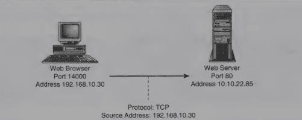

Web 服务器通过确认（*`ACK`*）响应 *`SYN`* 消息，并附带其自身的同步请求（*`SYN`*），如图 1.7 所示。此时连接处于半开状态。

## 图 1.7

TCP 服务器连接请求确认。


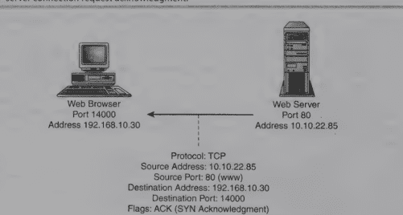

`SYN-ACK`报头中包含两个数据包过滤层面不可见的字段。除了`ACK`标志外，服务器还包含将客户端的序列号加上所接收的连续数据字节数后的值。确认的目的是确认客户端通过其序列号引用的数据。服务器通过递增客户端的序列号来确认这一点，这实际上意味着它已收到该数据，而“序列号加一”则是服务器期望接收的下一个数据字节。现在既然后服务器已确认收到原始`SYN`消息，客户端可以自由丢弃该消息的副本了。

服务器在其第一条消息中也设置了`SYN`标志。与客户端的第一条消息一样，`SYN`标志伴随着同步序列号。服务器传递了其自身连接半边的起始序列号。

这条第一条消息是服务器唯一一条设置`SYN`标志的消息。这条消息以及所有后续消息都设置了`ACK`标志。所有服务器消息中存在`ACK`标志，而客户端的第一条消息中缺乏`ACK`标志，当我们讲到构建防火墙可用的信息时，这将是一个关键区别。

你的机器接收到此消息并回复其自身的确认，之后连接即建立。图 1.8 以图形方式展示了这一过程。从此时起，客户端和服务器都设置`ACK`标志。任何程序都不会再次设置`SYN`标志。

### 图 1.8

`TCP`连接建立。

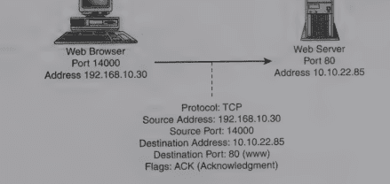

在每次确认中，客户端和服务器程序将伙伴进程的序列号增加所接收的连续数据字节数加一，以表明已收到该数量的数据字节，并表明程序期望在数据流中接收的下一个数据字节。

当浏览器接收网页时，你的机器从`Web`服务器接收带有数据包报头的消息数据，如图 1.9 所示。

### 图 1.9

正在进行的`TCP`服务器到客户端连接。

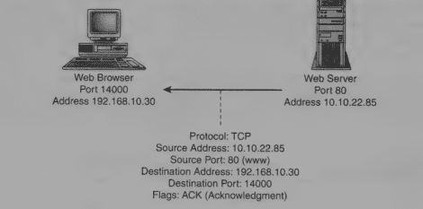

## 总结

本章中的简单示例说明了基于`IP`数据包过滤防火墙的信息基础。第 2 章“数据包过滤概念”在此基础上进行构建，描述`ICMP`、`UDP`和`TCP`消息类型以及服务端口号如何用于定义数据包过滤防火墙。

# 第 2 章

## 数据包过滤概念

什么是防火墙？多年来，该术语的含义发生了变化。根据`RFC 2647`《防火墙性能基准测试术语》，防火墙是“一个设备或一组设备，用于在网络之间实施访问控制策略”。这个定义非常广泛，事实上是有意为之。防火墙可以涵盖`OSI`模型的许多层，可能指的是执行数据包过滤、进行数据包检查和过滤、在更高层的应用程序上实施策略的设备，或者执行其中任何一项以及更多功能。

无状态防火墙通常仅基于`OSI`模型的`IP`层（第 3 层）执行一些数据包过滤，尽管有时此类防火墙也会涉及较高层协议。此类设备的示例可能包括位于网络边缘的边界路由器，它实施一个或多个访问列表，以防止各种类型的恶意流量进入网络。有些人可能会争辩说这种设备根本不是防火墙。然而，它显然符合`RFC`的定义。

边界路由器访问列表可能会根据接收数据包所在的接口实施许多不同的策略。通常会在连接到`Internet`的网络边缘过滤某些数据包。这些数据包将在本章后面讨论。

与无状态防火墙相反，有状态防火墙会跟踪给定会话中之前见过的数据包，并基于给定连接中已经看到的情况将访问策略应用于数据包。有状态防火墙隐含了无状态防火墙的基本数据包过滤能力。例如，有状态防火墙会跟踪`TCP`三次握手阶段，并拒绝该握手中看似顺序错乱的数据包。由于`UDP`是无连接的，对有状态防火墙来说稍微棘手一些，因为不存在可言的状态。然而，有状态防火墙会跟踪最近的`UDP`交换，以确保接收到的数据包与最近的发出去数据包相关。

*应用层网关*（`ALG`），有时被称为*应用层网关*，是另一种形式的防火墙。与了解网络层和可能的传输层的无状态防火墙不同，`ALG`主要处理`OSI`模型的第 7 层，即应用层。`ALG`通常对被传递的应用数据拥有深入的了解，因此可以查找所讨论应用程序中任何偏离正常流量的行为。

`ALG`通常驻留在客户端和真实服务器之间，并且就所有意图和目的而言，它会向客户端模拟真实服务器的行为。实际上，本地流量永远不会离开局域网，而远程流量永远不会进入局域网。

`ALG`有时也指协助其他防火墙的模块或软件片段。许多防火墙附带`FTP ALG`，以支持`FTP`的端口模式数据通道，其中客户端告诉服务器要连接哪个本地端口，以便它可以打开数据通道。服务器发起传入的数据通道连接（通常，客户端发起所有连接）。`ALG`通常用于让多媒体协议通过防火墙，因为多媒体会话通常使用从两端发起的多个连接，并且通常结合使用`TCP`和`UDP`。

`ALG`是一种代理。另一种形式的代理是电路层代理。电路层代理通常没有应用程序特定的知识；但它们可以实施访问和授权策略，并充当原本应是端到端连接中的终止点。`SOCKS`是一个电路层代理的示例。代理服务器充当连接双方的终止点，但服务器没有任何应用程序特定的知识。

在这些情况中的每一种中，防火墙的目的都是执行你定义的访问控制或安全策略。安全策略本质上关于访问控制——谁被允许或被禁止在你控制的服务器和网络上执行哪些操作。

虽然不一定特定于防火墙，但防火墙常常发现自己要执行额外任务，其中一些可能包括网络地址转换（`NAT`）、反病毒检查、事件通知、`URL`过滤、用户身份验证和网络层加密。

本书涵盖了数据包过滤防火墙背后的思想，无论是静态还是动态，即无状态还是有状态。所提到的每种方法都控制哪些服务可以被访问以及由谁访问。每种方法都根据其可用的不同`OSI`参考模型层信息，具有其独特的优势和优点。

第 1 章“数据包过滤防火墙的基础概念”介绍了防火墙所依据的概念和信息。本章介绍了如何使用这些信息来实现防火墙规则。

### 数据包过滤防火墙

在最基本的层面上，数据包过滤防火墙由一组接受和拒绝规则列表组成。这些规则明确定义了哪些数据包将或不会通过网络接口允许通过。防火墙规则使用第 1 章中描述的数据包报头字段来决定是将数据包转发到其目的地、默默丢弃数据包，还是阻塞数据包并向发送机器返回错误条件。这些规则可以基于多种因素，包括源或目的`IP`地址、源和（更常见的）目的端口、单个数据包的部分（如`TCP`报头标志）、协议类型、`MAC`地址等。

在连接到`Internet`的防火墙上，`MAC`地址过滤并不常见。使用`MAC`过滤，防火墙仅阻塞或允许特定的`MAC`地址。然而，极有可能你只会看到一个`MAC`地址，即你防火墙上游路由器的`MAC`地址。这意味着就你的防火墙所能看到的而言，`Internet`上的每个主机似乎都具有相同的`MAC`地址。新防火墙管理员常见的错误是尝试在`Internet`防火墙上使用`MAC`过滤。

使用`TCP/IP`参考模型的混合体，数据包过滤防火墙在网络层和传输层工作，如图 2.1 所示。

总体想法是，你需要非常谨慎地控制`Internet`和你直接连接到`Internet`的机器之间传递的内容。在面向`Internet`的外部接口上，你尽可能精确和明确地过滤从外部传入的内容和从机器传出的内容。

对于单机器设置，将网络接口视为输入/输出（`I/O`）对可能很有帮助。防火墙独立过滤通过接口传入和传出的内容。输入过滤和输出过滤可以并且很可能具有完全不同的规则。在谈论`Linux`防火墙时，定义什么可以进来和什么可以出去的规则列表被称为*链*。`I/O`对是输入链上的规则列表和输出链上的规则列表。这些列表被称为*链*，因为数据包会与列表中的每个规则逐一匹配，直到找到匹配项或列表耗尽，如图 2.2 所示。

### 图 2.1

防火墙在`TCP/IP`参考模型中的部署位置。

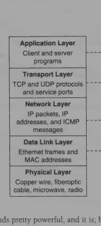

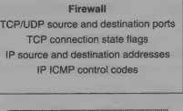


这听起来功能非常强大，确实如此；但它并非万无一失的安全机制。它只是故事的一部分，仅仅是数据安全多层防护策略中的一个层面。并非所有应用通信协议都适用于数据包过滤。这种类型的过滤层级过低，无法实现细粒度的身份验证和访问控制。这些安全服务必须在更高的层级提供。`IP`协议不具备验证发送者是否如其声称身份的能力。在该层级可用的唯一标识信息是`IP`数据包头中的源地址。源地址可以轻易被修改。提升一个层级，网络层和传输层都无法验证应用数据的正确性。尽管如此，与在高层级容易或方便地实施的操作相比，数据包层面允许对直接端口访问、数据包内容以及正确的通信协议进行更大、更简单的控制。

如果没有数据包层过滤，高层过滤和代理安全措施要么受到限制，要么可能无效。至少在某种程度上，它们必须依赖于底层通信协议的正确性。安全协议栈中的每一层都增加了一块其他层难以提供的组件。

### 图 2.2

输入和输出链。

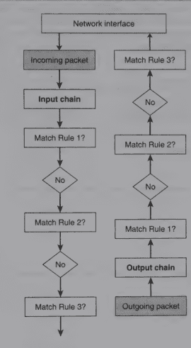

### 选择默认数据包过滤策略

如本章前文所述，防火墙是用于实施访问控制策略的设备。该策略很大一部分在于决定默认的防火墙策略。

默认防火墙策略有两种基本方法：


- 默认拒绝所有，并显式允许选定的数据包通过。
- 默认接受所有，并显式拒绝选定的数据包通过。

毫无疑问，拒绝所有策略是推荐的方法。这种方法更容易设置安全的防火墙，但你想要使用的每个服务及相关协议事务都必须显式启用（参见图 2.3）。这意味着你必须了解你要启用的每个服务的通信协议。拒绝所有的方法需要前期投入更多工作以启用互联网访问。一些商业防火墙产品仅支持拒绝所有策略。

### 图 2.3
默认拒绝所有策略。

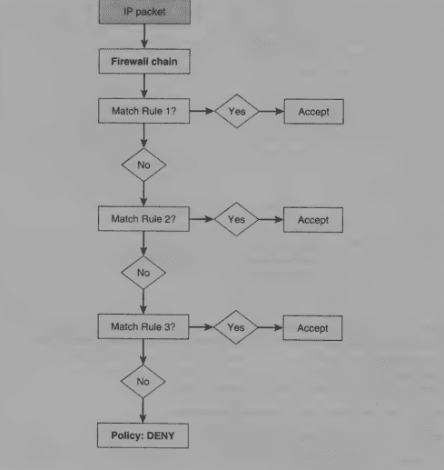

接受所有策略让你更容易立即开始运行，但它迫使你预判所有你可能想要禁用的可预见的访问类型（参见图 2.4）。危险在于，你直到为时已晚才预判到危险的访问类型，或者你稍后启用不安全的服务而未先阻止外部访问。最终，开发一个安全的接受所有防火墙的工作量要大得多，难度高得多，几乎总是安全性低得多，因此错误率也高得多。

### 图 2.4
默认接受所有策略。

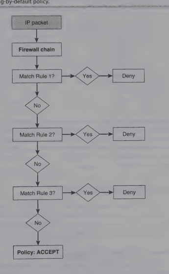

### 拒绝与丢弃数据包

`iptables` 中的 `Netfilter` 防火墙机制允许你选择拒绝或丢弃数据包。有什么区别？如图 2.5 所示，当数据包被拒绝时，数据包被丢弃，并向发送者返回一个 `ICMP` 错误消息。当数据包被丢弃时，数据包被简单地丢弃，不给发送者任何通知。

#### 图 2.5
拒绝与丢弃数据包。

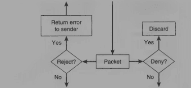

静默丢弃数据包几乎总是更好的选择，原因有三。首先，发送错误响应会使网络流量加倍。大多数被丢弃的数据包之所以被丢弃，是因为它们是恶意的，而不是因为它们代表尝试访问你偶然未提供服务的无辜行为。其次，你对其做出响应的数据包可被用于拒绝服务 `DoS` 攻击。第三，任何响应，即使是错误消息，都会给潜在的 attackers 提供潜在有用的信息。

### 过滤传入数据包

外部接口 I/O 对的输入侧，即输入链，在保护你的站点方面更有趣味。如前所述，你可以基于源地址、目的地址、源端口、目的端口和 TCP 状态标志进行过滤。你将在后续章节中的某一点了解所有这些信息的片段。

### 远程源地址过滤

在数据包层面，识别 IP 数据包发送者的唯一手段是数据包头部中的源地址。这一事实使得源地址欺骗成为可能，即发送者在源字段中放置错误的地址，而不是其自己的地址。该地址可能是不存在的地址，也可能是属于其他人的合法地址。这可能允许不法分子伪装成本地、可信流量闯入你的系统；伪装成你在攻击其他站点；伪装成他人攻击你；让你的系统因响应不存在的地址而陷入困境；或以其他方式误导你对传入消息来源的判断。

重要的是要记住，你通常无法检测到被欺骗的地址。地址可能是合法且可路由的，但不一定属于数据包的发送者。下一节描述你可以检测到的被欺骗地址。

### 源地址欺骗与非法地址

有 10 大类源地址在你的外部接口上在所有情况下都应拒绝。这些是声称来自以下来源的传入数据包：

1. **你的 IP 地址** ——你永远不会看到声称来自你机器的合法传入数据包。由于源地址是唯一可用的信息且可以被修改，这是你可以在数据包过滤层面检测到的合法地址欺骗形式之一。声称来自你机器的传入数据包是被欺骗的。你不能确定其他传入数据包是否真的来自它们声称的地方。（注意，某些操作系统如果在收到源地址和目的地址都属于主机网络接口的数据包时会崩溃。）

2. **你的局域网 LAN 地址** ——你很少会在外部、互联网接口上看到声称来自你局域网的合法传入数据包。如果局域网有多个互联网访问点，则有可能看到这样的数据包，但这很可能表明本地网络配置错误。在大多数情况下，此类数据包可能是试图利用你的本地信任关系来入侵你站点的尝试的一部分。

3. **A 类、B 类和 C 类私有 IP 地址** ——在历史 A、B 和 C 类地址范围中的这三组地址是为在私有局域网中使用而保留的。它们不适用于互联网使用。因此，这些地址可以被任何站点内部使用，而无需购买注册的 IP 地址。你的机器永远不应该看到来自这些源地址的传入数据包：
    - A 类私有地址分配的范围是从 10.0.0.0 到 10.255.255.255。
    - B 类私有地址分配的范围是从 172.16.0.0 到 172.31.255.255。
    - C 类私有地址分配的范围是从 192.168.0.0 到 192.168.255.255。

第 2 章：数据包过滤概念

4. **D 类多播 IP 地址** ——D 类范围内的 IP 地址被保留用于在多播网络广播（如音频广播或视频广播）中参与时作为目的地址。它们的范围是从 224.0.0.0 到 239.255.255.255。你的机器永远不应该看到来自这些源地址的数据包。

5. **E 类保留 IP 地址** ——E 类范围内的 IP 地址被保留用于未来和实验用途，并未公开分配。它们的范围是从 240.0.0.0 到 247.255.255.255。你的机器永远不应该看到来自这些源地址的数据包——而且最可能也不会看到。（由于整个地址范围永久保留至 255.255.255.255，E 类范围实际上可以定义为 240.0.0.0 到 255.255.255.255。事实上，一些来源将 E 类地址范围定义为正好如此。）

6. **环回接口地址** ——环回接口是 `Linux` 系统用于本地基于网络的服务的私有网络接口。操作系统通过环回接口走捷径，而不是将本地流量通过网络接口驱动程序发送，以此作为性能提升。根据定义，环回流量是目标为产生它的系统。它不会发送到网络上。环回地址范围是 127.0.0.0 到 127.255.255.255。你通常会看到它被称为 127.0.0.1、localhost 或环回接口 lo。

7. **格式错误的广播地址** ——广播地址是适用于网络上所有机器的特殊地址。地址 0.0.0.0 是一个特殊的广播源地址。合法的广播源地址要么是 0.0.0.0，要么是一个常规 IP 地址。`DHCP` 客户端和服务器会看到来自源地址 0.0.0.0 的传入广播数据包。这是该源地址的唯一合法用途。它不是一个合法的点对点单播源地址。当作为常规点对点非广播数据包的源地址看到时，该地址是被伪造的，或者发送者未完全配置。

8. **A 类网络 0 地址** ——正如之前所建议的，0.0.0.0 到 0.255.255.255 范围内的任何源地址作为单播地址都是非法的。

9. **链路本地网络地址** ——当 `DHCP` 客户端无法从服务器获取地址时，有时会将链路本地地址分配给自己。这些地址的范围是从 169.254.0.0 到 169.254.255.255。

10. **TEST-NET 地址** ——从 192.0.2.0 到 192.0.2.255 的地址空间保留用于测试网络。

许多其他地址块由 `IANA` 保留且未在使用。根据我的经验，过滤掉这些额外的地址块是有益的。然而，这样做存在危险：随着 `IPv4` 地址空间变得紧张且互联网站点数量增加，`IANA` 已经

自2000年中期以来，这些地址块的分配变得更加频繁。除非您定期监控`IANA`的地址块分配情况，否则迟早您会误封合法的地址。

对住宅网站而言，无意中封锁新分配的合法地址影响不大。商业网站则必须在维持访问需求与持续监控已分配地址块的成本之间进行权衡。对于遭受持续拒绝服务 `DoS` 攻击的互联网企业来说，付出这些努力可能非常符合其利益，仅仅为了减少其网站可能需要响应的可能伪造源地址的数量。

### 封锁存在问题的站点

另一种常见但使用频率较低的源地址过滤方案是封锁来自特定机器或（更常见的）整个网络IP地址块的所有访问。这是互联网社区处理问题站点和ISP惯常采用的方式。如果一个站点获得了不良的互联网邻居声誉，其他站点往往会全面封锁它。

在个人层面，当远程网络中的个人惯常造成干扰时，封锁来自选定网络的所有访问非常方便。从历史上看，这曾被用作一种对抗未经请求的电子邮件的手段，有些人甚至不惜封锁整个国家的IP地址范围。

### 限制来自特定远程主机的入站数据包

您可能希望仅从特定的外部网站或个人接受特定类型的入站数据包。在这些情况下，防火墙规则将定义这些数据包将被接受的具体IP地址或有限的IP源地址范围。

第一类入站数据包来自响应您请求的远程服务器。尽管某些服务（如Web或FTP服务）可以预期来自任何地方，但其他服务则合法地仅来自您的ISP或特别选定的受信任主机。仅通过您的ISP提供的服务器示例包括`POP`邮件服务、域名服务 `DNS` 名称服务器响应，以及可能的`DHCP`或动态IP地址分配。

第二类入站数据包来自访问您站点所提供服务的远程客户端。同样，尽管某些入站服务连接（如连接到您的Web服务器的连接）可以预期来自任何地方，但其他本地服务将仅提供给少数受信任的远程用户或朋友。受限本地服务的示例可能是`*ssh*`和`*ping*`。

### 本地目标地址过滤

基于目标地址过滤入站数据包并不是什么大问题。在正常操作下，您的网卡会忽略那些未指向它的普通数据包。例外情况是广播数据包，它们被广播到网络上的所有主机。


地址 255.255.255.255 是通用广播目标地址。它指的是立即物理网络段上的所有主机，被称为受限广播。广播地址可以更明确地定义为给定IP地址子网中的最高地址。例如，如果您的ISP的IP地址范围是 192.168.0.0，子网掩码为24位（255.255.255.0），而您的IP地址是 192.168.10.30，您将从您的ISP看到发往 192.168.10.255 的广播数据包。另一方面，如果您拥有较小范围的IP地址，例如 /30（255.255.255.252），则您总共有四个地址，一个网络，两个用于主机，一个是广播。例如，考虑网络 10.3.7.4/30。在这个网络中，10.3.7.4 是网络地址，两个主机将是 10.3.7.5 和 10.3.7.6，广播地址将是 10.3.7.7。这种 /30 子网配置类型通常用于路由器之间，尽管实际地址可能有所不同。确定给定子网的广播地址的唯一方法是同时知道子网内的一个IP地址和子网掩码。这类广播被称为定向子网广播，并传递到该网络上的所有主机。

广播至目标地址 0.0.0.0 类似于前文“源地址欺骗和非法地址”章节中提到的点ToPoint数据包声称来自广播源地址的情况。在这里，广播数据包是发往源地址 0.0.0.0，而不是发往目标地址 255.255.255.255。在这种情况下，关于数据包的意图几乎没有疑问。这是试图识别您的系统为Linux机器。出于历史原因，源自BSD UNIX的网络代码在响应使用 0.0.0.0 作为广播目标地址时，会返回ICMP类型3错误消息。其他操作系统则静默丢弃该数据包。因此，这是为什么丢弃数据包与拒绝数据包存在差异的一个良好示例。在这种情况下，错误消息本身就是探针所寻找的对象。

## 远程源端口过滤

来自远程服务器到您本地服务器的入站请求和连接将具有非特权范围内的源端口。如果您托管Web服务器，所有到您Web服务器的入站连接的源端口都应在 1024 到 65,535 之间。（虽然服务由服务器端口标识是预期的，但并非保证。您无法确定预期的服务器正在您预期的端口上运行。）

来自您联系的远程服务器的入站响应和连接将具有分配给特定服务的源端口。如果您连接到远程网站，来自远程服务器的所有入站消息的源端口都将设置为80（或本地客户端指定的任何端口），即HTTP服务端口号。

## 本地目标端口过滤

入站数据包中的目标端口标识了您计算机上数据包指向的程序或服务。与源端口一样，来自远程客户端到您服务的入站请求通常遵循相同的模式，而来自远程服务到您本地客户端的入站响应则遵循不同的模式。

来自远程客户端到您本地服务器的入站请求和连接会将目标端口设置为您分配给特定服务的端口号。例如，发往您本地Web服务器的入站数据包通常会将目标端口设置为80，即HTTP服务端口号。

来自您联系的远程服务器的入站响应将具有非特权范围内的目标端口。如果您连接到远程网站，来自远程服务器的所有入站消息的目标端口都将在1024到65,535之间。

## 入站TCP连接状态过滤

入站TCP数据包接受规则可以利用与TCP连接相关的连接状态标志。所有TCP连接都遵守同一组连接状态。由于连接建立过程中的三次握手，这些状态在客户端和服务器之间有所不同。因此，防火墙可以区分来自远程客户端的入站流量和来自远程服务器的入站流量。

来自远程客户端的入站TCP数据包在作为三次连接建立握手一部分接收的第一个数据包中会设置SYN标志。第一个连接请求将设置SYN标志，但不设置ACK标志。

来自远程服务器的入站数据包始终是对由您的本地客户端程序发起的初始连接请求的响应。从远程服务器接收到的每个TCP数据包都将设置ACK标志。您的本地客户端防火墙规则将要求所有来自远程服务器的入站数据包都必须设置ACK标志。服务器通常不会尝试向客户端程序发起连接。

## 探针和扫描

探针是尝试连接或从单个服务端口获取响应。扫描是向一组不同服务端口的一系列探针。扫描通常是自动化的。

不幸的是，探测和扫描如今已很少是无害的了。它们极有可能是初步的信息收集阶段，旨在发起攻击前寻找有趣的漏洞。特别是在 1998 年，我们目睹了全球扫描数量呈指数级增长。自动扫描工具已广泛普及，黑客团伙的协同行动也屡见不鲜。互联网上许多主机的安全问题（或缺乏安全保障），加上蠕虫、病毒和被控制机器的泛滥，使得扫描成为互联网上的常态问题。

## 通用端口扫描

通用端口扫描是在大量服务端口（可能是整个范围，见图 2.6）上进行的无差别探测。随着更复杂、更具针对性的隐身工具的出现，这些扫描正变得不那么频繁——或者说，至少不再那么显而易见了。

### 图 2.6

一次通用端口扫描。

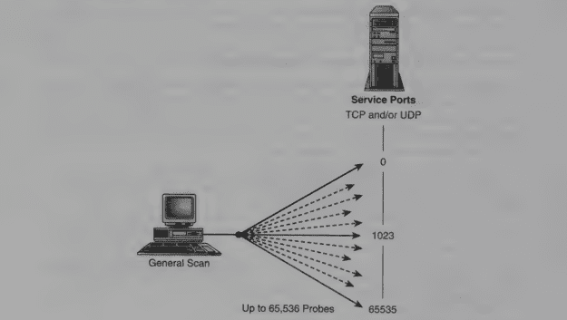

## 针对性端口扫描

针对性端口扫描旨在寻找特定的漏洞（见图 2.7）。较新的、更精密的工具试图识别硬件、操作系统和软件版本。这些工具的设计目的是识别可能存在特定漏洞的目标。

### 图 2.7

一次针对性端口扫描。

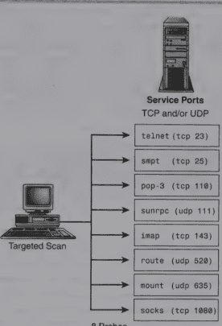

## 常见服务端口目标

常见目标通常既会单独探测，也会被扫描。攻击者可能在寻找特定的漏洞，例如不安全的邮件服务器、未修补的 Web 服务器或开放的 RPC portmap 守护进程。

更全面的端口列表可以在 [http://www.iana.org/assignments/port-numbers](http://www.iana.org/assignments/port-numbers) 找到。这里只提到了少数几个常见端口，以帮助你建立概念：

- 来自保留端口 0 的传入数据包总是无效的。该端口并非合法使用。
- 对 TCP 端口 0 到 5 的探测是扫描程序的标志。
- telnet (23/tcp)、smtp (25/tcp)、dns (53/tcp/udp)、pop-3 (110/tcp)、sunrpc (111/udp/tcp)、imap (143/tcp)、snmp (161/udp)、route (520/udp) 和 mount (635/udp) 是热门的目标端口。它们代表了系统中最容易受威胁的入口之一，无论是由于固有的安全性问题、常见的配置错误，还是软件中的已知缺陷。由于这些服务非常普遍，它们是为什么你希望要么不向外部世界提供它们，要么非常谨慎地提供并严格控制外部访问这些服务的绝佳例子。
- NetBIOS (137-139/tcp/udp)、Windows 2000/2003 上的 SMB (445/tcp)、Netbus (12345/tcp) 以及旧版 Back Orifice (31337/udp) 的探测十分常见且令人厌烦。它们对 Linux 系统不构成威胁。在这种情况下，目标是 Windows 系统，但由于扫描过于频繁，原因并非因为 Windows 作为互联网服务器很受欢迎（Linux/Apache 是最流行的 Web 服务器），而是由于 Microsoft Windows 相对缺乏安全性。


## 隐身扫描

顾名思义，隐身端口扫描不被设计为可检测。它们基于 TCP 协议栈如何响应意外数据包，或具有非法状态标志组合的数据包。例如，考虑一个设置了 ACK 标志但没有相关连接关系的传入数据包。如果该 ACK 被发送到一个附有监听服务器的端口，TCP 栈将找不到相关连接，并返回一个 TCP RST 消息以告知发送者重置连接。如果该 ACK 被发送到一个未使用的端口，系统仅会返回一个 TCP RST 消息作为错误指示，就像防火墙默认返回 ICMP 错误消息一样。

由于某些防火墙仅测试 SYN 标志或 ACK 标志，问题变得更加复杂。如果两者均未设置，或者数据包包含其他标志组合，防火墙实现可能会将数据包向上提交给 TCP 代码。根据 TCP 状态标志组合以及接收数据包的操作系统的不同，系统将响应 RST 或保持沉默。这种机制可用于帮助识别目标系统正在运行的操作系统。在这些任何情况下，接收系统都不太可能记录该事件日志。

通过这种方式诱导目标主机生成 RST 数据包，也可用于映射网络，确定网络上正在监听的系统的 IP 地址。如果目标系统不是服务器，且其防火墙被设置为静默丢弃 unwanted 数据包，这一点尤其有用。

## 避免偏执：应对端口扫描

防火墙日志通常显示各种失败连接尝试。探测是你将在日志中看到的最常被报告的内容。

人们如此频繁地探测你的系统吗？是的，确实如此。你的系统被入侵了吗？不，没有。嗯，也不完全是。端口已被封锁。防火墙正在履行其职责。这些是被防火墙拒绝的失败连接尝试。


你个人在什么时间点决定报告一次探测？在什么时间点它重要到值得花费时间去报告？在什么时间点你认为够了，继续你的生活，或者你是否应该每次都给`abuse@some.system`写信？没有“正确”的答案。你如何回应是个人判断，部分取决于你可用的资源、你站点信息的敏感程度，以及互联网连接对你站点的重要性。对于明显的探测和扫描，没有明确的答案。这取决于你如何根据自己的人格和舒适程度来定义严重的探测，以及你的社会责任感。

鉴于此，有一些可行的指导原则。

最常见的尝试是自动探测、错误、基于互联网历史的合法尝试、无知、好奇以及行为不当的软件的组合。

通常，你可以安全地忽略单个、孤立、针对`telnet`、`ssh`、`ftp`、`finger`或你未提供的任何其他常见服务端口的单次连接尝试。探测和扫描是互联网生活的事实，过于频繁，而且通常不构成风险。它们有点像挨家挨户的推销员、商业电话、错误的电话号码和垃圾邮件。一天中没有足够的时间去回应每一个。

另一方面，有些探测者更为执着。你可能会决定添加防火墙规则来完全阻止他们，甚至可能阻止他们的整个 IP 地址空间。

对已知可能存在安全漏洞的端口子集的扫描，通常是如果在找到开放端口时对攻击的前奏。更全面的扫描通常是针对整个域或子网寻找入口点的广泛扫描的一部分。当前的黑客工具依次探测这些端口的子集。

偶尔，你会看到严重的黑客攻击尝试。这毫无疑问是采取行动的时候。写信。报告。双重检查你的安全。观察他们在做什么。阻止他们。阻止他们的 IP 地址块。

一些系统管理员会严肃对待这种情况，因为即使他们的机器是安全的，其他人的机器可能不是。下一个人甚至可能没有能力知道他正在被探测。出于大家的安全，报告探测是一种社会负责任的行为。

你应该如何回应端口扫描？如果你给这些人、他们的邮局局长、他们的上行服务提供商 NOC 或网络地址块协调员写信，尽量保持礼貌。给予他们善意的假设。过度反应通常比适当的反应更常见。对你来说可能看似严重的黑客攻击尝试，往往只是一个好奇的孩子在使用新程序玩耍。给滥用者、`root`或邮局局长写一句礼貌的话通常就能解决问题。需要关于网络礼仪的教育的人比需要撤销其网络账户的人多得多。而且他们可能对任何事情都是无辜的。同样常见的是，此人的系统已被入侵，而他对正在发生的事情一无所知。他会感激这一信息的。

然而，探测并不是你将看到的唯一恶意流量。虽然探测本身是无害的，但 DoS 攻击并非如此。

## 拒绝服务攻击

DoS 攻击基于通过向你的系统发送大量数据包来干扰或严重降低你的互联网连接，占用本地服务器资源以至于无法处理合法请求，或者在最坏的情况下使整个系统崩溃的想法。两种最常见的结果是使系统忙于处理而无法做有用的事情，以及占用关键系统资源。

你无法完全防范 DoS 攻击。它们可以有多少种形式，取决于攻击者的想象力。任何导致你的系统做出响应的事物、任何导致你的系统分配资源（包括记录攻击日志）的事物、任何诱导远程站点停止与你通信的事物——都可以在 DoS 攻击中使用。

> **拒绝服务攻击**
>
> 有关 DoS 攻击的更多信息，请参见可在 [http://www.cert.org](http://www.cert.org) 找到的 “Denial of Service” 论文。

这些攻击通常涉及几种经典模式之一，包括 `TCP SYN` 泛洪、`ping` 泛洪、UDP 泛洪、分片炸弹、缓冲区溢出和 ICMP 路由重定向炸弹。

### TCP SYN 泛洪

`TCP SYN` 泛洪攻击会消耗你的系统资源，直到无法再建立传入的 `TCP` 连接（见图 2.8）。该攻击利用了连接建立过程中基本的 `TCP` 三次握手协议，并结合了 IP 源地址欺骗。

#### 图 2.8

**TCP SYN** 洪水攻击。


攻击者将其源地址伪装成一个私有地址，并向您基于`TCP`的服务之一发起连接。攻击者伪装成试图打开`TCP`连接的客户端，向您发送一个人工生成的`SYN`消息。您的机器通过发送确认包`SYN ACK`来响应。然而，在这种情况下，您回复的地址并不是攻击者的地址。事实上，由于该地址是私有的，外部没有人会对此做出响应。被伪装的宿主不会返回`RST`消息来拆除这个半开连接。

`TCP`连接建立的最后一个阶段——接收响应`ACK`——永远不会发生。因此，有限的网络连接资源会被消耗殆尽。连接将保持半开状态，直到连接尝试超时。攻击者用一次又一次的连接请求淹没您的端口，速度超过了`TCP`超时释放资源的速度。如果这种情况持续下去，所有资源都将被占用，无法再接纳新的传入连接请求。这不仅适用于正在被探测的服务，也适用于所有新的连接。

Linux 用户有一些可用的辅助手段。首先是源地址过滤，前面已做过描述。这可以过滤掉最常用的被伪装的源地址，但无法保证被伪装的地址落在您可以预见并加以过滤的类别中。

其次是启用内核的`SYN` cookie 模块，这是一种专门针对`SYN`洪水导致的资源耗尽问题的延缓措施。当连接队列开始接近满载时，系统开始使用`SYN` cookie 而不是`SYN-ACK` 来响应`SYN`请求，并释放队列槽位。因此，队列永远不会完全填满。cookie 有一个较短的超时时间；客户端必须在一个短暂的时间内对 cookie 做出响应，服务器才会回复预期的 SYN-ACK。该 cookie 是一个基于 SYN 中原始序列号、源和目的地址及端口以及一个秘密值生成的序列号。如果对 cookie 的响应与哈希算法的结果匹配，服务器可以相当有把握地认为该 SYN 是有效的。

根据具体的发行版本，您可能需要也可能不需要使用命令 `echo 1 > /proc/sys/net/ipv4/tcp_syncookies` 在内核中启用 SYN cookie 保护。某些发行版和内核版本要求您使用 `make config`、`make menuconfig` 或 `make xconfig` 显式地将该选项配置到内核中，然后重新编译并安装新的内核。

> **SYN 洪水攻击与 IP 伪装**
>
> 有关 SYN 洪水攻击和 IP 伪装的更多信息，请参阅 CERT 通告 CA-96.21“TCP SYN Flooding and IP Spoofing Attacks”，网址为 http://www.cert.org。

### PING 洪水攻击

任何能够引起您机器响应的消息都可以用来降低您的网络连接性能，迫使系统花费大部分时间进行响应。由 `ping` 发送的 ICMP 回显请求消息就是一个常见的罪魁祸首。一种名为 smurf 的攻击及其变种，会迫使系统消耗资源来处理回显应答。实现这一目的的一种方法是伪装受害者的源地址，并向整个网络的宿主广播回显请求。单个被伪装的请求消息就可能导致数百或数千条回复被发送给受害者。实现类似结果的另一种方法是在互联网上的被入侵宿主上安装木马，并设置时间让它们同时向同一宿主发送回显请求。最后，简单的 `ping` 洪水攻击（即攻击者发送更多回显请求以淹没数据连接）是另一种拒绝服务（DoS）方法，尽管这种方法正在变得不那么常见。图 2.9 展示了一个典型的 `ping` 洪水攻击。

### 死亡之 PING

一种称为“死亡之 PING”的早期漏洞涉及发送非常大的 `ping` 数据包。易受攻击的系统可能会因此崩溃。Linux 不受此漏洞影响，许多当前的 UNIX 操作系统也是如此。如果您的防火墙保护的是较旧的系统或个人计算机，那些系统可能会受到此漏洞的影响。

#### 图 2.9

一个 `ping` 洪水攻击。

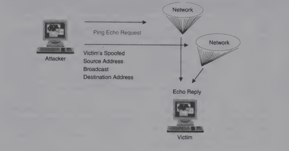

“死亡之 PING”漏洞提供了一种思路，说明简单的协议和消息交互如何可以被富有创造力的黑客利用。并非所有的攻击都是为了入侵您的计算机。有些攻击仅仅是破坏性的。在这种情况下，目标是使机器崩溃。（系统崩溃也可能是您需要检查系统是否安装了木马程序的指示。您可能被欺骗加载了木马程序，但程序本身可能需要系统重启才能激活。）

`ping` 是一个非常有用的基础网络工具。您可能不希望完全禁用 `ping`。在当今的互联网环境中，保守的建议是禁用传入的 `ping`，或者至少严格限制接受回显请求的来源。由于 `ping` 历史上卷入了 DoS 攻击，许多网站不再响应除选定来源之外的任何外部 `ping` 请求。与互联网协议栈中更普遍且更危险的针对应用程序和其他协议的威胁相比，基于 ICMP 的 DoS 威胁相对较小，这种做法一直被视为反应过度。

然而，丢弃 `ping` 请求对于受害宿主来说并不是一个解决方案。无论接收方如何反应，系统（或网络）仍然可能在检查和丢弃大量请求的过程中被压倒。

### UDP 洪水攻击


UDP 协议特别适合作为 DoS 工具。与 TCP 不同，UDP 是无状态的。不包含流控机制。没有连接状态标志。不使用数据报序列号。不维护有关下一个期望数据包的信息。基于端口号不一定总能区分客户端流量和服务器流量。没有状态信息，就无法区分预期的传入响应和意外到达的未经请求的数据包。让系统忙于响应传入的 UDP 探测，以至于没有带宽留给合法网络流量，这是相对容易做到的。

由于 UDP 服务容易受到此类攻击（而面向连接的 TCP 服务则不然），许多站点会禁用所有非绝对必要的 UDP 端口。如前所述，几乎所有常见的互联网服务都是基于 TCP 的。我们在第 4 章“构建和安装独立防火墙”中将要构建的防火墙，会仔细限制 UDP 流量，仅允许向提供必要 UDP 服务的远程宿主发送。

经典的 UDP 洪水攻击涉及两台受害机器，或者工作方式与 smurf ping 洪水攻击相同（见图 2.10）。攻击者从其 UDP echo 端口发送的一个单个伪装数据包，指向某主机的 UDP chargen 端口，可能导致网络流量的无限循环。echo 和 chargen 服务是网络测试服务。chargen 生成一个 ASCII 字符串。echo 返回发送到该端口的数据。

## 图 2.10

一个 UDP 洪水攻击。


## UDP 端口拒绝服务攻击

关于使用这些 UDP 服务的 DoS 漏洞的更完整描述，请参阅 CERT 通告 CA-96.01“UDP Port Denial-of-Service Attack”，网址为 http://www.cert.org。

## 碎片炸弹

不同的底层网络技术（如以太网、ATM 和令牌环）定义了不同的二层帧大小限制。当数据包沿着从源机器到目标机器路径从一个路由器传递到下一个路由器时，网络网关路由器可能需要将数据包切割成称为分片（fragments）的更小片段，然后再传递给下一个网络。在合法的碎片化中，第一个分片包含通常位于 UDP 或 TCP 传输头中的源和目的端口号。随后的分片则不包含。

例如，虽然最大理论数据包长度是 65,535 字节，但最大以太网帧大小（最大传输单元，或 MTU）是 1,500 字节。

当数据包被碎片化时，中间路由器不会重新组装数据包。数据包在目的宿主或其相邻路由器处重新组装。

由于中间碎片化最终比发送较小的非碎片数据包成本更高，当前系统通常会在连接开始时与目标宿主进行 MTU 发现。这是通过发送一个在 IP 头部选项字段中设置了“不要碎片化”（Don't Fragment）选项的数据包来实现的（这是 IP 选项字段当前唯一普遍合法的用途）。如果中间路由器必须对数据包进行碎片化，它将丢弃该数据包并返回一个 ICMP 3 错误（需要碎片化）。

一种类型的碎片攻击涉及人工构造非常小的数据包。单字节数据包会使某些操作系统崩溃。当前操作系统通常会测试这种情况。

小分片的另一种用途是构造初始分片，使得 UDP 或 TCP 的源和目的端口包含在第二个分片中。（所有网络的 MTU 大小都足以承载标准的 40 字节 IP 和传输头部。）数据包过滤防火墙通常允许这些分片通过，因为它们过滤依据的信息不存在。这种形式的攻击可用于让原本不被允许的数据包通过防火墙。

前面提到的“死亡之 PING”漏洞就是使用碎片来承载非法大小的 ICMP 消息的一个例子。当 ping 请求被重新构造时，整个数据包的大小超过 65,535 字节，导致某些系统崩溃。

碎片化攻击的经典示例是“泪滴”（Teardrop）攻击。该方法可用于绕过防火墙或使系统崩溃。第一个分片被构造为指向允许的服务。（许多防火墙不会检查第一个数据包之后的分片。）如果该分片被允许通过，随后的分片将被转发并由目标主机重组。如果第一个数据包被丢弃，后续数据包虽然会通过防火墙，但目标主机将没有内容可供重组，最终会丢弃这些不完整的包。

随后分片中的数据偏移字段可以被修改，以覆盖第一个分片中的端口信息，从而访问被禁止的服务。偏移量也可以被修改，使得数据包重组过程中使用的偏移量变为负数。由于内核的字节复制例程通常使用无符号数，负值会被视为一个非常大的正数；由此产生的复制操作会破坏内核内存，导致系统崩溃。

用于防火墙的主机以及为其他本地主机执行 NAT（网络地址转换）的主机应配置为在将数据包交付给本地目标之前先重组它们。某些 `iptables` 功能要求系统在将数据包转发到目标主机之前先重组数据包，且重组是自动完成的。

## 缓冲区溢出

过滤型防火墙无法防护缓冲区溢出利用。这类利用主要分两类。第一类是简单地通过覆盖数据空间或运行时堆栈来使系统或服务器崩溃。第二类需要深厚的技术专长，以及对被攻击的硬件、系统软件或服务器版本的了解。溢出的目的是覆盖程序的运行时堆栈，使得调用返回堆栈包含一个程序地址以及跳转至该程序的指令。该程序通常以 `root` 权限启动 shell。

CGI 脚本在许多 Web 应用中被广泛使用，历史上特别容易受到攻击，除非采取了预防措施。当前服务器中的许多漏洞都是由于缓冲区溢出造成的。及时安装并保持更新所有最新补丁和软件修订版至关重要。

> **CGI 拒绝服务（DoS）利用**
>
> 关于使用 CGI 脚本进行 DoS 利用的说明，请参阅 http://www.cert.org 上的“如何在 CGI 脚本中从用户提供的数据中移除元字符”，以及 http://www.w3.org 上的“万维网安全常见问题”。

## ICMP 重定向炸弹

ICMP 重定向消息类型 5 告知目标系统修改其内存中的路由表，以选择更短的路径。重定向消息由路由器发送给其相邻主机。其目的是告知主机有可用的一条更短路径（即，主机与新路由器位于同一网络，且新路由器是原路由下一跳本应转发数据包的路由器）。

如果路由器运行的是 `routed` 或 `gated`，任何重定向消息都应被忽略。主机被要求遵循重定向并将网关添加到其路由缓存中。RFC 1122《互联网主机要求——通信层》第 3.2.2.2 节指出了例外情况：“如果重定向消息指定的新网关地址不在重定向到达的同一连接（子）网络上，或者如果重定向的源不是指定目的地的当前第一跳网关，则应静默丢弃该重定向消息。”

重定向消息几乎每天都会到达，但它们很少起源于相邻路由器。对于连接到 ISP 的住宅或商业站点来说，相邻路由器生成重定向消息的可能性微乎其微。

如果您的主机使用静态路由并遵循重定向消息，那么有人可能会欺骗您的系统，使其从本地 Web 服务器发出的信息变得不可预测，可以预期到

前往任何地方，其他本地服务仅向少数受信任的远程站点或朋友提供。受限本地服务的示例可能包括 telnet、ssh、基于 Samba 的服务以及通过 portmap 访问的 RPC 服务。不仅防火墙规则将拒绝这些服务的一般性入站连接，而且规则也不会允许这些服务的出站响应发送给任何人。

## 本地源端口过滤

明确定义网络上哪些服务端口可用于出站连接，有两个目的——一个针对客户端程序，另一个针对服务器程序。

指定出站连接允许使用的源端口，有助于确保你的程序运行正确，并防止其他用户接触到本不应出现在互联网上的本地网络流量。

来自本地客户端的出站连接几乎总是源于非特权源端口。在防火墙规则中将客户端限制在非特权端口内，有助于通过确保客户端程序按预期运行，从而保护其他用户免受你方潜在失误的影响。

来自本地服务器程序的出站数据包总是源于其分配的服务端口，且是对所收到请求的响应。在防火墙层级将服务器限制在其分配端口内，可确保服务器程序在协议层面运行正确。更重要的是，这有助于保护你运行的任何私有本地网络服务免受外部访问。它也有助于保护远程站点免受本应仅限在本地系统内部的网络流量干扰。

## 远程目标端口过滤

本地客户端程序设计用于连接网络服务器，这些服务器在它们分配的服务端口上提供服务。从这一角度来看，将本地客户端限制为仅能连接到其关联服务器的服务端口，可确保协议的正确性。限制客户端连接到特定目标端口也有其他两个目的。首先，它有助于防止本地私有网络客户端程序无意间尝试访问互联网上的服务器。其次，它在很大程度上可阻止出站错误、端口扫描以及可能源自你站点的其他恶意行为。

本地服务器程序几乎总是参与源于非特权端口的连接。防火墙规则将服务器的出站流量限制为仅发往非特权目标端口。

## 出站 TCP 连接状态过滤

出站 TCP 数据包接收规则可以像入站规则一样，利用与 TCP 连接相关联的连接状态标志。所有 TCP 连接都遵循同一组连接状态，这在客户端和服务器之间有所不同。

来自本地客户端的出站 TCP 数据包在三次握手连接建立过程中的首个发送数据包中会设置 SYN 标志。初始连接请求会设置 SYN 标志，但不设置 ACK 标志。本地客户端防火墙规则将允许设置了 SYN 或 ACK 标志的出站数据包通过。

来自本地服务器的出站数据包总是对由远程客户端程序发起的初始连接请求的响应。服务器发送的每个数据包都会设置 ACK 标志。本地服务器防火墙规则要求服务器发出的所有出站数据包都必须设置 ACK 标志。

## 私有网络服务与公共网络服务


# 无意间允许入侵的最简单方式之一

进入`/path/to/xxx`目录，找到`xxx.json`。

无意间允许入侵的最简单方式之一，就是允许外部访问那些仅设计用于局域网（`LAN`）使用本地服务。某些服务如果在本地提供，永远不应跨越局域网与互联网之间的边界。其中一些服务会打扰你的邻居，一些提供了你最好独自保留的信息，还有一些如果在局域网外部可用，则代表明显的**安全漏洞**。

一些最早的网络服务，特别是 `r-*` 系列命令，是设计用于在受信任环境中跨多台实验机器进行本地共享和便捷访问的。一些后期服务旨在用于互联网访问，但它们设计于互联网基本是学术界和研究人员扩展社区的时代。互联网是一个相对开放、安全的地方。随着互联网发展成为一个包含公众访问的全球网络，它演变成了一个完全不可信的环境。

许多 Linux 网络服务旨在提供关于系统上用户账户的本地信息，正在运行的程序，正在使用的资源，系统状态，网络状态以及连接到网络的其他机器的类似信息。并非所有这些信息服务本身都代表安全漏洞。问题不在于有人能直接利用它们获得未经授权的系统访问。问题在于它们提供了关于系统和用户账户的信息，这些信息对于寻找已知漏洞的人可能很有用。它们还可能提供如用户名、地址、电话号码等等信息，你并不希望这些信息对任何询问者都轻易可得。

一些更危险的网络服务旨在提供对共享文件系统与设备的局域网访问，例如网络打印机或传真机。

有些服务很难正确配置，有些则很难安全配置。整本书都致力于配置某些更复杂的 Linux 服务。具体的服务配置超出了本书的范围。

有些服务在家庭或小型办公环境中毫无意义。有些旨在管理大型网络，提供互联网路由服务，提供大型数据库信息服务，支持双向加密和身份验证等。

## 保护非安全的本地服务

保护自己最简单的方法就是不提供服务。但如果你需要在本地使用这些服务怎么办？并非所有服务都能充分地在数据包过滤层级得到保护。多媒体服务，如 `RealAudio` 和即时消息服务，以及基于 `UDP` 的 `RPC` 服务，在数据包过滤层级进行保护臭名昭著地困难。

保护电脑的一种方法是不在防火墙机器上托管你不打算公共使用的网络服务。如果服务不可用，远程客户端就无可连接。让防火墙做防火墙该做的事。

数据包过滤防火墙不提供完整的安全保障。某些程序需要更高层级的安全措施，这些措施可以在数据包过滤层级提供。某些程序问题太多，即使在不那么安全的住宅主机上，也不宜在防火墙机器上运行。

家庭等小型站点通常没有足够的计算机可用，通过在其他机器上运行私有服务来执行访问安全策略。必须做出妥协，特别是对于仅由 Linux 提供的必需服务。然而，拥有局域网的小型站点不应在防火墙上运行文件共享或其他私有局域网服务，如 `Samba`。该机器不应具有不必要的用户账户。不需要的系统软件应从系统中移除。该机器除安全网关外不应有任何其他功能。

## 选择要运行的服务

总而言之，只有你能决定你需要或想要哪些服务。保护系统的第一步是决定你打算在防火墙机器上以及防火墙后的私有局域网中运行哪些服务和守护进程。每个服务都有其自身的安全考量。当涉及到选择要在 Linux 或任何操作系统下运行的服务时，一般原则是只运行你需要的网络服务，并且

理解。在运行网络服务之前——特别是当该机器直接连接到互联网时，理解该网络服务的作用及其目标用户非常重要。

## 总结

结合本章与前文内容，网络与防火墙的基础知识已阐明。下一章节将更深入地探讨 `iptables` 本身，随后在第 4 章中构建一个 `iptables` 防火墙。

# iptables：Linux 防火墙管理程序

第 2 章“包过滤概念”介绍了包过滤防火墙背后的基本理念与概念。每个内置规则链都有自己的默认策略。每条规则不仅适用于单个链，还适用于特定的网络接口、消息协议类型（如 `TCP`、`UDP` 或 `ICMP`）以及服务端口或 `ICMP` 消息类型号。针对 **`INPUT`** 链和 **`OUTPUT`** 链，以及 **`FORWARD`** 链（您将在本章末尾及第 6 章“包转发”中了解）都定义了单独的接受、拒绝和阻断规则。下一章将这些概念串联起来，演示如何为您的站点构建一个简单的、单系统的、自定义设计的防火墙。

本章介绍了用于构建 `Netfilter` 防火墙的 `iptables` 防火墙管理程序。对于熟悉或习惯于使用旧版 `IPFW` 技术的 `ipfwadm` 和 `ipchains` 程序的用户来说，`iptables` 看起来可能与这些旧程序非常相似。然而，它功能更丰富、更灵活，并在细微之处有很大不同。

实际上，`iptables` 和 `Netfilter` 之间确实存在区别，尽管人们经常互换使用这两个术语。`Netfilter` 是实现 Linux 内核中防火墙的 Linux 内核空间程序代码，它可以直接编译进内核，或作为一组模块包含在内核中。另一方面，`iptables` 是用于管理 `Netfilter` 防火墙的用户空间程序。除非另有说明，本书中将 `iptables` 视为包含 `Netfilter` 和 `iptables` 两者。

## IPFW 与 Netfilter 防火墙机制的区别

由于 `iptables` 与此前的 `ipchains` 差异巨大，本书不会尝试涵盖较旧的实现方式。

下一节是为熟悉或正在使用 `ipchains` 的读者编写的。如果 `iptables` 是您首次接触 Linux 防火墙，您可以跳过本节，直接阅读“Netfilter 包遍历”部分。

如果您是从 `ipchains` 转换过来的，您会注意到 `iptables` 语法中有一些细微差别，最显著的是输入和输出网络接口是分开标识的。`iptables` 高度模块化，有时必须显式加载各个模块：日志记录是一个规则目标，而不是命令选项。可以维护连接状态跟踪。地址和端口转换现在在逻辑上是与包过滤分离的功能。完整的源地址和目的地址转换已实现。`Masquerading`（伪装）现在是一个术语，用于指代源地址 `NAT` 的一种特殊形式。端口转发和目的地址转换可以直接支持，无需 `ipmasqadm` 等第三方软件支持。

> **早期 Linux 版本中的 MASQUERADING**
>
> 对于 Linux 的新手，网络地址转换（`NAT`）已在 `iptables` 中完全实现。在此之前，`NAT` 在 Linux 中被称为 `masquerading`。`Masquerading` 是一种简单的、部分实现的源地址转换，被拥有单一公共 IP 地址且希望其私人网络上的其他主机能够访问互联网的站点所有者使用。来自这些内部主机的传出包的源地址被伪装为公共可路由 IP 地址。

最重要的区别在于数据包是如何通过操作系统路由或转发的，这导致防火墙规则集的构建方式存在细微差异。

对于 `ipchains` 用户来说，理解下一节讨论的包遍历方面的差异非常重要。`iptables` 和 `ipchains` 表面上看起来非常相似，但实际上差异巨大。编写语法正确但效果与 `ipchains` 中类似规则不同的 `iptables` 规则非常容易，这可能造成困惑。如果您已经了解 `ipchains`，必须牢记这些差异。

### IPFW 包遍历

在 `IPFW`（`ipfwadm` 和 `ipchains`）下，使用了三个内置过滤链。到达接口的所有数据包都会对照 `input` 链进行过滤。如果数据包被接受，则将其传递给路由模块。路由功能确定数据包是本地交付还是转发到另一个传出接口。`IPFW` 的包流向如图 3.1 所示。

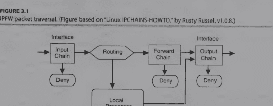

如果转发，该数据包将第二次对照 `forward` 链进行过滤。如果数据包被接受，则将其传递给 `output` 链。

本地生成的传出数据包和被转发的数据包都会传递给 `output` 链。如果数据包被接受，则通过该接口发送出去。

接收和发送的本地（环回）数据包经过两个过滤器。被转发的数据包经过三个过滤器。

环回路径涉及两个链。如图 3.2 所示，每个环回数据包在通过“out”环回接口之前都会经过输出过滤器，在那里它随后被交付到环回的输入接口。然后应用输入过滤器。

请注意，环回路径说明了为什么当启动一个默认拒绝策略的防火墙脚本时，如果该脚本不允许环回流量或在执行之前失败，人们的 `X Window` 会话会挂起。

在被转发的去伪装响应数据包到达局域网之前，应用了输入过滤器。数据包没有通过路由功能，而是直接传递给输出过滤链。因此，去伪装的传入数据包被过滤了两次。传出的伪装数据包被过滤了三次。


`IPFW` 环回和伪装数据包的遍历。（该图基于 Rusty Russel 的 "Linux IPCHAINS-HOWTO" v1.0.8。）

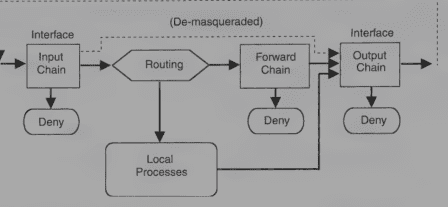

### Netfilter 包遍历

在 `Netfilter`（`iptables`）下，使用内置的 `INPUT`、`OUTPUT` 和 `FORWARD` 过滤链。传入数据包经过路由功能，该功能确定是将数据包交付到本地主机的 `input` 链，还是传递到 `forward` 链。`Netfilter` 的包流向如图 3.3 所示。


`Netfilter` 包遍历。（该图基于 Rusty Russel 的 "Linux 2.4 Packet Filtering HOWTO" v1.0.1。）


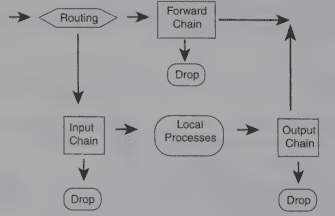

如果本地目的数据包被 `INPUT` 链的规则接受，则数据包将在本地交付。如果远程目的数据包被 `FORWARD` 链的规则接受，则数据包将通过适当的接口发送出去。

来自本地进程的传出数据包传递给 `OUTPUT` 链的规则。如果数据包被接受，则通过适当的接口发送出去。因此，每个数据包只被过滤一次（环回数据包除外，它们被过滤两次）。

## iptables 基本语法

使用 Netfilter 构建的防火墙是通过 `iptables` 防火墙管理命令构建的。`iptables` 命令实现您创建的防火墙策略并管理防火墙的行为。Netfilter 防火墙有三个独立的表：`filter`、`NAT` 和 `mangle`。在这些表中，通过链构建防火墙，链中的每个单独链接都是一个单独的 `iptables` 命令。

在默认的 `filter` 表中，有一个用于输入或进入防火墙的数据的链，一个用于输出或离开防火墙的数据的链，一个用于转发或通过防火墙发送的数据的链，以及其他链，包括由用户命名和配置的链，通常（也恰当地）被称为用户定义链。`NAT` 和 `mangle` 表包含稍后将讨论的特殊链。目前，只需知道 `filter` 表是实现基本防火墙的默认表，`NAT` 表用于提供 NAT 及相关功能，而 `mangle` 表用于数据包将被防火墙修改的情况即可。

以非常特定的语法发出 `iptables` 命令。很多时候，传递给 `iptables` 的选项顺序决定了命令的成功还是语法错误。发送给 `iptables` 的命令是顺序执行的，因此，允许某些数据包的命令如果位于拒绝相同数据包的命令之后，会导致数据被防火墙丢弃。

`iptables` 命令的基本语法以 `iptables` 命令本身开头，后跟一个或多个选项、一个链、一组匹配条件以及一个目标或处置方式。命令的布局很大程度上取决于要执行的操作。请考虑此语法：

```
iptables <option> <chain> <matching criteria> <target>
```

在构建防火墙时，选项通常是 `-A`，表示将规则追加到规则集的末尾。当然，根据目标和执行的操作不同，还有几种不同的选项。本章涵盖了其中大多数选项。

如前所述，链可以是输入链、输出链、转发链或用户定义链。此外，链也可能是包含在 `NAT` 或 `mangle` 表中的特殊链。

`iptables` 命令中的匹配条件用于设定规则应用的条件。例如，匹配条件可用于告知 `iptables` 允许所有 destined（目的）为 80 端口的 TCP 流量进入防火墙。

最后，目标（Target）设定了针对匹配数据包要执行的操作。目标可以是简单到静默丢弃数据包的 `DROP`，也可以将匹配的数据包发送到用户自定义链，或者执行 `iptables` 中配置的任何其他操作。

本章接下来的部分将通过实际示例展示如何使用 `iptables` 实施各种任务的实际规则。部分示例包含尚未介绍的语法和选项。如果您感到困惑，请参阅本节或 `iptables` 的手册页以获取更多关于所用语法的信息。

## iptables 特性

`iptables` 使用针对不同数据包处理功能分离的规则表概念。这些规则表被实现为功能独立的表模块。三个主要模块是规则过滤器表（`filter` table）、`NAT` nat 表，以及专门的数据包处理 `mangle` 表。这三个表模块中的每一个都有自己关联的模块扩展，这些扩展在首次被引用时动态加载，除非您已直接将其编译进内核。

过滤器表（`filter` table）是默认表。其他表通过命令行选项指定。基本的过滤器表特性包括：

- 针对三个内置链（`INPUT`、`OUTPUT` 和 `FORWARD`）以及用户自定义链的链相关操作
- 帮助信息
- 目标处置方式（`ACCEPT` 或 `DROP`）
- 针对协议、源地址和目标地址、输入和输出接口以及分片处理的 IP 报头字段匹配操作
- 针对 TCP、UDP 和 ICMP 报头字段的匹配操作

过滤器表有两种类型的特性扩展：目标扩展和匹配扩展。目标扩展包括 `REJECT` 数据包处置方式、`BALANCE` 和 `CLUSTERIP` 目标、`CLASSIFY` 目标、`CONNMARK`、`TRACE`，以及 `LOG` 和 `ULOG` 功能。匹配扩展支持针对以下内容的匹配：

- 当前连接状态
- 端口列表（由 `multipport` 模块支持）
- 硬件以太网 MAC 源地址或物理设备
- 地址类型、链路层数据包类型或 IP 地址范围
- IPsec 数据包的各种部分或 IPsec 策略
- ICMP 类型
- 数据包长度
- 数据包到达时间
- 每第 n 个数据包或随机数据包
- 数据包发送者的用户、组、进程或进程组 ID
- IP 报头的服务类型（TOS）字段（可能由 `mangle` 表设置）
- IP 报头的 TTL 部分
- `iptables` 标记字段（由 `mangle` 表设置）
- 速率限制的数据包匹配

`mangle` 表有两个目标扩展。`MARK` 模块支持为 `iptables` 维护的数据包标记字段分配值。`TOS` 模块支持设置 IP 报头中 TOS 字段的值。

## IPTABLES 即将推出的特性

`iptables` 正在积极开发和增强。根据源代码和构建环境，可以确定在本书出版时将有额外的模块可用。其他一些模块不打算发布在公共发行版中。

例如，有一个实验性的 `MIRROR` 目标。该目标在反转 IP 报头的源地址和目标地址部分后重新传输数据包。

`nat` 表拥有用于源地址和目标地址转换以及端口转换的目标扩展模块。这些模块支持以下形式的 NAT：

- `SNAT` — 源 NAT。
- `DNAT` — 目标 NAT。
- `MASQUERADE` — 一种专门的源 NAT 形式，用于分配临时、可动态分配的 IP 地址的连接（例如电话拨号连接）。
- `REDIRECT` — 一种专门的目标 NAT 形式，将数据包重定向到本地主机，无论 IP 报头目标字段中的地址如何。

所有 TCP 状态标志都可以检查，并可以基于结果做出过滤决策。例如，`iptables` 可以检查隐蔽扫描（stealth scans）。

TCP 可以可选地指定发送者愿意接受的返回最大段大小（MSS）。针对此单个 TCP 选项的过滤是一个非常专业化的情况。IP 报头的 TTL 部分也可以匹配，这也是一个专业化的情况。

可以维护 TCP 连接状态和 ongoing UDP 交换信息，从而允许持续识别数据包，而不是基于无状态、逐包的基础。接受被识别为已建立连接一部分的数据包，允许绕过检查每个数据包的规则列表的开销。当初始连接被接受时，后续的数据包可以被识别并允许通过。

通常，TOS 字段仅具有历史意义。中间路由器会忽略 TOS 字段或将其与较新的区分服务（Differentiated Services）定义一起使用。IP TOS 过滤在本地数据包优先级排序、本地主机与本地路由器之间的路由和转发中有其用途。

传入的数据包可以通过 MAC 源地址进行过滤。由于 MAC 地址仅在相邻主机和路由器之间传递，这在本地身份验证方面的用途有限且专业化。

单独的过滤器日志消息可以添加用户定义的字符串前缀。消息可以分配 `/etc/syslog.conf` 中定义的内核日志级别。这允许在 `/etc/syslog.conf` 中开启和关闭日志记录，并定义日志输出文件。此外，还有一个 `ULOG` 选项，将日志记录发送到用户空间守护进程 `ulogd`，以便记录关于数据包的更多详细信息。

数据包匹配可以限制在初始突发大小内，之后每秒允许的匹配次数将施加限制。如果启用了匹配限制，默认情况下，在初始突发的五个匹配数据包之后，会施加每小时三次匹配的速度限制。换句话说，如果系统被 ping 数据包淹没，例如，前五个 ping 会匹配。在那之后，20 分钟后可以匹配一个 ping 数据包，再 20 分钟后可以匹配另一个，无论收到多少个 echo-requests。无论这些数据包是否被记录，其处置方式都取决于关于这些数据包的后续规则。

`REJECT` 目标可以可选地指定返回哪个 ICMP 或 RST（对于 TCP）错误消息。IPv4 标准要求 TCP 接受 RST 或 ICMP 作为错误指示，尽管 RST 是 TCP 的默认行为。`iptables` 的默认操作是返回无内容（`DROP`）或者返回一个 ICMP 错误（`REJECT`）。

除了 `REJECT` 之外，另一个专用目标是 `QUEUE`。其目的是通过 netlink 设备将数据包交给用户空间程序进行处理。如果没有等待的程序，数据包将被丢弃。

`RETURN` 是另一个专用目标。其目的是在该链的规则匹配完成之前从用户自定义链返回。

本地生成的出站数据包可以基于生成数据包的程序的 `用户、组、进程或进程组 ID` 进行过滤。因此，可以在数据包过滤级别按用户授权对远程服务的访问。对于多用户、多用途主机来说这是一个专业化的选项，因为防火墙路由器不应拥有普通用户帐户。


可以对 IPsec 报头的各种部分进行匹配，包括 `AH`（认证报头）和 `ESP`（封装安全载荷）的 `SPI`（安全参数索引）。

数据包类型，无论是广播、单播还是多播，是另一种匹配形式。这是在链路层完成的。

端口范围以及地址范围也是 `iptables` 的有效匹配项。地址类型也是另一种有效匹配项。与类型匹配相关的是 ICMP 数据包类型。请记住，有许多有效的 ICMP 数据包类型。`iptables` 可以针对这些类型进行匹配。

数据包长度是有效的匹配项，数据包到达时间也是。这种时间匹配很有趣。使用时间匹配，您可以配置防火墙在业务时间后拒绝某些流量，或仅在一天中的某些时段允许流量。

用于审计的一个良好匹配项，随机数据包匹配在 `iptables` 中也可用。使用此匹配项，您可以捕获每第 n 个数据包并记录它。这是一种审计防火墙规则的方法，而不会记录过多的信息。

## NAT 表特性

NAT 有三种一般形式：

- `传统的、单向出站 NAT` — 用于使用私有地址的网络。
  - `基本 NAT` — 仅进行地址转换。通常用于将本地私有源地址映射到一组公共地址中的一个。
  - `NAPT`（*网络地址端口转换*）— 通常用于将本地私有源地址映射到单个公共地址（例如 Linux 的 masquerading）。
- `双向 NAT` — 双向地址转换允许出站和入站连接。这种用途包括 IPv4 和 IPv6 地址空间之间的双向地址映射。
- `双向 NAT`——双向源地址和目的地址转换允许出站和入站连接。当源网络和目的网络的地址空间冲突时，可以使用双向 NAT。这可能是由于某个站点错误地使用了分配给其他人的公有地址所致。当站点被重新编号或被分配到一个新的公有地址块，且站点管理员当时不希望本地管理新的地址分配时，也可以使用双向 NAT作为一种便利方式。

`iptables` NAT 支持源地址转换（`SNAT`）和目的地址转换（`DNAT`）。NAT 表允许修改数据包的目的地址或源地址和端口。它有三个内置链：

- `PREROUTING` 链指定了在数据包传递给路由功能之前，对传入数据包的目的地址进行更改（`DNAT`）。目的地址的更改可以是针对本地主机（透明代理、端口重定向），也可以是针对用于主机转发（ipmasqad 功能，在 Linux 术语中称为端口转发）的不同主机，或用于负载分担。
- `OUTPUT` 链指定了在做出路由决策之前，对本地生成的传出数据包的目的地址进行更改（`DNAT`、`REDIRECT`）。这通常用于将传出数据包透明地重定向到本地代理，但也可以用于向不同主机进行端口转发。
- `POSTROUTING` 链指定了对经过该设备路由的传出数据包的源地址进行更改（`SNAT`、`MASQUERADE`）。这些更改是在做出路由决策之后应用的。

> `IPTABLES 中的隐藏源地址（MASQUERADING）`
>
> 在 `iptables` 中，隐藏源地址是源 NAT 的一种特殊情况，因为如果连接丢失，被隐藏源地址的连接状态会立即被遗忘。它旨在用于 IP 地址是临时分配的 connections（例如，拨号连接）。如果用户立即重新连接，他很可能被分配一个与之前连接期间不同的 IP 地址。（在许多电缆调制解调器和 ADSL 服务提供商中情况往往并非如此。通常，在连接丢失后，重新连接时会分配相同的 IP 地址。）

对于普通的 `SNAT`，连接状态会在超时期间内维持。如果连接足够快地重新建立，由于 IP 地址未变，当前的网络相关程序可以不受干扰地继续运行，中断的 TCP 流量会被重新传输。

`MASQUERADE` 和 `SNAT` 之间的区别试图避免在之前的 Linux NAT/MASQUERADE 实现中发生的一种情况。当拨号连接丢失且用户立即重新连接时，他被分配了一个新的 IP 地址。由于旧的 IP 地址和 NAT 信息在超时期间到期前仍保留在内存中，因此新地址无法立即使用。

图 3.4 展示了 NAT 链与路由功能以及 `INPUT`、`OUTPUT` 和 `FORWARD` 链之间的关系。

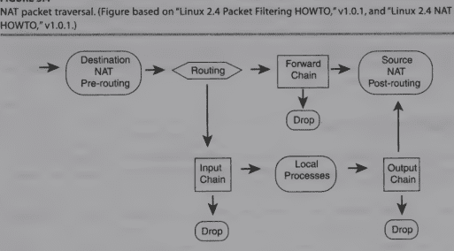

请注意，对于传出数据包，路由功能隐含在本地进程和 `OUTPUT` 链之间。使用静态路由来确定数据包将从哪个接口发出，这是在应用 `OUTPUT` 链的过滤规则之前进行的。

## mangle 表功能

`mangle` 表允许标记数据包，或将一个由 Netfilter 维护的值与数据包关联，并在将数据包发送到其目的地址之前对数据包进行修改。`mangle` 表有五个内置链：

- `PREROUTING` 链指定了对传入数据包在到达接口时，且在进行任何路由或本地交付决策之前的更改。
- `INPUT` 链指定了对数据包在处理时的更改，但必须在遍历 `PREROUTING` 链之后。
- `POSTROUTING` 链指定了对数据包在退出防火墙时的更改，必须在遍历 `OUTPUT` 链之后。
- `FORWARD` 链指定了对通过防火墙转发的数据包的更改。
- `OUTPUT` 链指定了对本地生成的传出数据包的更改。

对于 `TOS` 字段，本地 Linux 路由器可以配置为尊重由 `mangle` 表设置的 `TOS` 标志，或由本地主机设置的标志。

关于 `iptables` 文档中的数据包标记，除了它被 Linux 服务质量（QoS）实现使用，并且旨在作为 `iptables` 模块之间的通信标志外，可获取的信息很少。

前面的章节概述了 `iptables` 中可用的功能以及各个表模块的一般结构和功能。接下来的章节将展示用于调用这些功能的语法。

## iptables 语法

如前所述，`iptables` 使用独立规则表的概念来实现不同的数据包处理功能。非默认表通过命令行选项指定。有三个可用的表：

- `filter`
  - `filter` 表是默认表。它包含实际的防火墙过滤规则。内置链包括：
    - `INPUT`
    - `OUTPUT`
    - `FORWARD`
- `nat`
  - `nat` 表包含源和目的地址及端口转换的规则。这些规则在功能上区别于 `filter` 表。内置链包括：
    - `PREROUTING` (`DNAT`/`REDIRECT`)
    - `OUTPUT` (`DNAT`/`REDIRECT`)
    - `POSTROUTING` (`SNAT`/`MASQUERADE`)
- `mangle`
  - `mangle` 表包含设置专门数据包路由标志的规则。这些标志随后由 `filter` 表中的规则检查。内置链包括：
    - `PREROUTING` (被路由的数据包)
    - `INPUT` (到达防火墙但在 `PREROUTING` 链之后的数据包)
    - `FORWARD` (更改通过防火墙路由的数据包)
    - `POSTROUTING` (更改数据包在离开防火墙前，在 `OUTPUT` 链之后的状态)
    - `OUTPUT` (本地生成的数据包)

## 语法格式约定

用于展示命令行语法选项的约定在计算机世界中相当标准。对于您这些新手，如果您不熟悉 Linux 或计算机文档，表 3.1 展示了在即将出现的语法描述中使用的约定。

**表 3.1** 表示命令行语法选项的约定

| 元素 | 描述 |
| :--- | :--- |
| `\|` | 竖线或管道符号分隔交替的语法选项。例如，大多数 `iptables` 命令都有简短形式和长形式，例如 `-L` 和 `--list`，因此它们被列为交替选项，因为您会使用 `-L` 或 `--list` 中的一个。 |
| `<value>` | 尖括号表示用户提供的值，例如字符串或数值。 |
| `[ ]` | 方括号表示包含的命令、选项或值是可选的。例如，大多数匹配运算符可以接受否定运算符 `!`，它匹配除了指定匹配值以外的任何值。否定运算符通常放置在匹配运算符和要匹配的值之间。 |
| `<value>:<value>` | 冒号表示值的范围。这两个值定义了范围内的最小值和最大值。由于范围本身是可选的，因此约定通常表示为 `<value>[:<value>]`。 |

## filter 表命令

`filter` 表命令由 `ip_tables` 模块提供。该功能通过加载模块来启用，这在第一次调用 `iptables` 命令时自动完成，或者它可以被编译到内核本身中，这意味着您完全不必担心模块的加载。

## filter 表对整个链的操作

表 3.2 展示了 `iptables` 对整个链的操作。

**表 3.2** `iptables` 对整个链的操作

| 选项 | 描述 |
| :--- | :--- |
| `-N \| --new-chain <chain>` | 创建用户定义的链。 |
| `-F \| --flush [<chain>]` | 清空该链，如果未指定则清空所有链。 |
| `-X \| --delete-chain [<chain>]` | 删除用户定义的链，如果未指定则删除所有链。 |


### iptables 命令选项

| `-P \| --policy <chain> <policy>` | 为内置链 `INPUT`、`OUTPUT` 或 `FORWARD` 之一定义默认策略。策略是 `ACCEPT` 或 `DROP`。 |
| `-L \| --list [<chain>]` | 列出链中的规则，如果未指定则列出所有链。 |
| `-Z \| --zero` | 重置与每个链关联的数据包和字节计数器。 |
| `-h \| <some command> -h` | 列出 `iptables` 命令和选项，或者如果前面有 `iptables` 命令，则列出该命令的语法和选项。 |
| `--modprobe=<command>` | 在向链中添加或插入规则时，使用 `<command>` 加载必要的模块。 |
| `-E \| --rename-chain <old_chain> <new_chain>` | 将用户定义的链 `<old_chain>` 重命名为用户定义的链 `<new_chain>`。 |

`-h` 帮助命令显然不是对链的操作，`--modprobe=<command>` 也不是，但我不知道在哪里列出这些命令更合适。

## 表 3.3

列表链命令的选项

| **选项** | **描述** |
| :--- | :--- |
| `-L -n` | `--numeric` | 以数字形式列出 IP 地址和端口号，而不是以名称列出 |
| `-L -v` | `--verbose` | 列出每条规则的额外信息，例如字节和分组计数器、规则选项以及相关的网络接口 |
| `-L -x` | `--exact` | 列出计数器的精确值，而不是四舍五入后的值 |
| `-L -line-numbers` | 列出规则在其所属链中的位置 |

### 过滤器表的操作规则

在链内创建或删除规则最常用的命令如表 3.4 所示。

## 表 3.4

针对单个规则的链命令

| **命令** | **描述** |
| :--- | :--- |
| `-A` | `--append <chain>` | 将规则附加到链的末尾 |
| `-I` | `--insert <chain>` | 在链的开头插入规则 |
| `-R` | `--replace <chain> <rule number> <rule specification>` | 替换链中的规则 |
| `-D` | `--delete <chain> <rule number>` | 删除链中位于 `rule_number` 位置的规则 |

### 基础过滤器表匹配操作

默认 `iptables` 过滤器表中支持的基础过滤器匹配操作如表 3.5 所列。

## 表 3.5

过滤器表规则操作

| 选项 | 描述 |
|---|---|
| `-i \| --in-interface [!] [<interface>]` | 对于 `INPUT` 或 `FORWARD` 链或其用户定义子链上的入站分组，指定规则适用的接口名称。如果未指定接口，则隐含所有接口。 |
| `-o \| --out-interface [!] [<interface>]` | 对于 `OUTPUT` 或 `FORWARD` 链或其用户定义子链上的出站分组，指定规则适用的接口名称。如果未指定接口，则隐含所有接口。 |
| `-p \| --protocol [!] [<protocol>]` | 指定规则适用的 IP 协议。内置协议包括 `tcp`、`udp`、`icmp` 和 `all`。协议值可以是 `/etc/protocols` 中列出的名称或数值。 |
| `-s \| --source \| --src [!] <address>[</mask>]` | 指定 IP 头中的主机或网络源地址。 |
| `-d \| --destination \| --dst [!] <address>[</mask>]` | 指定 IP 头中的主机或网络目标地址。 |
| `-j \| --jump <target>` | 指定如果分组匹配规则时的目标处置方式。默认目标包括内置目标、扩展或用户定义的链。 |
| `[!] -f \| --fragment` | 指定第二个及后续的片段分组。该选项的否定形式指定非片段分组。 |
| `-c \| --set-counters <packets> <bytes>` | 初始化分组和字节计数器。 |

> **规则目标是可选的**
>
> 如果分组匹配一个没有目标处置方式的规则，分组计数器会被更新，但列表遍历会继续。

### TCP 过滤器表匹配操作

TCP 头匹配选项如表 3.6 所列。

## 表 3.6

**TCP 过滤器表匹配操作**

| 选项 | 描述 |
| :--- | :--- |
| `--source-port` \| `--sport` [!] `<port>[:port]` | 此命令指定源端口。 |
| `--destination-port` \| `--dport` [!] `<port>[:port]` | 此命令指定目标端口。 |
| `--tcp-flags` [!] `<mask>,<mask>` [!] `<set>,<set>` | 此命令测试掩码列表中的位，其中下列位必须被设置才能匹配。 |
| `[!] -syn` | `SYN` 标志必须设置为初始连接请求。 |
| `--tcp-option` [!] `<number>` | 唯一的合法 TCP 选项是发送主机愿意接受的最大分组大小。 |

### UDP 过滤器表匹配操作

UDP 头匹配选项如表 3.7 所列。

## 表 3.7

**UDP 过滤器表匹配操作**

| 选项 | 描述 |
| :--- | :--- |
| `--source-port` \| `--sport` [!] `<port>[:port]` | 指定源端口 |
| `--destination-port` \| `--dport` [!] `<port>[:port]` | 指定目标端口 |

### ICMP 过滤器表匹配操作

ICMP 头匹配选项如表 3.8 所列。

## 表 3.8

**ICMP 过滤器表匹配操作**

| 匹配 | 描述 |
| :--- | :--- |
| `--icmp-type` [!] `<type>` | 指定 ICMP 类型名称或编号。ICMP 类型用于代替源端口。 |

主要支持的 ICMP 类型名称和数值如下：

- `echo-reply` (0)
- `destination-unreachable` (3)
    - `network-unreachable`
    - `host-unreachable`
    - `protocol-unreachable`
    - `port-unreachable`
    - `fragmentation-needed`
    - `network-unknown`
    - `host-unknown`
    - `network-prohibited`
    - `host-prohibited`
- `source-quench` (4)
- `redirect` (5)
- `echo-request` (8)
- `time-exceeded` (10)
- `parameter-problem` (11)

> **额外的 ICMP 支持**
>
> `iptables` 支持许多额外的、不太常见或路由器特定的 ICMP 消息类型和子类型。要查看完整列表，请使用以下 `iptables` 帮助命令：
>
> ```
> iptables -p icmp -h
> ```

## 过滤器表目标扩展

过滤器表目标扩展包括日志记录功能以及拒绝（而不是丢弃）分组的能力。

表 3.9 列出了 `LOG` 目标可用的选项。表 3.10 列出了 `REJECT` 目标可用的单一选项。

## 表 3.9

`LOG` 目标扩展

`-j LOG` 选项

| 选项 | 描述 |
| :--- | :--- |
| `--log-level <syslog level>` | 日志级别是 `/usr/include/sys/syslog.h` 中列出的数值或符号日志优先级。这些与 `/etc/syslog.conf` 中使用的日志级别相同。级别包括 `emerg` (0)、`alert` (1)、`crit` (2)、`err` (3)、`warn` (4)、`notice` (5)、`info` (6) 和 `debug` (7)。 |
| `--log-prefix <"descriptive string">` | 前缀是一个带引号的字符串，将打印在规则的日志消息开头。 |
| `--log-ip-options` | 此命令在日志输出中包含任何 IP 头选项。 |
| `--log-tcp-sequence` | 此命令在日志输出中包含 TCP 分组的序列号。 |
| `--log-tcp-option` | 此命令在日志输出中包含任何 TCP 头选项。 |

## 表 3.10

`REJECT` 目标扩展

`-j REJECT` 选项

| 选项 | 描述 |
| :--- | :--- |


| --reject-with <ICMP type> | 默认情况下，被拒绝的分组会导致向发送方返回 ICMP 类型 3 icmp-port-unreachable 消息。也可以返回其他类型 3 错误消息，包括 icmp-net-unreachable、icmp-host-unreachable、icmp-proto-unreachable、icmp-net-prohibited 和 icmp-host-prohibited。 |

| --reject-with tcp-reset | 入站 TCP 分组可以使用更标准的 TCP RST 消息进行拒绝，而不是 ICMP 错误消息。 |

| --reject-with echo-reply | ping echo-request 消息可以通过伪造的 echo-reply 消息进行拒绝。也就是说，防火墙生成响应，但请求不会被转发到目标主机。 |

### ULOG 表目标扩展

与 LOG 目标相关的是 ULOG 目标，它将日志消息发送到用户空间程序进行记录。在 ULOG 的背后，内核通过您选择的 netlink 套接字（默认为套接字 1）对分组进行多播。用户空间守护进程随后从套接字读取消息并自行处理。ULOG 目标通常用于提供比标准 LOG 目标更广泛的日志记录。

与 LOG 目标一样，在匹配 ULOG 目标规则后，处理将继续。ULOG 目标有四个配置选项，如表 3.11 所述。

## 表 3.11

ULOG 目标扩展

| 选项 | 描述 |

| :--- | :--- |

| `--ulog-nlgroup <group>` | 定义将接收分组的 netlink 组。默认组为 1。 |

| `--ulog-prefix <prefix>` | 消息将由此值作为前缀，长度不超过 32 个字符。 |

| `--ulog-cprange <size>` | 发送到 netlink 套接字的字节大小。默认值为 0，表示发送整个分组。 |

| `--ulog-qthreshold <size>` | 内核中队列的分组大小。默认值为 1，这意味着每条消息发送一个分组到 netlink 套接字。 |

### 过滤器表匹配扩展

`filter` 表匹配扩展提供了对 TCP、UDP 和 ICMP 头中字段的访问，以及 iptables 中可用的匹配功能，例如维护连接状态、端口列表、访问硬件 MAC 源地址以及访问 IP TOS 字段。

> **匹配语法**
>
> 匹配扩展需要 `-m` 或 `--match` 命令来加载模块，随后跟随相关的匹配选项。

#### multiport 过滤器表匹配扩展

`multiport` 端口列表每个列表最多可包含 15 个端口。不允许有空格。逗号和端口值之间不能有空格。端口值不能交错在列表中。此外，`-m multiport` 命令必须紧随 `-p <protocol>` 指定符之后。

表 3.12 列出了 `multiport` 匹配扩展可用的选项。

## 表 3.12

`multiport` 匹配扩展

| | 选项 | 描述 |

|---|---|---|

| | `--match multiport` | |

| | `--source-port <端口> [,<端口>]` | 指定源端口。 |

| | `--destination-port <端口> [,<端口>]` | 指定目的端口。 |

| | `--port <端口> [,<端口>]` | 源端口和目的端口相等，且它们匹配列表中的某个端口。 |

`multiport` 语法可能有些棘手。这里包含了一些示例和注意事项。以下规则阻止经由接口 `eth0` 到达的、目标为与 NetBIOS 和 `SMB` 相关的 UDP 端口的传入数据包。这些是 Microsoft Windows 计算机上常见的端口，也是蠕虫病毒的攻击目标：

```bash
iptables -A INPUT -i eth0 -p udp\
-m multiport --destination-port 135,136,137,138,139 -j DROP
```

下一条规则阻止通过 `eth0` 接口发送到与 TCP 服务 NFS、`socks` 和 `squid` 相关的高端口的出站连接请求：

```bash
iptables -A OUTPUT -o eth0 -p tcp\
-m multiport --destination-port 2049,1080,3128 --syn -j REJECT
```

在这个示例中，需要注意的是 `multiport` 命令必须紧跟在协议规范之后。如果在 `-p tcp` 和 `-m multiport` 之间放置了 `--syn`，就会造成语法错误。

为了展示 `--syn` 放置位置的类似示例，以下写法是正确的：

```bash
iptables -A INPUT -i <interface> -p tcp \
-m multiport --source-port 80,443 ! --syn -j ACCEPT
```

然而，这种写法会导致语法错误：

```bash
iptables -A INPUT -i <interface> -p tcp ! --syn \
-m multiport --source-port 80,443 -j ACCEPT
```

此外，源参数和目的参数的位置并不直观。以下两种变体是正确的：

```bash
iptables -A INPUT -i <interface> -p tcp -m multiport \
--source-port 80,443 \
! --syn -d $IPADDR --dport 1024:65535 -j ACCEPT
```

以及

```bash
iptables -A INPUT -i <interface> -p tcp -m multiport \
--source-port 80,443 \
-d $IPADDR ! --syn --dport 1024:65535 -j ACCEPT
```

然而，这种写法会导致语法错误：

```bash
iptables -A INPUT -i <interface> -p tcp -m multiport \
--source-port 80,443 \
-d $IPADDR --dport 1024:65535 ! --syn -j ACCEPT
```

该模块有一些出人意料的语法副作用。如果移除对上述两条正确规则中 `SYN` 标志的引用，它们都会产生语法错误：

```bash
iptables -A INPUT -i <interface> -p tcp -m multiport \
--source-port 80,443 \
-d $IPADDR --dport 1024:65535 -j ACCEPT
```

然而，以下规则对就不会：

```bash
iptables -A OUTPUT -o <interface> \
-p tcp -m multiport --destination-port 80,443 \
! --syn -s $IPADDR --sport 1024:65535 -j ACCEPT

iptables -A OUTPUT -o <interface> \
-p tcp -m multiport --destination-port 80,443 \
! --syn -s $IPADDR --sport 1024:65535 -j ACCEPT
```

请注意，`multiport` 模块中的 `--destination-port` 参数与执行 `-p tcp` 参数匹配的模块中的 `--destination-port` 或 `--dport` 参数不同。

## limit 过滤器表匹配扩展

速率限制匹配对于抑制在大量记录数据包期间生成的日志消息数量非常有用。

表 3.13 列出了 `limit` 匹配扩展可用的选项。

### 表 3.13

`limit` 匹配扩展

| 选项 | 描述 |

| :--- | :--- |

| `--limit <速率>` | 在给定时间范围内要匹配的最大数据包数 |

| `--limit-burst <数量>` | 在应用限制之前要匹配的最大初始数据包数 |

突发速率定义了要接受的初始匹配次数。默认值为五次匹配。当达到限制时，进一步的匹配受到速率限制。默认限制为每小时三次匹配。可选的时间段指定符包括 `/second`、`/minute`、`/hour` 和 `/day`。

换句话说，默认情况下，如果在时间限制内达到五次匹配的初始突发速率，那么在接下来的一个小时内，最多再有三个数据包匹配，每 20 分钟一次，无论接收到多少数据包。如果在速率限制内没有发生匹配，突发计数将重新充一次电。

用示例演示速率限制匹配比用文字描述更容易。以下规则将在给定秒内接收到初始五个 echo-request 时，限制传入 ping 消息匹配的日志记录频率为每秒一次：


```bash
iptables -A INPUT -i eth0 \
-p icmp --icmp-type echo-request \
-m limit --limit 1/second -j LOG
```

也可以进行速率限制的接受。以下两条规则结合使用时，将在给定秒内接收到初始五个 echo-request 时，限制接受传入 ping 消息的频率为每秒一次：

```bash
iptables -A INPUT -i eth0 \
-p icmp --icmp-type echo-request \
-m limit --limit 1/second -j ACCEPT
iptables -A INPUT -i eth0 \
-p icmp --icmp-type echo-request -j DROP
```

下一条规则限制了针对被丢弃的 ICMP 重定向消息生成的日志消息数量。如果在 20 分钟的时间范围内已记录初始五条消息，那么在接下来的一个小时内，最多将再生成三条日志消息，每 20 分钟一条：

```bash
iptables -A INPUT -i eth0 \
-p icmp --icmp-type redirect \
-m limit -j LOG
```

最后一个示例的假设是，默认情况下以及任何未匹配的重定向数据包都会被 INPUT 链的默认 DROP 策略静默丢弃。

## dstlimit 过滤器表匹配扩展

`dstlimit` 匹配扩展支持基于目的地的速率限制，无论是按 IP 地址还是按端口。请注意 `dstlimit` 匹配扩展和 `limit` 匹配扩展之间的区别，后者针对特定类型的数据包只有一个限制。

表 3.14 列出了 `dstlimit` 匹配扩展的选项。

### 表 3.14

*dstlimit 匹配扩展*

| 选项 | 定义 |
| :--- | :--- |
| `--dstlimit <平均值>` | 每秒最大平均匹配速率。 |
| `--dstlimit-mode <模式>` | 定义限制是按 IP (*dstip*)、按 IP 和端口元组 (*dstip-dstport*)、按源 IP 和目的 IP 元组 (*srcip-dstip*)，还是按源 IP、目的 IP 和目的端口元组 (*srcipdstip-dstport*)。 |
| `--dstlimit-name <名称>` | 指定放置在 `/proc/net/ipt_dstlimit/` 中的文件的名称。 |
| `[--dstlimit-burst <burst>]` | 指定作为突发接收的数据包应匹配的数量。默认为 5。 |
| `[--dstlimit-htable-size <大小>]` | 定义哈希表中的桶数量。 |
| `[--dstlimit-htable-max <条目>]` | 定义哈希表中条目数量的限制。 |
| `[--dstlimit-htable-gcinterval <间隔>]` | 定义清理哈希表之间的时间长度。`<间隔>` 的值以毫秒为单位，默认为 1000 ms。 |
| `[--dstlimit-htable-expire <时间>]` | 定义空闲条目从哈希表中清除前的时间量。该值以毫秒为单位，默认为 10000 ms。 |

## state 过滤器表匹配扩展

静态过滤器仅从单个数据包的角度查看流量。每个数据包特定的源和目的地址及端口组合、传输协议以及当前的 TCP 状态标志组合，都是在没有参考任何正在进行上下文的情况下进行检查的。ICMP 消息被视为不相关的、带外的 IP 层 3 事件。

`state` 扩展提供了额外的监控和记录技术，以增强无状态的静态包过滤技术。当 TCP 连接或 UDP 交换开始时，会记录状态信息。后续的数据包不仅基于静态元组信息进行检查，还基于正在进行的交换上下文进行检查。换句话说，通常与上层 TCP 传输层或 UDP 应用层相关的某些上下文知识被带到了过滤器层。

交换发起并建立后，后续数据包被标识为该已建立交换的一部分。相关的 ICMP 消息会被标识为与特定交换相关。

（在计算机术语中，一组能够共同唯一识别某个事件或对象的值或属性被称为*元组*。UDP 或 TCP 数据包可以通过其协议、UDP 或 TCP、源地址和目标地址、以及源端口和目标地址的元组组合来唯一标识。）

对于会话监控而言，在 TCP 中维持状态信息的优势不如 UDP 明显，因为 TCP 在定义上本身就维持状态信息。对于 UDP，其直接优势在于能够区分响应和其他数据报。例如，在一个表示新 UDP 交换的出站 DNS 请求中，已建立会话的概念允许接收来自原始消息所发送的主机和端口的入站 UDP 响应数据报，且该接收需在特定的时间窗口内完成。来自其他主机或端口的入站 UDP 数据报是不被允许的，它们不属于该特定交换的已建立状态。

当应用于 TCP 和 UDP 时，如果 ICMP 错误消息与特定会话相关，则会被接受。

在考虑数据包流性能和防火墙复杂度时，对于 TCP 流的优势更为明显。流主要是一种防火墙性能优化技术。流的主要目标在于允许数据包绕过防火墙的检查路径。在某些情况下，由于可以立即识别出 TCP 数据包是某个允许进行中的连接的一部分，从而跳过剩余的防火墙过滤器，因此可以获得更快的 TCP 数据包处理速度。对于 TCP 连接而言，流状态在过滤性能方面可能带来显著优势。此外，标准的 TCP 应用协议规则可以合并为单一初始允许规则。过滤器规则的数量随之减少（理论上如此，但实践中未必如此，正如你将在本书后文所见）。

主要缺点在于，维护状态表需要比单纯使用标准防火墙规则更多的内存。例如，拥有 70,000 个同时连接的路由器，将需要巨大的内存来维护每个连接的状态表项。出于性能原因，状态维护通常在硬件中完成，此时关联表查找可以同时进行或并行执行。无论是通过硬件还是软件实现，状态引擎必须具备在内存无法容纳状态表项时，将数据包回退到传统路径的能力。

此外，在软件中进行表的创建、查找和销毁需要时间。额外的处理开销在许多情况下是一种损失。对于像 FTP 传输或 UDP 流媒体会话这样的持续交换，状态维护是有利的。这两种类型的数据流都代表潜在的大量数据包（以及过滤器规则匹配测试）。然而，对于简单的 DNS 或 NTP 客户端/服务器交换，状态维护并不是防火墙性能上的优势。状态建立和销毁所需的处理量以及内存消耗，很容易超过仅仅遍历这些数据包过滤器规则的成本。

对于主要过滤网页流量的防火墙而言，其优势也值得质疑。网页客户端/服务器交换往往短暂且易逝。

Telnet 和 SSH 会话处于灰色地带。在流量繁重且拥有许多此类会话的路由器上，通过绕过防火墙检查，状态维护开销可能成为一种优势。然而，对于相当静态的会话，连接状态表项很可能会超时而丢弃。当下一个数据包经过传统防火墙规则后，状态表项将被*重新创建*。

表 3.15 列出了 `state` 匹配扩展可用的选项。

### 表 3.15 state 匹配扩展

| 选项 | 描述 |
| --- | --- |
| `-m` `--match state OPTION` | 如果连接状态位于列表中则匹配。合法值为 NEW、ESTABLISHED、RELATED 或 INVALID。 |

可以维护 TCP 连接状态和正在进行的 UDP 交换信息，从而允许将网络交换过滤为 NEW、ESTABLISHED、RELATED 或 INVALID。

- NEW 等同于初始的 TCP SYN 请求，或第一个 UDP 数据包。
- ESTABLISHED 指的是连接建立后持续进行的 TCP ACK 消息、相同主机和端口之间交换的后续 UDP 数据报，以及作为对之前 echo-request 响应而发送的 ICMP echo-reply 消息。
- RELATED 目前仅指 ICMP 错误消息。FTP 次要连接由额外的 FTP 连接跟踪支持模块管理。随着该模块的增加，RELATED 的含义扩展为包含次要 FTP 连接。
- INVALID 数据包的一个例子是未响应于当前会话的入站 ICMP 错误消息，或并非作为对之前 echo-request 响应的 echo-reply。

理想情况下，使用 ESTABLISHED 匹配允许将服务的防火墙规则对合并为一条允许第一个请求数据包的单一规则。例如，使用 ESTABLISHED 匹配时，Web 客户端规则仅需允许初始出站 SYN 请求。DNS 客户端请求仅需允许初始出站 UDP 请求数据包。

在采用默认拒绝的输入策略下，连接跟踪在理论上可以取代所有协议特定的过滤器，替换为两条通用规则，即允许属于已建立连接的入站和出站数据包，或与连接相关的数据包。仅针对初始数据包需要特定应用的规则。

虽然这种防火墙配置在大多数情况下可能适用于小型或住宅站点，但不太可能为大型站点或处理大量同时连接的防火墙提供足够的性能。原因回到状态表项超时的情况：由于表大小和内存限制，静态连接的状态表项会被替换。本应被已删除状态表项接受的下一个数据包需要一条允许该数据包的规则，并且必须重建状态表项。


一个简单的例子是作为缓存-转发名称服务器运行的本地 DNS 服务器的规则对。DNS 转发名称服务器使用服务器间通信。DNS 流量在两个主机之间的源端口和目标端口 53 之间交换。UDP 客户端/服务器关系可以被显式化。以下规则显式允许出站 `NEW` 请求、入站（`ESTABLISHED`）响应以及任何（`RELATED`）ICMP 错误消息：

```bash
iptables -A INPUT -m state \
    --state ESTABLISHED,RELATED -j ACCEPT

iptables -A OUTPUT --out-interface <interface> -p udp \
    -s $IPADDR --source-port 53 -d $NAME_SERVER --destination-port 53 \
    -m state --state NEW,RELATED -j ACCEPT
```

DNS 使用简单的查询和响应协议。那么，对于那些能够长时间保持持续连接的应用程序呢，比如 FTP 控制会话或 Telnet 或 SSH 会话？如果状态表项因某种原因过早清除，未来的数据包将没有状态表项可供匹配以被标识为 `ESTABLISHED` 交换的一部分。

以下针对 SSH 连接的规则考虑了这种可能性：

```bash
iptables -A INPUT -m state \
    --state ESTABLISHED,RELATED -j ACCEPT

iptables -A OUTPUT -m state \
    --state ESTABLISHED,RELATED -j ACCEPT

iptables -A OUTPUT --out-interface <interface> -p tcp \
    -s $IPADDR --source-port $UNPRIVPORTS \
    -d $REMOTE_SSH_SERVER --destination-port 22 \
    -m state --state NEW -j ACCEPT

iptables -A OUTPUT --out-interface <interface> -p tcp ! --syn \
-s $IPADDR --source-port $UNPRIVPORTS \
-d $REMOTE_SSH_SERVER --destination-port 22 \
-j ACCEPT

iptables -A INPUT --in-interface <interface> -p tcp ! --syn \
-s $REMOTE_SSH_SERVER --source-port 22 \
-d $IPADDR --destination-port $UNPRIVPORTS \
-j ACCEPT
```

## mac 过滤器表匹配扩展

表 3.16 列出了 `mac` 匹配扩展可用的选项。

### 表 3.16 mac 匹配扩展

| 选项 | 描述 |
| --- | --- |
| `-m` `--match mac OPTION` | 匹配入站以太网帧中的第 2 层以太网硬件源地址，指定为 XX:XX:XX:XX:XX:XX |

请记住，MAC 地址不跨越路由器边界（或网段）。也要记住，只能指定源地址。`mac` 扩展仅可用于入接口，例如 `INPUT`、`PREROUTING` 和 `FORWARD` 链。

以下规则允许来自单一本地主机的入站 SSH 连接：

```bash
iptables -A INPUT -i <local interface> -p tcp \
-m mac --mac-source xx:xx:xx:xx:xx:xx \
--source-port 1024:65535 \
-d <IPADDR> --dport 22 -j ACCEPT
```

## owner 过滤器表匹配扩展

表 3.17 列出了 `owner` 匹配扩展可用的选项。

### 表 3.17 owner 匹配扩展

| 选项 | 描述 |
| `--uid-owner <userid>` | 匹配创建者的 UID |
| `--gid-owner <groupid>` | 匹配创建者的 GID |
| `--pid-owner <processid>` | 匹配创建者的 PID |
| `--sid-owner <sessionid>` | 匹配创建者的 SID 或 PPID |
| `--cmd-owner <name>` | 匹配由命令名为 name 的进程创建的数据包 |

该匹配项指的是数据包的创建者。该扩展仅可用于 **`OUTPUT`** 链。这些匹配选项在防火墙路由器上的实用性不大；它们在终端主机上更有意义。

因此，假设你有一个带有监视器的防火墙网关，但没有键盘。管理操作是在本地多用户主机上进行的。允许单个用户帐户从该主机登录到防火墙。在多用户主机上，可以像下面这样对防火墙的管理访问权限进行本地过滤：

```
iptables -A OUTPUT -o eth0 -p tcp \
-s <IPADDR> --sport 1024:65535 \
-d <fw IPADDR> --dport 22 \
-m owner --uid-owner <admin userid> \
--gid-owner <admin groupid> -j ACCEPT
```

## mark 过滤器 TABLE 匹配扩展

表 3.18 列出了 `mark` 匹配扩展可用的选项。

### 表 3.18 mark 匹配扩展

| 选项 | 描述 |
| :--- | :--- |
| `-m \| --match mark` | 匹配具有特定标记值的数据包 |
| `--mark <value>[/<mask>]` | 匹配具有 Netfilter 分配标记值的数据包 |

标记值和掩码是无符号长整型值。如果指定了掩码，则将值和掩码进行按位与运算。

在示例中，假设在特定源和目的地址之间的传入 telnet 客户端数据包之前已被标记：

```
iptables -A FORWARD -i eth0 -o eth1 -p tcp \
-s <some src address> --sport 1024:65535 \
-d <some destination address> --dport 23 \
-m mark --mark 0x0010070 \
-j ACCEPT
```

这里测试的 **`mark`** 值是在数据包处理的早期某个点设置的。该 **`mark`** 值是一个标志，表明该数据包应与其它数据包不同地处理。

## tos 过滤器 TABLE 匹配扩展

表 3.19 列出了 `tos` 匹配扩展可用的选项。

### 表 3.19 TOS 匹配扩展

| 选项 | 描述 |
| :--- | :--- |
| `-m \| --match tos` | 根据 IP TOS 设置进行匹配 |
| `--tos <value>` | 根据 IP TOS 设置进行匹配 |

`tos` 值可以是字符串或数值中的一种：

- minimize-delay, 16, 0x10
- maximize-throughput, 8, 0x08
- maximize-reliability, 4, 0x04
- minimize-cost, 2, 0x02
- normal-service, 0, 0x00

### TOS 位的价值

> TOS 位仅具有历史意义。Linux 支持在本地使用它们，且各种 Linux 防火墙文档都引用了这些位及其用途。尽管如此，事实是 TOS 位通常不被使用或检查。

TOS 字段已被重新定义为用于差异化服务控制协议（DSCP）的差异化服务（DS）字段。

有关差异化服务的更多信息，请参阅以下资源：

- RFC 2474, "Definition of the Differentiated Services Field (DS Field) in the IPv4 and IPv6 Headers"
- RFC 2475, "An Architecture for Differentiated Services"
- RFC 2990, "Next Steps for the IP QoS Architecture"
- RFC 3168, "The Addition of Explicit Congestion Notification (ECN) to IP"
- RFC 3260, "New Terminology and Clarifications for DiffServ"

## unclean 过滤器 TABLE 匹配扩展

`unclean` 模块执行的具体数据包有效性检查未记录在案。该模块被视为实验性模块，`iptables` 的作者目前建议不要使用它。

下面一行显示了 **`unclean`** 模块的语法。该模块不接受参数：

`-m | --match unclean`

在本书出版时，**`unclean`** 扩展可能已得到“认可”。在此期间，该模块提供了一个 LOG 选项的示例：


```
iptables -A INPUT -p ! tcp -m unclean \
    -j LOG --log-prefix "UNCLEAN packet: " \
    --log-ip-options

iptables -A INPUT -p tcp -m unclean \
    -j LOG --log-prefix "UNCLEAN TCP: " \
    --log-ip-options \
    --log-tcp-sequence --log-tcp-options

iptables -A INPUT -m unclean -j DROP
```

## addrtype 过滤器 TABLE 匹配扩展

`addrtype` 匹配扩展用于根据地址类型匹配数据包，例如单播、广播和多播。地址类型包括表 3.20 中列出的那些。

### 表 3.20

**与 addrtype 匹配一起使用的地址类型**

| 名称 | 描述 |
| :--- | :--- |
| ANYCAST | 任播数据包 |
| BLACKHOLE | 黑洞地址 |
| BROADCAST | 广播地址 |
| LOCAL | 本地地址 |
| MULTICAST | 多播地址 |
| PROHIBIT | 保留地址 |
| UNICAST | 单播地址 |
| UNREACHABLE | 不可达地址 |
| UNSPEC | 未指定地址 |

使用 `addrtype` 匹配时有两个命令，如表 3.21 所示。

### 表 3.21

**addrtype 匹配命令**

| 选项 | 描述 |
| :--- | :--- |
| `--src-type <type>` | 匹配源类型为 `<type>` 的地址。 |
| `--dst-type <type>` | 匹配目的类型为 `<type>` 的地址。 |

## iprange 过滤器 TABLE 匹配

有时，使用 CIDR 表示法定义 IP 地址范围不足以满足你的需求。例如，如果你需要限制某些不落在子网边界上或仅跨越边界几个地址的 IP 范围，`iprange` 匹配类型就能完成这项工作。

使用 `iprange` 匹配时，你指定一个任意的 IP 地址范围以使匹配生效。`iprange` 匹配也可以取反。表 3.22 列出了 `iprange` 匹配的命令。

### 表 3.22

**iprange 匹配命令**

| 命令 | 描述 |
| :--- | :--- |
| `[!] --src-range <ip address>-<ip address>` | 指定（或取反）要匹配的 IP 地址范围。范围用单个连字符给出，中间无空格。 |
| `[!] --dst-range <ip address>-<ip address>` | 指定（或取反）要匹配的 IP 地址范围。范围用单个连字符给出，中间无空格。 |

## length 过滤器 TABLE 匹配

`length` 过滤器表匹配检查数据包的长度。如果数据包长度匹配给定的值或可选地在给定范围内，则触发该规则。表 3.23 列出了与 `length` 匹配相关的唯一命令。

### 表 3.23

**length 匹配命令**

| 命令 | 描述 |
| :--- | :--- |
| `--length <length>[:<length>]` | 匹配长度为 `<length>` 或在范围 `<length:length>` 内的数据包 |

## NAT 表目标扩展

如前所述，`iptables` 支持四种通用类型的 NAT：源 NAT（`SNAT`）；目的 NAT（`DNAT`）；伪装（`MASQUERADE`），这是 `SNAT` 实现的一个特例；以及指向本地主机的本地端口重定向（`REDIRECT`）。作为 NAT 表的一部分，当规则使用 `-t nat` 表指定符指定 `nat` 表时，这些目标中的每一个都可用。

### SNAT NAT 表目标扩展

源地址和端口转换（NAPT）是人们最熟悉的 NAT 类型。如图 3.5 所示，源地址转换在路由决策做出之后进行。`SNAT` 仅在 `POSTROUTING` 链中是合法目标。由于 `SNAT` 应用于数据包发送之前，因此只能指定传出接口。

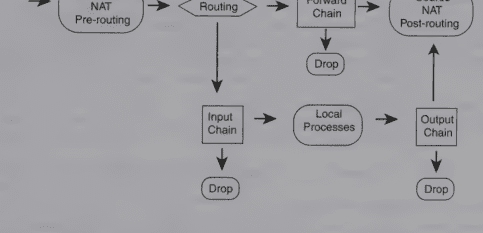

**图 3.5**

NAT 数据包遍历。

一些文档将这种形式的源 NAT（最常见的形式）称为 NAPT，以承认端口号的修改。另一种传统的、单向 NAT 的基本形式是 basic NAT，它不触及源端口。当你在私有 LAN 和一组公共地址之间进行转换时使用这种形式。

当你只有一个公共地址时，使用 NAPT。源端口被更改为防火墙/NAT 机器上的空闲端口，因为它为任意数量的内部计算机进行转换，且内部机器使用的端口可能已被 NAT 机器使用。当响应返回时，端口是 NAT 机器用来确定数据包真正是发往内部计算机而非其自身，并确定数据包发往哪台内部计算机的唯一依据。

`SNAT` 的一般语法如下：

```
iptables -t nat -A POSTROUTING --out-interface <interface> ... \
-j SNAT --to-source <address>[::<address>][:<port>-<port>]
```

如果有多个可用的源地址，源地址可以映射到可能的 IP 地址范围。

源端口可以映射到路由器上的特定源端口范围。

### MASQUERADE NAT 表目标扩展

源地址转换在 `iptables` 中以两种不同的方式实现，即 `SNAT` 和 `MASQUERADE`。区别在于，`MASQUERADE` 目标扩展旨在用于具有动态分配 IP 地址的连接，特别是在连接是临时的且每次新连接时 IP 地址分配可能不同的情况下。如前面“NAT 表特性”部分所述，`MASQUERADE` 特别适用于电话拨号连接。

由于伪装是 `SNAT` 的一个特例，它同样仅在 `POSTROUTING` 链中是合法目标，且规则只能引用传出接口。与更通用的 `SNAT` 不同，`MASQUERADE` 不接受指定应用于数据包的源地址的参数。传出接口的 IP 地址会被自动使用。

`MASQUERADE` 的一般语法如下：

```
iptables -t nat -A POSTROUTING --out-interface <interface> ... \
-j MASQUERADE [::to-ports <port>[::<port>]]
```

源端口可以映射到路由器上的特定源端口范围。

### DNAT NAT 表目标扩展

目的地址和端口转换是一种高度专业化的 NAT 形式。如果住宅或小企业站点的公共 IP 地址是动态分配的，或者站点只有一个 IP 地址且站点管理员希望将传入连接转发给不可公开访问的内部服务器，那么最有可能发现此功能有用。换句话说，`DNAT` 功能可用于替代以前需要的第三方端口转发软件，如 `ipmasqadm`。

参考图 3.5，目的地址和端口转换在路由决策做出之前进行。`DNAT` 在 `PREROUTING` 和 `OUTPUT` 链中是合法目标。

在 `PREROUTING` 链中，当指定了入接口时，`DNAT` 可以作为一个目标。在 `OUTPUT` 链中，当指定了出接口时，`DNAT` 可以作为一个目标。

`DNAT` 的一般语法如下：

```
iptables -t nat -A PREROUTING --in-interface <interface> ... \
 -j DNAT --to-destination <address>[-<address>][:<port>[-<port>]]
iptables -t nat -A OUTPUT --out-interface <interface> ... \
 -j DNAT --to-destination <address>[-<address>][:<port>[-<port>]]
```

如果可用地址不止一个，目标地址可以映射到一系列可能的 IP 地址范围。

目标端口可以映射到目标主机上特定的一组备用端口范围。

### REDIRECT NAT 表目标扩展

端口重定向是 `DNAT` 的一种特例。数据包被重定向到本地主机上的某个端口。原本会被转发的入站数据包被重定向到入接口的 `INPUT` 链。由本地主机产生的出站数据包被重定向到本地主机 `lo`/输出接口上的某个端口。

`REDIRECT` 仅仅是一个别名，一种方便手段，用于将数据包重定向到本主机的特例。它没有提供任何额外的功能价值。使用 `DNAT` 同样可以轻松地产生相同的效果。

`REDIRECT` 同样只在 `PREROUTING` 和 `OUTPUT` 链中是合法的目标。在 `PREROUTING` 链中，当指定入接口时，`REDIRECT` 可以作为一个目标。在 `OUTPUT` 链中，当指定出接口时，`REDIRECT` 可以作为一个目标。

`REDIRECT` 的一般语法如下：


```
iptables -t nat -A PREROUTING --in-interface <interface> ... \
 -j REDIRECT [--to-ports <port>[-<port>]]
iptables -t nat -A OUTPUT --out-interface <interface> ... \
 -j REDIRECT [--to-ports <port>[-<port>]]
```

目标端口可以映射到本地主机上的另一个端口，或者映射到本地主机上特定的一组备用端口范围。

### BALANCE NAT 表目标扩展

`BALANCE` 目标允许通过轮询方式将连接发送到多个目标主机。`BALANCE` 目标使用一组地址范围来实现此目的，从而提供基础的负载均衡功能。

`BALANCE` 的一般语法如下：

```
iptables -t nat -A PREROUTING -p tcp -j BALANCE \
            --to-destination <ip address>::<ip address>
```

`CLUSTERIP` 目标也提供了一些相同的选项。

## mangle 表命令

`mangle` 表的目标和扩展适用于 `OUTPUT` 和 `PREROUTING` 链。请记住，默认情况下隐含使用 `filter` 表。要使用 `mangle` 表的功能，您必须使用 `-t mangle` 指令指定 `mangle` 表。

### mark mangle 表目标扩展

表 3.24 列出了 `mangle` 表可用的目标扩展。

**表 3.24** mangle 目标扩展

| -t mangle 选项 | 描述 |

|---|---|

| -j MARK --set-mark <value> | 设置该数据包的 Netfilter 标记值 |

| -j TOS --set-tos <value> | 设置 IP 报头中的 TOS 值 |

有两个 `mangle` 表目标扩展：`MARK` 和 `TOS`。`MARK` 包含设置由 `iptables` `mangle` 表维护的数据包无符号长整型 `mark` 值的功能。

使用示例如下：

```
iptables -t mangle -A PREROUTING --in-interface eth0 -p tcp \
            -s <some src address> --sport 1024:65535 \
            -d <some destination address> --dport 23 \
            -j MARK --set-mark 0x00010070
```

`TOS` 包含设置 IP 报头中 TOS 位的功能。

使用示例如下：

```
iptables -t mangle -OUTPUT ... -j TOS --set-tos <tos>
```

可能的 tos 值与 `filter` 表的 TOS 匹配扩展模块中可用的值相同。

## 摘要

本章涵盖了 `iptables` 中可用的大部分功能——当然是最常用的那些功能。我试图提供一个关于 Netfilter 和 IPFW 差异的总体感觉，至少是为了让您对以下章节中出现的实现差异有一个“提醒”。介绍了 `filter`、`mangle` 和 `nat` 这三个主要表的模块化实现划分。在每个主要划分内，功能进一步分解为提供目标扩展的模块和提供匹配扩展的模块。

第 4 章“构建和安装独立防火墙”将通过一个简单、独立的防火墙示例进行讲解。将介绍基本的反欺骗、拒绝服务和其他基本规则。该章节的目的并不是向人们展示一个通用的防火墙以便复制粘贴用于实际应用，而是以功能性的方式展示本章中介绍的语法。

后续章节更加具体。用户自定义链、防火墙优化、局域网、NAT 和多宿主机会分别介绍，较大的局域网架构也是如此。

# 构建和安装独立防火墙

第 2 章“包过滤概念”介绍了包过滤防火墙背后的基础思想和概念。每个防火墙规则链都有自己的默认策略。每条规则不仅应用于单独的 INPUT 或 OUTPUT 链，还可以应用于特定的网络接口、消息协议类型（如 TCP、UDP 或 ICMP）以及服务端口号。为 INPUT 链和 OUTPUT 链，以及您将在本章末尾和第 6 章“包转发”中了解的 FORWARD 链定义了单独的接受、拒绝和返回错误规则。本章将这些思想整合起来，展示如何为您的站点构建一个简单的单系统防火墙。

本章中构建的防火墙基于默认拒绝一切的策略。默认情况下，所有网络流量都被阻止。服务作为策略的例外被单独启用。

在构建单系统防火墙之后，第 6 章和第 7 章“NAT—网络地址转换”将展示如何将独立防火墙扩展为双宿主防火墙。多宿主防火墙至少有两个网络接口。它隔离内部局域网与互联网的直接通信。通过在两个转发接口上应用包过滤规则，并借助网络地址转换（NAT），作为局域网和互联网之间的代理网关，它保护您的内部局域网。NAT 并不是一种代理服务，因为它并不提供连接的中间终止点。NAT 具有代理性，因为本地主机对公共互联网是隐藏的。

单系统和双宿主防火墙是安全性最低的防火墙架构形式。如果防火墙主机被入侵，任何本地机器都将暴露于攻击之下。作为独立防火墙，这是一种“全有或全无”的局面。单宿主主机最常见于托管公共互联网服务的 DMZ 中，或家庭环境中。

在单系统家庭或小型企业环境中，假设大多数用户只有一个计算机连接到互联网，或者有一台单防火墙机器保护着小型私有局域网。假设这些站点没有资源将该模型扩展到具有更多层防火墙的架构。

然而，“安全性最低”并不一定意味着不安全的防火墙。与涉及多台机器的更复杂架构相比，这些防火墙的安全性较低。安全性是在可用资源和下一美元支出的边际回报之间的折衷。第 6 章引入了更安全的配置，允许额外的内部安全性来保护比单系统防火墙更复杂的局域网和服务器配置。

## iptables: Linux 防火墙管理程序

本书基于 2.6 Linux 内核系列，尽管其中大部分内容也适用于 2.4 内核系列。大多数 Linux 发行版都提供了第 3 章“iptables: Linux 防火墙管理程序”中介绍的 Netfilter 防火墙机制。该机制通常被称为 `iptables`，即其管理程序的名称。较旧的 Linux 发行版使用较早的 IPFW 机制。该防火墙机制通常被称为 `ipfwadm` 或 `ipchains`，即早期版本管理程序的名称。

`iptables` 包含针对 `ipchains` 和 `ipfwadm` 的兼容模块。有些人可能会希望在使用这些模块之一直到他们向 `iptables` 的转换经过测试。

作为防火墙管理程序，`iptables` 创建组成防火墙的 INPUT 和 OUTPUT 链的单个包过滤规则。定义防火墙规则最重要的方面之一是规则定义顺序。

包过滤规则按照定义顺序存储在内核表中，位于 INPUT、OUTPUT 或 FORWARD 链中。单个规则插入到链的开头，或附加到链的末尾。本章中的所有示例都附加了所有规则（本章末尾有一个例外）。定义规则的顺序就是它们被添加到内核表的顺序，从而也是规则与每个数据包进行比较的顺序。

当每个源自外部的数据包到达网络接口时，其报头字段会与接口的 INPUT 链中的每条规则进行比较，直到找到匹配项为止。相反，当每个本地生成的数据包被发送出去时，其报头字段会与接口的 OUTPUT 链中的每条规则进行比较，直到找到匹配项为止。无论方向如何，一旦找到匹配项，比较即停止，并应用该规则的数据包处置策略：`ACCEPT`、`DROP`，或可选的 `REJECT`。如果数据包未匹配链上的任何规则，则应用该链的默认策略。归根结底，*第一条匹配的规则获胜*。

本章中所有过滤示例使用的都是数字服务端口号，而非 `etc/services` 中列出的符号名称。`iptables` 支持符号服务端口名称。本章的示例使用数值，因为符号名称在 Linux 发行版之间不一致——甚至在同一发行版的不同版本间也不一致。您可以在自己的规则中使用符号名称以提高清晰度，但请记住，随着系统升级，您的防火墙可能会失效。我发现直接使用端口号要可靠得多。防火墙中最不想要的就是歧义，而用名称代替数字表示端口恰恰引入了这种歧义。

大多数 Linux 发行版将 `iptables` 实现为一组可加载的程序模块。在首次使用时，大多数或所有模块都会动态且自动加载。如果您选择自行构建内核（我几乎总是这样做），您需要将 Netfilter 的支持编译进去，作为模块或直接编译进内核。对于您定义的每一条单独防火墙规则，都必须调用一次 `iptables` 命令。最初，这是通过 shell 脚本完成的。本章将使用一个名为 `rc.firewall1` 的脚本。该脚本的位置取决于使用它的 Linux 发行版。例如，在 Red Hat 和 SUSE 系统上，脚本通常应位于 `/etc/rc.d/` 目录中，而在 Debian 上，正确的位置是 `/etc/init.d/`。在 shell 语义存在差异的情况下，示例使用的是 Bourne (`sh`) 或 Bourne Again (`bash`) shell 语义。


shell 脚本设置了几个变量。其中最重要的是 `iptables` 命令本身的位置。将其设置为变量很重要，以便明确定位。防火墙脚本不容许有任何歧义。本章中用来表示 `iptables` 命令的变量是 `SIPT`。如果您看到 `SIPT`，它是 `iptables` 命令的替代。您当然也可以直接在 shell 中输入 `iptables` 代替 `SIPT` 来执行命令。然而，为了在脚本中使用（这是本章的意图），设置此变量是个好主意。

脚本应以“shebang”行开头，调用 shell 作为脚本的解释器。换句话说，将此行作为脚本的第一行：

```
#!/bin/sh
```

示例并未进行优化。它们为了清晰而详尽列出。防火墙优化和用户自定义链将在第 5 章“防火墙优化”中单独讨论。

## 构建还是购买：Linux 内核

关于是否建议编译自定义内核或坚持使用特定 Linux 发行版自带的“原厂”内核，存在着激烈的辩论。辩论还包括编译单片式内核（即所有功能都编译进内核）是否本质上优于使用模块化内核。正如任何辩论一样，每种方法都有利有弊。一方面，有些人总是（或几乎总是）构建自己的内核，这有时被称为“自制”。另一方面，有些人很少或从不自制内核。有些人总是构建单片式内核，而另一些人则使用模块化内核。

构建自定义内核有几个优点。首先，能够只编译计算机运行所必需的精确驱动和选项。对于防火墙之类的服务器来说，这是非常理想的，因为硬件很少改变或从不改变。构建自定义内核的另一个优点，如果您选择单片式内核的话，是能够完全防止某些类型的针对计算机的攻击。虽然对单片式内核的攻击是可能的，但它们比针对模块化内核的攻击更不常见。此外，当您自制内核时，您不受限于发行版使用的内核版本。这使得您能够使用最新最先进的内核，其中可能包含针对您硬件的 bug 修复。最后，使用自定义内核，您可以对内核本身应用额外的安全增强。第 13 章“内核增强”涵盖了其中一项增强措施。

构建自定义内核也并非没有自己的陷阱。如果您自制内核，您就不能再使用发行版的内核更新了。实际上，您可以恢复使用发行版的内核并使用其更新，但很可能发行版使用的是较早版本的内核，可能会重新引入在您自定义版本中已修复的 bug。使用原厂内核也更容易获得供应商对内核问题的支持。

如前文所述，我在生产服务器机器上几乎总是自制内核。直接支持是绝对要求的情况是仅有的例外。这些情况屈指可数。我相信，将内核定制到计算机并通过额外补丁增加安全性的能力，远远超过了使用发行版官方内核更新的需求。

## 源和目标寻址选项

数据包的源地址和目标地址都可以在防火墙规则中指定。只有具有该特定源或目标地址的数据包才匹配该规则。地址可以是特定的 IP 地址、完全限定主机名、网络（域）名称或地址、有限范围的地址，或包含所有。

### 以符号名称表示的 IP 地址

远程主机和网络可以指定为完全限定主机名或网络名称。使用主机名对于适用于单个远程主机的防火墙规则特别方便。对于那些 IP 地址可能改变或不可见地代表多个 IP 地址的主机（例如 ISP 邮件服务器有时就是这样）尤其如此。然而，一般来说，由于 DNS 主机主机名欺骗的可能性，远程地址最好用点分十进制表示法表达。

只要防火墙规则中未启用 DNS 流量，符号主机名就无法解析。如果防火墙规则中使用了主机名，这些规则必须跟随启用 DNS 流量的规则之后，除非 `/etc/hosts` 中包含这些主机名的条目。

此外，像 Red Hat 这样的某些发行版使用一种启动环境，该环境在安装防火墙规则之前先启动网络或其他服务（包括 BIND）。如果防火墙脚本中使用了符号主机和网络名称，这些名称必须在 `/etc/hosts` 中有条目才能被解析。

`iptables` 允许地址后跟一个位掩码说明符。掩码的值可以在 0 到 32 之间，表示要掩码的位数。如第 1 章“包过滤防火墙的基础概念”中所述，比特是从左侧或最高有效位开始计算的。这个掩码说明符指示地址的前导位中有多少位必须与指定的 IP 地址完全匹配。

掩码为 32，`/32`，意味着所有比特必须匹配。地址必须与您规则中定义的完全匹配。将地址指定为 `192.168.10.30` 等同于将地址指定为 `192.168.10.30/32`。默认情况下隐含 `/32` 掩码；您无需指定它。

使用掩码的一个示例是，仅允许在您的机器和您的 ISP 的服务器机器之间对特定服务进行连接。假设您的 ISP 使用 `192.168.24.0` 到 `192.168.27.255` 范围内的地址作为其服务器地址空间。在这种情况下，地址/掩码对将是 `192.168.24/22`。如图 4.1 所示，该范围内所有地址的前 22 位是相同的，因此任何在前 22 位上匹配的地址都将匹配。实际上，您是在说，您只允许来自 `192.168.24.0` 到 `192.168.27.255` 地址范围内机器的该服务连接。

掩码为 `0`，`/0`，意味着地址中没有任何比特需要匹配。换言之，由于没有比特需要匹配，使用 `/0` 等同于未指定地址。任何单播地址都匹配。`iptables` 有一个内置的 `0.0.0.0/0` 别名，即 `any/0`。请注意，`any/0`，无论是隐含的还是明确声明的，都不包括广播地址。

### 图 4.1

在掩码 IP 地址范围 `192.168.24.0/22` 中匹配的前 22 位。


## 初始化防火墙

防火墙由定义在 `iptables` 命令行选项中的一系列数据包过滤规则实现。`iptables` 会为每条单独规则执行一次。（不同的防火墙可能从十几条规则到数百条规则不等。）

`iptables` 的调用应从可执行 shell 脚本中进行，而不是直接从命令行中执行。你应该调用完整的防火墙 shell 脚本。不要尝试从命令行调用特定的 `iptables` 规则，因为这可能导致你的防火墙不当接受或丢弃数据包。当链被初始化且默认的丢弃策略被启用时，所有网络服务都会被阻止，直到定义了接受过滤器以允许个别服务。

理想情况下，你应该从控制台执行 shell 脚本。只有勇敢的人才会从远程机器或 X Window `xterm` 会话中执行防火墙 shell 脚本。不仅远程网络流量被阻止，而且 X Windows 使用的本地环回接口访问也被阻止，直到明确重新启用该接口的访问。理想情况下，防火墙不应运行甚至不应安装 X Windows。这是一个典型的软件示例，它不是必需的，在过去也从未被用作攻击服务器的手段。

作为一个管理地理位置相距数百到数千英里的 Linux 计算机的人，我只能从远程位置激活防火墙脚本。在这些情况下，建议做两件事。首先，将默认策略更改为 `ACCEPT`，用于防火墙脚本的第一次或前几次执行。这样做是为了调试脚本本身的语法，而不是调试规则。当脚本语法正确后，将该策略改回 `DROP`。

在远程位置操作防火墙脚本的第二条同样重要的建议是创建一个 `cron` 任务，在不久的将来停止防火墙。这样做的效果是允许你启用防火墙并进行一些测试，同时也允许你在通过错位（或缺失）规则将自己锁定在外面时重新获得计算机访问权限。例如，在调试防火墙脚本时，我会创建一个 `cron` 条目，每 2 分钟禁用一次防火墙。然后我可以安全地运行防火墙脚本，找出我是否锁定了我的 SSH 会话。如果确实锁定了自己，我只需等待几分钟，让防火墙脚本运行并关闭防火墙，给我机会修复脚本并重试。

此外，请记住防火墙过滤器是按你在 `INPUT` 或 `OUTPUT` 链上定义它们的顺序应用的。规则按你定义它们的顺序附加到链的末尾。第一个匹配的规则获胜。因此，防火墙规则必须按照从最具体到更通用的规则的层级顺序定义。

防火墙初始化用于涵盖大量内容，包括定义 shell 脚本中使用的全局常量，启用内核支持功能（在必要时），清除防火墙链中的任何现有规则，为 `INPUT` 和 `OUTPUT` 链定义默认策略，为正常系统操作重新启用环回接口，拒绝访问你决定阻止的任何特定主机或网络，以及定义一些基本规则以保护免受恶意地址侵害并保护运行在非特权端口上的某些服务。

## 防火墙示例中使用的符号常量

如果使用符号常量来代表反复出现的名称和地址，防火墙 shell 脚本将最容易阅读和维护。以下常量要么在本章的示例中全面使用，要么是在网络标准中定义的通用常量。此示例还包含上面的 “shebang” 解释器行，作为一种友好的提醒：


```sh
#!/bin/sh

IPT="/sbin/iptables"                  # 你系统上 iptables 的位置
INTERNET="eth0"                     # 连接互联网的接口
LOOPBACK_INTERFACE="lo"             # 无论你的系统如何命名它
IPADDR="my_ip.address"             # 你的 IP 地址
MY_ISP="my_isp.address.range"      # ISP 服务器 & NOC 地址范围
SUBNET_BASE="my.subnet.network"    # 你子网的网络地址
SUBNET_BROADCAST="my.subnet.bcast" # 你子网的广播地址
LOOPBACK="127.0.0.0/8"             # 保留的环回地址范围
CLASS_A="10.0.0.0/8"               # A 类私有网络
CLASS_B="172.16.0.0/12"            # B 类私有网络
CLASS_C="192.168.0.0/16"           # C 类私有网络
CLASS_D_MULTIICAST="224.0.0.0/4"   # D 类多播地址
CLASS_E_RESERVED_NET="240.0.0.0/5" # E 类保留地址
BROADCAST_SRC="0.0.0.0"            # 广播源地址
BROADCAST_DEST="255.255.255.255"  # 广播目的地址
PRIVPORTS="10:1023"                # 众所周知的特权端口范围
UNPRIVPORTS="1024:65535"           # 非特权端口范围
```

此处未列出的常量是在使用它们的具体规则上下文中定义的。

## 启用内核监控支持

操作系统对多种类型数据包检查的支持通常与防火墙可以测试的内容重叠。如有疑问，请追求冗余或纵深防御。

从以下行中显示的命令来看，`icmp_echo_ignore_broadcasts`指示内核丢弃指向广播或多播地址的`ICMP echo-request`消息。（另一种设施，`icmp_echo_ignore_all`，会丢弃任何传入的`echo-request`消息。值得注意的是，ISP 通常依赖`ping`来帮助诊断本地网络问题，而 DHCP 有时依赖`echo-request`来避免地址冲突。）

```sh
## 启用广播回声保护
echo 1 > /proc/sys/net/ipv4/icmp_echo_ignore_broadcasts
```

源路由很少被合法使用。防火墙通常丢弃所有源路由数据包。这些命令禁用源路由数据包：

```sh
## 禁用源路由数据包
for f in /proc/sys/net/ipv4/conf/*/accept_source_route; do
    echo 0 > $f
done
```

TCP SYN cookies 是一种机制，试图更快地检测并恢复`SYN`泛洪。此命令启用`SYN`cookies：

```sh
## 启用 TCP SYN Cookie 保护
echo 1 > /proc/sys/net/ipv4/tcp_syncookies
```

`ICMP redirect`消息由相邻路由器发送给主机。其目的是通知主机有可用的更短路径。也就是说，主机和两个路由器都在同一网络上，并且新路由器是原始路由器将数据包作为下一跳发送的路由器。

路由器为主机生成`redirect`消息；主机不生成。主机被要求尊重`redirects`并将新网关添加到其路由缓存中，除了 RFC 1122 “互联网主机要求—通信层” 第 3.2.2.2 节中指示的情况：“如果 Redirect 消息指定的新网关地址不在 Redirect 到达的同一连接（子）网上 [INTRO-2, 附录 A]，或者如果 Redirect 的源不是指定目的地的当前第一跳网关（参见第 3.3.1 节），则应静默丢弃该 Redirect 消息。” 这些命令禁用 redirects：

```sh
## 禁用 ICMP Redirect 接受
for f in /proc/sys/net/ipv4/conf/*/accept_redirects; do
    echo 0 > $f
done
```

```sh
## 不发送 Redirect 消息
for f in /proc/sys/net/ipv4/conf/*/send_redirects; do
    echo 0 > $f
done
```

`rp_filter`试图实现 RFC 1812 “IPv4 路由器要求” 第 5.3.8 节中描述的源地址验证。简而言之，如果数据包的源地址使得主机的转发表不会将具有该目的地址的数据包从接收该数据包的同一接口路由出去，则数据包会被静默丢弃。根据 RFC 1812，如果实现此功能，路由器应默认启用此功能。这种形式的地址验证在路由器上通常未启用，因此这些命令启用它：

```sh
## 丢弃从某个接口进来的伪造数据包，如果对此进行回复，
## 回复将从不同的接口发出。
for f in /proc/sys/net/ipv4/conf/*/rp_filter; do
    echo 1 > $f
done
```

`log_martians`记录具有不可能地址的数据包，如 RFC 1812 第 5.3.7 节所定义。不可能的源地址包括多播或广播地址、0 和 127 网络中的地址，以及 E 类保留空间。不可能的目的地址包括地址 0.0.0.0、任何网络上的主机 0、127 网络上的任何主机，以及 E 类地址。

目前，Linux 网络代码检查上述提到的地址。它不检查私有类地址（也不知道给定接口连接到的网络，因此无法检查）。`log_martians`不影响数据包有效性检查；它仅影响日志记录，此处设置如下：

```sh
## 记录具有不可能地址的数据包。
for f in /proc/sys/net/ipv4/conf/*/log_martians; do
    echo 1 > $f
done
```

## 移除任何预先存在的规则

定义一组过滤规则时首先要做的是从它们的链中移除任何现有规则。否则，你定义的任何新规则将追加到现有规则的末尾。数据包很容易在到达你从这一点开始定义链中的位置之前匹配预先存在的规则。

移除被称为*刷新*链。没有指定特定链的参数时，以下命令一次性刷新所有链中的所有规则：

### 清除所有链中的现有规则

```bash
$IPT --flush
$IPT -t nat --flush
$IPT -t mangle --flush
```

链已清空，但用户定义的链仍然存在。刷新链不会影响当前生效的默认策略状态。

下一步是删除任何用户定义的链。可以使用以下命令删除它们：

```bash
$IPT -X
$IPT -t nat -X
$IPT -t mangle -X
```

## 重置默认策略并停止防火墙

到目前为止，防火墙已经设置了一些默认值，无论 Netfilter 防火墙的状态如何都可以使用。在将默认策略设置为 DROP 之前，我将首先重置默认策略为 ACCEPT。这对于完全停止防火墙非常有用，正如你很快将看到的。这些行设置默认策略：

```bash
## 重置默认策略
$IPT --policy INPUT ACCEPT
$IPT --policy OUTPUT ACCEPT
$IPT --policy FORWARD ACCEPT
$IPT -t nat --policy PREROUTING ACCEPT
$IPT -t nat --policy OUTPUT ACCEPT
$IPT -t nat --policy POSTROUTING ACCEPT
$IPT -t mangle --policy PREROUTING ACCEPT
$IPT -t mangle --policy OUTPUT ACCEPT
```

以下是我所说的防火墙脚本开头部分的最后添加，即允许轻松停止防火墙的代码。将此代码放在前面的代码下方，当使用参数 "stop" 调用脚本时，脚本将刷新、清除并重置默认策略，防火墙将有效停止：

```bash
if [ "$1" = "stop" ]
then
    echo "Firewall completely stopped! WARNING: THIS HOST HAS NO FIREWALL RUNNING."
    exit 0
fi
```

## 启用回环接口

您需要启用不受限制的回环流量。这使您可以运行任何您选择的或系统依赖的本地基于网络的服务，而无需担心指定所有防火墙规则。

本地服务依赖于回环网络接口。系统启动后，系统的默认策略是接受所有数据包。清除任何预先存在的链没有影响。但是，如果防火墙正在重新初始化，并且之前使用了默认拒绝策略，则丢弃策略仍然有效。如果没有接受防火墙规则，回环接口仍然不可访问。

由于回环接口是本地内部接口，防火墙可以立即允许回环流量：


```bash
## 回环线路上无限制流量
$IPT -A INPUT -i lo -j ACCEPT
$IPT -A OUTPUT -o lo -j ACCEPT
```

## 定义默认策略

默认情况下，你希望防火墙丢弃所有内容。内置链的两个可用选项是 `ACCEPT` 和 `DROP`。`REJECT` 在 `iptables` 中不是合法的策略。用户定义的链不能分配默认策略。

使用默认策略 `DROP`，除非定义了明确允许或拒绝匹配数据包的规则，否则数据包将被静默丢弃。你更可能想要的是静默丢弃不需要的传入数据包，但拒绝传出数据包并向本地发送者返回 ICMP 错误消息。对于最终用户来说，区别在于，例如，如果远程站点的某人试图连接到你的 web 服务器，该人的浏览器会挂起，直到他的系统返回 TCP 超时条件。无法判断你的站点或你的 web 服务器是否存在。另一方面，如果你试图连接到远程 web 服务器，你的浏览器会收到立即的错误条件，表明该操作不被允许：

```bash
## 将默认策略设置为丢弃
$IPT --policy INPUT DROP
$IPT --policy OUTPUT DROP
$IPT --policy FORWARD DROP
```

此时，除本地回环流量外的所有网络流量都被阻止。

此防火墙主机只有一个网络接口。`FORWARD` 策略不是必需的。定义 `FORWARD` 策略是对未来的预防措施。因此，应该添加以下定义：

```bash
$IPT -t nat --policy PREROUTING DROP
$IPT -t nat --policy OUTPUT DROP
$IPT -t nat --policy POSTROUTING DROP

$IPT -t mangle --policy PREROUTING DROP
$IPT -t mangle --policy OUTPUT DROP
```

## 默认策略规则与首个匹配规则优先

默认策略似乎是对“首个匹配规则优先”场景的例外。默认策略命令不是位置相关的。它们本身不是规则。链的默认策略是在数据包与链上的每个规则进行比较且没有匹配后应用的。

在脚本中首先定义默认策略，以便在定义任何相反规则之前定义默认的数据包处理方式。如果策略命令在脚本末尾执行，并且防火墙脚本包含导致其过早退出的语法错误，则默认的接受所有策略可能生效。如果数据包未匹配规则（在默认拒绝所有防火墙中，规则通常是接受规则），数据包将从链的末尾滑落并默认被接受。防火墙规则将无法实现任何有用的功能。

## 隐蔽扫描和 TCP 状态标志

由于 `iptables` 提供了对所有 TCP 状态标志的访问权限，因此可以测试常见的 TCP 隐蔽扫描形式。以下规则阻止常见的隐蔽扫描探测。测试的 TCP 状态组合中没有一个是合法的组合。此外，为了匹配头部存在缺陷和其他问题的数据包，首先使用 `unclean` 匹配。该模块已经实验性了一段时间，因此请谨慎使用。如果你在尝试加载此模块时看到错误，它可能不适用于你的内核版本。在这种情况下，请在加载 `unclean` 模块的行前使用单个井号 `"#"` 注释掉 `unclean` 匹配行。

重申第 3 章中的陈述，第一个状态标志列表列出要测试的位。在这些位中，第二个状态标志列表列出必须设置的位以匹配测试：

```bash
## 不干净
$IPT -A INPUT -m unclean -j DROP
## 所有位都被清除
$IPT -A INPUT -p tcp -m tcp-flags ALL NONE -j DROP
## SYN 和 FIN 都设置
$IPT -A INPUT -p tcp -m tcp-flags SYN,FIN SYN,FIN -j DROP
## SYN 和 RST 都设置
$IPT -A INPUT -p tcp -m tcp-flags SYN,RST SYN,RST -j DROP
## FIN 和 RST 都设置
$IPT -A INPUT -p tcp -m tcp-flags FIN,RST FIN,RST -j DROP
## FIN 是唯一设置的位，没有预期的伴随 ACK
$IPT -A INPUT -p tcp -m tcp-flags ACK,FIN FIN -j DROP
## PSH 是唯一设置的位，没有预期的伴随 ACK
$IPT -A INPUT -p tcp -m tcp-flags ACK,PSH PSH -j DROP
## URG 是唯一设置的位，没有预期的伴随 ACK
$IPT -A INPUT -p tcp -m tcp-flags ACK,URG URG -j DROP
```

`ACK,FIN FIN` 测试隐式包含包含 `FIN–PSH`、`FIN–URG` 和 `FIN–PSH–URG` 的圣诞树数据包。

## 使用连接状态绕过规则检查

为先前初始化和接受的交换指定状态匹配允许你绕过正在进行交换的防火墙测试。然而，初始客户端请求仍受特定服务的过滤器控制。

请注意，`INPUT` 和 `OUTPUT` 过滤器都是必要的，以便在两个方向上绕过规则。状态模块不会将连接视为双向交换，并且不会生成对称的动态规则。

由于状态模块可能需要比某些 Linux 防火墙机器更多的 RAM，本章开发的防火墙示例提供了两种替代方案的规则，包括和不包括状态模块。

请记住，使用状态模块允许你在正常操作下绕过标准防火墙规则以进行进行中的交换。然而，如果连接的状态表条目被回收或超时，则必须包含标准规则。

## 同时包含静态和动态防火墙规则

在可扩展性和状态表超时方面的资源限制可能要求同时使用静态和动态规则。上限是大型商业防火墙的一个卖点。

可扩展性问题出现在设计用于处理 50,000–100,000 个并发连接的大型防火墙中——这是大量的状态。系统资源在某个点会耗尽，无法进行连接跟踪。要么必须丢弃新连接，要么软件必须回退到无状态模式。

还有超时问题。连接状态不会永远保持。缓慢和静默的连接的状态信息可以轻松清理，以为其他更活跃的连接腾出空间。当稍后数据包到来时，必须重建状态信息。在此期间，数据包流必须回退到无状态模式，同时传输堆栈查找连接信息并通知状态模块该数据包确实属于已建立的交换。

```
if [ "$CONNECTION_TRACKING" = '1' ]; then

$IPT -A INPUT -m state --state ESTABLISHED,RELATED -j ACCEPT

$IPT -A OUTPUT -m state --state ESTABLISHED,RELATED -j ACCEPT

# 仅使用状态模块，INVALID 状态会破坏使用双向连接、多个连接或交换的协议，

# 除非为该协议提供了 ALG。目前，FTP 和

# IRC 是唯一支持 ALG 的协议。

$IPT -A INPUT -m state --state INVALID -j LOG \
     --log-prefix 'INVALID input: '

$IPT -A INPUT -m state --state INVALID -j DROP

$IPT -A OUTPUT -m state --state INVALID -j LOG \
     --log-prefix 'INVALID output: '

$IPT -A OUTPUT -m state --state INVALID -j DROP

fi
```

## 源地址欺骗及其他不良地址

本节基于源地址和目的地址建立了一些 `INPUT` 链过滤器。这些地址在来自互联网的合法入站数据报中永远不会被看到。

在包过滤层面，你可以确定地识别为伪造的源地址欺骗的少数情况之一就是你自己的 IP 地址。这条规则会丢弃声称来自你本人的入站数据报：

```
## 拒绝伪装来自
## 外部接口 IP 地址的欺骗数据报
$IPT -A INPUT -i $INTERNET -s $IADD -j DROP
```

没有必要封锁发往你自己的出站数据报。它们不会返回，声称来自你并看起来像是被欺骗的。请记住，如果你向自己的外部接口发送数据报，这些数据报会到达回环接口的输入队列，而不是外部接口的输入队列。包含你地址作为源地址的数据报永远不会到达外部接口，即使你向外部接口发送数据报也是如此。

> **防火墙日志记录**
>
> `-j LOG` 目标启用匹配规则的数据包的日志记录。当数据包匹配规则时，事件将被记录在 `/var/log/messages` 中，或者在你定义的指定优先级的消息日志位置。

如第 1 章和第 2 章所述，在每个 A、B 和 C 类地址范围中，都保留了一部分私有 IP 地址用于私有局域网。它们不打算用于互联网。路由器不应路由带有私有源地址的数据报。然而，一些路由器确实会转发包含私有源地址的数据报。

此外，如果你的 ISP 子网中（即在你们共享的路由器那一侧）有人在泄露带有私有 IP 地址的数据报，即使路由器不转发它们，你也可能会看到它们。如果配置不当，你自己局域网中的机器也可能泄露私有地址。

以下三组规则禁止接收包含来自任何 A、B 或 C 类私有网络地址的源地址的入站数据报。这些数据包都不应在公共网络上看到：


## 拒绝声称来自 A 类私有网络的数据报
```
$IPT -A INPUT -i $INTERNET -s $CLASS_A -j DROP
```

## 拒绝声称来自 B 类私有网络的数据报
```
$IPT -A INPUT -i $INTERNET -s $CLASS_B -j DROP
```

## 拒绝声称来自 C 类私有网络的数据报
```
$IPT -A INPUT -i $INTERNET -s $CLASS_C -j DROP
```

下一条规则禁止源地址位于回环网络的数据包：

## 拒绝声称来自回环接口的外发数据报
```
$IPT -A INPUT -i $INTERNET -s $LOOPBACK -j DROP
```

因为回环地址被分配给内部本地软件接口，所以任何声称来自此类地址的数据包都是故意伪造的。

与为私有局域网保留的地址一样，路由器不应转发源自回环地址范围的数据包。路由器无法转发目的地址为回环地址的数据包。

接下来的两条规则主要用于记录匹配的数据包。防火墙的默认策略是拒绝一切。因此，广播地址默认被丢弃，如果需要必须显式启用：

## 拒绝格式错误的广播数据报
```
$IPT -A INPUT -i $INTERNET -s $BROADCAST_DEST -j LOG
$IPT -A INPUT -i $INTERNET -s $BROADCAST_DEST -j DROP

$IPT -A INPUT -i $INTERNET -d $BROADCAST_SRC -j LOG
$IPT -A INPUT -i $INTERNET -d $BROADCAST_SRC -j DROP
```

第一对规则记录并拒绝任何声称来自 `255.255.255.255`（保留作为广播目的地址）的数据包。数据包永远不会合法地源自地址 `255.255.255.255`。

第二对规则记录并拒绝任何发往目的地址 `0.0.0.0`（保留作为广播源地址）的数据包。这类数据包不是错误；它是一个特定的探测，旨在识别运行源自 BSD 的网络软件的 UNIX 机器。由于大多数 UNIX 操作系统的网络代码都源自 BSD，此探测实际上旨在识别运行 UNIX 的机器。

> **关于 IP 地址 0.0.0.0 含义的澄清**
>
> 地址 `0.0.0.0` 保留用于广播源地址。Netfilter 指定匹配任何地址的约定 `any/` `0.0.0.0/0` 或 `0.0.0.0/0.0.0.0` 不匹配广播源地址。原因是广播数据报在二层帧头中有一个位被设置，指示它是发往网络上所有接口的广播数据报，而不是发往特定目的地的点对点单播数据报。广播数据报的处理方式与非广播数据报不同。没有合法的广播外 IP 地址 `0.0.0.0`。

接下来的两条规则阻止两种形式的定向广播：

- # 拒绝定向广播
- # 用于映射网络和拒绝服务攻击
- `$IPT -A INPUT -s $INTERNET -d $SUBNET_BASE -j DROP`
- `$IPT -A INPUT -i $INTERNET -d $SUBNET_BROADCAST -j DROP`

在默认拒绝策略下，并且防火墙规则部分基于匹配目的地址来显式接受数据包，这两个定向广播消息都不会被防火墙接受。在使用真实世界地址的较大配置中，这些规则变得更加关键。

在使用可变长度网络前缀的情况下，站点的网络字段和主机字段可能不一定落在字节边界上。为了简化，`SUBNET_BASE` 是你的网络地址，例如 `192.168.1.0`。`SUBNET_BROADCAST` 是你网络的广播地址，例如 `192.168.1.255`。

与定向广播消息一样，限制在你的本地网段内的有限广播，在默认拒绝策略和基于匹配目的地址部分显式接受数据包的防火墙规则下，同样不会被接受。同样，在局域网使用真实世界地址的较大配置中，以下规则变得更加关键：

## 拒绝有限广播
```
$IPT -A INPUT -i $INTERNET -d $BROADCAST_DEST -j DROP
```

应该指出的是，在后续章节中必须为 DHCP 客户端做出例外处理。广播源地址和目的地址最初在 DHCP 客户端和服务器端口之间使用。

多播地址仅作为目的地址是合法的。下一条规则丢弃欺骗的多播网络数据包：

## 拒绝 D 类多播地址
## 作为源地址是不合法的
```
$IPT -A INPUT -i $INTERNET -s $CLASS_D_MULTICAST -j DROP
```

合法的多播数据包始终是 UDP 数据包。因此，多播消息是点对点发送的，就像任何其他 UDP 消息一样。单播和多播数据包的区别在于使用目的地址的类（以及以太网头中携带的协议标志）。下一条规则拒绝携带非 UDP 协议的多播数据包：
```
$IPT -A INPUT -i $INTERNET -p ! udp -d $CLASS_D_MULTICAST -j DROP
```

多播功能是编译内核时的可配置选项，并且你的网卡可以被初始化为识别多播地址。在许多较新的 Linux 发行版的默认内核中，此功能默认启用。如果你订阅提供多播音视频广播的网络会议服务，你可能需要启用这些地址。（多播也常用于本地网络中的全局资源发现，例如 DHCP 或路由。）

除非你已注册为接收者，否则通常看不到多播目的地址。多播数据包按事先安排发送给多个但特定的目标。然而，我曾看到多播数据包从我们 ISP 本地子网的机器中发出。默认策略丢弃多播数据包，即使你已注册为接收者。你必须定义一条规则来接受多播地址。下一条规则为了完整性允许入站多播数据包：
```
$IPT -A INPUT -i $INTERNET -p udp -d $CLASS_D_MULTICAST -j ACCEPT
```

多播注册和路由是一个复杂的过程，由其自己的 IP 层控制协议——互联网组管理协议（IGMP，协议 2）管理。有关多播通信的更多信息，请参见 http://www.tldp.org/HOWTO/Multicast-HOWTO.html 上的“TCP/IP 多播 HOWTO”。其他资源包括 RFC 1458“多播协议要求”；RFC 1112“IP 多播的主机扩展”（由 RFC 2236“互联网组管理协议版本 2”更新）；以及 RFC 2588“IP 多播与防火墙”。

D 类 IP 地址的范围从 224.0.0.0 到 239.255.255.255。常量 `CLASS_D_MULTICAST`，即 `224.0.0.0/4`，被定义用于匹配地址的前 4 位。如图 4.2 所示，在二进制中，十进制数值 224（`11100000B`）到 239（`11110111B`）在前 4 位上是相同的（`1110B`）。

### 图 4.2
带掩码的 D 类多播地址范围 224.0.0.0/4 中匹配的前 4 位。


本节中的下一条规则丢弃声称来自 E 类保留网络的数据包：
```
# Refuse Class E reserved IP addresses
$IPT -A INPUT -i $INETNET -s $CLASS_E_RESERVED_NET -j DROP
```

E 类 IP 地址的范围从 240.0.0.0 到 247.255.255.255。常量 `CLASS_E_RESERVED_NET`，即 `240.0.0.0/5`，被定义用于匹配地址的前 5 位。如图 4.3 所示，在二进制中，十进制数值 240（`11110000B`）到 247（`11110111B`）在前 5 位上是相同的（`11110B`）。

### 图 4.3
带掩码的 E 类保留地址范围 240.0.0.0/5 中匹配的前 5 位。


IANA（互联网号码分配机构）最终负责管理全球 IP 地址空间的分配和注册。有关 IP 地址分配的更多信息，请参阅 http://www.iana.org/_assignments/ipv4-address-space。某些地址块被 IANA 定义为保留地址。这些地址不应出现在公共互联网上。

在 IANA 保留地址块的整个集合中，0.0.0.0/8、链路本地网络（Link Local Network）和测试网络（Test Net）空间是那些不会被分配为公共地址的块。其余保留块在未被分配之前是不可路由的。在此期间，它们可被用作拒绝服务攻击的源地址。防火墙可以阻止这些剩余的保留块作为源地址，但事实证明，由于自 2000 年以来 IANA 一直在积极分配这些块，这对大多数站点来说是不切实际的。以下行丢弃来自这些源的数据包：


```
# Refuse addresses defined as reserved by the IANA
# 0.*.*.*		- Can't be blocked unilaterally with DHCP
# 169.254.0.0/16	- Link Local Networks
# 192.0.2.0/24	- TEST-NET

$IPT -A INPUT -i $INTERNET -s 0.0.0.0/8 -j DROP
$IPT -A INPUT -i $INTERNET -s 169.254.0.0/16 -j DROP
$IPT -A INPUT -i $INTERNET -s 192.0.2.0/24 -j DROP
```

## 保护分配在特权端口上的服务

专为本地或私人使用的服务，尤其是这些服务，通常运行在特权端口（`unprivileged ports`）上。对于基于 TCP 的服务，可以仅通过 *SYN* 和 *ACK* 位的状态，将这些服务之一的连接尝试与使用这些特权端口之一的客户机的正在进行中的连接区分开来。阻止连接请求就足够了。除非使用 *state* 模块，否则基于 UDP 的服务必须被完全阻止。

为了自身的安全保护，你应该阻止针对这些端口的传入连接尝试。你想要阻止出站连接尝试，以保护你自己和他人免受你这一端失误的影响，并记录潜在的内部安全问题。全面阻止这些端口，并在例外情况下按个案处理相关流量，这样更安全。

> 官方服务端口号分配
>
> 端口号由 IANA 分配和注册。该信息最初作为 *RFC 1700*，“已分配号码”进行维护。该 RFC 现已过时。官方信息现由 IANA 在 http://www.iana.org/assignments/port-numbers 动态维护。

你可能需要防范哪些类型的失误？最糟糕的失误是向外界提供危险服务，无论是无意的还是故意的。一个常见的失误是运行泄露到互联网并打扰他人的本地网络服务。另一个是允许可疑的出站流量，例如端口扫描，无论这种流量是意外生成的还是由你机器上的某人故意发出的。默认拒绝一切（`deny-everything-by-default`）的防火墙策略可以保护你免受这类许多失误的伤害。

## 端口扫描的问题

端口扫描本身并无危害。它们是由网络分析工具生成的。如今，端口扫描的问题在于它们通常是由动机不纯的人生成的。他们是在“分析”你的网络，而不是他们自己的网络。不幸的是，这使得仅仅好奇的人也看起来有罪。

默认拒绝一切的防火墙策略允许你在防火墙后运行许多私人服务而不会带来过度的风险。这些服务必须被明确允许通过防火墙才能对远程主机可访问。然而，这种概括只是现实的近似。虽然特权端口上的 TCP 服务对所有非高水平且决心坚定的黑客来说都相对安全，但 UDP 服务本质上不太安全，并且一些服务被分配在特权端口上运行。通常通过 UDP 运行的 RPC 服务问题更大。基于 RPC 的服务绑定到某个端口，通常是特权端口。`portmap` 守护进程在 RPC 服务号和实际端口号之间进行映射。端口扫描可以在不经过 `portmap` 守护进程的情况下显示这些基于 RPC 的服务绑定在哪里。幸运的是，`portmap` 的使用越来越不常见，因此这不像几年前那样令人担忧。

## 分配到特权端口的常见本地 TCP 服务

一些服务，通常是局域网（LAN）服务，通过官方注册的知名特权端口提供服务。此外，一些服务，如 FTP 和 IRC，使用更复杂的通信协议，这些协议不适合数据包过滤。以下各节中描述的规则禁止本地或远程客户端程序发起针对这些端口之一的连接。

FTP 是一个很好的例子，说明了默认拒绝策略并不总是足以覆盖所有可能的情况。FTP 协议将在本章后面讨论。目前，重要的想法是 FTP 允许两个特权端口之间的连接。由于某些服务侦听在注册的特权端口上，并且由于针对这些服务的传入连接请求源自特权客户端端口，因此允许 FTP 的规则可能会无意中允许针对这些其他本地服务的传入连接。这种情况也是防火墙规则在逻辑上是分层的且依赖于顺序的一个例子。明确保护运行在特权端口上的私人本地服务的规则必须先于允许访问整个特权端口范围的 FTP 规则。

因此，其中一些规则看起来是冗余的，对于某些人来说是冗余的。对于运行其他服务的其他人来说，以下规则对于保护运行在本地特权端口上的私人服务是必要的。

## 禁止连接到常见 TCP 特权服务器端口

到远程 X Window 服务器的连接应通过 SSH 进行，SSH 自动支持 X Window 连接。通过指定 `--syn` 标志，表示 SYN 位，只阻止到服务器端口的连接建立。使用作为客户端端口的其他连接不受影响。

X Window 端口分配从第一个运行服务器的 `6000` 端口开始。如果运行了额外的服务器，每个都会被分配到下一个递增的端口。作为一个小型站点，你可能只运行一个 X 服务器，因此你的服务器将只侦听 `6000` 端口。`6063` 端口通常是分配的最高端口，允许在一台机器上运行 64 个单独的 X Window 管理器，尽管有时也会看到高达 `6255` 和 `6999` 的范围：

```
XWINDOW_PORTS='6000:6063*'        # (TCP) X Window
```

第一条规则确保不从你的机器发出到远程 X Window 管理器的出站连接尝试：

```
## X Window connection establishment
$IPT --A OUTPUT -o $INTERNET -p tcp -! --syn \
    --destination-port $XWINDOW_PORTS -j REJECT
```

下一条规则阻止针对你的 X Window 管理器的传入连接尝试。本地连接不受影响，因为本地连接是通过环回接口进行的：

```
## X Window: incoming connection attempt
$IPT -A INPUT -i ! $INTERNET -p tcp -! --syn \
    --destination-port $XWINDOW_PORTS -j DROP
```

使用 `multiport` 匹配扩展可以用单条规则阻止剩余的基于 TCP 的服务。如果机器没有运行该服务，阻止传入连接是没有必要的，因此，如果你后来决定在本地运行该服务，从长远来看这样做更安全。

- NFS 通常绑定到 UDP 端口 `2049`，但也可以使用 TCP。你不应该在防火墙上运行 NFS，但如果你确实在运行，则拒绝外部访问。
- 不应该允许连接到 Open Window 管理器。Linux 没有随附 Open Window 管理器分发。因此，无需阻止到 `2000` 端口的传入连接。（当稍后防火墙的 `FORWARD` 规则保护其他本地主机时，情况将不再是如此。）
- 尝试连接到远程 SOCKS 服务器相当常见，并且通常涉及入侵利用。`SOCKS` 使用 `1080` 端口。
- `squid` 是一个 Web 缓存和代理服务器。`squid` 默认使用 `3128` 端口，但可以配置为使用不同的端口。

以下规则可阻止本地客户端发起对远程 NFS 服务器、Open Window 管理器、SOCKS 代理服务器或 squid Web 缓存服务器的连接请求：

```
NFS_PORT="2049"             # (TCP) NFS
SOCKS_PORT="1080"            # (TCP) socks
OPENWINDOWS_PORT="2000"      # (TCP) OpenWindows
SQUID_PORT="3128"            # (TCP) squid
```

```
## 通过 TCP 建立与 NFS、OpenWindows、SOCKS 或 squid 的连接
$IPT -A OUTPUT -o $INTERNET -p tcp \
        -m multiport --destination-port \
        $NFS_PORT,$OPENWINDOWS_PORT,$SOCKS_PORT,$SQUID_PORT \
        --syn -j REJECT
```

```
$IPT -A INPUT -i $INTERNET -p tcp \
        -m multiport --destination-port \
        $NFS_PORT,$OPENWINDOWS_PORT,$SOCKS_PORT,$SQUID_PORT \
        --syn -j DROP
```

## 分配给非特权端口的常见本地 UDP 服务

由于 TCP 的连接建立协议，TCP 协议规则可以比 UDP 协议规则处理得更为精确。作为一个数据报服务，UDP 没有与其关联的连接状态。除非使用状态模块，否则应直接阻止对 UDP 服务的访问。通常会明确设置例外，以兼容 DNS 以及您可能使用的其他少数基于 UDP 的 Internet 服务。幸运的是，常见的 UDP Internet 服务通常是客户端与特定服务器之间使用的类型。过滤规则通常允许与一个特定远程主机进行通信。


NFS 是主要需要关注的 UNIX UDP 服务，也是被利用最频繁的服务之一。NFS 运行在非特权端口 2049 上。与之前的基于 TCP 的服务不同，NFS 主要是基于 UDP 的服务。它可以配置为作为基于 TCP 的服务运行，但通常并不这样做。

与 NFS 关联的是 NFS 的 RPC 锁守护进程，`lockd`。`lockd` 运行在 UDP 端口 `4045` 上。

```
NFS_PORT="2049"             # NFS
LOCKD_PORT="4045"           # RPC lockd for NFS
```

## NFS 和 lockd
```
if [ "$CONNECTION_TRACKING" = "1" ]; then
        $IPT -A OUTPUT -o $INTERNET -p udp \
                -m multiport --destination-port $NFS_PORT,$LOCKD_PORT \
                -m state --state NEW -j REJECT

        $IPT -A INPUT -i $INTERNET -p udp \
        -m multiport --destination-port $NFS_PORT,$LOCKD_PORT \
        -m state --state NEW -j DROP

else
$IPT -A OUTPUT -o $INTERNET -p udp \
-m multiport --destination-port $NFS_PORT,$LOCKD_PORT \
-j REJECT

$IPT -A INPUT -i $INTERNET -p udp \
-m multiport --destination-port $NFS_PORT,$LOCKD_PORT \
-j DROP

fi
```

## TCP 和 UDP 服务协议表

本章其余部分致力于定义规则以允许访问特定服务。基于 TCP 和 UDP 的服务的客户端/服务器通信都涉及某种使用特定于该服务的协议进行的双向通信。因此，访问规则始终表示为 I/O 对。客户端程序发出查询，服务器发送响应。给定服务的规则被归类为客户端规则或服务器规则。客户端类别表示本地客户端访问远程服务器所需的通信。服务器类别表示远程客户端访问您机器上托管的服务所需的通信。

应用消息封装在 TCP 或 UDP 传输协议消息中。由于每个服务使用特定于其自身的应用协议，TCP 或 UDP 交换的特定特征在一定程度上对给定服务是独特的。

客户端和服务器之间的交换由防火墙规则明确描述。防火墙规则的目的之一是确保数据包级别的协议完整性。然而，以 iptables 语法表达的防火墙规则并不特别易读。在接下来的每一节中，数据包过滤层的服务协议将以状态信息表的形式呈现，随后是表达这些状态的 iptables 规则。

表中的每一行都列出了服务交换中涉及的数据包类型。为每个单独的数据包类型定义一条防火墙规则。表格分为以下几列：

- `描述` 包含关于数据包是源自客户端还是服务器，以及数据包目的的简要描述。
- `协议` 是使用中的传输协议，TCP 或 UDP，或者是 IP 协议的控制消息 ICMP。
- `远程地址` 是数据包在远程地址字段中可以包含的合法地址或地址范围。
- `远程端口` 是数据包在远程端口字段中可以包含的合法端口或端口范围。
- `入/出` 描述数据包的方向——即它是从远程位置进入系统，还是从系统发送到远程位置。
- `本地地址` 是数据包在本地地址字段中可以包含的合法地址或地址范围。
- `本地端口` 是数据包在本地端口字段中可以包含的合法端口或端口范围。
- `TCP 协议` 数据包包含最后一列，`TCP 标志`，定义数据包可能具有的合法 SYN–ACK 状态。

该表将数据包描述为入站或出站。相对于您的机器网络接口，地址和端口被描述为远程或本地。请注意，对于入站数据包，远程地址和端口指的是 IP 数据包头部中的源字段；本地地址和端口指的是 IP 数据包头部中的目的字段。对于出站数据包，远程地址和端口指的是 IP 数据包头部中的目的字段；本地地址和端口指的是 IP 数据包头部中的源字段。

最后，在少数服务协议涉及 ICMP 消息的情况下，请注意，IP 网络层的 ICMP 数据包与源端口或目的端口的概念不相关，这与传输层 TCP 或 UDP 数据包的情况不同。相反，ICMP 数据包使用控制或状态消息类型的概念。ICMP 消息不是发送到绑定到特定服务端口的程序的。相反，ICMP 消息是从一台计算机发送到另一台计算机的。（ICMP 数据包包含导致错误消息的原始数据包至少部分的副本。接收主机通过检查 ICMP 数据包数据区域中携带的数据包来识别错误所引用的进程。）因此，表中列出的少数 ICMP 数据包条目使用源端口列来包含消息类型。对于入站 ICMP 数据包，源端口列是远程端口列。对于出站 ICMP 数据包，源端口列是本地端口列。

## 启用基本必需的互联网服务

只有一个服务是真正必需的：域名服务（DNS）。DNS 在主机名及其关联的 IP 地址之间进行转换。除非主机在本地定义，否则通常无法在没有 DNS 的情况下定位远程主机。

### 允许 DNS（UDP/TCP 端口 53）

DNS 使用依赖 UDP 和 TCP 两者的通信协议。连接模式包括常规的客户机到服务器连接、转发服务器与完整服务器之间的对等流量，以及主名称服务器和辅名称服务器之间的连接。

查询查找请求通常通过 UDP 进行，无论是客户机到服务器的查找，还是服务器对等的查找。如果返回的信息太大，无法适应单个 UDP DNS 数据包，UDP 通信可能会失败。服务器会在 DNS 消息头部设置一个标志位，指示数据被截断。在这种情况下，协议允许通过 TCP 进行重试。图 4.4 显示了 DNS 查找期间 UDP 和 TCP 之间的关系。实际上，查询通常不需要 TCP。TCP 传统上用于主名称服务器和辅名称服务器之间的管理区传输。

**图 4.4**

DNS 客户机到服务器查找。

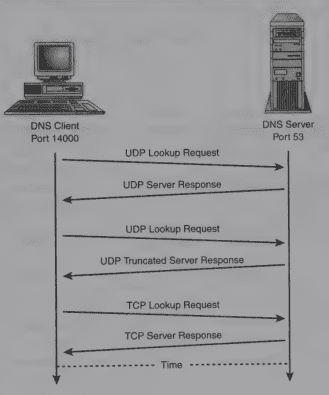

区传输是名称服务器关于网络或其有管辖权的网络部分（区）的完整信息传输（即官方服务器）。权威名称服务器被称为主名称服务器。辅名称服务器或备份名称服务器可以定期向其主名称服务器请求区传输，以保持其 DNS 缓存的更新。

例如，您的 ISP 的某个名称服务器是其地址空间的主权威服务器。ISP 通常拥有多个 DNS 服务器以平衡负载，同时也作为备份冗余。其他名称服务器是从名称服务器，它们从主服务器上的主副本刷新信息。

区域传输需要在主服务器和从服务器之间进行严格的访问控制。小型系统不太可能成为公共域名命名空间的权威名称服务器，也不太可能成为该信息的公共备份服务器。大型站点则可能很容易同时托管主服务器和从服务器。必须注意，区域传输仅在这些主机之间被允许。由于攻击者能够获取整个 DNS 区域的副本，从而了解网络拓扑结构并将攻击指向最有价值的资产，因此许多攻击都成功了。

表 4.1 列出了防火墙规则所涵盖的完整 DNS 协议。

### 表 4.1 DNS 协议

| 描述 | 协议 | 远程地址 | 远程端口 | 进/出 | 本地地址 | 本地端口 | TCP 标志 |
|---|---|---|---|---|---|---|---|

| 本地客户端查询 | UDP | 名称服务器 | 53 | 出 | IPADDR | 1024:65535 | — |
| 远程服务器响应 | UDP | 名称服务器 | 53 | 进 | IPADDR | 1024:65535 | — |
| 本地客户端查询 | TCP | 名称服务器 | 53 | 出 | IPADDR | 1024:65535 | 任意 |
| 远程服务器响应 | TCP | 名称服务器 | 53 | 进 | IPADDR | 1024:65535 | ACK |
| 本地服务器查询 | UDP | 名称服务器 | 53 | 出 | IPADDR | 53 | — |
| 远程服务器响应 | UDP | 名称服务器 | 53 | 进 | IPADDR | 53 | — |
| 本地区域传输请求 | TCP | 主服务器 | 53 | 出 | IPADDR | 1024:65535 | 任意 |
| 远程区域传输请求 | TCP | 主服务器 | 53 | 进 | IPADDR | 1024:65535 | ACK |
| 远程客户端查询 | UDP | DNS 客户端 | 1024:65535 | 进 | IPADDR | 53 | — |
| 本地服务器响应 | UDP | DNS 客户端 | 1024:65535 | 出 | IPADDR | 53 | — |
| 远程客户端查询 | TCP | DNS 客户端 | 1024:65535 | 进 | IPADDR | 53 | 任意 |


| 本地服务器响应 | UDP | DNS 客户端 | 53 | 出 | IPADDR | 53 | — |
| 远程区域传输请求 | TCP | 从服务器 | 1024:65535 | 进 | IPADDR | 53 | 任意 |
| 本地区域传输响应 | TCP | 从服务器 | 1024:65535 | 出 | IPADDR | 53 | ACK |

## 允许作为客户端进行 DNS 查询

DNS 解析器客户端并不是某个特定的程序。客户端集成在网络程序使用的网络库代码中。当主机名需要查询时，解析器向 DNS 服务器请求查询。大多数计算机仅被配置为 DNS 客户端。服务器运行在远程机器上。对于家庭用户来说，名称服务器通常是您的 ISP 拥有的机器。

作为客户端，假设您的机器没有运行本地 DNS 服务器；如果有，您应该确保确实需要运行该名称服务器。没有必要运行额外的服务！每个客户端查询都会经过解析器，然后被发送到 `/etc/resolv.conf` 中配置的远程名称服务器之一。通常，即使使用本地服务器，安装客户端规则也是更好的做法。这将避免一些原本可能在某个时刻出现的令人困惑的问题。

除非远程主机在本地 `/etc/hosts` 文件中有条目，否则这些规则必须安装到防火墙表中，然后其他规则才能成功地通过名称而非 IP 地址来指定远程主机。

DNS 通过 UDP 数据报发送查询请求：

```bash
NAMESERVER = "my.name.server"          # (TCP/UDP) DNS

if [ "$CONNECTION_TRACKING" = "1" ]; then
$IPT -A OUTPUT -o $INTERNET -p udp \
-s $IPADDR --sport $UNPRIVPORTS \
-d $NAMESERVER --dport 53 \
-m state --state NEW -j ACCEPT
fi

$IPT -A OUTPUT -o $INTERNET -p udp \
-s $IPADDR --sport $UNPRIVPORTS \
-d $NAMESERVER --dport 53 -j ACCEPT

$IPT -A INPUT -i $INTERNET -p udp \
-s $NAMESERVER --sport 53 \
-d $IPADDR --dport $UNPRIVPORTS -j ACCEPT
```

如果返回的数据太大而无法装入 UDP 数据报中，从而导致错误，DNS 客户端将使用 TCP 连接重试。

接下来的两条规则用于查询响应无法装入 DNS UDP 数据报的罕见情况。在日常正常操作中不会使用它们。您可能会在没有这些 TCP 规则的情况下数月运行系统而没有问题。不幸的是，如果没有这些规则，您的 DNS 查询偶尔会挂起。更典型的是，这些规则用于从服务器向其主名称服务器请求区域传输：

```bash
if [ "$CONNECTION_TRACKING" = '1' ]; then
$IPT -A OUTPUT -o $INTERNET -p tcp \
-s $IPADDR --sport $UNPRIVPORTS \
-d $NAMESERVER --dport 53 \
-m state --state NEW -j ACCEPT
fi

$IPT -A OUTPUT -o $INTERNET -p tcp \
-s $IPADDR --sport $UNPRIVPORTS \
-d $NAMESERVER --dport 53 -j ACCEPT

$IPT -A INPUT -i $INTERNET -p tcp ! --syn \
-s $NAMESERVER --sport 53 \
-d $IPADDR --dport $UNPRIVPORTS -j ACCEPT
```

## 允许作为转发服务器进行 DNS 查询

配置本地转发名称服务器可以带来巨大的性能提升。如图 4.5 所示，当 `BIND` 被配置为缓存和转发名称服务器时，它既作为本地服务器，也作为远程 DNS 服务器的客户端。直接客户端到服务器的交换与转发服务器到服务器的交换之间的区别在于使用的源端口和目标端口。`BIND` 不是从非特权端口发起交换，而是从其自己的 DNS 端口 53 发起交换。（查询源端口现在是可配置的。在较新版本的 `BIND` 中，本地服务器默认从非特权端口发起请求。）第二个区别是，这种类型的转发服务器查询总是通过 UDP 完成。（如果响应太大而无法装入 UDP DNS 数据包，本地服务器必须回退到标准的客户端/服务器行为来发起 TCP 请求。）

### 图 4.5 DNS 转发服务器查询。

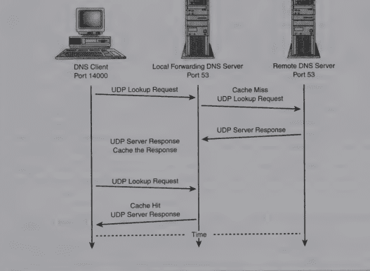

## DNS BIND 端口使用情况

历史上，DNS 服务器在与其他服务器通信时使用 UDP 端口 53 作为其源端口。这区分了客户端流量和由服务器发起的流量，因为客户端总是使用高的、非特权的端口作为其源端口。较新版本的 `BIND` 允许服务器到服务器的源端口可配置，并默认使用非特权端口。本书中的所有示例都假设 `BIND` 被配置为使用 UDP 端口 53 而非非特权端口来进行服务器到服务器的查询。

本地客户端请求被发送到本地 DNS 服务器。第一次，`BIND` 不会有查询信息，因此它将请求转发到远程名称服务器。`BIND` 缓存返回的信息并将其传递给客户端。下次请求相同信息时，`BIND` 在其本地缓存中找到它（根据记录的生存时间 [`TTL`]），并且不会进行远程请求：

```bash
if [ '$CONNECTION_TRACKING' = '1' ]; then
$IPT -A OUTPUT -o $INTERNET -p udp \
    -s $IPADDR --sport 53 \
    -d $NAMESERVER --dport 53 \
    -m state --state NEW -j ACCEPT
fi

$IPT -A OUTPUT -o $INTERNET -p udp \
    -s $IPADDR --sport 53 \
    -d $NAMESERVER --dport 53 -j ACCEPT

$IPT -A INPUT -i $INTERNET -p udp \
    -s $NAMESERVER --sport 53 \
    -d $IPADDR --dport 53 -j ACCEPT
```

如果由于 UDP 数据包大小导致查询失败，服务器将回退到 TCP 客户端模式查询。如果由于远程服务器没有该信息而导致查询失败，本地服务器将查询根缓存服务器。因此，客户端规则需要允许 DNS 流量去往任何服务器，而不仅仅是本地配置中列出的特定服务器。

另一种 `BIND` 配置方式是不仅将其配置为转发服务器，还将其配置为 `BIND` 配置文件 `named.conf` 中指定的远程服务器的从服务器。作为从服务器，不需要一般的客户端 UDP 规则。

## 过滤 AUTH 用户识别服务（TCP 端口 113）

`AUTH`（或 ident）用户识别服务有时在发送邮件或发布 Usenet 文章时使用。一些 FTP 站点也配置为要求可解析的 `AUTH` 查询。出于日志记录目的，用户向您机器发起 `AUTH` 请求，以获取发起邮件或新闻连接的用户账户名。表 4.2 列出了 `AUTH` 服务的完整客户端/服务器连接协议。尽管要求此服务的情况变得越来越不常见，因此我不建议您在服务器上运行它。

## 表 4.2 Ident 协议

| 描述 | 协议 | 远程地址 | 远程端口 | 本地进/出 | 本地地址 | 本地端口 | TCP 标志 |
| :--- | :--- | :--- | :--- | :--- | :--- | :--- | :--- |
| 本地客户端查询 | TCP | 任意位置 (ANYWHERE) | 113 | 出 (Out) | IPADDR | 1024:65535 | 任意 |
| 远程服务器响应 | TCP | 任意位置 (ANYWHERE) | 113 | 进 (In) | IPADDR | 1024:65535 | ACK |
| 远程客户端查询 | TCP | 任意位置 (ANYWHERE) | 1024:65535 | 进 (In) | IPADDR | 113 | 任意 |
| 本地服务器响应 | TCP | 任意位置 (ANYWHERE) | 1024:65535 | 出 (Out) | IPADDR | 113 | ACK |

## 允许作为客户端的传出 AUTH 请求

如果您运行邮件或 FTP 服务器，您的机器将作为 `AUTH` 客户端运行。以下是允许您的服务器充当 `AUTH` 客户端的规则（如果您选择这样做）：


```
if [ "$CONNECTION_TRACKING" = "1" ]; then
  $IPT -A OUTPUT -o $INTERNET -p tcp \
       -s $IPADDR --sport $UNPRIVPORTS \
       --dport 113 -m state --state NEW -j ACCEPT
fi
$IPT -A OUTPUT -o $INTERNET -p tcp \
     -s $IPADDR --sport $UNPRIVPORTS \
     --dport 113 -j ACCEPT
$IPT -A INPUT -i $INTERNET -p tcp ! --syn \
     --sport 113 \
     -d $IPADDR --dport $UNPRIVPORTS -j ACCEPT
```

## 过滤传入服务器的 AUTH 请求

无论您是否决定提供该服务，当您发送邮件时，很可能会收到对该服务的传入请求。

如果您运行 `identd` 服务器，以下规则允许传入的 `identd` 连接请求：

```
if [ "$CONNECTION_TRACKING" = "1" ]; then
  $IPT -A INPUT -i $INTERNET -p tcp \
       --sport $UNPRIVPORTS \
       -d $IPADDR --dport 113 \
       -m state --state NEW -j ACCEPT
fi
$IPT -A INPUT -i $INTERNET -p tcp \
--sport $UNPRIVPORTS \
-d $IPADDR --dport 113 -j ACCEPT
```

```
$IPT -A OUTPUT -o $INTERNET -p tcp ! --syn \
-s $IPADDR --sport 113 \
--dport $UNPRIVPORTS -j ACCEPT
```

如果您决定不提供该服务，拒绝连接请求以避免等待 TCP 连接超时是一种良好的实践。这仅在传入数据包被拒绝（而非丢弃）时适用，在本例中：

```
$IPT -A INPUT -i $INTERNET -p tcp \
--sport $UNPRIVPORTS \
-d $IPADDR --dport 113 -j REJECT --reject-with tcp-reset
```

或者，您可以使用接受规则但不运行 `identd` 服务器。结果将是相同的：TCP 层会向发送者返回 TCP RST 消息。

## 启用常见的 TCP 服务

很可能没有人会想要启用本节中列出的所有服务，但大多数人都想启用其中的一部分。这些是如今在 Internet 上最常用的服务。因此，本节更像是一个参考章节。本节提供了以下内容的规则：

- 电子邮件 (Email)
- Usenet
- Telnet
- SSH
- FTP
- Web 服务
- Whois
- RealAudio, RealVideo 和 QuickTime

还有许多其他服务在此未涵盖。其中一些用于专用服务器，一些用于大型企业和组织，还有一些专为在本地专用网络中使用而设计。第 6 章涵盖了额外的 LAN 和 DMZ 服务。

### 电子邮件 (TCP SMTP 端口 25, POP 端口 110, IMAP 端口 143)

电子邮件是几乎所有人都想要的服务。邮件的设置取决于您的 ISP、连接类型以及您自己的选择。电子邮件使用分配给 TCP 服务端口 25 的 SMTP 协议在网络上发送。电子邮件通常通过三种不同协议之一在本地接收——SMTP、POP 或 IMAP——具体取决于您的 ISP 提供的服务以及您的本地配置。

SMTP 是通用邮件协议。邮件被投递到目标主机，通常由给定域名的 DNS 中的 MX 记录定义。端点邮件服务器确定邮件是否可投递（地址为该机器上有效用户帐户），然后将其投递到用户的本地邮箱。

POP 和 IMAP 是邮件检索服务。POP 在 TCP 端口 110 上运行。IMAP 在 TCP 端口 143 上运行。ISP 通常使用这两种服务之一或两者使传入邮件可供其客户使用。这两种服务通常通过用户名和密码进行认证。就邮件检索而言，SMTP 与 POP 或 IMAP 之间的区别在于，SMTP 接收传入邮件并将其排队在用户的本地邮箱中。POP 和 IMAP 从用户的 ISP 处将邮件检索到用户的本地邮件程序中，而邮件之前已在 ISP 的 SMTP 邮箱中远程排队。表 4.3 列出了 SMTP、POP 和 IMAP 的完整客户端/服务器连接协议。SMTP 还使用您的本地网络可能使用的专用投递机制，例如 ETRN，该机制有效地转移给定域名的所有邮件以进行本地处理。

#### 表 4.3 SMTP、POP 和 IMAP 邮件协议

| 描述 | 协议 | 远程地址 | 远程端口 | 本地进/出 | 本地地址 | 本地端口 | TCP 标志 |
| :--- | :--- | :--- | :--- | :--- | :--- | :--- | :--- |
| 发送传出邮件 | TCP | 任意位置 (ANYWHERE) | 25 | 出 (Out) | IPADDR | 1024: 65535 | 任意 |
| 远程服务器响应 | TCP | 任意位置 (ANYWHERE) | 25 | 进 (In) | IPADDR | 1024: 65535 | ACK |
| 接收传入邮件 | TCP | 任意位置 (ANYWHERE) | 1024: 65535 | 进 (In) | IPADDR | 25 | 任意 |
| 本地服务器响应 | TCP | 任意位置 (ANYWHERE) | 1024: 65536 | 出 (Out) | IPADDR | 25 | ACK |
| 本地客户端查询 | TCP | POP 服务器 | 110 | 出 (Out) | IPADDR | 1024: 65535 | 任意 |
| 远程服务器响应 | TCP | POP 服务器 | 110 | 进 (In) | IPADDR | 1024: 65535 | ACK |
| 远程客户端查询 | TCP | POP 客户端 | 1024:65535 | 进 (In) | IPADDR | 110 | 任意 |
| 本地服务器响应 | TCP | POP 客户端 | 1024:65535 | 出 (Out) | IPADDR | 110 | ACK |
| 本地客户端查询 | TCP | IMAP 服务器 | 143 | 出 (Out) | IPADDR | 1024:65535 | 任意 |
| 远程服务器响应 | TCP | IMAP 服务器 | 143 | 进 (In) | IPADDR | 1024:65535 | ACK |
| 远程客户端查询 | TCP | IMAP 客户端 | 1024:65535 | 进 (In) | IPADDR | 143 | 任意 |
| 本地服务器响应 | TCP | IMAP 客户端 | 1024:65535 | 出 (Out) | IPADDR | 143 | ACK |

### 通过 SMTP (TCP 端口 25) 发送邮件

邮件通过 SMTP 发送。但是，您使用谁的 SMTP 服务器来收集您的邮件并将其转发？ISP 向其客户提供 SMTP 邮件服务。ISP 的邮件服务器充当邮件网关。它知道如何收集您的邮件，找到接收者主机并中继邮件。如果使用 UNIX，如果您愿意，可以托管自己的本地邮件服务器。您的服务器将负责将邮件路由到其目的地。

#### 通过外部 (ISP) 网关 SMTP 服务器中继传出邮件

当您通过外部邮件网关服务器中继传出邮件时，您的客户端邮件程序会将所有传出邮件发送到您 ISP 的邮件服务器。您的 ISP 充当您与外界之间的邮件网关。您的系统不需要知道如何定位您的邮件目的地或通往那里的路线。ISP 邮件网关充当您的中继。

以下两条规则允许您通过您 ISP 的 SMTP 网关中继邮件：

```
SMTP_GATEWAY="my.isp.server"      # 外部邮件服务器或中继

if [ "$CONNECTION_TRACKING" = "1" ]; then
    $IPT -A OUTPUT -o $INTERNET -p tcp \
    -s $IPADDR --sport $UNPRIVPORTS \
    -d $SMTP_GATEWAY --dport 25 -m state --state NEW -j ACCEPT
fi

$IPT -A OUTPUT -o $INTERNET -p tcp \
-s $IPADDR --sport $UNPRIVPORTS \
-d $SMTP_GATEWAY --dport 25 -j ACCEPT
$IPT -A INPUT -i $INTERNET -p tcp ! --syn \
-s $SMTP_GATEWAY --sport 25 \
-d $IPADDR --dport $UNPRIVPORTS -j ACCEPT
```


## 向任何外部邮件服务器发送邮件

或者，您可以绕过您 ISP 的邮件服务器并托管自己的。您的本地服务器负责收集您的传出邮件，对目标主机名进行 DNS 查找，并将邮件发送到其目的地。您的客户端邮件程序指向您的本地 SMTP 服务器，而不是 ISP 的服务器。

以下两条规则允许您直接向远程目的地发送邮件：

```
if [ "$CONNECTION_TRACKING" = "1" ]; then
$IPT -A OUTPUT -o $INTERNET -p tcp \
-s $IPADDR --sport $UNPRIVPORTS \
--dport 25 -m state --state NEW -j ACCEPT
fi

$IPT -A OUTPUT -o $INTERNET -p tcp \
-s $IPADDR --sport $UNPRIVPORTS \
--dport 25 -j ACCEPT

$IPT -A INPUT -i $INTERNET -p tcp ! --syn \
--sport 25 \
-d $IPADDR --dport $UNPRIVPORTS -j ACCEPT
```

## 接收邮件

接收邮件的方式取决于您的具体情况。如果您运行自己的本地邮件服务器，您可以直接在您的 Linux 机器上收集传入邮件。如果您从您的 ISP 帐户检索邮件，您可能需要也可能不需要作为 POP 或 IMAP 客户端检索邮件，这取决于您如何配置您的 ISP 电子邮件帐户，以及 ISP 提供的邮件投递服务。

### 作为本地 SMTP 服务器 (TCP 端口 25) 接收邮件

如果您希望接收直接从世界任何地方发送到您本地机器的邮件，您需要运行 `sendmail`、`qmail` 或其他邮件服务器程序。这些是本地服务器规则：

```
if [ "$CONNECTION_TRACKING" = "1" ]; then
$IPT -A INPUT -i $INTERNET -p tcp \
--sport $UNPRIVPORTS \
-d $IPADDR --dport 25 \
-m state --state NEW -j ACCEPT
```

# 第4章：构建和安装独立防火墙

```bash
$IPT -A INPUT  -i $INTERNET -p tcp \
   --sport $UNRIVPORTS \
   -d $IPADDR --dport 25 -j ACCEPT

$IPT -A OUTPUT -o $INTERNET -p tcp ! --syn \
   -s $IPADDR --sport 25 \
   --dport $UNRIVPORTS -j ACCEPT
```

或者，如果你希望保持本地邮件账户相对私密，并使用工作或 ISP 的邮件账户作为你的公共地址，你可以配置你的工作和 ISP 邮件账户将邮件转发到你的本地服务器。在这种情况下，你可以用针对每个邮件转发器的独立、特定规则，来替代之前允许来自任何位置的单个规则对。

### 作为 POP 客户端获取邮件（TCP 端口 110）

连接 POP 服务器是从远程 ISP 或工作账户获取邮件的一种非常常见的方式。如果你的 ISP 使用 POP 服务器进行客户邮件获取，你需要允许出站客户端到服务器的连接。

服务器的地址将是一个特定的主机名或地址，而不是全局隐含的 ANYWHERE 指定符。POP 账户是与特定用户名和密码关联的用户账户：

```bash
POP_SERVER="my.isp.pop.server"      # external pop server, if any

if [ "$CONNECTION_TRACKING" = "1" ]; then
   $IPT -A OUTPUT -o $INTERNET -p tcp \
        --sport $UNRIVPORTS \
        -d $POP_SERVER --dport 110 -m state --state NEW -j ACCEPT
fi

$IPT -A OUTPUT -o $INTERNET -p tcp \
     -s $IPADDR --sport $UNRIVPORTS \
     -d $POP_SERVER --dport 110 -j ACCEPT

$IPT -A INPUT -i $INTERNET -p tcp ! --syn \
   -s $POP_SERVER --dport 110 \
   -d $IPADDR --dport $UNRIVPORTS -j ACCEPT
```

### 作为 IMAP 客户端接收邮件（TCP 端口 143）

连接 IMAP 服务器是从远程 ISP 或工作账户获取邮件的另一种常见方式。如果你的 ISP 使用 IMAP 服务器进行客户邮件获取，你需要允许出站客户端到服务器的连接。

服务器的地址将是一个特定的主机名或地址，而不是全局隐含的 ANYWHERE 指定符。IMAP 账户是与特定用户名和密码关联的用户账户：

```bash
IMAP_SERVER="my.isp.imap.server" # external imap server, if any

if [ "$CONNECTION_TRACKING" = "1" ]; then
$IPT -A OUTPUT -o $INTERNET -p tcp \
-s $IPADDR --sport $UNRIVPORTS \
-d $IMAP_SERVER --dport 143 -m state --state NEW -j ACCEPT
fi

$IPT -A OUTPUT -o $INTERNET -p tcp \
-s $IPADDR --sport $UNRIVPORTS \
-d $IMAP_SERVER --dport 143 -j ACCEPT

$IPT -A INPUT -i $INTERNET -p tcp ! --syn \
-s $IMAP_SERVER --dport 143 \
-d $IPADDR --dport $UNRIVPORTS -j ACCEPT
```

## 实际客户端和服务器邮件组合示例

本节描述了客户端和服务器邮件组合的四种常见方法：

- 作为 SMTP 客户端发送邮件并作为 POP 客户端接收邮件
- 作为 SMTP 客户端发送邮件并作为 IMAP 客户端接收邮件
- 作为 SMTP 客户端发送邮件并作为 SMTP 服务器接收邮件
- 作为 SMTP 服务器发送邮件并作为 SMTP 服务器接收邮件

前两种方法适用于完全依赖 ISP 的 SMTP 和 POP 或 IMAP 邮件服务的情况。第三种方法是混合方法，通过 ISP 的 SMTP 邮件服务器中继出站邮件，但通过本地 SMTP 服务器直接接收邮件。第四种方法支持运行完全独立的邮件服务器来处理出站和入站邮件。

### 作为 SMTP 客户端发送邮件并作为 POP 客户端接收邮件

如果你作为 SMTP 客户端发送邮件并作为 POP 客户端接收邮件，你完全依赖远程站点来提供你的邮件服务。远程站点既托管用于中继出站邮件的 SMTP 服务器，也托管用于本地邮件获取的 POP 服务器：


```bash
SMTP_GATEWAY="my.isp.server" # external mail server or relay

if [ "$CONNECTION_TRACKING" = "1" ]; then
  $IPT -A OUTPUT -o $INTERNET -p tcp \
    -s $IPADDR --sport $UNRIVPORTS \
    -d $SMTP_GATEWAY --dport 25 -m state --state NEW -j ACCEPT
fi

$IPT -A OUTPUT -o $INTERNET -p tcp \
  -s $IPADDR --sport $UNRIVPORTS \
  -d $SMTP_GATEWAY --dport 25 -j ACCEPT

$IPT -A INPUT -i $INTERNET -p tcp ! --syn \
  -s $SMTP_GATEWAY --dport 25 \
  -d $IPADDR --dport $UNRIVPORTS -j ACCEPT

POP_SERVER="my.isp.pop.server" # external pop server, if any

if [ "$CONNECTION_TRACKING" = "1" ]; then
  $IPT -A OUTPUT -o $INTERNET -p tcp \
    -s $IPADDR --sport $UNRIVPORTS \
    -d $POP_SERVER --dport 110 -m state --state NEW -j ACCEPT
fi

$IPT -A OUTPUT -o $INTERNET -p tcp \
  -s $IPADDR --sport $UNRIVPORTS \
  -d $POP_SERVER --dport 110 -j ACCEPT

$IPT -A INPUT -i $INTERNET -p tcp ! --syn \
  -s $POP_SERVER --dport 110 \
  -d $IPADDR --dport $UNRIVPORTS -j ACCEPT
```

## 作为 SMTP 客户端发送邮件并作为 IMAP 客户端接收邮件

如果你作为 SMTP 客户端发送邮件并作为 IMAP 客户端接收邮件，你完全依赖远程站点来提供你的邮件服务。远程站点既托管用于中继出站邮件的 SMTP 服务器，也托管用于本地邮件获取的 IMAP 服务器：

```bash
SMTP_GATEWAY="my.isp.server" # external mail server or relay

if [ "$CONNECTION_TRACKING" = "1" ]; then
  $IPT -A OUTPUT -o $INTERNET -p tcp \
    -s $IPADDR --sport $UNRIVPORTS \
    -d $SMTP_GATEWAY --dport 25 -m state --state NEW -j ACCEPT
fi

$IPT -A OUTPUT -o $INTERNET -p tcp \
  -s $IPADDR --sport $UNRIVPORTS \
  -d $SMTP_GATEWAY --dport 25 -j ACCEPT

$IPT -A INPUT -i $INTERNET -p tcp ! --syn \
  -s $SMTP_GATEWAY --dport 25 \
  -d $IPADDR --dport $UNRIVPORTS -j ACCEPT

IMAP_SERVER="my.isp.imap.server"    # external imap server, if any

if [ "$CONNECTION_TRACKING" = "1" ]; then
$IPT -A OUTPUT -o $INTERNET -p tcp \
-s $IPADDR --sport $UNRIVPORTS \
-d $IMAP_SERVER --dport 143 -m state --state NEW -j ACCEPT
fi

$IPT -A OUTPUT -o $INTERNET -p tcp \
-s $IPADDR --sport $UNRIVPORTS \
-d $IMAP_SERVER --dport 143 -j ACCEPT

$IPT -A INPUT -i $INTERNET -p tcp ! --syn \
-s $IMAP_SERVER --dport 143 \
-d $IPADDR --dport $UNRIVPORTS -j ACCEPT
```

## 作为 SMTP 客户端发送邮件并作为 SMTP 服务器接收邮件

如果你作为 SMTP 客户端发送邮件并作为 SMTP 服务器接收邮件，你依赖远程站点提供 SMTP 服务以将你的出站邮件中继到远程目的地。你在本地运行 `sendmail` 作为本地 SMTP 服务器，允许远程主机直接将邮件发送到你的机器。出站邮件通过你的 ISP 中继，但本地 `sendmail` 守护进程知道如何将入站邮件投递到本地用户账户。

```bash
SMTP_GATEWAY="my.isp.server"    # external mail server or relay

if [ "$CONNECTION_TRACKING" = "1" ]; then
$IPT -A OUTPUT -o $INTERNET -p tcp \
-s $IPADDR --sport $UNRIVPORTS \
-d $SMTP_GATEWAY --dport 25 -m state --state NEW -j ACCEPT
fi

$IPT -A OUTPUT -o $INTERNET -p tcp \
-s $IPADDR --sport $UNRIVPORTS \
-d $SMTP_GATEWAY --dport 25 -j ACCEPT

$IPT -A INPUT -i $INTERNET -p tcp ! --syn \
-s $SMTP_GATEWAY --dport 25 \
-d $IPADDR --dport $UNRIVPORTS -j ACCEPT

if [ "$CONNECTION_TRACKING" = "1" ]; then
  $IPT -A INPUT  -i $INTERNET -p tcp \
    --dport $UNRIVPORTS \
    -d $IPADDR --dport 25 \
    -m state --state NEW -j ACCEPT
fi

$IPT -A INPUT  -i $INTERNET -p tcp \
    --dport $UNRIVPORTS \
    -d $IPADDR --dport 25 -j ACCEPT

$IPT -A OUTPUT -o $INTERNET -p tcp ! --syn \
  -s $IPADDR --dport 25 \
  --dport $UNRIVPORTS -j ACCEPT
```

## 作为 SMTP 服务器发送邮件并作为 SMTP 服务器接收邮件

如果你作为 SMTP 服务器发送邮件并作为 SMTP 服务器接收邮件，你自己提供所有邮件服务。你的本地 `sendmail` 守护进程被配置为自行将出站邮件中继到目标主机，同时收集和投递入站邮件：

```bash
if [ "$CONNECTION_TRACKING" = "1" ]; then
  $IPT -A OUTPUT -o $INTERNET -p tcp \
    -s $IPADDR --sport $UNRIVPORTS \
    --dport 25 -m state --state NEW -j ACCEPT
fi

$IPT -A OUTPUT -o $INTERNET -p tcp \
  -s $IPADDR --sport $UNRIVPORTS \
  --dport 25 -j ACCEPT

$IPT -A INPUT -i $INTERNET -p tcp ! --syn \
  --dport $UNRIVPORTS \
  -d $IPADDR --dport 25 -j ACCEPT

if [ "$CONNECTION_TRACKING" = "1" ]; then
  $IPT -A INPUT  -i $INTERNET -p tcp \
    --dport $UNRIVPORTS \
    -d $IPADDR --dport 25 \
    -m state --state NEW -j ACCEPT
fi

$IPT -A INPUT  -i $INTERNET -p tcp \
  --dport $UNRIVPORTS \
  -d $IPADDR --dport 25 -j ACCEPT
```

$IPT -A OUTPUT -o $INTERNET -p tcp ! --syn \
    -s $IPADDR --sport 25 \


`--dport $UNPRIVPORTS -j ACCEPT`

## 为远程客户端托管邮件服务器

对于小型系统而言，托管公共 POP 或 IMAP 服务并不常见。你可能会这样做，例如，如果你为少数朋友提供远程邮件服务，或者他们的 ISP 邮件系统暂时不可用。无论如何，重要的是要在数据包过滤级别和服务器配置级别上限制你的系统将接受连接的客户机。

### 为远程客户端托管 POP 服务器

POP 服务器是最常见且最成功的黑客攻击切入点之一。在许多情况下，防火墙规则可以提供一定程度的保护。当然，你也会在服务器配置级别限制访问。一如既往，尤其是对于邮件服务器软件，保持软件的安全更新最新至关重要。

如果你使用本地系统作为中央邮件服务器，并运行本地 POP3 服务器以提供局域网内本地机器的邮件访问，则不需要本示例中的服务器规则。来自 Internet 的传入连接应该被丢弃。如果你确实需要为有限数量的远程个人托管 POP 服务，下面的两条规则允许传入连接至你的 POP 服务器。连接被限制为你特定客户机的 IP 地址：

```
if [ "$CONNECTION_TRACKING" = "1" ]; then
    $IPT -A INPUT -i $INTERNET -p tcp \
    -s <my_pop_clients> --sport $UNPRIVPORTS \
    -d $IPADDR --port 110 \
    -m state --state NEW -j ACCEPT
fi
```

```
$IPT -A INPUT -i $INTERNET -p tcp \
    -s <my_pop_clients> --sport $UNPRIVPORTS \
    -d $IPADDR --port 110 -j ACCEPT
```

```
$IPT -A OUTPUT -o $INTERNET -p tcp ! --syn \
    -s $IPADDR --sport 110 \
    -d <my_pop_clients> --dport $UNPRIVPORTS -j ACCEPT
```

如果你的站点是一个 ISP，你可以使用网络地址掩码来限制你接受 POP 连接请求的来源地址：

```
POP_CLIENTS="192.168.24.0/24"
```

如果你的站点是一个拥有少数远程 POP 客户的住宅站点，则需要明确列出客户地址，并为每个客户地址设置单独的规则对。

### 为远程客户端托管 IMAP 服务器

IMAP 服务器是最常见且最成功的黑客攻击切入点之一。在许多情况下，防火墙规则可以提供一定程度的保护。当然，你也会在服务器配置级别限制访问。一如既往，尤其是对于邮件服务器软件，保持软件的安全更新最新至关重要。

如果你使用本地系统作为中央邮件服务器，并运行本地 `imapd` 脚本以提供局域网内本地机器的邮件访问，则不需要服务器规则。来自 Internet 的传入连接应该被丢弃。如果你确实需要为有限数量的远程个人托管 IMAP 服务，下面的规则允许传入连接至你的 IMAP 服务器。连接被限制为你特定客户机的 IP 地址：

```
if [ "$CONNECTION_TRACKING" != "1" ]; then
$IPT -A INPUT -i $INTERNET -p tcp \
-s <my.imap.clients> --sport $UNPRIVPORTS \
-d $IPADDR --dport 143 \
-m state --state NEW -j ACCEPT
fi

$IPT -A INPUT -i $INTERNET -p tcp \
-s <my.imap.clients> --sport $UNPRIVPORTS \
-d $IPADDR --dport 143 -j ACCEPT

$IPT -A OUTPUT -o $INTERNET -p tcp ! --syn \
-s $IPADDR --sport 143 \
-d <my.imap.clients> --dport $UNPRIVPORTS -j ACCEPT
```

如果你的站点是一个 ISP，你可以使用网络地址掩码来限制你接受 IMAP 连接请求的来源地址：

```
IMAP_CLIENTS="192.168.24.0/24"
```

如果你的站点是一个拥有少数远程 IMAP 客户的住宅站点，则需要明确列出客户地址，并为每个客户地址设置单独的规则对。

## 访问 Usenet 新闻服务（TCP NNTP 端口 119）

Usenet 新闻通过运行在 TCP 之上的 NNTP 访问，使用服务端口 119。阅读新闻和发布文章由你的本地新闻客户机处理。很少有系统需要服务器规则。表 4.4 列出了 NNTP Usenet 新闻服务的完整客户机/服务器连接协议。

**表 4.4**

**NNTP 协议**

| 描述 | 协议 | 远程地址 | 远程端口 | 本地进/出 | 本地地址 | 本地端口 | TCP 标志 |
|---|---|---|---|---|---|---|---|
| 本地客户机查询 | TCP | 新闻服务器 | 119 | 出 | IPADDR | 1024:65535 | 任意 |
| 远程服务器响应 | TCP | 新闻服务器 | 119 | 进 | IPADDR | 1024:65535 | ACK |
| 远程客户机查询 | TCP | NNTP 客户机 | 1024:65535 | 进 | IPADDR | 119 | 任意 |
| 本地服务器响应 | TCP | NNTP 客户机 | 1024:65535 | 出 | IPADDR | 119 | ACK |
| 本地服务器查询 | TCP | 新闻源 | 119 | 出 | IPADDR | 1024:65535 | 任意 |
| 远程服务器响应 | TCP | 新闻源 | 119 | 进 | IPADDR | 1024:65535 | ACK |

### 作为 Usenet 客户机阅读和发布新闻

客户机规则允许连接至你 ISP 的新闻服务器。阅读新闻和发布文章都由这些规则处理：

```
NEWS_SERVER="my.news.server"        # 外部新闻服务器（如果有）

if [ "$CONNECTION_TRACKING" = "1" ]; then
   $IPT -A OUTPUT -o $INTERNET -p tcp \
       -s $IPADDR --sport $UNPRIVPORTS \
       -d $NEWS_SERVER --dport 119 -m state --state NEW -j ACCEPT
fi

$IPT -A OUTPUT -o $INTERNET -p tcp \
    -s $IPADDR --sport $UNPRIVPORTS \
    -d $NEWS_SERVER --dport 119 -j ACCEPT

$IPT -A INPUT -i $INTERNET -p tcp ! --syn \
    -s $NEWS_SERVER --sport 119 \
    -d $IPADDR --dport $UNPRIVPORTS -j ACCEPT
```

### 为远程客户端托管 Usenet 新闻服务器

小型站点不太可能为外部世界托管新闻服务器。即使是托管本地新闻服务器也不太可能。对于罕见的例外情况，应配置服务器规则以仅允许来自选定客户机组的传入连接：

```
if [ "$CONNECTION_TRACKING" = "1" ]; then
$IPT -A INPUT -i $INTERNET -p tcp \
-s <my.news.clients> --sport $UNPRIVPORTS \
-d $IPADDR --dport 119 \
-m state --state NEW -j ACCEPT
fi

$IPT -A INPUT -i $INTERNET -p tcp \
-s <my.news.clients> --sport $UNPRIVPORTS \
-d $IPADDR --dport 119 -j ACCEPT

$IPT -A OUTPUT -o $INTERNET -p tcp ! --syn \
-s $IPADDR --sport 119 \
-d <my.news.clients> --dport $UNPRIVPORTS -j ACCEPT
```

### 允许本地 Usenet 服务器接受对等新闻源

小型、家庭式站点不太可能与 ISP 建立点对点新闻源服务器关系。虽然以前新闻服务器对一般 Internet 用户来说相当容易访问，但由于垃圾邮件和服务器负载问题，如今可用的开放新闻服务器很少。

如果你的站点足够大或足够富裕，可以托管通用的 Usenet 服务器，你必须从某处获取新闻源。接下来的两条规则允许你的本地新闻服务器从远程服务器接收其新闻源。本地服务器作为客户机联系远程服务器。点对点新闻源规则与常规客户机规则之间的唯一区别是远程主机的名称或地址：


```
if [ "$CONNECTION_TRACKING" = "1" ]; then
$IPT -A OUTPUT -o $INTERNET -p tcp \
-s $IPADDR --sport $UNPRIVPORTS \
-d <my.news.feed> --dport 119 -m state --state NEW -j ACCEPT
fi

$IPT -A OUTPUT -o $INTERNET -p tcp \
-s $IPADDR --sport $UNPRIVPORTS \
-d <my.news.feed> --dport 119 -j ACCEPT

$IPT -A INPUT -i $INTERNET -p tcp ! --syn \
-s <my.news.feed> --sport 119 \
-d $IPADDR --dport $UNPRIVPORTS -j ACCEPT
```

## Telnet（TCP 端口 23）

Telnet 多年来一直是 Internet 上远程登录的事实标准方式。随着 Internet 社区性质的变化，telnet 被视为一种不安全的服务，因为它以 ASCII 明文通信。如果你有选择，应该始终使用加密服务（如 SSH），而不是 telnet。然而，Microsoft Windows 不提供 SSH 服务，只提供 telnet——这就是对安全承诺的讽刺！

此处的客户机和服务器规则允许来自任何地方的访问。如果你使用 telnet，你可以在数据包过滤级别将外部地址限制为非常特定的子集。表 4.5 列出了 telnet 服务的完整客户机/服务器连接协议。

**表 4.5**

**Telnet 协议**

| 描述 | 协议 | 远程地址 | 远程端口 | 本地进/出 | 本地地址 | 本地端口 | TCP 标志 |
|---|---|---|---|---|---|---|---|
| 本地客户机请求 | TCP | 任意 | 23 | 出 | `IPADDR` | 1024:65535 | 任意 |
| 远程服务器响应 | TCP | 任意 | 23 | 进 | `IPADDR` | 1024:65535 | ACK |
| 远程客户机 TCP 请求 | TCP | Telnet 客户机 | 1024:65535 | 进 | `IPADDR` | 23 | 任意 |
| 本地服务器响应 | TCP | Telnet 客户机 | 1024:65535 | 出 | `IPADDR` | 23 | ACK |

## 允许出站客户机访问远程站点

如果你需要使用 telnet 访问远程系统（如今 SSH 服务器非常普遍），接下来的两条规则允许出站连接至远程站点。如果你的站点有多个用户，如果可能，应将出站连接限制为用户拥有帐户的具体站点，而不是允许出站连接至任何地方：

```
if [ "$CONNECTION_TRACKING" = "1" ]; then
$IPT -A OUTPUT -o $INTERNET -p tcp \
-s $IPADDR --sport $UNPRIVPORTS \
--dport 23 -m state --state NEW -j ACCEPT
fi

$IPT -A OUTPUT -o $INTERNET -p tcp \
-s $IPADDR --sport $UNPRIVPORTS \
--dport 23 -j ACCEPT

$IPT -A INPUT -i $INTERNET -p tcp ! --syn \
-s $IPADDR --sport 23 \
-d $IPADDR --dport $UNPRIVPORTS -j ACCEPT
```

## 允许本地服务器接收传入访问

即使你需要客户端访问远程服务器，也可能不需要允许传入连接到你的 Telnet 服务器。如果需要，下面两条规则允许传入连接到你的服务器：

```bash
if [ "$CONNECTION_TRACKING" = "1" ]; then
    $IPT -A INPUT -i $INTERNET -p tcp \
        --sport $UNPRIVPORTS \
        -d $IPADDR --dport 23 \
        -m state --state NEW -j ACCEPT
fi

$IPT -A INPUT -i $INTERNET -p tcp \
    --sport $UNPRIVPORTS \
    -d $IPADDR --dport 23 -j ACCEPT

$IPT -A OUTPUT -o $INTERNET -p tcp ! --syn \
    -s $IPADDR --sport 23 \
    --dport $UNPRIVPORTS -j ACCEPT
```

与其允许来自任何地方的连接，更理想的做法是为每个具体的主机或网络定义服务器规则，因为传入连接只能合法地从这些来源发起。目前几乎所有系统都免费提供了 SSH 客户端。

## SSH（TCP 端口 22）

随着 RSA 专利在 2000 年到期，OpenSSH（安全外壳协议）已包含在 Linux 发行版中。它也可以从互联网上的软件网站免费获取。SSH 被认为是比使用 Telnet 进行远程登录访问更优越的选择，因为连接的双方都使用主机和用户的认证密钥，并且数据是加密的。此外，SSH 不仅仅是一个远程登录服务。它可以在远程站点之间自动引导 X Window 连接，并且 FTP 和其他基于 TCP 的连接可以引导到更安全的 SSH 连接上。只要连接的另一端允许 SSH 连接，就可通过 SSH 将所有 TCP 连接通过防火墙进行路由。因此，SSH 在一定程度上是穷人版的虚拟专用网络（VPN）。

SSH 使用的端口高度可配置。默认情况下，连接在客户端的非特权端口和服务器的指定服务端口 22 之间发起。SSH 客户端仅使用非特权端口。此示例中的规则适用于默认的 SSH 端口使用：

```bash
SSH_PORTS="1024:65535"     # RSA 认证
```

或者

```bash
SSH_PORTS="1024:65535"      # Rhost 认证
```

这里的客户端和服务器规则允许来自任何地方的访问。实际上，你会将外部地址限制为一个选定的子集，特别是因为连接的双方都必须配置以识别每个单独的用户账户进行认证。表 4.6 列出了 SSH 服务的完整客户端/服务器连接协议。

### 表 4.6

SSH 协议

| 描述 | 协议 | 远程地址 | 远程端口 | 本地入/出 | 本地地址 | 本地端口 | TCP 标志 |
|---|---|---|---|---|---|---|---|
| 本地客户端请求 | TCP | ANYWHERE | 22 | Out | `IPADDR` | 1024:65535 | Any |
| 远程服务器响应 | TCP | ANYWHERE | 22 | In | `IPADDR` | 1024:65535 | ACK |
| 本地客户端请求 | TCP | ANYWHERE | 22 | Out | `IPADDR` | 513:1023 | Any |
| 远程服务器响应 | TCP | ANYWHERE | 22 | In | `IPADDR` | 513:1023 | ACK |
| 远程客户端请求 | TCP | SSH 客户端 | 1024:65535 | In | `IPADDR` | 22 | Any |
| 本地服务器响应 | TCP | SSH 客户端 | 1024:65535 | Out | `IPADDR` | 22 | ACK |
| 远程客户端请求 | TCP | SSH 客户端 | 513:1023 | In | `IPADDR` | 22 | Any |
| 本地服务器响应 | TCP | SSH 客户端 | 513:1023 | Out | `IPADDR` | 22 | ACK |

## 允许客户端访问远程 SSH 服务器

这些规则允许你使用 SSH 连接到远程站点：

```bash
if [ "$CONNECTION_TRACKING" = "1" ]; then
$IPT -A OUTPUT -o $INTERNET -p tcp \
-s $IPADDR --sport $SSH_PORTS \
--dport 22 -m state --state NEW -j ACCEPT
fi
$IPT -A OUTPUT -o $INTERNET -p tcp \
-s $IPADDR --sport $SSH_PORTS \
--dport 22 -j ACCEPT
$IPT -A INPUT -i $INTERNET -p tcp ! --syn \
--sport 22 \
-d $IPADDR --dport $SSH_PORTS -j ACCEPT
```

## 允许远程客户端访问本地 SSH 服务器

这些规则允许传入连接到你的 SSH 服务器：


```bash
if [ "$CONNECTION_TRACKING" = "1" ]; then
  $IPT -A INPUT -i $INTERNET -p tcp \
    --sport $SSH_PORTS \
    -d $IPADDR --dport 22 \
    -m state --state NEW -j ACCEPT
fi

$IPT -A INPUT -i $INTERNET -p tcp \
  --sport $SSH_PORTS \
  -d $IPADDR --dport 22 -j ACCEPT

$IPT -A OUTPUT -o $INTERNET -p tcp ! --syn \
  -s $IPADDR --sport 22 \
  --dport $SSH_PORTS -j ACCEPT
```

## FTP（TCP 端口 21, 20）

FTP 仍然是两台联网机器之间传输文件最常见的方式之一。基于 Web 的浏览器 FTP 接口也变得很常见。与 Telnet 一样，FTP 在网络中以明文发送认证凭据和数据通信。因此，FTP 也被认为是一种本质上不安全的协议。SFTP 和 SCP 在这方面提供了对 FTP 的改进。

FTP 常被用作非防火墙友好或非 NAT 友好协议的经典示例。传统的通过 TCP 通信的客户端/服务器应用程序都采用相同的工作方式。客户端发起与服务器建立连接的请求。

表 4.7 列出了 FTP 服务的完整客户端/服务器连接协议。

### 表 4.7

FTP 协议

| 描述 | 协议 | 远程地址 | 远程端口 | 本地入/出 | 本地地址 | 本地端口 | TCP 标志 |
| :--- | :--- | :--- | :--- | :--- | :--- | :--- | :--- |
| 本地客户端查询 | TCP | ANYWHERE | 21 | Out | IPADDR | 1024:65535 | Any |
| 远程服务器响应 | TCP | ANYWHERE | 21 | In | IPADDR | 1024:65535 | ACK |
| 远程服务器端口数据通道请求 | TCP | ANYWHERE | 20 | In | IPADDR | 1024:65535 | Any |
| 本地客户端端口数据通道响应 | TCP | ANYWHERE | 20 | Out | IPADDR | 1024:65535 | ACK |
| 本地客户端被动数据通道请求 | TCP | ANYWHERE | 1024:65535 | Out | IPADDR | 1024:65535 | Any |
| 远程服务器被动数据通道响应 | TCP | ANYWHERE | 1024:65535 | In | IPADDR | 1024:65535 | ACK |
| 远程客户端请求 | TCP | ANYWHERE | 1024:65535 | In | IPADDR | 21 | Any |
| 本地服务器响应 | TCP | ANYWHERE | 1024:65535 | Out | IPADDR | 21 | ACK |
| 本地服务器端口数据通道响应 | TCP | ANYWHERE | 1024:65535 | Out | IPADDR | 20 | Any |
| 远程客户端端口数据通道响应 | TCP | ANYWHERE | 1024:65535 | In | IPADDR | 20 | ACK |
| 远程客户端被动数据通道请求 | TCP | ANYWHERE | 1024:65535 | In | IPADDR | 1024:65535 | Any |
| 本地服务器被动数据通道响应 | TCP | ANYWHERE | 1024:65535 | Out | IPADDR | 1024:65535 | ACK |

FTP 偏离了这种标准的 TCP 客户端/服务器通信模型。FTP 依赖于两个独立的连接，一个用于控制或命令流，另一个用于传输数据文件和其他信息，例如目录列表。控制流通过传统的 TCP 连接承载。客户端绑定到一个高的非特权端口，并向 FTP 服务器发送连接请求，该服务器绑定到端口 `21`。此连接用于传递命令。

就第二个数据流连接而言，FTP 具有两种在客户端和服务器之间交换数据的备用模式：端口模式和被动模式。端口模式是原始、默认的机制。客户端告诉服务器它将在哪个次要的非特权端口上监听。服务器从端口 20 发起数据连接到客户端指定的非特权端口。

这就是偏离标准客户端/服务器模型的地方。服务器正在发起回到客户端的次要连接。这就是为什么 FTP 是一个需要防火墙和 NAT 都支持 ALG（应用层网关）的协议。防火墙必须考虑从端口 20 到本地非特权端口的传入连接。NAT 必须考虑用于次要数据流连接的目的地址。（客户端不知道其网络流量正在被 NAT。它发送给服务器的端口和地址是其本地的、预 NAT 的端口和地址。）

被动模式与传统客户端/服务器模型类似，因为客户端发起数据流的次要连接。同样，客户端从一个高的非特权端口发起连接。然而，服务器在数据连接上并不绑定到端口 20。相反，服务器已告知客户端应将连接请求发送到哪个高的非特权端口。数据流在客户端和服务器的非特权端口之间承载。

就传统的包过滤而言，防火墙必须允许所有非特权端口之间的 TCP 流量。连接状态跟踪和 ALG 支持允许防火墙将次要连接与特定的 FTP 控制流关联。客户端侧的 NAT 不是问题，因为客户端发起了两个连接。

### 允许出站客户端访问远程 FTP 服务器

几乎所有站点都会希望拥有对远程文件存储库的 FTP 客户端访问权限。大多数人都会希望启用到远程服务器的出站客户端连接。

#### 通过控制通道的出站 FTP 请求

下面两条规则允许到远程 FTP 服务器的出站控制连接：

```bash
if [ "$CONNECTION_TRACKING" = "1" ]; then
$IPT -A OUTPUT -o $INTERNET -p tcp \
-s $IPADDR --sport $UNPRIVPORTS \
--dport 21 -m state --state NEW -j ACCEPT
fi
$IPT -A OUTPUT -o $INTERNET -p tcp \
-s $IPADDR --sport $UNPRIVPORTS \
--dport 21 -j ACCEPT
```

#### 主动模式（PORT）FTP 数据通道

接下来的两条规则允许标准的数据通道连接，即远程服务器通过回调从服务器 20 端口连接到客户端指定的非特权端口，以建立数据连接。

```bash
if [ "$CONNECTION_TRACKING" = "1" ]; then
$IPT -A INPUT -i $INTERNET -p tcp \
--sport 20 \
-d $IPADDR --dport $UNPRIVPORTS \
-m state --state NEW -j ACCEPT
fi
```

```bash
$IPT -A INPUT -i $INTERNET -p tcp \
--sport 20 \
-d $IPADDR --dport $UNPRIVPORTS -j ACCEPT
```

```bash
$IPT -A OUTPUT -o $INTERNET -p tcp ! --syn \
-s $IPADDR --sport $UNPRIVPORTS \
--dport 20 -j ACCEPT
```

这种不寻常的回调行为（即远程服务器与你的客户端建立次要连接）是 FTP 在数据包过滤层级难以保证安全的原因之一。

#### 被动模式（PASSIVE）FTP 数据通道

接下来的两条规则允许大多数 Web 浏览器使用的较新的被动数据通道模式：

```bash
if [ "$CONNECTION_TRACKING" = "1" ]; then
$IPT -A OUTPUT -o $INTERNET -p tcp \
-s $IPADDR --sport $UNPRIVPORTS \
--dport $UNPRIVPORTS -m state --state NEW -j ACCEPT
fi
```

```bash
$IPT -A OUTPUT -o $INTERNET -p tcp \
-s $IPADDR --sport $UNPRIVPORTS \
--dport $UNPRIVPORTS -j ACCEPT
```

```bash
$IPT -A INPUT -i $INTERNET -p tcp ! --syn \
--sport $UNPRIVPORTS \
-d $IPADDR --dport $UNPRIVPORTS -j ACCEPT
```

被动模式被认为比主动模式更安全，因为 FTP 客户端会发起控制和数据连接，即使连接是在两个非特权端口之间建立的。此外，正如前文所述，被动模式没有主动模式在客户端方面所存在的 NAT 问题。

### 允许入站访问你的本地 FTP 服务器


是否向外界提供 FTP 服务是一个艰难的决定。虽然互联网上 FTP 站点众多，但 FTP 服务器的配置需要格外小心。存在许多可能的 FTP 安全漏洞利用。

如果你的目标是允许对机器上某些文件集进行通用的只读访问，你可能需要考虑通过 Web 服务器使这些文件可用。如果你的目标是允许从外部向你的机器上传文件，则应在防火墙层级、`xinetd` 配置层级、`tcp_wrappers` 层级和 FTP 配置层级上严格限制 FTP 服务器访问。

无论如何，如果你决定提供 FTP 服务并允许入站文件传输，则不应允许通过匿名 FTP 进行写入操作。对文件系统的远程写入访问应仅允许来自特定的已认证 FTP 用户账户、特定的远程站点，并且只能访问文件系统中经过严格控制和限制、专门保留的 FTP 区域。最好是从 `chroot` 环境中托管 FTP 区域。

## 入站 FTP 请求

接下来的两条规则允许入站控制连接到达你的 FTP 服务器：

```bash
if [ "$CONNECTION_TRACKING" = "1" ]; then
  $IPT -A INPUT -i $INTERNET -p tcp \
       --sport $UNPRIVPORTS \
       -d $IPADDR --dport 21 \
       -m state --state NEW -j ACCEPT
fi
```

```bash
$IPT -A INPUT -i $INTERNET -p tcp \
     --sport $UNPRIVPORTS \
     -d $IPADDR --dport 21 -j ACCEPT
```

```bash
$IPT -A OUTPUT -o $INTERNET -p tcp ! --syn \
     -s $IPADDR --sport 21 \
     --dport $UNPRIVPORTS -j ACCEPT
```

## 主动模式（PORT）FTP 数据通道响应

接下来的两条规则允许 FTP 服务器回调远程客户端并建立次要数据通道连接：

```bash
if [ "$CONNECTION_TRACKING" = "1" ]; then
  $IPT -A OUTPUT -o $INTERNET -p tcp \
       --sport 20 \
       -d $IPADDR --dport $UNPRIVPORTS \
       -m state --state NEW -j ACCEPT
fi
```

```bash
$IPT -A OUTPUT -o $INTERNET -p tcp \
       --sport 20 \
       -d $IPADDR --dport $UNPRIVPORTS -j ACCEPT
```

```bash
$IPT -A INPUT -i $INTERNET -p tcp ! --syn \
       --sport $UNPRIVPORTS \
       -d $IPADDR --dport 20 -j ACCEPT
```

## 被动模式（PASSIVE）FTP 数据通道响应

接下来的两条规则允许远程 FTP 客户端与本地服务器建立次要数据通道连接。

```bash
if [ "$CONNECTION_TRACKING" = "1" ]; then
$IPT -A INPUT -i $INTERNET -p tcp \
--sport $UNPRIVPORTS \
-d $IPADDR --dport $UNPRIVPORTS \
-m state --state NEW -j ACCEPT
fi
$IPT -A INPUT -i $INTERNET -p tcp \
--sport $UNPRIVPORTS \
-d $IPADDR --dport $UNPRIVPORTS -j ACCEPT
$IPT -A OUTPUT -o $INTERNET -p tcp ! --syn \
-s $IPADDR --sport $UNPRIVPORTS \
-dport $UNPRIVPORTS -j ACCEPT
```

> 注意
>
> 不要在互联网上使用 tFTP！`tFTP` 提供的是简化版、未认证的 FTP 服务的 UDP 版本。它旨在让受信主机在局域网内将启动软件加载到路由器和无盘工作站中。有些人误将 `tFTP` 视为 FTP 的替代方案。绝对不要在互联网上使用它，句号。最好根本不要在系统中安装 `tFTP`。

## Web 服务

Web 服务基于超文本传输协议（HTTP）。客户端和服务器连接使用标准的 TCP 约定。除了标准的通用 HTTP 访问外，还有几种更高级的、专用通信协议可用，包括通过 SSL 或 TLS 的安全访问，以及通过 ISP 提供的 Web 服务器代理的访问。这些不同的访问协议使用不同的服务端口。

### 标准 HTTP 访问（TCP 端口 80）

在正常使用中，Web 服务通过 `http` 服务端口 `80` 提供。表 4.8 列出了 HTTP Web 服务的完整客户端/服务器连接协议。

表 4.8

HTTP 协议

| 描述 | 协议 | 远程地址 | 远程端口 | 本地进/出 | 本地地址 | 本地端口 | TCP 标志 |
| :--- | :--- | :--- | :--- | :--- | :--- | :--- | :--- |
| 本地客户端请求 | TCP | ANYWHERE | 80 | 出 | IPADDR | 1024:65535 | 任意 |
| 远程服务器响应 | TCP | ANYWHERE | 80 | 入 | IPADDR | 1024:65535 | ACK |
| 远程客户端请求 | TCP | ANYWHERE | 1024:65535 | 入 | IPADDR | 80 | 任意 |
| 本地服务器响应 | TCP | ANYWHERE | 1024:65535 | 出 | IPADDR | 80 | ACK |

### 作为客户端访问远程网站

在当今世界，家庭站点不希望通过 Web 浏览器访问万维网，这几乎是不可想象的。接下来的两条规则允许访问远程 Web 服务器：

```bash
if [ "$CONNECTION_TRACKING" = "1" ]; then
 $IPT -A OUTPUT -o $INTERNET -p tcp \
 -s $IPADDR --sport $UNPRIVPORTS \
 --dport 80 -m state --state NEW -j ACCEPT
fi
```

```bash
$IPT -A OUTPUT -o $INTERNET -p tcp \
 -s $IPADDR --sport $UNPRIVPORTS \
 --dport 80 -j ACCEPT
```

```bash
$IPT -A INPUT -i $INTERNET -p tcp ! --syn \
 --sport 80 \
 -d $IPADDR --dport $UNPRIVPORTS -j ACCEPT
```

### 允许远程访问本地 Web 服务器

如果你决定运行自己的 Web 服务器并托管一个公共网站，以下通用服务器规则允许所有典型的入站访问到你的站点。这是大多数人托管网站所需的全部：

```bash
if [ "$CONNECTION_TRACKING" = "1" ]; then
$IPT -A INPUT   -i $INTERNET -p tcp \
  --sport $UNPRIVPORTS \
  -d $IPADDR --dport 80 \
  -m state --state NEW -j ACCEPT
fi

$IPT -A INPUT   -i $INTERNET -p tcp \
  --sport $UNPRIVPORTS \
  -d $IPADDR --dport 80 -j ACCEPT

$IPT -A OUTPUT   -o $INTERNET -p tcp ! --syn \
  -s $IPADDR --sport 80 \
  --dport $UNPRIVPORTS -j ACCEPT
```

### 安全 Web 访问（SSL 和 TLS）（TCP 端口 443）

安全套接字层（SSL）和传输层安全（TLS）用于安全、加密的 Web 访问。这些协议使用 `TCP 端口 443`。当你去商业网站购买东西、使用在线银行服务或进入需要输入个人信息的受保护 Web 区域时，你最常会遇到这种情况。随 Red Hat Linux 7.1 发布的 Apache Web 服务器包含 OpenSSL 支持。表 4.9 列出了该服务的完整客户端/服务器连接协议。

表 4.9

SSL 和 TLS 协议

| 描述 | 协议 | 远程地址 | 远程端口 | 进/出 | 本地地址 | 本地端口 | TCP 标志 |


|:------------|:---------|:---------------|:------------|:-------|:--------------|:-----------|:---------|

| 本地客户端请求 | TCP | ANYWHERE | 443 | 出 | IPADDR | 1024:65535 | 任意 |

| 远程服务器响应 | TCP | ANYWHERE | 443 | 入 | IPADDR | 1024:65535 | ACK |

| 远程客户端请求 | TCP | ANYWHERE | 1024:65535 | 入 | IPADDR | 443 | 任意 |

| 本地服务器响应 | TCP | ANYWHERE | 1024:65535 | 出 | IPADDR | 443 | ACK |

## 作为客户端通过 SSL 或 TLS 访问远程网站

大多数人最终都会希望有客户端访问安全网站的需求：

```bash
if [ "$CONNECTION_TRACKING" = "1" ]; then
$IPT -A OUTPUT   -o $INTERNET -p tcp \
  -s $IPADDR --sport $UNPRIVPORTS \
  --dport 443 -m state --state NEW -j ACCEPT
fi
```

## 第 4 章：构建和安装独立防火墙

```
--dport 443 -m state --state NEW -j ACCEPT
fi
```

```
$IPT -A OUTPUT -o $INTERNET -p tcp \
-s $IPADDR --sport $UNPRIVPORTS \
--dport 443 -j ACCEPT
```

```
$IPT -A INPUT -i $INTERNET -p tcp ! --syn \
--sport 443 \
-d $IPADDR --dport $UNPRIVPORTS -j ACCEPT
```

## 允许远程访问本地 SSL 或 TLS 网络服务器

如果你进行某种形式的电子商务或拥有需要用户认证的 Web 区域，你很可能需要允许入站连接访问网站的加密保护区域。否则，你不需要本地服务器规则。

Linux 自带的 OpenSSL 和商用 SSL 支持包均可用于 Apache Web 服务器。更多信息请参见 http://www.apache.org 。

接下来两条规则允许使用 SSL 或 TLS 协议入站访问你的 Web 服务器：

```
if [ "$CONNECTION_TRACKING" = "1" ]; then
$IPT -A INPUT -i $INTERNET -p tcp \
--sport $UNPRIVPORTS \
-d $IPADDR --dport 443 \
-m state --state NEW -j ACCEPT
fi
```

```
$IPT -A INPUT -i $INTERNET -p tcp \
--sport $UNPRIVPORTS \
-d $IPADDR --dport 443 -j ACCEPT
```

```
$IPT -A OUTPUT -o $INTERNET -p tcp ! --syn \
-s $IPADDR --sport 443 \
--dport $UNPRIVPORTS -j ACCEPT
```

## Web 代理访问（TCP 端口 8008、8080）

公开可访问的 Web 服务器代理最常见于 ISP（互联网服务提供商）。作为客户，你配置浏览器使用远程代理服务。Web 代理通常通过 ISP 定义的两个非特权端口之一进行访问，即为此目的分配的端口 8008 或 8080。作为回报，当页面已在 ISP 服务器本地缓存时，你可以获得更快的 Web 页面访问速度，以及通过代理访问远程站点的相对匿名性。你的连接不是直接的，而是由 ISP 的代理代表你完成的。表 4.10 列出了 Web 代理服务完整的客户端/服务器连接协议。

### 启用常见 TCP 服务

#### 表 4.10 Web 代理协议

| 描述 | 协议 | 远程地址 | 远程端口 | 进/出 | 本地地址 | 本地端口 | TCP 标志 |

| --- | --- | --- | --- | --- | --- | --- | --- |

| 本地客户端请求 | TCP | WEB PROXY SERVER | WEB PROXY PORT | 出 | IPADDR | 1024:65535 | 任意 |

| 远程服务器响应 | TCP | WEB PROXY SERVER | WEB PROXY PORT | 入 | IPADDR | 1024:65535 | ACK |

如果你使用 ISP 提供的 Web 代理服务，具体的服务器地址和端口号将由你的 ISP 定义。客户端规则如下所示：

```
WEB_PROXY_SERVER='my.www.proxy'   # ISP Web 代理服务器，如果有
WEB_PROXY_PORT='www.proxy.port'    # ISP Web 代理端口，如果有
```

```
if [ "$CONNECTION_TRACKING" = "1" ]; then
    $IPT -A OUTPUT -o $INTERNET -p tcp \
        -s $IPADDR --sport $UNPRIVPORTS \
        -d $WEB_PROXY_SERVER --dport $WEB_PROXY_PORT \
        -m state --state NEW -j ACCEPT
fi
```

```
$IPT -A OUTPUT -o $INTERNET -p tcp \
    -s $IPADDR --sport $UNPRIVPORTS \
    -d $WEB_PROXY_SERVER --dport $WEB_PROXY_PORT -j ACCEPT
```

```
$IPT -A INPUT -i $INTERNET -p tcp ! --syn \
    -s $WEB_PROXY_SERVER --sport $WEB_PROXY_PORT \
    -d $IPADDR --dport $UNPRIVPORTS -j ACCEPT
```

## Whois（TCP 端口 43）

Whois 程序访问 InterNIC 注册服务数据库。表 4.11 列出了 Whois 服务完整的客户端/服务器连接协议。

#### 表 4.11 Whois 协议

| 描述 | 协议 | 远程地址 | 远程端口 | 进/出 | 本地地址 | 本地端口 | TCP 标志 |

| --- | --- | --- | --- | --- | --- | --- | --- |

| 本地客户端请求 | TCP | ANYWHERE | 43 | 出 | IPADDR | 1024:65535 | 任意 |

| 远程服务器响应 | TCP | ANYWHERE | 43 | 入 | IPADDR | 1024:65535 | ACK |

接下来两条规则使你可以查询官方远程服务器：

```
if [ "$CONNECTION_TRACKING" = "1" ]; then
  $IPT -A OUTPUT -o $INTERNET -p tcp \
    -s $IPADDR --sport $UNPRIVPORTS \
    --dport 43 -m state --state NEW -j ACCEPT
fi

$IPT -A OUTPUT -o $INTERNET -p tcp \
  -s $IPADDR --sport $UNPRIVPORTS \
  --dport 43 -j ACCEPT

$IPT -A INPUT -i $INTERNET -p tcp ! --syn \
  --sport 43 \
  -d $IPADDR --dport $UNPRIVPORTS -j ACCEPT
```

## RealAudio、RealVideo 和 QuickTime（TCP 端口 554 和 7070）

RealAudio、RealVideo 和 QuickTime 使用相同的端口。与服务器的控制连接建立在实时流协议（RTSP）之上。有关该协议的更多信息，请参见 RFC 2326，“实时流协议 (RTSP)”。入站数据流建立在实时传输协议（RTP）之上。有关 RTP 协议的更多信息，请参见 RFC 3550，“RTP：实时应用的传输协议”。有关 RealAudio 和 RealVideo 防火墙要求的更多信息，请参见 http://www.realnetworks.com 。


客户端程序可以配置为仅使用 TCP，使用 TCP 进行控制连接并使用 UDP 进行数据流（UDP 端口可配置为单个端口或端口范围的一部分），或仅使用 HTTP 应用程序协议。TCP 服务器端口 554 或 7070 以及 7071，取决于客户端和服务器版本。对于较新的客户端，UDP 客户端端口范围在 6970 到 7170 之间。如果你的站点使用旧版 RealAudio 3.0 播放器，UDP 客户端端口范围是 6770 到 7170。实际支持的端口范围可能因应用程序和平台而异。

通常，客户端程序使用可用的最高效传输组合。客户端通过尝试不同的方法来确定这一点。由于双向协议通常在没有 ALG（应用层网关）支持的情况下难以通过防火墙，因此数据流通常通过 TCP 或 HTTP 协议到达。

换句话说，如果没有用于 RealAudio 的防火墙支持模块，你的选项是：对入站流使用 HTTP，打开特定的 TCP 或 UDP 端口且不使用状态模块（或者至少不使用 INVALID 匹配），或者打开所需的端口并将数据流的规则放在状态匹配规则之前。

表 4.12 列出了本地客户端的控制流和数据流。

### 表 4.12 RealAudio 协议

| 描述 | 协议 | 远程地址 | 远程端口 | 进/出 | 本地地址 | 本地端口 | TCP 标志 |
| --- | --- | --- | --- | --- | --- | --- | --- |
| 本地客户端控制请求 | TCP | ANYWHERE | 554,7070 | 出 | IPADDR | 1024:65535 | 任意 |
| 远程服务器控制响应 | TCP | ANYWHERE | 554,7070 | 入 | IPADDR | 1024:65535 | ACK |
| 本地客户端 TCP 数据请求 | TCP | ANYWHERE | 7071 | 出 | IPADDR | 1024:65535 | 任意 |
| 远程服务器 TCP 数据响应 | TCP | ANYWHERE | 7071 | 入 | IPADDR | 1024:65535 | ACK |
| 远程服务器 UDP 数据流 | UDP | ANYWHERE | 1024:65535 | 入 | IPADDR | 6970:7170 | — |

下一对规则建立了与服务器的控制连接：

```
if [ "$CONNECTION_TRACKING" = "1" ]; then
  $IPT -A OUTPUT -o $INTERNET -p tcp \
    -m multiport --source-port 554,7070 \
    --syn -s $IPADDR --sport $UNPRIVPORTS \
    -m state --state NEW -j ACCEPT
fi
```

```
$IPT -A OUTPUT -o $INTERNET -p tcp \
  -m multiport --destination-port 554,7070 \
  --syn -s $IPADDR --dport $UNPRIVPORTS -j ACCEPT
```

```
$IPT -A INPUT -i $INTERNET -p tcp \
  -m multiport --destination-port 554,7070 \
  ! --syn -d $IPADDR --dport $UNPRIVPORTS -j ACCEPT
```

下一条规则允许来自服务器的首选入站 UDP 数据流：

```
$IPT -A INPUT -i $INTERNET -p udp \
  --sport $UNPRIVPORTS \
  -d $IPADDR --dport 6970:7170 -j ACCEPT
```

下一对规则建立了与服务器的 TCP 数据流连接：

```
if [ "$CONNECTION_TRACKING" = "1" ]; then
$IPT -A OUTPUT -o $INTERNET -p tcp \
    -s $IPADDR --sport $UNPRIVPORTS \
    --dport 7071 -m state --state NEW -j ACCEPT
fi
```

```
$IPT -A OUTPUT -o $INTERNET -p tcp \
    -s $IPADDR --sport $UNPRIVPORTS \
    --dport 7071 -j ACCEPT
```

```
$IPT -A INPUT -i $INTERNET -p tcp ! --syn \
    --sport 7071 \
    -d $IPADDR --dport $UNPRIVPORTS -j ACCEPT
```

## 启用常见 UDP 服务

无状态 UDP 协议本质上比基于连接的 TCP 协议安全性低。因此，许多注重安全的站点完全禁用 UDP 服务，或者尽可能限制对 UDP 服务的访问。显然，基于 UDP 的 DNS 交换是必要的，但可以在防火墙规则中明确指定远程名称服务器。因此，本节仅提供三个服务的规则：

- `tracroute`
- 动态主机配置协议 `DHCP`
- 网络时间协议 `NTP`

### tracroute（UDP 端口 33434）

在 Unix 和 Linux 系统中，`tracroute` 是一项 UDP 服务，它使中间系统生成 ICMP 超时消息以收集跳数信息，并使目标系统返回目标不可达消息，指示到该主机路由的终点。根据默认的拒绝策略，本章开发的防火墙阻止入站 UDP `tracroute` 数据包，因为 `tracroute` 默认端口未明确启用。结果是，不会对入站 `tracroute` 请求发出出站 ICMP 响应。表 4.13 列出了 `tracroute` 服务完整的客户端/服务器连接协议。

### 表 4.13 Traceroute 协议

| 描述 | 协议 | 远程地址 | 远程端口 / ICMP 类型 | 入/出 | 本地地址 | 本地端口 / ICMP 类型 |
| :--- | :--- | :--- | :--- | :--- | :--- | :--- |
| 出站 traceroute 探测包 | UDP | 任何位置 | 33434:33523 | 出 | IPADDR | 32769:65535 |
| 超时（中间跳） | ICMP | 任何位置 | 11 | 入 | IPADDR | - |
| 端口未找到（终点） | UDP | 任何位置 | 3 | 入 | IPADDR | - |
| 入站 traceroute 探测包 | UDP | ISP | 32769:65535 | 入 | IPADDR | 33434:33523 |
| 超时（中间跳） | ICMP | ISP | - | 出 | IPADDR | 11 |
| 端口未找到（终点） | ICMP | ISP | - | 出 | IPADDR | 3 |

`*Traceroute*` 可以被配置为使用任意端口或端口范围。因此，通过列出特定端口来阻止所有入站 `*traceroute*` 数据包是非常困难的。然而，它通常使用 `32,769` 到 `65,535` 范围内的源端口，以及 `33,434` 到 `33,523` 范围内的目的端口。由于 `*traceroute*` 可以被配置为使用任意源端口和目的端口，阻止入站 `*traceroute*` 的最有效方法是阻止由此产生的出站 ICMP 消息。`*traceroute*` 的默认源端口和目的端口已定义了符号常量：

```
TRACROUTE_SRC_PORTS="32769:65535"
TRACROUTE_DEST_PORTS="33434:33523"
```

### 启用出站 Traceroute 请求

如果你打算自己使用 `*traceroute*`，你必须启用 UDP 客户端端口。请注意，为了让出站 `*traceroute*` 正常工作，你必须允许来自任何位置的入站 ICMP `超时` 和 `目标不可达` 消息：

```
$IPT -A OUTPUT -o $INTERNET -p udp \
-s $IPADDR --sport $TRACEROUTE_SRC_PORTS \
--dport $TRACEROUTE_DEST_PORTS -j ACCEPT
```

由于 `traceroute` 是一种安全性较低的 UDP 服务，它可以用于识别你的边缘路由器、映射你的局域网或攻击其他 UDP 服务，因此不建议允许入站 `traceroute`。

### 访问 ISP 的 DHCP 服务器（UDP 端口 67, 68）


如果你的站点和你的 ISP 的服务器之间存在任何 DHCP 交互，那么这些交互必然是本地客户端到远程服务器的交互。通常，DHCP 客户端会从管理 ISP 客户 IP 地址空间的中继服务器接收临时或半永久动态分配的 IP 地址。服务器通常还会提供其他配置信息给本地主机，例如网络子网掩码；网络 MTU；默认下一跳路由器地址；域名；以及默认 TTL。

如果你从 ISP 获得动态分配的 IP 地址，你需要在你的机器上运行 DHCP 客户端守护进程。如果你的 ISP 的某个地方有人误操作运行了服务器，那么其本地子网中可能会充斥着伪造的 DHCP 服务器消息。因此，过滤 DHCP 消息以尽可能限制你的客户端和你特定的 ISP DHCP 服务器之间的流量尤为重要。

表 4.14 列出了 DHCP 消息类型描述，引用自 RFC 2131《动态主机配置协议》。

### 表 4.14

**DHCP 消息类型**

| DHCP 消息 | 描述 |
| :--- | :--- |
| DHCPDISCOVER | 客户端广播以查找可用服务器 |
| DHCPOFFER | 服务器响应 DHCPDISCOVER 发给客户端，提供配置参数 |
| DHCPREQUEST | 客户端向服务器发送消息，要么 (a) 请求来自一个服务器的已提供参数并隐式拒绝其他所有服务器的提议；(b) 在例如系统重启后确认之前分配的地址的正确性；或 (c) 延长特定网络地址的租约 |
| DHCPACK | 服务器向客户端发送配置参数，包括已承诺的网络地址 |
| DHCPNAK | 服务器向客户端指示客户端对网络地址的理解不正确（例如，客户端已移动到新的子网）或客户端的租约已过期 |
| DHCPDECLINE | 客户端向服务器指示该网络地址已被占用 |
| DHCPRELEASE | 客户端向服务器放弃网络地址并取消剩余租约 |
| DHCPINFORM | 客户端向服务器请求本地配置参数；客户端已有外部配置的地址 |

本质上，当 DHCP 客户端初始化时，它会广播一个 `DHCPDISCOVER` 查询，以发现是否有可用的 DHCP 服务器。接收到查询的任何服务器都可能回复一个 `DHCPOFFER` 消息，表明它们愿意为该客户端充当服务器；它们会附上所能提供的配置参数。客户端广播一个 `DHCPREQUEST` 消息以接受其中一个服务器，并通知其余服务器它已选择拒绝它们的提议。被选中的服务器回复一个广播 `DHCPACK` 消息，确认其最初提供的参数。此时地址分配完成。定期地，客户端向服务器发送 `DHCPREQUEST` 消息，要求更新 IP 地址租约。如果租约更新，服务器回复一个单播 `DHCPACK` 消息。否则，客户端回退到初始化过程。表 4.15 列出了 DHCP 服务完整的客户端/服务器交换协议。

### 表 4.15

**DHCP 协议**

| 描述 | 协议 | 远程地址 | 远程端口 | 本地入/出 | 本地地址 | 本地端口 |
| :--- | :--- | :--- | :--- | :--- | :--- | :--- |
| `DHCPDISCOVER` ; `DHCPREQUEST` | UDP | 255.255.255.255 | 67 | 出 | 0.0.0.0 | 68 |
| `DHCPOFFER` | UDP | 0.0.0.0 | 67 | 入 | 255.255.255.255 | 68 |
| `DHCPOFFER` | UDP | DHCP 服务器 | 67 | 入 | 255.255.255.255 | 68 |
| `DHCPREQUEST` ; `DHCPDECLINE` | UDP | DHCP 服务器 | 67 | 出 | 0.0.0.0 | 68 |
| `DHCPACK` ; `DHCPNACK` | UDP | DHCP 服务器 | 67 | 入 | IPADDR/NETMASK | 68 |
| `DHCPACK` | UDP | DHCP 服务器 | 67 | 入 | IPADDR | 68 |
| `DHCPREQUEST` ; `DHCPRELEASE` | UDP | DHCP 服务器 | 67 | 出 | IPADDR | 68 |

DHCP 协议比这个简要总结要复杂得多，但该总结描述了典型客户端和服务器交换的 essentials。更多信息，请参阅第 6 章中的“选择作为本地 DHCP 服务器（UDP 端口 67 和 68）”一节。

以下防火墙规则允许你的 DHCP 客户端与远程服务器之间的通信：

```
DHCP_SERVER="my.dhcp.server"        # 如果你使用其中一个

## 初始化或重新绑定：没有租约或租约时间已过期。

$IPT -A OUTPUT -o $INTERNET -p udp \
    -s $BROADCAST_SRC --sport 68 \
    -d $BROADCAST_DEST --dport 67 -j ACCEPT

## 来自可用 DHCP 服务器的入站 DHCPOFFER

$IPT -A INPUT -i $INTERNET -p udp \
    -s $BROADCAST_SRC --sport 67 \
    -d $BROADCAST_DEST --dport 68 -j ACCEPT

## 回退到初始化
## 客户端知道其服务器，但要么丢失了租约，
## 要么在重启后需要重新确认 IP 地址。

$IPT -A OUTPUT -o $INTERNET -p udp \
    -s $BROADCAST_SRC --sport 68 \
    -d $DHCP_SERVER --dport 67 -j ACCEPT

$IPT -A INPUT -i $INTERNET -p udp \
    -s $DHCP_SERVER --sport 67 \
    -d $BROADCAST_DEST --dport 68 -j ACCEPT

## 根据上述操作，我们应该通过此消息更改我们的 IP
## 地址，该消息指向我们的新
## 地址，而此时 dhcp 客户端尚未收到更新。
## 取决于服务器实现，目的地址
## 可以是新 IP 地址、子网地址或有限
## 广播地址。

## 如果使用网络子网地址作为目的地址，
## 下一条规则必须允许发往该
## 子网地址的入站数据包，并且该规则必须先于任何阻止此类入站广播数据包的通用规则。

$IPT -A INPUT -i $INTERNET -p udp \
-s $DHCP_SERVER --sport 67 \
--dport 68 -j ACCEPT

## 租约续期

$IPT -A OUTPUT -o $INTERNET -p udp \
-s $IPADDR --sport 68 \
-d $DHCP_SERVER --dport 67 -j ACCEPT

$IPT -A INPUT -i $INTERNET -p udp \
-s $DHCP_SERVER --sport 67 \
-d $IPADDR --dport 68 -j ACCEPT
```

请注意，DHCP 流量无法完全限制在你的 DHCP 服务器范围内。在初始化序列期间，当你的客户端尚未获得分配的 IP 地址甚至服务器 IP 地址时，数据包是广播发送的，而不是点对点发送的。在第二层，数据包可能指向你网卡硬件地址。

## 访问远程网络时间服务器（UDP 端口 123）

诸如 NTP 等网络时间服务允许访问一个或多个公共互联网时间提供商。这对于维护准确的系统时钟非常有用，特别是当内部时钟容易漂移时，以及在开机或断电后建立正确的时间和日期。小型系统用户应仅将该服务作为互联网客户端使用。很少有小型站点拥有连接格林威治（英国）的卫星链路、连接原子钟的无线电链路，或者他们自己拥有的原子钟。

`ntpd` 是服务器守护进程。除了向客户端提供时间服务外，`ntpd` 还在服务器之间使用点对点关系。很少有小型站点需要 `ntpd` 提供的额外精度。`ntpdate` 是客户端程序，使用客户端到服务器的关系。小型站点只需要客户端程序。表 4.16 仅列出了 NTP 服务的客户端/服务器交换协议。几乎很少有理由运行 `ntpd` 本身，因为那是服务器组件。如果你必须运行 NTP 服务器（而不是客户端），请在 chroot 环境中运行。

### 表 4.16

**NTP 协议**

| 描述 | 协议 | 远程地址 | 远程端口 | 本地入/出 | 本地地址 | 本地端口 |
| :--- | :--- | :--- | :--- | :--- | :--- | :--- |
| 本地客户端查询 | UDP | 时间服务器 | 123 | 出 | IPADDR | 1024:65535 |
| 远程服务器响应 | UDP | 时间服务器 | 123 | 入 | IPADDR | 1024:65535 |


启动时运行的 `ntpd` 启动脚本会使用 `ntpd` 查询一系列公共时间服务提供商。`ntpd` 守护进程在收到服务器回复后启动。这些主机需要在一组防火墙规则中分别指定：

```
TIME_SERVER="my.time.server"   # 外部时间服务器（如果有）
if [ "$CONNECTION_TRACKING" = "1" ]; then
$IPT -A OUTPUT -o $INTERNET -p udp \
    -s $IPADDR --sport SUNPRIVPORTS \
    -d $TIME_SERVER --dport 123 \
    -m state --state NEW -j ACCEPT
fi
$IPT -A OUTPUT -o $INTERNET -p udp \
    -s $IPADDR --sport SUNPRIVPORTS \
    -d $TIME_SERVER --dport 123 -j ACCEPT
$IPT -A INPUT -i $INTERNET -p udp \
    -s $TIME_SERVER --sport 123 \
    -d $IPADDR --dport SUNPRIVPORTS -j ACCEPT
```

请注意，上述规则是为标准的客户端/服务器 UDP 通信编写的。根据您特定的客户端和服务器软件，其中一方或双方都可能使用 NTP 服务器间通信模型，即客户端和服务器都使用 UDP 端口 123。

## 过滤 ICMP 控制报文和状态报文

ICMP 控制报文是根据多种错误条件生成的，并由 `ping` 和 `traceroute` 等网络分析程序产生。

> `ICMP 报文类型与 IPTABLES`
>
> `iptables` 支持使用 ICMP 数字报文类型或字母符号名称。
>
> `iptables` 还支持使用报文子类型或代码。这对于对 3 型目的站不可达（Destination Unreachable）消息进行更精细的过滤控制特别有用。例如，您可以专门禁止出站端口不可达（Port Unreachable）消息以禁用传入的 `traceroute`，或者您可以专门只允许出站需要分片（Fragmentation Needed）消息。
>
> 要查看 `iptables` 支持的所有 ICMP 符号名称列表，请运行 `iptables -p icmp -h`。要查看官方 RFC 分配，请访问 [http://www.iana.org/assignments/icmp-parameters](http://www.iana.org/assignments/icmp-parameters)。

### 错误状态和控制报文

有四种 ICMP 控制报文和状态报文需要通过防火墙：源站抑制（Source Quench）、参数问题（Parameter Problem）、传入的目的站不可达（Destination Unreachable）以及出站的需要分片（Fragmentation Needed）目的站不可达。另外四种 ICMP 报文类型是可选的：回显请求（Echo Request）、回显应答（Echo Reply）、其他出站目的站不可达子类型以及超时（Time Exceeded）。其他报文类型可以被忽略，由默认策略过滤掉。

在可以——或者应当——被忽略的报文中，只有重定向（redirect）因其作为重定向炸弹在拒绝服务攻击中的作用而被视为危险。（有关重定向炸弹的更多信息，请参阅第 2 章。）与重定向一样，其余的 ICMP 报文类型都是专门设计用于路由器之间的控制和状态报文。

以下部分更详细地描述了端点主机（相对于中间路由器）重要的报文类型。

## 分片的 ICMP 报文

在正常情况下，ICMP 报文永远不会被分片。ICMP 报文应完全容纳在一个二层帧内。丢弃分片的 ICMP 报文是安全的。此类数据包通常用于拒绝服务攻击：

```
$IPT -A INPUT -i $INTERNET --fragment -p icmp -j LOG \
    --log-prefix 'Fragmented ICMP: '

$IPT -A INPUT -i $INTERNET --fragment -p icmp -j DROP
```

## 源站抑制（SOURCE QUENCH）控制报文（类型 4）

ICMP 报文类型 4（源站抑制）可以在连接源（通常是路由器）发送数据的速度快于下一个目标路由器所能处理的速度时发送。源站抑制用作 IP 网络层的一种原始流量控制形式，通常位于两个相邻的点对点机器之间：

```
$IPT -A INPUT -i $INTERNET -p icmp \
    --icmp-type source-quench -d $IPADDR -j ACCEPT

$IPT -A OUTPUT -o $INTERNET -p icmp \
    -s $IPADDR --icmp-type source-quench -j ACCEPT
```

路由器的下一跳或目标机器发送 *源站抑制* 命令。源路由器通过以更慢的速度发送数据包来响应，逐渐增加速度，直到收到另一个源站抑制消息为止。

实际上，源站抑制在互联网中已很少使用。流量控制留给更高级别的协议处理。然而，这种报文类型在局域网（LANs）中可以看到。

## 参数问题（PARAMETER PROBLEM）状态报文（类型 12）

ICMP 报文类型 12（参数问题）在接收到包含非法或意外头部数据的数据包，或者当头部校验和与接收机器生成的校验和不匹配时发送：

```
$IPT -A INPUT -i $INTERNET -p icmp \
    --icmp-type parameter-problem -d $IPADDR -j ACCEPT

$IPT -A OUTPUT -o $INTERNET -p icmp \
    -s $IPADDR --icmp-type parameter-problem -j ACCEPT
```

## 目的站不可达（DESTINATION UNREACHABLE）错误报文（类型 3）

ICMP 报文类型 3（目的站不可达）是一种通用的错误状态报文：

```
$IPT -A INPUT -i $INTERNET -p icmp \
    --icmp-type destination-unreachable -d $IPADDR -j ACCEPT

$IPT -A OUTPUT -o $INTERNET -p icmp \
    -s $IPADDR --icmp-type fragmentation-needed -j ACCEPT

## 不记录被丢弃的出站 ICMP 错误消息
$IPT -A OUTPUT -o $INTERNET -p icmp \
    -s $IPADDR --icmp-type destination-unreachable -j DROP
```

3 型报文（目的站不可达）的 ICMP 数据包头部包含一个错误代码字段，用于标识具体的错误类型。理想情况下，您希望丢弃出站的 3 型报文。这种报文类型是在响应用于映射您的服务端口或地址空间的端口扫描时发送的。攻击者可以通过轰炸您的未使用端口来迫使您的系统生成大量这些消息，从而创建拒绝服务状况。更糟糕的是，攻击者可以伪造源地址，迫使您的系统将它们发送到被伪造的主机。不幸的是，目的站不可达消息创造了一种两难境地。其中一个报文子类型，需要分片（Fragmentation Needed），用于协商数据包分片大小。如果没有这种协商，您的网络性能可能会严重下降。

## 超时（TIME EXCEEDED）状态报文（类型 11）

ICMP 报文类型 11（超时）表示超时条件——或者更准确地说，表示数据包的最大跳数已被超过。在当今的网络中，传入的超时主要是作为出站 UDP `traceroute` 请求的 ICMP 响应出现的：

```
$IPT -A INPUT -i $INTERNET -p icmp \
    --icmp-type time-exceeded -d $IPADDR -j ACCEPT
```

如果您想使用 `traceroute`，必须允许传入的 ICMP 超时消息。因为您的机器不是中间路由器，所以对于超时消息没有其他用途。

## ping 回显请求（类型 8）和回显应答（类型 0）控制报文

`ping` 使用两种 ICMP 报文类型。请求消息（回显请求）是报文类型 8。应答消息（回显应答）是报文类型 0。`ping` 是一种简单的网络分析工具，其历史可以追溯到原始的 DARPA 网。`ping` 这个名字取自声呐系统发出的可听见的 ping 声。（DARPA 毕竟是国防高级研究计划局。）与声呐类似，广播到网络地址空间中所有机器的回显请求消息会引发网络中所有响应主机返回的回显应答消息。

> `smurf 攻击`
>
> 不要向互联网广播任何内容。之前提到的 `ping` 广播是 `smurf` IP 拒绝服务攻击的基础。有关 `smurf` 攻击的更多信息，请参阅 CERT Advisory CA-98.01，*smurf*，访问 http://www.cert.org。

## 发往远程主机的出站 `ping`


以下规则对允许您 `ping` 互联网上的任何主机：

```
if [ "$CONNECTION_TRACKING" = "1" ]; then
## 允许出站 ping 到任何位置
$IPT -A OUTPUT -o $INTERNET -p icmp \
    -s $IPADDR --icmp-type echo-request \
    -m state --state NEW -j ACCEPT
fi
```

```
## 允许出站 ping 到任何位置
$IPT -A OUTPUT -o $INTERNET -p icmp \
    -s $IPADDR --icmp-type echo-request -j ACCEPT
```

```
$IPT -A INPUT -i $INTERNET -p icmp \
    --icmp-type echo-reply -d $IPADDR -j ACCEPT
```

### 来自远程主机的传入 `ping`

这里展示的方法只允许选定的外部主机 `ping` 您：

```bash
if [ "$CONNECTION_TRACKING" = "1" ]; then
    # allow incoming pings from trusted hosts
    $IPT -A INPUT -i $INTERNET -p icmp \
    -s $MY_ISP --icmp-type echo-request -d $IPADDR \
    -m state --state NEW -j ACCEPT
fi

## allow incoming pings from trusted hosts
$IPT -A INPUT -i $INTERNET -p icmp \
-s $MY_ISP --icmp-type echo-request -d $IPADDR -j ACCEPT

$IPT -A OUTPUT -o $INTERNET -p icmp \
-s $IPADDR --icmp-type echo-reply -d $MY_ISP -j ACCEPT
```

就本章中您正在构建的示例而言，允许 `ping` 您机器的外部主机是指属于您的 `ISP` 的主机。很有可能您的网络运营中心或客户支持部门会想要 `ping` 您的外部接口。如果您的机器是一个 `DHCP` 客户端，则 `DHCP` 实现也可能依赖于 `ping`。除了来自本地网络邻居的 `ping` 之外，其他传入的 `Echo Request` 都被拒绝。`ping` 曾被用于多种类型的拒绝服务攻击中。

### 记录被丢弃的传入数据包

任何匹配规则的数据包都可以通过使用 `-j LOG` 目标进行记录。然而，记录数据包不会影响数据包的处理方式。数据包必须匹配一个接受或丢弃规则。之前介绍的一些规则在匹配数据包并丢弃它之前，已经启用了日志记录。一些 `IP` 地址欺骗规则就是这样的例子。

规则也可以被明确定义为用于记录某些类型的数据包。通常，感兴趣的数据包是表明某种探测或扫描的可疑数据包。由于默认情况下所有数据包都被拒绝，如果希望记录某些类型的数据包，必须在数据包从链的末尾脱落并由默认策略生效之前定义明确的规则。本质上，在所有被拒绝的数据包中，您可能希望记录其中的一些，对其中一些使用限制速率的日志记录，并静默地丢弃其他数据包。

记录哪些数据包是个人的事情。有些人希望记录所有被丢弃的数据包。对于其他人来说，记录所有被丢弃的数据包可能会很快使他们的系统日志溢出。有些人因确信数据包被丢弃而对此不在意，也不希望了解它们。其他人则对明显的端口扫描或某些特定的数据包类型感兴趣。

由于“首条匹配规则优先”的行为，您可以通过一条规则记录所有被丢弃的传入数据包。这里的假设是所有数据包匹配的接受规则都已测试完毕，数据包即将从链的末尾脱落并被丢弃：

```bash
$IPT -A INPUT -j $INTERNET -j LOG
```

对于某些人来说，这会产生太多的日志条目——或者太多无趣的日志条目。例如，您可能希望记录所有被丢弃的传入 `ICMP` 流量，除了 `ping`，因为无论您的站点是否响应 `ping` 请求，`ping` 都是一项常见服务：

```bash
$IPT -A INPUT -i $INTERNET -p icmp \
    -d icmp-type 1 8 -d $IPADDR -j LOG
```

您可能希望记录所有被丢弃的传入 `TCP` 流量以及记录被丢弃的传入到特权端口的 `UDP` 流量：

```bash
$IPT -A INPUT -i $INTERNET -p tcp \
    -d $IPADDR -j LOG

$IPT -A INPUT -i $INTERNET -p udp \
    -d $IPADDR --port $PRIVPORTS -j LOG
```

另一方面，您可能希望记录所有被丢弃的特权端口访问，除了那些您本就不提供服务且常被探测的端口：

```bash
$IPT -A INPUT -i $INTERNET -p tcp \
    -d $IPADDR --port 0:19 -j LOG

## skip ftp, telnet, ssh
$IPT -A INPUT -i $INTERNET -p tcp \
    -d $IPADDR --port 24 -j LOG

## skip smtp
$IPT -A INPUT -i $INTERNET -p tcp \
    -d $IPADDR --port 26:78 -j LOG

## skip finger, www
$IPT -A INPUT -i $INTERNET -p tcp \
    -d $IPADDR --port 81:109 -j LOG

## skip pop-3, sunrpc
$IPT -A INPUT -i $INTERNET -p tcp \
    -d $IPADDR --port 112:136 -j LOG

## skip NetBIOS
$IPT -A INPUT -i $INTERNET -p tcp \
    -d $IPADDR --port 140:142 -j LOG

## skip imap
$IPT -A INPUT -i $INTERNET -p tcp \
    -d $IPADDR --port 144:442 -j LOG

## skip secure_web/SSL
$IPT -A INPUT -i $INTERNET -p tcp \
    -d $IPADDR --port 444:6535 -j LOG

#UDP rules
$IPT -A INPUT -i $INTERNET -p udp \
    -d $IPADDR --port 0:110 -j LOG

## skip sunrpc
$IPT -A INPUT -i $INTERNET -p udp \
    -d $IPADDR --port 112:160 -j LOG

## skip snmp
$IPT -A INPUT -i $INTERNET -p udp \
    -d $IPADDR --port 163:634 -j LOG

## skip NFS mountd
$IPT -A INPUT -i $INTERNET -p udp \
    -d $IPADDR --port 636:5631 -j LOG

## skip pcAnywhere
$IPT -A INPUT -i $INTERNET -p udp \
    -d $IPADDR --port 5633:31336 -j LOG

## skip traceroute's default ports
$IPT -A INPUT -i $INTERNET -p udp \
    --sport $TRACEROUTE_SRC \
    -d $IPADDR --port $TRACEROUTE_DEST -j LOG

## skip the rest
$IPT -A INPUT -i $INTERNET -p udp \
    -d $IPADDR --port 33434:65335 -j LOG
```

### 记录被丢弃的传出数据包

记录被防火墙规则阻止的传出流量对于调试防火墙规则以及提示本地软件问题是必要的。

除了之前被丢弃的传出 `ICMP` 类型 3 错误之外，可能被默认策略丢弃的所有流量都可以被记录：

```bash
$IPT -A OUTPUT -o $INTERNET -j LOG
```

### 预先拒绝访问问题站点

如果某个站点习惯于扫描您的机器或以其他方式造成困扰，您可能决定拒绝其访问所有服务，至少直到问题行为被纠正为止。

一种无需每次编辑 `rc.firewall` 脚本来实现这一点的方法是包含一个单独的特定丢弃规则文件。通过将规则插入到 `INPUT` 链中而不是追加，即使后续规则允许其访问某些服务，该站点也会被阻止。该文件名为 `/etc/rc.d/rc.firewall.blocked`。为了避免可能的运行时错误，在尝试包含它之前检查文件是否存在：


## Refuse packets claiming to be from the banned list
```bash
## Refuse packets claiming to be from the banned list
if [ -f /etc/rc.d/rc.firewall.blocked ]; then
. /etc/rc.d/rc.firewall.blocked
fi
```

`rc.firewall.blocked` 文件中全局丢弃规则的一个例子如下：

```bash
$IPT -I INPUT -i $INTERNET -s <address/mask> -j DROP
```

作为替代，为了避免在链的最开始处插入规则从而排除状态检查，规则可以是追加规则，并且该文件可以包含在规则集中的伪造源地址部分。

来自该源地址范围的任何数据包都被丢弃，无论消息协议类型或源/目的端口如何。

## 安装防火墙

本节假设防火墙脚本名为 `rc.firewall`。脚本也可以简单地称为 `fwscript` 或其他名称，没有理由不能这样做。事实上，在 Debian 系统中，标准名称更接近于单个名称 `fwscript`，而不是像 Red Hat 那样带有 `rc` 前缀的名称。本节涵盖的命令假设脚本安装在 Red Hat 或 SUSE 系统的 `/etc/rc.d/` 目录中，或 Debian 系统的 `/etc/init.d/` 目录中。

作为一个 shell 脚本，初始安装很简单。脚本应由 `root` 拥有。在 Red Hat 和 SUSE 上：

```bash
chown root:root /etc/rc.d/rc.firewall
```

在 Debian 上：

```bash
chown root:root /etc/init.d/rc.firewall
```

脚本应仅允许 `root` 写入和执行。理想情况下，普通用户不应具有读取权限。在 Red Hat 和 SUSE 上：

```bash
chmod u=rwx /etc/rc.d/rc.firewall
```

在 Debian 上：

```bash
chmod u=rwx /etc/init.d/rc.firewall
```

要在任何时间初始化防火墙，从命令行执行该脚本即可。无需重启：

```bash
/etc/rc.d/rc.firewall start
```

严格来说，`start` 参数在那里不是必需的，但这仍然是一个好习惯——同样，对于防火墙，我宁愿选择完整性而不是存在歧义。该脚本包含一个 `stop` 操作，它会完全清除防火墙。因此，如果您想停止防火墙，请使用 `stop` 参数调用相同的命令：

```bash
/etc/rc.d/rc.firewall stop
```

预先警告：如果您以此方式停止防火墙，您将在没有任何保护的情况下运行。律师告诉我，我应该告诉您：“始终保持防火墙启用！”

在 Debian 上，将命令路径更改为 `/etc/init.d`。启动防火墙：

```bash
/etc/init.d/rc.firewall start
```

在 Debian 上停止防火墙：

```bash
/etc/init.d/rc.firewall stop
```

## 调试防火墙脚本的技巧

当您通过 SSH 或其他远程连接调试新的防火墙脚本时，很可能会将自己锁定在系统之外。当然，当从控制台安装防火墙时，这不是一个问题，但作为管理远程 Linux 服务器的人，我发现访问控制台很少是可能的。因此，需要一种方法，以防防火墙阻止我的连接，让防火墙在启动后自动停止。Cron 来救援了。

使用 cron 条目，您可以在预定的间隔内通过运行带有 `stop` 参数的脚本来停止防火墙。我发现每 2 分钟执行一次在初始调试期间效果很好。如果您想使用这种方法，请以 `root` 身份（在 Debian 上）设置具有以下命令的 cron 条目：

```bash
crontab -e
*/2 * * * * /etc/init.d/rc.firewall stop
```

在 Red Hat 和 SUSE 上：

```bash
crontab -e
*/2 * * * * /etc/rc.d/rc.firewall stop
```

有了这个 cron 条目，您可以启动防火墙，并让它每 2 分钟 `stop` 一次。然而，使用这样的机制在某种程度上是一种权衡，因为您必须这样做

初始调试应在时钟显示的时间能被二整除之前进行！此外，记住在调试完防火墙后删除此定时任务条目是你的责任。如果你忘记删除此条目，防火墙将停止运行，你将再次处于无防火墙保护的状态！

## 在 Red Hat 和 SUSE 上启动时引导防火墙

在 Red Hat 和 SUSE 系统上，初始化防火墙最简单的方法是编辑 `/etc/rc.d/rc.local` 并在文件末尾添加以下行：

```bash
/etc/rc.d/rc.firewall start
```

在防火墙规则调试稳定后，Red Hat Linux 提供了一种更标准的启动和停止防火墙的方式。如果你使用运行级别管理器之一并选择 `iptables`，默认的运行级别目录中包含一个指向 `/etc/rc.d/init.d/iptables` 的链接。与该目录中的其他启动脚本一样，系统会在启动或更改运行级别时自动启动和停止防火墙。

然而，要使用标准的运行级别系统还需要执行一个额外的步骤。你必须首先手动安装防火墙规则：

```bash
/etc/rc.d/rc.firewall
```

然后执行命令：

```bash
/etc/init.d/iptables save
```

规则将被保存到一个文件中，即 `/etc/sysconfig/iptables`。此后，启动脚本将找到此文件并自动加载已保存的规则。

关于使用此方法保存和加载防火墙规则，有必要提请注意一些事项。`iptables save` 和 `load` 功能目前尚未完全调试。如果你的特定防火墙配置在保存或加载规则时导致语法错误，你必须继续使用前一种启动机制，例如从 `/etc/rc.d/rc.local` 执行防火墙脚本。

## 在 Debian 上启动时引导防火墙

与许多其他方面一样，在 Debian 上将防火墙脚本配置为启动时运行比其他发行版更简单。你可以使用 `update-rc.d` 命令让防火墙在启动时启动和停止。运行 `update-rc.d` 并指定位于 `/etc/init.d` 中的防火墙脚本，同时也将当前目录设置为 `/etc/init.d`：

```bash
cd /etc/init.d
update-rc.d rc.firewall defaults
```

有关超出此处所示用法的更多信息，请参阅 `update-rc.d` 的手册页。

防火墙脚本的其他方面取决于你是拥有注册的静态 IP 地址，还是动态的、由 DHCP 分配的 IP 地址。本章中介绍的防火墙脚本是为拥有静态分配永久 IP 地址的站点设置的。

## 安装具有动态 IP 地址的防火墙

如果你拥有动态分配的 IP 地址，标准的防火墙安装方法在没有修改的情况下将无法工作。防火墙规则将在网络接口启用之前、系统分配 IP 地址之前、可能甚至在被分配默认网关路由器或名称服务器之前就安装了。

防火墙脚本本身需要定义 `IPADDR` 和 `NAMESERVER` 值。DHCP 服务器和本地 `/etc/resolv.conf` 文件都可以定义最多三个名称服务器。此外，任何特定站点可能知道也可能不知道其名称服务器、默认网关路由器或 DHCP 服务器的地址。此外，随着 ISP 重新编号其网络，你的网络掩码、子网和广播地址随时间变化并不罕见。一些 ISP 经常分配不同的 IP 地址，结果导致你的 IP 地址在一次持续连接期间可能改变多次。

你的站点必须提供某种机制，在这些变化发生时动态更新已安装的防火墙规则。附录 B “防火墙示例和支持脚本”提供了旨在自动处理这些变化的示例脚本。

此外，如果你使用的是 DSL 连接，MTU 可能会导致问题。如果是这种情况，这里有一条可以解决该问题的防火墙规则：

```bash
$IPT -A OUTPUT -o $INTERNET -p tcp --tcp-flags SYN,RST \
    SYN -j TCPMSS --clamp-mss-to-pmtu
```

防火墙脚本可以直接从环境中读取这些 shell 变量，也可以从文件中读取。无论如何，这些变量不会像本章示例中那样硬编码到防火墙脚本中。

## 摘要

本章引导你完成了使用 `iptables` 开发独立防火墙的过程。建立了默认拒绝策略。在脚本开始时修复了一些常用的攻击向量，包括源地址欺骗、保护运行在非特权端口上的服务以及 DNS。展示了流行网络服务规则的示例。还处理了 ICMP 消息，即底层 IP 网络层使用的控制和状态消息。演示了控制日志生成级别的示例。最后，描述了防火墙安装涉及的问题，既包括具有静态 IP 地址的站点，也包括具有动态分配 IP 地址的站点。


第 5 章使用独立防火墙作为构建优化防火墙的基础。第 6 章将其作为构建更复杂防火墙架构的基础。第 6 章描述了使用两个防火墙将 DMZ 外围网络隔离起来的 screened subnet（screened 子网）架构。小型企业完全可能有这种更复杂配置的需求和资源。第 7 章使用独立防火墙作为其示例的基础，但并未直接基于此示例进行构建。

一座新的远程无线电设施将在圣托马斯岛上投入使用，以支持岛上的海事、天气和救援无线电系统。

## 第二部分

### 高级议题、多个防火墙和外围网络

- `5` 防火墙优化
- `6` 包转发
- `7` NAT—网络地址转换
- `8` 调试防火墙规则

## 第 5 章 | 防火墙优化

第 4 章“构建和安装独立防火墙”使用 `iptables` 防火墙管理程序构建了一个简单的单系统定制防火墙。本章介绍防火墙优化。优化可分为三大类：规则组织、状态模块的使用以及用户自定义链。前一章的示例展示了使用和未使用状态模块两种情况。本章侧重于规则组织和用户自定义链。

### 规则组织

仅使用 `INPUT`、`OUTPUT` 和 `FORWARD` 链所进行的优化有限。链遍历是从上到下，每次一条规则，直到数据包匹配某条规则为止。链上的规则必须按层级排序，从最通用到最具体。

规则组织没有固定公式。两个主要的潜在因素是机器上托管的服务以及机器的主要用途，特别注意机器上流量最大的服务。专用防火墙和包转发器的需求与保护专用 Web 或邮件服务器的堡垒防火墙的需求非常不同。同样，站点管理员可能会为主要作为工作站使用的防火墙机器与同时作为家庭网关和家用 Linux 服务器的防火墙赋予不同的性能优先级。

在为防火墙优化准备组织规则时要考虑的第三个潜在因素是可用网络带宽，即互联网连接速度。对于具有住宅级互联网连接的站点，优化可能不会带来多少收益，甚至毫无收益。即使是访问量大的网站，机器的 CPU 也不太可能大汗淋漓。瓶颈是互联网连接本身。

### 从阻断高端口流量的规则开始

正如第 4 章的示例所示，大部分规则是反欺骗规则，或者阻断特定高端口（如 NFS 或 X Windows）流量的规则。这些类型的规则必须位于允许特定服务流量的规则之前。显然，FTP 数据通道规则必须位于规则列表的附近末尾，尽管你希望这些规则位于列表顶部，因为 FTP 传输通常很大。

### 使用状态模块进行 ESTABLISHED 和 RELATED 匹配

使用状态模块的 `ESTABLISHED` 和 `RELATED` 匹配基本上允许将所有关于正在进行的交换的规则移动到链的头部，同时也消除了为连接的服务器端创建特定规则的需要。事实上，绕过针对正在进行的、已识别的、先前接受的交换的过滤器匹配是状态模块的两个主要目的之一。

状态模块的第二个主要目的是提供防火墙过滤功能。连接状态跟踪允许防火墙将数据包与正在进行的交换关联起来。这对于无连接的、无状态的 UDP 交换特别有用。

### 考虑传输协议

服务运行的传输协议是另一个因素。在静态防火墙中，将每个传入数据包与所有欺骗规则进行测试的开销是一个巨大的损失。

### TCP 服务：绕过欺骗规则

即使没有状态模块，对于基于 TCP 的服务，连接中远程服务器端的规则也可以绕过欺骗规则。TCP 层将丢弃设置了 ACK 位的传入欺骗数据包，因为数据包不匹配 TCP 层任何已建立的连接状态。

然而，规则对中远程客户端端必须遵循欺骗规则，因为典型的客户端规则涵盖了初始连接请求和来自客户端的持续流量。如果分别测试 SYN 和 ACK 标志，测试从远程客户端到达的数据包中 ACK 标志的规则可以绕过欺骗测试。欺骗测试必须仅应用于初始 SYN 请求。

### UDP 服务：将入站数据包规则置于欺骗规则之后

使用状态模块（`state module`）还可以将远程客户端的入站连接请求（即初始 SYN 数据包）的规则与客户端后续 ACK 数据包的规则在逻辑上分开。只有初始连接请求，即初始 NEW 数据包，需要与欺骗规则进行测试匹配。

如果没有状态模块，对于基于 UDP 的服务，入站数据包的规则必须始终位于欺骗规则之后。客户端和服务器的概念是在应用层维持的，假设它确实被维持了。在防火墙和 UDP 层面，如果没有连接状态，除了使用的服务端口或非特权端口外，没有发起者和响应者的指示。正如你在第 4 章中看到的那样，一些 UDP 服务将相关的知名服务端口同时用于客户端和服务器，而其他服务则将非特权端口同时用于两者。

DNS 是无需连接的 UDP 服务的示例。如果没有连接状态，客户端发送查询的目标地址与入站响应数据包中的源地址之间没有映射关系。DNS 缓存投毒之所以可能发生，原因之一是 DNS 服务器实现并未检查入站数据包是否是之前查询过的服务器的合法响应，或者是从其他地址发送的。此外，一些实现甚至不确保客户端确实发出了请求。即使在没有进行初始查询的情况下，传入的、未经请求的恶意数据包也可以用于更新本地 DNS 缓存。

### TCP 与 UDP 服务：将 UDP 规则置于 TCP 规则之后

总体而言，UDP 规则应放在防火墙链的较后位置，即在所有 TCP 规则之后。这是因为大多数互联网服务基于 TCP 运行，而无需连接的 UDP 服务通常是简单的单数据包查询和响应服务。将单个 UDP 数据包或少数几个 UDP 数据包与前面向往持续 TCP 连接的规则进行测试，并不会给 UDP 查询和响应带来明显的延迟。一个显著的例外是流媒体，例如 RealAudio 数据流。然而，正如第 4 章所述，多媒体及其他双向、多连接会话协议从一开始就与防火墙不兼容。除非有特定的 ALG（应用层网关）支持，否则此类服务无法通过防火墙或 NAT。

### ICMP 服务：将这些规则置于规则链的较后位置

ICMP 是另一种可以将其防火墙规则放置在规则链较后位置的协议。ICMP 数据包是小型的控制和状态消息。因此，它们发送得相对不频繁。合法的 ICMP 数据包通常由单个未分段的数据包组成。除了回显请求（echo requests）外，ICMP 数据包几乎总是作为某种异常出站数据包的控制或状态响应消息发送。

### 将高使用率服务的防火墙规则尽可能靠前放置

一般来说，防火墙规则在列表中的位置没有硬性规定。高使用率服务的规则，例如专用 Web 服务器的 HTTP 相关规则，应尽可能靠前放置。涉及高且持续数据包数量的应用程序规则也应尽可能靠前放置。然而，如前所述，FTP 和 RealAudio 等应用程序的数据流协议要求规则放在链的末尾，位于其他应用程序规则之后。

### 使用多端口模块（multiport module）指定端口列表

通过使用多端口模块指定端口列表，可以获得一些小的性能提升，从而将几条规则合并为一条。列表中的规则数量和执行的具体匹配测试数量都会减少。实际上，匹配列表中任一端口的工作包共享接口、协议、TCP 标志以及源地址和目标地址测试的单个实例。实际获得的提升量取决于防火墙接受的具体服务。显然，端口所代表的服务必须共享相同的传输头特征，才能共享该规则所代表的具体测试集。

### 使用流量流向确定多网络接口规则的放置位置

如果主机有多个网络接口，针对特定接口的规则应根据哪个接口的流量最大来放置。那些接口的规则应位于其他接口的规则之前。对于家庭站点，接口可能不太重要，但对于商业站点，它可能对吞吐量产生重大影响。

作为一个例子，几年前，一家小型 ISP 根据 Bob Ziegler 网站上的 `ipfwadm` 和 `ipchains` 示例构建了防火墙，这个问题就出现了。如图 5.1 和图 5.2 所示，在 IPFW 和 Netfilter 之间，数据包通过操作系统的路径截然不同。与 Netfilter 和 `iptables` 不同，在使用 `ipchains` 时，在网络接口之间传输的数据包会从输入链传递到转发链，再传递到输出链。网站上的示例旨在作为家庭用户的示例。局域网（LAN）的输入和输出规则是脚本中的最后几条规则。特定于本地 Linux 主机的规则排在前面。该 ISP 的防火墙主要作为路由器或网关使用。通过实验，该 ISP 发现将 LAN 接口的 I/O 规则移动到输入和输出链的开头，使吞吐量提高了超过 1 Mbps。

#### 图 5.1

IPFW 回环和伪装（masqueraded）数据包遍历。

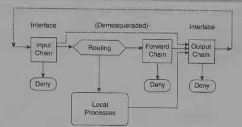

#### 图 5.2

Netfilter 数据包遍历。

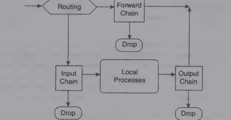

### 用户自定义链

`filter` 表有三个永久性的内置链：`INPUT`、`OUTPUT` 和 `FORWARD`。`iptables` 允许你定义自己的链，称为用户自定义链。这些用户自定义链被作为规则目标处理——也就是说，基于规则中指定的匹配集，目标可以分支或跳转到用户自定义链。数据包不会被接受或丢弃，控制将传递给用户自定义链，以执行相对于匹配分支规则的数据包更具体的匹配测试。在遍历用户自定义链之后，控制权返回到调用链，并从调用链中的下一条规则继续匹配，除非用户自定义链匹配并对该数据包采取了操作。

图 5.3 展示了使用内置链的标准自上而下的规则遍历。

#### 图 5.3

标准链遍历。


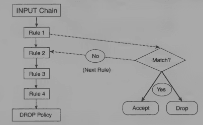

用户自定义链在优化规则集方面非常有用，因此经常使用。它们允许将规则组织成分类树。不再依赖标准链遍历中固有的直通式、自上而下的核对清单式匹配，数据包匹配测试可以基于数据包的特征进行选择性缩小。图 5.4 展示了初始数据包流。在对所有入站数据包执行初始通用测试后，数据包匹配会根据数据包中的目标地址进行分支。

在这个示例中，分支基于目标地址。源地址匹配稍后针对特定应用程序（如远程 DNS 或邮件服务器）进行。在大多数情况下，远程地址将是“任意”（anywhere）。在此时匹配目标地址可以区分发往此机器的单播数据包、广播数据包、组播数据包，以及（取决于它是 `INPUT` 还是 `FORWARD` 链）发往内部主机的数据包。

图 5.5 详细说明了针对专门发往此主机数据包协议规则的用户自定义链。如图所示，用户自定义链可以跳转到包含更具体测试的其他用户自定义链。

## 图 5.4

基于目标地址的用户自定义链。

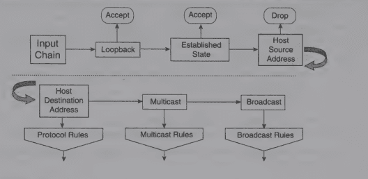

## 图 5.5

基于协议的用户自定义链。

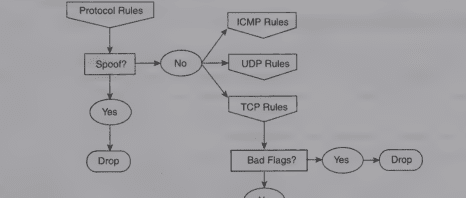

此列表总结了第 3 章“iptables：Linux 防火墙管理程序”中用户自定义链的特性。

- 用户自定义链是通过 `-N` 或 `--new-chain` 操作创建的。
- 用户自定义链的名称长度最多可达 30 个字符。
- 用户自定义链的名称可以包含连字符 (`-`)，但不能包含下划线 (`_`).
- 用户自定义链作为规则目标进行访问。
- 用户自定义链没有默认策略。
- 用户自定义链可以调用其他用户自定义链。
- 如果数据包未匹配用户自定义链中的规则，控制权将返回到调用链中的下一条规则。
- 通过 `RETURN` 目标，可以提前退出用户自定义链，控制权返回到调用链中的下一条规则。
- 用户自定义链是通过 `-X` 或 `--delete-chain` 操作删除的。
- 在删除链之前，该链必须为空。
- 如果要删除链，该链不能有其他链引用它。
- 可以使用 `-F` 或 `--flush` 操作按名称特定地清空一个链，或者如果指定了 `-n`，则清空所有现有链。

下一节将利用用户自定义链以及规则组织部分中介绍的概念，来优化第 4 章中展示的单系统防火墙。

# 第 5 章：防火墙优化

## 优化示例

在下面的示例中，Shell 变量和内核级保护服务与第 4 章示例中列出的相同。声明了一个新变量 `USER_CHAINS`，其中包含脚本中使用的所有用户自定义链的名称。

### 脚本中的用户自定义链

这些链列表如下：

- `tcp-state-flags`—包含用于检查无效 TCP 状态标志组合的规则。
- `connection-tracking`—包含用于检查与状态相关的匹配项，如 `INVALID`、`ESTABLISHED` 和 `RELATED` 的规则。
- `source-address-check`—包含用于检查非法源地址的规则。
- `destination-address-check`—包含用于检查非法目标地址的规则。
- `EXT-input`—包含 `INPUT` 链中针对特定接口的用户自定义链。在本示例中，该主机有一个连接到 Internet 的接口。

一些针对特定接口的链以 `EXT` 作为前缀，以区别于包含任何局域网接口规则的自定义链。此防火墙示例假设只有一个接口，即外部接口。这里的要点是建议可以按接口定义不同的规则和安全策略。

在防火墙 Shell 脚本中的实际声明如下所示：

```bash
USER_CHAINS="EXT-input
            tcp-state-flags
            source-address-check
            local-dns-server-query
            local-tcp-client-request
            remote-tcp-client-request
            local-udp-client-request
            local-dhcp-client-query
            EXT-icmp-out
            EXT-log-in
            log-tcp-state
            EXT-output \
            connection-tracking \
            destination-address-check \
            remote-dns-server-response \
            remote-tcp-client-response \
            local-tcp-server-response \
            remote-udp-server-response \
            remote-dhcp-server-response \
            EXT-icmp-in \
            EXT-log-out"
```

## 防火墙初始化

防火墙脚本的开头与第 4 章的示例完全相同。回忆一下，设置了一系列 Shell 变量，包括名为 `$IPT` 的变量，用于定义 `iptables` 防火墙管理命令的位置：

```bash
#!/bin/sh

IPT="/sbin/iptables"           # 您系统中 iptables 的位置
INTERNET="eth0"               # Internet 连接接口
LOOPBACK_INTERFACE="lo"       # 无论您的系统如何命名它
IPADDR="my.ip.address"        # 您的 IP 地址
ISP="my_isp_address_range"    # ISP 服务器和 NOC 地址范围
SUBNET_BASE="my.subnet.network"   # 您的子网网络地址
SUBNET_BROADCAST="my.subnet.broadcast"   # 您的子网广播地址
LOOPBACK="127.0.0.8"         # 保留的环回地址范围
CLASS_A="10.0.0.0/8"        # A 类私有网络
CLASS_B="172.16.0.0/12"     # B 类私有网络
CLASS_C="192.168.0.0/16"    # C 类私有网络
CLASS_D_MULTICAST="224.0.0.0/4"   # D 类多播地址
CLASS_E_RESERVED_NET="240.0.0.0/5"   # E 类保留网络
BROADCAST_SRC="0.0.0.0"     # 广播源地址
BROADCAST_DEST="255.255.255.255"   # 广播目标地址
PRIVPORTS="0:1023"          # 知名、特权端口范围
UNPRIVPORTS="1024:65535"    # 非特权端口范围
```

还设置了一些内核参数；请参阅第 4 章了解这些参数的说明：

```bash
## 启用广播回显保护
echo 1 > /proc/sys/net/ipv4/icmp_echo_ignore_broadcasts
## 禁用源路由数据包
for f in /proc/sys/net/ipv4/conf/*/accept_source_route; do
    echo 0 > $f
done
## 启用 TCP SYN Cookie 保护
echo 1 > /proc/sys/net/ipv4/tcp_syncookies
## 禁用 ICMP 重定向接受
for f in /proc/sys/net/ipv4/conf/*/accept_redirects; do
    echo 0 > $f
done
## 不发送重定向消息
for f in /proc/sys/net/ipv4/conf/*/send_redirects; do
    echo 0 > $f
done
## 丢弃进入接口的欺骗数据包，如果对此类数据包进行回复，回复将从不同的接口发出。
for f in /proc/sys/net/ipv4/conf/*/rp_filter; do
    echo 1 > $f
done
## 记录具有不可能地址的数据包。
for f in /proc/sys/net/ipv4/conf/*/log_martians; do
    echo 1 > $f
done
```

清空内置链和任何现有的用户自定义链：

```bash
## 从所有链中移除任何现有规则
$IPT --flush
$IPT -t nat --flush
$IPT -t mangle --flush
```

下一步是删除用户自定义链。可以使用以下命令删除它们：


```bash
$IPT -X
$IPT -t nat -X
$IPT -t mangle -X
```

首先将所有内置链的默认策略设置为 ACCEPT：

```bash
## 重置默认策略
$IPT --policy INPUT ACCEPT
$IPT --policy OUTPUT ACCEPT
$IPT --policy FORWARD ACCEPT
$IPT -t nat --policy PREROUTING ACCEPT
$IPT -t nat --policy OUTPUT ACCEPT
$IPT -t nat --policy POSTROUTING ACCEPT
$IPT -t mangle --policy PREROUTING ACCEPT
$IPT -t mangle --policy OUTPUT ACCEPT
```

以下是防火墙脚本开头的最终代码，即让防火墙能够轻松停止的代码。将此代码放在上述代码之后，当您使用 `stop` 参数调用脚本时，脚本将刷新、清除并重置默认策略，从而有效地停止防火墙。

```bash
if [ "$1" = "stop" ]
then
 echo 'Firewall completely stopped! WARNING: THIS HOST HAS NO FIREWALL RUNNING.'
 exit 0
fi
```

现在将实际的默认策略重置为 DROP：

```bash
$IPT --policy INPUT DROP
$IPT --policy OUTPUT DROP
$IPT --policy FORWARD DROP
$IPT -t nat --policy PREROUTING DROP
$IPT -t nat --policy OUTPUT DROP
$IPT -t nat --policy POSTROUTING DROP
$IPT -t mangle --policy PREROUTING DROP
$IPT -t mangle --policy OUTPUT DROP
```

启用通过环回接口通信：

```bash
## 环回接口上的无限制流量
$IPT -A INPUT -i lo -j ACCEPT
$IPT -A OUTPUT -o lo -j ACCEPT
```

现在脚本开始与第 4 章的示例有所不同。

现在可以创建用户自定义链。它们的名称被包含在单一的 Shell 变量 `USER_CHAINS` 中，正是为了这个目的：

```bash
## 创建用户自定义链
for i in $USER_CHAINS; do
    $IPT -N $i
done
```

## 安装链

不幸的是，构建和安装链的功能调用特性不适合在没有同时并排展示脚本中不同位置的能力下进行串行的逐步说明。
想法是将规则放置在用户自定义链上，然后将这些链安装在内置的 INPUT、OUTPUT 和 FORWARD 链上。如果脚本包含错误并且退出时
构建用户自定义链时，内置链将不包含任何规则。默认的 DROP 策略将生效，并且， presumably，环回流量将被启用。
因此，这个第一安装部分实际上被放置在防火墙脚本的末尾。第一步是检查非法的 TCP 状态标志组合：

```
## If TCP: Check for common stealth scan TCP state patterns
$IPT -A INPUT -p tcp -j tcp-state-flags
$IPT -A OUTPUT -p tcp -j tcp-state-flags
```

请注意，同一个链可以从多个调用链中引用。用户自定义链上的规则不需要在 INPUT 和 OUTPUT 链中重复。当数据包处理到达此点时，处理将“跳转”到用户定义的 `tcp-state-flags` 链。当该链内的处理完成后，处理将返回到这里并继续执行，除非在用户定义的链中找到了数据包的最后处置方式。

如果正在使用状态模块，则下一步是如果数据包是已建立的、之前被接受的交换的一部分，则完全绕过防火墙：

```
if [ "$CONNECTION_TRACKING" = "1" ]; then
   # Bypass the firewall filters for established exchanges
   $IPT -A INPUT -j connection-tracking
   $IPT -A OUTPUT -j connection-tracking
fi
```

如果机器是 DHCP 客户端，必须对客户端和服务器在初始化期间发送的广播消息做出安排。还必须接受广播源地址 0.0.0.0。源地址和目标地址检查测试将丢弃初始的 DHCP 流量：

```
if [ "$DHCP_CLIENT" = "1" ]; then
   $IPT -A INPUT -i $INTERNET -p udp \
      --sport 67 --dport 68 -j remote-dhcp-server-response
   $IPT -A OUTPUT -o $INTERNET -p udp \
      --sport 68 --dport 67 -j local-dhcp-client-query
fi
```

现在跳转到用户定义的链，丢弃使用本机 IP 地址作为源地址的入站数据包。然后测试其他非法的源地址和目标地址：

```
## Test for illegal source and destination addresses in incoming packets
$IPT -A INPUT -p ! tcp -j source-address-check
$IPT -A INPUT -p tcp --syn -j source-address-check
$IPT -A INPUT -j destination-address-check
```

```
## Test for illegal destination addresses in outgoing packets
$IPT -A OUTPUT -j destination-address-check
```

本机生成的出站数据包不需要检查其源地址，因为防火墙规则明确要求源字段中使用本机的 IP 地址。然而，会对出站数据包进行目标地址检查。

在此点，指向本机 IP 地址的常规入站数据包可以交给防火墙的主部分处理。任何不匹配 EXT-input 链上规则的数据包将返回这里进行记录并丢弃：

```
## Begin standard firewall tests for packets addressed to this host
$IPT -A INPUT -i $INTERNET -d $IPADDR -j EXT-input
```

需要对目标地址进行最后一组测试。广播和多播数据包不是指向本机的单播 IP 地址。它们指向的是广播或多播地址。
正如第 4 章中所述，除非你注册接收指向特定多播地址的数据包，否则不会接收多播数据包。如果你想接收多播数据包，你必须接受所有多播数据包，或者为任何特定会话使用的特定地址和端口添加一条规则。以下代码允许你选择是丢弃还是接受流量：

```
## Multicast traffic
$IPT -A INPUT -i $INTERNET -p udp -d $CLASS_D_MULTICAST -j [ DROP ] | [ ACCEPT ]
$IPT -A OUTPUT -o $INTERNET -p udp -s $IPADDR -d $CLASS_D_MULTICAST \
    -j [ DROP ] | [ ACCEPT ]
```

在此点，从本机发出的常规出站数据包可以交给防火墙的主部分处理。任何不匹配 EXT-output 链上规则的数据包将返回这里进行记录并丢弃：

```
## Begin standard firewall tests for packets sent from this host
## Source address spoofing by this host is not allowed due to the
## test on source address in this rule.
$IPT -A OUTPUT -o $INTERNET -s $IPADDR -j EXT-output
```

任何广播消息都会被最后的输入和输出规则隐式忽略。根据机器直接连接的公共或外部网络的性质，广播在本地子网上可能非常常见。你很可能不希望记录此类消息，即使使用受限速率的记录功能也是如此。

最后，剩余的数据包将被默认策略丢弃。任何记录都将在此时进行：

```
## Log anything of interest that fell through,
## before the default policy drops the packet.
$IPT -A INPUT -j EXT-log-in
$IPT -A OUTPUT -j EXT-log-out
```

这标志着防火墙的结束，也是 `INPUT` 和 `OUTPUT` 链的最后引用。

## 构建用户自定义 EXT-`input` 和 EXT-`output` 链


本节描述了前一部分中跳转到的用户自定义链的构建过程。在顶层，规则建立在通用的 `EXT-input` 和 `EXT-output` 链上。这些规则可以跳转到你在创建的用户自定义链中包含的更具体的匹配集合。

请注意，`EXT-input` 和 `EXT-output` 层并不是必需的。以下规则和跳转同样可以轻松地与内置的 `INPUT` 和 `OUTPUT` 链关联。

然而，使用这些链有一个优点。由于跳转到这些链取决于源或目标地址，因此你在此点知道入站数据包指向本机，并且其源地址被认为是合法的。出站数据包是从本机发出的，并且其目标地址被认为是合法的。此外，如果使用状态模块，则该数据包要么是交换中的第一个数据包，要么是一个新的、不相关的 ICMP 数据包。

总之，`EXT-input` 和 `EXT-output` 链将用于按协议和方向（即客户端或服务器术语）选择流量。每条规则将提供通往特定于该协议和数据包特性的防火墙规则的分叉点。`EXT-input` 和 `EXT-output` 规则执行的匹配是利用用户自定义链可用的优化核心。

## DNS 流量

识别 DNS 流量的规则放在最前面。在 DNS 规则安装之前，除非你使用 IP 地址，否则你的网络软件将无法定位互联网上的服务和主机。

第一对规则匹配来自本地缓存和转发名称服务器（如果你有）的查询，以及来自远程 DNS 服务器的响应。本地服务器配置为远程主服务器的从服务器，因此如果查找不成功，本地服务器将会失败。这种配置对于小型办公室/家庭办公室来说不太常见。

```
$IPT -A EXT-output -p udp --sport 53 --dport 53 \
    -j local-dns-server-query
```

```
$IPT -A EXT-input -p udp --sport 53 --dport 53 \
    -j remote-dns-server-response
```

下一对规则匹配通过 TCP 的标准 DNS 客户端查找请求，当服务器的响应太大而装不下 UDP DNS 数据包时。这些规则将同时被转发名称服务器和标准客户端使用：

```
$IPT -A EXT-output -p tcp \
    --sport $UNPRIVPORTS --dport 53 \
    -j local-dns-server-query

$IPT -A EXT-input -p tcp ! --syn \
    --sport 53 --dport $UNPRIVPORTS \
    -j remote-dns-server-response
```

接下来是包含实际 `ACCEPT` 和 `DROP` 规则的用户自定义链。

```
local_dns_server_query AND remote_dns_server_response
这两个用户自定义链 local_dns_server_query 和 remote_dns_server_response 对数据包进行最终决定。

local_dns_server_query 链根据远程服务器的目标地址选择出站请求数据包。对于这个链，你必须定义你想使用的名称服务器：
NAMESERVER_1='your.name.server'
NAMESERVER_2='your.secondary.nameserver'
NAMESERVER_3='your.tertiary.nameserver'
```

```
## DNS Forwarding Name Server or client requests
if [ "$CONNECTION_TRACKING" = "1" ]; then
$IPT -A local-dns-server-query \
    -d $NAMESERVER_1 \
    -m state --state NEW -j ACCEPT

$IPT -A local-dns-server-query \
    -d $NAMESERVER_2 \
    -m state --state NEW -j ACCEPT

$IPT -A local-dns-server-query \
    -d $NAMESERVER_3 \
    -m state --state NEW -j ACCEPT
fi

$IPT -A local-dns-server-query \
    -d $NAMESERVER_1 -j ACCEPT
```

- `IPT -A local-dns-server-query \ -d $NAMESERVER_2 -j ACCEPT`

- `IPT -A local-dns-server-query \ -d $NAMESERVER_3 -j ACCEPT`

`remote_dns_server_response` 链根据远程服务器的源地址选择传入的响应数据包：

- `# DNS server responses to local requests`

- `IPT -A remote-dns-server-response \ -s $NAMESERVER_1 -j ACCEPT`

- `IPT -A remote-dns-server-response \ -s $NAMESERVER_2 -j ACCEPT`

- `IPT -A remote-dns-server-response \ -s $NAMESERVER_3 -j ACCEPT`

请注意，最终规则仅选择远程服务器的 IP 地址。`EXT-input` 和 `EXT-output` 链中的调用规则已经匹配了 UDP 或 TCP 头部字段。无需再次执行这些匹配测试。

`local_dns_client_request` 和 `remote_dns_server_response`

这两个用户自定义链（`local_dns_client_request` 和 `remote_dns_server_response`）对本地 TCP 客户端与远程服务器之间交换的数据包进行最终判定。

`local_dns_client_request` 链基于远程服务器的目标地址和端口选择发出的请求数据包。`remote_dns_server_response` 链基于远程服务器的源地址和端口选择传入的响应数据包。

### 通过 TCP 进行的本地客户端流量

下一组规则匹配通过 TCP 流向远程服务器的标准本地客户端流量。

- `IPT -A EXT-output -p tcp \ --sport $UNPRIVPORTS \ -j local-tcp-client-request`

- `IPT -A EXT-input -p tcp ! --syn \ --dport $UNPRIVPORTS \ -j remote-tcp-server-response`

请记住，当使用状态模块时，通常不会测试这些规则，首个发出的 SYN 请求除外。

在下述规则中，即使协议字段已由调用规则匹配，仍需具体引用 TCP 协议，因为指定了源端口或目标端口。这是 `iptables` 的语法要求。另外请注意，你需要在这些规则中定义源和目的主机，如 `<selected host>` 及其他类似调用所示。此外，如果使用这些规则，请确保为你选择的项定义变量，例如 `POP_SERVER`、`MAIL_SERVER`、`NEWS_SERVER` 等。以下代码启用来自本地客户端的 TCP 流量：


## Local TCP client output and remote server input chains

### SSH client
```bash
if [ "$CONNECTION_TRACKING" = "1" ]; then
$IPT -A local-tcp-client-request -p tcp \
-d <selected host> --dport 22 \
-m state --state NEW \
-j ACCEPT
fi

$IPT -A local-tcp-client-request -p tcp \
-d <selected host> --dport 22 \
-j ACCEPT

$IPT -A remote-tcp-server-response -p tcp ! --syn \
-s <selected host> --sport 22 \
-j ACCEPT
```

### Client rules for HTTP, HTTPS and FTP control requests
```bash
if [ "$CONNECTION_TRACKING" = "1" ]; then
$IPT -A local-tcp-client-request -p tcp \
-m multiport --destination-port 80,443,21 \
--syn -m state --state NEW \
-j ACCEPT
fi
$IPT -A local-tcp-client-request -p tcp \
-m multiport --destination-port 80,443,21 \
-j ACCEPT

$IPT -A remote-tcp-server-response -p tcp \
-m multiport --source-port 80,443,21 ! --syn \
-j ACCEPT
```

### POP client
```bash
if [ "$CONNECTION_TRACKING" = "1" ]; then
$IPT -A local-tcp-client-request -p tcp \
-d $POP_SERVER --dport 110 \
-m state --state NEW \
-j ACCEPT
fi

$IPT -A local-tcp-client-request -p tcp \
-d $POP3_SERVER --dport 110 \
-j ACCEPT

$IPT -A remote-tcp-server-response -p tcp ! --syn \
-s $POP3_SERVER --sport 110 \
-j ACCEPT
```

### SMTP mail client
```bash
if [ "$CONNECTION_TRACKING" = "1" ]; then
$IPT -A local-tcp-client-request -p tcp \
-d $SMTP_SERVER --dport 25 \
-m state --state NEW \
-j ACCEPT
fi

$IPT -A local-tcp-client-request -p tcp \
-d $SMTP_SERVER --dport 25 \
-j ACCEPT

$IPT -A remote-tcp-server-response -p tcp ! --syn \
-s $SMTP_SERVER --sport 25 \
-j ACCEPT
```

### Usenet news client
```bash
if [ "$CONNECTION_TRACKING" = "1" ]; then
$IPT -A local-tcp-client-request -p tcp \
-d $NEWS_SERVER --dport 119 \
-m state --state NEW \
-j ACCEPT
fi

$IPT -A local-tcp-client-request -p tcp \
-d $NEWS_SERVER --dport 119 \
-j ACCEPT

$IPT -A remote-tcp-server-response -p tcp ! --syn \
-s $NEWS_SERVER --sport 119 \
-j ACCEPT
```

### FTP client - passive mode data channel connection
```bash
if [ "$CONNECTION_TRACKING" = "1" ]; then
$IPT -A local-tcp-client-request -p tcp \
--dport $UNPRIVPORTS \
-m state --state NEW \
-j ACCEPT
fi

$IPT -A local-tcp-client-request -p tcp \
--dport $UNPRIVPORTS -j ACCEPT

$IPT -A remote-tcp-server-response -p tcp ! --syn \
--sport $UNPRIVPORTS -j ACCEPT
```

## 通过 TCP 进行的本地服务器流量

下一组规则匹配通过 TCP 流向远程客户端的标准本地服务器流量。仅当你实际向远程主机提供服务时才适用这些规则：

- `IPT -A EXT-input -p tcp \ --sport $UNPRIVPORTS \ -j remote-tcp-client-request`
- `IPT -A EXT-output -p tcp ! --syn \ --dport $UNPRIVPORTS \ -j local-tcp-server-response`

下一组规则处理使用端口模式时来自远程 FTP 服务器的传入数据通道连接：

```bash
## Kludge for incoming FTP data channel connections
## from remote servers using port mode.
## The state modules treat this connection as RELATED
## if the ip_conntrack_ftp module is loaded.

$IPT -A EXT-input -p tcp \
      --sport 20 --dport $UNPRIVPORTS \
      -j ACCEPT

$IPT -A EXT-output -p tcp ! --syn \
      --sport $UNPRIVPORTS --dport 20 \
      -j ACCEPT
```

`remote_tcp_client_request` 和 `local_tcp_server_response`

这两个用户自定义链（`remote_tcp_client_request` 和 `local_tcp_server_response`）对远程 TCP 客户端与本地服务器之间交换的数据包进行最终判定。

`remote_tcp_client_request` 链基于远程客户端的源地址和端口选择传入的请求数据包。`local_tcp_server_response` 链基于远程客户端的目标地址和端口选择发出的响应数据包：

```bash
## Remote TCP client input and local server output chains

## SSH server
if [ "$CONNECTION_TRACKING" = "1" ]; then
  $IPT -A remote-tcp-client-request -p tcp \
        -s <selected host> --destination-port 22 \
        -m state --state NEW \
        -j ACCEPT
fi

$IPT -A remote-tcp-client-request -p tcp \
      -s <selected host> --destination-port 22 \
      -j ACCEPT

$IPT -A local-tcp-server-response -p tcp ! --syn \
     --source-port 22 -d <selected host> \
     -j ACCEPT

## AUTH identd server
$IPT -A remote-tcp-client-request -p tcp \
      --destination-port 113 \
      -j REJECT --reject-with tcp-reset
```

## 通过 UDP 进行的本地客户端流量

下一组规则匹配通过 UDP 流向远程服务器的标准本地客户端流量：


## Local UDP client, remote server
```bash
$IPT -A EXT-output -p udp \
       --sport $UNPRIVPORTS \
       -j local-udp-client-request

$IPT -A EXT-input -p udp \
      --dport $UNPRIVPORTS \
      -j remote-udp-server-response
```

## 在未使用状态模块的情况下绕过源地址检查

如果你没有使用状态模块，大多数 TCP 规则仍可以放置在源地址欺骗规则之前。TCP 自身维护连接状态信息。只有首个传入的连接请求，即首个 SYN 数据包，需要源地址检查。你可以通过重组规则并将传入客户端流量的规则拆分为两个测试来实现这一点，一个针对初始 SYN 标志，另一个针对后续所有的 ACK 标志。

以本地 Web 服务器的规则为例，第一条规则将遵循欺骗规则：
```bash
if [ "$CONNECTION_TRACKING" = "1" ]; then
  $IPT -A remote-tcp-client-request -p tcp \
      --destination-port 80 \
      -m state --state NEW \
      -j ACCEPT
else
  $IPT -A remote-tcp-client-request -p tcp --syn \
      --destination-port 80 \
      -j ACCEPT
fi
```

接下来的两条规则将位于欺骗规则之前：
```bash
$IPT -A INPUT -p tcp ! --syn \
   --source-port $UNPRIVPORTS \
   -d $IPADDR --destination-port 80 \
   -j ACCEPT

$IPT -A OUTPUT -p tcp ! --syn \
   -s $IPADDR --source-port 80 \
   --destination-port $UNPRIVPORTS \
   -j ACCEPT
```

`local_udp_client_request` 和 `remote_udp_server_response`

这两个用户自定义链（`local_udp_client_request` 和 `remote_udp_server_response`）对本地 UDP 客户端与远程服务器之间交换的数据包进行最终判定。

`local_udp_client_request` 链基于远程服务器的目标地址和端口选择发出的请求数据包。`remote_udp_server_response` 链基于远程服务器的源地址和端口选择传入的响应数据包。实施此规则前请确保定义 `TIME_SERVER` 变量：
```bash
## NTP time client
if [ "$CONNECTION_TRACKING" = "1" ]; then
  $IPT -A local-udp-client-request -p udp \
       -d $TIME_SERVER --dport 123 \
       -m state --state NEW \
       -j ACCEPT
fi

$IPT -A local-udp-client-request -p udp \
     -d $TIME_SERVER --dport 123 \
     -j ACCEPT

$IPT -A remote-udp-server-response -p udp \
     -s $TIME_SERVER --sport 123 \
     -j ACCEPT
```

## ICMP 流量

最后，最后一对规则匹配入站和出站的 ICMP 流量：
```
## ICMP traffic
$IPT -A EXT--input -p icmp -j EXT-icmp-in
$IPT -A EXT--output -p icmp -j EXT-icmp-out
EXT-icmp-in AND EXT-icmp-out,
```

这两条用户自定义链 `EXT-icmp-in` 和 `EXT-icmp-out` 对本地主机与远程机器之间交换的 ICMP 数据包进行最终判定。

`EXT-icmp-in` 链基于消息类型选择入站的 ICMP 数据包。`EXT-icmp-out` 链基于消息类型选择出站的 ICMP 数据包：
```
## Log and drop initial ICMP fragments
$IPT -A EXT-icmp-in --fragment -j LOG \
--log-prefix "Fragmented incoming ICMP: "
$IPT -A EXT-icmp-in --fragment -j DROP
$IPT -A EXT-icmp-out --fragment -j LOG \
--log-prefix "Fragmented outgoing ICMP: "
$IPT -A EXT-icmp-out --fragment -j DROP
```

```
## Outgoing ping
if [ "$CONNECTION_TRACKING" = "1" ]; then
$IPT -A EXT-icmp-out -p icmp \
--icmp-type echo-request \
-m state --state NEW \
-j ACCEPT
fi

$IPT -A EXT-icmp-out -p icmp \
--icmp-type echo-request -j ACCEPT

$IPT -A EXT-icmp-in -p icmp \
--icmp-type echo-reply -j ACCEPT
```

```
## Incoming ping
if [ "$CONNECTION_TRACKING" = "1" ]; then
$IPT -A EXT-icmp-in -p icmp \
-s $MY_ISP \
--icmp-type echo-request \
-m state --state NEW \
-j ACCEPT
fi
```

```
$IPT -A EXT-icmp-in -p icmp \
--icmp-type echo-request \
-s $MY_ISP -j ACCEPT
```

```
$IPT -A EXT-icmp-out -p icmp \
--icmp-type echo-reply \
-d $MY_ISP -j ACCEPT
```

```
## Destination Unreachable Type 3
$IPT -A EXT-icmp-out -p icmp \
--icmp-type fragmentation-needed -j ACCEPT
```

```
$IPT -A EXT-icmp-in -p icmp \
--icmp-type destination-unreachable -j ACCEPT
```

```
## Parameter Problem
$IPT -A EXT-icmp-out -p icmp \
--icmp-type parameter-problem -j ACCEPT
```

```
$IPT -A EXT-icmp-in -p icmp \
--icmp-type parameter-problem -j ACCEPT
```

```
## Time Exceeded
$IPT -A EXT-icmp-in -p icmp \
--icmp-type time-exceeded -j ACCEPT
```

```
## Source Quench
$IPT -A EXT-icmp-out -p icmp \
--icmp-type source-quench -j ACCEPT
```

```
$IPT -A EXT-icmp-in -p icmp \
--icmp-type source-quench -j ACCEPT
```

## tcp-state-flags

`tcp-state-flags` 链是您将附加到内置 `INPUT` 和 `OUTPUT` 链上的第一个用户自定义链。测试匹配那些人为构造的 TCP 状态标志组合，这些组合常用于隐蔽扫描：


## All of the bits are cleared
```
$IPT -A tcp-state-flags -p tcp --tcp-flags ALL NONE -j log-tcp-state
```

## SYN and FIN are both set
```
$IPT -A tcp-state-flags -p tcp --tcp-flags SYN,FIN SYN,FIN -j log-tcp-state
```

## SYN and RST are both set
```
$IPT -A tcp-state-flags -p tcp --tcp-flags SYN,RST SYN,RST -j log-tcp-state
```

## FIN and RST are both set
```
$IPT -A tcp-state-flags -p tcp --tcp-flags FIN,RST FIN,RST -j log-tcp-state
```

## FIN is the only bit set, without the expected accompanying ACK
```
$IPT -A tcp-state-flags -p tcp --tcp-flags ACK,FIN FIN -j log-tcp-state
```

## PSH is the only bit set, without the expected accompanying ACK
```
$IPT -A tcp-state-flags -p tcp --tcp-flags ACK,PSH PSH -j log-tcp-state
```

## URG is the only bit set, without the expected accompanying ACK
```
$IPT -A tcp-state-flags -p tcp --tcp-flags ACK,URG URG -j log-tcp-state
```

## log-tcp-state

`log-tcp-state`链有两个用途。首先，日志消息带有特定的解释性前缀，并且由于这是一个构造的数据包，任何 IP 或 TCP 选项都会被报告。其次，匹配的数据包会被立即丢弃。后面提到的两条通用日志记录链是在如下假设下编写的：被记录的数据包在从这些链返回时会立即被默认策略丢弃：

```
$IPT -A log-tcp-state -p tcp -j LOG \
    --log-prefix 'Illegal TCP state: ' \
    --log-ip-options --log-tcp-options

$IPT -A log-tcp-state -j DROP
```

## connection-tracking

`connection-tracking`链是您将附加到内置 INPUT 和 OUTPUT 链上的第二个用户自定义链。匹配的数据包将绕过防火墙规则并被立即接受：

```
if [ "$CONNECTION_TRACKING" = "1" ]; then
    # Bypass the firewall filters for established exchanges
    $IPT -A connection-tracking -m state \
        --state ESTABLISHED,RELATED \
        -j ACCEPT

    $IPT -A connection-tracking -m state --state INVALID \
        -j LOG --log-prefix "INVALID packet: "
    $IPT -A connection-tracking -m state --state INVALID -j DROP
fi
```

## local_dhcp_client_query 和 remote_dhcp_server_response

`local_dhcp_client_query`和`remote_dhcp_server_response`链包含了 DHCP 客户端所需的规则。这些规则在链层级中的位置对于任何欺骗或通用广播规则而言至关重要。此外，主机在从服务器接收 DHCPOACK 确认消息之前不会配置其 IP 地址。服务器在 DHCPOACK 消息中使用的目标地址取决于特定的服务器实现。如果您想使用此规则，您需要将`DHCP_CLIENT`设置为`1`并定义`DHCP_SERVER`变量：

```
## Some broadcast packets are explicitly ignored by the firewall.
## Others are dropped by the default policy.
## DHCP tests must precede broadcast-related rules, as DHCP relies
## on broadcast traffic initially.
if [ "${DHCP_CLIENT}" = "1" ]; then
    DHCP_SERVER="my.dhcp.server"

    # Initialization or re-binding: No lease or Lease time expired.
    $IPT -A local-dhcp-client-query \
    -s $BROADCAST_SRC \
    -d $BROADCAST_DEST -j ACCEPT

    # Incoming DHCPPOFFER from available DHCP servers
    $IPT -A remote-dhcp-server-response \
    -s $BROADCAST_SRC \
    -d $BROADCAST_DEST -j ACCEPT

    # Fall back to initialization
    # The client knows its server, but has either lost its lease,
    # or else needs to reconfirm the IP address after rebooting.
    $IPT -A local-dhcp-client-query \
    -s $BROADCAST_SRC \
    -d ${DHCP_SERVER} -j ACCEPT

    $IPT -A remote-dhcp-server-response \
    -s $DHCP_SERVER \
    -d $BROADCAST_DEST -j ACCEPT

    # As a result of the above, we're supposed to change our IP
    # address with this message, which is addressed to our new
    # address before the dhcp client has received the update.
    # Depending on the server implementation, the destination address
    # can be the new IP address, the subnet address, or the limited
    # broadcast address.

    # If the network subnet address is used as the destination,
    # the next rule must allow incoming packets destined to the
    # subnet address, and the rule must precede any general rules
    # that block such incoming broadcast packets.
    $IPT -A remote-dhcp-server-response \
    -s $DHCP_SERVER -j ACCEPT

    # Lease renewal
    $IPT -A local-dhcp-client-query \
    -s $IPADDR \
    -d $DHCP_SERVER -j ACCEPT

fi
```

## source-address-check

`source-address-check`链测试明显非法的源地址。该链仅附加到 INPUT 链。防火墙规则保证由该主机生成的数据包包含您的 IP 地址作为其源地址。请注意，如果主机拥有多个网络接口，或者私有局域网正在使用私有类别 IP 地址，这些规则需要进行一些调整。

DHCP 客户端在执行这些测试之前需要处理与 DHCP 相关的广播流量：


## Drop packets pretending to be originating from the receiving interface
```
$IPT -A source-address-check -s $IPADDR -j DROP
```

## Refuse packets claiming to be from private networks
```
$IPT -A source-address-check -s $CLASS_A -j DROP
$IPT -A source-address-check -s $CLASS_B -j DROP
$IPT -A source-address-check -s $CLASS_C -j DROP
$IPT -A source-address-check -s $CLASS_D_MULTICAST -j DROP
$IPT -A source-address-check -s $CLASS_E_RESERVED_NET -j DROP
$IPT -A source-address-check -s $LOOPBACK -j DROP
$IPT -A source-address-check -s 0.0.0.0/8 -j DROP
$IPT -A source-address-check -s 169.254.0.0/16 -j DROP
$IPT -A source-address-check -s 192.0.2.0/24 -j DROP
```

## destination-address-check

`destination-address-check` 链测试广播数据包、误用的多播地址以及知名的非特权服务端口。该链附加到 `INPUT` 和 `OUTPUT` 链两者。`DHCP` 客户端在执行这些测试之前需要处理与 `DHCP` 相关的广播流量：

```
## Block directed broadcasts from the Internet
$IPT -A destination-address-check $BROADCAST_DEST -j DROP
$IPT -A destination-address-check -d $SUBNET_BASE -j DROP
$IPT -A destination-address-check -d $SUBNET_BROADCAST -j DROP
$IPT -A destination-address-check -p udp \
   -d $CLASS_D_MULTICAST -j DROP

## Avoid ports subject to protocol and system administration problems

## TCP unprivileged ports
## Deny connection requests to NFS, SOCKS and X Window ports
$IPT -A destination-address-check -p tcp -m multiport \
   --destination-port $NFS_PORT,$OPENWINDOWS_PORT,$SOCKS_PORT,$QUID_PORT \
   --syn -j DROP

$IPT -A destination-address-check -p tcp --syn \
   --destination-port $XWINDOW_PORTS -j DROP

## UDP unprivileged ports
## Deny connection requests to NFS and lockd ports
$IPT -A destination-address-check -p udp -m multiport \
   --destination-port $NFS_PORT,$LOCKD_PORT -j DROP
```

## 记录被丢弃的数据包

`EXT-log-in` 和 `EXT-log-out` 链包含了记录数据包立即在数据包落入各自链的末尾并被默认策略丢弃之前的规则。几乎所有被丢弃的出站数据包都会被记录，因为它们要么表明防火墙规则存在问题，要么表明有未知（或未授权的服务）试图联系外部世界：

### ICMP 规则

```bash
$IPT -A EXT-log-in -p icmp \
      --icmp-type ! echo-request -m limit -j LOG
```

### TCP 规则

```bash
$IPT -A EXT-log-in -p tcp \
      --dport 0:19 -j LOG

## 跳过 ftp, telnet, ssh
$IPT -A EXT-log-in -p tcp \
      --dport 24 -j LOG

## 跳过 smtp
$IPT -A EXT-log-in -p tcp \
      --dport 26:78 -j LOG

## 跳过 finger, www
$IPT -A EXT-log-in -p tcp \
      --dport 81:109 -j LOG

## 跳过 pop-3, sunrpc
$IPT -A EXT-log-in -p tcp \
      --dport 112:136 -j LOG

## 跳过 NetBIOS
$IPT -A EXT-log-in -p tcp \
      --dport 140:142 -j LOG

## 跳过 imap
$IPT -A EXT-log-in -p tcp \
      --dport 144:442 -j LOG

## 跳过 安全网页/SSL
$IPT -A EXT-log-in -p tcp \
      --dport 444:65535 -j LOG
```

### UDP 规则

```bash
$IPT -A EXT-log-in -p udp \
      --dport 0:110 -j LOG

## 跳过 sunrpc
$IPT -A EXT-log-in -p udp \
      --dport 112:160 -j LOG

## 跳过 snmp
$IPT -A EXT-log-in -p udp \
      --dport 163:634 -j LOG

## 跳过 NFS 挂载
$IPT -A EXT-log-in -p udp \
      --dport 636:5631 -j LOG

## 跳过 pcAnywhere
$IPT -A EXT-log-in -p udp \
      --dport 5633:31336 -j LOG

## 跳过 traceroute 的默认端口
$IPT -A EXT-log-in -p udp \
      --sport $TRACEROUTE_SRC \
      --dport $TRACEROUTE_DEST -j LOG

## 跳过其余部分
$IPT -A EXT-log-in -p udp \
      --dport 33434:65535 -j LOG
```

### 出站数据包

```bash
## 不记录被拒绝的出站 ICMP destination-unreachable 数据包
$IPT -A EXT-log-out -p icmp \
    --icmp-type destination-unreachable -j DROP

$IPT -A EXT-log-out -j LOG
```

## 优化带来了什么？

优化的目标是让数据包尽可能快地通过过滤器处理，尽量减少不必要的测试。理想情况下，你希望数据包以线路速度流动。

就防火墙本身而言，三个因素影响性能：内核中安装的规则数量；链遍历长度，即任何特定数据包在匹配之前被测试的规则数量；以及对该数据包执行的总匹配测试数量。此外，在使用 `state` 模块时，请记住权衡之处在于速度对内存。

以 `FTP` 客户端出站和服务器入站规则为例，比较第 4 章中介绍的直通防火墙和本章中介绍的优化规则集。我们还将检查 `state` 模块带来的差异。

请注意，表格中的一些变化是由于第 4 章和本章中的示例脚本的组织方式造成的产物，同时也由于两个示例在 `TCP` 状态标志和源地址检查方面的一些差异。

优化版本的规则比其直通对应版本多！更令人惊讶的是，连接跟踪版本的规则比经典的无状态版本多！我们不是已经得出结论，使用 `state` 匹配模块通过消除针对客户端请求的服务器响应的单个 `ACCEPT` 规则来减少规则数量吗？既是的，也不是... 规则的绝对数量增加了，因为静态规则必须存在，以处理状态表条目因资源短缺而超时或被替换的任何情况。输入规则被*遍历*的数量可以大幅下降。

使用用户定义的链会导致规则略多。额外的规则执行中间数据包选择和分支。有一些少量的开销吗？是的，还有顶层分支决策。开销并不显著，甚至少量的表面开销也是具有误导性的。被遍历的规则数量并不是像执行的单个标头字段匹配测试数量那样关键的绩效指标。


使用用户定义链的优化可以显著减少响应数据包在到达其最终匹配规则之前必须被测试的规则数量。这里不明显的是，直通规则集包含一定量的开销，因为有反欺骗规则。因为示例防火墙是以客户端为中心的，所以由于对入站数据包进行的地址检查，直通服务器遍历长度比客户端长度长得多。

使用 `state` 模块，从而为已建立的流量绕过防火墙，可以显著减少已建立连接的列表遍历长度。新连接被遍历的规则数量增加是由于重复的规则、连接跟踪规则及其静态对应物造成的。

即使有 `state` 模块，初始数据包始终采用静态路径。因此，经典优化版本相对于直通版本显示出的收益仍然适用于第一个数据包。

最后，优化和连接状态跟踪的好处是显而易见的！用户定义链执行的分类显著减少了经典数据包过滤防火墙中数据包实际被测试的次数。使用 `state` 模块通过完全跳过规则进一步减少了测试次数。此外，数据通道连接立即作为 `RELATED` 连接匹配。

除非你读过内核防火墙代码，否则也许最不明显的是，真正的性能问题不是被遍历的规则数量，而是执行的比较测试数量。每个未匹配的、被遍历的规则代表至少一次比较（例如，入站数据包是 ICMP 数据包还是 TCP 数据包，或者它是通过环回接口还是其他特定接口到达的？）。用户定义的链允许在关键比较决策点分支到专用链，从而对比较进行分区。

## 摘要

第 4 章通过逐步构建独立系统的简单防火墙来介绍 `iptables`。本章讨论了防火墙优化的思想，然后构建用户定义的链来优化第 4 章中的防火墙示例。最后，检查了优化的效果，以及使用 `state` 模块的效果。

# 第 6 章

## 数据包转发

本章涵盖局域网安全的一些基本问题、网关防火墙的数据包转发以及外围网络。安全策略是根据站点的安全需求级别、受保护数据的重要性或价值、以及数据或隐私丢失的成本来定义的。本章开篇回顾了前面章节介绍的防火墙，然后讨论了站点决策者在选择服务器放置位置并确定安全策略时必须解决的问题。

你可能需要网络地址转换（NAT）才能从内部机器访问互联网。NAT 直到第 7 章“NAT—网络地址转换”才会讨论。本章仅关注转发。

对于熟悉 `ipchains` 或 `ipfwadm` 的读者来说，转发和 NAT 在语法上是结合的。这两个功能都由单条转发规则指定。这些在逻辑上不同的功能在 `iptables` 中是明显不同的。事实上，这两个功能由具有单独链的单独表处理。所有被转发的数据包，无论是否经过 NAT，都需要转发规则。NAT 在数据包通过系统的遍历路径中的不同点单独应用。本章关注 `filter` 表及其扩展中可用的 `iptables` 服务。第 7 章查看 `nat` 表及其扩展中可用的服务。

### 独立防火墙的局限性

第 4 章“构建和安装独立防火墙”中介绍的单系统防火墙是一个基本的堡垒防火墙，仅使用 `INPUT` 和 `OUTPUT` 链。当防火墙是一个数据包过滤路由器，它有一个连接到互联网的网络接口和另一个连接到局域网的网络接口（称为*双宿主*系统）时，防火墙应用规则来决定是否转发或阻塞在两个接口之间穿越的数据包。在这种情况下，数据包过滤防火墙是一个静态路由器，具有执行本地策略有关哪些数据包允许通过网络接口通过的流量筛选规则。

正如第 3 章“`iptables`：Linux 防火墙管理程序”中所指出的，Netfilter 处理被转发的数据包与以前的 IPFW 机制有很大不同。被转发的数据包仅由 `FORWARD` 链检查。`INPUT` 和 `OUTPUT` 规则不适用。与本地防火墙主机相关的网络流量和与局域网相关的网络流量具有完全不同的规则集和规则链。

`FORWARD` 链上的规则可以指定传入和传出接口。对于带有局域网的双宿主主机配置，应用于传入和传出网络接口的防火墙规则代表一个 *I/O 对*——一条针对到达数据包的规则和一条针对离开数据包的反向规则。规则是有方向的。两个接口作为一个单元处理。

流量不会自动在 Internet 和局域网之间直接路由。没有接受流量的规则对，被转发的数据包就不会流动。应用于两个接口的过滤规则充当两个网络之间的防火墙和静态路由器。

第 4 章介绍的防火墙配置对于一个具有单个网络接口的个人家用系统来说是完全足够的。

作为保护局域网的独立网关防火墙，如果防火墙机器曾经被攻破，那就完蛋了。即使防火墙的本地接口的策略与转发流量的策略完全不同，如果系统已被攻破，闯入者很快就会获得 `root` 访问权限。此时，如果没有更早，内部系统也将完全开放。家庭局域网如果仔细选择提供给 Internet 的服务并执行严格的防火墙策略，很可能永远不会面临这种情况。尽管如此，独立网关防火墙代表单点故障。这是一种全有或全无的情况。

许多大型组织和公司依赖单一防火墙配置，许多其他公司使用其他两种架构之一：没有直接路由的 screened-host（被筛选主机）架构，或具有代理服务的外围 DMZ 网络与 screened-subnet（被筛选子网）架构，该 DMZ 网络创建在外部防火墙之间或旁边，并与私有局域网隔离。DMZ 网络中的公共服务器也有自己的专用堡垒防火墙。这意味着这些站点拥有更多的计算机可供使用——以及管理它们的人员。

### 非军事区（DMZ）：换个名字的外围网络

位于两个防火墙之间的外围网络被称为`非军事区（DMZ）`。DMZ 的目的是建立一个受保护的空间，用于运行公共服务器（或服务），并将该空间与其余的私有局域网隔离开来。如果 DMZ 中的某台服务器被入侵，该服务器仍与局域网保持隔离；运行在 DMZ 其他服务器上的网关防火墙和堡垒机防火墙会为被入侵的服务器提供保护。

除了单系统独立防火墙外，第四章中介绍的防火墙可以扩展，作为保护宿主机的双宿主网关防火墙的基础，该宿主机提供一个或少数几个公共服务。家庭局域网通常由单个网关防火墙保护，它既过滤转发流量，又提供公共服务。

对于无法承担单个网关防火墙风险，或无力负担多台计算机及管理成本的系统，有哪些选择？幸运的是，当系统配置得当，双宿主防火墙和局域网能提供更强的安全性。问题在于：在受信任的环境中，额外的努力是否值得换取更高的安全性？

### 基础网关防火墙设置

这里使用两种基础网关防火墙设置。如图 6.1 所示，网关有两个网络接口：一个连接互联网，另一个连接 DMZ。公共互联网服务由 DMZ 网络中的机器提供。网关防火墙本身不提供任何服务。第二个防火墙，即`节流防火墙（choke firewall）`，也连接到 DMZ 网络，将内部私有网络与外围网络中的准公共服务器机器隔离开来。私有机器受到内部局域网上节流防火墙的保护。此外，DMZ 中的每台服务器机器都运行一个专用的自身防火墙。如果网关防火墙或其中某台服务器故障，DMZ 中的公共服务器机器将继续运行它们各自的防火墙。节流防火墙保护内部局域网免受被入侵的网关或外围网络中其他任何被入侵机器的影响。局域网与互联网之间的流量穿过两个防火墙并横跨外围网络。

在第二种设置中，网关有三个网络接口：一个连接互联网，一个连接 DMZ，一个连接私有局域网。如图 6.2 所示，局域网与互联网之间的流量，以及 DMZ 与互联网之间的流量，除了共享网关的外部网络接口外，没有其他共同之处。

**图 6.1**

双宿主网关与节流防火墙之间的 DMZ。

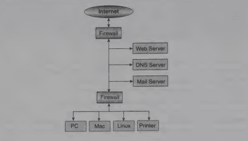

**图 6.2**

将局域网和 DMZ 隔离开的三宿主防火墙。

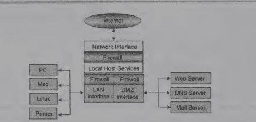

这种配置相比第一种配置的优势在于，局域网或 DMZ 都不需要分担两个网络的流量负载。另一个优势是，定义专门引用所有局域网或 DMZ 流量的规则比定义与另一个网络相关的流量规则更容易。另一个优势是，单网关主机比两个独立的防火墙设备成本更低。

这种配置相比第一种配置的劣势在于，网关成为两个网络的单点故障。此外，单个主机中的防火墙规则包含了与 DMZ 和局域网相关的所有复杂性。当手动开发防火墙规则时，这种复杂性可能会成为一个令人困惑的问题。

常见的第三种替代方案是添加一个过滤路由器，以隔离局域网和 DMZ 流量。DMZ 服务器运行它们自己的堡垒机防火墙。路由器和 DMZ 之间可能存在也可能不存在通用防火墙。如图 6.3 所示，网关防火墙与路由器是分开的，并保护局域网。过滤路由器为局域网和 DMZ 执行部分基本过滤。网关防火墙不需要提供这种基本过滤，它实际上起到类似于第一种设置中节流防火墙的作用。

**图 6.3**

位于局域网和 DMZ 防火墙前方的过滤路由器。

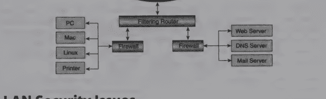

### 局域网安全问题

安全问题在很大程度上取决于局域网的规模、架构以及其用途。服务和架构也受站点可用的公共 IP 地址分配的影响。比这些更基础的是站点拥有的互联网连接类型：拨号、DSL、无线、电缆、卫星、ISDN、专线或其他类型的互联网连接。以下是在为您的站点创建安全策略时需要考虑的一些问题。

- 公共 IP 地址是否通过 DHCP 或 IPCP 动态且临时分配？站点是有一个永久分配的单一公共 IP 地址，还是一组地址？


## 是否向互联网提供公共服务？

这些服务是在防火墙机器上托管，还是在内部机器上托管？例如，您可能从网关防火墙机器提供电子邮件服务，但从 DMZ 中的内部机器提供网站服务。当服务由内部机器托管时，您需要将这些机器放置在外围网络，并对这些机器应用完全不同的数据包过滤和访问策略。如果服务是由内部机器提供的，这一事实对外部是否可见，还是服务通过 NAT 进行代理或透明转发，使其看起来像是从防火墙机器提供的？

## 您希望公开局域网中机器的多少信息？

您打算托管本地 DNS 服务吗？本地 DNS 数据库的内容是否对互联网开放？

## 人们能否从互联网登录您的机器？

有多少台本地机器以及哪些机器可供他们访问？所有用户账号是否具有相同的访问权限？入站连接是否会进行代理以进行额外的访问控制？

## 所有内部机器是否对本地用户以及从所有本地机器都同等可访问？

外部服务是否从所有内部机器都同等可访问？例如，如果您使用 screened-host 防火墙架构，用户必须直接登录防火墙机器才能访问互联网。根本不会进行路由。

## 私有局域网服务是否运行在防火墙后面？

例如，内部是否使用 NFS，或者是否使用 NIS、`Samba`、网络打印机，或 Berkeley 远程命令，如 `rsh`、`rlogin` 和 `rcp`？您需要确保这些服务中是否有将信息或广播流量泄漏到互联网，例如 `SNMP`、`DHCP`、`timed`、`ntpd`、`ruptime` 或 `rwho`？在这些服务后维护第二道节流防火墙可以确保将这些服务与互联网完全隔离。

## 与为局域网使用而设计的服务相关的问题

是关于针对互联网使用而设计的服务的本地与外部访问。您是否在内部提供 FTP 服务但不向外部提供，或者可能向两者提供不同类型的 FTP 服务？您是否会运行一个私有 Web 服务器，或将同一网站的不同部分配置为对本地用户开放，而对远程用户开放？您是否会运行一个本地邮件服务器来发送邮件，但使用不同的机制从互联网检索入站邮件？即邮件是直接传递到您的机器上的用户账号，还是您显式地从 ISP 检索邮件？

## 受信任家庭局域网的配置选项

您必须考虑两种内部网络流量。第一种是通过内部接口对网关防火墙的本地访问，如图 6.4 所示。第二种是通过网关机器的外部接口对互联网的本地访问。

**图 6.4**

到防火墙机器和互联网的局域网流量。

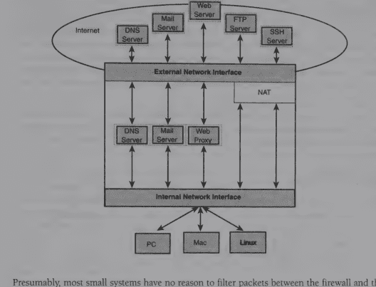

通常，大多数小型系统没有理由在防火墙和当地网络之间过滤数据包。然而，由于大多数基于家庭的站点被分配了单个 IP 地址，出现了一个例外：`NAT`。通常，您唯一需要执行的与内部过滤相关的操作将是启用您自己的源地址欺骗形式，通过应用于在内部机器和互联网之间移动的数据包来实现 NAT。重点大多集中在过滤防火墙和互联网之间的数据包。

> 虽然小型企业和家庭站点通常喜欢将其网络视为“受信任的”，但事实往往并非如此。问题不在于本地用户，而是这些系统的高侵入发生率。欲了解更多详情，请参阅 CERT 咨询 CA-2001-20，“对家庭用户的持续威胁”，位于 `http://www.cert.org/advisories/CA-2001-20.html`。有关网络的一般信息，特别是安全方面的更多信息，请参阅 CERT 的信息性论文，“家庭网络安全”，位于 `http://www.cert.org/tech_tips/home_networks.html`。

### 局域网对网关防火墙的访问

在家庭环境中，你很可能希望启用局域网机器与网关防火墙之间的无限制访问。一些父母可能有理由不赞同这种做法。

本节的假设是，任何公共服务都托管在防火墙上。局域网主机纯粹是客户端机器。局域网被允许发起与防火墙的连接，但防火墙不被允许向局域网发起连接。这条经验法则会有例外。例如，你可能希望防火墙主机能够访问一个本地网络打印机。商业站点绝不会做出这种选择。防火墙对源自局域网的问题的防护程度应等同于对源自公共互联网的问题的防护程度。

以第 4 章开发的防火墙为基础，防火墙示例中需要增加两个常量，以引用连接到局域网的内部接口。本示例将内部网络接口定义为 `eth1`；局域网被定义为包含从 `192.168.1.0` 到 `192.168.1.255` 的 C 类地址：

```text
LAN_INTERFACE="eth1"
LAN_ADDRESSES="192.168.1.0/24"
```

允许在所有接口之间进行无限制访问，只需默认允许所有协议和所有端口即可。请注意，局域网可以向远程服务器发起新连接，但来自远程站点的新入站连接不会被接受：

```text
$IPT -A FORWARD -i $LAN_INTERFACE -o $EXTERNAL_INTERFACE \
       -m state --state NEW,ESTABLISHED,RELATED -j ACCEPT

$IPT -A FORWARD -i $EXTERNAL_INTERFACE_1 -o $LAN_INTERFACE \
       -m state --state ESTABLISHED,RELATED -j ACCEPT
```

还请注意，这两条规则转发流量。它们不影响局域网与防火墙本身之间的本地流量。要访问防火墙主机上的服务，还需要本地 `INPUT` 和 `OUTPUT` 规则：

```text
$IPT -A INPUT  -i $LAN_INTERFACE \
       -p tcp -s $LAN_ADDRESSES --sport SUNPRIVPORTS -d $GATEWAY \
       -m state --state NEW,ESTABLISHED,RELATED -j ACCEPT

$IPT -A OUTPUT -o $LAN_INTERFACE \
       -m state --state ESTABLISHED,RELATED -j ACCEPT
```

转发规则和内部接口规则可以像第 4 章中的外部接口规则一样具体到特定服务。在当今的世界里，内部接口和转发规则应该具体到那种程度。本节中的规则只是奠定基础，引入转发规则本身。

### 局域网对其他局域网的访问：在多个局域网间转发本地流量

如果你的局域网上的机器，或多个局域网上的机器，需要在彼此之间进行路由，那么你需要允许机器之间针对所需的服务端口进行访问，除非它们有替代的内部连接路径。在前一种情况下，局域网之间的任何本地路由都将由防火墙完成。

本节的假设是，有一个具有两个网络接口的网关防火墙、一个 DMZ 服务器网络、一个具有两个网络接口的内部咽喉防火墙，以及一个局域网私有网络。这就是之前图 6.1 中所示的设置。局域网与互联网之间的流量穿过咽喉防火墙和网关防火墙之间的 DMZ 网络。这种设置在小型站点中很常见。

本示例将网关上的内部网络接口重命名为 `DMZ_INTERFACE`。防火墙还需要另一个常量。DMZ 被定义为包含从 `192.168.3.0` 到 `192.168.3.255` 的 C 类私有地址：

```bash
DMZ_INTERFACE='eth1'
DMZ_ADDRESSES='192.168.3.0/24'
```

以下前两条规则允许从局域网对网关防火墙主机进行本地访问。实际上，局域网不会允许访问防火墙上的所有端口。后两条规则允许防火墙本身以服务器到服务器为基础访问 DMZ 中提供的特定服务。同样，在较大环境中的防火墙几乎没有理由访问托管在 DMZ 中的服务。在大多数情况下，防火墙主机根本不会向 DMZ 提供任何服务。在大型站点中，防火墙可能也不会向局域网提供任何服务：

```bash
$IPT -A INPUT   -i $DMZ_INTERFACE   -s $LAN_ADDRESSES  -d $GATEWAY \
       -m state  --state NEW,ESTABLISHED,RELATED  -j ACCEPT

$IPT -A OUTPUT   -o $DMZ_INTERFACE   -s $GATEWAY       -d $LAN_ADDRESSES \
       -m state   --state ESTABLISHED,RELATED  -j ACCEPT

$IPT -A OUTPUT   -o $DMZ_INTERFACE   -s $GATEWAY       -d $DMZ_ADDRESSES \
       -m state   --state NEW,ESTABLISHED,RELATED  -j ACCEPT
$IPT -A INPUT   -i $DMZ_INTERFACE   -s $DMZ_ADDRESSES  -d $GATEWAY \
       -m state  --state ESTABLISHED,RELATED  -j ACCEPT
```

接下来的规则在内部网络和互联网之间转发流量。DMZ 和局域网流量是分开处理的：DMZ 流量代表来自互联网的入站连接请求。局域网流量代表发往互联网的出站连接请求。再次说明，在实际操作中，DMZ 规则通常会针对服务器地址和服务进行非常具体的配置：


```text
$IPT -A FORWARD -i $EXTERNAL_INTERFACE -o $DMZ_INTERFACE \
-d $DMZ_ADDRESSES \
-m state --state NEW,ESTABLISHED,RELATED -j ACCEPT

$IPT -A FORWARD -i $DMZ_INTERFACE -o $EXTERNAL_INTERFACE \
-s $DMZ_ADDRESSES \
-m state --state ESTABLISHED,RELATED -j ACCEPT

$IPT -A FORWARD -i $DMZ_INTERFACE -o $EXTERNAL_INTERFACE \
-s $LAN_ADDRESSES \
-m state --state NEW,ESTABLISHED,RELATED -j ACCEPT

$IPT -A FORWARD -i $EXTERNAL_INTERFACE -o $DMZ_INTERFACE \
-d $LAN_ADDRESSES \
-m state --state ESTABLISHED,RELATED -j ACCEPT
```

请注意，前述针对 DMZ 的转发规则并不完整。DMZ 中的服务器有时也会发起出站连接，例如来自 Web 代理服务器或邮件网关服务器的连接请求。

在咽喉防火墙上，以下规则在局域网和 DMZ 网络之间转发流量。请注意，局域网可以发起新连接，但来自 DMZ 或互联网的新入站连接到局域网的请求不会被接受。再次说明，在实际操作中，假设网关提供某些服务的话，局域网对 DMZ 以及网关防火墙的访问会受到更严格的控制：

```text
$IPF -A FORWARD -i $LAN_INTERFACE -o $DMZ_INTERFACE \
-s $LAN_ADDRESSES \
-m state --state NEW,ESTABLISHED,RELATED -j ACCEPT

$IPF -A FORWARD -i $DMZ_INTERFACE -o $LAN_INTERFACE \
-m state --state ESTABLISHED,RELATED -j ACCEPT
```

## 针对更大或信任度较低局域网的配置选项

企业或组织，以及许多家庭站点，对于受信任的家庭局域网，会使用比前面两节中介绍的简单、通用的转发防火墙规则更复杂、更具体的机制。在信任度较低的环境中，防火墙机器对内部用户的防护力度与对外部用户的防护力度同样强。

针对内部接口和外部接口都定义了端口特定的防火墙规则。内部规则可能是外部接口规则的镜像，或者规则可能更广泛。允许通过咽喉防火墙机器内部网络接口的内容，取决于局域网运行的系统类型、DMZ 中运行的本地服务类型，以及根据本地安全策略局域网可以访问哪些互联网服务。

例如，你可能希望阻止本地广播消息到达网关防火墙。如果并非所有用户都完全可信，你可能希望像限制来自互联网的流量一样，严格限制进入咽喉防火墙内部网络机器的流量。此外，你应保持防火墙机器上的用户账户数量降至最低。理想情况下，防火墙不应有任何用户账户，除了一个非特权管理账户除外。

基于家庭的企业可能只有一个 IP 地址，需要局域网网络地址转换（LAN NAT）。然而，企业通常租用几个公开注册的 IP 地址或整个网络地址块。公共地址通常分配给企业的公共服务器。使用公共 IP 地址时，出站连接被转发，入站连接正常路由。可以定义一个本地子网来创建一个本地的公共 DMZ。

## 划分地址空间以创建多个网络

IP 地址分为两部分：网络地址和该网络内的主机地址。如第 1 章“包过滤防火墙的初步概念”所述，A、B 和 C 类地址在某种程度上是历史遗留产物，但它们仍然是作为示例最容易使用的地址，因为其网络和主机字段位于字节边界上。A、B 和 C 类网络地址分别由前 8、16 和 24 位定义。在每个地址类别内，剩余位定义 IP 地址的主机部分。这在表 6.1 中进行了可视化展示。

表 6.1

IP 地址中的网络和主机字段

| 前导网络位 | A 类 | B 类 | C 类 |
| --- | --- | --- | --- |
| | 0 | 10 | 110 |
| 网络字段 | 1 字节 | 2 字节 | 3 字节 |
| 主机字段 | 3 字节 | 2 字节 | 1 字节 |
| 网络前缀 | /8 | /16 | /24 |
| 地址范围 | 1–126 | 128–191 | 192–223 |
| 网络掩码 | 255.0.0.0 | 255.255.0.0 | 255.255.255.0 |

子网划分是对本地 IP 地址中网络地址部分的本地扩展。本地网络掩码被定义为将主机地址的一些最高有效位当作网络地址的一部分来处理。这些额外的网络地址位用于在本地定义多个网络。远程站点并不了解本地子网。它们将地址范围视为正常的 A 类、B 类或 C 类地址。

例如，让我们考虑 C 类私有地址块 192.168.1.0。在本例中，基础地址，即网络地址，是 192.168.1.0。本例的网络掩码为 255.255.255.0，正好匹配 192.168.1.0/24 网络的前 24 位，即网络地址部分。

该网络可以通过将地址的前 25 位（而非前 24 位）定义为地址的网络部分，从而划分为两个本地网络。用当前的术语来说，我们说该本地网络的前缀长度为 25 而不是 24。主机地址字段的最有效位现在被视为网络地址字段的一部分。主机字段现在包含 7 位而不是 8 位。网络掩码变为 255.255.255.128，或在 CIDR 表示法中为 /25。定义了两个子网：192.168.1.0，寻址范围从主机 1 到 126，以及 192.168.1.128，寻址范围从主机 129 到 254。每个子网损失两个主机地址，因为每个子网使用最低的主机地址（0 或 128）作为网络地址，并使用最高的主机地址（127 或 255）作为广播地址。表 6.2 以表格形式展示了这一点。

**表 6.2**

C 类网络 192.168.1.0 划分为两个子网

| 子网编号 | 无 | 0 | 1 |
|---|---|---|---|
| 网络地址 | 192.168.1.0 | 192.168.1.0 | 192.168.1.128 |
| 网络掩码 | 255.255.255.0 | 255.255.255.128 | 255.255.255.128 |
| 首个主机地址 | 192.168.1.1 | 192.168.1.1 | 192.168.1.129 |
| 最后主机地址 | 192.168.1.254 | 192.168.1.126 | 192.168.1.254 |
| 广播地址 | 192.168.1.255 | 192.168.1.127 | 192.168.1.255 |
| 主机总数 | 254 | 126 | 126 |

子网 192.168.1.0 和 192.168.1.128 可以分配给两个独立的内部网卡。每个子网由两个独立的网络组成，每个网络包含多达 126 台主机。

子网划分允许创建多个内部网络，每个网络包含不同类别的客户端或服务器机器，并且每个网络都有自己独立的路由。然后可以为这些网络应用不同的防火墙策略。

当然，这个例子展示了网络被划分为两个部分。实际上，网络可以划分为许多部分，以创建多个较小的网络。经常可以看到在两个位置的路由器之间使用子网掩码为 255.255.255.252 或 /30 的网络。表 6.3 将这个过程进一步延伸，展示了同一个网络被划分为四个子网。

**表 6.3**

C 类网络 192.168.1.0 划分为四个子网

| | 0 | 1 | 2 | 3 |
| :--- | :--- | :--- | :--- | :--- |
| **网络地址** | 192.168.1.0 | 192.168.1.64 | 192.168.1.128 | 192.168.1.192 |
| **网络掩码** | 255.255.255.192 | 255.255.255.192 | 255.255.255.192 | 255.255.255.192 |
| **首个主机地址** | 192.168.1.1 | 192.168.1.65 | 192.168.1.129 | 192.168.1.193 |
| **最后主机地址** | 192.168.1.62 | 192.168.1.126 | 192.168.1.190 | 192.168.1.254 |
| **广播地址** | 192.168.1.63 | 192.168.1.127 | 192.168.1.191 | 192.168.1.255 |
| **主机总数** | 62 | 62 | 62 | 62 |

## 基于主机、地址范围或端口的选择性内部访问

通过防火墙机器内部接口的流量可以选择性地受限，就像通过外部接口的流量一样。例如，在一个小型住宅站点的防火墙上，而不是让内部接口上的所有内容都通过，流量可以被限制为 DNS、SMTP、POP 和 HTTP。在这种情况下，假设防火墙机器为局域网（LAN）提供这些服务。本地机器不允许访问其他外部服务。在这种情况下，不会执行转发操作。

## 兴趣点


> 在这个例子中，本地主机被限制为特定的服务：DNS、SMTP、POP 和 HTTP。由于 POP 在这种情况下是一种本地邮件检索服务，并且由于 DNS、SMTP 和 HTTP 是代理服务，因此局域网客户端没有直接访问互联网。在每种情况下，本地客户端都连接到本地服务器。POP 是本地局域网服务。其他三个服务器代表客户端建立远程连接。

这个例子仅用于小型的、可能是住宅的站点。将邮件网关和 POP 服务放置在防火墙主机上可能需要主机拥有用户账户。然而，这些账户不需要是登录账户。

## 内部局域网的配置选项

以下示例考虑了一台内部接口连接到局域网的防火墙机器。内部接口的常量如下所示：

```
LAN_INTERFACE="eth1"     # 内部接口连接至局域网
LAN_GATEWAY="192.168.1.1"    # 防火墙机器的内部接口
                              # 地址
LAN_ADDRESSES="192.168.1.0/24"    # 局域网上使用的地址范围
```

局域网机器将防火墙机器的内部接口作为其名称服务器：

```
## 通用网关响应规则
$IPT -A OUTPUT -o $LAN_INTERFACE \
    -s $LAN_GATEWAY \
    -d $LAN_ADDRESSES --dport $UNPRIVPORTS \
    -m state --state ESTABLISHED,RELATED -j ACCEPT
```

```
## 特定服务的局域网请求规则
```

```
$IPT -A INPUT -i $LAN_INTERFACE -p udp \
    -s $LAN_ADDRESSES --sport $UNPRIVPORTS \
    -d $LAN_GATEWAY --dport 53 \
    -m state --state NEW,ESTABLISHED,RELATED -j ACCEPT
$IPT -A INPUT -i $LAN_INTERFACE -p tcp \
    -s $LAN_ADDRESSES --sport $UNPRIVPORTS \
    -d $LAN_GATEWAY --dport 53 \
    -m state --state NEW,ESTABLISHED,RELATED -j ACCEPT
```

局域网机器还将防火墙作为其 SMTP 和 POP 服务器：

```
## 发送邮件 - SMTP
$IPT -A INPUT -i $LAN_INTERFACE -p tcp \
    -s $LAN_ADDRESSES --sport $UNPRIVPORTS \
    -d $GATEWAY --dport 25 \
    -m state --state NEW,ESTABLISHED,RELATED -j ACCEPT
```

```
## 接收邮件 - POP
$IPT -A INPUT -i $LAN_INTERFACE -p tcp \
    -s $LAN_ADDRESSES --sport $UNPRIVPORTS \
    -d $GATEWAY --dport 110 \
    -m state --state NEW,ESTABLISHED,RELATED -j ACCEPT
```

Sendmail 服务器将向邮件客户端发起 AUTH 查找请求。你可能不会运行 AUTH 守护进程，但可以针对 AUTH 请求发送 REJECT，这在某些邮件配置中可以防止延迟：

```
$IPT -A OUTPUT -o $LAN_INTERFACE -p tcp \
    -s $GATEWAY --sport $UNPRIVPORTS \
    -d $LAN_ADDRESSES --dport 113 -j REJECT
```

```
$IPT -A INPUT -i $LAN_INTERFACE ! --syn -p tcp \
    -s $LAN_ADDRESSES --sport 113 \
    -d $GATEWAY --dport $UNPRIVPORTS -j REJECT
```

最后，在防火墙机器的 8080 端口上运行着本地 Web 缓存代理服务器。内部机器指向防火墙上的 Web 服务器作为其代理，该 Web 服务器代表它们转发所有出站请求，并缓存从互联网获取的任何页面。所有到代理的连接都通过端口 8080。对远程站点的安全 Web 和 FTP 访问由代理服务器发起：

```
$IPT -A INPUT -i $LAN_INTERFACE -p tcp \
    -s $LAN_ADDRESSES --sport $UNPRIVPORTS \
    -d $GATEWAY --dport 8080 \
    -m state --state NEW,ESTABLISHED,RELATED -j ACCEPT
```

请记住，Web 服务器将使用 FTP 被动模式协议从远程 FTP 站点检索数据。防火墙的外部接口需要具有输入和输出规则才能访问远程 FTP、HTTP 和 HTTPS 服务端口。网关主机还必须具备针对外部接口的规则，以处理到远程主机的电子邮件和局部 DNS 查询。

## 多局域网的配置选项

添加第二个内部局域网允许此示例进一步扩展。下一个示例比前一个示例具有更好的安全性。如图 6.5 所示，DNS、SMTP、POP 和 HTTP 服务由第二个局域网中的服务器机器提供，而不是由防火墙机器提供。第二个局域网可能也可能不作为公共 DMZ（隔离区）。同样可能的是，第二个局域网代表内部服务局域网，其服务不提供给互联网（尽管在这种情况下，根据本地防火墙配置，防火墙可能至少需要充当邮件网关）。在这两种情况下，防火墙主机通常不托管服务。在这个例子中，流量通过防火墙机器上的内部接口在两个局域网之间路由。

### 图 6.5

### 在多个局域网中分离客户端和服务器。

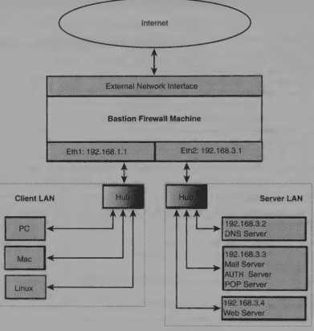

以下变量用于定义本示例中的局域网、网络接口和服务器机器：

```
CLIENT_LAN_INTERFACE="eth1"          # internal interface to the LAN
SERVER_LAN_INTERFACE="eth2"          # internal interface to the LAN
CLIENT_ADDRESSES="192.168.1.0/24"   # range of addresses used on the client LAN
SERVER_ADDRESSES="192.168.3.0/24"   # range of addresses used on the server LAN
DNS_SERVER="192.168.3.2"            # LAN DNS server
MAIL_SERVER="192.168.3.3"          # LAN Mail and POP server
POP_SERVER="192.168.3.3"          # LAN Mail and POP server
WEB_SERVER="192.168.3.4"          # LAN Web server
```

第一条规则涵盖所有服务器对客户端局域网中客户端的响应：

```
$IPT -A FORWARD -i $SERVER_LAN_INTERFACE -o $CLIENT_LAN_INTERFACE \
    -s $SERVER_ADDRESSES -d $CLIENT_ADDRESSES \
    -m state --state ESTABLISHED,RELATED -j ACCEPT
```

第二条规则涵盖从局域网客户端到服务器局域网中本地服务器的所有持续连接流量：

```
$IPT -A FORWARD -i $CLIENT_LAN_INTERFACE -o $SERVER_LAN_INTERFACE \
    -s $CLIENT_ADDRESSES -d $SERVER_ADDRESSES \
    -m state --state ESTABLISHED,RELATED -j ACCEPT
```

第三条规则涵盖所有远程服务器对来自服务器局域网中本地服务器的客户端请求的响应：

```
$IPT -A FORWARD -i $EXTERNAL_INTERFACE -o $SERVER_LAN_INTERFACE \
    -d $SERVER_ADDRESSES \
    -m state --state ESTABLISHED,RELATED -j ACCEPT
```

第四条规则涵盖所有本地服务器对来自互联网远程主机客户端请求的响应：


```
$IPT -A FORWARD -i $SERVER_LAN_INTERFACE -o $EXTERNAL_INTERFACE \
    -s $SERVER_ADDRESSES \
    -m state --state ESTABLISHED,RELATED -j ACCEPT
```

本地机器使用 `$SERVER_LAN` 中的 DNS 服务器作为其名称服务器。就像防火墙内部接口和外部接口之间的规则一样，为客户端局域网的接口定义了服务器访问规则。为服务器局域网的接口定义了客户端访问规则：

```
$IPT -A FORWARD -i $CLIENT_LAN_INTERFACE -o $SERVER_LAN_INTERFACE -p udp \
    -s $CLIENT_ADDRESSES --sport $SNPRIVPORTS \
    -d $DNS_SERVER --dport 53 \
    -m state --state NEW -j ACCEPT

$IPT -A FORWARD -i $CLIENT_LAN_INTERFACE -o $SERVER_LAN_INTERFACE -p tcp \
    -s $CLIENT_ADDRESSES --sport $SNPRIVPORTS \
    -d $DNS_SERVER --dport 53 \
    -m state --state NEW -j ACCEPT
```

第二个局域网上的 DNS 服务器需要从外部源获取信息。如果本地服务器是一个缓存并转发服务器，获取外部服务器并将未解析的查询转发给外部服务器，那么防火墙用于其内部服务器局域网接口和外部互联网接口的转发规则将是：

```
$IPT -A FORWARD -i $SERVER_LAN_INTERFACE -o $EXTERNAL_INTERFACE -p udp \
-s $DNS_SERVER --sport 53 \
-d $NAME_SERVER_1 --dport 53 \
-m state --state NEW -j ACCEPT
$IPT -A FORWARD -i $SERVER_LAN_INTERFACE -o $EXTERNAL_INTERFACE -p udp \
-s $DNS_SERVER --sport $SNPRIVPORTS \
-d $NAME_SERVER_1 --dport 53 \
-m state --state NEW -j ACCEPT
$IPT -A FORWARD -i $SERVER_LAN_INTERFACE -o $EXTERNAL_INTERFACE -p tcp \
-s $DNS_SERVER --sport $SNPRIVPORTS \
-d $NAME_SERVER_1 --dport 53 \
-m state --state NEW -j ACCEPT
```

`CLIENT_LAN` 中的主机将 `MAIL_SERVER` 作为发送邮件的邮件网关：

```
## Sending Mail - SMTP
## -------------------
$IPT -A FORWARD -i $CLIENT_LAN_INTERFACE -o $SERVER_LAN_INTERFACE -p tcp \
-s $CLIENT_ADDRESSES --sport $SNPRIVPORTS \
-d $MAIL_SERVER --dport 25 \
-m state --state NEW -j ACCEPT
```

`SERVER_LAN` 上的 SMTP 服务器需要向远程目的地发送邮件。该服务器需要通过防火墙访问互联网：

```
$IPT -A FORWARD -i $SERVER_LAN_INTERFACE -o $EXTERNAL_INTERFACE -p tcp \
-s $MAIL_SERVER --sport $SNPRIVPORTS -d $MAIL_SERVER --dport 25 \
-m state --state NEW -j ACCEPT
```

本地邮件服务器还需要从远程站点接收传入邮件：

```
$IPT -A FORWARD -i $EXTERNAL_INTERFACE -o $SERVER_LAN_INTERFACE -p tcp \
--sport $SNPRIVPORTS -d $MAIL_SERVER --dport 25 \
-m state --state NEW -j ACCEPT
```

请注意，为了使传入邮件能够寻址到邮件服务器，名称服务器必须拥有一个可公开访问的 MX 记录，以宣传该主机作为该站点的邮件服务器。在此特定的一组示例中，DNS 规则不允许来自互联网的传入 DNS 查询。因此，远程名称服务器需要提供此服务。（使用 NAT 和主机转发的替代解决方案在第 7 章中描述。）要注意，一些注重垃圾邮件的互联网服务提供商会阻止端口 25（常见的 SMTP 端口）上的传入和传出连接。这当然破坏了互联网的端到端特性。

`CLIENT_LAN` 上的客户端指向 `POP_SERVER` 机器以检索邮件：

```
## Receiving Mail - POP
## -----------------
$IPT -A FORWARD -i $CLIENT_LAN_INTERFACE -o $SERVER_LAN_INTERFACE -p tcp \
    -s $CLIENT_ADDRESSES --sport $SNPRIVPORTS \
    -d $POP_SERVER --dport 110 \
    -m state --state NEW -j ACCEPT
```

最后，一个本地 Web 代理服务器正在服务器局域网中的一台服务器机器上运行，绑定到端口 8080。内部机器将 Web 服务器作为其缓存代理，Web 服务器代表它们转发任何传出请求：

```
## WWW PROXY
## -------
$IPT -A FORWARD -i $CLIENT_LAN_INTERFACE -o $SERVER_LAN_INTERFACE -p tcp \
    -s $LAN_ADDRESSES --sport $SNPRIVPORTS \
    -d $WEB_SERVER --dport 8080 \
    -m state --state NEW -j ACCEPT
```

服务器局域网上的 Web 服务器需要互联网访问监听 TCP 端口 80 和 443 的远程服务器，以及 FTP 的 TCP 端口 21：

```
$IPT -A FORWARD -i $SERVER_LAN_INTERFACE -o $EXTERNAL_INTERFACE -p tcp \
    -m multiport --destination-ports 80,443,21 \
    --syn -s $WEB_SERVER --sport $SNPRIVPORTS \
    -m state --state NEW -j ACCEPT
```

## 一个正式的受筛选子网防火墙示例

小型或中型企业可能有理由投资于更复杂的防火墙架构。本章其余部分关注一个使用图 6.1 中配置的单一示例，其中 DMZ 位于双宿主网关防火墙和内部瓶颈防火墙之间。

网关防火墙将 DMZ 和局域网都与互联网隔开。其内部接口直接连接到 DMZ，而不是私有局域网。公共服务托管在周边 DMZ 网络上的机器上，每台机器都有自己独立的堡垒主机防火墙和安全策略。公共服务器是否具有公开可见的接口，取决于您的公共 IP 地址是如何分配的。瓶颈防火墙将 DMZ 与局域网隔开。根据 DMZ 中使用的网络硬件，局域网和互联网之间的流量可能与 DMZ “共享线路” 也可能不共享。

与第 4 章中的防火墙示例不同，此设置没有潜在的单一故障点。具有不同安全策略的服务可以托管在内部网络中的不同安全区域内。

主要想法是通过使用内部瓶颈防火墙，将私有局域网与外部网关防火墙机器在物理上隔离开来。周边网络不必是一个拥有自己服务器的完整网络；它是一个概念化设计。周边网络可以简单地实现为网关内部接口和瓶颈外部接口之间的一根交叉线。

将 DMZ 实现为一根简单的交叉线听起来可能很荒谬。它为小型站点提供了两个防火墙，正如完整的周边网络所做的那样。两个防火墙不代表单一故障点。本地局域网服务托管在瓶颈机器上或局域网本身内，而不是网关主机上，并且它们与网关或互联网完全隔离。

本章其余部分中的设置使用最少六组防火墙规则——网关和瓶颈防火墙机器的外部和内部接口各一组，加上两台机器上的转发规则，这是主要工作量所在。

本示例与第 4 章示例在概念上的区别在于增加了 DMZ 周边网络——应用于网关内部接口和瓶颈防火墙外部接口的新规则。在细节层面上，区别还在于输入和输出规则，因为网关防火墙本身不提供任何服务——或者最多只提供最少数量的服务。两个接口的转发规则互为镜像。DMZ 网络上的公共服务器也有它们自己个性化的防火墙规则。DMZ 中的公共服务器通常是专业化的、专用的单一服务机器。它们的防火墙规则简单且对其托管的特定服务限制非常严格。此外，由于网关提供此服务，因此不需要反欺骗和高服务端口保护规则的开销。


瓶颈防火墙的符号常量和初始规则与网关的在很大程度上是相同的。因为网关不托管任何服务，所以输入和输出规则主要移动到 FORWARD 链。本章示例的重点在于瓶颈的防火墙规则以及网关和瓶颈上的转发规则之间的对称性。到此时，示例中的规则将非常熟悉。在很大程度上，第 4 章中的规则正在移动到两个防火墙上的 FORWARD 链中。

## 防火墙示例中使用的符号常量

与第 4 章中的防火墙示例一样，网关的外部接口被分配给 `eth0`，通向互联网。为了增加混淆度，我将分割地址空间。如表 6.4 所示，网关的公共接口保留 IP 地址 192.168.1.1。

`eth1` 上的内部接口地址将为 `192.168.1.65`，通向边界 DMZ 网络。Choke 防火墙机器的外部接口地址在其 `eth0` 上将为 `192.168.1.126`，通向边界 DMZ 网络。Choke 防火墙机器的内部接口地址在 `eth1` 上将为 `192.168.1.129`，通向专用局域网（LAN）。

分配给 DMZ 主机的地址空间为 `192.168.1.66` 到 `192.168.1.125`，因为 DMZ 位于 `192.168.1.64/26` 网络中。广播地址为 `192.168.1.127`。在 `192.168.1.128` 网络范围内，分配给局域网主机的地址空间为 `192.168.1.130` 到 `192.168.1.190`。广播地址为 `192.168.1.191`。

## 表 6.4

C 类网络 `192.168.1.0` 划分为四个子网

| 属性 | 子网 0 | 子网 1 | 子网 2 | 子网 3 |
| :--- | :--- | :--- | :--- | :--- |
| **接口** | 网关外部 | 网关 DMZ | Choke DMZ | Choke LAN |
| **网络地址** | 192.168.1.0 | 192.168.1.64 | 192.168.1.128 | 192.168.1.192 |
| **子网掩码** | 255.255.255.192 | 255.255.255.192 | 255.255.255.192 | 255.255.255.192 |
| **IP 地址** | 192.168.1.1 | 192.168.1.65 | 192.168.1.126 | 192.168.1.129 |
| **首个可用主机地址** | N/A | 192.168.1.66 | 192.168.1.130 | 192.168.1.193 |
| **末个可用主机地址** | N/A | 192.168.1.125 | 192.168.1.190 | 192.168.1.254 |
| **广播地址** | 192.168.1.63 | 192.168.1.127 | 192.168.1.191 | 192.168.1.255 |
| **总主机数** | 62 | 62 | 62 | 62 |

## 公共网关防火墙的附加常量

以下常量被添加到网关防火墙脚本中，用于引用网关的内部接口、Choke 的 IP 地址以及 DMZ 的网络地址块：

```bash
DMZ_INTERFACE="eth1"       # 通向 DMZ 的网络接口
DMZ_IPADDRESS="192.168.1.65"    # DMZ IP 地址
CHOKE_IPADDRESS="192.168.1.126" # Choke 防火墙 DMZ 地址
DMZ_ADDRESSES="192.168.1.64/26" # DMZ IP 地址范围
DMZ_BROADCAST="192.168.1.127"   # DMZ 广播地址
LAN_ADDRESSES="192.168.1.128/26"  # 局域网 IP 地址范围
LOCAL_ADDRESSES="192.168.1.0/24"  # 任何本地 IP 地址
```

## 私有 Choke 防火墙的常量

如果在防火墙 shell 脚本中针对重复出现的名称和地址使用符号常量，脚本将更易于阅读和维护。以下常量要么在本章的示例中全程使用，要么是网络标准中定义的通用常量：

```bash
DMZ_INTERFACE="eth0"          # 通向 DMZ 的网络接口
LAN_INTERFACE="eth1"          # 通向局域网的网络接口
LOOPBACK_INTERFACE="lo"        # 依据系统命名而定

DMZ_IPADDR="192.168.1.126"       # DMZ IP 地址
GATEWAY_IPADDR="192.168.1.65"     # 网关防火墙 – 路由器
DMZ_ADDRESSES="192.168.1.64/26"   # DMZ IP 地址范围
DMZ_NETWORK="192.168.1.64"        # DMZ 子网基地址
DMZ_BROADCAST="192.168.1.127"     # DMZ 广播地址
LAN_IPADDR="192.168.1.129"        # 局域网 IP 地址
LAN_ADDRESSES="192.168.1.128/26"  # 局域网 IP 地址范围
LAN_NETWORK="192.168.1.128"        # 局域网子网基地址
LAN_BROADCAST="192.168.1.191"      # 局域网广播地址

LOOPBACK="127.0.0.0/8"         # 保留的环回地址范围
CLASS_A="10.0.0.0/8"          # A 类私有网络
CLASS_B="172.16.0.0/12"       # B 类私有网络
CLASS_C="192.168.0.0/16"      # C 类私有网络
CLASS_D_MULTICAST="224.0.0.0/4" # D 类组播地址
CLASS_E_RESERVED_NET="240.0.0.0/5" # E 类保留地址
BROADCAST_SRC="0.0.0.0"        # 广播源地址
BROADCAST_DEST="255.255.255.255" # 广播目标地址
PRIVPORTS="0:1023"            # 知名、特权
                               # 端口范围
UNPRIVPORTS="1024:65535"      # 非特权端口范围
```

此处未列出的常量在它们所使用的特定规则上下文中定义。

## 对 Choke 防火墙进行宽松设置

以下步骤与第 4 章中的步骤完全相同。Choke 防火墙的引语部分与网关的相同：

```bash
## 启用广播回声保护
echo 1 > /proc/sys/net/ipv4/icmp_echo_ignore_broadcasts

## 禁用源路由数据包
for f in /proc/sys/net/ipv4/conf/*/accept_source_route; do
    echo 0 > $f
done

## 启用 TCP SYN Cookie 保护
echo 1 > /proc/sys/net/ipv4/tcp_syncookies

## 禁用 ICMP 重定向接受
for f in /proc/sys/net/ipv4/conf/*/accept_redirects; do
    echo 0 > $f
done

## 不发送重定向消息
for f in /proc/sys/net/ipv4/conf/*/send_redirects; do
    echo 0 > $f
done

## 丢弃从接口进入的欺骗数据包，如果对这些数据包进行回复，
## 回复将从不同的接口发出。
for f in /proc/sys/net/ipv4/conf/*/rp_filter; do
    echo 1 > $f
done

## 记录具有不可能地址的数据包。
for f in /proc/sys/net/ipv4/conf/*/log_martians; do
    echo 1 > $f
done
```

## 从 Choke 防火墙中删除任何现有的规则

在定义一组过滤规则时，首先要做的是从规则链中删除任何现有规则。否则，您定义的任何新规则都将被添加到现有规则之后。数据包很容易在到达您从此处开始定义链中的那个点之前匹配到一个预先存在的规则。以下命令一次性冲洗所有三个内置过滤表链——INPUT、OUTPUT 和 FORWARD——的规则。（用户定义的链也会被冲洗，但本章中没有使用。）这与前面章节中构建的网关防火墙中的相同：

```bash
## 冲洗所有链中的任何现有规则
$IPT --flush
$IPT -t nat --flush
$IPT -t mangle --flush
$IPT -X
$IPT -t nat -X
$IPT -t mangle -X
```

链现在是空的。您是从零开始的。如果系统刚刚启动，则系统处于默认的接受一切策略状态。如果正在重新初始化防火墙，则默认策略是先前设置的那些。冲洗规则不会影响默认策略。


## 定义 Choke 防火墙的默认策略

Choke 策略是拒绝双向的所有流量。为了返回 ICMP 3 错误消息，必须使用 `REJECT` 目标。最简单的方法是以通用的 `REJECT` 规则结束链，以捕获任何未匹配 `ACCEPT` 规则的内容。这导致立即提供有意义的错误消息，而不是迫使本地主机等待超时。请注意，这与网关防火墙不同，网关防火墙的默认策略是使用 `DROP` 静默丢弃流量。

为了创建一个已知良好的环境，以便可以使用防火墙脚本来停止防火墙，第一个默认策略是 `ACCEPT`。这与前面章节中看到的策略设置相同：

```bash
$IPT --policy INPUT ACCEPT
$IPT --policy OUTPUT ACCEPT
$IPT --policy FORWARD ACCEPT
$IPT -t nat --policy PREROUTING ACCEPT
$IPT -t nat --policy OUTPUT ACCEPT
$IPT -t nat --policy POSTROUTING ACCEPT
$IPT -t mangle --policy PREROUTING ACCEPT
$IPT -t mangle --policy OUTPUT ACCEPT
```

接下来，添加创建停止动作的位。同样，这些与前面章节中相同：

```bash
if [ "$1" = "stop" ]
then
	echo "防火墙已完全停止！警告：此主机没有正在运行的防火墙。"
	exit 0
fi
```

两个防火墙默认都丢弃或拒绝一切，而不是默认接受一切：

```bash
## 将 Choke 防火墙的默认策略设置为拒绝
$IPT --policy INPUT REJECT
$IPT --policy OUTPUT REJECT
$IPT --policy FORWARD REJECT
```

此时，所有网络流量都被阻塞。

## 启用 Choke 机器的环回接口

您需要启用不受限制的环回流量。这使您能够运行任何您选择的本地网络服务，或系统依赖的服务，而无需担心指定所有防火墙规则：

```bash
## 在环回接口上无限制流量
$IPT -A INPUT  -i $LOOPBACK_INTERFACE -j ACCEPT
$IPT -A OUTPUT -o $LOOPBACK_INTERFACE -j ACCEPT
```

## 隐蔽扫描和 TCP 状态标志

由于 iptables 提供对所有 TCP 状态标志的访问，因此可以测试常见的 TCP 隐蔽扫描形式。以下规则阻止常见的隐蔽扫描探测。测试的任何 TCP 状态组合都不是合法组合。

由于以下输入和转发规则中未匹配特定接口，因此这些规则适用于所有接口。同样，代码与网关防火墙相同：

```bash
## 所有位都被清除
$IPT -A INPUT    -p tcp --tcp-flags ALL NONE -j DROP
$IPT -A FORWARD -p tcp --tcp-flags ALL NONE -j DROP

## SYN 和 FIN 都被设置
$IPT -A INPUT    -p tcp --tcp-flags SYN,FIN SYN,FIN -j DROP
$IPT -A FORWARD -p tcp --tcp-flags SYN,FIN SYN,FIN -j DROP

## SYN 和 RST 都被设置
$IPT -A INPUT    -p tcp --tcp-flags SYN,RST SYN,RST -j DROP
$IPT -A FORWARD -p tcp --tcp-flags SYN,RST SYN,RST -j DROP

## FIN 和 RST 都被设置
$IPT -A INPUT    -p tcp --tcp-flags FIN,RST FIN,RST -j DROP
$IPT -A FORWARD -p tcp --tcp-flags FIN,RST FIN,RST -j DROP

## FIN 是唯一的位，没有预期的伴随 ACK
$IPT -A INPUT    -p tcp --tcp-flags ACK,FIN FIN -j DROP
$IPT -A FORWARD -p tcp --tcp-flags ACK,FIN FIN -j DROP

## PSH 是唯一的位，没有预期的伴随 ACK
$IPT -A INPUT    -p tcp --tcp-flags ACK,PSH PSH -j DROP
$IPT -A FORWARD -p tcp --tcp-flags ACK,PSH PSH -j DROP

## URG 是唯一的位，没有预期的伴随 ACK
$IPT -A INPUT    -p tcp --tcp-flags ACK,URG URG -j DROP
$IPT -A FORWARD -p tcp --tcp-flags ACK,URG URG -j DROP
```

## 利用连接状态绕过规则检查

为先前发起的已接受交换指定状态匹配允许你绕过针对正在进行的交换的防火墙测试。然而，初始的客户端请求仍然受服务特定过滤器的控制。以下代码检查已建立的连接：

```bash
$IPT -A INPUT -m state --state ESTABLISHED,RELATED -j ACCEPT
$IPT -A OUTPUT -m state --state ESTABLISHED,RELATED -j ACCEPT

$IPT -A FORWARD -m state --state ESTABLISHED,RELATED -j ACCEPT
## 仅使用状态模块时，INVALID 会破坏使用双向连接、多个连接或交换的协议，
## 除非为该协议提供了 ALG。目前，FTP 是唯一支持 ALG 的协议。

$IPT -A INPUT -m state --state INVALID -j LOG \
  --log-prefix 'INVALID input: '
$IPT -A INPUT -m state --state INVALID -j DROP

$IPT -A OUTPUT -m state --state INVALID -j LOG \
  --log-prefix 'INVALID output: '
$IPT -A OUTPUT -m state --state INVALID -j DROP

$IPT -A FORWARD -m state --state INVALID -j LOG \
  --log-prefix 'INVALID forward: '
$IPT -A FORWARD -m state --state INVALID -j DROP
```

## 源地址欺骗和其他无效地址

本节基于源地址和目的地址建立了一些过滤器。合法数据包中永远不会看到这些地址。

在数据包过滤层面，你可以确定识别为伪造的源地址欺骗的少数情况之一是你自己的 IP 地址。这些规则拒绝声称来自你的传入数据包：

```bash
## 拒绝伪装成来自你的欺骗数据包
$IPT -A INPUT -s $DMZ_IPADDR -j DROP
$IPT -A INPUT -s $LAN_IPADDR -j DROP

$IPT -A FORWARD -s $DMZ_IPADDR -j DROP
$IPT -A FORWARD -s $LAN_IPADDR -j DROP

$IPT -A INPUT -i $DMZ_INTERFACE \
 -s $LAN_ADDRESSES -j DROP
```

如果你已激活 `rp_filter` 内核设施，上述规则是冗余的。但明确定义这些规则是一个良好的实践。

同样，防火墙规则会丢弃不包含本地源地址的数据包。无论如何，明确定义规则以实施 RFC 2827（“网络入口过滤：击败使用 IP 源地址欺骗的拒绝服务攻击”）是一个良好的实践：

```bash
$IPT -A FORWARD -o $DMZ_INTERFACE \
    -s ! $LAN_ADDRESSES -j DROP
```

```bash
$IPT -A FORWARD -i $LAN_INTERFACE \
    -s ! $LAN_ADDRESSES -j DROP
```

```bash
$IPT -A OUTPUT -o $DMZ_INTERFACE -s ! $DMZ_IPADDR -j DROP
$IPT -A OUTPUT -o $LAN_INTERFACE -s ! $LAN_IPADDR -j DROP
```

我们将跳过第 4 章中检查私有网络源地址的规则。网关防火墙正在执行该功能。

下一组规则主要是为了完整性。防火墙的两种默认策略都是丢弃所有数据包。因此，广播地址默认会被丢弃，并且需要显式启用才会在需要时允许：

```bash
## 拒绝格式错误的广播数据包
$IPT -A FORWARD -i $LAN_INTERFACE -o $DMZ_INTERFACE \
    -d $BROADCAST_SRC -j DROP
```


```bash
$IPT -A FORWARD -i $LAN_INTERFACE -o $DMZ_INTERFACE \
    -d $BROADCAST_SRC -j DROP
```

## 不转发定向广播
```bash
$IPT -A FORWARD -i $LAN_INTERFACE -o $DMZ_INTERFACE \
    -d $DMZ_NETWORK -j DROP
$IPT -A FORWARD -i $LAN_INTERFACE -o $DMZ_INTERFACE \
    -d $DMZ_BROADCAST -j DROP
```

## 不双向转发受限广播
```bash
$IPT -A FORWARD -d $BROADCAST_DEST -j DROP
```

组播总是通过 UDP 发送。无论你是否添加规则以接受传入的组播，以下规则都会阻塞非法的组播数据包：
```bash
$IPT -A INPUT -p ! udp -d $CLASS_D_MULTICAST -j DROP
$IPT -A FORWARD -p ! udp -d $CLASS_D_MULTICAST -j DROP
```

## 过滤 ICMP 控制和状态消息

当使用连接状态跟踪时，ICMP 错误消息会为现有连接转发，并接受传入和传出的消息。错误消息是 RELATED 消息。否则，ICMP 流量将需要显式的接受规则。

`ping` 的 `echo-request` 消息类型必须明确允许。`echo-request` 和 `echo-reply` 是诊断消息，而不是与正在进行的交换相关的错误消息。关于 `echo-request` 的另一值得注意的是，DHCP 有时依赖 `echo-request` 来发现即将分配的地址是否已被本地网络上的主机使用。

与其重复第 4 章中的 ICMP 规则，我将假设你正在使用状态模块。然而，`echo-request` 和 `time-exceeded` 需要特别考虑。

### ECHO REQUEST (TYPE 8) AND ECHO REPLY (TYPE 0) MESSAGES

`ping` 使用两种 ICMP 消息类型。请求消息 `echo-request` 是消息类型 8。响应消息 `echo-reply` 是消息类型 0。`echo-request` 消息不会从任何地方转发到 LAN。外部对 choke 的 `echo-request` 仅允许来自网关防火墙：
```bash
$IPT -A INPUT         -i $OM2_INTERFACE -p icmp --icmp-type echo-request \
             -s $GATEWAY_IPADDR -j ACCEPT
```

一些站点可能会选择阻止传出 `echo-reply` 消息，即使传入 `echo-request` 消息被丢弃。一些木马，如 `loki`，使用未经请求的 `echo-reply` 消息，在数据包的数据区域中携带从你的本地主机到远程服务器的秘密登录会话：
```bash
$IPT -A OUTPUT        -o $OM2_INTERFACE -p icmp --icmp-type echo-reply \
             -d $GATEWAY_IPADDR -j ACCEPT
$IPT -A FORWARD       -o $OM2_INTERFACE -p icmp --icmp-type echo-reply -j DROP
```

### TIME EXCEEDED STATUS (TYPE 11) MESSAGES

ICMP 消息类型 11，`time-exceeded`，表示超时条件——更准确地说，是数据包的最大跳数已被超过。在当今的网络中，`time-exceeded` 主要作为对 `traceroute` 请求的 ICMP 响应出现。

许多人使用 `traceroute` 来定位网络中的问题。此外，`traceroute` 对于网络映射和定位关键网关也很有用。无论你是否选择使用 `traceroute`，阻止传出 `time-exceeded` 消息都是一个好主意。将内部网络进行映射的正当理由很少，而恶意目的则有很多。需要注意的是，某些版本的 traceroute，特别是 `*nix` 平台上的版本，使用 UDP 作为传输机制，而不是 ICMP。

如果你需要允许任何类型的传入 UDP 流量在特权端口上，阻止你的传出响应比尝试阻止传入请求更容易和更有效。`traceroute` 默认从 UDP 端口 33434 开始，但基本端口可以通过命令行选项设置，并且可选地可以使用 ICMP `echo-request` 而不是 UDP。
```bash
$IPT -A OUTPUT -o $DN_Z_INTERFACE -p icmp --icmp-type time-exceeded -j DROP
$IPT -A FORWARD -o $DN_Z_INTERFACE -p icmp --icmp-type time-exceeded -j DROP
```

如果新的传入 UDP 数据包默认被丢弃，你的系统将不会返回端点主机返回的 ICMP 类型 3 `port-unreachable` 消息。

## 启用 DNS (UDP/TCP 端口 53)

DNS 依赖于 UDP 和 TCP。连接模式包括常规客户端到服务器的连接、服务器到服务器的查找流量，以及 DNS 区域传输。

不太可能一个住宅站点托管公共 DNS 服务或支付费用以拥有指向其名称服务器的顶级公共指针，尽管动态 DNS 服务正在改变这一范式。小型企业可能这样做，也可能不这样做。常见的是雇佣 DNS 服务或由 ISP 或 ASP 提供服务。大型组织通常托管可公开访问的名称服务器，并在内部运行本地私有名称服务器。

### CLASSIC DNS SETUP FOR A LAN

一些站点需要经典 DNS 设置所带来的额外安全感，该设置隐藏本地主机——如果你愿意的话，这就是通过隐藏获得的安全感。这种设置的吸引力在于，敏感的、本地的、个人的和账户信息可以集中存储在内部 DNS 数据库中。

这个想法是一个公开可见的主机为公共运行自己的 DNS 服务器。该服务器被配置为该站点的权威源，但信息不完整。公共名称服务器不知道内部机器的任何信息。公共名称服务器机器上的 DNS 客户端，如果有的话，可能不使用本地名称服务器。相反，公共服务器上的 `/etc/resolv.conf` 指向内部私有机器作为本地客户端的名称服务器。来自互联网的传入查询由公共 DNS 服务器处理。本地查询由内部 DNS 服务器处理。

内部服务器也被配置为该站点的权威源。在这种情况下，信息是正确的。本地查询，可能来自公共服务器本地客户端的查询，以及来自私有 LAN 的查询都由这个内部私有 DNS 服务器处理。如图 6.6 所示，当本地服务器没有所需的查找信息时，它会查询公共服务器，公共服务器进而将查询转发到外部名称服务器。

### 图 6.6

公共辅助（dummy）和私有权威 DNS 名称服务器。

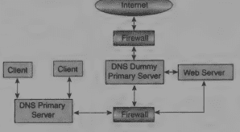

类似的配置是图 6.7 中所示的情况。公共服务器声称它是整个站点的权威服务器。它只知道 DMZ 服务器，并回答关于它们的查询。转发服务器了解本地主机，并回答本地查询。本地机器可能无法从互联网公开寻址。两个服务器都是其本地域的主（primary）权威服务器。转发服务器可能也可能没有关于 DMZ 中主机的硬编码 DNS 信息。

### 图 6.7

权威公共和私有 DNS 名称服务器。

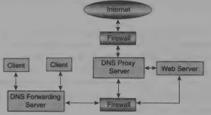

在图 6.8 的情况下，两个服务器持有相同的 DNS 局域网数据库。本地主机对互联网可见。次级（secondary）公共服务器从主服务器获取关于局域网的信息。

### 图 6.8

次级公共和主级内部 DNS 名称服务器。

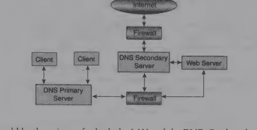

主服务器可以同时是局域网和 DMZ 的主服务器。另一方面，它可能是局域网的主服务器，而 DMZ 服务器可能是 DMZ 的主服务器。DNS 服务器完全可能同时作为不同域的主服务器和次级服务器。

在实践中，大型站点可能有多个域空间和公共及私有名称服务器，用于负载分担和服务可靠性。每个域有一个主服务器。其余的是次级服务器，根据需要通过向主服务器请求区域转移来刷新和更新它们的数据库。

在下面的示例中，公共 DNS 服务器运行在 DMZ 中，而私有服务器运行在瓶颈（choke）防火墙上。没有要求站点必须这样配置。公共服务器可以托管在网关上。私有服务器可以位于局域网中的其他任何主机上。实际上，这是推荐的方法，因为在防火墙上运行额外的服务从来都不是好主意。

随着站点网络架构变得更大、更正式，DMZ 服务器更有可能专门用于托管单一服务。网关仅作为过滤器和路由器运行。所有服务都移动到 DMZ 或局域网。

## 针对公共 DMZ 名称服务器网关 DMZ 配置


DMZ 包含公共名称服务器。一种可能的配置是让所有本地 DNS 客户端使用运行在瓶颈机器上的私有名称服务器。如果瓶颈服务器无法处理查询，它会将请求转发给其中一个公共服务器，后者进而查询指定的远程服务器或根名称服务器（在最一般的情况下）。

网关防火墙在 DMZ 中的公共服务器和远程服务器之间转发 DNS 流量，以及来自互联网的传入查找请求。对于这个示例，你必须定义一个 `DNS_SERVER` 常量，并且 DMZ 服务器使用标准的 DNS 客户端/服务器协议：

```
## DNS 名称服务器 (53) - 到远程服务器的请求
## ----------------------------------------------------

$IPT -A FORWARD -i $DMZ_INTERFACE -o $EXTERNAL_INTERFACE -p udp \
    -s $DNS_SERVER --sport $UNPRIVPORTS --dport 53 \
    -m state --state NEW -j ACCEPT

$IPT -A FORWARD -i $DMZ_INTERFACE -o $EXTERNAL_INTERFACE -p tcp \
    -s $DNS_SERVER --sport $UNPRIVPORTS --dport 53 \
    -m state --state NEW -j ACCEPT
```

```
## DNS 名称服务器 (53) - 来自远程客户端的请求
## -------------------------------------------------------

$IPT -A FORWARD -i $EXTERNAL_INTERFACE -o $DMZ_INTERFACE -p udp \
    --sport $UNPRIVPORTS -d $DNS_SERVER --dport 53 \
    -m state --state NEW -j ACCEPT

$IPT -A FORWARD -i $EXTERNAL_INTERFACE -o $DMZ_INTERFACE -p tcp \
    --sport $UNPRIVPORTS -d $DNS_SERVER --dport 53 \
    -m state --state NEW -j ACCEPT
```

自然地，需要一对通用的规则来转发 `ESTABLISHED` 和 `RELATED` 流量。

## 作为私有名称服务器的瓶颈 DMZ 配置

在这个示例中，瓶颈机器托管私有名称服务器。（服务器或服务器组同样容易运行在局域网本身或单独的本地服务器网络中。）局域网客户端使用私有名称服务器。如果瓶颈服务器无法从其 DNS 缓存中处理查询，它会请求转发到运行在 DMZ 中的公共服务器。

私有 DNS 服务器接收来自运行在局域网机器上的客户端程序的查询。在这个示例中，来自 DMZ 客户端的请求去往私有服务器，以便它们能够访问关于局域网客户端的 DNS 信息：

```
## 局域网 DNS 客户端到私有服务器 (53)
## --------------------------------------

$IPT -A INPUT -i $LAN_INTERFACE -p udp \
    -s $LAN_ADDRESSES --sport $UNPRIVPORTS \
    -d $LAN_IPADDR --dport 53 \
    -m state --state NEW -j ACCEPT

$IPT -A INPUT -i $LAN_INTERFACE -p tcp \
    -s $LAN_ADDRESSES --sport $UNPRIVPORTS \
    -d $LAN_IPADDR --dport 53 \
    -m state --state NEW -j ACCEPT

$IPT -A INPUT -i $DMZ_INTERFACE -p udp \
    -s $DMZ_ADDRESSES --sport $UNPRIVPORTS \
    -d $DMZ_IPADDR --dport 53 \
    -m state --state NEW -j ACCEPT

$IPT -A INPUT -i $DMZ_INTERFACE -p tcp \
    -s $DMZ_ADDRESSES --sport $UNPRIVPORTS \
    -d $DMZ_IPADDR --dport 53 \
    -m state --state NEW -j ACCEPT
```

TCP 规则处理大型 DNS 响应以及来自本地次级名称服务器的区域转移请求。

对于瓶颈服务器无法解析的查询，私有 DNS 服务器向公共 DNS 服务器发送递归服务器请求。使用此代码时，不要忘记也定义 `DNS_SERVER` 常量：

```
## DNS 缓存与转发名称服务器 (53)
## ---------------------------------------------------

$IPT -A OUTPUT -o $DMZ_INTERFACE -p udp \
    -s $DMZ_IPADDR --sport 53 \
    -d $DNS_SERVER --dport 53 \
    -m state --state NEW -j ACCEPT

$IPT -A OUTPUT -o $DMZ_INTERFACE -p udp \
    -s $DMZ_IPADDR --sport $UNPRIVPORTS \
    -d $DNS_SERVER --dport 53 \
    -m state --state NEW -j ACCEPT

$IPT -A OUTPUT -o $DMZ_INTERFACE -p tcp \
    -s $DMZ_IPADDR --sport 53 \
    -d $DNS_SERVER --dport 53 \
    -m state --state NEW -j ACCEPT
```

在这个示例中，假设转发名称服务器被配置为公共服务器的从（slave）。我总是包含标准的 UDP 客户端规则作为预防措施。

## 过滤 AUTH 用户标识服务 (TCP 端口 113)

`ident` 或 `AUTH` 用户标识服务提供与连接关联的用户名。这是一个历史性协议，在互联网上已不再广泛使用。你不需要运行 `AUTH` 服务，但响应 `AUTH` 请求时发送 `REJECT` 或 `TCP RST` 是很常见的做法。

## 拒绝 AUTH 请求

以下规则通过网关阻止 `AUTH` 请求，使用 `REJECT` 而不是 `DROP`，以便请求立即获得 `TCP RST` 而不是被静默阻止：

```
$IPT -A INPUT -i $EXTERNAL_INTERFACE -p tcp \
  --dport 113 -j REJECT
```

## 邮件 (TCP SMTP 端口 25, POP3 端口 110, IMAP 端口 143)

邮件通常由中央 SMTP 服务器处理。作为一个可行的示例，本节基于这样的假设：DMZ 中的一台机器是本地邮件网关和邮件主机。本地客户端将使用其本地 `POP3` 或 `IMAP` 服务器从邮件主机检索传入邮件。同样可能的是，DMZ 中的邮件服务器不仅仅是一个中继代理和垃圾邮件过滤器，传入邮件将从 DMZ 中的邮件中转发到私有局域网中的邮件服务器，供本地用户访问。

本节描述了两种常见的客户端和服务器邮件组合方法：

- 通过 DMZ SMTP 邮件中继发送邮件，并作为 DMZ POP3 客户端接收邮件
- 通过 DMZ SMTP 邮件中继发送邮件，并作为 DMZ IMAP 客户端接收邮件

## 通过网关转发邮件 (TCP 端口 25)

当你通过远程网关服务器中继传出邮件时，你的客户端邮件程序将所有传出邮件发送到你的 ISP 的邮件服务器。你的 ISP 充当你与外界之间的邮件网关。你的系统不需要知道如何定位邮件目的地。ISP 邮件网关充当你的中继。

在这个示例中，你的站点托管自己的邮件服务器。你的本地服务器负责收集你的传出邮件，对目标主机名执行 DNS 查找，并将邮件中继到其目的地。你的客户端邮件程序指向你的本地 SMTP 服务器，而不是远程服务器。

如果你作为 SMTP 服务器中继传出邮件，并作为 SMTP 客户端接收邮件，你提供自己所有的邮件服务。你的本地 `sendmail` 守护进程配置为中继发往远程目标主机的出站邮件本身，以及收集和可能的交付入站邮件。

对于这些示例，别忘了定义一个 `MAIL_SERVER` 常量，例如：

```
MAIL_SERVER="192.168.1.10"
```

第一条规则允许你中继出站邮件，并应用于网关防火墙：


```
$IPT -A FORWARD -i $DMZ_INTERFACE -o $EXTERNAL_INTERFACE -p tcp \
    -s $MAIL_SERVER --sport $UNPRIVPORTS --dport 25 \
    -m state --state NEW -j ACCEPT
```

下一条规则允许你接收入站邮件，也应用于网关防火墙：

```
$IPT -A FORWARD -i $EXTERNAL_INTERFACE -o $DMZ_INTERFACE -p tcp \
    --sport $UNPRIVPORTS -d $MAIL_SERVER --dport 25 \
    -m state --state NEW -j ACCEPT
```

最后，网关可能会向本地主机或某个中央管理服务器生成邮件：

```
$IPT -A OUTPUT -o $DMZ_INTERFACE -p tcp \
    -s $DMZ_IPADDR --sport $UNPRIVPORTS -d $MAIL_SERVER --dport 25 \
    -m state --state NEW -j ACCEPT
```

## 限制SMTP客户端配置

此规则集允许你转发来自局域网机器的邮件，并从限制型防火墙本身发送邮件。使用此代码时，别忘了定义`MAIL_SERVER`常量：

```
$IPT -A FORWARD -i $LAN_INTERFACE -o $DMZ_INTERFACE -p tcp \
    -s $LAN_ADDRESSES --sport $UNPRIVPORTS \
    -d $MAIL_SERVER --dport 25 \
    -m state --state NEW -j ACCEPT
```

```
$IPT -A OUTPUT -o $DMZ_INTERFACE -p tcp \
    -s $DMZ_IPADDR --sport $UNPRIVPORTS \
    -d $MAIL_SERVER --dport 25 \
    -m state --state NEW -j ACCEPT
```

## 通过限制型防火墙作为POP客户端获取邮件 (TCP端口 110)

接收邮件的方式取决于你的具体情况。如果你运行自己的本地邮件服务器，你可以直接在Linux机器上收集入站邮件。如果你从ISP账户获取邮件，你可能以POP或IMAP客户端身份获取邮件，这取决于你如何配置ISP电子邮件账户，以及ISP提供的邮件交付服务。

在此示例中，入站邮件被交付到本地邮件服务器。局域网客户端使用POP从本地邮件主机获取他们的邮件。邮件主机也充当POP服务器。此规则应用于限制型防火墙，如果使用此代码，你需要将POP3服务器的常量定义为`POP_SERVER`：

```
$IPT -A FORWARD -i $LAN_INTERFACE -o $DMZ_INTERFACE -p tcp \
    -s $LAN_ADDRESSES --sport $UNPRIVPORTS \
    -d $POP_SERVER --dport 110 \
    -m state --state NEW -j ACCEPT
```

## 通过限制型防火墙作为IMAP客户端获取邮件 (TCP端口 143)

连接到IMAP服务器是从邮件主机获取邮件的另一种常见方式。以下示例演示了从运行在DMZ中的IMAP服务器获取邮件所需的防火墙规则。

下一条规则将来自局域网的客户端连接转发到运行在DMZ中邮件主机上的IMAP服务器，并应用于限制型防火墙，`IMAP_SERVER`常量需预定义：

```
$IPT -A FORWARD -i $LAN_INTERFACE -o $DMZ_INTERFACE -p tcp \
    -s $LAN_ADDRESSES --sport $UNPRIVPORTS \
    -d $IMAP_SERVER --dport 143 \
    -m state --state NEW -j ACCEPT
```

## 访问Usenet新闻服务 (TCP NNTP端口 119)

Usenet新闻通过运行在TCP之上的NNTP协议，经由服务端口119进行访问。阅读新闻和发布文章由你的本地新闻客户端处理。

非ISP站点不太可能为外部世界托管新闻服务器。即使是小站点，托管本地新闻服务器也是不太可能的。对于代表罕见例外的站点，服务器规则应配置为仅允许来自选定的一组外部客户端或外部网络的传入连接。本地公共服务器将运行在DMZ中的机器上，网关将传入的NNTP连接转发到本地NNTP服务器机器。

### 网关NNTP通道和服务器DMZ配置

服务器规则允许本地客户端连接到你的ISP新闻服务器。阅读新闻和发布文章都由此规则处理：

```
$IPT -A FORWARD -i $DMZ_INTERFACE -o $EXTERNAL_INTERFACE -p tcp \
    -s $LAN_ADDRESSES --sport $UNPRIVPORTS \
    -d $NEWS_SERVER --dport 119 \
    -m state --state NEW -j ACCEPT
```

如果本地新闻服务器运行在DMZ中的机器上，为选定的远程客户提供公共服务，则定义了一组服务器规则，允许远程客户端连接到此机器的NNTP端口：

```
DMZ_NEWS_SERVER="192.168.1.70"
```

```
$IPT -A FORWARD -i $EXTERNAL_INTERFACE -o $DMZ_INTERFACE -p tcp \
-s <my.news.client> --sport $UNPRIVPORTS \
-d $DMZ_NEWS_SERVER --dport 119 \
-m state --state NEW -j ACCEPT
```

如果本地新闻服务器提供公共Usenet新闻组以及本地新闻组，则本地服务器需要来自远程服务器的新闻馈送。本地服务器作为客户端从远程服务器获取文章。以下规则允许访问充当新闻馈送的远程新闻服务器：

```
NEWS_FEED="<my.remote.news.feed>"
```

```
$IPT -A FORWARD -i $DMZ_INTERFACE -o $EXTERNAL_INTERFACE -p tcp \
-s $DMZ_NEWS_SERVER --sport $UNPRIVPORTS \
-d $NEWS_FEED --dport 119 \
-m state --state NEW -j ACCEPT
```

### 限制型NNTP客户端DMZ配置

下一条规则允许本地客户端访问位于DMZ或互联网上的远程新闻服务器，并要求定义`NEWS_SERVER`常量：

```
$IPT -A FORWARD -i $LAN_INTERFACE -o $DMZ_INTERFACE -p tcp \
-s $LAN_ADDRESSES --sport $UNPRIVPORTS \
-d $NEWS_SERVER --dport 119 \
-m state --state NEW -j ACCEPT
```

## Telnet (TCP端口 23)

某些类型的设备，如低端路由器和其他网络设备，仅允许通过Telnet连接进行配置。因此，当你更希望使用SSH等更安全协议时，你可能会被迫使用Telnet。

这里的规则允许局域网通过Telnet访问DMZ机器。DMZ主机不允许连接到局域网中的主机。然而，限制型防火墙允许通过Telnet访问局域网。你不应该允许来自远程站点的传入Telnet连接；相反，你应该使用SSH连接到DMZ，然后如果绝对被迫使用Telnet，再从DMZ使用Telnet。这些Telnet规则应用于限制型防火墙：

```
$IPT -A FORWARD -i $LAN_INTERFACE -o $DMZ_INTERFACE -p tcp \
-s $LAN_ADDRESSES --sport $UNPRIVPORTS \
-d $DMZ_ADDRESSES --dport 23 \
-m state --state NEW -j ACCEPT
```

```
$IPT -A OUTPUT -o $DMZ_INTERFACE -p tcp \
-s $DMZ_IPADDR --sport $UNPRIVPORTS \
-d $DMZ_ADDRESSES --dport 23 \
-m state --state NEW -j ACCEPT
```

```
$IPT -A OUTPUT -o $LAN_INTERFACE -p tcp \
-s $LAN_IPADDR --sport $UNPRIVPORTS \
-d $LAN_ADDRESSES --dport 23 \
-m state --state NEW -j ACCEPT
```

## SSH (TCP端口 22)


这里的客户端和服务器规则展示了SSH的三种不同方法。在实践中，非ISP站点可能会将外部地址限制为选定的子集，特别是因为连接的双方都应配置为识别每个个别用户账户。`sshd`可以使用`TCPWrappers`配合`/etc/hosts.allow`和`/etc/hosts.deny`中的访问列表。

## 网关SSH配置

第一条规则允许从限制型机器到运行在网关上的`sshd`服务器的本地连接。所有这些规则都应用于网关防火墙：

```
$IPT -A INPUT -i $DMZ_INTERFACE -p tcp \
-s $CHOKE_IPADDR --sport $UNPRIVPORTS \
-d $DMZ_IPADDR --dport 22 \
-m state --state NEW -j ACCEPT
```

下一条规则将来自局域网客户端的连接转发到任何远程服务器：

```
$IPT -A FORWARD -i $DMZ_INTERFACE -o $EXTERNAL_INTERFACE -p tcp \
-s $LAN_ADDRESSES --sport $UNPRIVPORTS --dport 22 \
-m state --state NEW -j ACCEPT
```

最后一条规则将来自选定的远程客户端地址的连接转发到特定的本地服务器：

```
$IPT -A FORWARD -i $EXTERNAL_INTERFACE -o $DMZ_INTERFACE -p tcp \
-s <selected remote host> --sport $UNPRIVPORTS \
-d <selected local host> --dport 22 \
-m state --state NEW -j ACCEPT
```

## 受限主机（CHOKES）的 SSH 配置

第一条规则允许受限主机（choke machine）连接到运行在 DMZ 中的 `sshd` 服务器，包括网关防火墙主机：

```bash
$IPT -A OUTPUT -o $DMZ_INTERFACE -p tcp \
-s $DMZ_IPADDR --sport $UNPRIVPORTS \
-d $DMZ_ADDRESSES --port 22 \
-m state --state NEW -j ACCEPT
```

下一条规则将来自局域网客户端的连接转发到任何远程服务器：

```bash
$IPT -A FORWARD -i $LAN_INTERFACE -o $DMZ_INTERFACE -p tcp \
-s $LAN_ADDRESSES --sport $UNPRIVPORTS --port 22 \
-m state --state NEW -j ACCEPT
```

最后一条规则将来自选定远程客户端地址的连接转发到特定的本地主机，在本例中，该本地主机位于局域网中：

```bash
$IPT -A FORWARD -i $DMZ_INTERFACE -o $LAN_INTERFACE -p tcp \
-s <selected remote host> --sport $UNPRIVPORTS \
-d <selected LAN host> --port 22 \
-m state --state NEW -j ACCEPT
```

## FTP（TCP 端口 21 和 20）

FTP 在客户端和服务器之间交换数据有两种模式：正常数据通道端口模式（Port Mode）和被动数据通道模式（Passive Mode）。当使用 FTP 客户端程序连接到远程 FTP 站点时，默认机制为端口模式。当通过 Web 浏览器连接到 FTP 站点时，使用的机制为被动模式。偶尔，您可能会遇到只支持其中一种模式的 FTP 站点。

本节描述了客户端和服务器 FTP 组合的两种方法：
- 网关仅作为通往远程 FTP 服务器的通道；受限主机和局域网主机为客户端。
- FTP 服务器运行在 DMZ 中；受限主机、局域网主机和远程主机为客户端。

### 网关作为通往远程 FTP 服务器的通道

大多数站点需要 FTP 客户端访问远程文件仓库，这几乎是必然的。第一部分允许内部主机连接到远程 FTP 服务器。

以下规则允许从受限主机和局域网机器发起出站 FTP 客户端连接。常量是网关上使用的：

#### 出站 FTP 客户端请求

```bash
$IPT -A FORWARD -i $DMZ_INTERFACE -o $EXTERNAL_INTERFACE -p tcp \
-s $LAN_ADDRESSES --sport $UNPRIVPORTS --dport 21 \
-m state --state NEW -j ACCEPT

$IPT -A FORWARD -i $DMZ_INTERFACE -o $EXTERNAL_INTERFACE -p tcp \
-s $CHOKE_IPADDR --sport $UNPRIVPORTS --dport 21 \
-m state --state NEW -j ACCEPT
```

`ip_conntrack_ftp` 模块负责处理 RELATED 规则的一部分，即端口或被动模式数据连接。不需要针对数据连接的特定规则。

这里包含两对数据通道连接请求规则，以求完整：

#### 端口模式数据通道响应

```bash
$IPT -A FORWARD -i $EXTERNAL_INTERFACE -o $DMZ_INTERFACE -p tcp \
--sport 20 -d $LAN_ADDRESSES --dport $UNPRIVPORTS \
-m state --state NEW -j ACCEPT

$IPT -A FORWARD -i $EXTERNAL_INTERFACE -o $DMZ_INTERFACE -p tcp \
--sport 20 -d $CHOKE_IPADDR --dport $UNPRIVPORTS \
-m state --state NEW -j ACCEPT
```

#### 被动模式数据通道响应

```bash
$IPT -A FORWARD -i $DMZ_INTERFACE -o $EXTERNAL_INTERFACE -p tcp \
-s $LAN_ADDRESSES --sport $UNPRIVPORTS --dport $UNPRIVPORTS \
-m state --state NEW -j ACCEPT

$IPT -A FORWARD -i $DMZ_INTERFACE -o $EXTERNAL_INTERFACE -p tcp \
-s $CHOKE_IPADDR --sport $UNPRIVPORTS --dport $UNPRIVPORTS \
-m state --state NEW -j ACCEPT
```

受限主机的客户端规则包含在即将出现的“受限主机作为 FTP 服务器通道和客户端”部分中。

### DMZ 中的 FTP 服务器，受限主机、本地主机和远程主机作为客户端

本节定义了允许使用 FTP 的入站客户端请求的规则。

#### 网关作为通往 FTP DMZ 服务器的通道

在网关上，下一条规则将来自任何远程机器的入站 FTP 客户端连接转发到 DMZ 中的服务器。使用此代码时，请注意需要定义常量 `DMZ_FTP_SERVER`：

```bash
$IPT -A FORWARD -i $EXTERNAL_INTERFACE -o $DMZ_INTERFACE -p tcp \
-s $UNPRIVPORTS -d $DMZ_FTP_SERVER --dport 21 \
-m state --state NEW -j ACCEPT
```

#### 受限主机作为通往 FTP 服务器的通道和客户端

以下规则允许来自局域网和受限主机的出站 FTP 客户端连接到任何地方的 FTP 服务器。受限主机的规则并未专门提及 DMZ。

第一条规则将来自任何局域网机器的出站 FTP 客户端连接转发到任何服务器：

```bash
$IPT -A FORWARD -i $LAN_INTERFACE -o $DMZ_INTERFACE -p tcp \
-s $LAN_ADDRESSES --sport $UNPRIVPORTS --dport 21 \
-m state --state NEW -j ACCEPT
```

第二条规则允许从受限主机本身访问 FTP 客户端：

```bash
$IPT -A OUTPUT -o $DMZ_INTERFACE -p tcp \
-s $DMZ_IPADDR --sport $UNPRIVPORTS --dport 21 \
-m state --state NEW -j ACCEPT
```

## Web 服务


Web 服务通常基于 HTTP 协议。几种更高层的通信协议用于特殊目的，包括用于 Web 代理和缓存访问的特定协议（在 `/etc/services` 中 TCP 端口 `8080` 上的 `webcache`），以及用于安全访问的 SSL 和 TLS（在 `/etc/services` 中 TCP 端口 `443` 上的 `https`）。`squid` Web 代理默认使用 TCP 端口 `3128`（在 `/etc/services` 中 TCP 端口 `3128` 上的 `squid`）。

本节描述了客户端和服务器 Web 组合的四种方法：

- 网关仅作为本地 Web 客户端连接到远程 Web 服务器的通道；受限主机和局域网为客户端。
- 受限主机既充当转发器，也充当客户端。
- Web 服务器运行在 DMZ 中；受限主机、局域网和远程主机为客户端。
- Web 代理运行在 DMZ 中；受限主机和局域网为客户端。

## 网关作为本地 Web 客户端的通道

以下代码的第一部分允许本地主机连接到运行在远程主机上的 Web 服务器。

在网关上，以下规则将来自受限主机以及位于受限防火墙后面的私有局域网中机器的本地客户端连接转发出去：

```bash
$IPT -A FORWARD -i $DMZ_INTERFACE -o $EXTERNAL_INTERFACE -p tcp \
   -s $LAN_ADDRESSES --sport $UNPRIVPORTS --dport 80 \
   -m state --state NEW -j ACCEPT
```

```bash
$IPT -A FORWARD -i $DMZ_INTERFACE -o $EXTERNAL_INTERFACE -p tcp \
   -s $LAN_ADDRESSES --sport $UNPRIVPORTS --dport 443 \
   -m state --state NEW -j ACCEPT
```

```bash
$IPT -A FORWARD -i $DMZ_INTERFACE -o $EXTERNAL_INTERFACE -p tcp \
   -s $CHOKE_IPADDR --sport $UNPRIVPORTS --dport 80 \
   -m state --state NEW -j ACCEPT
```

```bash
$IPT -A FORWARD -i $DMZ_INTERFACE -o $EXTERNAL_INTERFACE -p tcp \
   -s $CHOKE_IPADDR --sport $UNPRIVPORTS --dport 443 \
   -m state --state NEW -j ACCEPT
```

## 受限主机作为转发器和 Web 客户端

在此示例中，受限主机既充当转发器，也充当客户端。以下规则将来自局域网的本地客户端连接转发出去，并允许来自受限主机本身的客户端连接：

```bash
$IPT -A FORWARD -i $LAN_INTERFACE -o $DMZ_INTERFACE -p tcp \
   -s $LAN_ADDRESSES --sport $UNPRIVPORTS --dport 80 \
   -m state --state NEW -j ACCEPT
```

```bash
$IPT -A OUTPUT -o $DMZ_INTERFACE -p tcp \
   -s $DMZ_IPADDR --sport $UNPRIVPORTS --dport 80 \
   -m state --state NEW -j ACCEPT
```

```bash
$IPT -A FORWARD -i $LAN_INTERFACE -o $DMZ_INTERFACE -p tcp \
   -s $LAN_ADDRESSES --sport $UNPRIVPORTS --dport 443 \
   -m state --state NEW -j ACCEPT
```

```bash
$IPT -A OUTPUT -o $DMZ_INTERFACE -p tcp \
   -s $DMZ_IPADDR --sport $UNPRIVPORTS --dport 443 \
   -m state --state NEW -j ACCEPT
```

## DMZ 中的公共 Web 服务器；受限主机、局域网和远程主机作为客户端

在此示例中，该站点在 DMZ 中托管一个公共 Web 服务器。

网关是一个双向通道，允许公共访问本地服务器，同时继续使用前面部分中介绍的规则允许本地访问远程站点。这些规则适用于网关，并且需要预定义常量 `DMZ_WEB_SERVER`：

```bash
$IPT -A FORWARD -i $EXTERNAL_INTERFACE -o $DMZ_INTERFACE -p tcp \
    -s $UNPRIVPORTS -d $DMZ_WEB_SERVER --dport 80 \
-m state --state NEW -j ACCEPT
```

```bash
$IPT -A FORWARD -i $EXTERNAL_INTERFACE -o $DMZ_INTERFACE -p tcp \
    -s $UNPRIVPORTS -d $DMZ_WEB_SERVER --dport 443 \
-m state --state NEW -j ACCEPT
```

```bash
$IPT -A FORWARD -i $DMZ_INTERFACE -o $EXTERNAL_INTERFACE -p tcp \
-s $LAN_ADDRESSES --sport $UNPRIVPORTS --dport 80 \
-m state --state NEW -j ACCEPT
```

```bash
$IPT -A FORWARD -i $DMZ_INTERFACE -o $EXTERNAL_INTERFACE -p tcp \
-s $LAN_ADDRESSES --sport $UNPRIVPORTS --dport 443 \
-m state --state NEW -j ACCEPT
```

```bash
$IPT -A FORWARD -i $DMZ_INTERFACE -o $EXTERNAL_INTERFACE -p tcp \
-s $CHOKE_IPADDR --sport $UNPRIVPORTS --dport 80 \
-m state --state NEW -j ACCEPT
```

```bash
$IPT -A FORWARD -i $DMZ_INTERFACE -o $EXTERNAL_INTERFACE -p tcp \
-s $CHOKE_IPADDR --sport $UNPRIVPORTS --dport 443 \
-m state --state NEW -j ACCEPT
```

受限主机的规则与前一节中的保持不变。

## DMZ 中的 Web 代理；网关作为通道；受限主机和局域网作为客户端

虽然有可能从内部局域网服务器提供公共 Web 服务，但通常不会这样做，因为配置错误的服务器和 CGI 脚本具有更大的安全漏洞风险，且倾向于将私有信息与公共信息隔离。也就是说，同时托管私有内部网站和公共网站的站点，通常在位于不同局域网的不同机器上运行多个 Web 服务器。更常见的场景是从位于外围网络上的主机托管公共网站。

对于一个非常小的个人或企业家庭网站，一种可能性是在网关机器上运行一台公共服务器。（在防火墙主机上托管公共 Web 服务器通常被认为是一个危险的做法。）可能还有一台私有代理 Web 服务器运行在内部机器上。在这种情况下，公共服务器可能提供也可能不提供 SSL 服务。内部 Web 服务器提供代理服务。私有服务器无法从网关机器访问。

此示例中的代理服务器可以运行在局域网（LAN）中，但不会有“示例”，因为网关和扼流点（choke）上的防火墙规则将与第一个 Web 章节中的规则保持相同。将代理 Web 服务器放置在 DMZ 或扼流点主机上，可以展示客户端侧规则与服务器侧规则之间的区别。

从网关的角度来看，内部 Web 代理似乎是一个发起连接到远程服务器的 Web 客户端。此示例需要一个 `DMZ_WWW_PROXY` 常量：

```
$IPT -A FORWARD -i $DMZ_INTERFACE -o $EXTERNAL_INTERFACE -p tcp \ -s $DMZ_WWW_PROXY --sport $UNPRIVPORTS --dport 80 \ -m state --state NEW -j ACCEPT
```

```
$IPT -A FORWARD -i $DMZ_INTERFACE -o $EXTERNAL_INTERFACE -p tcp \ -s $DMZ_WWW_PROXY --sport $UNPRIVPORTS --dport 443 \ -m state --state NEW -j ACCEPT
```


扼流点的规则必须考虑 Web 代理绑定的端口，因此本例中使用了 `WEB_PROXY_PORT` 常量。从扼流点的角度来看，本地 Web 代理似乎是一个运行在 TCP 80 端口以外的端口上的服务器，如下面的规则所示：

```
$IPT -A FORWARD -i $LAN_INTERFACE -o $DMZ_INTERFACE -p tcp \ -s $LAN_ADDRESSES --sport $UNPRIVPORTS \ -d $DMZ_WWW_PROXY --dport $WEB_PROXY_PORT \ -m state --state NEW -j ACCEPT
```

```
$IPT -A OUTPUT -o $DMZ_INTERFACE -p tcp \ -s $DMZ_IPADDR --sport $UNPRIVPORTS \ -d $DMZ_WWW_PROXY --dport $WEB_PROXY_PORT \ -m state --state NEW -j ACCEPT
```

## 作为本地 DHCP 服务器的扼流点（UDP 端口 67 和 68）

DHCP 为主机提供网络配置信息。我们通常认为 DHCP 主要用于分配 IP 地址，但它也可以提供诸如网络掩码、MTU、第一跳路由器地址、名称服务器地址以及域名等信息。

虽然你不应该将 DHCP 服务器消息发送到互联网（除了网关可能需要的联系你的 ISP 的 DHCP 服务器的例外情况），但有些人运行私有 DHCP 服务器来为本地机器分配 IP 地址。对于拥有许多机器的大型 LAN，DHCP 对于分配 IP 地址非常有用，对于非常小的个人家庭 LAN 也是如此。实际上，有些拥有单个独立系统的人如果在家里和工作之间携带笔记本电脑，有时会在本地运行 DHCPD 服务器。如果工作环境动态分配 IP 地址，在家使用 DHCP 可以使笔记本电脑在网络之间传输变得更容易。此外，一些网络打印机和无线设备可以或确实使用 DHCP 在上线时发现其 IP 地址。

在此示例中，`chcpd` 服务器运行在扼流点机器上，为私有 LAN 上的机器提供动态 IP 地址分配：

```
$IPT -A INPUT -i $LAN_INTERFACE -p udp \
-s $BROADCAST_SRC --sport 68 \
-d $BROADCAST_DEST --dport 67 -j ACCEPT
```

```
$IPT -A OUTPUT -o $LAN_INTERFACE -p udp \
-s $BROADCAST_SRC --sport 67 \
-d $BROADCAST_DEST --dport 68 -j ACCEPT
```

```
$IPT -A OUTPUT -o $LAN_INTERFACE -p udp \
-s $LAN_IPADDR --sport 67 \
-d $BROADCAST_DEST --dport 68 -j ACCEPT
```

```
$IPT -A INPUT -i $LAN_INTERFACE -p udp \
-s $BROADCAST_SRC --sport 68 \
-d $LAN_IPADDR --dport 67 -j ACCEPT
```

```
$IPT -A OUTPUT -o $LAN_INTERFACE -p udp \
-s $LAN_IPADDR --sport 67 \
-d $LAN_ADDRESSES --dport 68 -j ACCEPT
```

```
$IPT -A OUTPUT -o $LAN_INTERFACE -p udp \
-s $LAN_IPADDR --sport 67 \
-d $LAN_ADDRESSES --dport 68 -j ACCEPT
```

```
$IPT -A INPUT -i $LAN_INTERFACE -p udp \
-s $LAN_ADDRESSES --sport 68 \
-d $LAN_IPADDR --dport 67 -j ACCEPT
```

# 第六章：数据包转发

## 日志记录

在内部接口上记录被丢弃的数据包是个好主意，即使局域网是一个相对受信任的环境。日志记录是调试防火墙问题和理解通信协议的主要工具，无论是当不同供应商未严格遵守协议标准时，还是当你不确切知道协议是什么时。由于网络应用程序编写者通常考虑的是无过滤、开放的网络，应用程序协议信息往往难以找到或不完整。如果允许私有局域网和扼流点机器之间的所有流量，日志记录仍然可以按特定端口或针对广播流量启用。然而，尽管在短期来看，在受信任环境中允许所有本地流量更容易，但当数据包随后被转发规则或网关防火墙规则丢弃时，这会使调试更加困难。

## 将网关从本地服务转换为转发

第四章的网关防火墙需要对其规则进行进一步的调整。原本托管在网关上的服务已移至 DMZ。本章展示了当规则相同时至少一个防火墙的转发规则，以及当各自规则略有不同时两个防火墙的规则。我不想不必要地重复并详细阐述网关上的规则。

为了节省篇幅并考虑你我双方的耐心，这里没有展示第四章示例的修改后序言。修改内容仅仅是将 `错误检查` 规则从本地的 `INPUT` 和 `OUTPUT` 链转换为 `FORWARD` 链，因为本地服务正在移入 DMZ。第四章和本章的两个示例均完整呈现，中间没有穿插文本，见附录 B“防火墙示例和支持脚本”。

## 摘要

本章介绍了一些在保护局域网时可用的防火墙选项。安全策略是相对于场地的安全需求级别、受保护数据的重要性以及数据或隐私丢失的成本来定义的。以第四章开发的堡垒防火墙为基础，讨论了局域网和防火墙设置选项，配置复杂度逐渐增加。

本章的重点是以第四章的防火墙示例为基础，开发一种正式的、复杂的、教科书式的防火墙。堡垒变成了一个具有两个网络接口的转发网关防火墙：一个连接到互联网，另一个连接到外围网络或 DMZ。公共互联网服务由 DMZ 网络中的机器提供。第二个防火墙，即扼流点防火墙，也连接到 DMZ 网络，将内部私有局域网与外围网络中准公共的服务器机器隔离开来。私有机器在扼流点防火墙后面的内部局域网中得到保护。扼流点防火墙保护外围网络中的任何其他机器。

某些服务，如 IRC 或 RealAudio，由于其应用程序通信协议（例如需要来自服务器的传入连接，或在 TCP 和 UDP 上进行多次客户端/服务器交互）而不适合数据包过滤。这些类型的服务需要应用程序级代理的额外帮助。

# 第七章

## NAT——网络地址转换

网络地址转换（NAT）是一种技术，用于将 IP 头部中的一个源地址或目的地址替换为另一个地址。传统上，它是一种在两个不同的编址域之间映射数据包的 IP 地址转换技术。NAT 最常见的用途是在私网地址的本地网络和可公共寻址的互联网之间映射出站连接。事实上，这就是它最初被提出的用途，主要是与当时新定义的私有类地址空间结合使用；两者都是试图缓解 IPv4 地址空间短缺的措施。

本章介绍 NAT 的概念，并说明各种类型的 NAT 通常用于什么用途。

## NAT 的概念背景

NAT 最早在 1994 年的 RFC 1631 中提出，后来被 RFC 3022 取代。NAT 被提出作为公共 IP 地址日益短缺的一个可能的短期临时解决方案（将在部署 IPv6 之前使用）。NAT 也被视为对处理非连续地址块的路由器日益增长的需求的一个可能解决方案。人们认为 NAT 可能会减少或消除对 CIDR 的需求，而 CIDR 又促使地址重新分配以及对路由软件和网络配置进行更改。NAT 也被视为在地址空间重新分配或站点更换服务提供商并被分配新的公共地址块时，避免本地网络重新编号的成本和开销的一种手段。

## NAT 的概念背景

NAT 不仅被视为一种短期解决方案，也被认为是一种可能带来的问题比解决的问题更多的方案。除了 FTP 之外，大多数存在问题的应用协议都被认为是正在逐渐不再使用的遗留协议。人们假设，面对 NAT，网络应用开发人员会自然而然地更加关注端到端的考量，会小心避免在新应用的数据中嵌入地址信息，并且会避免偏离标准的客户端/服务器模型。

但事实恰恰相反。由于 IPv6 尚未部署，NAT 获得了永久性的长期地位。随着互联网接入对公众变得更加普遍，可用的 IPv4 地址变得越来越稀缺，NAT 的使用也变得几乎普遍。当时的标准应用协议以及至今仍在使用的一些常见标准协议——包括 DNS、HTTP、SMTP、POP 和 NNTP——都能与 NAT 良好配合，而且所有 NAT 实现都为 FTP 提供了特殊支持。


NAT 在透明转换方面的成功归功于这些常见协议所具备的标准客户端/服务器连接特性。然而，例外情况并非仅限于少数遗留的或离奇的应用。互联网应用变得越来越具有交互性。有时，应用之间并没有明确的客户端/服务器关系。有时，单个服务器协调多个用户之间的通信，而这些用户也可能独立于服务器，在他们自己之间发起通信。多个服务器可以协同工作，用于跨多个 `NAT` 地址域运行的分布式服务，或用于由不同种类且协同工作的服务器提供的服务。多媒体及其他多播流媒体和双向、多连接会话可以在双向发起连接，每个会话可能有许多并发连接，并且可能同时依赖 `TCP` 和 `UDP`。客户端并不总是一个静态的、可永久寻址的实体，例如在移动设备和远程办公员工的动态客户端位置情况下。一些服务依赖于端到端的包和数据完整性，`IPsec` 加密和身份验证协议也是如此。

这些较新的网络应用无法与 `NAT` 透明地配合工作。为了使 `NAT` 能够正确转换这些数据包，必须为每个应用提供特定的应用层网关 `ALG` 支持。对于加密，使用加密和身份验证方法的端到端传输层安全协议无法工作，这一点不容置疑。

尽管 `NAT` 带来了一些困难，但其有用性确保了在 `IPv4` 的生命周期内它将继续存在。与此同时，防火墙从业者正在寻找替代的防火墙方式，以解决新协议带来的问题，既包括 `NAT` 方面的问题，也包括包过滤本身的问题。

我们需要替代的防火墙方法，因为使用当前技术实现防火墙本身存在问题。`NAT` 并非唯一的问题。多媒体以及应用层网关的成本和开销正在逐渐迫使我们解决问题。其中一些协议根本无法用当前的防火墙和 `NAT` 方法来进行过滤。

## NAT 的一般类别

存在三类一般的 `NAT`，如 `RFC 2663`《IP 网络地址翻译器（`NAT`）术语和考虑因素》中所述：

- 传统的、向外的、单向 `NAT` 用于具有私有地址空间网络。出站会话可以从私有 `LAN` 发起至远程 Internet 主机。入站会话不能从远程主机发起至具有私有地址的 `LAN` 中的本地主机。

传统 `NAT` 分为两个一般子类型，尽管在实践中这两个子类型可能会重叠：

- 基本 `NAT` 仅执行地址转换。通常用于将本地私有源地址映射到公共地址池中的一个。对于由特定本地主机发起的所有会话持续期间，特定公共地址和私有地址对之间都存在一对一映射。

- 网络地址和端口转换 `NAPT` 执行地址转换，但也将本地 `LAN` 主机的源端口替换为 `NAT` 设备上的源端口。通常用于将本地私有源地址映射到单个公共地址，例如 `Linux` 伪装。因为 `NAT` 设备只有一个 `IP` 地址来映射所有出站私有 `LAN` 连接，所以使用私有和公共源端口对来将特定连接与特定私有主机地址及该主机的特定连接关联起来。

- 双向 `NAT` 执行双向地址转换，允许出站和入站连接。公共地址和私有地址之间存在一对一映射。实质上，公共地址是本地主机私有地址的公共别名。这允许远程主机通过关联的公共地址来寻址私有主机。`NAT` 设备将入站包中的公共目标地址转换为本地主机实际分配的私有地址。

其用途之一是在 `IPv4` 和 `IPv6` 地址空间之间进行双向地址映射。虽然两种地址在各自的地址空间内都是可路由的，但 `IPv6` 地址在 `IPv4` 地址空间内不可路由。`IPv4` 地址空间中的主机无法直接引用 `IPv6` 地址空间中的主机。同样，`IPv6` 空间中的主机可以引用 `IPv4` 空间中的主机。在两个寻址域之间来回转换的是 `IPv6` 主机的地址。

对于 `Linux` 用户来说，另一个更相关的双向 `NAT` 用途是在站点从 `LAN` 提供公共服务但只有一个公共 `IP` 地址时，在 Internet 和具有私有地址的本地服务器之间转发连接。

- 双向往返 `NAT` 执行双向源和目标地址转换，但源地址和目标地址都在两个方向上进行转换。当源和目标网络的地址空间发生冲突时使用双向往返 `NAT`。这是因为一个站点错误地使用了分配给其他人的公共地址。当站点重新编号或被分配新的公共地址块，但所有者不想立即管理新地址分配时，双向往返 `NAT` 也可作为一种便利手段。

## NAT 的优点

`NAT` 的优点包括：

- 包含标准应用协议数据包在网络上透明转换。

- 标准客户端/服务器服务可以与 `NAT` “正常工作”。

- `NAT` 通过在整个本地网络中共享一个公共地址或一小块公共地址，缓解了因可用 `IP` 地址日益短缺而带来的问题。

- `NAT` 减少了对本地和公共 `IP` 地址重新编号的需求。

- `NAT` 减少了在较大的本地网络内部部署和管理更复杂路由方案的需求。

- 在 `NAT` 最常见的与私有 `IP` 地址结合的形式中，由于本地机器不可寻址，不需要的入站流量不会被传递。

- 在 `NAT` 的另一种形式中，用于允许虚拟服务器，使得服务器集群看起来像是一个单一的、可寻址的服务器，用于负载均衡。

## NAT 的缺点

`NAT` 的缺点包括：

- `NAT` 通过在网络内部维护关键状态，在网络中引入单点故障。

- 在 `NAT` 设备上维护关键状态破坏了 Internet 范式，因为包不能再自动重新路由绕过故障的 `NAT` 路由器。

- `NAT` 通过修改路由中的包内容，破坏了 Internet 的端到端透明性范式。

- 由于修改寻址信息，任何在应用负载中嵌入本地地址或端口的应用都需要特定的应用 `NAT` 支持。

由于修改了嵌入本地地址或端口的应用程序负载中的应用寻址信息，发往 `NAT` 主机的入站数据包在转发之前必须被分片重组。

`NAT` 增加了 `NAT` 设备的资源和性能需求，否则这些资源将被专门用于快速的数据报转发。`NAT` 不仅代表了分片重组、包检查和包修改的开销，还代表了状态维护、状态超时和状态垃圾回收的开销。

由于网络内的状态维护及相关资源需求，`NAT` 设备不是无限可扩展的。此外，在没有复杂的共享技术的情况下，主机不能使用多个对等 `NAT` 设备，这是单点故障的一个方面。

双向、多播流协议需要特定的 `NAT` 支持才能将入站的次要流转发到正确的本地主机。请注意，这些协议通常也需要 `ALG` 支持来进行防火墙过滤。

`NAT` 可能会破坏在同一远程服务器上运行多个相同本地网络客户端应用程序实例的能力。这个问题在网络游戏和 `IRC` 中经常出现，在这些场景中会话伴随着入站流。

出于以下几个原因，`NAT` 不能用于传输模式 `IPsec` 以实现端到端安全性：

- 端到端传输层安全技术是不可能的，因为这些技术依赖于包头部内容的端到端完整性进行身份验证。

- 端到端传输层安全技术是不可能的，因为这些技术依赖于数据包有效载荷的端到端完整性，而这又依赖于包头部的完整性。

- 端到端传输层安全技术是不可能的，因为数据加密使得数据包内容无法进行检查。`NAT` 无法修改嵌入式地址和端口信息。

- 安全信任关系必须从端点主机扩展到网络中，甚至可能扩展到完全在本地站点之外的位置。`IPsec` 和大多数 `VPN` 技术必须扩展到 `NAT` 设备，换句话说，即 `IPsec` 隧道模式。同样，`NAT` 设备成为单点故障，因为 `NAT` 设备必须终止 `VPN` 并建立一条新的链路作为目的地的代理。

`iptables` 提供完整的 `NAT` 功能，包括源地址映射 `SNAT` 和目标地址映射 `DNAT`。术语*全功能 `NAT`*并非正式术语；我指的是执行源 `NAT` 和目标 `NAT`、指定一个或一系列转换地址、执行端口转换以及执行端口重映射的能力。`iptables` 支持 `RFC 2663` 中定义的三种通用 `NAT` 类型，传统 `NAT`、双向 `NAT` 和 `twic NAT`。

一种部分实现的 `NATP`，在 `Linux` 用户中被称为伪装 `masquerading`，在早期的 `Linux` 发行版中提供过。它被用于将所有本地私有地址映射到站点单个公共网络接口的单一公共 `IP` 地址。

`NAT` 和转发常常被视为同一事物的两个组成部分，因为伪装是作为转发规则语义的一部分指定的。模糊这些概念在功能上无关紧要。现在，保持这种区分非常重要。转发和 `NAT` 是两个不同的功能和技术。

*转发*是在网络之间路由流量。转发按原样在网络接口之间路由流量。连接可以以任一方向进行转发。

*伪装*作为独立的内核服务建立在转发之上。流量在两个方向上进行伪装，但不对称。伪装是单向的。只能发起出站连接。当来自本地机器的流量通过防火墙到达远程位置时，内部机器的 `IP` 地址和源端口会被替换为防火墙机器外部网络接口的地址以及该接口上的一个空闲源端口。对于传入的响应，过程是相反的。在数据包被转发到内部机器之前，防火墙的目标 `IP` 地址和端口会被替换为参与连接的真实内部机器的 `IP` 地址和端口。防火墙机器的端口决定了所有指向防火墙机器的入站流量是旨在防火墙机器本身还是指向某个特定的本地主机。

在 `iptables` 中，转发和 `NAT` 的语义是分开的。转发数据包的功能是在 `filter` 表中使用 `FORWARD` 链完成的。对数据包应用 `NAT` 的功能是在 `nat` 表中，使用 `nat` 表的 `POSTROUTING`、`PREROUTING` 或 `OUTPUT` 链之一完成的：

- 转发是路由功能。`FORWARD` 链是 `filter` 表的一部分。


NAT 是在 `nat` 表中指定的转换功能。NAT 发生在路由功能之前或之后。`nat` 表的 `POSTROUTING`、`PREROUTING` 和 `OUTPUT` 链是 `nat` 表的一部分。源 NAT 在数据包经过路由功能后的 `POSTROUTING` 链上应用。源 NAT 也应用于本地生成的出站数据包的 `OUTPUT` 链上。`filter` 表的 `OUTPUT` 链和 `nat` 表的 `OUTPUT` 链是两个独立的、互不相关的链。目标 NAT 应用于 `PREROUTING` 链，在将数据包传递给路由功能之前。

对于那些习惯于 `ipfwadm` 和 `ipchains` 的组合 `forward` 和 `MASQ` 语义的读者，有必要提出一点警告。与 `ipfwadm` 和 `ipchains` 相比，在 `iptables` 中保持预路由、转发和后置路由之间的清晰分界对转发和 NAT 规则有着严重的影响。在 `iptables` 转发中，规则通常被指定为一对，每个接口之间的每个方向各有一条。`state` 模块的使用可以通过允许将所有 `ESTABLISHED` 规则合并为单个对来掩盖这一事实。

在 `iptables` NAT 中，只指定一条规则。当收到或发送交换中的第一个数据包时，会创建 NAT 表条目。NAT 通过其目标地址和端口对识别返回的响应，并自动反转原始过程。由于转发和 NAT 应用于数据包路径中不同点的不同链上，因此需要全部三条规则：转发规则对中的两条规则和单独的 NAT 规则。

或许更隐蔽的问题在于在任何给定链上数据包中的地址是什么。在 `PREROUTING`、`POSTROUTING`、`FORWARD`、`INPUT` 和 `OUTPUT` 链上的关联规则将看到同一数据包中的不同地址。应用于同一数据包的各种规则必须匹配不同的地址。

### 在哪里看到哪个目标地址？

目标 NAT 应用于 `nat` 表的 `PREROUTING` 链，在做出路由决策之前。`PREROUTING` 链上的规则必须匹配数据包 IP 头中的原始目标地址。`filter` 表的 `INPUT` 或 `FORWARD` 链上的规则必须匹配同一包头中修改后的、经过 NAT 的地址。同样，如果同一数据包在做出路由决策后也应用了源 NAT，并且目标地址对于匹配很重要，那么 `nat` 表的 `POSTROUTING` 链上的规则将匹配修改后的目标地址。

源 NAT 应用于 `nat` 表的 `POSTROUTING` 链，在做出路由决策之后。任何链上的规则都匹配原始源地址。源地址在将数据包发送到下一跳或目标主机之前立即被修改。应用源 NAT 的主机不会看到修改后的源地址。

在 `ipfwadm` 和 `ipchains` 中，转发和 NAT 之间的这些区别都不是明显的问题。在使用伪装时，不需要转发规则对。单向转发和 NAT 由单条规则隐含。入站本地接口由源地址隐含。转换后的源地址取自出站公共接口规范。响应包的反向转换在没有显式规则的情况下被隐含。

### 不要过度使用 NAT 语法

本章的其余部分介绍了 `nat` 表的语法。在查看完整的 NAT 语法时，还有另一个警告需要提出。以下部分描述了用于 NAT 的更简单、更通用的语法，这也是最常用到的。普通站点不会使用 `nat` 表中可用的专用功能。

`SNAT` 和 `DNAT` 规则除了转换后的地址和端口外，还可以指定协议、源和目标地址、源和目标端口以及状态标志。当这样做时，`nat` 表规则看起来非常像 `filter` 表规则。人们很容易混淆 NAT 规则和防火墙规则，特别是那些习惯于 `ipchains` 语法的人。实际的过滤是在 `FORWARD` 链中完成的。

你可以在 `FORWARD` 规则和 NAT 规则之间镜像匹配字段；这两组规则可能看起来几乎相同。对于大型规则集，这会迅速变得容易出错，成为管理噩梦，且收效甚微。

请记住，`iptables` 的转发和 NAT 是两个完全独立的功能。实际的防火墙过滤是由 `filter` 表中的规则完成的。对于大多数人来说，最好保持 `nat` 表规则简单明了。

## 源 NAT

`iptables` `nat` 表中存在两种形式的源 NAT，指定为两个不同的目标：`SNAT` 和 `MASQUERADE`。`SNAT` 是标准的源地址转换。`MASQUERADE` 是一种专门形式的源 NAT，用于在任意、动态分配的 IP 地址被临时、按连接分配的环境中。

这两个目标都用于 `nat` 表的 `POSTROUTING` 链。源地址修改在做出路由决策以选择合适的出站接口之后应用。因此，`SNAT` 规则与出站接口相关联，而不是与入站接口相关联。

### 标准 SNAT

这是 `SNAT` 的一般语法：

```
iptables -t nat -A POSTROUTING -o <出站接口> ... \
-j SNAT --to-source <地址>[:<地址>][:<端口>-<端口>]
```

地址是用于替代数据包中原始源地址的源地址，通常是出站接口的地址。源 NAT `SNAT` 是 NAT 传统上用于允许出站连接的方式。指定单个转换地址会执行 NAPT `网络地址端口转换`，使得所有本地私有地址主机能够共享你站点的单个公共 IP 地址。

可选地，可以指定一个源地址范围。拥有公共地址块的站点会使用此范围。来自本地主机的出站连接将被分配其中一个可用地址，公共地址将与特定本地主机的 IP 地址相关联。指定地址范围代表了传统基础 NAT 通常用于的场景，尽管 `iptables` 的 `SNAT` 在两种情况下内部都作为 NAPT 实现。

最后的端口指定是另一个选项。端口范围定义了 NAT 设备出站接口上可供选择的源端口池。

省略号代表其他指定的数据包选择器。例如，`SNAT` 可以仅应用于选定的本地主机，或仅针对 TCP 连接。另一种用途可能是 VPN，其中两个站点之间的连接可能是在两个特定的源地址和目的地址之间建立的。VPN 的另一种替代方式是连接可能在特定的源端口和目的端口之间建立。

为什么站点会在 NAT 规则中添加这些匹配选择器？这些选择通常是在 `filter` 表的 `INPUT`、`OUTPUT` 和 `FORWARD` 链上进行的。在将 NAT 应用于选定主机的情况下，站点可能正在排除包含敏感信息的主机。站点可能包含网络连接设备，如打印机或本地无线设备，而这些设备产生何种类型的流量可能并不明确。针对 TCP 进行匹配可以作为额外的保证，确保 UDP 流量不与互联网交换，或者 UDP 流量仅通过特定的应用代理传递。

### MASQUERADE 源 NAT

`MASQUERADE` 的通用语法如下：

```bash
iptables -t nat -A POSTROUTING -o <出站接口> ... \
    -j MASQUERADE [--to-ports <port>[-port]]
```

`MASQUERADE` 没有指定使用 NAT 设备上特定源地址的选项。使用的源地址是出站接口的地址。

可选的端口指定是一个源端口或 NAT 设备出站接口上可供选择的源端口范围。

与 `SNAT` 一样，省略号代表其他指定的数据包选择器。例如，`MASQUERADE` 可以仅应用于选定的本地主机。

## 目的 NAT

`iptables` `nat` 表中存在两种形式的目的 NAT，指定为两个不同的目标：`DNAT` 和 `REDIRECT`。`DNAT` 是标准的目的地址转换。`REDIRECT` 是目的 NAT 的一种专用形式，它将数据包重定向到 NAT 设备的输入接口或环回接口。

这两个目标可以在 `nat` 表的 `PREROUTING` 或 `OUTPUT` 链中的任何一个上使用。目的地址修改在选择正确的接口进行路由决策之前应用。因此，在 `PREROUTING` 链上，`DNAT` 和 `REDIRECT` 规则与接收接口相关联，用于将被设备转发或指向该主机接收接口的数据包。在 `OUTPUT` 链上，`DNAT` 和 `REDIRECT` 规则指本地生成的、来自 NAT 主机本身的出站数据包。

### 标准 DNAT

`DNAT` 的通用语法如下所示：

```bash
iptables -t nat -A PREROUTING -i <入站接口> ... \
-j DNAT --to-destination <address>[-<address>][:<port>-<port>]
```

以及

```bash
iptables -t nat -A OUTPUT -o <出站接口> ... \
-j DNAT --to-destination <address>[-<address>][:<port>-<port>]
```

地址是用于替代数据包中原始目的地址的目的地址，通常是本地服务器的地址。

可选地，可以指定一个目的地址范围。拥有公共对等服务器池的站点会使用此范围。来自远程站点的入站连接将被分配给其中一个服务器。这些地址可以是分配给内部机器的公共地址。例如，对等服务器池对于远程主机看起来像是单个服务器。或者，这些地址可以是私有地址，服务器将无法直接从互联网可见或寻址。在后一种情况下，站点可能没有公共地址分配给服务器。远程主机尝试连接到 NAT 主机上的服务。NAT 主机透明地将连接转发给私有地址的内部服务器。

最后的端口指定是另一个选项。端口指定目标主机入站接口上数据包应发送到的目的端口或端口范围。


省略号代表其他指定的数据包选择器。例如，`DNAT`可以应用于将来自特定远程主机的入站连接重定向到内部主机。另一种用途可能是将入站连接到特定的服务端口重定向到在本地网络中运行的实际服务器。

## REDIRECT 目的 NAT

`REDIRECT`的通用语法如下所示：

```bash
iptables -t nat -A PREROUTING -i <incoming_interface> ... \ 
-j REDIRECT [--to-ports <port>[-port]]
```

以及

```bash
iptables -t nat -A OUTPUT -o <outgoing_interface> ... \ 
-j REDIRECT [--to-ports <port>[-port]]
```

请记住，`REDIRECT`将数据包重定向到此主机，即执行`REDIRECT`的主机。

到达入站接口的数据包通常是寻址到其他本地主机的。另一种可能性是数据包指向特定的本地服务端口，并且数据包被透明地重定向到该主机的另一个端口。

本地生成的、指向其他位置的数据包被重定向回此主机上的环回接口。同样，指向特定远程服务的数据包可以被重定向回本地机器，例如重定向到缓存代理。

可选地，可以指定不同的目的端口或端口范围。如果没有指定端口，数据包将交付给发送者在数据包中定义的目的端口。

省略号代表其他指定的数据包选择器。例如，`REDIRECT`可以应用于将入站连接到特定服务的连接重定向到本地主机上的服务器、日志记录器、认证器或某种检查软件。在执行某种检查功能后，数据包可以从该主机继续发送。另一种用途可能是将出站连接到特定服务的连接重定向回该主机上的服务器或中间服务。

## SNAT 和私有局域网示例

源`NAT`是目前最常见的`NAT`形式。使用`NAT`为本地私有地址主机提供出站互联网访问是`NAT`的原始用途。以下部分提供了一些使用`nat`表的`MASQUERADE`和`SNAT`目标的简单实际示例。

### 将局域网流量伪装到互联网

源`NAT`的`MASQUERADE`版本旨在用于通过拨号账户每次连接获得不同`IP`地址的用户。它也用于拥有*始终*在线连接，但其`ISP`定期为他们分配不同`IP`地址的用户。

最简单的示例是`PPP`连接。这些站点通常使用单条规则来伪装来自局域网的所有出站连接：

```bash
iptables -t nat -A POSTROUTING -o ppp0 -j MASQUERADE
```

伪装（以及一般的`NAT`）是通过第一个数据包设置的。对于伪装，单条`nat`规则可能就足够了。`NAT`和连接状态跟踪负责处理入站数据包。然而，`FORWARD`规则对是必要的，就像此示例所示：

```bash
iptables -A FORWARD -o ppp0 \
-m state --state NEW,ESTABLISHED,RELATED -j ACCEPT
```

```bash
iptables -A FORWARD -o <LAN 接口> \
-m state --state ESTABLISHED,RELATED -j ACCEPT
```

在这种简单类型的设置中，不需要指定入站接口。`FORWARD`规则涉及跨越接口的流量。如果主机只有一个网络接口和一个`ppp`接口，则从一个接口转发的任何流量必须必然源自另一个接口。在路由期间由`filter`表中的`FORWARD`规则接受的任何流量，都会由`nat`表中的`POSTROUTING`规则进行伪装。

即使是短期的电话连接，允许出站`NEW`连接的单条`FORWARD`规则也应分解为针对特定服务的规则。取决于局域网中的网络设备及其运作方式，你很可能希望限制哪些局域网流量被转发。

以下是单条`FORWARD`规则对的示例：

```bash
iptables -A FORWARD -i <LAN 接口> -o ppp0 \
-m state --state NEW,ESTABLISHED,RELATED -j ACCEPT
```

```bash
iptables -A FORWARD -i ppp0 -o <LAN 接口> \
-m state --state ESTABLISHED,RELATED -j ACCEPT
```

在此示例中，单条`FORWARD`规则对被分解为更多更具体的规则，仅允许`DNS`查询和标准网络访问。其他局域网流量不被转发，如下命令所示：

```bash
iptables -A FORWARD -i ppp0 -o <LAN 接口> \
-m state --state ESTABLISHED,RELATED -j ACCEPT
iptables -A FORWARD -o ppp0 \
-m state --state RELATED,ESTABLISHED -j ACCEPT
```

```bash
iptables -A FORWARD -o ppp0 -p udp \
--sport 1024:65535 -d <名称服务器> --dport 53 \
-m state --state NEW -j ACCEPT
```

`nat`表中`POSTROUTING`链上的单条`MASQUERADE`规则保持不变。所有转发的流量都会进行伪装（`Masquerade`）。（本地生成的流量通过`ppp0`接口发出时不会进行伪装，因为根据定义，该流量是以接口的`IP`地址进行标识的。）`filter`表中的`FORWARD`规则限制了被转发的流量，因此也限制了在`POSTROUTING`链上看到的流量。

### 将标准 NAT 应用于指向互联网的 LAN 流量

假设该站点拥有动态分配但半永久的`IP`地址，或者拥有永久分配的`IP`地址，则会使用更通用的`SNAT`版本的源地址`NAT`。与伪装示例一样，小型住宅站点通常会转发并`NAT`所有出站`LAN`流量：

```bash
iptables -t nat -A POSTROUTING -o <external interface> -j SNAT \
  --to-source <external address>
```

与伪装一样，一条`SNAT`规则可能就足够了。`NAT`和连接状态跟踪会处理入站数据包。但是，正如以下示例所示，`FORWARD`规则对是必要的：

```bash
iptables -A FORWARD -o <external interface> \
  -m state --state NEW,ESTABLISHED,RELATED -j ACCEPT

iptables -A FORWARD -o <LAN interface> \
  -m state --state ESTABLISHED,RELATED -j ACCEPT
```

对于拥有`24×7`连接的小型站点，特别需要谨慎选择哪些流量被转发。仅仅允许出站新连接的单条`FORWARD`规则是不够的。木马和病毒很常见。较新的联网设备在网络上可能会表现得比较随意。微软`Windows`机器以及网络打印机之类的设备产生的流量很可能比你意识到的要多得多。此外，其中许多本地流量是广播流量。避免转发广播流量的风险是个好主意。路由器默认不再转发指定广播流量，但许多路由器仍然会这样做。（受限广播不会跨越网络边界，除非有中继代理复制数据包并将其传递。大多数设备使用受限广播。）最后一个原因是将工作笔记本电脑连接到家庭网络的情况。许多雇主不希望办公笔记本电脑在没有`VPN`或其企业防火墙和防病毒软件保护的情况下访问互联网。

## DNAT、LAN 和代理的示例

对于住宅和小型商业站点，目的地址`NAT`可能是`Linux NAT`中最受欢迎的补充。

### 主机转发

`DNAT`提供了主机转发功能，在此之前，这一功能仅通过第三方解决方案提供。对于只有一个公共`IP`地址的小型站点，`DNAT`允许将传入连接透明地转发到运行在`DMZ`中的服务器。公共服务不需要在防火墙机器上运行。

使用单个`IP`地址时，远程站点将客户端请求发送到防火墙机器。防火墙是互联网唯一可见的本地主机地址。服务（例如`Web`或邮件服务器）本身托管在内部私有网络中。对于到达该服务端口的数据包，防火墙会将目的地址更改为本地服务器网络接口的地址，并将数据包转发给私有机器。服务器响应的反向操作也是如此。对于来自服务器的数据包，防火墙会将源地址更改为其外部接口的地址，并将数据包转发给远程客户端。

最常见的示例是将传入的`HTTP`连接转发到本地`Web`服务器：

```bash
iptables -t nat -A PREROUTING -i <public interface> -p tcp \
  --sport 1024:65535 -d <public address> --dport 80 \
  -j DNAT --to-destination <local web server>
```

棘手之处在于关于每条链上看到什么地址的问题。目的地址`NAT`在数据包到达`FORWARD`链之前就已应用。因此，`FORWARD`链上的规则必须引用内部服务器的私有`IP`地址，而不是防火墙的公共地址：


```bash
iptables -A FORWARD -i <public interface> -o <DMZ interface> -p tcp \
  --sport 1024:65535 -d <local web server> --dport 80 \
  -m state --state NEW -j ACCEPT
```

连接跟踪和 NAT 会自动反转从服务器返回的数据包的转换。由于初始连接请求已被接受，通用的 `FORWARD` 规则就足以将来自本地服务器的返回流量转发到互联网：

```bash
iptables -A FORWARD -i <DMZ interface> -o <public interface> \
  -m state --state ESTABLISHED,RELATED -j ACCEPT
```

当然，不要忘记，来自客户端的持续流量也必须被转发，因为本书中使用的约定是将指定 `NEW` 状态的各个服务规则与针对所有 `ESTABLISHED` 或 `RELATED` 流量的单条规则分开：

```bash
iptables -A FORWARD -i <public interface> -o <DMZ interface> \
  -m state --state ESTABLISHED,RELATED -j ACCEPT
```

## 主机转发和端口重定向

`DNAT` 不仅可以修改目的地址，还可以修改目的端口。举个例子，我将设置一个相当人为的情况并基于前面的示例进行构建。假设该站点拥有第二个半私有 Web 服务器。该服务器绑定在同一内部主机上的 `81` 端口。内部主机运行两个独立的 Web 服务器，托管两个不同的网站。客户端将请求指向防火墙的 `80` 端口。防火墙上的 `81` 端口是关闭的。只有特定的远程地址接受来自半私有服务器的传入连接。

换句话说，所有传入的 Web 连接请求都指向防火墙主机的 TCP `80` 端口。来自一般客户端地址的请求经过 NAT 并转发到 DMZ 中服务器的 `80` 端口。来自特定远程客户端的请求经过 NAT 并转发到 DMZ 中同一服务器上的第二个 Web 服务器，端口为 `81`。

NAT 规则同时转换目的地址和目的端口。此处两条 NAT 规则的顺序很重要。客户端流量最初在两种情况下都指向 `80` 端口。防火墙规则按从最具体到最通用的顺序排列。必须先选出并将被选中的客户端重定向到 `81` 端口，然后才能匹配匹配所有客户端并将数据包重定向到内部主机 `80` 端口的更通用规则：

```bash
iptables -t nat -A PREROUTING -i <public interface> -p tcp \
  -s <Allowed remote host> --sport 1024:65535 \
  -d <public address> --dport 80 \
  -j DNAT --to-destination <local web server>:81
```

```bash
iptables -t nat -A PREROUTING -i <public interface> -p tcp \
  --sport 1024:65535 -d <public address> --dport 80 \
  -j DNAT --to-destination <local web server>
```

`FORWARD` 链上的规则必须引用内部服务器的私有 IP 地址和端口 `81`，而不是防火墙的公共地址和端口 `80`。此处规则顺序并不重要。NAT 修改之前已在 `PREROUTING` 链上完成。转发规则看到的是经过修改的数据包：

```bash
iptables -A FORWARD -i <public interface> -o <DMZ interface> -p tcp \
  --sport 1024:65535 -d <local web server> --dport 81 \
  -m state --state NEW -j ACCEPT
```

```bash
iptables -A FORWARD -i <public interface> -o <DMZ interface> -p tcp \
  --sport 1024:65535 -d <local web server> --dport 80 \
  -m state --state NEW -j ACCEPT
```

与前面的示例一样，此处重复了用于持续连接的单条通用 `FORWARD` 规则对：

```bash
iptables -A FORWARD -i <DMZ interface> -o <public interface> \
  -m state --state ESTABLISHED,RELATED -j ACCEPT
```

```bash
iptables -A FORWARD -i <public interface> -o <DMZ interface> \
  -m state --state ESTABLISHED,RELATED -j ACCEPT
```

## 向服务器集群的主机转发

`DNAT` 可以接受一组要转换的目的地址，并在交换开始时选择其中一个地址。作为多个目的地址的示例，假设该站点拥有几台公共 Web 服务器。Web 服务器被宣传为运行在这些地址之一上。DMZ 中运行着五个重复的 Web 服务器，每个服务器都被分配了一个不同的私有 IP 地址，范围从 192.168.1.1 到 192.168.1.5。远程客户端将 Web 服务器寻址到单个公共地址。

NAT 规则将原始目的地址转换为 NAT 列表中的一个地址：

```bash
iptables -t nat -A PREROUTING -i <public interface> -p tcp \
  --sport 1024:65535 -d <public web address> --dport 80 \
  -j DNAT --to-destination 192.168.1.1-192.168.1.5
```

选择私有服务器地址范围是为了允许 `FORWARD` 规则使用地址掩码匹配任何服务器的地址：

```bash
iptables -A FORWARD -i <public interface> -o <DMZ interface> -p tcp \
  --sport 1024:65535 -d 192.168.1.0/29 --dport 80 \
  -m state --state NEW -j ACCEPT
```

与前面的示例一样，此处重复了用于持续连接的单条通用 `FORWARD` 规则对：

```bash
iptables -A FORWARD -i <DMZ interface> -o <public interface> \
  -m state --state ESTABLISHED,RELATED -j ACCEPT
```

```bash
iptables -A FORWARD -i <public interface> -o <DMZ interface> \
  -m state --state ESTABLISHED,RELATED -j ACCEPT
```

当然，使用 Linux 实现这一任务有多种方式，其中包括 Linux 虚拟服务器（Linux Virtual Server），它能够实现更稳健的负载均衡和冗余配置。

## 主机转发至私有地址 DMZ 中的服务器

对于小型 SOHO（中小企业/家庭办公室）站点来说，拥有少量公网 IP 地址相当普遍。该站点从 DMZ（非军事区）提供多种服务。尽管该站点有足够的公网地址分配给每台服务器，但如果将地址块划分为多个子网，则地址将不够用。如果不划分子网或进行桥接，无法将公网地址直接分配给 DMZ 中的服务器，因为路由要求防火墙的公网接口和 DMZ 接口地址必须属于不同的地址域。一些站点使用网络掩码，允许公网接口接受公网块中的任意地址。DMZ 中的服务器被宣告为运行于这些公网地址之一，但服务器本身被分配的是私有地址。使用 NAT 在服务器关联的公网地址与服务器实际的私有地址之间进行透明转换。

作为 `DNAT` 的最终示例，假设该站点被分配了八个公网 IP 地址。该站点的网络信息如表 7.1 所示。

**表 7.1**

包含八个 IP 地址的 SOHO 公网地址块示例

| 地址块 | IP 地址 |
| :--- | :--- |
| 网络地址 | 169.254.25.80/29 |
| 网络掩码 | 255.255.255.248 |
| 路由器地址 | 169.254.25.81 |
| 防火墙/DNS 地址 | 169.254.25.82 |
| 首个主机地址 | 169.254.25.83 |
| 末个主机地址 | 169.254.25.86 |
| 广播地址 | 169.254.25.87 |
| 本地主机总数 | 5 |

该站点服务器的地址映射信息如表 7.2 所示。

**表 7.2**

公网与私有服务器地址之间的逻辑映射示例

| 服务器 | 公网地址 | 私有 DMZ 地址 |


| :--- | :--- | :--- |

| 公网 Web 服务器 | 169.254.25.83 | 192.168.1.3 |

| 客户 Web 服务器 | 169.254.25.84 | 192.168.1.4 |

| FTP 服务器 | 169.254.25.85 | 192.168.1.5 |

| 邮件服务器 | 169.254.25.86 | 192.168.1.6 |

NAT 规则如下。为了清晰起见，表 7.2 中的地址被替换为 shell 变量或常量名称：

```bash
iptables -t nat -A PREROUTING -i <public interface> -p tcp \
  --sport 1024:65535 -d $PUBLIC_WEB_SERVER --port 80 \
  -j DNAT --to-destination $DMZ_PUBLIC_WEB_SERVER
iptables -t nat -A PREROUTING -i <public interface> -p tcp \
  --sport 1024:65535 -d $CUSTOMER_WEB_SERVER --port 443 \
  -j DNAT --to-destination $DMZ_CUSTOMER_WEB_SERVER
iptables -t nat -A PREROUTING -i <public interface> -p tcp \
  --sport 1024:65535 -d $FTP_SERVER --port 21 \
  -j DNAT --to-destination $DMZ_FTP_SERVER
iptables -t nat -A PREROUTING -i <public interface> -p tcp \
  --sport 1024:65535 -d $MAIL_SERVER --port 25 \
  -j DNAT --to-destination $DMZ_MAIL_SERVER
```

目的 NAT 在数据包到达 `FORWARD` 链之前应用。`FORWARD` 链上的规则必须引用内部服务器的私有 IP 地址：

```bash
iptables -A FORWARD -i <public interface> -o <DMZ interface> -p tcp \
  --sport 1024:65535 -d $DMZ_PUBLIC_WEB_SERVER --port 80 \
  -m state --state NEW -j ACCEPT
iptables -A FORWARD -i <public interface> -o <DMZ interface> -p tcp \
  --sport 1024:65535 -d $DMZ_CUSTOMER_WEB_SERVER --port 443 \
  -m state --state NEW -j ACCEPT
iptables -A FORWARD -i <public interface> -o <DMZ interface> -p tcp \
  --sport 1024:65535 -d $DMZ_FTP_SERVER --port 21 \
  -m state --state NEW -j ACCEPT
iptables -A FORWARD -i <public interface> -o <DMZ interface> -p tcp \
  --sport 1024:65535 -d $DMZ_MAIL_SERVER --port 25 \
  -m state --state NEW -j ACCEPT
```

作为提醒，用于持续连接的单一通用 `FORWARD` 规则对在此重复列出：

```bash
iptables -A FORWARD -i <DMZ interface> -o <public interface> \
  -m state --state ESTABLISHED,RELATED -j ACCEPT
iptables -A FORWARD -i <public interface> -o <DMZ interface> \
  -m state --state ESTABLISHED,RELATED -j ACCEPT
```

## 本地端口重定向—透明代理

本地端口重定向，即 `iptables` 中的 `REDIRECT` 目标，是目的 NAT 的一种特殊情况。无论数据包的目的地地址是什么，数据包都会被重定向到本地主机。待转发的传入数据包从 `nat` 表的 `PREROUTING` 链重定向到 `filter` 表的 `INPUT` 链。传入接口是数据包到达的接口。来自本地主机的传出数据包从 `nat` 表的 `OUTPUT` 链重定向到 `filter` 表的 `INPUT` 链。传入接口是内部环回接口。

此功能对您可能会运行的一些应用层代理非常有用。`Squid` Web 缓存服务器（默认绑定到 TCP 端口 3128）就是一个很好的例子。它可以配置为以透明模式运行。作为一个本地服务，内部机器（而非网关防火墙）将使用以下规则。`REDIRECT` 应用于出站本地流量，而非入站远程流量。

当 `Squid` 代理服务器配置为以透明模式运行时，浏览器使用标准 HTTP 协议，而不是特殊的代理协议。浏览器未配置为使用代理。它们的出站客户端请求被简单地拦截并透明地重定向到本地服务器。

同样，以下示例略显生硬。当 `Squid` 配置为期望接收代理流量而非常规 HTTP 流量时，其托管的安全性更高。

在此示例中，出站的 LAN Web 客户端流量被重定向到运行在本地主机上的 `Squid` 服务器。该主机可以运行在私有 LAN 中，也可以运行在 DMZ 中：

```bash
iptables -t nat -A PREROUTING -i <lan interface> -p tcp \
  -s <lan hosts> --sport 1024:65535 --dport 80 \
  -j REDIRECT --to-port 3128
```

重定向的数据包将交付给与此主机上连接到 LAN 的网络接口关联的输入队列。因此，需要一条 `INPUT` 规则来接受该数据包：

```bash
iptables -A INPUT -i <lan interface> -p tcp \
  -s <lan hosts> --sport 1024:65535 -d <lan address> --dport 3128 \
  -m state --state NEW,ESTABLISHED,RELATED -j ACCEPT
```

`Squid` 既是代理又是 Web 缓存服务器，因此 Web 流量不会被转发。相反，`Squid` 服务器与远程 Web 服务器建立连接，自身充当客户端：

```bash
iptables -A OUTPUT -o <public interface> -p tcp \
  -s <public address> --sport 1024:65535 --dport 80 \
  -m state --state NEW,ESTABLISHED,RELATED -j ACCEPT
```

```bash
iptables -A INPUT -i <public interface> -p tcp \
  --sport 80 -d <public address> --dport 1024:65535 \
  -m state --state ESTABLISHED,RELATED -j ACCEPT
```

`Squid` 作为服务器响应 LAN 客户端：

```bash
iptables -A OUTPUT -o <lan interface> -p tcp \
  -s <lan address> --sport 80 --dport 1024:65535 \
  -m state --state ESTABLISHED,RELATED -j ACCEPT
```

请注意，`OUTPUT` 规则要求源地址为主机的本地 LAN 接口地址。`REDIRECT` 是目的 NAT 的一种形式。返回的响应似乎来自客户端最初寻址的远程服务器，但反向 NAT 发生在数据包离开 `filter` 表的 `OUTPUT` 链之后。

## 摘要

本章介绍了网络地址转换（NAT）。首先描述了 NAT 的三种基本类型。同时也讨论了 NAT 的原始目的、当前的用途以及其优缺点。

在 `iptables` 中，NAT 功能通过 `nat` 表及其链来访问，而不是通过 `filter` 表和 `FORWARD` 链。讨论了数据包流经操作系统的含义，以及 `FORWARD` 链和 `nat` 链上地址规则匹配之间的差异。

`iptables` 实现了源 NAT 和目的 NAT。源 NAT 分为两个子类别：`SNAT` 和 `MASQUERADE`。`SNAT` 是常规的源地址转换。`MASQUERADE` 是源 NAT 的一种专门实现。它在连接断开后立即删除任何 NAT 表状态。


目的 `NAT` 也分为两个子类别：`DNAT` 和 `REDIRECT`。`DNAT` 是常规的目的地址转换。`REDIRECT` 是目的地址转换的一种特殊情况。它是将数据包重定向到本地主机的别名，无论数据包的目的地的原始地址是什么。

最后，展示了一系列源 `NAT` 和目的 `NAT` 的实际实用示例。示例中至少包含了基本的 `FORWARD` 规则，以澄清 `NAT` 和转发之间的区别，并提醒那些习惯于 `ipchains` 和 `ipfwadm` 数据包流、转发和 `NAT` 的读者。

## 调试防火墙规则

现在，防火墙已经设置好、安装完毕并激活了。但是，什么都没起作用！你被锁在外面了。谁知道发生了什么？现在该怎么办？你甚至该从哪里开始？

防火墙规则以难以正确设置而闻名。如果你是手工开发，错误必然会出现。即使你使用自动防火墙生成工具生成防火墙脚本，最终也 undoubtedly 需要对脚本进行自定义调整。

本章介绍了 `iptables` 工具以及其他系统工具的附加报告功能。在调试防火墙规则时，这些信息具有极大的价值。本章解释了这些信息能告诉你关于防火墙的什么。这些工具很粗糙。过程很繁琐。请事先知晓。

有关 `iptables` 报告功能的更多信息，请参阅 `iptables` 手册页以及 Rusty Russel 撰写的“Linux 2.4 Packet Filtering HOWTO”。

## 通用防火墙开发技巧

在防火墙中追踪问题是细致且费心的。当出现问题时，没有调试规则的捷径。一般来说，以下技巧可以使过程稍显轻松：

- 始终从完整的测试脚本执行规则，例如本书中展示过构建方式的脚本。务必确保脚本首先清空所有现有规则，移除任何现有的用户定义链，并重置默认策略。否则，你无法确定哪些规则生效以及它们的顺序。
- 不要从命令行执行新规则。特别是不要从命令行执行默认策略规则。如果你通过 X Windows 登录或从另一个系统（包括 LAN 上的系统）远程登录，你会被立即切断连接。
- 如果可能，请从控制台执行测试脚本。在控制台的 X Windows 中工作可能更方便，但仍存在失去对 X Windows 本地访问权限的危险。请准备好切换到虚拟控制台以重新获得控制的可能性。如果你必须使用远程机器来测试防火墙脚本，请使用 `cron` 在遇到锁定情况时自动停止防火墙。不过，在防火墙上线之前务必移除该 `cron` 任务。
- 请记住，清空规则链不会影响当前生效的默认策略。
- 在默认拒绝策略下，始终立即启用回环接口。
- 在可行的情况下，一次只处理一项服务。一次添加一条规则，或者如果你未使用 `state` 模块，则作为输入和输出规则对添加。边测试边进行。这可以更容易地立即隔离规则中的问题区域。在防火墙脚本中大量使用 `*echo*` 命令有助于缩小脚本中问题规则的位置。
- 第一个匹配的规则获胜。顺序很重要。随着进行，使用 `iptables list` 命令来了解规则的排序。追踪一个假想的包穿过列表。
- 请记住，至少有两个独立的链：`INPUT` 和 `OUTPUT`。如果输入规则看起来正确，问题可能在 `OUTPUT` 链中，反之亦然。
- 如果脚本似乎挂起，很可能某条规则在启用 DNS 规则之前引用了符号主机名而不是 IP 地址。任何使用主机名而非地址的规则都必须位于 DNS 规则之后，除非该主机在 `/etc/hosts` 文件中有条目。
- 仔细检查 `iptables` 语法。很容易错误输入规则的方向，颠倒源地址和目的地址或端口，切换大小写敏感选项，在指代出站接口时使用 `-i` 而不是 `-o`，或者在选项前加上错误数量的连字符。
- 三个表 `filter`、`nat` 和 `mangle` 具有不同的内置链。`filter` 具有 `INPUT`、`OUTPUT` 和 `FORWARD`。`nat` 具有用于 SNAT 的 `POSTROUTING`，以及用于 DNAT 的 `PREROUTING` 和 `OUTPUT`。`mangle` 具有 `PREROUTING`、`INPUT`、`FORWARD`、`POSTROUTING` 和 `OUTPUT`。
- 各种内置链具有不同的输入和输出接口规范。也就是说，`INPUT` 规则只接受传入接口。`OUTPUT` 规则只接受传出接口。`FORWARD` 规则可以接受任意一个、两个或没有接口规范。源 SNAT 和 MASQUERADE 只接受传出接口。目的 DNAT 和 REDIRECT 在 `PREROUTING` 链上只接受传入接口，在 `OUTPUT` 链上只接受传出接口。
- `filter` 表默认启用。要访问 `nat` 或 `mangle` 表，必须指定 `-t` 选项和表名，例如 `iptables -t nat`。
- 大多数匹配模块要求你在指定模块的功能语法之前，通过 `-m` 选项按名称引用该模块，例如 `-m state --state NEW`。
- `filter` 表的 `INPUT` 和 `OUTPUT` 链仅指针对本地机器的数据包或源自本地机器的数据包。转发的数据包不经过 `filter` 表的 `INPUT` 或 `OUTPUT` 链。
- `iptables` 错误信息可能晦涩难懂。如果难以识别问题规则，请使用 `-x` 或 `-v` shell 选项执行脚本以在脚本执行时列出规则——例如，`sh -v ./rc.firewall`。`-v` 选项打印 shell 命令解释器读取的脚本行。`-x` 选项打印 shell 执行的脚本行。`script` 常用于在 `typescript` 文件中捕获输出。
- 当服务无法工作时，记录两个方向所有被丢弃的数据包，以及所有相关的已接受数据包。当你尝试该服务时，`/var/log/messages` 或 `/var/log/kern.log` 中的日志条目是否显示有任何内容被丢弃？如果有，你可以调整防火墙规则以允许这些数据包。如果没有，问题一定在其他地方。
- 当数据包未穿过接口时，请记住 `FORWARD` 链指穿过路由器的数据包。`INPUT` 和 `OUTPUT` 链指本地数据包。`NAT` 规则与 `FORWARD` 规则是分开的。一个 `NAT` 数据包需要同时具有 `FORWARD` 和 `NAT` 规则。
- 源 `NAT` 应用在数据包离开 `FORWARD` 或 `OUTPUT` 链之后的 `POSTROUTING` 阶段。这意味着 `FORWARD` 和 `OUTPUT` 链上的规则必须引用数据包的原源地址，而不是 `NAT` 后的地址。
- 目的 `NAT` 应用在数据包到达 `FORWARD` 或 `INPUT` 链之前的 `PREROUTING` 阶段。这意味着 `PREROUTING` 链上的规则必须引用原目的地址，而 `FORWARD` 和 `INPUT` 链上的规则必须引用修改后的目的地址。
- 如果你可以从防火墙机器访问互联网，但不能从局域网访问，请通过运行 `cat /proc/sys/net/ipv4/ip_forward` 仔细检查是否启用了 IP 转发。应报告值 `1`。IP 转发可以手动永久配置在 `/etc/sysctl.conf` 或防火墙脚本本身中。第一种配置方法在网络重启时生效。如果之前未启用 IP 转发，你可以通过作为 `root` 输入以下行或在防火墙脚本中包含该行并重新执行脚本来立即启用它：

```
echo "1" > /proc/sys/net/ipv4/ip_forward
```

- 如果服务在局域网内有效但在外部无效，请为内部接口上已接受的数据包开启日志记录。非常短暂地使用服务，以查看两个方向使用了哪些端口、地址、标志等。你不会想长时间记录已接受的数据包，否则 `/var/log/messages` 中会有数百或数千条日志条目。
- 如果服务完全无法工作，请临时在防火墙脚本的开头插入输入和输出规则，接受两个方向的所有内容并记录所有流量。现在服务可用吗？如果是，请检查 `/var/log/messages` 中的日志条目，以查看使用了哪些端口。

## 列出防火墙规则

列出你定义的规则是个好主意，以便双重检查它们已安装并且顺序符合预期。`-L` 命令列出给定链在实际内核内部表中存在的实际规则。规则按照与数据包匹配的顺序列出。

`iptables` 列表命令的基本格式如下：

```
iptables [-v -n] -L [chain]
```

或

```
iptables [-t <table>] [-v -n] -L [chain]
```

第一种格式指默认的 `filter` 表。如果未指定特定链，命令将列出三个内置 `filter` 表链以及任何用户定义链上的所有规则。

第二种格式用于列出 `nat` 或 `mangle` 表上的规则。

添加 `-v` 选项有助于查看规则适用的接口。如果防火墙规则引用远程或非法地址，添加 `-n` 选项很有用，以避免这些地址的长时间名称解析时间。请记住，如果指定了链，它必须跟随 `-L` 命令。还要注意，`-L` 是命令，而 `-v` 和 `-n` 是选项。它们不能组合为 `-Lvn`。

与使用 `iptables` 定义实际规则不同，使用 `iptables` 列出现有规则可以通过命令行完成。输出会显示在你的终端中，或者可以重定向到文件。


## filter 表列表格式

使用 `filter` 表列表命令列出所有 `filter` 表链上所有规则的基本格式如下：

```text
iptables -vn -L INPUT
iptables -vn -L OUTPUT
iptables -vn -L FORWARD
```

或

```text
iptables -vn -L
```

请注意，上述列表命令仅显示 `filter` 表链中的规则。

接下来的三个部分使用 `INPUT` 链上的七条示例规则来说明使用 `filter` 表时各种可用列表格式选项之间的差异，并解释输出字段的含义。使用不同的列表格式选项，相同的七条示例规则将以不同程度的细节和可读性列出。`INPUT`、`OUTPUT` 和 `FORWARD` 链的列表格式选项和字段是相同的。

```text
iptables -L INPUT
```

以下是使用默认列表选项从 `INPUT` 链中获取的七条规则的简略列表：

```text
> iptables -L INPUT

1 INPUT (policy DROP)
2 target prot opt source destination
ACCEPT all -- anywhere anywhere
3 LOG icmp -f anywhere anywhere \
LOG level1 warning prefix 'Fragmented ICMP: '
5 DROP tcp -- anywhere anywhere \
4 tcp_flags:FIN,SYN,RST,PSH,ACK,URG/NONE
6 ACCEPT all -- anywhere anywhere \
state RELATED,ESTABLISHED
7 ACCEPT udp -- 192.168.1.0/25 my.host.domain \
4 udp spts:1024:65535 dpt:domain state NEW
8 REJECT tcp -- anywhere my.host.domain2 \
tcp dpt:auth reject-with icmp-port-unreachable
9 ACCEPT tcp -- 192.168.1.0/25 my.host.domain \
multiport dports http,https tcp spts:1024:65535 \
flags:SYN,RST,ACK/SYN state NEW
```

## 列表中的行号

本章节列表中出现的行号并非输出的一部分，它们仅仅是参考标记。可以通过在命令中添加 `--line-numbers` 选项来生成编号。生成的“行号”是规则在链中的位置。

第 1 行标识该列表属于 `INPUT` 链。`INPUT` 链的默认策略是 `DROP`。

第 2 行包含这些列标题：

- `target` 指代匹配该规则后数据包的目标处置方式，即 `ACCEPT`、`DROP`、`LOG` 或 `REJECT`。
- `prot` 是 *protocol*（协议）的缩写，可以是 `all`、`tcp`、`udp` 或 `icmp`，也可以是 `/etc/protocols` 中的值。
- `opt` 代表 *fragmentation options*（分片选项），它通过 `-f` 或 `! -f` 选项设置。第一个空格中的 `!` 表示 `! -f` 选项，这意味着匹配未分片的数据包或序列中的第一个分片。第二个空格中的 `f` 表示 `-f` 选项，这意味着匹配第二个及后续分片。
- `source` 是 IP 数据包头部中的源地址。
- `destination` 是 IP 数据包头部中的目的地址。

第 3 行说明简单的 `-L` 列表命令在没有限定参数的情况下缺乏一些重要细节。该规则似乎接受了来自任何地方的所有传入数据包---`tcp`、`udp` 和 `icmp`---。在此情况下，缺失的细节是接口，`lo`。这是接受回环接口上所有输入的规则。

第 4 行是一条记录任何（第二个及后续）分片 `ICMP` 数据包的规则。`syslog` 的默认日志级别是 `warn`。`LOG` 规则定义了相关的 `--log-prefix` 字符串。

第 5 行是一条丢弃未设置任何状态标志的 `TCP` 数据包的规则。

第 6 行是一条接受属于 `ESTABLISHED` 连接的一部分的任何传入数据包，或与该连接 `RELATED` 的数据包（即相关的 `ICMP` 错误或 `FTP` 数据连接）的规则。

第 7 行是一条接受来自本地网络 `192.168.1.0/25` 中主机传入 `UDP` `DNS` 请求的规则。注意，该网络被划分为两个子网，因此主机范围可以从 `192.168.1.1` 到 `192.168.1.126`。

第 8 行是一条拒绝传入 TCP auth 请求或对本地 `identd` 服务器查询的规则。返回的 ICMP Type 3 错误消息包含默认的 `port-unreachable` 代码。在列表中不明显的是，该机器有两个网络接口。请求来自“外部”网络，*domain2*，被拒绝。

第 9 行接受来自本地 LAN 的 *传入* TCP 连接请求，用于标准的 HTTP 网页连接和 HTTPS 网页连接。使用 `multiport` 匹配选项定义了目标端口列表。

```text
iptables -n -L INPUT
```

`-n` 选项将所有字段报告为数值，而不是符号名称。如果你的规则使用了许多特定的 IP 地址，否则这些地址在列出之前需要 DNS 查找，那么这个选项可以节省时间。此外，如果端口范围列为 23:79 而不是 `telnet:finger`，则更具信息量。

使用来自 `INPUT` 链的相同七条示例规则，以下展示了使用 `-n` 数值选项时的列表输出看起来像什么：

```text
> iptables -n -L INPUT
```

```text
1   INPUT (policy DROP)
2   target     prot opt source           destination
3   ACCEPT     all  --  0.0.0.0/0      0.0.0.0/0      
4   LOG        icmp -f  0.0.0.0/0      0.0.0.0/0      \
                LOG flags 0 level 4 prefix "Fragmented ICMP: "
5   DROP       tcp  --  0.0.0.0/0      0.0.0.0/0      \
                tcp flags:0x023F/0x020
6   ACCEPT     all  --  0.0.0.0/0      0.0.0.0/0      \
                state RELATED,ESTABLISHED
7   ACCEPT     udp  --  192.168.1.0/25 192.168.1.2     \
                udp spts:1024:65535 dpt:53 state NEW
8   REJECT     all  --  0.0.0.0/0      192.168.1.254  \
                tcp dpt:113 reject-with icmp-port-unreachable
9   ACCEPT     tcp  --  192.168.1.0/25 192.168.1.2   \
                multiport dports 80,443 tcp spts:1024:65535 flags:0x0216/0x022 state NEW
```

第 1 行标识该列表属于 `INPUT` 链。`INPUT` 链的默认策略是 `DROP`。

第 2 行包含这些列标题：

- `target` 指代匹配该规则后数据包的目标处置方式，即 `ACCEPT`、`DROP`、`LOG` 或 `REJECT`。
- `prot` 是 *protocol*（协议）的缩写，可以是 `all`、`tcp`、`udp` 或 `icmp`，也可以是 `/etc/protocols` 中的值。
- `opt` 代表分片选项，它通过 `-f` 或 `! -f` 选项设置。第一个空格中的 `!` 表示 `! -f` 选项，这意味着匹配未分片的数据包或序列中的第一个分片。第二个空格中的 `f` 表示 `-f` 选项，这意味着匹配第二个及后续分片。
- `source` 是 IP 数据包头部中的源地址。
- `destination` 是 IP 数据包头部中的目的地址。


第 3 行说明简单的 `-L` 列表命令在没有限定参数的情况下缺乏一些重要细节。该规则似乎接受了来自任何地方的所有传入数据包—tcp、udp 和 icmp。在此情况下，缺失的细节是接口，`lo`。这是接受回环接口上所有输入的规则。

第 4 行是一条记录任何（第二个及后续）分片 ICMP 数据包的规则。`syslog` 的默认日志级别是 `warn`。`LOG` 规则定义了相关的 `--log-prefix` 字符串。`FLAGS` 值——在此情况下为 0——是一个内部值，表示指定了哪个日志选项：`--log-ip-options`、`--log-icmp-options` 或 `--log-tcp-sequence`。

第 5 行是一条丢弃未设置任何状态标志的 TCP 数据包的规则。掩码和比较字段中领先的 2 看起来是打印代码中的一个 bug。意图似乎是将字段定义为两位十六进制数字长，带有前导 0，但长度指示符 `2` 位置错误。因此，实际的掩码值是 `0x3f`，实际的比较值是 `0x000`。

第 6 行是一条接受属于 `ESTABLISHED` 连接的一部分的任何传入数据包，或与该连接 `RELATED` 的数据包（即相关的 ICMP 错误或 FTP 数据连接）的规则。

第 7 行是一条接受来自本地网络 `192.168.1.0/25` 中主机传入 UDP DNS 请求的规则。注意，该网络被划分为两个子网，因此主机范围可以从 `192.168.1.1` 到 `192.168.1.126`。

第 8 行是一条拒绝传入 TCP `auth` 请求或对本地 `identd` 服务器查询的规则。返回的 ICMP Type 3 错误消息包含默认的 `port-unreachable` 代码。在列表中不明显的是，该机器有两个网络接口。请求来自“外部”子网，被拒绝。那些主机的 IP 地址范围可以从 129 到 254。

第 9 行接受来自本地 LAN 的传入 TCP 连接请求，用于标准的 HTTP 网页连接和 HTTPS 网页连接。使用 `multiport` 匹配选项定义了目标端口列表。状态字段中的 SYN 位值为 `0x02`。（请记住，两个标志字段中领先的 2 是代码中的笔误。）`0x016` 代表被检查的 FIN、SYN、RST 和 ACK 字段；在这些字段中，只有 SYN 标志必须被设置。

## 列出防火墙规则

`iptables -v -L INPUT`

`-v` 选项会产生更详细的输出，包括接口名称。当机器拥有多个网络接口时，报告接口名称特别有用。

使用 INPUT 链中的同样七个示例规则，以下展示了使用 `-v` 详细选项时列表输出的样式：

```
iptables -v -L INPUT
```

```
1  INPUT (policy DROP 0 packets, 0 bytes)
2  pkts bytes target  prot opt in out  source  target
3  32  3416 ACCEPT  all -- lo any  anywhere \
   anywhere
4  0 0 LOG  icmp -f any any anywhere \
   anywhere
   LOG level warning prefix "Fragmented ICMP: "
5  0 0 DROP   tcp -- any any anywhere \
   tcp flags:FIN,SYN,RST,PSH,ACK,URG/NONE
6  94 6586 ACCEPT  all -- any any anywhere \
   state RELATED,ESTABLISHED
7  1 65 ACCEPT  udp -- eth0 any 192.168.1.0/25 \
   my.host.domain  udp spts:1024:65535 dpts:domain state NEW
8  0 0 REJECT  tcp -- eth1 any anywhere \
   my.host.domain2  tcp dpt:auth reject-with icmp-port-unreachable
9  1 48 ACCEPT  tcp -- eth0 any 192.168.1.0/25 \
   my.host.domain  multicast dports http,https tcp spts:1024:65535 \
   flags:SYN,RST,ACK/SYN state NEW
```

第 1 行标识该列表属于 INPUT 链。INPUT 链的默认策略是 DROP。默认策略已丢弃 0 个数据包，对应的网络流量为 0 字节。

第 2 行包含以下列标题：

- `pkts` 是匹配该规则的数据包数量。
- `bytes` 是匹配该规则的数据包中包含的字节数。
- `target` 指匹配该规则的数据包的处置目标，例如 `ACCEPT`、`DROP`、`LOG` 或 `REJECT`。
- `prot` 是 *protocol*（协议）的缩写，可以是 `all`、`tcp`、`udp` 或 `icmp`，也可以是 `/etc/protocols` 中的某个值。
- `opt` 代表 *fragmentation options*（分片选项），是通过 `-f` 或 `! -f` 选项设置的。第一个位置上的 `t` 表示 `t -f` 选项，意为匹配未分片的数据包或系列中的第一个分片。第二个位置上的 `f` 表示 `-f` 选项，意为匹配第二个及后续的分片。
- `in` 是入站网络接口名称——例如 `eth0`、`eth1`、`lo` 或 `ppp0`——该规则适用于此接口。只有在此特定网络接口上到达的数据包才会匹配该规则。如果您拥有具有针对不同接口设置不同防火墙规则的 LAN，或者您在接口之间转发流量，此字段就变得很重要。

  - 因为这是 `INPUT` 链，所以 `in` 字段是相关的。该字段对于 `FORWARD` 链也有意义。该字段对于 `OUTPUT` 链没有意义。
- `out` 是出站网络接口名称——例如 `eth0`、`eth1`、`lo` 或 `ppp0`——该规则适用于此接口。只有从此特定网络接口发出的数据包才会匹配该规则。如果您拥有具有针对不同接口设置不同防火墙规则的 LAN，或者您在接口之间转发流量，此字段就变得很重要。

  - 因为这是 `INPUT` 链，所以 `out` 字段没有意义。该字段对于 `OUTPUT` 链有意义。该字段对于 `FORWARD` 链也有意义。
- `source` 是 IP 数据包头部中的源地址。
- `destination` 是 IP 数据包头部中的目标地址。

第 3 行在使用 `-v` 列表选项时更有用。显然指的是回环接口。这是接受回环接口上所有输入的规则。

第 4 行是一条日志规则，用于记录任何（第二个及后续的）到达任何网络接口的分片 ICMP 数据包。`syslog` 的默认日志级别为 `warning`。`LOG` 规则定义了相关的 `--log-prefix` 字符串。

第 5 行是一条规则，丢弃未设置任何状态标志、到达任何网络接口的 TCP 数据包。

第 6 行是一条规则，接受属于 `ESTABLISHED` 连接的到达任何网络接口的传入数据包，或与此类连接 `RELATED`（相关）的数据包（例如相关的 ICMP 错误消息或 FTP 数据连接）。

第 7 行是一条规则，接受来自本地网络 `192.168.1.0/25` 中主机的传入 UDP DNS 请求。注意网络被划分为两个子网，因此主机范围可能是 `192.168.1.1` 到 `192.168.1.126`。

第 8 行是一条规则，拒绝传入的 TCP `auth` 请求，或针对本地 `identd` 服务器的查询。返回的 ICMP Type 3 错误消息包含默认的 `port-unreachable` 代码。从列表中无法明显看出机器有两个网络接口。请求被来自“外部”网络 `domain2` 的拒绝。

第 9 行接受来自本地 LAN 的传入 TCP 连接请求，用于标准 HTTP 网页连接和 HTTPS 网页连接。使用 `multiport` 匹配选项定义了目标端口列表。

## NAT 表列表格式

`nat` 表 `list` 命令的基本格式，用于列出所有 `nat` 表链上的所有规则，如下所示：

```
iptables -t nat -vn -L PREROUTING
iptables -t nat -vn -L POSTROUTING
iptables -t nat -vn -L OUTPUT
```

或者

```
iptables -t nat -vn -L
```

请注意，上述列表命令仅显示 `nat` 表链中的规则。

以下是四个示例 `NAT` 规则，两个在 `PREROUTING` 链上，两个在 `POSTROUTING` 链上。为了简洁起见，仅展示 `-v` 输出：


```
iptables -t nat -v -L
```

```
1   PREROUTING (policy DROP 0 packets, 0 bytes)
2   pkts bytes target prot opt in out source \ destination
3   0    0      DNAT   tcp  -- eth1 any 192.168.1.129 \ this.host
                          tcp  spts:1020:65535 dpt:53 \ to:hosta.lan
4   0    0      REDIRECT tcp -- eth0 any anywhere \ anywhere
                          tcp  spts:1024:65535 dpt:http

5   POSTROUTING (policy DROP 0 packets, 0 bytes)
6   pkts bytes target prot opt in out source \ destination
7   0    0      SNAT   tcp  -- any eth1 hosta.lan \ 192.168.1.129
                          tcp  spts:1024:65535 dpt:21 \ to:this.host
8   0    0      MASQUERADE all -- any ppp0 lan_network \ anywhere
```

第 1 行标识该列表属于 `PREROUTING` 链，这是应用目标 `NAT` 的位置。`PREROUTING` 链的默认策略是 `DROP`。

第 2 行包含以下列标题：

- `pkts` 是匹配该规则的数据包数量。
- `bytes` 是匹配该规则的数据包中包含的字节数。
- `target` 指匹配该规则的数据包的处置目标，例如 `DNAT` 或 `REDIRECT`。
- `prot` 是 `protocol` 的缩写，可以是 `all`、`tcp`、`udp` 或 `icmp`，也可以是 `/etc/protocols` 中的某个值。
- `opt` 代表 `fragmentation options`，是通过 `-f` 或 `! -f` 选项设置的。第一个位置上的 `!` 表示 `! -f` 选项，意为匹配未分片的数据包或系列中的第一个分片。第二个位置上的 `f` 表示 `-f` 选项，意为匹配第二个及后续的分片。
- `in` 是入站网络接口名称——例如 `eth0`、`eth1`、`lo` 或 `ppp0`——该规则适用于此接口。只有在此特定网络接口上到达的数据包才会匹配该规则。如果您拥有具有针对不同接口设置不同防火墙规则的 LAN，或者您在接口之间转发流量，此字段就变得很重要。
  - 在 `PREROUTING` 链上，只有 `in` 字段是相关的。在 `PREROUTING` 链上，`out` 字段没有意义。
- `out` 是出站网络接口名称——例如 `eth0`、`eth1`、`lo` 或 `ppp0`——该规则适用于此接口。只有从此特定网络接口发出的数据包才会匹配该规则。如果您拥有具有针对不同接口设置不同防火墙规则的 LAN，或者您在接口之间转发流量，此字段就变得很重要。
  - 在 `POSTROUTING` 链上，只有 `out` 字段是相关的。在 `POSTROUTING` 链上，`in` 字段没有意义。
- `source` 是 IP 数据包头部中的源地址。
- `destination` 是 IP 数据包头部中的目标地址。

第 3 行是一个 `DNAT` 规则，用于修改传入 SSH 数据包中的目标地址。来自外部主机 192.168.1.129 的 SSH 客户端连接，地址指向本地主机，被重定向到 LAN 上的主机 A。

第 4 行是 `DNAT` 专门形式 `REDIRECT` 的一个示例，它会将数据包重定向到本地主机。在这种情况下，到达 `eth0` 接口的任何 HTTP 数据包（假定将被转发到远程 Web 服务器）被重定向到监听此主机 TCP 端口 80 的本地代理服务器。

第 5 行标识下一个列表属于 `POSTROUTING` 链，这是应用源 `NAT` 的位置。`POSTROUTING` 链的默认策略是 `DROP`。

第 6 行包含列标题，与第 2 行相同。

第 7 行是一个 `SNAT` 规则，用于修改传出 FTP 客户端数据包中的源地址。来自 LAN 上主机 A 的 FTP 客户端连接，地址指向外部 LAN 上的主机 192.168.1.129，被修改为看起来像是从本地主机发出的。

第 8 行是 `SNAT` 专门形式 `MASQUERADE` 的一个示例，它旨在用于具有可变更 IP 地址的临时连接。在这种情况下，本地网络通过 `ppp0` 接口发出的所有数据包都进行了伪装。

## mangle 表列表格式

列出 `mangle` 表链中所有规则的 `mangle` 表列表命令的基本格式如下：

```
iptables -t mangle -vn -L PREROUTING
iptables -t mangle -vn -L OUTPUT
```

或者

```
iptables -t mangle -vn -L
```

请注意，上述列表命令仅显示 `mangle` 表链中的规则。

以下是两个 `mangle` 表规则示例，一个是 `PREROUTING` 链上的 `MARK` 规则，另一个是 `OUTPUT` 链上的 `TOS` 规则。为了简洁起见，仅展示 `-v` 选项的输出：

```
> iptables -t mangle -v -L
```

| Line | Chain | pkts | bytes | target | prot | opt | in | out | source | destination |
|------|-------|------|-------|--------|------|-----|----|-----|--------|-------------|
| 1 | PREROUTING (policy DROP 0 packets, 0 bytes) | | | | | | | | | |
| 2 | | | | | | | | | | |
| 3 | | 0 | 0 | MARK | tcp | -- | eth0 | any | laptop.private.lan | anywhere |
| | | | | | | | | spts:1024:65535 dpt:ssh MARK set 0x10070 | | | |
| Line | Chain | pkts | bytes | target | prot | opt | in | out | source | destination |
|------|-------|------|-------|--------|------|-----|----|-----|--------|-------------|
| 4 | OUTPUT (policy DROP 0 packets, 0 bytes) | | | | | | | | | |
| 5 | | | | | | | | | | |
| 6 | | 0 | 0 | TOS | tcp | -- | any | eth1 | bastion.firewall.lan | anywhere |
| | | | | | | | | spts:1024:65535 dpt:ssh TOS set Minimize-Delay | | | |

第 1 行标识该列表属于 `PREROUTING` 链，这是 `MANGLE` 被应用的位置。`PREROUTING` 链的默认策略是 `DROP`（丢弃）。

第 2 行包含这些列标题：

- `pkts` 是匹配该规则的数据包数量。
- `bytes` 是匹配该规则的数据包中包含的字节数。
- `target` 指代匹配该规则的 `MARK` 或 `TOS` 目标处置方式。
- `prot` 是协议的缩写，可以是 `all`、`tcp`、`udp` 或 `icmp`，也可以是 `/etc/protocols` 文件中的值。
- `opt` 代表 `分段选项`，该选项可以通过 `-f` 或 `! -f` 选项设置。第一个空格中的 `!` 表示 `! -f` 选项，这意味着匹配未分段的数据包或系列中的第一个分段。第二个空格中的 `f` 表示 `-f` 选项，这意味着匹配第二个及后续分段。
- `in` 是入站网络接口名称——例如 `eth0`、`eth1`、`lo` 或 `ppp0`——此规则适用于该接口。只有到达该特定网络接口的数据包才匹配规则。如果您有一个局域网，为不同接口设置了单独的防火墙规则，或者您正在接口之间转发流量，此字段就变得很重要。


- 在 `PREROUTING` 链上，只有 `in` 字段是相关的。`out` 字段在 `PREROUTING` 链上没有意义。

- `out` 是出站网络接口名称——例如 `eth0`、`eth1`、`lo` 或 `ppp0`——此规则适用于该接口。只有从该特定网络接口发出的数据包才匹配规则。如果您有一个局域网，为不同接口设置了单独的防火墙规则，或者您正在接口之间转发流量，此字段就变得很重要。

  - 在 `OUTPUT` 链上，只有 `out` 字段是相关的。`in` 字段在 `OUTPUT` 链上没有意义。

- `source` 是 IP 数据包头中的源地址。

- `destination` 是 IP 数据包头中的目标地址。

第 3 行是一个 `MARK` 规则，用于更改 `iptables` 与到达入站接口的 SSH 数据包关联的标记值。来自本地笔记本电脑并指向任何位置的 SSH 客户端连接被分配标记值 `0x10070`。

第 4 行标识该列表属于 `OUTPUT` 链，这是 `mangle` 表操作应用于本地生成数据包的链。`OUTPUT` 链的默认策略是 `DROP`。

第 5 行包含与第 2 行相同的列标题。

第 6 行是一个 `TOS` 规则，用于更改出站 SSH 客户端数据包 IP 数据包头中的 `tos` 值。来自本地主机并指向本地堡垒防火墙的 SSH 客户端连接被分配 `tos` 值 `minimize-delay`。

## 检查输入、输出和转发规则

现在，既然您已经了解了防火墙链列表的样子以及可用的格式选项，我们将简要列出 `INPUT`、`OUTPUT` 和 `FORWARD` 规则。示例规则代表了您最可能使用的一些规则。

### 检查输入规则

当默认策略为 `DROP` 时，您的输入规则主要是 `ACCEPT` 规则。默认情况下，一切都被拒绝，您明确定义什么将被接受。请记住，到达 `INPUT` 链的数据包是目标指向本地主机的。以下示例包含代表性的输入接受规则样本：

```
> iptables -v -L INPUT
```

```
Chain INPUT (policy DROP 0 packets, 0 bytes)
  pkts bytes target     prot opt in     out     source            destination \
 1     4    390 ACCEPT all  --  lo    any    anywhere        \
 2     59   2599 ACCEPT all  --  any  any    anywhere        \
       anywhere         state RELATED,ESTABLISHED \
 3     0    0 DROP    all  --  !lo   any    choke.dnz.lan   \
       anywhere                                      \
 4     0    0 DROP    all  --  !lo   any    router.private.lan \
       anywhere                                      \
 5     0    0 DROP    all  --  eth0  any    ! .private.lan  \
       anywhere                                      \
 6     0    0 ACCEPT  udp  --  eth0  any    .private.lan    \
       router.private.lan  udp spts:1024:65535 dpts:domain state NEW \
 7     0    0 REJECT  tcp  --  eth0  any    anywhere        \
       choke.dnz.lan  tcp spts:1024:65535 dpts:auth state NEW \
 8     0    0 ACCEPT  udp  --  eth0  any    jet.private.lan \
       255.255.255.255  udp spt:ntp dpt:ntp state NEW \
 9     0    0 ACCEPT  tcp  --  any   any    anywhere        \
       anywhere         tcp flags:FIN,ACK/FIN,ACK \
 10    0    0 LOG     all  --  any   any    anywhere        \
       anywhere         LOG Level warning
```

入站数据包的默认策略是 `DROP`。被拒绝的数据包将被直接丢弃，不会向源地址返回任何通知。该链上有 10 条规则：

- 第 1 行——到达回环接口的所有数据包都被接受。
- 第 2 行——所有被识别为先前接受的连接或交换的一部分，或与之相关的数据包，都被接受。
- 第 3 行——任何到达除回环接口外的任何接口且声称来自该机器外部 DMZ 网络接口的数据包都被丢弃。
- 第 4 行——任何到达除回环接口外的任何接口且声称来自该机器内部私有 LAN 网络接口的数据包都被丢弃。
- 第 5 行——任何到达内部私有 LAN 接口且声称来自内部私有 LAN 网络地址范围之外的源地址的数据包都被丢弃。
- 第 6 行——来自私有 LAN 中主机的 UDP DNS 客户端请求被接受。
- 第 7 行——所有目标为本地 `auth` 服务器 `AUTH` 服务端口 113 的入站 TCP 数据包都被拒绝。将向源地址返回 `ICMP` 错误通知 `Type 3, Service Unavailable`。
- 第 8 行——来自本地打印机到 `UDP ntp` 时间服务器端口 123 的限制广播被接受。
- 第 9 行——来自任何地方的 `FIN/ACK` 数据包都被接受。
- 第 10 行——所有其他入站数据包在被默认策略丢弃之前都会先被记录日志。

### 检查输出规则

当默认策略为 `DROP` 时，您的输出规则主要是 `ACCEPT` 规则。默认情况下，一切都被阻止。您明确定义什么将被接受。以下示例包含代表性的输出接受规则样本：

```
> iptables -L OUTPUT
```

```
Chain OUTPUT (policy DROP 0 packets, 0 bytes)
  num target
  prg chain opt in out source
    \|
  1 34 3558 ACCEPT all -- any to anywhere
  2 92 12721 ACCEPT all -- any any anywhere
       state RELATED, ESTABLISHED
  3 1 82 ACCEPT udp -- any eth1 choke.dmnz.lan
       nameserver.dmnz.lan udp dport:domain dpt:domain state NEW
  4 0 ACCEPT udp -- any eth1 choke.dmnz.lan
       nameserver.dmnz.lan udp dpts:1024:65535 dpt:domain state NEW
  5 0 ACCEPT tcp -- any eth1 choke.dmnz.lan
       nameserver.dmnz.lan tcp dpts:1024:65535 dpt:domain state NEW
  6 2 120 ACCEPT tcp -- any eth0 router.private.lan
       .private.lan multiport dports ssh,http,https,auth,ftp
       tcp dpts:1024:65535 flags:SYN,RST,ACK/SYN state NEW
  7 0 ACCEPT tcp -- any eth1 choke.dmnz.lan
       .dmz.lan tcp dpts:1024:65535 dpt:ssh state NEW
  8 0 ACCEPT tcp -- any eth1 choke.dmnz.lan
       anywhere multiport dports ftp,https,auth,ftp,nicname
       tcp dpts:1024:65535 flags:SYN,RST,ACK/SYN state NEW
```

## 检查输入、输出和转发规则


| # | Pkts | Bytes | Target | Proto | Opt | In | Out | Source/Destination | Detail |
|---|---|---|---|---|---|---|---|---|---|
| 9 | 0 | 0 | ACCEPT | tcp | -- | any | eth1 | choke.dmz.lan | \ |
| | | | | mail.lan | tcp | | sport: 1024:65535 | dport: smtp state NEW |
| 10 | 0 | 0 | ACCEPT | udp | -- | any | eth1 | timeserver.edu | \ |
| | | | | udp | | | sport: 1024:65535 | dport: ntp state NEW |
| 11 | 0 | 0 | ACCEPT | icmp | -- | any | eth1 | choke.dmz.lan | \ |
| | | | | anywhere | | | | icmp fragmentation-needed |
| 12 | 0 | 0 | ACCEPT | icmp | -- | any | eth0 | router.private.lan | \ |
| | | | | .private.lan | | | | icmp echo-request |
| 13 | 0 | 0 | ACCEPT | icmp | -- | any | eth0 | router.private.lan | \ |
| | | | | .private.lan | | | | icmp echo-reply |
| 14 | 0 | 0 | ACCEPT | icmp | -- | any | eth1 | choke.dmz.lan | \ |
| | | | | .dmz.lan | | | | icmp echo-request |
| 15 | 0 | 0 | ACCEPT | icmp | -- | any | eth1 | choke.dmz.lan | \ |
| | | | | firewall.dmz.lan | | | | icmp echo-reply |
| 16 | 0 | 0 | ACCEPT | tcp | -- | any | eth0 | router.private.lan | \ |
| | | | | jet.private.lan | | | | tcp dport:printer state NEW |
| 17 | 0 | 0 | ACCEPT | tcp | -- | any | any | anywhere | \ |
| | | | | anywhere | | | | tcp flags:RST/RST |
| 18 | 0 | 0 | LOG | all | -- | any | any | anywhere | \ |
| | | | | anywhere | | | | LOG level warning |

`OUTPUT` 链的默认策略是 `DROP`。被拒绝的数据包会被直接丢弃，不会向本地程序返回任何通知。该链上共有 18 条规则：

- 第 1 行 — 允许任何经由环回接口发出的数据包。
- 第 2 行 — 任何被识别为属于先前已建立（`ESTABLISHED`）连接或交换的一部分的数据包，或与之一相关（`RELATED`）的数据包，均被允许。
- 第 3 行 — 允许转发给 DMZ 中本地名称服务器的本地 DNS 请求（服务器到服务器）。
- 第 4 行 — 允许本地 DNS 客户端通过 UDP 向 DMZ 中的本地名称服务器发送请求。
- 第 5 行 — 允许本地 DNS 客户端通过 TCP 向 DMZ 中的本地名称服务器发送请求。
- 第 6 行 — 允许本地主机（即 LAN 路由器）与私有 LAN 中的本地 SSH、HTTP、HTTPS、auth 和 FTP 服务器之间已建立的连接。
- 第 7 行 — 允许本地主机（即 choke 防火墙）与 DMZ 中的本地 SSH 服务器之间已建立的连接。
- 第 8 行 — 允许本地主机（即 choke 防火墙）与任何位置的 SSH、HTTP、HTTPS、auth 和 FTP 服务器之间已建立的连接。
- 第 9 行 — 允许本地主机（即 choke 防火墙）向 DMZ 中的邮件网关发送邮件。
- 第 10 行 — 允许本地主机（即 choke 防火墙）向特定远程服务器发送客户端 `ntp` 时间请求。
- 第 11 行 — 允许本地主机（即 choke 防火墙）在任何位置发送 ICMP 类型 3 `需要分片（fragmentation-needed）` 消息，作为 MTU 大小发现的一部分。
- 第 12 行 — 允许本地主机（即 LAN 路由器）向私有 LAN 中的主机发送 ICMP `ping` 请求。
- 第 13 行 — 允许本地主机（即 LAN 路由器）向私有 LAN 中的主机发送 ICMP `ping` 响应。
- 第 14 行 — 允许本地主机（即 choke 防火墙）向 DMZ 中的主机发送 ICMP `ping` 请求。
- 第 15 行 — 允许本地主机（即 choke 防火墙）向 DMZ 与互联网之间的公共防火墙发送 ICMP `ping` 响应。
- 第 16 行 — 允许本地主机（即 LAN 路由器）访问私有 LAN 中的网络打印机。
- 第 17 行 — 允许本地主机向任何位置发送 TCP RST 消息。
- 第 18 行 — 所有其他出站数据包在被默认策略丢弃之前都会被记录日志。

## 检查转发规则

转发规则适用于通过机器路由或转发的数据包。被转发的数据包仅由定义在 `FORWARD` 链中的规则进行检查。这些数据包不会根据 `INPUT` 或 `OUTPUT` 链中的规则进行检查。如果数据包的目的地址不是数据包到达的接口的地址，则该数据包由 `FORWARD` 链进行检查。如果数据包匹配 `FORWARD` 接受规则，则在经过任何为 `POSTROUTING` 链定义的规则检查后，该数据包会从相应的接口发出。

为了说明目的，下面显示的防火墙规则对会将来自内部网络的所有 TCP 连接进行转发。UDP 流量不会被路由。相关的 ICMP 流量会被路由：

```bash
iptables -A FORWARD -p tcp -m state --state ESTABLISHED,RELATED -j ACCEPT
iptables -A FORWARD -i $LAN_INTERFACE -o $EXTERNAL_INTERFACE -p tcp \
    -s $INTERNAL_LAN_ADDRESSES -m state --state NEW -j ACCEPT
```

本节基于转发规则的代表性样本。当默认策略为 `DROP` 时，`INPUT` 和 `OUTPUT` 规则大多是 `ACCEPT` 规则。默认情况下，一切都将被拒绝，而您需明确定义哪些内容将被接受：

```bash
iptables -v -L FORWARD
```


```text
Chain FORWARD (policy DROP 0 packets, 0 bytes)

pkt bytes target prot opt in out source/destination

1 67 6050 ACCEPT all -- any anywhere any anywhere  \
state RELATED, ESTABLISHED

2 0 0 ACCEPT tcp -- eth1 eth0 selected.remote.host \
host1.private.lan tcp spts:1024:65535 dpts:ssh \
flags:SYN,RST,ACK,SYN state NEW

3 0 0 ACCEPT tcp -- eth0 eth1 .private.lan \
mailserver.dmz.lan multiportdports smtp,pop3 tcp spts:1024:65535 \
flags:SYN,RST,ACK,SYN state NEW

4 1 60 ACCEPT tcp -- eth0 eth1 .private.lan \
web-proxy.dmz.lan multiportdports http,https tcp spts:1024:65535 \
flags:SYN,RST,ACK,SYN state NEW

5 1 60 ACCEPT tcp -- eth0 eth1 .private.lan \
anywhere tcp spts:1024:65535 dpts:ssh \
flags:SYN,RST,ACK,SYN state NEW

6 0 0 ACCEPT tcp -- eth0 eth1 .private.lan \
news-server.net tcp spts:1024:65535 dpt:nttp \
flags:SYN,RST,ACK,SYN state NEW

7 0 0 REJECT tcp -- eth1 any anywhere \
.private.lan tcp spts:1024:65535 dpt:auth \
reject-with icmp-port-unreachable

8 0 0 ACCEPT icmp -- any any anywhere \
anywhere icmp fragmentation-needed

9 2 168 ACCEPT icmp -- eth0 eth1 .private.lan \
anywhere icmp echo-request

10 0 0 ACCEPT tcp -- any any anywhere \
anywhere tcp flags:FIN,ACK,FIN,ACK

11 0 0 ACCEPT tcp -- any any anywhere \
anywhere tcp flags:RST,RST

12 0 0 LOG all -- any any anywhere \
anywhere LOG level warning
```

# FORWARD 链规则说明

`FORWARD` 链的默认策略是 `DROP`。被拒绝的数据包会被直接丢弃，不会向本地或远程程序返回任何通知。该链上共有 12 条规则：

- **第 1 行** — 任何被识别为属于先前已建立（`ESTABLISHED`）连接或交换的一部分的数据包，或与之一相关（`RELATED`）的数据包，均允许双向通过。
- **第 2 行** — 允许来自特定远程主机的传入 SSH 连接连接到私有 LAN 中的 `host1`。
- **第 3 行** — 允许向 DMZ 中的邮件网关和 pop 服务器发起的出站客户端连接。
- **第 4 行** — 允许向 DMZ 中的 Web 代理发起的出站客户端连接（包括 HTTP 和 HTTPS）。
- **第 5 行** — 允许向任何位置的远程 SSH 服务器发起的出站客户端连接。
- **第 6 行** — 允许向特定远程新闻服务器发起的出站客户端连接。
- **第 7 行** — 拒绝向本地 ident 服务器发起的传入 `auth` 请求。
- **第 8 行** — 允许双向的 ICMP 类型 3 需要分片（`fragmentation-needed`）消息，作为 MTU 大小发现的一部分。
- **第 9 行** — 允许向任何位置发送出站 ping ICMP `echo-request`。
- **第 10 行** — 双向接受 `FIN/ACK` 数据包。
- **第 11 行** — 双向接受 TCP `RST` 数据包。
- **第 12 行** — 所有其他双向数据包在被默认策略丢弃之前都会被记录日志。

在这种情况下，`-v` 选项通常有助于查看传入和传出网络接口名称。`eth0` 是连接到 `.private.lan` 网络的内部接口。`eth1` 是连接到 `.dmz.lan` 及其后互联网的外部接口。请记住，无论是否有 NAT，都需要 `FORWARD` 规则。还要记住，任何 NAT 规则都是在 `nat` 表中定义的。这些规则是在默认的 `filter` 表中定义的。

## 针对防火墙规则测试单个数据包

规则检查命令，即 `ipchains` 中的 `-C` 命令，尚未在 `iptables` 中实现。

## 解释系统日志

`syslogd` 是记录系统事件的服务守护进程。`syslogd` 的主要系统日志文件是 `/var/log/messages`。许多程序使用 `syslogd` 的标准日志服务。其他程序，如 Apache Web 服务器，维护自己单独的日志文件。

## syslog 配置

并非所有日志消息都同等重要——甚至有趣。这正是 `/etc/syslog.conf` 发挥作用的地方。配置文件 `/etc/syslog.conf` 允许您根据需求调整日志输出。

消息按照产生它们的子系统进行分类。在 `man` 手册页中，这些类别被称为 *设施*（参见表 8.1）。

### 表 8.1 SYS 日志设施类别

| 设施 | 消息类别 |
| :--- | :--- |
| auth 或 security | 安全/授权 |
| authpriv | 私有安全/授权 |
| cron | cron 守护进程消息 |
| daemon | 系统守护进程生成的消息 |
| ftp | FTP 服务器消息 |
| kern | 内核消息 |
| lpr | 打印机子系统 |
| mail | 邮件子系统 |
| news | 网络新闻子系统 |
| syslog | syslogd 生成的消息 |
| user | 用户程序生成的消息 |
| uucp | UUCP 子系统 |

在任何给定的设施类别中，日志消息被划分为 *优先级* 类型。优先级按重要性递增的顺序列于表 8.2 中。

### 表 8.2 SYS 日志消息优先级

| 优先级 | 消息类型 |
| :--- | :--- |
| debug | 调试消息 |
| info | 信息性状态消息 |
| notice | 正常但重要的状况 |
| warning 或 warn | 警告消息 |
| err 或 error | 错误消息 |
| crit | 严重状况 |
| alert | 需要立即关注 |
| emerg 或 panic | 系统不可用 |

`syslog.conf` 中的条目指定了日志设施、优先级以及消息写入的位置。并不明显的是，优先级具有包含性。它意味着包含该优先级及所有更高优先级的消息。例如，如果你指定错误优先级的消息，则包含错误及更高优先级（即 `crit`、`alert` 和 `emerg`）的所有消息。

日志可以写入设备（如控制台），也可以写入文件和远程机器。

## /var/log 中日志文件的提示

`syslogd` 不会创建文件。它只写入已存在的文件。如果日志文件不存在，你可以使用 `touch` 命令创建它，然后确保它由 `root` 拥有。出于安全目的，日志文件通常不可被普通用户读取。特别是安全日志文件 `/var/log/secure`，仅由 `root` 可读。

以下两个条目将所有内核消息写入控制台和 `/var/log/messages`。消息可以复制到多个目的地：

```
kern.*	/dev/console
kern.*	/var/log/messages
```

此条目将 `panic` 消息写入所有默认位置，包括 `/var/log/messages`、控制台以及所有用户终端会话：

```
*.emerg
```

接下来两个条目将与 root 权限和连接相关的身份验证信息写入 `/var/log/secure`，并将用户授权信息写入 `/var/log/auth`。由于优先级定义为 `info` 级别，`debug` 消息不会被写入：

```
authpriv.info	/var/log/secure
auth.info	/var/log/auth
```

接下来两个条目将一般守护进程信息写入 `/var/log/daemon`，并将邮件流量信息写入 `/var/log/maillog`：

```
daemon.notice	/var/log/daemon
mail.info	/var/log/maillog
```


`debug` 和 `info` 优先级的守护进程消息以及 `debug` 优先级的邮件消息不会被记录（这是作者的个人偏好）。`named`、`crond` 和定期系统邮件检查会定期产生无趣的信息性消息。

最后一个条目将 `info` 或更高优先级的所有消息类别记录到 `/var/log/messages`，但排除了 `auth`、`authpriv`、`daemon` 和 `mail`。在这种情况下，后四种消息设施被设置为 `none`，因为它们的消息被重定向到它们自己的专用日志文件：

```
*.info;auth,authpriv,daemon,mail.none	/var/log/messages
```

## 关于 syslog 配置的更多信息

> 有关 `syslog` 配置选项和示例配置的更完整描述，请参阅 `syslog.conf(5)` 和 `syslogd(8)` 的 man 手册页。

`syslogd` 可以配置为将系统日志写入远程机器。使用类似于第 6 章“数据包转发”中示例的网络服务器配置，并从 DMZ 中的内部机器提供服务的站点，可能会希望保留系统日志的远程副本。维护远程副本有两个优点：首先，日志文件集中在一台机器上，使系统管理员更容易监控日志。其次，如果某台服务器机器被入侵，信息将得到保护。

第 9 章“入侵检测与响应”讨论了系统日志在系统被入侵后恢复过程中的重要性。攻击者在成功获得被入侵机器的 `root` 访问权限后，最先做的事情之一，就是要么擦除系统日志，要么安装特洛伊木马程序以不记录其活动。在你最需要系统日志文件时，它们要么消失，要么变得不可信。维护日志的远程副本有助于保护这些信息，至少可以在黑客替换写入日志文件信息的守护进程之前提供保护。

要远程记录系统信息，本地日志配置和远程日志配置都需要进行 slight modifications（轻微修改）。

在收集系统日志的远程机器上，在调用 `syslogd` 时添加 `-r` 选项。`-r` 选项告诉 `syslogd` 监听 UDP `syslog` 端口 `514`，以接收来自远程系统的传入日志信息。

在产生系统日志的本地机器上，编辑 `syslogd` 的配置文件 `/etc/syslog.conf`，并添加指定哪些日志设施和优先级要写入远程主机的行。例如，以下内容将所有日志信息复制到 `hostname`：

```
*.*			@hostname
```

`syslogd` 的输出通过 UDP 发送。源端口和目标端口都是 `514`。客户端防火墙规则如下：

```
iptables -A OUTPUT -o <out-interface> -p udp \
-S <this host> --sport 514 \
-d <log host> --dport 514 -j ACCEPT
```

## 防火墙日志消息：它们意味着什么？

为了生成防火墙日志，内核必须启用防火墙日志记录进行编译。默认情况下，单独匹配的数据包作为 `kern.warn`（优先级 4）消息被记录。可以使用 `-j LOG` 的 `--log-level` 选项更改日志优先级。当数据包匹配具有 LOG 目标的规则时，会报告大多数 IP 数据包头部字段。默认情况下，防火墙日志消息被写入 `/var/log/messages`。

你可以通过创建新的日志文件并添加一行到 `/etc/syslog.conf` 来将防火墙日志消息复制到不同的文件：

```
kern.warn	/var/log/fwlog
```

作为一个 TCP 示例，拒绝访问 portmap/sunrpc TCP 端口 111 的此规则将在 `/var/log/messages` 中产生以下消息：

```
iptables -A INPUT -i $EXTERNAL_INTERFACE -p tcp \
     --dport 111 -j LOG --log-prefix "DROP portmap: "

iptables -A INPUT -i $EXTERNAL_INTERFACE -p tcp \
     --dport 111 -j DROP
```

```
(1)    (2)     (3)    (4)     (5)      (6)   (7)
Jun 19 15:24:16 firewall kernel: DROP portmap: IN=eth0 OUT=
                  (8)
                  MAC=00:a0:cc:40:9b:a8::00:a0:cc:d4:a7:81:08:00

                  (9)         (10)        (11)
                  SRC=192.168.1.4 DST=192.168.1.2 LEN=60
                  (12)       (13)     (14)    (15)    (16)
                  TOS=0x00 PREC=0x00 TTL=64 ID=57743 DF
                  (17)      (18)        (19)      (20)
                  PROTO=TCP SPT=33926 DPT=111 WINDOW=5840
                  (21)     (22)      (23)
                  RES=0x00 SYN URG=0
```

为了讨论的目的，日志消息字段被编号：

- 字段 1 是日期，`Jun 19`。
- 字段 2 是写入日志的时间，`15:24:16`。
- 字段 3 是计算机的主机名，`firewall`。
- 字段 4 是生成消息的日志设施，`kernel`。
- 字段 5 是 LOG 规则中定义的 `log-prefix` 字符串。
- 字段 6 是输入规则所附加的传入网络接口，`eth0`。
- 字段 7 是传出接口，在 `INPUT` 链的规则上没有值。
- 字段 8 是数据包到达的接口的 MAC 地址，后面跟着八对无用的十六进制数字。
- 字段 9 是数据包的源地址，`192.168.1.4`。
- 字段 10 是数据包的目标地址，`192.168.1.2`。
- 字段 11 是 IP 数据包的总长度（以字节为单位），`LEN=60`，包括数据包头部及其数据。
- 字段 12 是服务类型（TOS）字段的 3 个服务位，加上一个保留的尾部位，`TOS=0x00`。
- 字段 13 是 TOS 字段的顶部 3 个优先级位，`PREC=0x00`。
- 字段 14 是数据包的时间剩余（TTL）字段，`TTL=64`。时间剩余是数据包过期前剩余的最大跳数（即访问的路由器数量）。
- 字段 15 是数据包的数据报 ID，`ID=57743`。数据报 ID 是数据包 ID 或此 TCP 片段所属的段。
- 字段 16 是片段标志字段，指示“不分片”（DF）位已设置。
- 字段 17 是数据包中包含的消息协议类型，`PROTO=TCP`。字段值包括 6 (TCP)、17 (UDP)、1 (ICMP)，以及用于其他协议类型的 `PROTO=<number>`。
- 字段 18 是数据包的源端口，`33926`。
- 字段 19 是数据包的目标端口，`111`。
- 字段 20 是发送方的窗口大小，`WINDOW=5840`，表示此时它愿意从该主机接受和缓冲的数据量。
- 字段 21 报告 TCP 头部的保留字段。所有 4 个位必须为 0。
- 字段 22 是 TCP 状态字段。在这种情况下，`SYN` 标志已设置。
- 字段 23 是紧急指针，指示被认为紧急的数据量。由于 `URG` 标志未设置，该字段为 0。

在解释日志消息时，最有趣的字段是这些：

```
Jun 19 15:24:16 DROP portmap: IN=eth0 SRC=192.168.1.4 DST=192.168.1.2 PROTO=TCP SPT=33926 DPT=111 SYN
```

## 第 8 章：调试防火墙规则

这表明被丢弃的数据包是一个从 `非特权端口` 进入 `eth0` 接口的 `TCP` 数据包，其源地址为 `192.168.1.4`。它是一个 TCP 连接请求，目标为此机器（`192.168.1.2`）的 `111` 端口，即 `sunrpc/portmap` 端口。（这可能是一条常见消息，因为 `portmap` 传统上是常遭攻击的服务之一。）

作为一个 UDP 示例，以下拒绝访问 `portmap/sunrpc` UDP 端口 `111` 的规则将在 `/var/log/messages` 中产生如下消息：

```bash
iptables -A INPUT -i $EXTERNAL_INTERFACE -p udp \
  --dport 111 -j LOG --log-prefix "DROP portmap: "

iptables -A INPUT -i $EXTERNAL_INTERFACE -p udp \
  --dport 111 -j DROP
```


```text
Jun 19 15:24:16 firewall kernel: DROP portmap: In=eth0 OUT=
 (8)
 MAC=00:a0:cc:40:9b:a8:00:a0:cc:d4:a7:81:08:00
 (9)              (10)          (11)
 SRC=192.168.1.4 DST=192.168.1.2 LEN=28
 (12)   (13)      (14)    (15)
 TOS=0x00 PREC=0x00 TTL=40 ID=50655
 (16)      (17)       (18)          (19)
 PROTO=UDP SPT=33926 DPT=111 LEN=8
```

日志消息中的字段编号是为了便于讨论：

- 字段 1 是日期，6 月 19 日。
- 字段 2 是日志写入的时间，15:24:16。
- 字段 3 是计算机的主机名，firewall。
- 字段 4 是生成消息的日志设施，kernel。
- 字段 5 是 LOG 规则中定义的日志前缀字符串。
- 字段 6 是输入规则所附着的入站网络接口，eth0。
- 字段 7 是出站接口，在 INPUT 链的规则中无值。
- 字段 8 是数据包到达的接口的 MAC 地址，后面跟着八对无意义的十六进制数字。
- 字段 9 是数据包的源地址，192.168.1.4。
- 字段 10 是数据包的目的地址，192.168.1.2。
- 字段 11 是 IP 数据包的总长度（以字节为单位），`LEN=28`，包括包头和数据。
- 字段 12 是 TOS 字段的 3 个服务位，加上一个保留的尾随位，`TOS=0x00`。
- 字段 13 是 TOS 字段的高 3 个优先级位，`PREC=0x00`。
- 字段 14 是数据包的 TTL 字段，`TTL=40`。生存时间是指数据包过期前剩余的最大跳数（即访问的路由器数量）。
- 字段 15 是数据包的数据报 ID，`ID=50655`。
- 字段 16 是数据包中包含的消息协议类型，`PROTO=UDP`。字段值包括 6 (TCP)、17 (UDP)、1 (ICMP)，以及用于其他协议类型的 `PROTO=<number>`。
- 字段 17 是数据包的源端口，33926。
- 字段 18 是数据包的目的端口，111。
- 字段 19 是 UDP 数据包的长度，包括头和数据，`LEN=8`。

在解释日志消息时，最有趣的字段是这些：

```text
Jun 19 15:24:16 DROP portmap: in=eth0 SRC=192.168.1.4 DST=192.168.1.2
PROTO=UDP SPT=33926 DPT=111
```

这表明被丢弃的数据包是一个从`非特权端口`进入 `eth0` 接口的 UDP 数据包，其源地址为 192.168.1.4。它是一个 UDP 交换，目标为此机器 (192.168.1.2) 的端口 111，即 sunrpc/portmap 端口。（这可能是一条常见消息，因为 portmap 传统上是常遭攻击的服务之一。）

## 检查开放端口

使用 `iptables -L` 列出防火墙规则是检查开放端口的主要工具。开放端口是由你的 `ACCEPT` 规则定义的。除了 `iptables -L` 命令外，其他工具（如 `netstat`）也有助于了解防火墙上哪些端口正在监听。

`netstat` 有多种用途。在下一节中，我们将使用它来检查活动端口，以便再次确认正在使用的 TCP 和 UDP 端口是防火墙规则所考虑的端口。

仅仅因为 `netstat` 报告端口处于监听或开放状态，并不意味着它可以通过防火墙规则访问。紧随其后，介绍了两个第三方端口扫描工具——`strobe` 和 `nmap`。这些工具应从外部位置使用，以测试确切哪些端口在防火墙上处于监听状态。`netstat` 是机器上正在运行的服务的良好指示器。请记住，如果某个服务不是绝对必要的，你应该禁用它并考虑完全移除它，特别是对于防火墙。让防火墙只做防火墙的工作——它们不应该运行额外的服务。

## `netstat -a [ -n -p -A inet ]`

`netstat` 报告各种网络状态信息。文档中记载了许多命令行选项，用于选择 `netstat` 报告的信息。以下选项对于识别开放端口、报告它们是否处于活动使用状态以及由谁使用、报告哪些程序和哪些特定进程正在监听端口非常有用：

- `-a` 列出所有处于活动使用状态或被本地服务器监听的端口。
- `-n` 以数字格式显示主机名和端口标识符。如果没有 `-n` 选项，主机名和端口标识符将显示为符号名称，尽可能填充 80 列。使用 `-n` 可以避免在查找远程主机名时的潜在长时间等待。不使用 `-n` 会产生更易读的输出。
- `-p` 列出监听套接字的程序名称。你必须以 root 身份登录才能使用 `-p` 选项。
- `-A inet` 指定报告的地址族。列表包括与你的网络接口卡相关的正在使用的端口。本地地址族套接字连接未被报告，包括程序正在使用的基于网络的本地连接（如你可能正在运行的任何 X Windows 程序）。

## 套接字类型——TCP/IP 和 Linux

套接字于 1986 年在 BSD 4.3 UNIX 中引入，其概念已被 Linux 广泛采用。两种主要的套接字类型是 Internet 域的 `AF_INET` 和 UNIX 域的 `AF_UNIX` 套接字。`AF_INET` 是用于跨网络使用的 TCP/IP 套接字类型。`AF_UNIX` 是一种本地于内核的套接字类型。UNIX 域套接字类型用于同一台计算机上的进程间通信；与使用 TCP/IP 进行本地套接字通信相比，它效率更高。没有任何东西会发送到网络上。

以下 `netstat` 输出仅限于 `INET` 域套接字。列表报告了所有被网络服务监听的端口，包括程序名称和监听程序的具体进程 ID：

```text
> netstat -a -P -A inet
```

1. **活动**的 Internet 连接（服务器和已建立的）
2. Proto **Recv-Q** **Send-Q** Local Address Foreign Address State PID/Program name
3. tcp 0 143 internal:ssh netservcr:62360 **ESTABLISHED**
4. tcp 0 0 \*:smtp \*:∗ LISTEN
5. tcp 0 0 my.host.domain:www \*:∗ LISTEN 638/httpd
6. tcp 0 0 internal:domain \*:∗ LISTEN 588/named
7. tcp 0 0 localhost:domain \*:∗ LISTEN 588/named
8. tcp 0 0 \*:pop-3 \*:∗ LISTEN 574/xinetd
9. udp 0 0 \*:domain \*:∗
10. udp 0 0 internal:domain \*:∗ 588/named
11. udp 0 0 localhost:domain \*:∗ 588/named

第 1 行指明该列表包括本地服务器和活动的 Internet 连接。这个选择是通过 `netstat` 的 `-A` `inet` 选项指示的。

第 2 行包含以下列标题：

- `Proto` 指的是服务运行的传输协议，TCP 或 UDP。
- `Recv-Q` 是从远程主机接收但尚未交付给本地程序的字节数。
- `Send-Q` 是本地程序发送但尚未被远程主机确认的字节数。
- `Local Address` 是本地套接字、网络接口和服务端口对。
- `Foreign Address` 是远程套接字、远程网络接口和服务端口对。
- `State` 是使用 TCP 协议的套接字的本地套接字连接状态，要么是**已建立** (ESTABLISHED) 的连接，要么是正在**监听** (LISTEN) 连接请求，以及一些中间的连接建立和关闭状态。
- `PID/Program name` 是拥有本地套接字的进程 ID (PID) 和程序名称。

第 3 行显示，在内部局域网网络接口上从一台名为 `netserver` 的机器建立了一个 SSH 连接。`netstat` 命令是从这个连接中键入的。

第 4 行显示 sendmail 正在监听与所有网络接口（包括连接互联网的对外接口、内部局域网接口以及回环本地主机接口）关联的 SMTP 端口的传入邮件。

第 5 行显示本地 Web 服务器正在监听与互联网对外接口的连接。

第 6 行显示域名服务器正在内部局域网接口上监听本地机器通过 TCP 发出的 DNS 查询连接请求。

第 7 行显示域名服务器正在回环接口上监听本机上的客户端通过 TCP 发出的 DNS 查询连接请求。


第 8 行显示 `xinetd` 正在代表 `popd` 监听与所有接口关联的 POP 端口的连接。（`xinetd` 正在所有接口上监听传入的 POP 连接。如果连接请求到达，`xinetd` 将启动一个 `popd` 服务器来服务该请求。）位于 `tcp_wrappers` 级别和 `popd` 配置级别的防火墙及更高级别的安全机制将传入连接限制在局域网机器内。

第 9 行显示域名服务器正在所有接口上监听 DNS 服务器间的通信，并接收本地通过 UDP 发出的查询请求。

第 10 行显示域名服务器正在内部局域网网络接口上监听 DNS 服务器间的通信以及通过 UDP 发出的查询请求。

第 11 行显示域名服务器正在回环接口上监听本机本地客户端通过 UDP 发出的 DNS 查询请求。

## NETSTAT 输出报告约定

> 在 `netstat` 输出中，本地和远程（即远端）地址以 `<地址>:端口` 的形式列出。在“本地地址”列中，地址是您的某个网络接口卡名称或 IP 地址。当地址列示为 `*` 时，意味着服务器正在所有网络接口上监听，而不仅仅是单个接口。端口是服务器使用的符号化或数字化的服务端口标识符。在“远程地址”列中，地址是当前参与连接的远程客户端的名称或 IP 地址。当端口空闲或用于默认守护进程时，会打印 `*, *`。端口是远程客户端在其端的端口。

通过 TCP 协议监听的空闲服务器被报告为正在监听连接请求。通过 UDP 协议监听的空闲服务器被报告为空白。UDP 没有状态——`netstat` 工具只是在有状态的 TCP 和无状态的 UDP 之间做出区分。

## 使用 `fuser` 检查绑定到特定端口的进程

`fuser` 命令用于识别正在使用特定文件、文件系统或网络端口的进程。如果端口在 `/etc/services` 中没有条目，`netstat -a -A inet` 将报告端口号而非服务名称。`fuser` 可用于确定哪个程序绑定到该端口。

用于识别哪个程序绑定到给定端口的一般 `fuser` 命令格式如下：

```bash
fuser -n tcp/udp -v <端口号>[,<远程地址>,<远程端口>]
```

例如，

```bash
fuser -n tcp -v 515
```

产生如下输出：

```
515/tcp    USER     PID ACCESS COMMAND
           root     718 f.... 1pd
```

`-v` 选项会生成 USER、ACCESS 和 COMMAND 字段。如果没有 `-v` 选项，则会报告端口/协议和 PID。你需要使用 `ps` 来识别被分配该进程 ID 的程序。

访问字段代码指的是进程访问文件或文件系统的访问类型。`f` 表示该对象处于打开状态。

接下来的两节介绍了两个可从互联网获取的第三方工具：`strobe` 和 `nmap`。

## `strobe`

`strobe` 是一个简单的 TCP 端口扫描器。使用它来报告你的网络接口上哪些 TCP 端口是开放的。`strobe` 可在 `http://metalab.unc.edu/pub/Linux/system/network/admin` 获取。

以下 `strobe` 输出示例报告了 `strobe` 发现服务器正在监听的 TCP 端口。`strobe` 的默认输出包括被扫描的主机名以及 `/etc/services` 中描述该端口的条目。如果安装了防火墙，机器上可能还有额外的服务器在运行，隐藏在公开被阻止的端口之后：

```bash
strobe firewall
```

```
strobe 1.04 (c) 1995-1997 Julian Assange (prof@suburbia.net) .
firewall    ssh     22/tcp # SSH 远程登录协议
firewall    smtp    25/tcp mail
firewall    domain        53/tcp nameserver   # 域名服务器
firewall    http          80/tcp www www-http # 万维网 HTTP
firewall    auth          113/tcp authentication tap ident
```

## `nmap`

`nmap` 是一个功能更强大的网络安全审计工具，包含当今使用的许多较新的隐蔽扫描技术。你应该使用 `nmap` 检查你的系统安全；其他人也会这样做是肯定的。`nmap` 可在 `http://www.insecure.org/nmap/` 获取。你应该从防火墙外的主机使用 `nmap`，以检查防火墙是否未在意外端口上监听。

以下 `nmap` 输出示例报告了所有 TCP 和 UDP 端口的状态。由于未使用详细模式（verbose option），`nmap` 仅报告开放的端口以及在其上监听的服务器。`nmap` 输出包括被扫描的主机名、IP 地址、端口、开放或关闭状态、该端口使用的传输协议以及来自 `/etc/services` 的符号化服务端口名称。由于 `choke` 是一个内部主机，额外的 `ssh` 和 `ftp` 端口是开放的，以便内部局域网访问：

```
nmap -sT router

Starting nmap V. 2.54BETA7 ( www.insecure.org/nmap/ )
Interesting ports on choke.private.lan (192.168.1.2):
(The 3100 ports scanned but not shown below are in state: filtered)
Port    State  Service
21/tcp  open   ftp
22/tcp  open   ssh
53/tcp  open   domain
80/tcp  open   http
443/tcp open   https

Nmap run completed -- 1 IP address (1 host up) scanned in 236 seconds
```

## 摘要

本章介绍了 `iptables` 规则列表机制，通过 `netstat` 可用的 Linux 端口和网络守护进程信息，以及用于验证防火墙规则是否已安装并按预期工作的几个第三方工具。

本章强调了防火墙规则及其保护的端口。第 9 章将焦点从防火墙转移到更广泛的网络安全和系统安全主题。

## 超越 `iptables`

- 9. 入侵检测与响应
- 10. 入侵检测工具
- 11. 网络监控与攻击检测
- 12. 文件系统完整性
- 13. 内核增强

## 入侵检测与响应

你现在已经使用 `iptables` 在 Linux 上构建了一个防火墙。分层安全方法包括网络和基于主机的安全。虽然防火墙为网络和主机提供了安全保护，但也需要在防火墙机器本身以及网络内的主机上采取额外的步骤。无论是采取文件系统完整性检查、病毒扫描还是监控网络可疑活动的形式，这些过程都有助于确保你的数据保持安全。

本章涉及主机和网络安全以及入侵检测。本章的目标是对某些概念提供高级概述，以便你可以对感兴趣的特定领域进行深入的研究。本章将范围从防火墙机器扩展到包括网络安全，并为网络内的个人计算机提供建议。第 13 章“内核增强”将提供关于使用内核增强来保护防火墙计算机本身的信息。

## 检测入侵

你如何知道攻击已经成功？这个问题长期以来一直被管理者和入侵分析员所提出。过去用于检测成功攻击的方法更多是一门艺术而非科学。幸运的是，现在有许多可用的工具使入侵检测变得更具科学性质而非艺术性。

## 第 9 章：入侵检测与响应

话虽如此，入侵检测的主要工具仍然是能够整合来自多个来源的数据，并对数据含义做出智能且基于知识的判断的人员。当前的工具已经非常精密，可以自行执行部分关联分析，但入侵分析师的真正价值在于其评估局势并提出可能原因及影响的能力。

无论是否使用工具，判断是否已遭受成功攻击都由入侵分析师负责。在某种程度上，入侵检测只是由工具辅助，而非由工具驱动。仍然需要人来关联数据。

许多时候，当报告出现服务中断时，攻击检测才得以发生。因此，使用如 `Nagios` 之类的软件包积极监控您的服务至关重要。通过积极监控尽可能多的服务，您可以快速发现需要进一步调查的异常。

如果您运行 Web 服务器，而不仅仅是监控服务器是否在监听（通常在 `TCP` 端口 `80` 上），还应该监控一个或多个网页上的特定文本。如果只监控服务器状态及其是否正在监听，您将无法捕捉到网站被篡改的情况。本质上，您应该监控特定服务的*行为*，以确保它们按预期运行，而不仅仅是确保它们正在运行。

监控诸如磁盘空间、内存使用率和负载平均值等资源也很重要。监控这些资源可以指示某个进程是否失控并消耗了过多资源（例如在编写不良的利用程序的情况下）。此外，监控磁盘空间也是一个有用的项目。如果您通常使用 25% 的磁盘空间，但突然磁盘使用率跃升至 85%，您就需要进行调查，查看攻击者是否正在将服务器用作文件投放点。

只要尽可能多地、尽可能频繁地执行基本服务监控，将有助于提供异常的早期预警。监控服务还有助于提高服务的可靠性，无论安全考虑如何。然而，监控不应取代如 `Snort` 这样的入侵检测工具，也不应取代通过深入策略实施的良好安全策略。


一旦注意到异常，无论是通过常规服务监控还是通过其他方式，都需要您去调查该异常。您的调查应符合既定安全策略。最初的应对措施之一可能是确定是否确实发生了入侵。负载平均值突然飙升或磁盘使用率增加可能有许多原因，因此仅因为收到中断警报，不应假设发生了攻击。

确定服务中断的根本原因是一项艰巨的任务，通常以重启服务或执行某些类似的常规程序来消除中断告终。

然而，查找此类中断的潜在原因至关重要，以确保攻击正在进行中或尚未发生。正是在这一领域，即事件关联，人类的作用最为关键。例如，磁盘分区空间耗尽是因为攻击者正在使用空间，还是因为日志文件填满了分区？

## 表明系统可能已被入侵的症状

通常情况下，成功的攻击者会更成功地试图掩盖其踪迹，因此简单的服务监控将无济于于事。攻击者在掩盖踪迹方面的技巧可能远超过您在追踪异常系统状态方面的能力。

Linux 系统过于多样化、可定制且复杂，无法定义一份坚不可摧、完全全面的确定性症状列表来证明系统已被入侵。与任何侦探或诊断工作一样，您必须尽可能系统地寻找线索。RFC 2196《站点安全手册》提供了一份需要检查的迹象列表。由 CERT 提供的《恢复 UNIX 或 NT 系统入侵的步骤》（可从 `http://www.cert.org/tech_tips/root_compromise.html` 获取），提供了另一份需要检查的异常列表。

以下章节结合了这两个列表，以某种形式包含其中全部或大多数要点。这些异常大致归类如下：与系统日志相关的指示；系统配置的变化；与文件系统、文件内容、文件访问权限和文件大小相关的变化；用户账户、密码和用户访问的变化；安全审计报告中指出的问题；以及意外的性能下降。异常指示往往跨越类别边界。

### 系统日志指示

系统日志指示包括日志中的异常错误和状态消息、截断的日志文件、被删除的日志文件以及通过电子邮件发送的状态报告：

- **系统日志文件**——系统日志文件中未解释的条目、日志文件体积缩小以及缺失的日志文件都表明存在问题。例如，`/var/log/messages` 在大多数 Linux 系统上包含大部分系统日志信息。如果该日志文件大小为零或缺失大量部分，则需要进行进一步调查。
- **系统*守护进程*状态报告**——某些守护进程（如 `crond`）除了写入日志文件外，还会通过电子邮件发送状态报告。异常或缺失的报告表明情况不对劲。
- **异常的控制台和终端消息**——在登录会话期间出现的未解释的消息，可能是为了宣告黑客的存在，显然可疑。
- **重复的访问尝试**——通过 FTP 或 Web 服务器进行的持续登录尝试或非法文件访问尝试，特别是试图颠覆 CGI 脚本的尝试，如果这些尝试是持续的，即使它们看起来以反复失败告终，也是可疑的。

第 10 章“入侵检测工具”详细介绍了一些自动日志监控程序，它们在实时发出警报或采取其他行动时可能很有帮助。

### 系统配置指示

系统配置指示包括被修改的配置文件和系统脚本、无法解释地运行 unintended 进程、意外的服务端口使用和分配，以及网络设备运行状态的变化：

- **cron 任务**——检查 `cron` 配置脚本和可执行文件是否被修改。
- **被篡改的系统配置文件**——文件系统完整性检查（手动或使用第 12 章“文件系统完整性”中描述的工具）将指示 `/etc` 中配置文件的变更。这些文件对系统的正常运行至关重要。任何文件的更改（例如 `/etc/` 中的 `/etc/passwd`、`/etc/group`、`/etc/hosts`、`/etc/hosts.equiv` 及类似文件）都值得重点检查。
- **由 `ps` 显示的非预期服务和进程**——非预期运行的程序是不祥之兆。请注意，作为攻击的一部分，`ps` 命令本身可能已被替换。稍后将对此进行更多说明。
- **由 `netstat` 或 `tcpdump` 显示的非预期连接和非预期端口使用**——非预期的网络流量是非常不好的迹象。
- **系统崩溃和缺失的进程**——系统崩溃，包括意外的服务器崩溃，可能值得怀疑。系统崩溃也可能表明是攻击者发起的系统重启，这可能是为了在将某些关键系统进程替换为木马版本后重启这些进程所必需的。
- **设备配置变更**——将网络接口重新配置为混杂模式或调试模式，表明已安装了数据包嗅探器。

### 文件系统指示

文件系统指示包括新文件和目录、缺失的文件和目录、被修改的文件内容、MD5sum 不匹配、新的 setuid 程序，以及快速增长或溢出的文件系统：

### 系统可能已被入侵的症状

- **新文件和目录**——除了突然出现数字签名失效的文件外，你可能会发现新的文件和目录。特别是那些以点开头（一个或多个点）的文件名，以及出现在非正常位置的、看似合法的文件名，尤其可疑。
- **setuid 和 setgid 程序**——新的 setuid 文件，以及新设置的 setgid 文件，是排查问题的良好切入点。
- **缺失的文件**——缺失的文件，特别是日志文件，表明存在某种问题。
- **文件系统大小快速变化（如 `df` 命令所示）**——如果系统被入侵，快速膨胀的文件系统可能是黑客监控程序正在生成大型日志文件的迹象。
- **公共文件归档被修改**——检查你的 Web 和 FTP 区域，查看是否有新文件或已修改的文件。
- **`/dev` 目录下的新文件或目录**——CERT 特别警告要检查 `/dev` 目录下是否存在新的 ASCII 文件或目录；这些通常是特洛伊程序的配置文件。

### 用户账户迹象

用户账户迹象包括新的用户账户、passwd 文件的变更、用户进程会计报告中的异常活动或缺失的进程会计报告、用户文件的变更——尤其是环境变量文件——以及账户访问权限的丧失：

- **新增和修改的用户账户**——`/etc/passwd` 中的新账户，以及由 `ps` 命令显示正在以新或意外用户 ID 运行的进程，都是新账户的迹象。突然出现密码缺失的账户表明该账户处于开放状态。
- **用户会计记录**——异常的用户会计报告、无法解释的登录、缺失或经过编辑的日志文件（例如 `/var/log/lastlog`、`/var/log/pacct` 或 `/var/log/utracct`），以及不规律的用户活动，都是出现问题的征兆。
- **root 或用户账户的变更**——一个严重的迹象是，用户的登录环境被修改或损坏到账户无法访问的程度。特别值得关注的是用户对 `.rhosts` 和 `.forward` 文件的变更，以及对其 PATH 环境变量的修改。
- **账户访问权限的丧失**——与修改用户登录环境类似，故意拒绝访问也是迹象之一，无论是通过更改账户密码、移除账户，还是对于普通用户而言，通过将运行级别更改为单用户模式来实现。

### 安全审计工具迹象

安全审计工具迹象包括文件系统完整性不匹配、文件大小变更、文件权限模式位的变更、新的 setuid 和 setgid 程序、来自 Snort 等入侵检测工具的警报，以及服务监控数据。

哈希签名不匹配的文件可能是新文件，长度或创建/修改日期已变更的文件，以及访问模式被修改的文件。特别值得关注的是新安装的特洛伊木马程序。常被替换的目标包括由 `inetd` 或 `xinetd` 管理的程序、`inetd` 或 `xinetd` 本身、`ls`、`ps`、`netstat`、`sysconfig`、`telnet`、`login`、`su`、`ftp`、`syslogd`、`du`、`df`、`sync` 以及 `libc` 库。

### 系统性能迹象

系统性能迹象包括异常高的负载平均值和大量的磁盘访问。

无法解释的系统性能低下可能是由异常进程活动、异常高的负载平均值、过量的网络流量或大量的文件系统访问引起的。

如果你的系统显示出被成功入侵的迹象，不要惊慌。不要重启系统——重要信息可能会丢失。只需将系统从互联网物理断开。

## 如果系统被入侵该怎么办

CERT 提供的论文《恢复 UNIX Root 权限被入侵的步骤》（可在 `http://www.cert.org/tech_tips/` 获取）、RFC 2196《站点安全手册》以及 SANS 出版物《计算机安全事件处理：逐步指南》讨论了在发生成功的安全违规时应遵循的程序。这些文件提供了企业、政府机构或大学可能遵循的更正式的程序。这些程序假设有一些备用存储空间用于系统快照，假设有人手可用以分析和诊断安全问题，并讨论了受害站点可能希望启动正式法律行动的情况。

无论如何调查异常，入侵分析师在进行调查时必须格外小心。如果攻击者注意到调查人员正在同一系统上四处查看，攻击者更有可能采取破坏性手段（slash and burn）逃离系统。如果攻击者认为他/她正被跟踪或监控，攻击者可能会开始删除沿途的一切，从而对涉及的系统造成实际损害。原本可能仅导致网站被篡改的攻击，如果攻击者注意到调查，可能会突然变成整个分区的删除。

在确定已经发生成功攻击或攻击正在进行中之后，通常会采取一系列应对措施。当然，这些措施将取决于你的安全策略。

如果有存储空间，对整个系统当前状态进行快照以供后续分析。如果这对你来说不是可行的选项，至少对 `/var/log` 下的系统日志和 `/etc` 目录下的系统配置文件进行快照。


# 保持日志记录

写下所有事情。记录你所做的工作和发现，不仅有助于向响应团队、你的 ISP 或律师报告事件，也有助于你保留已检查内容的记录以及待办事项清单。

如果攻击已经发生或正在进行中，首要任务之一通常是停止攻击并防止进一步损坏。鉴于意识到调查人员的攻击者更有可能造成附带损害，将系统从网络中拔掉插头是一个常见的建议。随着网络线缆被拔掉，攻击者无法造成额外的损害。当然，有可能攻击者正在使用一种工具来监控网络接口，并在该接口状态发生变化时自动掩盖其踪迹。然而，此类攻击目前在野外尚未见过。

寻找系统中的细微变化是这一阶段的一部分。攻击者可能已设置了一个 `cron` 作业，以在其守护进程被停止时重新启动它们。此外，攻击者替换常见的 Linux 实用工具（如 `ls` 和 `ps`）为自己的版本以隐藏其进程和文件，是相当典型的。在这方面，`Chkrootkit` 这样的程序对于基于主机的入侵可能很有帮助。`Chkrootkit` 在第 10 章中讨论。

你用于减轻损害的工具将取决于攻击的类型。例如，针对路由器的拒绝服务攻击必须使用不同的步骤来减轻攻击。你确定系统是否被入侵的步骤，与在分析被入侵系统时所采取的步骤相同：

1. 检查系统日志，并使用 `netstat` 和 `lsof` 查看哪些进程正在运行以及哪些端口已绑定。检查系统配置文件的内容。通过检查其数字签名来验证所有文件和目录的内容和访问模式。检查新的 `setuid` 程序。将配置和用户文件与干净的备份副本进行比较。

很有可能攻击者用特洛伊木马程序替换了你正在用于分析系统的系统工具。

2. 清点易失性信息，例如哪些进程正在运行，哪些端口正在使用。

3. 从启动软盘或系统的备份副本启动。使用未受影响系统中的干净工具检查系统。作为替代方案，将磁盘驱动器作为非入侵系统中的从盘安装，并将磁盘作为数据进行检查。

4. 确定攻击者如何成功进入，并确定你的系统受到了哪些影响。

5. 如果可能，从原始 Linux 发行版介质完全重新安装系统。

6. 修正安全漏洞，无论是通过更谨慎地选择运行的服务、更安全地重新配置服务器、在 `xinetd` 或 `tcp_wrappers` 级别以及单个服务器级别定义访问列表、安装数据包过滤防火墙，或安装应用代理服务器。

7. 安装并配置任何系统完整性包。

8. 启用所有日志记录。

9. 恢复已知未受污染的用户和特殊配置文件。

10. 为系统二进制文件和静态配置文件创建 MD5 校验和。

11. 将系统重新连接到网络，并从你的 Linux 供应商处安装任何新的安全更新。

12. 为新安装的二进制文件创建 MD5 校验和，并将校验和数据库存储在软盘或其他系统上。

13. 监控系统，以发现重复的非法访问尝试。

## 事件报告

*事件*可以是多种情况；你需要自行定义它。例如，事件可以定义为异常尝试获取或提升权限，或损害一个或多个系统的保密性、完整性或可用性。

将监控系统日志文件、系统完整性报告和系统会计报告作为习惯是好实践。即使只启用了最小日志记录，迟早你会看到一些你的安全策略规定重要到需要报告的内容。如果启用了完整日志记录，你将拥有大量日志条目，可供全天候思考。

有些访问尝试比其他的更严重。有些会比其他的让你个人更烦恼。以下部分首先讨论你可能希望报告事件的原因，并涵盖关于你可能报告哪些类型事件的考虑事项。这些是个人决定。如果你选择报告某些事情，剩余部分关注可用的各种报告组以及你需要向他们提供的信息类型。

### 为什么要报告事件？

即使攻击尝试不成功，你可能也想报告事件。以下是其中一些原因：

- 终止探测——你的防火墙确保大多数探测保持无害。但如果反复发生，即使无害的探测也会令人烦恼。持续、反复、不断的扫描会填满你的日志文件。根据你在任何日志监控软件中如何定义通知触发条件，反复的探测可能会通过持续发送邮件通知来烦扰你。然而，在当今由不知情的宽带用户（尤其是美国用户）拥有的机器人发起的看似无尽的探测时代，报告每一次探测对大多数人来说实在太耗时间了。

- 帮助保护其他站点——自动化的探测和扫描通常是在构建一个大IP地址块中所有易受主机漏洞的数据库。当这些主机被识别为易受特定漏洞利用攻击时，它们就会成为有针对性攻击的目标。如今，先进的分析和破解工具可以在几秒内使易受攻击的系统失守并掩盖其踪迹。报告事件可能会在其他人受到伤害之前阻止扫描。

- 通知系统或网络管理员——被攻击的站点通常是被入侵的系统，托管了一个被入侵的用户账户，存在配置错误的软件，正在被伪造，或者有个人捣乱者。系统管理员通常会对事件报告做出响应。ISP 往往会在其他客户开始抱怨远程站点封锁了他们地址块的访问，且他们无法与远程站点的朋友或家人交换电子邮件之前，就制止那些捣乱的客户。

- 接收攻击的确认——有时你可能仅仅想要确认你在日志中看到的是一个问题。有时你可能想要确认远程站点确实是因为配置故障而不打算泄露数据包。远程站点通常也乐于收到其网络未按预期运行的提醒。

- 提高所有相关方的意识和监控——如果你向攻击站点报告事件，该站点应该会仔细监控其配置和用户活动。如果你向滥用中心报告事件，滥用工作人员可以比个人具有更大的影响力联系远程站点，关注持续的活动，并更好地帮助被入侵的客户。如果你向安全新闻组报告事件，其他人可以更好地了解需要注意什么。

### 你可能会报告哪些类型的事件？

你报告哪些事件完全取决于你的容忍度、你认为不同探测的严重程度，以及你愿意在全局性、指数级增长的问题上投入多少时间。归根结底，这取决于你如何定义*事件*一词。在不同人的心目中，事件的范围可以从简单的端口扫描到尝试访问你的私人文件或系统资源，再到拒绝服务攻击，到使你的服务器或整个系统崩溃，再到获得你系统的 root 登录权限：

- **拒绝服务攻击**——任何类型的拒绝服务攻击都明显具有敌意。很难不将此类攻击视为针对个人的。这些攻击是破坏、阻挠、骚扰和服务盗窃的电子形式。由于某些形式的拒绝服务攻击因联网设备的固有性质而可能，除了报告事件并封锁攻击者的整个地址块外，你对某些形式的攻击几乎无能为力。

- **试图重新配置你的系统**——如果没有你机器上的 root 登录账户，攻击者无法重新配置你的服务器，但他可能会修改你系统的内存中*网络相关表*——或者至少尝试这样做。需要考虑的漏洞利用包括：

  - 通过 TCP 向你的机器进行或从你的机器进行的未授权 DNS 区域传输。有关区域传输的更多信息，请参阅 Alibi 和 Liu 的书籍*《DNS & BIND》*（O'Reilly 出版）。

  - 通过 ICMP 重定向或针对 UDP 端口 520 的*路由*或*网关*探测，修改你的内存路由表。（请记住，防火墙机器不应支持动态路由。）有关路由表漏洞利用的更多信息，请参阅 Cheswick 和 Bellovin 的书籍*《Firewalls and Internet Security: Repelling the Wily Hacker》*（Addison-Wesley 出版）。

  - 通过针对 UDP 端口 161 的*snmpd*探测，尝试重新配置你的网络接口或路由表。

- **试图获取本地配置和网络拓扑信息**——网络信息请求主要指向 UDP 端口 161 的*snmpd*。通过 TCP 端口 53 的 DNS 查询提供网络拓扑信息，针对 UDP 端口 520 的*路由*或*网关*的路由查询也提供此类信息。

- **试图获取登录账户访问权限**——针对 **telnet** TCP 端口 23 和 **ssh** TCP 端口 22 的探测是显而易见的。不太明显的是针对已知可利用服务器（历史上或当前）端口的探测。缓冲区溢出漏洞利用通常最终旨在执行命令并获得 shell 访问权限。**mountd** 漏洞利用就是一个例子。

- **试图访问非公开文件**——试图访问私人文件，例如 `/etc/passwd` 文件、配置文件或专有文件，会出现在你的 FTP 日志（`/var/log/xferlog` 或 `/var/log/messages`）和你的 Web 服务器访问日志（`/var/log/httpd/error_log`）中。

- **试图使用私人服务**——从定义上讲，任何你未向 Internet 开放的服务都是私人的。这些是通过你的公共服务器潜在可用的私人服务，例如试图通过你的邮件服务器中继邮件。如果人们试图使用你的机器而不是他们自己或其 ISP 的机器， chances are 他们没安好心。中继尝试会出现在你的邮件日志文件（`/var/log/maillog`）中。

- **试图在你的磁盘上存储文件**——如果你托管了一个配置不当的匿名 FTP 站点，某人可能会在你的机器上建立一个被盗软件（WAREZ）的存储库。如果配置了记录文件上传的 `ftpd`，上传文件的尝试会记录在你的 FTP 日志（`/var/log/xferlog`）中。


进入`/path/to/xxx`目录，找到`xxx.json`。

在表达式`cvar = avar + bvar`中，加法运算符（`+`）将`avar`与`bvar`相加，得到它们的和`cvar`

在`List.of(arg0, arg1, arg2)`中，`List`接口的工厂方法`of()`接受一系列的元素，返回包含它们的只读列表。

之后我们这样调用`cmd`命令：`cmd arg0 arg1 arg2`。

```
if (condVar > someVal) {console.log("xxx")}
```


有关更多信息，请参阅你的交换机文档。例如，思科 Catalyst 交换机将此项功能称为“交换端口分析器”（Switched Port Analyzer）或 SPAN。有关 SPAN 的更多信息可以在 http://www.cisco.com/warp/public/47/3/4/1.html 找到。

无论流量源自何处，只要它进入运行嗅探器的接口，该流量就可以被捕获。在网络层面，关键在于将嗅探器及相关入侵检测软件放置正确的位置。对于基于主机的流量嗅探，嗅探器的放置位置是显而易见的，即在主机本身。

## 嗅探器的放置

网络嗅探器和流量分析软件的放置是成功分析流量的关键。在交换网络中，需要配置交换机以将所有流量镜像输出到嗅探器的交换机端口。第 11 章讨论了嗅探器的放置。从本质上说，我建议将它们放置在尽可能多的点上，特别是在防火墙等终止点附近。

## ARPWatch

第 11 章还将讨论另一个项目：ARPWatch。ARPWatch 是一种用于监视网络上新网络设备的软件。ARPWatch 可用于审计网络上的设备，尤其是无线网络。

## 根kit检查器

Rootkit（根kit）是一种软件或一组软件，旨在利用一个或多个漏洞，以便让攻击者获得提权或针对目标执行其他类型的攻击。通常，技能较低的攻击者会使用由其他攻击者构建的软件，但他们并不真正理解底层的漏洞利用机制；他们只对结果感兴趣。

许多 rootkit 不仅运行初始漏洞以赋予攻击者 root 权限，还试图掩盖或隐藏攻击已发生的事实。它们通过删除日志文件或删除日志文件中的某些条目、植入木马版本的程序以及其他手段来实现这一点。此外，并没有任何因素阻止攻击者将 rootkit 串联起来以实现多层欺骗和可能的漏洞利用。

与以网络为中心的攻击一样，rootkit 通常具有特征签名或留下其他可识别其身份的踪迹。这些踪迹和签名可能是前述日志文件的删除、一个或多个进程的存在，或者是针对 rootkit 软件或漏洞特有的系统其他更改。

此外，与以网络为中心的攻击一样，也有软件用于搜索 rootkit 的签名和踪迹。其中一个这样的应用程序是 Chkrootkit。

## 运行 Chkrootkit

在运行 Chkrootkit 之前，你需要先获取它。可以从 http://www.chkrootkit.org/ 下载 Chkrootkit。下载后，需要解压并编译 Chkrootkit：

```
tar -zxvf chkrootkit.tar.gz
cd chkrootkit-<NNNN>
make sense
```

是的，代码示例中确实写着 `make sense`（编译以使代码具有逻辑/功能完整，此处保留原文命令）。虽然 Chkrootkit 是一个 shell 脚本，但编译代码可以获得一些额外的功能。编译不是必需的，但由于它快速且增加了一些额外的检查级别，我建议这样做。具体来说，编译 Chkrootkit 将启用这些额外的检查：

- ipromisc
- chklastlog
- chkwtmp
- check_wtmpx
- chkproc
- chkdirst
- strings

在使用本书的所有工具中，Chkrootkit 可能是最容易使用的。要运行 Chkrootkit，只需在 `chkrootkit` 源目录内输入以下内容：

```
./chkrootkit | less
```

你不需要将输出管道到 `less`，但输出量非常大。因此，如果你确实想要阅读输出，你可能需要将其管道到某处——除非，当然，你有一个巨大的回滚缓冲区。

由于运行 Chkrootkit 会产生大量输出，明智的做法是根据你的偏好将输出管道到 `more` 或 `less`。或者，你可以将输出重定向到文件：

```
./chkrootkit > output.txt
```

Chkrootkit 将输出若干行，告知你当前正在检查什么以及检查的最终状态。输出看起来类似于以下内容：

Checking `amd'... not found

Checking `basename'... not infected

Checking `biff'... not infected

Checking `chfn'... not infected

Checking `chsh'... not infected

Searching for SHit Worm... nothing found

Searching for Omega Worm... nothing found

Searching for Sadmind/IIS Worm... nothing found

Searching for MonKit... nothing found

Searching for Showtee... nothing found

从输出样本中可以看出，似乎没有检测到任何木马文件或 rootkit。感染文件或检测到 rootkit 的显示将类似于以下内容：`Checking `bindshell'... INFECTED (PORTS:  1524  31337)'`

尽管 Chkrootkit 的输出似乎表明计算机感染了 bindshell，但 Chkrootkit 有时会产生误报。然而，如果你看到 Chkrootkit 输出的 INFECTED（感染）信息，最好假设 Chkrootkit 的报告是正确的，并采取措施减轻损害。

当工具检测到并报告问题时，实际上并没有问题时，就会发生误报。误报的根本原因因报告发生的软件性质而异。误报不如漏报（false negative）严重。漏报发生在确实存在问题，但本应发现问题的工具未报告该问题的情况下。

误报和漏报不仅限于计算领域。想象一下一个人去看医生并做超声波扫描的情况。根据扫描结果，医生报告该人患有癌症。然而，在进一步检查后，发现初始报告是不正确的。这就是误报的一个例子。尽管基于误报不必要地进行了额外的测试，但这仍然比漏报要好得多，因为癌症未被发现且未得到治疗。

由于 Chkrootkit 使用计算机上的工具进行报告，它可能会报告漏报。本节稍后描述了解决此问题的方法。

## 如果 Chkrootkit 说计算机感染了怎么办？

如果 Chkrootkit 说你的计算机感染了，你应该做的第一件事是告诉自己保持冷静。虽然你不应该这样假设，但 Chkrootkit 报告误报的可能性是存在的。如果 Chkrootkit 报告感染，你应该立即采取措施减轻任何进一步的损害。

本书的前一章探讨了事件响应。因此，在本章中涵盖相同的材料将是冗余的。然而，与这类工具一样，误报是不可避免的。认真对待通知符合你的最大利益，但试图确定 Chkrootkit 是否报告了误报也是明智的。

Chkrootkit 使用各种方法来查找 rootkit。很多时候，Chkrootkit 根据已知的文件木马版本在文件中查找特定的签名。其他时候，Chkrootkit 查找已知的由于 rootkit 或其他攻击而开放的端口。本节前面突出显示的感染报告就是这种情况。Chkrootkit 报告它认为计算机感染了 bindshell rootkit。它基于其发现的两个开放端口 1524 和 31337 得出了这一结论。实际上，这些端口是开放的，因为另一个安全工具 Portsentry 正在监听这些端口，以期捕获其他受感染的主机。我使用了 `lsof` 程序及其 `-i` 选项来确定在那些端口上监听的确切程序。

由于 Chkrootkit 报告了超过 50 种 rootkit，你可能不会知道感染特定 rootkit 的确切后果。此外，如果已运行了一个 rootkit，那么运行多个 rootkit 的可能性很大，这使得清理工作更加困难。为了开始损害控制的过程，你可以搜索网络以查找每个单独的 rootkit，以确定其运行时采取的操作。但是，要意识到，根据定义，在 rootkit 成功运行后，攻击者在计算机上拥有 root 权限，因此可能对系统造成更大的损害，或者现在正在进行这样的损害！

每当 Chkrootkit 报告感染时，你都应认真对待并始终假设最坏的情况。谨慎起见，建议立即将计算机从网络上拔下，并采取措施清理 rootkit。实际上，这很少是容易或简单的。

## Chkrootkit 和类似工具的限制

Chkrootkit 是一个强大且极其有用的工具，但它并非没有局限性。这些局限性并不真正特定于 Chkrootkit，而是任何尝试执行此类复杂检查的工具的局限性。其中一个局限性，即误报，已经讨论过了。Chkrootkit 和其他此类工具的另一个局限性是，它们默认依赖于 Linux 计算机本身包含的程序，这些程序可能被破坏或修改，以逃避 Chkrootkit 和相关实用程序等窥探者的检测。

以下是 Chkrootkit 使用的程序列表；请记住，这些程序本身可能依赖于 Linux 计算机上的库或其他内容，而这些内容也可能被破坏：

### 第 10 章：入侵检测工具

- `awk`
- `cut`
- `echo`
- `egrep`
- `find`
- `head`
- `id`
- `ls`
- `netstat`
- `ps`
- `sed`
- `strings`
- `uname`


Chkrootkit 等工具的一个局限性在于，它们只能检测已报告且已配置用于检测的 rootkit。必须得有个倒霉蛋第一个在自己的电脑上运行 rootkit。如果你碰巧就是那个人，Chkrootkit 将无法提供帮助。不过请意识到，计算机上可能会同时运行多个 rootkit，这会使得检测变得更容易。我知道这只是一点小小的安慰。

## 安全地使用 Chkrootkit

在使用 Chkrootkit 等工具时，使用已知安全的系统二进制文件集是个好主意。许多 rootkit 会用它们自己的版本替换诸如 `/bin/ps` 这样的重要系统二进制文件。因此，如果你试图使用 `ps` 来查找未知进程，你可能无法看到它们，因为被植入木马的 `ps` 版本会隐藏这些进程。

Chkrootkit 提供了两种解决此问题的方法。第一种方法涉及使用一组已知安全的二进制文件，这通常是通过挂载 CD-ROM 来实现的。第二种方法涉及将可能已被入侵的硬盘物理地安装到另一台计算机上，然后从那里运行检查。第二种方法更适合于在成功攻击后进行取证，而不是用于调查可能的攻击。

挂载含有已知安全二进制文件版本的 CD-ROM 是执行 Chkrootkit 彻底检查的安全且简单的方法。该方法假设你有一个光盘，上面已经包含了正确的二进制文件。要使用 CD-ROM 上的二进制文件副本运行 Chkrootkit，首先必须挂载 CD。这通常使用 `mount` 命令来完成，尽管有时它会自动挂载。大多数现代 Linux 发行版挂载 CD-ROM 驱动器的常见方法如下所示：

```
mount -t iso9660 /dev/cdrom /mnt/cdrom
```

Chkrootkit 使用 `-p` 选项来定义它应使用的二进制文件的位置。因此，如果 CD-ROM 挂载在 `/mnt/cdrom`，你应如下运行 Chkrootkit：

```
./chkrootkit -p /mnt/cdrom
```

运行 Chkrootkit 的另一种方法是物理地将可能已被入侵的硬盘安装到另一台计算机上，并针对该硬盘的内容运行 Chkrootkit。这是通过为 Chkrootkit 指定一个备用的“根”目录来实现的。假设第二个硬盘挂载在 `/mnt/drive2`：

```
./chkrootkit -r /mnt/drive2
```

## 何时应运行 Chkrootkit？

你可以随时运行 Chkrootkit。没有 Chkrootkit 的推荐时间表。我个人出于乐趣在不规则的时间间隔运行它，但再次说明，我就是这样一种人。当你观察到计算机上或与该计算机交互或位于同一网络块中的其他计算机上有任何可疑活动时，你绝对应该运行 Chkrootkit。每次运行 Chkrootkit 时，你都应该访问网站 `http://www.chkrootkit.org/` 以检查该工具的新版本。自你使用的版本以来，可能已添加了新的 rootkit 签名或额外的功能。

你也可以从 cron 中每晚运行 Chkrootkit。然而，我不建议完全依赖此类报告的准确性，但它可以提供需要关注的异常情况的早期警告。从 cron 运行 Chkrootkit 可能看起来像这样：

```
0 4 * * * /path/to/chkrootkit
```

显示的 cron 条目将让 Chkrootkit 每天早上凌晨 4:00 运行。Root（cron 任务输出的接收者）将每天早上收到一份详细记录 Chkrootkit 运行情况的报告。

## 文件系统完整性

Chkrootkit 这样的 rootkit 检测器与文件系统完整性软件相辅相成。文件系统完整性软件监视计算机上的重要文件，并根据这些文件的变化生成报告。管理员随后可以监视这些文件中未预期的变化。例如，如果诸如 `/etc/resolv.conf` 甚至 `/etc/shadow` 等文件在没有明显原因的情况下发生变化，管理员可以采取行动。

两个流行的文件系统完整性工具是 Tripwire 和 AIDE。Tripwire 长期以来一直是管理员的选择。然而，Tripwire 许可证的变化使得该软件的商业用途令人质疑，甚至使其开源性质也令人质疑。AIDE 是作为替代品开发的。在此期间，Tripwire 的许可证又改回来了，因此截至本书撰写时，Tripwire 再次是一个传统的开源包。然而，由于许可证的变化，我不会在这本书中涵盖 Tripwire。我不想在我和你阅读本书之间的这段时间内许可证再次发生变化。

AIDE 将在第 12 章“文件系统完整性”中详细介绍，并给出文件系统完整性如何工作的更完整描述。

## 日志监控

监控日志文件用于监视可能表明攻击的异常情况。虽然这种方法使用成功，但它可能产生大量数据，并在大型网络上变得繁琐。

与其他工具结合时，日志监控可以发挥作用。例如，在几个关键系统上使用日志监控可以减少接收的数据量。然而，这种及其他类似的措施实际上是权宜之计，因为它们对于确保未监控系统的安全几乎没有帮助。

有许多软件包可用于监控日志文件。其中三个软件包包括 Logsnorter、Swatch 和 Logcheck。有关每个软件包的更多信息可以在其各自的网站上找到，或者如果发行版将它们作为可用软件包包含在内，则可以从系统文档中找到。我将简要介绍 Swatch，以让你尝尝这类工具的一些功能。

## Swatch

Swatch 在许多 Linux 发行版中可作为附加软件包提供，或可从 `http://swatch.sourceforge.net/` 下载。Swatch 高度可配置，并可根据匹配执行多种操作。

Swatch 在几种模式下工作，包括一种称为单遍（single-pass）的模式，该模式使程序一次解析日志文件，搜索匹配项并根据这些匹配项采取行动。另一种模式看到 Swatch 执行日志文件的运行 `tail`（`tail -f`）以查找匹配项。默认情况下，Swatch 监视 `/var/log/messages`，但可以配置为监视任何文件甚至套接字。

由于 Swatch 功能强大，我觉得在一本关于 Linux 防火墙的书上无法公正地介绍它。我邀请你阅读更多关于 Swatch 的内容。目前，我将提供一个使用 Swatch 监控日志文件的配方。另一个类似的配方出现在第 11 章关于 Snort 的“使用 Snort 进行自动化入侵监控”部分中。

## 使用 SWATCH 监控 SSH 登录失败

在 2004 年和 2005 年，针对运行 SSH 的服务器注意到了一系列暴力破解登录尝试。这些通常除了麻烦之外并没有导致什么严重后果。然而，通常监控日志文件以检测这些及其他暴力破解服务器攻击的尝试是很有用的。可以配置 Swatch 在记录此类尝试时发送邮件（或执行其他多种操作）。本节展示了如何在记录身份验证失败时发送电子邮件警报。

当尝试登录并失败时，系统会记录类似下面的一行：

```
Jun  7 17:09:10 ord sshd[3434]: error: 
        PAM: Authentication failure for root from 192.168.1.10
```

这行中有许多独特的项目，但我会选择寻找“Authentication failure”一词，因为那是我希望对之进行警报的内容。Swatch 语法痛苦地简单，但却可能极其强大。这是因为 Swatch 使用正则表达式语法进行匹配。在这种情况下，匹配相当简单。只需告诉 Swatch 要监视什么，使用恰当命名的 `watchfor` 配置指令，然后给出一个或多个在注意到匹配时要执行的操作，这就是 Swatch 配置所需的全部。例如，要查找“Authentication failure”一词并发送邮件，Swatch 配置由以下内容组成：

```
watchfor /Authentication failure/
mail
```

这两行保存在 `~/swatchrc` 中。在这种情况下，我以 root 身份这样做，因为 Swatch 需要读取相关日志文件的权限。

接下来，启动 Swatch 并告诉它要监视哪个文件。同样，默认是 `/var/log/messages`。然而，我是在 Debian 系统上创建此示例，因此身份验证失败默认记录在 `/var/log/auth.log` 中。因此，我将 Swatch 指向正确的配置文件并启动它：

```
swatch -tail-file=/var/log/auth.log
```

Swatch 现在将监视日志文件中的“Authentication failure”一词，并在找到这些词时向 root 发送邮件。

如前所述，警报有多种设置选项，包括执行其他程序。这些程序可以是 shell 脚本，实际上可以是任何东西，因此可能性几乎是无限的。

## 如何避免被攻破

对于拥有无限资源和无限时间的攻击者，几乎没有任何措施可以阻止他们。从拒绝服务（DoS）攻击到 rootkit 再到物理攻击，如果某人极其渴望获取你的数据，只要没有其他约束条件，他很可能就能得手。话虽如此，你仍有许多事情可以做，以限制自己在大多数风险中的暴露面。


本章乃至整本书都没有在任何层面涉及物理攻击。如果攻击者在现场，并可以直接拿走包含数据的计算机或硬盘，那么无论配置多少防火墙都无济于事。如果攻击者对持有数据的计算机或设备拥有物理访问权限，他们不仅可以窃取数据本身，还可能植入他们自己的恶意特洛伊木马软件。

本节提供了一些经过实战检验的一般性建议，以帮助保持系统安全。这里给出的建议绝非面面俱到；它们仅仅是我建议采取的措施，以帮助确保系统完整性。

## 经常加固

保护计算环境是一个持续的过程，而不是一个终点。当你努力加固系统和网络时，新的漏洞正在被发现，新的软件也在不断开发。在保护计算机环境方面，根本没有什么灵丹妙药能让你做一次性操作就彻底完成。这本书致力于通过使用基于 Linux 构建的防火墙来保护网络及其系统。本章介绍了纵深防御过程中的其他一些方面。

利用你可用的工具，例如本章中已介绍的那些，你可以保护计算机及其所在的网络。当然，你还可以采取额外步骤来进一步增强环境的安全性。

## 内核增强

你可以通过 Linux 内核做一些事情来增强其安全性。自然而言，在这个操作系统的最底层所做的任何工作，都有助于提升其上各层组件的安全性。

两项此类内核增强技术，`SELinux` 和 `GrSecurity`，将在第 13 章“内核增强”中进行讨论。

## Bastille Linux

`Bastille Linux` 是一个程序，它有助于自动化系统安全过程，并报告系统的安全状况。`Bastille Linux` 实施了许多你通过阅读大量资料和无数网站可以找到的安全最佳实践。所有这些最佳实践都是通过一个向导式界面（命令行或图形用户界面）实施的，其中包含大量关于你正在执行的操作及其重要性的信息。

`Bastille Linux` 甚至会对某些功能给出建议。与许多试图提供建议的工具不同，`Bastille` 通过解释拟议更改背后的原因以及如果你选择使用该步骤可能带来的影响，从而提供了正确的建议。

最后，`Bastille` 还包含一个撤销过程，以便你可以快速撤销可能引起问题的任何更改。经验丰富的 Linux 管理员和 Linux 新手都对 `Bastille` 表示欢迎。一些 Linux 发行版将 `Bastille` 作为软件包包含在内。有关 `Bastille Linux` 的更多信息可访问 http://www.bastille-linux.org/。

## 经常更新

尽管书中任何任务中最省力的一项就是保持计算机系统更新，但这往往是被忽视的系统安全方面。确保计算机被入侵的最简单方法就是让它运行而不进行更新。

Linux 和开源软件最大的优势之一是安全性。有些人试图辩称，这种安全性是因为开源软件不那么流行而实现的。当然，这完全无视了市场份额统计数据，例如 Netcraft 的 web 服务器调查显示，Apache 占据了近 70% 的 web 服务器市场。

这种安全优势的一部分源于开源社区能够在安全披露后几小时内提供修复补丁的能力。即使对于之前未披露的安全问题，修复补丁在披露当天就可用也是相当常见的。在修复可能需要一点时间的情况下，该社区历来非常擅长提供变通方法，以缓解甚至完全消除漏洞。

这些特征中的两项——快速修复和快速变通方法——都有助于你在维护系统安全方面占据优势。然而，为了让其中任何一项发挥作用，你需要通过监控邮件列表和安全网站来跟踪它们的可用性。大多数主要 Linux 供应商都提供仅公告的安全邮件列表，订阅者在漏洞披露时会收到电子邮件。此外，还有其他行业邮件列表可以帮助你及时了解安全问题。附录 A“安全资源”列出了一些更流行的站点和列表。

保持软件更新是系统安全的重要方面。我建议尽可能频繁地进行更新，同时显然要密切关注正在更新的软件，以确保没有任何更新破坏运行中的系统。

## 经常测试

仅仅经常加固和经常更新是不够的，尽管这两项措施确实在确保环境安全方面发挥了巨大作用。纵深防御的另一个基本要点是经常测试。测试可确保安全策略得到执行，并且这些安全策略的实施是成功的。

渗透测试是系统安全的另一个重要方面。渗透测试，或称为 pen-testing，是一个通过尝试多种攻击向量使系统表现出非预期行为来测试系统安全的过程。渗透测试的定义故意保持模糊，因此不受限于特定类别或类型的攻击。

渗透测试可以是非正式的，也可以是正式的。非正式的渗透测试通常由安全管理员甚至开发人员执行，使用从手动尝试入侵应用到使用多种工具进行自动攻击等各种手段。正式的渗透测试将由第三方执行，他们可能会结合手动和自动攻击来测试系统。渗透测试的类型和频率是你安全策略中需要决定的事项。

当然，当你进行测试时，重要的是要像普通攻击者一样，并像内部人员一样进行两种类型的测试。像普通攻击者一样测试意味着除了从系统外部获取的信息外，对应用或系统一无所知地进行测试。换句话说，如果你正在测试 web 应用程序，请查看 web 页面的源代码以了解使用了哪些参数形式。很多时候，像普通攻击者一样测试还意味着你必须从本地网络外部的位置进行测试。这在测试防火墙规则集时尤为重要。

本节介绍了一些你可以用来测试网络和计算机系统的工具。与本章中列出的其他列表一样，它并不旨在面面俱到或全面。相反，这里研究的工具提供了一个良好的起点，你可以在此基础上构建你对安全概念和渗透测试设施的知识。

`Nmap`（网络映射器）是一个用于识别网络上开放端口和可用设备的程序。入侵分析人员经常使用 `Nmap` 来确定特定主机上哪些端口是开放和监听的。在防火墙的上下文中，`Nmap` 可以从外部位置使用，以测试防火墙规则，确保没有意外的端口是开放和可用的。

`Nmap` 作为软件包在许多流行的 Linux 发行版中可用。如果你的发行版中没有 `Nmap`，可以从 http://www.insecure.org/nmap/ 下载。

`Nmap` 包含许多用于探测主机和整个网络的选项。这些选项数量太多，无法在此处深入涵盖。在实践中，我发现以下语法对于执行前述的端口扫描最为有用，该语法用于查找 TCP 端口：

```
nmap -S -v <host>
```

例如，要扫描主机 192.168.1.10 的开放 TCP 端口，将使用以下语法：

```
nmap -S -v 192.168.1.10
```

请注意，使用 `-v` 选项会增加额外的详细程度。虽然此选项不是必需的，但推荐使用，你甚至可以添加多个 `-v` 实例以增加详细程度。

`Nmap` 提供多种类型的 TCP 扫描。我选择 SYN 扫描，因为我发现它对于这种类型的测试通常最可靠。

当 `Nmap` 开始扫描时，它向目标主机发送初始 ping 或 ICMP Echo Request。有时目标不响应 ICMP Echo Request。在这些情况下，你可以使用 `-P0` 选项禁用 `Nmap` 发送的初始 ICMP Echo Request。

如前所述，`Nmap` 有多种可用的选项。在命令行中简单输入 `nmap` 将打印出相对详细的用法说明，其中包含许多这些选项。

## HPING2

`Hping2` 是另一种网络实用工具，可用于测试开放端口，以及测试网络应用程序和设备的行为。`Hping2` 允许用户设置网络数据包或称为数据包构造的众多属性。当数据包被构造时，可以观察网络应用程序或设备的行为。

`Hping2` 在第 11 章中用于展示在使用 `TCPDump` 查看时某些攻击看起来是什么样子的。

## NIKTO

`Nikto` 是一个用于测试 web 服务器已知漏洞并提供该 web 服务器信息的程序。与 `Nmap` 不同，`Nikto` 并未包含在许多 Linux 发行版中，显着的例外是它在 Debian 中可用。`Nikto` 可以从 http://www.cirt.net/code/nikto.shtml 下载。

由于 `Nikto` 是针对特定 Web 服务器的，因此它的覆盖范围在这里会比较有限。但是，如果你正在运行 Web 服务器，我强烈推荐用 `Nikto` 来测试服务器是否存在多种漏洞。

## NESSUS

`Nessus` 是一种用于通过尝试利用大量已知漏洞来测试这些漏洞的程序。`Nessus` 基于插件的概念运作，由于拥有数百个可用插件，`Nessus` 是市场上最好的安全扫描器之一。

使用 `Nessus`，入侵分析人员可以扫描本地和远程主机上易受攻击的软件，从而修补这些漏洞。`Nessus` 包含在某些 Linux 发行版中，并且可以从 http://www.nessus.org/ 下载。

## 摘要

本章提供了对入侵检测工具和一些基本安全原则的概述。从 `TCPDump` 到嗅探器放置，再到文件系统完整性，本章带你浏览了入侵检测的世界。

将这些入侵检测工具与定期更新、加强安全措施以及渗透测试等安全实践相结合时效果最佳，以确保系统的安全性符合你的预期。

本书的下一章将更深入地探讨网络安全，通过检查 `TCPDump`——管理员工具箱中的关键工具来进行分析。

# 第 11 章

## 网络监控与攻击检测

本章利用你在整本书以及前面几章中获得的特定知识，展示你如何可能使用某些工具进行日常监控以及调查。

本章从网络监控（或嗅探）的概述开始。本章开头部分的信息建立在你在本书前两章中已经了解的内容之上。随后，本章继续探讨 `TCPDump`，这是网络安全分析师工具箱中的关键工具。最后，本章还考察了两个有用的安全软件包：`Snort` 和 `ARPWatch`。

## 监听“以太”


# 网络监控概览

凭借前两章中关于某些核心协议的基础知识，你已准备好开始监听网络。当开始监控网络时，你具体会看到什么取决于几个因素，其中最重要的因素之一就是网络拓扑结构本身。

现代以太网网络是由诸如带有网卡的计算机等终端设备组成的，这些设备通过集线器或交换机互连。集线器和交换机之间的差异对网络性能和安全都至关重要。在集线器环境中，每个以太网帧都会复制到集线器上的每个端口，因此也会复制到连接到集线器的每个设备。将集线器环境与交换环境进行对比。在交换环境中，交换机将帧发送到特定设备所连接的具体端口。换句话说，使用交换机时，流量只流向应该接收它的设备。如果入侵者在集线器环境中监控网络，入侵者将看到发往连接在集线器上的所有设备的每个帧。在交换环境中，入侵者将只看到发往该主机的流量或复制到所有端口的广播流量。

大多数管理型交换机允许管理员配置某个端口以接收所有流量。思科称此端口为“`span`”端口，而其他人则称其为“`mirror`”端口。实际上，通过将所有流量复制到交换机上的一个端口，管理员可以监控该交换机的所有流量，以查找可能的入侵或其他异常。当然，这也可能很危险。如果攻击者获得了该端口末端设备的控制权，攻击者也可以监听所有内容！此外，在高流量环境中，如果你试图监控所有端口，可能会出现性能下降。因此，选择在哪里监控你的网络至关重要。

如果你没有管理型交换机，或者没有允许你将所有流量复制到单个端口的交换机，你需要找到另一种方式来监听流量。我不建议为了使用集线器而移除交换机。然而，一种方法是先将集线器连接到防火墙，然后将你的入侵检测或监控计算机也连接到该集线器，最后将集线器连接到主交换机。这样，你就可以在不（过多）降低性能且不过度牺牲交换机提供的安全性的情况下监控内部防火墙流量。

当我写下关于交换机安全性那句话时，我想起了某些类型的攻击，这些攻击使攻击者能够监听交换机上的其他流量，即使这些流量并非发往攻击者所在的端口。这些攻击主要涉及 `ARP` 欺骗，其中包含干扰 `ARP` 正常运行的行为。关于 `ARP` 欺骗的良好入门文章可以在 `http://packetstormsecurity.org/papers/protocols/intro_to_arp_spoofing.pdf` 在线找到，题为“An Introduction to Arp Spoofing”。

在网络内选择监控点更多是一门艺术而非科学，并且不可避免地存在争议。有人认为，只有网络内部才是重要的监控对象，因为防火墙本来就会阻止外部流量变得重要。也有人坚持认为应该监控外部点，这样你就能看到网络上正在尝试进行什么操作。还有像我这样的人，认为应该同时监控内部和外部点。监控内部网络对于希望明显的原因非常重要。你可以查找异常流量，还可以监控意外状况和性能。然而，我认为监控外部网络也很重要。我在一家互联网服务提供商工作期间形成了我的计算机安全知识背景，在那里，由于性质决定，所有重要的事物都在外部网络上。因此，我得以了解知道外部正在发生的事情对于防止攻击成功是多么有价值。

你必须做出在你的环境中可行的决定。仅仅为了入侵检测而在防火墙外部部署一台计算机可能没有意义。所有安全都是在你要保护的资产和保护它们所需的有限资源之间的权衡。

## 三个有价值的工具

用于监控网络流量的工具不断增多。其中一些工具是免费的（指价格和言论自由），而另一些则需要花费不少钱。我既使用过昂贵工具也使用过免费工具，我确信免费工具更好。昂贵工具在功能上较弱，但在美观上很强。许多产品的接口提供不错的“外观和感觉”（尽管其中许多看起来有点不稳定）。一般来说，开源工具在设置和使用上稍微复杂一些，但提供了更好的功能，并稍加工作即可生成一些昂贵工具所能提供的最好看的图表和其他图像。对我来说，我更愿意拥有能让我在调查潜在攻击时快速、轻松使用的入侵检测工具。处理笨拙、非直观的图形用户界面只会阻碍入侵检测的工作。

本节考察了几个监控工具，特别强调了书中稍后详细介绍的工具。

### TCPDUMP

入侵检测分析师工具箱中的主要工具应该是 `TCPDump`。`TCPDump` 将网络接口置于混杂模式，以便捕获每个到达的数据包。当然，这意味着 `TCPDump` 需要从正在经历可能入侵的计算机上运行，或者需要从交换环境中接收“`spanned`”端口流量的计算机上运行。`TCPDump` 将在下一节中详细讨论。

### SNORT

`Snort` 是市场上最好的入侵检测系统之一，无论收费与否。`Snort` 捕获网络流量的方式与 `TCPDump` 非常相似。然而，`Snort` 还使用知名攻击特征数据库来提供一定程度的检测。`TCPDump` 更多是手动监控，而 `Snort` 更加自动化，因为分析师不需要检查每个数据包。你可以在 `http://www.snort.org/` 获取更多关于 `Snort` 的信息。

### ARPWATCH

`ARPWatch` 是一个用于监控网络上 `ARP` 流量的工具。其目标是让管理员能够发现可能的 `ARP` 欺骗尝试以及进入网络的未知设备。`ARPWatch` 可以从 `http://www-rrg.ebl.gov/` 下载。像其他工具。`ARPWatch` 在使用前需要编译。本章稍后的“使用 `ARPWatch` 进行监控”部分将详细考察 `ARPWatch`。

## TCPCDump：简要概述

回想一下你之前章节中读到的内容。你学习了 `IP` 寻址、子网划分以及一些核心协议的头部信息。在这一章中，我们将考察 `TCPCDump` 工具，并让你近距离观察其中的一些协议。掌握了如何在如此层面监控网络的知识后，你可以有信心地排查一系列广泛的问题，而不仅仅是与安全相关的问题。

入侵分析师工具箱中的一个重要工具是 `TCPCDump`。从基本层面来看，`TCPCDump` 是实时的数据包捕获和分析软件。这意味着 `TCPCDump` 可以用于窃听通过网络传输的网络通信。然而，如前所述，可以窃听的流量量由网络拓扑决定。如果运行 `TCPCDump` 的计算机连接到交换式网络，`TCPCDump` 将只能看到指向该主机的流量或广播/组播流量。由于 `TCPCDump`（和 `libpcap`）非常轻量，实际上没有理由不能将其安装到尽可能多的计算机上。然而，在交换式网络中，更好的方法是使用“镜像”`span`端口，交换机本身会将所有网络流量复制到该端口。当然，在基于集线器的网络中，这些问题都无需担心，因为所有流量都会被复制到集线器上的所有端口。

`TCPCDump` 将网络接口置于混杂模式。在你过于兴奋之前，请考虑到在繁忙的接口上，这意味着会有大量的流量在屏幕前飞过，这可能会略微减缓流量。无论如何，大量的流量对于人类来说是无法理解的，因此你希望将输出捕获到文件中，将输出管道传输到分页器中，或者过滤流量以查找特定内容。通过 `TCPCDump` 表达式进行过滤是远胜于其他选择，但这些选择并非互斥的。我通常会使用过滤器和分页器（如 `less`），以防有趣的内容在屏幕上过得太快。

`TCPCDump` 可以按你所能想象到的几乎任何标准过滤流量。对于入侵分析师来说，最常见的是按协议、主机、端口号或它们的组合来查看流量。在我进一步深入之前，我想提醒一下，如果我不推荐阅读或至少参考 `TCPCDump`(1) 手册页（输入 `man` `tcpdump` 以阅读）。手册页是一份全面的文档，不仅提供语法，还有使用示例以及一些协议图表。如果你在使用 `TCPCDump` 时遇到困难，手边又没有这本书，也许你应该买两本。或者，也可以参考 `TCPCDump` 的手册页。

## 获取和安装 TCPDump

`TCPDump` 可以从 `http://www.tcpdump.org/` 下载。`TCPDump` 需要 `PCap` 库 `libpcap`，因此在你下载 `TCPDump` 的同时，也应该下载 `libpcap`。大多数流行的 Linux 发行版，如 `SUSE`，也将 `TCPDump` 作为可用包包含在内。例如，如果你使用 Debian，你只需输入：

```
apt-get install tcpdump
```

包维护系统将安装 `TCPDump` 以及任何前置条件。对于其他人来说，你可以搜索你的发行版仓库中的包，或者直接下载源代码并编译，我推荐这样做。`TCPDump` 需要 `PCap` 库，这通常未安装在大多数系统上。无论你选择哪种方法安装 `TCPDump`，你都需要获取 `PCap` 库，有时也称为 `libpcap`。`TCPDump` 和 `PCap` 库都可以从 `http://www.tcpdump.org/` 下载。

如果你尝试在未安装 `libpcap` 的情况下编译 `TCPDump`，在运行 `TCPDump` 的 `configure` 脚本时，你会看到类似的错误：

```
checking for main in -lpcap... no
configure: error: see the INSTALL doc for more info
```

安装 `libpcap` 和 `TCPDump` 的过程相对于编译软件来说相当简单。解包每个源代码文件，运行 `configure` 脚本，编译并安装。简而言之：

```
tar -zxvf libpcap-<version>.tar.gz
cd libpcap-<version>
./configure
make
make install
```

对 `TCPDump` 做同样的操作：


```
tar -zxvf tcpdump-<version>.tar.gz
cd tcpdump-<version>
./configure
make
make install
```

如果你在编译软件时遇到问题，请参见前面章节中更详细描述的编译过程，或者，作为更好的解决方案，通过在网上排查错误来练习你的分析师技能。很可能其他人已经遇到并解决了你正在处理的问题。

## TCPDump 选项

`TCPDump` 接受广泛的命令行选项，这些选项会改变其行为、捕获的数据量以及捕获数据的方式。如此广泛的选项意味着你拥有显著改变程序运行方式的能力。对于 `TCPDump`，你会发现你在大多数数据捕获活动中频繁使用一组通用选项，而其他选项可能根本不会使用。

一些更常用的选项包括表 11.1 中列出的那些。

**表 11.1**

`TCPDump` 的一些常用选项

| 选项 | 描述 |
| :--- | :--- |
| `-i <interface>` | 指定要使用的接口。 |
| `-v` | 以详细模式输出。 |
| `-vv` | 以非常详细模式输出。 |
| `-x` | 使 `TCPDump` 以十六进制格式打印数据包本身。 |
| `-X` | 使 `TCPDump` 同时也以 ASCII 格式打印输出。 |
| `-n` | 告诉 `TCPDump` 不对捕获过程中看到的 IP 地址执行 DNS 查找。 |
| `-F <file>` | 从 `<file>` 读取表达式。 |
| `-D` | 打印可用接口。 |
| `-s <length>` | 将每个捕获数据包的长度设置为 `<length>`。 |

依次考察这些选项揭示了执行基本数据包捕获和分析所需的步骤。并非所有这些选项都是使用 `TCPDump` 捕获流量所必需的（实际上，没有任何一个是必需的）。在命令行上简单输入 `tcpdump` 命令开始捕获流量是完全合法的。然而，在实践中，许多这些选项是必需的，以获得适当分析流量所需的细节级别。

`-i <interface>` 选项更改 `TCPDump` 监听要捕获的数据包的默认接口。默认情况下，`TCPDump` 将监听第一个接口，`eth0`。然而，对于多宿主机器，可能需要使用此选项以确保捕获正确的流量。例如，在防火墙上，`eth0` 接口可能连接到内部网络，而 `eth1` 接口连接到互联网。你可能有兴趣查看命中你的外部接口（`eth1`）的流量；因此，你会在 `TCPDump` 中使用 `-i <interface>` 选项。

详细模式选项 `-v`、`-vv` 和 `-vvv`（未包含在表 11.1 中）使 `TCPDump` 打印关于每个接收数据包的更多（以及更多、更多）信息。使用 `-v` 时，这些信息包括 TTL、数据包 ID、长度和选项等重要内容。通常需要在数据包捕获期间进行实验，以确定这些选项中的哪一个适合你的需求。不同的协议可能没有多少（或没有）额外信息可供打印，因此使用这些开关增加详细程度可能无济于事。

`-x` 选项使 `TCPCDump` 也打印每个数据包的十六进制转储。对于我的眼睛来说，这个选项并不是特别有帮助，因为我不能很好地阅读十六进制。然而，使用小写 `-x` 是利用使用大写 `-X` 可以获得的 ASCII 转储所必需的。因此，我很少（如果有的话）仅使用 `-x`，而是同时使用 `-x` 和 `-X`。虽然仅使用 `-X` 可能会打印数据包的部分内容，但同时使用两者可能更有帮助。

最常用选项中有时有帮助的是 `-s <length>` 选项。使用此选项有助于打印数据包本身的内容，而不仅仅是默认的 68 字节。如果你只对数据包头部感兴趣，那么这个选项用处不大。然而，如果你想窥视数据包内部，此选项将有助于确保数据包捕获不被截断。

随着你越来越多地使用 `TCPCDump`，变得更有用的选项是 `-F <file>` 选项。此选项告诉 `TCPCDump` 从 `<file>` 读取过滤表达式的内容，而不是从命令行读取。对于较长的表达式或经常（甚至不常）使用的表达式，此选项非常方便。使用 `TCPCDump` 一段时间后，你可能会厌倦每周都输入相同的旧过滤表达式来捕获相同的数据包。将该表达式存储在文件中，然后在使用 `TCPCDump` 时从文件读取表达式，是节省时间的好方法。

刚开始使用 `TCPCDump` 时，你可能会发现 `-D` 选项有用。`-D` 选项通知 `TCPCDump` 打印你可以执行数据包捕获的接口列表。由于数据包捕获依赖于接口，知道使用哪个接口是你必须做出的最重要的选择。在 Linux 中，选择正确的接口稍微容易一些，因为接口名称通常很简单，例如第一块以太网卡的 `eth0`。然而，在 Windows 中，`-D` 重要得多，因为接口名称可能很难记住。

最后一个值得注意的选项是 `-n` 选项。使用 `-n` 告诉 `TCPDump` 在捕获过程中看到主机时不要执行反向 DNS 查找。频繁进行反向查找通常会减慢数据包捕获速度，并自然增加流量。因此，添加 `-n` 有助于加快捕获速度并降低信噪比。当我忘记设置 `-n` 选项时，我有时会问自己：“为什么这台机器正在执行 DNS 查找？”然后才意识到这些查找是我数据包捕获活动的结果。

## TCPDump 表达式

有趣的部分现在开始。默认情况下，`TCPDump` 会捕获并输出到达接口的所有数据包。有时这对于在安静的接口上快速监听一些流量非常有用。然而，大多数捕获都会使用 `TCPDump` 中的表达式。`TCPDump` 表达式是一组用于筛选你想要通过 `TCPDump` 查看的网络流量的标准。表达式由一个或多个限定符以及可能的原语组成，这两者将在以下小节中讨论。表达式可以用来仅捕获源自特定主机或发往特定主机的流量。通过表达式及其组合的可能性，你可以精确地聚焦于评估特定网络状况所需的确切数据包。

表达式更强大的功能之一是取反能力。例如，如果你想监听除端口 `80`（通常是 HTTP 流量）之外的所有网络流量，你可以让 `TCPDump` 捕获除在端口 `80` 上发送或接收以外的所有流量。`TCPDump` 还可以使用其他逻辑术语，如 `AND`（与）、`OR`（或）以及前文提到的取反关键字 `NOT`（非）。

`TCPDump` 表达式用单引号 `' '` 括起来，可以通过将给定表达式的各个部分括在括号中来分组。这意味着你可以组合多个表达式，以仅捕获感兴趣的流量。将表达式分组的关键在于使用逻辑术语 `AND`、`OR` 和 `NOT`。`TCPDump` 有三种限定符，每一种都将在接下来的讨论中依次介绍。第一种限定符是类型限定符。

## TCPDUMP 的类型限定符

正如 `TCPDump` 有三种类型的限定符，类型限定符本身包含三种变体：`host`（主机）、`port`（端口）和 `net`（网络）。`host` 限定符用于指定感兴趣流量的主机或目标。`port` 限定符不出意料地用于指定捕获数据包的端口。`net` 类型用于指定感兴趣流量的子网。你可以在表达式中使用 `net` 限定符来监听整个地址范围的流量。当然，有时你不想监听整个地址范围。`TCPDump` 也接受与 `net` 限定符一起使用的修饰符 `mask`，以指定子网掩码。你也可以使用 CIDR 表示法来指定掩码位。

在我继续深入之前，这里有一个 `TCPDump` 表达式的示例，用于捕获端口 `80` 上的流量：

```
tcpdump 'port 80'
```

由于该表达式仅使用单一标准（端口 `80`），因此无需将其括在括号中。然而，如果目标是捕获端口 `80` 上源或目标为特定一个或多个主机的流量，比如 `192.168.1.10` 和 `192.168.1.11`，那么就需要使用括号，如下例所示：

```
tcpdump 'port 80 and (host 192.168.1.10 or host 192.168.1.11)'
```

括号仅用于逻辑分组。在实际操作中，使用括号不会带来任何负面影响，说实话，我通常只是因为习惯而使用它们。在编写前面简单的 `port 80` 示例时，我一开始包含了括号，只是在思考自己做什么之后又回去删除了它们。旧习惯很难改。提到不必要的术语，示例中的术语 `host` 也是不必要的——稍后会有更多说明。

以下是一些使用 `net` 类型限定符来监听流量的示例：

```
tcpdump 'net 192.168.1' 
```

以下是使用 CIDR 表示法的同一示例：

```
tcpdump 'net 192.168.1.0/24' 
```

最后，以下是使用 `mask` 修饰符的同一示例：

```
tcpdump 'net 192.168.1.0 mask 255.255.255.0' 
```

如果在 `TCPDump` 表达式中未指定类型限定符（`host`, `net`, `port`），则默认假设为主机类型。因此，当尝试类似以下操作时收到“解析错误”时请不要感到惊讶：

```
tcpdump '80' 
```

实际上，你可能希望 `TCPDump` 监听端口 80 上的流量：

```
tcpdump 'port 80' 
```

## TCPDUMP 的方向限定符


TCPDump 表达式中的另一种限定符是方向限定符。前面的示例将查找在端口 `80` 上双向流动的流量，无论是进入还是流出。例如，这可能意味着发往运行在 `192.168.1.10` 上的 Web 服务器的流量将被捕获，但从 `192.168.1.10` 电脑发出并发往另一台服务器端口 `80` 的流量也会被捕获。你也可以通过使用方向限定符来指定捕获流量的方向。TCPDump 使用的两个方向限定符是表示源地址的 `src` 和表示目标地址的 `dst`。将目标术语添加到前面的某个示例中，可以得到一个查找发往 `192.168.1.10` 或 `192.168.1.11` 的端口 80 流量的表达式：

```
tcpdump 'port 80 and (src 192.168.1.10 or src 192.168.1.11)' 
```

方向限定符不仅限于查找特定地址的流量。查找源或目标为特定端口的流量是完全有效的，如下例所示，该示例查找目标为端口 25（通常是 SMTP）的流量：

```
tcpdump 'dst port 25'
```

某些协议使用术语 `inbound`（入站）和 `outbound`（出站）来指定方向。有关更多细节，请参阅 TCPDump 的手册页。

## TCPDUMP 的协议限定符

在 TCPDump 表达式中使用的最后一种限定符是协议限定符。不出所料，协议限定符使你能够选择哪些协议应被 TCPDump 捕获。可以用 TCPDump 捕获的协议包括（但不限于）：以太网（在 TCPDump 语法中缩写为 `ether`）、TCP、UDP、ICMP、IP、IPv6（在 TCPDump 语法中缩写为 `ip6`）、ARP、反向 ARP（缩写为 `rarp`）等。

## 原语

除了主要的三种限定符（类型、方向和协议）之外，TCPDump 表达式中还有所谓的原语。原语是有助于指定数据包捕获的额外参数的关键字。用于 TCPDump 的原语包括：

- 算术运算符

- `broadcast`

- `gateway`

- `greater`

- `less`

算术运算符包括 `+`, `-`, `*`, `/`, `>`, `<`, `>=`, `<=`, `=`, `!=` 以及一些其他运算符。TCPDump 可以使用相当复杂的算术运算符和数据包偏移量来深入查看数据包。如果你需要深入了解这些领域，我宁愿留作读者的练习。

`broadcast` 原语，当与 `ip` 或 `ether` 连用时，分别用于查找 IP 或以太网广播包，尽管 `ether` 是默认查找的类型。例如，查找 `ip broadcast` 的 TCPDump 表达式将在 IP 网络上搜索广播。然而，如果 TCPDump 监听的接口卡没有子网掩码，或者正在使用 `any` 接口，此 `broadcast` 原语将无法工作。

原语 `greater` 和 `less` 用于查找长度大于等于或小于等于给定长度的数据包。这些原语在功能上等同于使用算术运算符实现相同的效果。因此，例如，语法

```
len >= 1500
```

等同于：

```
greater 1500
```

## TCDump 基础之外

此时，你应该已经对 TCDump 的基本语法有了感觉，包括一些选项、语法以及 TCDump 表达式。即使只是基本掌握 TCDump 语法也能完成大量的故障排除和诊断工作，这使得它成为任何管理网络计算机的人员必不可少的工具。然而，即使是 TCDump 的基本知识有时也不足以成功检查某些问题。为了检查更困难的问题，你可能会发现需要超越 TCDump 的基础部分。

超越 TCDump 的基础部分需要对协议本身有更深的理解。了解 TCP 的标志位或 ICMP 的类型有助于将焦点缩小到仅感兴趣的数据包。虽然掌握这些信息以及如何在 TCDump 中使用它们并非强制性的，但能够随时调用这些信息至少是有价值的。花时间熟悉 TCDump 更复杂的语法。测试数据包过滤表达式以查看其在各种网络条件下的工作情况，除了花费时间外并不需要你付出其他成本。

## 使用 TCDump 捕获特定协议

在本节中，我将给出一些示例，向你展示如何捕获各种形式的网络流量用于监控目的。在示例中，你将会看到通过 TCDump 查看 DNS 查询的样子，一些 ICMP（ping）示例，以及基于 TCP 和 UDP 的各种协议。在你看到正常流量的样子之后，我接着展示一些有趣的内容。具体来说，我将展示某些类型的攻击通过 TCDump 呈现的样子，以便当你进入（或离开）你的网络时能够快速检测这些攻击。

在本节中，我将使用几个不同的程序来生成流量供 TCDump 捕获。我用于 TCP 相关捕获的主要工具是 `telnet`。我将使用 `telnet` 生成流量，并模仿真实协议（或接近真实情况）在现实世界中的行为。DNS 查询的生成将通过使用 `dig` 命令和 `host` 命令来完成。将使用 `ping` 和 `tracertoute` 命令。最后，`hping2` 命令将用于生成 ICMP 流量以及其他有趣的数据包，特别是在攻击部分中。除了 `hping2` 之外，这些程序都安装在大多数主要 Linux 发行版中。

## 在实际应用中使用 TCPDump

在本章中，你目前已经看到了一些使用 TCPDump 捕获各种类型流量的示例。这些示例旨在展示 TCPDump 在表达式和其他选项方面的用法。现在，是时候向你展示在实际中使用 TCPDump 捕获特定类型流量的示例了。你可能会在使用这些示例的场景各不相同，但在可能的情况下，我会尝试给出一些线索，说明你可能会使用某个特定示例的原因。在尝试于实际环境中捕获数据时，了解过滤器表达式是如何构建的可能会很有帮助。我之前曾简要涉及过这个话题，但在提供食谱式的解决方案之前，我将向你展示如何构建一个过滤器，其特定目标是捕获 HTTP 会话。

## 构建过滤器以捕获 HTTP 会话

HTTP 是 Web 的语言。通常，HTTP 承载于 TCP 之上，而 TCP 又承载于 IP 之上。我之所以选择 HTTP 作为第一个实际捕获目标，仅仅是因为人们通常熟悉浏览网页，即使他们可能不熟悉底层的协议。

请记住，IP 是一种无连接协议，而 TCP 是一种面向连接的协议。TCP 使用三次握手来开始对话。HTTP 利用了 TCP 的面向连接特性，并且实际上对下层协议（记住 OSI 模型）一无所知。就 HTTP 而言，它将其数据传递给下一层后即完成其任务。因此，当启动 HTTP 会话时，通过 TCPDump 你首先应该看到的是 TCP 的三次握手，随后是协议特定的数据。

在大多数情况下，HTTP 流量流向目标端口 80。

> 各种服务通常运行的端口可以通过检查 `/etc/services` 文件找到。考虑到这一点，端口号分配的真正来源是 IANA。你可以在 URL [http://www.iana.org/assignments/port-numbers](http://www.iana.org/assignments/port-numbers) 查看最新且最完整的官方端口号分配列表。然而，请记住，没有什么能阻止某人在官方端口号以外的端口上运行服务！

由于 HTTP 通常位于端口 80，因此最好从一个基本的 TCPDump 表达式开始，该表达式仅查找端口 80 的流量，例如：

```
tcpdump 'port 80'
```

运行该命令，然后通过浏览网页生成一些流量，得到以下结果：


```
tcpdump: verbose output suppressed, use -v or -vv for full protocol decode
listening on eth0, link-type EN10MB (Ethernet), capture size 96 bytes

17:15:38.984337 IP client.braingia.org.4485 > test.example.com.www:\
S 523004834:523004834(0) win 5840 \
<mss 1460,sackOK,timestamp 249916003 0,nop,wscale 0>

17:15:38.984650 IP test.example.com.www > client.braingia.org.4485: S \
2810959978:2810959978(0) ack 523004835 win 5792 \
<mss 1460,sackOK,timestamp 1320060704 249916003,nop,wscale 0>

17:15:38.984684 IP client.braingia.org.4485 > test.example.com.www: \
. ack 1 win 5840 <nop,nop,timestamp 249916008 1320060704>

17:15:38.985326 IP client.braingia.org.4485 > test.example.com.www: \
P 1:462(461) ack 1 win 5840 <nop,nop,timestamp 249916008 1320060704>

17:15:39.038067 IP test.example.com.www > client.braingia.org.4485: . \
ack 462 win 6432 <nop,nop,timestamp 1320060710 249916008>

17:15:39.065141 IP test.example.com.www > client.braingia.org.4485: . \
1:1449(1448) ack 462 win 6432 <nop,nop,timestamp 1320060712 249916008>

17:15:39.065183 IP client.braingia.org.4485 > test.example.com.www: . \
ack 1449 win 8688 <nop,nop,timestamp 249916016 1320060712>
```

## 使用 TCPDump 捕获特定协议

> **注意**
>
> 为了提高可读性，我将结果分开了，在本章的其余部分我将继续这样做。

请注意 `tcpdump` 输出的前两行。在这种情况下，第一行告诉我，为了看到包内的任何有趣内容，我确实应该启用更详细的输出；而第二行则给出了 `tcpdump` 正在监听的接口状态以及捕获的大小。

下一行是捕获的第一行，也恰好是 TCP 三次握手中发送的第一个数据包（SYN）。你在这行上首先注意到的将是时间戳，随后是协议（IP）。接下来是发起该数据包的计算机的主机名（`client.braingia.org`）及其流量源端口（4485）。这种源计算机和源端口的组合被称为 Source（源）。大于号（>）显示了相对于该流量 Destination（目标）的方向，从该行可以看出，目标是 `test.example.com.www`。`www` 表示流量在目标计算机上定向的目的地端口。

`tcpdump` 输出行中下一个感兴趣的部分是 Flags（标志）部分，在此情况下由大写字母 S 指示。回想第 1 章“包过滤防火墙的初步概念”中的内容，TCP 头部可以包含各种标志以指示数据包的具体状态。如果你猜到 *S* 表示设置了 **SYN** 标志的数据包，你可能已经赢得了一份有价值的奖品。Flags 部分之后是数据包的 Sequence Number（序列号）空间，指示该数据包内将覆盖的序列号。在这个例子中，Sequence Number 空间（523004834:523004834(0)）的长度为零。此行的下一个项目是窗口大小，如输出中设置的 **win 5840** 所示。最后，方括号内是包含在数据包中的选项。虽然这些选项在某些时候可能很有趣，但在现实世界中，你很少需要太在意它们。

你现在已经通过 `tcpdump` 看到了 TCP 三次握手中的单个数据包。别担心，确实会有更激动人心的内容，真的会有。捕获中包含的下一行含有从 **test.example.com** 返回的响应数据包。请注意，时间戳增加了，而协议仍然是 IP。然而，现在的源计算机是端口 80 上的 **test.example.com**，目标是 **client.braingia.org:4485**。也要注意，**SYN** 标志已设置，证据是源 > 目标区域后面的 *S*。不过，序列号空间现在不同，（2810959978:2810959978(0)）。这是因为 **test.example.com** 在响应中选择了自己的序列号。真正有趣的第一个区别：因为我们要之前未见过的是 **ack 523004835**。这是 TCP 三次握手的第二部分，即通常被称为 **SYN-ACK** 的数据包。在这个数据包中，最初的目标计算机正在响应或在指定端口上确认发起 TCP 连接的呼叫。请注意，**ack** 后面的数字等于原始序列号（523004834）加一。这就是协议本身在起作用。

捕获中的第三个数据包，再次在此处展示以供参考，是 TCP 连接建立过程中的最后一个数据包：

```
17:15:38.984684  IP client.braingia.org.4485 > test.example.com.www: . 
ack 1  win 5840 <nop,nop,timestamp 249916008 1320060704>
```

在这个数据包中，最初的源确认了连接建立。请注意，在标志通常显示的位置有一个单点（.）。这通常意味着没有设置任何标志；然而，像 **ACK** 这样的某些标志会在输出行的不同位置显示。源侧设置了 **ACK** 标志，并为此连接设置了初始序列号。此时，TCP 连接被认为已建立。这看起来像是一个很大的工作量，但我不是承诺这一节是关于 HTTP 的吗？确实如此。下一个带有捕获输出的数据包表明一个 HTTP 连接正在进展中：

## 捕获 SMTP 会话

源端发送此次通信的数据开头。请注意，初始数据包中设置了 P/SH 标志，且序列号正在递增。双方确认序列号，并传输数据。但在我运行的 `tcpdump` 命令（`tcpdump port 80`）中，并没有看到太多其他内容。因此，我将改进该命令，加入我通常用于查看数据包内部信息的选项。至于每个选项具体做什么，读者可以自行参考本章前面部分的说明。以下是改进后的 TCPDump 命令：

```bash
tcpdump -vv -X -s 1500 port 80
```

运行该命令后，我可以生成额外的网络流量。以下是从结果中选取的两个半数据包，抓取自三次握手刚刚结束之后：


# TCP Dump 输出示例

```text
18:18:51.986230 IP (tos 0x0, ttl 64, id 10907, offset 0, flags [DF],
   length: 513) client.braingia.org.4564 > test.example.com.www:
   P [tcp sum ok] 1:462(461) ack 1 win 5840 <nop,nop,timestamp
   250295308 132004005>
   0x0000: 0090 2741 78f0 0060 1833 2e88 0800 4500    ..Ax......
   0x0010: 0201 2a9b 4000 4006 044b c0a8 010a 455d  **..@........
   0x0020: 0302 11da 0050 0c9b 1ea0 9627 33f8 8018     ...P.G.P....
   0x0030: 16ad 4915 0000 0101 080a 0e2b 340c 4eb4      ..I........N.
   0x0040: 50f5 47455 5420 3f20 4854 5472 2f31 2639      GET /HTTP/1...
   0x0050: 0d0a 48ef 7374 3a20 7777 772e e32f 211e  .Host:.text.exam
   0x0060: 6e87 6961 2e6f 726f 0d0a 4163 6358 7074  ple.com.Accpt
   0x0070: 3a20 74e5 7874 7268 746d 726d 726d 4578      .text/html,...
   0x0080: 742f 706c 6f99 6e2c 2061 7070 6c69 71ation/pdf,applica
   0x0090: 7469 6e5a 2f6d 7377 7265 6201 7078 254a  tion/msword,..x
   0x00a0: 6c69 63at4 6341 7641 6c14cat2 64 6472          location/pdf,
   0x00c0: 7374 726d 7462 7420 6170 695a 6174 6454    stream,applicat
   0x00d0: 6f64 7262 746e 747a 6e61 646c 6e64 7266      x-troff-man
   0x00e0: 6061 7070 6c6d 6341 746e 6f74 2474 7266     .application/x-t
   0x00f0: 6172 2e20 6170 616c 6361 6f74 7266 7261     ar,applicatio
   0x0100: 782d 6974 6474 2d20 6170 6341 6f78 647a      x-gtar,.
   0x0110: 6f6f 6e72 7274 642c 2064 7070 6341 6369      ion/rtf,.applic
```

```text
0x0120: 7469 6f6e 2f70 6f73 7473 6372 6974  742c  tion/postscript,
0x0130: 2061 7070 6c69 6361 7469 6f6e 2f67 6f6f  .application/g
0x0140: 7374 7669 6577 2c20 7465 7874 2f73 7479  le: text/.text..,
0x0150: 34163 63655 7074 3a20 6170 706c 6963 6174  application:
0x0160: 6966 6e66 782d 6465 6269 6c6f 6320 6b6f  io/x/.debianpac
0x0170: 6b61 6f76 2c20 6175 6469 6f62 7369 6f6e  ke,.audio/basi
0x0180: 632c 6020 2f2a 3b71 3d30 2e31 316f 3041  c,/*;^=0.01.A
0x0190: 6363 6557 742d 455e 6366 6469 667d 3a2d  ccept-Encoding:
0x01a0: 677a 6970 2c20 6366 6d70 7265 7373 6f6a  gzip,.Compress.
0x01b0: 34163 63655 7074 2d4c 616e 6775 6167 653e  Accept-Language:
0x01c0: 2065 6e75 6c6c 6173 2c20 3467 656e 3431  .en-User-Agent:
0x01d0: 204c 7976 782f 322e 382e 3420 3420 2e33  lynx/2.8.4rel.1
0x01e0: 206c 6966 7777 772d 4644 2f32 2e31 3420  l:HTTPFM/2.14.
0x01f0: 3533 342d 6464 2f31 2e34 2e31 2046 7065  55334.1.4.1Ope
0x0200: 6653 334c 2f30 2e39 2e36 636f 646f 6d6f  SSL/1.0.9.6..
```

```text
18:18:52.039595 IP tos 0x0, ttl 48, id 25347, offset 0, flags [DF],
        length: 52) test.example.com.ww > client.braingia.org.4564:
        [tcp sum ok] 1:1(0) ack 462 win 6432 <nop,nop,timestamp
        1320440059 250295308>

0x0000: 00e0 1833 2ee8 0090 2741 78f0 0800 4500  ....3.ox..Ax..E.
0x0010: 0034 6302 4000 3006 dbb0 4554 03c2 4c08  .c.0...E..c.0...
0x0020: 010a 0050 11d4 9627 33f8 0c9b 206d 8010  ..P..3...N.P..g...
0x0030: 1920 6799 0000 0101 080a 4e4b 50f8 ee4e  ...P......N..
0x0040: 340c 4854 5450 2f31 2e31 0d 3a3f 0d61  ...P......N.P..o:HTTP/1.1..N..0
0x0050: 4b4d 6044 6174 6533 3a30 2c20 3a37 3320  4.K.Date..Tue,27
0x0060: 204a 755c 6332 3032 3033 3a33 3a31 393a  ..Jul..2004..23:19:
0x0070: 3170 6163 645a 6d64 3535 7272 3650 3a20  1...CACT..Server.
0x0080: 4170 6113 6b53 2f31 2e33 3620 2855 6f34  /....3.3(U
0x0090: 6e69 7829 2044 6562 6d66 6472 665f 6d3e  lnx..Debm..GNU/
0x00a0: 4c69 6e75 672f 646f 6f66 6472 6647 5f38  Linx..modono0
0x00b0: 3e31 3120 6d66 645f 7065 7263 2e31 2e32  ..mfl.per1/1.2
0x00c0: 2e3f6f 3443 61e5 6e65 3434 666a 7233 726f  .connection.c
0x00d0: 6c6f 7365 5064 4366 6f74 4f34 5449 2e78  1.5.4..text/ty
0x00e0: 70e5 3a20 7463 7476 756d 6a2d 2069 757c  ..content-html..
0x00f0: 6861 7273 6f74 3d6f 7366 2d3288 3b35 392d  hset=iso-8859-
```

注意，此输出包含一个实际的请求（见第一个数据包，在 GET 和 HTTP/1.0 附近）以及来自 Web 服务器响应的一部分。所有这些流量都是明文，因为 HTTP 没有加密。此输出同时包含十六进制和 ASCII 字符。如果只想获取纯 ASCII 输出，请从命令中移除 `-x` 和 `-X`，并用单个 `-A` 替换它们。我个人有时觉得双列十六进制和 ASCII 输出很有帮助。


这就是使用 `TCPDump` 捕获 HTTP 流量的全部内容。对该命令的一个显而易见的改进是扩展表达式，以查找特定的源或目的地。理解这一点很重要：使用给定的命令只能找到 `80` 端口上的流量。如果你在另一个端口上运行 HTTP 流量，请将采样命令中找到的端口替换为该端口（或与之结合使用）。

捕获 SMTP 会话与捕获 HTTP 会话没什么不同。首先使用你想要的基本 `TCPDump` 选项，然后构建一个表达式来抓取合适的数据类型，包括协议、端口以及源或目的主机。例如，以下是对 `25` 端口流量的简单捕获，并附带了我常用的 `TCPDump` 选项：

```bash
tcpdump -vv -X -s 1500 port 25
```

正如你可能预期的那样，TCP 三次握手再次出现：

```text
20:40:08.638690 murphy.debian.org.45772 > test.example.com.smtp :
S [tcp sum ok] 1485971964:1485971964(0) win 5840 <ms 1460, sackOK,timestamp 795074473 0,nop,wscale 0> (DF) 
			(ttl 57, id 65109, len 60)

0x0000 4500 003c fe55 4000 3906 deae 9252 8a06 E...U..9....R..
0x0010 455d 0302 b2cc 0019 5892 21fc 0000 0000 E].....X.....
0x0020 a002 16a0 8ff6 0000 0204 05b4 0402 080a ,,,,,,,,,,,,,,
0x0030 2f63 dfaf 0000 0000 0103 0300 /,,,,,,,c,,,

20:40:08.638769 test.example.com.smtp > murphy.debian.org.45772 S 
[tcp sum ok] 2853594323:2853594323(0) ack 1485971965 win 5792 

0x0000 4500 003c 1600 4000 4006 d604 455d 0302 E,,,c...@..d,E,,
0x0010 9252 8a06 0019 b2cc aa16 64d3 5892 21fd ,R,,,,,,.d.,X,,.
0x0020 a012 16a6 f5b6 0000 0204 05b4 0402 080a ,,,,,,,,,,,,,,
0x0030 4ec1 3cbb 2f63 dfaf 0103 0300 N.,/c,,,

20:40:08.640600 murphy.debian.org.45772 > test.example.com.smtp: .
[tcp sum ok] 1:1(0) ack 1 win 5840 <nop,timestamp 
795074473 1321286843> (ttl 57, id 65110, len 52)

0x0000 4500 0034 fe56 4000 3906 deb5 9252 8a06 E,.v....9....R..
0x0010 455d 0302 b2cc 0019 5892 aa16 64d4 E]......X......d..d.
0x0020 8010 16d0 244c 0000 0101 080a 2f63 dfaf ....$,......../c..
0x0030 4ec1 3cbb N.,c,
```

在三次握手过程中，并没有什么真正新颖或有趣的内容。请注意，ASCII 输出在三次握手期间几乎没有太大作用。

与 HTTP 类似，在初始 TCP 握手完成后，SMTP 会话随即开始：

```text
20:40:08.683952 test.example.com.smtp > murphy.debian.org.45772: P [tcp sum ok] 1:51(50) ack 1 win 5792 <nop,nop,timestamp 1321286848 795047473> (DF) (ttl 64, id 22693, len 102) 
0x0000 4500 0066 5840 4000 4000 7d6b 455d 0302 E..iFxo0@_0)x]c]e 
0x0010 9252 8a06 0019 b2cc aa16 64d4 5892 21fd R.....d.Dx.l. 
0x0020 8018 1660 bd07 0000 0101 080a 4ec1 3cc0 ........N.< 
0x0030 2f63 df69 3232 3020 6466 7730 2e69 6367 /c.220.test.exa 
0x0040 4d65 6469 622e 636e 66d20 4553 4d50 mple.com.ESMTP. 
0x0050 506f 7374 6669 7820 2844 6562 6961 6e2f Postfix.(Debian/ 
0x0060 474e 5529 0d0a GNU).
```

```text
20:41:08.684581 murphy.debian.org.45772 > test.example.com.smtp: . [tcp sum ok] 1:1(0) ack 51 win 5840 <nop,nop,timestamp 795074478 1321286848> (DF) (ttl 57, id 65111, len 52) 
0x0000 4500 0034 fe47 4000 3906 de4b 9252 8a06 E..4.w0@...R.. 
0x0010 455b 0302 b2cc 0019 5892 21fd aa16 6506 E]....X..l...<. 
0x0020 8010 1660 2410 0000 0101 080a 2f63 dfae N.<....c.. 
0x0030 4ec1 3cc0 N.<
```

```text
20:40:08.685428 murphy.debian.org.45772 > test.example.com.smtp: P [tcp sum ok] 1:25(24) ack 51 win 5840 <nop,nop,timestamp 795074478 1321286848> (DF) (ttl 57, id 65112, len 76) 
0x0000 4500 0048 fe48 4000 3906 de9b 9252 8a06 E..L.X0@...R.. 
0x0010 455d 0302 b2cc 0019 5892 21fd aa16 6506 E]....X..l...<. 
0x0020 8018 1660 3cc4 0000 0101 080a 2f63 dfae ....<.....c.. 
0x0030 4ec1 3cc0 4548 4c07 206d 7572 7068 792e N..EhLO.murphy. 
0x0040 6465 6269 616e 2e6f 7267 0d0a debian.org..
```

## 捕获 SSH 会话

虽然无法实际捕获 SSH 会话的内容，但你可以查看协议连接建立部分的某些细节。不过，由于 SSH 是加密的，你在实际会话期间无法查看任何凭据或其他数据。然而，需要注意的是，如果你能够获取服务器的私钥，理论上你可以解密 SSH 连接的内容。这样做远远超出了本文的范围。

我将捕获 SSH 连接（包括设置过程）留作读者的练习，如果你想了解 SSH 正常连接看起来是怎样的话。

## 捕获其他基于 TCP 的协议

捕获其他基于 TCP 的协议的过程与示例中显示的过程非常相似。例如，可以捕获 POP3 连接，整个数据流……

可以被捕获，因为 POP3 与 SMTP 一样，在传输过程中未经加密。其中一个协议尤为引人关注，因为它长期以来让网络管理员倍感困惑。该协议就是 FTP。

FTP 使用两个 TCP 端口：`20` 和 `21`。端口 `21` 通常用于命令，有时被称为控制通道。FTP 中的端口 `20` 用于数据传输，有时被恰当地称为数据通道。因此，如果您希望使用 `TCPDump` 捕获 FTP 流量，就需要同时获取端口 `20` 和 `21`，才能看到所有内容。

过去几年里出现的一种趋势是，一些协议使用非标准端口来绕过防火墙以及数据包捕获和过滤。此类程序（包括许多点对点软件）在数据包捕获期间可能比较难以发现，因为对话过程中的大部分数据是二进制数据，因此人类无法直接阅读。

## 捕获 DNS 查询

`TCPDump` 处理 DNS 查询的方式与处理普通 TCP 数据包略有不同。相比于通过 `-s` 选项增加捕获长度，我们仅从初始数据包结果行中就能获取更多信息。例如，考虑以下针对名为 `www.braingia.org` 的主机 IP 地址的简单 DNS 查询跟踪：


```
21:18:39.289121  192.168.1.10.1514 > 192.168.1.1.53: 60792 A?
www.braingia.org.  (34)  (DF)

21:18:39.289568  192.168.1.1.53 > 192.168.1.10.1514: 60792*  1/2/2 A 192.168.1.50  (118)  (DF)
```

在数据包跟踪中，我们看到主机 `192.168.1.10` 通过一个临时端口与目标 `192.168.1.1` 的 `53` 端口进行通信。给出了一个查询 ID 编号，在此例中为 `60792`。您会看到查询 ID 编号后跟着一个 `*`。该符号表示查询者在此查询中请求了递归。跟踪行上的 `A?` 表示这是一个地址查询。查询对象是 `www.braingia.org`，如所示，查询大小为 `34` 字节，不包括 IP 或 UDP 开销。

响应很快到来，正如我们在跟踪的下一行所见，源地址现在变为 `192.168.1.1`，正在与目标 `192.168.1.10` 通信。如您所见，响应包含在相同的查询 ID `60792` 中；然而，这次多了两个额外字符：`*` 和 `-`。响应中的 `*` 表示这是一个权威答案，而 `-` 表示递归可用但未设置。响应的下一部分 `1/2/2` 表示答案记录数（1）、名称服务器记录数（2）和附加记录数（2）。在此情况下给出的第一个答案是类型 A，即 `192.168.1.50`。最后，响应大小被给出为 `118` 字节。

## 捕获 PING

虽然 `ICMP`（`ping` 背后的协议）看似无害，但它经常被用作攻击主机或造成其他破坏的手段。因此，作为安全分析师、管理员或好奇的旁观者，您应该知道，通过 `TCPDump` 查看 `ICMP` 的一些正常活动符合您的最大利益，这样您以后或许能够发现异常。

我要大胆地说，`ICMP` 最常用作 `ping` 提供的简单 Echo Request 和 Echo Reply。然而，`ICMP` 还能并且确实被用于更多用途，包括告知发送过快的一方何时减速（Source Quench）、重定向到其他主机（Redirect）以及许多其他领域。有关 `ICMP` 的更多信息，请参阅第 1 章，或者，一如既往地，请参阅关于 `ICMP` 的原始 RFC 以获得该协议的权威信息。

## 通过 TCPDump 视角看攻击

您通过 `TCPDump` 已经看到了正常的 `TCP` 和 `UDP` 数据包跟踪是什么样子的，但您如何知道某人或某事物是否行为异常？不幸的是，发现恶意活动并不容易。在正常数据包跟踪中可能隐藏着迹象，表明某人正在试图攻击您的服务器。攻击者显然会试图掩饰其活动，这使得检测更加困难。您不仅要穿越数据包跟踪中的所有正常流量，还要像大海捞针一样搜寻，以发现可能是攻击尝试或正在进行的攻击。

回顾第 10 章“入侵检测工具”，请记住并非所有超出正常活动的行为都可以称为攻击。其中一些是设备故障或配置错误的结果。通常，数据包跟踪中观察到的异常活动是由于某种形式的侦察。而且，绝大多数的侦察工作都是通过自动化完成的。攻击者不会花费大量徒劳无功的时间去搜索易受攻击的主机，而是将过程自动化，并在程序找到有趣的主机时发出警报。

当然，自动化的规则也有例外。攻击可能是针对您服务器或网络的定向活动的结果。在攻击之前，通常会进行一些手动侦察。这可能包括潜在的恶意攻击者手动制作或创建数据包，以尝试利用您服务器或网络中可能存在的漏洞。然而，通常情况下，攻击者会有一些自动化的侦察数据，指引其将精力集中在您的方向。如果自动化扫描向攻击者发出警报，称您的一台服务器可能对特定类型的攻击易受攻击，您可能会发现自己或您的整个子网都在攻击者的瞄准范围内。

将主机保持易受攻击状态或使主机显得易受攻击，然后观察攻击，这是蜜罐（`honeypot`）背后的前提。`honeypot` 是一种在攻击者看来易受攻击的主机或设备，因此看起来像是攻击目标。其想法是，通过观察攻击者利用漏洞的方法，或观察他们在攻陷主机后采取的行动，观察者可以从中学习并防御此类活动。

如果说之前给出的查看异常活动的所有可能原因还不够，这里再补充一个：您还会遇到一些看似攻击的意外连接。换言之，有时某人只是在尝试连接其服务器时误输了 IP 地址。任何曾经接起电话却发现对方打错号码的人都能体会这种情况。

综上所述，异常活动可能属于一些基本类别：

- 自动化或半自动化的侦察扫描
- 定向攻击
- 配置错误的设备
- 打错号码
- 故障设备

考虑到这些类别，本节将检查一些异常的数据包跟踪，或在正常条件下不应看到的跟踪。本节绝不可能涵盖所有可能的定制和异常数据包。希望使您在执行调查时，对需要查找的一些类型有所了解。

## 正常扫描（NMAP）

有时攻击者会扫描您的子网或单个 IP 地址以查找开放端口。这种扫描可以是寻找服务的无害尝试，也可以是针对攻击的侦察。很多时候，这些扫描是完全自动化的，攻击者设置一个或多个机器人（`bots`）自动扫描易受攻击的软件版本以进行利用。

此模拟是使用 `nmap` 程序和以下命令行创建的：

```
nmap -sT 192.168.1.2
```

端口扫描的 `TCPDump` 捕获显示在以下文本中；请注意，由于 `nmap` 扫描了超过 1,650 个端口，我截断了输出。为了方便解释，我也将捕获分成了几部分。

`Nmap` 扫描从针对目标主机的 `ICMP` Echo Request 开始，如所示。然而，请注意，运行 `nmap` 扫描的人可以禁用此 `ICMP` 交换，因此它并不总是会出现。

```
12:31:21.834284 IP 192.168.1.10 > 192.168.1.2: icmp 8: echo request seq 27074
12:31:21.834508 IP 192.168.1.2 > 192.168.1.10: icmp 8: echo reply seq 27074
```

接下来，`nmap` 查找端口 `80`，即默认 `HTTP` 端口。注意，扫描来自扫描方一侧的临时端口，目标是接收方的端口 `80`。在这种情况下，接收主机 `192.168.1.2` 正在监听端口 `80`，并发送回一个带有 `TCP` RST 标志设置和序列号设置的 `TCP` 响应给扫描主机：

```
12:31:21.834318 IP 192.168.1.10.60034 > 192.168.1.2.80: . ack 2624625246 win 4096
12:31:21.834363 IP 192.168.1.2.80 > 192.168.1.10.60034: R ack 2624625246:2624625246(0) win 0
```

接下来，`nmap` 查找 `telnet` 端口（`tcp/23`）。注意这与前一次扫描之间的区别。除了端口不同外，响应数据包也不同。在这种情况下，接收主机未在 `TCP` 端口 `23` 上监听，因此它响应一个带有 `TCP` RST 标志设置但 `TCP` 序列号设置为 `0` 的数据包：

```
12:31:21.935005 IP 192.168.1.10.3171 > 192.168.1.2.23: S 752173650:752173650(0) win 5840 <mss 1460,sackOK,timestamp 1421906912 0,nop,nop,wscale 0>
12:31:21.935046 IP 192.168.1.2.23 > 192.168.1.10.3171: R 0:0(0) ack 752173651 win 0
```

以下数据包在接收主机未监听被扫描端口这一点上，本质上与前一次 `telnet` 端口扫描相同：

```
12:31:21.932919 IP 192.168.1.10.3172 > 192.168.1.2.554: S 758180552:758180552(0) win 5840 <mss 1460,sackOK,timestamp 1421906912 0,nop,nop,wscale 0>
12:31:21.935186 IP 192.168.1.2.554 > 192.168.1.10.3172: R 0:0(0) ack 758180553 win 0
12:31:21.935149 IP 192.168.1.10.3174 > 192.168.1.2.21: S 751987338:751987383(0) win 5840 <mss 1460,sackOK,timestamp 1421906912 0,nop,nop,wscale 0>
12:31:21.935239 IP 192.168.1.2.21 > 192.168.1.10.3174: R 0:0(0) ack 751987339 win 0
12:31:21.935255 IP 192.168.1.10.3175 > 192.168.1.2.1723: S 757594867:757594867(0) win 5840 <mss 1460,sackOK,timestamp 1421906912 0,nop,nop,wscale 0>
12:31:21.935320 IP 192.168.1.2.1723 > 192.168.1.10.3175: R 0:0(0) ack 757594868 win 0
```

最后，又发现了一个开放端口。这次开放的端口是 `tcp/25`，即广为人知的 `SMTP` 端口：


```
12:31:21.933581 IP 192.168.1.10.3176 > 192.168.1.2.25: S 762467904:762467904(0) win 5840 <mss 1460,sackOK,timestamp 1421906912 0,nop,nop,wscale 0>
12:31:21.935448 IP 192.168.1.2.25 > 192.168.1.10.3176: S 2645882457:2645882457(0) ack 762467905 win 5792 <mss 1460,sackOK,timestamp 1421906912 0,nop,wscale 7>
```

对端口扫描采取何种响应取决于您的安全策略。如果我发现大范围端口扫描，即扫描大量端口的行为，我通常会采取措施封锁该主机。然而，由于我无法全天候（接近全天候，但并非完全）在电脑前值守，因此我使用名为 `PortSentry` 的工具来监控此类活动。`PortSentry` 在被 Cisco 收购后似乎已停止活跃开发。您仍可在 `http://sourceforge.net/projects/sentrytools/` 下载 `PortSentry` 的最后一个版本。但是，由于在您阅读本书时该工具是否还存在尚不明确，因此本章不会详细介绍该工具。市面上还有其他反端口扫描软件，包括 `Snort` 的一个插件。

## SMURF 攻击

`Smurf` 攻击是一种拒绝服务（DoS）攻击，攻击者向一个或多个广播地址发送带有伪造源地址的 ICMP 回显请求。伪造的源地址即攻击的目标，它将被来自其他网络广播地址的回显应答淹没。想象一下来自 254 个主机的回显应答集中指向一台互联网连接较慢或较小的机器。现在再想象这些应答来自 100 个拥有各 254 个主机的网络。整个网络接收 ICMP 回显响应而陷入拥堵只需很短时间。

以下捕获是通过 `hping2` 命令生成的：

```
hping2 -1 -a 192.168.1.2 192.168.1.255
```

在受攻击的网络中，只有一台主机响应了广播 ping；然而，无法保证其他网络不会有大量主机做出响应：

```
12:57:06.871156 IP 192.168.1.2>192.168.1.255: icmp 8: echo request seq 0
12:57:06.871637 IP 192.168.1.8>192.168.1.255: icmp 8: echo reply seq 0
12:57:06.870259 IP 192.168.1.255>192.168.1.2: icmp 8: echo request seq 256
12:57:07.871008 IP 192.168.1.8>192.168.1.255: icmp 8: echo reply seq 256
12:57:08.870132 IP 192.168.1.2>192.168.1.255: icmp 8: echo request seq 512
12:57:08.870880 IP 192.168.1.8>192.168.1.255: icmp 8: echo reply seq 512
```

对于 `Smurf` 攻击，没有良好的基于主机的防御措施。即使禁用了单个主机上的 ICMP 回显，带宽仍会被进入网络的大量回显应答消耗掉。

为了有效对抗 `Smurf` 攻击，指向广播地址的 ICMP 回显请求不得跨越路由器边界。这意味着您必须依靠其他网络管理员具备良好的网络公民意识。此外，应在尽可能靠近您位置上游的位置过滤 ICMP 回显应答。然而，我并不主张过滤 ICMP 回显应答。更好的解决方案是在尽可能靠近您位置上游的位置对回显应答进行速率限制，同时保留这些应答在故障诊断中的积极作用。

## 圣诞树攻击和 TCP 头部标志

圣诞树（Xmas Tree）攻击之所以得名，是因为 TCP 头部中的所有位标志都被置位。其目的是迫使接收主机做出响应，从而造成 DoS。请回顾第 1 章中提到的 TCP 标志位 `SYN`、`RST`、`ACK`、`URG` 等。这些位不应同时出现，当它们同时出现时，表明这是一个构造的报文。

圣诞树攻击相当罕见。然而，在检查报文时考虑 TCP 标志非常重要。设置无效组合的标志几乎总是构造报文的迹象（尽管在某些情况下也可能表明软件损坏或配置错误）。构造报文的目的可能从侦察到主动攻击（例如突破防火墙）不等。

以下捕获设置了 TCP 标志 `SYN`、`FIN`、`RST` 和 `PSH`，这些标志绝不应出现在真实报文中。它是由 `hping2` 命令创建的：

```
hping2 -sFRP 192.168.1.2
```

此捕获包含三个报文。请注意源端口在递增，而目的端口为 0。还显示了 TCP 标志，在此情况下为 `SFRP`。在野外发现这种情况应立即促使入侵分析师根据安全策略开始调查这些报文。

```
13:20:03.98780 IP (tos 0x0, ttl 64, id 2270, offset 0, flags [none], \
length: 40) 192.168.1.10.2687 > 192.168.1.2.0: SFRP [tcp sum ok] \
925164686:925164686(0) win 512
13:20:04.987324 IP (tos 0x0, ttl 64, id 9285, offset 0, flags [none], \
length: 40) 192.168.1.10.2688 > 192.168.1.2.0: SFRP [tcp sum ok] \
1113258177:1113258177(0) win 512
13:20:05.989731 IP (tos 0x0, ttl 64, id 26951, offset 0, flags [none], \
length: 40) 192.168.1.10.2689 > 192.168.1.2.0: SFRP [tcp sum ok] \
2097818687:2097818687(0) win 512
```

## LAND 攻击

`LAND` 攻击是针对运行 Microsoft Windows 的计算机的 DoS 攻击。该攻击最初在 1997 年被报告影响 Windows 95 和 Windows NT。微软最终为这些操作系统修补了漏洞。然而，该漏洞在微软较新的操作系统中再次出现，包括 Windows XP Service Pack 2 甚至 Windows Server 2003。显然，此类问题的再次出现对微软来说是相当尴尬的，特别是因为微软已开展了无数计划来确保其操作系统和软件的安全。

`LAND` 攻击相当简单，发生在源地址和目标地址以及端口均设置为接收主机且 `SYN` 标志被置位时。

`hping2` 再次提供了一种重新创建测试场景的便捷方法：

```
hping2 -k -S -p 25 -P -a 192.168.1.2 192.168.1.2
```

通过 `TCPDump` 捕获的结果如下所示。请注意源地址和目标地址以及端口相同，源端口没有递增，且也低于临时端口范围。

```
13:42:28.079339 IP 192.168.1.2.25 > 192.168.1.2.25: S 764505725:764505725(0) win 512
13:42:29.079462 IP 192.168.1.2.25 > 192.168.1.2.25: S 2081780101:2081780101(0) \
win 512
13:42:30.079461 IP 192.168.1.2.25 > 192.168.1.2.25: S 390202112:390202112(0) win 512
```

## 使用 TCPDump 记录流量

在为一家小型互联网服务提供商提供咨询时，我注意到每天凌晨 3 点左右网络流量会出现规律性且显著的高峰，持续时间从 15 分钟到一小时不等。我的目标是查明这种流量激增的原因。由于流量是规律性的且发生在非正常时段，我最初认为这是网络中服务器自动更新流程的结果。

网络中的大多数服务器运行 `Debian Linux` 并使用 `apt-proxy`。这意味着只有本地服务器会联系异地 Debian 更新服务器以获取必要的更新。本地网络中的所有其他服务器随后都会联系该本地主服务器。这种设置极大地减少了互联网带宽的使用。

虽然主服务器可能确实是一个促成因素，但我并不认为每晚的更新流量足以导致如此显著的流量激增。当我查看主服务器上的更新计划并发现它实际是在不同的时间段寻找更新时，我的假设得到了证实，因此它完全没有促成凌晨 3 点的流量峰值。

排除了这个原因后，我需要查看凌晨 3 点的实际流量。然而，我并不指望自己能熬夜到那个时间，而且即使我醒着，可能也无法以最佳状态阅读数据包跟踪记录。于是我想到了 `cron`。通过使用 `cron` 触发 `TCPDump`，我可以将数据包捕获记录到文件中以便后续分析。这里没有什么重大惊喜，我也没有开创任何新方法，但这似乎是解决该问题的合理方案。我配置交换机将数据包复制到监控机所连接的端口，然后开始着手处理 `TCPDump` 部分。


## TCPDump 捕获

TCPDump 提供了一些在此类跟踪中非常有用的功能。第一个功能是将输出写入文件（即录制），然后稍后读取该文件（回放）。第二个有用功能是在捕获了特定数量的数据包后退出。当然，我可以使用其他手段来停止数据包跟踪，例如

另一个用于终止 TCPDump 捕获的 cron 任务，但我认为使用 TCPDump 的原生功能是最快且最简单的解决方案。

在本章中我迄今为止展示的所有 TCPDump 命令都使用了诸如 `port 80` 或 `host <ns>.<ns>.<ns>.<ns>` 这样的表达式。当你寻找特定的已知流量时，表达式很有用。然而，当你不确定具体在寻找什么时（正如这里的情况），表达式就没多大帮助了。最佳选择是捕获所有内容，然后在回放时再对其进行处理。

本章中尚未介绍的两个重要 TCPDump 选项是 `-w` 和 `-c`。`-w` 选项使 TCPDump 将原始输出放入指定文件中，以便稍后可以将其重新输入到 TCPDump 中。生成的文件采用 TCPDump 的原生格式，因此无法被纯文本查看器（如 `cat`、`less` 或 `more`）读取。`-c` 选项告知 TCPDump 在捕获 `<n>` 个数据包后退出。确定正确的 `<n>` 值似乎是这次捕获中最困难的部分。

捕获结果只需要向我展示数据包的基本信息，包括源和目的地，以及数据包中的几个位段。为此，构建 TCPDump 命令相当简单：

```
/usr/sbin/tcpdump -c 25000 -w dumpfile -n
```

在这个命令中，我设置 TCPDump 在捕获 25,000 个数据包后退出，将捕获写入名为 `dumpfile` 的文件，并且不对源和目的地执行 DNS 查询。要得到这个命令确实需要进行一定程度的测试，以查看捕获 25,000 个数据包需要多长时间，以及捕获中包含哪些信息。测试完成后，我将该命令以如下计划放入 cron：

```
5 3 * * * /usr/sbin/tcpdump -c 25000 -w dumpfile -n
```

也就是说，每天早上 3:05 进行捕获。然后在稍晚的合理时间，比如上午 11 点我起床后，我会查看前一晚是否确实有流量需要我查看 `dumpfile`。如果有流量，我会登录服务器并运行命令来读取 `dumpfile`：

```
tcpdump -r dumpfile -X -vv
```

运行此命令让我了解了那里有哪些流量。在正常流量中夹杂着的是 ISP 的一个较大客户与互联网上另一个主机之间的 FTP 通信。FTP 流量是我在跟踪中看到的最频繁的数据包。另一晚的数据包跟踪证实了这一点。我让 ISP 联系其客户，以了解这是否是已知活动，如果是，则通知客户他们可能即将超过当月的带宽配额。

这个例子在某种程度上是安全分析师工作的典型代表。发现异常，在排除各种可能性的同时调查异常，并根据调查结果采取行动。尽管这次特定异常的根本原因最终被证明并非任何形式的未经授权的攻击，但调查结果使客户感到满意，因为该客户可以在超过当月带宽之前采取纠正措施。

## 使用 Snort 进行自动入侵监控

Snort 是一款出色的入侵检测软件包，结合了同类最佳的科技与开源的可配置性。Snort 实际上具有几种不同的运行模式，包括嗅探器模式、数据包记录器模式、入侵检测模式，以及所谓的在线模式（inline mode）。本节关注的是入侵检测模式。然而，在线模式也很值得关注，因为它提供了一种配置 Snort 和 iptables 协同工作的方式，以基于 Snort 规则动态地接受或丢弃数据包。在本章中，提及 Snort 时，特指其入侵检测模式。

在入侵检测模式下，Snort 通过使用一系列定义异常流量的规则来工作。许多这些规则由 Snort 的制造商 Sourcefire 预定义提供。许多其他规则来自社区，当然，你可以根据需要编写自己的规则。CERT 有一篇关于编写规则的优秀论文，标题恰当地被称为“编写 Snort 规则和了解警报”，可在 http://www.cert.org/security-improvement/Implementations/042.14.html 获取。

除了规则之外，Snort 还有多个预处理器，允许模块在软件入侵检测引擎处理之前查看和修改数据包。虽然现有的预处理器很有用，但也可以根据你的需求开发预处理器。预处理预处理器包括两种类型的端口扫描检测器，以帮助检测端口扫描并采取行动。还有预处理器用于重组 TCP 流以提供状态分析，以及预处理器用于解码 RPC 流量和检查 HTTP 流量。其他预处理器在随 Snort 提供或可在 http://www.snort.org/docs/ 在线查阅的 Snort 文档中有详细说明。

Snort 通过检测和报告事件来工作。报告事件的实际过程可以通过 Snort 中的事件处理进行配置。事件处理要求基于阈值进行配置。Snort 这种高度可配置的方面有助于防止被日志条目和警报淹没。

通常，你希望在某些 Snort 规则被触发时以某种方式得到通知。Snort 使用输出模块，这些模块可以配置为将输出发送到各种位置。主要或最常用的输出模块是 alert_syslog 模块，它将警报发送到本地 syslog 设施。还存在其他输出模块，包括 alert_fast 和 alert_full。前者在指定文件中放入快速条目，后者则发送完整的包报头和事件消息。还有其他输出模块存在，关于它们的信息可以在 Snort 文档中找到。

一个有趣的输出模块是数据库输出模块。数据库模块允许将 Snort 警报发送到 SQL 数据库。使用此输出模块可以让你利用名为 ACID 的软件，它可以生成有关 Snort 中警报和事件的报告。

Snort 具有许多其他功能和细微差别，使其成为最好的（如果不是最好的）可用的入侵检测软件之一。

## 获取和安装 Snort

Snort 在许多 Linux 发行版中作为附加包提供，大多数发行版还包括 Snort 规则，这些规则要么包含在 Snort 包中，要么作为附加包提供。你也可以从 http://www.snort.org/ 下载 Snort。

Snort 和默认规则的安装几乎总是应该通过安装发行版中可用的包来进行。如果这不可能，或者可用的包不包含你希望的选项，你需要从源码编译。

Snort 包是一个 gzip 归档，因此在编译前需要解压和解归档：

```
tar -zxvf snort-<version>.tar.gz
```

解压和解归档后，你可以 cd 到 Snort 源目录并运行 configure 脚本：

```
cd snort-<version>
./configure
```

在运行 configure 脚本时，可以设置许多编译时选项。要获取这些选项中的一些列表，特别是启用对某些数据库的支持或启用其他某些功能的选项，请输入以下命令：

```
./configure --help
```

此外，INSTALL 文档以及 `<snort-sources>/doc` 目录中的其他文档解释了从源码编译 Snort 时可用这些及其他选项。

运行 configure 脚本以及任何选项将导致 Snort 查找各种先决条件。例如，从源码编译 Snort 时，你可能会收到一个错误，指出找不到一个或多个先决条件，例如以下错误：

```
checking for pcre.h... no

 ERROR! Libpcre header not found, go get it from
 http://www.pcre.org
```

基于此错误，我能够安装 pcre 开发文件，重新运行 configure 脚本并继续。

configure 脚本成功运行后，输入以下命令编译软件：

```
make
```

软件现在将编译。如果在此阶段遇到任何错误，请查阅 Snort 文档和邮件列表归档，查看是否收到了针对你的架构的已知错误。

最后，软件编译完成后，输入以下命令进行安装：

```
make install
```

软件现在将安装并可以使用。默认情况下，软件安装到 `/usr/local/bin`。你可以通过输入以下命令测试基本的 Snort 命令：

```
/usr/local/bin/snort -?
```

你应该看到类似以下的带有帮助选项的输出：

```
`·---····--·>` Snort! `<°-·
o·`)-· Version 2.3.3 (Build 14)
····` By Martin Roesch & The Snort Team: http://www.snort.org/team.html
(C) Copyright 1998-2004 Sourcefire Inc., et al.

USAGE: ./snort [options] <filter options>
Options:
-A ·· Set alert mode: fast, full, console, or none (alert file alerts only)
····"unsocc" enables UNIX socket logging (experimental).
...
<output truncated
```

## 配置 Snort


Snort 的源代码包含一个示例配置文件。如果你从发行版的包中安装，该包也应该包含一个示例 Snort 配置文件。通常这个

## Snort 配置

该文件名为 `snort.conf`。在大多数主流发行版（包括 SUSE 和 Debian）中，该文件（以及一组 Snort 规则）位于 `/etc/snort/` 目录下。

如果您使用的是源码安装版本，示例 `snort.conf` 配置文件位于 `<snort-source>/etc/` 中，示例规则则位于 `<snort-source>/rules/` 中。对于使用源代码版本的用户，建议创建名为 `snort` 的目录（位于 `/etc/` 或 `/usr/local/etc/` 下），并将 `snort.conf` 配置文件和 Snort 规则放置在该目录中。此外，默认的 Snort 配置文件还会调用各种映射文件和额外的配置文件。这些文件也可以在 `<snort-source>/etc/` 目录中找到。创建目录并将所有文件复制进去的操作如下所示（同样，这仅适用于从源码编译 Snort 的用户）：

```bash
mkdir /etc/snort
cp <snort-source>/etc/snort.conf /etc/snort/
cp <snort-source>/etc/*.map /etc/snort/
cp <snort-source>/etc/*.conf /etc/snort/
cp <snort-source>/rules/*.rules /etc/snort/
```

对 `snort.conf` 配置文件还需进行一项额外的且重要的修改。在您将其复制到 `/etc/snort` 目录后，编辑该文件并将 `RULE_PATH` 变量从其默认值 `../rules` 更改为 `/etc/snort`。完成后，该行应看起来像这样：

```bash
var RULE_PATH /etc/snort
```

最后，使用以下命令创建 Snort 日志目录：

```bash
mkdir /var/log/snort
```

完成所有基础工作后，现在是时候首次正式启动 Snort 了。如果您是从发行版的软件包安装 Snort，很可能可以通过正常的运行控制机制启动 Snort，例如 `/etc/init.d/snort` start。如果您是从源码编译的，则需要手动启动 Snort 并指定其配置文件的位置：

```bash
/usr/local/bin/snort -c /etc/snort/snort.conf
```

如果您收到任何错误，很有可能是缺少文件。请根据配置文件，在 Snort 源码目录结构中查找缺失的文件并将其复制到相应位置。

如果一切顺利，您应该在输出的末尾附近看到类似如下的消息：

```text
=== Initialization Complete ===
```

如您所见，shell 提示符没有返回。这是因为 Snort 未被指示进入守护进程模式。按 Ctrl+C 终止 Snort 并在命令行中添加 `-D`。现在它应该看起来像这样：

```bash
/usr/local/bin/snort -c /etc/snort/snort.conf -D
```

Snort 将再次启动，这次它会分叉到后台运行，并返回 shell 提示符。

当然，Snort 配置的内容远不止使用默认选项和规则集使其运行那么简单。有关特定 Snort 配置的更多信息，请参阅 Snort 文档。

## 测试 Snort

Snort 现在已在后台运行，您可能认为它运行完美无缺，并且日志条目会被写入 `/var/log/snort` 中。然而，我不做无端假设，尤其是关于计算机安全的问题。因此，为了测试 Snort 的安装情况，我将使用方便的 `hping2` 工具构造一两个数据包并将其发送到运行 Snort 的主机上。

在这种情况下，我只是想验证 Snort 正在运行并监控某些内容。默认规则用于查找坏数据包，因此使用 `hping2` 构造这样的数据包应该很简单。从网络上的另一台主机（192.168.1.10），我针对运行 Snort 的主机（192.168.1.2）执行了以下 `hping2` 命令：

```bash
hping2 -X 192.168.1.2
```

`-x` 选项执行 Xmas 扫描。查看运行 Snort 的主机上的 `/var/log/snort`，发现告警文件已接收到一些信息，并且还有一个新目录名为 192.168.1.10，它是测试数据包的来源。该目录内包含对应于我发送的数据包的文件，其内容显示如下：

```text
[**] BAD-TRAFFIC tcp port 0 traffic [**]
06/07-16:19:00.712543 192.168.1.10:1984 -> 192.168.1.2:0
TCP TTL:64 TOS:0x0 ID:48557 IpLen:20 DgLen:40
*2****** Seq: 0xED1609B Ack: 0x13E893C5 Win: 0x200 Tcplen: 20
+++=+-=-++===-++===-+++---++++=---====-++====-++++==
```

```text
[**] BAD-TRAFFIC tcp port 0 traffic [**]
06/07-16:19:00.712610 192.168.1.2:0 -> 192.168.1.10:1984
TCP TTL:64 TOS:0x0 ID:10034 IpLen:20 DgLen:40 DF
***AR*** Seq: 0x0 Ack: 0xED1609B Win: 0x0 Tcplen: 20
****=-***++==*+==-*=**+==***+==***-****=***==***==
```

如您从输出中可以看出，Snort 捕获了它认为（正确无误地）是坏 TCP 数据包。告警日志文件 `/var/log/snort/alert` 还包含一些对整理告警特别有用的信息。以下是告警日志文件中与之前显示的特定主机文件条目对应的日志条目：

```text
[**] [1:524:8] BAD-TRAFFIC tcp port 0 trafffic [**]
[Classification: Misc activity] [Priority: 3]
06/07-16:19:00.712543 192.168.1.10:1984 --> 192.168.1.2:0
TCP TTL:64 TOS:0x0 ID:48557 IpLen:20 DgLen:40 DF
*2****** Seq: 0xED1609B Ack: 0x13E893C5 Win: 0x200 Tcplen: 20
```

```text
[**] [1:524:8] BAD-TRAFFIC tcp port 0 trafffic [**]
[Classification: Misc activity] [Priority: 3]
06/07-16:19:00.712610 192.168.1.2:0 --> 192.168.1.10:1984
TCP TTL:64 TOS:0x0 ID:10034 IpLen:20 DgLen:40 DF
****A**** Seq: 0x0 Ack: 0xED1609B Win: 0x0 Tcplen: 20
```

如您从这些条目中可以看出，有一些额外的项目，如 `Classification`（分类）和 `Priority`（优先级），可以帮助对告警进行分类和优先排序。分类和优先级都可以在告警日志文件中配置。

## 接收告警

我建议先使用 Snort 积累经验，熟悉规则和配置选项，然后再配置其通过电子邮件或其他方式发送告警。取决于您的网络布局，使用默认的 Snort 规则，您很容易会被大量的告警淹没。

回想第 10 章中介绍的日志文件监控软件，其中提供了一个使用 Swatch 监控日志文件中特定事件的配方，届时会根据告警发送电子邮件。如果您明白我的意思，那么恭喜！

## 使用 SWATCH 监控 SNORT 告警

使用默认配置时，Snort 将日志记录到 `/var/log/snort/alert`。因此，创建一个 Swatch 配置来监控此文件相当简单。再次提醒，如果您根据 Snort 告警配置任何操作而不加小心，Swatch 的告警和电子邮件很容易让您或系统不堪重负，因此在您有机会进一步配置 Snort 之前，请谨慎行事。

回想一下，Snort 在 `/var/log/snort/alert` 中记录了一些优先级数据。因此，您可以设置一条 Swatch 规则，监视具有特定优先级（例如 3）的任何内容，并在看到该优先级时发送电子邮件。这将放置在您的 Swatch 配置文件中，默认情况下是 `~/.swatchsrc`。以下是配置条目：

```text
watchfor /Priority: 3/
mail
```

启动 Swatch 并指向 Snort 告警文件 `/var/log/snort/alert`，看起来像这样：

```text
swatch --tail-file=/var/log/snort/alert
```


现在，当记录到带有 `Priority: 3`（优先级：3）的告警时，Swatch 将发送电子邮件。

## 关于 Snort 的最后思考

Snort 作为自动化入侵检测任务的手段备受推荐。在此，我只能涉及 Snort 的非常基础的内容，希望能为您提供一个处理它的起点。从这里开始，您可以将 Snort 与 MySQL 和 ACID 结合，以创建企业级入侵检测系统。Snort 可以根据您的需求进行配置，并扩展以适应任何规模的组织机构。

## 使用 ARPWatch 进行监控

ARPWatch 是一个守护进程，用于监视网络上的新以太网接口。如果看到新的 ARP 条目，这可能表明网络某处存在非法计算机。

ARPWatch 使用 PCap 库，您的系统上可能（尚未）有该库。如果没有，您将在 ARPWatch 的配置过程中发现。PCap 库，通常称为 `libpcap`，可以从 http://www.tcpdump.org/ 下载。PCap 库用于其他网络和安全相关的程序，例如 TCPDump。由于 TCPDump 之前已经涵盖过，本章将不再重复安装 libpcap 的说明，而是将您引导至“TCPDump：简单概述”部分查找相关说明。

安装 ARPWatch 包括解开您下载的 ARPWatch 归档文件，通常类似于 `tar -zxvf arpwatch.tar.Z`。然后，更改目录进入 ARPWatch 目录并运行 `configure` 脚本。

```bash
./configure
```

您将看到一系列（希望是有点熟悉的）输出语句，类似于以下内容：

```text
creating cache ./config.cache
checking host system type... i686-pc-linux-gnu
checking target system type... i686-pc-linux-gnu
checking build system type... i686-pc-linux-gnu
checking for gcc... gcc
checking whether the C compiler (gcc ) works... yes
... (output truncated) ...
```

如果您看到类似以下的错误，则需要安装 libpcap：

```text
checking for main in -lpcap... no
configure: error: see the INSTALL doc for more info
```

请参阅本章前面关于 TCPDump 的部分，了解安装 PCap 库的信息。

对于其他人，以及如果你在安装 Pcap 后再次加入我们的讨论，编译 ARPWatch 的下一步是 `make` 它。在 ARPWatch 源代码目录下的命令行中输入以下内容：

```
make
```

ARPWatch 现在将开始编译，你会看到指示进度的消息，以及可能的一两个警告：

```
report.o(.text+0x409): the use of 'mktemp' is dangerous, better use 'mkstemp'
gcc -O2 -DDPKG -DHAVE_FCNTL_H=1 -DHAVE_MEMORY_H=1 -DTIME_WITH_SYS_TIME=1 \
    -DHAVE_BCOP=1 -DHAVE_STRERROR=1 -DRETSTICTYPE=void -DRETSTIGVAL= \
    -DHAVE_SIGSET=1 -DDECLWAITSTATUS=int -DSTD_C_HEADERS=1 \
    -DARPDIR=\`/usr/local/arpwatch\` -DPATH \
    _SENDAI=\`/usr/sbin/sendmail\` -I\. \
    -Ilinux_include -c arpsnp.c
gcc -O2 -DDEBUG -DHAVE_FCNTL_H=1 -DHAVE_MEMORY_H=1 -DTIME_WITH_SYS_TIME=1 \
    -DHAVE_BCOP=1 -DHAVE_STRERROR=1 -DRETSTICTYPE=void -DRETSTIGVAL= \
    -DHAVE_SIGSET=1 -DDECLWAITSTATUS=int -DSTD_C_HEADERS=1 \
    -DARPDIR=\`/usr/local/arpwatch\` \
    -DPATH SENDAI=\`/usr/sbin/sendmail\` \
    -I. -Ilinux_include -c arpsnp.c
arpsnp.o db.o dns.o
report.c file.o into.o
report.o: in function 'report':
report.o(.text+0x409): the use of 'mktemp' is dangerous, better use 'mkstemp'
```

编译完成后，使用以下命令安装 ARPWatch：

```
make install
```

ARPWatch 将被安装（默认）到 `/usr/local/sbin` 中。该目录通常位于 root 的路径中，但如果你输入 `arpwatch` 并收到 `command not found`（命令未找到）错误，你可能需要在命令前加上其目录，如下所示：

```
/usr/local/bin/arpwatch
```

在 ARPWatch 运行期间，它会向 SYSLOG 守护程序报告在网络上发现的新 MAC 地址。这意味着 ARPWatch 通常会将输出发送到 `/var/log/messages`，因此你可以运行一个 `grep` 命令来了解 ARPWatch 发现的新主机：

```
grep arpwatch /var/log/messages
```

此外，ARPWatch 还会向系统的 root 账户发送电子邮件，详细说明新主机的信息。电子邮件中包含诸如日期、IP 地址和 MAC 地址等详细信息：

```
hostname: client.example.com
ip address: 192.168.1.10
ethernet address: 0e1:18:34:2f:e8
ethernet vendor: <unknown>
timestamp: Saturday, May 22, 2004 11:25:59 -0500
```

通过这两种方式，当网络中出现新主机时，几乎可以立即得知。此类信息有助于安全管理员监控网络是否可能被未经授权使用。

ARPWatch 将作为守护程序在后台运行，默默地（或者希望是默默地）处理事务，并在需要时向你报告。如果由于某种原因，例如机器重启，导致 ARPWatch 关闭，现有的条目将被写入一个名为 `arp.dat` 的文件（该文件的位置变化很大；如果需要查找它，请运行 `find / -name "arp.dat"`）。如果你需要重置 ARPWatch 的监控数据库，以便它重新“捕获”网络上的所有主机，请在包含 ARPWatch 的目录内运行以下命令：

```
rm arp.dat
touch arp.dat
```

关于使用 ARPWatch 的一个提示：确保监控 ARPWatch 数据文件 `arp.dat` 是否发生未经授权的更改。如果攻击者能够修改此文件并手动添加自己的条目，ARPWatch 将不会向你报告新主机的存在。请确保 `arp.dat` 文件由 AIDE 监控（在第 12 章“文件系统完整性”中有介绍）或通过其他类似手段进行监控。

## 摘要

本章向你展示了一些用于入侵检测的工具。目标是根据前几章介绍的概念，为你提供一些实践经验。在本章中，你学习了网络嗅探器，并特别关注了 TCPDump。还通过 TCPDump 的视角查看了一些数据包和攻击类型。本章还引入并讨论了一些其他工具，包括提供优秀入侵检测系统的 Snort。最后，还讨论了使用 ARPWatch 监控网络上新出现和意外的 ARP 条目的方法。下一章将通过 AIDE（一种文件系统完整性检查工具）的视角，查看文件系统完整性。


## 文件系统完整性

完整性是计算机安全中常用的三个原则之一；机密性和可用性是另外两个。在这三个原则的纯粹意义上，完整性仅仅指确保数据是真实的，并且未经任何篡改或修改的手段。确保数据完整性的一个方面是确保存储数据系统的完整性。

本章讨论了在运行 Linux 时你可使用的一些非常具体手段来确保数据完整性。这些包括检查 Linux 系统上的文件，以确保它们没有在你不知情的情况下被篡改，以及查找可能指示系统存在入侵者的异常。

## 定义文件系统完整性

维护系统完整性是安全性的另一个层面，旨在给你——安全管理员——带来一种温暖、安心的感觉。就本章而言，文件系统完整性一词指的是对计算机系统及其所包含对象处于已知良好状态的可验证知识。虽然这是一个宽泛的定义，但本章中的文件系统完整性将简单地意味着验证位于计算机上的文件未被篡改或修改。因此，本章侧重于协助你检查文件的工具。


## 实用的文件系统完整性

有各种工具可用于检查系统中文件的完整性。`Tripwire`是该领域的一个商业产品，如今已开源。嗯，它先是开源，然后关闭，现在又开源，或者完全是令人困惑的东西。关于`Tripwire`的许可证问题，请参阅第10章“入侵检测工具”。在本章中，我将展示`AIDE`，即高级入侵检测环境（Advanced Intrusion Detection Environment）。`AIDE`是一个开源的文件系统完整性检查工具。

文件的基本完整性检查通常涉及获取计算机上文件的校验和值，并将该校验和与已知良好值进行比较。校验和有时也被称为哈希值或签名。像`AIDE`这样的工具进行更复杂的检查，你稍后将在本章中看到。

校验和经常用于验证下载文件的完整性。例如，许多 Linux FTP 存储库包含一个名为`md5sums`的文件。在`md5sums`文件内部是文件位于 FTP 服务器上的校验和。当你下载文件后，可以对下载的文件运行校验和。如果你的校验和值与服务器上的校验和匹配，你知道你有一个好文件。如果值不匹配，下载过程中出现了问题，你可以节省一些时间，而不是试图处理损坏的文件或浪费一张光盘（CDR）。

一个动手实践的例子会有帮助。进入控制台并输入以下内容：

```
md5sum /etc/passwd
```

你会看到类似这样的值：

```
fc8053d1be0dcc33e8e6f264e8b8e502 /etc/passwd
```

请注意，除非你是在对我的密码文件运行该命令，否则你的值将与我的值有很大不同，如果是这种情况，那我有其他需要关注的问题。

如果你添加一个用户、删除一个用户，或进行任何影响密码文件的更改，该`md5sum`值将会改变。例如，如果你对`passwd`文件中某个人的名字进行修改，`passwd`文件的`md5sum`会改变，因为文件的内容现在不同了。

继续上面的例子，你可以通过运行以下命令（作为 root）来更改 root 用户的名字：

```
chfn root
```

你将看到各种用于更改用户账户信息的选项，从全名（Full Name）开始。将全名值更改为你喜欢的任何内容，如果你愿意，也可以继续更改其他值。现在对`/etc/passwd`运行`md5sum`将显示该文件的不同校验和：

```
md5sum /etc/passwd
5a916699b172ab44c75bbf2d2582849bf /etc/passwd
```

## 安装 AIDE

`AIDE`是一款文件系统完整性检查工具，提供了此类程序所具备的众多功能。有关`AIDE`的更多信息（包括下载链接）请访问 [http://www.cs.tu.tz.fi/~rammer/aide.html](http://www.cs.tu.tz.fi/~rammer/aide.html) 和 [http://sourceforge.net/projects/aide](http://sourceforge.net/projects/aide)。

下载完成后，`AIDE`需要编译。不过，在尝试编译`AIDE`之前，您可能还需要安装一些前置依赖项。如果是这种情况，`AIDE`的`configure`脚本会告知您这些前置依赖项，您需要在继续编译`AIDE`之前先下载并编译这些依赖项。一个常见的前置依赖项是`mhash`库。您可以从 [http://sourceforge.net/projects/mhash/](http://sourceforge.net/projects/mhash/) 下载`mhash`库。

`mhash`库应以静态方式编译，以便与`AIDE`配合使用。请按照解包和编译软件包的标准步骤操作：

```
tar -zxvf mhash-<NNNN>.tar.gz
cd mhash-<NNNN>
```

我建议为`configure`脚本使用以下编译选项：

```
./configure --prefix=/usr --enable-static=yes
```

配置完`mhash`后，使用以下命令进行编译和安装：

```
make
make install
```

编译`AIDE`与其他软件的编译过程类似，例如在 Linux 中操作如下：

```
tar -zxvf aide-<NNNN>.tar.gz
cd aide-<NNNN>
./configure
make
make install
```

## 配置 AIDE

与许多其他 Linux 应用程序一样，`AIDE`通过配置文件来运行。该配置文件基于文本，包含程序运行时用于确定其行为特征的信息。首次运行`AIDE`时，您将创建并初始化一个数据库，用于后续的文件系统完整性检查。然后手动检查该数据库以确保其合理性，并运行更新流程，从此以后用于查找文件系统中发生的变化。

### 创建 AIDE 配置文件

安装`AIDE`后，您想要做的第一件事就是创建一个配置文件。与 Linux 中的大多数其他软件不同，`AIDE`不包含默认的配置文件，您无法基于它构建自定义版本。在`<AIDE-source>/doc/`目录中有一个示例配置文件，但其中明确说明不应将其用作系统范围的配置文件。因此，您必须自己创建一个。别担心，我会帮助您。

`AIDE`配置文件通常名为`aide.conf`，位于`/etc/`目录下。`AIDE`配置文件中的注释以井号（`#`）开头。`AIDE`配置文件中的行分为三类：配置行、宏行和选择行。`AIDE`配置文件的核心是选择行，用于确定监控文件系统中的哪些对象。配置行在确定`AIDE`如何运行方面也很重要，而宏行在创建高级配置时也很重要。`AIDE`使用一系列`parameter=value`指令来指示对给定对象执行何种类型的检查。表 12.1 列出了这些指令。

#### 表 12.1：AIDE 配置指令

| 指令 | 描述 |
| :--- | :--- |
| p | 权限 |
| i | inode |
| n | 链接数 |
| u | 用户 |
| g | 组 |
| s | 大小 |
| b | 块数 |
| m | Mtime |
| a | Atime |
| c | Ctime |
| S | 检查增长的大小 |
| md5 | md5 校验和 |
| sha1 | sha1 校验和 |
| rmd160 | rmd160 校验和 |
| tiger | tiger 校验和 |
| R | p+i+n+u+g+s+m+c+md5 |
| L | p+i+n+u+g |
| E | 空组 |
| > | 增长日志文件 p+u+g+i+n+S |
| haval | haval 校验和 |
| gost | gost 校验和 |
| crc32 | crc32 校验和 |

`AIDE`还允许管理员创建包含默认组的自定义组。这样做可以节省时间并提高配置文件的可读性。您可以使用自定义组来组合其他常用检查组。例如，创建一个名为`MyGroup`的组，包含常用类型的检查，只需这样简单操作：

```
MyGroup p+i+n+u+md5
```

无论这些分组是默认的还是自定义的，都用于确定将在给定选择上执行的检查类型。您还使用配置文件中的选择行来配置要检查的文件和目录。选择行由要检查的对象和要执行的检查类型组成。对象可以是文件、目录、正则表达式，或者更常见的是文件与某些正则表达式语法的组合。我将在后面的章节中简要介绍正则表达式，但现在我将展示选择过程的简单示例。

以下选择行将检查`/etc`目录中的所有内容，具体查看链接数、拥有特定文件的用户、拥有特定文件的组以及文件的大小：

```
/etc n+u+g+s
```

这些属性之一的意外变更可能表明有人篡改了系统。下一个示例使用名为`MyGroup`的自定义组作为`/bin`目录中文件的检查项：

```
/bin MyGroup
```

可以使用感叹号（`!`）忽略或跳过某些对象，如下例所示，这将使`AIDE`忽略`/var/log`中的所有内容：

```
!/var/log/.*
```

忽略经常变化的对象可以大幅减少`AIDE`报告中出现的无关行数。但是，您应谨慎行事，以免忽略过多；否则，您可能错过重要的文件系统变更。

配置文件中的规则行使用正则表达式来实现强大的匹配功能。如果您不熟悉正则表达式背后的奥秘，请不要担心；在这里我会尽量简单易懂。

在`AIDE`中匹配文件的一个主要顾虑是，您不能给攻击者留下绕过文件完整性检查器的空间。如果您没有完全限定文件名来指定，这种情况就可能发生。例如，如果您想跳过检查`/var/log/`目录中的一个文件，因为它会变化，您可能会使用这种（看似正确的）语法：

```
!/var/log/maillog
```

然而，由于发生的正则表达式匹配，攻击者可以创建这样一个文件：

```
/var/log/maillog.crack
```

由于您已经排除了`/var/log/maillog`，`AIDE`将不会检查任何以`/var/log/maillog`开头的文件。为了解决这个问题，您在文件末尾添加一个美元符号（`$`）。在正则表达式语法中，`$`表示行尾。因此，通过更改要排除的文件的语法并添加`$`，您使用了针对该文件系统检查最精确的匹配：


```
!/var/log/maillog$
```

默认情况下，AIDE 将在 `/usr/local/etc/` 中创建一个基于文件的数据库，名为 `aide.db.new`。然后手动将该文件移动到 `/usr/local/etc/aide.db` 以供未来检查使用。因此，在配置文件的背景下，确实没有真正必要改变这种行为；但是，您当然可以使用配置选项更改该文件的路径和名称：

```
database=file:<filename>
database_out=file:<filename>
```

AIDE 还可以使用 SQL 数据库服务器（如 PostgreSQL）来存储数据库内容，尽管该配置超出了本书的范围。

## AIDE 配置文件示例

至少，您需要告诉 AIDE 要检查文件系统的哪些部分以及用于这些检查的规则。您还可以向配置中添加许多其他内容来改变 AIDE 的执行方式。为了本节的目的，我将展示一个非常基本的配置文件，并附带说明您应根据 Linux 安装的需要对其进行补充。

打开文件 `/usr/local/etc/aide.conf`。如果该文件不存在，请创建它。在文件中放置以下行：

- `/bin` R

- `/sbin` R

- `/etc` R+a

- `/lib` R

- `/usr/lib` R

## 初始化 AIDE 数据库

在手边拥有一个快速且基本的配置文件后，是时候初始化 AIDE 数据库了。这个过程所需时间各不相同，取决于您要检查的文件数量以及计算机可用的资源量。初始化 AIDE 数据库很简单，只需运行以下命令：

```
/usr/local/bin/aide --init
```

AIDE 现在将根据您在配置文件中选择的标准初始化数据库。完成后，您将看到类似此消息：

```
AIDE, version 0.10

AIDE database initialized.
```

下一步是将新创建的数据库重命名（移动）为 `aide.db`，使其成为默认或主数据库：

```
mv /usr/local/etc/aide.db.new /usr/local/etc/aide.db
```

现在，您应该能够运行数据库检查以验证一切正常：

```
/usr/local/bin/aide --check
```

如果一切顺利，您将看到如下类似的输出：

```
AIDE, version 0.10

All files match AIDE database. Looks okay!
```

初始化 AIDE 数据库后，您应立即将数据库复制到磁盘，最好是 CD-R 之类的只读介质，或者安全地将其复制到另一台计算机上。如果您将 AIDE 数据库留在计算机上，攻击者可能能够简单地修改 AIDE 数据库，在用自己的文件替换系统文件后掩盖她的踪迹！从此时起，每次更新 AIDE 数据库时，您都应始终将生成的数据库文件复制到安全介质上。

## 配置 AIDE 自动运行

AIDE 最适合通过 cron 作业（计划任务）来运行。因此，你应该安排 AIDE 在没有你干预的情况下自动运行。AIDE 通常每天运行一次，但你应该根据安全策略安排其运行频率。让 AIDE 每天运行的最简单、最快速的方法是创建一个 crontab 条目。

创建 crontab 条目只需运行以下内容（以 root 身份）：

```
crontab -e
```

要在凌晨 2:00 运行 AIDE，请在 crontab 中输入以下行：

```
0 2 * * * /usr/local/bin/aide --check
```

有关 crontab 条目格式的更多信息，请参阅你发行版的文档。

## 监控 AIDE 中的异常情况

好的，现在你这套光鲜亮丽的文件系统完整性检查工具已经配置好并正在运行。但接下来呢？接下来就是坐在那里等待事情发生。通常什么也不会发生，而且即使看起来好像发生了坏事，很多时候其实并没有。

AIDE 将根据你配置的规则继续监控文件系统。得益于 cron 作业，你每晚都会收到报告，其中包含自数据库初始化或上次更新以来已更改的文件及其属性。很多时候，这些更改是完全无害的。回想一下本章开头的例子。如果你添加了一个用户，像 `/etc/passwd` 和 `/etc/shadow` 这样的文件就会发生变化。假设你正在检查 `/etc`，AIDE 会注意到并相应地报告。然而，如果你没有添加用户或对 `/etc/passwd` 或 `/etc/shadow` 做其他更改，那么可能需要更仔细地检查，以确保攻击者没有篡改这些重要文件中的任意一个。

当然，AIDE 还会报告其他文件。你应该密切关注 AIDE 报告中意外更改的文件。例如，`/bin/su` 或 `/usr/bin/passwd` 等文件很少会更改，并且只有在某些已知的软件更新时才会更改。因此，如果像 `/bin/su` 这样的文件出现在 AIDE 报告中，你需要立即调查该文件何时以及为何更改。再将这个例子深入一步，假设 AIDE 在夜间通过其正常流程运行。早上醒来时，你发现有一封电子邮件包含以下几行内容：

```
AIDE found differences between database and filesystem!!
Start timestamp: 2004-03-09 20:24:33
Summary:
Total number of files=1488, added files=0, removed files=0, changed files=1

Changed files:
changed:/bin/su
Detailed information about changes:

File: /bin/su
Size: 23176, 0
Permissions: -rwSr-xr-x, -rwxr-xr-x
Mtime: 2002-04-07 10:59:14, 2004-03-09 20:24:31
Ctime: 2002-04-08 20:45:36, 2004-03-09 20:24:31
Inode: 98564, 100922
MD5: XTJX0HkkY/492djseGo8x7A==, 1B2M2Y8AsgTpgAmYTPhCfCg==
```

你安排的 AIDE 检查发现了问题。你可以从摘要行快速得知发现了什么：

```
Summary:
Total number of files=1488, added files=0, removed files=0, changed files=1
```

接下来，你会看到一个稍微详细的摘要，列出了自数据库初始化或上次更新以来添加、更改或删除的文件。在这种情况下，只有一个文件被更改，即 `/bin/su`：

```
Changed files:
changed:/bin/su
```

最后，你会看到报告中关于文件更改的详尽细节。你在报告详情部分看到的项目对应于你在 `aide.conf` 中配置的检查类型；如果你还记得的话，对吧？在这种情况下，有六个项目发生了变化：文件大小、权限、`Mtime`（修改时间）、`Ctime`（创建时间）、inode 和 MD5 哈希值：

```
File: /bin/su
Size: 23176, 23948
Permissions: -rwSr-xr-x, -rwxr-xr-x
Mtime: 2002-04-07 10:59:14, 2004-03-09 20:24:31
Ctime: 2002-04-08 20:45:36, 2004-03-09 20:24:31
Inode: 98564, 100922
MD5: XTJX0HkkY/492djseGo8x7A==, 1B2M2Y8AsgTpgAmYTPhCfCg==
```

根据这份报告，很容易看出 `/bin/su` 发生了更改，而且可能不是往好的方向。知道我在过去几天没有对服务器进行任何更新，我可以合理假设入侵已经发生，并且有人用他自己的版本替换了正常的 su 程序。攻击者可能这样做是为了窃取 root 密码，或者更有可能的是，他这样做是为了确保始终有一种方式获得服务器的 root 访问权限。攻击者的木马化 su 程序可能总是允许用户在输入特定密码（非真实 root 密码）或登录为特定用户时获取 root 权限。通过这种方式，无论我将 root 密码更改为什么，攻击者都可以始终获得 root 访问权限。

如果没有 AIDE 这样的工具，我可能不会注意到 `/bin/su` 已更改。它的大小仍然大致相同，权限也没有变化。更熟练的攻击者甚至会更改 `Ctime` 以匹配较早的时间，使文件看起来比实际更旧。这样一来，对该文件运行 `ls -la` 就不会提供关于这个重要程序真实状态的很多线索。

`/bin/su` 的例子只是众多类似例子中的一个。攻击者可以并且将会用他们自己的版本替换你的程序，以隐藏他们的活动或获取更高的权限。例如，一种常见的攻击做法是在服务器上放置一个木马化的 ps 程序，以隐藏攻击者的进程。如果木马版本存在，运行 `ps aux` 查看正在运行的进程不会揭示攻击者的进程。另一名攻击者可能会用他自己的 cron 调度程序替换原有的，以便在你第一次清理之后自动再次运行他的攻击！

## 清理 AIDE 数据库


随着时间的推移，你会注意到 AIDE 检查报告变得越来越长。这通常是服务器上正常活动的结果，例如添加和删除用户、更新软件以及更改配置文件中的设置。你应该定期更新 AIDE 数据库，不仅是为了缩短报告，也是为了更好地跟踪意外更改发生的时间。如果你不 regularly 更新 AIDE 数据库，你可能会漏掉由攻击导致的更改。

你可能會問：「我應該多久更新一次 AIDE 數據庫？」答案在很大程度上取決於你的需求和你的安全策略。當你開始使用 AIDE 時，我預想你應該在前幾次運行時至少更新數據庫（再次取決於你的安全策略），更重要的是，完善配置檔案。你會發現某些文件經常變化，你需要完全排除它們或更改對這些文件執行的檢查類型。

更改檢查類型比完全跳過文件要好得多。AIDE 可以檢查的某些文件屬性對同一文件來說可能很少變化或根本不變化。像 `inode` 和 `Ctime` 這樣的屬性不應該改變。因此，如果你注意到某些文件不斷出現在 AIDE 報告中，並且你已經排除了惡意活動，你應該在 AIDE 配置文件中更改對該文件執行的檢查類型。

在某些系統上，經常變化的文件是 Samba 密碼文件 `/etc/samba/smbpasswd`。在這樣的系統上，該文件經常出現在檢查 `/etc/` 目錄中所有內容的報告中，使用的是 `R` 檢查（請參閱表 12.1 以復習）。對於此文件，更合適的檢查類型可能包括那些很少變化的項目，如 `inode` 和 `Ctime`。這樣的檢查在 AIDE 配置文件中看起來像這樣：

```
/etc/samba/smbpasswd c+i
```

## 更改 AIDE 報告的輸出

注意示例中文件名末尾使用的 `$`，用於指示行結束。

隨著 AIDE 報告的運行，你將能夠使用更細粒度的方式來細化被檢查的文件以及檢查本身。更新 AIDE 配置文件後，你需要更新數據庫以使更改生效。此過程通過運行以下命令完成：

```
/usr/local/bin/aide --update
```

更新完成後，你將擁有一個新的數據庫文件，默認為 `/usr/local/etc/aide.db.new`。應該將此文件移動以覆蓋現有數據庫：

```
mv /usr/local/etc/aide.db.new /usr/local/etc/aide.db
```

現在運行 `aide --check` 將給出乾淨的結果：

```
AIDE, version 0.10

All files match AIDE database. Looks okay!
```

更新數據庫後，你應該將文件復制到安全媒體或另一台計算機，以確保數據庫的完整性。

隨著 AIDE 配置文件和數據庫的更新以及 AIDE 被安排每晚運行，你現在已建立了一個驗證文件系統完整性的基礎設施。從這裡，你可以繼續閱讀以了解 AIDE 的更多高級配置，或者跳轉到章節的下一部分，了解名為 `Chkrootkit` 的 rootkit 檢查工具。

### 输出位置与灵活性

你可能希望 AIDE 報告的位置具有更多的靈活性。例如，如果 AIDE 報告一切正常，你可能不希望收到電子郵件；或者你可能希望 AIDE 將報告寫入文件，而不是提供標準輸出。AIDE 有四個基本的輸出配置選項，可以通過 AIDE 配置文件進行配置。

> **LINUX 輸出流**
>
> Linux 在程序運行時會創建三個通用的輸出流。這些流被稱為 `STDIN`、`STDOUT` 和 `STDERR`，分別是 Standard Input（標準輸入）、Standard Output（標準輸出）和 Standard Error（標準錯誤）的縮寫。當你看到對 `STDOUT` 的引用時，它指的是向屏幕輸出的正常方法，而 `STDERR` 指示由於錯誤條件產生的輸出。正如你所料，`STDIN` 指的是從輸入文件描述符讀取時的輸入方法。

## 第 12 章：文件系统完整性

AIDE 中名为 `report_url1` 的通用配置选项用于配置如何显示输出。默认情况下，输出显示在标准输出（`STDOUT`）。输出可以显示在以下任何一项或全部项目中：

- 标准输出（`STDOUT`，默认）
- 标准错误输出（`STDERR`）
- 文本文件
- 文件描述符

在这四种可能性中，标准输出、标准错误输出和文本文件是主要关注对象。AIDE 的未来版本可能包含用于自动化电子邮件和自动化输出到 SYSLOG 设施的输出配置。

特别是，AIDE 的文本文件类型输出尤为值得关注。此输出类型使用以下配置行进行指定：

```
report_url1=file:/path/<filename>
```

例如，要配置 AIDE 报告输出到您在 `/var/log/aide` 目录中创建的名为 `aiderreport.txt` 的文件，您可以使用以下 AIDE 配置文件中的配置选项：

```
report_url1=file:/var/log/aide/aiderreport.txt
```

然而，`report_url1` 配置选项只是将输出获取到文件的一种手段。因为您是通过 `cron` 运行 AIDE 报告，所以您也可以简单地重定向输出到文件。例如，回想本章前面提到的 crontab 条目：

```
0 2 * * * /usr/local/bin/aide --check
```

您可以修改该 cron 条目以将输出重定向到文件。这样做会导致所有输出进入该文件，并且还能启用诸如基于日期命名等额外功能。这可以通过使用 runquotes（有时称为反引号，通常位于键盘的波浪号 [~] 旁边）的一个小 shell 技巧来完成。以下是新的 cron 条目：

```
0 2 * * * /usr/local/bin/aide --check > /var/log/aide/aiderreport--$(date +%m%dY).txt
```

现在，AIDE 报告将运行并将标准输出重定向到名为 `/var/log/aide/aiderreport-<date>.txt` 的文件。

例如，对于 2004 年 3 月 12 日运行的报告，该文件将被命名为 `/var/log/aide/aiderreport-03122004.txt`。

如果 AIDE cron 任务发生错误。由于您将不再收到电子邮件，您可能会倾向于忽视监控职责，让所有 AIDE 报告堆积起来。但是，您仍然应该通过查看报告中的异常情况并适当清理来监控 AIDE 报告。

### 获取更详细的输出

AIDE 报告可以配置为具有额外的详细程度。在对规则匹配进行故障排除时，增加 AIDE 的详细程度很有价值。例如，当您设置 `verbose` 配置选项时，您将能够看到 AIDE 如何构建要检查的文件列表。如果您看到意外的结果，或者文件因神秘原因被包含或排除，将此选项添加到配置中或作为命令行选项添加会有所帮助。

添加详细程度的配置选项如下：

```
verbose=<N>
```

在这种情况下，`<N>` 是一个正整数，最大值为 255。在实践中，对于大多数检查，只有大于 200 的数字才会提供额外的调试输出。因此，要添加最大详细程度级别，请使用以下配置设置：

```
verbose=255
```

设置此配置后，在 AIDE 运行期间您将会看到大量额外的输出：

```
Mhash library initialization
inserting 4096
update_md called
close_md called
md21ne
Line has 4096
copying 4096
/bin/ash attr=7100
/bin/ash attr=7101
Adding child /bin/ash
encode base64, data length: 10
encode base64, data length: 10
encode base64, data length: 16
r-->childs 135736080, r-->parent 135383536, r-->checked 512
dropping back to parent
r-->childs 135388080, r-->parent 0, r-->checked 1024
```

输出要详细得多（正如您所预期的），不仅包括在 AIDE 程序内部调用的函数，还包括 AIDE 在检查文件时对其进行检查的文件细节。当您尝试解决 AIDE 配置中的问题时，使用此输出可能非常有价值。

### 在 AIDE 中定义宏

在 AIDE 中使用宏来定义常用对象以及在整个 AIDE 配置文件中用作变量的对象。您可以使用 AIDE 宏来定义在配置中使用的顶级目录。然后，您可以在选择行中使用此宏，并且它将在该选择行中像变量一样被替换。您还可以使用宏基于某些标准设置变量。然后，这些宏可以在 AIDE 配置中的控制结构（代码中的决策块）内使用，以根据控制结构的结果更改 AIDE 的配置。

使用以下语法定义宏：

```
@define <macro> <definition>
```

还可以使用以下语法取消定义宏：

```
@undef <macro>
```

在配置中使用宏的语法如下：

```
@{<macro>}
```


以简单方式使用宏的一个示例是为复杂的目录层次结构创建一个宏，这样您就不必在配置文件中多次输入它。假设您在计算机上有一个特定的目录结构，并希望使用宏来定义它：

```
@define BASEDIR /usr/src/linux
```

然后，该宏可以在 AIDE 选择的配置中稍后使用：

```
@{BASEDIR}/.config R
!@{BASEDIR}/doc
```

宏更强大的用法涉及根据某些标准更改配置。例如，宏可以在两种类型的控制结构中使用，一种基于宏是否已定义，另一种基于运行 AIDE 程序的主机。

这些控制结构基本上是 `if/then/else` 语句，它们还有相应的否定形式。判断宏是否已定义的语法如下：

```
@ifdef <macro>
```

`@ifdef` 评估的否定形式如下所示：

```
@ifndef <macro>
```

用于确定当前主机的语法如下：

```
@{ifhost <hostname>}
```

`@{ifhost}` 评估的否定形式，正如您可能猜测的那样，如下所示：

```
@{ifnhost <hostname>}
```

无论使用哪种控制结构，都必须使用以下语句进行关闭：

```
@{endif}
```

可以使用类似于关联的 `if` 语句所预期的 `else` 类型结构对多个控制结构进行分组。语法如下：

```
@{else}
```

以下是这些用法的一个示例。第一个示例检查名为 `SOURCE` 的宏是否已定义，如果没有，则定义它：

```
@{ifndef SOURCE}
@{define SOURCE /usr/src}
@{endif}
```

第二个示例查看运行 AIDE 的计算机的主机名，并根据该检查的结果设置宏。如果您在不同主机之间拥有不同的目录结构，并希望在其中使用一个通用的 AIDE 配置文件，这可能很有帮助。以下是第二个示例：

```
@{ifhost netserver}
@{define LOCALBINDIR /usr/local/sbin}
@{endif}
```

最后，这是一个使用 `else` 语句的示例：

```
@{ifhost netserver}
@{define LOCALBINDIR /usr/local/sbin}
@{ELSE}
@{define LOCALBINDIR /usr/local/bin}
@{endif}
```

对于所有示例，请记住稍后在配置中使用这些宏时，使用以下语法：

```
@{<macro>}
```

## AIDE 检查的类型

您可能想知道 AIDE 可以执行的不同类型的检查。这些检查在表 12.2 中再次进行了描述。

**表 12.2 AIDE 检查类型**

| 指令 | 描述 |
| :---- | :---- |
| p | 权限 |
| i | inode |
| n | 链接数 |
| u | 用户 |
| g | 组 |
| s | 大小 |
| b | 块计数 |
| m | 修改时间（Mtime） |
| a | 访问时间（Atime） |
| c | 状态更改时间（Ctime） |
| S | 检查大小增长 |
| md5 | md5 校验和 |
| sha1 | sha1 校验和 |
| rmd160 | rmd160 校验和 |
| tiger | tiger 校验和 |
| R | p+i+n+u+g+s+m+c+md5 |
| L | p+i+n+u+g |
| E | 空组 |
| > | 增长日志文件 p+u+g+i+n+S |
| haval | haval 校验和 |
| gost | gost 校验和 |
| crc32 | crc32 校验和 |

将 AIDE 检查类型分解为类别可能很有帮助。AIDE 检查有三种基本类别：我将其称为标准检查、分组检查和校验和。AIDE 标准类型的检查查找可以从文件或文件描述符中收集的信息。这些检查列在表 12.3 中。

### 表 12.3

AIDE 中的标准检查

| 指令 | 描述 |
| :-------- | :----------- |
| p | 权限 |
| i | inode |
| n | 链接数 |
| u | 用户 |
| g | 组 |
| s | 大小 |
| b | 块计数 |
| m | Mtime |
| a | Atime |
| c | Ctime |
| S | 检查尺寸增长 |

这些标准检查都利用 Linux 内置或原生的文件系统函数，可以从文件的 inode 项中找到相关信息。因此，运行特定的标准检查比执行校验和检查消耗的资源更少。其中一些检查适用于某些文件，而其他检查则可能导致文件在每次运行检查时几乎都会出现在报告中。例如，给定文件的 Ctime 除非该文件被删除或替换，否则不应更改。

可能不会立即清楚某些标准检查实际执行的操作。表 12.4 描述了该组中可能更为晦涩的检查。

### 表 12.4

某些标准检查的解释

| 检查名称 | 解释 |
| :----------- | :---------------------------------------------------------------------------------------------------------------------------------------- |
| inode | inode 是 Linux 中用于存储特定文件信息的数据结构。inode 包含诸如文件位置、权限、所有者和组信息以及许多其他有用位的信息。 |
| 链接数 | 链接类似于 Windows 世界中的快捷方式。这种类型的检查用于查看给定文件存在多少链接。 |
| Mtime | 文件的 Mtime 是文件最后被修改的时间。 |
| Atime | 文件的 Atime 是文件最后被访问的时间。 |
| Ctime | 文件的 Ctime 是文件最后被创建的时间。 |

另一方面，组合检查将一些最常用的标准检查结合在一起，如表 12.5 所述。

### 表 12.5

AIDE 中的分组检查

| 指令 | 定义 |
|---|---|
| R | p+i+n+u+g+S+m+c+md5 |
| L | p+i+n+u+g |
| E | 空组 |
| > | 增长日志 p+u+g+i+n+S |

最后，校验和利用了本章前面解释过的文件的加密校验和，定义见表 12.6。

### 表 12.6

AIDE 中的校验和检查

| 指令 | 定义 |
|---|---|
| md5 | md5 校验和 |
| sha1 | sha1 校验和 |
| rmd160 | rmd160 校验和 |
| tiger | tiger 校验和 |
| haval | haval 校验和 |
| gost | gost 校验和 |
| crc32 | crc32 校验和 |

各种校验和检查类型之间的差异可以简单地解释为用于创建校验和的加密算法之间的差异。我将留给大家进一步研究 AIDE 使用的加密算法类型。我推荐 Bruce Schneier 所著的《Applied Cryptography》（《应用密码学》），作为这方面的极佳参考。

## 总结

本章探讨了文件系统完整性以及它如何通过确保文件未被意外篡改来帮助系统安全。本章首先介绍了校验和如何用于检查文件。随后，本章深入探讨了一个文件系统完整性软件包：AIDE。你学习了如何在系统上安装、配置和使用 AIDE。

下一章将从操作系统的最低层级——内核——来看系统安全。

## 内核增强

直到本点为止，你已经看到了如何使用 `iptables` 创建、安装和故障排除 Linux 防火墙。防火墙是一个关键组成部分，如果你愿意的话，可以说是一个层面，它是如今流行的纵深防御策略的一部分。然而，防火墙并不能保护源自防火墙内部的数据攻击。防火墙的安全性能也仅与其运行所在的设备或计算机的安全性能一样好。如果你不保持防火墙软件的最新状态，或者在防火墙计算机上运行不必要的服务，那可能会危及安全。

可以应用各种内核增强措施，使计算机在这一重要层面上更加安全。具体而言，本章讨论两种内核增强措施：安全增强型 Linux（SELinux）和 GrSecurity。本章还将介绍如何构建自己的内核并应用 GrSecurity 补丁。

## 安全增强型 Linux

SELinux 由美国国家安全局开发。SELinux 是用于保护某些类型的网络攻击、限制其他攻击成功率并记录大量额外信息的软件。

SELinux 包含在标准的 2.6 Linux 内核中；因此，不再需要向内核添加 SELinux 补丁来利用其增强功能。

SELinux 通过将进程放入称为域的沙箱中来实现其功能。通过将进程限制在其自己的沙箱或域中，它限制了攻击者利用该进程获取或提升权限所能造成的损害。

本节提供了 SELinux 的基础概览。如果你想进一步探索 SELinux，我推荐访问 NSA 网站：`http://www.nsa.gov/selinux/`。

### SELinux 架构


SELinux 不仅仅是内核代码。SELinux 由内核代码及相关库、文件和管理工具组成。系统或安全管理员为 SELinux 创建一个安全策略。该策略随后在系统上实施，并通过 SELinux 工具（如 `newrole`、`setfiles`、`checkpolicy` 以及大量其他工具）进行管理。

除了 SELinux 专用工具外，一些标准的 Linux 工具也经过修改以配合 SELinux 工作，包括 `ps`、`ls`、`cron` 等命令。

## 主体、客体与动作，天哪！

SELinux 的安全模型由三个元素组成：主体（Subjects）、客体（Objects）和动作（Actions）。主体是 SELinux 语境下的主角；它们是对客体进行操作或执行动作的实体。因此，客体是主体对其施加作用的物品。客体的例子包括文件；进程；特殊设备（如块设备、字符设备和套接字）；目录；以及文件系统。客体实际上分为不同的类别，包括上述内容以及许多其他内容。是的，进程既可以是主体也可以是客体。换句话说，进程可以执行动作，也可以被施加动作。

> **客体持久性**
>
> 客体要么是 *持久的* 要么是 *短暂的*。*持久客体* 是那些 *长期存在* 的，例如 *文件*。*短暂客体* 是 *短命* 的，例如 *正在运行的进程*。

每个域对其可以访问的文件和操作数量有限制。每个域的定义对其可以在特定类的文件上执行的操作进行分类。在某些条件下，进程还可以转换到其他域。

当请求一个动作时，例如一个程序尝试读取 `/etc/shadow`，必须做出访问决策。这个访问决策是基于三个安全属性做出的：

- 用户身份
- 角色
- 类型

用户身份正是你想象中的那样，即主体或客体的 userid。这些信息存储在 SELinux 文件中，而不是存储在 `/etc/passwd` 中。角色是给定的用户身份权限集合。用户在同一时间只能处于一个角色中，角色通过 SELinux 的 `newrole` 命令进行管理。最后，类型是主体和客体的分组，是 SELinux 做出决策的主要属性。

结合这三个安全属性构成了安全标识符（SID）。SID 是 SELinux 用来优化在 Linux 系统中必须发生的众多访问和转换决策的整数值。

SELinux 提供了以前在 Linux 中不可能达到的安全级别。正如你可能想象的那样，SELinux 比本概览所能传达的要复杂得多。我邀请读者访问 SELinux 网站 `http://www.nsa.gov/selinux/` 以获取更多关于 SELinux 的信息。

## 使用 GrSecurity 获得更高安全性

GrSecurity，正式名称为 Greater Security，是一个用于增强 Linux 系统安全性的内核补丁和用户空间程序。GrSecurity，也称为 Grsec，关闭了一些攻击途径，并使其他攻击变得更加困难。Grsec 实现了针对 Linux 中客体的复杂访问控制列表（ACL）。该 ACL 可用于对文件和其他资源进行更细粒度的控制。例如，使用 Grsec ACL，你可以控制哪些文件会显示为 `find` 命令的结果，或者哪些进程包含在进程会计日志中。

Grsec 还启用了一种名为 PaX 的系统，以限制进程修改内存空间的能力。仅这一点就使得许多涉及溢出的攻击完全失效。Grsec 还提供其他保护机制，如堆栈随机化，使攻击计算机变得更加困难。

在本章中，我将采用配方式的方法，以最快速的方式获得使用 Grsec 内核的结果。在章节末尾，我将花更多时间解释 Grsec 的一些功能。换句话说，大部分情况下，我会先向你展示“怎么做”，再告诉你“为什么”。

## 内核快速浏览

我想介绍一下内核。如果这是你第一次见到它，请打个招呼并好好对待它。内核是负责与硬件通信并创建程序运行所需的后台环境的软件部件。通常，直到你需要加载硬件或需要重新编译内核以获取额外功能或安全更新时，你才会遇到内核。大多数 Linux 厂商现在都随其常规软件提供模块化内核

## 第 13 章：内核增强

更新，从而大大减少了自行编译内核或所谓的“自制内核”的人数。

## 你管那个叫什么？

在深入探讨之前，我应该先厘清与内核相关的一些术语。首先是区分当前可用的各种内核。由于 Linux 是开源且免费的（如言论自由般自由），内核经历了众多分支和定制。其中一些将在后文稍作讨论，但请先相信我的说法：内核存在多个版本。当有人提到“标准”或“原生”内核时，他们指的（或应该指的是）从 `http://www.kernel.org/` 获取的官方内核源代码。之所以这样命名，是因为这些内核源自基于林纳斯·托瓦兹（Linus Torvalds）的官方 Linux 内核实现。

标准或原生内核与某些 Linux 供应商发布的定制或特定发行版内核形成对比。你会听到供应商将这些内核称为“增强版”或其他类似营销术语。这些供应商通常向内核添加功能，使其专属于该发行版。例如，红帽（Red Hat）发布的 Advanced Server 就包含了一些红帽特有的内核附加功能。虽然这些附加功能满足了特定需求，但对于希望增强安全性或进行其他定制的用户来说，也带来了麻烦。此外，这些特定发行版内核的更新往往滞后于原生内核，这使得使用这些内核的用户在更长时间内容易遭受攻击。

## 你的编号是多少？

对于内核新手来说，内核的版本编号可能会让人困惑。使用特定发行版内核及其自身的命名和编号惯例，更是雪上加霜。本节简要探讨了 Linux 内核涉及的版本编号机制。

内核编号由三个以点分隔的数字组成，例如 `2.6.4`。在此编号方案中，前面的 `2.6` 表示主版本号，最后的 `.4` 表示次要版本号。内核的重大变更通常包含在主版本号中，如 `2.0`、`2.2`、`2.4`、`2.6` 等。如你所见，内核版本号中的第二位数字仅由偶数组成。被声明为“稳定”的内核版本，其第二位数字为偶数。例如，被称为 `2.3.N` 的内核开发版本最终发布为 `2.4.0`，而被称为 `2.5.N` 的开发版本最终发布为 `2.6.0`。`2.7.N` 分支的工作仍在继续，最终将发布为 `2.8.0`。需要注意的是，只有第二位数字暗示了发布类型：开发版（奇数）或稳定版（偶数）。

最后一个数字是次要版本，从 0 开始，随着标准内核发布小的 bug 修复和驱动程序添加而递增。这个数字可以是偶数也可以是奇数，且都不表示任何特殊的内核类型。

内核有时也会被赋予 RC（Release Candidate，候选发布版）状态，以表明它是候选发布版本。编号看起来像 `2.6.5-rc2` 或 `2.6.8-rc3`。与内核开发版一样，这些候选版本并非用于一般用途，而是用于测试目的。

## 内核：宏观视角

内核实际上是由大量以 C 语言（主要是 C）编写的源代码文件组成的。你选择希望包含在内核中的内容，如驱动程序和其他功能，然后进行编译。内核是模块化的，这意味着其功能组件可以按需加载。这对桌面型系统很有帮助，例如你可能只有在插入 USB 设备时才需要 USB 驱动程序。从安全角度来看，模块化内核用处较小（甚至可能有害）。

编译内核的过程包括几个步骤，第一步是获取源代码本身。除此之外，你还需要解包源代码并运行命令，以帮助你选择要包含在内核中的驱动程序和功能。然后构建内核并安装它。

内核源代码的事实存放位置是 `/usr/src/linux`。作为源代码的内核，包含几种主要的变体，用于选择要包含在内核中的选项。这些选项都通过 `make` 命令访问；其中两个适用于命令行，另一个用于 X Windows 环境下的内核编译。在此讨论中，我将专注于命令行可用的方法。不必担心在这一节中跟上进度，后面会有充足的时间。现在我将对内核进行高层次的概述。

从命令行选择内核编译选项的主要（也是最简单的）方法是通过以下命令：

```
make menuconfig
```

在内核源代码目录中运行该命令后，内核配置界面将启动，如图 13.1 所示。

如图 13.1 所示，内核中有许多选项。配置使得这些选项按层级组织，因此图 13.1 中显示的每个选项内部都可能包含多个层级。

### 图 13.1

内核配置界面用于配置要随 Linux 内核一起包含的选项。

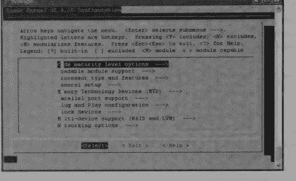

首次在新计算机上编译内核时，无论你是否经验丰富，最大的障碍通常是确切知道在编译中应该包含什么。该过程的大部分涉及查找计算机使用的硬件，并确定该硬件对应的驱动程序。归根结底，编译内核的某些步骤归结为猜测，有些是有根据的猜测，有些则不是。良好的故障排除技巧和试错法在内核编译中都发挥作用。当你在控制台前时，这没问题，但当你距离计算机 1000 英里时，这就没那么有趣了。

## 打补丁还是不打

当你修补软件源代码时，无论是内核还是其他软件，你都会根据为该软件创建的补丁文件来增加或删除代码行以更改代码。补丁可能简单如软件更新，也可能复杂如更改软件本身的功能。当内核的新版本发布时，内核维护者会发布内核的完整版本，同时提供补丁文件，以便那些希望通过打补丁仅更新到下一内核版本的用户使用。


当你运行补丁以更改软件功能时，实际上是在改变软件的基础状态。这涉及一种权衡。权衡之处在于，从那时起，为了利用补丁添加的额外功能，你还必须对基础软件的任何更新打补丁。在 Grsec 的语境下，这意味着你正在从原生或标准内核的概念转向以额外安全性为优先。

## 无 Grsec 的增强安全性

从 2.6 系列内核开始，一些此前仅作为内核补丁可用的功能被引入了主内核。这些功能以前文提到的内核中 SELinux 区域的形式出现。

使用 SELinux 的优势在于它包含在标准内核中，因此不需要为每个内核更新都打补丁。然而，Grsec 包含的额外功能使得这种补丁权衡在增强安全性方面物有所值。

其他软件，如 Exec-Shield，提供了一些与 Grsec 相同的功能。然而，关于 Grsec 和 Exec-Shield 收集的信息表明，Grsec 是更健壮的实现，并提供了 Exec-Shield 不具备的一些功能。Exec-Shield 的优势在于它包含在某些主要供应商的 Linux 实现中。

## 使用 GrSecurity 内核

实施带有 Grsec 的内核存在一种合乎逻辑的顺序。如果你之前编译过自己的内核，其中一些步骤并非必要。说实话，本节中的一些步骤也并非完全必需，但我会详细阐述它们，以减少在熟悉 Grsec 过程中出错的可能性。

## 下载 Grsec 和全新内核

GrSecurity 和全新内核都需要从各自的网站下载。内核源代码可以几种不同的存档格式下载，其中 bzip2 的下载体积最小。从 [http://www.kernel.org/](http://www.kernel.org/) 下载内核源代码。kernel.org 网站的主页上会列出几个内核版本。我建议使用标记为“最新稳定内核”之类的内核。图 13.2 展示了 kernel.org 主页的样子，以便你可以看到我指的是哪个区域。点击标记为“F”（“Full”的缩写）的链接即可下载内核。

内核源代码的下载时间从几分钟到几小时不等，具体取决于你的互联网连接速度。它将以下载为 bzip2 格式的 tar 存档文件。Grsec 从 GrSecurity 网站 [http://www.grsecurity.net/](http://www.grsecurity.net/) 下载。获取最新的稳定 Grsec 补丁。由于该文件只是一个包含其与刚下载的主内核之间差异的补丁，因此下载速度会非常快。

# 第 13 章：内核增强

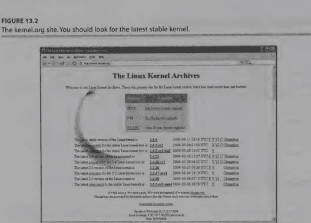

## 编译你的第一个内核

在应用 Grsec 补丁之前，先让电脑运行一个可用的定制版内核会很有帮助。在新的内核启动并运行之后，我将展示如何应用该补丁。本节将检查如何从原版（vanilla）源代码编译内核。

在考虑如何进行第一次内核编译时，一个好的起点是内核说明文档（Kernel-HOWTO）或内核重建指南（Kernel Rebuild Guide）。内核说明文档位于 http://www.tldp.org/HOWTO/Kernel-HOWTO/index.html；内核重建指南目前位于 http://www.digitalermit.com/~kwar/kernel.html。这些文档为首次编译内核的人提供了宝贵的见解和技巧。

首先要做的是将内核源代码解压到正确的位置。通常，Linux 内核源文件存储在 `/usr/src` 中名为 `linux` 的目录里。当你解压内核源代码时，它的名称通常类似于 `linux-N.N_N`。我将展示如何创建一个符号链接（类似于 Windows 中的快捷方式），以将该目录链接到 `/usr/src/linux`。

将下载的源文件复制到 `/usr/src`。例如，对于内核 2.6.4，命令如下：

```
cp linux-2.6.4.tar.bz2 /usr/src
```

使用 bzip2 和 tar 的组合解压 Linux 内核源代码，方法如下（别忘了进入 `/usr/src` 目录）：

```
bunzip2 -c linux-2.6.4.tar.bz2 | tar -x
```

现在，你将拥有一个包含解压后的 Linux 内核源代码的目录。传统上，源代码存储在 `/usr/src/linux`，但内核源代码被解压到了 `/usr/src/linux-2.6.4`。为了解决这个问题，请创建一个符号链接（有时称为 symlink）：

```
ln -s linux-2.6.4 linux
```

现在，传统位置将有一个符号链接，你可以 cd 进入该目录：

```
cd /usr/src/linux
```

或者直接使用这个：

```
cd linux
```

当你尝试运行 `ln` 命令时，可能会收到一个错误，提示文件 `linux` 已经存在。如果是这种情况，说明目录下似乎已经存在内核源代码。例如，在 SUSE 中，如果在初始安装期间安装了内核源代码，它将被解压到 `/usr/src` 内的一个目录中，然后创建一个指向 `/usr/src/linux` 的符号链接。可以安全地删除该符号链接，以便重新创建它以链接到你的内核源代码。如果在尝试创建符号链接时收到关于 `linux` 已存在的错误，请使用以下命令（从 `/usr/src` 内）删除旧的符号链接：

```
rm linux
```

配置定制内核中包含的选项有三种主要方法，所有三种方法都基于 Linux 内核 Makefile 中提供的选项。配置完成后，你选择（或未选择）的选项将存储在 Linux 内核源代码目录中名为 `.config` 的文件中：

```
make config
make menuconfig
make xconfig
```

此外，还有一种称为 `oldconfig` 的方法，可以使用旧版本的配置文件将配置更新到新版本。此功能对于在内核次要版本之间进行升级非常有用，而无需从原版配置开始，从而避免可能忘记编译某些重要部分。`oldconfig` 方法假设你已经在内核源代码目录（这里的示例中为 `/usr/src/linux`）中拥有旧的配置，并且该目录中的配置文件名为 `.config`。你可以通过输入以下内容使用 `oldconfig` 方法更新到新内核：

```
make oldconfig
```

你选择配置内核的方法在很大程度上取决于个人偏好，但也取决于计算机的配置结果。如果没有安装 X Windows，你就不能使用 `xconfig`。同样，`menuconfig` 需要一些 `ncurses` 库，这些库通常（但不是总是）已安装。编译内核的标准 `config` 选项总是有效，但它也是最笨重的，尤其对新手来说更是如此。

综合考虑，我推荐使用 `menuconfig` 作为配置内核的选项。无论计算机是否有 X Windows，都可以使用 `menuconfig`，并且也可以通过远程 SSH 连接使用。然而，如果你有现有的配置文件版本，我建议先使用 `oldconfig`，然后使用 `menuconfig` 进一步调整配置选项。

你应该花些时间确定计算机中的硬件以及负责该硬件操作的内核驱动程序。程序 `/sbin/lspci` 将显示当前的 PCI 硬件配置，然后你可以用它来找出运行该硬件所需的哪些驱动程序。此外，使用 `less` 或 `more` 等分页器或 `cat` 等其它程序检查 `/proc/cpuinfo`：

```
cat /proc/cpuinfo
```

这将告诉你拥有的处理器类型，以便你可以选择内核 `config` 中该区域的适当架构。记录这些信息，并使用 Google 等工具来确定与计算机中硬件相对应的适当 Linux 驱动程序。

你经常可以在 `/boot` 目录中找到当前内核的内核配置副本。例如，在 SUSE 中，该文件将位于 `/boot` 并命名为 `vmlinuz.config`。为了将此配置作为新内核的起点，将此文件复制到 `/usr/src/linux` 目录中：

```
cp -i /boot/vmlinuz.config /usr/src/linux/.config
```

如果命令正确运行，你将不会收到任何反馈；静默表示成功。但是，如果你收到询问是否覆盖现有 `.config` 的问题，请取消复制操作并查明为什么 `/usr/src/linux` 中已经存在配置文件。这可能是由于你未删除 `/usr/src/linux` 中指向先前内核的符号链接，或者你已经运行了内核的某个 make 选项所致。当你对内核运行 make 时，它会保存 `.config` 文件的新副本，因此如果你已经运行了内核编译过程，你可能不想用默认配置覆盖该配置文件。

在你覆盖默认配置文件后，明智的做法是对配置文件运行 `oldconfig` 过程，将其更新到新内核版本。在 `/usr/src/linux` 目录内，运行以下内容：

```
make oldconfig
```

基于你刚刚复制的现有（默认）配置文件与该内核版本可用的新配置选项之间的差异，你会被问到几个问题。`oldconfig` 过程是通过基于文本的界面完成的，因此你会看到类似这样的内容：


```
Kernel support for ELF binaries (CONFIG_BINFMG_ELF) [Y/m/n/?]  
Kernel support for MISC binaries (CONFIG_BINFMT_MISC) [m/n/y/?]  
Select task to kill on out of memory condition (CONFIG_OOM_KILLER) [N/y/?] (NEW)
```

每当在新内核中遇到新功能时，你将被询问是否希望将该功能包含在新内核中。除非你正在寻找新内核中的某些特定功能，否则对于这些选项，几乎总是可以安全地通过按 Enter 键接受默认值。

完成所有 `oldconfig` 过程后，你将回到 `/usr/src/linux` 内的命令提示符。你现在来到了另一个岔路口。如果你愿意，可以进入 `menuconfig` 界面（`make menuconfig`）以进一步定制内核中包括的驱动程序和功能。如果你想尝试在没有额外定制的情况下编译内核，你现在就可以这样做。我强烈建议进入 `menuconfig` 过程，以确保为你的硬件包含正确的驱动程序。如果你选择跳过 `menuconfig` 过程，启动失败的可能性会增加。

如果你选择进入 `menuconfig` 过程，你将有机会通过比 `oldconfig` 过程更友好的界面进一步定制内核。`menuconfig` 界面还更容易访问各种内核选项的帮助。

在 `menuconfig` 界面中，通过按 Enter 键遍历每个选项；使用键盘箭头；使用 Tab 键在 Select、Exit 和 Help 之间移动；使用空格键进行选择或取消选择；按 Esc 键返回。请注意不要按 Esc 键太多次，因为这也是退出的方式。在通过 `menuconfig` 界面配置时，特别查找与你的硬件相关的驱动程序，并确保它们包含在内核中，如星号（*）所示。例如，我有一个基于 AMD PCnet32 驱动器的网卡，所以我需要在内核中包含此驱动程序。我导航到 Network Device Support；然后 Ethernet (10 or 100Mbit)；然后 EISA, VLB, PCI and On Board Controllers；然后按空格键确保 AMD PCnet32 PCI Support 已被勾选。

当您准备好开始实际的构建过程时，有三个主要命令用于构建内核。实际上，目前很可能需要用到四个命令，因为我假设您正在构建的默认内核包含了模块。最终，当您禁用模块以增强安全性时，您将不再需要运行我稍后展示的最后一个 `make` 命令，因为它仅用于构建模块。

第一个构建步骤是生成依赖关系。请在 `/usr/src/linux` 目录内输入以下命令：

```
make dep
```

此命令通常运行得相对较快。通过输入以下命令继续构建过程：

```
make clean
```

`make clean` 步骤也相对较快，当然具体速度取决于可用的资源。最后，通过输入以下命令创建内核本身：

```
make bzImage
```

`bzImage` 选项使用 `bzip2` 压缩内核。另一种在不支持 `bzip2` 的系统上使用的替代方案是 `make zImage`，它使用 `gzip` 代替 `bzip2`。由于您的系统上有 `bzip2`（之前为了解压内核源代码已经安装了它），因此您可以使用 `bzImage`。

接下来，内核将开始编译。这个过程所需的时间长短不一，取决于几个因素。首先且最重要的是，处理器的速度和负载以及可用内存将是决定内核编译时间的最大因素。在一台负载很轻、配备双 Intel Xeon 处理器和 1GB 内存的机器上，内核编译时间不到五分钟。另一方面，一台配备 Intel Pentium 60 处理器和 24MB 内存的机器编译内核将需要好几个小时。决定内核编译时间的第二个因素是您在内核中包含的选项数量。添加 SMP（对称多处理）代码和许多（可能不必要的）驱动程序会增加编译时间。

在内核编译期间，您可以放松一下或去做别的事。现在正是阅读我之前推荐的 内核 HOWTO 的好时机；当然，前提是您还没读过。希望内核编译不会因错误而失败，尽管这种情况偶尔会发生。这通常是由于某个有问题的驱动程序或两个驱动程序之间的冲突造成的。如果内核停止编译，并且屏幕上显示类似以下内容，您就会知道编译失败了：

```
Error 1
***[make]***
Error 2
```

## 使用 GrSecurity 内核

如果发生这种情况，请查看错误上方的最后几行，看看是否能找出错误发生在内核编译的哪个部分。很多时候，屏幕上显示的文本中会包含正在编译的文件名。此外，还要检查 `/usr/src/linux` 目录下 `config.log` 文件的末尾，看看是否有任何相关信息。如有必要，可以将任何错误消息的内容复制到 Google 等搜索引擎中，看看是否有人遇到过同样的问题。开源软件最大的优势之一就是在论坛和 Google 上随时可以获得针对此类问题的帮助。

如果内核编译因错误而失败，您将需要追溯有问题的驱动程序或内核区域，并取消选中这些驱动程序或将其排除。当您认为找到了错误的原因时，首要任务是清理环境并重新开始。无数次软件编译失败是因为管理员在编译失败后没有清理源代码树。在执行此过程之前，您应该将现有的 `.config` 配置文件复制到安全的位置。清理过程将删除 `.config` 文件，因此如果您进行了自定义设置，它们将会丢失。

要清理内核源代码树，请输入以下命令：

```
make mrproper
```

此时环境将变得干净，就好像您刚刚解包了新的内核源代码一样。通过复制现有配置文件（通常位于 `/boot`）到内核源代码树中，并按照以前的步骤重新开始整个过程。不过，这一次请进入 `menuconfig` 界面，取消选中那些您认为导致失败的有问题的驱动程序或内核的其他部分。

吁。希望一切顺利！如果内核停止编译且您没有收到任何错误，您将在屏幕上看到类似以下内容（您的文本可能会有所不同）：

```
tools/build –b bootosect bsetup compressed/bvmlinux.out CURRENT `>bzImage`
Root device is (8,2)
Boot sector 512 bytes.
Setup is 4769 bytes.
System is 1086 kB
warning: kernel is too big for standalone boot from floppy
make[1]: Leaving directory `/usr/src/linux-2.4.25/arch/i386/boot`
```

恭喜，内核编译成功。由于这是您编译的第一个内核，且您使用了默认配置文件，因此正在编译的内核很可能需要模块才能运行。随着您在内核编译方面越来越熟练，我建议您为服务器环境编译单体内核，而不是包含模块。

如果内核甚至不包含使用模块的功能，攻击者将自己的代码注入内核的可能性就会降低。然而，现实情况是，模块化内核目前是已安装内核的事实标准。因此，您需要将编译和安装模块作为内核构建过程的一部分。

当您把必要的驱动程序直接编译进内核而不是作为模块包含时，与模块相关的步骤将不再是内核构建过程所必需的。

在内核本身成功编译后，下一步是编译模块。这可以通过以下命令完成：

```
make modules
```

模块编译过程所需的时间长短不一，取决于前面讨论的内核编译时间相关因素。关于模块编译，同样的注意事项和故障排除步骤同样适用。如果模块编译因错误而失败，请追溯有问题的模块代码并取消选中它；或者，如果该模块对系统运行是必要的，请尝试将其直接编译进内核，而不是作为模块包含。

模块编译过程将平静地完成，可能类似以下内容：

```
make[1]: Entering directory `/usr/src/linux-2.4.25/arch/i386/lib'
make[1]: Nothing to be done for `modules'.
make[1]: Leaving directory `/usr/src/linux-2.4.25/arch/i386/lib'
```

如果您看到任何类似于“Error”的字样，则说明模块编译未成功完成。

假设模块编译成功，请通过输入以下命令安装模块：

```
make modules_install
```

现在是安装新内核的时候了。内核安装在一个与架构无关的目录结构中。让我假设您使用的架构是基于 Intel x86 类型的计算机。如果是这样，您的内核位于 `/usr/src/linux/arch/i386/boot`。由于您应该已经在 `/usr/src/linux` 目录中，您可以使用以下命令将新内核复制到 `/boot` 中的位置，并用 `<version>` 替换内核版本。

```
cp -i arch/i386/boot/bzImage /boot/vmlinuz-<version>
```

例如，要复制版本为 2.4.25 的已编译内核，您需要输入：

```
cp -i arch/i386/boot/bzImage /boot/vmlinuz-2.4.25
```


# 使用模块化内核创建初始内存盘

在使用模块化内核时，计算机通常需要一个初始内存盘（称为 `initrd`），以成功预加载计算机启动所需的模块。当磁盘或磁盘控制器驱动程序作为模块包含而不是直接编译进内核时，这种情况尤为常见。如果您使用的是模块化内核，您在尝试启动之前还需要创建初始内存盘。初始内存盘是使用 `mkinitrd` 程序创建的。`mkinitrd` 程序的使用在不同版本的 Linux 中略有不同。假设您已编译了版本为 `2.4.25` 的模块化内核，编译了模块并安装了它们。现在是时候为该内核创建一个 `initrd` 了。新内核已复制到 `/boot/vmlinux-2.4.25`。还有一个名为 `/boot/vmlinux` 的现有内核。在 SUSE 中，您可以通过以下命令完成此任务：

```
mkinitrd -k 'vmlinux vmlinux-2.4.25' -i 'initrd initrd-2.4.25'
```

`initrd` 文件将在 `/boot/` 中创建，分别命名为现有内核和新内核的 `initrd` 和 `initrd-2.4.25`。

下一步完全取决于您的 Linux 版本使用的是 Lilo 还是 Grub 引导加载程序。我将包含 Lilo 和 Grub 两者的说明，但您只需遵循适用于您计算机的那一种。

以下是判断您使用的是哪种加载器的方法。输入以下命令查看您是否正在运行 Lilo：

```
$ ls /etc/lilo.conf
```

如果您收到类似于以下内容的错误，您可能正在使用 Grub：

```
$ ls: /etc/lilo.conf: No such file or directory
```

**注意**

> 可能同时安装了 Lilo 和 Grub，因此找到 `lilo.conf` 并不 100% 保证您正在使用 Lilo。如果您不确定，大多数引导加载程序（如 Lilo 和 Grub）在系统启动时会识别自己。

## 为 Grub 添加新内核

首先，我将介绍如何将新内核添加到 Grub 启动菜单中。使用您喜欢的文本编辑器编辑 Grub 菜单文件，通常是 `/boot/grub/menu.lst`。在 `menu.lst` 文件中，您将看到与当前内核相关的部分。只需复制并粘贴其中一个现有部分。请注意，不要更改文件中的任何现有行。例如，您可能添加以下行：

```
title customlunix
kernel (hd0,1)/boot/vmlinux-2.4.25 root=/dev/sda2
initrd (hd0,1)/boot/initrd-2.4.25
```

请注意，您的 `hd` 和 `root` 设备可能不同。查看文件中现有的内容，直接复制即可。对于 Grub 来说，这就已经足够了。您可以通过输入 `reboot` 或 `shutdown -r now` 来重启计算机。

## 为 Lilo 添加新内核

对于 Lilo，该过程类似。编辑文件 `/etc/lilo.conf`，找到与当前内核相关的现有部分，复制该部分并粘贴回去，同时小心不要修改 Lilo 配置文件中的任何现有行。Lilo 配置文件中的一个示例可能如下所示：

```
image=/boot/vmlinuz
  label=Linux
  read-only
```

在完成编辑 Lilo 配置文件后，还有一个额外的步骤是必须运行 Lilo 程序。许多管理员经常忽略这一步。在命令提示符下，只需输入以下内容：

```
lilo
```

你将看到类似的输出：

```
Added Linux *
Added LinuxOLD
```

星号 (`*`) 表示默认加载的内核。现在，你可以通过输入 `reboot` 来重启计算机。

## 如果出现问题会发生什么？

当你编译了一个内核时，始终存在计算机在尝试使用新内核重启时无法启动的可能性。这将通过几种不同的错误状况来体现，最终结果是计算机无法完全启动进入 Linux。你可能会在控制台收到如下错误：

```
Kernel panic: Unable to mount root fs
```

如果发生这种情况，不要花费太多时间担忧。写下错误消息以及错误之前几行中的关键词。关闭计算机电源并再次启动，这次在出现 Lilo 或 Grub 提示符时选择旧的内核。计算机将像之前一样启动。

另一个不太明显的问题是计算机启动但缺少某些功能。这经常发生，当错误的网络驱动程序被编译到内核中时，网络将无法工作，但可能会出现许多其他与驱动程序相关的问题。

不幸的是，如果你遇到内核恐慌（`kernel panic`）或选择了错误的驱动程序，意味着你将不得不重新开始内核编译过程。使用你的故障排除技能来确定问题所在，或者换句话说，内核中缺少了应该包含的内容。

没有一种万能的解决方案可以修复新内核。这需要你扎实的故障排除技能以及耐心。再说一次，即使是经验丰富的内核工作者，在新计算机上编译的第一个内核也可能遇到问题。所以，如果这发生在你身上，不要感到沮丧！

## 改进内核构建

如果一切都按计划进行，新内核将启动，并且像网络这样的设备将正确工作。你可以使用以下命令确认计算机正在使用的内核：

```
uname -a
```

如果报告的版本与你之前步骤中编译的版本不匹配，请验证你是否将内核放置在 Grub 配置中的正确位置，或者你是否在 Lilo 或 Grub 提示符下选择了正确的内核启动。此外，如果你正在使用 Lilo，编辑 Lilo 配置文件后你是否记得运行 `lilo` 命令？这是一个常见的疏忽。

从这里开始，是否要进一步改进内核编译以为计算机添加更多定制化，取决于你。从服务器管理和安全的角度来看，改进内核编译是一个好主意。

作为起点，我建议移除对模块的支持，并将必要的驱动程序直接编译到内核中。你可能会发现，许多编译为模块的驱动程序实际上是不必要的。同样，单片内核（`monolithic kernel`）通过使攻击者无法注入模块，从而减少了可用的攻击路径。

我还建议使用一组最小化的驱动程序，以匹配计算机的硬件和角色。例如，在一个仅作为 Web 服务器运行的 Linux 服务器上，打印机支持真的是必要的吗？可能不是。因此，可以从内核中移除这些驱动程序。不仅内核会更小并使用更少的资源，通过这些驱动程序的攻击路径也将被移除。

## GrSecurity

现在新内核正在运行，是时候重新编译它了！这次你将添加 GrSecurity 补丁并编译选项，以极大地增强计算机系统的安全性。本节探讨此操作涉及的步骤。

### 应用 Grsec 补丁

因为你已经在前面的步骤中下载了补丁，现在是对内核源代码进行打补丁的时候了。问题是你有一个已编译的内核版本位于 `/usr/src/linux`。该版本有一个已知良好的配置文件，但还有其他文件会干扰打补丁过程。因此，在使用 Grsec 修补内核之前，你需要清理该区域。

通常，配置文件会被复制到 `/boot` 目录。然而，此时没有理由做任何假设。因此，作为第一步，将现有的内核配置文件复制到另一个位置，以保留其内容：

```
cp /usr/src/linux/.config /root/.config-kernel-<NNNN>
```

将 `<NNNN>` 替换为内核版本。

现在更改目录到 `/usr/src/linux` 并清理源代码树：

```
cd /usr/src/linux
make mrproper
```

将配置文件复制回内核源代码树：

```
cp /root/.config-kernel-<NNNN> /usr/src/linux/.config
```

现在是（终于）应用 Grsec 补丁的时候了。更改目录到 `/usr/src`；如果那里还没有 Grsec 补丁，请将其从你在本章早期下载补丁时保存的位置复制过去。

```
cd /usr/src
```

可选地，如果补丁不在那里，请使用以下命令：

```
cp <download-location>/grsec-<NNNN>.patch /usr/src
```

应用补丁，将 `<NNNN>` 替换为与你内核对应的 Grsec 版本：

```
patch -p0 < grsec-<NNNN>.patch
```

你现在将看到类似的输出，这是由对内核版本 `2.4.25` 的应用补丁生成的：

```
patching file linux-2.4.25/Documentation/Configure.help
patching file linux-2.4.25/Makefile
...(continued)
patching file linux-2.4.25/net/socket.c
patching file linux-2.4.25/net/unix/prompt.c
patching file linux-2.4.25/net/unix/af_unix.c
```

### 选择 Grsec 功能

Grsec 包含许多功能，并非所有功能都适用于每种情况。Grsec 可用的一些功能专门针对特定情况，而一些非常高级，需要广泛的额外配置才能正常工作。启用一些 Grsec 选项只是在内核配置中开启它们的问题。本节探讨 Grsec 选项。

#### 安全级别


Grsec 允许你选择四个安全级别之一，其中三个是预定义的。预定义的安全级别包括低（Low）、中（Medium）和高（High），第四个级别称为定制（Customized）。评估 Grsec 及其功能的一种方法是应用低安全级别，编译并以该内核运行。如果你注意到没有以 Grsec 增强低安全级别运行的不良影响，应用中等安全级别，编译并以该级别运行。提高安全级别到尽可能高的级别。

建议：

选择一个默认的提供的安全级别并尽可能提高，或者选择一个定制级别并处理本节中包含的其他选项。

## PAX 控制

Pax Control 提供了一种防御攻击程序地址空间的某些类型利用的方法。例如，Pax Control 可以提供对基于堆栈和堆的缓冲区溢出的保护，以及其他一些内容。还包括 Pax 与强制访问控制（MAC）功能之间的集成。

建议：

使用你的判断力。一些 Pax 选项的正确配置可能更复杂。

## 地址空间保护

地址空间保护提供许多可以增强安全性的有用选项，包括防止向运行中的单片内核注入代码的方法。地址空间保护中包含的一些选项可能会破坏应用程序，最明显的是 X Windows。因此，如果你使用 X Windows，在选择地址空间保护选项时应格外小心。

建议：

除非你正在运行 X Windows，否则请启用这些选项。如果你正在运行 X Windows，请警惕这些选项。这些保护非常强大，以至于如果某个选项破坏了应用程序，值得潜在地进行重新编译。

## ACL 选项

ACL 选项提供了一些额外的功能，当通过 Grsec 启用访问控制列表（ACL）系统时可以使用这些功能。某些选项是根据你的策略设置的，例如针对 ACL 系统的密码锁定策略。

建议：

如果你打算使用 Grsec ACL 系统，请根据你的环境适当设置这些选项。

## 文件系统保护

Grsec 提供的文件系统保护功能启用了额外的 `chroot` 限制，如果你正在 `chroot` 环境中运行应用程序，应当使用这些限制。此选项区域内还提供了其他保护，包括对符号链接、proc 文件系统和 FIFO 的限制。

建议：

启用这些选项可以极大地增强安全性，特别是如果你正在使用 `chroot` 应用程序，包括 `chroot` 选项在内。

## 内核审计

在内核审计区域内，有一组选项可提供有用的日志记录和跟踪功能。此区域包含对时间更改、文件系统挂载和卸载的日志记录，甚至是对 `execve()` 系统调用的每次调用进行日志记录。其中一些选项可能会产生巨大的日志文件，但在对成功的攻击进行取证分析时无可替代。

建议：

尽可能启用这些选项。但请注意，不要因诸如 `Exec` 日志记录等产生的大量条目而填满日志目录的文件系统。

## 可执行文件保护

可执行文件保护中有四个重要选项。这些选项用于防止本地用户可能获取额外权限或收集系统信息。即使你并不打算允许系统用户拥有“shell”（即：命令行）访问权限，攻击者的目标也是获取该 shell 访问权限。如果攻击者设法获取了 shell 访问权限，这些选项有助于防止攻击者获取额外的权限。

建议：

如果可能，请在你的环境中启用这些选项。

## 网络保护

Grsec 中的网络保护提供了广泛且有用的额外安全功能。随机化是这些保护机制的关键组成部分，它使自动扫描或探测更难识别你的操作系统。

建议：

在你的环境中尽可能启用这些选项。

## SYSECTL 支持

使用 Sysectl，你可以单独启用 Grsec 的许多功能以协助故障排除。当你首次使用 Grsec 时，如果应用程序无法启动且你认为这是由某个 Grsec 选项引起的，这将特别有用。使用 Sysectl，你通过发出 `echo` 命令来启用编译到 Grsec 内核中的某些各种功能。当系统稳定后，你再发出另一个 `echo` 命令以有效地“锁定”环境，防止在不重启的情况下禁用 Grsec 功能。如果你未能锁定环境且未重新编译以禁用 Sysectl 支持，攻击者可以移除 Grsec 保护，从而使它们变得毫无用处！

建议：

在初次熟悉 Grsec 时启用 Sysectl 支持。当你的系统在使用所选的各种 Grsec 选项后稳定运行时，重新编译内核以移除 Sysectl 支持。未能这样做可能会完全抵消任何 Grsec 增强效果。

## 日志记录选项

日志记录选项区域控制 Grsec 日志记录的性能。在此区域内，你可以找到配置在特定（可配置）时间范围内可发送消息数量的选项。这有助于防止攻击者通过填满日志文件文件系统或创建噪声日志而导致的潜在拒绝服务攻击。

建议：

根据你的环境适当设置这些选项。

## 构建 Grsec 内核

使用 Grsec 构建内核，实际上与构建其他内核没有区别。你已应用了补丁，并希望已选择想要尝试的选项。从这里开始，请回到本章前面的部分，并按照从源代码编译内核的说明进行操作。

## 第 13 章：内核增强

编译内核并重启后，你可以开始测试新的环境。首先要做的是确保 Grsec 内核实际上正在运行。通过输入以下命令完成此任务：

```
uname -a
```

你应该看到包含类似以下部分的输出：

```
2.4.25-grsec
```

显然，内核版本号可能不同，但关键是确保 `grsec` 出现在该名称中。如果出现，则你正在使用 Grsec 内核运行。如果没有，你应该检查内核为何启动了你未编译的其他版本。这可能是因为你忘记了运行 Lilo，或者在编译的最后一步忘记安装内核。有关可能原因，请参阅“编译你的第一个内核”部分。

如果你选择启用 Syctl 支持，以便可以随时启用和禁用某些 Grsec 功能，你会发现在 `/proc/sys/kernel/grsecurity` 目录中有一组文件。你可以通过输入以下命令在 Grsec 中启用这些选项：

```
echo 1 > /proc/sys/kernel/grsecurity/<filename>
```

这里，`<filename>` 是在 `/proc/sys/kernel/grsecurity` 中通过 `ls` 命令找到的选项名称。例如，如果你想启用随机化进程 ID（PIDs），该文件名为 `rand_pids`。你可以通过以下行启用它：

```
echo 1 > /proc/sys/kernel/grsecurity/rand_pids
```

启用此特定选项后，你可以运行 `ps` 命令并观察新创建的进程。它们将拥有伪随机 ID 号，而不是传统的递增 PID。我可能使用 `ps aux` 命令以 root 身份查看所有进程。

要禁用某个 Grsec 功能，只需向该文件 `echo 0`。例如，要禁用刚才启用的 PID 随机化，请运行以下命令：

```
echo 0 > /proc/sys/kernel/grsecurity/rand_pids
```

记住这一点很重要：在你“锁定”Grsec 功能之前，攻击者可以撤销这些功能。缺点是，在你锁定功能后，如果不重启计算机，你自己无法撤销它们。通过锁定，你防止其他功能在服务器重启前被启用或禁用，这仅适用于你在 Grsec 中使用 Syctl 选项的情况。使用以下命令锁定功能：

```
echo 1 > /proc/sys/kernel/grsecurity/grsec_lock
```

## GrSecurity 超越基础

我只是略微触及了 GrSecurity 的诸多优势。Grsec 最大的优势之一是其增强文件可用权限的能力，即基于角色的访问控制（RBAC）。熟悉并使用 Windows 中可授予文件的高级权限的 Windows 管理员也会希望探索 Grsec 中的这些功能。本章仅考察了 Grsec 的内核补丁部分。还有一种用于 RBAC 的管理软件称为 `gradm`，它启用了一组大量的专用文件和对象权限。

有关 GrSecurity ACL 系统的更多信息可在 GrSecurity 网站 `http://www.grsecurity.net/gracledoc.htm` 上找到。

## 结论：自定义内核

本章涵盖了重要主题，也是优秀的 Linux 管理员必须了解的主题，即编译自定义内核。自定义内核通过让管理员仅为内核驻留的特定计算机选择必要的选项来增强安全性。通过禁用不必要的驱动程序和模块支持，你可以减少可供利用的攻击路径。

使用增强安全性的内核，如带有 SELinux 的内核或 GrSecurity 内核，可显著降低某些高级利用技术带来的风险。与其他安全选项一样，GrSecurity 仅提供主机安全的某一侧面。如果没有诸如 `chroot` 等功能，甚至只是保持服务器打补丁，Grsec 的效果将大打折扣。然而，鉴于 Grsec 可提供的所有益处，只要可能就应该使用它。这是值得花费时间和精力去做的，与在攻击后清理相比，这绝对是一个更好的选择，且该攻击本可预防。

## 以下是主要要点：

- 在此情况下，满足条件时值为零。

- 在此情况下，满足条件时值非零。

- 在此情况下，满足条件时值为零。

以下是主要思想的描述：

- 条件 1 导致结果 A。

- 条件 2 导致结果 B。

- 条件 3 导致结果 C。

关键在于主要思想是解释的核心。

以下是主要思想的描述：

- 条件 1 导致结果 A。


- 条件 2 导致结果 B。
- 条件 3 导致结果 C。

# 第四部分

## 附录

- A. 安全资源
- B. 防火墙示例和支持脚本
- C. VPN（虚拟专用网络）
- D. 术语表

## 附录 A

### 安全资源

本附录列出了当前互联网上一些常见的安全相关通知、信息、工具、更新和补丁的来源。虽然还有更多网站，且每天都有新网站出现——请将该列表视为起点，而非完整列表。该附录也作为本书的一般参考部分。

#### 安全信息来源

各种安全信息、通知和警报、白皮书、教程等，可以在以下来源中找到：

- BugTraq：http://www.securityfocus.com/archive/1
- CERT 协调中心：http://www.cert.org/
- CIAC（计算机事件咨询能力中心）：http://www.ciac.org/ciac/
- Freshmeat：http://www.freshmeat.net/
- Geektools：http://www.geektools.com/
- 互联网工程任务组（IETF）：http://www.ietf.org/
- Packet Storm：http://packetstormsecurity.org/
- RFC 编辑：http://www.rfc-editor.org/
- SANS 研究所：http://www.sans.org/
- Security Focus：http://www.securityfocus.com/

#### 参考论文和常见问题解答

一些有用的参考论文（其中一些在书中被引用）可以在这些网站找到：

- “帮助抵御拒绝服务攻击：逐步指南”：http://www.sans.org/dosstep/index.php
- “互联网防火墙常见问题解答”：http://www.interhack.net/pubs/fwfaq/
- “TCP SYN 泛洪和 IP 欺骗攻击”（CERT 公告 CA-96.21）：http://www.cert.org/advisories/CA-1996-21.html
- “TCP/UDP 服务端口号”（IANA）：http://www.iana.org/assignments/port-numbers
- “UDP 端口拒绝服务攻击”（CERT 公告 CA-1996.01）：http://www.cert.org/advisories/CA-1996-01.html

#### 书籍

- 《构建互联网防火墙（第二版）》，作者 Elizabeth D. Zwicky、Simon Cooper 和 D. Brent Chapman。O'Reilly & Associates, Inc.
- 《入侵签名与分析》，作者 Stephen Northcutt、Mark Cooper、Matt Fearnou 和 Karen Frederick。New Riders Publishing。
- 《网络入侵检测：分析师手册（第三版）》，作者 Stephen Northcutt 和 Judy Novak。New Riders Publishing。
- 《实用 Unix 和互联网安全》，作者 Simson Garfinkel 等。O'Reilly & Associates, Inc.
- 《TCP/IP 详解（第一卷：协议）》，作者 W. Richard Stevens。Addison-Wesley Professional。

## 附录 B

### 防火墙示例和支持脚本

第 4 章“构建和安装独立防火墙”描述了一个针对独立系统的防火墙。第 5 章“防火墙优化”对该独立示例进行了优化。第 6 章“数据包转发”扩展了该示例，使其能够作为网关或瓶颈防火墙运行，并在外部公共接口和内部本地网络接口上应用完整的防火墙规则集。网关作为互联网和包含公共服务器的 DMZ（非军事区）网络之间的链接。瓶颈防火墙作为私有 LAN（局域网）和 DMZ 之间的链接。

示例防火墙在第 4、5 和 6 章中分段呈现。本附录按照防火墙脚本中实际显示的方式呈现相同的防火墙示例。

#### 第 4 章中独立系统的 iptables 防火墙

第 4 章涵盖了独立 Linux 机器上最可能使用的服务类型的应用协议和防火墙规则。此外，对于并非所有人都使用的服务，也提供了客户端和服务器规则。完整的 `iptables` 防火墙脚本（如显示在 `/etc/rc.d/rc.firewall` 或 `/etc/init.d/firewall` 中）如下所示：

```bash
#!/bin/sh

/sbin/modprobe ip_conntrack_ftp
```

```bash
CONNECTION_TRACKING= *1*
ACCEPT_AUTH=*0*
SSH_SERVER=*0*
FTP_SERVER=*0*
WEB_SERVER=*0*
SSL_SERVER=*0*
DHCP_CLIENT=*1*
```

```bash
IPT=* /sbin/iptables * # 系统中 iptables 的位置
INTERNET=*eth0* # 连接互联网的接口
LOOPBACK_INTERFACE=*lo* # 无论系统如何命名
IPADDR=*my.ip.address* # 你的 IP 地址
SUBNET_BASE=*my.subnet.base* # ISP 网络段基地址
SUBNET_BROADCAST=*my.subnet.bcast* # 网络段广播地址
MY_ISP=*my.isp.address.range* # ISP 服务器和网络运营中心地址范围
```

```bash
NAMESERVER=*isp.name.server* # 远程名称服务器地址
POP_SERVER=*isp.pop.server* # 远程 pop 服务器地址
MAIL_SERVER=*isp.mail.server* # 远程邮件网关地址
NEWS_SERVER=*isp.news.server* # 远程新闻服务器地址
TIME_SERVER=*some.time.server* # 远程时间服务器地址
DHCP_SERVER=*isp.dhcp.server* # 你的 ISP dhcp 服务器地址
```

```bash
LOOPBACK=*127.0.0.0/8* # 保留的环回地址范围
CLASS_A=*10.0.0.0/8* # A 类私有网络
CLASS_B=*172.16.0.0/12* # B 类私有网络
CLASS_C=*192.168.0.0/16* # C 类私有网络
CLASS_D_MULTICAST=*224.0.0.0/4* # D 类多播地址
CLASS_E_RESERVED_NET=*240.0.0.0/5* # E 类保留地址
BROADCAST_SRC=*0.0.0.0* # 广播源地址
BROADCAST_DEST=*255.255.255.255* # 广播目标地址
```

```bash
PRIVPORTS=*0:1023* # 知名、特权端口范围
UNPRIVPORTS=*1024:65535* # 非特权端口范围
```

```bash
SSH_PORTS=*1024:65535*
```

```bash
NFS_PORT=*2049*
LOCKD_PORT=*4045*
SOCKS_PORT=*1080*
OPENWINDOWS_PORT=*2000*
XWINDOW_PORTS=*6000:6063*
SQLID_PORT=*3128*
```


## 系统内核参数加固

```bash
############################################################################

## 启用广播回显保护
echo 1 > /proc/sys/net/ipv4/icmp_echo_ignore_broadcasts

## 禁用源路由数据包
for f in /proc/sys/net/ipv4/conf/*/accept_source_route; do
  echo 0 > $f
done

## 启用 TCP SYN Cookie 保护
echo 1 > /proc/sys/net/ipv4/tcp_syncookies

## 禁用 ICMP 重定向接受
for f in /proc/sys/net/ipv4/conf/*/accept_redirects; do
  echo 0 > $f
done

## 不发送重定向消息
for f in /proc/sys/net/ipv4/conf/*/send_redirects; do
  echo 0 > $f
done

## 丢弃从接口进入的欺骗数据包，如果回复，
## 会导致回复从不同的接口发出。
for f in /proc/sys/net/ipv4/conf/*/rp_filter; do
  echo 1 > $f
done

## 记录具有不可能地址的数据包。
for f in /proc/sys/net/ipv4/conf/*/log_martians; do
  echo 1 > $f
done

############################################################################
```

## 清空并重置 iptables 策略

```bash
## 删除所有链中的现有规则
$IPT --flush
$IPT -t nat --flush
$IPT -t mangle --flush
$IPT -X
$IPT -t nat -X
$IPT -t mangle -X
$IPT --policy INPUT   ACCEPT
$IPT --policy OUTPUT  ACCEPT
$IPT --policy FORWARD ACCEPT
```

```bash
$IPT -t nat --policy PREROUTING ACCEPT
$IPT -t nat --policy OUTPUT ACCEPT
$IPT -t nat --policy POSTROUTING ACCEPT
$IPT -t mangle --policy PREROUTING ACCEPT
$IPT -t mangle --policy OUTPUT ACCEPT
if [ "$1" = "stop" ]
then
	echo '防火墙已完全停止！警告：此主机没有正在运行的防火墙。'
	exit 0
fi

## 在环回接口上允许无限制流量
$IPT -A INPUT -i lo -j ACCEPT
$IPT -A OUTPUT -o lo -j ACCEPT

## 将默认策略设置为丢弃
$IPT --policy INPUT DROP
$IPT --policy OUTPUT DROP
$IPT --policy FORWARD DROP

$IPT -t nat --policy PREROUTING DROP
$IPT -t nat --policy OUTPUT DROP
$IPT -t nat --policy POSTROUTING DROP

$IPT -t mangle --policy PREROUTING DROP
$IPT -t mangle --policy OUTPUT DROP

#######################################################
## 隐蔽扫描和 TCP 状态标志
```

## 隐蔽扫描和 TCP 标志过滤

```bash
## 不干净的包
$IPT -A INPUT -m unclean -j DROP
## 所有位都清零
$IPT -A INPUT -p tcp --tcp-flags ALL NONE -j DROP
## SYN 和 FIN 都置位
$IPT -A INPUT -p tcp --tcp-flags SYN,FIN SYN,FIN -j DROP
## SYN 和 RST 都置位
$IPT -A INPUT -p tcp --tcp-flags SYN,RST SYN,RST -j DROP
## FIN 和 RST 都置位
$IPT -A INPUT -p tcp --tcp-flags FIN,RST FIN,RST -j DROP
## 仅 FIN 位置位，没有预期的伴随 ACK
$IPT -A INPUT -p tcp --tcp-flags ACK,FIN FIN -j DROP
## 仅 PSH 位置位，没有预期的伴随 ACK
$IPT -A INPUT -p tcp --tcp-flags ACK,PSH PSH -j DROP
## 仅 URG 位置位，没有预期的伴随 ACK
$IPT -A INPUT -p tcp --tcp-flags ACK,URG URG -j DROP
```

## 利用连接状态绕过规则检查

```sh
if [ "$CONNECTION_TRACKING" = "1" ]; then
    $IPT -A INPUT -m state --state ESTABLISHED,RELATED -j ACCEPT
    $IPT -A OUTPUT -m state --state ESTABLISHED,RELATED -j ACCEPT
fi

## 单独使用状态模块时，INVALID 会破坏使用双向连接、
## 多连接或交换的协议，除非提供了该协议的 ALG。
## 目前，FTP 和 IRC 是仅有的支持 ALG 的协议。

$IPT -A INPUT -m state --state INVALID -j LOG \
    --log-prefix "INVALID input: "
$IPT -A INPUT -m state --state INVALID -j DROP

$IPT -A OUTPUT -m state --state INVALID -j LOG \
    --log-prefix "INVALID output: "
$IPT -A OUTPUT -m state --state INVALID -j DROP
fi
```

## 源地址欺骗和其他不良地址

```sh
## 拒绝伪装成来自外部接口 IP 地址的欺骗包
$IPT -A INPUT -i $INTERNET -s $IPADDR -j DROP

## 拒绝声称来自 A 类私有网络的包
$IPT -A INPUT -i $INTERNET -s $CLASS_A -j DROP

## 拒绝声称来自 B 类私有网络的包
$IPT -A INPUT -i $INTERNET -s $CLASS_B -j DROP

## 拒绝声称来自 C 类私有网络的包
$IPT -A INPUT -i $INTERNET -s $CLASS_C -j DROP

## 拒绝声称来自环回接口的包
$IPT -A INPUT -i $INTERNET -s $LOOPBACK -j DROP

## 拒绝格式错误的广播包
$IPT -A INPUT -i $INTERNET -s $BROADCAST_DEST -j LOG
$IPT -A INPUT -i $INTERNET -s $BROADCAST_DEST -j DROP

$IPT -A INPUT -i $INTERNET -d $BROADCAST_SRC -j LOG
$IPT -A INPUT -i $INTERNET -d $BROADCAST_SRC -j DROP
```

## 附录 B：防火墙示例和支持脚本


```sh
if [ "${DHCP_CLIENT}" = "0" ]; then
    # 拒绝定向广播
    # 用于映射网络和发起拒绝服务攻击
    $IPT -A INPUT -i $INTERNET -d $SUBNET_BASE -j DROP
    $IPT -A INPUT -i $INTERNET -d $SUBNET_BROADCAST -j DROP

    # 拒绝受限广播
    $IPT -A INPUT -i $INTERNET -d $BROADCAST_DEST -j DROP
fi
```

## 拒绝 D 类组播地址
## 作为源地址是非法的
```sh
$IPT -A INPUT -i $INTERNET -s $CLASS_D_MULTICAST -j DROP

$IPT -A INPUT -i $INTERNET -p ! udp -d $CLASS_D_MULTICAST -j DROP

$IPT -A INPUT -i $INTERNET -p udp -d $CLASS_D_MULTICAST -j ACCEPT
```

## 拒绝 E 类保留 IP 地址
```sh
$IPT -A INPUT -i $INTERNET -s $CLASS_E_RESERVED_NET -j DROP
```

```sh
if [ "${DHCP_CLIENT}" = "1" ]; then
    $IPT -A INPUT -i $INTERNET -p udp \
        -s $BROADCAST_SRC --sport 67 \
        -d $BROADCAST_DEST --dport 68 -j ACCEPT
fi
```

## 拒绝由 IANA 定义为保留的地址
## 0.*.*.*       - 无法在 DHCP 下单方面阻止
## 169.254.0.0/16 - 链路本地网络
## 192.0.2.0/24 - TEST-NET

```sh
$IPT -A INPUT -i $INTERNET -s 0.0.0.0/8 -j DROP
$IPT -A INPUT -i $INTERNET -s 169.254.0.0/16 -j DROP
$IPT -A INPUT -i $INTERNET -s 192.0.2.0/24 -j DROP
```

##############################################################################
## 禁止连接到常见的 TCP 非特权服务器端口

## X 窗口连接建立
```sh
$IPT -A OUTPUT -o $INTERNET -p tcp --syn \
    --destination-port $XWINDOW_PORTS -j REJECT
```

## X 窗口：传入连接尝试
```sh
$IPT -A INPUT -i $INTERNET -p tcp --syn \
    --destination-port $XWINDOW_PORTS -j DROP
```

## 建立到 NFS、OpenWindows、SOCKS 或 squid 的 TCP 连接

```sh
$IPT -A OUTPUT -o $INTERNET -p tcp \
-m multiport --destination-port \
$NFS_PORT,$OPENWINDOWS_PORT,$SOCKS_PORT,$SQUID_PORT \
-syn -j REJECT
$IPT -A INPUT -i $INTERNET -p tcp \
-m multiport --destination-port \
$NFS_PORT,$OPENWINDOWS_PORT,$SOCKS_PORT,$SQUID_PORT \
-syn -j DROP
```

## 禁止连接到常见的 UDP 非特权服务器端口

## NFS 和 lockd

```sh
if [ "$CONNECTION_TRACKING" = "1" ]; then
$IPT -A OUTPUT -o $INTERNET -p udp \
-m multiport --destination-port $NFS_PORT,$LOCKD_PORT \
-m state --state NEW -j REJECT
$IPT -A INPUT -i $INTERNET -p udp \
-m multiport --destination-port $NFS_PORT,$LOCKD_PORT \
-m state --state NEW -j DROP
else
$IPT -A OUTPUT -o $INTERNET -p udp \
-m multiport --destination-port $NFS_PORT,$LOCKD_PORT \
-j REJECT
$IPT -A INPUT -i $INTERNET -p udp \
-m multiport --destination-port $NFS_PORT,$LOCKD_PORT \
-j DROP
fi
```

## DNS 名称服务器

## DNS 转发名称服务器或客户端请求

```sh
if [ "$CONNECTION_TRACKING" = "1" ]; then
$IPT -A OUTPUT -o $INTERNET -p udp \
-s $IPADDR --sport $UNPRIVPORTS \
-d $NAMESERVER --dport 53 \
-m state --state NEW -j ACCEPT
fi
$IPT -A OUTPUT -o $INTERNET -p udp \
-s $IPADDR --sport $UNPRIVPORTS \
-d $NAMESERVER --port 53 -j ACCEPT

$IPT -A INPUT -i $INTERNET -p udp \
-s $NAMESERVER --sport 53 \
-d $IPADDR --port $UNPRIVPORTS -j ACCEPT
```

## ............................................................
## TCP 用于大响应

```sh
if [ "$CONNECTION_TRACKING" = "1" ]; then
$IPT -A OUTPUT -o $INTERNET -p tcp \
-s $IPADDR --sport $UNPRIVPORTS \
-d $NAMESERVER --port 53 \
-m state --state NEW -j ACCEPT
fi

$IPT -A OUTPUT -o $INTERNET -p tcp \
-s $IPADDR --sport $UNPRIVPORTS \
-d $NAMESERVER --port 53 -j ACCEPT

$IPT -A INPUT -i $INTERNET -p tcp ! --syn \
-s $NAMESERVER --sport 53 \
-d $IPADDR --port $UNPRIVPORTS -j ACCEPT
```

## ............................................................
## DNS 缓存名称服务器（本地服务器到主服务器）

```sh
if [ "$CONNECTION_TRACKING" = "1" ]; then
$IPT -A OUTPUT -o $INTERNET -p udp \
-s $IPADDR --sport 53 \
-d $NAMESERVER --port 53 \
-m state --state NEW -j ACCEPT
fi

$IPT -A OUTPUT -o $INTERNET -p udp \
-s $IPADDR --port 53 \
-d $NAMESERVER --port 53 -j ACCEPT

$IPT -A INPUT -i $INTERNET -p udp \
-s $NAMESERVER --sport 53 \
-d $IPADDR --port 53 -j ACCEPT
```

## 过滤 AUTH 用户识别服务 (TCP 端口 113)


## 从本地客户端到远程服务器的传出请求

```sh
$IPT -A OUTPUT -o $INTERNET -p tcp \
-s $IPADDR --sport $UNPRIVPORTS \
-dport 113 -m state --state NEW -j ACCEPT
fi
$IPT -A OUTPUT -o $INTERNET -p tcp \
-s $IPADDR --sport $UNPRIVPORTS \
-dport 113 -j ACCEPT

$IPT -A INPUT -i $INTERNET -p tcp ! --syn \
--sport 113 \
-d $IPADDR --dport $UNPRIVPORTS -j ACCEPT
```

## .........................
## 从远程客户端到本地服务器的传入请求

```sh
if [ "$ACCEPT_AUTH" = "1" ]; then
if [ "$CONNECTION_TRACKING" = "1" ]; then
$IPT -A INPUT -i $INTERNET -p tcp \
--sport $UNPRIVPORTS \
-d $IPADDR -dport 113 \
-m state --state NEW -j ACCEPT

fi
$IPT -A INPUT -i $INTERNET -p tcp \
--sport $UNPRIVPORTS \
-d $IPADDR -dport 113 -j ACCEPT
$IPT -A OUTPUT -o $INTERNET -p tcp ! --syn \
-s $IPADDR --sport 113 \
-dport $UNPRIVPORTS -j ACCEPT
else
$IPT -A INPUT -i $INTERNET -p tcp \
--sport $UNPRIVPORTS \
-d $IPADDR -dport 113 -j REJECT --reject-with tcp-reset
fi
```

##############################################################################
## 向任何外部邮件服务器发送邮件
## 如果使用 ISP 邮件网关代替，请使用 -d `$MAIL_SERVER`"

```sh
if [ "$CONNECTION_TRACKING" = "1" ]; then
$IPT -A OUTPUT -o $INTERNET -p tcp \
-s $IPADDR --sport $UNPRIVPORTS \
--dport 25 -m state --state NEW -j ACCEPT
fi

$IPT -A OUTPUT -o $INTERNET -p tcp \
-s $IPADDR --sport $UNPRIVPORTS \
--dport 25 -j ACCEPT

$IPT -A INPUT -i $INTERNET -p tcp ! --syn \
--sport 25 \
-d $IPADDR --dport $UNPRIVPORTS -j ACCEPT
```

########################################
## 作为 POP 客户端获取邮件 (TCP 端口 110)
########################################

```sh
if [ "$CONNECTION_TRACKING" = "1" ]; then
$IPT -A OUTPUT -o $INTERNET -p tcp \
-s $IPADDR --sport $UNPRIVPORTS \
-d $POP_SERVER --dport 110 -m state --state NEW -j ACCEPT
fi

$IPT -A OUTPUT -o $INTERNET -p tcp \
-s $IPADDR --sport $UNPRIVPORTS \
-d $POP_SERVER --dport 110 -j ACCEPT

$IPT -A INPUT -i $INTERNET -p tcp ! --syn \
-s $POP_SERVER --sport 110 \
-d $IPADDR --dport $UNPRIVPORTS -j ACCEPT
```

########################################
## 访问 Usenet 新闻服务 (TCP/UDP 端口 119)
########################################

```sh
if [ "$CONNECTION_TRACKING" = "1" ]; then
$IPT -A OUTPUT -o $INTERNET -p tcp \
-s $IPADDR --sport $UNPRIVPORTS \
-d $NEWS_SERVER --dport 119 -m state --state NEW -j ACCEPT
fi

$IPT -A OUTPUT -o $INTERNET -p tcp \
-s $IPADDR --sport $UNPRIVPORTS \
-d $NEWS_SERVER --dport 119 -j ACCEPT

$IPT -A INPUT -i $INTERNET -p tcp ! --syn \
-s $NEWS_SERVER --sport 119 \
-d $IPADDR --dport $UNPRIVPORTS -j ACCEPT
```

## ssh（TCP 端口 22）

### 出站本地客户端到远程服务器的请求

```bash
if [ "$CONNECTION_TRACKING" = "1" ]; then
    $IPT -A OUTPUT -o $INTERNET -p tcp \
         -s $IPADDR --sport $SSH_PORTS \
         --dport 22 -m state --state NEW -j ACCEPT
fi

$IPT -A OUTPUT -o $INTERNET -p tcp \
     -s $IPADDR --sport $SSH_PORTS \
     --dport 22 -j ACCEPT

$IPT -A INPUT -i $INTERNET -p tcp ! --syn \
     --sport 22 \
     -d $IPADDR --dport $SSH_PORTS -j ACCEPT
```

### 入站远程客户端到本地服务器的请求

```bash
if [ "$SSH_SERVER" = "1" ]; then
    if [ "$CONNECTION_TRACKING" = "1" ]; then
        $IPT -A INPUT -i $INTERNET -p tcp \
             --sport $SSH_PORTS \
             -d $IPADDR --dport 22 \
             -m state --state NEW -j ACCEPT
    fi

    $IPT -A INPUT -i $INTERNET -p tcp \
         --sport $SSH_PORTS \
         -d $IPADDR --dport 22 -j ACCEPT

    $IPT -A OUTPUT -o $INTERNET -p tcp ! --syn \
         -s $IPADDR --sport 22 \
         --dport $SSH_PORTS -j ACCEPT
fi
```

## ftp（TCP 端口 21, 20）

### 出站本地客户端到远程服务器的请求

出站至端口 21 的控制连接

```bash
if [ "$CONNECTION_TRACKING" = "1" ]; then
    $IPT -A OUTPUT -o $INTERNET -p tcp \
         -s $IPADDR --sport $UNPRIVPORTS \
         --dport 21 -m state --state NEW -j ACCEPT
fi

$IPT -A OUTPUT -o $INTERNET -p tcp \
     -s $IPADDR --sport $UNPRIVPORTS \
     --dport 21 -j ACCEPT

$IPT -A INPUT -i $INTERNET -p tcp ! --syn \
     --sport 21 \
     -d $IPADDR --dport $UNPRIVPORTS -j ACCEPT
```

来自端口 20 的入站端口模式数据通道连接


```bash
if [ "$CONNECTION_TRACKING" = "1" ]; then
    # 如果使用了 ip_conntrack_ftp
    # 模块，则此规则不是必需的。
    $IPT -A INPUT -i $INTERNET -p tcp \
         --sport 20 \
         -d $IPADDR --dport $UNPRIVPORTS \
         -m state --state NEW -j ACCEPT
fi

$IPT -A INPUT -i $INTERNET -p tcp \
     --sport 20 \
     -d $IPADDR --dport $UNPRIVPORTS -j ACCEPT

$IPT -A OUTPUT -o $INTERNET -p tcp ! --syn \
     -s $IPADDR --sport $UNPRIVPORTS \
     --dport 20 -j ACCEPT
```

## 非特权端口之间的出站被动模式数据通道连接

```bash
if [ "$CONNECTION_TRACKING" = "1" ]; then
    # 如果使用了 ip_conntrack_ftp
    # 模块，则此规则不是必需的。
    $IPT -A OUTPUT -o $INTERNET -p tcp \
         -s $IPADDR --sport $UNPRIVPORTS \
         --dport $UNPRIVPORTS -m state --state NEW -j ACCEPT
fi

$IPT -A OUTPUT -o $INTERNET -p tcp \
     -s $IPADDR --sport $UNPRIVPORTS \
     --dport $UNPRIVPORTS -j ACCEPT

$IPT -A INPUT -i $INTERNET -p tcp ! --syn \
     --sport $UNPRIVPORTS \
     -d $IPADDR --dport $UNPRIVPORTS -j ACCEPT
```

## 入站远程客户端到本地服务器的请求

```bash
if [ "$FTP_SERVER" = "1" ]; then
    # 入站至端口 21 的控制连接
    if [ "$CONNECTION_TRACKING" = "1" ]; then
        $IPT -A INPUT -i $INTERNET -p tcp \
             --sport $UNPRIVPORTS \
             -d $IPADDR --dport 21 \
             -m state --state NEW -j ACCEPT
    fi

    $IPT -A INPUT -i $INTERNET -p tcp \
         --sport $UNPRIVPORTS \
         -d $IPADDR --dport 21 -j ACCEPT

    $IPT -A OUTPUT -o $INTERNET -p tcp ! --syn \
         -s $IPADDR --sport 21 \
         --dport $UNPRIVPORTS -j ACCEPT

    # 出站至端口 20 的端口模式数据通道连接
    if [ "$CONNECTION_TRACKING" = "1" ]; then
        $IPT -A OUTPUT -o $INTERNET -p tcp \
             -s $IPADDR --sport 20 \
             --dport $UNPRIVPORTS -m state --state NEW -j ACCEPT
    fi

    $IPT -A OUTPUT -o $INTERNET -p tcp \
         -s $IPADDR --sport 20 \
         --dport $UNPRIVPORTS -j ACCEPT

    $IPT -A INPUT -i $INTERNET -p tcp ! --syn \
         --sport $UNPRIVPORTS \
         -d $IPADDR --dport 20 -j ACCEPT

    # 非特权端口之间的入站被动模式数据通道连接
    if [ "$CONNECTION_TRACKING" = "1" ]; then
        $IPT -A INPUT -i $INTERNET -p tcp \
             --sport $UNPRIVPORTS \
             -d $IPADDR --dport $UNPRIVPORTS \
             -m state --state NEW -j ACCEPT
    fi

    $IPT -A INPUT -i $INTERNET -p tcp \
         --sport $UNPRIVPORTS \
         -d $IPADDR --dport $UNPRIVPORTS -j ACCEPT

    $IPT -A OUTPUT -o $INTERNET -p tcp ! --syn \
         -s $IPADDR --sport $UNPRIVPORTS \
         --dport $UNPRIVPORTS -j ACCEPT
fi
```

# 附录 B：防火墙示例和支持脚本

## HTTP 网络流量（TCP 端口 80）

### 出站本地客户端到远程服务器的请求

```bash
if [ "$CONNECTION_TRACKING" = "1" ]; then
    $IPT -A OUTPUT -o $INTERNET -p tcp \
         -s $IPADDR --sport $UNPRIVPORTS \
         --dport 80 -m state --state NEW -j ACCEPT
fi

$IPT -A OUTPUT -o $INTERNET -p tcp \
     -s $IPADDR --sport $UNPRIVPORTS \
     --dport 80 -j ACCEPT

$IPT -A INPUT -i $INTERNET -p tcp ! --syn \
     --sport 80 \
     -d $IPADDR --dport $UNPRIVPORTS -j ACCEPT
```

### 入站远程客户端到本地服务器的请求

```bash
if [ "$WEB_SERVER" = "1" ]; then
    if [ "$CONNECTION_TRACKING" = "1" ]; then
        $IPT -A INPUT -i $INTERNET -p tcp \
             --sport $UNPRIVPORTS \
             -d $IPADDR --dport 80 \
             -m state --state NEW -j ACCEPT
    fi

    $IPT -A INPUT -i $INTERNET -p tcp \
         --sport $UNPRIVPORTS \
         -d $IPADDR --dport 80 -j ACCEPT

    $IPT -A OUTPUT -o $INTERNET -p tcp ! --syn \
         -s $IPADDR --sport 80 \
         --dport $UNPRIVPORTS -j ACCEPT
fi
```

## SSL 网络流量（TCP 端口 443）

### 出站本地客户端到远程服务器的请求

```bash
if [ "$CONNECTION_TRACKING" = "1" ]; then
    $IPT -A OUTPUT -o $INTERNET -p tcp \
         -s $IPADDR --sport $UNPRIVPORTS \
         --dport 443 -m state --state NEW -j ACCEPT
fi

$IPT -A OUTPUT -o $INTERNET -p tcp \
     -s $IPADDR --sport $UNPRIVPORTS \
     --dport 443 -j ACCEPT

$IPT -A INPUT -i $INTERNET -p tcp ! --syn \
     --sport 443 \
     -d $IPADDR --dport $UNPRIVPORTS -j ACCEPT
```

### 入站远程客户端到本地服务器的请求


```bash
if [ "$SSL_SERVER" = "1" ]; then
    if [ "$CONNECTION_TRACKING" = "1" ]; then
        $IPT -A INPUT -i $INTERNET -p tcp \
             --sport $UNPRIVPORTS \
             -d $IPADDR --dport 443 \
             -m state --state NEW -j ACCEPT
    fi

    $IPT -A INPUT -i $INTERNET -p tcp \
         --sport $UNPRIVPORTS \
         -d $IPADDR --dport 443 -j ACCEPT

    $IPT -A OUTPUT -o $INTERNET -p tcp ! --syn \
         -s $IPADDR --sport 443 \
         --dport $UNPRIVPORTS -j ACCEPT
fi
```

## whois（TCP 端口 43）

## 出站本地客户端到远程服务器的请求

```bash
if [ "$CONNECTION_TRACKING" = "1" ]; then
    $IPT -A OUTPUT -o $INTERNET -p tcp \
         -s $IPADDR --sport $UNPRIVPORTS \
         --dport 43 -m state --state NEW -j ACCEPT
fi

$IPT -A OUTPUT -o $INTERNET -p tcp \
     -s $IPADDR --sport $UNPRIVPORTS \
     --dport 43 -j ACCEPT

$IPT -A INPUT -i $INTERNET -p tcp ! --syn \
     --sport 43 \
     -d $IPADDR --dport $UNPRIVPORTS -j ACCEPT
```

## 访问远程网络时间服务器（UDP 123）

*注意：某些客户端和服务器在查询目标端口为 123 的远程服务器时，会使用源端口 123。*

```bash
if [ "$CONNECTION_TRACKING" = "1" ]; then
    $IPT -A OUTPUT -o $INTERNET -p udp \
         -s $IPADDR --sport $UNPRIVPORTS \
         -d $TIME_SERVER --dport 123 \
         -m state --state NEW -j ACCEPT
fi

$IPT -A OUTPUT -o $INTERNET -p udp \
     -s $IPADDR --sport $UNPRIVPORTS \
     -d $TIME_SERVER --dport 123 -j ACCEPT

$IPT -A INPUT -i $INTERNET -p udp \
     -s $TIME_SERVER --sport 123 \
     -d $IPADDR --dport $UNPRIVPORTS -j ACCEPT
```

## 访问您的 ISP 的 DHCP 服务器（UDP 端口 67, 68）

某些广播数据包被防火墙显式忽略。其他的则被默认策略丢弃。DHCP 测试必须位于广播相关规则之前，因为 DHCP 最初依赖于广播流量。

```bash
if [ "$DHCP_CLIENT" = "1" ]; then
    # 初始化或重新绑定：没有租约或租约时间已过期。
    $IPT -A OUTPUT -o $INTERNET -p udp \
         -s $BROADCAST_SRC --sport 68 \
         -d $BROADCAST_DEST --dport 67 -j ACCEPT

    # 来自可用 DHCP 服务器的入站 DHCPOFFER
    $IPT -A INPUT -i $INTERNET -p udp \
         -s $BROADCAST_SRC --sport 67 \
         -d $BROADCAST_DEST --dport 68 -j ACCEPT

    # 回退到初始化
    # 客户端知道其服务器，但要么丢失了租约，
    # 要么在重启后需要确认 IP 地址。
    $IPT -A OUTPUT -o $INTERNET -p udp \
         -s $BROADCAST_SRC --sport 68 \
         -d $DHCP_SERVER --dport 67 -j ACCEPT

    $IPT -A INPUT -i $INTERNET -p udp \
         -s $DHCP_SERVER --sport 67 \
         -d $BROADCAST_DEST --dport 68 -j ACCEPT

    # 作为上述结果，我们预计需要更改 IP
    # 地址，此消息发往新地址，
    # 此时 DHCP 客户端尚未收到更新。
    # 根据服务器实现，目标地址
    # 可以是新的 IP 地址、子网地址或受限
    # 广播地址。
    #
    # 如果使用网络子网地址作为目标地址，
    # 下一条规则必须允许发往
    # 子网地址的入站数据包，并且该规则必须位于任何阻止此类入站广播数据包的一般规则之前。
    $IPT -A INPUT -i $INTERNET -p udp \
         -s $DHCP_SERVER --sport 67 \
         --dport 68 -j ACCEPT

    # 租约续期
    $IPT -A OUTPUT -o $INTERNET -p udp \
         -s $BROADCAST_SRC --sport 68 \
         -d $DHCP_SERVER --dport 67 -j ACCEPT
fi
```

## 第 5 章优化版 iptables 防火墙

对于大多数通过 DSL、电缆调制解调器或较低速度的租专线连接的计算机来说，Linux 网络代码处理数据包的速度往往比网络连接更快。特别是因为防火墙规则具有顺序依赖性且构建困难，所以为了可读性而组织规则，可能比为了速度而组织规则带来的收益更大。

除了通用的规则排序外，`iptables` 还支持用户自定义的规则列表，也称为链（`chains`），你可以利用它来优化防火墙规则。根据数据包头部中的值，将数据包从一个链传递到另一个链，提供了一种机制，可以仅将数据包针对 `INPUT`、`OUTPUT` 或 `FORWARD` 规则的一个子集进行测试，而不是针对列表中的每一条规则进行测试，直到找到匹配项为止。

基于这些特定的脚本，来自 NTP 时间服务器的入站数据包在未优化的防火墙脚本中必须对照众多入站规则进行测试，才能匹配其 `ACCEPT` 规则。使用用户自定义链来优化防火墙后，同一个入站数据包只需对照少得多的规则进行测试即可匹配其 `ACCEPT` 规则。再加上连接状态跟踪功能后，同一个入站数据包只需对照少数几条规则进行测试即可匹配其 `ACCEPT` 规则。

在用户自定义链中，规则用于在链之间传递数据包，同时定义数据包被接受或丢弃的条件。如果数据包未匹配用户自定义链中的任何规则，控制将返回到调用链。如果数据包未匹配顶级链选择规则，该数据包不会被传递到该链以对照该链的规则进行测试。数据包只需对照下一个链选择规则进行测试。

以下是使用用户自定义链优化后的第 5 章防火墙脚本：


# iptables 防火墙配置脚本

```bash
#!/bin/sh

/sbin/modprobe ip_conntrack_ftp

CONNECTION_TRACKING="1"
ACCEPT_AUTH="0"
DHCP_CLIENT="0"
IPT="/sbin/iptables"                 # 你的系统上 iptables 的位置
INTERNET="eth0"                      # 连接互联网的接口
LOOPBACK_INTERFACE="lo"              # 根据你的系统命名而定
IPADDR="my.ip.address"               # 你的 IP 地址
SUBNET_BASE="network.address"        # ISP 网络段基地址
SUBNET_BROADCAST="directed.broadcast" # 网络段广播地址
MY_ISP="my.isp.address.range"        # ISP 服务器和网络运营中心（NOC）地址范围
NAMESERVER_1="isp.name.server.1"     # 远程域名服务器的地址
NAMESERVER_2="isp.name.server.2"     # 远程域名服务器的地址
NAMESERVER_3="isp.name.server.3"     # 远程域名服务器的地址
POP_SERVER="isp.pop.server"          # 远程 POP 服务器的地址
MAIL_SERVER="isp.mail.server"        # 远程邮件网关的地址
NEWS_SERVER="isp.news.server"        # 远程新闻服务器的地址
TIME_SERVER="some.time.server"       # 远程时间服务器的地址
DHCP_SERVER="isp.dhcp.server"        # 你的 ISP DHCP 服务器的地址
SSH_CLIENT="some,ssh,client"

LOOPBACK="127.0.0.0/8"               # 保留的回环地址范围
CLASS_A="10.0.0.0/8"                 # A 类私有网络
CLASS_B="172.16.0.0/12"             # B 类私有网络
CLASS_C="192.168.0.0/16"            # C 类私有网络
CLASS_D_MULTICAST="224.0.0.0/4"     # D 类组播地址
CLASS_E_RESERVED_NET="240.0.0.0/5"  # E 类保留地址
BROADCAST_SRC="0.0.0.0"             # 广播源地址
BROADCAST_DEST="255.255.255.255"    # 广播目的地址

PRIVPORTS="0:1023"                  # 知名、特权端口范围
UNPRIVPORTS="1024:65535"            # 非特权端口范围

NFS_PORT="2049"
LOCKD_PORT="4045"
SCKS_PORT="1080"
OPENWINDOWSD_PORT="2000"
XWINDOWD_PORTS="6000:6063"
SQUID_PORT="3128"

## traceroute 通常使用 -S 32769:65535 -D 33434:33523
TRACEROUTE_SRC_PORTS="32769:65535"
TRACEROUTE_DEST_PORTS="33434:33523"

USER_CHAINS="EXT-input EXT-output \
tcp-state-flags connection-tracking \
source-address-check destination-address-check \
local-dns-server-query remote-dns-server-response \
local-tcp-client-request remote-tcp-server-response \
remote-tcp-client-request local-tcp-server-response \
local-udp-client-request remote-udp-server-response \
local-dhcp-client-query remote-dhcp-server-response \
EXT-icmp-out EXT-icmp-in \
EXT-log-in EXT-log-out \
log-tcp-state*"

#####################################################
## 系统配置参数

## 启用广播回响保护
echo 1 > /proc/sys/net/ipv4/icmp_echo_ignore_broadcasts

## 禁用源路由数据包
for f in /proc/sys/net/ipv4/conf/*/accept_source_route; do
   echo 0 > $f
done

## 启用 TCP SYN Cookie 保护
echo 1 > /proc/sys/net/ipv4/tcp_syncookies

## 禁用 ICMP 重定向接收
for f in /proc/sys/net/ipv4/conf/*/accept_redirects; do
   echo 0 > $f
done

## 不发送重定向消息
for f in /proc/sys/net/ipv4/conf/*/send_redirects; do
   echo 0 > $f
done

## 丢弃通过接口进入的伪造数据包，如果回复这些数据包，
## 将会导致回复通过不同的接口发出。
for f in /proc/sys/net/ipv4/conf/*/rp_filter; do
   echo 1 > $f
done

## 记录具有不可能地址的数据包。
for f in /proc/sys/net/ipv4/conf/*/log_martians; do
   echo 1 > $f
done

#####################################################
## 初始化 iptables

## 从所有链中删除现有规则
$IPT --flush
$IPT -t nat --flush
$IPT -t mangle --flush
$IPT -X
$IPT -t nat -X
$IPT -t mangle -X

$IPT --policy INPUT  ACCEPT
$IPT --policy OUTPUT ACCEPT

$IPT -A INPUT -i $INTERNET -p udp \
-s $DHCP_SERVER --sport 67 \
-d $IPADDR -dport 68 -j ACCEPT

## 拒绝定向广播
## 常用于网络映射和拒绝服务攻击
$iptables -A INPUT -i $INTERNET -d $SUBNET_BASE -j DROP
$iptables -A INPUT -i $INTERNET -d $SUBNET_BROADCAST -j DROP

## 拒绝受限广播
$iptables -A INPUT -i $INTERNET -d $BROADCAST_DEST -j DROP

fi

############################################################################
## ICMP 控制和状态消息

## 记录并丢弃初始的 ICMP 分片
$IPT -A INPUT -i $INTERNET --fragment -p icmp -j LOG \
--log-prefix "Fragmented ICMP: "

$IPT -A INPUT -i $INTERNET --fragment -p icmp -j DROP

$IPT -A INPUT -i $INTERNET -p icmp \
--icmp-type source-quench -d $IPADDR -j ACCEPT

$IPT -A OUTPUT -o $INTERNET -p icmp \
-s $IPADDR --icmp-type source-quench -j ACCEPT

$IPT -A INPUT -i $INTERNET -p icmp \
--icmp-type parameter-problem -d $IPADDR -j ACCEPT

$IPT -A OUTPUT -o $INTERNET -p icmp \
-s $IPADDR --icmp-type parameter-problem -j ACCEPT

$IPT -A INPUT -i $INTERNET -p icmp \
--icmp-type destination-unreachable -d $IPADDR -j ACCEPT

$IPT -A OUTPUT -o $INTERNET -p icmp \
-s $IPADDR --icmp-type fragmentation-needed -j ACCEPT

## 不记录被丢弃的出站 ICMP 错误消息
$IPT -A OUTPUT -o $INTERNET -p icmp \
-s $IPADDR --icmp-type destination-unreachable -j DROP

## 中间 traceroute 响应
$IPT -A INPUT -i $INTERNET -p icmp \
      --icmp-type time-exceeded -d $IPADDR -j ACCEPT

## 允许向任何位置发送出站 ping
if [ "$CONNECTION_TRACKING" = "1" ]; then
   $IPT -A OUTPUT -o $INTERNET -p icmp \
      -s $IPADDR --icmp-type echo-request \
      -m state --state NEW -j ACCEPT
fi

$IPT -A OUTPUT -o $INTERNET -p icmp \
    -s $IPADDR --icmp-type echo-request -j ACCEPT

$IPT -A INPUT -i $INTERNET -p icmp \
     --icmp-type echo-reply -d $IPADDR -j ACCEPT

## 允许来自可信主机的入站 ping
if [ "$CONNECTION_TRACKING" = "1" ]; then
   $IPT -A INPUT -i $INTERNET -p icmp \
     -s $MY_ISP --icmp-type echo-request -d $IPADDR \
     -m state --state NEW -j ACCEPT
fi

$IPT -A INPUT -i $INTERNET -p icmp \
     -s $MY_ISP --icmp-type echo-request -d $IPADDR -j ACCEPT

$IPT -A OUTPUT -o $INTERNET -p icmp \
     -s $IPADDR --icmp-type echo-reply -d $MY_ISP -j ACCEPT

#------------------------------------------------------------
## 记录被丢弃的数据包

## 不记录被丢弃的入站 echo-request
$IPT -A INPUT -i $INTERNET -p icmp \
     --icmp-type ! 8 -d $IPADDR -j LOG

$IPT -A INPUT -i $INTERNET -p tcp \
     -d $IPADDR -j LOG

$IPT -A OUTPUT -o $INTERNET -j LOG

exit 0
```


## 附录 B：防火墙示例与支持脚本


```bash
$IPT --policy FORWARD ACCEPT
$IPT -t nat --policy PREROUTING ACCEPT
$IPT -t nat --policy OUTPUT ACCEPT
$IPT -t nat --policy POSTROUTING ACCEPT
$IPT -t mangle --policy PREROUTING ACCEPT
$IPT -t mangle --policy OUTPUT ACCEPT
if [ "$1" = "stop" ]
then
echo "Firewall completely stopped! WARNING: THIS HOST HAS NO FIREWALL RUNNING."
exit 0
fi
```

## Unlimited traffic on the loopback interface
```bash
$IPT -A INPUT -i lo -j ACCEPT
$IPT -A OUTPUT -o lo -j ACCEPT
```

## Set the default policy to drop
```bash
$IPT --policy INPUT DROP
$IPT --policy OUTPUT DROP
$IPT --policy FORWARD DROP
$IPT -t nat --policy PREROUTING DROP
$IPT -t nat --policy OUTPUT DROP
$IPT -t nat --policy POSTROUTING DROP
$IPT -t mangle --policy PREROUTING DROP
$IPT -t mangle --policy OUTPUT DROP
```

## Create the user-defined chains
```bash
for i in $USER_CHAINS; do
    $IPT -N $i
done
```

#######################################################
## DNS Caching Name Server (query to remote, primary server)
```bash
$IPT -A EXT-output -p udp --sport 53 --dport 53 \
    -j local-dns-server-query
$IPT -A EXT-input -p udp --sport 53 --dport 53 \
    -j remote-dns-server-response
## DNS Caching Name Server (query to remote server over TCP)
$IPT -A EXT-output -p tcp \
    --sport $UNPRIVPORTS --dport 53 \
    -j local-dns-server-query

$IPT -A EXT-input -p tcp ! --syn \
        --sport 53 --dport $UNPRIVPORTS \
        -j remote-dns-server-response
```

################################################################
## DNS Forwarding Name Server or Client requests

```bash
if [ "$CONNECTION_TRACKING" = "1" ]; then
        $IPT -A local-dns-server-query \
                -d $NAMESERVER_1 \
                -m state --state NEW -j ACCEPT
        $IPT -A local-dns-server-query \
                -d $NAMESERVER_2 \
                -m state --state NEW -j ACCEPT
        $IPT -A local-dns-server-query \
                -d $NAMESERVER_3 \
                -m state --state NEW -j ACCEPT
fi

$IPT -A local-dns-server-query \
        -d $NAMESERVER_1 -j ACCEPT
$IPT -A local-dns-server-query \
        -d $NAMESERVER_2 -j ACCEPT
$IPT -A local-dns-server-query \
        -d $NAMESERVER_3 -j ACCEPT
```

## DNS server responses to local requests
```bash
$IPT -A remote-dns-server-response \
        -s $NAMESERVER_1 -j ACCEPT
$IPT -A remote-dns-server-response \
        -s $NAMESERVER_2 -j ACCEPT
$IPT -A remote-dns-server-response \
        -s $NAMESERVER_3 -j ACCEPT
```

################################################################
## Local TCP client, remote server
```bash
$IPT -A EXT-output -p tcp \
        --sport $UNPRIVPORTS \
        -j local-tcp-client-request

$IPT -A EXT-input -p tcp ! --syn \
    --dport $UNPRIVPORTS \
    -j remote-tcp-server-response
```

##############################################################
## Local TCP client output and remote server input chains
## SSH client
```bash
if [ "$CONNECTION_TRACKING" = "1" ]; then
    $IPT -A local-tcp-client-request -p tcp \
    -d <selected host> --dport 22 \
    -m state --state NEW \
    -j ACCEPT
fi
$IPT -A local-tcp-client-request -p tcp \
    -d <selected host> --dport 22 \
    -j ACCEPT
$IPT -A remote-tcp-server-response -p tcp ! --syn \
    -s <selected host> --sport 22 \
    -j ACCEPT
```

#...........................................................................
## Client rules for HTTP, HTTPS, AUTH, and FTP control requests
```bash
if [ "$CONNECTION_TRACKING" = "1" ]; then
    $IPT -A local-tcp-client-request -p tcp \
    -m multiport --destination-port 80,443,21 \
    -m state --state NEW \
    -j ACCEPT
fi
$IPT -A local-tcp-client-request -p tcp \
    -m multiport --destination-port 80,443,21 \
    -j ACCEPT
$IPT -A remote-tcp-server-response -p tcp \
    -m multiport --source-port 80,443,21 ! --syn \
    -j ACCEPT
```

#...........................................................................
## POP client
```bash
if [ "$CONNECTION_TRACKING" = "1" ]; then
    $IPT -A local-tcp-client-request -p tcp \
    -d $POP_SERVER --dport 110 \
    -m state --state NEW \
    -j ACCEPT
fi
$IPT -A local-tcp-client-request -p tcp \
    -d $POP_SERVER --dport 110 \
    -j ACCEPT
$IPT -A remote-tcp-server-response -p tcp ! --syn \
    -s $POP_SERVER --sport 110 \
    -j ACCEPT
```

#........................................................
## SMTP mail client
```bash
if [ "$CONNECTION_TRACKING" = "1" ]; then
    $IPT -A local-tcp-client-request -p tcp \
    -d $MAIL_SERVER --dport 25 \
    -m state --state NEW \
    -j ACCEPT
fi
$IPT -A local-tcp-client-request -p tcp \
    -d $MAIL_SERVER --dport 25 \
    -j ACCEPT
$IPT -A remote-tcp-server-response -p tcp ! --syn \
    -s $MAIL_SERVER --sport 25 \
    -j ACCEPT
```

#........................................................
## Usenet news client
```bash
if [ "$CONNECTION_TRACKING" = "1" ]; then
    $IPT -A local-tcp-client-request -p tcp \
    -d $NEWS_SERVER --dport 119 \
    -m state --state NEW \
    -j ACCEPT
fi
$IPT -A local-tcp-client-request -p tcp \
    -d $NEWS_SERVER --dport 119 \
    -j ACCEPT
$IPT -A remote-tcp-server-response -p tcp ! --syn \
      -s $NEWS_SERVER --sport 119 \
      -j ACCEPT
```

#.......................................................................
## FTP client - passive mode data channel connection
```bash
if [ "$CONNECTION_TRACKING" = "1" ]; then
    $IPT -A local-tcp-client-request -p tcp \
         --dport $UNPRIVPORTS \
         -m state --state NEW \
         -j ACCEPT
fi
$IPT -A local-tcp-client-request -p tcp \
     --dport $UNPRIVPORTS -j ACCEPT
$IPT -A remote-tcp-server-response -p tcp ! --syn \
     --sport $UNPRIVPORTS -j ACCEPT
```

############################################################
## Local TCP server, remote client
```bash
$IPT -A EXT-input -p tcp \
     --sport $UNPRIVPORTS \
     -j remote-tcp-client-request
$IPT -A EXT-output -p tcp ! --syn \
     --dport $UNPRIVPORTS \
     -j local-tcp-server-response
```

## Kludge for incoming FTP data channel connections
## from remote servers using port mode.
## The state modules treat this connection as RELATED
## if the ip_conntrack_ftp module is loaded.
```bash
$IPT -A EXT-input -p tcp \
     --sport 20 --dport $UNPRIVPORTS \
     -j ACCEPT
$IPT -A EXT-output -p tcp ! --syn \
     --sport $UNPRIVPORTS --dport 20 \
     -j ACCEPT
```

################################################################################
## Remote TCP client input and local server output chains
## SSH server
```bash
if [ "$CONNECTION_TRACKING" = "1" ]; then
    $IPT -A remote-tcp-client-request -p tcp \
    -s <selected host> --destination-port 22 \
    -m state --state NEW \
    -j ACCEPT
fi
$IPT -A remote-tcp-client-request -p tcp \
    -s <selected host> --destination-port 22 \
    -j ACCEPT
$IPT -A local-tcp-server-response -p tcp ! --syn \
    -s <selected host> --source-port 22 \
    -j ACCEPT
```

#...............................................................................
## AUTH ident server
```bash
if [ "$ACCEPT_AUTH" = "0" ]; then
    $IPT -A remote-tcp-client-request -p tcp \
    --destination-port 113 \
    -j REJECT --reject-with tcp-reset
else
    $IPT -A remote-tcp-client-request -p tcp \
    --destination-port 113 \
    -j ACCEPT
    $IPT -A local-tcp-server-response -p tcp ! --syn \
    --source-port 113 \
    -j ACCEPT
fi
```

################################################################################
## Local UDP client, remote server
```bash
$IPT -A EXT-output -p udp \
--sport $UNPRIVPORTS \
-j local-udp-client-request
$IPT -A EXT-input -p udp \
--dport $UNPRIVPORTS \
-j remote-udp-server-response
```

################################################
## NTP time client
```bash
if [ "$CONNECTION_TRACKING" = "1" ]; then
    $IPT -A local-udp-client-request -p udp \
         -d $TIME_SERVER --dport 123 \
         -m state --state NEW \
         -j ACCEPT
fi
$IPT -A local-udp-client-request -p udp \
     -d $TIME_SERVER --dport 123 \
     -j ACCEPT
$IPT -A remote-udp-server-response -p udp \
     -s $TIME_SERVER --sport 123 \
     -j ACCEPT
```

################################################
## ICMP
```bash
$IPT -A EXT-input -p icmp -j EXT-icmp-in
$IPT -A EXT-output -p icmp -j EXT-icmp-out
```

################################################
## ICMP traffic
## Log and drop initial ICMP fragments
```bash
$IPT -A EXT-icmp-in --fragment -j LOG \
     --log-prefix "Fragmented incoming ICMP: "
$IPT -A EXT-icmp-in --fragment -j DROP
$IPT -A EXT-icmp-out --fragment -j LOG \
     --log-prefix "Fragmented outgoing ICMP: "
$IPT -A EXT-icmp-out --fragment -j DROP
```

## Outgoing ping
```bash
if [ "$CONNECTION_TRACKING" = "1" ]; then
  $IPT -A EXT-icmp-out -p icmp \
       -i icmp-type echo-request \
       -m state --state NEW \
       -j ACCEPT
fi
```


## 附录 B：防火墙示例和支持脚本

## 传入的 Ping

```bash
if [ "$CONNECTION_TRACKING" = "1" ]; then
$IPT -A EXT-icmp-in -p icmp \
-s $MY_ISP \
--icmp-type echo-request \
-m state --state NEW \
-j ACCEPT
fi
```

```bash
$IPT -A EXT-icmp-in -p icmp \
--icmp-type echo-request \
-s $MY_ISP -j ACCEPT
```

```bash
$IPT -A EXT-icmp-out -p icmp \
--icmp-type echo-reply \
-d $MY_ISP -j ACCEPT
```

## 目的地址不可达类型 3

```bash
$IPT -A EXT-icmp-type fragmation-needed -j ACCEPT
```

```bash
$IPT -A EXT-icmp-in -p icmp \
--icmp-type destination-unreachable -j ACCEPT
```

## 参数问题

```bash
$IPT -A EXT-icmp-out -p icmp \
--icmp-type parameter-problem -j ACCEPT
```

```bash
$IPT -A EXT-icmp-in -p icmp \
--icmp-type parameter-problem -j ACCEPT
```

## 超时

```bash
$IPT -A EXT-icmp-in -p icmp \
--icmp-type time-exceeded -j ACCEPT
```

## 源站抑制

```bash
$IPT -A EXT-icmp-out -p icmp \
--icmp-type source-quench -j ACCEPT
```

## TCP 状态标志

- `# 所有位均已清除`
  `\$IPT -A tcp-state-flags -p tcp --tcp-flags ALL NONE -j log-tcp-state`
- `# SYN 和 FIN 均被设置`
  `\$IPT -A tcp-state-flags -p tcp --tcp-flags SYN,FIN SYN,FIN -j log-tcp-state`
- `# SYN 和 RST 均被设置`
  `\$IPT -A tcp-state-flags -p tcp --tcp-flags SYN,RST SYN,RST -j log-tcp-state`
- `# FIN 和 RST 均被设置`
  `\$IPT -A tcp-state-flags -p tcp --tcp-flags FIN,RST FIN,RST -j log-tcp-state`
- `# 仅 FIN 位被设置，且没有预期的伴随 ACK`
  `\$IPT -A tcp-state-flags -p tcp --tcp-flags FIN FIN -j log-tcp-state`
- `# 仅 PSH 位被设置，且没有预期的伴随 ACK`
  `\$IPT -A tcp-state-flags -p tcp --tcp-flags ACK,PSH PSH -j log-tcp-state`
- `# 仅 URG 位被设置，且没有预期的伴随 ACK`
  `\$IPT -A tcp-state-flags -p tcp --tcp-flags ACK,URG URG -j log-tcp-state`

`# 记录并丢弃具有无效状态组合的 TCP 数据包`

`\$IPT -A log-tcp-state -p tcp -j LOG \`  
`--log-prefix "Illegal TCP state: " \`  
`--log-ip-options --log-tcp-options`

`\$IPT -A log-tcp-state -j DROP`

`# 绕过对 ESTABLISHED 交换的规则检查`

```bash
if [ "$CONNECTION_TRACKING" = "1" ]; then
    # 绕过已建立交换的防火墙过滤器
    \$IPT -A connection-tracking -m state \
        --state ESTABLISHED,RELATED \
        -j ACCEPT

    \$IPT -A connection-tracking -m state --state INVALID \
        -j LOG --log-prefix "INVALID packet: "

    \$IPT -A connection-tracking -m state --state INVALID -j DROP
fi
```

## DHCP 流量

某些广播数据包被防火墙显式忽略。

其他数据包被默认策略丢弃。

DHCP 测试必须位于广播相关规则之前，因为 DHCP 最初依赖于广播流量。

```bash
if [ "$DHCP_CLIENT" = "1" ]; then
    # 初始化或重新绑定：无租约或租约时间已过期。
    $IPT -A local-dhcp-client-query \
      -s $BROADCAST_SRC \
      -d $BROADCAST_DEST -j ACCEPT
```

`# 来自可用 DHCP 服务器传入的 DHCPOFFER`

`$IPT -A remote-dhcp-server-response \`  
`      -s $BROADCAST_SRC \`  
`      -d $BROADCAST_DEST -j ACCEPT`

`# 回退到初始化`  
`# 客户端知道其服务器，但要么丢失了租约，`  
`# 要么在重启后需要重新确认 IP 地址。`

`$IPT -A local-dhcp-client-query \`  
`      -s $BROADCAST_SRC \`  
`      -d $DHCP_SERVER -j ACCEPT`

`$IPT -A remote-dhcp-server-response \`  
`      -s $DHCP_SERVER \`  
`      -d $BROADCAST_DEST -j ACCEPT`

`# 根据上述结果，我们应当使用此消息更改我们的 IP`  
`# 地址，该消息在 DHCP 客户端收到更新之前是发给新`  
`# 地址的。`  
`# 取决于服务器实现，目的地址`  
`# 可以是新的 IP 地址、子网地址或受限`  
`# 广播地址。`  
`# 如果使用网络子网地址作为目的地址，`  
`# 下一条规则必须允许发送到该`  
`# 子网地址的传入数据包，并且该规则必须位于任何阻断此类传入广播数据包的一般规则之前。`

`$IPT -A remote-dhcp-server-response \`  
`-s $DHCP_SERVER -j ACCEPT`

`# 租约续期`

`$IPT -A local-dhcp-client-query \`  
`-s $IPADDR \`  
`-d $DHCP_SERVER -j ACCEPT`

## 源地址欺骗检查

`# 丢弃伪装成源自接收接口的数据包`

`$IPT -A source-address-check -s $IPADDR -j DROP`

`# 拒绝声称来自私有网络的数据包`

`$IPT -A source-address-check -s $CLASS_A -j DROP`  
`$IPT -A source-address-check -s $CLASS_B -j DROP`  
`$IPT -A source-address-check -s $CLASS_C -j DROP`  
`$IPT -A source-address-check -s $CLASS_D_MULTICAST -j DROP`  
`$IPT -A source-address-check -s $CLASS_E_RESERVED_NET -j DROP`  
`$IPT -A source-address-check -s $LOOPBACK -j DROP`  
`$IPT -A source-address-check -s 0.0.0.0/8 -j DROP`  
`$IPT -A source-address-check -s 169.254.0.0/16 -j DROP`  
`$IPT -A source-address-check -s 192.0.2.0/24 -j DROP`

## 无效目的地址和端口检查

`# 阻断来自互联网的定向广播`

`$IPT -A destination-address-check -d $BROADCAST_DEST -j DROP`  
`$IPT -A destination-address-check -d $SUBNET_BASE -j DROP`


$IPT -A destination-address-check -d $SUBNET_BROADCAST -j DROP

$IPT -A destination-address-check -p ! udp \
-d $CLASS_D_MULTICAST -j DROP

## 避免受协议和系统管理问题影响的端口

### TCP 非特权端口

#### 拒绝连接到 NFS、SOCKS 和 X Window 端口的请求

```
$IPT -A destination-address-check -p tcp -m multiport \
--destination-port $NFS_PORT,$OPENWINDOWS_PORT,$SOCKS_PORT,$SQLUD_PORT \
--syn -j DROP
```

```
$IPT -A destination-address-check -p tcp -m multiport \
--destination-port $XWINDOW_PORTS -j DROP
```

### UDP 非特权端口

#### 拒绝连接到 NFS 和 lockd 端口的请求

```
$IPT -A destination-address-check -p udp -m multiport \
--destination-port $NFS_PORT,$LOCKD_PORT -j DROP
```

## 在默认策略丢弃之前的记录规则

### ICMP 规则

```
$IPT -A EXT-log-in -p icmp \
--icmp-type ! echo-request -m limit -j LOG
```

### TCP 规则

```
$IPT -A EXT-log-in -p tcp \
--dport 0:19 -j LOG
```

#### 跳过 ftp, telnet, ssh

```
$IPT -A EXT-log-in -p tcp \
--dport 24 -j LOG
```

#### 跳过 smtp

```
$IPT -A EXT-log-in -p tcp \
--dport 26:78 -j LOG
```

#### 跳过 finger, www

```
$IPT -A EXT-log-in -p tcp \
--dport 81:109 -j LOG
```

#### 跳过 pop-3, sunrpc

```
$IPT -A EXT-log-in -p tcp \
--dport 112:136 -j LOG
```

#### 跳过 NetBIOS

```
$IPT -A EXT-log-in -p tcp \
--dport 140:142 -j LOG
```

#### 跳过 imap

```
$IPT -A EXT-log-in -p tcp \
--dport 144:442 -j LOG
```

#### 跳过 secure_web/SSL.

```
$IPT -A EXT-log-in -p tcp \
    --dport 444:65535 -j LOG
```

### UDP 规则

```
$IPT -A EXT-log-in -p udp \
    --dport 0:110 -j LOG
```

#### 跳过 sunrpc

```
$IPT -A EXT-log-in -p udp \
    --dport 112:160 -j LOG
```

#### 跳过 snmp

```
$IPT -A EXT-log-in -p udp \
    --dport 163:634 -j LOG
```

#### 跳过 NFS mountd

```
$IPT -A EXT-log-in -p udp \
    --dport 636:5631 -j LOG
```

#### 跳过 pcAnywhere

```
$IPT -A EXT-log-in -p udp \
    --dport 5633:31336 -j LOG
```

#### 跳过 traceroute 的默认端口

```
$IPT -A EXT-log-in -p udp \
    --sport $TRACEROUTE_SRC_PORTS \
    --dport $TRACEROUTE_DEST_PORTS -j LOG
```

#### 跳过其余部分

```
$IPT -A EXT-log-in -p udp \
    --dport 33434:65535 -j LOG
```

## 传出数据包

### 不记录被拒绝的传出 ICMP 目的地址不可达数据包

```
$IPT -A EXT-log-out -p icmp \
    --icmp-type destination-unreachable -j DROP
```

```
$IPT -A EXT-log-out -j LOG
```

## 在内置的

### INPUT 和 OUTPUT 链上安装用户自定义链

## 附录 B：防火墙示例和支持脚本

### 防火墙配置片段

```bash
## If TCP: Check for common stealth scan TCP state patterns
$IPT -A INPUT   -p tcp -j tcp-state-flags
$IPT -A OUTPUT  -p tcp -j tcp-state-flags

if [ "$CONNECTION_TRACKING" = "1" ]; then
    # By-pass the firewall filters for established exchanges
    $IPT -A INPUT   -j connection-tracking
    $IPT -A OUTPUT  -j connection-tracking
fi

if [ "$DHCP_CLIENT" = "1" ]; then
    $IPT -A INPUT  -i $INTERNET -p udp  \
         --sport 67 --dport 68 -j remote-dhcp-server-response
    $IPT -A OUTPUT -o $INTERNET -p udp  \
         --sport 68 --dport 67 -j local-dhcp-client-query
fi

## Test for illegal source and destination addresses in incoming packets
$IPT -A INPUT   -p ! tcp -j source-address-check
$IPT -A INPUT   -p tcp --syn -j source-address-check
$IPT -A INPUT   -j destination-address-check

## Test for illegal destination addresses in outgoing packets
$IPT -A OUTPUT -j destination-address-check

## Begin standard firewall tests for packets addressed to this host
$IPT -A INPUT   -i $INTERNET -d $IPADDR -j EXT-input

## Multicast traffic
$IPT -A INPUT   -i $INTERNET -p udp -d $CLASS_D_MULTICAST -j [ DROP | ACCEPT ]
$IPT -A OUTPUT  -o $INTERNET -p udp -s $IPADDR-d $CLASS_D_MULTICAST \
     -j [ DROP | ACCEPT ]

## Begin standard firewall tests for packets sent from this host
## Source address spoofing by this host is not allowed due to the
## test on source address in this rule.
$IPT -A OUTPUT  -o $INTERNET -s $IPADDR -j EXT-output

## Log anything of interest that fell through,
## before the default policy drops the packet.
$IPT -A INPUT   -j EXT-log-in
$IPT -A OUTPUT  -j EXT-log-out

exit 0
```

## 第 6 章中用于限制型防火墙的 iptables 防火墙

第 6 章基于独立防火墙示例，开发了网关防火墙或限制型防火墙。网关将互联网与 DMZ 隔离。限制型防火墙将 DMZ 与 LAN 隔离。就转发内容而言，这两台防火墙大致相同。它们的区别在于，网关主机不托管任何服务，而限制型防火墙为 LAN 提供了一些服务。


## 第 6 章示例脚本说明

第 6 章的示例脚本中没有使用 NAT。为了演示，将一个私有 C 类网络块划分给了 DMZ 和 LAN，并假设这两个网络的地址空间均不在私有地址空间范围内。`forward`规则执行实际的防火墙过滤。`nat`表用于执行 NAT。若要调整脚本以执行 NAT，必须添加一条规则：

```bash
$IPT -t nat -A POSTROUTING -o $DMZ_INTERFACE \
-j SNAT --to-source $DMZ_IPADDR
```

以下是第 6 章的限制型防火墙脚本。其中不包含连接状态丢失情况的后备规则。


# Firewall Configuration Script

```bash
#!/bin/sh

/sbin/modprobe ip_conntrack_ftp

CONNECTION_TRACKING="1"
ACCEPT_AUTH="0"
DHCP_SERVER="1"
IPT="/sbin/iptables"                  # Location of iptables on your system

DMZ_INTERFACE="eth0"                   # network interface to the DMZ
LAN_INTERFACE="eth1"                   # network interface to the LAN
LOOPBACK_INTERFACE="lo"                # however your system names it

DMZ_IPADDR="192.168.1.126"             # DMZ IP address
GATEWAY_IPADDR="192.168.1.65"          # gateway firewall – the router
DMZ_ADDRESSES="192.168.1.64/26"       # DMZ IP address range
DMZ_NETWORK="192.168.1.64"            # DMZ subnet base address
DMZ_BROADCAST="192.168.1.127"         # DMZ broadcast address
LAN_IPADDR="192.168.1.129"            # LAN IP address
LAN_ADDRESSES="192.168.1.128/26"      # LAN IP address range
LAN_NETWORK="192.168.1.128"           # LAN subnet base address
LAN_BROADCAST="192.168.1.191"         # LAN broadcast address
LAN_NETMASK="255.255.255.192"

NAMESERVER="isp.name.server.1"        # address of a remote name server
POP_SERVER="isp.pop.server"            # address of a remote pop server
MAIL_SERVER="isp.mail.server"          # address of a remote mail gateway
NEWS_SERVER="isp.news.server"          # address of a remote news server
TIME_SERVER="some.time.server"         # address of a remote time server
DHCP_SERVER="isp.dhcp.server"          # address of your ISP dhcp server
SSH_CLIENT="some.ssh.client"
PRINTER_ADDRESS="local networked printer"

LOOPBACK="127.0.0.0/8"                 # reserved loopback address range
CLASS_A="10.0.0.0/8"                  # Class A private networks
CLASS_B="172.16.0.0/12"               # Class B private networks
CLASS_C="192.168.0.0/16"              # Class C private networks
CLASS_D_MULTICAST="224.0.0.0/4"       # Class D multicast addresses
CLASS_E_RESERVED_NET="240.0.0.0/5"    # Class E reserved addresses
BROADCAST_SRC="0.0.0.0"               # broadcast source address
BROADCAST_DEST="255.255.255.255"      # broadcast destination address

for f in /proc/sys/net/ipv4/conf/*/rp_filter; do
    echo 1 > $f
done

## Log packets with impossible addresses.
for f in /proc/sys/net/ipv4/conf/*/log_martians; do
    echo 1 > $f
done

#---------------------------------------------------------------

## Remove any existing rules from all chains
$IPT --flush
$IPT -t nat --flush
$IPT -t mangle --flush
$IPT -X
$IPT -t nat -X
$IPT -t mangle -X
$IPT --policy INPUT  ACCEPT
$IPT --policy OUTPUT  ACCEPT
$IPT --policy FORWARD ACCEPT
$IPT -t nat --policy PREROUTING  ACCEPT
$IPT -t nat --policy OUTPUT ACCEPT
$IPT -t nat --policy POSTROUTING ACCEPT
$IPT -t mangle --policy PREROUTING ACCEPT
$IPT -t mangle --policy OUTPUT ACCEPT

if [ "$1" = "stop" ]; then
    echo 'Firewall completely stopped!  WARNING: THIS HOST HAS NO FIREWALL RUNNING.'
    exit 0
fi

## Unlimited traffic on the loopback interface
$IPT -A INPUT  -i $LOOPBACK_INTERFACE -j ACCEPT
$IPT -A OUTPUT -o $LOOPBACK_INTERFACE -j ACCEPT

## Set the default policy to drop
$IPT --policy INPUT REJECT
$IPT --policy OUTPUT REJECT
$IPT --policy FORWARD REJECT

#---------------------------------------------------------------

## Stealth Scans and TCP State Flags

## All of the bits are cleared
$IPT -A INPUT  -p tcp --tcp-flags ALL NONE -j DROP
$IPT -A FORWARD -p tcp --tcp-flags ALL NONE -j DROP

## SYN and FIN are both set
$IPT -A INPUT -p tcp --tcp-flags SYN,FIN SYN,FIN -j DROP
$IPT -A FORWARD -p tcp --tcp-flags SYN,FIN SYN,FIN -j DROP

## SYN and RST are both set
$IPT -A INPUT -p tcp --tcp-flags SYN,RST SYN,RST -j DROP
$IPT -A FORWARD -p tcp --tcp-flags SYN,RST SYN,RST -j DROP

## FIN and RST are both set
$IPT -A INPUT -p tcp --tcp-flags FIN,RST FIN,RST -j DROP
$IPT -A FORWARD -p tcp --tcp-flags FIN,RST FIN,RST -j DROP

## FIN is the only bit set, without the expected accompanying ACK
$IPT -A INPUT -p tcp --tcp-flags ACK,FIN FIN -j DROP
$IPT -A FORWARD -p tcp --tcp-flags ACK,FIN FIN -j DROP

## PSH is the only bit set, without the expected accompanying ACK
$IPT -A INPUT -p tcp --tcp-flags ACK,PSH PSH -j DROP
$IPT -A FORWARD -p tcp --tcp-flags ACK,PSH PSH -j DROP

## URG is the only bit set, without the expected accompanying ACK
$IPT -A INPUT -p tcp --tcp-flags ACK,URG URG -j DROP
$IPT -A FORWARD -p tcp --tcp-flags ACK,URG URG -j DROP

#---------------------------------------------------------------

## Using Connection State to By-pass Rule Checking

## Using the state module alone, INVALID will break protocols that use
## bidirectional connections or multiple connections or exchanges,
## unless an ALG is provided for the protocol. At this time, FTP is the
## only protocol with ALG support.

$IPT -A INPUT -m state --state ESTABLISHED,RELATED -j ACCEPT
$IPT -A OUTPUT -m state --state ESTABLISHED,RELATED -j ACCEPT
$IPT -A FORWARD -m state --state ESTABLISHED,RELATED -j ACCEPT

$IPT -A INPUT -m state --state INVALID -j LOG \
--log-prefix 'INVALID input: '
$IPT -A INPUT -m state --state INVALID -j DROP

$IPT -A OUTPUT -m state --state INVALID -j LOG \
--log-prefix 'INVALID output: '
$IPT -A OUTPUT -m state --state INVALID -j DROP

$IPT -A FORWARD -m state --state INVALID -j LOG \
--log-prefix 'INVALID forward: '
$IPT -A FORWARD -m state --state INVALID -j DROP
```


## 源地址欺骗和其他不良地址

### 拒绝伪装成来自您的欺骗数据包

```bash
$IPT -A INPUT -s $DMZ_IPADDR -j DROP
$IPT -A INPUT -s $LAN_IPADDR -j DROP

$IPT -A FORWARD -s $DMZ_IPADDR -j DROP
$IPT -A FORWARD -s $LAN_IPADDR -j DROP

$IPT -A INPUT -i $DMZ_INTERFACE \
    -s $LAN_ADDRESSES -j DROP
$IPT -A FORWARD -i $DMZ_INTERFACE \
    -s $LAN_ADDRESSES -j DROP

$IPT -A FORWARD -i $LAN_INTERFACE \
    -s ! $LAN_ADDRESSES -j DROP

$IPT -A OUTPUT -o $DMZ_INTERFACE -s ! $DMZ_IPADDR -j DROP
$IPT -A OUTPUT -o $LAN_INTERFACE -s ! $LAN_IPADDR -j DROP

if [ "$DHCP_SERVER" = "1" ]; then
    $IPT -A OUTPUT -o $LAN_INTERFACE -p udp \
        -s $BROADCAST_SRC --sport 67 \
        -d $BROADCAST_DEST --dport 68 -j ACCEPT
fi

$IPT -A OUTPUT -o $LAN_INTERFACE -s ! $LAN_IPADDR -j DROP
## 拒绝格式错误的广播数据包
$IPT -A FORWARD -i $LAN_INTERFACE -o $DMZ_INTERFACE \
    -d $BROADCAST_SRC -j DROP
$IPT -A FORWARD -i $LAN_INTERFACE -o $DMZ_INTERFACE \
    -d $BROADCAST_SRC -j DROP

## 不转发定向广播
$IPT -A FORWARD -i $LAN_INTERFACE -o $DMZ_INTERFACE \
    -d $DMZ_NETWORK -j DROP
$IPT -A FORWARD -i $LAN_INTERFACE -o $DMZ_INTERFACE \
    -d $DMZ_BROADCAST -j DROP

## 双向均不转发受限广播
$IPT -A FORWARD -d $BROADCAST_DEST -j DROP

$IPT -A INPUT -p ! udp -d $CLASS_D_MULTICAST -j DROP
$IPT -A FORWARD -p ! udp -d $CLASS_D_MULTICAST -j DROP
```

## 附录 B：防火墙示例和支持脚本

```bash
########################################################
## ICMP 控制和状态消息

## 记录并丢弃初始 ICMP 片段
$IPT -A INPUT --fragment -p icmp -j LOG \
    --log-prefix 'Fragmented incoming ICMP: '
$IPT -A INPUT --fragment -p icmp -j DROP

$IPT -A OUTPUT --fragment -p icmp -j LOG \
    --log-prefix 'Fragmented outgoing ICMP: '
$IPT -A OUTPUT --fragment -p icmp -j DROP

$IPT -A FORWARD --fragment -p icmp -j LOG \
    --log-prefix 'Fragmented forwarded ICMP: '
$IPT -A FORWARD --fragment -p icmp -j DROP

$IPT -A INPUT -p icmp \
    --icmp-type source-quench -d $DMZ_IPADDR -j ACCEPT

$IPT -A OUTPUT -p icmp \
    --icmp-type source-quench -j ACCEPT
$IPT -A FORWARD -p icmp \
    --icmp-type source-quench -j ACCEPT

$IPT -A INPUT -p icmp \
    --icmp-type parameter-problem -j ACCEPT

$IPT -A OUTPUT -p icmp \
    --icmp-type parameter-problem -j ACCEPT

$IPT -A FORWARD -p icmp \
    --icmp-type parameter-problem -j ACCEPT

$IPT -A INPUT -p icmp \
    --icmp-type destination-unreachable -j ACCEPT

$IPT -A OUTPUT -o $LAN_INTERFACE -p icmp \
    --icmp-type destination-unreachable -d $LAN_ADDRESSES -j ACCEPT

$IPT -A FORWARD -o $LAN_INTERFACE -p icmp \
    --icmp-type destination-unreachable -d $LAN_ADDRESSES -j ACCEPT

$IPT -A OUTPUT -p icmp \
    --icmp-type fragmentation-needed -j ACCEPT
```

```bash
$IPT -A FORWARD -p icmp \
    --icmp-type fragmentation-needed -j ACCEPT

## 不记录被丢弃的出站 ICMP 错误消息
$IPT -A OUTPUT -p icmp \
    --icmp-type destination-unreachable -j DROP

$IPT -A FORWARD -o $DMZ_INTERFACE -p icmp \
    --icmp-type destination-unreachable -j DROP

## 中间 traceroute 响应
$IPT -A INPUT -p icmp \
    --icmp-type time-exceeded -j ACCEPT

$IPT -A FORWARD -o $LAN_INTERFACE -p icmp \
    --icmp-type time-exceeded -d $LAN_ADDRESSES -j ACCEPT

## 允许向任意位置发出 ping 请求
if [ "$CONNECTION_TRACKING" = "1" ]; then
$IPT -A OUTPUT -p icmp \
    --icmp-type echo-request \
    -m state --state NEW -j ACCEPT

$IPT -A FORWARD -o $DMZ_INTERFACE -p icmp \
    --icmp-type echo-request -s $LAN_ADDRESSES \
    -m state --state NEW -j ACCEPT
fi

## 允许来自可信主机的入站 ping 请求
if [ "$CONNECTION_TRACKING" = "1" ]; then
$IPT -A INPUT -i $DMZ_INTERFACE -p icmp \
    -s $GATEWAY_IPADDR --icmp-type echo-request -d $DMZ_IPADDR \
    -m state --state NEW -j ACCEPT

$IPT -A INPUT -i $LAN_INTERFACE -p icmp \
    -s $LAN_ADDRESSES --icmp-type echo-request -d $LAN_IPADDR \
    -m state --state NEW -j ACCEPT
fi
```


# DNS 名称服务器

## DNS LAN 客户端到私有服务器 (`$33`)

```bash
$IPT -A INPUT -i $LAN_INTERFACE -p udp \
    -s $LAN_ADDRESSES --sport $UNPRIVPORTS \
    -d $LAN_IPADDR --dport 53 \
    -m state --state NEW -j ACCEPT

$IPT -A INPUT -i $LAN_INTERFACE -p tcp \
    -s $LAN_ADDRESSES --sport $UNPRIVPORTS \
    -d $LAN_IPADDR --dport 53 \
    -m state --state NEW -j ACCEPT

$IPT -A INPUT -i $DMZ_INTERFACE -p udp \
    -s $DMZ_ADDRESSES --sport $UNPRIVPORTS \
    -d $DMZ_IPADDR --dport 53 \
    -m state --state NEW -j ACCEPT
```

## DNS 缓存与转发名称服务器 (`53`)

```bash
$IPT -A OUTPUT -o $DMZ_INTERFACE -p udp \
    -s $DMZ_IPADDR --sport 53 \
    -d $NAMESERVER --dport 53 \
    -m state --state NEW -j ACCEPT

$IPT -A OUTPUT -o $DMZ_INTERFACE -p udp \
    -s $DMZ_IPADDR --sport $UNPRIVPORTS \
    -d $NAMESERVER --dport 53 \
    -m state --state NEW -j ACCEPT

$IPT -A OUTPUT -o $DMZ_INTERFACE -p tcp \
    -s $DMZ_IPADDR --sport $UNPRIVPORTS \
    -d $NAMESERVER --dport 53 \
    -m state --state NEW -j ACCEPT
```

## 过滤 AUTH 用户识别服务 (`TCP` 端口 `113`)

```bash
$IPT -A FORWARD -i $LAN_INTERFACE -o $DMZ_INTERFACE -p tcp \
    -s $LAN_ADDRESSES --sport $UNPRIVPORTS --dport 113 \
    -m state --state NEW -j ACCEPT

$IPT -A FORWARD -i $DMZ_INTERFACE -o $LAN_INTERFACE -p tcp \
    --sport $UNPRIVPORTS -d $LAN_ADDRESSES --dport 113 \
    -m state --state NEW -j ACCEPT

$IPT -A INPUT -i $LAN_INTERFACE -p tcp \
    -s $LAN_ADDRESSES --sport $UNPRIVPORTS -d $LAN_IPADDR --dport 113 \
    -m state --state NEW -j ACCEPT
```

```bash
$IPT -A INPUT -i $DMZ_INTERFACE -p tcp \
    -s $DMZ_ADDRESSES --sport $UNPRIVPORTS -d $DMZ_IPADDR --dport 113 \
    -m state --state NEW -j ACCEPT
```

## 向邮件网关服务器发送邮件 (`TCP` 端口 `25`)

```bash
$IPT -A FORWARD -i $LAN_INTERFACE -o $DMZ_INTERFACE -p tcp \
    -s $LAN_ADDRESSES --sport $UNPRIVPORTS \
    -d $MAIL_SERVER --dport 25 \
    -m state --state NEW -j ACCEPT
```

```bash
$IPT -A OUTPUT -o $DMZ_INTERFACE -p tcp \
    -s $DMZ_IPADDR --sport $UNPRIVPORTS \
    -d $MAIL_SERVER --dport 25 \
    -m state --state NEW -j ACCEPT
```

## 作为 POP 客户端检索邮件 (`TCP` 端口 `110`)

```bash
$IPT -A FORWARD -i $LAN_INTERFACE -o $DMZ_INTERFACE -p tcp \
    -s $LAN_ADDRESSES --sport $UNPRIVPORTS \
    -d $POP_SERVER --dport 110 \
    -m state --state NEW -j ACCEPT
```

```bash
$IPT -A OUTPUT -o $DMZ_INTERFACE -p tcp \
    -s $DMZ_IPADDR --sport $UNPRIVPORTS \
    -d $POP_SERVER --dport 110 \
    -m state --state NEW -j ACCEPT
```

## 访问 Usenet 新闻服务 (`TCP` 端口 `119`)

```bash
$IPT -A FORWARD -i $LAN_INTERFACE -o $DMZ_INTERFACE -p tcp \
    -s $LAN_ADDRESSES --sport $UNPRIVPORTS \
    -d $NEWS_SERVER --dport 119 \
    -m state --state NEW -j ACCEPT
```

## ssh (`TCP` 端口 `22`)

```bash
$IPT -A OUTPUT -o $DMZ_INTERFACE -p tcp \
    -s $DMZ_IPADDR --sport $UNPRIVPORTS \
    -d $DMZ_ADDRESSES --dport 22 \
    -m state --state NEW -j ACCEPT

$IPT -A FORWARD -i $LAN_INTERFACE -o $DMZ_INTERFACE -p tcp \
    -s $LAN_ADDRESSES --sport $UNPRIVPORTS --dport 22 \
    -m state --state NEW -j ACCEPT

$IPT -A FORWARD -i $DMZ_INTERFACE -o $LAN_INTERFACE -p tcp \
    -s $SSH_CLIENT --sport $UNPRIVPORTS \
    -d $SSH_CLIENT --dport 22 \
    -m state --state NEW -j ACCEPT
```

## ftp (`TCP` 端口 `21`, `20`)

出站本地客户端请求到远程服务器

```bash
$IPT -A FORWARD -i $LAN_INTERFACE -o $DMZ_INTERFACE -p tcp \
    -s $LAN_ADDRESSES --sport $UNPRIVPORTS --dport 21 \
    -m state --state NEW -j ACCEPT

$IPT -A OUTPUT -o $DMZ_INTERFACE -p tcp \
    -s $DMZ_IPADDR --sport $UNPRIVPORTS --dport 21 \
    -m state --state NEW -j ACCEPT
```


## HTTP 网络流量 (TCP 端口 80)

```bash
################################################################
## HTTP 网络流量 (TCP 端口 80)
```

```bash
$IPT -A FORWARD -i $LAN_INTERFACE -o $DMZ_INTERFACE -p tcp \
    -s $LAN_ADDRESSES --sport $UNPRIVPORTS --dport 80 \
    -m state --state NEW -j ACCEPT

$IPT -A OUTPUT -o $DMZ_INTERFACE -p tcp \
    -s $DMZ_IPADDR --sport $UNPRIVPORTS --dport 80 \
    -m state --state NEW -j ACCEPT
```

## SSL 网络流量 (TCP 端口 443)

```bash
################################################################
## SSL 网络流量 (TCP 端口 443)
```

```bash
$IPT -A FORWARD -i $LAN_INTERFACE -o $DMZ_INTERFACE -p tcp \
    -s $LAN_ADDRESSES --sport $UNPRIVPORTS --dport 443 \
    -m state --state NEW -j ACCEPT

$IPT -A OUTPUT -o $DMZ_INTERFACE -p tcp \
    -s $DMZ_IPADDR --sport $UNPRIVPORTS --dport 443 \
    -m state --state NEW -j ACCEPT
```

## whois (TCP 端口 43)

```bash
################################################################
## whois (TCP 端口 43)
```

```bash
$IPT -A FORWARD -i $LAN_INTERFACE -o $DMZ_INTERFACE -p tcp \
-s $LAN_ADDRESSES --sport $UNPRIVPORTS --dport 43 \
-m state --state NEW -j ACCEPT

$IPT -A OUTPUT -o $DMZ_INTERFACE -p tcp \
-s $DMZ_IPADDR --sport $UNPRIVPORTS --dport 43 \
-m state --state NEW -j ACCEPT
```

## 网络打印机（TCP 端口 515）

```bash
$IPT -A OUTPUT -o $LAN_INTERFACE -p tcp \
-s $LAN_IPADDR --sport $PRIVPORTS \
-d $PRINTER_ADDRESS --dport 515 \
-m state --state NEW -j ACCEPT

$IPT -A FORWARD -i $DMZ_INTERFACE -o $LAN_INTERFACE -p tcp \
-s $DMZ_ADDRESSES --sport $UNPRIVPORTS \
-d $PRINTER_ADDRESS --dport 515 \
-m state --state NEW -j ACCEPT
```

## 访问网络时间服务器（UDP 123）

注意：某些客户端和服务器在查询目的端口为 123 的远程服务器时，会使用源端口 123。

```bash
$IPT -A OUTPUT -o $DMZ_INTERFACE -p udp \
-s $DMZ_IPADDR --sport $UNPRIVPORTS \
-d $GATEWAY_IPADDR --dport 123 \
-m state --state NEW -j ACCEPT

$IPT -A INPUT -i $LAN_INTERFACE -p udp \
-s $LAN_ADDRESSES --sport $UNPRIVPORTS \
-d $LAN_IPADDR --dport 123 \
-m state --state NEW -j ACCEPT

$IPT -A INPUT -i $LAN_INTERFACE -p udp \
-s $LAN_ADDRESSES --sport 123 \
-d $LAN_IPADDR --dport 123 \
-m state --state NEW -j ACCEPT
```

## 访问本地 DHCP 服务器（UDP 端口 67、68）

```bash
$IPT -A INPUT -i $LAN_INTERFACE -p udp \
-s $BROADCAST_SRC --sport 68 \
-d $BROADCAST_DEST --dport 67 -j ACCEPT
```

## 附录 B：防火墙示例与支持脚本

```bash
$IPT -A OUTPUT -O $LAN_INTERFACE -p udp \
-s $BROADCAST_SRC --sport 67 \
-d $BROADCAST_DEST --port 68 -j ACCEPT

$IPT -A OUTPUT -O $LAN_INTERFACE -p udp \
-s $LAN_IPADDR --sport 67 \
-d $BROADCAST_DEST --port 68 -j ACCEPT

$IPT -A INPUT -i $LAN_INTERFACE -p udp \
-s $BROADCAST_SRC --sport 68 \
-d $LAN_IPADDR --dport 67 -j ACCEPT

$IPT -A OUTPUT -O $LAN_INTERFACE -p udp \
-s $LAN_IPADDR --sport 67 \
-d $LAN_ADDRESSES --dport 68 -j ACCEPT

$IPT -A OUTPUT -O $LAN_INTERFACE -p udp \
-s $LAN_IPADDR --sport 67 \
-d $LAN_ADDRESSES --dport 68 -j ACCEPT

$IPT -A INPUT -i $LAN_INTERFACE -p udp \
-s $LAN_ADDRESSES --sport 68 \
-d $LAN_IPADDR --dport 67 -j ACCEPT

$IPT -A OUTPUT -O $LAN_INTERFACE -j LOG
```

####################################################

## 记录被丢弃的数据包

```bash
$IPT -A INPUT -i $LAN_INTERFACE -j LOG

$IPT -A OUTPUT -O $LAN_INTERFACE -j LOG

$IPT -A FORWARD -O $LAN_INTERFACE -O $DMZ_INTERFACE -j LOG

$IPT -A FORWARD -i $DMZ_INTERFACE -O $LAN_INTERFACE -j LOG

exit 0
```

## 附录 C

## VPN

由 Carl B. Constantine 贡献

使用虚拟专用网络（VPN）正迅速成为家庭用户和商业用户访问远程及私有网络的首选方法。本附录讨论 VPN，既提供关于 VPN 本身的背景知识，也提供有关如何使用 Linux 实施 VPN 的见解。

### 虚拟专用网络概述

VPN 系统旨在通过公共网络（如互联网）安全地连接两个或更多设备或网络。VPN 之所以被称为虚拟，是因为它利用了现有基础设施；之所以称为私有，是因为数据通过安全协议进行封装；之所以称为网络，是因为它将两个或更多设备或网络连接在一起。当今 VPN 之所以受欢迎，是因为与在各地点之间建立单独租用连接相比，它们提供了更好的价值主张，特别是对于经常出差的人员或其他短生命周期连接而言。VPN 还可以提供无缝运行。初始配置完成后，通过 VPN 连接的网络可以表现得像是单一网络。

### VPN 协议

大多数 VPN 系统使用两种主要协议之一：点对点隧道协议（PPTP）或 IP 安全（IPSec）。IPSec 是 VPN 中更广泛使用的协议。其他 VPN 系统在某种程度上同时使用这两种协议。此外，Microsoft 和 Cisco 共同开发了另一种称为二层隧道协议（L2TP）的 VPN 协议。

### PPTP

点对点隧道协议最初由一个公司联盟设计开发，旨在使用通用路由封装（GRE）在互联网上封装非 TCP/IP 协议（如 IPX）。该协议的安全性是后来添加的。

**通用路由封装**

目前有许多协议旨在将一种协议封装或隐藏在另一种协议中，通常是 IP。GRE 的设计比这些其他协议更具通用性（因此得名）。因此，它可能不适合专门将协议 X 封装在协议 Y 之上的需求；相反，它被设计为一种简单的通用封装协议，以减少提供封装带来的开销。RFC 2784 详细描述了 GRE。然而，Linux 内核支持 GRE。


`PPTP` 在许多企业环境中非常流行，特别是以 Windows 为中心的环境。在大多数情况下，`PPTP` 依赖于 Windows NT 主机，并包括从 Windows 95 开始的所有版本 Windows 的客户端以及 Mac OS 客户端。然而，`PPTP` 被认为不如 `IPSec` 安全，这是许多人转向 `IPSec` 的原因之一。

`PPTP` 存在许多安全问题，包括：

- `加密性差`——生成非随机密钥，会话密钥是用户密码的哈希值，且密钥长度太短。
- `密码管理不善`——静态密码容易被攻破。
- `易受攻击`——服务器欺骗攻击使该系统部分易受攻击，因为未实现数据包认证。`PPTP` 还易受拒绝服务（DoS）攻击。

尽管存在上述安全缺陷和弱点，`PPTP` 仍然是一种广泛使用的 VPN 协议。由于其广泛使用，目前 Linux 上有两个主要的 `PPTP` 工作正在进行中；一个是服务器，另一个是客户端。稍后会有更多介绍。

## IPSec

`IPSec` 的设计初衷是安全性，被视为通过互联网等公共网络进行安全私有通信的`事实`标准。如前所述，`IPSec` 已包含在即将推出的 IPv6 实现中，但它也可以在当前的 IPv4 标准中使用。

`IPSec` 提供数据完整性、认证和保密性。所有 `IPSec` 服务都在 IP 层，并为 IP 和上层协议提供保护。这些服务由两种流量安全协议提供，即认证头（`AH`）和封装安全负载（`ESP`）。`IPSec` 通过互联网密钥交换（`IKE`）协议使用密码学密钥管理系统，并使用受管理的安全关联（`SA`）连接系统。

与其他安全网络访问方法相比，`IPSec` 具有许多优势。最大的优势之一是 `IPSec` 可以在后台运行，甚至用户都不知道发生了什么。

### 认证头

普通的 IP 数据包由报头和负载组成。报头包含路由所需的源和目的 IP 地址。负载由可能机密的信息组成。使用“中间人”类型的攻击可以伪造或篡改报头。`AH` 实际上对出站数据包进行数字签名，验证源和目的地址的身份以及负载数据的完整性。

`AH` 仅提供认证，不提供加密，可以以两种方式配置之一：传输模式或隧道模式。传输模式实际上仅适用于主机实现，并为上层协议以及选定的 IP 报头字段提供保护。使用传输模式时，`AH` 插入在 IP 报头之后，上层协议（TCP、UDP、ICMP 等）之前，或插入在可能已经插入的其他 `IPSec` 报头之前。

隧道模式下的 `AH` 保护整个 IP 数据包，包括完整的内部 IP 报头。与传输模式一样，`AH` 插入在数据包的外部 IP 报头之后。

`AH` 插入在 IP 报头之后。在 IPv4 实现中，IP 报头包含协议号 51（`AH`）。`AH` 在图 C.1 中展示。

#### 图 C.1

`AH` 报头格式。

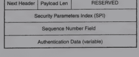

`AH` 格式中的所有字段必须始终存在，并包含在完整性检查值（ICV）的计算中。

### 封装安全载荷

使用 `ESP` 通过加密原始消息本身或原始数据包头部与载荷的组合，来保证原始消息中数据的完整性和机密性。

与 `AH` 一样，`ESP` 可用于传输模式或隧道模式，以提供加密和认证。传输模式仅适用于主机实现。它保护上层协议，但不保护 IP 头部。对于隧道模式，`ESP` 插入在 IP 头部之后以及诸如 TCP 和 UDP 等任何上层协议之前，或者在可能已插入的任何其他 `IPSec` 头部之前。在当前的 IPv4 TCP/IP 实现中，`ESP` 放置在 IP 头部之后，但位于上层协议之前。这使得 `ESP` 与不具备 `IPSec` 感知能力的硬件兼容。

`ESP` 的隧道模式可用于主机或安全网关。如果您部署安全网关，则必须使用 `ESP` 的隧道模式。在隧道模式下，内部 IP 头部携带正确的源地址和目标地址，而外部 IP 头部可能包含不同的 IP 地址，例如安全网关的地址。在隧道模式下，`ESP` 保护整个数据包，包括内部 IP 头部。`ESP` 数据包的位置与传输模式类似。

`ESP` 可以使用多种加密算法，包括 `3DES`、`DES`、`CAST128` 和 `Blowfish`，以提供安全服务。

> `传输模式和隧道模式`
>
> 在`传输模式`下，IPsec 网关是`受保护数据包的目的地`——一台机器充当自己的网关。在`隧道模式`下，IPsec 网关`为其他系统的数据包提供保护`。

`ESP` 插入在 IP 头部之后。在 IPv4 实现中，IP 头部包含协议号 50（`ESP`）。图 C.2 展示了 `ESP` 格式的示例。

#### 图 C.2

`ESP` 格式。

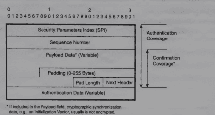

### 互联网密钥交换

互联网密钥交换，即 `IKE`，是 `IPsec` VPN 的重要组成部分。`IKE` 本身是一个混合协议，允许以受保护的方式协商和认证安全关联的密钥材料。`IKE` 由以下组件组成：

- `ISAKMP`——一种用于认证和密钥交换的框架。`ISAKMP` 旨在独立于密钥交换，以便支持许多不同的密钥交换。
- `Oakley`——一系列密钥交换，称为模式，以及每个模式提供的服务细节，如密钥的完全前向保密性、身份保护和认证。
- `SKEME`——一种提供匿名性、可否认性和快速密钥更新的密钥交换技术。

`IKE` 利用这些协议的部分来获取用于 `ISAKMP` 和其他安全关联（如 `AH` 和 `ESP`）的经过认证的密钥材料。许多 VPN 供应商使用 `ISAKMP/Oakley` 在 `IPsec` 设备之间执行密钥交换。

当主机需要建立彼此之间的连接时，`ISAKMP/Oakley` 在两个阶段工作。在第一阶段，主机通过创建双向 `ISAKMP` 安全关联来建立它们之间的安全通道。然后可以使用该通道进入下一阶段，以协商所需的 `IPsec` SA。完成此操作后，`IPsec` 可以使用已建立的 SA 提供其安全服务。当安全关联过期时，再次使用`ISAKMP/Oakley` 来协商新的 SA。

### 安全关联

为了拥有安全的流量，必须有两个安全关联——每个方向各一个。安全关联基本上是由高层 IP`Sec` 系统协商并由底层使用的一维信道。

安全关联由三样东西定义：

- 目标 IP 地址
- 协议（`AH` 或 `ESP`）
- 安全参数索引（`SPI`）

除非您在 VPN 网络的每一端创建两个或更多 SA，否则不能同时使用 `AH` 和 `ESP`。SA 可以以传输模式或隧道模式使用。传输模式的 SA 是两个主机之间的安全关联。隧道模式的 SA 是应用于 IP 隧道的安全关联。如果 SA 的任一端是安全网关，则该 SA 是隧道模式的安全关联。两个安全网关之间的安全关联始终是隧道模式 SA，就像主机和安全网关之间的 SA 一样。

## Linux 和 VPN 产品

既然您现在已经知道了理解 VPN 所需的大部分内容，是时候看看不同的 Linux VPN 产品以及在使用 VPN 与防火墙配合时需要解决的问题了。值得注意的是，Linux 2.6 内核系列现在也支持 IP`Sec`。

让我们首先来看看一些可用于 Linux 的 VPN 系统并讨论它们的优点。这绝非一个详尽的列表，但它确实是一个良好的起点。

### Openswan

`Openswan` 是一种开源的 VPN 软件实现，与 Linux 配合使用效果非常好。许多 Linux 发行版都包含 `Openswan`，包括 SUSE、Debian 和 Red Hat。`Openswan` 目前有两个主要的开发分支：适用于 2.6 之前的 2.X 内核的 1.X 分支，以及适用于 2.6 内核系列的 `Openswan` 2.X 开发分支。

`Openswan` 是较容易设置的 Linux VPN 软件实现之一。更多信息可在 `http://www.openswan.org/` 上找到。

### FreeS/WAN

Linux `FreeS/WAN` 是另一种适用于 Linux 的良好 IPSEC VPN 实现。`FreeS/WAN` 由 `http://www.freeswan.org` 维护和支持。

Linux `FreeS/WAN` 的名字来源于 SWAN（安全广域网）的一个变体。因为它是免费的，所以被称为 `FreeS/WAN`，以区别于各种 RSA 的 SWAN 实现。

`FreeS/WAN` 可以单独使用，也可以作为防火墙解决方案的一部分。事实上，该产品用于各种其他 IPSEC VPN 防火墙和路由器产品，也是某些 Linux 发行版的一部分。有一个开发版本适用于较新的内核，但发布版本保证仅在当前稳定系列的内核上工作。现有文档非常详尽，邮件列表也非常有帮助。

### 虚拟专用网守护进程

虚拟专用网守护进程（`VPND`）是一个网络守护进程，可以使用租用的线路或标准以太网上的 TCP/IP 连接两个网络。两个站点之间的所有流量都使用 `Blowfish` 算法进行加密。

`VPND` 有很多优点。它简单易于设置和使用，可能对于那些只是想安全地共享资源和数据而不希望经历太多麻烦的人来说是一个很好的解决方案。

然而，`VPND` 并非没有问题。首先，它没有更新以支持最新的内核，实际上在过去几年里并没有被积极开发或改进。您可以在 `http://sunsite.dk/vpnd/` 上找到有关 `VPND` 的更多信息。

## PPTP Linux 解决方案


如前所述，有几个 PPTP 解决方案正在积极开发中。如果存在安全问题，为什么要使用 PPTP 解决方案？为了在继续将 Linux 作为操作系统的同时，融入现有的 PPTP VPN 解决方案。

例如，如果您所在的公司使用 PPTP VPN 系统，而您偶尔在家工作，您可以使用 PPTP Linux 客户端连接到办公网络。同样，如果您在办公室并希望连接家里的 Linux 系统，您可以使用 PPTP VPN 客户端访问您的家庭网络。

## PoPTOP

PoToP 是由 Lineo 开发的 Linux PPTP VPN 服务器解决方案。此软件包需要新版本且经过修补的 PPP 才能正确工作。PoToP 是一个优秀的 PPTP“服务器”解决方案，可以与 Linux PPTP“客户端”以及标准 PPTP 客户端一起使用。您可以在 http://www.poptop.org/ 上找到更多信息，包括安装说明、邮件列表存档等。

## 虚拟隧道

另一种值得提及的产品是：虚拟隧道（VTUN）项目。VTUN 是一个开源项目，它在两台计算机或网络之间创建加密隧道。它可以运行在 TCP 或 UDP 上，并使用 Blowfish 和 3DES 等良好的加密算法来加密数据。

VTUN 处于积极开发中，并支持较新的内核。需求简单的人很适合研究此项目。有关 VTUN 的更多信息可在 http://vtun.sourceforge.net 上找到。

## VPN 配置

从这里开始，我将只讨论基于 IPSec 的 VPN 系统，因为我认为它们是最好的 VPN 解决方案，而且 IPSec 现在被视为行业的事实标准。花费大量时间讨论不同的 VPN 配置及其实际工作原理是有可能的。我在这里描述了最常见的配置。

### 漫游用户

让我们首先看看典型的 VPN 设置，其中有一个漫游的“客户端”机器和一个位于家庭网络上的 VPN 网关服务器。

假设您正在参加一个会议，偶尔想获取电子邮件并从家庭网络传输文件。通常，您会带一台笔记本电脑去参加会议。它可以是基于 Win32、Mac OSx 或 Linux 的笔记本电脑。您通过某种当地方式连接到互联网。然后您在笔记本电脑上启动 IPSec 软件，并将其指向您家中的 VPN 网关。客户端和 VPN 网关协商并交换认证密钥，然后您就像坐在服务器旁边一样访问您的网络。像这样的漫游用户通常被称为“道路战士”，即没有固定 IP 地址的用户。

在这种配置中，您的 VPN 网关必须启用 `/proc/sys/net/ip4/ip_forward` 中的 IP 转发，以允许路由到您的 LAN。您内部网络上的所有计算机都必须使用 IPSec 网关作为其默认网关，因为数据包需要来自您的 LAN 并到达您的笔记本电脑，以及从您的笔记本电脑发送到您的 LAN。

为了增添更多变化，你可以将 VPN 服务器配置为接受拨入连接，这样你甚至可以完全不通过互联网。

这个示例的关键点在于：用户必须执行某些操作，例如在笔记本电脑上启动一个程序，以发起 VPN 连接。如果是基于 Linux 的笔记本电脑，在连接到互联网后，你可能需要使用脚本来启动 IPsec 服务。

### 网络连接

让我们将前述情况与连接两个网络的情况进行对比。这两个网络可能位于不同的物理位置，或者仅仅是同一网络的两个独立子网。

在这种配置中，VPN 网关拥有在启动时运行 IPsec 服务的启动脚本。服务器之间会建立安全连接。两个网关都拥有指向对方网关的静态路由。从用户角度来看，他们不需要做任何事情即可在网络之间通信和共享信息。所有的通信都由 VPN 网关处理。在用户看来，网络 2 似乎与网络 1 处于同一个网络中。当然，这可能存在一定的简化，但本质上就是这样发生的。

> **认证**
>
> 需要注意的是，在这两种配置中，用户都没有经过认证。相反，运行 VPN 软件的计算机才经过了认证。这一点在双网络配置中尤为明显。在此处，网关彼此知晓，并对来自对方的流量进行认证。这一过程与我们今天熟悉的传统客户端/服务器思维和技术截然不同。

你可以设置比此处所示复杂得多的配置。然而，它们都有一些相似之处。在任何配置中，所有 VPN 网关都知晓其他 VPN 网关的路由。认证发生在网关级别，而不是用户级别。

## VPN 与防火墙

VPN 可以放置在防火墙之前、之后，或者作为防火墙实现的一部分。将 VPN 放置在防火墙之前并不常见。更常见的做法是使用防火墙/VPN 组合，或者将 VPN 放在防火墙之后。

将 VPN 系统与防火墙结合使用是较为灵活的解决方案之一。它需要的硬件更少，但遗憾的是，这也意味着存在单点故障。然而，必须强调，最佳解决方案是将 VPN 置于防火墙之后，或将其作为非军事区（DMZ）配置的一部分。独立设置防火墙和 VPN 是因为其安全性更高。如果潜在的攻击者设法攻破你的防火墙/VPN，你的网络以及远程网络都可能面临风险。你需要避免这个问题，并尽可能增加攻击者的难度。

如果你的防火墙也执行网络地址转换（NAT），你可能会在某些 VPN 配置中遇到麻烦。具体来说，你的防火墙必须配置为根据协议（GRE、AH、ESP）而不是仅根据端口来路由数据包。

无论处于哪种模式（传输模式或隧道模式），NAT/防火墙都与 AH 协议不兼容。使用 AH 的 IPsec VPN 会对发出的数据包进行数字签名，将哈希值附加到数据包中，并对数据负载和头部进行签名。AH 不加密数据包内容（数据负载）。如果 IPsec 端点之间存在 NAT/防火墙，它会将其自身的源地址或目标地址重写为其中之一（取决于 NAT 配置）。接收端的 VPN 试图通过计算自身的哈希值来验证入站数据包的完整性，并抱怨附加到数据包中的哈希值不匹配。VPN 不知道中间存在 NAT/防火墙，因此认为数据包已被篡改。

你可以使用带认证的 ESP 隧道模式。ESP 隧道模式将整个原始数据包（包括头部）封装在一个新的 IP 数据包中。新数据包的源地址是发送 VPN 网关的出站地址，目标地址是接收端 VPN 的入站地址。当使用带认证的 ESP 隧道模式时，数据包内容会被加密。被加密的内容（即原始数据包），而非新的头部，会用一个附加到数据包的哈希值进行签名。

完整性检查是基于原始头部加上原始负载的组合进行的。如果你使用的是带认证的 ESP 隧道模式，这些部分不会被 NAT/防火墙更改。

如果 NAT/防火墙阻止两个 VPN 网关使用 X.509 证书通过 ISAKMP/IKE 成功协商安全关联，它可能会干扰 IPsec（包括 AH 和 ESP）。如果两个 VPN 网关交换绑定每个网关身份与其 IP 地址的签名证书，NAT 地址重写将导致 IKE 协商失败。

正是出于这个原因，组合的 VPN 和防火墙配置变得如此流行。可以轻松地设置和维护管理此情况的规则。

## 总结

虚拟专用网络之所以受欢迎，是因为它们利用现有基础设施为最终用户提供无缝的网络体验。有多种 VPN 实现方式可供使用，它们利用了不同的协议来创建 VPN。正如你所期望的，Linux 有多种选择可用，包括 Openswan 和 PoPToP 等。

通过启用 NAT 的防火墙连接 VPN 时存在一些问题。这是因为 IPSec 基于 IP 头部创建数字签名，而在 NAT 过程中头部会被修改。

## 附录 D

## 术语表

本术语表定义了书中使用的术语和缩写。多词术语按术语中的主要名词字母顺序排列，后跟逗号及术语的其余部分。

- **ACCEPT**：防火墙过滤规则决策，表示允许数据包通过到其下一个目的地。
- **默认接受所有策略**：一种接受所有不匹配链中防火墙规则的数据包的政策。因此，大多数防火墙规则是定义默认接受策略例外的 DENY（拒绝）规则。
- **ACK**：TCP 标志，用于确认收到之前接收到的 TCP 段。
- **应用层网关**：*另见* 代理，应用层。常被称为 ALG，应用层（或层）网关是一个术语重载。在防火墙术语中，ALG 通常指检查应用负载中嵌入的地址和端口，并识别与会话相关的次要流的特定应用支持模块。
- **AUTH**：TCP 服务端口 113，与 **ident** 用户认证服务器相关联。
- **authentication**：确定实体是否为其声称的身份的过程。
- **authorization**：确定实体可以使用哪些服务和资源的过程。
- **bastion**：*另见* 防火墙，堡垒主机。
- **BIND**：Berkeley Internet Name Domain，DNS 协议的 Berkeley 实现。
- **BOOTP**：引导协议，无盘工作站使用它来发现其 IP 地址和引导服务器的位置，并在引导前通过 TFTP 发起系统下载。BOOTP 是为了替代 RARP 而开发的。
- **BOOTPC**：UDP 服务端口 68，与 BOOTP 和 DHCP 客户端相关联。
- **bootpd**：BOOTP 服务器程序。
- **BOOTPS**：UDP 服务端口 67，与 BOOTP 和 DHCP 服务器相关联。
- **border router**：位于网络边缘或边界处，用于路由数据包的设备。
- **broadcast**：寻址并发送到连接到相同网络或子网的所有接口的 IP 数据包。


- `CERT`：计算机应急响应团队，是在 1988 年互联网蠕虫事件后，在卡内基梅隆大学软件工程研究所成立的信息协调中心和互联网安全应急预防中心。

- `CGI`：通用网关接口。`CGI` 程序是由 Web 服务器代表远程客户端执行的本地程序。`CGI` 程序通常是 Perl 脚本，因此这些程序通常被称为 `CGI` 脚本。

- `chain`：定义哪些数据包可以进入以及哪些数据包可以通过网络接口传出的规则列表。

- `checksum`：通过对文件或数据包中每个字节的数值执行某些算术运算产生的数字。如果文件被修改，或者数据包损坏，针对同一对象生成的第二个校验和将与原始校验和不匹配。

- `choke`：另见 防火墙，`choke`。

- `chroot`：既是一个程序也是一个系统调用，它定义一个目录作为文件系统的根，然后执行一个程序，使其限制在该虚拟文件系统中运行。

- `circuit gateway`：另见 代理；电路级。

- `class, network address`：历史上，五种网络地址类别之一。`IPv4` 地址是一个 32 位的值。网络空间根据 32 位值中最显著的前 4 位的值，分为 A 类到 E 类地址。A 类网络地址空间映射 128 个独立网络，每个网络寻址超过 1600 万主机。B 类网络地址空间映射 16,384 个网络，每个网络寻址最多 64,534 个主机。C 类网络地址空间映射约 200 万个网络，每个网络寻址最多 254 个主机。D 类用于多播地址。E 类保留用于未指定或实验目的。网络类别在很大程度上已成为一个

`CIDR` 的简介。人们习惯性地称呼它们，因为其按字节边界的特性使得它们在示例中非常方便使用。

## 无类别域间路由

`CIDR` 用可变长度网络字段的替代了地址类别的概念，用于空间分配。作为可变长子网掩码概念的扩展，`CIDR` 旨在改进路由表的可扩展性，并解决中型组织因经典地址空间耗尽而导致的分配问题。

## 客户端/服务器模型

分布式网络服务的模型，其中一个集中式程序（服务器）为请求该服务的远程客户端程序提供服务，无论该服务是接收网页副本、从中央存储库下载文件、执行数据库查找、发送或接收电子邮件、对客户提供的数据执行某种计算，还是在两个人或更多人之间建立人类通信连接。

## 守护进程

在后台运行的基本系统服务服务器。

## `DARPA`

国防高级研究计划局。

## 数据链路层

在 `OSI` 参考模型中，第二层，表示两个相邻网络设备之间的点对点数据信号传输，例如从你的计算机到你的外部路由器的以太网帧传输。（在 `TCP/IP` 参考模型中，此功能包含在第一层，即子网层中。）

## 默认策略

防火墙规则集的一种策略——无论是过滤表中的 `INPUT` 链、`OUTPUT` 链还是 `FORWARD` 链——定义当数据包不匹配规则集中的任何规则时数据包的处理方式。另见 默认全部允许策略 和 默认全部拒绝策略。

## 拒绝服务攻击

一种基于发送意外数据或向你的系统发送大量数据包以中断或严重降低服务，使本地服务器忙到无法响应合法请求，或在最坏情况下完全使系统崩溃的攻击。

## 默认全部拒绝策略

一种策略，静默丢弃所有不匹配链中防火墙规则的数据包。大多数防火墙规则是定义默认拒绝策略例外的 `ACCEPT` 规则。

## `DHCP`

动态主机配置协议，用于动态分配 `IP` 地址，并向没有注册 `IP` 地址的客户端提供服务器和路由器信息。`DHCP` 的开发旨在取代 `BOOTP`。

## `DMZ`

非军事区，一个包含托管公共服务的主机的周边网络，与本地私有网络隔离。不太安全的公共服务器与私有 `LAN` 隔离。

## `DNS`

域名服务，一个全球互联网数据库服务，主要提供主机到 `IP` 和 `IP` 到主机的映射。

## `DROP`

防火墙过滤规则决定静默丢弃数据包，而不向发送者返回任何通知。`DROP` 与早期 Linux 防火墙技术中的 `DENY` 相同。

## 双宿主机

具有两个网络接口的计算机。另见 多宿主机。

## 动态分配地址

由中央服务器（如 `DHCP` 服务器）临时分配给客户端网络接口的 `IP` 地址。

## 以太网帧

在以太网网络中，`IP` 数据报封装在以太网帧中。

## 过滤器，防火墙

定义数据包 `IP` 和传输层头部特征的防火墙数据包过滤规则，如果匹配，则确定数据包是被允许通过网络接口还是被丢弃。过滤器根据数据包的源地址和目标地址、源端口和目标端口、协议类型、`TCP` 连接状态、`ICMP` 消息类型等字段定义。

## `finger`

用户信息查询程序。

## 防火墙

强制网络之间访问控制策略的设备或设备组。

## 防火墙，堡垒主机

通常，具有两个或更多网络接口的防火墙，并且是这些网络之间（最典型的是本地站点和互联网之间）的网关或连接点。由于堡垒主机防火墙是网络之间的单一连接点，因此堡垒主机要尽可能安全地保护。更一般地说，堡垒主机是远程站点可以直接访问的防火墙，无论是该主机连接网络还是保护提供公共服务的服务器。

## 防火墙，限制

具有两个或更多网络接口的 `LAN` 防火墙，是这些网络之间的网关或连接点。一侧连接到位于限制防火墙和堡垒网关防火墙之间的 `DMZ` 周边网络。另一个网络接口连接到内部私有 `LAN`。

## 防火墙，双宿主

单主机网关防火墙，要求本地用户特定地连接到防火墙机器才能从防火墙机器访问互联网，或者代理站点可访问的所有远程服务。在双宿主网关防火墙系统中，不允许在 `LAN` 和互联网之间传递任何流量。

## 防火墙，筛选主机

几乎与双宿主防火墙相同，单主机防火墙并不直接位于互联网和本地网络之间。筛选主机防火墙通过中间路由器或数据包过滤器与公共网络隔离。本地用户必须特定地连接到防火墙机器以访问互联网，或者通过防火墙机器上的代理。筛选路由器确保网络之间（或至少特定类型的）流量通过筛选主机。筛选主机防火墙与双宿主防火墙之间的主要区别在于防火墙在本地网络中的位置。

## 防火墙，筛选子网

包含网关防火墙、托管公共服务器的 `DMZ` 网络以及内部限制防火墙的防火墙系统，后者将 `LAN` 与 `DMZ` 和直接互联网访问隔离。公共服务不托管在限制防火墙上。

## 泛洪，数据包

一种拒绝服务攻击，其中向受害主机或网络发送给定类型的数据包数量超过受害者所能容纳的数量。

## 转发

在将一个计算机的数据包传递到另一个计算机的过程中，将数据包从一个网络路由到另一个网络。

## 分段

包含 `TCP` 段一部分的 `IP` 数据包。

## `FTP`

文件传输协议。用于在联网计算机之间复制文件的协议和程序。

## `FTP`，匿名

任何请求该服务的客户端都可以访问的 `FTP` 服务。

## `FTP`，认证

可访问预定义账户的 `FTP` 服务，使用前必须认证。

## 网关

作为两个网络之间通道或终止点和中继的计算机或程序。

## `hosts.allow, hosts.deny`

`TCP` 包装器的配置文件是 `/etc/hosts.allow` 和 `/etc/hosts.deny`。

## `HOWTO`

除了标准 `man` 手册页外，Linux 还包含由用户提供的关于众多主题的在线文档，涵盖多种语言并以多种格式提供。`HOWTO` 文档由 Linux 文档项目协调和维护。

## `HTTP`

超文本传输协议，用于 Web 服务器和浏览器。

## 集线器

用于物理连接多个网段、扩展物理网络距离或连接不同物理类型的网段的硬件信号中继器。

## `IANA`

互联网号码分配机构。

## 附录 D ：术语表

## `ICMP`

互联网控制消息协议。网络层 `IP` 状态和控制消息。

## `identd`

用户认证 (`AUTH`) 服务器。

## `IMAP`

互联网消息访问协议，用于从运行 `IMAP` 服务器的邮件主机检索邮件。

## `inetd`

监听服务器使用的服务端口传入连接的网络监督者。当连接请求到达时，`inetd` 启动请求服务器的副本以处理连接。默认情况下，`inetd` 已被称为 `xinetd` 的扩展版本取代。

## `IP` 数据报

`IP` 网络层数据包。

## `ipchains`

随着 Linux 中较新的 `IPFW` 防火墙机制实现的引入，取代 `ipfwadm` 的防火墙管理程序。`iptables` 附带一个 `ipchains` 兼容性模块，供希望继续使用其现有防火墙脚本的站点使用。

## `IPFW`

`IP` 防火墙机制，现已被 `Netfilter` 取代。

## `ipfwadm`

在引入 `ipchains` 之前，Linux `IPFW` 防火墙管理程序。`iptables` 附带一个 `ipfwadm` 兼容性模块，供希望继续使用其现有防火墙脚本的站点使用。

## `iptables`

Linux 中当前 `Netfilter` 防火墙机制的防火墙管理程序。

## `klogd`

内核日志守护进程，收集来自内核消息缓冲区的操作系统错误和状态消息，并与 `syslogd` 配合将消息写入系统日志文件。

## `LAN`

局域网。

## `localhost`

通常赋予机器回环接口在 `/etc/hosts` 中的符号名称。

## 回环接口

系统用于将发送到本地机器的本地生成网络消息传递的特殊软件网络接口，绕过硬件网络接口和相关网络驱动程序。

## `man` 手册页


标准 Linux 在线文档格式。手册页几乎为所有用户和系统管理程序、系统调用、库调用、设备类型和系统文件格式编写。

Linux。在 Netfilter 中，伪装（masquerading）指的是源 NAT 的一种特殊形式，用于连接那些动态分配临时 IP 地址且该地址倾向于随每个连接而变化的场景。

`MD5` 一种加密校验和算法，用于通过为对象创建称为消息摘要的数字签名来确保数据完整性。

`MTU` 最大传输单元，基于底层网络的包的最大尺寸。

`multicast（组播）` 专门寻址到 C 类 D 组播 IP 地址的 IP 数据包。组播客户端向中间路由器注册，以接收发往特定组播地址的数据包。

`multi homed（多宿主机/多网卡）` 拥有两个或更多网络接口的计算机。另见 `dual-homed（双宿主机）`。

`name server, primary（主名称服务器）` 某个域或域空间中某个区域的权威服务器。该服务器维护此区域的主机名和 IP 地址的完整数据库。

`name server, secondary（辅名称服务器）` 主名称服务器的备份或同级服务器。

`NAT` 网络地址转换，用某个其他网络接口的地址替换数据包的源地址或目的地址的过程。NAT 的主要目的是允许在不兼容的网络地址空间（例如，互联网内部和分配了私有地址的局域网之间）之间进行流量传输。

`Netfilter` 包含在 Linux 2.4 和 2.6 内核中的防火墙机制。

`netstat` 一个报告基于各种网络相关内核表的多种网络状态的程序。

`Network layer（网络层）` 在 OSI 参考模型中，这是第三层，代表两台计算机之间的端到端通信，例如将 IP 数据报从你的源计算机路由并传输到某个外部目的计算机。在 TCP/IP 参考模型中，这被称为第二层，即互联网层。

`NFS` 网络文件系统，用于在网络连接的计算机之间共享文件系统。

`NIS` 网络信息库，用于集中管理和提供用户账户及主机信息。

`nmap` 一种网络安全审计（即端口扫描）工具，包含了许多当今正在使用的新扫描技术。

`NNTP` 网络新闻传输协议，被 Usenet 使用。

`NTP` 网络时间协议，被 `ntpd` 和 `ntpdate` 使用。

`OSI (Open System Interconnection) reference model（OSI 开放系统互连参考模型）` 由国际标准化组织（ISO）开发的一种七层模型，旨在为网络互连标准提供框架或指南。

`OSPF` 用于 TCP/IP 的开放式最短路径优先路由协议，这是当今最常用的路由协议。

`packet（数据包）` 一个 IP 网络数据报。

`packet filtering（包过滤）` 参见 `firewall（防火墙）`。

`PATH` 定义 shell 应搜索哪些目录以查找未限定执行命令的 shell 环境变量，以及 shell 搜索这些目录的顺序。

`peer-to-peer（对等网络）` 用于两个服务器程序之间通信的通信模式。对等通信协议通常（但并非总是）不同于用于在服务器和客户端之间通信的协议。

`Physical layer（物理层）` 在 OSI 参考模型中，这是第一层，代表用于在两个相邻网络设备之间传输信号的物理介质，例如铜线、光纤、分组无线电或红外线。在 TCP/IP 参考模型中，这包含在作为第一层的子网层中。

`PID` 进程 ID，它是进程在系统上的唯一数字标识符，通常与系统进程表中进程的槽位相关联。

`ping` 一种简单的网络分析工具，用于确定远程主机是否可达且正在响应。Ping 发送 ICMP 回显请求消息。接收主机响应一个 ICMP 回显回复消息。

`POP` 邮局协议，用于从运行 POP 服务器的邮件主机接收邮件。

`port（端口）` 在 TCP 或 UDP 中，特定网络通信通道的数字标识符。端口分配由 IANA 管理。一些端口作为协议标准的一部分被分配给特定的应用通信协议。一些端口按惯例注册为与特定服务相关联。一些端口未分配，可供客户端和用户程序动态分配使用：
- `privileged（特权端口）` 范围为 0 到 1023 的端口。其中许多端口已由国际标准分配给应用协议。在 Linux 系统上，访问特权端口需要系统级权限。
- `unprivileged（非特权端口）` 范围为 1024 到 65535 的端口。其中一些端口按惯例注册供某些程序使用。此范围内的任何端口都可以被客户程序用于与网络服务器建立连接。

`port scan（端口扫描）` 对主机计算机的所有或一组服务端口的探测，通常是那些常与安全风险相关的安全端口。

`portmap` 一个 RPC 管理器守护程序，用于将客户端请求访问的特定 RPC 服务编号与该服务绑定到的服务端口进行映射。

`probe（探测）` 向主机计算机的服务端口发送某种数据包。探测的目的是确定目标主机是否生成了响应。

`proxy（代理）` 一个代表另一个程序创建和维护网络连接的程序，在客户端和服务器之间提供应用级通道。实际的客户端和服务器之间没有直接通信。代理对于客户端程序表现为服务器，对于服务器程序表现为客户端。应用代理通常分为应用网关和电路网关两类。

`proxy, application-level（应用级代理）` 特定服务的代理服务器。应用级网关代理理解其所代理的特定应用协议。代理能够检查应用有效载荷并基于应用层信息做出决策，而不仅仅是基于 IP 层和传输层信息做出决策。

`proxy, circuit-level（电路级代理）` 一种可以针对每个被代理的服务实现为单独的应用，或者实现为单一通用连接中继的代理服务器。电路级代理对应用协议没有具体的知识。代理基于包过滤防火墙所使用的相同 IP 和传输信息做出决策，可能附加一定程度的用户身份验证功能。

`QoS` 服务质量。

`RARP` 反向地址解析协议，开发用于使无盘机器能够基于其 MAC 硬件地址向服务器询问其 IP 地址。

`REJECT rule（拒绝规则）` 一种防火墙过滤规则决定，丢弃数据包并向发送者返回错误消息。

`resolver（解析器）` DNS 的客户端部分。解析器实现为链接到需要网络访问的程序库代码。DNS 客户端配置文件是 `/etc/resolv.conf`。

`RFC` 请求意见稿，通过互联网协会或互联网工程任务组发布的笔记或备忘录。一些 RFC 成为标准。RFC 通常涉及与互联网或 TCP/IP 协议套件相关的主题。

`RIP` 路由信息协议，一种至今仍在使用（尤其是在大型局域网内）的较旧的路由协议。`routed` 守护程序使用 RIP。

## 附录 D：术语表

`RPC` 远程过程调用。

`rule（规则）` 参见 `firewall` 和 `filter（防火墙）`，`firewall（防火墙）`。

`rulelevel（运行级别）` 取自 System V UNIX 的启动和系统状态概念。系统通常运行在 2、3 或 5 运行级别之一。运行级别 3 是默认的、正常的多用户系统状态。运行级别 2 类似于运行级别 3，但没有运行 `xinetd`、`portmap` 或网络文件系统（NFS）服务。运行级别 5 与运行级别 3 相同，但额外增加了 X 窗口显示管理器，该管理器提供基于 X 的登录和主机选择屏幕。

`screened host（屏蔽主机）` 参见 `firewall, screened-host（防火墙，屏蔽主机）`。

`screened subnet（屏蔽子网）` 参见 `firewall, screened-subnet（防火墙，屏蔽子网）`。

`script（脚本）` 一个包含 shell 或 Linux 程序命令的 ASCII 文件。这些脚本由 shell 程序（如 `sh`, `csh`, `bash`, `zsh`, 或 `ksh`）或程序（如 `perl`, `awk`, 或 `sed`）解释。

`segment, TCP（TCP 段）` 一个 TCP 消息。

`setgid` 一个程序，当执行时，假设该程序所有者的组 ID，而不是运行该程序的进程的组 ID。

`setuid` 一个程序，当执行时，假设该程序所有者的用户 ID，而不是运行该程序的进程的进程用户 ID。

`shell` 命令解释器，例如 `sh`, `csh`, `bash`, `zsh`, 和 `ksh`。

`SMTP` 简单邮件传输协议，用于在邮件服务器之间以及邮件程序和邮件服务器之间交换邮件。

`SNMP` 简单网络管理协议，用于从远程工作站管理网络设备配置。

`socket（套接字）` 由 IP 地址与特定 `TCP` 或 `UDP` 服务端口的配对定义的唯一网络连接点。

`SOCKS` 一种可从 NEC 获得的电路网关代理包。

`spoofing, source address（源地址欺骗）` 伪造 IP 包头中的源地址，使其看起来像是其他地址。

`SSH` 安全 shell 协议，用于经过身份验证的、加密的网络连接。


# SSL
`SSL` 安全套接字层协议，用于加密通信。`SSL` 最常用于 Web 服务器和浏览器交换电子商务个人信息。

## 静态分配地址
永久分配、硬编码的 IP 地址，无论是公共注册地址还是私有类别地址。

## 子网层
在 TCP/IP 参考模型中，第一层，它既表示用于在两个相邻网络设备之间传输信号所用的物理介质，也表示两个相邻网络设备之间的点对点数据信号传输，例如将以太网帧从你的计算机传输到你的外部路由器。

## SYN
TCP 连接同步请求标志。`SYN` 消息是寻求与另一个联网程序建立连接的程序发送的第一个消息。

## syslog.conf
系统日志守护程序的配置文件。

## syslogd
系统日志守护程序，它收集由使用 `syslog()` 系统调用发布消息的系统程序生成的错误和状态消息。

## TCP
传输控制协议，用于两个程序之间的可靠、持续的网络连接。

## TCP/IP 参考模型
一种非正式的网络通信模型，开发于 TCP/IP 在 20 世纪 70 年代末和 80 年代初成为 UNIX 机器之间互联网通信*事实*标准的时候。TCP/IP 参考模型并非正式的学术理想，而是基于制造商和开发人员最终就互联网通信达成一致的共识。

## tcp_wrapper
一种授权方案，用于控制网络中哪些本地服务对哪些远程主机可用。

## TFTP
简单文件传输协议，用于将启动映像下载到无盘工作站或路由器。该协议是基于 UDP 的 FTP 简化版本。

## 三次握手
TCP 连接建立协议。当客户端程序向服务器发送其第一个消息时，连接请求消息会设置 `SYN` 标志，并附带一个客户端将用作起点来为其发送的所有其他消息编号的同步序列号。服务器通过确认（`ACK`）`SYN` 消息进行响应，并附带其自身的同步请求（`SYN`）。服务器包括客户端的序列号加上收到的连续数据字节数加 1。确认的目的是确认客户端通过其序列号引用的消息。与客户端的第一个消息一样，`SYN` 标志附带一个同步序列号。服务器正在传递其连接半边的自身起始序列号。客户端通过确认服务器的 `SYN-ACK` 进行响应，将服务器的序列号加上收到的连续数据字节数加 1，以表示已收到该消息。连接已建立。

## TOS
服务类型，IP 数据报报头中的一个字段，旨在提供首选路由策略或数据报路由偏好的提示。

## traceroute
一种网络分析工具，用于确定一台计算机到另一台计算机跨越网络的路径。

## 传输层
在 OSI 参考模型中，第四层，表示两个程序之间的端到端通信，例如将数据报从客户端程序传输到服务器程序。在 TCP/IP 参考模型中，这被称为第三层，也是传输层。然而，TCP/IP 第三层的传输级抽象包括 OSI 第五层会话层的概念，其中包括有序和同步的消息交换概念。

## TTL
生存时间，IP 数据报报头中的一个字段，是数据报在到达其目的地之前可以经过的路由器的最大计数。

## UDP
用户数据报协议，用于在程序之间发送单独的网络消息，不保证交付或交付顺序。

## 单播
点对点发送的 IP 数据报，从一台计算机的网络接口发送到另一台计算机的网络接口。

## UUCP
UNIX 到 UNIX 复制协议。

## 全局可读
文件系统对象——文件、目录和整个文件系统——可以被系统上的任何账户或程序读取。

## 全局可写
文件系统对象——文件、目录和整个文件系统——可以被系统上的任何账户或程序写入。

## X Windows
Linux 图形用户界面窗口显示系统。

## 索引

### 符号
- `[]`（方括号），75
- `:`（冒号），75
- `|`（管道符），75
- `0.0.0.0` IP 地址，116

### A
- 滥用，报告，325
- 默认接受所有策略，37
- 访问
  - DHCP 服务器，162-165
  - 对 FTP 服务器的传入访问
    - 传入 FTP 请求，152
    - 被动模式 FTP 数据通道响应，153
    - 端口模式 FTP 数据通道响应，152
  - 对本地服务器的传入访问，146
  - 传出，客户端对远程 FTP 服务器的访问，150-152
  - 远程访问，145
    - 作为客户端，154
  - 网络时间服务器，165-166
  - SSH 服务器，147-148

### 访问决策
- 访问决策（SELinux），400
- `ACK` 标志，22, 29, 43, 182
- `ACL` 选项（GrSec），418
- 动作（SELinux），400
- 地址解析协议（ARP），24
- 地址空间保护（GrSec），417

### 地址
- 目的地址
  - 分支，186
  - `iptables`，104–105
- 以太网地址，24–25
- 非法地址，39–41
- IP 地址，12–16
- 应避免的地址，39–41
- 分配，118
- 广播地址，13–17
- 类别，13, 39–40
- 以符号名称表示，105
- 报头，14
- 安装防火墙，176
- 有限广播地址，13
- 环回地址，13
- 多播，15
- 网络地址 0，13, 116
- 网络定向广播地址，13
- 子网划分以创建多个网络，223
- 单播，15
- 链路本地网络地址，40
- 环回接口地址，40
- 畸形广播地址，40
- 多播目的地址，117
- 范围，225
- 源地址
  - `iptables`，104–105
  - 源地址检查，绕过，201
  - 欺骗，39–41, 114–119, 238–239
- `TEST-NENT` 地址，40
- `addrtype` 过滤表匹配扩展，93–94
- 高级入侵检测环境。参见 `AIDE`
- `AIDE`（高级入侵检测环境）
  - 检查类型，396–398
  - 配置文件
    - 创建，384–386
    - 示例，386–387
  - 数据库更新，390–391
  - 初始化，387
  - 安装，383
  - 宏，394–395
  - 使用其监视文件系统，388–390
  - 报告，自定义，391–393
  - 调度以自动运行，388
  - 详细输出，393
- 警报（Snort），376
- `ALGs`（应用层网关），32
- IP 地址分配，118
- 允许 DNS，124–127
  - 作为客户端的 DNS 查询，127–128
  - 作为转发服务器的 DNS 查询，128–130
  - 区域传输，125
- 美国互联网号码注册机构（ARIN），326
- `APNIC`（亚太互联网信息中心），326

### 链
- 应用层网关（ALGs），32
- **《应用密码学》**，398
- `ARIN`（美国互联网号码注册机构），326
- `ARP`（地址解析协议），24
- `ARPWatch`，332, 347, 377–379
- 亚太互联网信息中心（APNIC），326
- 分配
  - 地址，118
  - 端口号，119
- 攻击
  - 检测。参见入侵检测
  - 预防
    - Bastille Linux，341
    - 内核增强，340
    - 渗透测试，342–344
    - 测试，342–344
    - 更新，341–342
- 审计（GrSecurity），418
- `AUTH` 客户端，131
- `AUTH` 请求，过滤，131–132, 246
- 身份验证
  - IPsec 身份验证报头，477–478
  - VPN，483

### B
- `BALANCE` nat 表目标扩展，97
- Bastille Linux，341
- 堡垒防火墙，7
- 双向 NAT，71, 263
- `BIND`，128–130
- 阻止
  - 对非特权端口的尝试，119
  - 定向广播，116
  - 问题站点，41
- 启动过程，启动防火墙
  - Debian，175–176
  - Red Hat 和 SUSE，175
- 边界路由器，31
- 方括号 `[]`，75
- 分支用户定义链，186
- 广播地址，13–17
- 广播（IP），17–18
- BSD 远程访问命令，59
- 缓冲区溢出，54
- 绕过
  - 规则检查，113–114, 238
  - 源地址检查，201

### C
- 捕获
  - FTP 会话，363
  - HTTP 会话，356–361
  - ICMP ping，364
  - SMTP 会话，361–362
  - SSH 会话，362
- `CERT`，向其报告事件，326
- 链，33。另见用户定义链
  - 规则上的链命令，77
  - 安装，192–195
  - `POSTROUTING`，267
  - `PREROUTING`，267

### 通道
- 被动模式 FTP 数据通道，151-153
- 主动模式 FTP 数据通道，151-152

### 收费服务，52

### 检查类型 (`AIDE`)，396-398

### 检查
- 转发规则，298-300
- 入站规则，295-296


- 开放端口，307-308
  - fuser，311
  - netstat，308-310
  - nmap，312
  - strobe，311-312
- 出站规则，296-298
- 绑定到特定端口的进程，311

## 校验和，382

## Chkrootkit，332-333
- 下载，333
- 局限性，335-336
- 应对感染，334-335
- 运行，333-334
- 安全性，336-337
- 系统二进制文件，336-337
- 何时使用，337

## 遏制型防火墙，232
- 到远程 FTP 服务器的导管/客户端，253
- 常量，234
- 默认策略，236
- 将 DMZ 配置作为私有名称服务器，244-245

## 电子邮件
- IMAP 客户端，248
- POP 客户端，247
- 启用回环接口，237
- 转发器和 Web 客户端，254
- 本地 DHCP 服务器，256-257
- NNTP 客户端 DMZ 配置，249
- 移除现有规则，235
- 公共 Web 服务器，255
- iptables 遏制型防火墙示例（代码列表），463-474
- 准备阶段，234-235
- SMTP 客户端配置，247
- SSH 配置，251

## CIDR（无类别域间路由），15
- A 类地址，39-40
- B 类地址，39
- C 类地址，39
- D 类地址，40
- E 类地址，40
- 无类别域间路由 (CIDR)，15

## 无类别子网划分，15

## 客户端
- AUTH 客户端，131
- DNS 查找，127-128
- 出站客户端访问远程 FTP 服务器
  - 通过控制通道的出站 FTP 请求，150
  - 被动模式 FTP 数据通道，151-152
  - 主动模式 FTP 数据通道，151

## 远程客户端
- 电子邮件，141-142
- 为其托管 Usenet 新闻服务器，143-144
- 远程站点访问，145
- SSH 服务器访问，147-148

## 冒号 ( :)，75

## 命令。见具体命令名称

## 编译内核，403-411

## 被入侵的系统。见入侵检测

## config 选项 (make 命令)，407

## 配置
- AIDE (Advanced Intrusion Detection Environment)，384-387
- 遏制型 NNTP 客户端 DMZ，249
- 遏制型 SMTP 客户端，247
- 遏制型 SSH，251
- 网关 NNTP 导管，248
- 网关 SSH，250
- GrSecurity (Greater Security)，417
  - ACL 选项，418
  - 地址空间保护，417
  - 可执行文件保护，418
  - 文件系统保护，418
  - 内核审计，418
  - 日志记录选项，419
  - 网络保护，419
  - PaX Control，417
  - 安全级别，417
  - Sysctl 支持，419
- 内部局域网，226-227
- 入侵检测，318
- 大型或信任度较低的局域网，222-223
- 选择性内部访问，225
- 通过子网划分创建多个网络，223-225
- 多个局域网，227-231
- Sever DMZ，248
- Snort，373, 375
- syslog，300-303
- 信任的家庭局域网，218-219
- 局域网访问网关防火墙，220
- 局域网访问其他局域网，221-222
- VPN
  - 网络连接，483
  - 漫游用户，482-483

## 面向连接的协议，11-12

## 连接状态，113-114

## 连接跟踪链，188, 205-206

## 无连接协议，11-12

## 常量，232-233
- 私有遏制型防火墙，234
- 防火墙示例中使用的符号常量，107

## 控制通道，150

## 控制消息 (ICMP)，166-168

## 对话，使用 TCDump 捕获
- DNS 查询，363
- FTP，363
- HTTP，356-361
- ping，364
- SMTP，361-362
- SSH，362

## 将网关防火墙从本地服务转换为转发，258

## Cricket，330

## 自定义内核，104

## 自定义 AIDE (Advanced Intrusion Detection Environment) 报告，391-393

## 守护进程，25
- ntpd，165-166
- 状态报告，317
- syslogd，300
- VPND，481

## DARPA 模型，11

## 数据库，AIDE (Advanced Intrusion Detection Environment)，390-391

## 数据链路层 (OSI 模型)，10

## Debian 防火墙，开机启动，175-176

## 调试，174-175
- 检查防火墙规则
  - 转发规则，298-300
  - 入站规则，295-296
  - 出站规则，296-298
- 列出防火墙规则，284-285
- 过滤表列表格式，285-292
- 修饰表列表格式，293-294
- NAT 表列表格式，291
- 系统日志，300
  - 防火墙日志消息，304-307
  - syslog 配置，300-303
- 技巧，281-284

## 默认策略
- 定义，111, 236
- 包过滤防火墙，35-37
- 规则，112

## 非军事区。见 DMZ

## 拒绝服务攻击，324
- 考虑领域，55
- “拒绝服务”（论文），48

## 入站数据包
- 缓冲区溢出，54
- 分片炸弹，53-54
- ICMP SYN 重定向炸弹，54-55
- Ping 泛洪，50
- 死亡之 Ping，50-51
- TCP SYN 泛洪，48-50
- UDP 泛洪，52
- Smurf 攻击，169, 367

## 默认拒绝一切策略，36, 120

## 拒绝
- 访问问题站点，172-173
- 数据包，38

## 目标地址
- 分支，186
- iptables，104-105

## 目标 NAT。见 DNAT

## 目标不可达消息，168

## 目标地址检查链，188, 208

## 检测入侵，315-317, 329, 345-347
- AIDE (Advanced Intrusion Detection Environment)
  - 检查类型，396-398
  - 配置文件，384-387
  - 数据库更新，390-391
  - 初始化，387
  - 安装，383
  - 宏，394-395
  - 使用其监控文件系统，388-390
  - 报告，自定义，391-393
  - 安排自动运行，388
  - 详细输出，393
- ARPWatch，347, 377-379
- Chkrootkit，332-333
  - 下载，333
  - 局限性，335-336
  - 应对感染，334-335
  - 运行，333-334
  - 安全性，336-337
  - 系统二进制文件，336-337
  - 何时使用，337
- 文件系统，318-319, 337-338
- 事件报告，322-323
  - 其优点，323
  - 拒绝服务攻击，324
  - 事件类型，324-325
  - 包含的信息，326-327
  - 在线资源，327
  - 向何处报告事件，325-326
- 日志监控，338-340
- 网络分析工具，329-332
  - ARPWatch，332
  - Cricket，330
  - MRTG，330
  - ntop，330
  - 嗅探器放置，332
  - Snort，330
  - 交换机/集线器，331-332
  - TCPDump，329-330
- 渗透测试
  - Hping2，343
  - Nessus，344
  - Nikto，343-344
  - Nmap，342-343
- 防止攻击
  - Bastille Linux，341
  - 内核增强，340
- 渗透测试，344
- 更新，341-342
- 应对，320-322
- 安全审计工具，320
- Snort，347, 371-372
  - 警报，376
  - 配置，373-375
  - 下载，372
  - 安装，372-373
  - Swatch，376
  - 测试，375-376
- 系统配置，318
- 系统日志，317-318
- 系统性能，320
- TCPDump，347-348
  - 异常数据包活动，364-365
  - 命令行选项，350-351
  - 捕获 DNS 查询，363
  - 下载，349


- 表达式，352-354
- 捕获 FTP 对话，363
- 捕获 HTTP 对话，356-361
- 捕获 ICMP ping，364
- 安装，349
- LAND 攻击，368-369
- 正常扫描 (nmap) 攻击，365-367
- 记录流量，369-371
- 捕获 SMTP 对话，361-362
- Smurf 攻击，367
- 捕获 SSH 对话，362
- Xmas Tree 攻击，368
- 用户账户，319
- 开发防火墙，281-284

## DHCP (动态主机配置协议)
- 遏制型防火墙作为本地 DHCP 服务器，256-257
- 消息，162-163
- 协议，163
- 服务器，访问，162-165

## DHCPACK 消息，162

## DHCPDECLINE 消息，163

## DHCPDISCOVER 消息，162

## DHCPINFORM 消息，163

## DHCPNAK 消息，162

## DHCPOFFER 消息，162

## DHCPRELEASE 消息，163

## DHCPREQUEST 消息，162

## 差异化服务 (DS) 字段，92

## 差异化服务控制协议 (DSCP)，92

## 有向广播，阻止，116

## 方向限定符 (TCPDump)，353-354

## 指令 (AIDE)，384-385

## DMZ (非军事区)，215
- 遏制型 DMZ 配置作为私有名称服务器，244-245
- 名称服务器的网关配置，243-244
- 实现，231-232
- 公共 Web 服务器，255
- Web 代理，255-256

## DNAT (目标 NAT)，69, 270
- 主机转发，274-275
- 端口重定向，275-276
- 到服务器群，276
- 到私有地址 DMZ 中的服务器，277-278
- 本地端口重定向，279-280
- nat 表目标扩展，96-97
- 端口重定向，275-276
- REDIRECT DNAT，271
- 标准 DNAT，270

## DNS (域名系统)，24
- BIND 端口使用，129
- 启用，124-127, 241-243
- 遏制型 DMZ 配置，244-245
- DMZ 名称服务器网关配置，243-244
- 作为客户端的 DNS 查找，127-128
- 作为转发服务器的 DNS 查找，128-130
- 区域传输，125
- 使用 TCPDump 捕获查询，363
- 流量，195-197

## 域名系统。见 DNS

## DoS 攻击。见拒绝服务攻击

## 下载
- Chkrootkit，333
- GrSecurity (Greater Security)，405
- Snort，372
- TCPDump，349

## 丢弃的数据包，记录，258
- 入站数据包，170-172
- 优化示例，208-210
- 出站数据包，172

## 丢弃伪组播网络数据包，117

## DS (差异化服务) 字段，92

## DSCP (差异化服务控制协议)，92

## dstlimit 过滤表匹配扩展，85-86

重复防火墙日志消息，304

**动态主机配置协议（DHCP）。** 参见 DHCP

动态 IP 地址，176

## E

回显服务，52

**echo-reply（回显应答）消息**，169-170，240

**echo-request（回显请求）消息**，108，169-170，240

**电子邮件**，133
- 客户端/服务器电子邮件组合，137
  - DMZ，246-248
  - IMAP，133-137，248
  - POP，133-136，247
  - 远程客户端，141-142
  - SMTP，133-134
  - SMTP 客户端，137-140
  - SMTP 服务器，134-136，140-141
- “电子邮件轰炸与垃圾邮件”，55

**启用**
- DNS，124-127，241-243
  - 阻塞型 DMZ 配置，244-245
  - DMZ 名称服务器网关配置，243-244
  - 作为客户端的 DNS 查询，127-128
  - 作为转发服务器的 DNS 查询，128-130
  - 区域传输，125
- 互联网服务，124，130-132
- 内核监控支持，108-109
- 环回接口，111，237
- 出站 tracroute 请求，161

**封装安全载荷 (ESP)**，478

**端到端透明性**，8

**ESP** (封装安全载荷)，478

**ESTABLISHED 匹配**，88，182

**以太网地址**，24-25

**可执行文件保护** (GrSec)，418

**表达式** (TCPDump)
- 方向限定符，353-354
  - 原始语句，354
  - 协议限定符，354
  - 类型限定符，352-353

**EXT**，189

**EXT-icmp-in**，189，203-204

**EXT-icmp-out**，189，203-204

**EXT-input**，188，195
- DNS 流量，195-197
  - ICMP 流量，203-204
  - 基于 TCP 的本地客户端流量，197-200
  - 基于 UDP 的本地客户端流量，201-202
  - 基于 TCP 的本地服务器流量，200-201

**EXT-log-in 链**，189

**EXT-log-out 链**，189

**EXT-output**，189，195
- DNS 流量，195-196
  - ICMP 流量，203-204
  - 基于 TCP 的本地客户端流量，197-200
  - 基于 UDP 的本地客户端流量，201-202
  - 基于 TCP 的本地服务器流量，200-201

## F

**文件传输协议 (FTP)。** 参见 FTP

**文件 (日志)。** 参见日志记录

## 文件系统完整性
- **文件系统完整性**，337-338，381
  - AIDE (高级入侵检测环境)
    - 检查类型，396-398
    - 配置文件，384-387
    - 数据库更新，390-391
    - 初始化，387
    - 安装，383
    - 宏，394-395
    - 使用其监控系统，388-390
    - 报告，自定义，391-393
    - 调度以自动运行，388
    - 详细输出，393
  - 校验和，382
  - 定义，381
  - GrSec，418
  - 入侵检测，318-319
  - Tripwire，381
- **过滤表**，68-69，74-75
  - addrtype 过滤表匹配扩展，93-94
  - 默认过滤表扩展，85-86
  - 过滤表匹配扩展，80-81
  - icmp 过滤表匹配运算符，79-80
  - limit 过滤表匹配扩展，84-85
  - 列表格式
    - iptables -l -L INPUT，285-287
    - iptables -n -L INPUT，287-288
    - iptables -v -l -L INPUT，289-290
  - mac 过滤表匹配扩展，90
  - mark 过滤表匹配扩展，91
  - 匹配操作，77-78
  - multiport 过滤表匹配扩展，82-84
  - 对整个链的操作，76
  - 对规则的操作，77
  - owner 过滤表匹配扩展，90-91
  - state 过滤表匹配扩展，86-90
  - 目标扩展，81
  - tcp 过滤表匹配操作，79
  - tos 过滤表匹配扩展，91-92
  - udp 过滤表匹配操作，79
  - ULOG 表目标扩展，81-82
  - unclean 过滤表匹配扩展，92-93
  - orange 过滤表匹配，94
- **过滤。** *另见* 拒绝服务攻击
  - AUTH 请求，131-132，246
  - FTP，150
  - ICMP 控制消息，240
  - 入站数据包，33-38
    - 链，33
    - 默认策略，35-37
    - 通用端口扫描，44
    - 入站 TCP 连接状态过滤，43
    - iptables，102-103
    - 本地目的地址过滤，42
    - 本地目的端口过滤，43
    - 端口扫描，47-48
    - 远程源地址过滤，38-41
    - 远程源端口过滤，43
    - 源路由数据包，56
    - 隐蔽扫描，46
    - 目标端口扫描，44-46
  - 出站数据包，56
    - 本地源地址过滤，57
    - 本地源端口过滤，58


## F

- 出站 TCP 连接状态过滤，59
- 远程目的地址过滤，57-58
- 远程目的端口过滤，58
- `rp` 过滤器，109

**`FIN` 标志**，22

**防火墙日志消息**
- 重复，304
- TCP 示例，304-305
- UDP 示例，306-307

**防火墙规则。** 参见规则

**首个匹配规则优先**，112

**标志**
- `ACK`，43
- TCP 状态标志，112-113，237

**泛洪**
- ping 泛洪，50
- TCP SYN 泛洪，48-50
- UDP 泛洪，52

**`FORWARD` 链**，74

**`FORWARD` 策略**，111

**`FORWARD` 规则**，272

**转发**，266
- 将网关防火墙从本地服务转换为转发，258
- 多个 LAN 之间的本地流量，221-222
- 通过网关传输邮件，246-247
- 规则检查，298-300

**分片**，16-17
- 入站数据包的分片炸弹，53-54
- 分片的 ICMP 消息，167

**Free/SWAN**，481

**`FTP` (文件传输协议)**，148-149，251
- 作为通向远程 FTP 服务器/客户端的阻塞防火墙通道，253
- 使用 `TCPDump` 捕获对话，363
- 网关防火墙
  - 远程 FTP 服务器，251-252
  - FTP DMZ 服务器，253
- 对 FTP 服务器的入站访问
  - 入站 FTP 请求，152
  - 被动模式 FTP 数据通道响应，153
  - 端口模式 FTP 数据通道响应，152
- 对 FTP 服务器的出站访问
  - 通过控制通道的出站 FTP 请求，150
  - 被动模式 FTP 数据通道，151-152
  - 端口模式 FTP 数据通道，151
- 数据包过滤，150
- 端口模式，150
- 协议，150
- `TFTP`，153

**`fuser`**，311

## G

**网关防火墙**，215-217，231
- `ALGs` (应用层网关)，32
- 通向 FTP DMZ 服务器的通道，253
- 本地 Web 客户端的通道，254
- 通向远程 FTP 服务器的通道，251-252
- 从本地服务转换为转发，258
- 通过其转发邮件，246-247
- `NNTP` 通道和服务器 DMZ 配置，248
- 公共 DMZ 名称服务器，243-244
- 为其奠定基础，234-235
- SSH 配置，250

**通用端口扫描**，44

**`GrSec`** (增强安全)，401，405
- ACL 选项，418
- 地址空间保护，417
- 构建，419-420
- 下载，405
- 可执行文件保护，418
- 文件系统保护，418
- 应用 GrSec 补丁，416
- 内核审计，418
- 日志记录选项，419
- 网络保护，419
- `PaX` 控制，417
- `RBAC` (基于角色的访问控制)，421
- 安全级别，417
- Sysctl 支持，419
- 网站，421

## H

**`-h` 帮助命令**，76

**报头**
- IP，14
- IPsec 认证报头，477-478
- TCP (传输控制协议)，20-22

**NAT 的历史**，261-262

**主机转发** (`DNAT`)，274-275
- 端口重定向，275-276
- 到服务器群，276
- 到私网地址 DMZ 中的服务器，277-278

**主机类型限定符** (`TCPDump`)，352

**托管**
- IMAP 服务器，142
- POP 服务器，141
- Usenet 新闻服务器，143-144

**主机名**，24

**“如何从 CGI 中用户提供的数据中移除元字符”**，54

**`Hping2`**，343

**`HTTP`** (超文本传输协议)
- 访问远程网站，154-155
- 使用 `TCPDump` 捕获对话，356-361

**集线器**，331-332

## I

**`IANA`** (互联网号码分配机构)，25
- IP 地址注册和分配，118
- 端口号分配，119

**`ICMP`** (互联网控制报文协议)，18-19
- 控制和状态消息，166-167
- 目的不可达，168
- 回显应答，240
- 回显请求，108，240
- 分片消息，167
- 参数问题，168
- 源抑制，167
- 超时，168，240
- `icmp` 过滤表匹配运算符，79-80
- ping 消息
  - 使用 `TCPDump` 捕获，364
  - 入站 ping，169-170
  - 出站 ping，169
- 重定向消息，54–55, 108
- 规则组织，183
- 流量，203–204

**`ICV`** (完整性校验值), 478

**`ident` 协议, 130–131**

**`IKE`** (Internet Key Exchange, 互联网密钥交换), 477–479

**非法地址, 39–41**

**`IMAP`** (Internet Message Access Protocol, 互联网消息访问协议), 133–134
- 为远程客户端托管 IMAP 服务器, 142
- 电子邮件，接收, 136–139, 248

**事件, 报告**
- 优势, 323
- 拒绝服务攻击, 324
- 事件类型, 324–325
- 包含的信息, 326–327
- 在线资源, 327
- 事件报告地点, 325–326

**传入的 Destination Unreachable (目标不可达) 消息, 167**

**传入数据包**
- 拒绝服务攻击, 324
- 考虑领域, 55
- 缓冲区溢出, 54
- 分片炸弹, 53–54
- ICMP 重定向炸弹, 54–55
- Ping 泛洪, 50
- 死亡之 Ping, 50–51
- Smurf 攻击, 169, 367
- TCP SYN 泛洪, 48–50
- UDP 泛洪, 52
- 过滤
  - 传入 TCP 连接状态过滤, 43
  - 本地目标地址过滤, 42
  - 本地源端口过滤, 43
  - 远程源地址过滤, 38–41
  - 远程源端口过滤, 43
  - 源路由数据包, 56
- `iptables`, 70
  - 限制到选定的远程站点, 41
  - 探测, 43
  - 扫描, 43
    - 通用端口扫描, 44
    - 响应端口扫描, 47–48
    - 隐蔽扫描, 46
    - 目标端口扫描, 44–46

**传入 TCP 连接状态过滤, 43**

**初始化**
- `AIDE` (Advanced Intrusion Detection Environment, 高级入侵检测环境), 387
- 防火墙, 106–107
  - 定义默认策略, 111
  - 内核监控支持, 108–109
  - 环回接口, 111
  - 优化示例, 190–192
  - 删除现有规则, 109–110
  - 绕过规则检查, 113–114
  - 源地址欺骗, 114–119
  - 隐蔽扫描, 112–113
  - 符号常量, 107
  - TCP 状态标志, 112–113

**输入规则，检查, 295–296**

**安装**
- `AIDE` (Advanced Intrusion Detection Environment, 高级入侵检测环境), 383
- 链, 192-195
- 防火墙, 173-176
- 内核, 412-414
- `Snort`, 372-373
- `TCPDump`, 349

**完整性校验值 (`ICV`), 478**

**文件系统完整性, 337-338, 381**
- `AIDE` (Advanced Intrusion Detection Environment, 高级入侵检测环境)
  - 检查类型, 396-398
  - 配置文件, 384-387
  - 数据库更新, 390-391
  - 初始化, 387
  - 安装, 383
  - 宏, 394-395
  - 使用它监控文件系统, 388-390
  - 自定义报告, 391-393
  - 计划自动运行, 388
  - 详细输出, 393
- 校验和, 382
- 定义, 381
- Tripwire, 381

**内部瓶颈防火墙。参见 瓶颈防火墙**

**Internet Assigned Numbers Authority (互联网号码分配机构)。参见 `IANA`**

**Internet Control Message Protocol (互联网控制消息协议)。参见 `ICMP`**

**Internet Key Exchange (互联网密钥交换) (`IKE`), 477-479**


## Internet Message Access Protocol (互联网消息访问协议)
参见 `IMAP`

## Internet Protocol (互联网协议)
参见 `IP`

## 互联网服务
启用, 124, 130-132。另见 `DNS` (Domain Name System, 域名系统)

## 入侵检测
315-317, 329, 345-347

- `AIDE` (Advanced Intrusion Detection Environment, 高级入侵检测环境)
  - 检查类型, 396-398
  - 配置文件, 384-387
  - 数据库更新, 390-391
  - 初始化, 387
  - 安装, 383
  - 宏, 394-395
  - 使用它监控文件系统, 388-390
  - 自定义报告, 391-393
  - 计划自动运行, 388
  - 详细输出, 393
- `ARPWatch`, 347, 377-379
- `Chkrootkit`, 332-333
  - 下载, 333
  - 局限性, 335-336
  - 响应感染, 334-335
  - 运行, 333-334
  - 安全性, 336-337
  - 系统二进制文件, 336-337
  - 使用时机, 337
- 文件系统, 318-319, 337-338
- 事件报告, 322-323
  - 优势, 323
  - 拒绝服务攻击, 324
  - 事件类型, 324-325
  - 包含的信息, 326-327
  - 在线资源, 327
  - 事件报告地点, 325-326
- 日志监控, 338-340
- 网络分析工具, 329-332
  - `ARPWatch`, 332
  - `Crickit`, 330
  - `MRTG`, 330
  - `mtop`, 330
  - 嗅探器放置, 332
  - `Snort`, 330
  - 交换机/集线器, 331-332
  - `TCPDump`, 329-330
- 渗透测试
  - `Hping2`, 343
  - `Nessus`, 344
  - `Nikto`, 343-344
  - `Nmap`, 342-343
- 预防攻击
  - `Bastille Linux`, 341
  - 内核增强, 340
  - 渗透测试, 344
  - 更新, 341-342
- 响应, 320-322
- 安全审计工具, 320
- `Snort`, 347, 371-372
  - 警报, 376
  - 配置, 373-375
  - 下载, 372
  - 安装, 372-373
  - `Swatch`, 376
  - 测试, 375-376
- 系统配置, 318
- 系统日志, 317-318
- 系统性能, 320
- `TCPDump`, 347-348
  - 异常数据包活动, 364-365
  - 命令行选项, 350-351
  - 捕获 DNS 查询, 363
  - 下载, 349
  - 表达式, 352-354
  - 捕获 FTP 会话, 363
  - 捕获 HTTP 会话, 356-361
  - 捕获 ICMP ping, 364
  - 安装, 349
  - `LAND` 攻击, 368-369
  - 正常扫描 (`nmap`) 攻击, 365-367
  - 记录流量, 369-371
  - 捕获 SMTP 会话, 361-362
  - `Smurf` 攻击, 367
  - 捕获 SSH 会话, 362
  - 圣诞树攻击, 368
- 用户账户, 319

## IP (Internet Protocol, 互联网协议)
另见 `IPsec`
- 地址, 12-16
- 分配, 118
- 广播地址, 13-17
- 类别, 13, 39-40
- 以符号名称表示, 105
- 报头, 14
- 安装防火墙, 176
- 有限广播地址, 13
- 环回地址, 13
- 多播, 15
- 网络地址 0, 13, 116
- 网络定向广播地址, 13
- 子网划分以创建多个网络, 223
- 单播, 15
- 广播, 17-18
- 以太网地址, 24-25
- 分片, 16-17
- 报头, 14
- 主机名, 24
- 多播, 17-18
- 子网掩码, 15
- 子网, 12-16, 223

## IP Security Protocol (IP 安全协议)
参见 `IPsec`

## ipchains
102
- 与 `iptables` 的比较, 64
- 数据包遍历, 65

## IPFW 数据包遍历
65

## ipfwadm
102

## iprange 过滤表匹配
94

## IPsec (IP 安全协议)
476-477, 482
- 认证报头, 477-478
- 配置, 482-483
- `ESP` (Encapsulating Security Payload, 封装安全载荷), 478
- `IKE` (Internet Key Exchange, 互联网密钥交换), 479
- 安全关联, 480

## iptables
63, 102-103。另见 用户定义链
- 命令语法, 67-68, 75
  - `-L`, 284-285
  - `-I`, `INPUT`, 285-287
  - `-n -I INPUT`, 287-288
  - `-v -I INPUT`, 289-290
- 与 `ipchains` 的比较, 64
- 目标地址, 104-105
- 过滤表, 68-71, 74-75, 82
  - `addtype` 过滤表匹配扩展, 93-94
  - `dstlimit` 过滤表匹配扩展, 85-86
  - 过滤表目标扩展, 80-81
  - `icmp` 过滤表匹配运算符, 79-80
  - `iprange` 过滤表匹配, 94
  - `length` 过滤表匹配, 94
  - `limit` 过滤表匹配扩展, 84-85
  - `mac` 过滤表匹配扩展, 90
  - `mark` 过滤表匹配扩展, 91
  - 匹配操作, 77-78
  - `multiport` 过滤表匹配扩展, 82-84
  - 对整个链的操作, 76
  - 对规则的操作, 77
  - `owner` 过滤表匹配扩展, 90-91
  - `state` 过滤表匹配扩展, 86-90
  - 目标扩展, 81
  - `tcp` 过滤表匹配操作, 79
  - `tos` 表匹配扩展, 91-92
  - `udp` 过滤表匹配操作, 79
  - `ULOG` 表目标扩展, 81-82
  - `unclean` 过滤表匹配扩展, 92-93
- 传入数据包, 70
- `ipchains` 兼容性, 102
- `mangle` 表, 69, 73-74, 98
- 伪装, 72
- `NAT`, 266-268
- `nat` 表, 69-74
  - `BALANCE` `nat` 表目标扩展, 97
  - `DNAT` `nat` 表目标扩展, 96-97
  - `MASQUERADE` `nat` 表目标扩展, 96
  - `REDIRECT` `nat` 表目标扩展, 97
  - `SNAT` `nat` 表目标扩展, 95-96
  - 目标扩展, 95
- 数据包匹配, 70
- 数据包遍历, 66-67
- 数据包过滤规则, 102-103
- `QUEUE` 目标, 71
- `REJECT` 目标, 70
- `RETURN` 目标, 71

## 示例防火墙脚本
- 独立系统防火墙, 427-445
- `iptables` 瓶颈防火墙, 463-474
- 优化的 `iptables` 防火墙, 446-462

## 源地址
104-105

## TCP 状态标志
70

## TOS (Type of Service, 服务类型)
70

## 即将到来的特性
69

## iptables 瓶颈防火墙 (代码列表)
463-474

## IPv6
261

## ISAKMP
479

## ISP 滥用中心，事件报告
326

## J-K

## 内核
340, 401-402
- 编译, 403-411
- 确认版本, 415
- 自定义内核, 104

## GrSecurity (Greater Security, 更高安全性)
401
- `ACL` 选项, 418
- 地址空间保护, 417
- 应用 `GrSec` 补丁, 416
- 构建, 419-420
- 下载, 405
- 可执行文件保护, 418
- 文件系统保护, 418
- 内核审计, 418
- 日志记录选项, 419
- 网络保护, 419
- `PaX Control`, 417
- `RBAC` (Role Based Access Control, 基于角色的访问控制), 421
- 安全级别, 417


- Sysctl 支持, 419

- 网站, 421

## 改进内核构建, 415

## 安装, 412-414

## 位置, 403

## Kernel-HOWTO, 406

## 启用内核监控支持, 108-109

## Kernel Release Guide, 406

## 模块化特性, 403

## 打补丁, 404-405

## SELinux, 399-401

## 原生/ vanilla 内核, 402

## 故障排除, 414-415

## 版本编号, 402-403

## L

- `L` INPUT 选项 (`rtables`), 285-287

- `L` 选项 (`iptables`), 284-285

- LAND 攻击, 368-369

- 局域网 (LANs), 217-218

  - DNS 设置, 241-243

  - 瓶颈 DMZ 配置, 244-245

  - DMZ 名称服务器网关配置, 243-244

  - 内部局域网, 226-227

  - 多个局域网, 227-231

- 大型或低信任局域网, 222-223

  - 选择性内部访问, 225

  - 子网划分以创建多个网络, 223-225

- 受信任的家庭局域网, 218-219

  - 局域网访问网关防火墙, 220

  - 局域网访问其他局域网, 221-222

公开 Web 服务器，255

流量

- 转发，221-222

- 伪装，271-273

- 标准 NAT，273-274

- Web 代理，255-256

长度过滤器表匹配，94

限制过滤器表匹配扩展，84-85

有限广播地址，13

限制入站数据包，41

链路本地网络地址，40

Linux 防火墙管理程序。参见 `iptables`

Linux 内核。参见 内核

Linux 发行商，向其报告事件，326

Linux VPN 产品

- FreeSWAN，481

- OpenSWAN，480

- PoPTop，481

- VPND（虚拟私有网络守护进程），481

- VTUN（虚拟隧道），482

列出防火墙规则，284-285

列出格式

`filter` 表

- `iptables -L INPUT`，285-287

- `iptables -n -L INPUT`，287-288

- `iptables -v -L INPUT`，289-290

- `mangle` 表，293-294

- `nat` 表，291-292

本地客户端流量

- 通过 TCP，197-200

- 通过 UDP，201-202

本地目的地址过滤，42

本地目的端口过滤，43

本地端口重定向，279-280

本地服务器流量，200-201

本地服务，保护，60

本地源地址过滤，57

本地源端口过滤，58

`local_dhcp_client_request` 链，189，206-207

`local_dns_client_request` 链，189，197

`local_dns_server_query` 链，189，196-197

`local_tcp_server_response` 链，189，200-201

`local_udp_client_request` 链，189

`LOG` 目标扩展，80

`log-tcp-state` 链，189，205

日志记录

- 被丢弃的数据包，258

- 入站数据包，170-172

- 优化示例，208-210

- 出站数据包，172

- 防火墙日志消息，114，304-307

- 重复，304

- TCP 示例，304-305

- UDP 示例，306-307

- GrSec 选项，419

- 入侵检测，317-318

- 日志监控，338-340

- 匹配数据包，115

- syslog 配置，300-303

- 小贴士，302

登录失败，监控，339-340

查找

- 作为客户端的 DNS 查找，127-128

- 作为转发服务器的 DNS 查找，128，130

- 环回地址，13，40，115

- 环回接口，启用，111，237

## M

- `mac` 过滤器表匹配扩展，90

- 宏，394-395

- `make clean` 命令，410

- `make` 命令，407

- `make config` 命令，407

- `make dep` 命令，410

- `make menuconfig` 命令，408

- `make modules` 命令，412

- `make oldconfig` 命令，407

- `make xconfig` 命令，407

- 格式错误的广播地址，40

- `mangle` 表，69，73-74

- 命令，98

- 列出，格式，293-294

- `mark mangle` 表目标扩展，98

- `mark` 过滤器表匹配扩展，91

- `mark mangle` 表目标扩展，98

- `MASQUERADE`，69

- `MASQUERADE` `nat` 表目标扩展，96

- `MASQUERADE SNAT`，269-273

- 伪装，参见 NAT（网络地址转换）

- 匹配扩展，68

  - `addrtype` 过滤器表，93-94

  - `dstlimit` 过滤器表，85-86

  - 过滤器表，82

  - `iprange` 过滤器表，94

  - 长度过滤器表，94

  - `limit` 过滤器表，84-85

  - `mac` 过滤器表，90

  - `mark` 过滤器表，91

  - `multiport` 过滤器表，82-84

  - `owner` 过滤器表，90-91

  - `state` 过滤器表，86-90

  - `tos` 过滤器表，91-92

  - `unclean` 过滤器表，92-93

- `menuconfig` 选项（`make` 命令），408

- 消息

  - 防火墙日志消息，304-307

  - 重复，304

  - TCP 示例，304-305

  - UDP 示例，306-307

  - ICMP 控制与状态消息，166-167

  - 目标不可达，168

  - echo-reply，240

  - echo-request，108，240

  - 分段消息，167

  - 参数问题，168

  - 源抑制，167

  - 超时，168，240

  - 重定向消息，108

- 移动用户，VPN 配置，482-483

- 模块，编译/安装，412

- 监控

  - 文件系统，388-390

  - 登录失败，339-340

  - 日志，338-340

- 网络。参见 网络分析工具

- MRTG（多路由器流量绘图器），330

- 多播地址（IP），15

- 多播目的地址，117

- 多播数据包，117

- 多播注册，117

- 多播（IP），17-18

- 多宿主防火墙，101

- 多过滤器表匹配扩展，82-84

`SNAT`，69，72-73，268

- 应用于 LAN 流量，273-274

- `MASQUERADE SNAT`，269

- 伪装 LAN 流量，271-273

- `nat` 表目标扩展，95-96

- 规则，273

- 标准 `SNAT`，268-269

- 语法，268

- 传统 NAT，263

- 透明转换，262

- Twice NAT，72，264

## `nat` 表，69-74

- 列出格式，291-292

- 目标扩展

  - `BALANCE` `nat` 表目标扩展，97

  - `DNAT` `nat` 表目标扩展，96-97

  - `MASQUERADE` `nat` 表目标扩展，96

  - `REDIRECT` `nat` 表目标扩展，97

  - `SNAT` `nat` 表目标扩展，95-96

## N

- `iptables -n -L INPUT` 选项，287-288

- `iptables -n` 选项，284

- 名称，主机名，24

- NAPT（网络地址端口转换），71，263

- NAT（网络地址转换），8，32，64，71，261，266。另见 `nat` 表

  - 优点，264

  - 双向 NAT，71，263

  - 目的 NAT，267

  - 缺点，264-265

  - DNAT

    - `REDIRECT DNAT`，271

    - 标准 DNAT，270

  - 防火墙，262

  - 历史，261-262

  - `iptables`，266-268

  - 数据包遍历，73

- `net` 类型限定符（`TCPDump`），352

- Netfilter，63。另见 `iptables`

  - 与 `ipchains` 的比较，64

  - 数据包遍历，66-67

- `netstat`

  - 检查开放端口，308-310

  - 输出报告约定，310

- 网络地址 0，13，116

- 网络地址端口转换（NAPT），71，263

- 网络地址转换。参见 NAT

- 网络分析工具，329-332，345-347

  - ARFWatch，332，347，377-379


- Cricker，330
- MRTG，330
- mtop，330
- 嗅探器放置，332
- Snort，330，347，371–372
  - 警报，376
  - 配置，373–375
  - 下载，372
  - 安装，372–373
  - Swatch，376
  - 测试，375–376
- 交换机/集线器，331–332
- TCPDump，329–330，347–348
  - 异常数据包活动，364–365
  - 命令行选项，350–351
  - DNS 查询，捕获，363
  - 下载，349
  - 解释，352–354
  - FTP 会话，捕获，363
  - HTTP 会话，捕获，356–361
  - ICMP ping，捕获，364
  - 安装，349
  - LAND 攻击，368–369
  - 常规扫描（nmap）攻击，365–367
  - 使用它记录流量，369–371
  - SMTP 会话，捕获，361–362
  - Smurf 攻击，367
  - SSH 会话，捕获，362
  - 圣诞树攻击，368
- 网络协调员，向其报告事件，325
- 网络定向广播，13
- 网络文件系统（NFS），122
- 网络层（OSI 模型），11
- 网络映射器（Nmap），342–343
- 网络新闻传输协议（NNTP），142–143
- 网络保护（GrSec），419
- 网络服务。参见 服务
- 网络时间协议（NTP），165
- 网络。另见 网络分析工具
  - 使用 VPN 连接，483
  - 集线器，331–332
  - OSI（开放系统互连）模型，9–12
    - 面向无连接与面向连接的协议，11–12
    - 数据链路层，10
    - 网络层，11
    - 物理层，10
    - 表示层，11
    - 会话层，11
    - 传输层，11
    - 通过子网划分创建多个网络，223–225
    - 交换机，331–332
  - VPN（虚拟专用网络）
    - 配置，482–483
    - 防火墙和，483–484
    - FreeS/WAN，481
    - OpenSWAN，480
    - PoFTOP，481
    - 协议，475–482
    - VPND（虚拟专用网络守护进程），481
- 新闻源，144
- NFS（网络文件系统），122


- nmap，342-343
- 常规扫描攻击，365-367
  - 检查开放端口，312
- NNTP（网络新闻传输协议），142-143
- 常规扫描（nmap）攻击，365-367
- ntop，330
- NTP（网络时间协议），165
- ntpd 守护进程，165-166
- 内核版本号命名，402-403

## O
- Oakley，479
- 对象持久性，400
- `oldconfig` 选项（`make` 命令），407
- 检查开放端口，307-308
  - `fuser`，311
  - `netstat`，308-310
  - `nmap`，312
  - `strobe`，311-312
- 开放系统互连模型，参见 OSI 模型
- OpenSWAN，480

## 优化
- 目标，210-211
  - 优化的 `iptables` 防火墙（代码列表），446-462
- 规则组织，181-182
- 高频使用服务，184
- `multiport` 模块，184
- 用于 ESTABLISHED 和 RELATED 匹配的 `state` 模块，182
- 通过流量流确定规则位置，184-185
- 传输协议，182-183
- 从哪里开始，182
- 用户定义链，185-189
  - 分支，186
  - 特性，187-188
  - 连接跟踪，188，205-206
  - 目的地址检查，188，208
  - EXT-icmp-in，189
  - EXT-icmp-out，189
  - EXT-input，188，195-202
  - EXT-log-in，189
  - EXT-log-out，189
  - EXT-output，189，195-202
  - 防火墙初始化，190-192
  - 安装，192-195
  - local_dhcp_client_query，189
  - local_dhcp_client_request，206-207
  - local_dns_client_request，189
  - local_dns_server_query，189
  - local_tcp_server_response，189
  - local_udp_client_request，189
  - log-tcp-state，189
  - 记录被丢弃的数据包，208-210
  - remote_dhcp_server_response，189，206-207
  - remote_dns_server_response，189
  - remote_dns_client_request，189
  - remote_udp_server_response，189
  - 源地址检查，188，207-208
  - tcp-state-flags，188，204-205

## 规则组织，181-182
- 高频使用服务，184
- `multiport` 模块，184
- 状态模块，用于 ESTABLISHED 和 RELATED 匹配，182
- 流量流向，以确定规则放置位置，184–185
- 传输协议，182–183
- 从哪里开始，182

## OSI（开放系统互连）模型，9–12
- 无连接与面向连接协议，11–12
- 数据链路层，10
- 网络层，11
- 物理层，10
- 表示层，11
- 会话层，11
- 传输层，11

出站目的地不可达消息，167

## 出站数据包，过滤，56
- 本地源地址过滤，57
- 本地源端口过滤，58
- 出站 TCP 连接状态过滤，59
- 远程目标地址过滤，57–58
- 远程目标端口过滤，58

## OUTPUT 链
- `mangle` 表，74
- `nat` 表，72

输出报告惯例（`netstat`），310
输出规则，检查，296–298
`owner` 过滤器表匹配扩展，90–91

## P
数据包过滤。参见 过滤
数据包路由，25

## 数据包遍历
- IPFW，65
- NAT，73
- Netfilter，66–67

## 数据包。*另见* 过滤
- 被丢弃的数据包，日志记录，170–172, 208–210, 258
- 入站数据包
  - `iptables`，70
  - 限制到选定的远程站点，41
  - 探测，43
  - 扫描，43–48
- IPFW 数据包遍历，65
- 数据包匹配，70, 115
- 多播网络数据包，丢弃，117
- 多播数据包，117
- NAT 数据包遍历，73
- 拒绝与阻止的区别，38

Parameter Problem 消息，167–168
被动模式 FTP 数据通道，151–153
修补内核，404–405
PAX Control (GSec)，417

## 渗透测试
- Hping2，343
- Nessus，344
- Nikto，343–344
- Nmap，342–343

持久性（对象），400
物理层（OSI 模型），10

## ping
- 使用 TCDDump 捕获，364
- Echo Request 和 Echo Reply 消息，169–170
- 针对入站数据包的 ping 洪水攻击，50
- ping 消息，限制，85
- Ping of Death，50–51

管道符号（`||`），75
点对点隧道协议。*参见* PPTP

## 策略
- 默认策略
  - 定义，111, 236
  - 数据包过滤防火墙，35–37
  - 规则，11
  - 默认拒绝一切策略，120
  - FORWARD 策略，111

**POP**（邮局协议），133–134, 225
- 电子邮件
  - 接收，136, 247
  - 发送，137–138
- 为远程客户端提供 POP 服务器，141

**PoPoP**，481
**端口模式**（FTP），150
**端口类型限定符**（TCPDump），352
**端口模式 FTP 数据通道**，151–152

## 端口
- 编号，119
- 检查开放端口，307
  - `fuser`，311
  - `netstat`，308–310


- `nmap`，312
- `strobe`，311–312
- 检查绑定到特定端口的进程，311
- 重定向，275–276

## 扫描
- 存在的问题，120
- 响应，47–48
- 选择性内部访问，225
- 服务端口，25–27
- 非特权端口，26

`发布新闻`（Usenet），143
`postmaster`，向其报告事件，325
`POSTROUTING 链`，267
- `mangle` 表，74
- `nat` 表，72
`邮局协议`。*参见* `POP`
`POSTROUTING 规则`，272
`PPTP`（点对点隧道协议），476
- PoTPoP，481
- 安全性，476

## 现有规则
- 移除，109–110
- 从 choke 防火墙中移除，235
`PREROUTING 链`，267
- `mangle` 表，73
- `nat` 表，72
`表示层`（OSI 模型），11
`原语`（TCPDump），354
`专用网络服务`，59–60
`探测`，43
`问题站点`，阻止，41, 172–173
`协议限定符`（TCPDump），354
`代理`，透明，279–280
`PSH 标志`，22
`公共网关防火墙`，233–234
`公共网络服务`，59–60

## Q-R
`限定符`（TCPDump）
- 方向限定符，353–354
- 原语，354
- 协议限定符，354
- 类型限定符，352–353
`查询查找请求`，125
`QUEUE 目标`，71
`QuickTime`，158–160
`RBAC`（基于角色的访问控制），421
`阅读 Usenet 新闻`，143
`RealAudio`，158–160
`RealVideo`，158–160
`接收电子邮件`
- IMAP 客户端，136–139
- POP 客户端，137–138
- SMTP 服务器，135–136, 139–141
`REDIRECT`，69
`REDIRECT DNAT`，271
`重定向消息`，85, 108
`REDIRECT nat 表目标扩展`，97
`参考文献`，426
`注册`
- IP 地址，118
- 多播注册，117
`REJECT 目标`，70, 81
`拒绝`
- AUTH 请求，246
- 数据包，38
- RELATED 匹配，182
`通过外部网关 SMTP 服务器中继邮件`，134–135
`远程客户端`
- AUTH 客户端，131
- DNS 查找，127–128
- 出站客户端访问远程 FTP 服务器
  - 通过控制通道出站 FTP 请求，150
  - 被动模式 FTP 数据通道，151–152
  - 端口模式 FTP 数据通道，151
- 远程客户端
  - 电子邮件，141–142
  - 为其托管 Usenet 新闻服务器，143–144
  - 远程站点访问，145
  - SSH 服务器访问，147–148
`远程目标地址过滤`，57–58
`远程目标端口过滤`，58
`远程主机`，255
`远程网络时间服务器`，165–166
`访问远程站点`，27–30, 145, 154–155
`远程源地址过滤`，38
- 非法地址，39–41
- 限制入站数据包，41
- 阻止问题站点，41
- 源地址欺骗，39–41
`远程源端口过滤`，43
`remote_dhcp_server_response 链`，189, 206–207
`remote_dns_server_response 链`，189, 197
`remote_tcp_client_request 链`，189, 200–201
`remote_udp_server_response 链`，189
`移除现有规则`，109–110, 235

## 报告事件
- 优势，323
- AIDE（高级入侵检测环境）报告，自定义，391–393
- 拒绝服务攻击，324
- 事件类型，324–325
- 包含的信息，326–327
- 在线资源，327
- 向哪里报告事件，325–326
`Reseaux IP Europe (RIPE)`，326

## 资源
- 书籍，426
- 参考文献，426
- 网站，425–426

## 响应
- 对入侵检测的响应，320–322
- 对端口扫描的响应，47–48
`RETURN 目标`，71
`RIPE`（Reseaux IP Europe），326
`漫游用户，VPN 配置`，482–483
`基于角色的访问控制 (RBAC)`，421
`root`，325
`rootkit 检查器`。参见 Crooktoolkit

## 路由器
- 边界路由器，31
- 与防火墙的比较，9
- 源地址欺骗，115
`路由封装`，476
`路由数据包`，25
`rp filter`，109
`RST 标志`，22
`RTSP`（实时流协议），158

## 规则，284–285
- 阻止定向广播，116
- 链命令，77
- 调试技巧，281–284
- 默认策略，112
- 过滤表列表格式
  - `iptables –L INPUT`，285–287
  - `iptables –n –L INPUT`，287–288
  - `iptables –v –L INPUT`，289–290
  - FORWARD，272
  - 转发规则，298–300
  - 输入规则，295–296
  - `mangle` 表列表格式，293–294
  - `nat` 表列表格式，291–292
  - 组织，181–182
    - 高频使用服务，184
    - 模块，184
    - 用于 ESTABLISHED 和 RELATED 匹配的状态模块，182
    - 通过流量流向确定规则放置位置，184–185
    - 传输协议，182–183
    - 从哪里开始，182
  - 输出规则，296–298
- 数据包过滤规则，102–103

## 数据包
- 禁止，115
- 丢弃，117–118
- 日志记录，115
- POSTROUTING，272
- 现有规则
  - 移除，109–110
  - 从 choke 防火墙中移除，235
- 规则检查，绕过，113–114, 238
- telnet 连接，89
- SNAT，273
- 用户定义的链，186

## S
`SAs`（安全关联），477, 480
`扫描`
- 入站数据包，43
- 一般端口扫描，44
- 响应端口扫描，47–48
- 隐蔽扫描，46
- 针对性端口扫描，44–46
- 服务端口目标，45–46
- TCP 隐蔽扫描，237
`计划 AIDE`（高级入侵检测环境），388
`Schneier, Bruce`，398
`screened-subnet 防火墙`，231–232
`screened-subnet 防火墙`
- AUTH 用户身份验证服务，过滤，246
- choke 防火墙作为本地 DHCP 服务器，256–257
- DNS，241–243
- choke DMZ 配置，244–245
- DMZ 名称服务器网关配置，243–244
- 电子邮件
  - 通过网关转发，246–247
  - 作为 IMAP 客户端接收，248
  - 作为 POP 客户端接收，247
- FTP
  - choke 防火墙作为到远程 FTP 服务器的通道/客户端，253
  - 网关防火墙作为到 FTP DMZ 服务器的通道，253
  - 网关防火墙作为到远程 FTP 服务器的通道，251–252
- ICMP 控制和状态消息，过滤，240
- 规则检查，绕过，238
- 源地址欺骗，238–239
- SSH
  - choke SSH 配置，251
  - 网关 SSH 配置，250
- TCP 隐蔽扫描和 TCP 状态标志，237
- Telnet，249–250
- Usenet 新闻服务
  - choke NNTP 客户端 DMZ 配置，249
  - 网关 NNTP 通道和服务器 DMZ 配置，248
- Web 服务，253
  - choke 防火墙作为转发器和 Web 客户端，254
  - 网关防火墙作为本地 Web 客户端的通道，254
  - DMZ 中的公共 Web 服务器，255
  - DMZ 中的 Web 代理，255–256
`脚本`
- `iptables` choke 防火墙，463–474
- 用于独立系统的 `iptables` 防火墙，427–445
- 优化的 `iptables` 防火墙，446–462


- 安全消息传输协议。参见 `SMTP`

- 安全网络地址转换。参见 `SNAT`

- 安全外壳。参见 `SSH`

- 安全套接字层（`SSL`），155–156

- 安全关联（`SAs`），477, 480

- 增强安全型 Linux（`SELinux`），399–401

- 安全标识符（`SIDs`），401

- 选择性内部访问
  - 按主机、地址范围或端口，225
  - 内部局域网配置选项，226–227
  - 多个局域网的配置选项，227–231

- `SELinux`，399–401

- 发送邮件，134
  - 作为 `SMTP` 客户端发送并作为 `IMAP` 客户端接收，138–139
  - 作为 `SMTP` 客户端发送并作为 `POP` 客户端接收，137–138
  - 作为 `SMTP` 客户端发送并作为 `SMTP` 服务器接收，139–140
  - 作为 `SMTP` 服务器发送并作为 `SMTP` 服务器接收，140–141

- 服务守护进程，`syslogd`，300

- 服务端口目标，45–46

- 服务端口，25–27

- 服务，25–27。另参见 `TCP`（传输控制协议）
  - `AUTH` 用户识别服务，130–132
  - 选择运行哪些服务，60
  - 基于网络的服务，25–27
  - 非安全本地服务，保护，60
  - 在分配的无特权端口上保护，119–120
  - 本地 `TCP` 服务，120–122
  - 本地 `UDP` 服务，122–123
  - 公共与私有，59–60

- `Usenet` 新闻服务
  - 新闻服务器，托管，143–144
  - `NNTP`，142–143, 248–249
  - 对等新闻源，144
  - 阅读和发布新闻，143

- 会话层（`OSI` 模型），11

- `SIDs`（安全标识符），401

- `SKEME`，479

- `SMTP`（安全消息传输协议），133–134
  - 阻塞配置，247
  - 对话，使用 `TCPCDump` 捕获，361–362
  - 电子邮件，134
  - 作为本地 `SMTP` 服务器接收，135–136
  - 通过外部网关 `SMTP` 服务器转发邮件，134–135
  - 作为 `SMTP` 客户端发送并作为 `IMAP` 客户端接收，138–139
  - 作为 `SMTP` 客户端发送并作为 `POP` 客户端接收，137–138
  - 作为 `SMTP` 客户端发送并作为 `SMTP` 服务器接收，139–140
  - 作为 `SMTP` 服务器发送并作为 `SMTP` 服务器接收，140–141
  - 发送到任何外部邮件服务器，135

- `smurf` 攻击，169, 367

- `SNAT`（源网络地址转换），69, 72–73, 268
  - 应用于局域网流量，273–274
  - `MASQUERADE SNAT`，269
  - 局域网流量伪装，271–273
  - `nat` 表目标扩展，95–96
  - 规则，273
  - 标准 `SNAT`，268–269

- `嗅探器`，329, 345–347
  - `ARPWatch`，347, 377–379
  - `Cricket`，330
  - `MRIG`，330
  - `ntop`，330
  - 放置位置，332
  - `Snort`，330, 347, 371–372
    - 警报，376
    - 配置，373–375
    - 下载，372
    - 安装，372–373
    - `Swatch`，376
    - 测试，375–376
  - 交换机/集线器，331–332
  - `TCPDump`，329–330, 347–348
    - 异常数据包活动，364–365
    - 命令行选项，350–351
    - `DNS` 查询，捕获，363
    - 下载，349
    - 表达式，352–354
    - `FTP` 对话，捕获，363
    - `HTTP` 对话，捕获，356–361
    - `ICMP` 回显请求，捕获，364
    - 安装，349
    - `LAND` 攻击，368–369
    - 正常扫描（`nmap`）攻击，365–367
    - 使用其记录流量，369–371
    - `SMTP` 对话，捕获，361–362
    - `Smurf` 攻击，367
    - `SSH` 对话，捕获，362
    - `Xmas Tree` 攻击，368
  - `Snort`，330, 347, 371–372
    - 警报，376
    - 配置，373–375
    - 下载，372
    - 安装，372–373
    - `Swatch`，376
    - 测试，375–376

- `套接字`，308

- `源地址`
  - `iptables`，104–105
  - 绕过源地址检查，201
  - 欺骗，39–41, 114–119
    - 环回地址，115
    - 路由器，115
    - `screened-subnet` 防火墙，238–239

- 源网络地址转换。参见 `SNAT`

- `源抑制消息`，167

- `源确认检查链`，188, 207–208

- `源路由数据包`，56

- `源地址欺骗`，39–41, 114–119
  - 环回地址，115
  - 路由器，115
  - `screened-subnet` 防火墙，238–239

- `squid`，279

- `SSH`（安全外壳），146–147
  - `SSH` 阻塞配置，251
  - 客户端访问远程 `SSH` 服务器，147–148
  - 对话，使用 `TCPDump` 捕获，362
  - 网关 `SSH` 配置，250
  - 登录失败，监控，339–340

- `SSL`（安全套接字层），155–156

独立系统，528

- 独立系统
  - `iptables` 阻塞防火墙，463–474
  - 局限性，213–215
  - 优化的 `iptables` 防火墙，446–462
  - `iptables` 防火墙脚本示例，427–445

- 标准 `DNAT`，270

- 标准 `SNAT`，268–269

- 启动时启动防火墙
  - `Debian`，175–176
  - `Red Hat` 和 `SUSE`，175

- 状态过滤器表匹配扩展，86–90

- 状态标志（`TCP`），237

- 有状态防火墙，31

- 无状态防火墙，31

- 状态消息（`ICMP`），166–167
  - 目标不可达，168
  - 回显应答，240
  - 回显请求，108, 240
  - 分片消息，167
  - 参数问题，168
  - 源抑制，167
  - 超时，168, 240

- `STDERR`，391

- `STDIN`，391

- `STDOUT`，391–392

- 隐蔽扫描，112–113
  - 过滤传入数据包，46

- `TCP`，237

- “从 `UNIX` 或 `NT` 系统入侵中恢复的步骤”（论文），317

- `Stevens`, `Richard`，12

- 标准内核，402

- `strobe`，311–312

- 主体（`SELinux`），400

- 子网掩码，15

- 子网，12–16, 223–225

- `SUSE Linux`，175

- `Swatch`，338–340, 376

- 交换机，331–332

- 符号常量，107, 232–233
  - 私有阻塞防火墙，234
  - 公共网关防火墙，233–234

- `SYN ACK`，49

- `SYN` 标志，22, 27–29, 49, 59, 182

- `Sysctl` 支持（`Grsec`），419

- `syslog`，300–303

- `syslogd`，300–303

- 系统日志
  - 防火墙日志消息，304–307
  - 复制，304
  - `TCP` 示例，304–305
  - `UDP` 示例，306–307
  - 入侵检测，317–318
  - `syslog` 配置，300–303

## T

- 表
  - 过滤表，68–69, 74–75
  - `addrtype` 过滤表匹配扩展，93–94
  - `dslimit` 过滤表匹配扩展，85–86
  - 过滤表目标扩展，80–81
  - `icmp` 过滤表匹配运算符，79–80
  - `iprange` 过滤表匹配，94
  - `iptables`，68, 71
  - `length` 过滤表匹配，94
  - `limit` 过滤表匹配扩展，84–85
  - 列表格式，285–290
  - `mac` 过滤表匹配扩展，90
  - `mark` 过滤表匹配扩展，91
  - 匹配操作，77–78
  - `multiport` 过滤表匹配扩展，82–84
  - 对整个链的操作，76
  - 对规则的操作，77
  - `owner` 过滤表匹配扩展，90–91
  - 状态过滤表匹配扩展，86–90
  - 目标扩展，81


- tcp 过滤表匹配操作，79
- tos 过滤表匹配扩展，91–92
- udp 过滤表匹配操作，79
- ULOG 表目标扩展，81–82
- unclean 过滤表匹配扩展，92–93
- mangle，69, 73–74
  - 命令，98
  - 列表格式，293–294
  - mark mangle 表目标扩展，98
- nat，69–74
  - BALANCE nat 表目标扩展，97
  - DNAT nat 表目标扩展，96–97
  - 列表格式，291–292
  - MASQUERADE nat 表目标扩展，96
  - REDIRECT nat 表目标扩展，97
  - SNAT nat 表目标扩展，95–96
- 服务协议表，123–124
- `目标扩展，68`
  - 过滤表，80–81
  - mangle 表，98
  - nat 表
    - BALANCE nat 表目标扩展，97
    - DNAT nat 表目标扩展，96–97
    - MASQUERADE nat 表目标扩展，96
    - REDIRECT nat 表目标扩展，97
    - SNAT nat 表目标扩展，95–96
  - ULOG 表，81–82
- `针对端口的扫描，44–46`
- 目标，服务端口，45–46
- `TCP（传输控制协议），20–23, 132。` 另参见 `电子邮件`；`TCPDump`；`Usenet 新闻服务`
  - 连接序列，22–23
  - 防火墙日志消息，304–305
  - FTP，148–149
    - 传入 FTP 服务器访问，152–153
    - 传出客户端访问远程 FTP 服务器，150–152
  - 数据包过滤，150
  - 端口模式，150
  - TFTP，153
  - 头部，20–22
  - iptables，70
  - LAND 攻击，368–369
  - 本地客户端通过 TCP 的流量 197–200
  - 本地服务器流量，200–201
  - 规则组织，182–183
  - 服务协议表，123–124
TCP
- SSH, 146-148
- 状态标志, 112-113, 237
- 隐蔽扫描, 112-113, 237
- SYN 泛洪, 48-50
- telnet, 144-146
- 非特权端口, 120-122
- 圣诞树攻击, 368
- Web 服务, 153
  - HTTP, 154-155
  - QuickTime, 158-160
  - RealAudio, 158-160
  - RealVideo, 158-160
  - SSL, 155-156
  - TLS, 155-156
  - Web 代理访问, 156-157
  - whois, 157-158
- 网站, 连接, 27-30
- tcp 过滤表匹配操作, 79
- tcp-state-flags 链, 188, 204-205
TCP/IP (传输控制协议/互联网协议)
- 套接字, 308
TCP/IP 图解, 第一卷, 12
TCPDump, 329-330, 347-348
- 异常数据包活动, 364-365
- 命令行选项, 350-351
- DNS 查询, 捕获, 363
- 下载, 349
- 表达式
  - 方向限定符, 353-354
  - 协议限定符, 354
  - 类型限定符, 352-353
- FTP 会话, 捕获, 363
- HTTP 会话, 捕获, 356-361
- ICMP ping, 捕获, 364
- 安装, 349
- LAND 攻击, 368-369
- 正常扫描 (nmap) 攻击, 365-367
- 使用其记录流量, 369-371
- Smurf 攻击, 367
- SSH 会话, 捕获, 362
- 圣诞树攻击, 368
telnet, 144-145, 249-250
- 本地服务器的传入访问, 146
- 客户端对远程站点的出站访问, 145
- 规则, 89
TEST-NET 地址, 40
测试
- 渗透测试
  - Hping2, 343
  - Nessus, 344
  - Nikto, 343-344
  - Nmap, 342-343
  - Snort, 375-376
TFTP (简单文件传输协议), 153
超时消息, 168
超时状态消息, 240
TLS (传输层安全), 155-156
TOS (服务类型)
- iptables, 70
- TOS 位, 92
- TOS 字段, 74, 92
- tos 过滤表匹配扩展, 91-92
traceroute, 160-162
传统 NAT, 263
流量
- 在多个局域网之间转发流量, 221-222
- ICMP, 203-204
- 多个网络接口的规则放置, 184-185
- 使用 TCPDump 记录, 369-371
传输控制协议. 参见 TCP
透明代理 (DNAT), 279-280
透明转换 (NAT), 262
传输层 (OSI 模型), 11. 另见 UDP (用户数据报协议); TCP (传输控制协议)
传输层安全 (TLS), 155-156
传输模式 (IPsec), 478
传输协议
- ICMP 服务, 183
- TCP 服务, 182-183
- TCP 与 UDP 服务对比, 183
- UDP 服务, 183
Tripwire, 381
简单文件传输协议 (TFTP), 153
故障排除内核, 414-415
受信任的家庭局域网, 218-219
- 局域网对网关防火墙的访问, 220
- 局域网对其他局域网的访问, 221-222
隧道模式 (IPsec), 478
双重 NAT, 72, 264
类型限定符 (TCPDump), 352-353
U
UDP (用户数据报协议), 20, 160
- 拒绝服务攻击, 53
- DHCP 服务器
  - 访问, 162-165
  - 消息类型, 162-163
- 防火墙日志消息, 306-307
- 传入数据包的泛洪, 52
- 其上的本地客户端流量, 201-202
- 保护非特权端口, 122-123
- 查询查找请求, 125
- 访问远程网络时间服务器, 165-166
- 规则组织, 183
- 服务协议表, 123-124
- traceroute, 160-162
udp 过滤表匹配操作, 79
ULOG 目标扩展, 81-82
unclean 过滤表匹配扩展, 92-93
单播地址 (IP), 15
UNIX 套接字, 308
非特权端口, 26, 119-120
- 本地 TCP 服务, 120-122
- 本地 UDP 服务, 122-123
更新, 341-342, 390-391
URG 标志, 22
Usenet 新闻服务
- 托管新闻服务器, 143-144
- NNTP, 142-143
  - 限制 NNTP 客户端 DMZ 配置, 249
  - 网关 NNTP 通道和服务器 DMZ 配置, 248
- 对等新闻源, 144
- 阅读和发布新闻, 143
- 用户账户, 入侵检测, 319
用户数据报协议. 参见 UDP
用户定义链, 185-186
- 分支, 186
- 特征, 187-188
- 示例, 188-189
connection-tracking, 188, 205-206
- 目标地址检查, 188, 208
- EXT-icmp-in, 189
- EXT-icmp-out, 189
- EXT-input, 188, 195-202
- EXT-log-in, 189
- EXT-log-out, 189
- EXT-output, 189, 195-202
- 防火墙初始化, 190-192
- 安装链, 192-195
- local_dhcp_client_query, 189
- local_dhcp_client_request, 206-207
- local_dns_client_request, 189
- local_dns_server_query, 189
- local_tcp_server_response, 189
- local_udp_client_request, 189
- log-tcp-state, 189
- 记录丢弃的数据包, 208-210
- remote_dhcp_server_response, 189, 206-207
- remote_dns_server_response, 189
- remote_tcp_client_request, 189
- remote_udp_server_response, 189


- 源地址检查, 188, 207-208

- tcp-state-flags, 188, 204-205

V

- `-v -L INFO` 选项 (`iptables`), 289-290

- `-v` 选项 (`iptables`), 284

- "原生"内核, 402

- 详细输出 (AIDE), 393

- 版本号 (内核), 402-403

- 虚拟专用网络守护进程 (VPND), 481

- 虚拟专用网络. 参见 VPNs

- 虚拟隧道 (VTUN), 482

- VPND (虚拟专用网络守护进程), 481

VPNs (虚拟专用网络)

- 配置

  - 网络连接, 483

  - 漫游用户, 482-483

- 防火墙及, 483-484

- FreeSWAN, 481

- Openwsan, 480

- PoTP, 481

- 协议, 475

- ESP (封装安全负载), 478

- IKE (互联网密钥交换), 479-480

- IPsec (IP 安全协议), 476-480

- PPTP (点对点隧道协议), 476

- VTUN (虚拟隧道), 482

- VPND (虚拟专用网络守护进程), 481

- VTUN (虚拟隧道), 482

W

- Web 代理, 156-157, 255-256

- Web 服务器, 允许远程访问, 154-155

Web 服务, 153, 253

- 限制型防火墙作为转发器和 Web 客户端, 254

- 网关防火墙作为本地 Web 客户端的通道, 254

- HTTP, 154-155

- DMZ 中的公共 Web 服务器, 255

- QuickTime, 158-160

- RealAudio, 158-160

- RealVideo, 158-160

- SSL, 155-156

- TLS, 155-156

- Web 代理, 156-157, 255-256

- whois, 157-158

网站

- 拒绝访问, 172-173

- 参考论文, 426

- 安全信息来源, 425-426

- 通过 TCP 连接访问, 27-30

whois, 157-158

X-Y-Z

xconfig 选项 (`make` 命令), 407

圣诞树攻击, 368

区域传输, 125

<!-- no content -->

## Novell 出版社

www.novellpress.com


**《Novell Open Enterprise Server 管理员手册，SUSE LINUX 版》**

Jeffrey Harris

ISBN: 0-672-32749-X

$49.99 美元


**《SUSE LINUX Enterprise Server 9 管理员手册》**

Peter Kuo 和 Jacques Bélant

ISBN: 0-672-32735-X

$49.99 美元

**《Linux 内核开发，第二版》**

Robert Love

ISBN: 0-672-32720-1

**《Novell 认证 Linux 工程师 9 (CLE 9) 学习指南》**

Robb H. Tracy

ISBN: 0-672-32787-2

**《扩展选择》**

Jason Williams, Peter Clegg 和 Emmett Dulaney

ISBN: 0-672-32722-8

**《Novell Open Enterprise Server 管理员手册，NetWare 版》**

Jeffrey Harris

ISBN: 0-672-32748-1

**《Novell 认证 Linux 专业人员 (CLP) 学习指南》**

Emmett Dulaney

ISBN: 0-672-32719-8

## Linux 防火墙

### 第三版

设置和配置 Linux 防火墙的权威指南

*Linux 防火墙，第三版* 继其畅销前作之后，提供关于如何在 Linux 中实现 Netfilter/iptables 防火墙的权威且彻底更新的大全。

本书面向各种规模的安装环境，针对个人用户、系统管理员、顾问、IT 人员以及实施和支持 Linux 系统的其他人员编写，且对发行版保持中立，包含了 SUSE LINUX、Debian 和 Red Hat 发行版中 Linux 内核版本 2.4 和 2.6 的示例。

本书涵盖的主题从管理用户和组的基础知识，到设置和配置必要的网络服务，再到保护服务器免受潜在黑客攻击。本书尤其有用的是它对 iptables、数据包过滤和防火墙优化的解释，以及对高级概念的讨论，包括自定义 Linux 内核以增强安全性。

无论是你需要为企业实施设置防火墙系统，还是需要保护你自己的工作站，*Linux 防火墙，第三版* 都是你完整且权威的解决方案。

### 本书内容将为你提供所需的...

- 安装、配置和更新运行 `iptables` 的 Linux 防火墙

- 安装和配置入侵检测软件，如 `Snort`

- 利用文件系统完整性软件

- 管理复杂的防火墙配置

- 建立防火墙规则集

- 监控日志文件和计算机系统中的异常

- 加固 Linux 内核


读者级别：

*中级*

图书分类：

*Linux 安全*

### 关于作者

Steve Suehring 是一位拥有多元化技能的技术架构师。他处理各种广泛的技术，从大型机 OS/390 到 Microsoft Windows 再到多个 Linux 发行版。作为前 LinuxWorld 杂志的安全编辑，Suehring 从事计算机安全和开源软件的咨询与培训工作。

Bob Zigler 是一位著名的防火墙架构师和顾问，他曾在包括诺基亚路由器和接入组在内的各种组织中工作。Zigler 以《Linux 防火墙》前两版的作者而闻名，并运营一个备受尊敬的防火墙资源站点，以分享他的设计技能和工具评估。

经 Novell, inc. 授权和合作出版。


www.novellpress.com

Novell 是注册商标，Novell Press 是 Novell, Inc. 在美国和其他国家的商标。SUSE 是 SUSE LINUX AG（Novell 旗下业务）的注册商标。

美国印刷

ISBN 0-672-32771-6

定价：

$49.99 美国

$49.99 加拿大

£35.99 英国净价
