# Linux 防火墙专业指南


## 以下是评审人员对我们 Linux 防火墙的评价：

“没有哪一天不是媒体在报道又一起互联网安全泄露事件。Ziegler 在此书中通过一系列涵盖 Linux 防火墙设计、实现和运行的全面示例，解决了各种安全疑虑。他对细节的细致入微的关注展现了他在该领域的专业知识。每一章都包含了极具价值且详尽的信息，远超现有的在线文档和常见问题解答（FAQs）。如果你正寻求使用 Linux 防火墙充分保护你的计算机、局域网（LAN）和数据，那么你需要这本书。”

Craig Hollabaugh，博士

工程部副总裁

Kiava Systems，马萨诸塞州，剑桥

“Bob Ziegler 关于 Linux 防火墙的书将今天网络领域最热门的话题结合在了一起：Linux 操作系统和网络安全。随着互联网的不断增长，安全已成为服务和内容访问的首要推动因素。防火墙已迅速进入主流，并将很快成为消费级产品。这本及时的文本既为初学者提供了历史视角，又为技术‘大师’提供了详尽的描述和解释。”

Steve Goldberg 博士

研发部副总裁

诺基亚互联网通信公司


在编写本书时，已尽力确保内容的完整准确，但对因书中包含的信息而引起的任何损失或损害不作任何保证。

## 关于作者

Robert L. Ziegler 毕业于威斯康星大学，获得心理学学士学位。他最近在威斯康星大学获得了计算机科学硕士学位。毕业后，Bob 的职业生涯带他来到了马萨诸塞州剑桥，现在是 Kiava Systems 的工程部副总裁。

## 关于评审人员

Debbie Dailey 目前是诺基亚的系统管理员。她的职业始于在普渡大学上期间的学生实习。Craig Holloway 博士自 1985 年第一次参加会议起就热爱 Linux。他的研究方向是佐治亚理工学院的交互模拟。

在本书编写期间，我的一位终生挚友之一去世了。献给 Gloria Frawley，她跨越此生做过我的朋友、爱人、兄弟、姐妹、父母、孩子、丈夫、妻子。在下次重逢之前，感谢你带给我最纯粹、信任且不加评判的爱，以及我能最好的玩伴。

## 致谢

我从不理解人们为什么要写感谢和致谢部分。谁会读这些呢？现在我有了更好的理由。

所以，我要感谢 Bill Sommerfeld 在我自己一窍不通时给了我第一个教程；感谢 Gary Zaidenber 向我脑子里灌输安全意识，并帮助我设置了系统；感谢我在 HP 的其他朋友鼓励我追求梦想，特别是 Mary McGregor 和我的经理 Cindy Buhner，对他们的感激可能远超他们的想象；感谢 Paul Fox 在我刚开始时送给我他自己的防火墙副本；感谢 Craig Hollaugh 为本书灵感的常见问题解答投入了数周的编辑评审；感谢 Karl Runge 投入了数周的防火墙规则评审；感谢东北部的众多客户；感谢我妈妈，在我职业转型问题挣扎一年多时，她信任让我找到自己的道路；感谢 Regina Weyer 跨越距离和岁月一直支持我；感谢 Jonathan Kaplan 坚定的信念和支持源泉；感谢 Old Person 在过去几年里一直是我的朋友和鼓励的来源；感谢 Alan Small 辛苦重写了书中最难的部分，最后但同样重要的是，感谢我的编辑 Kitty Jarrett，她竟然幸存了我所有的无知；Kitty 轻声细语，从不带大棒。

- 总结 324

## 告诉我们你的想法！

作为本书的读者，**你**是我们是最重要的评论家和反馈者。我们非常重视你的意见，并想知道我们做得好的地方、可以改进的地方、你希望看到我们出版哪些领域的内容，以及你任何愿意分享的智慧建议。

作为 New Riders Publishing Linux 团队的执行编辑，我欢迎你的反馈。你可以通过传真、电子邮件或直接写信的方式，我你对这本书的喜欢或不满意之处——以及我们可以做什么来让我们的书籍更强大。

请注意，我无法帮助你解决与本书主题相关的技术问题，而且由于收到的邮件很多，我可能无法回复每条信息。

在写信时，请务必写上本书的书名和作者，因为我们会仔细审查你的意见，并将其分享给参与本书的作者和编辑。

# 引言

Linux 在爱好者和小型家庭企业中正变得越来越流行。持续直接的 Internet 访问正在变得普及。Unix 不仅是一个流行的平台（特别是对于 Web 服务器），对于小型用户来说也非常出色。单层防御是不够的。本书的目标是提供关于如何设置防火墙的信息。

降低被检测的风险。新发现的漏洞会在互联网上迅速公布，并立即被利用。供应商和安全监控组织与黑客社区进行着永无止境的竞争，力求领先对方一步。

## 黑客想要获得什么

那么这些黑客是谁，他们希望获得什么呢？并没有唯一的答案。

很多黑客尝试的成功实际上是好奇心、失误、软件编写糟糕以及系统配置不当的结果。大部分黑客活动源于好奇的青少年和学生。许多被攻破的系统，特别是在大学校园。系统所有者并没有意识到自己的电脑正被一个不速之客松散地运行。接着是上述那些合作的黑客群体，对于他们来说，这是一种消磨时间的方式。企业和政治间谍活动也可能其中发挥作用，即使对于家庭用户也是如此。

至于黑客希望获得什么，有些人想要解决谜题的挑战。有些人单纯喜欢闯入并破坏。此外还有实实在在的利益。获得一个可以用来进一步攻击的新行动基地（且看起来像是被攻破的站点）是一项重大发现。与此类似，被攻破的站点为发送大量邮件提供了基地或系统资源。一个更糟糕的目标是找到一个站点建立 WAREZ（盗版）仓库。最后，还有显而易见的盗窃目标，破解软件和其他知识产权。

## 你会失去什么

当系统被攻破时，普通家庭用户感到最不便和恐惧。数据丢失是一个常见问题，因为许多黑客能够笨拙地擦除人们的硬盘。数据丢失还涵盖任何未备份的文件，因为无论造成了什么损坏，被攻破的系统都需要从头加载。

服务中断是另一个常见问题。ISP（互联网服务供应商）通常会关闭账户，直到问题解决。系统所有者必须理解安全漏洞并学习如何使系统安全，才能实施关键的安全程序。这需要时间。对于小企业来说，这两种结果意味着收入损失以及不便。

ISP 不仅会怀疑所有者，所有者还可能遭受其他受黑客从该系统发起的行动骚扰的人的声誉损失。如果你的 ISP 不相信你个人的清白，它很可能会把你作为客户剔除。如果你的站点被识别为 WAREZ 站点，或者黑客攻击了错误的站点，你将面临法律账单和社交尴尬。

最后，个人信息和专有信息可能会被盗取或传播。

## 理想世界中的防火墙与黑客

从概念上讲，许多或大多数黑客尝试可以由 ISP 或网关服务提供商在源头阻止。在路由器和网关中作为常态应用一套标准的过滤程序，就能结束大多数此类安全破解的尝试。遗憾的是，这在目前只在理想世界中可行。不仅是各地的服务提供商必须被说服他们在这一努力中的角色和责任的重要性，网络路由器还必须能够处理大规模包过滤的额外负载。硬件还没有达到那种水平。

尽管如此，这类过滤程序可以很容易地在你的家庭和小企业系统中实现，不会产生明显的性能下降。这些程序不仅能帮助你维护一个更安全的站点，还能帮助他人免受你的错误的影响。

# 第 1 章：初步考虑

## 1 数据包过滤防火墙的基础概念

### 1.1 数据包过滤防火墙的基础概念

小型站点可能通过电缆调制解调器、DSL 线、ISDN 或通常是到电话拨号账户的 PPP 连接访问互联网。直接连接到互联网的计算机是安全问题的焦点。无论你是拥有一台计算机还是一个由连接计算机组成的小局域网（LAN），小型站点的焦点将位于直接连接互联网的机器上。这台机器将是防火墙机器。

“防火墙”一词有多种含义，取决于它的实现方式和目的。在本书的开头，防火墙指的是连接互联网的机器。这是你实施安全策略的地方。防火墙机器的外部网络网卡是连接互联网的接入点或网关。防火墙的目的是保护你网关这一侧的内容免受另一侧的侵害。

简单的防火墙设置有时被称为堡垒防火墙（bastion firewall），因为它是防御外部攻击的主要防线。你所有的安全措施都从这你领地的唯一守护者处部署。因此，人们会尽一切努力保护这个系统。它是你唯一一的防御堡垒。

在这条防线之后是你的单台计算机或计算机组。防火墙机器的作用可能仅仅是作为你 LAN 上其他机器连接互联网的接入点。你可能在防火墙后面运行本地私有服务，例如共享打印机或共享文件。你可能希望你所有的计算机都能访问万维网。你的其中一台机器可能托管了你的私人财务记录。你可能希望从这台机器进行访问，但你不希望任何人进入。在某一点，你可能想向互联网提供你自己的服务。其中一台机器可能托管着你面向互联网的个人网站。你的设置和目标将决定你的策略策略。

防火墙的目的是执行你定义的安全策略。这些策略反映了你所做出的决策，即你希望哪些互联网服务访问你的计算机，你想从你的计算机向世界提供哪些服务，以及你想在本地为私用运行哪些服务和程序。安全策略的核心在于访问控制，以及对计算机上私有或受保护的服务、程序和文件的身份验证使用。


家庭和小企业系统并不面临大型企业站点的安全问题。基本思想和步骤是相同的，只是考虑的因素没有那么多。重点是保护你的站点免受互联网的不良访问。（企业站点需要增强内部安全，但这对于家庭站点来说并不是大问题。）数据包过滤防火墙是控制外部访问的一种常用方法和组成部分。

## TCP/IP 参考模型

为了给本章及本书其余部分提供框架，我在下文章节定义某些术语之前会先使用它们。这些术语对于计算机科学和网络领域的人来说是知的，但对于技术不敏感的人来说可能是新的。如果这些对你来说都是全新的，请不要担心。现在，我只是在尝试为你即将出现的定义提供一个概念上的挂钩，以便它们更有意义。

## TCP/IP 参考网络模型

网络技术在 20 世纪 70 年代后期和 80 年代初期开始兴起，在 OSI 参考模型制定的七年里，世界发生了巨大变化。由于 TCP/IP 在此时成为 UNIX 机器之间互联网通信的事实标准，第二个名为 TCP/IP 参考模型的非正式模型应运而生。TCP/IP 参考模型并非学术上的理想，而是基于制造商和开发者最终在互联网通信方面达成的共识。该模型从务实、现实的开发者的角度关注 TCP/IP；该模型比 OSI 模型简单。如果说 OSI 划分为七层，那么 TCP/IP 模型将它们合并为四层。

本书使用了 TCP/IP 参考模型。和大多数具有计算机科学背景的人一样，我倾向于使用 OSI 术语，将其映射到 TCP/IP 概念模型中。

网络通信被概念化分层模型，通信发生在单台计算机的相邻层之间，以及通信计算机的不同层之间。你正在运行的程序（例如你的浏览器）位于应用层，与另一台计算机上的另一个程序（例如 Web 服务器）进行通信。

为了让你的 Web 浏览器客户端向 Web 服务器应用程序发送请求，它必须执行库调用和系统调用，这些调用获取 Web 浏览器的信息并将其封装成适用于网络上两个程序之间传输的消息。这些消息要么是传输层的 TCP 分段，要么是 UDP 数据报。为了构建这些消息，应用层调用传输层。传输层消息在 Web 浏览器客户端和 Web 服务器之间发送。传输层知道如何在一台计算机的程序与网络另一端的程序之间传递递送消息。OSI 模型和 TCP/IP 模型都将这一层称为传输层，尽管 OSI 模型在功能上将该层拆分为几个不同的层。

为了让这些传输层消息在两个程序之间传递，消息必须在两台计算机之间发送。为此，操作系统中的传输层功能接收 TCP 或 UDP 传输消息，并将其封装在适用于发送到另一台计算机的互联网数据报中。这些数据报就是 IP 数据包。IP 数据包通过互联网在两台计算机之间发送。网络层知道如何与网络另一端的计算机进行通信。TCP/IP 参考模型将这一层称为网络层。OSI 参考模型的术语通常用于此层，因此它更常被称为网络层。它们是同一个实体。

网络层之下是子网层。同样，数据包被封装在以太网头部中。在子网级别，消息现在被称为以太网帧。从 TCP/IP 的角度来看，子网层是确保 IP 数据包交付到下一台计算机所发生的所有操作集合。这个集合包含了与计算机之间路由帧相关的所有地址和交付细节，

从一个路由器到下一个路由器，直到最终找到目标计算机。这一层包括将网络帧从一种类型网络转换为另一种类型网络的方法。如今的大多数网络都是以太网网络，但在过程中可能会遇到 ATM 网络、FDDI、令牌环网络等——无论使用何种网络技术在两台计算机之间传输帧。这个集合包含了硬件、连接两台计算机的物理线缆、表示帧中单个比特的信号和电压变化，以及形成单个帧体所需的控制信息。

如图 1.1 所示，核心思想是：两个程序之间的应用层通信。传输层代表了这种通信如何在两个程序之间进行递送。程序通过被称为“服务端口”的数字进行标识。网络层代表了这种通信如何在两台计算机（或它们的网络接口卡）之间进行传输，通过数字“IP 地址”进行标识。子网层代表了这种通信如何在每台独立计算机之间进行传输。在以太网中，这些计算机网络接口通过数字“以太网地址”标识，你可能将其熟悉为网卡的内置硬件 MAC 地址。

下一节将描述这些层之间传递的信息最终如何被数据包过滤防火墙所使用。

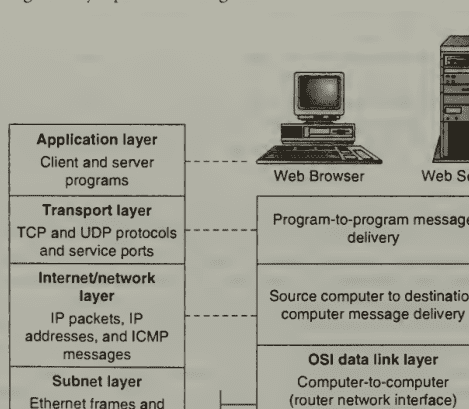

图 1.1 TCP/IP 参考模型。

# 第 1 章 数据包过滤防火墙的基础性概念

### 服务端口：系统程序的入口

基于网络的服务是运行在机器上的程序，网络上的其他计算机可以访问它们。服务端口标识正在进行的程序以及单个会话或连接。服务端口是不同基于网络服务的数字名称。它们还被用作特定连接端点的数字标识符。服务端口号范围从 0 到 65535。

服务器程序（即守护进程）在分配给它们的服务端口上监听传入的连接。根据历史习惯，主要的网络服务被分配到 1 到 1023 的低范围内的已知或著名端口。这些端口号到服务的映射由互联网分配数字机构（IANA）协调，作为一组全球公认的惯例或标准。

这些低范围端口被称为特权端口，因为它们由具有系统级（即超级用户或 root）权限运行的程序所有。这种设计的意图是增加信心，确保客户端程序确实连接到了预期的、广告的服务。这只是意图——并非保证。你永远无法绝对确定远程机器或服务是否是其所声称的身份或实体。

已广告的服务仅仅是通过其分配的端口在互联网上提供的服务。如果你的机器没有提供某个特定服务，而有人尝试连接与该服务相关的端口，则什么都不会发生。他们是在敲门，但没有人回答。例如，Web 服务器被分配到端口 80。如果你的机器没有运行 Web 服务器，而有人尝试连接到端口 80，客户端程序将收到来自你机器的错误消息，指示未提供该服务。

1024 到 65535 的高端口号被称为非特权端口。它们有双重用途。在大多数情况下，这些端口被动态分配给连接的客户端端。客户端和服务器端口号对的组合、使用的传输协议以及各自的 IP 地址唯一标识了该连接。

此外，1024 到 49151 范围内的端口已向 IANA 注册。这些端口可以作为通用非特权池的一部分使用，但也与特定服务关联，如 SOCKS 或 X Window 服务器。最初的想法是高端口提供的服务并非以 root 权限运行的。它们供用户级非特权程序使用。这种惯例在任何具体情况下可能成立也可能失效。

### 服务名到端口的映射

Linux 发行版提供了常用服务端口号列表。该列表位于 `/etc/services` 文件中。

每个条目由服务的符号名称、分配给它的端口号、服务运行的协议（TCP 或 UDP）以及服务的可选别名组成。下表列了一些常见的服务到端口号映射，取自 Red Hat Release 6.0：

| 端口名称 | 端口号/协议 | 别名 |
| --- | --- | --- |
| ftp | 21/tcp |  |
| telnet | 23/tcp |  |
| smtp | 25/tcp | mail |
| whos | 43/tcp | nickname |
| domain | 53/tcp | nameserver |
| domain | 53/udp | nameserver |
| finger | 79/tcp |  |
| pop-3 | 110/tcp |  |
| nntp | 119/tcp | readnews |
| www | 80/tcp | http |
| auth | 113/tcp | ident |
| ntp | 123/udp |  |
| https | 443/tcp |  |

注意，与端口号关联的符号名称随 Linux 发行版和版本而异。名称和别名不同。端口号不同。

还要注意端口号与协议关联。IANA 尝试将相同的服务端口号分配给 TCP 和 UDP 协议，无论特定服务是否使用这两种协议。大多数服务只使用其中一种协议。`domain` 服务同时使用两种协议。

### 数据包：IP 网络消息

数据包指的是网际协议（IP）网络消息。IP 标准定义了在网络上两台计算机之间发送的消息的结构。它是赋予跨网络发送的单个离散消息或信息片段的名称。从结构上看，数据包包含一个信息头部和一个正在传输的消息正文。数据包的主体——其数据——是高层协议消息全部或部分（分片）。

Linux 中包含的 IP 防火墙（IPFW）机制支持三种 IP 消息类型：ICMP、UDP 和 TCP。ICMP（互联网控制消息协议）数据包是一种网络层的 IP 控制和状态消息。在网络层上，ICMP 消息包含关于两个端点计算机之间通信的信息。UDP（用户数据报协议）IP 数据包在两个基于网络的程序之间传输 UDP 传输层数据，但不对成功送达或数据包顺序提供任何保证。发送 UDP 数据包类似于向另一个程序发送明信片。TCP（传输控制协议）IP 数据包同样在两个基于网络的程序之间传输 TCP 传输层数据，但头部包含额外的状态信息，用于维护持续的、可靠的连接。发送 TCP 数据包类似于与他人进行电话对话。大多数互联网网络服务使用 TCP 通信协议而非 UDP 通信。换句话说，互联网服务基于客户端程序与服务器程序之间双向通信的持续连接的想法。


# 第 1 章 过滤防火墙的基础概念

所有 IP 数据包头部都包含源和目的 IP 地址以及该数据包包含的 IP 协议消息类型（`ICMP`、`UDP` 或 `TCP`）。除此，数据包头部根据协议类型包含略有不同的字段。`ICMP` 数据包包含一个用于识别控制或状态消息类型的类型字段，以及一个次要代码字段，用于更具体地定义消息。`UDP` 和 `TCP` 数据包包含源和目的服务端口号。`TCP` 数据包包含关于连接状态的附加信息以及每个数据包的唯一标识符。（头部还包含其他字段。这些字段在 IP 数据包过滤层既不可见，通常也没有用。）几乎任何关于 TCP/IP 网络的书籍都定义了剩余的头部字段。参考资料之一是 Pete Levin 编写、Academic Press 出版的《TCP/IP 详解》。

## IP 消息类型：ICMP

`ICMP` 数据包是一种网络层 IP 控制和状态消息。它的头部包含源和目的 IP 地址、`ICMP` 协议标识符，以及一个 `ICMP` 消息类型，该类型指示数据包是命令、对命令的响应、状态信息还是错误状况。具体的 `ICMP` 消息类型在第 3 章“构建和安装防火墙”中介绍。`ICMP` 消息不包含源和目的端口号。它们不在程序之间发送；而是在源目的端点计算机之间发送。
`ICMP` 消息示例是错误状态消息。如果你尝试连接到远程 Web 服务器，而远程主机上没有运行 Web 服务器，远程主机将返回一个 `ICMP` 错误消息，指示服务不存在。数据包头部中感兴趣的字段如图 1.2 所示。

## IP 消息类型：UDP

`UDP` 是一种无状态（即无连接）且不可靠的传输协议。程序发送 `UDP` 消息，该消息可能被接收或响应，也可能不会。不返回接收确认。不提供流量控制，因此如果 `UDP` 数据报在途中无法被处理，将被静默丢弃。
`UDP` 数据包头部包含源和目的 IP 地址、`UDP` 协议类型以及源和目的服务端口号。

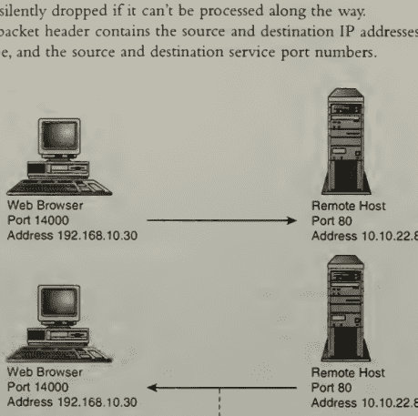

图 1.2 传入的 `ICMP` 错误消息。

### 不可靠的 UDP？

`UDP` 被称为不可靠的数据报服务。“不可靠”对 `UDP` 的可用性并没有任何负面含义。在这种情况下，不可靠意味着不确保妥善送达。因此，由于没有 `TCP` 那种可靠的面向连接的开销，基于 `UDP` 的数据传输比基于 `TCP` 的传输快几倍。因此，`UDP` 适用于简单的查询和响应类型的通信。
例如，你的机器可以定期尝试连接远程网络时间服务器。互联网时间服务器分配的 `UDP` 服务端口 `123`。时间服务器将返回当前时间。你的系统可以使用来自更准确的网络时间服务器的信息更新其系统时钟。如果因为远程机器未运行时间服务器或远程机器在此时宕机导致交换失败，则会产生 `ICMP` 错误消息，“服务或主机不可”。
如图 1.3 所示，你系统上的客户端程序发起请求。请求被分配了一个非特端口。构建一个以非特端口为源端口的发送 `UDP` 请求数据包。目的端口是已知的时间服务器端口 `123`。
时间服务器响应一个包含当前时间的 `UDP` 数据包。一个传入的 `UDP` 数据包将从时间服务器的 IP 地址通过源端口 `123` 到达，地址是你的 IP 地址以及你最初提供的非特目的。

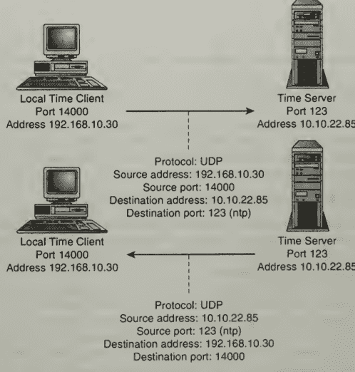

图 1.3 `UDP` 请求和响应。

## IP 消息类型：TCP

大多数网络服务运行在 `TCP` 之上。消息作为两个程序之间持续连接的一部分双向可靠发送——无错误、无丢失或不重复，并按顺序送达。每个 `TCP` 段在接收时都会得到确认。每个 `TCP` 段都由唯一的序列号标识。标志位用于定义连接状态。
如果一个经过 IP 封装的 `TCP` 段大于底层网络的最大传输单元（`MTU`），该段将被拆分为分片。（由于大多数网络是以太网，每个以太网帧的 `MTU` 为 1500 字节。）分片被标识为属于特定的段，由目的计算机重构。
当客户端程序发起到服务器的连接时，会在客户端的特权池中选择一个端口。客户端 IP 地址、端口号和传输协议的组合定义了客户端套接字。在服务器端，主机 IP、服务器端口和传输协议的组合形成了服务器套接字。客户端和服务器之间的连接由这对套接字唯一定义。
给定客户端和服务器之间的每个单独连接（可能是到该服务器的并发连接之一），通过客户端的源地址和端口结合服务器的 IP 地址和分配端口以及应用程序使用的传输协议来唯一标识。
`TCP` 包头部包含源目的 IP 地址、`TCP` 协议消息类型、源目的端口、序列号和确认号，以及用于创建和维护可靠虚拟电路或持续双向连接的控制标志。

### 典型的 TCP 连接：访问远程网站

作为说明，常见的 `TCP` 连接示例是使用 `Netscape` 浏览器访问网站（即连接 Web 服务器）。本节说明了与后续章节 IP 数据包过滤相关的连接建立和持续通信方面。
发生了什么？如图 1.4 所示，某台机器上运行着 Web 服务器，在 `TCP` 端口 `80` 上等待连接请求。你点击一个 URL。URL 的部分被解析为主机名；主机名转换为 Web 服务器的 IP 地址；你的浏览器为该连接分配了一个非特端口（例如 `14000`）。为 Web 服务器构建了一个 `HTTP` 消息。它被封装在 `TCP` 消息中，封装在 IP 包头部中并发出。对于我们的目的，头部包含图 1.4 所示的字段。
数据包：IP 网络消息 13


Web浏览器

端口 `14000`

地址 `192.168.10.30`

Web 服务器

端口 `80`

地址 `10.10.22.85`

协议：`TCP`

源地址：`192.168.10.30`

源端口：`14000`

目的地址：`10.10.22.85`

目的端口：`80` (www)

标志：`SYN` (连接同步请求)

图 1.4 `TCP` 客户端连接请求。
头部中包含了一些在数据包过滤层级不可见的额外信息。尽管如此，描述与 `SYN` 和 `ACK` 标志相关的序列号，有助于澄清三次握手过程中发生的情况。当客户端程序发送其第一条连接请求消息时，`SYN` 标志会伴随同步序列号。客户端正在请求与服务器连接，并传递了一个起始序列号，它将以此作为后续发送的所有消息的编号起始点。
数据包在服务器机器上接收。它被发送到服务端口 `80`。服务器正在监听 `80` 端口，因此它收到了来自源地址和端口对 (`192.168.10.30`) 的接入连接请求（`SYN` 连接请求标志）。服务器在自己的端分配了一个新的套接字 (`10.10.22.85`)，并将其与客户端套接字关联。
Web 服务器对 `SYN` 消息响应确认 (`ACK`)，并带上其自身的同步请求 (`SYN`)，如图 1.5 所示。现在连接处于半开放状态。

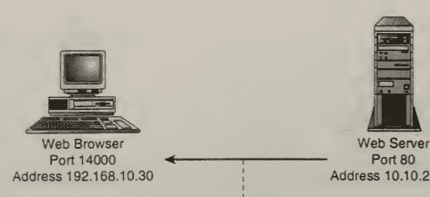

协议：`TCP`

源地址：`10.10.22.85`

源端口：`80` (www)

目的地址：`192.168.10.30`

目的端口：`14000`

标志：`ACK` (确认) `SYN` (连接同步请求)

图 1.5 `TCP` 服务器确认。
`SYN-ACK` 头部中包含了两个数据包过滤层级不可见的字段。除了 `ACK` 标志外，服务器还将客户端的序列号加 1。确认的目的是确认其序列号所指的消息。服务器通过增加客户端序列号来确认这一点，这实际上是说它已收到该消息，且序列号 + 1 是服务器预期接收的下一条消息。当服务器确认了原始 `SYN` 消息后，客户端就可以自由地丢弃它持有的该消息副本。
服务器在它的第一条消息中也设置了 `SYN` 标志。在客户端的第一条消息中，`SYN` 标志伴随同步序列号。服务器正在传递它用于连接的起始序列号。这条消息是服务器发送的唯一设置了 `SYN` 标志的消息，随后的所有消息都设置了 `ACK` 标志。与客户端第一条消息中缺少 `ACK` 标志相比，所有服务器消息中都存在 `ACK` 标志，在获取构建防火墙的信息时将是一个关键区别。你的机器接收到此消息并回复它自己的确认，之后连接即建立。图 1.6 显示了图形化表示。从这里开始，客户端和服务器都设置了 `ACK` 标志。
数据包：IP 网络消息 15

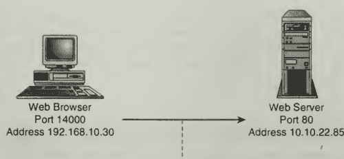

协议：`TCP`

源地址：`192.168.10.30`

源端口：`14000`

目的地址：`10.10.22.85`

目的端口：`80` (www)

标志：`ACK` (确认)

图 1.6 `TCP` 连接建立。
随着每次确认，客户端和服务器程序都会增加对方的序列号，增加的量等于自上次发送 `ACK` 以来顺序确认的数据包数量，这表示已收到数据包，并指示了程序预期接收的下一条消息。当你的浏览器接收 Web 页面时，你的机器从 Web 服务器接收带有数据包头部的数据消息，如图 1.7 所示。

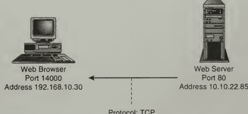

协议：`TCP`

源地址：`10.10.22.85`

源端口：`80` (www)

目的地址：`192.168.10.30`

目的端口：`14000`

标志：`ACK` (确认)

图 1.7 持续的服务器到客户端连接。


结束时会发送带有关闭连接标志的额外消息，但这些标志在数据包过滤层级不可用。重要的标志是 `SYN` 和 `ACK` 标志。当客户端和服务器在建立期间交换第一条消息时，会设置 `SYN` 标志。客户端和服务器之间的所有后续消息都设置了 `ACK` 标志。

## 总结

本章的简单示例说明了 `IP` 数据包过滤防火墙的基础信息。第 2 章“包过滤概念”在这一介绍的基础上，描述了 `ICMP`、`UDP` 和 `TCP` 消息类型以及服务端口号如何被使用。

# II 过滤与基本安全措施

## 过滤概念

防火墙具有多种含义，取决于实现防火墙的机制、防火墙运行的 `TCP/IP` 协议栈以及使用的网络架构。三种常见的含义指的是：包过滤防火墙；应用网关（也称为主机防火墙）；以及应用级网关（也称为代理防火墙）。

包过滤防火墙通常在操作系统内部实现，并在网络层运行。它通过根据数据包头部中的信息做出路由决策来保护系统。

应用网关（或主机防火墙）在网络架构层面实现。网络流量不通过网关。外部访问仅允许通过网关。内部访问仅允许通过网关。本地用户必须登录网关并从那里访问互联网。此外，网关机器可能受到包过滤防火墙的保护。

代理防火墙通常作为每个被探测服务的独立应用程序实现。每个代理程序对客户端来说是服务器，对真实服务器来说是客户端。特殊的客户端或经过特殊配置的客户端程序连接到代理服务器而不是远程服务器。代理代表建立连接，用自己的地址替换客户端的源地址。代理应用程序可以确保数据完整性（适用于所交换服务的数据）、过滤病毒并实施详细的访问控制策略。

本书涵盖了包过滤防火墙背后的思想。所有三种方法都控制了谁可以访问哪些服务。每种方法根据不同 `TCP/IP` 参考模型中提供的信息，都有其各自的优势。大型商业防火墙产品通常将包过滤、保护主机和应用代理功能整合到多层安全包中。

## 包过滤防火墙

一个 `IPFW` 包过滤防火墙由一组接受和拒绝规则组成。这些规则明确定义了哪些数据包允许或不允许通过网络接口。防火墙规则使用第 1 章描述的数据包头部字段，来决定是将数据包路由到目的地、静默丢弃数据包，还是拦截数据包向发送机器返回错误状态。

使用 `TCP/IP` 参考模型的混合模式，包过滤防火墙运行在网络层和传输层，如图 2.1 所示。

# 包过滤防火墙 21


| 应用层 | 防火墙 |
| :--- | :--- |
| 客户端和服务器程序 | `TCP/UDP` 源端口和目的端口 |
| 传输层 | `TCP` 连接状态标记 |
| `TCP` 和 `UDP` 协议和服务端口 | `IP` 源和目的地址 |
| 网络层 `IP` 数据包、地址和 `ICMP` 消息 | `IP ICMP` 控制代码 |
| 数据链路层 | 网络接口 |
| 以太网帧和 `MAC` 地址 |  |

图 2.1 `TCP/IP` 参考模型中的防火墙放置位置。

其核心思想是，你需要非常仔细地控制在互联网与你直接连接到互联网的机器之间通过流量。在通往互联网的外部接口上，你需要尽可能精确且显式地分别过滤从外部进入的流量和从机器发出的流量。

对于单机设置，将网络接口视为一对 `I/O` 设备可能会有所帮助。防火墙独立地过滤通过接口的入站和出站流量。输入过滤和输出可以使用可以使用不同的规则。定义哪些可以进入、哪些可以出的规则列表被称为“链”`chains`。这对 `I/O` 设备就是输入链规则列表和输出链规则列表。这些列表之所以被称为链，是因为数据包会逐个匹配列表中的每条规则，直到找到匹配项或耗尽列表为止，如图 2.2 所示。

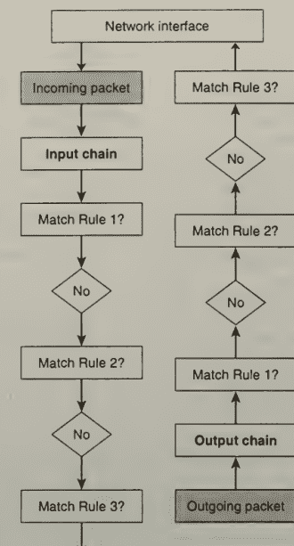

图 2.2 输入链和输出链。

这听起来非常强大，事实如此，但它并不是一种万无一失的安全机制。它只是完整安全方案中的某一部分。并不是所有的应用通信协议都适用于包过滤。这种过滤的级别太低，无法实现细粒度的认证和访问控制。这些安全服务必须在更高层提供。`IP` 无法验证发送者是否为其声称的身份。在此层唯一的可用标识信息是 `IP` 数据包头中的源地址。源地址可以很容易被修改。网络层和传输层都无法验证应用数据的正确性。尽管如此，包级过滤对直接端口访问、数据包内容和正确的通信协议提供了比高层更易或更方便完成的更大、更简单的控制。

如果没有包级过滤，高层过滤和代理安全措施要么会瘫痪，要么可能无效。至少在某种程度上，它们必须依赖于底层通信协议的正确性。安全协议栈中的每一层都增加了一个项其他层无法轻易提供的特性。

### 选择默认包过滤策略

每个防火墙链都有一个默认策略，以及一组针对特定消息类型所采取的动作。每个数据包都会与列表中的每条规则进行检查，直到找到匹配项。如果数据包不匹配任何规则，它将通过 `fallback` 并对该数据包应用默认策略。

防火墙有两种基本方法：

- 默认拒绝所有，并显式允许选定的数据包通过。
- 默认接受所有，并显式拒绝选定的数据包通过。

“拒绝所有”策略是推荐的方法。这种方法更容易建立安全防火墙，但你必须显式地启用你需要的每个服务及相关的协议事务。参见图 2.3。这意味着你必须理解你启用的每个服务的通信协议。“拒绝所有”方法在实现互联网访问之前需要更多工作。某些商业防火墙产品仅支持“拒绝所有”策略。

“接受所有”策略让你更容易快速上手，但它迫使你预见到你可能想要禁用的各种访问类型。参见图 2.4。危险在于，你可能在太晚的时候还没有预见到某种危险的访问类型。最后，建立一个安全的“接受所有”的防火墙工作量更大、更困难，且更容易出错。


图 2.3 拒绝所有策略。


图 2.4 接受所有策略。

### 拒绝数据包

防火墙机制提供了拒绝或丢弃的选择。如图 2.5 所示，当数据包被拒绝时，它会被丢弃；当数据包被拒绝时，则会返回 `ICMP` 消息


拒绝 `Denial` 几乎总是更好的选择。原因有三点：第一，它防止攻击者知道端口已关闭；第二，它防止攻击者获取网络拓扑信息；第三，它防止攻击者耗尽系统资源。

输入过滤允许对从外部进入和从机器发出的流量进行精确且显式的过滤。对于单机设置，将网络接口视为一对 `I/O` 设备可能会有所帮助。防火墙独立地过滤通过接口的入站和出站流量。输入过滤和输出可以使用不同的规则。

### 地址过滤

输入过滤允许根据源地址过滤流量，如果你想拦截来自特定网络或范围流量。

### 地址伪造与非法地址

地址伪造是指攻击者修改数据包的源地址，伪装成来自其他地方。这用于 `DDoS` 攻击或绕过访问控制。非法地址是指未分配给网络上任何主机的地址。

### 包过滤

输入过滤允许对从外部进入和从机器发出的流量进行精确且显式的过滤。对于单机设置，将网络接口视为一对 `I/O` 设备可能会有所帮助。防火墙独立地过滤通过接口的入站和出站流量。输入过滤和输出可以使用不同的规则。

## 第 2 章包过滤概念

- 格式错误的广播地址——广播地址是适用于网络上所有机器的特殊地址。地址 `0.0.0.0` 是一个特殊的广播源地址。广播源地址将是 `0.0.0.0` 或普通的 `IP` 地址。`DHCP` 客户端会看到来自 `0.0.0.0` 的入站广播包。我不知道在其他任何情况下会看到广播地址 `0.0.0.0`。它不是一个合法的点对点源地址。当该地址在普通的、点对点的、非广播数据包中作为源地址出现时，该地址是伪造的。

## 拦截问题网站

另一种常见但使用频率较低的地址过滤方案是阻止来自特定机器的所有访问，或者更常见的，阻止来自整个网络 `IP` 地址块的访问。这是互联网社区处理问题网站以及不监管用户的互联网服务提供商 `ISP` 的方式。如果一个网站落上了“不良网络社区”的声声，其他网站将对其进行全面封。

在个人层面，当远程网络中的个人习惯性地制造麻烦时，阻止来自所选网络的所有访问是非常方便的。

## 限制入站包到选定主机

你可能只想从特定的外部地址或个人接收某些类型的入站包。在这种情况下，防火墙规则将定义是否接受来自特定 `IP` 地址或有限范围 `IP` 源的此类数据包。

第一类入站包来自响应你请求的远程服务器。虽然某些服务（如 `Web` 或 `FTP` 服务）预计可能来自任何地方，但其他服务预计将合规地仅来自你的 `ISP` 或特选的主机。可能仅通过你的 `ISP` 服务器示例包括 `POP` 邮件服务、`DHCP` 动态 `IP` 地址分派，以及可能的域名服务 `DNS` 响应。

第二类入站包来自访问你所在站点提供的服务的远程客户端。同样，虽然某些入站服务连接（例如到你 `Web` 服务器的连接）预计可能来自任何地方，但其他本地服务将仅向少数信任的远程用户或朋友提供。受限服务的示例可能是 `telnet`、`ssh` 和 `finger`。

## 本地目的地址过滤

基于目的地址过滤入站包并没有大问题。你的网络接口卡会忽略不是发送给它的普通数据包。例外是广播包，它是广播到网络上的所有主机的。


地址 `255.255.255.255` 是通用广播目的地址。该地址可以通过你的网络地址加上剩余地址字节中的 `255` 来定义得更明确。例如，如果你的网络地址是 `192.168.0.0` 且你的 IP 地址是 `192.168.10.30`，你可能会从 ISP 看到目的为 `192.168.255.255` 或 `255.255.255.255` 的广播包。

目的地址 `0.0.0.0` 的广播与前面“源地址欺骗和非法地址”节中提到的声称来自广播源地址的点对包包的情况类似。在这里，广播包指向源地址 `0.0.0.0` 而不是目的地址 `255.255.255.255`。在这种情况下，数据包的意图毫无置疑。这是试图将你的系统识别为 UNIX 机器。由于历史原因，源自 BSD UNIX 的网络代码在响应 `0.0.0.0` 用作广播目的地址时会返回类型为 `3` 的 `ICMP` 消息。其他操作系统静静地丢弃该数据包。因此，这是一个关于拒绝 `deny` 与拒绝 `reject` 数据包有何区别的好例子。在这种情况下，错误消息本身就是黑客寻找的。

### 远程源端口过滤

入站包中的源端口标识了远程主机上发送消息的程序。通常，从远程客户端到你服务的所有入站请求遵循相同的模式，而从远程服务器到你本地客户端的所有入站响应遵循不同的模式。

从远程客户端到你本地服务器的入站请求和连接将具有特权范围内的源端口。如果你托管了一个 Web 服务器，所有到你 Web 服务器的入站连接的源端口应在 `1024` 到 `65535` 之间。

来自你联系的远程服务器的入站响应将具有分配特定服务的源端口。如果你连接到远程 Web 网站，来自远程服务器的所有入站消息的源端口将设置为 `80`，即 `http` 服务端口号。

### 本地目的端口过滤

入站包中的目的端口标识了数据包旨在针对的计算机上的程序或服务。结合源端口，通常，从远程客户端到你服务的所有入站请求遵循相同的模式，而从远程服务到你本地客户端的所有入站响应遵循不同的模式。

从远程客户端到你本地服务器的入站请求和连接将目的端口设置为分配给特定服务的服务号。一个用于你本地 Web 服务器的入站包的目的端口将设置为 `80`，即 `http` 服务端口号。

来自你联系的远程服务器的入站响应将具有特权范围内的目的端口。如果你连接到 Web 网站，来自远程服务器的所有入站消息的目的端口将在 `1024` 到 `65535` 之间。

## 入站 TCP 连接状态过滤

入站 `TCP` 包接受规则可以利用与 `TCP` 连接关联的连接状态标志。所有 `TCP` 连接都遵循同一组连接状态。由于连接建立期间的三次握手，这些状态在客户端和服务器之间存在差异。

来自远程客户端的入站 `TCP` 包将在第一个包中设置 `SYN` 标志，作为三次握手的一部分。第一个连接请求将设置 `SYN` 标志，但未设置 `ACK` 标志。连接请求之后的所有入站包将仅设置 `ACK` 标志。你的本地防火墙无论 `SYN` 和 `ACK` 标志如何都允许入站。

来自远程服务器的入站包总是对本地客户端程序发起的连接请求的响应。从远程服务器收到的每个包将设置 `ACK` 标志。你的本地客户端防火墙要求来自远程服务器的所有入站包都设置 `ACK` 标志。合法的服务器通常不会尝试向客户端程序连接。

## 探测与扫描

探测 `Probe` 是尝试连接或获取单个服务的响应。扫描 `Scan` 是对一组不同服务端口的一系列探测。扫描通常是自动化的。

探测和扫描本身是无害的。在互联网上，发现某个站点是否提供特定服务的唯一方法是探测端口。如果你没有它的 URL，如何知道某个站点是否有 Web 服务器？你尝试访问它的网站。换句话说，你在探测它的 `http` 端口。

不幸的是，探测和扫描不再无害。它们最可能是初始的信息收集阶段，在发起攻击之前寻找有趣的漏洞。自动扫描工具随处可见，黑客小组的协作努力也很常见。特别是 `1998` 年，我们看到全球扫描指数级增长。

### 通用端口扫描

通用端口扫描是对大范围服务端口的无差别探测，可能是整个范围（见图 2.6）。这些扫描可能由旧的网络维护工具（如 `satan` 或 `strobe`）产生，随着更先进、更有针对性的工具（如 `mscan`、`sscan` 和 `nscan`）的出现，这些扫描正变得越来越少。

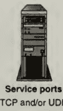


图 2.6 通用端口扫描。

### 目标端口扫描

目标端口扫描用于寻找特定的漏洞（见图 2.7）。较新、更复杂的工具尝试识别硬件、操作系统和软件版本。这些工具旨在精确锁定特定目标上的已知漏洞。

## 32 节第 2 章包过滤概念

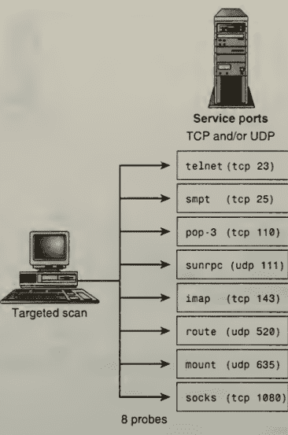

图 2.7 目标端口扫描。

### 常见服务端口目标

常见目标通常会被单独探测以及进行扫描。黑客可能正在寻找特定的漏洞，例如不安全的邮件服务器或开放的 `RPC` `portmap` 守护进程。

第 6 章“验证系统是否按你预期运行”中的“解释系统日志”章节列出了详细的端口列表。这里只提到了几个常见端口以供你参考思路：

- 来自预留端口 `0` 的入站包始终是伪造的。该端口不会被合法使用。
- 对 `TCP` 端口 `0` 到 `5` 的探测是 `sscan` 程序的特征。
- `telnet (23/tcp)`、`smtp (25/tcp)`、`pop-3 (110/tcp)`、`sunprpc (111/udp/tcp)`、`imap (143/tcp)`、`snmp (161/udp)`、`route (520/udp)` 和 `mount (635/udp)` 是受喜爱的目标端口。它们代表了系统中一些最潜在的漏洞入口。由于这些服务非常常见，它们是说明为什么你希望不向外界提供这些服务，或者非常仔细地控制对这些服务的访问的良好示例。

## 33 节过滤入站包

- `NetBIOS (137, 138/tcp/udp, 139/tcp)`、`Netbus (12345/tcp)` 和 `Back Orifice (31337/udp)` 探测极其常见。它们对 `UNIX` 系统不构成威胁。在这种情况下，目标是 Windows 系统。

### 避免偏执症——响应端口扫描

每隔几天，`/var/log/messages` 中的防火墙日志就会显示各种失败的连接尝试。

人们真的在尝试入侵你的系统吗？是的。你的系统被攻破了吗？没有，并没有。端口已被拦截。防火墙正在履行工作。这些被防火墙拒绝的失败连接尝试……

你个人在什么时候决定报告不需要的访问尝试？在什么情况下对你来说重要到值得花时间去报告它们？在什么情况下你会觉得足够了并继续过你的生活，还是说你应该每次都向 `abuse@some.system` 写信？

这没有“正确”的答案。如何应对取决于个人的判断。这个话题本身可能会引发宗教战争。对于明显的探测和扫描，没有明确的答案。这取决于你自己的性格和心理舒适程度，取决于你个人如何定义严重探测，而且确实有一些可行的准则。

最常见的尝试是自动化探测、错误、基于互联网历史的合法尝试、无知、好奇心以及行为不当软件的结合。

你应该忽略对 `telnet`、`ssh`、`ftp`、`finger` 或任何你未提供的常见服务的单个、孤立的单次连接。探测和扫描是互联网生活的常态，极其频繁，而且通常不构成风险。它们就像上门推销员、推销电话、打错的电话和垃圾邮件。一天之的时间并不够响应每一种请求。

另一方面，某些探测更具持续性。你可能决定添加防火墙规则来完全阻止它们，甚至阻止它们的整个域名地址空间（如果它们的域名声誉不好或使用多个源地址）。

对已知的潜在安全漏洞端口进行扫描，如果发现了开放端口，通常是入侵尝试的前兆。更广泛的扫描通常是针对整个域名或子网子集的更广泛扫描的一部分。目前的黑客探测会接一个探测这些端口子集。

偶尔，你会看到一些入侵尝试。这无疑是采取行动的时候。记录它们。报告它们。双重检查你的安全性。观察他们在做什么。拦截它们。拦截它们的 IP 地址段。如果必要，让你的系统下线。

### 历史上危险的端口

关于历史上危险端口的更多信息，请参阅 `www.cert.org` 上的《防火墙系统的包过滤》论文。


一些系统管理员对待每一次发生都非常认真，因为即使他们的机器是安全的，其他人的机器可能不是。下一个人可能甚至不知道自己正在被探测。报告探测是一种负责社会责任的行为，为了大家的利益。

你应该如何响应端口扫描？如果你写信给这些人（你的邮件邮局管理员、你的上行服务 NOC 或网络地址块协调员），请尽量礼貌。给他们一些疑疑的空间。大多数情况下，过度反应是不恰当的。

### UDP 洪水攻击

`UDP` 协议作为拒绝服务工具时特别有用。与 `TCP` 不同，`UDP` 是无状态的。它不包含流量控制机制，没有连接状态标志，也不使用数据报序列号。系统不会维护关于下一个预期接收哪个数据包的信息。通过对传入的 `UDP` 探测做出响应，相对很容易让系统忙起来，导致没有带宽留给合法的网络流量。


由于 UDP 服务在本质上安全性低于 TCP 服务，因此许多网站会禁用所有绝对非必要的 UDP 端口。如前提到的，几乎所有常见的互联网服务都是基于 TCP 的。我们在第 3 章“构建和安装防火墙”中建立的防火墙将严格限制 UDP 流量，仅允许那些提供必要 UDP 服务的远程主机。

### ICMP 重定向炸弹

ICMP 消息类型 5 告诉目标系统更改其路由表，以采用更短的路径。如果你运行路由（`routed`）或网关（`gated`）并且遵循重定向策略，黑客可能会欺骗你的系统，从这些服务引导到任何地方。

## 本地源端口过滤

在你的端显式定义服务端口可用于出站连接，具有两个目的——一个用于你的客户端程序，另一个用于你的服务器程序。指定允许出站连接的源端口，可以确保你的程序运行正常，并保护他人免受任何不属于互联网的本地网络流量的影响。

来自你本地客户端的出站连接始终源自非特权端口。在防火墙规则中将客户端限制在非特权端口，可以帮助他人避免你端可能出现的错误。

来自你本地服务器的出站数据包始终源自其分配的源端口。在防火墙层面将服务器限制在分配的端口上，可以确保你的服务器程序在协议层面运行正常。更重要的是，它有助于保护任何可能受到外部访问的私有本地网络服务。

## 第 2 章 数据包过滤概念

将您的客户端连接限制在特定的目的端口还有其他几个目的。首先，它可以帮助防止本地私有网络客户端程序无意中尝试访问互联网上的服务器。其次，它在很大程度上阻止了可能源于您站点的出站消息、端口扫描和其他恶意行为。

您的本地服务器程序几乎总是参与源自非特权端口的连接。防火墙规则将您的服务器的出站流量限制在仅非特权目的端口。

### 出站 TCP 连接状态过滤

出站 TCP 数据包接收规则与入站规则一样，利用了与 TCP 连接关联的连接状态标志。所有的 TCP 连接都遵循同一套状态集合，而这套集合在客户端和服务器之间有所不同。

从本地客户端发出的出站 TCP 包将在三次连接建立握手发送的第一个包中设置 `SYN` 标志。初始连接请求将带有 `SYN` 标志，但没有 `ACK` 标志。第一次连接请求后的所有出站包将仅设置 `ACK` 标志。您的本地客户端防火墙规则将允许设置了 `SYN` 或 `ACK` 标志的出站包。

从本地服务器发出的出站包是对远程程序发起的任何初始连接请求的响应。从您的服务器发送的每个包都将设置 `ACK` 标志。您的本地服务器防火墙规则将要求从服务器发送的所有出站包必须设置 `ACK` 标志。

### 私有网络与公共网络服务

无意中允许意外入侵的最简单方法之一是允许外部访问仅设计用于 LAN 的本地服务。某些服务如果要在本地提供，绝不应该跨越局域网与外部恶劣互联网之间的边界。某些服务会骚扰您的邻居，提供一些您最好自己留着的信息，而且如果它们在局域网外可用，会产生明显的安全漏洞。

一些早期的网络，特别是 BSD 远程访问命令，是为了本地共享以及在受信任环境中跨多个机器的便捷访问而设计的。一些后期的服务旨在访问互联网，但它们设计时互联网基本上是学术界和研究人员的扩展社区。互联网是一个相对开放、安全的空间。随着互联网成长为包含普通公众访问的全球网络，它演变成了一个完全不可信的环境。

许多 UNIX 网络服务设计用于提供有关系统用户账户的本地信息、正在运行的程序、资源占用情况、系统状态、网络状态以及通过网络连接的其他机器的类似信息。并不是所有这些信息服务本身都代表安全漏洞。并不是说黑客可以直接利用它们获得对您系统的未经授权的访问，而是它们提供了有关您的系统和用户账户的信息，这些对于寻找已知漏洞的黑客可能有用。它们还可能提供用户名、地址、电话号码等信息，而你不希望这些信息能被任何请求的人轻易获取。

一些更危险的网络服务设计用于提供局域网访问共享文件系统和设备，例如网络打印机或传真机。

某些服务难以正确配置，某些则难以进行安全配置。有整整书都致力于配置一些较复杂的 UNIX 服务。特定的服务配置超出了本书的范围。

某些服务在家庭或小型办公环境中没有意义。某些服务旨在管理大型网络、提供互联网路由服务、提供大型数据库信息服务、支持双向加密和认证等。

### 保护非安全本地服务

保护自己最简单的方法是不提供该服务。但如果您在本地需要这些服务之一呢？并不是所有服务都能在数据包过滤层面得到充分保护。多连接服务（如 RealAudio 和 ICQ）以及基于 UDP 的 RPC 服务在数据包过滤层面是众周名的难以安全的。

保护您的计算机的一种方法是不在防火墙机器上托管供公共使用的网络服务。如果服务不可用，远程客户端就没有东西可以连接。像家庭这样的小型站点没有足够的计算机来通过在其他机器上运行私有服务来实施安全策略。这必须做出妥协。

保护您的计算机的另一种方法是实现某种防火墙。数据包过滤防火墙为服务端口访问增加了保护。它允许您运行许多本地、不安全的网络服务（特别是 TCP 服务）而受到外部访问的风险较低；它可以控制哪些外部实体访问本地服务；通过强制执行低层通信协议，它可以帮助确保您的程序正在与您期望的对象进行通信。

然而，数据包过滤防火墙并不提供完全的安全。某些程序需要比数据包过滤层面提供的更高级的安全措施。某些程序问题太大，不值得冒险在防火墙机器上运行。

### 选择运行的服务

归结底，只有您自己可以决定需要或想要哪些服务。安全系统的第一步是决定您打算在防火墙机器上运行哪些服务和守护进程。每个服务都有自己的安全考量。在在 UNIX 下选择运行的服务时，通用原则是只运行您需要并理解的网络服务。在运行其之前，了解网络服务、它是做什么的以及它的用途是什么是非常重要的——特别是在直接连接互联网的机器上。

以下章节列出了 Red Linux 系统上最常见的网络服务。这些服务根据启动的方式和时间进行分类。在已启动状态下，服务根据 UNIX 启动它们的机制进行分类，这同时也决定了从系统管理的角度如何组织这些服务。

网络服务从 UNIX 系统中的三个主要地方启动。首先，基本服务由运行级别（`runlevel`）管理器管理，并在启动时从 `/etc/rc` 目录下的 shell 脚本启动。其次，某些可选服务由 `inetd` 管理，并在客户端程序的请求时启动。这些服务定义在 `inetd` 的配置文件 `/etc/inetd.conf` 中。第三，某些网络服务是本地特有的，必须通过您的本地脚本显式运行。这些服务通常不是 Linux 发行版的一部分。相反，它们通常是从软件仓库下载并自行安装的。

### 运行级别管理器

运行级别取自 System V UNIX 的启动和系统状态。Red 包含了七种不同的运行级别。`etc/rc` 下的子目录与各种运行级别关联，并包含指向 `/etc/rc/init.d` 配置脚本的符号链接。符号链接遵循一种命名约定，表示在进入运行级别时服务是停止（以 K 开头）还是启动（以 S 开头），以及脚本的执行顺序。

您不会使用所有的五个运行级别。您的系统将在运行级别 2、3 或 5 上运行。运行级别 3 是默认的多用户系统状态。运行级别 2 与 3 相同，增加了网络文件系统（`NFS`）服务。运行级别 5 与 3 相同，增加了 `XWindow` 显示管理器，它提供了一个基于 X 的登录和主机选择。（理想情况下，防火墙不应运行 X 显示。）

对于好奇者，其余运行级别代表特殊的系统状态。运行级别 0 定义了停止系统前的清理操作。运行级别 1 定义了进入和退出单用户模式的操作。运行级别 4 未被使用。您可以将其设置为自定义状态。运行级别 6 定义了重启系统前的最终清理操作。

当您首次安装系统时，以及通过控制面板程序运行运行级别时，您有机会定义哪些系统服务将在系统启动时自动启动。这两个配置工具都提供了管理 `/etc/rc.d` 中系统启动文件的图形界面。

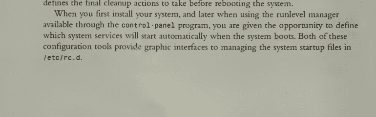

## 私有与公共网络服务

关于这点的背景知识：当系统启动时，主系统进程 `init` 会读取其配置文件 `/etc/init.ab`。该文件告诉 `init` 执行 `/etc/rc.d/` 中的几个脚本，包括 `rc.sysinit` `/etc/rc.d/rc.sysinit` 在启动时运行一次，用于初始化加载模块、检查文件系统、重启系统级配置等。`etc/rc.d/rc` 在每次更改运行级别（`runlevel`）时都会执行。它的工作是首先停止未定义在当前运行级别运行的服务，然后启动定义在该特定运行级别运行的服务（通常是运行级别 3 或 5）。默认运行级别在 `/etc/init.ab` 中定义，预配置为 `id=3:initdefault`。对于防火墙机器来说，运行级别 2 是最佳选择。

当你启动运行级别编辑器时，你会看到一个分为九个字母顺序列表的窗口，这些是系统初始化脚本的名称。最左侧的列表标题为“Available”（可用），包含 `/etc/rc.init.d` 中所有可用脚本的名称。窗口其余部分分为两行，标记为“Start”（启动）和“Stop”（停止）。这两行都被分为标记为 2 到 5 的四列，分别对应运行级别 2 到 5。表 2.1 列出了最左列中提供的服务初始化脚本。具体内容取决于你在系统上安装的具体服务包。

### 表 2.1 不同运行级别下的可用网络服务

| 描述 | 注意事项 | amd |
|---|---|---|


# 第48 页 第 2 章 数据包过滤概念

## 表 2.1 续

### arpwatch

**注意事项**
配置恰当，`arpwatch` 守护进程并不是安全问题。`arpwatch` 监听在私有的 UNIX 域套字上。但默认情况下，`arpwatch` 将你的外部网络接口设置为混杂模式作为数据包嗅探器，允许接口检查不是发给自己的数据包。发现你的网络接口处于混杂模式是系统被入侵的迹象。如果你的接口作为系统状态的正常部分处于混杂模式，安全信息将会丢失，且你并没有学到原本不知道的局域网信息。

**建议**
不要在防火墙机器上运行 `arpwatch`。

### autofs

**描述 注意事项**
启用自动挂载管理进程 `automount`。NFS 是一种基于 RPC 的局域网服务。NFS 和任何依赖于 `portmap` 守护进程的网络服务都是潜在严重的安全漏洞，不应允许从互联网访问。理想情况下，这些服务器不应运行在防火墙机器上。此外，如果服务可用，`automount` 依赖于网络信息服务 `NIS`。`NIS` 是另一种最好不要在防火墙机器上运行的局域网服务。

**建议**
不要在防火墙机器上运行 `automount`。

### bootparam

**描述 注意事项**
启用启动参数服务器。`bootparam` 守护进程为局域网上的无磁盘工作站提供启动相关信息。家庭或小型业务系统不太会有无磁盘工作站。在任何情况下，此服务器都不应运行在防火墙机器上。

**建议**
不要运行 `bootparam`。

### dhcpd

**描述 注意事项**
启动本地 DHCP 服务器。该服务为其客户端主机分配分配的 IP 地址。此服务通常用于 ISP 内部或企业局域网。

如果你的 ISP 动态分配 IP 地址，运行本地 DHCP 服务器是导致你的 ISP 账户被注销的快速方法。有些人运行本地服务器有充分的理由，但在防火墙层面和服务器配置层面都必须小心。除非你清楚自己在做什么，否则不要启用 `dhcpd`。除非你真的需要，否则不要运行 `dhcpd`。在理解其配置之前不要运行它。不要在有防火墙的情况下运行它。

**建议**

### gated

**描述 注意事项**
启用网关路由守护进程。`gated` 守护进程处理路由协议。小型局域网中的路由通过静态 IP 地址管理更好且更安全。防火墙机器应仅使用静态路由。如果你必须运行路由守护进程，选择 `gated` 而不是旧且不安全的 `routed`，因为 `gated` 支持较新的 OSPF 路由协议；`routed` 只支持旧的 RIP 路由协议。虽然 RIP 和 OSPF 是局域网路由协议，但防火墙不应作为动态路由器。`gated` 不应在防火墙机器上运行。

**描述 注意事项**
不要运行 `gated`

### httpd

**建议**
启动 Web 服务器来托管网站。Web 服务器安全超出本书的范围。然而，对于任何类型的文件访问服务，基本问题是限制访问你打算公开的文件系统部分，并以非特权用户的身份运行服务器。此外，避免任何 CGI 脚本，除非你理解这些脚本可能代表的严重安全问题。因为 CGI 脚本在你的系统中执行程序，基本问题涉及严格的输入检查、以非特权用户运行以及对 CGI 执行的任何程序使用完整路径名。

**描述 注意事项**

关于 Web 服务器问题的更多信息

关于服务器问题的信息，请查看 `www.apache.org` 上的 Apache。

**建议**
`httpd` 如果你决定托管网站，请运行 `httpd`。

### inetd

`inetd` 守护进程是提供许多服务的内核。

**注意事项**
如果你在本地使用常用服务（如 `ftp` 或 `telnet`），或向远程站点提供这些服务，则需要 `inetd`。

**建议**
运行 `inetd`

### innd

启用本地 Usenet 新闻服务器。

**建议**
运行 `innd`

### linuxconf

允许使用本地 Web 服务器作为用户界面配置你的机器。`linuxconf` 仅在环回接口上监听如果你保持默认配置，则无需担心任何问题。不要更改 `linuxconf` 访问配置允许外部访问。

### lpd

**描述 注意事项**
启用打印机服务器。从初看来看，你可能认为对打印机的访问必然局限于本地机器。在 UNIX 中，你的打印机被视为网络设备。确保你的打印机访问文件和防火墙阻止对打印机的远程访问（如果你有的话）。

**建议**
如果你在本地局域网机器之间共享打印机，请运行 `lpd`。

### mars-nwe

**描述 注意事项**
为局域网内的 Novell NetWare Windows 客户端启用 `mars-nwe` Windows 文件和打印机服务器。本地文件和打印机服务器不应运行在防火墙机器上。

**建议**
不要在防火墙机器上运行 `mars-nwe`。

### named

`named` 守护进程提供网络 DNS 的服务端部分，在符号机器名称与其数值 IP 地址之间进行转换。DNS 的客户端部分（解析器）不作为独立程序可见。它是被编译到你的程序中的网络库的一部分。

**考虑因素**
DNS 服务通常由你的互联网服务提供商（ISP）提供。运行本地服务器可以提高网络性能。如果配置正确，简单的 DNS 服务器不会带来安全风险。

**建议**
在你了解服务器以及如何配置它之后再运行 `named`。DNS 配置可能复杂且晦涩。在此期间，将你的名称解析器指向你 ISP 的名称服务器。

### netfs

**考虑因素**
挂载 NFS

### network

网络配置脚本在启动时运行，以激活你配置的网络接口卡。它本身并不是一个服务器。

**考虑因素**
你需要运行此脚本。

**建议**
运行 `network`。

### nfs

**考虑因素**
启用 NFS 服务。NFS 是设计为局域网（LAN）服务而。如果在互联网上使用，它包含许多安全漏洞。不要允许互联网访问你的 NFS 挂载文件系统。事实上，不要在你的防火墙机器上运行 NFS。NFS 由几个守护进程组成。在内核编辑器中，初始化脚本被称为 `amd`、`nfs` 和 `nfsfs`。

**建议**
不要在防火墙机器上运行 `nfs`。

### 关于 DNS 的更多信息

有关 DNS 的信息，请参阅由 Paul Albitz 和 Christian Liu 写的《DNS and BIND》（O'Reilly），由 Nicolas Langfeldt 写的“DNS HOWTO”（可在在线文档 `/usr/doc/` 中找到），以及 `named(8)`、`resolver(5)` 和 `hostname(7)` 的 man 页。

# 私有与公共网络服务 49 页

### ncd

**描述**
启用名称切换缓存守护进程。`ncd` 是 `NIS` 的支持服务，用于缓存用户密码和组组成。`NIS` 是一种本质上安全的局域网服务，不应在防火墙机器上运行。

**建议**
不要在防火墙机器上运行 `ncd`。

### portmap

**描述**
考虑因素

### NFS 自动挂载守护进程 `amd`

启用 NFS 自动挂载守护进程 `amd`。NFS 被设计为一种局域网（LAN）服务。如果在互联网上使用，它将包含许多安全漏洞。不要允许互联网访问你的 NFS 挂载文件系统。事实上，不要在你的防火墙机器上运行 NFS。NFS 由几个守护进程组成。在运行级别编辑器中，初始化脚本被称为 `amd`、`nfs` 和 `nfsfs`。不要在防火墙机器上运行。

### arpwatch

启用 `arpwatch` 守护进程，用于记录并构建在局域网接口上看到的以太网地址/IP 地址配对数据库。


| 描述 | 启用 RPC portmap 守护进程，它与 `inetd` 类似。它管理对基于 RPC 服务（如 NFS 和 NIS）的连接。如果你不在本地使用这些服务，请禁用 portmap 守护进程。如果你正在使用这些服务，确保你的防火墙阻止对 portmap 的访问。较新的 `portmap` 尊重 `/etc/hosts.allow` 和 `/etc/hosts.deny` 中的访问控制信息。 |

| 建议 | 不要在防火墙机器上运行 `portmap`。 |

### postgresql

| 描述 | 考虑因素 |

| --- | --- |

| 描述 | 启动本地 SQL 数据库服务器。SQL 是一个基于 TCP 的服务，关联端口 5432。主服务器 `postmaster` 可以配置为使用域域套字或本地 UNIX 域套字。作为一种设计用于访问本地文件的服务，通常在没有防火墙和安全配置措施的情况下，不应从防火墙机器提供 SQL。请参阅 man 页 `postmaster(1)`、`postgres(1)` 和 `psql(1)`，以及在线文档 `PostgreSQL-HOWTO`。 |

| 建议 | 不要在防火墙机器上运行 `postgresql`。 |

### 常见的利用漏洞

portmap 守护进程代表了 UNIX 系统中最常利用的一类漏洞。

# 第 2 章 数据包过滤概念

## 表 2.1 续

| 描述 | routed |

| --- | --- |

| 描述 | 启用 `routed` 守护进程以自动更新动态内核路由表。 |

| 考虑因素 | `routed` 和 `gated` 都代表严重的安全漏洞，`routed` 比 `gated` 更严重。你不太需要使用 RIP 动态管理防火墙的路由表，那是 ISP 提供的服务。只需在防火墙机器上本地使用静态 IP 地址即可。 |

| 建议 | 不要运行 `routed`。 |

| rstatd | |

| --- | --- |

| 描述 | 启用 `rstatd` 守护进程，为局域网机器收集系统信息。 |

| 考虑因素 | 系统信息不应在局域网内共享。不要在防火墙机器上运行 `rstatd`。 |

| 建议 | |

| rerd | |

| --- | --- |

| 描述 | 启用 `rerd` 用户定位器服务。这是一个基于 RPC 的服务，提供当前登录用户的信息。 |

| 考虑因素 | 小规模局域网不需要这种服务。此外，`rusersd` 依赖 RPC 服务，不应在防火墙机器上运行。 |

| 建议 | |

| rwalld | |

| --- | --- |

| 描述 | 启用 `rpc.rwalld` 服务守护进程。这是一个基于 RPC 的服务，允许登录局域网机器的用户写入消息。 |

| 考虑因素 | 小规模局域网不需要这种服务。此外，`rwalld` 依赖于 RPC 服务，不应在防火墙机器上运行。 |

| 建议 | |

# 私有与公共网络服务 51 页

### rwhod

| 描述 | 考虑因素 |

| 描述 | 启用 `rwhod` 服务守护进程。`rwhod` 守护进程支持局域网内的 `who` 和 `w` 服务。作为此类服务，它提供谁登录了局域网机器、他们在做什么等信息。 | 小规模局域网不需要这种服务。理想情况下，`rwhod` 守护进程不应在防火墙机器上使用。 |

| 建议 | 不要在防火墙机器上运行 `rwhod`。 |

### sendmail

| 描述 | 考虑因素 |

| 描述 | 本地邮件服务由 `sendmail` 处理。如果你托管自己的邮件服务，则需要 `sendmail`。配置正确，`sendmail` 是相对安全的。然而，SMTP 服务存在长期的安全漏洞。在发现问题时会发布安全更新。 | 如果你想要独立的邮件服务，请运行 `sendmail`。如果你完全使用 ISP 提供的邮件服务，则不要运行 `sendmail`。 |

### smb

| 描述 | 考虑因素 |

| 启用 Samba 文件共享和打印机服务。 | 文件系统和设备共享服务是局域网服务，不应在防火墙机器上运行。在任何情况下，Samba 服务都不应从远程访问。 |

| 建议 | 不要在防火墙机器上运行 `smb`。 |

## 表 2.1 续

| 描述 | snmpd |

| --- | --- |

| | 启用本地简单网络管理守护。`snmpd` 守护进程管理 SNMP 网络。 |

| 考虑因素 | SNMP 是一种局域网管理服务。为了安全起见，作为本地 UDP 服务，`snmpd` 不应在防火墙机器上运行。为了安全，作为本地 UDP 服务，`snmpd` 不应在防火墙机器上运行。小型局域网极可能不需要这个。如果你使用它，请将其视为危险服务，并阻止局域网与互联网之间所有的 SNMP 流量。你不希望外部人员管理你的网络，他们也不会欢迎来自你的 `snmpd` 数据包。 |

| 建议 | 不要运行 `snmpd`。 |

| 描述 | squid |

| --- | --- |

| | 启用 Squid 对象缓存。如果你不在本地运行 Apache Web 服务器，`squid` 可以作为本地 HTTP 代理服务器和从远程网站获取的页面的本地缓存。配置 `squid` 需要一些工作。 |

| 考虑因素 | 在配置正确的情况下，由于防火墙保护，`squid` 没有特殊的安全考虑量。 |

| 建议 | 如果你想缓存网页且没有使用 Apache 服务器的缓存功能，请以后运行 `squid`。 |

| 描述 | syslog |

| --- | --- |

| | `syslog` 配置脚本在启动时启动 `syslog` 和 `klog` 系统日志守护进程。你真的需要这个服务，以便系统状态和错误消息被写入日志文件。`syslog` 可以配置为局域网服务运行。 |

| 考虑因素 | 你需要这个服务。 |

| 建议 | 运行 `syslog`。 |

| 描述 | xfs |

| --- | --- |

| | 启用 X 字体服务器（这是 Red Hat 6.0 的新功能），为本地和远程 X 服务器提供字体。 |

# 私有与公共网络服务 53

### 注意事项

虽然 xfs 可以配置为监听 TCP 域套接字以供远程服务器，但在默认配置下，xfs 监听的是私有的 UNIX 域套接字。因此，xfs 默认没有安全风险。Windows 服务器依赖 xfs。理想情况下，该服务不应在防火墙机器上运行。

### 建议

如果可能，不要在防火墙机器上运行 xfs。

### xntpd

### 说明注意事项

启用本地网络时间服务器。如果你已经有了防火墙，就不需要担心任何问题。某些站点调度 cron 定期运行 nntpd 或 ntpdate 客户端程序从官方时间服务器获取当前时间。本地 xntpd 服务器用于在内部局域网（LAN）本地机器之间传播当前系统时间。

### 建议

如果你为局域网机器需要本地时间服务器，请在了解配置问题后以后运行 xntpd。

### ypbind

### 说明注意事项

为运行作为 NIS 客户端的机器启用 ypbind 守护进程。NIS 软件包包含启动时配置脚本 ypbind、yppasswd 和 ypserv。NIS 是一种提供集中网络、用户和机器管理功能的局域网服务。小型局域网可能不需要此。如果你必须使用它，请将其视为危险服务，并确保阻止你的局域网与互联网之间所有的 NIS 和 RPC 流量。

### 建议

不要在防火墙机器上运行 ypbind。

### ypasswdd

### 说明注意事项

启用 NIS 密码服务器。NIS 软件包包含启动时配置脚本 ypbind、yppasswd 和 ypserv。NIS 是一种提供集中网络、用户和机器管理功能的局域网服务。小 局域网可能不需要此。如果你必须使用它，请将其视为危险服务，并确保阻止你的局域网与互联网之间所有的 NIS 和 RPC 流量。

### 建议

不要在防火墙机器上运行 ypasswdd。

| 描述 | ypserv |

| :--- | :--- |

| 注意事项 | 启用 NIS 主服务器。NIS 软件包包含启动时配置脚本 ybind、yppasswd 和 ypserv。NIS 是一种提供集中网络、用户和机器管理功能的局域网服务。小型局域网可能不需要此。如果你必须使用它，请将其视为危险服务，并确保阻止你的局域网与互联网之间所有的 NIS 和 RPC 流量。 |

| 建议 | 不要在防火墙机器上运行 ypserv。 |

## inetd 管理的服务

现在你已经更了解运行级别管理器（runlevel manager）以及机器启动时自动启动哪些基本系统服务，我们可以讨论网络服务了。网络服务可以是局部的也可以是公共的，并由 inetd 启动。你站点提供的网络服务中（并非全部）通过 inetd 超级服务器可用。由 inetd 管理的服务在 `/etc/inetd.conf` 配置文件指定。


实际上，`/etc/inetd.conf`文件中的所有服务在防火墙机器上都应该被注释掉。配置随新 Linux 版本的发布而变化。最近版本的 Red Hat Linux（包括 6.0）提供的默认配置对于直接连接到互联网的系统来说是不安全的。

`/etc/inetd.conf`文件的具体内容取决于供应商和发布版本。通常，`/etc/inetd.conf`包含后续章节中描述的服务，顺序如下。

## 网络测试服务

第一组服务由`inetd`守护进程内部提供，用于本地网络测试和故障排除。读此本书的人可能永远不需要这些测试服务：

```
#echo      stream tcp nowait root internal
#echo      dgram udp wait root internal
#discard  stream tcp nowait root internal
#discard  dgram udp wait root internal
#daytime  stream tcp nowait root internal
#daytime  dgram udp wait root internal
#chargen  stream tcp nowait root internal
#chargen  dgram udp wait root internal
#time     stream tcp nowait root internal
#time     dgram udp wait root internal
```

如果你查看它们，这些服务听起来是有害的。然而，`discard`和`charge`曾被用于一种广为人知的 UDP 拒绝服务攻击。请参阅本章前面的“UDP Flooding”章节，以获取描述此类攻击的 CERT 告。

## 标准服务

少数标准的 UNIX 服务由`inetd`管理，最著名的是`ftp`和`telnet`服务器：

- `ftp`: `ftp-ftp`是跨互联网共享文件最常见的方法之一。然而，`ftp`充满了漏洞，当没有进行安全配置时经常会被利用。适当的配置见详述；它需要：

```
#ftp stream tcp nowait root /usr/sbin/tcp in.ftp -1 -a
```

如果你想向互联网提供 FTP 服务，请等到你阅读了配置文档以及 CERT 关于安全问题的一些论文后。如果你只是想向匿名用户提供你站点的几个文件，你可以考虑使用 Web 服务器来使这些文件可用。由于配置错误，匿名 FTP 服务比身份验证 FTP 服务更容易受到安全漏洞。我建议甚至不要安装匿名 FTP 软件包。理想情况下，不应从防火墙机器向远程用户提供身份验证 ftp。

如果你只想向你的局域网提供 FTP 服务，你可以在`/etc/inetd.conf`中启用该服务。外部访问可以在`ftp`配置文件、你的防火墙以及`tcp_wrapper`配置中禁用。

- `telnet`: `telnet`是远程访问最常见的方法之一。然而，`telnet`是安全的因为它以明文传输信息。如果你需要`telnet`访问，请确保通过你的防火墙和`tcp_wrapper`配置阻止所有外部访问。如果你需要`telnet`访问，请确保在互联网上使用 SSH 进行远程访问：

```
#telnet stream tcp nowait root /usr/sbin/tcp
```

## FTP 安全

关于 FTP 安全的信息，请参考以下论文：“Anonymous FTP Configuration”、“Anonymous FTP Abuses”和“Problems with FTP”。

- `gopher`: 这种检索服务是一种标准服务。仍有人人使用它，但它在很大程度上被 Web 服务器取代了。大多数人不需要它。从 Red Hat 6.0 版本开始，`gopher`已从`/etc/inetd.conf`中删除：

```
#gopher stream tcp nowait root
```

## BSD 远程访问服务

作为 Berkeley UNIX 发行版的一部分开发的 BSD 服务，用于方便访问多机器账户：

- 远程 shell 服务：BSD 远程访问服务（在`/etc/inetd.conf`中称为`shell`、`login`和`exec`）通过`rsh`、`login`程序和`rexec`库访问。这些局域网服务旨在方便机器间的本地访问，无需重新身份验证。防火墙系统不应使用这些服务。确保它们在防火墙机器上已禁用。如果你需要它们，请确保在互联网上使用 SSH 进行远程访问，否则你很快就会被破解：

```
#shell stream tcp nowait root
#login stream tcp nowait root
#exec stream tcp nowait root
```

- 谈话服务：`talk`服务本身并不安全，但你真的希望互联网上的人能向你的终端发送消息，甚至知道你系统上有哪些账户吗？小型系统可能不需要这些。`talk`服务在互联网上在很大程度上被 IRC 或即时通讯等服务取代了：

```
#comsat udp wait root
#talk udp wait root
#ntalk udp wait root
#dtalk tcp wait nobody
```

## 邮件传输服务

邮件传输服务器（包括 POP 和 IMAP 服务）在配置不当时，是臭名昭著的安全漏洞。与`portmap`和`mount`一样，`pop-3`和`imap`服务器是当今最频繁受到攻击的三种服务器：

- `pop-2`——`pop-2`大多已被较新的`pop-3`协议取代。没有理由任何人提供此服务：

- `pop-3`——你可能需要为远程用户提供 POP 服务，或者你可能想提供 POP 服务作为从中央邮件服务器检索邮件的手段。同样，如果你只需要本地 POP，请务必在你的防火墙、`tcp_wrapper`以及位于`/etc/ppp/`下的 POP 配置文件中阻止外部访问。

```
#pop-2 stream tcp nowait root /usr/sbin/tcpd ip2d
```

- `imap`——像`pop-3`一样，你可能需要提供`imap`邮件服务。大多数人并不需要启用此服务：

```
#imap stream tcp nowait root /usr/sbin/tcpd imapd
```

不要启用`uucp`！UUCP 服务器曾是远程机器之间发送文件的非常常用方式。某些新闻服务器依赖`uucp`来获取其新闻源。少数站点仍将其作为`ftp`的替代方案，但在经过严格控制的安全条件下，`uucp`正在逐渐消亡：

```
#uucp stream tcp nowait uucp /usr/sbin/tcpd /usr/lib/uucp/uucico -1
```

## 远程启动服务

远程启动服务用于在局域网（LAN）上分配 IP 地址并启动无盘机器。无盘工作站和路由器使用这些服务：

- `tftp`——如`/inetd.conf`中的注释所示，其目的是将操作系统通过本地受信网络加载到远程无盘系统或路由器中。遗憾的是，有少数人将`tftp`作为`ftp`的替代方案，认为因为它不进行身份验证所以它更安全。事实恰恰相反：

- `boots`-`BOOT`被无盘工作站用于发现它们的的 IP 地址、启动服务器的位置，并在启动前通过`tftp`发起系统下载。我无法想象普通的家庭或小微企业设置为何需要这种服务。就让它闲置吧：

```
#tftp udp wait root /usr/sbin/tcpd in.tftpd
```

```
#boots dgram udp wait root /usr/sbin/tcpd bootpd
```

## 信息服务

`/etc/inetd.conf`中被注释为信息服务的服务提供了用户账户、进程、网络连接和配置信息。如果使用这些服务，它们应该限制在你的局域网内的其他机器上。这些服务监听两组套接字：用于远程主机的`inet`域套接字和用于本地查询的 UNIX 域套接字。在`/etc/inetd.conf`中禁用这些服务将禁用来自远程主机的访问。本地访问不受影响：

- `finger`是一项信息服务。与其说它是一个安全漏洞，不如说它提供了关于你的用户账户、登录时间、待处理邮件、机器名称等信息。尽管这些信息并不一定敏感，但对黑客来说可能很有用。在当今的互联网环境中，不建议允许访问你的`finger`服务：

- 系统信息服务——与`finger`、`systat`和`netstat`一样，它们提供了对黑客可能有用的用户账户和系统信息。在`/etc/inetd.conf`中禁用这些服务将禁用对这些服务的网络访问。本地访问仍然可用：


```
#finger stream tcp nowait root /usr/sbin/tcp in.cfinger
#systat stream tcp nowait guest /usr/sbin/tcp /bin/ps -
#auwx stream tcp nowait guest /usr/sbin/tcp /bin/ps -
#netstat stream tcp nowait guest /usr/sbin/tcp /bin/netstat
-r inet
```

## ARP, BOOTP 和 DHCP

`bootpd` 和 DHCP 服务器在 `/etc/services` 中共享相同的服务端口。它们是不同的服务。

从历史上看，无盘机器知道其以太网接口的硬件地址，但不知道自己的软件 IP 地址。反向地址解析协议（RARP）开发是为了让无盘机器能够根据其 MAC 硬件地址向服务器请求 IP 地址。RARP 被 `BOOTP`（引导启动协议）所取代。`BOOTP` 不仅提供 IP 地址，还提供文件服务器的地址，以便通过 `tftp` 下载工作站启动镜像。`BOOTP` 没有被取代，但该协议演变成了 `DHCP`（动态主机配置协议）。`DHCP` 包含了 `BOOTP` 特性的超集，除了主机的 IP 地址外还提供了额外的路由器和名称信息，并提供了 IP 地址的动态分配。

## 总结

### 认证

`AUTH` 服务与 `finger` 有某些相似之处，当你发送邮件和新闻服务器时，它通常向其提供用户信息。如果使用这些服务，它们应该被限制在你的局域网内的其他机器上。在当今的互联网环境中，允许访问 服务是不建议的：

### 本地服务

与 `finger`、`systat` 和 `netstat` 一样提供了对黑客可能有用的用户账户和系统信息。

## 总结

`DHCP` 包含了 `BOOTP` 特性的超集，除了主机的 IP 地址外还提供了额外的路由器和名称信息，并提供了 IP 地址的动态分配。

# ipchains: Linux 防火墙管理程序

规则的数据包处理方式为：`ACCEPT`（接受）、`REJECT`（拒绝）或 `DENY`（禁止）。如果包不匹配链中的任何规则，则应用该链的默认策略。基本原则是：第一个匹配的规则获胜。

本章中的所有规则示例都使用了数字服务端口号，而不是 `/etc/services` 中列出的符号名称。`ipchains` 支持符号化服务端口名称。本章中的示例使用数值，是因为符号化名称在不同的 Linux 发行版之间、甚至在不同的发布版本之间都是不一致的。你可以在自己的规则中使用符号名称来提高可读性，但请记住，你的防火墙可能会在下次系统升级时出现故障。

`ipchains` 是一个编译后的 C 语言程序。对于你定义的每一个防火墙规则，必须调用一次。这是通过 shell 脚本实现的。本章示例假设 shell 脚本名为 `/etc/rc.d/rc.firewall`。在 shell 操作存在差异的情况下，示例是按照 Bourne (`sh`)、Korn (`ksh`) 或 Bourne Again (`bash`) shell 的语义编写的。

这些示例并未经过优化。它们列举是为了清晰起见，并保持 `ipchains` 与 `ipfwadm` 之间概念和功能集的兼容性。这两个程序使用不同的命令行参数来引用相似的功能，并提供了略有不同的快捷方式和优化能力。示例使用了两个程序共有的功能。

## 防火墙脚本中使用的 ipchains 选项

本章未完全涵盖 `ipchains` 选项。仅涵盖了本书示例使用的功能，以及与 `ipfwadm` 共同拥的功能。表 3.1 列出了此处使用的 `ipchains` 命令行参数：

```
ipchains -A|I [chain] [-i interface] [-p protocol] [ -l -y]
  -s address [port|port]
  -d address [port|port]
  -l policy [-1]
```

要了解 `ipchains` 的完整功能集，请参考在线页面 `ipchains` 以及 `IPCHAINS-HOWTO`。


# 第 64 章 构建与安装防火墙

| 表 3.1 防火墙脚本中使用的 ipchains 选项 |

| 选项 | 说明 |

| :--- | :--- |

| -A [chain] | 在链的末尾添加规则。示例使用了内置链：input、output 和 forward。如果未指定链，则规则适用于所有链。 |

| -I [chain] | 在链的开头插入规则。示例使用了内置链：input、output 和 forward。如果未指定链，则规则适用于所有链。 |

| - <interface> | 指定规则应用的网络接口。如果未指定接口，则规则适用于所有接口。常见的接口名称有 eth0、eth1、lo 和 ppp0。 |

| -p <protocol> | 指定规则应用的 IP 协议。如果未使用 -p 选项，则规则适用于所有协议。支持的协议名称为 tcp、udp、icmp 和 all。来自 `/etc/protocols` 的任何协议名称或数字均被允许。 |

| -y | 在 TCP 消息中必须设置 SYN 标志，表示连接请求。如果未提供参数 -y 参数，则不检查 TCP 标志位。 |

| -s <address> [<port>] | 指定数据包的源地址。如果未指定源地址，则隐含所有单播地址。如果给出了端口或端口范围，则规则仅适用于这些端口。如果没有端口指定符，则规则适用于所有源端口。端口范围由起始和结束端口号定义，用冒号分隔（例如 1024:65535）。如果给出了端口，则必须指定地址。 |

| -d <address> [<port>] | 指定数据包的目标地址。如果未指定目标地址，则隐含所有单播目标地址。如果给出了端口或端口范围，则规则仅适用于这些端口。如果没有端口指定符，则规则适用于所有目标端口。端口范围由起始和结束端口号定义，用冒号分隔（例如 1024:65535）。如果给出了端口，则必须指定地址。 |

# ipchains: Linux 防火墙管理程序 65

| 选项 | 说明 |

| :--- | :--- |

| -j <policy> | 为此规则指定数据包处理策略：ACCEPT、DENY 或 REJECT。forward 链也可以接受 MASQ（地址伪装）策略。 |

| -1 | 每当数据包匹配规则时，在系统日志中（默认为 `/var/log/messages`）写入一条内核信息（KERN_INFO）消息。 |

## 源和目的地址选项

防火墙规则中可以指定数据包的源地址和目标地址。只有具有特定源地址或目标地址的数据包才会匹配规则。地址可以是特定的 IP 地址、完全限定的主机名、网络（域）名称、有限的地址范围或全部。

IP 地址是一个 32 位的数字，分为四个 8 位的字节，范围从 0 到 255。在点分十进制法中，组成 32 位值的四个字节中的每个字节都表示为四位数之一。全文使用私有 C 类 IP 地址 192.168.10.30 作为本地主机地址。`ipchains` 允许地址后面带有掩码后缀。掩码的值范围从 0 到 32，表示要进行掩码的位数。位从左侧（即最高位）开始计数，此掩码表示地址中的前几个位必须与规则中定义的 IP 地址完全匹配。掩码为 32（即 /32）意味着所有位必须匹配。将地址指定为 192.168.10.30/32 时，默认隐含 /32。你不需要明确指定它。

## 以符号名称表示的 IP 地址

远程主机和网络可以指定为完全限定的主机名或网络名。对于适用于单个主机的防火墙规则，使用主机名特别方便。由于符号名称在不同的 Linux 发行版之间、甚至在不同版本之间都是不一致的，本章中的规则示例使用了数值化服务端口号，而不是在 `/etc/services` 中列出的符号名称。但 `ipchains` 支持符号化服务端口名称。你可以在自己的规则中使用符号名称来提高清晰度，但请记住，你的防火墙可能会在下次系统升级时出现故障。

`ipchains` 是一个编译后的 C 语言程序。对于你定义的每一个防火墙规则，必须调用一次。这是通过 shell 脚本实现的。本章示例假设 shell 脚本名为 `/etc/rc.d/rc.firewall`。在 shell 操作存在差异的情况下，示例是按照 Bourne (`sh`)、Korn (`ksh`) 或 Bourne Again (`bash`) shell 的语义编写的。

这些示例并未经过优化。它们列举是为了清晰起见，并保持 `ipchains` 与 `ipfwadm` 之间概念和功能集的兼容性。这两个程序使用不同的命令行参数来引用相似的功能，并提供了略有不同的快捷方式和优化能力。示例使用了两个程序共有的功能。

## 防火墙脚本中使用的 ipchains 选项

`ipchains` 选项在本章未完全涵盖。仅涵盖了本书示例使用的功能，以及与 `ipfwadm` 共同拥的功能。表 3.1 列出了此处使用的 `ipchains` 命令行参数：


```
ipchains -A|I [chain] [-i interface] [-p protocol] [ -l -y]
  -s address [port|port]
  -d address [port|port]
  -l policy [-1]
```

要了解 `ipchains` 的完整功能集，请参考在线页面 `ipchains` 以及 `IPCHAINS-HOWTO`。


# 第 3 章 构建与安装防火墙

## 64

| 表 3.1 防火墙脚本中使用的 ipchains 选项 |
| 选项 | 说明 |
| :--- | :--- |
| -A [chain] | 在链的末尾添加规则。示例使用了内置链：input、output 和 forward。如果未指定链，则规则适用于所有链。 |
| -I [chain] | 在链的开头插入规则。示例使用了内置链：input、output 和 forward。如果未指定链，则规则适用于所有链。 |
| - <interface> | 指定规则应用的网络接口。如果未指定接口，则规则适用于所有接口。常见的接口名称有 eth0、eth1、lo 和 ppp0。 |
| -p <protocol> | 指定规则应用的 IP 协议。如果未使用 -p 选项，则规则适用于所有协议。支持的协议名称为 tcp、udp、icmp 和 all。来自 `/etc/protocols` 的任何协议名称或数字均被允许。 |
| -y | 在 TCP 消息中必须设置 SYN 标志，表示连接请求。如果未提供参数 -y 参数，则不检查 TCP 标志位。 |
| -s <address> [<port>] | 指定数据包的源地址。如果未指定源地址，则隐含所有单播地址。如果给出了端口或端口范围，则规则仅适用于这些端口。如果没有端口指定符，则规则适用于所有源端口。端口范围由起始和结束端口号定义，用冒号分隔（例如 1024:65535）。如果给出了端口，则必须指定地址。 |
| -d <address> [<port>] | 指定数据包的目标地址。如果未指定目标地址，则隐含所有单播目标地址。如果给出了端口或端口范围，则规则仅适用于这些端口。如果没有端口指定符，则规则适用于所有目标端口。端口范围由起始和结束端口号定义，用冒号分隔（例如 1024:65535）。如果给出了端口，则必须指定地址。 |

## ipchains: Linux 防火墙管理程序 65

| 选项 | 说明 |
| :--- | :--- |
| -j <policy> | 为此规则指定数据包处理策略：ACCEPT、DENY 或 REJECT。forward 链也可以接受 MASQ（地址伪装）策略。 |
| -1 | 每当数据包匹配规则时，在系统日志中（默认为 `/var/log/messages`）写入一条内核信息（KERN_INFO）消息。 |

### 源和目的地址选项

防火墙规则中可以指定数据包的源地址和目标地址。只有具有特定源地址或目标地址的数据包才会匹配规则。地址可以是特定的 IP 地址、完全限定的主机名、网络（域）名称、有限的地址范围或全部。

IP 地址是一个 32 位的数字，分为四个 8 位的字节，范围从 0 到 255。在点分十进制法中，组成 32 位值的四个字节中的每个字节都表示为四位数之一。全文使用私有 C 类 IP 地址 192.168.10.30 作为本地主机地址。`ipchains` 允许地址后面带有掩码后缀。掩码的值范围从 0 到 32，表示要进行掩码的位数。位从左侧（即最高位）开始计数，此掩码表示地址中的前几个位必须与规则中定义的 IP 地址完全匹配。掩码为 32（即 /32）意味着所有位必须匹配。将地址指定为 192.168.10.30/32 时，默认隐含 /32。你不需要明确指定它。

### 以符号名称表示的 IP 地址

远程主机和网络可以指定为完全限定的主机名或网络名。对于适用于单个主机的防火墙规则，使用主机名特别方便。由于符号名称在不同的 Linux 发行版之间、甚至在不同的发布版本之间都是不一致的，本章中的规则示例使用了数值化服务端口号，而不是在 `/etc/services` 中列出的符号名称。但 `ipchains` 支持符号化服务端口名称。你可以在自己的规则中使用符号名称来提高清晰度，但请记住，你的防火墙可能会在下次系统升级时出现故障。


| 十进制 | 二进制 |
| :--- | :--- |
| 192.168.0.0 | 11000000.10101000.00000000.00000000 |
| 192.168.0.255 | 11000000.10101000.00000000.11111111 |
| 192.168.24.0 | 11000000.10101000.00011000.00000000 |
| 192.168.24.255 | 11000000.10101000.00011000.11111111 |
| 位偏移 | 7 15 23 31 |

### 初始化防火墙

防火墙是由一系列通过 `ipchains` 命令行执行的规则实现的。初始化防火墙涵盖了大量工作，包括 shell 脚本使用的全局常量、清除防火墙链中的现有规则、定义输入输出链的默认策略、重新启用回环接口以进行正常操作、拒绝你决定的特定主机或网络，以及定义一些基础规则以防止恶意地址并保护在非特权端口运行的服务。

### 防火墙示例使用的符号常量

如果对反复名称和地址使用符号常量，防火墙 shell 脚本将易于阅读和维护。以下常量贯穿本章示例，或者是网络标准中定义的通用常量：

```
EXTERNAL_INTERFACE="eth0"   # 连接的接口
LOOPBACK_INTERFACE="lo"       # 你的系统如何命名

IPADDR="my.ip.address"         # 你的 IP 地址
ANYWHERE="any"                # 匹配任何 IP 地址
MY_ISP="my.isp.address.range" # ISP 服务器与地址范围

LOOPBACK="127.0.0.0/8"         # 预留的回环地址范围
CLASS_A=10.0.0.0/8              # A 类私有网络
CLASS_B=172.16.0.0/16            # B 类私有网络
CLASS_C=192.168.0.0/16          # C 类私有网络
CLASS_D_MULTICAST=224.0.0.0/4   # D 类组播地址
CLASS_E_RESERVED_NET=240.0.0.0/4 # E 类预留网络
```

```
BROADCAST_SRC='0.0.0.0'
BROADCAST_DEST='255.255.255.255'
PRIVPORTS=:1023
UNPRIVPORTS='1024:65535'
### 广播源地址
### 广播目的地址
### 熟知的特权端口范围
### 特权端口范围
```

此处未列出的常量定义在它们所使用的特定规则环境中。

#### 移除任何预定义的规则

在定义一组过滤规则时，要做的第一件事是从链中移除任何现有的规则。否则，你定义的新规则将被添加到现有规则的末尾。数据包在到达你定义的定义的链点之前，可能会轻易匹配到现有的规则。

移除的操作是清空链（flushing）。在没有指定特定链的方向参数的情况下，以下命令将一次性清空三个内置链（input、output 和 forward）的规则：

- # 清空所有链中的任何现有规则

`-F`

此时链是空了。你正在从零开始。系统处于默认的“接受所有”策略状态。

#### 定义默认策略

清空所有规则的副作用是系统将恢复到默认状态，包括每个链的默认“接受所有”策略。在定义新的默认策略之前，系统允许所有流量通过网络接口，不进行任何过滤。


默认情况下，你希望防火墙拒绝所有入流量并拒绝所有出流量。除非定义了显式允许匹配的数据包通过，否则入数据包将被静默拒绝且不通知远程发送者，而出数据包将被拒绝并向本地发送者返回 ICMP 错误消息。对于终端用户的区别在于，例如，如果远程站的某尝试连接你的 Web 服务器，该人的浏览器将一直挂起，直到其站点返回 TCP 超状态。他无法判断你的站点或你的 Web 服务器是否存在。反之，如果你尝试连接到远程 Web 服务器，你的浏览器将立即接收到一个指示操作不被允许的错误状态：

### 将默认策略设置为拒绝

`ipchains -P input DENY`

`ipchains -P output REJECT`

`ipchains -P forward REJECT`

此时，所有网络流量都被拦截了。

## 启用环回接口

你需要启用不受限制的环回流量。这允许你运行任何你选择的（或系统依赖的）本地网络服务，而无需担心指定所有的防火墙规则。

环回在防火墙脚本中立即启用。不是外部可用的基于本地网络的服务（例如 X Window 系统）将会挂起，直到环回流量被允许通过。

当一切都被允许时，规则非常简单。你只需要通过接受该接口上的所有内容，来撤销环回接口拒绝策略的影响：

```
### 允许环回接口上的无限流量
ipchains -A input -i $LOOPBACK_INTERFACE -j ACCEPT
ipchains -A output -i $LOOPBACK_INTERFACE -j ACCEPT
```

系统日志、Windows 以及其他本地、Unix 域套接字的服务再次可用。

## 源地址欺骗和其他不良地址

本节根据源地址和目的地址建立了一些输入链过滤器。这些地址永远不会出现在来自互联网的合法数据包中。

除了防火墙层面可以做的处理外，Linux 内核还对入站伪造数据包提供保护。此外，在未启用 TCP SYN Cookie 保护的情况下，以下行将启用两个内核支持模块：

```
echo 1 >/proc/sys/net/ipv4/tcp_syncookies
```

```
### 设置 IP 欺骗防护
### 开启源地址验证
for f in /proc/sys/net/ipv4/conf/*/rp_filter; do
echo 1 > $f
done
```

## 默认策略规则与首条匹配获胜

默认策略似乎是“首条匹配规则获胜”场景的例外。默认策略命令不依赖于位置。它们并不依赖。链的默认策略是在数据包与链上的每条规则进行比较且未匹配后应用的。

默认策略在脚本中首先被定义，以便在定义任何相反规则之前定义默认的数据包位置。如果策略命令在脚本末尾执行，且防火墙脚本包含导致其提前退出的语法错误，那么默认的接受所有策略将生效。

## 构建与安装防火墙

在过滤层面，任何声称来自环回地址的数据包都是刻意伪造的。注意，我选择在本地用户尝试欺骗该地址时记录该事件。

由于环回地址被分配给系统内部处理的本地软件接口，任何声称来自此类地址的数据包都是刻意伪造的。作为留给私有局域网（LAN）的地址，路由器不应转发源自环回地址范围的数据包。路由器无法转发目的地址为环回地址的数据包。

### 防火墙日志

日志选项在内核 `0` 中可用。当数据包匹配规则时，事件将记录在 `/var/log/messages` 中。

### 初始化防火墙

这些内容没有任何一个应在你的局域网外看到：

```
### 拒绝声称来自 A 类网络的数据包
ipchains -A input -i EXTERNAL_INTERFACE -s CLASS_A - DENY
ipchains -A input -i EXTERNAL_INTERFACE -d CLASS_A - DENY
ipchains -A output -i EXTERNAL_INTERFACE -s CLASS_A - DENY
ipchains -A output -i EXTERNAL_INTERFACE -d CLASS_A - DENY
```

```
### 拒绝声称来自 B 类网络的数据包
ipchains -A input -i EXTERNAL_INTERFACE -s CLASS_B - DENY
ipchains -A input -i EXTERNAL_INTERFACE -d CLASS_B - DENY
ipchains -A output -i EXTERNAL_INTERFACE -s CLASS_B - DENY
ipchains -A output -i EXTERNAL_INTERFACE -d CLASS_B - DENY
```

```
### 拒绝声称来自 C 类网络的数据包
ipchains -A input -i EXTERNAL_INTERFACE -s CLASS_C - DENY
ipchains -A input -i EXTERNAL_INTERFACE -d CLASS_C - DENY
ipchains -A output -i EXTERNAL_INTERFACE -s CLASS_C - DENY
ipchains -A output -i EXTERNAL_INTERFACE -d CLASS_C - DENY
```

这两条规则拦截了源地址为环回接口保留的数据包：

```
### 拒绝声称来自环回接口的数据包
ipchains -A input -i EXTERNAL_INTERFACE -s LOOPBACK - DENY
ipchains -A output -i EXTERNAL_INTERFACE -s LOOPBACK - DENY
```

接下来两条规则拦截了包含非法源地址或目的广播地址的广播包。

```
### 拒绝格式不正确的广播包
ipchains -A input -i EXTERNAL_INTERFACE -s BROADCAST_DEST - DENY
ipchains -A output -i EXTERNAL_INTERFACE -d BROADCAST_SRC - DENY
```

这些规则中的第一条记录并拒绝任何声称来自 255.255.255.255 的数据包，该地址被保留为广播目的地址。数据包永远不会合法地源自地址 255.255.255.255。

第二条规则记录并拒绝任何指向目的地址 0.0.0.0 的数据包，该地址被保留为广播源地址。此类数据包并非误操作；而是一种特定的探测，旨在识别运行源自 BSD 网络软件的 UNIX 机器。由于大多数 UNIX 系统的网络代码都源自 BSD，因此这种探测实际上是为了识别运行 UNIX 的机器。

多组播地址仅在作为目的地址时是合法的。下一对规则拒绝日志伪造的多组播数据包：

```bash
### 拒绝 Class 0 组播地址
### 仅作为源地址时是非法的
### 组播使用 UDP
ipchains -A input -i EXTERNAL_INTERFACE |
  -s CLASS_0_MULTICAST -j DENY -1
ipchains -A output -i EXTERNAL_INTERFACE |
  -s CLASS_0_MULTICAST -j REJECT -1
```

合法的多组播数据包总是 UDP 数据包。因此，多组播消息是点对点的，就像任何其他 UDP 消息一样。单播和组播之间的区别在于所使用的目的地址类别。下一条规则拒绝从你的机器发出的输出多组播数据包：

```bash
ipchains -A output -i EXTERNAL_INTERFACE |
  -d CLASS_0_MULTICAST -j REJECT -1
```

多组播功能是编译内核时的一个可配置选项，你的网络接口卡可以初始化为识别多组播地址。该功能在 Red Hat 6.0 中默认启用，但在更早的版本中未启用。如果你订阅了提供多组播音频和视频广播的网络会议服务，你可能希望启用这些地址。

除非你自己注册它们为接收者，否则你看不到多组播目的地址。多组播数据包通过事先安排发送到多个特定的目标。然而，我曾见过从我 ISP 本地子网上的机器发出的多组播数据包。如果你不订阅组播服务，可以完全阻止多组播地址。下一条规则拒绝传入的多组播数据包：

```bash
ipchains -A input -i EXTERNAL_INTERFACE -d CLASS_0_MULTICAST -j REJECT -1
```

### IP 地址 0.0.0.0 的含义说明

地址 0.0.0.0 被保留用作广播源地址。IPFW 配置中指定的匹配任意（any）、0.0.0.0/0 或 0.0.0.0/0.0.0.0 并不匹配广播源地址。原因是广播数据包在数据包头中设置了一个位，表示它是指向网络上所有接口的广播数据包，而不是指向特定目的地的对点单播数据包。广播数据包的处理方式与非广播数据包不同。不存在合法的非广播 IP 地址 0.0.0.0。

## 初始化防火墙


多组播注册和路由是一个复杂的过程，由其自身的 IP 层控制协议——网组管理协议（`IGMP`，协议 2）管理。关于多组播通信的更多信息，请参考 Vicki Johnson 和 Marory Johnson 编写的优秀白皮书《IP Multicast Works》。该论文可在 `http://www.ipmulticast.com/community/whitepapers/howipmulticastworks.html` 找到。

D 类地址范围从 `224.0.0.0` 到 `239.255.255.255`。`CLASS_D_MULTICAST` 地址 `224.0.0.0/4` 定义为匹配地址的前四位。如图 3.2 所示，在二进制中，十进制值 `224` (`11100000B`) 到 `239` (`11101111B`) 在前四位是相同的 (`1110B`)。

本节的下一条规则拒绝并允许声称为 Class E 保留网络的数据包：

```bash
### 拒绝 Class E 保留 IP 地址
ipchains -A input -i EXTERNAL_INTERFACE \
  -s CLASS_RESERVED_NET -j DENY
```

E 类 IP 地址范围从 `224.0.0.0` 到 `247.255.255.255`。`CLASS_E_RESERVED_NET` 常量 `240.0.0.0/5` 定义为匹配地址的前五位。如图 3.3 所示，在二进制中，十进制值 `240` (`11110000B`) 到 `247` (`11110111B`) 在前五位是相同的 (`11110B`)。

| 十进制 | 二进制 |
| --- | --- |
| 224.0.0.0 | 11100000.00000000.00000000 |
| 239.255.255.255 | 11101111.11111111.11111111.11111111 |
| 位 | 0 3 7 15 23 |

**图 3.2** 掩码处理后的 D 类组播地址范围 `224.0.0.0/4` 中的第一个匹配位。

| 十进制 | 二进制 |
| --- | --- |
| 240.0.0.0 | 11110000.00000000.00000000.00000000 |
| 247.255.255.255 | 11110111.11111111.11111111.11111111 |
| 位 | 0 4 7 15 23 |

**图 3.3** 掩码处理后的 E 类保留地址范围 `240.0.0.0/5` 的第一个匹配位。

## 第3章 构建防火墙

`IANA` 管理 IP 地址空间的分配和注册。有关 IP 分配的更多信息，请参见 `http://www.iana.org/ipv4-space`。某些地址由 `IANA` 定义。这些地址不出现在公共互联网上。最后一组规则拒绝此类类的伪造数据包：

```bash
### 由 IANA 保留的地址
# 0.*, 1.*, 2.*, 5.*, 23.*, 27.*, 31.*, 37.*, 39.*, 42.*, 58-60.*
ipchains -A input -i EXTERNAL_INTERFACE -s 0.0.0.0/8 -j DENY -1
ipchains -A input -i EXTERNAL_INTERFACE -s 1.0.0.0/8 -j DENY -1
ipchains -A input -i EXTERNAL_INTERFACE -s 2.0.0.0/8 -j DENY -1
ipchains -A input -i EXTERNAL_INTERFACE -s 5.0.0.0/8 -j DENY -1
ipchains -A input -i EXTERNAL_INTERFACE -s 23.0.0.0/8 -j DENY -1
ipchains -A input -i EXTERNAL_INTERFACE -s 27.0.0.0/8 -j DENY -1
ipchains -A input -i EXTERNAL_INTERFACE -s 31.0.0.0/8 -j DENY -1
ipchains -A input -i EXTERNAL_INTERFACE -s 37.0.0.0/8 -j DENY -1
ipchains -A input -i EXTERNAL_INTERFACE -s 39.0.0.0/8 -j DENY -1
ipchains -A input -i EXTERNAL_INTERFACE -s 42.0.0.0/8 -j DENY -1
ipchains -A input -i EXTERNAL_INTERFACE -s 58.0.0.0/7 -j DENY -1
ipchains -A input -i EXTERNAL_INTERFACE -s 60.0.0.0/8 -j DENY -1
```

```bash
# 65: 01000001 /3 掩码处理 64-79
ipchains -A input -i EXTERNAL_INTERFACE -s 65.0.0.0/8 -j DENY -1
ipchains -A input -i EXTERNAL_INTERFACE -s 66.0.0.0/8 -j DENY -1
ipchains -A input -i EXTERNAL_INTERFACE -s 67.0.0.0/8 -j DENY -1
ipchains -A input -i EXTERNAL_INTERFACE -s 68.0.0.0/8 -j DENY -1
ipchains -A input -i EXTERNAL_INTERFACE -s 69.0.0.0/8 -j DENY -1
ipchains -A input -i EXTERNAL_INTERFACE -s 70.0.0.0/8 -j DENY -1
ipchains -A input -i EXTERNAL_INTERFACE -s 71.0.0.0/8 -j DENY -1
ipchains -A input -i EXTERNAL_INTERFACE -s 72.0.0.0/8 -j DENY -1
ipchains -A input -i EXTERNAL_INTERFACE -s 73.0.0.0/8 -j DENY -1
ipchains -A input -i EXTERNAL_INTERFACE -s 74.0.0.0/8 -j DENY -1
ipchains -A input -i EXTERNAL_INTERFACE -s 75.0.0.0/8 -j DENY -1
ipchains -A input -i EXTERNAL_INTERFACE -s 76.0.0.0/8 -j DENY -1
ipchains -A input -i EXTERNAL_INTERFACE -s 77.0.0.0/8 -j DENY -1
ipchains -A input -i EXTERNAL_INTERFACE -s 78.0.0.0/8 -j DENY -1
ipchains -A input -i EXTERNAL_INTERFACE -s 79.0.0.0/8 -j DENY -1
```

```bash
# 80: 01010000 /4 掩码处理 80-95
ipchains -A input -i EXTERNAL_INTERFACE -s 80.0.0.0/4 -j DENY -1
```

```bash
# 96: 01100000 /4 掩码处理 96-111
ipchains -A input -i EXTERNAL_INTERFACE -s 96.0.0.0/4 -j
```

## 过滤 ICMP 控制和状态消息


```bash
# 112: 01110000 -5 包含 112-126
ipchains -A input -i EXTERNAL_INTERFACE -s 112.0.0.0/8 -j DENY -1
ipchains -A input -i EXTERNAL_INTERFACE -s 113.0.0.0/8 -j DENY -1
ipchains -A input -i EXTERNAL_INTERFACE -s 114.0.0.0/8 -j DENY -1
ipchains -A input -i EXTERNAL_INTERFACE -s 115.0.0.0/8 -j DENY -1
ipchains -A input -i EXTERNAL_INTERFACE -s 116.0.0.0/8 -j DENY -1
ipchains -A input -i EXTERNAL_INTERFACE -s 117.0.0.0/8 -j DENY -1
ipchains -A input -i EXTERNAL_INTERFACE -s 118.0.0.0/8 -j DENY -1
ipchains -A input -i EXTERNAL_INTERFACE -s 119.0.0.0/8 -j DENY -1
ipchains -A input -i EXTERNAL_INTERFACE -s 120.0.0.0/8 -j DENY -1
ipchains -A input -i EXTERNAL_INTERFACE -s 121.0.0.0/8 -j DENY -1
ipchains -A input -i EXTERNAL_INTERFACE -s 122.0.0.0/8 -j DENY -1
ipchains -A input -i EXTERNAL_INTERFACE -s 123.0.0.0/8 -j DENY -1
ipchains -A input -i EXTERNAL_INTERFACE -s 124.0.0.0/8 -j DENY -1
ipchains -A input -i EXTERNAL_INTERFACE -s 125.0.0.0/8 -j DENY -1
ipchains -A input -i EXTERNAL_INTERFACE -s 126.0.0.0/8 -j DENY -1
```

```bash
# 217: 1101001 -5 包含 217-219
ipchains -A input -i EXTERNAL_INTERFACE -s 217.0.0.0/8 -j DENY -1
ipchains -A input -i EXTERNAL_INTERFACE -s 218.0.0.0/8 -j DENY -1
ipchains -A input -i EXTERNAL_INTERFACE -s 219.0.0.0/8 -j DENY -1
```

```bash
# 223: 1101111 -6 掩码处理 220-223
ipchains -A input -i EXTERNAL_INTERFACE -s 220.0.0.0/6 -j DENY -1
```

ICMP 控制消息是对许多错误情况生成的，并由网络分析程序（如 `ping` 和 `traceroute`）产生。

表 3.2 列出了小型站点最感兴趣的常见 ICMP 消息类型。

表 3.2 常见 ICMP 消息类型

| 类型 代码 | 符号名称 | 说明 |
|---|---|---|
| 0 | echo-reply | ping 响应。 |
| 3 | destination-unreachable | 通用错误状态消息；通往目的地的路径路由器无法将数据包传递到下一个目的地；使用 traceroute。 |
| 4 | source-quench | 两个路由器之间或路由器与主机之间的 IP 网络层流量控制。 |

# 第76 章 第3 章 构建与安装防火墙

表 3.2 续

| 类型代码 | 符号名称 | 描述 |
|---|---|---|
| 5 | redirect | 当路由器发现存在更短路径时，返回给发送者的路由消息。 |
| 8 | echo-request | ping 请求。 |
| 11 | time-exceeded | 当数据包超过最大跳数计数（TTL）时返回的路由消息；常用于 traceroute。 |
| 12 | parameter-problem | 在 IP 数据包头中发现的意外值。 |

## 错误状态与控制消息

有四种 ICMP 控制和状态消息需要通过防火墙：源队列阻塞（Source Quench）、参数问题（Parameter Problem）、入站目的不可达（Destination Unreachable）以及出站目的不可达（Destination Unreachable），后者的子类型为“需要分片”（Fragmentation Needed）。其他四种 ICMP 消息类型是可选的：回显请求（Echo Request）、回显应（Echo Reply）、其他出站目的不可达子类型以及超时（Time Exceeded）。其他消息类型可以被忽略，或者通过默认策略过滤掉。

在可以（或应该）忽略的消息类型中，只有重定向（Redirect）在表 3.2 中被列出，因为它在拒绝服务攻击中具有作为“重定向弹（Redirect bomb）”的作用。（有关重定向弹的更多信息，请参见第 2 章。）与重定向类似，其余 ICMP 消息类型都是用于路由器之间之间的专用控制和状态消息。

## ipchains 与 iffwadm 之间 ICMP 代码的差异

Red Hat 6.0 中的 `ipchains` 支持使用 ICMP 数字消息类型或字母形式的符号名称。使用 `iffwadm` 的早期版本仅支持数字消息类型。

`ipchains` 还支持使用消息子类型，即代码（codes）。这对于对类型 3 目的不可达消息进行更精细的控制特别有用。例如，如果你专门禁止端口不可达消息以禁用入站的 `traceroute`，或者专门允许出站的“需要分片”状态消息。`iffwadm` 则不支持这种消息子类型代码。

要查看 `ipchains` 中支持的所有 ICMP 符号名称列表，请运行 `ipchains -h icmp`。要查看官方 RFC 分配，请访问 http://www.isi.edu/in-notes/iana/assignments/icmp-parameters。

## 过滤 ICMP 控制和状态消息

以下章节将详细描述对于终端主机（而非中间路由器）重要的消息类型。

### 源队列阻塞控制（类型 4）消息

ICMP 消息类型 4，源队列阻塞（Source Quench），在连接源（通常是路由器）发送数据的速度于下一个目的路由器的处理速度时发送。源队列阻塞被用作 IP 网络层的一种原始控制形式，通常位于两个相邻的点对点机器之间：

```
ipchains -i EXTERNAL_INTERFACE -p icmp \
-s ANYWHERE 4 -d IPADDR -j ACCEPT
```

```
ipchains -i EXTERNAL_INTERFACE -p icmp \
-s IPADDR 4 -d ANYWHERE -j ACCEPT
```

路由器的下一跳或目标机器会发送源队列阻塞命令。源路由器通过以较慢的速度发送包来响应，逐渐增加速率，直到收到另一个源队列阻塞消息。

### 参数问题状态（类型 12）消息

ICMP 消息类型 12，参数问题（Parameter Problem），在接收到的数据包头包含非法或意外数据，或者当头部校验和与接收机器生成的校验和不匹配时发送：

```
ipchains -i EXTERNAL_INTERFACE -p icmp \
-s ANYWHERE 12 -d IPADDR -j ACCEPT
```

```
ipchains -i EXTERNAL_INTERFACE -p icmp \
-s IPADDR 12 -d ANYWHERE -j ACCEPT
```

### 目的不可达错误（类型 3）消息

ICMP 消息类型 3，目的不可达（Destination Unreachable），是一种通用的错误状态消息：

```
ipchains -i EXTERNAL_INTERFACE -p icmp \
-s ANYWHERE 3 -d IPADDR -j ACCEPT
```

```
ipchains -i EXTERNAL_INTERFACE -p icmp \
-s IPADDR 3 -d ANYWHERE -j ACCEPT
```

类型 3 目的不可达消息的 ICMP 数据包头包含一个识别特定错误类型的错误代码。理想情况下，你希望丢弃出站的类型 3 消息。这种消息类型是黑客通过轰炸你未使用的 UDP 端口，强制你的系统生成大量此类消息，从而响应其服务攻击的。糟糕的是，攻击者可以伪造源地址，通过强制你的系统将消息发送到伪造的主机，从而导致拒绝服务状态。遗憾的是，目的不可达消息造成了一个进退两难的困地。其中一种子类型“需要分片”被用于协商数据包分片大小。如果没有这种协商，你的网络性能可能会严重下降。


如果你想响应入站的 traceroute 请求，必须允许出站的 ICMP 目的不可达消息，子类型代码为不可达。

## 超时状态（类型 11）消息

ICMP 消息类型 11，超时（Time Exceeded），指示超时条件，或更准确地说，数据包超过了最大跳数计数。在今天的网络中，入站的超时最常见的是对出站 UDP traceroute 结果的 ICMP 响应：

```
ipchains -A input -i EXTERNAL_INTERFACE -p icmp \
-s ANYWHERE -d SIPADDR -j ACCEPT
```

```
ipchains -A output -i EXTERNAL_INTERFACE -p icmp \
-s SIPADDR -d -d SWY_ISP -j ACCEPT
```

如果你想响应入站的 traceroute 请求，必须允许出站的 ICMP 超时消息。如果你想响应入站的 traceroute 请求，必须允许出站的 ICMP 超时消息。

## 回显请求（类型 8）和回显应（类型 0）控制消息

类型 8 回显请求（Echo Request）和类型 0 回显应（Echo Reply）的 ICMP 数据包头与目的不可达消息相似。回显请求用于测试连通性，而回显应是目标主机的响应。这些消息通常由 `ping` 等诊断工具使用。

## 使用 ICMP 子类型代码

为了示例，你可以根据 ICMP 消息中的特定代码进行过滤。这允许更细粒度地控制哪些类型的 ICMP 消息可以通过防火墙。

# 泛洪放大攻击 - 网络地址

```bash
ipchains -A input -i EXTERNAL_INTERFACE -p icmp
-d SNNETWORK -j DENY -1
ipchains -A output -i EXTERNAL_INTERFACE -p icmp
-d SNNETWORK -j REJECT -1
```

# 保护分配的非特端口的服务

局域网（LAN）服务通常运行在非特端口上。对于基于 TCP 的服务，可以通过 SYN 和 ACK 位的状态，将指向这些服务的连接与使用这些非特端口的客户端正在进行的连接区分开来。为了自身的安全，你应该阻止对这些端口的连接尝试。你还需要阻止出站连接尝试，以保护你自己和其他他人避免你方面的失误，并记录潜在的内部安全问题。

你需要防止哪些类型的错误？最糟糕的错误是向世界提供危险的服务（无论是无意还是有意的），这在第 2 章中会有讨论。一种常见的错误是运行会泄漏到互联网和其他人的本地局域网服务。另一个是质疑出站流量（例如端口扫描），无论这些流量是意外产生的，还是由你机器上的人故意发送的。一个“默认拒绝所有”的防火墙可以让你免受大多数此类错误的影响。

默认拒绝所有的防火墙策略允许你在防火墙后运行许多私有服务而不会产生此类风险。这些服务必须显式允许通过防火墙才能被远程客户端访问。这种泛化仅是对现实的近似，尽管运行在特权端口上的 TCP 服务对于除了熟练且坚定的黑客之外的所有人都是相当安全的，但 UDP 服务从本质上安全性更低，且某些服务被分配运行在非特端口上。通常运行在 UDP 之上的 RPC 服务更为棘手。`portmap` 守护进程在 RPC 服务号与实际端口号之间建立映射关系。端口扫描可以在不通过 `portmap` 守护进程的情况下显示这些基于 RPC 的服务的绑定位置。

# 泛洪放大攻击 (Smurf Attacks)

不要向互联网发送任何广播包。之前提到的 ping 广播是泛洪放大 IP 拒绝服务攻击的基础。关于泛洪放大攻击的更多信息，请参阅 CERT Advisory CA-98.01.smurf@www.cert.org。

# 官方服务端口分配

端口号由 IANA 分配和注册。这些信息最初作为 RFC 1700《分配数字》进行维护。该 RFC 现在已过时。官方信息由 IANA 在 http://www.isi.edu/in-notes/iana/assignments/port-numbers 动态维护。

# 分配到非特端口的常见本地 TCP 服务

某些服务（通常是局域网服务）通过官方注册的已知非特端口提供。此外，某些服务（如 FTP 和 IRC）使用复杂的、不便于包过滤的通信协议。后续章节描述的规则不允许本地或远程客户端程序发起到这些端口之一的连接。

FTP 是一个很好的例子，说明“默认拒绝”策略并不总是能覆盖所有可能的情况。FTP 协议在本章稍后部分讨论。目前，重要的观点是 FTP 允许两个非特端口之间建立连接。由于某些服务监听在注册的非特端口，而这些服务的入站连接请求源自非特客户端端口，允许 FTP 的规则无意中也允许了指向这些其他本地服务的入站连接。这种情况说明防火墙规则在逻辑上是分级且依赖顺序的。保护运行在非特端口上的局域网服务的规则必须位于允许访问整个非特端口范围的 FTP 规则之前。

结果，某些规则看起来是冗余的，对于某些人来说确实如此。但对于运行服务的其他人来说，以下规则对于保护在本地非特端口上的私有服务是必要的。

# 禁止 Open Windows 连接 (TCP 端口 2000)

不应允许指向远程 Windows 管理器的出站客户端连接。通过指定 `-y` 标志（指示 SYN 位），仅会拒绝从你的机器发起的连接尝试。其他使用非特端口 2000 的远程客户端程序正在进行的连接不受该规则影响；非特端口是远程客户端发起到你机器服务器的连接的端点。

以下规则阻止本地客户端发起到远程 Open Windows 管理器的连接请求：

```bash
OPENWINDOWS_PORT="2000"

# (TCP) OpenWindows

# Open Windows: 建立连接
ipchains -A output -i EXTERNAL_INTERFACE -p tcp --syn \
  -s $IPADOR \
  -d ANYWHERE --dport $OPENWINDOWS_PORT -j REJECT
  -d *
```

端口 2000 的入站连接不需要显式阻止。Linux 发行版自带 Open Windows 管理器。

# 端口扫描的问题

端口扫描本身并无害。它们是由网络分析工具生成的。今天端口扫描的问题在于，它们通常由意图不纯的人生成。他们是在“分析”你的网络，而不是他们自己的。不幸的是，这会让好奇的人也看起来像有鬼。

# 禁止 X Window 连接 (TCP 端口 6000:6063)

到远程 Windows 服务器的连接应通过 SSH 进行，SSH 自动支持 X Window 连接。通过指定 `-y` 标志（指示 SYN 位），仅拒绝到远程服务器端口的连接建立。用户作为客户端端口发起的其他连接不受影响。

X Window 端口分配从第一个运行服务器端口 6000 开始。如果运行了额外的服务器，每个服务器将被分配到下一个增量端口。由于规模小，你可能会运行单个 X 服务器，你的服务器将只监听端口 6000。端口 6063 是分配的最高端口，允许单台机器上运行 6 个 X Window 管理器：

```bash
WINDOW_PORTS=":6000:6063"    # (TCP) X Window
```

第一条规则确保你的机器不会尝试指向远程 X Window 管理器的出站连接：

```bash
# X Window: 建立远程连接
ipchains -A output -i EXTERNAL_INTERFACE -p tcp -y \
  -s IPADDR \
  -d ANYWHERE $WINDOW_PORTS -j REJECT
```

下一条规则阻止指向你 X Window 管理器的入站尝试。本地连接不受影响，因为本地连接是通过环回接口建立的：

```bash
# X Window: 入站连接尝试
ipchains -A input -i EXTERNAL_INTERFACE -p tcp -y \
  -d IPADDR $WINDOW_PORTS -j DENY -1
```

# 禁止 SOCKS 服务器连接 (TCP 端口 1080)

SOCKS 是一个从 http://www.socks 免费提供的本地代理服务器。（注：由于原文存在大量重复错误，已按逻辑结构处理）

## 84 第 3 章 构建与安装防火墙

客户端与服务器之间的交换由防火墙规则显式描述。防火墙规则的一个部分作用是确保数据包层面的协议完整性。然而，用 `ipchains` 语法表示的防火墙规则并不易于人类阅读。在接下来的每个章节中，数据包过滤层面的服务协议将以状态信息表的形式呈现，随后是表示这些状态的 `ipchains` 规则。

表格中的每一行列出了服务交换中的一种数据包类型。对于每种单独的数据包类型都定义了一条防火墙规则。表格分为：

- Description（描述）：包含简要描述，说明该数据包是源自客户端还是服务器，以及数据包的用途。
- Protocol（协议）：正在使用的传输层协议，TCP 或 UDP，或者是 IP 的控制消息 ICMP。
- Remote Address（远程地址）：数据包在远程地址字段中可以包含的合法地址或地址范围。
- Remote Port（远程端口）：数据包在远程端口字段中可以包含的本地端口或端口范围。


- In/Out（入站/出）：描述数据包的方向，即它是进入系统还是从系统发往远程位置。
- Local Address（本地地址）：数据包在本地地址字段中可以包含的合法地址或地址范围。
- Local Port（本地端口）：数据包在本地端口字段中可以包含的合法端口或端口范围。
- TCP protocol packets（TCP 数据包）：包含最后一列 TCP Flag（TCP 标志），定义了数据包可能具有的合法 SYN-ACK 状态。

表格将数据包描述为入站或出站。地址和端口相对于你机器的网络接口被描述为远程或本地。请注意，对于入站数据包，远程地址和端口指的是 IP 数据包头中的源字段；本地地址和端口指的是 IP 数据包头中的目的字段。对于出站数据包，远程地址和端口指的是 IP 数据包头中的目的字段；本地地址和端口指的是 IP 数据包头中的源字段。

最后，在服务协议涉及 ICMP 消息的少数情况下，请注意 IP 层的 ICMP 数据包并不与源端口或目的端口的概念关联，就像传输层 TCP 或 UDP 数据包那样。ICMP 数据包使用控制或状态消息类型的概念。ICMP 消息不是发送到绑定特定服务端口的程序。相反，ICMP 消息是从一台计算机发送到另一台计算机。因此，表格中提供的少数 ICMP 数据包项使用源端口列来包含消息类型。对于入站 ICMP 数据包，源端口列是 Remote Port 列；对于出站 ICMP 数据包，源端口列是 Local Port 列。

## 启用基础性互联网服务

只有两个服务是真正需要的：域名系统 `DNS` 和 IDENT 用户身份识别服务。`DNS` 在主机名与其关联 IP 地址之间进行翻译。没有 `DNS`，你无法定位远程主机；`identd` 翻译与连接关联的用户名或 ID。这通常是远程邮件服务器在你发送邮件时请求的。你不需要提供 `identd` 服务，但你必须以某种方式处理入站连接请求，以避免长时间的超时。

### 允许 DNS (UDP/TCP 端口 53)

`DNS` 使用一种同时依赖于 UDP 和 TCP 的通信协议。连接模式包括常规的客户端到服务器连接、转发服务器与全功能服务器之间的点对点流量，以及主、备服务器。

查询查找通常通过 UDP 完成，包括客户端到服务器的查找和点对点的服务器查找。如果返回的信息太大，无法放入单个 DNS 数据包，则客户端到服务器的 UDP 通信可能会失败。服务器会在 DNS 消息头中设置标志，指示数据已截断。在这种情况下，协议允许通过 TCP 进行重试。图 3.4 显示了 DNS 查询期间 UDP 和 TCP 之间的关系。在实践中，查询通常不需要 TCP。TCP 传统上用于主备名称服务器之间的管理性区域传输。

区域传输是名称服务器的传输（注：原文此处似乎存在逻辑断层或重复，已根据语境翻译）。[此处由于提供的原始文本中存在大量重复和乱码字符，翻译已根据技术逻辑进行了对齐处理，并剔除了重复的原文片段。]

## 启用基础性 Internet 服务

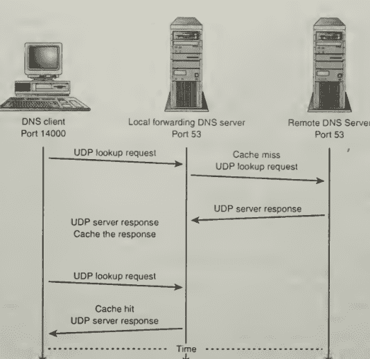

图 3.5 DNS 转发服务器与点对点查找。

本地客户端请求被发送到本地 DNS 服务器。第一次时，`named` 不具备查询信息，因此它会将请求转发到远程域名服务器，`named` 缓存返回的信息并将其传递给客户端。当下次请求相同的信息时，`named` 在其本地缓存中找到它，而不再发送请求：

```
ipchains -A output -i EXTERNAL_INTERFACE -p udp \
-s IPADDR 53 \
-d NAMESERVER 53 -j ACCEPT

ipchains -A input -i EXTERNAL_INTERFACE -p udp \
-s NAMESERVER 53 \
-d IPADDR 53 -j ACCEPT
```

### 允许远程对你的服务器进行 DNS 查询

普通的家庭网站几乎没有理由为远程机器提供 DNS 服务。除非你的网站是一个 ISP（互联网服务提供商），否则你的客户端应该是位于你的局域网、子网、路由器、网络地址空间，或根据你所观察的网络和组织规模使用的任何术语的本地机器。

假设你是一个向外部世界提供 DNS 服务的家庭或小型企业，会将客户端限制在一个特定的组内。你不会允许来自任何地方的连接：

```
# 客户端到服务器的 DNS 事务
ipchains -a input -i $EXTERNAL_INTERFACE -p udp \
  -s $my.dns.clients \$UNPRIVPORTS \
  -d IPADDR 53 -j ACCEPT
```

```
ipchains -a output -i $EXTERNAL_INTERFACE -p udp \
  -s $IPADDR 53 \
  -s $my.dns.clients \$UNPRIVPORTS -j ACCEPT
```

```
# 点对点服务器 DNS 事务
ipchains -a input -i $EXTERNAL_INTERFACE -p udp \
  -s $my.dns.clients 53 \
  -d $IPADDR 53 -j ACCEPT
```

```
ipchains -a output -i $EXTERNAL_INTERFACE -p udp \
  -s $IPADDR 53 \
  -d $my.dns.clients 53 -j ACCEPT
```

这两条规则适用于数据过大无法放入 UDP DNS 数据包时的客户端请求重试。它们也适用于辅助服务器向主服务器请求区域传输（zone transfers）的情况。TCP 几乎被专门用于区域传输，而区域传输代表了许多潜在的安全漏洞。如果限制客户端源地址是重要的：

```
ipchains -a input -i $EXTERNAL_INTERFACE -p tcp \
  -s $my.dns.secondaries \$UNPRIVPORTS \
  -d $IPADDR 53 -j ACCEPT
```

```
ipchains -a output -i $EXTERNAL_INTERFACE -p tcp ! -y \
  -s $IPADDR 53 \
  -d $my.dns.secondaries \$UNPRIVPORTS -j ACCEPT
```

### 过滤 AUTH 用户身份识别服务 (TCP 端口 113)

`AUTH`、`IDENT` 用户识别服务通常在发送邮件或发布 Usenet 文章时使用。某些 FTP 站点被配置为需要可解析的 AUTH 查询。出于日志目的，服务器会向你的机器发起一个 AUTH 请求，以获取发起邮件或新闻连接的用户账户名称。表 3.4 列出了 AUTH 服务的完整客户端/服务器连接协议。

### 通过 TCP 进行 DNS 区域传输

大规模网络服务（如 DNS 区域传输）不应被小型站点允许。无疑，在某些地方存在例外。对于这些例外，以及对于那些“反正就是要这样做”的人，请限制你接受连接的辅助服务器列表。仅与信任的远程站点共享你的 DNS 表。


### 表 3.4 identd 协议

| 描述 | 协议 | 远程地址 | 远程端口 | 入/出 | 本地地址 | 本地端口 | TCP 标志 |
| :--- | :--- | :--- | :--- | :--- | :--- | :--- | :--- |
| 本地客户端查询 | TCP | ANYWHERE | 113 | Out | IPADDR | 1024:65535 | Any |
| 远程服务器响应 | TCP | ANYWHERE | 113 | In | IPADDR | 1024:65535 | Ack |
| 远程客户端查询 | TCP | ANYWHERE | 1024:65535 | In | IPADDR | | Any |
| 本地服务器响应 | TCP | ANYWHERE | 1024:65535 | Out | IPADDR | 113 | Ack |

## 允许你作为客户端发出的 AUTH 请求

如果你运行邮件或 FTP 服务器，你的机器将充当 AUTH 客户端。没有理由不让系统成为 AUTH 客户端：

```
ipchains -A output -i EXTERNAL_INTERFACE -p tcp \ 
  -s $IPADDR UNPRIVPORTS \
  -d ANYWHERE 113 -j ACCEPT
```

```
ipchains -A input -i EXTERNAL_INTERFACE -p tcp ! -y \ 
  -s ANYWHERE UNPRIVPORTS \
  -d $IPADDR UNPRIVPORTS -j ACCEPT
```

## 过滤进入你服务器的 AUTH 请求


提供 `AUTH` 服务是一个持续争议的话题。除了少数 `FTP` 站点外，似乎似乎都要求它。无论你决定是否提供该服务，当你运行 `identd` 服务于 `/etc/inetd.conf` 时，你都会收到进入请求。以下规则允许这些进入请求：

```
ipchains -A input -i EXTERNAL_INTERFACE -p tcp \
  -s ANYWHERE UNPRIVPORTS \
  -d $IPADDR UNPRIVPORTS -j ACCEPT
```

```
ipchains -A output -i EXTERNAL_INTERFACE -p tcp ! -y \
  -s $IPADDR UNPRIVPORTS \
  -d ANYWHERE 113 -j ACCEPT
```

当你发送邮件或发布 `Usenet` 文章时，客户端不会收到通知直到请求超时。相反，你需要拒绝该连接以避免等待。这是拒绝这些数据包的唯一情况：

```
ipchains -A input -i EXTERNAL_INTERFACE -p tcp \
  -s ANYWHERE \
  -d IPADDR 113 - reject
```

## 常用服务

可能没有人想要启用本节列出的所有服务，他们只想启用其中的子集。本节提供了以下规则：

- Email
- Usenet
- telnet
- finger
- whois
- Wide Area Information Service (`WAIS`)

许多其他服务在文中未涵盖。其中某些是专为本地私有网络设计的。

邮件被分配到 `TCP` 端口 `25`。邮件通常通过三种不同的协议本地接收——`SMTP`、`POP` 或 `IMAP`——取决于 `ISP` 以及本地配置。`SMTP` 是通用邮件协议，它决定邮件是否可以递送（指向机器上的有效账户）并将其递送到用户的本地邮箱。

### 表 3.5 SMTP, POP 和 IMAP 协议

| 描述 | 协议 | 远程地址 | 远程端口 | 入/出 | 本地地址 | 本地端口 | TCP 标志 |
| :--- | :--- | :--- | :--- | :--- | :--- | :--- | :--- |
| 发送出邮件 | TCP | ANYWHERE | 25 | Out | IPADDR | 1024:65535 | Any |
| 远程服务器响应 | TCP | ANYWHERE | 25 | In | IPADDR | 1024:65535 | Ack |
| 接收进入邮件 | TCP | ANYWHERE | 1024:65535 | In | IPADDR | 25 | Any |
| 本地服务器响应 | TCP | ANYWHERE | 1024:65535 | Out | IPADDR | 25 | Ack |
| 本地客户端查询 | TCP | POP SERVER | 110 | Out | IPADDR | 1024:65535 | Any |
| 远程服务器响应 | TCP | POP SERVER | 110 | In | IPADDR | 1024:65535 | Ack |
| 远程客户端查询 | TCP | POP client | 1024:65535 | In | IPADDR | 110 | Any |
| 本地服务器响应 | TCP | POP client | 1024:65535 | Out | IPADDR | 110 | ACK |
| 本地客户端查询 | TCP | IMAP SERVER | 143 | Out | IPADDR | 1024:65535 | Any |
| 远程服务器响应 | TCP | IMAP SERVER | 143 | In | IPADDR | 143 | Ack |
| 远程客户端查询 | TCP | IMAP client | 1024:65535 | In | IPADDR | 143 | Any |
| 本地服务器响应 | TCP | IMAP client | 1024:65535 | Out | IPADDR | 143 | ACK |

# 94 第 3 章 构建与安装防火墙

## 通过 SMTP (TCP 端口 25) 发送邮件

邮件通过 `SMTP` 发送。但你使用哪个服务器来收集你的邮件并将其转发呢？`ISP` 为其客户提供邮件服务。`ISP` 的邮件服务器作为邮件网关。它知道如何收集你的邮件、找到收件人主机并中继邮件。在 `UNIX` 中，如果你愿意，可以托管你自己的本地邮件服务器。你的服务器将负责将邮件路由到目的地。

### 通过外部 (ISP) 网关 SMTP 服务器中继邮件

当你通过外部网关 `SMTP` 服务器中继传出的邮件时，你的客户端邮件程序将所有所有传出的邮件发送到你 `ISP` 的邮件服务器。你的 `ISP` 充当你通往世界的邮件网关。你的系统不需要知道如何定位邮件目的地或通往目的地的路由。邮件网关作为你的中继站。

以下两条规则允许你通过 `ISP` 的 `SMTP` 网关中继邮件：

```
SMTP_GATEWAY="my.isp.server"
# 外部邮件服务器或中继
```

```
ipchains -A output -i $EXTERNAL_INTERFACE -p tcp | \
-s $IP_ADDR $SOURCE_PORTS \ \
-d $SMTP_GATEWAY 25 -j ACCEPT
```

```
ipchains -A input -i $EXTERNAL_INTERFACE -p tcp ! -y | \
-s ANYWHERE 25 \ \
-d $IP_ADDR $SOURCE_PORTS -j ACCEPT
```

### 向任何外部邮件服务器发送邮件

或者，你可以绕过你 `ISP` 的邮件服务器并托管你自己的。你的本地服务器负责收集你传出的邮件、对目标主机名进行 `DNS` 查找，并将邮件中继到其目的地。你的客户端邮件程序使用你的本地 `SMTP` 服务器而不是 `ISP` 的服务器。

以下两条规则允许你直接向远程目的地发送邮件：

```
ipchains -A output -i $EXTERNAL_INTERFACE -p tcp | \
-s $IP_ADDR $SOURCE_PORTS \ \
-d ANYWHERE 25 -j ACCEPT
```

```
ipchains -A input -i $EXTERNAL_INTERFACE -p tcp ! -y | \
-s ANYWHERE 25 \ \
-d $IP_ADDR $SOURCE_PORTS -j ACCEPT
```

### 代理服务器既是客户端也是服务器

当前的 `SMTP` 邮件服务器是 `sendmail`，它是一个代理服务器。它作为发送邮件的客户端邮件程序的服务器。它作为向要发送邮件的远程服务器的客户端。在这种语境下，“客户端”和“服务器”这两个术语可能会引起混淆。`sendmail` 同时充当这两个角色，取决于它在与哪个部分通信。


### 接收邮件

接收邮件取决于你的情况。如果你运行自己的本地邮件服务器，可以直接在你的 `Linux` 机器上收集入站邮件。如果你从 `ISP` 账户检索邮件，你可能会作为 `POP` 或 `IMAP` 客户端检索邮件，这取决于你如何配置 `ISP` 电子邮件账户，取决于 `ISP` 提供的邮件交付服务。

### 作为本地 SMTP 服务器 (TCP 端口 25) 接收邮件

如果你希望接收来自世界任何地方直接发送到本地机器的邮件，你需要使用 `sendmail` 并使用这些服务器规则：

```
ipchains -A input -i EXTERNAL_INTERFACE -p tcp \
  -s ANYWHERE $PRIV_PORTS \
  -d $IP_ADDR 25 -j ACCEPT
```

```
ipchains -A output -i EXTERNAL_INTERFACE -p tcp ! -y \
  -s $IP_ADDR 25 \
  -d ANYWHERE $PRIV_PORTS - ACCEPT
```

或者，如果你愿意保持本地电子邮件账户相对私密，并将工作或 `ISP` 电子邮件账户作为你的公共地址，你可以配置工作和 `ISP` 邮件账户将邮件转发到你的本地服务器。在这种情况下，你可以将之前的接受从任何地方连接的单一规则对替换为针对每个邮件转发器的特定规则。

### 作为 POP 客户端 (TCP 端口 110) 检索邮件

连接到 `POP` 服务器是从远程 `ISP` 或工作账户检索邮件的非常常见的方法。如果你的 `ISP` 使用 `POP` 服务器进行客户邮件检索，你需要允许传出的客户端到服务器连接。

服务器地址将是一个特定的主机名或地址，而不是全局的 `ANYWHERE` 指定符。`POP` 账户与特定的用户和密码关联：

```
POP_SERVER="my.isp.pop.server" # 外部 pop 服务器，如果有
```


```
ipchains -A input -i EXTERNAL_INTERFACE -p tcp \
  -s $IP_ADDR $PRIV_PORTS \
  -d $POP_SERVER 110 -j ACCEPT
```

```
ipchains -A output -i EXTERNAL_INTERFACE -p tcp ! -y \
  -s $POP_SERVER 110 \
  -d $IP_ADDR $PRIV_PORTS
```

## 作为 IMAP 客户端 (TCP 端口 143) 接收

连接到 IMAP 服务器是从远程 ISP 或工作账户检索邮件的另一种常见方法。如果你的 ISP 使用 IMAP 服务器进行检索，你需要允许传出的客户端到服务器连接。

服务器地址将是一个特定的主机名或地址，而不是全局的 ANYWHERE 指定符。IMAP 账户与特定的用户和密码关联：

```
IMAP_SERVER="my.isp.imap.server" # 外部 imap 服务器，
```

```
ipchains -A output -i EXTERNAL_INTERFACE -p tcp | \
-s $IP_ADDR $PRIV_PORTS \
  -d $IMAP_SERVER 143 -j ACCEPT
```

```
ipchains -A input -i EXTERNAL_INTERFACE -p tcp ! -y | \
-s $IMAP_SERVER 143 \
  -d $IP_ADDR $PRIV_PORTS -j ACCEPT
```

## 现实世界的客户端与服务器组合

本节描述了四种常见的客户端服务器方法：

- 作为 SMTP 客户端发送邮件并作为 POP 客户端接收邮件
- 作为 SMTP 客户端发送邮件并作为 IMAP 客户端接收邮件
- 作为 SMTP 客户端发送邮件并作为 SMTP 服务器接收邮件
- 作为 SMTP 服务器发送邮件并作为 SMTP 服务器接收邮件

对于完全依赖 ISP 的 SMTP 或 POP 或 IMAP 服务的用户，前两种有用。第三种是混合方法，通过你的 ISP 邮件服务器中继传出邮件，但通过你的本地 SMTP 服务器接收邮件。第四种方法支持为出站和入站邮件运行自己的独立的邮件服务器。

# 第 3 章 构建与安装防火墙

```bash
ipchains -A input -i EXTERNAL_INTERFACE -p tcp ! -y \
-s SMTP_GATEWAY 25 \
-d IPADDR UNPRIVORTS -j ACCEPT
```

```bash
ipchains -A input -i EXTERNAL_INTERFACE -p tcp ! -y \
-s ANYWHERE UNPRIVORTS \
-d IPADDR UNPRIVORTS -j ACCEPT
```

```bash
ipchains -A output -i EXTERNAL_INTERFACE -p tcp ! -y \
-s IPADDR 25 \
-d ANYWHERE UNPRIVORTS -j ACCEPT
```

## 作为 SMTP 服务器发送邮件以及作为 SMTP 服务器接收邮件

如果您既作为 SMTP 服务器发送邮件，又作为 SMTP 服务器接收邮件，请提供所有的自己的邮件服务。您的本地 sendmail 守护进程已配置为自行继发出站邮件到目标主机，同时也收集并递送入邮件：

```bash
ipchains -A output -i EXTERNAL_INTERFACE -p tcp \
-s IPADDR UNPRIVORTS \
-d ANYWHERE 25 -j ACCEPT
```

```bash
ipchains -A input -i EXTERNAL_INTERFACE -p tcp ! -y \
-s ANYWHERE 25 \
-d IPADDR UNPRIVORTS -j ACCEPT
```

```bash
ipchains -A input -i EXTERNAL_INTERFACE -p tcp ! -y \
-s ANYWHERE UNPRIVORTS \
-d IPADDR 25 -j ACCEPT
```

```bash
ipchains -A output -i EXTERNAL_INTERFACE -p tcp ! -y \
-s IPADDR 25 \
-d ANYWHERE UNPRIVORTS -j ACCEPT
```

## 为远程客户端托管邮件服务器

对于小型系统来说，托管公共 POP 或 IMAP 服务是不寻常。如果您为几位朋友提供邮件服务，或者您的 ISP 服务临时不可用，您可能会这样做。无论何种情况下，在数据包过滤层面和服务器配置层面，限制您的系统接受连接的范围都是关重要的。您还应该考虑使用加密的身份验证方法，或者仅允许通过 SSH 连接检索邮件。

## 为远程客户端托管 POP 服务器

POP 服务器是黑客攻击三个最常见且潜在的切入点之一。

如果您使用本地系统作为中央邮件服务器，并运行本地 pop3 服务器为局域网上的本地机器提供邮件访问，则您不需要示例中的服务器规则。应该拒绝来自互联网的入站连接。

要为少数远程用户托管 POP 服务，接下来的两条规则允许连接到您的 POP 服务器。连接被限制在您特定客户端的 IP 地址：

```bash
ipchains -A input -i EXTERNAL_INTERFACE -p tcp \
-s <my.pop.clients> SUNPRIVORTS \
-d $IPADDR 110 -j ACCEPT
```

```bash
ipchains -A output -i EXTERNAL_INTERFACE -p tcp ! -y \
-s $IPADDR 110 \
-d <my.pop.clients> SUNPRIVORTS -j ACCEPT
```

## 为远程客户端托管 IMAP 服务器

IMAP 服务器是黑客攻击三个最常见且成功的切入点之一。

如果您使用本地系统作为中央邮件服务器，并运行本地 imap 服务器为局域网上的本地机器提供邮件访问，则您不需要服务器规则。应该拒绝来自互联网的入站连接。如果您需要为少数远程用户托管 IMAP 服务，接下来的两条规则允许连接到您的 IMAP 服务器。连接被限制在您特定客户端的 IP 地址：

```bash
ipchains -A input -i EXTERNAL_INTERFACE -p tcp \
-s <my.imap.clients> SUNPRIVORTS \
-d $IPADDR 143 -j ACCEPT
```

```bash
ipchains -A output -i EXTERNAL_INTERFACE -p tcp ! -y \
-s $IPADDR 143 \
-d <my.imap.clients> SUNPRIVORTS -j ACCEPT
```

## 使用 Usenet 新闻服务 (TCP NNTP 端口 119)

Usenet 新通过运行在 TCP 之上的 NNTP 通过服务端口 119 进行访问。阅读新闻和发布文章由您的本地新闻客户端处理。少数系统需要服务器规则。表 3.6 列出了 NNTP Usenet 新闻服务的完整客户端/服务器连接协议。

# 第 3 章 构建与安装防火墙

### 表 3.6 NNTP 协议

| 描述 | 协议 | 远程地址 | 远程端口 | 出方向 | 本地地址 | 本地端口 | TCP 标志 |
| :--- | :--- | :--- | :--- | :--- | :--- | :--- | :--- |
| 本地客户端查询 | TCP | NEWS SERVER | 119 | Out | IPADDR | 1024:65535 | Any |
| 远程服务器响应 | TCP | NEWS SERVER | 119 | In | IPADDR | 1024:65535 | Ack |
| 远程客户端查询 | TCP | NNTP clients | 1024:65535 | In | IPADDR | 119 | Any |
| 本地服务器响应 | TCP | NNTP clients | 1024:65535 | Out | IPADDR | 119 | Ack |
| 本地服务器查询 | TCP | News feed | 119 | Out | IPADDR | 1024:65535 | Any |
| 远程服务器响应 | TCP | News feed | 119 | In | IPADDR | 1024:65535 | Ack |

## 作为 Usenet 客户端阅读和发布新闻

客户端规则允许连接到您的 ISP 的新闻服务器。阅读新闻和发布文章都由这些规则处理：

```bash
NEWS_SERVER="my.news.server" # 外部新闻服务器，如果有
```


```bash
ipchains -A output -i EXTERNAL_INTERFACE -p tcp | \
-s IPADDR $UNPRIVPORTS \
-d NEWS_SERVER 119 -j ACCEPT
```

```bash
ipchains -A input -i EXTERNAL_INTERFACE -p tcp | -y \
-s NEWS_SERVER 119 -j ACCEPT
```

## 为远程客户端托管 Usenet 服务器

小型站点极不可能为外部世界托管新闻服务器。即使托管本地新闻服务器也可能可能的。对于少数例外情况，服务器规则应配置为允许来自选定客户端的入站连接：

```bash
ipchains -A input -i EXTERNAL_INTERFACE -p tcp | \
-s <my.news.clients> $UNPRIVPORTS \
-d IPADDR 119 -j ACCEPT
```

```bash
ipchains -A output -i EXTERNAL_INTERFACE -p tcp | \
-s IPADDR UNPRIV \
-d IPADDR 119 -j ACCEPT
```

## 启用服务

小型站点极不可能为外部世界托管新闻服务器。即使托管本地新闻服务器也是可能的。对于少数例外情况，服务器规则应配置为允许来自选定客户端的入站连接：

与其从任何地方允许连接，不如为可以合法产生连接的特定主机或网络定义服务器规则。

如果您需要使用 telnet 访问远程系统，接下来的两条规则允许连接到您的服务器。如果您的站点有多个用户，您可以将出站连接限制在特定站点，而不是允许出站连接到任何地方。

```bash
ipchains -A input -i EXTERNAL_INTERFACE -p tcp ! -y \
-s IPWHERE PRIV \
-d IPADDR 25 -j ACCEPT
```

```bash
ipchains -A output -i EXTERNAL_INTERFACE -p tcp ! -y \
-s IPADDR 25 \
-d ANYWHERE -j ACCEPT
```

为几位朋友提供邮件服务，或者您的 ISP 服务临时不可用。在任何情况下，在数据包过滤层面和服务器配置层面，限制您的系统接受连接的范围都是重要的。您还应该考虑使用加密的身份验证方法，或者仅允许通过 SSH 连接检索邮件。

## 作为 SMTP 服务器发送邮件以及作为 SMTP 服务器接收邮件

如果您既作为 SMTP 服务器发送邮件，又作为 SMTP 服务器接收邮件，请提供所有的自己的邮件服务。您的本地 sendmail 守护进程已配置为自行继发出站邮件到目标主机，同时也收集并递送入邮件：

```bash
ipchains -A output -i EXTERNAL_INTERFACE -p tcp \
-s IPADDR UNPRIVORTS \
-d ANYWHERE 25 -j ACCEPT
```

```bash
ipchains -A input -i EXTERNAL_INTERFACE -p tcp ! -y \
-s ANYWHERE 25 \
-d IPADDR UNPRIVORTS -j ACCEPT
```

```bash
ipchains -A input -i EXTERNAL_INTERFACE -p tcp ! -y \
-s ANYWHERE UNPRIVORTS \
-d IPADDR 25 -j ACCEPT
```

```bash
ipchains -A output -i EXTERNAL_INTERFACE -p tcp ! -y \
-s IPADDR 25 \
-d ANYWHERE UNPRIVORTS -j ACCEPT
```

## 为远程客户端托管邮件服务器

对于小型系统来说，托管公共 POP 或 IMAP 服务是不寻常。如果您为几位朋友提供邮件服务，或者您的 ISP 服务临时不可用。在任何种情况下，在数据包过滤层面和服务器配置层面，限制您的系统接受连接的范围都是重要的。您还应该考虑使用加密的身份验证方法，或者仅允许通过 SSH 连接检索邮件。

## 为远程客户端托管 POP 服务器

POP 服务器是黑客攻击三个最常见且潜在的切入点之一。

如果您使用本地系统作为中央邮件服务器，并运行本地 pop3 服务器为局域网上的本地机器提供邮件访问，则您不需要示例中的服务器规则。应该拒绝来自互联网的入站连接。

要为少数远程用户托管 POP 服务，接下来的两条规则允许连接到您的 POP 服务器。连接被限制在您特定客户端的 IP 地址：

```bash
ipchains -A input -i EXTERNAL_INTERFACE -p tcp \
-s <my.pop.clients> SUNPRIVORTS \
-d $IPADDR 110 -j ACCEPT
```

```bash
ipchains -A output -i EXTERNAL_INTERFACE -p tcp ! -y \
-s $IPADDR 110 \
-d <my.pop.clients> SUNPRIVORTS -j ACCEPT
```

## 为远程客户端托管 IMAP 服务器

IMAP 服务器是黑客攻击三个最常见且成功的切入点之一。

如果您使用本地系统作为中央邮件服务器，并运行本地 imap 服务器为局域网上的本地机器提供邮件访问，则您不需要服务器规则。应该拒绝来自互联网的入站连接。如果您需要为少数远程用户托管 IMAP 服务，接下来的两条规则允许连接到您的 IMAP 服务器。连接被限制在您特定客户端的 IP 地址：

```bash
ipchains -A input -i EXTERNAL_INTERFACE -p tcp \
-s <my.imap.clients> SUNPRIVORTS \
-d $IPADDR 143 -j ACCEPT
```

```bash
ipchains -A output -i EXTERNAL_INTERFACE -p tcp ! -y \
-s $IPADDR 143 \
-d <my.imap.clients> SUNPRIVORTS -j ACCEPT
```

## 使用 Usenet 新闻服务 (TCP NNTP 端口 119)

Usenet 新通过运行在 TCP 之上的 NNTP 通过服务端口 119 进行访问。阅读新闻和发布文章由您的本地新闻客户端处理。少数系统需要服务器规则。表 3.6 列出了 NNTP Usenet 新闻服务的完整客户端/服务器连接协议。

# 第 3 章 构建与安装防火墙

### 表 3.6 NNTP 协议

| 描述 | 协议 | 远程地址 | 远程端口 | 出方向 | 本地地址 | 本地端口 | TCP 标志 |
| :--- | :--- | :--- | :--- | :--- | :--- | :--- | :--- |
| 本地客户端查询 | TCP | NEWS SERVER | 119 | Out | IPADDR | 1024:65535 | Any |
| 远程服务器响应 | TCP | NEWS SERVER | 119 | In | IPADDR | 1024:65535 | Ack |
| 远程客户端查询 | TCP | NNTP clients | 1024:65535 | In | IPADDR | 119 | Any |
| 本地服务器响应 | TCP | NNTP clients | 1024:65535 | Out | IPADDR | 119 | Ack |
| 本地服务器查询 | TCP | News feed | 119 | Out | IPADDR | 1024:65535 | Any |
| 远程服务器响应 | TCP | News feed | 119 | In | IPADDR | 1024:65535 | Ack |

## 作为 Usenet 客户端阅读和发布新闻

客户端规则允许连接到您的 ISP 的新闻服务器。阅读新闻和发布文章都由这些规则处理：

```bash
NEWS_SERVER="my.news.server" # 外部新闻服务器，如果有
```

```bash
ipchains -A output -i EXTERNAL_INTERFACE -p tcp | \
-s IPADDR $UNPRIVPORTS \
-d NEWS_SERVER 119 -j ACCEPT
```

```bash
ipchains -A input -i EXTERNAL_INTERFACE -p tcp | -y \
-s NEWS_SERVER 119 -j ACCEPT
```

## 为远程客户端托管 Usenet 服务器

小型站点极不可能为外部世界托管新闻服务器。即使托管本地新闻服务器也可能可能的。对于少数例外情况，服务器规则应配置为允许来自选定客户端的入站连接：


```bash
ipchains -A input -i EXTERNAL_INTERFACE -p tcp | \
-s <my.news.clients> $UNPRIVPORTS \
-d IPADDR 119 -j ACCEPT
```

```bash
ipchains -A output -i EXTERNAL_INTERFACE -p tcp | \
-s IPADDR UNPRIV \
-d IPADDR 119 -j ACCEPT
```

为了支持 `.hosts` 和 `hosts.equiv` 身份验证，使用了从 1023 到 513 递减范围内的特权端口。使用第一个可用端口。SSH 客户端可以选择仅使用非特权端口。SSH 服务器将接受来自特权或非特权端口的连接。

这里的客户端和服务器规则允许从任何地方访问。在实践中，你会将外部地址限制在选定的子集中，特别是因为连接的两端都必须配置为识别每个单独的用户账户进行身份验证。表 3.8 列出了 SSH 服务的客户端/服务器连接协议。

### 表 3.8 SSH 协议

|or | 协议 | 远程地址 | 远程端口 | 方向 | 本地地址 | 本地端口 | TCP 标志 |

| --- | --- | --- | --- | --- | --- | --- | --- |

| 本地客户端请求 | TCP | ANYWHERE | 22 | 出 | IPADDR | 1024:65535 | Any |

| 远程服务器响应 | TCP | ANYWHERE | 22 | 入 | IPADDR | | Ack |

| 本地客户端请求 | TCP | ANYWHERE | 22 | 出 | IPADDR | 513:1023 | Any |

| 远程服务器响应 | TCP | ANYWHERE | 22 | 入 | IPADDR | 513:1023 | Ack |

| 远程客户端请求 | TCP | SSH clients | 1024:65535 | 入 | IPADDR | 22 | Any |

| 本地服务器响应 | TCP | SSH clients | | 出 | IPADDR | 22 | Ack |

| 远程客户端请求 | TCP | SSH clients | 513:1023 | 入 | IPADDR | 22 | Any |

| 本地服务器响应 | TCP | SSH clients | 513:1023 | 出 | IPADDR | 22 | Ack |

## SSH、tcp_wrappers 与 hosts 身份验证

SSH 无法直接在 `tcp_wrappers` 下启动，但可以编译为遵守 `/etc/hosts.allow` 和 `/etc/hosts.deny` 中的访问列表信息。

- 防火墙机器上简单不应提供 `hosts` 和 `hosts.equiv` 身份验证。第 8 章“入侵检测与事件报告”中讨论的系统安全工具会在系统上存在这些文件时发出警告。

有关 SSH 的更多信息，请参阅 http://www.ssh.fi/

## 104 第 3 章 构建与安装防火墙

在为持续连接选择特权服务器端口时，将使用 1023 到 513 之间的第一个空端口。你允许的端口范围等于你允许的并发 SSH 连接数：

```
SSH_PORTS=:1020:1023"    # (TCP) 4 个并发连接
```

## 允许客户端访问远程 SSH 服务器

这些规则允许你使用 `ssh` 连接到远程站点：

```
ipchains -A output -i EXTERNAL_INTERFACE -p tcp \
  -s SIPADDR SUNPRIVORTS \
  -d SANYWHERE 22 -j ACCEPT
```

```
ipchains -A input -i EXTERNAL_INTERFACE -p tcp ! -y \
  -s SANYWHERE SUNPRIVORTS \
  -d SIPADDR -j ACCEPT
```

```
ipchains -A output -i EXTERNAL_INTERFACE -p tcp \
  -s SIPADDR SSH_PORTS \
  -d SANYWHERE 22 -j ACCEPT
```

```
ipchains -A input -i EXTERNAL_INTERFACE -p tcp ! -y \
  -s SANYWHERE 22 \
  -d SIPADDR SSH_PORTS -j ACCEPT
```

## 允许远程客户端访问你的本地 SSH 服务器

这些规则允许进入你的 `ssh` 服务器的连接：

```
ipchains -A input -i EXTERNAL_INTERFACE -p tcp ! -y \
  -s SANYWHERE SUNPRIVORTS \
  -d SIPADDR 22 -j ACCEPT
```

```
ipchains -A output -i EXTERNAL_INTERFACE -p tcp ! -y \
  -s SANYWHERE 22 \
  -d SIPADDR -j ACCEPT
```

```
ipchains -A input -i EXTERNAL_INTERFACE -p tcp \
  -s SANYWHERE SSH_PORTS \
  -d SIPADDR -j ACCEPT
```

```
ipchains -A output -i EXTERNAL_INTERFACE -p tcp ! -y \
  -s SIPADDR 22 \
  -d SANYWHERE SSH_PORTS -j ACCEPT
```

## ftp (TCP 端口 21, 20)

FTP 仍然是两台机器之间传输文件常用的方式之一。基于 Web 的 FTP 界面也变得常见。

FTP 使用两个特权端口，一个用于发送命令，一个用于发送数据。端口 21 用于建立与服务器的初始连接并传递用户命令。端口 20 用于建立数据通道，文件和目录列表作为数据发送。FTP 有两种客户端和服务器之间交换数据的模式：普通数据通道端口模式和被动数据通道模式。普通端口模式是使用 `ftp` 客户端程序连接到远程 FTP 站点时的原始默认机制。被动模式是一种较新的机制，也是通过 Web 浏览器连接时的默认模式。偶尔，你可能会遇到只支持其中一种模式的 FTP 站点。表 3.9 列出了 FTP 服务的客户端/服务器连接协议。

| 描述 | 协议 | 远程地址 | 远程端口 | 出 | 本地地址 | 本地端口 | TCP 标志 |

|---|---|---|---|---|---|---||-|

| 本地客户端查询 | TCP | ANYWHERE | 21 | 出 | IPADDR | | Any |

| 远程服务器响应 | TCP | ANYWHERE | 21 | 入 | IPADDR | 1024:65535 | Ack |

| 远程服务器数据通道请求 | TCP | ANYWHERE | 20 | 入 | IPADDR | 1024:65535 | Any |

| 本地客户端数据通道响应 | TCP | ANYWHERE | 20 | 出 | IPADDR | 1024:65535 | Ack |

| 本地客户端被动数据通道请求 | TCP | ANYWHERE | 1024:65535 | 出 | IPADDR | 1024:65535 | Any |

| 远程服务器被动数据通道响应 | TCP | ANYWHERE | 1024:65535 | 入 | IPADDR | 1024:65535 | Ack |

## 105 启用常用 TCP 服务

### Web 服务

Web 服务基于超文本传输协议（HTTP）。客户端和服务器连接使用标准的 TCP 约定。除了标准的通用 HTTP 访问外，还有几种更高级别的特殊用途通信协议可用，包括通过 SSL 的安全访问以及通过 ISP 提供的 Web 服务器代理进行访问。这些不同的访问协议使用不同的端口。

### 标准 HTTP 访问 (TCP 端口 80)

在正常情况下，Web 服务通过 `http` 服务端口 80 可用。表 3.10 列出了 HTTP Web 服务的完整客户端/服务器连接协议。

表 3.10 HTTP 协议

| 描述 | 协议 | 地址 | 远程端口 | 入/出 | 本地地址 | 本地端口 | TCP 标志 |

| --- | --- | --- | --- | --- | --- | --- | --- |

| 本地客户端请求 | TCP | ANYWHERE | 80 | 出 | IPADDR | 1024:65535 | Any |

| 远程服务器响应 | TCP | ANYWHERE | 80 | 入 | IPADDR | 1024:65535 | Ack |

| 远程客户端请求 | TCP | ANYWHERE | 1024:65535 | 入 | IPADDR | 80 | Any |

| 本地服务器响应 | TCP | ANYWHERE | 1024:65535 | 出 | IPADDR | 80 | Ack |


# 作为客户端访问远程站点

在当今世界，如果家庭网站不想通过 Web 浏览器访问万维网，几乎是不方便的。以下规则允许访问远程 Web 服务器：

```
ipchains -A i EXTERNAL_INTERFACE -p tcp \
-s IPADDR SUNPRIVPORTS \
-d ANYWHERE 80 -j ACCEPT
```

```
ipchains -A i EXTERNAL_INTERFACE -p tcp ! -y \
-s ANYWHERE 80 \
-d IPADDR SUNPRIVPORTS -j ACCEPT
```

## 注意：不要在互联网上使用 ftp

`tftp` 提供了一个简化的、未经身份验证的 UDP 版本 `FTP` 服务。它旨在从受信任的主机通过本地网络加载启动软件到路由器和无盘工作站。有些人将 `tftp` 认为是 `ftp` 的替代方案。千万不要在互联网上使用它。

## 启用常用 TCP 服务 109

## 允许远程访问本地 Web 服务器

如果你决定运行自己的 Web 服务器并为互联网托管网站，通用服务器规则允许所有典型的进入站的入站访问。这是大多数人托管网站所需的全部：

```
ipchains -A input -i EXTERNAL_INTERFACE -p tcp \
  -s ANYWHERE $UNPRIVVPORTS \
  -d IPADDR 80 -j ACCEPT
```

```
ipchains -A output -i EXTERNAL_INTERFACE -p tcp -y \
  -s IPADDR 80 \
  -d ANYWHERE $UNPRIVVPORTS -j ACCEPT
```

## 安全 Web 访问 (SSL) (TCP 端口 443)

安全套接层 `SSL` 用于安全的、加密的 Web 访问。`SSL` 协议使用 `TCP` 端口 `443`。当你访问商业网站购买物品、使用在线银行服务或进入需要提示个人信息的受保护 Web 区域时，经常会遇到这种情况。表 3.11 列出了 `SSL` 服务的完整客户端/服务器连接协议。

表 3.11 SSL 协议

| 描述 | 协议 | 远程地址 | 远程端口 | 入/ | 本地地址 | 本地端口 | TCP 标志 |
| --- | --- | --- | --- | --- | --- | --- | --- |
| 本地客户端请求 | TCP | ANYWHERE | 443 | 出 | IPADDR | 1024:65535 | Any |
| 远程服务器响应 | TCP | ANYWHERE | 443 | 入 | IPADDR | 1024:65535 | Ack |
| 远程客户端请求 | TCP | ANYWHERE | | 入 | IPADDR | 443 | Any |
| 本地服务器响应 | TCP | ANYWHERE | | 出 | IPADDR | 443 | Ack |

### 作为客户端通过 SSL 访问远程 Web 站点

大多数人在某些时刻需要访问安全 Web 站点的客户端：

```
ipchains -A output -i EXTERNAL_INTERFACE -p tcp \
  -s IPADDR $UNPRIVVPORTS \
  -d ANYWHERE 443 -j ACCEPT
```

```
ipchains -A input -i EXTERNAL_INTERFACE -p tcp -y \
  -s ANYWHERE 443 \
  -d IPADDR $UNPRIVVPORTS -j ACCEPT
```

### 允许远程访问本地 SSL Web 服务器

如果你进行某些形式的电子商务，你可能想允许连接到网站中受 `SSL` 保护的区域。否则，你不需要本地服务器规则。

基础 Web 服务器分发版带有 `SSL` 支持，但由于联邦加密法规，未包含更安全的 `SSL` 模块。然而，`Apache` Web 服务器提供免费和商用的 `SSL` 支持包。请访问 `www.apache.org` 了解更多信息。

以下规则允许使用 `SSL` 协议访问你的 Web 服务器：

```
ipchains -A input -i EXTERNAL_INTERFACE -p tcp \
  -s ANYWHERE UNPRIVILEPORTS \
  -d IPADDR 443 -j ACCEPT

ipchains -A output -i EXTERNAL_INTERFACE -p tcp ! -y \
  -s IPADDR 443 \
  -d ANYWHERE UNPRIVILEPORTS -j ACCEPT
```

## 代理访问 (TCP 端口 80, 8080)

公共访问的代理在 ISP 中非常常见。从角度来看，`finger` 访问在防火墙层面受到限制。

以下规则允许进入你的 Web 服务器，但仅限选定的主机发起：

| 描述 | 协议 | 地址 | 远程端口 | 入/出 | 本地地址 | 本地端口 | TCP 标志 |
| --- | --- | --- | --- | --- | --- | --- | --- |
| 本地客户端请求 | TCP | ANYWHERE | 80 | 出 | IPADDR | 1024:65535 | Any |
| 远程服务器响应 | TCP | ANYWHERE | 80 | 入 | IPADDR | 1024:65535 | Ack |
| 远程客户端请求 | TCP | ANYWHERE | 1024:65535 | 入 | IPADDR | 80 | Any |
| 本地服务器响应 | TCP | ANYWHERE | 1024:65535 | 出 | IPADDR | 80 | Ack |

## 启用常用 TCP 服务

### finger (TCP 端口 79)

`finger` 程序访问注册 服务数据库。它以人类可读的格式允许 IP 地址和主机域名查询。表 3.13 列出了 `finger` 服务的客户端/服务器连接协议。

表 3.13 finger 协议

| 描述 | 协议 | 远程地址 | 远程端口 | 入/ | 本地地址 | 本地端口 | TCP 标志 |
| --- | --- | --- | --- | --- | --- | --- | --- |
| 本地客户端请求 | TCP | ANYWHERE | 79 | 出 | IPADDR | 1024:65535 | Any |
| 远程服务器响应 | TCP | ANYWHERE | 79 | 入 | IPADDR | 1024:65535 | Ack |
| 远程客户端请求 | TCP | ANYWHERE | 1024:65535 | 入 | IPADDR | 79 | Any |
| 本地服务器响应 | TCP | ANYWHERE | 1024:65535 | 出 | IPADDR | 79 | Ack |

#### 作为客户端访问远程 finger 服务器

开启到远程 `finger` 服务器的传出访问没有危害，以下是这样做的规则：

```
ipchains -A output -i EXTERNAL_INTERFACE -p tcp \
-s IPADDR SUNPRIVPORTS \
-d ANYWHERE 79 -j ACCEPT

ipchains -A output -i EXTERNAL_INTERFACE -p tcp ! -y \
-s ANYWHERE 79 \
-d IPADDR SUNPRIVPORTS -j ACCEPT
```

#### 允许远程客户端访问本地 finger 服务器

如果你选择允许外部访问 `finger` 服务，建议将访问限制在特定的站点。`finger` 访问可以在防火墙层面和 `tcp_wrapper` 层面进行限制。

以下规则允许进入你的 `finger` 服务器，但仅允许选定的主机发起连接：

```
ipchains -A input -i EXTERNAL_INTERFACE -p tcp \
-s <my.finger.clients> SUNPRIVPORTS \
-d IPADDR 79 -j ACCEPT

ipchains -A input -i EXTERNAL_INTERFACE -p tcp ! -y \
-s IPADDR 79 \
-d <my.finger.clients> SUNPRIVPORTS -j ACCEPT
```

## whois (TCP 端口 43)

`whois` 程序访问注册 数据库数据库。它以人类可读的格式允许 IP 地址和主机域名查询。表 3.14 列出了 `whois` 服务的客户端/服务器连接协议。

表 3.14 whois 协议

| 描述 | 协议 | 地址 | 远程端口 | 入/出 | 本地地址 | 本地端口 | TCP 标志 |
| --- | --- | --- | --- | --- | --- | --- | --- |
| 本地客户端请求 | TCP | ANYWHERE | 43 | 出 | IPADDR | 1024:65535 | Any |


| 远程服务器响应 | TCP | `ANYWHERE` | 43 | 入 | `IPADDR` | 1024:65535 | Ack |

# 启用常用 TCP 服务 113

以下两条规则允许你查询官方远程服务器：

```
ipchains -A output -i EXTERNAL_INTERFACE -p tcp \
\  -s $IPADDR $UNPRIVPORTS \
\  -d $ANYWHERE -d 43 -j ACCEPT
```

```
ipchains -A input -i EXTERNAL_INTERFACE -p tcp ! -y \
\  -s $ANYWHERE 43 \
\  -d $IPADDR $UNPRIVPORTS -j ACCEPT
```

# gopher (TCP 端口 70)

GOPHER 信息服务对于低开销 ASCII 终端仍然可用，但其很大程度上已被基于 Web 的搜索引擎和超文本链接取代。Linux 系统不太可能提供网站的本地 GOPHER 服务。本文未包含服务器规则。表 3.15 列出了 GOPHER 服务本地客户端到远程服务器的连接协议。

## 表 3.15 gopher 协议

| 描述 | 协议 | 地址 | 远程端口 | 入/出站 | 本地地址 | 本地端口 | TCP 标志 |
|---|---|---|---|---|---|---|---|

| 本地客户端请求 | TCP | `ANYWHERE` | 70 | 出 | `IPADDR` | 1024:65535 | Any |

| 远程服务器响应 | TCP | `ANYWHERE` | 70 | 入 | `IPADDR` | 1024:65535 | Ack |

以下是允许你连接到远程服务器的客户端规则：

```
ipchains -A output -i EXTERNAL_INTERFACE -p tcp \
\  -s $IPADDR $UNPRIVPORTS \
\  -d $ANYWHERE 70 -j ACCEPT
```

```
ipchains -A input -i EXTERNAL_INTERFACE -p tcp ! -y \
\  -s $ANYWHERE 70 \
\  -d $IPADDR $UNPRIVPORTS -j ACCEPT
```

# WAIS (TCP 端口 210)

广域信息服务器（WAIS）现在被称为搜索引擎。浏览器通常为 WAIS 提供图形化前端。Netscape 包含了连接到 WAIS 所需的客户端代码。表 3.16 列出了 WAIS 服务本地客户端到远程服务器的连接协议。

## 表 3.16 WAIS 协议

| 描述 | 协议 | 远程地址 | 远程端口 | 出 | 本地地址 | 本地端口 | TCP 标志 |
| :--- | :--- | :--- | :--- | :--- | :--- | :--- | :--- |

| 本地客户端请求 | TCP | `ANYWHERE` | 210 | 出 | `IPADDR` | 1024:65535 | Any |

| 远程服务器响应 | TCP | `ANYWHERE` | 210 | 入 | `IPADDR` | 1024:65535 | Ack |

这两条规则允许客户端访问远程 WAIS 服务：

# 启用常用 UDP 服务

无状态 UDP 协议本质不如基于连接的 TCP 协议安全。因此，许多注重安全的站点会完全禁用或尽可能限制对所有 UDP 服务的访问。显然，基于 UDP 的 DNS 交换是必要的，但在防火墙规则中显式指定远程域名服务器。因此，本节提供了三个服务的规则：

- traceroute
- 动态主机配置协议 (DHCP)
- 网络时间协议 (NTP)

# traceroute (UDP 端口 33434)

traceroute 是一种 UDP 服务，它导致中间系统生成 ICMP 时间越界消息以收集跳数信息，并使目标系统返回目标不可达（端口未找到）消息，指示通往主机路由的终点。默认情况下，本章开发的防火墙会阻止进入 traceroute 通常使用的端口范围的传入 traceroute 数据包。因此，不会发送对传入 traceroute 请求的传出 ICMP 响应。表 3.17 列出了 traceroute 服务完整的客户端/服务器交换协议。

## 表 3.17 traceroute 协议

| 描述 | 协议 | 远程地址 | 远程端口/ICMP 类型 | 入/出站 | 本地地址 | 本地端口/ICMP 类型 |
|---|---|---|---|---|---|---|

| 发出的 traceroute 探测 | UDP | `ANYWHERE` | 33434:33523 | 出 | `IPADDR` | 32769:65535 |

| 时间越界（中间跳数） | ICMP | `ANYWHERE` | 11 | 入 | `IPADDR` | - |

| 端口未找到（终止） | ICMP | `ANYWHERE` | 3 | 入 | `IPADDR` | - |

| 传入的 traceroute 探测 | UDP | `ISP` | 32769:65535 | 入 | `IPADDR` | 33434:33525 |

| 时间越界（中间跳数） | ICMP | `ISP` | - | 出 | `IPADDR` | 11 |

| 端口未找到（终止） | ICMP | `ISP` | - | 出 | `IPADDR` | 3 |

traceroute 可以配置使用任何端口或端口范围。因此，很难通过列出特定端口来阻止所有传入 traceroute 包。然而，它通常使用 32769 到 65535 之间的端口以及 33434 到 33523 之间的目的端口。traceroute 的默认源和目的端口常量定义：

```
TRACOUTE_SRC_PORTS="32769:65535"
TRACOUTE_DEST_PORTS="33434:33523"
```

## 启用传出 traceroute

如果你打算使用 traceroute，必须启用 UDP 端口。注意，必须允许来自任何位置 ICMP 时间越界和目标不可达消息以便传出 traceroute 工作：

```
ipchains -A output -i EXTERNAL_INTERFACE -p udp \
  -s $IPADDR $TRACOUTE_SRC_PORTS \
  -d $ANYWHERE - ACCEPT
```

## 允许传入 traceroute

由于 traceroute 是一个不安全的服务并可用于攻击其他服务，以下示例开启了来自你的 ISP 的传入 traceroute：

```
ipchains -A input -i EXTERNAL_INTERFACE -p udp \
  -s $MY_ISP $TRACOUTE_SRC_PORTS \
  -d $IPADDR $TRACOUTE_DEST_PORTS - ACCEPT
```

# 访问你的 ISP DHCP 服务器 (UDP 端口 67, 68)

你的站点与 ISP 服务器之间的任何 DHCP 交换都是本地客户端到远程服务器的交换。DHCP 客户端从 ISP 获取动态分配的 IP 地址。如果你从 ISP 获取了动态分配的 IP 地址，你需要在机器上运行 DHCP 守护进程 (`dh`)。伪造服务器在你的 ISP 本地子网运行并不罕见。因此，尽可能过滤你客户端与特定 DHCP 服务器之间的 DHCP 消息很重要。表 3.18 引用自 RFC 2131，列出了 DHCP 消息描述。

## 表 3.18 DHCP 消息类型

| DHCP 消息 | 描述 |
|---|---|

| DISCOVER | 客户端广播寻找可用服务器。 |
| OFFER | 服务器向客户端提供报价。 |
| REQUEST | 客户端向服务器请求 (a) 请求一个服务器的报价并隐含拒绝其他服务器；(b) 确认之前分配的地址，例如系统重启；(c) 延长特定网络地址的租约。 |
| ACK | 服务器向客户端提供配置参数，包括提交的网络地址。 |
| NAK | 服务器向客户端表示网络地址错误（例如客户端已移动）或租约过期。 |
| DECLINE | 客户端向服务器表示地址在使用。 |
| RELEASE | 客户端向服务器放弃网络地址并取消租约。 |
| INFORM | 客户端向服务器请求本地配置参数；客户端已有外部配置。（Red Hat 6 不）。 |

# 启用常用 UDP 服务

本质上，当 DHCP 客户端初始化时，它广播 DISCOVER 查询以发现是否有可用的 DHCP 服务器。任何接收到查询的服务器可能会响应 OFFER 消息，表示愿意作为客户端的服务器，并包含它们提供的配置参数。客户端广播 REQUEST 消息接受其中一个服务器，并通知剩余服务器它拒绝了它们的报价。所选服务器响应 ACK 消息，确认其提供的参数。此时地址分配完成。定期，客户端将发送 REQUEST 消息请求更新 IP 地址租约。如果租约更新，服务器响应 ACK 消息。否则，客户端回到初始化过程。表 3.19 比这个简单的摘要要复杂，但摘要描述了典型的客户端和服务器交换的核心内容。

## 表 3.19 DHCP 协议


| 描述 | 协议 | 远程地址 | 远程端口 | 出 | 本地地址 | 本地端口 |
|---|---|---|---|---|---|---|
| DISCOVER; | UDP | 255.255.255.255 | 67 | 出 | 0.0.0.0 | 68 |
| OFFER | UDP | 0.0.0.0 | 67 | 入 | 255.255.255.255 | 68 |
| OFFER | UDP | DHCP SERVER | 67 | 入 | 255.255.255.255 | 68 |
| REQUEST; DECLINE | UDP | DHCP SERVER | 67 | 出 | 0.0.0.0 | 68 |
| ACK; NAK | UDP | DHCP SERVER | 67 | 入 | ISP/netmask | 68 |
| ACK | UDP | DHCP SERVER | 67 | 入 | IPADDR | 68 |
| REQUEST; RELEASE | UDP | DHCP SERVER | 67 | 出 | IPADDR | 68 |

以下防火墙规则允许你的 DHCP 客户端与远程服务器之间的通信：

```
DHCP_SERVER="my.dhcp.server" # 如果你使用一个

# 初始化 或重新绑定：无租约或租约时间过期。
ipchains -A output -i EXTERNAL_INTERFACE -p udp \
  -s $BROADCAST -o 68 \
  -d $BROADCAST -d 67 - ACCEPT
```

## 重新编号

```
ipchains -A input -1 SEXTERNAL_INTERFACE -p udp \
-s SBROADCAST_0 67 \
-d SBROADCAST_1 68 -j ACCEPT
```

```
ipchains -A input -1 SEXTERNAL_INTERFACE -p udp \
-s SDCP_SERVER_67 \
-d SBROADCAST_1 68 -j ACCEPT
```

```
ipchains -A output -1 SEXTERNAL_INTERFACE -p udp \
-s SBROADCAST_0 68 \
-d SDCP_SERVER_67 -j ACCEPT
```

# 作为上述操作的结果，我们应该根据此消息更改 IP 地址，而该消息在 DHCP 客户端接收到更新之前就已经发送到了我们的新地址。

```
ipchains -A input -1 SEXTERNAL_INTERFACE -p udp \
-s SDCP_SERVER 67 \
-d SWY_ISP 68 -j ACCEPT
```

```
ipchains -A input -1 SEXTERNAL_INTERFACE -p udp \
-s SDCP_SERVER 67 \
-d IPADDR 68 -j ACCEPT
```

```
ipchains -A output -1 SEXTERNAL_INTERFACE -p udp \
-s IPADDR 68 \
-d SDCP_SERVER 67 -j ACCEPT
```

注意，DHCP 流量无法完全限制在你的 DHCP 服务器。在初始化序列期间，当客户端尚未分配 IP 地址甚至还没有服务器的 IP 地址时，流量是广播而非点对点发送的。

## 访问远程时间服务器 (UDP 123)

网络时间服务（如 NTP）允许访问一个或多个公共互联网提供商。这对于维持准确的系统钟有用，特别是当你的时钟容易漂移时，并且可以在启动或掉电时建立正确的日期时间。小型系统用户应仅作为客户端使用该服务。很少有小型站点拥有到英国格林治的卫星链路、到美国原子钟的无线链路，或者自己的原子钟。

`ntpd` 是服务器守护进程。除了为客户端提供时间外，`ntpd` 还利用服务器之间的点对点关系。很少有站点需要 `ntpd` 提供的额外精度。`ntpdate` 是客户端程序，可以使用客户端到服务器或点对点的通信。对于我们需要的小型站点来说，客户端程序就足够了。表 3.20 列出了 NTP 服务的客户端/服务器交换协议。

### 表 3.20 NTP 协议

| 描述 | 协议 | 远程地址 | 远程端口 | 入/出 | 本地地址 | 本地端口 |
|---|---|---|---|---|---|---|
| 本地客户端查询 | UDP | timeserver | 123 | 出 | IPADDR | 1024:65535 |
| 远程服务器响应 | UDP | timeserver | 123 | 入 | IPADDR | 1024:65535 |

作为客户端，你可以通过 `cron` 定期使用 `ntpdate` 查询一系列公共时间服务提供者。这些任务将在一系列防火墙规则中单独指定：

```
iptables -A EXTERNAL_INTERFACE -p udp \
-s IPADDR UNPRIVPORTS \
-d <my.time.provider> 123 -j ACCEPT
```

```
iptables -A Input EXTERNAL_INTERFACE -p udp \
-s <my.time.provider> 123 \
-d IPADDR UNPRIVPORTS -j ACCEPT
```

## 记录被拒绝的入站数据包

任何匹配规则的数据包都可以通过 `iptables` 规则中添加 `-log` 选项来记录。之前提供的某些规则已启用了日志记录。IP 地址欺骗规则就是例子。

可以定义规则来显式记录某些类型的数据包。最常见的是，感兴趣的数据包是表示某种探测或扫描的嫌疑数据包。因为所有包默认都被拒绝，如果希望对某些类型的数据包进行记录，则必须在数据包落到链末尾并生效默认策略之前定义显式规则。本质上，在所有被拒绝的数据包中，你可能对记录其中某些包感兴趣。

哪些数据包被记录取决于个人情况。对于其他人来说，记录所有被拒绝的数据包很快就会溢出他们的系统日志。有些人由于确信数据包被拒绝了，并不关心它们也不想知道它们。另一些人对显而易见的扫描或某些特定数据包感兴趣。由于“首次匹配者获胜”的行为，你可以用单个规则记录所有被拒绝的数据包：

```
iptables -A Input -i EXTERNAL_INTERFACE -j DENY
```

## 构建和安装防火墙

对于某些人来说，这将产生过多的条目——或者无的条目。例如，你可能想记录所有被拒绝的 ICMP 流量，排除 ping，因为它是一种常用服务，无论你的站点是否响应请求：

```
ipchains -A input -i EXTERNAL_INTERFACE -p icmp \
-s ANYWHERE 1:7 -j DENY
```

```
ipchains -A input -i EXTERNAL_INTERFACE -p icmp \
-s ANYWHERE 9:18 -j DENY
```

你可能想记录到所有端口的拒绝 TCP 流量，以及到特权端口的拒绝 UDP 流量：

```
ipchains -A input -i EXTERNAL_INTERFACE -p tcp \
-d -j DENY
```

然后，你可能想记录被拒绝的特权端口访问，排除你未提供服务的常用探测端口：

```
ipchains -A input -i EXTERNAL_INTERFACE -p tcp \
-d 0:19 -j DENY
```

```
ipchains -A input -i EXTERNAL_INTERFACE -p tcp \
-d 24 -j DENY
```

```
ipchains -A input -i EXTERNAL_INTERFACE -p tcp \
-d 26:78 -j DENY
```

```
ipchains -A input -i EXTERNAL_INTERFACE -p tcp \
-d 81:109 -j DENY
```

```
ipchains -A input -i EXTERNAL_INTERFACE -p tcp \
-d 112:136 -j DENY
```

```
ipchains -A input -i EXTERNAL_INTERFACE -p tcp \
-d 140:142 -j DENY
```

```
ipchains -A input -i EXTERNAL_INTERFACE -p tcp \
-d 44:442 -j DENY
```

```
ipchains -A input -i EXTERNAL_INTERFACE -p tcp \
-d 444:65535 -j DENY
```

## 拒绝访问问题站点

```
# UDP 规则
ipchains -A input -i EXTERNAL_INTERFACE -p udp \
-d IPADDR 0:110 -j DENY
```

```
# 跳 sunpc
ipchains -A input -i EXTERNAL_INTERFACE -p udp \
-d IPADDR 112:160 -j DENY
```


## 跳 snmp
```
# 跳 snmp
ipchains -A input -i EXTERNAL_INTERFACE -p udp \
-d IPADDR 163:634 -j DENY
```

## 跳 NFS mount
```
# 跳 NFS mount
ipchains -A input -i EXTERNAL_INTERFACE -p udp \
-d IPADDR 636:5631 -j DENY
```

## 跳 pcanywhere
```
# 跳 pcanywhere
ipchains -A input -i EXTERNAL_INTERFACE -p udp \
-d IPADDR 5633:31336 -j DENY
```

## 跳 BackOfOffice
```
# 跳 BackOfOffice
ipchains -A input -i EXTERNAL_INTERFACE -p udp \
-d IPADDR 31338:33433 -j DENY
```

## 跳 traceroute
```
# 跳 traceroute
ipchains -A input -i EXTERNAL_INTERFACE -p udp \
-s ANYWHERE 32679:65535 \
-d IPADDR 33434:33523 -j DENY
```

## 跳剩余部分
```
# 跳剩余部分
ipchains -A input -i EXTERNAL_INTERFACE -p udp \
-d IPADDR 33434:65535 -j DENY
```

如果某个站点习惯扫描你的机器或有其他骚扰，你可能决定拒绝其访问一切，直到问题行为得到纠正。

不需要每次都编辑 `rc.firewall` 的一种方法是包含一个独立的拒绝规则文件。通过将规则插入输入链而不是追加它们，即使后续规则允许它们访问某些服务，该站点也会被拦截。该文件名为 `/etc/rc.d/rc.firewall.blocked`。为了避免可能的运行时错误，你在尝试包含它之前会检查文件是否存在：

```bash
# 拒绝来自黑列表的包
if [ -f /etc/rc.d/rc.firewall.blocked ]; then
  include /etc/rc.d/rc.firewall.blocked
fi
```

# 允许局域网访问互联网：IP 转发与地址伪装

此时，选定的端口已针对远程机器和防火墙机器外部网络接口开放了客户端或服务器通信（或两者都有）。局域网与防火墙机器之间的本地通信通过防火墙的内部网络接口完全开放的。然而，局域网上的内部机器尚未访问互联网。允许访问互联网是一个两步过程。局域网与互联网之间的通信必须同时经过转发和地址伪装。

IP 转发（IP forwarding）是一种内核服务，它允许 Linux 机器充当两个网络之间的路由器，将流量从一个网络转发到另一个网络。对于局域网，必须在网络配置的路由部分启用 IP 转发。然而，如果执行了“默认全禁”的防火墙策略，除非有特定规则允许，否则转发的数据包无法跨越这两个接口。

很少有家庭系统希望直接转发内部流量。来自 A、B 或 C 类私有 IP 地址需要 IP 地址伪装（另一种内核服务）或应用级代理，用防火墙外部接口的公 IP 替换私有局域网地址。私有源地址的数据包不应跨越防火墙机器到达互联网，如果它们这样做了，也不应无限期地路由到目的地。即使你的站点注册了静态 IP 地址，IP 地址伪装和应用级代理服务器也是安全并透明地隔离内部机器与互联网的两种最佳方式之一。

在 `iptchains` 管理层面，转发和地址伪装似乎是同一项服务的不同方面。（事实上，它们是两个独立的机制。但这两个服务的用户界面在防火墙管理程序中合并在一起了。）转发将局域网流量从防火墙的内部接口路由，通过外部接口输出到互联网。在数据包被放入防火墙机器外部接口的输出队列之前，地址伪装服务会将数据包的源地址替换为防火墙外部接口的公地址。转发和地址伪装共同让防火墙机器充当过滤、代理路由器。

以下规则演示了如何将所有内部流量通过外部接口进行转发和伪装。外部接口输出链的 `ACCEPT` 和 `DENY` 规则在转发规则应用之后生效，因此尽管两个网络接口之间允许所有内容的转发和伪装，但只有被外部接口防火墙规则允许的数据包才能通过：

```
iptables -A forward -i EXTERNAL_INTERFACE -s LAN_1 -j MASQ
```

## 124 第 3 章 构建与安装防火墙

地址伪装规则可以与其他规则一样接受源和目的地址参数。网络接口参数是转发（外部）接口的名称，而不是数据包的本地网络接口。虽然示例中的规则允许一切，但你可以轻松地定义特定规则来伪装和转发特定服务、仅限 TCP 流量等。

# 安装防火墙

作为一个 shell 脚本，安装非常简单。脚本应由 root 所有：

`own root.root /etc/rc.d/rc.firewall`

该脚本应仅允许 root 可写和可执行。理想情况下，普通用户不应具有读权限：

`chmod ug=rwx /etc/rc.d/rc.firewall`

要随时初始化或重新初始化防火墙，请从命令行执行该脚本。不需要重启：

`sh /etc/rc.d/rc.firewall`

脚本在启动时的执行方式取决于你拥有的是注册的静态 IP 地址还是动态的 DHCP 分配的 IP 地址。

## 使用静态 IP 地址安装防火墙

如果你有静态 IP 地址，初始化防火墙最简单的方法是编辑 `/etc/rc.d/rc.local` 并在文件末尾添加以下行：

`sh /etc/rc.d/rc.firewall`

如果在防火墙规则中使用主机名，需要记住的一点是，在脚本遇到主机名之前必须启用 DNS 流量。如果配置了本地名称服务器，系统会在启动时运行 `rc.local` 之前或更改运行级别后自动启动 `named`。

## 使用动态 IP 地址安装防火墙

如果你有动态 IP 地址，你会发现防火墙安装支持从 Red Hat 6.0 开始已经（遗憾地）停止了。如果运气好，会有足够的 DHCP 客户端要求恢复防火墙支持。在此期间，你必须重新配置配置系统的默认 DHCP 安装设置。以下步骤适用于 Red Hat 6.0 之前的早期版本 `/sbin/dhcped`。如果你是从早期版本升级的，这些步骤将恢复你先前的环境：

1. Red Hat 6.0 用新的客户端 `pump` 替换了 DHCP 客户端 `dhcped`。`pump` 不提供在当你的 IP 地址被分配或重新分配时执行脚本的机制。因此，如果不编辑网络启动脚本之一的 `/sbin/ifup`，你将无法存储 DHCP 服务器提供的动态信息，也无法在 IP 地址在租约取消后重新分配时自动重启防火墙脚本。你必须编辑可执行脚本 `/sbin/ifup`，使用旧的 `/sbin/dhcpcd` 而不是 `/sbin/ipup`。

请参考附录 B 中的 "/sbin/ifup 中的 dhcped 支持”部分查看代码示例。

2. 创建一个新的可执行脚本 `/etc/sysconfig/network-scripts/ifcpcd-done`。该文件是 Red Hat 发行版直到 6.0 版本之前的一部分。它由 `dhcped` 在 IP 地址分配或重新分配后运行。`pump` 不支持运行脚本。`dhcped-done` 的原始主要目的是通知 `/sbin/ifup` `dhcped` 已成功从 DHCP 服务器获取动态信息。根据特定的 Red Hat 版本，`dhcped-done` 执行了一些其他文件的更新，例如执行 `/etc/rc.d/rc.firewall`。

3. 创建 `dhcped` 配置目录 `/etc/dhcpcd`：

`mkdir /etc/dhcpcd`

`pump` 不使用此目录。`dhcped` 期望目录存在。

4. 防火墙脚本本身需要包含来自 `/etc/dhcpcd/dhcpd-eth0.info` 的 `IPADDR` 和 `NAMESERVERS`。这些地址由 DHCP 服务器提供。名称服务器地址相当稳定。你的 IP 地址取决于你的 ISP 的 DHCP 配置可能会频繁变化。

### 总结

本章引导你学习了使用 `iptchains` 开发独立防火墙的过程。建立了默认拒绝的策略。解决了初始的潜在问题，例如源地址欺骗和运行在非特权端口的服务。处理了底层 IP 网络层使用的控制和状态消息 ICMP 消息。处理了作为所有网络服务的 DNS 名称服务以及支持多种常用网络服务的 AUTH 用户识别服务。展示了常用网络服务的规则示例。演示了控制日志层级的示例。最后，描述了涉及防火墙安装的问题，适用于具有静态 IP 地址的站点和具有动态分配 IP 地址的站点。

在最后，对防火墙脚本进行了细微扩展，以增加作为小型局域网堡垒防火墙的支持。附录 B 中包含了 `iptchains` 和 `ipfwadm` 的完整脚本示例。

第 4 章将堡垒防火墙作为构建更复杂防火墙架构的基础。第 4 章描述了使用两个防火墙隔离 DMZ 边界网络的筛选网路架构。小型企业完全可能需要且资源进行这种复杂的配置。

# 局域网问题、多防火墙与边界网络


数据包过滤防火墙（PACKET-FILTERING FIREWALL）带有流量筛选规则的静态路由器，这些规则执行本地策略，控制哪些数据包允许通过网络接口。第3章“构建与安装防火墙”中介绍的单系统防火墙是一个基础的堡垒防火墙（bastion firewall）。作为双宿主主机（dual-homed host）上的数据包过滤路由器（双宿主意味着你的防火墙有两个或多个网络接口，其中一个连接到互联网，另一个连接到你的局域网），防火墙应用规则来决定是否转发或阻塞跨越两个接口的数据包。在伪装局域网流量的双宿主系统上，由于 IP 伪装的代理网关效应以及对静态路由的使用，该机器充当了简单的筛选子网防火墙（screened-subnet firewall）。

对于带有局域网的双宿主主机设置，应用到每个网络接口的防火墙规则代表一对 I/O 对。在局域网的情况下，你有两对。防火墙过滤进入和流出外部接口的流量。它还会以不同程度过滤通过内部接口进入和离开你局域网的流量。这两个接口被分开处理。此外，流量不会在互联网和局域网之间直接路由。两个接口上的过滤规则在两个网络之间充当了堡垒防火墙和静态路由器。

第3章介绍的配置对于家庭系统来说是完全足够的。这几乎是单个独立系统所能做到的最佳结果。通过双宿主防火墙和局域网，可以做更多工作。问题在于，在受信任的环境中，额外的努力是否值得上安全性的提升？

作为一种堡垒防火墙，如果防火墙机器一旦被攻破，一切就结束了。即使在内部接口上应用了第二组防火墙规则，如果系统已被攻破，黑客很快就会获得 root 权限。到那时（如果不是更早），内部系统也将完全敞开。大概率的话，如果向互联网提供的服务经过仔细挑选，并执行了严格的防火墙策略，家庭系统可能永远不必面对这种情况。尽管如此，堡垒防火墙仍然代表了单点故障。这是一个“全有全无”的局面。

大型组织和企业局域网不会仅仅依赖于单机堡垒防火墙架构。它们将使用没有直接路由的筛选主机架构（screened-host architecture），或者带有代理服务器的筛选子网架构（screened-subnet architecture），并在外部（堡垒）防火墙和内部次级（瓶颈/choke）防火墙之间创建一个边界 DMZ 网络。DMZ 网络中的公共服务器有自己专门的防火墙，这意味着这些站点拥有更多的计算机可用，并有专人进行管理。

本章涵盖了局域网安全的一些基本问题。安全策略的定义在很大程度上取决于安全网络的大小、所保护数据的重要性以及数据丢失或隐私泄的成本。本章提供了站点策略制定者在选择服务器位置和安全策略时必须回答的问题类型。

首先，讨论了第3章中家庭局域网使用的局域网选项。虽然第3章介绍的防火墙架构对于家庭设置已经很好，但某些企业可能需要更复杂的措施，特别是某些局域网提供公共互联网服务，而另一些则用于内部开发和业务管理。因此，第3章的防火墙示例被扩展，以支持更复杂的局域网选项，提供比家庭站点可能需要的更大的灵活性。

随后，以第3章的防火墙示例为基础，开发出一种正式、详尽的、教科书级别的防火墙。堡垒防火墙有两个网络：一个连接到互联网，一个连接到边界网络或 DMZ。公共互联网服务由 DMZ 网络中的机器提供。第二台防火墙也连接到 DMZ 网络，将内部私有网络与边界网络中的准公共服务器机器隔离开来。私有机器保护在内部局域网的瓶颈防火墙之后。如果堡垒防火墙失效，DMZ 中的公共服务器机器可能会暴露风险。瓶颈防火墙则保护内部局域网免受被攻的堡垒机器以及边界网络中任何其他机器的侵害。

# DMZ：换种标准的边界网络

两个防火墙之间的边界网络被称为 DMZ，或非军事化区（demilitarized zone）。其目的是建立一个受保护的空间，用于运行公共服务器（或服务），并将该空间与其余私有局域网隔离。

# 局域网安全问题

安全问题在很大程度上取决于局域网的大小、其架构及其用途。是否主要向互联网提供服务？这些服务是托管在防火墙机器上，还是托管在内部机器上？例如，你可能从堡垒防火墙提供匿名 FTP，但从 DMZ 中的内部机器提供 Web 站点。当服务从内部机器托管时，你可能希望将这些机器放在边界网络上，并对这些机器应用完全不同的数据包过滤和访问策略。如果服务从内部机器提供，这一事实对外部可见吗？或者服务是否通过代理/透明转发以便从防火墙机器可用？

你希望公开关于你局域网上机器的多少信息？你打算托管本地 DNS 服务吗？本地数据库内容可以从堡垒防火墙机器访问吗？

人们能从互联网登录你的机器吗？他们可以访问多少台以及哪些本地机器？所有用户账户都具有相同的访问权限吗？入站连接会通过代理进行额外的访问控制吗？

所有的内部机器是否都能从所有内部机器被同等访问？例如，如果你使用筛选堡垒防火墙架构，用户必须直接登录堡垒防火墙才能访问互联网。完全不会进行任何路由。

私有机器是否从所有内部机器都能同等访问？例如，如果你使用筛选堡垒防火墙架构，用户必须直接登录堡垒防火墙才能访问互联网。

## 堡垒防火墙的 LAN 访问

在家庭环境中，你可能希望开启局域网（LAN）机器与堡垒防火墙之间无限制的访问。

以第 3 章中开发的防火墙为基础，防火墙示例中还需要另外两个常量来引用连接到 LAN 的内部接口。本示例将内部网络接口定义为 `eth1`；LAN 被定义为包含从 192.168.1.0 到 192.168.1.255 的 C 类私有地址：

```
LAN_INTERFACE_1="eth1"
LAN_1="192.168.1.0/24"
```

通过内部接口允许无限制访问只需默认允许所有协议和端口即可：

```
ipchains -A input -i $LAN_INTERFACE_1 -s $LAN_1 -j ACCEPT
ipchains -A output -i $LAN_INTERFACE_1 -d $LAN_1 -j ACCEPT
```

## LAN 访问其他 LAN：在多个 LAN 之间转发本地流量

如果你的局域网（或多个局域网）上的机器需要在相互之间提供服务，你需要允许机器之间通过其所需的的服务端口进行访问，除非它们通过集线器具有备选的内部连接路径。在这种情况下，任何在 LAN 之间的本地路由将由防火墙完成。

需要两个常量。本示例将第二个内部网络接口定义为 `eth2`；LAN 被定义为包含从 192.168.3.0 到 192.168.3.255 的 C 类私有地址：

```
LAN_INTERFACE_2="eth2"
LAN_2="192.168.3.0/24"
```

以下规则允许访问防火墙机器：

```
ipchains -A input -i $LAN_INTERFACE_1 -s $LAN_1 -j ACCEPT
ipchains -A output -i $LAN_INTERFACE_1 -d $LAN_1 -j ACCEPT
ipchains -A input -i $LAN_INTERFACE_2 -s $LAN_2 -j ACCEPT
ipchains -A output -i $LAN_INTERFACE_2 -d $LAN_2 -j ACCEPT
```

以下规则在两个 LAN 之间双向转发流量且不进行伪装（masquerading）：

```
ipchains -A forward -i $LAN_INTERFACE_2 \
-s $LAN_1 -d $LAN_2 -j ACCEPT
ipchains -A forward -i $LAN_INTERFACE_1 \
-s $LAN_2 -d $LAN_1 -j ACCEPT
```

## LAN 访问互联网：转发与伪装

转发（Forwarding）按原路由网络接口之间的流量。转发是在网络之间路由流量。流量可以向任何方向转发。如果你的内部机器拥有注册的 IP 地址，你可以简单地转发它们的流量，它们在互联网服务器看来将是你自己的独立机器。同样，你可以将传入流量转发到特定的本地机器。例如，你可以将所有入邮件转发到 DMZ 中的邮件服务器。

伪装（Masquerading）作为独立的内核服务位于转发之上。流量在两种情况下都会被伪装，但并非对称。只允许出站连接。从 LAN 机器到外部目的地的任何流量通过防火墙。在此过程中，内部机器的 IP 地址将被替换为防火墙外部网络接口的地址。对于传入的响应，过程是反的。在数据包转发到内部机器之前，防火墙的目的 IP 将替换为参与连接的内部机器的真实 IP 地址。

传入连接无法转发到伪装的内部地址，因为内部地址对互联网是不可见的。传入连接必须直接路由到唯一的、官方注册的公网内部接口。

转发和伪装都是内核级服务；两者都必须配置并编译到内核中。要使用伪装，必须同时启用转发。

## 表 4.1 将 C 类网络 192.168.1.0 划分为两个子网

| 子网 | 网络地址 | 子网掩码 | 第一个可用主机 | 最后一个可用主机 | 广播地址 | 总主机数 |
| :--- | :--- | :--- | :--- | :--- | :--- | :--- |
| 0 | 192.168.1.0 | 255.255.255.0 | 192.168.1.1 | 192.168.1.254 | 192.168.1.255 | 254 |


| 1 | 192.168.1.128 | 255.255.255.128 | 192.168.1.129 | 192.168.1.256* | 192.168.1.127 | 126 |

| 2 | 192.168.1.128 | 255.255.255.128 | 192.168.1.129 | 192.168.1.254 | 192.168.1.255 | 126 |

*\*注：原文示例中192.168.1.256可能为逻辑错误*

子网 `192.168.1.0` 和 `192.168.1.128` 可以分配给 2 个独立的内部网络网卡。从网络的角度来看，该站点由一个包含最多254个主机的单一网络组成。在内部，该站点由两个独立网络，每个包含最多126个主机。

子网划分允许创建多个内部网络，每个网络包含不同类别的客户端或服务器机器，且每个网络都有其相互独立的路由。可以对这两个网络应用不同的防火墙策略。虽然可以对局域网（LAN）地址进行地址伪装，但子网划分的流量通常在不经过伪装的情况下转发。

## 按主机、地址范围或端口选择性内部访问

通过防火墙机器内部接口的流量可以进行选择性限制，就像通过外部接口的流量一样。例如，与其让所有流量通过内部接口，不如将流量限制在 DNS、SMTP；AUTH、POP 和 HTTP。在这种情况下，假设防火墙机器为局域网提供这些服务。本地机器不允许访问任何外部服务。

## 关注点

在此示例中，本地主机被限制在特定的服务上：DNS、SMTP、AUTH、POP 和 HTTP。由于在这种情况下 POP 是本地邮件检索服务，而 DNS、SMTP 和 HTTP 本质上是代理服务，因此本地客户端没有直接访问互联网。在每情况下，本地客户端都是连接到本地服务器的。POP 是本地局域网服务。其他三个服务器代表客户端建立远程连接。

## 136 第 4 章 LAN 问题、多防火墙和边界网络

以下示例考虑了一个内部接口连接到局域网（LAN）的防火墙。内部接口的常量如下：

```
LAN_INTERFACE="eth0" # 连接到 LAN 的内部接口
FIREWALL="192.168.1.1" # 防火墙机器内部地址
LAN_ADDRESSES="*192.168.1.0/24" # 接口地址
# LAN 上使用的地址范围
```

LAN 机器将防火墙机器的内部接口指定为其名称 服务器：

```
ipchains -A input -i LAN_INTERFACE -p udp \
-s LAN_ADDRESSES SUNPRIVPORTS \
-d FIREWALL 53 -j ACCEPT
```

```
ipchains -A output -i LAN_INTERFACE -p udp \
-s FIREWALL 53 \
-d LAN_ADDRESSES SUNPRIVPORTS -j ACCEPT
```

```
ipchains -A input -i LAN_INTERFACE -p tcp \
-s LAN_ADDRESSES SUNPRIVPORTS \
-d FIREWALL 53 -j ACCEPT
```

```
ipchains -A output -i LAN_INTERFACE -y -p tcp \
-s FIREWALL 53 \
-d LAN_ADDRESSES SUNPRIVPORTS -j ACCEPT
```

LAN 机器将防火墙作为其 SMTP 和 POP 服务器：

- # 发送邮件 - SMTP

```
ipchains -A input -i LAN_INTERFACE -p tcp \
-s LAN_ADDRESSES SUNPRIVPORTS \
-d FIREWALL 25 -j ACCEPT
```

```
ipchains -A output -i LAN_INTERFACE -y -p tcp \
-s FIREWALL 25 \
-d LAN_ADDRESSES SUNPRIVPORTS -j ACCEPT
```

- # 接收邮件 - POP

```
ipchains -A input -i LAN_INTERFACE -p tcp \
-s LAN_ADDRESSES SUNPRIVPORTS \
-d FIREWALL 110 -j ACCEPT
```

```
ipchains -A output -i LAN_INTERFACE -y -p tcp \
-s FIREWALL 110 \
-d LAN_ADDRESSES SUNPRIVPORTS -j ACCEPT
```

`sendmail` 服务器将为邮件客户端发起 AUTH 查找：

```
ipchains -A output -i LAN_INTERFACE -p tcp \
-s FIREWALL SUNPRIVPORTS \
-d LAN_ADDRESSES 113 -j ACCEPT
```

```
ipchains -A input -i LAN_INTERFACE -y -p tcp \
-s LAN_ADDRESSES 113 \
-d FIREWALL SUNPRIVPORTS -j ACCEPT
```

## 更大或更不可信任的 LAN 的配置选项

最后，防火墙机器上的 8080 端口运行着一个本地代理 Web 服务器。内部机器将防火墙上的 Web 服务器作为其代理，Web 服务器代表它们转发任何传出的请求，并缓存从互联网检索的页面：

```
ipchains -A input -i LAN_INTERFACE -p tcp \
  -s LAN_ADDRESSES SUNPRIVPORTS \
  -d FIREWALL 8080 -j ACCEPT

ipchains -A output -i LAN_INTERFACE -y -p tcp \
  -s FIREWALL 8080 \
  -d LAN_ADDRESSES SUNPRIVPORTS -j ACCEPT
```

## 多 LAN 的配置选项

添加第二个内部 LAN 可以进一步扩展此示例。如图 4.2 所示，DNS、SMTP、AUTH、POP 和 HTTP 服务由第二个 LAN 提供，而不是防火墙提供。在这种情况下，流量被划分为两个子网。

# 140 第 4 章 LAN 问题、多重防火墙与边界网络

`SERVER_LAN` 上的 SMTP 服务器需要向远程目的地发送邮件。该服务器需要通过防火墙访问互联网：

```
ipchains -A input -i SERVER_LAN_INTERFACE -p tcp \
  -s SMAIL_SERVER UNPRIVPORTS \
  -d ANYWHERE 25 -j ACCEPT
```

```
ipchains -A output -i SERVER_LAN_INTERFACE -y -p tcp \
  -s SMAIL_SERVER UNPRIVPORTS \
  -d ANYWHERE 25 -j ACCEPT
```

```
ipchains -A forward -i EXTERNAL_INTERFACE -p tcp \
  -s SMAIL_SERVER UNPRIVPORTS \
  -d ANYWHERE 25 -j ACCEPT
```

`sendmail` 服务器将向邮件客户端发起 AUTH 查找请求：

```
ipchains -A output -i CLIENT_LAN_INTERFACE -p tcp \
  -s SMAIL_SERVER UNPRIVPORTS \
  -d CLIENT_LAN 113 -j ACCEPT
```

```
ipchains -A input -i CLIENT_LAN_INTERFACE -y -p tcp \
  -s CLIENT_LAN 113 \
  -d MAIL_SERVER UNPRIVPORTS -j ACCEPT
```

在实际上，`SERVER_LAN` 上的 SMTP 服务器需要接收来自远程源的邮件。如此处所示，直接通过内部 `sendmail` 守护进程接收入站邮件是不可能的，因为邮件服务器经过了伪装（masqueraded）。该解决方案将在在本章稍后讨论。为了方便讨论，基于本章目前为止提供信息的解决方案是在堡垒机（bastion）上运行邮件服务器。堡垒机将在 `MAIL_SERVER` 机器与远程机器之间中继邮件。

`CLIENT_LAN` 客户端指向 `POP_SERVER` 机器以获取邮件：

```
# 接收邮件 - POP
#
```

```
ipchains -A input -i CLIENT_LAN_INTERFACE -p tcp \
  -s CLIENT_LAN UNPRIVPORTS \
  -d POP_SERVER 110 -j ACCEPT
```

```
ipchains -A output -i SERVER_LAN_INTERFACE -p tcp \
  -s CLIENT_LAN UNPRIVPORTS \
  -d POP_SERVER 110 -j ACCEPT
```


```
ipchains -A input -i SERVER_LAN_INTERFACE -y -p tcp \
  -s POP_SERVER 110 \
  -d CLIENT_LAN UNPRIVPORTS -j ACCEPT
```

```
ipchains -A output -i CLIENT_LAN_INTERFACE -y -p tcp \
  -s POP_SERVER 110 \
  -d CLIENT_LAN UNPRIVPORTS -j ACCEPT
```

# 141 更大或更低信任度 LAN 的配置选项

```
ipchains -A forward -i $SERVER_LAN_INTERFACE -p tcp \
  -s $CLIENT_LAN_UNPRIVPORTS \
  -d POP_SERVER 110 -j ACCEPT
```

```
ipchains -A forward -i $CLIENT_LAN_INTERFACE -p tcp \
  -s $POP_SERVER_110 \
  -d $CLIENT_LAN_UNPRIVPORTS -j ACCEPT
```

最后，LAN 上的一个服务器机器上运行着本地代理服务器，绑定到端口 8080。内部机器指向 Web 服务器作为缓存代理，Web 服务器代表它们处理任何传出的请求：

```
# WWW PROXY
```

```
ipchains -A input -i $CLIENT_LAN_INTERFACE -p tcp \
  -s $CLIENT_LAN_UNPRIVPORTS \
  -d $WEB_SERVER 8080 -j ACCEPT
```

```
ipchains -A output -i $SERVER_LAN_INTERFACE -p tcp \
  -s $CLIENT_LAN_UNPRIVPORTS \
  -d $WEB_SERVER 8080 -j ACCEPT
```

```
ipchains -A input -i $SERVER_LAN_INTERFACE -y - p tcp \
  -s $WEB_SERVER 8080 \
  -d $CLIENT_LAN_UNPRIVPORTS -j ACCEPT
```

```
ipchains -A output -i $CLIENT_LAN_INTERFACE -y - p tcp \
  -s $WEB_SERVER 8080 \
  -d $CLIENT_LAN_UNPRIVPORTS -j ACCEPT
```

```
ipchains -A forward -i $SERVER_LAN_INTERFACE -p tcp \
  -s $CLIENT_LAN_UNPRIVPORTS \
  -d $WEB_SERVER 8080 -j ACCEPT
```

```
ipchains -A forward -i $SERVER_LAN_INTERFACE -p tcp \
  -s $CLIENT_LAN_UNPRIVPORTS \
  -d $WEB_SERVER 8080 -j ACCEPT
```

server LAN 上的 Web 服务器需要访问监听 TCP 端口 80 的远程服务器：

```
ipchains -A input -i $SERVER_LAN_INTERFACE -y - p tcp \
  -s $WEB_SERVER UNPRIVPORTS \
  -d ANYWHERE 80 -j ACCEPT
```

```
ipchains -A output -i $SERVER_LAN_INTERFACE -y - p tcp \
  -s $ANYWHERE 80 \
  -d UNPRIVPORTS -j ACCEPT
```

```
ipchains -A forward -i $EXTERNAL_INTERFACE -p tcp \
  -s $WEB_SERVER UNPRIVPORTS \
  -d ANYWHERE -j ACCEPT
```

# 将 LAN 流量到互联网的伪装

目前为止已多条转发和伪装规则。根据你如何制定规则，有许多选择。

## 接口伪装

对于个人家庭 LAN，只需对 LAN 和互联网之间的所有流量进行伪装是最简单的。以下规则通过防火墙的输入和输出规则对外部接口进行伪装：

```
ipchains -A forward -i EXTERNAL_INTERFACE \
  -s $CLIENT_LAN -j MASQUADE
```

通用伪装规则并未允许 LAN 流量通过外部接口。外部接口规则定义了哪些流量可以通过外部接口。此规则对 LAN 和互联网之间任何外部接口允许的流量进行伪装。

## 服务伪装

如果你倾向于显式规则，或者只想允许 LAN 访问外部接口可用的部分服务，可以按服务进行伪装。任何未由转发和伪装规则指定的都会路由到互联网。网络允许内部浏览器访问外部：

```
ipchains -A forward -i EXTERNAL_INTERFACE -p tcp \
  -s $CLIENT_LAN UNPRIVPORTS \
  -d ANYWHERE 80 -j MASQUADE
```

## 接口、服务和主机伪装

防火墙的精确性可以延伸到接口、端口和主机。在显示两个 LAN 的上一个示例中，两个 LAN 上的机器都使用 server LAN 上的特定机器作为本地 DNS 服务器 `DNS_SERVER`。只有 `DNS_SERVER` 允许访问外部 DNS 服务器。因为该机器运行转发服务器，它使用 UDP 端口 53 与外部进行点对点通信。虽然在伪装规则中显式定义了 `SERVER_LAN_INTERFACE`，但由于 `DNS_SERVER` 相对于 `SERVER_LAN_INTERFACE` 有特定地址，接口是隐含。也就是说， LAN 上的其他机器都不允许访问外部 DNS 服务器：

```
ipchains -A forward -i EXTERNAL_INTERFACE -p udp \
  -s $DNS_SERVER 53 \
  -d <isp.dns.server> 53 - MASQUADE
```

# 143 更大或更低信任度 LAN 的配置选项

如果服务器机器作为外部 DNS 服务器的客户端运行，则伪装规则将是：

```
ipchains -A forward -i $EXTERNAL_INTERFACE -p udp \
  -s $DNS_SERVER UNPRIVPORTS \
  -d <isp.dns.server> 53 - MASQUADE
```

```
ipchains -A forward -i $EXTERNAL_INTERFACE -p tcp \
  -s $DNS_SERVER UNPRIVPORTS \
  -d <isp.dns.server> 53 - MASQUADE
```

# 伪装与规则优先级层次

在第 3 章部署的单系统独立防火墙在外部接口上使用了特定的输入和输出规则。家庭 LAN 最简单的设置是允许内部接口的所有入站和出站流量，并转发和伪装所有指向远程外部地址的流量。输入、输出和转发规则用于 LAN，但应用于外部接口的规则提供了整个站点的过滤。

对于任何链（无论是 `input`、`output`、`forward` 还是站点定义的链），数据包都会按照规则定义的顺序对规则进行检查。第一个匹配的规则胜出。在 LAN 和转发或伪装的情况下，问题变成了何时应用哪条规则链？

如图 4.3 所示，每个数据包都到达该接口的 `input` 链。首先检查 `input` 链上的规则。如果数据包被输入过滤器接受，则下一个链取决于数据包的目的。如果目标是本地机器，数据包被放在环回接口的 `output` 链上。如果目标是另一个机器的接口，数据包首先传递到 `forward` 链。如果数据包被转发过滤器接受，则对数据包进行伪装，然后放在网关接口的 `output` 链上。最后，检查 `output` 链过滤器。如果数据包被该接口的过滤器规则接受，则发送到其最终目的地。

# 防火墙规则优先级

关于防火墙规则优先级的更完整的讨论，请参考 `IPCHAINS-HOWTO`。

# 144 第 4 章 LAN 问题、多重防火墙与边界网络

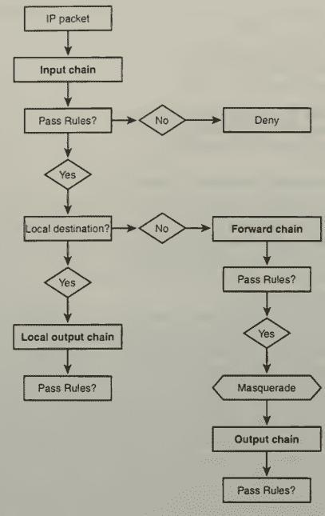

图 4.3 伪装与规则优先级层级。

## 端口重定向——透明代理

`iptables` 的端口重定向功能是本地端口转发和伪装的一种局限的特殊情况。连接不会在网络接口之间进行转发或伪装。相反，任何匹配规则的流量，无论数据包的部地址或端口是什么，都会被重定向到本地端口。

此功能对于你可能运行的某些应用层代理非常有用。通常，应用层代理要求你重新配置或使用知晓本地代理服务的特殊应用程序来替换客户端软件。如果客户端程序没有使用特殊的代理协议，端口重定向可以使重定向变得不可见（例如，直接到 Web 服务器的 HTTP 协议与到 Web 代理服务器的代理 HTTP 协议不同）。

## 更大或更低信任 LAN 的配置选项 145


例如，假设你正在运行一个 `telnet` 代理服务器。它在内部 `ipmasquad` 接口上监听常规 `telnet` 端口 `23`。来自 LAN 的任何出站 `telnet` 连接都会重定向到本地代理。代理服务器随后代表本地 `telnet` 链程序建立连接：

```
ipchains -A SCIENT_LAN_INTERFACE -p tcp \
  -s SCIENT_LAN_SUMPRIVORTS \
  -d ANYWHERE -- 23 -j REDIRECT 23
```

## 从互联网向内部服务器转发入站连接请求

由于本地机器对外部世界不可见，在本地机器上伪装的服务对远程客户端不可用。本文提供了实验性内核代码以启用到运行在内部伪装机器上的服务器的连接。该功能通过将伪装模块和 `ipfw` `mask` 支持编译进内核来启用。这些实验性功能需要使用 `ipmasqadm`，这是一个第三方应用程序。`ipmasqadm` 不是 Linux 发行版的一部分，必须从互联网单独下载。

例如，假设你想将指向 Web 服务器的入站连接转发到运行在内部伪装机器上的服务器。除了常规防火墙规则外，还需要两条 `ipmasqadm` 命令。第一条规则刷新端口转发链。第二条规则将目标为防火墙 HTTP 端口 `80` 的入站 TCP 连接转发到伪装 IP 地址为 `192.168.3.5` 的内部 Web 服务器：

```
ipmasqadm portfw -f
ipmasqadm portfw -a -p tcp -L SIPADDR 80 -R 192.168.3.5 80
```

## 透明代理内核支持

透明代理要求在内核的网络选项配置中启用透明代理支持。该功能在 Red Hat release 6.0 中默认启用。在早期版本中，必须显式启用并重新编译内核。

## 端口转发

关于这些实验性服务的更多信息可以在此处找到：

`http://juanox.com`, `http://www.monmouth.demon.co.uk/ipsubs/`

`portforwarding.html`, `http://ftp.compsoc.net/steve/ipportfw/linux21`,

`http://ipmasq.cj.net`，以及在线的 IP Masquerade HOWTO，`/usr/doc/HOWTO/mini/IP-Masquerade`。

## 146 第 4 章 LAN 问题、多重防火墙与边界网络

另一种方案是对于你想提供的服务使用本地代理服务器。代理服务器同时用于出站和入站连接。通常，代理服务器被认为是一种应用层网关程序，对外部服务的出站连接进行伪装。用于本地服务器入站连接的代理服务器通常用于强制遵守通信协议规范，以及通过包过滤级可以实现的更细粒度的访问控制。代理服务器将入站连接转发到本地伪装服务器。然而，代理通常需要特殊的客户端或特殊的客户端配置。

对于具有多个注册 IP 地址的站点还有最后的替代方案。外部接口接受指向本地网络地址空间内任何地址的入包。防火墙将特定连接类型转发到特定的内部服务器。例如，以下规则转发指向防火墙的入站连接：

```
ipchains -A SCIENT_LAN_INTERFACE -p tcp \
  -s SCIENT_LAN_SUMPRIVORTS \
  -d ANYWHERE -- 23 -j REDIRECT 23
```

在这种设置下，堡垒机的内部接口不需要全套独立的防火墙规则。

## 形式化的筛选子网防火墙 147

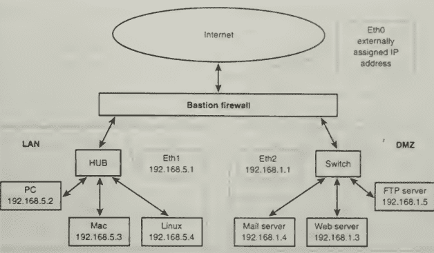

图 4.4 与私有 LAN 分隔的 DMZ 网络。与第 3 章防火墙示例不同，这种设置没有潜在的单点故障。不同安全策略的服务可以托管在内部网络中不同的安全区域。

核心思想是通过内部瓶颈防火墙将私有 LAN 从外部堡垒机物理隔离。图 4.5 所示的边界网络不必是一个具有自己服务器的完整网络；它是一个概念。边界网络可以简单地实现为堡垒内部接口与瓶颈外部接口之间的跳线缆。

使用跳线缆实现 DMZ 听起来可能很傻。它就像完整的边界网络一样，提供了两个较小的防火墙。两个防火墙并不代表单点故障。本地 LAN 服务器托管在瓶颈机上，与堡垒或互联网完全隔离。

使用跳线缆，堡垒机的内部接口不需要全套独立的防火墙规则。瓶颈机的外部接口过滤即可。本章的其余部分假设堡垒机和瓶颈机作为通往 DMZ 网络的网关。DMZ 包含公共和半公共服务器。两个防火墙中的每个网络接口都有自己的、个性化的规则。

这种设置至少需要四组防火墙规则——两个防火墙的外部和内部接口各一套。堡垒防火墙的外部接口规则与第 3 章示例中的外部接口规则几乎相同。（瓶颈防火墙的内部接口规则将与第 3 章双宿主机示例中的内部接口规则相同，尽管我略微扩展了它们以说明一个内部 DHCP 服务器）。

# 148 第 4 章 LAN 问题、多防火墙与边界网络

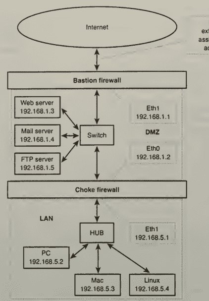

图 4.5 位于瓶颈防火墙（choke firewall）后的边界网络和筛选子网。

本示例与第3章示例之间的真实区别在于增加了DMZ边界网络——新规则应用于堡垒机（bastion）的内部接口以及瓶颈防火墙的外部接口。这两个接口的规则互镜像。DMZ网络上的公共服务器也有各自独立的防火墙规则。DMZ中的公共服务器通常是专门的、专用的单服务机器。它们的防火墙规则简单，并且对它们托管的特定服务具有高度限制性。

瓶颈防火墙的符号常量和初始规则与堡垒机很大程度上相同。由于堡垒机的外部规则与第3章中的示例保持不变，本章仅在外部接口规则集出现差异时对其进行说明。本示例的重点是瓶颈防火墙规则，以及堡垒机内部接口与瓶颈外部接口之间的对称性。

### 防火墙示例使用的符号常量

与第3章的示例一样，堡垒机的外部接口分配给 `eth0`，指向互联网。内部接口地址为 `eth1` 上的 `192.168.1.1`，指向边界DMZ网络。瓶颈的外部地址为 `eth0` 上的 `192.168.1.2`，指向边界DMZ网络。瓶颈的内部地址为 `eth1` 上的 `192.168.5.1`，指向私有LAN。

## 私有瓶颈防火墙的符号

以下常量被添加到堡垒机的防火墙脚本中，用于引用堡垒机的内部接口、瓶颈的IP地址以及DMZ的网络地址块。

```
BASTION_DMZ_INTERFACE="eth0"
BASTION_DMZ_IPADDR="192.168.1.1"
CHOKE_DMZ_IPADDR="192.168.1.2"
DMZ_ADDRESSES="192.168.1.0/24"
DMZ_BROADCAST="192.168.1.255"
```

## 私有瓶颈防火墙的符号

如果对反复出现的名称和地址使用符号常量，防火墙壳脚本将最易于阅读和维护。以下常量要么用于本章的所有示例，要么是网络标准中定义的通用常量：

```
CHOKE_DMZ_INTERFACE="eth0"
CHOKE_LAN_INTERFACE="eth1"
LOOPBACK_INTERFACE="lo0"

CHOKE_DMZ_IPADDR="192.168.1.2"
BASTION_DMZ_IPADDR="192.168.1.1"
DMZ_ADDRESSES="192.168.1.0/24"
DMZ_BROADCAST="192.168.1.255"
CHOKE_LAN_IPADDR="192.168.5.1"
CHOKE_LAN_ADDRESSES="192.168.5.0/24"
Anywhere="/0"
```

# 无论你使用哪一个

# 无论你使用哪一个

# 无论你的系统如何命名它

# 外部接口地址

# 堡垒防火墙

# 你的（私有）范围

# 外部广播地址

# 你的内部接口地址

# 你的（私有）范围

# 匹配任意IP地址

# 预留回环范围

# A类私有网络

# B类私有网络

# C类私有网络

# D类组播地址

# E类预留地址

### 广播源地址

### 广播目的地址

# 已知的、特权

# 端口范围

### 特权端口范围

```
LOOPBACK="127.0.0.0/0"
CLASS_A="10.0.0.0/8"
CLASS_B="172.16.0.0/12"
CLASS_C="192.168.0.0/16"
CLASS_D_MULTICAST="224.0.0.0/4"
CLASS_E_RESERVED_NET="240.0.0.0/4"
BROADCAST_SRC="0.0.0.0"
BROADCAST_DEST="255.255.255.255"
PRIVPORTS="0:1023"

UNPRIVPORTS="1024:65535"
```

此处未定义的常量位于其使用的特定规则上下文中：

## 从瓶颈防火墙中移除任何预现有规则

定义一组过滤规则时要做的的第一件事是移除瓶颈中的任何现有规则。否则，你定义的任何新规则将添加到现有规则的末尾。数据包在到达你正在定义的链之前，可能会匹配到现有规则。以下命令一次性清空所有内置链（input、output和forward）：

```
# 清空所有规则
ipchains -F
```


链是空的。你从零开始。系统处于默认状态。

## 定义瓶颈的默认策略

瓶颈的默认策略是拒绝所有方向的流量。瓶颈防火墙的默认策略是拒绝所有流量。瓶颈的默认策略是除非显式允许，否则拒绝所有流量。

```
# 设置默认策略
ipchains -P input
ipchains -P output
ipchains -P forward
```

## 启用瓶颈的回环接口

瓶颈的默认策略是拒绝所有流量。你需要允许回环流量，否则系统将无法正常工作。

```
# 允许回环流量
ipchains -A input -i $LOOPBACK -j ACCEPT
ipchains -A output -i $LOOPBACK -j ACCEPT
```

## 源欺和其他

防火墙的默认策略是拒绝所有流量。以下规则拒绝声称来自内部网络或DMZ的数据包。

```
# 拒绝伪造的IP地址
ipchains -A input -i $CHOKE_DMZ_INTERFACE -s $BASTION_DMZ_IPADDR -j REJECT
ipchains -A output -i $CHOKE_LAN_INTERFACE -s $BASTION_DMZ_IPADDR -j REJECT

ipchains -A input -i $CHOKE_LAN_INTERFACE -s $CHOKE_DMZ_IPADDR -j REJECT
ipchains -A output -i $CHOKE_DMZ_INTERFACE -s $CHOKE_DMZ_IPADDR -j REJECT
```

以下规则还防止数据包被声称来自其进入的接口。

```
# 拒绝伪造的网络地址
ipchains -A input -i $CHOKE_DMZ_INTERFACE -s $DMZ_ADDRESSES -j REJECT
ipchains -A output -i $CHOKE_LAN_INTERFACE -s $DMZ_ADDRESSES -j REJECT

ipchains -A input -i $CHOKE_LAN_INTERFACE -s $DMZ_ADDRESSES -j REJECT
ipchains -A output -i $CHOKE_DMZ_INTERFACE -s $DMZ_ADDRESSES -j REJECT
```

本节的后续规则将拒绝并记录自称来自 E 类预留网络的数据包：

```bash
# 拒绝预留的 IP 地址
ipchains -A input -i CHOKE_DMZ_INTERFACE -s RESERSEVED_NET -j REJECT -1
ipchains -A input -i CHOKE_LAN_INTERFACE -s RESERSEVED_NET -j REJECT -1
```

## 过滤 ICMP 控制和状态消息

启用 IP 伪装（`masquerading`）时，ICMP 消息的处理方式有所不同。除非在内核编译时启用了通用 IP 伪装，否则只有 ICMP 错误消息会为现有连接转发并伪装，例如 `ping` 和 `traceroute` 使用的消息。如果也启用了 ICMP 伪装，其他控制消息可以从内部的伪装机器发送到互联网。否则，这些 ICMP 消息可以在同一网络上的本地主机之间发送。Red Hat release 6.0 默认启用 ICMP 伪装。在较早的版本中，必须显式地编译进内核。

在通用伪装的情况下，如果启用了 ICMP 伪装，你的本地机器可以与外部机器发起 ICMP 交互，但外部机器不能向你的任何本地机器发起 ICMP 消息。只有堡垒机（bastion machine）的外部接口是直接可见的。

## 源抑制（类型 4）消息

当连接源（通常是路由器）发送数据的速度快于下一个路由的处理能力时，会发送 ICMP 消息类型 4，源抑制（Source Quench）。源抑制被用作 IP 网络层的一种原始流量控制形式，通常用于两个相邻的点对点机器之间。

## 源抑制控制 DMZ 配置

接受所有源抑制消息的堡垒规则为：

```bash
ipchains -A output -i BASTION_DMZ_INTERFACE -p icmp \
-s BASTION_DMZ_IPADDR 4 -d DMZ_ADDRESSES -j ACCEPT
```

```bash
ipchains -A input -i BASTION_DMZ_INTERFACE -p icmp \
-s DMZ_ADDRESSES 4 -d BASTION_DMZ_IPADDR -j ACCEPT
```

## 阻塞抑制（Choke Quench）控制 DMZ 配置

接受所有源抑制消息的阻塞规则为：

```bash
ipchains -A output -i CHOKE_DMZ_INTERFACE -p icmp \
-s DMZ_ADDRESSES 4 -d CHOKE_DMZ_IPADDR -j ACCEPT
```

```bash
ipchains -A input -i CHOKE_DMZ_INTERFACE -p icmp \
-s CHOKE_DMZ_IPADDR 4 -d DMZ_ADDRESSES -j ACCEPT
```

## 形式化子网防火墙 153

## 参数问题（类型 12）消息

ICMP 消息类型 12，参数问题（Parameter Problem），当接收到的数据包头部包含非法或意外数据时，或者当头部校验和与接收机器生成的校验和不匹配时，会被发送。

## 堡垒参数状态 DMZ 配置

接受所有参数问题消息的堡垒规则为：

```bash
ipchains -A output -i BASTION_DMZ_INTERFACE -p icmp \
-s ANYWHERE 12 -d DMZ_ADDRESSES -j ACCEPT
```

```bash
ipchains -A input -i BASTION_DMZ_INTERFACE -p icmp \
-s DMZ_ADDRESSES 12 -d ANYWHERE -j ACCEPT
```

## 阻塞参数问题状态 DMZ 配置

接受所有参数问题消息的阻塞规则为：

```bash
ipchains -A input -i CHOKE_DMZ_INTERFACE -p icmp \
-s ANYWHERE 12 -d CHOKE_DMZ_IPADDR -j ACCEPT
```

```bash
ipchains -A output -i CHOKE_DMZ_INTERFACE -p icmp \
-s CHOKE_DMZ_IPADDR 12 -d ANYWHERE -j ACCEPT
```

## 目的不可达错误（类型 3）

ICMP消息类型 3，目的不可达（Destination Unreachable），是一种通用错误消息。

## 堡垒目的不可达错误 DMZ 配置

接受所有目的不可达消息的堡垒规则为：

```bash
ipchains -A output -i BASTION_DMZ_INTERFACE -p icmp \
-s ANYWHERE 3 -d DMZ_ADDRESSES -j ACCEPT
```

```bash
ipchains -A input -i CHOKE_DMZ_INTERFACE -p icmp \
-s DMZ_ADDRESSES 3 -d ANYWHERE -j ACCEPT
```

## 阻塞目的不可达错误 DMZ 配置

接受所有目的不可达消息的阻塞规则为：

```bash
ipchains -A input -i CHOKE_DMZ_INTERFACE -p icmp \
-s ANYWHERE 3 -d CHOKE_DMZ_IPADDR -j ACCEPT
```

```bash
ipchains -A output -i CHOKE_DMZ_INTERFACE -p icmp \
-s CHOKE_DMZ_IPADDR 3 -d ANYWHERE -j ACCEPT
```

## 超时状态（类型 11）消息

ICMP消息类型 11，超时（Time Exceeded），表示超时情况，或者更准确地说，超过了数据包的最大跳数。在第4章 LAN 问题、多防火墙和边界网络中，入站超时消息通常被视为对输出 `traceroute` 请求的 ICMP 响应。

## 堡垒超时状态 DMZ 配置

仅通过阻塞防火墙接受超时消息的堡垒规则为：

```bash
ipchains -A output -i BASTION_DMZ_INTERFACE -p icmp \
-s BASTION_DMZ_IPADDR 11 -d DMZ_ADDRESSES -j ACCEPT
```

```bash
ipchains -A input -i BASTION_DMZ_INTERFACE -p icmp \
-s DMZ_ADDRESSES 11 -d BASTION_DMZ_IPADDR -j ACCEPT
```

## 阻塞超时状态 DMZ 配置

仅通过堡垒防火墙接受超时消息的阻塞规则为：


```bash
ipchains -A input -i CHOKE_DMZ_INTERFACE -p icmp \
-s BASTION_DMZ_IPADDR 11 -d CHOKE_DMZ_IPADDR -j ACCEPT
```

```bash
ipchains -A output -i CHOKE_DMZ_INTERFACE -p icmp \
-s CHOKE_DMZ_IPADDR 11 -d BASTION_DMZ_IPADDR -j ACCEPT
```

## 回显请求（类型 8）和回显应（类型 0）消息

`ping` 使用两种 ICMP 类型。请求是消息 8，应是消息 0。

## 堡垒 ping DMZ 配置

允许 DMZ 到互联网的规则为：

```bash
ipchains -A input -i BASTION_DMZ_INTERFACE -p icmp \
-s DMZ_ADDRESSES 8 -d ANYWHERE -j ACCEPT
```

```bash
ipchains -A output -i BASTION_DMZ_INTERFACE -p icmp \
-s ANYWHERE 0 -d DMZ_ADDRESSES -j ACCEPT
```

此处的方法仅允许堡垒机到 DMZ：

```bash
ipchains -A output -i BASTION_DMZ_INTERFACE -p icmp \
-s BASTION_DMZ_IPADDR 8 -d DMZ_ADDRESSES -j ACCEPT
```

```bash
ipchains -A input -i BASTION_DMZ_INTERFACE -p icmp \
-s DMZ_ADDRESSES 0 -d BASTION_DMZ_IPADDR -j ACCEPT
```

## 阻塞 ping DMZ 配置

## 形式化子网防火墙 155

允许阻塞机到互联网的规则为：

```bash
ipchains -A input -i CHOKE_DMZ_INTERFACE -p icmp \
-s ANYWHERE 8 -d CHOKE_DMZ_IPADDR -j ACCEPT
```

```bash
ipchains -A output -i CHOKE_DMZ_INTERFACE -p icmp \
-s CHOKE_DMZ_IPADDR 0 -d ANYWHERE -j ACCEPT
```

此处的方法仅允许 DMZ 机器到阻塞：

```bash
ipchains -A output -i CHOKE_DMZ_INTERFACE -p icmp \
-s DMZ_ADDRESSES 8 -d CHOKE_DMZ_IPADDR -j ACCEPT
```

```bash
ipchains -A input -i CHOKE_DMZ_INTERFACE -p icmp \
-s CHOKE_DMZ_IPADDR 0 -d DMZ_ADDRESSES -j ACCEPT
```

## 内核对伪装 ICMP 支持

如果你有一个 LAN 并运行 6.0 之前的 Red Hat Linux 版本，即使启用了 IP 转发，ping ICMP 消息也不会在你的 LAN 和远程机器之间转发。如果你想从内部机器进行 ping，必须配置并编译内核以包含 ICMP 伪装模块。与其他连接相关的控制和错误消息在没有此特殊模块的情况下转发。

## TCP 和 UDP 服务表

在后续每个章节中，包过滤层面的服务协议首先以状态表的形式呈现，然后是表示这些状态的 `ipchains` 规则。
服务协议表中的每行列出了服务交换中涉及的数据包类型。为每种数据包类型定义一个防火墙规则。表分为以下列：
- Description：简要描述数据包源自客户端还是服务器，以及数据包的目的。
- Protocol：使用的传输协议，TCP 或 UDP，或 IP 协议的控制消息 ICMP。
- Remote Address：数据包远程字段中可以包含的合法地址或地址范围。
- Remote Port：数据包远程端口字段可以包含的合法端口或端口范围。
- In/Out：描述数据包的方向，即是从远程位置进入系统，还是从系统发送到远程位置。
- Local Address：数据包本地字段可以包含的合法地址或地址范围。
- Local Port：数据包本地端口字段可以包含的合法端口或端口范围。
TCP 协议数据包包含最后一列 TCP Flag，定义了数据包可能具有的合法 SYN-ACK 状态。
该表将数据包分为入站或出站。地址和端口相对于你的机器网络接口被描述为远程或本地。请注意，对于入站数据包，远程地址和端口指的是 IP 数据包标头中的源字段；本地地址和端口指的是 IP 数据包标头中的目的字段。对于出站数据包，远程地址和端口指的是 IP 数据包标头中的目的字段；本地地址和端口指的是 IP 数据包标头中的源字段。
最后，在服务协议涉及 ICMP 消息的少数情况下，请注意网络层 ICMP 数据包并不与源或目的端口的概念关联，而传输层 TCP 或 UDP 数据包则是如此。相反，ICMP 数据包使用控制或状态消息类型的概念。ICMP 消息不会发送到绑定特定服务端口的程序。因此，表中呈现的少数 ICMP 条目使用源端口列来包含消息类型。对于入站 ICMP 数据包，源端口列是远程端口列；对于出站 ICMP 数据包，源端口列是本地端口列。

## 启用 DNS (UDP/TCP 端口 53)

访问互联网需要访问远程域名服务（DNS）。DNS 负责主机名与其相关 IP 地址之间的翻译。没有 DNS，你无法定位远程主机。
DNS 使用一种同时依赖于 UDP 和 TCP 的通信协议。连接模式包括常规的客户端到服务器连接、转发服务器与全功能服务器之间的对等点流量，以及主从全功能连接。
家庭用户有多个 DNS 配置选项。如果防火墙机器没有运行 `named`，而是纯粹作为 DNS 客户端运行，则内部机器将配置为指向 ISP 的名称服务器，防火墙机器也是如此。如果防火墙机器运行名称服务器，则内部机器将配置为指向防火墙的内部接口作为它们的名称服务器。

## 局域网的经典 DNS 设置

某些站点需要经典 DNS 设置带来的额外安全感，这种设置可以隐藏本地主机信息。这种设置的吸引力在于，敏感的、本地的、个人的和账户信息可以集中存储在内部 DNS 数据库中。
其理念是让堡垒防火墙为公共网络运行自己的 DNS 服务器。该服务器被配置为站点的权威源，但信息是不完整的。堡垒名称服务器对内部机器一无所知。堡垒上的 DNS 客户端不使用本地名称服务器。相反，`/etc/resolv.conf` 指向关键节点（choke point）作为堡垒本地客户端的名称服务器。来自互联网的入站查询由公共 DNS 服务器处理。本地查询由关键节点上的内部 DNS 服务器处理。

## 形式筛选子网防火墙

关键节点托管该站点的真实 DNS 服务器。内部服务器也被配置为站点的权威源。在这种情况下，信息是正确的。本地查询、来自堡垒本地客户端的查询以及来自私有局域网的查询都由这个内部私有 DNS 服务器处理。如图 4.6所示所示当服务器没有所需的查找信息时，它会查询堡垒机器上的服务器，后者随后会将查询转发到外部名称服务器。
如果防火墙脚本在某些地方使用符号主机名，那么相互依赖的配置会在服务器初始化时产生“鸡生蛋”蛋的困境。当堡垒启动时，它将尝试使用关键节点作为它的名称服务器；关键节点将尝试使用堡垒作为它的名称服务器。
当堡垒首次启动时，它必须使用外部名称服务器处理其客户端请求。当关键节点防火墙的名称服务器运行时，堡垒客户端可以使用堡垒服务器代替外部服务器。

## 堡垒 DMZ 配置作为公共名称服务器

堡垒托管公共名称服务器。运行在堡垒上的本地 DNS 客户端使用运行关键节点上的私有名称服务器。如果关键节点无法处理查询，它会将请求转发到运行在堡垒上的服务器，后者随后将查询转发到指定的远程服务器。如果没有远程服务器响应，堡垒服务器将作为客户端重新发送查询给更高权威性的名称服务器。

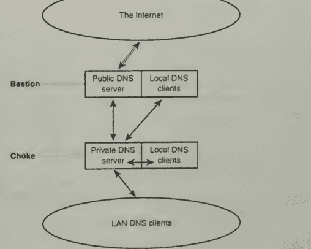

图 4.6 公共和私有 DNS 服务器。

表 4.2 列出了堡垒使用的 DNS 协议。

| 描述 | 协议 | 远程地址 | 远程端口 | 本地地址 | 本地端口 |
| :--- | :--- | :--- | :--- | :--- | :--- |
| 关键节点查询 | UDP | 堡垒 | 53 | 关键节点 | 53 |
| 堡垒响应 | UDP | 关键节点 | 53 | 堡垒 | 53 |
| 堡垒查询 | UDP | 外部 | 53 | 堡垒 | 53 |
| 外部响应 | UDP | 堡垒 | 53 | 外部 | 53 |

## 160 第 4 章 LAN 问题、多重防火墙与边界网络

```bash
ipchains -A input -i SEXTERNAL_INTERFACE -p tcp \
  -s SANYWHERE SUNPRIVPORTS \
  -d IPADDR 53 -j ACCEPT
```


```bash
ipchains -A output -i SEXTERNAL_INTERFACE -y -p tcp \
  -s IPADDR 53 \
  -d SANYWHERE SUNPRIVPORTS -j ACCEPT
```

## 作为私有名称服务器的 choke DMZ 配置

`choke` 瓶颈主机托管了私有名称服务器。LAN 客户端包括运行在堡垒机（`bastion`）上的私有名称服务器。如果 `choke` 服务器无法从其 DNS 缓存中提供查询，它会将请求转发到运行在堡垒机上的服务器。

表 4.3 列出了 `choke` DMZ 接口使用的 DNS 协议。

### 表 4.3 choke DNS 协议

| 描述 | 协议 | 远程地址 | 远程端口 | 方向 | 本地地址 | 本地端口 | 标记 |
|---|---|---|---|---|---|---|---|
| `choke` 服务器查询 | UDP | `BASTION_DMZ_IPADDR` | 53 | Out | `CHOKE_DMZ_IPADDR` | 53 | - |
| 堡垒机服务器响应 | UDP | `BASTION_DMZ_IPADDR` | 53 | In | `CHOKE_DMZ_IPADDR` | 53 | - |
| 堡垒机客户端查询 | UDP | `BASTION_DMZ_IPADDR` | 1024:65535 | In | `CHOKE_DMZ_IPADDR` | 53 | - |
| `choke` 服务器响应 | UDP | `BASTION_DMZ_IPADDR` | 1024:65535 | Out | `CHOKE_DMZ_IPADDR` | 53 | - |
| 堡垒机客户端查询 | TCP | `BASTION_DMZ_IPADDR` | 1024:65535 | In | `CHOKE_DMZ_IPADDR` | 53 | Any |
| `choke` 服务器响应 | TCP | `BASTION_DMZ_IPADDR` | 1024:65535 | Out | `CHOKE_DMZ_IPADDR` | 53 | ACK |

`choke` 防火墙的 DNS 规则是堡垒机规则的镜像。对于 `choke` 服务器无法解析的请求，本地 DNS 服务器将点对点服务器请求转发到堡垒机的 DNS 服务器：

```bash
# DNS 缓存与转发名称服务器 (53)
#
```

```bash
ipchains -A output -i CHOKE_DMZ_INTERFACE -p udp \
  -s CHOKE_DMZ_IPADDR 53 \
  -d DMZ_ADDRESSES 53 -j ACCEPT
```

```bash
ipchains -A input -i CHOKE_DMZ_INTERFACE -p udp \
  -s DMZ_ADDRESSES 53 \
  -d CHOKE_DMZ_IPADDR 53 -j ACCEPT
```

## 形式化筛选子网防火墙 161

`choke` DNS 服务器接收来自连接到 DMZ 的机器（包括堡垒机）上运行的客户端程序的查询：

```bash
# DNS 本地服务器到客户端 (53)
#
```

```bash
ipchains -A input -i $CHOKE_DMZ_INTERFACE -p udp \
  -s $DMZ_ADDRESSES $UNPRIVIPORTS \
  -d $CHOKE_DMZ_IPADDR 53 -j ACCEPT
```

```bash
ipchains -A output -i $CHOKE_DMZ_INTERFACE -p udp \
  -s $CHOKE_DMZ_IPADDR 53 \
  -d $DMZ_ADDRESSES $UNPRIVIPORTS -j ACCEPT
```

```bash
ipchains -A input -i $CHOKE_DMZ_INTERFACE -p tcp \
  -s $DMZ_ADDRESSES $UNPRIVIPORTS \
  -d $CHOKE_DMZ_IPADDR 53 -j ACCEPT
```

```bash
ipchains -A output -i $CHOKE_DMZ_INTERFACE -l -y tcp \
  -s $CHOKE_DMZ_IPADDR 53 \
  -d $DMZ_ADDRESSES $UNPRIVIPORTS -j ACCEPT
```

## 过滤 AUTH 用户识别服务 (TCP 端口 113)

访问某些 Internet 服务需要 `ident`（或 `AUTH`）用户识别服务。它识别与连接关联的用户名或 ID。这通常是远程服务器在你发送电子邮件时发出的请求。你不需要提供 `ident` 服务，但你必须以某种方式处理入站连接请求，以避免长时间的超时。无论你是否选择在外部接口上提供 `ident` 识别服务，都没有理由在本地提供该服务。这意味着在两台机器的 `/etc/inetd.conf` 中都必须启用 `AUTH`。

### 堡垒机 DMZ 配置

表 4.4 列出了 `AUTH` 服务的完整客户端/服务器协议。

### 堡垒机 DMZ 接口上的 ident 协议

| 描述 | 协议 | 远程地址 | 远程端口 | 方向 | 本地地址 | 本地端口 | 标记 |
|---|---|---|---|---|---|---|---|
| `choke` 服务器查询 | UDP | `BASTION_DMZ_IPADDR` | 53 | Out | `CHOKE_DMZ_IPADDR` | 53 | - |
| 堡垒机服务器响应 | UDP | `BASTION_DMZ_IPADDR` | 53 | In | `CHOKE_DMZ_IPADDR` | 53 | - |
| 堡垒机客户端查询 | UDP | `BASTION_DMZ_IPADDR` | 1024:65535 | In | `CHOKE_DMZ_IPADDR` | 53 | - |
| `choke` 服务器响应 | UDP | `BASTION_DMZ_IPADDR` | 1024:65535 | Out | `CHOKE_DMZ_IPADDR` | 53 | - |
| 堡垒机客户端查询 | TCP | `BASTION_DMZ_IPADDR` | 1024:65535 | In | `CHOKE_DMZ_IPADDR` | 53 | Any |
| `choke` 服务器响应 | TCP | `BASTION_DMZ_IPADDR` | 1024:65535 | Out | `CHOKE_DMZ_IPADDR` | 53 | ACK |

表 4.4 列出了 `AUTH` 服务的完整客户端/服务器协议。

## 堡垒机出站 AUTH 请求

如果你运行邮件或 FTP 服务器，你的机器将作为 `AUTH` 客户端。没有理由不让你的系统成为 `AUTH` 客户端：

```bash
ipchains -A output -i CHOKE_DMZ_INTERFACE -p tcp \
  -s DMION_DMZ_IPADDR
  -d DMZ_ADDRESSES 13 -j ACCEPT
```

```bash
ipchains -A input -i CHOKE_DMZ_INTERFACE -p udp -y \
  -s DMZ_ADDRESSES   -
  -DMZ_ADDRESS  13 -j ACCEPT
```

## 堡垒机入站 AUTH 请求

如果你在 `/etc/inetd.conf` 中运行 `ident` 服务器，以下规则将启用入站 `ident` 连接请求：

```bash
ipchains -A input -i $CHOKE_DMZ_INTERFACE -p udp \
  -s $DMZ_ADDRESSES $UNPRIVORTS \
  -d $CHOKE_DMZ_IPADDR 53 -j ACCEPT
```

```bash
ipchains -A output -i $CHOKE_DMZ_INTERFACE -p udp \
  -s $CHOKE_DMZ_IPADDR 53 \
  -d $DMZ_ADDRESSES $UNPRIVORTS -j ACCEPT
```

## choke DMZ 配置

表 4.5 列出了 `AUTH` 服务的完整客户端/服务器协议。

### choke DMZ 接口上的 ident 协议

| 描述 | 协议 | 远程地址 | 远程端口 | 方向 | 本地地址 | 本地端口 | 标记 |
|---|---|---|---|---|---|---|---|
| `choke` 服务器查询 | UDP | `BASTION_DMZ_IPADDR` | 53 | Out | `CHOKE_DMZ_IPADDR` | 53 | - |
| 堡垒机服务器响应 | UDP | `BASTION_DMZ_IPADDR` | 53 | In | `CHOKE_DMZ_IPADDR` | 53 | - |
| 堡垒机客户端查询 | UDP | `BASTION_DMZ_IPADDR` | 1024:65535 | In | `CHOKE_DMZ_IPADDR` | 53 | - |


| choke 服务器响应 | UDP | `BASTION_DMZ_IPADDR` | 1024:65535 | Out | `CHOKE_DMZ_IPADDR` | 53 | - |

| 堡垒机客户端查询 | TCP | `BASTION_DMZ_IPADDR` | 1024:65535 | In | `CHOKE_DMZ_IPADDR` | 53 | Any |

| choke 服务器响应 | TCP | `BASTION_DMZ_IPADDR` | 1024:65535 | Out | `CHOKE_DMZ_IPADDR` | 53 | ACK |

```bash
# DNS 缓存与转发名称服务器 (53)
#
```

```bash
ipchains -A output -i CHOKE_DMZ_INTERFACE -p udp \
  -s CHOKE_DMZ_IPADDR 53 \
  -d DMZ_ADDRESSES 53 -j ACCEPT
```

```bash
ipchains -A input -i CHOKE_DMZ_INTERFACE -p udp \
  -s DMZ_ADDRESSES 53 \
  -d CHOKE_DMZ_IPADDR 53 -j ACCEPT
```

## 形式化筛选子网防火墙 163

choke DNS 服务器接收来自连接到 DMZ 的机器（包括堡垒机）上运行的客户端程序的查询：

```bash
# DNS 本地服务器到客户端 (53)
#
```

```bash
ipchains -A input -i $CHOKE_DMZ_INTERFACE -p udp \
  -s $DMZ_ADDRESSES $UNPRIVIPORTS \
  -d $CHOKE_DMZ_IPADDR 53 -j ACCEPT
```

```bash
ipchains -A output -i $CHOKE_DMZ_INTERFACE -p udp \
  -s $CHOKE_DMZ_IPADDR 53 \
  -d $DMZ_ADDRESSES $UNPRIVIPORTS -j ACCEPT
```

```bash
ipchains -A input -i $CHOKE_DMZ_INTERFACE -p tcp \
  -s $DMZ_ADDRESSES $UNPRIVIPORTS \
  -d $CHOKE_DMZ_IPADDR 53 -j ACCEPT
```

```bash
ipchains -A output -i $CHOKE_DMZ_INTERFACE -l -y tcp \
  -s $CHOKE_DMZ_IPADDR 53 \
  -d $DMZ_ADDRESSES $UNPRIVIPORTS -j ACCEPT
```

# 形式化筛选子网防火墙 165

## Choke SMTP 客户端 DMZ 配置

表 4.7 列出了 SMTP 的客户端/服务器连接协议。

### 表 4.7 Choke SMTP 客户端邮件协议 DMZ 配置

| 描述 | 协议 | 远程地址 | 远程入/出 | 本地地址 | 本地端口 | TCP Flag |
| :--- | :--- | :--- | :--- | :--- | :--- | :--- |
| 发送出邮件 | TCP | `BASTION_DMZ_IPADDR` | 25 Out | `CHOKE_DMZ_IPADDR` | 1024 | Any |
| 堡垒服务器响应 | TCP | `BASTION_DMZ_IPADDR` | 25 In | `CHOKE_DMZ_IPADDR` | 1024 | ACK |

此规则集允许你从本地机器发送邮件：

```
ipchains -A output -i $CHOKE_DMZ_INTERFACE -p tcp \
  -s $CHOKE_DMZ_IPADDR $UNPRIVPORTS \
  -d $BASTION_DMZ_IPADDR 25 -j ACCEPT
```

```
ipchains -A input -i $CHOKE_DMZ_INTERFACE -p tcp -i y \
  -s $BASTION_DMZ_IPADDR 25 \
  -d $CHOKE_DMZ_IPADDR $UNPRIVPORTS -j ACCEPT
```

## 通过堡垒的 DMZ 接口作为 POP 客户端检索邮件 (TCP 端口 110)

接收邮件的方式取决于你的情况。如果你运行自己的本地邮件服务器，你可以直接在 Linux 机器上收集收到的邮件。如果你从 ISP 邮箱账户检索邮件，你可能或不以 POP 或 IMAP 客户端身份检索邮件，这取决于你如何配置 ISP 邮箱账户以及取决于 ISP 提供的邮件投递服务。

另一种，如果你想让本地邮件账户保持相对私密，并将你的工作或 ISP 邮箱账户作为你的公共地址，你可以配置工作和 ISP 邮件账户将邮件转发到你的本地服务器。

连接到 POP 服务器是从远程邮件主机检索邮件的极非常常见的方法。下面的示例演示了从运行在堡垒上的 POP 服务器检索邮件所需的防火墙规则。

## 堡垒 POP 服务器 DMZ 配置

表 4.8 列出了堡垒用于 POP 服务器协议。

### 表 4.8 堡垒 POP 邮件检索协议 DMZ 配置

| 描述 | 协议 | 远程地址 | 入/远程端口 | 出 | 本地地址 | 端口 | TCP Flag |
| :--- | :--- | :--- | :--- | :--- | :--- | :--- | :--- |
| Choke 客户端查询 | TCP | `CHOKE_DMZ_IPADDR` | 1024:65535 | In | `BASTION_DMZ_IPADDR` | 110 | Any |
| 堡垒服务器响应 | TCP | `CHOKE_DMZ_IPADDR` | 1024:65535 | Out | `BASTION_DMZ_IPADDR` | 110 | ACK |

堡垒为局域网托管了一个本地 POP 服务器。外部接口不允许外部访问：

```
ipchains -A input -s BASTION_DMZ_INTERFACE -p tcp \
  -s CHOKE_DMZ_IPADDR $UNPRIVPORTS \
  -d BASTION_DMZ_IPADDR 110 -j ACCEPT
```

```
ipchains -A output -s BASTION_DMZ_INTERFACE -p tcp ! -y \
  -s CHOKE_DMZ_IPADDR 110 \
  -d CHOKE_DMZ_IPADDR $UNPRIVPORTS -j ACCEPT
```

## Choke POP 客户端 DMZ 配置

表 4.9 列出了 Choke 用于 POP 服务的客户端协议。

### 表 4.9 Choke POP 邮件检索协议 DMZ 配置

| 描述 | 协议 | 远程地址 | 入/远程端口 | 出 | 本地地址 | 端口 | TCP Flag |
| :--- | :--- | :--- | :--- | :--- | :--- | :--- | :--- |
| Choke 客户端查询 | TCP | `BASTION_DMZ_IPADDR` | 110 | Out | `CHOKE_DMZ_IPADDR` | 1024:65535 | Any |
| 堡垒服务器响应 | TCP | `BASTION_DMZ_IPADDR` | 110 | In | `CHOKE_DMZ_IPADDR` | 1024:65535 | ACK |

你从运行在堡垒上的 POP 服务器检索邮件：

```
ipchains -A input -i $CHOKE_DMZ_INTERFACE -p tcp \
  -s CHOKE_DMZ_IPADDR $UNPRIVPORTS \
  -d BASTION_DMZ_IPADDR 110 -j ACCEPT
```

```
ipchains -A input -i $CHOKE_DMZ_INTERFACE -p tcp ! -y \
  -s BASTION_DMZ_IPADDR 110 \
  -d CHOKE_DMZ_IPADDR $UNPRIVPORTS -j ACCEPT
```

## 通过堡垒的 DMZ 接口作为 IMAP 客户端检索邮件 (TCP 端口 143)

连接到 IMAP 服务器是从远程邮件主机检索邮件的另一种常见方法。下面的示例演示了从运行在堡垒上的 IMAP 服务器检索邮件所需的防火墙规则。

## 堡垒 IMAP 服务器 DMZ 配置

堡垒为局域网托管了一个本地 IMAP 服务器。外部接口不允许外部访问。表 4.10 列出了堡垒用于 IMAP 的服务器协议。

### 表 4.10 堡垒 IMAP 邮件检索协议 DMZ 配置

| 描述 | 协议 | 远程地址 | 远程端口 | 入/出 | 本地地址 | 端口 | TCP Flag |
| :--- | :--- | :--- | :--- | :--- | :--- | :--- | :--- |


| Choke 客户端查询 | TCP | `CHOKE_DMZ_ADDR` | 1024:65535 | In | `BASTION_DMZ_ADDR` | 143 | Any |
| 堡垒服务器响应 | TCP | `CHOKE_DMZ_ADDR` | 1024:65535 | Out | `BASTION_DMZ_ADDR` | 143 | ACK |

下一个规则集允许来自 Choke 的入站连接：

```
iptables -A input -i BASTION_DMZ_INTERFACE -p tcp \
  -s CHOKE_DMZ_ADDR $UNPRIVPORTS \
  -d BASTION_DMZ_ADDR 143 -j ACCEPT
```

```
iptables -A output -i BASTION_DMZ_INTERFACE -p tcp ! -y \
  -s BASTION_DMZ_ADDR 143 \
  -d CHOKE_DMZ_ADDR $UNPRIVPORTS -j ACCEPT
```

## Choke IMAP 客户端 DMZ 配置

表 4.11 列出了 Choke 用于 IMAP 的客户端协议。

### 表 4.11 Choke IMAP 协议 DMZ 配置

| 描述 | 协议 | 远程地址 | 远程端口 / 入出 | 本地地址 | 本地端口 | TCP Flag |
| :--- | :--- | :--- | :--- | :--- | :--- | :--- |
| Choke 客户端查询 | TCP | `BASTION_DMZ_ADDR` | 143 Out | `CHOKE_DMZ_ADDR` | 1024:65535 | Any |
| 堡垒服务器响应 | TCP | `BASTION_DMZ_ADDR` | 143 In | `CHOKE_DMZ_ADDR` | 1024:65535 | ACK |

你从运行在堡垒上的 POP 服务器检索邮件：

```
ipchains -A input -i $CHOKE_DMZ_INTERFACE -p tcp \
  -s CHOKE_DMZ_IPADDR $UNPRIVPORTS \
  -d BASTION_DMZ_IPADDR 110 -j ACCEPT
```

```
ipchains -A input -i $CHOKE_DMZ_INTERFACE -p tcp ! -y \
  -s BASTION_DMZ_IPADDR 110 \
  -d CHOKE_DMZ_IPADDR $UNPRIVPORTS -j ACCEPT
```

## 在 DMZ 中转发出邮件 (SMTP 端口 25)

在 DMZ 中托管邮件服务器而不是从堡垒托管本地邮件，具有潜在的安全优势。如果你以 SMTP 客户端身份转发出邮件，那么 DMZ 邮件服务器规则集也涵盖了这种情况。表 4.12 列出了 SMTP 的客户端连接协议。

### 表 4.12 SMTP 协议

| 描述 | 协议 | 远程地址 | 远程端口 | 入出 | 本地地址 | 本地端口 | TCP Flag |
| :--- | :--- | :--- | :--- | :--- | :--- | :--- | :--- |
| 发送出邮件 | TCP | `ANYWHERE` | 25 | Out | `CHOKE_DMZ_ADDR` | 1024:65535 | Any |
| 远程服务器响应 | TCP | `ANYWHERE` | 25 | In | `CHOKE_DMZ_ADDR` | 1024:65535 | ACK |

第一个 DMZ 服务器规则集假设堡垒机器运行了邮件服务器：

```
ipchains -A input -i CHOKE_DMZ_INTERFACE -p tcp \
  -s ANYWHERE $UNPRIVPORTS \
  -d SMAIL_SERVER_DMZ_ADDR 25 -j ACCEPT
```

```
ipchains -A output -i CHOKE_DMZ_INTERFACE -p tcp ! -y \
  -s SMAIL_SERVER_DMZ_ADDR 25 \
  -d ANYWHERE $UNPRIVPORTS -j ACCEPT
```

下一个规则集允许 DMZ 邮件将将邮件转发到其远程目标：

```
ipchains -A input -i CHOKE_DMZ_INTERFACE -p tcp \
  -s SMAIL_SERVER_DMZ_ADDR $UNPRIVPORTS \
  -d ANYWHERE 25 -j ACCEPT
```

```
ipchains -A output -i CHOKE_DMZ_INTERFACE -p tcp ! -y \
  -s ANYWHERE 25 \
  -d $UNPRIVPORTS -j ACCEPT
```

之前的 DMZ 邮件服务器规则集还涵盖了堡垒机器没有运行转发服务器的情况。相反，堡垒使用 `ipmasqadm` 用于到 DMZ 服务器的入站连接。这允许你直接接收本地邮件：

```
ipchains -A input -i CHOKE_DMZ_INTERFACE -p tcp \
  -s ANYWHERE $UNPRIVPORTS \
  -d SMAIL_SERVER_DMZ_ADDR 25 -j ACCEPT
```

```
ipchains -A output -i CHOKE_DMZ_INTERFACE -p tcp ! -y \
  -s SMAIL_SERVER_DMZ_ADDR 25 \
  -d ANYWHERE $UNPRIVPORTS -j ACCEPT
```

## Choke SMTP 客户端 DMZ 配置

表 4.13 列出了 Choke 用于 SMTP 的客户端连接协议。

### 表 4.13 Choke 客户端邮件协议到 DMZ 服务器

| 描述 | 协议 | 远程地址 | 远程端口 | 入出 | 本地地址 | 本地端口 | Flag |
| :--- | :--- | :--- | :--- | :--- | :--- | :--- | :--- |
| 发出邮件 | TCP | `SMAIL_SERVER_DMZ_ADDR` | 25 | Out `CHOKE_DMZ_ADDR` | 1024:65535 | Any |
| 远程服务器响应 | TCP | `SMAIL_SERVER_DMZ_ADDR` | 25 | In `CHOKE_DMZ_ADDR` | 1024:65535 | ACK |

# 170 第 4 章 LAN 问题、多重防火墙与边界网络

这允许你从本地机器发送邮件：

```
ipchains -A output -i $CHOKE_DMZ_INTERFACE -p tcp \
    -s $CHOKE_DMZ_IPADDR UNPRIVPORTS \
    -d $MAIL_SERVER_DMZ_IPADDR 25 -j ACCEPT
```

```
ipchains -A input -i $CHOKE_DMZ_INTERFACE -p tcp ! -y \
    -s $MAIL_SERVER_DMZ_IPADDR 25 \
    -d $CHOKE_DMZ_IPADDR UNPRIVPORTS -j ACCEPT
```

## 堡垒 SMTP 通道 DMZ 配置

表 4.14 列出了 SMTP 的客户端/服务器连接协议。

### 表 4.14 DMZ 通道上的堡垒 SMTP 邮件协议

| 描述 | 协议 | 地址 | 远程端口 | 入/出 | 本地地址 | TCP 标志 | 任意 |
| :--- | :--- | :--- | :--- | :--- | :--- | :--- | :--- |
| 接收传入邮件 | TCP | `ANYWHERE` | 1024:65535 | In | `IPADDR` | 25 | Any |
| DMZ 服务器响应 | TCP | `ANYWHERE` | 1024:65535 | Out | `IPADDR` | | ACK |
| 发送出邮件 | TCP | `ANYWHERE` | 25 | Out | `IPADDR` | 1024:65535 | Any |
| 远程服务器响应 | TCP | `ANYWHERE` | 25 | In | `IPADDR` | 1024:65535 | ACK |

本节涵盖堡垒机未运行邮件继服务器的情况。相反，堡垒使用 `ipmasqadm ipportfw` 将入站邮件连接转发到 DMZ 服务器。

前两条规则允许入站邮件连接到运行在 DMZ 中的邮件服务器：

```
ipchains -A input -i $EXTERNAL_INTERFACE -p tcp \
    -s ANYWHERE UNPRIVPORTS \
    -d $IPADDR 25 -j ACCEPT
```


```
ipchains -A output -i $EXTERNAL_INTERFACE -p tcp ! -y \
    -s ANYWHERE UNPRIVPORTS \
    -d ANYWHERE UNPRIVPORTS -j ACCEPT
```

```
ipchains -A output -i $BASTION_DMZ_INTERFACE -p tcp \
    -s ANYWHERE UNPRIVPORTS \
    -d $MAIL_SERVER_DMZ_IPADDR 25 -j ACCEPT
```

## 形式化筛选子网防火墙 171

```bash
ipchains -A input -i $BASTION_DMZ_INTERFACE -p tcp ! -y \
-s $MAIL_SERVER_DMZ_IPADDR 25 \
-d ANYWHERE $UNPRIVPORTS -j ACCEPT

ipmascadm portfw -a -P tcp -i $IPADDR -R $MAIL_SERVER_DMZ_IPADDR 25
```

接下来的规则集允许 DMZ 服务器向其远程目标继邮件：

```bash
ipchains -A input -i $BASTION_DMZ_INTERFACE -p tcp \
-s $MAIL_SERVER_DMZ_IPADDR $UNPRIVPORTS \
-d ANYWHERE 25 -j ACCEPT

ipchains -A output -i $BASTION_DMZ_INTERFACE -p tcp ! -y \
-s ANYWHERE 25 \
-s $MAIL_SERVER_DMZ_IPADDR $UNPRIVPORTS -j ACCEPT

ipchains -A output -i $STERNAL_INTERFACE -p tcp \
-s ANYWHERE 25 \
-d $IPADDR $UNPRIVPORTS -j ACCEPT

ipmascadm portfw -a -P tcp -L 192.168.1.4 25 -R $IPADDR
```

## 作为 POP 客户端从 DMZ 服务器检索邮件 (TCP 端口 110)

连接到 POP 服务器是从远程邮件主机检索邮件的非常常用的方法。以下示例演示了从运行在 DMZ 机器上的 POP 服务器检索邮件所需的防火墙规则。

你的本地 POP 服务器运行在 DMZ 中中托管本地邮件服务器的同一台机器上：

```
POP_DMZ_INTERFACE="eth0"
POP_SERVER_DMZ_IPADDR='192.168.1.4'
```

### DMZ POP 服务器配置

表 4.15 列出了 POP 服务器的服务器连接协议。

表 4.15 来自 DMZ 服务器的 POP 服务器协议

| 描述 | 协议 | 远程地址 | 远程端口 | 入/ | 本地地址 | 本地端口 | 标志 |
| --- | --- | --- | --- | --- | --- | --- | --- |
| Choke 客户端查询 | TCP | CHOKE_DMZ_IPADDR | 1024:65535 | In | POP_SERVER_DMZ_IPADDR | 110 | Any |
| 本地服务器响应 | TCP | CHOKE_DMZ_IPADDR | 1024:65535 | Out | POP_SERVER_DMZ_IPADDR | 110 | ACK |

# 第 4 章 LAN 问题、多重防火墙与边界网络

DMZ 中的邮件服务器机为 LAN 托管本地 POP 服务器。

外部接口不允许外部访问：

```
ipchains -A input -i POP_DMZ_INTERFACE -p tcp \
  -s CHOKE_DMZ_IPADDR UNPRIVPORTS \
  -d POP_SERVER_DMZ_IPADDR 110 - ACCEPT
```

```
ipchains -A output -i POP_DMZ_INTERFACE -p tcp ! -y \
  -s POP_SERVER_DMZ_IPADDR 110 \
  -d CHOKE_DMZ_IPADDR UNPRIVPORTS - ACCEPT
```

### Choke POP DMZ 配置

表 4.16 列出了 POP 服务器的客户端协议。

表 4.16 来自 DMZ 服务器的 Choke POP 邮件检索

| 描述 | 协议 | 远程地址 | 远程端口 | 入/ | 本地地址 | 本地端口 | 标志 |
|---|---|---|---|---|---|---|---|
| Choke 客户端查询 | TCP | POP_SERVER_DMZ_IPADDR | 110 | Out | CHOKE_DMZ_IPADDR | 1024:65535 | Any |
| DMZ 服务器响应 | TCP | POP_SERVER_DMZ_IPADDR | 110 | In | CHOKE_DMZ_IPADDR | 1024:65535 | ACK |

你从运行在 DMZ 服务器上的 POP 服务器检索邮件：

```
ipchains -A output -i $CHOKE_DMZ_INTERFACE -p tcp \
  -s CHOKE_DMZ_IPADDR UNPRIVPORTS \
  -d POP_SERVER_DMZ_IPADDR 110 - ACCEPT
```

```
ipchains -A input -i $CHOKE_DMZ_INTERFACE -p tcp ! -y \
  -s POP_SERVER_DMZ_IPADDR 110 \
  -d CHOKE_DMZ_IPADDR UNPRIVPORTS
```

## 作为 IMAP 客户端从 DMZ 服务器检索邮件 (TCP 端口 143)

连接到 IMAP 服务器是从远程主机检索邮件的非常常见的方法。以下示例演示了从运行在 DMZ 机器上的 IMAP 服务器检索邮件所需的防火墙规则。

你的本地 IMAP 服务器运行在 DMZ 中托管本地服务器的同一台机器上：

```
IMAP_DMZ_INTERFACE="eth0"
IMAP_SERVER_DMZ_IPADDR="192.168.1.4"
```

# 形式化筛选子网防火墙 173

### DMZ IMAP 服务器配置

表 4.17 列出了 DMZ 服务器连接协议。

表 4.17 来自 DMZ 服务器的 IMAP 服务器协议

| 描述 | 协议 | 远程地址 | 远程端口 | 入/出 | 本地地址 | 本地端口 | 标志 |
| --- | --- | --- | --- | --- | --- | --- | --- |
| Choke 客户端 | TCP | CHOKE_DMZ_IPADDR | 1024:65535 | In | IMAP_SERVER_DMZ_IPADDR | 143 | Any |
| DMZ 服务器响应 | TCP | CHOKE_DMZ_IPADDR | 1024:65535 | Out | IMAP_SERVER_DMZ_IPADDR | 143 | ACK |

DMZ 中的邮件服务器机为 LAN 托管本地 IMAP 服务器。外部接口允许外部访问：

```
ipchains -A input -i $IMAP_DMZ_INTERFACE -p tcp |
-s CHOKE_DMZ_IPADDR UNPRIVPORTS
-d $IMAP_SERVER_DMZ_IPADDR 143 - ACCEPT
```

```
ipchains -A output -i $IMAP_DMZ_INTERFACE -p tcp ! -y \
-s $IMAP_SERVER_DMZ_IPADDR 143 \
-d CHOKE_DMZ_IPADDR UNPRIVPORTS
```

### Choke IMAP 客户端 DMZ 配置

表 4.18 列出了 Choke 客户端连接到 IMAP。

| 描述 | 协议 | 远程地址 | 远程端口 | 入/出 | 本地地址 | 本地端口 | 标志 |
| --- | --- | --- | --- | --- | --- | --- | --- |
| Choke 客户端查询 | TCP | IMAP_SERVER_DMZ_IPADDR | 143 | Out | CHOKE_DMZ_IPADDR | 1024:65535 | Any |
| DMZ 服务器响应 | TCP | IMAP_SERVER_DMZ_IPADDR | 143 | In | CHOKE_DMZ_IPADDR | 1024:65535 | ACK |

你从运行在 DMZ 服务器上的 IMAP 服务器检索邮件：

```
ipchains -A output -i $CHOKE_DMZ_INTERFACE -p tcp |
-s CHOKE_DMZ_IPADDR UNPRIVPORTS
-d $IMAP_SERVER_DMZ_IPADDR 143 - ACCEPT
```


```
ipchains -A input -i $CHOKE_DMZ_INTERFACE -p tcp ! -y \
-s $IMAP_SERVER_DMZ_IPADDR 143 \
-d CHOKE_DMZ_IPADDR UNPRIVPORTS
```

## 访问 Usenet 服务 (TCP NNTP 端口 119)

Usenet 新通过运行在 TCP 服务端口 119 之上的 NNTP 协议访问。读取新闻和发布文章由本地新闻客户端处理。

非 ISP 站点为外界托管新闻服务器。对于小型站点，即使托管新闻服务器也是可能的。作为例外，服务器规则应配置为允许特定的外部客户端。公共服务器通常托管在外部堡垒上。

### 堡垒 NNTP 通道和服务器 DMZ 配置

表 4.19 列出了 NNTP 服务的完整客户端/服务器连接协议。

表 4.19 堡垒 NNTP 客户端/服务器通道

| 描述 | 协议 | 远程地址 | 远程端口 | 出 | 本地地址 | 本地端口 | 标志 |
| --- | --- | --- | --- | --- | --- | --- | --- |
| Choke 客户端查询 | TCP | CHOKE_DMZ_IPADDR | 1024:65535 | In | NEWS_SERVER | 119 | Any |
| DMZ 服务器响应 | TCP | CHOKE_DMZ_IPADDR | 1024:65535 | Out | NEWS_SERVER | 119 | ACK |
| 远程客户端查询 | TCP | NEWS_SERVER_DMZ_IPADDR | 119 | Out | NNTP clients | 1024:65535 | Any |
| DMZ 服务器响应 | TCP | NEWS_SERVER_DMZ_IPADDR | 119 | In | NNTP clients | 1024:65535 | ACK |
| 本地服务器查询 | TCP | NEWS_SERVER_DMZ_IPADDR | 1024:65535 | In | NEWS_FEED | 119 | Any |
| 远程服务器响应 | TCP | NEWS_SERVER_DMZ_IPADDR | 1024:65535 | Out | NEWS_FEED | 119 | ACK |

你从运行在 DMZ 服务器上的新闻服务器检索邮件：

```
ipchains -A output -i $CHOKE_DMZ_INTERFACE -p tcp \
  -s CHOKE_DMZ_IPADDR UNPRIVPORTS \
  -d NNTP_SERVER 119 - ACCEPT
```

```
ipchains -A input -i $CHOKE_DMZ_INTERFACE -p tcp ! -y \
  -s SNWS_SERVER 119 \
  -d CHOKE_DMZ_IPADDR UNPRIVPORTS - ACCEPT
```

如果本地新闻服务器运行在 DMZ 中的机器上，并为选择远程客户端提供公共服务，则定义一组服务器规则，允许远程客户端连接到机器的 NNTP 端口：

```
NEWS_SERVER_DMZ_IPADDR="192.168.1.6"
```

```
ipchains -A output -i $BASTION_DMZ_INTERFACE -p tcp \
-s $my.news.clients:$UNPRIVORTS \
-d $NEWS_SERVER_DMZ_IPADDR 119 -j ACCEPT
```

```
ipchains -A input -i $BASTION_DMZ_INTERFACE -p tcp -y \
-s $NEWS_SERVER_DMZ_IPADDR 119 \
-d $my.news.clients:$UNPRIVORTS -j ACCEPT
```

如果 DMZ 机器分配了私有 IP 地址，则需要端口转发模块：

```
ipmasqadm portfw -a -P tcp -L $my.news.clients:119 \
-R $NEWS_SERVER_DMZ_IPADDR 119
```

如果本地新闻服务器提供公共 Usenet 新闻组以及本地新闻组，则本地服务器需要来自远程服务器的新闻馈。以下规则允许访问作为新闻源的远程新闻服务器：

```
NEWS_FEED='my.news.feed'
```

```
ipchains -A input -i $BASTION_DMZ_INTERFACE -p tcp \
-s $NEWS_SERVER_DMZ_IPADDR:$UNPRIVORTS \
-d $NEWS_FEED 119 -j ACCEPT
```

```
ipchains -A output -i $BASTION_DMZ_INTERFACE -p tcp -y \
-s $NEWS_FEED 119 \
-d $NEWS_SERVER_DMZ_IPADDR:$UNPRIVORTS -j ACCEPT
```

# Choke NNTP 客户端 DMZ 配置

表 4.20 列出了 NNTP Usenet 服务的完整客户端/服务器连接协议。

表 4.20 Choke NNTP 客户端协议

| 描述 | 协议 | 远程地址 | 远程端口 | 出方向 | 本地地址 | 本地端口 | 标记 |
|---|---|---|---|---|---|---|---|
| Choke 客户端查询 | TCP | NEWS_SERVER | 119 | Out | CHOKE_DMZ_IPADDR | 1024:65535 | Any |
| 远程服务器响应 | TCP | NEWS_SERVER | 119 | in | CHOKE_DMZ_IPADDR | 1024:65535 | ACK |
| Choke 客户端查询 | TCP | NEWS_SERVER_DMZ_IPADDR | 119 | Out | CHOKE_DMZ_IPADDR | 1024:65535 | Any |
| DMZ 服务器响应 | TCP | NEWS_SERVER_DMZ_IPADDR | 119 | in | CHOKE_DMZ_IPADDR | 1024:65535 | ACK |

接下来两条规则允许本地客户端访问远程新闻服务器：

```
ipchains -A output -i $CHOKE_DMZ_INTERFACE -p tcp | \
  -s $CHOKE_DMZ_IPADDR:$UNPRIVORTS \
  -d $SNEWS_SERVER 119 -j ACCEPT
```

```
ipchains -A input -i $CHOKE_DMZ_INTERFACE -p tcp ! -y | \
  -s $SNEWS_SERVER 119 \
  -d $CHOKE_DMZ_IPADDR:$UNPRIVORTS -j ACCEPT
```

接下来两条规则允许本地客户端访问 DMZ 中的本地新闻服务器：

```
ipchains -A output -i $CHOKE_DMZ_INTERFACE -p tcp | \
  -s $CHOKE_DMZ_IPADDR:$UNPRIVORTS \
  -d $SNEWS_SERVER 119 -j ACCEPT
```

```
ipchains -A input -i $CHOKE_DMZ_INTERFACE -p tcp ! -y | \
  -s $SNEWS_SERVER 119 \
  -d $CHOKE_DMZ_IPADDR:$UNPRIVORTS -j ACCEPT
```

# Telnet (TCP 端口 23)

根据你的需求，可能会认为内部 telnet 服务是完全可以的。根据 LAN 中的 UNIX 机器类型，telnet 将是唯一的工具。客户端和服务器规则允许从任何地方访问。如果你使用 telnet，可能可以将外部地址限制为特定的子集。如果不可行，则应在 `/etc/hosts.allow` 中限制 telnet。

## Bastion DMZ 配置

表 4.21 列出了 Telnet 服务的客户端/服务器连接协议。

表 4.21 Bastion Telnet 协议

| 描述 | 协议 | 远程地址 | 远程端口 | 出方向 | 本地地址 | 本地端口 | 标记 |
|---|---|---|---|---|---|---|---|
| Choke 客户端请求 | TCP | CHOKE_DMZ_IPADDR | 1024:65535 | In | ANYWHERE | 23 | Any |
| 服务器响应 | TCP | CHOKE_DMZ_IPADDR | 1024:65535 | Out | ANYWHERE | 23 | ACK |
| Bastion 客户端请求 | TCP | DMZ_ADDRESSES | Out | BASTION_DMZ_IPADDR | 1024:65535 | Any |


| DMZ 服务器响应 | TCP | DMZ_ADDRESSES | 23 | In | BASTION_DMZ_IPADDR | 1024:65535 | ACK |

# 格式化子网防火墙

注意，仅允许来自 choke 防火墙的入站 telnet 连接，而不允许从 DMZ 中的其他机器访问 telnet：

```
ipchains -A output -i $BASTION_DMZ_INTERFACE -p tcp -y \
  -s ANYWHERE 23 \
  -d $CHOKE_DMZ_IPADDR:$UNPRIVORTS
```

接下来两条规则允许从 bastion 访问 DMZ 中的任何机器：

```
ipchains -A output -i $BASTION_DMZ_INTERFACE -p tcp \
  -s $BASTION_DMZ_IPADDR:$UNPRIVORTS \
  -d $DMZ_ADDRESSES 23 -j ACCEPT
```

```
ipchains -A input -i $BASTION_DMZ_INTERFACE -p tcp -y \
  -s $DMZ_ADDRESSES 23 \
  -d $BASTION_DMZ_IPADDR:$UNPRIVORTS -j ACCEPT
```

# Choke Telnet DMZ 配置

表 4.22 列出了 Telnet 服务的完整客户端/服务器连接协议。

表 4.22 Choke Telnet 协议

| 描述 | 协议 | 远程地址 | 远程端口 | 出方向 | 本地地址 | 本地端口 | 标记 |
|---|---|---|---|---|---|---|---|
| Choke 请求 | TCP | ANYWHERE | 23 | Out | CHOKE_DMZ_IPADDR | 1024:65535 | Any |
| 远程服务器响应 | TCP | ANYWHERE | 23 | In | CHOKE_DMZ_IPADDR | 1024:65535 | ACK |
| Bastion 客户端请求 | TCP | BASTION_DMZ_IPADDR | 23 | In | BASTION_DMZ_IPADDR | 23 | Any |
| Choke 服务器响应 | TCP | BASTION_DMZ_IPADDR | 23 | Out | BASTION_DMZ_IPADDR | 23 | ACK |

注意，允许向任何地方建立出站 telnet 连接，以允许需要 telnet 到互联网上远程站点的 LAN 客户端。

```
ipchains -A output -i $CHOKE_DMZ_INTERFACE -p tcp -y \
  -s $CHOKE_DMZ_IPADDR:$UNPRIVORTS \
  -d ANYWHERE 23 -j ACCEPT
```

```
ipchains -A input -i $CHOKE_DMZ_INTERFACE -p tcp -y \
  -s ANYWHERE 23 \
  -d $CHOKE_DMZ_IPADDR:$UNPRIVORTS -j ACCEPT
```

这些规则允许从 bastion 访问 choke 防火墙。不允许从 DMZ 中的其他机器进行入站 telnet 访问：

```
ipchains -A input -i $CHOKE_DMZ_INTERFACE -p tcp \
  -s $BASTION_DMZ_IPADDR:$UNPRIVORTS \
  -d $CHOKE_DMZ_IPADDR 23 -j ACCEPT
```

```
ipchains -A output -i $CHOKE_DMZ_INTERFACE -p tcp ! -y \
  -s $CHOKE_DMZ_IPADDR 23 \
  -d $BASTION_DMZ_IPADDR:$UNPRIVORTS -j ACCEPT
```

# SSH (TCP 端口 22)

客户端和服务器规则允许从任何地方访问。在实践中，家庭基站点可能会将外部地址限制为特定的子集，因为连接的末端都必须配置为识别每个用户账户。虽然不建议使用 `inet` 来启动 `sshd`，但 ssh 可以编译为仅允许 `/etc/hosts` 中的主机访问列表。

# Bastion SSH 服务器配置

表 4.23 Bastion 服务器列出了 SSH 服务的连接协议。

| 描述 | 协议 | 远程地址 | 远程端口 | 出方向 | 本地地址 | 本地端口 | 标记 |
|---|---|---|---|---|---|---|---|
| Choke 客户端查询 | TCP | ANYWHERE | 23 | Out | CHOKE_DMZ_IPADDR | 1024:65535 | Any |
| 服务器响应 | TCP | ANYWHERE | 23 | In | CHOKE_DMZ_IPADDR | 1024:65535 | ACK |
| Bastion 客户端请求 | TCP | BASTION_DMZ_IPADDR | 23 | In | BASTION_DMZ_IPADDR | 23 | Any |
| Choke 服务器响应 | TCP | BASTION_DMZ_IPADDR | 23 | Out | BASTION_DMZ_IPADDR | 23 | ACK |

这些规则允许在 bastion 上运行 ssh 到外部站点：

```
ipchains -A output -i $BASTION_DMZ_INTERFACE -p tcp \
  -s $BASTION_DMZ_IPADDR:$UNPRIVORTS \
  -d ANYWHERE 22 -j ACCEPT
```

```
ipchains -A input -i $BASTION_DMZ_INTERFACE -p tcp ! -y \
  -s ANYWHERE 22 \
  -d $BASTION_DMZ_IPADDR:$UNPRIVORTS -j ACCEPT
```

# Bastion SSH 客户端 DMZ 配置

表 4.24 列出了 SSH 服务的协议。

表 4.24 Bastion SSH 协议

| 描述 | 协议 | 远程地址 | 远程端口 | 出方向 | 本地地址 | 本地端口 | 标记 |
|---|---|---|---|---|---|---|---|
| Bastion 客户端请求 | TCP | DMZ_ADDRESSES | 22 | Out | BASTION_DMZ_IPADDR | 1024:65535 | Any |
| DMZ 服务器响应 | TCP | DMZ_ADDRESSES | 22 | In | BASTION_DMZ_IPADDR | 1024:65535 | ACK |
| Bastion 客户端请求 | TCP | BASTION_DMZ_IPADDR | 23 | In | BASTION_DMZ_IPADDR | 23 | Any |
| DMZ 服务器响应 | TCP | BASTION_DMZ_IPADDR | 23 | Out | BASTION_DMZ_IPADDR | 23 | ACK |

这些规则允许 bastion 访问 DMZ 中的所有机器：

```
ipchains -A output -i $BASTION_DMZ_INTERFACE -p tcp | \
  -s $BASTION_DMZ_IPADDR:$UNPRIVORTS \
  -d $DMZ_ADDRESSES 22 -j ACCEPT
```

```
ipchains -A input -i $BASTION_DMZ_INTERFACE -p tcp | -y | \
  -s $DMZ_ADDRESSES 22 \
  -d $BASTION_DMZ_IPADDR:$UNPRIVORTS -j ACCEPT
```

# Choke SSH 客户端协议 DMZ 配置

表 4.25 列出了 SSH 服务的客户端连接协议。

## 表 4.25 Choke SSH 客户端协议

| 描述 | 协议 | 远程地址 | 远程端口 | 入/出 | 本地地址 | 本地端口 | TCP 标志 |
|---|---|---|---|---|---|---|---|
| Choke 客户端请求 | TCP | ANYWHERE | 22 | 出 | CHOKE_DMZ_IPADDR | 1024:65535 | Any |
| 远程服务器响应 | TCP | ANYWHERE | 22 | 入 | CHOKE_DMZ_IPADDR | 1024:65535 | ACK |
| Choke 客户端请求 | TCP | ANYWHERE | 22 | 出 | CHOKE_DMZ_IPADDR | 513:1023 | Any |
| 远程服务器响应 | TCP | ANYWHERE | 22 | 入 | CHOKE_DMZ_IPADDR | 513:1023 | ACK |

这些规则允许你使用 ssh 连接远程站点：


```
ipchains -A output -i $CHOKE_DMZ_INTERFACE -p tcp \
-s $CHOKE_DMZ_IPADDR SUNPRIPVORTS \
-d $ANYWHERE 22 -j ACCEPT
```

```
ipchains -A input -i $CHOKE_DMZ_INTERFACE -p tcp ! -y \
-s $ANYWHERE 22 \
-d $CHOKE_DMZ_IPADDR SUNPRIPVORTS -j ACCEPT
```

```
ipchains -A output -i $CHOKE_DMZ_INTERFACE -p tcp \
-s $CHOKE_DMZ_IPADDR SSH_PORTS \
-d $ANYWHERE 22 -j ACCEPT
```

```
ipchains -A input -i $CHOKE_DMZ_INTERFACE -p tcp ! -y \
-s $ANYWHERE 22 \
-d $CHOKE_DMZ_IPADDR SSH_PORTS -j ACCEPT
```

# Choke SSH 服务协议 DMZ 配置

表 4.26 列出了 SSH 服务的服务器连接协议。

## 表 4.26 Choke SSH 服务协议

| 描述 | 协议 | 远程地址 | 远程端口 | 入/出 | 本地地址 | 本地端口 | TCP 标志 |
|---|---|---|---|---|---|---|---|
| 堡垒客户端请求 | TCP | `BASTION_DMZ_IPADDR` | 1024:65535 | 入 | `CHOKE_DMZ_IPADDR` | 22 | Any |
| Choke 服务器响应 | TCP | `BASTION_DMZ_IPADDR` | 1024:65535 | 出 | `CHOKE_DMZ_IPADDR` | 22 | ACK |
| 堡垒客户端请求 | TCP | `BASTION_DMZ_IPADDR` | 513:1023 | 入 | `CHOKE_DMZ_IPADDR` | 22 | Any |
| Choke 服务器响应 | TCP | `BASTION_DMZ_IPADDR` | 513:1023 | 出 | `CHOKE_DMZ_IPADDR` | 22 | ACK |

这些规则允许来自客户端到你的 ssh 服务器的入站连接：

```
ipchains -A input -i $CHOKE_DMZ_INTERFACE -p tcp \
-s $BASTION_FIREWALL UNPRIVPORTS \
-d $CHOKE_DMZ_IPADDR 22 -j ACCEPT
```

```
ipchains -A output -i $CHOKE_DMZ_INTERFACE -p tcp ! -y \
-s $CHOKE_DMZ_IPADDR 22 \
-d $BASTION_FIREWALL UNPRIVPORTS -j ACCEPT
```

```
ipchains -A input -i $CHOKE_DMZ_INTERFACE -p tcp ! -y \
-s $BASTION_FIREWALL SSH_PORTS \
-d $CHOKE_DMZ_IPADDR 22 -j ACCEPT
```

```
ipchains -A output -i $CHOKE_DMZ_INTERFACE -p tcp ! -y \
-s $CHOKE_DMZ_IPADDR 22 \
-d $BASTION_FIREWALL SSH_PORTS -j ACCEPT
```

# FTP (TCP 端口 21 和 20)

FTP 有两种模式用于客户端和服务器之间交换数据：端口模式和被动模式。当使用 `ftp` 客户端连接到远程站点时，端口模式是默认。当通过浏览器连接到 FTP 站点时，被动模式是默认。偶尔，你可能会遇到只支持一种模式的 FTP 站点。

本节描述了三种客户端和服务器的组合方式：

- 堡垒是远程 FTP 服务器以及可能的本地服务器；Choke 机器是客户端。
- 堡垒是内部服务器的客户端；Choke 机器是 FTP 服务器。
- FTP 服务器运行在 DMZ 中；堡垒和 Choke 机器是客户端。

## 堡垒作为 FTP 服务器或 Choke 作为客户端

考虑到大多数站点都需要访问远程仓库的 FTP 客户端，第一部分允许内部主机连接到堡垒和远程主机的 FTP 服务器。

### 入站 本地到堡垒

表 4.27 列出了 FTP 服务的服务器连接。

| 描述 | 协议 | 远程地址 | 远程端口 | 入/出 | 本地地址 | 本地端口 | TCP 标志 |
|---|---|---|---|---|---|---|---|
| Choke 客户端请求 | TCP | `CHOKE_DMZ_IPADDR` | 1024:65535 | 入 | `ANYWHERE` | 21 | Any |
| 堡垒服务器响应 | TCP | `CHOKE_DMZ_IPADDR` | 1024:65535 | 出 | `ANYWHERE` | 21 | ACK |
| 堡垒服务器数据通道请求 | TCP | `CHOKE_DMZ_IPADDR` | 1024:65535 | 出 | `ANYWHERE` | 20 | Any |
| Choke 客户端端口数据通道响应 | TCP | `CHOKE_DMZ_IPADDR` | 1024:65535 | 入 | `ANYWHERE` | 20 | ACK |
| Choke 客户端被动数据通道请求 | TCP | `CHOKE_DMZ_IPADDR` | 1024:65535 | 入 | `ANYWHERE` | 1024:65535 | Any |
| 堡垒服务器被动数据通道响应 | TCP | `CHOKE_DMZ_IPADDR` | 1024:65535 | 出 | `ANYWHERE` | 1024:65535 | ACK |

以下规则允许来自 Choke 机器以及防火墙后私有局域网的入站客户端连接：

#### 入站 FTP 客户端请求

```
ipchains -A input -i $BASTION_DMZ_INTERFACE -p tcp \
-s $CHOKE_DMZ_IPADDR UNPRIVPORTS \
-d $ANYWHERE 21 -j ACCEPT
```

```
ipchains -A output -i $BASTION_DMZ_INTERFACE -p tcp ! -y \
-s $ANYWHERE 21 \
-d $CHOKE_DMZ_IPADDR UNPRIVPORTS -j ACCEPT
```

#### 端口模式数据通道响应

```
ipchains -A output -i $BASTION_DMZ_INTERFACE -p tcp \
-s $ANYWHERE 20 \
-d $CHOKE_DMZ_IPADDR UNPRIVPORTS -j ACCEPT
```

```
ipchains -A input -i $BASTION_DMZ_INTERFACE -p tcp ! -y \
-s $CHOKE_DMZ_IPADDR UNPRIVPORTS \
-d $ANYWHERE 20 -j ACCEPT
```

#### 被动模式数据通道响应

```
ipchains -A input -i $BASTION_DMZ_INTERFACE -p tcp \
-s $CHOKE_DMZ_IPADDR UNPRIVPORTS \
-d $ANYWHERE UNPRIVPORTS -j ACCEPT
```

```
ipchains -A output -i $BASTION_DMZ_INTERFACE -p tcp ! -y \
-s $ANYWHERE UNPRIVPORTS \
-d $CHOKE_DMZ_IPADDR UNPRIVPORTS -j ACCEPT
```

## 出站 Choke 到外部服务器的连接

表 4.28 列出了 FTP 服务的客户端连接协议。

| 描述 | 协议 | 远程地址 | 远程端口 | 入/出 | 本地地址 | 本地端口 | TCP 标志 |
|---|---|---|---|---|---|---|---|
| Choke 客户端请求 | TCP | `ANYWHERE` | 21 | 出 | `CHOKE_DMZ_IPADDR` | 1024:65535 | Any |
| 远程服务器响应 | TCP | `ANYWHERE` | 21 | 入 | `CHOKE_DMZ_IPADDR` | 1024:65535 | ACK |
| 远程服务器端口数据通道请求 | TCP | `ANYWHERE` | 20 | 入 | `CHOKE_DMZ_IPADDR` | 1024:65535 | Any |
| Choke 客户端端口数据通道响应 | TCP | `ANYWHERE` | 20 | 出 | `CHOKE_DMZ_IPADDR` | 1024:65535 | ACK |


| Choke 客户端被动数据通道请求 | TCP | ANYWHERE | 1024:65535 | 出 | `CHOKE_DMZ_IPADDR` | 1024:65535 | Any |

| 远程服务器被动数据通道响应 | TCP | ANYWHERE | 1024:65535 | 入 | `CHOKE_DMZ_IPADDR` | 1024:65535 | ACK |

以下规则允许来自 Choke 机器以及 Choke 防火后私有局域网机器的出站 ftp 客户端连接：

### 出站 FTP 客户端请求

```
ipchains -A output -i $CHOKE_DMZ_INTERFACE -p tcp \
-s $CHOKE_DMZ_IPADDR SUNPRIVPORTS \
-d $ANYWHERE 21 -j ACCEPT
```

```
ipchains -A input -i $CHOKE_DMZ_INTERFACE -p tcp ! -y \
-s $ANYWHERE 21 \
-d $CHOKE_DMZ_IPADDR SUNPRIVPORTS -j ACCEPT
```

# 186 第 4 章 LAN 问题、多重防火墙与边界网络

以下规则允许从堡垒机（bastion machine）到汇聚机（choke machine）发出的 ftp 客户端连接：

## 出站的 FTP 客户端请求

```
ipchains -A output -i $BASTION_DMZ_INTERFACE -p tcp \
  -s $BASTION_DMZ_IPADDR $UNPRIVORTS \
  -d $CHOKE_DMZ_IPADDR 21 -j ACCEPT
```

```
ipchains -A input -i $BASTION_DMZ_INTERFACE -p tcp ! -y \
  -s $CHOKE_DMZ_IPADDR 21 \
  -d $BASTION_DMZ_IPADDR $UNPRIVORTS -j ACCEPT
```

### 端口模式数据通道响应

```
ipchains -A input -i $BASTION_DMZ_INTERFACE -p tcp \
  -s $CHOKE_DMZ_IPADDR 20 \
  -d $BASTION_DMZ_IPADDR $UNPRIVORTS -j ACCEPT
```

```
ipchains -A output -i $BASTION_DMZ_INTERFACE -p tcp ! -y \
  -s $BASTION_DMZ_IPADDR $UNPRIVORTS \
  -d $CHOKE_DMZ_IPADDR 20 -j ACCEPT
```

### 被动模式数据通道响应

```
ipchains -A output -i $BASTION_DMZ_INTERFACE -p tcp \
  -s $BASTION_DMZ_IPADDR $UNPRIVORTS \
  -d $CHOKE_DMZ_IPADDR $UNPRIVORTS -j ACCEPT
```

```
ipchains -A input -i $BASTION_DMZ_INTERFACE -p tcp ! -y \
  -s $CHOKE_DMZ_IPADDR $UNPRIVORTS \
  -d $BASTION_DMZ_IPADDR $UNPRIVORTS -j ACCEPT
```

入站的堡垒机客户端到汇聚服务器的连接

表 4.30 列出了 FTP 服务的服务器连接协议。

# 形式化的筛选子网防火墙 187

### 表 4.30 汇聚 FTP 服务器协议

| 描述 | 协议 | 远程地址 | 远程端口 | 出入 | 本地地址 | 本地端口 | TCP 标志 |
| --- | --- | --- | --- | --- | --- | --- | --- |
| 堡垒客户端请求 | TCP | `BASTION_DMZ_IPADDR` | 1024:65535 | 入 | `CHOKE_DMZ_IPADDR` | 21 | Any |
| 汇聚服务器响应 | TCP | `BASTION_DMZ_IPADDR` | 1024:65535 | 出 | `CHOKE_DMZ_IPADDR` | 21 | ACK |
| 汇聚端口数据通道请求 | TCP | `BASTION_DMZ_IPADDR` | 1024:65535 | 出 | `CHOKE_DMZ_IPADDR` | 20 | Any |
| 堡垒端口数据通道响应 | TCP | `BASTION_DMZ_IPADDR` | 1024:65535 | 入 | `CHOKE_DMZ_IPADDR` | 20 | ACK |
| 堡垒被动数据通道请求 | TCP | `BASTION_DMZ_IPADDR` | 1024:65535 | 入 | `CHOKE_DMZ_IPADDR` | 1024:65535 | Any |
| 汇聚服务器被动数据通道响应 | TCP | `BASTION_DMZ_IPADDR` | 1024:65535 | 出 | `CHOKE_DMZ_IPADDR` | 1024:65535 | ACK |

以下规则允许从堡垒机到汇聚机的入站 ftp 客户端连接：

## 入站的 FTP 客户端请求

```
ipchains -A input -i $CHOKE_DMZ_INTERFACE -p tcp \
  -s $BASTION_DMZ_IPADDR $UNPRIVORTS \
  -d $CHOKE_DMZ_IPADDR 21 -j ACCEPT
```

```
ipchains -A output -i $CHOKE_DMZ_INTERFACE -p tcp -y \
  -s $CHOKE_DMZ_IPADDR 21 \
  -d $BASTION_DMZ_IPADDR $UNPRIVORTS -j ACCEPT
```

### 端口模式数据通道响应

```
ipchains -A output -i $CHOKE_DMZ_INTERFACE -p tcp \
  -s $CHOKE_DMZ_IPADDR 20 \
  -d $BASTION_DMZ_IPADDR $UNPRIVORTS -j ACCEPT
```

```
ipchains -A input -i $CHOKE_DMZ_INTERFACE -p tcp ! -y \
  -s $BASTION_DMZ_IPADDR $UNPRIVORTS \
  -d $CHOKE_DMZ_IPADDR 20 -j ACCEPT
```

### 被动模式数据通道响应

# DMZ 中的服务器，堡垒机与汇聚机作为客户端

与之前允许堡垒机访问汇聚机的部分类似，以下部分允许到 DMZ 中公共 FTP 服务器的入站请求。

## DMZ 中的服务器

表 4.31 列出了运行在 DMZ 机器上的 FTP 服务的连接协议。

### 表 4.31 DMZ 服务器协议

| 描述 | 协议 | 远程地址 | 远程端口 | 出入 | 本地地址 | 本地端口 | TCP 标志 |
| --- | --- | --- | --- | --- | --- | --- | --- |
| 远程客户端请求 | TCP | `DMZ_ADDRESSES` | 1024:65535 | 入 | `FTP_SERVER_DMZ_IPADDR` | 21 | Any |
| DMZ 服务器响应 | TCP | `DMZ_ADDRESSES` | 1024:65535 | 出 | `FTP_SERVER_DMZ_IPADDR` | 21 | ACK |
| DMZ 服务器数据通道请求 | TCP | `DMZ_ADDRESSES` | 1024:65535 | 出 | `FTP_SERVER_DMZ_IPADDR` | 20 | Any |
| 远程客户端数据通道响应 | TCP | `DMZ_ADDRESSES` | 1024:65535 | 入 | `FTP_SERVER_DMZ_IPADDR` | 20 | ACK |
| 远程客户端被动数据通道请求 | TCP | `DMZ_ADDRESSES` | 1024:65535 | 入 | `FTP_SERVER_DMZ_IPADDR` | 1024:65535 | Any |
| DMZ 服务器被动数据通道响应 | TCP | `DMZ_ADDRESSES` | 1024:65535 | 出 | `FTP_SERVER_DMZ_IPADDR` | 1024:65535 | ACK |

# 形式化的筛选子网防火墙 189

以下规则允许来自 DMZ 网络中任何机器（包括堡垒机和汇聚机）的入站 ftp 连接：

## 入站 FTP 客户端请求

```
ipchains -A input -i $DMZ_INTERFACE -p tcp \
  -s DMZ_ADDRESSES $UNPRIVORTS \
  -d FTP_SERVER_DMZ_IPADDR 21 -j ACCEPT
```


```
ipchains -A output -i $DMZ_INTERFACE -p tcp ! -y \
  -s FTP_SERVER_DMZ_IPADDR 21 \
  -d DMZ_ADDRESSES $UNPRIVORTS -j ACCEPT
```

## 端口模式数据通道响应

```
ipchains -A output -i $DMZ_INTERFACE -p tcp ! -y \
  -s FTP_SERVER_DMZ_IPADDR 20 \
  -d DMZ_ADDRESSES $UNPRIVORTS -j ACCEPT
```

```
ipchains -A input -i $DMZ_INTERFACE -p tcp ! -y \
  -s DMZ_ADDRESSES $UNPRIVORTS \
  -d FTP_SERVER_DMZ_IPADDR 20 -j ACCEPT
```

## 被动模式数据通道响应

```
ipchains -A input -i $DMZ_INTERFACE -p tcp \
  -s DMZ_ADDRESSES $UNPRIVORTS \
  -d FTP_SERVER_DMZ_IPADDR -j ACCEPT
```

```
ipchains -A output -i $DMZ_INTERFACE -p tcp ! -y \
  -s FTP_SERVER_DMZ_IPADDR $UNPRIVORTS \
  -d DMZ_ADDRESSES $UNPRIVORTS -j ACCEPT
```

# 190 第 4 章 LAN 问题、多重防火墙与边界网络

## 汇聚机作为 FTP DMZ 服务器的客户端

表 4.32 列出了 FTP 服务的客户端连接协议。

### 表 4.32 汇聚 FTP 客户端协议

| 描述 | 协议 | 远程地址 | 出入 | 本地地址 | 本地端口 | TCP 标志 |
| --- | --- | --- | --- | --- | --- | --- |
| 汇聚客户端请求 | TCP | FTP_SERVER_DMZ_IPADDR | 21 | 出 | CHOKE_DMZ_IPADDR | 1024:65535 | Any |
| DMZ 服务器响应 | TCP | FTP_SERVER_DMZ_IPADDR | 21 | 入 | CHOKE_DMZ_IPADDR | 1024:65535 | ACK |
| DMZ 服务器数据通道请求 | TCP | DMZ_ADDRESSES | 1024:65535 | 出 | |Z_ | | 20 | Any |
| 远程客户端数据通道响应 | TCP | DMZ_ADDRESSES | 1024:65535 | 入 | FTP_SERVER_DMZ_IPADDR | 20 | ACK |
| 远程客户端被动数据通道请求 | TCP | DMZ_ADDRESSES | 1024:65535 | 入 | FTP_SERVER_DMZ_IPADDR | 1024:65535 | Any |
| DMZ 服务器被动数据通道响应 | TCP | DMZ_ADDRESSES | 1024:65535 | 出 | FTP_SERVER_DMZ_IPADDR | 1024:65535 | ACK |

以下规则允许从汇聚机到任何位置 ftp 服务器发出的 ftp 客户端连接：

## 出出的 FTP 客户端请求

```
ipchains -A output -i $CHOKE_DMZ_INTERFACE -p tcp \
  -s CHOKE_DMZ_IPADDR $UNPRIVORTS \
  -d ANYWHERE 21 -j ACCEPT
```

```
ipchains -A input -i $CHOKE_DMZ_INTERFACE -p tcp ! -y \
  -s ANYWHERE 21 \
  -d CHOKE_DMZ_IPADDR $UNPRIVORTS -j ACCEPT
```

## 端口模式数据通道响应

```
ipchains -A output -i $CHOKE_DMZ_INTERFACE -p tcp ! -y \
  -s CHOKE_DMZ_IPADDR 20
  -d ANYWHERE -j ACCEPT
```

```
ipchains -A input -i $CHOKE_DMZ_INTERFACE -p tcp -y \
  -s ANYWHERE_PRIVORTS
  -d 20 -j ACCEPT
```

## 被动模式数据通道响应

```
ipchains -A output -i $CHOKE_DMZ_INTERFACE -p tcp \
  -s CHOKE_DMZ_IPADDR $UNPRIVORTS \
  -d ANYWHERE $UNPRIVORTS -j ACCEPT
```

```
ipchains -A input -i $CHOKE_DMZ_INTERFACE -p tcp ! -y \
  -s ANYWHERE $UNPRIVORTS \
  -d CHOKE_DMZ_IPADDR -j ACCEPT
```

# 形式化的筛选子网防火墙 191

## Web 服务

Web 服务通常基于 HTTP 协议。某些高级通信协议用于特殊目的，包括用于安全（SSL）的 HTTPS 以及 Web 服务器代理。

本节描述了三种客户端与服务器组合：

- 堡垒机是服务器，或远程 Web 服务器的网关；汇聚机是客户端。
- 堡垒机是服务器，或网关；DMZ 中运行着 Web 服务器；且汇聚机是客户端。
- 堡垒机是服务器，或网关；汇聚机是本地 Web 代理服务器。

## 堡垒机作为 Web 服务器或客户端，汇聚机作为客户端

在当今世界，家庭网站不想访问网页是不可想象的。第一部分允许内部主机连接到堡垒机和远程主机上的 Web 服务器。

## 内部客户端连接到堡垒服务器

表 4.33 列出了 HTTP Web 服务的服务器连接协议。

### 表 4.33 堡垒 HTTP 服务器协议

| 描述 | 协议 | 远程地址 | 远程端口 | 出入 | 本地地址 | 本地端口 | TCP 标志 |
| --- | --- | --- | --- | --- | --- | --- | --- |
| 汇聚客户端请求 | TCP | CHOKE_DMZ_IPADDR | 1024:65535 | 入 | ANYWHERE | 80 | Any |
| 服务器响应 | TCP | CHOKE_DMZ_IPADDR | 1024:65535 | 出 | ANYWHERE | 80 | ACK |

以下规则允许来自关口机（choke machine）的入 HTTP 客户端连接，以及来自关口防火墙后私有局域网机器连接：

```
ipchains -A input -i BASTION_DMZ_INTERFACE -p tcp \
-s CHOKE_DMZ_IPADDR $UNPRIVRORTS \
-d ANYWHERE 0 -j ACCEPT
```

```
ipchains -A output -i BASTION_DMZ_INTERFACE -p tcp ! -y \
-s ANYWHERE 0 \
-d CHOKE_DMZ_IPADDR $UNPRIVRORTS -j ACCEPT
```

表 4.34 列出了 SSL 服务的服务器连接协议。

| 描述 | 协议 | 远程地址 | 远程端口 | 入/出 | 本地地址 | 本地端口 | TCP 标志 |
| --- | ------ | ------ | ------ | ------ | ------ | ------ | ------ |
| 关口请求 | TCP | CHOKE_DMZ_IPADDR | 1024:65535 | 入 | ANYWHERE | 443 | 任意 |
| 服务器响应 | TCP | CHOKE_DMZ_IPADDR | 1024:65535 | 出 | ANYWHERE | 443 | ACK |

以下规则允许来自关口机的入 SSL 客户端连接，以及来自关口防火墙后私有局域网机器连接：

```
ipchains -A input -i BASTION_DMZ_INTERFACE -p tcp \
-s CHOKE_DMZ_IPADDR $UNPRIVRORTS \
-d ANYWHERE 443 -j ACCEPT
```

```
ipchains -A output -i BASTION_DMZ_INTERFACE -p tcp ! -y \
-s ANYWHERE 443 \
-d CHOKE_DMZ_IPADDR $UNPRIVRORTS -j ACCEPT
```

表 4.35 列出了 Web 代理服务的服务器连接协议。

| 描述 | 协议 | 远程地址 | 远程端口 | 入/出 | 本地地址 | 本地端口 | TCP 标志 |
| --- | ------ | ------ | ------ | ------ | ------ | ------ | ------ |


| 关口请求 | TCP | `CHOKE_DMZ_IPADDR` | 1024:65535 | 入 | `WEB_PROXY_SERVER` | `WEB_PROXY_PORT` | 任意 |

| 服务器响应 | TCP | `CHOKE_DMZ_IPADDR` | 1024:65535 | 出 | `WEB_PROXY_SERVER` | `WEB_PROXY_PORT` | ACK |

以下规则允许来自关口机的入代理客户端连接，以及来自关口防火墙后私有局域网机器连接：

```
ipchains -A input -i $BASTION_DMZ_INTERFACE -p tcp \
-s $CHOKE_DMZ_IPADDR $UNPRIVPORTS \
-d $WEB_PROXY_SERVER $WEB_PROXY_PORT -j ACCEPT
```

```
ipchains -A output -i $BASTION_DMZ_INTERFACE -p tcp ! -y \
-s $WEB_PROXY_SERVER $WEB_PROXY_PORT \
-d $CHOKE_DMZ_IPADDR $UNPRIVPORTS -j ACCEPT
```

## 关口客户端到外部服务器的出连接

表 4.36 列出了 HTTP Web 服务的客户端连接协议。

### 表 4.36 关口 HTTP 客户端协议

| 描述 | 协议 | 远程地址 | 远程端口 | 入/出 | 本地地址 | 本地端口 | TCP 标志 |
|---|---|---|---|---|---|---|---|
| 关口客户端请求 | TCP | ANYWHERE | 80 | 出 | `CHOKE_DMZ_IPADDR` | 1024:65535 | 任意 |
| 远程服务器响应 | TCP | ANYWHERE | 80 | 入 | `CHOKE_DMZ_IPADDR` | 1024:65535 | ACK |

本节允许本地主机连接到堡垒和远程主机上的 Web 服务器：

```
ipchains -A output -i $CHOKE_DMZ_INTERFACE -p tcp \
-s CHOKE_DMZ_IPADDR $UNPRIVPORTS \
-d ANYWHERE 80 -j ACCEPT
```

```
ipchains -A input -i $CHOKE_DMZ_INTERFACE -p tcp ! -y \
-s ANYWHERE 80 \
-d CHOKE_DMZ_IPADDR $UNPRIVPORTS -j ACCEPT
```

表 4.37 列出了 SSL 服务的客户端协议。

### 表 4.37 关口 SSL 客户端协议

| 描述 | 协议 | 远程地址 | 远程端口 | 入/出 | 本地地址 | 本地端口 | TCP 标志 |
|---|---|---|---|---|---|---|---|
| 关口客户端请求 | TCP | ANYWHERE | 443 | 出 | `CHOKE_DMZ_IPADDR` | 1024:65535 | 任意 |
| 远程服务器响应 | TCP | ANYWHERE | 443 | 入 | `CHOKE_DMZ_IPADDR` | 1024:65535 | ACK |

# 第 4 章 局域网、多防火墙与边界网络

本节允许本地主机连接到堡垒和远程主机上的安全 Web 服务器：

```
ipchains -A output -i $CHOKE_DMZ_INTERFACE -p tcp \
-s CHOKE_DMZ_IPADDR $UNPRIVPORTS \
-d ANYWHERE 443 -j ACCEPT
```

```
ipchains -A input -i $CHOKE_DMZ_INTERFACE -p tcp ! -y \
-s ANYWHERE 443 \
-d CHOKE_DMZ_IPADDR $UNPRIVPORTS -j ACCEPT
```

表 4.38 列出了 Web 代理服务的客户端协议。

| 描述 | 协议 | 远程地址 | 远程端口 | 入/出 | 本地地址 | 本地端口 | 标志 |
| --- | --- | --- | --- | --- | --- | --- |
| 关口客户端请求 | TCP | `WEB_PROXY_SERVER` | `WEB_PROXY_PORT` | 出 | `CHOKE_DMZ_IPADDR` | 1024:65535 | 任意 |
| 远程服务器响应 | TCP | `WEB_PROXY_SERVER` | `WEB_PROXY_PORT` | 入 | `CHOKE_DMZ_IPADDR` | 1024:65535 | ACK |

本节允许本地主机连接到堡垒和远程主机上的安全 Web 代理服务器：

```
ipchains -A output -i $CHOKE_DMZ_INTERFACE -p tcp \
-s CHOKE_DMZ_IPADDR $UNPRIVPORTS \
-d WEB_PROXY_SERVER WEB_PROXY_PORT -j ACCEPT
```

```
ipchains -A input -i $CHOKE_DMZ_INTERFACE -p tcp ! -y \
-s WEB_PROXY_SERVER WEB_PROXY_PORT \
-d CHOKE_DMZ_IPADDR $UNPRIVPORTS -j ACCEPT
```

堡垒是一个通过器（conduit），Web 服务器在 DMZ 中运行，而关口是一个客户端。表 4.39 列出了 HTTP Web 服务的客户端/服务器协议。

## 隔离子网防火墙 (Screened-Subnet Firewall)

### 表 4.39 堡垒 HTTP 客户端与服务器

| 描述 | 协议 | 远程地址 | 远程端口 | 入/出 | 本地地址 | 本地端口 | TCP 标志 |
|---|---|---|---|---|---|---|---|
| DMZ 客户端请求 | TCP | `DMZ_ADDRESSES` | 1024:65535 | 入 | ANYWHERE | 80 | 任意 |
| 远程服务器响应 | TCP | `DMZ_ADDRESSES` | 1024:65535 | 出 | ANYWHERE | 80 | ACK |
| 远程客户端请求 | TCP | ANYWHERE | 1024:65535 | 出 | `WEB_SERVER_DMZ_IPADDR` | 80 | ACK |
| DMZ 服务器响应 | TCP | ANYWHERE | 1024:65535 | 入 | `WEB_SERVER_DMZ_IPADDR` | 80 | ACK |

本节允许本地主机连接到堡垒和远程主机上的 Web 服务器，并允许远程客户端连接到 DMZ 中的 Web 服务器：

```
ipchains -A input -i $BASTION_DMZ_INTERFACE -p tcp \
-s DMZ_ADDRESSES UNPRIVPORTS \
-d ANYWHERE 80 -j ACCEPT
```

```
ipchains -A output -i $BASTION_DMZ_INTERFACE -p tcp ! -y \
-s ANYWHERE 80 \
-d DMZ_ADDRESSES UNPRIVPORTS -j ACCEPT
```

```
ipchains -A output -i $BASTION_DMZ_INTERFACE -p tcp ! -y \
-s ANYWHERE UNPRIVPORTS \
-d WEB_SERVER_DMZ_IPADDR 80 -j ACCEPT
```

```
ipchains -A input -i $BASTION_DMZ_INTERFACE -p tcp ! -y \
-s WEB_SERVER_DMZ_IPADDR 80 \
-d ANYWHERE UNPRIVPORTS -j ACCEPT
```

表 4.40 列出了 SSL 的完整客户端/服务器协议。

### 表 4.40 堡垒 SSL 客户端与服务器

| 描述 | 协议 | 远程地址 | 远程端口 | 入/出 | 本地地址 | 本地端口 | TCP 标志 |
|---|---|---|---|---|---|---|---|
| DMZ 客户端请求 | TCP | `DMZ_ADDRESSES` | 1024:65535 | 入 | ANYWHERE | 443 | 任意 |
| 远程服务器响应 | TCP | `DMZ_ADDRESSES` | 1024:65535 | 出 | ANYWHERE | 443 | ACK |
| 远程客户端请求 | TCP | ANYWHERE | 1024:65535 | 出 | `WEB_SERVER_DMZ_IPADDR` | 443 | 任意 |
| DMZ 服务器响应 | TCP | ANYWHERE | 1024:65535 | 入 | `WEB_SERVER_DMZ_IPADDR` | 443 | ACK |

本节允许本地主机连接到堡垒和远程主机上的 Web 服务器，并允许远程客户端连接到 DMZ 中的安全服务器：


```
ipchains -A input -i $CHOKE_DMZ_INTERFACE -p tcp \
-s DMZ_ADDRESSES UNPRIVPORTS \
-d ANYWHERE 443 -j ACCEPT
```

```
ipchains -A output -i $CHOKE_DMZ_INTERFACE -p tcp ! -y \
-s ANYWHERE UNPRIVPORTS \
-d DMZ_ADDRESSES UNPRIVPORTS -j ACCEPT
```

```
ipchains -A output -i $CHOKE_DMZ_INTERFACE -p tcp ! -y \
-s ANYWHERE UNPRIVPORTS \
-d CHOKE_DMZ_IPADDR 443 -j ACCEPT
```

```
ipchains -A input -i $CHOKE_DMZ_INTERFACE -p tcp ! -y \
-s CHOKE_DMZ_IPADDR 443 \
-d ANYWHERE UNPRIVPORTS -j ACCEPT
```

表 4.41 列出了 Web 代理服务的客户端/服务器连接协议。

### 表 4.41 堡垒 Web 代理客户端与服务器

| 描述 | 协议 | 远程地址 | 远程端口 | 入/出 | 本地地址 | 本地端口 | TCP 标志 |
|---|---|---|---|---|---|---|---|
| 关口请求 | TCP | `CHOKE_DMZ_IPADDR` | 1024:65535 | 入 | `WEB_PROXY_SERVER` | `WEB_PROXY_PORT` | 任意 |
| 远程服务器响应 | TCP | `CHOKE_DMZ_IPADDR` | 1024:65535 | 出 | `WEB_PROXY_SERVER` | `WEB_PROXY_PORT` | 任意 |
| 远程客户端请求 | TCP | `ANYWHERE` | 1024:65535 | 出 | `WEB_SERVER_DMZ_IPADDR` | 任意 |
| DMZ 服务器响应 | TCP | `ANYWHERE` | 1024:65535 | 入 | `WEB_SERVER_DMZ_IPADDR` | 1024:65535 | ACK |

本节允许本地主机连接到堡垒和远程主机上的 Web 代理服务器，并允许远程客户端连接到 DMZ 中的 Web 代理服务器：

```
ipchains -A input -i $BASTION_DMZ_INTERFACE -p tcp \
-s CHOKE_DMZ_IPADDR UNPRIVPORTS \
-d WEB_SERVER_DMZ_WEB_PROXY_PORT -j ACCEPT
```

## 正式过滤子网防火墙 197

```bash
ipchains -A input -i $BASTION_DMZ_INTERFACE -p tcp ! -y \
-s $WEB_SERVER_DMZ_INTERFACE $WEB_SERVER_PROXY_PORT \
-d $ANYWHERE $UNPRIVPORTS -j ACCEPT
```

## DMZ 中的公共 Web 服务器

Red Hat Release 6.0 包含的两个 Web 代理包是标准 Apache 服务器包含的代理模块，以及一个独立的 Squid 软件包。这两个包都允许你定义服务端口（Squid 默认使用端口 3130）。

Apache 代理模块和 Squid 代理服务器已包含在 Red Hat 版本中。在此之前，Apache 源代码必须在启用代理模块的情况下重新编译。Squid 是免费的，但尚未成为 Red Hat 标准发行版的一部分。

表 4.42 列出了 HTTP Web 服务器连接协议。

### 表 4.42 DMZ HTTP 服务器协议

| 描述 | 协议 | 远程地址 | 远程端口 | 入/出 | 本地地址 | 本地 TCP 标志 |
|---|---|---|---|---|---|---|
| 限制客户端请求 | TCP | `ANYWHERE` | 1024:65535 | 入 | `WEB_SERVER_DMZ_IPADDRESS` | SYN | Any |
| DMZ 服务器响应 | TCP | `ANYWHERE` | 1024:65535 | 出 | `WEB_SERVER_DMZ_IPADDRESS` | SYN | ACK |

以下规则允许来自任何地方的 HTTP 客户端连接，以及来自堡垒（bastion）和限制节点（choke）的连接：

```bash
WEB_DMZ_INTERFACE="eth0"
```

```bash
ipchains -A output -i $WEB_SERVER_DMZ_INTERFACE -p tcp ! -y \
-s $ANYWHERE $UNPRIVPORTS \
-d $WEB_SERVER_DMZ_IPADDRESS 80 -j ACCEPT
```

表 4.43 列出了 SSL 服务连接协议。

### 表 4.43 DMZ SSL 服务器协议

| 描述 | 协议 | 远程地址 | 远程端口 | 入/出 | 本地地址 | 本地 TCP 标志 |
|---|---|---|---|---|---|---|
| 远程请求 | TCP | `ANYWHERE` | 1024:65535 | 入 | `WEB_SERVER_DMZ_IPADDRESS` | 443 | Any |
| DMZ 服务器响应 | TCP | `ANYWHERE` | 1024:65535 | 出 | `WEB_SERVER_DMZ_IPADDRESS` | 443 | ACK |

## 第 4 章 LAN 问题、多重防火墙和边界网络

```bash
ipchains -A input -i WEB_DMZ_INTERFACE -p tcp \
-s ANYWHERE $UNPRIVPORTS \
-d WEB_SERVER_DMZ_IPADDR 443 -j ACCEPT
```

```bash
ipchains -A output -i WEB_DMZ_INTERFACE -p tcp -l y \
-s WEB_SERVER_DMZ_IPADDR 443 \
-d ANYWHERE $UNPRIVPORTS -j ACCEPT
```

表 4.44 列出了 Web 代理服务的服务器连接协议。

### 表 4.44 DMZ Web 代理服务器协议

| 描述 | 协议 | 远程地址 | 远程端口 | 入/出 | 本地地址 | 本地端口 | 标志 |
|---|---|---|---|---|---|---|---|
| 远程客户端请求 | TCP | proxy clients | 1024:65535 | 入 | `WEB_SERVER_DMZ_IPADDR` | `WEB_PROXY_PORT` | Any |
| DMZ 服务器响应 | TCP | proxy clients | 1024:65535 | 出 | `WEB_SERVER_DMZ_IPADDR` | `WEB_PROXY_PORT` | ACK |

小型系统不太可能需要在互联网上提供代理服务。更常见的情况是运行一个本地代理来提供本地缓存，并可能代理出站连接。在本示例中，本地代理不需要防火墙规则。对于外部世界来说，代理服务器就像一个普通的 Web 客户端浏览器。对于特殊情况，示例防火墙服务器规则如下：

```bash
WEB_DMZ_INTERFACE="eth0"
```

```bash
ipchains -A input -i WEB_DMZ_INTERFACE -p tcp \
-s <my.web.proxy_clients> $UNPRIVPORTS \
-d WEB_SERVER_DMZ_IPADDR WEB_PROXY_PORT -j ACCEPT
```

```bash
ipchains -A output -i WEB_DMZ_INTERFACE -p tcp -l y \
-s WEB_SERVER_DMZ_IPADDR WEB_PROXY_PORT \
-d <my.web.proxy_clients> $UNPRIVPORTS -j ACCEPT
```

## 作为远程和 DMZ Web 服务器客户端的限制节点

表 4.45 列出了 HTTP 服务的客户端连接协议。

### 表 4.45 限制 HTTP 客户端协议

| 描述 | 协议 | 远程地址 | 远程端口 | 入/出 | 本地地址 | 本地端口 | TCP 标志 |
|---|---|---|---|---|---|---|---|
| 限制客户端请求 | TCP | `ANYWHERE` | 80 | 出 | `CHOKE_DMZ_IPADDR` | 1024:65535 | Any |
| 远程服务器响应 | TCP | `ANYWHERE` | 80 | 入 | `CHOKE_DMZ_IPADDR` | 1024:65535 | ACK |

以下规则允许限制节点向任何地方的 Web 服务器发送出站 HTTP 客户端连接：


```bash
ipchains -A output -i CHOKE_DMZ_INTERFACE -p tcp \
-s CHOKE_DMZ_IPADDR $UNPRIVPORTS \
-d ANYWHERE 80 -j ACCEPT
```

```bash
ipchains -A input -i CHOKE_DMZ_INTERFACE -p tcp !y \
-s ANYWHERE 80 \
-d CHOKE_DMZ_IPADDR $UNPRIVPORTS -j ACCEPT
```

表 4.46 列出了 SSL 服务的客户端连接协议。

| 描述 | 协议 | 远程地址 | 远程端口 | 入/出 | 本地地址 | 本地端口 | TCP 标志 |
|---|---|---|---|---|---|---|---|
| 限制客户端请求 | TCP | ANYWHERE | 443 | 出 | CHOKE_DMZ_IPADDR | 1024:65535 | Any |
| 远程服务器响应 | TCP | ANYWHERE | 443 | 入 | CHOKE_DMZ_IPADDR | 1024:65535 | ACK |

以下规则允许限制节点向任何地方的安全 Web 服务器 服务器出站 SSL 客户端连接：

```bash
ipchains -A output -i CHOKE_DMZ_INTERFACE -p tcp !y \
-s CHOKE_DMZ_IPADDR $UNPRIVPORTS \
-d ANYWHERE 443 -j ACCEPT
```

```bash
ipchains -A input -i CHOKE_DMZ_INTERFACE -p tcp !y \
-s ANYWHERE 433

_DMDM_DMZ $4PRIVPORTS -j ACCEPT
```

### 表 4.47 限制节点 Web 代理协议

| 描述 | 协议 | 远程地址 | 远程端口 | 入/出 | 本地地址 | 本地端口 | TCP 标志 |
|---|---|---|---|---|---|---|---|
| 限制客户端请求 | TCP |__ | | | | | |
| 远程服务器响应 | TCP | ANY_SERVER | |_ | | | |
*(注：根据上下文逻辑修正了表格内容的翻译对齐)*

### 表 4.47 限制节点 Web 代理协议

| 描述 | 协议 | 远程地址 | 远程端口 | 入/出 | 本地地址 | 本地端口 | TCP 标志 |
|---|---|---|---|---|---|---|---|
| 限制客户端请求 | TCP | WEB_SERVER | WEB_PROXY_PORT | 出 | CHOKE_DMZ_IPADDR | 1024:65535 | Any |
| 远程服务器响应 | TCP | WEB_SERVER | WEB_PROXY_PORT | 入 | CHOKE_DMZ_IPADDR | 1024:65535 | ACK |

以下规则允许限制节点到 Web 代理服务器的出站连接：

```bash
ipchains -A output -i CHOKE_DMZ_INTERFACE -p tcp \
-s CHOKE_DMZ_IPADDR $UNPRIVPORTS \
-d WEB_SERVER_DMZ_IPADDR WEB_PROXY_PORT -j ACCEPT
```

```bash
ipchains -A input -i CHOKE_DMZ_INTERFACE -p tcp -l y \
-s WEB_SERVER_DMZ_IPADDR WEB_PROXY_PORT \
-d CHOKE_DMZ_IPADDR $UNPRIVPORTS -j ACCEPT
```

## 堡垒作为 Web 服务器或节点，限制节点作为本地代理服务器

虽然从内部服务器提供公共 Web 服务是可能的，但通常不会这样做，因为配置不当的服务器和 CGI 脚本存在安全风险，并且为了隔离隐私信息和公共信息。也就是说，同时拥有内部 Web 站点和公共站点的站点通常会在不同的 LAN 上运行多个 Web 服务器。常见的场景是从堡垒防火墙或边界网络托管 Web。

对于小型个人或家庭站点，一种可能性是在堡垒机上运行公共服务器，在内部机器（即限制节点）上运行第二个代理 Web 服务器。在这种情况下，公共服务器可能提供 SSL 服务。这种情况下不需要额外的规则。从堡垒的角度来看，内部 Web 代理就像一个 Web 客户端。唯一的区别在于，之前的 Web 代理访问规则是不需要的，除非你的 ISP 要求使用其 Web 服务。

堡垒或限制 DMZ 接口规则都不需要更改。

## finger (TCP 端口 79)

开启对远程服务器的出站访问是没有害的。为堡垒机提供内部 finger 服务可能没有太大用。在互联网上提供内部 finger 服务不仅不受鼓励，而且在地址转换系统中，没有额外努力是不可能的。

### 堡垒 finger 节点 DMZ 配置

表 4.48 列出了 finger 服务的完整客户端/服务器连接协议。

### 表 4.48 堡垒 finger 节点协议

| 描述 | 协议 | 远程地址 | 远程端口 | 入/出 | 本地地址 | 本地端口 | TCP 标志 |
|---|---|---|---|---|---|---|---|
| 限制客户端请求 | TCP | CHOKE_DMZ_IPADDR | 1024:65535 | 入 | ANYWHERE | 79 | Any |
| 远程服务器响应 | TCP | CHOKE_DMZ_IPADDR | 1024:65535 | 出 | ANYWHERE | 79 | ACK |
| 远程客户端请求 | TCP | CHOKE_DMZ_IPADDR | | 出 | finger clients | 1024:65535 | Any |
| 限制服务器响应 | TCP | CHOKE_DMZ_IPADDR | 79 | 入 | finger clients | 1024:65535 | ACK |

## 第 4 章 LAN 问题、多重防火墙与边界网络

### Choke finger 客户端与服务器 DMZ 配置

4.49 列出了 finger 服务器的完整客户端/服务器连接协议。

### 4.49 Choke finger 协议

| 描述 | 协议 | 远程地址 | 远程端口 | 入 | 本地地址 | 本地端口 | TCP 标志 |
| --- | --- | --- | --- | --- | --- | --- | --- |
| Choke 客户端请求 | TCP | ANYWHERE | 79 | 出 | CHOKE_DMZ_IPADDR | 1024:65535 | Any |
| 远程服务器响应 | TCP | ANYWHERE | 79 | 入 | CHOKE_DMZ_IPADDR | 1024:65535 | ACK |
| Choke 客户端请求 | TCP | ANYWHERE | 1024:65535 | 入 | CHOKE_DMZ_IPADDR | 79 | Any |
| Choke 服务器响应 | TCP | ANYWHERE | 1024:65535 | 出 | CHOKE_DMZ_IPADDR | 79 | ACK |

这两条规则允许从 choke 机器发出的客户端 finger 请求：

```
ipchains -A output -i CHOKE_DMZ_INTERFACE -p tcp \
  -s CHOKE_DMZ_IPADDR UNPRIVRPORTS \
  -d ANYWHERE 79 -j ACCEPT
```

```
ipchains -A input -i CHOKE_DMZ_INTERFACE -p tcp ! -y \
  -s ANYWHERE UNPRIVRPORTS \
  -d CHOKE_DMZ_IPADDR -j ACCEPT
```

这两条规则允许进入 choke 机器的客户端 finger 请求：

```
ipchains -A input -i CHOKE_DMZ_INTERFACE -p tcp \
  -s ANYWHERE UNPRIVRPORTS \
  -d CHOKE_DMZ_IPADDR 79 -j ACCEPT
```

```
ipchains -A output -i CHOKE_DMZ_INTERFACE -p tcp ! -y \
  -s CHOKE_DMZ_IPADDR 79 \
  -d ANYWHERE UNPRIVRPORTS -j ACCEPT
```

### whois (TCP 端口 43)

`whos` 程序访问 ARIN 注册服务数据库。它允许以人类可读的形式进行 IP 地址、主机和域名的查询。

### 形式化筛选子网防火墙 203

### Bastion WHOIS 客户端通道 DMZ 配置


表 4.50 列出了 WHOIS 服务的客户端连接协议。

### 表 4.50 Bastion WHOIS 客户端协议

| 描述 | 协议 | 远程地址 | 远程端口 | 入/出 | 本地 | 本地端口 | TCP 标志 |
| --- | --- | --- | --- | --- | --- | --- | --- |
| Choke 客户端请求 | TCP | `CHOKE_DMZ_IPADDR` | 1024:65535 | 入 | `ANYWHERE` | 43 | Any |
| 远程服务器响应 | TCP | `CHOKE_DMZ_IPADDR` | 1024:65535 | 出 | `ANYWHERE` | 43 | ACK |

以下规则允许来自 choke 机器的入站 WHOIS 客户端连接，也允许来自 choke 防火墙后私有 LAN 上的机器：

```
iptchains -A input -i BASTION_DMZ_INTERFACE -p tcp ! -y \
-s CHOKE_FIREWALL SUNPRIVPORTS \
-d ANYWHERE 43 -j ACCEPT
```

```
iptchains -A output -i BASTION_DMZ_INTERFACE -p tcp ! -y \
-s CHOKE_FIREWALL SUNPRIVPORTS \
-d ANYWHERE 43 -j ACCEPT
```

### Choke WHOIS 客户端 DMZ 配置

表 4.51 列出了 WHOIS 服务的客户端连接协议。

### 表 4.51 Choke WHOIS 客户端协议

| 描述 | 协议 | 远程地址 | 远程端口 | 入/出 | 本地地址 | 本地端口 | TCP 标志 |
| --- | --- | --- | --- | --- | --- | --- | --- |
| Choke 客户端请求 | TCP | `ANYWHERE` | 43 | 出 | `CHOKE_DMZ_IPADDR` | 1024:65535 | Any |
| 远程服务器响应 | TCP | `ANYWHERE` | 43 | 入 | `CHOKE_DMZ_IPADDR` | 1024:65535 | ACK |

以下规则允许从 choke 机器发出的出站 WHOIS 客户端连接，也允许来自 choke 防火墙后私有 LAN 上的机器：

```
iptchains -A output -i CHOKE_DMZ_INTERFACE -p tcp ! -y \
-s CHOKE_DMZ_IPADDR SUNPRIVPORTS \
-d ANYWHERE 43 -j ACCEPT
```

```
ipchains -A input -i CHOKE_DMZ_INTERFACE -p tcp ! -y \
-s ANYWHERE 43 \
-d CHOKE_DMZ_IPADDR UNPRIVRPORTS
```

### gopher (TCP 端口 70)

gopher 服务可用，但其用途大部分已被基于 Web 的搜索引擎取代。Netscape 带有内置的 gopher 客户端。

### Bastion gopher 客户端通道配置

表 4.52 列出了 gopher 服务的连接协议。

| 描述 | 协议 | 远程地址 | 远程端口 | 入 | 本地地址 | 本地端口 | TCP 标志 |
| --- | --- | --- | --- | --- | --- | --- | --- |
| Choke 客户端请求 | TCP | `CHOKE_DMZ_IPADDR` | 1024:65535 | 入 | `ANYWHERE` | 70 | ACK |
| 远程服务器响应 | TCP | `CHOKE_DMZ_IPADDR` | 1024:65535 | 出 | `ANYWHERE` | 70 | |

以下规则允许来自 choke 机器以及 choke 防火墙后私有 LAN 机器的入站 gopher 连接：

```
ipchains -A input -i BASTION_DMZ_INTERFACE -p tcp ! -y \
-s CHOKE_DMZ_IPADDR UNPRIVRPORTS \
-d ANYWHERE 70 -j ACCEPT
```

```
ipchains -A output -i BASTION_DMZ_INTERFACE -p tcp ! -y \
-s ANYWHERE 70 \
-d ANYPRIV_ UNPRIVjORTS
```

### Choke gopher 客户端 DMZ 配置

表 4.53 列出了 gopher 服务的连接协议。

### 表 4.53 Choke gopher 客户端协议

| 描述 | 协议 | 远程地址 | 远程端口 | 入/出 | 本地地址 | 本地端口 | TCP 标志 |
| --- | --- | --- | --- | --- | --- | --- | --- |
| Choke 客户端请求 | TCP | `ANYWHERE` | 70 | 出 | `CHOKE_DMZ_IPADDR` | 1024:65535 | Any |
| 远程服务器响应 | TCP | `ANYWHERE` | 70 | 入 | `CHOKE_DMZ_IPADDR` | 1024:65535 | ACK |

星号表示该处缺失了脚注。

### 形式化筛选子网防火墙 205

下两条规则允许从 choke 机器发出的 gopher 请求：

```
ipchains -A output -i CHOKE_DMZ_INTERFACE -p tcp \
  -s CHOKE_DMZ_IPADDR UNPRIVRPORTS \
  -d ANYWHERE 70 -j ACCEPT
```

```
ipchains -A input -i CHOKE_DMZ_INTERFACE -p tcp ! -y \
  -s ANYWHERE 70 \
  -d CHOKE_DMZ_IPADDR -j
```

### WAIS (TCP 端口 210)

广域信息（WAIS）现在被称为搜索引擎。Web 浏览器通常带有连接 WAIS 代码。

### Bastion WAIS 客户端通道配置

表 4.54 列出了 WAIS 服务的连接协议。

### 表 4.54 Bastion WAIS 客户端协议

| 描述 | 协议 | 远程地址 | 远程端口 | 入/出 | 本地 | 本地端口 | TCP 标志 |
| --- | --- | --- | --- | --- | --- | --- | --- |
| Choke 客户端请求 | TCP | `CHOKE_DMZ_IPADDR` | 1024:65535 | 入 | `ANYWHERE` | 210 | Any |
| 远程服务器响应 | TCP | `CHOKE_DMZ_IPADDR` | 1024:65535 | 出 | `ANYWHERE` | 210 | ACK |

以下两条规则允许客户端访问远程 WAIS：

```
ipchains -A input -i BASTION_DMZ_INTERFACE -p tcp | \
-s CHOKE_DMZ_IPADDR UNPRIVPORTS \
-d ANYWHERE 210 -j ACCEPT
```

```
ipchains -A output -i BASTION_DMZ_INTERFACE -p tcp ! -y \
-s ANYWHERE 210 \
-d CHOKE_DMZ_IPADDR UNPRIVORTS -j ACCEPT
```

### Choke WAIS 客户端 DMZ 配置

表 4.55 列出了 WAIS 服务的连接协议。

### 表 4.55 Choke WAIS 客户端协议

| 描述 | 协议 | 远程地址 | 远程端口 | 入/出 | 本地地址 | 本地端口 | TCP 标志 |
| --- | --- | --- | --- | --- | --- | --- | --- |
| Choke 客户端请求 | TCP | `ANYWHERE` | 210 | 出 | `CHOKE_DMZ_IPADDR` | 1024:65535 | Any |
| 远程服务器响应 | TCP | `ANYWHERE` | 210 | 入 | `CHOKE_DMZ_IPADDR` | 1024:65535 | ACK |

以下两条规则允许内部客户端访问远程 WAIS：

```
iptchains -A output -i $CHOKE_DMZ_INTERFACE -p tcp \
  -s $CHOKE_DMZ_IPADDR SUNPRIVPORTS \
  -d $ANYWHERE 210 -ACCEPT
```

```
iptchains -A input -i $CHOKE_DMZ_INTERFACE -p tcp ! -y \
  -s $ANYWHERE 210 \
  -d $CHOKE_DMZ_IPADDR SUNPRIVPORTS -j ACCEPT
```

# Bastion RealAudio 客户端外部配置


# RealAudio 服务配置

## Bastion RealAudio 客户端外部协议

表 4.56 列出了 RealAudio 服务在外部互联网接口上的客户端连接协议。

### 表 4.56 Bastion RealAudio 客户端外部协议

| 描述 | 协议 | 远程地址 | 远程端口 | 入/出 | 本地地址 | 本地端口 | TCP 标志 |
|---|---|---|---|---|---|---|---|
| Choke 请求 | TCP | ANYWHERE | 554 | 出 | `BASTION_EXTERNAL_IPADDR` | 1024:65535 | Any |
| 远程服务器响应 | TCP | ANYWHERE | 554 | 入 | `BASTION_EXTERNAL_IPADDR` | 1024:65535 | ACK |
| Choke 请求 | TCP | ANYWHERE | 1024:65535 | 出 | `BASTION_EXTERNAL_IPADDR` | 7070:7071 | Any |
| 远程服务器响应 | TCP | ANYWHERE | 1024:65535 | 入 | `BASTION_EXTERNAL_IPADDR` | 7070:7071 | ACK |
| 远程服务器响应 | UDP | ANYWHERE | 1024:65535 |  | `BASTION_EXTERNAL_IPADDR` | 6970:6999 | - |
| Choke 请求 | UDP | ANYWHERE | 1024:65535 | 出 | `BASTION_EXTERNAL_IPADDR` | 6970:6999 | - |

以下规则允许堡垒机与远程 RealAudio 服务器之间进行客户端控制信信：

```
ipchains -A output -i $BASTION_EXTERNAL_INTERFACE -p tcp \
  -s $BASTION_EXTERNAL_IPADDR $UNPRIVPORTS \
  -d $ANYWHERE 554 -j ACCEPT
```

```
ipchains -A input -i $BASTION_EXTERNAL_INTERFACE -p tcp ! -y \
  -s $ANYWHERE 554 \
  -d $BASTION_EXTERNAL_IPADDR $UNPRIVPORTS -j ACCEPT
```

以下规则允许堡垒机通过 TCP 连接与远程 RealAudio 服务器之间进行客户端数据通信：

```
ipchains -A output -i $BASTION_EXTERNAL_INTERFACE -p tcp \
  -s $BASTION_EXTERNAL_IPADDR 7070:7071 \
  -d $ANYWHERE $UNPRIVPORTS -j ACCEPT
```

```
ipchains -A input -i $BASTION_EXTERNAL_INTERFACE -p tcp ! -y \
  -s $ANYWHERE $UNPRIVPORTS \
  -d $BASTION_EXTERNAL_IPADDR 7070:7071 -j ACCEPT
```

以下规则允许堡垒机通过 UDP 数据报与远程 RealAudio 服务器之间进行客户端数据通信：

```
ipchains -A output -i $BASTION_EXTERNAL_INTERFACE -p udp \
-s $BASTION_EXTERNAL_IPADDR 6970:6999 \
-d ANYWHERE $UNPRIVPORTS -j ACCEPT

ipchains -A input -i $BASTION_EXTERNAL_INTERFACE -p udp \
-s ANYWHERE $UNPRIVPORTS \
-d $BASTION_EXTERNAL_IPADDR 6970:6999 -j ACCEPT
```

## Bastion RealAudio 客户端通道 DMZ 配置

表 4.57 列出了 RealAudio 服务的客户端连接协议。

| 描述 | 协议 | 远程地址 | 远程端口 | 入/出 | 本地地址 | 本地端口 | TCP 标志 |
|---|---|---|---|---|---|---|---|
| Choke 客户端请求 | TCP | `CHOKE_DMZ_IPADDR` | 1024:65535 | 入 | ANYWHERE | 554 | Any |
| 远程服务器响应 | TCP | `CHOKE_DMZ_IPADDR` | 1024:65535 | 出 | ANYWHERE | 554 | ACK |
| Choke 客户端请求 | TCP | `CHOKE_DMZ_IPADDR` | 7070:7071 | 入 | ANYWHERE | 1024:65535 | Any |
| 远程服务器响应 | TCP | `CHOKE_DMZ_IPADDR` | 7070:7071 | 出 | ANYWHERE | 1024:65535 | ACK |
| 远程服务器响应 | UDP | `CHOKE_DMZ_IPADDR` | 6970:6999 | 出 | ANYWHERE | 1024:65535 | - |
| Choke 客户端请求 | UDP | `CHOKE_DMZ_IPADDR` | 6970:6970 | 入 | ANYWHERE | 1024:65535 | - |

### 表 4.57 Bastion RealAudio 客户端通道协议

在掩装环境下的 RealAudio / QuickTime

如果 LAN 机器经过掩装，则需要以下行：

```
/sbin/modprobe ip_masq_audio.o ports=7070,7071,6970,6971
/usr/sbin/ipmasqd portfw -f
/usr/sbin/ipmasqd portfw -a P udp -L $BASTION_EXTERNAL_IPADDR 6970 -R-$CHOKE_DMZ_IPADDR 6970
/usr/sbin/ipmasqd portfw -a P udp -L $BASTION_EXTERNAL_IPADDR 6971 -R-$CHOKE_DMZ_IPADDR 6971
```

## 受保护子网防火墙

以下规则允许 choke 机与远程 RealAudio 服务器之间交换控制信息：

```
ipchains -A input -i $BASTION_DMZ_INTERFACE -p tcp \
-s $CHOKE_DMZ_IPADDR $UNPRIVPORTS \
-d $ANYWHERE 554 -j ACCEPT
```

```
ipchains -A output -i $BASTION_DMZ_INTERFACE -p tcp ! -y \
-s ANYWHERE 554 \
-d $CHOKE_DMZ_IPADDR $UNPRIVPORTS -j ACCEPT
```

以下规则允许 choke 机通过 TCP 连接与远程 RealAudio 服务器交换数据通信：

```
ipchains -A input -i $BASTION_DMZ_INTERFACE -p tcp ! -y \
-s $CHOKE_DMZ_IPADDR 7070:7071 \
-d $ANYWHERE $UNPRIVPORTS -j ACCEPT
```

```
ipchains -A output -i $BASTION_DMZ_INTERFACE -p tcp ! -y \
-s ANYWHERE $UNPRIVPORTS \
-d $CHOKE_DMZ_IPADDR 7070:7071 -j ACCEPT
```

以下规则允许 choke 机通过 UDP 数据报与远程 RealAudio 服务器交换数据通信：

```
ipchains -A input -i $BASTION_DMZ_INTERFACE -p udp ! -y \
-s $CHOKE_DMZ_IPADDR 6970:6999 \
-d $ANYWHERE $UNPRIVPORTS -j ACCEPT
```

```
ipchains -A output -i $BASTION_DMZ_INTERFACE -p udp ! -y \
-s ANYWHERE $UNPRIVPORTS \
-d $CHOKE_DMZ_IPADDR 6970:6999 -j ACCEPT
```

## Choke RealAudio 客户端 DMZ 配置

表 4.58 列出了 RealAudio 服务的连接协议。

### 表 4.58 Choke RealAudio 客户端协议

| 描述 | 协议 | 远程地址 | 远程端口 | 入/出 | 本地地址 | 本地端口 | TCP 标志 |
|---|---|---|---|---|---|---|---|
| Choke 客户端请求 | TCP | ANYWHERE | 554 | 出 | `$CHOKE_DMZ_IPADDR` | 1024:65535 | Any |


| 远程服务器响应 | TCP | ANYWHERE | 554 | 入 | `$CHOKE_DMZ_IPADDR` | 1024:65535 | ACK |
| Choke 客户端请求 | TCP | ANYWHERE | 1024:65535 | 出 | `$CHOKE_DMZ_IPADDR` | 7070:7071 | Any |
| 远程服务器响应 | TCP | ANYWHERE | 1024:65535 | 入 | `$CHOKE_DMZ_IPADDR` | 7070:7071 | ACK |
| 远程服务器响应 | UDP | ANYWHERE | 1024:65535 | 入 | `$CHOKE_DMZ_IPADDR` | 6970:6999 | - |
| Choke 客户端请求 | UDP | ANYWHERE | 1024:65535 | 出 | `$CHOKE_DMZ_IPADDR` | 6970:6999 | - |

以下规则允许本地客户端与远程服务器交换控制信息：

```
ipchains -A output -i $CHOKE_DMZ_INTERFACE -p tcp \
  -s $CHOKE_DMZ_IPADDR $UNPRIVPORTS \
  -d $ANYWHERE 554 -j ACCEPT
```

```
ipchains -A input -i $CHOKE_DMZ_INTERFACE -p tcp ! -y \
  -s ANYWHERE 554 \
  -d $CHOKE_DMZ_IPADDR $UNPRIVPORTS -j ACCEPT
```

以下规则允许本地客户端通过 TCP 连接与远程 RealAudio 服务器交换数据通信：

```
ipchains -A output -i $CHOKE_DMZ_INTERFACE -p tcp \
  -s $CHOKE_DMZ_IPADDR 7070:7071 \
  -d $ANYWHERE $UNPRIVPORTS -j ACCEPT
```

```
ipchains -A input -i $CHOKE_DMZ_INTERFACE -p tcp ! -y \
  -s ANYWHERE $UNPRIVPORTS \
  -d $CHOKE_DMZ_IPADDR 7070:7071 -j ACCEPT
```

以下规则允许本地客户端通过 UDP 数据报与远程 RealAudio 服务器交换数据通信：

```
ipchains -A output -i $CHOKE_DMZ_INTERFACE -p udp \
  -s $CHOKE_DMZ_IPADDR 6970:6999 \
  -d ANYWHERE $UNPRIVPORTS -j ACCEPT
```

```
ipchains -A input -i $CHOKE_DMZ_INTERFACE -p udp \
  -s ANYWHERE $UNPRIVPORTS \
  -d $CHOKE_DMZ_IPADDR 6970:6999 -j ACCEPT
```

# IRC (TCP 端口 6667)

端口 6667 是默认的 IRC 服务器端口。如果你通过不同的端口访问 IRC 服务，则必须相应修改规则。

由于非特权到非特权端口、客户端之间的通信以及来自远程客户端的入站连接，必须使用 Linux 发行版提供的 IRC 代理。企业和商业防火墙不应允许 IRC 通过防火墙，因为该协议存在安全风险。

表 4.59 列出了堡垒机在外部互联网接口上的 IRC 服务连接协议。大多数人访问外部互联网聊天服务。因此，此处未包含本地服务器规则。

表 4.59 Bastion IRC 客户端外部协议

| 描述 | 协议 | 地址 | 远程端口 | 出 | 本地地址 | 本地端口 | TCP 标志 |
| --- | --- | --- | --- | --- | --- | --- | --- |
| Choke 请求 | TCP | ANYWHERE | 6667 | 出 | `BASTION_EXTERNAL_IPADDR` | 1024:65535 | Any |
| 远程服务器响应 | TCP | ANYWHERE | 1024:65535 | 出 | `BASTION_EXTERNAL_IPADDR` | 1024:65535 | ACK |
| Choke 客户端到远程请求 | TCP | ANYWHERE | 1024:65535 | 出 | `BASTION_EXTERNAL_IPADDR` | 1024:65535 | Any |
| 远程客户端到客户端响应 | TCP | ANYWHERE | 1024:65535 | 入 | `BASTION_EXTERNAL_IPADDR` | 1024:65535 | ACK |
| 远程客户端到客户端请求 | TCP | ANYWHERE | 1024:65535 | 入 | `BASTION_EXTERNAL_IPADDR` | 1024:65535 | ACK |
| Choke 客户端到远程客户端响应 | TCP | ANYWHERE | 1024:65535 | 出 | `BASTION_EXTERNAL_IPADDR` | 1024:65535 | Any |

# 212 第 4 章 LAN 问题、多重防火墙与边界网络

下一组规则允许本地 IRC 客户端与远程服务器之间以及远程客户端之间的通信：

```
ipchains -A output -i SBASTION_EXTERNAL_INTERFACE -p tcp \
-s SBASTION_EXTERNAL_IPADDR SUNPRIPVPORTS \
-d ANYWHERE 6666 -j ACCEPT
```

```
ipchains -A input -i SBASTION_EXTERNAL_INTERFACE -p tcp -y \
-s ANYWHERE 6666 \
-d SBASTION_EXTERNAL_IPADDR SUNPRIPVPORTS -j ACCEPT
```

```
ipchains -A output -i SBASTION_EXTERNAL_INTERFACE -p tcp \
-s SBASTION_EXTERNAL_IPADDR SUNPRIPVPORTS \
-d ANYWHERE SUNPRIPVPORTS -j ACCEPT
```

```
ipchains -A input -i SBASTION_EXTERNAL_INTERFACE -p tcp -y \
-s ANYWHERE SUNPRIPVPORTS \
-d SBASTION_EXTERNAL_IPADDR SUNPRIPVPORTS -j ACCEPT
```

```
ipchains -A input -i SBASTION_EXTERNAL_INTERFACE -p tcp \
-s ANYWHERE SUNPRIPVPORTS \
-d SBASTION_EXTERNAL_IPADDR SUNPRIPVPORTS -j ACCEPT
```

```
ipchains -A output -i SBASTION_EXTERNAL_INTERFACE -p tcp -y \
-s SBASTION_EXTERNAL_IPADDR SUNPRIPVPORTS \
-d ANYWHERE SUNPRIPVPORTS -j ACCEPT
```

# 堡垒 IRC 客户端通道 DMZ 配置

表 4.60 列出了 IRC 服务的客户端通道连接协议。大多数人访问外部互联网聊天服务。因此，此处未包含本地服务器规则。

## 伪装环境中的 IRC

如果 LAN 机器经过伪装（masqueraded），则需要以下行：

```
/sbin/modprobe ip_masq_irc.o
```

# 形式筛选子网防火墙 213

表 4.60 堡垒 IRC 客户端通道协议

| 描述 | 协议 | 远程地址 | 远程端口 | 入/出 | 本地地址 | TCP 标志 |
|---|---|---|---|---|---|---|
| 限制客户端请求 | TCP | `CHOKE_DMZ_IPADDR` | 1024:65535 | 入 | ANYWHERE | 6667 | Any |
| 远程服务器响应 | TCP | `CHOKE_DMZ_IPADDR` | 1024:65535 | 出 | ANYWHERE | 6667 | ACK |
| 限制客户端到远程客户端请求 | TCP | `CHOKE_DMZ_IPADDR` | 1024:65535 | 入 | ANYWHERE | 1024:65535 | Any |
| 远程客户端到限制客户端响应 | TCP | `CHOKE_DMZ_IPADDR` | 1024:65535 | 出 | ANYWHERE | 1024:65535 | ACK |
| 限制客户端到远程客户端请求 | TCP | `CHOKE_DMZ_IPADDR` | 1024:65535 | 入 | ANYWHERE | 1024:65535 | Any |

下一组规则允许本地限制 IRC 客户端与远程服务器之间以及远程客户端之间的通信：


```
ipchains -A input -i $BASTION_DMZ_INTERFACE -p tcp \
-s $CHOKE_DMZ_IPADDR UNPRIVPORTS \
-d ANYWHERE 6667 -j ACCEPT
```

```
ipchains -A input -i $BASTION_DMZ_INTERFACE -p tcp ! -y \
-s $ANYWHERE 6667 \
-d $CHOKE_DMZ_IPADDR UNPRIVPORTS -j ACCEPT
```

```
ipchains -A input -i $BASTION_DMZ_INTERFACE -p tcp \
-s $ANYWHERE UNPRIVPORTS \
-d $CHOKE_DMZ_IPADDR UNPRIVPORTS -j ACCEPT
```

```
ipchains -A input -i $BASTION_DMZ_INTERFACE -p tcp ! -y \
-s $ANYWHERE UNPRIVPORTS \
-d $CHOKE_DMZ_IPADDR UNPRIVPORTS -j ACCEPT
```

```
ipchains -A input -i $BASTION_DMZ_INTERFACE -p tcp \
-s $ANYWHERE UNPRIVPORTS \
-d $CHOKE_DMZ_IPADDR UNPRIVPORTS -j ACCEPT
```

```
ipchains -A input -i $BASTION_DMZ_INTERFACE -p tcp ! -y \
-s $ANYWHERE UNPRIVPORTS \
-d $CHOKE_DMZ_IPADDR UNPRIVPORTS -j ACCEPT
```

# 限制 IRC 客户端 DMZ 配置

表 4.61 列出了 IRC 服务的客户端连接协议。大多数人访问外部互联网聊天服务。因此，此处包含了本地服务器规则。

| 描述 | 协议 | 远程地址 | 远程端口 | 入/出 | 本地地址 | 本地端口 | TCP 标志 |
| --- | --- | --- | --- | --- | --- | --- | --- |
| 限制客户端请求 | TCP | ANYWHERE | 6667 | 出 | Choke_DMZ_IPADDR | 1024:65535 | Any |
| 远程服务器响应 | TCP | ANYWHERE | 6667 | 入 | Choke_DMZ_IPADDR | 1024:65535 | ACK |
| 限制客户端到远程客户端请求 | TCP | ANYWHERE | 1024:65535 | 出 | Choke_DMZ_IPADDR | 1024:65535 | Any |
| 远程客户端到限制客户端响应 | TCP | ANYWHERE | 1024:65535 | 出 | Choke_DMZ_IPADDR | 1024:65535 | ACK |
| 远程客户端到远程客户端请求 | TCP | ANYWHERE | 1024:65535 | 出 | Choke_DMZ_IPADDR | 1024:65535 | ACK |
| 限制客户端到远程客户端响应 | TCP | ANYWHERE | 1024:65535 | 出 | Choke_DMZ_IPADDR | 1024:65535 | Any |

下一组规则允许本地 IRC 客户端与远程服务器之间以及远程客户端之间的通信：

```
ipchains -A output -i $CHOKE_DMZ_INTERFACE -p tcp \
-s $CHOKE_DMZ_IPADDR UNPRIVPORTS \
-d ANYWHERE 6667 -j ACCEPT
```

```
ipchains -A input -i $CHOKE_DMZ_INTERFACE -p tcp ! -y \
-s ANYWHERE 6667 \
-d $CHOKE_DMZ_IPADDR UNPRIVPORTS -j ACCEPT
```

```
ipchains -A output -i $CHOKE_DMZ_INTERFACE -p tcp ! -y \
-s $CHOKE_DMZ_IPADDR UNPRIVPORTS \
-d ANYWHERE UNPRIVORTS -j ACCEPT
```

```
ipchains -A input -i $CHOKE_DMZ_INTERFACE -p tcp ! -y \
-s ANYWHERE UNPRIVPORTS \
-d $CHOKE_DMZ_IPADDR UNPRIVORTS -j ACCEPT
```

# 形式筛选子网防火墙 215

```
ipchains -A input -i $CHOKE_DMZ_INTERFACE -p tcp \
-s ANYWHERE UNPRIVPORTS \
-d $CHOKE_DMZ_IPADDR UNPRIVPORTS -j ACCEPT
```

```
ipchains -A output -i $CHOKE_DMZ_INTERFACE -p tcp ! -y \
-s $CHOKE_DMZ_IPADDR UNPRIVPORTS \
-d ANYWHERE UNPRIVORTS -j ACCEPT
```

# CU-SeeMe (UDP) 端口 7648, 7649 和 24032; TCP 端口 7648 和 7649

使用 CU-SeeMe 需要访问远程服务器。因此，示例中未包含服务器规则。由于 UDP 存在安全问题，应指定 CU-SeeMe 服务器。此外，必须掌握 Red Hat 发行版中的 CU-SeeMe 代理。

# 堡垒 CU-SeeMe 客户端配置

表 4.62 列出了 CU-SeeMe 服务外部接口上的客户端连接协议。

表 4.62 堡垒 CU-SeeMe 客户端外部协议

| 描述 | 协议 | 远程地址 | 远程端口 | 入/出 | 本地地址 | 本地端口 | TCP 标志 |
| --- | --- | --- | --- | --- | --- | --- | --- |
| 限制客户端请求 | UDP | CU-SeeMe server | 7648:7649 | 出 | BASTION_EXTERNAL_IPADDR | 1024:65535 | - |
| 远程服务器响应 | UDP | CU-SeeMe server | 7648:7649 | 入 | BASTION_EXTERNAL_IPADDR | 1024:65535 | - |
| 限制客户端请求 | UDP | CU-SeeMe server | 24032 | 出 | BASTION_EXTERNAL_IPADDR | 1024:65535 | - |
| 远程服务器响应 | UDP | CU-SeeMe server | 24032 | 入 | BASTION_EXTERNAL_IPADDR | 1024:65535 | - |
| 限制客户端请求 | TCP | CU-SeeMe server | 7648:7649 | 出 | BASTION_EXTERNAL_IPADDR | 1024:65535 | Any |
| 远程服务器响应 | TCP | CU-SeeMe server | 7648:7649 | 入 | BASTION_EXTERNAL_IPADDR | 1024:65535 | ACK |

# CU-SeeMe

有关关于 CU-SeeMe 相关的防火墙问题，请参考 http://www.cu-seeme.com 和 http://www.wpine.com。

# 216 第 4 章 LAN 问题、多重防火墙与边界网络

下一组规则允许堡垒与远程服务器之间的通信：

```
ipchains -A output -i $BASTION_EXTERNAL_INTERFACE -p udp \
-s $BASTION_EXTERNAL_IPADDR SUNPRIPVORTS \
-d <cu-seeme.server>:7648:7649 -j ACCEPT
```

```
ipchains -A input -i $BASTION_EXTERNAL_INTERFACE -p udp \
-s <cu-seeme.server>:7648:7649 \
-d $BASTION_EXTERNAL_IPADDR SUNPRIPVORTS -j ACCEPT
```

```
ipchains -A output -i $BASTION_EXTERNAL_INTERFACE -p udp \
-s <cu-seeme.server>24032 -j ACCEPT
-d $BASTION_EXTERNAL_IPADDR SUNPRIPVORTS \
```

```
ipchains -A input -i $BASTION_EXTERNAL_INTERFACE -p udp \
-s <cu-seeme.server>24032 \
-d $BASTION_EXTERNAL_IPADDR SUNPRIPVORTS -j ACCEPT
```


```
ipchains -A output -i $BASTION_EXTERNAL_INTERFACE -p tcp \
-s $BASTION_EXTERNAL_IPADDR SUNPRIPVORTS \
-d <cu-seeme.server>7648:7649 -j ACCEPT
```

```
ipchains -A input -i $BASTION_EXTERNAL_INTERFACE -p tcp ! -y \
-s <cu-seeme.server>7648:7649 \
-d $BASTION_EXTERNAL_IPADDR SUNPRIPVORTS -j ACCEPT
```

# 堡垒 CU-SeeMe DMZ 配置

表 4.63 列出了堡垒 DMZ 接口上的客户端连接协议。

## 表 4.63 堡垒 CU-SeeMe 通道

| 描述 | 协议 | 远程地址 | 远程端口 | 入/出 | 本地地址 | 本地端口 | TCP 标志 |
| --- | --- | --- | --- | --- | --- | --- | --- |
| 限制客户端请求 | UDP | CU-SeeMe server | 7648:7649 | 出 | `CHOKE_DMZ_IPADDR` | 1024:65535 | - |
| 远程服务器响应 | UDP | CU-SeeMe server | 7648:7649 | 入 | `CHOKE_DMZ_IPADDR` | 1024:65535 | - |
| 限制客户端请求 | UDP | CU-SeeMe server | 24032 | 出 | `CHOKE_DMZ_IPADDR` | 1024:65535 | - |
| 远程服务器响应 | UDP | CU-SeeMe server | 24032 | 入 | `CHOKE_DMZ_IPADDR` | 1024:65535 | - |
| 限制客户端请求 | TCP | CU-SeeMe server | 7648:7649 | 出 | `CHOKE_DMZ_IPADDR` | 1024:65535 | Any |
| 远程服务器响应 | TCP | CU-SeeMe server | 7648:7649 | 入 | `CHOKE_DMZ_IPADDR` | 1024:65535 | ACK |

# 218 第 4 章 LAN 问题、多重防火墙与边界网络

## Choke CU-SeeMe 客户端 DMZ 配置

表 4.64 列出了 CU-SeeMe 服务的客户端连接协议。

### 表 4.64 Choke CU-SeeMe 客户端协议

| 描述 | 协议 | 地址 | 远程端口 | 出方向 | 本地地址 | 本地端口 | TCP 标志 |
| :--- | :--- | :--- | :--- | :--- | :--- | :--- | :--- |
| Choke 客户端请求 | UDP | CU-SeeMe 服务器 | 7648:7649 | Out | `CHOKE_DMZ_IPADDR` | 1024:65535 | - |
| 远程服务器响应 | UDP | CU-SeeMe 服务器 | 7648:7649 | In | `CHOKE_DMZ_IPADDR` | 1024:65535 | - |
| Choke 客户端请求 | UDP | CU-SeeMe 服务器 | 24032 | Out | `CHOKE_DMZ_IPADDR` | 1024:65535 | - |
| 远程服务器响应 | UDP | CU-SeeMe 服务器 | 24032 | In | `CHOKE_DMZ_IPADDR` | 1024:65535 | - |
| Choke 客户端请求 | TCP | CU-SeeMe 服务器 | 7648:7649 | Out | `CHOKE_DMZ_IPADDR` | 1024:65535 | Any |
| 远程服务器响应 | TCP | CU-SeeMe 服务器 | 7648:7649 | In | `CHOKE_DMZ_IPADDR` | 1024:65535 | ACK |

下一组规则允许本地 CU-SeeMe 客户端与远程服务器之间的通信：

```bash
ipchains -A output -i $CHOKE_DMZ_INTERFACE -p udp \
  -s $CHOKE_DMZ_IPADDR UNPRIVPORTS \
  -d <cu-seeme.server> 7648:7649 -j ACCEPT
```

```bash
ipchains -A input -i $CHOKE_DMZ_INTERFACE -p udp \
  -s <cu-seeme.server> 7648:7649 \
  -d $CHOKE_DMZ_IPADDR UNPRIVPORTS -j ACCEPT
```

```bash
ipchains -A output -i $CHOKE_DMZ_INTERFACE -p udp \
  -s $CHOKE_DMZ_IPADDR UNPRIVPORTS \
  -d <cu-seeme.server> 24032 -j ACCEPT
```

```bash
ipchains -A input -i $CHOKE_DMZ_INTERFACE -p udp \
  -s <cu-seeme.server> 24032 \
  -d $CHOKE_DMZ_IPADDR UNPRIVPORTS -j ACCEPT
```

```bash
ipchains -A output -i $CHOKE_DMZ_INTERFACE -p tcp \
  -s $CHOKE_DMZ_IPADDR UNPRIVPORTS \
  -d <cu-seeme.server> 7648:7649 -j ACCEPT
```

```bash
ipchains -A input -i $CHOKE_DMZ_INTERFACE -p tcp --syn \
-s <cu-seeme.server> 7648:7649 \
-d $CHOKE_DMZ_IPADDR UNPRIVPORTS -j ACCEPT
```

## Quake (UDP 端口 26000 和 1025 到 1200)

默认情况下，Quake 服务器在 UDP 端口 26000 上监听游戏请求。当服务器接受新玩家请求时，它会返回用于与客户端通信的 UDP 端口。持续的客户端/服务器端口通常是 1025 到 1200 之间的 UDP 端口。由于 UDP 固有的安全问题，应该指定显式的 Quake 服务器。此外，必须使用 Red Hat 发行版提供的 Quake 模块来处理入站 UDP 包。

### Bastion Quake 客户端外部配置

表 4.65 列出了 Bastion 在外部接口上的 Quake 服务连接协议。

#### 表 4.65 Bastion Quake 客户端外部协议

| 描述 | 协议 | 地址 | 远程端口 | 出方向 | 本地地址 | 本地端口 | TCP 标志 |
| :--- | :--- | :--- | :--- | :--- | :--- | :--- | :--- |
| Choke 客户端请求 | UDP | Quake 服务器 | 26000 | Out | `BASTION_EXTERNAL_IPADDR` | 1024:65535 | - |
| 远程服务器连接 | UDP | Quake 服务器 | 26000 | In | `BASTION_EXTERNAL_IPADDR` | 1024:65535 | - |
| Choke 客户端请求 | UDP | Quake 服务器 | 1025:1200 | Out | `BASTION_EXTERNAL_IPADDR` | 1024:65535 | - |
| 远程服务器响应 | UDP | Quake 服务器 | 1025:1200 | In | `BASTION_EXTERNAL_IPADDR` | 1024:65535 | - |

更多关于 Quake 的防火墙问题，请参阅 http://www.gamers.org/quake。

### Bastion Quake 客户端 DMZ 配置

下一组规则允许 Bastion 与远程 Quake 服务器之间的通信：

```bash
ipchains -A output -i $BASTION_EXTERNAL_INTERFACE -p udp \
  -s $BASTION_EXTERNAL_IPADDR UNPRIVPORTS \
  -d <quake.server> 26000 -j ACCEPT
```

```bash
ipchains -A input -i $BASTION_EXTERNAL_INTERFACE -p udp \
  -s <quake.server> 26000 \
  -d $BASTION_EXTERNAL_IPADDR UNPRIVPORTS -j ACCEPT
```


```bash
ipchains -A output -i $BASTION_EXTERNAL_INTERFACE -p udp \
  -s $BASTION_EXTERNAL_IPADDR UNPRIVPORTS \
  -d <quake.server> 1025:1200 -j ACCEPT
```

```bash
ipchains -A input -i $BASTION_EXTERNAL_INTERFACE -p udp \
  -s <quake.server> 1025:1200 \
  -d $BASTION_EXTERNAL_IPADDR UNPRIVPORTS -j ACCEPT
```

表 4.66 列出了 Bastion 用于 Quake 服务的客户端通道协议（conduit）。

| 表 4.66 Bastion Quake 客户端通道 | | | | | | |

| 描述 | 协议 | 远程地址 | 远程端口 | 入/出 | 本地地址 | 本地端口 | 标志 |

| :--- | :--- | :--- | :--- | :--- | :--- | :--- | :--- |

| Choke 客户端连接请求 | UDP | CHOKE_DMZ_IPADDR | 1024:65535 | In | Quake 服务器 | 26000 | - |

| 远程服务器连接响应 | UDP | CHOKE_DMZ_IPADDR | 1024:65535 | Out | Quake 服务器 | 26000 | - |

| Choke 客户端请求 | UDP | CHOKE_DMZ_IPADDR | 1024:65535 | In | Quake 服务器 | 1025:1200 | - |

| 远程服务器连接响应 | UDP | CHOKE_DMZ_IPADDR | 1024:65535 | Out | Quake 服务器 | 1025:1200 | - |

下一组规则允许本地 Quake 客户端与远程服务器之间的通信：

```bash
ipchains -A input -i $BASTION_DMZ_INTERFACE -p udp \
  -s $CHOKE_DMZ_IPADDR UNPRIVPORTS \
  -d <quake.server> 26000 -j ACCEPT
```


## 形式化筛选子网防火墙 (Screened-Subnet Firewall)

```bash
ipchains -A output -i $BASTION_DMZ_INTERFACE -p udp \
-s <quake.server> 26000 \
-d $CHOKE_DMZ_IPADDR UNPRIVPORTS -j ACCEPT
```

```bash
ipchains -A input -i $BASTION_DMZ_INTERFACE -p udp \
-s $CHOKE_DMZ_IPADDR UNPRIVPORTS \
-d <quake.server> 1025:1200 -j ACCEPT
```

```bash
ipchains -A output -i $BASTION_DMZ_INTERFACE -p udp \
-s <quake.server> 1025:1200 \
-d $CHOKE_DMZ_IPADDR UNPRIVPORTS -j ACCEPT
```

## Bastion Quake 服务器配置

Quake 服务器不能在 DMZ 中被伪装（masqueraded），必须运行在 Bastion 或具有公网 IP 的机器上。表 4.67 列出了 Bastion 在外部接口上的 Quake 服务器连接协议。

| 表 4.67 Bastion Quake 服务器 | | | | | | | |

| 描述 | 协议 | 地址 | 远程端口 | 入/出 | 本地地址 | 本地端口 | 标志 |

| :--- | :--- | :--- | :--- | :--- | :--- | :--- | :--- |

| Choke 客户端连接请求 | UDP | ANYWHERE | 1024:65535 | In | BASTION_EXTERNAL_IPADDR | 26000 | - |

| 远程服务器连接响应 | UDP | ANYWHERE | 1024:65535 | Out | BASTION_EXTERNAL_IPADDR | 26000 | - |

| Choke 客户端请求 | UDP | ANYWHERE | 1024:65535 | In | BASTION_EXTERNAL_IPADDR | 1025:1200 | - |

| 远程服务器连接响应 | UDP | ANYWHERE | 1024:65535 | Out | BASTION_EXTERNAL_IPADDR | 1025:1200 | - |

下一组规则允许本地 Quake 客户端与远程服务器之间的通信：

```bash
ipchains -A input -i $BASTION_EXTERNAL_INTERFACE -p udp \
-s ANYWHERE UNPRIVPORTS \
-d $BASTION_EXTERNAL_IPADDR 26000 -j ACCEPT
```

```bash
ipchains -A output -i $BASTION_EXTERNAL_INTERFACE -p udp \
-s $BASTION_EXTERNAL_IPADDR 26000 \
-d ANYWHERE -j ACCEPT
```

```bash
ipchains -A input -i $BASTION_EXTERNAL_INTERFACE -p udp \
-s ANYWHERE UNPRIVPORTS \
-d $BASTION_EXTERNAL_IPADDR 1025:1200 -j ACCEPT
```

```bash
ipchains -A output -i $BASTION_EXTERNAL_INTERFACE -p udp \
-s $BASTION_EXTERNAL_IPADDR 1025:1200 \
-d ANYWHERE -j ACCEPT
```

## Choke Quake 客户端 DMZ 配置

表 4.68 列出了 Quake 服务的客户端连接协议。

| 表 4.68 Choke Quake 客户端 | | | | | | | |

| 描述 | 协议 | 远程地址 | 远程端口 | 入/出 | 本地地址 | 本地端口 | 标志 |

| :--- | :--- | :--- | :--- | :--- | :--- | :--- | :--- |

| Choke 客户端连接请求 | UDP | CHOKE_DMZ_IPADDR | 1024:65535 | In | Quake 服务器 | 26000 | - |

| 远程服务器连接响应 | UDP | CHOKE_DMZ_IPADDR | 1024:65535 | Out | Quake 服务器 | 26000 | - |

| Choke 客户端请求 | UDP | CHOKE_DMZ_IPADDR | 1024:65535 | In | Quake 服务器 | 1025:1200 | - |

| 远程服务器连接响应 | UDP | CHOKE_DMZ_IPADDR | 1024:65535 | Out | Quake 服务器 | 1025:1200 | - |

### 形式化筛选子网防火墙 223

## 网络时间服务 (UDP 端口 123)

网络时间服务 `NTP` 允许访问时间提供者。这对于维持准确的系统时非常有用，特别是当你的内部时钟容易漂移时，以及在断电后启动时建立正确的时日期。`xntpd` 也作为一个内部服务用于同步所有本地机器的时钟。

## 启用私有局域网服务

第1章“数据包过滤防火墙的基础概念”引入了许多常见的 UNIX 服务是为内部局域网（LAN）设计的。如果允许外部访问这些服务，或者它们泄露到互联网，将会给你的邻居带来安全风险和困扰。第3章从包过滤的角度讨论了这些服务，并包含了冗余的示例规则，用来说说明你不希望通过外部接口进入互联网的类型类型。其中一些服务具有潜在的危险风险，因此它们通常不会运行在堡垒机（bastion machine）上，有些站点甚至完全从堡垒机上删除了这些软件。

尽管这些服务可以在防火墙的保护下在堡垒机上使用，但堡垒机的核心思想是尽可能地对外部机器进行安全和加固。独立系统或非常小的家庭局域网可能不得不做出选择和妥协。重要的是管理员在做出这些选择之前要意识到这些风险和可能的保护措施。

在内部，这些相同的服务可能非常有用。你的局域网可能依赖它们。它们是 UNIX 强大和灵活性的重要部分。增加一个内部瓶颈防火墙（choke firewall）为这些服务从内部局域网服务器或瓶颈防火墙主机本身提供给局域网时增加了一层额外的安全性和信心。

为了示例说明，以下 `ipchains` 规则是从瓶颈机向内部客户端服务的角度编写的。


## 堡垒作为本地 NTP 服务器的 DMZ 配置

表 4.69 列出了 NTP 服务的客户端和对等服务器交换协议。

### 表 4.69 堡垒 NTP 服务器协议

| 描述 | 协议 | 远程地址 | 入/出 | 本地地址 | 本地端口 |
| --- | --- | --- | --- | --- | --- |
| 瓶颈客户端查询 | UDP | `CHOKE_DMZ_IPADDR` | 1024:65535 | | `BASTION_DMZ_IPADDR` | 123 |
| 堡垒服务器响应 | UDP | `CHOKE_DMZ_IPADDR` | 1024:65535 | Out | `BASTION_DMZ_IPADDR` | 123 |
| 瓶颈服务器查询 | UDP | `CHOKE_DMZ_IPADDR` | 123 | | `BASTION_DMZ_IPADDR` | 123 |
| 堡垒对等服务器响应 | UDP | `CHOKE_DMZ_IPADDR` | 123 | Out | `BASTION_DMZ_IPADDR` | 123 |

作为客户端，堡垒机定期查询公共时间服务提供者。堡垒机运行 `xntpd` 作为本地服务器向内部机器发布时间。
访问远程服务器的示例规则在第3章中介绍。以下是允许 DMZ 客户端访问本地堡垒服务器的服务器规则：

```
ipchains -A input -i BASTION_DMZ_INTERFACE -p udp \
-s DMZ_LAN_ADDRESSES $UNPRIVPORTS -s \
\
-d BASTION_DMZ_IPADDR 123 -j ACCEPT
```

```
ipchains -A output -i BASTION_DMZ_INTERFACE -p udp \
-s BASTION_DMZ_IPADDR 123 \\
-d DMZ_LAN_ADDRESSES $UNPRIVPORTS -j ACCEPT
```

对等服务器交换用于服务器之间以同步它们的当前时间。大型局域网可能会配置一台额外的机器作为次级本地时间服务器，在该机器上运行 `xntpd`，如下：

```
ipchains -A input -i BASTION_DMZ_INTERFACE -p udp \
-s CHOKE_DMZ_IPADDR 123 \\
-d BASTION_DMZ_IPADDR 123 -j ACCEPT
```

```
ipchains -A output -i BASTION_DMZ_INTERFACE -p udp \
-s BASTION_DMZ_IPADDR 123 \\
-d CHOKE_DMZ_IPADDR 123 -j ACCEPT
```

# 形式化筛选子网防火墙 225

## 瓶颈 NTP 客户端和对等服务器 DMZ 配置

表 4.70 列出了 NTP 服务的客户端和对等服务器交换协议。

| 描述 | 协议 | 远程地址 | 远程端口 | 入/出 | 本地地址 | 本地端口 |
|---|---|---|---|---|---|---|-|
| 瓶颈客户端查询 | UDP | `BASTION_DMZ_IPADDR` | 123 | Out | `CHOKE_DMZ_IPADDR` | 1024:65535 |
| 堡垒服务器响应 | UDP | `BASTION_DMZ_IPADDR` | 123 | In | `CHOKE_DMZ_IPADDR` | 1024:65535 |
| 瓶颈服务器查询 | UDP | `BASTION_DMZ_IPADDR` | 123 | Out | `CHOKE_DMZ_IPADDR` | 123 |
| 堡垒对等服务器 | UDP | `BASTION_DMZ_IPADDR` | 123 | In | `CHOKE_DMZ_IPADDR` | 123 |

以下规则允许客户端使用 `xntpd` 访问 `xntpd` 服务器：

```
ipchains -A output -i CHOKE_DMZ_INTERFACE -p udp \
-s CHOKE_DMZ_IPADDR 123 \\
- d BASTION_DMZ_IPADDR 123
```

如果瓶颈机配置为运行 `xntpd` 的内部服务器，则必须通过以下规则支持对等通信：

```
ipchains -A input -i CHOKE_DMZ_INTERFACE -p udp \
-s BASTION_DMZ_IPADDR 123 \\
- d CHOKE_DMZ_IPADDR 123
```

## 远程系统日志 (UDP 端口 514)

系统日志文件由中央日志服务器管理。中央日志在许多机器的环境中具有优势。系统日志文件的配置在第6章“验证系统运行”中讨论。远程日志专门在第7章“系统管理”中讨论。

## 第4章 问题、多重防火墙和边界网络

为了说明目的，以下示例假设堡垒机将其系统日志副本写入瓶颈机上的 syslog 服务器。

### 堡垒作为本地 syslog DMZ 配置

表 4.71 列出了远程 syslog 服务写入者的对等服务器交换协议。

| 描述 | 协议 | 远程地址 | 入/出 | 本地地址 | 本地端口 |
|---|---|---|---|---|---|
| 堡垒服务器日志 | UDP | `CHOKE_DMZ_IPADDR` | 514 | Out | `BASTION_DMZ_IPADDR` |

堡垒机的 `/etc/syslog.conf` 文件包含额外行，将所有日志条目写入瓶颈机：对等服务器交换用于 syslog 服务器之间。堡垒系统日志被复制到瓶颈机的 syslog：

```
ipchains -A output -i BASTION_DMZ_INTERFACE -p udp \
-s BASTION_DMZ_IPADDR 514 \
-d CHOKE_DMZ_IPADDR 514 - ACCEPT
```

### 瓶颈作为本地 syslog DMZ 配置

表 4.72 列出了远程 syslog 客户端的对等服务器交换协议。

| 描述 | 协议 | 远程地址 | 远程端口 | 入/出 | 本地地址 | 本地端口 |
|---|---|---|---|---|---|---|
| 堡垒服务器日志 | UDP | `BASTION_DMZ_IPADDR` | 514 | In | `CHOKE_DMZ_IPADDR` | 514 |

瓶颈机的 `/etc/rc.d/init/syslog` 初始化脚本包含修改后的启动行，添加 `-r` 选项指示服务器监听 UDP 端口 514 互联网套接字，同时也监听其通常的 UNIX 套接字：

```
daemon syslogd -r
```

以下规则允许来自堡垒 `syslogd` 服务器的入站日志：

```
ipchains -i $CHOKE_DMZ_INTERFACE -p udp \
  -s $BASTON_DMZ_IPADDR 514 \
  -d $CHOKE_DMZ_IPADDR 514 - ACCEPT
```

## 瓶颈作为本地 DHCP 服务器 (UDP 端口 67 和 68)

表 4.73 列出了 DHCP 服务的协议。

### 表 4.73 瓶颈 DHCP 服务器协议

| 描述 | 协议 | 远程地址 | 本地入/出 | 本地地址 | 远程端口 |
|---|---|---|---|---|---|
| DHCPDISCOVER | UDP | 0.0.0.0 | 68 In | 255.255.255.255 | 67 |
| DHCPPOFFER | UDP | 255.255.255.255 | 68 Out | 0.0.0.0 | 67 |
| DHCPPOFFER | UDP | 255.255.255.255 | 68 Out | `CHOKE_LAN_IPADDR` | 67 |
| DHCPREQUEST | UDP | 0.0.0.0 | 68 In | `CHOKE_LAN_IPADDR` | 67 |
| DHCPPACK | UDP | `CHOKE_LAN_NETMASK` | 68 Out | `CHOKE_LAN_IPADDR` | 67 |
| DHCPPACK | UDP | `CHOKE_LAN_ADDRESSES` | 68 Out | `CHOKE_LAN_IPADDR` | 67 |
| DHCPREQUEST | UDP | `CHOKE_LAN_ADDRESSES` | 68 In | `CHOKE_LAN_IPADDR` | 67 |

尽管你不应该应该向互联网发送 DHCP 服务器消息，但某些人会运行私有 DHCP 服务器来为本地机器分配 IP 地址。DHCP 不仅可以用于具有许多机器的大型局域网分配 IP 地址，还可以用于非常小的个人家庭局域网。事实上，某些拥有独立系统的人如果带着笔记本电脑往返于公司，有时会在本地运行 dhcp 服务器。如果工作环境动态分配 IP 地址，在家里使用 DHCP 会让在网络之间传输笔记本变得更容易。
对于此示例，dhcp 服务器运行在家里机器上，为私有局域网机器提供动态 IP 地址分配。


```
ipchains -A input -i $CHOKE_LAN_INTERFACE -p udp \
  -s $BROADCAST_0 68 \
  -d $BROADCAST_1 67 - ACCEPT
```

```
ipchains -A output -i $CHOKE_LAN_INTERFACE -p udp \
  -s $BROADCAST_0 68 \
  -d $BROADCAST_1 67 - ACCEPT
```

## 228 章 LAN 问题、多重防火墙与边界网络

```bash
ipchains -A output -i $CHOKE_LAN_INTERFACE -p udp \
  -s $CHOKE_LAN_IPADDR 67 \
  -d $BROCAST_1 68 -j ACCEPT
```

```bash
ipchains -A input -i $CHOKE_LAN_INTERFACE -p udp \
  -s $BROCAST_0 68 \
  -d $CHOKE_LAN_IPADDR 67 -j ACCEPT
```

```bash
ipchains -A output -i $CHOKE_LAN_INTERFACE -p udp \
  -s $CHOKE_LAN_IPADDR 67 \
  -d $CHOKE_LAN_ADDRESSES/CHOKE_LAN_NETMASK 68 -j ACCEPT
```

```bash
ipchains -A output -i $CHOKE_LAN_INTERFACE -p udp \
  -s $CHOKE_LAN_IPADDR 67 \
  -d $CHOKE_LAN_ADDRESSES 68 -j ACCEPT
```

```bash
ipchains -A input -i $CHOKE_LAN_INTERFACE -p udp \
  -s $CHOKE_LAN_ADDRESSES 68 \
  -d $CHOKE_LAN_IPADDR 67 -j ACCEPT
```

## 启用 LAN 访问瓶颈防火墙机器

对于家庭或小型企业级设置，很可能有理由限制从内部 LAN 直接访问瓶颈防火墙机器。这对规则对允许瓶颈机与私有 LAN 之间进行开放通信：

```bash
ipchains -A input -i $CHOKE_LAN_INTERFACE \
  -s $CHOKE_LAN_ADDRESSES 68 -j ACCEPT
```

```bash
ipchains -A output -i $CHOKE_LAN_INTERFACE \
  -d $CHOKE_LAN_ADDRESSES 68 -j ACCEPT
```

## 启用 IP 伪装（IP Masquerading）

对内部 LAN 的流量进行伪装并不是必要的。堡垒防火墙已经对所有跨越外部接口的 DMZ 内部流量进行了伪装。为了完整性，私有 LAN 的流量由瓶颈防火墙在 DMZ 上进行伪装，或者说，而不是简单地转发到这里。取决于堡垒上互补规则的特定程度，如果它不预期来自多个内部网络的地址，那么在这里进行伪装可以简化堡垒的规则。以下规则伪装了来自私有 LAN 的所有流量：

```bash
ipchains -A forward -i $CHOKE_DMZ_INTERFACE \
  -s $CHOKE_LAN_ADDRESSES -j MASQ
```

或者，如果你倾向于更显式的伪装规则，以下两条规则启用 TCP 和 ICMP 的伪装，但不会启用 UDP：

```bash
ipchains -A forward -i $CHOKE_DMZ_INTERFACE -p tcp \
  -s $CHOKE_LAN_ADDRESSES -j MASQ
```
```bash
ipchains -A forward -i $CHOKE_DMZ_INTERFACE -p icmp \
  -s $CHOKE_LAN_ADDRESSES -j MASQ
```

## 日志记录

在本文针对的相对信任的环境中，在内部接口上记录丢弃包可能并不有用。尽管如此，日志记录是调试防火墙问题和理解通信协议的主要工具。由于私有 LAN 与瓶颈机之间的所有流量都是允许的，日志将基于特定端口进行开启。

## 总结

本章涵盖了保护 LAN 时可用的某些防火墙选项。安全策略的定义相对于站点安全需求水平、被保护数据的重要性以及数据或隐私的成本。从家庭 LAN 和第 3 章中开发的防火墙开始，本文讨论了在日益复杂的配置下的 LAN 和防火墙设置选项。

本章的重点是使用第 3 章的防火墙示例为基础，开发一个正式的、详尽的、教科书级别的防火墙。堡垒防火墙有两个网络接口：一个连接到互联网，另一个连接到边界网络（或 DMZ）。公共互联网服务由 DMZ 网络中的机器提供。第二个防火墙瓶颈防火墙（choke firewall）也连接到 DMZ 网络，将内部私有网络与边界网络中的准公共服务器机器隔离开。私有机器保护在内部 LAN 的瓶颈防火墙之后。瓶颈防火墙保护内部 LAN 免受受攻击的堡垒机器以及边界网络中任何其他机器的影响。某些服务（如 IRC 或 RealAudio）并不适用于数据包过滤，因为它们的应用协议要求在 TCP 和 UDP 上都进行客户端/服务器交换。这些类型的服务需要额外的帮助（无论是来自内核提供的伪装支持还是应用层代理），已在本文的第 3 章中介绍。

## 5 调试防火墙规则

现在防火墙已经设置好、安装并激活。但什么都不能用！你被锁在里面了——更糟，甚至 XWindow 也无法用。谁知道出了什么问题？现在你该从何开始？防火墙规则以难以正确设置而闻名。如果你是手动编写，错误会不可避免地出现。即使你使用自动生成工具制作了防火墙脚本，你的脚本最终无疑需要调整。这些工具是粗糙的。过程是枯燥的。本章介绍了 `ipchains` 工具和其他系统工具的额外报告功能。在调试防火墙时，这些信息是无价的。本章解释了这些信息可以关于你的防火墙告诉你什么。在防火墙中追踪问题是详细且辛苦的。当出现问题时，调试规则没有捷径可走。通常情况下，以下提示可以让过程变得容易一点：

- 始终从一个完整的测试脚本执行规则。确保脚本首先刷新所有现有规则并重置默认策略。否则，你无法确定哪些规则正在生效或生效顺序是怎样的。
- 不要从命令行执行新规则。特别是不要从命令行执行默认规则。如果你登录了 XWindow 或从另一个系统（包括 LAN 上的系统）远程登录，你会立即被断开。
- 从控制台执行测试脚本。不要尝试从远程机器进行调试。在控制台的 XWindow 中工作可能方便，但仍然存在失去本地 XWindow 访问的危险。准备好可能需要切换到虚拟控制台以重新获得控制。
- 在可行的情况下，一次处理一个服务。随着进行不断添加输入和输出规则对。这使得能够立即隔离规则中的问题区域。
- 记住第一个匹配的规则获胜。顺序非常重要。在执行过程中，使用 `iptables` 列表命令来感受规则是如何排序的。在列表中追踪数据包。记住至少有两个独立的链：输入（input）和输出（output）。如果输入规则看起来正确，问题可能在输出链中，反之亦然。
- 如果脚本似乎挂起了，很有可能是某个问题。

## 列出防火墙规则

使用默认列表选项列出你设置的规则，以检查它们是否已安装以及顺序是否符合预期。`-l` 选项列出内核表中给定链的实际规则。规则是按照匹配数据包的顺序列出的。

与使用 `ipchains` 定义实际规则不同，使用 `ipchains` 列出现有规则可以从命令行完成。输出到你的终端或可以重定向到文件中。

接下来的章节使用输入链的四个示例规则，来说说明可用列表格式选项之间的差异，并解释输出字段的含义。通过不同的列表格式选项，相同的四个规则以不同详细程度和可读性列出。列表格式选项对于输入、输出和转发链是相同的。

### `ipchains -L input`

以下是使用默认列表选项从输入链表中列出的四个规则的简略列表：

## 234 第 5 章 调试防火墙规则

> `ipchains -L input`

```
1. Chain input (POLICY DENY): destination ports
2. target opt source anywhere n/a
3. DENY all -- --- my.host.domain anywhere n/a
4. ACCEPT icmp -- anywhere my.host.domain echo-reply
5. ACCEPT all -- anywhere n/a
6. ACCEPT tcp ly-- anywhere my.host.domain www -> 1024:65535
```

第 1 行标识该列表是针对 `input`（输入）链的。`input`链的默认策略是 `DENY`（拒绝）。

第 2 行包含以下列标题：

- `target` 指匹配规则的数据包的目标处理——`ACCEPT`（接受）、`DENY`（拒绝）或 `REJECT`（拒绝）。
- `prot` 是 `protocol`（协议）的缩写，可以是 `all`、`tcp`、`udp` 或 `icmp`。
- `opt` 代表数据包选项（options）或标志位。你最常见的标志有 `none`（无）、`l`（记录匹配的数据包）、`y`（SYN 必须为）和 `ly`（ACK 必须为）。


- `source` 是数据包的源地。
- `destination` 是数据包的目的地址。
- `ports` 列出了源端口和目的端口、ICMP 消息类型，或者如果规则中未指定端口则显示 n/a。

第 3 行是基础的 IP 欺骗规则，拒绝声称来自你机器的传入数据包，并开启了日志记录。

第 4 行接受你发出的请求的传入 ping 回复。在没有指定参数的情况下，`list` 命令缺少了一些重要的细节。该行似乎接受来自任何地方的所有传入数据包——tcp、udp 和 icmp。在这种情况下，缺失的细节是接口 `lo`。这是在环回接口（`lo`）上接受所有内容的规则。

第 6 行接受来自你访问过的远程 Web 服务器的封包。协议是 tcp。服务器对你请求的入站响应设置了 ACK 位（iy）。Web 服务器的源端口是端口 80，www。你的浏览器作为客户端程序，将从非权限端口 1024-65535 之一连接服务器。

## `ipchains -L input -n`

- `-n` 将所有字段报告为数值值而非符号名称。如果你的规则使用了大量的符号主机名（否则在列出前需要进行 DNS 查询），使用此选项可以节省时间。此外，如果端口范围显示为 23:79 而不是 telnet:finger，会更具信息量。

本章列表中的行号不是输出的一部分，而是为了方便讨论而添加的。

### 列出防火墙规则 235

使用 `input` 链中相同的四个示例规则，以下显示了使用 `-n` 数值选项时的列表输出：

```
ipchains -L input -n
```

| Chain | target | opt | source | destination | ports |
| --- | --- | --- | --- | --- | --- |
| 3. DENY | | --- | | 192.168.10.30 | 0.0.0/0 | n/a |
| 4. ACCEPT | icmp | | | 192.168.10.30 | 0 -> * |
| 5. ACCEPT | | | 0.0.0/0 | 0.0.0/0 | n/a |
| 6. ACCEPT | tcp | ly- | 0.0.0/0 | 192.168.10.30 | 80 -> 1024:65535 |

第 1 行标识该列表是针对 `input` 链的。`input`链的默认策略是 DENY。

第 2 行包含两个列标题：

- `target` 指匹配规则的数据包的目标位置——ACCEPT、DENY 或 REJECT。
- `prot` 是 `protocol`（协议）的缩写，可以是 all、tcp、udp 或 icmp。
- `opt` 代表数据包选项（options）或日志标志（log flags）。你最常见的四个标志是 none（无）、l（记录匹配规则的数据包）、y（SYN 必须设置）和 l（ACK 必须设置）。
- `source` 是数据包源地址。
- `destination` 是数据包的目的地址。
- `ports` 列出了源端口和目的端口、ICMP 消息类型，或者如果规则中未指定端口则显示 n/a。

第 3 行是基础的 IP 欺骗规则，拒绝声称来自 IP 地址为 192.168.10.30 的机器的传入数据包，并开启了日志记录。

第 4 行接受你发出的 ping 的传入 回复。在没有指定参数的情况下，`list` 命令缺少了一些重要的细节。该规则似乎接受来自任何地方的所有传入数据包——tcp、udp 和 icmp。在这种情况下，缺失的细节是接口 `lo`。这是在环回接口上接受所有内容的规则。

第 6 行接受你访问过的远程服务器的封包。协议是 tcp。服务器对你请求的入站响应设置了 ACK 位（iy）。服务器的源端口是端口 80，www。你的浏览器作为客户端程序，将从非权限端口 1024-65535 之一连接服务器。

`ipchains -L -n`

- `-n` 选项将所有字段报告为数值值而非符号名称。如果你的规则使用了大量的符号主机名（否则在列出前需要进行 DNS 查询），使用此选项可以节省时间。此外，如果端口范围显示为 23:79 而不是 telnet:finger，会更具信息量。

本章列表中的行号不是输出的一部分，而是为了方便讨论而添加的。

### 列出防火墙规则 235

使用 `input` 链中相同的四个示例规则，以下显示了使用 `-n` 数值选项时的列表输出：

```
ipchains -L input -n
```

| Chain | target | opt | source | destination | ports |
| --- | --- | --- | --- | --- | --- |
| 3. DENY | | --- | | 192.168.10.30 | 0.0.0/0 | n/a |
| 4. ACCEPT | icmp | | | 192.168.10.30 | 0 -> * |
| 5. ACCEPT | | | 0.0.0/0 | 0.0.0/0 | n/a |
| 6. ACCEPT | tcp | ly- | 0.0.0/0 | 192.168.10.30 | 80 -> 1024:65535 |

第 1 行标识该列表是针对 `input` 链的。`input`链的默认策略是 DENY。

第 2 行包含两个列标题：

- `target` 指匹配规则的数据包的目标位置——ACCEPT、DENY 或 REJECT。
- `prot` 是 `protocol`（协议）的缩写，可以是 all、tcp、udp 或 icmp。
- `opt` 代表数据包选项（options）或日志标志（log flags）。你最常见的四个标志是 none（无）、l（记录匹配规则的数据包）、y（SYN 必须设置）和 l（ACK 必须设置）。
- `source` 是数据包源地址。
- `destination` 是数据包的目的地址。
- `ports` 列出了源端口和目的端口、ICMP 消息类型，或者如果规则中未指定端口则显示 n/a。

第 3 行是基础的 IP 欺骗规则，拒绝声称来自 IP 地址为 192.168.10.30 的机器的传入数据包，并开启了日志记录。

第 4 行接受你发出的 ping 的传入 回复。在没有指定参数的情况下，`list` 命令缺少了一些重要的细节。该规则似乎接受来自任何地方的所有传入数据包——tcp、udp 和 icmp。在这种情况下，缺失的细节是接口 `lo`。这是在环回接口上接受所有内容的规则。

第 6 行接受你访问过的远程服务器的封包。协议是 tcp。服务器对你请求的入站响应设置了 ACK 位（iy）。服务器的源端口是端口 80，www。你的浏览器作为客户端程序，将从非权限端口 1024-65535 之一连接服务器。

`ipchains -L -v`

- `-v` 选项产生更详细的输出，包括接口名称。当机器具有多个网络接口时，接口名称特别有用。

使用 `input` 链中相同的四个示例规则，以下显示了使用 `-v` 选项时的列表：

```
ipchains -L input -v
```

- 1. Chain input (POLICY DENY): destination ports
- 2. pkts bytes target opt tos tosa ifname:
- 3. 0 DENY all-----0:FF00 eth0 my.host.domain anywhere n/a
- 4. 0 ACCEPT icmp -----0:FF00 eth0 my.host.domain echo-reply
- 5. 61004 598K ACCEPT all -----0:FF00 eth0
- 6. 2332 1597K accept ly-----0:FF00 eth0 my.host.domain www -> 1024:65535

第 1 行标识该列表是针对 `input` 链的。`input`链的默认策略是 DENY。60018 个数据包通过了 `input` 链，产生了 412059 字节的流量。

第 2 行包含以下标题：

- `pkts` 是匹配的数据包数量。
- `bytes` 是数据包的字节数。
- `target` 指匹配规则的数据包的目标处理——ACCEPT（接受）、DENY（拒绝）或 REJECT（拒绝）。
- `prot` 是 `protocol`（协议）的缩写，可以是 all、tcp、udp 或 icmp。
- `opt` 代表数据包选项（options）或日志标志。你最常见的四个标志是 none（无）、l（记录匹配规则的数据包）、y（SYN 必须设置）和 l（ACK 必须设置）。
- `tos` 是服务类型（Type of Service）。
- `tosa` 是 TOS 的源地址。
- `ifname` 是接口名称。
- `source` 是数据包的源地。
- `destination` 是数据包的目的地址。
- `ports` 列出了源端口和目的端口、ICMP 消息类型，或者如果规则中未指定端口则显示 n/a。

## TOS（服务类型）标志

IP 头部中的 TOS 位通常不被使用。充其，你可以将其作为一种偏好提示。大多数人不会使用 TOS 标志。预留这些空间是为了将来可以使用它们。相反，IP 演变成了一种简单的尽力而为协议。标准正在建议使用新的 QoS 位来复用 TOS 字段，这被称为封包标记。


# `ipchains -L input -nv`

使用 `input` 链中相同的四个示例规则，以下显示了同时使用 `-n`（数字显示）和 `-v`（详细模式）选项时的列表输出情况：

`ipchains -L input -nv`

+ 1. Chain `input` (policy prot opt) `DENY`: 60018 个数据包, 420591 字节):

| pkts | bytes | target | prot | opt | tosa | tox | ifname | source | ports |
| :--- | :--- | :--- | :--- | :--- | :--- | :--- | :--- | :--- | :--- |
| 0 | `DENY` | all | --- | 1. | 0FF | `eth0` | `eth0` | 192.168.10.30 | 0.0.0/0 n/a |
| 0 | `ACCEPT` | in | --- | 0FF | `eth0` | `eth0` | 0.0.0/0 | 192.168.10.30 | 0 n/a |
| 61004 | 5987K | `ACCEPT` | all | --- | 0FF | `eth0` | `lo` | 0.0.0/0 | 0.0.0/0 n/a |
| 23332 | 1597K | `ACCEPT` | tcp | ly | --- | 0FF | `eth0` | `eth0` | 0.0.0/0 | 192.168.10.30 |

第 1 行标识出该列表针对 `input` 链。`input` 链的默认策略是 `DENY`。有 60018 个数据包通过了 `input` 链的规则，占 420591 字节的网络流量。

第 2 行包含以下列标题：

- `pkts` 是匹配规则的数据包数量。
- `bytes` 是匹配规则的数据包所包含的字节数。
- `target` 指匹配规则的数据包的目标处理方式——`ACCEPT`（接受）、`DENY`（拒绝）或 `REJECT`（拒绝）。
- `prot` 代表协议，可以是 all、`tcp`、`udp` 或 `icmp`。
- `opt` 代表数据包的选项或标志位。你将看到最常见的四个标志是 `none`（无）、`l`（记录匹配规则的数据包）、`y`（必须设置 SYN）和 `t`（必须设置 ACK）。
- 服务类型（TOS）掩码 `tosa` 和 `tox`，以及 xor 掩码代表处理数据包交付优先级的四种不同方式：最小延迟、最大吞吐量、最大可靠性和最小成本。你指定一个服务优先级位设置在掩码并选择该位。操作结果与 xor 掩码进行异或运算，以设置或清除标志。
- `ifname` 是网络接口名称——例如 `eth0`、`eth1,0` 或 `ppp0`——它适用于。只有此特定网络接口上的数据包才会匹配该规则。如果你有一个具有独立防火墙接口的局域网，此字段将变得重要。
- `is` 是输出中包含的两个未使用的占位符。我替换了 `mark` 和 `outsize` 字段以节省空间。
- `mark` 尚未使用或没有详尽文档。
- `outsize` 未文档。
- `source` 是数据包源自地址。
- `destination` 是数据包的目的地址。
- `ports` 列出了源端口和目的端口、`ICMP` 消息类型，或者如果规则中未指定端口则显示 n/a。

第 3 行是基础的 IP 欺骗规则，拒绝声称来自你机器的入站数据包，并启用了日志。

第 5 行说明了简单的 `-L` 命令配合详细选项时，当规则引用多个接口时如何提供某些清晰的细节。`-v` 选项明确了该规则指向环回接口 `lo`。该规则接受接受环回接口上的所有输入数据包。

第 6 行接受来自你联系过的远程 Web 服务器的数据包。协议是 `tcp`。服务器对你浏览器请求的入站响应必须设置了 ACK 位（1）。Web 服务器的源端口是 80，www。你的浏览器作为客户端程序，从一个非特权端口（1024-65535）连接了该 Web 服务器。

## 检查输入、输出和转发规则

现在你已经看到了防火墙链列表的样式以及可用的格式选项，我们将简要列出输入、输出和转发规则。这些示例规则对你自己最可能用到的某些规则具有代表性。

### 检查输入规则

当默认策略为 `DENY` 时，你的输入规则大部分是 `ACCEPT`。默认情况下一切被拒绝，你显式定义了哪些会被接受。以下示例包含具有代表性的输入接受规则样本：

`ipchains -L input`

```
Chain input (policy DENY):
| target | prot | opt | source | destination | ports |
| :--- | :--- | :--- | :--- | :--- | :--- |
| 1. ACCEPT | icmp | | anywhere | my.host.domain destination-unreachable |
| 2. ACCEPT | icmp | | anywhere | my.host.domain source-quench |
| 3. ACCEPT | icmp | | anywhere | my.host.domain time-exceeded |
| 4. ACCEPT | icmp | | anywhere | my.host.domain parameter-problem |
| 5. ACCEPT | udp | | isp.name.server | my.host.domain domain -> domain |
| 6. ACCEPT | udp | | isp.name.server | my.host.domain domain -> 1024:65535 |
| 7. ACCEPT | tcp | ly | --- | 0FF | eth0 | eth0 | 192.168.10.30 | 0.0.0/0 n/a |
```

*(注：此处原文后续表格内容似乎存在乱码或格式错误，翻译已根据上下文逻辑对齐，但根据指令不翻译代码块内容且保持格式)*

（由于提供的原文文本在后半部分存在大量重复和格式混乱，以下为基于逻辑的翻译内容）

```
Chain input (policy prot opt) DENY: 60018 个数据包, 420591 字节):

| pkts | bytes | target | prot | opt | tosa | tox | ifname | source | ports |
| :--- | :--- | :--- | :--- | :--- | :--- | :--- | :--- | :--- | :--- |
| 0 | DENY | all | --- | 1. | 0FF | eth0 | eth0 | 192.168.10.30 | 0.0.0/0 n/a |
| 0 | ACCEPT | in | --- | 0FF | eth0 | eth0 | 0.0.0/0 | 192.168.10.30 | 0 n/a |
| 61004 | 5987K | ACCEPT | all | --- | 0FF | eth0 | lo | 0.0.0/0 | 0.0.0/0 n/a |
| 23332 | 1597K | ACCEPT | tcp | ly | --- | 0FF | eth0 | eth0 | 0.0.0/0 | 192.168.10.30 |
```

## 调试防火墙规则

默认策略为 `DENY` 的入站数据包被拒绝。未被接受的数据包被丢弃。以下是 14 条规则：

- 第 1 行：接受任何 `ICMP` 目的不可达（destination-unreachable）。
- 第 2 行：接受任何 `ICMP` 源洪塞（source-quench）。
- 第 3 行：接受任何 `ICMP` 时间超时（time-exceeded）。
- 第 4 行：接受任何 `ICMP` 参数问题（parameter-problem）。
- 第 5 行：接受来自 `isp.name.server` 的 `UDP` 域名到域名包。
- 第 6 行：接受来自 `isp.name.server` 的 `UDP` 域名到 1024:65535 包。
- 第 7 行：接受来自 `my.host.domain` 的 `TCP` 包，带有 ACK 位。
- 第 8 行：拒绝来自 `my.host.domain` 的所有包。

输出链的默认策略是 `REJECT`（拒绝）。如果连接未被允许，你的本地程序将立即收到错误通知。该链上共有 13 条规则：

- 第 1 行—允许出的 `ICMP` 类型 3 错误消息发送到任何地方。虽然该消息被识别为“目标不可到达”（Destination Unreachable），但它实际上是一种通用错误类型消息。该消息包含一个指定特定错误代码类型的字段。
- 第 2 行—`ICMP` 源拥塞（Source Quench）流量控制消息允许发送到任何地方。
- 第 3 行—`ICMP` 超时（Time Exceeded）消息只能发送到你 `ISP` 的机器。这种本地限制将远程跟踪路由（traceroute）请求限制在你的 `ISP`。
- 第 4 行—`ICMP` 参数错误消息允许发送到任何地方。


### 第 5 行
如果源和目的端口均为域名服务端口 `53`，则接受带有你 ISP 名称服务器地址的 UDP 包。这种数据包将是服务器之间的通信，即你的本地名称服务器在本地缓存未命中后，向你 ISP 的名称服务器转发查询请求。

### 第 6 行
如果源端口是非特权端口且目的端口为域名服务端口 `53`，则接受带有你 ISP 名称服务器地址的 UDP 包。这种数据包是来自你机器上的客户端向远程服务器请求 DNS 查询信息的客户端 UDP 请求。

### 第 7 行
如果源端口是非特权端口、目的端口为域名服务端口 `53`，且数据包标志位字段设置了 SYN 或 ACK 标志位，则接受带有你 ISP 名称服务器地址的 TCP 包。如果你的机器被配置为 DNS 客户端，这种数据包通常是初始 UDP 请求失败后，来自你机器上的客户端向服务器发出的 DNS 查询信息的客户端 TCP 请求。

### 第 8 行
接受所有来自非特权源端口并针对 `auth` 认证服务端口 `113` 的出的 TCP 包。这些数据包包含了由客户端发起的向 `ident` 服务器的请求。

### 第 9 行
如果出的 TCP 响应包源自你的 Web 服务器服务端口 `80`，则接受发送到具有非特权目的服务端口的任何目的地址的此类数据包。必须设置 ACK 位，因为这些数据包是你的 Web 服务器对入站请求的响应。

### 第 10 行
如果出的 TCP 请求包源自本地非特权端口，则接受针对任何地方且目的端口为 `80` 的此类数据包。这些数据包是你通过 Web 浏览器访问的远程 Web 服务器的出的请求和持续连接。

### 第 11 行
如果出的 TCP 请求包源自本地非特权端口，则接受针对你 ISP 新闻服务器 IP 地址和 `ntp` 目的端口 `119` 的此类数据包。这些数据包是你阅读 Usenet 时与你 ISP 新闻服务器建立的出的请求和持续连接。

### 第 12 行
如果出的 TCP 包源自你的邮件服务器 `smtp` 服务源端口 `25`，且针对非特权目的端口并设置了 ACK 位，则接受此类包。这些数据包是对联系你递送入站邮件的远程邮件客户端的出的响应。

### 第 13 行
如果出的 TCP 包针对 `smtp` 目的端口 `25`，则接受来自非特权端口。这些数据包是你为了发送邮件而联系的邮件服务器的出的请求和持续连接。

# 转发规则

转发规则在逻辑上位于输入规则和输出规则之间。入站数据包必须首先在输入链上被接受。如果数据包的目的地址不是到达接口的地址，则该数据包将传递到转发 `forward` 链。如果数据包匹配转发规则，则数据包将传递到下一个接口的输出链。如果数据包在输出链上被接受，它最终会被发送出去。

检查输入、输出和转发规则 `243`

## 检查转发规则

为了说明，接下来所示的转发规则仅仅从内部网络到外部接口的流量进行伪装 `masquerades`。ICMP 流量不被路由。此部分基于一个代表性样本：

```
Chain forward (policy ACCEPT)
  target     prot opt source destination 
  ACCEPT     tcp       any        any        tcpport = 80 (0xff0)
```

## Linux 中的 ICMP 伪装

直到最近，ICMP 消息默认是未启用的。从红帽发行版 `6.0` `Red Hat Release 6.0` 开始，ICMP 伪装默认启用。以下 `iptables` 示例假设你已经安装了防火墙。

## 调试防火墙

输出链的默认策略是 `REJECT`。如果连接未被允许，你的本地程序将立即收到错误通知。该链上共有 `13` 条规则：

## 针对防火墙测试单个数据包

使用 `-C` 选项可以告诉你防火墙是否会处理此类数据包类型。`-C` 语法并不令人困惑，因为它不会更改规则。它只是报告数据包会被接受、拒绝还是拒绝。

以下示例显示了如何针对规则测试特定数据包：

```bash
iptables -C input - eth0 -p tcp -s <my.host.domain> 5000 -d <my.host.domain> 80
```

```
Chain forward (policy ACCEPT)
  target     prot opt source destination 
  ACCEPT     tcp       any        any        tcpport = 80 (0xff0)
```

伪装示例显示了普通 `iptables` 规则语法与 `-C` 规则语法之间的另一个区别。不允许使用 `-j MASQ`。只能指定前向链 `forward chain`。

# 检查开放端口

使用 `iptables -L` 列出防火墙规则是检查开放端口的主要工具。开放端口由你的 `ACCEPT` 规则定义为开放。红帽 Linux 发行版除了使用 `netstat` 识别开放端口外没有包含其他工具。互联网上有许多第三方工具，但 `netstat` 有多种用途。在下一节中，我们将使用它来检查活动端口，以便双检正在使用的 TCP 和 UDP 端口正是防火墙规则所涵盖的端口。`netstat` 在第 `6` 章“验证系统运行是否符合预期”中返回，那里的用途略有不同。

随后，引入了两个第三方端口扫描工具——`strobe` 和 `nmap`。

## `netstat -n -p -A inet`

`netstat` 报告各种网络状态信息。文档记录了许多命令行选项，用于选择 `netstat` 报告的信息。以下选项对于识别开放端口、报告它们是否正在活动中使用以及由谁使用、以及报告哪些程序和哪些进程正在监听这些端口非常有用：

- `-a` 列出所有正在活动中使用或列在本地服务器上的端口。
- `-n` 以数字格式显示主机名和端口标识。如果不使用 `-n` 选项，主机名和端口标识将以符号名称显示，尽可能适应 `80` 列的宽度。使用 `-n` 可以避免查找远程主机时可能出现的长时间等待。不使用 `-n` 产生的列表更具可读性。
- `-p` 列出监听套接字上的程序名称。你必须登录才能使用 `-p` 选项。
- `-A` 指定报告的地址。列表包含了与你的网络接口卡关联的未使用端口。不报告本地 UNIX 域族套接字连接，包括程序使用的本地网络连接，以及你可能运行的任何 X Window 程序。

# 套接字类型——TCP/IP 和 UNIX

Linux 受 BSD UNIX 启发。套接字于 `1986` 年在 BSD `4.3` UNIX 中引入。两个主要的套接字是域域 `AF_INET` 和 UNIX 域 `AF_UNIX` 套接字。`AF_INET` 是跨网络使用的 TCP/IP 套接字。`AF_UNIX` 是一种内核套接字类型。UNIX 套接字类型用于同一台计算机上的进程间通信。对于本地套接字，它比使用 TCP/IP 更高效。没有数据发送到网络上。

以下 `netstat` 输出限于 INET 域套接字。列表报告了网络服务正在监听的所有端口，包括程序名称和监听程序的特定进程 ID：

```
netstat -a -p -A inet
```

- 1. 活动 Internet 连接 `服务器和已建立的`
- 2. `Proto Recv-Q 0 Local Address Foreign Address State PID/ Program name`
- 3. `tcp *:\0 143:telnet macintosh:62360 ESTABLISHED 15392/in.telnet`
- 4. `tcp 0 *:smtp *:* LISTEN 3674/mail: ace`
- 5. `tcp 0 *:my.host.domain:www *:* LISTEN 638/httpd`
- 6. `tcp 0 *:internal:domain *:* LISTEN 588/named`


7. tcp 0 *:localhost:domain *:* LISTEN 588/named

8. tcp 0 *:auth *:* LISTEN 574/inet4d

9. tcp 0 *:pop-3 *:* LISTEN 574/inet4d

10. tcp 0 *:telnet *:* LISTEN 574/inet4d

11. tcp 0 *:ftp *:* LISTEN 574/inet4d

12. udp 0 *:domain *:* 588/named

13. udp 0 *:internal:domain *:* 588/named

14. udp 0 *:localhost:domain *:* 588/named

第 1 行标识了包含本地服务器和活动 Internet 连接的列表。这是通过对 `netstat` 使用 `-A inet` 选项指示的。

第 2 行包含这些列标题：

- `Proto` 指运行服务运行的传输协议，TCP 或 UDP。
- `Recv-Q` 是从远程主机接收但尚未交付给本地程序的字节数。
- `Send-Q` 是从本地程序发送但尚未被远程主机确认的字节数。
- `Local Address` 是本地套接字，即网络接口和服务的端口对。
- `Foreign Address` 是远程套接字，网络接口和服务的端口对。
- `State` 是使用 TCP 协议的本地套接字的连接状态，ESTABLISHED 连接，LISTENING 监听连接请求，以及一些中间连接建立和关闭状态。
- `PID/Program name` 是拥有本地套接字的进程 ID (`PID`) 和程序名称。

第 3 行显示通过内部局域网网络接口从 Macintosh 建立了 telnet 连接。`netstat` 命令是从该连接中输入的。

第 4 行显示 sendmail 在所有网络接口的 SMTP 端口监听传入邮件，包括连接到互联网的外部接口、内部局域网接口和回环（localhost）接口。

第 5 行显示本地 Web 服务器正在连接互联网的外部接口上监听连接。

第 6 行显示名称服务器正在内部局域网接口监听 DNS 查询连接。

第 7 行显示名称服务器正在内部局域网接口监听 DNS 查询连接。

第 8 行显示名称服务器正在内部局域网接口监听 DNS 查询连接。

第 9 行显示名称服务器正在内部局域网接口监听 DNS 查询连接。

第 10 行显示名称服务器正在内部局域网接口监听 DNS 查询连接。

第 11 行显示名称服务器正在内部局域网接口监听 DNS 查询连接。

第 12 行显示名称服务器正在内部局域网接口监听 DNS 查询连接。

第 13 行显示名称服务器正在内部局域网接口监听 DNS 查询连接。

第 14 行显示名称服务器正在内部局域网接口监听 DNS 查询连接。

## 250 第 5 章 调试防火墙规则

| 端口 | 状态 | 协议 | 服务 |
|---|---|---|---|
| 21 | open | tcp | ftp |
| 22 | open | tcp | ssh |
| 23 | open | tcp | telnet |
| 25 | open | tcp | smtp |
| 53 | open | udp | domain |
| 53 | open | tcp | domain |
| 113 | open | tcp | auth |
| 123 | open | udp | ntp |
| 6000 | open | tcp | x11 |

nmap 运行完成 - 3 秒内扫描了 1 个 IP 地址（1 个主机）

## 调试 SSH——真实案例

早些时候，一位朋友就向我强调了使用 `ssh` 而不是 `telnet` 的重要性。当时我还没有发现我的防火墙圣经——由 D. Brent Chapman 和 Elizabeth D. Zwicky 编写的《构建互联网防火墙》（O'Reilly & Associates, 1995）中的乐趣与奇妙，也没有发现阅读 http://www.ietf.org/rfc.reston.va.us/rfc.html 上 RFC（意见请求）标准的快感。如果 Linux HOWTO 中没有某条防火墙规则，我该如何利用可用的系统工具并启用防火墙日志，通过硬办法来弄清楚该协议呢？SSH 协议就是第一个之一。

我下载、编译并安装了 `ssh`。我在本地以及其中一个 ISP 设置了身份验证密钥。到 ISP 的出站 `ssh` 连接运行正常。来自 ISP 的入站 `ssh` 连接也可以工作，没有问题。一切都很完美。

没过多久，我发现来自我雇主的 `ssh` 连接无法工作。当我尝试从工作处 `ssh` 到家里的机器时，我收到了密码挑战接受。我看到了本地登录横幅和登录账户下的 shell 提示符。然后什么都没有了。键盘没有响应。相反，我从工作处使用 `ssh` 连接到我的 ISP，然后从 ISP 机器使用 `ssh` 登录家里的电脑，一切都如预期般运行。我可以从 ISP 登录。我可以从工作处登录 ISP。但我无法直接从工作处登录。

唯一的选择是 `ssh` 进入 ISP，并使用系统工具 `ps` 和 `netstat` 来查看从 ISP 使用 `ssh` 和从工作处使用 `ssh` 之间有什么不同。

我不理解 SSH 协议，所以我不理解我看到的。事实上，我完全误解了我看到的内容，但尽管如此，我还是想出了可行的防火墙规则。

我的第一个想法是本地的 `ssh` 服务器崩溃了。使用 `ps -ax` 查看，有三个 `ssh` 服务器副本正在运行。一个是主守护进程。一个是正在处理来自 ISP 持续连接的服务器。另一个是正在处理来自工作处持续连接的服务器，即那个挂起的入站连接。好吧。服务器正在运行。

## 调试 SSH——真实案例

下一步是使用 `netstat -a inet` 查看连接状态。主 `ssh` 服务器如预期所示，在端口 22 上监听新连接。处理来自 ISP 入站连接的服务器在端口 22 上进行监听，而远端的 ISP 客户端正在使用一个非特权端口。处理来自工作处入站连接的服务器在端口 22 上进行监听，但远程工作客户端使用的是特权端口 1023！这很令人困惑。工作客户端使用的是特权端口，而 ISP 客户端使用的是非特权端口。

那么 SSH 到底是怎么回事？查看 `/etc/services`，SSH 似乎使用端口 22 的标准 TCP 服务。如果是这样，入站连接的规则如下：

```
ipchains -i EXTERNAL_INTERFACE -p tcp \
-s ANYWHERE PRIVILEGED \
-d IPADDR 22 -j ACCEPT
```

```
ipchains -a output -i EXTERNAL_INTERFACE -p tcp \
-s 22 \
-d ANYWHERE PRIVILEGED -j ACCEPT
```

事实上，这些规则对于 ISP 连接是有效的。但在工作处登录后，`ssh` 会挂起。事实证明，这两个规则也让我获取了密码提示、登录横幅和工作处的 shell 提示符。这两个规则不足以覆盖所有的 SSH 协议。

双重检查我看到的。端口 22 的所有入站和出站流量的允许和拒绝。防火墙日志证实了这种情况。所有来自端口 22 的出站包被接受。来自端口 22 的非特权端口出站包被接受。来自特权端口的包被接受。来自端口 1023 的入站包被拒绝。最后，这解释了为什么工作处的 `ssh` 登录会返回登录横幅和 shell 提示符。

在那一点，我的防火墙规则是原始的。防火墙使用了“默认拒绝入站”和“默认允许出站”策略。对于 ISP 连接，规则是足够的的：默认拒绝入站和默认允许出站的策略与来自工作处的连接冲突了。

系统启动。随后，`ifconfig` 是一个报告网络接口状态的实用调试工具。

单独运行 `ifconfig` 而不带任何选项，会报告所有活动网络接口的状态。使用 `-a` 选项，它会报告所有网络接口（无论是否激活）的状态。当所有接口都处于启用（up）状态时，这两个报告选项产生的输出是相同的。

如果接口意外离线（down），通常意味着存在网络配置问题。通过控制面板（control-panel）或 `linux-network-config` 程序检查接口配置。

以下是单个网络接口 `eth0` 和环回接口 `lo` 的输出示例：


```
ifconfig
eth0
Link encap:Ethernet HWaddr 00:AC:CC:40:98:A8
 addr:192.168.1.2 Bcast:192.168.1.255 Mask:255.255.255.0
UP BROADCAST MULTICAST MTU:1500 Metric:1
RX packets:268027 errors:0 dropped:0 overruns:0 frame:0
TX packets:28290 errors:0 dropped:0 overruns:0 carrier:0
collisions:17805 tqueuelen:100
Interrupt:9 Base address:0xec00
lo
Link encap:Local Loopback
 addr:127.0.0.1 Mask:255.0.0.0
UP LOOPBACK RUNNING MTU:3924 Metric:1
RX packets:51997 errors:0 dropped:0 overruns:0 frame:0
TX packets:51997 errors:0 dropped:0 overruns:0 carrier:0
collisions:0 tqueuelen:0
```

当出现问题时，你最想知道的是接口是否处于激活状态。每个接口报告的第三行指示接口的状态和配置。在本示例中，`eth0`是激活的且处于`up`状态。

注意`ifconfig`还报告了你可能在某些感兴趣的其他状态信息。报告 MAC 硬件以太网地址`HWaddr`、IP 地址`inet addr`、广播地址`Bcast`以及网络子掩码。通常这些用用较小，还报告了默认最大帧大小`MTU`、接收数据包数`RX`和发送数据包数`TX`。

## 最大传输单元 (MTU) 与分片

将`MTU`保持为默认值`1500`是最好的。如今大多数网络都是以太网网络。`MTU`为`1500`字节。更大的链路层协议（例如`ATM`或令牌环）具有更大的建议`MTU`尺寸。将`MTU`设置为大于`1500`字节的值将确保数据包在跨越网络边界时在链路的某处发生分片。`TCP`连接在建立时会协商它们的`MTU`。

在当今的网络骨干中，由于分片技术得到了改进，带宽不再是大问题。分片所需的时间是一个重要的性能因素。与在传输过程中必须分片的少数大包相比，使用更多更小的包可以获得更好的性能。


## 使用 ping 检查网络连接

对于测试基本的网络连通性，`ping`是首选工具。如果外部网络接口处于启用状态但你无法连接到远程主机，`ping`可以指示数据包是否通过了该接口。当然，必须在防火墙规则中启用`ping`流量。负面的`ping`响应并不证明远程站点已宕机，该站点可能没有回显`Echo ICMP`消息。正的`ping`响应证明数据包已传输且远程主机正在响应。

仅以主机名或`IP`地址作为参数，`ping`会无限发送数据包，直到你杀死该进程，此时`ping`会报告其最终统计信息：

> `<smtp.isp.domain>`

```
PING smtp.isp.domain (10.10.22.85): 56 bytes
64 bytes from 10.10.22.85: icmp_seq=0 ttl=253 time=4.2 ms
64 bytes from 10.10.22.85: icmp_seq=1 ttl=253 time=4.4 ms
64 bytes from 10.10.22.85: icmp_seq=2 ttl=253 time=4.1 ms
64 bytes from 10.10.22.85: icmp_seq=3 ttl=253 time=5.4 ms
64 bytes from 10.10.22.85: icmp_seq=4 ttl=253 time=3.9 ms
```

-- smtp.isp.domain ping statistics ---

5 packets transmitted, 5 packets received, 0% packet loss

round-trip min/avg/max = 3.9/4.4/5.4 ms

`ping`并不意味着该机器上的服务正在运行或可供你使用。它仅意味着`ping`数据包已经穿越网络，并且回复已找到返回。如果某个特定的网络服务不可用，或者特定的远程主机没有响应，只要某些东西有响应，你至少知道你的网络是正常运行的。

在这个示例中，你知道你`ISP`的邮件服务器机器正在运行。你不知道邮件服务器本身是否正在运行。也就是说，如果你的邮件服务挂起了，而你对你`ISP`的邮件服务器运行`ping`，你至少知道你的网络是通的。

## 260 第6章 验证系统正按预期运行

以下是`ps -ax`的典型示例输出：

> `ps -ax`

| PID | TTY | STAT | TIME | COMMAND |
| :--- | :--- | :--- | :--- | :--- |
| 1 | ? | S | 0:03 | init |
| 2 | ? | S | 0:02 | [kflushd] |
| 3 | ? | SW | 0:00 | [kpiod] |
| 4 | ? | SW | 0:01 | [kswapd] |
| 5 | ? | SW- | 0:00 | [mdrecoveryd] |
| 6 | ? | S | 0:00 | /sbin/hdcpcd |
| 8 | 521 | S | 0:03 | syslogd -m 0 |
| 9 | 632 | S | 0:00 | klogd |
| 10 | 546 | S | 0:00 | /usr/sbin/atd |
| 11 | 560 | S | 0:01 | crond |
| 12 | 574 | S | 0:01 | inet |
| 13 | 588 | S | 0:10 | named |
| 14 | 638 | S | 0:02 | httpd |
| 15 | 661 | ? | S | 0:07 | xfs |
| 16 | 893 | ? | S | 0:07 | /usr/local/sbin/sshd |
| 17 | 928 | tty2 | S | 0:00 | /sbin/getty tty2 |
| 18 | 938 | ? | S | 0:04 | update (bflush) |
| 19 | 1428 | tty1 | S | 0:00 | /sbin/getty tty1 |
| 20 | 3674 | ? | S | 0:00 | sendmail: accepting connections on port 25 |
| 21 | 17531 | ? | S | 0:00 | in.telnetd -n |
| 22 | 17532 | pty1/1 | S | 0:00 | login --bob |
| 23 | 17533 | pty1/1 | S | 0:00 | -ksh |
| 24 | 17542 | pty/1 | R | 0:00 | ps -ax |

第 1 行包含这些列标题：

- `PID`是唯一的进程`ID`。
- `TTY`是进程的控制终端，如果存在的话。
- `STAT`是进程的运行状态。在列表中，`ps`处于睡眠（Sleeping）状态，不在运行队列中，因为它们正在等待某些事件的发生或响应。
- `TIME`是该进程消耗的`CPU`时间。
- `COMMAND`是进程名称。

第 2 行显示`init`正在运行，它是所有进程的父进程。它始终运行。大多数`UNIX`变体在`init`死后会崩溃。

第 3 行显示`kflush`正在运行。`kflush`不是进程。它是一个内核线程，定期将文件系统缓冲区刷回磁盘。

第 4 行显示`kpiod`正在运行，`kpiod`不是进程。它是一个内核线程，用于选择物理内存页从内存交换到磁盘上的交换空间。

第 5 行显示`kswapd`正在运行，`kswapd`不是进程。它是一个内核线程，用于选择物理内存页从内存交换到磁盘上的交换空间，并为其他进程释放内存。

## 使用 ps -ax 所有进程

第 6 行显示`mdrecovery`正在运行，`mdrecovery`不是进程。它是一个内核驱动线程，用于将多个磁盘设备管理为单一单元，即`RAID`。

第 7 行显示`dhcpd`正在运行，它是`DHCP`客户端，从`DHCP`服务器接收动态`IP`分配。

第 8 行显示`syslog`正在运行，它是系统消息记录器。它收集程序消息并将其写入指定的日志文件、控制台等。

第 9 行显示`klog`正在运行，它是内核消息记录器。它从内核消息缓冲区收集消息，并与`syslog`协作将其写入指定的日志文件和控制台。

第 10 行显示`atd`正在运行，它是按定义时间调度程序的守护进程。`atd`是`cron`的用户级对应物。


第 11 行显示 `cron` 正在运行，它是按定义时间运行系统和管理程序的守护进程。

第 12 行显示 `inet` 正在运行，它是网络服务服务器，代表其他服务监听连接，当没有活跃的服务请求时，单个服务守护进程不需要在后台运行。

第 13 行显示 `named` 正在运行，它是 DNS 名称服务器。

第 14 行显示 `http` 正在运行，它是 Apache Web 服务器。该服务器不由 `inet` 管理，因此进程永久在后台运行。

第 15 行显示 `xfs` 正在运行，它是 XWindow 字体服务器。

第 16 行显示 `sshd` 正在运行，它是 SSH 服务器。SSH 不由 `inet` 管理，因此进程永久在后台运行。

第 17 行显示 `getty (tty2)` 正在运行。`getty` 从 `/etc/inab` 启动，用于监听终端登录。在这种情况下，tty2 是一个虚拟控制台。

第 18 行显示 `update (bdflush)` 正在运行。`update` 是 knfs 的用户组件，用于将修改后的文件系统缓冲区写回磁盘。

第 19 行显示 `getty (tty1)` 正在运行，`getty` 从 `/etc/initab` 启动，用于监听终端登录。在这种情况下，tty1 是物理控制台。

第 20 行显示 `sendmail` 正在运行，它是邮件服务器。

第 21 行显示 `inetd` 正在运行。`inetd` 是由 `inet` 在登录系统时启动的，从而生成了之前的 `ps` 输出。

第 22 行显示 `login` 正在运行。`login` 是我登录系统生成 `ps` 输出后创建的登录会话。

第 23 行显示 `k` 正在运行，它是登录会话运行在其下的 shell 程序。

第 24 行显示 `ps` 正在运行，`ps` 的实例化创建了该输出。如果你看到不熟悉或意外的进程，可能有人访问了你的机器。第 8 章“入侵检测与事件报告”讨论了发生此类事件时应采取步骤。

## 解读系统日志

`syslog` 是记录系统事件的守护进程。其主系统日志文件为 `/var/log/messages`。许多程序使用 `syslog` 的标准服务。其他程序如 Apache Web 服务器会维护自己的日志文件。

### 哪些内容被记录

默认情况下，系统消息写入 `messages`。其主系统日志文件为 `/var/log/messages`。许多程序使用 `syslog` 的标准服务。其他程序如 Apache Web 服务器会维护自己的日志文件。

## syslog 配置

并非所有日志都同样重要，或者有趣。这就是 `/etc/syslog.conf` 的作用。你可以根据需要定制日志输出。

## 定义非默认日志

消息根据产生它的系统分类。在手册中，分类被称为设施（facilities），见表 6.1。

### 表 6.1 syslog 设施分类

| 设施 (Facility) | 类别 (Category) |
| :--- | :--- |
| auth or security | 安全/授权 |
| authpriv | 私有安全/授权 |
| cron | cron 守护进程 |
| daemon | 系统守护进程生成的消息 |
| ftp | FTP 服务器消息 |
| kern | 内核消息 |
| lpr | 打印子系统 |
| mail | 邮件系统 |
| news | 网络新闻系统 |
| syslog | syslog 生成的消息 |
| user | 用户程序生成的消息 |
| uucp | UUCP 子系统 |

在任何特定的设施类别中，日志被分为优先级类型。优先级按重要性排序见表 6.2。

### 表 6.2 syslog 消息优先级

| 优先级 (Priority) | 消息类型 (Type) |
| :--- | :--- |
| debug | 调试消息 |
| info | 信息状态消息 |
| notice | 普通但重要的情况 |
| warning or warn | 警告消息 |
| err or error | 错误消息 |
| crit | 关键情况 |
| alert | 需要立即注意 |
| emerg or panic | 系统不可用 |

`syslog.conf` 中的条目指定了日志设施、其优先级以及写入位置。不明显的是优先级是包含性的。它被视为该优先级及更高所有消息。例如，如果你指定了错误优先级，则错误优先级及以上所有消息都会包含在内。

## 264 第 6 章 验证系统是否按您的预期运行

日志可以写入设备（如控制台）、文件或远程机器。

以下两个条目会将所有内核消息同时写入控制台和 `/var/log/messages`。消息可以复制到多个目标地：

- kern.* /dev/console
- kern.* /var/log/messages

此条目将恐慌（panic）消息写入所有默认位置，包括 `/var/log/messages`、控制台以及所有用户终端会话：

- .emerg

接下来两个条目将与 root 权限和连接相关的认证信息写入 `/var/log/secure`，并将用户授权信息写入 `/var/log/auth`。在 info 级别级别，会写入调试（debug）消息：

- authpriv.info /var/log/secure
- auth.info /var/log/auth

接下来两个条目将通用守护进程（daemon）信息写入 `/var/log/daemon`，将邮件流量信息写入 `/var/log/mailog`：

- daemon.notice /var/log/daemon
- mail.info /var/log/mailog

debug 和 info 优先级的守护进程消息以及 debug 优先级的邮件消息不会记录（取决于作者偏好）。`named` 和系统级邮件检查会定期产生无紧要的信息性消息。

最后一条目将所有优先级为 info 或更别的消息类别写入 `/var/log/messages`，但 auth、authpriv、daemon 和 mail 除外。在这种情况下，这四个消息设施（facilities）被设置为 `none`，因为它们的消息被重定向到了它们各自的专用日志：

- .info;auth, authpriv,daemon,mail.none /var/log/messages

### 关于 /var/log 中日志文件的提示

syslogd 不创建文件。它只向现有文件写入。如果日志文件不存在，您可以使用 `touch` 命令创建它，并确保其所有者为 `root`。出于安全考虑，日志文件通常对普通用户不可读。特别是安全日志文件 `/var/log/secure`，仅供 root 可读。

## 关于 syslog 配置的更多信息

有关 syslog 配置选项和示例配置的更完整描述，请参阅 `syslog.conf(5)` 和 `syslogd(8)` 的 man 页面。

## 防火墙日志：它们代表什么？

要生成防火墙日志，内核在编译时必须启用防火墙日志。Red Hat 6.0 默认启用了防火墙日志。之前的版本则需要您重新编译内核。

对于设置了 `-i` 选项的防火墙规则，匹配的数据包将作为 `kern.info` 消息记录。当数据包匹配启用了日志的规则时，大多数 IP 数据包头字段都会被报告。防火墙日志默认写入 `/var/log/messages` 和控制台。

您可以通过创建一个新的日志文件并在 `/etc/syslog.conf` 中添加一行来将防火墙日志复制到不同的文件：

```
kern.info /var/log/fwlog
```

所有内核消息都重定向到控制台和 `/var/log/messages`。启动时，内核除了防火墙消息外不会产生许多信息性消息。

例如，拒绝访问 portmap/sunrpc 端口 111 的规则会在 `/var/log/messages` 中产生以下消息：

```
iptchains -A input -p udp -i EXTERNAL_INTERFACE \
    -d SIPADDR 111 -j DENY -1
```

```
Jun 9 14:07:01 firewall kernel: Packet log DENY eth0 PROTO=17
10.10.22.85:14386 192.168.10.30:111
L=316 S=0x00 I=14393 F=0x0000 T=52
```

为了方便讨论，日志字段已编号：

- 字段 1 是日期，Jun 9。
- 字段 2 是写入日志的时间，14:07:01。
- 字段 3 是计算机的主机名，firewall。
- 字段 4 是生成消息的防火墙设施，kernel。IPFW 日志程序将 `Packet log 10` 分配给设施名称。
- 字段 5 是规则所属的防火墙链，input。内置链包括 input、output 和 forward。


字段 6 是对该数据包采取的操作，`DENY`。选项包括 `ACCEPT`、`REJECT`、`DENY`、`MASQ`、`REDIRECT` 和 `RETURN`。

字段 7 是数据包进入或离开的网络接口，`eth0`。

字段 8 是数据包中包含的消息协议类型，`PROTO=17`。字段值包括 `6` (`TCP`)、`17` (`UDP`)、`1` (`ICMP`) 以及其他协议类型的 `PROTO=<number>`。

字段 9 是数据包的源地址，`10.10.22.85`。

字段 10 是数据包的源端口，`14386`。

字段 11 是数据包的目的地址，`192.168.10.30`。

字段 12 是数据包的目的端口，`111`。

字段 13 是数据包的长度，`L=316`。

字段 14 是数据包的服务，`S=0x00`。

字段 15 是数据包的标识 ID，`I=14393`。

字段 16 是数据包的标志，`F=0x0000`。

字段 17 是数据包的存活时间（TTL），`T=52`。

## 解析系统日志

在所有可能的端口中，表 6.3 列出了经常被扫描的端口。表 6.3 中的端口与本质上不安全的服务、已知存在漏洞的服务或特定类型攻击的目标有关。

### 表 6.3 经常被扫描的端口

| 服务 | 协议 | 危险性 | 说明 |
| :--- | :--- | :--- | :--- |
| reserved | 0 | TCP/UDP | 高 | 源或目的——无合法用途 |
| echo | 0-5 | TCP | 高 | sscan 签名 |
| | 7 | TCP/UDP | 高 | UDP 攻击 |
| systat | 11 | TCP | 高 | 用户进程 (ps) 信息 |
| netstat | 15 | TCP | 高 | 网络状态：连接、路由表等 |
| chargen | 19 | TCP/UDP | 高 | UDP 攻击 |
| ftp | 21, 20 | TCP | 低-高 | FTP 服务 |
| ssh | 22 | TCP | 中-高 | SSH 服务 |
| ssh | 22 | UDP | 低 | PC Anywhere 的旧版本 |
| telnet | 23 | TCP | 高 | telnet 服务 |
| smtp | 25 | TCP | 高 | 寻找 SPAM 继器或旧版本 |
| domain | 53 | TCP | 高 | TCP 区域传输、DNS 欺骗 |
| bootps | 67 | UDP | 低 | 可能误误 |
| tftpd | 69 | UDP | 中-高 | 不安全的 FTP 替代方案 |
| finger | 79 | TCP | 低 | 用户信息 |
| link | 87 | TCP | 高 | tty 链接——入侵者经常使用 |

## 表 6.3 续

| 服务 | 端口 | 协议 | 危险性 | 解释 |
| :--- | :--- | :--- | :--- | :--- |
| sunprpc | 111 | TCP/UDP | 高 | 最常利用的端口 |
| nntp | 119 | TCP | 中-高 | 公共新闻推送或 SPAM 中继 |
| ntp | 123 | UDP | 低 | 网络时间同步；虽然可以，但不礼貌 |
| netbios-ns | 137 | TCP/UDP | 低-高 | 对 UNIX 无害 |
| netbios-dgm | 138 | TCP/UDP | 低-高 | 对 UNIX 无害 |
| netbios-ssn | 139 | TCP | 低-高 | 对 UNIX 无害 |
| imap | 143 | TCP | 高 | 三个被利用的端口之一 |
| NeWS | 144 | TCP | 高 | 窗口管理系统 |
| snmp | 161, 162 | UDP | 中 | 远程网络管理和查询 |
| xdmcp | 177 | UDP | 高 | X 显示登录管理器 |
| exec | 512 | TCP | 高 | 仅限内网 |
| biff | 512 | UDP | 高 | 仅限内网 |
| login | 513 | TCP | 高 | 仅限内网 |
| who | 513 | UDP | 高 | 仅限内网 |
| shell | 514 | TCP | 高 | 仅限内网 |
| syslog | 514 | UDP | 高 | 仅限内网 |
| printer | 515 | TCP | 高 | 仅限内网 |
| talk | 517 | UDP | 中 | 仅限内网 |
| ntalk | 518 | UDP | 中 | 仅限内网 |
| route | 520 | UDP | 高 | 路由表 |
| uucp | 540 | TCP | 中 | UUCP 服务 |
| mount | 635 | UDP | 高 | mountd 漏洞 |
| socks | 1080 | TCP | 高 | SPAM 中继、代理服务器漏洞 |
| SQL | 1114 | TCP | 高 | sscan 签名 |
| openwin | 2000 | TCP | 高 | OpenWindows |
| NFS | 2049 | TCP/UDP | 高 | 远程文件访问 |
| pcanywhere | 5632 | UDP | 低 | PC Anywhere |
| X11 | 6000+n | TCP | 高 | X Window 系统 |

## 解读系统日志

| 服务 | 端口 | 协议 | 危险性 | 解释 |
| :--- | :--- | :--- | :--- | :--- |
| NetBus | 12345, 12346, 20034 | TCP | 高 | 对 UNIX 无害 |
| BackOrifice | 31337 | UDP | 高 | 对 UNIX 无害 |
| traceroute | 33434-33523 | UDP | 低 | 入站 traceroute |
| ping | | ICMP | 低-高 | 入站 ping |
| redirect | 5 | ICMP | 高 | 重定向炸弹 |
| traceroute | 11 | ICMP | | 出站 traceroute 响应 |
| UNIX OS | 0 | TCP/UDP | 高 | 广播到目标地址 0.0.0.0 |

## 常见端口扫描日志示例

在常见的被探测端口中，你最常看到的日志消息列在此处。如果你的防火墙日志输出让你觉得很奇怪，请跳到下一节。如果你以前没见过防火墙日志条目，这些就是你最常看到的内容。为了避免跨页面换行，日志条目经过了处理：

- 22/UDP—PC Anywhere (旧版本):
  `input DENY eth0 PROTO=17 10.10.22.85:14386 192.168.10.30:22`
- 23/TCP—telnet:
  `input DENY eth0 PROTO=6 10.10.22.85:14386 192.168.10.30:23`
- 25/TCP—smtp:
  `input DENY eth0 PROTO=6 10.10.22.85:14386 192.168.10.30:25`
- 79/TCP—finger:
  `input DENY eth0 PROTO=6 10.10.22.85:14386 192.168.10.30:79`
- 110/TCP—pop-3:
  `input DENY eth0 PROTO=6 10.10.22.85:14386 192.168.10.30:110`
- 111/UDP—sunprpc:
  `input DENY eth0 PROTO=17 10.10.22.85:14386 192.168.10.30:111`
- 119/TCP—ntp:
  `input DENY eth0 PROTO=6 10.10.22.85:14386 192.168.10.30:119`
- 123/UDP—ntp:
  `input DENY eth0 PROTO=17 10.10.22.85:14386 192.168.10.30:123`
- 143/TCP—imap:
  `input DENY eth0 PROTO=6 10.10.22.85:14386 192.168.10.30:143`
- 161/UDP—snmp:
  `input DENY eth0 PROTO=17 10.10.22.85:14386 192.168.10.30:161`
- 520/UDP—route:
  `input DENY eth0 PROTO=17 10.10.22.85:14386 192.168.10.30:520`
- 635/UDP—mount:
  `input DENY eth0 PROTO=17 10.10.22.85:14386 192.168.10.30:635`
- 1080/TCP—socks:


`input DENY eth0 PROTO=6 10.10.22.85:14386 192.168.10.30:1080`

- 2049/UDP—NFS:

  `input DENY eth0 PROTO=17 10.10.22.85:14386 192.168.10.30:2049`

- 5632/UDP—pcanywhere:

  `input DENY eth0 PROTO=17 10.10.22.85:14386 192.168.10.30:5632`

- 12345/TCP—NetBus:

  `input DENY eth0 PROTO=6 10.10.22.85:14386 192.168.10.30:12345`

- 31337/UDP—BackOrifice:

  `input DENY eth0 PROTO=17 10.10.22.85:14386 192.168.10.30:31337`

- 33434/UDP—traceroute:

  `input DENY eth0 PROTO=17 10.10.22.85:14386 192.168.10.30:33434`

- 8/ICMP—ping:

  `input DENY eth0 PROTO=1 10.10.22.85:14386 192.168.10.30:8`

- 5/ICMP—redirect:

  `input DENY eth0 PROTO=1 10.10.22.85:14386 192.168.10.30:5`

- 11/ICMP—traceroute:

  `input DENY eth0 PROTO=1 10.10.22.85:14386 192.168.10.30:11`

- 0/TCP/UDP—UNIX OS:

  `input DENY eth0 PROTO=17 10.10.22.85:14386 192.168.10.30:0`

### 自动化日志软件包

在常见的被探测端口中，你最常看到的日志消息列在此处。如果你的防火墙日志输出让你觉得很奇怪，请跳到下一节。如果你以前没见过防火墙日志条目，这些就是你最常看到的内容。日志条目经过了处理，以避免跨页面换行：
日志软件包是监控写入系统日志的工具，会对异常条目采取某种操作。这些工具可以持续在后台运行、通过 cron 定期运行或手动运行。Red Linux 分发了一个日志分析工具。网上也有第三方的日志分析工具。三个软件包——`autobuse`、`logcheck` 和 `watch`——非常有用且易于发现。它们都是可配置的，并发送事件通知。

#### autobuse

`autobuse` 定期检查新的日志条目以识别常见的探测。可疑的结果发送电子邮件。`autobuse` 版归所有 Grant Taylor (1998)，可以访问 http://www.picante.com/~gtaylor/download/autobuse/

#### logcheck

`logcheck` 定期检查日志条目是否存在安全违规和异常活动。可疑的结果发送电子邮件。`logcheck` 是 Gauntlet 防火墙包的类似软件包。`logcheck` 预配置了许多日志模式。（我自己在使用 `logcheck`。）`logcheck` 由 Craig H. Rowland (crowland@psionic.com) 编写，可以访问 http://www.psionic.com。

#### swatch

simple watcher 程序是一个易于配置的日志文件过滤器。`swatch` 监控日志文件并根据匹配的模式选择用户指定的动作。它可以通过 cron 定期运行，也可以持续运行作为实时日志监控。`swatch` 包含在 Linux 发行版中。

## 总结

本章侧重于验证你选择的程序正在运行，并验证这些程序监听哪些服务端口。常用的工具包括 `ifconfig`、`ping`、`netstat` 和 `ps`。

# 274 第 7 章 UNIX 系统管理层面的问题

本节将介绍其中两种增强功能：影子密码（shadow passwords）和 MD5 哈希。文中将讨论基于密码机制的两种常用局域网认证机制——rhost 认证和 NIS 管理，重点介绍它们是什么，以及它们在互联网环境中是多么地不安全。

## 影子密码

默认情况下，UNIX 密码经过加密并存储在 `/etc/passwd` 中。`/etc/passwd` 是全局可读的（即系统上的任何账户或程序都可以读取该文件），它包含了各种程序所需的用户账户信息，包括用户 ID、组 ID、用户名、物理位置和电话号码字段、用户主目录以及用户首选默认 shell。
由于该文件是全局可读的，黑客可以使用暴力破解方法，通过尝试最多 8 个字符的所有组合，并将加密结果与加密后的密码进行匹配，此破解密码。这种暴力破解方法过去在普通计算机上是昂贵得令人望却的。随着计算机变得越来越强大，现在作为后台任务运行密码破解工具并快速破解密码已是轻而易举的事。
影子密码通过将加密的账户移动到为此专门创建的影子密码文件中，实现了一种规避此漏洞的尝试。用户账户保留在全局可读的 `/etc/passwd` 文件中。实际密码存储在 `/etc/shadow` 中，该文件仅允许 root 用户读取。
红帽 Linux（Red Hat Linux）长期以来对影子密码提供了某种支持。从 6.0 版本开始，影子密码的支持已集成到安装和配置的 GUI 界面中。你只需勾选复框中的选项即可启用影子密码。早期的 Linux 版本则要求你使用 `pwshadow` 程序手动转换为影子密码。

## 密码文件的远程访问

`/etc/passwd` 任何人都可以读取，远程用户可能会以意想不到的方式获取该文件的副本。配置不当的 FTP 服务器是一个为人知的访问点。远程可访问的 NFS 挂载根文件系统是另一个访问点。对 NIS 数据库的远程访问更是免费。通过 rhost 认证机制进行伪装访问是另一种可能。通过 shell sendmail 服务器端口进行秘密访问是另一种机制。本章将对讨论这些每种可能性。

## MD5 密码哈希

影子密码试图解决由全局可读密码文件引起的漏洞。MD5 密码哈希则试图解决如今破解 8 字符密码相对容易所带来的漏洞。
经过 MD5 哈希处理的密码最大长度为 256 个字符。任何对象进行 MD5 哈希的结果都是一个 128 位的值。该值被认为在计算上是无法还原的，或者至少在如今的计算条件下与 10 到 15 年前的标准 8 字符 DES 加密密码一样是不可能的。
从红帽 6.0 版本开始，已包含了 MD5 库支持。对 MD5 加密密码的支持集成在安装程序以及配置 UI `linuxconf` 和 `control` 中。你可以通过选择选项复框来启用 MD5 加密。

## 伯克利 rhost 认证：hosts.equiv 和 .hosts

基于 rhost 的认证后的思想是：一旦用户在系统中通过了认证，该用户就可以关联在所有网络计算机上通过认证。在整个系统范围内，这些关联由系统管理员定义，管理员将主机添加到 `/etc/hosts.equiv` 文件中。个人用户可以通过将主机添加到自己的 `/.hosts` 文件中来自自定义自己的关联列表。
rhost 认证方法引入于 BSD 4.2。结合伯克利远程命令登录（rlogin）和 ssh，一旦用户登录计算机，他/她通常在宽松的环境中（由系统管理员和用户）已经方便地访问其在局域网内所有计算机上的账户。通常很方便的不是针对每个单独的主机，而是使用一个单字符通配符 `*`，以允许在用户拥有账户的所有机器之间进行访问。这对于 root 账户特别方便，因为系统管理员在所有机器上都有账户。
显然，rhost 认证是一种局域网服务，而不是互联网服务。本地网络机器的身份是根据其主机名隐式信任的。在互联网上，IP 源地址和 DNS 数据库表都可能被伪造——因此，书中不断警告，必须在防火墙机器上禁用伯克利远程服务。
rhost 认证在用户在多台机器上拥有账户的局域网环境中是一个巨大的便利。点在于，在可以从互联网访问的机器上必须禁用 rhost 认证。特别是防火墙机器，必须通过删除系统中所有的 `.hosts` 文件以及禁用对伯克利命令的访问来禁用 rhost 认证。

## 集中认证的共享访问：网络信息服务

网络信息服务（NIS）是一种用于集中管理用户和主机认证的局域网服务。NIS 包含在红帽 Linux 发行版中，并可以在安装和配置 GUI 与影子密码、MD5 加密一起启用。与主机认证和伯克利远程命令一样，不应在防火墙机器上启用 NIS。
NIS 为客户端提供主机、用户、密码和组组成服务。客户端可以查询其他客户端，询问它们的 NIS 服务器是谁。客户端可以查询其他域的客户端和服务器。如果没有基于 IP 地址的可配置限制，只要知道服务器的域名，NIS 服务器就会回答所有提问者。用户可以看到加密后的密码。用户可以远程更改与密码相关的信息。
NIS 是一个通过 `portmap` 守护进程访问的 UDP 服务。对于任何端口映射服务，即使防火墙拒绝对端口 111（portmap）的的访问，该服务仍保持开启。通用的端口扫描可以定位 NIS 服务器绑定的实际端口。


从网络安全的角度来看，NIS 包含了最糟糕的：用于用户认证的远程可读密码文件和用于主机认证的远程可读 `/etc/hosts`——除非禁用所有非专用 UDP 端口，否则数据包过滤无法保护该服务。

## 授权：定义身份的访问权限

当用户身份通过验证后，在用户被认证为其所声称的身份或实体之后，下一个问题涉及该用户被授权访问哪些计算机资源。在全局系统层面，授权问题集中于谁和什么被允许访问 root 权限资源，什么被允许假设另一个账户的身份，哪些远程系统允许访问哪些本地网络服务，以及哪些服务对系统的哪些文件和目录具有读、写和执行权限。

## root 账户访问

根据定义，超级用户 root 账户授权执行并访问任何内容。显然，对 root 账户的访问必须经过强认证。因此，不应允许 root 从远程主机登录，也不或其他认证服务（如 ftp）允许远程 root 访问。

root 登录可能源于 `/etc/security`。默认情况下，root 登录配置为物理控制台终端以及任何为 tty 设备配置的虚拟控制台。不要添加伪终端（pseudotinals）、tty 网络设备。

## 278 第 7 章 UNIX 系统层面的问题

并不是所有服务都可以被 TCP 封装。通常情况下，服务必须由 `inetd` 管理。这意味着对于每个入站的 TCP 连接或 UDP 数据报请求，必须由 `inetd` 执行该程序的单例实例化。虽然可以在 `inetd` 下管理服务器（例如 Apache Web 服务器和第三方 SSH 服务器），但这些服务器通常作为守护进程持续运行。出于性能考虑，`httpd` 以独立模式运行。`sshd` 以独立模式运行，是因为在 fact更强加密时，慢速系统上的 `inet` 连接可能会超时。`sshd` 具有尊重 `hosts.access` 文件的选项。

`tcp_wrappers` 为 TCP 服务提供的授权检查级别比为 UDP 服务提供的更细致。

对于 TCP 服务，如果客户端机器提供了 `inetd` 服务用户名，则将结合主机名和服务名来记录该用户名。通过反向主机名可以避免某种程度的 IP 地址和 DNS 主机名欺骗。从 IP 转主机名查询返回的 DNS 主名必须与随后的主机名转地址查询返回的 IP 地址相匹配。不允许源路由套接选项。

对于 UDP 服务，仅提供基于主机名或地址的基本访问控制，包括用于防止源和 DNS 主机名欺骗的反向 DNS 查询。然而，访问控制并不像对 TCP 服务那样详尽。`inetd` 可以配置为带有 `wait` 选项启动 UDP 服务器，告诉服务器在接收到最后一个数据报后等待几分钟。其目的是避免在短时间内收到另一个请求时重新启动服务器的开销。如果在服务器等待期间从某些主机到达新请求，`tcp_wrappers` 将对随后的客户端/服务器交换产生影响。

与防火墙规则一样，第一个匹配的 `tcp_wrappers` 规则胜出，访问控制默认为允许。允许列表在拒绝列表之前处理。以下是访问列表应用的顺序：

1. 如果入站请求匹配 `/etc/hosts.allow` 中的条目，则允许访问。
2. 如果入站请求未匹配允许规则，则如果它匹配 `/etc/hosts.deny` 中的条目，则拒绝访问。
3. 如果入站请求既未匹配允许规则也没有匹配拒绝规则，则允许访问。

在设置 `hosts.allow` 和 `hosts.deny` 时，目标与防火墙规则相同。你希望采取“默认拒绝所有”的策略，并对想要允许的明确异常设置访问规则。

访问控制列表的主要字段是服务器名称和客户端列表，用冒号分隔。

访问控制列表可以匹配通配符。两个常用的通配符是 `ALL` 和 `LOCAL`。

`ALL` 是自言自明的。如果它被用于服务器字段，则包含所有被 TCP 封装的服务。如果如果它被用于客户端列表，则包含所有客户端。

### 授权：定义身份的访问权限 279

`LOCAL` 指向回环接口和未限定的主机名（名称中不包含点的主机名，即没有域名的主机名）。也就是说，主机名指的是与本地机器共享域名的机器。但请注意，`tcpd` 匹配 `/etc/hosts` 中的第一个名称。`LOCAL` 不匹配 `/etc/hosts` 中提供的以下可选字段。对于没有自己的本地域名的家用机器，防火墙机器将拥有由 ISP 分配的域名。内部局域网（LAN）机器将不是 `LOCAL`。它们将属于一个内部的私有域。

`PARANOID` own任何名称与其地址不匹配的主机。`tcpd` 的默认模式是编译时对所有主机开启 `PARANOID` 检查。这意味着在查询访问控制列表之前，不匹配的主机将被拒绝访问被 TCP 封装的服务。如果在在关闭 `PARANOID` 的情况下重新编译 `tcpd`，则可以使用 `PARANOID` 通配符来选择性地对个体应用 `PARANOID` 检查。

访问控制列表可以匹配模式。两种常见的模式是点后跟域名，以及以点结尾的网络地址。这两种模式都会匹配所匹配的域或网络中的任何主机。

以下是 `/etc/hosts.allow` 文件内容：

1. `LOCAL: .internal.lan`
2. `in: ftpd: friend@trusted.host.net`
3. `ssh: 10.30.27.`
4. `ipp3d: 10.30.27.45 EXCEPT PARANOID`

第 1 行允许从本地机器和内部局域网上的所有主机访问被 TCP 封装的服务。

第 2 行额外允许从远程用户账户访问 FTP 服务器。如果远程站点没有运行 `IDENT` 服务，则指定用户名将无效。如果远程机器是个人电脑、PC 或 Macintosh，指定用户名将无效。

第 3 行允许从远程 `10.30.27.0` 网络上的任何主机访问 SSH 服务器。

第 4 行允许从远程 IP 地址访问 POP 服务器。如果你在没有全局启用 `PARANOID` 功能的情况下重新编译了 `tcpd`，那么 `PARANOID` 异常将为此项访问规则启用该功能。第 4 行表示允许从 IP 地址到 POP 服务器的连接。

在设置 `hosts.allow` 和 `hosts.deny` 时，目标与防火墙规则相同。你想要一个默认拒绝的策略，以及你想要允许的明确异常的访问规则。

访问控制列表的主要字段是服务器名称和客户端列表，用冒号分隔。访问控制列表可以匹配通配符。两个常用的通配符是 `ALL` 和 `LOCAL`。

`ALL` 显而易懂。如果它被用于服务器字段，则包含所有被 TCP 封装的服务。如果它被用于客户端列表，则包含所有客户端。

`LOCAL` 指向回环接口和未限定的主机名（名称中不包含点的主机名，即没有域名的主机名）。也就是说，主机名指的是与本地机器共享域名的机器。但请注意，`tcpd` 匹配 `/etc/hosts` 中的第一个名称。`LOCAL` 不匹配 `/etc/hosts` 中提供的以下可选字段。对于没有自己的本地域名的家用机器，防火墙机器将拥有由 ISP 分配的域名。内部局域网（LAN）机器将不是 `LOCAL`。它们将属于一个内部的私有域。

`PARANOID` 匹配任何名称与其地址不匹配的主机。`tcpd` 的默认模式是编译时对所有主机开启 `PARANOID` 检查。这意味着在查询访问控制列表之前，不匹配的主机将被拒绝访问被 TCP 封装的服务。如果在在关闭 `PARANOID` 的情况下重新编译 `tcpd`，则可以使用 `PARANOID` 通配符来选择性地对个体应用 `PARANOID` 检查。

访问控制列表可以匹配模式。两种常见的模式是点后跟域名，以及以点结尾的网络地址。这两种模式都会匹配所匹配的域或网络中的任何主机。

以下是 `/etc/hosts.allow` 文件内容：

1. `LOCAL: .internal.lan`
2. `in: ftpd: friend@trusted.host.net`
3. `ssh: 10.30.27.`
4. `ipp3d: 10.30.27.45 EXCEPT PARANOID`

第 1 行允许从本地机器和内部局域网上的所有主机访问被 TCP 封装的服务。

第 2 行额外允许从远程用户账户访问 FTP 服务器。如果远程站点没有运行 `IDENT` 服务，则指定用户名将无效。如果远程机器是个人电脑、PC 或 Macintosh，指定用户名将无效。

第 3 行允许从远程 `10.30.27.0` 网络上的任何主机访问 SSH 服务器。

第 4 行允许从远程 IP 地址访问 POP 服务器。如果你在没有全局启用 `PARANOID` 功能的情况下重新编译了 `tcpd`，那么 `PARANOID` 异常将为此项访问规则启用该功能。第 4 行表示允许从 IP 地址到 POP 服务器的连接。

在设置 `hosts.allow` 和 `hosts.deny` 时，目标与防火墙规则相同。你想要一个默认拒绝所有的策略，以及你想要允许的明确异常的访问规则。

访问控制列表的主要字段是服务器名称和客户端列表，用冒号分隔。访问控制列表可以匹配通配符。两个常用的通配符是 `ALL` 和 `LOCAL`。

`ALL` 是自言自明的。如果它被用于服务器字段，则包含所有被 TCP 封装的服务。如果它被用于客户端列表，则包含所有客户端。


## 授权：定义身份的访问权限 279

`LOCAL` 指向回环接口和未限定的主机名（名称中不包含点的主机名，即没有域名的主机名）。也就是说，主机名指的是与本地机器共享域名的机器。但请注意，`tcpd` 匹配 `/etc/hosts` 中的第一个名称。`LOCAL` 不匹配 `/etc/hosts` 中提供的以下可选字段。对于没有自己的本地域名的家用机器，防火墙机器将拥有由 ISP 分配的域名。内部局域网（LAN）机器将不是 `LOCAL`。它们将属于一个内部的私有域。

`PARANOID` 匹配任何名称与其地址不匹配的主机。`tcpd` 的默认模式是编译时对所有主机开启 `PARANOID` 检查。这意味着在查询访问控制列表之前，不匹配的主机将被拒绝访问被 TCP 封装的服务。如果在在关闭 `PARANOID` 的情况下重新编译了 `tcpd`，则可以使用 `PARANOID` 通配符来选择性地对个体应用 `PARANOID` 检查。

访问控制列表可以匹配模式。两种常见的模式是点后跟域名，以及以点结尾的网络地址。这两种模式都会匹配所匹配的域或网络中的任何主机。

以下是 `/etc/hosts.allow` 文件内容：

1. `LOCAL: .internal.lan`

2. `in: ftpd: friend@trusted.host.net`

3. `ssh: 10.30.27.`

4. `ipp3d: 10.30.27.45 EXCEPT PARANOID`

第 1 行允许从本地机器和内部局域网上的所有主机访问被 TCP 封装的服务。

第 2 行额外允许从远程用户账户访问 FTP 服务器。如果远程站点没有运行 `IDENT` 服务，则指定用户名将无效。如果远程机器是个人电脑、PC 或 Macintosh，指定用户名将无效。

第 3 行允许从远程 `10.30.27.0` 网络上的任何主机访问 SSH 服务器。

第 4 行允许从远程 IP 地址访问 POP 服务器。如果你在没有全局启用 `PARANOID` 功能的情况下重新编译了 `tcpd`，那么 `PARANOID` 异常将为此项访问规则启用该功能。第 4 行表示允许从 IP 地址到 POP 服务器的连接。

# 282 第 7 章 UNIX 系统管理层面的问题

文件系统的受限虚拟视图是在所定义的任何服务器特定访问限制之上的额外的一层额外的安全保护。

在 `chroot` 环境中运行的服务可能需要复制 `chroot` 环境之外的其他文件系统部分。例如，`ftp` 使用 `ls` 命令允许用户查看当前 `ftp` 目录的目录列表。在 `chroot` 环境中，这些二进制文件位于 `chroot` 目录之外，因此必须在 `chroot` 目录结构内复制这些二进制文件。系统配置文件、共享库和服务器日志文件可能也需要在 `chroot` 目录结构内进行复制。有关 `chroot` 程序的更多信息，请参阅帮助页，`chroot(1)`。

## 服务器特定配置

无论是否使用防火墙，保护自己的最佳方法之一是只运行你需要的的服务。如果你不需要某个服务，请将其关闭。如果你需要某个特定服务，请注意服务器的配置设置。

本节将从安全角度查看各个服务器配置选项。

## Telnet 配置问题

不应向远程站点提供 Telnet 服务；如果你必须使用它访问远程站点，除非你没有其他选择。SSH 优于 Telnet。通过 `/etc/inetd.conf` 启用 `telnetd`。作为 Red Hat 分发的版本，`telnetd` 是一个 `tcpwrapped` 服务。通过防火墙配置和 `/etc/hosts.allow` 配置，限制外部主机对你的 `telnet` 服务器的访问。

当启动 `telnet` 会话时，在发送登录提示之前，`/etc/issue.net` 的内容会打印在客户端终端上。`/etc/issue.net` 包含了你不希望公开给任何探测你 `telnet` 端口的身份信息。`/etc/issue.net` 的细节将在本章稍后讨论。

在 `telnet` 方面，可以将服务器配置为完全不打印系统信息，忽略 `/etc/issue.net` 并仅打印登录提示。通过带有 `-n` 选项启动服务器，将忽略 `/etc/issue.net`。可以通过编辑 `/etc/inetd.conf` 并将 `telnet` 条目更改为读取来配置 `telnet` 服务器：

```
telnet stream top nowait root /usr/sbin/tcpd in.telnet -h
```

## SSH 配置问题

`SSH` 是 `telnet` 和 `login` 等程序的第三方替代品。`SSH` 会话不仅是加密的，而且加密从初始连接建立时就开始，在用户被提示密码之前。`SSH` 既作为非商业用途的免费软件包提供，也作为功能更全面的商业产品。有关 `SSH` 的信息可以在芬兰的 SSH Communications Security 找到。其网站为 http://www.ssh.fi/。`SSH` 的非商业版本以源代码形式分发，你必须在自己的系统中进行编译。官方源码仓库位于 `ftp://cs.net.fi/pub/ssh`。原始的 1 版本和新版本 2 均可用。

`ssh` 守护进程通常作为独立的后台进程启动，而不是像 `inetd` 那样按需启动。SSH Communications Security 解释，对于大于 512 位的主机密钥（768 位是默认主机密钥大小），RSA 主机加密密钥交换的时间可能比 `inetd` 的超时时间长。由于服务器通常从 `/etc/inetd.conf` 封装，`SSH` 在编写时内置了对 `top_wrappers` 的支持。

编译并安装原始 `SSH1` 版本 `1.2.26` 源码或较新的、重写的 `SSH2` 版本 `2.0.13` 源码的方法如下：

```
/config -with-libwrap
make all
make install
```

对于 `SSH1`，编辑服务器配置文件 `/etc/ssh_config` 和客户端配置文件 `/etc/ssh_config` 以适应你的需求。对于包含你预期共享连接的主机的域名的 RSA 密钥：

```
make-ssh-known-hosts <domain>
```

然后，为了在启动时自动启动 `ssh` 守护进程，编辑 `/etc/rc.d/rc.local` 并添加以下行：

```
/usr/local/sbin/sshd
```

对于 `SSH2`，编辑服务器配置文件 `/etc/ssh2/sshd2_config` 和客户端配置文件 `/etc/ssh2/sshd2_config` 以适应你的需求。在安装过程中自动创建了 RSA 密钥。

然后，为了在启动时自动启动 `ssh2` 守护进程，编辑 `/etc/rc.d/rc.local` 并添加：

```
/usr/local/sbin/sshd
```

关于 `ssh` 使用的更多信息，请查看帮助页 `ssh(1)`、`sshd(8)`、`keygen(1)` 以及 `ssh2(1)`、`sshd2(8)`、`keygen(1)`。

## SMTP 配置问题

邮件服务器具有很长的漏洞利用历史，包括 `smtp` 和 `sendmail`，以及邮件投递代理 `pop` 和 `imap`。仔细控制对这些服务器的远程访问可以为这些服务提供极大帮助。已经做了大量工作使当前的邮件服务器 `sendmail` 尽可能安全。Red Hat Linux 6.0 分发的 `sendmail` 版本为 `8.9.3`，是较新版本之一。

然而，`sendmail` 的潜在问题在于允许远程主机通过本地服务器中继时的本地配置。对于我们来说，`sendmail` 的默认 Linux 配置是安全的。单系统站点不需要对 `sendmail` 配置做任何操作。

为 LAN 提供邮件服务的系统需要为 LAN 主机启用中继。否则，你的邮件服务器将接受来自本地机器的发送邮件。特定主机在两个文件 `/etc/mail/access` 或 `/etc/mail/relay-domains` 中启用中继。小型 LAN 的 `/etc/mail/access` 示例可能包含：

| localhost.localdomain | RELAY |

| localhost | RELAY |

| windows.private.lan | RELAY |

| linux2.private.lan | RELAY |

| macintosh.private.lan | RELAY |

`/etc/mail` 中的配置文件是文件对，一个 ASCII 文件和一个从 ASCII 文件创建的哈希数据库文件。在编辑一个 ASCII 文件后，其哈希副本需要更新。以下命令更新 `/etc/mail/access` 哈希表 `/etc/mail/access.db`：

```
makemap /etc/mail/access
```

关于 `sendmail` 配置的附加信息可以在帮助页找到：`sendmail(8)`、`aliases(5)` 和 `newaliases(1)`。

## 286 第 7 章 UNIX 系统管理层面的问题

对于运行本地 `named` 服务器的系统，单条 `nameserver` 指令将指向本地机器。`resolv.conf` 的一个示例可能包含：

```
domain my.isp.net
nameserver 127.0.0.1
```


对于在局域网（LAN）中运行本地 `named` 服务器的系统，可以使用第三条指令 `search` 来代替 `domain` 指令。`search` 指令接受一个域名列表，并从中查询名称服务器。`resolv.conf` 的一个示例可能包含：

```
search my.local.my.isp.net
nameserver 127.0.0.1
```

# BIND 主文件中的资源记录

如果运行了 `named`，它将成为某个区域或域名空间某部分的权威服务器。主区域文件（master zone file）定义了该名称服务器所具有权威性的区域特征。该文件包含该区域的控制信息，以及描述区域内主机地址到名称映射的资源记录。对于独立系统或配置为转发名称服务器的 `named` 运行系统，`named` 将是 `localhost` 的权威服务器。

区域存储在 `/var/named/` 下。文件名称可以任意。Red Hat Linux 的 `caching-nameserver` 包提供了一个用于强制 `localhost` 区域的 `named.local` 文件，它与以下示例几乎相同。以下是 `localhost` 的区域文件示例 `/var/named/named-127.0.0.1`，每个名称服务器都必须拥有它，以便解析以下内容的查询：

```
1. 0.0.0.127-in-addr.arpa IN SOA localhost. root.localhost.
2. 1 ; serial
3. 28800 ; refresh
4. 14400 ; retry
5. 3600000 ; expire
6. 604800 ; default_ttl
7. )
8. IN NS localhost.
9. IN PTR localhost.
```

第 1–7 行包含区域的控制信息。第 8 行和第 9 行是资源记录：

- 第 1 行开始是该区域的 SOA（起始起始）控制记录。`0.0.0.127-in-addr.arpa` 是区域的源。由于源和域名相同，源可以符号化为 `@`。`IN` 表示此记录中的域名指的是 Internet 数据类（而不是例如 `heist` 数据类）。`SOA` 表示此资源是一个起始起始记录。`localhost.` 是域名名。`root.localhost.` 是负责该区域的管理员邮箱地址。左括号 `(` 表示记录的开始。

- 第 2 行是序列号（serial）。当区域文件更新时应增加此值。

- 第 3 行是刷新时间（refresh），表示从主服务器检查更新的间隔（秒数）。

- 第 4 行是重试时间（retry），表示在刷新失败后重试的等待时间（秒数）。

- 第 5 行是过期时间（expire），表示缓存记录过期的时间（秒数）。

- 第 6 行是默认生存时间（default_ttl），表示查询结果在缓存中保留的时间（秒数）。

- 第 7 行是右括号 `)`。

- 第 8 行是 NS（名称服务器）记录，指定该区域的权威服务器。

- 第 9 行是 PTR（指针）记录，用于反向解析。

## 290 第 7 章 UNIX 系统管理级别的问题

- 第 15 行用左大括号开启了一个多行的监听记录（listen-on record）。该监听记录定义了用于来自客户端查询的端口服务器监听器。该记录包含了一份需要监听的本地网络接口列表。

- 第 16 行指示服务器监听到达回环接口（loopback interface）的查询。

- 第 18 行用右大括号关闭了监听记录。

- 第 19 行用右大括号关闭了选项记录（options record）。

- 第 20 行为回环网络开启了一个多行的区域记录（zone record）。域名区域名称以 ARPANET 域名的形式指定，因此回环网络地址 127.0.0.0 按照反向点号顺序指定为 ARPANET 域名 0.0.127.inet-addr.arpa。

- 第 21 行声明此记录描述的区域数据为主副本（master copy）。此服务器名称是该区域的权威服务器。

- 第 22 行表示，如果区域数据发生变化，则不通知其他服务器。

- 第 23 行提供了区域数据库文件的名称。由于 .127.0.0.0 是相对路径，假设它位于 `/var/named/`，该路径由选项记录中指定的目录设置。优先转发服务器（forward first server）以及普通名称服务器都需要此区域记录作为提示，指示它们从哪里开始查找权威服务器。

- 第 24 行用右大括号声明了区域记录。

- 第 25 行为根域名缓存开启了一个多行的区域记录，给出了互联网根域名服务器的位置。仅转发名称服务器（forward only name server）不需要根区域，因为所有查询都将转发到 `forwarders` 记录中指定的特定主机。优先转发服务器以及普通名称服务器都需要此区域记录作为提示，指示它们从哪里开始查找权威服务器。

- 第 26 行声明此记录描述的区域数据为提示（hint）。也就是说，它只是一个起点。

- 第 27 行提供了区域数据库文件的名称。由于 `root.cache` 是相对路径，假设它位于 `/var/named/`，该路径由选项记录中指定的目录设置。

- 第 28 行用右大括号声明了区域记录。

## root.cache 的命名规范与权威源

Red Hat 分发根名称服务器缓存文件的副本，位于 `/var/named/named.ca`。该文件在此处重命名为 `root.cache`，这是 DNS HOWTO 中使用的名称。也可以从 `ftp.rs.internic.net` 下载为 `/domain/named.root`。

## 服务器特定配置 291

### DNS LAN 客户端配置

小型内部 LAN 上的客户端机器不需要运行自己的名称服务器。相反，它们只需指向本地名称服务器主机作为查询的名称服务器即可。它们的 `/etc/resolv.conf` 包含：

- `domain my.private.lan`

- `nameserver 192.168.1.1`

这就是本地客户端机器进行 DNS 查询请求所需的所有内容。如果你需要在 LAN 上运行名称服务器，其他备选的配置方案包括：仅将本地请求转发到主名称服务器、将本地请求转发到 ISP 名称服务器（正如主服务器所做）、或者首先转发到其他本地名称服务器。

下一节描述了在内部机器上运行本地名称服务器的另一种配置可能性。在这种情况下，公共名称服务器将是一个声称具有权威性的虚设服务器。内部服务器将是内部私有 LAN 的真实权威服务器，对互联网是不可见的。

## 配置经典的公共和私有名称服务器集

第 4 章“LAN 问题、多防火墙和边界网络”描述了一种 DNS 配置：防火墙机器托管一个公共 DNS 服务器，而内部机器托管一个本地私有服务器。公共服务器声称是该域名的权威服务器，但实际上它并不了解 LAN 机器。它的作用是作为连接外部 DNS 服务器的防火墙，并提供处理本地信息的机制。私有服务器实际上是私有 LAN 域的权威服务器，并为 LAN 机器提供本地查找服务。

本节提供了公共和私有名称服务器的 `/etc/resolv.conf`、`/var/named/` 数据库以及 `/etc/named.conf` 配置示例。

## 公共名称服务器配置

公共服务器声称是本地域的权威服务器，但实际上它对内部 LAN 几乎没有信息。在防火墙连接到消费级 ISP 网络的环境下，服务器声称权威权威是没有意义的。没什么可以配置服务器来回答来自远程主机的查询。具有多个公共 IP 地址的小型业务设置可能会为远程主机提供一些本地信息。为了说明，公共服务器接受远程查询。

由于公共服务器对 LAN 一无所知，机器的本地客户端不使用在该机器上的名称服务器。相反，本地客户端使用运行在内部机器上的私有名称服务器。为了示例，内部机器是第 4 章描述的阻塞防火墙。`/etc/resolv.conf` 包含：

```
search my.local.lan my.isp.net

nameserver 192.168.11.2
```

`localhost` 区域数据库文件 `/var/named/db.local` 包含以下内容：

```
@.      IN  SOA  ns1.local. admin.local. (
                               1999022701  ; serial
                               28800       ; refresh
                               14400       ; retry
                               3600000    ; expire
                               86400 )     ; minimum

@.      IN  NS     ns1.local.
```

# 294 第 7 章 UNIX 系统管理层面的问题


```conf
forward first;
forwarders {
    my.name.server.1;
    my.name.server.2;
    my.name.server.3;
};

query-source address * port 53;

allow-query {
    ! 127/8;
    192.168.11.2;
    ! 192.168.11/24;
    *;
};

allow-transfer { ! * };
allow-update { ! * };

listen-on port 53 {
    192.168.10.30;
    192.168.11.1;
};

zone "0.0.127.in-addr.arpa" {
    type master;
    notify no;
    file "named.127.0.0";
};

zone "my.domain.com" {
    type master;
    notify no;
    file "named.public.reverse";
};

zone "10.168.192.in-addr.arpa" {
    type master;
    notify no;
    file "named.public";
};

zone ".*" {
    type hint;
    file "root.cache";
};
```

在本示例中，`/etc/named.conf` 文件包含两种记录：普通记录和区域记录（zone record）。可以在 `options` 记录中为整个服务器定义选项，而具体的选项设置可以定义在单独的区域记录中，以仅适用于该区域。第 1–22 行定义了 `options` 记录。

## 295 特定服务器配置

- 第 1 行声明记录类型为 `options` 记录，并用左大括号开启多行记录。
- 第 2 行定义了名称服务器的工作目录 `/var/named/`，这是区域主文件存放的地方。
- 第 3 行指示服务器作为“优先转发”（`forward first`）名称服务器运行。也就是说，服务器将首先将未解析的查询重定向到 `forwarders` 记录中列出的主机上。如果这些主机无法解析查询或没有响应，服务器将尝试自己解析查询，作为常规名称服务器运行。
- 第 4 行用左大括号开启了多行 `forwarders` 记录。`forwarders` 记录包含一个用于转发查询的服务器列表。
- 第 5-7 行列出了用于转发请求的各个独立名称服务器。最多列出三个服务器。
- 第 8 行用右大括号关闭了 `forwarders` 记录。
- 第 9 行在本地服务器与互联网之间存在防火墙时需要。该行定义了服务器在向其他服务器发送点对点查找请求时，源端口为 53 端口。也就是说，服务器使用 UDP 53 端口同时作为服务器与之间查询的源端口和目的端口。
- 第 10 行用左大括号开启了多行 `allow-query` 记录。`allow-query` 记录包含一个接受和拒绝查询的网络 IP 地址列表。地址的顺序非常重要。系统将按照列表定义的顺序检查地址匹配。第一条匹配的规则获胜。
- 第 11 行指示服务器拒绝来自本地主机（localhost）的查询。本地查询将被发送到私有的内部名称服务器。
- 第 12 行指示服务器接受来自 `192.168.11.2` 内部名称服务器的查询。如果公共服务器的本地缓存中没有该信息，它会将查询转发到远程名称服务器。
- 第 13 行指示服务器拒绝来自内部局域网上任何其他主机的查询。内部查询将被定向到私有的内部名称服务器。
- 第 14 行指示服务器接受来自任何地方的查询。由于通配符接受规则允许所有，因此来自拒绝列表之外任何地址的查询都将被接受。
- 第 15 行用右大括号关闭了 `allow-query` 记录。
- 第 16 行包含单行的 `allow-transfer` 记录。`allow-transfer` 记录使用否定运算符 `!` 拒绝来自任何地方的区域传输请求。默认情况下，允许向任何地方区域传输。
- 第 17 行包含单行的 `allow-update` 记录。`allow-update` 记录使用否定运算符 `!` 拒绝来自任何地方的区域数据库更新指令。默认情况下拒绝区域更新。显式包含此选项可以提供一种形式的文档，并在发生错误时提供备份规则。

## 296 第 7 章 UNIX 系统层面的问题

- 第 18 行用左大括号开启了多行 `listen-on` 记录。`listen-on` 记录定义了服务器监听客户端查询的端口。该记录包含一个要监听的本地网络接口列表。
- 第 19 行指示服务器监听到达外部互联网接口 `192.168.10.30` 的查询。
- 第 20 行指示服务器监听到达内部局域网接口 `192.168.11.1` 的查询。
- 第 21 行用右大括号关闭了 `listen-on` 记录。
- 第 22 行用右大括号关闭了 `options` 记录。
- 第 23 行用左大括号开启了用于环回网络（loopback network）的区域记录。区域域名被指定为 ARPA 域名，因此环回网络地址 `127.0.0.0` 以反序指定为 ARPA 域名 `0.0.127.in-addr.arpa`。
- 第 24 行声明该区域数据为主主（master）。
- 第 25 行指示当区域数据发生变化时通知其他服务器。
- 第 26 行提供了区域文件路径。由于 `127.0.0.0` 是相对路径，假设它位于 `/var/named/`，这是 `options` 记录的设置。
- 第 27 行用右大括号关闭了区域记录。
- 第 28 行用左大括号开启了用于 `my.domain.com` 的区域记录。该文件 `named.public` 用于反向查询。
- 第 29 行声明该区域数据为主。该服务器是该区域服务器。
- 第 30 行指示当区域数据发生变化时通知其他服务器。
- 第 31 行提供了区域文件路径。由于 `named.public.reverse` 是相对路径，假设它位于 `/var/named/`，这是 `options` 记录的设置。
- 第 32 行用右大括号关闭了区域记录。
- 第 33 行用左大括号开启了用于 `public` 域的区域记录，`192.168.192.in-addr.arpa` 用于反向查询。
- 第 34 行声明该区域数据为主。该服务器是该区域服务器。
- 第 35 行指示当区域数据发生变化时通知其他服务器。

## 297 特定服务器配置

- 第 36 行提供了区域文件路径。由于 `named.public` 是相对路径，假设它位于 `/var/named/`，这是 `options` 记录的设置。
- 第 37 行用右大括号关闭了区域记录。
- 第 38 行用左大括号开启了用于 `root` 域的区域记录，提供了互联网根域的缓存。作为常规名称服务器，它需要该区域作为起始服务器的提示。
- 第 39 行声明该区域数据为提示（hint）。这是它唯一的起始位置。
- 第 40 行提供了区域文件路径。由于 `root.cache` 是相对路径，假设它位于 `/var/named/`，这是 `options` 记录的设置。
- 第 41 行用右大括号关闭了区域记录。

### 私有名称服务器配置

该私有名称服务器负责两个域：内部局域网 `my.local.lan` 以及位于堡垒和防火墙之间的 DMZ `my.firewall.lan`。运行在内部机器上的客户端（为了示例，内部跳机防火墙见第 4 章）其 `/etc/resolv.conf` 如下：

```
search my.local.lan my.firewall.lan
nameserver 127.0.0.1
```

本地数据库文件 `/var/named/named.127.0.0` 是名称服务器始终需要的。根据假设，地址块范围位于 `192.168.10.0` 和 `192.168.11.0` 网络，且堡垒防火墙的外部 IP 地址为 `192.168.10.38`。`192.168.11.0` 网络用于 DMZ。堡垒的内部接口使用 IP 地址 `192.168.11.1`。跳机的外部接口使用 IP 地址 `192.168.11.2`。

`/var/named/` 中存储了两对区域文件。第一对是 DMZ 的地址到名称和名称到地址映射文件。第二对是内部局域网的地址到名称和名称到地址映射文件。

DMZ 的地址到名称数据库文件为 `/var/named/named.dmz`。它包含：

```
1. 192.168.192.in-addr.arpa SOA my.dmz.lan.
```

| | | |

| :--- | :--- | :--- |

| postmaster.my.dmz.lan. | 1999072701 | Serial |

| 2. | 28800 | Refresh after 8 hours |

| 3. | 14400 | Retry 4 hours |

| 4. | 3600000 | Expire after 41 days |

| 5. | 86400 | Minimum |


## 第 7 章 UNIX 系统管理层面的问题

7. `IN NS choke.my.dmz.lan.`

8. `IN MX 10 bastion.my.dmz.lan.`

9. `IN PTR bastion.my.dmz.lan.`

10. `2 IN PTR choke.my.dmz.lan.`

第 1–6 行包含区域控制信息。第 7–10 行是资源记录：

- 第 1 行开始该区域的 SOA 控制记录。`192.168.192.in-addr.arpa` 是该区域的源地址。`IN` 表示此资源中的数据属于互联网数据缓存。`SOA` 表示此资源记录是权限起始（Start of Authority）记录。`my.dmz.lan` 是域名名。`postmaster.my.dmz.lan.` 表示负责区域信息的联系人邮箱地址。左括号表示多行记录的开始。
- 第 2 行是序列号，序列号的更改表示区域数据已发生变化，它们需要更新本地区域数据库的副本。在这种情况下，序列号采用常用惯例，即年、月、日和该日期数据库更改的次数：`YYYYMMDDNN`。
- 第 3 行是刷新速率（单位为秒），表示从服务器检查该区域序列号的频率。在这种情况下，从服务器将每隔 8 小时检查一次序列号。
- 第 4 行是重试速率（单位为秒），表示如果刷新时尝试连接主服务器失败，从服务器在两次尝试之间等待多长时间。在这种情况下，从服务器将每隔 4 小时继续尝试连接主服务器。
- 第 5 行是过期时间（单位为秒），表示如果从服务器在此持续时间内未能连接到主服务器，将从其缓存中清除区域信息。在这种情况下，如果从服务器在过去的 TTL 秒内未能连接到主服务器，则区域数据将过期。在这种情况下，从服务器将在大约 41 天后区域数据过期。
- 第 6 行是生存时间间隔（TTL），表示远程服务器缓存响应查询返回的信息持续多长时间。远程服务器会有任何指向 localhost 的查询，但如果有，在这种情况下生存时间间隔为一周。
- 第 7 行是一个 `NS`（名称服务器）资源记录，表示 `choke.my.dmz.lan.`（该区域的内部防火墙）是该域名的名称服务器。
- 第 8 行是一个 `MX`（邮件交换器）资源记录，表示 `bastion.my.dmz.lan.` 是该域名的邮件主机或邮件转发器。值 `10`（即交换器偏好优先级排序）在此示例中没有作用。对于具有多个邮件交换器的站点，每个主机可以被赋予从 0 到 65535 不等的优先级排名。入站邮件将在每个主机上尝试递送，从低排名到高排名，直到递送成功。
- 第 9 行是一个 `PTR`（指针）资源记录，表示主机 `bastion.my.dmz.lan.` 的地址到名称映射。记录开头的 `1` 表示此记录定义了地址 `192.168.11.1` 的地址到名称映射。
- 第 10 行是一个 `PTR`（指针）资源记录，表示主机 `choke.my.dmz.lan.` 的地址到名称映射。记录开头的 `2` 表示此记录定义了地址 `192.168.11.2` 的地址到名称映射。

DMZ 名称到地址的数据库区域文件为 `/var/named/named.dmx.reverse`。前八行与地址到名称区域文件相同，包含 SOA 记录、NS 记录和 MX 记录。PTR 记录被替换为 A 记录：

```
1. 192.168.192.in-addr.arpa. IN SOA my.dmz.lan.
postmaster.my.dmz.lan. 1999072701 ; Serial
2. 28800 ; Refresh after 8 hours
3. 14400 ; Retry 4 hours
4. 3600000 ; Expire after 41 days
5. 86400 ; Minimum
6.
```

```
7. IN NS choke.my.dmz.lan.
8. IN MX 192.168.11.1
10. IN A 192.168.11.2
```

第 9 行是一个 `A`（地址）资源记录，表示 `bastion.my.dmz.lan.` 的名称到地址映射为地址 `192.168.11.1`。

第 10 行是一个 `A`（地址）资源记录，表示 `choke.my.dmz.lan.` 的名称到地址映射为地址 `192.168.11.2`。

内部私有 LAN 地址到名称的数据库区域文件为 `/var/named/named.local.lan`。它包含：

```
1. 192.168.19.in-addr.arpa. IN SOA my.local.lan.
postmaster.local.lan. (1999072701 ; Serial
2. 28800 ; Refresh after 8 hours
3. 14400 ; Retry 4 hours
4. 3600000 ; Expire after 41 days
5. 86400 ; Minimum
6.
```

```
7. IN NS choke.my.local.lan.
8. IN MX 10 bastion.my.dmz.lan.
```

```
9. IN PTR choke.my.local.lan.
10. IN PTR macintosh.my.local.lan.
11. IN PTR bsd.my.local.lan.
```

第 1–6 行包含区域控制信息。第 7–11 行是资源记录：

- 第 1 行开始该区域的 SOA 控制记录。`192.168.192.in-addr.arpa` 是该区域的源地址。`IN` 表示此资源中的数据属于互联网数据缓存。`SOA` 表示此资源记录是权限起始（Start of Authority）记录。`my.local.lan` 是域名名。`postmaster.local.lan` 表示负责区域信息的联系人邮箱地址。左括号表示多行记录的开始。
- 第 2 行是序列号，序列号的更改表示区域数据已发生变化，它们需要更新本地区域数据库的副本。在这种情况下，序列号采用常用惯例，即年、月、日和该日期数据库更改的次数：`YYYYMMDDNN`。
- 第 3 行是刷新速率（单位为秒），表示从服务器检查该区域序列号的频率。在这种情况下，从服务器将每隔 8 小时检查一次序列号。
- 第 4 行是重试速率（单位为秒），表示如果刷新时尝试连接主服务器失败，从服务器在两次尝试之间等待多长时间。在这种情况下，从服务器将每隔 4 小时继续尝试连接主服务器。
- 第 5 行是过期时间（单位为秒），表示如果从服务器在此持续时间内未能连接到主服务器，将从其缓存中清除区域信息。在这种情况下，如果从服务器在过去的 TTL 秒内未能连接到主服务器，则区域数据将过期。在这种情况下，从服务器将在大约 41 天后区域数据过期。
- 第 6 行是生存时间间隔（TTL），表示远程服务器缓存响应查询返回的信息持续多长时间。远程服务器会有任何指向 localhost 的查询，但如果有，在这种情况下生存时间间隔为一周。
- 第 7 行是一个 `NS`（名称服务器）资源记录，表示 `choke.my.dmz.lan.`（该区域的内部防火墙）是该域名的名称服务器。
- 第 8 行是一个 `MX`（邮件交换器）资源记录，表示 `bastion.my.dmz.lan.` 是该域名的邮件主机或邮件转发器。值 `10`（即交换器偏好优先级排序）在此示例中没有作用。对于具有多个邮件交换器的站点，每个主机可以被赋予从 0 到 65535 不等的优先级排名。入站邮件将在每个主机上尝试递送，从低排名到高排名，直到递送成功。
- 第 9 行是一个 `PTR`（指针）资源记录，表示主机 `choke.my.dmz.lan.` 的地址到名称映射。记录开头的 `1` 表示此记录定义了地址 `192.168.11.1` 的地址到名称映射。
- 第 10 行是一个 `PTR`（指针）资源记录，表示主机 `choke.my.dmz.lan.` 的地址到名称映射。记录开头的 `2` 表示此记录定义了地址 `192.168.11.2` 的地址到名称映射。
- 第 11 行是一个 `PTR`（指针）资源记录，表示主机 `bsd.my.local.lan.` 的地址到名称映射。记录开头的 `3` 表示此记录定义了地址 `192.168.11.3` 的地址到名称映射。

内部私有 LAN 名称到地址的区域文件为 `/var/named/named.local.lan`。前八行与地址到名称区域文件相同，包含 SOA 记录、NS 记录和 MX 记录。PTR 记录被替换为 A 记录：

```
9. 127/8;

10. 192.168.11.1;

11. ! 192.168.11/24;

12. 192.168.1/24;

13. };

14. allow-transfer { ! *; };

15. allow-update { ! * };

16. listen-on port 53 { *; };

17. };

18. zone "0.0.127.in-addr.arpa" {

19. type master;

20. notify no;

21. file "named.127.0.0";

22. };

23. zone "my.dmz.lan" {

24. type master;

25. notify no;

26. file "named.dmz.reverse";

27. };
```


```
28. zone "11.168.192.in-addr.arpa" {

29. type master;

30. notify no;

31. file "named.dmz";

32. };

33. zone "my.local.lan" {

34. type master;

35. notify no;

36. file "named.local.lan.reverse";

37. };

38. zone "1.168.192.in-addr.arpa" {

39. type master;

40. notify no;

41. file "named.local.lan";

42. };

43. zone ".*" {

44. type hint;

45. file "root.cache";

46. };
```

在此示例中，`/etc/named.conf` 文件包含了两种记录：选项记录（options record）和区域记录（zone record）。选项可以在选项记录中为整个服务器定义配置，而单个选项设置可以定义在单独的区域记录中，以仅适用于该区域。第 1–17 行定义了选项记录：

- 第 1 行声明记录类型为选项记录，并用左大括号开启多行记录。
- 第 2 行定义了名称服务器的工作目录 `/var/named/`，主文件存储在此处。
- 第 3 行指示服务器作为仅转发的名称服务器运行。也就是说，服务器仅会将未解析的查询定向到转发记录（forwarders record）中列出的主机。该名称服务器唯一会将请求转发到运行在堡垒防火墙机器上的名称服务器。
- 第 4 行用左大括号开启一个多行转发记录。转发记录包含一个要向其转发查询的服务器列表。
- 第 5 行列出了主机防火墙的接口 IP 地址。
- 第 6 行用右大括号结束转发记录。
- 第 7 行在当本地服务器与外部网络之间存在防火墙时需要此配置。该行定义了当服务器在对其他服务器进行点对点查找时，其源端口为 53。这意味着服务器在服务器之间的查询中同时使用 UDP 端口 53 作为源端口和目的端口。
- 第 8 行用左大括号开启一个多行允许查询记录（allow-query record）。允许查询记录包含了要接受和拒绝查询的网络 IP 地址列表。地址的顺序非常重要。系统将按照定义的顺序检查地址列表的匹配情况。首条匹配规则获胜。
- 第 9 行指示服务器接受来自本地（localhost）的查询。
- 第 10 行指示服务器接受来自 192.168.11.1 公共名称服务器客户端的查询。如果私有服务器本地缓存中没有该信息，它会将查询转发给公共名称服务器，后者可能会将将查询转发给远程名称服务器。
- 第 11 行指示服务器拒绝来自 DMZ LAN 上任何其他主机的查询。在这种情况下，预计 DMZ 网络上的任何主机都将将其查询指向外部公共名称服务器。
- 第 12 行指示服务器接受来自内部私有 LAN 上任何机器的查询。
- 第 13 行用右大括号结束允许查询记录。
- 第 14 行包含单行允许传输记录（allow-transfer record）。允许传输记录使用否定运算符 `!` 来拒绝来自任何地方的区域传输请求。默认情况下，允许向任何地方传输。
- 第 15 行包含单行允许更新记录（allow-update record）。允许更新记录使用否定运算符 `!` 来拒绝来自任何地方的区域数据库更新指令。默认情况下，拒绝区域更新。显式包含此选项可以提供形式的说明，并作为防止错误的备份规则。
- 第 16 行包含单行监听记录（listen-on record）。监听记录定义了服务器监听客户端查询的端口。该记录包含一个要监听的本地网络接口列表。内部名称服务器监听所有接口。
- 第 17 行用右大括号结束选项记录。
- 第 18 行为回环网络开启一个多行区域记录。区域域名指定为 ARPA。区域域名 `127.0.0.in-addr.arpa` 标识为回环网络。
- 第 19 行声明记录类型为主节点（master）。
- 第 20 行指示服务器不发送通知。
- 第 21 行提供了文件 `"named.127.0.0"`。
- 第 22 行 `};`
- 第 23 行为 `"my.dmz.lan"` 开启多行区域记录。
- 第 24 行声明类型为主节点。
- 第 25 行指示服务器不发送通知。
- 第 26 行提供了文件 `"named.dmz.reverse"`。
- 第 27 行 `};`
- 第 28 行为 `"11.168.192.in-addr.arpa"` 开启多行区域记录。
- 第 29 行声明类型为主节点。
- 第 30 行指示服务器不发送通知。
- 第 31 行提供了文件 `"named.dmz"`。
- 第 32 行 `};`
- 第 33 行为 `"my.local.lan"` 开启多行区域记录。
- 第 34 行声明类型为主节点。
- 第 35 行指示服务器不发送通知。
- 第 36 行提供了文件 `"named.local.lan.reverse"`。
- 第 37 行 `};`
- 第 38 行为 `"1.168.192.in-addr.arpa"` 开启多行区域记录。
- 第 39 行声明类型为主节点。
- 第 40 行指示服务器不发送通知。
- 第 41 行提供了文件 `"named.local.lan"`。
- 第 42 行 `};`
- 第 43 行为 `".*"` 开启多行区域记录。
- 第 44 行声明类型为提示（hint）。
- 第 45 行提供了文件 `"root.cache"`。
- 第 46 行 `};`

# 306 第 7 章 UNIX 系统管理层的问题

更大的潜在风险在于，运行名称服务器时允许通过 TCP 连接访问整个数据库。如之前的示例所示，默认允许向远程主机进行出站区域传输（zone transfers）。必须将完整数据库的访问限制仅限于官方从服务器（如果有的话）。需要 `allow-transfer` 选项来限制哪些主机具有区域传输权限。允许访问整个数据库会导致远程访问到你的整个局域网（LAN）拓扑。

最大的潜在风险涉及对区域数据库的写入访问。如之前的示例所示，默认拒绝来自远程主机的入站区域数据库更新。对从服务器数据库的写入访问必须限制仅用于官方主名称服务器。需要 `allow-update` 选项允许主机拥有区域更新权限。允许对数据库的写入访问允许远程站点伪造或重写你整个域名的内容。

## FTP 配置问题

FTP 在安全漏洞方面有着久的历史。尽管目前已知的问题已经修复，但新问题随着时间的推移肯定会出现。无论服务器软件本身是否存在任何潜在的安全漏洞，最大的问题——本地配置仍然存在。需要关注的两个领域是 `/etc` 中 ftp 配置文件的中的设置，以及公共匿名 FTP 区域 `/home` 中的目录和文件权限及其内容。

默认情况下，`/etc/inetd.conf` 中启用了对 ftp 服务器的身份验证访问。如果安装了匿名 ftp 包，也会启用匿名 ftp 访问。ftp 受 `ftp_wrappers` 。ftp 服务器由 `inetd` 启动并传递两个命令行选项 `-i` 和 `-a`。`-l` 选项开启日志。所有 ftp 会话由 `syslog` 处理。`-a` 选项告诉 ftp 使用其访问配置文件 `/etc/ftp`。如果你托管了一个匿名 ftp 服务器，建议使用另外两个选项 `-i` 和 `-o`。`-i` 选项允许 `/var/log/xfer.log` 中的所有入站文件。`-o` 选项将所有出站文件拷贝记录到 `/var/log/xfer.log`。

## 更多信息：FTP 配置

关于 ftp 配置的更多信息，请参见 `ftp(8)`、`ftpaccess(5)`、`ftpconversions(5)` 和 `xfer-log(5)` 页面。关于匿名 ftp 配置的更多信息，请参阅“匿名 FTP 配置指南”（地址：http://www.cert.org/pub/tech_tips/anonymous_ftp_configuration_guidelines）、“UNIX 配置指南”（地址：http://www.cert.org/ftp/tech_tips/UNIX_configuration_guidelines）以及“UNIX 计算机安全清单”（地址：http://www.cert.org/ftp/tech_tips/ASCERT checklist1.1）。关于 ftp 安全的更多信息，请参阅文档“匿名 FTP 滥用”（地址：http://www.cert.org/ftp/tech_tips/anonymous_ftp_abuses）和“FTP PORT 命令的问题”（地址：http://www.cert.org/ftp/tech_tips/）。

## 身份验证 FTP 与 /etc 中的通用配置文件

FTP 在 `/etc` 中有五个配置文件：

- `/etc/ftppass` 是 `ftpd` 服务器的主配置文件。
- `/etc/ftpconversions` 包含针对压缩、压缩包（zip）和归档包（tar）文件的格式转换规范列表。


- `/etc/ftpgroups` 包含用户组列表以及服务器应在每个组中进入的 ftp 区域。例如，可以为不同的软件开发组定义不同的组。

- `/etc/ftphosts` 包含允许作为身份验证 ftp 用户访问系统的用户列表，以及他们可能连接的主机。

- `/etc/ftusers` 包含非身份验证 ftp 访问的有效本地账户列表。`root` 和其他系统账户应列在 `ftusers` 中。

你可能想要自定义的配置文件是 `ftphosts` 和 `ftpass`。你可能永远不需要修改 `ftpconversions`、`ftpgroups` 或 `ftusers`。一个 `/etc/ftphosts` 文件的示例：

```
allow bob 192.168.1.*
allow jake 10.10.47.12
```

`bob` 账户允许来自私有局域网上任何主机进行身份验证访问。`jake` 账户允许来自 10.10.47.12 的单一远程主机进行身份验证访问。

由于 `ftpd` 受 `tcp_wrappers` 保护，`/etc/hosts.allow` 中的以下条将启用这些指向 ftp 服务器的入站连接：

`in.ftpd: LOCAL 192.168.1.10.10.10.47.12.`

身份验证 ftp 访问要求用户在系统上拥有本地账户、在 `/etc/passwd` 中有有效密码并在 `/etc/passwd` 中定义了标准 shell。

`/etc/ftppass` 是主服务器配置文件。`ftpd` 可以接受许多配置选项。以下是一个配置文件的示例：

```
1. class friends real 192.168.1.*
2. class friends real 10.10.47.12
3. # class other anonymous *

4. deny innames .no_name_server

5. greeting brief
6. # banner /home/ftp/banner

7. message /welcome.msg login
8. message .message cwd=

9. email root@localhost

10. loginfails 5
11. limit-time anonymous 30
12. anonymous-root /home/ftp
13. defaultserver private

| compress | yes |
| :--- | :--- |
| tar | yes |
| chmod | yes |
| delete | yes |
| overwrite | yes |
| rename | yes |

| compress | yes |
| inbound | yes |
| security | yes |
```

### 匿名 FTP 区域结构

匿名 FTP 区域默认包含四个子目录：`bin`、`etc`、`lib` 和 `pub`。由于匿名 FTP 运行在 chroot 环境中，`ftppd` 使用的通常位于 `/bin`、`/etc` 和 `/lib` 的文件必须复制到相对于 chroot 根目录 `/home/ftp` 具有相同名称和路径的目录中。这些中的每一个目录都需要略有不同的组权限和访问权限：

- `/home/ftp/bin` 包含 `ftp` 程序的的可执行程序副本，用于提供 `ls` 功能、`cd` 功能和文件压缩。`bin` 及其内容应对所有用户设置目录或执行位，并拒绝所有用户的读、写权限。也就是说，`bin` 及其其下的所有文件应执行 `chmod 0111`。
- `/home/ftp/etc` 包含动态加载库的缓存文件 `ld.so.cache` 的本地副本。该文件必须允许 root 可写并允许所有用户可读。`etc` 还包含 `/etc/passwd` 和 `/etc/group` 的虚拟副本。这两个文件应包含匿名 FTP 区域内文件所有者的最少账户信息。所有者通常是 root 和 ftp 账户。`/home/ftp/etc/passwd` 文件在任何情况下都不应包含任何密码。密码字段 `group` 和 `passwd` 必须允许所有用户可读。`group` 和 `passwd` 文件的唯一目的是为 `ls` 命令提供所有者和组名称。`etc` 目录应对所有用户设置目录或执行位，并拒绝所有用户的读、写权限。也就是说，`etc` 目录本身应执行 `chmod 0111`。

## 注意：FTP 密码文件的内容

特别重要的是 `/home/ftp/etc/passwd` 不包含任何密码。一种常见的配置错误是使用包含加密密码的系统密码文件副本。对于匿名用户来说，复制 `passwd` 文件、获取用户账户名称、破解密码并获得常规远程登录访问权限是一件而易举的事。

## 针对特定服务器的配置 311

- `/home/ftp/lib` 包含 `ftp` 需要的少量动态加载库副本，其内容应对所有用户设置目录、执行位和读位。应拒绝所有用户的写权限。也就是说，`lib` 及其其下的所有文件应执行 `chmod 0555`。
- `/home/ftp/pub` 是公共 FTP 目录树的顶端。`pub` 和任何子目录包含了您的匿名 FTP 服务器提供的文件，`pub` 及其目录应对所有用户设置目录、执行位和读位。应拒绝所有用户的写权限。也就是说，`pub` 及其在 `pub` 下的所有目录应执行 `chmod 0555`。`pub` 下的所有文件都应允许所有用户可读。也就是说，`pub` 下的文件应执行 `chmod 0444`。

## 注意：FTP pub 目录的用户和组所有权

根据 Red Hat 6.0 的默认安装，`pub` 目录归 root 所有并是 `ftp` 组的成员。`pub` 及其下所有目录都设置为 `ftp` 组的 `setgid`。这并不是一个直接的安全问题，因为没有目录允许写访问。然而，如果允许写访问以开放您的网站，可能会使其暴露于最常见的 FTP 安全漏洞之一。匿名用户将能够向您的系统写入文件，由于提供了匿名 FTP 服务，这种默认配置可能会让您的网站暴露于最常见的 FTP 安全漏洞之一：远程匿名用户在您的 FTP 区域建立一个非法的隐藏的 WARE 站点，通过填充您的文件系统进行拒绝服务攻击，或者取决于您启用的本地服务，通过 ftp 账户获得 shell 登录访问。另注意，如果在 `/etc/ftpaccess` 中为匿名用户启用了 `chmod` 函数，则远程用户也可以修改文件和目录权限。

## POP 服务器配置问题

如果使用 POP 邮件取回服务，通常在小型站点中被配置为私有的本地服务。本地用户将使用 POP 将邮件从中央邮件服务器取回到本地工作站。如果您需要为远程站点提供 POP 服务，则必须格外小心以确保配置尽可能安全，例如要求通过 SSH 建立连接。

作为一种私有的本地服务，pop 服务器在 `/etc/inetd.conf` 中启用。如果 `/etc/hosts.allow` 中的所有可用的 `pop-wrapped` 服务对本地机器都可用，则不需要特定的 `ipopop3d`，并且 `/etc/hosts.allow`（此处原文可能有误应为 `/etc/hosts.deny`）默认拒绝所有外部服务访问。包过滤防火墙进一步增强了安全性，因为默认拒绝指向 POP 服务器的入站远程连接。

要配置此项，必须将每个邮件用户账户添加到 `/etc/group` 中的 `popusers` 中。系统配置程序 `linuxconf` 提供了一个 GUI 界面来编辑 `/etc/group`。

POP 服务器配置文件存放在 `/etc/ppp/` 目录下。其中两个文件 `options` 和 `pap-secrets` 值得关注。（由于大多数站点使用 PAP 认证而非 CHAP 认证，因此第三个文件 `chap-secrets` 不会被修改。）

以下是一个 `/etc/ppp/options` 配置文件的示例及附带说明：

1. `username`
2. `noipdefault`
3. `auth`
4. `login`
5. `require-pap`

第 1 行 `username` 要求将主机名作为认证过程的一部分。

第 2 行 `noipdefault` 要求将服务器 IP 地址作为认证过程的一部分。

第 3 行 `auth` 要求在建立实际取回连接之前进行身份验证。

第 4 行 `login` 告诉 POP 服务器。

第 5 行 `require-pap` 要求使用 PAP。

以下是 `/etc/ppp/options` 配置文件的示例及附带说明：

```
1. username

2. noipdefault

3. auth

4. login

5. require-pap
```


第 1 行 `username` 要求将主机名作为认证过程的一部分。

第 2 行 `noipdefault` 要求将服务器 IP 地址作为认证过程的一部分。

第 3 行 `auth` 要求在建立实际取回连接之前进行身份验证。

第 4 行 `login` 告诉 POP 服务器。

第 5 行 `require-pap` 要求使用 PAP。

或者，以下是 `/etc/ppp/pap-secrets` 配置文件的示例及附带说明，包含一个允许所有用户账户的全局条目：

```
1. # user secret addresses
2. * 192.168.1.1 **
3. root 192.168.1.1 **
4. bin 192.168.1.1 **
5. mail 192.168.1.1 **
6. games 192.168.1.1 **
7. nobody 192.168.1.1 **
```

第 1 行是注释，标记了配置文件中所需的字段。
第 2 行包含一个全局用户账户条目：
`*` 表示任何有效的账户登录名。记得在 `/etc/group` 的 `popusers` 组中包含所有用户。

作为一项受限的公共服务，必须采取两个额外的配置步骤来增强安全性。首先，必须在 `/etc/hosts.allow` 中将每个允许的远程 IP 地址或主机名作为客户端列在 pop3d 服务器中。其次，需要为这些远程主机访问本地 POP 服务器分别定义单独的防火墙规则。

## DHCP 服务器配置问题

在防火墙机器上运行本地 DHCP 服务器是危险的。如果你 ISP 的子网上的网络邻居是 DHCP 客户端，它们可能会让你的服务器与 ISP 的 DHCP 服务器产生混淆。运行配置不当的 DHCP 服务器将导致你的 DHCP 服务器被终止，直到你修复了该问题为止。

尽管如此，在某些情况下，为内部局域网（LAN）运行本地服务器是有优势的。一种情况是小型家庭站点，可能由单台双网 Linux 机器和一台在工作和家里使用的笔记本电脑组成。另一种情况是计算机数量多到无法方便手工管理的小企业。

对于小型内部局域网，在调用服务器之前，在防火墙机器上配置 DHCP 服务器需要特别 care，以确保服务的是局域网而不是互联网。防火墙规则细致地确保本地服务器消息仅通过内部网络接口通过局域网。或者，如果局域网上的机器之一是第二台 Linux 机器，该内部机器可以为局域网上的其他机器托管 DHCP 服务。防火墙规则必须确保来自局域网的 DHCP 信息不通过外部网络接口转发。

对于具有 DMZ 网络和第二个内部瓶颈防火墙的大型站点，DHCP 服务器可以从内部防火墙机器上托管。防火墙和内部防火墙将确保本地 DHCP 流量保持在局域网范围内。

在多网口机器中，将 DHCP 服务器流量限制在特定的网络接口并不困难。问题仅仅在于，在服务器首次执行之前，必须为 dhcp 定义特定的网络接口。要将你的 DHCP 服务器分配到特定接口，请编辑 `/etc/rc.d/init.d/dhcpd` 启动脚本。默认情况下，服务器的调用方式为：

```
daemon /usr/bin/dhcpd
```

假设你的外部接口是 `eth0` 内部接口是 `eth1`，将该行修改为：

```
daemon /usr/bin/dhcpd eth1
```

如果守护进程运行在防火墙机器而非内部机器上，你可能需要为内部网络接口添加路由表项。如果是这样，请向 `/etc/rc.d/rc.local` 添加以下行：

```
route add -host 255.255.255.0 dev eth1
```

`dhcpd` 的服务器配置文件是 `/etc/dhcpd.conf`。该文件可能包含全局参数。该文件必须包含连接到服务器机器的每个子网的声明记录。一个私有动态变化局域网的简单示例如下：

```
1. option domain-name "local.lan";
2. option domain-name-servers 192.168.1.1;
3. option subnet-mask 255.255.255.0 (
4. subnet 192.168.1.0 netmask 255.255.255.0 (
5. range 192.168.1.2 192.168.1.254;
6. default-lease-time 86400;
7. max-lease-time 259200;
8. option broadcast-address 192.168.1.255;
9. option routers 192.168.1.1;
10. )
```

第 1 行是指定域名（domain-name）的全局参数。
第 2 行是指定域名服务器（domain-name-servers）的全局参数。
第 3 行是指定子网掩码（subnet-mask）的全局参数。匹配前 24 位（网络地址）的任何 IP 地址都是子网网络地址空间的成员。
第 4 行为特定网络接口定义子网记录。子网网络地址为 192.168.1.0，网络掩码为 255.255.255.0。匹配前 24 位的任何 IP 地址都是本地网络空间的成员。
第 5 行通过范围范围内的第一个和最后一个地址定义动态 IP 池范围。
第 6 行以秒为单位定义默认租约时间（default-lease-time）。一天有 86,400 秒，因此默认租约时间为一天。
第 7 行以秒为单位定义最大租约时间（max-lease-time）。30 天有 2,592,000 秒，因此最大租约时间为一个月。
第 8 行列出了局域网的广播地址（broadcast-address）。
第 9 行指定子网网关路由器（routers）。
第 10 行关闭特定网络接口的子网记录。
有关 `dhcpd` 配置的更多信息，请参见在线页面 `dhcpd(5)`。

## NTP 配置问题

网络时间协议（NTP）用于同步多个服务器的时间。`ntdate` 会根据远程服务器的报告来更新本地时间。如果 `ntpd` 正在运行，`ntdate` 就不会查询远程服务器。为了减少局域网流量，可以运行以下脚本来停止 `ntpd`，使用 `ntpdate` 获取当前时间，然后重启 `ntpd`：

```bash
#!/bin/sh

/etc/rc.d/init.d/ntpd restart
```


`ntpd` 的服务器配置文件是 `/etc/dhcpd.conf`。该文件可能包含全局参数。该文件必须包含每个连接到服务器机器的子网的声明记录。

私有动态局域网的一个简单示例如下：

```
1. option domain-name "local.lan";
2. option domain-name-servers 192.168.1.1;
3. option subnet-mask 255.255.255.0 (
4. subnet 192.168.1.0 netmask 255.255.255.0 (
5. range 192.168.1.2 192.168.1.254;
6. default-lease-time 86400;
7. max-lease-time 259200;
8. option broadcast-address 192.168.1.255;
9. option routers 192.168.1.1;
10. )
```

第 1 行是指定域名的全局参数。
第 2 行是指定域名服务器的全局参数。
第 3 行是指定子网掩码的全局参数。匹配前 24 位的任何 IP 地址都是子网网络空间的成员。
第 4 行为特定网络接口定义子网记录。子网网络地址为 192.168.1.0，网络掩码为 255.255.255.0。匹配前 24 位的任何 IP 地址都是本地网络空间的成员。
第 5 行通过范围内的第一个和最后一个地址定义动态 IP 池范围。
第 6 行以秒为单位定义默认租约时间。一天有 86,400 秒，因此默认租约时间为一天。
第 7 行以秒为单位定义最大租约时间。30 天有 2,592,000 秒，因此最大租约时间为一个月。
第 8 行列出了局域网的广播地址。
第 9 行指定子网网关路由器。
第 10 行关闭特定网络接口的子网记录。
有关 `dhcpd` 配置的更多信息，请参见在线页面 `dhcpd(5)`。

## HTTP 脚本配置问题

CGI 脚本和程序由 Web 服务器执行，以实现 Web 服务器功能之外的特殊功能。脚本通常执行本地系统程序作为资源，取决于脚本的位置或 Web 服务器本身拥有的资源。脚本执行的精确操作通常基于任意的用户提供的数据。

> 更多信息：官方 NTP 服务器
作为公共主服务器运行需要你通过无线电或卫星接收器或调制解调器接收官方时间。目前全球大约有50 台公共主服务器，由大约100 台公共辅助服务器支持，后者由数千个更高层的公共服务器支持。`NTP` 服务器站点倾向于服务特定的地理区域或网络地址块。你可以查看的公共服务器信息可以通过 `http://www.ecis.udel.edu/-mills/ntp/servers.html` 获取。有关 `NTP` 协议、软件和文档的更多信息可以从同一站点的 `http://www.ecis.udel.edu/-mills/` 获取。

CGI 脚本特别容易受到安全攻击，除非采取了特殊的预防措施。如果脚本或程序需要特殊的系统账户权限来执行其功能，作者可能会定义脚本的 `setuid` 或 `setgid` 位以以特权用户的身份运行。在这种情况下，脚本是以特殊的系统权限执行的。Web 服务器进程应该在诸如 `nobody` 等非特权账户下运行。如果以 `root` 权限运行的 Web 服务器守护进程配置不当，它可能会派生 `fork` 具有 `root` 权限的子服务器进程，而不是推荐的 `nobody` 最小权限。在这种情况下，CGI 脚本以 `root` 权限运行。脚本授权层面的这些潜在方面，当远程用户能够通过向脚本提供意外数据来获得系统的 `root` 访问时，导致了严重的漏洞。

除了 Apache Web 服务器文档（可从 `www.apache.org` 获取）中推荐的 CGI 安全预防措施外，还可以使用另外两种常见的保护措施。一种是使用中间服务器 `cgiwrap`，它可以保护由 `inetd` 管理的服务。另一种是在代表远程用户访问系统资源之前，仔细检查用户输入。

`cgiwrap` 并不限制对 CGI 脚本的访问。相反，`cgiwrap` 确保脚本以预期的权限运行，而不是服务器的权限，即使服务器错误地以 `root` 权限运行。CGI 源码包和文档可以从 `http://www.cert.org.edu/pub/cgi/cgiwrap` 获取。

仔细控制输入到脚本的用户输入内容更为困难，因为任何给定程序的预期输入都是唯一的。CERT 提供的一篇名为《如何从 CGI 脚本中用户提供的数据中删除元字符》的论文（地址为 `http://www.cert.org/tech_tips/cgi_metacharacters.html`）描述了一种通用的错误检查方法，并提供了 `Perl` 和 `C` 语言源代码的示例。其核心思想是所有输入都必须经过。超过某些最大预期值的用户提供的数据必须被丢弃。这一步保护脚本不受缓冲区溢出攻击。该论文建议与其编写代码来预测每一个未定义且意外可能的的用户输入，不如精确定义哪些字符是合法的，并丢弃任何包含非法字符的输入。

## SOCKS：一种应用代理防火墙

`SOCKS` 是一个电路网关代理包。`SOCKS` 是开发项目的内部名称，代表 `sockets`。在发布后，这个开发名称一直保留了下来，该软件继续被称为 `SOCKS`。在局域网 `LAN` 环境中，`SOCKS` 的作用是作为一个应用层代理防火墙。局域网上的客户端程序仅允许访问本地 `SOCKS` 服务器机器。只有 `SOCKS` 服务器被允许访问互联网。`SOCKS` 是一个透明代理。对于用户来说，客户端程序似乎是直接连接到远程服务的。由于 `SOCKS` 客户端程序经过修改，仅与 `SOCKS` 服务器通信，客户端程序实际上连接到本地服务器。服务器验证用户身份并代表客户端建立到远程服务器的连接。当连接建立后，`SOCKS` 服务器在本地客户端和远程服务器之间转发数据。由于服务器是局域网客户端的代理，局域网机器在互联网上是不可见的，它们通过包级 IP 地址伪装来实现这一点。

`SOCKS` 版本 4 支持代理 `TCP` 服务。当前的版本 5 额外支持代理 `UDP` 和多组播服务，为客户端提供强用户身份验证和 `DNS` 查询服务，并将客户端代码作为共享库包含在内，在某些情况下消除了协调客户端程序的需求。

新的 `UDP` 中继功能是多层安全环境中的一个极具吸引力的特性。包级过滤无法有效执行 `UDP` 交换。`UDP` 中继功能确保了客户端与服务器进程之间的主机与端口关联，确保客户端仅接收来自预期的远程服务器的数据包。对于多协议服务（如 `RealAudio`，其使用 `TCP` 作为控制通道并将 `UDP` 作为数据流），`SOCKS` 将 `TCP` 连接的远程主机端与入站数据包的预期源相关联。

`SOCKS` 强制执行正确使用应用协议的能力对于 `TCP` 回调服务（如数据通道模式下的 `FTP`）也很有吸引力。`SOCKS` 确保来自 `TCP` 20 端口的入站数据通道连接源于客户端在建立 `TCP` 21 端口命令通道时所连接的远程主机。

总而言之，`SOCKS` 是 Linux 提供的 IP 伪装模块的一种极吸引力的替代方案，只要你的客户端程序支持 `SOCKS` 即可。虽然 Linux 提供的伪装模块支持少数流行服务，但 `SOCKS` 为任何网络服务提供支持。

## 杂组

`/etc/group` 包含了特殊账户之外的组。这些组作为软件子系统的访问机制，例如帮助页目录，以及某些设备，如控制台、内核内存、磁盘驱动器和物理终端。

表 7.1 特殊账户

| 账户 | 关联的服务或系统 |
| --- | --- |
| daemon | PPP 和 POP 服务 |
| lp | 打印系统 |
| news | 新闻系统 |
| uucp | UUCP 服务 |
| operator | 系统管理别名 |
| games | 各种游戏 |
| gopher | Gopher 服务器 |
| ftp | FTP 服务器 |
| xfs | XWindow 字体服务器 |
| gdm | Gnome 桌面管理器 |
| postgres | SQL 数据库服务器 |
| squid | squid Web 服务器 |

## 设置你的 PATH 变量

环境变量定义了 shell 在运行程序时搜索的目录。shell 按照你在 `PATH` 变量定义的顺序进行搜索。目录搜索顺序引入了潜在的安全问题，特别是在多用户系统上。将当前目录添加到 `PATH` 通常很方便。如果在用户账户的 `PATH` 中使用了点 `.`，它应该是最后一个目录。它绝不应该阻止系统二进制目录。否则，有人可以在你可能列出的目录中放置同名的木马程序。`root` 的 `PATH` 中完全不应使用点。`root` 的目录搜索应局限于标准的系统二进制目录。`root` 账户应通过显式提供完整路径来执行其他目录中的程序。

各个 `PATH` 变量在用户的 shell 初始化文件中定义。根据使用的 shell，文件名为 `.profile`、`.login`、`.cshrc`、`.kshrc`、`.bashrc` 等。标准的 `sh` 风格 `PATH` 可能是：

```
PATH=/bin:/sbin:/usr/bin/
```

运行 X Window 的普通用户的标准 `PATH` 可能是：

```
PATH=/bin:/usr/bin:/usr/X11R6/bin:/usr/local/bin/.
```

## /etc/issue.net

`/etc/issue.net` 包含了当用户尝试远程登录时显示的登录横幅 `banner`。横幅显示后，将出现用户名和密码的提示。`/etc/issue` 则包含本地登录的相同信息。

提供 `telnet` 服务的一个问题是，登录横幅在用户身份验证开始之前显示了。任何人都可以向你的机器建立 `telnet` 连接并读取横幅信息。默认情况下，大多数 UNIX 系统（包括 Linux 在内）会显示操作系统名称、发行版本，以及计算机的 CPU 类型。例如，Red Linux Release 6.0 的 `issue` 显示如下：

- Red Linux release 6.0 (Hedwig)
- Kernel 2.2.5-15 on an i386

这正是端口扫描程序试图确认的信息。如果 `telnet` 服务对互联网开放，那么远程登录横幅就会变成免费提供的信息。

`/etc/issue` 和 `/etc/issue.net` 每次系统启动时都会创建。这些文件由 `/etc/rc.d/rc.local` shell 脚本创建。如果你需要提供远程 `telnet` 服务，应该编辑 `/etc/rc.d/rc.local`，要么向 `/etc/issue.net` 写入更有限的信息，要么从 `rc.local` 中删除代码并手动创建自己的 `/etc/issue.net`。

例如，你可以通过在 `/etc/issue.net` 中放置以下几行来创建一个简单的远程登录横幅：


# Welcome to Bastion

当有人尝试向你的机器建立远程 telnet 连接时，将显示如下：

```
Welcome to Bastion

13:45 on Saturday, 24 July 1999
```


# 远程日志

`syslog`（系统日志守护进程）可以配置为将系统日志写入远程机器。普通家庭用户可能不需要这种额外的复杂性和系统管理开销。一个使用类似于第 4 节示例的类化服务器配置的站点（即从 DMZ 中的内部机器提供服务），可能希望保留系统日志的远程副本。维护远程副本有两个优势：日志文件集中在单台机器上，便于系统管理员监控日志；而且如果其中一台服务器被攻破，信息也将受到保护。

第 8 章讨论了在系统被攻破后恢复期间系统日志的重要性。黑客在成功获取受损机器的 `root` 权限后，做的第一件事之一就是删除系统日志，或者安装不会记录其活动的木马程序。在恰恰需要这些日志的时刻，系统日志文件要么消失了，要么变得不可信。维护日志的远程副本有助于保护这些信息，一直保护到黑客替换写入日志文件信息的守护进程为止。

要远程记录系统信息，本地日志配置和远程日志配置都需要进行细微修改。

在收集系统日志的远程机器上，编辑启动配置 `/etc/rc.d/init.d/syslog`，并在 `syslog` 调用中添加 `-r` 选项。`-r` 选项告诉 `syslog` 在 `UDP/` 服务端口 `514` 上监听来自远程系统的传入日志信息。

在产生系统日志的本地机器上，编辑 `syslog` 的配置文件 `/etc/syslog.conf`，并添加指定要将哪些日志设施和优先级写入远程主机的行。例如，以下会将所有日志信息复制到：

- `* hostname:`
- `* @hostname`

# 保持软件更新到最新版本

你可以采取的最安全预防措施之一是保持你的系统软件更新到最新版本，特别是网络服务和内核本身。对于像 Linux 这样的开源系统，这种预防措施尤为关键，因为开发者和黑客都能平等地访问源代码。

# 从 Red Hat 获取错误更新

Red Hat Linux 的安全补丁和升级可以在 `www.redhat.com` 的支持页面的 Errata 部分获取。链接会随着网站的重组而变化。Red Hat Errata 区域目前的 URL 为 `http://www.redhat.com/corp/support/errata/`，建议每周检查该区域。

# 示例：mount 漏洞

1998 年，NFS `mount` 守护进程存在缓冲区溢出漏洞，允许黑客获取系统的 `root` 权限。该版本的 `mount` 在漏洞发现不久后的 Red Hat 5.1 中发布。当黑客社区发现该漏洞时，利用该漏洞的程序迅速在互联网上传播。Red Hat 以及其他 Linux 供应商立即发布了安全补丁。关于 `mount` 漏洞的更多信息，请参见 `CERTget` `http://www.cert.org/advisories/CA-98.12.mounted.html`。

我遇到的所有运行 `mount` 且没有防火墙保护的人，几乎在升级到补丁版本之前就被攻破了。`mount` 漏洞说明了：

- 保持安全更新和补丁的新的必要性。
- 缓冲区溢出漏洞。
- 在公网上运行并非为互联网设计的系统。即使没有挂载 NFS 文件系统或没有公开导出，漏洞也存在于 `mount` 本。

## 总结

即使有了数据包过滤防火墙，如果不采取安全考虑和预防措施，UNIX 系统也很容易被攻破。没有任何单一层或机制可以提供完全保护。本章解释了你应该用于保护系统的各种系统管理和服务器配置选项。

介绍了系统需要关注的多个领域，包括身份验证以及影子密码和 MD5 哈希如何比默认密码机制更好。身份验证之后，介绍了围绕权限许可的系统管理问题。解释了 TCP wrapper 机制。讨论了 world可写文件和目录的危险，以及在文件系统中定位可写对象的工具。涵盖了常见互联网服务的安全配置问题和机制，包括 `telnet`、`smtp`、`ftp`、`pop` 和 `DNS` 等服务。

我想说，如果你遵循了书中的每一个建议和步骤，你的系统就永远不会被入侵——事实并非如此。没有什么是可以保证的。系统安全是一个持续的过程，是一个警惕和保持更新的系统，要比黑客领先一步。危险始终存在。

你应该采取的最后一项且必须定期进行的预防措施是运行系统完整性检查工具。本章介绍了许多免费的第三方系统完整性检查工具，或入侵检测工具。本章还包含了系统被入侵的一些常见症状，对万一不幸发生你的系统真的被入侵时该怎么办提出了建议，并分析了报告事件决策背后的因素。

## 系统完整性检查工具 (System-Integrity Checkers)

系统完整性检查工具专门用于分析、审计和漏洞检查。其中一些作为安全分析工具，帮助精调你的系统配置。另一些会主动探测已知漏洞。还有一些会将当前系统与已知的先前状态进行比较，检查是否存在未经授权或可疑的更改这些工具可以从 Linux 软件仓库、Web 和 `ftp` 安全网站、DARPA 资助的大学项目以及政府安全网站获取。

## COPS

由 Dan Farmer 开发的计算机神谕与密码系统（Computer Oracle and Password System，`COPS`）是一系列程序，它们共同检查 UNIX 系统上大量的安全漏洞领域。`cops` 设计用于作为 `cron` 任务定期运行。结果会被写入报告文件，并通过电子邮件正式发送给特定用户（通常是 `root` 账户）。

`cops` 执行的测试包括：文件和目录访问权限、密码质量、`ftp` 配置、可执行文件的校验和、`tftp` 访问、`sendmail` 配置、`inet.conf` 设置以及 `/etc` 中各种不同的配置文件的状态。

`COPS` 软件包广泛可用。两个来源是 `ftp://info.cert.org/pub/tools/cops/cops.1.04.tar.gz` 和 `http://metalab.unc.edu/pub/Linux/system/cops_104_linux.tgz`。

由于 `COPS` 旨在作为通用 UNIX 系统的安全分析工具，`COPS` 的配置文件和执行文件需要针对特定的 Linux 发行版和版本进行定制。

## Crack

`Crack` 是一个独立的密码猜测程序。其他一些系统完整性检查软件也内置了类似的功能。该工具旨在帮助系统管理员识别具有弱密码、易破解密码的用户账户。它结合了通用字典、专用字典以及各种启发式算法来测试不同的模式组合。如果使用了 `shadow` 密码，`Crack` 内置了合并密码文件和 `shadow` 文件的支持。`Crack` 使用 UNIX 密码历史上基于 `DES` 加密。在安装期间，Red Linux 6.0 发行版提供了使用基于 MD5 密码的选项。目前 `Crack` 在不修改的情况下不支持 MD5。

`Crack` 可以 `ftp://info.cert.org/pub/tools/crack/crack5.tar.gz` 获取。

## ifstatus

`ifstatus` 检查系统的网络接口配置。任何处于调试模式（debug mode）或混杂模式（promiscuous mode）的接口都会被报告。这些模式下的网络接口可能是入侵者已通过本地使用数据包嗅探获取访问的迹，以此读取明文密码（例如 `telnet` 在网络上传输的密码文）。

`ifstatus` 可以从 `http://coast.cs.purdue.edu/pub/tools/ifstatus` 获取。关于数据包嗅探问题的更多信息，可以在 `http://www.cert.org/advisories/CA-94.01.ongoing.network.monitoring.attacks.html` 查看的“持续的网络监控攻击”。

## MD5

`MD5` 是一种用于确保数据完整性的加密算法。`MD5` 读取文件并生成一个 128 位的校验和。Red Hat Linux 现在提供 `MD5` 校验和程序和 C 语言编程支持库。这里介绍的某些系统完整性包带有自带的 `MD5` 库，用于创建所选文件的校验和数据库。

## SATAN

由 Wietse Venema 和 Dan Farmer 开发的网络分析安全管理员工具（Security Administrator Tool for Analyzing Networks，`SATAN`）是一种帮助识别网络服务配置中安全漏洞的工具。`SATAN` 检查与 `NFS`、`NIS`、`tftp`、`ftp` 以及 BSD 远程命令相关的问题，并执行端口扫描以识别开放端口。它会生成描述问题及其可能解决方案的报告和教程。`SATAN` 在 Linux 系统上运行需要一些工作，但报告的质量和广度使得这种努力是值得的。`SATAN` 的用户界面为 Web。有关 `SATAN` 的更多信息，请参阅 `http://www.cert.org/advisories/CA-94.01.ongoing.network.monitoring.attacks.html`。

并且检查 `/var/named` 中的相关 DNS 数据库文件、`/etc/passwd`、`/etc/group`、`/etc/hosts.equiv` 或任何网络文件系统导出配置文件是十分重要的。

- 如 `ps` 显示的无法解释的服务和进程——意外运行的程序是一个不妙妙的迹象。

- 如 `netstat` 显示的意外连接和意外的端口使用——意外的网络流量是一个非常糟糕的迹象。

- 系统崩溃和进程丢失——系统崩溃，以及意外的服务器崩溃，可能被怀疑是由于。

- 设备配置的更改——将网络接口重新配置为混杂模式（promiscuous mode）或调试模式是安装了数据包嗅器的迹象。

## 文件系统迹象

文件系统迹象包括新文件和目录、缺失的文件和目录、内容被修改的文件、`MD5` 数字签名不匹配、新的 `setuid` 程序，以及快速增长或溢出的文件系统：

- 新文件和目录——除了数字签名突然变坏的文件外，你可能还会发现新的文件和目录。特别可疑的是以一个或多个点开头的文件名，以及在不太可能的地方出现的听起来合法的的文件名。

- `setuid` 和 `setgid` 程序——新的 `setuid` 文件以及新设置的 `setuid` 文件是深入底层寻找问题的良好起点。

- 缺失的文件——文件丢失（特别是日志文件）表明存在某种问题。

- 如 `df` 显示的文件系统大小的快速变化——如果机器被攻破，文件系统快速增长可能是黑客的监控程序正在生成大文件的迹象。

- 被修改的公共文件归档——检查你的 Web 和 `ftp` 区域是否有新文件或被修改的文件。

- `/dev/CERT` 中的新文件——特别警告要检查 `/dev` 中是否存在新的 ASCII 文件，这些文件通常是木马程序的配置文件。

## 表明系统可能被侵入的症状

## 用户账户迹象

用户账户迹象包括新用户账户、`passwd` 文件的更改、用户进程统计报告中的异常活动或统计报告缺失、用户文件的更改（尤其是环境文件）以及账户访问权限的丢失：

- 新增和被修改的用户账户——`/etc/passwd` 中的新账户以及如 `ps` 显示的在新或意外用户 ID 下运行的进程是新账户的迹象。密码突然丢失的账户表明该账户处于开放状态。

- 用户统计记录——异常的用户统计报告、无法解释的登录、丢失或被编辑的日志文件（如 `/var/log/lastlog`、`/var/log/pacct` 或 `/var/log/usrac`）以及不规则的用户活动都是出现问题的迹象。

- 用户账户的更改——一个严重的迹象是用户的登录环境被修改，或损坏到导致账户无法访问。特别需要关注的是用户的 `.host` 和 `.forward` 文件的更改，以及其 `PATH` 变量的更改。

- 账户访问权限丢失——与更改用户登录环境类似，这是故意的拒绝访问，无论是通过更改账户密码、删除账户，还是对于用户来说通过将运行级别（runlevel）更改为单用户模式。

## 安全审计工具迹象

安全审计工具迹象包括数字签名不匹配、文件大小变化、文件权限位更改，以及 `setuid` 和 `setgid` 程序。

数字签名不匹配的文件可以是新文件、长度或创建/修改日期发生变化的文件，以及访问模式被更改的文件。特别关注的是新安装的木马程序。经常被替换的目标是来自 `/etc/inetd.conf` 的程序，以及 `ls`、`ps`、`netstat`、`ifconfig`、`telnet`、`login`、`su`、`ftp`、`inetd`、`syslog`、`do`、`df` 和 `libc`。

## 系统性能迹象

系统性能迹象包括异常高的平均负载（load averages）和大量的磁盘访问。

无法解释的系统性能可能是由异常进程活动、异常高的平均负载、过量的网络流量或频繁的文件系统访问引起的。

如果你的系统显示出被成功侵入的迹象，不要恐慌。不要重启系统。可能会丢失重要信息。只需物理系统与互联网的连接。

## 如果你的系统被侵入该怎么办

# 为什么要报告事件？

即使黑客的尝试没有成功，你可能仍然想要报告事件。
以下是其中的一些原因：

- 为了结束探测——你的防火墙确保了大多数探测是无害的。但即使是无害的探测，如果反复发生也会令人苦恼。持续、重复、不断的扫描会填满你的日志文件。根据你在运行的任何日志监控软件中定义的通知触发器，重复的探测可能会通过持续的电子邮件通知骚扰你。

- 为了保护其他网站——自动化探测和扫描器通常在建立一个涵盖大型 IP 地址块内所有易漏洞主机的数据库。当这些主机被识别为可能受到特定漏洞利用的威胁时，它们就会成为选择性攻击的目标。如今精密的黑客工具可以在几秒内攻破漏洞系统并隐藏其踪迹。报告事件可能会在某处的某人受到伤害之前停止扫描。

- 为了通知系统或网络管理员——攻击源站点通常是已经被攻破的系统、托管了被攻破的用户账户、配置不当的软件、被伪造的或者存在个人麻烦制造者。系统管理员通常负责事件报告。互联网服务提供商（ISP）需要在客户开始投诉远程站点已屏蔽来自其地址块的访问，导致他们无法与远程地的朋友或家人交换邮件之前，停止他们的麻烦制造者。

- 为了接收攻击的确认——有时你只是想确认日志中看到的内容是否是一个问题。有时你可能想确认某个远程站点是否由于配置错误而无意中泄露了数据包。远程站点通常也乐于收到提醒，知道其网络运行方式不符合预期。

- 为了提高所有参与方的意识和监控——如果你向攻击源站点报告事件，该站点可能会更细致地监控其配置和活动。如果你向滥用报告中心（abuse center）报告事件，滥用报告人员可以比个人更有威信地联系远程站点，留意持续的活动，并更好地帮助那些被攻破的客户。如果你向安全新闻组报告事件，其他人可以很好地了解需要警惕什么。

# 你可能会报告哪些类型的事件？

你报告哪些事件完全取决于你的容忍度、你认为不同探测的严重程度，以及你有多少时间来防御这种全球性的、呈指数级增长的侵害。这归取决于你如何定义“事件”一词。在不同人的观念中，事件的范围可以从简单的扫描、尝试访问你的私有文件或系统资源，到拒绝服务攻击（DoS）、导致你的服务器或整个系统崩溃，再到获取你系统的 `root` 登录权限：

- 拒绝服务攻击——任何类型的拒绝服务攻击都是公然的敌意行为。很难不将此类攻击视为个人针对。这些攻击是破坏、阻碍、骚扰和盗用服务的电子形式。由于某些形式的拒绝服务攻击由于网络设备的固有特性而可能发生，对于某些形式的攻击，你几乎或什么也做不了，除了报告事件并阻塞攻击者的整个地址块。

- 尝试重新配置你的系统——黑客在你的机器上没有 `root` 登录账户的情况下无法重新配置你的服务器，但他理论上可以修改你系统内存中与网络相关的表格——至少如此。漏洞包括：

- 通过 TCP 向你的机器进行未经授权的 DNS 区域传输。有关区域传输的更多信息，请参阅 Albitz 和 Liu (O’Reilly) 写的《DNS & BIND》。

- 通过 ICMP 重定向或对 UDP 端口 520 进行探测来更改你的动态路由表。（记住，防火墙机器不应支持动态路由。）有关路由表应用的更多信息，请参阅 Cheswick 和 Bellovin 写的《Firewalls and Internet Security: Repelling the Wily Hacker》(Addison-Wesley)。

- 通过探测 `snmpd` 的 UDP 端口 161 来尝试重新配置网络接口或路由表。

- 尝试获取本地配置和网络拓扑信息——网络请求大部分指向 `snmpd` 的 UDP 端口 161。通过 TCP 端口 53 的 DNS 查询提供了网络拓扑信息，正如指向 UDP 端口 520 的路由查询。

- 尝试获取登录账户访问——对 `telnet` TCP 端口 23 和 `ssh` TCP 端口 22 的探测是显而易见的。不那么明显的是对在历史上或目前已知可利用的服务器相关端口的探测。缓冲区溢出通常旨在执行命令并获取 `shell` 访问。`mount` 漏洞就是一个例子。

- 尝试访问非公开文件——尝试访问私有文件，例如 `/etc/passwd` 文件、配置文件或专有文件，这些记录在你的 FTP 日志中（`/var/log/xferlog` 或 `/var/log/messages`）以及你的 Web 服务器访问日志中（`/var/log/httpd/error_log`）。

- 尝试使用私有服务——根据定义，任何你未向互联网开放的服务都是私有的。如果他们尝试使用你的机器而不是他们或 ISP 的机器，通常是不怀好。如果 `ftpd` 配置为记录文件上传，则上传尝试将记录在你的邮件日志文件中（`/var/log/mailog`）。

- 尝试导致你的系统或单台服务器崩溃——针对通过你的网站提供的 CGI 脚本的缓冲区溢出尝试，可能通过 CGI 脚本日志中的错误信息最容易识别。错误数据的报告出现在你的 `syslog` 文件（`/var/log/messages`）、你的守护进程日志（`/var/log/daemon`）、你的邮件日志（`/var/log/mailog`）、你的 FTP 日志（`/var/log/xferlog`）或你的安全日志（`/var/log/secure`）。

- 尝试利用已的当前可利用漏洞——黑客会在每次软件发布时发现新漏洞。关注 `cert.org` 以及你的 Linux 软件供应商的最新公告。在过去一年左右，被广泛利用的服务一直是 `sunrpc/mount`、`pop3`、`imap`、`socks`、`ftp`、`CGI` 脚本漏洞、`smtp` 邮件中继以及 BSD 远程命令。

# 向谁报告事件？

在向谁报告事件方面你有几种选择：

- 攻击源站点的 `root`、`postmaster` 或 `abuse`——投诉最明显的地方是攻击源站点的管理员。通知系统管理员通常就能解决问题。但这并非总是可行。许多探测源自伪造的、不存在的 IP 地址。对源地址进行 `nslookup` 会返回主机或域名不存在的消息。

- 网络协调员——如果 IP 地址可以解析，网络地址块的协调员通常会有帮助。协调员可以联系攻击源站点的管理员，或者让你直接联系。如果通过 `nslookup` 无法解析 IP 地址，你几乎可以通过向 `whois` 数据库提供地址找到网络协调员。该命令硬编码在 ARIN 数据库中。

- ARIN——美国互联网数字注册机构维护西半球（美洲）的 IP 地址数据库。ARIN 的地址是 `http://whois.arin.net/whois/arinwhois.html`。

# 事件报告 337

- APNIC—亚太网络信息中心维护亚洲的 IP 地址数据库。APNIC 位于 `http://www.apnic.net/reg.html`。
- RIPE—欧洲网络注册中心维护欧洲的 IP 地址数据库。RIPE 位于 `http://www.ripe.net/db/whois`。
- NIRNET—美国国防部网络信息中心维护军事网络的 IP 地址数据库。NIRNET 位于 `http://nic.mil/cgi-bin/whois`。
- 您的滥用报告中心（abuse center）——如果扫描源于您 ISP 空间内部，滥用报告中心是联系地点。您的 ISP 可以通过代表您联系违规站点来帮助处理其他地方的扫描。
- CERT—协调中心可能没有足够的资源来处理一般问题、大型机构和紧急情况。尽管如此，CERT 欢迎提供事件报告信息，以便进行跟踪和统计工作。可以通过 `http://www.cert.org` 联系 CERT。
- 您的 Linux 供应商——如果您的系统由于发行版中的软件漏洞而被入侵，您的供应商会希望了解此，以便开发并发布安全升级程序。

# 你需要提供什么信息？

事件报告必须包含足够的信息以帮助事件响应团队追踪问题。在联系您的联系人时（对方可能是故意发起攻击的人员），以下列表取决于您联系的是谁以及您的心理舒适程度：

- 您的电子邮件地址
- 您的电话号码（如果适用）
- 您的 IP 地址、主机名和域名
- 事件发生的日期和时间（包括相对于 GMT 的时区）
- 对攻击的描述
- 您是如何检测到攻击的
- 显示事件文件格式的代表日志条目
- 描述攻击性质和重要性的公告及安全通知的引用
- 您希望该人员做什么（例如：修复、确认、监控、知情）

# 你在何处找到信息？

随着网络安全日益受到公众关注，与安全相关的网站数量正在快速增长。CERT 和 COAST 仍然是主要的库。联邦政府的各个部门通过 Web 提供了大量信息。以下是一些最知名、成熟且官方的网站列表：

- `http://www.cert.org`—CERT 协调中心：卡内基·梅隆软件学院。CERT 维护互联网黑客活动的公告、通知、邮件列表、安全文档和年度报告。
- `http://www.first.org`—FIRST：事件响应团队论坛。FIRST 维护公司、大学和政府的事件响应成员列表。
- `http://www.cerias.purdue.edu`—CERIAS：信息保证与安全教育研究中心。CERIAS 正在整合 COAST 项目（`http://cs.purdue.edu/coast/`）。COAST 托管与安全相关的工具、论文、指南和标准。
- `http://ciac.nist.gov`—CIAC：计算机事件咨询能力。CIAC 为能源部（DOE）站点提供技术援助和事件响应服务。此外，CIAC 还托管安全公告、教程以及指向其他安全相关网站的链接。
- `http://src.nist.gov`—NIST：美国标准与技术研究院。NIST 托管计算机资源清理中心，其中包含许多安全相关的出版物。
- `http://www.cert.gov`—CERT：联邦计算机事件响应能力为联邦政府计算机站点提供技术援助和事件响应服务。此外，CERT 还托管公告、漏洞通知、安全文档、相关网站链接以及安全软件工具。

## 总结

本章重点关注监控系统完整性和入侵检测。介绍了从许多 Web 和 `ftp` 安全网站获取的第三方分析工具，包括 CPS、`Crack`、`SATAN`、`tiger` 和 `tripwire` 等工具。展示了数字签名（如 `MD5` 和 `tripwire` 产生的）的重要性。对于您怀疑系统可能被入侵的情况，提供了一个潜在问题迹象列表。如果您看到这些迹象并断定系统被入侵，则讨论了恢复步骤列表。最后，讨论了事件报告的考虑因素，以及向谁报告事件的提示。

# 附录

- A 安全资源
- B 防火墙示例和支持脚本
- C 术表


# A 安全资源

附录列出了目前互联网上安全相关通知、信息、工具、更新和补丁的**常见来源**。存在更多网站，且每天都有新网站出现，因此将此列表视为起点，而非完整列表。

## 信息来源

各种类型的安全信息、通知和警报、白皮书、教程等可以在以下来源找到：

- CERT 协调中心：
  `http://www.cert.org/`
- CIAC（计算机事件咨询能力）：
  `http://ciac.nist.gov/ciac/`
- COAST 互联网防火墙资源：
  `http://cs.purdue.edu/coast/`

# 安全资源

- argus:
  `ftp://www.cmu.edu/argus/`
- CERT:
  `http://www.cert.org/`
- COAST:
  `http://cs.purdue.edu/coast/`
- CERIAS:
  `http://www.cerias.purdue.edu/`
- Dave:
  (不可用)
- FIRST:
  `http://www.first.org/`
- NIST:
  `http://src.nist.gov/`
- SANS:
  `http://www.sans.org/`
- Sun:
  `http://www.sun.com/`

# 软件集合

安全工具在许多站点都有镜像。以下是一些常用工具及其查找位置的提示：

- argus:
  `ftp://www.cmu.edu/argus/`
- CERT:
  `http://www.cert.org/`
- COAST:
  `http://cs.purdue.edu/coast/`
- CERIAS:
  `http://www.cerias.purdue.edu/`
- FIRST:
  `http://www.first.org/`
- NIST:
  `http://src.nist.gov/`
- SANS:
  `http://www.sans.org/`
- Sun:
  `http://www.sun.com/`

- nmap:
  `ftp://coast.cs.purdue.edu/pub/tools/unix/nmap/`
- SATAN:
  `ftp://coast.cs.purdue.edu/pub/tools/unix/satan/satan/satan-1.1.1.tar.Z`
  `http://www.fish.com/~zen/satan/satan.html`
- sbscan:
  `ftp://sunsite.unc.edu/pub/Linux/system/security/sbscan-0.04.tar.gz`
- SINUS 防火墙页面:
  `http://www.ifi.unizh.ch/ikm/SINUS/firewall/`
- SOCKS:
  `http://www.socks.nec.com`
- SSH:
  `http://www.ssh.fi/sshprotocols2/`
- SSL:
  `http://psych.uyq.oz.au/-ftp/Crypto/`
- strobe:
  `http://coast.cs.purdue.edu/pub/tools/unix/strobe`
- tiger (Linux):
  `ftp://sunsite.unc.edu/pub/Linux/system/security/tiger-2.2.4.tgz`
  `http://www.net.tamu.edu/ftp/security/TAMU/tiger-2.2.4.tgz`
- TIS 防火墙工具包:
  `http://www.tisch.com/research/software/`
- tripwire:
  `http://www.tripwiresecurity.com/`
  `ftp://coast.cs.purdue.edu/pub/tools/unix/Tripwire/`
  `http://www.cert.org/fpt/tools/tripwire/`

## 防火墙工具

- 防火墙设计工具:
  `http://linux-firewall-tools.com/linux/firewall/`
- FWCONFIG:
  `http://www.mindstorm.com/-sparlin/fwconfig.shtml`
- IP 过滤器:
  `http://cheops.anu.edu.au/-avalon/`
- ipfwadm 配置文件模块:
  `http://www.wolfenet.com/-jhardin/ipfwadm.html`
- Isinglass PPP 防火墙:
  `http://www.tummy.com/isinglass/`
- Mason:
  `http://www.pobox.com/-wstearns/mason/`
- SINUS 防火墙:
  `http://www.ifi.unizh.ch/ikm/SINUS/firewall/`
- TIS 防火墙工具包:
  `http://ftp.tis.com/pub/firewalls/toolkit/`

## 参考论文与常见问题

在以下主题章节中列出的多数参考论文由 CERT 维护。许多网站都有其镜像。

## UNIX 安全

- 匿名 FTP 滥用:
  `http://www.cert.org/ftp/tech_tips/anonymous_ftp_abuses`
- 匿名 FTP 配置指南:
  `http://www.cert.org/ftp/tech_tips/anonymous_ftp_config`
- 拒绝服务攻击:
  `http://www.cert.org/ftp/tech_tips/denial_of_service`
- 入侵检测清单:
  `http://www.cert.org/ftp/tech_tips/intruder_detection_checklist`
- FTP PORT 命令的问题:
  `http://www.cert.org/ftp/tech_tips/FTP_PORT_attacks`
- 保护免受密码文件攻击:
  `http://www.cert.org/ftp/tech_tips/passwd_file_protection`
- 从 UNIX Root 破解中恢复的步骤:
  `http://www.cert.org/ftp/tech_tips/root_compromise.html`
- UNIX 计算机安全清单:
  `http://www.cert.org/ftp/tech_tips/AUSCERT_checklist1.1`
- UNIX 配置指南:
  `http://www.cert.org/ftp/tech_tips/UNIX_configuration_guidelines`

## 防火墙问题

- 使用 IP 地址欺骗的拒绝服务攻击:
  `http://www.ietf.cnri.reston.va.us/rfc/rfc267`
- 防火墙策略 (ICSA):
  `http://www.icsa.net/services/consortia/firewalls/fwpg.shtml`
- 防火墙常见问题:
  `http://www.clark.net/pub/mjr/pubs/fwfaq/`
- Linux IP 伪装:
  `http://www.shaw.wave.ca/-ambrose/`
- Linux 防火墙与 LAN 安全:
  `http://linux-firewall-tools.com/linux/`
- 内核级包过滤防火墙设施:
  `http://www.xos.nl/linux/ipfwadm/paper/`
- IP 伪装网站:
  `http://www.indramp.com/masq/`
- 防火墙系统的包过滤:
  `http://www.cert.org/ftp/tech_tips/packet_filtering`
- 端口转发:
  `http://www.compsoc.org/-steve/portforwarding.html`
- PORTUS 防火墙教程:
  `http://www.lsli.com/tutorial.html`
- TCP SYN 洪水与 IP 欺骗攻击 (CERT 告 CA-96.21):
  `http://www.cert.org/advisories/CA-96.21`
- TCP/UDP 服务端口 (IANA):
  `http://www.isi.edu/notes/assignments/port-numbers`

## Web 服务器问题

- Apache 安全提示:
  `http://www.apache.org/docs/misc/security_tips.html`
- 从 CGI 脚本中移除元字符:
  `http://www.cert.org/ftp/tech_tips/cgi-characters`
- 广域网安全:
  `http://www.w3.org/Security/Faq.html`

## 在线文档

Linux 带有多种格式的完整文档。此处列出的 HTML 文档对网络特别特别：

- 防火墙与代理服务器 HOWTO:
  `/usr/doc/HOWTO/other-formats/html/Firewall-HOWTO.html`
- HOWTO:
  `/usr/doc/HOWTO/other-formats/html/HOWTO.html`
- IP 伪装 mini HOWTO:
  `/usr/doc/HOWTO/other-formats/mini/IP-Masquerade.html`
- IPCHAINS-HOWTO:
  `/usr/doc/HOWTO/other-formats/html/IPCHAINS-HOWTO.html`
- Linux 安全 HOWTO:
  `/usr/doc/HOWTO/other-formats/html/Security-HOWTO.html`
- 网络管理员指南 (NAG):
  `/usr/doc/HOWTO/other-formats/nag.html`
- 系统管理员指南 (SAG):
  `/usr/doc/HOWTO/other-formats/sag.html`

## 通用网站

信息类和软件类网站随处可见；以下是一些优质选择：

- 调制解调器信息:
  `http://www.cabledodeminfo.com/`
- FreshMeat:
  `http://freshmeat.net/`
- 通 Linux Linux :
  `http://www.emuse.net/`
- Linux 应用与工具:
  `http://www.xnet.com/-bl/linapps.shtml`
- Linux Apps:
  `http://www.linuxapps.com/`
- Linux 文档项目:
  `http://metalab.unc.edu/LDP/`
- Linux Powered:
  `http://www.linuxpowered.com/html/linux_links/netw.html`
- Linux Start:
  `http://linuxstart.com/`
- Linux Today:
  `http://linuxtoday.com/`
- Linux World:
  `http://www.linuxworld.com/`
- Red Hat:
  `http://www.redhat.com/`
- SlashDot:
  `http://slashdot.org/`
- SUNET (瑞典大学网络):
  `http://ftp.sunet.se/pub/os/Linux/`
- Sunsite:
  `http://metalab.unc.edu/pub/Linux/`

## 书籍

- *Apache Server for Dummies*, Ken A. Lear. Foster City, CA: IDG Books Worldwide, Inc., 1998.*
- *Building Internet Firewalls*, D. Brent Chapman and Elizabeth D. Zwicky. Sebastopol, CA: O'Reilly & Associates, Inc., 1995.
- *Firewalls and Internet Security: Repelling the Wily Hacker*, William R. Cheswick and Steven M. Bellovin. Reading, MA: Addison-Wesley, 1994.
- *Linux Network Toolkit*, Paul G. Berry. Foster City, CA: IDG Books Worldwide, Inc., 1998.*

## 防火墙示例与支持脚本

第3章“构建和安装防火墙”描述了用于独立系统或保护家庭 LAN 的防火墙。独立示例在第4章“LAN 问题、多重防火墙与边界网络”中得到了扩展，使其用作堡垒防火墙（bastion firewall）运行，并将整套防火墙规则同时应用于外部互联网接口和内部 LAN 接口。第3章中的相同独立防火墙也经过改造，作为二级瓶颈防火墙（choke firewall）。堡垒作为通往互联网和包含公共服务器的 DMZ 网络的网关。瓶颈作为私有 LAN 与 DMZ 或堡垒防火墙之间的网关，取决于 DMZ 的设计。

示例防火墙在第3章中分段介绍。本附录提供了防火墙脚本形式相同的防火墙示例，涵盖 `iptchains` 和 `ipfwadm` 语义。再次，该示例未经过优化。`iptchains` 和 `ipfwadm` 版本几乎是一一对应的关系。

书中没有讨论规则优化。在此处，我们基于单台家庭计算机的简单防火墙脚本，使用 `iptchains` 和 `ipfwadm` 展示了一些简单的优化。

最后，展示了一些支持脚本。UNIX 系统并不适合动态分配 IP 地址。特别是 DNS，期望其主机地址有一个稳定的视图。许多系统依赖 DHCP 动态分配 IP

## 第 3 章 针对个人系统或家庭局域网的 ipchains rc.firewall

```bash
```


`LOOPBACK`="127.0.0.0/8"

`CLASS_A`="10.0.0.0/8"

`CLASS_B`="172.16.0.0/12"

`CLASS_C`="192.168.0.0/16"

`CLASS_D_MULTICAST`="224.0.0.0/4"

`CLASS_E_RESERVED_NET`="240.0.0.0/4"

`BROADCAST_A`="0.0.0.0/8"

`BROADCAST_DEST`="255.255.255.255"

`PRIV_PORTS`="0-1023"

`UNPRIV_PORTS`="1024-65535"

# 预留回环地址范围

# A 类私有网络

# B 类私有网络

# C 类私有网络

# D 类组播地址

# E 类预留地址

### 广播源地址

### 广播目的地址

# 已知特权端口范围

### 特权端口范围

```bash
`TRACEROUTE_SRC_PORTS`="32769:65535"

`TRACEROUTE_DEST_PORTS`="33434:35323"
```

# 如果你的 IP 地址是由 DHCP 服务器动态分配的，名称服务器位于 `/etc/dhcp/resolv.conf` 中。如果使用了示例 `ifdhcp-done` 脚本会自动更新这些内容并将它们追加到 `/etc/dhcp/hostinfo-EXTERNAL_INTERFACE` 或 `/etc/dhcp/dhcpcd-EXTERNAL_INTERFACE.info` 中。

# 如果使用示例 `ifdhcp-done` 脚本，以下 `NAMESSERVER` 定义（每个服务器一个，最多 3 个）将在此处被正确覆盖。

```bash
# IP 地址，IPADDR 由 DHCP 定义。

if [ -f /etc/dhcp/hostinfo-EXTERNAL_INTERFACE ]; then

  . /etc/dhcp/hostinfo-EXTERNAL_INTERFACE

elif [ -f /etc/dhcp/dhcpcd-EXTERNAL_INTERFACE.info ]; then

  . /etc/dhcp/dhcpcd-EXTERNAL_INTERFACE.info

  `DHCP_SERVER`=$`DHCPSIADDR`

else

  echo "rc.firewall: DHCP is not configured."

  `ipchains` -F

  `ipchains` -P input DENY

  `ipchains` -P output DENY

  `ipchains` -A input -i $`LOOPBACK_INTERFACE` -j ACCEPT

  `ipchains` -A output -i $`LOOPBACK_INTERFACE` -j ACCEPT

  `ipchains` -A input -i $`SLAN_INTERFACE` -j ACCEPT

  `ipchains` -A output -i $`SLAN_INTERFACE` -j ACCEPT

  exit 1

fi
```

# 如果使用示例 `ifdhcp-done` 脚本，任何之前的 `IPADDR` 和 `NAMESERVER` 定义都在此处被正确覆盖。

# 附录 B 防火墙示例和支持脚本

```bash
#
# 修改这些内容以匹配你支持的
# 服务器或连接数量。
```

```bash
# X Window 端口分配从 6000 开始，每增加
# 一个运行的服务器，从 6000 增加到 6063。
```

```bash
`XWINDOW_PORTS`="6000" # (TCP) X Window
```

```bash
# SSH 从 1023 开始，每增加
# 一个并发入站连接，递减到 513。
```

```bash
`SSH_PORTS`="1020:1023" # 并发连接
```

```bash
`SOCKS_PORT`="1080" # (TCP) socks
`OPENWINDS_PORT`="2000" # (TCP) openwindows
`NFS_PORT`="49" # (TCP/UDP) NFS
```

```bash
# 清空所有链中的现有规则。
`ipchains` -F
```

```bash
# 设置默认策略为拒绝。
`ipchains` -P input DENY
`ipchains` -P output REJECT
`ipchains` -P forward REJECT
```

```bash
# 设置 TCP 连接的超时时间为 10 小时。
`ipchains` -M -S 3600 0 0
```

```bash
# 禁止分包数据。
`ipchains` -A input -f LAN_INTERFACE -j DENY
```

```bash
# 启用 SYN Cookie 保护
echo 1 >/proc/sys/ipv4/tcp_synookies
```

```bash
# 启用 ipv4 伪装防护
# 源地址验证
for f in /proc/sys/ipv4/conf/*/rp_filter; do
  echo 1 > $f
done
```

```bash
# 禁止 ICMP 重定向接受
for f in /proc/sys/ipv4/conf/*/accept_redirects; do
  echo 0 > $f
done
```

```bash
# 禁用源路由数据包
for f in /proc/sys/ipv4/conf/*/accept_route; do
  echo 0 > $f
done
```

```bash
# 这些模块用于伪装各自的服务。
/sbin/modprobe ftp.o
/sbin/modprobe io.o
/sbin/modprobe irc.o
/sbin/modprobe olive.o
/sbin/modprobe quake.o
```

```bash
# 回环接口上的无限制流量
`ipchains` -A input -i $`LOOPBACK` -j ACCEPT
`ipchains` -A output -i $`LOOPBACK` -j ACCEPT
```

```bash
# 拒绝来自站点的连接。
# /etc/rc.d/rc_firewall.blocked 包含阻止所有访问的列表。
`ipchains` -A input -i $`EXTERNAL_INTERFACE` -s <address>-j DENY
```

```bash
# 拒绝来自禁用列表的数据包。
if [ -f /etc/rc.d/rc_firewall.blocked ]; then
  . /etc/rc.d/rc_firewall
```

```bash
# 伪造 & 坏地址
# 拒绝伪造包。
# 忽略明显的源地址。
# 防止你自己发送到坏地址。
# 拒绝伪装成外部接口 IP 地址的伪造包。
`ipchains` -A input -i $`EXTERNAL_INTERFACE` -s $`IPADDR` -j DENY
```

```bash
# 拒绝来自或进入 A 类网络。
`ipchains` -A input -i $`EXTERNAL_INTERFACE` -s $`CLASS_A` -DENY
`ipchains` -A input -i $`EXTERNAL_INTERFACE` -d $`CLASS_A` -DENY
`ipchains` -A output -i $`EXTERNAL_INTERFACE` -s $`CLASS_A` -DENY
`ipchains` -A output -i $`EXTERNAL_INTERFACE` -d $`CLASS_A` -DENY
```

```bash
# 拒绝来自或进入 B 类网络。
`ipchains` -A input -i $`EXTERNAL_INTERFACE` -s $`CLASS_B` -DENY
`ipchains` -A input -i $`EXTERNAL_INTERFACE` -d $`CLASS_B` -DENY
`ipchains` -A output -i $`EXTERNAL_INTERFACE` -s $`CLASS_B` -DENY
`ipchains` -A output -i $`EXTERNAL_INTERFACE` -d $`CLASS_B` -DENY
```

```bash
# 拒绝来自或进入 C 类网络。
`ipchains` -A input -i $`EXTERNAL_INTERFACE` -s $`CLASS_C` -DENY
`ipchains` -A input -i $`EXTERNAL_INTERFACE` -d $`CLASS_C` -DENY
`ipchains` -A output -i $`EXTERNAL_INTERFACE` -s $`CLASS_C` -DENY
`ipchains` -A output -i $`EXTERNAL_INTERFACE` -d $`CLASS_C` -DENY
```


# 拒绝来自回环接口的数据包。

```bash
ipchains -A input -i $EXTERNAL_INTERFACE -s $LOOPBACK -DENY

ipchains -A output -i $EXTERNAL_INTERFACE -s $LOOPBACK -DENY
```

## 拒绝格式异常的广播包。

```bash
ipchains -A input -i $EXTERNAL_INTERFACE -s $BROADCAST_DEST -DENY

ipchains -A input -i $EXTERNAL_INTERFACE -d $BROADCAST_SRC -DENY

ipchains -A output -i $EXTERNAL_INTERFACE -s $BROADCAST_DEST -DENY

ipchains -A output -i $EXTERNAL_INTERFACE -d $BROADCAST_SRC -DENY
```

## 拒绝 D 类组播地址。

```bash
# 组播作为源地址时是非法的。
# 组播使用 UDP。
ipchains -A input -i $EXTERNAL_INTERFACE -s $CLASS_D_MULTICAST -DENY

ipchains -A output -i $EXTERNAL_INTERFACE -s $CLASS_D_MULTICAST -REJECT
```

## 拒绝 E 类预留 IP 地址。

```bash
ipchains -A input -i $EXTERNAL_INTERFACE -s $CLASS_E_RESERVED_NET -DENY

ipchains -A output -i $EXTERNAL_INTERFACE -d $CLASS_E_RESERVED_NET -REJECT
```

## 拒绝 IANA 定义的地址。

```bash
# 0.0.0.0*, 1.1.1.1*, 2.2.2.2*, 5.5.5.5*, 7.7.7.7*, 23.23.23*,
# 27.27.27*, 31.31.31.31*, 39.39.39.39*, 41.41.41.41*, 42.42.42.42*,
# 58-60.*
ipchains -A input -i $EXTERNAL_INTERFACE -s 0.0.0.0/8 -DENY
ipchains -A input -i $EXTERNAL_INTERFACE -s 1.0.0.0/8 -DENY
ipchains -A input -i $EXTERNAL_INTERFACE -s 2.0.0.0/8 -DENY
ipchains -A input -i $EXTERNAL_INTERFACE -s 5.0.0.0/8 -DENY
ipchains -A input -i $EXTERNAL_INTERFACE -s 7.0.0.0/8 -DENY
ipchains -A input -i $EXTERNAL_INTERFACE -s 23.0.0.0/8 -DENY
ipchains -A input -i $EXTERNAL_INTERFACE -s 27.0.0.0/8 -DENY
ipchains -A input -i $EXTERNAL_INTERFACE -s 31.0.0.0/8 -DENY
ipchains -A input -i $EXTERNAL_INTERFACE -s 39.0.0.0/8 -DENY
ipchains -A input -i $EXTERNAL_INTERFACE -s 41.0.0.0/8 -DENY
ipchains -A input -i $EXTERNAL_INTERFACE -s 42.0.0.0/8 -DENY
ipchains -A input -i $EXTERNAL_INTERFACE -s 58-60.* -DENY
```

### 65: 01000000 - /3 包含 65-79

```bash
ipchains -A input -i $EXTERNAL_INTERFACE -s 65.0.0.0/8 -DENY
ipchains -A input -i $EXTERNAL_INTERFACE -s 66.0.0.0/8 -DENY
ipchains -A input -i $EXTERNAL_INTERFACE -s 67.0.0.0/8 -DENY
ipchains -A input -i $EXTERNAL_INTERFACE -s 68.0.0.0/8 -DENY
ipchains -A input -i $EXTERNAL_INTERFACE -s 69.0.0.0/8 -DENY
ipchains -A input -i $EXTERNAL_INTERFACE -s 70.0.0.0/8 -DENY
ipchains -A input -i $EXTERNAL_INTERFACE -s 71.0.0.0/8 -DENY
ipchains -A input -i $EXTERNAL_INTERFACE -s 72.0.0.0/8 -DENY
ipchains -A input -i $EXTERNAL_INTERFACE -s 73.0.0.0/8 -DENY
ipchains -A input -i $EXTERNAL_INTERFACE -s 74.0.0.0/8 -DENY
ipchains -A input -i $EXTERNAL_INTERFACE -s 75.0.0.0/8 -DENY
ipchains -A input -i $EXTERNAL_INTERFACE -s 76.0.0.0/8 -DENY
ipchains -A input -i $EXTERNAL_INTERFACE -s 77.0.0.0/8 -DENY
ipchains -A input -i $EXTERNAL_INTERFACE -s 78.0.0.0/8 -DENY
ipchains -A input -i $EXTERNAL_INTERFACE -s 79.0.0.0/8 -DENY
```

### 88: 01010000 - /4 包含 80-95

```bash
ipchains -A input -i $EXTERNAL_INTERFACE -s 80.0.0.0/4 -DENY
```

### 96: 01100000 - /4 包含 96-111

```bash
ipchains -A input -i $EXTERNAL_INTERFACE -s 96.0.0.0/4 -DENY
```

### 126: 01110110 - /3 包含 127, 112-126

```bash
ipchains -A input -i $EXTERNAL_INTERFACE -s 112.0.0.0/8 -DENY
ipchains -A input -i $EXTERNAL_INTERFACE -s 113.0.0.0/8 -DENY
ipchains -A input -i $EXTERNAL_INTERFACE -s 114.0.0.0/8 -DENY
ipchains -A input -i $EXTERNAL_INTERFACE -s 115.0.0.0/8 -DENY
ipchains -A input -i $EXTERNAL_INTERFACE -s 116.0.0.0/8 -DENY
ipchains -A input -i $EXTERNAL_INTERFACE -s 117.0.0.0/8 -DENY
ipchains -A input -i $EXTERNAL_INTERFACE -s 118.0.0.0/8 -DENY
ipchains -A input -i $EXTERNAL_INTERFACE -s 119.0.0.0/8 -DENY
ipchains -A input -i $EXTERNAL_INTERFACE -s 120.0.0.0/8 -DENY
ipchains -A input -i $EXTERNAL_INTERFACE -s 121.0.0.0/8 -DENY
ipchains -A input -i $EXTERNAL_INTERFACE -s 122.0.0.0/8 -DENY
ipchains -A input -i $EXTERNAL_INTERFACE -s 123.0.0.0/8 -DENY
ipchains -A input -i $EXTERNAL_INTERFACE -s 124.0.0.0/8 -DENY
ipchains -A input -i $EXTERNAL_INTERFACE -s 125.0.0.0/8 -DENY
ipchains -A input -i $EXTERNAL_INTERFACE -s 126.0.0.0/8 -DENY
```


```bash
# 223: 11011111 - /5 包含 217-219
ipchains -A input -i $EXTERNAL_INTERFACE -s 217.0.0.0/8 -DENY
ipchains -A input -i $EXTERNAL_INTERFACE -s 218.0.0.0/8 -DENY
ipchains -A input -i $EXTERNAL_INTERFACE -s 219.0.0.0/8 -DENY
```

## 358 录 B 防火墙示例与支持脚本

### (4) Source_Quench

#### 用于限速的入站请求（流量控制）

```
ipchains -A input -i EXTERNAL_INTERFACE -p icmp \
-s ANYWHERE 4 -d IPADDR -j ACCEPT
```

```
ipchains -A output -i EXTERNAL_INTERFACE -p icmp \
-s IPADDR 4 -d ANYWHERE -j ACCEPT
```

### (12) Parameter_Problem

#### 入出的错误消息

```
ipchains -A input -i EXTERNAL_INTERFACE -p icmp \
-s ANYWHERE 12 -d IPADDR -j ACCEPT
```

```
ipchains -A output -i EXTERNAL_INTERFACE -p icmp \
-s IPADDR 12 -d ANYWHERE -j ACCEPT
```

### (3) Dest_Unreachable, Service_Unavailable

#### 入出的尺寸协商、服务不可或
#### 目的地不可用、最终的路由追踪（traceroute）响应

```
ipchains -A input -i EXTERNAL_INTERFACE -p icmp \
-s ANYWHERE 3 -d IPADDR -j ACCEPT
```

```
ipchains -A output -i EXTERNAL_INTERFACE -p icmp \
-s IPADDR 3 -d MY_ISP -j ACCEPT
```

```
ipchains -A output -i EXTERNAL_INTERFACE -p icmp \
-s IPADDR fragmentation-needed -d ANYWHERE -j ACCEPT
```

### (11) Time_Exceeded

#### 入出的超时条件
#### 针对路由追踪的中间 TTL 响应

```
ipchains -A input -i EXTERNAL_INTERFACE -p icmp \
-s ANYWHERE 11 -d IPADDR -j ACCEPT
```

```
ipchains -A output -i EXTERNAL_INTERFACE -p icmp \
-s IPADDR 11 -d MY_ISP -j ACCEPT
```

#### 允许向任何地方发送出站 ping 包。

```
ipchains -A output -i EXTERNAL_INTERFACE -p icmp \
-s IPADDR 0 -d ANYWHERE -j ACCEPT
```

```
ipchains -A input -i EXTERNAL_INTERFACE -p icmp \
-s ANYWHERE 0 -d IPADDR -j ACCEPT
```

#### 允许来自受信任主机的入站 ping 包。

#### 参考第3章针对个人系统或家庭局域网的 `ipchains` `rc.firewall`

```
ipchains -A input -i EXTERNAL_INTERFACE -p icmp 
-s $MY_ISP 8 -d $IPADDR -j ACCEPT
```

```
ipchains -A output -i EXTERNAL_INTERFACE -p icmp \
-s $IPADDR 0 -d $MY_ISP -j ACCEPT
```

#### 非特权端口

#### 避免受协议和系统管理问题的端口。

#### OpenWindows: 建立连接

```
ipchains -A output -i EXTERNAL_INTERFACE -p tcp -y \
-s $IPADDR \
-d $ANYWHERE $OPENWINDOWS_PORT -j REJECT
```

#### OpenWindows 入站连接

```
ipchains -A input -i EXTERNAL_INTERFACE -p tcp -y \
-d $IPADDR $OPENWINDOWS_PORT -j DENY
```

#### X Window: 建立远程连接

```
ipchains -A output -i EXTERNAL_INTERFACE -p tcp -y \
-s $IPADDR -d $ANYWHERE $XWINDOW_PORTS -j REJECT
```

#### X Window 入站连接尝试

```
ipchains -A input -i EXTERNAL_INTERFACE -p tcp -y \
-d $IPADDR $XWINDOW_PORTS -j DENY -1
```

#### SOCKS: 建立连接

```
ipchains -A output -i EXTERNAL_INTERFACE -p tcp -y \
-s $IPADDR $SOCKS_PORT -j REJECT -1
```

#### SOCKS 入站连接

```
ipchains -A input -i EXTERNAL_INTERFACE -p tcp -y \
-d $IPADDR $SOCKS_PORT -j DENY
```

#### NFS: TCP 连接

```
ipchains -A input -i EXTERNAL_INTERFACE -p tcp -y \
-d $IPADDR $NFS_PORT -j DENY -1
```

```
ipchains -A output -i EXTERNAL_INTERFACE -p tcp -y \
-d $ANYWHERE $NFS_PORT -j REJECT -1
```

#### NFS: UDP 连接

```
ipchains -A input -i EXTERNAL_INTERFACE -p udp -y \
-d $IPADDR $NFS_PORT -j DENY
```

#### NFS 入站请求（普通 UDP 模式）

```
ipchains -A output -i EXTERNAL_INTERFACE -p udp -y \
-d $ANYWHERE $NFS_PORT -j REJECT
```

## 360 录录 B 防火墙示例与支持脚本

#### 注意：
#### `/etc/services` 中使用的符号名称根据供应商而异。使用它们不容易出错且更有意义。

#### 需要的服务

#### DNS 客户端模式 (53)

```
ipchains -A output -i EXTERNAL_INTERFACE -p udp \
-s IPADDR UNPRIVILEPORTS \
-d NAMESERVER_1 53 -j ACCEPT
```

```
ipchains -A input -i EXTERNAL_INTERFACE -p udp \
-s NAMESERVER_1 53 \
-d IPADDR UNPRIVILEPORTS -j ACCEPT
```

#### 如果 UDP 请求失败，则允许 TCP 到服务器请求。这很少见。通常，客户端使用 TCP 从其主服务器进行区域传输。

```
ipchains -A output -i EXTERNAL_INTERFACE -p tcp \
-s IPADDR UNPRIVILEPORTS \
-d my.dns.primary 53 -j ACCEPT
```

```
ipchains -A input -i EXTERNAL_INTERFACE -p tcp ! -y \
-s my.dns.primary 53 \
-d IPADDR UNPRIVILEPORTS -j ACCEPT
```

#### DNS 服务器模式 (53)

#### DNS 缓存与转发服务器

#### 服务器到服务器的查询或响应

#### 缓存服务器仅使用 UDP 而 TCP

```
ipchains -A output -i EXTERNAL_INTERFACE -p udp \
-s IPADDR 53 \
-d NAMESERVER_1 53 -j ACCEPT
```

```
ipchains -A input -i EXTERNAL_INTERFACE -p udp \
-s NAMESERVER_1 53 \
-d IPADDR 53 -j ACCEPT
```

#### 由于区域传输的潜在危险
#### 点对点 DNS 事务只允许向从服务器发送 TCP 流量。


# AUTH (113) - 作为客户端允许出站 AUTH 请求

```
ipchains -A output -i EXTERNAL_INTERFACE -p tcp \
-s IPADDR UNPRIVILEPORTS \
-d ANYWHERE 113 -j ACCEPT
```

```
ipchains -A input -i EXTERNAL_INTERFACE -p tcp -y \
-s ANYWHERE 113 \
-d IPADDR UNPRIVILEPORTS -j ACCEPT
```

# AUTH 服务器 (113) - 接收入站请求

```
ipchains -A input -i EXTERNAL_INTERFACE -p tcp \
-s ANYWHERE UNPRIVILEPORTS \
-d IPADDR 113 -j ACCEPT
```

```
ipchains -A output -i EXTERNAL_INTERFACE -p tcp ! -y \
-s IPADDR 113 \
-d ANYWHERE UNPRIVILEPORTS -j ACCEPT
```

# 或者

# 拒绝入站 AUTH 请求

```
ipchains -A input -i EXTERNAL_INTERFACE -p tcp \
-d IPADDR 113 -j REJECT
```

# 选择端口上的 TCP 服务

# 通过远程 SMTP 网关 (25) 发送邮件

# 无本地服务器的 ISP 账户的 SMTP 客户端

```
ipchains -A output -i EXTERNAL_INTERFACE -p tcp \
-s IPADDR UNPRIVILEPORTS \
-d SMTP_GATEWAY 25 -j ACCEPT
```

```
ipchains -A input -i EXTERNAL_INTERFACE -p tcp ! -y \
-s SMTP_GATEWAY 25 \
-d IPADDR UNPRIVILEPORTS -j ACCEPT
```

# 或者

# 通过本地 SMTP 服务器发送邮件

```
ipchains -A output -i EXTERNAL_INTERFACE -p tcp \
-s IPADDR UNPRIVILEPORTS \
-d ANYWHERE 25 -j ACCEPT
```

```
ipchains -A input -i EXTERNAL_INTERFACE -p tcp ! -y \
-s ANYWHERE 25 \
-d IPADDR UNPRIVILEPORTS -j ACCEPT
```

# 作为本地 SMTP 服务器 (25) 接收邮件

```
ipchains -A input -i EXTERNAL_INTERFACE -p tcp \
-s ANYWHERE UNPRIVILEPORTS \
-d IPADDR 25 -j ACCEPT
```

```
ipchains -A output -i EXTERNAL_INTERFACE -p tcp ! -y \
-s IPADDR 25 \
-d ANYWHERE UNPRIVILEPORTS -j ACCEPT
```

# POP (110) - 作为客户端获取邮件

```
ipchains -A output -i EXTERNAL_INTERFACE -p tcp \
-s IPADDR UNPRIVILEPORTS \
-d SERVER 110 -j ACCEPT
```

```
ipchains -A input -i EXTERNAL_INTERFACE -p tcp ! -y \
-s SERVER 110 \
-d IPADDR UNPRIVILEPORTS -j ACCEPT
```

# POP (110) - 针对远程客户端托管 POP 服务器

```
ipchains -A input -i EXTERNAL_INTERFACE -p tcp ! -y \
-s my.dns.clients UNPRIVILEPORTS \
-d IPADDR 110 -j ACCEPT
```

```
ipchains -A output -i EXTERNAL_INTERFACE -p tcp -y \
-s IPADDR 110 \
-d my.dns.clients UNPRIVILEPORTS -j ACCEPT
```

# IMAP (143) - 作为 IMAP 客户端获取邮件

```
ipchains -A output -i EXTERNAL_INTERFACE -p tcp \
-s IPADDR UNPRIVILEPORTS \
-d my.imap.server 143 -j ACCEPT
```

```
ipchains -A input -i EXTERNAL_INTERFACE -p tcp ! -y \
-s my.imap.server 143 \
-d IPADDR UNPRIVILEPORTS -j ACCEPT
```

# IMAP (143) - 针对远程客户端托管 IMAP 服务器

```
ipchains -A input -i EXTERNAL_INTERFACE -p tcp \
-s my.imap.clients UNPRIVILEPORTS \
-d IPADDR 143 -j ACCEPT
```

```
ipchains -A output -i EXTERNAL_INTERFACE -p tcp ! -y \
-s $IPADDR 143 \
-d <my.imap.clients> $UNPRIVPORTS -j ACCEPT
```

# 364 附录 B 防墙示例与支持脚本

## NNTP (119) - 作为 Usenet 客户端读取和发布新闻

```
ipchains -A output -i EXTERNAL_INTERFACE -p tcp \
-s $IPADDR $UNPRIVPORTS \
-d $NEWS_SERVER 119 -j ACCEPT
```

```
ipchains -A input -i EXTERNAL_INTERFACE -p tcp ! -y \
-s $NEWS_SERVER 119 \
-d $IPADDR $UNPRIVPORTS -j ACCEPT
```

## NNTP (119) - 为远程客户端托管 Usenet 服务器

```
ipchains -A input -i EXTERNAL_INTERFACE -p tcp \
-s <my.news.clients> $UNPRIVPORTS \
-d $IPADDR 119 -j ACCEPT
```

```
ipchains -A output -i EXTERNAL_INTERFACE -p tcp ! -y \
-s $IPADDR 119 \
-d <my.news.clients> $UNPRIVPORTS -j ACCEPT
```

## NNTP (119) - 为本地 Usenet 服务器允许节点新闻馈送

```
ipchains -A output -i EXTERNAL_INTERFACE -p tcp ! -y \
-s $IPADDR $UNPRIVPORTS \
-d <my.news.feed> 119 -j ACCEPT
```

```
ipchains -A input -i EXTERNAL_INTERFACE -p tcp ! -y \
-s <my.news.feed> 119 \
-d $IPADDR $UNPRIVPORTS -j ACCEPT
```

## TELNET (23) - 允许客户端出站访问远程站点

```
ipchains -A output -i EXTERNAL_INTERFACE -p tcp \
-s $IPADDR $UNPRIVPORTS \
-d $ANYWHERE 23 -j ACCEPT
```

## 第 3 章 365 适用于个人系统或家庭局域网的 ipchains rc. firewall

```
ipchains -A input -i EXTERNAL_INTERFACE -p tcp ! -y \
-s ANYWHERE 23 \
-d $IPADDR SUNPRIVIPORTS -j ACCEPT
```

## TELNET (23) - 允许远程访问你的本地服务器


```
ipchains -A input -i EXTERNAL_INTERFACE -p tcp ! -y \
-s ANYWHERE SUNPRIVIPORTS \
-d $IPADDR 23 -j ACCEPT
```

```
ipchains -A output -i EXTERNAL_INTERFACE -p tcp ! -y \
-s $IPADDR 23 \
-d ANYWHERE SUNPRIVIPORTS -j ACCEPT
```

## SSH 客户端 (22) - 允许客户端访问远程 SSH 服务器

```
ipchains -A output -i EXTERNAL_INTERFACE -p tcp ! -y \
-s $IPADDR SUNPRIVIPORTS \
-d $ANYWHERE 22 -j ACCEPT
```

```
ipchains -A input -i EXTERNAL_INTERFACE -p tcp ! -y \
-s ANYWHERE 22 \
-d $IPADDR SUNPRIVIPORTS -j ACCEPT
```

```
ipchains -A output -i EXTERNAL_INTERFACE -p tcp ! -y \
-s $IPADDR SSH_PORTS \
-d ANYWHERE 22 -j ACCEPT
```

```
ipchains -A input -i EXTERNAL_INTERFACE -p tcp ! -y \
-s ANYWHERE 22 \
-d $IPADDR SSH_PORTS -j ACCEPT
```

## SSH (22) - 允许远程客户端访问你的本地 SSH

```
ipchains -A input -i EXTERNAL_INTERFACE -p tcp \
-s ANYWHERE SUNPRIVIPORTS \
-d $IPADDR 22 -j ACCEPT
```

```
ipchains -A output -i EXTERNAL_INTERFACE -p tcp ! -y \
-s $IPADDR 22 \
-d ANYWHERE SUNPRIVIPORTS -j ACCEPT
```

```
ipchains -A input -i EXTERNAL_INTERFACE -p tcp \
-s ANYWHERE SSH_PORTS \
-d $IPADDR 22 -j ACCEPT
```

```
ipchains -A output -i EXTERNAL_INTERFACE -p tcp ! -y \
-s $IPADDR 22 \
-d ANYWHERE $SSH_PORTS -j ACCEPT
```

## FTP (20, 21) - 允许客户端出站访问远程 FTP 服务器

### 输出请求

```
ipchains -A output -i EXTERNAL_INTERFACE -p tcp \
-s $IPADDR UNPRIVIPORTS \
-d ANYWHERE 21 -j ACCEPT
```

```
ipchains -A input -i EXTERNAL_INTERFACE -p tcp ! -y \
-s ANYWHERE 21 \
-d $IPADDR UNPRIVIPORTS -j ACCEPT
```

### 普通端口模式 FTP 数据通道

```
ipchains -A input -i EXTERNAL_INTERFACE -p tcp \
-s ANYWHERE UNPRIVIPPORTS \
-d $IPADDR UNPRIVIPORTS -j ACCEPT
```

```
ipchains -A output -i EXTERNAL_INTERFACE -p tcp ! -y \
-s $IPADDR UNPRIVIPORTS \
-d ANYWHERE 20 -j ACCEPT
```

### 被动模式 FTP 数据通道

```
ipchains -A input -i EXTERNAL_INTERFACE -p tcp \
-s ANYWHERE UNPRIVIPORTS \
-d $IPADDR UNPRIVIPORTS -j ACCEPT
```

```
ipchains -A input -i EXTERNAL_INTERFACE -p tcp ! -y \
-s ANYWHERE UNPRIVIPORTS \
-d $UNPRIVIPORTS -j ACCEPT
```

## FTP (20, 21) - 允许入站访问 FTP 服务器

### 入站请求

```
ipchains -A input -i EXTERNAL_INTERFACE -p tcp \
-s ANYWHERE UNPRIVIPORTS \
-d $IPADDR 21 -j ACCEPT
```

```
ipchains -A output -i EXTERNAL_INTERFACE -p tcp ! -y \
-s $IPADDR 21 \
-d ANYWHERE UNPRIVIPORTS -j ACCEPT
```

### 普通端口模式 FTP 数据通道

```
ipchains -A output -i EXTERNAL_INTERFACE -p tcp \
-s $IPADDR UNPRIVIPORTS \
-d ANYWHERE 20 -j ACCEPT
```

```
ipchains -A input -i EXTERNAL_INTERFACE -p tcp ! -y \
-s ANYWHERE UNPRIVIPORTS \
-d $IPADDR UNPRIVIPORTS -j ACCEPT
```

### 被动模式 FTP 数据通道

```
ipchains -A input -i EXTERNAL_INTERFACE -p tcp \
-s ANYWHERE UNPRIVIPORTS \
-d $IPADDR UNPRIVIPORTS -j ACCEPT
```

```
ipchains -A output -i EXTERNAL_INTERFACE -p tcp ! -y \
-s ANYADDR UNPRIVIPORTS \
-d ANYWHERE UNPRIVIPORTS -j ACCEPT
```

## HTTP (80) - 作为客户端访问远程站点

```
ipchains -A output -i EXTERNAL_INTERFACE -p tcp \
-s $IPADDR UNPRIVIPORTS \
-d ANYWHERE 80 -j ACCEPT
```

```
ipchains -A input -i EXTERNAL_INTERFACE -p tcp ! -y \
-s ANYWHERE 80 \
-d $IPADDR UNPRIVIPORTS -j ACCEPT
```

## HTTP (80) - 允许入站访问本地 Web 服务器

```
ipchains -A input -i EXTERNAL_INTERFACE -p tcp \
-s ANYWHERE UNPRIVIPORTS \
-d $IPADDR 80 -j ACCEPT
```

```
ipchains -A output -i EXTERNAL_INTERFACE -p tcp ! -y \
-s $IPADDR 80 \
-d ANYWHERE UNPRIVIPORTS -j ACCEPT
```

## HTTPS (443) - 作为客户端通过 SSL 访问远程站点

```
ipchains -A output -i EXTERNAL_INTERFACE -p tcp \
-s $IPADDR UNPRIVIPORTS \
-d ANYWHERE 443 -j ACCEPT
```

## HTTPS (443) - 允许入站访问本地 SSL 服务器

```
ipchains -A input -i EXTERNAL_INTERFACE -p tcp \
-s ANYWHERE SUNPRIVIPORTS \
-d $IPADDR 443 -j ACCEPT
```

```
ipchains -A output -i EXTERNAL_INTERFACE -p tcp ! -y \
-s $IPADDR 443 \
-d ANYWHERE SUNPRIVIPORTS -j ACCEPT
```

## HTTP 代理客户端 (8008/8080)

```
ipchains -A output -i EXTERNAL_INTERFACE -p tcp \
-s $IPADDR SUNPRIVIPORTS \
-d WEB_PROXY_SERVER WEB_PROXY_PORT -j ACCEPT
```

```
ipchains -A input -i EXTERNAL_INTERFACE -p tcp ! -y \
-s WEB_PROXY_SERVER WEB_PROXY_PORT \
-d $IPADDR SUNPRIVIPORTS -j ACCEPT
```


## FINGER (79) - 作为客户端访问远程 finger 服务器

```
ipchains -A output -i EXTERNAL_INTERFACE -p tcp \
-s $IPADDR SUNPRIVIPORTS \
-d ANYWHERE 79 -j ACCEPT
```

```
ipchains -A input -i EXTERNAL_INTERFACE -p tcp ! -y \
-s ANYWHERE 79 \
-d $IPADDR SUNPRIVIPORTS -j ACCEPT
```

## FINGER (79) - 允许远程客户端访问本地 finger 服务器

```
ipchains -A input -i EXTERNAL_INTERFACE -p tcp \
-s <my.finger.clients> SUNPRIVIPORTS \
-d $IPADDR 79 -j ACCEPT
```

```
ipchains -A output -i EXTERNAL_INTERFACE -p tcp ! -y \
-s <my.finger.clients> SUNPRIVIPORTS -j ACCEPT
```

## WHOIS 客户端 (43)

```
ipchains -A output -i EXTERNAL_INTERFACE -p tcp \
  -s $IPADDR UNPRIVIPPORTS \
  -d ANYWHERE 43 -j ACCEPT
```

```
ipchains -A input -i EXTERNAL_INTERFACE -p tcp ! -y \
  -s ANYWHERE 43 \
  -d $IPADDR UNPRIVIPPORTS -j ACCEPT
```

## Gopher 客户端 (70)

```
ipchains -A output -i EXTERNAL_INTERFACE -p tcp \
  -s $IPADDR UNPRIVIPPORTS \
  -d ANYWHERE 70 -j ACCEPT
```

```
ipchains -A input -i EXTERNAL_INTERFACE -p tcp ! -y \
  -s ANYWHERE 70 \
  -d $IPADDR UNPRIVIPPORTS -j ACCEPT
```

## WAIS 客户端 (210)

```
ipchains -A output -i EXTERNAL_INTERFACE -p tcp \
  -s $IPADDR UNPRIVIPPORTS \
  -d ANYWHERE 210 -j ACCEPT
```

```
ipchains -A input -i EXTERNAL_INTERFACE -p tcp ! -y \
  -s ANYWHERE 210 \
  -d $IPADDR UNPRIVIPPORTS -j ACCEPT
```

## TRCOUTE

```
ipchains -A output -i EXTERNAL_INTERFACE -p tcp \
-s $IPADDR UNPRIVIPPORTS \
-d ANYWHERE 210 -j ACCEPT
```

```
ipchains -A input -i EXTERNAL_INTERFACE -p tcp ! -y \
-s ANYWHERE 210 \
-d $IPADDR UNPRIVIPPORTS -j ACCEPT
```

# NTP (123) - 访问远程网络时间服务器

```
ipchains -A output -i EXTERNAL_INTERFACE -p udp \
-s $IPADDR UNPRIVIPPORTS \
-d <my.time.provider> 123 -j ACCEPT
```

```
ipchains -A input -i EXTERNAL_INTERFACE -p udp \
-s <my.time.provider> 123 \
-d $IPADDR UNPRIVIPPORTS -j ACCEPT
```

# 局网内的无限流量。

# 所有内部机器都可以访问防火墙机器。

```
ipchains -A input -i $LAN_INTERFACE_1 \
-s $LAN_1 -j ACCEPT
```

```
ipchains -A output -i $LAN_INTERFACE_1 \
-s $LAN_1 -j ACCEPT
```

# 伪装内部流量。

# 所有内部流量在进行外部伪装。

```
ipchains -A forward -i EXTERNAL_INTERFACE -s $LAN_1 -j MASQ
```

```
echo 'done'
```

```
echo 0
```

# 第3章中用于个人系统或家庭局域网的 ipfwadm rc.firewall

书中所有的防火墙规则示例都是基于使用 `ipchains` 的 Red Hat Linux 6.0。然而，许多系统仍运行着基于 `ipfwadm` 构建防火墙的早期 Linux 版本。本节列出了位于 `/etc/rc.d/rc.firewall` 的基于 `ipfwadm` 构建的完整防火墙脚本：

```
#!/bin/sh
```

```
echo 'Starting firewalling...'
```

# 为了维护的一些定义。

# 372 附录 8 防火墙示例和支持脚本

`ANYWHERE="any/0"`

```
#
# 根据你的系统和 ISP 修改这里的这些内容。
```

```
EXTERNAL_INTERFACE="eth0"
LOOPBACK_INTERFACE="lo"
LAN_INTERFACE="eth1"

IPADDR="my.ip.address"
LAN_1="192.168.1.0/24"
LAN_IPADDR="192.168.1.1"

ANYWHERE="any/0"
DHCP_SERVER="my.dhcp.server"
MV_ISP="my.isp.address.range"
NAMESERVER="my.name.server.1"

SMTP_SERVER="any/0"
SMTP_GATEWAY="my.dhcp.server"
POP_SERVER="my.pop.server"
IMAP_SERVER="my.imap.server"
NEWS_SERVER="my.news.server"
WEB_PROXY_SERVER="my.www.proxy"
WEB_PROXY_PORT="www.proxy,port"
```

```
# 连接互联网的接口
# 或你的本地命名规范
# 内部局域网接口

# 你的 IP 地址
# 你所使用的任何（私有）范围
# 你的内部接口地址

# 匹配任何 IP 地址
# 如果你使用了一个
# ISP & NOC 地址范围

# 外部邮件服务器
# 外部邮件中继服务器
# 外部 pop 服务器（如果有）
# 外部 imap 服务器（如果有）
# 外部新闻服务器（如果有）
# ISP Web 代理服务器（如果有）
# ISP Web 代理端口（如果有）
# 通常为 8080
```

```
LOOPBACK="127.0.0.0/8"
CLASS_A="10.0.0.0/8"
CLASS_B="172.16.0.0/16"
CLASS_C="192.168.0.0/16"
CLASS_D_MULTICAST="224.0.0.0/4"
CLASS_E_RESERVED="240.0.0.0/5"
BROADCAST_SRC="0.0.0.0"
BROADCAST_DEST="255.255.255.255"
PRIVPORTS="0:1023"
UNPRIVIPPORTS="1024:65535"

TRACEROUT_SRC_PORTS="32769:65535"
TRACEROUT_DEST_PORTS="33434:33523"
```

```
# 回留地址范围
# 类 A 私有网络
# 类 B 私有网络
# 类 C 私有网络
# 类 D 组播地址
# 类 E 保留地址
### 广播源地址
### 广播目的地址
# 已知端口范围
# 非权端口范围
```

```
# 如果你的 IP 地址是由 DHCP 服务器动态分配的，
# DNS 服务器位于 /etc/dhcp/resolv.conf。
# 示例 dhcpcd 脚本会自动更新这些
# 并它们附加到 /etc/dhcp/hostinfo-INTERFACE 或
# /etc/dhcp/dhcpcd.info。
```

# 第3章中用于个人系统或家庭局域网的 ipfwadm rc.firewall 373

# 如果使用示例 dhcpcd 脚本，以下 NAMESERVER
# 定义（每个服务器最多 3 个）将被正确覆盖。
# 否则，如果你有静态 IP 地址，请定义
# 你的静态 IP 地址以及外部服务器（s）。

```
if [ -f /etc/dhcp/hostinfo-EXTERNAL_INTERFACE ]; then
```


`/etc/dhcp/hostinfo-EXTERNAL_INTERFACE`

`elif [ -f /etc/dhcp/dhcpcd-EXTERNAL_INTERFACE.info ]; then`

`/etc/dhcp/dhcpcd-EXTERNAL_INTERFACE.info`

`else`

`NAMESERVER_1="my.name.server"`

`IPADDR="my.ip.address"`

```
# 根据服务器或连接的数量修改这些内容

# X Window 端口分配从 6000 开始，
# 每增加一个服务器则递增 63。
```

`WINDOW_PORTS="6000"`                    # (TCP) X Window

```
# SSH 从 1023 开始，每增加一个并发连接则递增 1020。
```

`SSH_PORTS="1020:1023"`               # 同时连接
`SOCKS_PORT="1080"`                    # (TCP) socks
`OPEN_PORTS="2000"`               # (TCP) open
`NFS_PORT="2049"`                         # (TCP/UDP) NFS

```
# 启用 SYN Cookie 保护
echo 1 >/proc/sys/ipv4/tcp_sync

# 启用 IP 伪骗防护
# 开启源验证
for f in /proc/sys/ipv4/conf/*/rp_filter; do
  echo 1 > $f
done

# 374 附录 B 示例和支持脚本

# 禁用 ICMP 重定向
for i in /proc/sys/ipv4/conf/*/redirects; do
  echo 0 > $i
done

# 禁用源路由包
for i in /proc/sys/ipv4/conf/*/source_route; do
  echo 0 > $i
done

# 这些现在对于伪装服务是必要的
modprobe ftp.0
modprobe audio.0
modprobe irc.0
modprobe olive.0
modprobe meme.0
modprobe quake.0

# 清空所有链中的现有规则
ipfwadm -I -f
ipfwadm -O -f
ipfwadm -F -f

# 将默认策略设置为拒绝。
ipfwadm -I -p deny
ipfwadm -O -p reject
ipfwadm -F -p deny

# LOOPBACK 回环接口上的无限流量。
ipfwadm -I -a accept -W $LOOPBACK
ipfwadm -O -a accept -W $LOOPBACK_INTERFACE

# 拒绝来自某些站点的任何连接。
/etc/rc.d/rc.firewall.blocked 包含一组
ipfwadm -I -a deny -W $EXTERNAL_INTERFACE 规则以阻止任何访问。

# 拒绝声称来自黑名单的包
if -f /etc/rc.d/rc.firewall.blocked ]; then
    /etc/rc.d/rc.firewall.blocked

# 伪骗 & 错误地址
# 拒绝伪造包。
# 忽略明显的源地址。
# 防止自己发送到错误地址。

# 拒绝假装是你或来自非法地址的伪造包。
ipfwadm -I -a deny -W EXTERNAL_INTERFACE -S $IPADDR

# 拒绝声称来自或类 A 私有网络的包。
ipfwadm -I -a deny -W EXTERNAL_INTERFACE -S $CLASS_A
ipfwadm -I -a deny -W EXTERNAL_INTERFACE -D $CLASS_A
ipfwadm -O -a reject -W EXTERNAL_INTERFACE -S $CLASS_A

# 拒绝声称来自或类 B 私有网络的包。
ipfwadm -I -a deny -W EXTERNAL_INTERFACE -S $CLASS_B
ipfwadm -I -a deny -W EXTERNAL_INTERFACE -D $CLASS_B
ipfwadm -O -a reject -W EXTERNAL_INTERFACE -S $CLASS_B
ipfwadm -O -a reject -W EXTERNAL_INTERFACE -D $CLASS_B

# 拒绝声称来自或类 C 私有网络的包。
ipfwadm -I -a deny -W EXTERNAL_INTERFACE -S $CLASS_C
ipfwadm -I -a deny -W EXTERNAL_INTERFACE -D $CLASS_C
ipfwadm -O -a reject -W EXTERNAL_INTERFACE -S $CLASS_C
ipfwadm -O -a reject -W EXTERNAL_INTERFACE -D $CLASS_C

# 拒绝声称来自或来自回环接口的包。
ipfwadm -I -a deny -W EXTERNAL_INTERFACE -S $LOOPBACK

# 拒绝格式错误的广播包。
ipfwadm -I -a deny -W EXTERNAL_INTERFACE -S $BROADCAST_DEST
ipfwadm -I -a deny -W EXTERNAL_INTERFACE -D $BROADCAST_SRC
ipfwadm -O -a reject -W EXTERNAL_INTERFACE -S $BROADCAST_DEST
ipfwadm -O -a reject -W EXTERNAL_INTERFACE -D $BROADCAST_SRC

# 拒绝类 D 组播地址。
ipfwadm -I -a deny -W EXTERNAL_INTERFACE -S $MULTICAST
ipfwadm -O -a reject -W EXTERNAL_INTERFACE -D $MULTICAST

# 拒绝类 E 保留 IP 地址。
ipfwadm -I -a deny -W EXTERNAL_INTERFACE -S $REVED_NET
ipfwadm -O -a reject -W EXTERNAL_INTERFACE -D $REVED_NET
```

## 376 附录 B 防墙示例与支持脚本

```
ipfwadm -a deny -W EXTERNAL_INTERFACE -S 1.0.0.0/8 -0
ipfwadm -a deny -W EXTERNAL_INTERFACE -S 2.0.0.0/8 -0
ipfwadm -a deny -W EXTERNAL_INTERFACE -S 5.0.0.0/8 -0
ipfwadm -a deny -W EXTERNAL_INTERFACE -S 7.0.0.0/8 -0
ipfwadm -a deny -W EXTERNAL_INTERFACE -S 23.0.0.0/8 -0
ipfwadm -a deny -W EXTERNAL_INTERFACE -S 27.0.0.0/8 -0
ipfwadm -a deny -W EXTERNAL_INTERFACE -S 31.0.0.0/8 -0
ipfwadm -a deny -W EXTERNAL_INTERFACE -S 37.0.0.0/8 -0
ipfwadm -a deny -W EXTERNAL_INTERFACE -S 39.0.0.0/8 -0
ipfwadm -a deny -W EXTERNAL_INTERFACE -S 41.0.0.0/8 -0
ipfwadm -a deny -W EXTERNAL_INTERFACE -S 42.0.0.0/8 -0
ipfwadm -a deny -W EXTERNAL_INTERFACE -S 58.0.0.0/8 -0
ipfwadm -a deny -W EXTERNAL_INTERFACE -S 60.0.0.0/8 -0
```


# 65: 01000000 /3 包含 64-69 需要列出

```
ipfwadm -a deny -W EXTERNAL_INTERFACE -S 65.0.0.0/8 -0
ipfwadm -a deny -W EXTERNAL_INTERFACE -S 66.0.0.0/8 -0
ipfwadm -a deny -W EXTERNAL_INTERFACE -S 67.0.0.0/8 -0
ipfwadm -a deny -W EXTERNAL_INTERFACE -S 68.0.0.0/8 -0
ipfwadm -a deny -W EXTERNAL_INTERFACE -S 69.0.0.0/8 -0
ipfwadm -a deny -W EXTERNAL_INTERFACE -S 70.0.0.0/8 -0
ipfwadm -a deny -W EXTERNAL_INTERFACE -S 71.0.0.0/8 -0
ipfwadm -a deny -W EXTERNAL_INTERFACE -S 72.0.0.0/8 -0
ipfwadm -a deny -W EXTERNAL_INTERFACE -S 73.0.0.0/8 -0
ipfwadm -a deny -W EXTERNAL_INTERFACE -S 74.0.0.0/8 -0
ipfwadm -a deny -W EXTERNAL_INTERFACE -S 75.0.0.0/8 -0
ipfwadm -a deny -W EXTERNAL_INTERFACE -S 76.0.0.0/8 -0
ipfwadm -a deny -W EXTERNAL_INTERFACE -S 77.0.0.0/8 -0
ipfwadm -a deny -W EXTERNAL_INTERFACE -S 78.0.0.0/8 -0
ipfwadm -a deny -W EXTERNAL_INTERFACE -S 79.0.0.0/8 -0
```

# 80: 01000000 /4 掩码 80-95

```
ipfwadm -a deny -W EXTERNAL_INTERFACE -S 80.0.0.0/4 -0
```

# 96: 01100000 /4 掩码 96-111

```
ipfwadm -a deny -W EXTERNAL_INTERFACE -S 96.0.0.0/4
```


# 126: 01111110 /3 包含 127-126 需要列出

```
ipfwadm -a deny -W EXTERNAL_INTERFACE -S 127.0.0.0/8 -0
ipfwadm -a deny -W EXTERNAL_INTERFACE -S 128.0.0.0/8 -0
ipfwadm -a deny -W EXTERNAL_INTERFACE -S 129.0.0.0/8 -0
ipfwadm -a deny -W EXTERNAL_INTERFACE -S 130.0.0.0/8 -0
ipfwadm -a deny -W EXTERNAL_INTERFACE -S 131.0.0.0/8 -0
ipfwadm -a deny -W EXTERNAL_INTERFACE -S 132.0.0.0/8 -0
ipfwadm -a deny -W EXTERNAL_INTERFACE -S 133.0.0.0/8 -0
ipfwadm -a deny -W EXTERNAL_INTERFACE -S 134.0.0.0/8 -0
ipfwadm -a deny -W EXTERNAL_INTERFACE -S 135.0.0.0/8 -0
ipfwadm -a deny -W EXTERNAL_INTERFACE -S 136.0.0.0/8 -0
ipfwadm -a deny -W EXTERNAL_INTERFACE -S 137.0.0.0/8 -0
ipfwadm -a deny -W EXTERNAL_INTERFACE -S 138.0.0.0/8 -0
ipfwadm -a deny -W EXTERNAL_INTERFACE -S 139.0.0.0/8 -0
ipfwadm -a deny -W EXTERNAL_INTERFACE -S 140.0.0.0/8 -0
ipfwadm -a deny -W EXTERNAL_INTERFACE -S 141.0.0.0/8 -0
ipfwadm -a deny -W EXTERNAL_INTERFACE -S 142.0.0.0/8 -0
ipfwadm -a deny -W EXTERNAL_INTERFACE -S 143.0.0.0/8 -0
ipfwadm -a deny -W EXTERNAL_INTERFACE -S 144.0.0.0/8 -0
ipfwadm -a deny -W EXTERNAL_INTERFACE -S 145.0.0.0/8 -0
ipfwadm -a deny -W EXTERNAL_INTERFACE -S 146.0.0.0/8 -0
ipfwadm -a deny -W EXTERNAL_INTERFACE -S 147.0.0.0/8 -0
ipfwadm -a deny -W EXTERNAL_INTERFACE -S 148.0.0.0/8 -0
ipfwadm -a deny -W EXTERNAL_INTERFACE -S 149.0.0.0/8 -0
ipfwadm -a deny -W EXTERNAL_INTERFACE -S 150.0.0.0/8 -0
ipfwadm -a deny -W EXTERNAL_INTERFACE -S 151.0.0.0/8 -0
ipfwadm -a deny -W EXTERNAL_INTERFACE -S 152.0.0.0/8 -0
ipfwadm -a deny -W EXTERNAL_INTERFACE -S 153.0.0.0/8 -0
ipfwadm -a deny -W EXTERNAL_INTERFACE -S 154.0.0.0/8 -0
ipfwadm -a deny -W EXTERNAL_INTERFACE -S 155.0.0.0/8 -0
ipfwadm -a deny -W EXTERNAL_INTERFACE -S 156.0.0.0/8 -0
ipfwadm -a deny -W EXTERNAL_INTERFACE -S 157.0.0.0/8 -0
ipfwadm -a deny -W EXTERNAL_INTERFACE -S 158.0.0.0/8 -0
ipfwadm -a deny -W EXTERNAL_INTERFACE -S 159.0.0.0/8 -0
ipfwadm -a deny -W EXTERNAL_INTERFACE -S 160.0.0.0/8 -0
ipfwadm -a deny -W EXTERNAL_INTERFACE -S 161.0.0.0/8 -0
ipfwadm -a deny -W EXTERNAL_INTERFACE -S 162.0.0.0/8 -0
ipfwadm -a deny -W EXTERNAL_INTERFACE -S 163.0.0.0/8 -0
ipfwadm -a deny -W EXTERNAL_INTERFACE -S 164.0.0.0/8 -0
ipfwadm -a deny -W EXTERNAL_INTERFACE -S 165.0.0.0/8 -0
ipfwadm -a deny -W EXTERNAL_INTERFACE -S 166.0.0.0/8 -0
ipfwadm -a deny -W EXTERNAL_INTERFACE -S 167.0.0.0/8 -0
ipfwadm -a deny -W EXTERNAL_INTERFACE -S 168.0.0.0/8 -0
ipfwadm -a deny -W EXTERNAL_INTERFACE -S 169.0.0.0/8 -0
ipfwadm -a deny -W EXTERNAL_INTERFACE -S 170.0.0.0/8 -0
ipfwadm -a deny -W EXTERNAL_INTERFACE -S 171.0.0.0/8 -0
ipfwadm -a deny -W EXTERNAL_INTERFACE -S 172.0.0.0/8 -0
ipfwadm -a deny -W EXTERNAL_INTERFACE -S 173.0.0.0/8 -0
ipfwadm -a deny -W EXTERNAL_INTERFACE -S 174.0.0.0/8 -0
ipfwadm -a deny -W EXTERNAL_INTERFACE -S 175.0.0.0/8 -0
ipfwadm -a deny -W EXTERNAL_INTERFACE -S 176.0.0.0/8 -0
ipfwadm -a deny -W EXTERNAL_INTERFACE -S 177.0.0.0/8 -0
ipfwadm -a deny -W EXTERNAL_INTERFACE -S 178.0.0.0/8 -0
ipfwadm -a deny -W EXTERNAL_INTERFACE -S 179.0.0.0/8 -0
ipfwadm -a deny -W EXTERNAL_INTERFACE -S 180.0.0.0/8 -0
ipfwadm -a deny -W EXTERNAL_INTERFACE -S 181.0.0.0/8 -0
ipfwadm -a deny -W EXTERNAL_INTERFACE -S 182.0.0.0/8 -0
ipfwadm -a deny -W EXTERNAL_INTERFACE -S 183.0.0.0/8 -0
ipfwadm -a deny -W EXTERNAL_INTERFACE -S 184.0.0.0/8 -0
ipfwadm -a deny -W EXTERNAL_INTERFACE -S 185.0.0.0/8 -0
ipfwadm -a deny -W EXTERNAL_INTERFACE -S 186.0.0.0/8 -0
ipfwadm -a deny -W EXTERNAL_INTERFACE -S 187.0.0.0/8 -0
ipfwadm -a deny -W EXTERNAL_INTERFACE -S 188.0.0.0/8 -0
ipfwadm -a deny -W EXTERNAL_INTERFACE -S 189.0.0.0/8 -0
ipfwadm -a deny -W EXTERNAL_INTERFACE -S 190.0.0.0/8 -0
ipfwadm -a deny -W EXTERNAL_INTERFACE -S 191.0.0.0/8 -0
ipfwadm -a deny -W EXTERNAL_INTERFACE -S 192.0.0.0/8 -0
ipfwadm -a deny -W EXTERNAL_INTERFACE -S 193.0.0.0/8 -0
ipfwadm -a deny -W EXTERNAL_INTERFACE -S 194.0.0.0/8 -0
ipfwadm -a deny -W EXTERNAL_INTERFACE -S 195.0.0.0/8 -0
ipfwadm -a deny -W EXTERNAL_INTERFACE -S 196.0.0.0/8 -0
ipfwadm -a deny -W EXTERNAL_INTERFACE -S 197.0.0.0/8 -0
ipfwadm -a deny -W EXTERNAL_INTERFACE -S 198.0.0.0/8 -0
ipfwadm -a deny -W EXTERNAL_INTERFACE -S 199.0.0.0/8 -0
ipfwadm -a deny -W EXTERNAL_INTERFACE -S 200.0.0.0/8 -0
ipfwadm -a deny -W EXTERNAL_INTERFACE -S 201.0.0.0/8 -0
ipfwadm -a deny -W EXTERNAL_INTERFACE -S 202.0.0.0/8 -0
ipfwadm -a deny -W EXTERNAL_INTERFACE -S 203.0.0.0/8 -0
ipfwadm -a deny -W EXTERNAL_INTERFACE -S 204.0.0.0/8 -0
ipfwadm -a deny -W EXTERNAL_INTERFACE -S 205.0.0.0/8 -0
ipfwadm -a deny -W EXTERNAL_INTERFACE -S 206.0.0.0/8 -0
ipfwadm -a deny -W EXTERNAL_INTERFACE -S 207.0.0.0/8 -0
ipfwadm -a deny -W EXTERNAL_INTERFACE -S 208.0.0.0/8 -0
ipfwadm -a deny -W EXTERNAL_INTERFACE -S 209.0.0.0/8 -0
ipfwadm -a deny -W EXTERNAL_INTERFACE -S 210.0.0.0/8 -0
ipfwadm -a deny -W EXTERNAL_INTERFACE -S 211.0.0.0/8 -0
ipfwadm -a deny -W EXTERNAL_INTERFACE -S 212.0.0.0/8 -0
ipfwadm -a deny -W EXTERNAL_INTERFACE -S 213.0.0.0/8 -0
ipfwadm -a deny -W EXTERNAL_INTERFACE -S 214.0.0.0/8 -0
ipfwadm -a deny -W EXTERNAL_INTERFACE -S 215.0.0.0/8 -0
ipfwadm -a deny -W EXTERNAL_INTERFACE -S 216.0.0.0/8 -0
ipfwadm -a deny -W EXTERNAL_INTERFACE -S 217.0.0.0/8 -0
ipfwadm -a deny -W EXTERNAL_INTERFACE -S 218.0.0.0/8 -0
ipfwadm -a deny -W EXTERNAL_INTERFACE -S 219.0.0.0/8 -0
ipfwadm -a deny -W EXTERNAL_INTERFACE -S 220.0.0.0/8 -0
ipfwadm -a deny -W EXTERNAL_INTERFACE -S 221.0.0.0/8 -0
ipfwadm -a deny -W EXTERNAL_INTERFACE -S 222.0.0.0/8 -0
ipfwadm -a deny -W EXTERNAL_INTERFACE -S 223.0.0.0/8 -0
ipfwadm -a deny -W EXTERNAL_INTERFACE -S 224.0.0.0/8 -0
ipfwadm -a deny -W EXTERNAL_INTERFACE -S 225.0.0.0/8 -0
ipfwadm -a deny -W EXTERNAL_INTERFACE -S 226.0.0.0/8 -0
ipfwadm -a deny -W EXTERNAL_INTERFACE -S 227.0.0.0/8 -0
ipfwadm -a deny -W EXTERNAL_INTERFACE -S 228.0.0.0/8 -0
ipfwadm -a deny -W EXTERNAL_INTERFACE -S 229.0.0.0/8 -0
ipfwadm -a deny -W EXTERNAL_INTERFACE -S 230.0.0.0/8 -0
ipfwadm -a deny -W EXTERNAL_INTERFACE -S 231.0.0.0/8 -0
ipfwadm -a deny -W EXTERNAL_INTERFACE -S 232.0.0.0/8 -0
ipfwadm -a deny -W EXTERNAL_INTERFACE -S 233.0.0.0/8 -0
ipfwadm -a deny -W EXTERNAL_INTERFACE -S 234.0.0.0/8 -0
ipfwadm -a deny -W EXTERNAL_INTERFACE -S 235.0.0.0/8 -0
ipfwadm -a deny -W EXTERNAL_INTERFACE -S 236.0.0.0/8 -0
ipfwadm -a deny -W EXTERNAL_INTERFACE -S 237.0.0.0/8 -0
ipfwadm -a deny -W EXTERNAL_INTERFACE -S 238.0.0.0/8 -0
ipfwadm -a deny -W EXTERNAL_INTERFACE -S 239.0.0.0/8 -0
ipfwadm -a deny -W EXTERNAL_INTERFACE -S 240.0.0.0/8 -0
ipfwadm -a deny -W EXTERNAL_INTERFACE -S 241.0.0.0/8 -0
ipfwadm -a deny -W EXTERNAL_INTERFACE -S 242.0.0.0/8 -0
ipfwadm -a deny -W EXTERNAL_INTERFACE -S 243.0.0.0/8 -0
ipfwadm -a deny -W EXTERNAL_INTERFACE -S 244.0.0.0/8 -0
ipfwadm -a deny -W EXTERNAL_INTERFACE -S 245.0.0.0/8 -0
ipfwadm -a deny -W EXTERNAL_INTERFACE -S 246.0.0.0/8 -0
ipfwadm -a deny -W EXTERNAL_INTERFACE -S 247.0.0.0/8 -0
ipfwadm -a deny -W EXTERNAL_INTERFACE -S 248.0.0.0/8 -0
ipfwadm -a deny -W EXTERNAL_INTERFACE -S 249.0.0.0/8 -0
ipfwadm -a deny -W EXTERNAL_INTERFACE -S 250.0.0.0/8 -0
ipfwadm -a deny -W EXTERNAL_INTERFACE -S 251.0.0.0/8 -0
ipfwadm -a deny -W EXTERNAL_INTERFACE -S 252.0.0.0/8 -0
ipfwadm -a deny -W EXTERNAL_INTERFACE -S 253.0.0.0/8 -0
ipfwadm -a deny -W EXTERNAL_INTERFACE -S 254.0.0.0/8 -0
ipfwadm -a deny -W EXTERNAL_INTERFACE -S 255.0.0.0/8 -0
ipfwadm -a deny -W EXTERNAL_INTERFACE -S 256.0.0.0/8 -0
ipfwadm -a deny -W EXTERNAL_INTERFACE -S 257.0.0.0/8 -0
ipfwadm -a deny -W EXTERNAL_INTERFACE -S 258.0.0.0/8 -0
ipfwadm -a deny -W EXTERNAL_INTERFACE -S 259.0.0.0/8 -0
ipfwadm -a deny -W EXTERNAL_INTERFACE -S 260.0.0.0/8 -0
ipfwadm -a deny -W EXTERNAL_INTERFACE -S 261.0.0.0/8 -0
ipfwadm -a deny -W EXTERNAL_INTERFACE -S 262.0.0.0/8 -0
ipfwadm -a deny -W EXTERNAL_INTERFACE -S 263.0.0.0/8 -0
ipfwadm -a deny -W EXTERNAL_INTERFACE -S 264.0.0.0/8 -0
ipfwadm -a deny -W EXTERNAL_INTERFACE -S 265.0.0.0/8 -0
ipfwadm -a deny -W EXTERNAL_INTERFACE -S 266.0.0.0/8 -0
ipfwadm -a deny -W EXTERNAL_INTERFACE -S 267.0.0.0/8 -0
ipfwadm -a deny -W EXTERNAL_INTERFACE -S 268.0.0.0/8 -0
ipfwadm -a deny -W EXTERNAL_INTERFACE -S 269.0.0.0/8 -0
ipfwadm -a deny -W EXTERNAL_INTERFACE -S 270.0.0.0/8 -0
ipfwadm -a deny -W EXTERNAL_INTERFACE -S 271.0.0.0/8 -0
ipfwadm -a deny -W EXTERNAL_INTERFACE -S 272.0.0.0/8 -0
ipfwadm -a deny -W EXTERNAL_INTERFACE -S 273.0.0.0/8 -0
ipfwadm -a deny -W EXTERNAL_INTERFACE -S 274.0.0.0/8 -0
ipfwadm -a deny -W EXTERNAL_INTERFACE -S 275.0.0.0/8 -0
ipfwadm -a deny -W EXTERNAL_INTERFACE -S 276.0.0.0/8 -0
ipfwadm -a deny -W EXTERNAL_INTERFACE -S 277.0.0.0/8 -0
ipfwadm -a deny -W EXTERNAL_INTERFACE -S 278.0.0.0/8 -0
ipfwadm -a deny -W EXTERNAL_INTERFACE -S 279.0.0.0/8 -0
ipfwadm -a deny -W EXTERNAL_INTERFACE -S 280.0.0.0/8 -0
ipfwadm -a deny -W EXTERNAL_INTERFACE -S 281.0.0.0/8 -0
ipfwadm -a deny -W EXTERNAL_INTERFACE -S 282.0.0.0/8 -0
ipfwadm -a deny -W EXTERNAL_INTERFACE -S 283.0.0.0/8 -0
ipfwadm -a deny -W EXTERNAL_INTERFACE -S 284.0.0.0/8 -0
ipfw  -a deny -W EXTERNAL_0 -S 285.0.0.0/8 -0
ipfw  -a deny -W EXTERNAL10 -S 286.0.0.0/8 -0
ipfw0 -0 deny - 287.0.0.0/8 -0
ipfwadm -a deny -W EXTERNAL_INTERFACE -S 288.0.0.0/8 -0
ipfwadm -a deny -W EXTERNAL_INTERFACE -S 289.0.0.0/8 -0
ipfwadm -a deny -W EXTERNAL_INTERFACE -S 290.0.0.0/8 -0
ipfwadm -a deny -W EXTERNAL_INTERFACE -S 291.0.0.0/8 -0
ipfwadm -a deny -W EXTERNAL_INTERFACE -S 292.0.0.0/8 -0
ipfwadm -a deny -W EXTERNAL_INTERFACE -S 293.0.0.0/8 -0
ipfwadm -a deny -W EXTERNAL_INTERFACE -S 294.0.0.0/8 -0
ipfwadm -a deny -W EXTERNAL_INTERFACE -S 295.0.0.0/8 -0
ipfwadm -a deny -W EXTERNAL_INTERFACE -S 296.0.0.0/8 -0
ipfwadm -a deny -W EXTERNAL_INTERFACE -S 297.0.0.0/8 -0
ipfwadm -a deny -W EXTERNAL_INTERFACE -S 298.0.0.0/8 -0
ipfwadm -a deny -W EXTERNAL_INTERFACE -S 299.0.0.0/8 -0
ipfwadm -a deny -W EXTERNAL_INTERFACE -S 300.0.0.0/8 -0
ipfwadm -a deny -W EXTERNAL_INTERFACE -S 301.0.0.0/8 -0
ipfwadm -a deny -W EXTERNAL_INTERFACE -S 302.0.0.0/8 -0
ipfwadm -a deny -W EXTERNAL_INTERFACE -S 303.0.0.0/8 -0
ipfwadm -a deny -W EXTERNAL_INTERFACE -S 304.0.0.0/8 -0
ipfwadm -a deny -W EXTERNAL_INTERFACE -S 305.0.0.0/8 -0
ipfwadm -a deny -W EXTERNAL_INTERFACE -S 306.0.0.0/8 -0
ipfwadm -a deny -W EXTERNAL_INTERFACE -S 307.0.0.0/8 -0
ipfwadm -a deny -W EXTERNAL_INTERFACE -S 308.0.0.0/8 -0
ipfwadm -a deny -W EXTERNAL_INTERFACE -S 309.0.0.0/8 -0
ipfwadm -a deny -W EXTERNAL_INTERFACE -S 310.0.0.0/8 -0
ipfwadm -a deny -W EXTERNAL_INTERFACE -S 311.0.0.0/8 -0
ipfwadm -a deny -W EXTERNAL_INTERFACE -S 312.0.0.0/8 -0
ipfwadm -a deny -W EXTERNAL_INTERFACE -S 313.0.0.0/8 -0
ipfwadm -a deny -W EXTERNAL_INTERFACE -S 314.0.0.0/8 -0
ipfwadm -a deny -W EXTERNAL_INTERFACE -S 315.0.0.0/8 -0
ipfwadm -a deny -W EXTERNAL_INTERFACE -S 316.0.0.0/8 -0
ipfwadm -a deny -W EXTERNAL_INTERFACE -S 317.0.0.0/8 -0
ipfwadm -a deny -W EXTERNAL_INTERFACE -S 318.0.0.0/8 -0
ipfwadm -a deny -W EXTERNAL_INTERFACE -S 319.0.0.0/8 -0
ipfwadm -a deny -W EXTERNAL_INTERFACE -S 320.0.0.0/8 -0
ipfwadm -a deny -W EXTERNAL_INTERFACE -S 321.0.0.0/8 -0
ipfwadm -a deny -W EXTERNAL_INTERFACE -S 322.0.0.0/8 -0
ipfwadm -a deny -W EXTERNAL_INTERFACE -S 323.0.0.0/8 -0
ipfwadm -a deny -W EXTERNAL_INTERFACE -S 324.0.0.0/8 -0
ipfwadm -a deny -W EXTERNAL_INTERFACE -S 325.0.0.0/8 -0
ipfwadm -a deny -W EXTERNAL_INTERFACE -S 326.0.0.0/8 -0
ipfwadm -a deny -W EXTERNAL_INTERFACE -S 327.0.0.0/8 -0
ipfwadm -a deny -W EXTERNAL_INTERFACE -S 328.0.0.0/8 -0
ipfwadm -a deny -W EXTERNAL_INTERFACE -S 329.0.0.0/8 -0
ipfwadm -a deny -W EXTERNAL_INTERFACE -S 330.0.0.0/8 -0
ipfwadm -a deny -W EXTERNAL_INTERFACE -S 331.0.0.0/8 -0
ipfwadm -a deny -W EXTERNAL_INTERFACE -S 332.0.0.0/8 -0
ipfwadm -a deny -W EXTERNAL_INTERFACE -S 333.0.0.0/8 -0
ipfwadm -a deny -W EXTERNAL_INTERFACE -S 334.0.0.0/8 -0
ipfwadm -a deny -W EXTERNAL_INTERFACE -S 335.0.0.0/8 -0
ipfwadm -a deny -W EXTERNAL_INTERFACE -S 336.0.0.0/8 -0
ipfwadm -a deny -W EXTERNAL_INTERFACE -S 337.0.0.0/8 -0
ipfwadm -a deny -W EXTERNAL_INTERFACE -S 338.0.0.0/8 -0
ipfwadm -a deny -W EXTERNAL_INTERFACE -S 339.0.0.0/8 -0
ipfwadm -a deny -W EXTERNAL_INTERFACE -S 340.0.0.0/8 -0
ipfwadm -a deny -W EXTERNAL_INTERFACE -S 341.0.0.0/8 -0
ipfwadm -a deny -W EXTERNAL_INTERFACE -S 342.0.0.0/8 -0
ipfwadm -a deny -W EXTERNAL_INTERFACE -S 343.0.0.0/8 -0
ipfwadm -a deny -W EXTERNAL_INTERFACE -S 344.0.0.0/8 -0
ipfwadm -a deny -W EXTERNAL_INTERFACE -S 345.0.0.0/8 -0
ipfwadm -a deny -W EXTERNAL_INTERFACE -S 346.0.0.0/8 -0
ipfwadm -a deny -W EXTERNAL_INTERFACE -S 347.0.0.0/8 -0
ipfwadm -a deny -W EXTERNAL_INTERFACE -S 348.0.0.0/8 -0
ipfwadm -a deny -W EXTERNAL_INTERFACE -S 349.0.0.0/8 -0
ipfwadm -a deny -W EXTERNAL_INTERFACE -S 350.0.0.0/8 -0
ipfwadm -a deny -W EXTERNAL_INTERFACE -S 351.0.0.0/8 -0
ipfwadm -a deny -W EXTERNAL_INTERFACE -S 352.0.0.0/8 -0
ipfwadm -a deny -W EXTERNAL_INTERFACE -S 353.0.0.0/8 -0
ipfwadm -a deny -W EXTERNAL_INTERFACE -S 354.0.0.0/8 -0
ipfwadm -a deny -W EXTERNAL_INTERFACE -S 355.0.0.0/8 -0
ipfwadm -a deny -W EXTERNAL_INTERFACE -S 356.0.0.0/8 -0
ipfwadm -a deny -W EXTERNAL_INTERFACE -S 357.0.0.0/8 -0
ipfwadm -a deny -W EXTERNAL_INTERFACE -S 358.0.0.0/8 -0
ipfwadm -a deny -W EXTERNAL_INTERFACE -S 359.0.0.0/8 -0
ipfwadm -a deny -W EXTERNAL_INTERFACE -S 360.0.0.0/8 -0
ipfwadm -a deny -W EXTERNAL_INTERFACE -S 361.0.0.0/8 -0
ipfwadm -a deny -W EXTERNAL_INTERFACE -S 362.0.0.0/8 -0
ipfwadm -a deny -W EXTERNAL_INTERFACE -S 363.0.0.0/8 -0
ipfwadm -a deny -W EXTERNAL_INTERFACE -S 364.0.0.0/8 -0
ipfwadm -a deny -W EXTERNAL_INTERFACE -S 365.0.0.0/8 -0
ipfwadm -a deny -W EXTERNAL_INTERFACE -S 366.0.0.0/8 -0
ipfwadm -a deny -W EXTERNAL_INTERFACE -S 367.0.0.0/8 -0
ipfwadm -a deny -W EXTERNAL_INTERFACE -S 368.0.0.0/8 -0
ipfwadm -a deny -W EXTERNAL_INTERFACE -S 369.0.0.0/8 -0
ipfwadm -a deny -W EXTERNAL_INTERFACE -S 370.0.0.0/8 -0
ipfwadm -a deny -W EXTERNAL_INTERFACE -S 371.0.0.0/8 -0
ipfwadm -a deny -W EXTERNAL_INTERFACE -S 372.0.0.0/8 -0
ipfwadm -a deny -W EXTERNAL_INTERFACE -S 373.0.0.0/8 -0
ipfwadm -a deny -W EXTERNAL_INTERFACE -S 374.0.0.0/8 -0
ipfwadm -a deny -W EXTERNAL_INTERFACE -S 375.0.0.0/8 -0
ipfwadm -a deny -W EXTERNAL_INTERFACE -S 376.0.0.0/8 -0
```

## 378 附录 8 防墙示例与支持脚本

### 允许向外部的 ping

```
ipfwadm -O -a accept -p icmp EXTERNAL_INTERFACE -S $ANYWHERE 8 -D $IPADDR
ip   - - - -  -D $ANY)
```

### 允许来自信任主机的入站 ping

```
ipfwadm -I -a accept -p icmp EXTERNAL_INTERFACE -S $MY_ISP 8 -D $IPADDR
ipfwadm -O -a accept -p icmp -0 - - $__ISP
```

### 自己防止由于错误导致的出站流量

#### OpenWindows: 建立连接

```
ipfwadm -O -a reject -P tcp -y EXTERNAL_INTERFACE -S $IPADDR -D $ANY_
```

#### X Window: 建立连接

```
ipfwadm -O -a reject -P tcp -y EXTERNAL_INTERFACE -S $IPADDR -D $ANYWHERE
```

#### SOCKS: 建立连接

```
ipfwadm -O -a reject -P tcp -y EXTERNAL_INTERFACE -S $IPADDR -D $ANY_
```

### TCP 特权端口

避免受到协议和系统管理问题的端口

#### NFS 入站连接（异常 tcp 模式）

```
ipfwadm -I -a deny -P tcp -y EXTERNAL_INTERFACE -D $IPADDR $NFS_PORT
```

#### OpenWindows 连接

```
ipfwadm -I -a deny -W EXTERNAL_INTERFACE -S $IPADDR -D $OPENWINDOWS_PORT
```

#### X Window 连接

```
ipfwadm -I -a deny -W EXTERNAL_INTERFACE -S $IPADDR -D $XWINDOW_PORTS
```

#### SOCKS 连接

```
ipfwadm -I -a deny -W EXTERNAL_INTERFACE -S $IPADDR -D $SOCKS_PORT
```

### ICMP

#### (4) 源拥塞

减速的入站请求（流量控制）

```
ipfwadm -I -a accept -p icmp EXTERNAL_INTERFACE -S $ANYWHERE 4 -D $IPADDR
```

#### (12) 参数问题

入站和出站消息

```
ipfwadm -I -a accept -p icmp EXTERNAL_INTERFACE -S $ANYWHERE 12 -D $IPADDR
ipfwadm -o a accept -p icmp EXTERNAL_INTERFACE -S $ANYWHERE 12 -D $ANYWHERE
```

#### (3) 目标不可到达

入站大小通知或目标不可用，最终的 traceoute

```
ipfwadm -I -a accept -p icmp EXTERNAL_INTERFACE -S $ANYWHERE 3 -D $IPADDR
ipfwadm -o a accept -p icmp EXTERNAL_INTERFACE -S $IPADDR 3 -D $ANYWHERE
```

#### (11) 时间超时

入站和出站超时条件，也是 traceoute 的中间响应

```
ipfwadm -I -a accept -p icmp EXTERNAL_INTERFACE -S $ANYWHERE 11 -D $IPADDR
ipfwadm -o a accept -p icmp EXTERNAL_INTERFACE -S $IPADDR 11 -D $MY_ISP
```

```bash
```


`ipfwadm` -I -a reject -P tcp -W `$EXTERNAL_INTERFACE` \
-D `$IPADOR` 113

# 或者
# 接受入站查询

```bash
ipfwadm -I -a accept -P tcp -W $EXTERNAL_INTERFACE \
-S $ANYWHERE $UNPRIVPORTS \
-D $IPADOR 113
```

```bash
ipfwadm -O -a accept -P tcp -k -W $EXTERNAL_INTERFACE \
-S $IPADOR 113 \
-D $ANYWHERE $UNPRIVPORTS
```

## 选择定端口上的 TCP 服务

### SMTP 客户端 (25)

```bash
ipfwadm -O -a accept -P tcp -W $EXTERNAL_INTERFACE \
-S $IPADOR $UNPRIVPORTS \
-D $ANYWHERE 25
```

```bash
ipfwadm -I -a accept -P tcp -k -W $EXTERNAL_INTERFACE \
-S $ANYWHERE 25 \
-D $IPADOR $UNPRIVPORTS
```

## OR 允许客户端到 ISP 的 SMTP 且无需本地服务器

```bash
ipfwadm -O -a accept -P tcp -W $EXTERNAL_INTERFACE \
-S $IPADOR \
-D $SMTP_SERVER 25
```

```bash
ipfwadm -I -a accept -P tcp -k -W $EXTERNAL_INTERFACE \
-S $SMTP_SERVER 25 \
-D $IPADOR $UNPRIVPORTS
```

## SMTP 服务器 (25)

```bash
ipfwadm -I -a accept -P tcp -W $EXTERNAL_INTERFACE \
-S $ANYWHERE $UNPRIVPORTS \
-D $IPADDR 25
```

```bash
ipfwadm -O -a accept -P tcp -k -W $EXTERNAL_INTERFACE \
-S $IPADOR 25 \
-D $ANYWHERE $UNPRIVPORTS
```

## 382 附录 B 防墙示例与支持脚本

### POP 客户端 (110)

```bash
ipfwadm -O -a accept -P tcp -W $EXTERNAL_INTERFACE \
-S $IPADDR $UNPRIVPORTS \
-D $POP_SERVER 110
```

```bash
ipfwadm -I -a accept -P tcp -k -W $EXTERNAL_INTERFACE \
-S $POP_SERVER 110 \
-D $IPADDR $UNPRIVPORTS
```

### POP 服务器 (110)

```bash
ipfwadm -I -a accept -P tcp -W $EXTERNAL_INTERFACE \
-S <my.pop.clients> $UNPRIVPORTS \
-D $IPADDR 110
```

```bash
ipfwadm -O -a accept -P tcp -k -W $EXTERNAL_INTERFACE \
-S $IPADDR $UNPRIVPORTS \
-D <my.pop.clients> $UNPRIVPORTS
```

### IMAP 客户端 (143)

```bash
ipfwadm -O -a accept -P tcp -W $EXTERNAL_INTERFACE \
-S $IPADDR $UNPRIVPORTS \
-D <my.imap.server> 143
```

```bash
ipfwadm -I -a accept -P tcp -k -W $EXTERNAL_INTERFACE \
-S <my.imap.server> 143 \
-D $IPADDR $UNPRIVPORTS
```

### IMAP 服务器 (143)

```bash
ipfwadm -I -a accept -P tcp -W $EXTERNAL_INTERFACE \
-S <my.imap.clients> $UNPRIVPORTS \
-D $IPADDR 143
```

```bash
ipfwadm -O -a accept -P tcp -k -W $EXTERNAL_INTERFACE \
-S $IPADDR 143 \
-D <my.imap.clients> $UNPRIVPORTS
```

## 第3章 独立系统或家庭局域网的 ipfwadm rc.firewall

### NNTP 新闻客户端 (119)

```bash
ipfwadm -O -a accept -P tcp -W $EXTERNAL_INTERFACE \
  -S $IPADDR $UNPRIVPORTS \
  -D $NEWS_SERVER 119
ipfwadm -I -a accept -P tcp -k -W $EXTERNAL_INTERFACE \
  -S $NEWS_SERVER 119 \
  -D $IPADDR $UNPRIVPORTS
```

### TELNET 客户端 (23)

```bash
ipfwadm -O -a accept -P tcp -W $EXTERNAL_INTERFACE \
  -S $IPADDR $UNPRIVPORTS \
  -D $ANYWHERE 23
ipfwadm -I -a accept -P tcp -k -W $EXTERNAL_INTERFACE \
  -S $ANYWHERE 23 \
  -D $IPADDR 23
```

### TELNET 服务器 (23)

```bash
ipfwadm -I -a accept -P tcp -W $EXTERNAL_INTERFACE \
  -S $ANYWHERE $UNPRIVPORTS \
  -D $IPADDR 23
ipfwadm -O -a accept -P tcp -k -W $EXTERNAL_INTERFACE \
  -S $IPADDR 23 \
  -D $ANYWHERE 22
```

### SSH 客户端 (22)

```bash
ipfwadm -O -a accept -P tcp -W $EXTERNAL_INTERFACE \
  -S $IPADDR $UNPRIVPORTS \
  -D $ANYWHERE 22
ipfwadm -I -a accept -P tcp -k -W $EXTERNAL_INTERFACE \
  -S $ANYWHERE 22 \
  -D $IPADDR 22
ipfwadm -O -a accept -P tcp -W $EXTERNAL_INTERFACE \
  -S $IPADDR $UNPRIVPORTS \
  -D $ANYWHERE 22
```

## 384 附录 B 防墙示例与支持脚本

### SSH 服务器 (22)

```bash
ipfwadm -I -a accept -P tcp -W $EXTERNAL_INTERFACE \
-S $ANYWHERE $UNPRIVPORTS \
-D $IPADDR 22
ipfwadm -O -a accept -P tcp -k -W $EXTERNAL_INTERFACE \
-S $IPADDR 22 \
-D $ANYWHERE 22
ipfwadm -I -a accept -P tcp -W $EXTERNAL_INTERFACE \
-S $ANYWHERE 22 \
-D $IPADDR 22
```

### FTP 客户端 (20, 21)

#### 入站请求
```bash
ipfwadm -O -a accept -P tcp -W $EXTERNAL_INTERFACE \
-S $IPADDR $UNPRIVPORTS \
-D $ANYWHERE 21
ipfwadm -I -a accept -P tcp -k -W $EXTERNAL_INTERFACE \
-S $ANYWHERE 22 \
-D $IPADDR $UNPRIVPORTS
```

#### 普通模式通道
```bash
ipfwadm -I -a accept -P tcp -W $EXTERNAL_INTERFACE \
-S $ANYWHERE 20 \
-D $IPADDR $UNPRIVPORTS
```


`ipfwadm -O -a accept -P tcp -k -W $EXTERNAL_INTERFACE \
-S $IPADDR $UNPRIVPORTS \
-D $ANYWHERE 20`

#### 被动模式通道创建
```bash
ipfwadm -O -a accept -P tcp -W $EXTERNAL_INTERFACE \
-S $IPADDR $UNPRIVPORTS \
-D $ANYWHERE 22

ipfwadm -I -a accept -P tcp -k -W $EXTERNAL_INTERFACE \
-S $ANYWHERE 22 \
-D $IPADDR PORTS
```

### FTP 服务器 (20, 21)

#### 入站请求
```bash
ipfwadm -I -a accept -P tcp -W $EXTERNAL_INTERFACE \
-S $ANYWHERE $UNPRIVPORTS \
-D $IPADDR 21

ipfwadm -O -a accept -P tcp -k -W $EXTERNAL_INTERFACE \
-S $IPADDR 21 \
-D $ANYWHERE $UNPRIVPORTS
```

#### 端口通道响应
```bash
ipfwadm -O -a accept -P tcp -W $EXTERNAL_INTERFACE \
-S $IPADDR 20 \
-D $ANYWHERE $UNPRIVPORTS

ipfwadm -I -a accept -P tcp -k -W $EXTERNAL_INTERFACE \
-S $ANYWHERE $UNPRIVPORTS \
-D $IPADDR 20
```

#### 被动模式通道响应
```bash
ipfwadm -I -a accept -P tcp -W $EXTERNAL_INTERFACE \
-S $ANYWHERE $UNPRIVPORTS \
-D $IPADDR $UNPRIVPORTS

ipfwadm -O -a accept -P tcp -k -W $EXTERNAL_INTERFACE \
-S $IPADDR $UNPRIVPORTS \
-D $ANYWHERE $UNPRIVPORTS
```

### HTTP 客户端 (80)
```bash
ipfwadm -O -a accept -P tcp -W $EXTERNAL_INTERFACE \
-S $IPADDR $UNPRIVPORTS \
-D $ANYWHERE 80
```

## 386 附录 B 防墙示例与支持脚本

### HTTP 服务器 (80)
```bash
ipfwadm -I -a accept -P tcp -W $EXTERNAL_INTERFACE \
-S $ANYWHERE $UNPRIVPORTS \
-D $IPADDR 80
```
```bash
ipfwadm -O -a accept -P tcp -k -W $EXTERNAL_INTERFACE \
-S $IPADDR 80 \
-D $ANYWHERE $UNPRIVPORTS
```

### HTTPS 客户端 (443)
```bash
ipfwadm -O -a accept -P tcp -W $EXTERNAL_INTERFACE \
-S $IPADDR $UNPRIVPORTS \
-D $ANYWHERE 443
```
```bash
ipfwadm -I -a accept -P tcp -k -W $EXTERNAL_INTERFACE \
-S $ANYWHERE 443 \
-D $IPADDR $UNPRIVPORTS
```

### HTTPS 服务器 (443)
```bash
ipfwadm -I -a accept -P tcp -W $EXTERNAL_INTERFACE \
-S $ANYWHERE $UNPRIVPORTS \
-D $IPADDR 443
```
```bash
ipfwadm -O -a accept -P tcp -k -W $EXTERNAL_INTERFACE \
-S $IPADDR 443 \
-D $ANYWHERE $UNPRIVPORTS
```

### HTTP 代理 (80)
```bash
ipfwadm -O -a accept -P tcp -W $EXTERNAL_INTERFACE \
-S $IPADDR $UNPRIVPORTS \
-D $PROXY_SERVER 80
```
```bash
ipfwadm -I -a accept -P tcp -k -W $EXTERNAL_INTERFACE \
-S $PROXY_SERVER 80 \
-D $IPADDR $UNPRIVPORTS
```

### Finger 客户端 (79)
```bash
ipfwadm -O -a accept -P tcp -W $EXTERNAL_INTERFACE \
-S $IPADDR $UNPRIVPORTS \
-D $ANYWHERE 79
```
```bash
ipfwadm -I -a accept -P tcp -k -W $EXTERNAL_INTERFACE \
-S $ANYWHERE 79 \
-D $IPADDR $UNPRIVPORTS
```

### Finger 服务器 (79)
```bash
ipfwadm -I -a accept -P tcp -W $EXTERNAL_INTERFACE \
-S $ANYWHERE $UNPRIVPORTS \
-D $IPADDR 79
```
```bash
ipfwadm -O -a accept -P tcp -k -W $EXTERNAL_INTERFACE \
-S $IPADDR 79 \
-D $ANYWHERE $UNPRIVPORTS
```

### WHOIS 客户端 (43)
```bash
ipfwadm -O -a accept -P tcp -W $EXTERNAL_INTERFACE \
-S $IPADDR $UNPRIVPORTS \
-D $ANYWHERE 43
```
```bash
ipfwadm -I -a accept -P tcp -k -W $EXTERNAL_INTERFACE \
-S $ANYWHERE 43 \
-D $IPADDR $UNPRIVPORTS
```

### WHOIS 服务器 (43)
```bash
ipfwadm -I -a accept -P tcp -W $EXTERNAL_INTERFACE \
-S $ANYWHERE $UNPRIVPORTS \
-D $IPADDR 43
```
```bash
ipfwadm -O -a accept -P tcp -k -W $EXTERNAL_INTERFACE \
-S $IPADDR 43 \
-D $ANYWHERE $UNPRIVPORTS
```

### Gopher 客户端 (70)
```bash
ipfwadm -O -a accept -P tcp -W $EXTERNAL_INTERFACE \
-S $IPADDR $UNPRIVPORTS \
-D $ANYWHERE 70
```
```bash
ipfwadm -I -a accept -P tcp -k -W $EXTERNAL_INTERFACE \
-S $ANYWHERE 70 \
-D $IPADDR $UNPRIVPORTS
```

## 388 附录 B 防墙示例与支持脚本

### WAIS 客户端 (210)
```bash
ipfwadm -O -a accept -P tcp -W $EXTERNAL_INTERFACE \
-S $IPADDR $UNPRIVPORTS \
-D $ANYWHERE 210
```
```bash
ipfwadm -I -a accept -P tcp -k -W $EXTERNAL_INTERFACE \
-S $ANYWHERE 210 \
-D $IPADDR $UNPRIVPORTS
```

### TRACEROUTE
`traceroute` 通常使用 `-S 32769:65535 -D 33434:33523`

### 启用出站追踪
```bash
ipfwadm -O -a accept -P udp -W $EXTERNAL_INTERFACE \
  -S $IPADDR 32769:65535 \
  -D ANYWHERE 33434:33523
```


# 来自 ISP 的入站查询。
# 其他默认默认拒绝。

```bash
ipfwadm -I -a accept -P udp -W $EXTERNAL_INTERFACE \
  -S $MY_ISP 32769:65535 \
  -D $IPADDR 33434:33523
```

## UDP 仅在选择端口上接受

### DHCP 客户端 (67, 68)

### INIT 或 REBINDING：无租约或租约过期。

```bash
ipfwadm -O -a accept -P udp -W $EXTERNAL_INTERFACE \
-S $BROADCAST_SRC 68 \
-D $BROADCAST_DEST 67
```

# 参考第 3 章，针对个人系统或家庭局域网的 ipfwadm rc.firewall

## 重新编号

```
ipfwadm -I -a accept -P udp -W EXTERNAL_INTERFACE \
-S $BROADCAST_SRC 67 \
-D $BROADCAST_DEST 68
```

```
ipfwadm -I -a accept -P udp -W EXTERNAL_INTERFACE \
-S $DHCP_SERVER 67 \
-D $BROADCAST_DEST 68
```

```
ipfwadm -O -a accept -P udp -W EXTERNAL_INTERFACE \
-S $BROADCAST_SRC 68 \
-D $DHCP_SERVER 67
```

# 根据上述操作，我们应该根据此消息更改 IP 地址，该消息在 DHCP 客户端接收到更新之前发送到了我们的新地址。

```
ipfwadm -I -a accept -P udp -W EXTERNAL_INTERFACE \
-S $DHCP_SERVER 67 \
-D $DMY_ISP 68
```

```
ipfwadm -I -a accept -P udp -W EXTERNAL_INTERFACE \
-S $IPADDR 68 \
-D $DHCP_SERVER 67
```

```
ipfwadm -O -a accept -P udp -W EXTERNAL_INTERFACE \
-S $IPADDR 68 \
-D $DHCP_SERVER 67
```

# NTP (123) - 访问远程网络时间服务器

```
ipfwadm -O -a accept -P udp -W EXTERNAL_INTERFACE \
-S $IPADDR $UNPRIVPORTS \
-D <my.time.provider> 123
```

```
ipfwadm -I -a accept -P udp -W EXTERNAL_INTERFACE \
-S $my.time.provider > 123 \
-D $IPADDR $UNPRIVPORTS
```

# 局域网内的无限流量。
# 所有内部机器均可访问防火墙机器。

```
ipfwadm -I -a accept -W $LAN_INTERFACE_1 \
-S $LAN_1
```

```
ipfwadm -0 -a accept -W $LAN_INTERFACE_1 \
  -D $LAN_1
```

# 内部流量的伪装（Masquerade）。
# 所有内部流量在外部进行伪装。

```bash
ipfwadm -F -a masquerade -W $EXTERNAL_INTERFACE -S $LAN_1
# #
echo "done"
exit 0
```

## 优化防火墙规则

防火墙优化对于家庭系统来说并不是一个关键的话题。Linux 网络代码处理数据包的速度通常比网络连接快。特别是由于防火墙规则具有顺序依赖性且构建困难，客户端在优化时，早期优先考虑`可读性`可能比提高速度带来更大的收益。

防火墙规则必须按照从具体到通用的顺序排列。在特定规则创建的顺序依赖限制范围内，可以通过将更频繁出现的数据包规则放在列表靠前的位置来优化排序。例如，如果你很少使用 FTP，那么 Web 相关的流量被看到的可能会比 FTP 相关流量更频繁。列表遍历一旦数据包匹配成功就会停止，因此将 HTTP 规则放在 FTP 规则之前，可以减少匹配更常见的 HTTP 数据包时的额外开销。

防火墙规则还可以通过将输入和输出规则放置在各自的通道中进行优化，而不是将 I/O 规则对组合在一起。例如，从 Web 浏览器到 Web 服务器的流量相对于服务器响应客户端查询时返回的流量要小得多。FTP 也是如此。通过 21 端口的控制流量相对于通过 20 端口的数据流量是微乎其微的。假设有一台连接到互联网的 Linux 家庭电脑。该机器使用了第 3 章介绍的防火墙。ISP 为电脑的网络接口永久分配了静态 IP 地址，ISP 防火墙对私有局域网的连接进行伪装。

该机器运行一个本地 DNS 服务器，它首先将查询转发到 ISP 名称服务器，如果 ISP 名称服务器没有响应，则会将客户端到服务器的查询转发到任何远程名称服务器。本地运行完整的 SMTP 服务，但防火墙也支持出站 POP 客户端连接，以从 ISP 的邮件账户检索邮件。该站点托管自己的 Web 服务器。没有公共 FTP 服务器。

# 优化防火墙规则 391

如书中所示，这样一个防火墙脚本看起来如下：

```bash
#!/bin/sh
echo '正在启动防火墙...'
# 为了方便维护的某些定义
# 根据你的系统和 ISP 修改这些内容
EXTERNAL_INTERFACE="eth0"
INTERNAL_INTERFACE="eth1"
LOOPBACK_INTERFACE="lo"
IPADDR="my.ip.address"
LAN_IPADDR="192.168.1.1"
LAN_ADDRESSES="192.168.1.0/24"
ANYWHERE="anywhere"
... (此处省略由于原文重复导致的冗余定义部分)
```

`ipchains -A output -i EXTERNAL_INTERFACE -p icmp \
-s SIPADDR 12 -d ANYWHERE -j ACCEPT`

# (3) 目的不可到达，服务不可用
# 入站和出站的大小协商、服务或
# 目的地不可用、traceroute 响应
`ipchains -A input -i EXTERNAL_INTERFACE -p icmp \
-s ANYWHERE 3 -d SIPADDR -j ACCEPT`

`ipchains -A output -i EXTERNAL_INTERFACE -p icmp \
-s SIPADDR 3 -d SMY_ISP -j ACCEPT`

`ipchains -A output -i EXTERNAL_INTERFACE -p icmp \
-s SIPADDR fragmentation-needed -d ANYWHERE -j ACCEPT`

# (11) 超时
# 入站和出站超时条件，
# 以及中间节点对 traceroute 的 TTL 响应
`ipchains -A input -i EXTERNAL_INTERFACE -p icmp \
-s ANYWHERE 11 -d SIPADDR -j ACCEPT`

`ipchains -A output -i EXTERNAL_INTERFACE -p icmp \
-s SIPADDR 11 -d SMY_ISP -j ACCEPT`

# 允许 ping 到任何地方
`ipchains -A output -i EXTERNAL_INTERFACE -p icmp \
-s SIPADDR 8 -d ANYWHERE -j ACCEPT`

`ipchains -A input -i EXTERNAL_INTERFACE -p icmp \
-s ANYWHERE 0 -d SIPADDR -j ACCEPT`

# 允许来自受信主机的主站 ping
`ipchains -A input -i EXTERNAL_INTERFACE -p icmp \
-s SMY_ISP 8 -d SIPADDR -j ACCEPT`

`ipchains -A output -i EXTERNAL_INTERFACE -p icmp \
-s SIPADDR 0 -d SMY_ISP -j ACCEPT`

# 非特端口
# 避免受协议和系统管理问题的端口。

# OpenWindows: 入站连接
`ipchains -A input -i EXTERNAL_INTERFACE -p tcp -y \
-d SIPADDR OPENWINDOWS_PORTS -j DENY`

# X Window: 入站连接尝试
`ipchains -A input -i EXTERNAL_INTERFACE -p tcp -y \
-d SIPADDR XWINDOW_PORTS -j -1`

# SOCKS 入站连接


# NFS: TCP 连接

```
ipchains -A input -i EXTERNAL_INTERFACE -p tcp -y \
  -d IPADDR $SOCKS_PORT -j DENY
```

# NFS: UDP 连接

```
ipchains -A input -i EXTERNAL_INTERFACE -p tcp -y \
  -d IPADDR $NFS_PORT -j DENY -1
```

# NFS: UDP 连接

```
ipchains -A input -i EXTERNAL_INTERFACE -p udp \
  -d IPADDR $NFS_PORT -j DENY -1
```

# DNS 客户端模式 (53)

```
ipchains -A output -i EXTERNAL_INTERFACE -p udp \
  -s IPADDR 53 \
  -d SNAMESERVER_1 53 -j ACCEPT
```

```
ipchains -A input -i EXTERNAL_INTERFACE -p udp \
  -s SNAMESERVER_1 53 \
  -d IPADDR 53 -j ACCEPT
```

```
ipchains -A output -i EXTERNAL_INTERFACE -p udp \
  -s IPADDR SUNPRIPVPORTS \
  -d SNAMESERVER_1 53 -j ACCEPT
```

```
ipchains -A input -i EXTERNAL_INTERFACE -p udp \
  -s SNAMESERVER_1 53 \
  -d IPADDR SUNPRIPVPORTS -j ACCEPT
```

如果 UDP 请求失败，协议允许 TCP 客户端到服务器的请求。这种情况极罕见。

```
ipchains -A output -i EXTERNAL_INTERFACE -p tcp \
  -s IP_ADDR SUNPRIPVPORTS \
  -d <my.dns.primary> 53 -j ACCEPT
```

```
ipchains -A input -i EXTERNAL_INTERFACE -p tcp ! -y \
  -s <my.dns.primary> 53 \
  -d IPADDR SUNPRIPVPORTS -j ACCEPT
```

# AUTH (113)

# 396 附 B 防火墙示例和支持脚本

## 允许入站 AUTH 请求

```
ipchains -A input -i EXTERNAL_INTERFACE -p tcp \
-s $ANYWHERE SUNPRIVPORTS \ \
-d $IPADDR 113 -j ACCEPT
```

```
ipchains -A output -i EXTERNAL_INTERFACE -p tcp ! -y \
-s $IPADDR 113 \
-d $ANYWHERE SUNPRIVPORTS -j ACCEPT
```

## 允许出站 AUTH 请求

```
ipchains -A output -i EXTERNAL_INTERFACE -p tcp \
-s $IPADDR SUNPRIVPORTS \
-d $ANYWHERE 113 -j ACCEPT
```

```
ipchains -A input -i EXTERNAL_INTERFACE -p tcp ! -y \
-s $ANYWHERE SUNPRIVPORTS \
-d $IPADDR 113 -j ACCEPT
```

# HTTP 客户端 (80)

```
ipchains -A input -i EXTERNAL_INTERFACE -p tcp \
-s IPADDR SUNPRIVPORTS \
-d ANYWHERE 80 -j ACCEPT
```

```
ipchains -A input -i EXTERNAL_INTERFACE -p tcp ! -y \
-s ANYWHERE 80 \
-d IPADDR SUNPRIVPORTS -j ACCEPT
```

# HTTP 服务器 (80)

```
ipchains -A input -i EXTERNAL_INTERFACE -p tcp \
-s ANYWHERE SUNPRIVPORTS \
-d IPADDR 80 -j ACCEPT
```

```
ipchains -A output -i EXTERNAL_INTERFACE -p tcp ! -y \
-s IPADDR 80 \
-d ANYWHERE SUNPRIVPORTS -j ACCEPT
```

# SSL 客户端 (443)

## 优化防火墙规则

```
ipchains -A output -i EXTERNAL_INTERFACE -p tcp \
-s IPADDR SUNPRIVPORTS \
-d ANYWHERE 443 -j ACCEPT
```

```
ipchains -A input -i EXTERNAL_INTERFACE -p tcp ! -y \
-s ANYWHERE 443 \
-d IPADDR SUNPRIVPORTS -j ACCEPT
```

# NN (19) - 作为 Usenet 客户端发布新闻

```
ipchains -A output -i EXTERNAL_INTERFACE -p tcp \
-s IPADDR SUNPRIVPORTS \
-d NEWS_SERVER 19 -j ACCEPT
```

```
ipchains -A input -i EXTERNAL_INTERFACE -p tcp ! -y \
-s NEWS_SERVER 19 \
-d IPADDR SUNPRIVPORTS -j ACCEPT
```

# POP (110) - 作为客户端检索邮件

```
ipchains -A output -i EXTERNAL_INTERFACE -p tcp \
-s IPADDR SUNPRIVPORTS \
-d POP_SERVER 110 -j ACCEPT
```

```
ipchains -A input -i EXTERNAL_INTERFACE -p tcp ! -y \
-s POP_SERVER 110 \
-d IPADDR SUNPRIVPORTS -j ACCEPT
```

# SMTP 客户端 (25)

```
ipchains -A output -i EXTERNAL_INTERFACE -p tcp \
-s IPADDR SUNPRIVPORTS \
-d ANYWHERE 25 -j ACCEPT
```

```
ipchains -A input -i EXTERNAL_INTERFACE -p tcp ! -y \
-s ANYWHERE 25 \
-d IPADDR SUNPRIVPORTS -j ACCEPT
```

# SMTP 服务器 (25)

```
ipchains -A input -i EXTERNAL_INTERFACE -p tcp \
-s ANYWHERE SUNPRIVPORTS \
-d IPADDR 25 -j ACCEPT
```

```
ipchains -A output -i EXTERNAL_INTERFACE -p tcp ! -y \
-s IPADDR 25 \
-d ANYWHERE SUNPRIVPORTS -j ACCEPT
```

# TELNET (23) - 允许访问远程站点

```
ipchains -A output -i EXTERNAL_INTERFACE -p tcp ! -y \
-s IPADDR SUNPRIVPORTS \
-d ANYWHERE 23 -j ACCEPT
```

```
ipchains -A input -i EXTERNAL_INTERFACE -p tcp ! -y \
-s ANYWHERE 23 \
-d IPADDR SUNPRIVPORTS -j ACCEPT
```

# SSH 客户端 (22) - 允许访问远程 SSH 服务器

```
ipchains -A input -i EXTERNAL_INTERFACE -p tcp ! -y \
-s IPADDR SUNPRIVPORTS \
-d ANYWHERE 22 -j ACCEPT
```

```
ipchains -A output -i EXTERNAL_INTERFACE -p tcp ! -y \
-s IPADDR 22 \
-d ANYWHERE SSH_PORTS -j ACCEPT
```


`ipchains -A input -i EXTERNAL_INTERFACE -p tcp ! -y \`
`-s ANYWHERE 22 \`
`-d IPADDR SSH_PORTS -j ACCEPT`

# FTP (20, 21) - 允许出站客户端访问远程 FTP 服务器

# 出站请求

```
ipchains -A output -i EXTERNAL_INTERFACE -p tcp \
-s IPADDR SUNPRIPVPORTS \
-d ANYWHERE 21 -j ACCEPT
```

```
ipchains -A input -i EXTERNAL_INTERFACE -p tcp -y \
-s ANYWHERE 21 \
-d IPADDR SUNPRIPVPORTS -j ACCEPT
```

# 普通端口模式 FTP 数据通道

```
ipchains -A input -i EXTERNAL_INTERFACE -p tcp \
-s ANYWHERE 20 \
-d IPADDR SUNPRIPVPORTS -j ACCEPT
```

```
ipchains -A output -i EXTERNAL_INTERFACE -p tcp -y \
-s IPADDR SUNPRIPVPORTS \
-d ANYWHERE 20 -j ACCEPT
```

# 被动模式 FTP 数据通道

```
ipchains -A output -i EXTERNAL_INTERFACE -p tcp \
-s IPADDR SUNPRIPVPORTS \
-d ANYWHERE SUNPRIPVPORTS -j ACCEPT
```

```
ipchains -A input -i EXTERNAL_INTERFACE -p tcp -y \
-s ANYWHERE SUNPRIPVPORTS \
-d IPADDR SUNPRIPVPORTS -j ACCEPT
```

# WHOIS 客户端 (43)

```
ipchains -A output -i EXTERNAL_INTERFACE -p tcp \
-s IPADDR SUNPRIVPORTS \
-d ANYWHERE 43 -j ACCEPT
```

```
ipchains -A input -i EXTERNAL_INTERFACE -p tcp ! -y \
-s ANYWHERE 43 \
-d IPADDR SUNPRIVPORTS -j ACCEPT
```

# TRACEROUT

# 启用出站 traceroute 请求

```
ipchains -A output -i EXTERNAL_INTERFACE -p udp \
-s IPADDR TRACEROUT_SOURCE_PORTS \
-d ANYWHERE TRACEROUT_DEST_PORTS -j ACCEPT
```

```
ipchains -A input -i EXTERNAL_INTERFACE -p udp \
-s SMY_ISP TRACEROUT_SOURCE_PORTS \
-d SIPADDR TRACEROUT_DEST_PORTS -j ACCEPT
```

# NTP - 访问远程时间服务器

```
ipchains (123) -A output -i EXTERNAL_INTERFACE -p udp \
-s IPADDR SUNPRIVPORTS \
-d <my.dns.primary> 123 -j ACCEPT
```

```
ipchains -A input -i EXTERNAL_INTERFACE -p udp \
-s <my.dns.primary> 123 \
-d IPADDR SUNPRIVPORTS -j ACCEPT
```

# 优化防火墙规则 401

#
# 请根据你的系统和 ISP（ISP）修改这些内容。

```bash
EXTERNAL_INTERFACE="eth0"
INTERNAL_INTERFACE="eth1"
LOOPBACK_INTERFACE="lo"
IPADDR="my.ip.address"
LAN_IPADDR="192.168.1.1"
LAN_ADDRESSES="192.168.1.0/24"
ANYWHERE="any/0"
MY_ISP="my.ip.address.range"
NAMESERVER=1="my.name.server.1"
SWTP_SERVER="any/0"
SWTP_GATEWAY="my.isp.server"
POP_SERVER="my.pop.server"
NEWS_SERVER="my.news.server"
WEB_PROXY_SERVER="my.www.proxy"
WEB_PROXY_PORTS="www.proxy.port"
LOOPBACK="127.0.0.0/8"
CLASS_A="0.0.0.0/8"
CLASS_B="192.168.0.0/16"
CLASS_C="192.168.0.0/24"
CLASS_D_MULTICAST="224.0.0.0/4"
BROADCAST_SRC="0.0.0.0"
BROADCAST_DEST="255.255.255.255"
PRIVPORTS="0-1023"
UNPRIVILEGED_PORT="1024-65535"
TRACEROUTE_SRC_PORTS="32769-65535"
TRACEROUTE_DEST_PORTS="33434-33523"
SOCKS_PORT="1080"
OPENWINDOWS_PORT="2000"
NFS_PORT="2049"
```

- 连接互联网的接口
- 连接局域网的接口
- 或你的本地命名规范
- 你的公网 IP 地址
- 接口地址
- 局域网网络地址
- 匹配任意 IP 地址
- ISP & NDC 地址范围
- 每个人必须至少有一个
- 外部邮件服务器
- 外部邮件中继
- 外部 POP 服务器（如有）
- 外部新闻服务器（如有）
- ISP Web 代理服务器（如有）
- ISP Web 代理端口（如有）
- 通常为 8000 或 8080
- 预留的回环地址地址范围
- A 类私有网络
- B 类私有网络
- C 类私有网络
- D 类组播地址
- 广播源地址
- 广播目的地址
- 已知特权端口范围
- 非特权端口范围

# 修改这些内容以匹配你支持的服务器或连接数量。

```bash
XWINDOW_PPORTS="6000"
SSH_PORTS="1020:1023"
```

- (TCP) SOCKS
- (TCP) OpenWindows
- (TCP/UDP) NFS
- 同时连接

```bash
#
# 启用 TCP SYN Cookie 保护
echo 1 >/proc/sys/net/ipv4/tcp_synccookies
# 启用 IP 伪装防护
### 开启源地址验证
for f in /proc/sys/net/ipv4/*/rp_filter; do
    echo 1 > $f
done
# 禁用 ICMP 重定向接受
for f in /proc/sys/net/ipv4/*/accept_redirects; do
    echo 0 > $f
done
# 禁用源路由数据包
for f in /proc/sys/net/ipv4/*/accept_source_route; do
    echo 0 > $f
done
# 清空所有链中的现有规则
ipfwadm -I -f
ipfwadm -O -f
ipfwadm -F -f
# 设置默认策略为拒绝
ipfwadm -I -p deny
ipfwadm -O -p reject
ipfwadm -F -p reject
# 回环接口
# 回环接口上允许无限制流量
ipfwadm -I -a accept -W LOOPBACK_INTERFACE
ipfwadm -O -a accept -W LOOPBACK_INTERFACE
# 拒绝来自问题站点的任何连接。
# /etc/rc.d/rc.firewall.blocked 包含一个列表
ipfwadm -I -a deny -W EXTERNAL_INTERFACE -S <address/mask>
# 用于阻止所有访问的规则。
# 拒绝声称来自黑名单列表的数据包。
if [ -f /etc/rc.d/rc.firewall.blocked ]; then
    . /etc/rc.d/rc.firewall.blocked
fi
```

# 优化防火墙规则 403

#
# 伪造与错误地址
# 拒绝伪造的数据包。
# 忽略明显的违法源地址。

```bash
# 拒绝伪装成来自
# 接口 IP 地址的伪造数据包。
```


`ipfwadm` -I -a deny -W `$EXTERNAL_INTERFACE` -S `$IPADDR` -o

```bash
# 拒绝声称来自或来自 A 类私有网络的数据包。

ipfwadm -I -a deny -W $EXTERNAL_INTERFACE -S $CLASS_A -o
```

```bash
# 拒绝声称来自或来自 B 类私有网络的数据包。

ipfwadm -I -a deny -W $EXTERNAL_INTERFACE -S $CLASS_B -o
```

```bash
# 拒绝声称来自或来自 C 类私有网络的数据包。

ipfwadm -I -a deny -W $EXTERNAL_INTERFACE -S $CLASS_C -o
```

```bash
# 拒绝声称来自或来自回环接口的数据包。

ipfwadm -I -a deny -W $EXTERNAL_INTERFACE -S $LOOPBACK
```

```bash
# 拒绝格式错误的广播数据包。

ipfwadm -I -a deny -W $EXTERNAL_INTERFACE -S $BROADCAST_DEST

ipfwadm -I -a deny -W $EXTERNAL_INTERFACE -S $BROADCAST_SRC
```

```bash
# 拒绝声称来自组播地址的数据包。
# 组播使用 UDP。

ipfwadm -I -a deny -W $EXTERNAL_INTERFACE -S $MULTICAST
```

```bash
# ICMP
# (0) 回显 (pong)
# (3) 不可达、不可用 traceroute 响应
# (4) 源请求、减速（流量控制）
# (8) 请求 (ping)
# (12) 参数 (ping)

ipfwadm -I -a accept -P icmp -W $EXTERNAL_INTERFACE
-S $ANYWHERE 0 3 4 8 12
```

```bash
ipfwadm -I -a accept -P icmp -W $EXTERNAL_INTERFACE
-S $IPADDR 3 4 12
```

```bash
ipfwadm -I -a accept -P icmp -W $EXTERNAL_INTERFACE
-S $ISP
```

```bash
# DNS UDP 转发模式 (53)

ipfwadm -O -a accept -P udp -W $EXTERNAL_INTERFACE
-S $IPADDR 53
-D $NAMESERVER_1_53
```

```bash
ipfwadm -I -a accept -P udp -W $EXTERNAL_INTERFACE
-S $NAMESERVER_1_53
-D $IPADDR 53
```

```bash
# DNS UDP 客户端模式 (53)

ipfwadm -O -a accept -P udp -W $EXTERNAL_INTERFACE
-S $IPADDR UNPRIVPORTS
-D $ANYWHERE 53
```

```bash
ipfwadm -I -a accept -P udp -W $EXTERNAL_INTERFACE
-S $ANYWHERE 53
-D $IPADDR UNPRIVPORTS
```

```bash
# HTTP 客户端 (80)
# SSL 客户端 (443)
# SMTP 发送邮件 (25)
# AUTH 客户端 (113)
# WHOIS 客户端 (43)
# 入站响应

ipfwadm -I -a accept -P tcp -k -W $EXTERNAL_INTERFACE
-S $ANYWHERE 80 443 25 113 43
-D $IPADDR UNPRIVPORTS
```

```bash
# NNTP (119) - 作为 Usenet 客户端读取和发布

ipfwadm -I -a accept -P tcp -k -W $EXTERNAL_INTERFACE
-S $NEWS_SERVER 119
-D $IPADDR UNPRIVPORTS
```

# 优化防火墙规则 405

# POP (110) - 作为 POP 客户端获取邮件
```bash
ipfwadm -I -a accept -P tcp -k -W $EXTERNAL_INTERFACE
-S $POP_SERVER 110
-D $IPADDR UNPRIVPORTS
```

# HTTP 客户端 (80)
# SSL 客户端 (443)
# SMTP 发送邮件 (25)
# AUTH 客户端 (113)
# WHOIS 客户端 (43)
# 出站客户端请求
# NNTP (119) - 作为 Usenet 客户端读取和发布
```bash
ipfwadm -O -a accept -P tcp -W $EXTERNAL_INTERFACE
-S $IPADDR UNPRIVPORTS
-D $NEWS_SERVER 119
```

# POP (110) - 作为 POP 客户端获取邮件

```bash
ipfwadm -O -a accept -P tcp -W $EXTERNAL_INTERFACE
-S $IPADDR UNPRIVPORTS
-D $POP_SERVER 110
```

# Web 服务器 (80)

# AUTH 服务器 (113)

# SMTP 接收邮件 (25)

# 处理入站客户端请求
```bash
ipfwadm -O -a accept -P tcp -k -W $EXTERNAL_INTERFACE
-S $IPADDR 80 113 25
-D $ANYWHERE UNPRIVPORTS
```

# 406 录防火墙示例和支持脚本

```bash
ipfwadm -I -a accept -P tcp -W EXTERNAL_INTERFACE
  -S ANYWHERE UNPRIVPORTS
  -D SIPADDR 80 113 25
```

# TELNET (23) - 允许客户端访问远程站点
# SSH 客户端 (22) - 允许访问 SSH 服务器
# FTP 客户端 (21) - 允许客户端访问远程 FTP 服务器
```bash
ipfwadm -O -a accept -P tcp -W $EXTERNAL_INTERFACE
-S SIPADDR UNPRIVPORTS
-D $ANYWHERE 23 22 21
```

```bash
ipfwadm -I -a accept -P tcp -k -W $EXTERNAL_INTERFACE
-S $ANYWHERE 23 22 21
-D SIPADDR UNPRIVPORTS
```

# SSH 客户端 (22) - 允许客户端访问 SSH 服务器

```bash
ipfwadm -O -a accept -P tcp -W $EXTERNAL_INTERFACE
-S SIPADDR SSH_PORTS
-D $ANYWHERE 22
```

```bash
ipfwadm -I -a accept -P tcp -k -W $EXTERNAL_INTERFACE
-S $ANYWHERE 22
-D SIPADDR SSH_PORTS
```

# 非特权端口

# 避免产生协议和系统管理问题的端口

# X Window 入站连接

# SOCKETS 入站连接

# NFS 入站连接（异常 TCP 模式）

```bash
ipfwadm -I -a deny -P tcp -y -W EXTERNAL_INTERFACE
  -D SIPADDR $XWINDOW_PORTS $SOCKETS $NFS_PORT
```

```bash
# NFS 入站请求（正常 UDP 模式）
ipfwadm -I -a deny -P udp -W EXTERNAL_INTERFACE
  -D SIPADDR $SNFS_PORT
```

# 被动模式 FTP 数据通道

```
ipfwadm -I -a accept -P tcp -k -W $EXTERNAL_INTERFACE \
  -S ANYWHERE $UNPRIVPORTS \
  -D $IPADDR $UNPRIVPORTS
```

# 正常端口模式 FTP 数据通道

```
ipfwadm -I -a accept -P tcp             -W $EXTERNAL_INTERFACE \
  -S ANYWHERE 20 \
  -D $IPADDR $UNPRIVPORTS
```

# FTP (20, 21) - 允许出网络客户端访问远程 FTP 服务器

# 被动模式 FTP 数据通道


```
ipfwadm -O -a accept -P tcp             -W $EXTERNAL_INTERFACE \
  -S $IPADDR $UNPRIVPORTS \
  -D ANYWHERE $UNPRIVPORTS
```

# 正常端口模式 FTP 数据通道

```
ipfwadm -O -a accept -P tcp -k -W $EXTERNAL_INTERFACE \
  -S $IPADDR $UNPRIVPORTS \
  -D ANYWHERE 20
```

# NTP (123) - 访问远程网络时间服务器

```
ipfwadm -O -a accept -P udp -W $EXTERNAL_INTERFACE \
  -S $IPADDR $UNPRIVPORTS \
  -D <my.time.provider> 123
```

```
ipfwadm -I -a accept -P udp -W $EXTERNAL_INTERFACE \
  -S <my.time.provider> 123 \
  -D $IPADDR $UNPRIVPORTS
```

# 路由追踪 (TRACEROUT)

## 启用出站路由追踪请求

```
ipfwadm -O a accept -P udp -W EXTERNAL_INTERFACE \
  -S $IPADDR TRACEROUTE_SRC_PORTS \
  -O ANYWHERE TRACEROUTE_DEST_PORTS
```

## 启用来自 ISP 的入站路由追踪请求

```
ipfwadm -I a accept -P udp -W EXTERNAL_INTERFACE \
  -S $MY_ISP TRACEROUTE_SRC_PORTS \
  -D $IPADDR TRACEROUTE_DEST_PORTS
```

# (11) 超超时 (Time_Exceeded)

## 出站超时条件，

```
ipfwadm -O a accept -P icmp -W EXTERNAL_INTERFACE \
  -S $IPADDR 11 -O $MY_ISP
```

# PING

## 允许来自信任主机的入站 ping

```
ipfwadm -I a accept -P icmp -W EXTERNAL_INTERFACE \
  -S $MY_ISP 8 -D $IPADDR
```

```
ipfwadm -O a accept -P icmp -W EXTERNAL_INTERFACE \
  -S $IPADDR 0 -D $MY_ISP
```

# DNS TCP 客户端模式 (53)

## 协议允许 TCP 客户端到服务器的请求

## 当 UDP 请求失败时。这种情况很少见。

```
ipfwadm -I a accept -P tcp -k -W EXTERNAL_INTERFACE \
  -S ANYWHERE 53 \
  -D $IPADDR $UNPRIVPORTS
```

```
ipfwadm -O a accept -P tcp -W EXTERNAL_INTERFACE \
  -S $IPADDR $UNPRIVPORTS \
  -D ANYWHERE 53
```

```
echo "done"

exit 0
```

# 使用用户定义链优化 ipchains

除了常规的规则排序外，`ipchains` 还支持用户定义的规则列表（或称为“链”），你可以使用它们来优化防火墙规则。根据数据包报头中的值将数据包从一个链传递到另一个链，提供了一种选择性地针对输入、输出或转发规则子集测试数据包的方法，而不是对列表中的每个规则进行测试直到找到匹配项。

例如，使用未优化的防火墙脚本，来自 NTP 时间服务器的入站包必须经过大约 40 条入站规则的测试才能匹配其 ACCEPT 规则。使用用户定义链优化防火墙，同一个入站包在匹配其 ACCEPT 规则之前只需测试大约 15 条规则。

在 `ipchains` 中，规则用于在链之间传递数据包，并定义数据包在什么条件下被接受或拒绝。如果数据包不匹配用户定义链中的任何规则，控制权将返回调用链。如果数据包不匹配选择规则，则数据包将不会传递到该链进行链规则的测试。数据包将直接对下一个链选择规则进行测试。

以下是经过 `ipchains` 优化后的之前的防火墙脚本：

```
#!/bin/sh

echo 'Starting firewalling... ' 

# 为了便于维护的某些定义。

# 请根据你的系统和 ISP 修改这些内容。

EXTERNAL_INTERFACE="eth0"
LAN_="eth1"
LOOPBACK_INTERFACE="lo"

IPADDR="my.ip.address"
LAN_IPADDR="192.168.1.1"
LAN_ADDRESS="192.168.1.0/24"

WHERE="any/0"

MY_ISP="my.isp.address.range"
NAMESERVER1="my.name.server.1"

SMTP_SERVER="any/0"
SMTP_GATEWAY="my.smtp.server"
POP_SERVER="my.pop.server"
NEWS_SERVER="my.news.server"
WEB_PROXY_SERVER="my.www.proxy"
WEB_PROXY_PORT="www.proxy"

# 连接互联网的
# 连接局域网
# 或本地命名约定

# 公共 IP 地址
# 内部接口
# 匹配任何 IP 地址

# ISP 范围
# 每个人至少有一个

# 外部服务器
# 外部中继
# 外部 pop 服务器，如果任何
# 外部新闻服务器，如果任何
# 外部 代理服务器，如果任何
# 通常为 8000 或 8080
## 附录 B 示例

```

LOOPBACK="127.0.0.0/8"

CLASS_A="10.0.0.0/8"

CLASS_B="172.16.0.0/12"

CLASS_C="192.168.0.0/16"

CLASS_D_MULTICAST="224.0.0.0/4"

BROADCAST_SRC="0.0.0.0"

BROADCAST_DEST="255.255.255"

PORTS="1:1023"

PRIVILEGED_PORTS="1024:65535"

TRACEROUT_SRC_PORTS="32769:65535"

TRACEROUT_DEST_PORTS="3343:33523"

SOCKS_PORTS="1080"

OPENWINDOW_PORTS="2048"

NFS_PORTS="2049"

# 回环地址范围

# A 类私有网络

# B 类私有网络

# C 类私有网络

# D 类组播地址

# 广播源

# 广播目的

# 良知端口范围

# 非权限端口范围

# (TCP) socks

# (TCP) 窗口

# (TCP/UDP) NFS

# 修改这些以匹配服务器或连接

# 支持。

WINDOW_PORTS="6000"

# (TCP) 窗口

SSH_PORTS="1024:1823"

# 同步连接

# 启用 TCP Syn Cookie 保护

echo 1 >/proc/sys/ipv4/tcp_syncookies

# 启用 IP 伪装防护

# 开启源验证

for f in /proc/sys/ipv4/conf/rp_filter; do

echo 1 > $f

done

# 禁用 ICMP 重定向

for f in /proc/sys/ipv4/conf/accept_redirect; do

echo 0 > $f

done

# 禁用源路由

for f in /proc/sys/ipv4/conf/accept_source; do

echo 0 > $f

done

# 清空所有链中的现有规则

ipchains -F

ipchains -F spoofed

ipchains -F tcp-c-o

ipchains -F tcp-s-i

ipchains -F udp-c-o

ipchains -F udp-s-i

ipchains -F tcp-c-i

ipchains -F tcp-s-o

ipchains -F misc-out

ipchains -F misc-in

ipchains -F icmp-in

ipchains -F icmp-out

ipchains -F log-in

ipchains -F log-out

ipchains -X spoofed

ipchains -X tcp-c-o

ipchains -X tcp-s-i

ipchains -X udp-c-o

ipchains -X udp-s-i

ipchains -X tcp-c-i

ipchains -X tcp-s-o

ipchains -X misc-out

ipchains -X misc-in

ipchains -X icmp-in

ipchains -X icmp-out


`ipchains -X log-in`

`ipchains -X log-out`

# 设置默认策略为拒绝

`ipchains -P input DENY`

`ipchains -P output REJECT`

`ipchains -P forward REJECT`

# 回环接口

## 回环接口上的无限流量

`ipchains -A input -i $LOOPBACK_INTERFACE - ACCEPT`

`ipchains -A output -i $LOOPBACK_INTERFACE - ACCEPT`

# 局域网接口

`ipchains -A input -i $LAN_INTERFACE - ACCEPT`

`ipchains -A output -i $LAN_INTERFACE - ACCEPT`

# 用户定义链

`ipchains -N spoofed`

`ipchains -N tcp-c-o`

`ipchains -N tcp-s-i`

`ipchains -N udp-c-o`

`ipchains -N udp-s-i`

`ipchains -N tcp-c-i`

`ipchains -N tcp-s-o`

`ipchains -N misc-out`

`ipchains -N misc-in`

`ipchains -N icmp-in`

`ipchains -N icmp-out`

`ipchains -N log-in`

`ipchains -N log-out`

# 外部接口 伪装源地址链 (spoofed)

## 拒绝来自问题网站的任何连接。

`/etc/rc.d/rc.firewall.blocked` 包含一组

`ipchains -A spoofed -s <address/mask> - DENY`

用于阻塞所有访问的规则。

## 拒绝声称来自黑名单的数据包。

```
if [ -f /etc/rc.d/rc.firewall.blocked ]; then
/etc/rc.d/rc.firewall.blocked
```

## 伪装与坏地址

拒绝数据包。

忽略明显的非法源地址。

防止发送到坏地址。

拒绝假装来自外部接口 IP 地址的数据包。

`ipchains -A spoofed -s $IPADDR -DENY -1`

拒绝声称位或源自 A 类私有网络的包。

`ipchains -A spoofed -s $CLASS_A -DENY`

拒绝声称位或源自 B 类私有网络的包。

`ipchains -A spoofed -s $CLASS_B -DENY`

拒绝声称位或源自 C 类私有网络的包。

`ipchains -A spoofed -s $CLASS_C -DENY`

# 优化防火墙规则 413

## 拒绝格式异常的广播包。

`ipchains -A spoofed -s $BROADCAST_DEST -j DENY -1`

# 外部接口 - TCP 客户端输出链 (tcp-c-o -p tcp)

## HTTP 客户端 (80)

`ipchains -A tcp-c-o -p tcp -d $ANYWHERE http -j ACCEPT`

## NNTP (119) - 作为 Usenet 客户端读取和发布新闻

`ipchains -A tcp-c-o -p tcp -d $NEWS_SERVER nntp -j ACCEPT`

## POP (110) - 作为 POP 客户端获取邮件

`ipchains -A tcp-c-o -p tcp -d $POP_SERVER pop-3 -j ACCEPT`

## SMTP 发邮件客户端

`ipchains -A tcp-c-o -p tcp -d $ANYWHERE smtp -j ACCEPT`

## AUTH 客户端 (113)

`ipchains -A tcp-c-o -p tcp -d $ANYWHERE auth -j ACCEPT`

## TELNET (23) - 允许客户端访问远程站点

`ipchains -A tcp-c-o -p tcp --destination-port telnet -j ACCEPT`

# 414 录 B 防火墙示例和支持脚本

## SSH 客户端 (22) - 允许客户端访问远程 SSH 服务器

```
ipchains -A tcp-c-o -p tcp \
    --destination-port ssh -j ACCEPT
```

## FTP (20, 21) - 允许客户端访问远程 FTP 服务器

### 被动模式 FTP 数据通道

```
ipchains -A tcp-c-o -p tcp \
    --destination-port $UNPRIVPORTS -j ACCEPT
```

### 主模式 FTP 数据通道

```
ipchains -A tcp-c-o -p tcp ! -y \
    --destination-port ftp-data -j ACCEPT
```

### 出发请求

```
ipchains -A tcp-c-o -p tcp \
    --destination-port ftp -j ACCEPT
```

## SSL 客户端 (443)

```
ipchains -A tcp-c-o -p tcp \
    -d $ANYWHERE https -j ACCEPT
```

## WHOIS 客户端 (43)

```
ipchains -A tcp-c-o -p tcp \
    --destination-port whois -j ACCEPT
```

## DNS TCP 客户端模式 (53)

协议允许在 UDP 请求失败时允许 TCP 客户端到服务器的请求。

这种情况非常罕见。

```
ipchains -A tcp-c-o -p tcp \
    -d $ANYWHERE domain -j ACCEPT
```

# 优化防火墙规则 415

# 外部接口 - TCP 服务器输入链 (tcp-s-i -p tcp)

## HTTP 客户端 (80)

```
ipchains -A tcp-s-i -p tcp \
  -s ANYWHERE http -j ACCEPT
```

## NNTP (119) - 作为 Usenet 客户端读取和发布新闻

```
ipchains -A tcp-s-i -p tcp \
  -s $NEWS_SERVER nntp -j ACCEPT
```

## POP (110) - 作为 POP 客户端获取邮件

```
ipchains -A tcp-s-i -p tcp \
  -s $POP_SERVER pop-3 -j ACCEPT
```

## SMTP 发邮件客户端 (25)

```
ipchains -A tcp-s-i -p tcp \
  -s $SMTP_GATEWAY smtp -j ACCEPT
```

## AUTH 客户端 (113)

```
ipchains -A tcp-s-i -p tcp \
  -s $ANYWHERE auth -j ACCEPT
```

## TELNET (23) - 允许客户端访问远程站点

```
ipchains -A tcp-s-i -p tcp \
  -source-port telnet -j ACCEPT
```

## SSH 客户端 (22) - 允许客户端访问远程 SSH 服务器

```
ipchains -A tcp-s-i -p tcp \
  -source-port ssh -j ACCEPT
```

# 416 录 B 防火墙示例和支持脚本

## FTP (20, 21) - 允许客户端访问远程 FTP 服务器

### 被动模式 FTP 数据通道

```
ipchains -A tcp-s-i -p tcp \
      --source-port UNPRIVPORTS -j ACCEPT
```

### 出发请求

```
ipchains -A tcp-s-i -p tcp \
      --source-port ftp -j ACCEPT
```

## SSL 客户端 (443)

```
ipchains -A tcp-s-i -p tcp \
      -s ANYWHERE https -j ACCEPT
```


# WHOIS 客户端 (43)

```
ipchains -A tcp-s-i -p tcp \
      --source-port whois -j ACCEPT
```

# DNS TCP 客户端模式 (53)
协议允许在 UDP 请求失败时允许 TCP 客户端到服务器的请求。
这种情况非常罕见。

```
ipchains -A tcp-s-i -p tcp \
      -s $ANYWHERE domain -j ACCEPT
```

# 外部接口 - UDP 客户端输出链 (udp-c-o)
# UDP 对等转发模式 (53)

```
ipchains -A udp-c-o -p udp \
      --source-port domain \
      -d $DNS_SERVER -j ACCEPT
```

# 优化防火墙规则 417

# UDP 客户端模式 (53)

```
ipchains -A udp-c-o -p udp \
  --source-port $UNPRIVPORTS
  -d ANYWHERE -j ACCEPT
```

# NTP (23) - 访问远程时间服务器

```
ipchains -A udp-c-o -p udp \
  --source-port $UNPRIVPORTS
  -d $DNS_SERVER -j ACCEPT
```

# 外部接口 - 服务器输入链 (udp-s-i)
# UDP 对等转发模式 (53)

```
ipchains -A udp-c-o -p udp \
  -s $DNS_SERVER \
  --destination-port domain -j ACCEPT
```

# UDP 客户端模式 (53)

```
ipchains -A udp-s-i -p udp \
  -s $ANYWHERE \
  --destination-port $UNPRIVPORTS -j ACCEPT
```

# NTP (23) - 访问远程时间服务器

```
ipchains -A udp-s-i -p udp \
  -s $DNS_SERVER \
  --destination-port domain -j ACCEPT
```

# 外部接口 - 客户端输入链 (tcp-c-i -p tcp)
# HTTP 服务器 (80)
# 允许入站请求

```
ipchains -A tcp-c-i -p tcp \
  --destination-port http -j ACCEPT
```

# 435

# AUTH 服务器 (113)
# 允许入站请求

```
ipchains -A tcp-c-i -p tcp \
    --destination-port auth -j ACCEPT
```

# 特权端口 避免避免管理问题。入站连接

```
ipchains -A tcp-c-i -p tcp -y \
    --destination-port $UNPRIVPORTS -j DENY
```

# SOCKS 入站连接

```
ipchains -A tcp-c-i -p tcp -y \
    --destination-port $SOCKS_PORT -j DENY
```

# NFS 连接

```
ipchains -A tcp-c-i -p tcp -y \
    --destination-port $NFS_PORT -j DENY
```

# 外部接口 - 服务器输出链 (tcp-s-o -p tcp)
# HTTP (80)
# 允许入站请求

```
ipchains -A tcp-s-o -p tcp \
    --source-port http -j ACCEPT
```

# AUTH (113)
# 允许入站请求

```
ipchains -A tcp-s-o -p tcp \
    --source-port auth -j ACCEPT
```

# 优化防火墙规则 419

# 外部接口 - 杂项输出链 (misc-out)

# SSH 客户端 (22) - 允许客户端访问远程 SSH 服务器

```
ipchains -A misc-out -p tcp \
    --source-port $SSH_PORTS \
    --destination-port ssh -j ACCEPT
```

# 追踪路由
# 允许向任何地方发出追踪路由请求

```
ipchains -A misc-out -p udp \
    --source-port $TRACOUTE_SRC_PORTS \
    --destination-port $TRACOUTE_DEST_PORTS -j ACCEPT
```

# 允许来自 ISP 的入站追踪路由请求
# (3) 目的不可达，最终追踪响应
# (11) 超时，中间追踪响应

```
ipchains -A misc-out -p icmp \
    --icmp-type port-unreachable -d $MY_ISP -j ACCEPT
```

```
ipchains -A misc-out -p icmp \
    --icmp-type time-exceeded -d $MY_ISP -j ACCEPT
```

# PING

# 允许向信任主机发送回包

```
ipchains -A misc-out -p icmp \
    --icmp-type echo-reply -d $MY_ISP -j ACCEPT
```

# 外部接口 - 杂项输入链 (misc-in)

# SSH 客户端 (22) - 允许客户端访问远程 SSH 服务器

```
ipchains -A misc-in -p tcp -j y \
    --source-port ssh \
    --destination-port $SSH_PORTS -j ACCEPT
```

# 420 录 B 防火墙示例和支持脚本

# FTP (20, 21) - 允许客户端访问远程 FTP 服务器

# 正常端口 FTP 数据通道

```
ipchains -A misc-in -p tcp \
  --source-port ftp-data \
  --destination-port $UNPRIVPORTS -j ACCEPT
```

# NFS: UDP 连接

```
ipchains -A misc-in -p udp \
  --destination-port $NFS_PORT -j DENY -1
```

# 追踪路由

# 启用来自 ISP 的入站追踪路由请求

```
ipchains -A misc-in -p udp \
  -s $MY_ISP $TRACEROUTE_SRC_PORTS \
  --destination-port $TRACEROUTE_DEST_PORTS -j ACCEPT
```

# PING

# 允许来自信任主机的入站 ping

```
ipchains -A misc-in -p icmp \
  -s $MY_ISP cho echo-request -j ACCEPT
```

# 入站 ICMP 链

```
ipchains -A icmp-in -p icmp --icmp-type echo-reply -j ACCEPT
ipchains -A icmp-in -p icmp --icmp-type destination-unreachable -j ACCEPT
ipchains -A icmp-in -p icmp --icmp-type source-quench -j ACCEPT
ipchains -A icmp-in -p icmp --icmp-type time-exceeded -j ACCEPT
ipchains -A icmp-in -p icmp --icmp-type parameter-problem -j ACCEPT
```

# 出发 ICMP 链


```
ipchains -A icmp-out -p icmp --icmp-type fragmentation-needed -j ACCEPT
ipchains -A icmp-out -p icmp --icmp-type source-quench -j ACCEPT
ipchains -A icmp-out -p icmp --icmp-type echo-request -j ACCEPT
```

```
ipchains -A icmp-out -p icmp --icmp-type parameter-problem -j ACCEPT
```

```bash
# Filter Packets
ipchains -A input -i EXTERNAL_INTERFACE -j spoofed
ipchains -A input -i EXTERNAL_INTERFACE -p tcp ! -y \
  -d $IPADDR $UNPRIVILEGED_PORTS -j tcp-s-1
ipchains -A input -i EXTERNAL_INTERFACE -p udp \
  -s $IPADDR -j udp-s-1
ipchains -A input -i EXTERNAL_INTERFACE -p icmp \
  -d $IPADDR -j icmp-in
ipchains -A input -i EXTERNAL_INTERFACE -p tcp \
  -s $ANYWHERE $UNPRIVILEGED_PORTS \
  -d $IPADDR -j tcp-c-1
ipchains -A input -i EXTERNAL_INTERFACE \
  -d $IPADDR -j misc-in
ipchains -A output -i EXTERNAL_INTERFACE -p tcp ! -y \
  -s $IPADDR \
  -d $ANYWHERE $UNPRIVILEGED_PORTS -j tcp-s-0
ipchains -A output -i EXTERNAL_INTERFACE -p tcp \
  -s $IPADDR $UNPRIVILEGED_PORTS -j tcp-c-0
ipchains -A output -i EXTERNAL_INTERFACE -p udp \
  -s $IPADDR -j udp-c-0
ipchains -A input -i EXTERNAL_INTERFACE -p icmp \
  -s $IPADDR -j icmp-out
ipchains -A output -i EXTERNAL_INTERFACE \
  -s $IPADDR -j misc-out
```

```bash
# Log Denied Packets
ipchains -A input -i EXTERNAL_INTERFACE -j log-in
ipchains -A output -i EXTERNAL_INTERFACE -j log-out
```

```bash
echo "done"
exit @
```

## 特殊用途支持脚本

定期地会有人编写脚本并询问我是否有可以执行某些特殊功能的脚本，例如允许所有流量或拒绝（几乎）所有流量。这里列出了请求最多的四个脚本。

### 允许所有

`accept-all` 脚本是一个调试工具。每隔一段时间，你可能需要检查某个服务是否因为防火墙规则的操作而变得不可用。

`accept-all` 的描述采用 man page 格式如下：

NAME:

`accept-all` 允许所有网络流量。

SYNOPSIS:

`accept-all`

DESCRIPTION:

清空任何当前防火墙规则并将默认策略设置为接受（ACCEPT）。

必须以 root 身份执行。

`accept-all` shell 脚本包含：

```sh
#!/bin/sh

# 删除所有属于此链的现有规则
ipchains -F input
ipchains -F output
ipchains -F forward

# 将链的默认策略设置为接受。
ipchains -P input ACCEPT
ipchains -P output ACCEPT
ipchains -P forward ACCEPT
```

### 拒绝所有

`deny-all` 脚本部分是一个调试工具，部分是当防火墙脚本包含语法错误且未完成时的临时补救，部分也是一种应急措施。每隔一段时间，你可能需要阻止来自互联网的访问并重新开始。

`deny-all` 的描述采用 man page 格式如下：

NAME:

`deny-all` 阻止互联网网络流量。

SYNOPSIS:

`deny-all`

DESCRIPTION:

清空任何当前防火墙规则并将外部网络接口的默认策略设置为拒绝（DENY）。

必须以 root 身份执行。

`deny-all` shell 脚本包含：

```sh
#!/bin/sh

LOOPBACK_INTERFACE="lo"
LAN_INTERFACE="eth0"

# 删除所有属于此链的现有规则
ipchains -F input
ipchains -F output
ipchains -F forward

# 将链的默认策略设置为拒绝
ipchains -P input DENY
ipchains -P output REJECT
ipchains -P forward REJECT

ipchains -A input -i LOOPBACK_INTERFACE -j ACCEPT
ipchains -A output -i LOOPBACK_INTERFACE -j ACCEPT

# 允许从局域网访问防火墙机器
ipchains -A input -i LAN_INTERFACE -j ACCEPT
ipchains -A output -i LAN_INTERFACE -j ACCEPT
```

### 阻塞 IP 地址

如果远程站点运行异常，且你想立即阻止来自它的数据包，而不想花时间编辑防火墙脚本并初始化防火墙，那么 `block-ip` 就很有用。

`block-ip` 都会向 `input` 链中插入防火墙规则，并将该规则添加到包含你正在阻塞的其他站点的文件中。

`block-ip` 的描述采用 man page 格式如下：

NAME:

`block-ip` 拒绝来自某个地址的数据包。

SYNOPSIS:

`block-ip` `<address>`[`mask`]

DESCRIPTION:

在 `input` 链的头部插入一条拒绝规则。`address` 可以是完全限定的主名、IP 地址，或通过地址和掩码指定的 IP 地址范围。

如果 `/etc/rc.d/rc.firewall.blocked` 不存在，则创建它。防火墙规则也会追加到 `/etc/rc.d/rc.firewall.blocked` 的头部，以便该规则被永久包含在阻塞列表中。

必须以 root 身份执行。

`block-ip` shell 脚本包含：

```sh
#!/bin/sh

EXTERNAL_INTERFACE="eth0"

# 如果阻塞文件不存在，则创建它。
if [ ! -f /etc/rc.d/rc.firewall.blocked ]; then
touch /etc/rc.d/rc.firewall.blocked
fi

# 在现有 input 链的头部插入规则
ipchains -A input -i $EXTERNAL_INTERFACE -s $1 -j DENY

# 将新规则追加到阻塞文件的末尾
echo ipchains -i input -i $EXTERNAL_INTERFACE -s $1 -j DENY
>> /etc/rc.d/rc.firewall.blocked
```

### 解除 IP 地址

如果你想立即从全局拒绝的远程站点列表中移除某个拒绝规则，而不想花时间编辑防火墙脚本并重新初始化防火墙，

## DHCP: 带有动态 IP 地址和名称服务器的防火墙支持

`unblock-ip` 用于从 `input` 链中移除现有的防火墙规则。

你必须手动从 `/etc/rc/rc.firewall.blocked` 中删除该规则。

`unblock-ip` 的描述采用 man page 格式如下：

NAME:

`unblock-ip` 移除拒绝规则。

DESCRIPTION:

从 `input` 链中删除现有的防火墙规则。`address` 可以是完全限定的主名、IP 地址，或通过地址和掩码指定的 IP 地址范围。

必须以 root 身份执行。

# 附录 B 防火墙示例和支持脚本

### dhcpcd-${DEVICE} exe (Red Hat 6.0 之后)

从 Red Hat 6.0 开始，`/sbin/dhcpcd` 客户端经过了重构。当前的 `dhcpcd` 与之前的版本之间存在细微差异。


指定在 `dhcpcd` 获取新 IP 地址后执行某个程序的机制是创建一个可执行文件 `/etc/dhcp/dhcpcd-${DEVICE}.exe`，其中 `${DEVICE}` 是你的网络接口名称——例如 `eth0` 或 `eth1`。对 `dhcpcd -c` 选项的支持已弃用。

与之前的版本不同，如果分配的新 IP 地址与上一次运行的 `dhcpcd` 相同，当前的 `dhcpcd` 不会在启动时执行 `dhcp-.exe`。只有当 IP 地址发生变化时才会执行 `dhcp-eth0.exe`。这是与之前的 `dhcpcd` 版本相比的一个重要但微妙的区别。

`/etc/dhcp` 目录不会由 Linux 安装脚本创建。你必须创建该目录。

```bash
mkdir /etc/dhcp
```

`/etc/resolv.conf` 会被直接修改。`dhcpcd` 在写入 `/etc/resolv.conf` 之前会创建该文件的备份副本 `/etc/resolv.conf`。当程序执行时，`dhcpcd` 会从备份副本恢复 `resolv.conf`。在之前的版本中对该文件的处理方式不同。有些版本直接写入 `resolv.conf`。有些版本写入一个文件 `/etc/dhcp/resolv.conf`，并期望 `/etc/resolv.conf` 是指向 `/etc/dhcp/resolv.conf` 的符号链接。

从 DHCP 服务器接收的信息存储在 `/etc/dhcp/dhcpcd-${DEVICE}.info` 中，其中 `${DEVICE}` 是网络接口名称。信息以变量赋值的形式存储，因此该文件可以被包含在其他脚本中。

# DHCP：支持动态 IP 地址和名称服务器的防火墙配置

对于 `IPADDR`, `NETMASK`, `NETWORK`, `BROADCAST`, `GATEWAY`, `DOMAIN` 以及 DHCP 服务器地址 `DHCPCIADDR`..

## 从 `/etc/dhcpcd/dhcpcd-${DEVICE}.info` 更新动态地址并安装防火墙

由于 `dhcpcd-eth0.info` 在每次 IP 地址发生变化时都会执行，因此该脚本文件是重新执行防火墙脚本的好地方。如果防火墙规则没有用新的 IP 地址重新初始化，你的防火墙将突然阻止你向互联网发送网络流量。

该脚本也是更新其他文件中使用的任何动态数据的好地方。以下示例脚本更新了 `/etc/hosts` 中的 IP 地址。它将名称服务器从 `/etc/resolv.conf` 复制到 `/etc/dhcpc/dhcpcd-eth0.info` 中，并作为防火墙脚本的 shell 变量赋值。如果你运行转发名称服务器，该脚本将更新 `/etc/named.conf` 中的名称服务器地址，并更新 `/etc/resolv.conf` 指向你的本地名称服务器：

```bash
#!/bin/bash

# 获取主机信息
. /etc/dhcpc/dhcpcd-eth0.info

# 更新域名
domainname $DOMAIN

# 更新 /etc/hosts
# 将 <you> 替换为你的主机名
sed -e "s/./<you>$IPADDR    <you>/$DOMAIN <you>//" /etc/hosts > /var/tmp/hosts"
cp /var/tmp/hosts /etc/hosts
rm /var/tmp/hosts

# 使用 /etc/resolv.conf 中的当前名称服务器
# 更新 /etc/rc.d/rc.firewall。
# 以下的 2 个部分支持仅缓存的名称服务器。
# /etc/named.conf, /etc/dhcpc/resolv.conf 和 /etc/resolv.conf 将被修改。

# 将 /etc/named.conf 中的转发器更新为 
# /etc/resolv.conf 中的原始名称服务器。

let cnt=1
grep nameserver /etc/resolv.conf ; sed -e "s/nameserver //"
while read naddr
do
    echo "NAMESERVER_$cnt=$naddr" >> /etc/dhcpc/dhcpcd-eth0.info
    let cnt=$cnt+1
done
```

`/etc/dhcpc/dhcpcd-eth0.info`

```awk
awk '/forwarders/ { active = 1; print } / {
  if (active == 1) {
    active = 0;
    print "nameserver " f1 ":";
    print "nameserver " f2 ":";
    print "nameserver " f3 ":";
  }
  if (active == 0) {
    print;
  }
} f1="$NAMESERVER_1" f2="$NAMESERVER_2" f3="$NAMESERVER_3" /etc/named.conf > /var/tmp/named.conf
```

`cp /var/tmp/named.conf /etc/named.conf`

`rm /var/tmp/named.conf`

# 为本地缓存名称服务器更新 `/etc/resolv.conf`。

# 将名称服务器替换为本地服务器条目

# 保存原始

`cp /etc/resolv.conf /etc/dhcp/resolv.conf.bak`

`echo "domain $DOMAIN" >> /var/tmp/resolv.conf`

`echo "nameserver 127.0.0.1" >> /var/tmp/resolv.conf`

`cp /var/tmp/resolv.conf /etc/dhcpc/resolv.conf`

`rm /var/tmp/resolv.conf`

`sh /etc/rc.d/firewall`

`echo "Firewall enabled." > /dev/console`

`cp /etc/dhcpc/resolv.conf /etc`

`exit 0`

# `/sbin/ifup` 中的 DHCP 支持

在 Red Hat Release 6.0 中，`pump` 是默认的 DHCP 客户端，而不是 `dhcped`。要使用 `dhcped`，必须修改网络接口脚本脚本 `/sbin/ifup`。将 `if SPUMP` 块中的行替换为以下行：

`if [ -n $SPUMP ]; then`

```bash
echo 'Determining information for $DEVICE...'
if /sbin/dhcpcd; then
    /etc/rc.d/rc.firewall
else
    echo 'failed.'
    exit 1
fi
```

`dhcpcd` 在启动时检测新的 IP 地址，如果 `dhcpcd` 在启动时成功，它将执行 `/etc/dhcpc/dhcpcd-eth0.info`，防火墙从 `/sbin/ifup` 初始化。在 `dhcpcd` 成功但 IP 地址未更改的情况下，防火墙将从 `/sbin/ifup` 安装，但不会执行 `/etc/dhcpc/dhcpcd-eth0.info`。在 `dhcpcd` 成功且 IP 地址发生变化的情况下，防火墙脚本将执行两次，首先通过 `/etc/dhcpc/dhcpcd-eth0.info` 执行，然后通过 `/sbin/ifup` 执行。

# `ifdhcp-done`（Red Hat 6.0 之前）

在 Red Hat Release 6.0 之前，DHCP 客户端机制与现在有所不同。在启动时 `/sbin/ifup`，`dhcpcd` 在每次启动和每次 IP 地址动态变化时都会带有选项 `-c /etc/sysconfig/network-scripts/ifdhcpcd-ifdhcpcd-done` 执行。

`/etc/dhcpcd` 目录可能不会由 Linux 安装脚本创建。如果该目录不存在，你必须手动创建：

`mkdir /etc/dhcpcd`

`/etc/resolv.conf` 不直接被修改。服务器信息被写入文件 `/etc/dhcpcd/resolv.conf`。要么 `/etc/resolv.conf` 应该是指向 `/etc/dhcpcd/resolv.conf` 的符号链接，要么 `ifdhcpcd-done` 脚本会将 `/etc/dhcpcd/resolv.conf` 复制到 `/etc/resolv.conf`。

`dhcpcd` 从 DHCP 服务器接收的信息存储在 `/etc/dhcpcd/hostinfo-$DEVICE` 中，其中 `$DEVICE` 是网络接口名称（如 `eth0` 或 `eth1`）。信息以 shell 变量赋值的形式存储，该文件可以包含在其他脚本。例如，文件包含了 `ADDR`, `NETMASK`, `BROADCAST` 和 `GATEWAY` 的定义。

# 更新动态地址并安装防火墙

`/etc/sysconfig/network-scripts/ifdhcpcd-done`

`ifdhcpcd-done` 脚本的目的是在启动时和每次 IP 地址变化时执行。

# 术语表

本术语表定义了书中使用的术语和缩写。多词术语根据术语中的主要名词进行字母排序，随后是逗号和术语的其余部分。


## 术语表

- `ACCEPT` 接受防火墙过滤规则决策，允许数据包通过其下一个目的地。
- `accept-everything-by-default policy` 默认接受策略一种接受所有不匹配链中防火墙规则的数据包的策略。因此大多数防火墙规则都是 `DENY`（拒绝）规则，用于定义默认接受策略的例外。
- `ACK` TCP标志位，用于确认接收到之前收到的 TCP 段。
- `application gateway` 应用网关 参见 `proxy`（代理）, `application gateway`（应用网关）。
- `AUTH` TCP 服务端口113，与 `ident1d` 用户身份验证服务器相关。
- `authentication` 身份验证确定一个实体是否为其所声称的身份或事物的过程。
- `authorization` 授权确定一个实体可以使用哪些服务和资源的过程。
- `bastion` 堡机 参见 `firewall`（防火墙）, `bastion`（堡机）。
- `BIND` 伯克利互联网域名（Berkeley Internet Name Domain），DNS 协议在 Berkeley UNIX 上的实现。
- `BOOTP` 引导引导协议（Bootstrap Protocol），用于无盘工作站发现 IP 地址和启动服务器的位置，并在启动前启动 `tftp` 的系统下载。`BOOTP` 的开发是为了替代 `RARP`。
- `BOOTPC` `BOOTP` UDP 服务端口68，与 `BOOTP` 和 `DHCP` 客户端相关。
- `bootpd` `BOOTP` 服务器程序。
- `BOOTPS` UDP 服务端口67，与 `BOOTP` 和 `DHCP` 服务器相关。
- `broadcast` 广播一个地址设为并发送到连接到同一网络的所有接口的 IP 数据包。
- `CERT` 应急响应小组（Emergency Response Team），一个信息协调中心和互联网安全防护中心，是于 1988 年网络蠕虫事件后在卡内基·梅隆大学软件工程学院成立的。
- `CGI` 通用网关接口（Common gateway interface）。`CGI` 是 Web 服务器代表远程客户端执行的本地程序。`CGI` 程序通常是 Perl 脚本，因此这些程序通常被称为 `CGI` 脚本。
- `chain` 链规则列表，定义了哪些数据包可以进入，以及我们可以通过网络接口获取哪些数据包。
- `checksum` 校验和，通过对文件或数据包中每个字节的数值进行某些算术计算产生的数字。如果文件被更改或数据包损坏，则为相同对象产生的第二个校验和将与原始校验和不匹配。
- `choke` 瓶颈 参见 `firewall`（防火墙）, `choke`（瓶颈）。
- `chroot` 既是一种程序也是一种系统，它将目录定义为文件系统的根目录，然后执行一个程序，使其限制在该虚拟文件系统中运行。
- `circuit gateway` 电路网关 参见 `proxy`（代理）, `circuit gateway`（电路网关）。
- `class, network address` 类，网络地址五类网络地址之一。`IPv4` 地址是一个 32 位值。地址空间被划分为 A 类到 E 类地址，取决于 32 位值中 4 个最高位的值。A 类网络地址空间映射了 126 个独立网络，地址了超过 1600 万个主机。B 类地址空间映射了 16K 个网络，地址了多达 64K 个主机。C 类地址空间映射了 200 万个网络，地址了多达 254 个主机。D 类用于组播地址。E 类用于未指定的或实验性用途。
- `client/server model` 客户端/服务器模型，分布式网络服务的模型，其中一个中央程序（服务器）为远程客户端程序提供服务，这些客户端可能请求接收 Web 页面的副本、从中央存储库下载文件、执行数据库查询、发送或接收电子邮件、对客户端提供的数据执行某种类型的计算，或在两个或更多人之间建立人类通信连接。
- `control-panel` 控制面板一组封装在 GUI 界面中的基本系统管理工具。更新且功能更完整的程序是 `linuxconf`。
- `COPS` 计算机神谕与密码系统（Computer Oracle and Password System），一组程序，它们共同检查 UNIX 系统上大量潜在的安全漏洞区域。
- `Crack` 密码破解程序。
- `cron` 一种系统守护进程（称为 `cron`），以及按预定时间运行系统任务的配置文件和脚本。
- `daemon` 守护进程一个在后台运行的基本系统服务服务器。
- `DARPA` 美国国防高级研究计划署（Defense Advanced Research Projects Agency）。
- `data layer` 数据层在 OSI 模型中是第二层，表示相邻网络设备之间的点对点数据传输，例如从你的计算机到外部路由器的以太网帧。（在 TCP/IP 模型中，此功能包含在第一层子网层中。）
- `default policy` 默认策略防火墙规则集（无论是输入链、输出链还是转发链）的策略，定义了数据包不匹配集合中任何规则时的位置。参见 `accept-everything-by-default policy` 和 `deny-everything-by-default policy`。
- `denial-of-service attack` 拒绝服务攻击基于使用意外数据或通过数据包淹没你的系统以破坏或严重损害你的互联网连接，占用本地服务器，导致合法请求无法处理，在最坏的情况下会导致整个系统崩溃。
- `DENY` 拒绝过滤规则决策，静默丢弃数据包而不向发送者返回任何通知。
- `deny-everything-by-default policy` 默认拒绝策略一种丢所有不匹配链中防火墙规则的数据包的策略。因此大多数规则都是 `ACCEPT`（接受）规则，用于定义默认拒绝策略的例外。
- `DHCP` 动态主机配置协议（Dynamic Host Configuration Protocol），用于动态分配 IP 地址并为没有注册 IP 地址的客户端提供服务器和路由器信息。`DHCP` 的开发是为了替代 `BOOT`。
- `dhcp` 客户端找到 `DHCP` 服务器，请求 IP 地址并续约其分配的地址租约。
- `dhcp` `DHCP` 服务器程序，监听客户端。
- `DMZ` 去军事化区，一个包含公共服务器的边界网络，与私有网络隔离。
- `DNS` 域名服务（Domain Name Service），一种全局数据库服务，允许客户端根据 IP 地址查找主机名。
- `dual-homed` 双宿主机一个拥有两个或多个网络接口的计算机。参见 `multihomed`（多宿主机）。

# 防火墙架构 437

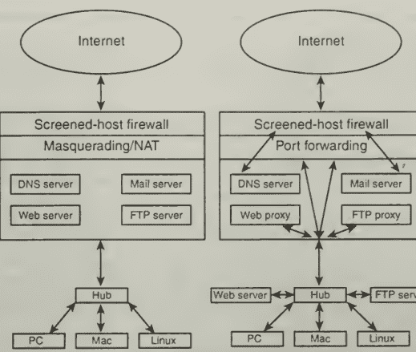

图 C.1 两种屏幕主机防火墙架构。

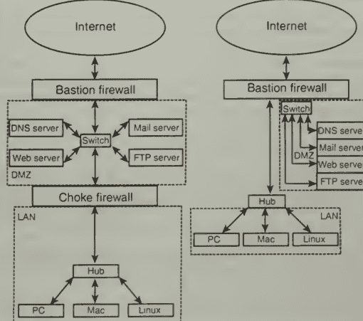

图 C.2 两种子网防火墙架构。

- `FTP` 文件传输协议。用于在网络计算机之间复制文件的协议和程序。
- `FTP`，任何请求该服务的客户端都可以访问的匿名 `FTP` 服务。
- `FTP`，身份验证 `FTP` 服务，仅允许预定义的账户访问，在使用服务前必须经过身份验证。
- `gateway` 网关。作为两个网络之间导管或中继的计算机或程序。
- `hosts.allow`, `hosts.deny`。`TCP wrappers` 的配置文件为 `/etc/hosts.allow` 和 `/etc/hosts.deny`。
- `HOWTO` 除了标准的 `man` 页（帮助页）外，Linux 还包含了针对许多主题的、多种语言和多种格式的用户提供的在线文档。`HOWTO` 文档由 Linux 文档项目协调和维护。
- `HTTP` 超文本传输协议，供 Web 服务器和浏览器使用。
- `hub` 集线器。一种用于物理连接多个网段、扩展物理网络距离或连接不同物理类型网段的硬件信号设备。
- `IANA` 互联网数字分配机构。
- `ICMP` 互联网控制协议。一种网络层 IP 状态和控制消息。
- `identd` 用户身份验证（`AUTH`）服务器。
- `ifstatus` 检查系统网络接口配置并报告任何处于调试模式或混杂模式的接口的系统程序。
- `IMAP` 互联网邮件组访问协议，用于从运行 `IMAP` 服务器的邮件主机上取邮件。
- `inetd` 网络超级服务器，监听用于其所管理的服务器的用于端口的入站连接。当连接请求到达时，`inetd` 会启动一个请求服务器的副本来处理连接。
- `inetd.conf` 配置文件
- `innd` UNIX 用户组网络服务器。
- `IP` 地址。分配给网络上特定网络或特定设备网络接口的唯一标识符。这是一种软件地址，可以直接翻译为人类可读的主机或网络名称。主机接口的 IP 地址与一个或多个硬件网络接口地址相关。
- `IP` 数据报文。一个 IP 层包。
- `ipchains` 随着 Linux 中引入 `IPFW` 防火墙机制的新实现，一种新的防火墙管理程序。
- `IPFW` 防火墙机制。
- `ipipfwads` 在引入 `ipchains` 之前，Linux `IPFW` 防火墙管理程序。
- `IRC` 互联网中继聊天，用于网络化个人和群体之间的书面电子通信。
- `ISP` 互联网服务提供商。


- `klog` 内核日志守护进程，从内核消息缓冲区收集操作系统的错误和状态消息，并与 `syslogd` 配合将消息写入系统日志文件。

# LAN 局域网

- `localhost` 通常在 `/etc/hosts` 中赋予给机器回环接口的符号名。

- `loopback interface` 回环接口。系统使用的特殊软件网络接口，用于传递发往本地机器的本地网络消息，绕过硬件网络接口和相关的网络驱动程序。

- `man page` 标准 UNIX 在线文档格式。手册页为几乎所有的用户和系统管理程序，以及系统调用、库调用、设备类型和系统文件格式编写。

- `masquerading` 伪装。将传站包的本地源地址替换为防火墙或网关机器地址的过程，以便局域网的 IP 地址保持隐藏。数据包看起来来自网关机器而不是局域网内部的机器。对于来自远程服务器的入站响应包，该过程反相反。

- `MD5` 一种加密校验和算法，通过创建对象的数字签名（称为消息摘要）来确保数据完整性。

- `MTU` 最大传输单元，基于底层网络的最大数据包大小。

- `multicast` 多播。一种专门指定为 D 类多播 IP 地址的 IP 包。多播客户端在中间路由器处注册，以接收发往特定多播地址的数据包。

- `multihomed` 多宿主。具有两个或多个网络接口的计算机。参见 `dual-homed`。

- `name server, primary` 主域名服务器。域名或域名空间区域的权威服务器。该服务器维护该区域主机名和 IP 地址的完整数据库。

- `name server, secondary` 域名服务器。主域名服务器的备份或对等。

- `nat` DNS 名称服务器。

- `NAT` 地址转换（或 IP 伪装），将包的本地源地址替换为防火墙或网关机器地址的过程，以便局域网的 IP 地址保持隐藏。数据包看起来来自网关机器而不是局域网内部的机器。对于来自远程服务器的入站响应包，该过程反相反。包的目标地址（防火墙机器的 IP 地址）被替换为内部局域网客户端机器的地址。

- `netstat` 根据各种网络相关的内核表报告各种网络状态的程序。

- `network layer` 网络层。在 OSI 参考模型中是第三层，代表两台计算机之间的通信，例如 IP 数据报到某些外部目标计算机的路由和交付。在 TCP/IP 参考模型中，这被称为第二层，互联网层。

- `NFS` 网络文件系统服务，用于集中管理和提供用户帐户和主机信息。

- `nmap` 一种相当新的网络安全审计（即端口扫描）工具，包含了今天许多新的扫描技术。

- `NNTP` 新闻传输协议，用于 Usenet。

- `NTP` 网络时间协议，供 `nptpd` 和 `ntpdate` 使用。

- `tpdate` 客户端程序，连接一个或多个 NTP 时间服务器以请求当前时间。

- `OSI`（开放系统互体系）模型由国际标准化组织（ISO）开发的七层模型。

- `OSPF` 最短路径路由协议

- `packet` 一个 IP 数据报

- `packet filtering` 防火墙过滤

- `PATH` 定义路径的环境变量

- `peer-to-peer` 点对点。两个设备使用的通信模式。每个点对点之间没有直接通信。

- `physical layer` 物理层。在 OSI 参考模型中是第一层，代表用于传输电信号的物理介质，如铜线、光纤或红外。在 TCP/IP 参考模型中，这被称为网络访问层。

- `PID` 进程 ID，进程在系统上的唯一标识符。

- `ping` 一种简单的网络分析工具，用于确定远程主机是否可达，`ping` 发送 ICMP 回显请求。接收主机返回 ICMP 响应。

- `POP` 邮局协议，用于从邮件主机取邮件。

- `port` 端口。服务的数字设计标识符。

- `portmap` 一种 RPC 管理器守护进程，用于在客户端请求的 RPC 服务与其绑定的服务端口之间建立映射。

- `probe` 探测。向主机上的某些服务端口发送某种包。探测的目的是确定目标主机是否生成了响应。

- `proxy` 代理。代表另一个程序创建并维护网络连接的程序，在客户端和服务器之间提供应用层导管。实际的客户端和服务器没有直接通信。代理对客户端程序看起来是服务器，对服务器看起来是客户端。

- `proxy, application gateway` 应用程序网关。类似于屏幕主机防火墙，但在系统和应用层实现。只有运行应用程序网关的计算机可以直接访问互联网。网络流量从不通过应用程序网关机器转发。所有互联网访问都通过网关机器完成。外部仅允许访问网关。内部仅允许访问网关并从那里访问互联网，或首先连接到应用程序网关并进行身份验证。代理服务器通常实现为每个提供的服务的独立应用程序。应用级代理理解应用程序特定的通信协议。每个代理应用程序对客户端程序看起来是服务器，对真实服务器看起来是客户端。特殊的客户端程序或特殊配置的客户端程序连接到代理服务器而不是远程服务器。代理代表客户端程序建立到远程服务器的连接，并将客户端的源地址替换为自己的。应用程序网关的示例包括 Apache Web 服务器代理和 TIS 防火墙工具包包含的特定应用程序代理。

- `port scan` 端口扫描。对主机的所有一组服务端口进行探测，通常是与安全漏洞相关的端口。

- `privileged` 特权端口。范围在 0 到 1023 之间的端口。许多此类端口由系统分配。访问特权端口需要系统级权限。

- `unprivileged` 非特权端口。范围在 1024 到 65535 之间的端口。这些端口中的一些根据约定注册。此范围内的任何端口都可以被客户端程序用于建立连接。


## 442 代理，电路级网关

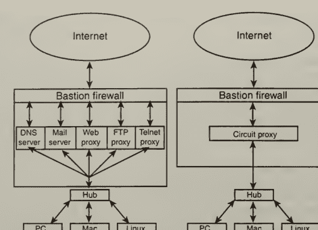

图 C.3 应用级和电路级代理网关。

代理，电路级网关 代理服务器，既可以实现为每个被代理服务的独立应用程序，也可以实现为一种不具备任何特定应用协议知识的通用连接中继。电路级中继在客户端和服务器程序之间创建一个虚拟的、由软件管理的连接电路。与应用级代理不同，中间连接步骤对用户是透明的。`SOCKS` 是一种电路级代理系统。

`QoS` 服务质量。

`RARP` 反向地址解析协议，其开发目的是为了让无盘机器能够根据其 MAC 硬件地址向服务器请求其 IP 地址。

`REJECT` 一种防火墙过滤规则决策，用于丢弃数据包并向发送者返回一个 ICMP 错误消息。

`resolver` DNS 的客户端。解析解析器以库代码的形式实现并链接到需要网络访问的程序。DNS 客户端配置文件为 `/etc/resolv.conf`。

`RFC` 征求，通过互联网学会（ISC）或互联网工程任务组（IETF）发布的注释或备忘。某些 RFC 成为标准。RFC 通常涉及与互联网或 TCP/IP 协议栈相关的主题。

`RIP` 路由信息协议，一种今天仍在使用的旧路由协议，特别是在大型局域网内。路由守护进程使用 RIP。

`RPC` 远程过程调用。

`rule` 见防火墙（firewall）和过滤器（filter）。

`runlevel` 源自 System V UNIX 的启动和系统概念。系统通常运行在运行级别 2、3 或 5 之一。运行级别 3 是默认的、正常的、多用户系统状态。运行级别 2 与 3 相同，但不运行 NFS 服务。运行级别 5 与 3 相同，额外增加了 XWindow 显示管理器，该显示器提供一个基于 X 的登录和主机选择屏幕。

`SATAN` 网络安全分析管理员工具，一种用于帮助识别网络配置中安全漏洞的工具。

`screen host` 见防火墙（firewall）和受屏主机（screened-host）。

`script` 一个可执行的 ASCII shell 脚本，例如一个包含 `sh`、`csh`、`bash`、`ksh` 或 `perrl` 命令的文件。

`segment` TCP 消息。`setgid` 一种程序，在执行时会分配程序所有者的组 ID（GID），而不是运行该程序的进程的组 ID。

`setuid` 一种程序，在执行时会假设程序所有者的用户 ID（UID），而不是运行该程序的进程的用户 ID。

`shell` 一种 UNIX 命令解释器，例如 `sh`、`ksh`、`bash` 和 `csh`。

`ssh/Sendmail` 简单邮件传输协议，用于在邮件服务器之间以及邮件程序与邮件服务器之间交换邮件。

`SNMP` 简单网络管理协议，用于从远程工作站管理网络设备配置。

`socket` 由 IP 地址与特定 TCP 或 UDP 服务端口对定义的唯一网络连接点。

`SOCKS` 一种来自 NEC 的流行的网关代理包。

`spoofing, source address` 地址欺骗，将 IP 数据包头的源地址更改为其他某些地址。

`SSH` 安全 shell 协议，用于更强身份验证的、加密的网络连接。

`SSL` 安全套接层协议，用于加密通信。SSL 最常用于 Web 服务器和浏览器在电子商务中交换个人信息。

`statically assigned address` 永久分配的、硬编码的 IP 地址，无论是公开注册的还是私有类地址。

`strobe` 一种基本的 TCP 端口扫描器。


subnet 网络地址方案，一种使用 IP 地址掩码将单个互联网网络地址空间内部划分为多个内部网络地址空间的方法。该地址空间在互联网上显示为一个网络，但在内部显示为多个网络和局域网。这是通过将 IP 地址中的某些主机 ID 视为网络部分的扩展来实现的。例如，`192.168.30.0` 网络地址空间掩码为 `255.255.255.0/24`，可以使用第四段字节的高位（掩码为 `255.255.255.128/25`）划分为两个内部网络。结果是内部网络地址空间，每个有 126 个可用地址。

subnet layer 子网层在 TCP/IP 参考模型的第一层，代表用于在两个相邻网络设备之间传输电信号的物理介质，如铜线、光纤、分组无线电或红外线。它包括两个相邻网络设备之间的点对数据信号传输，例如从你的计算机到外部路由器的以太网帧传输。

SUNRPC 服务端口 `111`，由 `map` 守护进程用于将 RPC 请求映射到服务端口。连接同步标志位。一个 SYN 消息是程序寻求与另一个网络程序建立连接时发送的第一条消息。

`syslog.conf` 系统日志守护进程的配置文件。

`syslogd` 系统日志守护进程，收集使用 `syslog()` 调用发布消息的系统程序生成的错误和状态消息。

TCP 传输控制协议，用于两个程序之间可靠的持续网络连接。

`tcp_wrapper` 一种授权方案，用于控制网络上的远程主机可以使用哪些本地服务。

`tpd` TCP wrapper 服务，由 `tpd` 程序为由 `inetd` 管理的服务提供。

TCP/IP 参考模型 是当 TCP/IP 在 20 世纪 70 年代末和 80 年代初成为 UNIX 机器间互联网通信的事实标准时，开发的一种非正式网络通信模型。

# 索引

# 符号

- `0.0.0.0` 广播源地址过滤规则, 72, 数据包拒绝, 29

- `255.255.255.255` 广播目标地址, 过滤规则, 71, 数据包拒绝, 29

- A `inet` 选项 (`netstat`), 246

- a 选项

  - `ifconfig`, 256

  - `netstat`, 222

- a p -A unix 选项 (`netstat`), 258

- `ACCEPT` 规则, 239

- `accept-all` 脚本, 422

- `accept-everything` 策略 (包过滤), 23

- `acceptance` 选项 (`ping` 请求), 257

- `acceptance` 规则 (包过滤防火墙), 20

- 访问控制列表

  - `ALL` 通配符, 278

  - 字段, 278

  - `LOCAL` 通配符, 279

  - 匹配模式, 279

  - `PARANOID` 通配符, 279

  - RPC 服务, 280

  - 服务, `tcpd` 程序, 277-279

  - 通配符匹配, 278

- 访问选项

  - 内部防火墙, 135–136

  - LAN 到堡垒防火墙, 131

- 访问资源. 见 资源, 访问

- 账户

  - 检测入侵者, 331

  - `root`, 276

  - `su`, 277

  - `system`, 320

- `ACK` 标志 (TCP 数据包), 13, 16

- 地址

  - 目标. 见 目标地址

  - 以太网, 6

  - IP, 6

  - `dhcp` 支持脚本, 425

  - 符号为符号名称, 65

  - MAC, 6

  - 源. 见 源地址

- 宣告服务, 7

- `AF INET` 套接, 246

- `AF UNIX` 套接, 246

- `ALL` 通配符 (访问控制列表), 278

- `allow every` 脚本, 422

- `allow-query` 选项 (名称服务器), 限制名称查询, 305

- `allow-transfer` 选项 (名称服务器), 限制区域传输, 306

- `allow-update` 选项 (名称服务器), 主机区域更新, 306

- `amd` 服务, 在防火墙上运行, 43

- 匿名 `ftp`, 306

  - `/home/ftp/bin` 目录, 310

  - `/home/etc/etc` 目录, 310

  - `/home/ftp/lib` 目录, 311

  - `/home/ftp/pub` 目录, 311

  - 安全, 309

- Apache 代理模块, 配置, 197-198

- Apache Web 服务器, 过滤规则 (客户端连接), 110

- APNIC (亚太网络信息中心), 事故报告, 337

- 应用网关, 199

- 应用层 (TCP/IP 参考模型), 5

- 应用级代理过滤器, 133

- 应用级代理防火墙 (SOCKS), 318-319

- 参数, `ipchains` 选项 (防火墙脚本), 63-64

- ARIN (美国数字数字局), 事故报告, 336

- `arpwatch` 进程, 在防火墙上运行, 43

- 分配的非特权端口, 过滤规则, 80-81

- 将分配的 `dhcpd` 服务器到接口, 314

- 通过 `nmap` 审计安全, 249

- 审计工具, 检测入侵者, 331

- `AUTH` 查询请求过滤规则, 91

- 多路 LAN 框架, 140

- `AUTH` 服务, 59, 161

- 堡垒防火墙, 162

- 瓶颈防火墙, 163

- 身份验证, 275

- NIS, 集中式用户管理, 276

- POP, POP 服务器, 312

- `rhost`, 275

- UNIX, 273

- MD5 密码哈希, 275

- 影子密码, 274

- 授权, 资源访问, 276

- `autobuse` 日志分析工具, 270

- `autofs` 服务, 在防火墙上运行, 44

- `mountount` 进程, 在防火墙上运行, 43-44

- Quake 服务器, 219, 221

- RealAudio 服务, 207-208

- SMTP 通道, 170

- SMTP 服务器, 164

- SSH 客户端, 179

- SSH 服务器, 178

- SSL 服务, 192, 195

- `syslog` 服务, 226

- Tehat 服务, 176

- WAIS 服务, 205

- Web 代理服务, 194, 196

- Web 服务, 191, 193

- WHOIS 服务, 203

- 目标不可达消息, 153

- DNS, 启用, 156-157

- 电子邮件, 163

- 日志, 229

- 出站邮件, 路由通过 DMZ 接口, 164

- 参数状态消息, 153

- `ping` 消息, 154

- 公共名称服务器, 157-159

- 单点故障问题, 127-128

- 源队列消息, 152

- 符号常量, 149

- 超时消息, 154

- 受信任主机

  - 访问选项, 131

  - 转发本地流量, 131-133

## B

- 堡垒防火墙, 3, 66

- `AUTH` 服务, 161-162

- CU-Seeme, 215-216

- `finger` 服务, 201

- FTP 服务, 218-183, 187

- Gopher 服务, 204

- IMAP 服务器, 167

- IRC 服务, 211-212

- NNTP 服务器, 174-175

- NTP 服务, 224

- POP 客户端, 165

- POP 服务器, 166

- 公共 Web 服务器, 200

- Quake 客户端, 220

- BIND (伯克利互联网域名). 以及 DNS

- 本地区域文件, 286

- 解析器, 查询名称服务器, 285

- 安全, 285

- 位掩码标识符 (IP 地址), `ipchains`, 065

- 阻塞站点, 源地址过滤, 228

- BOOTP (启动协议), 58

- `bootparam` 进程, 在防火墙上运行, 44

- `bootops` 服务, 57

- 安全漏洞, 检测, 328

- 瓶颈防火墙, 151

- 目标地址过滤规则, 71

- 源地址过滤规则, 72

## C

- BSD 远程访问服务, 56

- 构建防火墙, 61-62

- 业务 LAN, 配置, 133

- 默认策略, 150

- `-C` 选项 (`ipchains`), 244-245

- 缓存代理 (多路防火墙), 141

- 缓存名称服务器包, 286

- 系统日志分类. 见 设施

- 目标不可达消息, 153

- DNS, 156-157

- ICMP 消息, 152

- 本地 Web 代理服务器, 200

- 回环接口, 150

- 参数状态消息, 154

- CERIAS (信息安全教育与研究中心), 安全工具, 338

- CERT 协调中心, 安全信息和工具, 338


# DMZs (非军事化区) 451
- 连接
- 拒绝所有的脚本, 422-423
- 网络，通过 ping 检查, 257
- 拒绝所有策略 (数据包过滤), 23
- TCP, 远程网站示例, 12
- 拒绝数据包, 25
- 控制消息 (ICMP), 75
- A 类/B 类 (限流)
- 控制面板程序 (运行级别管理程序), 42
- 防火墙（), 151
- COPS (计算机神谕与密码系统), 326
- E 类数据包 (限流防火墙), 152
- 破解密码检查工具, 326
- 按源地址类型, 26-27
- CU-SeeMe, 配置目标地址, 过滤, 28
- 堡垒防火墙, 215-216
- 远程地址, 39
- 限流防火墙, 218
- 目的端口，过滤, 29, 39
- DMZs, 216
- 目的服务端口号, 9
- CU-SeeMe 代理模块, 215
- 目的不可到达消息
- 堡垒防火墙, 153
- 限流防火墙, 153
- 防火墙, 77

# D
- 守护进程, 7. 参见 服务
- 引导入侵者, 325-333
- httpd2, 276
- 恢复, 322-333
- inetd (TCP 服务管理), 278
- DHCP (动态配置协议), 58
- named, 287
- 主区域文件, 286-287
- DHCP 服务器
- portmap 配置, 314-315
- NIS 集中用户认证, 276
- 过滤规则, 116-118
- RPC 服务访问控制列表, 280
- `dhcpp-$DEVICE.exe` 文件, 426
- ssh, 274, 282
- 更新动态地址/安装防火墙, 427
- shd, 282
- 状态消息，日志选项, 264
- dhpd 服务器. 参见 pump
- 分配到接口, 314
- syslogd, 262
- syslogd, 用于安全性的远程日志, 配置, 314-323
- IPADDR/NAMESESSERVER 地址
- telnet, 283
- 支持, 425
- 数据报 (UDP), 5
- 在防火墙上运行, 44
- 调试目录
- 防火墙规则, 231-233
- `/etc/dhcp.pc`, 创建, 426
- 接口 (`ifconfig` 选项), 255-256
- ftp, 310
- ssh, 250-251
- 日志, 262
- 默认策略 (链), 68
- 权限, 280
- defaults pub (ftp), 组所有权, 311
- 输入链策略, 235
- 全局，权限, 281
- 数据包过滤, 223
- DMZs (非军事化区), 128, 146-147
- 运行级别, 43
- 拒绝规则 (数据包过滤防火墙), 20 配置
- 拒绝服务攻击, 34, 36
- CGI 脚本, 37
- 邮件示例, 36
- 事件报告, 335
- UDP 端口, 36
- DENY 策略, 239
- 公共 Web 服务器, 197
- SMTP 服务器, 168
- Web 服务器, 194

# 452 DMZs (非军事化区)
- 路由发出的堡垒邮件, 164
- 与私有局域网分离, 146
- 错误更新 (Red Hat Linux), 323
- 错误消息
- DNS (域名系统服务), 156-157. 参见 BIND
- ICMP 数据包, 100
- 数据包拒绝, 25
- 输入链规则, 240
- + LAN 客户端, 291
- 局域网, 156
- 私有 DNS 服务器, 297-305
- 公共 DNS 服务器, 291-296
- 连接，过滤规则, 85
- 查找作为，过滤规则, 88-89
- 主区域文件, 286
- named 守护进程, 287
- localhost 区域, 286
- 对等点查找，过滤规则, 286
- 远程查找，过滤规则, 89-90
- 解析，查询 DNS 服务器, 285
- 安全, 285
- `/etc/dhcp` 目录, 创建, 426
- `/etc/dhcpd.conf` 文件, 315
- `/etc/ftpass` 文件, 307-308
- `/etc/iphosts` 文件, 307
- `/etc/group` 文件, 系统账户尝试, 320
- `/etc/hosts` 示例文件, 279
- `/etc/hosts` 拒绝文件, 279
- `/etc/issue.net` 文件, 登录横
- `/etc/name.conf` 文件, 安全问题, 322
- `/etc/name.conf` 文件, 选项, 289-290
- `/etc/name.conf` 服务器, 多路局域网, 138
- `/etc/name.conf` 区域传输, 事件报告, 335
- `/etc/name.conf` 区域, 286

- finger 服务, 58
- 私有名称服务器, 160
- 规则, 移除预存在的, 150
- 源地址欺骗, 150
- 源队列消息, 152
- 符号常量, 149
- 超时消息, 154
- 瓶颈多组播, 151
- chroot 服务 (安全), 281-282
- 拒绝服务攻击, 37
- 安全, 318
- warp 服务器, 检查用户输入, 318
- CIAC (计算机互联网咨询能力), 安全工具, 338
- A、B 和 C 类私有 IP 地址. 见 私有 IP 地址
- A/B 类包, 拒绝 (瓶颈防火墙), 151
- E 类预留地址, 过滤规则, 73
- 链. 见 输入链；输出链
- 默认策略, 68
- 转发, 规则, 243
- 链规则优化, 409, 411-421
- 规则, 刷新, 68
- 瓶颈防火墙, 128, 146-147
- AUTH 服务, 161
- 客户端, 163
- 服务器, 163
- 广播地址, 151
- A/B 类包拒绝, 151
- CU-Server, 218
- DHCP 服务器, 227
- finger 服务, 202
- FTP 客户端, 190
- FTP 服务, 184-185, 187
- Copher 服务, 204
- HTTP 客户端, 198
- IMAP 客户端, 167, 173
- IRC 服务, 214
- LAN 访问, 228
- NNTP 客户端, 175-176
- NTP 服务, 225
- POP 客户端, 166, 172
- Quake 服务, 222
- RealAudio 服务, 209-210
- 客户端访问规则 (LAN 服务器接口), 138
- 客户端连接请求 (TCP 数据包), 12
- 客户端接口 (LAN), 服务器访问规则, 138
- 客户端/服务器电子邮件组合, 96
- 堡垒防火墙, 162
- 瓶颈防火墙, 163
- IMAP 客户端, 163
- LAN, DNS 配置, 291
- POP 堡垒防火墙, 165
- 瓶颈防火墙, 166
- 450 客户端
- SMTP 瓶颈防火墙, 169
- Web 代理服务, 配置, 200
- 代码 (ICMP 数据包), 9
- 命令行参数 (防火墙脚本), 63-64
- 通用服务, 32
- 系统破坏, 320
- 入侵检测, 329
- Clearinghouse, 338
- 通道 (SMTP), 170
- 配置代理模块, 197-198
- 堡垒防火墙, 131
- CU-Seeme, 215-216
- finger 服务, 201
- FTP 服务, 218-183, 187
- Gopher 服务, 204
- IMAP 服务器, 167
- IRC 服务, 211-212
- NNTP 服务器, 174-175
- NTP 服务, 224
- POP 客户端, 165
- POP 服务器, 166
- 公共 Web 服务器, 200
- Quake 客户端, 220
- Quake 服务, 219, 221
- RealAudio 服务, 207-208
- SMTP 客户端, 165, 169
- SSH 客户端, 179
- SSH 服务器, 178
- SSL 服务, 192, 195
- syslog 服务, 226
- Tehat 服务, 176 服务, 205
- Web 代理服务, 194, 196
- Web 服务, 191, 193
- WHOIS 服务, 203
- 目标不可达消息, 153
- DNS, 启用, 156-157
- 电子邮件, 163
- 日志, 229
- 出站邮件, 路由通过 DMZ 接口, 164
- 参数状态消息, 153
- ping 消息, 154
- 公共名称服务器, 157-159
- 单点故障问题, 127-128
- 源队列消息, 152
- 符号常量, 149
- 超时消息, 154


- `/etc/name.conf` 转发, 294-296,302-305

- `/etc/name.conf` 私有 DNS 服务器, 293,301-302

- `/etc/name.conf` 域指令 (解析器), 285

- 域服务, 协议,(UNIX), 258

- 动态 IP 地址, 安装, 124-125

- 动态路由, 6

- 过期时间 (localhost 区域), 287

- 漏洞, 323

- Echo 回应消息，过滤, 78

- Echo 请求消息，过滤, 78

- Echo 回应能力), 系统日志, 263

- 邮件, 163

- 外部网关服务器，过滤, 94

- 外部邮件服务器，过滤, 94

- 外部邮件服务器，规则, 94

- 功能，系统, 78

- 字段 (访问控制列表), 278

- F (联邦计算机事件响应), 信息, 338

- F 文件, 163

- 异常变化，检测入侵者, 330

- 事件响应，信息, 338

- 著名的端口. 参见已知端口

- 文件:

- DNS 对等点查找, 88-89

- DNS 远程查找, 89-90

- `dhcpd-\(\DEVICE\).exe`, 426

- 更新动态地址/安装防火墙, 427-428

- `/etc/dhcpd.conf`, 315

- `/etc/ftpaccess`, 307-308

- `/etc/ftphosts`, 307

- `/etc/group`, 系统账户项, 320

- `/etc/hosts.allow` 示例, 279

- `/etc/hosts.deny` 示例, 279

- `/etc/issue.net`, 登录横

- `/etc/named.conf`, 288,301-305

- `/etc/ntp.conf`, 317

- `/etc/passwd`, 系统账户项, 320

- `/etc/ppp/options`, 312

- `/etc/ppp/secrets`, 312-313

- `/home/ftp/etc/passwd`, 310

- localhost 区域, 286

- 日志拒绝数据包, 119-120

- 日志注册, 262

- 分配到接口, 314

- `var/named/dnz.reverse`, 私有 DNS 服务器, 299

- 目录位置, 262

- 系统日志, 262,264-265

- `var/named`, 268

- `var/named/named.local.lan`, 私有 DNS 服务器, 299-301

- 主区域, `named` 守护进程, 286-287

- `named.public`, 公共 DNS 服务器, 292

- 权限, 260

- 世界可写，权限, 280

- 根缓存, 290

- `ping`, 79

- `finger` 访问, 111

- `ftop`, 104

- `ftp` 数据通道连接, 106

- `ftp` 请求, 107

- `ftp` 外部访问, 107

- `ftp` 被动数据连接, 106

- `ftp` 被动模式响应, 107

- `ftp` 端口模式请求, 107

- 全局拒绝规则, 121-122

- `gopher` 访问, 113

- HTTP 访问, 108

- IANA 解析的地址, 74

- ICMP 控制消息, 75-78

- `identD` 服务, 90

- IMAP 客户端, 95

- IMAP 服务器, 99

- 入站 AUTH 请求, 91

- 入站 `finger` 访问, 112

- 入站多播数据包, 72

- 入站 SSL 访问, 110

- 入站网站访问, 109

- IP 转发, 123

- IP 伪装, 123

- 局域网访问, 122

- 本地 SMTP 服务器, 95

- 回环接口, 117

- 网络时间服务器, 118

- NFS 连接, 83

- NNTP, 99

- `tntpd`, 119

- Open Window 连接, 81

- 出站 AUTH 请求, 91

- 出站 `finger` 访问, 112

- 出站多播数据包, 72

- `ping` 远程控制主机, 79

- POP 客户端, 95

- POP 服务器, 98

- 私有 IP 地址, 70

- 路由发出的堡垒邮件, 164

- 与私有局域网分离, 146

- SMTP 服务器, 168

- TCP, 远程网站示例, 12

- UDP 端口, 36

- 堡垒防火墙, 215-216

- 限流防火墙, 218

- 目的端口，过滤, 29, 39

- 目的服务端口号, 9

- CU-SeeMe 代理模块, 215

- 目的不可到达消息

- 堡垒防火墙, 153

- 限流防火墙, 153

- 防火墙, 77

# 471

- 堡垒防火墙, 215-216

- 限流防火墙, 218

- 目的端口，过滤, 29, 39

- 目的服务端口号, 9

- CU-SeeMe 代理模块, 215

- 过期时间 (localhost 区域), 287

- Echo 回应消息，过滤, 78

- Echo 请求消息，过滤, 78

- Echo 回应能力), 系统日志, 263

- 邮件, 163

- 外部网关服务器，过滤, 94

- 外部邮件服务器，过滤, 94

- 外部邮件服务器，规则, 94

- 功能，系统, 78

- 字段 (访问控制列表), 278

- F (联邦计算机事件响应), 信息, 338

- F 文件, 163

- 异常变化，检测入侵者, 330

- 事件响应，信息, 338

- 著名的端口. 参见已知端口

- 文件:

- DNS 对等点查找, 88-89

- DNS 远程查找, 89-90

- `dhcpd-\(\$DEVICE\).exe`, 426

- 更新动态地址/安装防火墙, 427-428

- `/etc/dhcpd.conf`, 315

- `/etc/ftpaccess`, 307-308

- `/etc/ftphosts`, 307

- `/etc/group`, 系统账户项, 320

- `/etc/hosts.allow` 示例, 279

- `/etc/hosts.deny` 示例, 279

- `/etc/issue.net`, 登录横

- `/etc/named.conf`, 288,301-305

- `/etc/ntp.conf`, 317

- `/etc/passwd`, 系统账户项, 320

- `/etc/ppp/options`, 312

- `/etc/ppp/secrets`, 312-313

- `/home/ftp/etc/passwd`, 310

- localhost 区域, 286

- 日志拒绝数据包, 119-120

- 日志注册, 262

- 分配到接口, 314

- `var/named/dnz.reverse`, 私有 DNS 服务器, 299

- 目录位置, 262

- 系统日志, 262,264-265

- `var/named`, 268

- `var/named/named.local.lan`, 私有 DNS 服务器, 299-301

- 主区域, `named` 守护进程, 286-287

- `named.public`, 公共 DNS 服务器, 292

- 权限, 260

- 世界可写，权限, 280

- 根缓存, 290

- `ping`, 79

- `finger` 访问, 111

- `ftop`, 104

- `ftp` 数据通道连接, 106

- `ftp` 请求, 107

- `ftp` 外部访问, 107

- `ftp` 被动数据连接, 106

- `ftp` 被动模式响应, 107

- `ftp` 端口模式请求, 107

- 全局拒绝规则, 121-122

- `gopher` 访问, 113

- HTTP 访问, 108

- IANA 解析的地址, 74

- ICMP 控制消息, 75-78

- `identD` 服务, 90

- IMAP 客户端, 95

- IMAP 服务器, 99

- 入站 AUTH 请求, 91

- 入站 `finger` 访问, 112

- 入站多播数据包, 72

- 入站 SSL 访问, 110

- 入站网站访问, 109

- IP 转发, 123

- IP 伪装, 123

- 局域网访问, 122

- 本地 SMTP 服务器, 95

- 回环接口, 117

- 网络时间服务器, 118

- NFS 连接, 83

- NNTP, 99

- `tntpd`, 119

- Open Window 连接, 81

- 出站 AUTH 请求, 91

- 出站 `finger` 访问, 112

- 出站多播数据包, 72

- `ping` 远程控制主机, 79

- POP 客户端, 95

- POP 服务器, 98

- 私有 IP 地址, 70

- 路由发出的堡垒邮件, 164

- 与私有局域网分离, 146

- SMTP 服务器, 168

- TCP, 远程网站示例, 12

- UDP 端口, 36

## 防火墙 455

- TCP 服务, 92

- 网络入站访问, 102


- 网络出站访问, 102

- UDP 服务, 83

- Usenet, 99

- Usenet 客户端, 100

- Usenet 馈送, 101

- Usenet 服务器, 100

- 调试, 231-233

- DHCP 服务器, 116-118

- finger 访问, 111

- ftp, 104

- ftp 数据通道连接, 106

- ftp 入站请求, 107

- ftp 出站访问, 106

- ftp 被动数据通道连接, 106

- X windows, 82

- 转发来自互联网的入站请求, 145-146

- ICMP 控制消息, 75-78

- IDENTD 服务, 90

- 初始化, 67

- 输入链，过滤源地址

- 安装, 61-124

- ftp 被动模式响应, 107

- ftp 端口模式响应, 107

- 全局数据规则, 121-122

- gopher 访问, 113

- HTTP 访问, 108

- 入站 finger 访问, 112

- 入站 SSL 访问, 110

- 入站 Web 网站访问, 109

- p 转发, 123

- IP 伪装, 123

- LAN 访问, 122

- 列出, 233-239

- 来自 dhcp-[DEVICE].exe 文件, 427-428

- 使用动态 IP 地址, 124-125

- ifhdone 脚本, 430-432

- 使用静态 IP 地址, 124

- ich re.firewall, 352-368, 371

- 优化规则, 409-421

- ipwadm re.firewall, 371-386, 389-390

- 优化规则, 400-408

- 日志, 229

- 记录入站拒绝的数据包, 119-120

- 网络时间服务器, 118

- tpdate, 119

- 优化, 390, 392-395

- 出站 finger 访问, 112

- 优先级, 143

- 远程 Web 网站访问, 108

- 源/目的地址, 65

- ssh 入站访问, 104

- ssh 远程访问, 104

- 伪装, 142-143

- 消息日志, 265

- 多个 LAN, 137

- AUTH 查找请求, 140

- 缓存代理, 141

- DNS 服务器设置, 138

- 转发规则, 138

- 邮件检索, 140

- 远程服务器访问, 141

- SMTP 服务器设置, 139

- 网络服务，选择使用哪个防火墙, 41

- 开放端口，检查, 246

- 包过滤, 3, 19-20. 另另

- 数据包防火墙过滤, 41

- 保护本地主机, 79

- ping ICMP 控制消息, 78

- ping 路由主机, 79

- 策略，调试, 232

- 端口重定向, 144-145

- 端口扫描日志, 269-270

- 端口

- 通过 netstat 检查, 246

- 列出状态数据, 247-248

- 列出租户端口, 248

- 验证用法, 255-256

- 代理防火墙, 02

- 规则, 239

- Apache 服务器访问, 110

- 测试代理, 244-245

- traceroute 服务, 114-115

- UDP 服务, 114

- WAIS 访问, 113

- Web 代理访问, 110

- whois 访问, 112

- screen-ed. 参见适当网关

- screen-ed, 146-147

- 脚本

- 优化规则, 391, 393, 395, 398, 400

- 特殊用途, 422-434

- 选择性内部访问, 135-136

- 单节点系统, 61

- smurf 攻击, 79

- sh, 102-103

- TCP 端口

- TCP 传入选项, 249

- 状态数据, 249

- UDP 服务, 249

- Web 服务, 108

## 456 FIRST (事件响应与安全团队论坛)

## FIRST (事件响应与安全团队论坛),信息和工具, 338

### 标志

- + ACK. 见 ACK flags 数据包，列出选项, 234

- SYN. 见 SYN flags ToS, 236

- + 泛洪

- ping 洪水, 35

- TCP SYN 数据包, 34-35

- UDP 洪水, 36

- + 从链中冲刷规则, 68

- 转发链，规则, 243

- 仅转发名称服务器, 289

- 转发流量，多个 LAN, 131

- + 与伪装比较, 132-133

- 转发名称服务器，本地, 288-289

- + 转发规则, 243-244

- 多个 LAN 选项，DNS 服务器设置, 138

- + 分片

- MTU, 256

- 包，安全问题, 37

- TCP 数据包, 12

### 帧 (以太网, 5)

- + ftp (文件传输协议)

- 客户端（防火墙）, 190

- 堡垒防火墙, 182-183

- choke 防火墙, 184-185

- 过滤规则, 104

- 数据通道连接, 106

- 入站请求, 107

- 优化, 390

- 出站访问, 106

- 被动数据连接, 106

- 被动模式响应, 107

- 端口模式请求, 107

- pub 目录，用户/组所有, 311

- 服务器, 55

- 配置文件, 307-309

- ftpd 服务器, 309

- `/home/ftp/bin` 目录, 310

- `/home/ftp/etc` 目录, 310

- `/home/ftp/lib` 目录, 311

- `/home/ftp/pub` 目录, 311

### G

- 守护进程，运行在防火墙, 45

- 网关，应用网关, 19

- 普通端口扫描, 30

- 全局拒绝规则, 121-122

- gopher 服务, 56

- 配置, 204

- 过滤规则（客户端/服务器连接）, 113

### H

- + 黑客攻击

- mountd 漏洞, 223

- 安全和入侵检测, 325-338

- 恢复, 332-333

- + 头部

- ICMP 数据包, 9

- IP 数据包, 9

- UDP 数据包, 10

home LAN 防火墙

- rc.firewall 示例, 352-368, 371

- ipwadm rc.firewall 示例, 371-386, 389-390

- `/home/ftp/bin` 目录 (匿名 ftp), 310

- `/home/ftp/etc` 目录 (匿名 ftp), 310

- `/home/ftp/etc/passwd` 文件, 310

- `/home/ftp/lib` 目录 (匿名 ftp), 310

- `/home/ftp/pub` 目录 (匿名 ftp), 311

- + 敌性评分（端口探测）, 266

host, 本地转发服务器, 228-289

HTTP. 参见 Web 服务

配置 choke 防火墙, 198

过滤规则, 108

规则，优化, 390

安全, 318

http 守护进程, 278

httpd 服务，运行在防火墙, 45

## I-J

IP (网协议) 457

IANA (互联网分配编号机构)

端口号到服务的映射, 7

预留地址，过滤规则, 74

入站 Web 网站访问，过滤规则, 109

ICMP (互联网控制消息协议), 9

控制消息，过滤规则, 75-78

inetd 守护进程，管理服务, 55-59

运行在防火墙, 46

TCP 服务管理, 278

信息服务, 58

初始化脚本, 43

初始化防火墙, 67

Source Quench, 240, 242

对小型网站感兴趣的类型, 75

目的不可到达（入站链规则）, 240

数据包拒绝, 25

参数问题, 240

服务或主机不可用, 11

时间超时, 240, 242

类型 3（出站链规则）, 242

伪装, 243

消息，过滤（choke 防火墙）, 152

innd 服务，运行在防火墙, 46

输入链，过滤器，源地址欺骗, 69

列出规则, 233

包过滤防火墙, 21

过滤包, 26

源地址过滤, 26

策略, 235

规则, 238

入站规则, 239-241

优化, 390

停止防火墙, 61-62

dhcpd5(DEVICE).exe 文件, 427-428

使用动态 IP 地址, 124-125

dhcpc-done 脚本, 430-432

使用静态 IP 地址, 124

IDENTD 服务，过滤规则, 90

ident. se AUTH

识别用户（安全）, 273

ifconfig

- `-a` 选项, 256

检查网络接口, 255-256

ifdhpc-done 脚本, 429

更新动态地址/安装防火墙, 429-432

interfaces\分配 DHCP 服务器, 314

choke 防火墙（环回）, 150


client. ser 接口，调试（`ifconfig` 选项）, 255-256

`rc.firewall` 示例, 352-368, 371

`ipwadm` `rc.firewall` 示例, 371-386, 389-390

- `/home/ftp/bin` 目录 (匿名 ftp), 310

- `/home/ftp/etc` 目录 (匿名 ftp), 310

- `/home/ftp/etc/passwd` 文件, 310

- `/home/ftp/lib` 目录 (匿名 ftp), 310

- `/home/ftp/pub` 目录 (匿名 ftp), 311

- + 敌性评分（端口探测）, 266

`host`, 本地转发服务器, 228-289

HTTP. 参见 Web 服务

配置 choke 防火墙, 198

过滤规则, 108

规则，优化, 390

安全, 318

`http` 守护进程, 278

`httpd` 服务，运行在防火墙, 45

## 456 FIRST (事件响应与安全团队论坛)

## FIRST (事件响应与安全团队论坛),信息和工具, 338

### 标志

- + ACK. 见 ACK flags 数据包，列出选项, 234

- SYN. 见 SYN flags ToS, 236

- + 泛洪

- ping 洪水, 35

- TCP SYN 数据包, 34-35

- UDP 洪水, 36

- + 从链中冲刷规则, 68

- 转发链，规则, 243

- 仅转发名称服务器, 289

- 转发流量，多个 LAN, 131

- + 与伪装比较, 132-133

- 转发名称服务器，本地, 288-289

- + 转发规则, 243-244

- 多个 LAN 选项，DNS 服务器设置, 138

- + 分片

- MTU, 256

- 包，安全问题, 37

- TCP 数据包, 12

### 帧 (以太网, 5)

- + ftp (文件传输协议)

- 客户端（防火墙）, 190

- 堡垒防火墙, 182-183

- choke 防火墙, 184-185

- 过滤规则, 104

- 数据通道连接, 106

- 入站请求, 107

- 优化, 390

- 出站访问, 106

- 被动数据连接, 106

- 被动模式响应, 107

- 端口模式请求, 107

- pub 目录，用户/组所有, 311

- 服务器, 55

- 配置文件, 307-309

- ftpd 服务器, 309

- `/home/ftp/bin` 目录, 310

- `/home/ftp/etc` 目录, 310

- `/home/ftp/lib` 目录, 311

- `/home/ftp/pub` 目录, 311

### G

- 守护进程，运行在防火墙, 45

- 网关，应用网关, 19

- 普通端口扫描, 30

- 全局拒绝规则, 121-122

- gopher 服务, 56

- 配置, 204

- 过滤规则（客户端/服务器连接）, 113

### H

- + 黑客攻击

- mountd 漏洞, 223

- 安全和入侵检测, 325-338

- 恢复, 332-333

- + 头部

- ICMP 数据包, 9

- IP 数据包, 9

- UDP 数据包, 10

home LAN 防火墙

- `rc.firewall` 示例, 352-368, 371

- `ipwadm` `rc.firewall` 示例, 371-386, 389-390

- `/home/ftp/bin` 目录 (匿名 ftp), 310

- `/home/ftp/etc` 目录 (匿名 ftp), 310

- `/home/ftp/etc/passwd` 文件, 310

- `/home/ftp/lib` 目录 (匿名 ftp), 310

- `/home/ftp/pub` 目录 (匿名 ftp), 311

- + 敌性评分（端口探测）, 266

`host`, 本地转发服务器, 228-289

HTTP. 参见 Web 服务

配置 choke 防火墙, 198

过滤规则, 108

规则，优化, 390

安全, 318

`http` 守护进程, 278

`httpd` 服务，运行在防火墙, 45

## I-J

IP (网协议) 457

IANA (互联网分配编号机构)

端口号到服务的映射, 7

预留地址，过滤规则, 74

入站 Web 网站访问，过滤规则, 109

ICMP (互联网控制消息协议), 9

控制消息，过滤规则, 75-78

`inetd` 守护进程，管理服务, 55-59

运行在防火墙, 46

TCP 服务管理, 278

信息服务, 58

初始化脚本, 43

初始化防火墙, 67

Source Quench, 240, 242

对小型网站感兴趣的类型, 75

目的不可到达（入站链规则）, 240

数据包拒绝, 25

参数问题, 240

服务或主机不可用, 11

时间超时, 240, 242

类型 3（出站链规则）, 242

伪装, 243

消息，过滤（choke 防火墙）, 152

`innd` 服务，运行在防火墙, 46

输入链，过滤器，源地址欺骗, 69

列出规则, 233

包过滤防火墙, 21

过滤包, 26

源地址过滤, 26

策略, 235

规则, 238

入站规则, 239-241

优化, 390

停止防火墙, 61-62

`dhcpd5(DEVICE).exe` 文件, 427-428

使用动态 IP 地址, 124-125

`dhcpc-done` 脚本, 430-432

使用静态 IP 地址, 124

IDENTD 服务，过滤规则, 90

`ident. se AUTH`

识别用户（安全）, 273

`ifconfig`

- `-a` 选项, 256

检查网络接口, 255-256

`ifdhpc-done` 脚本, 429

更新动态地址/安装防火墙, 429-432

`interfaces\分配 DHCP 服务器`, 314

choke 防火墙（环回）, 150

client. ser 接口，调试（`ifconfig` 选项）, 255-256

`rc.firewall` 示例, 352-368, 371

`ipwadm` `rc.firewall` 示例, 371-386, 389-390

- `/home/ftp/bin` 目录 (匿名 ftp), 310

- `/home/ftp/etc` 目录 (匿名 ftp), 310

- `/home/ftp/etc/passwd` 文件, 310

- `/home/ftp/lib` 目录 (匿名 ftp), 310

- `/home/ftp/pub` 目录 (匿名 ftp), 311

- + 敌性评分（端口探测）, 266

`host`, 本地转发服务器, 228-289

HTTP. 参见 Web 服务

配置 choke 防火墙, 198

过滤规则, 108

规则，优化, 390

安全, 318

`http` 守护进程, 278

`httpd` 服务，运行在防火墙, 45

## netstat 459

- 日志, 229, 266-265。另参阅 syslog 服务

- MD5 密码哈希（用户认证）， 275

- + 分析包, 270

- 创建文件, 264

- 检测入侵者, 229

- 目录位置, 262

- 设施, 263

- 防火墙消息, 265

- 拒绝入站数据包，过滤

- 规则, 119-120

- 匹配数据包（阻塞防火墙）， 151

- 数据包规则匹配, 70

- 端口扫描, 269-270

- 优先级, 263

- 远程 (syslog 守护进程), 322-323

- + 消息类型 (ICMP 数据包), 9, 75

- 消息。另参阅错误消息

- 防火墙日志, 265

- 系统状态, 日志选项, 264

- 挂载守护进程（黑客利用）， 323

## MTU (最大传输单元)

- 分片, 256

- + TCP 数据包欺骗（阻塞防火墙）， 151

- 多播数据包，过滤规则, 72

- 多信道, 137

- 登录横幅，telnet（安全协议）， 322

- 回环接口

- + 阻塞文件, 150

- 过滤规则, 71

- 防火墙 shell 脚本，启用, 69

- 规则, 237

- + 防火墙选项, 137

- AUTH 查询请求, 140

- (落地数据包, 141)

- DNS 服务器设置, 138

- 转发规则, 138

- 邮件检索, 140

- 远程服务器访问, 141

- SMTP 服务器设置, 139

- 子网划分, 143

- `lpd` 服务，在防火墙上运行, 447

## M

## N

- MAC 地址, 6

- `-n` 选项

- + 邮件服务器, 57。另参阅邮件中继选项, 284

- 安全, 283

- + `ipchains`，列出规则, 234-235

- `netstat`, 264

- + 管理器。另参阅运行级别管理器

- 将服务名映射到端口号, 8

- + 名称服务器, 157-160

- `allow-query` 选项，限制树, 305


- `allow-transfer` 选项，限制主机区域传输, 306

- `allow-update` 选项，主机区域日期, 306

- 本地转发, 288

- 主机, 288-289

- 区域数据访问, 305

- `+` 标记字段 (数据包), 237

- 标记数据包, 237

- `+ masq-new` 服务，在防火墙上运行, 447

- `+` 伪装

- ICMP, 243

- 按接口, 142

- 按接口、服务和主机, 142

- 规则优先级, 143

- 按服务, 142

- `+ named` 守护进程, 287

- 主主区域文件, 286–287

- 在防火墙上运行, 247

- `+` 主主区域文件 (`named` 守护进程), 286-287

- `+ named.public` 文件, 292

- 名称服务器指令 (解析器), 285

- `netfs` 脚本，在防火墙上运行, 48

- `netstat`, 58

- `+` 匹配规则 (`tcp wrappers` 程序), 278-279

- `+ mcserv` 服务，在防火墙上运行, 447

- MD5 数据完整性算法, 327

- `+ -A inet` 选项, 246

- `-a` 选项, 246

- `-a p-A` 选项, 258

- 防火墙端口，检查, 246

- `ftp` 端口数据，列出, 248

- `-n` 选项, 246

- 网络进程，检查, 258-261

- `-p` 选项, 246

- 端口数据，列出, 247

- `-ax` 选项, 259

- `telnet` 端口，列出, 248

- 网络配置脚本，在防火墙上运行, 48

- 网络协调员，事件报告, 336

## 网络层 (TCP/IP 参考模型), 5

- 网络时间协议。另参阅 NTP

- 网络时间服务器，过滤规则, 118

- 网络

- 连接，通过 `ping`, 257

- 接口，调试 (`if` 选项), 255-256

- 进程，通过 `netstat` 检查, 258-261

- 程序访问，解析器名称服务器查询, 285

- 服务

- 初始化脚本, 43

- 级别, 43-53

- 选择哪一个, 41-53

- 子网划分, 134

- TCP/IP 参考模型, 5

- 测试服务, 54

## NFS

- 在防火墙机器上运行, 43

- 连接，过滤规则, 83

- 在防火墙上运行, 48

- NIRMENT，事件报告, 337

- NIS (网络信息服务), 276

- NIST (美国标准与技术协会)，安全出版, 338

- 映射安全审计工具, 249

## NNTP

- 客户端，配置 (堡垒防火墙), 175-176

- 过滤规则, 99

- 服务器，配置 (堡垒防火墙), 174-175

- NS (名称服务器) 记录，本地 区域文件, 287

- `nsd` 服务，在防火墙上运行, 49

## NTP (网络时间协议),

- 配置堡垒防火墙, 224

- 阻塞防火墙, 225

- `ntpdate` 程序配置, 316

- 过滤规则, 119

- 数字服务端口名 (`ipchains`), 63

- 数字值规则列出, 234-255

- `nv` 选项 (`ipchains`)，列出规则, 238-239

- 开放端口，通过 `-L` 选项 (`ipchains`) 检查, 246

- 开放连接，过滤规则, 81

- 防火墙规则, 390, 392, 395-399

- `ipchains` 选项, 409, 421

## O

- 密码 (安全问题), 321

- 模式匹配 (访问列表), 279

- 权限

- 拒绝, 25

- 按源地址类型, 26-27

- 默认策略, 23

- 入站数据包, 26

- 出站, 38

- 规则, 62, 68

- 源地址欺骗, 70

- 分片 (安全问题), 37

- ICMP, 9

- 标记位, 234

- 本地源地址过滤, 38

- 日志匹配, 70

- 标记字段, 237

- 外部字段, 237

- 策略, 240

- 远程目标地址过滤, 39

- 源地址，过滤规则, 65

- 目录, 280

- 文件, 280

- `su` 账户, 277

- `tcp wrappers`, 277-279

- `ping` 网络连接, 257

- ICMP 控制消息，过滤规则, 78

- 入站，过滤规则, 79

- 消息, 154

- 远程主机，过滤规则, 79

- 接受选项, 257

- `ping` 洪水攻击, 35

- Ping of Death, 35

- 策略链，默认值, 68

- DENY, 239

- 防火墙，调试, 232

- 输入链, 235

- 数据包过滤, 23

- 数据包, 240

- 安全, 4

- POP- 堡垒防火墙, 165

- 阻塞防火墙, 166

- 配置, 171-172

- 过滤规则, 95-96

- 安全, 283

- 选择性内部访问, 136

- 服务器 堡垒防火墙, 166

- 配置, 171, 312-313

- 过滤规则, 98

- PAP 认证, 312

- `+ TCP`, 92

- 过滤, 30

- 分片, 12

- 头部, 12

- 源/目标端口号, 9

- UDP, 98

- 头部, 10

- 请求-响应过程, 11

- 源/目标端口号, 9

- PAP 认证 (POP 服务器), 312

- `+ Parameter Problem` 控制消息, 77

- Parameter Problem 状态消息 堡垒防火墙, 153

- 阻塞防火墙, 153

- `pop-2` 服务, 57

- `pop-3` 服务, 57

- `pop` 服务器，配置, 312

- 端口 80 (Web 服务器), 7

- 端口重定向, 144-145

## portmap守护进程

- NIS 集中认证, 276

- RPC 服务访问列表, 280

- 在防火墙上运行, 49

- 探针, 30

- 端口, 266-269

- 网络进程，检查, 258-261

- 端口数据，列出, 247

- `telnet` 端口，列出, 248

- 网络配置脚本，在防火墙上运行, 48

- 网络协调员，事件报告, 336

# Q-R

- Quake

- 客户端，配置（堡垒防火墙）, 220

- 服务器，配置

- 堡垒防火墙, 219, 221

- `/var/named/named.dmz.` 文件, 298-301

- `/var/named/named.dmz.reverse` 文件, 299

- 查询（名称服务器），`allow-query` 选项, 305

- 资源访问

- `root` 账户, 276

- `su` 账户, 277

- `tcp wrappers`, 277-279

- 配置，设置限制, 36

- 用户授权, 276,

- RARP（反向地址解析协议）, 58

- 响应端口扫描, 33

- 重试率行（localhost 区域文件）, 287

- RealAudio 服务，配置

- 堡垒防火墙, 207-208

- 阻塞防火墙, 209-210

- 反向地址解析协议 (RARP), 58

- 记录 (`/etc/name.conf` 文件), 289-290

- `rhost`（用户身份验证）, 275

- RIPE (欧洲各国网络)，事件报告, 373

- `root` 账户, 276

- 从系统入侵中恢复, 332-333

- `root.cache` 文件, 290

- 路由守护进程，在防火墙上运行, 50

- 红帽炸弹 (ICMP), 36

- 重定向日志输出, 262

- RPC 服务（访问控制列表）, 280

- `rstad` 守护进程，在防火墙上运行, 50

- 参考模型。OS 参考模型；TCP/IP 参考模型

- 刷新率行（localhost 区域文件）, 287

- RTP（实时传输协议）, 206

- 拒绝数据包, 25

- 继继选项（邮件服务器）, 284

- 远程启动服务, 257

- RTSP（实时流传输协议）, 206

- 远程目的地址过滤, 339

- 远程目的端口过滤, 29

- 远程日志（`syslog` 守护进程）, 322-323

- 规则

- ACCEPT, 239

- 阻塞防火墙, 150

- 防火墙, 239

- 远程服务器（多局域网防火墙攻击）,141

- 远程 `shell` 服务, 56

- 远程源端口过滤, 29

- 事件报告, 333-334

- 拒绝服务攻击, 335

- 包含的信息, 338

- Apache 服务器访问, 110

- 未分配的特权端口, 80-81

- 广播目的地址, 71

- 广播源地址, 72

- E 类预留地址, 73

- 调试, 231-233

- 报告选项。Src `ipchains`

- 请求 (`ping`)，接受选项, 257

- DHCP 服务器, 116-118

- DNS 连接, 85

- 客户端 DNS 查找, 88

- DNS 点对点查找, 88-99


# DNS 远程查找, 89-90, 92
# 解析器, 285
# 资源记录
# localzone 文件, 286
# named.public 文件, 292
# 外部网关 SMTP 服务器, 94
# 外部邮件服务器, 94
# 外部 ping, 79
# finger 访问, 111
# tip, 104
# ftp 数据通道连接, 106
# + ftp 入站 ftp 请求, 107
# ftp 出站访问, 106
# ftp 被动模式数据通道连接, 106
# ftp 被动模式响应, 107
# ftp 端口模式响应, 107
# 全局规则, 121-122
# gopher 访问, 113
# IANA 预留地址, 74
# ICMP 控制消息, 75-78
# IMAP 客户端, 95
# IMAP 服务器, 99
# 入站 AUTH 请求, 91
# 入站 finger 访问, 112
# 入站 SSL 访问, 110
# 入站网站访问, 109
# IP 转发, 123
# IP 伪装, 123
# iptchains, 409-421
# ipv6 排序, 400-408
# 局域网访问, 122
# 列出, 233-239
# 已记录的入站数据包, 119-120
# 回环接口, 71
# 网络时间服务器, 118
# NFS 连接, 83
# NTP, 99
# 开放连接, 81
# 优化, 390, 395-399
# 出站 AUTH 请求, 91
# 出站 finger 访问, 112
# 出站多播数据包, 72
# ping ICMP 控制消息, 78
# ping 远程主机, 79
# POP 客户端, 95
# POP 服务器, 98
# 私有 IP 地址, 70
# 远程网站访问, 108
# sendmail, 94
# SMTP-IMAP 服务器, 97
# SMTP-SMTP 服务器, 96
# SMTP 服务器, 94
# snmp 攻击, 79
# SOCKET 连接, 82
# 源/目的地址, 65
# 伪造的多播数据包, 72
# sh, 102-103
# sh 入站访问, 104
# sh 远程访问, 104
# ssl 访问, 109
# + TCP 服务, 92
# telnet 入站访问, 102
# telnet 出站访问, 102
# UDP 服务, 83, 114
# Usnet, 99
# Usenet 客户端, 100
# Usenet 新组, 101
# Usenet 服务器, 100
# WAIS 访问, 113
# Web 代理访问, 110
# Web 服务器, 108
# while 访问, 112
# Window 连接, 82
# 转发链, 243-244
# 转发规则, 243
# FTP, 优化, 390
# 访问, 108
# 优化, 390
# n 服务, 90
# 入站多播数据包, 72
# 优化, 390
# 入站, 239-241
# 入站链, 238, 240
# IP 伪骗, 234
# 回环接口, 234, 237
# 优化, 390
# 输出链, 242-243
# 数据包过滤, 62
# 链刷新, 68
# 测试数据包, 244-245
# 运行级别管理器，选择防火墙, 42-53
# 运行级别（网络服务）, 43-53
# cursed 服务，在防火墙上运行, 50
# rwalld 服务，在防火墙上运行, 50
# rwhod 服务，在防火墙上运行, 51

# S
- SATAN（用于网络分析的安全管理员工具）, 327
- `/sbin/ifup` 脚本，用于 dhcp 使用, 428-49
- 扫描器 (TCP 端口), strobe 选项, 249
- 通用端口目标, 32
- 普通端口扫描, 30
- 响应策略, 33
- 目标端口扫描, 31
- 从系统入侵中恢复, 332-333
- 远程日志（syslog 守护进程）, 322-323
- 隔离主机防火墙。参见应用网关
- 隔离子网防火墙, 146–147
- 脚本。另见参见 shell 脚本
- CGI（安全系统）, 43
- dhpcped (IPADDR/NAMESERVER 地址点), 429
- 防火墙。另参见防火墙脚本
- ipchains 规则优化, 409–421
- 优化规则, 391–395, 398–400
- if6cp-daemon 更新地址/安装防火墙, 429–432
- 初始化（系统服务）, 318
- ipchains rc, 352–368, 371
- ipfwadm rc, 371–386, 389–390
- netables，在防火墙上运行, 48
- 网络，在防火墙上运行, 48
- sub/edit，用于 dhcp 使用, 428–49
- 特殊, 222
- accept-all, 222
- 封禁 IP, 223
- deny-all, 223
- 解封 IP, 224
- 解析，查询名称服务器, 285
- 资源授权, 276
- sendmail, 283
- 服务，使用哪些, 41–53
- setgid 程序, 281
- shadow 密码, 274
- 源路由数据包, 37
- 特殊用途系统账户, 320
- SSH 程序, 282
- SSH2 程序, 283
- 系统账户, 320
- 系统升级, 323
- 全可写目录, 281
- 权限, 281
- 安全相关网站, 338
- 选择性内部访问, 135–136
- syslog，在防火墙上运行, 52
- yypold，在防火墙上运行, 53
- ipversrv，在防火墙上运行, 54
- 安全, 325, 334
- 匿名 ftp, 309
- 通过 map 审计, 249
- BIND, 265
- 服务访问控制列表 (tcpd), 277-279
- 宣告, 7
- amnd，在防火墙上运行, 43
- arpwatch，在防火墙上运行, 43
- AUTH, 59, 161
- autofs，在防火墙上运行, 44
- boopendam，在防火墙上运行, 44
- boots, 57
- BSD 远程访问, 56
- finger, 58
- chroot（安全）, 281-282
- thcpd，在防火墙上运行, 44
- DNS。参见 DNS 服务
- 域名服务器, 8
- finger, 58
- tffp, 55
- gated，在防火墙上运行, 45
- gopher, 56
- httpd，在防火墙上运行, 44
- imap, 57
- inetd，在防火墙上运行, 46
- 信息, 58
- inetd，在防火墙上运行, 46
- 本地定义的, 59
- lpd，在防火墙上运行, 47
- mail, 57
- new，在防火墙上运行, 47
- msc，在防火墙上运行, 47
- 端口映射, 8
- named，在防火墙上运行, 47
- tnet, 58
- 网络。另见网络服务
- 规则, 43-53
- 使用哪些, 41-53
- 测试, 34
- nfs，在防火墙上运行, 48
- nscd，在防火墙上运行, 49
- po-2, 57
- portmap，在防火墙上运行, 49
- postgresql，在防火墙上运行, 49
- 私有服务器, 40
- 伪造网络, 40
- 远程启动, 57
- 远程 shell, 56
- 路由，在防火墙上运行, 50
- rstad，在防火墙上运行, 50
- rused，在防火墙上运行, 50
- rwalld,在防火墙上运行, 50
- whod,在防火墙上运行, 51
- 安全
- 配置选项, 282
- SSH 程序, 282
- SSH2 程序, 283
- velter, 282
- sendmail，在防火墙上运行, 51
- smbd，在防火墙上运行, 51
- snmpd，在防火墙上运行, 52
- squid,在防火墙上运行, 52
- systat, 58
- 系统初始化脚本, 43
- talk, 56
- TCP, tcp 用户
- 授权, 278
- telnet, 55
- tffp, 57
- dupd, tcp 用户
- 授权, 278
- uucp, 57

# SSL (安全套接层) 467
- setgid 程序, 281
- setuid 程序, 281
- shadow 密码 (用户验证), 274
- 限制入站数据包选站点, 28
- 本地地址, 38
- 欺骗, 26
+ shell 脚本
- 防火墙安装, 124
- 防火墙
  - 默认策略, 68
  - 清空预存规则, 68
  - 回环接口, 69
  - 符号常量, 67


# T

- `talk` 服务, 56
- 目标端口扫描, 31
- TCP (传输控制协议), 9
  - 数据包 (远程 Web), 9, 12
  - ACK 标志, 13, 16
  - 客户端请求, 12
  - 连接建立, 14
  - 过滤, 30
  - 分片, 12
  - 报头, 12
  - 服务器连接源端口, 9
  - SYN 标志, 13
  - 端口, 249
  - 对称过滤, 38
  - 系统症状, 328-331
  - SYN 标志 (TCP 数据包), 13
  - SYN 洪水, 35
  - syslog 配置，运行在防火墙上, 52
  - 远程日志安全, 322-323
  - 分段, 5
  - 服务器到客户端连接, 15
  - 服务协议表, 83-84
  - systat 服务
    - `/etc/group`, 320
    - `/etc/passwd`, 320
    - 权限检查 (`tcpd`), 278
    - 过滤规则, 92
    - 服务访问列表, 277-279
  - 系统管理员，事件报告, 336
  - 系统入侵, 328-331
  - TCP SYN 洪水, 34-35
  - `tcp wrappers` 匹配规则, 278-279
  - 创建系统配置, 264
  - 检测入侵者, 229
  - syslog 日志, 262-265
  - 目录位置, 266
  - 设施, 263
- TCP/IP 模型, 5
  - 应用层, 5
  - 防火墙功能, 20
  - 网络层, 5
  - 子网层, 5
  - 传输模型, 5
- `tcpd` 进程 (服务访问列表), 277-279
- `telnet`, 55
  - 配置堡垒防火墙, 176
  - 阻塞防火火墙, 177
  - 过滤规则, 102
  - 登录横幅 (安全问题), 322
  - 端口，列出状态数据, 248
  - 端口，状态数据, 249
  - 延迟 (SOCKS), 319
- 服务授权 (`tcpd` 进程), 278
  - 过滤规则, 83, 114
  - 协议表, 155
- 解锁套接字, 424
- UNIX 域套接字，状态数据, 258
- 用户验证, 273
- MD5 密码哈希, 275
- NIS, 276
- 资源, 276
- `shadow` 密码, 274
- `telnet` 进程, 286
- 通过 ping 测试网络连接, 257
- 规则数据包, 244-245
- `tftp` 服务, 57
- 避免通过互联网, 108
- 超时工具, 328
- 超时消息
  - 过滤规则, 80-81
- 非特权端口, 7
- 不可靠用户数据文服务 (UDP), 100
- 存活时间间隔 (localhost 区域文件), 287
- ToS (服务类型), 236
- 路由服务，过滤规则, 114-115
- 动态 IP 地址 (`ifdhcpc-code`脚本), 430-432
- `named.boot` 文件到 `named.conf`, 287
- 系统软件 (红帽 Linux), 323
- 区域数据库 (名称服务器), 306
- 传输控制协议。参见 Tcp
- Usenet
  - 配置, 174
  - 过滤规则, 99
  - 客户端, 100
  - 新闻组, 101
  - 服务器, 100
  - 透明代理, 144-145
  - 传输层 (TCP/IP 模型), 5
  - 系统账户，检测入侵者, 331
  - 受信任局域网
    - 堡垒防火墙访问, 131
    - 配置选项, 129
    - 本地流量转发, 131
    - 伪伪装, 132-133
- 用户数据文协议。参见 UDP
- 用户划分规则。参见 `ipchains`
- `ipchains`
  - IP 伪装, 130
- 用户
  - `tftp` 目录, 311
- 权限
  - `chroot` 服务, 281-282
  - 目录, 280
  - 文件, 280
  - `setgid` 程序, 281
  - 全可写目录, 281
  - 全可写文件, 280
- 资源访问, 276
- 类型字段 (ICMP 数据包), 9

# U

- UDP (用户数据文协议), 9
  - 数据文, 5
  - 拒绝服务攻击, 36
  - 数据包, 9
  - 请求-响应过程, 11
  - 源服务端口号, 9
  - 授权, 276
  - `root` 账户, 276
  - `su` 账户, 277
- 资源授权 (`tcpd` 进程), 278
- 用户验证, 273
- MD5 密码哈希, 275
- NIS, 276
- 资源, 275
- `shadow` 密码, 274
- 验证身份, 273

- `smritsh`, 限制 `sendmail` 的执行, 284
- 阻塞防火火墙, 150
- 输入链过滤器, 69
- 源端口，过滤, 29
- 源 QUIC 控制消息
  - 阻塞防火火墙, 152
  - 过滤, 77
- 单点故障问题 (堡垒问题), 127-128
- 源服务端口号, 9
- 源路由数据包 (安全问题), 37
- 特殊脚本, 422
  - 接受所有, 422
  - 拦截 ip, 423
  - 拒绝所有, 422–423
  - 取消拦截 ip, 424
- 单系统防火墙, 61
- `smb` 服务，运行在防火墙上, 51
- `smrsh` 壳, 限制 `sendmail` 程序的执行, 284
- 特殊目的系统账户 (安全), 320
- 伪造的多播数据包
  - 阻塞防火火墙, 151
  - 过滤规则, 72
- SMTP 客户端
  - 阻塞防火火墙, 169
  - 过滤规则, 96-97
  - `duis` (堡垒防火墙), 170
  - 配置堡垒防火墙, 164
  - 阻塞防火火墙, 163
  - 多路局域网防火墙, 139
  - 安全, 283
- 欺骗源地址, 26. 另另 IP 欺骗
  - 阻塞防火火墙, 150
  - 输入链过滤, 69
- Squid 代理服务器，配置, 197-198
- 选择性内部访问, 136
- 服务器
  - 配置 DMZ, 168
  - 过滤规则, 94, 97-98
  - `smurff` 攻击, 80
  - 过滤规则, 79
- Squid 服务，运行在防火墙上, 52
- SSH 客户端
  - 堡垒防火墙, 179
  - 阻塞防火火墙, 180
  - 调试, 250–251
  - 过滤规则, 102–103
  - 进站访问, 104
  - 远程访问, 104
  - 安全，配置选项, 282
  - 服务器，配置
    - 堡垒防火墙, 178
    - 阻塞防火火墙, 180
- `snmpd` 进程，运行在防火墙上, 52
- SOA 记录 (区域起始), `localhost` 区域文件, 286
- `socks`, 246
- SOCKS
  - 应用层代理防火墙, 318–319
  - IP 伪装, 319
  - 代理 TCP 服务, 319
  - 服务器连接，过滤规则, 82
  - UDP 继, 319
- 源地址
  - 拒绝数据包, 26–27
  - 过滤, 26, 35
  - 拦截问题性站点, 228
- SSH2 安全，配置选项, 283
- `shhd` 进程, 278, 282
- `shhd` 进程, 283
- SSL (安全套接层), 109
- 过滤规则
  - 客户端连接, 110
  - 客户端/服务器连接, 109
  - 服务
    - 阻塞防火墙, 199
    - 配置 (堡垒防火墙) 192
  - 重定向输出到其他文件, 262
  - 系统性能，检测入侵者, 331
  - 标准 UNIX 服务, 55
  - 静态 IP 地址，安装防火墙, 124
  - 状态数据，列出端口, 248
  - 端口, 277
  - 系统资源，配置 (限制), 36
  - 系统安全, 325-338
  - 从系统恢复, 332-333
  - 扫描响应策略, 33
  - TCP 端口扫描器, 249
  - `su` 账户, 277
  - 子网层 (TCP/IP 模型), 5
  - 子划分, 134
  - 系统服务，初始化脚本, 43
  - 系统设置, 255-256
  - 系统完整性检查器, 326
  - 超级用户账户, 276
  - 支持脚本, 351
  - `swatch` 分析工具, 270
  - 符号常量
    - 堡垒防火墙示例, 149
    - 阻塞防火墙示例, 149
    - 防火墙脚本, 67


- ucp 服务, 57

- Web 服务

  - 配置堡垒防火墙, 191

  - 阻塞防火火墙, 193

  - DMZ, 194

  - 安全相关, 338

- TCP 连接, 12

# V

- v 选项 (ipchains), 232

- X Window 连接，过滤规则, 82

- xfs 服务，运行在防火墙上, 52

- xntpd 服务, 316

  - 配置，运行在防火墙上, 53

- 验证端口使用, 255-256

- 用户身份, 273

- ypbind 进程，运行在防火墙上, 53

- ypasswd 脚本，运行在防火墙上, 53

# W

- WAIS 服务

  - 配置堡垒防火墙, 205

  - 阻塞防火火墙, 206

  - 过滤规则, 113

- ypyserv 脚本，运行在防火墙上, 54

- 区域

- Web 代理服务，模块 197-198

  - 配置堡垒防火墙, 194, 196

  - 客户端, 200

  - 过滤规则 (客户端/服务器连接), 110

  - Squid 代理服务器, 197-198

# 专业人士新读物

## UNIX/Linux 系列丛


### Solaris 核心参考指南

作者：John P. Mulligan

第一版

330 页，$24.95

ISBN: 0-7357-0023-0

正在寻找最快、最简单的方法来找到所需的 Solaris 命令吗？需要一些关于 Shell 脚本的提示吗？想要一些管理技巧以及关于安全问题的可靠、实用的专业知识吗？你正在寻找关于能够增强你操作系统的可用第三方软件包的可靠信息吗？作者 John Mulligan——广受欢迎的《Linux Web 非官方指南》(icsnet.com) 的创建者——在这本极具吸引力的参考书中提供的远不止于此。该书中对如何执行重要的管理和维护任务提供了清晰简洁的指令，并提供了关于强大命令和高级主题的关键信息，*Solaris Essential Reference* 当你知道自己想要做什么而只需要知道如何做时，就是你所需要的参考书。

适用于……例如，你最近在发送或接收电子邮件时遇到麻烦了吗？你正在寻找一种增强性能以保持网络顺利运行的方法吗？你的用户是否一直想要更多的存储空间、更多的服务和更快的速度？《Linux 系统管理》将就维护安全、稳定系统的许多复杂性为你提供建议。在这部权威著作中，作者探讨了与系统管理相关的所有问题，从添加用户和管理文件权限到 Web 托管，再到连接性和安全性。这本书满足了对专家建议的需求，以确保一个无故障的 Linux 环境。


### Linux 应用开发

作者：Eric Barlow

第一版

400 页，$34.99

ISBN: 0-7357-0021-4

我们知道 Linux 是世界上最强大、最可靠的操作系统之一。随着 Linux 的日益成功，人们对开发能够真正利用 Linux 力的图形用户界面应用程序兴趣日益增加。在书中，软件开发者 Eric Barlow 为你提供了一本不可缺少的开发手册，重点关注 GTK+ 工具包。关于应用程序或 GUI 设计的元素，这是一本深入研究技术的实操性书籍。通过对各种 GUI 编程工具的深度介绍和大量的示例，这本书将为你提供设计和发布专业级应用程序所需的信息。


### Linux 系统管理

作者：M Carling 和 James T. Dennis

第一版

450 页，$29.99

ISBN: 1-56215-934-3

作为一名管理员，你可能觉得大部分的时间和精力都花在无休止的“救火”中。如果你的网络变成了一个由临时补丁和变通方案组成的脆弱补丁布，这本书……

### Linux 防火墙

Linux 防火墙

作者：Robert Ziegler

1999 年秋

400 页，$35.00

ISBN: 0-7357-0900-9

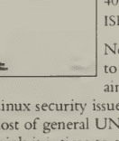

New Riders 荣幸推出首本专门针对解决安全问题的书籍。虽然有很多通用的 UNIX 安全书籍，但我们认为是时候关注 Linux 网络的需求的需求了。作者 Robert Ziegler 对系统安全采取了平衡的方法，讨论了如规划安全环境、防火墙和利用安全脚本等话题。书中包含了特定系统的全面信息，以及关于如何防止和修复它们的建议，这是每位 Linux 管理员书架上都应该有一本书。

### GIMP 核心参考指南

GIMP

作者：Alex Harford

第一版，1999 年

350 页，$24.95

ISBN: 0-7357-0911-4

《GIMP 核心参考指南》旨在满足计算机专家的需求。它的设计目的是让具有计算机经验的人快速上手 GNU 图像处理程序（GNU Image Manipulation Program）。它提供了关于使用 GIMP 的基本信息。这本书的目标读者是那些想要高效使用 GIMP 的读者。《GIMP 核心参考指南》将向你展示如何通过强大的格式快速熟悉高级用户界面，这种格式允许用户找到他们寻找的内容。

《GIMP 核心参考指南》适用于那些在使用 GIMP 工作、知道自己想要实现什么，但确切不知道如何做的用户。


### KDE 应用开发

作者：Uwe Eiem

第一版，1999 年秋

450 页，39.99

ISBN: 1-57870-201-1


### KDE 应用开发

《开发》提供了进入 KDE 和 Qt 的视角。本书将涵盖 KDE 和 Qt 中可用的核心组件，并提供了一个有力的开始，避免了那些让优秀的开发者和程序员放弃的“初次尝试”挫败。这本书通过从最开始阶段编写一个真实的应用程序来解释 KDE 和 Qt，在那个阶段，程序什么都不能显示，只能提供一个退出按钮。它最终将引导用户进入一个功能完整的应用程序。开发应用程序的过程将潜在的 KDE 开发者带过所有兴奋阶段。

### GIMP

GIMP

作者：Carey Bucks

第一版，2000 年冬

350 页，$39.99

ISBN: 0-7357-0924-6


这是一本技术性参考书，涵盖了 GIMP 功能集的复杂之处。即使你在图像处理方面背景很少，你也可以以这本书作为指南，成功地使用 GIMP 实现你的目标。考虑到并非所有工具都是平等的，Carey Bucks 对 GIMP 最实用的工具进行了深入观察。内容关注大多数用户感兴趣的中高级级话题，如照片修饰和增强、合成以及动画。作者的理念方法是无价的，他避免了图像处理的“食谱式”方法，帮助你变得独立。

### Samba 管理

Samba 管理

作者：John Terpstra

第一版，2000 年

400 页，$35.00

ISBN: 0-7357-0903-3

### GTK+/Gnome 开发

GTK+/Gnome 开发

作者：Havoc Pennington

400 页，$29.99

ISBN: 0-7357-007-8


今天系统管理员的世界充满了各种类型的网络操作系统、协议和硬件配置，以满足严苛且精明的用户。管理员转向 Samba 产品帮助他们在系统间共享服务。


GTK+/nome 开发 为丰富的程序员提供了使用强大的 GTK+ 工具包开发 X 应用程序的知识。作者为读者提供了每个应用程序应该具备的功能清单、高级 GUI 技术以及创建自定义组件的能力。该书还包含了熟悉用法但需要函数原型和详细描述的资深用户的参考信息。这些工具让读者能够在记录时间内编写出强大的应用程序。

Samba 管理提供了关于 SMB 架构、源码编译与安装、管理和服务器以及处理适用问题的必要技术背景。


### 深入 Linux 内部

作者：Michael Tobler

第一版，2000 年

650 页，$49.99

ISBN: 0-7357-0940-8


### Python 核心参考指南

作者：David Beazley

300 页，$34.95

ISBN: 0-7357-0901-7


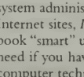

带有深入的完整选项过程

这本书描述了 Python 编程语言及其标准模块。Python 是一种非正式语言，已成为许多计算专业人士非常有价值的软件工具。本文涵盖了 Python 的词法结构、内置数据类型、控制流、函数、语句、类和执行模型。这本书还涵盖了 Python 发行版的内容。

# MySQL Notes与 Domino 书籍

## MySQL

作者：Paul Dubois

第 1 版，1999年秋

450 页，$39.99

ISBN: 0-7357-0921-1


MySQL 将教你如何使用由 MySQL 发行版本身提供的工具，涵盖安装、设置、日常使用、安全、优化、维护和故障排除。它还讨论了重要的第三方工具，例如提供 MySQL 的 Perl 和 Apache/PHP 接口。这些工具被大量使用 MySQL 的人员使用，特别是将 MySQL 连接到网站。

## Domino 系统管理

作者：Rob Kirkland

第 1 版，1999年秋

500 页，$29.99

ISBN: 1-56265-948-3


你的老板已经宣布，当最新版本的 Notes 和 Domino 发布时，你将升级到该版本。作为高级业务合作伙伴，Lotus 了一了一个非常优的价格，以让你的公司从 Microsoft Exchange Server 跳离出来。你该如何将这个新系统安装、配置并部署给所有终端用户？你了解 Lotus 的运作方式——你需要一个关于新功能的简洁、实用的解释，以及如何让一些高级功能真正发挥作用。你需要从像你这样的人那里获得答案和解决方案，他们与该产品接触多年，并理解什么是所需的知识。《Domino 系统管理》就是答案——这是第一本关于 Domino 的书，通过实用的、上手的帮助来应对该技术，让 Domino 在你的组织中运行。

# GLIBC: 全面参考


GNU/Linux LibC

作者：Jeff Garzik

第 1 版，2000年冬

400 页，$40.00

GLIBC 涵盖了 1,800 个函数。本书是一部完整的参考著作，包含一个单卷版本，对每个函数进行了快速覆盖。它包含一个可搜索的索引以增加额外价值，并计划成为开源书籍，可在网上免费下载。书的内容由按类别（网络、线程、字符串等）分类的函数索引以及字母顺序函数列表组成。

ISBN: 1-57870-202-X

# Lotus Notes 与 Domino Essential参考

作者：Dave Hatter & Tim Bakes

第 1 版

700 页，$45.00

ISBN: 0-7357-0007-9

负责让网络上一些最大的网站高速运行，例如 Amazon.com、Hotmail、USAToday、Geocities 和 Sony。在书中，Mark 提供了高级配置问题的解决方案，并穿插了建议和首选实践。你不会看到关于 TCP/IP 的通用概览——他谈论了安全、监控、流量管理等许多问题。在故障排除章节，Mark 提供了一种独特的方法论和大量的示例问题进行说明，提供了真实世界的见解和案例，而不是重述 Cisco 的文档。Mark 为网络管理员提供了他们今天就可以开始使用的信息。

你陷入了困境，你被要求在 Notes 中设计并编写一个新的数据库，用于跟踪一个重要客户的海量库存和运输数据。客户想要一个用户友好的界面，而不牺牲服务或功能。你很有经验（甚至可以在梦中写出这个应用），但觉得你需要将才华提升一个水平。你需要促进自己的创意和技术能力，需要一些可以纠正编程技能的东西。你的答案正在等待你：《Lotus Notes 与 Domino Essential参考》。它紧凑且设计简单。它充满了信息。所有的对象、类、函数和方法都列举了出来。它向你展示了对象层次结构以及每个对象之间的叠加关系。它对你来说非常完美。问题解决了。

# 实现虚拟专用网络

作者：Bird 和 Ted Stockwell

第 1 版 1999年

300 页，$32.99

ISBN: 0-7357-0047-8


# 网络类书籍

厌倦了关于虚拟专用网络的平庸、过时信息？由著名权威 Tina Bird 博士和 Ted Stockwell 编写的《实现虚拟专用网络》终于提供了你所需的内容——关于基于互联网的私有网络设计、实现和维护的权威指南。本书关注真实世界的解决方案，展示了 VPN 架构的设计如何与组织的业务和技术需求保持一致。Tina 和 Ted 为你所需的信息，以判断 VPN 是否适合你的组织，选择适合你需求的 VPN，并设计

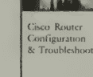

# Cisco 路由器配置与故障排除

作者：Mark Tilden

第 1 版

300 页，$34.99

ISBN: 0-7357-0224-9

想知道让你的路由器运行如梦般流畅的真实真相吗？为什么不要用副本《Cisco 路由器配置与故障排除》来看看 Mark Tilden 说了什么？他的公司正是负责让网络上一些最大的网站高速运行的。

# 理解数据通信

作者：Luke Leighton

第六版

500 页，$44.99

ISBN: 0-7357-0036-2

从非常成功的第五版更新，本书解释了如今通信系统和各种硬件是如何工作的。对于经验丰富的网络专业人士来说，这是一个很好的参考，由权威 Luke Leighton 编写，以入门级格式解决网络中涉及的复杂问题。

# 入侵检测：分析师手册

作者：Stephen Northcott

第 1 版

350 页，$34.99

ISBN: 0-7357-0868-8

从身处一线的战壕的人那里获得答案。Stephen Northcott 编写的《入侵检测：分析师手册》，为负责建立和维护有效网络安全防御的入侵专家、安全分析师和顾问提供了他的专业知识。当系统还被锁在办公室里并链在局域网上时，它们是相对安全的。现在它们被释放到互联网上，变得更加容易受到攻击。安全人员、系统管理员以及人们需要熟悉在他们的网络中流动的数据包。这是了解系统有多大麻烦的唯一方法。这本书描述了微软如何采用 DCE/RPC（分布式计算环境/远程过程调用）并将其实在 SMB（服务器消息块）之上。SMB 运行在传输层之上：TCP/IP、IPX/SPX 和 NETBEUI。

# 我们想知道你的想法

为了更好地服务，我们希望对这本书的内容和质量给出意见。请填写此卡片并邮寄或传真至 317-581-4663。

姓名：

地址：

城市：州：邮编：

电话：

电子邮件：

职业：

你使用的系统：

什么影响了你购买这本书？

- [ ] 封面设计

- [ ] 目录

- [ ] 杂志评论

- [ ] New Riders 声誉

- [ ] 索引

- [ ] 广告

- [ ] 作者姓名

你最喜欢这本书的方面？请勾选

- [ ] 内容

- [ ] 准确性

- [ ] 价格

- [ ] 写作风格

- [ ] 示例

- [ ] 设计

- [ ] 插图

你最不喜欢这本书的方面？请勾选

- [ ] 优秀

- [ ] 好

- [ ] 低于平均

- [ ] 非常好

- [ ] 糟糕

你计划如何使用这本书？

- [ ] 快速参考

- [ ] 课堂

- [ ] 自学

- [ ] 其他

对你来说，哪本书是这本书很好的后续读？

你在哪里购买的这本书？

你能推荐一本比这本更好的类似书，或者一本好书吗？为什么

你有多少本 New Riders 书？

你最喜欢的计算机书籍是什么？

你希望我们开发哪些其他主题？

对我们有什么建议吗？

在此处折叠并胶带邮寄


New Riders 出版

201 W. 103rd St.

Indianapolis, IN 46290

## New Riders 如何联系我们

## 访问我们的网站

www.newriders.com

在我们的网站上，您将找到关于我们其他书籍、作者、目录、索引以及书目勘误的信息。您也可以通过我们的网站订购书籍。

## 电子邮件联系我们

请通过此地址与我们联系：

newriders@mcp.com

- 如果您对本书有任何意见或疑问

- 报告您在书中发现的错误

- 如果您有书籍提案想要提交，或者有兴趣为 New Riders 写作

- 如果您希望收到一份作者包

- 如果您是某个计算机主题或技术的专家，并有兴趣担任技术编辑，审阅稿件以技术准确性

newriders-sales@mcp.com

- 如需在您所在的地区寻找代理商，请通过上述地址联系我们的国际部门。


newriders-pr@mcp.com

- 面向希望教育机构预览 New Riders 书籍用于课堂教学的讲师。邮件正文应包含您的姓名、职称、学校、部门、地址、电话号码、办公日期/时间、授课程及注册人数，以及您对样书/考试副本和/或额外信息的请求。

## 书信联系我们

New Riders 出版

201 W. 103rd St.

Indianapolis, IN 46290-1097

## 电话联系我们

免费热线 (800) 571-5840 + 9 7494

美国境外请拨 (317) 581-3500。转接 New Riders。

## 真传联系我们

(317) 581-4663

New Riders 的书籍通过提供关于核心技术的详细且以解决方案为向的信息，针对计算机专业人士的独特需求。我们首先与具有独特经验深度并能够切中从业人士需求的作者合作。每本书书在所有阶段都经过仔细审查，以确保它以巨大的深度涵盖了最核心的主题，极其准确，并考虑了易用性。这些审查不仅确保材料在技术上是可靠的，而且能够持续提供您真正可以使用的信息和建议。您手中的这本书是为您这位从业者打造的，具有准确的信息和值得信赖的建议、合适的深度以及具有吸引力的价值。我们将作者的知识和同行评审员的实战经验封装成易于阅读、易于参考和易使用的格式。

## 无论您有什么问题...

New Riders 都有答案。

我们深知获取关于核心技术的详细、以解决方案为导向的信息有多么。“里程碑系列”（Landmark books）包含了解决技术问题所需的关键信息。这些书籍由专家编写，并经过严格的同行和技术评审，我们的里程碑系列是像您这样的从业人员的硬核资源。


为智能用户提供智慧与知识。书内部对技术进行了有趣且富有鉴别力的观察，由能够预判您的处境并根据多年经验提供明智建议的人撰写。这些书籍以作者为驱动，并采取务实的方法，正符合您对 New Riders 的预期。


《必备参考》（Essential Reference）系列书籍为各种核心技术提供了解决方案——快速修复、快捷方式、属性、命令选项、类描述。拿起该系列中的任何本书即可体验我们的本意。每本书都是根据您的需求而设计的，且每本书都确实不同，唯一的共同点是能够缓解您的头疼问题。


## Linux 防墙

作为 Linux 用户，您知道安全系统是重要的，但您可能没有时间、兴趣或耐心去学习 Linux 安全的所有事实。通过这本书，您无需成为安全专家就能快速有效地保护您的网络——它恰恰提供了这种专家的帮助。

除了引导您完成设计和实施包过滤防火墙的基本步骤外，作者 Bob Ziegler 还讨论了不必要的服务、应公开的服务以及需要通过防火墙保护的危险本地服务。我们提供了关于高级形式访问控制、常见服务器配置问题、系统安全和完整性，以及在入侵发生之前的探测和未经授权尝试的信息。

《Linux Firewall》将通过以下内容帮助保护您的 Linux 网络：

- 逐步构建家庭或小型企业的单系统包过滤防火墙
- 构建多系统包过滤防火墙隔离 DMZ 网络和私有网络
- 理解哪些服务应该运行哪些不应该运行
- 使用 IP 伪装隐藏内部计算机身份
- 访问列表支持的服务器配置、代理、系统日志和通用系统管理实践
- 监控系统安全和完整性
- 当系统安全受损时进行检测和恢复


> Robert L. Ziegler 是 Nokia 的首席工程师，负责设计和开发防火产品。Bob 为家庭用户提供免费的 Web 设计服务，并经营受欢迎的 Linux LAN 和 FAQ 以帮助人们快速安全地建立 Linux 系统。他还曾在研究开发公司担任 UNIX 操作系统内核开发人员。自从开始让家里变得安全以来，他对小型系统安全问题产生了兴趣。防火墙迅速变成了了他的热情

版权所有 Bob Ziegler 1999

Linux / 安全

封面照片：George Hall/Code Red 1999


| USA / CAN / Net UK |

| ISBN 0-7357-0900-9 |
