# Linux 初学者指南：5 本合一——高级 Linux 编程、内核精通、强化安全措施、系统自动化及深度实用指南终极指南


## 第一本：“Linux 基础：从零到英雄”

### 第 1 章：Linux 宇宙

欢迎来到 Linux 世界，这是一场穿越操作系统的旅程，它改变了我们思考和与技术交互的方式。在第一章“Linux 宇宙”中，我们将开始深入探索 Linux 的核心。我们首先从介绍 Linux 开始，为理解其核心原理、了解它如何与其他操作系统脱颖而出，以及驱动它的开源运动精神奠定基础。本章旨在提供一个全面的概述，为错综复杂且迷人的 Linux 宇宙铺平道路。无论你是充满好奇的初学者，还是经验丰富的专业人士，这些见解都将为你指明通往精通这一强大多功能系统的道路。

### Linux 简介

在讨论 Linux 简介时，深入探讨其技术根源以及使其成为现代计算基石的原则至关重要。Linux 的核心是一个操作系统，类似于 Windows 或 macOS，但它通过独特的开发和运行模式脱颖而出。

### Linux 的起源与演变

Linux 的历程始于 1991 年，源自芬兰计算机科学学生 Linus Torvalds。Torvalds 在个人项目的驱动以及对现有操作系统（特别是 MINIX，一种类 Unix 系统）不满的情况下，开始开发一个免费的操作系统内核。该内核是 Linux 操作系统的核心组件，负责管理系统资源并促进硬件与软件之间的通信。

Torvalds 的愿景不仅仅是创建一个替代系统，而是营造一个协作环境，让任何人都能为其开发做出贡献。这种方法是革命性的，与当时盛行的专有软件开发模型形成鲜明对比。

### 理解 Linux 内核

Linux 内核作为操作系统的核心，负责管理系统硬件，包括 CPU、内存和外围设备。它充当媒介，确保软件应用程序能够高效安全地与硬件交互。内核的职责包括进程管理、内存管理、设备驱动程序、文件系统管理和网络。

内核的活性允许其在服务器、桌面到嵌入式系统的各种环境中被修改和使用，这是 Linux 的定义特征。这种适应性源于它的模块化设计，允许根据系统的特定需求添加或删除组件。

### Linux 的开源特性

Linux 的一个关键方面是其开源特性。与源代码被严密保护的专有操作系统不同，Linux 的源代码免费供任何人查看、修改和分发。这种开源模型对 Linux 的发展起了至关重要的作用，允许开发者和用户社区不断增强其功能、安全性和性能。

这种协作开发模型意味着 Linux 不受任何单一实体控制，而是集体投入和努力的产物。其影响在技术和文化上都具有重大意义。在技术上，它带来了一个健壮、安全且高度可定制的操作系统。在文化上，它代表了向更民主、更包容的软件开发方法的转变。

### Linux 发行版：多样化的 Linux 版本

Linux 的多功能通过其发行版得到了进一步证明。Linux 发行版是围绕 Linux 内核构建的完整操作系统，包含一个包管理系统和一系列应用程序。每个发行版都满足不同的用户偏好和需求。例如，Ubuntu 专注于用户友好和开箱即用的功能，Fedora 强调最新特性，而 Debian 则以稳定性和性能自豪。

发行版的多样性意味着 Linux 可以适用于广泛的领域，从针对旧硬件的轻量级系统到用于科学计算、数据中心和云环境的专用发行版。

### 现代计算格局中的 Linux

今天，Linux 在计算领域无处不在。它的足迹跨越个人电脑、服务器、移动设备和嵌入式系统。Linux 操作系统驱动着大部分服务器，包括 Google 和 Facebook 等大公司，它是 Android 移动操作系统的基础。

总之，Linux 简介不仅仅是对一个软件系统的概述。它是一个关于创新、协作和灵活性的故事。Linux 不仅为各种计算应用提供了健壮的技术基础，还塑造了现代世界开发和共享软件的方式。当我们深入 Linux 时，我们将探索它的功能、它对计算世界的影响以及它对未来技术的潜力。

### 为什么选择 Linux？

选择 Linux 作为一个操作系统是一个超越单纯喜好的决策。这是一个战略性选择，反映了对现代技术格局下操作系统可以且应该提供什么的更深层理解。在本节中，我们将探讨为什么 Linux 对于从业余爱好者到硬核程序员再到大型企业的用户都是一个极具吸引力的选择。

### 灵活与控制的基础

Linux 的主要吸引力之一是其无与伦比的灵活性。与其他用户必须适应系统设计的操作系统不同，Linux 允许用户根据自己的特定需求定制操作系统。这种灵活性体现在多种形式，从选择图形用户界面（GUI）到选择在系统上运行的特定服务进程。例如，用户可以为旧笔记本电脑选择如 `Xfce` 这样的轻量级窗口管理器，或者选择 `KDE` 以获得丰富的桌面体验。

### 开源：创新模型

Linux 的开源特性不仅关乎免费访问软件，还关乎检查、修改和增强它的自由。这一方面在全球范围内开发者社区的推动下，鼓励了创新和持续改进。与源代码通常被视为严密机密的专有操作系统相比，Linux 的源代码可供任何人学习。这种透明度不仅仅是为了学习，更是为了对系统的完善做出贡献。

### 稳定性与可靠性：Linux 的基石

Linux 稳定性和可靠性的声誉是名副其实的。Linux 服务器运行多年而不需要重启是常有的。这种稳定性源于 Linux 内核严格的测试和开发过程，以及多样化社区的贡献。此外，Linux 健壮的权限系统和进程管理有助于其稳定运行，确保故障的应用程序或服务不会干扰整个系统。

### 安全：首要任务

安全性是 Linux 的另一个卓越领域。该操作系统的设计将用户空间与内核空间分离，从根本上增强了安全性。Linux 发行版配备了强大的内置工具，如防火墙（例如 `iptables`）和安全增强型 Linux（`SELinux`）框架，这些为系统提供了额外的安全保障。开源模型在这里也发挥了至关重要的作用：代码的透明性意味着社区可以快速识别并修复漏洞，而专有系统的安全补丁则依赖于供应商。

### 性价比：经济的选择

对于个人、初创公司甚至大型企业而言，成本是选择操作系统时的一个重要考虑因素。Linux 通常是免费使用的，这与某些其他操作系统相关的许可费用形成了鲜明对比。这种性价比不仅体现在获取成本上，还涵盖了硬件要求较低等方面，从而延长了现有基础设施的使用寿命，并免受供应商锁定的风险。

### 可定制性：根据需求定制 Linux

Linux 的定制能力不仅限于表面的美学，还延伸到了核心功能。用户不仅可以自由选择桌面环境和应用程序，还可以选择运行哪个版本的内核。这种程度的定制允许用户创建一个与他们特定需求完美契合的操作系统，无论是用于编程的轻量级系统，还是稳健的服务器环境。

### 性能：为效率优化

Linux 以高效利用系统资源而闻名。这种效率使其成为从高性能计算到运行服务器和桌面等各个场景的理想选择。Linux 能够在从超级计算机到低功耗设备等各种硬件上运行，这证明了其优化的性能。

### 社区支持：协作的力量

最后，Linux 社区是一个充满活力且无价之贵的资源。用户受益于海量的论坛、在线资源和社区支持，使得 Linux 不仅仅是一个操作系统，更是一次学习体验。这种社区驱动的支持模式对于故障排除、学习新技能，甚至为软件开发做出贡献都特别有益。

总之，选择 Linux 是一个提供众多收益的决策：灵活性、安全性、稳定性、性价比、可定制性、优化的性能以及强大的社区支持系统。这些属性使得 Linux 不仅是其他操作系统的可行替代方案，往往是更优的选择，特别是在控制、安全和可靠性至关重要的环境中。

### Linux 与其他操作系统

在广阔的操作系统领域，Linux 以其独特的特性和能力脱颖而出。虽然 Windows 和 macOS 等其他操作系统有其独特的优势，但 Linux 提供了一系列不同的优势，满足了特定的需求和偏好。本节探讨了 Linux 在各个关键方面与这些操作系统的对比。

### 核心哲学与开发模型

Linux 的核心源于开源和协作开发的哲学。与作为微软和苹果的专有产品的 Windows 和 macOS 不同，Linux 是全球开发者社区贡献的成果。这种哲学上的差异延伸到操作系统的开发、更新和维护方式上。专有系统通常关注广泛的易用功能和流畅的体验，而 Linux 则优先考虑灵活性、用户控制和社区驱动的创新。

### 系统架构与性能

Linux 的架构从根本上与 Windows 和 macOS 不同。Linux 的 `kernel` 是操作系统的核心部分，以其高效和灵活性而闻名。这种效率转化为更快的性能，特别是在服务器环境或资源密集型任务常见的环境中。Linux 可以针对各种硬件配置进行优化，从高端服务器到低资源设备，使其成为满足不同计算需求的全功能选择。

### 安全与隐私功能

安全性是 Linux 特别出色的领域。它的安全模型包含了 `SELinux` 和 `AppArmor` 等功能，能够针对各种类型的漏洞提供强有力的保护。Linux 的权限系统以及处理用户特权的方式提供了额外的安全保障。另一方面，Windows 和 macOS 虽然不断改进其安全功能，但其模型有时会优先考虑用户便利性，这可能导致安全性的妥协。

### 可定制性与用户控制

与 Windows 和 macOS 相比，Linux 提供了无与伦比的定制水平。从 `kernel` 到用户界面，Linux 的一切都是可定制的。这允许用户将操作系统简化为最核心的部分，或者构建起满足其广泛需求的功能。相比之下，Windows 和 macOS 的定制选项有限，主要限于外观更改和系统设置。

### 软件管理与生态

Linux 的软件管理方法也有所不同。Linux 发行版带有包管理器，允许用户从中央仓库安装、更新和管理软件。这与 Windows 上更手动的安装过程以及 macOS 的应用 Store 模型形成对比。Linux 的开源特性意味着大量软件可以免费获取，而 Windows 和 macOS 上的软件通常需要许可或购买。

### 硬件兼容性与驱动管理

虽然 Linux 在硬件兼容性方面取得了巨大进展，但 Windows 和 macOS 在对最新硬件和外围设备的原生支持方面通常具有优势。这部分归于微软和苹果与硬件制造商之间的直接合作。然而，Linux 社区一直积极开发驱动并确保各种硬件的兼容性，尽管这有时需要用户付出额外努力。

### 用户群体与社区支持

Linux 拥有一个充满活力的社区，通过论坛、在线资源和发行版文档提供广泛支持。这种社区驱动的支持是非常有价值的，特别是对于技术问题或特殊用例。Windows 和 macOS 在消费市场中使用得广泛，提供了更主流的支持渠道，包括来自微软和苹果的直接支持。

将 Linux 与 Windows 和 macOS 等操作系统进行比较，揭示了一个充满对比的格局，每个都有自己的优势和重点。Linux 的开源本质和灵活性使其成为重视控制和定制的用户极具吸引力的选择。Windows 和 macOS 以其用户友好的界面和广泛的硬件支持满足了更广泛的大众。理解这些差异对于用户做出符合其计算特定需求和偏好的决策至关重要。

### 理解开源

理解开源对于理解 Linux 的本质及其对技术世界的广泛影响至关重要。开源不仅仅是一种软件开发模型；它更是一种哲学，一种协作运动，重塑了我们思考软件创建、分发和使用的方式。

### 开源的起源

开源软件（OSS）概念的出现是对 20 世纪 80 年代和 90 年代专有软件模式的响应，当时软件由公司独家控制，用户无法访问源代码。开源运动的动力源于这样一种理念：软件应该是自由可访问、可修改和可分发的。这一理念在 `Richard Stallman` 于 1985 年创立自由软件基金（`FSF`）后具体化，随后又于 1998 年成立了开源倡议（`OSI`），旨在推广和标准化开源软件。

### 开源的核心原则

开源模型建立在定义其运行机制和哲学的关键原则之上。这些原则包括：

1. 自由再发行：软件可以自由地赠送或出售。
2. 源代码访问：源代码必须是可访问且可修改的。
3. 衍生作品：允许修改和创作衍生作品，并可以按照原始软件相同的条款进行发行。
4. 作者源代码的完整性：虽然允许修改，但某些许可协议可能要求修改部分以补丁（`patches`）的形式随原始源代码一起发行。
5. 不歧视个人或群体：开源软件不得歧视任何个人或个人群体。
6. 不歧视活动领域：软件可以用于任何目的，无论是商业、学术还是其他。
7. 许可协议的分发：附属于软件的权利必须适用于所有分发该软件的人，且无需额外的许可。
8. 许可不得针对特定产品：许可协议不能局限于特定产品，允许将其包含在更广泛的软件发行版中。
9. 许可不得限制其他软件：许可协议不能对与许可软件一同分发的其他软件设置限制。
10. 许可必须保持技术中立：许可协议的任何条款都不应基于任何特定的个人技术或界面风格。

### 开源对软件开发的影响

开源模型对软件开发产生了革命性的影响。它实现了一种更加协作、透明和由社区驱动的软件创建方法。这种模型鼓励了创新，因为来自全球的开发者都可以为项目做出贡献、改进代码并与社区分享他们的修改。这种协作导致了更健壮、更安全且功能丰富的软件。

### Linux：开源成功的证明

Linux 是开源模型成功的典范。由 `Linus Torvalds` 发起的 `Linux` 内核根据 `GNU General Public License`（`GPL`）发布，这是一种开源许可，允许广泛的协作和开发。这导致了大量 Linux 发行版的诞生，每个发行版都满足不同的需求，但都共享开源的核心原则。

### 挑战与误区

尽管具有许多优势，开源模型仍面临挑战和误区。一个常见的误区是开源软件安全性较低，因为其代码是公开的。然而，事实往往相反；代码的透明性允许快速审计。

### 第 2 章：安装 Linux

欢迎来到《Linux Foundations：从入门到英雄》第 2 章，我们将开启将 `Linux` 引入你的计算世界的实践之旅。本章致力于安装 `Linux`，这是利用该操作系统力量和灵活性的关键步骤。首先，我们将引导你根据自己的需求选择发行版。然后，我们将深入本质的准备步骤，涵盖硬件要求和设置系统的细微差别。我们还探索了在选择双启动设置或虚拟机之间的关键决策，每种都有独特的优势。最后，我们将一步步带你完成安装过程，确保顺利过渡到新环境。

### 选择 Linux 发行版

开启 Linux 之旅始于一个关键决定：选择一个 Linux 发行版（`distro`）。这一选择不仅仅是个人喜好，更是为了找到一个与你的需求、技能和目标一致的 `distro`。Linux 生态系统拥有丰富的发行版，每个都提供独特的特性、哲学和用户体验。本节将引导你穿越选择迷宫，帮助你选择最适合你之旅的 Linux 发行版。

### 理解 Linux 发行版

Linux 发行版本质上是为特定用户群或任务设计的 Linux 版本。它包含了 `Linux` 内核、软件和应用程序集合，通常还包括一个包管理器，后者简化了安装和管理软件的过程。发行版在易用性、稳定性、更新频率以及对不同类型硬件的支持方面存在差异。

### 选择发行版的关键因素

在选择发行版时，请考虑几个关键因素：

1. 用途：你使用 Linux 是为了 Web 开发、通用计算、教育、服务器管理还是高性能计算？每个发行版在不同领域都有其优势。例如，`Ubuntu` 以其易用性而闻名，是初学者和通用用户的理想选择；而 `CentOS` 因其稳定性和长期支持，成为服务器的首选。
2. 经验水平：如果你是 Linux 新手，可能想要一个学习曲线平缓的发行版。`Ubuntu`、`Linux Mint` 和 `Fedora` 等发行版为新手提供了直观的体验。经验丰富的用户可能更倾向于 `Debian` 或 `Arch Linux` 等发行版，它们提供了更多的控制权，但需要对 Linux 系统有更深的理解。
3. 硬件兼容性：某些发行版旨在旧硬件上运行，为老旧系统注入新活力。例如，`Lubuntu` 和 `Puppy Linux` 是轻量级发行版，可以在资源有限的旧硬件上运行。
4. 社区与支持：Linux 社区是 Linux 体验中非常重要的一部分。像 `Ubuntu` 这样较大的发行版拥有庞大且活跃的社区，可以提供有价值的支持。较小的发行版可能提供更小众但可能不够稳健的社区支持网络。
5. 软件可用性：不同发行版的软件可用性各异。如果你依赖特定的应用程序，务必检查你所选择的发行版是否支持并提供这些软件。
6. 安全与隐私：如果安全和隐私是你的首要考虑，`Tails` 和 `Qubes OS` 等发行版是基于这些优先级设计的，提供了先进的安全特性。
7. 审美与用户界面：Linux 发行版提供了多种桌面环境（DE）。如 `GNOME`、`KDE Plasma` 和 `XFCE` 等桌面提供了不同的用户体验和审美设计。某些发行版（如 `Fedora`）提供了带有不同桌面环境的变体（spins or flavors）。

### 流行的 Linux 发行版

为了说明 Linux 发行版的多样性，让我们简单查看几个流行的发行版：

- **Ubuntu**：以易用著称，`Ubuntu` 适合新手和资深用户。它有定期的发布周期，并拥有广泛的软件支持。
- **Fedora**：以前沿著称，`Fedora` 是那些想要最新软件技术的用户的理想选择。它还是 `Red Hat Enterprise Linux` 的上游源，确保了企业级的质量。
- **Debian**：因其稳定性，是服务器的热门选择。它拥有庞大的软件仓库，是许多其他发行版（包括 `Ubuntu`）的基础。
- **Arch Linux**：`Arch` 适合那些想要学习 Linux 细节的人。它遵循滚动更新模型（rolling release），以其简单性和可定制性闻名。

选择 Linux 发行版是一个非常个人化的决定，应该受到你的需求、偏好和目标的影响。无论你是在寻找简单、稳定、前沿特性还是它们之间的平衡，总有一个适合你的 Linux 发行版。Linux 的美感在于其多样性，在其广泛的发行版中为每个人提供了选择。当你开启这段旅程时，请记住发行版的选择不是永久的——Linux 世界是灵活的，你可以随着需求和技能的演进随时切换发行版。

### 安装要求


在开启安装 Linux 的旅程之前，必须了解安装要求。这一阶段至关重要，它充当了使用 Linux 的决策与实际实施之间的桥梁。安装 Linux 的要求不仅仅是硬件和软件规格的清单；它们代表了对计算机如何高效有效地运行 Linux 所需的基础性理解。

## 硬件要求：深入观察

Linux 以能够在各种硬件上运行（从高端服务器到旧款台式机）而闻名。然而，为了确保流畅的体验，建议满足某些基准规范。

1. **处理器 (CPU)**：电脑的心脏`CPU`在 Linux 性能中起着至关重要的作用。虽然 Linux 可以在旧处理器上运行，但现代多内核处理器将提供更无缝的体验，特别是对于具有密集图形环境的发行版而言。

2. **内存 (RAM)**：`RAM`是计算机存储数据以便快速访问的地方。所需的`RAM`数量取决于发行版和系统的预期用途。对于`Lubuntu`或`Xubuntu`这样的轻量级发行版，`1GB`的`RAM`可能就足够。然而，对于`Ubuntu`或`Fedora`这样功能丰富的发行版，`4GB` `RAM`是更现实的配置，`8GB`或更多是获得性能的理想选择。

3. **存储（硬盘或 SSD）**：Linux 的存储要求根据发行版的不同而很大。最小化安装可能仅需`10GB`空间，而标准的桌面安装通常需要`20GB`到`30GB`之间的空间。对于计划广泛使用系统（特别是视频剪辑或软件开发等应用）的用户，分配更多的存储空间将大有益。

4. **显卡 (GPU)**：大多数现代`GPUs`都能与 Linux 良好配合，包括`NVIDIA`和`AMD`的。虽然 Linux 可以在集成显卡上运行，但独立`GPU`对图形密集型任务很有帮助。此外，虽然 Linux 支持广泛的`GPUs`，但驱动支持可能有所不同，特别是对于较新的、尖端的显卡。

5. **网络连接**：安装 Linux 并不严格要求连接互联网，但强烈建议连接。安装期间的连接允许立即进行系统更新并安装额外的软件。

6. **外围**：键盘、鼠标和显示器等基础外围当然是必要的。Linux 支持广泛的设备，但对于特殊外围，建议检查其与 Linux 的兼容性。

## 软件要求：准备安装

除了硬件之外，某些软件准备工作也是必要的：

1. **可启动 Linux 介质**：这可以是一个 Live CD/DVD 或一个包含你所选 Linux 发行版的启动 USB 驱动器。可以使用`Rufus`或`balenaEtcher`等工具从 Linux `ISO`文件创建这些可启动介质。

2. **备份软件**：在安装 Linux 之前（特别是如果你计划与另一个操作系统进行双启动），备份你的现有数据至关重要。这可以使用云存储服务或外部存储设备完成。

3. **分区工具**：如果你计划在另一个操作系统旁边安装 Linux，你需要一个分区工具来在硬盘上分配空间。许多 Linux 安装程序都带有内置分区工具，但提前熟悉这些工具是有益的。

4. **兼容性检查**：检查所选 Linux 发行版与硬件的兼容性是明智的。大多数发行版都提供 Live 环境，你可以在不安装的情况下进入该环境，允许你测试硬件兼容性，例如`Wi-Fi`、`Bluetooth`和图形性能。

## 双启动性能

在双启动设置下，Linux 可以直接访问计算机的硬件资源。这意味着更优的性能，特别是对于软件开发、视频编辑或游戏等资源密集型任务而言。

## 双启动硬件兼容性

双启动允许 Linux 直接与你的硬件交互，让你对兼容性问题有更清晰的了解。这是使用你所有硬件（包括外围设备）来测试 Linux 的极佳方式。

## 双启动存储考量

双启动需要对硬盘进行分区，这实际上是在两个操作系统之间划分存储空间。这个过程可能非常复杂，并让初学者感到望而生畏。

## 双启动风险因素

设置双启动的过程比使用虚拟机更具风险。分区不当会导致数据丢失。因此，在进行双启动安装之前，备份数据至关重要。

## 双启动使用场景

双启动非常适合需要在 Linux 和另一个操作系统之间切换，同时又要确保最大性能的用户。它适合那些倾向于更原生体验，或正将 Linux 作为主操作系统进行测试的人。

## 虚拟机：箱子里的 Linux

虚拟机（VM）允许你在当前的操作系统内部运行 Linux，就像运行一个程序一样。像`VirtualBox`或`VMware`这样的工具为 Linux 运行创建了一个仿真环境。

1. **安全性与简单性**：与双启动相比，在虚拟机上安装 Linux 的风险较低。它不需要对硬盘进行分区，因此对你的主操作系统没有风险。

2. **性能权衡**：虽然虚拟机提供了安全且隔离的环境，但它与宿主机操作系统共享计算机资源。这种共享资源分配可能会导致性能下降，特别是在 RAM 和 CPU 使用方面。

3. **易用性**：虚拟机特别用户友好，适合初学者或那些想要在不改变现有系统设置的情况下测试 Linux 的人。

4. **快照与测试功能**：虚拟机的一个重要优势是能够对你的 Linux 系统拍摄快照。这项功能对于测试软件、更新或系统更改是无价之宝，且不会冒损坏你主系统的风险。

5. **使用场景**：虚拟机对于需要 Linux 执行特定任务而非日常使用的用户来说是理想的。它们对于开发者、测试人员或需要一个隔离环境来实验 Linux 而不影响主操作系统的学习者来说非常完美。

在双启动和使用虚拟机之间做出选择，取决于你的需求、技术熟练程度以及预期的使用场景。双启动提供了性能更好的全功能 Linux 体验，但需要仔细的分区，并带有某些风险。另一方面，虚拟机提供了一种安全、隔离且性能稍低的方式来体验 Linux。这两种选择都有其优处，你的选择应该符合你的具体需求，无论是为了开发、实验还是日常工作效率。随着你在 Linux 之旅上的不断进步，这一决定将成为你与这个多功能且强大的操作系统进行交互的基石。

## 安装步骤

安装 Linux 的过程是任何向往 Linux 用户旅程中的一个关键时刻。它是技术程序与艺术的结合，需要精确的操作和对细节的关注。本节将引导你完成安装 Linux 的全面步骤，确保设置成功并为你的 Linux 之之旅奠定坚实基础。

### 安装前准备：搭建舞台

在开始安装过程之前，做好准备工作至关重要。首先像之前讨论的那样选择你喜爱的 Linux 发行版。确保你的硬件符合必要要求并备份所有重要数据，特别是如果你计划进行双启动。

1. **创建可启动 Linux 介质**：使用`Rufus`或`balenaEtcher`等工具，使用你所选 Linux 发行版的 ISO 镜像创建一个可启动 USB 盘。这一步将你的 USB 盘转换为计算机可以从中启动并安装 Linux 的介质。

2. **确保 BIOS/UEFI 设置**：访问计算机的 BIOS 或 UEFI 设置以修改启动顺序。你需要设置计算机从 USB 盘启动。此步骤可能会根据计算机的制造商和型号而异。

3. **确保网络连接**：虽然并非所有发行版都强制要求，但网络连接对于在安装期间下载更新和第三方软件至关重要。

### 安装过程：旅程开始

当你准备好可启动的 USB 盘并配置好 BIOS 设置后，就可以开始安装过程了。

1. **从 USB 启动**：将可启动的 USB 盘插入计算机并重启。计算机应该从 USB 盘启动并加载 Linux 安装程序。如果没有启动，请检查你的 BIOS 设置以确保启动顺序正确。

2. **选择安装类型**：大多数 Linux 安装程序提供多种选项，例如尝试 Linux 而不安装、与另一个操作系统并存安装，或替换当前操作系统。对于初学者，建议先尝试 Linux 或与另一个操作系统并存安装。

3. **硬盘分区**：如果你正在进行双启动或想为 Linux 分配特定的存储空间，你将遇到分区步骤。分区涉及为不同用途分配硬盘的某部分。仔细分区至关重要，因为分区不当会导致数据丢失。

4. **设置用户账户**：在安装过程中，系统会提示你创建一个用户账户。你将输入用户名、密码以及可能的其他详情。某些发行版还会询问你是否要加密家目录以获得额外的安全性。

5. **安装与配置**：安装程序随后将把 Linux 安装到你的系统上。此过程涉及复制系统文件、设置引导加载程序和安装默认应用程序。你可能还可以选择额外的软件或系统组件。

6. **安装后设置**：一旦安装完成，你可以移除安装介质并重启系统。重启后，你将看到一个新的启动菜单（在双启动设置下）或直接进入 Linux 操作系统。

7. **首次启动与系统更新**：在第一次进入 Linux 时，更新系统是一个好习惯。大多数发行版提供了软件更新工具，或者你可以使用终端命令来更新系统。

### 安装后：让 Linux 属于你

成功安装 Linux 后，下一阶段是对你的系统进行个性化和配置。探索设置以调整外观、安装额外软件并微调你的环境。如果遇到任何硬件兼容性问题，这就是寻找驱动程序或寻求社区支持的时机。

安装 Linux 是一个标志着你计算体验新篇章开启的过程。它是通往开源创新、社区驱动开发和无与伦比定制世界的一步。通过仔细遵循这些步骤并接受学习曲线，你会发现安装 Linux 不仅仅是设置操作系统；它是在 Linux 的广阔领域中开启一段探索与赋能的旅程。

当我们结束第 2 章时，你现在正站在 Linux 计算机体验新领域的门槛上。本章已经赋予了你知识和工具，让你能够充满信心地选择 Linux 发行版，理解安装前提，并并在双系统启动和使用虚拟机之间做出明智的选择。此外，对 Linux 安装过程的详细演示消除了起初看起来可能是一项艰巨任务的神秘感。无论你是初次踏入 Linux 世界的新手，还是正在设置新机器的资深用户，这里提供的见解都旨在确保安装的成功与高效。请记住，Linux 之之旅不仅关乎安装，更在于拥抱一个提供无与伦比的控制力、定制性和学习机会的平台。随着你的继续前进，这段旅程每一步都将进一步揭示 Linux 巨大的潜力和能力，为深入理解和精通这一强大的操作系统铺平道路。

## 第 3 章：Linux 桌面环境

欢迎来到《Linux 基础：从零到英雄》的第 3 章，我们将深入探讨 Linux 桌面环境，这是你与这一多功能操作系统交互的核心方面。本章旨在引导你了解 Linux 图形界面的复杂之处，让你全面理解日常如何与 Linux 进行交互。我们首先从探索图形用户界面（GUI）开始，揭定义 Linux 用户体验的各种流行桌面环境。然后，我们将穿越组织良好且健壮的 Linux 文件系统，提供关于高效导航和管理文件的见解。最后，我们将处理软件包管理这一关键方面，这是维护和定制你的 Linux 系统的必备技能。本章的目标不仅是让你熟悉 Linux 桌面环境，还要赋予你知识，让你能够有效地导航和个性化你的 Linux 体验。

### 图形用户界面

在 Linux 世界中，图形用户界面（GUI）不仅仅是一个交互工具；它是通往体验系统巨大力量和灵活性的门户。第 3 章“Linux 桌面环境”的这一部分将深入探讨 Linux GUI 的世界，探索它们的演变、意义，以及它们如何塑造用户与操作系统的交互。

#### Linux GUI 的演变：从文本到图形的旅程

Linux GUI 自从诞生以来走了一段漫长的道路。起初，Linux 主要是基于命令的，这是它继承自 Unix 根源的特征。这种命令行界面（CLI）要求用户使用键入命令与系统进行交互，这种方法虽然强大，但对新用户来说往往令人生生畏。图形界面的发展标志着 Linux 变得更加易于使用和用户友好的关键转折。

Linux 的 GUI 革命始于`X Windows System`，这是一个用于图形屏幕处理的基本框架。它为更复杂的桌面环境和窗口管理器铺平了道路，将 Linux 从一个主要供开发者和发烧友使用的系统转变为一个吸引更广泛观众的系统。

#### 理解 Linux GUI

Linux GUI 的核心设计是让与计算机的交互变得直观且高效。它包含了窗口、图标、菜单和小部件等元素——这些对于任何在过去几十年中使用过电脑的人来说都是熟悉的组件。然而，让 Linux 脱颖而出的是这些图形界面的多样化和可定制性。

与某些提供单一、不可更改 GUI 的操作系统不同，Linux 通过不同的桌面环境和窗口管理器提供了大量的选择。这种多样性允许用户选择最符合其偏好、需求和硬件能力的界面。

#### Linux GUI 的组件

1. **桌面环境 (DE)**：Linux 中的`DE`是一是一套连贯的应用程序和工具套件，旨在提供一致且集成的图形用户界面。它包括窗口管理器、文件管理器、面板或程序坞，以及一组集成应用程序和实用程序。流行的`DEs`如`GNOME`、`KDE Plasma`和`XFCE`提供了不同的审美、功能和用户体验。

2. **窗口管理器**：窗口管理器控制操作系统内窗口的位置和外观。。虽然`DEs`包含了自己的窗口管理器，但像`Openbox`或`i3`这样独立的窗口管理器提供了更精简、可定制的体验，通常受到追求简约用户的青睐。

3. **小部件 (Widgets)**：这些是构成界面的小型工具和符号，允许用户与系统和应用程序交互。小部件范围从简单的按钮到复杂的元素等。

#### GUI 对用户体验的影响

GUI 在塑造 Linux 的用户体验方面起着至关重要的作用。对于学者来说，像 Ubuntu 的`GNOME`或 Linux Mint 的`Cinnamon`这样友好且直观的 GUI 可以让 Linux 的过渡变得无缝。对于高级用户来说，自定义和调整 GUI 的能力提供了其他操作系统无法比拟的控制力。

GUI 还显著影响着 Linux 的可用性。它们让更广泛的用户（无论其技术水平如何）都能有效地使用 Linux。这种包容性对于扩大 Linux 用户群和培养多元化的社区至关重要。

Linux 的图形用户界面不仅仅是交互的手段；它是系统多功能哲学的证明。它体现了 Linux 的本质——选择、定制和赋能用户。无论你喜欢简单优雅的界面还是复杂高度可定制的界面，Linux GUIs 都提供了满足各种需求的范围。这种适应性和多样性让 Linux 不仅仅是一个操作系统，更是一种为个人定制的体验。在我们进一步探究 Linux 桌面环境的复杂之处时，请记住 GUI 是你的伴侣和工具，塑造着你在 Linux 广阔且令人兴奋的世界中的旅程。

### 流行桌面环境

在多样化的 Linux 宇宙中，桌面环境（DEs）就像我们世界上的各种文化——每种都有其独特的理念、审美和功能。本文邀请你开启探索流行的 Linux 桌面环境之旅，提供对其独特特征、用户体验和背后哲学的见解。这种探索不仅是为了外观，更是为了理解每种环境如何塑造你与 Linux 的交互并提升你的生产力和计算体验。

#### GNOME：简单与优雅

`GNOME`（GNU Network Object Environment 的缩写）体现了简单与优雅。它以简洁直观的设计脱颖而出，专注于无杂乱且直观的用户体验。`GNOME`的设计非常用户友好，使其成为 Linux 新新手的绝佳选择。它的极简主义方法并不意味着功能的缺失，而是为了提供一个更专注、更高效的界面。

`GNOME`的设计哲学强调易用性和可访问性。它采用了一种独特的界面，带有活动概览，将窗口、应用程序和工作区整合在一起。这种方法让用户能够专注于任务，而不会被过多的屏幕元素所困扰。

#### KDE Plasma：可定制性与控制

KDE Plasma 在许多方面与 GNOME 恰恰相反，它提供了一个功能丰富且自定义选项多的的环境。KDE 代表 K Desktop Environment（K 桌面环境），而 Plasma 则指代其现代版本。KDE Plasma 以其强大的配置性而闻名，允许用户调整桌面体验的几乎每一个方面。

Plasma 桌面具有高度的交互性，拥有小部件、面板和广泛的视觉效果。它提供了一个具有现代风格的传统桌面模型，支持多个工作区以及与各种应用程序的高度集成。对于渴望控制权并喜欢个性化定制工作区的用户来说，KDE Plasma 提供了一个广阔的乐场。

#### XFCE：轻量级且高效

XFCE 代表了 GNOME 的简单性与 KDE 功能丰富环境之间的中地。它是一个轻量且多功能的桌面环境（DE），以速度快和资源占用低而闻名，使其成为旧硬件或优先考虑资源效率的系统的理想选择。

尽管非常轻量，但 XFCE 并没有在功能上做出妥协。它提供了一种类似于旧版本 Windows 的传统桌面体验，带有可自定义的面板和桌面图标。XFCE 在轻量化与为用户提供舒适、熟悉的环境之间取得了平衡。

#### Cinnamon：现代传统主义者

Cinnamon 最初由 Linux Mint 团队开发，是一个具有传统布局的现代桌面环境。它从 GNOME 3 演变而来，旨在通过现代技术提供更符合传统的桌面体验。Cinnamon 以其精美的设计和易用性而闻名，使其成为那些偏好经典桌面布局但希望访问现代功能的用户的理想选择。

Cinnamon 的特点是有一个类似于 Windows 开始菜单的菜单、系统托盘以及一个用户可以自定义的面板。它的布局直观，对于从其他操作系统迁移过来的用户来说，几乎没有学习成本。

#### LXDE 和 LXQt：核心基础版

LXDE（轻量级 X11 桌面环境）及其继任者 LXQt 以其极轻量化和高效著称。它们的设计目标是实用且直接，使用最少的系统资源。这些环境对于硬件能力有限的系统或偏好无花哨、高效桌面的用户来说是理想的。

LXDE 和 LXQt 提供了基础但功能完整的桌面体验，侧重于快速和节能。它们的界面让人想起旧版本的 Windows，提供了熟悉感和易用性。

Linux 桌面环境领域既多样又迷人。每个环境都提供了一种独特的 Linux 体验方式，满足不同的用户偏好和系统需求。无论你优先考虑美学、功能性、资源效率还是可定制性，都有专门为这些需求设计的 Linux 桌面环境。这种多样性不仅仅是为了提供选择；它对 Linux 自由和个性化核心哲学的反映。当你深入探索每个环境时，你会发现选择一个 DE 不仅仅是一个务实的决策——它关乎你选择如何与计算机交互、如何工作，并最终决定你如何通过 Linux 体验数字世界。

### 导航 Linux 文件系统

导航 Linux 文件系统类似于探索一个组织良好的图书馆，在那里，每本书都按条理地放置，以便于快速访问和进行系统化管理。《Linux 基础：从零到英雄》的这一部分邀请你理解 Linux 文件系统的结构和原理，这是在 Linux 环境中高效管理文件和目录的关键组件。


### 理解 Linux 文件系统层次结构

从核心上说，Linux 文件系统是一个层次结构，一种树形组织，一切都从根目录开始，标记为`/`。这个根目录是所有其他目录分支的起点。与 Windows 使用基于驱动器号的系统（如`C:\`、`D:\`）不同，Linux 将所有存储设备视为这个单一统一树的一部分。

根目录下的顶级目录具有特定的用途和标准用法，这些在几乎所有 Linux 发行版中都是一致的。以下是简单概述：

1. `/bin`（二进制文件）：包含必需的用户命令二进制文件（程序），这些程序在单用户模式下对所有用户可用，例如`ls`、`cp`和`mv`。

2. `/boot`：保存系统启动的文件，包括 Linux 内核、初始 RAM 磁盘镜像和引导程序配置文件（如`GRUB`）。

3. `/dev`（设备文件）：包含设备文件，包括终端设备、USB 或磁盘驱动器。

4. `/etc`：存放系统配置文件。这些文件是静态的，不会更改，除非由系统管理员或软件安装脚本编辑。

5. `/home`：存储用户个人文件和设置的目录。每个用户通常在`/home`下有一个子目录。

6. `/lib`（库）：包含位于`/bin`和`/sbin`中的系统二进制文件所需的必需共享库和内核模块。

7. `/media`和`/mnt`：分别用于挂载可移动和临时文件系统，如 USB 驱动和网络共享。

8. `/opt`：用于安装可选/附加软件。

9. `/proc`：一个虚拟文件系统，为内核向进程发送信息提供机制。

10. `/sbin`（系统二进制文件）：包含必需的系统管理二进制文件。

11. `/tmp`：临时文件存储在这里，通常在系统重启后清除。

12. `/usr`（用户二进制文件和文档）：曾用于“用户”程序，现在包含大多数用户实用程序和应用程序。

13. `/var`（变动文件）：包含预计随时间增长的文件，如日志、打印槽文件和缓存数据。

### 导航文件系统：实战见解

导航 Linux 文件系统涉及理解路径。有两种类型：从根目录开始的绝对路径（例如`/usr/bin/gcc`）和相对于当前目录的相对路径（例如`../docs`）。

Linux 文件系统的导航可以通过图形界面（GUI）和命令行（CLI）工具完成。图形管理器如`Nautilus`（GNOME）、`Dolphin`（KDE）或`Thunar`（XFCE）为浏览、打开和管理文件提供了直观的方式。对于命令行爱好者来说，精通`cd`（切换目录）、`ls`（列出目录内容）、`cp`（复制文件）和`mv`（移动/重命名文件）等命令至关重要。

### 权限与所有权：核心安全

安全和访问控制在 Linux 中至关重要，通过文件权限进行管理。每个文件和目录都有一个所有者和一个组。Linux 定义了三种权限：读（`r`）、写（`w`）和执行（`x`），这些权限可以针对不同的用户设置。

使用`chmod`（更改模式）和`chown`（更改所有者）命令，用户可以修改权限，确保只有授权用户才能访问或修改文件。这种粒度控制是 Linux 稳健安全模型的基石。

理解 Linux 文件系统是掌握 Linux 的基础。这是一个为了清晰、一致和控制而设计的系统。当你熟悉这个结构并能够轻松导航时，你会发现它不仅仅是一种存储文件的方法——它是一个为了效率安全设计的强大框架。无论是通过图形界面还是命令行，你与 Linux 文件系统的交互方式将极大提高你使用 Linux 的熟练程度和信心。

### 管理软件包包

在 Linux 中管理软件包是维护和定制系统的基础方面。这正比于维护一个个人工具和应用程序库，其中每种工具都有其独特的用途。《Linux 基础：从零到大师》这本书中的这一节侧重于理解 Linux 软件包管理系统——这是高效安装、更新和管理软件的关键组件。

### Linux 软件包管理的本质

Linux 中的包管理不仅仅是安装和卸载软件。它是一个处理软件分发、版本管理和依赖解决的综合系统。与其他操作系统中常见的手动下载和安装软件不同，Linux 使用包管理器通过命令行工具或图形界面来简化这些过程。

Linux 发行版通常带有以下几种软件包管理系统之一。这些系统分为两种主要类型：基于 Debian 的系统（使用`APT`和`dpkg`）和基于 Red Hat 的系统（使用`YUM`和`RPM`）。

### 基于 Debian 的系统：APT 和 dpkg

包括 Ubuntu 和 Linux Mint 在内的基于 Debian 的发行版使用`APT`（高级软件包工具）配合`dpkg`（Debian 软件包程序）作为其主要的软件包管理系统。`APT`是一个强大的命令行工具，它与`dpkg`配合工作处理软件的安装和删除。

1. `APT`：`APT`通过自动从仓库检索、配置和安装软件包，简化了管理软件包的过程。它会解决依赖关系，确保所有必要的组件都已安装。

2. `dpkg`：当`APT`从仓库获取包时，`dpkg`负责安装和删除它们。它是`APT`用于管理实际软件包的底层工具。

### 基于 Red Hat 的系统：YUM 和 RPM

如 Fedora 和 CentOS 等基于 Red Hat 的发行版使用`YUM`（修改版更新程序）和`RPM`（Red Hat 软件包管理器）。`YUM`使用仓库来管理软件包和解决依赖关系，类似于`APT`，但其语法和功能有所不同。

1. `YUM`：`YUM`处理从指定仓库自动更新和安装`RPM`软件包。它以易用性和管理复杂依赖关系的能力而闻名。

2. `RPM`：`RPM`是`YUM`使用的基础软件包管理系统。它处理`.rpm`文件，负责这些软件包的安装、更新和删除。

### 图形化包管理器

对于那些偏好图形界面的用户，许多 Linux 发行版提供了基于 GUI 的包管理器。诸如`Synaptic Package Manager`（适用于基于 Debian 的系统）和`GNOME Software`（适用于多种发行版）等工具提供了用户界面，用于搜索、安装和管理软件包。

### 仓库管理

仓库是 Linux 软件包管理的骨干。这些是托管软件包集合的服务器，包管理器可以从中检索并安装。大多数发行版都配置了一组默认仓库，用户可以对其扩展或修改。

1. 官方仓库：由发行版的开发者维护，被认为是安全且稳定的。它们包含了从基本系统程序到流行应用程序的各种软件。

2. 第三方仓库：用户可以添加第三方仓库以访问官方仓库未提供的额外软件。然而，确保这些仓库的可靠性和安全性至关重要。

### 管理软件更新

Linux 包管理器还处理系统和软件更新。它们检查仓库中的更新并自动执行下载和安装。这一过程确保了系统和应用程序具有最新的功能和安全补丁。

理解并高效使用 Linux 软件包管理系统对于流畅且安全的计算体验至关重要。该系统提供了手动安装无法比拟的便利性、效率和安全性。通过掌握包管理，你不仅获得了使用海量软件定制系统的能力，还获得了维护安全且最新系统的信心。无论是通过命令行还是图形界面，掌握包管理都是你 Linux 旅程中的关键一步，为系统定制和优化开启了无限可能的世界。

在我们结束第 3 章之际，你现在已经对 Linux 桌面环境有了更深入的理解，这是你与系统日常交互的重要组成部分。在本章中，我们探索了 Linux GUI 的各个方面，从不同桌面环境的审美设计和功能性，到导航 Linux 文件系统的基本原理。此外，你还洞察了包管理在 Linux 中的关键作用，这一工具确保了你的系统保持更新并根据你的需求进行定制。配备了这些知识，你现在不仅能够更有信心地导航你的 Linux 系统，还能根据你特定的偏好和需求对其进行量剪裁。请记住，Linux 桌面环境不仅仅是一个用户界面；它是通往 Linux 巨大能力的门户，提供了功能性、定制化效率的结合。在你 Linux 旅程中继续前进时，本章将成为利用你 Linux 系统全部潜力的基础，使你能够以符合你个人或职业目标的方式对其进行使用、探索和修改。

### 第 4 章：Linux 基础命令

欢迎来到《Linux 基础：从零到大师》的第 4 章，这是掌握 Linux 命令基础的全面指南。在本章中，我们将深入研究构成有效使用 Linux 基石的基础技能。从介绍`Terminal`（终端）开始——这是 Linux 真正威力施展的命令行界面——我们探索了用于文件操作的核心命令，为你高效管理文件系统提供工具。然后我们过渡到文本处理领域，解锁操纵和转换文本数据的能力。最后，我们涵盖了系统监控命令，使你具备观察和维护 Linux 系统健康所需的知识。本章的设计不仅是为了传授命令行技能，更是为了对 Linux 的核心运行机制有更深入的理解，为高级探索和精通奠定坚实的基础。

### 终端简介

Linux 中的`Terminal`通常被认为是 Linux 系统的核心，它是一个具有巨大力量和精度的工具。第 4 章“Linux 基础命令”从介绍`Terminal`开始——这是一个利用 Linux 真正效能的环境。这一节不仅关乎学习命令，更关于理解`Terminal`为每个 Linux 用户带来的哲学和赋能能力。

### 终端：不仅仅是命令行

Linux 的命令行界面是一个文本输入主宰一切的世界。在`Terminal`中输入的每条命令都由`shell`执行，shell 是一个接收你的命令并将其传递给操作系统执行的程序。Linux 中常用的 shell 是`Bash` (Bourne Again SHell)，尽管像`Zsh`和`Fish`等其他也很流行。

当你打开`Terminal`时，你会看到一个提示符，通常以美元符号（`$`）结尾，表示它已准备好接收命令。提示符可能包含用户名、主机名和当前目录等信息。

### 基础终端命令

1. 文件系统导航：如`cd`（更改目录）、`pwd`（打印工作目录）和`ls`（列出目录内容）等命令是在文件系统中进行移动和查看内容的基础命令。

2. 文件管理：理解如何管理文件至关重要。`cp`（复制）、`mv`（移动）、`rm`（删除）和`mkdir`（创建目录）等命令用于这些任务。

3. 查看和编辑文件：如`cat`（连接并显示文件）、`less`、`nano`和`vi`等工具允许直接在`Terminal`中查看和编辑文件内容。

4. 系统信息：如`uname`（系统信息）、`df`（磁盘空间）和`free`（内存使用）等基础命令提供了对系统的快速洞察。

5. 网络：如`ping`、`ifconfig`（接口配置）和`netstat`（网络统计）等命令有助于管理和解决网络问题。

### 管道与重定向的力量

Linux `Terminal`最强大的功能之一是通过管道（`|`）将一个命令的输出传递到另一个命令，并将输出重定向（`>`, `>>`）到文件。这种能力允许通过组合简单命令来完成复杂任务。

### 自定义终端体验

Linux `Terminal`具有高度定制性。用户可以修改提示符，为经常使用的命令创建别名（aliases），甚至编写脚本来自动化任务。`Terminal`不仅仅是一个工具；它是一个根据个人偏好和需求定制的工作空间。

### 为什么要掌握终端？

掌握 Linux 的`Terminal`意味着接受控制与效率的哲学。虽然 GUI 提供了简单性，但`Terminal`提供了精确性。这项技能一旦磨练好，就能让你对底层 Linux 系统进行更深入的理解和交互。在 GUI 中需要多次点击完成的任务，通常可以通过单命令行在极短的时间内完成。

`Terminal`是 Linux 的力量和灵活性真正大放异彩的地方。它提供了通 Linux 内部工作的路径，提供了图形界面无法比拟的控制水平。随着你在本章中进展并熟悉`Terminal`，你将开始不再将其视为挑战，而是你 Linux 旅程中的强大盟友。`Terminal`开启了效率和能力的新维度，对于任何想要充分利用 Linux 潜力的人来说至关重要。

### 文件操作命令

在 Linux 环境中学习文件操作命令，就像成为一名熟练的导航员在巨大的数据和目录海洋中航行。在第 4 章的这一节中，我们将探索 Linux 中最重要的文件操作命令，这是任何 Linux 用户的必要知识。这一部分不仅关乎背诵命令，还关乎理解 Linux 环境下的文件管理基础，以便你能够高效、准确地组织、编辑和管理你的数据。

### Linux 文件操作的剖析

Linux 文件操作的核心是一系列设计用于创建、查看、复制、移动和删除文件及目录的命令。这些命令构成了导航和组织文件系统的基础工具箱。

1. 创建文件和目录：旅程始于创建。Linux 中的`touch`命令用于创建新的空文件。它也可以更新现有文件的时间戳。要创建目录，则利用`mkdir`命令，建立新文件夹来组织文件。

2. 列出文件和目录：`ls`命令对于查看目录内容是不可缺的。它列出文件和文件夹，并带有各种选项（`-l`用于长列表格式，`-a`用于显示隐藏文件），提供关于它们的详细信息。

3. 复制文件和目录：`cp`命令用于将文件和目录从一个位置复制到另一个位置。它可以创建副本、备份数据或在保持原始文件完整的同时将数据移动到不同的目录。

4. 移动和重命名文件：`mv`命令具有双重作用——它可以将文件或目录从一个地方移动到另一个地方，还可以重命名它们。该命令对于组织文件目录和管理磁盘空间至关重要。

5. 删除文件和目录：删除文件使用`rm`命令。对于目录，使用`rmdir`或`rm -r`（针对非空目录）。使用这些命令需谨慎，因为它们会永久删除数据。

### 高级文件操作技术

除了基础之外，Linux 还提供了高级的文件操作技术，增强了你的控制力和效率。

1. 文件操作中的通配符：通配符是如`*`（匹配任意数量字符）和`?`（匹配单个字符）之类的符号，配合文件操作命令对多个文件执行操作。例如，`rm *.txt`会删除所有`.txt`扩展的文件。

2. 链接文件：Linux 支持创建文件的“链接”，类似于快捷方式。链接有两种类型：硬链接（`ln`）和符号链接（`ln -s`）。硬链接是对磁盘数据的直接引用，而符号链接是指其他文件的间接指针。

3. 修改文件权限：`chmod`命令用于更改文件或目录的权限。理解文件权限对于维护系统的安全和运行至关重要。

4. 修改所有者：`chown`命令更改文件或目录的所有者。这在多用户环境和系统管理中特别重要。

### 真实场景中的文件操作

理解这些命令至关重要，但有效地应用它们需要实践。考虑一个需要组织文件的场景：创建目录（`mkdir`），将文件移动到这些目录中（`mv`），并可能更改权限（`chmod`）以控制访问。另一个常见场景是系统清理，识别（使用`ls`和通配符）并删除不需要的文件（`rm`）是一项频繁的任务。

文件操作命令是 Linux 系统导航和管理的基础。这些命令提供了执行日常任务的基础技能。它们赋予了你控制和组织数据、定制工作环境以及维护系统健康和秩序的能力。掌握这些命令不仅是一项技能——它是精通 Linux 的核心部分，让你能够以自信和精确的方式管理系统。

### 文本处理命令

Linux 中的文本处理是一门艺术，类似于大师级匠将原材料塑造成艺术品。在 Linux 世界中，文本文件是原材料，而命令行文本处理工具则是行业工具。第 4 章的这一部分深入探讨了对于任何想要精通 Linux 的人来说关重要的基础文本处理命令。这种探索不仅关于处理文本，还关乎理解这些工具在各种场景（从简单的文件编辑到复杂的数据分析）中提供的力量和灵活性。

### Linux 文本处理的力量

Linux 将一切都视为文件，而这些文件中大部分都是基于文本的。这使得文本处理成为 Linux 用户的一项基本技能。文本处理命令允许你创建、查看、修改和操作文件中的文本，让你能够执行从简单的文本编辑到复杂的模式匹配和数据提取等任务。

### 核心文本处理命令

1. 查看文本文件：如`cat`、`less`、`more`和`tail`等命令是查看文本文件内容的基本工具。`cat`用于显示文件内容和合并文件，`less`和`more`提供在可滚动界面中查看文本的方法，而`tail`显示文件的最后部分。

2. 编辑文本文件：虽然它们在严格意义上不是命令行工具，但`nano`、`vi`和`vim`等文本编辑器是 Linux 文本处理不可或缺的一部分。这些编辑器提供了直接从命令行编辑文件的各种功能。

3. 搜索文本模式：`grep`命令是一个用于在文件中搜索文本模式的强大工具。它使用正则表达式（regex）来搜索特定的模式，并且对于筛选大量数据具有极高的价值。

4. 流编辑器：`sed`是流式编辑器（stream editor）的缩写，是一种用于解析和转换数据流中文本的工具。它通常用于提取和替换文件中的文本。

5. 使用`awk`处理文本：`awk`是一种完整的文本处理语言和工具。它在数据提取和报告方面非常有效，通常与其他文本处理工具结合使用。

### 文本处理的实际应用

理解这些命令为在 Linux 中管理和分析数据开启了无限可能。考虑一种场景：你需要解析日志文件以提取特定的错误信息。可以使用`grep`和`awk`等工具来搜索和处理这些文件，提取必要信息。在另一种情况下，你可能需要自动编辑配置文件。这时`sed`就成了一个不可或缺的工具，允许你通过程序化的搜索并替换这些文件中的文本。

### 正则表达式：文本处理的核心

许多文本处理命令的核心是正则表达式——一种指定搜索模式的方法。精通正则表达式是释放 Linux 文本处理全部潜的关键。正则表达式可以简单到一个单词，也可以是描述一组字符串的复杂模式。

### 组合命令的艺术

Linux 文本处理最强大的方面之一是使用管道（`|`）组合命令的能力。例如，你可以将`grep`的输出管道到`awk`中进行高级处理，或者管道到`less`中以便查看。这种将命令链在一起的能力允许创建复杂的文本处理工作流。

文本处理命令是 Linux 用户工具箱中最强大的工具之一。它们为管理和分析文本数据提供了无与伦比的控制和灵活性。无论你是解析日志的系统管理员、编辑源代码的程序员，还是分析数据集的数据科学家，这些工具对于你的工作流都是至关重要的。随着你越来越熟悉这些命令并开始以各种方式组合使用它们，你会发现它们在与 Linux 的日常交互中为你开启了效率和能力的新世界。

### 系统监控命令


Linux 中的系统监控就像当一艘船的船，你需要时刻关注船舶的状态。在 Linux 世界中，你的计算机就是这艘船，而系统监控命令就是你的导航工具。在第 4 章的这一部分，我们将探索 Linux 中核心的系统监控命令。这种探索对于维护 Linux 系统的健康和性能至关重要。理解并有效利用这些命令不仅是为了保持系统运行，更是为了获得对其运行的洞察并确保最佳性能。

### Linux 中系统监控的重要性

系统监控是 Linux 系统管理不可或缺的一部分。它涉及监控系统资源，如 CPU 使用率、内存消耗、磁盘占用和网络活动。有效的监控有助于诊断系统问题、优化性能并确保系统运行良好。

### 核心系统监控命令

1. `top`：实时系统监控：`top` 命令是用于实时系统监控的最广泛使用的工具之一。它提供了运行系统的动态实时视图。它显示了有关系统进程、CPU 使用率、内存消耗等信息。
2. `htop`：交互式进程查看器：虽然与 `top` 类似，但 `htop` 提供了更具友好性和交互性的界面以及额外的功能。它提供了系统进程和资源的可视化，并允许你直接从界面管理进程。
3. `free`：监控内存使用：`free` 命令显示系统中空闲和使用的物理内存及交换内存总量，以及内核使用的缓冲区（buffers）和缓存（caches）。
4. `df`：磁盘空间使用：`df` 代表“磁盘文件系统”（disk filesystem）。它用于获取系统磁盘空间使用的详细报告，包括每个挂载点的可用和已磁盘空间。
5. `du`：文件和目录的磁盘占用：虽然 `df` 提供每个挂载点的使用情况，但 `du` 用于查找文件和目录的磁盘占用。它是跟踪特定目录内空间消耗的力量工具。
6. `iotop`：监控 I/O 使用：`iotop` 命令提供了进程或线程磁盘 I/O（输入/输出）使用的详细视图。它对于诊断与磁盘活动相关的性能问题至关重要。
7. `vmstat`：系统活动、硬件和系统信息：`vmstat`（虚拟内存统计）是一个多功能工具，用于报告有关进程、内存、分页、块 I/O、陷阱（traps）和 CPU 活动的信息。
8. `netstat`：网络统计：该命令显示网络连接、路由表、接口统计、伪装连接和组播成员。

### 用于诊断和优化的输出解释

有效系统监控的关键在于正确解释这些命令的输出。例如，`top` 或 `htop` 中某个进程的高 CPU 使用率可能意味着应用程序消耗的资源超出预期。同样，在 `vmstat` 或 `free` 中看到的持续交换（swapping）可能意味着系统需要内存。

### 自动化监控任务

高级用户通常编写脚本使用这些监控命令来自动化监控过程。例如，脚本可以定期检查系统负载，并在超过特定阈值时自动发送警报。

系统监控命令是 Linux 用户工具箱中至关重要的工具。它们提供了对系统运行的深度洞察，允许进行主动管理和故障排除。通过精通这些命令，你将获得不仅能监控还能为了性能和可靠性优化 Linux 系统的能力。无论你是系统管理员、高级用户，还是喜欢了解内部机制的人，这些系统监控命令都能赋予你保持 Linux 系统处于最佳状态的力量。

当我们结束第 4 章时，你已经拥有了一套基础的 Linux 命令库，每条命令都是你 Linux 生态系统之旅中的基石。从导航和操作文件及目录，到处理文本和监控系统健康，这些技能对于任何 Linux 用户来说都是关重要的。终端（Terminal）曾是一个令人生畏的界面，但现在它应该是你手中强大且多功能的工具。在本章中获得的知识不仅仅是简单的命令；它更是对 Linux 如何运行、数据如何流动以及你如何充分利用系统潜力的理解。随着学习的深入，请记住这些命令是 Linux 的语言，允许你有效地与系统进行通信和交互。有了这些知识，你已经完全准备好探索更复杂的 Linux 功能、排故障问题并优化性能，真正体现了精通 Linux 用户的精神。

## 第 5 章：Linux 安全基础

欢迎来到《Linux 基础：从零到英雄》的第 5 章，这是一个关键章节，旨在揭示 Linux 安全基础复杂性。在数字安全威胁无处不在的世界里，本章将为你提供加固 Linux 系统所需的知识和工具。我们将从探索用户账户和权限的基础开始，深入研究 Linux 内部的访问和控制管理。然后，我们将重点转向 Linux 防火墙，理解它们在防御外部威胁中的作用。章节将进展到软件安全实践，重点介绍保护软件安装和运行的策略。最后，我们将解决备份和恢复程序这一关键方面，确保你的数据在任何意外情况下都是安全且可恢复的。本章不仅关乎学习安全措施，更关乎在你的 Linux 环境中培养一种警惕和主动防御的思维。

### 用户账户与权限

在 Linux 中，了解用户账户和权限就像拥有了王国的钥匙。由于它控制着对文件、目录和系统资源的访问，它是 Linux 安全的关键组成部分。第 5 章的本节将深入探讨 Linux 用户账户和权限的复杂性。这种调查超越了配置用户和限制访问，涵盖了设计一个安全、有效且可控的 Linux 系统。

### 用户账户在 Linux 中的重要性

在 Linux 中，一切都关乎权限和所有权。用户账户是这一安全模型的基石。Linux 系统中的每个用户都有一个账户，允许他们登录并使用系统。这些账户有助于分离和管理用户的文件、进程和权限。

1. **用户账户类型**：Linux 支持多种类型的用户账户，主要是 `root` 用户（超级用户）和普通用户。`root` 用户拥有对系统的无限制访问权限，而普通用户只有有限的访问权限。
2. **Root 用户**：用户 ID 为 `0` 的 `root` 用户对系统具有绝对控制权。该账户可以创建、修改或删除任何文件，运行特权命令并执行管理任务。
3. **普通用户**：普通用户是为特定个人或功能创建的。他们拥有受限访问，仅限于他们的家目录和他们拥的文件。他们的权限可以通过使用组和权限来扩展。
4. **系统用户**：除了人类用户外，Linux 系统还有为了运行特定服务而创建的系统用户。这些用户拥有有限权限，通常局限于他们关联的服务。

### 理解 Linux 权限

Linux 权限是决定谁可以访问和修改文件及目录的规则。理解权限对于维护系统的安全功能至关重要。

1. **权限类型**：Linux 权限被分为三类：读（`r`）、写（`w`）和执行（`x`）。读权限允许查看文件内容，写权限允许修改文件，执行权限允许将文件作为程序运行。
2. **文件所有者与组**：Linux 中的每个文件和目录都有关联的所有者和组。可以为所有者、组和其他人设置不同的权限。
3. **更改权限和所有权**：`chmod` 命令用于更改文件的权限，`chown` 更改文件的所有权。理解如何使用这些命令对于管理一个安全的 Linux 系统至关重要。

### 管理用户账户

创建和管理用户账户是 Linux 系统管理中的一项基础任务。

1. **创建用户账户**：使用 `useradd` 命令创建新用户账户。这涉及设置新用户、创建家目录以及分配默认 shell。
2. **修改和删除账户**：可以使用 `usermod` 修改用户账户并用 `userdel` 移除。谨慎管理用户账户非常重要，尤其是在多用户系统或服务器上。
3. **使用组进行访问控制**：Linux 中的组用于组织具有共同访问需求的用户。`groupadd` 和 `gpasswd` 命令用于创建和管理组。

### 用户管理最佳实践

1. **最小权限原则**：应只给用户授予其角色所需的权限。这最大限度地减少与误用或未经授权的访问相关的风险。
2. **定期审计**：定期审计用户账户和权限有助于识别并缓解潜在的安全风险。
3. **强密码策略**：执行强密码策略对于保护用户账户免受未经授权的访问至关重要。

理解 Linux 中的用户账户和权限不仅仅是一项技术要求；它是系统安全和管理的关键方面。这些知识使你能够有效地控制对系统资源的访问，防止未经授权的使用或潜在的安全泄露。无论你是系统管理员还是普通用户，精通用户账户和权限都是安全高效导航 Linux 领域的基础。本章为构建安全的 Linux 环境奠定了基础，赋予了你熟练管理用户和权限的技能。

### Linux 防火墙

在网络攻击成为主要关注问题的今天数字世界，防火墙是计算机系统的守护者。在 Linux 中，防火墙不仅仅是屏障；更是流量管理的高级工具。本节在第五章深入探讨了 Linux 防火墙主题。这项调查对于 Linux 系统安全至关重要，因为它涉及到了解、设置和监督针对非法访问和其他在线危险的防御。

### 理解 Linux 防火墙

Linux 防火墙是一种网络安全系统，根据预定义的安全规则监控并控制入站的网络流量。它是可信内部网络与不可信的外部网络（如互联网）之间的屏障。

### Linux 防火墙类型

Linux 提供了多种防火墙管理工具，其中 `iptables` 和 `nftables` 是最著名的。`iptables` 是设置数据包过滤和 NAT（网络地址转换）规则的传统工具。`nftables` 作为 `iptables` 的继任者引入，提供了更高效、灵活的防火墙规则配置。

1. **iptables：传统方法**：`iptables` 是一个用户空间实用程序，允许系统管理员配置 Linux 内核防火墙的 IP 数据包过滤规则。这些规则被组织成链——`INPUT`、`FORWARD` 和 `OUTPUT`——分别决定如何处理入站、转发和出站流量。

### nftables：现代方法

`nftables` 是 Linux 内核的一个子系统，提供网络数据包/数据报/帧的过滤和分类。它旨在取代现有的 `iptables`、`ip6tables`、`arptables` 和 `ebtables` 框架。它提供了更一致、更好的性能以及更高的易用性。

### 配置 Linux 防火墙

在 Linux 中配置防火墙涉及定义规则，指定哪些流量应该允许或阻止。这些规则可以基于多种标准，例如 IP 地址、端口号、协议和网络接口。

1. **设置基础规则**：基础防火墙配置包括设置基于源和目的 IP 地址及端口允许或拒绝流量的规则。例如，允许 Web 服务器端口 `80` 和 `443` 的流量。
2. **高级配置**：更高级的配置可能涉及 NAT、端口转发或为处理特定类型的流量创建更复杂的规则。
3. **工具与实用程序**：`ufw`（简单防火墙）和 `firewalld` 等工具提供了更易于用户的界面来管理防火墙规则，使得经验较少的用户也能轻松完成任务。

### 防火墙管理最佳实践

有效的防火墙管理是维护 Linux 系统安全性的关键。

1. **最小权限原则**：默认实施最小权限原则，阻止所有显式允许的流量。
2. **定期更新与审计**：定期检查并更新防火墙规则，确保它们与当前的安全策略和网络配置一致。
3. **日志与监控**：启用防火墙规则的日志，以监控和分析流量模式以及潜在的安全漏洞。

### 现实场景

在现实场景中，防火墙对于各种应用程序至关重要。例如，在企业环境中，防火墙被配置用于保护敏感的内部网络。在个人使用中，防火墙被用于防止对系统和数据的非法访问。

理解并有效管理防火墙是 Linux 系统管理中的一项关键技能。它是全面安全策略的核心组成部分，保护系统免受各种网络威胁。本章为你提供了配置、管理和维护防火墙的知识与工具，确保你的 Linux 环境具有稳健性。随着你 Linux 之旅的深入，在这里学到的技能对于保护你的系统、数据和网络免受未经授权的访问和攻击将是无价的。

### 软件安全实践

在庞大且复杂的 Linux 世界中，软件安全不仅是一种特性，更是一种需求。随着进入第 5 章，本文的重点将转向基本的 Linux 软件安全措施。本节将进一步探讨用于保证运行在你的 Linux 系统上的软件的安全性和可靠性的技术和方法，超越了简单的建议列表。

### Linux 软件安全格局

Linux 以其稳健性和稳定性闻名，同时也对软件安全高度重视。鉴于网络威胁不断演变，这种重视是必要的。Linux 中的软件安全涵盖了从安全安装和更新到漏洞扫描以及遵守安全策略的各种实践。

### 软件的安全安装

软件安全的字体是软件软件包的安全安装。这涉及理解你的软件来源并确保它们是可靠的。

1. **可信存储**：始终从可信存储中安装软件。大多数 Linux 发行版都提供定期维护和监控安全性的官方存储。
2. **验证软件真实性**：使用 `GPG`（GNU 隐私守护）等工具验证软件包的真实性。这确保了软件来自可信源且未被篡改。
3. **最小化安装**：遵循极简原则。只安装系统运行所需的软件，以尽可能减少潜在的攻击面。

### 定期更新与补丁管理

保持软件最新状态是最有效的安全实践之一。定期更新通常包含针对已知安全漏洞的补丁。

1. **自动更新**：利用提供自动更新的工具，确保软件包已包含最新的安全补丁。
2. **漏洞扫描**：可以使用 `OpenVAS`（开放漏洞评估系统）等工具扫描系统中的已知漏洞。
3. **更新审计**：定期审计系统以确保所有软件均为最新版本。这种实践对于维护安全的系统环境至关重要。

### 管理软件权限与级别

在 Linux 中，管理软件的权限和级别对于系统安全至关重要。

1. **最小权限原则**：以功能所需的最小权限运行软件。除非绝对必要，否则避免使用 `root` 权限运行软件。
2. **软件账户管理**：在可能的情况下，为不同的应用程序使用独立的用户账户。这限制了应用程序被攻破时的潜在损害。

### 安全增强型 Linux（SELinux）

`SELinux` 是集成到 Linux 内核中的安全架构，使用强制访问控制（MAC）提供额外的安全层。

1. **理解 SELinux 策略**：`SELinux` 策略定义了应用程序和用户如何相互以及与系统交互。理解并配置这些策略对于安全系统至关重要。
2. **强制模式与许可模式**：`SELinux` 可以运行在 `enforcing` 模式（执行策略）或 `permissive` 模式（仅记录违规行为）下。为了获得最大的安全性，建议使用 `enforcing` 模式。

### 软件开发实践的安全

对于在 Linux 中从事软件开发的人员来说，安全编码实践至关重要。

1. **代码分析工具**：使用 `Valgrind` 或 `Coverity` 等工具分析代码中是否存在潜在的安全缺陷。
2. **安全审计**：定期审计你的代码库以发现安全漏洞，特别是当你正在开发面向网络的应用程序时。

在 Linux 中采用稳健的软件安全实践并非可有可无，而是当今数字时代的要求。无论你是系统管理员、开发者还是终端用户，理解并实施这些实践对于维护安全的 Linux 环境都至关重要。从安全安装和更新软件到管理权限以及使用 `SELinux`，每个方面在固化系统防御方面都起着关键作用。

### 备份与恢复程序

数据备份是防止因硬件故障、软件问题、人为错误或恶意活动导致数据丢失的关键实践。在 Linux 中，这种实践涉及创建数据的副本，以便在数据丢失时进行恢复。恢复程序是在必要时从这些备份中恢复数据的方法和步骤。

### Linux 中的备份类型

1. 全量备份（Full Backup）：全量备份涉及将所有数据复制到备份介质。它是全面的备份类型，确保有完整的数据副本供恢复。
2. 增量备份（Incremental Backup）：增量备份仅复制自上次备份以来更改的数据。这种方法节省了时间和存储空间，但需要全量备份作为基础。
3. 差异备份（Differential Backup）：与增量备份类似，差异备份保存自上次全量备份以来更改的数据。它们消耗的空间比增量备份多，但恢复速度更快。

### Linux 中的备份工具与实用程序

Linux 提供了多种用于备份数据的工具，从简单的命令行实用程序到复杂的备份解决方案都有。

1. `rsync`：一种多功能的文件复制工具，广泛用于备份和镜像。它可以复制到本地、通过任何远程 shell 在与另一个主机之间进行传输，或与远程 rsync 守护进程之间进行传输。
2. `tar`：通常用于创建备份目的的归档。`tar` 可以创建多个目录和文件的压缩归档。
3. 图形化工具：像 Deja Dup 和 Bacula 这样的工具提供了管理备份程序的图形界面，满足了偏好图形界面而非命令行的用户需求。
4. 云端备份解决方案：云端备份解决方案日益流行。像 `rclone` 这样的工具可以将文件同步到云存储服务。

### 开发备份策略

良好的备份策略不仅仅是运行备份工具；它还需要计划和定期执行。

1. 定期备份：安排定期备份以确保您的数据是最新的。频率应根据数据更改频率及其重要性决定。
2. 异地存储：将备份存储在异地，以防止火灾或盗窃等物理灾难。云存储可以是一个有效的异地解决方案。
3. 测试恢复：通过恢复部分备份来定期测试您的备份，以确保它们运行正常。

### 恢复程序

有效的恢复程序对于确保能够快速准确地恢复数据至关重要。

1. 恢复计划：有一个清晰的计划，概述从备份中恢复数据的步骤，包括使用哪些工具以及恢复顺序。
2. 练习恢复：定期练习恢复，以确保恢复过程是有效的，团队熟悉这些程序。
3. 文档：保留备份和恢复程序的详细文档，包括使用的任何脚本或命令。

备份和恢复程序是 Linux 安全不可或缺的一部分。它们提供了防止数据丢失的安全网，对于任何全面的安全策略都是至关重要的。通过理解并实施有效的备份和恢复实践，您可以确保数据的安全性和完整性。无论是个人文件、重要的业务数据还是关键系统文件，拥有健壮的备份和恢复计划对于任何 Linux 用户来说都是至关重要的。本章为您提供了实施这些关键安全措施所需的知识和工具，保护您的数据免受多种威胁和意外事故的影响。

当我们结束第 5 章时，你现在对 Linux 安全基础有了全面的理解，这是管理和操作 Linux 系统中不可或缺的方面。从对用户账户和权限的细致管理到防火墙的战略性部署，你已经学习了如何构建防御潜在威胁的第一道防线。此外，对软件安全实践的见解使你具备维护系统软件完整性和可靠性的知识。最重要的是，对备份和恢复程序的讨论强调了准备突发状况的重要性，确保你的数据在任何情况下都能保持完好且可检索。在你的 Linux 之旅上继续前进时，请记住安全不是一次性的设置，而是一个持续的评估、适应和改进的过程。本章列出的实践和原则构成了安全健壮的 Linux 系统的基础，引导你充满信心且谨慎地应对数字世界。

第 2 本：“解锁 Linux 命令行”

## 第 1 章：终端基础


欢迎来到《绝对初学者 Linux》中“解锁 Linux 命令行”的第 1 章，我们将开启掌握 Linux 终端基础元素的之旅。本章旨在改变你与 Linux 的交互方式，带你从基础走向熟练和精通水平。我们首先探索终端模拟器（通往 Linux 命令行的窗口），然后深入研究各种 Shell 类型，每种 Shell 都提供独特的功能和特性。随后，我们分解了基本的 Shell 命令，即 Linux 命令行操作的构建模块。最后，我们关注终端快捷键，这是增强工作流效率和速度的强大工具。本章不仅仅关于学习命令，更是为了对终端能力有更深入理解，为高级 Linux 探索奠定坚实的基础。

## 终端模拟器

在 Linux 丰富功能的迷宫中，终端模拟器是一个至关重要的工具，提供了访问系统固有的能力。发现终端模拟器的秘密和可能性是本书第 1 章本节的重点。这项研究超越了技术摘要，揭示了这些模拟器如何作为用户与 Linux 操作系统核心功能之间的桥梁。

### 终端模拟器：通往 Linux 核心的大门

终端模拟器的本质是一个允许用户访问 Unix Shell 的图形应用程序。在计算早期，物理终端是与计算机交互的主要手段。随着图形用户界面（GUI）的出现，对物理终端的需求减少了，从而催生了终端模拟器——传统终端的软件版本。

### 终端模拟器的作用和功能

终端模拟器在 Linux 生态系统中起着至关重要的作用。它提供了一个通过命令行与 Linux 内核和系统函数交互的界面。与图形元素简化任务的 GUI 不同，终端模拟器提供了直接的命令行访问，实现了更多的控制和灵活性。

### Linux 中流行的终端模拟器

Linux 提供了多种终端模拟器，每种都有独特的功能和特性。

1. `GNOME Terminal`：一种在 GNOME 桌面环境中常用的流行模拟器。以简单高效著名，提供标签页浏览、自定义快捷键和配置自定义等功能。

2. `Konsole`：KDE 的终端模拟器 `Konsole` 与 KDE 桌面无缝集成。它因支持多个标签页、分屏视图和大量的配置选项而脱颖而出。

3. `xterm`：Linux 中最老且最基础的终端模拟器之一。它以稳定和轻量著称，是追求简单的用户的青睐。

4. `Terminator`：一种更高级的终端模拟器，允许用户以网格布局排列多个终端窗口。它对于需要同时处理多个终端的用户特别有用。

### 自定义终端模拟器

自定义是 Linux 中终端模拟器的核心优势之一。用户可以根据自己的偏好和工作流定制他们的终端体验。

1. 更改外观：大多数终端模拟器都允许对字体、颜色和透明度进行自定义。这种个性化不仅提升了美感，还能提高可见度并减少眼睛疲劳。

2. 配置文件与偏好：用户可以为特定任务创建不同设置的配置。例如，编程配置可以与系统管理配置拥有不同的颜色方案和字体设置。

3. 功能增强：类似标签页浏览、键盘快捷键和复制粘贴等功能通常是可以自定义的，允许用户优化其工作流。

### 为什么要使用终端模拟器？

拥抱终端模拟器就是拥抱 Linux 的真正精髓。它是发挥命令行界面（CLI）命令威力的地方。虽然 GUI 顾于易用，但终端模拟器提供了更高的精确度和更广泛的功能。对于需要详细系统交互的任务（如系统管理、编程和网络管理），终端模拟器是至关重要的。

Linux 中的终端模拟器不仅仅是工具；它们是开启 Linux 命令行巨大能力的门户。它们将 GUI 的简单性与 CLI 的强大性相结合，提供了一种易于访问且强大的系统交互方式。当你进一步探索 Linux 的世界时，理解并利用终端模拟器将成为释放 Linux 体验全部潜力的关键。无论你是资深系统管理员、开发者还是 Linux 爱好者，精通终端模拟器都是你 Linux 命令行之旅中重要的一步。

## Shell 类型

Shell 控制着用户在复杂的 Linux 世界中如何与操作系统交互，它就像交响团中的指挥家。第一章的这一部分深入探讨了广泛的 Linux Shell 类型。这项研究超越了简单的概述，让你理解几种不同的 Shell（它们都有自己的特殊特性和功能）如何影响你与 Linux 的交互方式。

### 理解 Linux 中的 Shell

Linux 中的 Shell 是一个接口，允许用户通过命令与操作系统进行交互。将其想象为命令传递到 Linux 内核的介质。当你向终端输入一个命令时，Shell 会解释它并调用操作系统来执行它。

### Linux 中 Shell 的多样性

Linux 提供了多种 Shell，每种都有自己的特性、语法和能力。理解这些不同的 Shell 是选择最适合你需求的关键。

1. `Bash` (Bourne Again SHell)：Linux 中常用的 Shell，`Bash` 是原始 Bourne shell (`sh`) 的增强版。`Bash` 以简单易高效著称，是大多数 Linux 发行版的默认 Shell。它支持制表补全、命令历史和脚本等功能。

2. `Tcsh` 和 `Csh`：C Shell (`csh`) 及其扩展 `Tcsh` 以其脚本能力和类 C 语法而闻名。熟悉 C 编程语言的用户可能会认为这些 Shell 非常直观。

3. `Zsh` (Z Shell)：`Zsh` 以其高级功能和自定义能力而闻名。它整合了许多其他 Shell（包括 `Bash` 和 `Tcsh`），提供了大量的自定义、主题支持和插件。

4. `Ksh` (Korn Shell)：Korn Shell 是一个强大的脚本环境，通常在企业环境中受到青睐。它提供了原始 Bourne shell 不具备的编程功能。

### 根据需求选择合适的 Shell

选择正确的 Shell 取决于你的需求和偏好。如果你需要高级脚本能力，`Ksh` 或 `Zsh` 可能合适。对于通用用途，由于其普及性和易用性，`Bash` 通常是首选。

### 自定义与可扩展性

Linux Shell 的优势之一是它们可以被自定义和扩展。用户可以：

- 使用点文件（如 `Bash` 的 `.bashrc`）自定义他们的 Shell 环境。

- 使用脚本或插件扩展 Shell 的功能，特别是在 `Zsh` 等 Shell 中。

- 为经常使用的命令创建别名（aliases）以简化工作流。

### Shell 脚本：任务自动化

Shell 脚本是 Linux Shell 的一项强大功能，实现了任务自动化。每个 Shell 都有自己的脚本语言，允许用户编写脚本来自动化复杂的命令序列。

### 理解 Shell 兼容性

在处理不同的 Shell 时，理解 Shell 的兼容性很重要，尤其是在编写脚本时。由于语法和功能的差异，为一个 Shell 编写的脚本可能无法在另一个 Shell 中运行。

### Shell 在系统管理中的作用

对于系统管理员来说，理解 Shell 是至关重要的。它能够高效地管理系统、用户账户、进程等。精通 Shell 命令和脚本可以显著增强系统管理和故障排除。

Shell 是 Linux 命令行的基础组成部分，是一个让用户与操作系统有效交互的工具。Linux 中的每种 Shell 类型都提供了一组独特的功能，适用于不同的使用场景和偏好。无论你是系统管理员、开发者还是爱好者，理解这些不同的 Shell 及其能力都是至关重要的。这些知识不仅提高了你的命令行熟练度，还为系统交互、自定义和自动化开启了可能的世界。当你深入 Linux Shell 的世界时，你会发现每种 Shell 都有自己的语言和个性，提供的定制化体验可以显著塑造你的 Linux 之旅。

## 基础 Shell 命令

Linux 命令行是一个精确性与功能性的领域，是一个基础 Shell 命令构成与系统交互语言的环境。在这里，我们深入探讨了在 Linux 环境中进行导航和操作的基石——基础 Shell 命令。这一部分超越了单纯的命令背记；它是对命令行操作本质的探索，提供了关于这些命令如何让用户与 Linux 有效通信的见解。

### Linux 的核心：基础 Shell 命令

理解基础 Shell 命令类似于学习语言的字母表。这是向流利导航 Linux 命令行迈出的第一步。这些命令是用户与文件、目录、进程以及整个系统进行交互的工具。

### 文件系统导航

Linux 命令行的主要用途之一是导航文件系统。

1. `cd` (切换目录)：此命令用于在文件系统的目录间导航。例如，`cd /home/user/Documents` 将当前目录更改到用户下的 Documents 目录。

2. `ls` (列出)：`ls` 命令列出目录内容。可以使用选项如 `-l` 显示详细列表或 `-a` 包含隐藏文件。

3. `pwd` (打印工作目录)：此命令显示当前目录。它是确认你在文件系统中位置的快速方法。

### 文件与目录管理

管理文件和目录是 Linux 中的一项基础任务。

1. `touch`：用于创建一个空文件或更新现有文件的时间戳。例如，`touch newfile.txt` 创建一个名为 `newfile.txt` 的文件。

2. `mkdir` (创建目录)：此命令创建一个新目录。例如，`mkdir new_folder` 创建一个名为 `new_folder` 的目录。

3. `rm` (删除)：用于删除文件和目录。使用时应谨慎，因为 Linux 中删除的文件难以恢复。

4. `cp` (复制) 和 `mv` (移动)：这些命令用于在文件系统中复制和移动文件及目录。

### 文本与文件处理

Linux 提供了多种处理文本和文件的命令。

1. `cat` (Concatenate)：主要用于显示文件内容、合并多个文件以及在终端中重定向输出。

2. `grep`：一个强大的模式搜索文本工具。该命令对于在文件或输出中过滤和查找特定信息至关重要。

3. `head` 和 `tail`：这两个命令分别显示文件的开头和结尾。它们对于查看大文件的部分内容特别有用。

### 系统信息与管理

一些基础命令提供了系统信息并帮助进行系统管理。

1. `df` (Disk Free)：显示文件系统中可用磁盘空间量。

2. `du` (Disk Usage)：显示文件和目录的磁盘占用情况。

3. `top`：提供运行系统进程的动态视图。

4. `ps` (Process Status)：显示活动进程的信息。

### 网络与通信

像 `ping` 和 `ifconfig` 等命令用于基础网络任务，例如检查连通性和查看网络接口配置。

### 自定义命令行体验

除了执行任务外，Linux 命令行还可以进行自定义以增强用户体验。这包括自定义提示符、为频繁使用的命令创建别名（aliases）以及为重复任务编写脚本。

基础 shell 命令是 Linux 命令行体验的基石。它们提供了用于导航、管理和与系统交互的工具。当你对这些命令越来越熟悉时，你会发现它们提供了图形界面所无法比拟的精确度和控制力。本章为精通 Linux 命令行奠定了基础，开启了效率、自定义以及更深层次理解 Linux 工作原理的大门。无论你是管理文件、监控系统进程还是配置网络设置，这些命令都是你利用 Linux 全部潜力的门户。

## 终端快捷键

考虑到 Linux 命令行的庞大，速度和效率不仅是理想的，更是必须的。终端快捷键是命令行技能的关键组成部分，第一章的这一节重点关注它们。本节探索了在 Linux 终端环境中提高生产力和效率的方法，而不仅仅是教你键盘快捷键。在这里，我们学习如何使用组合键和命令行小技巧来灵活地导航和管理终端。

### 终端快捷键的艺术

在 Linux 终端中，每一秒都至关重要。几次按键可能意味着几秒钟就能完成的任务和一个需要几分钟的任务之间的区别。掌握终端快捷键在于优化你的工作流，使你与终端的交互不仅更快，而且更直观。

### 常用终端键盘快捷键

1. 导航快捷键：

- `Ctrl + A`将光标移动到行首。

- `Ctrl + E`将光标移动到行尾。

- `Alt + B`将光标向后移动一个单词。

- `Alt + F`将光标向前移动一个单词。

2. 编辑快捷键：

- `Ctrl + K`剪切从光标到行尾的文本。

- `Ctrl + U`剪切从光标到行首的文本。

- `Ctrl + W`剪切光标前的单词。

- `Ctrl + Y`粘贴上次剪取的文本。

3. 命令控制快捷键：

- `Ctrl + C`终止当前命令。

- `Ctrl + Z`挂起当前命令。

- `Ctrl + D`退出当前 shell。

4. 历史记录快捷键：

- `Ctrl + R`在输入时搜索命令历史。

- `Ctrl + G`退出历史搜索模式。

- `!!`：执行上一条命令。

- `!abc`：执行以“abc”开头的上一条命令。

5. 其他实用快捷键：

- `Ctrl + L`清除屏幕（类似于 `clear` 命令）。

- `Tab`：自动补全文件、目录和命令名。

- `Ctrl + S`停止输出到屏幕。

- `Ctrl + Q`恢复输出到屏幕。

### 利用终端功能提高效率

除了键盘快捷键外，终端还提供了可以显著提高用户生产力的功能。

1. 命令别名 (Aliasing)：别名是在你 shell 配置文件中定义的长命令的快捷方式。例如，你可以设置一个别名，使得输入 `ll` 时运行 `ls -l`。

2. 脚本与函数：对于更复杂或频繁使用的命令序列，你可以编写脚本或 shell 函数。

3. Tab 补全：Tab 键是终端中一个强大的工具，允许你自动补全命令、文件名、目录名甚至命令选项。

4. 命令历史：终端保留了你的命令历史。学习高效地导航和复用这些历史可以节省大量时间。

### 为了生产力自定义你的终端

每个用户在终端中工作时都有独特的需求和偏好。自定义你的终端环境可以进一步提高你的生产力。

1. 自定义键绑定：大多数终端模拟器都允许你创建自定义键绑定，使你能够根据自己的工作流量定制快捷键。

2. 提示符自定义：自定义命令提示符（例如更改其颜色、格式或显示的信息）可以让终端更加用户友好且提供更多信息。

终端快捷键是 Linux 命令行体验不可或缺的一部分。它们改变了你与终端的交互，将复杂的序列变为简单的按键，将冗长的任务变为快速的操作。本章赋予了你快速、精确地导航终端的知识，显著提高了你的生产力。当你越来越熟悉这些快捷键并根据自己的需求自定义终端环境时，你会发现终端不仅是一个工具，更是你 Linux 旅程中的强大盟友。

当我们结束第一章时，你现在已经对 Linux 命令行有了基础了解，这是与 Linux 交互的一个重要要素。从终端模拟器的复杂性到不同 shell 类型的细微差别，你已经对 Linux 命令执行的环境有了洞解。你学习了基础 shell 命令（这是终端的主要语言），这使你能够导航、管理和操作 Linux 系统。此外，终端快捷键的知识让你具备了更高的效率和速度操作命令行的技能。本章不仅仅是一个介绍；它是开启 Linux 命令行全部潜力的门户，不仅提升了你的生产力，还提升了你的整体 Linux 体验。随着你继续这本书，请记住，每个命令和快捷键都是你 Linux 工具箱中的工具，使你能够更有效地工作，并在你的 Linux 旅程中开启新的可能。

## 第二章：文本处理

在 Linux 的画卷中，文本编辑器类似于艺术家的画笔，是创建和修改文件及脚本织锦的核心工具。第 2 章的这部分致力于探索 Linux 中多样的文本编辑器格局。本节不仅涵盖了基本功能；更深入探讨了让 Linux 文本编辑器不仅是工具，更是文本处理之旅中强大盟友的本质。

### 文本编辑器在 Linux 中的角色

对于任何在命令行界面（CLI）工作的人来说，Linux 文本编辑器都是不可或缺的。从编写代码、脚本到配置系统文件和编写文档，这些编辑器是众多任务不可整合的一部分。它们从简单、用户友好的界面到为高级用户提供功能的复杂编辑器不等。

### 流行的 Linux 文本编辑器

#### 1. Nano：初学者的选择

- 概述：`Nano` 以其简单易用而闻名，是初学者或偏好直观编辑体验者的理想选择。

- 特性：它提供基础的文本编辑能力、语法高亮、搜索和替换功能，并可以通过键盘快捷键进行导航。

- 使用场景：`Nano` 通常用于快速编辑配置文件或简单的脚本。

#### 2. Vim：高级用户的编辑器

- 概述：`Vim` 是经典 `Vi` 编辑器的增强版本，以其效率和灵活性而闻名。它是开发者和系统管理员的最爱。

- 特性：`Vim` 提供了丰富的功能，包括用于不同操作的多模式、强大的搜索和替换能力、广泛的插件系统以及高度的可定制性。

- 使用场景：适用于编程、复杂的文本处理和长时间的编辑。

#### 3. Emacs：不仅仅是文本编辑器

- 概述：`Emacs` 的脱颖之处在于它不仅仅是一个文本编辑器；它几乎是一个完整的计算环境。由于其扩展性而受到青睐，`Emacs` 可以转换为项目管理器、邮件客户端甚至网络浏览器。

- 特性：`Emacs` 的特性包括一套广泛内置函数、用于自定义的脚本语言（`Emacs Lisp`）以及对编程语言和工具的强力支持。

- 使用场景：适合偏好合一环境并愿意投入时间进行学习和自定义的用户。

#### 4. Gedit：图形化选项

- 概述：`Gedit` 是 GNOME 桌面环境的默认文本编辑器，在图形界面中平衡了简单与功能。

- 特性：它包含了语法高亮、灵活的插件系统以及用于编辑多个文档的直观界面。

- 使用场景：`Gedit` 适用于偏好使用基于 GUI 的编辑器进行通用文本编辑的用户。

### 自定义文本编辑器以提高效率

自定义是 Linux 文本编辑器的一大优势。用户可以定制编辑环境以适应自己的工作流和偏好。这包括设置自定义键绑定、创建模板、安装插件或加载项以及配置语法高亮。

### 与 Linux 生态系统的集成

Linux 中的文本编辑器与其他命令行工具和脚本无缝集成。这种集成提高了生产力，允许复杂任务实现自动化或简化。例如，`Vim` 和 `Emacs` 可以与 `Git` 等版本控制系统或调试工具集成。

### 学习曲线与社区支持

每个文本编辑器都有自己的学习曲线。`Nano` 易于学习，而 `Vim` 和 `Emacs` 提供更深层的功能，代价是更陡峭的学习曲线。然而，这些编辑器提供的强大社区支持和广泛的文档使得学习过程变得可行且富有成效。


Linux 文本编辑器不仅仅是工具；它们是高效与文本数据交互的门户。无论是 `Nano` 的简单、`Vim` 的强大、`Emacs` 的扩展性，还是 `Gedit` 的图形化便利，这些编辑器为每个 Linux 用户提供了所需的内容。当你深入文本编辑器的世界时，你会发现它们不仅关乎编写和编辑；更关乎如何通过雕琢、管理和转换文本，从而提升你的命令行体验。本章为你后续选择、使用和掌握最符合你需求和偏好的文本编辑器奠定了基础，在你的 Linux 之旅中开启熟练度的新水平。

## 使用 `grep` 搜索文本

在 Linux 复杂的世界中，文本和数据分散在无数文件中，`grep` 程序变成了一个不可或缺的工具，是搜索特定数据时真正的灯塔。第 2 章的这一节探索了使用 `grep` 搜索文本的技术。这项研究不仅是介绍一个程序；它进一步深入探讨了使用 `grep` 过滤文本的能力，使其成为任何 Linux 用户工具箱中价值的工具。

### 理解 `grep`：模式搜索的力量

`grep` 是“Global Regular Expression Print”（全局正则表达式打印）的缩写，是一种命令行实用程序，用于在纯文本数据集中搜索匹配正则表达式的行。它的用处在于能够高效地搜索大量文本，无论是文件、命令输出还是数据流。

### `grep` 的基础

`grep` 的基本语法非常直观：`grep [options] pattern [file...]`。其核心是 `grep` 接收一个模式，并从文件或输入流中返回匹配该模式的每一行。

1. 简单搜索：简单的 `grep` 搜索看起来像 `grep 'pattern' filename`，其中 `pattern` 是你要搜索的文本，而 `filename` 是你要搜索的文件。
2. 大小写敏感：默认情况下，`grep` 是区分大小写的。然而，使用 `-i` 选项使搜索不区分大小写，从而扩大搜索范围。
3. 正则表达式：当 `grep` 配合正则表达式使用时，它的真正威力会被释放，正则表达式允许更复杂、更多样化的搜索模式。

### `grep` 的高级用法

`grep` 提供了许多选项以满足高级的搜索需求。

1. 显示行号：`-n` 选项会在 `grep` 输出中添加行号，方便在文件中定位匹配的文本。
2. 递归搜索：`-r` 或 `-R` 选项启用递归搜索，允许 `grep` 搜索目录及其子目录中的所有文件。
3. 反向匹配：`-v` 选项反转匹配，使 `grep` 返回不匹配给定模式的行。
4. 匹配全字：`-w` 选项将搜索限制为全单词，这是减少搜索结果中误报的有效方法。

### `grep` 中的正则表达式

正则表达式是 `grep` 的核心功能，允许复杂且灵活的模式匹配。

1. 字符与通配符：`grep` 中的正则表达式允许使用通配符和特定的字符类，从而实现广泛或针对性的搜索。
2. 量词：如 `*`、`+` 和 `?` 等量词允许匹配重复的字符，为搜索不同长度的模式提供了强大方式。
3. 分组与或：用于分组的括号和用于逻辑或的管道符号扩展了 `grep` 的能力，使其能够在单个搜索中匹配多个模式或变体。

### `grep` 的现实应用

在实际场景中，`grep` 证明了它的巨大价值。无论是在日志中搜索错误信息、过滤列表中的特定条目，还是在代码中查找函数或变量，`grep` 都能提高生产力和准确性。

1. 系统管理：`grep` 被广泛用于系统管理，用于分析日志文件、在配置文件中查找特定设置以及排除系统问题。
2. 编程与开发：开发者使用 `grep` 在代码库中搜索函数调用、注释或变量名，这使得理解和重构代码变得更容易。
3. 数据分析：在数据分析中，`grep` 可用于从数据提取特定数据、过滤输出结果，并为进一步处理准备数据。

`grep` 不仅仅是一个文本搜索工具；它是管理 Linux 中遇到的海量数据的强大助手。它的多功能性结合正则表达式的力量，使其成为在 Linux 环境下工作的人必不可少的工具。从简单的搜索到复杂的模式匹配，`grep` 都能让你以精确和快速的速度找到你需要的内容。随着你 Linux 之旅的深入，精通 `grep` 无疑将提高你的效率，无论是在系统管理、编程还是数据分析中。

## 使用 `sed` 进行流编辑

在 Linux 环境中，文本文件是配置和脚本的基础，因此流编辑器 `sed` 变成了一个不可或缺的工具。现在我们来深入探讨使用 `sed` 进行流编辑的细微差别功能。本节将进一步探讨利用 `sed` 的能力对流和文件中的文本数据进行更改、提取和操作；这不仅仅是对工具的介绍。

### `sed` 的力量：Linux 的流编辑器

`sed` 代表 stream editor（流编辑器），是一种用于过滤和转换流中文本的工具。它是 Unix 和 Linux 工具包中的精华工具，因其在处理文本时的高效性和灵活性而备推崇。

### 理解 `sed` 命令

`sed` 的工作原理是逐行读取输入，应用脚本中指定的操作，并输出结果。`sed` 的基本语法为 `sed [options] script [inputfile...]`。

1. `sed` 操作：`sed` 中最常见的操作是替换，通常用于替换文本。替换的语法为 `s/pattern/replacement/flags`。
2. 选项和标记：`sed` 提供了各种选项和标记来控制其行为。例如，`-i` 选项可以直接编辑文件而不需要单独的输出文件。

### `sed` 中的替换命令

替换是 `sed` 功能的核心。

1. 基础替换：一个简单的示例是 `sed 's/foo/bar/' file.txt`，它会将 `file.txt` 每行中第一个 `foo` 替换为 `bar`。
2. 全局替换：要替换一行中模式的所有出现处，使用 `g` 标记，如 `sed 's/foo/bar/g' file.txt`。

### 使用 `sed` 进行高级文本操作

`sed` 的强大之处远超基础替换。

1. 选择性编辑：可以使用地址（addresses）指示 `sed` 只对匹配特定模式或行号执行执行操作。例如，`sed '2,5s/foo/bar/' file.txt` 只在第 2 到 5 行将 `foo` 替换为 `bar`。
2. 多行转换：`sed` 可以处理跨越多行的复杂模式，允许复杂的文本转换。
3. 原地编辑：通过 `-i` 选项，`sed` 可以原地编辑文件。这对于脚本编写和自动化文本处理特别有用。

### `sed` 中的正则表达式

正则表达式是 `sed` 的一个强大方面，实现了复杂的模式匹配和操作。

1. 模式匹配：`sed` 使用正则表达式进行模式匹配，使其能够搜索复杂的文本模式。
2. 反向引用和分组：`sed` 支持正则表达式中的反向引用和分组，提供了捕获和重用匹配模式的能力。

### `sed` 的实际应用

`sed` 的应用非常广泛且多样。

1. 自动化文本编辑：在脚本编写和自动化中，`sed` 对于自动配置更改、数据格式化和文本文件的批量处理等任务是无价的。
2. 日志文件分析：`sed` 可从日志文件中提取并转换数据，成为系统管理员的有用工具。
3. 管道中的数据转换：与 `grep` 和 `awk` 等其他 Unix 工具结合使用，`sed` 形成了管道中数据提取和转换的强大组合。

`sed` 不仅仅是一个文本编辑工具；它是 Linux 命令行文本处理世界的强大助手。它快速高效地操作文本流和文件的能力，使其在系统管理、编程和数据处理的各种任务中不可或缺。当你探索 `sed` 的功能时，你会发现它为文本操作开启了新的视野，使复杂任务变得可管理，并实现了常规文本处理的自动化。精通 `sed` 是你 Linux 之旅中宝贵的技能，开启了生产力的新水平，并让你能够精确轻松地处理文本数据。

## 文本排序与唯一性

排序和识别唯一文本是 Linux 命令行工具广大世界中数据处理和分析的基础基础功能。第二章的这部分探索了分类文本和确定其唯一性的基本方法。这部分对为了清晰、效率和实用而简化及改进文本数据进行了全面研究；它超越了数据组织和过滤的基础。

### Linux 中文本排序的艺术

排序是文本处理中的一项基础操作，特别是在处理大型数据集或文件时。在 Linux 中，`sort` 命令按特定顺序排列文本的主要工具，无论是字母、数字还是其他标准。

### 理解 `sort` 命令

Linux 中的 `sort` 命令读取文件或标准输入的内容，对数据排序并输出排序后的文本。其基本语法为 `sort [options] [file...]`。

1. 基础排序：简单的 `sort` 操作按字母顺序排列文件中的行。例如，`sort file.txt` 按字母顺序排序 `file.txt` 的内容。
2. 数值排序：`-n` 选项告诉 `sort` 根据字符串数值值进行比较，这在处理数字时至关重要。
3. 反向排序：添加 `-r` 会反转排序顺序，无论是字母顺序还是数字顺序。
4. 按列排序：使用 `-k` 选项，`sort` 可以根据特定的字段或列排序文本，这对于 CSV 文件等结构化数据至关重要。

### 使用 `uniq` 唯一文本

Linux 中的 `uniq` 命令与 `sort` 配合使用，用于报告或过滤文件中的重复行。

1. 基本用法：`uniq` 要求输入数据已经排序。当用于排序后的数据时，`uniq` 会删除相邻的重复行。
2. 计数出现：通过 `-c` 选项，`uniq` 可以统计每行的出现次数，提供数据频率的见解。
3. 大小敏感：默认情况下，`uniq` 是大小写敏感的。可以使用 `-i` 选项在比较行时忽略大小写。

### 结合 `sort` 和 `uniq`

在许多场景中，`sort` 和 `uniq` 一起使用来排序并去重。例如，`sort file.txt | uniq` 对 `file.txt` 内容进行排序然后过滤掉重复行。

### 排序技术

除了基础排序，Linux 还提供了满足复杂排序需求的高级技术。

1. 稳定排序：`--stable` 选项保持相等元素的原始顺序，这在顺序具有意义时至关重要。
2. 多标准排序：`sort` 可以被指示按多个列或多个标准进行排序，为排序过程提供了精细的控制。
3. 特定区域语言排序：`--locale` 选项允许根据特定的文化习惯进行排序，这在全球化环境中至关重要。

### 排序与唯一性的实际应用

排序和唯一性命令在各种场景中都有实际应用：

1. 数据分析：对于分析日志、研究数据或任何结构化文本，排序和过滤唯一条目对于数据整洁和分析至关重要。
2. 脚本与编程：在 shell 脚本编写或编程中，这些命令用于数据的准备和处理。
3. 系统管理：对于分析日志、生成报告或管理配置等任务，排序和过滤能力是必不可少的。

在 Linux 中对文本进行排序和识别唯一条目的能力证明了命令行的强大和灵活性。这些操作是文本处理的基础，为无组织的数据提供了清晰的结构。当你更深地探索 Linux 命令行工具时，掌握 `sort` 和 `uniq` 不仅会增强你的数据处理能力，还将为数据分析和管理开启新的可能。本章赋予了你有效组织和精炼文本数据的知识，这对于任何从事 Linux 工作的人员来说都是一项基本技能。

当我们结束第 2 章的结束时，你现在已经掌握了对 Linux 文本操作的全面理解。从多样的文本编辑器到 `grep` 复杂的模式，再到 `sed` 的强大转换能力，本章遍历了让 Linux 文本操作既有效又高效的基础工具。你已经学习了如何排序和过滤数据，以实现文本输出的清晰度和精确性。这些技能是 Linux 中许多任务的基石，无论是脚本、编程、日志分析还是数据处理。当你继续你的 Linux 命令行之旅时，在这里获得的知识将是无价的，让你能够以自信和技巧处理和转换文本。记住，掌握文本操作不仅在于理解命令，更关乎采用一种系统且具有战略性的方法来处理计算中最基础的方面之一——文本。本章为你的进一步学习奠定了坚实的基础，增强了你的能力并在你的 Linux 探索中开辟新途径。

## 第 3 章：文件操作

第 3 章旨在引导你掌握精通文件管理所需的关键技能。我们从探索导航 Linux 文件系统的要点开始，这是任何用户的基本技能。接下来，我们深入研究文件权限的细差别，这是 Linux 安全模型的基石。接着是对文件链接的深入观察，这种技术增强了文件的访问性和组织性。最后，我们以全面涵盖文件压缩和归档结束，这对于高效的数据存储和管理至关重要。本章的每个章节的设计不仅是为了传授实用技能，还为了加深你对 Linux 如何管理和操作文件的理解，这是在 Linux 环境工作的不可或缺的一部分。

### 导航文件系统

#### Linux 文件系统：概述

理解 Linux 文件系统对于有效导航至关重要。它是一个层次文件系统，以根目录 `/` 为基础，分支成各种目录，每个目录都有特定的用途。

#### 导航的基本命令

1. `cd`（切换目录）：`cd` 命令是目录间移动的首要工具。例如，`cd /etc` 将当前工作目录移动到 `/etc`。
2. `pwd`（打印工作目录）：此命令显示当前目录路径，在文件系统中提供参考点。
3. `ls`（列出）：`ls` 显示目录内容。可以使用选项进行增强，如 `-l` 用于详细列表，或 `-a` 包含隐藏文件。

#### 理解目录结构

Linux 文件系统的结构由特定的目录组成，每个目录承担不同的角色。

1. `/`（根）：系统的起点。所有其他目录都从这里分支。
2. `/home`：包含用户的个人目录。
3. `/etc`：存放系统配置文件。
4. `/var`：存储日志和数据库等变量数据的地方。
5. `/tmp`：用于临时文件存储。

#### 使用相对路径和绝对路径导航

理解相对路径和绝对路径的区别是高效导航文件系统的关键。

1. 绝对路径：从根目录开始（例如 `/usr/local/bin`）。它们提供了从根到目标目录或文件的完整路径。
2. 相对路径：相对于当前目录（例如 `Documents/projects`）。它们更简洁，取决于你在文件系统中的当前位置。

#### 使用通配符导航

通配符（如 `*` 和 `?`）可以与 `ls` 等命令配合使用，列出匹配特定模式的文件，提高导航和定位文件的效率。

#### 创建和理解符号链接

符号链接（symlinks）指向另一个文件或目录的快捷方式或引用。使用 `ln -s` 命令创建，是导航文件系统不可或缺的一部分，特别是在处理长路径或频繁访问的位置时。

#### 导航隐藏文件和目录

以点（`.`）开头的文件或目录在 Linux 中是隐藏的。像 `ls -a` 这样的命令显示这些隐藏实体，这对于通常隐藏的配置文件和目录至关重要。

#### 高级导航技术

1. Tab 补全：利用 Tab 补全可以通过自动补全目录和文件名显著加快导航速度。
2. 命令历史：使用 shell 的命令历史功能允许重新访问之前使用的导航命令，节省重新输入的时间。

导航 Linux 文件系统是一项基本技能，类似于学习如何在城市道路。掌握这项技能可以提高你在 Linux 中的效率和效果，无论是管理文件、配置软件还是仅仅探索系统。理解文件系统的布局、掌握基本导航命令并利用高级技术是成为 Linux 精通者的必要步骤。随着你 Linux 之旅的不断，这些技能将成为你与系统交互的骨干，让你能够自信精确地移动和管理文件及目录。

### 文件权限

#### 理解 Linux 文件权限系统

Linux 文件权限系统的核心旨在控制谁可以访问文件和目录，以及他们可以对它们做什么。它是 Linux 安全的一个基本方面，确保敏感数据和系统文件免受未经授权的访问或修改。

#### Linux 中的权限类型

1. 读（`r`）：授予读取文件内容或列出目录内容的权限。
2. 写（`w`）：允许用户修改或删除文件内容，或在目录中添加和删除文件。
3. 执行（`x`）：允许运行文件作为程序或脚本，并访问目录及其子目录。

#### 理解用户类

Linux 文件权限针对三类不同的用户进行定义：

1. 用户（`u`）：文件或目录的所有者。
2. 组（`g`）：该文件或目录所属组的成员。
3. 其他（`o`）：所有访问系统的其他用户。

#### 查看文件权限

`ls -l` 命令提供文件的详细列表，包括它们的权限、链接数、所有者、所属组、大小和修改日期。权限以类似 `-rwxr-xr--` 的字符串格式显示，分别表示用户、组和其他人员的权限。

#### 使用 `chmod` 更改文件权限

`chmod`（更改模式）命令用于更改文件权限。

1. 符号方法：涉及使用 `u`、`g`、`o`、`+`、`-` 和 `=` 等符号来修改权限。例如，`chmod u+x file.txt` 为用户添加执行权限。
2. 数值方法：使用八进制数表示权限。例如，`chmod 755 file.txt` 为用户设置读、写、执行权限，并为组和其他用户设置读和执行权限。

### 使用 `umask` 设置默认权限

`umask` 命令用于设置新文件和目录的默认权限。它通过从系统默认权限中减去权限来确定最终的权限集。

### 特殊权限：Setuid、Setgid 和粘位（Sticky Bit）

Linux 还有特殊类型的权限：

1. `Setuid`（设置用户 ID）：在可执行文件上设置时，允许用户以文件所有者的权限运行该文件。
2. `Setgid`（设置组 ID）：与 `setuid` 类似，但以文件所属组的权限运行文件。
3. `Sticky Bit`（粘位）：用于目录，确保只有文件的所有者才能删除或重命名目录内的文件。

### 为了安全管理权限

理解并正确管理文件权限是维护系统安全和数据完整性的关键。

1. 最小权限原则：始终为用户执行任务设置最少必要的权限。
2. 定期审计：定期审计文件权限，确保它们符合所需的安全策略和用户角色。


Linux 中的文件权限是系统安全和用户管理的关键组成部分。了解如何查看、设置和修改这些权限对于任何 Linux 用户都是至关重要的，特别是对于从事系统管理或安全角色的人来说。`chmod` 和 `umask` 命令，结合对特殊权限的理解，提供了有效控制文件和目录访问所需的工具。在你的 Linux 之旅中，精通文件权限将增强你的系统安全性以及管理 Linux 环境的信心。本章为通过有效的权限管理保护你的 Linux 系统奠定了坚实的基础。

## 链接文件

### 理解 Linux 中的链接

Linux 中的链接是指针，允许你从不同的位置访问文件或目录。链接有两种：符号链接（软链接）和硬链接，每种链接都有不同的用途和独特的特性。

### 符号链接（软链接）

1. **符号链接的本质**：符号链接本质上是另一个文件或目录的快捷方式。它是指向原始文件或目录的独立文件。
2. **创建符号链接**：使用命令 `ln -s target linkname` 创建符号链接。例如，`ln -s /usr/local/share/docs doc_link` 创建了一个名为 `doc_link` 的符号链接，指向 `/usr/local/share/docs`。
3. **特性和用法**：符号链接可以链接到文件或目录，并且可以跨越文件系统。当你需要引用存储在不同目录或分区中的文件而不复制它们时，符号链接特别有用。

### 硬链接

1. **硬链接的本质**：硬链接是现有文件的额外名称。与符号链接不同，硬链接与原始文件无法区分。
2. **创建硬链接**：使用命令 `ln target linkname`（不带 `-s` 标志）创建硬链接。例如，`ln file.txt link_to_file` 为 `file.txt` 创建了一个名为 `link_to_file` 的硬链接。
3. **特性和用法**：硬链接不能跨越不同的文件系统，也不能链接到目录。在需要在同一文件系统中为文件提供多个访问点的情况下，它们非常有用，即使其中一个链接删除也能确保数据的完整性。

### 比较符号链接和硬链接

理解符号链接和硬链接之间的差异对于决定使用哪种类型至关重要。

1. **引用性质**：符号链接是对原始文件路径的引用，而硬链接是对磁盘上文件数据的直接引用。
2. **存储和 Inode 利用率**：符号链接需要自己的索引节点（`inode`）和存储空间，而硬链接不消耗额外的 `inode`，因为它们与原始文件共享相同的 inode 号。
3. **删除原始文件时的行为**：如果删除了符号链接的原始文件，链接将失效（断开）。相比之下，硬链接仍然有效，因为它是文件数据的直接链接。

### 链接的实际应用

链接用于 Linux 的各种场景中：

1. **组织文件**：链接（尤其是符号链接）用于以方便的结构组织文件和目录，而不会产生数据重复。
2. **备份与同步**：硬链接有时用于备份方案，因为它们允许一个文件的多个副本存在而不消耗额外空间。
3. **兼容性与便利性**：符号链接提供了一种维护兼容性或方便访问文件和目录的方法，特别是在处理长路径或频繁访问的资源时。

Linux 中的文件链接（包括符号链接和硬链接）是高效文件管理和系统组织的强大功能。理解链接的差异、应用和最佳实践对任何 Linux 用户都至关重要。本章让你掌握了有效利用链接的知识，增强了无缝管理文件和目录的能力。当你将链接引入你的 Linux 工作流时，你会发现它们不仅是创建快捷方式或副本的工具，更是结构化和优化文件系统架构的重要元素。

## 压缩与存档

### 压缩与存档的本质

Linux 中的压缩是为了减小文件大小，使其更容易存储和传输得更快。而存档则涉及将多个文件收集到单个文件中，从而组织数据并简化管理。通常，这两个过程会结合起来创建压缩归档。

### 理解文件压缩

1. **压缩的作用**：压缩通过消除数据中的冗余来减小文件大小，对于高效存储和在网络上更快地传输文件至关重要。
2. **常见的压缩工具**：

   - `gzip`（GNU zip）：Linux 中广泛使用的文件压缩工具。`gzip` 使用 Lempel-Ziv 编码（`LZ77`）缩小命名文件的大小。例如，`gzip filename` 会压缩文件并重命名为 `.gz`。
   - `bzip2`：以比 `gzip` 更高的压缩率著称，但是以速度和 CPU 使用为代价。它在压缩大文件时特别有效。
   - `xz`：它提供了高压缩率，并使用 `LZMA/LZMA2` 压缩算法。由于其高效性变得越来越受欢迎，尤其是在压缩软件包时。
3. **解压缩**：每个压缩工具都有相应的解压缩命令。例如，`gunzip` 用于 `gzip`，`bunzip2` 用于 `bzip2`，`unxz` 用于 `xz`。

### 在 Linux 中存档文件

1. **存档的目的**：存档是将多个文件合并为一个文件的过程。它对于组织相关文件并简化存储和传输至关重要。
2. `tar`（带带存档）：Linux 中常用的存档工具。`tar` 本身不压缩文件，但通常与压缩工具结合使用。例如，创建一个 tar 存档使用 `tar -cvf archive_name.tar /path/to/directory`。

### 创建压缩归档

1. **`tar` 与压缩结合**：`tar` 可以与压缩工具结合创建压缩归档。例如，`tar -czvf archive_name.tar.gz /path/to/directory` 创建一个 gzip 压缩的 tar 存档。
2. **优势**：压缩归档减少了存储空间并加快了文件传输。它们在备份过程、传输多个文件和节省空间时特别有用。
3. **提取归包**：要解压压缩归包，请使用 `tar` 命令配合相应的选项。例如，`tar -xzvf archive_name.tar.gz` 会解压一个 gzipped tar 归包。
4. **列出内容**：在解压之前，你可以使用 `tar -tzvf archive_name.tar.gz` 等选项查看归包的内容。

### 压缩与归档的最佳实践

1. **选择合适的工具**：根据你的需求选择压缩工具——`gzip` 适用于速度，`bzip2` 用于更好的压缩率，或 `xz` 用于最佳平衡。
2. **定期归档备份**：定期归档重要的目录和文件，特别是作为备份流程的一部分。
3. **归档的标记与组织**：对压缩归包进行妥善标记和组织，特别是如果它们是备份系统的一部分，以确保易于检索。

Linux 中的压缩和归档是高效数据管理的关键技能。它们使用户能够处理海量数据、优化存储空间并确保数据的可移植性。当你掌握了这些工具和技术时，你会发现它们不仅仅是为了节省空间，更是为了以符合高效系统管理和工作流优化的方式来结构化数据。本章为你高效管理数据奠定了基础，为你增强在 Linux 环境下的数据存储、传输和保护能力提供了支持。

当我们结束第 3 章时，你已经穿越了 Linux 文件操作的关键领域，获得了对任何 Linux 用户都必不可少的技能。从导航文件系统的基础任务到对文件权限的复杂管理，你已经获得了安全高效地处理文件的知识。对文件链接的探索揭示了优化文件组织和可访问性的方法。此外，在压缩和归档领域的旅程使你具备了有效管理存储空间和确保数据完整性的策略。本章不仅为你提供了一套工具和命令，还培养了对 Linux 文件系统结构和能力的深层理解。随着你的不断进步，这些技能将成为你与 Linux 交互的骨干，使你能够自信地管理文件、简化工作流并维护系统的完整性和安全性。记住，掌握 Linux 文件操作不仅仅是为了执行命令，更关乎拥抱一种数据管理、安全和优化的全面方法。

# 第 4 章：进程管理

第 4 章是对进程这一动态世界的本质探索——进程是 Linux 操作系统的心脏。我们从深入理解进程的基础知识开始，为有效的系统管理奠定基础。接下来，我们将探索监控这些进程的关键方面，赋予你严密监控系统操作的技能。然后，我们将进入杀死和信号进程的领域，这是维护系统稳定和响应操作需求的关键技能。最后，我们通过掌握任务调度来结束本章，调度是一种自动化和优化系统任务的工具。本章不仅关乎学习命令和技术，更关乎对 Linux 核心运行机制的整体理解，使你能够以精确和洞察力管理并控制你的系统。

## 理解进程

### Linux 中的进程概念

Linux 中的进程是运行中的程序实例。它是操作系统中执行任务的基本单元，每个进程都拥有自己的状态、内存和其他资源。理解进程对于有效的系统管理、故障排除和资源分配至关重要。

### 进程的特征

1. **进程识别**：Linux 中的每个进程都分配有一个唯一的进程标识符（`PID`），用于引用和控制该进程。`PIDs` 对于系统管理员管理和与进程交互至关重要。
2. **父子关系**：进程具有分级结构。当一个进程创建另一个进程时，它成为父进程，新创建的进程是子进程。这种关系是理解进程依赖的关键。
3. **进程状态**：Linux 中的进程可以处于以下几种状态之一：运行（积极执行）、睡眠（等待事件或资源）、停止（挂起执行）、僵尸（已完成但等待释放资源）或跟踪（正在调试）。

### 创建和启动进程

在 Linux 中，使用 `fork()` 和 `exec()` 等系统调用创建进程。`fork()` 调用通过复制现有进程来创建一个新进程，而 `exec()` 则用于在进程中执行新程序。

### 查看进程：`ps` 命令

`ps`（进程状态）命令是查看运行进程信息的基础工具。简单执行 `ps` 会显示当前 shell 中运行的进程。可以使用 `-e`（所有进程）或 `-f`（完整细节）等选项获取更详细的信息。

### 理解进程表

Linux 中的进程表维护着系统上运行的所有进程的信息。它包括 `PID`、当前状态、优先级、CPU 使用率、内存使用率和父进程等细节。

### 系统负载与进程活动

1. **CPU 利用率**：进程消耗 CPU 时间。监控 CPU 利用率对于理解系统负载和识别资源密集型进程至关重要。
2. **内存占用**：每个进程都会使用系统内存的一部分。理解进程的内存占用有助于管理资源和优化性能。

### 进程优先级与调度

Linux 使用调度器来管理进程执行。进程具有优先级（nice 值），会影响调度器的决策。理解优先级如何影响进程执行对于系统性能和负载均衡至关重要。

### 守护进程：后台进程

守护进程是在后台运行的特殊类型进程，通常执行系统任务。它们对于操作系统的运行至关重要，处理日志、系统监控和硬件交互等任务。

理解 Linux 中的进程是系统管理和运维的基础。进程是系统中执行任务和操作的动态实体。掌握进程管理不仅涉及查看和识别进程的能力，还包括对其特征、行为以及对系统影响的深度理解。这些知识对于高效系统性能、资源管理和故障排除至关重要。随着你在 Linux 旅程中不断深入，对进程的全面理解将增强你与系统交互、优化性能和维护稳定性的能力。本章为你充满信心和洞察地进入 Linux 进程世界奠定了基础。

## 监控进程

### 进程监控的重要性

Linux 中的进程监控对于维护系统健康和性能至关重要。它涉及观察活动进程、理解它们的资源消耗并确保系统高效运行。有效的进程监控有助于识别资源密集型应用程序、理解系统瓶颈，并防止内存泄漏或 CPU 过载等潜在问题。

### 进程监控工具

1. **`top` 命令**：`top` 是 Linux 中实时监控进程最常用的工具之一。它提供了运行进程的动态交互式视图，显示关于 CPU 和内存使用率、进程 ID、用户、优先级等更多信息。
2. **理解 `top` 输出**：`top` 的输出分为两个部分：顶部的摘要区域显示整体系统统计信息；下方的任务区域列出单个进程。信息实时更新，提供了系统状态的实时视图。
3. **`htop` 命令**：`htop` 是 `top` 的增强版本，提供了更符合用户习惯的界面，支持滚动的进程列表和鼠标交互。它还提供了额外的功能，如用于进程层次结构的树视图。
4. **`ps` 命令**：虽然 `top` 和 `htop` 提供实时监控，但 `ps` 提供了某一时刻进程的快照。它对于捕捉特定时间的进程状态非常有用。

### 高级进程监控技术

除了基础监控外，Linux 还提供了高级技术以获取更详细的洞察。

1. **使用 `vmstat`**：`vmstat` 命令提供有关进程、内存、分页、块 IO、陷阱（traps）和 CPU 活动的信息，对于获取系统性能概述非常有帮助。
2. **`iostat` 工具**：对于监控设备和分区的系统输入/输出统计数据，`iostat` 是一个非常有价值的工具。它有助于诊断与存储相关的性能问题。
3. **自定义 `top` 和 `htop`**：`top` 和 `htop` 都允许自定义其显示，例如根据不同的标准对进程进行排序，可以根据需要定制以关注特定的性能指标。

### 监控特定进程

在某些场景下，你可能需要关注特定的进程。

1. **过滤进程**：`top` 和 `htop` 等工具允许你过滤并查看特定进程，这在监控单个应用程序或服务的行为时特别有用。
2. **进程树查看**：理解进程之间的父子关系可能是至关重要的，尤其在复杂的系统中。`pstree` 等工具可以将运行中的进程以树的形式显示。

### 进程监控自动化

对于持续的进程监控，特别是在服务器或生产环境中，自动化是关键。

1. **脚本和定时任务**：编写自定义脚本来监控进程并使用 `cron` 任务对其进行调度，可以提供系统健康的定期报告。
2. **使用系统监控工具**：可以配置高级系统监控工具（如 Nagios 或 Zabbix）来监控进程并根据特定标准发送告报。

在 Linux 中监控进程是系统管理和维护的一个基本方面。它提供了关于应用程序和服务如何与系统资源交互的洞察，有助于保持最佳性能和稳定性。随着你深入研究进程监控，你将对不同应用程序的行为、资源的分配方式以及如何维护 Linux 系统的平衡产生更细致的理解。本章使你具备有效监控进程的知识和工具，将原始数据转化为可操作的见解，确保你的系统运行顺畅高效。

## 杀死进程和向进程发送信号

### 进程终止与信号的重要性

在 Linux 中，每个进程都可以通过信号（signals）进行控制——信号是发送给进程的特殊消息，用于请求更改其状态。有时，由于无响应、资源过度消耗或常规维护任务等原因，进程需要终止或重启。

### 杀死进程：`kill` 命令

1. **基础用法**：`kill` 命令用于向进程发送信号。`kill` 最常用的用法是终止进程。例如，`kill 1234` 向 PID 为 1234 的进程发送默认的 `TERM` 信号，请求其终止。
2. **信号指定**：`kill` 允许指定不同类型的信号。例如，`kill -SIGKILL 1234` 强制终止 PID 为 1234 的进程。
3. **SIGKILL 和 SIGTERM 信号**：两个常用的信号是 `SIGKILL`（强制终止进程）和 `SIGTERM`（请求优雅地关闭/退出进程）。`SIGTERM` 允许进程在必要时释放资源并保存状态。

### `pkill` 和 `killall` 命令

对于已知进程但未知 PID 的场景，`pkill` 和 `killall` 是很有用的。

1. **`pkill`**：它允许基于模式终止进程。例如，`pkill firefox` 向所有名为 `firefox` 的进程发送 `TERM` 信号。
2. **`killall`**：与 `pkill` 类似，但它在匹配进程名时更加严格。在指定要终止的进程时精确性至关重要的情况下，通常使用 `killall`。

### 理解 Linux 信号

Linux 拥有多种信号，每种信号都有特定的用途。

1. **常见信号**：除了 `SIGKILL` 和 `SIGTERM` 之外，其他信号包括 `SIGHUP`（重新加载配置文件）、`SIGSTOP`（暂停进程）和 `SIGCONT`（恢复已暂停的进程）。
2. **列出信号**：命令 `kill -l` 列出 Linux 中可用的所有信号，提供了管理进程的不同方式的见解。

### 优雅关闭 vs 强制终止

理解何时使用优雅关闭（`SIGTERM`）与何时使用强制终止（`SIGKILL`）是至关重要的。

1. **优雅关闭**：在大多数情况下是首选，因为它允许进程清理资源并安全退出。这对于数据库进程或处理关键数据的应用程序特别重要。
2. **强制终止**：当进程对 `SIGTERM` 无响应时，作为最后手段使用。应谨慎使用，因为它可能导致数据丢失或损坏。

### 进程终止的最佳实践

1. **理解进程**：在终止进程之前，确保你理解它的角色和状态。终止关键系统进程可能导致系统不稳定。
2. **终止后的监控**：终止进程后，监控系统是否有任何意外的后果，特别是当该进程起着关键作用时。
3. **日志与文档**：在终止进程时（特别是在生产环境中），请维护日志并记录操作以备参考。

在 Linux 中杀死进程和发送信号是强大的操作，允许管理员和用户管理系统资源并有效响应问题。正确且安全地终止进程对于维护 Linux 系统的健康和稳定性至关重要。本章为你提供了知识和工具来对进程管理做出决策，确保你的操作有助于系统的整体效率和可靠性。随着你在 Linux 之旅中深入，掌握进程管理将在各种场景中被证明是无价的。

## 任务调度

### Linux 任务调度的本质

Linux 中的任务调度允许用户和管理员按照指定的时间间隔自动执行脚本和命令。这种自动化对于系统维护（如备份、系统更新或常规清理任务）至关重要。

### Cron：主要的调度工具

**Cron 基础**：`cron` 是一个在后台运行并在指定时间执行调度任务的守护进程。Linux 系统上的每个用户都可以有一个个人的 `crontab` 表文件。

**Crontab 格式**：`crontab` 文件由五个字段（代表分钟、小时、日期、月份和星期几）以及要执行的命令组成。例如，`0 3 * * * /backup/script.sh` 将每天凌晨 3 点运行 `/backup/script.sh`。

**管理 Crontab 文件**：命令 `crontab -e` 用于编辑用户的 `crontab` 文件，而 `crontab -l` 则列出当前的 `crontab` 条目。

### Anacron：处理非连续操作

#### Anacron 与 Cron

与 `cron` 不同，后者假设系统是持续运行，而 `anacron` 是为并非 24/7 运行的系统设计的。它非常适合并非总是开启的笔记本电脑或桌面电脑。

#### Anacron 配置

`Anacron` 任务在 `/etc/anacrontab` 中配置。该文件中的每一行指定了任务运行的频率、启动后多久执行、唯一的作业标识符以及对应的命令。

### Systemd Timers：现代替代方案


`Systemd` 是大多数现代 Linux 发行版的系统和服务管理器，它提供了`systemd`定时器作为`cron`任务的替代方案。

### 创建 Systemd Timers

`Systemd`定时器需要两个文件：一个定义要执行命令或脚本的服务文件，以及一个指定触发服务的定时器文件。

### 优势

`Systemd`定时器对执行环境和依赖关系提供了更精确的控制，并且与现代系统组件集成得更紧密。

### 任务调度最佳实践

1. **先手动测试脚本**：在调度脚本之前，手动运行它以确保其按预期工作。
2. **日志记录**：确保调度任务具有适当的日志机制，以捕获其输出和错误。这对于排除失败作业至关重要。
3. **负载均衡**：在非高峰时调度任务，以最小化减少对系统性能的影响。
4. **安全考虑**：谨慎运行 root 权限的命令或脚本；确保它们是安全的且不会让系统暴露在漏洞之下。

在 Linux 中调度任务是一门平衡的艺术——在资源利用、系统维护和自动化之间平衡。这是一项增强系统效率和可靠性的技能，确保关键任务能够一致地执行而无需人工干预。无论是通过`cron`、`anacron`还是`systemd`定时器，掌握任务调度对于任何想要优化 Linux 环境的人来说都是不可或缺的。本章为你提供了有效自动化任务的知识和工具，从而最大限度地发挥系统的潜力，让你能够关注 Linux 管理中更动态的方面。

现在我们已经到了第 4 章的结束，你已经对 Linux 进程管理有了深入的理解和实践经验。你现在已经完成了进程处理基础的旅程，从了解什么是进程到了解如何监控和调节它们。我们查看了进程管理的基本命令和工具，以及结束进程和有效分配任务的细微差别。本章教会了你系统管理所需的这些技能，但也赋予了你进行战略性思考的能力。在你继续你的 Linux 旅程时，这些技能将证明是无价的，允许你维护系统健康、优化性能并确保你的 Linux 环境运行顺畅可靠。记住，掌握进程管理是解锁 Linux 全面潜力的关键，让你能够以自信和敏捷应对复杂的系统任务。

# 第 5 章：高级主题与挑战

第 5 章将提供对 Linux 网络基础知识的导览，涵盖了从网络配置到网络监控细微差别，以及安全 Shell (`SSH`) 关键功能的所有内容。本章旨在为你提供一个全面的概述，赋予你处理网络相关任务所需的技能和信息，并在你的 Linux 环境中实现可靠的连接和安全的通信。

### 基础网络概念

### 理解 Linux 中的基础网络概念

在 Linux 中，就像在任何现代操作系统中，网络都是一个关键组件，实现了计算机与其他设备之间的通信。掌握这些概念是有效管理和排除网络问题的关键。

### 网络在 Linux 中的作用

* **连接性**：Linux 网络的核心是促成计算机与设备或网络（无论是本地的还是互联网上的）之间的连接。
* **数据传输**：网络实现了数据传输，包括从浏览网页到在机器之间传输文件的所有内容。

### IP 地址与子网

* **IP 地址**：网络上的每个设备都将被分配一个 IP 地址，这是通信所需的唯一标识符。在 Linux 中，可以使用`ip addr show`等命令查看 IP 地址。
* **子网**：子网（或子网络）是网络的一个分段部分。理解子网对于网络组织和安全至关重要。

### TCP/IP 模型

`TCP/IP`模型是现代网络的基础，由四层组成：

1. **链路层**：最低层，处理相邻网络节点之间的通信。
2. **网络层**：包括`IP`，负责跨网络的数据包进行寻址和路由。
3. **传输层**：包括`TCP`和`UDP`，管理主机到机的通信。
4. **应用层**：网络应用程序运行的层，例如用于网页浏览的`HTTP`。

### 网络接口

网络接口是计算机与网络之间的连接点。在 Linux 中，接口可以是物理的（如以太网）或虚拟的（如回环）。

### DNS 和 DHCP

* **DNS（域名系统）**：将人类可读的域名（如`www.example.com`）翻译为 IP 地址。
* **DHCP（动态主机配置协议）**：自动为网络上的设备分配 IP 地址。

### 端口与套字

* **端口**：这些是网络通信的端点子地址。计算机上的服务在特定端口上监听连接。
* **套字**：IP 地址和端口号的组合，定义了通信的单一端点。

### 网络协议

协议是管理网络通信的规则。常用协议包括用于网络流量的`HTTP`、用于文件传输的`FTP`以及用于电子邮件的`SMTP`。

### 网络安全基础

Linux 中的基础网络安全涉及防火墙配置、安全数据传输以及对未经访问或数据拦截等常见威胁的理解。

基础网络概念构理解 Linux 在网络环境中交互的基础。从 IP 地址、`TCP/IP`层到`DNS`、`DHCP`和网络安全，这些概念对于导航 Linux 网络领域至关重要。随着你继续你的 Linux 旅程，对这些原理的牢固掌握不仅能让你管理和排除网络问题，还能优化系统实现高效安全的通信。本章为你深入探讨 Linux 网络的实际方面奠定了基础，为高级主题和实际应用做好准备。

### 网络配置

### Linux 网络配置的重要性

Linux 网络配置是一个确保系统正确连接到网络、能够与其他系统通信并安全的关键过程。它包含了设置网络接口、IP 地址、DNS 服务器和路由规则。

### 配置网络接口

* **网络接口控制器 (NIC)**：这些是连接计算机到网络的硬件组件。在 Linux 中，它们通常命名为`eth0`、`wlan0`等。
* **`ip`命令**：用于用于查看和修改网络接口的状态。例如，`ip link set eth0 up`启用`eth0`接口。
* **分配 IP 地址**：IP 地址可以静态或动态（使用`DHCP`）分配。`ip addr add`命令为接口分配静态 IP。

### 管理 DNS 和主机名

* **DNS 配置**：DNS 服务器在 Linux 的`/etc/resolv.conf`文件中配置。该系统进行名称解析时应使用的 DNS 服务器。
* **设置主机名**：Linux 机器的主机名是其在网络上的名称。可以使用`hostnamectl`命令查看或设置系统主机名。

### 网络配置文件

`/etc/network/interfaces`: 此文件用于在基于 Debian 的系统发行版中配置网络接口。它允许指定接口、地址和其他网络参数。

`Network Manager`: 现代 Linux 发行版通常使用`Network Manager`进行网络配置。它提供了一个易于使用的界面，用于设置网络连接。

### 路由配置

静态路由与动态路由：路由规则决定了数据包如何在网络之间进行转发。静态路由可以手动配置，而动态路由协议会根据网络状况自动调整路由。

`route`命令：用于查看和操作 IP 路由表。例如，`route add -net 192.168.1.0 netmask 255.255.255.0 gw 192.168.1.1`会添加一条静态路由。

### 配置防火墙与网络安全

`iptables`: 这是一个用户空间的实用程序，允许系统管理员配置 Linux 内核防火墙的 IP 数据包过滤规则。

安全最佳实践：配置防火墙、保护网络服务以及遵循网络安全最佳实践，对于保护网络上的 Linux 系统至关重要。

### 网络配置工具与实用程序

`ifconfig`和`iwconfig`: 用于网络接口配置的传统工具。虽然它们正在逐渐被`ip`命令取代，但在许多系统中仍在使用中。

图形化工具：如`nm-connection-editor`等基于 GUI 的工具，为桌面环境中管理网络设置提供了一种直观的方法。

Linux 中的网络配置是一个多面的过程，需要对细节的关注以及对网络原理的深刻理解。从设置网络接口和 DNS 到配置路由和安全，每一步对于构建稳健且高效的网络都至关重要。本章将赋予你所需的知识和技能，让你能够信赖地配置和维护 Linux 网络设置，确保无缝连接和安全通信。当你应对 Linux 网络的复杂性时，这些知识将对优化你的系统网络性能和可靠性起到关键性作用。

### 网络监控

### Linux 中网络监控的意义

Linux 环境下的网络监控对于确保网络活动按预期运行、识别潜在问题以及维持最佳性能至关重要。它涉及观察网络流量、分析协议交互以及跟踪性能指标。

### 网络监控工具与技术

使用`netstat`：`netstat`（网络统计）是一个命令行工具，提供有关网络连接、路由表、接口统计、伪装连接和组播组成的信息。例如，`netstat -tuln`会列出所有监听端口及其地址和状态。

使用`tcpdump`进行包分析：`tcpdump`是一个强大的命令行数据包分析器，用于网络故障排除和分析。它能捕获并显示计算机连接的网络上正在传输或接收的数据包。

使用`nmap`进行网络扫描：`nmap`（网络映射）用于网络发现和安全审计。它可以用于发现运行在网络上的设备以及它们提供的服务。

### 使用`iftop`和`iptraf`进行实时监控

`iftop`：提供指定接口的实时带宽使用信息。它类似于`top`。

`iptraf`: 提供一个交互式的网络监控界面，用于查看流量。

SSH 的端口转发功能（也称为 SSH 隧道）允许将网络端口从 SSH 客户端重定向到服务器，反之亦然。它被用于通过加密的`SSH`连接安全地传输流量。

### 使用 SSH 的最佳实践

- 使用基于密钥的认证：它比基于密码的认证更安全，并能防止暴力破解。
- 禁用 Root 登录：为了增加安全性，请禁用 root 用户的直接 SSH 访问。
- 定期更新和补丁：保持 SSH 服务器和客户端为最新版本，以防止已知漏洞。
- 监控 SSH 访问：定期监控 SSH 访问日志，检查是否有未经授权的尝试或可疑活动。

Linux 中的`SSH`是一个多功能工具，确保了安全通信、文件传输和网络管理。对于管理员和用户来说，它是不可或缺的协议，提供了远程访问和管理系统的安全手段。掌握`SSH`不仅涉及理解其功能，还涉及实施安全操作的最佳实践。本章将让你具备有效使用`SSH`的知识，增强你安全、远程管理 Linux 系统的能力。随着你 Linux 旅程的深入，`SSH`无疑将成为你工具箱中不可或缺的一部分，确保网络操作的安全与高效。

当我们到达第 5 章末尾时，你现在应该对 Linux 网络有了坚实的理解，这是系统管理和运维的核心组成部分。每一节都提升了你对网络基础的知识，直到设置和跟踪网络连接的复杂细节，最后对`SSH`的安全功能进行了详尽检查。本章探讨了如何在实际设置中应用概念和命令，以确保网络操作的安全、可靠和高效。这不仅仅关于了解命令和概念。任何 Linux 用户都能从你在这里获得的信息和能力中获益良浅，因为它们将赋予你信心去应对网络挑战，并保持你的 Linux 系统以最高效率运行。

# 第三 本书：“企业级 Linux：业务应用与解决方案”

## 第 1 章：业务中的 Linux

本章深入探讨了 Linux 整合到多个业务领域领域的情况，强调了该平台在 DevOps 流程、云计算和企业级发行版中的适应性和强大。本章为你提供了在各种企业场景下（从小规模运营到大规模部署）成功使用 Linux 所需的知识。其目的是让你彻底理解 Linux 为何以及如何在业务背景下演变为行业基石。

### 为什么企业选择 Linux

### 业务中 Linux 的战略性采用

Linux 从一个小众操作系统变为业务世界的核心参与者的历程，证明了它的适应性、效率和健壮性。从初创公司到跨国公司，企业越来越多地转向 Linux 来处理核心业务。这种转变不仅仅是一种趋势，更是受几个关键因素影响的战略决策。

### 成本效益和开源优势

- 降低许可成本：与许多专用操作系统不同，Linux 通常不需要昂贵的许可费用。这种成本效益对于寻求优化 IT 支出的企业来说具有巨大的吸引力。
- 开源特性：Linux 是开源的，为企业提供了灵活性，可以修改和分发软件以适应其特定需求。这种开源模型鼓励创新和调适，允许企业以专有系统不允许的方式定制自己的操作系统。

### 安全性与稳定性

- 健壮的安全：Linux 以其强大的安全功能而闻名。其权限和用户角色系统为保护业务数据提供了坚实的基础。开源特性也意味着社区可以快速识别并修补漏洞。
- 系统稳定性：Linux 的稳定性对于需要高可用性和可靠性的企业来说是关键资产。它在不降低性能的情况下同时处理大量进程的能力对于企业运营至关重要。

### 可定制性与可扩展性

- 高定制性：Linux 可以定制以满足企业的特定需求。从内核修改到自定义开发的包，企业有自由构建与其运营需求完美对齐的系统。
- 可扩展性：Linux 的可扩展性使其适用于各种规模的企业。它可以高效地运行在本地办公室的小型服务器上，也可以向上扩展以支持复杂的云端基础设施。

### 多样化的应用与社区支持

- 广泛的应用范围：Linux 生态系统提供了广泛的应用程序和工具，其中许多是开源且免费提供的。这种多样性对于运营中需要特定工具或软件的企业至关重要。
- 强大的社区和供应商支持：Linux 受益于强大的社区支持，问题和挑战在那里得到积极讨论和解决。此外，各种供应商提供专业支持，为企业在需要时提供专家帮助的保障。

### 集成与兼容性

- 云与 DevOps 兼容性：Linux 与现代 IT 范式（包括云计算和 DevOps 实践）高度兼容。它无缝集成这些环境的能力增强了对企业的吸引力。
- 广泛的硬件支持：Linux 支持广泛的硬件平台，从传统的`x86`服务器到基于`ARM`的系统。这种多功能性确保了企业可以在不同的硬件基础设施上部署 Linux。

业务界对 Linux 的受到多种因素的影响，包括成本节省、安全性、灵活性以及与现代 IT 实践的兼容性。它对不同环境的适应性、强大的安全功能以及开源模型的固有灵活性使其成为寻求高效、可靠且灵活操作系统的理想选择。随着公司不断演进和适应新的技术挑战，Linux 在它们的旅程中是一个稳健且多功能的伙伴。本章为理解 Linux 为业务部门提供的战略优势奠定了基础，强化了为什么它成为企业级环境的首选。

### 企业级发行版

#### 企业级 Linux 发行版的格局

企业级 Linux 发行版是一个特殊的品种，设计时考虑了以业务为中心的属性，如长期支持、健壮的安全和全面的软件包。这些发行版满足了大规模部署的需求，提供了对企业至重要的功能。

### 企业发行版的特点

- 长期支持 (LTS)：企业级发行版的一个定义特性是扩展支持。`LTS`版本在多年内接收安全更新和补丁，确保了长时间的系统稳定性和安全性。
- 增强的安全：这些发行版通常带有高级安全功能，包括用于细粒度访问控制的`SELinux`（安全增强 Linux）以及通过严格测试确保漏洞更少。
- 认证与合规性：企业级发行版通常通过各种标准的认证，使其适用于需要符合特定法规的行业。

### 流行的企业级 Linux 发行版

# 红帽企业级 Linux (RHEL)：一种以稳定性和支持闻名的领先企业级发行版。`RHEL`提供基于订阅的模型，提供访问其软件仓库、安全更新和专业支持的服务。

# SUSE 企业级 Linux 服务器 (SLES)：以其扩展性和性能闻名，`SLES`是另一个热门选择，特别是在欧洲。它为各种工作负载提供了一个健壮的平台。

# Ubuntu LTS：虽然`Ubuntu`在消费市场很受欢迎，但其`LTS`版本因其五年的支持周期和大型软件包库而在企业中被广泛使用。

## 定制与灵活性

企业级 Linux 发行版提供了显著的定制和灵活性，以满足特定的业务需求。这种灵活性包括定制的内核选项、特定的软件软件包，以及在各种硬件架构上部署的能力。

## 与企业级基础设施的集成

### 与企业级应用的兼容性：这些发行版旨在兼容各种企业级应用，从数据库系统到 Web 服务。

### 云和虚拟化支持：企业级发行版通常带有对虚拟化技术和云平台的增强支持，符合现代 IT 基础设施的需求。

## 可靠的支持与维护

企业级发行版的主要优势之一是提供可靠、专业的支持。这种支持包括：

- 专门的支持团队：接入专家团队以进行故障排除和提供建议。
- 定期维护与更新：确保安全性和性能的计划性更新。

## 成本考虑

虽然企业级发行版通常带有成本，但这种支出得到了可靠支持、长期稳定性和企业特定功能带来的收益的平衡。

企业级 Linux 发行版是为满足企业的特定需求而定制的，提供了长期稳定性、健壮的安全性和专业支持的结合。这些发行版构成了许多企业 IT 基础设施的骨干，提供了一个可靠、安全且灵活的操作系统环境。理解这些发行版的细微差别对于希望利用 Linux 进行关键业务的企业至关重要。本章全面概述了为什么企业级发行版是企业的首选，并为根据企业需求选择合适的发行版做出明智决策奠基础。

## 云计算中的 Linux

### Linux：现代云计算的骨干

`Linux`在云中的统治地位是不言而疑的。它的开源特性、健壮性和扩展性使其成为云环境的理想选择。从驱动小型云部署到作为主要云平台的底层系统，`Linux`在云计算革命中的角色起着至关重要的作用。

### Linux 在云环境中的优势

- 开源与成本效益：`Linux`是开源的，降低了总体拥有成本。没有许可费用，使其成为云基础设施极具成本效益的解决方案。
- 灵活性与定制性：`Linux`的可定制性允许对云环境至关重要的定制配置。这种灵活性对于优化云中的性能和资源利用至关重要。
- 稳定性和安全性：`Linux`以其稳定健壮的安全闻名，这对于云操作至关重要。其强大的安全模型和频繁的更新使其成为云平台的安全选择。

### 主要云平台中的 Linux

- 亚马逊云服务 (AWS)：`AWS`作为领先的云服务供应商，提供基于`Linux`的解决方案，包括针对其云环境优化的`Amazon Linux`。
- Google 云平台 (GCP)：`GCP`支持多种`Linux`发行版，为在云中部署应用程序和服务提供了多样化的选择。
- Microsoft Azure：`Azure`也接纳了`Linux`，对多种`Linux`发行版提供支持。它凸显了即使在传统的以 Windows 为中心的环境中，`Linux`的重要性也在增长。

### 容器化与 Linux


云计算中容器化的兴起（以`Docker`和`Kubernetes`为代表）高度依赖于`Linux`。容器将应用程序及其依赖项打包，受益于`Linux`的轻量级特性和强大的隔离功能。

## 基于 Linux 的云管理工具

- `OpenStack`：一种用于公有和私有云的开源云计算平台，`OpenStack`是基于`Linux`的，并提供了管理云计算、存储和网络资源的广泛功能。
- `Ansible`、`Puppet`和`Chef`：这些用于云置备和管理的自动化工具对`Linux`非常友好，并简化了管理复杂云环境的过程。

## 挑战与考虑

虽然`Linux`是云计算的稳健选择，但仍有一些需要考虑的因素：

- 兼容性：在云中部署`Linux`时，确保与现有企业系统和软件的兼容性至关重要。
- 技能要求：在云环境中有效管理`Linux`需要熟悉`Linux`和云技术的熟练人员。

## Linux 在云计算中的未来

`Linux`持续演进，出现了专门为云环境优化的发行版和工具。它在云中的未来看起来充满前景，在安全、性能和可管理性方面持续持续中。

`Linux`集成到云计算中证明了它的多功能、可靠性和性能。在云中，`Linux`不仅驱动了效率和创新，还作为现代 IT 基础设施的基石。对于在云环境中导航的企业和 IT 专业人员，理解`Linux`在云环境中的角色至关重要。本章提供了理解`Linux`在云计算中全方位能力所需的见解，使读者具备在云端解决方案中有效利用`Linux`的知识。

## DevOps 中的 Linux

### DevOps 生态系统中的 Linux

在敏捷、自动化和协作至上的 DevOps 世界中，`Linux`成为一个关键元素。它固有的特性和生态系统与 DevOps 哲学完美契合，使其成为采用这些实践组织的首选。

### Linux 与 DevOps 原则的协同作用

- 自动化与 Linux 工具：`Linux`提供了许多促进自动化的工具——这是 DevOps 的核心原则。像`Ansible`、`Puppet`和`Chef`这样自动化软件置备、配置管理和应用程序部署的工具是以`Linux`为中心的，也是 DevOps 工作流中不可或缺的一部分。
- 灵活性与扩展性：`Linux`的扩展性和灵活性与 DevOps 对响应性和自适应系统的需求共鸣。`Linux`环境可以根据应用程序需求轻松扩展或缩小，这是持续部署和集成的关键方面。

### 容器化与 Linux

容器化是现代 DevOps 实践的核心组件，`Linux`在该领域发挥着中心作用。

- `Docker`与 Linux：`Docker`是领先的容器化平台，利用`Linux`的`cgroups`和`namespaces`等特性来隔离应用程序。这种隔离对于创建一致的开发、测试和生产环境至关重要，这是 DevOps 的关键需求。
- `Kubernetes`与 Linux：作为`Docker`容器的编排系统，`Kubernetes`也高度依赖`Linux`。它自动化了容器化应用程序的部署、扩展和管理。

### 持续集成与持续部署 (CI/CD) 中的 Linux

- Linux 上的 CI/CD 工具：`Linux`托管了多种促进 CI/CD 的工具，如`Jenkins`、`GitLab CI`和`Travis CI`。这些工具与 Linux 服务器无缝集成，提高了流水线的效率。

## 脚本化与 Linux

`Linux`强大的脚本能力能够创建自定义自动化脚本，这是 CI/CD 流水线中至关重要的环节。

## DevOps 中的 Linux 监控与日志

监控工具：`Linux`支持一系列监控工具，如`Nagios`、`Prometheus`和`Grafana`，这些工具提供了对应用和系统性能的洞察——这对于 DevOps 中的持续监控至关重要。

日志：有效的日志记录对于 DevOps 中快速识别和解决问题至关重要。`Linux`提供了全面的日志机制，可以与`ELK`（`Elasticsearch`、`Logstash`、`Kibana`）栈集成用于高级日志分析。

## DevOps 中的安全与合规

`SecDevOps`：`Linux`健壮的安全特性在新兴的`SecDevOps`实践中至关重要，在该实践中，安全性被集成到 DevOps 过程中。

合规性：`Linux`能够遵循各种合规标准，这在 DevOps 中至关重要，特别是在受监管的行业中。

`Linux`在 DevOps 中的作用远不止是一个操作系统；它是 DevOps 范式的催化剂，培养了快速开发、自动化和高运营效率的文化。对于在复杂的软件开发和 IT 运营中导航的企业和 IT 专业人士来说，理解 `Linux`在 DevOps 中的应用至关重要。本章提供了符合 DevOps 实践的 Linux 能力和工具的深度见解，为读者提供了将 Linux 有效集成到其 DevOps 策略中的知识。

现在第一章已经结束，我们探索了 Linux 在商业世界中的多样化地位。我们研究了公司采用 Linux 的有力论点，深入研究了企业级发行版的细微差别，并评估了 Linux 对 DevOps 和云计算流程的重要影响。这项研究揭示了 Linux 在技术实力之外，在现代商业基础设施中的战略价值。由于 Linux 的廉价性、适应性、安全性以及与现代 IT 实践的契合，它成为企业不可或缺的工具。本章的内容为你理解 Linux 在业务中的关键地位奠定了坚实基础，并将使你能够充分利用其潜力。

# 第 2 章：Linux 数据库

本章重点关注`SQL`和`NoSQL`数据库，以及数据库备份、恢复和性能调优的关键程序，深入探讨 Linux 环境下数据库管理的关键方面。本章试图全面概述 Linux 如何支持不同的数据库系统，以确保企业环境下的最佳性能、可靠性和可扩展性。它适用于 IT 专家和数据库管理员。

## SQL 数据库

### Linux 中的 SQL 数据库：数据管理的核心

`SQL`（结构化查询语言）数据库是业务环境中数据存储和管理的基石。它们提供结构化数据存储、强大的查询能力和健壮的事务支持，使其在基于 Linux 的企业系统中不可或缺的。

### SQL 数据库与 Linux 的集成

兼容性与优化：`Linux`为`SQL`数据库提供了稳定高效的平台。大多数`SQL`数据库管理系统（`DBMS`）都针对 Linux 进行了优化，利用了它的性能、安全可靠性。

广泛的选择：`Linux`支持多种`SQL`数据库，从`MySQL`和`PostgreSQL`等开源解决方案到`Oracle Database`和`Microsoft SQL Server`等商业产品。

### MySQL 和 PostgreSQL：开源 SQL 数据库的支柱

`MySQL`：以简单和快速著称，`MySQL`是 Linux 环境中广泛采用的`SQL`数据库。它被用于从 Web 应用到更复杂的业务系统的各种应用。

`PostgreSQL`：`PostgreSQL`以其高级功能而闻名，如复杂查询、外键、事务完整性和多版本并发控制。它通常因其对标准的遵循和扩展性而被选中。

### Linux 中的性能与可扩展性

资源利用：Linux 上的`SQL`数据库针对高效资源利用进行了优化。Linux 先进的内存管理和进程处理增强了数据库操作的性能。

可扩展性：`Linux`的扩展性是`SQL`数据库的一个关键优势，特别是在云和虚拟化环境中。数据库可以扩展以满足日益增长的需求，而不损害性能。

### Linux 上 SQL 数据库的安全特性

健壮的安全特性：`Linux`为`SQL`数据库提供了一个原生安全的环境，具有如`SELinux`（增强型 Linux）等功能，对数据库访问提供细粒度的控制。

加密与数据保护：Linux 上的`SQL`数据库可以对静态数据和传输中数据进行加密，确保数据机密性和符合法规要求。

### 用于数据库管理和监控的 Linux 工具

命令行工具：如用于备份的`mysqldump`、用于管理的`mysqladmin`以及用于`PostgreSQL`的`pg_dump`，对于数据库管理至关重要。

图形化工具：如用于`MySQL`的`phpMyAdmin`或用于`PostgreSQL`的`pgAdmin`等图形界面提供了用户友好的数据库管理方式。

### 挑战与考虑

数据库优化：需要进行定期维护和优化以确保数据库高效运行。这包括索引、查询优化和常规清理等任务。

备份与灾难恢复：实施健壮的备份和灾难恢复策略对于业务连续性至关重要。

Linux `SQL`数据库为管理业务数据提供了强大、安全且高效的解决方案。Linux 的稳定性与`SQL`数据库的结构化方法相结合，为数据存储和处理提供了可靠的平台。理解在 Linux 中部署和管理`SQL`数据库的细节对于依赖准确、可用且安全数据的企业至关重要。本章为充分释放 Linux 环境下`SQL`数据库的潜力奠定了坚实基础，确保企业能够有效利用数据驱动决策和增长。

## NoSQL 数据库

### NoSQL ：代表了从传统关系型数据库模型的转变，提供了更灵活的模式模型，这对于处理海量多种且快速变化的数据的应用特别有益。

### NoSQL 数据库的关键特性

无模式数据模型：`NoSQL`数据库允许存储非结构化数据，在数据建模和存储方面提供了更大的灵活性。

可扩展性：它们在水平扩展性方面表现出色，这涉及到将数据分布在多个服务器上，使其成为大规模数据存储需求的理想选择。

### Linux 上流行的 NoSQL 数据库

`MongoDB`：一种面向文档的数据库，以`JSON`类格式存储数据。`MongoDB`以其在处理多种数据类型时的扩展性和灵活性而闻名。

示例代码：

```
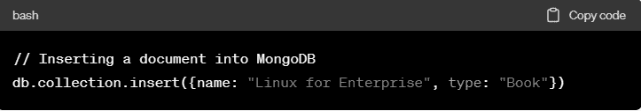
```

`Cassandra`：一种分布式数据库系统，设计用于在许多通用服务器上处理大量数据，提供无单点故障的高可用性。

`Redis`：一种内存数据结构存储，用作数据库、缓存和消息中间件。`Redis`支持`strings`、`hashes`、`lists`、`sets`等数据结构。

### 在 Linux 企业环境中集成 NoSQL 数据库

部署：`NoSQL`数据库可以轻松部署在 Linux 服务器上。许多 Linux 发行版都带了这些数据库的包或简单的安装方法。

## 配置与管理

与传统的 SQL 数据库相比，`NoSQL`数据库通常需要不同的配置和管理方法。`MongoDB Compass`或`Redis Desktop Manager`等工具提供了基于 GUI 的解决方案。

## NoSQL 数据库的使用场景

- 大数据应用：由于能够处理海量多样化的数据类型和结构，`NoSQL`数据库非常适合大数据应用。
- 实时分析：像`Redis`等 NoSQL 数据库的速度和性能使其成为实时分析和高速事务的理想选择。

## NoSQL 数据库管理中的挑战

- 数据一致性：在分布式 `NoSQL`数据库中，确保数据一致性是一项挑战，因为它们通常优先考虑可用性和分区容错。
- 备份与恢复：实施稳健的备份和恢复策略至关重要，特别是 `NoSQL`数据库处理着海量数据。

Linux 上的`NoSQL`数据库为企业环境中管理多样化和海量数据集提供了一种灵活、可扩展且高效的解决方案。它们处理非结构化数据的能力、易于扩展性以及性能优化使其成为现代数据策略中不可或缺的组成。本章提供了 Linux 中 NoSQL 技术的全面概述，让读者掌握在业务应用程序中有效实施和管理这些数据库的知识。随着企业继续面临大数据挑战，Linux 上的 NoSQL 数据库将继续成为数据管理创新的关键。

## 数据库备份与恢复

### 数据库备份与恢复的重要性

在企业环境中，数据是最宝贵的资产之一。由于硬件故障、人为错误或网络攻击导致的数据丢失可能是灾难性的。因此，对于任何依赖数据库系统的业务来说，实施良好的备份和恢复策略都是至关重要的。

### 数据库备份策略

- 全备：全备涉及对整个数据库进行完整复制。它提供了最全面的备份解决方案，但可能消耗大量时间和资源。
- 示例命令：

```
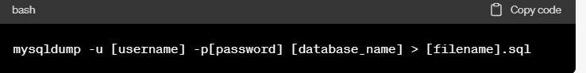
```

- 增量备份：增量备份仅备份自上次备份以来更改的数据。这种方法资源消耗较低，但需要更复杂的恢复过程。
- 差异备份：与增量备份类似，差异备份仅保存自上次全备以来更改的数据。

### Linux 中的备份工具与实用程序

- `mysqldump`和`pg_dump`：对于`MySQL`和`PostgreSQL`等 SQL 数据库，通常使用`mysqldump`和`pg_dump`工具创建备份。
- 自定义脚本：许多企业使用自定义脚本来自动化备份过程，通常将其整合到定期的维护计划中。

### 数据恢复技术

- 点点恢复：这涉及将数据恢复到特定的时间点，在数据损坏或无意删除的情况下特别有用。
- 灾难恢复：在发生灾难性故障时，拥有包含异地备份的灾难恢复计划对于业务连续至关重要。

### 备份存储解决方案

- 本地 vs. 异地存储：备份可以存储在本地以便快速访问，也可以存储在异地以防止物理性灾难。
- 云存储：许多企业利用云存储解决方案满足备份需求，从扩展性和降低基础设施成本中获益。

### 备份的测试与验证

定期测试备份至关重要，以确保在需要时能够成功恢复。验证过程应作为备份策略不可的一部分。

### 备份与恢复的最佳实践

- 定期备份：安排定期备份以最大限度地减少数据丢失。
- 安全存储：确保备份数据存储安全，并在必要时使用加密。
- 监控：持续监控备份过程是否出现故障或问题。
- 文档记录：维护清晰的备份和恢复程序文档，以便在紧急情况下快速查阅。

Linux 环境下的数据库备份与恢复是数据管理的一个关键方面。它需要仔细的计划、实施和定期测试，以确保数据的完整性和可用性。通过采用有效的备份策略并利用 Linux 提供的工具，企业可以保护其价值的数据资产免受丢失，并在发生故障时确保快速恢复。本章提供了开发和维护稳健数据库备份恢复计划所需的见解和实践知识，这是任何企业 IT 策略中不可或缺的组成。

## 数据库性能调优

### 数据库性能调优性

Linux 环境下的数据库性能调优涉及旨在提高数据库响应和效率的实践。

### 分析性能问题

调优的第一步是识别性能瓶颈。这涉及监控数据库操作，并识别消耗过多资源的查询或进程。

- SQL 查询分析：对于 SQL 数据库，分析和优化 SQL 查询至关重要。缓慢或低效的查询会显著降低性能。
- 示例：在`MySQL`或`PostgreSQL`中使用`EXPLAIN`分析查询执行计划。
- 资源利用率：使用`top`和`htop`等监控工具可以识别数据库是否消耗了过 CPU 或内存资源。

### 索引策略

适当索引对于数据库性能至关重要。索引加速数据检索，但必须谨慎使用以避免不必要的开销。

- 创建高效索引：应在搜索标准或连接操作中频繁使用的列上创建索引。
- 索引维护：定期维护索引（如重建或重新组织索引）可以防止性能下降。

### 数据库配置优化

- 内存分配：调整内存分配设置（例如`MySQL`中的缓冲池大小）可以显著提高性能。
- 配置参数：调整`PostgreSQL`中的`max_connections`和`shared_buffers`等参数可以优化资源使用。

### 优化 NoSQL 数据库

`NoSQL`数据库（如`MongoDB`或`Cassandra`）需要不同的调优方法。

- 数据建模：在 `NoSQL`数据库中，高效的数据建模是性能的关键。这包括选择正确的数据库模式和数据分布策略。
- 分片与复制：实施分片（数据分区）和复制策略可以增强性能和可用性。

### 定期监控与测试

性能调优是一个持续的过程。定期的监控和压力测试有助于维持数据库性能。

- 基准测试：使用`Sysbench`或`Apache JMeter`等工具进行数据库基准测试。
- 日志分析：定期分析数据库日志以查找错误模式或缓慢操作。

### 数据库性能调优的最佳实践

- 理解负载模式：了解典型的负载和访问模式有助于做出明智的调优决策。
- 平衡读写操作：针对主要的的操作类型（无论是读密集型还是写密集型）进行优化。
- 避免过度调优：过度调优会导致复杂性并产生新的性能问题。应进行增量式更改并监控其影响。

在 Linux 上进行数据库性能调优是确保企业环境中高效且可靠的数据库运行的一项任务。通过解决性能瓶颈、优化查询、有效利用资源以及定期监控数据库健康，企业可以确保其数据库系统针对特定需求进行了优化配置。本章提供了关于数据库性能调优的方法论和技术的全面见解，使数据库管理员和 IT 专业人员能够在其基于 Linux 的企业环境中维护高性能、健壮的数据库系统。

随着第 2 章的结束，我们已经领略了 Linux 环境下数据库技术的广阔领域。本章深入探讨了管理、维护和优化这些关键系统所涉及的复杂性，涵盖了从僵化的 SQL 数据库世界到灵活的 NoSQL 替代方案。我们研究了确保数据完整性、业务连续性以及备份和恢复的必要程序。我们还探索了性能调优的细微之处，这对于保持数据库系统的响应和有效性至关重要。通过这些深入研究获得的知识和技能，你将能够高效地处理 Linux 数据库系统，克服特定的困难，并充分利用 Linux 在企业级数据库应用中的优势。随着数据库继续成为业务运营的核心，在本章中获得的知识和技能对于应对企业数据管理不断演变的需求将具有巨大的价值。

# 第 3 章：Web 服务器


本章提供了对在线业务平台基础元素的深入检查，包括用于安全的 `SSL/TLS` 证书、内容管理系统 (`CMS`)、`Apache` 和 `Nginx` Web 服务器以及负载均衡。本章旨在为你提供一个全面的概述，赋予你在 Linux 上设置、维护和保护 Web 服务器所需的专业知识和实用视角，以确保贵公司的网络呈现是可靠、可扩展且安全的。

## Apache 和 Nginx：Web 服务器技术的支柱

`Apache` 和 `Nginx` 处于 Web 服务器技术的最前沿，各自具有独特的功能和能力。`Apache` 以其多功能和丰富的特性集而闻名，而 `Nginx` 以其性能和效率著称，它们都被广泛应用于基于 Linux 的企业环境中。

### Apache：多功能 Web 服务器

模块化设计：`Apache` 的架构高度模块化，允许通过模块实现广泛的功能。这种设计实现了定制和灵活性，能够满足各种业务需求。

`.htaccess` 文件：`Apache` 允许通过 `.htaccess` 文件进行目录级配置，提供了一种在不更改全局服务器设置的情况下更改配置的方法。

示例配置：

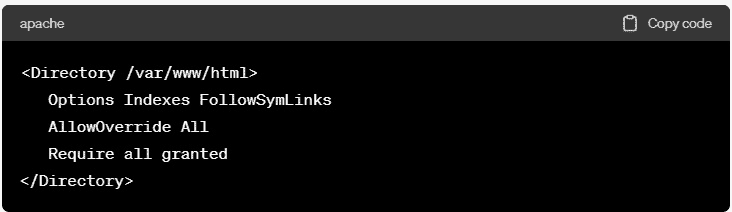

广泛采用：`Apache` 在行业内的广泛应用导致了庞大的社区和丰富的文档，使其成为企业可靠的选择。

### Nginx：性能与效率

事件驱动架构：`Nginx` 的事件驱动方法使其在处理高并发时非常高效，导致了更快的内容交付和更低的资源消耗。

反向代理与负载均衡：`Nginx` 经常用作反向代理和负载均衡器，提供额外的安全层并高效地处理流量。

示例配置：

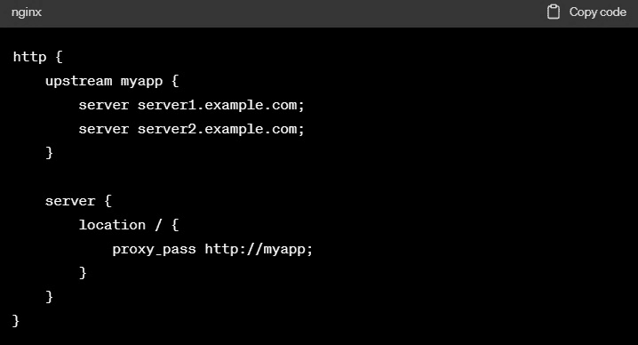

缓存与内容优化：`Nginx` 在内容缓存和优化方面表现出色，增强了网络性能和用户体验。

### 在 Apache 和 Nginx 之间选择

`Apache` 和 `Nginx` 的选择取决于特定的业务需求：

性能 vs 灵活性：对于高性能需求，`Nginx` 可能是首选，特别是在处理大量并发连接至关重要的情况下。另一方面，`Apache` 通过其模块化设计提供了更大的灵活性。

兼容性与需求：考虑与现有应用程序的兼容性，以及 URL 重写、自定义模块或配置偏好等特定需求。

### 与 Linux 环境集成

`Apache` 和 `Nginx` 都能与 Linux 无缝集成，受益于其安全性、稳定性和健壮性。它们利用 Linux 的特性来实现高效的网络通信、文件系统访问和安全强化。

### 安全配置

访问控制：两台服务器都提供了全面的访问控制机制，这对于保护 Web 内容至关重要。

`SSL/TLS` 配置：可以使用 `SSL/TLS` 协议建立安全通信，这对于保护敏感数据至关重要。

`Apache` 和 `Nginx` 不仅仅是 Web 服务器；它们是 Linux 环境 Web 基础设施不可或缺的组件。它们各自拥有优势，满足了广泛的业务需求，从托管简单网站到管理复杂的高流量 Web 应用。理解 `Apache` 和 `Nginx` 的细微差别、其配置和优化对于管理基于 Linux 的网络服务的 IT 专业人员至关重要。本章提供了基础知识和实用见解，以有效利用这些 Web 服务器，确保企业实现稳健、高效且安全的网络运行。

## 内容管理系统：Web 内容策略的核心

在数字时代，内容管理系统 (`CMS`) 是企业管理其在线呈现不可或缺的工具。这些系统提供了一个创建、编辑和发布数字内容的接口，通常不需要深奥的技术知识。

### Linux 上流行的 CMS 平台

`WordPress`：全球使用最广泛的 `CMS`，`WordPress` 以其易用、丰富的插件生态系统和主题定制而闻名。它是一个多功能的解决方案，适用于从简单博客到复杂网站的所有场景。

基础 `WordPress` 主题的 PHP 代码段：

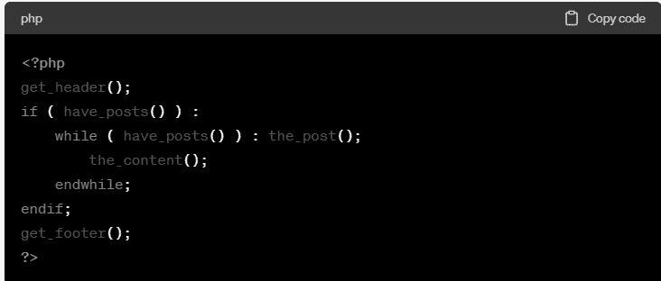

`Drupal`：以其健壮性和可扩展性闻名，`Drupal` 是复杂、内容密集型网站和应用程序的首选。它提供了细粒度的访问控制和模块化的内容管理方法。

`Joomla`：`Joomla` 在易用性和功能之间取得了平衡，既用于简单网站，也用于复杂的企业应用程序。它提供了一系列模板和扩展用于定制。

### CMS 与 Linux 服务器集成

`LAMP`/`WAMP` 栈：`CMS` 平台通常运行在 Web 服务器上，使用如 `LAMP`（Linux、Apache、MySQL、PHP）或 `WAMP`（Windows、Apache、MySQL、PHP）之类的栈。Linux 与这些技术的兼容使其成为托管 `CMS` 的理想平台。

安全与性能：Linux 为 `CMS` 平台提供了安全且高性能的基础，具有如 `Apache` 的 `mod_security` 和 `Nginx` 的快速处理能力。

### 定制与扩展

主题与模板：`CMS` 平台提供主题和模板，允许企业在不更改内容的情况下自定义网站外观。

插件与模块：通过插件（`WordPress` 中）或模块（`Drupal` 中）对 `CMS` 平台进行扩展，允许添加新功能，从 SEO 优化工具到社交媒体集成。

### 内容策略与 SEO

SEO 友好：Linux 上的 `CMS` 平台针对 SEO 进行了优化，提供了整洁的 URL 结构、元数据管理以及优化搜索引擎内容的工具。

### 响应式设计

`CMS` 主题对不同设备（手机、平板电脑、桌面电脑）的适应性确保了一致的用户体验，这在当今的多设备世界中至关重要。

Linux 上的内容管理系统（`CMS`）是现代商业格局中的重要工具，能够实现数字内容的高管理和交付。通过提供灵活性、扩展性和用户友好界面，Linux 上的 `CMS` 平台帮助企业与受众有效互动，并加强其在线影响力。本章提供了在 Linux 上选择、部署和管理 `CMS` 平台的全面指南，使企业具备有效利用这些工具制定数字内容策略的知识。

## CMS 管理中的挑战

- **安全性**：定期更新和安全补丁对于保护 `CMS` 平台免受漏洞至关重要。

- **性能调优**：随着网站的增长，性能调优（如缓存、图像优化）对于维持速度和效率变得不可不可。

## SSL/TLS 证书

### SSL/TLS 证书：增强网络安全

`SSL`（安全套接层）和 `TLS`（传输层安全）证书是用于验证网站身份并启用加密连接的数字证书。这些对于保护 Web 服务器与客户端之间传输的敏感数据至关重要。

### SSL/TLS 在业务应用中的重要性

- **数据加密**：`SSL/TLS` 证书加密用户与 Web 服务器之间传输的数据，防止被倾听和篡改。

- **真实性与信任**：它们验证网站的合法性，在用户和客户之间建立信任。

- **合规性**：对于许多企业，特别是金融和医疗行业，使用 `SSL/TLS` 证书是确保数据保护的监管要求。

### 在 Apache 和 Nginx 中实现 SSL/TLS 证书

**获取证书**：可以从证书颁发机构（`CA`）获取证书。`Let’s Encrypt` 等服务提供免费证书，简化了企业的流程。

**在 Apache 中配置**：

- 安装 `mod_ssl` 模块。

- 配置虚拟主机使用 `SSL`，指定证书和密钥文件的路径。

**Apache 配置示例**：

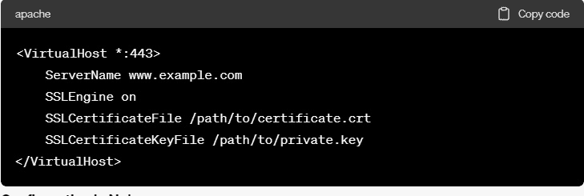

**在 Nginx 中配置**：

- 在 `server` 块中指定 `SSL` 设置。

- 定义 `SSL` 证书和密钥的路径。

**Nginx 配置示例**：

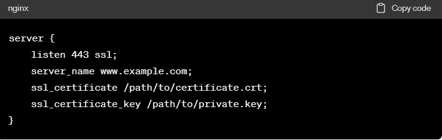

### 管理证书的更新与撤销

- **自动更新**：来自 `Let’s Encrypt` 的 `Certbot` 等工具实现了更新过程自动化，确保证书始终更新。

- **撤销**：如果证书泄露，需要撤销。此过程涉及通知 `CA` 并替换证书。

### SSL/TLS 实现中的挑战

- **配置错误**：配置不当会导致漏洞。定期审计和遵循最佳实践至关重要。

- **性能开销**：`SSL/TLS` 加密可能会增加开销。优化服务器配置和硬件可以缓解这一点。

### 安全最佳实践

- **强加密标准**：使用健壮的加密方法并定期更新加密协议以应对不断演变的威胁。

- **SSL/TLS 中间证书和链**：正确配置证书链，以确保跨各种浏览器和设备的兼容性。

`SSL/TLS` 证书不仅仅是一项安全功能；它们是当今网络基础设施的必要条件，特别是在基于 Linux 的企业环境中。在 `Apache` 和 `Nginx` 等 Web 服务器上正确实施和管理它们对于确保安全、加密的通信至关重要。本章提供了部署 `SSL/TLS` 证书的详细指南，使企业能够有效保护其 Web 应用并维护用户客户的信任。随着数字安全继续成为首要关注的问题，本节概述的知识和实践对于任何在在线领域运营的企业都至关重要。

## 负载均衡

### 理解 Web 服务器中的负载均衡

Web 服务器环境中的负载均衡是一种将流量分布到多台服务器的技术，确保没有单一服务器负载过重。这对于企业级应用尤为关键，因为高流量和对高可用性的需求是常态。

### 为什么负载均衡至关重要

- **流量管理**：在多台服务器之间高效分配客户端请求或网络负载。

- **冗余与可靠性**：通过在服务器故障时重定向流量，确保高可用性和可靠性。

- **性能优化**：通过减少单个服务器的负担，提升 Web 应用的整体性能。

### 负载均衡的类型

- **硬件 vs 软件负载均衡器**：硬件负载均衡器是专用设备，而软件负载均衡器是运行在标准服务器上的应用，如 `Nginx` 或 `HAProxy`。

- **基于算法的负载均衡**：常见算法包括 `round-robin`（轮询）、`least connections`（最连接）和 `IP hash`。

### 使用 Linux 工具实现负载均衡

**作为负载均衡器的 Nginx**：

- `Nginx` 可以配置为反向代理，在后端服务器之间分配流量。

- 支持各种负载均衡方法和 `SSL` 终止。

**Nginx 配置示例**：

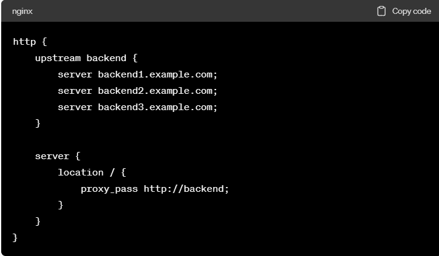

**HAProxy**：

- `HAProxy` 为基于 `TCP` 和 `HTTP`的应用提供高可用负载均衡和代理。

- 以其在高流量环境下的高效和可靠性闻名。

### 云环境中的负载均衡

- **云端负载均衡器**：许多云提供商提供与其基础设施集成的负载均衡服务（如 `AWS Elastic Load Balancing`）。

- **混合解决方案**：将云端和本地负载均衡相结合，用于混合基础设施。

### 负载均衡中的挑战

- **配置复杂性**：正确配置负载均衡需要理解应用架构和流量模式。

- **健康检查与故障机制**：定期检查服务器健康状况并配置故障机制对于维持服务可用性至关重要。

### 负载均衡中的安全考虑

- **SSL/TLS 卸载**：在负载均衡器级别处理 `SSL/TLS` 可以减少后端服务器的计算负载。

- **防御攻击**：负载均衡器通过分流和识别恶意请求可以帮助缓解 DDoS 攻击。

负载均衡是管理 Web 服务器环境的关键组件，特别是在基于 Linux 的企业系统中。它在确保 Web 应用可靠性、可用性和高性能方面起着关键作用。本章提供了对负载均衡原理、工具和实践的深入理解，为 IT 专业人员提供了实施有效负载均衡解决方案的知识。随着网络基础设施需求的增加，掌握负载均衡技术对于维持业务关键应用程序的优化运行将至关重要。

当我们结束第三章时，我们已经遍历了对于任何基于 Linux 的企业环境都至关重要的 Web 服务器技术和实践的核心版图。从 `Apache` 和 `Nginx` 服务器的复杂性，到内容管理系统（`CMS`）的多功能世界，本章提供了有效管理 Web 内容的全面指南。我们还通过 `SSL/TLS` 证书深入探讨了 Web 安全的关键侧方面，并探索了负载平衡在确保高效且不中断的服务交付中的重要性。本章不仅强调了技术方面，还强调了这些组件在支持和增强业务运营方面的战略意义。掌握了这些知识，IT 专业人员和业务领导者可以做出明智决策以优化他们的 Web 基础设施，确保其与业务目标保持一致并随着业务增长而扩展。在这里获得的见解是应对不断变化的数字格局的基础，确保企业在数字时代保持竞争力和弹韧性。

# 第 4 章：虚拟化

本章将详细介绍资源管理、虚拟网络、虚拟机、Linux 容器以及其他重要的虚拟化技术。本章旨在帮助你建立深入的理解，为你提供充分利用虚拟化所需的的基础信息和实用技能。寻求优化基于 Linux 的虚拟化基础设施的 IT 专业人员会发现本章是一个重要的资源，因为它涵盖了从容器化的细微差别到管理虚拟资源和网络挑战的所有内容。

## Linux 容器

### Linux 容器：彻底改变应用部署

Linux 容器 (`LXC`) 代表了应用部署和管理范式的转变，提供了一种高效、轻量级的虚拟化方法。它们提供了进程和资源隔离，而没有完全硬件虚拟化的开销。

### 理解 Linux 容器的基础

什么是 Linux 容器？

Linux 容器是操作系统层面的虚拟化方法，允许多个隔离的 Linux 系统（容器）运行在单个控制主机上。

核心组件：

- `Namespaces`：提供隔离的工作空间，包括网络、进程 ID、挂载和用户命名空间。

- `Control Groups (cgroups)`：限制、优先级排序并隔离进程组的资源使用（`CPU`、内存、`I/O`、网络）。

### Linux 容器的优势

- **效率与速度**：容器比传统的虚拟机更轻量，提供了更快的启动时间和更高的密度。

- **跨环境一致性**：容器封装了应用程序及其环境，确保了开发、测试和生产环境的一致性。

### 使用 Docker 管理容器

`Docker` 已经成为最流行的容器管理工具，简化了构建、传输和运行容器化应用程序的过程。

### Docker 镜像与容器：

- `Docker Image`：一个轻量级、独立、可执行的包，包含了运行某个软件所需的所有内容。

- `Docker Container`：`Docker` 镜像的运行时实例。

示例 Docker 命令：

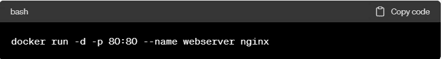

`Docker Hub`：用于查找和共享容器镜像的云注册服务。

### Kubernetes：编排容器部署

`Kubernetes` 通常与 `Docker` 配合使用，是一个自动化应用容器部署、扩展和操作的强大工具。

- `Pods`、`Nodes` 和 `Clusters`：`Kubernetes` 架构中的基本单元。

- **自动扩展与管理**：`Kubernetes` 自动化发布和回滚，管理负载并扩展容器。

### Linux 容器的安全

- **隔离**：虽然容器是隔离的，但它们共享宿主机操作系统内核，这使得内核级漏洞成为关注点。

- **最佳实践**：实施安全最佳实践，包括使用可信镜像、扫描漏洞以及最小化运行时权限。

### Linux 容器的用例

- **微服务架构**：由于其轻量级特性和可扩展性，它是部署微服务的理想之选。

- **持续集成/持续部署 (CI/CD)**：容器通过为每个阶段提供一致的环境来支持 `CI/CD` 方法论。

### 挑战与考虑

- **状态管理**：在容器化环境中管理有状态的应用可能是复杂的。

- **网络与存储**：在容器化架构中配置网络和持久化存储需要仔细的。

Linux 容器已成为企业 IT 工具箱中不可或的工具，为部署和管理应用程序提供了灵活、高效且可扩展的解决方案。它们与 Linux 环境的整合利用了 Linux 在安全和性能方面的固有优势，成为现代应用架构的理想选择。本章提供了 Linux 容器及其管理和编排的全面理解，使 IT 专业人员具备在企业基础设施中有效利用容器化的知识。

## 虚拟机

### 虚拟机：企业计算中不可缺的组件

Linux 环境中的虚拟机代表了企业计算的一个基本方面，提供了一种最大化硬件利用率、增强安全性并在管理化应用需求方面提供活性的方法。

### Linux 中虚拟机的精髓

- **定义与概念**：`Virtual Machine` 是物理计算机的软件仿真。它运行操作系统和应用程序的方式就像物理计算机一样，但在宿主机操作系统内部管理和托管。

- **虚拟机监控器 (Hypervisor)**：`hypervisor` 也称为虚拟机监控器 (`VMM`)，是虚拟化的软件层。它管理 `VMs` 并从主机系统分配资源。

- **第一型虚拟机监控器**：它们直接运行在宿主机硬件上，以控制硬件并管理客户虚拟机。示例包括 `Xen` 和 `KVM`。

- **第二型虚拟机监控器**：它们运行在提供虚拟化服务的主机操作系统上，例如 `VMware Workstation` 和 `Oracle VirtualBox`。

### 使用虚拟机的优势

- **隔离**：`VMs` 提供了与宿主机系统的完全隔离，确保 `VM` 内部的问题不会影响其他 `VMs` 或宿主机。

- **资源利用**：它们允许对物理硬件资源进行更好的利用，在单个物理服务器上运行多个操作系统和应用程序。

- **安全性与合规性**：隔离也有助于维护安全合规，因为每个 `VM` 都可以进行独立的控制和监控。

### 在 Linux 中创建和管理虚拟机

使用 `KVM/QEMU` 管理虚拟机：

- `KVM`（基于内核的虚拟机）将 Linux 变为监控器。


- `QEMU` 是一个与 `KVM` 配合运行 `VMs` 的仿真器。

创建虚拟机的示例命令：


`VMware` 与 Linux：`VMware` 提供了用于在 Linux 桌面运行 `VMs` 的 VMware Workstation 产品，以及用于服务器环境的 VMware vSphere。

## 虚拟机的网络与存储

- **虚拟网络**：`VMs` 可以配置虚拟网络接口，将其连接到虚拟交换机，并启用类似于物理网络的配置。
- **存储**：`VMs` 使用虚拟磁盘，这些是宿主机系统物理存储上的文件。在企业环境中，`iSCSI` 和 `NFS` 等技术常用于 `VM` 存储。

## 虚拟机部署的最佳实践

- **资源分配**：根据工作负载需求仔细计划为 `VMs` 分配 `CPU`、内存和存储。
- **安全性**：定期使用安全补丁更新 `VMs` 和监控器，并遵循最佳安全实践。

# 备份与灾难恢复：为虚拟机实施稳健的备份与灾难恢复策略

虚拟机（Virtual Machines）是基于 Linux 的企业环境中的关键技术，提供了灵活性、高效的资源利用以及增强的安全性。它们是构建可扩展、弹性且安全的 IT 基础设施的基础。本章将为 IT 专业人员提供相关知识，以便在 Linux 环境下有效部署、管理和优化 `VMs`，确保他们能够充分利用虚拟化潜力以满足企业的计算需求。

## 资源管理：虚拟化环境中的效率最大化

虚拟化 Linux 环境中的资源管理涉及在 `VMs` 和容器等各种虚拟实体之间，对 CPU、内存、存储和网络带宽等硬件资源进行策略性的分配和优化。

### 理解资源管理

- **资源分配**：将可用资源分配给 `VMs` 和容器的过程，以确保高效的运行和性能。
- **资源超额配置（Overcommitment）**：一种超出实际物理容量分配资源的策略，其依据是并非所有虚拟实体都会同时使用其最大分配资源。

### 资源管理的工具与技术

#### Linux Cgroups（控制组）

Linux 内核的一项功能，用于限制、统计和隔离一组进程的资源使用（CPU、内存、磁盘 I/O、网络）。在容器化中，为 Linux 容器（`LXC`）或 `Docker` 容器分配资源非常重要。

示例 Cgroups 命令：

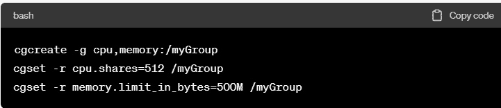

#### Libvirt 和 KVM/QEMU

`Libvirt` 是一个管理虚拟化平台的工具包，通常配合 `KVM/QEMU` 用于进行 `VM` 资源管理。它提供了修改 `VMs` CPU 和内存分配的 API。

### 有效资源管理的策略

- **负载均衡**：理解负载需求并在物理资源之间进行平衡，以防止任何单一资源成为瓶颈。
- **监控与调整**：持续监控资源使用情况并根据需要进行调整。可以使用 `Nagios`、`Zabbix` 或自定义脚本进行监控。

### 处理 CPU 和内存资源

- **CPU 分配**：根据处理需求为 `VMs`/容器分配 CPU 核心或份额。技术包括 CPU 绑定（CPU pinning）或 CPU 节流（CPU throttling）。
- **内存管理**：为每个 `VM`/容器分配足够的内存，同时避免过度的超额配置，因为会导致性能下降。

### 存储和网络资源管理

- **存储分配**：使用 `LVM`（逻辑卷管理器）等技术进行灵活存储管理，或使用 `SAN/NAS` 系统实现集中存储解决方案。
- **网络带宽管理**：实施网络流量整形和服务质量保证（`QoS`），以确保 `VMs`/容器之间公平的带宽。

### 资源管理中的挑战

- **资源竞争**：避免多个 `VMs`/容器竞争相同资源的情况，导致性能问题。
- **容量规划**：准确预测资源需求，以防止资源的过度利用或利用不足。

### 资源管理的最佳实践

- **可扩展性**：设计一种资源管理策略，允许随着负载或 `VMs`/容器数量的增加而进行扩展。
- **自动化**：实施资源分配和调整的自动化，以对变化的负载做出动态响应。
- **安全性考虑**：确保资源管理策略不会损害安全性，特别是在多户环境中。

有效的资源管理对于优化 Linux 虚拟化环境的性能和效率至关重要。本章为理解和在 Linux 虚拟化基础设施中实施资源管理策略、工具和最佳实践提供了全面的指南。

## 虚拟网络：虚拟化 Linux 环境中的基础

Linux 中的虚拟网络能够为 `VMs` 和容器创建隔离的网络环境。它们在虚拟化基础设施的整体架构中起着关键作用，允许在不需要额外物理硬件的情况下实现先进的网络功能。

### 理解 Linux 中的虚拟网络

**概念与应用**：虚拟网络为 `VMs` 和容器提供类似于物理网络的网络服务，但它们完全通过软件实现。

### 虚拟网络的组成部分

- **虚拟交换机**：类似于物理交换机，它们在网络接口之间转发流量。
- **虚拟路由器**：在不同的虚拟网络之间以及到外部网络之间路由流量。

### 创建和管理虚拟网络

#### Linux Bridge（桥）

Linux 中创建虚拟网络交换机的基础工具。`Bridges` 可以将 `VMs`/容器的虚拟接口连接到物理网络接口。

示例 Linux Bridge 命令：

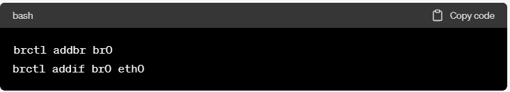

#### Open vSwitch

一种开源的多层虚拟交换机，旨在通过支持标准管理接口和协议来启用网络自动化。

### 虚拟网络与虚拟机及容器的集成

- **虚拟机的网络配置**：`VMs` 可以配置连接到虚拟交换机或桥的虚拟网络适配器。
- **容器网络**：`Docker` 等工具提供其自身的网络能力，允许容器之间以及与外界通信。

### 高级虚拟网络功能

- **网络功能虚拟化（NFV）**：涉及将网络功能实现为可以在虚拟机上运行的软件，例如防火墙、负载均衡器和 WAN 加速器。
- **软件定义网络（SDN）**：允许通过控制器对虚拟网络资源进行集中管理，可以根据当前需求动态调整网络路由和设置。

### 虚拟网络的安全

- **隔离**：虚拟网络可以隔离不同应用程序或租户的流量，增强安全性。
- **防火墙与访问控制**：实施虚拟防火墙和访问控制列表（`ACLs`），以调节虚拟网络内部及内部之间的流量。

### 虚拟网络管理中的挑战

- **复杂性**：虚拟网络配置的复杂性随着环境规模的扩大而增加。
- **性能**：确保虚拟网络不成为瓶颈需要仔细的规划和资源分配。

### 虚拟网络实施的最佳实践

- **可扩展性与灵活性**：设计虚拟网络时考虑可扩展性，允许随着 `VMs` 和容器数量的增长而轻松扩展。
- **监控与故障排除**：实施稳健的监控解决方案以跟踪网络性能，并快速识别和解决问题。

随着第 4 章的结束，我们已经成功穿越了 Linux 环境下虚拟化的复杂地形。现在我们已经掌握了虚拟机和 Linux 容器在现代企业计算中的职责和能力，并揭示了它们的微妙之处。资源管理的探索强调了在虚拟化环境中高效分配和管理有限资源的重要性。此外，我们对虚拟网络的旅程揭示了虚拟化基础设施中可能的复杂网络配置。本章不仅传授了技术知识，还为有效利用虚拟化技术提供了战略见解。凭借了这些信息，IT 专业人员现在能够更好地部署、管理和优化虚拟环境，确保它们满足企业运营中多样化且不断变化的需求。这里详细介绍的概念和实践对于充分发挥 Linux 虚拟化的潜力至关重要，为增强企业技术格局的性能、可扩展性和安全性铺平了道路。

# 第 5 章：自动化与脚本

本章将深入探讨 Linux 环境下作业自动化和流程优化所需的方法和工具。本章涵盖了 IT 专业人员在管理 Linux 系统时为了提高效率和准确性所需的所有知识，从 Shell 脚本的基础知识到 Python 脚本的复杂性，从配置管理工具的细微差别到 CI/CD 流水线的协调工作流。它是一本充分利用自动化并确保可靠、可扩展且高效的 IT 基础设施的详尽手册。

## Shell 脚本基础

Shell 脚本是在类 Unix 环境中编写脚本（小型程序）来自动化任务的实践。这些脚本由 shell 执行，shell 是一个如 `Bash`（Bourne Again SHell）这样的命令行解释器，它在 Linux 系统中非常流行。

### 理解 Shell 脚本基础

#### 什么是 Shell 脚本？

Shell 脚本是一个包含由 shell 执行的命令序列文本文件。它可以自动化重复性任务，管理系统操作并处理复杂的工作流。

#### Shell 脚本语法

脚本通常以“shebang”（`#!`）开头，后面跟着 shell 的路径（例如，对于 `Bash` 使用 `#!/bin/bash`）。

### 创建你的第一个 Shell 脚本

#### Hello World 示例

一个向终端打印“Hello, World!”的简单脚本。

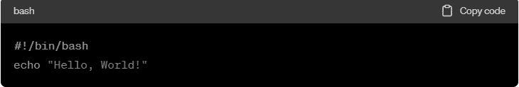

#### 执行 Shell 脚本

赋予脚本可执行权限：`chmod +x script.sh`

运行脚本：`./script.sh`

### 变量与数据类型

#### 定义变量

存储可以在脚本范围内重复使用数据。

**语法：** `variable_name="value"`

#### 使用变量

使用 `$variable_name` 引用变量。

#### 控制结构：If-Else、循环

- **条件执行：** 使用 `if-else` 语句根据条件执行代码。
- **循环结构：**
  - `for` 循环：遍历列表或范围。
  - `while` 循环：只要条件为 `true` 就一直执行。

### 函数与模块化脚本

#### 创建函数

可以带参数调用的可重用代码块。

**语法：**

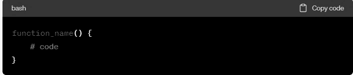

#### 调用函数

通过名称调用函数：`function_name`

### 输入与输出处理

#### 读取用户输入

使用 `read` 命令从用户获取输入。

#### 输出重定向

使用 `>` 或 `|` 将输出重定向到文件或其他命令。

### 脚本调试与最佳实践

#### 调试

使用 `-x` 选项跟踪脚本执行：`bash -x script.sh`。

#### 最佳实践

- 包含注释以供文档。
- 编写整洁、可读的代码。
- 优雅地处理错误。

### 高级 Shell 脚本技术

- **参数扩展：** 字符串和变量的操作。
- **正则表达式：** 文本处理中的模式匹配。
- **自动化脚本：** 自动化系统管理任务，如备份、用户管理和监控。

Shell 脚本是 Linux 生态系统中强大的工具，允许管理员和开发人员自动化任务、简化流程并高效配置系统。本章提供了对 Shell 脚本基础的基础性理解，从简单脚本到更复杂的自动化任务。通过掌握 Shell 脚本，IT 专业人员可以显著提高他们的生产力和 Linux 系统的功能，使其成为管理基于 Linux 的企业环境中不可或缺的技能。

## Python 脚本

Python 的简单性、可读性和丰富的库支持使其成为 Linux 环境中自动化和脚本编写的首选。它桥接了简单 Shell 脚本与全规模软件开发之间的差距。

### Linux 中的 Python 基础

#### 为什么选择 Python？

Python 清晰的语法和解释性质使其成为快速脚本和复杂应用程序开发的理想选择。

它在大多数 Linux 发行版中预装，或者很容易安装。

#### 设置 Python 环境

检查 Python 版本：`python --version` 或 `python3 --version`

使用 `apt` 或 `yum` 等包管理器进行安装或更新。

### 编写你的第一个 Python 脚本

#### Hello World 示例

一个在 Python 中打印“Hello, World!”的简单脚本。

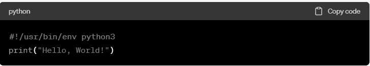

#### 运行 Python 脚本

赋予脚本可执行权限：`chmod +x script.py`

运行脚本：`./script.py`

### 用于系统管理的 Python

#### 自动化常规任务

使用 Python 自动化系统更新、用户账户管理、日志文件分析等。

#### 使用系统命令脚本

Python 的 `subprocess` 模块允许你运行系统命令并捕获其输出。

```python
import subprocess
subprocess.run(["ls", "-l"])
```

### Python 文件处理

#### 读取和写入文件

Python 简化了文件操作，使其适用于配置文件更新、日志解析和报告生成等任务。

#### 读取文件示例

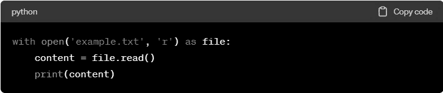

### 使用 Python 库增强功能

- **标准库：** Python 丰富的标准库提供了网络、文件 I/O、JSON 解析等模块。
- **外部库：** 用于 HTTP 操作的 `requests` 或用于数据分析的 `Pandas` 等库扩展了 Python 的能力。

### 用于网络自动化

- 网络脚本：自动化网络配置、诊断和监控任务。
- 交互 API：使用 Python 与 REST API 交互以管理网络设备和服务。

### 错误处理与调试

- **异常处理：** 使用 `try-except` 块优雅地处理潜在错误。
- **日志：** 实现日志用于错误跟踪和诊断。

### Python 脚本最佳实践

- **代码可读性：** 编写整洁、可读的代码并带有适当的注释以便于维护。
- **版本控制：** 使用 `Git` 等版本控制系统来管理脚本的变化。

## 配置管理工具

配置管理工具旨在自动化系统的置备和维护，确保它们处于预期的、可预测的状态。它们在管理复杂基础设施方面至关重要，能够处理从简单的文件编辑到部署复杂应用程序的所有任务。

### 目的与优势

- 这些工具实现了软件和系统配置过程的自动化。
- 它们确保了系统设置的一致性，减少了人为错误，并有助于故障后的快速恢复。
- **幂等性（Idempotency）**：一项关键特性，即多次执行配置脚本会导致相同的结果，从而避免副作用。

### 流行的配置管理工具

- **Ansible**：以简单和无代理架构著称。它使用 `YAML` 编写其清单（playbook）脚本。
- Ansible Playbook 示例：

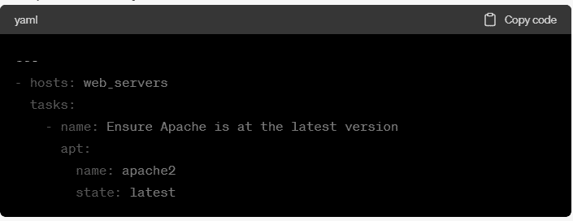

- **Puppet**：使用声明式语言定义系统配置。它采用主从代理架构。
- Puppet 清单文件示例：

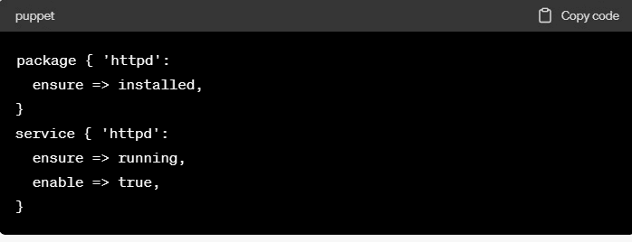

- **Chef**：使用基于 Ruby 的配方（recipes）进行配置任务。专注于代码驱动的基础设施自动化。

### 实现配置管理

- **基础设施即代码（IaC）**：将基础设施设置和配置视为代码。这种方法允许版本控制和更好的管理。
- **自动化部署**：使用这些工具进行软件和服务器的自动化部署，确保过程的一致性和可重复性。

### 配置管理的最佳实践

- **版本控制**：将配置脚本存储在版本控制系统中，以跟踪更改并维护历史。
- **测试**：在部署之前，在控制环境中定期测试配置脚本。
- **文档记录**：为配置脚本和实践维护清晰的文档。

### 挑战与解决方案

- **大型环境中的复杂性**：随着基础设施的增长，管理多个配置可能会变得复杂。模块化配置和使用中央仓库有助于管理这种复杂性。
- **应对快速变化**：持续监控和集成工具可以辅助配置管理工具，以处理基础设施的快速变化。

### 与其他 DevOps 工具集成

- **持续集成/持续部署（CI/CD）**：配置管理工具通常与 CI/CD 流水线集成，以实现部署过程。
- **监控工具**：与监控工具集成可以对基础设施的状态提供实时反馈。

配置管理工具在 Linux 企业级环境中是不可或缺的，提供了高效可靠地管理复杂基础设施的能力。本章为 IT 专业人员提供了选择、实施和有效利用这些工具的知识和技能。通过自动化和标准化配置过程，企业可以实现更稳定、可扩展和安全的 IT 操作，这对于现代企业需求至关重要。

# CI/CD 流水线

CI/CD 流水线是现代 DevOps 方法的核心，实现了从开发到部署的软件发布自动化。它们允许团队更频繁、更可靠地交付代码。

## 理解 CI/CD


- **持续集成（CI）**：涉及自动测试共享仓库中多个贡献者的代码更改。这确保了新代码与现有良好良好集成。
- **持续部署（CD）**：在构建阶段后，自动将所有代码更改部署到测试或生产环境。

### CI/CD 流水线的关键组件

- **源代码仓库**：使用 `Git` 等工具进行版本控制，允许多个开发者同时在一个代码库上工作。
- **自动化测试**：CI 的关键部分，运行单元测试、集成测试和其他自动化测试以确保代码质量。
- **构建服务器**：如 `Jenkins`、`Travis CI` 或 `GitLab CI` 等服务器，用于配置和执行 CI/CD 流水线。

### 设置基础 CI/CD 流水线

- **配置构建服务器**：使用 `Jenkins`、`Travis CI` 或类似工具设置项目并配置其跟踪仓库。
- **流水线脚本**：在脚本中定义 CI/CD 流水线的步骤，通常作为文件（如 `Jenkinsfile` 或 `.travis.yml`）存在仓库中。
- **Jenkinsfile 示例**：

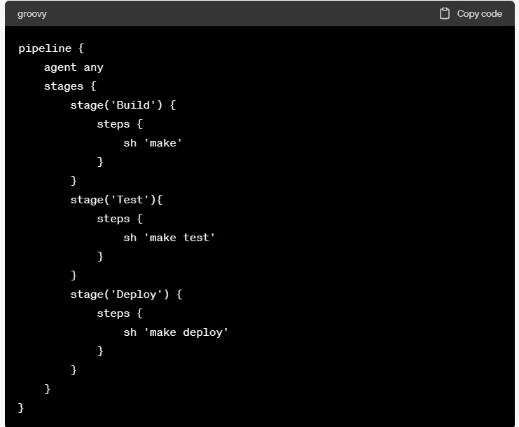

- **与源码控制集成**：配置 CI 服务器在代码提交/合并时触发构建。

### CI/CD 实现中的挑战

- **大型项目的复杂性**：管理大型复杂项目的流水线可能具有挑战性。使用模块化的流水线设计有助于管理这种复杂性。
- **维护流水线效率**：随着项目的演进，必须对性能和资源利用率流水线进行持续审查和优化。

### CI/CD 最佳实践

- **增量更改**：频繁的小更新比大型且低频率的更新更容易处理。
- **反馈循环**：构建和测试的快速反馈有助于开发者及时解决问题。
- **安全性与合规性**：将安全检查和合规验证集成到流水线。

### CI/CD 与其他 DevOps 实践集成

- **配置管理**：集成配置管理工具以确保部署环境的一致。
- **监控**：实施监控以跟踪部署后应用程序的健康和性能。

CI/CD 流水线在 Linux 软件开发领域至关重要，提供了一个一致、自动化且高效的软件交付框架。本章不仅指导你完成设置和管理 CI/CD 流水线的各个方面，还提供了将 CI/CD 集成到更广泛的 DevOps 工作流中的最佳实践和策略。通过采用 CI/CD 流水线，组织可以显著提高开发和部署高质量软件的能力，这是在当今快速发展的数字格局中的关键能力。

随着第五章的结束，我们经历了 Linux 环境下自动化和脚本的复杂世界。我们学习了 Shell 脚本的基础、Python 脚本的强大和适应性、配置管理工具在维持可靠一致系统中的功能，以及持续集成和开发（CI/CD）流水线在现代软件开发和部署中的关键作用。除了对这些每个元素提供全面概述外，本章还巧妙地将它们融合在一起，创造了一个引人胜的故事，强调了它们在自动化和优化 Linux 系统方面的协同能力。在这里获得的见解和技能对于任何努力利用 Linux 环境全部潜的 IT 专业人士来说至关重要。所授的知识将使组织能够自动化常规任务、强制一致配置并简化部署流程，从而提高企业系统的运行效率和可靠性。

## 第四本：“高级 Linux 编程”

# 第一章：内核与系统编程

本章概述了刻画 Linux 系统操作的基本概念。本章旨在让读者彻底掌握这些关键元素，包括内核模块的动态能力、Linux 内核架构的深度、设备驱动程序的关键作用以及系统调用的功能。通过每一个精心设计的章节，读者将能够充分实现 Linux 系统编程的可能性，因为每个部分都提供了广阔的见解。无论你在开发或内核编程方面的经验如何，本章都将介绍 Linux 基础架构的复杂性与微妙之处。

## Linux 内核

Linux 内核是 Linux 操作系统的基础底层。它负责管理系统资源，并在硬件与软件应用程序之间提供一个抽象层。

### 内核功能与职责

**进程管理：**

内核负责创建、调度和终止进程。它通过管理进程状态和优先级来确保 CPU 的高效使用。

**内存管理：**

它处理进程以及内核自身的内存分配。这包括管理虚拟内存、分页和交换空间。

**设备驱动程序：**

内核充当硬件设备与软件之间的接口。设备驱动程序作为内核的一部分，将通用的内核命令转换为特定的硬件命令。

**文件系统：**

它为各种存储设备提供统一的文件系统接口，管理创建、删除、读取和写入等文件操作。

**网络：**

内核处理各种网络接口上的网络协议和数据传输。

### 内核架构

**单体内核：**

Linux 遵循单体内核架构，这意味着大多数操作系统服务运行在内核空间，提供了高效率和高性能。

**模块：**

虽然是单体内核，但 Linux 也支持可加载的内核模块，这些模块可以动态加载和卸载，从而增强了灵活性并减小内核体积。

### 与内核交互

**系统调用：**

应用程序通过系统调用与内核进行交互，系统调用是提供接口以请求内核服务的函数。

**`/proc` 文件系统：**

`/proc` 文件系统是一个虚拟文件系统，提供了一个观察内核的窗口，允许用户和应用程序访问内核信息和设置。

## 构建与自定义内核

**内核配置：**

内核可以根据特定需求进行自定义。配置选项包括启用/禁用功能以及硬件支持。

**编译内核：**

自定义和编译内核是一个配置、构建和安装新内核版本的过程。

**示例步骤：**

- `make menuconfig` 或 `make xconfig` 用于内核配置。
- `make` 构建内核。
- `make modules_install` 安装内核模块。
- `make install` 安装内核。

## 安全与性能

**安全特性：**

内核集成了各种安全模块，如 `SELinux`、`AppArmor` 和 `seccomp`，以增强系统安全性。

**性能监控：**

使用 `perf` 和 `htop` 等工具监控内核和系统性能。

Linux 内核不仅仅是操作系统的核心；它还是驱动 Linux 效率、稳定性和多功能的强大引擎。对于任何高级 Linux 程序员或系统管理员来说，理解内核都是至关重要的。本章提供了理解内核功能、架构及其与系统其他部分交互的基础知识。精通这些内容为熟练的系统级编程和 Linux 系统的有效管理铺平了道路，对于那些深深 Linux 内部原理的人来说，这是必读内容。

## 系统调用

### 系统调用：内核与用户空间之间的桥梁

Linux 中的系统调用是用户空间应用程序与内核交互的主要机制。它们是提供接口以请求内核服务的函数。

**性质与目的：**

Linux 中的系统调用是用户空间应用程序与内核交互的主要机制。它们是提供接口以请求内核服务的函数。

**功能：**

系统调用处理如创建和管理进程、访问硬件等任务。

### 使用系统调用

**基本用法：**

在程序中通过包含适当的头文件使用系统调用。

```c
#include <fcntl.h>
int fd = open("example.txt", O_RDONLY);
```

**返回值与错误处理：**

系统调用返回特定值并设置 `errno` 来指示错误。

### Linux 系统调用

**文件操作：**

`open`、`read`、`write`、`close` - 基本文件操作。

`lseek` - 文件指针操作。

**进程管理：**

`fork`、`exec`、`wait`、`exit` - 进程创建与管理。

`getpid`、`getppid` - 获取进程 ID。

**网络通信：**

`socket`、`bind`、`listen`、`accept` - 网络通信的 Socket 操作。

### 系统调用接口

**API 和 ABI：**

系统调用构成了 Linux 内核的应用程序编程接口（API）和应用程序二进制接口（ABI）。

**封装函数：**

大多数系统调用在标准库（`libc`）中都有对应的封装函数，简化了它们的使用。

### 系统调用追踪与调试

`strace` 是一个用于追踪程序所做调用的强大工具。对于调试和理解系统交互来说，它价值巨大。

**示例用法：**`strace ls`

### 创建自定义系统调用

**内核修改：**

添加系统调用涉及修改内核源码，由于复杂性和维护影响，这并不是常见做法。

**模块方法：**

扩展内核功能时，更倾向于编写内核模块等替代方法。

### 性能考量

**上下文切换：**

系统调用涉及从用户模式到内核模式的上下文切换，这在性能方面是一项开销较大的。

**优化：**

最少系统调用并优化现有调用对于高性能应用程序至关重要。

系统调用是 Linux 编程中的一个基本概念，作为用户空间应用程序与内核之间的本质接口。本章提供了对系统用的全面理解，涵盖了用法、常见示例和调试技术。对于任何在 Linux 环境下工作的程序员来说，精通系统调用至关重要，因为它能够与底层内核进行高效有效的交互，释放 Linux 系统编程的全部潜力。

## 设备驱动程序

Linux 设备驱动程序是特殊的软件组件，允许内核与硬件设备交互。它们对于几乎所有硬件组件的运行都至关重要，从鼠标等简单外设到网络适配器等复杂系统都是。

### 理解设备驱动程序的作用

**功能：**

设备驱动程序提供了与硬件交互所需的抽象。它们将通用的内核命令转换为特定的硬件操作。

**驱动程序类型：**

- **字符设备驱动程序**：管理按字符访问的设备（例如串口）。
- **块设备驱动程序**：处理具有块状存储的设备（例如硬盘）。
- **网络驱动程序**：管理用于数据传输的网络接口。

### 开发 Linux 设备驱动程序

**驱动程序的内核 API：**

Linux 为编写设备驱动程序提供了丰富的内核 API，包括用于注册设备、处理中断和管理 I/O 的函数。

**驱动注册：**

驱动程序必须向内核注册才能被识别和使用。

**示例注册代码段：**

```c
static int __init my_driver_init(void) {
    register_chrdev(DEVICE_MAJOR, DEVICE_NAME, &my_fops);
    return 0;
}
```

### 与硬件通信

#### I/O 操作

驱动程序通过 I/O 操作与硬件通信，使用 I/O 端口和内存映射 I/O 等机制。

#### 处理中断

中断处理是驱动程序的关键功能，允许它们响应来自硬件的信号。

### 将驱动程序集成到内核

#### 内核模块

大多数设备驱动程序实现为可加载内核模块，可以根据需要从内核加载和卸载。

#### 兼容性

确保与不同内核版本和硬件架构的兼容性是驱动程序开发的关键环节。

### 驱动程序的调试与测试

#### 调试工具

使用 `printk`、内核调试器和模拟器等工具来调试设备驱动。

#### 测试策略

驱动驱动通常需要特殊的硬件设置，并针对各种用例和环境进行彻底测试。

### 安全与性能考量

#### 安全影响

驱动程序运行在内核空间，因此驱动程序中的错误或漏洞可能会对系统安全产生严重影响。

#### 优化性能

性能考量包括高效处理 I/O 操作、最小化延迟以及优化中断处理。

### 驱动程序开发中的最佳实践

#### 编码规范

遵循 Linux 内核编码风格和最佳实践对于可维护性和集成至关重要。

#### 文档工作

良好的文档代码和使用说明对于内核维护者和最终用户都是至关重要的。

设备驱动程序是 Linux 内核的重要组成部分，架起了硬件与软件之间的桥梁。本章深入介绍了如何在 Linux 环境下开发、集成和维护设备驱动程序。对于旨在通过硬件集成来扩展 Linux 系统能力的系统程序员和开发者来说，掌握这些内容至关重要，以确保底层硬件高效、安全且无缝地运行。

## 内核模块

内核模块是可以按需加载到 Linux 内核的代码段，提供了一种灵活的方法向内核添加功能，而无需重新编译或重启系统。

### 理解内核模块

#### 目的与功能

内核模块用于向 Linux 内核添加新功能，例如设备驱动程序、文件系统驱动程序和网络协议，而无需修改核心内核代码。

#### 使用模块的优势

- **模块化**：允许更容易更容易管理和更新代码。
- **内存效率**：仅在需要时加载模块，节省系统内存。
- **灵活性**：允许根据系统需求对内核进行定制。

### 开发内核模块

#### 模块结构

典型的内核模块包含初始化和清理函数，并且它可能与内核的其他部分（如网络栈或设备子系统）进行交互。

#### 内核模块示例骨架

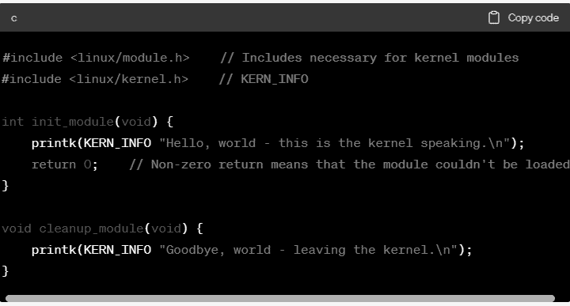

### 加载与卸载模块

#### 使用 `insmod` 和 `rmmod`

- `insmod`：向 Linux 内核插入模块的命令。
- `rmmod`：从内核中移除模块。

#### 依赖关系与参数

内核在加载模块时会自动解析依赖关系。

可以在加载时向模块传递参数以修改其行为。

#### 与内核交互

##### 系统调用与接口

模块可以使用内核函数和宏与核心内核及其他模块进行交互。

##### 导出符号

导出符号允许其他模块访问特定函数。

### 安全与稳定性

#### 安全影响

驱动程序运行在内核空间，因此驱动程序中的错误或漏洞可能会对系统安全产生严重影响。

#### 稳定性

编写不当的模块会导致崩溃。严谨的测试至关重要。

### 驱动程序开发中的最佳实践

#### 编码规范

遵循 Linux 内核编码风格确保了可维护性和集成。

#### 文档工作

良好的文档代码对于内核维护者和最终用户都是至关重要的。

设备驱动程序是 Linux 内核的重要组成部分，架起了硬件与软件之间的桥梁。本章深入介绍了如何在 Linux 环境下开发、集成和维护设备驱动程序。对于旨在通过硬件集成来扩展 Linux 系统能力的系统程序员和开发者来说，掌握这些内容至关重要，以确保底层硬件高效、安全且无缝地运行。

在第一章中，我们探索了 Linux 内核及其核心作用；至关重要的系统调用；通信至关重要的设备驱动；以及提供灵活性的内核模块。

# 第 2 章：高级 Shell 脚本

本章揭示了脚本的复杂性，包括函数和库、条件语句、循环和迭代以及至关重要的调试步骤。每个部分都经过精心设计，旨在对这些复杂组件提供更深入的理解，使读者能够编写更有效、更健壮且复杂的 Shell 脚本。本章提供了一个过渡资源，引导你从基础脚本知识转向 Linux 环境中挑战性工作所需的更高级的方法。

## 条件语句

条件语句是 Shell 脚本的决策骨干。它们允许脚本根据指定的条件执行命令，使脚本更加动态，并对不同场景做出响应。

### 理解 Shell 脚本中的条件语句

#### 条件语句的作用

条件语句评估表达式或命令，并根据其结果（真或假）确定执行流。它们对于处理不同场景、错误检查和控制脚本逻辑至关重要。

#### 条件语句的类型

`if` 语句、`case` 语句以及逻辑运算符的使用成了 Shell 脚本中条件逻辑的核心。

### `if` 语句

#### 基础语法

`if` 语句通常于 `if` 开始，后面跟着一个条件，然后是 `then` 关键字，表示如果条件为真则开始执行块。它以 `fi` 结束。

```bash
if [ "$1" -gt 100 ]
then
    echo "The number is greater than 100."
fi
```

#### 使用 `else` 和 `elif`

`else` 在条件为假时提供一个备选命令块。`elif`（else if）按顺序检查多个条件。

### `case` 语句

#### 处理多个条件

`case` 语句为处理多个离散条件提供了优雅的解决方案。语法涉及一个变量，后跟不同的模式和操作。

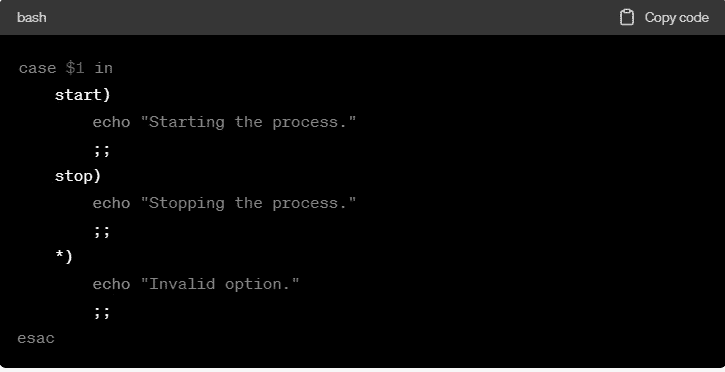

### 使用测试命令

#### `[` 命令

`[` 命令（也称为 `test` 命令）用于评估条件。它支持文件测试、字符串比较和算术比较。

#### 示例测试

- 文件存在性：`[ -f "$filename" ]`
- 字符串比较：`[ "$str1" == "$str2" ]`
- 算术比较：`[ "$num1" -eq "$num2" ]`

## 逻辑运算符

### 与（`&&`）和或（`||`）

这些运算符用于组合多个条件。

如果前一个命令为真，`&&` 将执行下一个命令；而 `||` 则在前一个命令为假时执行执行。

## 使用条件语句的最佳实践

**可读性：**

编写清晰且易于理解的条件。复杂的条件应该拆分或添加注释以提高清晰度。

**错误检查：**

在脚本中使用条件语句进行健壮的错误检查和处理。

**避免常见陷阱：**

注意测试语法的细微差别，特别是 `[` 和 `]` 周围的空格。

条件语句是高级 Shell 脚本编写的一个基础方面，为构建复杂且健壮的脚本提供了必要的控制结构。本章的这一节赋予了你有效利用条件语句的知识，增强了你的 Shell 脚本的功能和可靠性。理解并应用这些概念将使你能够创建适应各种条件和输入的脚本，这是任何 Linux 系统程序员的至关重要的技能。

## 循环与迭代

循环与迭代：在 Shell 脚本中实现重复任务

循环是 Shell 脚本中的基础构造结构，允许在特定条件下重复执行一组命令。它们对于需要重复处理的任务至关重要，例如文件的批处理、系统监控和自动化报告。

### Shell 脚本中的循环类型

#### `for` 循环

用于遍历值列表。

**示例：**

```bash
for file in /path/to/*.txt; do
  echo "Processing $file"
  # 处理文件的额外命令
done
```

#### `while` 循环

只要给定条件为真，就一直执行。

通常用于读取输入或监控系统状态。

**示例：**

```bash
while [ "$input" != "quit" ]; do
  read input
  echo "You entered: $input"
done
```

#### `until` 循环

与 `while` 循环类似，但会在条件变为真之前持续执行。

**示例：**

```bash
until [ -f "/tmp/finished.txt" ]; do
  sleep 60
done
echo "File found, proceeding."
```

### 控制循环执行

**使用 `break` 和 `continue`：**

- `break`：完全退出循环。
- `continue`：跳过当前循环迭代中的剩余命令，并进入下一次迭代。

**嵌套循环：**

循环可以相互嵌套以处理更复杂的场景。应注意避免过于复杂或深层嵌套，因为这可能导致脚本难以理解和维护。


## 循环的实际应用

### 系统管理任务

自动化常规检查，例如扫描日志文件中的特定条目或监控系统资源使用情况。

### 数据处理

批量处理和转换数据文件，例如转换格式、提取数据或生成报告。

## 使用循环的最佳实践

### 效率

考虑你循环的效率，特别是在处理大型数据集或对性能有重大影响的操作时。

### 可读性

编写清晰且易于理解的循环。循环内部复杂的逻辑应进行良好的注释，或重构为函数以获得更好的可读性。

### 错误处理

在循环中加入错误检查，特别是在处理文件操作或外部命令时。

循环是 Shell 脚本中的一个强大功能，使程序员能够高效有效地自动化重复任务。本章的这一节提供了对不同类型循环及其在 Linux 系统编程中实际应用的深入理解。通过掌握循环和迭代，你将完全能够编写出处理复杂任务、处理大量数据并执行常规系统维护的脚本，使其成为你脚本工具箱中不可或缺的工具。

## 函数与库

函数与库：通过模块化和复用性增强 Shell 脚本。

Shell 脚本中的函数是用于执行特定任务的自包含代码块。它们是编写清晰、可维护且高效脚本的基础。库则通过允许使用预定义的函数集来扩展脚本的功能。

### 在 Shell 脚本中构建函数

#### 定义函数

函数通过名称定义，后跟着一组括住命令的大括号。

#### 示例

```bash
greet() {
  echo "Hello, $1!"
}
```

#### 调用函数

一旦定义，可以通过其名称及其后的参数（如果有）来调用函数。

#### 示例

```bash
greet "World"  # 输出: Hello, World!
```

### 参数传递与返回值

#### 函数中的参数

函数可以接受参数，在函数内部通过 `$1`、`$2` 等访问。

#### 示例

```bash
add() {
  echo $(($1 + $2))
}
```

#### 返回状态

函数返回一个状态（而不是值），类似于命令，0 表示成功，非零表示失败。`return` 语句用于带状态退出函数。

### 局部与全局变量

#### 变量作用域

Shell 脚本中的变量默认是全局的，但可以使用 `local` 关键字设为函数局部。函数倾向于使用局部变量以避免副作用。

### 在 Shell 脚本中创建和使用库

#### 库脚本

Shell 脚本中的库是一个包含函数集合的文件，可以在其他脚本中包含或源自。

使用 `source` 或 `.` 命令来包含库脚本。

#### 库的使用示例

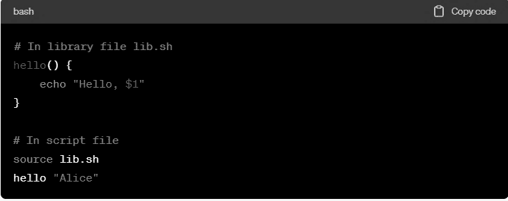

### 函数设计的最佳实践

#### 单一职责

每个函数应该有一个单一职责，使其更容易理解、测试和复用。

#### 命名规范

为函数使用清晰且描述性的名称，反映其用途。

#### 文档

记录函数的用途、参数和返回状态，特别是库。

### 使用函数和库的优势

#### 模块化

函数和库促进了模块化，使脚本更容易阅读、维护和调试。

#### 复用性

常用的代码可以抽象成函数并在多个脚本中复用。

#### 可维护性

可以在一个处（函数定义）进行更改，简化维护工作。

函数和库在高级 Shell 脚本编写中起着关键作用，为构建模块化、高效且可维护的脚本提供了手段。本章的这一节彻底涵盖了函数和库的创建、使用和最佳实践，赋予你增强脚本能力的能力。通过接受这些概念，你可以编写出不仅有效执行预期任务，而且结构便于理解和适应的脚本。

### 调试脚本

调试是识别并解决脚本中错误（bug）的过程。它是确保脚本按预期运行且没有可能导致错误结果或系统故障错误的关键步骤。

#### 脚本中的错误本质

##### 常见问题

语法错误、逻辑错误和运行时错误在 Shell 脚本中很常见。这些错误从简单的拼写错误到复杂的逻辑缺陷不等。

##### 错误的影响

脚本中的错误可能导致各种后果，从微小的异常到严重的系统问题，特别是当脚本用于系统管理任务时。

#### 调试工具和技术

##### `Echo` 语句

在脚本的策略位置放置 `echo` 语句，以输出变量值和执行流。

##### 示例

```bash
echo "Current value of var is: $var"
```

##### 使用 `-x` 选项

使用 `bash -x` 运行脚本启用跟踪模式，该模式会打印执行的每条命令及其参数。

## 高级调试技术

### 条件日志记录

实现仅在启用调试模式时才激活的条件日志语句。

### 使用外部调试工具

可以使用 `shellcheck` 等工具对脚本进行静态分析，识别常见错误并提供改进建议。

### 编写可调试脚本的实践实践

#### 模块化设计

以模块化的方式编写脚本并定义良好的函数，可以更容易隔离和调试问题。

#### 一致的错误处理

针对不同类型的失败实现一致的错误处理和退出策略。

#### 使用详细模式和调试模式

在脚本中实现详细模式和调试模式，可以通过启用它们来提供详细的执行日志。

### 常见调试场景

#### 语法错误

识别并解决语法错误，这些错误通常由 Shell 解析器突出显示。

#### 逻辑错误

调试逻辑错误，这通常更有挑战性，需要对脚本的预期行为有深入的理解。

#### 运行时错误

处理脚本执行过程中发生的错误，例如找不到文件、权限拒绝或命令失败。

### 测试与验证

#### 单元测试

为单个脚本组件或函数编写并运行单元测试。

#### 需求验证

确保脚本满足所有指定的要求，并在所有场景下按预期执行。

### 调试最佳实践

#### 保持脚本简单

简单性有助于调试。脚本越复杂，越越调试。

#### 文档工作

文档良好的代码使其更容易理解脚本逻辑并发现差异。

#### 定期测试

在各种条件下定期测试脚本，可以预先捕捕捉并解决许多问题。

调试是 Shell 脚本编写中的一项至关重要的技能，在开发可靠高效的脚本方面起着关键作用。本章的这一部分提供了对调试实践、工具和技术的深入理解，使你能够编写出不仅完成预期任务，而且健壮且无错误的脚本。通过掌握调试艺术，你可以确保你的脚本已准备好应对复杂的 Linux 系统环境的需求。

当我们结束第 2 章时，我们已经探索了构成 Linux 环境下高级 Shell 脚本的核心组成部分。在这一旅程中，我们全面涵盖了条件语句的细微差别、循环和迭代的动态、函数和库的模块化，以及调试这一关键技能。这些组件对于任何希望充分利用 Shell 脚本潜力的 Linux 程序员来说都是基石。本章传授的知识和技术不仅仅是工具；它们是脚本开发创新和效率的催化剂。

# 第 3 章：安全措施

《高级 Linux 编程》的第 3 章开始对保护 Linux 系统至关重要的安全措施进行性探索。本章精心设计，旨在提供对关键安全组件的全面理解：Linux 安全模块（LSM）、入侵检测系统、虚拟专用网络、安全启动和加密。每个章节都深入探讨了这些元素，不仅提供了技术见解，还提供了实际应用，确保读者理解这些工具在加固 Linux 免受多种安全威胁方面。本章对于程序员和系统管理员来说都是不可或缺的，旨在他们的 Linux 环境中构建稳健的防御。

## Linux 安全模块（LSM）

Linux 安全模块是 Linux 内核不可或缺的一部分，为支持各种安全模型提供了框架。它们本身并不是安全机制，而是提供了一个实施安全策略的结构。

### 理解 Linux 安全模块

#### 角色与目的

LSM 提供了一种在 Linux 内核内执行安全策略的方法，内核操作与安全策略之间的桥梁。

#### 实现

LSM 集成到内核的各个部分，拦截关键系统操作以执行安全策略。

### LSM 的主要特性

#### 灵活性

LSM 允许在不更改内核源代码的情况下实施不同的安全模型，使其具有灵活性和适应性。

#### 可堆叠设计

最近的进展使得 LSM 变得可堆叠，允许多个安全模块并发运行。

### 流行的 Linux 安全模块

#### SELinux

`SELinux` 由 NSA 开发，是最广泛使用的 LSM 之一。它根据策略强制强制性访问控制（`MAC`），这些策略规定了进程如何相互作用以及与系统资源的交互。

#### AppArmor（Application Armor）

`AppArmor` 使用基于路径的控制进行程序执行和文件访问，比 `SELinux` 管理更简单。它侧重于根据附加到程序的配置文件定义应用程序允许做什么。

### 配置和管理 LSM

#### 启用和禁用模块

可以在启动时通过内核参数启用或禁用 LSM。

#### 策略管理

`SELinux` 和 `AppArmor` 等模块的策略通过特定工具和配置文件管理。

#### SELinux 命令

```bash
# 设置 SELinux 模式
setenforce Permissive
```

### 安全策略与规则

#### 定义策略

策略是定义系统、应用程序和用户如何与各种资源交互的规则集。例如：在 `SELinux` 中，策略是用策略描述语言编写的，并编译成二进制策略文件。

### 挑战与考虑

#### 复杂性

实施和管理 LSM（特别是 `SELinux`）可能是复杂的，需要对安全策略和系统架构有深入理解。

#### 性能影响

虽然通常很小，但 LSM 可能会产生性能影响，特别是在高吞吐量或低资源的系统中。

### 使用 LSM 的最佳实践

#### 策略开发

开发符合组织需求和系统架构的安全策略。

#### 定期更新

保持安全模块和策略更新，以防止新的漏洞和威胁。

#### 审计与监控

定期审计安全日志并监控系统活动，确保策略得到有效执行。

Linux 安全模块是 Linux 安全架构的基石，为实施各种安全模型提供了稳健的框架。本章的这一部分提供了理解、配置和有效利用 LSM 的知识和技能，增强你的 Linux 系统的安全态。通过掌握 LSM，你获得了实施复杂且定制安全策略的能力，这对于在日益复杂且充满威胁的数字环境中维护 Linux 环境的完整性和安全性至关重要。

## 入侵检测系统（IDS）

入侵检测系统是 Linux 安全架构不可或缺的组件，旨在检测对计算机系统的未经访问或滥用。IDS 解决方案在识别潜在威胁和警报管理员方面起着关键作用，有助于防止或减少网络攻击造成的损害。

### 理解入侵检测系统

#### 角色与目的

IDS 监控网络或系统活动以检测恶意活动或违反策略的行为。作为第二道防御，补充了防火墙等预防性措施。

#### IDS 类型

- 网络入侵检测系统（`NIDS`）：监控网络流量中的可疑活动。
- 主机入侵检测系统（`HIDS`）：监控并分析计算系统的内部以及网络接口上的数据包。

### Linux IDS 主要特性

#### 实时监控与分析

IDS 系统对系统活动进行实时监控，通过分析数据来识别可能指示安全漏洞的模式。

### 告警与报告

检测到可疑活动时，IDS 系统会生成告警，并向系统管理员提供详细报告以便采取后续行动。

### 在 Linux 环境中实现 IDS

#### 常见的 Linux IDS 工具

如 `Snort`（用于 `NIDS`）以及 `AIDE` 或 `Samhain`（用于 `HIDS`）等工具被广泛应用于 Linux 环境。

#### 配置与自定义

IDS 工具需要仔细配置，包括设置识别可疑活动的规则。

#### Snort 规则示例

```text
alert tcp any any -> 192.168.1.0/24 80 (msg:"Possible intrusion"; flags: A+;)
```

### 将 IDS 与其他安全措施集成

#### 防火墙

IDS 与防火墙协同工作，通过检测可能绕过防火墙防护的威胁提供额外的安全层。

#### 日志分析

将 IDS 与日志分析工具集成可以增强跟踪和解释恶意活动的能力。

### 使用 IDS 的挑战与最佳实践

#### 误报与漏报

使用 IDS 的主要挑战之一是管理误报（将良活动标记为恶意）和漏报（未能检测到实际恶意活动）。

#### 定期更新与规则管理

保持 IDS 规则和软件更新对于有效检测新出现和不断演变的威胁至关重要。

#### 性能考虑

IDS 可能会消耗资源；在安全需求与系统性能之间取得平衡。

### 保护 IDS 部署

#### IDS 本身

必须确保 IDS 的安全性，使其不易受到攻击或篡改。

#### 定期审计

定期对 IDS 日志和告警进行审计，以完善规则并提高检测准确性。

入侵检测系统（IDS）是保护 Linux 系统免受未经授权访问和攻击的基础。本节提供了对 Linux 环境中 IDS 类型、实现、挑战和最佳实践的全面理解。通过有效利用 IDS，系统管理员和安全专业人员可以显著增强 Linux 系统的安全态，确保对潜在安全威胁进行稳健检测和及时响应。对于任何在当今复杂且不断变化的网络安全环境中希望加固其 Linux 基础设施的人来说，这些知识至关重要。

## 虚拟专用网络

VPN 是保障网络通信的重要工具，为数据传输提供加密隧道，并在网络威胁无处不在的世界确保隐私和安全。

### VPN 在网络安全中的作用

#### 隐私与安全

VPN 加密网络流量，使未经授权的难以拦截和访问敏感数据。它们对于远程访问至关重要，允许通过互联网与私有网络建立安全连接。

#### 绕过地理限制与审查

VPN 可以通过不同地理位置的服务器路由流量，使用户能够绕过区域限制和审查。

### VPN 如何工作

#### 创建安全隧道

VPN 技术创建了一个“隧道”，在数据包发送到互联网之前对其进行加密，在用户与 VPN 服务器之间提供一条安全路径。

#### 加密技术

使用各种加密协议（如 `OpenVPN`、`IPsec` 和 `WireGuard`）来确保数据的安全性和完整性。

### 在 Linux 中设置 VPN

#### VPN 客户端与服务器

Linux 支持多种 VPN 解决方案，包括客户端和服务器配置。

#### 配置与设置

配置 VPN 涉及设置 VPN 客户端软件、连接到 VPN 服务器以及配置安全数据传输的网络设置。

#### OpenVPN 客户端配置示例

```bash
sudo openvpn --config client.ovpn
```

### 将 VPN 与 Linux 网络管理集成

#### 网络管理器集成

Linux 发行版通常将 VPN 功能集成到其网络管理工具中，简化 VPN 连接的设置和管理。

#### 命令行工具

对于高级用户，命令行工具提供了对 VPN 配置和连接的细粒度控制。

### VPN 的安全考虑因素

#### 选择正确的协议

选择安全可靠的 VPN 协议至关重要。`OpenVPN` 和 `WireGuard` 等协议因其在安全与性能之间的平衡而流行。

#### VPN 服务供应商

在使用第三方 VPN 服务时，选择声誉良好且在隐私政策和安全措施方面透明的提供商。

### 使用 VPN 的最佳实践

#### 定期更新

保持 VPN 软件更新对安全至关重要，因为更新通常包含已知漏洞的补丁。

#### 安全配置

确保 VPN 配置是安全的，具有强加密设置和安全的身份验证方法。

#### 监控与审计

定期监控 VPN 连接和日志以发现任何异常活动，这些活动可能指示安全泄露或滥用。

虚拟专用网络（VPN）是 Linux 程序员安全武器库中不可或缺的工具，为可能不安全的网络上的安全通信提供了稳健的解决方案。本章的这一节使你掌握在 Linux 中理解、实施和有效管理 VPN 的知识，增强了你在网络安全方面的能力。通过掌握 VPN 的使用，你可以为自己和组织确保安全私密的通信，这在当今互联的数字世界中是一项基本能力。

## 安全启动与加密

安全启动（Secure Boot）和加密是 Linux 系统安全格局中的关键工具，为从未经授权的系统修改到数据泄露的一系列威胁提供了稳健的防御。

### 理解 Linux 中的安全启动

#### 安全启动的目的

安全启动是一种安全标准，确保设备仅使用原始设备制造商（OEM）信任的软件启动。它防止恶意软件在系统启动过程中加载。

#### 工作机制

在启动过程中，固件会检查每个启动软件的签名，包括 UEFI 固件驱动程序、EFI 应用程序和操作系统。

#### Linux 与安全启动

许多 Linux 发行版现在都支持安全启动。引导加载程序和内核带有数字签名，固件会验证该签名。

### 在 Linux 中实现安全启动

#### 启用安全启动

在系统的 UEFI 固件设置中启用并配置安全启动。

#### 密钥管理

系统的 UEFI 固件存储了决定哪些软件受信任的密钥。这些包括平台密钥（PK）、密钥交换密钥（KEKs）和签名数据库（db）。

#### 自定义签名

用户可以使用自定义密钥对自己的引导加载程序和内核进行签名，并将其添加到固件的信任数据库中。

### Linux 系统中的加密

#### 加密的作用

加密是将数据编码的过程，使得只有授权方才能访问。在 Linux 中，它用于保护静态数据（磁盘）和传输中数据（网络）。

#### 磁盘加密

`LUKS`（Linux 统一密钥设置）等工具用于 Linux 全盘加密。

#### 创建加密卷的命令示例

```bash
sudo cryptsetup luksFormat /dev/sda1
```

#### 文件系统加密

`eCryptfs` 和 `EncFS` 是加密单个文件或目录的解决方案。

### 密钥管理与最佳实践

#### 安全密钥存储

应安全存储密钥，使用硬件安全模块（HSM）或安全的密钥存储机制。

#### 定期密钥轮换

定期更换加密密钥可以显著增强安全性。

### 实现安全启动与加密的挑战

#### 复杂度

配置安全启动和设置加密可能是复杂的，需要对系统固件和 Linux 内核有深入的理解。

#### 性能考虑

加密可能会影响系统性能，尤其是在资源受限的设备上。

安全启动和加密对于增强 Linux 系统的安全性至关重要。本章节提供了有关设置和管理这些安全措施的详细见解，确保你的 Linux 系统免受未经授权的访问和数据泄露。通过将安全启动和稳健的加密实践集成到你的 Linux 环境中，你可以构建起针对各种安全威胁的强大防御，维护系统完整性和数据机密性。对于任何负责维护 Linux 系统安全性和可靠性的人来说，这些知识都是至关重要的。


在结束第 3 章时，我们探讨了 Linux 安全的关键方面，涵盖 Linux 安全模块（LSM）的复杂机制、入侵检测系统的警备监控、虚拟专用网络（VPN）的保护层，以及安全启动和加密的基础强度。本章的旅程不仅传授技术知识，还教授了这些安全措施的策略应用，这对于任何高级 Linux 编程都至关重要。通过整合这些安全组件，你将能够创建既功能完备又能抵御不断进的网络威胁的 Linux 环境。

## 第 4 章：性能调优

《高级 Linux 编程》在第 4 章涵盖了性能调优，这是 Linux 系统开发和管理领域的一个重要课题。本章彻底研究了许多与系统性能相关的主题，包括磁盘 I/O 优化、内核调优、系统监控工具和网络优化。每一章都探索了提高 Linux 系统响应和效率的实用方法和技术细微差别。本章为新手和资深 Linux 专家设计，提供了性能调优技术及其使用方法的全面概述。性能调优是优化 Linux 系统以处理各种高需求计算工作负载的关键组件。

### 系统监控工具

系统监控对于维护 Linux 系统的健康和效率至关重要。它涉及跟踪各种系统指标、识别性能瓶颈以及收集可以指导优化策略的数据。

#### 系统监控的重要性

**识别性能问题**

定期监控有助于尽早发现性能问题，允许在问题升级为更严重的问题之前及时干预。

**资源管理**

监控工具提供了资源利用率的见解，有助于更高效地分配系统资源。

#### 综合系统监控

**CPU 和内存使用**

像 `top` 和 `htop` 这样的工具提供了有关 CPU 和内存利用率、进程统计和系统负载的实时信息。

`top` 命令用法示例：

```bash
top
```

**磁盘使用和性能**

如 `iostat` 和 `df` 等工具提供了有关磁盘使用、I/O 统计和文件系统健康的见解。

**网络流量和性能**

`iftop` 和 `nethogs` 等网络监控工具跟踪网络带宽使用情况，提供入出站网络流量的数据。

#### 高级监控工具

**系统性能分析**

`sar`（系统活动报告器）和 `sysstat` 软件包可以收集并报告系统活动信息。

**可视化和日志**

高级监控解决方案可以包括图形化可视化工具和用于长期性能分析的日志功能。

#### 虚拟化环境中的监控

**虚拟机级监控**

运行在虚拟机级别的监控工具对于虚拟化环境至关重要，用于跟踪跨虚拟机的资源分配和使用。

#### 监控中的自动化

**自动告警系统**

根据某些阈值配置自动告警有助于主动管理系统健康。

**自定义监控脚本**

可以编写自定义脚本来自动化特定的监控任务，与现有工具集成以提供定制的见解。

#### 系统监控中的最佳实践

**定期监控和审计**

持续监控系统性能并进行定期审计有助于维持最佳环境。

**平衡性能与开销**

虽然监控至关重要，但平衡监控深度与其可能引入的潜在开销之间的关系是非常重要的。

**安全考量**

确保监控工具和数据是安全的，因为它们可能包含有关系统的敏感信息。

系统监控工具是任何 Linux 系统管理员或程序员武器库中不可或缺的。本章节让读者掌握了选择和利用正确工具进行全面系统监控的知识，确保 Linux 系统运行最佳状态。通过理解和应用有效的系统监控原则，你可以主动管理系统资源，诊断并解决性能问题，并维护你 Linux 环境的整体健康和效率。

### 内核调优

Linux 内核是操作系统的核心，管理系统资源以及硬件与软件之间的通信。内核调优涉及调整内核内的各种参数和设置，以针对特定工作负载或环境优化性能。

#### 理解内核在性能中的作用

**内核职责**

内核处理内存管理、进程调度、文件系统操作和网络流量等关键功能。

**对整体性能的影响**

内核的效率直接影响整个系统的性能。优化内核行为可以显著提高系统的响应和吞吐量。

#### 内核调优的关键领域

**内存管理**

调整`vm.swappiness`和`vm.dirty_ratio`等参数可以优化内核处理虚拟内存和交换分区的方式。

命令示例：

```bash
sysctl vm.swappiness=10
```

**进程调度**

调整调度器参数可以提高系统响应，特别是在多任务环境中。

**文件系统性能**

调整文件系统缓存和缓冲区可以增强磁盘 I/O 性能。

**网络调优**

调整网络栈参数可以提高网络吞吐量和延迟。

#### 内核调优工具

**`sysctl`**

`sysctl`工具用于运行时读写内核参数。

命令示例：

```bash
sysctl -w net.ipv4.tcp_fin_timeout=30
```

**`/proc` 文件系统**

`/proc`文件系统为内核数据结构和参数提供了动态接口。

#### 内核调优中的最佳实践

**理解工作负载需求**

调优应基于特定的工作负载需求。对 Web 服务器有效的方法对数据库服务器可能并不理想。

**基准测试和验证**

在调优之前和之后进行基准测试和验证，以量化更改的影响。

**渐进式更改和监控**

分次进行更改并监控其影响，以避免系统不稳定。

#### 内核调优的挑战

**复杂性和风险**

错误的调优可能导致系统不稳定或性能下降。深入理解内核参数是不可少的。

**系统的动态性**

随着工作负载和环境的变化，可能需要调整调优策略。

#### 自定义内核编译

**构建自定义内核**

在某些情况下，编译启用或禁用特定功能的自定义内核可以优化性能。

**维护自定义内核**

自定义内核需要持续的维护和更新，这是非常消耗资源的。

### 内核调优总结

内核调优是 Linux 系统优化的一个复杂方面，为性能提升提供了巨大潜力。它不仅提供了对内核函数的深入理解，还为针对各种工作负载优化这些函数提供了实用的指导。掌握内核调优使系统管理员和开发人员能够精细调整其 Linux 系统，实现针对特定操作需求的最优性能。通过仔细应用这些概念，可以释放 Linux 系统的全部潜力，满足高性能计算环境的需求。

### 磁盘 I/O 优化

磁盘 I/O（输入/输出）优化旨在提高系统从磁盘读取和写入数据的效率。鉴于磁盘访问通常是系统性能的瓶颈，优化磁盘 I/O 可以显著提升 Linux 系统的整体功能。

#### 磁盘 I/O 在系统性能中的重要性

**性能瓶颈**

磁盘 I/O 往往是系统性能的限制因素，特别是在高数据吞吐量要求的系统中。

**对应用程序的影响**

频繁访问磁盘的应用（如数据库和 Web 服务器）可以从磁盘 I/O 优化中显著受益。

#### 磁盘 I/O 优化策略

**文件系统选择**

文件系统的选择（例如`ext4`、`XFS`、`Btrfs`）会影响磁盘 I/O 性能。不同的文件系统具有不同的特性和性能特征。

**文件系统调优**

调整文件系统参数（如写回设置或日志模式）可以增强性能。

调优`ext4`文件系统的命令：

```bash
tune2fs -O ^has_journal /dev/sdXn
```

**磁盘调度算法**

Linux 提供了多种 I/O 调度器（如`CFQ`、`Deadline`和`NOOP`），可以根据工作负载需求进行选择。

#### 优化磁盘硬件

**RAID 配置**

实现 RAID（独立磁盘冗余阵列）可以增强性能和可靠性。不同的 RAID 级别提供了性能与冗余之间的平衡。

**使用 SSD**

固态硬盘（`SSD`）的读写速度比传统的 HDD 快，可以显著提升 I/O 性能。

#### 磁盘 I/O 优化的高级技术

**缓存与缓冲**

Linux 使用内存对磁盘操作进行缓存和缓冲。调整这些缓存的大小和行为可以优化性能。

检查缓冲区大小的命令：

```bash
free -m
```

**异步 I/O**

异步 I/O 操作允许进程在无需等待磁盘 I/O 操作完成的情况下继续运行，从而提高性能。

#### 磁盘 I/O 优化的最佳实践

**定期监控**

使用`iostat`和`vmstat`等工具监控磁盘 I/O 性能并识别瓶颈。

**平衡 I/O 与资源**

确保优化磁盘 I/O 不导致其他领域（如 CPU 或内存）出现瓶颈。

**测试与基准**

在进行更改前后进行基准测试对于理解优化效果至关重要。

磁盘 I/O 优化是 Linux 系统性能调优的关键方面。本章的这一部分提供了理解、分析和改进磁盘 I/O 操作的全面见解。通过有效实施此处讨论的策略和最佳实践，系统管理员和开发人员可以显著提高磁盘密集型应用和服务的效率。这些知识对于确保 Linux 系统优化以处理高性能需求至关重要，特别是在数据密集型和 I/O 密集型环境中。

### 网络优化

Linux 中的网络优化涉及精调各种网络参数和设置，以提高数据传输效率、降低延迟并增加整体网络性能。

#### 理解网络性能的作用

**对系统性能的影响**

网络性能可能是许多系统中的主要瓶颈。

**网络优化的挑战**

网络优化必须考虑带宽、延迟和拥塞等因素。

#### 网络配置与调优

**TCP/IP 栈优化**

Linux 中的 TCP/IP 栈有多个可以调整的调优参数。

修改的示例命令：

```bash
sysctl -w net.ipv4.tcp_window_scaling=1
```

**缓冲区大小**

调整发送和接收缓冲区的大小有助于适应流量。

#### 高级优化技术

**流量整形与管理**

使用`tc`等工具控制数据包的发送速率，有效管理带宽。

**网络驱动与硬件调优**

确保网络驱动程序和硬件（如`NIC`）经过优化并保持更新。

#### 利用网络监控工具

**实时监控**

`iftop`和`nethogs`等工具提供网络使用的实时监控。

**历史数据分析**

分析历史网络性能数据有助于识别模式并做出调优决策。

#### 针对特定工作负载进行优化

**理解工作负载需求**

网络优化应与工作负载的具体需求保持一致。例如，Web 服务器的优化需求可能与文件服务器不同。

**特定协议的优化**

不同的网络协议可能从特定的调优中受益。例如，针对`HTTP/HTTPS`流量的优化可能涉及与`FTP`或`SSH`流量优化不同的设置。

#### 网络优化的最佳实践

**定期基准测试**

定期进行网络性能测试和基准有助于评估优化工作的有效性。

**平衡优化与安全性**

在优化网络性能的同时，确保安全性不受损害至关重要。

**关注更新**

关注最新的内核更新和网络工具可以提供新的优化功能和增强。

## 第 5 章：高级 Linux 编程

第 5 章带我们探索社区参与与 Linux 贡献之间的动态关系。参与 Linux 生态系统有多个维度，本章将揭示这些维度。这些包括了解如何为开源软件授权、做出有意义的贡献、利用社区支持以及获得认证。这一部分不仅是提供信息，更像是一份手册，鼓励读者参与进来并在 Linux 社区中成长。本章不仅展示了个人贡献（无论是代码、帮助还是教育形式）如何对 Linux 的整体实力和发展做出贡献，还强调了个人进步与社区发展之间的互惠关系。

### 开源许可

开源许可是规范软件如何被自由使用、修改和共享的法律和伦理框架。在 Linux 社区中，理解这些许可证对于贡献和使用 Linux 软件都至关重要。

#### 理解开源许可证

**开源哲学**

开源建立在协作、透明和自由访问软件的理念之上，能够实现广泛的创新和适应。

**开源许可证的主要类型**

`GNU 通用公共许可证 (GPL)` 是 Linux 软件最广泛使用的许可证，它确保软件（及任何衍生版本）保持自由和开放。

其他常见的许可证包括`Apache 许可证`、`MIT 许可证`和`BSD 许可证`，每种许可证都有自己的权限和限制。

#### GNU 通用公共许可证 (GPL)

**GPL 版本**

多年来，`GPL`不断演变，其中`GPL 第 3 版`是最新版本，包含了解决专利诉讼和 Tivo 锁定（tivoization）的条款。

**GPL 的关键条款**

`GPL`要求在分发软件及其任何修改版本时，必须提供源代码。

#### 合规性与法律层面

**确保合规**

遵守开源许可证对于避免法律陷阱至关重要。这涉及遵守分发、修改和使用的条款。

**许可证兼容性**

理解不同许可证之间如何交互至关重要，特别是在整合多个具有不同许可证的开源组件时。

#### 软件开发与分发中的许可

**为你的软件选择许可证**

发布软件时，选择正确的开源许可证是一项关键决策，会影响软件的采用、使用和贡献。

**对现有项目的贡献**

现有开源项目的贡献者必须遵守项目的许可条款。

#### 许可对 Linux 生态系统的影响

**社区与协作**

开源许可证培养了协作和社区文化，允许全球的开发者为 Linux 软件做出贡献并从中受益。

**创新与演进**

这些许可证实现了 Linux 生态系统的快速创新和适应，因为开发者可以在不受限制的情况下在现有工作的基础上进行构建。

#### 开源许可的最佳实践

**理解法律影响**

开发者对与开源许可相关的法律影响有基本的了解是非常重要的。

**寻求专家建议**

在复杂情况下，咨询开源许可领域的法律专家可能是极具价值的。

开源许可是 Linux 宇宙的基石，在 Linux 软件的开发、分发和使用中起着关键作用。当前章节对开源许可证进行了深入探讨，强调了它们在培养 Linux 社区协作、创新和自由文化方面的重要性。通过理解和遵守这些许可证，开发者和用户可以确保他们正对充满活力且不断演变的 Linux 世界做出积极贡献，维护开源精神及其对全球技术格局不可估量的影响。

### 为 Linux 贡献

为 Linux 贡献不仅仅是编写代码。它涵盖了从文档到开发的系列活动，所有这些都旨在改进和扩展 Linux 生态系统。

#### 理解 Linux 社区与贡献渠道

**Linux 社区**

Linux 社区是多样化的，包括独立开发者、专业人士、爱好者和大型企业，他们因对 Linux 的共同兴趣而团结。

**贡献渠道**

对 Linux 的贡献可以采取许多形式，包括编码、文档、提供用户支持、参与论坛等。

#### 开始贡献 Linux

**选择贡献点**

潜在的贡献者可以从识别个人或专业感兴趣的领域，或者他们认为可以产生最大影响的领域开始。

**理解贡献流程**

每个 Linux 项目或发行版都有自己的贡献指南，这些指南通常详细列在`CONTRIBUTING.md`文件或类似的中。

#### 向 Linux 贡献代码

**理解代码库**

熟悉 Linux 内核代码库或特定发行版的代码库是至关重要的第一步。

**使用版本控制**

Linux 贡献通常通过`Git`等版本控制系统管理。理解`Git`操作至关重要。

克隆仓库的 Git 命令示例：

```bash
git clone https://github.com/torvalds/linux.git
```

**提交补丁**

贡献者通过邮件列表或项目管理系统提交补丁。补丁应遵守项目的编码标准和指南。

#### 文档与本地化

**编写和改进文档**

高质量的文档对于开源项目至关重要。贡献者可以编写、更新或翻译文档。

**本地化努力**

将软件和文档翻译成不同的语言使得 Linux 在全球范围内更容易获取。

#### 社区支持与维护

**提供用户支持**

在论坛、邮件列表和 IRC 频道上回答问题并提供支持是一项有价值的贡献。

**维护与推广**

通过博客、社交媒体和当地活动倡导 Linux 和开源软件有助于增长和支持社区。

#### 做出贡献的最佳实践

**遵循社区指南**

遵守社区的贡献指南和行为准则对于和谐的协作至关重要。

**质量优于数量**

关注贡献的质量，无论是代码、文档还是支持。

**乐于接受反馈**

Linux 社区是协作的。乐于接受反馈并愿意协作是必不可少的。

为 Linux 贡献是回馈这个基于协作和开源原则发展的社区的一种满足方式。书的这部分不仅指导了如何贡献，还强调了开源精神和社区驱动的发展。无论是通过代码、文档还是支持，每一个贡献都丰富了 Linux 生态系统，确保了它的持续增长和演进。本节邀请加入一个重视知识共享和集体进步的全球社区。

### 社区支持

Linux 的力量在于其社区——这是一个多样化的、全球性的用户、开发者和爱好者组成的网络，他们提供支持、分享见解并协作项目。

#### 社区支持的本质

**社区驱动的发展**

Linux 依靠社区驱动的方式蓬勃发展，支持和贡献来自全球的个人和组织，跨越了地理和文化障碍。

**多样化的支持渠道**

Linux 社区中的支持以多种形式存在，包括论坛、邮件列表、社交媒体小组以及如`IRC`等实时聊天平台。

#### 论坛和邮件列表：传统的支持渠道

**参与讨论**

Linux 论坛和邮件列表是寻求建议、分享知识以及讨论 Linux 编程和使用相关问题的丰富资源。

**利用集体智慧**

这些平台充当了集体智慧的库，多年的讨论和问题解决方案被存档在其中，供当前和未来的人参考。

#### 实时支持与协作

**IRC 和聊天平台**

`IRC`等平台为 Linux 用户和开发者提供了实时通信通道，促进了即时的援助与协作。

**在线聚会和网络研讨会**

虚拟聚会和网络研讨会已成为 Linux 社区内学习和讨论的流行途径。

#### 社区支持的实践：案例研究与示例

**成功的解决方案**

通过社区支持解决复杂问题的案例说明了协作排除故障的有效性。

**创新解决方案**

社区讨论往往能产生创新的解决方案，并推动 Linux 开发。

#### Linux 发行版在提供支持中的作用

**特定发行版的论坛**

许多 Linux 发行版维护着自己的论坛和支持渠道，以满足与其环境相关的特定查询。

**文档与 Wiki**

特定发行版的文档和 Wiki 对于新用户和老用户来说都是宝贵的资源。

#### 寻求和提供支持的最佳实践

**有效沟通**

清晰地表述问题或回复是有效支持的关键。包含必要的细节，如系统配置、错误信息和已采取的步骤。

**尊重与耐心**

保持尊重和耐心至关重要，要意识到社区支持的自愿性质。

**积极参与**

积极参与讨论，不仅作为寻求者，而且作为贡献者，这丰富了每个参与者的支持体验。


Linux 社区支持不仅仅是排除故障；它体现了开源和协作的精神。现在，书的这部分内容强调了这一支持系统的重要性，展示了它如何在 Linux 的增长和可持续发展中发挥关键作用。通过参与这些充满活力的支持网络，个人不仅为自己的挑战找到了解决方案，还为 Linux 生态系统的集体知识和进步做出了贡献。本节是对社区力量的致敬，也是关于如何有效导航并贡献于 Linux 世界这一关键领域的指南。

# 专业认证

## Linux 专业认证：精通与认可的路径

Linux 专业认证旨在验证并认可从事 Linux 系统的专业人员（从系统管理员到开发者和工程师）的技能和知识。

## 专业认证的重要性

### 技能验证

专业人士在 Linux 方面的能力和知识提供了正式认可，通常作为雇主的基准。

### 职业发展

持有认证可以为新的工作机会、晋升和更高的薪资范围打开大门。

## 流行的 Linux 认证

### CompTIA Linux+

该认证涵盖了 Linux 系统管理的基础技能，包括安装、配置、系统维护和基础网络。

### Linux 专业人员协会认证（LPIC）

`LPIC` 提供不同级别的认证，每种认证在复杂和专业化程度上都递增，从初级系统管理到高级 Linux 工程师。

### 红帽认证工程师（RHCE）和红帽认证系统管理员（RHCSA）

这些认证侧重于红帽企业 Linux 系统，在运行红帽解决方案的环境中备受推崇。

## 备考与资源

### 学习材料和课程

有大量的学习材料，包括书籍、在线课程和培训视频，用于准备这些考试。

### 动手实践

搭建实验室至关重要。

### 考试格式与内容

Linux 考试通常包含选择题和实际操作任务混合。

### 注册与预约

考试通常可以在授权的测试中心或在线进行预约。

### 持续教育

许多认证要求持续教育，以确保专业人士跟上 Linux 技术的更新。

## 认证对职业发展的影响

### 人脉网络机会

认证通常伴随着进入认证专业人士社区的机会。

### Linux 社区中的认可

获得认证的专业人士通常被视为投入者且知识渊博，这可以使他们在 Linux 社区中获得更大的尊重。

如 `cd`（切换目录）、`ls`（列出目录内容）和 `pwd`（打印工作目录）等命令是在文件系统中移动的基础。

示例：若要列出目录中的文件，命令为：

```bash
ls /path/to/directory
```

## 理解文件系统层级

熟悉 Linux 文件系统层级，从根目录（`/`）到用户目录（`/home/username`），是非常关重要的。

### 文件与目录操作

#### 创建与删除

`mkdir`（创建目录）和 `touch`（创建新文件）等命令用于创建目录和文件，而 `rm`（删除）和 `rmdir`（删除目录）用于删除。

#### 复制与移动

`cp`（复制）和 `mv`（移动）用于复制和移动文件目录。

### 文件查看与编辑基础

#### 查看文件

`cat`（连接并显示文件）、`less` 和 `more` 等命令允许用户直接在终端中查看文件内容。

#### 编辑文件

介绍如 `nano` 和 `vi` 等简单的文本编辑器，它们可以直接从命令行调用。

### 定制化终端体验

#### 使用别名（Aliases）

别名是长命令的快捷方式，通过 `alias` 命令创建。它们简化了频繁的任务并个性化了终端体验。

#### 理解 Shell 配置文件

可以编辑 `.bashrc` 或 `.bash_profile` 等 Shell 配置文件来定制终端环境。

### 通过练习建立信心

#### 结构化练习

读者将通过结构化练习来练习每个命令，从而强化理解并建立信心。

#### 常见错误与故障排除

处理常见错误（如拼写错误或错误的文件路径），并提供故障排除提示。

掌握终端是精通 Linux 的关键步骤。本节不仅是介绍，更是基础构建练习，鼓励新用户接受命令行的简单与强大。通过实际练习和解释，读者将具备在 Linux 环境中有效导航和操作的基本技能。这一节是一座桥梁，将恐惧转化为能力，引导新手成为自信的 Linux 用户。

## 文件操作挑战

文件操作是 Linux 中的一项基本技能，涉及创建、查看、修改、移动和删除文件。本节提供系列难度递增的练习，不仅涵盖了基础命令，还向用户介绍了更复杂的操作和最佳实践。

### 基础文件操作

#### 创建文件与目录

使用 `touch` 创建文件，使用 `mkdir` 创建目录。

挑战：使用 `mkdir -p` 通过单条命令创建一个嵌套的目录结构。

示例：

```bash
mkdir -p /home/user/documents/reports/2023
```

#### 查看文件内容

使用 `cat`、`less` 和 `tail` 命令查看文件的不同部分。

挑战：查看日志文件的最后十行，然后持续监控其更新。

### 高级文件处理

#### 文件操作技术

介绍带有交互式复制选项的 `cp` 和用于重命名文件的 `mv`。

挑战：编写一个脚本，根据特定模式重命名目录中的多个文件。

#### 搜索与定位文件

利用 `find` 和 `grep` 搜索文件及其内容。

挑战：定位所有在过去 24 小内内过且包含特定关键词的文件。

### 权限与所有权

#### 理解 Linux 权限

介绍文件权限（`rwx`）以及使用 `chmod` 更改它们。

挑战：修改文件权限，使得所有者可以读写，但不能执行。

#### 更改文件所有权

使用 `chown` 和 `chgrp` 更改文件的所有者和组。

挑战：编写一个脚本，将目录中所有文件的所有权更改为特定用户。

### 文件链接

#### 硬链接与符号链接

硬链接（`ln`）和符号链接（`ln -s`）的解释。

挑战：为另一个目录中的文件创建符号链接，并演示其中一个的变化如何影响另一个。

### 组合命令完成复杂任务

#### 管道与重定向

使用管道（`|`）和重定向（`>`，`>>`）组合命令。

挑战：使用组合命令从文件中提取特定信息并写入另一个文件。

#### 实际场景

展示需要组合文件操作技术的真实世界场景。

# 文本处理场景

文本处理是 Linux 命令行熟练的核心方面，对于从简单文本编辑到复杂数据分析的任务至关重要。

## 基础文本处理命令

### 使用 `grep` 搜索文本

`grep` 是根据模式在文件中搜索文本不可不可缺的工具。

挑战：使用 `grep` 找到日志文件中特定错误的所有实例。

### 使用 `sed` 处理文本

`sed`（流编辑器）允许强大的文本处理，无需打开文件即可编辑文件。

挑战：编写一个 `sed` 命令，将文件中某个单词的所有替换为另一个单词。

### 使用 `awk` 转换文本

`awk` 是一种为文本处理设计的编程语言，特别适用于表格数据。

挑战：使用 `awk` 提取并求加 CSV 文件中特定列的值。

## 高级文本处理场景

### 组合命令完成复杂任务

掌握文本处理涉及使用管道和重定向组合多个命令。

挑战：创建一个命令管道，从日志文件中提取、排序并总结数据。

### 文本处理中的正则表达式

正则表达式是模式匹配和文本处理的强大工具。

挑战：编写一个正则表达式来验证文本文件中的电子邮件地址。

### 在终端中编辑文件

#### 使用 `nano` 和 `vi` 进行内联编辑

`nano` 和 `vi` 是两种广泛使用的终端文本编辑器，每种都有自己的命令。

挑战：使用 `vi` 编辑配置文件，整合各种编辑命令。

#### 自动化编辑任务

通过脚本实现 `sed` 和 `awk` 实现自动化。

挑战：创建一个脚本来自动格式化日志文件。

## 真实的文本处理应用

### 日志文件分析

日志文件分析是 Linux 中的常见任务，需要组合文本处理命令。

挑战：分析服务器日志以识别最频繁的请求和错误。

### 数据提取与报告

从文件中提取信息并生成报告是文本处理技能的实际应用。

挑战：从多个文件中提取特定数据并汇总报告。

# 自定义脚本任务

自定义脚本是任何 Linux 用户的关键技能，能够实现重复任务的自动化并创建个性化的命令序列。

## Shell 脚本入门

### Shell 脚本基础

脚本是包含一系列命令的文件。介绍了脚本的基本结构，包括 shebang 行（`#!/bin/bash`）。

示例：创建一个列出当前目录文件的简单脚本。

```bash
#!/bin/bash
echo "列出目录文件:"
ls
```

### 脚本权限与执行

解释了如何使用 `chmod +x script.sh` 使脚本变为可执行，并通过 `./script.sh` 执行它。

## 编写有效的 Shell 脚本

### 变量与用户输入

脚本中使用变量和读取用户输入的方法增强了其灵活性和交互性。

### 控制结构

引入 `if` 语句、循环（`for`、`while`）和 `case` 语句用于决策和重复任务。

## 高级脚本技术

### 函数与模块化

在脚本中定义函数以有效地组织和重用代码。

### 错误处理与调试

错误处理技术，包括使用退出状态和条件语句来确保脚本的可靠性。

## 自动化现实世界任务

### 系统管理脚本

实用的脚本任务，例如自动化系统更新或用户账户管理。

### 数据处理脚本

用于处理和操作数据文件（如日志或 CSV 文件）的脚本，用于分析或报告。

## 脚本最佳实践

### 可读性与注释

编写清晰、易读的脚本并添加适当的注释，以增强理解性和可维护性。

### 效率与优化

编写高效脚本的技巧、避免常见陷阱以及优化性能。

## 具有挑战性的脚本场景

### 自定义备份脚本

挑战任务：创建一个脚本对特定目录进行备份，并提供全量备份或增量备份的选项。

### 网络监控脚本

编写一个脚本来监控网络活动，并在出现任何异常模式时提醒用户。

# 第 2 章：系统管理演练

系统管理主题涵盖在《实战 Linux：练习与挑战》的第 2 章中。本章旨在提高你有效管理和维护 Linux 系统的能力。你将学习系统管理员经常处理的实际情况，例如处理软件包、管理用户账户以及制定强大的备份和恢复计划。每个节中都有许多任务，以测试你的理解能力并提高你的解决问题的能力。通过这些演练，你将对 Linux 系统管理的细微之处有更深入的理解，并掌握在该行业成功所需的技能。

## 用户管理任务

有效的用户管理对于维护 Linux 系统的安全性和组织至关重要，无论是对于个人工作站还是大型服务器。

### 用户账户基础

#### 理解 Linux 用户和用户组

Linux 系统将一切视为文件，包括用户。每个用户都有一个唯一的用户 ID（UID），并属于一个或多个组，每个组都有一个唯一的组 ID（GID）。

#### 创建和管理用户账户

使用 `useradd` 命令创建新用户。这包括设置用户名、主目录和默认 shell。

示例：创建一个名为 `'johndoe'` 的新用户：

```bash
sudo useradd -m johndoe -s /bin/bash
```

### 设置权限和用户环境

#### 管理用户密码

`passwd` 命令设置或更改用户账户的密码。

挑战：创建一个用户并设置符合特定安全标准的密码。

#### 配置用户环境

了解 Shell 配置文件（`.bashrc`、`.profile`）在自定义用户命令行环境中的作用。

### 高级用户管理任务

#### 修改和删除用户账户

`usermod` 命令修改用户账户，`userdel` 则删除它们。

挑战：修改用户的默认 shell 并在不删除其主目录的情况下删除用户。

#### 管理组组成关系

使用 `groupadd`、`groupmod` 和 `groupdel` 命令进行组管理。

挑战：创建一个新组并将多个用户添加到其中。

### 网络环境中的用户管理

#### 网络用户账户

了解 Linux 用户账户在网络环境中的集成，例如使用 `LDAP` 进行集中式用户管理。

#### 自动化用户账户管理

介绍通过脚本自动化日常用户管理任务。

### 排除用户账户问题

#### 诊断登录问题

识别并解决与用户登录相关的常见问题，例如权限错误或密码过期。

#### 审计与监控

利用 `last` 和 `w` 等命令监控用户活动并检测潜在的未经授权访问。

《实战 Linux》中的第 2.1 节为读者提供了在 Linux 环境中有效管理用户账户的基本技能和知识。通过一系列实际练习和挑战，它引导读者了解用户账户管理的复杂性，包括创建、修改和保护用户账户。本节不仅传授了技术知识，还强调了安全且良好的用户管理系统对于维护 Linux 系统整体完整性和功能的重要性。从个人用户到网络环境，本节提供了在 Linux 中进行高效安全用户管理所需的工具和见解。

## 软件包挑战

有效的软件管理是 Linux 系统管理的基石，涉及软件包的安装、更新和删除。

### 理解包管理系统

#### 软件包管理器简介

Linux 发行版使用 `apt`（基于 Debian 的系统）、`yum` 或 `dnf`（基于 RedHat 的系统）以及 `pacman`（基于 Arch 的系统）等软件包来管理软件。

了解仓库架构以及软件包如何与其交互。

#### 搜索和安装软件包

学习使用 `apt search` 或 `yum search` 命令搜索软件包。

挑战：安装特定的软件软件包并验证其安装。

### 管理软件依赖和版本

#### 依赖管理

了解 Linux 包管理器如何处理依赖关系，自动安装所需的库和支持软件。

挑战：安装一个具有多个依赖的包，并探索管理器是如何解决这些依赖的。

#### 版本控制与更新

管理软件版本，使用 `apt upgrade` 或 `yum update` 等命令，保持软件最新且安全。

挑战：在不影响其他软件的情况下将特定软件包更新到最新版本。

### 高级包管理技术

#### 从源码编译软件

对于仓库中不可提供的软件，从源码编译是一个选项。这涉及使用 `make` 和 `gcc` 等工具。

挑战：从源代码下载、编译并安装一个软件软件包。

#### 创建自定义包

介绍创建自定义 Debian 或 RPM 包的基础知识，适用于在受控环境中分发软件。

### 故障排排除与优化包管理

#### 解决冲突和损坏包

诊断和修复此类依赖损坏和包冲突等问题的技术。

挑战：诊断损坏的包安装并应用修复。

#### 清理与优化

使用 `apt clean` 或 `yum clean` 命令删除缓存文件并释放空间。

挑战：对包缓存和未使用依赖项进行常规清理。

### 自动化包管理任务

#### 脚本自动化

通过脚本自动化重复的包管理任务。

挑战：编写脚本更新所有已安装的软件包并记录该过程。

## 备份与恢复场景

数据丢失可能是灾难性的，无论是由于硬件故障、人为错误还是恶意攻击。计划良好的备份策略对于数据保护至关重要。

### Linux 备份解决方案基础

#### 备份类型

区分全量备份、增量备份和差异备份。

理解每种类型的优点和使用场景。

#### 备份工具与实用程序

介绍常用的 Linux 备份工具，如 `rsync`、`tar`、`dd` 和第三方解决方案。

挑战：使用 `tar` 创建目录的全量备份并使用 `rsync` 创建增量备份。

### 实施备份策略

#### 自动化备份

使用 `cron` 任务设置自动化备份脚本，定期备份关键数据。

挑战：编写脚本执行夜备份并每周轮换。

#### 远程和云备份

配置备份到远程服务器或云存储以增加安全性。

挑战：通过 `SSH` 使用 `rsync` 设置一个到外部服务器的备份过程。

# 恢复场景与策略

## 从备份中恢复数据

从备份文件中有效恢复数据的步骤。

挑战：模拟数据丢失场景并从之前的备份中恢复数据。

## 灾难恢复规划

针对灾难性场景进行规划，包括数据恢复和系统恢复。

挑战：为一台 `Linux` 服务器创建一个灾难恢复计划，列出恢复运行的步骤。

## 高级备份技术

### 裸金属恢复

恢复整个系统（包括操作系统、应用程序和数据）的技术。

挑战：使用可启动的救援介质和系统映像执行裸金属恢复。

### 照照与增量镜像

使用 `LVM` 快照或 `btrfs` 等工具进行增量系统镜像。

挑战：在多磁盘系统设置中创建并从 `LVM` 快照进行恢复。

## 排除备份与恢复中的故障

### 诊断备份失败

识别导致备份失败的常见问题并实施解决方案。

挑战：排查失败的备份脚本并修复相关问题。

### 验证与测试备份

定期测试备份以确保数据完整性的重要性。

挑战：为定期的备份验证和测试设置计划。

# 安全配置演练

`Linux` 系统的安全性是多方面的，涉及用户身份验证、文件权限、网络安全等。系统管理员理解这些方面对于有效保护系统至关重要。

## 用户身份验证与访问控制

### 管理用户访问

安全管理用户账户，包括设置强密码和限制 root 访问。

挑战：使用 `PAM`（可插拔认证模块）实施要求密码复杂和期的策略。

### 文件权限与所有权

使用 `chmod`、`chown` 和 `umask` 理解并正确设置文件权限和所有权。

挑战：为小组项目场景配置具有特定权限的文件和目录。

## 网络安全与防火墙管理

### 配置防火墙

利用 `iptables` 或 `firewalld` 设置和管理防火墙规则。

挑战：创建一组防火墙规则，允许特定流量的同时拦截其他流量。

### 网络服务安全

常见网络服务（如 `SSH`）的安全实践，包括使用基于密钥的验证和更改默认端口。

挑战：加固 `Linux` 服务器上的 `SSH` 服务以缓解暴力攻击。

## 入侵检测与防御

### 实施入侵检测系统（IDS）

介绍如 `Snort` 或 `Fail2Ban` 等用于检测和防止未经授权访问的工具。

挑战：设置 `Fail2Ban` 监控日志并封禁显示恶意迹象的 IP。

### 定期系统审计

使用 `lynis` 或 `chkrootkit` 等工具进行定期审计以检查漏洞。

挑战：执行系统审计并解决任何突出的安全问题。

## 应用与数据安全

### Web 应用安全

理解常见的 Web 应用漏洞并实施安全措施。


# 挑战：通过适当配置和 `SSL/TLS` 安全运行在 `Apache` 或 `Nginx` 上的 Web 应用。

## 数据加密与安全传输

使用 `GnuPG` 等工具和 `TLS` 等安全协议对静态和传输中的数据进行加密的技术。

**挑战：** 使用 `GnuPG` 在两个 `Linux` 系统之间建立加密通信。

## 自动化安全检查与更新

### 自动化安全更新

编写定期更新系统和已安装的应用，确保应用最新的安全补丁。

**挑战：** 编写脚本自动化更新过程并记录结果。

### 定期安全扫描

自动对漏洞和潜在入侵进行定期扫描。

**挑战：** 实施系统每周自动扫描并向管理员发送报告。

# 第 3 章：网络练习

在《上手 Linux：实战练习与挑战》的第 3 章中，我们将探索 `Linux` 网络的关键领域。我们希望这一章能帮助你理解服务器安装、安全连接、网络配置和诊断的复杂性。通过使用 `Linux` 环境，这里提供的练习是真实的场景，旨在测试并提高你的网络技能。本章提供了一种学习 `Linux` 网络的实用方法，这对于任何志向 Linux 爱好者或专业人士都是必备能力，从基础网络设置到复杂的服务器管理。

## 网络配置任务

理解 `Linux` 网络配置的基础对于系统管理员和 IT 专业人员至关重要。它涉及设置和管理网络接口、`IP` 地址、`DNS` 设置并确保无缝的网络通信。

### 配置网络接口

#### 理解网络接口

介绍 `Linux` 中的网络接口，包括以太网（`eth0`）、`Wi-Fi`（`wlan0`）和回环地址（`lo`）。

使用 `ip link` 或 `ifconfig`（已弃用）识别可用网络接口。

#### 分配 IP 地址

使用 `ip addr` 或 `Network Manager` 工具设置静态和动态 `IP` 地址。

**挑战：** 在网络接口上配置静态 `IP` 地址并验证连通性。

## 网络路由与 DNS 配置

### 设置路由表

理解路由表在网络流量管理中的作用。

使用 `ip route` 添加、删除或修改路由规则。

**挑战：** 配置路由以将流量通过指定的网络接口。

### 配置 DNS 设置

在`/etc/resolv.conf`中设置 `DNS` 服务器进行域名解析，或使用 `Network Manager`。

**挑战：** 更改 `DNS` 服务器并通过解析域名验证新配置。

## 高级网络配置技术

### 虚拟网络接口与 VLAN

创建和管理虚拟网络接口和 `VLAN` 以实现网络分段。

**挑战：** 设置 `VLAN` 并配置虚拟接口以便在该 `VLAN` 内部进行通信。

### 网络接口绑定（Bonding）

配置网络接口绑定以实现负载均衡和冗余。

**挑战：** 使用两个以太网连接创建一个绑定接口并测试故障转移。

## 自动化网络配置

### 网络配置脚本

编写脚本自动执行常规网络配置任务。

**挑战：** 开发一个在静态和动态 `IP` 配置之间切换的脚本。

### 使用网络配置工具

利用 `nmcli`（网络管理器命令行）等工具管理复杂的网络配置。

**挑战：** 使用 `nmcli` 配置 `Wi-Fi` 连接并设置 `VPN`。

## 排除网络配置故障

### 诊断连接问题

使用 `ping`、`traceroute` 和 `netstat` 等工具排查常见网络问题。

**挑战：** 在给定场景中识别并解决网络连接问题。

### 解析日志与系统消息

读取系统日志和 `dmesg` 输出以理解网络错误和事件。

**挑战：** 分析日志文件诊断网络接口错误。

## 诊断与监控挑战

有效的网络管理不仅是配置，还涉及持续监控和对问题的快速响应。本节提供了深入网络诊断和高效监控所需的工具和技术。

### 基础诊断工具

#### 使用 `ping` 和 `traceroute`

基础但强大，`ping` 检查主机连通性，而 `traceroute` 映射数据包到达目的地的路径。

**挑战：** 使用 `ping` 和 `traceroute` 诊断与远程服务器的连接问题。

#### 使用 `nmap` 进行网络扫描

`nmap` 是一款多功能工具，用于网络扫描、识别开放端口以及检测网络主机上运行的服务。

**挑战：** 进行网络扫描以识别本地网络中的活动设备和开放端口。

### 高级监控技术

#### 使用 `iftop` 和 `iptraf` 进行实时监控

这些工具提供了接口和连接的网络流量及带宽使用情况实时视图。

**挑战：** 使用 `iftop` 监控网络文件传输期间的带宽占用。

#### 使用 `Wireshark` 进行日志分析

`Wireshark` 是一个用于捕获和分析数据包的全面工具，提供了网络协议和流量模式的深度洞察。

**挑战：** 捕获并分析流量以排除特定的网络问题。

## 自动化网络监控

### 使用脚本进行定期检查

使用脚本自动化常规网络检查有助于及早发现。

**挑战：** 编写脚本执行每日网络诊断，并在检测到问题时发送警报。

### 利用 `SNMP` 进行网络管理

理解并实现简单网络管理协议（`SNMP`）以监控网络设备和服务。

**挑战：** 为路由器和一台 `Linux` 服务器设置 `SNMP` 监控。

## 性能分析与优化

### 带宽与延迟分析

使用 `iperf` 或 `mtr` 等工具分析网络带宽和延迟问题的技术。

**挑战：** 使用 `iperf` 识别网络性能瓶颈。

### 网络服务质量（QoS）调整

实施 `QoS` 设置以优先处理流量并提高网络性能。

**挑战：** 在 `Linux` 路由器上配置 `QoS` 以优先处理 `VoIP` 流量。

## 网络异常排除

### 识别并解决常见网络问题

开发一种系统诊断和解决频繁网络问题的方法。

**挑战：** 排除特定网络服务间歇不可用的场景。

### 分析不规则流量模式

识别可能指示安全违规或配置错误的异常网络活动。

**挑战：** 分析网络日志以发现并调查异常流量模式。

## 安全通信练习

在数据泄露和网络威胁流行的世界上，安全通信至关重要。`Linux` 提供了大量的工具和配置来确保数据在跨网络传输时的安全性，使得对于任何 `Linux` 专业人员来说，理解这些工具和实践都是必行的。

### 实现数据传输加密

#### 用于 Web 服务的 `SSL/TLS`

使用 `Apache` 或 `Nginx` 为 Web 服务设置 `SSL/TLS`加密。这涉及从证书颁发机构（`CA`）获取或自签名证书，并配置 Web 服务器使用它。

**挑战：** 使用自签名 `SSL` 证书保护 `Apache` Web 服务器并测试其功能。

#### 用于安全远程访问的 `SSH`

`SSH`（`Secure Shell`）是一种通过不受安全网络安全访问网络服务的协议。最佳实践包括使用基于密钥的认证和保护 `SSH` 配置。

**挑战：** 为 `Linux` 服务器设置 `SSH` 密钥认证，并演示使用 `SCP` 或 `SFTP` 进行安全文件传输。

### 安全邮件通信

#### 配置邮件加密

使用 `GnuPG` 实现邮件通信加密。这涉及设置公/私钥对，并配置邮件客户端使用 `GPG` 进行加密和解密。

**挑战：** 使用带有 `Enigmail` 插件的 `Thunderbird` 发送和接收加密邮件。

#### `SMTP`、`IMAP` 和 `POP3` 的 `TLS`

为 `SMTP`、`IMAP` 和 `POP3` 等邮件协议启用 `TLS` 加密，以保护传输过程中的邮件数据。

**挑战：** 配置带有 `TLS` 的 `SMTP` 邮件服务器，并演示通过 `IMAP` 获取安全邮件。

### 安全文件传输

#### 基于 SSL 的 FTP（`FTPS`）和 `SFTP`

从 `FTP` 等不安全的文件传输协议转换为更安全的替代方案，如 `FTPS` 或 `SFTP`。

**挑战：** 设置带有 `SSL` 加密的 `FTP` 服务器并安全传输文件。

#### 使用配合 `SSH` 的 `rsync`

`rsync` 是一个强大的文件同步工具，可以配置为使用 `SSH` 进行安全数据传输。

**挑战：** 通过基于 `SSH` 的 `rsync` 同步两个 `Linux` 系统之间的目录。

## 安全网络的 VPN 配置

### 建立 VPN 服务器

在 `Linux` 上配置虚拟私有网络（`VPN`）服务器（如 `OpenVPN`），以确保远程访问网络的安全。

**挑战：** 安装并配置 `OpenVPN` 服务器，并从远程客户端建立安全连接。

### 用于安全站点点连接的 `IPsec` 实现

理解并部署 `IPsec` 以保护站点到点的连接，确保不同网络位置之间的安全通信。

**挑战：** 为站点点 `VPN` 配置 `IPsec` 并测试两个网络之间的安全通信。

## 服务器搭建场景

`Linux` 服务器构成了许多 IT 基础设施的骨干，驱动着 Web 服务、数据库、文件存储等。精通设置和配置这些服务器对于确保高效、可靠和安全的运行至关重要。

### Web 服务器配置与管理

#### 搭建 `LAMP` 栈

安装和配置 `LAMP`（`Linux`、`Apache`、`MySQL`、`PHP`）栈是 `Linux` 管理员的基础技能。此练习涉及设置带有 `Apache`、`MySQL` 数据库和 `PHP` 的功能 Web 服务器。

**挑战：** 在 `Linux` 服务器上部署 `LAMP` 栈并托管简单的 Web 应用。

#### 作为反向代理的 `Nginx`

将 `Nginx` 配置为反向代理以提高性能并高效管理流量。这种设置对于负载均衡和静态内容缓存特别有用。

**挑战：** 将 `Nginx` 配置为 `Apache` Web 服务器的反向代理，并演示多个后端服务器之间的负载均衡。

### 数据库服务器部署

#### `MySQL/MariaDB` 服务器配置

安装并配置 `MySQL` 或 `MariaDB` 服务器，包括设置用户账户、权限和数据库。

**挑战：** 设置 `MariaDB` 服务器，创建数据库并演示基础数据库操作。

#### `PostgreSQL` 服务器搭建

`PostgreSQL` 是一个强大的开源数据库系统。此任务涉及其安装和配置，强调其复制和分区等高级功能。

**挑战：** 安装 `PostgreSQL`，配置多用户环境并演示数据复制。

### 文件服务器与存储解决方案

#### 用于网络共享的 `Samba` 文件服务器

设置 `Samba` 文件服务器以跨网络共享文件，兼容 `Windows` 和 `Linux` 客户端。

**挑战：** 配置具有不同共享目录和访问权限的 `Samba` 服务器。

#### 用于 Linux 客户端的 `NFS`

网络文件系统（`NFS`）广泛用于 `Linux` 环境的文件共享。此练习涉及设置 `NFS` 服务器并在客户端系统上挂载 `NFS` 共享。

**挑战：** 设置 `NFS` 服务器并演示多个 `Linux` 客户端之间的文件共享。

### 高级服务器配置

#### 使用 `Postfix` 和 `Dovecot` 邮件服务器

使用 `Postfix`（用于 `SMTP`）和 `Dovecot`（用于 `IMAP` 和 `POP3`）配置邮件服务器，包括设置邮箱和安全邮件传输。

**挑战：** 配置功能完整的邮件服务器并演示发送和接收加密邮件。

#### 使用 `BIND9` DNS 服务器

域名系统（`DNS`）对网络操作至关重要。此练习侧重于安装和配置 `BIND9` 作为 `DNS` 服务器。

**挑战：** 设置 `BIND9`，配置域名，并在本地和远程客户端演示域名解析。

# 第四章：数据库与 Web 服务器实践

《实战 Linux：实用性练习与挑战》在第 4 章中将带你进入 Web 服务器和数据库的核心领域。本章旨在为你提供 `Linux` 数据库和 Web 服务器配置与管理的真实实操经验。你将面对的任务包括：优化 `SQL` 查询、设置 `NoSQL` 数据库、安装和维护 Web 服务器，以及管理内容管理系统。对于任何 `Linux` 系统管理员或开发者来说，每个章节都旨在提高你对数据库和 Web 服务器管理的知识和理解。

## SQL 查询挑战

`SQL` 不仅仅是一种编程语言；它还是在关系型数据库中高效地组织、检索和分析数据的工具。对于任何在 `Linux` 环境下处理数据的人来说，编写高效 `SQL` 查询的能力都是基础。

### 从基础到高级的 SQL 查询技巧

#### 数据检索与过滤

掌握 `SELECT` 语句，使用 `WHERE` 子句进行过滤，并运用 `AND`、`OR` 和 `NOT` 等操作符。

**挑战：** 从数据库表中检索特定列，应用过滤器根据给定标准仅显示某些行。

#### 链接操作

理解不同类型的连接（`INNER`、`LEFT`、`RIGHT`、`FULL OUTER`），基于相关列合并两个或多个表的行。

**挑战：** 执行多表连接，从多个相关表中提取并整合数据到单次查询结果中。

### 数据的聚合与分析

#### 使用聚合函数

利用 `COUNT()`、`SUM()`、`AVG()`、`MIN()` 和 `MAX()` 等函数对数据进行汇总。

**挑战：** 创建一个查询，计算特定数据集的总和、平均值、最小值和最大值。

#### 分组与 HAVING 子句

实现 `GROUP BY` 和 `HAVING` 子句将查询结果组织成摘要行，以便进行集体分析。

**挑战：** 根据特定列对数据进行分组，并使用 `HAVING` 子句过滤分组。

### 高级查询技巧

#### 子查询与嵌套查询

编写子查询（嵌套在另一个查询中的查询）来解决复杂的数据检索问题。

**挑战：** 开发一个带有子查询的查询来回答多层数据问题。

#### 窗口函数

理解并应用窗口函数进行高级数据分析任务，如运行总计、移动平均值或行排序。

**挑战：** 使用窗口函数计算特定数据集内的运行总计。

### 用于数据操作与修改的 SQL

#### 插入、更新和删除数据

练习 `INSERT`、`UPDATE` 和 `DELETE` 语句修改表内数据。

**挑战：** 向表中插入新数据，更新特定行，并在特定条件下删除记录。

#### 事务控制与错误处理

通过 `BEGIN`、`COMMIT` 和 `ROLLBACK` 实现事务以安全管理数据更改，并使用 `TRY...CATCH` 块处理错误。

**挑战：** 执行涉及多个数据修改的事务，并结合错误处理机制。

## NoSQL 配置任务

`NoSQL` 数据库以其灵活性、可扩展性和高性能著称，在关系型数据库效率较低的场景中至关重要。它们有多种类型，包括文档、键值、宽列和图数据库，每种都有不同的数据管理需求。

### 设置与配置 NoSQL 数据库

#### MongoDB 配置

`MongoDB` 是一种流行的文档型 `NoSQL` 数据库。任务包括安装 `MongoDB`、设置数据库以及配置基础安全设置。

**挑战：** 在 `Linux` 系统上安装 `MongoDB`，创建数据库和集合，并实现基础的用户身份验证。

#### Redis 安装与配置

`Redis` 是一种以速度快闻名的内存键值存储。练习涉及安装 `Redis` 并对其配置以获得最优性能安全性。

**挑战：** 设置带有密码身份验证的 `Redis`，并演示设置、获取和过期键等基本操作。

### 高级 NoSQL 数据库管理

#### NoSQL 数据建模

与关系型数据库不同，`NoSQL` 数据库需要不同的数据建模方法。此任务侧重于理解如何在 `NoSQL` 环境中有效地对数据进行建模。

**挑战：** 使用 `NoSQL` 数据库（例如 `MongoDB` 或 `Cassandra`）为给定场景创建数据模型。

#### Cassandra 集群搭建

`Apache Cassandra` 是一种宽列存储器，提供高可扩展性和可用性。这涉及在 `Linux` 系统上建立多节点 `Cassandra` 集群。

**挑战：** 部署一个三节点 `Cassandra` 集群并演示节点间的数据复制。

### 性能调优与监控

#### 优化 NoSQL 性能

性能调优对于 `NoSQL` 数据库中处理海量数据至关重要。这包括配置内存使用、索引和查询性能。

**挑战：** 优化 `MongoDB` 或 `Cassandra` 实例以获得更好的性能，重点关注索引策略和查询优化。

#### 监控 NoSQL 数据库

监控是维护 `NoSQL` 数据库健康和性能的关键。此任务涉及设置监控工具并解读它们提供的数据。

**挑战：** 为 `NoSQL` 数据库设置监控系统（例如使用 `Prometheus` 和 `Grafana`）并解读关键性能指标。

#### NoSQL 数据库备份与恢复

#### 实现备份策略

开发和实施备份策略对于 `NoSQL` 环境下的数据安全至关重要。

**挑战：** 为 `NoSQL` 数据库创建并执行备份计划，涵盖数据文件和配置文件。

#### 灾难恢复程序

理解并设置灾难恢复协议，以确保在发生故障时数据的可用性和完整性。

**挑战：** 模拟数据丢失场景，并使用创建的备份演示恢复过程。

## Web 服务器配置演练

本节首先强调 Web 服务器在当今数字格局中的重要性，它们在托管网站和 Web 应用方面起着关键作用。`Linux` 以其稳定性和灵活性为运行 Web 服务器提供了理想环境。

### Apache Web 服务器：安装与配置

#### Apache 基础

理解 `Apache` 作为 Web 服务器的角色及其在 `Linux` 生态系统中的重要性。此部分涵盖安装 `Apache` 和进行基础配置更改。

**挑战：** 在 `Linux` 机器上安装 `Apache`，创建一个 `HTML` 页面并配置服务器显示它。

#### Apache 高级功能

探索用于 `URL` 重写的 `mod_rewrite`、支持 `SSL/TLS` 的 `mod_ssl` 以及用于在单台服务器上托管多个网站的虚拟主机。

**挑战：** 设置带有 `URL` 重写规则的 `Apache` 服务器并使用 `SSL/TLS` 进行加密。

### Nginx：性能与反向代理配置

#### 设置 Nginx

安装并配置 `Nginx`，其以高性能和低内存占用著称。基础任务包括设置服务器块（类似于 `Apache` 的虚拟主机）并优化静态内容交付。

**挑战：** 部署 `Nginx` 服务器提供静态内容，并为托管多个网站配置服务器块。

#### 作为反向代理的 Nginx

配置 `Nginx` 作为反向代理以分负载、提供缓存并增强安全性。

**挑战：** 将 `Nginx` 作为 `Apache` Web 服务器的反向代理，演示负载均衡和缓存。


# Web 服务器安全

## 实现安全最佳实践

讨论并实施安全措施，如防火墙（使用`UFW`或`iptables`）、`SSL/TLS`配置以及针对常见 Web 漏洞的防护。

**挑战：** 安全 Web 服务器免受常见攻击并设置防火墙，同时配置加密连接的`SSL/TLS`。

## 使用 Let's Encrypt 进行自动化证书管理

使用 Let's Encrypt 获取免费的`SSL/TLS`证书并设置自动证书更新。

**挑战：** 配置`Apache`或`Nginx`服务器使用 Let's Encrypt 证书并设置自动更新。

# 性能调优与监控

## Web 服务器性能优化

优化 Web 服务器性能的技术，包括配置缓存、压缩以及调整服务器设置以实现最佳负载处理能力。

**挑战：** 优化 Web 服务器以处理高流量，实现缓存和压缩技术。

## 监控与日志分析

搭建如`Nagios`或`Prometheus`等监控工具，并分析服务器日志以了解服务器性能并进行故障排除。

**挑战：** 为 Web 服务器实现监控系统并进行日志分析以识别并解决问题。

# CMS 搭建场景

## CMS 在现代 Web 开发中的角色

CMS 平台通过提供创建、管理和发布数字内容的工具，而无需大量的编码技能，彻底改变了 Web 开发。Linux 凭借其稳健性和灵活性，是各种 CMS 解决方案的理想宿主机。

## WordPress：安装与配置

### 设置 WordPress

安装 WordPress（最流行的 CMS）涉及搭建`LAMP`（Linux, Apache, MySQL, PHP）堆栈、下载 WordPress 并运行安装脚本。

**挑战：** 在 Linux 服务器上安装 WordPress，为 WordPress 创建一个`MySQL`数据库并完成安装向导。

### WordPress 定制化与主题

探索 WordPress 主题和插件以增强功能和外观。这包括下载和配置主题及插件。

**挑战：** 通过安装特定主题和多个插件来自定义 WordPress 站点，然后对其进行配置以满足设计和功能需求。

## Drupal：企业级 CMS 搭建

### Drupal 安装

安装以扩展性和稳健性著称的 Drupal，它适用于企业级应用。这需要搭建`LAMP`或`LEMP`（Linux, Nginx, MySQL, PHP）堆栈。

**挑战：** 在 Linux 服务器上部署 Drupal，确保满足所有依赖项，并进行初始配置。

### Drupal 高级功能

深入研究 Drupal 的高级功能，如自定义内容类型、视图（Views）和分类法（Taxonomies）。部分涉及创建自定义内容结构和视图。

**挑战：** 在 Drupal 中创建自定义内容类型并设置视图以特定格式显示此类内容。

## Joomla：配置与扩展开发

### Joomla 设置与基础配置

安装 Joomla 并探索其基础配置选项，包括设置用户、权限和基础内容结构。

**挑战：** 在 Linux 服务器上安装 Joomla，创建分类和文章并设置用户权限。

### 在 Joomla 中开发自定义扩展

介绍在 Joomla 中开发自定义模块、组件和插件以扩展其功能。

**挑战：** 为 Joomla 开发一个简单的自定义模块或插件并将其集成到 CMS 中。

# CMS 平台安全

## CMS 安全最佳实践

讨论并实施 CMS 平台的安全措施，包括定期更新、安全配置和使用安全插件。

**挑战：** 为 WordPress、`Drupal`或`Joomla`站点实施一套安全最佳实践。

## 备份与恢复程序

为 CMS 平台设置备份和恢复策略以确保数据安全和连续。

**挑战：** 为 CMS 创建并执行备份恢复计划，涵盖站点文件和数据库。

# 第 5 章：高级主题与挑战

“实战 Linux：练习与挑战”在第 5 章深入探讨了 Linux 更复杂的方面。本章面向那些准备好将其技能提升更高水平的人。它涵盖了虚拟化、脚本优化、内核编译、自动化以及 CI/CD 流程。这些复杂主题的汇聚迫使你运用之前学习的所有信息和能力。在完成每项任务时，你将扩展知识并学习关于 Linux 世界的新知识。

## 内核编译练习

Linux 内核是 Linux 操作系统的基础层。它管理系统硬件，提供基本的系统服务，并执行安全和资源分配策略。理解和修改内核可以带来高度定制和优化的 Linux 系统。

## 为内核编译做准备

在深入内核编译之前，理解前提条件至关重要：

### 理解内核源码

Linux 内核源码可以从官方 Linux 存档获取。必须熟悉内核源码的目录结构和文件。

**练习：** 下载最新的稳定 Linux 内核源码并探索其目录结构。

### 内核配置

内核配置是编译之前的关键步骤。它涉及调整内核功能和模块以适应特定的硬件和场景。

**练习：** 使用`make menuconfig`或`make xconfig`等工具探索并设置各种内核配置选项。

## 内核编译过程

内核编译涉及本节详细介绍几个步骤：

### 准备构建环境

确保安装所有必要的开发工具和库。这包括`GCC`等编译器、库和其他工具。

**练习：** 在 Linux 上搭建构建环境，验证所有必要的工具和依赖项。

### 编译内核

使用`make`命令编译 Linux 内核的实际过程。该练习部分介绍了编译过程并解释了各种`make`选项。

**练习：** 编译 Linux 内核并记录编译的各个阶段，包括任何警告或错误。

### 安装新内核

编译完成后，需要安装内核并与引导程序（如`GRUB`）集成。

**练习：** 安装新编译的内核，更新引导程序配置并重启系统以使用新内核。

### 排除编译问题

编译内核可能会面临挑战。本节提供了常见问题及其解决方案的指导。

**练习：** 排查内核编译失败，识别并解决问题。

## 测试与基准测试

成功编译并安装后，下一步涉及测试：

### 确保系统稳定性

检查系统稳定性以及与新内核的兼容性。这涉及监控系统日志、检查硬件兼容性并确保基本服务运行。

**练习：** 执行一系列系统检查以确保新内核稳定且功能正常。

### 性能基准测试

将自定义内核的性能与发行版的默认内核进行比较。这可能涉及使用基准工具并分析性能指标。

**练习：** 在自定义内核上运行基准测试并与标准内核结果进行对比。

脚本中的每个子壳（subshell）创建都会增加开销。有效的脚本会尽量减少此类使用。

**练习：** 重构脚本以减少子壳的创建，并记录执行时间的改进。

## 优化技术

### 循环优化

循环是低效的主要来源之一。优化循环逻辑和减少循环次数可以大幅提高性能。

**练习：** 优化一个包含大量循环的脚本，重点是减少循环次数并简化循环逻辑。

### 条件执行与退出策略

高效的脚本会避免不必要的执行路径，并尽可能尽早退出。

**练习：** 在脚本中实现条件执行和提前退出策略，以避免不必要的操作。

### 数组和字符串操作的有效使用

数组和字符串操作如果处理不当会减慢脚本。有效使用它们可以增强脚本性能。

**练习：** 重构脚本以更高效地使用数组和字符串操作，缩短执行时间。

## 性能分析与测试

### 衡量优化的性能影响

### 脚本性能分析

使用`time`或更高级的分析器来衡量脚本的性能。

**练习：** 在优化前后对脚本进行性能分析，以量化性能改进。

### 优化的自动化测试

实施自动化测试，以确保优化不会破坏脚本功能。

**练习：** 为优化后的脚本编写自动化测试，以验证其功能和效率。

## 高级优化技术

### 针对那些想要进一步追求的人士

### 并行执行

并行运行任务以利用多核处理器并加速执行。

**练习：** 修改脚本在可能的情况下并行执行任务，使用`xargs`或`GNU Parallel`等工具。

### 内存占用优化

优化脚本以减少内存占用，这对于长时间运行或运行在资源受限系统上的脚本尤为重要。

**练习：** 优化内存密集型脚本以减少其内存占用。

# 虚拟化场景

## 探索 Linux 虚拟化世界

Linux 虚拟化是一个强大的工具，允许在单个物理机上运行多个虚拟机。本节提供了对 Linux 虚拟化的全面理解，涵盖了各种虚拟化技术及其实际应用。

## 理解 Linux 中的虚拟化技术

本章的部分介绍了 Linux 虚拟化的核心概念：

### 虚拟化类型

区分全虚拟化、半虚拟化和容器化。

**练习：** 对比 Linux 中`KVM`、`Xen`和`LXC/LXD`的性能和用例。

### 基于内核的虚拟机 (KVM)

深入研究广泛使用的 Linux 虚拟化解决方案`KVM`。

**练习：** 搭建`KVM`环境，创建一个虚拟机 (VM) 并探索其配置选项。

## 配置和管理虚拟环境

本节引导读者完成设置和管理虚拟环境的过程：

### 设置虚拟网络

理解虚拟网络概念，并为虚拟机配置网络桥接和交换机。

**练习：** 为虚拟机配置虚拟网络，确保满足所需的连接性和隔离性。

### 资源分配与管理

分配 CPU、内存和存储等硬件资源以获得最佳性能。

**练习：** 创建具有不同资源分配的虚拟机并观察它们对性能的影响。

## 现实世界的虚拟化场景

应用虚拟化概念的实际场景：

### 服务器虚拟化

利用虚拟化进行服务器整合和高效的资源利用。

**练习：** 为不同的角色设置多个服务器虚拟机，例如 Web 服务器、数据库服务器和文件服务器。

### 开发与测试

利用虚拟化创建隔离的开发和测试环境。

**练习：** 创建一个虚拟机作为沙盒，用于测试新应用程序或更新，而不影响主系统。

### 灾备

通过快照和克隆功能利用虚拟化进行灾备规划。

**练习：** 使用虚拟机快照和克隆技术实施灾备计划。

## 高级虚拟化技术

针对那些希望深入研究的人：

### 嵌套虚拟化

在虚拟机内部运行另一个虚拟机并探索其用例和局限性。

**练习：** 设置嵌套虚拟化并评估其对性能的影响。

### 虚拟环境中的高可用

使用`Pacemaker`等工具为关键虚拟机实现高可用解决方案。

**练习：** 为虚拟机配置高可用集群并测试故障转移场景。

# 自动化与 CI/CD 训练

这里的重点是理解和实施自动化策略：

## 自动化的本质

探索 Linux 环境下自动化的优势。

实现基础 Shell 脚本以自动化常规任务，如系统更新或日志监控。

## 高级自动化技术

深入更复杂的自动化场景，如自动备份和网络配置。

创建一个自动设置`LAMP` (Linux, Apache, MySQL, PHP) 栈的脚本。

## Linux 中的持续集成与持续部署 (CI/CD)

本章的部分介绍了 CI/CD，这是现代软件开发的一个基本方面：

### CI/CD 基础

理解 CI/CD 流水线及其在敏捷开发中的意义。

在 Linux 系统上使用`Jenkins`或`GitLab CI`设置基础 CI/CD 流水线。

### 将 CI/CD 集成开发工作流

详细介绍如何将自动化测试和部署集成到 CI/CD 过程中。

为示例应用开发 CI/CD 流水线，包含单元测试和到阶段环境的自动部署。

## 实际练习与场景

通过实践练习巩固理解：

### 自动化测试

编写应用程序自动化测试脚本，重点是单元测试和集成测试。

将这些测试集成到 CI 流线中，以确保代码质量和可靠性。

### 部署自动化

自动化部署过程以实现一致且无错误的发布。

实现脚本自动将 Web 应用部署到生产服务器。

## 自动化与 CI/CD 中的挑战

解决常见挑战并提供解决方案：

### CI/CD 流水的故障排除

识别并解决 CI/CD 流水线中的常见问题，例如构建失败或部署错误。

开发用于排排除 CI/CD 流水线故障的清单。

### 大型项目的 CI/CD 扩展

针对复杂或大规模项目扩展 CI/CD 流程的策略。

为多服务架构设计 CI/CD 流水线，确保其效率和可扩展性。
