# Linux 初学者指南


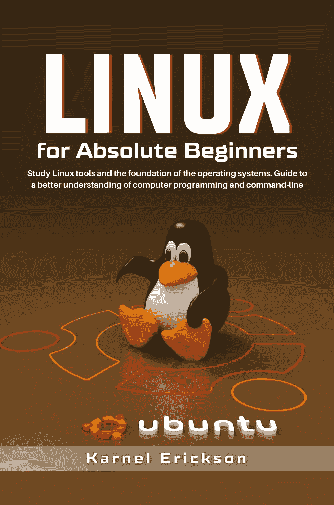


由 Karnel Erickson 于 2022 年首次出版


# 引言

如果你在计算机技术领域花费了很长时间，你可能多次遇到过“Linux”这个名字。你可能听说过它是开源且可以免费下载，但这些信息并不能解释 Linux。

## 作为操作系统的 Linux

Linux 仅仅是一个操作系统。“操作系统”可能是一个你经常使用的词，但大多数人并不理解什么是操作系统。

你电脑上所有的软件和硬件都是通过操作系统运行的。这就是为什么如果你有一部 Android 手机，你就必须下载 Android 应用；如果你有一部 iPhone，你就必须下载 Apple 应用。不同的操作系统对硬件和软件都有额外的要求，你必须遵守这些要求，电脑上的程序才能运行。大多数电脑都预装了操作系统，使用户户能够立即开始访问电脑的信息和功能。大多数其他电脑预装了 `Windows` 操作系统。它们让你能够立即开始电脑。

操作系统是一个允许你与计算机上的信息交互的接口。早期的操作系统使用命令行界面，这意味着用户必须输入代码来访问程序。最常见的是 `MS-DOS`，由微软于 1981 年发布。如今的操作系统使用图形用户界面或 `GUI`。这意味着你可以直观地看到（如图像所示）想要访问的不同应用程序和程序。你只需要点击图标它们就会打开。不同的操作系统使用不同的 `GUI`，因此从一个操作系统切换到另一个最初可能会导致困惑。外观和感受会有所不同，可能需要一些时间适应。

操作系统必须不断更新，以跟上不断发展的软件和硬件改进。如果你尝试使用最新版本的 `Microsoft Word`（或其他任何程序）并发现它与你的电脑兼容，你可能经历过这种挫败感。问题不在于你的电脑发生了故障，而在于你的操作系统不够先进，无法处理最新版本的软件。更新操作系统可能会占用大量内存，因此拥有最新的系统可能意味着需要一台内存更大的电脑。你可能必须在购买新电脑和使用过时的操作系统之间做出选择。

三个常用的操作系统是 `Windows`、`Mac` 和 `Linux`。Windows 是微软在 20 世纪 80 年代创建的，用于取代 `MS-DOS`。它友好得多，因为人们不再需要记住访问程序所需的各种代码。

# 什么是 Linux？

基于 `UNIX` 概念的操作系统内核被称为 Linux。这个名字源于其芬兰创造者的名字——`Linus Torvalds`，它基于与其他基于 `UNIX` 的系统相同的技术（最后一个字母是 x）。Linux 现在由全球成千上万的人共同开发和维护。

操作系统的内核是其跳动的心脏。它对于计算机硬件与你（用户）之间的通信至关重要。操作系统由几个软件组件组成，包括内核、许多工具和库。它是扩展你电脑核心操作系统（称为 `BIOS`）的软件。

## 从 UNIX 到 Linux

Linux 拥有悠久的历史，可以追溯到 20 世纪 90 年代。然而，为了理解 Linux 的起源，我们必须首先回顾二战后的计算机早期阶段。

当时的计算设备占据了整栋建筑，从机械元件到电子元件（如微处理器和多层电路）的过渡正在进行中。

此外，在整个 60 年代和 70 年代，硬件软件组件既昂贵又不标准。有各种特定特定的平台，每个平台都有自己的接口、数据传输和交换协议以及操作系统。这些单一计算设备之间的通信需要专业的知识和对协议的理解。UNIX 的创建是为了克服这些障碍，并在范围内简化计算设备的使用。

### UNIX

1965 年 1 月，多路信息处理服务（`Multics`）的工作开始。

Multics 是由马诸理工学院（MIT）、通用电气（GE）和贝尔实验室/AT&T 合作开发的。他们开发的主要产品是 `Unics`，由 `Ken Thompson` 和 `Dennis Ritchie` 领导。后来它更名为 `UNIX`。`UNIX` 操作系统在加州大学伯克分校被广泛使用。

### UNIX 变体

`UNIX` 的概念被授权给几家公司，它们开发并维护各自的 UNIX 变体。这包括 `Solaris/SUN OS`（现由 Oracle 拥有的）、`AIX`（IBM）、`Scenix`（西门子）、`SCO UNIX`、`Xenix`（微软），以及 `HP-UX`（惠普）、`NeXTSTEP`、`Mac OS`（苹果）和 `Android`（谷歌）。

开源实现包含了伯利系统发行（`BSD`）及其变体：`NetBSD`、`OpenBSD` 和 `FreeBSD`。今天，Linux 是开源开发者中最流行的免费软件。上述系统也有稳固的商业支持。

## UNIX 哲学

UNIX 的设计考虑了几个严格的原则。这些原则涵盖了可移植性、多任务和多用户方向，并结合时间共享方法。此外，它基于遵循 `TCP/IP` 方案的网络连接。

使用 `C` 语言进行初始开发实现了对硬件平台的独立。通过提供一系列开发工具和库，它允许你轻松地将其扩展到你的特定需求中。自动化支持复杂但易于维护的脚本的任务是简单而强大的。

类似于工具箱，UNIX 由各种工具组成。每个工具都有特定的功能并设计用于实现该功能。其思想是每个任务使用一个设备。为了实现更复杂的目标，你将几个工具组合成链。下面的示例结合了 `ls` 和 `wc` 两个命令，利用管道来统计当前目录下 Python 文件的数量。

```bash
$ ls *.py | wc -l
6
$
```

我们将在指南的后部分详细解释这些命令及其用法。

## Linux 简史

与 UNIX 类似，Linux 操作系统有不同的根源，并基于相当多大师的工作。这包括 `Richard M. Stallman`、`Andrew S. Tanenbaum` 和 `Linus Torvalds`。

Richard M Stallman 是 MIT 的黑客和开发者，自由软件基金会（`FSF`）的首任，也是 `GNU` 项目之父。`GNU` 是口号 `GNU 不是 UNIX` 的缩写。该项目的目的是提供一个免费的 UNIX 操作系统。直到 20 世纪 90 年代，一组工具可用，但内核仍然缺失。整个软件于 1983 年左右根据 GNU 许可（`GPL`）发布。


Linux 的下一步来自于 Andrew S. Tanenbaum（Andrew S. Tanenbaum）。当时他是阿姆斯特丹大学的教授。他开发了 Minix，这是一个用于教学的操作系统，供学生演示和理解 UNIX 原则。但正如他所指出的，Minix 并非用于实际生产。

来自赫尔辛基大学的芬兰学生 Linus Torvalds 是 Minix 的用户，并对它的局限性非常不满。1990 年，他开始基于 Minix 的理念、UNIX 原则和 POSIX 标准开发一个全新的操作系统。他的动力是拥有一个既易于理解又能极大发挥硬件极限的系统。他也只是想寻找乐趣，并没有商业意图。Linux 背后的整个故事记录在他名为《趣味之源》（Just for Fun）的自传中。如今，Linus Torvalds 负责监督 Linux 内核的开发。

它需要一个漂亮的标志让 Linux 对外世界产生吸引力。根据一次吉祥物比赛，许多许多方案。Larry Ewing 提交了他关于企鹅的构想（如本书封面所示），他的方案赢了。这只企鹅带着顽皮的微笑，体态丰满，名为 Tux，代表了一个快乐且满意的用户形象。

## Linux 使用范围

Linux 最初是为基于 Intel 的系统构建的，尽管现在运行在各种平台上。ARM 架构（`arm` 和 `arm64`）、Motorola/68k Freescale 架构（`m68k`）、Intel x86（`i386` 和 `amd64`）、IBM s390（`s390`）、PowerPC（`PowerPC`）和 SPARC（`sparc`）只是其中的例子。

Linux 从设计初期就考虑了服务器系统。作为 Web 服务器、文件服务器、邮件和新闻服务器、互联网网关、无线路由器和防火墙，它被广泛使用。作为计算单元，它帮助渲染了视频序列以及整个《泰坦尼克号》、《史莱克》、《玩具总动员》。此外，Linux 还应用于汽车产品、航天、军事、物流和工程领域。自 2006 年以来，世界上所有的交易所都运行在 Linux 服务器上。几乎所有的在线搜索引擎也由它运行。

Linux 在过去的十年中也席卷了桌面。由于其极高的灵活性和可靠性，它是文本处理、图形设计、桌面出版、通信（电子邮件、聊天、音频和视频）以及手机和电视用户界面的可靠配置。

## Linux 认证

Linux 采用率的提高增加了对精通该操作系统的工程师和用户的需求。在此时，Linux 认证变得非常有帮助。认证有两种类型：通用型（不特定于特定发行版）和针对型（特定于特定发行版）。下表提供了目前可用常用认证的概述。

### 非特定发行版认证

- Linux Essentials（Linux 基础）
- LPIC-1: Linux 服务器专业认证
- LPIC-2: Linux 工程师
- Linux Foundation Certified System Administrator (LFCS)
- Linux Foundation Certified Engineer (LFCE)
- CompTIA A+
- CompTIA Network+

### 发行版特定认证

- RedHat Certified Engineer (RHCE)
- RedHat Certified System Architect (RHCSA)
- RedHat Certified Architect (RHCA)
- SUSE Certified Administrator (SCA)
- SUSE Certified Engineer (SCE)
- SUSE Enterprise Architect (SEA)

## 安装 Linux

人们认为安装 Linux 操作系统是一项非常艰巨的任务。与其他操作系统相比，它的安装过程被认为是最简单的。大多数 Linux 操作系统版本都为你提供 Live 发行版（Live 系统）。这意味着可以在 CD 或 USB 的帮助下完成安装，而无需对硬件进行任何重大更改。这难道不很神奇吗？这些发行版选项为你提供了完整的功能，而无需永久安装。

例如，以下是 Ubuntu Linux 的安装步骤，将引导你完成安装过程：

- **准备工作**：首先要确保你的机器符合要求。接下，它可能会询问你是否想要安装第三方软件。
- **无线设置**：当你在笔记本电脑上安装系统时，你必须连接网络以确保第三方软件下载成功。
- **硬盘分配**：这一步是你需要选择将 Linux 操作系统安装在桌面或笔记本电脑上的方式。你是打算采用双启动吗？如果是，请使用整个硬盘来升级现有安装。

选择你偏好的安装类型，然后点击“立即安装”。
- **位置**：从地图上选择位置
- **键盘设置**：选择键盘布局
- **用户设置**：输入你的用户名和密码以完成安装

遵循这些步骤后，重启，即可就绪！与其他操作系统相比，安装 Linux 被认为是最简单且最安全的软件。

## 安装 Linux 时的注意事项

安装 Linux 相当容易，因为几乎每个发行版都有图形化安装方案。如今，由于软件数据多年来巨大增长，安装已成为易事，只需点击几次。这就是为什么大多数发行版仅以 CD 和 DVD 的形式提供运行 Linux 的主要材料。发行版还提供了指向在线存储库的链接，可以在从 CD 和 DVD 完成主安装后以后下载。“现在安装”仅仅是初始配置的设置，稍后可以通过从在线存储库下载你选择的驱动程序来增强。许多发行版还赋予你创建安装光盘的自由。你可以在自己的 CD/DVD 上安装你喜爱的软件。

一些重要的安装注意事项包括：

- CD 和 DVD 上的软件容易过时。因此，在线存储库的需求变得至关重要，因为它有助于下载和更新软件。
- 某些发行版会更新其原始发布版本。这些更新版本可以在相应的网站获得，必须检查它们的可用性。
- 硬件现在主要是自动检测的。包括你的显示器、显卡等。
- 大多数发行版都提供 `Parted`（分区工具）。它易于使用并帮助你设置分区。
- 某些资源可以用于安装目的。例如网络方法 `NFS`、`超文本传输协议 (HTTP)` 和 `文件传输协议 (FTP)`。
- 引导加载程序如 `GRUB` 或 `Linux Loader (LILO)` 通常支持双启动。这些引导加载器可以轻松配置为同一系统中启动 Mac、Windows 和其他 Linux 安装。
- 发行版将 32 位和 64 位视为不同的实体并提供不同的版本。现在的电脑大多支持 64 位，而较旧的系统支持 32 位。
- 动态配置协议 (`DHCP`) 或 `IPv6` 有助于连接网络路由器，这种网络配置通常是自动的。
- `RAID` 和 `LVM` 文件系统可以在安装期间设置，因为你可以使用 `Parted` 自定义分区。
- 如果你使用 `LVM` 和 `Raid` 文件系统，拥有独立的启动分区是至关重要的。


Linux 系统可以通过救援模式访问，且大多数发行版都提供此功能。如果你的系统停止工作，你可以通过安装盘访问你的文件。你的安装盘使用命令行界面，并帮助你访问已安装的文件系统。可以对配置文件进行编辑和替换，从而解决你的问题。这项技术对于 X Window 系统非常有帮助。

GRUB 引导加载程序容易出现故障，特别是在你的系统上安装 Windows 的时候。这是因为 Windows 覆盖了你的引导管理程序。你可以利用 `grub-install` 命令重新安装 GRUB，一旦安装完成，务必为 Windows 系统将其标记出来。需要注意的是，某些发行版使用如 `LILO` 等替代性的引导加载程序。

# 使用 Linux 操作系统的原因是什么？

当笔记本电脑、台式电脑和其他服务器出厂时已经自带了运行完美的操作系统，你为什么想要学习一个完全不同的计算机程序呢？这是大多数用户脑海中都会出现的问题。但在得到答案之前，还有最后一个问题：你正在使用的操作系统真的如你预期的那样运行得完美吗？你是否经常在与运行缓慢、病毒、昂贵的维修费用和恶意软件作斗？如果是这样，是时候让你从不断的挫败感以及丢失重要数据的恐惧中解脱出来了。Linux 是你的最佳解决方案，你应该尽早开始使用这个操作系统。

Linux 被认为是最可靠的操作系统。认真地说，你不需要支付任何费用就能获得一个专用的操作系统。你可以免费在任意数量的笔记本或台式电脑上安装 Linux。

将 Linux 与 Windows Server 等其他服务器相比，后者的成本约为 1200 美元，并且不包括客户端访问许可（CAL）等基础费用，以及邮件服务器、Web 服务器等额外许可；而 Linux 服务器是免费的，你不需要一分钱就可以使用其可靠的程序。它免费且安装简单。当你使用 Linux 作为操作系统时，你不需要每天进行“保姆”。某个服务需要重启、升级等，而其他部分不受影响。

该操作系统根据开源许可分发，以下是遵循该标准的理念列表：

* 运行任何程序的自由。
* 根据你的喜好对程序进行修改的自由。
* 你甚至可以分发副本来帮助你爱的人。
* 最后，你可以将你创建的修改版本分发给你爱的人。

因此，这是一个由你创建、为你而的社区。它被认为是最直观、最对用户友好的操作系统。这一切都关乎自由。你的台式机或笔记本电脑都可以完成完整的 Linux 安装，因为它不涉及大量的复杂性。

## 开发

Linux 操作系统包含了一些开发语言。大多数发行版代码是用 C 或 C++ 语言创建的。其余规则是用 Perl、Java 以及 Lisp 创建的。Linux 操作系统最重要的部分之一——内核（Kernel）有 95% 是 C 语言编写。其余部分使用其他语言，这使得与其他系统相比，这部分更加多样化。目前有少数开发者使用基于文本的工具开发代码。Linux 被认为是最多功能的操作系统和强大的集成开发环境。它是一个可以让你免费的同时赚钱的平台。用户可以确信 Linux 操作系统能够为他们提供最佳运行。

# Linux 目录结构

现在你已经连接到服务器并熟悉了将要使用的界面，是时候学习目录布局了。此外，它还可以帮助你回答以下问题：

* 程序位于哪里？
* 配置文件位于哪里？
* 我可以在哪里找到此应用程序的日志文件？

## 常用目录

以下是你普通用户需要了解并与之交互的最常见的顶层目录。

## 详细目录列表

以下是你可能在各种 Linux 系统上找到的顶层目录列表。包含了一些子目录以帮助定义顶层目录的作用。你可能永远不会与许多目录进行交互。这些目录将出现在你遇到的每个系统中，例如 `/usr`。

* `/cgroup`: 控制组（Control Groups）层次结构。
* 系统和系统管理员。
* `/lib64`: 系统库，64 位。
* `/media`: 用于挂载 CD-ROM 等可移动介质。
* `/mnt`: 用于挂载外部文件系统。
* `/proc`: 提供运行进程的信息。
* `/sbin`: 系统管理二进制文件。
* `/selinux`: 显示 SELinux 的信息。
* `/srv`: 包含系统提供的数据。
* `/srv/www`: Web 服务器文件。
* `/srv/ftp`: FTP 文件。
* `/sys`: 显示 Linux 内核知的设备和总线，有时可以使用此处进行配置。
* `/tmp`: 临时空间，通常在重启时清除。该目录可以被操作系统和用户使用。
* `/usr`: 用户相关的程序、库和文档。`/usr` 下的子目录与上述及下述的有关。
* `/usr/bin`: 二进制文件和其他可执行程序。
* `/usr/lib`: 库。
* `/usr/local`: 不属于基础操作系统的本地安装软件。
* `/usr/sbin`: 系统管理二进制文件。
* `/var`: 变量数据，最重要的是日志文件。
* `/var/log`: 日志文件。

## Unix：特定目录

Linux 经常出现在与其他 Unix 变体共存的环境中。如果你需要登录 Unix 服务器，可能会看到某些 Unix 特有的目录。

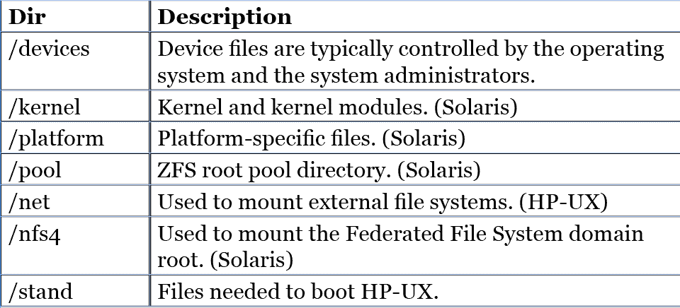

注意，你可能会遇到一些未列出的其他顶层目录。然而，那些很可能是系统管理员创建的。

## 目录结构

应用程序可以遵循与操作系统相同的约定。例如，这是安装在 `/usr/local` 中的 Apache 目录结构。


如果安装在 `/opt`，可能是这样。


将所有应用程序子目录放在 `/opt/app-name` 的常见替代方案是同时使用 `/etc/opt/app-name` 和 `/var/opt/app-name`。


有时不属于标准操作系统的应用程序是以共享方式安装的，没有被赋予子目录。例如，Apache 可能不是唯一的本地安装软件，与其他安装应用程序共享该空间。

另一种做法是根据公司、组织或团队名称创建目录结构。例如，如果你在 Acme 公司工作，可能会发现一个名为 `/opt/acme` 或 `/usr/local/acme` 的目录。有时脚本和工具直接安装在该结构中，而有时它们被隔离在子目录中。这是一个例子。


或者，你可能会看到这样的。


这些是相同理念的变体，但基于公司内部团队。


## 顶层目录示例

以下是几个不同 Linux 服务器顶层目录列表：

红帽企业 Linux 7 (RHEL)

```
[bob@rhel6 ~]$ ls -1 /
```
* bin
* boot
* group
* dev
* etc
* home
* lib
* lib64
* lost+found
* media
* mnt
* opt
* proc
* root
* sbin
* SELinux
* srv
* sys
* top
* usr
* var

SUSE Linux Enterprise Server 11 (SLES)


```bash
[bob@sles11 ~]$ ls -1 /
```
* bin
* boot
* dev
* etc
* home
* lib
* lib64
* lost+found
* media
* mnt
* opt
* proc
* root
* sbin
* SELinux
* srv
* sys
* top
* usr
* Ubuntu 14.04 LTS

```bash
[bob@ubuntu12 ~]$ ls -1 /
```
* bin
* boot
* dev
* etc
* home
* lib
* lib64
* lost+found
* media
* mnt
* opt
* proc
* root
* run
* sbin
* SELinux
* srv
* sys
* top
* usr
* var
Deep Dive

## 文件系统层次结构标准
* man hier
* RedHat 企业级 Linux
* SUSE Linux 企业服务器
* Ubuntu

Ubuntu 最优特性之一是它是免费开源的 GNU/Linux 软件。这意味着该软件可以自由地使用、复制、修改和分发。开源软件由全球范围内的社区进行开发、维护和分发。软件归社区所有，且开发过程透明。这使得代码更加稳定可靠，实际上几乎没有恶意软件，并且易于安装和使用。

GNU 是一组类 Unix 程序，它们为 Linux 系统提供基本功能。如果没有 GNU 工具和应用程序，Linux 将不存在。这就是为什么某些人将 GNU/Linux 操作系统相对于仅仅 Linux。GNU 是“GNU's Not Unix”（GNU 不是 Unix）的缩写。GNU 是基本 Unix 程序的 FOSS（自由开源软件）实现。

GNU/Linux 已经开发了二十多年，是一个非常成熟的操作系统。Linux 内核由 Linus Torvalds 于 1991 年设计。GNU 系统由 Richard Stallman（理查德·斯托尔曼）设计。现在，GNU/Linux 由自由软件基金会（The Free Software Foundation）维护。GNU/Linux 的设计基于 Unix，Unix 是由 AT&T 贝尔实验室从 1969 年开始的。因此，GNU/Linux 的传承跨越了多年。Unix 和 GNU/Linux 拥有定义的文件系统和简单的模块化软件设计，这转化为更小、更简单、更快速的软件。我们都是这种优雅设计理念的受益者。

流行的 Linux 标志——企鹅 Tux 由 Larry Ewing 创建的，你可以在许多贴纸、标签、别针、T 恤和玩具上找到它。

## 安装 Ubuntu

### 新功能

#### Brasero
Brasero CD/DVD 刻录不再是发行版的一部分。相反，由文件管理器执行该功能。

### 启动器位置
如果需要，可以将启动器移动到屏幕底部。

### 注销、关机和重启图标
使用 Dash（应用程序透镜）搜索注销、关机或重启将显示可以放置在启动器上的图标。

### 通过 Dash 进行在线搜索
使用 Dash 时，在线搜索的默认值现在关闭。

### LibreOffice 5
LibreOffice 5 现在是 LibreOffice 的默认版本。

### 软件中心
Ubuntu 软件中心已由启动器上的 Ubuntu 软件取代。

### 安装 .deb 包
双击 `.deb` 文件将激活 Ubuntu 软件以安装新的软件包；然而，我建议安装 `gdebi` 并使用它来安装包，因为它更快且更可靠。

### 注意事项

#### OS 升级问题
软件更新器会自动检查可用更新。软件更新器可能会询问你是否想要升级到更高版本的 Ubuntu。这是一个长期且容易出错的过程。升级过程过去失败过，但现在可能可以正常运行。你可以选择升级选项或手动安装 Ubuntu 的新版本。由你决定。

#### 安装注意事项
你需要登录系统管理员账户，以执行任何涉及在计算机上安装新软件的预安装或后安装步骤。在执行实际的 Linux 安装之前，你可能需要安装软件来创建一个可启动的 USB 闪盘。在执行 Linux 安装后，你还需要安装更新。

在安装过程中，你会被要求输入用户名和密码。由于该用户将带有管理员权限被创建，你应该输入类似 `Linux` 或 `SysAdmin` 的用户名。安装完成后，你将创建自己的用户账户。如果你在安装期间输入了 `Linux`，那么你 Ubuntu 的实际登录名将是 `Linux`。从历史上看，Linux 用户名全小写。但密码并非如此。

系统会询问你是在安装之前尝试 Ubuntu，还是立即安装 Ubuntu。如果你已经决定安装，我建议直接安装 Ubuntu 而不是尝试。如果你决定在不安装的情况下尝试 Ubuntu，桌面上将有一个安装图标，随后允许你安装 Ubuntu。这在某些旧电脑上可能不起，因此我建议你不要从桌面安装 Ubuntu。

#### 安装期间的更新
不要勾选以下框：
* [ ] 在安装时下载更新
* [ ] 安装第三方软件

我强烈建议在操作系统安装完成后再安装更新和第三方软件。如果更新失败，则整个安装将失败。

#### 磁盘配置
如果你的硬盘上已经安装了操作系统，你将被问到以下问题：

“此计算机目前安装了多个操作系统。你想做什么？”

(•) 与它们并存安装 Ubuntu
( ) 擦除磁盘并安装 Ubuntu

默认选项是“与它们并存安装 Ubuntu”。然而，你可能想通过选择另一个选项来擦除磁盘并将 Ubuntu 作为唯一的操作系统。

如果你想保存当前的数据和操作系统，请使用 `Clonezilla` 等磁盘镜像工具。

某些安装对话框可能需要使用键盘导航。导航键为方向键、`Tab` 键和回车键。

## 下载 Ubuntu

Linux 发行版存储在 `ISO` 文件中，可以被描述为光盘镜像。如果你想更多关于 ISO 文件的信息，维基百科有一篇关于 ISO 文件的精彩文章。

本书假设你正在 PC 类计算机上安装 Ubuntu。为了创建一个允许我们安装 Ubuntu 的光盘，我们首先需要从互联网下载 `ISO` 文件。这可以通过搜索 Ubuntu 下载或搜索特定的 Ubuntu 发行版（例如 Ubuntu 16.04）来实现。

Ubuntu 网页有两个基本选择：
* 下载 32 位
* 下载 64 位

32 位版本适用于任何计算机。如果你有一 64 位计算机并想尝试 64 位版本，请选择下载 64 位。

注意，`ISO` 文件可能太大无法放入光盘，因此你可能需要使用 DVD。一旦下载了光盘镜像文件，你可以将其写入 DVD。镜像文件不能作为文件存储在 DVD 上。必须作为镜像存储。这通过将文件存储为镜像或刻录镜像文件的内容来实现。不同的 CD/DVD 刻录程序可能使用其他术语来创建镜像 DVD。

也可以从 USB 闪盘安装 Ubuntu。创建闪盘的过程比创建光盘稍微复杂。首先，你需要在 Linux 或计算机上下载并安装 `UNetbootin` 应用程序。然后，你需要通过设置文件属性来确保 `UNetbootin` 应用程序是可执行的。然后就可以运行该应用程序，它将创建一个可启动的 USB 闪盘。请参考下一页的截图在 Linux 计算机上设置 `UNetbootin` 可执行文件的属性。

**截图 – UNetbootin 属性**


请注意，如果你在非 Linuxget 上安装 `UNetbootin`，可能需要解除该应用程序的锁定。只需右键点击 `UNetbootin` 图标，选择 `Properties`（属性），然后点击 `Unblock`（解除锁定）按钮。

如果你在 Linuxget 上安装 `UNetbootin`，你还需要使用命令行或 `Synaptic Package Manager`（同步软件包管理器）指南安装 `p7zip-full` 包。

插入一个容量至少为 2 GB 的 USB 闪存。启动 `UNetbootin` 程序。使用 `Select Distribution`（选择发行版）和 `Select Version`（选择版本）按钮下载镜像文件。

如果你想要安装的 Linux 发行版未列在 `UNetbootin` 的 `Select Distribution` 和 `Select Version` 列表中，你需要从下载所需的 ISO 文件。然后通过选择 `Diskimage`（磁盘镜像）并点击 `[…]` 按钮来选择你下载的 ISO 文件。

通过 `Drive:`（驱动器）选择菜单选择刚刚插入电脑的 USB 盘。选好所有选项后，点击 `[OK]` 按钮创建可启动的 USB 盘。这可能需要大约五分钟，所以如果过程看起来停止了，请不要担心。

# Ubuntu 首选

Ubuntu 16.04 是 Ubuntu 的 LTS（长期支持）版本，支持期限为五年。它可以在配有 `Intel Celeron` 或 `Core i3` 处理器的旧旧电脑上运行，并且只需要少量内存或硬盘空间。电脑中配备 `SSD`（固态硬盘）也有帮助，因为它比传统的硬盘更快。例如，我在 eBay 上花约 100 美元买的一台旧 `Dell E4200` 笔记本上运行 `Ubuntu Unity`，它可以在 17 秒内启动。

`Unity` 桌面引发了许多争论，但我许多电脑和笔记本电脑上使用它并非常喜欢。

此版本的《Ubuntu 用户手册》涵盖了 Ubuntu 16.04，它将作为五年的 LTS 版本。安装哪个版本取决于你的决定。自己尝试不同的版本其实很容易。

Ubuntu 可以在具有 1 GB 内存和 8 GB 硬盘空间的电脑上安装和运行。`Ubuntu Unity` 有一个独特的用户界面系统，使用顶部面板和左侧边栏启动器。提供更改启动器、壁纸和主题的选项。用户也可以根据需要添加或删除 Linux 应用程序。

Ubuntu 使用 `Unity` 桌面。与其他轻量级 Linux 桌面软件相比，`Unity` 需要更多的物理资源（内存和 CPU）。因此，它可能吸引苹果电脑用户和普通用户。然而，高级用户可能不会选择 `Unity` 用户体验。Wikipedia 及其他地方有关于 `Unity` 的技术讨论。我只对如何使用和自定义 Ubuntu 感兴趣。

# Linux 启动

## BIOS

`BIOS` 代表基本输入/输出系统（Basic Input/Output System）。它是启动过程中使用的一种特殊固件，是电脑通电时运行的第一段软件。`BIOS` 是一个独立的操作系统。

根据硬件的不同，`BIOS` 会提供一个启动设备列表，如硬盘、DVD 驱动器、USB 设备等。但再次强调，完成此操作所需的关键组合将取决于硬件制造商的不同。

在发现可启动设备后，`BIOS` 将启动启动加载程序。虽然你可能会遇到使用 `LILO` 启动加载程序的旧版 Linux 系统，但 `GRUB` 启动加载是最常见的。

启动加载程序的主要功能是在任何情况下启动操作系统。你通常会看到来自启动加载程序的消息或系列信息，这允许你中断启动过程并与启动加载程序交互。例如，如果安装了多个操作系统，你可以告诉启动加载程序执行哪个操作系统。你也可以告诉启动加载程序为操作系统提供不同的启动选项。

## 初始 RAM 磁盘

初始 RAM 磁盘缩写为 `initrd` 是系统启动时放入内存的临时文件系统。该文件系统可能包含用于硬件检测和加载所需模块（通常称为驱动程序）的助手，以挂载现有文件系统。因此，如果根文件系统存储在 `LVM`（逻辑卷管理器）卷上，操作系统将继续从根文件系统加载。

## 内核和初始 RAM 磁盘位置

`/boot` 包含 Linux 内核、初始 RAM 磁盘以及启动操作系统所需的其他文件。Ubuntu 系统的 `/boot` 目录如下。

```bash
$ ls -1F /boot

abi-3.13.0-46-generic
config-3.13.0-46-generic
grub/
initrd.img-3.13.0-46-generic
System.map-3.13.0-46-generic
vmlinuz-3.13.0-46-generic
```

Linux 内核通常称为 `vmlinux` 或 `vmlinuz`。如果内核经过压缩，则使用 `vmlinuz` 格式。示例中使用的内核是 `vmlinuz-3.13.0-46-generic`。在此示例中，初始 RAM 磁盘是 `initrd.img-3.13.0-46-generic`。

当缓冲区满时，旧消息会被丢弃为新消息留出空间。使用 `dmesg` 命令查看内核环形缓冲区的内容。

```bash
$ dmesg

[ 0.000000] Initializing cgroup subsys cpuset
[ 0.000000] Initializing cgroup subsys cpu
[ 0.000000] Initializing cgroup subsys cpuacct
[ 0.000000] Linux version 3.13.0-46-generic (build ...)
```

（注意：为了简洁，其余日志输出遵循内核初始化序列。）

| 运行级别 | 描述 |
| :--- | :--- |
| 0 | 关机 |
| 1 | 单用户模式。用于维护。 |
| 2 | 带有图形界面的多用户（Debian/Ubuntu） |
| 3 | 多用户文本模式（RedHat/CentOS） |
| 4 | 未定义 |
| 5 | 带有图形界面的多用户（RedHat/CentOS） |
| 6 | 重启 |

以前，`init` 程序负责运行级别。`/etc/inittab` 用于存储 init 配置。你会修改 `/etc/inittab` 文件并调整 `initdefault` 行上的运行级别数字来使用 `init` 更改默认运行级别。例如，这里是如何将运行级别 3 设置为默认。

另一方面，`init` 的替代方案 `systemd` 和 `upstart` 正在快速取代 `init`，目前 `systemd` 被最广泛采用。`systemd` 使用目标（targets）的概念而不是运行级别。运行级别通常等于这些目标。查看 `/lib/systemd/system` 可获取可用目标列表。运行级别目标本质上是实际目标的符号链接。例如，`runlevel5.target` 是 `graphical.target` 的符号链接。

```bash
# cd /lib/systemd/system
# ls -l runlevel*target
```


要使用 systemd 更改默认运行级别（runlevel）或目标（target），请使用 `systemctl` 命令，加上 `set-default`，然后是所需的目标。你也可以手动从 `/etc/systemd/system/default.target` 文件创建一个指向目标位置的符号链接。此示例将默认目标设置为图形界面，这等同于运行级别 5。

## set-default multi-user.target

```bash
rm '/etc/systemd/system/default.target'
ln -s '/usr/lib/systemd/system/multi-user.target' '/etc/systemd/system/default.target'
```

## 更改运行级别或目标

在 init 系统中，你可以使用 `telinit` 命令更改运行级别。只需将你想要切换的运行级别作为 `telinit` 命令的参数提供即可。

### telinit 5

```bash
telinit 5
```

要更改目标（systemd 中运行级别的等效概念），请使用 `systemctl` 命令，后接 `isolate`，最后是所需的目标。例如，这里是切换到图形目标的方法。

```bash
systemctl isolate a graphical target
```

## 重启系统

尽管在使用 systemd 时存在运行级别/目标，但你也可以使用 `reboot` 或 `shutdown` 命令进行重启。

以下是使用 init 重启的方法。

```bash
telinit 6
```

使用 systemd 重启，请使用 `systemctl` 命令。

```bash
systemctl isolate reboot.target
```

只需在命令提示符中输入 `reboot` 即可重启。

```bash
reboot
```

`shutdown` 命令的格式如下。

```bash
shutdown [options] time [message]
```

`-r` 选项指示 `shutdown` 执行重启。接下来，你可以使用 `HH: MM` 格式指定关闭时间。你也可以使用 `+N`，其中 `N` 代表执行前等待的分钟数。最后，你可以使用 `now` 关键字立即启动。可选地，你可以指定一条广播给所有登录系统的用户的消息。

```bash
shutdown -r now
```

## 关机

要关闭系统，请使用运行级别 0、`poweroff` 目标或 `poweroff` 命令。

以下是使用 init 执行关机的方法。

```bash
telinit 0
```

以下是使用 `systemctl` 机的方法。

```bash
systemctl isolate poweroff.target
```

最后，你可以使用 `poweroff` 命令。

```bash
poweroff
```

## 总结

正如你所学的，BIOS 的工作是执行基础硬件检查并从可启动设备启动引导加载程序。你还学习了两种常用的引导加载程序：`LILO` 和 `Grub`。任何引导加载程序的主要工作都是启动操作系统。

你还学习了 `/boot` 目录包含启动 Linux 系统所需的文件。内存磁盘（通常称为 `initrd`）是一个基于内存的文件系统。它的主要功能是挂载包含操作系统的文件系统。Linux 内核通常被称为 `vmlinux`，或者如果经过压缩则被称为 `vmlinuz`。

通过使用 `dmesg` 程序或查看 `/var/log/dmesg` 文件，你学习了如何检查内核环形缓冲区中的消息。

你还学习了运行级别以及 systemd 有一个等效的概念称为目标（targets）。接下来，你学习了如何使用针对传统 init 系统的 `telinit` 命令以及针对使用 systemd 系统的 `systemctl` 管理来更改运行级别。最后，你学习了 `shutdown`、`reboot` 和 `poweroff` 命令。

## 测验

**1. BIOS 开始计算机的启动过程并将控制权交给引导加载程序。**
a. 正确
b. 错误

**2. 下列哪些是 Linux 引导加载程序？**
a. `LILO`
b. `GRUB`
c. `LILO` 和 `GRUB` 
d. `BIOS`

**3. 以下是系统启动时加载到内存中的临时文件系统。**
a. `kernel`
b. `vmlinux`
c. `vmlinuz`
d. `initrd`

**4. `/Linux` 目录包含启动 Linux 需要的文件。**
a. 正确
b. 错误

**5. 哪个命令显示内核环形缓冲器的的内容？**
a. `ringbuf`
b. `ringb`
c. `rmesg`
d. `dmesg`

**测验答案**
1. A
2. C
3. D
4. B
5. D

## 搜索与提取数据

### 目标：
* 理解如何使用管道重定向输出
* 能够使用 `grep` 重定向操作符
* 能够在数据文件中搜索模式

命令行环境是一个强大的工具。同样的概念也可以在文件或多个文件中搜索数据。

但首先，你必须理解如何使用命令重定向和输入/输出重定向镜像将多个命令连接起来。

## 命令重定向

命令重定向允许用户将标准输入重路由到第二个程序或命令。这是通过管道或命令行管道实现的。管道通过在两个命令之间使用竖线（`|`）创建。此键通常位于键盘上回车键上方，通过按住 Shift 键并按下反斜键来访问。

管道在应用于各种方式时非常有用。例如，`cat` 命令的详细输出（显示文件内容）可以与 `less` 命令结合，一次显示一页内容。这种方法避免了信息溢出屏幕。为了了解更多信息，请咨询 `cat`、`less` 和 `more` 命令的帮助页。通过使用管道，用户可以顺序执行多个命令。这允许快速执行复杂任务，因为系统不需要等待用户输入。`grep` 命令通常用于管道中在给定输出中搜索关键词。

`grep` 命令用于搜索特定字符串并返回包含该字符串的文件名，如果是文本文件，则返回该行。`grep` 命令还可以在指定文件中搜索特定字符串。要使用 `grep`，用户只需输入命令名 `grep`、可选开关和参数、正则表达式以及可选文件名。

如果你计划进入系统管理或网络安全领域，你将需要熟悉 `grep` 命令。该命令是安全运营中心分析师的好伙伴，用于从安全信息事件管理服务器的不同日志文件中查找信息。`grep` 工具的深度用法超出本书范围，但要了解更多信息，请查看其详细的帮助页。

## 输入/输出重定向

除了使用管道将一个命令的输出重定向到另一个命令之外，用户还可以将命令的输入/输出转向其他位置。例如，如果你需要保存程序的程序的输出，可以将其重定向到文件。同样，命令的输入可以从文件转移而不是需要用户通过输入。

尽管输入重定向听起来很奇怪，但某些程序依赖此功能处理数据。例如，馈给程序的原始文本文件会搜索指定的模式。在所有这些基础上，一种相关技术涉及 `xargs` 命令，它允许用户从文件或其他程序的输出生成命令行选项。

Linux 系统默认支持两种类型的输出：标准输出和标准错误。预期输出用于普通的程序消息。例如，当你运行 `ls` 命令时，输出被发送到标准输出，因此显示在屏幕上。标准错误则输出错误消息。这默认也会显示在屏幕上，但用户可以根据需要重定向这些消息。

有多种重定向操作符可用，可以更完全地控制信息输出到哪里、显示到哪里以及保存到哪里。


- `>` 创建一个包含标准输出的新文件。如果指定的文件已存在，它将被覆盖。例如，如果执行命令 `ls > contents.txt`，`ls` 命令的输出将保存到 `contents.txt` 文件中，屏幕上将不会显示任何内容。
- `>>` 将标准输出追加到现有文件中。与上面的命令类似，我们可以将 `ls` 命令的输出重定向到文件 `contents.txt`，但不是覆盖文件，而是简单地将我们的输出添加到当前文件的末尾。
- `2>` 创建一个文件，将标准错误重定向到该文件。如果文件已存在，其内容将被覆盖。
- `2>>` 将标准错误追加到现有文件中。如果文件不存在，则创建一个新文件。如果文件已存在，标准错误输出将简单地添加到文件的末尾。
- `&>` 创建一个包含标准输出和标准错误输出的新文件。如果文件已存在，其内容将被覆盖。

还有几种重定向操作符可用，以更完全地控制 shell 中从哪里输入信息。

- `<` 将指定文件的内容发送给命令以代替标准输入。例如，如果我有一个名为 `input.txt` 的文本文件，其中包含一行文本 `b??l`，并输入命令 `ls < input.txt`，输出将等同于在提示符处输入 `ls b??l`。
- `<<` 进入一种交互模式，其中输入的后续行将被重定向到标准输入。这将允许你逐行输入新信息并将其重定向到同一个命令。
- `<>` 指定一个文件将同时用于标准输入和标准输出。

现在，虽然这些某些选项（如 `<>` 选项）看起来是你永远不会用到的东西，但请记住 Linux 将每个设备都视为挂载在其文件系统某个位置的文件。因此，像 `<>` 这样的选项在读取或写入外部硬盘、向声卡发送或接收数据或其他类似情况下可能是很有用的。

作为一个普通用户，你可能不会经常使用 `<>`，但如果你以后成为一名 Linux 开发人员，那么那时它对你来说可能会变得更有用。

让我们使用 `grep` 命令将这些概念付诸实践。例如，如果根账户的系统管理员想要在 `/etc` 目录下的每一个配置文件搜索关于特定用户（Jason）的数据，他们只需简单地输入 `grep Jason /etc/*` 即可。然而，在不使用重定向的情况下运行命令，`grep` 搜索的输出将仅仅显示在屏幕上，而不是存储供以后参考。此外，由于我们的系统管理员是以 root 用户执行命令的，`grep` 可能会向屏幕返回长系列输出，使其变得很长且难以阅读。

因此，系统管理员应该使用重定向。为了实现这一点，系统管理员应该使用重定向操作符，并指定重定向并存储数据的文件名。例如，输入 `grep Jason /etc/* > Jason.txt` 将 `grep` 搜索的输出发送到当前工作目录下的 `Jason.txt` 文件。

使用重定向的另一个原因是更改标准错误的发送位置。例如，如果系统管理员以普通用户而不是 root 用户输入 `grep Jason /etc/*`，包含用户名的文件将出现在屏幕上，但也会出现大量的错误信息。这是因为普通用户没有权限读取 `/etc` 目录中的许多文件。默认情况下，标准错误也会路由到标准输出（屏幕）。

为了移除所有错误，以便系统管理员不必看到它们杂乱屏幕，他们可以将错误重定向到每个 Linux 系统上都存在的特殊设备，即 `/dev/null`。这个空设备本质上是一个我们可以发送垃圾数据让操作系统删除的区域。

所以，如果系统管理员输入命令 `grep Jason /etc/* 2> /dev/null`，那么 `grep` 命令将在 `/etc` 文件夹中的每个配置文件中搜索名称 Jason，并将所有错误信息重定向到 `/dev/null`，这样它们永远不会显示在屏幕上并被直接丢弃。

## 正则表达式

虽然输入像用户名之类的搜索词是有用的，但 `grep` 的真正威力来自于与正则表达式（也称为 `REGEX`）结合。正则表达式是描述用户可能想在给定数据文件或文件中查找的模式的方法。许多 Linux 程序都允许正则表达式，这为用户提供了在文本中表达模式的工具。正则表达式的原理与通配符类似，可以指定多个文件名或其他基于文本的内容。

正则表达式分为两种类型：基础和扩展。假设哪种正则表达式形式取决于正在执行的程序。某些程序只接受一种表达式形式，而另一些程序可以使用两种类型。

最简单的 `REGEX` 类型是字母或字母数字字符串，例如 `HWaddr` 或 `Linux`。这些正则表达式将匹配任何包含该正则表达式的相同长度或更长的字符串。例如，`HWaddr` 正则表达式匹配搜索文件中可能出现的三个短语：“Hwaddr”、“This is the HWaddr” 和 “The HWaddr is unknown”。但当用户插入可以表示模式的特殊字符时，正则表达式才真正大放异彩。

在 `grep` 中使用 `REGEX` 进行搜索时，通常使用括号表达式。括号表达式使用方括号字符（`[ ]`）构成通配符搜索，选择括号内的任意一个字符。例如，`b[aeiou]g` 代表了五个单词：bag、beg、big、bog 和 bug。

范围表达式也使用方括号，但不是列出括号内的每个字符，而是依赖于使用连接符（–）分隔起始和终点。在搜索较大数据集时，使用范围表达式比括号表达式更方便。范围也可以应用于字母，例如 `[g–t]`，这将代表 g, h, i, j, k, l, m, n, o, p, q, r, s, t。记住 Linux 是区分大小写的，范围 `[a–z]` 和 `[A–Z]` 被认为是不同的集合。

点（`.`）是一个通配符，代表除换行符以外的任何字符，换行符是在按下键盘上的返回或 键时使用的。例如，如果用户输入 `b.g`，这将代表 `bAg`、`bag`、`bBg`、`bbG`、`b2g` 等，在 b 和 g 之间可以插入任何字母、数字或字符。


这是 Linux 世界中使用是最基础的命令之一。虽然这里有很多命令（我们在这里列出它们仅供参考），但 `SCP` 非常易于使用和理解。现在，让我们尝试反过来操作。

现在，我们使用了相同的命令，但改变了顺序。让我们先通过理解该命令的语法，来看看发生了什么。

```
scp source_file destination_file
```

正如我们在这里看到的，这次源文件在远程计算机/服务器上。我们想将一个名为 `sample4` 的文件安全地复制到我们的系统（目标文件）。在冒号之后，我们指定了想要的文件，然后使用了点号（`.`），这表示本地机器——即你的机器。按下 `Enter` 键后，该文件就会被复制到你的系统中。

这将有效地将文件重命名为 `sample5` 并将其放置在本地的“test”目录中。你可以指定路径，剩下的工作将由系统完成。

要获取 `SCP` 命令的全方位功能，可以使用 `man` 命令查看帮助手册。

如果你有几个文件，这个命令很好用，但如果你想传输大量文件，甚至是整个目录呢？为此，我们使用另一个名为 `sync` 的命令。

该命令有多种用途，可以跨单台机器或整个网络移动或复制（镜像）数据和文件。该命令对于在远程机器或服务器上备份数据非常出色。要使用该命令，你需要遵循以下语法：

```
rsync [options] source destination
```

凭借超过 50 个选项，你可以轻松安全地跨单台机器或网络复制整个目录或该目录的内容。你可能会被要求管理员权限，因为它使用了 `SSH` 来加密整个连接并防止任何人“窃听”。这只是暗示某人正在监控你的活动的另一种说法。

近期出现了太多的工具和应用程序。无论你决定使用 `LUI` 作为数据传输媒介还是使用 `GUI`，你都有选择。务必始终使用可靠的来源，并定期监控活动和连接，以确保数据以及网络本身的安全。

## 网络应用程序

作为网络专家甚至是一个安全的家庭用户，有很多命令和诊断工具可以在你的旅程中提供帮助。了解这些工具至关重要，可以保护你免受许多可疑连接和黑客的侵害。这些工具还将允许你深入探索，更好地理解网络是如何运作以及其他设备作为网络的一部分时是如何表现的。现在，让我们开始熟悉一些重要的工具。

使用 `clear` 命令清除终端，并学习一个你在基础学习中应该掌握的重要命令。它被称为 `ifconfig`。

可能在命令提示符中使用过 `ipconfig` 命令的 Windows 用户会觉得这个很眼熟。

继续输入 `ifconfig`。你现在将看到一个充满信息的屏幕。这是你的网络信息，它准确地显示了网络是如何配置的。

注意：对于可能遇到错误的用户，你可能需要安装 `net-tools`。相应的命令是 `sudo apt install net-tools`。

你在这里看到的信息将允许你更仔细地查看你的某些网络设置。这些包括你的以太网设置、无线设置以及关于你的本地主机（local host）的信息。其中一些是非常有用的信息，在需要时可以派上用场。

大多数显示的信息都很容易理解，但如果你发现任何术语或列难以阅读，你始终可以依靠信誉的老 Ubuntu 社区来获取更深层次的见解。

下一站，我们将查看名为 `tcpdump` 的命令。这基本上是一个数据包嗅器——字面意义上的如此！它分析所有进入或离开你系统的数据包。为什么我们需要这个？我们很快就会学到。

为了拥有它，请输入以下命令安装 `tcpdump`：

```
sudo apt-get install tcpdump
```

安装完成后，输入以下内容运行该工具（需要 `sudo`）：

```
sudo tcpdump
```

如果你现在还没有获取到任何内容，请不要惊慌。只需打开浏览器窗口并访问你选择的任何网站。一旦你在浏览器中按下 `Enter` 键，切换窗口回到终端。你的终端屏幕现在将开始一个无止尽的过程，嗅探所有离开或进入你系统的数据包。你需要通过 `Ctrl+C` 来停止它。

这个命令的问题是，如果你在后台运行着一些网络活动，它就永远不会结束。然而，你可以限制数据嗅探。假设你只想捕获固定数量的数据包（比如 20 个），你可以稍微修改命令来实现这一目标。

```
sudo tcpdump -c 20
```

该命令会在你按下 `Enter` 后立即执行，并捕获接下来 20 个发送或接收的数据包。我们使用 `tcpdump` 命令来找出这些数据包发送到了哪里以及从哪里接收。在我们的示例中，你会注意到一个发出的数据包将包含你的 IP 地址、域名和地址，而反之则显示相应的内容。

该命令对于分析数据至关重要，并追踪信息可能泄露或来源的任何未知地址。这些可疑地址或域名随后可以被记录，以确保系统和网络本身的安全。该命令还允许你查看由特定接口发送和接收的数据包。

假设你的网络上有一个无线路由器，你想检查通过它进行的各种活动。你只需输入以下命令即可实现：

```
sudo tcpdump -c (数据包数量) -i (设备名称)
```

这将开始收集该设备的结果并捕获你设置的数据包数量——这是检查同事或伙伴在做什么的一种非常巧妙的方法。

同样，你也可以使用相同的命令检查你的端口，或以 ASCII 格式甚至十六进制格式显示数据包。该工具的应用非常广泛。你始终可以通过输入 `man tcpdump` 查看该工具的手册，以获取你可以使用的完整选项。

在我们学习跨网络移动文件和文件夹的基础之前，还有一个命令你可能会发现，它可以判断谁连接到了你的网络。它被称为 `netstat` 命令，它可以为你提供巨大的帮助，以发现是否有人已连接到你的网络。要做到这一点，请在终端输入带有以下选项的命令：

```
netstat -nr
```

现在不再显示域名而是提供 IP 地址和 IP 路由表。你还可以通过下面的命令检查网络接口统计：

```
netstat -i
```

这向我们展示了所有设备的使用情况。你可以发现每个设备发送或接收了多少数据包。

最后，你可以发现你的网络当前使用了哪些活动套接字，为此你需要使用另一个带有 `-ta` 选项的 `netstat` 命令。这将列出活动套接字及其地址（本地和远程）、状态以及其他一些有用信息。这种信息对于任何维护整个网络安全的人来说都是至关重要的。


`netstat` 命令用于监控与网络的活动连接，并帮助你阻止任何不受需要的或可疑的连接，这些连接可能为黑客和恶意软件提供入口。你还可以跟踪每一个发送和接收的数据包。对于大多数网络和系统管理员来说，这个命令始终是常用的。

当你的网络处于运行并连接到各种设备时，所有这些设备都试图访问它并获取或提供信息，需要某些东西介入来监控这里的安全性。这就是安全外壳（SSH）大显身手的地方。

在 SSH 出现之前，还有 `Telnet`。这最初被视为一场革命，人们可以在不需要身临现场的情况下访问另一台远程机器。这引起了各种人的人的注意，也包括一些窥探的目光。很快，人们就意识到这些方法是不安全的，任何人实际上都可以“窃听”他们的交流。

`SSH` 完成了 `Telnet` 未能做到的：它对你会话的所有数据进行加密。它还允许任何操作系统的客户端以一种安全的方式传输其文件和文件夹，而无需担心中间有窥探的目光。理解 `SSH` 不是一天就能完成的任务，甚至一本书就能掌握的。对学习更多关于加密、`SSH` 和 `SSHD` 信息感兴趣的可以在网上找到各种信息。这些都是高级水平的，因此此时适合初学者。

在 Linux 世界中，需要时间和练习才能掌握技巧，但一旦你开始理解事物是如何运作的，你很快就能处理问题，仿佛它们毫无意义。在这种情况下，最好习惯 `LUI` 是你最佳伙伴的概念。

## 脚本编写

计算机的一种卓越能力是它可以为你执行自动化任务。在 Linux 系统中，你可以根据自己偏好的自动化活动编写“程序”来控制功能。

这就是脚本登场的地方。

### 脚本编写用于什么？

脚本是存储在文件中的数据和命令集合。Shell（壳）负责读取该集合，并在读取数据时遵循指令。

脚本可以处理基本任务，也可以处理复杂的任务。它们可以被用于执行强大的操作。

脚本编写有很多常见用途，包括：
* 获取更新
* 维护重要更新库
* 收集数千个文件并将其传输到服务器
* 将数千个文件复制到服务器
* 构建页面层次结构

### 编写和编辑脚本

脚本包含 ASCII 文本。编写脚本是通过文本编辑器完成的。要编写一个功能性的脚本，你应该记住它必须包含三行。

示例：
```python
#! python
# first ever script
echo “Hello World!”
```
如示例所示，脚本有三行：(1) 第一行包含 `#! python`；这是一行重要的代码，指示了脚本解释所需的程序（即 `python`），(2) 第二行包含 `# first ever script`；它是脚本的首选标题，以及 (3) 第三行包含 `echo “Hello World!”`；它是脚本本身。

编写脚本后，接着需要设置权限。它启用了脚本的执行。可以通过 `chmod` 命令完成。

示例：
```bash
chmod 700 first_ever_script
```
如示例所示，使用了 `chmod`；`chmod` 是负责为文件和目录授予权限的命令。`700` 也被使用了；它表示读、写和执行权限。

允许编辑脚本。假设比起“700”（一种私有的读写权限），你更倾向于“755”（公共读写权限）。要做到这一点，请学习两个命令：(1) `aliases` 和 (2) shell 函数。

别名（Aliases）是用来创建子命令的命令。

示例：
```bash
alias tomorrow = ‘current date + “%A, %B, %Y”’
```
如示例所示，创建的别名为 `tomorrow`。它的任务是根据提供的信息显示明天的日期。

编辑脚本的另一个命令称为 shell 函数。Shell 函数类似于别名。区别在于执行的复杂性。别名用于简单命令，而 Shell 函数可以处理更复杂的指令集。

Shell 函数也被称为小子脚本。由于它们管理的脚本有时难以理解，因此它们被认为是“脚本中的脚本”。

示例：
```bash
function tomorrow {
    echo “Tomorrow’s date is:”
    current date +”%A, %B %Y”
}
```
如示例所示，该 shell 函数设计用于显示明天的日期。它使用了当前日期的数据。它与提供的别名方法示例相似。区别在于它可以在必要数据之上显示一个自定义语句（“Tomorrow’s date is:”）。

## 学习和理解 Bash

`BASH` 是 Bourne-again Shell（再次 Bourne 的 Shell）的缩写，是一个读取脚本的命令处理器。它在文本窗口中运行。在那里，用户输入命令以触发特定的动作。

`BASH` 支持通配符（glob）。Glob 是指定一组文件名的模式。这些文件名具有通配符字符。

某些通配符字符是：
* `?` – 用于匹配字符
* `*` – 用于匹配零或多个字符
* `[abc]` – 匹配给定括号内存在的任意字符
* `[!abc]` – 匹配给定括号内不存在的字符
* `[a – z]` – 匹配给定括号范围内的任意字符
* `[!a – z]` – 匹配不在给定括号范围内的字符

当 `BASH` 处于并发模式时，允许执行多个命令。为了让这些命令正确执行，必须使用符号 `&`。

```bash
first command & second command
```
如示例所示，“第一个命令”正在执行。一旦执行完成，“第二个命令”将被处理。

`BASH` 的规则：
* 使用符号 `&` 在后台执行
* 通常，通过 `fg` 回到前台执行
* 通过按下 `ctrl` + `z` 挂起运行进程
* 后台进程

此外，存在一个名为 `BASHBUG` 的命令。一旦调用，它会启动默认文本编辑器。它带有用户可以填充的表单。完成后，表单将发送给 BASH 维护者。

## 替换、变量和常量

Linux 编程中允许替换。它是为了根据首选命令修改文件。

示例 #1：
```bash
# create_page ! – A script for production of an HTML file
concatenate <<- _EOF_
<HTML>
<HEAD>
<TITLE>
User_System_Info
</TITLE>
</HEAD>
<BODY>
<H1>User_System_Info</H1>
</BODY>
</HTML>
_EOF_
```

示例 #2：
```bash
# create_page ! – A script for production of an HTML file
title=”User_System_Info”
concatenate <<- _EOF_
<HTML>
<HEAD>
<TITLE>
System_Info_1
</TITLE>
</HEAD>
<BODY>
<H1>System_Info_1</H1>
</BODY>
</HTML>
_EOF_
```
如示例 #2 所示，示例 #1 中 HTML 文件的标题“User System Info”被更改为“System Info 1”。

替换中常用的概念之一是变量。变量是编程的基础知识之一。它们是存储数据的元素，并通过特定的名称进行引用。

创建变量名时的注意事项：
* 变量名应该以字母开头
* 不允许使用标点符号
* 避免嵌入空格

某些变量是准备就绪的。当系统管理员登录时，它们已经在脚本中被预定义。这些大写字母变量被称为环境变量。

示例：
```bash
# create_page ! – A script for production of an HTML file
title= “System_Information”
concatenate <<- _EOF_
<HTML>
<HEAD>
```


```html
<TITLE>
“System_Information” $HOSTNAME
</TITLE>
</HEAD>
<BODY>
<H1> System_Information $HOSTNAME</H1>
</BODY>
</HTML>
```
`_EOF_`

虽然在 `Linux` 中允许进行替换，但请记住某些值不应被更改。否则，脚本将无法运行。这些值被称为常量。

### 示例：

```bash
# create_page ! – 一个用于生成 HTML 文件的脚本

TITLE=”System Information for $HOSTNAME”

RIGHT_NOW=$(date +”%x %r %Z”)

TIME_STAMP=”Updated on $RIGHT_NOW by $USER”

cat <<- _EOF_

<HTML>

<HEAD>

<TITLE>

$TITLE
</TITLE>

</HEAD>

<BODY>

<H1>$TITLE</H1>

<P>$TIME_STAMP

</BODY>

</HTML>

_EOF_
```

### 引号的作用是什么？

一个导致脚本成功执行的因素之一是引号。这是一种数据分组以避免出现误读的技术。通常，引号的主要目标是控制替换。

#### 示例 #1：

```bash
TITLE=“My system info for $HOSTNAME”

CURRENT_DATE=$(current date “+%x %r %Z”)

TIME_STAMP=Last updated on “$CURRENT_DATE by $USER”
```

#### 示例 #2：

```bash
TITLE=My system info for $HOSTNAME

CURRENT_DATE=$(current date +%x %r %Z)

TIME_STAMP=Last updated on $CURRENT_DATE by $USER
```

如示例 #1 所示，引号包裹了特定的文本组。如果没有引号（如示例 #2 所示），脚本可能会单词解释为额外的命令。

# Ubuntu 安装

2020 年 4 月 23 日，Ubuntu 20.04（代号为 Focal Fossa）发布。它是一个长期维护（LTS）版本，这意味着支持和更新将持续到 2025 年 4 月。

本教程将向你展示如何在你的计算机上安装 Ubuntu 20.04 LTS。

### Ubuntu 20.04 LTS。

*   Linux 内核 5.4 — 此 Linux 内核版本包含了对更多种类 CPU 的支持。它还包含启动速度、节能功能和 USB-C 增强，以及各种安全措施。
*   Gnome 3.36 — Gnome 桌面环境已经过升级和增强。系统动画应该更加流畅且消耗更少的 CPU 功率。
*   在 ZFS 0.8.3 文件系统中改进了速度和原生加密。
*   主题：gloomy（忧郁）
*   登录界面已更新。
*   Python 3.8, OpenJDK 11, PHP 7.4, Glibc 2.31, Rustc 1.41, GCC 9.3, Ruby 2.7.0, Perl 5.30, Golang 1.13 是主流编程语言的更新版本。

### Ubuntu 20.04LTS 的安装前提条件

*   存储方面，硬盘上共有 25GB 可用空间。
*   内存：4 GB
*   一个主频为 2 GHz 的双核 CPU
*   USB 兼容性

此外，还需要一个 4GB 的 USB 闪盘来创建 Ubuntu 安装盘。

### 第一步：将安装媒体保存到你的计算机。

1.  打开网页浏览器并访问 Ubuntu 下载页面。选择适合你机器的 Ubuntu 版本。以下是最常见的版本：
    *   Ubuntu 桌面版 (Ubuntu)
    *   Linux 服务器 (Ubuntu)
    *   Ubuntu 衍生版

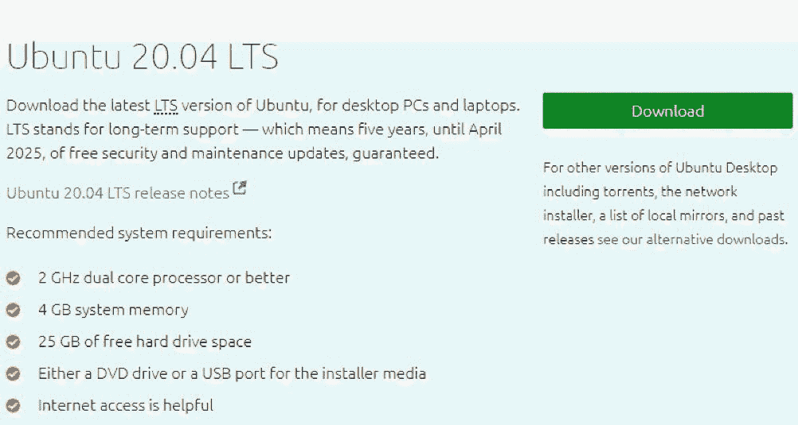

2.  当你找到所需的版本时，点击绿色的下载按钮进行获取。在重定向到感谢页面后，下载应该开始。（对于桌面版，我们将下载并安装 Ubuntu 20.04。）`.iso` 文件可供下载。它允许你制作一个可启动的 USB 设备。

3.  将文件保存到你首选的位置。

注意：如果你正在安装到虚拟计算机（如 VirtualBox），可以立即挂载 `.iso` 镜像。

### 第二步：制作可启动的 USB 盘

你需要一个至少有 4GB 存储空间的 USB 磁盘。由于此操作，USB 设备上的数据将被擦除。请确保 USB 设备上的任何现有数据已备份。

#### 选项 1：使用 Ubuntu 创建可启动的 USB 盘。

使用该工具创建启动盘：
*   创建一个搜索对话框并在其中输入“create startup”。
*   如果尚未安装，软件中心会提示你安装——从下拉菜单中选择 USB 驱动器，然后启动工具。
*   点击顶部面板格中的“Other”（其他），然后导航并选择你下载的 Ubuntu `20.04.iso` 文件。
*   在底部面板格中选择你的 USB 磁盘。
*   点击“Make startup disk”（制作启动盘）创建启动盘。

#### 选项 2：使用 Windows 创建可启动的 USB 盘

要制作启动盘，你需要安装 `Rufus`，这是一个第三方应用程序。

1.  `Rufus` 是可以下载的程序。要获取 `Rufus` 的当前版本，向下滚动到下载部分并点击链接。

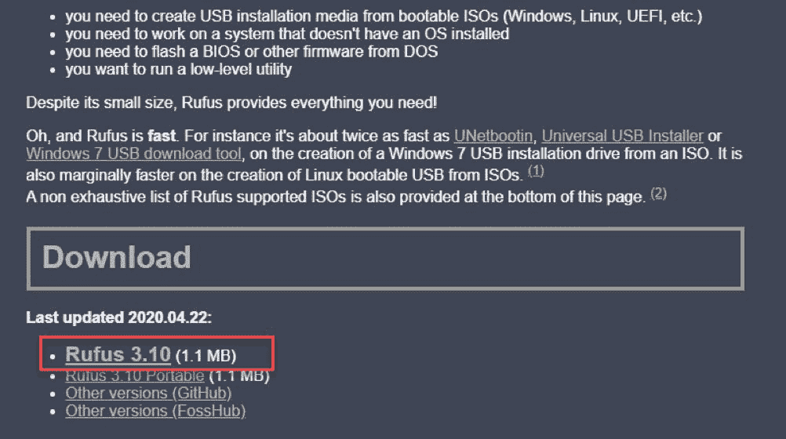

2.  文件下载完成后，运行它。

3.  出现一个对话框。如果你想检查在线更新，系统会询问。选择“否”。

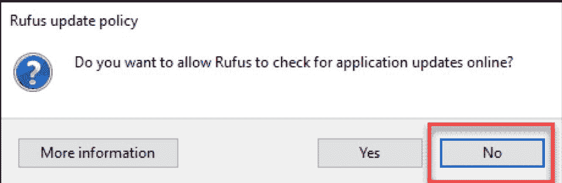

4.  `Rufus` 启动。当你插入 USB 驱动器时，它应该出现在设备字段中。
    *   将 USB 驱动器设置为你想要写入的设备。
    *   从“Boot Selection”（启动选择）下拉菜单中选择 Disk or ISO Image。
    *   切换右侧的 Select（选择）按钮。
    *   选择你之前获得的 `.iso` Ubuntu 文件。

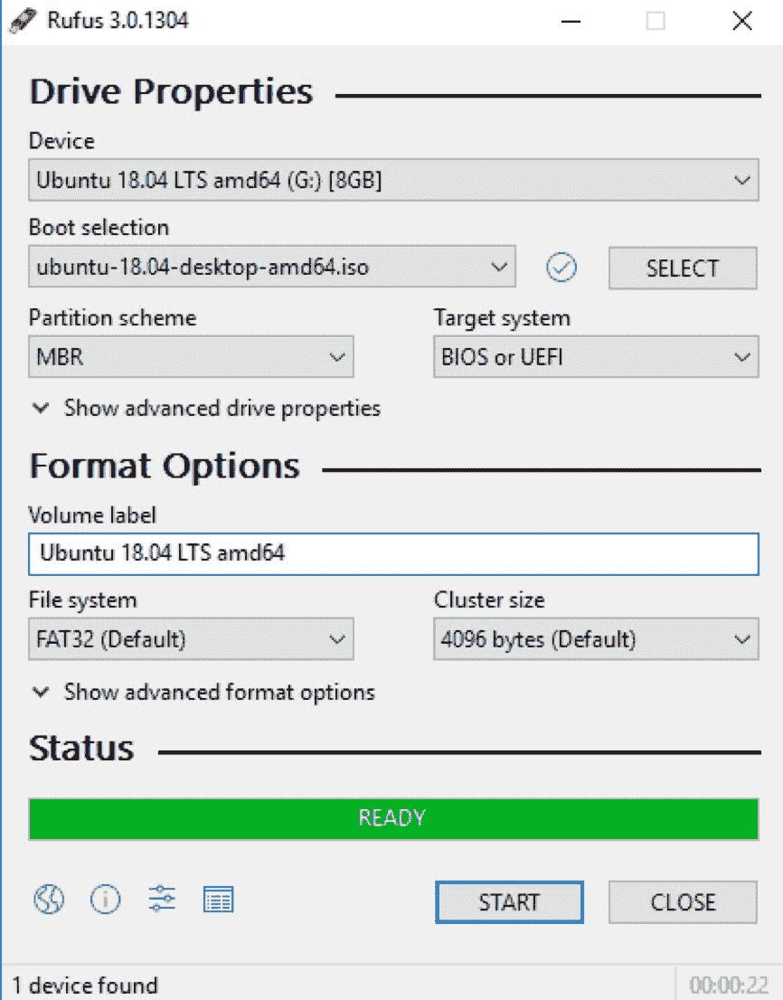

5.  点击“Start”（启动）按钮。

### 第三步：从 USB 盘安装 Ubuntu。

1.  关闭你的计算机。移除任何额外的 USB 设备，如打印机、内存卡等。
2.  打开计算机并将 Ubuntu USB 驱动器插入其中。

可能会发生两种情况：
*   USB 磁盘被计算机立即启动。
*   在启动菜单中，你必须手动选择 USB。
3.  计算机一启动，，按下一次或两次启动键。

根据你计算机的制造商，启动键可能有所不同。以下是常见的启动键：

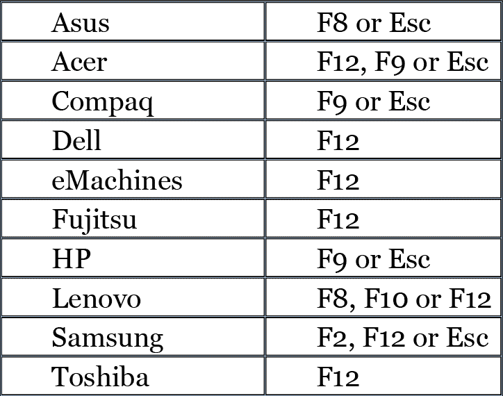

4.  使用箭头选择 Ubuntu 介质启动。启动项名称通常为 DVD 或 Optical。USB 通常被称为 USB。

Ubuntu 实时菜单应该开始在你的 PC 上加载。

注意：如果从启动菜单启动 USB 有困难，请尝试通过 BIOS/UEFI 启动。

### 第四步：安装 Ubuntu

你可以在决定安装之前尝试 Ubuntu 20.04。实时模式仅在内存中运行。

点击“Try Ubuntu”（试用 Ubuntu）进入此模式。

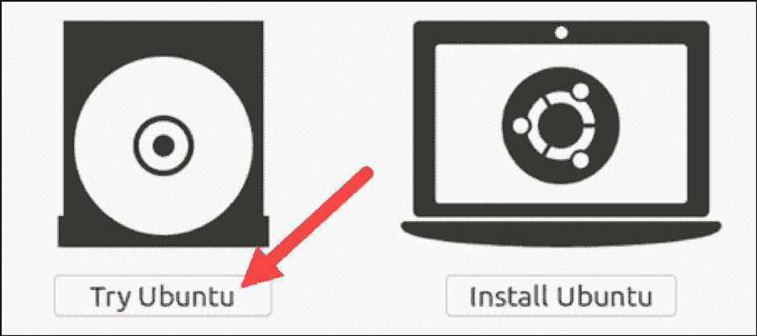

### 第五步：安装 Ubuntu 20.04 LTS 桌面版

点击“Install Ubuntu”开始安装。

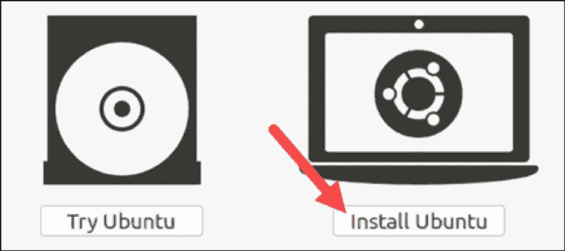

### 选择键盘布局

系统默认英语。

如果你有非标准键盘，可以在列表中选择。或者，选择“Detect Keyboard Layout”（检测键盘布局）让系统为你选择。使用字段测试你的键盘。

准备好后点击“Continue”（继续）。

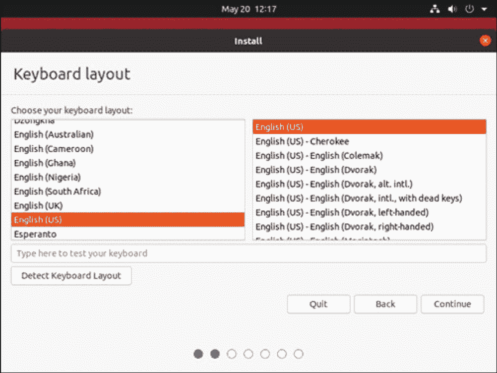

### 选择安装的应用

*   标准安装 — 这将提供完整的 Ubuntu 桌面体验，包括办公软件、游戏和媒体播放器。
*   最小安装 — 选择此选项可以节省硬盘空间，特别是当你不会使用媒体播放器或办公应用时。

你将被提示确认以下选择：
*   在安装 Ubuntu 时下载更新 — 这将自动完成下载大型软件包的过程。这些包将在安装完成后作为更新可用。
*   安装第三方图形和 Wi-Fi 硬件软件以及新的媒体格式 某些硬件（如显卡和无线设备）不支持开源驱动。此外，某些媒体格式（如`.wmv`）不受 GPL 保护。如果你需要帮助，将同意额外的服务条款。

### 硬盘分区


之后，你将看到一个对话框，要求你选择安装类型。通过选择 `Erase disk and install Ubuntu`（擦除磁盘并安装 Ubuntu），你可以在安装 Ubuntu 之前清空硬盘。如果你选择了此选项，请跳到下一个阶段。

高级用户可能选择更改“高级功能”。可以使用此命令设置你自己的磁盘分区或其他额外参数：

在使用全新的 Ubuntu 安装时，使用 LVM：

*   逻辑卷管理 (`LVM`）是 Logical Volume Management（逻辑卷管理）的缩写。该程序允许你实时管理计算机上的许多虚拟磁盘。它类似于 `gparted` 工具的更高级版本。
*   为了让新安装的 Ubuntu 更安全，请对其进行加密：这将加密磁盘内容。你需要选择一个安全密钥来解密和使用该磁盘。
*   尝试擦除驱动器并将其替换为 ZFS：ZFS 代表 Zettabyte File System（泽字节级文件系统），但它已演变为一种混合文件系统和卷管理器。由于它仍处于测试阶段，请避免在任务关键的生产系统中使用此选项。

如果你希望自己创建硬盘分区，请点击 `Something Else`（其他）。你可以在下一个屏幕上设计你自己的分区表和逻辑磁盘。这允许你将物理硬盘拆分为许多分区。操作系统会将这些分区视为独立的磁盘。

注意：某些用户为他们的 `/home` 目录创建了第二个磁盘。如果必须重新安装操作系统，包含 `/home` 目录的分区不受影响。

要将你的修改应用于磁盘分区，请点击 `Continue`（继续）。

系统将提示你是否更改磁盘？在在此屏幕上点击 `Continue` 之前，你选择的任何选项都不会生效。要继续，请点击 `Continue`。

### 选择时区
在机器格式化磁盘分区后，安装程序会询问：“你在哪里？”填入最近的大型城市名称，系统将计算你的本地时区。

点击 `Continue`。

### 创建用户账户
之后，你需要创建一个用户账户。请完成以下字段：

*   Name（姓名）：你的名字。
*   Hostname or network name（主机名或网络名称）：这是计算机的名称。
*   Username（用户名）：你希望使用的用户账户名称。
*   输入并确认强密码；安装程序将自动评估你的密码强度。
*   Automatically log in（自动登录）：对于面向公共的服务器来说，这不是好主意。
*   To log in, you’ll need my password（登录时需要密码）：建议面向公共的服务器使用。

要安装 Ubuntu，点击 `Continue`。

安装程序完成后，移除 Ubuntu 安装盘。系统将提示你立即重启。

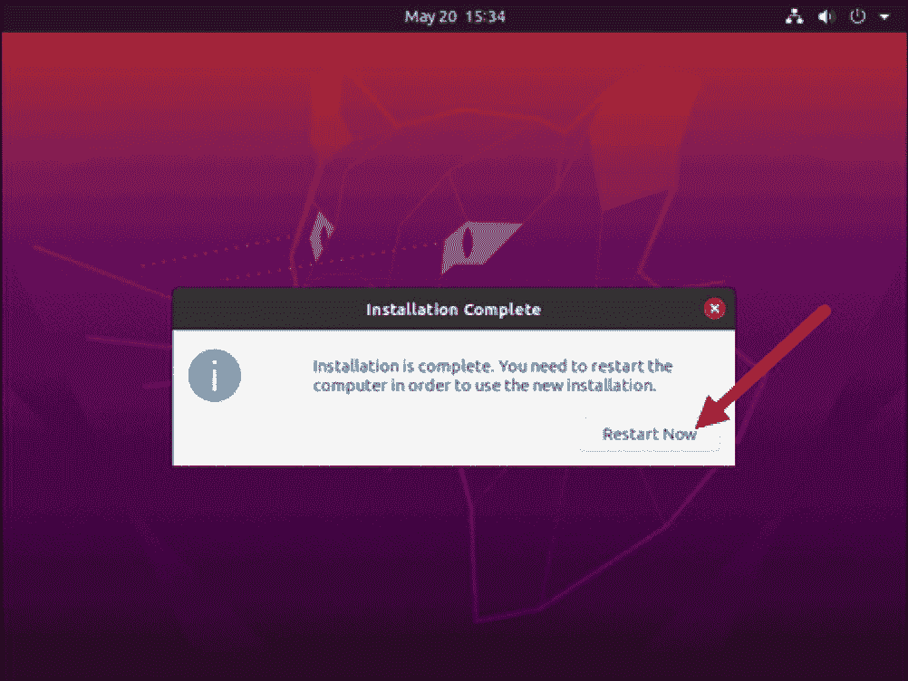

机器现在应该启动进入你刚刚安装的 Ubuntu 20.04。

# 结论
现在你的机器上应该成功安装了 Ubuntu 20.04。

### 修复 Grub
如果你和我一样，你可能不希望 Ubuntu 在启动列表中出现多次。你可能希望 Windows 选项排在第一位，特别是如果其他家庭成员使用电脑并习惯于使用 Windows。

通过打开 Dash 并输入“Term”来打开终端窗口。然后，点击终端图标。

在终端窗口中输入以下内容：

```bash
sudo gedit /etc/default/grub

# 如果你更改了此文件，之后运行‘update-grub’以更新
# /boot/grub/grub.cfg.
# 如要查看此文件中选项的完整文档，请参：
# info -f grub -n ‘Simple configuration’

GRUB_DEFAULT=”2”
#GRUB_HIDDEN_TIMEOUT=”0”
GRUB_HIDDEN_TIMEOUT_QUIET=”true”
GRUB_TIMEOUT=”10”
GRUB_DISTRIBUTOR=``lsb_release -i -s 2> /dev/null || echo Debian`”

GRUB_CMDLINE_LINUX_DEFAULT=”quiet splash”
GRUB_CMDLINE_LINUX=""
```

如果你想让 Windows 成为默认选项，你可以编辑 `grub.cfg` 文件（文件中有一个注释说不要这样做），或者你可以更改默认值以指向 Windows 选项。

虽然编辑 `/etc/default/grub` 文件不会将 Windows 置于列表顶部，但它会在你启动电脑时使其成为被选中的选项。

要做到这一点，请将 `GRUB-DEFAULT` 修改为启动电脑时 Windows 在列表中的位置。

在我的电脑上，Ubuntu 是第一，Ubuntu Advanced Options 其次，Windows 是第三。

注意编号从位置 0 开始，所以 Ubuntu 是 0，Ubuntu Advanced 是 1，Windows 是 2。

更改默认值后保存文件并运行以下命令：

```bash
sudo update-grub
```

Grub 文件将被更新，如果你重启，Windows 将被自动选中。

关于额外的 Ubuntu 条目，之所以有多个条目是因为你安装了多个 Linux 内核。

你可以直接编辑 `grub.cfg` 文件来移除额外条目（不推荐），或者可以通过运行 `Synaptic` 并查找较旧的安装版本号来删除额外的内核。

我会把重复的条目留在那里，只需不选择它们即可。

### Ubuntu 快速浏览
本快速浏览面向任何从未见过过 Ubuntu 的人，并介绍了标准的视觉外观、感受、应用程序以及功能。

Ubuntu 自带 `Unity` 桌面，它从 11.04 版本一直是 Ubuntu 的一部分。`Unity` 桌面已经成熟，现在提供了良好的用户体验。

如果你是 Windows 用户，最初的外观和感受会让你感到陌生，但在几周后，你会喜欢 Ubuntu 和 Unity 桌面的工作方式。

首先要注意的是屏幕顶部的栏。该栏作为任何运行应用程序的菜单，为应用程序本身留出更多空间。栏上还有一组图标，用于访问常见的系统设置，如电源管理、连接互联网、开启蓝牙以及调整音频设置。这里还有一个时钟和一个电源按钮。

屏幕左侧被启动栏占据，它包含常用应用程序的图标列表。启动栏让你只需点击鼠标即可访问你喜欢的应用程序。任何运行的应用程序都会出现在启动栏底部，如果你连接了外部设备如 USB 驱动器或硬盘，它们也会出现。

导航 Ubuntu 非常快速快捷。没有繁琐的菜单系统需要导航，也没有磁片视图。点击启动栏顶部的 Ubuntu 图标即可导航，但简单的方法是按下键盘上的 Super 键（Windows 键）。

出现的屏幕被称为 Dash，从这里你可以用最少的鼠标点击或按键完成任何任务。要查找应用程序，只需在搜索栏中开始输入。通常情况下，这足以找到你需要的内容而无需进一步交互。

透镜提供了应用程序、文件和文件夹、音乐、照片和视频。除了电脑上的文件和应用程序外，Dash 还会显示你可能感兴趣的应用程序建议。一些人认为这是坏事，但有一个选项可以关闭它。

视频透镜允许你过滤搜索，以便搜索本地计算机或通过 BBC 和 YouTube 等服务。音乐透镜允许你按子流派和年龄过滤音乐。Ubuntu 默认自带了令人印象深刻的应用程序集。例如，`LibreOffice` 是默认办公套件，提供了你可能从 Microsoft 相应的办公套件获得的大部分功能。


对于浏览网页，Ubuntu 默认安装了 Firefox， Thunderbird 邮件客户端提供了 Microsoft Outlook 的许多功能。其他应用程序还包括即时消息工具、`BitTorrent` 客户端和远程桌面软件。Ubuntu 还自带了游戏、图形应用程序以及一个用于播放音乐的音频播放器（`Rhythmbox`）。添加新应用程序非常简单。只需运行 `Ubuntu Software Center`（Ubuntu 软件中心），搜索想要安装的应用程序类型或名称，就会出现一个可能的应用程序列表。

`Ubuntu Software Center` 提供了一系列免费和非免费的应用程序。

Ubuntu 对硬件的支持非常出色。

我的多功能打印机和扫描仪在 Ubuntu 上的安装比在 Windows 上简单得多。在使用 Windows 时，打印机需要一张驱动程序光盘，需要运行一系列选项，总共大约需要 10 分钟才能完成安装。在我运行 Ubuntu 的笔记本电脑上，我只需运行了 `add printer wizard`（添加打印机向导），设置花费不到一分钟。

我有一个用来听音乐的 `Sony Walkman`，它可以无缝集成到 `Rhythmbox`，这意味着我可以在笔记本电脑和 MP3 播放器之间同步音乐。

我的外部硬盘在插入后立即被识别，我有一系列 `USB pen drives`（USB 优盘），它们只需插入即可使用。我的数码相机设置也非常简单。

Ubuntu 提供了一名为 `Ubuntu One` 的服务，你可以用它备份所有的重要文件和照片。该服务是免费的（最高 5 GB），你只需要填写一个表单，写上姓名、电子邮件地址和用于 `Ubuntu One` 的密码即可。账户创建后，你可以选择想要备份的文件夹，并在电脑与 `Ubuntu One` 之间进行同步。

如果你想购买更多音乐，Ubuntu 拥有自己的名为“Ubuntu One Music”的音乐服务。这是 Ubuntu 版本的 `iTunes`，其目录和价格与其他类似的服务相当。

# 从 Ubuntu 开始

现在，既然你已经安装了 Ubuntu，就是时候开始使用你的 Linux 操作系统了。与 `Windows` 或 `macOS` 等付费操作系统不同，后者需要你支付更多费用来获取额外的软件，而 Ubuntu 已经预装了你所需的所有软件。你可以在 Ubuntu 中找到一切需要的，从办公套件、网络浏览器到邮件媒体工具。只要安装完成，你就可以开始使用 Ubuntu 了。

每个人使用电脑的方式都是独特的，每个用户都喜欢根据自己的需求定制电脑的外观和操作体验。考虑到这一点，Linux 让你可以使用它提供的许多图形界面之一。因此，Linux 上有数百种图形界面可用，以满足每个用户的需求。

虽然 Linux 有多种图形界面可用，但其中两个最受欢迎的是 `GNOME` 和 `KDE`。这两个环境都具有用户友好且易于使用的界面。它们在桌面外观以及如何进一步进行个性化方面存在细微差异。

`KDE` 环境赋予用户完全的控制权和配置选项来个性化桌面。用户可以配置桌面的每个方面，并自由修改桌面的外观和体验。

另一方面，`GNOME` 的灵感来自 `Windows` 和 `macOS` 的桌面，并优先考虑简单。`GNOME` 也可以被轻松定制，但它向用户隐藏了某些选项。

Ubuntu 用户可以选择这两个桌面环境中的任何，也可以选择其他的桌面环境。

Ubuntu 20.04 的默认桌面环境是 `GNOME 3.36`，但这并不意味着你不能安装其他桌面环境。让我们来看看它能为用户提供什么。

## 主题

Ubuntu 20.04 LTS 带有一个经过翻新的 `Yaru` 主题，你可以从启动到桌面一直看到它。操作系统的开发者喜欢让自己的操作系统拥有独特的视觉，这有助于建立品牌形象。2020 年 1 月，Ubuntu 的母公司 `Canonical` 与 `Yaru` 团队以及 Ubuntu 设计团队合作进行了一次设计冲刺活动。`Yaru` 在 Ubuntu 18.10 中引入。

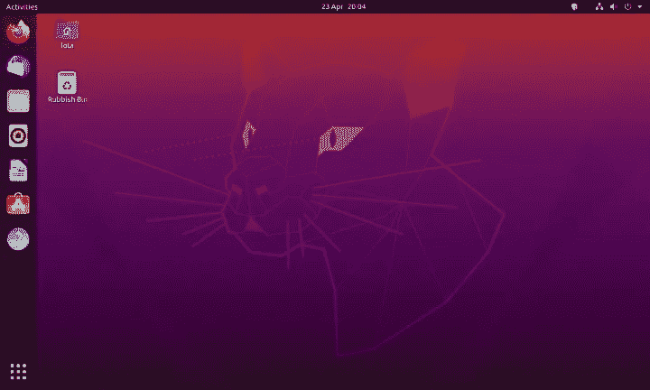

`Yaru` 有三种类型的变体，它还有一个声音主题。在设计冲刺期间，设计师和开发者还识别出一些对桌面有益的 UI 改进。你可以通过 `Appearance`（外观）设置在 `Light`（浅色）、`Standard`（标准）和 `Dark`（深色）之间切换桌面主题。你还可以使用 `Yaru` 提供的默认提示音。

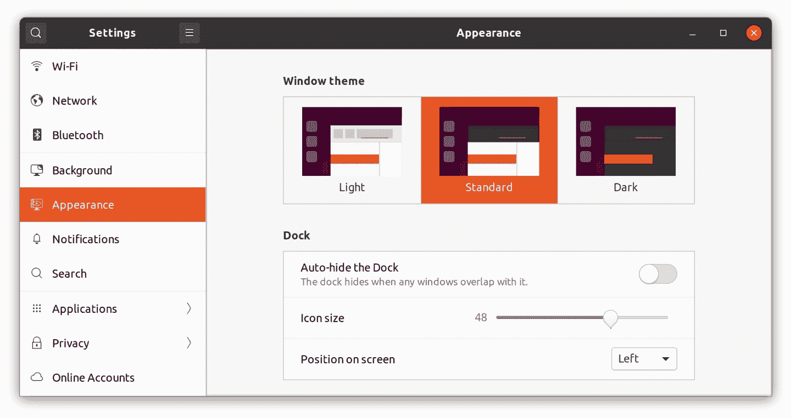

翻新的 `Yaru` 主题还让你更改启动界面和安装程序窗口。`Yaru` 团队现在将以前只出现在桌面上的旋转动画也实现在启动屏幕上。如果你使用全磁盘加密选项安装系统，那么启动菜单中的密码框也将与桌面主题匹配。

最近 Ubuntu 的每个大版本都获得了一个新的动物吉祥物。这次也是，一个设计精美的生物被集成到了发布中。他们还给它起了一个名字。Ubuntu 20.04 LTS 的吉祥物叫做 `Felicity`。

默认主题壁纸以 `Felicity` 为特色。除了吉祥物壁纸，该主题还有更多。所有的图片都来自一个无版权网站，每张图片都非常有焦点。

## GNOME 3.36

自 Ubuntu 17.10 发布以来，Ubuntu 一直将 `GNOME` 桌面作为默认桌面环境。Ubuntu 团队与 `GNOME` 开发者以及 Ubuntu 社区深度合作，为 Ubuntu 用户创建了可靠的 `GNOME` 体验。Ubuntu 还与 `Debian` 的开发者合作，保持 `GNOME` 的最新更新。

`GNOME 3.36` 具有用户可见的改进以及提升界面性能的隐藏改进。

新增了 `do not disturb`（请勿打扰）开关，它可以静音所有通知，帮助想要专注于当前任务的用户。`GNOME 3.36` 还具有简洁精美的登录和锁定屏幕，带来了整洁的用户界面。登录和锁定屏幕会对用户的桌面背景进行模糊处理。

状态菜单提供了挂起选项。此外，喜欢整理应用程序的用户可以使用此版本 `GNOME` 中的 `better app folder management`（更好的应用文件夹管理）功能。

按照每个新 `GNOME` 版本的传统，桌面和系统动画现在更加流畅，而且对 CPU 的负载更小。

## 大型应用程序

Ubuntu 现在可以轻松集成 `Microsoft Exchange` 和 `Google Gsuite`。它自带 `Firefox 75` 作为默认浏览器，具有持续保护用户隐私的功能。

Ubuntu 默认邮件客户端是 `Thunderbird`，它可以让你在桌面上快速访问任何提供者的电子邮件。无论你使用什么电子邮件提供商，无论是 `Gmail`、`Microsoft`、其他 `POP` 或 `IMAP` 服务，你都可以在 `Thunderbird` 上轻松配置邮件账户。Ubuntu 20.04 LTS 预装了 `Thunderbird 68.7.0`。

你还获得了 `LibreOffice 6.4` 来满足所有的办公需求。这是一个免费但强大的办公套件，可以让你轻松执行任何与办公相关的任务。

## 一级 OEM 支持

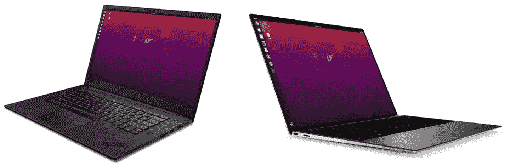

Ubuntu 是一个非常流行的操作系统，在学校、企业、政府和公共部门被大规模使用。Ubuntu 团队与 `HP`、`Dell` 和 `Lenovo` 等电脑制造商紧密合作，以满足这些领域的预装硬件需求。让我们来看一些 Ubuntu 与 OEM 合作伙伴合作为桌面用户 Linux 体验增值的示例。


随着 Ubuntu 20.04 LTS 的发布，当你安装通用发行版 Ubuntu 时，可以获得经过认证的设备体验。当你从来自 OEM 制造商的认证硬件上安装 Ubuntu 时，该特定硬件的所有功能都将自动在设备上启用，就像使用出厂镜像一样。

例如，如果你在 Dell 设备上安装了 Ubuntu，启动启动界面将自动显示 Dell 标志。Ubuntu 还包含了 `PulseAudio` 14.0、`BlueZ` 5.53 以及 `Sound Open Firmware`以支持 `SoundWire` 和 `SMIC`，这些是由 OEM 制造商在其硬件上提供的。

由于安全性至关重要，我们还可以看到许多设备出厂时带有指纹识别器，用户更倾向于使用这种方式解锁系统，而不是输入密码。Ubuntu 和 `libfprint` 项目也使这种集成成为可能，让硬件供应商在其具有生物识别认证的设备上减轻负担。

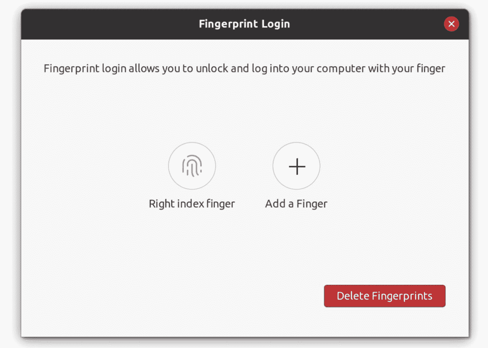

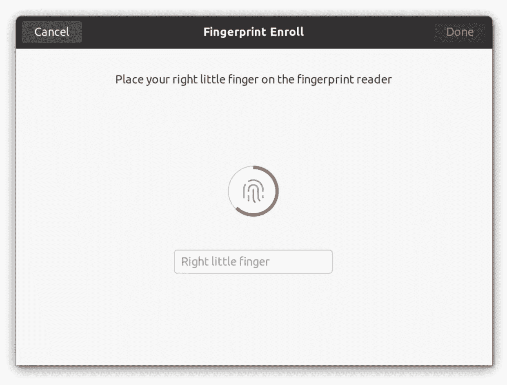

一个名为 `X11 fractional scaling`（X11 分数缩放）的功能自 Ubuntu 19.04 以来一直是 Ubuntu 的一部分，但从未通过用户界面暴露给用户。它最终在 Ubuntu 20.04 LTS 中被推出，使得 Ubuntu 用户可以通过显示设置轻松开启分数缩放。他们可以以 100% 到 200% 的 25% 增量缩放显示。

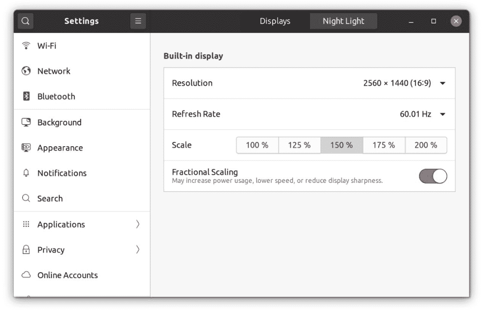

## 计算性能与游戏

机器学习和人工智能是数据工程的最新领域，企业正在迅速采用这些技术。Ubuntu 已经注意到了，并开始为企业集成人工智能支持，涵盖从开发者工作站到服务器机架，再到边缘和云端。

Ubuntu 通过提供数据科学所需的最新应用程序、库和驱动程序，为桌面和服务器数据数据科学。数据科学家可以在强大的 Ubuntu 系统上使用 `Kubeflow` 创建 AI 模型，然后将它们部署到服务器或公有云上。Ubuntu 已经成为机器学习的标准，跨越从华尔街到硅谷。它是初创公司和世界 500 强企业的首选。

如果你在系统中也有一个用于娱乐和游戏的 GPU，Ubuntu 20.04 LTS 拥有一些让你非常开心的新功能。如果你是玩家，Ubuntu 20.04 LTS 有一个更新后的 `Steam` 包，支持新的控制器和虚拟现实外设。在 Ubuntu 中还默认安装了 `Feral Interactive GameMode`。`GameMode` 是一个守护进程，可以临时优化操作系统和游戏进程，以获得丰富的游戏体验。目前，`GameMode` 优化了 `CPU governor`、`process niceness`、`Input-Output priority`、`kernel scheduler`、`GPU performance mode`、`screensaver inhibiting`、`GPU overclocking` 以及自定义脚本。如果你的系统具有混合显卡，你现在可以通过 `GNOME shell` 中的可用离散 GPU 启动应用程序。这可以通过菜单中的“在离散 GPU 上启动”项来实现。该功能同时支持 NVIDIA 和 AMD 的 GPU。

如果你是直播主或视频内容作者，Ubuntu 还通过 `FFmpeg` 支持 `VA-API` 和 `nvenc`。这些是集成在 GPU 中用于编码、解码、过滤等的功能。这些功能还将将密集型任务从 CPU 卸载，转而由 GPU 处理。`Shotcut` 和 `OBG Studio` 等应用程序使用 `nvenc` 来从这些硬件编码功能中大量受益。

## ZFS 和 ZSYS

`ZFS` 文件系统在 Ubuntu 19.10 中作为实验引入。Ubuntu 20.04 LTS 默认提供 `ZFS`，具有硬件加密、池修剪（pool trim）、设备移除和性能改进等特点。如前，`ZFS` 仍处于实验阶段。

`Zsys` 是 Ubuntu 和 ZFS 的集成工具。每当安装新软件或更新整个操作系统时，`Zsys` 会对系统状态进行自动快照。你可以在启动菜单找到这些快照。这也可以用于创建备份。

## 自 Ubuntu 18.04 LTS 以来的变化

Ubuntu 用户喜欢坚持长期支持（LTS）版本是一个众周知的事。从 Ubuntu 18.04 LTS 升级到 20.04 LTS 的用户将看到巨大的变化，因为 Ubuntu 20.04 收集了通过 Ubuntu 18.10、19.04 和 19.10 推出的所有功能。让我们重点介绍一些有趣的变化。

`GNOME Disks` 现在在格式化任何磁盘时都支持开源磁盘加密。窗口预览和桌面缩放的性能已提高。每当应用程序崩溃时，错误报告工具会自动发送崩溃报告。这很有帮助，因为用户在工作时不再会被中断。通过调整 `GNOME Settings` 中的声音面板，改进了对麦克风和扬声器的支持。通过添加跟踪器改进了桌面文件搜索。通过改进 `Alt+Tab` 功能和窗口预览功能，应用程序切换变得更加流畅。通过引入“安全图形模式”，可以调查系统中的意外错误。

CPU 使用率经过了优化，从而带来了更好的桌面性能。大多数显卡的输入和输出延迟也得到了优化。这意味着用户将获得更快、更流畅的帧率。Ubuntu 还允许 `DLNA` 分享，将媒体共享到智能电视或任何支持 `DLNA` 的设备。NVIDIA GPU 的显卡驱动程序现在内置在 Ubuntu 安装介中。这允许用户直接安装驱动程序。我们敦促你探索更多功能，以便根据需要定制 Ubuntu 的外观。

在 Linux 中使用 Vim

我们将学习 Vim 的三种模式。此外，我们将学习在 Vim 中编辑和保存文件。

## Vim 简介

作为系统管理员，你将经常需要编辑文件。Linux 有许多文本编辑器。其中一个被广泛使用的旧文本编辑器是 `vi`。`Vi` 代表可视界面，因为它是第一个可以在编辑时显示文档的编辑器之一。在 `vi` 之前，只有 `ed` 和 `ex` 等行编辑器。`Vim` 是 `vi` 的改进版本。

`Vim` 高度可扩展。它支持多种语言脚本、各种文本补全模式、文件类型插件以及许多选项。它可以适应任何角色。互联网上有针对任何用途的第三方宏和扩展，用于编程语言补全和反射。

 有必要学习 Vim 吗？

作为系统管理员，你会有偏好的文本编辑器。有些人使用 `nano`，另一些人使用 `gedit`，甚至有人使用 `emacs`。即使你已经有了编辑器，学习 `vi` 或 `Vim` 的基础是有意义的，因为默认情况下每个 Linux 发行版都安装了 `vi` 和 `Vim`。

## Vim 的不同版本

Red Hat Enterprise Linux 支持三个版本的 Vim。每个版本都有应用场景，但三个版本都可以并行运行。有以下三个变：

* `Vim-minimal`：此包仅包含 `vi` 和相关命令。Red Hat Enterprise Linux 的最小化安装带有此版本的 `Vim`。
* `Vim-enhanced`：此包包含 `Vim`，提供了拼写检查、语法高亮和文件类型插件等功能。
* `Vim-X11`：此包包含 `gvim`，这是一个具有图形窗口而非运行在终端的 `Vim` 版本。`gvim` 的最佳功能是菜单栏，对于记不住特定命令的 Vim 初学者非常有用。


取决于终端类型和用户的配置，在普通的 Vim 会话中也可以使用鼠标。

# Vim 模式

Vim 并不是一个简单直接的编辑器。`Vim` 中可用的命令追求效率和速度，而不是易于记忆。这是因为 `Vim` 有许多模式。这意味着按键和命令的功能根据当前激活的 vim 模式而改变。

`Vim` 有以下三种模式。

## 功能模式

- **命令模式 (Command mode)：** 在此模式下，你可以进行文件导航、剪切、复制、粘贴等功能以及其他命令。还可以执行 `undo`（撤销）和 `redo`（重做）等命令。
- **插入模式 (Insert mode)：**可以在此模式下进行普通的文本编辑。此外，插入模式的一种变体是替换模式（replace mode），在该模式下你可以替换文本而不是插入文本。
- **Ex 模式 (Ex mode):** 可以执行打开文件、保存文件或退出 `Vim` 等功能。它还支持一些其他复杂功能。例如，可以使用此模式将程序的输出插入到当前文件中。也可以在此模式下进行 `Vim` 配置。在 `ex` 中可以执行的所有操作都可以在 `Vim` 的这种模式下完成。

# Vim 工作流

## 编辑器基础

无论使用哪种编辑器，你都应该能够执行这些基本任务：

1. 修改文件或向文件中添加新文本
2. 保存更改并退出

### 打开文件

`Vim` 允许你通过命令行指定文件名作为参数来轻松地打开文件。例如，你可以使用以下命令打开 `/var/log/maillog` 文件，其中 `maillog` 是文件名。

```
[root@server~]# vim /var/log/maillog
```

注意：如果指定的参数指定的文件不存在，但目录是有效的，`Vim` 将根据指定的文件名创建一个新文件，并通知你正在编辑一个新文件。

`Vim` 默认在命令模式下打开。屏幕左下角会显示文件名、字符数、行数以及关于打开文件的其他细节。它还会显示关于当前显示部分的信息，例如 `All` 表示全部，`Top` 表示顶部的行，`Bot` 表示文件的最后几行，或者显示你处于文件位置的百分比。最后一行在 `Vim` 术语中被称为 `ruler`（标尺）。

### 编辑文本

如果你已经使用过 `vi` 或 `Vim`，就会知道在命令模式下，按键的作用方式并不符合预期。这是因为命令模式不是用于插入文本的，而是根据你输入的字符执行功能，例如复制、粘贴或光标移动。

你可以使用一组对应不同功能的命令切换到插入模式。让我们逐一查看。

上述提到的相同按键及其结果如下：

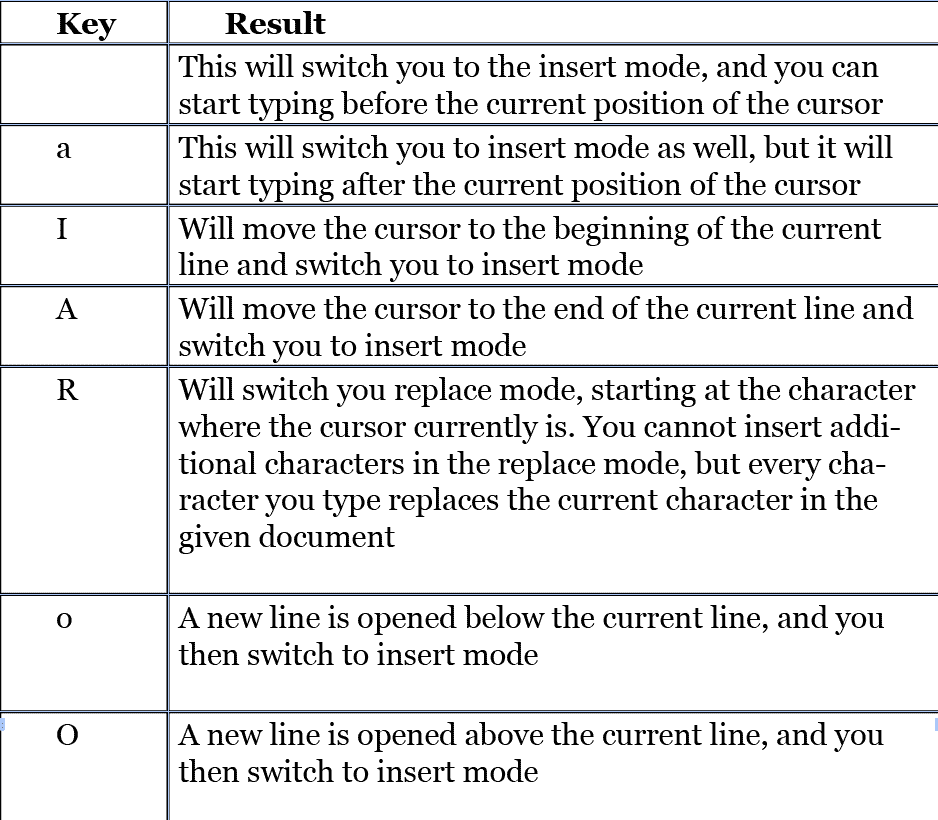

你可以通过下方的指示器判断自己是处于插入模式还是替换模式，它会显示 —INSERT— 或 —REPLACE—。

你可以使用键盘上的 `Esc` 键返回命令模式。

Red Hat Enterprise Linux 自带的 `vi` 或 `Vim` 版本经过预配置，可以在命令模式和插入模式下都能识别光标的正常移动，甚至是 `PgUp` 和 `End` 键。这并不是所有 `vi` 变体的默认设置，而是 Red Hat Enterprise Linux 特有的。旧版本的 `vi` 不识别这些命令，你只能在命令模式下使用键盘键 `h`、`j`、`k`、`l` 移动光标。

下表列出了在命令模式下可移动光标的一些常用按键。

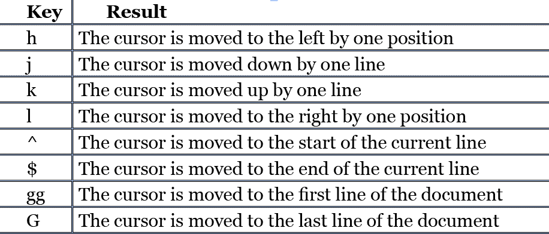

注意：按下键盘上的 `Esc` 键始终会取消当前命令或返回 `Vim` 的命令模式。一个良好的习惯是按下两次或多次 `Esc` 键，以确保你已经返回到了命令模式。

### 保存文件

`Ex` 模式用于在 `Vim` 中保存文件。要进入 `Ex` 模式，你需要在命令模式下按下键盘上的冒号（`:`）键。因此，如果你处于插入模式，先按 `Esc` 键切换到命令模式，然后按冒号进入 `Ex` 模式。当你切换到 `Ex` 模式时，你会在标尺上看到 `:` 符号，你可以在那里输入命令。完成命令输入后，按 `Enter` 完成命令。

下表给出了帮助你在 `Ex` 模式下保存更改并退出 `Vim` 的命令列表。

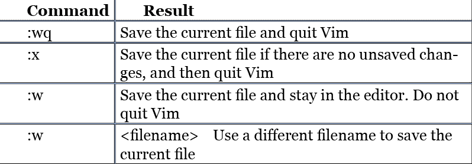

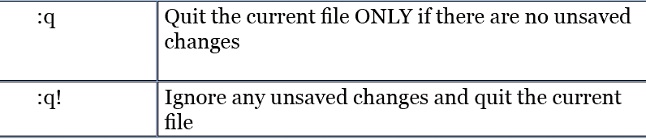

在上面的表格中，`w` 代表写入（write），意味着保存更改，`q` 代表退出（quit），而 `!` 表示操作是强制的。

### 在 Vim 中获取帮助

`Vim` 提供了丰富的在线帮助，可以通过编辑器本身获取。你可以切换到命令模式并输入 `: help`，即可启动帮助屏幕，并获得导航帮助文档所需的帮助。你可以通过在命令模式下输入 `: help subject` 来查找特定主题或话题的帮助。

帮助屏幕将在新的拆分窗口中打开。你可以通过 `:q` 关闭帮助屏幕。获取拆分窗口的帮助可以输入 `: help`。

还有交互式教程。在命令模式下，你可以输入 `vimutor`。这将启动一个关于 Vim 的导览。

## Vim 中的移动

大多数编辑器都支持单字符或单行移动。此外，`Vim` 中的一些高级命令可以帮助你更高效地导航。这些快捷键仅在命令模式下可用。

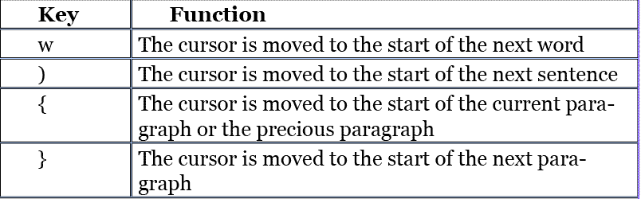

# 用户与权限

在讨论用户管理时，我们需要理解三个重要概念：

字体 用户 (Users)
- 组 (Groups)
- 权限 (Permissions)

交互式账户：通常分配给用户。这两种用户类型之间的主要区别在于：

- 守护进程使用系统账户访问文件和目录。它们通常被禁止通过 shell 或物理控制台交互式登录。
- 终端用户通过 shell 或物理控制台交互式访问资源。

有了对用户的基本理解，现在为会计部门创建一个新用户。使用 `adduser` 命令添加新用户。

以下是 `adduser` 的选项：

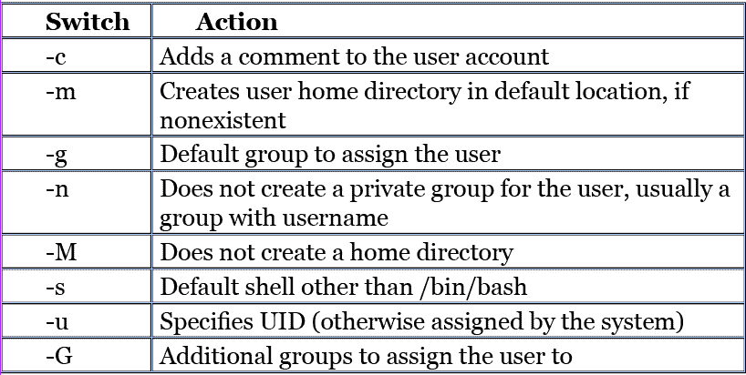

创建新用户时，使用如下 `-c`、`-m`、`-g`、`-n` 选项：

```
[root@localhost Downloads]# useradd -c “Bob Jones Accounting Dept Manager.”—m -g accounting -n bjones
```

现在看看新用户是否已经创建：

```
[root@localhost Downloads]# id bjones
(bjones) gid = 1001(accounting) groups = 1001(accounting)
```

```
[root@localhost Downloads]# grep bjones /etc/passwd
[root@localhost Downloads]# passwd bjones
更改用户 bjones 的密码。
新密码：
重输新密码：
passwd：所有身份验证令牌已更新。
```

该用户账户未启用，允许用户登录系统。

### 禁用用户账户

有多种方法可以禁用系统上的账户。从手动编辑 `/etc/passwd` 文件，到使用 `passwd` 命令配合 `-l` 选项。然而，这两种方法都有一个缺点：如果用户拥有 ssh 权限并使用 RSA 密钥进行身份验证，他们仍然可以使用这种方法登录。

此外，最好在账户上注明我们禁用它的原因。

```
[root@localhost Downloads]# chage -E 2005-10-01 bjones
```


```bash
[root@localhost Downloads]# usermod -c “Disabled Account while Bob out of the country for five months” bjones
[root@localhost Downloads]# grep bjones /etc/passwd
bjones:x:1001:1001:Disabled Account while Bob out of the country for four months:/home/bjones:/bin/bash
[root@localhost Downloads]#
```

# 管理组

在 Linux 中管理组可以方便管理员将容器内的用户组合在一起，并应用适用于所有组员的权限集。例如，`Accounting`（会计部）中的所有用户可能需要访问相同的文件。因此，我们创建一个会计组，并将 `Accounting` 用户添加其中。

在大多数情况下，任何需要特殊权限的操作都应该在组中完成。这种方法通常比对单个用户应用特殊权限要节省时间。例如，Sally 负责报告，只有 Sally 需要访问某些文件来制作报告。但是，如果 Sally 某天生病了，由 Bob 来做报告呢？或者报告需求增加了呢？当创建一个组时，管理员只需要操作一次。添加用户的操作可以根据需求的变化或扩展随时进行。

以下是用于管理组的一些常用命令：

* `chgrp`
* `groupadd`
* `groups`
* `usermod`

`chgrp`: 更改文件或目录的组所有。

让我们为会计组的人创建一个目录来存储文件，并为文件创建目录。

```bash
[root@localhost Downloads]# mkdir /home/accounting
[root@localhost Downloads]# ls -ld /home/accounting
```

接下来，将组所有交给会计组。

```bash
[root@localhost Downloads]# chgrp -v accounting /home/accounting/
changed group of ‘/home/accounting/’ from root to accounting
[root@localhost Downloads]# ls -ld /home/accounting/
drwxr-xr-x. 2 root accounting 6 Jan 13 10:18 /home/accounting/
```

现在，会计组中的每个人都对 `/home/accounting` 读和执行权限。他们还需要写权限。

```bash
[root@localhost Downloads]# chmod g+w /home/accounting/
[root@localhost Downloads]# ls -ld /home/accounting/
drwxrwxr-x. 2 root accounting 6 Jan 13 10:18 /home/accounting/
```

由于会计组可能处理敏感文档，我们需要对其他人或其他世界应用一些限制性权限。

```bash
[root@localhost Downloads]# chmod o-rx /home/accounting/
[root@localhost Downloads]# ls -ld /home/accounting/
drwxrwx—-. 2 root accounting 6 Jan 13 10:18 /home/accounting/
```

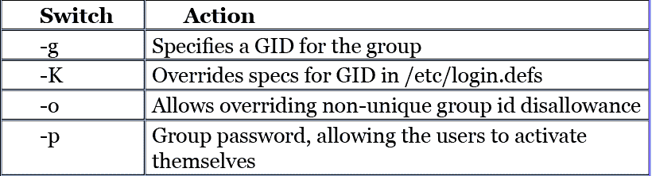

让我们创建一个名为 `secret` 的组。我们将为组设置密码，允许用户使用已知密码将自己加入。

```bash
[root@localhost]# groupadd secret
[root@localhost]# gpasswd secret
Changing the password for group secret:
New Password:
Re-enter new password:
[root@localhost]# exit
exit
[centos@localhost ~]$ newgrp secret
Password:
[centos@localhost ~]$ groups
secret wheel rdc
```

在实践中，组密码并不常用。次组是非常好的工具，而且在其他用户之间共享密码并不是良好的安全实践。

`groups` 命令用于显示用户属于哪些组。接下来，在我们对当前用户进行一些更改后将使用它。

`usermod` 用于更新账户属性。

以下是常用的 `usermod` 选项。

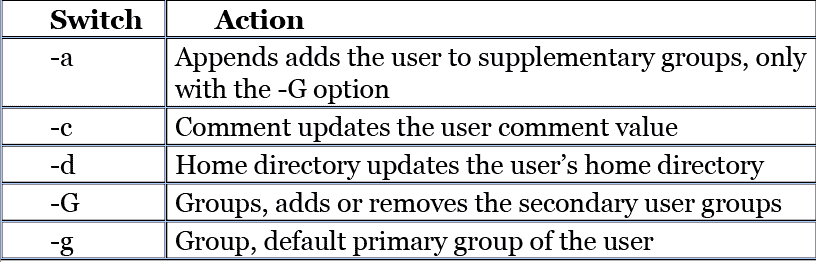

```bash
[root@localhost]# groups centos
centos : accounting secret
[root@localhost]# usermod -a -G wheel centos
[root@localhost]# groups centos
centos : accounting wheel secret
```

# 删除用户

我们已经学习了如何创建用户，但如果用户太多了呢？如果有人决定离开，而他的凭据仍在系统中呢？你如何删除这些用户？

同样，我们将采用图形用户界面（GUI）和命令行界面（LUI）方法。这样做是为了确保每个人都了解在这个迷人的 Linux 世界中事情是如何操作的。哪种最适合你，由你决定。

首先，我们使用图形用户界面：

1. 进入屏幕右上角的用户菜单。
2. 点击 `Settings`（设置）。
3. 选择 `Details`（详情）。
4. 点击 `users`（用户）。
5. 点击解锁按钮。
6. 输入 root 密码。
7. 使用名为“Remove user”（删除用户）的红色按钮。
8. 决定你是想保留文件还是删除它们。

完成后，点击相应的选项。这就搞了！

当你删除用户时，可以删除用户设置，但如果你认为这些文件仍然有用，请确保保留由该用户创建的文件并确保其可访问。用户一旦被删除，将不再能够访问系统或其创建的文件。

现在，让我们使用命令行界面（LUI）方法再看一遍。

1. 打开终端。
2. 输入：`sudo deluser (username)`。
3. 按回车，就大搞定！

# 修改用户密码

这在图形界面上完成非常容易。要做到这一点，输入以下命令：

```bash
sudo passwd (username)
```


如果你切换到刚刚添加到组的用户名并尝试访问“file123”，你也将能够毫无问题地访问它。发生这种现象的原因是，我们允许整个组对该文件拥有所有权，并拥有查看和编辑它们的必要权限。现在，由于你的新用户是该组的一部分，该用户也将拥有类似的访问权限。

要验证这一点，请使用不带 `sudo` 的 `Nano` 命令，你现在应该能够随心所欲地写入编辑文件。

这种现象在大型机构和行业中非常普遍，在这些地方，成千上万的员工和经理被添加到组中，并对用于特定用途的文件和目录拥有统一访问权限。

我们之后还会介绍其他命令和示例。现在，让我们深入探讨系统配置——它是什么、我们为什么需要配置系统，以及它能为我们提供什么。这些都是你应该能够在初级水平上回答的问题。对于系统及其配置的高级用法，你可以参考优秀的书籍并浏览 Ask Ubuntu 社区以获取进一步指导。

## Linux 与主流操作系统及 Linux 版本的对比

### Linux 操作系统 vs Windows 操作系统

## 用户
Linux 上有三种用户（普通用户、管理员 (root) 和服务用户），而 Windows 有四种用户账户类型（管理员、标准用户、儿童和访客）。

#### 使用
根据市场研究数据，全球 92.63% 的 PC 运行着 Windows，而至少有 1% 的 PC 用户在使用 Linux。许多用户表示，与 Windows 相比 Linux 很难使用，因此对 Linux 的抱怨限于家庭使用。它旨在作为服务器程序深度使用。因此，无论是否有 GUI，组织服务器都运行在 Linux 上。

此外，得益于与微软的许可协议，各种 PC 厂商都有权将 Windows 操作系统集成到他们的 PC 中，使 Windows 比 Linux 更获得市场普及。尽管 Dell 和 HP 等许多 PC 厂商开始提供 Linux 作为预装操作系统，但 Windows 仍然主导市场。

#### 内核
Linux 使用单内核，空间利用更高效；而 Windows 使用微内核，占用空间比 Linux 小，但降低了系统效率。

#### 文件程序
在 Microsoft Windows 中，文件存储在不同数据驱动器（如 C: D: E:）的目录/文件夹中；但在 Linux 上，以根目录为开头的树形结构中的一级文件是导出，不包含其他子记录。

在 Linux 操作系统中，一切都被视为文件。引用是文件、文件内容，以及外部连接设备（如打印机、鼠标、键盘）也是文件。

## 安全
每个 Windows 用户都时不时遇到安全和稳定性问题。由于 Microsoft Windows 是最常用的操作系统，黑客和垃圾邮件频繁针对 Windows。Windows（消费型）最初设计用于在没有网络连接的单用户 PC 上轻松使用，且没有内置安全功能。微软经常通过其 Windows 更新服务修复安全漏洞。这每月发布一次，即使在定期或需要提供关键更新时也是如此。

大多数时候，Windows OS 用户会遇到“蓝屏”（BLUE SCREEN OF DEATH）。这是由于系统无响应。最后，用户必须放下顾虑并手动重启 PC。

另一方面，Linux 基于多用户构建，使其比像 Windows 这样的单用户操作系统更稳定。此外，由于公众在全球范围内开发者的标准监控下运行 Linux，任何新提出的问题都可以在几小时内解决，所需的资源池可以准备好交付。

#### 兼容性
Windows 胜。Windows 的得分更高。当雷德蒙提供的方案让 Linux 黯然失色。尽管近期 Linux 有软件开发或安装，Windows 仍然是协作的主宰。

Windows 用户可以确定，几乎任何软件（即使是最冷门、过时的）都能运行，或被开发者放弃。这是因为 Windows 拥有良好的资产支持。简单明了。

相反，Linux 在 Windows 用户认为所当然的基础设施方面存在问题。

#### 易用性
近年来，Linux 在可用性方面走得太远且有所局限。发行版（如 Linux Mint 和 Ubuntu）甚至让安装和设置变得更容易，以便非技术用户更轻松地进行日常操作。

由于市场份额的不断增长，Windows 是大多数设备的默认操作系统。购买新的笔记本电脑或 PC，当然会带有预装的 Windows 10。遗憾的是，用户多年来习惯了点击工具栏并打开喜爱的程序，这使得这种改变变得非常困难。

#### 隐私
如果你是 Linux 用户，你拥有一个不会测试你的操作系统。拥有 Linux 意味着程序由你所有。你还可以补充一点，大多数 Linux 程序都内置了加密选项。作为用户，你可以确保设备被盗不会给你的数据造成真实问题。

相反，Windows 在过去几年中受到了大量的广告。用户获得了选择退出的机会，而智能注册黑客是雷德蒙计划的一部分。Windows 可以监控用户活动，提供与 Microsoft OneDrive 服务同步，或学习如何改进 Cortana（微软助手）。老实说，我不喜欢这些工具，因为它们太具有干扰性。或者，有些用户喜欢这些功能。这是一种谦逊的。

#### 源代码
Linux 是一个活跃的操作系统，而 Windows OS 是商业可行的。Linux 可以访问源代码并根据用户请求修改代码，而 Windows 无法访问源代码。

在 Linux 中，用户可以访问内核源代码并根据需要更改代码。它有优势。OS 中的漏洞将尽快修复，如果有，开发者可以修复任何缺陷。

在 Windows 中，只有成员可以访问源代码。

#### 许可
在大多数提供中，Linux 内核（以及 GNU 资源和相关库）是免费且开源的。公司为其发行版提供付费支持，但生成的软件仍可下载和安装。

## Linux 与 Mac 的对比

尽管 Linux 和 Mac 都是计算机硬件应用，但 Linux 是可以在任何设备上使用的操作系统。Mac 是只能在 Mac 设备上使用的操作系统。Linux 作为应用程序、运行其他程序的平台以及服务器单元。同时，Mac 是一个允许其他操作系统在其运行的操作系统。

### Mac OS X vs. Linux：硬件支持
Linux 和 Mac OS 这两个系统在这一领域都表现出色。然而，由于 Mac OS 仅在 Apple 制作硬件上运行，它提供了稳健且集成良好的软件组合，以提供最高性能。

对于 Linux，它有各种驱动支持软件。那时或以前，这是 Linux 可以提供的问题；不，我应该说；硬件制造商没有为其硬件的 Linux 系统提供驱动支持。但现在时机已经改变。Linux 是桌面和服务器设备上最广泛使用的操作系统。因此，所有主要零售商在获得 Mac OS 或 Windows 等其他应用程序后，都会为 Linux 发行版提供兼容的硬件驱动。

### Linux vs. Mac：识别的用户群体


如果你预算充足并想要一个开箱即用的系统，那么我更倾向于让你选择 `Mac OS`。这个系统将为你提供一个性能优异且界面酷炫的桌面环境。对于学者以及想要进行高质量音频编辑、视频录制或图形设计的高级用户来说，`Mac OS` 是一个极佳的选择。

`Linux` 拥有不同的目标用户群体。如果你是 `Linux` 世界的新手，可以尝试 `Ubuntu`、`Linux Mint` 或 `Elementary OS`；如果你正在寻找高质量或定制化的工作环境，请选择 `Arch Linux` 或 `Kali`。此外，还有一个 `Terminal`（终端）或命令行界面，它是进行任何技术水平工作的绝佳工具。

# Linux 操作系统 vs. FreeBSD 操作系统

`FreeBSD` 和 `Linux` 都是开源源码，与其许可证相互独立，并具有与 Unix 相同的环境。`FreeBSD` 是多年前在许多修改和更新后出现在 Unix 操作系统中的。相比之下，`Linux` 是从零开始开发的，作为 Unix 的替代方案。`Linux` 和 `FreeBSD` 都拆分了相同的文件管理类别。此外，它们都使用相同类型的 Shell 环境作为主要的通信手段。除此，它们还共享类似的 API 程序。由于各种相似性，`Linux` 和 `FreeBSD` 可以共享多个工具和应用。

## 许可证差异

- `Linux` 和 `FreeBSD` 的许可证差异是它们之间主要的区别。
- 所有 `Linux` 发行版、`Linux` 内核、`Linux` 程序以及基于 `GNU` 的应用程序都遵循 `GNU General Public` 或 `GNU GPL` 许可证。
- `GNU GPL` 也称为“左拷贝”（copy-left）。
- `BSD` 许可证与 `GNU GPL` 几乎相同，但来自 `BSD 许可证` 的作品并不需要维护许可证的条款。
- 任何人都可以轻松地访问、共享或修改他们的源代码，而无需重写或修改修订后的源码。
- 必须包含原始的 `BSD` 许可证和版权证书，更新后的源码是唯一的要求。
- 每个许可证的成本完全取决于用户的需求和哲学。
- `GNU GPL` 许可证促进了开放自由的环境和共享。
- 相关软件应注意依赖基于 `GNU` 的软件。
- 另一方面，`BSD` 许可的软件可以轻松且免费地安装在闭源软件上。
- 这使得 `BSD` 软件对企业和开发者更有吸引力，他们希望出售自己的软件，因为他们可以直接销售存储了其资源的软件。

- 程序的历史和谱系是 `Linux` 和 `FreeBSD` 之间的另一个主要区别。
- `Linus Torvalds` 开发了 `Linux` 内核来取代 `MINIX`，后者在赫尔辛基大学被禁止进一步用于研究。
- 随后它将先进的 `Linux` 内核与来自 `GNU` 的多个组件集成，创建了一个类似于 Unix 的完整系统。
- `Linux` 完全是从零开始升级的，没有使用任何现有 Unix 系统的东西。
- `Linux` 在许多方面与 Unix 有不同。
- 另一方面，`FreeBSD` 与 Unix 应用有密切的关系。
- `Berkeley Software Distributions`（即 `BSD`）是在加州大学开发的。
- `BSD` 后来用完整的 `BSD` 许可证重写了所有原始许可证，该操作系统后来完全整合到所有其他开源渠道中。

## Linux 的版本

### Gentoo
`Gentoo` 是一个高度灵活的元发行版，允许用户使用字符认证和软件编辑。`Gentoo` 是可以定制的。该项目由 Daniel Robbins 在 2000 年启动。尽管它提供了灵活性，但它需要相应的技术才能使用。换句话说，这对于没有经验的用户并不友好，因为可能花费大量时间来适应。更新是非常耗时的。

### Arch Linux
`Arch Linux` 由 Judd Vinet 于 2002 年发布。最初，它被视为存在于中高级用户之间的一个独立项目。后来，它通过一种称为“滚动更新”（rolling-release）的机制得以提升。滚动更新意味着应用具有自我更新的能力。`Arch Linux` 拥有优秀的软件管理基础设施。它的安装目的是为了能够从源代码安装软件。另一个误解是由于偶尔的不稳定性会导致退化风险。

### Ubuntu
`Ubuntu` 为桌面用户改变了 `Linux` 的个性。它长期以来一直闻名。它于 20 世纪初发布，至今在 `Linux` 用户中仍然流行。`Ubuntu` 基于 `DEB` 软件包。它拥有 `Canonical` 的长期支持，并现在通过其自己的类型支持业务。`Ubuntu` 的一些特殊功能包括现场 DVD、支持新技术的环境（新手可以轻松使用 `Ubuntu`）以及不同的桌面环境。`Ubuntu` 最重要的问题之一是它的不兼容性。

### MX Linux
`MX Linux` 作为 `MEPIS Linux` 站点引入。这适用于个人和商业目的。`MX Linux` 最受欢迎的功能是它的图形控制工具，被称为 `MX-Tools`。它具有不同的平台支持、对图形驱动的不同兼容性以及易于管理。与 `Mint` 和 `Ubuntu` 相比，`MX Linux` 可能对新手不够友好。需要时间来适应它的安装程序，某些工具看起来可能不同。

### Mint
`Linux Mint` 于 2006 年发布，基于 `Ubuntu` 开发。该发行版最适合初。`Mint` 具有多种增强使其易于使用。它提供了与其他程序的交互。因此，它不仅适用于个人使用，也适用于商业用途。开发者提供三种类型的发布，即官方版（12 月）、点版本（根据需要，例如）和每月版本。

### 回到 Kali
`Kali` 是为系统安全和访问设计的平台。它是目前最流行的测试平台。这一切都始于 `BackTrack` 的创建（`BackTrack` 是一个基于 `Linux` 的 `Slax` 发行版）。背后的公司是 `Offensive Security`。`BackTrack 5` 基于 `Debian` 并以 `Kali` 的名称发布。`Kali Linux` 及其功能级测试工具非常稳定，支持 32 位和 64 位格式。

# 命令基础

现在你可以打开终端。在桌面上右键点击并选择“打开终端”。

如果你没有看到此选项，请查看窗口顶部的“应用程序”。点击“应用程序”并进入“辅助”。选择“打开终端”打开文本编辑器，即“Gedit”。只需点击搜索输入“文本编辑器”。向文件中添加你喜欢的文本并保存，可以保存在桌面。我将文件命名为 `first`，内容如下：

```
我是一个 Linux 大师
我正在享受这本书
```

现在回到终端并输入：

```bash
cat first
```

按下回车键后，文件内容将显示在窗口中。例如列出短文件的内容。

## 切换目录

你可能想通过终端导航或切换目录。使用 `cd` 命令来实现，它的含义是“切换目录”。

示例：

```bash
cd /home
```

使用正斜杠 (`/`) 意味着相对于根目录，这意味着无论你在哪个目录，该命令都会执行。现在输入以下命令：

```bash
cd httpd
```

目录将切换到 `httpd`，但相对于 `/home` 目录。因此完整的工作目录将是 `/home/httpd`。现在输入以下命令：在案例中，我们将从 `/home/httpd` 移动到 `/home` 目录。输入以下命令：

```bash
cd ~
```


此命令更改用户的家目录 `/home/(username)`。`username` 将是你在计算机上使用的名称。符号 `~` 被称为波浪号（tilde），它在 Linux 中用于表示用户的家目录。

## 复制文件 (Copying Files)

`cp` 命令代表“copy files”，用于复制文件。请注意，文件不会从其初始位置删除，而是在指定位置创建一个相同文件的副本。输入以下命令：

```bash
cp first me
```

上述命令将在相同目录下复制文件 `first`，但将其重命名为新名称，即 `me`。如果目录中存在文件 `me`，它将被覆盖，且在执行此命令之前你不会收到任何警告。请考虑以下命令：

```bash
cp –i first me
```

注意我们在上面的命令中添加了 `-i` 选项。如果目录中存在文件 `me`，在覆盖它之前你将收到通知。接下来，尝试以下命令：

```bash
cp –i /d/file
```

通过上述命令，文件 `/d/file` 将复制到当前相同目录并命名为 `file`。注意我们使用了 `-i` 选项，因此如果它已存在，在覆盖它之前我们将收到通知。

你可能还需要将特定目录中的所有文件复制到另一个目录。可以通过以下方式实现：

```bash
cp -dpr sourcedirectory destinationdirectory
```

`sourcedirectory` 目录中的所有文件将被复制到 `destinationdirectory` 目录。注意我们使用了 `-dpr` 选项。这意味着：

- `-d` – 表示将保留链接
- `-p` – 将保留文件属性
- `-r` – 将进行递归复制

在从目录复制所有文件时，如有需要指定这些选项是好的，否则将应用默认设置，这可能会产生不符合预期的结果。

要显示每个挂载文件系统占用的磁盘空间，请使用 `df` 命令。

## Less 命令 (Less Command)

`less` 命令与 `more` 命令相同。区别在于用户可以使用此命令向上或向下翻页文件。考虑下面的示例：

```bash
less first
```

上述命令将显示文件 `first` 的内容。

## Ln 命令 (Ln Command)

此命令创建一个特定文件的符号链接。编写并运行以下命令：

```bash
ln –s first slink
```

上述命令将创建一个名为 `slink` 的符号链接，链接到文件 `first`。例如，命令 `ls –i first slink` 将显示这两个文件是不同的，具有不同的“节点（inodes）”。

## Locate 命令 (Locate Command)

这用于在数据库中搜索。运行以下命令：

```bash
slocate –u
```

将创建一个名为 `slocate` 的数据库。在搜索文件之前，必须先运行此命令。然而，在大多数系统中，`cron` 会周期性地运行此命令。再次运行以下命令：

```bash
locate whois
```

此命令将在你的系统中查找名称包含字符串“whois”的文件。

## 退出命令 (Logout Command)

该命令用于注销当前登录到系统的用户。只需进入终端并输入此命令：

```bash
logout
```

你将被注销并返回到登录屏幕。

## Ls 命令 (Ls Command)

`ls` 代表 list（列出）。它用于列出目录中的文件。然而，它带有许多也需要了解的选项，否则你会感到困惑。如果你需要列出当前目录中所有非“.”开头的文件，只需输入命令：

```bash
ls
```

注意，只会列出文件名。你可能需要显示目录中文件的更多详细信息，例如所有权权限、大小、时间和日期戳等。可以通过以下命令实现：

```bash
ls –al
```

## More 命令 (More Command)

一次向屏幕发送文件的一页内容。它也可以作用于管道输出。让我们将 `/etc/profile` 文件的内容显示在屏幕上。这是一个内置文件，意味着它随操作系统一起提供并包含了系统用户的配置：

```bash
more /etc/profile
```

注意，文件内容将一次显示一页。这是因为内容太大，无法在一个页面上显示。考虑下面的命令：

```bash
ls –al | more
```

该命令将列出目录中的所有文件，并将输出通过管道交给 `more`。如果目录的输出无法在一页内，它将列在额外的页面上。

## Mv 命令 (Mv Command)

此命令代表“move”（移动），用于重命名或移动文件。考虑下面的命令：

```bash
mv –i first first2
```

文件将从 `first` 移动到 `first2`，这意味着它将被重命名为 `first2` 而不是 `first`。

```bash
mv /d/first
```

上述命令将文件 `first` 从目录 `/d` 移动到当前工作目录。现在你已经看到 `mv` 命令是一个强大的工具了。

既然我们一直在谈论工作目录，它们究竟是什么？我们该如何知道它们当前位于哪个目录呢？只需输入命令：

```bash
pwd
```

按下回车键后，你会发现输出是一个目录。这显示了你所在的目录。

## 关命令 (Shutdown Command)

此命令用于关闭系统。该命令的目的是立即停止系统。要执行此操作，请使用命令：

```bash
shutdown –h now
```

下一个命令用于重启系统。要执行此操作，请使用命令：

```bash
shutdown –r now
```

## Whereis 命令 (Whereis Command)

这用于在数据库中搜索。考虑下面的命令：

```bash
whereis ls
```

此命令将显示 `ls` 的手册、源和二进制文件。上述是在我的系统中运行的命令列表。

## Sudo 命令 (Sudo Command)

它代表“superuser do”（超级用户执行）。它的目的是允许许可的用户以超级用户的身份执行命令。这通常定义在 `sudoers` 列表中。为了确保只有正确的人执行敏感命令。另一个命令 `su` 允许你以超级用户身份登录系统。`sudo` 的目的是借用超级用户的权限。这解释了这两个命令 `su` 和 `sudo`。`sudo` 命令通常用于更改系统的命令，例如更新或升级操作系统。

## Mkdir 命令 (Mkdir Command)

此命令代表“make directory”（创建目录）。它创建一个新目录并命名其路径。如果该路径已存在，将输出无法创建目录。

```bash
mkdir m
```

我创建了一个名为 `m` 的目录。创建目录后列出可用目录，发现它已创建。注意我使用了 `sudo` 运行命令。没有它，命令将无法运行。这是出于考虑。当你第一次使用 `sudo` 命令时，系统会提示提供超级用户密码。最好注意，你可以在文件夹内创建目录，并且必须对该文件夹拥有“写权限”。

否则，你无法这样做。

## Touch 命令 (Touch Command)


此命令用于仅在文件不存在时创建文件。它代表将每个文件的访问时间修改修改时间更新为当前时间。如果文件已存在，其时间戳将会被更改，但内容将保持不变。可以使用该命令在文件不存在时创建一个具有“写权限”的文件。要创建一个名为‘touchfile’ 的文件：

```bash
touch touchfile
```

如果目录中不存在该文件，它将被创建。

## `Cal` 命令

它可以被用于显示当前日期的月份，或者是过去或未来年份的月份。

## `Date` 命令

用于在终端上显示当前日期和时间，如下所示：

如果你的系统当前日期错误，你可以按照如下方式将其设置为正确的日期和时间：

```bash
Date –set='21 march 2015 18:50’
```

我们在上面的命令中同时设置了日期和时间。

## Linux 中的高级命令

### `grep` 命令

此命令用于在文件中查找字符串或特定模式。它在所有的 Linux 发行版中均可可用。然而，如果你发现系统中没有安装它，仍然可以单独安装。在 Debian 和 Ubuntu 上，你可以通过以下操作进行安装：

```bash
sudo apt-get install grep
```

在 Red Hat Linux 中，使用此命令安装：

```bash
sudo yum install grep
```

让我们从我们的文件‘first’开始，执行 `grep` 命令。记住文件的内容：

让我们先用 `grep` 在文件中搜索单词 Linux：

注意输出结果，即带有‘Linux’一词的该行，以及它将搜索词标为红色以将其与其他部分区分开来。然而，此搜索是区分大小写的。如果我们搜索的是小写“l”的单词‘linux’而不是 Linux，那么它将无法被找到。

同样注意输出是空的（null），这意味着没有单词匹配搜索词。要使搜索不区分大小写（case insensitive），即它不会区分这两个词（大写和小写），请使用 `–i` 选项。

`grep` 命令也可以用于执行多次搜索，这意味着我们要在文件中搜索多个一个单词。这是一个很好的功能，你可能某天会需要用到。要使用它，请执行以下操作：

注意我们使用了以下命令：

```bash
grep –ie ‘am’ –e ‘linux’ first
```

其中 `–i` 用于不区分大小写的搜索，而 `–e` 指定了它是多次搜索。

如下所示，`grep` 命令也可以用于执行与你提供的相反的操作：

```bash
grep -iv ‘linux’ first
```

上述命令运行后，应该返回所有不包含单词 Linux 的行。在指定文件（即‘first’）中，这应该是第二行。

注意 `–i` 用于不区分大小写的搜索，而 `–v` 的目的是返回与搜索标准相反的结果。当与 `grep` 命令配合使用时，`–in` 选项会返回行号。若要显示包含单词‘enjoying’的句子的行号，可以使用以下命令：

```bash
grep –in ‘enjoying’ first
```

你还可以返回搜索标准之上的行数。

```bash
grep –iB1 ‘enjoying’ first
```

这将返回紧邻包含搜索标准‘enjoying’的行的上方。

### `Tail` 命令

这是 Linux 中一个非常常用的命令。它用于输出文件的最后部分。文件的最后 10 行将打印在命令行窗口上。使用一个头信息位于每组输出之前。如果没有指定文件名，标准输出将显示一个破折号（–）。要打印文件的最后十行，使用以下命令：

```bash
tail filename
```

让我们先打印文件的最后 10 行。

```bash
tail first
```

注意文件 first 仅包含两行。这就是为什么命令只输出了这两行。尝试使用一个包含多于两行的文件并观察输出。它只会打印文件的最后十行。另一个需要密切关注的要点是文件的扩展名。它是一个 `.c` 文件，指定它是 `.c` 文件以及其余。

在我的情况下，文件‘first’只是一个用普通文本编辑器创建的普通文件，所以扩展名并不重要。然而，如果你没有指定输出的行数，打印在标准输出上的最后十行仅仅是默认值。该值可以被设置为任意数量的行数。考虑下方显示的示例：

```bash
tail filename –n 120
```

上述命令将输出你指定的文件的最后 120 行。设置这些行的数量非常容易。通过此命令，人们可以监控文件的实时更新。这意味着他将看到文件中添加的任何新行。考虑下方显示的示例：

```bash
tail -f first | grep 24.12.162.11
```

上述可以用于实时监控文件‘first’。它是 `tail` 和 `grep` 命令的结合。这展示了不同的 Linux 命令如何组合来实现非常有用的功能。

`tail` 命令将实时监控文件‘first’。`grep` 命令将接收文件的最后 10 行以及添加到它的任何新行。命令 `grep` 将会读取来自 `tail` 的文件输出并打印到输出。`tail` 命令将实时监控文件‘first’。`grep` 命令将接收文件的最后 10 行以及添加到它的任何新行。命令 `grep` 将会读取来自 `tail` 的文件输出并打印到输出。`tail` 命令将实时监控文件‘first’。`grep` 命令将接收文件的最后 10 行以及添加到它的任何新行。命令 `grep` 将会读取来自 `tail` 的文件输出并打印到输出。`tail` 命令将实时监控文件‘first’。`grep` 命令将接收文件的最后 10 行以及添加到它的任何新行。命令 `grep` 将会读取来自 `tail` 的文件输出并打印到输出。`tail` 命令将实时监控文件‘first’。`grep` 命令将接收文件的最后 10 行以及添加到它的任何新行。命令 `grep` 将会读取来自 `tail` 的文件输出并打印到输出。`tail` 命令将实时监控文件‘first’。`grep` 命令将接收文件的最后 10 行以及添加到它的任何新行。命令 `grep` 将会读取来自 `tail` 的文件输出并打印到输出。`tail` 命令将实时监控文件‘first’。`grep` 命令将接收文件的最后 10 行以及添加到它的任何新行。命令 `grep` 将会读取来自 `tail` 的文件输出并打印到输出。`tail` 命令将实时监控文件‘first’。`grep` 命令将接收文件的最后 10 行以及添加到它的任何新行。命令 `grep` 将会读取来自 `tail` 的文件输出并打印到输出。`tail` 命令将实时监控文件‘first’。`grep` 命令将接收文件的最后 10 行以及添加到它的任何新行。命令 `grep` 将会读取来自 `tail` 的文件输出并打印到输出。`tail` 命令将实时监控文件‘first’。`grep` 命令将接收文件的最后 10 行以及添加到它的任何新行。命令 `grep` 将会读取来自 `tail` 的文件输出并打印到输出。`tail` 命令将实时监控文件‘first’。`grep` 命令将接收文件的最后 10 行以及添加到它的任何新行。命令 `grep` 将会读取来自 `tail` 的文件输出并打印到输出。`tail` 命令将实时监控文件‘first’。`grep` 命令将接收文件的最后 10 行以及添加到它的任何新行。命令 `grep` 将会读取来自 `tail` 的文件输出并打印到输出。`tail` 命令将实时监控文件‘first’。`grep` 命令将接收文件的最后 10 行以及添加到它的任何新行。命令 `grep` 将会读取来自 `tail` 的文件输出并打印到输出。`tail` 命令将实时监控文件‘first’。`grep` 命令将接收文件的最后 10 行以及添加到它的任何新行。命令 `grep` 将会读取来自 `tail` 的文件输出并打印到输出。`tail` 命令将实时监控文件‘first’。`grep` 命令将接收文件的最后 10 行以及添加到它的任何新行。命令 `grep` 将会读取来自 `tail` 的文件输出并打印到输出。

### `Wc` 命令

`wc` 命令代表“word count”（单词计数），是 Linux 命令之一。它可以被用于统计文件有多少行。例如，如果你想知道如‘first’这样的文件中有多少行，执行以下操作：

```bash
wc –l first
```

上述命令显示我们的文件只有两行，这是事实。若要同时获取行数和文件名，请执行以下操作：

```bash
wc –l first
wc first
```

命令将输出文件的行数、文件的单词数以及文件的总字节数。文件名也将被显示。注意这些将按照上述顺序显示，所以不要混淆。上述命令可以被拆分以便你逐个查看详情。你还可以返回搜索标准之上的行数。

```bash
grep –iB1 ‘enjoying’ first
```

这将返回包含搜索标准‘enjoying’的行正上方。

### `Last` 命令

有时，你可能需要查看系统的登录列表。这对于在生产环境中使用 Linux 的人很有用，特别是出于安全考虑。人们无法否认登录过系统。只需进入命令行并输入 `last.`。你将看到登录到系统的用户、他们使用的终端以及登录日期和时间。如果这些用户仍处于登录，你也将收到通知。

运行下方所示命令：

```bash
last -100
```


上述程序将显示最近的 100 次登录记录。还会显示登录和注销时间之间的差异。

`last` 命令的其他选项包括：
1. `-R`：这将抑制主机名的显示。
2. `-a`：在最后一列显示主机名。
3. `-d`：用于远程登录。Linux 存储 IP 地址并将其转换为主机名。
4. `-F`：打印完整的登录和注销日期时间。
5. `-i`：以数字形式显示远程主机的 IP 地址。
6. `-w`：输出显示域名和全名。
7. `-x`：显示关机条目以及级别变更。

注意的是，`last` 命令会搜索 `/var/log/wtmp` 文件。该文件负责存储登录系统用户的用户名。该命令将显示自该文件创建以来的注销记录，因此你可以随时查阅此文件。如果你需要显示所有登录过系统的用户，请运行以下命令：`more` 或 `less`。

```
last | more or less
```

上述命令再次搜索 `/var/log/wtmp` 以查找这些用户。由于输出内容可能过多，无法在一个屏幕显示，请使用 `more` 或 `less` 命令，以便输出一次显示一页。与其了解所有用户的登录和注销时间，你可能只对某个特定用户感兴趣。通过 `last` 命令，可以很容易地实现这一点：

```
last username
```

你可能对主机主机名感兴趣。如上所述，可以使用 `-R` 选项隐藏它。要使用此选项，请执行以下操作：

```
last -R
```

年份是默认的登录和登录时间。你可能对这些完整时间感兴趣。可以通过以下方式实现：

```
last -F
```

如你所见，时间已完整显示，而不是只显示年份。这显示了 `last` 命令有多强大。下面是使用 `last` 命令的其他几个选项。要查看自文件创建以来机器的重启历史：

```
last -x reboot
```

要查看机器最后一次关机的时间：

```
last -x shutdown
```

### 列出文件和理解 ls

这里是使用 `-l` 选项的 `ls` 命令输出。`-l` 标志告诉 `ls` 以长格式显示输出。如果你需要查看存在哪些文件或目录，请使用 `ls`。但如果你需要详细信息，请使用 `ls -l`。

```
ls -l
-rw-rw-r-- 1 bob users 10400 Sep 27 08:52 sales.data
```

`ls` 输出的最左侧是一系列表示文件权限的字符。权限后面的数字代表指向文件的链接数。下一部分信息是文件的所有者，然后是组名。接着显示文件大小，然后是文件修改的日期和时间。最后显示文件或目录的。以下是 `ls -l` 命令以表格形式显示的信息：

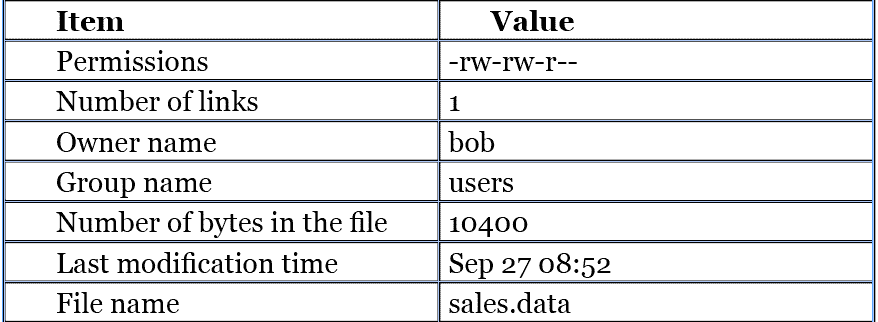

### 列出所有文件（包括隐藏文件）

名称中带有点（`.`）的文件和文件夹被视为隐藏文件，默认不显示。使用 `-a` 选项来显示这些隐藏文件和目录。

```
ls -a
.
..
.profile
.bash_history
sales-lecture.mp3
sales.data
tpsreports
```

到为止，当你使用选项时，在每个选项前都加了一个连字符（`-`）。例如 `-l` 和 `-a`。组合不需要参数的选项是可能的。只需要一个连字符，后面跟上选项。如果你想显示带有隐藏文件的长 `ls` 列表，可以运行 `ls -l -a` 或 `ls -la`。你甚至可以更改标志的顺序，所以 `ls -al` 同样有效。它们都是的。

```
ls -l
total 2525
-rw-r--r-- 1 bob sales 2562856 Sep 27 08:54 sales-lecture.mp3
-rw-r--r-- 1 bob users 10400 Sep 27 08:52 sales.data
drwxr-xr-x 2 bob users 512 Sep 28 14:49 tpsreports
```

```
ls -l -a
total 2532
drwxr-xr-x 4 bob sales 512 Sep 28 14:56 .
drwxr-xr-x 14 root root 512 Sep 27 08:43 ..
-rw-r--r-- 1 bob users 28 Sep 28 14:22 .profile
-rwrw------- 1 bob users 3314 Sep 28 14:56 .bash_history
-rw-r--r-- 1 bob sales 2562856 Sep 27 08:54 sales-lecture.mp3
-rw-r--r-- 1 bob users 10400 Sep 27 08:52 sales.data
drwxr-xr-x 2 bob users 512 Sep 28 14:49 tpsreports
```

```
ls -la
total 2532
drwxr-xr-x 4 bob sales 512 Sep 28 14:56 .
drwxr-xr-x 14 root root 512 Sep 27 08:43 ..
-rw-r--r-- 1 bob users 28 Sep 28 14:22 .profile
-rwrw------- 1 bob users 3314 Sep 28 14:56 .bash_history
-rw-r--r-- 1 bob sales 2562856 Sep 27 08:54 sales-lecture.mp3
-rw-r--r-- 1 bob users 10400 Sep 27 08:52 sales.data
drwxr-xr-x 2 bob users 512 Sep 28 14:49 tpsreports
drwxr-xr-x 4 bob sales 512 Sep 28 14:56 .
drwxr-xr-x 14 root root 512 Sep 27 08:43 ..
-rw-r--r-- 1 bob users 28 Sep 28 14:22 .profile
-rwrw------- 1 bob users 3314 Sep 28 14:56 .bash_history
-rw-r--r-- 1 bob sales 2562856 Sep 27 08:54 sales-lecture.mp3
-rw-r--r-- 1 bob users 10400 Sep 27 08:52 sales.data
drwxr-xr-x 2 bob users 512 Sep 28 14:49 tpsreports
```

### 列出文件按类型

当你使用 `-F` 选项时，文件名后面会加上一个字符来指示文件类型。例如，目录后面会有一个 `/`，符号链接后面会有一个 `@`。

```
ls -F
```

输出将如下：

```
sales.data
sales-lecture.mp3
tpsreports/
```

### 列出文件按大小

如果你使用 `-S` 选项，`ls` 将按文件大小进行排序。

```
ls -S
```

输出将如下：

```
-rw-r--r-- 1 bob sales 2562856 Sep 27 08:54 sales-lecture.mp3
-rw-r--r-- 1 bob users 10400 Sep 27 08:52 sales.data
```

### 列出文件按时间

如果你使用 `-t` 选项，`ls` 将按修改时间进行排序。

```
ls -t
```

输出将如下：

```
-rw-r--r-- 1 bob users 10400 Sep 27 08:52 sales.data
-rw-r--r-- 1 bob sales 2562856 Sep 27 08:54 sales-lecture.mp3
drwxr-xr-x 2 bob users 512 Sep 28 14:49 tpsreports
```

### 列出文件按时间反序排序

如果你想按时间排序 `ls` 列表，请使用 `-tr` 选项。

```
ls -tr
```

输出将如下：

```
-rw-r--r-- 1 bob users 10400 Sep 27 08:52 sales.data
-rw-r--r-- 1 bob sales 2562856 Sep 27 08:54 sales-lecture.mp3
drwxr-xr-x 2 bob users 512 Sep 28 14:49 tpsreports
```

### 递归列出文件

如果你使用 `-R` 选项，`ls` 将递归地列出目录中的内容。

```
ls -R
```

输出将如下：

```
.:
sales.data  sales-lecture.mp3  tpsreports

./tpsreports:
.  ..
```


└── tpsreports

2 个目录，6 个文件

```
$ tree -d
```

.
└── old

2 个目录

```
$
```

### 列出目录而非内容

通常情况下，当你对目录运行 `ls` 时，会显示该目录的内容。使用 `-d` 选项可以确保你只获取目录名。

```
total 3
-rw-r—r— 1 bob users 36 Sep 27 08:49 Fred
-rw-r—r— 1 bob users 36 Sep 28 09:21 John
drwxr-xr-x 2 bob users 512 Sep 27 12:40 old
```

### 使用彩色列出文件

在此之前你使用 `ls -F` 通过在 `ls` 输出的名称末尾添加字符来帮助区分文件类型。你也可以使用 `ls --color` 使用颜色来区分文件类型。

图片 alt 文本

### 常用 ls 选项

这里是对你学过的 `ls` 选项的回顾：

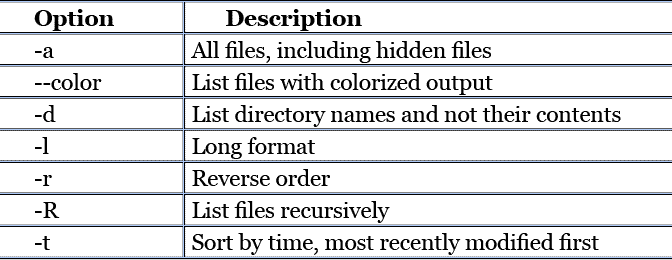

### 在文件名中使用空格

如果你想在从命令行操作时让生活更轻松，请不要在文件名和目录名中使用空格。连字符（`-`）或下划线（`_`）可以是空格的良好替代。驼峰命名法（CamelCase，即每个单词字母大写的做法）是另一个很好的选择。例如，与其将你最新的文学尝试命名为“the next great american novel.txt”，你可以使用“the-next-great-american-novel.txt”、“the_next_great_american_novel.txt” 甚至是“TheNextGreatAmericanNovel.txt”。

早晚你都会遇到名称中包含空格的文件或目录。处理这种情况有两种方法。第一种是使用引号。尽管文件名是一个文件，但使用“a file”来对其进行操作。第二种选择是转义空格。转义就像使用引号，但针对的是单个字符。转义符号是 `\`，也称为反斜杠。要转义空格，请在空格前加上反斜杠字符（`\`）。

```
$ ls -l
-rw-r—r— 1 bob users 18 Oct 2 05:03 a file

$ ls -l a file
ls: a: No such file or directory
ls: file: No such file or directory

$ ls -l "a file"
-rw-r—r— 1 bob users 18 Oct 2 05:03 a file

$ ls -l a\ file
-rw-r—r— 1 bob users 18 Oct 2 05:03 a file

$ ls -lb a*
-rw-r—r— 1 bob users 18 Oct 2 05:03 a\ file
```

`ls` 的 `-b` 选项会导致其打印转义代码。注意，引用和转义不仅适用于空格，也适用于特殊字符，包括 `|`、`&`、`'`、`;`、`(`、`)`、`< `>`, 空和制表符。

### 深度学习

- Linux 和 Unix 中的特殊字符转义：带 7 个实用示例：一篇深入探讨转义的文章。
- `man ls`：要学习 `ls` 的所有可用选项，请参考手册（man page）。

### 删除、复制、移动和重命名文件

#### 删除文件

最终，你会厌倦你创建的所有旧文件到处都是，弄乱你的主目录并并了宝贵的空间。要删除它们，请使用 `rm` 命令。

`rm file`：删除文件。
`rm -r directory`：递归删除目录及其内容。如果你想用 `rm` 删除目录，则必须提供 `-r` 参数。
`rm -f file`：强制删除且从不提示确认。

可以使用搜索模式来同时删除多个文件。在执行 `rm` 之前，用 `ls` 双重检查你想要删除的内容是个好主意。

```
$ ls s*
sales-lecture.mp3 sales.data secret secret.bak

$ rm s*

$ ls -d .*
. .. .profile .bash_history

$ rm .*
rm: cannot remove ‘.’: Is a directory
rm: cannot remove ‘..’: Is a directory

$ ls -d .*
. ..
```

注意 `rm .*` 不会删除 `.`（当前目录）和 `..`（父目录）。

#### 复制文件

要复制文件，请使用 `cp` 命令。如果你想创建一个文件的副本，可以运行 `cp source_file destination_file`。你也可以通过 `cp file(s) dir` 将文件或一系列文件复制到目录。

`cp source_file destination_file`：将 `source_file` 复制到 `destination_file`。
`cp source_file1 [source_fileN …] destination_directory`：将 `source_files` 复制到 `destination_directory`。
`cp -i source_file destination_file`：以交互模式运行 `cp`。如果目标文件已存在，`cp`将在覆盖之前询问你。
`cp -r source_directory destination`：将 `source_directory` 递归复制到目标。如果目标存在，则将 `source_directory` 复制到目标中，否则用目录内容创建目标。

```
$ cp file1 file2
$ mkdir dir
$ cp file1 file2 dir/
$ ls dir
file1 file2

$ rm dir/*
$ cp file1 file2
```

#### 移动和重命名文件

在 Linux 中移动或重命名文件是使用 `mv` 命令。`mv` 命令可以将文件或目录移动到另一个位置。

移动或重命名文件是使用 `mv` 命令。`mv` 命令可以将文件或目录移动到另一个位置。

移动或重命名文件是使用 `mv` 命令。`mv` 命令可以将文件或目录移动到另一个位置。

移动或重命名文件是使用 `mv` 命令。`mv` 命令可以将文件或目录移动到另一个位置。

移动或重命名文件是使用 `mv` 命令。`mv` 命令可以将文件或目录移动到另一个位置。

移动或重命名文件是使用 `mv` 命令。`mv` 命令可以将文件或目录移动到另一个位置。

移动或重命名文件是使用 `mv` 命令。`mv` 命令可以将文件或目录移动到另一个位置。

移动或重命名文件是使用 `mv` 命令。`mv` 命令可以将文件或目录移动到另一个位置。

移动或重命名文件是使用 `mv` 命令。`mv` 命令可以将文件或目录移动到另一个位置。

移动或重命名文件是使用 `mv` 命令。`mv` 命令可以将文件或目录移动到另一个位置。

移动或重命名文件是使用 `mv` 命令。`mv` 命令可以将文件或目录移动到另一个位置。

移动或重命名文件是使用 `mv` 命令。`mv` 命令可以将文件或目录移动到另一个位置。

移动或重命名文件是使用 `mv` 命令。`mv` 命令可以将文件或目录移动到另一个位置。

移动或重命名文件是使用 `mv` 命令。`mv` 命令可以将文件或目录移动到另一个位置。

移动或重命名文件是使用 `mv` 命令。`mv` 命令可以将文件或目录移动到另一个位置。

移动或重命名文件是使用 `mv` 命令。`mv` 命令可以将文件或目录移动到另一个位置。

移动或重命名文件是使用 `mv` 命令。`mv` 命令可以将文件或目录移动到另一个位置。

移动或重命名文件是使用 `mv` 命令。`mv` 命令可以将文件或目录移动到另一个位置。

移动或重命名文件是使用 `mv` 命令。`mv` 命令可以将文件或目录移动到另一个位置。

移动或重命名文件是使用 `mv` 命令。`mv` 命令可以将文件或目录移动到另一个位置。

移动或重命名文件是使用 `mv` 命令。`mv` 命令可以将文件或目录移动到另一个位置。

移动或重命名文件是使用 `mv` 命令。`mv` 命令可以将文件或目录移动到另一个位置。

移动或重命名文件是使用 `mv` 命令。`mv` 命令可以将文件或目录移动到另一个位置。

移动或重命名文件是使用 `mv` 命令。`mv` 命令可以将文件或目录移动到另一个位置。

移动或重命名文件是使用 `mv` 命令。`mv` 命令可以将文件或目录移动到另一个位置。

移动或重命名文件是使用 `mv` 命令。`mv` 命令可以将文件或目录移动到另一个位置。

移动或重命名文件是使用 `mv` 命令。`mv` 命令可以将文件或目录移动到另一个位置。

移动或重命名文件是使用 `mv` 命令。`mv` 命令可以将文件或目录移动到另一个位置。

移动或重命名文件是使用 `mv` 命令。`mv` 命令可以将文件或目录移动到另一个位置。

移动或重命名文件是使用 `mv` 命令。`mv` 命令可以将文件或目录移动到另一个位置。

移动或重命名文件是使用 `mv` 命令。`mv` 命令可以将文件或目录移动到另一个位置。

移动或重命名文件是使用 `mv` 命令。`mv` 命令可以将文件或目录移动到另一个位置。

移动或重命名文件是使用 `mv` 命令。`mv` 命令可以将文件或目录移动到另一个位置。

移动或重命名文件是使用 `mv` 命令。`mv` 命令可以将文件或目录移动到另一个位置。

移动或重命名文件是使用 `mv` 命令。`mv` 命令可以将文件或目录移动到另一个位置。

移动或重命名文件是使用 `mv` 命令。`mv` 命令可以将文件或目录移动到另一个位置。

移动或重命名文件是使用 `mv` 命令。`mv` 命令可以将文件或目录移动到另一个位置。

移动或重命名文件是使用 `mv` 命令。`mv` 命令可以将文件或目录移动到另一个位置。

移动或重命名文件是使用 `mv` 命令。`mv` 命令可以将文件或目录移动到另一个位置。

移动或重命名文件是使用 `mv` 命令。`mv` 命令可以将文件或目录移动到另一个位置。

移动或重命名文件是使用 `mv` 命令。`mv` 命令可以将文件或目录移动到另一个位置。

移动或重命名文件是使用 `mv` 命令。`mv` 命令可以将文件或目录移动到另一个位置。

移动或重命名文件是使用 `mv` 命令。`mv` 命令可以将文件或目录移动到另一个位置。

移动或重命名文件是使用 `mv` 命令。`mv` 命令可以将文件或目录移动到另一个位置。

移动或重命名文件是使用 `mv` 命令。`mv` 命令可以将文件或目录移动到另一个位置。

移动或重命名文件是使用 `mv` 命令。`mv` 命令可以将文件或目录移动到另一个位置。

移动或重命名文件是使用 `mv` 命令。`mv` 命令可以将文件或目录移动到另一个位置。

移动或重命名文件是使用 `mv` 命令。`mv` 命令可以将文件或目录移动到另一个位置。

移动或重命名文件是使用 `mv` 命令。`mv` 命令可以将文件或目录移动到另一个位置。

移动或重命名文件是使用 `mv` 命令。`mv` 命令可以将文件或目录移动到另一个位置。

移动或重命名文件是使用 `mv` 命令。`mv` 命令可以将文件或目录移动到另一个位置。

移动或重命名文件是使用 `mv` 命令。`mv` 命令可以将文件或目录移动到另一个位置。

移动或重命名文件是使用 `mv` 命令。`mv` 命令可以将文件或目录移动到另一个位置。

移动或重命名文件是使用 `mv` 命令。`mv` 命令可以将文件或目录移动到另一个位置。

移动或重命名文件是使用 `mv` 命令。`mv` 命令可以将文件或目录移动到另一个位置。

移动或重命名文件是使用 `mv` 命令。`mv` 命令可以将文件或目录移动到另一个位置。

移动或重命名文件是使用 `mv` 命令。`mv` 命令可以将文件或目录移动到另一个位置。

移动或重命名文件是使用 `mv` 命令。`mv` 命令可以将文件或目录移动到另一个位置。

移动或重命名文件是使用 `mv` 命令。`mv` 命令可以将文件或目录移动到另一个位置。

移动或重命名文件是使用 `mv` 命令。`mv` 命令可以将文件或目录移动到另一个位置。

移动或重命名文件是使用 `mv` 命令。`mv` 命令可以将文件或目录移动到另一个位置。

移动或重命名文件是使用 `mv` 命令。`mv` 命令可以将文件或目录移动到另一个位置。

移动或重命名文件是使用 `mv` 命令。`mv` 命令可以将文件或目录移动到另一个位置。

移动或重命名文件是使用 `mv` 命令。`mv` 命令可以将文件或目录移动到另一个位置。

移动或重命名文件是使用 `mv` 命令。`mv` 命令可以将文件或目录移动到另一个位置。

移动或重命名文件是使用 `mv` 命令。`mv` 命令可以将文件或目录移动到另一个位置。

移动或重命名文件是使用 `mv` 命令。`mv` 命令可以将文件或目录移动到另一个位置。

移动或重命名文件是使用 `mv` 命令。`mv` 命令可以将文件或目录移动到另一个位置。

移动或重命名文件是使用 `mv` 命令。`mv` 命令可以将文件或目录移动到另一个位置。

移动或重命名文件是使用 `mv` 命令。`mv` 命令可以将文件或目录移动到

位置。

#### 重命名文件

在 Linux 中移动或重命名文件是使用 `mv` 命令。`mv` 命令可以将文件或目录移动到另一个位置。

移动或重命名文件是使用 `mv` 命令。`mv` 命令可以将文件或目录移动到另一个位置。

`mv source destination`：将 `source` 移动到 `destination`。如果 `destination` 是一个目录，则将 `source` 移动到该目录中。
`mv -i source destination`：运行 `mv` 在交互模式。如果目标文件已存在，`mv`将在覆盖之前询问你。

查看以下示例了解 `mv` 命令在不同情况下的行为：

```
$ mv file1 new_file
$ ls -F
new_file

$ mv file1 dir/
$ ls dir
file1

$ mv -i file1 file2
mv: overwrite 'file2'? y
```

#### 排序文件

在 Linux 中在或重文件文件重重重文件使用是使用 `mv`。。在最简单的形式下，`ls` 命令可以将文件重重到文件。。。文件`文件文件文件到到位置。

```
$ mv file1 new_file
$ ls -F
new_file

$ mv file1 dir/
$ ls dir
file1

$ mv -i file1 file2
mv: overwrite 'file2'? y
```

#### 排序数据

在在最简单的形式下，`sort` 命令可以将重重重重重重重重重重重重重重重重重重重重重。在 Linux 移动或重命名文件是使用 `mv` 命令。`mv` 命令可以将文件或目录移动到另一个位置。

移动或重命名文件是使用 `mv` 命令。`mv` 命令可以将文件

#### 移动或重命名文件。

`mv source destination`：将 `source` 移动到 `destination`。如果 `destination` 是一个目录，则将 `source` 移动到该目录中。
`mv -i source destination`：运行 `mv` 在交互模式。如果目标文件已存在，`mv`将在覆盖之前询问你。

查看以下示例了解 `mv` 命令在不同情况下的行为：

```
$ mv file1 new_file
$ ls -F
new_file

$ mv file1 dir/
$ ls dir
file1

$ mv -i file1 file2
mv: overwrite 'file2'? y
```

#### 排序数据

在最简单的形式下，`sort` 命令可以将文本进行排序。

`sort file`：对文件进行排序。
`sort -k F`：按字段排序。跟随 `-k` 的字段编号。
`sort -r`：反序排序。
`sort -u file`：对文件进行排序并删除重复行。

```
$ cat more-secrets
tags: credentials
user: bob
pass: Abee!
tags: credentials

$ sort more-secrets
pass: Abee!
tags: credentials
user: bob

$ sort -u more-secrets
pass: Abee!
tags: credentials
user: bob

$ sort -ru more-secrets
user: bob
tags: credentials
pass: Abee!
```


在下面的示例中，`tar` 被用于创建归包（`tar cf tps.tar`）、列出归包内容（`tar tf tps.tar`）以及提取归包内容（`tar xf tps.tar`）。

```bash
$ tar cf tps.tar tpsreports/
$ tar tf tps.tar
tpsreports/
tpsreports/sales-report.txt
tpsreports/coversheet.doc
$ cd /tmp
$ tar xf /home/bob/tps.tar
$ ls tpsreports/
coversheet.doc sales-report.txt
$
```

如果您想查看正在被放入归包或提取的文件，可以使用 `-v` 启用详细模式。

```bash
$ tar cvf misc.tar sec* tpsreports
secret
secret.bak
tpsreports/
tpsreports/sales-report.txt
tpsreports/coversheet.doc
$ tar xvf /home/bob/misc.tar
secret
secret.bak
tpsreports/
tpsreports/sales-report.txt
tpsreports/coversheet.doc
```

### 压缩文件以节省空间

使用 `gzip` 文件对文件进行压缩。`file.gz` 是生成的压缩文件的名称。

使用 `gunzip` 文件解压文件。

使用 `gzcat` 或 `zcat` 并并显示压缩文件。

`du` 命令可以查看文件占用了多少空间。

- `du`: 估算文件使用情况。
- `du - k`: 以字节（Kilobytes）显示大小。
- `du -h`: 以人类可读的格式显示大小。例如，`1.2M`、`3.7G` 等。

以下是一些压缩和解压文件的简单示例：

```bash
$ du -k data
15360 data
$ gzip data
$ du -k data.gz
26 data.gz
$ ls data*
data.gz
$ gunzip data.gz
$ ls data*
data
$ du -k misc.tar
10 misc.tar
$ gzip misc.tar
$ du -k misc.tar*
misc.tar.gz
```

### 压缩归包

在现代版本的 `tar` 命令中，`gzip` 压缩是内置的。如果您想创建、提取或列出压缩归包的内容，请使用 `-z` 参数。按照习惯，压缩的 tar 文件以 `.tar.gz` 或 `.tgz` 结尾。显示如下：

```bash
$ tar zcf tps.tgz tpsreports
$ ls *.tgz
tps.tgz
$ tar ztf tps.tgz
tpsreports/
tpsreports/sales-report.txt
tpsreports/coversheet.doc
```

如果您遇到没有内置 `gzip` 压缩的旧版本 `tar`，可以使用管道（pipes）来创建压缩归包。当用连字符（`-`）代替文件名时，意味着使用标准输出。运行命令 `tar cf - pattern` 将创建一个“pattern”的归包并将输出发送到标准输出（通常是您的屏幕）。如果您在执行命令后紧跟一个管道，则该标准输出将作为管道后下一个命令的输入。要强制 `gunzip` 将输出发送到标准输出，请使用 `-c` 参数。基于此，以下是如何使用 `tar`、`gzip` 和管道创建、列出和提取压缩归包：

```bash
$ tar cf - tpsreports | gzip > tps.tgz
$ ls *.tgz
tps.tgz
$ gunzip -c tps.tgz | tar tf -
tpsreports/
tpsreports/sales-report.txt
tpsreports/coversheet.doc
$ cd /tmp
$ gunzip -c /home/bob/tps.tgz | tar xf -
$ ls tpsreports/
coversheet.doc sales-report.txt
```

### 终端与 Shell 简介

使用 Linux 操作系统需要关于终端（terminal）和命令行（command line）的知识。因此，了解这些并熟悉它们的用法以及可标准命令至关重要。但不要担心，我们将详细描述每一个。这些术语听起来比实际上要吓得多。

以文本格式与系统通信的能力是程序员青睐 Linux 的原因，因为这是程序员向计算机发出指令的标准方式。另一个原因是对系统的绝对控制，这是其他操作系统（即使有它们的命令行解释器）也无法提供的。

一些初学者甚至报告说，使用并熟悉这种文本格式的发布命令使得向程序开发的过渡变得更加容易和快速。

在终端内部运行着一个名为 `shell` 的命令行解释器。终端是您通过 GUI 与 shell 交互的方式。

Debian 支持很长的终端软件列表。这包括 `Aterm` 和 `GNOME terminal`、`Kterm`、`Mate Terminal`、`Rxvt`、`Xterm` 和 `Pvt`。

本书将使用 `GNOME terminal`，因为它的稳定性、简单性和可调整性。例如，要增加或减少终端窗口内显示的内容大小，请使用双键组合 `CTRL+` 和 `CTRL-`。shell 读取您的命令，在某些条件下对其进行修改，并执行结果。

下表显示了可用的特殊字符：

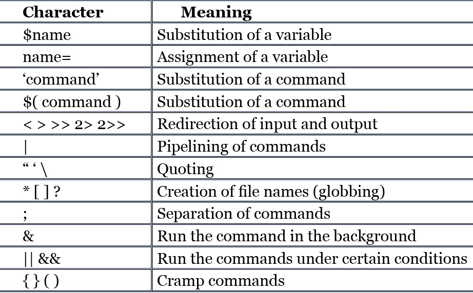

出于兴趣，shell 通过以下过程将命令行分为单个单词以确定命令：

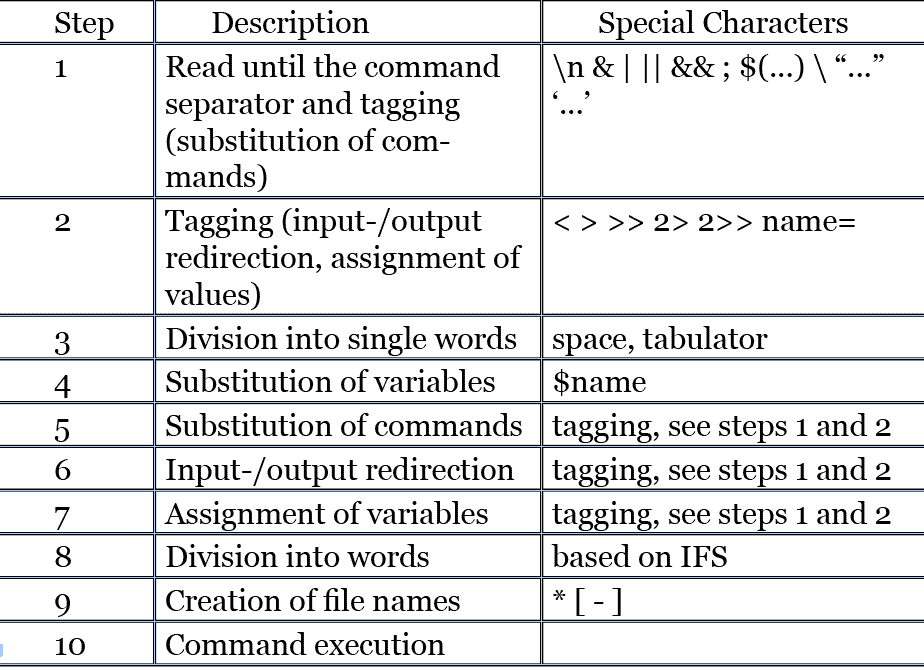

在步骤 1 和 2 中，标记操作仅发生在步骤 5 到 7，且不会发生任何后续操作。

### 可用的 Shell

您的 Linux 系统允许使用各种 shell。每个 shell 都通过 Debian 作为独立的包提供。shell 列表很长，所以我们只列出最流行的：

- Almquist Shell (`ash`)
- Bourne Again Shell (`bash`)
- Debian Almquist Shell (`dash`)
- Z Shell (`zsh`)
- C Shell (`csh`)
- Korn Shell (`ksh`)
- Tenex C Shell (`tcsh`)

您的 Linux 系统中允许哪些其他 shell 在配置文件 `/etc/shells` 中设置。使用 `cat` 命令，您可以查看允许的 shell 列表。目前，只需知道该命令只是输出文件的内容：

```bash
$ cat /etc/shells
# /etc/shells: valid login shells
/bin/sh
/bin/dash
/bin/bash
/bin/rbash
/usr/bin/screen
```

当前使用的 shell 名称存储在变量 `$0` 中。以下简单命令输出 shell 名称：

```bash
$ echo $0
bash
```

## Shell 脚本

乍看之下，shell 脚本听起来可能很难，但其实很简单。在最简单的形式下，它是存储在文件中的 UNIX/Linux 命令序列，由解释器逐行执行。shell 脚本类似于在终端中输入命令，但它是批量执行的。这使得速度更快并有助于自动化任务。我们将不会深入探讨 shell 脚本的编程细节。但值得注意 shell 脚本的推荐结构。

- Shebang 行：定义使用哪个程序来处理后续指令。该行以 `#!` 两个字节数字开头，指示后面的行是可执行的 shell 脚本。shebang 之后是解释器或程序的路径。
- 文档字符串（Docstring）：对脚本功能的简短描述以及软件许可。这可以是单行也可以是详细描述。此类行以 `#` 开头，shell 将视为注释。
- 命令（Commands）：由 shell 执行的单命令组合。如所述，这可以少到一条指令（如我们下面的示例所示），也可以是一个完整的程序。
- 退出状态（Exit state）：定义脚本的返回值。除非明确说明，否则脚本中执行的最后一个命令的退出状态将被返回。例如，通常成功时返回 `0`，发生错误时返回 1 到 255 之间的值。

下面的基础脚本包含了我们提到的所有单个元素。脚本的目的是确定计算机的运行时间。

```bash
#!/bin/bash
```


# 确定系统运行时间

# 根据 GNU 通用公共许可证 (GPL) 发布

`uptime`

# 定义退出状态：无错误

`exit 0`

执行 shell 脚本有两种方法。我们可以调用像 Bash 这样的 shell 来运行它，也可以为脚本设置执行标记并随后运行。第一种方法使用 Bash，如下所示：

```bash
$ bash uptime.sh
12:20:31 up 7 days, 2:09, 6 users, load average: 0,74, 0,40, 0,27
$
```

第二种方法基于两个步骤。首先，我们使用 `chmod` 命令为脚本设置可执行标记，如下所示：

```bash
$ chmod u+x uptime.sh
$
```

然后我们就可以运行脚本：

```bash
$ ./uptime.sh
12:26:07 up 7 days, 2:14, 6 users, load average: 0,23, 0,34, 0,28
$
```

## 关于 Shell

Shell（或 shell 解释器）是一个允许用户与系统交互并处理所指示命令的程序。从 shell 调用的命令可以分为内部命令（它们实际上对应于 shell 自身解释的命令）和外部命令（它们对应于 shell 外部的可执行文件）。除了命令外，shell 句提供了其他元素来增强其功能，例如变量、函数或控制结构。内部命令和可用元素的集合以及它们的语法将取决于所使用的特定 shell。

## 用户

除了从命令行使用 shell（以命令提示符作为 shell 宣告其正等待用户命令的指示）外，它还可以被用于解释 shell 脚本。shell 脚本或称为“命令脚本”是一个包含一组命令和 shell 可解释的命令的文本文件。

shell 是一个可执行文件，它必须解释命令、将其传递给系统并产生结果。有多种 shell。最常见的是 `sh`（称为 Bourne shell）、`bash`（Bourne again shell）、`csh`（C Shell）、`tcsh`（Tenex C shell）、`ksh`（Korn shell）和 `zsh`（Zero shell）。通常，它们的名称与可执行文件的名称一致。

每个用户都有一个默认 shell，它在打开命令提示符时会被激活。默认 shell 指定在配置文件 `/etc/passwd` 中，位于对应用户的行的最后一个字段。在会话期间可以更改 shell。为此，你只需执行相应的可执行文件，例如：

```bash
/bin/bash
```

## 系统指示符

shell 在读取其完整配置（位于 `/etc` 目录下的文件）时启动，然后读取用户自己的配置（一个以点开头的隐藏文件，位于用户的基本目录中，即 `/home/user_name/.configuration_file`）。随后会显示以下指示符：

```
team: /directory/current $
```

默认情况下，对于大多数 shell，指示符由计算机名称组成，后跟一个冒号（`:`）、当前目录，以及一个指示已连接用户类型的字符：

- `$` 指定普通用户；
- `#` 指定管理员，称为 `root`。

## 命令行概念

命令行是由命令组成的字符字符串，该命令对应于系统的一个可执行文件，或者说，是一个 shell 命令以及可选参数（参数）：

```bash
ls -al /home/jf/
```

以 `-` 开头的参数称为选项。通常，对于每个命令，在输入以下命令之一时，会有一定数量的选项可以详细说明：

```bash
command --help
command -?
man command
```

## 重定向

与任何 Unix 系统一样，Linux 拥有允许将标准输入输出重定向到文件的机制。因此，如果使用 `>` 字符，左侧命令的标准输出可以重定向到右侧的文件：

```bash
ls -al /home/jf/ > toto.txt
echo “Toto” > /etc/myconfigurationfile
```

以下命令等同于对文件的复制：

```bash
cat toto> toto2
```

重定向 `>` 的目的是创建一个新文件。如果已存在同名文件，则必须将其删除。以下命令简单地创建了一个空文件：

```bash
>file
```

使用双字符 `>>` 允许你将标准输出添加到文件中，即它允许你在不删除文件的情况下在文件末尾添加输出。

同样，`<` 字符表示标准输入的重定向。以下命令使用 `cat` 命令发送 `toto.txt` 文件的内容，`cat` 的唯一目的是在标准输出中显示内容（这个示例并没用，但具有启发性）：

```bash
cat<toto.txt
```

最后，使用重定向 `<<` 允许在标准输入中读取，直到找到右侧的链。在下面的示例中，读取标准输入直到找到单词 `STOP`。然后显示结果：

```bash
cat<<STOP
```

## 通信管道

管道是所有 UNIX 系统中特有的特定通信机制。管道用竖线（字符 `|`）表示，它允许你将一个命令的标准输出分配给另一个命令的标准输入，就像管道允许命令的标准输入与其他标准输出之间进行通信一样。

在下面的示例中，`ls -al` 命令的标准输出传递给 `sort`，后者将按字母顺序提取结果：

```bash
ls -al | sort
```

这允许通过管道连接一定数量的命令。在下面的示例中，显示当前目录下的所有文件，筛选包含 `zip` 的行，并统计总行数：

```bash
ls -l | grep zip | wc -l
```

## Linux 中的 Shell 脚本

### 调用

在最基本的形式中，shell 脚本可以是包含一个或多个命令的简单文本文件。为了帮助识别内容，shell 脚本通常具有 `.sh` 扩展名，我们将遵循这一标准（但记住它是信息性的且可选的）。例如，以下文件就是一个 shell 脚本：

```bash
Script.sh
echo “ 文件夹内容:”
ls ~/
```

练习：
1. 验证 `script.sh` 文件具有通用执行权限（如果没有，只需执行 `chmod +x script.sh`）。
2. 调用要解释的脚本，例如使用命令：
```bash
./script.sh
```

除了命令外，shell 脚本可能包含 shell 提供的其他增强脚本功能的元素。总之，shell 脚本的基本结构如下：

```bash
script_ejemplo.sh
#!/bin/dash
# 这是注释
echo Hello
ps w
echo “ 读取脚本的进程: $$”
```
- `#!` — Shebang
- `# 注释（不解释）
- 脚本内容

“shebang”允许在使用隐式调用时指定你希望解释脚本其余部分的命令解释器。该行的语法是：#!` 后紧跟 shell 的可执行文件，在此应注意以下几点：

- 它必须是脚本的第一行，否则它将被解释为注释（以 `#` 字符开头）。
- `#!` 与 shell 可执行文件之间可以存在空格。
- shebang 不是强制性的（当使用隐式调用时，如果未指定，将尝试使用调用脚本的相同类型的 shell）。


# 隐式 (Implicit)
像执行可执行文件一样调用脚本，这需要为脚本分配执行权限。系统会读取 shebang 解释器路径来确定应该使用哪种 shell 来读取脚本，并为该 shell 加载一个子进程（子壳）（如果脚本没有 shebang，则子壳将使用与调用时所在的命令行相同类型的 shell）。请注意，shell 脚本是由命令解释器读取的文本文件，也就是说，它们是被**解释**的。它们**不是**被直接**执行**的。为 shell 脚本分配执行权限是一种加速脚本调用的文件系统工具，但其内部功能是加载一个新的 shell 进程（子壳），以便其解释脚本。

# 隐式使用 `.` (等同于 import): 
脚本将由负责调用脚本的命令行的同一个 shell 进程进行解释。因此，在这种情况下，shebang 也会被忽略。

在创建子壳的情况下，除非强制要求（例如使用 `su -c`），否则子壳将属于创建它的父 shell 所所属的用户。解释脚本的 shell 进程所属的用户决定了在脚本内部可以执行的操作（例如，如果 shell 属于用户 `dit`，则脚本无法修改 `/etc/passwd` 文件，而如果 shell 属于 `root` 超用户，就可以修改）。请考虑这一方面，以确定可以在脚本中执行哪些操作，以及应该以哪个用户调用它。

## 练习
1. 在命令控制台中，执行命令 `ps w` 并找到与你当前工作的命令行相关的 shell 进程。
2. 使用不同的调用方法调用该脚本。对于每种方法，分析获取的输出，以确定每种情况下解释脚本的 shell 进程是什么、该进程属于哪个用户，以及是否打开了子壳：

### 显式 (Explicit)
```
/bin/sh script_example.sh
/bin/dash script_example.sh
/bin/bash script_example.sh
```

### 隐式使用 “.”
```
. script_example.sh
```

### 隐式
检查脚本是否具有执行权限并使用以下命令执行它：
```
./script_example.sh
```

虽然 `bash` 和 `dash` 均遵循 POSIX 标准，但 `bash` 增加了许多 `dash` 等其他 shell 不的特定扩展。因此，每当我们设计一个脚本时，必须考虑到支持它的 shell 或多个 shell，确保它由其中之一调用。为了了解这一方面的重要性，请考虑以下两个基于结构使用（稍后使用）的脚本：

**script_estandar.sh**
```bash
#!/bin/sh
for VAR in 0 1 2 3
do
echo $VAR
done
```

**script_estandar.sh**
```bash
#!/bin/bash
for ((VAR=0 ; VAR<4 ; VAR++ ))
do
echo $VAR
done
```

两个脚本的功能相同，但 `script_estandar.sh` 是按照 POSIX 语法编写的，而 `script_bash.sh` 使用了 `bash` 支持的非标准语法。

## 练习
1. 使用以下命令调用脚本 `script_standar.sh`（记住你已经在 `scripts/` 目录下创建了它们），并验证它们是否都工作正常且结果相同（第一次和第二次调用相同，均使用 shell `dash`）：
```
/bin/sh script_estandar.sh
/bin/dash script_estandar.sh
/bin/bash script_estandar.sh
```
2. 现在使用以下命令调用脚本 `script_bash.sh`：
```
/bin/dash script_bash.sh
/bin/bash script_bash.sh
```
你可以看到由于由于非标准的脚本语法，第二次调用可以工作，但第一次调用（使用 dash）会产生语法错误。

# 通用 Shell 操作
shell 语言是一种解释型语言，其中会读取、分析并处理（以 `\n` 结尾）的文本行。需要被解释的行从以下位置读取：
* 标准输入（默认键盘）。在这种情况下，该 shell 被称为交互式 shell。
* shell 脚本文件。
* 参数，在运行 shell 时通过选项提供。例如：`bash –c “ls –l”`

读取这些行后，shell 会执行以下步骤（按此顺序）：
1. 将行分为不同的元素：单词和操作符。使用空格、制表符和运算符分隔元素。`#` 字符用于包含注释，在处理过程中会被移除。
2. 在简单命令、复合命令和函数定义之间进行区分。
3. 进行不同的扩展和替换。检测要执行的命令和要传递的参数。
4. 执行入站/出站重定向，并将重定向相关的项从参数列表中移除。

# 使用 Shell
如果不知道如何使用命令行，就不可能成为高效的 Linux 专家。shell 提示符表示系统已准备好接收用户命令。这被称为用户与系统的对话。对于输入的每个命令，用户都会收到来自系统的响应：
1. 另一个提示符，表示命令已执行，你可以进行下一步。
2. 错误消息是系统对用户关于系统内部发生情况的陈述。

习惯于处理图形界面系统的用户可能会觉得使用命令行很繁琐。相反，这种界面在 Linux 中一直是基础并得到了发展。有很多技术可以节省工作，即在完成 Linux 常见的活动时：
* 自动补全命令名或文件名
* 搜索并重新执行过的命令
* 通过模式替换文件列表

当你需要对各种对象执行类似的操作时，命令行的优势就显而易见。在图形界面系统中，你需要大量的拖拽；而在命令行中，一个命令就足够了。

# Shell (壳)
命令行 shell（有时称为命令解释器）是将你的命令发送到操作系统和应用程序，并接收其响应的软件。脚本是用 shell 语言编写的短程序，对文件及其包含的数据执行一系列连续操作。

在输入用户名和密码登录系统后，你会看到命令行提示符（以 `$` 结尾的行）。该符号以后将代表命令行。如果在安装期间指定系统启动时进入图形界面，你可以在任何虚拟文本控制台上进入命令行。你可以通过 `Ctrl-Alt-F1 - Ctrl-Alt-F6` 或使用终端模拟器程序如 `xterm` 实现。

列出的 shell 可用。根据发行版的不同，它们可能有所差异：

bash
流行的 Linux shell。它可以为命令和文件名扩展，保留命令历史并允许对其修改。

ash
在 UNIX shell 平台上，korn shell 的克隆很有名。

sash
这种 shell 的独特之处在于不依赖任何共享库，并提供了许多常用工具的简化版本，如 `al`、`dd` 和 `gzip`。因此，在系统崩溃或更新关键共享库版本时，sash 非常有用。

tcsh
C shell 的改进版本。

zsh
列表中最新的 shell。它具有高级功能，如命令参数自动补全以及许多其他让 shell 操作变得更加方便高效的功能。然而，由于所有 zsh 扩展默认禁用，因此你必须在使用此命令行 shell 之前学习文档并启用你所需的功能。


Bash Bourne Again Shell 是默认的 shell。使用命令 `echo $ SHELL` 可以查看你正在使用哪个 shell。

shell 之间不仅在功能上不同，在命令语法上也有不同。如果你是新用户，我们建议你从 `bash` 开始；后续的示例将演示该领域的工作。

## Bash Shell

`bash` 中的命令行由命令名和后面的按键（选项）组成，按键是改变程序行为的指令。按键通常以字符 —or— 开头，并由一个字母组成。在命令之后，可以添加参数（参数）——命令必须在其中执行的对象的名称（通常是文件和目录的名称）。

按下回车键完成命令输入后，命令将发送到 shell 执行。在用户的终端上，可能会出现有关命令执行或由于命令执行导致失败的通知，而下一个命令行提示符（以 `$` 字符结尾）的出现标志着命令已完成，你可以输入下一个命令了。

在 `bash` 中，各种策略使得输入和编辑命令行变得更加简单。例如，你可以使用键盘：

- `Ctrl-A`：跳转到行首。按下 Home 键也可以实现相同的功能；
- `Ctrl-u`：删除当前行；
- `Ctrl-C`：中止命令执行。

为了在以前运行过的命令中识别特定的命令而无需回顾整个历史，请按下 `Ctrl-R` 并输入你要查找的命令中使用的术语。

历史记录中出现的命令是有编号的。要运行特定的命令，请输入：

`! command number`

如果你输入 `!!`，则会开始你刚刚输入的命令。

在 Linux 上，应用程序和命令名称有时可能长。幸运的是，`bash` 可以为你补全名称。你可以使用 `Tab` 键补全命令、程序或目录的名称。假设你想使用 `bunzip2` 解压缩应用作为示例。为了这样做，开始输入：

`bu`

然后按下 `Tab` 键。如果没有发生任何事情，说明还有其他完成指令的可能性。通过再次按下 `Tab` 键，你将获得以字母 `bu` 开头的名称列表。例如，系统包含以下程序：`buildhash`、`builtin` 和 `bunzip2`：

```
$ bu
buildhash builtin bunzip2
$ bu
```

在输入 `n>` 后按下 Tab（`bunzip2` 是唯一以 `n` 作为第三字母的名称）。shell 将为你补全名称，你现在只需要按回车键执行该命令了！

`bash` 会在 `PATH` 系统变量定义的文件夹中搜索从命令行调用的程序。默认情况下，当前目录（用 `./` 表示）不包含在此目录列表中（点斜杠）。因此，你必须使用命令 `./prog` 从当前目录启动 `prog` 程序。

## 基础命令

处理数据（通常存储在文件中）和管理在系统上运行的程序（进程）是任何系统中必须完成的首要活动。下面列出的命令允许你在处理文件和进程时执行最常见的任务。只有第一个命令 `cd` 包含在 shell 自身中；其他命令是单独提供的，但在每个 Linux 系统上始终可用。下面列出的所有命令都可以在文本和图形模式（xterm, KDE console）下使用。使用 `man` 命令学习更多关于每个命令的知识，例如：

```
man ls
cd
```

### `cd`

允许你更改当前目录（遍历文件系统）（导航文件系统）。它同时支持绝对路径和相对路径。假设你在主目录中并想访问 `tmp/` 子目录。为了这样做，输入以下相对路径：

`cd tmp/`

要进入 `/usr/bin/` 目录（绝对路径），输入：

`cd /usr/bin/`

该命令的一些选项有：

- `cd ..`：允许你进入父目录（注意 `cd` 和 `..` 之间的空格）。
- `cd -`：无参数时返回主目录。

### `ls`

`ls`（列表）显示当前目录下的文件。两个主要选项：`-a` 显示所有文件包括隐藏文件，`-l` 显示详细信息。

### `rm`

此命令用于删除文件。警告：删除的文件无法恢复！语法：`rm filename`。

该程序有多个参数。常用的是：`-i` 请求删除，`-r` 递归删除（即子目录和隐藏文件）。示例：

```
rm -i ~/html/*.html
```

删除 `html` 目录下所有的 `.html` 文件。

### `mkdir`, `rmdir`

`mkdir` 命令允许你创建目录，而 `rmdir` 删除目录（前提是它是空的）。语法：

```
mkdir dir_name
rmdir dir_name
```

`rmdir` 命令经常被 `rm -rf` 命令取代，后者即使目录为空也能删除。

### `less`

`less` 允许你逐页查看。语法：`less filename`

### `grep`

此命令允许你在文件中搜索特定的字符字符串。请记住 `grep` 搜索使用正则表达式，这意味着你可以指定一个模板来一次搜索一组术语。正则表达式允许你创建描述字符串类的模式，例如“空格周围的四个数字”。显然，这种表达式可以用于查找文本中所有的数字年份。正则表达式具有广泛的搜索功能。你可以在屏幕文档 (`man grep`) 中获取更多关于 `grep` 的信息。语法：`grep search_file`

### `ps`

显示活动进程列表。命令列显示进程名，PID（进程标识符）是进程号（与进程的操作所需的，例如使用 `kill` 命令发送信号）。语法：

```
ps arguments
```

参数 `u` 提供额外信息，而 `ax` 允许你观察不属于你的进程。

### `kill`

如果程序停止响应或挂起，使用此命令将其完成。语法：`kill PID_number`。

PID 号指的是进程标识码。


如果你需要一个简单的比较，Linux 操作系统中的 `bash` shell 类似于 Windows 操作系统提供的命令提示符（command prompt）程序，但你可以说，`bash` 中使用的脚本语言与命令提示符可以执行的脚本相比复杂得多。`Bash` 也可以与从 Windows 7 和 Windows Server 2008 R2 开始提供的 PowerShell 实用相比。许多专业人士将 `bash` shell 称为一个非常强大的管理工具。你可以使用 `bash` shell 提供的脚本语言自动化 Linux 系统上的许多任务。此外，`bash` shell 还有执行许多其他任务的选项，这些任务如果尝试通过图形界面操作将变得复杂甚至是不可能的。

`bash` shell 通过名为终端（terminal）的工具访问。终端的输入设备是你的键盘，输出设备是你的显示器。Linux 操作系统还提供了所谓的虚拟控制台（virtual consoles），也可以用它们访问 `bash` shell。因此，你将在基础物理控制台上拥有多个虚拟控制台，且每个虚拟控制台都可以作为一个独立的终端。此外，你可以使用每个虚拟控制台为不同的用户创建登录会话。

### Shell 基础

在 shell 提示符上输入的命令由三个部分组成：

1. 你想要运行的命令
2. 定义命令行为的选项（Options）
3. 参数（Arguments），即命令的目标

命令基本上定义了你想要执行的程序。跟在命令后的选项可以是零、一个或多个。选项控制命令的行为并定义命令将执行的操作。选项通常使用一个连字符（-）或两个连字符（--）。这样做是为了让我们能够区分选项和参数。例如：`-a` 或 `--all`。

参数也位于命令行的命令后面，可以像选项一样是一个或多个。参数指示了命令应该操作的目标。

让我们来看一个示例命令：

```
usermod -L John
```

此示例中的命令是 `usermod`。
选项是 `-L`。
参数是 `John`。

这条命令的作用是锁定系统中用户 `John` 的密码。

为了有效使用命令行上的命令，用户需要知道特定命令可以使用哪些选项。如果你在运行任何命令时带有 `--help` 选项，你将获得一组可以传递给该特定命令的选项。因此，其实没有背诵所有命令将要使用的选项。列表还会告诉你每个选项的作用。

使用语句（use statements）有时看起来非常困难且难以阅读。一旦习惯了某些惯用法，阅读语句就会变得简单得多。

*   选项被方括号 `[ ]` 包围
*   如果命令后面跟着 `…`，它指定属于该类型的任意项目列表
*   如果有多个项目且如果用管道符 `|` 将它们隔开，则意味着你只能指定其中一个
*   变量使用角括号 `<>` 括起来的文本表示。因此，如果你看到 `<filename>`，你必须将其替换为想要传递的文件名

例如，检查下方的命令：

```bash
[student@desktop ~]$ date --help
date [OPTION]… [+FORMAT]
```

这表示命令 `date` 接受 `[OPTION]…` 表示的选项，以及另一个选项 `[FORMAT]`，后者将以 `+` 符号为前缀。

### 在 Bash Shell 上执行命令

再次布恩 Shell（Bourne Again Shell，称为 `bash`）负责解释用户在 shell 提示符上输入的命令。我们已经学习了你在 shell 提示符中输入的字符串是如何被分为三个部分的：命令、选项和参数。你在 shell 中输入的每个单词都使用空格分隔。系统中已安装的程序由你输入的每个命令定义，并且每个命令都有与其关联的选项和参数。

当你在 shell 提示符上输入带有选项和参数的命令并准备好运行时，你可以按下键盘上的 Enter 键，这将执行该命令。如果你想在单行上输入多个命令，可以使用分号（`;`）来分隔命令。

让我们回顾一些在 Red Hat Enterprise Linux 7 和其他基于 Linux 的操作系统的日常命令行操作中使用的简单命令。

`date` 命令将显示系统的当前日期和时间。你也可以使用此命令来设置系统时间。如果你为 `date` 命令传递一个带有 `+` 符号的参数，它表示你希望在输出中显示日期的格式。

```bash
[student@desktop ~]$ date
Sat Aug 5 08:15:30 GMT 2019

[student@desktop ~]$ date +%R
08:15

[student@desktop ~]$ date +%x
08/05/2019
```

`passwd` 命令可用于更改用户的密码。然而，在设置新密码之前，你需要指定指定用户的原始密码。该命令要求你指定一个强密码，这使得包含小写字母、大写字母、数字和符号变得必要。你还需要确保指定的密码不是字典中的单词。root 用户有权更改系统上任何其他用户的密码。

```bash
[student@desktop ~]$ passwd
Changing password for user student.
Changing password for student.
(current) UNIX password: type
New password: 
Retype new password: 
passwd: password updated successfully.
```

文件类型和扩展在 Linux 系统中没有指定。`file` 命令可以扫描任何文件并告诉它的类型。你需要将文件作为参数传递。

```bash
[student@desktop ~]$ file /etc/passwd
/etc/passwd: ASCII text
```

如果你将文件夹/目录作为参数传递给 `file` 命令，它会告诉你这是一个目录。

```bash
[student@desktop ~]$ file /home
/home: directory
```

组命令是 `head` 和 `tail`，它们分别打印文件的开头行和结尾行。这两个命令都可以结合 `-n` 选项使用，该选项用于指定你想显示的行数。

```bash
[student@desktop ~]$ head /etc/passwd
这将会显示 passwd 文件的前 10 行。

[student@desktop ~]$ tail - n 3 /etc/passwd
这将会显示 passwd 文件的最后 3 行。
```

`wc` 命令用于统计指定文件的行、单词和字符。它支持 `-l`、`-w`、`-c` 等选项，分别代表行、单词和字符。

```bash
[student@desktop ~]$ wc /etc/passwd
30 75 2009 /etc/passwd
```

这显示 passwd 文件中有 30 行、75 个单词和 2009 个字符。

如果你在使用 `wc` 命令时传递 `-l`、`-c、`-w` 选项，它将根据你传递的选项仅显示行、单词或字符的计数。

你可以配合命令号使用 `!` 来扩展在该命令中输入的内容及其输出。

```
[student@desktop ~]$ history
1 clear
2 who
3 pwd

[student@desktop ~]$ !3
/home/student
```

这显示我们使用了 `!3` 来扩展 `pwd` 命令，该命令显示了当前工作目录，其输出为 `/home/student`，这是 student 用户的家目录。

你可以使用方向键在 `history` 命令的输出中导航。向上箭头将带你进入上方命令，向下箭头将带你进入下方的命令。使用右箭头和左箭头，你可以在当前命令中移动并对其编辑。


当你在 `bash` 中交互时，命令行上提供了一项编辑功能。这可以帮助你移动正在输入的命令，以便进行编辑。我们已经看到了如何使用方向键配合 `history` 命令在命令之间移动。以下列表将帮助你在处理特定命令时使用编辑功能。

- `Ctrl+a`：这将把光标带到命令行的开头。
- `Ctrl+e`：这将把光标带到命令行的末尾。
- `Ctrl+u`：清空从光标位置到行首的内容。
- `Ctrl+k`：清空从光标位置到行尾的内容。
- `Ctrl+右箭头`：将光标移动到下一个单词的开头。
- `Ctrl+r`：在历史命令列表中搜索模式。

## Shell 脚本

## Shell 脚本
shell 是 `Unix` 等操作系统中的命令解释器。`Linux` 是一个使用其他程序的程序。它为 `Unix/GNU` 系统提供了一个计算机接口，用于使用带有特定安装的不同命令或工具。当 shell 完成程序处理后，它会将输出发送到用户的屏幕上，即标准输出。shell 不仅仅是解释命令。它的系统语言具有完整的结构，如性能、灵活性、任务等。这就是为什么 `Unix/GNU` shell 比 `Windows` shell 更强大。

## Bash Shell
`Bash` 代表 Bourne Again Shell，是当今大多数 `Linux` 发行版的默认 shell。它还具有与 shell 关联的功能，并在系统中提供了更高效的开发支持，包括：
- 编辑命令行
- 性能管理
- 无限命令历史
- 别名
- 无限制布局
- 任何基础的算术运算

## Tcsh / Csh
`Tcsh` 基于 `C-shell` 开发，可以作为兼容的登录 shell 和脚本命令处理器。`Tcsh` 具有以下特性：
- `C` 语法
- 命令行编辑器
- 和文件补全
- 拼写检查
- 性能管理

## Zsh 的 Shell
`Zsh` 设计用于与其他许多 `Unix/GNU` shell 集成，例如 `bash`、`tcsh` 和 `Ksh`。并拥有与其他可用 shell 一样强大的编写语言。它具有一些独特的特性，包括：
- 文件名生成
- 启动文件
- 登录
- 结论总结
- 概念指南
- 灵活索引

## Fish
`fish` 是一个友好的交互式 shell，记录于 2005 年。它被设计为功能全且易于使用，与其他 shell 一样，具有卓越特性：
- 页面补全
- 基于 Web 的配置
- 自动建议
- 完全用纯脚本编写
- 终端支持

# 使用 Linux 的优势
大多数计算机新手会说“Linux 很复杂”或“Linux 很难”。当然，确实存在只有激情专家才能操作的 `Linux` 发行版，但也有些明确为普通公众设计的：`Linux Mint`、`Ubuntu` 及其衍生版本。你会发现 `GNU/Linux` 使用非常简单，而且比大多数人想象的要友好得多。

使用此软件，你就是局面的主人。除非你明确要求，否则 `GNU/Linux` 什么都不会做，这与几乎由系统决定一切而非由用户决定的专用系统不同。你不需要被强制安装你想要的东西，在你现有的系统仍在良好运行时，也不会被强加一个全新的系统。相反，你可能从开始就就不需要卸载任何东西；没有杀毒软件试用，没有密钥，没有锁定，简而言之，没有垃圾软件。在依赖 `Windows` 多年后，`Linux` 赋予的自由可能会令人恐惧。然而，应该理解的是 `GNU/Linux` 允许你操控你的操作系统，使其成为一个按照你品味和需求的空间，就像它赋予你做任何事情的权利一样。

## 安全
在 `Linux` 上不需要杀毒软件。这听起来很不可思议，但它是事实，因为这个操作系统的构建初衷就是为了尽可能安全。它是 Unix 类系统（`Linux`、`BSD`）基因的一部分，在这些系统中，安全性是系统其他组件同样本质元素。尽管各种说法，大多数计算机操作员试图解释 `Linux` 的安全性构建。一方面，一些操作员认为 `Linux` 上有病毒，因此保护自己至关重要；另一些人则认为杀毒软件只能检测针对 `Windows` 的病毒。此外，`Linux` 世界的多样性意味着影响一个发行版的病毒可能不会影响另一个。

`Linux` 系统最常见的安全要求是，在你登录时或想要执行潜在危险的系统修改操作（更新、安装新软件等）时，会要求密码。当你想要访问某些文件时也需要密码，因为这可以防止某些在你不在场时搜索你的数据。至于更新，它们看起来频率低得多，而且在大多数情况下执行速度快得多。我们有时听到 `Windows` 设计是为了一件事：运行。起初，安全甚至不是首要考虑的问题，其考虑程度如此小，以至于被委托给了第三方软件。因此，产生了利润丰厚的杀毒软件和反恶意软件行业。即使有人可以认为现在 `Microsoft` 严重重视安全问题，但持续且频繁的安全更新流应该鼓励所有用户对 `Microsoft` 操作系统的可靠性提出严肃的问题。

## 宁静与效率
尽管某些发行版很复杂，但某些 `GNU/Linux` 发行版非常适合初。因此，一切的设计都是为了让初者的生活变得更容易。这意味着你不需要计算机科学的硕士学位就能操作 `Linux`。此外，`GNU/Linux` 提供了一个在技术和人性化方面都可靠的环境。当你第一次安装完一个发行版时，它最引人注目的是其极简的外观。通常，桌面上只有两个图标：“工作站”和一个个人文件夹。甚至没有垃圾箱！这看起来可能很原始，但它也是 `GNU/Linux` 体验的象征：简单和选择。


## 快捷键

- `Tab`: 这将补全命令或文件名。如果有多个选项，系统将使用视觉或音频通知提示你。如果系统检测到很多可能性，它会询问你是否想要检查所有选项。
- `Tab`: 这将显示文件名或命令的补全选项。
- `Ctrl + A`: 将光标移动到当前命令行的开头。
- `Ctrl + C`: 这将结束你的计算机程序并显示 Linux 提示符。
- `Ctrl + D`: 这将退出当前的会话。这是一个类似于输入 `exit` 或 `logout` 的组合键。
- `Ctrl + E`: 这将光标移动到当前命令行的末尾。
- `Ctrl + H`: 功能与按下键盘上的退格键（backspace）类似。
- `Ctrl + L`: 这将清除当前终端。
- `Ctrl + R`: 这将搜索历史命令。
- `Ctrl + Z`: 这将允许你挂起计算机。

## 程序

- `右箭头/左箭头`: 这些键将让你更容易地在当前所在的命令行中移动光标。你可能会发现添加更多字符或对程序进行某些更改很有用。
- `上箭头/下箭头`: 这些键将让你更容易地浏览系统历史记录。你可以访问任何想要重复的行，在需要时更改某些数据，然后按 `Enter` 快速执行这些新命令。
- `Shift + Page Up/Shift + Page Down`: 使用这些组合键允许你检查终端缓冲区。

随着你对 Linux 系统变得越来越熟悉，你将开始更好地理解这些命令是如何工作的，并学习其他命令，这会让使用 Linux 系统变得更加容易。这些是你应该学习如何使用的初始命令，因为它们会让你在系统中的导航变得简单得多。尝试一下，并练习登录和退出系统，以便在继续之前先对它的运行方式有一个感觉。

## 瞬息之间新版本

在 Linux 上，如果你想更改版本（例如为了获得最新的操作系统），大多数发行版都需要完全重新安装。在 Windows 下，这种操作非常费力且耗费大量时间。更改 GNU/Linux 版本如此简单，甚至可以快速成为一种常态。

要在 Linux Mint 中执行此操作，请前往更新管理器安装最新的可用版本。注意的是，安装最新版本并不意味着更改整个软件。GNU/Linux 提供的操作系统足够轻量，可以在内存小于 4 GB 的计算机上运行。

通常，考虑到目前的 Linux 发行版，配备 4 GB 内存的入门级电脑对于日常使用来说几乎是过剩。安装 Linux Mint 的建议最低配置是 9 GB 磁盘空间和 256 MB 内存（1GB 更为舒适）。显然，某些软件可能需要略大于 1 GB 的内存。但在 1 到 4（或 8 GB）内存之间，空间是足够的的。

发行版的不同版本通常以“长周期”提供，通称为 `LTS`（长期支持）。例如，自 2016 年春季起提供的 Linux Mint 18 将支持到 2021 年春季。对于其他版本，如果你知道复制和粘贴，你就可以重新安装软件并替换为最新版本。最重要的是，你可以恢复旧系统所有的软件配置，包括你的电子邮件、设置，以及包含扩展在内的浏览器完整参数。

这种魔法是如何实现的？GNU/Linux 发行版的优势在于所有个人文件都存储在一个命名的单一文件夹中。该文件夹还包含隐藏目录，这些目录包含了你软件的所有设置。GNU/Linux 不会侵犯用户。

GNU/Linux 是一个不会剥削你的操作系统。默认安装不包含比常用且功能全软件之外的内容。Linux 社区和自由软件开发者并不关心你对你完全负责计算机做什么，你对此负全部责任。

GNU/Linux 发行版不会向“第三方”暗示、分析或传输你的任何操作，因为这可能会违反用户的隐私。

## Linux 技巧与技巧

有数千条命令行，这使得在短时间内执行任务成为可能。与其页一页地翻阅，单个命令就可以帮助你在几秒钟内获得想要的内容。

在 Linux 上，你必须注意某些 Windows 快捷键可能会执行完全不同的功能。因此，不要期望 `Ctrl + S` 在 Linux 上帮助你保存项目。

```
ls
```

此命令用于列出文件夹中的文件。你可以使用 `-a` 列出隐藏文件，使用 `-l` 显示详细列表，使用 `-R` 查看子文件夹；`cd` 切换目录命令用于在现有文件系统中导航。例如，`cd /var/log` 进入日志文件夹。无论你在哪里，这都是有效的，因为我们放置了起始斜杠，这表示这是一个绝对地址。

```bash
pwd
```

打印工作目录。此命令显示你当前所在文件夹的绝对路径。

```
clear
```

这用于清理你的终端窗口，将上面的所有文本推后，为你留下一个干净的窗口。键盘快捷键 `Ctrl + l` 执行相同的操作。

```
Ctrl + s
```

停止显示；当你误输入错误命令时，这非常有用。

# 结论

总之，你已经足够的信息来开始并使用你所选择、安装并开始尝试的 Linux。希望你发现这个过程对你很有启发且有价值。

作为初学者，你应该熟悉这些 Linux 命令。这是 Linux 最令人兴奋的地方。

人们喜欢在终端上运行命令，这产生了不同的结果。Linux 的有趣之处在于它有各种发行版，而大多数命令在这些发行版中是通用的。这使得在不同发行版之间转换变得容易。

然而，无论你决定如何，请记住这是对主题的介绍。


无论你选择接下来做什么，只要你愿意投入时间和精力，你都会发现自己在自己的事业上取得成功。

祝你好运！
