# Linux 入门指南 - 第13版，2023

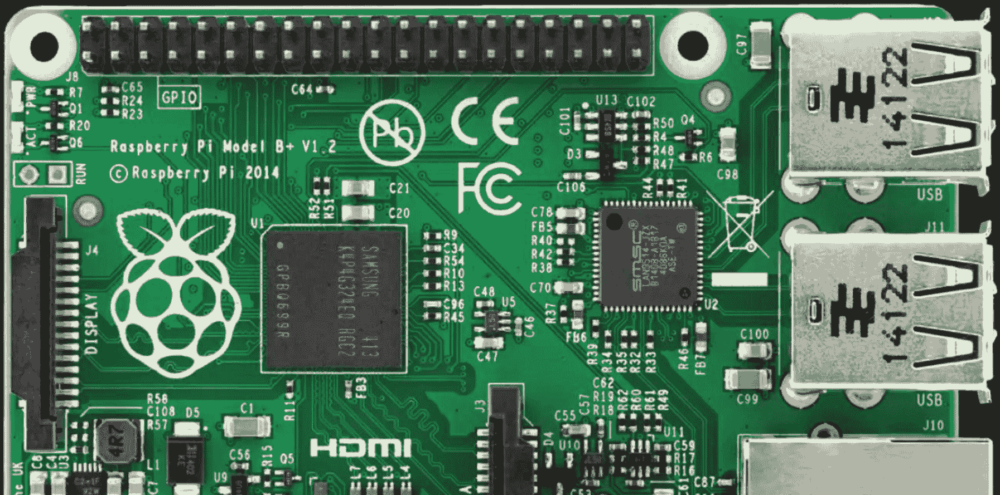


> “有了这本书，你也可以成为 Linux 开放用户社区的一部分。本书中的教程将帮助你掌握 Linux，向你展示它是如何工作的，你可以用它做什么，以及如何通过编码将你的 Linux 体验提升到新的高度。”


> “你怎么对电脑了解这么多？”

> “我不确定，这是我接触的第一台。”

– 格拉维斯·霍珀海军上将（先锋程序员）在接受大卫·莱特曼采访时所说

### 向 Linux 问好

为什么是 Linux？它是什么？我在哪里获取它？为什么有这么多不同的版本？大多数初学者在开始时都会问这些问题，还有许多其他问题。确实，Linux 是一个极其多功能且强大的操作系统，但你从哪里开始呢？幸好，你可以在本节找到答案。

使用 Linux 可以做的事情非常多，但你需要知道从哪里开始；我们在这里帮助你。在本节中，你可以了解什么是 Linux，什么是发行版，什么是桌面环境。你还可以开始探索 Linux 的工作原理以及它如何为你所用。

### 为什么选择 Linux？

对于许多用户来说，Linux 意味着自由。摆脱其他操作系统封闭花园模式的自由，自由地更改和使用操作系统的自由，以及摆脱任何形式的授权或付款的自由。然而，Linux 远不止你想象的那样简单。

#### 免费且开放

Linux 非常适合那些想要与众不同的人。**系统的效率、应用程序的可用性以及稳定性都是它的一些良好理由。**

你需要知道的第一件事是，并不存在一个名为 Linux 的操作系统。Linux 实际上是操作系统内核，是操作系统的核心组件。当我们谈论 Linux 时，我们和其他人指的是使用 Linux 内核的众多发行版之一。毫无疑问，你至少听说过当前流行发行版中的一个：Ubuntu、Linux Mint、Fedora、openSUSE、Debian、Raspbian，名单还在继续。这些发行版中的每一个都为用户提供了略有不同的东西。虽然每个发行版的核心都是 Linux 内核，但它们为用户提供了一个外观不同的桌面环境、不同的预装应用程序、不同的系统更新方式以及安装更多应用程序的方式，以及整个系统稍有不同的外观和感觉。然而，核心是 Linux，这就是我们称之为 Linux 的原因。

Linux 的工作方式与 Windows 或 macOS 大不相同。首先它是免费的：免费下载，免费安装在任何数量的电脑上，无限期免费使用，并可以使用同样免费的程序和应用程序进行升级和扩展。这种免费使用的特性是吸引开发者的最大因素之一。虽然 Windows 授权费可能高达 100 英镑，而 Mac 的费用要高得多，但用户，无论是开发者、游戏玩家还是想要利用旧电脑的人，都可以在几分钟内快速下载一个发行版并开始工作。

除了免费使用的方面，还有定制和塑造系统以适应自身用途的自由。互联网上可用的每个发行版都有一定的“倾向”，

Linux 是一个很好的开始编码的操作系统。

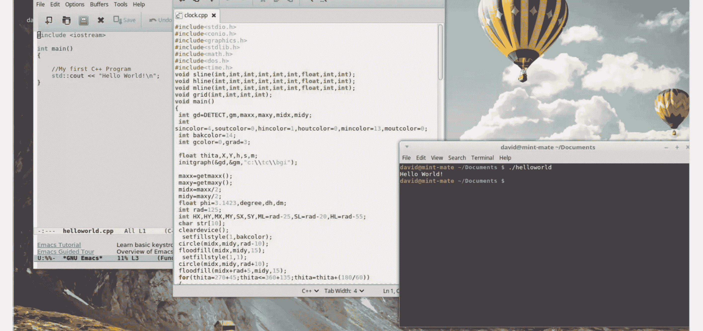

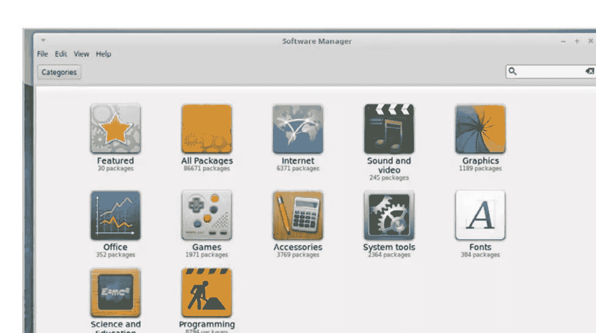

# Linux 下有数千个免费包可供程序员使用。

有些发行版提供增强的安全性、华丽的桌面、特定的游戏倾向，或面向学生的特性。这种可扩展性使 Linux 成为更令人向往的使用平台，因为你可以将系统快速塑造成开发基础，包括针对 Python、Web 开发、C++、Java 等的各种 IDE；或者创建一个用于在线匿名的基础，例如作为 Minecraft 服务器、媒体中心等。

对于想要学习如何编码的人来说，另一个显著优势是 Linux 内置了大多数流行的编码环境。Python 和 C++ 在可获得的 Linux 发行版中以高比例预装，这意味着你几乎可以在安装系统并首次启动后就开始编程。

一般来说，Linux 占用的系统资源比 Windows 或 macOS 少；这里的系统资源指的是内存、硬盘空间和 CPU 负载。Linux 代码经过精简，没有占用系统资源的第三方“臃肿软件”。更高效的系统当然意味着为编码和测试环境以及你最终创建的程序提供更多可用资源。较少的资源使用还意味着你可以在通常运行最新版本的 Windows 或 macOS 时会吃力甚至无法运行的旧硬件上使用 Linux；因此，而不是扔掉旧电脑，可以使用 Linux 发行版重新利用它。不过，这并不全关于 C++、Python 或其他更流行的编程语言。使用 Linux 的命令行，也称为终端，你可以创建 Shell 脚本，这是设计为从命令行运行的程序，由脚本语言组成。它们主要用于自动化任务或为特定操作提供某种形式的输入和输出。最后，尽管我们可以列出更多优势，但有数千个免费的程序和应用程序可用，涵盖了计算的几乎所有方面。被称为软件包，目前（撰写时）仅 Linux Mint 就有超过 8,700 个特定的编程应用程序，以及总共令人难以置信的 62,000+ 个软件包，满足从业余无线电到 WWW 工具的一切需求。因此，Linux 是一个伟大的编程资源和环境。它非常适合开发人员，并不断改善和演变。如果你认真考虑进入编码领域，或者只是想尝试一些新事物，不妨试试 Linux，看看它是否适合你。

# Linux 编程环境可以像你需要的那样简单或复杂。


### 最佳 Linux 发行版

市面上有许多版本的 Linux，被称为发行版。每个发行版都有不同的理念和方案。以下是五个值得尝试的出色发行版以及获取它们的途径。

#### 转向 Linux

大多数发行版的安装过程都类似。你从网站下载磁盘映像，并将其刻录到光盘或制作 U 盘启动盘。请注意，务必获取适合你硬件的发行版，并仔细阅读说明。

##### LINUX MINT

目前最受欢迎的 Linux 发行版（distribution）无疑是 Linux Mint。Mint 诞生于 2006 年，最初是作为当时最流行的发行版 Ubuntu 的替代品。尽管基于 Ubuntu 的长期支持（LTS）版本构建，但 Linux Mint 采取了不同的发展方向，为用户提供更出色的整体体验。

随着核心操作系统新版本的发布，Linux Mint 提供三种主要的桌面版本。这听起来可能有些令人困惑，但其实很简单。目前，Linux Mint 使用 Cinnamon 桌面环境作为其旗舰模式；同时也可选择 MATE 和 Xfce 模式。

Cinnamon 是一个图形功能丰富的桌面环境，MATE 使用的图形特效较少，且在更广泛的桌面系统上更加稳定，而 Xfce 则是一个极其精简的桌面环境，专为速度和极致稳定性而设计。

在本书中，我们将使用 Cinnamon 版本；不过，你可以尝试任何其他桌面环境，按你的意愿行事。事实上，建议你花一些时间尝试不同的环境，甚至不同的发行版，看看哪个最适合你和你的计算机。

www.linuxmint.com

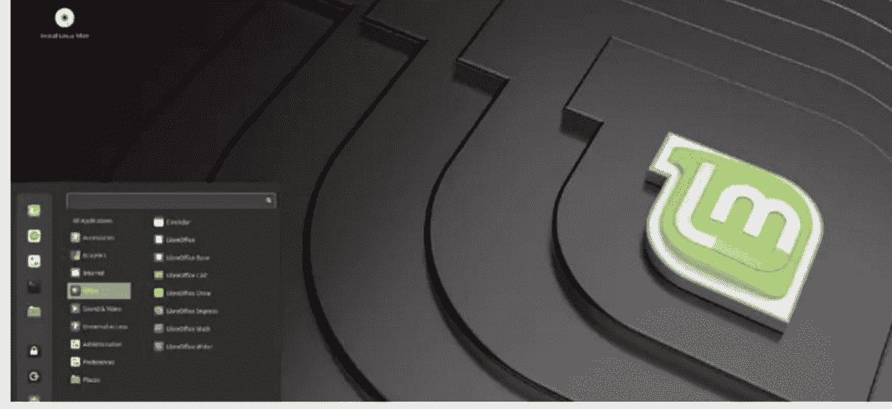

##### UBUNTU

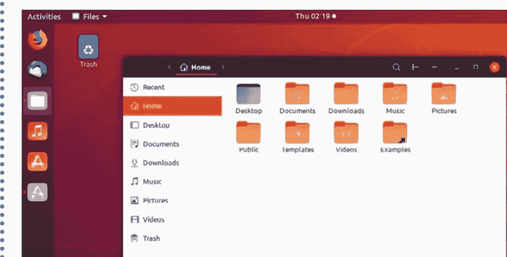

第二款最受欢迎的发行版是 Ubuntu，这是一个古老的非洲词汇，意为“对他人的仁爱”。Ubuntu 在其十四年的历史中，受欢迎程度起伏不定。曾有一段时间，它是世界上最常用的基于 Linux 的操作系统，但关于其界面呈现的一些错误选择，以及涉及隐私的一些不利且具争议的元素，遗憾地导致它从第一的位置跌落。

话虽如此，Ubuntu 后来进行了弥补，正缓慢地重新攀登 Linux 排行榜。该操作系统的最新版本使用 GNOME 3 桌面环境，这是一个令人印象深刻的桌面环境，尽管对于前 Windows 用户来说可能略显困惑，且对系统资源占用稍重，尤其是如果你计划将其安装在较旧的电脑上。

尽管有诸多不足，Ubuntu 仍是一个适合开始尝试的好的 Linux 发行版。它拥有简洁的界面，易于使用和安装，并为用户提供完整的 Linux 体验。

www.ubuntu.com

##### ARCH

Arch 是历史最悠久的 Linux 发行版之一，也是许多其他 Linux 版本的基础。为什么安装了 Arch 就不用安装 Mint 或 Ubuntu 了呢？许多用户确实是这样做的，但这并不适合初学者。Ubuntu 和 Mint 都提供了更简单的安装路径，并附带软件包以帮助你起步。

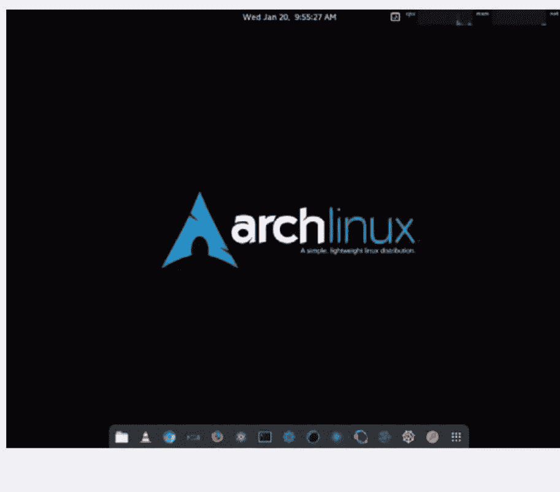

Arch 是当你拥有更多 Linux 经验时的选择。你从只有命令行的状态开始，然后必须手动分区硬盘、设置安装文件的位置、创建用户、设置操作系统区域设置，最后安装桌面环境以及你需要的应用。

相比之下，Arch 更偏向“极简主义”。Arch 致力于自由软件，其软件库包含超过 50,000 个可安装的应用，包括多种不同的桌面环境，你可以像使用其他发行版一样使用它们。

然而，这些努力的优势在于，你拥有一个自己创建的发行版。这意味着你的 Arch 发行版不会包含其他人预安装的所有不必要的文件和应用；它是由你为你量身定做的。

www.archlinux.org

##### RASPBERRY PI DESKTOP

你无疑听说过树莓派（Raspberry Pi）。这并不奇怪，因为这款惊人且小巧的计算机在过去六年的技术世界中引起了轰动。

树莓派有几个方面使其成为计算世界中备受追捧的产品之一。首先，它很便宜，本质上是一台功能完整的计算机，成本仅约 25 英镑。它很小，尺寸比信用卡大不了多少。你可以使用其完全可编程接口进行电子制作；它附带 Raspbian，这是其自制的、基于 Debian 的操作系统，包含办公套件以及多种编程语言和教育资源。

Raspbian 专为树莓派硬件设计，因为树莓派使用 ARM 处理器进行驱动。然而，树莓派基金会后来发布了 Raspbian 的 PC 版本：Raspberry Pi Desktop。

与树莓派版本一样，Raspberry Pi Desktop 附带所有你所需的编码、教育及其他应用。它快速、稳定且表现出色。如果你对扩展你的 Linux 经验感兴趣，这绝对是值得考虑的顶级发行版之一。

www.raspberrypi.org/downloads/raspberry-pi-desktop

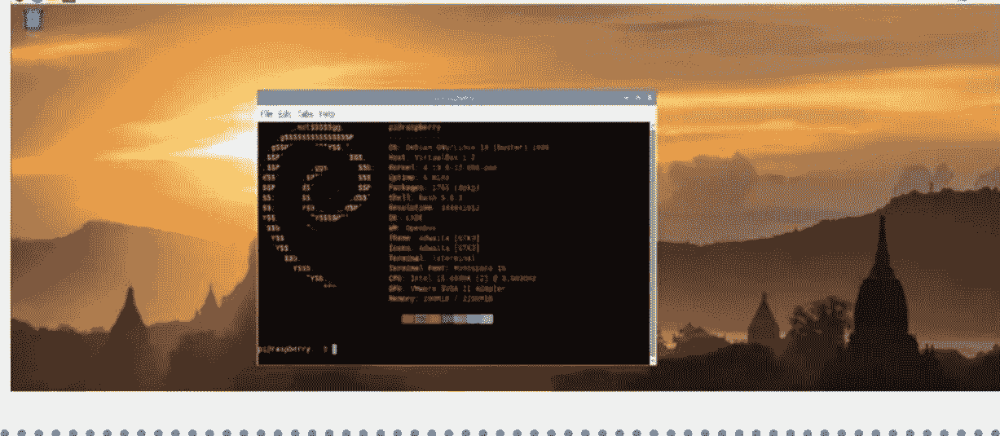

##### OPENSUSE

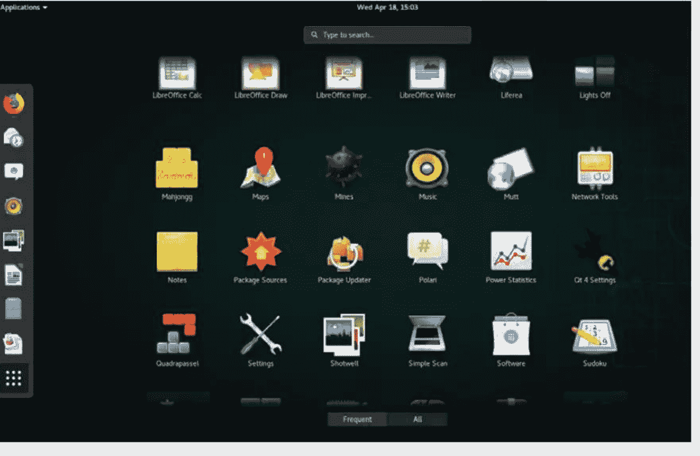

大多数 Linux 发行版分为两类。一类是拥有最新功能和技术，如 Ubuntu 和 Mint；另一类则是新特性较少但极其可靠，如 Debian。

与此同时，openSUSE 试图兼顾两者。OpenSUSE Leap 是那个极其稳定的系统。它由社区和 SUSE 员工共同公开开发，SUSE 开发企业级操作系统 SUSE；该系统为伦敦证券交易所等机构提供支持。它专为关键任务环境设计，在这些环境中不允许任何不稳定性。如果你觉得这一切太保守了，openSUSE Tumbleweed 是一个滚动发布版本，拥有所有最新功能，偶尔也会出现崩溃。

openSUSE 是一个备受尊敬的 Linux 发行版，其许多核心贡献者都在 Linux 内核、LibreOffice、Gnome 和其他关键 Linux 领域工作。简而言之，openSUSE 是专业人士聚集的地方。

www.openSUSE.org

### 向 Linux 问好

#### 你需要的设备

在 PC 上成功安装 Linux Mint 的系统要求出乎意料地低，因此即使是几年前的电脑也能愉快地运行此发行版。不过，在继续之前，值得检查你是否已具备所有条件。

##### MINT 原料

在我们开始探索这本书之前，以下是安装和运行 Linux Mint 所需的东西。你有几种选择，所以请花点时间看看哪种最适合你。

##### 系统要求

Linux Mint 的最低系统要求如下：

- CPU – 700MHz
- RAM/内存 – 512MB
- 硬盘空间 – 9GB（建议 20GB）
- 显示 – 1024 x 768 分辨率

显然，你的系统越好，体验就越出色，速度也越快。


##### USB 安装

你可以通过 USB 或 DVD 将 Linux Mint 安装到电脑上。我们在稍后会详细探讨这两种方式，但如果你已经熟悉该过程，或者正在考虑使用 USB 并只需收集所需的硬件，那么你需要一个至少 4GB 的 USB 闪存盘来存储 Linux Mint ISO。

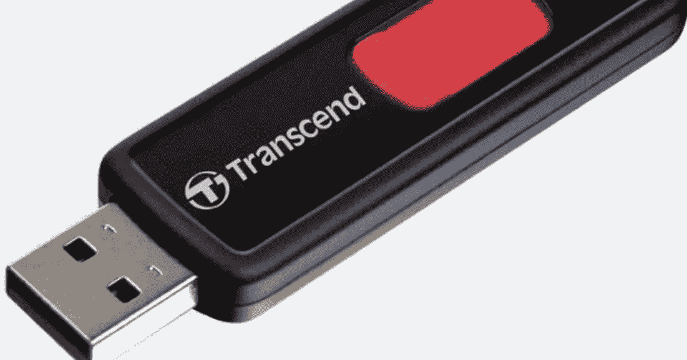

##### DVD 安装

通过 DVD 安装 Linux Mint 只需一张空白 DVD-R 光盘。当然，在将 ISO 映像传输或刻录到光盘之前，你还需要一个光驱（DVD 刻录机）。


##### 虚拟环境

在虚拟环境中安装是测试和使用 Linux 发行版的流行方法。Linux Mint 在虚拟环境中运行得非常好，稍后我们会更多讨论这一点。有许多不同的虚拟环境应用可用；然而，来自 Oracle 的 VirtualBox 是最易于使用的一款。你可以在 www.virtualbox.org 找到最新版本。


##### 互联网连接

不言而喻，互联网连接对于确保 Linux Mint 保持最新更新和补丁，以及安装更多软件至关重要。虽然使用 Linux Mint 不需要互联网连接，但你将错过该发行版提供的海量免费软件。


##### MAC 硬件

虽然可以将 Linux Mint 安装到 Mac 上，但有一派观点建议 Mac 用户使用虚拟环境，如 VirtualBox 或 Parallels；为什么不呢，macOS 本身已经是一个出色的操作系统。如果你想为旧 Mac 注入新活力，请确保它是 Intel CPU 型号，而不是 Power PC 型号。不过请注意，在 Mac 上安装并不像在 PC 上安装那样轻松。

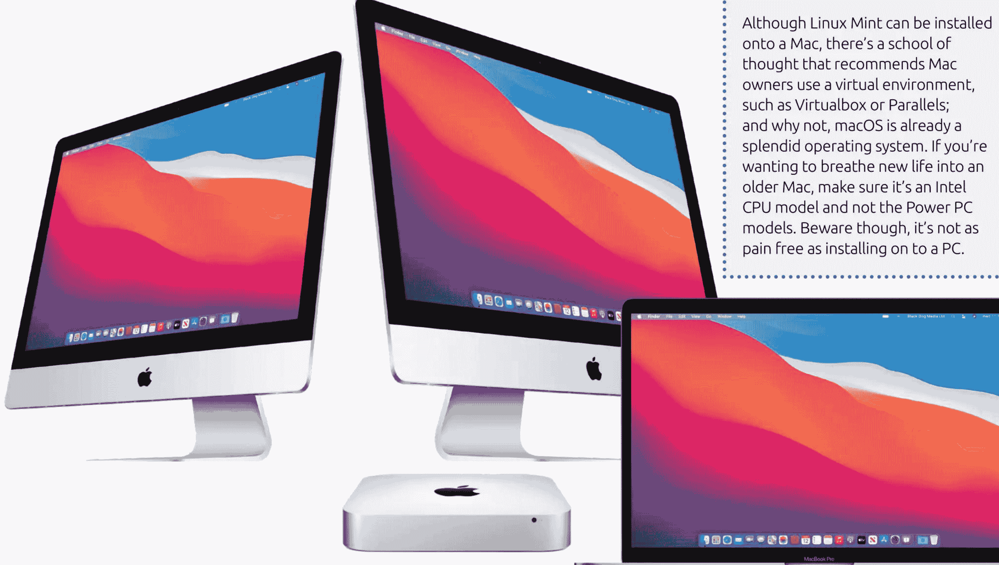


### 桌面环境

Linux Mint 提供多种不同的版本，也称为风味（flavours）：Cinnamon、MATE 和 Xfce；这些版本还有 32 位和 64 位之分。这一切到底意味着什么？你应该为你的安装选择哪个版本？

### 选哪个 MINT？

桌面环境是你用来与核心 Linux 系统进行交互的图形用户界面。正如 Windows 10 的图形桌面也被称为 Fluent Design（流畅设计）一样。

Linux Mint 为用户提供该发行版的版本选择：Cinnamon、MATE 和 Xfce。虽然这对新手来说可能听起来有些令人困惑，但本质上，每个可用版本都包含相同的底层 Linux 结构和内核。内核是操作系统的核心，负责处理软件和硬件之间的所有指令。

那么为什么要选择不同的桌面环境呢？简单地说，这取决于个人口味。一些用户更喜欢 MATE，因为 MATE 是经典 GNOME 2 环境的分支，菜单中心主义稍强，并且在旧电脑上运行表现良好。其他人更喜欢 Cinnamon，这是一个更现代的环境，在较新的硬件上运行更好，并拥有一些尖端的桌面代码。另一方面，Xfce 是一个轻量级的桌面环境，由于它对可用系统资源的占用极低，因此在旧硬件上运行良好。

每个版本只是不同的桌面环境，即你用来与操作系统交互的图形用户界面（GUI）。每个桌面环境使用不同的应用程序来访问或使用系统，例如使用文件管理器浏览操作系统的文件结构，或者启动其他应用的方式。不过，核心可用的生产力、视频和图形套件是相同的，功能方式也相同。

简而言之，Cinnamon 是 Linux Mint 的主力桌面环境。MATE 与更广泛的硬件种类兼容性更好。例如，Windows 只提供一种桌面环境供用户操作，而 Linux 则提供了多种。因此，Linux Mint 选择为用户提供丰富的选择。


### 一点 Cinnamon 风味

Cinnamon 除了外观和感觉之外还有很多优点，虽然这些也是重要因素。这里，我们概述几个功能，帮助你决定它是否是你所需的桌面环境。

#### 极佳功能 1

它在较现代的系统上表现卓越，比过去稳定得多，也不再像以前那样占用大量资源。因此，如果你使用旧电脑安装和测试 Linux Mint，不要因此放弃 Cinnamon。

#### 极佳功能 2

Cinnamon 具有可配置的“热角”（Hot Corners）功能，你可以点击桌面的每个角落来执行特定任务，例如显示工作区、显示所有窗口或运行命令。热角是切换不同视图的绝佳方式，有助于使桌面成为更高效的环境。

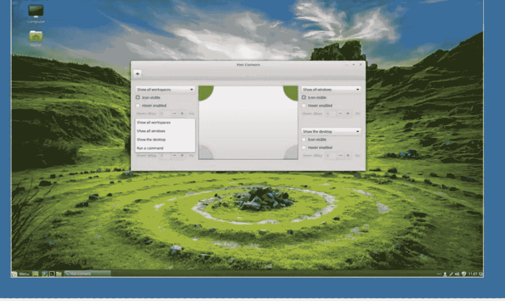

### 最佳 MATE

MATE 是一个简单易用且直观的桌面环境，速度快且稳定。与 Cinnamon 相比，它看起来可能略显陈旧，但那只是表面现象。MATE 有很多值得喜欢的地方。

#### 极佳功能 1

MATE 是旧电脑的绝佳桌面环境。它比 Cinnamon 通常支持更多的硬件组件，但同样能够打造美观的桌面以及进行高级自定义。

#### 极佳功能 2

由于其高度可配置性，MATE 可以进行精细的自定义。对于要求桌面环境具备更多功能的高级用户，有大量选项可用，包括 Compiz 设置，在那里你可以配置各种桌面特效，甚至是 3D 桌面立方体。

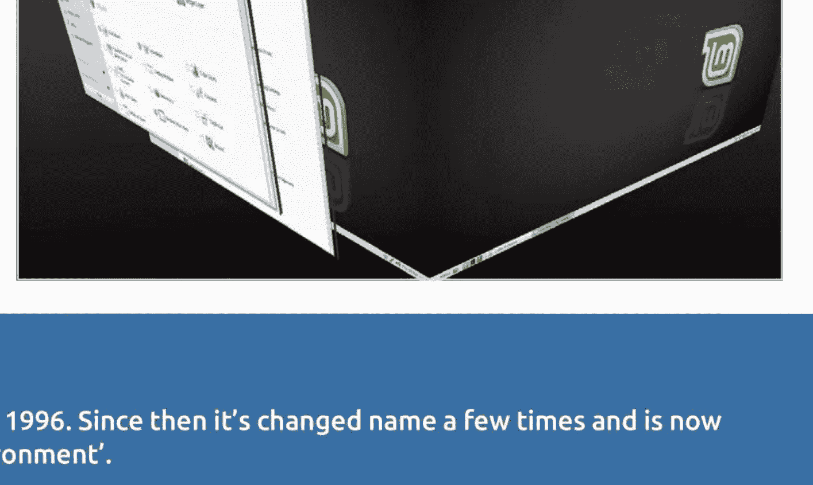

### 无胆固醇桌面

Xfce 始于 1996 年的通用桌面环境（CDE）。自那以来，它改名了几次，现在 simply 就是 Xfce，昵称是“无胆固醇桌面环境”（Cholesterol Free Desktop Environment）。

#### 极佳功能 1

Xfce 确实是一个快速的桌面，展现了 Linux 作为快速操作系统的最优秀一面。事实上，我们已经到了页面顶部才开始将其安装到新电脑上；写了几个百字，我们已经开始使用这个全新的操作系统了。不错。

#### 极佳功能 2

仅仅因为它快速且轻量，并不意味着 Linux Mint Xfce 不是一个完整的桌面操作系统。像其他提供的环境一样，你也能获得最新的 Firefox、LibreOffice、VLC、Gimp、聊天应用，甚至是一个 BitTorrent 客户端。

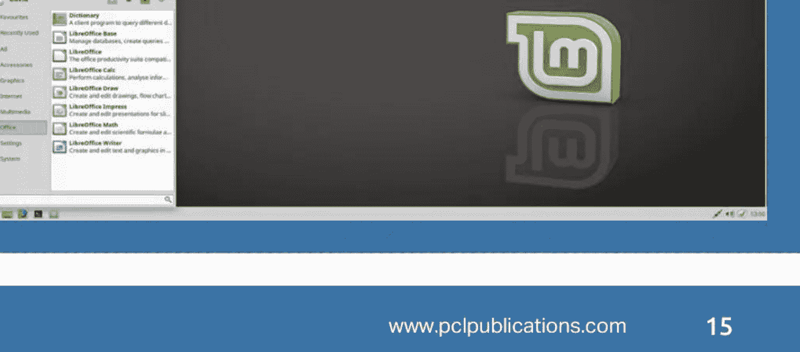

### 哪个发行版？

到目前为止，我们主要讨论的是 Linux Mint，但还有其他 Linux 发行版可以尝试。实际上，有数千种 Linux 发行版可供下载和安装，那么你应该决定使用哪几种呢？

### 发行版跳转（Distro Hopping）

“发行版跳转”是社区用来形容那些从不固定使用单一发行版的人的术语。相反，他们在不同的发行版之间来回跳跃，测试每一个，使用它们，然后转向另一个或新发布的发行版。

例如，Linux Mint 是理想的起点。它是一个易于安装和使用的发行版，预先安装了日常使用的所有软件，并温和地引导你进入 Linux 独特的世界，了解它是如何工作和运行的。

发行版跳转没有任何问题，因为这是熟悉当前可用内容并发现不同发行版中可能吸引或不符合你口味的元素的好方法。当然，问题是你总体上使用哪一个？

Ubuntu 提供了非常相似但略有不同的体验。通常，Ubuntu 预装的内容比 Linux Mint 少，因此你需要手动安装它们。另一个值得考虑的一点是，在使用 Linux 时，专门针对 Ubuntu 用户的内容和帮助页面数量巨大。如果你遇到困难，解决方案通常触手可及。

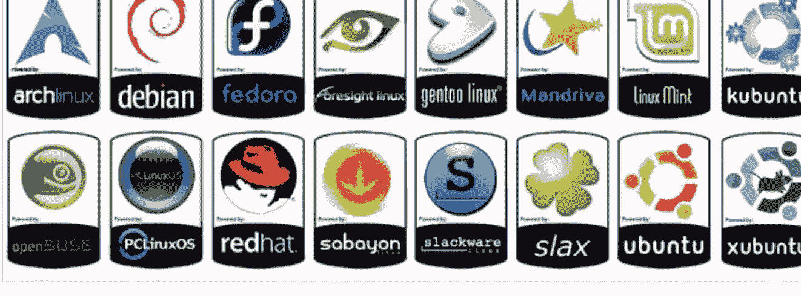

继续前进，随着你对 Linux 的信心增强，你可能会测试 openSUSE、Fedora 或 Debian 等发行版。这些都是优秀的发行版，每个都为用户提供了关于系统运行方式的不同视角。有些发行版在 Linux 技能方面要求比其他发行版更高，但本质上，每个发行版都有一些值得用户学习的宝贵经验。

虽然发行版跳转是件好事，但它并不是享受 Linux 并获得最大收益的稳定方式。我们并不是说你应该坚持使用一个发行版而从不看其他发行版，因为那样你会错过很多优秀的内容，而是建议你找到几个发行版，并根据你日益增长的 Linux 技能慢慢深入探索它们。

你可能会发现自己转向某个发行版，因为它提供了与常规截然不同的东西。例如，Tails Linux 是一个专为在线匿名设计的发行版。它包含复杂的军用级加密工具，以及设计用于帮助你在不被检测、跟踪或监控的情况下浏览网页的工具和浏览器。Kali Linux 专为安全专业人员设计，包含许多种类的道德黑客

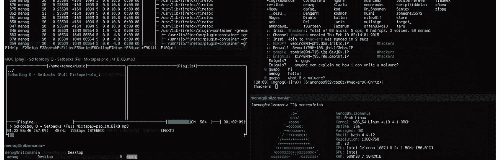


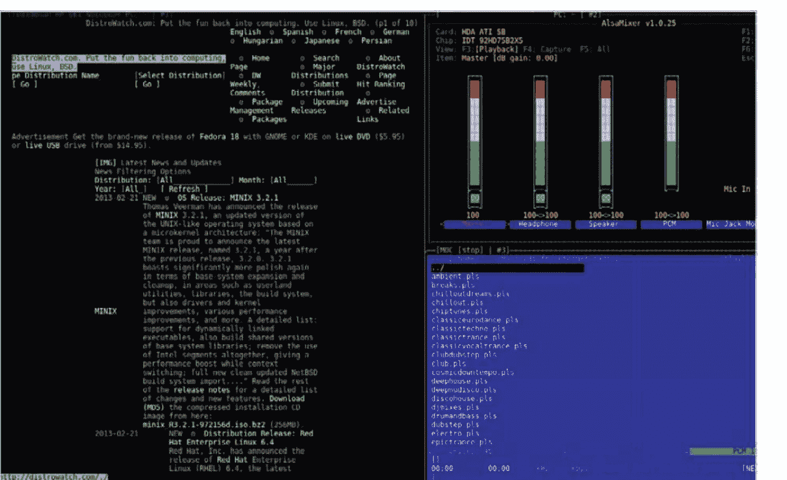

预装工具，用户可以运行这些工具对其网络进行渗透测试。曾经甚至有一个 Hannah Montana Linux 发行版，但我们最好不要多谈它。重点是，总有一个发行版适合你。

不言而喻，一旦你相对高程度地掌握了 Linux，可能达到高级用户的水平，你就会想扩展你的技能，并开始基于 Arch、Debian 或许多其他可用发行版之一构建你自己的 Linux 发行版。这样做涉及大量的命令行知识，以及对 Linux 系统如何工作并与计算机硬件交互的了解。你需要自己分区硬盘，安装桌面环境，并最终安装你想要的应用程序和程序。这需要时间，而且你需要学习许多技能。

最终，你可以认为自己是一名技术型 Linux 用户，但永远不要认为自己是专家。毕竟，我们总是在学习新东西。你可以从头构建自己的发行版，帮助其他 Linux 用户解决问题，也许甚至在发行版的测试或构建阶段为其改进做出贡献。下一步是什么呢？

奇怪的是，大多数高端技术用户最终都回到了起点，使用像 Linux Mint 这样的发行版。主要原因通常是，它是一个简单的选择，并且是一个稳定的环境。仅因为你深知系统内部和外部的运作，并不意味着你总是想要修复潜在问题。我们中的大多数人更喜欢轻松的生活，尤其是在涉及技术时，因此合乎逻辑的选择是选择一个简单但功能足够强大、能完成你想要它完成的所有事情的发行版，因此是 Linux Mint。

然而，归根结底，这纯粹是一个选择，你个人的选择。你可能会发现在阅读完本教材中的教程后，你不喜欢 Linux Mint 或 Cinnamon 桌面。没关系，你可能更喜欢 Ubuntu、Debian 或 openSUSE；这就是 Linux 的魅力所在：改变你想要的东西的自由，在不同发行版之间跳转而不会因成本或缺乏访问权限而受到惩罚。

对于“哪个发行版最好”这个问题的答案是：任何你喜欢的！它可以是你需要的那样复杂或简单，只要它能完成你想要它完成的工作，那就是完美的。

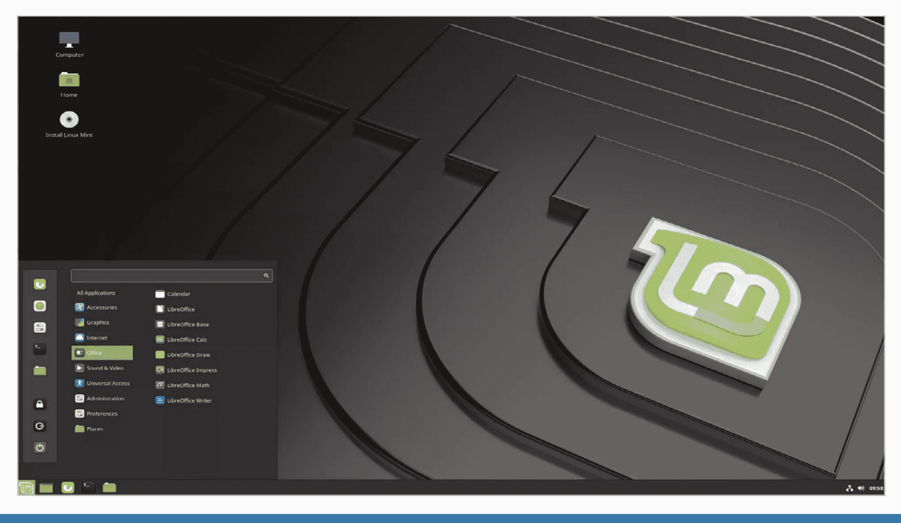


### 开始使用 Linux

> “在真正的开源世界中，你拥有掌控自己命运的权利。”
>
> – 林纳斯·托瓦兹
> *（Linux 内核的开发者）*

谈论 Linux 有多好固然不错，但如何将它安装到你的电脑上呢？安装 Linux 非常简单，但你有多种选择。本节将探讨如何下载 Linux ISO 镜像、将其作为主操作系统安装在 PC 上，甚至如何安装虚拟环境。

借助虚拟环境，你可以在继续使用主操作系统（无论是 Windows 还是 macOS）的同时运行 Linux。感兴趣吗？请继续阅读，了解更多详情。

#### 在 Windows 上创建 Linux 安装介质

在安装 Linux 到电脑之前，你需要将下载好的 Linux ISO 文件传输到 DVD 光盘或 USB 闪存盘中。这将是一个实时环境（Live Environment），允许你在安装前测试操作系统，但首先你需要创建可启动的介质。

##### DVD 可启动介质

我们使用一台 Windows 10 电脑将 ISO 文件传输到 DVD 上。如果你使用的是 Windows 7 或更高版本，这个过程极其简单。

- **步骤 1** 首先找到你已经下载的 Linux ISO 镜像文件。通常你可以在 Windows 7、8.1 和 10 电脑的“下载”文件夹中找到它，除非你在保存时指定了其他位置。

- **步骤 2** 接下来，将一张可刻录 DVD 光盘插入电脑的光驱。几秒钟后，当光盘被读取时，Windows 会弹出一个消息框，询问你对新插入的光盘要做什么。请忽略此提示，因为我们将使用内置的镜像刻录功能。

- **步骤 3** 右键点击 Linux ISO 文件，从菜单中选择“刻录磁盘映像”。根据电脑的速度，可能需要几秒钟才能有任何反应。不要担心太多，除非它超过一分钟仍未响应，如果是这种情况，重启电脑并再次尝试可能值得一试。幸运的是，Windows 磁盘映像刻录程序应该会自动启动。

- **步骤 4** 在“Windows 磁盘映像刻录”对话框打开后，勾选“刻录后验证磁盘”复选框，然后点击“刻录”按钮。根据电脑光驱的速度，这个过程可能需要几分钟。完成后，系统将进入验证阶段，验证结束后，光驱应该会自动弹出光盘。

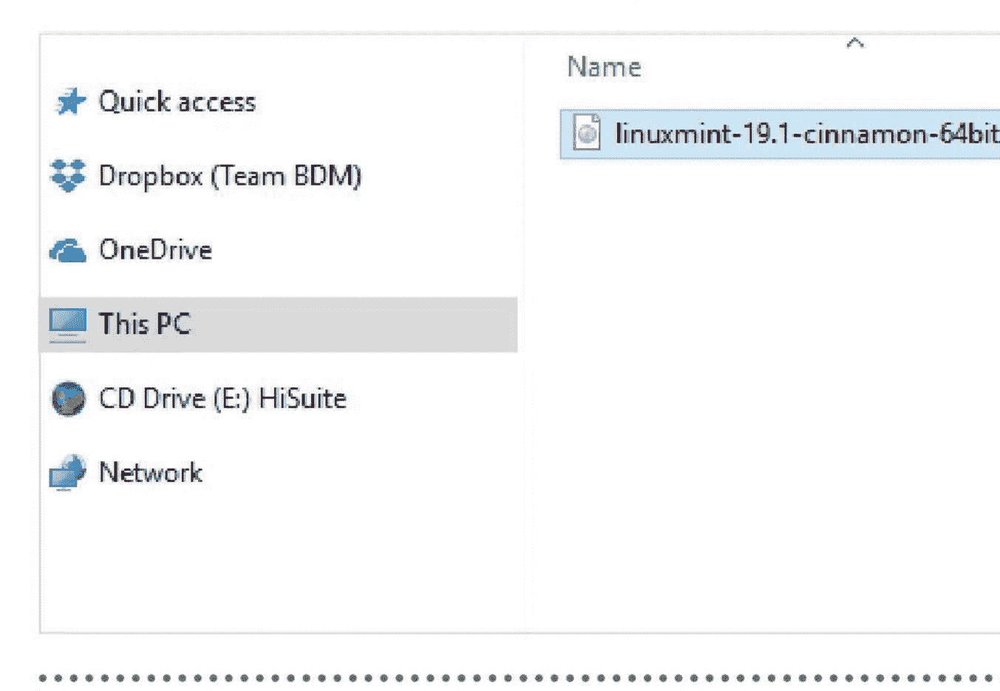

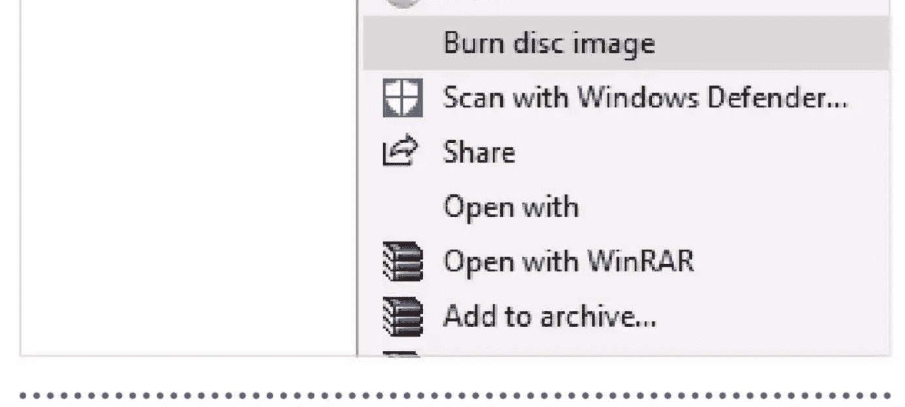


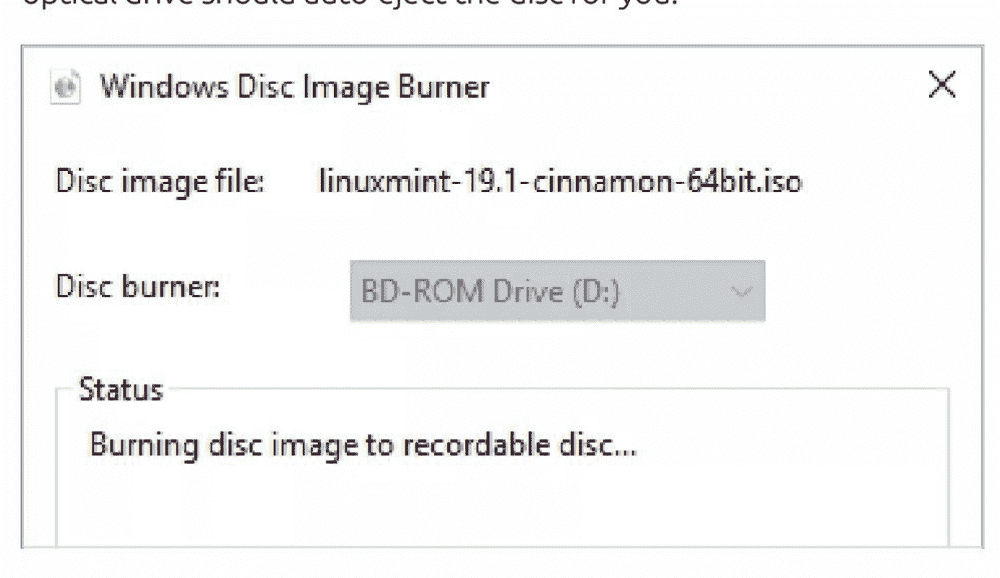

##### USB 可启动介质

USB 介质比 DVD 更快，而且通常更方便，因为大多数现代电脑都没有安装光驱。传输映像的过程很简单，但你首先需要第三方应用程序以及一个 4GB 或更大容量的 USB 闪存盘。

- **步骤 1** 首先打开网页浏览器，访问 [www.rufus.akeo.ie](http://www.rufus.akeo.ie/)。向下滚动页面一点，你会看到“下载”标题，下面就是最新版本的 Rufus。左键点击该链接开始下载。

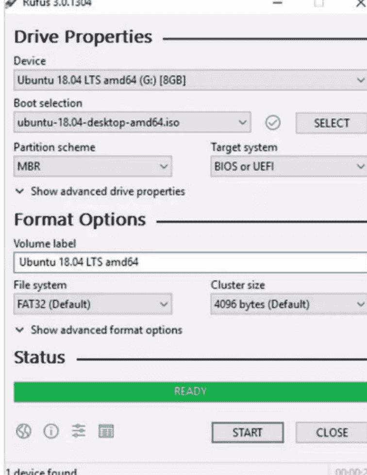

- **步骤 2** 双击下载好的 Rufus 可执行文件，对 Windows 安全询问选择“是”，对检查更新也选择“是”。Rufus 启动后应该已经识别出你插入的 USB 闪存盘；如果没有，只需将其拔出再重新插入即可。

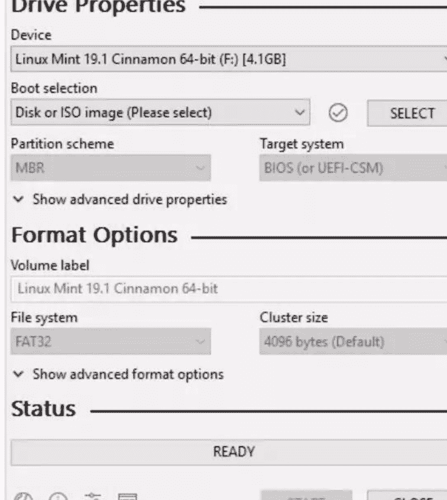

- **步骤 3** 乍一看，Rufus 的界面可能有点令人困惑，但别担心，它其实相当简单。首先，点击“磁盘或 ISO 映像（请选择）”下拉菜单旁边的“选择”按钮。这将打开一个 Windows 资源管理器窗口，你可以在其中找到并选择 Linux ISO 文件。

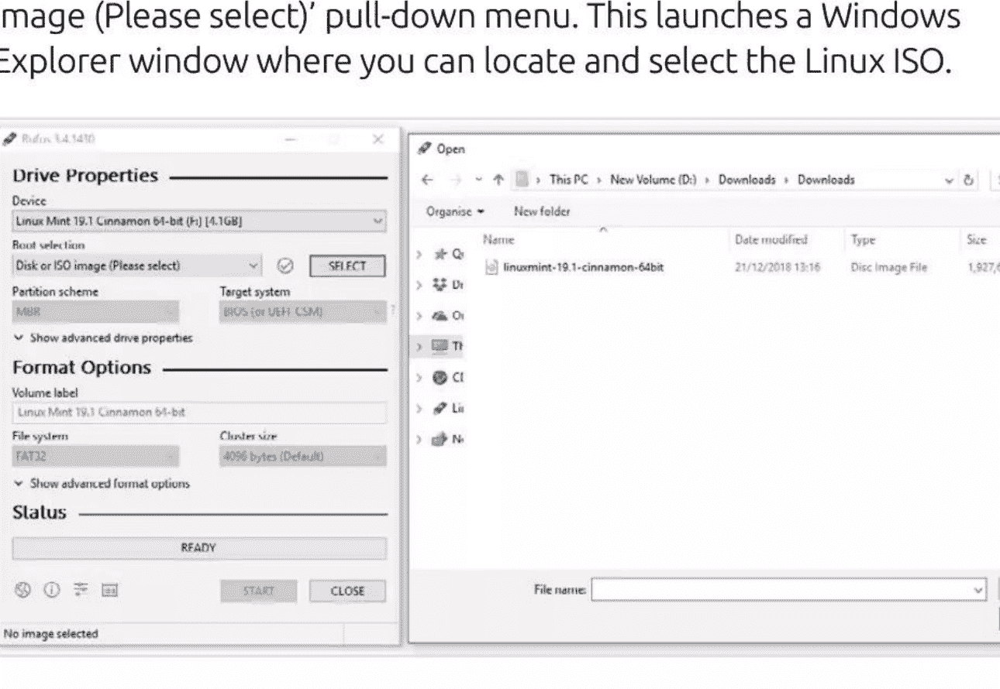

- **步骤 4** 准备就绪后，点击 Rufus 应用底部的“开始”按钮。这可能会打开另一个对话框，询问你是否要下载并使用新版本的 SysLinux。SysLinux 是一组引导加载程序，用于允许现代电脑通过 USB 闪存盘访问和启动。这是必要的，因此如果系统询问，请点击“是”继续。

> 此映像使用 syslinux 6.03/20151222，但此应用程序仅包含 SysLinux 6.03/2014-10-06 的安装文件。
>
> 由于新版本的 SysLinux 彼此不兼容，且 Rufus 无法包含所有版本，因此必须从互联网下载两个额外的文件（'ldlinux.sys' 和 'ldlinux.bss'）：
> - 选择“是”以连接到互联网并下载这些文件
> - 选择“否”以取消操作
>
> 注意：这些文件将下载到当前应用程序目录，如果文件已存在，系统将自动重用它们。


- **步骤 5** 下一步询问你希望将 Linux ISO 以何种映像模式写入 USB 闪存盘。两种方法适用于不同的情况，但通常，推荐的 ISO 映像模式更为流行。确保已预选此模式，点击“确定”继续，然后再次点击“确定”以确认操作。

> 检测到 ISO\hybrid 映像
>
> 你选择的映像是一个“ISO\hybrid”映像。这意味着它可以以 ISO 映像（文件复制）模式或 DD 映像（磁盘映像）模式写入。Rufus 建议使用 ISO 映像模式，这样你在写入后始终可以完全访问该驱动器。
>
> 然而，如果你在启动过程中遇到问题，可以再次尝试以 DD 映像模式写入此映像。
>
> 请选择你要用于写入此映像的模式：
> - 以 ISO 映像模式写入（推荐）
> - 以 DD 映像模式写入


- **步骤 6** Linux ISO 现在已传输到 USB 闪存盘。根据 USB 设备和电脑的速度，这个过程不会花太长时间。你可能会发现 Rufus 在过程中自动在 Windows 资源管理器中打开了 Linux 驱动器；别担心，如果你想的话可以将其最小化或关闭。当过程完成后，点击“关闭”按钮。

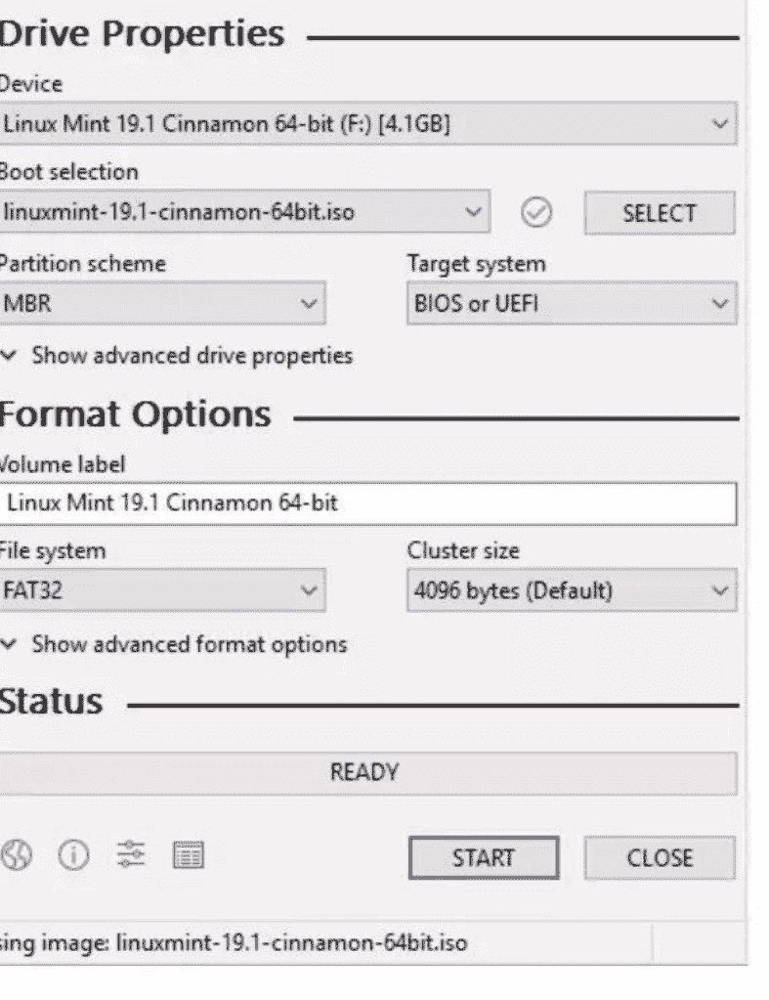

#### 在 PC 上安装 Linux

大多数 Linux 发行版都提供实时环境（Live Environment）。这意味着你可以直接从刚才创建的 DVD 或 USB 启动进入一个实际、完全可运行的发行版。让我们看看它是如何工作的，以及如何从那里安装 Linux。

##### UEFI BIOS

统一可扩展固件接口（UEFI）用于识别硬件并在 PC 启动过程中对其进行保护。它取代了传统的 BIOS，但在安装 Linux 时可能会引起一些问题。

- **步骤 1** 将你的 DVD 或 USB 闪存盘插入电脑，如果你还没有这样做的话，请关闭 Windows。在本例中，我们使用的是 USB 启动介质，但过程几乎完全相同。启动电脑，当被提示时，按相应的键进入 BIOS 或 SETUP，例如：F2、Del 甚至 F12。

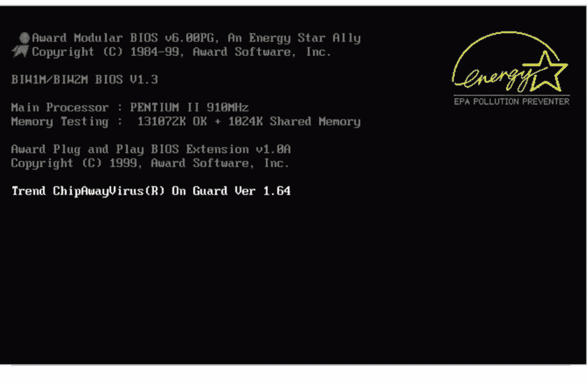

- **步骤 2** 由于 UEFI BIOS 有不同的版本，因此涵盖所有版本是不可能的。你需要寻找的是详细说明启动顺序（Boot Sequence）或启动模式（Boot Mode）的部分。在这里，你可以选择关闭 UEFI 并选择传统模式（Legacy），或者禁用安全启动（Secure Booting）。大多数发行版都可以与 UEFI 配合工作，但启用它进行启动可能是一个棘手的过程。

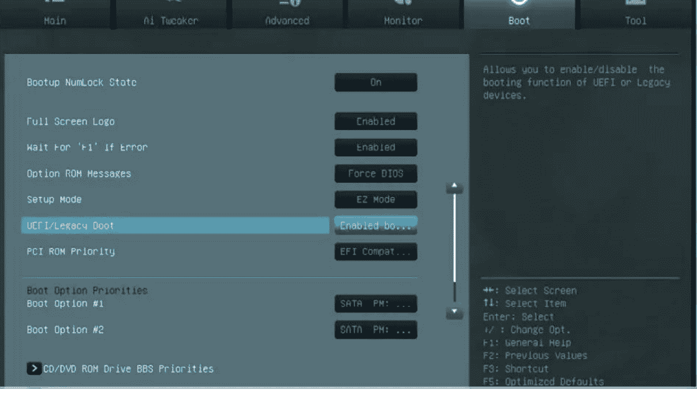

- **步骤 3** 将 UEFI 设置为传统模式后，现在有两种方式可以进入实时环境。第一种是通过你当前所在的 BIOS。找到启动顺序，将第一个启动设备从其原始设置（通常是内部 HDD 或类似项）更改为：对于 USB 介质选项，选择“USB 存储设备”；对于 DVD 介质选项，选择“DVD 驱动器”。

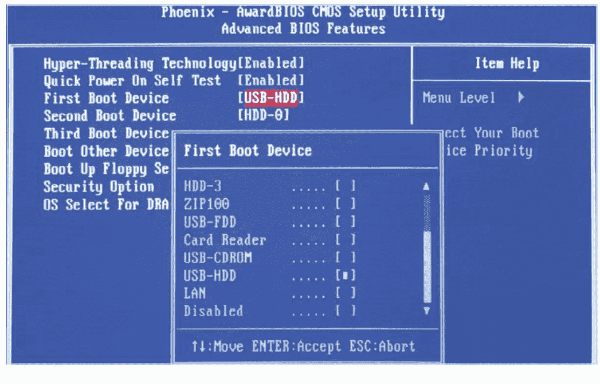

- **步骤 4** 或者，使用启动选项菜单。通过此选项，你可以按 F12（或类似按键）来显示启动介质选项列表；然后，你可以从中选择合适的启动介质。无论如何，你都可以导航到“保存并退出”选项，并选择“保存更改并退出”来保存并退出 BIOS。

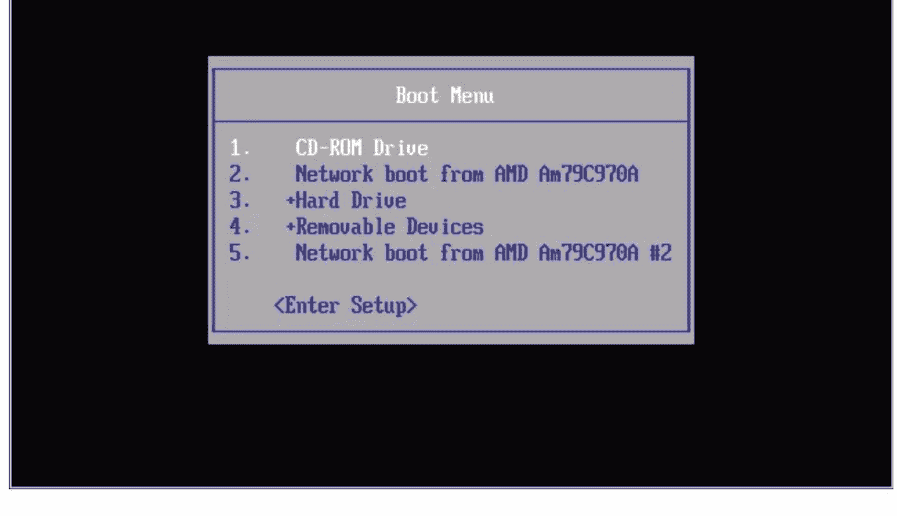


#### 安装 LINUX

当 Live 环境启动后，你将看到将发行版安装到计算机的选项。先四处看看，当你准备好后，在桌面上寻找“安装”选项。

#### 步骤 1

确保你已连接互联网（如果没有，请现在连接），并且你处于 Live 环境中。通过双击桌面上的 **Install Linux Mint** 图标开始安装过程。当然，其他发行版会显示它们自己的名称，但过程是一样的。准备好后，点击 **Continue**（继续）。

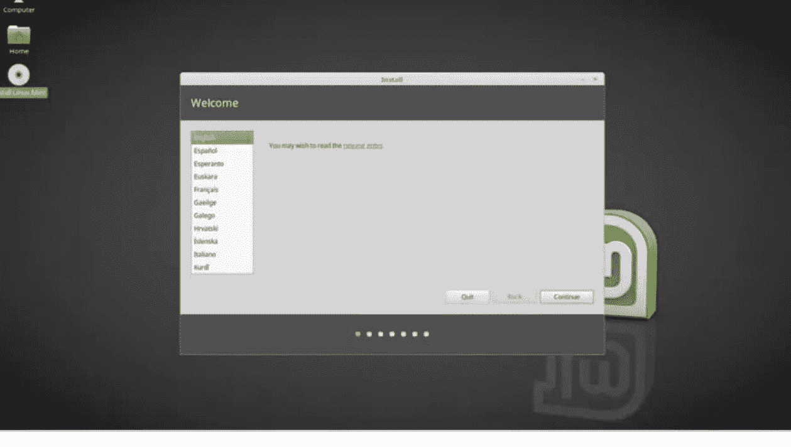

#### 步骤 2

尽管大多数 Linux 发行版的安装过程非常相似，但有些发行版在安装过程中会提出不同的问题。通常，这些问题并不难，没有什么非常技术性的内容，但像“安装第三方软件……？”这样的问题可能会让人困惑。在这种情况下，你可以点击 **Continue**（继续），但如果你不确定，请准备一台连接互联网的设备以咨询相关问题。

#### 步骤 3

在安装新的操作系统时，建议清除旧的系统并用新系统替换它。当你到达安装过程的这个阶段时，确保选中“**Erase disk and install Linux...**”（擦除磁盘并安装 Linux……）选项。注意：这会完全清除计算机中的 Windows 10，因此请确保已备份所有个人文件和数据。

#### 步骤 4

在安装过程开始之前，系统会询问你关于硬盘擦除的选择是否正确。这是你最后反悔的机会。如果你确定不介意清除一切并使用 Linux Mint 重新开始，请点击 **Continue**（继续）。如果你需要备份文件，请移除 Linux Mint 光盘/USB 驱动器，重启计算机，备份文件并重新开始。

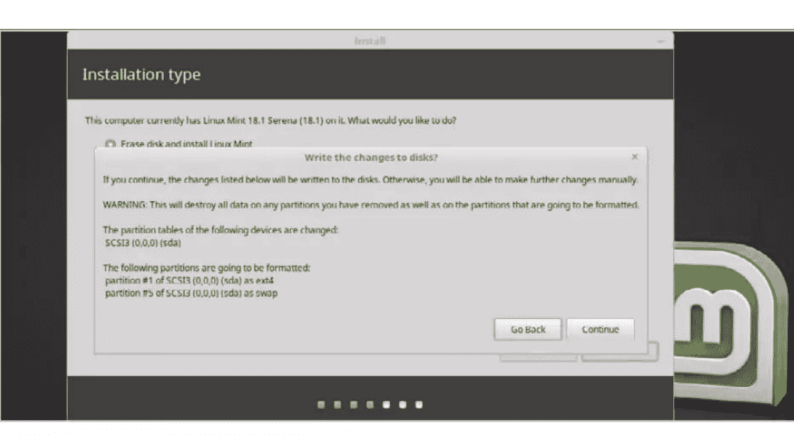

#### 步骤 5

最终，系统会要求你设置 Linux 用户名和密码。首先输入你的姓名，然后是计算机名称，即其在网络中识别的名称。接下来选择一个用户名，然后设置一个好的密码。你可以勾选“**Login Automatically**”（自动登录）选项，但暂时保留“**Encrypt Home Folder**”（加密主文件夹）选项。

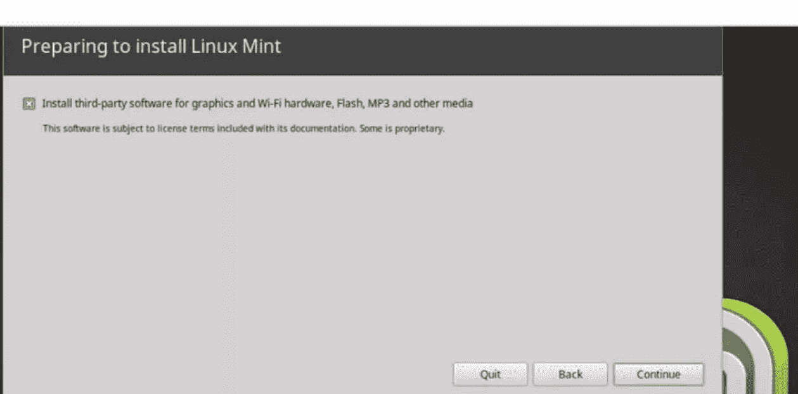

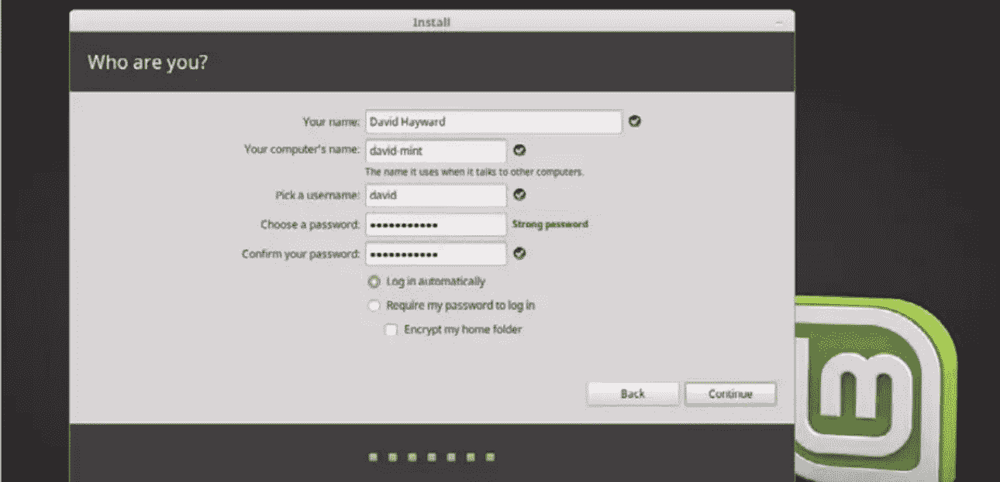

#### 步骤 6

安装过程可能很快，可能会有更多问题需要回答，或者它可能直接根据你之前的回答开始安装 Linux。无论哪种情况，最终你都会被要求选择**继续测试 Live 环境**或**重启**以使用新安装的操作系统。如果你准备好使用 Linux，请点击 **Restart Now**（立即重启）。

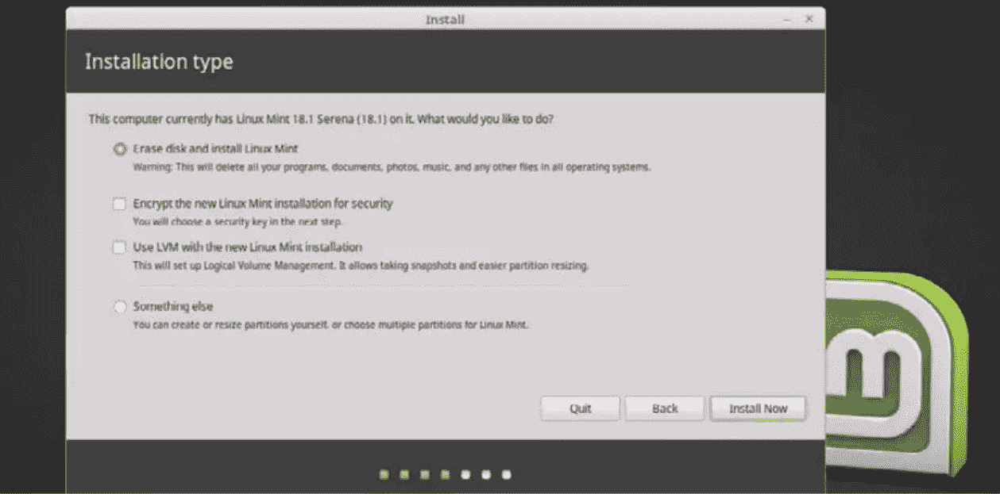

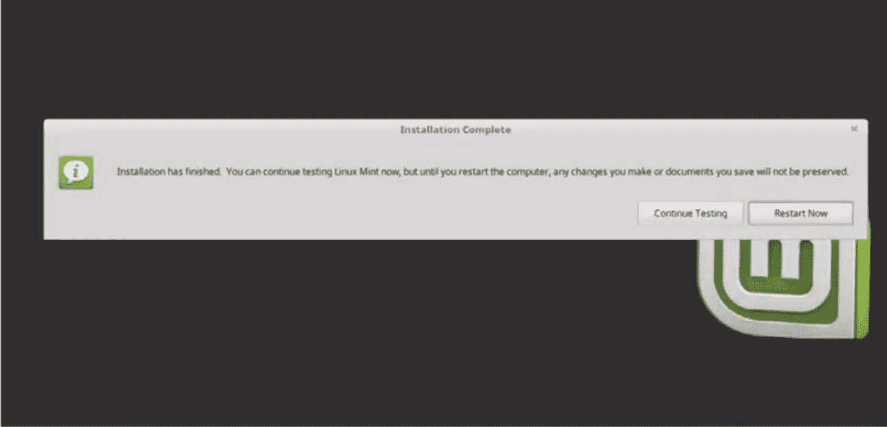

#### 安装虚拟环境

虚拟环境是一个模拟的计算机系统。使用虚拟机，你可以模拟标准 PC 并在其中安装完整的操作系统，而不会影响安装在你的计算机上的系统。这是一种测试和使用 Linux 的好方法，同时仍保留 Windows 10 作为主要操作系统。

##### 进入虚拟化

使用虚拟机（VM）会消耗计算机的资源：内存、硬盘空间、处理器使用率等。在开始之前，请确保你拥有足够的资源。

#### 步骤 1

在这种情况下，我们使用 VirtualBox，因为它是入门最简单的虚拟环境之一。进入 www.virtualbox.org 并点击“**Download VirtualBox**”（下载 VirtualBox）。这将带你前往主下载页面。找到适合你系统的正确主机：Windows 或 Mac，主机即当前安装的操作系统，点击链接开始下载。

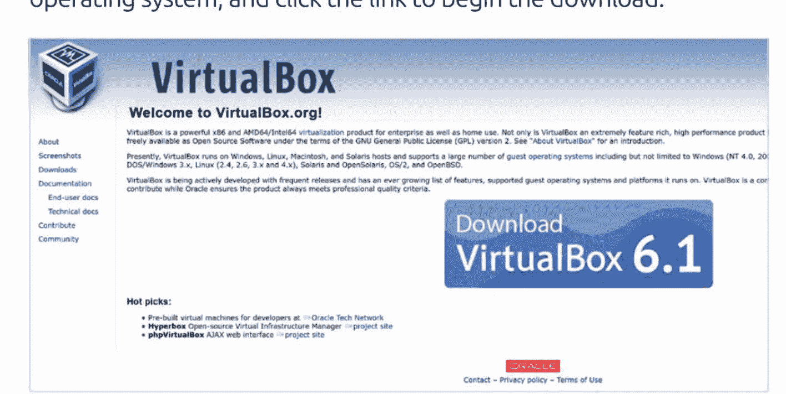

#### 步骤 2

接下来，仍在 VirtualBox 下载页面，找到 VirtualBox 扩展包链接。扩展包支持 USB 设备以及许多其他有助于使虚拟机环境更准确地模拟“真实”计算机的附加功能。

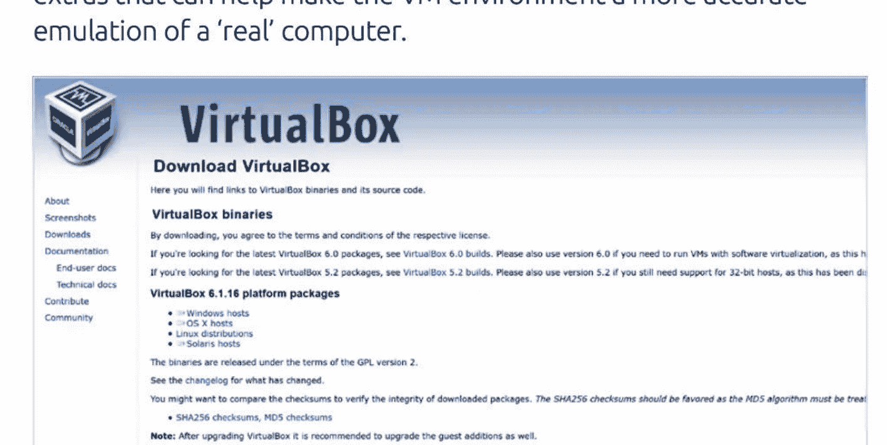

#### 步骤 3

在下载正确的软件包后，在安装任何内容之前，你需要确保你使用的计算机能够托管虚拟机。为此，重启计算机并进入 BIOS。当计算机启动时，按 Del、F2 或任何必要的键进入设置。

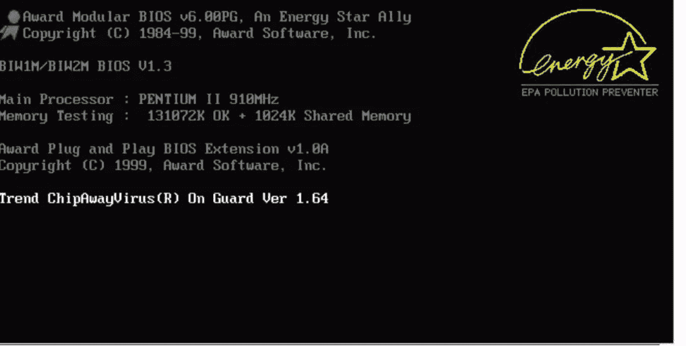

#### 步骤 4

每个 BIOS 的布局都不同，很难评估在每个个人示例中该看哪里。然而，作为一般规则，你要寻找 Intel 虚拟化技术（或简称虚拟化），通常位于 BIOS 的高级部分。找到后，启用它，保存设置，退出 BIOS 并重启计算机。

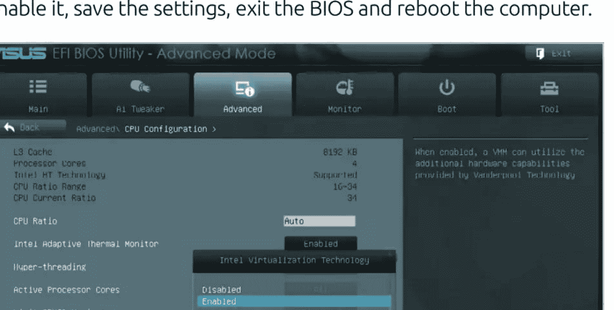

#### 步骤 5

当计算机重新启动并运行后，找到已下载的主要 VirtualBox 应用程序并双击开始安装过程。准备好后，点击 **Next**（下一步）继续。

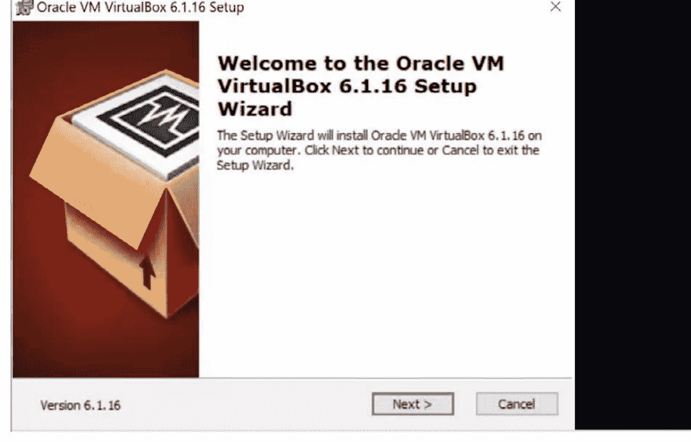

#### 步骤 6

VirtualBox 的默认安装位置应能满足大多数用户，但如果你有特殊的安装位置需求，点击“**Browse**”（浏览）按钮并更改安装文件夹。然后，确保 VirtualBox 功能树中的所有图标都被选中，即它们旁边没有红色 X。点击 **Next**（下一步）继续。

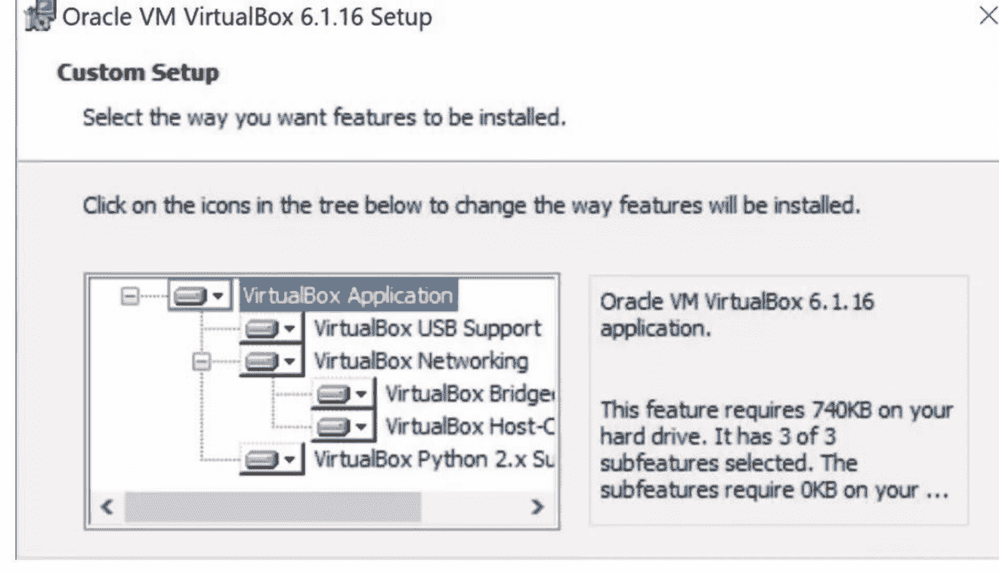

#### 步骤 7

如果你愿意，此部分可以保留默认设置，它只是让处理虚拟机更容易，特别是处理下载的虚拟机时，你未来可能会遇到这种情况。同样，点击 **Next**（下一步）进入下一阶段。

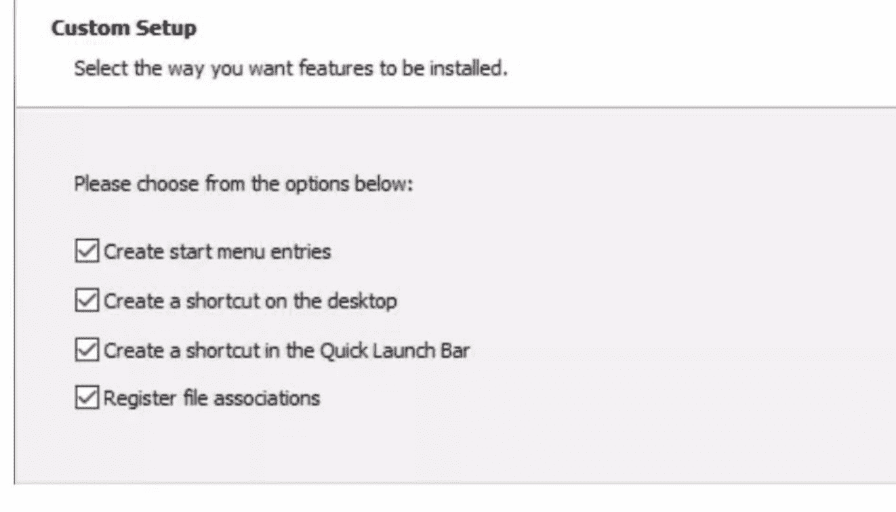

#### 步骤 8

在安装 VirtualBox 时，你的网络连接会在非常短的时间内被禁用。这是由于 VirtualBox 正在创建联动的虚拟网络连接，以便任何已安装的虚拟机都能通过计算机已建立的网络连接访问互联网和家庭网络资源。点击 **Yes**（是），然后点击 **Install**（安装）开始安装。

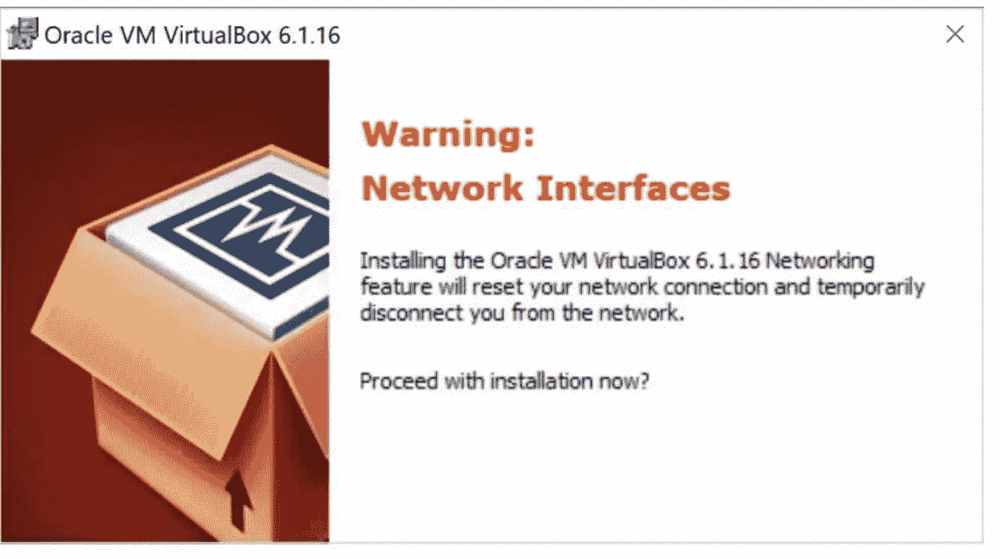

#### 步骤 9

Windows 可能会要求你接受安全通知。对此点击 **Yes**（是），你可能会遇到一个对话框要求你信任来自 Oracle 的安装；同样，点击 **Yes**（是）并接受 VirtualBox 应用程序的安装。完成后，点击 **Finish**（完成）以启动 VirtualBox。

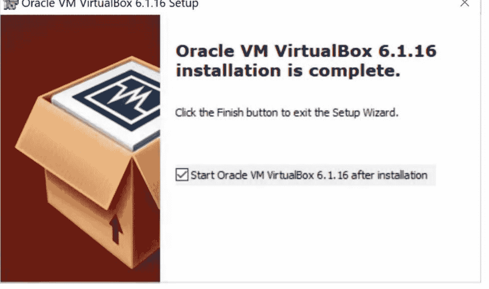

#### 步骤 10

当 VirtualBox 启动并运行后，你现在可以安装 VirtualBox 扩展包。找到已下载的附加组件并双击。在 VirtualBox 分析软件包时可能会有一小段暂停，但你最终会收到安装提示；显然点击 **Install**（安装）开始过程，滚动到下一个屏幕同意协议并点击 **I Agree**（我同意）。

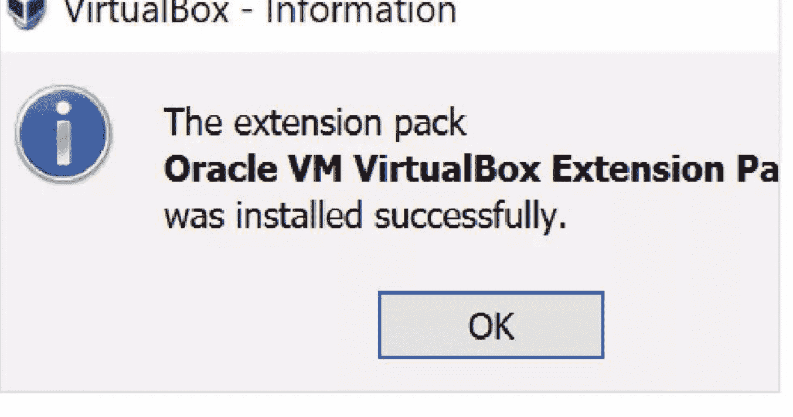

#### 在虚拟环境中安装 Linux

随着 Oracle VirtualBox 启动并运行，下一个任务是创建你将要安装 Linux 的虚拟机（VM）环境。此过程不会影响你当前安装的操作系统，这就是为什么虚拟机是一个很好的选择。

##### 创建虚拟机

在创建虚拟机时有很多选项可供选择。不过，目前我们将设置一个足以运行优秀的 Linux Mint 并且性能良好的虚拟机。

**步骤 1** 打开 VirtualBox，点击应用程序右侧面板顶部的“**New**”（新建）图标。这将打开新建虚拟机向导。

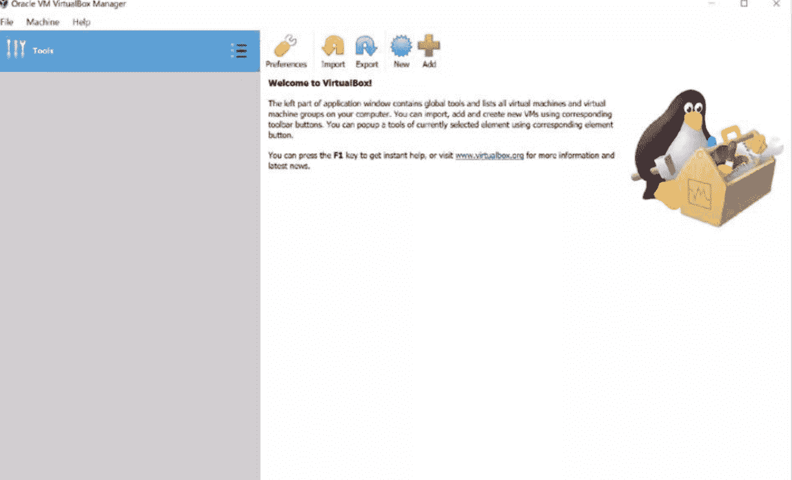

**步骤 2** 在“**Name**”（名称）框中键入 Linux Mint，VirtualBox 应该会自动选择 Linux 作为类型，Ubuntu (64-bit) 作为版本；如果没有，请使用下拉框选择正确的设置（请记住，Mint 主流版本基于 Ubuntu）。准备好继续时，点击 **Next**（下一步）。

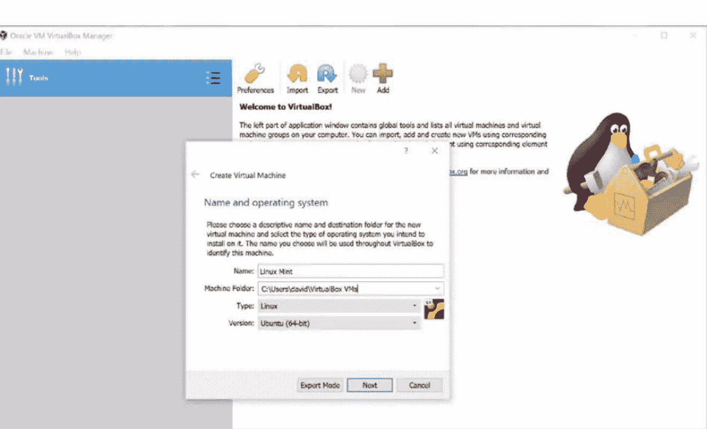

**步骤 3** 下一部分将定义分配给虚拟机的系统内存（或 RAM）数量。记住，这部分内存将从你计算机中安装的可用内存中扣除，所以不要给虚拟机分配太多。例如，我们安装了 8GB 内存，我们将 2GB (2048MB) 分配给虚拟机。准备好后，点击 **Next**（下一步）继续。

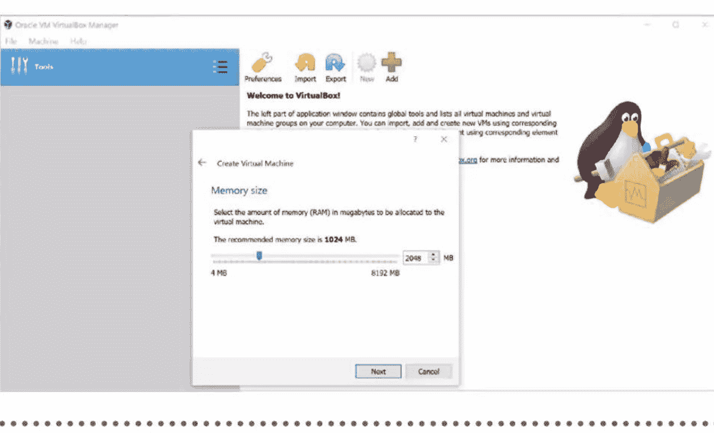

**步骤 4** 在此部分，你将开始创建虚拟机用于安装 Mint 的虚拟硬盘。默认选项“**Create a virtual hard disk now**”（现在创建虚拟硬盘）是我们正在使用的选项。点击 **Create**（创建）继续。

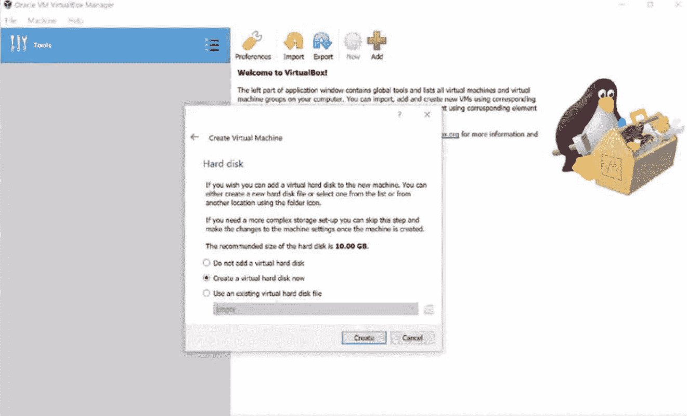


#### 在虚拟环境中安装 Linux

#### 步骤 5

点击“创建”后出现的弹出窗口会询问您希望创建哪种类型的虚拟硬盘。在本例中，我们将使用默认的 VDI（VirtualBox 磁盘映像），因为其他类型通常用于将虚拟机从一个虚拟机应用程序迁移到另一个应用程序。请确保选中 VDI，然后点击“下一步”。

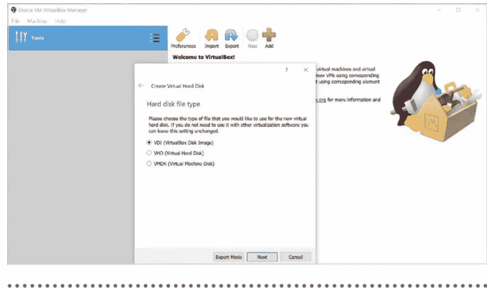

#### 步骤 6

关于选择动态分配还是固定大小虚拟硬盘的问题，对于初学者来说可能略显困惑。基本上，动态分配的虚拟硬盘是一种更灵活的存储管理选项。起初，它也不会占用物理硬盘上太多的空间。请确保选中“动态分配”，然后点击“下一步”。

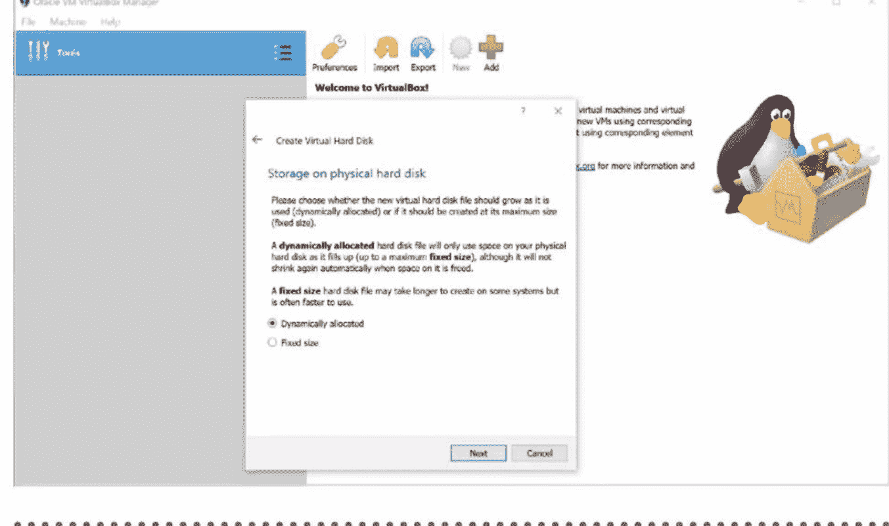

#### 步骤 7

虚拟硬盘将是一个单独的文件夹，大小上限即为您在此部分指定的数值。请确保您的计算机上虚拟硬盘所在的存储位置有足够的可用空间。例如，我们在 D:\ 驱动器上使用了一个较大的存储选项，将其命名为 Linux Mint，并为虚拟硬盘分配了 25.50GB 的空间。


#### 步骤 8

点击“创建”后，虚拟机的初始设置即告完成；您现在应该能在 VirtualBox 应用程序中看到新创建的虚拟机。不过，在开始之前，请右键面板顶部的“设置”按钮，然后在“常规”部分点击“高级”选项卡。使用下拉菜单，将共享剪贴板和拖放都设置为“双向”。


#### 步骤 9

接着点击“系统”部分，然后点击“处理器”选项卡。根据您的 CPU 配置，在不妨碍宿主系统性能的前提下分配尽可能多的核心；我们选择了两个 CPU。现在点击“显示”部分，将视频内存滑到最大值，并勾选“启用 3D 加速”。点击“确定”以保存新的设置。


#### 步骤 10

点击“启动”按钮，并在“选择启动磁盘”窗口中使用资源管理器按钮（资源管理器按钮是一个带有绿色箭头的文件夹）。在新弹出的窗口中点击“添加”，以定位已下载的 Mint ISO 文件；然后点击“打开”以选择该 ISO。现在点击“启动”按钮，使用 Linux Mint 实时环境启动虚拟机。现在，您可以按照标准 PC 安装要求安装 Linux 了。


> “任何人都可以制造出快速的处理器。关键在于制造出快速的系统。”
>
> – Seymour Cray（电气工程师，Cray 超级计算机的设计者/创始人）


## 认识 Linux

我们在此使用 Linux Mint 作为参考，因为它是一个易于使用的发行版，非常适合前 Windows 用户。它也是开发最完善、文档最齐全的 Linux 发行版之一，并且拥有一些出色的配置选项。

在本节中，我们将介绍 Linux Mint 的 Cinnamon 菜单和桌面环境，它的工作原理以及如何对其进行自定义。想要创建另一个用户，或者甚至了解如何在网上保持匿名？请继续阅读。

### Cinnamon 菜单简介

既然您已经安装好了 Linux，是时候好好了解一下了。不过，如果您使用的是 Virtualbox，您将看到一个关于软件渲染的通知；以下是修复方法。

#### Cinnamon Virtualbox 修复

您已经查看了一些列表功能，例如 .insert、.remove 和 .pop，但也有适用于字符串的功能。

在开始之前，我们假设您正在 Virtualbox 中遇到此问题。软件渲染消息出现在桌面的右上角。要修复此问题，请单击 Virtualbox 窗口中的“设备”，然后选择“插入客户机添加件光盘映像”。


客户机添加件光盘包含 Virtualbox 的驱动程序，包括虚拟视频硬件。加载后，您会看到一个“需要运行软件”的通知框，其中有两个选项：取消和运行。点击“运行”按钮并输入您的 Linux 用户密码。


一两分钟后，您会自动进入一个名为 Linux 终端的命令提示界面。这将显示新 VirtualBox 驱动程序的安装过程，删除检测到的旧驱动程序，并安装最新版本。这不会花费很长时间，完成后会要求您按 Return 键退出终端。


Virtualbox 添加件光盘图标位于桌面上，因此请右键点击它，然后在菜单中向下滚动并点击“弹出”。现在您可以通过点击菜单（左侧条带底部的图标），然后点击“重启”按钮来重启 Linux Mint。这将重启 Mint，问题也随之解决。


### Cinnamon 菜单简介

#### 菜单中的 Cinnamon

现在，Virtualbox 用户的软件渲染问题已经解决，让我们来看看 Mint 菜单及其工作原理。请记住，这仅适用于 Mint Cinnamon，其他发行版的外观和行为可能不同。

**步骤 1** 首先，您可能已经注意到登录 Linux Mint 时会弹出欢迎屏幕。花一点时间浏览这些选项，阅读“入门指南”等选项。完成后，点击窗口右上角的 X 关闭它。


**步骤 2** 您之前已经使用过 Mint 菜单来重启系统，并首次使用了实时环境。这次，点击“菜单”按钮，并将鼠标悬停在中间列的“办公”条目上。这更改了右列中显示的图标，详细列出了该部分下安装的哪些应用程序。


**步骤 3** 从菜单中启动任何应用程序都很简单，只需找到并点击它即可。例如，在“办公”部分下，点击 LibreOffice Writer。Writer 是 Linux Mint 预装的文字处理器。它可以打开和保存为 Microsoft Word 文档，并且功能几乎相同。


**步骤 4** 再次打开菜单，但这次将鼠标指针悬停在“图形”上，然后点击 GNU 图像处理程序。GIMP 是一款强大的图像处理应用程序，其效果可能媲美 Adobe 的 Photoshop，但要想获得理想效果可能需要更多的操作。不过，花点时间掌握它绝对是值得的。


**步骤 5** 如果您正在寻找特定的功能或应用程序（例如设置打印机），请点击菜单框顶部的搜索框。开始输入您想要的应用程序或功能，例如打印机，Mint 菜单将在下方显示相关选项。无论哪个发行版，这在大多数现代 Linux 菜单中都能正常工作。


**步骤 6** 将鼠标悬停在右列列出的任何应用程序上，并右键点击，将显示一个选项列表：添加到面板、添加到桌面、添加到收藏夹以及卸载。这些选项中的大多数用法都很明显。不过，“添加到收藏夹”会将该应用程序放在左侧的快速访问列中。


#### 导航 Cinnamon 桌面

每个桌面环境的行为都各不相同。一些桌面环境（DE）提供可自定义并放置在桌面上的小部件，而另一些则倾向于干净利落的视觉效果，以尽可能快地运行所有程序。让我们看看 Cinnamon 桌面提供了什么。

#### 一点风味

Cinnamon 桌面环境是风格与性能的优秀结合。它有很多值得喜欢的地方，这就是它如此流行的原因。

**步骤 1**
双击“计算机”图标开始探索 Cinnamon 桌面。这会打开 Nemo，即 Cinnamon 使用的文件管理器。“计算机”图标打开根级文件系统，允许访问和查看光驱（如果已安装）、硬盘和核心 Linux 文件系统。


**步骤 2**
对于前 Windows 用户来说，Linux 文件系统可能看起来令人困惑，因此直到您对它的运作方式有更多了解之前，我们建议您专注于桌面上的“主目录”图标。这里包含与您的用户账户相关的所有内容：您存储图片、视频、音乐、文档、下载项等的位置。

**步骤 3**
Nemo 拥有许多不同的功能、视图和方法，以便您可以查看和操作文件和文件夹。例如，如果您的“图片”文件夹中有任何图像，您可以使用 Nemo 右下角标记为“调整缩放级别”的滑块来选择图像的图标缩放级别。


**步骤 4**
就像任何优秀的文件管理器一样，如果您右键点击其中的任何文件或文件夹，都会得到丰富的选项。就 Cinnamon 而言，默认设置允许您根据文件类型播放或查看文件，以及复制、剪切、删除、压缩、重命名、通过电子邮件发送和查看其属性。


#### 导航 Cinnamon 桌面

#### 步骤 5
在桌面底部有一个**面板（Panel）**。我们已经查看过面板的一个部分，即菜单。如果在面板的任何位置（面板应用程序除外）右键单击，您将看到一个菜单，允许您以不同的方式编辑、添加和设置面板。


#### 步骤 6
例如，如果您点击“修改面板”选项，您可以移除、移动、删除面板，添加新面板，并清除当前存在的任何**小部件（Applets）**。顺便说一下，小部件是专为适应并运行于 Cinnamon 面板中而设计的应用程序。


#### 步骤 7
如果在 Cinnamon 桌面的任何位置右键单击，您会看到一组选项，允许您进一步添加、编辑或以不同方式查看桌面内容。这与 Windows 非常相似，这也是 Mint 是前 Windows 用户良好选择的原因。


#### 步骤 8
从该桌面右键上下文菜单中，选择“自定义”，然后依次点击新打开窗口底部的“桌面设置”链接。这将打开一个新窗口，您可以在其中编辑哪些桌面图标存在。如果您使用的是连接了多个显示器的设置，您还可以选择哪个显示器显示哪些图标。


#### 步骤 9
点击菜单并输入“system settings”（系统设置），然后打开相应的图标。这将带您进入系统设置选项。从这里，您可以控制和编辑 Linux Mint Cinnamon 的外观和工作方式，以及添加新用户、管理防火墙和启用辅助功能选项。


#### 步骤 10
简而言之，Linux Mint Cinnamon 可以被配置得非常出色。有许多例子展示了它能达到的良好程度以及可以实现的效果。您可以根据需要尽可能复杂或尽可能简单，添加不同的组件和动画，或者保持简洁易读。


### 安装 Linux Mint 后应做的 10 件事

Linux Mint 开箱即用的系统非常完善，但就像大多数 Linux 发行版一样，有一些调整可以改善其工作方式。虽然这些是 Mint 特有的调整，但大多数也可以应用于其他发行版。

#### LINUX 调整

其中一些安装后操作是高度推荐的，而另一些只是便捷的附加功能，用于调整系统或添加自定义设置。

-   **步骤 1** 首先，也是最重要的安装后操作是更新系统。点击面板上位于桌面右下角（时间和日期旁边）的盾牌图标。这将启动更新管理器。


-   **步骤 2** Linux Mint 提供用户三种级别的更新策略：不要搞坏我的电脑、优化稳定性和安全性、始终更新所有内容。推荐的选项是“优化稳定性和安全性”，它仅更新不会触及核心操作系统关键元素的、安全的、必要的补丁。请阅读说明，但选择中间（也是推荐）的选项。


-   **步骤 3** 点击“确定”按钮，您将看到有几个更新等待安装。不过在更新之前，点击蓝色条上的“确定”按钮以切换到本地镜像。这将打开软件源选项。在镜像部分，点击“主要”和“基础”下拉菜单，并选择离您当前位置最近的服务器。


-   **步骤 4** 点击“更新缓存”按钮并关闭软件源窗口。回到更新管理器，点击“安装更新”图标并输入您的密码。更新会自动应用并重新启动更新管理器，这次会有更多的更新。再次点击“安装更新”，确认任何消息，并等待完成。


-   **步骤 5** 更新按级别分级，1 为低级别更新，5 为危险级别。我们的建议是坚持使用级别 3 的更新；对于关于覆盖配置文件的任何消息，点击**替换**。关于软件渲染问题以及非 VirtualBox 用户缺少驱动的问题，点击**菜单**并在搜索框中输入“driver”（驱动）。


-   **步骤 6** 点击搜索结果中出现的**驱动管理器**应用程序并输入您的密码。Mint 需要一点时间来分析可用的选项，并基于检测到的硬件向您提供潜在驱动程序的选择。有图形问题（如软件渲染）的用户应选择使用最新的、推荐的图形驱动。


-   **步骤 7** 此时您可能需要重新启动 Linux Mint，所以现在执行此操作。重启后，再次点击菜单按钮，然后依次点击**终端**。终端图标位于左侧列中，在文件图标上方。打开终端后，输入：`sudo apt-get install libdvd-pkg`，按 Enter 键并输入密码。这将启用加密 DVD 播放功能。


-   **步骤 8** 当询问是否接受更改时，输入 **Y**，同样在询问配置 libdvd 时。确保 **OK** 被高亮显示并按 **Enter** 键，然后对任何进一步的问题回答“是”。接下来，仍在终端中，输入：`cat /proc/sys/vm/swappiness`；结果应为 **60**。如果您的电脑内存（RAM）少于 **4GB**，则输入：`gksudo xed /etc/sysctl.conf`。


-   **步骤 9** 此调整有助于加速内存少于 **4GB RAM/内存**的系统。滚动到您刚打开的文件底部并添加以下新行：

```
# Decrease swap usage to a more reasonable level
vm.swappiness=10
```

点击 文件 > 保存，然后 文件 > 退出。重启 Linux Mint，您应该会注意到性能略有提升。


-   **步骤 10** 在当今数字时代，安全始终是一个关切点。虽然 Linux Mint 是一个安全的系统，但建议始终尝试改进它。点击菜单按钮并搜索 **Firewall**（防火墙）；点击**防火墙配置**图标并输入您的密码。在防火墙窗口中，点击**状态**滑块将其打开。


#### 阿波罗 11 号

**你知道吗……**

1969 年 7 月 20 日被视为人类历史的转折点，人类首次踏上月球。帮助机组人员完成这一关键旅程的软件当时甚至不存在，必须从头开发。MIT 仪器实验室的工程师使用了一种名为“Rope Memory”（绳索内存）的新程序存储方法，将内存填充了汇编语言的特殊版本。

令人难以置信的是，这些代码可以免费在 GitHub 上查看。该代码由一位研究员于 2003 年上传，您可以通过访问 www.github.com/chrisiggaly/Apollo-11/ 查看代码。留意代码片段，特别是 `Burn_Baby_Burn`，尤其是第 925 行带有注释 “Goodbye. Come again soon.”（再见。期待再次光临。）

花点时间浏览一下，看看还能找到什么。


> 程序员并非没有幽默感。看看里面还有什么。


> 人类的一大步，编程亦如此。

图片来源：阿波罗 11 号/美国宇航局（NASA）

### 创建用户

当您首次安装 Linux Mint 时，它被配置为供单个用户使用。虽然与家人共享一个用户账户也没问题，但总有一天您可能需要创建具有自己独特主文件夹的独立用户。

#### 新用户

拥有不同的用户意味着每个用户都可以访问系统在系统中属于他自己的区域。文档、图片、视频等是独立的，正如其他操作系统中多个用户的情况一样。

**步骤 1** 点击 Linux Mint 菜单并输入 “users” 开始搜索相关的控制台。从搜索结果中，选择“用户和组”并输入您的密码。用户和组控制台外观相当基础，但谢天谢地使用也很简单。起初，您只能看到安装 Linux Mint 时的用户名。


**步骤 2** 要添加新用户，点击控制台底部的“添加”按钮。您可以创建两种类型的用户：标准用户和管理员。除非新用户需要安装新应用程序或访问主文件夹之外的文件系统部分，否则请选择标准账户类型。否则，使用管理员账户类型。


**步骤 3** 输入新用户的**全名**，接着输入他们登录 Linux Mint 时需要的**用户名**。确保用户名全部为小写，仅包含 a-z 和 0-9 字符。如果您愿意，可以使用句点、下划线或连字符。准备好继续时，点击“添加”按钮。


**步骤 4** 新用户将出现在当前 Linux Mint 用户列表中，按字母顺序排列。目前，没有设置密码，因此点击当前用户列表中的该用户，然后点击用户名下的“未设置密码”选项。


### 创建用户

**步骤 5** 现在你可以为新用户输入密码，或者点击“新密码”文本框末尾的弯曲箭头以生成并显示一个密码。当然，尽可能设置一个强密码是个好主意。完成后，点击“更改”按钮。


**步骤 6** 由于新用户已创建，你现在可以关闭“用户和组”控制台窗口。如果你点击 Mint 菜单，然后选择注销，系统会显示 Mint 登录管理器。新用户现在出现在当前可用用户列表中。点击该用户以登录。


**步骤 7** 登录后，新用户需要设置自己的桌面壁纸、图标、面板、菜单等。根据你为他们设置的账户类型（标准或管理员），他们将无法安装任何新应用。此截图来自标准用户账户类型。


**步骤 8** 你可以创建尽可能多的用户账户，并在需要时切换它们。最好只保留一个能够安装新软件的账户，这样可以追踪系统上的内容。


#### 命令行账户

正如你预期的那样，你也可以在命令行中创建新用户。在主（你自己的）管理员账户下打开一个终端会话。

**步骤 1** 从命令行添加新用户的流程相对简单。首先，输入：`sudo adduser <username>`，其中 `<username>` 是新用户的登录名。然后你会被要求为用户创建新密码，以及他们的全名和其他详细信息。点击 Y 以确认详细信息并创建用户账户。

**步骤 2** 你可以在“用户和组”控制台中检查新用户的详细信息和账户类型。如果你想要从 Mint 中删除一个用户，你可以输入：`sudo deluser <username>` 在终端中，或者在“用户和组”中点击删除按钮。


### 自定义桌面

自定义操作系统桌面是使其具有个性化的方式之一：一个个性化的工作空间，旨在帮助你工作、激励你或展示公司标志。无论你拥有自己桌面的理由是什么，以下是操作方法。

#### 你的桌面

Linux 可能是最可定制的操作系统之一。只需几个调整，安装一两个额外组件以及一些想象力，你就可以创造惊人的东西。

- **步骤 1**
  桌面自定义的第一个方面是更改壁纸。右键点击桌面并选择“更改桌面背景”。这在 Linux Mint 中打开了背景应用；请记住，其他发行版可能会以不同的方式呈现其背景、壁纸选择工具。


- **步骤 2**
  较新版本的 Linux Mint 会根据用户运行的版本显示可用的背景。通常你会得到三个类别，随后是一个由其他类别分隔的第四个类别“图片”。“图片”选项不同，因为它从你主区域的图片文件夹中读取图像内容。


- **步骤 3**
  你只需点击任何提供的位置的可用图像，即可将其安装为桌面壁纸。顺便说一句，如果你在其他位置（系统或网络上）存储了图像，你可以通过点击背景控制台底部的加号符号，使用文件管理器来定位它们，从而添加它们。


- **步骤 4**
  通过点击设置标签，你可以选择播放多张图像作为幻灯片，或更改壁纸的各种选项。


- **步骤 5**
  如果没有任何可用的壁纸让你满意，打开浏览器并搜索你喜欢的背景图像类型。当你找到想要的作为桌面壁纸的图像时，右键点击它并从选项列表中选择**设置为桌面背景**。当设置桌面背景控制台打开时，点击设置桌面背景按钮。


- **步骤 6**
  点击菜单按钮，搜索“desktop”并点击桌面设置结果。桌面控制台允许你选择你想要的布局、桌面图标和多显示器支持选项。你可以根据个人口味实验选项以找到最佳设置。


- **步骤 7**
  除了更改桌面壁纸和图标显示方式外，你还可以更改 Linux Mint 的整体主题。从 Mint 菜单中，搜索“themes”并点击出现在搜索结果中的主题应用。


- **步骤 8**
  主题允许你更改 Mint 桌面某些方面的外观：窗口边框、图标、控件、鼠标指针和桌面。在设置标签中，你可以通过一些开关滑块按钮来扩展选项。


- **步骤 9**
  如果你点击三个可用选项中间的添加/删除按钮，你可以从多个预安装主题中选择默认视图。点击你想要的主题，然后点击安装（向下指的箭头）按钮以启用它。


- **步骤 10**
  点击回到主题，然后桌面，你可以找到新安装的主题并将其应用于你的桌面。任何已安装的主题也可以通过添加/删除按钮卸载。值得花一些时间按你想要的方式个性化你的桌面，也有一些令人难以置信的主题可供选择。


### 在线匿名

数字时代带来了许多通信上的重大进步；然而，它也带来了新的监视和窥探时代。我们大多数人都对政府、秘密组织和地下黑客不断侵犯我们隐私的频繁新闻报道并不陌生，但你如何应对这种情况？

#### 使用 MINT 获得匿名性

虽然在线完全匿名几乎是不可能的，但你可以通过采取措施确保你的隐私达到最佳状态。

- **步骤 1**
  从基础开始，在浏览时使用 HTTPS 代替标准的 HTTP。这意味着通过 HTTPS 传输的任何内容都是安全的（因此末尾有 S）且经过加密。


- **步骤 2**
  浏览时，考虑使用浏览器中可用的隐身或私人浏览模式。这会禁用你的网络历史和网页缓存，允许你浏览而不保存详细信息供他人稍后审查。然而，它不会阻止任何数据或搜索跟踪。


- **步骤 3**
  虽然使用谷歌似乎是现代互联网搜索的明显选择，但该公司确实会跟踪个人进行的所有搜索。相反，考虑使用替代搜索引擎，如 DuckDuckGo，它是一款不存储个人数据或跟踪你的搜索引擎。


- **步骤 4**
  如果你经常上网，考虑安装一些增强隐私的浏览器插件。例如，对于 Firefox，使用 Ghostery、NoScript 和 Adblock Plus 来阻止跟踪器、广告和其他数据挖掘技术。


#### VPN 和 TOR

前面的步骤有助于你的在线隐私，但要想真正匿名，你需要虚拟专用网络（VPN）和 Tor。

- **步骤 1**
  VPN 是远程服务器或服务器集群，它与你的电脑建立连接。最终结果是，你的电脑在互联网上的身份隐藏在 VPN 远程服务器后面；因此，你可以住英国，但拥有属于冰岛的 IP 地址（在线计算机身份）。

- **步骤 2**
  大多数优质 VPN 都收取月费或年费，但这项开支是值得的。我们使用 CyberGhost（www.cyberghostvpn.com），它为 Windows、Mac、Mint（以及其他 Linux 发行版）、Android 和 iOS 设备提供 VPN 连接。每个操作系统的详细信息可在 www.support.cyberghostvpn.com/hc/en-us/articles/213190329-Read-me-first 找到。

- **步骤 3**
  另一种选择是使用 Tor。Tor 是一个开放网络，你可以连接该网络，它将你的 IP 地址隐藏在全球无数的节点后面。它适用于 Windows、Mac 和 Linux 计算机，安装和使用都非常简单。从访问 www.torproject.org/download/download-easy.html 并点击下载 Linux 64 位按钮开始。


- **步骤 4**
  下载完成后，进入终端并进入下载文件夹，`cd Downloads/`。输入 `ls` 检查 tar.xz Tor 文件是否存在，然后输入 `tar -xf tor-browser-1tlux64-8.0.4_en-US.tar.xz`（Tor 定期更新，因此如果你的版本不同，请按 Tab 键自动补全 tor-browser= 文件名）。文件解包后，使用 `cd tor-browser-en-US/` 进入新文件夹。

- **步骤 5**
  快速输入 `ls` 会显示几个条目；一个名为 Browser 的文件夹和一个名为 'start-tor-browser.desktop' 的文件。要开始 Tor 设置，输入 `./start-tor-browser.desktop`。此命令启动 Tor 设置，提供两个选项：连接或配置。对于大多数用户，连接选项就足够了。准备好后点击连接。


- **步骤 6**
  连接建立后，Tor 浏览器启动。这是 Firefox 的定制版本，从这里你可以安全地浏览互联网，而不用担心被查看或跟踪。同时使用 VPN 和 Tor 可提供极其安全和私密的在线世界连接。


> “Linux：拥有**CLUE**的操作系统……**C**ommand Line **U**ser **E**nvironment（命令行用户环境）。”
> – 匿名（发布于 comp.software.testing）

### 使用终端

Linux 命令行，即终端（Terminal），是一个功能极其强大的环境。通过它，你可以让操作系统跪地求饶（指掌控其核心），也可以将其更新至惊艳的状态。你可以入侵远程计算机，观看动态 ASCII 篝火，安装新的应用程序和程序，观看从荷兰服务器上播放的《星球大战》，并编写复杂的自动化脚本。

在本节中，您将探索终端的复杂性及其在 Linux 中的工作方式。您将学习如何从终端操作 Linux 文件系统，并发现终端中一些奇特但有趣的功能。

在 Linux 世界中，终端至高无上。了解其工作原理，你就能获得所有的力量。


#### 终端基础

大多数操作系统使用两种类型的界面：GUI（图形用户界面，即 Windows、macOS 和 Linux Mint 启动后的桌面）以及命令行。虽然现代操作系统对命令行有所回避，但 Mint 使用终端来赋予用户更大的系统控制权。

##### 接管命令

命令行，或称为终端，是一个极其强大的界面。你在桌面上能做的所有事情，都可以在终端中完成。让我们从了解它是如何工作的开始。

- **步骤 1**：你可以通过点击面板上的终端图标来访问终端，该图标位于 Firefox 和文件图标之间；或者通过打开菜单，从左侧快速启动条中选择终端来启动它。


- **步骤 2**：终端允许你访问 Linux Mint Shell，称为 Bash，它让你能够访问底层操作系统。Mint 中的所有元素，包括桌面和 GUI，都是从命令行运行的模块。


- **步骤 3**：你目前在终端中看到的内容是你的登录名，后面跟着计算机名称；即你首次安装 Mint 时设置时的名称。该行以当前文件夹名称结尾；起初这只是一个波浪号 ~，意味着你的主目录（Home 文件夹）。


- **步骤 4**：行末闪烁的光标是你输入基于文本的命令的位置。你可以开始尝试一个简单的命令：打印当前工作目录（Print Working Directory，pwd），它会将你当前所在的文件夹输出到屏幕上。输入 pwd 并按下 Enter 键。


- **步骤 5**：你输入的所有命令工作方式相同：你输入命令，包含任何扩展命令用途的参数，并按下 Enter 键执行你输入的命令行。在终端中输入：uname -a 并按下 Enter。这会显示一些关于 Mint 的系统信息。


- **步骤 6**：在我们开始输入命令之前，让我们花点时间看看终端提供哪些菜单选项。File（文件）菜单选项允许你打开一个新的终端，创建一个新配置档（profile），在其中你可以更改终端的大小、颜色和行为规范，添加一个新标签页，以及关闭所有当前活动的终端会话。


- **步骤 7**：Edit（编辑）选项允许你将命令复制和粘贴到终端以及其他来源；当你想要从网页复制一个非常长且复杂的命令时，这很有用。它还允许你编辑当前配置首选项。


- **步骤 8**：View（查看）和 Search（搜索）选项允许你更改终端窗口的大小，当然也可以搜索终端内的任何特定关键词。


- **步骤 9**：Terminal（终端）条目扩展了配置编辑和大小调整，并允许你更改字符编码。有趣的是，你甚至可以将其设置为**只读**模式，这禁止你在终端中输入任何命令；当你需要永久显示终端内容时，这很有用。


- **步骤 10**：最后，Help（帮助）选项显示终端的帮助内容和版本号，或者更准确地说，是 GNOME Terminal；我们今后将简单地称之为终端。内容值得一读，以帮助熟悉终端的工作方式。


#### 通过终端更新 Mint

到目前为止，你一直在使用盾牌图标启动 Mint 更新管理器来更新系统并升级当前安装的应用程序、工具和其他元素。然而，你也可以从终端完成完整的系统更新和升级。

##### 使用 apt-get

要通过终端更新和升级，你使用 APT（Advanced Packaging Tool，高级打包工具）命令。这是一个强大的命令，它根据用途结合不同的元素。

- **步骤 1**：首先，打开一个新的终端，或者如果你已经打开了一个，使用 `clear` 命令清除其内容。这为你提供了一个干净的开始。


- **步骤 2**：在终端中输入：**apt-get**。这会显示最常用的 apt-get 命令列表，以及每个命令功能的简要描述。即使此时你无法完全理解，也值得一看。


- **步骤 3**：APT-get 用于更新和升级 Mint，以及 Ubuntu 和其他基于 Debian 的发行版中的软件。使用 Update 元素获取新的软件包列表并更新源列表。Upgrade 下载并将这些文件升级到最新版本。要开始整个升级和更新过程，输入：**sudo apt-get update**，然后输入你的密码。


- **步骤 4**：现在请注意 sudo 命令的添加。sudo 命令曾经意味着“超级用户执行”（Super User Do）；如今，更常见的说法是“替代用户执行”（Substitute User Do）。这意味着管理用户（超级用户）使用 APT（高级打包工具）获取任何更新。现在尝试这个：**sudo apt-get upgrade**。


- **步骤 5**：根据你的更新状态，如果有任何等待安装的内容，系统可能会询问你是否要应用 `sudo apt-get upgrade` 命令的结果。你可以按 **Y** 接受并继续。这里发生的是 apt-get 有一些要应用于 Mint 的更新软件，而你正在确认此操作。

```
Reading state information... Done
The following NEW packages will be installed:
  libyaml-perl
E: Unable to locate package libyaml-perl
david@david-mint:~$ sudo apt-get update && sudo apt-get upgrade
Reading package lists... Done
Building dependency tree
Reading state information... Done
```

- **步骤 6**：终端窗口可能会显示一长串看起来像乱码的内容，但不要担心。升级所需的文件已被下载、准备、解包、处理、安装并正确设置。执行升级时，即使是最小的软件包，背后也有大量操作在进行。

```
Preparing to unpack .../linux-headers-4.9.0-55-generic_4.9.79-55.88_amd64.deb ...
Unpacking linux-headers-4.9.0-55-generic (4.9.79-55.88) over (4.9.4-6.67.88) ...
Preparing to unpack .../linux-headers-4.9.0-generic_4.9.79-55.88_all.deb ...
Unpacking linux-headers-4.9.0-generic (4.9.79-55.88) over (1.5.212.4) ...
Processing triggers for man-db (2.7.5-1) ...
Processing triggers for docutils (0.14+dfsg-1) ...
Processing triggers for libdrm2 (1.0.0-1) ...
Processing triggers for systemd (2.9.9-0ubuntu6) ...
Processing triggers for shared-mime-info (1.4-1) ...
Processing triggers for libgdk-pixbuf-2.0-0 (2.32.4) ...
Setting up grub-common (2.02+dfsg-25.6.8ubuntu2.5) ...
Setting up linux-image-4.9.0-55-generic (4.9.79-55.88) ...
Setting up linux-headers-4.9.0-55-generic (4.9.79-55.88) ...
Processing triggers for initramfs-tools (0.118) ...
Updating initramfs in /boot/initrd.img-4.9.0-55-generic ...
Processing triggers for shared-mime-info (1.4-1) ...
Processing triggers for desktop-file-utils (0.22) ...
Processing triggers for mime-support (3.60ubuntu1) ...
Processing triggers for libc-bin (2.23-0ubuntu6) ...
Processing triggers for man-db (2.7.5-1) ...

Setting up libyaml-perl (4.4-1) ...
Setting up linux-headers-4.9.0-generic (4.9.79-55.88) ...
Processing triggers for linux-headers-4.9.0-55-generic (4.9.79-55.88) ...
  /etc/kernel/postinst.d/dkms
  /etc/kernel/postinst.d/dkms
dkms: autoinstall for kernel: 4.9.0-55-generic
dkms: autoinstall for kernel: 4.9.0-55-generic
dkms: autoinstall for kernel: 4.9.0-55-generic

Preparing to unpack .../libyaml-perl_4.4-1_amd64.deb ...
Unpacking libyaml-perl (4.4-1) ...
Processing triggers for man-db (2.7.5-1) ...
Processing triggers for libc-bin (2.23-0ubuntu6) ...
Processing triggers for shared-mime-info (1.4-1) ...
Processing triggers for desktop-file-utils (0.22) ...
Processing triggers for mime-support (3.60ubuntu1) ...
Processing triggers for shared-mime-info (1.4-1) ...
Processing triggers for desktop-file-utils (0.22) ...
Processing triggers for mime-support (3.60ubuntu1) ...
Processing triggers for shared-mime-info (1.4-1) ...
Processing triggers for desktop-file-utils (0.22) ...
Processing triggers for mime-support (3.60ubuntu1) ...
```

- **步骤 7**：基本上，就是这样了，你的系统现在根据 apt-get update 命令可用的软件包列表已经更新到最新。你可以再运行一遍这个过程，以检查一切是否顺利。总结一下，输入：`sudo apt-get update`，按下 **Enter**，然后输入：`sudo apt-get upgrade` 并按下 **Enter**。

```
Reading package lists... Done
Building dependency tree
Reading state information... Done
Calculating upgrade... Done
The following packages will be automatically installed and are no longer required:
  libcopylxml-3.8 libcrypto-1.0.0-ssl libgcc-4.8-dev
  libmysqlclient18 libncurses5 libncurses5-dev libperl5.22 libpthread-stubs0-dev libssl1.0.0 libstdc++-4.8-dev libtcl8.6-0 libyaml-0.2-2
E: Unable to locate package libyaml-perl
david@david-mint:~$ sudo apt-get update && sudo apt-get upgrade
Reading package lists... Done
Building dependency tree
Reading state information... Done
```

- **步骤 8**：有趣的是，Linux Mint 以及其他一些发行版允许你将多个命令链接在一起。因此，在这个例子中，我们可以使用 `sudo apt-get update && sudo apt-get upgrade`。双与符号（&&）用于组合命令，只要前一个命令顺利执行，它就完美运作。建议在任何会话开始时使用更新和升级组合。

```
Reading package lists... Done
Building dependency tree
Reading state information... Done
Calculating upgrade... Done
The following packages will be automatically installed and are no longer required:
  libcopylxml-3.8 libcrypto-1.0.0-ssl libgcc-4.8-dev
  libmysqlclient18 libncurses5 libncurses5-dev libperl5.22 libpthread-stubs0-dev libssl1.0.0 libstdc++-4.8-dev libtcl8.6-0 libyaml-0.2-2
E: Unable to locate package libyaml-perl
david@david-mint:~$ sudo apt-get update && sudo apt-get upgrade
Reading package lists... Done
Building dependency tree
Reading state information... Done
```

##### 终端 vs 更新管理器？

无论使用哪种发行版，为什么使用终端而不是更新管理器来进行更新和升级？一些用户强烈倾向于使用终端来更新他们的 Linux 系统及附带的应用程序，认为这样更好。然而，事实往往并非如此。

使用终端的 `apt-get` update 并不处理软件包版本之间依赖关系的变更，因此，如果一个软件包从一个版本到另一个版本的依赖字段发生了变更，那么更新可能会被搁置。

更新管理器，或软件管理器（取决于发行版），通常会分阶段进行更新，并标记那些依赖关系发生变化的软件包以进行更新。然而，这就是 Linux 常常令人困惑的地方，有时它并不这样做。

归根结底，这取决于正在更新的软件包的开发人员，以及该发行版仓库中软件包的存放方式，还有该更新是否被分类为稳定版。从本质上说，从用户的角度来看，如果你定期使用终端和更新管理器两者进行更新和升级，那么你将保持尽可能最新的状态，并获得软件包和核心软件的基本且必要的稳定版本。如果你在寻找前沿的软件包更新，最好选择滚动发布（rolling release）发行版。


#### 通过终端安装应用程序 – 第 1 部分

在 Linux 上安装应用程序和软件有多种方法。你可以选择图形化途径，使用软件管理器，也可以使用终端。通常，终端能提供更精细的控制权限来管理软件安装，有时你甚至别无选择。

##### 命令行安装

使用终端安装应用程序可能需要一些熟练的键盘操作，但你能更清楚地了解正在安装什么以及安装到哪里。

**步骤 1**

从终端安装应用程序通常相对简单。不过，首先你需要确保系统是最新的。为此，打开终端并输入：`sudo apt-get update && sudo apt-get upgrade`。输入你的密码并接受任何必要的更新。

**步骤 2**

正如你之前看到的，`sudo apt-get update/upgrade` 等命令旨在升级系统中已安装的软件。那么，如何安装更多应用程序呢？事实证明，这异常简单。首先你需要一个要安装的应用程序，所以让我们再次使用 Stella。输入：`sudo apt-get install stella`。

**步骤 3**

你需要输入 y 以确认安装，这将占用系统约 5.5MB 的存储空间。Stella 安装完成后，你会再次看到 Mint 自动在菜单中创建了“游戏”类别以及应用程序快捷方式。


**步骤 4**

有时，安装软件时，你需要添加应用程序的软件源（Repository）。软件源（或简称 repo）简单地说是存放软件及其所有依赖项（如运行所需的关键库等）的远程服务器位置。首先输入以下命令：`sudo add-repository ppa:peterlev1/ppa`。在被要求时按 Enter 键添加 PPA（个人软件包存档）。


**步骤 5**

这将为 Variety 壁纸更换器应用程序添加软件源。这是一个基于 Ubuntu 的应用程序，适用于 Mint 并自动更换壁纸。既然已添加软件源，请输入：`sudo apt-get update`，以更新新信息并将软件源的内容添加到软件包数据库中。

**步骤 6**

现在要安装 Variety，请输入：`sudo apt-get install variety`。按 y 确认并接受安装，继续执行安装。安装完成后，你可以在终端中输入 `variety` 来运行该应用程序。

##### 移除应用程序

除了安装应用程序，`apt` 命令也可用于移除应用程序，有助于保持系统整洁并释放资源。

**步骤 1**

要卸载或移除 Variety 应用程序，请输入以下命令：`sudo apt-get remove variety`。输入 y 继续卸载应用程序；注意，移除应用程序后，你还会收到关于释放了多少硬盘空间的信息。

**步骤 2**

虽然 'apt-get remove' 命令卸载应用程序，但它不会清除随应用程序而来的额外杂乱文件，例如配置和库文件。要彻底清除这些杂乱文件，请输入：`sudo apt-get purge variety`。

**步骤 3**

当你从系统中移除应用程序时，你会被告知某些自动安装的软件包已不再需要。你在之前的教程中已经看到，你可以使用以下命令来整理系统：`sudo apt-get autoremove`，然后按 y 接受该过程。

**步骤 4**

最后，为了整理系统中所有未使用的软件包，并移除 autoremove 命令未清除的元素，你可以输入：`sudo apt-get autoclean`。这些最后几步对于保持 Linux Mint 系统的良好运行状态以及修剪由安装和升级造成的不必要冗余至关重要。

#### 通过终端安装应用程序 – 第 2 部分

大多数时候，你可以使用标准的 `apt-get` 命令从终端安装应用程序。然而，有时应用程序需要额外的操作。这意味着从源代码安装应用程序，这听起来可能有点吓人，但实际上并没有那么可怕。

##### 从源代码

在这里你需要熟悉几个命令：Configure（配置）、Make（编译）和 Install（安装）。你会发现许多应用程序都使用从源代码安装的方式，因此这绝对是一项值得投入时间学习的技能。

**步骤 1**

Linux 的源代码文件通常以 .TAR.GZ 或 .TAR.BZ2 的形式出现。两者都是压缩文件，包含“构建”应用程序所需的所有核心文件。通过在主目录（Home）中创建一个新文件夹来开始本教程：`mkdir vim`

**步骤 2**

顺便说一下，Vim 是一个高级文本编辑器，我们将用它作为安装示例。进入新文件夹，`cd vim`，然后从新的 Vim 文件夹内，在终端中输入以下命令：`wget ftp://ftp.vim.org/pub/vim/unix/vim-7.4.tar.bz2.`

**步骤 3**

`wget` 命令从互联网获取内容，在此情况下是 Vim 的 BZ2 文件。要检查文件是否成功下载，请输入：`ls.`。根据 Mint 的文件系统颜色规则，压缩文件应以红色显示。


**步骤 4**

我们现在需要解压文件内容，因此在终端中输入：`tar -xf vim-7.4.tar.bz2`。注意：你可以输入 `tar -xf` 并按 `Tab` 键自动填充剩余的文件名。


**步骤 5**

如果你再次输入 `ls`，你会注意到创建了一个新文件夹：`vim74`；在 Mint 中用浅蓝色文本表示文件夹。为主应用程序创建根文件夹总是很有用的，这样当你通过此方法升级应用程序时，每个版本都会有自己的文件夹。


**步骤 6**

输入 `cd vim74` 进入文件夹，再次输入 `ls` 查看其内容。可能会存在相当数量的文件；大多数是应用程序的核心文件，而其他文件可能被标记为 `README` 或 `INSTALL`。先阅读这些文件总是明智的，因为它们提供了有关安装的重要信息。


**步骤 7**

安装的第一部分需要你输入 `./configure`。`./configure` 命令将检查系统中是否存在与应用程序相关的缺失依赖项。如果你收到关于 C 编译器的错误，则输入：`sudo apt-get install build-essential`。记录显示缺失了第三方应用程序 Ncurses。因此我们需要使用 `sudo apt-get install libncurses5-dev libncursesw5-dev` 安装它。


**步骤 8**

根据应用程序的不同，你可能需要持续安装新的依赖项。每安装一个新的依赖项后，重新运行 `./configure`，当它不再报告错误时，你可以继续安装的下一阶段。注意：你可能需要在线搜索一些错误信息。


**步骤 9**

成功运行 `./configure` 后，系统将创建一个 `Makefile`。需要在终端中输入 `make` 来“编译”它。根据应用程序的大小，这可能需要一段时间。


**步骤 10**

最后，你需要在终端中输入：`sudo make install`。这将安装应用程序，并使其在系统中准备好使用。完成后，你可以运行该应用程序，在此情况下，通过在终端中输入 `vim` 或通过 Dash 搜索它来运行。


### 使用终端

```
Kernel command line: block2mtd.block2mtd=/dev/hda2,131072,rootfs root=/dev/mtdblock0 rootfstype=jffs2 init=/etc/preinit  noinitrd console=tty0 console=ttyS0,38400n8 reboot=bios
Found and enabled local APIC!
Enabling fast FPU save and restore... done.
Enabling unmasked SIMD FPU exception support... done.
Initializing CPU#0
PID hash table entries: 32 (order: 5, 128 bytes)
Detected 1991.657 MHz processor.
Console: colour VGA+ 80x25
console [tty0] enabled
console [ttyS0] enabled
Dentry cache hash table entries: 1024 (order: 0, 4096 bytes)
Inode-cache hash table entries: 1024 (order: 0, 4096 bytes)
Memory: 5112k/8128k available (1497k kernel code, 2624k reserved, 597k data, 196k init, 0k highmem)
virtual kernel memory layout:
fixmap : 0xfffb9000 - 0xfffff000  ( 280 kB)
vmalloc: 0xc1000000 - 0xffff7000  (1007 MB)
lowmem : 0xc0000000 - 0x07f00000   (  7 MB)
.init : 0xc0313000 - 0xc0344000   ( 196 kB)
.data : 0xc027653c - 0xc030b0fc  ( 597 kB)
.text : 0xc0100000 - 0xc027653c  (1497 kB)
Checking if this processor honours the WP bit even in supervisor mode...Ok.
Calibrating delay using timer specific routine... 4047.64 BogoMIPS  (lpj=20238210)
```


#### Linux 内核 0.01

```c
/*
 * console.c
 *
 * This module implements the console & functions
 * used con_shak(void)
 * (used for write char() & queue * queue);
 * Hopefully this will be a rather complete VT102 implementation.
 */
/*
 * NOTE!!! We sometimes disable and enable interrupts for a short while
 * (to put a word in radio I/O), but this will work even for keyboard
 * interrupts. We know interrupts aren't enabled when getting a keyboard
 * interrupt, as we use trap-gates. Hopefully all is well.
 */

#include <linux/sched.h>
#include <linux/tty.h>
#include <asm/io.h>
#include <asm/system.h>

#define SCREEN_START 0xB8000
#define SCREEN_END   0xC0000
#define LINES 25
#define COLUMNS 80
#define BEAR 16

extern void keyboard_interrupt(void);

static unsigned long origin=SCREEN_START;
static unsigned long scr_end=SCREEN_START+LINES*COLUMNS*2;
static unsigned long pos;
static unsigned long x,y;
static unsigned long top=0,bottom=LINES;
static unsigned long lines=LINES,columns=COLUMNS;
static unsigned long state=0;
static unsigned long npar,par[NPAR];
static unsigned long qpos=0;
static unsigned char attr=0x07;
```

**你知道吗...**

由林纳斯·托瓦兹编程的第一个 Linux 内核，仅占用了 65KB 的内存。而从 0.01 版本以来，Linux 内核现在拥有超过 1800 万行代码。对于一个如今驱动着纽约证券交易所以及美国国防部核潜艇机群的高校项目来说，这表现相当不错。

#### 使用终端创建文件

使用终端，你可以创建文件夹、文件，甚至执行 Linux Mint 应用程序。事实上，即使没有图形用户界面（GUI），你仍然可以通过终端完成相同的工作。

##### 更多终端操作

使用终端创建内容并不像初看时那样费力。是的，终端可能对初学者来说显得望而生畏，但一旦掌握，它其实相当直观。

- **步骤 1** 打开终端，确保你位于主目录。如果不是，请使用 **cd ~** 命令将你从当前所在位置返回主目录。


- **步骤 2** 让我们从在 Home 内创建一个新文件夹开始，并命名为 **Test**。你需要输入的命令是 **mkdir Test**。输入命令后，按 **Enter** 键创建该文件夹，然后输入 **cd Test** 并按 **Enter**。这将切换目录（因此缩写为 **CD**）到新创建的 Test 文件夹。


- **步骤 3** 你的命令行应该会变更到 Test 文件夹，如果你输入 **ls**（列出文件夹内容），文件夹内将没有任何内容，因为你刚刚创建了它。**mkdir** 命令相当自明：Make Directory（创建目录）后跟着你选择的名称。


- **步骤 4** 要创建一个名为 **Test.txt** 的空文本文件，在终端中输入：**touch Test.txt**。然后你可以使用 **ls** 来查看文件夹中的新文件。Touch 是一个标准的 Linux 命令，允许创建文件而无需打开文本编辑器、保存文件，然后关闭编辑器。


- **步骤 5** 假设你现在想创建一个包含一些内容的文本文件，我们将它命名为 Test2.txt。为此，输入：**cat > Test2.txt**。这将创建文件 Test2.txt 并将终端置于编辑模式。


- **步骤 6** 你会注意到，光标在 **cat > Test2.txt** 命令下方闪烁，没有通常的提示符。这种编辑模式允许你输入文件将包含的文本。输入一些文本，然后按 **Ctrl+D** 退出并将内容写入文件。

- **步骤 7** 当然，你并不总是需要终端来向文件中输入文本。Mint 自带一个名为 **Xed** 的文本编辑器，类似于 Windows 的记事本。要在 Xed 中查看之前创建的文件，在终端中输入：**xed Test2.txt**，然后按 **Enter**。

- **步骤 8** Xed 是一个图形界面应用程序，你可以使用该应用程序的主窗口及其顶部菜单栏中的 **File > Save**（文件 > 保存）或 **File > Save As**（文件 > 另存为）功能，输入文本并保存该文件（或任何文件）。


- **步骤 9** 然而，如果你更喜欢继续留在终端中编辑/保存/创建文件，你可以使用 **Nano**。Nano 是一个简单的基于终端的文本编辑器。要使用示例试用它，输入：**nano Test2.txt**。屏幕底部有一个菜单。要在 Nano 中退出并保存任何内容，请按 **Ctrl+X** 并按照屏幕上的说明操作。


- **步骤 10** 我们使用终端启动了一个 Mint 应用程序，Xed，但任何应用程序都可以在终端内启动。例如，尝试 **firefox**，然后按 **Enter**。关闭 Firefox 即可返回终端。只要你知道应用程序的名称，就可以从终端运行它。此外，输入 **firefox&** 会打开 Firefox，同时仍允许你使用终端。


#### 创建和删除目录

与在终端中创建文件类似，你也可以创建和删除目录，或者你更习惯称之为文件夹。目录构成了文件系统的结构，如果没有逻辑目录，文件系统将陷入彻底的混乱。

##### 管理文件夹

学习如何在终端中创建和删除文件夹是 Mint，乃至整个 Linux 中一项重要的需要掌握的技能。以下是供你练习的基础知识。

- **步骤 1**
  打开终端，输入 `cd ~` 以确保你位于自己的主目录中。现在输入 `ls` 查看主目录中现有的当前文件夹。你会注意到，Mint 中的文件夹以青色（浅蓝色）标签显示。让我们从创建一个新目录开始。输入 `mkdir testdir`。

- **步骤 2**
  如果你再次输入 `ls`，你将看到新目录 `testdir` 已与 Home 区域中的其他目录一起创建。显然，`mkdir` 命令是创建目录的命令，毫无疑问你已经猜到它代表 Make Directory（创建目录）。

- **步骤 3**
  如果你再次输入命令，`mkdir testdir`，你将收到一条消息，内容为：`mkdir: cannot create directory 'testdir': File exists`（mkdir：无法创建目录 'testdir'：文件已存在）。不用说，你在当前目录中只能拥有一个名称唯一的目录。但是，由于 Linux 区分大小写，你可以拥有 TestDir、TestDir、testDir 等等。

- **步骤 4**
  你可以在已创建的目录内部创建目录。例如，使用 `cd testdir/` 进入 testdir 目录，然后使用 `ls` 列出文件夹结构。自然，里面什么都没有，因为你刚刚创建该目录。现在使用 `cd ~` 返回 Home，并输入 `mkdir testdir/reports`。返回 testdir，`cd testdir/`，然后再次 `ls`。

- **步骤 5**
  因此，创建目录的命令相当合乎逻辑。你将创建目录及其内部的任何子目录。但是，如果你想在一个命令中创建一个目录和一个子目录怎么办？确保你在 Home（`cd ~`），然后输入：`mkdir -p Temp/finances`。现在，`cd Temp/`，并 `ls` 列出新目录。


- **步骤 6**
  **-p** 选项使得 `mkdir` 命令能够创建子目录以及父目录。在 Linux 中，命令始终遵循相同的结构：命令、选项和参数。在上一步的示例中，命令是（**mkdir**），选项是（**-p**），参数是（**Temp/finances**）。


- **步骤 7**
  如果你想深入了解 `mkdir` 命令可用的各种选项，你可以向终端输入 **mkdir -help**。这将提供一个快速帮助指南，详细说明选项以及命令结构的工作方式。


- **步骤 8**
  既然我们已经创建了一些目录，让我们看看如何删除它们。首先进入 testdir 目录并列出其内容：**cd testdir/**，然后 **ls**。之前创建的 reports 子目录存在。删除它的一种方法是输入：**rmdir reports**，然后再次 **ls** 以确认它已不存在。


- **步骤 9**
  快速警告：在终端中删除目录不会将其放入通过 Nemo 文件管理器的 Mint 回收站。文件也是如此。如果你从终端命令中删除一个目录，它就永久消失了。


- **步骤 10**
  Rmdir 仅删除空目录；要删除包含子目录甚至文件的目录，你需要使用 **rm** 命令并加上 **-R** 选项。例如，对于 Temp/finance 目录，使用 **rm -R Temp**。快速的 **ls** 显示父文件夹及其所有内容已被删除。使用此命令时要小心。


### 使用终端

#### 终端中的趣味活动

尽管操作系统通常显得严肃，但 Linux 社区 certainly 不陌生于一点乐趣。多年来，开发人员向终端中创建并嵌入了各种有趣且古怪的元素。

##### 终端趣味

在接下来的两个章节中，你将在终端中 exclusively 工作，所以开始活动你的手指吧。毕竟，只工作不玩耍... 正如那句俗话说。

- **步骤 1**
我们将使用的第一个命令是 `sl`，它默认没有安装，所以请输入：`sudo apt-get install sl`。该命令可以通过 `sl` 运行，执行后会在屏幕上显示一列蒸汽机车穿越而过（因此命名为 'sl'）。输入 `SL`，注意是大写字母，同样有效。


- **步骤 2**
即使是《星球大战》的粉丝在终端也能过足瘾。通过 `telnet` 命令连接到远程服务器，你可以观看《第四集：新希望》，虽然是 ASCII 形式。要查看这一壮观景象，请输入：`telnet towel.blinkenlights.nl`。


- **步骤 3**
如果你曾经想过让电脑随机为你朗读一段运势，那么你很幸运。大多数发行版要求你安装 `fortune` 应用，然而 Linux Mint 略有不同，它已经预装了该应用。你只需在终端中输入命令 `fortune`，然后享受即可。


- **步骤 4**
`rev` 命令确实很有趣，起初看起来像是操作系统中毫无用处的添加。然而，它可以用于创建一些看似无法破解的密码。输入：`rev`，现在输入一些文本，当你接下来按下 Enter 键时，你输入的所有内容都会被反转。按 `Ctrl+C` 退出。


- **步骤 5**
如果你卡住了，试图找出某个特定数字的所有可能因子，只需输入 `factor` 后跟该数字。例如，`factor 7` 输出的内容不多，而 `factor 60` 显示的内容更多。


- **步骤 6**
在相当酷和真的很奇怪之间有一条细细的分界线。让一头 ASCII 奶牛向你重复文本，可能属于后者。输入 `cowsay` 后跟任意你想要的文本，例如：`cowsay Linux Mint is ace!.` 实际上，你甚至可以通过输入 `ls | cowsay.` 让奶牛输出 `ls` 命令的结果。


- **步骤 7**
为了进一步丰富奶牛元素；甚至还有一种图形的，即非终端的奶牛。使用以下命令安装它：`sudo apt-get install xcowsay,`，安装完成后，输入类似 `cowsay` 的内容，例如：`xcowsay BDM Publications.`。


- **步骤 8**
如果你真的想扩展整个奶牛主题，出于任何原因，请通过管道将 `fortune` 命令传给它，输入：`fortune | cowsay;` 以及图形奶牛的等价命令：`fortune | xcowsay.` 此外，还有 `cowthink`。试试：`cowthink ... This book is awesome.`。


- **步骤 9**
`toilet` 命令不会给人多少信心，我们承认。然而，它并没有听起来那么糟糕。首先通过以下命令安装它：`sudo apt-get install toilet.` 然后安装完成后，输入类似以下内容：`toilet David.` 或者，你甚至可以通过管道列出当前文件夹的内容，输入：`ls | toilet.`。


- **步骤 10**
扩展 `toilet` 命令，你实际上可以通过它生成一些看起来不错的图形。例如，试试这个：`toilet -f mono12 -F metal David.` 你可以输入 `toilet --help,` 获取命令行参数列表以进一步扩展。


#### 终端中的更多趣味活动

如果之前列出的那些有趣且相当古怪的终端活动让你想要更多，那么你很幸运。我们为你整理了一批另一些有用且一些不太有用的命令供你尝试。

##### 更多乐趣，耶！

既然终端会话已经打开，且你的键盘手指已经充分热身，这里还有两页终端胡言乱语。

- **步骤 1**
还记得老式的 ZX Spectrum 计算时代吗？当时你可以输入 `10 print "Hello", 20 goto 10` 并且 Hello 会列表显示在屏幕上？嗯，在 Linux Mint 中你也可以做到同样的事情。只需输入 `yes` 后跟一些文本，即 `yes Linux is ace`。它会一直运行，直到你按下 `Ctrl+C`。


- **步骤 2**
《黑客帝国》是图形风格被复制最多的电影之一；Linux Mint 也有一个可用的《黑客帝国》代码版本。使用以下命令安装它：`sudo apt-get install cmatrix`。完成后输入：`cmatrix` 跟随白兔，Neo。不过与真正的《黑客帝国》不同，你可以按 `Ctrl+C` 退出。


- **步骤 3**
让一只小白猫在桌面上追逐你的鼠标指针听起来像是浪费时间的愚蠢行为。奇怪的是，它并不是。输入：`sudo apt-get install oneko`，然后输入 `oneko` 让猫出现。移动你的“鼠标”光标在屏幕上，猫会追逐它。使用 `Ctrl+C` 退出操作。


- **步骤 4**
这一条目比前面的稍微严肃一点。它被称为**分叉炸弹**，它基本上做的是不断复制自己，直到耗尽所有可用的系统资源，从而导致你的电脑崩溃。你不必尝试它，但它仍然很有趣。只需输入：`:(){ :|:& };:` 并做好重启的准备。


- **步骤 5**
将几个命令串联并通过其他命令管道传输，这是使脚本成为操作系统强大元素的原因。例如，使用 `while` 命令，加上 `toilet`，可以产生一些令人印象深刻的结果。输入：`while true; do echo "$date '+%D %T' | toilet -f term -f border --metal);"; sleep 1; done.`。


- **步骤 6**
会说话的电脑是 80 年代的流行趋势，输入：`speak "Hello, this is Linux Mint"` 让电脑向你重复引号内的文本。确保你的音量已调大，并尝试以下内容：`ls > folders.txt && speak -f folders.txt`。这将让 Mint 朗读 `ls` 命令的内容。


- **步骤 7**
咆哮的 ASCII 火焰并不是你有用的最方便的命令，但它很有趣。使用以下命令安装它：`sudo apt-get install libaa-bin`，安装完成后使用：`aafire`。它并不完全温暖，但你能明白意思。要扩展上述内容，输入：`sudo apt-get install bb caca-utils,` 然后，`cacfire`。


- **步骤 8**
作为老式 Amiga 和 DOS 时代的音乐演示，`bb` 命令让我们想起了获取三个半张塞满各种演示场景好物软盘的日子。我们在上一步已经安装了 `bb`，所以只需输入 `bb`。跟随屏幕上的说明，并调大音量。


- **步骤 9**
这一条目分为两部分。首先你需要获取必要的软件包：`sudo apt-get install liburses-perl`。完成后输入：`cd Downloads/ && wget http://search.cpan.org/CPAN/authors/id/K/KB/KBAUCOM/Term-Animation-2.4.tar.gz && tar -xf Term-Animation-2.4.tar.gz && cd Term-Animation-2.4/`。然后：`perl Makefile.PL && make && make test && sudo make install`。


- **步骤 10**
完成这组操作后，进入下一步。输入：`cd .. && wget http://www.robo bunny.com/projects/asciiquarium/asciiquarium.tar.gz && tar -xf asciiquarium.tar.gz && cd asciiquarium_1.1/ && chmod +x asciiquarium`。如果一切都顺利，输入 `./asciiquarium` 并享受你自己的基于 ASCII 的水族箱。


#### Linux 技巧与窍门

如您所见，Linux 终端是一个相当非凡的环境。安装几个额外的应用程序，并掌握一点点命令知识，就能完成令人惊叹、有时甚至颇为奇特的事情。

##### 掌握命令

市面上有无数 Linux 技巧、秘密、漏洞和窍门。有些非常古老，源于 Linux 的 Unix 传承；而有些则是 Linux  lore 的最新补充。以下是我们最喜欢的十个技巧与窍门。


```bash
sudo apt-get install emacs25
emacs -batch -l dunnet
```

Dunnet 是 Ron Schnell 于 1982 年编写的文字冒险游戏，自 1994 年起便隐藏在 Emacs 之中。


```bash
sudo apt-get install elinks
elinks
```

输入您想要访问的网站。


```bash
sudo apt-get install moon-buggy
moon-buggy
```

然后：

享受吧。


```bash
wget https://gist.githubusercontent.com/sontek/1505483/raw/7d042716ea57e69fb52632fee09f42753361c4a2/snowjob.sh
chmod +x snowjob.sh
./snowjob.sh
```


##### 内存占用大户

如果您需要查看哪些应用程序在 Linux 上消耗了最多的内存，只需输入：

```bash
ps aux | sort -rnk 4
```

这将按系统内存使用情况对输出进行排序。


##### 粉碎器

当您删除一个文件时，拥有合适软件的人有可能将其恢复。然而，若要安全且永久地删除文件，请使用 Shred：

```bash
shred -zvu NAMEOFFILE.txt
```

将 **NAMEOFFILE** 替换为要删除的文件名。


##### ASCII 艺术

应用于某些图像时，ASCII 艺术可以非常引人注目。然而，往往很难把握得恰到好处。您可以使用 img2txt 从现有的图像创建出色的 ASCII 艺术：

```bash
img2txt NAMEOFIMAGEFILE.png
```

将 **NAMEOFIMAGEFILE** 替换为您系统上图像文件的实际名称。如果未安装 img2txt，请使用：

```bash
sudo apt-get install caca-utils
```


##### BBS

回到拨号上网时代，在线世界由公告板系统（Bulletin Board Systems）构成。这些远程服务器提供了用户聊天、交换代码、玩游戏等的场所。在 Linux 中使用 telnet，我们仍可以连接到一些活跃的 BBS：

```bash
telnet battles.tarbbs.dyndns.org
```

有大量仍在运行的 BBS，请查阅 **https://www.telnetbbsguide.com/bbs/list/detail/** 以获取更多信息。


##### 目录树

如果您想用一条命令创建整个目录（或文件夹）树，可以使用：

```bash
mkdir -p New-Dir/{subfolder1, subfolder2, subfolder3, subfolder4}
```

这将创建一个名为 New-Dir 的目录，其中包含四个子文件夹。


##### 遗忘的命令

记住所有可用的 Linux 命令并不容易。幸好，我们可以使用 apropos 来帮忙。只需将其与命令的描述一起使用：

```bash
apropos "copy files"
apropos "rename files"
```


#### Linux 与大爆炸

Linux 正在碰撞粒子，因此我们可以理解宇宙是如何运作的。


##### 你知道吗……

Linux 位于大型强子对撞机（LHC）背后科学技术的核心。选用红帽 Linux 和 CentOS（基于红帽核心构建的超稳定发行版）的组合作为首选基础发行版，科学家、开发者和工程师创建了 SL – 科学 Linux。

以 SL 为基础，CERN 的聪明人士开发了数个他们自定义 Linux 发行版的不同版本，以协助 LHC 的各个方面。其中最著名的是 SLC，即科学 Linux CERN 版，也称为 CERN6。据报道，有超过 36,000 个系统运行 SL，超过 15,000 个系统运行 SLC。

### 使用终端

#### 创建 Bash 脚本 – 第一部分

最终，随着您在 Linux Mint 上的进阶，您将希望开始创建自己的自动化任务和程序。这些本质上是脚本，准确地说是 Bash Shell 脚本，它们的工作方式与 DOS 批处理文件或其他编程语言相同。

##### 开始编写脚本

Bash 脚本只是一系列 Mint 将执行以完成特定任务的命令。它们可以很简单，也可以非常复杂，这完全取决于具体情况。

- **第 1 步** 在接下来的几页中，您将在终端和一个文本编辑器中进行操作。除了文本编辑器外还有其他选择，我们稍后会介绍，但为了简便起见，我们将在 Xed 中进行示例操作。然而，在开始之前，请先运行常规的更新检查：`sudo apt-get update && sudo apt-get upgrade`。

- **第 3 步** 首先，在开始编写任何脚本之前，您需要创建一个文件夹来存放所有脚本。从 `mkdir scripts/` 开始，然后进入该文件夹 `cd scripts/`。这将是我们的工作文件夹，您可以在此处为您创建的每个脚本创建子文件夹（如果需要）。


- **第 2 步** 我们可以使用几种文本编辑器来创建 Bash 脚本：Xed、Vi、Nano、Vim、GNU Emacs 等等。归根结底，这取决于个人喜好。我们使用 Xed 纯粹是为了让下方截图中阅读脚本更加容易。

- **第 4 步** Windows 用户应该知道，为了使批处理文件能够工作（即被执行并遵循其中的编程逻辑），它需要一个 .BAT 文件扩展名。Linux 是一个无扩展名的操作系统，但惯例是给脚本添加 .sh 扩展名。


**第 5 步** 让我们从一个简单的脚本开始，向终端输出内容。输入 `xed` `helloworld.sh`。这将启动 Xed 并创建一个名为 helloworld.sh 的文件。在 Xed 中，输入以下内容：`#!/bin/bash`，然后在新的一行中：`echo` `Hello World!`。


**第 6 步** `#!/bin/bash` 行告诉系统您将使用哪个 Shell，在此案例中是 Bash。井号 (#) 表示注释行，会被系统忽略；感叹号 (!) 意味着该注释会被绕过，并强制将脚本中的该行作为命令执行。这也被称为 Hash-Bang。


**第 7 步** 您可以保存此文件，点击 文件 > 保存，然后退出回到终端。输入 `ls`，将显示该文件夹中的脚本。为了使任何脚本可执行并能够运行，您需要修改其权限。使用 `chmod +x helloworld.sh` 来做到这一点。您需要对您创建的每个脚本都这样做。


**第 8 步** 当您再次输入 `ls` 时，您可以看到 helloworld.sh 脚本已从白色变为绿色，这意味着它现在是一个可执行文件。要运行脚本，即让它执行您输入的内容，请输入：`./helloworld.sh`。


**第 9 步** 虽然这并不太令人兴奋，但单词 “Hello World!” 现在应该在终端中显示出来。`echo` 命令负责在终端中输出其后的单词；随着我们的进度，您可以使 `echo` 命令输出到其他来源。


**第 10 步** 将 `echo` 想象成旧 BASIC 中的 Print 命令。它显示文本、数字或存储系统中的任何变量，例如当前系统日期。尝试这个例子：`echo` `Hello World!` `Today` `is` `$(date +%A)`。`$(date +%A)` 是调用存储当前星期几的系统变量。


### 创建 Bash 脚本 – 第 2 部分

此前我们探讨了如何创建你的第一个 Bash 脚本（Hello World）以及添加系统变量。现在你可以在此基础上进行扩展，看看当开始创建自己独特的变量时能实现哪些功能。

#### 变量

与其他所有编程语言一样，Bash 脚本可以从系统中存储和调用某些变量，这些变量可以是通用的，也可以是由用户创建的。

- **步骤 1** 让我们先创建一个名为 `hello.sh` 的新脚本；执行 `xed hello.sh`。在其中输入：`#!/bin/bash`，然后是 `echo Hello $1`。保存文件并退出 Xed。回到终端，使用以下命令使脚本可执行：`chmod +x hello.sh`。


- **步骤 2** 由于脚本现在已可执行，请使用 `./hello.sh` 运行它。现在，正如你预期的那样，终端中显示了一个简单的“Hello”。然而，如果你随后带上一个变量发出该命令，事情就开始变得有趣了。例如，尝试运行 `./hello.sh David`。


- **步骤 3** 现在的输出将是 Hello David。这是因为 Bash 自动为用户分配变量，然后这些变量会被保留并传递给脚本。因此，变量 ‘$1’ 现在持有了 ‘David’。你可以通过输入不同的内容来更改变量：`./hello.sh Mint`。


- **步骤 4** 你甚至可以重命名变量。使用以下内容修改 hello.sh 脚本：`firstname=$1, surname=$2`，`echo Hello $firstname $surname`。将每个语句放在新的一行上。保存脚本并退出回到终端。


- **步骤 5** 现在运行脚本时，你可以使用两个自定义变量：`./hello.sh David Hayward`。自然地，你可以用你自己的名字替换这两个变量；除非你也叫 David Hayward。目前我们只是在打印内容，所以让我们稍微扩展一下双变量的用法。


- **步骤 6** 创建一个名为 **addition.sh** 的新脚本，使用与 hello.sh 脚本相同的格式，但更改变量名。这里我们添加了 **firstnumber** 和 **secondnumber**，并使用 echo 命令通过放置整数表达式来输出一些简单的算术运算，echo **The sum is $((firstnumber+$secondnumber))**。保存脚本，并使其可执行 (**chmod +x addition.sh**)。


- **步骤 7** 现在运行 addition.sh 脚本时，我们可以输入两个数字：`./addition.sh 1 2`。结果希望是 3，终端将显示“The sum is 3”。尝试用几个不同的数字进行计算，看看会发生什么。也看看你是否可以修改脚本并将其重命名以执行乘法和减法。


- **步骤 8** 让我们进一步扩展。创建一个名为 **greetings.sh** 的新脚本。在截图中输入以下脚本内容，保存并使用 **chmod** 命令使其可执行。你可以看到脚本中现在有一些新的添加项。


- **步骤 9** 我们在这里给 echo 命令添加了 –n，这将使光标留在与问题相同的行上，而不是新的一行。**read** 命令将用户输入存储为变量 firstname 和 surname，以便稍后在最后一行 **echo** 中读取回来。而 **clear** 命令用于清除屏幕。


- **步骤 10** 作为最后的添加，让我们包含上一节中使用的日期变量。修改脚本的最后一行，使其读取为：**echo Hello $firstname $surname, how are you on this fine $date %A?** 输出应显示当前星期几，从一个系统变量中调用它。


### 创建 Bash 脚本 – 第 3 部分

在之前的页面中，我们看了一些非常基础的 Bash 脚本编写，涉及将文本输出到屏幕、获取用户输入、存储并将其输出到屏幕；以及使用 Date 命令包含一个系统变量。现在让我们结合你目前所掌握的内容，并引入循环（Loops）。

#### IF, THEN, ELSE

在大多数编程结构中，迟早会需要循环执行你输入的命令以创建更好的功能，并最终打造一个更好的程序。

- **步骤 1** 让我们现在看看 If、Then 和 Else 语句，当正确执行时，它们会比较一组指令，并简单地计算出：IF 某物存在，THEN 做某事，ELSE 做其他不同的事。创建一个名为 **greeting2.sh** 的新脚本，并将下方截图中的文本输入到其中。


- **步骤 2** **Greeting2.sh** 是 greeting.sh 的副本，但略有不同。在这里，我们添加了一个从 if 语句开始的循环。这意味着，IF 输入的变量等于 David 的下一行，THEN，是对其发生的反应，在这种情况下，它会在屏幕上输出“Awesome name,”，随后是变量（即 **David**）。


- **步骤 3** 下一行，**ELSE**，是当变量不等于‘David’时发生的情况。在这种情况下，它只是将现在熟悉的“Hello…”输出到屏幕上。最后一行，**FI** 语句，是结束循环的命令。如果你有一个 if 命令而没有 FI 命令，那么你会得到一个错误。


- **步骤 4** 你当然可以对脚本稍作调整，改变触发响应的名称变量；或者甚至发出一个响应，其中名和姓的变量匹配某个特定变量。


#### 更多循环

你可以使用 FOR、WHILE 和 UNTIL 语句对数据进行循环。如果你需要批量命名、复制或运行需要计数器的脚本，这些语句会很有用。

- **步骤 1** 创建一个名为 **count.sh** 的新脚本。输入下方截图中的文本，保存并使其可执行。这创建了变量 'count'，在脚本开始时它等于零。然后启动 WHILE 循环，只要 count 小于（**LT** 部分）100，就会在 echo 命令中打印 count 的当前值。


- **步骤 2** 执行 count.sh 脚本的结果是，数字 0 到 99 会在终端屏幕上列出；当它达到 100 时，脚本将结束。使用 FOR 语句修改脚本，其工作方式大致相同。要在我们的脚本中使用它，请将截图中的文本输入到 count.sh 脚本中。


- **步骤 3** 这里我们添加的是：**for count in {0..100}; do**。其含义为：对于变量 'count' 在 0 到 100 的数字中，然后启动 FOR 语句，使其以大致相同的方式工作。要在我们的脚本中使用它，请将截图中的文本输入到 count.sh 脚本中。脚本的其余部分相同。运行此脚本，终端中应出现相同的输出。


- **步骤 4** UNTIL 循环的工作方式与 WHILE 循环大致相同，只是通常情况是相反的。因此，我们使用 **UNTIL** 计数到一百，将是：**until [ $count -gt 100 ]; do**。区别在于，只要 count 大于（**gt** 部分）一百，就继续循环。


- **步骤 5** 你并不局限于 0 到 100 的数字。在循环内部，你可以有任何一组你想要的命令，并按你想让循环运行多少次来执行它们。例如，重命名一百万个文件、创建五十个文件夹等。例如，此脚本将使用 FOR 循环创建十个名为 folder1 到 folder10 的文件夹。


- **步骤 6** 再次使用 FOR 语句，我们可以通过操纵 (0..100) 部分来执行计数序列。这段代码实际上意味着 (START..END..INCREMENT)，如果没有增量，则只是单个数字直到 END。例如，我们可以让循环以 2 为增量计数到 1000：**for count in {0..1000..2}; do**。


### 创建 Bash 脚本 – 第 4 部分

你已经在脚本中遇到了用户交互，例如询问用户的姓名等。你还查看了在脚本中创建循环，用于计数或简单地执行多次某项操作。让我们结合并进一步扩展这些内容。

#### 选择与循环

让我们引入另一个命令 `CHOICE`，以及一些嵌套的 `IF` 和 `ELSE` 语句。首先，创建一个名为 `mychoice.sh` 的新脚本。


`mychoice.sh` 脚本开始看起来复杂得多。这里有一个包含四个选项的列表，其中有三种可能的选择。如果用户按下了正确的选项键，选项：`Mint`、`ls` 和 `Awesome` 将会显示。如果没有，菜单将再次出现，即第四个选项。


如果你跟随脚本执行，很快你就会理解其中的运作方式，这基于我们之前涵盖的内容。`WHILE`、`IF` 和 `ELSE`，配合用于关闭循环的 `FI` 语句，会遍历选项，如果你选择了错误的选项，就会带你回到起点。


当然，你可以增加选项的数量，但你需要确保选项的数量与 `IF` 语句的数量相匹配。脚本可能会迅速变成一个大而杂乱的屏幕。这个冗长的脚本是显示菜单的另一种方式，这次还带有炫丽的配色方案。

```bash
#!/bin/bash

# Define the colours we're going to use
BLUE='\e[0;34m'
GREEN='\e[0;32m'
CLEAR='\e[0m'

while [ "0" ]
do
    # Clear the entire screen
    CLEAR

    # This is the prompt we display
    echo "\e[0;33m"
    read "Choice"

    # This is where we check the users input
    if [ "$Choice" = "1" ]
    then
        # This is what will happen
        echo "Mint"
        read "Enter"    # Wait for user to press Enter
    elif [ "$Choice" = "2" ]
    then
        # ...
    fi
done
```


你可以使用菜单设置中的方向键和 Enter 键。每个选项都是一个外部命令，它会反馈各种信息。玩玩这些命令和选项，看看你能想出什么。这略微超出了我们之前查看的范围，但它很好地展示了可以实现什么。


#### 创建备份任务脚本

Bash 脚本应用最广泛的例子之一是创建备份例程，该例程不仅自动化任务，还会添加一些自定义内容。

#### 步骤 1

一个非常基本的备份脚本看起来大致如下：`#!/bin/bash`，然后，`tar cvfz ~/backups/my-backup.tgz ~/Documents/`。这将创建 `~/Documents` 文件夹（及其所有内容）的压缩文件备份，并将其放在名为 `/backups` 的文件夹中，命名为 my-backup.tgz。


#### 步骤 2

虽然这样完全没问题，但我们可以让这个简单脚本更具交互性。让我们从定义一些变量开始。将截图中的文本输入到一个新的 `backup.sh` 脚本中。注意，我们将‘source’拼错为‘saucé’，这是因为已经有一个名为‘source’的内置命令，因此我们使用了不同的拼写。


#### 步骤 3

之前的脚本条目允许你创建一个时间戳，以便你知道备份是什么时候进行的。你还创建了一个‘dest’变量，这是备份文件将创建的文件夹（~/backups）。现在你可以添加一段代码，首先检查 `~/backups` 文件夹是否存在，如果不存在，则创建一个。


#### 步骤 4

一旦创建了 `~/backups` 文件夹，我们现在可以基于开头设置的时间戳变量在其内部创建一个新的子文件夹。添加 `mkdir -p $dest/"${day} ${month} ${year}"`。就在这里放入与该日/月/年相关的备份文件。


#### 步骤 5

所有设置就绪后，你现在可以输入实际的备份例程，基于步骤 1 中的 Tar 命令。结合变量，你得到：`tar cvfz $dest/"${day} ${month} ${year}"/DocumentsBackup.tgz $source.`。在截图中，我们添加了一个方便的 "Now backing up..." echo 命令。


#### 步骤 6

最后，你可以添加一条友好的消息：`echo "Backup complete. All done..."`。完成的脚本并不过于复杂，并且可以轻松自定义，以包含主目录区域中的任何文件夹，以及整个主目录区域本身。


我们之前查看的备份脚本可以进一步修改，以纳入选择、关于备份文件复制到哪里等方面的用户交互等。自动化任务是 Bash 脚本的主要优势之一，一个简单的脚本可以在许多方面帮助到你。

### 轻松的自动化和实用的脚本

逐行输入命令以检索系统信息、查找文件或批量重命名文件？脚本是更好的答案。

#### 步骤 1

让我们从创建一个帮助显示 Mint 系统信息的脚本开始；这总是很有用的工具。创建一个名为 `sysinfo.sh` 的新脚本，并将以下内容输入到 Xed 或你选择的文本编辑器中。


#### 步骤 2

我们在该脚本中包含了一些额外的命令。第一个是 `echo` 的 `-e` 扩展，这意味着它将启用对换行符以及其他特殊字符的额外解释。随后的 ‘31;43m’ 元素启用前景色和背景色。


#### 步骤 3

每个部分运行不同的终端命令，在相应的标题下输出结果。你可以包含更多内容，例如系统中当前使用的别名，当前时间和日期等。此外，你还可以将所有这些信息管道到一个方便的 HTML 文件中，以便在浏览器中查看。

#### 步骤 4

虽然有一些简单的终端命令可以帮助你查找特定文件或文件夹，但创建一个脚本来帮助你往往更有趣。此外，你可以将该脚本用于其他非技术用户。创建一个名为 `look4.sh` 的新脚本，输入以下截图中的内容。

### 创建 Bash 脚本 – 第 5 部分

#### 步骤 5

执行该脚本时，它会等待用户输入，在这种情况下是文件扩展名，例如 `jpg`、`mp4` 等。但它的友好程度不高。让我们让它变得更友好一些。在 `read` 命令之前，添加一个 `echo`：`echo -n "Please enter the extension of the file you're looking for: "`。


#### 步骤 6

这里有一个使用应用 `espeak` 的有趣脚本。使用 `sudo apt-get install espeak` 安装 `espeak`，然后将以下文本输入到一个名为 `speak.sh` 的新脚本中。正如你所见，它是对我们之前运行的第一个问候脚本的重述。唯一不同的是，这次它使用了 `espeak` 输出中的变量。


#### 步骤 7

我们简要地看了看在脚本输出中增加颜色。虽然深入探讨颜色选项的内容太长，但这里有一个输出可用颜色的脚本。创建一个名为 `colours.sh` 的新脚本，并将文本（见下文）输入其中。


#### 步骤 8

`colours.sh` 的输出当然可以混合在一起，产生不同的效果，具体取决于你希望输出说什么。例如，红色背景上的白色闪烁（或眨眼）文本。不幸的是，`blinking` 效果并不适用于所有终端，因此你可能需要更换到其他终端。


#### 步骤 9

既然我们在制作华丽的脚本，为什么不使用 `Zenity` 来输出图形界面呢？将下面看到的内容输入到一个新脚本 `menu.sh` 中。使其可执行，然后运行它。你应该会看到几个对话框出现，最后是一条消息。


#### 步骤 10

虽然在游戏中使用 Bash 脚本并不常见，但这是完全可能的，尽管稍微基础一些。基于移动的游戏很难，有时还有 bug，但是一个好的文字冒险游戏，或者 `Fighting Fantasy` 类型的游戏是终端游戏的完美选择。试试看，并告诉我们你的进展如何。


### 使用终端

#### 树莓派 x Linux = 完美组合

树莓派是一款出色的硬件，为了充分发挥其潜力，它需要一个出色的操作系统。幸运的是，Linux 是树莓派默认且推荐的操作系统，两者结合可谓天作之合。

在树莓派处于开发阶段时，设计者需要确保他们正在创建的这款硬件不仅仅是一台廉价但体积小巧的计算机，还能提供更多功能。

树莓派需要具备高度的灵活性，需要为其未来向更具雄心的项目概念和想法发展预留空间，并且需要尽可能易用。其目标是创建一个通用的学习平台，让不同年龄段的学生都能在此基础上进行拓展和探索，同时学习编程、电子学和计算等新概念。自然而然地，一旦硬件开发完成，操作系统唯一真正的选择当然是 Linux。

Linux 的多功能性可谓传奇。这个不可思议的核心操作系统具有极强的可塑性，它可以被引导应用于计算的几乎所有领域，从超级计算到机器人技术，从航天工业到地面工程；从教育科学到制造和网络。只要你想到一个行业，你很可能会发现某个后台正在运行 Linux，将它们维系在一起。


Raspbian 是树莓派的推荐操作系统，它是一个定制化的基于 Debian 的发行版，内置了一系列满足编码、电子学及常规桌面计算需求的实用工具。除了应用程序外，还预装了模块，帮助你最大限度地利用你决定学习和使用的每种编程语言，以及用于硬件模块的软件，使你能够驱动和使用树莓派特有的硬件特定设备。例如，有与树莓派 40 针 GPIO 交互的 Python 模块，允许你为任何 Hardware Attached on Top (HAT) 设备创建内容。

这种组合使得树莓派成为学习编码以及一般性 Linux 知识的绝佳操作基础。Raspbian 基于 Debian，能够运行本书中列出的任何终端命令，因为 Linux Mint 甚至 Ubuntu 也是基于 Debian 的。而且由于树莓派体积小巧，设置成本极低，你可以同时拥有常规的 Windows 或 macOS 计算机，以及一台树莓派作为无头计算机（即不需要连接键盘、鼠标或显示器即可通电工作的设备，你通过远程方式连接它），从而学习如何使用 Linux 以及如何编码。

#### 哪款树莓派？

市面上有多种树莓派型号，每种与其他型号都略有不同。最新发布的树莓派是 Raspberry Pi 4 Model B，虽然与其他型号相比价格稍贵，但它是目前性能最强、功能最丰富的树莓派。总体而言，最好先使用 Pi 4 Model B 开始实验，待你提升技能并专注于特定项目（例如需要更小体积且具备 Wi-Fi 连接的 Pi Zero 型号）时，再转向其他型号。

- Pi 3 Model A+ 于 2018 年 11 月发布，比之前的 Model A 有了巨大的改进。
- Raspberry Pi 3 Model B+ 是目前可用的最佳树莓派型号之一。
- 具备内置 Wi-Fi 和蓝牙的 Raspberry Pi Zero W，是一款极佳的项目型树莓派。
- 在可用的树莓派型号中，我们推荐 Pi 4 Model B、Pi 3 Model B+ 和 Pi Zero W。


#### 超越树莓派 OS

树莓派 ARM 处理器的灵活性意味着它能够运行默认树莓派 OS 以外的其他操作系统。继续坚持使用 Linux，你可以安装 Ubuntu MATE、PIDora（基于 Fedora 的发行版）、Lakka、PIPlay（复古仿真发行版）以及 Arch Linux ARM。还有一些基于 Linux 内核的系统，如 Android、Symbian 和 Chromium OS。还有 Windows 10 IoT Core、FreeBSD、RISC OS Pi、Plan 9，以及令人惊讶的 AROS - 一个 Amiga OS 克隆版。不用说，一旦你完成了一个版本 Linux 的实验，就像在桌面版 Linux 上那样，你可以切换到树莓派上的另一个版本，看看它的运作方式，以及是否适合你。


#### 树莓派、Linux 与编码

如前所述，树莓派是一个极佳的代码基础，以 Linux 为支柱，你可以开始学习多种不同的编程语言。Bash 脚本运行完美无缺，因为 Raspbian 是 Linux 且基于 Debian，你可以轻松地扩展你的脚本以涵盖树莓派的大部分功能。除了创建备份脚本，你还可以创建访问树莓派 GPIO 引脚的脚本，从而控制 LED 甚至更复杂的 HAT。

Python 是初学者最流行的选择，Raspbian 预装了你充分利用 Python 体验所需的一切。有 countless 预加载模块，以及该语言最新稳定版本。

C++ 是最具实力的编程语言之一。它用于游戏、应用程序，甚至整个操作系统。树莓派自带一个出色的 C++ 编辑器，易于使用，可以帮助你开发惊人的内容。无论你决定如何展开你的编码和 Linux 之旅，树莓派都是一个极佳的起始平台。


### 命令行快速参考

当你开始全职使用 Linux 时，你会很快意识到 Ubuntu、Mint 等的图形界面在许多任务中表现出色，但并非对所有任务都出色。理解如何使用命令行不仅能增强你对 Linux 的理解，还能提高你关于编码和编程的总体知识。我们的命令行快速参考指南旨在帮助你更快地掌握 Linux。

#### 十大命令

这些可能不是每个人最常用的命令，但它们对于许多 Linux 和命令行用户来说肯定会出现得相当频繁。

**cd**
cd 命令是你在 Linux 命令行中会最多使用的命令之一。它允许你更改工作目录。你使用它在文件系统的层级结构中进行导航。你也可以使用 chdir。

**mv**
mv 命令将文件移动到新位置或重命名文件。例如 `mv file sub` 将原始文件重命名为 `sub`。`mv sub ~/Desktop` 将文件 'sub' 移动到桌面目录，但不会重命名它。你必须指定一个新文件名来重命名文件。

**ls**
ls 命令显示当前目录中的文件。使用特定选项时，它让你查看文件大小、文件创建时间和文件权限。例如，`ls -` 显示主目录中的文件。

**chown**
chown 命令更改每个给定文件的用户和/或组所有权。如果仅指定所有者（用户名或数字用户 ID），则该用户成为每个给定文件的所有者，且文件的组不变。

**cp**
cp 命令用于创建文件和目录的副本。例如，`cp file sub` 创建你输入名称的文件的精确副本，并将副本命名为 sub，但原始文件仍以其原始名称存在。

**chmod**
chmod 命令更改所列文件上的权限。权限基于一个相当简单的模型：你可以为用户、组和世界设置权限，并且你可以设置每个人是否可读取、写入或执行文件。

**pwd**
pwd 命令打印当前工作目录的完整路径名（pwd 代表 'print working directory'）。注意，GNOME 终端也在其窗口标题栏中显示此信息。

**rm**
rm 命令删除（移除）文件或目录。删除过程将文件系统中的一个文件名与存储设备上的数据解链，并标记该空间为可供未来写入使用。换句话说，删除文件增加了磁盘上可用的空间量。

**clear**
clear 命令在可能的情况下清除屏幕。它查找环境中的终端类型，然后在 term.info 数据库中确定如何清除屏幕。这与在使用 bash shell 时输入 Control-L 等效。

**mkdir**
"make directory" 的简称，mkdir 用于在文件系统上创建目录。如果指定的目录尚不存在。例如，`mkdir work` 创建一个 work 目录。调用 mkdir 时可以指定多个目录。


#### 有用的帮助/信息命令

以下命令在你试图了解正在使用的 Linux 系统或程序时非常有用。你每天可能不需要用到它们，但当需要时，它们会非常宝贵。

**free** 命令显示系统中物理内存和交换内存的总空闲量和已用量。例如，`free -m` 会以兆字节为单位提供信息。

**sed** 命令打开一个流编辑器。流编辑器用于在输入流（文件或管道输入）上执行文本转换。

**df** 命令显示所有分区的文件系统磁盘空间使用情况。命令 `df -h` 可能最有用（-h 表示人类可读格式）。

**adduser** 命令向系统添加一个新用户。类似地，addgroup 命令向系统添加一个新组。

**top** 程序提供运行中系统的动态实时视图。它可以显示系统摘要信息，以及进程列表。

**deluser** 命令从系统中删除一个用户。要删除该用户的文件和主目录，你需要添加 `--remove-home` 选项。

**uname** 命令配合 `-a` 选项会打印所有系统信息，包括机器名称、内核名称、版本以及一些其他细节。

**delgroup** 命令从系统中删除一个组。你无法删除任何用户的主组。

**ps** 命令允许你查看机器上正在运行的所有进程。每个操作系统的 ps 版本略有不同，但它们都执行相同的功能。

**man man** 命令显示 man 命令的手册条目，这是使用它的一个很好的起点。

**grep** 命令允许你在多个文件中搜索特定的搜索模式，然后打印匹配的行。一个例子是：`grep blah file`。

**man intro** 命令特别有用。它显示用户命令介绍，这是一篇写得很好且相当简明的 Linux 命令行介绍。

#### Linux 命令 A-Z

Linux 命令有成千上万条，因此虽然这不是一个完整的 A-Z 列表，但它包含了你最可能需要使用的许多命令。你可能会发现自己反复使用较少的命令集合，但拥有整体知识仍然非常有价值。

##### A
- **adduser**：添加新用户
- **arch**：打印机器架构
- **awk**：在文件内查找和替换文本

##### B
- **bc**：任意精度计算器语言

##### C
- **cat**：连接文件并打印到标准输出
- **cd|ir**：改变工作目录
- **chgrp**：更改文件的组所有权
- **chroot**：更改根目录
- **cksun**：打印 CRC 校验和字节计数
- **cmp**：比较两个文件
- **comm**：逐行比较两个已排序的文件
- **cp**：将一个或多个文件复制到另一个位置
- **crontab**：计划稍后运行命令
- **csplit**：将文件分成由上下文确定的片段
- **cut**：将文件分成几个部分

##### D
- **date**：显示或更改日期和时间
- **dc**：桌面计算器
- **dd**：数据转储，转换并复制文件
- **diff**：显示两个文件之间的差异
- **dirname**：将完整路径名转换为仅路径
- **du**：估算文件空间使用量

##### E
- **echo**：在屏幕上显示消息
- **ed**：面向行的文本编辑器（edlin）
- **egrep**：在文件中搜索匹配扩展表达式的行
- **env**：显示、设置或删除环境变量
- **expand**：将制表符转换为空格
- **expr**：计算表达式

##### F
- **factor**：打印质因数
- **fdisk**：Linux 分区表操作器
- **fgrep**：在文件中搜索匹配固定字符串的行
- **find**：搜索满足特定标准的文件
- **fmt**：重新格式化段落文本
- **fold**：换行文本以适应指定宽度
- **format**：格式化磁盘或磁带
- **fsck**：文件系统一致性检查和修复

##### G
- **gawk**：在文件内查找和替换文本
- **grep**：在文件中搜索匹配给定模式的行
- **groups**：打印用户所在的组名
- **gzip**：压缩或解压指定文件

##### H
- **head**：输出文件的前一部分
- **hostname**：打印或设置系统名称

##### I
- **id**：打印用户和组 ID
- **info**：帮助信息
- **install**：复制文件并设置属性

##### J
- **join**：在公共字段上连接行

##### K
- **kill**：停止进程运行

##### L
- **less**：每次显示一屏输出
- **ln**：在文件之间创建链接
- **locate**：查找文件

### 使用终端

**你知道吗...**  NASA 最先进的超级计算集群 Pleiades 是由 Linux 驱动的？Pleiades 由 160 个机架（11,440 个节点）、245,536 个 CPU 核心、总计 935TB 的内存、184,320 个 NVIDIA CUDA 核心以及超过六英里的光纤电缆组成。

其核心是一个复杂的 SUSE Linux Enterprise Server 设置，以及许多定制开发软件包和其他 NASA 项目独有的软件。NASA 高级计算部门使用 Pleiades 进行的项目包括：开普勒任务——搜寻太阳系外的类地行星；CFD（计算流体力学）建模，帮助创建更高效的空间发射系统；暗物质研究和模拟；以及地球洋流的可视化，为 ECCO（估计海洋环流和气候）项目构建数据。

# 足以胜任 **NASA**

由 Linux 驱动的 NASA 超级计算机 Pleiades，目前排名全球第 11 强大。

## 初学者指南

技术指南
可在 Readly 上获取

- 为初学者打造你的第一台 PC
- 为初学者的 Instagram
- 为初学者的数码摄影
- 为初学者的 Windows 10
- 为初学者的 WhatsApp
- 为初学者的 Adobe Elements
- 为初学者的 Adobe Lightroom
- 为初学者的 Adobe Photoshop
- 为初学者的网络安全
- 为初学者的户外摄影
- 为初学者的 Nikon
- 为初学者的 Canon
- 为初学者的 C++ & Python
- 为初学者的 Python
- 为初学者的 Linux
- 为初学者的 iOS 15

要获取完整的标题列表，请访问：
**www.pclpublications.com**

## 想要精通你的代码吗？

那么不要错过我们在 Readly 上推出的 **全新** 编程与编码杂志！

**全新重磅 112 页 Linux 特别版！**

未来是代码

## 编码用户

第四期 | 2022年12月 | 50% 享受积分！

## 终极 Linux 特别版

学习、编程、创造、精通！

**350+** 条 Linux 编码技巧和教程

内含赠品画廊！

- 用 Linux 必做的 10 件事！
- 使用 Linux 在网络中隐身！
- 从终端获得最佳体验
- 完成你的安装检查清单。
- 隐藏你的网络足迹。
- 深入探索 Linux 内部机制！

点击我们的便捷链接立即阅读：**https://bit.ly/3OcLlzx**

Linux For Beginners 第13版 - ISBN: 978-1-912847-10-5

出版方：Papercut Limited 数字发行方：Readly AB - www.readly.com © 2023 Papercut Limited. 保留所有权利。

保证所有应用和软件将适用于每个版本的设备。

产品。本出版物中包含的其他图像是根据授权从 Shutterstock 重新制作的。


### 想要精通你的 iPhone 吗？

那么，别错过我们在 Readly 上最新的 iPhone 与 iOS 杂志！


点击我们方便的链接，立即阅读：https://bit.ly/3y7g1LO

