# Linux 初学者指南（第17版，2024年）


- [x] 无专业术语的贴士与建议
- [x] 分步教程
- [x] 清晰全彩指南
文内包含超过450条贴士与提示！
# 想精通编程？那就不要错过我们在Readly平台上推出的**全新**编程与代码杂志！
# 全新假日超值特刊！赠双版特刊！
## 免费代码下载！
## 50个完整程序！
代码量超过20000行！
访问：pclpublications.com/exclusives
请注意：下载需要注册
    
> “你怎么对计算机懂得这么多？” “我其实不懂，这是我用的第一台。” —— 格蕾丝·霍珀海军上将（编程先驱）接受大卫·莱特曼采访时说
## 初识Linux
什么是Linux？它是什么？在哪里可以获取？为什么有这么多不同的版本？大多数初学者在入门时都会提出这些问题，甚至更多疑问。
没错，Linux是一款功能极其强大、兼容性极高的操作系统，但要从哪里入手呢？
幸运的是，你可以在本节中找到答案。
用Linux可以完成的事情非常多，但你首先需要知道从何开始；我们在这里为你提供帮助。
在本节中，你将了解什么是Linux、什么是发行版（distro）、什么是桌面环境。
你也可以开始探索Linux的运行原理，以及它能为你带来哪些便利。

### 为何选择Linux？
#### 免费且开放
对于许多用户来说，Linux意味着自由：不受其他操作系统“围墙花园”模式的束缚，可以自由修改、按需使用操作系统，也无需承担任何形式的许可费用或付费要求。
不过，Linux的优势远不止这些。
对于想要尝试不同选择的人来说，Linux是非常合适的选择。
系统的高效性、丰富的应用资源以及稳定性，都足以成为你选择它的理由。
首先你需要了解的是：并不存在一个名为“Linux”的操作系统。
Linux实际上是操作系统的内核，是操作系统的核心组成部分。
我们和他人提到“Linux”时，指的其实是使用Linux内核的众多发行版（distro）中的某一个。
想必你至少听说过时下流行的某款发行版：Ubuntu、Linux Mint、Fedora、openSUSE、Debian、Raspbian，这样的名单还有很长。
每一款发行版都为用户提供略有不同的使用体验。
虽然它们的核心都是Linux内核，但提供给用户的桌面环境外观、预装应用、系统更新方式、额外应用安装流程以及整体系统的视觉与使用体验都有所区别。
但它们的核心始终是Linux，这也是我们统称它们为“Linux”的原因。
Linux的运行方式与Windows或macOS有相当大的差异。
首先它是免费的：你可以免费下载，可以随意在任意多台电脑上安装，可以无限期免费使用，还可以通过同样免费的程序和应用对系统进行免费升级和扩展。
免费使用这一点对开发者而言是最大的吸引力之一。
Windows许可证最高可达100英镑，Mac的价格则更高；而无论是开发者、游戏玩家，还是想要将旧电脑重新利用的用户，都可以在几分钟内快速下载一款发行版并投入使用。
除了免费之外，Linux还赋予用户自定义和改造系统来满足自身需求的自由度。
互联网上的每款发行版都有其独特的定位：有的侧重提升安全性，有的主打精美的桌面外观，有的专为游戏优化，还有的针对学生群体设计。
Linux是非常适合入门编程的操作系统。
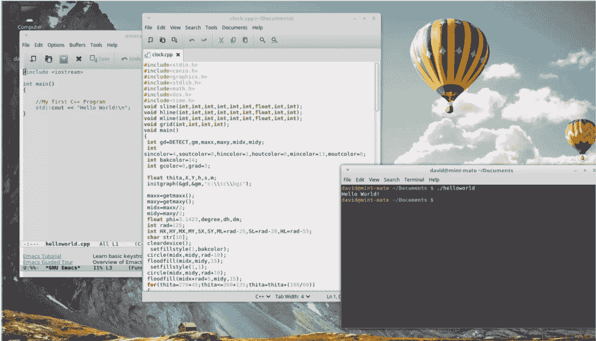
```cpp
#include <iostream>
int main() {
 //My first C++ Program
 std::cout << "Hello World!\n";
 return 0;
}
```
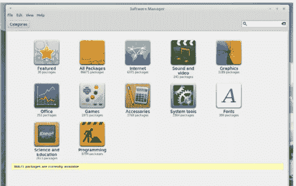 
#### Linux下有数千款面向程序员的免费软件包。
#### 每款发行版都为用户提供独特的功能，但核心都是Linux。
这种可扩展性让Linux成为更具吸引力的使用平台：你可以快速将系统改造为开发环境，集成适用于Python、Web开发、C++、Java等领域的各类集成开发环境（IDE）；也可以将其搭建为线上匿名服务器、Minecraft服务器、媒体中心等，功能多种多样。
那些不愿意使用最新版Windows或macOS的用户，无需丢弃旧电脑，只需安装Linux发行版即可重新利用旧设备。
不过，Linux支持的不仅仅是C++、Python或其他热门编程语言。
使用Linux的命令行（也称为终端），你可以创建Shell脚本：这是一种专为命令行运行设计的程序，由脚本语言编写而成，主要用于自动化任务，或为特定操作提供输入输出功能。
对于想学习编程的人来说，Linux还有一个突出优势：它预装了大部分主流编程环境。
绝大多数可用的Linux发行版都预装了Python和C++，这意味着你只要安装好系统、首次启动后就可以几乎立刻开始编程。
最后，尽管我们还可以列举出更多优势，但目前已经有成千上万的免费程序和应用程序，几乎覆盖了计算机使用的所有领域。
这些程序被称为软件包，截至本文撰写时，仅Linux Mint就拥有超过8700款专门的编程应用，总软件包数量更是达到62000余款，覆盖从业余无线电到万维网工具的各类需求。
总体而言，Linux占用的系统资源远少于Windows或macOS；我们所说的系统资源包括内存、硬盘空间和CPU负载。
Linux的代码经过了精简，没有第三方“臃肿软件”占用系统资源。
更高效的系统自然意味着编码测试环境和你最终开发出的程序可以获得更多可用资源。
更少的资源占用也意味着你可以在普通运行吃力甚至已被淘汰的老旧硬件上使用Linux。
因此，Linux是非常优秀的编程资源和环境。
它非常适合开发者使用，也在不断改进和迭代。
如果你真心想入门编程，或者只是想尝试新事物，不妨试试Linux，看看它是否适合你。
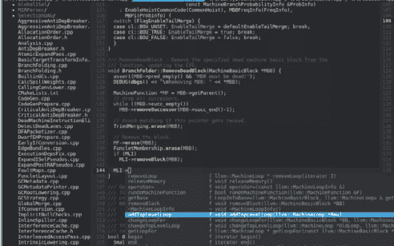 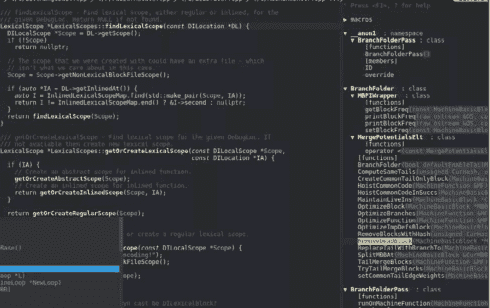

### 最佳Linux发行版
Linux有大量可供使用的版本，被称为发行版。它们各有不同的设计理念和侧重方向。以下将介绍5款值得尝试的优秀发行版及其获取渠道。

#### 《走进Linux》
大多数发行版的安装流程大同小异：你只需从官网下载磁盘镜像，将其刻录到光盘，或制作成U盘安装器即可。注意要选择适配你硬件版本的发行版，并仔细阅读安装说明。

#### Linux Mint
截至当前最受欢迎的Linux发行版（distro为distribution的缩写）就是Linux Mint。Linux Mint于2006年推出，最初是作为当时最流行的发行版Ubuntu的替代方案。尽管它基于Ubuntu的长周期支持版本构建，但Linux Mint走出了一条不同的路线，致力于为用户提供更优质的整体使用体验。Linux Mint每次发布核心操作系统新版本时，都会同步推出3款主要的桌面版本。初次看可能会觉得有些复杂，实则非常简单。目前，Linux Mint以Cinnamon桌面环境作为旗舰版本；同时也提供MATE和Xfce版本供选择。Cinnamon是图形化效果丰富的桌面环境，MATE图形化效果更简洁，在更多桌面系统上运行更稳定，而Xfce是为速度和极致稳定性打造的极致轻量化桌面环境。全书中我们将以Cinnamon版本为例进行演示，但你也随时可以尝试其他桌面环境。事实上，我们建议你花些时间体验不同的桌面环境，甚至不同的发行版，找到最适合你和你的电脑的选项。
www.linuxmint.com

#### Ubuntu
第二受欢迎的发行版是Ubuntu，这个名字源自古非洲语，意为“仁者爱人”。Ubuntu在14年的发展历程中人气起起伏伏，一度它曾是全球使用最广泛的Linux操作系统，但发展过程中一些关于产品呈现的决策失误，以及涉及隐私问题的一些不利、争议性事件，让它不幸跌出了榜首位置。不过好在Ubuntu此后进行了改进，正慢慢重回Linux发行版排行榜的前列。该系统最新版本采用GNOME 3桌面环境，这个环境表现十分出色，但对惯用Windows的用户来说可能会有些陌生，且对系统资源的占用偏高，尤其是你打算在老电脑上安装的话。尽管存在诸多不足，Ubuntu依然是适合新手入门尝试的Linux发行版。它界面简洁，易于使用和安装，能为用户提供完整的Linux使用体验。
www.ubuntu.com

#### Arch
Arch是存在时间最长的Linux发行版之一，也是许多其他Linux版本的基础。既然可以安装Arch，何必选择Mint或Ubuntu呢？不少用户确实会这么做，但它并不适合新手入门。Ubuntu和Mint都提供了更简单的安装路径，还预置了软件包帮助你快速上手。而Arch则是一款更“极简基础”的发行版。Arch坚守自由软件理念，其软件仓库中包含超过5万个可安装应用，涵盖多种不同的桌面环境，你可以像使用其他发行版一样自由使用。Arch适合已经对Linux有一定经验的用户使用。安装时你只会得到命令行界面，接下来需要手动给硬盘分区、设置安装文件的存放路径、创建用户账户、配置操作系统区域设置，最后再安装你需要的桌面环境和应用程序。尽管过程繁琐，但好处是你最终得到的是完全由自己打造的发行版。这意味着你的Arch发行版不会预置其他发行版自带的冗余文件和应用程序，它是为你量身定制的。
www.archlinux.org

#### 树莓派桌面版
你肯定听说过树莓派。这款出色的微型电脑自推出以来，在过去6年时间里风靡整个科技界，想不知道都难。树莓派之所以在计算领域备受追捧，原因有几方面：首先它价格低廉，这样一台功能完备的电脑售价仅约25英镑；其次它体积小巧，尺寸比信用卡大不了多少。你可以利用其可完全编程的接口开发电子设备；它还预装了专属的Raspbian操作系统，该系统基于Debian打造，内置办公套件以及多种编程语言和教育资源。由于树莓派采用ARM处理器供电，Raspbian仅适配树莓派硬件。不过，树莓派基金会随后推出了Raspbian的PC版本——树莓派桌面版。和树莓派版本一样，树莓派桌面版预置了所有你可能需要的编程、教育类及其他应用。它运行快速、稳定性高，表现十分出色。如果你想拓展自己的Linux使用体验，这款发行版绝对是首选之一。
www.raspberrypi.org/downloads/raspberry-pi-desktop

#### openSUSE
大多数Linux发行版可分为两类：一类是像Ubuntu、Mint这样搭载最新功能和技术的发行版，另一类是像Debian这样新功能不多但稳定性极强的发行版。而openSUSE尝试兼顾两者的优势。openSUSE Leap是稳定性极高的版本，由社区和SUSE员工联合公开开发，SUSE是其开发的企业级操作系统，伦敦证券交易所等诸多机构都在使用该系统。它专为“不容许任何不稳定因素”的关键任务环境设计。如果你觉得上述版本太过稳妥，那么openSUSE Tumbleweed滚动更新版会更适合你，它搭载所有最新功能，只是偶尔会出现崩溃问题。openSUSE是广受认可的Linux发行版，不少核心贡献者都参与Linux内核、LibreOffice、Gnome及其他关键Linux领域的开发工作。简言之，openSUSE是众多专业人士的首选。
www.opensuse.org

### 所需设备
在PC上成功安装Linux Mint的系统要求出奇地低，甚至使用了数年的老电脑也能流畅运行该发行版。不过正式开始前，建议你确认是否已准备好所有所需物品。

#### 安装Linux Mint的必备物料
在正式开始阅读本书前，先说明安装和运行Linux Mint所需的所有物品。你有多种选择，不妨多花些时间对比，挑选最适合自己的方案。

#### 系统要求
Linux Mint的最低系统要求如下：
- **CPU** – 700MHz
- **内存** – 512MB
- **硬盘空间** – 9GB（推荐20GB）
- **显示器** – 1024×768分辨率
很显然，你的设备配置越高，使用体验也会越好，运行速度也越快。

#### U盘安装
你可以通过U盘或DVD将Linux Mint安装到电脑中。我们会在后文分别介绍这两种安装方式，但如果你已经熟悉安装流程，或打算使用U盘安装、正在准备所需硬件，那么你至少需要一块4GB容量的U盘来存储Linux Mint的ISO镜像。

#### DVD安装
使用DVD安装Linux Mint仅需一张空白的DVD-R光盘。当然，你还需要一台光驱（DVD刻录光驱）才能将ISO镜像刻录到光盘中。

#### 虚拟机环境
安装到虚拟机环境是测试和使用Linux发行版的常用方法。Linux Mint在虚拟机环境中运行表现极佳，相关内容我们会在后文介绍。目前市面上有很多不同的虚拟机应用，其中由甲骨文开发的VirtualBox是上手难度最低的之一。你可以在**www.virtualbox.org**获取最新版本。

#### 网络连接
不言而喻，网络连接对于确保Linux Mint能获取最新更新、补丁，以及安装额外软件而言至关重要。虽然不连接网络也能使用Linux Mint，但你会错过海量适用于该发行版的免费软件。

#### Mac硬件
虽然Linux Mint可以安装到Mac电脑上，但部分观点建议Mac用户使用如VirtualBox或Parallels之类的虚拟机环境；这也无可厚非，毕竟macOS本身就已经是一款出色的操作系统。如果你想给老款Mac注入新的活力，请确保它搭载的是Intel处理器，而非PowerPC处理器。不过要注意的是，在Mac上安装Linux Mint并不像在PC上安装那样轻松。


### 桌面环境
Linux Mint有多个不同版本，也叫风味版：Cinnamon、MATE和Xfce；这些版本同时提供32位和64位两种架构。不过这些都意味着什么？你应该选择哪个版本来安装呢？
#### 如何选择Mint版本？
桌面环境（Desktop Environment）是你用来和Linux核心系统交互的图形界面。就好比Windows 10的图形桌面也被称为Fluent Design（流畅设计）。Linux Mint为用户提供了多个发行版版本可选：Cinnamon、MATE和Xfce。这对新手来说可能听起来有点困惑，但本质上每个可用版本都包含相同的Linux核心架构和内核——内核是操作系统的核心，负责处理所有软件和硬件之间的指令。那为什么还要做不同的桌面环境呢？简而言之，这只是个人喜好问题。
部分用户更喜欢MATE，因为它是经典GNOME 2环境的分支，更偏向菜单式操作，在老旧电脑上运行表现良好。另一些用户则偏爱Cinnamon，这是一款更现代的环境，在新硬件上运行表现更出色，还搭载了一些前沿的桌面代码。而Xfce则是一款轻量级桌面环境，对系统资源的占用极低，在老旧硬件上运行表现优异。
每个版本本质上都是不同的桌面环境，也就是你用来和操作系统交互的图形用户界面（GUI）。每个桌面环境都使用不同的应用来访问或操作系统，比如通过文件管理器浏览操作系统的文件结构，或是启动其他应用的方式。不过，所有版本预装的核心生产力、视频和图形套件都是相同的，功能也完全一致。
简而言之，Cinnamon是Linux Mint的旗舰桌面环境。MATE的硬件兼容范围更广。比如Windows只提供一种可用的桌面环境，而Linux提供了很多种选择，因此Linux Mint选择为用户提供丰富的选择权。
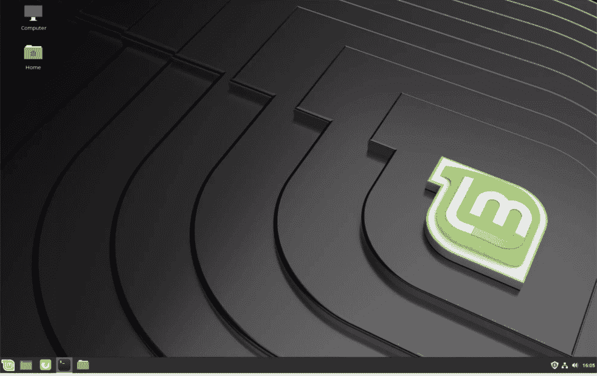
#### 一丁点Cinnamon
除了外观和交互体验，Cinnamon还有很多优势，尽管外观和体验也是重要的考量因素。接下来我们介绍几个特性，帮你判断它是否是你理想的桌面环境（DE）。
##### 特色功能1
它在较新的系统上运行表现优异，而且稳定性比旧版本高很多，也不再是以前那样的资源占用大户了。因此，如果你用旧电脑安装和测试Linux Mint，不要因为Cinnamon就却步。
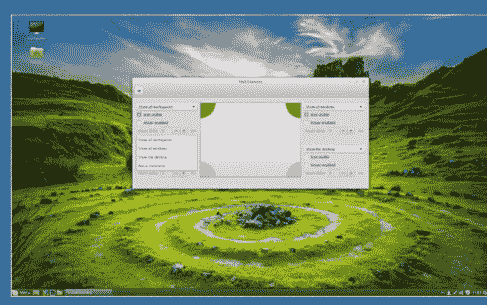
##### 特色功能2
Cinnamon支持可配置的热角功能：点击桌面四个角落即可执行特定任务，比如显示工作区、展示所有窗口或运行命令。热角是切换不同视图的绝佳方式，能让桌面环境变得更高效。
#### 最棒的MATE
MATE是一款简单易用、直观的桌面环境，运行速度快且稳定。和Cinnamon相比，它的外观略显过时，但这只是表面现象，MATE还有很多值得喜爱的地方。
##### 特色功能1
MATE是老旧电脑的绝佳桌面环境选择。它对更多硬件组件的兼容性通常比Cinnamon更好，同时也能提供美观的桌面效果和强大的自定义功能。
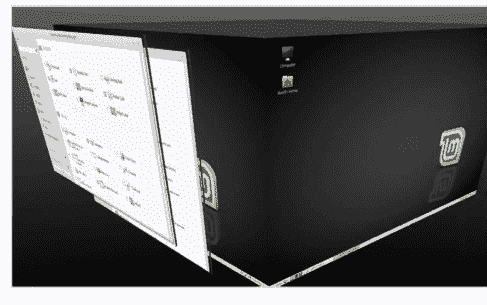
##### 特色功能2
得益于高度可配置的特性，MATE支持细粒度的自定义设置。如果你对桌面环境有更高的要求，也有大量选项可供选择，包括Compiz设置，你可以在其中配置各类桌面特效，甚至还有3D桌面立方体效果。
#### 无胆固醇桌面（Xfce）
Xfce最初是1996年推出的通用桌面环境（CDE）。之后它几经改名，如今简称为Xfce，昵称是“无胆固醇桌面环境”。
##### 特色功能1
Xfce确实是款运行迅速的桌面，能最大程度发挥Linux作为快速操作系统的优势。事实上，从本页顶部写到现在，我们已经把它安装到了新电脑上；这几百字写完，我们已经用上了全新的操作系统，表现相当不错。
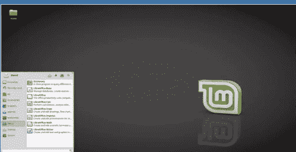
##### 特色功能2
不要因为它运行快、占用资源低，就认为Linux Mint Xfce不是一款完整的桌面操作系统。和其他版本的桌面环境一样，它预装了最新的Firefox、LibreOffice、VLC、Gimp、聊天应用，甚至还有BitTorrent客户端。
# 初识Linux
### 该选哪个发行版？
到目前为止，我们主要介绍的是Linux Mint，但其实还有很多其他Linux发行版值得尝试。事实上，可供下载安装的Linux发行版有上千种，那么你应该选择哪一个来使用呢？
#### 发行版游走
发行版游走是Linux社区用来形容那些从来不安于使用单一发行版的用户的术语。他们会从一个发行版换到另一个，再换回来，依次测试、使用，之后又转到其他或新发布的发行版上。
发行版游走并没有什么不好，这是了解市面上有哪些发行版、发现不同发行版中你感兴趣或不感兴趣的元素的好方法。当然，问题是你最终要长期使用哪一个？
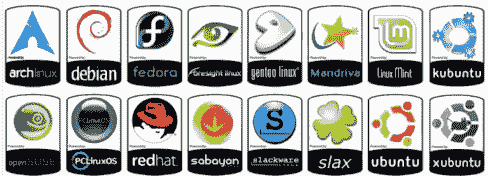
虽然发行版游走是好事，但它并不是享受Linux、充分发挥其优势的稳定方式。我们并不是说你要死守一个发行版，永远不去了解其他的——不然你会错过很多优秀的内容，而是推荐你找到几个合适的，随着Linux技能提升逐步尝试。
比如Linux Mint就是理想的入门选择。它安装和使用都很简单，开箱即用，预装了你日常通常会用到的所有软件，能温和地引导你进入Linux的独特世界，了解它的运行原理和性能表现。Ubuntu能提供几乎相同的使用体验，但实现方式略有不同。Ubuntu预装的软件通常比Linux Mint少，因此你需要自己手动安装所需的软件。
另一个值得考虑的点是，针对Ubuntu用户的内容和帮助页面极多，遇到问题时，你很快就能找到解决方案。
随着你对Linux越来越熟悉，你可以尝试openSUSE、Fedora或Debian这类发行版。这些都是非常优秀的发行版，每个都给用户提供了略微不同的系统运行视角。部分发行版对Linux技能的要求比其他更高，但本质上每个都能给用户带来值得学习的宝贵经验。
你可能会因为某款发行版提供了截然不同于常规的功能而选择它。比如Tails Linux就是一款纯粹为网络匿名设计的发行版，它包含了复杂的军规级加密工具，以及能帮你无痕浏览、不会被检测、追踪或监控的工具和浏览器。Kali Linux是为安全专业人员设计的，预装了多种不同类型的道德黑客工具，用户可以运行这些工具对自有网络进行渗透测试。曾经甚至还有一个《汉娜·蒙塔娜》主题的Linux发行版，不过我们最好还是少提这个。总而言之，总有一款发行版适合你。
奇怪的是，大多数高端技术用户最终还是会回到原点，使用Linux Mint这类发行版。主要原因是它用起来简单，而且运行环境稳定。就算你对系统了如指掌，也不代表你一直想处理潜在的问题。我们大多数人还是喜欢轻松的生活，尤其是在技术方面，因此合理的选择是一款简单、但足够强大、能完成你所有需求的产品，也就是Linux Mint。
不言而喻，当你对Linux的掌握达到了相对较高的水平，也就是达到了高级用户的能力时，你就会想要拓展技能，开始基于Arch、Debian或者其他可用发行版打造自己的Linux发行版。这么做需要大量的命令行知识，以及了解Linux系统如何工作、如何与计算机硬件交互的相关知识。你需要自己给硬盘分区，安装桌面环境，最后安装你需要的应用和程序。这些操作都需要花费时间，而且你需要学习很多相关技能。
不过说到底，这完全是个人选择的问题。你可能会发现，看完本书的教程后，你并不喜欢Linux Mint或者Cinnamon桌面。没关系，你可以更喜欢Ubuntu、Debian或openSUSE：这就是Linux的魅力所在。你可以自由更换你想要的系统，在不同发行版之间随意切换，不会因为需要付费或是无法获取而受到限制。最终你可以称自己为技术型Linux用户，但永远不要自认为是专家，毕竟我们总是在学习新东西。你可以从零开始打造自己的发行版，帮助其他Linux用户解决问题，甚至可以在发行版的测试或开发阶段为它的改进做出贡献。
那么下一步该做什么呢？那个“该选哪个发行版”的问题的答案是：任何你喜欢的都可以！它可以如你所愿般复杂或简单，只要它能实现你需要的功能，那就是最适合你的。

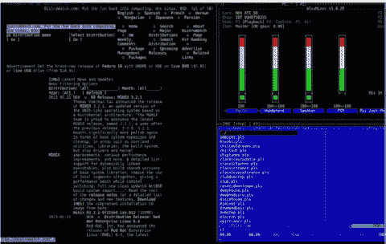
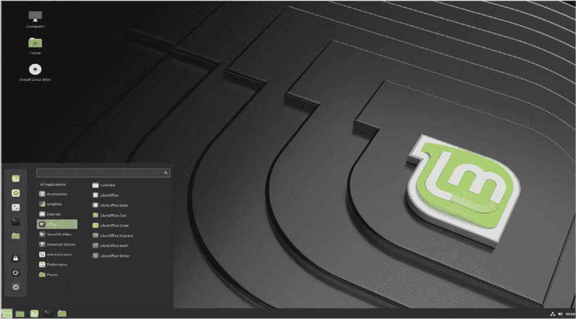
> Which Distro?
> ```
> 2015-02-21 MINIX 3.4.0 RC4 released. MINIX 3 is a rewriting and re-implementation of the well-known UNIX operating system, this OS is based on a microkernel architecture and is mainly used to develop applications on embedded systems. The MINIX 3.4.0 RC4 version includes a lot of improvements, such as the live USB creation tool, GRUB2, glibc, etc.
> ```

> “在真正的开源领域，你有权掌控自己的命运。”
> — 林纳斯·托瓦兹
> （Linux 内核开发者）

## Linux 入门指南
夸赞Linux有多好固然容易，但你怎么才能把它安装到自己的电脑上呢？安装Linux的过程其实非常简单，不过你有多种选择可供尝试。本章将介绍如何下载Linux ISO镜像，如何将其安装到电脑上作为主操作系统，甚至还会讲解如何安装虚拟环境。通过虚拟环境，你可以在继续使用Windows或macOS等主操作系统的同时运行Linux。是不是很感兴趣？那就继续往下读，了解更多内容吧。

### 在Windows上制作Linux安装介质
你需要先把下载好的Linux ISO镜像刻录到DVD或U盘中，之后才能将其安装到电脑上。这将是Live环境，你可以在正式安装前先测试该系统，不过首先你需要制作可启动介质。

#### DVD可启动介质
我们这里用Windows 10电脑来将ISO镜像刻录到DVD，如果你使用的是Windows 7及之后的系统，操作会非常简单。
**步骤1** 首先找到你已经下载好的Linux ISO镜像文件。在Windows 7、8.1和10系统中，它通常都存放在“下载”文件夹里，除非你保存时指定了其他位置。
**步骤2** 接下来将一张可刻录DVD插入电脑的光驱。等待几秒钟，系统读取光盘时，Windows会弹出提示，询问你要如何处理这张新插入的光盘，不用理会这个弹窗，因为我们要用到系统自带的镜像刻录功能。
**步骤3** 右键点击Linux ISO镜像文件，在弹出的菜单中选择“刻录光盘映像”。根据电脑性能不同，可能要等几秒钟才会有反应。不用太担心，除非等待时间超过一分钟，那你可以考虑重启电脑后重试。运气好的话，系统自带的“光盘映像刻录机”应该会自动启动。
**步骤4** 打开“光盘映像刻录机”对话框后，勾选“刻录后校验光盘”选项，然后点击“刻录”按钮。整个过程可能需要几分钟，具体时长取决于你电脑光驱的速度。刻录完成后会进入校验阶段，校验结束后光驱会自动弹出光盘。

#### U盘可启动介质
U盘比DVD速度更快，也更方便，因为大多数现代电脑都没有安装光驱。镜像刻录过程很简单，但你需要先准备一个第三方应用，以及一块容量至少4GB的U盘。
**步骤1** 首先打开浏览器，访问**www.rufus.akeo.ie/**。向下滚动页面一点就能看到“Download（下载）”标题，其下方就是最新版的Rufus。左键点击该链接开始下载。
**步骤2** 双击下载好的Rufus可执行文件，在Windows的安全提示中点击“是”，在弹出的更新检查提示中也点击“是”。Rufus启动后应该会自动识别你已经插入的U盘，如果没有识别到，拔掉U盘再重新插入即可。
**步骤3** 乍一看Rufus的界面可能有点复杂，但别担心，其实非常简单。首先点击“磁盘或ISO映像（请选择）”下拉菜单旁的SELECT按钮，会弹出资源管理器窗口，你可以在其中找到并选择Linux ISO镜像。
**步骤4** 准备好后，点击Rufus应用底部的Start（开始）按钮。可能会弹出另一个对话框，询问你是否要下载并使用新版本的SysLinux。SysLinux是一组启动加载器，用于让现代电脑能够识别并从U盘启动，这是必需的步骤，所以如果弹出提示，点击“是”继续即可。
**步骤5** 下一步会询问你希望以哪种镜像模式将Linux ISO写入U盘。两种模式适用于不同的场景，但通常推荐的ISO映像模式更常用。确保该模式已被预选，点击“确定”继续，再次点击“确定”确认操作。
**步骤6** 现在Linux ISO已经成功写入U盘。这个过程不会太久，同样取决于U盘和电脑的速度。你可能会发现Rufus在运行过程中会自动在资源管理器中打开U盘，不用担心，如果你想的话可以最小化或直接关闭它。过程结束后，点击“关闭”按钮即可。

### 在电脑上安装Linux
大多数Linux发行版都自带Live环境。这意味着你可以直接通过刚刚制作好的DVD或U盘启动，进入一个功能完备的、可实际运行的发行版系统。接下来我们就来看看它是如何运作的，以及如何从该环境安装Linux。

#### UEFI BIOS设置
统一可扩展固件接口（UEFI）用于在电脑启动过程中识别硬件、保护系统，它已经取代了传统BIOS，但在安装Linux时可能会引发一些问题。
**步骤1** 将DVD或U盘插入电脑，如果你还没关机，现在先关闭Windows。本文我们用的是U盘启动介质，但操作流程几乎是一样的。启动电脑，当出现提示时按下对应的按键进入BIOS或SETUP界面，常见按键有F2、Del甚至F12。
**步骤2** UEFI BIOS有不同的版本，不可能全部覆盖讲解。你要找的是标有“启动顺序”或“启动模式”的设置部分。在这里你可以选择关闭UEFI，转而选择Legacy（传统）模式，或者关闭安全启动（Secure Booting）。大多数发行版都支持UEFI，但要在UEFI下实现启动可能会比较麻烦。
**步骤3** 将UEFI切换为Legacy模式后，有两种方式可以启动Live环境。第一种是通过你已经打开的BIOS界面。找到启动顺序设置，将第一启动项从默认设置（通常是内置硬盘或其他类似选项）改为：使用U盘介质就选“U盘存储设备”，使用DVD介质就选“光驱”。
**步骤4** 另一种方式是使用启动选项菜单。通过这个选项，你可以按下F12（或其他类似按键）调出启动介质列表，从中选择对应的启动介质即可。两种方式选完后，你都可以通过导航到“保存并退出”选项，选择“保存更改并退出”来保存设置并退出BIOS。

#### 安装Linux
Live环境启动完成后，你就会看到将发行版安装到电脑的选项。可以四处浏览一下，准备好后就在桌面上找到“安装”选项。
**步骤1** 确保你已经连接到互联网（如果还没连接，现在就接上），并且处于Live环境中，双击桌面上的“安装Linux Mint”图标即可开始安装流程。其他发行版当然会显示自己的名称，但操作流程是一样的。准备好后点击“继续”。
**步骤2** 尽管大多数Linux发行版的安装流程非常相似，但部分发行版在安装过程中会有不同的提问。通常这些问题都不会太难，没有什么技术难度，但像“安装第三方软件……”这类选项可能会让人困惑。这种情况下你可以点击“继续”，如果你不确定，可以准备一台连接了网络的设备来查询相关问题。
**步骤3** 安装新操作系统时，建议你清除旧的操作系统，用新系统替换它。进行到安装流程的这一步时，确保已经选中“擦除磁盘并安装Linux……”选项。
**注意：** 这会彻底清除你电脑上的Windows 10系统，所以请确保你已经备份了所有个人文件和资料。
**步骤4** 安装流程开始前，系统会询问你确认此前选择的硬盘擦除选项是否正确。这是你最后反悔的机会。如果你确定不介意清除所有数据、想要重装为Linux Mint系统，就点击“继续”。如果你需要备份文件，请取出Linux光盘/U盘，重启电脑，备份完成后重新开始安装流程。
**步骤5** 接下来系统会要求你设置Linux的用户名和密码。首先输入你的“名称”，然后输入“计算机名称”，这是在网络中识别该电脑的名称。之后选择一个用户名，再设置一个安全的密码。你可以勾选“自动登录”选项，但暂时不要勾选“加密主文件夹”选项。
**步骤6** 安装流程可能很快，期间可能还会有其他问题需要回答，也可能直接根据你之前的回答开始安装Linux。不管怎样，最后你都会看到“继续测试Live环境”或“重启以使用新安装的系统”的选项。如果你已经准备好使用Linux，就点击“立即重启”。


### 安装虚拟环境
虚拟环境是模拟的计算机系统。使用虚拟机，你可以模拟一台标准个人电脑，在上面安装完整的操作系统，且不会影响你电脑上已安装的操作系统。这是在保留Windows 10作为主操作系统的同时，测试和使用Linux的绝佳方式。
#### 虚拟机使用注意事项
使用虚拟机（VM）会占用你电脑的资源：内存、硬盘空间、处理器占用率等，请在开始操作前确保各项资源充足。
**步骤1**
本教程使用VirtualBox进行演示，它是最容易上手的虚拟环境之一。请访问www.virtualbox.org，点击“下载VirtualBox”，即可进入主下载页面。找到适配你系统的宿主系统版本：Windows或Mac（宿主系统指当前电脑已安装的操作系统），点击对应链接即可开始下载。
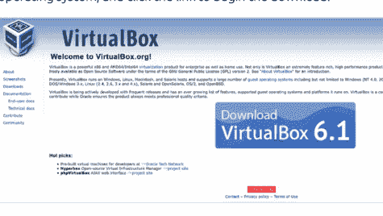
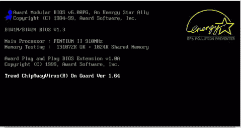
**步骤2**
接下来，仍停留在VirtualBox下载页面，找到VirtualBox扩展包的链接。该扩展包支持USB设备及多项其他附加功能，能让虚拟机环境更接近真实电脑的模拟效果。
**步骤3**
在下载好对应安装包、尚未进行任何安装操作前，你需要确认当前使用的电脑支持运行虚拟机。具体操作为：重启电脑并进入BIOS，在电脑启动过程中，按下Del、F2或其他进入设置界面的对应按键即可。
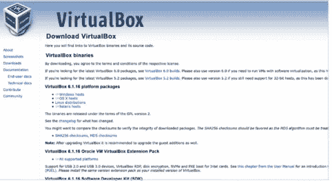
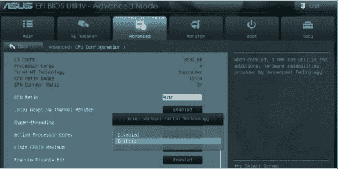
**步骤4**
不同品牌电脑的BIOS界面布局各不相同，很难给出普适的查找路径。但通用原则是：你需要在BIOS的「高级（Advanced）」选项中查找「英特尔虚拟化技术（Intel Virtualisation Technology）」，或简称为「虚拟化（Virtualisation）」选项。找到后启用该选项，保存设置，退出BIOS并重启电脑。


**步骤5**
电脑重启完成后，找到已下载的VirtualBox主程序，双击启动安装流程，准备就绪后点击“下一步（Next）”继续。
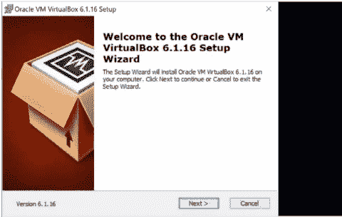
**步骤6**
VirtualBox的默认安装位置可满足绝大多数用户的需求，若有特殊路径需求，可点击“浏览（Browse）”按钮修改安装文件夹。之后请确保VirtualBox功能列表中的所有图标均被选中（即图标旁没有红色叉号），点击“下一步（Next）”进入下一流程。
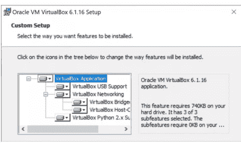
**步骤7**
如果无特殊需求，此部分可保持默认设置，该设置能让后续虚拟机（尤其是未来你可能用到的下载好的虚拟机）的操作更便捷。再次点击“下一步（Next）”进入下一阶段。
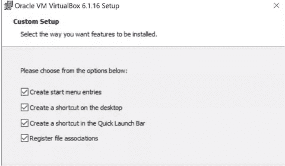
**步骤8**
安装VirtualBox过程中，网络连接会短暂中断，这是因为VirtualBox会创建关联的虚拟网络连接，让后续安装的虚拟机能够通过电脑已建立的网络连接访问互联网及局域网资源。点击“是（Yes）”，再点击“安装（Install）”开始安装。
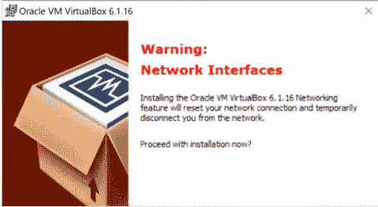
**步骤9**
Windows系统可能会弹出安全提示，请你确认信任，点击“是（Yes）”即可；之后你可能还会看到询问是否信任Oracle安装来源的弹窗，同样点击“是”并确认安装VirtualBox程序。安装完成后点击“完成（finish）”启动VirtualBox。
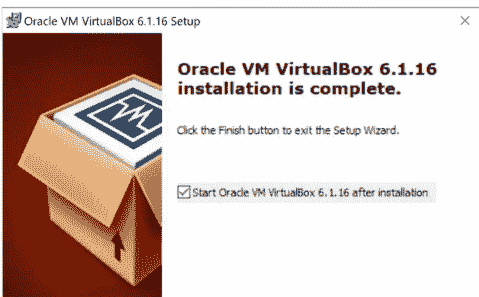
**步骤10**
VirtualBox启动后，即可安装VirtualBox扩展包。找到已下载的扩展包文件并双击，VirtualBox会短暂分析该文件，随后会出现安装提示，点击“安装（Install）”开始安装，在下一界面中向下滑动接受协议，点击“我同意（I Agree）”即可。
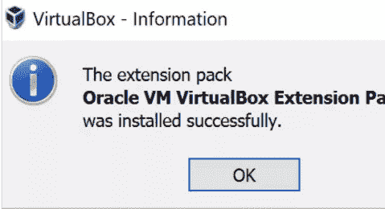

### 在虚拟环境中安装Linux
Oracle VirtualBox已成功启动，接下来需要创建用于安装Linux的虚拟机（VM）环境。该操作不会影响当前电脑已安装的操作系统，这也是选择虚拟机的重要原因。
#### 创建虚拟机
创建虚拟机时有很多可选参数，本次教程将配置一个可流畅运行优秀Linux发行版Linux Mint的虚拟机。
**步骤1**
打开VirtualBox后，点击应用右侧面板顶部的“新建（New）”图标，即可打开新建虚拟机向导。
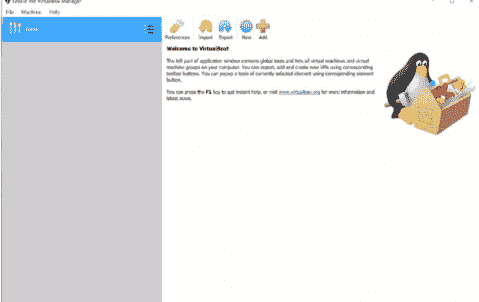
**步骤2**
在名称输入框中输入“Linux Mint”，VirtualBox会自动将类型选为“Linux”，版本选为“Ubuntu (64-bit)”；若未自动匹配，可通过下拉菜单选择正确配置（注意：主流Linux Mint版本基于Ubuntu开发）。准备就绪后点击“下一步（Next）”继续。
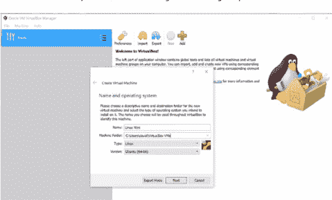
**步骤3**
下一步将设置虚拟机分配的系统内存（RAM）大小，请注意该数值会从电脑现有可用内存中扣除，因此不要分配给虚拟机过多内存。例如本机安装有8GB内存，本次仅分配2GB（2048MB）给虚拟机。设置完成后点击“下一步（Next）”继续。
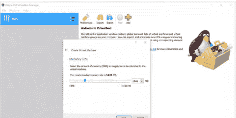
**步骤4**
这一步将开始创建虚拟机用于安装Linux Mint的虚拟硬盘，我们使用默认的「立即创建虚拟硬盘（Create a virtual hard disk now）」选项，点击「创建（Create）」进入下一步。
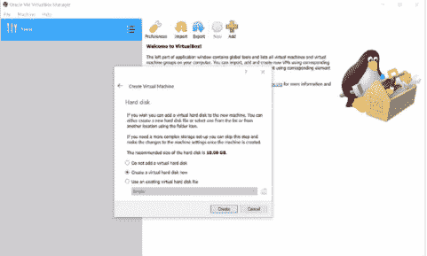
**步骤5**
点击“创建”后弹出的窗口会询问你需创建的虚拟硬盘类型，本次使用默认的VDI（VirtualBox Disk Image，VirtualBox磁盘镜像）格式，其他格式多用于在不同虚拟机软件间迁移虚拟机。请确认已选中VDI选项，点击「下一步（Next）」继续。
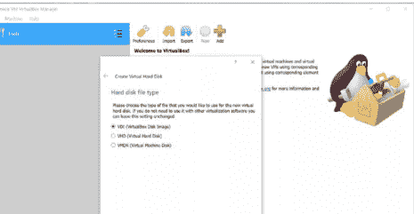
**步骤6**
「动态分配」与「固定大小」虚拟硬盘的选择对新手可能稍显困惑，本质上动态分配的虚拟硬盘是更灵活的存储管理选项，且初始时不会占用物理硬盘过多空间。请确认选中「动态分配（Dynamically Allocated）」选项，点击「下一步（Next）」继续。
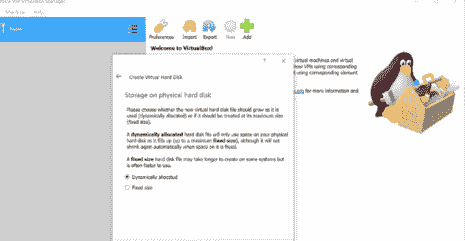
**步骤7**
虚拟硬盘会被存储为单个文件夹，最大容量为你在此处设置的数值，请确保电脑上存储该虚拟硬盘的位置有足够的可用空间。例如我们将虚拟硬盘存在D盘的大容量存储分区中，命名为“Linux Mint”，分配了25.50GB的空间。
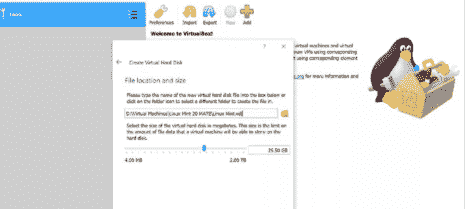
**步骤8**
点击“创建”后，虚拟机的初步设置就完成了，此时你会在VirtualBox中看到新创建的虚拟机。开始使用前，请点击右侧面板顶部的「设置（Settings）」按钮，在「常规（General）」分类下点击「高级（Advanced）」选项卡，通过下拉菜单将「共享剪贴板（Shared Clipboard）」和「拖放（Drag'n'Drop）」均设置为「双向（Bidirectional）」。
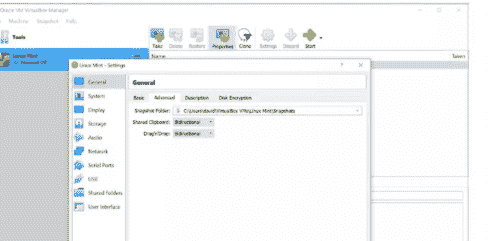
**步骤9**
之后点击「系统（System）」分类，进入「处理器（Processor）」选项卡，根据你的CPU性能分配核心数，注意不要影响宿主系统的正常运行，本次我们分配了2个核心。接着点击「显示（Display）」分类，将显存滑块拖到最大值，勾选「启用3D加速（Enable 3D Acceleration）」，点击「确定（OK）」保存新设置。
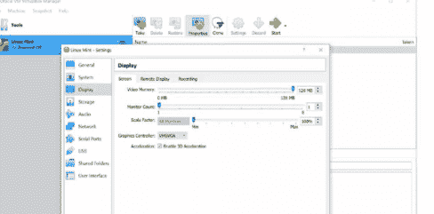
**步骤10**
点击「启动（Start）」按钮，在「选择启动盘（Select Start-up Disk）」窗口中点击资源管理器按钮（即带绿色箭头的文件夹图标）；在新弹出的窗口中点击「添加（Add）」，找到已下载的Linux Mint ISO镜像文件并点击「打开（Open）」选中该镜像。再次点击「启动（Start）」按钮，即可用Linux Mint Live环境启动虚拟机，现在你可以按照标准PC的安装流程安装Linux系统了。
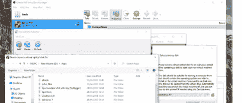

「任何人都能造出快速的处理器，关键在于打造快速的系统。」——西摩·克雷（电气工程师，克雷超级计算机的设计者/创始人）


## 了解Linux
本文以Linux Mint为参考示例，因为它是一款易于使用的发行版，非常适合前Windows用户。它也是发展最成熟、文档最完善的Linux发行版之一，还拥有出色的配置选项。本节将介绍Linux Mint的Cinnamon菜单与桌面环境，包括其运行逻辑以及自定义操作方法。想要创建新用户，或是了解如何实现线上匿名？请继续阅读。

#### Cinnamon菜单简介
现在你已经安装好了Linux，是时候好好熟悉一下系统了。首先，如果你使用的是VirtualBox，可能会收到关于软件渲染的通知，下面介绍解决方法。
#### CINNAMON版VirtualBox修复
- **步骤 1**
操作前请确认你遇到的是VirtualBox内的该问题。软件渲染通知会显示在桌面右上角，修复方法为：点击VirtualBox窗口中的「设备」选项，再选择「安装增强功能CD镜像」。
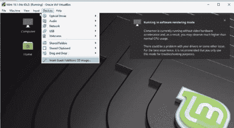
- **步骤 2**
增强功能CD内包含VirtualBox的驱动程序，其中还有虚拟显卡驱动。加载完成后，会弹出「软件需要运行」的通知框，提供「取消」和「运行」两个选项，点击「运行」按钮并输入你的Linux用户密码即可。
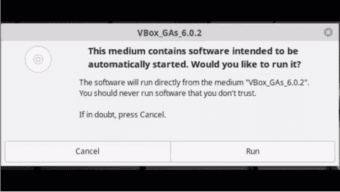
- **步骤 3**
片刻后系统会自动跳转到命令行界面，Linux中称之为终端。该界面会显示新VirtualBox驱动的安装流程，包括卸载检测到的旧驱动、安装最新版本驱动。整个过程耗时很短，完成后会提示你按下回车键退出终端。
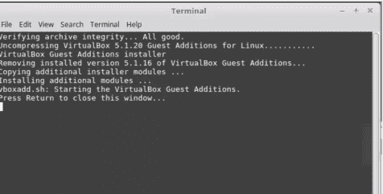
- **步骤 4**
桌面上会出现VirtualBox增强功能CD的图标，右键点击该图标，在弹出的菜单中向下滚动找到「弹出」选项并点击。之后点击左侧任务栏最下方的菜单按钮，选择「重启」即可重启Linux Mint，重启后问题即得到解决。
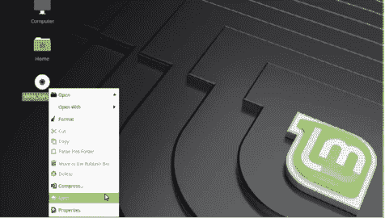
##### Cinnamon菜单操作
VirtualBox用户的软件渲染问题已经解决，接下来我们来看看Mint菜单的具体用法。请注意，以下内容仅适用于Mint Cinnamon版本，其他发行版的菜单外观和操作逻辑有所不同。
##### 步骤 1
首先，你可能已经注意到了登录Linux Mint时弹出的欢迎界面。你可以花一点时间浏览其中的选项，阅读「新手入门」等内容，完成后点击窗口右上角的「X」按钮关闭即可。
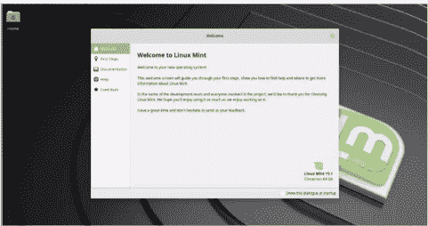
##### 步骤 2
之前我们已经用Mint菜单重启过系统，初次使用实时环境时也接触过它。这次请点击菜单按钮，将鼠标悬停在中间列的「办公」选项上，此时右侧列的图标会随之切换，展示该分类下安装的所有应用。

##### 步骤 3
从菜单启动应用非常简单，找到对应应用点击即可。例如，在「办公」分类下点击LibreOffice Writer，它是Linux Mint预装的字处理软件，可打开和保存为Microsoft Word格式，操作逻辑也几乎一致。
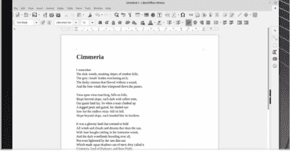
##### 步骤 4
再次打开菜单，将鼠标指针悬停在「图形」选项上，然后点击「GNU图像处理程序」。GIMP是一款功能强大的图像处理应用，处理效果不逊于Adobe Photoshop，只是需要多花些精力才能得到你想要的效果，但花时间掌握它绝对是值得的。

##### 步骤 5
如果你需要查找特定功能或应用（比如设置打印机），可以点击菜单顶部的搜索框，输入你想要的应用或功能名称（比如「打印机」），Mint菜单就会在下方展示相关选项。该功能适用于绝大多数现代Linux发行版的菜单。
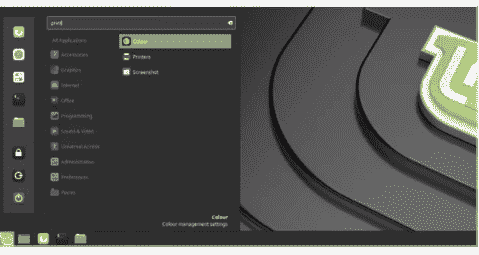
##### 步骤 6
将鼠标悬停在右侧列的任意应用上并右键点击，会弹出选项列表：添加到面板、添加到桌面、添加到收藏夹、卸载。大部分选项的用途一目了然，其中「添加到收藏夹」会将应用放入左侧的快速访问列中。
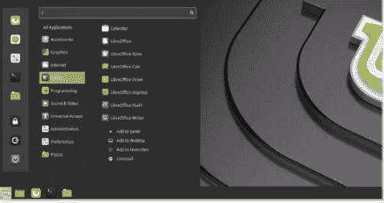
## 操作Cinnamon桌面
### 桌面亮点
Cinnamon桌面环境是风格与性能的完美结合，诸多优点让它成为非常受欢迎的桌面环境（DE）。
##### 步骤 1
双击桌面上的「计算机」图标即可开始探索Cinnamon桌面，这会打开Cinnamon使用的文件管理器Nemo。「计算机」图标对应根级文件系统，可访问和查看光驱（若已安装）、硬盘以及Linux核心文件系统。
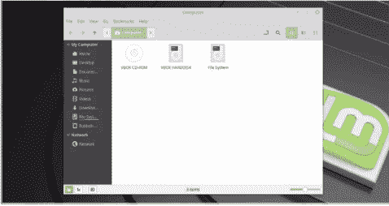
##### 步骤 2
Linux文件系统对前Windows用户来说可能较难理解，因此在你熟悉其运作逻辑之前，我们建议你优先使用桌面上的「主文件夹」图标。该文件夹内存储了与你用户账户相关的所有内容：图片、视频、音乐、文档、下载项等。
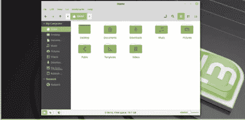
##### 步骤 3
Nemo提供了丰富的功能、视图和操作方式，方便你查看和管理文件与文件夹。例如，如果「图片」文件夹内有图片，可以通过Nemo右下角标注为「调整缩放级别」的滑块来调整图标的显示大小。
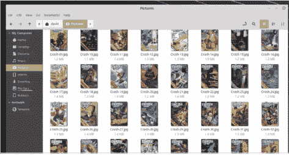
##### 步骤 4
和所有优秀的文件管理器一样，在Nemo内右键点击任意文件或文件夹，都会弹出丰富的操作选项。在Cinnamon中，默认选项支持根据文件类型播放或查看文件，以及复制、剪切、删除、压缩、重命名、通过邮件发送、查看属性等操作。
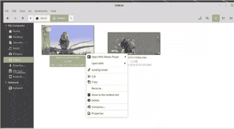
##### 步骤 5
桌面底部是任务栏，之前我们已经介绍过任务栏的一部分——菜单。右键点击任务栏上的任意非应用图标区域，会弹出菜单，支持你以不同方式编辑、添加和设置任务栏。
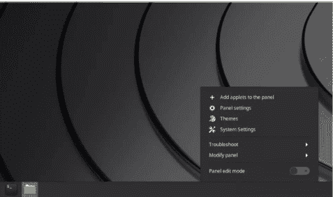
##### 步骤 6
例如，点击「修改任务栏」选项，你可以移除、移动现有任务栏，添加新任务栏，或者清除任务栏上现有的所有小程序。补充说明：小程序是指专为适配Cinnamon任务栏设计的小型应用。
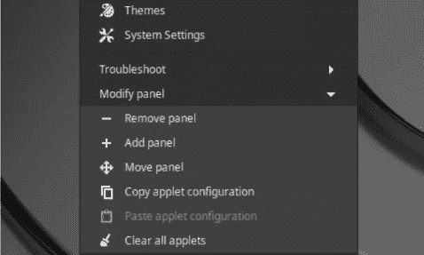
##### 步骤 7
右键点击Cinnamon桌面的任意空白区域，会弹出选项列表，支持你进一步添加、编辑或以不同方式查看桌面内容。该逻辑与Windows非常相似，这也是Mint适合前Windows用户的重要原因。
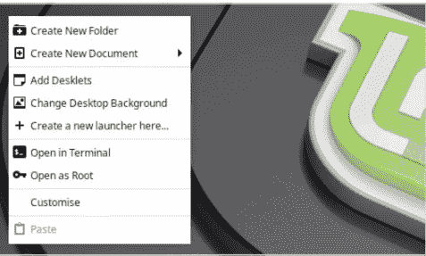
##### 步骤 8
在弹出的桌面右键菜单中，选择「自定义」，再点击新打开窗口底部的「桌面设置」链接。这会打开一个新窗口，你可以在其中编辑桌面显示的图标。如果你使用的是多显示器配置，还可以选择每个显示器要显示的图标。
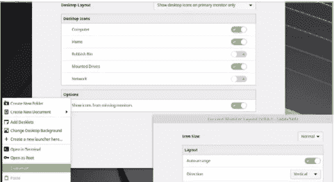
##### 步骤 9
点击菜单，输入「系统设置」并打开对应的图标，即可进入系统设置选项页面。在这里你可以控制和修改Linux Mint Cinnamon的外观与运行逻辑，还可以添加新用户、管理防火墙、开启辅助功能选项。
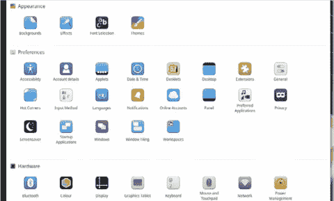
##### 步骤 10
总而言之，Linux Mint Cinnamon的外观可以配置得十分出色，网上有许多案例展示了它的可定制空间和最终效果。你可以根据自己的需求选择复杂或简约的风格，添加不同的组件和动画，也可以保持朴素易读的样式。
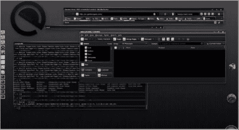


## **安装Linux Mint后要做的10件事**

### Linux系统调整
其中一些安装后操作非常推荐，其他的则是实用的补充项，仅用于调整系统或增加个性化设置。
- **步骤1**
第一项，同时也是最重要的一项安装后操作是更新系统。点击面板上的盾牌图标，它位于桌面右下角、时间和日期旁边。点击后会启动更新管理器。
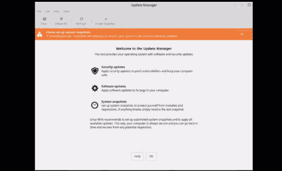
- **步骤2**
Linux Mint为用户提供了三档更新策略：别搞崩我的电脑、优化稳定性和安全性、以及全部更新。推荐选择中间档的「优化稳定性和安全性」，该选项仅更新不会影响核心操作系统关键组件的安全、必要补丁。你可以先浏览各档位的说明，选择中间档的推荐选项即可。

- **步骤3**
点击OK按钮后，你会看到有几项更新准备就绪。但在更新之前，先点击蓝色栏的OK按钮切换到本地镜像源，这会打开软件源选项。在镜像源板块中，点击「Main」和「Base」的下拉菜单，选择距离你当前位置最近的服务器。

- **步骤4**
点击「更新缓存」按钮后关闭软件源窗口。回到更新管理器界面，点击安装更新图标并输入你的密码。更新会自动应用，随后会重新启动更新管理器，此时会有更多可更新的内容。再次点击安装更新，确认所有提示框，等待更新完成即可。

- **步骤5**
更新会按风险等级划分，1级为低风险更新，5级为高风险更新。我们的建议是仅安装3级及以下的更新；如果出现覆盖配置文件的提示，选择替换即可。如果遇到软件渲染问题，或是非VirtualBox用户缺少驱动的话，点击菜单，在搜索框中输入「driver」。

- **步骤6**
点击搜索结果中出现的「驱动程序管理器」应用并输入密码。Linux Mint会花一点时间分析可用的驱动，然后根据检测到的硬件为你推荐可用的驱动列表。如果遇到图形问题（比如软件渲染问题），建议选择最新的推荐显卡驱动。

- **步骤7**
到这一步你大概率需要重启Linux Mint，现在就可以执行重启操作。重启后再次点击菜单按钮，然后打开终端。终端图标位于左侧栏，文件图标的上方。打开终端后输入：`sudo apt-get install libdvd-pkg`，按回车并输入你的密码，即可开启加密DVD播放功能。

- **步骤8**
当提示你确认更改时输入Y，提示配置libdvd时同样输入Y。确保OK选项处于选中状态后按回车，后续所有提示都选择Yes即可。接下来仍在终端中输入：`cat /proc/sys/vm/swappiness`，返回值应该是60。如果你的电脑内存不足4GB，则输入：`gksudo xed /etc/sysctl.conf`。

- **步骤9**
这项调整可以提升内存不足4GB的系统的运行速度。滚动到刚刚打开的文件的末尾，添加以下新行：
```
#### Decrease swap usage to a more reasonable level
vm.swappiness=10
```
点击**文件 > 保存**，再点击**文件 > 退出**。重启Linux Mint后你会发现运行速度有轻微提升。

- **步骤10**
在如今的数字时代，安全始终是需要关注的问题。虽然Linux Mint本身就是一款安全的系统，但我们仍建议你尽量提升其安全性。点击菜单按钮，搜索防火墙；点击防火墙配置图标并输入密码。在防火墙窗口中，将状态滑块拨动到开启。


#### 阿波罗11号

你知道吗……
1969年7月20日是人类历史的转折点，这一天人类首次踏上了月球。帮助宇航员完成这次关键航行的软件在当时尚未问世，完全是从零开始开发的。麻省理工学院仪器实验室的工程师们使用了一种名为「绳内存」的全新程序存储方式，将特殊版本的汇编语言写入其中。令人惊叹的是，这段代码已经在GitHub上公开可以查看。它由一位研究员于2003年上传，你可以通过访问www.github.com/chrisgarry/Apollo-11/ 来查看代码。你可以留意一些有趣的代码片段，比如Burn_Baby_Burn，尤其是第925行的注释「再见，下次再来」。你可以随意浏览，看看还能发现什么有意思的内容。
> 程序员也很有幽默感。你可以看看里面还有什么有意思的内容。

#### 人类的一大步，也是编码的一大步

> > 来源：阿波罗11号/NASA

## 创建用户
初次安装Linux Mint时，系统默认仅配置1个用户。全家共用一个用户账户虽然没什么问题，但总会有需要创建独立用户、为每个人配备专属主文件夹的时候。
#### 新用户
拥有不同用户意味着每个用户都可以使用系统中的个人专属区域。文档、图片、视频等内容都会相互独立，和其他操作系统中的多用户功能一致。
- **步骤1**
点击Linux Mint菜单，输入「users」来搜索相关控制台。在搜索结果中选择「用户和组」，输入你的密码。用户和组控制台界面非常简洁，而且使用起来很便捷。刚打开时你只能看到你自己安装Linux Mint时创建的用户名。

- **步骤2**
要添加新用户，点击控制台底部的「添加」按钮。你可以创建两种类型的用户：标准用户和管理员。如果新用户不需要安装新应用，也不需要访问主文件夹以外的文件系统区域，那么选择标准用户类型即可，其余情况选择管理员类型。

- **步骤3**
依次输入新用户的「全名」，以及该用户登录Linux Mint时需要的用户名。注意用户名需要全部为小写，仅可包含a-z和0-9的字符，你也可以选择使用句点、下划线或连字符。准备好后点击添加按钮即可。

- **步骤4**
新用户会按字母顺序出现在当前Linux Mint用户列表中。此时还未为该用户设置密码，因此点击当前用户列表中的该用户，再点击用户名下方的「未设置密码」选项。

- **步骤5**
现在你可以为新用户输入密码，也可以点击新密码输入框末尾的卷曲箭头，自动生成密码并显示密码内容。当然，建议你设置尽可能复杂的密码。设置完成后点击「更改」按钮。

- **步骤6**
新用户已经创建完成，现在可以关闭用户和组控制台窗口了。如果你点击Mint菜单，再选择注销，就会进入Mint登录管理器。新用户已经出现在当前可用用户列表中，点击对应用户即可完成登录。

- **步骤7**
新用户首次登录后需要自行设置桌面壁纸、图标、面板、菜单等内容。根据你为该用户设置的用户类型（标准用户/管理员），该用户可能无法安装新的应用程序。这张截图来自标准用户账户。

- **步骤8**
你可以根据需要创建任意数量的新账户，还可以在需要时切换账户。我们建议仅保留一个可以安装新软件的账户，这样你就能清楚掌握系统中安装的所有程序。


### 命令行创建账户
顾名思义，你也可以通过命令行创建新用户。在主导（你的）管理员账户下打开终端会话。
- **步骤1**
通过命令行添加新用户的过程非常简单。首先输入：`sudo adduser <username>`，其中`<username>`为新用户的登录名。之后系统会要求你为该用户设置密码，同时填写全名和其他相关信息。输入y确认信息即可完成用户账户的创建。

- **步骤2**
你可以在用户和组控制台中查看新用户的详细信息和账户类型。如果你想删除Linux Mint中的用户，可以在终端中输入：`sudo deluser <username>`，也可以在用户和组控制台中点击删除按钮。


## 自定义桌面
自定义操作系统桌面是让系统贴合个人使用的方式之一：打造个性化的工作区，既可以帮助你工作、给你带来灵感，也可以展示公司标志。无论你出于什么原因想要专属桌面，以下是操作方法：
- **STEP 1** 桌面自定义的第一步是更换壁纸。右键点击桌面，选择「更改桌面背景」。这会打开 Linux Mint 中的背景设置应用；请注意，其他发行版展示背景、壁纸选择工具的方式可能有所不同。

- **STEP 2** 较新版本的 Linux Mint 会展示对应系统版本的可用背景。通常你会看到三个分类，之后还有一个与其他分类分隔开的「图片」分类。「图片」选项比较特殊，它会读取你主目录下「图片」文件夹中的图片内容。

- **STEP 3** 你只需要点击上述任意位置提供的可用图片，就能将其设置为桌面壁纸。顺便一提，如果你的图片存储在系统或网络的其他位置，可以点击背景设置控制台底部的加号按钮，通过文件管理器找到这些图片来添加。

- **STEP 4** 你也可以点击「设置」标签页，切换为播放多张图片的幻灯片模式，或是将壁纸的外观切换为多种不同的样式。

- **STEP 5** 如果现有壁纸都不合你意，可以打开浏览器搜索你偏好的背景图片类型。找到心仪的图片后，右键点击它，在选项列表中选择「设为桌面背景」。打开「设置桌面背景」控制台后，点击「设置桌面背景」按钮。

- **STEP 6** 点击菜单按钮，搜索「desktop」，点击搜索结果中的「桌面设置」。桌面控制台允许你选择布局、桌面图标和多显示器支持的相关配置。你可以根据个人喜好尝试不同选项，找到最适合的配置。

- **STEP 7** 除了更换桌面壁纸和图标显示方式，你还可以修改 Linux Mint 的整体主题。从 Mint 菜单中搜索「themes」，在搜索结果中点击「主题」应用。

- **STEP 8** 主题可以让你更改 Mint 桌面部分组件的外观：窗口边框、图标、控件、鼠标指针和桌面。在「设置」标签页中，你还可以通过几个开关滑块按钮扩展配置选项。

- **STEP 9** 如果你点击三个可用选项中间的「添加/删除」按钮，就可以从多个预装主题中选择默认主题风格。点击你喜欢的主题，再点击「安装」（向下箭头）按钮启用它。

- **STEP 10** 再点击「主题」，然后选择「桌面」，就能找到新安装的主题并应用到你的桌面。所有已安装的主题都可以通过「添加/删除」按钮卸载。花点时间按照你的喜好个性化桌面是值得的，而且还有非常多惊艳的主题可供选择。


## 在线匿名
数字时代给通信领域带来了许多重大进步；但同时也开启了新的间谍和监视时代。我们大多数人都对关于政府、秘密组织和地下黑客侵犯我们隐私的频繁新闻报道见怪不怪，但你能如何对抗这种情况呢？
### 在 Mint 中实现匿名
虽然完全实现在线匿名几乎是不可能的，但你可以采取措施最大程度保障自己的隐私。
- **STEP 1** 从基础做起，浏览时使用 HTTPS 而非普通 HTTP。这意味着通过 HTTPS 传输的所有内容都是安全的（因此结尾有 S）且经过加密。

- **STEP 2** 浏览时可以考虑使用浏览器提供的无痕或隐私浏览模式。该模式会禁用网页历史和网页缓存，让你浏览的细节不会被存储，避免后续被他人审查。不过，它无法阻止数据或搜索追踪。

- **STEP 3** 虽然使用谷歌似乎是现代网络搜索的显而易见的选择，但该公司会追踪个人的所有搜索记录。不妨考虑使用其他搜索引擎，比如 DuckDuckGo，它不会存储个人数据，也不会追踪你。

- **STEP 4** 如果你经常上网，可以考虑安装一些提升隐私的浏览器插件。例如，在 Firefox 中可以使用 Ghostery、NoScript 和 Adblock Plus 来拦截追踪器、广告和其他数据挖掘行为。


### VPN 和 Tor
前文介绍的措施可以帮你保护在线隐私，但若要真正实现匿名，你需要使用虚拟专用网络（VPN）和 Tor。
- **STEP 1** VPN 是一台远程服务器或服务器集群，会与你的电脑建立连接。最终效果是你的电脑在互联网上的身份被隐藏在 VPN 远程服务器之后；也就是说，你可以身处英国，却拥有属于冰岛的 IP 地址（即电脑的网络身份）。
### VPN 工作原理！

- **STEP 2** 大部分优质 VPN 会收取月费或年费，但这是值得的。我们使用的是 CyberGhost，网址 www.cyberghostvpn.com，它提供适用于 Windows、Mac、Mint（以及其他 Linux 发行版）、安卓和 iOS 设备的 VPN 连接。各个操作系统的相关说明可以在 www.support.cyberghostvpn.com/hc/en-us/articles/213190329-Read-me-first- 找到。

- **STEP 3** 另一个选择是使用 Tor。Tor 是一个开放网络，加入后你的 IP 地址会被全球无数节点隐藏。它支持 Windows、Mac 和 Linux 电脑，安装和使用都非常简单。首先访问 www.torproject.org/download/download-easy.html.en，点击「下载 Linux 64 位」按钮。

- **STEP 4** 下载完成后，打开终端并进入下载文件夹，输入 `cd Downloads/`。输入 `ls` 检查 tar.xz 格式的 Tor 压缩包是否存在，然后输入：
```tar -xf tor-browser-linux64-8.0.4_en-US.tar.xz```
（Tor 会定期更新，如果你的版本不同，按下 Tab 键可自动补全 tor-browser- 开头的文件名）。文件解压完成后，输入 `cd tor-browser_en-US/` 进入新文件夹。
```david@david-Mint:~/Downloads/tor-browser_en-US$ tar -xf tor-browser-linux64-8.0.4_en-US.tar.xz
david@david-Mint:~/Downloads/tor-browser_en-US$ ls
tor-browser_en-US
tor-browser-linux64-8.0.4_en-US.tar.xz
david@david-Mint:~/Downloads/tor-browser_en-US$ tar -xf tor-browser-linux64-8.0.4_en-US.tar.xz
Browser
start-tor-browser.desktop
david@david-Mint:~/Downloads/tor-browser_en-US$ ls```
- **STEP 5** 输入 `ls` 可以看到两个条目：一个名为 Browser 的文件夹和一个名为 `start-tor-browser.desktop` 的文件。要启动 Tor 设置，输入 `./start-tor-browser.desktop`。该命令会启动 Tor 设置程序，会提供两个选项：连接或配置。对于大多数用户来说，「连接」选项就足够了。准备好后点击「连接」。

- **STEP 6** 连接建立后，Tor 浏览器就会启动。这是定制版的 Firefox，之后你就能安全地浏览互联网，不用担心被窥探或追踪。同时使用 VPN 和 Tor 可以让你和网络的连接极为安全且私密。


> "Linux：一个带着CLUE（命令行用户环境）的操作系统。" ——匿名（发布于comp. software.testing新闻组）

## 使用终端


Linux命令行也就是终端，是一个功能极其强大的环境。通过它，你可以完全掌控操作系统，也能将其升级为更出色的版本。你可以入侵远程计算机、观看动态ASCII字符组成的篝火动画、安装新的应用程序和软件、欣赏来自荷兰服务器上播放的《星球大战》，还能编写复杂的自动化脚本。在本节中，你将了解终端的复杂特性，以及它如何与Linux系统协同工作。你将学会如何通过终端操控Linux文件系统，还会发现一些在终端中可以完成的奇特但有趣的玩法。终端在Linux世界中有着至高无上的地位，了解它的运作方式，你就能解锁它的全部强大功能。
### 终端基础
#### 使用命令
- **步骤 1**
  可以通过以下两种方式打开终端：点击面板上位于Firefox图标和文件图标之间的终端图标，或者打开菜单，从左侧快速启动栏中选择终端。
  
- **步骤 2**
  终端可以让你访问Linux Mint的Shell（名为Bash），通过它你就能访问底层操作系统。Mint中的所有内容——包括桌面和图形用户界面（GUI），都是从命令行运行的模块。
  
- **步骤 3**
  当前你在终端中看到的内容是你的登录名，后面跟着你初次安装Mint时设置的计算机名称；这一行的末尾是当前文件夹名称，一开始这里只有一个波浪号~，它代表你的主文件夹。
  
- **步骤 4**
  行末闪烁的光标就是你输入文本命令的位置。你可以先尝试一个简单的命令：打印工作目录（`pwd`），它会在屏幕上输出你当前所在的文件夹。输入`pwd`后按下Enter键。
  
- **步骤 5**
  你输入的所有命令的运作方式都相同：输入命令本身，添加任意参数来扩展命令的功能，最后按下Enter键执行你输入的命令内容。在终端中输入`uname -a`并按下Enter键，这会输出一些与Mint系统相关的信息。
  
- **步骤 6**
  在开始输入命令之前，我们先来看看终端提供了哪些菜单选项。“文件”菜单选项可以让你打开新终端、创建新的配置文件，在配置文件中你可以修改终端的大小、颜色和运行行为，还能添加新标签页，关闭所有当前处于活动状态的终端会话。
  
- **步骤 7**
  “编辑”选项可以让你在终端和其他来源之间复制、粘贴命令，当你需要从网页上复制冗长复杂的命令时非常实用。该选项还允许你编辑当前的配置文件偏好设置。
  
- **步骤 8**
  “视图”和“搜索”选项可以让你调整终端窗口的大小，当然也能在终端中搜索任意特定的关键词。
  
- **步骤 9**
  “终端”菜单项扩展了配置文件编辑和大小调整功能，还允许你修改字符编码。有趣的是，你还可以将其设置为只读模式，该模式下你无法在终端中输入任何命令；如果你需要永久展示终端内容，这个模式非常实用。
  
- **步骤 10**
  最后，“帮助”选项会展示终端的帮助内容和版本号，更准确地说，是GNOME终端的帮助内容和版本号；之后我们都会直接称其为终端。“帮助内容”部分值得快速浏览一遍，能帮助你熟悉终端的运作方式。
  
### 通过终端更新Mint系统
- **步骤 1**
  首先打开一个新终端，如果你已经打开了终端，就用`clear`命令清空其内容，这样你就能拥有一个干净的工作界面。
  
- **步骤 2**
  在终端中输入`apt-get`，这会列出最常用的apt-get命令，以及每个命令功能的简要说明。即使现在看不太明白，也值得花点时间浏览一遍。
  
- **步骤 3**
  apt-get用于更新和升级Mint、Ubuntu以及其他基于Debian的发行版中的软件。使用update子命令可以获取新的软件包列表，并更新源文件列表；upgrade子命令会下载文件并将其升级到最新版本。要启动完整的升级更新流程，请输入`sudo apt-get update`，之后输入你的密码。
  
- **步骤 4**
  现在注意新增的sudo命令。sudo命令原本的意思是“超级用户执行（Super User Do）”，现在更普遍的解释是“替换用户执行（Substitute User Do）”，它代表管理员用户（超级用户）使用APT（高级打包工具）来获取所有更新。现在试试这个命令：`sudo apt-get upgrade`。
  
- **步骤 5**
  根据你当前的更新状态，如果有等待安装的更新，系统会询问你是否要应用**sudo apt-get upgrade**命令的结果。你可以按下y键确认并继续。这里的含义是，apt-get发现有一些待更新到Mint系统中的软件，你正在批准这个操作。
  
- **步骤 6**
  现在你的终端窗口中可能会出现一大串看起来像乱码的内容，不用紧张。升级所需的文件已经被正确下载、准备、解压、处理、安装和配置。即使是最小的软件包，升级过程中也有大量操作在后台运行。
  
- **步骤 7**
  至此，系统的软件包就已经根据apt-get update命令获取到的可用列表更新到最新状态了。你可以再重复一遍这个过程，确认所有操作都顺利完成。总结一下操作步骤：输入**sudo apt-get update**，按下**Enter**键，然后输入**sudo apt-get upgrade**，再按下**Enter**键。
  
- **步骤 8**
  有趣的是，Linux Mint以及其他部分发行版支持将多条命令串联执行。因此在本例中，我们可以使用**sudo apt-get update && sudo apt-get upgrade**。双与号（&&）的作用就是合并命令，只要前一条命令执行顺利，后续命令就会正常执行。建议每次使用终端时都以更新升级组合命令开头。
  
#### 终端 vs 更新管理器？
为什么无论使用哪种发行版，都有人选择用终端而非更新管理器来执行更新升级操作？部分用户非常喜欢用终端更新Linux系统及配套应用，认为这种方式更优，但事实往往并非如此。通过终端执行apt-get upgrade命令时，无法处理不同版本软件包之间的依赖变更：如果某个软件包的依赖文件从上一个版本到新版本发生了变化，升级就会被搁置。而更新管理器（或根据不同发行版也称为软件管理器）通常会分阶段推送更新，并将依赖发生变更的软件包标记为待更新。不过，Linux常常让人困惑的地方就在于此：有时候更新管理器也不会处理这类依赖变更。这一切都取决于待更新软件包的开发者、软件包在发行版仓库中的存储方式，以及该更新是否被归类为稳定版本。本质上，从用户的角度来看，如果你定期同时使用终端和更新管理器进行更新升级，就能尽可能保持系统为最新状态，获取必要且重要的稳定版软件包和核心软件。如果你追求前沿的软件包更新，那么最好选择滚动更新发行版。


### 通过终端安装应用 – 第1部分
#### 命令行安装
- **第一步** 从终端安装应用通常比较简单。不过首先你需要确保系统已是最新版本。要做到这一点，请打开终端并输入：`sudo apt-get update && sudo apt-get upgrade`。输入你的密码，并接受所有必要的更新。 
- **第二步** 正如你所见，`sudo apt-get update/upgrade` 这类命令是用来升级系统中已经安装的软件的。那么要安装更多应用要怎么做呢？恰好非常简单。首先你需要一个要安装的应用，我们这里还是以Stella为例。请输入：`sudo apt-get install stella`。 
- **第三步** 你需要输入y确认安装，该应用会占用系统大约5.5MB的存储空间。Stella安装完成后，你会发现Mint已经在菜单中自动创建了“游戏”分类，以及对应的应用快捷方式。 
- **第四步** 有时安装软件时，你需要添加应用的软件源（Repository，也简称repo）。软件源就是存放软件及其所有依赖项（应用运行所需的核心库等组件）的远程服务器位置。首先输入以下命令：`sudo add-apt-repository ppa:peterlevi/ppa`。当提示按下Enter键时按下它，即可添加该PPA（个人软件包存档，Personal Package Archive）。 
- **第五步** 这个命令添加的是Variety Wallpaper Changer（壁纸更换器）的软件源，这是一款基于Ubuntu开发、可在Mint中运行的应用，能够自动更换壁纸。软件源添加完成后，请输入：`sudo apt-get update`，来更新软件源信息，将其内容添加到包数据库中。 
- **第六步** 现在要安装Variety，请输入：`sudo apt-get install variety`。按下y确认并接受安装，继续完成安装流程。安装完成后，你可以在终端中输入`variety`来运行该应用。 

#### 卸载应用
除了安装应用外，apt命令还可以用于卸载任意应用，帮助保持系统整洁、释放资源。
- **第一步** 要卸载Variety应用，请输入以下命令：`sudo apt-get remove variety`。输入y继续卸载应用；你还会注意到系统会提示你移除该应用后能在硬盘上释放多少存储空间。 
- **第二步** 虽然`apt-get remove`命令可以卸载应用，但不会删除应用附带的多余文件，比如配置文件和库文件。要完全清理这些冗余文件，请输入：`sudo apt-get purge variety`。 
- **第三步** 从系统中移除应用时，系统会提示某些自动安装的软件包已不再需要。你在之前的教程中已经看到过，可以使用以下命令清理这些冗余包：`sudo apt-get autoremove`，之后按下y确认执行该操作。 
- **第四步** 最后，要清理系统中所有未使用的软件包，以及`autoremove`命令未删除的残留组件，你可以输入：`sudo apt-get autoclean`。最后这几个步骤对保持Linux Mint系统良好运行状态、清除安装和升级产生的多余冗余非常重要。 

### 通过终端安装应用 – 第2部分

大多数时候，你可以使用标准的apt-get命令从终端安装应用。但有些时候，安装某些应用需要多做一些操作，也就是从源代码编译安装应用，这听起来可能让人畏惧，但实际上并没有那么难。
#### 从源代码安装
你需要熟悉的相关命令有Configure、Make和Install。你会发现很多应用都支持从源代码安装，这无疑是一项值得投入时间学习的技能。
- **第一步** Linux系统的源代码文件通常以.TAR.GZ或.TAR.BZ2格式提供，二者都是压缩包，包含编译应用所需的所有核心文件。首先在本教程中，在Home目录下创建一个新文件夹：`mkdir Vim`。 
- **第二步** 顺便说一下，Vim是一款高级文本编辑器，我们将用它作为安装示例。进入刚创建的新文件夹，输入`cd Vim`，然后在Vim文件夹中输入以下终端命令：`wget ftp://ftp.vim.org/pub/vim/unix/vim-7.4.tar.bz2`。 
- **第三步** `wget`命令用于从互联网获取内容，本例中就是下载Vim的.BZ2压缩包。要检查文件是否下载成功，请输入：`ls`。根据Mint的文件系统颜色标识，压缩包会显示为红色。 
- **第四步** 现在需要解压该压缩包，请在终端中输入：`tar -xf vim-7.4.tar.bz2`。提示：你可以输入`tar -xf v`后按下Tab键，自动补全剩余的文件名。 
- **第五步** 再次输入`ls`，你会发现生成了一个新文件夹：`vim74`，在Mint中文件夹会以浅蓝色文本显示。为主应用创建独立的根文件夹是个好习惯，后续通过这种方式升级应用时，不同版本的应用会各自存放在对应的文件夹中。 
- **第六步** 输入`cd vim74`进入该文件夹，再次输入`ls`查看其内容。里面通常会有大量文件，大部分是应用的核心文件，还有一些会被标记为`README`或`INSTALL`。最好先阅读这些文件，它们会提供和安装相关的有价值信息。 
- **第七步** 安装的第一步需要你输入`./configure`。`./configure`命令会检查你的系统是否存在该应用关联的缺失依赖项。如果你收到关于C编译器的错误提示，请输入：`sudo apt-get install build-essential`。教程中提到缺失了第三方应用Ncurses，我们需要通过以下命令安装它：`sudo apt-get install libncurses5-dev libncursesw5-dev`。 
- **第八步** 根据应用的不同，你可能需要持续安装新的依赖项。每安装完一个依赖项后，重新运行`./configure`，当命令不再返回错误提示时，你就可以进入安装的下一个阶段。提示：部分错误提示你可能需要上网搜索解决方法。 
- **第九步** 如果`./configure`执行成功，系统会生成一个`Makefile`文件。你需要在终端中输入`make`来执行构建操作，该操作的时间长短取决于应用的大小，可能需要等待一段时间。 
- **第十步** 最后，你需要在终端中输入：`sudo make install`完成应用的安装，之后就可以在系统中使用该应用了。安装完成后，你可以通过在终端输入`vim`，或者通过Dash搜索来运行这款应用。 


# 使用终端

``` 
Kernel command line: block2mtd.block2mtd=/dev/hda2,131072,rootfs root=/dev/mtdblock0 rootfstype=jffs2 init=/etc/preinit noinitrd console=ttyO0 console=ttyS0,38400 reboot=bios
Found and enabled local APIC!
Enabling fast FPU save and restore... done.
Enabling unmasked SIMD FPU exception support... done.
Initializing CPU#0
PID hash table entries: 32 (order: 5, 128 bytes)
Detected 1991.657 MHz processor.
Console: colour VGA+ 80x25
console [ttyO0] enabled
console [ttyS0] enabled
Dentry cache hash table entries: 1024 (order: 0, 4096 bytes)
Inode-cache hash table entries: 1024 (order: 0, 4096 bytes)
Memory: 5112k/8128k available (1497k kernel code, 2624k reserved, 597k data, 196 k init, OK highmem)
virtual kernel memory layout:
| 区域 | 起始地址 | 结束地址 | 大小 |
|--------|---------------|---------------|--------|
| fixmap | 0xfffb9000 | 0xfffff000 | 280 KB |
| vmalloc| 0xc1000000 | 0xfffb7000 | 1007 MB|
| lowmem | 0xc0000000 | 0xc07f0000 | 7 MB |
| .init | 0xc0313000 | 0xc0344000 | 196 KB |
| .data | 0xc027653c | 0xc030bcfc | 597 KB |
| .text | 0xc0100000 | 0xc027653c | 1497 KB|
Checking if this processor honours the WP bit even in supervisor mode...OK.
Calibrating delay using timer specific routine... 4047.64 BogoMIPS (lpj=20238210)
```

### Linux 内核 0.01

```c
/*
 * console.c
 *
 * This module implements the console io functions
 * 'void con_init(void)'
 * 'void con_write(struct tty_queue *queue)'
 *
 * Hopefully this will be a rather complete VT102 implementation.
 */
/* NOTE!!! We sometimes disable and enable interrupts for a short while
 * (to put a word in video IO), but this will work even for keyboard
 * interrupts. We know interrupts aren't enabled when getting a keyboard
 * interrupt, as we use trap-gates. Hopefully all is well.
 */
#include <linux/sched.h>
#include <linux/tty.h>
#include <asm/io.h>
#include <asm/system.h>
#define SCREEN_START 0xb8000
#define SCREEN_END 0xc0000
#define LINES 25
#define COLUMNS 80
#define NPAR 16
extern void keyboard_interrupt(void);
static unsigned long origin=SCREEN_START;
static unsigned long scr_end=SCREEN_START+LINES*COLUMNS*2;
static unsigned long long pos;
static unsigned long x,y;
static unsigned long top=0,bottom=LINES;
static unsigned long lines=LINES,columns=COLUMNS;
static unsigned long state=0;
static unsigned long npar,par[NPAR];
static unsigned long ques=0;
static unsigned char attr=0x07;
```
> **你知道吗……** 首个Linux内核由莱纳斯·托瓦兹编写时，仅占用65KB内存？而自0.01版本起，如今的Linux内核代码量已经超过1800万行。对于如今能驱动纽约证券交易所运行、为美国国防部核潜艇舰队提供动力的大学项目来说，这个成绩相当不错。

### 使用终端创建文件
通过终端，你可以创建文件夹、文件，甚至运行Linux Mint应用程序。事实上，就算没有图形界面，你依然可以通过终端完成这些操作。
#### 更多终端操作
**步骤1** 打开终端，确认你当前处于主文件夹（Home）中。如果不在，使用`cd ~`命令从当前位置返回到主文件夹。
**步骤2** 首先我们在主文件夹内创建一个名为Test的新文件夹，你需要用到的命令是`mkdir Test`。输入完命令后按下Enter键即可创建该文件夹，之后输入`cd Test`并按下Enter，就会切换目录（Change Directory，简称CD）到新建的Test文件夹中。

**步骤3** 此时你的命令行应当已经切换到Test文件夹，如果你输入`ls`（列出文件夹内容），会发现文件夹内没有任何内容，毕竟你刚创建它。`mkdir`命令的含义非常直观：Make Directory（创建目录），后面跟上你自定义的名称即可。

**步骤4** 要创建名为Test.txt的空文本文件，只需在终端中输入：`touch Test.txt`。之后你可以使用`ls`命令查看文件夹内新增的文件。`touch`是Linux的标准命令，无需打开文本编辑器、保存文件再关闭编辑器，即可直接创建文件。


**步骤5** 如果你现在想要创建一个带内容的文本文件，我们将其命名为**Test2.txt**，只需输入以下命令：`cat > Test2.txt`。该命令会创建**Test2.txt**文件，并将终端切换到编辑模式。

**步骤6** 你会发现光标在`cat > Test2.txt`命令下方闪烁，不再显示常规的命令提示符。这种编辑模式允许你输入文件需要存储的内容，输入完文本后按下**Ctrl+D**即可退出编辑模式，将内容写入文件。

**步骤7** 当然，你并不需要一直通过终端来向文件输入内容。Linux Mint自带一款名为**Xed**的文本编辑器，和Windows的记事本类似。要在Xed中查看之前创建的文件，只需在终端中输入`xed Test2.txt`，然后按下**Enter**键。

**步骤8** Xed是图形界面应用程序，你可以通过它的主窗口输入文本并保存文件，也可以点击顶部菜单栏中的**文件 > 保存**或**文件 > 另存为**选项来保存当前文件或其他文件。

**步骤9** 但如果你更习惯在终端中编辑、保存或创建文件，可以使用**Nano**。Nano是一款轻量的终端文本编辑器，要试用它编辑刚才的示例文件，只需输入`nano Test2.txt`。屏幕底部会显示操作菜单，要退出并保存Nano中的内容，按下**Ctrl+X**键，然后按照屏幕提示操作即可。

**步骤10** 我们之前已经演示过通过终端启动Linux Mint的Xed应用，但实际上任何应用程序都可以通过终端启动。例如，你可以尝试输入`firefox`，然后按下**Enter**键，关闭Firefox即可返回终端。只要你知道应用的名称，就可以通过终端运行它。此外，输入`firefox&`启动Firefox后，你依然可以正常使用终端。


### 创建和删除目录
和通过终端创建文件一样，你也可以创建和删除目录（如果你习惯叫文件夹的话也可以）。目录构成了文件系统的结构，如果没有逻辑清晰的目录，文件系统会彻底陷入混乱。
#### 管理文件夹
掌握在终端中创建和删除文件夹是Linux Mint乃至整个Linux系统的重要技能，以下是基础操作供你尝试。
**步骤1** 打开终端后输入`cd ~`确保你处于自己的主目录中，现在输入`ls`查看主目录下当前已有的文件夹。你会发现Linux Mint中的文件夹会以青色（浅蓝色）标注。现在我们来创建一个新目录，输入：`mkdir testdir`。
**步骤2** 现在再次输入`ls`，你会看到名为testdir的新目录已经和主目录下的其他目录一同创建完成。显然`mkdir`就是用来创建目录的命令，你肯定已经猜到了，它的全称是Make Directory（创建目录）。


**步骤3** 如果你再次输入`mkdir testdir`命令，会收到如下提示：`mkdir: cannot create directory 'testdir': File exists`。这说明当前目录下只能存在一个名称唯一的目录，不过由于Linux区分大小写，因此你可以同时创建Testdir、TestDir、testDir等不同名称的目录。
**步骤4** 你可以在已经创建的目录下继续创建子目录，例如，输入`cd testdir/`进入testdir目录，再输入`ls`查看文件夹结构，由于你刚创建该目录，里面自然是空的。现在输入`cd ~`返回主目录，再输入`mkdir testdir/reports`。之后再次输入`cd testdir/`进入testdir目录，再输入`ls`查看。


##### 第5步
因此，创建目录的命令十分直观，你可以用它创建目录及其内部的任意子目录。但如果你想用一条命令同时创建目录和子目录，要怎么做呢？请确保你当前处于主目录（执行`cd ~`命令），然后输入：`mkdir -p Temp/finances`。接着执行`cd Temp/`，再输入`ls`即可查看新建的目录。

##### 第6步
`-p`选项可以让**mkdir**命令同时创建子目录和父目录。在Linux中，所有命令都遵循相同的结构：命令、选项、参数。以上一节的示例来说，命令为（**mkdir**），选项为（**-p**），参数为（**Temp/finances**）。

##### 第7步
如果你想深入了解`mkdir`命令的各类可用选项，可以在终端中输入`mkdir --help`。这条命令会输出一份快速帮助指南，详细说明各选项的作用以及命令结构的工作方式。

##### 第8步
现在我们已经创建好了一些目录，接下来看看如何删除它们。首先进入testdir目录并查看其内容：执行`cd testdir/`，再输入`ls`。之前创建的reports子目录就在列表中。删除它的方法之一是输入：`rmdir reports`，再次执行`ls`即可确认该目录已被删除。

##### 第9步
这里有个重要提示：通过终端删除目录时，它不会像通过Nemo文件管理器操作那样被移入Linux Mint的回收站，文件也是如此。如果你通过终端命令删除目录，那么它就会被永久删除。

##### 第10步
`rmdir`只能删除空目录，如果要删除包含子目录甚至文件的目录，你需要使用带`-R`选项的`rm`命令。例如，要删除Temp/finances目录，可以使用`rm -R Temp`命令。再次执行`ls`命令即可发现，父目录及其所有内容都已被删除。使用这条命令时请务必小心。

### 终端的趣味操作
> 尽管操作系统本身十分严肃，但Linux社区显然也少不了趣味元素。多年来，开发者们在终端中创造并植入了各种各样有趣又奇特的元素。

#### 终端趣味玩法
接下来的两个部分你都将完全在终端中操作，所以先活动活动手指吧。毕竟俗话说的好，只工作不玩耍……

##### 第1步
我们要用的第一个命令是`sl`，它默认未安装，所以先输入：`sudo apt-get install sl`。输入`sl`即可运行该命令，执行后会显示一辆蒸汽火车在屏幕上行驶（这也是它被命名为sl的原因）。注意，输入大写的`LS`也能触发相同效果。

##### 第2步
《星球大战》粉丝在终端里也能过足瘾。通过`telnet`命令连接远程服务器，你就能观看《星球大战4：新希望》的ASCII字符版播放。想要观看这场“奇观”，输入：`telnet towel.blinkenlights.nl`即可。

##### 第3步
如果你曾想过让电脑给你随机念一句运势，那你可太幸运了。大多数Linux发行版需要你单独安装fortune应用，但Linux Mint略有不同，它已经预装了这款应用。你只需要在终端中输入`fortune`命令就可以享受这个功能了。

##### 第4步
`rev`命令非常有意思，乍一看它似乎是操作系统里相当没用的附加功能。但实际上，它可以用来生成一些看起来无懈可击的密码。输入`rev`后，随便输入一些文字，接下来按下回车键，你输入的所有内容就会被反转。按下`Ctrl+C`即可退出。

##### 第5步
如果你在计算某个数字的所有可能因数时卡住了，只需输入`factor`再加上对应的数字即可。例如，`factor 7`的输出内容很少，而`factor 60`的输出则会多很多。

##### 第6步
酷炫和怪异之间往往只有一线之隔。让一头ASCII奶牛给你复述文字，显然属于后者。输入`cowsay`再加上任意你想说的内容即可，比如：`cowsay Linux Mint is ace!`。事实上，你还可以让奶牛复述`ls`命令的输出，输入：`ls | cowsay`即可实现。

##### 第7步
为了把奶牛功能玩得更花，甚至还有一款图形化的奶牛工具（也就是非终端运行的版本）。安装它只需要输入：`sudo apt-get install xcowsay`，安装完成后输入和cowsay类似的指令即可，比如：`xcowsay BDM Publications`。

##### 第8步
如果你不管出于什么原因想把奶牛功能玩出更多花样，可以把fortune命令的输出传给cowsay，指令为：`fortune | cowsay`；图形化版本的对应指令为：`fortune | xcowsay`。除此之外还有cowthink命令，试试输入：`cowthink ...This book is awesome`。
> “你既要通过朋友评判一个人，也要通过他的敌人评判。”——约瑟夫·康拉德

##### 第9步
不得不说，`toilet`这个命令的名字看起来确实不太靠谱。不过它的功能可比名字听起来好多了。首先安装它，输入：`sudo apt-get install toilet`。安装完成后，输入类似这样的指令：`toilet David`。也可以用它来输出当前目录的内容，指令为：`ls | toilet`。

##### 第10步
拓展`toilet`命令的功能，你甚至可以用它生成一些相当好看的字符画。例如，试试这条指令：`toilet -f mono12 -F metal David`。你可以输入`toilet --help`来查看所有可用的命令行参数，玩出更多花样。

### 更多终端趣味操作
如果上面这份既有趣又相当奇特的终端操作清单让你觉得不过瘾，那你可太幸运了。我们又整理了一批或有用或没用的命令，供你尝试。

#### 更多乐趣，太棒啦
既然终端窗口已经打开，你的手指也活动开了，这里还有整整两页的终端趣味操作供你玩耍。

##### 第1步
还记得ZX Spectrum时代的旧款计算机吗？那时候你输入`10 print "Hello"`、`20 goto 10`，Hello就会在屏幕上不断往下滚？在Linux Mint中，你也能实现同样的效果。只需输入`yes`再加上任意文本即可，比如`yes Linux is ace`。它会一直重复输出，直到你按下Ctrl+C才会停止。

##### 第2步
《黑客帝国》是有史以来被模仿最多的电影之一，甚至还有适配Linux Mint的《黑客帝国》代码雨版本。安装它只需要输入：`sudo apt-get install cmatrix`。安装完成后输入`cmatrix`，追随着白兔走吧，尼奥。不过和真正的黑客帝国不一样的是，你可以按下Ctrl+C退出代码雨。

##### 第3步
让一只小白猫在桌面上追着你的鼠标指针跑，听起来似乎很浪费时间。但奇怪的是，其实并不会。输入：`sudo apt-get install oneko`，之后输入`oneko`就能唤出小猫。在屏幕上移动鼠标指针，小猫就会追着它跑。按下Ctrl+C即可停止这个效果。

##### 第4步
本条内容比前几条稍微严肃一点。它叫做“分叉炸弹”，基本原理是它会不断自我复制，直到耗尽所有可用的系统资源，最终导致你的电脑崩溃。你大可不必尝试它，但了解一下也无妨。只需输入`:(){ :|:& };`，做好重启电脑的准备即可。


## 创建Bash脚本 – 第一部分
随着你逐渐熟悉Linux Mint，最终你会想要开始创建自己的自动化任务和程序。这些本质上就是脚本，准确来说是Bash Shell脚本，其运行方式和DOS批处理文件、或者其他编程语言相同。
### 开始脚本编程
Bash脚本本质上是一系列Mint会依次执行的命令，用于完成特定任务。脚本可以非常简单，也可以极其复杂，具体取决于实际需求。
##### 步骤1
接下来的内容中，你都会在终端里配合文本编辑器进行操作。我们稍后会介绍其他可选的文本编辑器，但为了便于演示，后续示例都会使用Xed来编写。不过在开始之前，先执行常规的系统更新检查：`sudo apt-get update && sudo apt-get upgrade`
##### 步骤2
我们可以用多种文本编辑器来创建Bash脚本：Xed、Vi、Nano、Vim、GNU Emacs等等。最终选择哪个完全取决于个人偏好。我们选用Xed，纯粹是为了让你在查看下方的截图时能更清晰地阅读脚本内容。
##### 步骤3
首先，在你开始编写任何脚本之前，你需要创建一个用来存放所有脚本的文件夹。先执行**mkdir scripts**命令，再进入该文件夹**cd scripts/**。这个文件夹将作为我们的工作目录，之后如果你想为每个创建的脚本单独建立子文件夹，也可以在这里操作。
##### 步骤4
Windows用户都知道，批处理文件要能够正常运行（也就是可执行、且能执行内部的程序逻辑），需要带有.BAT文件后缀。Linux是无后缀操作系统，但默认的惯例是给脚本加上.sh后缀。
##### 步骤5
将多条命令串联起来，并通过管道传递给其他命令处理，是脚本成为操作系统强大功能模块的原因。举个例子，将while命令和toilet工具结合使用，就能得到很有意思的效果。执行以下命令：`while true; do echo "$(date '+%D %T' | toilet -f term -F border --metal)"; sleep 1; done.`
##### 步骤6
会说话的电脑是80年代的流行风潮，执行以下命令：`espeak "Hello, this is Linux Mint"`，就能让电脑把引号里的内容读给你听。记得把音量调大，再试试这个命令：`ls > folders.txt && espeak -f folders.txt`，这样Mint就会把ls命令的执行结果读出来。
##### 步骤7
噼啪作响的ASCII火焰虽说不是最实用的工具，但趣味十足。用以下命令安装它：`sudo apt-get install libaa-bin`，安装完成后执行`aafire`即可。虽然不会真的取暖，但你能get到其中的乐趣。如果要体验更丰富的效果，执行以下命令：`sudo apt-get install bb caca-utils`，然后运行`cacafire`
##### 步骤8
这个bb命令源自旧款Amiga和DOS时代的音乐演示程序，会让人想起当年塞满了各类演示场景好物的3.5英寸软盘。我们在上一步已经安装过bb了，现在直接输入bb即可。按照屏幕提示操作，并把音量调大。
##### 步骤9
这一步分为两个部分。首先你需要下载安装必要的依赖包：`sudo apt-get install liburses-perl` 完成后执行以下命令：
``` cd Downloads/ && wget http://search.cpan.org/CPAN/authors/id/K/KB/KBAUCOM/Term-Animation-2.4.tar.gz && tar -xf Term-Animation-2.4.tar.gz && cd Term-Animation-2.4/. ```
之后再执行：
``` perl Makefile.PL && make && make test && sudo make install ```
##### 步骤10
完成以上步骤后，我们继续下一步。执行以下命令：
``` cd .. && wget http://www.robobunny.com/projects/asciiquarium/asciiquarium.tar.gz && tar -xf asciiquarium.tar.gz && cd asciiquarium_1.1/ && chmod +x asciiquarium ```
如果一切顺利，输入`./asciiquarium`就能享受专属于你的ASCII水族馆了。

## Linux小技巧与窍门
正如你所见，Linux终端是一个非常特殊的环境。只要安装几个额外的应用程序，掌握一点点的命令知识，就能实现各种奇妙、甚至有些奇怪的功能。
### 玩转命令
Linux的小技巧、秘密、黑科技数不胜数。有些非常古老，源自Linux的Unix血统，有些则是近期才加入Linux实用技巧库的新内容。下面是我们最爱的10个技巧。
### 彩蛋
Emacs是一款非常优秀的文本编辑器，但你知道吗，它还藏着一个隐藏彩蛋？安装好Emacs（执行`sudo apt-get install emacs25`）后，打开终端会话并输入：
``` sudo apt-get install emacs25 emacs -batch -l dunnet ```
Dunnet是Ron Schnell在1982年编写的一款文字冒险游戏，从1994年起就被藏在Emacs里。
### 终端上网
你有没有想过能在终端里浏览互联网？虽说这功能实用性不算高，但确实非常有意思。要使用的话，先执行`sudo apt-get install elinks`安装工具，之后输入你想访问的网站地址即可。
### 月球战车
月球战车（Moon Buggy）改编自1982年的经典街机游戏《月球巡逻队》，1985年推出家用电脑版时备受好评。这是一款非常棒的Atari游戏，现在你可以在Linux终端里玩到它：先执行`sudo apt-get install moon-buggy`安装，再输入`moon-buggy`启动即可，玩得开心~
### 终端下雪
终端控制台里下雪？不管你感不感兴趣，先试试以下命令：
``` wget https://gist.githubusercontent.com/sontek/1505483/raw/7d024716ea57e69fb52632fee09f42753361c4a2/snowjob.sh chmod +x snowjob.sh ./snowjob.sh ```
### 内存占用大户
如果你想查看Linux上哪些应用程序占用的内存最多，直接执行以下命令即可：`ps aux | sort -rnk 4`，该命令会按照系统内存占用量对结果排序。
### 电子公告板
拨号上网时代，网络世界主要由电子公告板系统（BBS）构成。这些远程服务器为用户提供了聊天、交流代码、玩游戏等互动空间。在Linux中，我们依然可以通过telnet连接到仍处于运营状态的BBS：`telnet battlestarbbs.dyndns.org`。目前还有大量可用的BBS，你可以访问https://www.telnetbbsguide.com/bbs/list/detail/ 查看更多。
### 文件粉碎器
当你删除文件时，很有可能被懂行的人通过特定软件恢复。如果想要安全、彻底地删除文件，可以使用shred命令：`shred -zvu NAMEOFFILE.txt`，把NAMEOFFILE替换成你要删除的文件名即可。
### 目录树
如果你想用一条命令创建完整的目录（或文件夹）树，可以使用以下命令：`mkdir -p New-Dir/${subfolder1,subfolder2,subfolder3,subfolder4}`，该命令会创建一个名为New-Dir的目录，其中包含4个子文件夹。
### ASCII艺术
ASCII艺术用在某些图片上效果会非常惊艳，但往往很难做到完美。你可以用img2txt工具把自己拥有的图片转换成很棒的ASCII艺术：`img2txt NAMEofIMAGEFILE.png`，把NAMEofIMAGEFILE替换成你系统中实际图片文件的名称即可。如果img2txt没有安装，先执行`sudo apt-get install caca-utils.`安装。
### 遗忘命令查询
要记住所有可用的Linux命令可不容易，好在我们可以用apropos命令来帮忙。只需要输入这个命令，再加上命令功能的描述即可，示例如下：
``` apropos "copy files" apropos "rename files" ```

## Linux与大爆炸
> Linux就像对撞的粒子，帮助我们理解宇宙的运行规律。

## 你知道吗……Linux是大型强子对撞机背后科学研究的核心？
研究人员、开发者和工程师选择以Red Hat Linux和CentOS（基于Red Hat核心构建的超稳定发行版）组合作为基础发行版，开发了SL——科学Linux（Scientific Linux）。以SL为基础，CERN的天才们又开发了多个定制版Linux发行版，用于支持大型强子对撞机（LHC）的所有相关工作。其中最知名的是SLC，即科学Linux CERN版，也被称为CERN6。据报告，目前有超过36000台系统运行SL，超过15000台运行SLC。


## 步骤5 我们先从一个简单的脚本开始，向终端输出内容。输入`xed helloworld.sh`，这会启动Xed编辑器并创建一个名为`helloworld.sh`的文件。在Xed中输入以下内容：首先输入`#!/bin/bash`，然后在下一行输入`echo Hello World!`。 
## 步骤6 `#!/bin/bash`这一行是告诉系统你将使用哪种Shell，这里使用的是Bash。井号（#）表示注释行，这类行会被系统忽略；感叹号（!）则表示该注释会被跳过，强制脚本将该行作为命令执行。这也被称为Hash-Bang。 
## 步骤7 你可以点击「文件 > 保存」来保存这个文件，然后退出Xed回到终端。输入`ls`就能看到文件夹里的这个脚本。要让任意脚本可执行、能够运行，你需要修改它的权限，使用命令`chmod +x helloworld.sh`即可。你创建的每个脚本都需要执行这一步操作。 
## 步骤8 当你再次输入`ls`时，会发现`helloworld.sh`脚本已经从白色变成了绿色，这意味着它现在是可执行文件。要运行这个脚本，也就是让它执行你输入的内容，输入命令`./helloworld.sh`即可。 
## 步骤9 虽然结果不算特别惊艳，但现在终端应该已经显示出「Hello World!」了。echo命令的作用就是在终端输出它后面的内容，后续我们会学习如何让echo命令向其他输出源输出内容。 
## 步骤10 你可以把echo命令理解为旧版BASIC语言中的Print命令，它可以输出文本、数字，或是系统中存储的任意变量，比如当前系统日期。试试这个例子：`echo Hello World! Today is $(date +%A)`。其中的`$(date +%A)`是调用存储了当前星期几的系统变量。 
## Bash脚本入门 第2部分 之前我们学习了如何创建第一个Bash脚本「Hello World」，以及如何添加系统变量。现在你可以扩展这些内容，尝试创建自己独有的变量，看看能实现什么功能。
### 变量
### 步骤1 我们先来创建一个名为hello.sh的新脚本，输入命令`xed hello.sh`。在脚本中输入以下内容：首先输入`#!/bin/bash`，然后输入`echo Hello $1`。保存文件并退出Xed，回到终端后使用命令`chmod +x hello.sh`将该脚本设为可执行。 
### 步骤2 现在脚本已经可以执行了，输入`./hello.sh`运行它。不出意外的话，终端会显示简单的「Hello」。但如果你在运行命令时传入一个变量，就会有意思起来了。比如试试输入`./hello.sh David`。 
### 步骤3 现在输出的内容会是Hello David。这是因为Bash会自动为用户分配变量，这些变量会被存储并传递给脚本，因此`$1`现在存储的值是David。你可以传入不同的内容来修改这个变量，比如输入`./hello.sh Mint`。 
### 步骤4 你甚至可以重命名变量。修改hello.sh脚本，输入以下内容，每条语句占一行：`firstname=$1`、`surname=$2`、`echo Hello $firstname $surname`。保存脚本并退出回到终端。 
### 步骤5 现在运行脚本时你可以使用两个自定义变量，比如输入`./hello.sh David Hayward`。当然你可以把这两个变量替换成你自己的名字，除非你刚好也叫David Hayward。目前我们只是在打印变量的内容，接下来我们稍微扩展一下这两个变量的用法。 
### 步骤6 新建一个名为`addition.sh`的脚本，格式和`hello.sh`一致，只需要修改变量名即可。这里我们新增了`firstnumber`和`secondnumber`两个变量，通过echo命令输出简单的算术结果，命令为`echo The sum is $(($firstnumber+$secondnumber))`。保存脚本后，使用`chmod +x addition.sh`将其设为可执行。 
### 步骤7 现在运行`addition.sh`脚本时，我们可以传入两个数字，比如输入`./addition.sh 1 2`。运行结果应该是3，终端会显示「The sum is 3」。你可以尝试传入不同的数字看看结果如何，还可以试着修改脚本、重命名后实现乘法和减法运算。 
### 步骤8 我们继续扩展功能。新建一个名为`greetings.sh`的脚本，输入截图中的脚本内容，保存后使用chmod命令将其设为可执行。你会发现脚本里新增了几个内容。 
### 步骤9 这里我们给echo命令加了`-n`参数，这样光标会停留在提示语的同一行，而不会换行。`read`命令会将用户的输入存储为`firstname`和`surname`变量，在最后的echo行中再调用输出。`clear`命令的作用是清空屏幕。 
### 步骤10 最后我们再加入上一部分用到的日期变量。修改脚本的最后一行，改成：`echo Hello $firstname $surname, how are you on this fine $(date +%A)?`。运行后终端会输出当前星期几，这个值是从系统变量中调用出来的。 
## Bash脚本入门 第3部分 之前我们学习了一些非常基础的Bash脚本知识，包括向屏幕输出文本、获取用户输入、存储输入内容并输出到屏幕，以及使用date命令添加系统变量。现在我们把之前学到的内容整合起来，再介绍循环结构。
### IF、THEN、ELSE条件判断
大多数编程结构都会用到循环，通过循环执行你输入的命令，可以实现更完善的功能，最终写出更优秀的程序。
### 步骤1 现在我们来学习IF、THEN和ELSE语句，执行正确时，它会对比一组指令，逻辑很简单：如果（IF）满足某个条件，就（THEN）执行对应操作，否则（ELSE）执行其他操作。新建一个名为greeting2.sh的脚本，输入下图中的内容。 
### 步骤2 greeting2.sh是greeting.sh的复制版，但有一处改动：这里加入了从if语句开始的循环。意思是说，如果输入的内容是「David」，就执行下一行的操作，在本例中会在屏幕输出「Awesome name,」以及对应的变量值（也就是David）。 
### 步骤3 下一行的ELSE是条件不满足时的执行内容，也就是变量值不是「David」的情况，此时会输出我们熟悉的「Hello...」。最后一行的FI语句是用来结束循环的命令，如果写了IF语句却没有对应的FI语句，就会报错。 
### 步骤4 当然你可以随意修改这个脚本，更换触发响应的姓名变量；甚至可以设置当名字和姓氏变量匹配特定值时，输出对应的响应内容。 
### 更多循环结构
你可以使用FOR、WHILE和UNTIL语句对数据进行循环，如果需要批量命名、复制文件，或是运行需要计数器的脚本，这些语句会非常有用。
### 步骤1 新建一个名为count.sh的脚本，输入下图中的内容，保存后设为可执行。这一步会创建名为count的变量，脚本开头将其值设为0。接下来启动WHILE循环，当count小于（LT是小于的缩写）100时，echo命令就会输出count的当前值。 
### 步骤2 运行count.sh脚本后，终端会从上到下输出0到99的数字；当数值到100时脚本就会结束。修改脚本加入FOR语句，功能几乎一致，你可以把下图中的内容输入到count.sh脚本中。 
### 步骤3 这里新增的内容是：`for count in {0..100}; do`，意思是：对于变量`count`，取0到100之间的数值，然后启动循环。脚本的其他内容和之前一致，运行这个脚本后，终端会输出和之前相同的结果。 
### 步骤4 UNTIL循环和WHILE循环的逻辑基本一致，但大多数情况下是反过来的。比如我们要实现计数到100的功能，用UNTIL循环写的话就是：`until [ $count -gt 100 ]; do`。区别在于，UNTIL循环是「直到count大于（gt是大于的缩写）100时，停止循环」，在此之前会一直执行循环。 
### 步骤5 循环的范围不限于0到100的数字，你可以在循环里放入任意你想要的命令，按照你需要的次数执行，比如批量重命名一百万个文件、创建五十个文件夹等等。举个例子，下面的脚本会用FOR循环创建folder1到folder10共10个文件夹。 
### 步骤6 我们再次使用FOR语句，通过修改`{0..100}`部分来实现不同的计数序列。这部分的代码实际含义是`{起始值..结束值..步长}`，如果不指定步长，就默认每次加1直到结束值。比如我们可以让循环以2为步长，从0数到1000，命令为：`for count in {0..1000..2}; do`。 


## 创建Bash脚本 – 第4部分
你已经实现了脚本与用户的交互，比如询问用户姓名这类操作，也了解了如何在脚本中创建循环，无论是计数还是单纯重复执行某段操作多次。接下来我们把这两部分结合起来并进一步拓展。
### 选择分支与循环
我们再引入一个新命令CHOICE，以及一些嵌套的IF和ELSE语句。首先创建一个名为*mychoice.sh*的新脚本。
##### 步骤1
mychoice.sh脚本已经开始变得复杂许多。这里的实现逻辑是提供4个选项，其中3个有效选项：当用户按下正确的选项键时，会显示对应的内容：Mint、Is和Awesome。如果按键不正确，菜单会重新出现，对应第四个选项。

##### 步骤2
如果你顺着脚本的逻辑捋一遍，很快就能理解它的运行逻辑，这是基于我们之前学过的内容。WHILE循环、IF和ELSE分支，以及用于闭合循环的FI语句，会依次遍历所有选项，如果你选错了选项，就会回到初始界面。

##### 步骤3
当然你可以增加选项的数量，但需要确保选项数量与IF语句数量对应。选项过多的话脚本运行时的界面会变得非常杂乱。这份较长的脚本是另一种菜单展示方式，这次还搭配了好看的配色方案。

##### 步骤4
你可以在这个脚本的菜单设置中使用方向键和回车键。每个选项对应一个外部命令，可以返回不同的信息。你可以多尝试调整命令和选项，看看能做出什么效果。这部分内容稍微超纲，但可以让你直观了解脚本能实现的功能。

### 创建备份任务脚本
Bash脚本最常用的应用场景之一就是创建备份流程，这类脚本既能自动化执行备份任务，也支持自定义各类配置。
##### 步骤1
一份最基础的备份脚本大致如下：首先写入`#!/bin/bash`，接下来写入`tar cvfz ~/backups/my-backup.tgz ~/Documents/`。该命令会对~/Documents文件夹及其中的所有内容创建压缩备份文件，并将其存放在名为/backups的文件夹中，文件名为my-backup.tgz。

##### 步骤2
这份基础的备份脚本本身已经能正常运行，但我们可以让它更具交互性。首先从定义变量开始，把截图中的内容输入到新建的backup.sh脚本中。注意我们把'source'故意拼错为'sauce'，因为系统中已经有一个名为'source'的内置命令，所以我们需要用不同的拼写来避免冲突。

##### 步骤3
之前写入的脚本内容已经可以生成时间戳，这样你就能知道备份的创建时间。另外你也定义了'dest'变量，它的值是备份文件的存放路径（~/backups）。现在你可以添加一段代码，先检查~/backups文件夹是否存在，如果不存在就自动创建该文件夹。

##### 步骤4
~/backups文件夹创建完成后，我们就可以根据最开始设置的时间戳变量，在其中创建新的子文件夹。添加代码`mkdir -p $dest/"$day $month $year"`，后续对应日/月/年的备份文件都会存放在这个子文件夹中。

##### 步骤5
所有前置配置都完成后，现在可以写入实际的备份执行逻辑，基于第1步中的Tar命令，结合我们定义的变量，最终代码如下：`tar cvfz $dest/"$day $month $year"/DocumentsBackup.tgz $sauce`。截图中我们还添加了一条实用的echo命令，输出"Now backing up..."提示用户正在备份。

##### 步骤6
最后你可以添加一条友好的提示信息：`echo "Backup complete. All done..."`。完整的脚本并不复杂，你可以轻松自定义，加入主目录下的任意文件夹，甚至整个主目录作为备份对象。

## 创建Bash脚本 – 第5部分
我们之前学习的备份脚本还可以进一步修改，加入选择分支、用户交互功能，比如让用户选择备份文件的存放路径等。自动化执行任务是Bash脚本的核心优势之一，简单的脚本也能在诸多场景下帮到你。
### 轻松自动化与实用脚本
如果你需要逐行输入命令来获取系统信息、查找文件或批量重命名文件，脚本显然是更好的选择。
##### 步骤1
我们先从创建一个用于显示Linux Mint系统信息的脚本开始，这类脚本非常实用。新建一个名为**sysinfo.sh**的脚本，把以下内容输入到Xed编辑器，或者你常用的任意文本编辑器中。
```bash
#!/bin/bash
# -Hostname information:
echo -e "\e[31;43m***** HOSTNAME INFORMATION *****\e[0m"
hostname
echo
# -File system disk space usage:
echo -e "\e[31;43m***** FILE SYSTEM DISK SPACE USE *****\e[0m"
df -h
echo
# -Free and used memory:
echo -e "\e[31;43m***** FREE AND USED MEMORY *****\e[0m"
free
echo
# -System uptime and performance load:
echo -e "\e[31;43m***** SYSTEM UPTIME AND LOAD *****\e[0m"
uptime
echo
# -Users currently logged in:
echo -e "\e[31;43m***** CURRENT USERS *****\e[0m"
who
echo
# -Top five processes being used by the system:
echo -e "\e[31;43m***** TOP 5 MEMORY CONSUMING PROCESSES *****\e[0m"
ps -eo %mem,pcpu,comm --sort=-%mem | head -n 6
echo
echo -e "\e[1;32mDone.\e[0m"
```
##### 步骤2
这个脚本里我们用到了几个额外命令。首先是echo命令的-e扩展参数，开启该参数后，echo会识别额外的换行符以及其他特殊字符。后续的'31;43m'参数用于设置前景色和背景色。
```bash
david@david-mint ~/scripts $ ./sysinfo.sh
********** HOSTNAME INFORMATION **********
Static hostname: david-mint
Icon name: computer-vm
Chassis: v
Machine ID: Sab3c275b7304ed3b8aeef9ffcc37eb4
Boot ID: 61c1baadf934f649c5ac809abe7e18
Virtualization: oracle
Operating System: Linux Mint 18.1
Kernel: Linux 4.4.0-53-generic
Architecture: x86-64
********* FILE SYSTEM DISK SPACE USE ********
```
##### 步骤3
每个模块都运行不同的终端命令，将结果输出到对应标题下方。你可以加入更多内容，比如系统当前使用的别名、当前时间日期等。另外你也可以把这些信息都导入到一个实用的HTML文件中，之后就可以直接在浏览器中查看。

##### 步骤4
虽然有简单的终端命令可以帮你查找特定文件或文件夹，但写一个脚本来实现这个功能会更有趣，而且你还可以把这个脚本给非技术用户使用。新建一个名为**look4.sh**的脚本，输入下图中的内容。

##### 步骤5
脚本运行后会等待用户输入，这里需要输入的是文件扩展名，比如jpg、mp4等。但这样的交互体验并不友好，我们可以优化一下。在`read`命令前添加一条echo命令：`echo -n "Please enter the extension of the file you're looking for: "`。

##### 步骤6
下面是一个利用espeak应用制作的有趣脚本。先使用`sudo apt-get install espeak`命令安装espeak，然后把以下内容输入到新建的speak.sh脚本中。你会发现这是之前我们运行过的第一个问候脚本的改进版，这次会把变量内容传递给espeak进行语音输出。

##### 步骤7
我们之前简单了解过如何在脚本输出中添加颜色，由于颜色参数的内容非常多，这里就不展开讲解了。下面这份脚本会输出所有可用的颜色选项，新建一个名为colours.sh的脚本，把以下内容输入进去。

##### 步骤8
colours.sh的输出效果当然可以组合使用，根据你的输出需求搭配出不同的视觉效果。比如红底白字闪烁效果。不过遗憾的是，闪烁效果并不是所有终端都支持，你可能需要切换到其他终端来查看效果。

##### 步骤9
既然我们在做花里胡哨的脚本，不如试试用Zenity来生成图形化界面？把下面内容输入到新建的mmenu.sh脚本中，给脚本添加可执行权限后运行，你会看到几个对话框依次弹出，最后会显示一条提示信息。
```bash
firstname=$(zenity --entry --title="Your Name" --text="What is your first name?")
surname=$(zenity --entry --title="Your Name" --text="What is your first surname?")
zenity --info --title="Hello!" --text="Welcome to Linux Mint.\n\n Have fun, $firstname $surname."
```
##### 步骤10
虽然在Bash脚本中做游戏并不是常见的内容，但这完全是可行的，只是功能会比较基础。移动类游戏实现难度高，而且还常常有bug，不过优秀的文字冒险游戏，或者《战斗幻想》类型的游戏，非常适合在终端中运行。你可以尝试一下，然后把你的体验告诉我们。


## Pi × Linux = 完美组合
树莓派是一块十分出色的硬件，为充分释放其潜力，需要搭配一款同样出色的操作系统。幸运的是，Linux是树莓派默认且推荐的操作系统，二者组合堪称天作之合。
树莓派还在研发阶段时，其设计者就希望打造一款硬件，它的能力远不止充当廉价的小型电脑。树莓派需要有足够灵活的功能，有足够的拓展空间适配更宏大、更具雄心的项目构想与创意，还要尽可能方便易用。他们的目标是打造一个通用学习平台，各个年龄段的学生都可以在这个平台上拓展创新、动手实践，同时学习编程、电子技术、计算机科学等新概念。
自然，硬件研发完成后，唯一真正合适的操作系统选择当然是Linux。

Linux的多功能性堪称传奇。这款核心操作系统极其灵活，几乎可以适配所有计算领域：从超级计算、机器人技术，到航天产业和地面工程；从教育与科研，到制造业和互联网。不妨想想任何行业，你几乎都能在后台找到Linux的身影，支撑着整个行业的运作。


Raspberry Pi OS是树莓派官方推荐的操作系统，这是一款基于Debian的定制发行版，内置了大量实用工具，可满足编码、电子技术以及常规桌面计算的需求。除了应用程序外，系统还预装了各类模块，可帮你充分发挥所选编程语言的效用，同时还有软硬件交互模块，支持你为树莓派独有的专用硬件供电并使用。例如，系统预装了可与树莓派40针GPIO交互的Python模块，你能用这些模块为各类顶部附加硬件（Hardware Attached on Top，简称HAT）设备开发内容。这样的组合让树莓派成为绝佳的学习平台，你不仅可以在这里学习编程，还能系统学习Linux相关知识。
Raspberry Pi OS基于Debian系统，因此可以运行本书中列出的所有终端命令，毕竟Linux Mint甚至Ubuntu也都是基于Debian的系统。而且树莓派体积小巧、部署成本极低，你可以同时使用原有的Windows或macOS电脑，再把树莓派作为无头设备（即无需连接键盘、鼠标或显示器，可通过远程方式接入的已供电设备），通过它连接学习Linux和编程的相关知识。

### 该选哪款树莓派？
目前市面上有多个树莓派型号可选，每款都有细微的差异。最新发布的树莓派是树莓派5，虽然这款产品价格比其他部分型号略高，但它是目前性能最强、功能最丰富的树莓派。综合来看，入门树莓派的最佳选择是先用树莓派3 B+款进行实操练习，等你技能提升、确定要投入特定项目后，再换用其他型号，比如如果需要小巧便携、支持WiFi连接的机型，就可以选用树莓派Zero系列。

### 超越Raspberry Pi OS
树莓派搭载的ARM处理器灵活性极高，除了Raspbian系统外，还可以运行其他操作系统。如果你仍想使用Linux系统，可以选择安装Ubuntu MATE、Pidora（基于Fedora的发行版）、Lakka、PiPlay（复古游戏模拟发行版）以及Arch Linux ARM。此外还有不少松散基于Linux内核的系统，比如Android、Minibian和Chromium OS。如前所述，树莓派是非常优秀的代码运行平台，以Linux为内核，你可以用它学习多种不同编程语言的编码。Bash脚本在树莓派上运行完美，因为Raspberry Pi OS是Linux系统且基于Debian，你可以轻松扩展脚本，实现树莓派的大部分功能。除了编写备份脚本外，你还可以编写可访问树莓派GPIO引脚的脚本，进而控制LED灯，乃至更复杂的HAT扩展板。
此外树莓派还支持Windows 10 IoT Core、FreeBSD、RISC OS Pi、Plan 9，甚至还有AROS——一款Amiga OS的克隆系统。毋庸置疑，当你熟悉了一款Linux发行版后，就可以像在桌面端Linux上那样，在树莓派上切换尝试其他发行版，看看哪一款运行起来更顺手，更适合你的需求。
### 树莓派、Linux与编程
Python至今仍是初学者最热门的选择，Raspbian系统预装了所有你需要的组件，能帮你获得最佳的Python使用体验。系统中预装了海量模块，以及该语言最新的稳定正式版。

C++是最值得学习的编程语言之一，功能十分强大，可用于开发游戏、应用程序，乃至完整的操作系统。树莓派内置了一款十分出色的C++编辑器，易用性高，能帮你开发出惊艳的作品。无论你打算从哪条路径开启编程与Linux的学习之旅，树莓派都是绝佳的入门平台。

## 命令行快速参考指南
当你开始全职使用Linux时，很快就会意识到：Ubuntu、Mint等系统的图形界面适合完成很多任务，但并非所有任务都能靠图形界面高效解决。掌握命令行操作不仅能加深你对Linux的理解，还能提升你整体的编码与编程能力。我们的命令行快速参考指南正是为了帮你更快熟练掌握Linux而设计的。
### 十大常用命令
以下命令可能不是所有用户都会用到的最高频命令，但绝对会是许多Linux和命令行用户经常用到的功能：
- **cd**：cd是你在Linux命令行中最常用的命令之一，它的作用是切换工作目录，你可以用它来在文件系统的层级结构中导航。你也可以使用chdir命令实现相同功能。
- **mv**：mv命令用于将文件移动到其他位置，或重命名文件。例如`mv file sub`会将原文件重命名为sub；`mv sub ~/Desktop`则会将名为sub的文件移动到桌面目录，不会重命名文件。如果要重命名文件，必须指定新的文件名。
- **ls**：ls命令用于显示当前目录下的文件，搭配特定参数使用时，可以查看文件大小、创建时间以及文件权限。例如`ls ~`会显示你的主目录下的所有文件。
- **chown**：chown命令用于修改指定文件的用户和/或所属组。如果仅指定所有者（用户名或数字用户ID），则会将所有指定文件的所有者设置为该用户，文件的所属组不会改变。
- **cp**：cp命令用于复制文件和目录。例如`cp file sub`会完全复制你输入名称的文件，并将副本命名为sub，但原文件仍会保留原有名称。
- **chmod**：chmod命令用于修改所列文件的权限。权限模型十分简单，你可以为用户、用户组、其他用户分别设置是否拥有读取、写入、执行该文件的权限。
- **pwd**：pwd命令用于打印当前工作目录的完整路径（pwd是“print working directory”的缩写）。注意GNOME终端的窗口标题栏也会显示这一信息。
- **rm**：rm命令用于删除文件或目录。删除操作会将文件系统中文件名与存储设备上的数据解除关联，并将对应的存储空间标记为可被后续写入使用。换句话说，删除文件会释放你磁盘上的可用空间。
- **clear**：clear命令用于清空终端屏幕（如果当前终端支持该功能）。它会先查看环境中的终端类型，再查询terminfo数据库来确定清屏的具体方式，效果等同于在使用bash shell时按下Control-L组合键。
- **mkdir**：mkdir是“make directory（创建目录）”的缩写，用于在文件系统中创建不存在的指定目录。例如`mkdir work`会创建一个名为work的目录，调用mkdir命令时可以同时指定多个要创建的目录。


## 实用帮助/信息查询命令
以下命令在你尝试了解Linux系统或正在使用的程序时非常实用。你或许不会天天用到它们，但一旦需要，它们将至关重要。

**free**命令用于显示系统中物理内存和交换空间的总空闲量与已用量。例如，`free -m` 会以MB为单位输出相关信息。
**sed**命令会调用流编辑器，流编辑器用于对输入流（文件或管道传入的内容）执行文本转换操作。
**df**命令用于显示所有分区的文件系统磁盘空间占用情况。`df -h` 应该是最常用的用法（其中 `-h` 参数表示以人类可读的格式输出）。
**adduser**命令用于向系统中添加新用户。类似的，addgroup命令用于向系统中添加新用户组。
**top**程序可以动态实时展示正在运行的系统状态，既能输出系统汇总信息，也能列出进程列表。
**deluser**命令用于从系统中删除用户。若要同时删除用户的个人文件和主目录，你需要添加 `-remove-home` 参数。
使用 `-a` 参数的**uname**命令会输出所有系统信息，包括主机名、内核名称、内核版本及其他若干详细信息。
**delgroup**命令用于从系统中删除用户组。你不能删除任何用户的主用户组。
**ps**命令可以让你查看机器上运行的所有进程。不同操作系统的ps命令版本略有差异，但功能都是一致的。
**man man**命令会调出man命令的手册条目，是上手使用man命令的绝佳起点。
**grep**命令可以在多个文件中搜索特定的匹配模式，并输出符合条件的行。示例如下：`grep blah file`。
**man intro**命令非常实用，它会展示《用户命令入门》，这是一份写得很好、篇幅简短的Linux命令行入门指南。

## 终端使用
### Linux命令A-Z速查
Linux命令多达数千种，因此这里虽未涵盖全部命令，但整理了你最可能用到的诸多命令。你最终大概率只会反复使用其中一小部分命令，但掌握全面的命令知识仍然非常有用。

### A
- **adduser**：添加新用户
- **arch**：输出机器架构信息
- **awk**：在文件中查找并替换文本

### D
- **dd**：数据转储、转换及复制文件
- **diff**：展示两个文件的差异
- **dirname**：将完整路径名转换为仅含路径的部分
- **du**：估算文件所占空间

### G
- **gawk**：在文件中查找并替换文本
- **grep**：在文件中搜索匹配指定模式的行
- **groups**：输出用户所属的全部用户组名称
- **gzip**：压缩或解压指定文件

### B
- **bc**：任意精度计算器语言

### E
- **echo**：在屏幕上输出信息
- **ed**：面向行的文本编辑器（edlin）
- **egrep**：在文件中搜索匹配扩展正则表达式的行
- **env**：展示、设置或删除环境变量
- **expand**：将制表符转换为空格
- **expr**：计算表达式值

### H
- **head**：输出文件的开头部分
- **hostname**：输出或设置系统主机名

### C
- **cat**：连接文件并输出到标准输出
- **chdir**：切换工作目录
- **chgrp**：修改文件的所属用户组
- **chroot**：更改根目录
- **cksum**：输出CRC校验和与字节计数
- **cmp**：对比两个文件
- **comm**：逐行对比两个已排序的文件
- **cp**：将一个或多个文件复制到其他位置
- **crontab**：定时执行命令
- **csplit**：按上下文将文件分割为多个部分
- **cut**：将文件分割为多个部分

### I
- **id**：输出用户ID与用户组ID
- **info**：帮助信息
- **install**：复制文件并设置属性

### F
- **factor**：输出质因数
- **fdisk**：Linux磁盘分区表操作工具
- **fgrep**：在文件中搜索匹配固定字符串的行
- **find**：搜索符合指定条件的文件
- **fmt**：重新格式化段落文本
- **fold**：按指定宽度折行文本
- **format**：格式化磁盘或磁带
- **fsck**：文件系统一致性检查与修复

### J
- **join**：按公共字段合并行

### K
- **kill**：终止正在运行的进程

### L
- **logname**：输出当前登录用户名
- **lpc**：行式打印机控制程序
- **lpr**：脱机打印
- **lprm**：从打印队列中移除任务
- **less**：分屏显示输出内容
- **ln**：创建文件链接
- **locate**：查找文件

### S
- **screen**：终端窗口管理器
- **sdiff**：交互式合并两个文件
- **select**：接收键盘输入
- **seq**：输出数字序列
- **shutdown**：关闭或重启Linux系统
- **sleep**：暂停指定时长
- **sort**：对文本文件进行排序
- **split**：将文件分割为固定大小的部分
- **su**：切换用户身份
- **sum**：输出文件的校验和
- **symlink**：为文件创建新名称（软链接）
- **sync**：将内存中的数据同步到磁盘

### U
- **umount**：卸载设备
- **unexpand**：将空格转换为制表符
- **uniq**：去除文件中的重复行
- **units**：在不同量纲间转换单位
- **unshar**：解压Shell归档脚本
- **useradd**：创建新用户账户
- **usermod**：修改用户账户
- **users**：列出当前已登录的用户

### V
- **vdir**：详细列出目录内容（等价于 `ls -l -b`）

### M
- **man**：查看帮助手册
- **mkdir**：创建新文件夹
- **mkfifo**：创建FIFO（命名管道）
- **mknod**：创建块设备或字符设备特殊文件
- **more**：分屏显示输出内容
- **mount**：挂载文件系统

### T
- **tac**：倒序连接并输出文件内容
- **tail**：输出文件的末尾部分
- **tar**：磁带归档工具
- **tee**：将输出重定向到多个文件
- **test**：计算条件表达式的值
- **time**：测量程序的资源占用
- **touch**：修改文件时间戳
- **top**：列出系统正在运行的进程
- **traceroute**：追踪到目标主机的路由
- **tr**：转换、压缩或删除字符
- **tsort**：拓扑排序

### W
- **watch**：定时执行或展示程序输出
- **wc**：输出字节数、单词数与行数
- **whereis**：报告命令的所有已知路径
- **which**：在用户路径中定位程序文件
- **who**：输出所有当前已登录的用户名
- **whoami**：输出当前用户的ID与用户名

### N
- **nice**：设置命令或任务的优先级
- **nl**：为文件行编号并输出
- **nohup**：运行不受挂起影响的命令

### P
- **passwd**：修改用户密码
- **paste**：合并文件的行
- **pathchk**：检查文件名的可移植性
- **pr**：转换文本文件以供打印
- **printcap**：打印机性能数据库
- **printenv**：输出环境变量
- **printf**：格式化并输出数据

### X
- **xargs**：执行工具程序，传入构造好的参数列表

### Q
- **quota**：显示磁盘占用与配额限制
- **quotacheck**：扫描文件系统的磁盘占用情况
- **quotactl**：设置磁盘配额

### Y
- **yes**：重复输出字符串直至被中断

### R
- **ram**：内存磁盘设备


> **你知道吗……** NASA最先进的超级计算集群“昴星团（Pleiades）”基于Linux系统运行。昴星团集群包含160个机架（共11440个节点）、245536个CPU核心、总内存容量达935TB、184320个NVIDIA CUDA核心，以及超过6英里的光纤线缆。其核心运行的是SUSE Linux Enterprise Server系统，同时搭配了大量定制开发包以及NASA项目独有的其他软件。NASA高级超级计算分部使用昴星团集群开展的项目包括：开普勒任务——搜寻太阳系外类地行星；计算流体动力学（CFD）建模，助力研发更高效的太空发射系统；暗物质研究与模拟；以及地球洋流可视化，为ECCO（海洋环流与气候估算）项目构建数据。


## 你知道吗...
> NASA的Linux驱动超级计算机“昴星团”（Pleiades）。目前位列全球最强超算第11名。


## **足以满足NASA需求**
## 阅读更多
现在你已经掌握了基础知识，可以通过我们的下一阶段指南提升技能、学习更多核心能力...

## 技巧与提示
### Linux编程与代码编写
- 针对Linux编程与代码编写的高级指南与教程
- 进阶解决方案与技巧，直击Linux、Python与C++核心
- 我们分享实用的代码与编程技巧及快捷键
## 440余个秘诀与技巧

> > 将你的Linux编程技能提升到全新层级所需的一切内容
现已上线
## Readly
www.pclpublications.com
## 阅读更多
## 入门级科技指南，Readly可阅
### Apple Watch入门指南
- 无专业术语的提示与建议
- 分步教程
- 清晰全彩指南
内含595条以上技巧与提示
### iPhone入门指南
- 无专业术语的提示与建议
- 分步教程
- 清晰全彩指南
内含480条以上技巧与提示
### iPad入门指南
- 无专业术语的提示与建议
- 分步教程
- 清晰全彩指南
内含460条以上技巧与提示
### Android入门指南
- 无专业术语的提示与建议
- 分步教程
- 清晰全彩指南
内含450条以上技巧与提示
### MacBook入门指南
涵盖MacBook Pro与MacBook Air
- 无专业术语的提示与建议
- 分步教程
- 清晰全彩指南
内含460条以上技巧与提示
### Mac入门指南
- 无专业术语的提示与建议
- 分步教程
- 清晰全彩指南
内含480条以上技巧与提示
### Windows 11入门指南
- 无专业术语的提示与建议
- 分步教程
- 清晰全彩指南
内含485条以上技巧与提示
### 三星Galaxy入门指南
- 无专业术语的提示与建议
- 分步教程
- 清晰全彩指南
内含470条以上技巧与提示
### Google入门指南
- 无专业术语的提示与建议
- 分步教程
- 清晰全彩指南
内含465条以上技巧与提示
### 树莓派入门指南
- 无专业术语的提示与建议
- 分步教程
- 清晰全彩指南
内含480条以上技巧与提示
### WhatsApp入门指南
- 无专业术语的提示与建议
- 分步教程
- 清晰全彩指南
内含470条以上技巧与提示
### Instagram入门指南
- 无专业术语的提示与建议
- 分步教程
- 清晰全彩指南
内含465条以上技巧与提示
### 在线安全入门指南
- 无专业术语的提示与建议
- 分步教程
- 清晰全彩指南
内含440条以上技巧与提示
### 编程与代码编写入门指南
- 无专业术语的提示与建议
- 分步教程
- 清晰全彩指南
内含440条以上技巧与提示
### Chromebook入门指南
- 无专业术语的提示与建议
- 分步教程
- 清晰全彩指南
内含475条以上技巧与提示
### 云计算入门指南
- 无专业术语的提示与建议
- 分步教程
- 清晰全彩指南
内含465条以上技巧与提示
完整书目列表请访问：www.pclpublications.com
## 立省25%！
## 所有科技手册均可享受


你不仅能学习新技能、精通各类科技产品，现在购买我们所有的编程与消费类科技纸质及电子指南还能立省25%！只需在结账时输入以下专属优惠码即可：
## NYHF23CN
www.pclpublications.com
