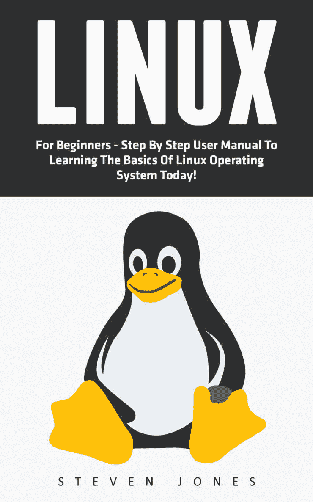

# Linux 初学者指南：学习 Linux 操作系统基础的逐步用户手册（Ubuntu 操作系统）



## 给您的额外赠品


点击下方链接免费获取您的赠送书籍《亚马逊书丛：5 款亚马逊产品完整用户指南》。

[>>>点击此处进行下载<<<](https://freebookpromo.leadpages.co/amazon-book-bundle/)

（或访问：<https://freebookpromo.leadpages.co/amazon-book-bundle/>）

## 引言


### Linux

初学者教程：今天就开始学习 Linux 操作系统基础的逐步用户指南！

## 给您的额外赠品


点击下方链接免费获取您的赠送书籍《亚马逊书丛：5 款亚马逊产品完整用户指南》。

[>>>点击此处进行下载<<<](https://freebookpromo.leadpages.co/amazon-book-bundle/)

（或访问：<https://freebookpromo.leadpages.co/amazon-book-bundle/>）

版权所有 2016 - 保留所有权利。

本文旨在就涵盖的主题和问题提供准确且可靠的信息。本出版物的销售基于这样一个理念：出版者不需要提供法律、财务、医疗或任何专业服务。如果需要法律或专业建议，应聘请该领域的专业资深人士。

以任何方式通过电子手段或打印格式复制、复印或传输本文的任何部分都是不法的。严禁录制本出版物，除非获得出版者的书面许可，否则不允许对本文进行任何存储。保留所有权利。

此处提供的信息声明为真实且一致，即由于疏忽或其他原因，通过使用或滥用其中包含的任何政策、流程或指令而产生的任何责任均由接收读者的完全责任。在任何情况下，出版者对因此处信息而直接或间接导致的任何赔偿、损害或金钱损失不承担任何法律责任或指责。

此处的信息仅供参考，且具有通用性。信息的呈现不带有任何合同或任何类型的保证说明。

所使用的商标均未经过许可，且商标的发布未获得商标所有者的许可或支持。书中的所有商标和品牌仅用于说明目的，归其所有者所有，与本文无关联。

## 引言


### Linux

初学者教程：今天就开始学习 Linux 操作系统基础的逐步用户指南！

## 给您的额外赠品


点击下方链接免费获取您的赠送书籍《亚马逊书丛：5 款亚马逊产品完整用户指南》。

[>>>点击此处进行下载<<<](https://freebookpromo.leadpages.co/amazon-book-bundle/)

（或访问：<https://freebookpromo.leadpages.co/amazon-book-bundle/>）

版权所有 2016 - 保留所有权利。

本文旨在就涵盖的主题和问题提供准确且可靠的信息。本出版物的销售基于这样一个理念：出版者不需要提供法律、财务、医疗或任何专业服务。如果需要法律或专业建议，应聘请该领域的专业资深人士。

以任何方式通过电子手段或打印格式复制、复印或传输本文的任何部分都是不法的。严禁录制本出版物，除非获得出版者的书面许可，否则不允许对本文进行任何存储。保留所有权利。

此处提供的信息声明为真实且一致，即由于疏忽或其他原因，通过使用或滥用其中包含的任何政策、流程或指令而产生的任何责任均由接收读者的完全责任。在任何情况下，出版者对因此处信息而直接或间接导致的任何赔偿、损害或金钱损失不承担任何法律责任或指责。

此处的信息仅供参考，且具有通用性。信息的呈现不带有任何合同或任何类型的保证说明。

所使用的商标均未经过许可，且商标的发布未获得商标所有者的许可或支持。书中的所有商标和品牌仅用于说明目的，归其所有者所有，与本文无关联。

# 安装 Linux

在我们进入不同的 Linux 版本之前，让我们聊聊你需要什么以及如何开始。每个 Linux 发行版都可以以相同的方式安装。你需要的基本设备是一台电脑和一个带有你选择的 Linux 发行版的 USB 盘。

你首先想做的是访问你发行版的网站。例如，如果你想要 Ubuntu，你可以从这个地址访问他们的网站：

<https://www.ubuntu.com/download/desktop>

你下载的文件将是一个 ISO 文件。将该文件保存到硬盘上。下一步是下载通用的 USB 安装程序。你可以通过访问以下网站来实现：

<https://www.pendrivelinux.com>

当你准备好 ISO 文件和通用安装程序后，请确保 USB 闪盘已插入电脑并可以正常读取。接下来，你需要双击通用安装程序启动它。之后，你将看到安装程序的图形化界面。

在下拉菜单中，点击你下载的 Linux 发行版。完成此步骤后，将出现“浏览”按钮。点击“浏览”并在你的电脑中找到下载好的 Linux ISO 文件的位置。点击该文件并选择`OK`。

完成此步骤后，你将看到该文件在软件中处于激活状态。接下来，你需要选择闪盘的位置。在小小的下拉框中选择你的闪盘驱动器号。如果没有显示驱动器号，请确保它已插入电脑并运行正常。

选择驱动器后，你将看到一个格式化驱动器的选项。勾选此框是一个好主意。格式化驱动器将删除驱动器上的任何数据，使其变得干净且可用。这是一个可选步骤，但我建议你使用它。如果 USB 闪盘上有你不想丢失的数据，我强烈建议你先进行备份，或者专门购买一个 USB 盘用于此任务。

完成后，点击“下一步”。你将看到一个警告屏幕，告知你现在将安装你的 Linux 发行版。点击`OK`，Linux 将安装到 USB 闪盘上。

第二种方法是将软件下载到 CD 或 DVD。过程与上述几乎相同，但你不需要使用 USB 程序，只需要将 ISO 文件刻录到 CD 或 DVD 中即可。

## 从 CD 或 USB 运行

要运行你的 Linux 副本，你需要重启电脑并从 USB 或 CD 启动。然后你就可以安装并运行该软件了。

在你的电脑上运行 Linux 的第三种也是最流行的方法是通过虚拟机。虚拟机是一段运行在你现有电脑上的软件，它可以创建一个你选择的操作系统的虚拟副本。

这种方法最受欢迎，因为它允许你执行新安装可以完成的所有操作，但又保护了你当前电脑的操作系统和文件。

## 选择你的 Linux 发行版

在选择 Linux 发行版时，没有简单的解决方案。强烈建议下载几个不同的版本，并通过上面讨论的虚拟机方法将它们安装到电脑上。这样你就可以尝试每个版本，看看它是否符合你的需求。

最流行的版本是 Ubuntu，我向初学者或从 Windows 或 Mac 操作系统切换的用户个人推荐。

要获取不同 Linux 发行版的列表，你可以进行简单的 Google 搜索或访问`http://lwn.net/Distributions/`，那里将提供最流行发行版的列表。

现在我们已经对 Linux 以及如何将它安装到电脑上有了基本介绍，让我们直接开始吧，看看 Linux 能做什么以及它是如何工作的。

# 第 2 章：使用 Linux

现在一切都已就绪并开始运行，让我们聊聊如何使用 Linux。如果你是目前的电脑用户，我可以假设你用过如 Windows 或 OS X 等操作系统。这些操作系统基于文件结构系统工作。

文件结构系统从驱动器号开始，例如`C`、`D`或`E`。从那里，你有被称为文件夹或目录的内容。在每个文件夹或目录中，你还有额外的文件夹、目录以及现在的文件。当我们观察 Linux 文件结构时，它的设置方式不同，可能需要一点时间适应。在 Linux 中，我们拥有树形文件结构。在这种结构中，我们从根节点或者说根目录开始。

从根开始，我们向上扩展到主干并进入分支。如果你观察树的结构，将对文件结构有一个更清晰的视觉概念。

随着这种树形结构的实现，我们不再区分目录、文件夹和文件。我们现在只剩下文件。我们看到并交互的一切都是文件。这甚至包括我们交互的物理硬件，如键盘、鼠标、打印机等。

## 文件类型

在处理 Linux 文件系统时，我们有几种文件变体。第一种变体是通用文件（General Files）。

通用文件是图像、视频、音频、软件程序甚至是普通文本文件。这些文件被格式化为`ASCI`或`Binary`（二进制），它们是你在使用 Linux 时最常接触的文件。

下一组文件是目录文件（directory files）。它们最好被类比为 Windows 中的文件夹，但工作方式略有不同。目录文件充当了其他类型文件的仓库。

## 比较 Windows 文件系统与 Linux 目录系统

**Windows**：在 Windows 中，电脑上的文件存储在名为`C:`的驱动器号中。

**Linux**：在 Linux 中，你不会看到驱动器号。你看到的是目录。因此，对应 Linux 中的`C:`驱动器，你会看到一个名为`File / System`的文件夹。

**Windows**：在 Windows 中，你会看到你的 CD 或 DVD 刻录机的驱动器号。

**Linux**：在 Linux 中，你会看到一个名为`CD Linux`的文件夹。

**Windows**：在 Windows 中，你可以在`Program Files`目录下找到你安装的程序。

**Linux**：在 Linux 中，你会在`BIN`目录下找到你的程序文件。

### 设备文件

Linux 中最后一种类型的文件是设备文件（device files）。

**Windows**：在 Windows 中，所有设备都由驱动器号表示，如`C`、`D`、`E`、`F`等。

**Linux**：在 Linux 中，所有设备都表示为文件并存在于`DEV`目录下。

## 操作文件

在处理文件时，你需要意识到每个文件都将被赋予特定的权限。这些权限将允许 Linux 读取、写入或执行特定文件中的命令。对任何特定文件的访问都可以按用户、按文件进行。这赋予了 Linux 灵活性。

现在我们已经讨论了 Linux 如何工作，让我们聊聊用户账户、权限以及易用性。

## 用户账户

用户账户是你开始使用 Linux 时创建或 Linux 为你创建的账户。这些账户由权限管理，允许你作为用户执行特定的任务和功能。

创建用户账户是为了保护无经验的用户不应访问并可能删除的敏感信息和数据，并创建保护区域，在多人使用该电脑时将信息和程序分开。

### 普通用户

普通用户是在安装 Linux 时自动创建的用户。该普通用户对系统拥有开放控制权，可以安装、删除和修改文件。

作为普通用户，你只能访问自己的个人账户，除非你有用户名和密码等身份验证权限，否则无法访问其他用户的账户。

### Root 用户

Root 用户（或在 Windows 中被称为管理员用户）是在你安装 Linux 时自动生成的。Root 用户对整个系统拥有不受限制的访问权限，根据需要甚至可以修改 Linux 的核心内核。

### 服务用户

服务用户仅在你将 Linux 作为 Web 服务器运行时才会创建。这允许你在共享托管计划中拥有多个用户。由于这是一种高级用户且 Ubuntu 桌面版本不支持，我们不会关注这个特定的用户。

## 文件名规范

### Windows

在 Windows 环境下，你不可以在同一个文件夹中拥有两个同名文件。如果你这样做，Windows 会自动在文件名末尾分配一个数字，生成一个不同的文件名。

这条规则唯一的例外是文件具有不同的扩展名。这可以是像`dog_names.txt`和`dog_names.jpg`。从表面上看它们的文件名相同，但实际上由于文件扩展不同，它们是不同的文件。

### Linux

在 Linux 中，你可以拥有两个相同的文件。唯一的要求是文件需要区分大小写。例如，`DogNames`和`dognames`会被视为不同的文件，尽管它们的名称相同。

## 用户目录

用户目录是允许每个用户存储其用户账户所需的所有文件的地方。在 Windows 中，你可以将文件放置在`C:`盘的任何文件夹或目录中。但在 Linux 中，你将有一个名为`/home/username`的特定文件夹。

`/username`是你用户账户的名称。例如，如果你创建了一个名为`John Smith`的用户账户，那么你的用户目录将类似于`/home/johnsmith/`。

## 命令行对比图形用户界面（或 GUI）

当使用 Linux 时，最频繁的操作是处理文件。这包括读取、写入和执行。在 Linux 中，你有两种不同的方式与文件交互。

一种是通过命令行界面，你必须输入所有你想让 Linux 执行的操作内容；或者你可以使用 GUI（图形用户界面），它看起来像 Windows，并且是一种非常流行且易于用户与 Linux 交互的方式。

### 命令行

刚开始使用命令行界面非常灵活，它允许你执行许多 GUI 界面中无法提供的命令和选项。仅凭这一点，我强烈建议你学习命令行界面。

在许多情况下，命令行可以比 GUI 更快。例如，如果你在命令行界面中，只需一条命令行即可创建一个新用户账户。而在 GUI 中，完成相同任务可能需要五或六个步骤。

在移动大量文件时，命令行赋予你更大的力量。在 Windows 中，你可以轻松地选择大量文件并将它们拖动到目标位置。

在 Linux 的 GUI 版本中，你需要一次移动一个或两个文件。这就是命令行将为你提供类似 Windows 拖放功能的地方，但它是通过命令行界面实现的。

总的来说，命令行速度更快。使用 GUI 界面时，向系统加载了大量的资源和数据，这使得它比命令行慢。因此，如果你在追求额外的速度和灵活性，使用命令行界面是更好的选择。

### GUI 界面

涉及到 GUI 界面时，你可能会在执行视觉密集型任务时使用它。这可以是编辑视频和音频、处理照片以及其他更倾向于视觉辅助的任务。

使用 GUI 界面时，你从 Windows 或 Mac 等操作系统中学到的许多相同技能都可以适用。出于这个原因，我们在这本书中更多地关注命令行界面，这样你就能对 Linux 的核心建立基础并有更好的理解，从而让你能够充分发挥它的作用。

## 使用命令行界面

在操作 Linux 时，命令行界面可能看起来很可怕且复杂。如果你在 20 世纪 80 年代后期 Windows 开发之前用过 Microsoft DOS，你将会感到很熟悉。然而，如果你从未用过 DOS，这可能会有一点挑战性。

命令行背后的原理与图形界面是相同的。例如，当你创建一个新文件时，你输入命令行的命令与你点击一系列按钮时执行的命令是相同的。唯一的区别在于你不需要碰键盘。

在我深入介绍命令行的过多细节之前，我想先给你上一上通用的计算机课程。

当我们观察计算机时，它是通过给一组命令来运行的。例如，如果你想复制一个文件，你会使用`copy`这个词。如果你想删除一个文件，例如你会输入`delete`。人们感到害怕是因为不知道该复制什么、删除什么，以及做错了。

首先，在处理计算机时有一个参考的简单公式。这是一个无论你使用何种操作系统都有效的标准公式：

`命令 + (位置 / 文件) 到 目的地`

例如，你想从计算机复制一个文件到软磁盘或光盘。基本概念是`(Computer/file to Destination)`。假设文件是`Dog.txt`。该命令将是：`c:\dog.txt e:`

`C:\`是目标文件的位置。

`Dog.txt`是文件名。

`E:`是你想让文件去往的地方。

现在加上命令。如果你想复制一个文件，你应该这样做：

`Copy c:\dog.txt e:\`

如果你想把狗文件复制到 E: 盘上的一个目录，你只需要稍微修改一下：

`Copy c:\dog.txt e:\directory_name`

这就是涉及计算机的基本原理。不过，命令在不同的操作系统之间可能会略有不同，但核心基础是相同的。

## 现在回到 Linux

在 Linux 中，命令行被称为`Terminal`（终端）。终端允许你轻松地输入命令并查看结果。当你在 Linux、Windows、Mac 或任何其他操作系统中打开终端时，它看起来是一样的。它是一个黑底白字的屏幕。你会看到一段文本，后面跟着一个符号，如`\`或`>`。

在 Linux 中，你的命令行有一个特定的结构。根据使用命令行的身份，结尾可能会略有不同：

`Usrename@hostname:~$`

现在根据你的具体情况，这可能会不同。但核心思想是相同的。例如，如果你的用户名是 John，你的计算机名为 office，那么你的命令行看起来像这样：

`john@office:~$`或`john@office:~#`

`Username`：这是你在计算机上自称的名称。这是在第一次安装 Linux 时生成或选择的内容。

`Hostname`：这是主机名或计算机名。在设置网络或尝试连接两台或多台计算机时，你需要给它起一个网络名称。主机名就像计算机本身的用户名。

`:`：冒号只是一个分隔符，没有其他作用。

`~`：波浪号表示你正处于主目录。

`$`：美元符号表示你是系统上的普通用户。

`#`：井号表示你是管理员或 root 用户。

## 当前工作目录

当前工作目录（Present working directory）是指你当前正在操作的目录。默认情况下，你处于主目录中。要检查你当前所在的工作目录，你需要在命令行中输入以下命令：

`pw`

一旦输入了该命令，按下键盘上的回车键。默认情况下，你位于主目录，所以你应该看到一行类似于`/home/username/`的内容。

如果你离开了主目录，你也会知道。每当你需要知道自己在命令行界面中的位置时，请使用此命令。

## 切换目录

当你在一个目录中并想要移动到另一个目录时，你会想要`CD`命令。`CD`代表 Change Directory（切换目录）。例如，如果你想切换到`tmp`目录，你只需要输入`cd /tmp`并按回车即可。

当然，目标目录必须存在于树形结构中，但只要它已经存在，你就可以轻松地在目录间来回。现在，如果你还记得我在上面章节关于 DOS 命令所讨论的内容，你会发现 Linux 命令几乎完全一模一样。

要返回主目录，你需要输入`CD ~`并按回车键。

要返回根目录（或主目录），你需要输入`CD /`。

记住，根目录等于 Windows 中的`C:`。


要一次性导航多个目录，你也可以轻松地做到。你需要了解文件路径结构以确保它们存在，否则会收到错误。要做到这一点，你只需要在当前命令后追加即可。

```bash
Cd /john/documents/Friday/homework
```

要返回到上一级目录，你只需要输入`cd ..`。

## 理解 Linux 中的路径

在像 Windows 这样的操作系统中工作时，你的路径可能看起来像这样：`c:/windows/documents`。

在 Linux 中，你会有相同的设置，但它看起来像这样：`Home\john\bin\`。

在处理路径时，你需要理解 Linux 中有两种路径。第一种是绝对路径（Absolute Path），第二种是相对路径（Relative Path）。让我们详细探索一下它们。

### 绝对路径

绝对路径是找到文件的精确路径。例如，如果你想在 pictures 目录中查找文件，你可以执行如下操作。

```bash
Cd /home/user/pictures
```

### 相对路径

当你处于目录结构中且不想输入整个路径时，相对路径非常方便。对于这个例子，你只需要输入以下命令即可进入 pictures 目录。

```bash
Cd /pictures/
```

这将带你进入 pictures 目录。

如你所见，在 Linux 中进行导航是非常容易的。如果你以任何方式熟悉 DOS，那么这应该是你的本能。根据我目前为止教给你的知识，你现在已经拥有掌握使用 Linux 命令行的能力。在接下来的章节中，我将介绍你需要学习的命令，以便执行特定任务并充分利用你的 Linux 系统的功能。

## 最常用的 Linux 命令

要检查计算机上的文件列表，你将需要使用`LS`命令。这与 Dos 中的`DIR`命令相似。当查看`LS`命令的结果时，你会看到两种不同的颜色。

文本会有蓝色和白色。蓝色是目录，白色文字是包含在特定目录中的文件。根据 Linux 的具体发行版本，这些颜色可能会有所不同。

```bash
LS – R
```

`LS – R`命令用于列出当前目录以及所有其他子目录中的所有文件。

```bash
LS – AR
```

此命令将提供有关你正在处理的文件的更多信息。它将提供如创建日期、文件大小等信息。

## 隐藏文件

在 Linux 和其他操作系统中，有时会出于保护目的而隐藏文件。这些文件在前面带有一个`.`。默认的`LS`命令不会显示这些文件。要查看这些文件，你将需要使用以下命令：

```bash
LS – A
```

## 创建和查看文件

现在我们已经学习了如何在 Linux 计算机上查找文件，让我们跳到创建和查看文件，这将是你使用 Linux 的主要功能之一。

### CAT 命令

在 Linux 中，我们使用`CAT`命令来处理文件。`cat`命令允许我们显示、复制、合并和创建文本文件。让我们创建一个名为`dogs`的新文件。

执行此操作，请在终端命令行输入以下命令：

```bash
Cat > dog
```

完成后按回车键。Linux 将空出一行，允许你开始输入该文件的内容。开始编写任何你想包含在该文件中的内容吧。

输入完文本后，你需要按键盘上的`CTRL D`来保存文件。

完成后，你将返回命令提示符。

要查看文件内容，你只需要输入`cat`命令和文件名。对于这个例子，它看起来像这样：

```bash
cat dog
```

这将打印你在`dog`文件中编写的内容。

### 合并两个文件

在处理多个文件时，你可能想将这些文件的内容合并到一个文件中。要做到这一点，你将使用以下命令：

```bash
Cat file1 file2 > file3
```

当你按下回车键时，你将返回命令行。这是正常的。在 Linux 中，你处于静默模式工作。这意味着你不会像在 Windows 中那样看到结果。只有在出现错误时才会看到消息。

要检查是否成功，你需要查看新文件。只需输入`cat`和你创建的新文件名重复相同过程。此外，这仅在创建和处理文本文件时有效。它不适用于任何文件格式。

### 删除文件

在 Linux 中工作时，你可能需要删除不再需要的文件。再次提醒，删除文件时你不会收到确认消息，因此请确保你正在删除正确的文件。

要删除文件，你将需要使用`rm`命令。

```bash
rm filename
```

完成后，你将返回终端。

### 移动文件

在移动文件时，你需要 root 或超级用户权限才能执行此操作。如果你是 root 或超级用户，只需要输入`mv`作为命令。如果你不是 root 或超级用户，你需要在命令前使用超级命令`sudo`来执行它们。然而，在使用`sudo`命令时，系统会要求你输入 root 密码。这是一项安全措施。

```bash
mv file destination
```

或者

```bash
sudo mv file destination
```

让我们将`dog`文件移动到`cats`目录。

```bash
Mv dog /home/user/destination
```

或者

```bash
Sudo mv dog /home/user/destination
```

在处理此类文件时，Linux 还会记录在终端上执行的所有活动日志。这对于管理员跟踪用户在什么时候做了什么非常有帮助。

### 重命名文件

在 Linux 中工作时，你有时想要重命名你正在处理的文件。要做到这一点，你将使用`mv filename newfilename`。

## 创建目录

在操作计算机时，你可能希望它保持整洁。你可以通过创建新目录来存储文件来实现这一点。要做到这一点，你将使用`mkdir`命令。这是你在 DOS 中使用的相同命令。

例如，如果你想创建一个名为`chew toys`的目录，你可以输入以下命令：

```bash
Mkdir chew toys
```

### 同时创建多个目录

如果你想同时创建几个不同的目录，你将使用以下命令：

```bash
Mkdir dir1 dir2 dir3
```

以此类推。要在当前目录之外的目录中创建目录，你将使用绝对路径指定目录的位置。

```bash
Mkdir /home/photos/john
```

要删除目录，你将需要使用`rmdir`命令。

```bash
Rmdir photos
```

此命令将删除 photos 目录。在删除目录时，你需要确保它没有子目录和文件，否则此命令将返回错误。

现在，这些只是你在 Linux 中使用的少数命令。有数百个这样的命令，要用完它们需要多年时间。然而，Linux 中有一个内置的手册，你可以使用它获取有关命令的信息。该命令是`MAN`。

要使用此命令，你只需要输入`man`和你想要的命令。

*   `man ls`

*   `man mkdir`

以此类推。

谈到 Linux，不同的操作系统之间有许多相似之处。你只需要花些时间尝试各种命令和界面，就能完成大部分工作。在本书中，我为你提供了所需的基础知识，让你能够看到成果并真正开始使用该系统。从现在开始，就取决于你如何安装 Linux 并亲手实践了。

## 结

谈到 Linux，你的指尖蕴含着巨大的力量。你可以在其他操作系统中设想的任何事情，但拥有更高的控制权和灵活性。

当我们使用像 Windows 这样的程序时，会开始感到受到束缚，并被困在一个几乎全程都在引导你前进的系统中。然而，使用 Linux，你拥有创造自己的命运和应用程序的力量。Linux 是一个构建自定义操作系统以完成所需任务的绝佳程序。许多网络应用程序是在 Linux 上开发和运行的，这使其成为学习未来技术和应用的理想平台。

最后，感谢你花时间阅读这本书。如果你对 Linux 感兴趣，我强烈建议你获取几个不同的发行版并开始尝试它们。在虚拟机上操作时，你不需要担心损坏当前的电脑，并且可以随心所欲在不同版本之间切换。

如果你喜欢这本书，请留下评价。正是通过你们的评价，我才动力编写更多书籍。请告诉你的朋友你对这本书的看法，并祝你的 Linux 体验愉快。

一如既往，祝你成功！
