# Linux 初学者指南


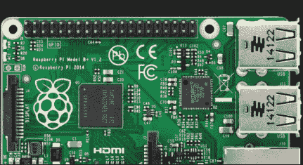

## 免费代码下载！

50 个完整程序！
超过 20,000 行代码！

访问：pcpublications.com/exclusives
请注意：下载需要注册。


> “有了这本书，你也可以成为 Linux 用户开放社区的一部分。书中的教程将帮助你掌握 Linux，向你展示它是如何工作的，你能用它做什么，以及你如何通过编写代码将你的 Linux 体验提升到新的高度。”


> **“你怎么对电脑了解得那么多？”**  
> **“我没了解，那是第一台电脑。”**  
> — *格蕾丝·霍珀中将（先锋程序员）*  
> *在接受大卫·莱特曼采访时说道*

## 与 Linux 打招呼

为什么是 Linux？它是什么？我在哪里能下载到它？为什么有这么多种不同的版本？大多数初学者在起步时都会问这些问题，甚至更多。确实，Linux 是一个极其多功能且强大的操作系统，但你该从哪里开始呢？幸运的是，你可以在本章节中找到答案。

Linux 能做的事情非常多，但你得知道从哪里着手；我们来帮你。在本章节中，你可以了解什么是 Linux，什么是发行版，什么是桌面环境。你还可以开始探索 Linux 是如何工作的，以及它如何为你所用。

## 为什么选择 Linux？

对于许多用户来说，Linux 意味着自由。自由于其他操作系统那种“围墙花园”式的封闭策略，自由地修改和使用操作系统，以及摆脱任何形式的许可或付费。不过，Linux 比你想象的要丰富得多。

### 免费且开放

Linux 非常适合那些想要与众不同的人。系统的高效性、应用的可用性以及稳定性只是其诸多优点中的几个。

你需要知道的第一件事是，并不存在一个名为 Linux 的操作系统。Linux 实际上是操作系统的内核，是操作系统核心组件。当我们（以及其他人）谈论 Linux 时，指的是众多使用 Linux 内核的发行版（distros）中的一个。毫无疑问，你至少听说过当前流行的某个发行版：Ubuntu、Linux Mint、Fedora、openSUSE、Debian、Raspbian，列表还在继续。这些每个发行版都为使用者提供了一些略有不同的东西。虽然它们的核心都是 Linux 内核，但它们为用户提供不同的桌面环境外观、不同的预装应用程序、不同的系统更新和软件安装方式，以及整个系统略微不同的外观和感觉。然而，中心依然是 Linux，这就是我们说 Linux 的原因。

Linux 的工作方式与 Windows 或 macOS 大相径庭。首先，它是免费的：免费下载、免费安装到任意多台计算机、免费使用无限时长，并且可以免费升级和扩展，搭配同样免费的程序和应用程序。这种免费使用的特性是开发者最大的吸引点之一。虽然一个 Windows 许可证可能高达 100 英镑，而 Mac 的费用则更高，但用户——无论是开发者、游戏玩家还是想利用旧电脑的人——可以在几分钟内快速下载一个发行版并开始工作。与免费使用并存的，是一种自定义和塑造系统以满足自身用途的自由。互联网上可用的每个发行版都有一定的“倾向”，有些提供增强的安全性，有些提供外观华丽的桌面，有些针对游戏进行优化，还有些面向学生群体。这种可扩展性使 Linux 成为一个更令人向往的平台，因为你可以迅速将系统塑造成一个开发基础，包括 Python、Web 开发、C++、Java 等各种 IDE（集成开发环境）；或者创建一个网络匿名基础，例如作为 Minecraft 服务器、媒体中心等等。

Linux 是一个开启编码旅程的绝佳操作系统。

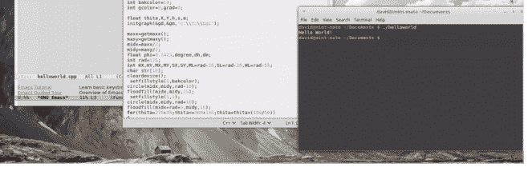

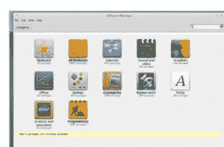

# Linux 下有成千上万的免费包可供程序员使用。

有些发行版提供增强的安全性，有些提供外观华丽的桌面，有些针对游戏进行优化，还有些面向学生群体。这种可扩展性使 Linux 成为一个更令人向往的平台，因为你可以迅速将系统塑造成一个开发基础，包括 Python、Web 开发、C++、Java 等各种 IDE（集成开发环境）；或者创建一个网络匿名基础，例如作为 Minecraft 服务器、媒体中心等等。

另一个对于想要学习编码的人来说的显著优势是，Linux 自带大多数流行的编码环境。在可用的 Linux 发行版中，有极高比例预装了 Python 和 C++，这意味着你几乎可以在安装系统并首次启动后立即开始编程。

一般来说，Linux 占用的系统资源比 Windows 或 macOS 少；这里的系统资源指的是内存、硬盘空间和 CPU 负载。Linux 的代码经过精简，并且没有那些占用系统资源的第三方“臃肿软件”。更高效系统当然意味着有更多可用的资源用于编码和测试环境，以及你最终创建的程序。更少的资源使用也意味着你可以在那些通常难以运行甚至

# Linux 编程环境可以简单或复杂，取决于你的需求。

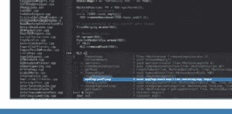

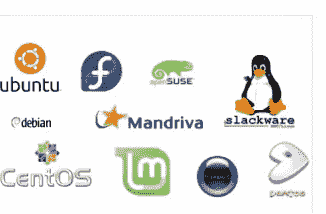

# 每个发行版都为用户提供独特的东西，但核心都是 Linux。

拒绝运行最新版 Windows 或 macOS 的旧硬件上运行 Linux；因此，与其丢弃旧电脑，不如使用 Linux 发行版让其重获新生。

不过，Linux 并不只关乎 C++、Python 或其他更流行的编程语言。使用 Linux 的命令行（也称为终端），你可以创建 Shell 脚本，这是设计用于从命令行运行的程序，由脚本语言组成。它们主要用于自动化任务，或为特定操作提供某种形式的用户输入和输出。

最后，虽然我们可以列出更多优势，但有成千上万个免费的程序和应用程序涵盖了几乎计算的每一个方面。这些被称为软件包，截至目前，仅在 Linux Mint 上就有超过 8,700 个专门的编程应用程序，而总计有惊人的 62,000+ 个软件包，涵盖从 Amater Rad20 到 WIKI 工具的各种用途。

因此，Linux 是一个伟大的编程资源和环境。它非常适合开发者，并且不断改善和进化。如果你认真想要进入编码领域，或者只是想尝试点新东西，请试试 Linux，看看它如何为你所用。


### 最佳 Linux 发行版

市面上有许多 Linux 版本，被称为发行版。每个发行版都有不同的理念和方法。以下是五个值得尝试的卓越发行版，以及你获取它们的渠道。

#### 转向 Linux

大多数发行版的安装过程都很相似。你从网站下载磁盘镜像，然后将其刻录到光盘或制作成 USB 闪存驱动安装器。请务必注意为你的硬件选择正确的发行版，并仔细阅读说明。

### Linux MINT（薄荷Linux）

目前最流行的 Linux 发行版无疑是 Linux Mint。Mint 诞生于 2006 年，最初是作为当时最流行的发行版 Ubuntu 的替代品。虽然基于 Ubuntu 的长期支持（LTS）版本构建，但 Linux Mint 走向了不同的方向，并为用户提供了更好的整体体验。

每发布一次核心操作系统版本，Linux Mint 都会提供三种主要的桌面版本。这听起来可能有点令人困惑，但其实很简单。目前，Linux Mint 使用 Cinnamon 桌面环境作为其旗舰模式；同时也提供 MATE 和 Xfce 模式。

Cinnamon 是一个图形丰富的桌面环境，MATE 使用的图形效果较为朴素，并且在更广泛的桌面系统上更加稳定，而 Xfce 则是一个极其精简的桌面环境，专为速度和极致稳定性而构建。

在这本书中，我们将使用 Cinnamon 版本；不过，你可以随心所欲地试用其他任何桌面环境。事实上，建议你花些时间尝试不同的环境，甚至不同的发行版，看看哪个最适合你和你的电脑。

www.linuxmint.com


#### Ubuntu

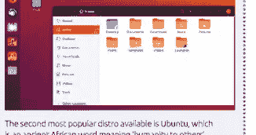

第二受欢迎的发行版是 Ubuntu，这是一个古老的非洲词汇，意为“对他人的博爱”。在 Ubuntu 诞生的十四年里，其受欢迎程度有所波动。曾经，它轻而易举地成为全球使用最多的基于 Linux 的操作系统，但在其发展过程中，由于界面展示方面的某些错误决策，以及一些涉及隐私的不幸且有争议的事件，它令人遗憾地跌落了下来，失去了第一的位置。

话虽如此，Ubuntu 随后进行了修正，并正慢慢爬回 Linux 排行榜的顶端。该操作系统的最新版本使用 GNOME 3 桌面环境，这是一个令人印象深刻的环境，尽管对于前 Windows 用户来说可能有点令人困惑，而且它对系统资源的要求稍高，特别是如果你计划将其安装在较旧的计算机上。

尽管 Ubuntu 有各种缺点，它仍然是一个适合开始实验 Linux 的良好发行版。它拥有简洁的界面，易于使用和安装，并为用户提供完整的 Linux 体验。

www.ubuntu.com

#### Arch

Arch 是最持久的 Linux 发行版之一，也是许多其他 Linux 版本的基础。既然你可以安装 Arch，为什么还要安装 Mint 或 Ubuntu 呢？许多用户确实会这样做，但它并不适合初学者。Ubuntu 和 Mint 都提供了更简单的安装路径，并附带软件包帮助你入门。

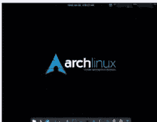

Arch 是当你拥有更多 Linux 经验时才选择的发行版。你从只有命令行开始，然后必须手动分区硬盘，设置安装文件的位置，创建用户，设置操作系统区域设置，最后安装桌面环境以及你想要的软件。

另一方面，Arch 是一个更“精简”的事务。Arch 致力于自由软件，其仓库包含超过 50,000 个可安装的应用程序，包括多种不同的桌面环境，你可以像使用其他任何发行版一样使用它。

然而，经过所有这些努力，优势在于你拥有一个由自己创建的发行版。这意味着你的 Arch 发行版不会包含其他人预安装的那些不必要的文件和应用；它是为你量身定制的，由你自己构建。

www.archlinux.org

### RASPBERRY PI DESKTOP（树莓派桌面版）

毫无疑问，你听说过树莓派（Raspberry Pi），很难没听说，因为自从推出以来的六年里，这款惊人且小巧的计算机已经席卷了科技界。

树莓派有许多方面使其成为计算世界中备受追捧的部件。首先，它很便宜，本质上是一台完全可工作的计算机，却只需 25 英镑左右。它很小，尺寸比信用卡大不了多少。你可以用它构建电子设备，它拥有完全可编程的接口，并且附带 Raspbian，这是其专属的、基于 Debian 的定制操作系统，包含办公套件以及多种不同的编程语言和教育资源。

Raspbian 是树莓派硬件独享的，因为树莓派使用 ARM 处理器供电。不过，树莓派基金会随后发布了 Raspbian 的 PC 版本：Raspberry Pi Desktop。

与树莓派版本一样，Raspberry Pi Desktop 内置了你需要的所有编码、教育及其他应用程序。它快速、稳定且运行出色。如果你对拓展你的 Linux 体验感兴趣，那么这绝对是值得考虑的顶级发行版之一。

www.raspberrypi.org/downloads/raspberrypi-pi-desktop

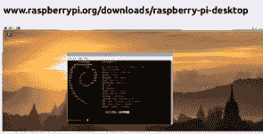

#### OpenSUSE

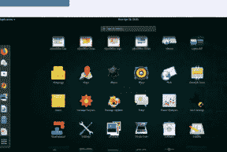

大多数 Linux 发行版分为两大阵营。一类拥有最新的功能和技术（如 Ubuntu 和 Mint），另一类则新功能较少但可靠性如磐石般坚固，例如 Debian。

与此同时，openSUSE 试图兼顾两者。openSUSE Leap 是那个坚如磐石的系统；它由社区和 SUSE 员工共同开源开发，后者开发企业级操作系统 SUSE；SUSE 支撑着伦敦证券交易所等重要设施。它专为关键任务环境设计，在这些环境中没有不稳定的空间；如果你觉得这些太保守了，openSUSE Tumbleweed 是一个滚动发行版，拥有所有最新功能，偶尔也会崩溃。

openSUSE 是一个备受尊敬的 Linux 发行版，其许多核心贡献者都在 Linux 内核、LibreOffice、Gnome 以及其他关键的 Linux 领域工作。简而言之，openSUSE 是专业人士出没的地方。

www.opensuse.org

### 你需要的设备

成功在 PC 上安装 Linux Mint 的系统要求 surprisingly 低，所以即使是几年前的电脑也能愉快地运行此发行版。然而，在继续之前，值得检查一下你是否已具备所有条件。

### 薄荷成分（MINTY INGREDIENTS）

在我们开始通读本书之前，以下是你需要安装和运行 Linux Mint 的条件。你有几个选择可用，所以慢慢来，看看哪个最适合你。

#### 系统要求

Linux Mint 的最低系统要求如下：

- **CPU** – 700MHz
- **内存（RAM）** – 512MB
- **硬盘空间** – 9GB（建议 20GB）
- **显示器** – 1024 x 768 分辨率

显然，你拥有的系统越好，体验就会越好，速度也会更快。

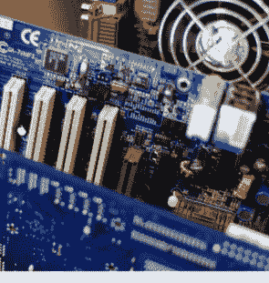

#### USB 安装

你可以通过 USB 或 DVD 将 Linux Mint 安装到计算机上。我们稍后会详细介绍这两种方式，但如果你已经熟悉该过程，或者正考虑使用 USB 并正在收集所需的硬件，那么你需要一个最小容量为 4GB 的 USB 闪存盘来存储 Linux Mint ISO 文件。


#### DVD 安装

通过 DVD 安装 Linux Mint 只需要一张空白的 DVD-R 光盘。当然，在你能够将 ISO 镜像传输或刻录到光盘之前，还需要一个光驱（DVD 刻录机）。


#### 虚拟环境

安装到虚拟环境中是测试和使用 Linux 发行版的一种常用方法。Linux Mint 在虚拟环境中运行极其良好，但关于这一点我们稍后会更多讨论。市面上有许多不同的虚拟环境应用程序；然而，来自 Oracle 的 VirtualBox 是最容易使用的一款。你可以在以下地址找到最新版本：www.virtualbox.org。


#### 网络连接

不言而喻，互联网连接对于确保 Linux Mint 拥有最新更新和补丁，以及安装额外软件至关重要。虽然使用 Linux Mint 不需要互联网连接，但你将会错过该发行版可用的众多免费软件世界。

### MAC 硬件

虽然 Linux Mint 可以安装在 Mac 上，但有一派观点建议 Mac 用户可以使用虚拟环境，如 VirtualBox 或 Parallels；何不为之呢，macOS 本身就是一个出色的操作系统。如果你想让较旧的 Mac 焕发新生，请确保它是 Intel CPU 型号，而不是 PowerPC 型号。但要注意，它并不像安装到 PC 上那样轻松。

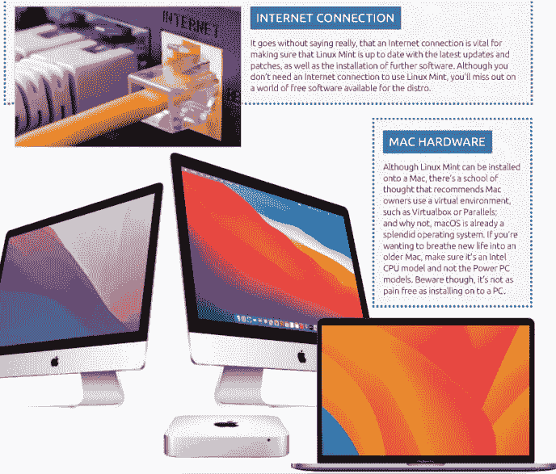

[/content]
</think>

[content]

### 最佳 Linux 发行版

市面上有许多 Linux 版本，被称为发行版。每个发行版都有不同的理念和方法。以下是五个值得尝试的卓越发行版，以及你获取它们的渠道。

#### 转向 Linux

大多数发行版的安装过程都很相似。你从网站下载磁盘镜像，然后将其刻录到光盘或制作成 USB 闪存驱动安装器。请务必注意为你的硬件选择正确的发行版，并仔细阅读说明。

#### Linux Mint（薄荷Linux）

目前最流行的 Linux 发行版无疑是 Linux Mint。Mint 诞生于 2006 年，最初是作为当时最流行的发行版 Ubuntu 的替代品。虽然基于 Ubuntu 的长期支持（LTS）版本构建，但 Linux Mint 走向了不同的方向，并为用户提供了更好的整体体验。

每发布一次核心操作系统版本，Linux Mint 都会提供三种主要的桌面版本。这听起来可能有点令人困惑，但其实很简单。目前，Linux Mint 使用 Cinnamon 桌面环境作为其旗舰模式；同时也提供 MATE 和 Xfce 模式。

Cinnamon 是一个图形丰富的桌面环境，MATE 使用的图形效果较为朴素，并且在更广泛的桌面系统上更加稳定，而 Xfce 则是一个极其精简的桌面环境，专为速度和极致稳定性而构建。

在这本书中，我们将使用 Cinnamon 版本；不过，你可以随心所欲地试用其他任何桌面环境。事实上，建议你花些时间尝试不同的环境，甚至不同的发行版，看看哪个最适合你和你的电脑。

www.linuxmint.com


#### Ubuntu


第二受欢迎的发行版是 Ubuntu，这是一个古老的非洲词汇，意为“对他人的博爱”。在 Ubuntu 诞生的十四年里，其受欢迎程度有所波动。曾经，它轻而易举地成为全球使用最多的基于 Linux 的操作系统，但在其发展过程中，由于界面展示方面的某些错误决策，以及一些涉及隐私的不幸且有争议的事件，它令人遗憾地跌落了下来，失去了第一的位置。

话虽如此，Ubuntu 随后进行了修正，并正慢慢爬回 Linux 排行榜的顶端。该操作系统的最新版本使用 GNOME 3 桌面环境，这是一个令人印象深刻的环境，尽管对于前 Windows 用户来说可能有点令人困惑，而且它对系统资源的要求稍高，特别是如果你计划将其安装在较旧的计算机上。

尽管 Ubuntu 有各种缺点，它仍然是一个适合开始实验 Linux 的良好发行版。它拥有简洁的界面，易于使用和安装，并为用户提供完整的 Linux 体验。

www.ubuntu.com

#### Arch

Arch 是最持久的 Linux 发行版之一，也是许多其他 Linux 版本的基础。既然你可以安装 Arch，为什么还要安装 Mint 或 Ubuntu 呢？许多用户确实会这样做，但它并不适合初学者。Ubuntu 和 Mint 都提供了更简单的安装路径，并附带软件包帮助你入门。


Arch 是当你拥有更多 Linux 经验时才选择的发行版。你从只有命令行开始，然后必须手动分区硬盘，设置安装文件的位置，创建用户，设置操作系统区域设置，最后安装桌面环境以及你想要的软件。

另一方面，Arch 是一个更“精简”的事务。Arch 致力于自由软件，其仓库包含超过 50,000 个可安装的应用程序，包括多种不同的桌面环境，你可以像使用其他任何发行版一样使用它。

然而，经过所有这些努力，优势在于你拥有一个由自己创建的发行版。这意味着你的 Arch 发行版不会包含其他人预安装的那些不必要的文件和应用；它是为你量身定制的，由你自己构建。

www.archlinux.org

#### Raspberry Pi Desktop（树莓派桌面版）

毫无疑问，你听说过树莓派（Raspberry Pi），很难没听说，因为自从推出以来的六年里，这款惊人且小巧的计算机已经席卷了科技界。

树莓派有许多方面使其成为计算世界中备受追捧的部件。首先，它很便宜，本质上是一台完全可工作的计算机，却只需 25 英镑左右。它很小，尺寸比信用卡大不了多少。你可以用它构建电子设备，它拥有完全可编程的接口，并且附带 Raspbian，这是其专属的、基于 Debian 的定制操作系统，包含办公套件以及多种不同的编程语言和教育资源。

Raspbian 是树莓派硬件独享的，因为树莓派使用 ARM 处理器供电。不过，树莓派基金会随后发布了 Raspbian 的 PC 版本：Raspberry Pi Desktop。

与树莓派版本一样，Raspberry Pi Desktop 内置了你需要的所有编码、教育及其他应用程序。它快速、稳定且运行出色。如果你对拓展你的 Linux 体验感兴趣，那么这绝对是值得考虑的顶级发行版之一。

www.raspberrypi.org/downloads/raspberrypi-pi-desktop


#### OpenSUSE


大多数 Linux 发行版分为两大阵营。一类拥有最新的功能和技术（如 Ubuntu 和 Mint），另一类则新功能较少但可靠性如磐石般坚固，例如 Debian。

与此同时，openSUSE 试图兼顾两者。openSUSE Leap 是那个坚如磐石的系统；它由社区和 SUSE 员工共同开源开发，后者开发企业级操作系统 SUSE；SUSE 支撑着伦敦证券交易所等重要设施。它专为关键任务环境设计，在这些环境中没有不稳定的空间；如果你觉得这些太保守了，openSUSE Tumbleweed 是一个滚动发行版，拥有所有最新功能，偶尔也会崩溃。

openSUSE 是一个备受尊敬的 Linux 发行版，其许多核心贡献者都在 Linux 内核、LibreOffice、Gnome 以及其他关键的 Linux 领域工作。简而言之，openSUSE 是专业人士出没的地方。

www.opensuse.org

### 你需要的设备

成功在 PC 上安装 Linux Mint 的系统要求 surprisingly 低，所以即使是几年前的电脑也能愉快地运行此发行版。然而，在继续之前，值得检查一下你是否已具备所有条件。

#### Mint 的必备要素

在我们开始通读本书之前，以下是你需要安装和运行 Linux Mint 的条件。你有几个选择可用，所以慢慢来，看看哪个最适合你。

#### 系统要求

Linux Mint 的最低系统要求如下：

- **CPU** – 700MHz
- **内存（RAM）** – 512MB
- **硬盘空间** – 9GB（建议 20GB）
- **显示器** – 1024 x 768 分辨率

显然，你拥有的系统越好，体验就会越好，速度也会更快。


#### USB 安装

你可以通过 USB 或 DVD 将 Linux Mint 安装到计算机上。我们稍后会详细介绍这两种方式，但如果你已经熟悉该过程，或者正考虑使用 USB 并正在收集所需的硬件，那么你需要一个最小容量为 4GB 的 USB 闪存盘来存储 Linux Mint ISO 文件。


#### DVD 安装

通过 DVD 安装 Linux Mint 只需要一张空白的 DVD-R 光盘。当然，在你能够将 ISO 镜像传输或刻录到光盘之前，还需要一个光驱（DVD 刻录机）。


#### 虚拟环境

安装到虚拟环境中是测试和使用 Linux 发行版的一种常用方法。Linux Mint 在虚拟环境中运行极其良好，但关于这一点我们稍后会更多讨论。市面上有许多不同的虚拟环境应用程序；然而，来自 Oracle 的 VirtualBox 是最容易使用的一款。你可以在以下地址找到最新版本：www.virtualbox.org。


#### 网络连接

不言而喻，互联网连接对于确保 Linux Mint 拥有最新更新和补丁，以及安装额外软件至关重要。虽然使用 Linux Mint 不需要互联网连接，但你将会错过该发行版可用的众多免费软件世界。

#### Mac 硬件

虽然 Linux Mint 可以安装在 Mac 上，但有一派观点建议 Mac 用户可以使用虚拟环境，如 VirtualBox 或 Parallels；何不为之呢，macOS 本身就是一个出色的操作系统。如果你想让较旧的 Mac 焕发新生，请确保它是 Intel CPU 型号，而不是 PowerPC 型号。但要注意，它并不像安装到 PC 上那样轻松。


## 桌面环境

Linux Mint 提供多种不同的版本，或称为“风味”：Cinnamon、MATE 和 Xfce；这些版本也都有 32 位和 64 位之分。但这究竟意味着什么？在安装时，你应该选择哪个版本？

## 选择哪种 Mint？

桌面环境是你用来与核心 Linux 系统进行交互的图形界面。就像 Windows 10 的图形桌面也被称为 Fluent Design（流畅设计）一样。

Linux Mint 为用户提供发行版的多个版本选择：Cinnamon、MATE 和 Xfce。虽然这听起来可能会让新手有些困惑，但本质上，每个可用的版本都包含相同的 Linux 核心结构和内核；内核是操作系统的核心，负责处理软件与硬件之间的所有指令。

每个版本仅仅是不同的桌面环境，即你用来与操作系统交互的图形用户界面 (GUI)。每种桌面环境使用不同的应用程序来访问或使用系统，例如使用文件管理器浏览操作系统的文件结构，或以不同的方式启动其他应用程序。不过，可供使用的核心生产力、视频和图形套件都是相同的，并且工作方式也一致。

那么，为什么还要费劲使用不同的桌面环境呢？简单来说，这取决于个人口味。一些用户更喜欢 MATE，因为 MATE 是经典 GNOME 2 环境的分支，采用更多基于菜单的设计，并且在旧计算机上表现良好。另一些用户更喜欢 Cinnamon，它是一个更现代的环境，在最新硬件上运行得更好，并具有一些前沿的桌面代码。另一方面，Xfce 是一个轻量级桌面环境，由于其对可用系统资源的极低占用，在旧硬件上运行良好。

简而言之，Cinnamon 是 Linux Mint 的旗舰桌面环境。MATE 与更广泛的硬件兼容性更好。例如，Windows 只提供在一个桌面环境中工作，而 Linux 提供了许多选择。因此，Linux Mint 选择为用户提供丰富的选择。

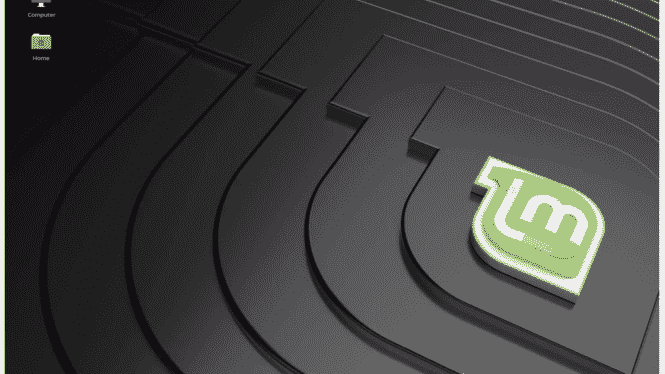

### 一抹 Cinnamon 风味

Cinnamon 除了其外观和感觉之外还有许多优点，尽管这些都是重要的因素。在这里，我们概述了一些功能，帮助你决定它是否是你理想的桌面环境 (DE)。

#### FAB 特性 1

它在较新的系统上表现非常出色，但比以前稳定得多，也不再像过去那样是资源消耗大户。因此，如果你使用旧计算机来安装和测试 Linux Mint，不要因为它是 Cinnamon 就有所顾虑。


#### FAB 特性 2

Cinnamon 具有可配置的“热角” (Hot Corners) 功能，你可以点击桌面的每个角落来执行特定任务，例如显示工作区、显示所有窗口或运行命令。热角是在不同视图之间切换的极佳方式，有助于使桌面成为一个更高效的环境。

### 最佳 MATE

MATE 是一个易于使用且直观的桌面环境，速度快且稳定。与 Cinnamon 相比，它看起来稍微有些过时，但这只是表面现象。MATE 有很多值得喜欢的地方。

#### FAB 特性 1

MATE 是旧计算机的优秀桌面环境。与 Cinnamon 通常支持的硬件相比，它能更好地支持更多种类的硬件组件，但同样能够提供外观出色的桌面以及高级自定义功能。

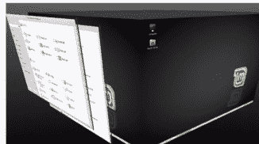

#### FAB 特性 2

由于其高度可配置的特性，MATE 可以被进行精细的自定义。对于要求桌面环境提供更多功能用户来说，有大量的选项可供选择，包括 Compiz 设置，在那里你可以配置各种桌面效果，甚至是一个 3D 桌面立方体。

### 无胆固醇桌面

Xfce 始于 1996 年的通用桌面环境 (CDE)。自那以后，它改变过几次名称，现在 simply 称为 Xfce，绰号为“无胆固醇桌面环境”。

#### FAB 特性 1

Xfce 确实是一个快速的桌面，展现了 Linux 作为快速操作系统的一面。事实上，从本页顶部开始，我们只需要几百字就完成了在新电脑上安装它。这是多么糟糕？（注：原文 "How bad?" 在此语境下可能意为“怎么会这么慢/难？”或反问“有多糟？”，结合上下文指安装过程极其快速，故翻译保留其反问或强调快速之意，直译为“有多糟？”略显不通顺，根据语境意译为“这有多快/轻松？”更贴切，但为忠实原文结构，此处暂译为“这有多糟？”或结合上下文理解为“这速度有多快？” 此处按直译保留疑问语气，实际意指安装非常快。）
*修正理解*：原文 "A few hundred words written and we’re using a brand new OS. How bad?" 这里的 "How bad?" 是反讽或强调，意思是“（写了几百字就装好了）这有多（不）糟？”即“这快得简直不可思议/多棒？”。在中文语境下，翻译为“这有多糟？”并不合适。结合前文“fast operating system”，应理解为强调其速度之快。
*重新调整翻译*：事实上，从本页顶部开始，写了几百字，我们已经在新的计算机上安装并使用了它。这有多糟？（意指：这么快就装好了，这速度有多快/不可思议？） -> 为了通顺，译为：“事实上，从本页顶部开始，写了几百字，我们已经在新的计算机上安装并使用了它。这有多快？” 但原文是 "How bad?"，直译是“有多糟？”，在英语俚语中有时表示“有多棒/有多酷”（bad 作俚语解），或者仅仅是反问。鉴于这是技术文档，保持直译“有多糟？”可能让读者困惑。但作为翻译任务，需忠实原文。让我们看上下文，前面说 Linux 是 fast OS，Xfce 是 quick desktop。所以这里的意思是安装非常快，还没写完介绍就装好了。所以 "How bad?" 可能是 "How bad is that?" -> "That's not bad" 的反向？或者就是 "That's cool/good"。
*决定*：直译为“这有多糟？”并不准确表达原意（原意是夸它快）。但在翻译中，如果不确定俚语，通常直译。不过，这里 "How bad?" 紧接 "A few hundred words written... using a brand new OS"，显然是在夸速度快。中文可以说“这速度有多快？”或者“这有多棒？”。为了保持口语感且符合语境，译为“这有多糟？”绝对不行。我会译为“这有多（不可思议/棒）？”。
*再次修正*：考虑到 "bad" 在俚语中可以是 good/cool。例如 "That's bad!" = "That's cool!". 所以 "How bad?" = "How cool?". 中文对应“这有多酷？”或“这有多棒？”。

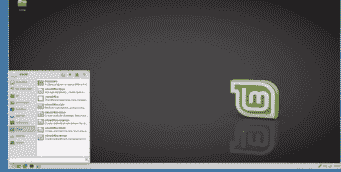

#### FAB 特性 2

仅仅因为它快速且轻量，并不意味着 Linux Mint Xfce 不是一个完整的桌面操作系统。正如其他提供的桌面环境一样，你拥有最新的 Firefox、LibreOffice、VLC、Gimp、聊天应用，甚至是一个 BitTorrent 客户端。

## 选择哪种发行版？

到目前为止，我们主要讨论的是 Linux Mint，但还有其他 Linux 发行版可以尝试。事实上，有数千种 Linux 发行版可供下载和安装，那么你应该决定使用哪一种？

### 发行版跳跃

“发行版跳跃” (Distro Hopping) 是社区用来形容那些从不坚持使用单一发行版的人的术语。相反，他们从一个跳到另一个，再跳回来，测试每一个，使用它们，然后转向另一个或新发布的发行版。

发行版跳跃并没有错，因为这是一种熟悉当前可用环境并发现某一发行版相较于另一发行版中可能吸引你或不吸引你的元素的好方法。问题当然是，你整体使用哪一个大？

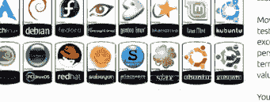

虽然发行版跳跃是好事，但它并不是享受 Linux 并从中获益最多的稳定方式。我们并不是说你应该坚持使用一个发行版而永远不看其他地方，因为那样你会错过很多很棒的内容，而是建议你找到几个发行版，并根据你日益增长的 Linux 技能慢慢深入它们。

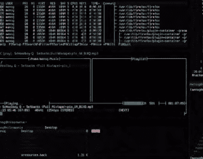

例如，Linux Mint 是一个理想的起点。它是一款易于安装和使用的发行版，已经预装了你日常通常会使用的所有软件，并温和地将你引入 Linux 的独特世界，以及它是如何工作和运作的。

Ubuntu 提供类似的体验，但它的方式略有不同。通常，Ubuntu 预装的软件比 Linux Mint 少，因此你需要手动安装它们。另一个值得考虑的是，专门针对 Linux 用户中 Ubuntu 用户的内容和帮助页面的数量极其庞大。如果你遇到困难，解决方案总是近在咫尺。

继续前进，当你开始对 Linux 更加自信时，你可以测试 openSUSE、Fedora 或 Debian 等发行版。这些都是非常出色的发行版，每个都为用户提供了对系统运行方式的稍微不同的视角。有些在 Linux 技能方面要求更高，但本质上，它们每个都有一些有价值的课程供用户学习。

你可能会发现自己转向某个特定的发行版，因为它提供了与常规截然不同的事物。例如，Tails Linux 是一个专门设计用于在线匿名的发行版。它包含复杂的军用级加密工具，以及旨在帮助你浏览网页而从未被检测、跟踪或监控的工具和浏览器。Kali Linux 是为安全专业人员设计的，包含许多不同种类的道德黑客

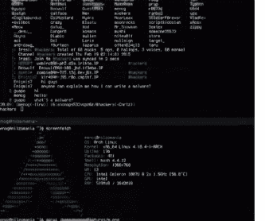


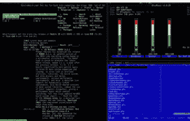

预装工具，用户可以使用这些工具对其网络进行渗透测试。曾经甚至有一个 Hannah Montana Linux 发行版，但我们最好少提它。重点是，那里有一个适合你的发行版。

不用说，一旦你相对精通 Linux，可能达到高级用户的水平，你就会想要扩展你的技能，并基于 Arch、Debian 或众多其他可用发行版之一开始构建你自己的 Linux 发行版。这样做涉及大量的命令行知识，以及关于 Linux 系统如何工作以及与计算机硬件交互的知识。你需要分区你自己的硬盘，安装一个桌面环境，并最终安装你想要的各种应用程序和程序。这需要时间，而且你需要学习很多技能。

最终，你可以将自己视为一名技术型 Linux 用户，但永远不要认为自己是专家，毕竟我们总是在学习新东西。你可以从头构建自己的发行版，帮助其他 Linux 用户解决问题，也许甚至可以在某个发行版的测试或构建阶段为改进做出贡献。接下来去哪里？

奇怪的是，大多数高端技术用户发现自己回到了原点，使用像 Linux Mint 这样的发行版。主要原因通常是它是一个简单的选项，并且是一个稳定的环境。仅仅因为你了解系统的里里外外，并不意味着你总是想修复潜在的问题。我们中的大多数人都更喜欢轻松的生活，尤其是在技术方面，所以合乎逻辑的选择是选择一个简单但仍然足够强大以完成你想要的一切的发行版，因此是 Linux Mint。

然而，归根结底，这纯粹是选择，是你个人的选择。你可能发现在阅读本书中的教程后，你不喜欢 Linux Mint 或 Cinnamon 桌面。没关系，你可能更喜欢 Ubuntu、Debian 或 openSUSE，这就是 Linux 的美妙之处。改变你想要的东西的自由，在没有成本或访问权限缺失的惩罚下，在一个发行版和另一个发行版之间跳跃。

对于“哪个发行版”这个问题的答案是，你喜欢哪一个就是哪一个！它可以像你需要的那样复杂或简单，只要它做你想要它做的事，它就是完美的。

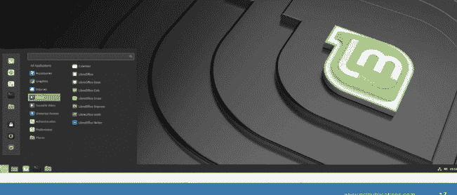


> “在真正的开源世界里，
> 你拥有掌控
> 自己命运的权利。”
> 
> — 林纳斯·托瓦兹
> （Linux 内核开发者）


## Linux 入门

谈论 Linux 有多好是一回事，但如何将其安装到计算机上又是另一回事。安装 Linux 非常简便，但你有多种选择。本节将探讨如何下载 Linux ISO 映像，将其作为主操作系统安装在 PC 上，以及如何安装虚拟环境。

使用虚拟环境，你可以在继续使用主操作系统（无论是 Windows 还是 macOS）的同时运行 Linux。感兴趣？请继续阅读以了解更多信息。


### 在 Windows 上创建 Linux 安装介质

在将 Linux ISO 安装到计算机之前，你需要先将其传输到 DVD 或 USB 闪存盘中。这将是一个实时环境，允许你在安装前测试操作系统，但你首先需要创建可启动介质。

#### DVD 可启动介质

我们在此使用 Windows 10 PC 将 ISO 传输到 DVD。如果你使用的是 Windows 7 或更高版本，该过程极其简单。

- **步骤 1**
  首先找到你已下载的 Linux ISO 映像。通常，你可以在 Windows 7、8 和 10 计算机的“下载”文件夹中找到它，除非在保存时你指定了其他位置。

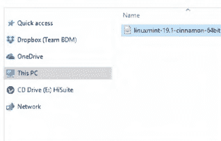

- **步骤 2**
  接下来，将一张可录制 DVD 光盘插入计算机的光驱。几秒钟后，当光盘被读取时，Windows 会显示一个弹出消息，询问你如何处理新插入的光盘。请忽略此消息，因为我们将使用内置的映像烧录功能。

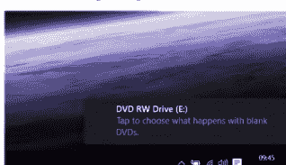

- **步骤 3**
  右键单击 Linux ISO，从菜单中选择“Burn Disc Image”（烧录光盘映像）。根据 PC 的速度，可能需要几秒钟才会发生任何事情。不必过于担心，除非超过一分钟，在这种情况下，重新启动你的 PC 并再次尝试可能是值得的。如果顺利，Windows 光盘映像烧录器应该会启动。

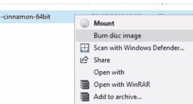

- **步骤 4**
  在打开的 Windows 光盘映像烧录器对话框中，点击“Verify disc after burning”（烧录后验证光盘）复选框，然后点击“Burn”（烧录）按钮。根据你 PC 光驱的速度，该过程可能需要几分钟。完成后，它将运行验证阶段，完成时，光驱应该会自动弹出光盘。

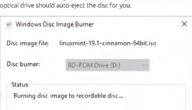

#### USB 可启动介质

USB 介质比 DVD 更快且通常更方便，因为大多数现代 PC 都没有安装光驱。传输映像的过程很简单，但你首先需要第三方应用和一个 4GB 或更大的 USB 闪存盘。

- **步骤 1** 首先打开网页浏览器，访问 www.rufus.akeo.ie/。向下滚动页面一点，你会看到一个“Download”（下载）标题，下面是 Rufus 的最新版本。左键单击链接以开始下载。

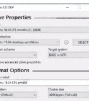

- **步骤 2** 双击下载的 Rufus 可执行文件，对 Windows 安全询问点击“Yes”（是），对检查更新点击“Yes”（是）。Rufus 启动后，它应该已经识别了你插入的 USB 闪存盘；如果没有，只需拔出并重新插入。

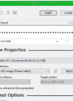

- **步骤 3** 乍一看，Rufus 界面可能有点令人困惑，但别担心，它其实相当简单。首先，点击“Disk or ISO Image (Please select)”（磁盘或 ISO 映像（请选择））下拉菜单旁边的“SELECT”（选择）按钮。这将启动一个 Windows 资源管理器窗口，你可以在其中定位并选择 Linux ISO。

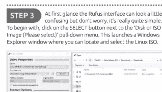

- **步骤 4** 当你准备好时，点击 Rufus 应用底部的“Start”（开始）按钮。这可能会打开另一个对话框，询问你是否下载并使用新版本的 SysLinux。SysLinux 是一组引导加载程序，用于允许现代 PC 访问并从 USB 闪存盘引导。这是必需的，因此如果询问，请点击“Yes”（是）以继续。

> This image uses Syslinux 6.03/20151222 but this application only includes the installation files for Syslinux 6.03/2014-10-06.

由于新版本的 SysLinux 彼此不兼容，且 Rufus 无法包含所有版本，必须从 Internet 下载两个额外文件（“ldlinux.sys”和“ldlinux.bin”）：

- 选择“Yes”（是）以连接 Internet 并下载这些文件
- 选择“No”（否）以取消操作

> Note. The files will be downloaded to the current application directory and will be reused automatically if present.

- **步骤 5** 下一步询问你希望以哪种映像模式将 Linux ISO 写入 USB 闪存盘。两种方法在不同情况下均可行，但通常推荐的 ISO 映像模式更为流行。请确保预先选择了此模式，点击 Ok（确定）继续，然后再次点击 Ok（确定）以确认操作。

If the image you have selected is an ‘ISO9660’ image. This means it can be written either in ISO Image (file mode), copy mode or DD Image (disk image) mode. Rufus recommends using ISO Image mode, so that you always have full access to the drive after writing it. However, if you encounter issues during boot, you can try writing this image again in DD mode.

Please select the mode that you want to use to write this image:
- Write in ISO Image mode (Recommended)
- Write in DD Image mode

- **步骤 6** Linux 映像现在正在从 ISO 传输到 USB 闪存盘。该过程不应花费太长时间，具体取决于 USB 设备和 PC 的速度。你可能会发现 Rufus 在过程中会自动在 Windows 资源管理器中关闭 USB 驱动器；别担心，如果你想的话可以最小化或关闭它。当过程完成时，点击“Close”（关闭）按钮。

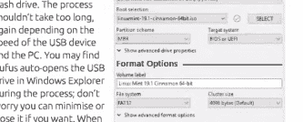

## 在 PC 上安装 Linux

大多数 Linux 发行版都作为*实时环境*提供。这意味着你可以直接从刚才创建的 DVD 或 USB 启动到一个实际、完全可用的发行版。让我们看看它是如何工作的，以及如何从中安装 Linux。

### UEFI BIOS

统一可扩展固件接口（UEFI）用于在 PC 启动过程中识别硬件并保护 PC。它取代了传统的 BIOS，但在安装 Linux 时可能会引起问题。

- **步骤 1** 将你的 DVD 或 USB 闪存盘插入 PC，如果尚未关闭 Windows，请先关闭它。在这个示例中，我们使用 USB 引导介质，但过程几乎相同。启动 PC，并在提示时按下相应的键进入 BIOS 或 SETUP，例如：F2、Del 或甚至是 F12。

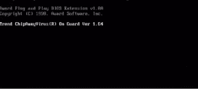

- **步骤 2** UEFI BIOS 有不同的版本，因此涵盖所有版本是不可能的。你要找的是一个详细列出引导顺序或引导模式的区域。在这里，你有选项关闭 UEFI 并选择 Legacy（传统模式）或 Disable Secure Booting（禁用安全启动）。大多数发行版都支持 UEFI，但启用 UEFI 引导可能是一个棘手的过程。

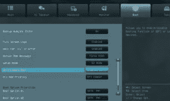

- **步骤 3** 将 UEFI 设置为 Legacy 模式后，现在有两种方式可以启动进入*实时环境*。第一种是通过你已经在其中的 BIOS。找到引导顺序，将第一个启动设备从其原始设置（通常是内部 HDD 或类似项）更改为：如果是 USB 介质选项，则改为 USB Storage Device（USB 存储设备）；如果是 DVD 介质选项，则改为 DVD Drive（DVD 驱动器）。

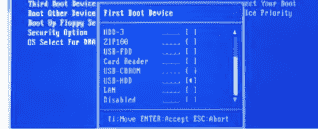

- **步骤 4** 或者，使用 Boot Option Menu（启动选项菜单）。使用此选项，你可以按下 F12（或类似按键）显示一系列启动介质选项；在那里，你可以选择适当的启动介质。无论哪种方式，你都可以通过导航到 Save & Exit（保存并退出）选项并选择‘Save Changes and Exit’（保存更改并退出）来保存并退出 BIOS。

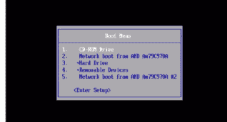


### 安装 Linux

当 Live Environment（实时环境）启动后，你会看到将发行版安装到计算机的选项。可以先四处查看，等准备就绪时，在桌面上查找“Install（安装）”选项。

#### 步骤 1
前提是你已连接互联网（如果未连接，请立即连接），并且你处于实时环境中。双击桌面上的“Install Linux Mint”图标以开始安装过程。其他发行版当然会显示它们自己的名称，但过程是相同的。准备就绪后，点击**继续**。

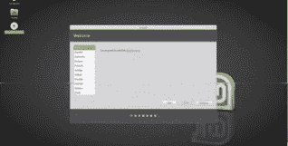

#### 步骤 2
虽然大多数 Linux 发行版的安装过程非常相似，但有些发行版在安装过程中会提出不同的问题。通常，这些问题并不太难，没什么技术性很强的内容，但有些问题，例如“正在安装第三方软件……”可能会让人困惑。在这种情况下，你可以点击**继续**，但如果你不确定，请准备一台连接互联网的设备以便咨询任何问题。

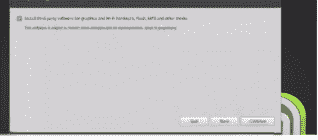

#### 步骤 3
安装新的操作系统时，建议清除旧的操作系统，并用新的系统替换它。当安装过程进行到这一步时，请确保选中了“抹盘并安装 Linux……”选项。**注意：** 这将完全清除计算机上的 Windows 10，因此请务必备份所有个人文件和数据。

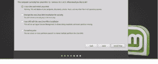

#### 步骤 4
在安装过程开始之前，系统会询问你关于清除硬盘的选择是否正确。这是你最后反悔的机会。如果你确信不介意清除所有数据并重新开始使用 Linux Mint，请点击**继续**。如果你需要备份文件，请移除 Linux 光盘/USB，重启，备份并重新开始。

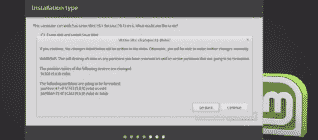

#### 步骤 5
最终，系统会要求你设置 Linux 用户名和密码。首先输入你的姓名，然后是计算机名称，这是该计算机在网络上识别所用的名称。接下来选择一个用户名，然后设置一个好的密码。你可以勾选“自动登录”选项，但暂时保留“加密主文件夹”选项。

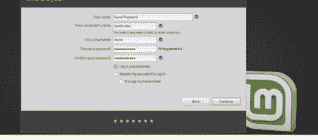

#### 步骤 6
安装过程可能很快，可能会有更多问题需要回答，或者系统可能仅根据你之前的回答直接开始安装 Linux。无论哪种情况，最后你都会被要求**继续测试实时环境**或**重启**以使用新安装的操作系统。如果你准备好使用 Linux，请立即点击**重启**。


### 安装虚拟环境

虚拟环境是一种模拟计算机系统。使用虚拟机（Virtual Machine），你可以模拟标准 PC 并为其安装整个操作系统，而不会影响你计算机上已安装的操作系统。这是一个测试和使用 Linux 的绝佳方式，同时仍保留 Windows 10 作为主要操作系统。

#### 进入虚拟化

使用虚拟机（VM）会占用计算机的资源：内存、硬盘空间、处理器使用率等。在开始之前，请确保你拥有足够的资源。

#### 步骤 1
在此示例中，我们使用 VirtualBox，因为它是最容易掌握的虚拟环境之一。输入 www.virtualbox.org 并点击“Download VirtualBox”。这将带你进入主下载页面。定位适用于你系统的正确主机：Windows 或 Mac，主机是指当前已安装的操作系统，然后点击链接开始下载。

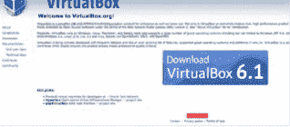

#### 步骤 2
接下来，在 VirtualBox 下载页面，定位到 VirtualBox Extension Pack（扩展包）链接。扩展包支持 USB 设备以及众多其他附加功能，这些功能可以帮助使虚拟机环境更准确地模拟“真实”计算机。

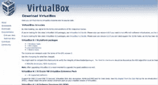

#### 步骤 3
在正确下载软件包之后，且在安装任何内容之前，你需要确保你正在使用的计算机能够托管虚拟机。为此，重启计算机并进入 BIOS。当计算机启动时，按 Del、F2 或必要的键进入设置（Enter Setup）。

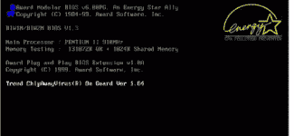

#### 步骤 4
每个 BIOS 的布局都不同，很难评估在每个具体示例中应该在哪里查找。不过，一般经验法则是，你正在寻找的是 Intel 虚拟化技术（Intel Virtualisation Technology），或者简单称为虚拟化（Virtualisation），通常位于 BIOS 的高级（Advanced）部分。找到后，启用它，保存设置，退出 BIOS 并重启计算机。

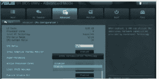

#### 步骤 5
计算机重新启动并运行后，找到已下载的主 VirtualBox 应用程序并双击以开始安装过程。准备就绪后，点击下一步以继续。

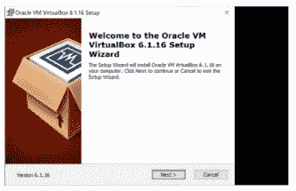

#### 步骤 6
VirtualBox 的默认安装位置应能满足大多数用户，但如果你有特殊的位置需求，请点击“浏览”按钮并更改安装文件夹。然后，确保 VirtualBox 功能树中的所有图标都已选中，即没有图标旁边有红色 X。点击下一步以继续。

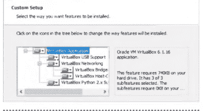

#### 步骤 7
如果你愿意，可以保持此部分的默认设置不变。这只是在处理虚拟机（VMs）时让事情变得稍微简单一些，特别是在处理下载下来的虚拟机时，你可能会在未来遇到这种情况。再次点击下一步进入下一个阶段。

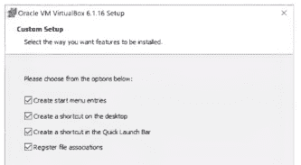

#### 步骤 8
安装 VirtualBox 时，你的网络连接会在很短的时间内被禁用。这是因为 VirtualBox 正在创建一个链接的虚拟网络连接，以便任何已安装的虚拟机都能通过计算机已建立的网络连接访问互联网；以及你的家庭网络资源；点击是，然后点击安装以开始安装。

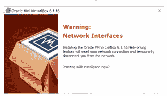

#### 步骤 9
Windows 可能要求你接受安全通知。对此点击是，你可能会遇到一个对话框询问你是否信任来自 Oracle 的安装；再次，点击是并接受安装 VirtualBox 应用程序。完成后，点击完成以启动 VirtualBox。

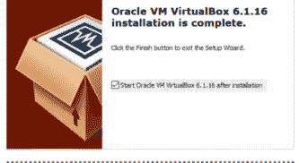

#### 步骤 10
随着 VirtualBox 的正常运行，你现在可以安装 VirtualBox 扩展包了。找到下载的附加组件并双击。在 VirtualBox 分析该扩展包时可能会有短暂的暂停，但最终你会收到安装它的消息；显然，点击安装以开始过程，在下一个屏幕向下滚动以接受协议并点击我同意。

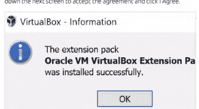

### 在虚拟环境中安装 Linux

随着 Oracle 的 VirtualBox 正常运行，接下来的任务是创建虚拟机（VM）环境，你将在其中安装 Linux。此过程不会影响你当前安装的操作系统，这就是为什么虚拟机是一个绝佳选择的原因。

#### 创建虚拟机

创建虚拟机时有很多选项可供选择。不过暂时，我们将设置一个足以运行出色的 Linux Mint 且性能良好的虚拟机。

- **步骤 1**
  在 VirtualBox 中，点击应用右侧面板顶部中间的“新建”图标。这将打开新虚拟机向导。

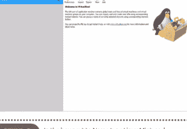

- **步骤 2**
  在名称旁边的框中输入 Linux Mint，VirtualBox 应自动将类型选择为 Linux，版本选择为 Ubuntu (64-bit)，如果没有，请使用下拉框选择正确的设置（请记住 Mint 的主流版本基于 Ubuntu）。准备继续时，点击下一步。

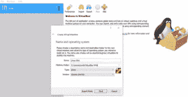

- **步骤 3**
  下一部分将定义分配给虚拟机的系统内存（或 RAM）数量。请记住，这部分内存将从你计算机中安装的可用内存中扣除，因此不要给虚拟机分配过多。例如，我们安装了 8GB 的内存，我们给虚拟机分配 2GB（2048MB）。准备就绪后，点击下一步以继续。

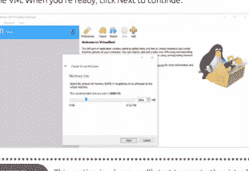

- **步骤 4**
  在此部分，你将开始创建虚拟机将用于安装 Mint 的虚拟硬盘。默认选项“立即创建虚拟硬盘”是我们正在使用的。点击创建以继续。

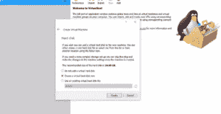


### 在虚拟化环境中安装 Linux

**步骤 5** 点击“创建”后弹出的窗口询问您想要创建哪种类型的虚拟硬盘。在这种情况下，我们将使用默认的 VDI（VirtualBox 磁盘映像），因为其他选项通常用于在不同 VM 应用程序之间迁移虚拟机。请确保选中 VDI，然后点击“下一步”。


**步骤 6** 关于选择动态分配还是固定大小的虚拟硬盘，这个问题对初学者来说可能有些令人困惑。基本上，动态分配的虚拟硬盘是更灵活的存储管理选项。它最初也不会占用物理硬盘上的太多空间。请确保选中“动态分配”，然后点击“下一步”。


**步骤 7** 虚拟硬盘将是一个单独的文件夹，大小取决于您在此部分设定的数值。请确保虚拟硬盘在计算机上的位置有足够的可用空间。例如，我们在 D:\ 驱动器上使用了较大的存储选项，将其命名为 Linux Mint，并为虚拟硬盘分配了 25.50GB 的空间。


**步骤 8** 点击“创建”后，VM 的初始设置就完成了；现在您应该在 VirtualBox 应用程序中看到新创建的 VM。不过，在开始之前，请从右侧面板顶部点击“设置”按钮，并在“常规”部分点击“高级”选项卡。使用下拉菜单，将“共享剪贴板”和“拖放”都选择为“双向”。


**步骤 9** 接着点击“系统”部分，然后点击“处理器”选项卡。根据您的 CPU，尽可能多地分配核心，但不要损害宿主系统的性能；我们选择了两个 CPU。现在点击“显示”部分，将视频内存滑块拉到最大值，并勾选“启用 3D 加速”。点击“确定”以保存新设置。


**步骤 10** 点击“启动”按钮，并在“选择启动磁盘”窗口中使用浏览按钮；浏览按钮是一个带有绿色箭头的文件夹图标。在新弹出的窗口中点击“添加”，以定位下载好的 Mint ISO 文件；然后点击“打开”以选择该 ISO。现在点击“启动”按钮以 Linux Mint 实时环境启动 VM。您现在可以根据标准 PC 安装要求安装 Linux 了。


> “任何人都能制造出快速的处理器。诀窍在于制造出快速的系统。”
>
> — Seymour Cray（电气工程师，Cray 超级计算机的设计者/创始人）


### 了解 Linux

我们在此处使用 Linux Mint 作为指南，因为它是一个易于使用的发行版，非常适合前 Windows 用户。它也是开发最完善、文档最齐全的 Linux 发行版之一，并拥有一些出色的配置选项。

在本节中，我们将介绍 Linux Mint 的 Cinnamon 菜单和桌面环境，它的工作原理以及您可以如何对其进行自定义。想要创建另一个用户，甚至探索如何在线匿名吗？那么请继续阅读。

#### 认识 Cinnamon 菜单

既然您已经安装了 Linux，现在是时候好好了解一下周围的环境了。不过首先，如果您使用的是 VirtualBox，您会看到一个关于软件渲染的通知；以下是修复方法。

##### Cinnamon 的 VirtualBox 修复

您已经查看过一些列表函数，使用了 .insert、.remove 和 .pop，但也有可以应用于字符串的函数。

**步骤 1** 在我们开始之前，我们假设您正在 VirtualBox 中遇到此问题。软件渲染消息显示在桌面的右上角。要修复此问题，请点击 VirtualBox 窗口中的“设备”，然后点击“插入客户机增强功能 CD 映像”。


**步骤 3** 片刻之后，您会自动进入命令行视图，在 Linux 中称为终端。这将详细说明新 VirtualBox 驱动程序的安装过程，移除它检测到的任何旧驱动程序，并安装最新版本。这不会花很长时间，完成后，系统会要求您按回车键退出终端。


**步骤 2** 客户增强功能 CD 包含 VirtualBox 的驱动程序，包括虚拟视频硬件。加载后，您会看到一个“需要运行软件”的通知框，有两个选项：“取消”和“运行”。点击“运行”按钮并输入您的 Linux 用户密码。


VirtualBox 增强功能 CD 图标位于桌面上，因此右键单击它，然后向下滚动菜单并点击“弹出”。现在您可以通过点击菜单、左侧条带底部的图标，然后点击“重新启动”按钮来重启 Linux Mint。这将重启 Mint，问题也就解决了。


#### 菜单中的 Cinnamon

现在 VirtualBox 用户的软件渲染问题已经解决，让我们来看看 Mint 菜单及其工作原理。请记住，这仅适用于 Mint Cinnamon，其他发行版的外观和行为会有所不同。

**步骤 1** 首先，您可能已经注意到登录 Linux Mint 时弹出的欢迎屏幕。花一点时间浏览选项，阅读“第一步”等内容。完成后，点击窗口右上角的 X 将其关闭。


**步骤 2** 您之前已经使用过 Mint 菜单来重启系统，并在首次使用实时环境时使用过它。这次，点击“菜单”按钮，将鼠标悬停在中间列的“办公”条目上。这会更改右侧列中显示的图标，详细说明该部分下安装了哪些应用程序。


**步骤 3** 从菜单中启动任何应用程序都很简单，只需找到并点击它即可。例如，在“办公”部分下，点击 LibreOffice Writer：Writer 是 Linux Mint 预装的文字处理器。它可以以 Microsoft Word 格式打开和保存，功能也几乎相同。


**步骤 4** 再次打开菜单，这次将鼠标指针悬停在“图形”上，然后点击“GNU 图像操作程序”。GIMP 是一款强大的图像处理应用程序，其效果可能不亚于 Adobe 的 Photoshop，但需要更多的工作才能达到您想要的结果。不过，它绝对值得花时间精通。

**步骤 5** 如果您正在寻找特定的功能或应用程序，例如设置打印机，请点击菜单框顶部的搜索框。开始输入您想要的应用程序或功能，例如打印机，Mint 菜单会在下方显示相关选项。无论哪个发行版，这在大多数现代 Linux 菜单中都能正常工作。

**步骤 6** 将鼠标悬停在右侧列中列出的任何应用程序上并右键单击，会显示一系列选项：“添加到面板”、“添加到桌面”、“添加到收藏夹”和“卸载”。这些选项中大多数用途都很明显。不过，“添加到收藏夹”会将该应用程序放置在左侧的快速访问列中。

### 导航 Cinnamon 桌面

每个桌面环境的行为都各不相同。一些 DE 提供可以自定义并放置在桌面上的小部件，而另一些则选择简洁、锐利的外观，以尽可能保持快速运行。让我们看看 Cinnamon 桌面提供了什么。

#### 一点辛辣点缀

Cinnamon 桌面环境是风格与性能的绝佳融合。它有很多值得喜欢的地方，这就是为什么它如此受欢迎。

**步骤 1** 通过双击“计算机”图标开始探索 Cinnamon 桌面。这会调出 Nemo，即 Cinnamon 使用的文件管理器。“计算机”图标打开根级别文件系统，可以访问并查看光驱（如果已安装）、硬盘和核心 Linux 文件系统。


**步骤 2** Linux 文件系统对于前 Windows 用户来说可能显得混乱，因此在您对如何工作了解得更多之前，我们建议您专注于桌面上的“主目录”图标。这里包含了与您的用户账号相关的一切：您存放图片、视频、音乐、文档、下载项等的地方。


**步骤 3** Nemo 拥有许多不同的功能、视图和方式来查看和操作文件和文件夹。例如，如果您在“图片”文件夹中有任何图像，您可以使用位于 Nemo 右下角的滑块（标有“调整缩放级别”）来选择图像的图标缩放级别。


**步骤 4** 就像任何好的文件管理器一样，如果您对其中任何文件或文件夹进行右键单击，您将获得大量选项。在 Cinnamon 的情况下，默认允许您根据文件类型播放或查看文件，以及复制、剪切、删除、压缩、重命名、通过电子邮件发送和查看其属性。


## 导航 cinnamon 桌面

**第 5 步** 在桌面底部是面板（Panel）。我们已经查看过面板的一个部分，即菜单。如果在面板的任何位置（面板上的应用程序除外）进行右键单击，你将看到一个允许你编辑、添加并以不同方式设置面板的菜单。


**第 6 步** 例如，如果你点击“修改面板”（Modify Panel）选项，你可以移除、移动、重新编号、修改面板，添加新面板，并清除当前存在的小工具（Applets）。顺便说一下，小工具（Applet）是专为在 Cinnamon 面板中运行和适配而设计的应用程序。


**第 7 步** 如果在 Cinnamon 桌面的任何位置右键单击，你会看到一组允许你进一步添加、编辑或以不同方式查看桌面内容的选项。这与 Windows 非常相似，这就是为什么 Mint 是前 Windows 用户的良好选择。


**第 8 步** 从该桌面右键菜单中，选择“自定义”（Customize），然后选择新打开窗口底部的“桌面图标设置”（Desktop Icons Settings）链接。这会打开一个新窗口，你能够编辑存在哪些桌面图标。如果你使用的是连接了多个显示器的设置，你还可以选择哪个显示器显示哪些图标。


**第 9 步** 点击菜单并输入 `system settings`，然后打开生成的图标。这将带你进入系统设置选项。从这里，你可以控制和编辑 Linux Mint Cinnamon 的外观和工作方式，还可以添加新用户、管理防火墙以及启用无障碍选项。


**第 10 步** 简而言之，Linux Mint Cinnamon 可以被配置得相当出色。有许多示例展示了它的良好程度以及可以实现的效果。你可以选择复杂或简单，添加不同的组件和动画，或者保持其简洁易读。


## 安装 Linux Mint 后的 10 件事

Linux Mint 开箱即用的发行版经过精心打磨，但与大多数 Linux 发行版一样，有一些调整可以改善其工作方式。虽然这些是 Mint 特有的调整，但大多数都可以应用于其他发行版。

### Linux 调整

其中一些安装后操作是高度推荐的，而另一些只是方便的功能，用于微调系统或添加自定义设置。

### **第 1 步**

首先，也是最重要的是安装后更新系统。点击面板中的盾牌图标，它位于桌面右下角的时间/日期旁边。这将启动更新管理器（Update Manager）。


### **第 2 步**

Linux Mint 提供三种级别的更新策略：不弄坏我的电脑（Don't Break My Computer）、优化稳定性和安全性（Optimise Stability and Security）以及始终更新所有内容（Always Update Everything）。推荐选项是“优化稳定性和安全性”，它只更新不会影响核心操作系统关键元素的、安全的必要补丁。请阅读描述，但选择中间也是推荐的选项。


### **第 3 步**

点击“确定”（OK）按钮，你将看到几个准备安装的更新。但在更新之前，点击蓝色条上的“确定”按钮切换到本地镜像（Local Mirror）。这将打开“软件源”（Software Sources）选项。在“镜像”（Mirrors）部分，点击“主”和“基础”（Main and Base）下拉菜单，并选择离你当前位置最近的服务器。


### **第 4 步**

点击“更新缓存”（Update the Cache）按钮，然后关闭软件源窗口。回到更新管理器，点击“安装更新”（Install Updates）图标并输入你的密码。更新会自动应用并重新启动更新管理器；这次会有更多选项。再次点击“安装更新”，确认所有消息，并等待完成。


### **第 5 步**

更新按级别分级，级别 1 是低级到级别 3 的更新，级别 5 是危险的更新。请坚持使用级别 3 的更新，如果你配置了关于覆盖配置文件的替换消息，请点击“替换”（Replace）。关于软件渲染问题以及非 VirtualBox 用户缺少驱动程序的问题，点击菜单并在搜索框中输入“driver”。


### **第 6 步**

点击搜索结果中出现的“驱动程序管理器”（Driver Manager）应用程序并输入你的密码。Mint 会花一点时间分析可用的内容，并根据检测到的硬件向你展示一组潜在驱动程序的列表。遇到图形问题（如软件渲染）的用户应选择使用最新的推荐图形驱动程序。


### **第 7 步**

此时你很可能需要重启 Linux Mint，所以现在就执行此操作。重启后，再次点击“菜单”按钮，然后选择“终端”（Terminal）。终端图标位于左侧栏，在“文件”（Files）图标上方。打开终端后，输入：`sudo apt-get install libdvd-pkg` 按 Enter 并输入你的密码。这可以启用加密 DVD 播放功能。


### **第 8 步**

当被要求接受更改时，输入 Y，当被要求配置 lsbvd 时同样输入 Y。确保 OK 被高亮显示，然后按 Enter，对任何进一步的问题回答 Yes。接下来，仍在终端中，输入：`cat /proc/sys/vm/swappiness`；结果应为 60。如果你的电脑 RAM/内存少于 4GB，请输入：`gksudo xed /etc/sysctl.conf`。


### **第 9 步**

此调整有助于提高内存少于 4GB 的系统性能。向下滚动到你刚才打开的文件底部，并添加以下新行：

`# Decrease swap usage to a more reasonable level`

`vm.swappiness=10`

点击“文件 > 保存”，然后“文件 > 退出”。重启 Linux Mint，你应该会注意到性能略有提升。


### **第 10 步**

在如今这个数字化时代，安全始终是一个关注点。虽然 Linux Mint 是一个安全的系统，但建议始终尝试改进它。点击“菜单”按钮并搜索“Firewall”；点击“防火墙配置”（Firewall Configuration）图标并输入你的密码。在防火墙窗口中，点击状态滑块将其设为“开”（On）。


## 阿波罗 11 号

**你知道吗……** 1969 年 7 月 20 日被铭记为人类历史的转折点，那是人类首次踏上月球的时候。帮助宇航员完成那次关键旅程的软件在当时甚至不存在，必须从头开发。麻省理工学院仪表实验室（MIT Instrumentation Laboratory）的工程师使用一种名为绳存储器（Rope Memory）的新方法来存储程序，用汇编语言的特殊版本填充了存储器。

令人难以置信的是，那段代码在 GitHub 上可以免费查看。由一位研究人员于 2003 年上传，你可以通过访问 www.github.com/Chai2010/aag/Apollo-11 来查看代码。留意代码片段，例如 Burn_Baby_Burn，特别是第 925 行，注释为“再见。很快再回来。”（Goodbye. Come again soon.）

浏览一下，看看你还能找到什么。


你知道吗……

人类的一大步，也是编程的一大步。


信用：Apollo 11/NASA

## 创建用户

当你首次安装 Linux Mint 时，它被配置为单用户模式。虽然与家人共享用户账号没问题，但可能会出现你需要创建具有自己独立主文件夹的独立用户的情况。

### 新用户

拥有不同的用户意味着每个用户都可以访问系统中属于他或她自己的区域。文档、图片、视频等是独立的，这与在其他操作系统中的多用户情况类似。

**第 1 步** 点击 Linux Mint 菜单并输入 'users' 开始搜索相关的控制台。从搜索结果中，选择“用户和组”（Users and Groups）并输入你的密码。“用户和组”控制台看起来相当简单，幸运的是它很容易使用。起初，你只能看到安装 Linux Mint 时自己的用户名。


**第 2 步** 要添加新用户，点击控制台底部的“添加”（Add）按钮。你可以创建两种类型的用户：标准（Standard）和管理员（Administrator）。除非新用户需要安装新应用程序或访问主文件夹之外的文件系统部分，否则请选择标准账号类型。否则，请使用管理员账号类型。


**第 3 步** 输入新用户的“全名”（Full Name），然后输入登录 Linux Mint 时需要的“用户名”（Username）。确保用户名全部小写，仅限 a-z 和 0-9 字符。如果你愿意，可以使用句号、下划线或连字符。准备好继续时，点击“添加”按钮。


**第 4 步** 新用户会出现在当前 Linux Mint 用户的列表中，按字母顺序排列。目前，尚未设置密码，因此点击当前用户列表中的该用户，然后点击用户名下方的“未设置密码”（No Password Set）选项。


#### 步骤 5
现在，你可以为新用户输入密码，或者点击“新密码”文本框末尾的弯曲箭头来为你生成一个密码，并显示出来。显然，尽可能设置一个强密码是个好主意。完成后，点击“更改”按钮。

#### 步骤 6
现在，你可以关闭“用户和组”控制台窗口，因为新用户已经创建完成。如果你点击薄荷菜单，接着点击“注销”，你将看到薄荷登录管理器。新用户现在已出现在当前可用用户列表中。点击该用户以登录其账户。

#### 步骤 7
一旦登录，新用户需要设置自己的桌面壁纸、图标、面板、菜单等。根据你为他们设置的账户类型（标准或管理员），他们可能无法安装任何新应用。此截图来自一个标准用户账户类型。

#### 步骤 8
你可以创建任意数量的新账户，并在需要时在它们之间切换。最好只保留一个能够安装新软件的账户，这样你可以跟踪系统上的内容。

### 命令行账户
正如你所预期的，你也可以在命令行中创建新用户。在主（你的）管理员账户下打开一个终端会话。

#### 步骤 1
从命令行添加新用户的流程相对简单。首先，输入：`sudo adduser <username>`，其中 `<username>` 是新用户的登录名。然后，系统会要求你为用户创建一个新密码，以及他们的全名和其他详细信息。点击 *y* 确认详细信息并创建用户账户。

#### 步骤 2
你可以在“用户和组”控制台中查看新用户的信息和账户类型。如果你想从薄荷系统中删除用户，你可以在终端中输入 `sudo deluser <username>`，或者点击“用户和组”中的“删除”按钮。

### 自定义桌面
自定义操作系统桌面是让你拥有个人化工作区的一种方式：一个帮助你工作、激发你灵感或展示公司标志的个性化空间。无论你的理由是什么，以下是如何实现的方法。

#### 你的桌面
Linux 可能是有史以来最具可定制性的操作系统之一。只需进行一些调整，安装一两个附加组件，加上一些想象力，你就可以创造出令人惊叹的东西。

- **步骤 1** 桌面定制的第一个方面是更改壁纸。右键点击桌面并选择“更改桌面背景”。这将打开 Linux Mint 的“背景”应用程序；请记住，其他发行版的背景或壁纸选择工具可能呈现方式不同。


- **步骤 2** 较新版本的 Linux Mint 会根据用户运行的版本显示可用的背景。你通常会看到三个类别，随后是第四个，即“图片”，它与其他类别分开。图片选项不同，因为它从主目录中的“图片”文件夹读取图像内容。


- **步骤 3** 你只需点击任何提供位置中的可用图像，即可将其安装为桌面壁纸。顺便提一下，如果你在其他系统或网络位置存储了图像，你可以点击“背景”控制台底部的加号，使用文件管理器找到它们并添加。


- **步骤 4** 通过点击“设置”标签页，你可以播放多张图像作为幻灯片，或者将壁纸的宽高比更改为各种选择。


- **步骤 5** 如果没有任何可用的壁纸吸引你，打开浏览器并搜索你喜欢的背景图像类型。当你找到想要的图像作为桌面壁纸时，右键点击它并从选项列表中选择 **设为桌面背景**。当 **设置桌面背景** 控制台打开时，点击 **设置桌面背景** 按钮。


- **步骤 6** 点击“菜单”按钮，搜索“desktop”（桌面），然后点击“Desktop Settings”（桌面设置）结果。桌面控制台允许你选择你想要的布局、桌面图标以及多显示器支持选项。你可以根据个人喜好试验各种选项以找到最佳设置。


- **步骤 7** 除了更改桌面壁纸和图标显示方式，你还可以更改 Linux Mint 的整体主题。从薄荷菜单中，搜索“themes”（主题），然后点击搜索结果中出现的“Themes”应用程序。


- **步骤 8** “主题”允许你更改 Mint 桌面的某些外观方面：窗口边框、图标、控件、鼠标指针和桌面。在“设置”标签页中，你还可以通过几个开/关滑块按钮扩展选项。


- **步骤 9** 如果你点击三个可用选项中间的 **添加/移除** 按钮，你可以从多个预安装主题中选择默认视图。点击你想要的主题，然后点击 **安装**（向下箭头）按钮以启用它。


- **步骤 10** 点击回到 **主题**，然后点击 **桌面**，你可以找到新安装的主题并将其应用到你的桌面。任何已安装的主题也可以通过 **添加/移除** 按钮卸载。花些时间个性化你的桌面是有价值的，也有许多令人难以置信的主题可供选择。


### 在线匿名
数字时代带来了通信领域的许多重大进步；然而，它也带来了窥探和监视的新时代。我们大多数人并不陌生于关于政府、秘密组织和地下黑客破坏我们隐私的频繁新闻报道，但你如何对抗这一切？

#### 使用 Mint 实现匿名
虽然几乎不可能在网上完全匿名，但你可以采取措施确保我们的隐私达到最佳状态。

- **步骤 1**
  从基础开始，浏览时使用 HTTPS 而不是标准的 HTTP。这意味着通过 HTTPS 传输的任何内容都是安全的（因此末尾有 S）并经过加密。


- **步骤 2**
  浏览时，考虑使用浏览器提供的隐身或私人浏览模式。这禁用了你的 Web 历史记录和 Web 缓存，允许你在不存储细节供他人日后审查的情况下浏览。然而，它不能阻止任何数据或搜索跟踪。


- **步骤 3**
  虽然使用 Google 可能是现代互联网搜索的明显选择，但该公司确实跟踪个人的所有搜索。相反，考虑使用替代搜索引擎，例如 DuckDuckGo，一个不存储个人数据或跟踪你的搜索引擎。


- **步骤 4**
  如果你经常上网，考虑安装一些增强隐私的浏览器插件。例如，对于 Firefox，使用 Ghostery、NoScript 和 AdBlock Plus 来阻止跟踪器、广告和其他数据挖掘技术。


### VPN 与 Tor

之前的步骤有助于保护您的在线隐私，但若要真正匿名，您还需要虚拟私人网络（VPN）和 Tor。

#### 步骤 1
VPN 是一台远程服务器，或一组服务器集群，它会与您的计算机建立连接。最终结果是您的计算机在互联网上的身份被隐藏在 VPN 远程服务器之后；因此，即使您居住在英国，也可能拥有一个属于冰岛的 IP 地址（即计算机的在线身份）。

#### VPN 是如何工作的？


#### 步骤 2
大多数优秀的 VPN 都需要支付月度或年度费用，但这笔花费是值得的。我们使用 CyberGhost，[www.cyberghostvpn.com](http://www.cyberghostvpn.com)，它提供适用于 Windows、Mac、Mint（以及其他 Linux 发行版）、Android 和 iOS 设备的 VPN 连接。各操作系统的详细信息可在 [www.support.cyberghostvpn.com/hc/en-us/articles/213190329-Read-me-first.](http://www.support.cyberghostvpn.com/hc/en-us/articles/213190329-Read-me-first.) 上找到。


#### 步骤 3
另一个选择是使用 Tor。Tor 是一个开放网络，它通过在全球无数节点后隐藏您的 IP 地址，帮助掩盖您的活动。它适用于 Windows、Mac 和 Linux 计算机，安装和使用都非常简单。首先请访问 [www.torproject.org/download/download-easy.html](http://www.torproject.org/download/download-easy.html) 并点击“下载 Linux 64 位”按钮。


#### 步骤 4
下载完成后，进入终端并进入下载文件夹，输入 `cd Downloads/`。输入 `ls` 检查 tor.xz 文件是否存在，然后输入 `tar -xf tor-browser--linux-x86_64-0.4.8-en-US.tar.xz` 进行常规解压。如果您的版本不同，请按 Tab 键自动补全 tor--browser--文件名。文件解压后，使用 `cd tor-browser_en-US/` 进入新文件夹。


#### 步骤 5
快速执行 `ls` 命令会显示几个条目：一个名为 Browser 的文件夹和一个名为 `start-tor-browser.desktop` 的文件。要启动 Tor 设置，请输入 `./start-tor-browser.desktop`。此命令将启动 Tor 设置，您将被提供两个选项：连接（Connect）或配置（Configure）。对于大多数用户来说，连接选项就足够了。准备好后点击连接。


#### 步骤 6
连接建立后，Tor 浏览器将启动。这是 Firefox 的一个定制版本，可以帮助您安全地浏览互联网，无需担心被监视或跟踪。同时使用 VPN 和 Tor 可以形成极其安全和私密的在线世界连接。


> “Linux：一个具备 CLUE（常见知识线索）的操作系统……命令行用户环境。”
> - *匿名（发布于 comp.software.testing）*


### 使用终端

Linux 命令行，即终端，是一个功能极其强大的环境。通过它，您可以让操作系统“屈服”，或将其更新到令人惊叹的状态。您可以入侵远程计算机，查看动态 ASCII 篝火，安装新的应用程序和程序，观看从荷兰服务器播放的星球大战，以及编写复杂的自动化脚本。

在本节中，您将探索终端的复杂性以及它与 Linux 的配合方式。您将学习如何从终端操作 Linux 文件系统，但您也会发现终端中一些奇特但有趣的功能。

在 Linux 世界中，终端至高无上。了解其工作原理，您就能获取其所有强大功能。

### 终端基础

大多数操作系统使用两种类型的界面：图形用户界面（GUI），即 Windows、macOS 和 Linux Mint 启动后进入的桌面环境；以及命令行。虽然现代操作系统尽量避免使用命令行，但 Mint 使用终端赋予用户更大的系统控制权。

### 掌握命令

命令行，或终端，是一个极其强大的界面。您在桌面上能做的所有事情，都可以在终端中完成。让我们从了解其工作原理开始。

- **步骤 1** 您可以通过点击面板上的终端图标来访问终端，该图标位于 Firefox 和文件图标之间；或者通过打开菜单并从左侧快速启动条中选择来启动终端。


- **步骤 2** 终端让您访问 Linux Mint Shell，即 Bash，它允许您访问底层操作系统。Mint 中的所有内容，包括桌面和 GUI，都是作为模块从命令行运行的。

- **步骤 3** 您当前在终端中看到的内容是您的登录名，后跟计算机名称；这是您在首次安装 Mint 时设置的名称。该行以当前文件夹名称结尾；起初这只是一个波浪号 ~，意味着您的主文件夹。


- **步骤 4** 行末闪烁的光标是输入基于文本的命令的地方。您可以开始尝试一个简单的命令：打印工作目录（pwd），它将当前所在的文件夹输出到屏幕。输入 pwd 并按 Enter。

- **步骤 5** 您输入的所有命令都以相同的方式工作：您输入命令，包含任何扩展命令使用的参数，并按 Enter 执行您输入的命令。在终端中输入：uname -a 并按 Enter。这将显示一些关于 Mint 的系统信息。

- **步骤 6** 在输入命令之前，让我们花点时间看看终端提供哪些菜单。文件菜单选项允许您打开新终端、创建新配置文件（您可以在其中更改终端的大小、颜色和行为）、添加新标签页以及关闭所有当前活动的终端会话。

- **步骤 7** 编辑选项允许您将命令从终端复制到其他来源，或从其他来源复制到终端；当您想要从网页复制非常长且复杂的命令时，这非常方便。它还允许您编辑当前配置文件的偏好设置。

- **步骤 8** 查看和搜索选项允许您调整终端窗口的大小，当然也可以在终端内搜索特定的关键词。

- **步骤 9** 终端条目扩展了配置文件编辑和大小调整，并允许您更改字符编码。有趣的是，您还可以将其设置为只读模式，这会阻止您向终端输入任何命令；这在需要永久显示终端内容时很有用。

- **步骤 10** 最后，帮助选项显示终端的帮助内容和版本号，或者更准确地说，是 GNOME 终端；我们以后将简单地称其为终端。内容值得快速浏览一遍，以帮助熟悉终端的工作原理。

### 通过终端更新 Mint

到目前为止，您一直在使用盾牌图标启动 Mint 更新管理器，以便更新系统并升级当前安装的应用程序、工具和其他元素。然而，您也可以从终端完成完整的系统更新和升级。

### 使用 APT-GET

要通过终端进行更新和升级，您需要使用 APT（高级打包工具）命令。它是一个强大的命令，并根据用途结合不同的元素。

#### 步骤 1
首先打开一个新终端，或者如果您已经打开了一个终端，使用 clear 命令清除其内容。这为您在一个干净的界面上开始工作做准备。


#### 步骤 3
Apt-get 用于更新和升级 Mint 中的软件，以及 Ubuntu 和其他基于 Debian 的发行版。使用 Update 元素可检索新的软件包列表并更新源文件列表。Upgrade 会下载并执行升级至这些文件的最新版本。要开始整个升级和更新过程，请输入：`sudo apt-get update`，然后输入您的密码。


#### 步骤 2
在终端中输入 `apt-get`。这会列出最常用的 apt-get 命令，并简要描述命令的作用。即使此时它没有太多意义，也值得查看一下。


#### 步骤 4
注意现在添加了 sudo 命令。sudo 命令曾意为“超级用户执行（Super User Do）”，如今更被接受为“替代用户执行（Substitute User Do）”。这意味着管理员用户（超级用户）使用 APT（高级打包工具）获取任何更新。现在试试这个：`sudo apt-get upgrade`。


### 通过终端更新 Mint

#### 第 5 步

根据你更新的状况，如果有任何待安装的内容，你可能会被询问是否要应用 `sudo apt-get upgrade` 命令的结果。你可以按 Y 键接受并继续。这里正在发生的是，apt-get 有一些更新软件需要应用到 Mint 上，我们正在确认执行此操作。


#### 第 6 步

你的终端窗口可能会显示一长串看似无意义内容的列表，但别担心。升级所需的文件已经下载、准备、解包、处理、安装并正确设置完毕。即使是最小的软件包，执行升级时背后也有许多运作正在进行。


#### 第 7 步

基本上就是这样了，根据 `sudo apt-get update` 命令提供的可用软件包列表，你的系统现在是最新的。你可以再运行一遍该流程，以检查一切是否正常。总结一下，请输入：`sudo apt-get update`，按 Enter，然后输入：`sudo apt-get upgrade` 并按 Enter。


#### 第 8 步

有趣的是，Linux Mint 以及其他发行版都提供了将多个命令串联起来的功能。因此，在这个示例中，我们可以使用 `sudo apt-get update && sudo apt-get upgrade`。双与符号（&&）用于组合命令，只要前一个命令没有出错，它就能完美工作。建议在每次会话开始时都运行更新和升级的组合命令。


## 终端还是更新管理器？

无论你使用哪种发行版，为什么使用终端来更新和升级，而不是使用更新管理器呢？一些用户非常倾向于使用终端来更新他们的 Linux 系统及附带的应用程序，认为这样更好。然而，事实往往并非如此。

使用终端时，`apt-get upgrade` 无法处理软件包版本之间依赖关系的变化，因此如果一个软件包的依赖文件从一个版本到另一个版本发生了变化，升级就会被保留（搁置）。

更新管理器或软件管理器（取决于发行版）通常会分阶段处理更新，并标记那些依赖关系发生变化的软件包以便更新。然而，这正是 Linux 经常让人感到困惑的地方，有时它又不会这样做。

归根结底，这取决于被更新软件包的开发者，以及该软件包在发行版仓库中的存储方式，还有该更新是否被归类为稳定版。从用户的角度来看，本质上，如果你定期使用终端和更新管理器进行更新和升级，你就能保持尽可能新的状态，并获得基本且必要的稳定版本软件包和核心软件。如果你追求最前沿的软件包更新，最好选择滚动更新类型的发行版。

## 通过终端安装应用程序 – 第一部分

在 Linux 上安装应用程序和程序有多种方法。你可以选择图形化路线，使用软件管理器，或者使用终端。通常，终端提供了对所安装软件的更好控制，有时你在这方面也没有选择余地。

### 命令行安装

使用终端安装应用程序可能需要一些灵活的键盘操作，但你能更清楚地了解正在安装什么以及安装在哪里。

- **第 1 步**：通过终端安装应用程序通常比较简单。不过，首先你需要确保系统是最新的。为此，打开终端并输入：`sudo apt-get update && sudo apt-get upgrade`。输入你的密码并接受任何必要的更新。


- **第 2 步**：正如你所见，`sudo apt-get update/upgrade` 等命令旨在升级系统中已安装的软件。那么如何安装更多应用程序呢？其实这非常简单。首先你需要一个要安装的应用程序，让我们再次使用 Stella。输入：`sudo apt-get install stella`。


- **第 3 步**：你需要输入 y 以确认安装，这将占用系统中约 5.5MB 的存储空间。Stella 安装完成后，你可以再次看到 Mint 在菜单中自动创建了“游戏”类别以及应用程序快捷方式。


- **第 4 步**：有时，在安装软件时，你需要添加该应用程序的软件仓库。仓库（repo）仅仅是保存软件及其所有依赖项（使其正常运行所需的重要库等）的远程服务器位置。先输入以下内容：`sudo add-apt-repository ppa:peterlewi/ppa`。当被要求添加 PPA（个人软件包存档）时，按 Enter。


#### 第 5 步

这将添加 Variety 壁纸更换器的仓库，这是一个基于 Ubuntu 的应用程序，在 Mint 中可用并能自动更换壁纸。既然仓库已添加，请输入：`sudo apt-get update`，以更新新信息并将仓库内容添加到软件包数据库中。


#### 第 6 步

现在要安装 Variety，请输入：`sudo apt-get install variety`。按 y 以确认并接受安装，以继续安装过程。安装完成后，你可以在终端中输入 `variety` 来运行该应用程序。


### 移除应用程序

除了安装应用程序外，`apt` 命令还可用于移除任何应用程序，有助于保持系统整洁并释放资源。

#### 第 1 步

要卸载或移除 Variety 应用程序，请输入以下内容：`sudo apt-get remove variety`。输入 y 以继续卸载该应用程序；请注意，移除应用程序后，你还会收到关于硬驱动器释放了多少空间的信息。


#### 第 2 步

虽然 'apt-get remove' 命令会卸载应用程序，但它不会清除随应用程序而来的额外杂乱文件，例如配置文件和库文件。要彻底清除这些杂乱文件，请输入：`sudo apt-get purge variety`。


#### 第 3 步

当你从系统中移除应用程序时，你会收到一些自动安装且不再需要的软件包的信息。你在之前的教程中已经看到，你可以使用以下命令来清理：`sudo apt-get autoremove`，然后按 y 接受该过程。


#### 第 4 步

最后，为了清理系统中所有未使用的软件包，并移除 autoremove 命令未清理的元素，你可以输入：`sudo apt-get autoclean`。最后这几个步骤对于保持 Linux Mint 系统处于良好运行状态以及削减因安装和升级造成的不必要冗余至关重要。


## 通过终端安装应用程序 – 第二部分

大多数时候，你可以使用标准的 `apt-get` 命令从终端安装应用程序。然而，有时应用程序需要更多的操作。这意味着从源代码安装应用程序，这听起来虽然吓人，但其实并不可怕。

### 从源代码

你需要熟悉这里的命令是 Configure、Make 和 Install。你会发现很多应用程序都是从源代码安装的，所以这绝对是值得投入时间掌握的一项技能。

1. **第 1 步**：Linux 的源代码文件通常以 `.TAR.GZ` 或 `.TAR.BZ2` 形式提供。两者都是压缩文件，包含构建应用程序所需的所有核心文件。通过这个教程，通过在主目录创建新文件夹来开始：`mkdir vim`。
2. **第 2 步**：顺便说一下，Vim 是一个高级文本编辑器，我们将用它作为安装示例。进入新文件夹，`cd vim`，然后在新 Vim 文件夹内，在终端中输入以下命令：`wget ftp://ftp.vim.org/pub/vim/unix/vim-7.4.tar.bz2`。
3. **第 3 步**：`wget` 命令从互联网获取内容，在这种情况下是 Vim 的 BZ2 文件。要检查文件是否成功下载，请输入 `ls`。根据 Mint 的文件系统颜色标记，压缩文件应以红色显示。


4. **第 4 步**：现在我们需要解压缩文件的内容，所以在终端中输入：`tar -xf vim-7.4.tar.bz2`。注意：你可以输入 `tar -xf v` 并按 Tab 键来自动填充剩余的文件名。


## 通过终端安装应用程序 — 第 2 部分

- **步骤 5** 如果你再次输入 `ls`，你会注意到一个新文件夹已被创建：`vim74`；在 `Mint` 系统中，文件夹通常以浅蓝色文本表示。为主应用程序创建根文件夹总是很方便。你可以通过这种方法升级应用程序，每个版本将有其自己的文件夹。


- **步骤 6** 输入 `cd vim74` 以进入该文件夹，然后再次输入 `ls` 查看其内容。里面可能有很多文件；大多数是应用程序的核心文件，而另一些则标记为 `README` 或 `INSTALL`。首先阅读这些文件总是明智之举，因为它们提供了关于安装的宝贵信息。


- **步骤 7** 安装的第一部分要求你输入 `./configure`。`./configure` 命令将检查你的系统是否缺少与该应用程序相关的依赖项。如果你收到有关 C 编译器的错误，请输入：`sudo apt-get install build-essential`。第三方应用程序 `Ncurses` 被记录为缺失。我们需要使用以下命令安装它：`sudo apt-get install libncurses5-dev libncursesw5-dev`。


- **步骤 8** 根据应用程序的不同，你可能需要继续安装新的依赖项。每当安装完一个新的依赖项后，重新运行 `./configure`，当它不再报告错误时，你可以继续安装过程的下一个阶段。注意：你可能需要在线搜索某些错误信息。


- **步骤 9** 在 `./configure` 成功运行后，系统将创建一个 `Makefile`。需要通过在终端中输入 `make` 来“制作”它。根据应用程序的大小，这可能需要一些时间。


- **步骤 10** 最后，你需要在终端中输入：`sudo make install`。这将安装该应用程序，并使其在系统中就绪可用。完成后，你就可以执行该应用程序，在本例中是通过在终端中输入 `vim` 或通过 Dash 搜索它来执行。


### 使用终端

```text
Kernel command line: block2mtl.block2mtl=/dev/hda2,131072,rootfs root=/dev/mtdbl
cOckO rootfstype=jffs2 init=/etc/preinit noinitrd console=tty0 console=ttyS0,384
00n8 reboot=biOS
Found and enabled local APIC
Enabling fast FPU save and restore... done.
Enabling unmasked SIMD FPu exception support... done.
Initializing CPU#0
PID hash table entries: 32 (order: 5, 128 bytes)
Detected 1991.657 Mhz processor.
Console: colour VGA+ 80x25
console [tty0] enabled
console [ttyS0] enabled
Dentry cache hash table entries: 1024 (order: 0, 4096 bytes)
Inode-cache hash table entries: 1024 (order: 0, 4096 bytes)
Memory: 5112k/8128k available (1497k kernel code, 2624k reserved, 597k data, 196
k init, Ok highmem)
virtual kernel memory layout:
fixmap : 0xffffb000 - 0xfffff000 (280 KB)
vmalloc : 0xc1000000 - 0xffff7000 (1007 MB)
lowmem : 0xc0000000 - 0xc07f0000 ( 7 MB)
.init : 0xc0313000 - 0xc0344000 (196 kB)
.data : 0xc027653c - 0xc030bcf0 (597 kB)
.text : 0xc0010000 - 0xc027653c (1497 kB)
Checking if this processor honors the WP bit even in supervisor mode... Ok.
Calibrating delay using timer specific routine... 4047.64 BogoMIPS (lpj=20238210)
```


#### Linux 内核 0.01

```c
/*
 * Copyright Linus Torvalds
 * Based on WRITE-BAKED 838-MODE - Q-51.1
 * Hopefully (this will be a faster complete VTI.01 implementation.
 */

/*
 * 838: The 838-SIM-1324-41-BRIDGE-DRIVER
 */

#include <linux/mod.h>
#include <asm/io.h>
#include <asm/bio.h>
#include <asm/segm.h>

#define SCREEN_DATA 128000
#define SCREEN_END  (0xC600)
#define LINES 25
#define COLUMNS 80
#define SPAM 16

extern void keyboard_interrupt(void);

static unsigned long origin=SCREEN_DATA;
static unsigned long mtr_end=SCREEN_DATA+LINES*(COLUMNS+2);
static unsigned long p0m;
static unsigned long top_i=bottom_LINE;
static unsigned long line_i=LINES*COLUMNS;
static unsigned long state;
static unsigned long npar,nar*(NPAR);
static unsigned long gear;
static unsigned char attr=NOT;
```

你知道吗，由林纳斯·托瓦兹（Linus Torvalds）编写的第一个 Linux 内核仅占用了 65KB 的内存？而且，自 0.01 版本以来，Linux 内核现在已拥有超过 1800 万行代码。对于一个大学项目来说，这并不差劲，它现在运行着纽约证券交易所，并驱动着美国国防部的核潜艇编队。

##### 你知道吗...

### 使用终端创建文件

使用终端，你可以创建文件夹、文件，甚至执行 Linux Mint 应用程序。说实话，如果你没有图形用户界面（GUI）可用，你仍然可以从终端完成同样的工作。

#### 更多终端操作

使用终端创建内容并不像一开始看起来那么艰巨。是的，终端对于新手来说可能看起来令人生畏，但一旦掌握，它其实非常直观。

- **步骤 1** 打开终端，确保你当前位于主文件夹（Home folder）。如果没有，请使用 **cd** 命令从当前位置返回主文件夹。


- **步骤 2** 让我们从在主文件夹内创建一个新文件夹开始，并将其命名为 **Test**。你需要使用的命令是在输入 **mkdir** 后加上 **Test**。输入命令后，按下 **Enter** 键创建文件夹，然后输入 **cd /Test** 并按下 **Enter**。这将切换目录（因此称为 **CD**）到新建的 Test 文件夹。


- **步骤 3** 你的命令行应变为 Test 文件夹。如果你输入 **ls**（列出文件夹内容），文件夹内将没有任何内容，因为你刚刚创建了它。**mkdir** 命令相当直观：Make Directory（创建目录）后跟一个你选择的名称。


- **步骤 4** 要创建一个空的文本文件，命名为 **Test.txt**，在终端中输入：**touch Test.txt**，然后使用 **ls** 查看文件夹中的新文件。Touch 是一个标准的 Linux 命令，它允许在无需打开文本编辑器、保存文件然后关闭编辑器的情况下创建文件。


### 使用终端创建文件

- **步骤 5** 假设你现在想要创建一个包含一些内容的文本文件。我们将它命名为 **Test2.txt**。为此，输入：**cat > Test2.txt**。这将创建文件 **Test2.txt** 并让终端进入编辑模式。


- **步骤 6** 你会注意到，光标在 **cat > Test2.txt** 命令下方闪烁，没有通常的提示符。这种编辑模式允许你输入文件将包含的文本。输入一些文本，然后按下 **Ctrl+D** 退出并将内容写入文件。


- **步骤 7** 当然，你并不总是需要通过终端向文件中输入文本。Mint 自带一个名为 **Xed** 的文本编辑器，它与 Windows 的记事本类似。要在 Xed 中查看之前创建的文件，在终端中输入：**xed Test2.txt**，然后按 **Enter**。


- **步骤 8** Xed 是一个图形用户界面（GUI）应用程序，你可以输入文本并保存文件（或任何文件），方法是使用应用程序的主窗口；以及其顶部菜单栏中的 **File > Save**（文件 > 保存）或 **File > Save As**（文件 > 另存为）功能。


- **步骤 9** 然而，如果你更喜欢留在终端中编辑/保存/创建文件，你可以使用 **Nano**。Nano 是一个简单的基于终端的文本编辑器。要尝试该示例，请输入：**nano Test2.txt**。屏幕底部有一个菜单。要在 Nano 中退出并保存任何内容，请按下 **Ctrl+X** 并按照屏幕上的说明操作。


- **步骤 10** 我们已经使用终端启动了 Mint 应用程序 **xed**，但可以从终端内启动任何应用程序。例如，尝试：**firefox** 然后按 **Enter**。关闭 Firefox 以返回终端。只要你知道应用程序的名称，它就可以从终端运行。此外，输入 **firefox** 会打开 Firefox，并且你仍然可以使用终端。


## 创建和删除目录

与在终端中创建文件类似，您也可以创建和删除目录，或者如果您喜欢，可以称它们为文件夹。目录构成了文件系统的结构；如果没有逻辑目录，归档系统将会陷入完全的混乱。

### 管理文件夹

学习如何在终端中创建和删除文件夹是一项重要的 Mint，乃至整个 Linux 技能。以下是供您尝试的基础知识。

-   **步骤 1** 打开终端，输入 `cd` 以确保您位于自己的主目录中。现在输入 `ls` 以查看您在主目录中当前的文件夹。您会注意到，在 Mint 中，文件夹以青色（浅蓝色）标记。让我们从创建一个新目录开始。输入 `mkdir testdir`。


-   **步骤 2** 如果现在再次输入 `ls`，您将看到新目录 `testdir` 已与其他目录一起在主目录区域创建。显然，命令 `mkdir` 是创建目录的指令，毫无疑问您已经猜到它代表 Make Directory（创建目录）。

-   **步骤 3** 如果您再次输入命令 `mkdir testdir`，您将收到一条消息，显示：`mkdir: cannot create directory ‘testdir’: File exists`。不言而喻，您在当前目录中只能拥有一个唯一命名的目录。但是，由于 Linux 对大小写敏感，您可以拥有 `TestDir`、`TesDir`、`testDir` 等等。


-   **步骤 4** 您可以在已创建的目录内部创建目录。例如，输入 `cd testdir/` 进入 `testdir` 目录，然后输入 `ls` 以列出文件夹结构。自然，里面什么都没有，因为您刚刚创建了该目录。

现在使用 `cd ~` 返回主目录，并输入 `mkdir testdir/reports`。返回 testdir，`cd testdir/`，并再次 `ls`。


-   **步骤 5** 因此，创建目录的命令是相当合乎逻辑的。您将创建目录及其内部的任何子目录。但是，如果您想在一条命令中创建一个目录和一个子目录怎么办？确保您在**主目录**（`cd ~`），然后输入 `mkdir -p Temp/finances`。现在，`cd Temp/`，并 `ls` 以列出新目录。


-   **步骤 6** **-p** 选项是使 **mkdir** 命令能够创建子目录以及父目录的关键。在 Linux 中，命令始终遵循相同的结构：**命令、选项和参数**。在上一个步骤的示例中，命令（**mkdir**）、选项（**-p**）和参数（**Temp/finances**）。


-   **步骤 7** 如果您想深入了解 **mkdir** 命令可用的各种选项，您可以在终端中输入 `mkdir --help`。这将提供一个快速的帮助指南，详细说明选项以及命令结构如何工作。


-   **步骤 8** 现在我们已经创建了一些目录，让我们看看如何删除它们。首先，进入 **testdir** 目录并列出其内容：`cd testdir`，然后 `ls`。之前创建的 **reports** 子目录存在。删除它的一种方法是输入：`rmdir reports`，然后再次 `ls` 以确认它已不在那里。


-   **步骤 9** 快速警告：在终端中删除目录不会将其放入 Mint **回收站**，通过 Nemo 文件管理器也是如此。对于任何文件也是如此。如果您从终端命令中删除一个目录，那么它将永远消失。


-   **步骤 10** **Rmdir** 只会删除空目录。要删除包含子目录甚至文件的目录，您需要使用带有 **-R** 选项的 **rm** 命令。例如，在 **Temp** 页面目录中，使用 `rm -R Temp`。快速 `ls` 显示父文件夹及其所有内容已被删除。使用此命令时要小心。


## 在终端中做的有趣事情

尽管操作系统是严肃的，但 Linux 社区 certainly 并不排斥一点乐趣。多年来，开发人员已在终端中创建并插入了各种有趣和奇异的元素。

### 终端乐趣

接下来这两个部分您将完全在终端中工作，所以开始热身您的手指。毕竟，只有工作没有玩耍……俗话说得好。

-   **步骤 1** 我们要使用的第一个命令是 **sl**。它默认未安装，所以请输入：`sudo apt-get install sl`。该命令可以通过 **sl** 运行，执行时将在屏幕上显示一辆行驶中的蒸汽机车（因此称为 'sl'）。输入 **LS**，注意是大写，也有效。


-   **步骤 2** 即使是《星球大战》的粉丝在终端中也能得到满足。通过 telnet 命令连接到远程服务器，您可以观看第四集：新希望，虽然是 ASCII 形式的。要观看这一奇观，请输入：`telnet towel.blinkenlights.nl`。


-   **步骤 3** 如果您一直想让电脑随机读一段预言给您听，那么您很幸运。大多数发行版要求您安装 fortune 应用程序，然而 Linux Mint 有所不同，因为它已经预装了。您只需将命令 **fortune** 输入终端，然后享受即可。


-   **步骤 4** **rev** 命令确实很有趣，起初看起来是对操作系统一个相当无用的添加。然而，它可以用来创建一些看似无法破解的密码。输入：**rev**，现在输入一些文本；当您接下来按下 **Enter** 时，您输入的所有内容都会被反转。按下 **Ctrl+C** 退出。


-   **步骤 5** 如果您卡住了，试图找出某个特定数字的所有可能因数，只需输入 **factor** 后跟该数字。例如，**factor 7** 提供的输出很少，而 **factor 60** 显示的内容更多。


-   **步骤 6** 相当酷的和真正怪异的氛围之间有一条细微的界限。让一只 ASCII 奶牛向您重复文本可能属于后者。输入 **cowsay** 后跟任何您想要的文本，例如 **cowsay Linux Mint is ace!**。事实上，您甚至可以通过输入 `ls | cowsay` 通过奶牛输出 **ls** 命令。


-   **步骤 7** 为了进一步推广奶牛元素，甚至有一个图形的，即非终端的奶牛可用。使用 `sudo apt-get install xcowsay` 安装它，然后当它安装好后，输入类似 cowsay 的内容，例如 **xcowsay BOM Publications**。


-   **步骤 8** 如果您真的想扩展整个奶牛的事情，无论出于什么原因，都可以通过 `fortune | cowsay` 将 fortune 命令通过管道传输给它，对于图形奶牛的等价物：`fortune | xcowsay`。此外，总有 **cowthink**。试试：**cowthink ... This book is awesome.**


-   **步骤 9** 命令 **toilet** 并不能激发多少信心，我们承认。然而，它并不像听起来那么糟糕。首先使用 `sudo apt-get install toilet` 安装它。然后安装后，输入类似 **toilet David** 的内容。或者，也许使用 `ls | toilet` 通过它列出当前文件夹的内容。


-   **步骤 10** 扩展 **toilet** 命令，您实际上可以通过它生成一些外观不错的图形。例如，尝试这个 `toilet -F monolid -F metal David`。您可以输入 `toilet -help`，以获取命令行参数列表以进一步扩展。


# 在终端里玩点更多有趣的东西

如果前面列举的那些在终端里既有趣又相当古怪的操作让你意犹未尽，那你运气不错。我们整理了一些实用（也有些不太实用）的命令供你尝试。

### 更多乐趣，耶

既然终端会话已经打开，且你的数字键也热身完毕，这里还有两页终端“无厘头”操作。

- **步骤 1** 还记得早期的 ZX Spectrum 计算机时代吗？那时候你可以输入 `10 print "Hello", 20 goto 10`，屏幕就会不断打印 Hello。在 Linux Mint 中，你也能实现同样的效果。只需输入 `more`，然后回车并跟着输入一些文本，例如 `yes Linux ts ace`。它会一直运行，直到你按下 `Ctrl+C` 停止。


- **步骤 2** 《黑客帝国》（The Matrix）是有史以来视觉特效被模仿最多的电影之一；甚至在 Linux Mint 上也有一个 Matrix 代码雨版本。使用以下命令安装它：`sudo apt-get install cmatrix`。安装完成后，输入 `cmatrix`，然后跟随那只白兔（Neo）。不过与真正的 Matrix 不同，你可以按下 `Ctrl+C` 退出。


- **步骤 3** 让一只小白猫在桌面上追逐你的鼠标指针，听起来似乎是在浪费生命。但奇怪的是，其实挺好玩。输入 `sudo apt-get install oneko`，然后输入 `oneko` 让猫咪出现。移动屏幕上的“鼠标”光标，猫就会追踪它。使用 `Ctrl+C` 退出该操作。


- **步骤 4** 这一项比之前的稍微“严肃”一点。它被称为**Fork Bomb（Fork 炸弹）**，其基本作用是不断自我复制，直到耗尽所有可用的系统资源，从而导致你的计算机崩溃。你不必真的去试，但了解它还是挺有意思的。只需输入：`:(){ :|:& };:`，并准备好重启电脑。


- **步骤 5** 将多个命令串联并通过管道传递，正是脚本语言对操作系统如此强大的原因之一。例如，使用 `while` 命令配合 `toilet`，可以产生令人印象深刻的效果。输入：
  ```bash
  while true; do echo "$(date '+%d %T')" | toilet -f term -F border -f metal; sleep 1; done
  ```


- **步骤 6** 会说话的计算机是 80 年代的潮流。输入 `speak "Hello, this is Linux Mint"`，让计算机朗读引号内的文本。请确保音量已调大，并尝试以下命令：`ls > folders.txt && speak -f folders.txt`。这将让 Mint 朗读 `ls` 命令的输出内容。


- **步骤 7** 轰鸣的 ASCII 火焰并不是最实用的命令，但挺好玩的。使用以下命令安装：`sudo apt-get install libaa-bin`，安装完成后使用：`aafire`。虽然它并不暖人，但你懂我的意思。为了扩展上述功能，输入：`sudo apt-get install bb caca-utils`，然后运行 `caca-fire`。


- **步骤 8** 在早期的 Amiga 和 DOS 时代，`bb` 命令常被用作音乐演示。它让我们想起当年往 3.5 英寸软盘里塞满各种 DOS 模式软件的场景。由于我们在上一步已经安装了 `bb`，所以只需输入 `bb`。按照屏幕上的说明操作，并调高音量。


- **步骤 9** 这一项分为两部分。首先，你需要获取必要的软件包：`sudo apt-get install libcurses-perl`。完成后，输入：
  ```bash
  cd Downloads/ && wget http://search.cpan.org/CPAN/authors/id/K/KB/KBALCOM/Term-Animation-2.4.tar.gz && tar -xf Term-Animation-2.4.tar.gz && cd Term-Animation-2.4/
  ```
  然后：
  ```bash
  perl Makefile.PL && make && make test && sudo make install
  ```


- **步骤 10** 搞定那个小玩意儿后，接着下一步：
  ```bash
  cd ~ && wget http://www.rorobunny.com/projects/asciiarium/asciiarium.tar.gz && tar -xf asciiarium.tar.gz && cd asciiarium-1.1/ && chmod +x asciiarium
  ```
  如果一切顺利，输入 `./asciiarium`，享受你专属的基于 ASCII 的水族箱。


## Linux 技巧与窍门

如你所见，Linux 终端是一个非常出色的环境。只需安装几样额外的应用程序，并具备一点点命令知识，你就能完成一些惊人甚至相当古怪的任务。

### 掌控命令

那里有无数 Linux 技巧、秘诀、黑科技和窍门。有些非常古老，源于 Linux 的 Unix 传统；而有些则是 Linux 传奇中的新近添加。以下是我们最喜欢的十个技巧与窍门。

#### 隐藏彩蛋

Emacs，这款文本编辑器，是一款出色的软件；不过你知道吗，它还包含一个隐藏的彩蛋？安装 Emacs（`sudo apt-get install emacs25`）后，进入终端会话并输入：

```bash
emacs --batch -l dunnet
```

Dunnet 是 Ron Schell 于 1982 年编写的文本冒险游戏，自 1994 年起就隐藏在 Emacs 中。


#### 终端浏览

你是否有过想在终端里浏览互联网的想法？虽然实用性不强，但这确实是一件相当迷人的事情。要这样做，请输入：

```bash
sudo apt-get install elinks
```

然后输入你想访问的网站。


#### 月球探路者（Moon Buggy）

基于经典的 1982 年街机游戏《月行者》（Moon Patrol），《Moon Buggy》于 1985 年登上家用电脑，并广受赞誉。它是一款出色的 Atari 游戏，你可以通过在 Linux 终端输入以下命令来游玩：

```bash
sudo apt-get install moon-buggy
```

然后：

```bash
moon-buggy
```

尽情享受。


#### 让雪飘落

在终端控制台里下雪并不是每天都能见到的景象。如果你感兴趣，请输入：

```bash
wget https://gist.githubusercontent.com/sentek/1505483/raw/7d024716e057e69fb52632fee09f42753631c4d2/snowjob.sh
chmod +x snowjob.sh
./snowjob.sh
```


#### 内存大户

如果你想查看 Linux 上哪些应用程序消耗了最多的内存，只需输入：

```bash
ps aux | sort -rnk 4
```

这会按系统内存使用情况对输出进行排序。


#### BBS（电子公告板）

在拨号上网的年代，在线世界由电子公告板系统（Bulletin Board Systems）组成。这些远程服务器为用户提供了聊天、交换代码、玩游戏和其他活动的场所。使用 Linux 中的 `telnet`，我们仍然可以连接到一些活跃的 BBS：

```bash
telnet battlebbs.tarballs.dynnds.org
```

有无数可用的 BBS，访问 https://www.telnetbbsguide.com/bbslist/detail/ 查看更多。


#### 碎纸机（Shredder）

当你删除一个文件时，拥有正确软件的人可能还有恢复它的机会。然而，若要安全且永久地删除文件，请使用 Shred：

```bash
shred -zvu NAMEOFFILE.txt
```

将 `NAMEOFFILE` 替换为要删除的文件名。


#### 目录树

如果你想用一条命令创建一个完整的目录（或文件夹）树，你可以使用：

```bash
mkdir -p New-Dir/{subfolder1,subfolder2,subfolder3,subfolder4}
```

这会在 `New-Dir` 中创建四个子文件夹。


#### ASCII 艺术

将 ASCII 艺术应用于某些图像时，效果可能相当惊艳。然而，要调整得恰到好处往往很困难。你可以使用 `img2txt` 将手中的图像制作成精美的 ASCII 艺术：

```bash
img2txt NAMEOFIMAGEFILE.png
```

将 `NAMEOFIMAGEFILE` 替换为你系统中图像文件的实际名称。如果未安装 `img2txt`，请使用：

```bash
sudo apt-get install caca-utils
```


#### 被遗忘的命令

记住所有可用的 Linux 命令并不容易。幸运的是，我们可以使用 `apropos` 来帮助我们。只需配合命令的描述使用它：

```bash
apropos "copy files"
apropos "rename files"
```


### Linux 与大爆炸


> Linux 是碰撞粒子，因此我们可以理解宇宙的运行原理。

### 你知道吗……

Linux 位于大型强子对撞机（LHC）背后科学的核心。科学家、开发人员和工程师使用 Red Hat Linux 和 CentOS（一种基于 Red Hat 核心构建的超稳定发行版）的组合作为首选基础发行版，创建了 SL – 科学 Linux（Scientific Linux）。

以 SL 为基础，CERN 的聪明才智之士开发了多个他们自定义的 Linux 发行版本，以协助 LHC 的各个方面。其中最著名的是 SLC，即科学 Linux CERN（Scientific Linux CERN），也被称为 CERN6。据报道，有超过 36,000 个系统运行 SL，还有超过 15,000 个系统运行 SLC。


### 创建 Bash 脚本 – 第一部分

随着你在 Linux Mint 上的不断进步，你将希望开始创建自己的自动化任务和程序。这些本质上是脚本。准确地说是 Bash Shell 脚本，它们的工作方式与 DOS 批处理文件或其他任何编程语言相同。

#### 开始脚本编写

Bash 脚本 simply 是一组命令，Mint 将运行这些命令以完成特定任务。它们可以是简单的，也可以是极其复杂的，这取决于具体情况。

**步骤 1** 在接下来的几页中，你将在终端和文本编辑器中工作。文本编辑器还有其他替代方案，我们稍后会查看，但为了方便起见，我们将使用 Xed 进行示例。不过，在开始之前，请运行常规的更新检查：`sudo apt-get update && sudo apt-get upgrade.`


**步骤 2** 我们可以使用几种文本编辑器来创建 Bash 脚本：Xed、Vi、Nano、Vim、GNU Emacs 等等。归根结底，这取决于个人喜好。我们使用 Xed 纯粹是为了让下方截图中的脚本更易读。

**步骤 3** 首先，在你开始编写任何脚本之前，你需要创建一个文件夹来存放所有脚本。从 `mkdir scripts` 开始，然后进入该文件夹 `cd scripts/`。这将作为我们的工作文件夹，从这里你可以为每个创建的脚本创建子文件夹（如果你愿意的话）。


**步骤 4** Windows 用户应该知道，为了让批处理文件工作（即执行并遵循其中的编程逻辑），它需要拥有 .BAT 文件扩展名。Linux 是一个无扩展名的操作系统，但惯例是给脚本添加 .sh 扩展名。


**步骤 5** 让我们从一个简单的脚本开始，将某些内容输出到终端。输入 `xed helloworld.sh`。这将启动 Xed 并创建一个名为 helloworld.sh 的文件。在 Xed 中输入以下内容：`#!/bin/bash`，然后在新的一行输入：`echo Hello World!`。


**步骤 6** `#!/bin/bash` 这一行告诉系统将使用哪个 Shell，在本例中是 Bash。井号 (#) 表示注释行，系统会忽略该注释，感叹号 (!) 意味着该注释被绕过，并将强制脚本将该行作为命令执行。这也称为 Hash-Bang（井号惊叹号）。


**步骤 7** 你可以保存此文件，点击 **文件 > 保存**，然后退出回到终端。输入 `ls`，将显示文件夹中的脚本。要使任何脚本可执行并能够运行，你需要修改其权限。使用 `chmod +x helloworld.sh` 来完成此操作。你需要对创建的每个脚本都这样做。


**步骤 8** 当你再次输入 `ls` 时，你可以看到 helloworld.sh 脚本的颜色从白色变成了绿色，这意味着它现在是一个可执行文件。要运行脚本，换句话说，让它执行你输入的内容，请输入：`./helloworld.sh`。


**步骤 9** 虽然这并不令人兴奋，但“Hello World!”这几个字现在应该显示在终端中。`echo` 命令负责在终端中输出其后的文字，随着我们继续，你可以让 `echo` 命令输出到其他目标。


**步骤 10** 将 `echo` 想象成旧的 **BASIC** Print 命令。它显示文本、数字或存储在系统中的任何变量，例如当前系统日期。尝试这个例子：`echo Hello World! Today is $(date +%A)`。`$(date +%A)` 调用了存储当前星期的系统变量。


### 创建 Bash 脚本 – 第二部分

之前我们看了创建你的第一个 Bash 脚本 Hello World，并添加了一个系统变量。现在你可以扩展这些内容，看看当你开始与自己独特的变量玩耍时能做什么。

#### 变量

就像在所有其他编程语言中一样，Bash 脚本可以从系统中存储和调用某些变量，无论是通用的还是用户创建的。

- **步骤 1**
  让我们通过创建一个名为 hello.sh 的新脚本开始；`xed hello.sh.` 在其中输入：`#!/bin/bash`，然后，echo Hello $1。保存文件并退出 Xed。回到终端，使用 `chmod +x hello.sh.` 使脚本可执行。


- **步骤 2**
  既然脚本现在可执行，用 `./hello.sh.` 运行它。现在，正如你可能预期的那样，终端中显示了一个简单的 'Hello'。然而，如果你随后使用变量发出命令，情况开始变得有趣起来。例如，尝试 `./hello.sh David`。


- **步骤 3**
  输出现在是 Hello David。这是因为 Bash 自动为用户分配变量，这些变量随后被保存并传递给脚本。所以变量 '$1' 现在持有 ‘David’。你可以通过输入不同的内容来改变变量：`./hello.sh Mint`。


- **步骤 4**
  你甚至可以重命名变量。用以下内容修改 hello.sh 脚本：`firstname=$1, surname=$2, echo Hello $firstname $surname.` 将每条语句放在新的一行。保存脚本并退出回到终端。


- **步骤 5**
  现在运行脚本时，你可以使用两个自定义变量 ..，/hello.sh David Hayward。当然，可以用你自己的名字改变这两个变量，除非你也叫 David Hayward。目前我们只是在打印内容，所以让我们稍微扩展一下两个变量的使用。


- **步骤 6**
  创建一个名为 **addition.sh** 的新脚本，使用与 hello.sh 脚本相同的格式，但改变变量名称。这里我们添加了 **firstnumber** 和 **secondnumber**，并使用 echo 命令进行简单算术运算，通过放置一个整数表达式 **first** **number**。 **echo The sum is $(($firstnumber+$secondnumber))**。保存脚本，并使其可执行（**chmod +x addition.sh**）。


- **步骤 7**
  现在运行 addition.sh 脚本时，我们可以输入两个数字： **./addition.sh 1 2**。结果希望是 3，终端将显示 **The sum is 3**。尝试几个不同的数字，看看会发生什么。也看看你是否可以修改脚本并将其重命名以执行乘法和减法。


- **步骤 8**
  让我们进一步扩展。创建一个名为 **greetings.sh** 的新脚本。在截图中输入下方的脚本内容，保存它并使用 **chmod** 命令使其可执行。你可以看到脚本现在有一些新的添加内容。


- **步骤 9**
  我们在这里的 echo 命令中添加了一个 **–n**，这将使光标停留在与问题相同的行上。而不是新的一行。 **read** 命令将用户输入存储为变量 **firstname** 和 **surname**，然后在最后一个 **echo** 行稍后读回。并且 **clear** 命令清除屏幕。


- **步骤 10**
  作为最后的添加，让我们包括上一节中使用的日期变量。修改脚本的最后一行以读取： **echo Hello $firstname $surname, how are you on this fine $(date +%a)?**。输出应显示当前的星期几，从系统变量中调用。


### 创建 Bash 脚本 – 第 3 部分

在前面的页面中，我们介绍了一些非常基础的 Bash 脚本知识，包括向屏幕输出文本、获取用户输入并存储该输入、将其输出到屏幕，以及使用 Date 命令包含一个系统变量。现在让我们把目前所学的内容结合起来，并介绍循环（Loops）。

#### IF、THEN、ELSE

在大多数编程结构中，迟早会需要循环执行你输入的指令，以创建更好的功能，并最终打造更好的程序。

- **步骤 1** 现在让我们来学习 If、Then 和 Else 语句。当正确执行时，它们会比较一组指令，并简单地确定：如果某事物存在，THEN 做某事，ELSE 做另一件事：创建一个名为 greeting2.sh 的新脚本，并将下方截图中的文本输入其中。

- **步骤 2** Greeting2.sh 是 greeting.sh 的副本，但有一个细微差别。在这里我们添加了一个从 If 语句开始的循环。这意味着，如果输入的变量等于 David，下一行 THEN 就是对此的反应，在这种情况下，它会在屏幕上输出“Awesome name”，随后是变量（即 David）。

- **步骤 3** 下一行 ELSE 是当变量不等于‘David’时发生的情况。在这种情况下，它只是在屏幕上输出我们现在熟悉的‘Hello...’。最后一行 FI 语句是结束循环的命令。如果你有 if 命令但没有 FI 命令，就会得到错误。

- **步骤 4** 显然你可以稍微玩玩这个脚本，改变触发响应的姓名变量；或者甚至发出一个响应，让名字和姓氏变量匹配一个特定变量。

```bash
#!/bin/bash

echo -n 'Hello, what is your name? '
read firstname
echo -n 'Thank you, and what is your surname? '
read surname
clear
if [ $firstname == 'David' ]
then
  echo $firstname
else
  echo Hello $surname
fi
```

```bash
$ mkdir scripts
$ cd scripts
$ nano greeting2.sh
```

```bash
#!/bin/bash

echo -n 'Hello, what is your name? '
read firstname
echo -n 'Thank you, and what is your surname? '
read surname
clear
if [ $firstname == 'David' ] && [ $surname == 'Hayard' ]
then
  echo "Awesome name, $firstname $surname"
else
  echo "Hello $firstname $surname, how are you on this fine Wednesday?"
fi
```

```text
david@david-mint ~ 
$ ./scripts/greeting2.sh
Hello, what is your name? David
Thank you, and what is your surname? Hayard
Awesome name, David Hayard
```

#### 更多循环

你可以使用 FOR、WHILE 和 UNTIL 语句对数据进行循环。如果你批量命名、复制或运行需要计数器的脚本，这些语句会很有用。

- **步骤 1** 创建一个名为 **count.sh** 的新脚本。输入下方截图中的文本，保存它并使其可执行。这会创建变量 'count'，在脚本开始时等于零。然后开始 WHILE 循环，只要 count 小于 100（LT 部分），就会在 echo 命令中打印 count 的当前值。


- **步骤 2** 执行 count.sh 脚本会导致数字 0 到 99 在终端屏幕上列出；当它达到 100 时，脚本将结束。使用 FOR 语句修改脚本，使其以非常相似的方式工作。要在我们的脚本中使用它，请将截图中的文本输入 count.sh 脚本中。


- **步骤 3** 我们在这里添加的是：**for count in {0..100}; do。** 意思是，对于从 0 到 100 的数字中的 'count' 变量，然后开始循环。脚本的其余部分相同。**运行** 这个脚本，终端中应该出现相同的输出。


- **步骤 4** UNTIL 循环的工作方式与 WHILE 循环非常相似，只是大多数情况下是反向的。所以我们要数到一百；使用 UNTIL，将是：**until [ $count -gt 100 ]; do。** 区别在于，只要 UNTIL count 大于 100（gt 部分），就继续循环。


- **步骤 5** 你不仅仅局限于数字 0 到 100。在循环中，你可以有任意想要的命令集，并尽可能多次地执行它们。重命名一百万个文件，创建五十个文件夹等等。例如，使用 FOR 循环，这个脚本将创建十个名为 folder1 到 folder10 的文件夹。


- **步骤 6** 再次使用 FOR 语句，我们可以通过操作 (0..100) 部分来执行计数序列。代码的这一部分实际上意味着 {START,END, INCREMENT}，如果没有 increment，那么就是到 END 的单个数字。例如，我们可以让循环以 2 为增量数到 1000：**for count in {0..1000..2}; do.**


### 创建 Bash 脚本 – 第 4 部分

你已经在脚本中遇到了用户交互，例如询问用户的姓名等。你还研究了*在脚本中创建循环*，用于计数或简单地多次执行某些操作。让我们结合并扩展更多。

#### 选择和循环

让我们引入另一个命令，**CHOICE**，以及一些嵌套的 IF 和 ELSE 语句。从创建一个名为 mychoice.sh 的新脚本开始。

- **步骤 1** mychoice.sh 脚本开始看起来复杂得多。我们在这里有一个包含四个选项的列表，有三个可能的选项。选项：Mint、Is 和 Awesome 将在用户按下正确的选项键时显示。如果没有，菜单将重新出现，即第四个选项。


- **步骤 2** 如果你跟随脚本执行，很快就会明白发生了什么，基于我们已经涉及的内容：WHILE、IF 和 ELSE，带有 FI 关闭循环语句将遍历选项，如果你选择了错误的选项，它会把你带回到开始。


- **步骤 3** 当然，你可以增加选项的数量，但需要确保选项数量与 IF 语句数量相匹配。脚本可能会迅速变成一个非常繁忙的屏幕。这个冗长的脚本是显示菜单的另一种方式，这次还有一个花哨的颜色方案。


- **步骤 4** 你可以使用脚本中的菜单设置里的箭头键和 Enter。每个选项都是一个反馈各种信息的外部命令。玩玩这些命令和选项，看看你能想出什么。这有点超出我们要研究的范围，但它给出了可以达到的效果的一个好例子。


#### 创建备份任务脚本

Bash 脚本使用最广泛的例子之一是创建备份例程，它自动化任务，并沿途添加一些自定义。

- **步骤 1** 非常基本的备份脚本看起来大致像这样：`#!/bin/bash`，然后是，`tar cvfz ~/backups/my-backup.tgz ~/Documents/`。这将创建 `~/Documents` 文件夹的压缩文件备份，包括其中所有内容，并将其放入名为 `my-backup.tgz` 的 `~/backups` 文件夹中。


- **步骤 2** 虽然完全可以接受，但我们可以让简单的脚本更具交互性。让我们从定义一些变量开始。将截图中的文本输入一个新的 backup.sh 脚本中。请注意，我们将 ‘source’ 错拼为 ‘sauce’，这是因为已经有一个内置命令叫做 ‘source’，因此我们采用了不同的拼写。


- **步骤 3** 前面的脚本条目允许你创建一个时间戳，这样你就知道备份是何时进行的。你还创建了一个 ‘dest’ 变量，这是备份文件将创建的文件夹（~/backups）。你现在可以添加一段代码，首先检查 `~/backups` 文件夹是否存在，如果不存在，则创建一个。


- **步骤 4** 一旦创建了 `~/backups` 文件夹，我们现在可以基于我们在开头设置的时间戳变量在其中创建一个新子文件夹。添加 `mkdir -p $dest/'"$day $month $year"'`。你可以在这里放置与该日/月/年相关的备份文件。


- **步骤 5** 一切就绪后，你现在可以输入实际的备份例程，基于步骤 1 中的 `tar` 命令。结合变量，你有：`tar cvfz $dest/'"$day $month $year"'/Documents/Backup.tgz $sauce`。在截图中，我们添加了一个方便的“正在备份...” echo 命令。


- **步骤 6** 最后，你可以添加一个友好的消息：`echo "Backup complete. All done..."`。完成的脚本并不是过于复杂，可以轻松自定义以包含你主区域内的任何文件夹，以及整个主区域本身。


### 创建 Bash 脚本 – 第 5 部分

我们之前查看的备份脚本可以进一步修改，以整合选择功能、关于备份文件将复制到哪里的用户交互等功能。自动化任务是 Bash 脚本的主要优势之一，一个简单的脚本可以在许多方面帮助你。

#### 简单的自动化和实用脚本

逐行输入命令以获取系统信息、查找文件或重命名一批文件？脚本是更好的答案。

-   **步骤 1** 让我们从一个帮助显示 Mint 系统信息的脚本开始；这总是很有用的。创建一个名为 **sysinfo.sh** 的新脚本，并将以下内容输入到 Xed 或你选择的文本编辑器中。

```bash
#!/bin/bash

## Display system information
echo " $(dpkg -l | grep linux-generic | tail -n 1 | awk '{print $2}')"
lsb_release -a

echo
echo "File system disk space usage:"
df -h

echo
echo "Free and used memory:"
free -m

echo
echo "System uptime and performance load:"
uptime

echo
echo "Users currently logged in:"
who

echo
echo "Top five processes being used by the system:"
ps aux | egrep -e "sshd" -e "sudo" -e "sh" -e "bash" -e "systemd" --sort=-%cpu | head -n 6

echo -n "  "
```

-   **步骤 3** 每个部分运行不同的终端命令，在相应的标题下输出结果。你可以包含更多内容，例如系统中当前使用的别名，当前的时间和日期等等。此外，你还可以将所有这些信息通过管道传输到一个方便的 HTML 文件中，以便在浏览器中查看。

```bash
david@david-mint:~/scripts $
$ sh sysinfo.sh > ~/sysinfo.html
david@david-mint:~/scripts $
```

-   **步骤 2** 我们在这个脚本中包含了一些额外的命令。第一个是 **echo** 的 **-e** 扩展，这意味着它将启用对额外换行实例的解释，以及其他特殊字符。前面的 **'31;43m'** 元素启用前景和背景的颜色。

```bash
david@david-mint:~/scripts $ ./sysinfo.sh

Static Hostname: david-mint
Icon name: computer-vm
Chassis: vm
Machine ID: 5ab3c275b7304ad3b8aee9f6fcc37eb4
Boot ID: 8ccb1bafd934f409c8ac5009aeb7e18
Virtualization: oracle
Operating System: Linux Mint 18.1
Kernel: Linux 4.4.0-53-generic
Architecture: x86 64
```

-   **步骤 4** 虽然有一些简单的终端命令可以帮助你查找特定的文件或文件夹，但创建一个脚本来帮助你往往更有趣。此外，你还可以将该脚本用于其他非技术用户。创建一个名为 **look4.sh** 的新脚本，输入下方截图中的内容。

```bash
#!/bin/bash
target=~/
read name

output=$(find $target -iname "*$name*" -d 2>/dev/null |)
if [ [ -e "$output" ]; then
    echo "found"
else
    echo "match found"
fi
```

-   **步骤 5** 执行时，脚本会等待用户输入，因此在这种情况下是文件扩展名，例如 jpg、mp4 等。但这并不太友好。让我们让它稍微友好一点。在 read 命令之前，添加一个 echo，使用 echo -n “Please enter the extension of the file you’re looking for: ”。


-   **步骤 6** 这里有一个使用 espeak 应用的有趣且好玩的脚本。使用 sudo -apt-install espeak 安装 espeak，然后将下方文本输入到名为 speak.sh 的新脚本中。如你所见，它是我们运行的第一个问候脚本的翻版。只是这次，它使用了 espeak 输出中的变量。


-   **步骤 7** 我们简要地看了如何在脚本输出中添加一些颜色。虽然篇幅有限，无法深入探讨颜色选项，但这里有一个输出可用颜色的脚本。创建一个名为 colours.sh 的新脚本，并将文本（见下文）输入其中。


-   **步骤 8** colours.sh 的输出当然可以混合在一起，根据你想要输出的内容带来不同的效果。例如，红色背景上的白色闪烁（或闪动）文本。遗憾的是，闪烁效果并非在所有终端上都有效，因此你可能需要更换不同的终端。


-   **步骤 9** 既然我们在做花哨的脚本，为什么不使用 Zenity 来输出图形界面呢？将下方内容输入到一个新脚本 menu.sh 中。使其可执行然后运行它。你应该会看到出现几个对话框，最后是一条消息。

-   **步骤 10** 虽然在 Bash 脚本中玩游戏并不是经常提及的内容，但这完全是可能的，尽管稍微基础一些。基于移动的游戏很难制作，有时甚至有错误，但一个好的文字冒险游戏或 Fighting Fantasy 类型的游戏是终端游戏的完美选择。试试看，然后告诉我们你的进展如何。


### Pix Linux = 完美组合

Raspberry Pi 是一个非凡的硬件，为了帮助挖掘其潜力，它需要一个非凡的操作系统。幸运的是，Linux 是 Pi 的默认且推荐的操作系统选择，两者结合形成了一个获胜的组合。


当 Raspberry Pi 处于开发阶段时，其设计者需要确保他们正在创建的硬件能够提供比仅仅是一个廉价但小型计算机更多的功能。

Pi 需要在其功能上具有灵活性，它需要有能力成长为更具雄心的项目概念和创意，并且需要尽可能易用。目标是创建一个通用的学习平台，任何年龄的学生都可以在此基础上扩展和折腾，同时学习编程、电子和计算等新概念。自然而然地，一旦硬件开发完成，操作系统的唯一现实选择当然是 Linux。

Linux 的多功能性是传奇的。这个令人难以置信的核心操作系统如此具有可塑性，它可以被引导至计算的几乎任何方面，从超级计算到机器人，从太空工业到更陆地的工程；教育和科学，制造业和互联网。想想任何一个行业，你很可能会在后台找到一个 Linux 安装来维持一切运行。


Raspberry Pi OS 是 Raspberry Pi 的推荐操作系统，是一个定制的基于 Debian 的发行版，内置了一组有用工具，用于编程、电子和一般桌面计算任务。除了应用程序外，还预装了模块，帮助你充分利用你决定学习和使用的每种编程语言，以及软件到硬件模块，这些模块将使你能够使用 Pi 特有的硬件特定项目。例如，有与 Raspberry Pi 的 40 针 GPIO 交互的 Python 模块，允许你为任何 HAT（Hardware Attached on Top，顶层附加硬件）设备创建内容。

这种组合使得 Raspberry Pi 成为学习编程以及一般 Linux 的卓越基地。Raspberry Pi OS 基于 Debian，能够运行本书中列出的任何终端命令，因为 Linux Mint 甚至 Ubuntu 也是基于 Debian 的。由于 Raspberry Pi 非常小，成本也极低，你可以同时拥有你的常规 Windows 或 macOS 电脑，并连接一个无头 Raspberry Pi（一种不需要键盘、鼠标或显示器的通电设备），作为你可以远程连接并学习如何使用 Linux 和编程的计算机。

### 哪个 PI？

有几种 Raspberry Pi 型号可供选择，每种都提供与其他型号略有不同的功能。最近发布的 Pi 是 Raspberry Pi 5，虽然这款型号比其他一些示例稍贵，但它是目前可用最强且功能最丰富的 Pi。


总体而言，最好从使用 Pi 3 Model B+ 开始实验，然后随着你技能的发展并专注于特定项目，转向其他型号，例如需要使用具有更小占用空间和支持 WiFi 连接的 Pi Zero 型号。


### 超越 Raspberry Pi OS

Raspberry Pi 的 ARM 处理器的灵活性意味着它能够运行 Raspbian 以外的其他操作系统。继续坚持 Linux，你可以安装 Ubuntu MATE、Pidora（基于 Fedora 的发行版）、Lakka、PiPlay（一个复古模拟发行版）和 Arch Linux ARM。还有一些基于 Linux 内核但略有不同的系统，如 Android、Minibian 和 Chromium OS。

还有 Windows 10 IoT Core、FreeBSD、RISC OS、Plan 9，以及令人惊讶的 AROS – 一个 Amiga OS 克隆。不用说，一旦你试验完一个版本的 Linux，就像在桌面版本的 Linux 上那样，你可以跳转到 Raspberry Pi 上的另一个版本，看看它如何工作，以及是否适合你。


### PI、LINUX 和编程

如前所述，Raspberry Pi 是一个优秀的代码基地，以 Linux 为骨干，你可以开始学习多种不同的编程语言。

Bash 脚本完美工作，因为 Raspberry Pi OS 是 Linux，并且基于 Debian，你可以轻松扩展你的脚本以涵盖 Pi 的大部分功能。除了创建备份脚本外，你还可以创建能够访问 Pi 上 GPIO 引脚的脚本，从而控制 LED，甚至更复杂的 HATS。

Python 是初学者最流行的选择，Raspbian 预装了你需要从 Python 体验中获得最大收益的一切。有无数个预加载模块，以及该语言的最新稳定版本。

C++ 是最强大的编程语言之一，适合学习。它用于游戏、应用程序，甚至整个操作系统。Raspberry Pi 带有一个很棒的 C++ 编辑器，易于使用，可以帮助你开发惊人的内容。无论你决定将你的编码和 Linux 冒险引向何处，Raspberry Pi 都是一个开始探索的优秀平台。


## 命令行快速参考

当你开始全职使用 Linux 时，你会很快意识到，Ubuntu、Mint 等系统的图形界面虽然适合许多任务，但并非适用于所有任务。了解如何使用命令行不仅能加深你对 Linux 的理解，还能提升你整体编程和代码编写的知识。我们的命令行快速参考指南旨在帮助你更快地掌握 Linux。

### 十大常用命令

这些命令可能不是所有用户最常用的，但对于许多 Linux 和命令行用户来说，它们出现的频率 certainly 会非常高。

- **cd** 命令是你在 Linux 命令行中最常使用的命令之一。它允许你更改当前工作目录。你用它来在文件系统层级中移动。你还可以使用 `cd` 移动到特定目录。
- **mv** 命令将文件移动到其他位置或重命名文件。例如，`mv file sub` 将原始文件重命名为 `sub`。`mv file ~/Desktop` 将文件 `file` 移动到你的桌面目录，但不会重命名它。你需要指定新的文件名才能重命名文件。
- **ls** 命令显示当前目录中的文件。配合特定选项使用，它可以显示文件大小、文件创建时间和文件权限。例如，`ls -l` 显示你主目录中的文件。
- **chown** 命令更改每个给定文件的所有者和/或组所有权。如果仅指定所有者（用户名或数字用户 ID），则该用户将成为每个给定文件的所有者，而文件的组不会更改。
- **cp** 命令用于创建文件和目录的副本。例如，`cp file sub` 会创建一个与你输入名称的文件完全相同的副本，并将副本命名为 `sub`，但原始文件仍会以原名称存在。
- **chmod** 命令更改列表中文件的权限。权限基于一个相当简单的模型。你可以为用户、组和所有用户（world）设置权限，并设置他们是否可以读取、写入或执行该文件。
- **pwd** 命令打印当前工作目录的完整路径名（pwd 代表 "print working directory"）。请注意，GNOME 终端也在其窗口的标题栏中显示此信息。
- **rm** 命令删除（移除）文件或目录。删除过程会在文件系统中取消链接文件名，从而移除存储设备上的数据，并标记该空间可供未来写入使用。换句话说，删除文件会增加磁盘上的可用空间。
- **clear** 命令在可能的情况下清除你的屏幕。它会检查环境中的终端类型，然后在 terminfo 数据库中查找如何清除屏幕的方法。这等价于在使用 bash shell 时输入 Control-L。
- "make directory" 的缩写，**mkdir** 用于在文件系统中创建目录。如果指定的目录尚不存在，`mkdir` 将创建一个工作目录。调用 mkdir 时可以指定多个目录。


### 有用的帮助/信息命令

当你在 Linux 中尝试了解有关你正在使用的系统或程序的更多详细信息时，以下命令非常有用。你可能不需要每天使用它们，但当你需要时，它们将 invaluable（极其宝贵）。

- **free**：free 命令显示系统中已用和空闲的物理内存和交换内存的总量。例如，`free -m` 使用兆字节显示信息。
- **sed**：sed 命令打开一个流编辑器。流编辑器用于对输入流执行文本转换：文件或管道输入。
- **df**：df 命令显示所有分区的文件系统磁盘空间使用情况。命令 `df -h` 可能最有用（-h 表示人类可读格式）。
- **adduser**：adduser 命令向系统添加新用户。同样，addgroup 命令向系统添加新组。
- **top**：top 程序提供运行系统的动态实时视图。它可以显示系统摘要信息，以及进程列表。
- **deluser**：deluser 命令从系统中移除用户。要移除用户的文件和主目录，你需要添加 `--remove-home` 选项。
- **uname -a**：带有 -a 选项的 uname 命令打印所有系统信息，包括机器名称、内核名称、版本和一些其他详细信息。
- **delgroup**：delgroup 命令从系统中移除组。你不能移除任何用户的主组。
- **ps**：ps 命令允许你查看机器上运行的所有进程。每个操作系统版本的 ps 略有不同，但功能都相同。
- **man man**：man man 命令显示 man 命令的手册条目，这是使用 man 命令时的绝佳起点。
- **grep**：grep 命令允许你在多个文件中搜索特定的搜索模式，然后打印匹配的行。例如：`grep -R blah *file*`
- **man intro**：man intro 命令特别有用。它显示用户命令的简介，这是对 Linux 命令行编写良好且相当简短的介绍。

### Linux 命令 A-Z

Linux 命令有成千上万，因此虽然这不是一个完整的 A-Z 列表，但它包含了许多你最可能需要用到的命令。你可能会发现自己反复使用一组较小的命令，但拥有整体知识仍然非常有用。

- **A**
  - **adduser**：添加新用户
  - **arch**：打印机器架构
  - **awk**：在文件内查找并替换文本
- **B**
  - **bc**：任意精度计算器语言
- **C**
  - **cat**：连接文件并在标准输出上打印
  - **chdir**：更改工作目录
  - **chgrp**：更改文件组所有权
  - **chroot**：更改根目录
  - **cksum**：打印 CRC 校验和及字节数
  - **cmp**：比较两个文件
  - **comm**：逐行比较两个排序后的文件
  - **cp**：将一个或多个文件复制到另一位置
  - **crontab**：安排命令在稍后时间运行
  - **csplit**：将文件分割为上下文确定的片段
  - **cut**：将文件分成几个部分
  - **date**：显示或更改日期和时间
  - **dc**：桌面计算器
  - **dd**：数据转储，转换并复制文件
  - **diff**：显示两个文件之间的差异
  - **dlrename**：将完整路径名转换为仅路径
  - **du**：估算文件空间使用情况
  - **echo**：在屏幕上显示消息
  - **ed**：一种面向行的文本编辑器（edlin）
  - **egrep**：在文件中搜索匹配扩展表达式的行
  - **env**：显示、设置或删除环境变量
  - **expand**：将制表符转换为空格
  - **expr**：计算表达式
  - **factor**：打印质因数
  - **fdisk**：Linux 分区表操作工具
  - **fgrep**：在文件中搜索匹配固定字符串的行
  - **find**：搜索满足特定标准的文件
  - **fmt**：重新格式化段落文本
  - **fold**：将文本换行以适应指定宽度
  - **format**：格式化磁盘或磁带
  - **fsck**：文件系统一致性检查和修复
- **G**
  - **gawk**：在文件内查找并替换文本
  - **grep**：在文件中搜索匹配给定模式的行
  - **groups**：打印用户所属的组名
  - **gzip**：压缩或解压命名文件
- **H**
  - **head**：输出文件的第一部分
  - **hostname**：打印或设置系统名称
- **I**
  - **id**：打印用户和组 ID
  - **info**：帮助信息
  - **install**：复制文件并设置属性
- **J**
  - **join**：按共同字段连接行
- **K**
  - **kill**：停止进程运行
- **L**
  - **less**：每次显示一屏输出
  - **ln**：在文件之间创建链接
  - **locate**：查找文件
  - **loginame**：打印当前登录名
  - **lpc**：行式打印机控制程序
  - **lpr**：离线打印
  - **lprm**：从打印队列中移除作业
- **M**
  - **man**：查看帮助手册
  - **mkdir**：创建新文件夹
  - **mkfifo**：创建 FIFO（命名管道）
  - **mknod**：创建块或字符特殊文件
  - **more**：每次显示一屏输出
  - **mount**：挂载文件系统
- **N**
  - **nice**：设置命令或作业的优先级
  - **nl**：对行编号并写入文件
  - **nohup**：运行不受挂断影响的命令
- **P**
  - **passwd**：修改用户密码
  - **paste**：合并文件的行
  - **pathchk**：检查文件名的可移植性
  - **pr**：将文本文件转换为打印格式
  - **printcap**：打印机能力数据库
  - **printenv**：打印环境变量
  - **printf**：格式化并打印数据
- **Q**
  - **quota**：显示磁盘使用量和限制
  - **quotacheck**：扫描文件系统的磁盘使用情况
  - **quotactl**：设置磁盘配额
- **R**
  - **ram**：RAM 磁盘设备
  - **rcp**：在两台机器之间复制文件
  - **rm**：移除文件
  - **rmdir**：移除文件夹
  - **rpm**：移除包管理器（注：此处原文可能有误，RPM通常指Red Hat Package Manager，保留原文翻译）
  - **rsync**：移除文件副本（同步文件树）（注：此处原文可能有误，rsync通常指远程同步，保留原文翻译）
- **S**
  - **screen**：终端窗口管理器
  - **sdiff**：交互式合并两个文件
  - **select**：接受键盘输入
  - **seq**：打印数字序列
  - **shutdown**：关机或重启 Linux
  - **sleep**：延迟指定时间
  - **sort**：排序文本文件
  - **split**：将文件分割为固定大小的片段
  - **su**：替代用户身份
  - **sum**：为文件打印校验和
  - **symlink**：为文件创建新名称
  - **sync**：同步磁盘数据与内存
- **T**
  - **tac**：反向连接并写入文件
  - **tail**：输出文件的最后部分
  - **tar**：磁带归档器
  - **tee**：将输出重定向到多个文件
  - **test**：评估条件表达式
  - **time**：测量程序资源使用
  - **touch**：更改文件时间戳
  - **top**：列出系统中运行的进程
  - **traceroute**：跟踪到主机路由
  - **tr**：翻译、挤压和/或删除字符
  - **tsort**：拓扑排序
- **U**
  - **umount**：卸载设备
  - **unexpand**：将空格转换为制表符
  - **uniq**：去重文件
  - **units**：将单位从一个刻度转换为另一个刻度
  - **unshar**：解包 shell 归档脚本
  - **useradd**：创建新用户账户
  - **usermod**：修改用户账户
  - **users**：列出当前登录的用户
- **V**
  - **vd1r**：详细列出目录内容（1-8-0）（注：此命令较少见，保留原文翻译）
- **W**
  - **watch**：定期执行或显示程序
  - **wc**：打印字节、单词和行数
  - **whereis**：报告命令的所有已知实例
  - **which**：在用户路径中定位程序文件
  - **who**：打印当前登录的所有用户名
  - **whoami**：打印当前用户 ID 和名称
- **X**
  - **xargs**：执行实用程序，传递构建的参数字符串
- **Y**
  - **yes**：打印字符串直到中断


### 使用终端

**你知道吗……**

NASA 最先进的超级计算机集群 Pleiades 由 Linux 驱动。Pleiades 由 160 个机架（11,440 个节点）、245,536 个 CPU 核心、935TB 的总内存、184,320 个 NVIDIA CUDA 核心以及超过 6 英里长的光纤电缆组成。

其核心是一个复杂的 SUSE Linux 企业服务器（SUSE Linux Enterprise Server）设置，以及许多针对 NASA 项目独有的定制开发包和其他软件。NASA 高级超级计算部门使用 Pleiades 开展的项目包括：开普勒任务——搜索类地系外行星；用于帮助创建更高效太空发射系统的计算流体动力学（CFD）建模；暗物质研究与模拟；以及地球洋流的可视化，为 ECCO（海洋环流与气候估计）项目构建数据。


### 足以胜任 NASA 标准

NASA 这台由 Linux 驱动的超级计算机 Pleiades，目前在全球排名中位列第 11 位。


### 延伸阅读

现在你已经掌握了基础知识，你可以在我们下一阶段的指南中提升并学习更多基本技能……


现已在


www.pclpublications.com

### 初学者延伸阅读

技术指南可在以下平台获取


如需查看完整书目列表，请访问：

www.pclpublications.com

### 享受 25% 的大额折扣！

所有配套 Paperclut 的技术手册


你不仅可以学习新技能并掌握你的技术设备，现在还可以在我们所有关于编程和消费类技术的数字及纸质指南书上享受 25% 的折扣！

只需在结账时使用以下专属优惠码：

NYHF23CN

www.pclpublications.com

Linux For Beginners（Linux 入门）
第 17 页 - ISBN: 978-1-912847-10-5

出版方：Paperclut Limited
数字发行方：Reedsy AB - www.reedsy.com

© 2024. Paperclut Limited. 版权所有。未经出版商明确的书面许可，本出版物的任何部分不得以任何形式复制、存储在检索系统中或整合到任何其他出版物、数据库或商业程序中。在任何情况下，本出版物及其内容不得通过贸易方式转售、出租或以任何形式使用，除非获得出版商的书面许可。虽然我们以自己的信息质量自豪，但 Paperclut Limited 保留不承担因文本中的任何滥用或误解所产生的责任的权利。由于科技行业的特性，出版商无法保证所有应用程序和软件都能在每个版本或服务上运行。我们坚持由购买者独自承担确认本书及其内容适用于任何目的的责任。文本中再现的任何封面图像仅用于设计目的，不代表内容。

我们建议所有潜在买家在购买前查看列表以确认实际当前列表。本中的所有编辑观点代表审稿人个人的观点，不代表出版商或其任何关联方。因此，出版商对此出版物观点的任何使用不承担责任。

本出版物是独立出版作品，因此不一定反映所包含的应用程序或产品的生产者的观点。本出版物是 100% 非机密的。确认所有相关产品的版权、商标和必要框架。

经品牌和产品的许可，重绘了相关的图形图像。本出版物中包含的额外图像是根据 Shutterstock、Pexels 和国际库存图片的许可证重绘的。所有权利、标题和内容可能会有所变更。所有信息在出版时均正确无误。部分内容可能已在此前其他作品或标题中出版。

Paperclut Limited
在英格兰和威尔士注册，编号：05308515

广告 - 如需了解我们最新的媒体资料包，请联系：
Britt Francis - britt@apaperclut.co.uk
访问 - www.pclpublications.com

国际授权 - Paperclut Limited 拥有许多优秀的出版物，均面向全球提供授权。
如需更多信息，请发送电子邮件至：janne@papercut.co.uk

