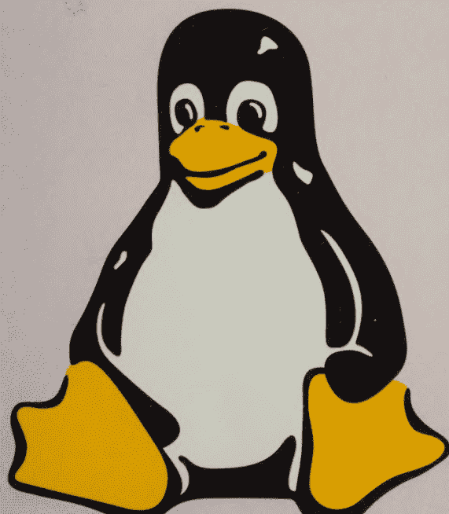
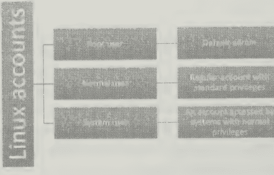
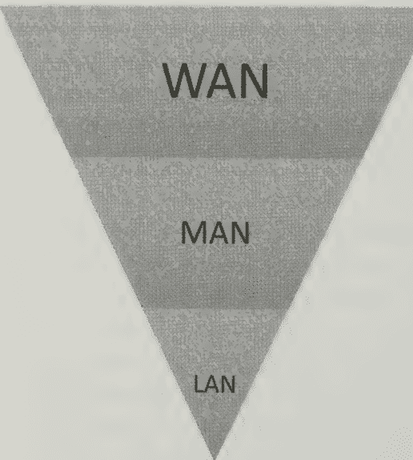

# Linux 初学者指南：学习 Linux 操作系统和掌握 Linux 命令行的实用全面指南：包含自测题以验证您的学习水平

学习 Linux 操作系统和精通 Linux 命令行的实用及综合性指南。包含自评估测试，以验证您的学习水平。



学习 Linux 操作系统和精通 Linux 命令行的实用及综合性指南。包含自评估测试，以验证您的学习水平。

# 关于作者

我的名字是 Ethem Mining，于 1973 年 11 月出生于巴尔的摩。这可能是一个巧合，但那是白宫安装第一台电脑的一年。技术对我来说一直是非常迷人的东西，就像磁铁一样。我13 岁时就写了第一个程序，一个用 PASCAL 写的平凡程序，但那是我的。我可以使用想象力。

在学习期间，我越来越接近网络安全的世界，这是一个不断测试你知识的美妙世界。你必须始终领先那些“黑暗面”的人一步，他们是和你完全一样的人，对信息技术充满热情且技能高超。这是紧跟潮流的动力。

多年来，我一直想将我的热情传递给其他人，因此我决定写一系列主要面向初学者的书籍，介绍 Linux、编程和网络安全的奇妙世界。

我留下了我的邮箱联系方式，请随时向我写信提出建议、请求，最重要的是，提出批评。我收到的每一封邮件都将是我成长的源，我会重视每一封邮件。

感谢大家，祝阅读愉快

# 关于出版社

EVEROKS LTD 成立于 2019 年，是一家小型独立出版社。其名称的灵感源于两个单词“forever”（永远）和“books”（书籍）的融合，以表达我们对书籍的热爱。

我们最喜欢的引言来自马库斯·图灵留斯·西西罗：

> 没有书的房间就像没有灵魂的身体

今天，我们已经取得了巨大的增长，成为市场上最有趣的现实之一，能够支持各种作者的项目。我们在所有主要类别和体裁上出版虚构和非虚构类、声书和电子书。

我们的使命是为我们的读者提供优质书籍，那些能够回答您的问题或在您放松时为您提供乐趣的书。

我们的团队由：

- 4 名作家
- 2 名审稿员
- 1 名翻译员

我们想让知道，您也可以为我们的增长做出贡献，并帮助我们不断提高服务质量。事实上，通过留下评论（特别是在亚马逊上），您将让我们把书籍提交给更多的读者，从而帮助我们扩张并帮助许多其他作者。

对于此，我想现在就表示感谢！

请随时通过 `everooksltd@gmail.com` 与我们联系，咨询任何问题或信息。

# Everooks

您的书籍……随心所欲


`https://archive.org/details/linuxforbeginner0000ethe`

# 引言

如果你拿起这本书，你不可避免地对 Linux 有一定兴趣。你可能对该软件感兴趣，或者在纠结它是否适合你。然而，作为一个初学者，很容易在信息的海洋中迷失。你如何知道下载哪个版本的 Linux？或者从根本上如何下载？Linux 真的适合你吗？这些都是合理的问题，幸运的是，《Linux 入门教程》将引导你完成这一切。

Linux 是一种操作系统，就像 iOS 和 Windows 一样。它可以用于笔记本电脑、大型数据中心、手机甚至智能冰箱。由于许多功能和优点，只要是可以编程的，Linux 几乎可以安装。这意味着，一旦你掌握了知识，就可以创建一个完全按你定制的体验。

允许你优化现有的设置并确保你所拥有的配置妥可用。当你阅读这本书时，你将获得一份关于 Linux 初学者需要知道的所有知识的全面指南。

你将学习为什么以及如何确定哪种 Linux 发行版适合你。你将发现如何使用终端、如何在你的系统上精确设置你所需的任何内容，以及更多内容。当你能够按照自己的意愿进行定制化设置时，这意味着你可以确保自己始终在所用硬件的限制范围内工作。这意味着，对于那些在运行如 Windows 10 等许多现代操作系统负载下可能捉不从心的旧旧机器，可以进行优化并充分发挥其潜力，而不会在不必要、冗余、甚至对你需要完成的任何任务有害的方面浪费宝贵的资源或处理能力。

最终，你将获得从头到尾启动 Linux 所需的全部知识。你甚至会获得几个针对 Windows 应用程序的替代方案，这些方案可以在设备上运行 Linux 的同时下载并使用。

所有内容都将以尽可能简单的术语提供，以便如果你想开始学习 Linux，就能对所需的全部知识有一个完整且彻底的理解。在每个章节的末尾，你将获得一个包含五个问题的简短测验，以及答案，以确保你确实理解了所提供的材料。

在接收了几份分步指南、问题和命令列表后，你应该掌握了至少开始安装你自己的 Linux 发行版所需的大部分知识！

市场上有很多关于这个主题的书，再次感谢你选择这一本！我们已尽全力确保它包含尽可能多的有用信息；请尽情享受！

# 第 1 章

## 什么是 Linux？

所以，你决定想使用 Linux——或者至少想比现在了解的更多。你来对地方了！在本章中，你将对 Linux 是什么建立理解。首先，你将讨论什么是操作系统，以建立引导你阅读书中其余部分的基础。从那里开始，你将讨论作为操作系统的 Linux，学习它能提供什么以及为什么它被其他人如此频繁地使用。然后你将学习 Linux 是是如何产生的。最后，你将开始学习 Linux 是如何组成的，查看系统架构、文件层次结构和进程。

## 什么是操作系统？

操作系统，通常缩为 OS，是运行计算机硬件的程序。在运行硬件的同时，它还允许对软件进行管理和使用。它还允许用户与硬件之间的交互，促进输入和输出等行为。它本质上是一个中介，允许硬件运行程序，让程序利用硬件。

当然，这意味着操作系统是你运行过的最重要的软件部分——没有它，你的计算机将无法管理硬件。将 OS 想象成计算机的大脑。

就像你的大脑保持身体正常运行并对交互做出反应一样，操作系统也让计算机正常运行并允许它与计算机交互。当你使用操作系统时，你本质上是在与一个程序交互，该程序允许你与计算机对话，命令它执行任何你期望它做的事情，而无需以计算机理解的方式说话。

它是翻译器，是中介——允许你和计算机进行交互，没有它，计算机将完全毫无用处。

## 操作系统的重要工作

正如简要提到的，操作系统的工作是管理计算机上所有的软件和硬件。软件指的是计算机上的程序——它是一系列指令，说明计算机应该如何处理和处理某些信息，以便正确执行你命令的任务。它的范围从程序（如运行你的浏览器浏览器或播放视频文件）到运行你计算机的整个系统。这些程序中的每一个程序都是你想让计算机做的事情，而操作系统确保它们在利用硬件的同时能够正常运行。

硬件是物理计算机本身以及组成它的所有组件。这包括主板、中央处理器 `CPU`、内存 `RAM`、图形处理器 `GPU`、硬盘、电源以及你使用的所有其他组件，如显示器、鼠标和键盘，以及任何连接到你的计算机以使用的其他设备。这些计算机组件中的每一个都有特定的用途，这些用途共同实现了对已安装的计算机软件的处理。

### 硬件

- 计算机的物理组件，如 `GPU`、`CPU`、`RAM` 和所有外围设备

### 软件

- 包含指令的程序，告诉计算机处理到达的任何输入和数据

### 操作系统

- 根据用户的命令共同管理并促进硬件和软件的功能。

操作系统帮助将所有组件协调在一起，同时管理软件和任何用户输入，从而让计算机运行。它确保每个运行中的程序都能访问所需的适当硬件支持，而不侵犯其他程序的功能。它通过以下功能让你协调所有这些组件：

- **命令解释**：允许对给计算机的命令进行翻译
- **通信管理**：允许资源的协调和分配
- **设备管理**：管理设备的使用
- **文件管理**：管理与文件相关的进程和活动，如组织、命名、检索、共享或安全
- **输入/输出管理**：翻译并管理输入输出
- **作业计数**：跟踪作业和用户所需的时间和资源
- **内存管理**：允许对程序任何时刻所需的内存进行分配和释放
- **网络**：允许共享内存或硬件的处理器通信资源或数据
- **处理器管理**：帮助操作系统创建和删除进程，促进同步，并允许相互交互的进程进行通信
- **辅助存储管理**：确保数据存储在正确的存储中以便在需要时访问
- **安全性**：保护计算机系统中存储的数据免受恶意软件或未经授权的访问

## 操作系统类型

考虑到操作系统广泛的功能，有几种类型的 OS 并不意外，它们都有自己的优缺点。本节将提供不同类型 OS 的要概述以及它们最常见的使用场景。

- **批处理操作系统**：设计用于运行具有相似需求的任务。用户不直接与计算机交互。相反，作业是离线准备并提交给计算机操作员处理的。这适用于耗时较的任务。
- **多任务/分时操作系统**：这种类型的 OS 允许位于不同终端（shell）的人同时使用同一台计算机。`CPU` 在多个用户之间共享。
- **实时操作系统**：这些系统具有极低的延迟（输入/输出之间的延迟），以便响应时间几乎是即时的。适用于需要立即反应的军事或太空软件系统。
- **网络操作系统**：这种 OS 运行在服务器上，然后可以从多个位置同时访问。
- **分布式操作系统**：网络操作系统的扩展，这种类型的 OS 利用几台不同机器上的多个处理器，实现了高效的计算和处理。
- **移动操作系统**：这是任何专为移动移动设备（如智能手机和平板电脑）设计的操作系统。最常用的移动操作系统包括 Android 和 iOS。

## 常用操作系统

大多数时候，你购买的任何电脑都已预装了某种操作系统并可以开箱即用。这意味着如果你想直接开箱即用大多数产品，你可以选择这样做。然而，如果你发现另一个操作系统更好用，你也可以对其进行升级或将其更换为另一个操作系统。在大多数情况下，操作系统的选择主要取决于个人偏好，尽管某些操作系统具有不同的软件兼容性。

或许操作系统之间最显著的区别在于图形用户界面 `GUI`，发音为 gooey。`GUI` 是你使用电脑时在显示器上看到的内容，它允许你与软件进行交互，进而与硬件交互。这就是你在屏幕上看到的图形和文本的结合。虽然不同操作系统之间的 `GUI` 可能有所不同，但它们都具有相同的基础特性和功能。尽管如此，如果你对某种类型的操作系统优于另一种，这完全是一个合理的个人观点，你选择的应该是最适合你的操作系统。尽管如此，请花一点时间熟悉你日常会遇到的三个最常见的操作系统：Microsoft Windows、macOS 和 Linux。

- **Microsoft Windows：** 创建于 20 世纪 80 年代中期，是你遇到的各种版本中最流行的操作系统。最新的是 Windows 10，它于 2015 年发布。几乎任何预装 Windows 的个人电脑（PC）都是如此，唯一的例外是 Apple 产品。它在用户可以执行的操作方面非常多样，并且不断获得更新以保持安全。
- **macOS：** 预装在 Macintosh 上，macOS 的流行程度要低得多。据估计，全球操作系统中只有不到 10%在使用 macOS。它看起来更精美，但通常只与专有软件和外设设备配合。在三个操作系统中，macOS 运行其全部功能的成本将是最昂贵的。正因如此，macOS 在使用和定制化方面更具限制性，许多常用程序、游戏和其他软件并不兼容 macOS。然而，macOS 倾向于较少被黑客攻击，这使其可能更安全一些。
- **Linux：** Linux 与其他两个有所不同——与专有的 Windows 和 macOS 不同，Linux 是开源的。这意味着任何人都可以对其进行修改并在范围内免费分发。这使得 Linux 在你遇到的三个主要操作系统中限制最少，但它仅占全球使用操作系统的 2%。尽管有这一统计数据，得益于多功能性和定制性，大多数服务器将使用 Linux。

## Linux 作为操作系统

那么，Linux 是一种开源操作系统——这意味着它可以很容易被定制和修改。开源操作系统是可以免费运行、免费修改和免费分发的，无论你是否对其进行过修改。这意味着市面上有许多不同的 Linux 发行版（distributions），因为每个进行过更改或为自己定制过版本的人都可以自由地重新发行自己的版本。然而，这些发行版将在第 2 章进行讨论。

Linux 可以安装在各种硬件上，允许软件开发和应用程序运行。该操作系统是用 C 语言语言开发的，今天，C 仍然是使用的主要语言。Linux 最初设计类似于 UNIX（将在下一个小节中讨论），它的演变已经远超其最初的范围。它现在被用于从手机到超级计算机以及其之间的一切设备。当你使用 Linux 作为操作系统时，你正在利用 Linux 内核 `kernel` 来管理硬件，然后从该内核开始，通过软件构建操作系统的其他部分。

当你听到 Linux 时想到的操作系统实际上是几个不同部分的组合。这些部分共同协同工作，以允许编写的软件运行。这些核心部分是启动加载器 `bootloader`、内核 `kernel`、初始化系统 `init system`、守护进程 `daemons`、图形服务器、桌面环境以及你安装的应用程序。

这些部分承担着各种功能，对于你实际上运行操作系统至关重要。

- **启动加载器 `Bootloader`：** 这是启动电脑的软件——这意味着它将触发操作系统开始运行。大多数情况下，会显示一个快速的启动界面，让你知道操作系统正在启动。一旦操作系统准备好运行，启动界面就会消失，这在很大程度上取决于运行它的硬件。有几种不同的启动加载器，例如 `LILO` `Linux Loader`、`LOADLIN` `Load Linux` 或 `GRUB` `Grand Unified Bootloader`。
- **内核 `Kernel`：** 这就是“Linux”真实名称的来源。Linux 内核是操作系统的心脏，允许对 `CPU`、`RAM` 以及所有正在使用的外围设备进行管理和交互。它是操作系统其余部分的字体，没有这个内核，你就无法运行设备。
- **初始化系统 `Init system`：** 这允许用户空间的引导或激活。通常情况下，你会看到 `systemd` 作为初始化系统。
- **守护进程 `Daemons`：** 它们运行几个不同的后台服务，这些服务通常在启动过程中自动启动，或者在你登录桌面后启动。将守护进程视为后台进程，你通常会在代码中看到结尾带有“d”的，例如作为网络服务器守护进程的 `httpd`。
- **图形用户界面 `GUI`：** 这是一个负责将计算机数据翻译为在你选择的显示器上显示的图形的子系统。Linux常用的GUI 是 Window 系统。
- **桌面环境 `Desktop environment`：** 这是你实际上能够交互的图形部分。根据你的喜好，有几种常见的 `GNOME`、`Cinnamon`、`MATE`、`Unity` 等。
- **应用程序 `Applications`：** 它们就像手机上的应用程序。这些是任何为特定目的服务的程序或软件。

第 8 章将为你介绍一些可以在 Linux 上使用的、作为常用 Windows 应用程序替代方案的若干示例。

## 从 Unix 到 Linux


他们自己的开发者将其分离出来，并在 1994 年发布了 Linux 内核的 1.0 版本。

这意味着 Unix 对 Linux 产生了两个主要影响——GNU（它仍然是许多不同 Linux 发行版中的重要组成部分）以及在 MINIX 系统内进行的 Linux 初始开发。

如今通常情况下，当你听到“Linux”时，你可能是在讨论 Linux 内核和 GNU 的共同存在。然而，某些系统（例如手持设备上的系统）经常使用 Linux 内核，而几乎没有 GNU 的影响。

## Linux 的系统架构

到此时，你已经了解了 Linux 架构的简要概述——这就是你在本章前面的图表中看到的 Linux 分解。然而，有些细节需要更深入的讨论。在本节中，你将学习更多关于用户空间与内核空间的分离、Linux 内核的功能以及被称为 shell 的命令行界面 `CLI`。

## 用户空间 vs. 内核空间

如果你正在电脑上工作，花费了几个小时试图巩固你想要完成的任务，结果整个系统因为意外占用了过多空间导致操作系统无法运行而关机，这难道不觉得非常令人沮丧吗？大多数人都会同意，是的，由于内存不足导致程序随机崩溃是极其令人沮丧的，正因为如此，你的内存中有一个专门为操作系统保留的特殊空间，以运行它。你的操作系统会将你的内存分为两类，将它们完全分离并完全严格限制它们。它创建了一个**内核空间**，该空间旨在为系统运行提供足够的空间，以确保你从根本上不会耗运行操作系统所需的空间。

它还创建了一个额外的保护，保护你的操作系统免受任何在用户空间内下载或启动的外部源的篡改。通过创建这种划分，内核得到了保护，你的计算机应该运行得顺畅。

如果每个应用程序想要访问系统资源（例如使用内存或网络设备），它们必须在内核空间向内核发出系统调用，因为内核是最初指示硬件进行处理的实体。

## Linux 内核

Linux 内核字面上就是程序本身的名称，理解它至关重要。正如本章前面的概述，内核是操作系统中控制计算机的部分。内核充当硬件和操作系统之间的调解员，允许操作系统运行应用程序。它调度应用程序运行的顺序，访问数据，甚至管理计算机内内存的使用情况。这是在启动时加载的操作系统初始部分，内核包含了操作系统代码中最重要的部分。

如上图所示，你可以清楚地看到进程之间的关系——这是本章开头介绍的图表的更深入版本，在你对操作系统将如何工作有了更好的理解后，它向你展示了操作系统和硬件之间的步骤。

## 命令行界面 `CLI`

通常情况下，Linux 是通过所谓的命令行界面 `CLI` 管理的。


这通常也被称为 `shell`。第 4 章将专门深入讨论 shell，但在继续之前，你应该对它们是什么有一个有一个大致的了解。`shell` 是允许你从键盘输入命令的程序。在 Linux 中，最常用的程序是 `bash` (`bourne again shell`)，它是由 Steve Bourne 编写的 Unix 原始 shell 程序的增强版本。然而，在没有另一个程序的情况下，你无法访问 shell，该程序将让你能够与 shell 进行通信。这被称为你的**终端模拟器** (terminal emulator)，当你安装了它时，你就可以开始与终端交互。打开终端模拟器将打开另一个窗口，允许通过键入命令进行交互。和 shell 一样，这些命令以及如何启动和使用终端的指令将在书的后半部分介绍。此时，你只需要知道直接与操作系统交互是你的选项之一就足够了。

## Linux 文件层次结构

为了尽可能有效地运行，Linux 使用了所谓的 **Linux 文件层次结构 (FHS)**。它定义了类 Unix 操作系统（如 Linux）中的目录结构和内容。

得益于 Linux 基金会 (Linux Foundation) 的维护，这种层次结构得到了管理、维护和规范。

使用 FHS 时，所有文件和目录都可以在根目录 `/` 下，即使它们在物理或虚拟上存储在其他地方。然而，某些目录只在特定情况下存在，需要安装了特定子系统的系统。在本节中讨论的大多数目录可以在所有 Unix 操作系统中找到，并且通常以相同的方式使用，尽管你在本小节中获得的描述应仅适用于 Linux。

### / (根目录)

这是整个文件系统的主根。一切都可以追溯到根。只有 root 用户有权限在 `/` 下写入或编辑，你会看到 `/root` 是 root 用户的家目录。注意，`/root` 与 `/` 不同。

### /bin

这是单用户模式下必须可用的二进制文件列表。它包括二进制格式存储的可执行文件，人类不可读。

### /boot

这些是引导加载文件。你会看到如下文件：

- Kernel initrd：初始内存磁盘——允许引导加载程序加载内存磁盘。
- Vmlinux：基于 ELF（可执行和链接格式）的文件，用于调试的未压缩内核镜像。
- GRUB 文件：引导程序包。

### /dev

这些是设备文件。可能包括终端设备、连接到系统的设备或 USB。

### /etc

这些文件是主机特定的，但系统级的配置文件。你将在本部分找到所有程序的各种配置文件，以及启动或结束程序所需的启动和关闭 shell 脚本。

### /home

你在这里找到个人设置、保存的文件以及家目录。如果你下载并保存了它，就会在这里。它很可能以你的配置文件或计算机名称命名，格式如 `/home/用户名`。

### /lib

这是 `/bin/` 和 `/sbin/` 中保存的二进制文件所需的任何库。

### /media

你在这里找到移动介质的挂载点。通常，你会在这里看到挂载格式的名称，例如插入 CD 时显示 `/media/cdrom`，插入 USB 盘时显示 `/media/usb-drive`。

### /mnt

指向临时挂载的文件。系统管理员可以在此目录中挂载临时文件系统。

### /opt

指向可选应用程序软件。这些文件将托管附加应用程序，它们应该位于 `/opt` 或 `/opt` 内的某个子目录下。

### /proc

一个包含进程和内核信息的虚拟系统。通常，这是自动生成的由系统提供，包含当前运行进程的信息。

### /sbin

这是另一个用于二进制执行文件的目录，但 `/sbin` 型文件通常供系统管理员用于维护。

### /srv

代表“service”（服务），`/srv` 存储与特定服务器功能或服务相关的数据。

### /tmp

这些是临时文件，当系统最终关闭并重启时，它们通常不会保留。通常，这些文件的大小也会受到限制。

### /usr

这是用于只读用户数据的次级层次结构。

这里将存放大多数用户实用程序和应用程序。它包含了许多不同的文件，例如：

- `/usr/bin`: 用户程序的二进制文件
- `/usr/sbin`: 系统管理员使用的二进制文件
- `/usr/lib`: 供 `/usr/bin` 或 `/usr/sbin` 的库文件
- `/usr/local`: 从源码安装的程序
- `/usr/src`: Linux 内核源码

## Linux 进程架构

进程架构是指在计算过程中将任何输入转换为输出时，进程和系统的层次结构的设计。虽然这听起来可能难以理解，但希望本小节能帮助你轻松地掌握这一过程。

### 进程架构的目的

Linux 内核包含几个子系统，最重要的是进程调度器。进程调度器的目的是控制对 CPU 的任何访问，无论该访问是通过用户进程还是来自另一个内核子系统。这一切都由进程调度器完成，由于它需要与计算机的其他部分交互，它本身可以分为四个不同的模块。

### Linux 进程

发送给 Linux 的命令会触发进程。当你向 Linux 输入命令时，一个新进程就开始运行了。该进程被分配一个 5 位的 ID，允许操作系统跟踪进程——这被称为 `pid`（进程 ID）。虽然 `pid` 可能会被重用，但没有两个进程会同时共享同一个 `pid`，因为 `pid` 是 Linux 能够跟踪进程的媒介。该进程以两种方式之一运行：在前台或在后台。在默认台（进程默认在前台运行的情况下），你可以向键盘输入内容，并在屏幕上看到输出。然而，当这些进程在前台运行时，你无法同时完成其他进程。因此，有时进程会被引导到后台进程，它们在后台运行，无法访问键盘输入，直到需要该输入为止。通过在后台运行，可以同时处理其他进程，这意味着你可以进行多任务操作，直到被要求输入更多数据为止。进程以三种不同类型之一运行：父子进程、僵尸或孤儿进程，或守护进程。每种不同进程类型的功能略有不同。

- **父进程和子进程**：当一个进程创建另一个进程时发生这种情况。创建的进程被称为子进程，而父进程是触发第二个进程的进程。
- **僵尸和孤儿进程**：子进程完成功能后变为终止，来自父进程的信号 `SIGCHLD` 通知父进程子进程已终止。然而，有时父进程会在子进程终止之前终止，导致子进程变成孤儿进程。
- **守护进程**：这些是在后台运行且无法访问控制终端的进程。它们通常用于提供系统服务，例如 Web 服务器或打印服务器。

某些版本的 Linux 被 Linux 发行版（Linux distributions），或者更常见的缩写是“Linux distros”。它们中的某些非常容易上手，而另一些在安装后立即就可能成为你的噩梦，例如 Gentoo，它要求包括内核在内的所有程序都要从源代码编译。本章将引导你理解什么是 Linux 发行版，如何决定哪种发行版适合你和你的用途，然后为你提供你可以找到的十种最常见发行版的简单概述。

## 什么是 Linux 发行版？

当你考虑到其他操作系统时，你最可能会想到 Windows 或 macOS——这是世界上最广为人知和常用的操作系统。这些系统由单一公司从零开始构建，并进行增量式的更新和更改，因此你会得到不同的版本。你有 Windows XP、Windows 7、Windows 8、Windows 10 等，其中最新版本的 Windows（在写本书时为 Windows 10）是最更新且受支持的。

如果你现在想通过微软为你的电脑购买 Windows，你的选择是获取 Windows 10。当然，你可以通过其他渠道获取其他较旧的版本，但它们不再获得活跃支持，而且不会总能获得安全更新。在某个时间点，公司会停止对其较旧、更过时的软件提供支持。然而，与 Windows 或 macOS 不同，Linux 不是由单一公司创建的。Linux 可以进行混合组合。

只要你收集了所有正确的组件来创建一个完整的操作系统，你就可以将其组装起来。这意味着你实际上可以以 Linux 内核为基础，或或从零创建一个整个操作系统，尽管这会非常耗时，而且你必须投入精力配置所有内容使其协同工作。或者，你可以寻找 Linux 发行版。Linux 发行版本质上就是所有为你整齐打包在一起的内容。它将你原本可能需要自己寻找的所有开源信息收集起来并整合成单一的操作系统，这与你购买 Windows 或 macOS 使用许可时收到的非常相似。它们决定了你将拥有什么种桌面、默认加载哪些程序等，通常还带有一层他们自定义的界面。

当然，这也意味着会有近乎无限的不同发行版供你选择，它们都可以提供各种不同的功能。这就是为什么在选择之前，进行研究是至关重要的。

## 如何选择适合你的的发行版

现在到了最困难的部分——弄清楚哪种发行版适合你。当你阅读本章的剩余内容时，请考虑这里提出的问题。你把操作系统安装在什么设备上？系统的目的是什么？你有任何经验吗？你想要或需要什么种软件可用？你想要什么样的桌面界面？你需要多频繁的更新？所有这些都是在脑中记住的极其重要的问题。如果你不小心，可能会得到一个你实际上并不想要、或无法实际利用的 Linux 版本。

当你阅读提供的十种发行版中的每一个时，你将获得关于操作系统本身的简要概述，包括它是否适合初或经验丰富的人士、它的更新频率如何，以及它的兼容性如何。你需要选择一个最适合你的。

## Ubuntu

我们将考虑的第一个发行版是 Ubuntu。它于 2004 年发布，现在官方提供三个版本：桌面版（Desktop）、服务器版（Server）和核心版（Core）。这些版本可以在计算机或虚拟机上运行，使其成为云计算领域流行的操作系统，特别是得益于它对 OpenStack 的支持。事实上，Linux 是目前最流行的桌面 Linux 发行版。它最初基于 Debian sid（通常被称为不稳定发行版，是由于其缺乏稳定性而得名）。虽然 Debian sid 是不稳定的，但 Ubuntu 是刻意构建的，避免了在 sid 或其他类似项目中犯的错误。通过这种方式，它创建了基于网络的基础、错误报告和专业创作。这种特定形式的 Linux 默认使用 GNOME、Firefox 和 LibreOffice，所有均已更新，并利用定期、可预测的支持更新。

最终，这个创建是一个良好的操作系统，还包含一个为从 Windows 迁移的用户提供的迁移助手、对最新技术的支持，并且兼容 ATI 和 NVIDIA 显卡。

难度评分：适合初学者

长期支持：每 6 个月定期更新的发行版，并配有长期支持版本。

### 优点

- 固定周期和支持期间的定期更新
- 长期支持版（LTS）变体提供 5 年的安全更新
- 对初学者友好
- 广泛使用，意味着在网上有大量的建议、意见和支持

### 缺点

- 与 Debian 不兼容
- 定期更新通常伴随着重大变化，这可能让某些人感到恼恼
- 非 LTS 变体仅有 9 个月的安全支持

## Linux Mint

Linux Mint 是一个基于 Ubuntu 的发行版。该发行版首次发布于 2006 年，就在 Ubuntu 发布后两年。这种特定形式由 Clement Lefebvre 创建，他是一位出生于法国、在创建时居住在爱尔兰的 IT 专家。他最初维护着一个为 Linux 新手提供帮助和指南的网站，在他维护该网站期间，他产生开发自己的 Linux 发行版想法，以解决其他主流 Linux 版本中存在的几个缺点。

虽然 Linux Mint 通常被称为“做对了 Ubuntu”，但它 不仅仅是换了新装的 Ubuntu——它包含了旨在增强 Linux Mint 体验的工具，这些工具通常被贴切地以“mint”命名，例如 `mintDesktop`、`mintMenu`、`mintUpdate` 等。`mint` 工具的设计更易于使用，并极大地增加了易用性，得益于对用户友好的强调，使其成为最容易上手的 Linux 类型之一。Linux Mint 的最大吸引力之一是开发者总是准备好并乐意实施有助于改进程序的良好建议。

难度评分：适合初学者

长期支持：没有固定日程，但会定期更新，特别是在每个 Ubuntu LTS 发布后不久。

### 优点

- 为该操作系统设计的 mint 工具
- 无安全告告
- 用户友好
- 更新并非可预测的
- 包含多媒体解码器
- 面对用户的请求和建议

## MX Linux

MX Linux 有一段历史。它最初名为 MEPIS Linux，是一种基于 Debian 的发行版，适用于个人和专业用途的桌面，在创建时具有若干项前端功能。然而，尽管有这些前端特性，MEPIS Linux 最终被停止了。但是，它的用户并没有因此退缩。将 MEPIS 与另一个名为 antiX 的基于 Debian 的发行版合并，形成了现在被称为 MX Linux。

它基于 Debian 的稳定分支，主要组件来自 antiX 和 MEPIS 社区。特别是，它利用 Xfce 桌面，并使用侧边的垂直面板，而不是大多数计算机底部的常见水平控制面板。总的来说，这个发行版被认为提供了许多不定期更新的现代应用，同时具有稳定的底座，从而能够出良好、可靠的性能，而又不会丢失人们想要的功能。

特别是，MX Linux 以其 MX-Tools 闻名——这是一系列图形化管理工具，允许快速访问多种功能，例如管理系统上的用户帐户、安装解码器以及使用和安装软件包。

难度评分：适合新手

**长期支持：** 通过回溯支持（backports）提供偶尔更新

## 优点

## 缺点

- 对图形驱动、解码器和浏览器插件的即时支持允许开箱即用的近乎启动
- 界面简单且老旧
- 安装程序和其他配置工具可能需要一些时间来适应
- 稳定
- 定更新
- 功能方便

## openSUSE

openSUSE 追溯到 1992 年，由四位德国 Linux 爱好者共同创立。Thomas Wehr、Roland Dyroff、Hubert Mantel 和 Burch Steinbild 起初开始销售德语版的 Slackware 软盘，但很快创建了自己的程序：SuSE（Software und System Entwicklung，即软件与系统开发）。1996 年，SuSE Linux 成为了自己的发行版，随着时间的推移，它采用了越来越多的功能，例如 RPM 包管理工具、为易用性设计的图形化系统管理工具等。他们发布频繁，保持着出色的文档，并使产品易于获取，SuSE Linux 变得越来越流行。

2003 年，它被 Novell, INC 收购，并最终在 2010 年转给 Attachmate。这些所有权的变更导致了开发上的重大变化，并最终名称从 SuSE 变为 openSUSE。尽管不断变化，但它仍然可以免费获取。你可以找到两个主要版本的 openSUSE：Leap 为用户提供了一个稳定且具有多年支持的平台；而 Tumbleweed 使用的是滚动发布环境，通过易于配置以及自动化的文件系统快照和启动环境，这种体验变得非常流畅。

难度评分：适合有一定经验的新手

长期支持：提供充足支持

## 优点

## 缺点

- 配置工具非常全面
- 丰富的软件包
- 极好的网站基础设施
- 丰富的打印文档和支持
- 带有启动环境的 Btrfs
- 臃肿且沉重的桌面设置
- 图形化工具运行缓慢

## Fedora

Fedora 本身直到 2004 年才宣布并发布，尽管它的根源可以追溯到 1995 年的 Red Hat Linux（由 Bob Young 和 Marc Ewing 发）。他们的产品发布并更新了多次，在 1997 年，它添加了 RPM 包管理系统以及其他几个高级功能，这使 Red Hat 迅速流行，最终甚至超过了 Slack Linux 成为当时最使用的发行版。2003 年，在 Red Hat Linux 9 发布后，公司进行了一些重大调整，将 Red Hat 商标保留用于商业用途，并加入了 Fedora Core。

该系统最终命名为 Fedora，由 Red Hat 赞助，但主要面向 Linux 爱好者。尽管最初存在顾虑，它很快被接受，并再次跃升回最受欢迎的发行版之一的地位。

这通常被认为是目前可用选项中较具创新性的之一。Fedora 在对整个 Linux 的贡献方面处于领先地位，并利用了几项企业级功能。然而，它也存在一些缺点——它需要技术知识才能真正充分利用它，这意味着对于喜欢折腾的爱好者来说，它仍然是一个比尝试学习的人更好的产品。

**难度评分：** 中级

**长期支持：** 定期更新

## 优点

## 缺点

- 创新性
- 安全
- 海量支持的包
- 与自由软件哲学高度契合
- 企业级而非桌面级的功能和易用性
- 尖端功能有时会让那些不太熟悉系统的人感到疏远
- 需要对 Linux 总体有更多的技巧

## Debian GNU/Linux

该项目于 1993 年宣布，旨在设计成一个非商业项目，通过数百名开发者的志愿者工作完成。大多数人认为它会失败——毕竟，数百名开发者如何可能在业余时间免费编码并创建一个具有凝聚力的东西呢？尽管如此，该项目还是成功了，Debian 在十年内变成了最大的 Linux 发行版。

它包含了 1000 名志愿者开发者的工作，为 8 种不同的处理器架构提供了近 50,000 个二进制包。从这种努力产生了超过 120 种基于 Debian 的发行版。没有其他基于 Linux 的操作系统能比这些数字。

Debian 以四个主要分支存在于几个不同的开发阶段：“实验（Experimental）”、“不稳定（Unstable，也称为 sid）”、“测试（Testing）”和“稳定（Stable）”。由于这一过程，它以具有非常的质量控制水平而闻名，Debian 被誉为你能找到的最稳定、经过测试且无 bug 的发行版之一。当然，开发过程确实有一些缺点。特别是稳定版每隔几年才发布一次，而且由于经过了大量的测试，它们并不特别具有竞争力。

难度评分：适合有一定经验的新手

长期支持：提供支持，但新的稳定版每几年才发布一次

## 优点

## 缺点

- 极佳的质量控制且非常稳定
- 由于开发原因，新的稳定软件通常没有那么前沿
- 超过 30,000 个软件包
- 由于支持多种处理器架构，显得比较保守
- 识别并支持的处理器架构比其他发行版更多
- 新版本稀少

## Arch Linux


# Arch Linux

Arch Linux 由 Judd Vinet 于 2002 年设计，旨在实现简单的易用性，最初是设计给已经熟悉操作系统的中高级高级 Linux 用户使用的的。在作为一种“滚动发布”发行版被推广后，它最终获得了人气，这意味着只需要进行初始安装即可运行。从那时起，保持安装更新所需的只需每个月对安装介质进行一次快照以刷新软件。这是通过名为 `Pacman` 的包管理器实现的。它还能从源代码安装软件包，这使其变得极其高效，特别是结合它简单地打包二进制包的能力以及不断增加的已测试软件包仓库时。

尽管最初设计是为有经验的用户设计的，但得益于《Arch Linux 手册》以及所有的用法文档，它现在允许 Linux 经验较的用户安装、理解并利用它，凭借它所拥有的强大工具，该发行版可以无限地自定义。然而，滚动发布可能会导致问题，特别是在人为错误的情况下。即使是一个小意外也可能导致系统升级后不再启动。

这意味着，尽管那里有很多信息，但这仍然一个需要技术知识和经验来解决可能出现的任何系统的。

**难度评分：** 中级——需要一些经验才能真正用好。

**长期支持：** 定期滚动更新

## 优点

- 极佳的软件管理结构
- 极高的可定制性，拥有无限可能
- 丰富的在线文档和指导

## 缺点

- 对新手来说可能很难上手
- 偶尔发生故障
- 故障需要经验来处理和修复

# Slackware

Slackware 创建于 1992 年，是仍然存活的最老的 Linux 发行版。它派生自一个已停止的项目，最初被发布在 24 张独立的软盘上，并基于 Linux 内核版本 `0.99pl11-alpha` 构建。它在可用的 Linux 发行版中流行起来，到 1995 年，据认为它占据了高达 80% 的 Linux 安装量。

然而，随着更新、更快且更易于使用的选项进入市场，Slackware 的用户迅速减少。尽管人气下降，但它仍然活力勃然，并受到那些在技术上能力较高的人的喜爱。

由于它不是特别可定制，因此它非常干净且具有技术性。它主要使用基于文本的系统安装程序，包管理系统与更现代的选项相比非常过旧且原始。然而，由于它简单基础，它也是你今天可以获得的最干净的 Linux 发行版之一，使其极其稳定。在没有增强的情况下，意外引入 bug 的概率微乎其微。由于其可靠性和无 bug，Slackware Linux 正在迅速成为一个核心系统——作为其他软件的基础而非完整的发行版。虽然在目前看来它认为没有竞争力，但今天仍被某些人使用。

**难度等级：** 高级

**长期支持：** 维护中，但不再进行补丁或定制

## 优点

- 稳定且基本没有 bug
- 非常保守——没有定制化空间
- 遵循 Unix 原则

## 缺点

- 作为现代桌面系统使用需要大量工作
- 自最初构想以来在很大程度上没有变化
- 升级程序很复杂
- 没有官方安全支持或更新

# Gentoo

尽管在互联网上经常成为几个网络笑话的对象，但对于那些清楚自己在做什么的人来说，Gentoo 是一个非常有效的选择。这个特定的发行版既快速又灵活，而且完全免费。它专门设计供拥有丰富 IT 知识的人使用，例如开发者和网络专业人士。它通过一个名为 `Portage` 的基于源码的包系统构建——这是一个基于 Python 的真实 ports 系统，带有若干高级功能，这些功能使得 Gentoo 对那些了解如何使用它的人极具吸引力。

Gentoo 由 Daniel Robbins 于 2000 年最初创建，愿景是创建一个不需要任何预编译二进制包的元发行版。他无疑成功了——当你安装 Gentoo 时，你设置的是一个启动所需的最小系统，从那里，你必须自己对其进行编程。系统本身具有极高的定制性，你可以自由地对其添加或删除内容以适应你的需求。得益于此，它因向选择使用它的人提供灵活性而闻名遐迩。他们能够创建广泛的体验，正因如此，Gentoo 可以出现在其他几个项目的核心，例如为 Google 的 Chrome OS 奠基础。

难度等级：高级

长期支持：定期发布

## 优点

- 灵活且可定制
- 可以使用不同的编译时配置
- 可以使用多个 init 系统
- 可以在多个不同的架构上运行

## 缺点

- 需要高水平的知识才能入门
- 设置时间较长
- 通过源码升级包的过程可能很长

# CentOS

CentOS 发布于 2003 年，这是一个社区项目，致力于重构红帽企业级 Linux（Red Hat Enterprise Linux）的源代码，将其转换为可以轻松安装并对包含的所有内容提供定期安全更新的东西。实际上，这使得 CentOS 成为红帽企业级 Linux (RHEL) 的克隆，它们之间唯一的区别在于品牌。尽管 CentOS 是一个克隆，但两者之间似乎不存在任何实际冲突。

CentOS 被认为是一个可靠的服务器发行版——这归功于 RHEL 稳定的 Linux 内核和软件软件包的使用。它被认为是目前其他服务器产品可靠且免费的替代品，特别是对于那些对 Linux 整体已经非常有经验的人来说。这些人在管理该发行版时几乎不会遇到困难。CentOS 也可以用于企业桌面——如果你需要稳定、可靠的东西，并且倾向于获得支持而非尖端软件，那么这个操作系统就适合你。当然，如果你在意最新和尖端的软件，你可能更倾向于寻找其他地方，因为与市场上的其他选项相比，CentOS 的更新间隔较长。

难度等级：有一定经验的初

**长期支持：** 每 9-12 个月发布定期更新，每 2-3 年发布一次新版本

## 优点

- 提供了稳定性和可靠性
- 免费软件
- 7 年的安全更新
- 经过良好测试

## 缺点

- 没有利用最新的技术
- 发布和更新并不总是能履行承诺

# 第 2 章测验

恭喜你！你已经完成了第 2 章。你现在对想尝试哪种发行版有想法了吗？尝试回答这些问题，以确保在进入第 3 章之前理解了基础信息。答案就在就在测验之后的页面。

- 1. 什么是 Linux 发行版？
  a. 一本教你如何安装 Linux 的书
  b. 基于 Linux 内核编写的特定操作系统
  c. 最新的 Linux 硬件
  d. 以上都是
  e. 以上都不是
- 2. 正或错：所有 Linux 发行版都在不断变化
- 3. 在选择适合你的发行版时，你应该考虑哪些特性？
  a. 用户友好性和你的能力
  b. 它在多大程度上满足你的需求
  c. 内置软件
  d. 你是否喜欢它的吉祥物
  e. a, b, 和 c
  f. a, b, 和 d
- 4. 正或错：Gentoo 对学者非常友好
- 5. 正或错：Ubuntu 对初学者非常友好

## 第 2 章答案页

- 1. **B**: 发行版指的是你正在使用的特定操作系统程序
- 2. **错误**: 几个发行版（如 Slackware）没有太大变化，或者多年没有变化。
- 3. **E**: 虽然喜欢吉祥物可能很好，但它并不决定一个程序在多大程度上能满足你的需求
- 4. **错误**: Gentoo 需要几乎持续的编程才能使其运行。
- 5. **正确**: Ubuntu 非常容易上手，并且是为用户友好而设计的。

# 第 3 章

## 安装 Linux

到此时，你应该准备好安装 Linux 了。然而，你还有另一个决定要做。你是在虚拟机上安装你的发行版，还是在硬件上运行它？即使你选择安装在硬件上，你也会将其作为主操作系统运行，还是为它创建一个分区？

如果你是操作系统的初学者，这可能看起来令人生生畏，但请不要担心。这一章将引导你了解在你的设备上安装 Linux 的基础知识。当你能够在一台机器上加载多个操作系统时，你就可以在它们之间进行切换。这意味着你可以利用你的计算机可能提供的所有功能。然而，你从这一章中获得的是关于什么是虚拟机以及你可能选择使用它们的坚实基础。你将在指导下通过使用 USB 驱动器在你的物理计算机上安装 Linux。

然后，你将在指导下在你运行 Windows 的机器上创建一个虚拟机，允许你有效地在虚拟机内运行 Linux 实例。

最后，你将在指导下在运行 macOS 的计算机的虚拟机上安装 Linux。到本章结束时，你应该对在设备上安装 Linux 的想法感到自在，无论你是选择将其安装在物理机上，还是倾向于在你选择的操作系统中运行虚拟机。

### 什么是虚拟机？

虚拟机是你计算机上的一个应用程序，允许你在其中运行一个操作系统的实例。这让你能够有效地运行你特定机器的原生操作系统，同时在桌面的一个窗口内完全使用另一个操作系统。虚拟机并不是 Linux 特有的——你可以在 Windows 或 Linux 设备上运行 macOS 虚拟机。

这是一个存储在你的实际硬盘上的文件——这个大文件（通常有几 GB 大小）会以硬盘的形式呈现给虚拟机，允许你跳过创建任何分区或任何可能使硬盘变得复杂的其他东西。请记住，虽然虚拟机对于创建你使用的操作系统虚拟实例非常棒，但它明显比运行真正的操作系统要慢。由于支持虚拟机还需要额外的步骤，它确实需要更多的处理能力。这意味着虚拟机很可能不是你玩任何游戏的最佳方式。然而，作为一个主要的优点，你能够运行的虚拟机数量唯一的限制是你可以安装的系统仅受限于你可用的物理硬盘空间。如果你有足够的空间，可以继续添加其他几个操作系统的安装。然而，你必须记住，这些安装中的每一个都将至少占用你硬盘内的几 GB 字节空间。你也可以选择同时运行多台虚拟机，尽管同样，你会发现上限是你的物理硬件。

你的每台虚拟机都需要访问一些处理器、内存（RAM）和其他资源，这意味着你在任何给定时间里活跃尝试使用的资源越多，运行性能就越可能越弱。人们可能选择运行虚拟机的原因有几个点。对于某些人来说，这可能只是为了好玩。如果你对计算机及其工作原理特别感兴趣，你可能会选择使用虚拟机在那些没有作为主操作系统的其他操作系统中进行尝试。这意味着你可以在决定是否真的要物理安装某个新操作系统之前对其进行折腾，例如，在选择你喜欢使用的哪一个之前，先玩玩几个不同的 Linux 发行版。

其他人可能会发现，他们有时会有非常特定的需求，需要某个只有特定操作系统才提供的限制程序。例如，如果你正在运行 Linux，但需要一个主要包含在 Windows XP 中的应用程序，你可以选择在虚拟机上运行 Windows XP 以使用该特定程序。

人们使用虚拟机的另一个常见原因是虚拟机是沙箱化的。这意味着所有内容都包含在虚拟机内部，因此你在虚拟机内部可以做的任何事情都不会让你系统的其他部分面临风险。

就像沙箱及其包含它的侧壁一样，虚拟机被完全隔离在硬盘内，不会受到你在其中所选择执行的任何操作的影响。这意味着你可以在一个安全空间内测试正在开发的应用程序，而不必担心如果整个系统失败可能会引发的后果。


### 在物理硬件上安装 Linux

然而，在开始担心虚拟机之前，你将首先学习如何在物理硬件上安装 Linux。在使用此过程时，你正在创建一个在你的电脑上安装 Linux 作为一个独立分区（partition）的选项。

这意味着你的机器上将有两个（或多个）操作系统。这个过程将一步一步提供给你。

#### 第 1 步：下载 Linux 发行版

你在上一章中选好你的发行版了吗？如果是的话，这就是你需要搜索的内容。如果你还没有决定倾向于使用哪一个，你将花时间做决定。如果你正在读这本书，你很可能是 Linux 的新手，正因如此，你会发现使用轻量级发行版对你更有帮助，它们会更用户友好，例如 Ubuntu 或 Linux Mint。当然，如果你愿意，你也可以挑战自己，尝试一些更复杂的东西。在开始之前，请确保你有一个可以用于安装的 CD 或 USB 闪盘。

由于 CD 驱动器在许多消费级产品中已变得过时，USB 可能是任何计算机上最易获取的形式。

一旦你选择了要使用的发行版，你就必须下载它。你可以在那里找到 `ISO` 格式的免费下载版发行版。这是一个存档文件，包含了光盘上数据的相同副本，是分发 Linux 最常见的格式。这个相同副本被称为镜像（image），也就是你为了安装软件而寻求复制的内容。

- 1. 在发行版的官方网站上下载你选择的 Linux 发行版的 `ISO` 文件。
- 2. 使用 `Rufus` 等程序准备可启动的 USB。
- 3. 安装像 `Pen Drive Linux` 或 `UNetbootin` 这样的镜像刻录程序。
- 4. 将镜像加载到已格式化的 USB 闪盘中。

#### 第 2 步：启动到 Live USB

现在，你的任务首先是加载到 Live USB。大多数计算机被设置为从硬盘启动，因此在它进行必要的更改之前，你需要对默认启动顺序进行一些修改。这个过程听起来并没有那么可怕——你所做的就是重启电脑，进入启动菜单，并选择你希望计算机从哪个源启动。有时，启动菜单是隐藏起来的，但仍然是可以访问的。在这些情况下，你需要访问 BIOS 菜单以进入启动菜单，这可以在启动界面处完成。

加载到 BIOS 菜单所需的命令应该显示在启动界面的下方的角落之一。

- 1. 重启电脑
- 2. 当计算机重启时，按下触发启动菜单的键。你应该在启动界面的角上看到所需的键——即在初始启动期间显示制造商标志的屏幕。访问启动菜单的常用键是 `F12` 或 `Del`。
  - a. 如果你正在使用 Windows 8，尝试在点击重启时按住 `Shift` 键。这将触发计算机带高级启动选项启动，允许你做出决定。
- 3. 在启动菜单中，选择你正用于加载 Linux 的 Live USB 或 CD。选择好方法后，保存并退出启动菜单或 BIOS。你的机器将按照你所选的设置继续启动过程。

#### 第 3 步：安装前尝试 Linux（可选）

尝试你正在安装的 Linux 版本是可选的，但如果你还不熟悉 Linux，强烈建议这样做。

你的 Live USB 允许你进入所谓的“环境环境”，让你在花费时间安装和格式化任何更改之前对其进行测试。虽然在此阶段你无法创建文件。

#### 第 4 步：开始安装

安装过程本身非常简单。从启动菜单开始，你将有安装而非启动的选项。在此点上，你的机器将处理大部分工作，但你会被提示配置基本选项，例如你将与操作系统使用的语言、键盘布局和时区。

#### 第 5 步：创建用户

在此时，系统会提示你为操作系统创建登录信息。你将输入姓名、计算机名称、你为该实例选择的用户名以及用于登录的密码，确认你有权限执行任何管理任务。

#### 第 6 步：创建分区（可选）

如果 Linux 是你的主操作系统，你可以跳过此步。然而，如果你在机器上运行多个系统，你将为你的 Linux 版本专门划分出一个分区。分区是按照特定操作系统要求进行格式化的部分，以便操作系统按预期运行。某些对用户友好的发行版（如 Ubuntu）会自动格式化分区，尽管你也可以手动调整大小。请记住，大多数安装至少需要 20 GB，因此你必须确保你设置的任何分区都能容纳操作系统以及存储其中的任何其他文件和程序。有时，安装过程不会自动配置自动分区，当发生这种情况时，你必须确保该分区为 `Ext4` 格式。

#### 第 7 步：启动 Linux

当安装完成后，它会自动提示你重启。启动时，你将看到一个不同的屏幕。这将调出引导程序，提示你选择正在安装的发行版。你可能会遇到的引导程序之一是 `GNU GRUB`。

当然，如果你选择跳过分区阶段并将你的 Linux 发行版作为唯一操作系统加载，你可能不会自动看到这个屏幕。和之前一样，你可以在启动界面加载后立即按下 `Shift` 键来触发引导程序。

#### 第 8 步：检查硬件

虽然大多数硬件在安装后可以立即使用，但你可能会发现使用的某些硬件需要你下载一些驱动程序。特别是显卡，以需要额外的驱动程序而闻名。你通常可以找到某种开源驱动来完成任务，但如果你想真正优化你的 GPU，将需要从制造商那里获取正确的驱动程序。

#### 第 9 步：使用 Linux

到此时，你的安装应该完成，硬件也应该运行正常。现在，你已经准备好开始使用你的新操作系统了！你可以选择下载一些程序来优化你对程序的使用，或者直接开始使用它。

### 在 Windows 10 上的虚拟机上安装 Linux

有时，你用于安装 Linux 的方法会用到虚拟机。特别是，你可能选择使用虚拟机对软件进行沙箱化，以确保你不会损坏主操作系统上的任何文件。你可能还想在正式尝试并安装之前，在操作系统里多折腾一下。幸运的是，在 Windows 上使用虚拟机并不困难。Windows 10 的 64 位专业版、企业版或教育版已经预装了名为 `Hyper-V` 的专有虚拟机，这意味着你不需要特意去获取更多软件。如果你还没有 `Hyper-V`，你将需要找到一个 VM 程序。你可以使用的一个免费选项是 Oracle VM `VirtualBox`。

#### 第 1 步：安装虚拟机

首先验证你是否已经安装了虚拟机。通过在电脑的“Windows 功能”中搜索“Hyper-V”来实现。你应该会在左侧看到一些方框。当你勾选这些文件旁边的方框时，你正在开启或关闭文件。如果你能在电脑上找到 `Hyper-V`，请点击启用它。安装完成后，你需要重启电脑。如果你没有 `Hyper-V`，请在网上搜索另一个你喜欢的 VM 程序并安装它。

#### 第 2 步：设置虚拟机

在这个阶段，你必须确保有足够的硬盘空间来存放你选择的操作系统和文件，并且你需要一个打算使用的 `ISO` 文件。与之前的版本一样，`ISO` 可以从发行版那里下载。

如果你正在使用 `Hyper-V`，搜索“Hyper-V 快速创建”`Quick Create` 将为你提供一种快捷方式，确保一切都按需要设置好。你只需要按照程序中屏幕上的提示操作，如果你不想使用提供的提供的文件之一，则选择你的 `ISO` 文件即可。

如果没有 `Hyper-V`，你会发现过程稍微没那么流畅，但总体来说仍然非常容易处理。大多数虚拟化软件都会非常相似——决定你喜欢哪种取决于你的喜好和可用性。

- 1. 启动 `VirtualBox` 后，你会看到一个空菜单。从那里，你需要点击程序窗口左上角的“新建”`NEW` 图标。然后你将为虚拟机命名，并选择你将使用的哪种操作系统。
- 2. 接下来，你需要为虚拟机分配内存，为其提供必要的资源。通常，最好的办法是采用推荐的量然后点击“下一步”。
- 3. 你看到的下一个提示将询问你是否想添加虚拟驱动器。同意此项，点击“创建”`Create`，并在列表中选择 `VDI`。`VDI` 代表虚拟磁盘映像。在下一页上选择“固定大小”`Fixed Size` 选项。最后，你会被要求为你正在使用的驱动器命名并确认大小。
- 4. 点击“创建”，虚拟驱动器就创建好了。

#### 第 3 步：安装操作系统


此时，是时候安装你选择的 Linux 发行版了。在 VirtualBox 窗口中，点击启动箭头。它应该打开一个标题为“选择启动磁盘”（Select start-up disk）的窗口。点击下拉菜单右侧的文件夹，在这里，你可以选择你发行版的 ISO 文件。从那里，你只需要点击“启动”，操作系统应该就会完成安装。

## 第 4 步：关闭虚拟机

当你完成对该机器的操作时，请忍住直接退出窗口的冲动。相反，点击“文件”（File）菜单，并在选择“关闭”的同时选择“保存虚拟机状态”（Save the machine state）。这确保你将保留虚拟机内部的信息。

## 在 macOS High Sierra 上的虚拟机上安装 Linux

在编写此本书时，当前的 macOS 是 High Sierra。在 High Sierra 上通过虚拟机安装 Linux 与你在 Windows 上执行该的过程很大相似。考虑到到此时，你已经在引导下完成了最困难的过程，这将是所有指南中最简短的一个。在本章中，你所做的新操作就是在 macOS 上安装 VirtualBox。从那里，你可以遵循上一个小节中的详细步骤。

### 第 1 步：运行 VirtualBox

- 1. 从运行 VirtualBox 安装程序开始。你可能会看到一个警告，称 macOS 不允许安全的系统扩展。只需点击“下一步”并继续。
- 2. 安装结束时，它会失败。不要担心失败，只需继续遵循本教程。
- 3. 转到“系统偏好设置”中的“安全性与隐私”。在底部，应该有一个提示说系统软件被阻止。在窗口的左下角，点击锁。它会要求你输入密码。输入后，在显示程序被阻止的消息旁边点击“允许”。
- 4. 重新加载 VirtualBox 安装程序。

## 第 3 章测验

恭喜！你已经完成了第 3 章。到此时，你应该准备好学习第 4 章。尝试回答这些问题以确保你理解基础。答案将在下一页。

- 1. 哪些工具用于安装 Linux（无论是在硬件上还是虚拟机上）？
  a. ISO 文件
  b. USB 驱动器
  c. Virtualbox
  d. A 和 C
  e. 以上所有
  f. 都不是
- 2. 在同一系统上运行多个操作系统需要什么？
  a. Virtualbox
  b. USB 驱动器
  c. 对硬盘进行分区
  d. 拥有两个硬盘的电脑
  e. 以上所有
  f. 都不是
- 3. 什么是虚拟机？
  a. 一个能够在同时运行操作系统内操作系统的计算机
  b. 一种将操作系统与电脑其他部分隔离的方法
  c. 一种可以测试软件的方法
  d. 以上所有
  e. 都不是
- 4. 真或假：如果你想运行 Linux，你就需要虚拟机
- 5. 真或假：你用来加载 ISO 的 USB 驱动器将开箱即用

## 第 3 章答案解析

- 1. A：列出的运行 Linux 所需的组件是用于发行操作系统的 ISO 文件。在虚拟机安装时可以跳过 USB 驱动器，而在带有 USB 的硬件安装时可以跳过 Virtualbox。
- 2. C：列出的必要组件是操作系统之间的分区。Virtualbox 是一个特定的虚拟机，但有许多其他可以替代它，USB 驱动器并非必需，你也不需要两个硬盘——虚拟机的整个意义就是分区单个硬盘以适应多个操作系统。
- 3. D
- 4. **假**：如果你在硬件上安装 Linux，你就不需要虚拟机。
- 5. **假**：你必须格式化 USB 驱动器以准备加载 ISO。

# 第 4 章

# Linux Shell

安装好 Linux 后，是时候开始与你的新操作系统进行交互了。这主要通过被称为 shell（外壳）程序来实现。shell 允许你与操作系统进行交互，到此时，你应该理解这对于计算机的运行至关重要。你的操作系统由几层组成：一端是内核（kernel），它是操作系统与计算机硬件交互的方式；而在过程的另一端是 shell，用户通过它交互。

硬件

内核

shell


停下来思考一下这张图：注意硬件是如何处于核心位置的。那里开始，你有围绕硬件的内核，以及包裹内核的 shell。这让你能能看到这种层次结构——如果不先通过外部层，你就无法访问最内层。在本章中，你将学习作为一个系统的 shell 是，以及它的主要功能是什么。你将学习如何通过终端（terminal）访问 shell。你将学习 shell 脚本编写，并学习与 shell 交互所需的常用命令行编辑知识。最后，你将了解可用的 shell 类型。

## 什么是 shell？

计算机主要基于二进制运行——这即使用 1 和 0 来表示开关的开启或关闭。然而，如果你被通过二进制向系统输入内容，你会发现自己花费了比需要多得的时间尝试翻译和输入代码。这就是 shell 的用场。得益于 shell，你不需要精通二进制。

shell 充当英语编写的人类友好命令与内核之间的翻译器，并将它们翻译成内核可以使用的格式。通过为内核翻译一切，你可以自由地记忆简单得多且更容易管理的命令。这还允许你通过键盘输入命令。总来说，shell 具有几个关键特性，例如：

- 它是一个用户程序：它是一个为了人类用户交互而设计的环境。
- 它是一个命令行语言解释器 (CLI)：它从标准输入（如键盘）接收并执行命令，而无需记忆和翻译二进制等复杂的程序语言。
- 它是自动的：你一打开终端，shell 就会开始工作。
- 它与内核协同工作：虽然它不是内核的一部分，但它与内核协同工作，以便允许执行程序、创建文件或完成任何必要的命令。
- 它是多功能的：Linux 提供了几种不同的 shell，它们可以完成相同的工作，尽管它们使用不同的语法并具有不同的内置函数。

## 访问 shell

当你与 shell 交互时，有几种不同的方法可以使用。最常用的 shell 访问方式包括终端和安全外壳（SSH）连接。这些具有不同程度的权限和能力。大多数情况下，你会发现自己正在与 Bash 交互，尽管有时你可能会遇到其他形式。尽管如此，理解如何访问 shell 是必要的。

### 在 Windows 上安装 Bash

本节将要求你通过 Git for Windows 安装程序安装 Bash。它向你提供直接的指令，在屏幕出现在面前之前，这些指令可能看起来并不特别有用。尽管如此，如果你想以最快安装，请在准备好后返回本节。

- 1. 终端访问 shell 需要你先安装 Bash。这非常简单——下载 Git for Windows 安装程序。运行安装程序时，点击 `run`（运行），然后在接下来的五个屏幕中点击“Next”（下一步）。
- 2. 当出现选项时，选择“Git from the command line and also from 3rd party software”，然后点击“Next.”。此选择将允许你通过命令行访问，这正是你需要的。如果你在这步搞错了或漏掉了需要的选择，请重启安装程序并相应更改选项。
- 3. 再次点击“Next.”。
- 6. 再次点击“Next”。
- 7. 安装。

完成后，你将拥有了可用的 Git 和 Bash。Bash 是 macOS X 和大多数 Linux 版本中默认使用的 shell，所以

## 什么是终端 (terminal)？

终端是你将使用的 CLI。当你进入终端时，你将输入命令，按下键盘上的 Enter 键应该会触发发送。当你在终端中时，有几个命令对你来说至关重要，我们将在第 5 章中讨论。在开始之前，请注意你的终端在等待输入时会显示美元符号 (`$`)。其他 shell 可能会使用不同的字符，但如果你在 Bash 中工作，它就是 `$`。

### 终端访问 shell

当你准备好访问 shell 时，你必须拥有一个。在 OS X 中，它通常被称为 Terminal（终端）。在 Windows 中，它是 Git。在 Linux 中，它通常被称为 Terminal。在 Linux 尝试访问 shell 时，最简单的方法是运行一个模拟器。有几种模拟器可用——这些是用来模拟终端的程序。访问模拟器后，你应该有更改文本和颜色的选项。一些常用的模拟器包括 `xterm`、`Konsole` 和 `LXDE`。可以在应用程序菜单中找到 GNOME。运行它应该会终端，然后你就可以开始与之交互。

### 安全外壳连接 (SSH)

有时，需要连接到远程服务器上的 shell 账户。只要你想访问的服务器运行着适当 SSHD 服务器软件以管理并接受任何连接，你就可以使用所谓的 SSH 程序。当你建立安全连接后，shell 会话将开始，你将能够通过在本地计算机上输入命令来控制服务器。为了创建 SSH 连接，有两个必要的组件：客户端和服务器端组件。客户端是你计算机上使用的应用程序。你将使用客户端连接到你想控制的另一台计算机或服务器。然后客户端使用提供的信息发起连接。通过验证凭据，创建一个加密连接。服务器必须有一个名为 SSH 守护进程 (`daemon`) 的组件。简单提醒一下，守护进程是后台进程，它们是激活后保持运行，等待任何与之相关的命令。在这种情况下，SSH 守护进程一直在监视一个非常特定的 TCP/IP 端口，该端口会通知它客户端请求。客户端负责启动连接，然后守护进程将使用它自己的软件直接进行交互以验证凭据，然后允许 SSH 建立。为了建立此连接，你需要确保你已经安装了相应的客户端和服务器组件。

一个常用的开源 SSH 工具是 OpenSSH——这要求你授予服务器以及你正在使用的计算机的终端访问权限，以便于连接的维持。如果你选择的是 Ubuntu，默认情况下不会安装它，但你可能在其他 Linux 发行版中已经拥有了它。

你可以通过以下过程非常简单地检查是否已经安装了 SSH 客户端：

- 1. 启动 SSH 终端。你可以通过搜索“terminal”（终端）或在键盘上按下 `CTRL + ALT + T` 来实现。
- 2. 打开终端后，在其中输入 `SSH` 并按下 `ENTER`。
- 3. 如果已经安装了客户端，你将看到对其他服务器的访问界面。如果你没有得到列出的选项和命令的响应，则你需要安装 OpenSSH。

幸运的是，安装 OpenSSH 也相对简单。你只需要一条命令即可完成：

```
sudo apt-get install openssh-client
```

在输入此命令后，你应该会被提示输入超级用户密码。在提示时提供密码并按回车以完成安装。现在，你应该拥有任何安装了服务器端程序的机器的 SSH 权限，只要你有凭据证明你拥有这些权限。

当然，你仍然需要安装服务器端组件才能真正获得访问。再次，确保服务器上没有已经安装 SSH 组件。

- 1. 从服务器机器上打开终端，你可以搜索“terminal”或使用键盘上的 `CTRL + ALT + T` 命令。
- 2. 终端打开后，输入 `ssh localhost` 然后按回车。
- 3. 没有 SSH 的系统将响应说连接被拒绝。

当系统被拒绝时，你知道你需要安装 OpenSSH。在终端仍然打开的情况下，你想要运行以下命令：

```
sudo apt-get install openssh-server
```

你将再次被提示输入超级用户密码。然后，在磁盘空间提示后按下 Enter + Y 以授予安装权限并继续。

随后它将自动安装所有所需文件。为了测试你是否成功，请尝试以下命令：

```
sudo service ssh status
```

如果你完成了工作，你应该会在终端内收到一个响应，告知它处于激活状态以及已运行了多久。恭喜你！你已经建立了 SSH 连接！

# Shell 的类型

当你使用 Linux 时，主要会遇到两种类型的 Shell：这些是 Bourne shells 和 C shells。每一类 Shell 都会涉及略不同的命令标准，但它们仍然能够完成允许你与 Shell 接触以交互并控制计算机的任务。大体来说，你主要将利用 Bourne Again Shell，即 BASH。然而，熟悉现有的多种供你未来使用的不同选项以备日后参考，永远不是一个坏主意。

## Bourne shell (sh)

Bourne shell 是 Unix 一直使用的原始 shell。当你使用 Bourne shell 时，看到的提示符是 `$` 符号——这告诉你终端已准备好接受输入。还有其他几种被认为与 Bourne shell 相关的 shell 类型，例如 Korn shell 和 bash。

- **Korn shell (ksh):** 这种 shell 由 David Korn 在 20 世纪 80 年代中期发明。它与 Bourne shell 几乎完全兼容，这意味着如果你已经在使用 Bourne shell，你可以立即利用这个特定版本。同样，利用 Bourne shell 的设备可以改用 Korn shell，从而实现灵活性。这是一个受欢迎的 shell，得益于它与 Bourne shell 的兼容性，以及它还提供了 C shell 的一些实用特性，同时包含了它自身的优势。它包含了命令行编辑功能，允许人们简单地更改错误，这是 Bourne shell 完全不提供的功能。此外，ksh 利用了作业控制——同时停止、启动和挂起命令的能力。
- **Bourne Again shell (bash):** 这是随 Linux 系统一起提供的的 Bourne shell 免费发行版。它与源自的 Bourne shell有很多相似之处，尽管有些人可能倾向于在使用它时感到困难。幸运的是，有几个替代指南供你使用以完成使用该工具的过程。

## C shell (csh)

与 Bourne shell 被视为其他一类 shell 的定义 shell 类似，C shell 被认为是它自己的一类 shell。它的名字源于它是用 C 语言编写的，并运行在一个文本窗口中，你可以在其中插入命令，然后这些命令会被程序读取。它以交互性和风格等特性为特色，这些使其更易使用，并且该语言被认为更容易被尝试使用它的人理解。特别是，C shell 具有几个重要特性，例如它的语法和句法，使其易于遵循，并允许进行编辑。与 Bourne shell 不同，C shell 使用百分号 (`%`) 符号作为输入提示符。

- **TENEX/TOPS C shell (tcsh):** `tcsh` 是 `csh` 的派生版本，与 `csh` 完全兼容。它在很大程度上就是 `csh`，增加了一些改进和增强。由于这些特性，它非常适合那些在使用传统命令时遇到困难或在输入命令时很慢的人。因为按下 Tab 键时，文件名会尝试为你补全。

# Shell 脚本 (Shell Scripting)

Shell 脚本，然后是指供 shell 执行的多个命令的组合。这些可以组合重复性任务并创建一个简单的脚本存储起来，直到需要使用。这减少了终端用户所需的工作，因为一系列重复性任务可以合并。如果你经常使用相同的长命令，这非常完美。如果你将它们全部合并到一个脚本，就可以同时运行整个程序，而不需要每次都写出每个命令。记住，shell 脚本需要特定的语法。shell 由几个元素组成：关键字、命令、函数和流程控制。

每一个这些元素都有其自己的作用，并且为了真正以计算机可以处理的方式创建语言，理解它们至关重要。思考你自己的语言——词序很重要，对吧？“I can have pizza”和“can I have pizza”有两个不同的含义——一个是确认权限，另一个是请求权限。同样，如果你混淆了语法，shell 并不总是能理解你。

## 关键字

- `if`, `else`, `break`, 等。

## 命令

- `pwd`, `touch`, `ls`, 等。

## 函数

- 预期输出到特定输入

## 流程控制

- `if`, `then`, `case`, 等。

## 如何编写 脚本

对于本教程而言，我们将使用 bash 标准，因为这是 Linux 系统默认常用的标准结构。创建 Shell 脚本的步骤并不特别困难，只要你能遵循。当然，随着你继续阅读这本书并学习更多创建更复杂脚本的命令，你的脚本也会变得更加复杂。只需将其视为基础指南即可。首先，你必须使用 `vi` 编辑器创建文件。你需要确保文件名以 `.sh` 扩展名命名以确保它能够正常运行。

现在，你必须开始编写脚本，使用以下代码：

```
#!/bin/sh
```

符号 `#!` 是一个运算符。它被称为 shebang，用于引导脚本确保其进入正确的 shell。当你将其指向 `/sh` 时，你实际上是将其指向了 Bourne shell（波恩壳）。

在指向 `/sh` 之后，你就可以编写你想要执行的代码了。这就是第 5 章大显身场的地方——你将学习创建创建你正在寻找或所需的脚本所需的命令。当你写完代码后，将脚本文件保存为 `.sh` 格式。假设你的文件名为 `listfile.sh`，因为你将其设计为列出此时存在的所有文件。当你想要执行已保存的脚本时，你将输入：

```
bash listfile.sh
```

输入该命令将触发脚本执行，并为你提供最终结果。目前，这些就是你需要知道的所有内容。在阅读第 5 章时，开始考虑你想要编写的脚本的某些可能选项。

## 基础命令行编辑

在结束关于 shell 的章节之前，你将获得一份简短的命令行编辑列表。如果你能记住这些命令，这个功能将对你非常有帮助。

- **CTRL + L:** 清除屏幕
- **CTRL + W:** 删除光标当前所在的单词
- **CTRL + U:** 清空当前命令行
- **上或下箭头键:** 调回之前的命令
- **Tab:** 自动补全文件名和目录
- **CTRL + R:** 允许用户搜索命令历史
- **CTRL + C:** 取消当前命令
- **CTRL + T:** 翻转光标前最后两个字符
- **ESC + T:** 翻转光标前两个单词的顺序
- **CTRL + H:** 删除光标前的字母

## 第 4 章测验

恭喜你！你已经完成了第 4 章。到目前，你对理解 Linux shell 应该已经有了相当坚实的基础。请尝试回答这些问题，以确保在继续之前你已经掌握了基础知识。答案将在位于此测验之后的页面上。

- 1. 什么是 shell？
  a. 内核
  b. 硬件周围的物理外壳
  c. 允许用户与操作系统交互的程序
  d. 操作系统的类型
  e. 以上全部
  f. 以上均不是
- 2. 真或错：Linux 运行必须需要有 Bash。
- 3. 终端允许你做什么？
  a. 与操作系统交互
  b. 控制电脑功能
  c. 建立 ssh 连接
  d. 以上全部
  e. 以上都不是
- 4. 哪两个 shell 是相互兼容的？


a. Bourne shell 和 C shell

b. Bourne shell 和 tcsh

c. Bourne shell 和 Korn shell

d. 以上全部

e. 以上均不是

- 5. 真或错：shell 是计算机最内部的部分

# 第 4 章答案解析

- 1. C：shell 是用户用来与系统交互的程序。

- 2. 错误：如果你想对你的计算机系统有任何实际控制，它是很有用的，但并不是绝对必要的。即使你需要一个 shell，bash 也并不是你唯一的选择。

- 3. D

- 4. C: Bourne shell 和 Korn shell 用户都可以在两者之间切换。

- 5. 错误：shell 是操作系统的最外层组件。

# 第 5 章：Linux 命令

本章旨在为你提供一个易于查阅的字典，你可以在这里按需访问广泛的 Linux 命令。因为，特别是刚开始时，你会发现自己并不熟悉系统命令，所以有一个章节可以供你查阅所需的命令是非常有用的。这些命令设计用于在终端内使用，允许你直接与系统本身进行通信。这意味着，通过使用终端和本章提供的命令，你能够直接影响并与计算机交互。当然，在使用这些命令时，还有几条规则需要记住。

首先要记住，`$` 是提示符，通知你个人在 bash 中已正式准备好接受你的输入。然而，csh 将使用 `%` 来提示你输入内容。此外，记住书中代码后面包含的冒号是为了将其与该特定命令功能的描述隔开，不应包含这些冒号。

除此，你还必须意识到 Linux 实际上是区分大小写的。如果你在代码中输入了一个不该出现的大写字母，它将无法加载你最初要求它加载的任何内容。这确实带来了一些优势，例如允许相同大小的相同符号字符串处理得更快，而不需要处理所有字母以确保字母本身注册为某种大小，而不是预期的特定大小。尽管今天的计算机完全能够处理这些额外负载，但一种习惯已经胜出，大小写敏感仍然是一个需要记住的特征。

## 系统信息命令

在处理计算机更复杂的事务时，熟悉硬件是非常重要的。因此，Linux 自带了几个命令，允许你访问可能需要的任何关于硬件的信息。这些命令将帮助你理解几个硬件组件的配置细节。当你使用这些命令时，你将能够跟踪当前系统的运行能力，这意味着你可以看到如何分配资源或者知道系统处理你当前任务的能力如何。

虽然某些发行版的命令可能略有不同，但如果你需要收集有关系统的信息，这些是最容易获取的命令。

当你阅读这些命令代码时，注意看有几个看起来非常相似，但它们都有自己的细微差别并将它们区分开来。看到面前列出的所有代码可能会令人敬畏，但请记住，如果你无法或不想记住命令，会有可用的工具帮助你。

- `accept`: 允许你将作业提交到目的地。

- `arch`: 显示打印机的硬件名称。

- `date`: 显示系统的日期和时间。

- `df`: 这个特定命令触发计算机报告文件系统的可用磁盘空间。它报告了几个不同的分区及其挂载点，提供所有这些的数据。

- `fdisk`: 这是一个在必要时更改硬盘分区的实用程序命令。

- `free`: 这告诉你的电脑检查电脑上的 RAM 数量——空闲、已用和系统 RAM 的总量。

- `hdparm`: 这告诉你的电脑提供关于硬盘驱动或其他 sata 设备的信息。

- `hwclock`: 显示或允许配置硬件时钟。

- `hwinfo`: 这是一个通用的命令，用于探测硬件——它将为你提供有关硬件组件的详细或简要信息，比 `lshw` 提供的更多。

- `Inxi`: 这是一个 bash 脚本，意味着它包含了更大的代码。事实上，这个特定命令内部有万行代码。通过激活此代码，你将从几个不同的来源收集各种硬件数据，并将所有内容放在一个易于阅读的报告中，即使是初学者也能轻松浏览。

- `lsblk`: 触发设备列出块设备。通过这种方式，你可以看到硬盘分区以及光驱和闪存驱动。

- `lcpu`: 这个命令提取关于 CPU 处理单元的报告。

- `lspci`: 这个命令列出 pci 总，同时提供它们的更多细节。它包括 vga 适配器、显卡、USB 端口等。通过这个特定命令，你还可以通过利用 `grep` 来过滤掉你寻找的具体信息，将在本章后面的部分详细讨论。

- `lscsi`: 这个命令列出 scsi 设备，例如硬盘和光驱。

- `lsh`: 这是一个通用的命令，将列出系统中安装的所有硬件以及其中包含的数据。

- `lsusb`: 这个命令为用户提供有关 USB 控制器和连接到它们的任何设备的数据。如果你希望打印这些详细信息，可以在代码中添加 `-v`。

- `mount`: 此命令用于挂载或卸载设备，并查看当前与服务器交互的已挂载文件系统。再次你可以利用 `grep` 来过滤出你感兴趣想要查看的具体文件。

- `uname -m`: 触发系统打印机器硬件名称。

- `uname -r`: 触发系统打印正在使用的内核版本。

# 系统关机、重启和注销命令

感谢的是，Linux 让重启电脑或关机变得非常易于使用。在大多数其他操作系统中，你只需通过按钮和提示选择关机、重启或注销，而在 Linux 中，你也可以通过终端完成这些操作。

对于那些始终访问终端的人来说，这意味着你只需几次击键即可管理系统。请记住，这些过程中的大部分都会结束你当前的会话——因此，你必须确保在操作过程中不会丢失工作。本节将引导你完成最常见的关机操作。通过这些命令，你可以开始控制系统——你可以编写程序让系统在预定的时间关闭，或者决定在几小时或几分钟后关闭。无论你选择何时作为电脑的关机时间，你都可以对其进行编程。这就是 Linux 的魅力之处——你可以在其中编写任何你想要的命令。

- `sudo shutdown -h HH:MM`: 在 `-h` 之后，你可以输入想要触发电脑关闭的时间。你可以输入 `now` 或任何其他时间，但保持 `HH:MM` 格式，因此，如果你想让电脑在下午 7:38 正好关闭，将输入：

> `sudo shutdown -h: 19:38`

如果不包含时间，你将收到一条消息，告诉你你必须为关机设置一个特定时间。除了使用 `HH:MM` 或 `now`，你也可以选择使用 `+30` 在计划中增加 30 分钟。

- `sudo shutdown -c`: 如果你设置为在特定时间取消，此将取消当前计划的关机命令。当你使用它时，可以确保不会被计划的关机中断。

- `sudo reboot`: 这将触发你的电脑重启。

- `init` 服务管理器: 这将决定你的程序运行的级别。有几种不同的运行级别可以处于其中——范围从 0-6、s 和 m。

- `init 0`: 这是关机。

- `init 1`: 这是单用户模式或紧急模式。没有网络或多任务处理。

- `init 2`: 在此阶段没有网络，但支持多任务处理。

- `init 3`: 网络和多任务处理可用，但没有图形界面（GUI）。

- `init 4`: 与 init 3 类似，但用于某些研究。该状态对你现在基本上是无关。

- `init 5`: 网络是多任务的，且存在图形界面。

- `init 6`: 这用于告诉系统重启。

- `init s`: 这告诉系统进入维护模式。

- `init m`: 这告诉系统进入维护模式。与 `init s` 同义。

- `pkill`: 这将通过名称杀死进程。在 Linux 中，关机系统之前杀死进程是必要的，否则你可能会导致软件和文件出现问题。你也可以用它来结束其他用户的会话。当你用它杀死其他用户时，请确保不要杀死 root 用户或系统级进程，否则你将杀死服务器当前的进程。要杀死另一个用户的进程，请使用以下命令：

```
pkill -KILL -u {username}
```

- `kill`: 这将终止一个进程。

- `logout`: 这将强制注销 shell。如果你是电脑上的普通用户，也可以使用它。它会将你注销 sh 或 ssh。

# 文件和目录命令

有时，你需要在文件和目录中查找某些东西。幸运的是，你不需要逐行翻找一切，而是可以利用几种系统命令将它们所有内容都带到终端前端，以便你根据需要访问。为你提供的此列表按字母顺序排列，以便你可以根据需要通过拼写找到命令。

- `cat`: 这将为你打印文件的内容。例如，如果 `kitten.txt` 中有一首关于为什么小猫既可爱又蓬松的长诗，如果你使用以下代码：

```
$ cat kitten.txt
```

你将在终端中看到那首关于可爱又蓬松的小猫的长诗。

- `cd`: 此命令允许更改目录以访问新目录。例如，如果你使用以下命令：

```
$ cd /
```

你将被移动到根目录。只要你定义了想要到达的目录，你就应该被传输到那里。

- `cd ..`: 此命令允许你向上移动一个目录级别。如果你正在查看一个名为 `file` 的目录，而在该目录下还有一个名为 `basket` 的目录（例如），使用此命令将你从 `file` 移动到 `basket`。

- `cp [file 1] [file 2]`: 此命令允许将一个文件复制到另一个。如果 `file 2` 的名称在系统中不存在，它将直接被复制。然而，如果它已经存在，同名的内容将被覆盖。例如：

```
$ cp kitten.txt puppy.txt
```

在这个示例中，只要没有其他名为 `puppy.txt` 的文件，指定的 `kitten` 文件就会被复制并重命名为 `puppy`。

- `cp -r [dir1] [dir2]`: 这会将目录 1 中的内容复制并放入目录 2。与之前一样，如果目录 2 不存在，将创建它；如果它存在，则将覆盖其他格式。

- `echo`: 这将触发系统将输入字符串发送到标准输出。例如，如果你正在输入内容，你可以导致输入被记录并在输出显示中重复。

- `find`: 这允许你在文件目录中搜索你正在寻找的任何内容。

- `grep`: 这允许你在特定模式内搜索输入文件，并返回与搜索相关的行。

- `head`: 这将触发系统打印文件的前 10 行供你在终端中查看。因此，如果你使用以下代码：

```
$ head kitten.txt
```

那么你将在终端中看到小猫诗的前 10 行。

- `less`: 此命令一次一页显示任何命名文件的内容。

- `locate`: 如果你知道它的名称，这也可以用于找到你正在寻找的文件。

- `ls`: 此命令触发终端列出正在使用的指定目录内的内容。

- `ls -la`: 此命令将列出目录的所有文件，包括其中可能存在的任何隐藏目录。

- `rmdtree`: 这用于删除 MS-DOS 文件，递归删除它们及其内容。

- `mkdir`: 如果你插入名称不存在，此命令将创建一个新目录。例如，如果你想创建一个目录，可以输入：

```
$ mkdir newfile
```

只要你没有已经有一个名为 "newfile" 的目录，系统就会为你创建一个。

- `mkdir -p`: 这为 `mkdir` 增加了一些自定义性。通过此特定命令，你还可以在你命名的目录内创建嵌套的子目录。例如：

```
$ mkdir -p newfile/pictures/puppy
```

这将创建一个名为 "newfile" 的目录。在 `newfile` 中，形成了一个名为 "pictures" 的目录。在 `pictures` 内部，有一个名为 "puppy" 的目录。

- `more`: 这允许逐页显示文件内的内容。

- `mv`: 这允许重命名文件和目录。例如，如果你想将 `kitten.txt` 重命名为 `puppy.txt`，将使用：

```
$ mv kitten.txt puppy.txt
```

此特定代码也可以稍不同地使用，以触发文件从一个地方移动到另一个地方。例如，假设我们有一个名为 `file` 的目录和一个名为 `basket` 的目录，`kitten.txt` 目前位于 `file` 目录中。然而，你想将 `kitten.txt` 移动到 `basket`。

```
$ mv /file/kitten.txt /basket/
```

此代码应该促进移动，`kitten.txt` 现在位于 `basket` 目录。

- `pwd`: 此命令允许你查看具体位于哪个工作目录，以便参考。

- `rm`: 这会导致删除你指定的文件。例如，如果你想删除一个名为 `kitten` 的文本文件，将使用以下代码：

```bash
$ rm kitten.txt
```

- `rmdir`: 此命令触发系统移除或删除指定的目录，前提是该目录在此时是空的。

- `rm -f`: 此命令强制删除文件，即使该文件通常会拒绝删除。

- `rm -r directory`: 这将删除目录、其副本及其所有内容。

- `rm -rf directory`: 这将强制删除目录、其副本及其内部的所有内容。

- `tail`: 此命令打印文件的最后 10 行。例如，如果你使用以下代码：

```bash
$ tail kitten.txt
```

那么，你将看到那首茸茸小猫诗的最后 10 行。

- `tail -f`: 这将提供文件的最后 10 行，并在添加新行时持续显示这最后 10 行。在这种情况下，如果你正在文件中活跃地编写你的小猫诗并使用了以下代码：

```bash
$ tail -f kitten.txt
```

那么，你会发现你在文件末尾添加的每一行新内容都会在终端中显示，且最后 10 行会持续刷新。

如果你用它来检查实时活动日志，这会特别有用，因为你可以不断看到最新的活动。

- `touch`: 此命令告知你创建一个新文件。例如，如果你想创建一个名为 kitten 的文本文件，将使用以下代码：

```bash
$ touch kitten.txt
```

- `whereis`: 此文件允许定位任何给定命令的二进制文件、源码和手册页（man page）文件。

## 用户组命令

Linux 可以容纳操作系统的多个用户，这些用户有时会被组合成所谓的“组”。从本质上讲，组只是对操作系统具有相同级别访问权限的用户集合。当然，一个特定的用户可以同时被归类到几个不同的组，以便在需要时授予多个不同的访问和权限。

- `groups`: 此命令在提供用户名时，将提供该特定用户的所有组，从而允许你看到其对系统的访问权限。其格式如下：

```bash
$ groups dad
```

这将列出名为 "dad" 的用户在该系统上的所有权限。

当你省略用户名时，它将显示访问终端的当前用户的所有信息。

- `groupadd`: 这允许通过以下格式添加新组：

```bash
$ groupadd mom groupnamehere
```

使用这种格式，创建了一个名为 "mom" 的新组。

- `groupdel`: 这允许删除指定的组。

- `groupmod`: 允许对特定的组定义和权限进行编辑和修改。

- `gpasswd`: 这允许管理员更改组密码以获得系统的访问。

- `passwd`: 这允许更改激活它的用户的密码。

- `users`: 允许查看机器上当前活跃用户的列表。

- `useradd`: 允许为系统创建新用户。

- `userdel`: 允许删除用户账户及其所有相关文件。

- `usermod`: 允许修改用户账户。

## 文件权限命令

本节将为你提供更改目录权限所需的所有信息。通过这种方式，你可以在组层级进行更大层次的更改，而无需手动更改个人的权限。

在此处进行更改时，你主要会看到重复的三个特定字母：r、w 和 x。它们分别代表读取（reading）、写入（write）和执行（execute）。当你看到这些权限被添加到其中一个组中时，你可以推断这些权限是为特定文件或目录添加的；如果你看到它们从某个组中被减去，你可以推断它们正在被撤销。

- `chgrp`: 指更改文件和目录组的能力。当你使用带有 `chgrp root` 的命令时，你就知道你正在处理文件的组。特别是，你必须记住在分配组时，所有账户都必须注销。此特定操作有两个特定的命令。

- `chgrp groupname filename`: 这允许你将文件的组更改为新文件。

- `chgrp groupname foldername`: 这允许将文件的组移动到特定的文件夹。

- `chmod`: 指更改目录权限。

- `chmod +rwx filename`: 这将添加读取、写入和执行权限。

- `chmod -rxw directoryname`: 这将撤销该目录内读取、写入和执行的权限。

- `chmod +x filename`: 这将允许指定具有执行权限。

- `chmod -wx filename`: 这将撤销对文件的写入和执行权限。

- `chown`: 将讨论的最后一个所有权命令是 chown。这将帮助你更改任何给定文件的所有权。这允许你将特定文件夹的所有权完全转移给另一个人。主要通过两种方式实现：

- `chown username filename`: 这将指定文件的所有权转移给指定的用户。

- `chown username foldername`: 这将指定文件夹的所有权转移给指定的用户。

## 归档和压缩文件命令

有时，你对操作系统需要的操作是创建归档或压缩文件。这正是以下命令擅长之处——它们使你能够获取大量文件并创建一个归档。根据你插入的命令，它们还可能压缩归档以节省空间。

- `gzip`: 用于将文档压缩为 zip 文件。

- `rar`: 在 Linux 中创建和管理 RAR 文件。

- `tar`: 这是 GNU tar 归档。当你使用以下命令时：

- `unzip`: 用于从 zip 归档中提取文件。

- `unrar`: 用于从 RAR 归档中提取文件。

这一切都将帮助你管理服务器或机器上的用户，让你能够确保部署了适当的安全系统。

当一切工作准备就绪且系统安全后，你就可以放心，感觉你的系统是真正安全的。

## Linux 账户类型

首先，在进入其他内容之前，我们将讨论 root（根）用户、普通用户和系统用户。你必须完全理解这三种账户类型，才能真正理解 sudo 和 sudoers 是如何影响系统安全性的。

由于 Linux 极其灵活，你有权创建若干种不同类型的账户。事实上，如果你有需要，可以拥有多个 root 账户，或者在不同类别中拥有不同权限的账户。所有重要的是你的需求能够得到有效的满足。


请记住，拥有 `root` 账户并不意味着你不应该配备某种安全系统——你绝对应该使用密码来保护 `root` 账户，以确保没有其他人能够在未经你许可的情况下访问这些文件并接管它们。这意味着你能够确保文件本身还有另一层保护。现在，废话不再说，让我们开始深入研究 Linux 的三种主要用户类型。



# Root 用户

你必须了解第一个用户是 `root` 用户。这通常也被超级用户（super user），特别是在 `sudo` 缩写词中。超级用户或 `root` 用户是默认管理员账户的个人。此人对系统拥有完全控制权，就像管理员账户对 Windows 的控制权一样。凭借默认赋予的 `root` 权限，用户能够执行任何命令，并直接控制或更改他人的服务和账户。实际上，如果你是设置系统的人，那么这本应该是你的账户。

这个账户是能够统治其他账户的账户，可以在不需要额外权限的情况下管理和监控所有账户。所有权限都已授予给 `root` 用户。

他们（用户）能够更改其他用户的权限、移动文件、更改文件所有权，并在系统内执行任何其他操作。请记住，由于你有权在程序内执行任何任何操作，操作系统不会告诉你不要做某事。你没有安全防护措施，在使用此账户时必须非常小心。如果你删除了系统文件，而你没有定期保留文件的存档和备份，那么可能无力回天。如果有一个用户能够对你的程序造成灾难性的破坏，那么这个用户就是超级用户或 `root` 用户。

Linux 假设 `root` 用户对自己的操作有非常好的把握，正因如此，如果你在任何时候不确定自己在做什么，与其事后后悔不如早点，如果你认为必要，应该尝试寻求他人的帮助。总的来说，虽然这应该是你拥有自己权限的账户，但你也应该尽可能人类地避免使用此账户，以确保你不会冒着毁掉一切的风险。

在某些特定的时期，你*应该*使用 `root`。否则，对于大多数日常功能，你只使用普通账户可能就足够了。当然，每当你尝试一项需要使用 `root` 的任务时，你应该确保在需要时进行切换，并在尝试任何操作之前备份数据。

特别地，你需要使用 `root` 权限将文件或目录移入或移系统目录。记住，系统目录是那些直接负责操作系统运行的目录，没有了它们，你就无法运行操作系统。当你尝试将任何文件复制到系统目录、更改其他用户的用户权限、进行某些系统修复，以及偶尔安装程序时，也需要你使用 `root` 账户。通常，如果一个文件需要 `root` 权限才能安装，是因为该文件本身将直接与系统目录交互。如果你没有在执行上述任何操作，只需避开它，省去可能搞砸一切的麻烦。

## 普通用户

普通用户和系统用户具有相同的权限，它们通常都由 `root` 或另一个被授予某种程度 `sudo` 权限的用户创建。然而，普通用户通常是一个真实的人，而系统用户通常是预留给软件在必要时使用的用户。普通用户将拥有真实的登录 shell（外）和自己的家目录，每个用户还将被分配一个 `UID` —— 用户标识标识符。如果在使用 `useradd` 命令创建新用户时未指定 `UID`，则 `UID` 通常会自动为你选择。

本质上，此用户并不具备任何超特殊的管理员权限或超级用户状态。普通用户能够访问任何未被标记为不可用的文件，并且普通用户的权限可以根据用户在任何时刻的需要定期更改。很可能，如果你在自己的设备上运行 Linux，你最初会有一个 `root` 账户（用于设置整个操作系统的管理员账户），然后你也会给自己设置一个普通用户账户，以确保你不会意外删除关键内容或破坏重要东西。这是你防止意外的一种防护措施。

普通用户自身的权限可以由 `root` 用户进行自定义——你可以从 `root` 账户为普通账户授予你所需要的任何权限，只要你知道正确的编码方法。

## 系统用户

如前简述，系统用户被授予与普通用户相同的初始权限。然而，系统用户几乎总是某种软件或程序，例如守护进程（`daemon`），它们会在后台运行，并且可能没有特别的交互性。这种用户分类主要为了组织管理目的。

当你能够将账户指定为系统账户时，你一眼看出它不会涉及任何人类与之交互。可能有一个守护进程在运行该用户，但永远不会有人登录。虽然在现实世界中这在技术上可能并不重要，但能一眼看出你有多少人类用户相对于运行特定软件的守护进程是很好的。通常，这些系统账户是在安装期间由操作系统创建的，并保留控制权。它们通常具有非常特定的用户 ID，你可以在 `root` 账户中识别它们。

由于这些服务用户将运行操作系统所需的进程，因此当你修改、结束或重置任何进程时，应该放过它们。你想要尽可能放过这些服务用户，以保护自己免于损坏软件。如果你损坏了其中一个，很有可能会破坏整个操作系统，不幸的是，如果你不留意，这很容易办到。

## Sudo

现在是时候讨论 `sudo` 了。如果你在命令前使用 `sudo`，你实际上是在将其推高。你告诉系统，你正在以应该被尊重的提升权限执行特定的进程。通常，提升权限是系统检查的内容，以确保你确实被授予了你正在进行的任何更改的权限。

如果你主要使用 Windows，你已经与这种账户的某种示例有过交互了。当你安装软件时，你是否注意到某些安装会触发弹出一个提示，询问你是否确定要继续，并要求你授予软件继续所需的权限？你就是在这样做

`Sudo`。你实际上是在授予该项权限，但不是通过点击按钮，而是告诉系统你拥有提权的系统访问权限并应该受到尊重。如果你到目前为止主要使用 macOS，那么当你触发可能被识别为危险或将对操作系统进行重大更改的下载时，你也有类似的保护机制。在 Mac 上，你会看到弹出一个安全框，你必须向系统提供密码以确认你确实想对系统执行该项更改。有效来说，`Sudo` 就是你的特权通行证。

这是一个魔法口令，它告诉你的系统由你说了算——只要你的用户账户权限是匹配的。

## 使用 Sudo

当你准备好使用 `Sudo` 时，不需要费太大力。实际上，你所需要做的就是在你尝试执行的命令之前加上 `sudo`。如果你这样做，你的程序应该会要求你输入当前账户的账户密码。如果你提供了该密码且你的凭据检查通过，它就会执行该功能。

例如，想象你想重启系统。正如你可能记得的，触发系统重启的命令就是 `reboot`。

然而，`reboot` 需要 `sudo` 权限。如果你只是简单地用 `reboot` 命令命令系统，它会告诉你你必须是超级用户才能执行该特定命令。那就是你提升命令的地方。此时，你可以在命令中添加内容，创建如下输入：

```
$ sudo reboot
```

你的系统随后会询问账户密码，在输入密码后，它将按要求重启。

## 使用 su 而不是 sudo？

这可能是你用来用来提升权限以让系统服从的安全方法之一。

还有其他方法，例如切换用户命令，被称为 "`su`"。

然而，当你使用切换用户命令时，会被要求输入 `root` 密码，然后获得超级用户提示符。当你看到输入就绪信号为 `#` 而不是现在可能熟悉的典型 `$` 时，你就知道自己处于超级用户提示符下了。`#` 应该是你的警告信号——如果你在终端看到它在等待你，你就知道正处于 `root` 账户，需要小心。

虽然切换用户命令在非常特定的情况下可能有其用处，但它也存在因一个拼写错误或当在你敲击键盘时有人不小心撞到你就摧毁一切的风险。然而，当你使用 `sudo` 时，你需要在每一个需要额外权限的命令中都插入它。这意味着你拥有那份额外的保护。当然，如果你正在进行需要不断验证凭据的操作，这可能会很烦人，但如果你认为额外的安全性是值得的，那么它可能是值得的。

当然，如果你想跳过持续使用 `sudo`，你可以在开始输入命令过程之前为系统设置备份，但这根结底是你必须做出的个人决定，要权衡你自己的风险。最终，你处于 `su` 状态的时间越长，发生意外的概率越大。

## Sudoers 文件

在 `sudo` 之下是 `sudoers` 文件。它决定了最初谁可以使用 `sudo` 命令，以便在操作系统中实际使用该命令所带来的权限。通常，你可以在 `/etc/sudoers` 路径下访问此文件，如果你想修改命令值和权限，就必须编辑它。也许使用 `sudoers` 文件的最佳方法以及编辑它最安全的方法就是彻底地使用 `visudo` 编辑器。

## Visudo

`Visudo` 本身充当了一种权宜之计——为 `sudoers` 文件提供的额外安全层。它允许进行安全的编辑，同时锁定 `sudoers` 文件，防止被多个用户同时编辑，因为如果两个人尝试同时创建相反的编辑，可能会变得危险。当某人正在访问 `sudoers` 文件时，如果你尝试用 `visudo` 访问它，你将收到错误消息并被拒绝，被要求稍后重试。当你进行编辑时，它会停止并检查编辑是否存在任何可能导致灾难性的错误，以尽量尝试确保你不会完全破坏某些重要东西。

138 | Linux 学者教程

在访问 `visudo` 编辑系统并完成对 `sudo` 文件的编辑后，将对编辑进行错误扫描。如果你确实犯了语法错误，它将拒绝保存，打印声明存在错误的消息，并告诉你错误在第几行。从那里，系统会提示你尝试重新编辑以修复错误，或者你可以直接不保存更改。然而，如果你在 `visudo` 发现错误后退出，极有可能 `sudo` 也会发现该错误，并且在错误纠正之前，`sudo` 将无法访问。

为了访问 `visudo`，你只需要做到：

```
$ visudo
```

还有其他可以和你配合使用的选项：

- `visudo -c`：这会触发 `visudo` 的仅检查模式。
- `visudo -l`：如果检查通过，将提供一条短消息。
- `visudo -q`：这告诉 `visudo` 进入静默模式。
- `visudo -s`：将启用对 `sudoers` 文件的检查。
- `visudo -f`：指定 `sudoers` 的备用位置。
- `visudo -h`：这是帮助选项。
- `visudo -v`：这是版本选项——它告诉 `visudo` 在退出前打印版本号。

## sudoers 文件

在创建了 `visudo` 访问权限后，你就可以开始编辑 `sudoers` 文件了。这将为任何账户提供访问。当你第一次访问 `sudoers` 文件并滚动到底部时，你可能会看到类似的一行：

```
root ALL=(ALL) ALL
```

有效来说，这意味着 `root` 用户可以从所有终端像任何用户一样运行所有命令。

如果你想在其他账户上拥有类似的权限，你需要为自己设置一个设计为 `sudo` 的账户。首先，你必须以 `root` 用户身份登录服务器。然后，使用 `adduser` 命令创建一个新用户名。

```
$ adduser usernamehere
```

此时，你会被要求为该账户创建一个新密码。不要忘记你的密码，并确保它是安全的。从那里开始，命令将为你创建一个主目录。只需按回键接受默认值。

然后，你需要使用以下命令将新用户添加到 `sudo` 组：

```
$ usermod -aG sudo usernamehere
```

这应该会赋予你 `sudo` 权限，尽管你可能应该测试一下。使用 `su` 命令切换到新用户：

```
$ su - usernamehere
```

此时，你需要测试你的访问权限。尝试使用 `whoami` 命令获取你的所有详细信息：

```
$ sudo whoami
```

如果操作得当，命令将输出“`root`”。如果是 `root`，你就知道你拥有访问权限。从这里开始，你所做的就是在 `sudo` 命令后面加一个空格即可

你发出的任何命令。当你第一次在会话尝试尝试 `sudo` 时，出于安全考虑，系统会要求输入密码。

就这样，你的用户账户将拥有 `sudo` 权限，这让你能够避免任何可能瘫痪系统或以任何方式破坏你文件的痛苦错误。由于你现在为了执行任何重大或危险的操作都必须输入 `sudo`，你的安全性应该相当高了。

## 第 6 章测试

恭喜你！你已经完成了第 6 章：控制特权用户的阅读。到目前，你应该对 Linux 内部的用户层级结构如何工作，以及你如何为自己访问正确的安全级别有了大致的了解。此时，我们将像常一样为你提供五个问题。尝试回答这些问题，以判断你对目前所演示内容的理解程度。一如既往，答案页将在本测试之后的页面提供。

- 1. 哪种用户类型的权限最高？

a. 普通用户

b. Root 用户

c. 系统用户

d. 随机用户

- 2. 在不登录管理员账户的情况下覆盖管理限制的必要命令是什么？

a. sudore

b. visudo

c. sudo

d. su

- 3. 哪个陈述是正确的？

a. 由于存在删除重要信息的风险，你应该避免使用 `root` 用户

b. 由于存在删除重要信息的风险，你应该避免使用 `visudo` 进行编辑

c. 由于存在删除重要信息的风险，你应该避免使用 `sudo` 命令

d. 由于存在删除重要信息的风险，你应该避免使用 Linux

e. 以上所有都是

- 4. 正确或错误：当你对 `visudo` 进行编辑时，`visudo` 会检查是否存在错误。

- 5. 正确或错误：默认情况下，`visudo` 会无警告地将错误的编辑发布到 `sudo` 文件中。

## 第 6 章答案

- 1. B：`root` 用户默认拥有所有权限。
- 2. C：`sudo` 是用于覆盖管理限制的命令。
- 3. A：如果可能，你应该避免使用 `su root` 账户，因为它缺乏所有其他提到的过程的保护措施。
- 4. 正确
- 5. 错误：你必须手动命令它保存错误的编辑，否则它根本不会警告你存在语法错误。

# 第 7 章

## 基础网络管理

多亏了 Linux 的灵活性和可定制，它在网络管理领域极其通用。这使得它在你需要运行数据中心或某种服务器时变得特别有用。本章将为你提供开始配置 Linux 所需最后信息。我们将引导你学习网络，就像这一切对你来说完全是新事物一样——因为作为一个阅读这本书的初学者，这很可能确实！

在本章中，你将学习网络扩展和拓扑结构，学习它们是如何工作的。我们将引导你学习几种协议，提供一些关于路由的信息，提供一些对你可能有用的命令，你就可以进入正轨了。下一章将引导你为 Linux 发行版安装选择各种软件，但这是包含所有硬核、密集内容的最后一章。恭喜你——你快到结尾了！

## 网络 101

网络允许计算机、手机、外围设备、IoT 设备等连接在一起，访问同一数据线并进行通信。这就是互联网的理念——你能够访问互联网网络，并与即使在地球另一端的设备进行通信。网络有几个重要的点需要考虑，但从根本上，把互联网想象成一个巨大的网——它是相互互连的，并有多个接入点供其他设备进入。无论你在那时处于网的哪个位置，你都可以通过某种方式到达网上的任何其他点，即使这种方式可能比需要的或应该的要慢。这意味着你能够以某种方式绕过网络来访问你需要的数据，即使这些数据不在你的物理机器上。这就是互联网的工作原理。

然而，网络的用途远不止一般的网页浏览。它对于数据分发、数据存储、通用网络等都非常有用。

多亏了这张网，我们能够从任何可以连接到互联网的地方轻松流媒体视频，或访问云端文件。你只需要一个稳定的连接，就可以访问几乎任何已连接的内容。

## 网络扩展

网络跨越了许多个人，在必要时允许快速分发数据。最终，网络可以被分为三个不同的类别：局域网（`LAN`）、城域网（`MAN`）和广域网（`WAN`）。如下所示，你可以看到 `LAN` 最小，`MAN` 较大，而 `WAN` 是网络形式。每个后续网络类型将由上一个类型的几个其他方面组成。本质上，多个 `LAN` 构成一个 `MAN`，多个 `MAN` 构成一个 `WAN`。



## WAN

广域网（Wide Area Network,WAN）是指跨越任何指定地理区域的通信网络。它可能涉及一个城市甚至一个国家，根据用途和管理人员，这些可以是公有的或私有的。要理解 `WAN` 的作用，停下来思考互联网——现在把它想象成存在最大的 `WAN`。几个网络连接在一起形成一个巨大的整体。这就是 `WAN`——在一个 `WAN` 中，你会有几个较小的 `LAN` 或 `MAN`，它们都在一个区域内，构成了 `WAN`。`WAN` 广泛连接，其覆盖范围比 `LAN` 更远。如果你希望运行网络或某种大规模的服务器，`WAN` 是最佳选择。

## LAN

局域网（Local Area Network，`LAN`）的规模要小得多。通常，`LAN` 覆盖单栋建筑，例如房子，甚至只是建筑中的某一个办公室。它的设计本意要小得多，访问的人也也没有那么多。它们最频繁地通过以太网连接以控制数据流，尽管越来越多的 `LAN` 正在转向无线化，即无线局域网（`WLAN`）。

如果你有一个家庭设置，其中两个系统共享数据访问，那么你就有 `LAN`。计算机之外的其他系统也可以构成 `LAN`，例如共享数据的打印机或智能电视。这些用于本地数据的共享，而不是大规模分发。然而，它们对于家庭或小型微企业来说是非常有用的。

## MAN

城域网（Metropolitan Area Network，`MAN`）比 `LAN` 大，但仍比 `WAN` 小。例如，这可能是一个大型科技园区，共享一个跨越几个街区甚至几英里的网络，但覆盖范围并不广——这就是 `MAN`。它也可以用于描述一个城市。通常，一个 `MAN` 是由 `LAN` 构成的，而 `MAN` 是 `LAN` 内部传递数据的极佳方式，允许其延伸得更远。

## 网络拓扑

在理解了网络本身之后，是时候看看常见的拓扑结构了——网络连接到节点的形式。节点是以某种方式连接到网络的单个设备，不同的拓扑将根据需要和最合理的方式组织这些网络。

## 点对点（Point to point）

在这种网络拓扑中（有时被称为总线拓扑），有一根运行在 `LAN` 上所有设备之间的电缆并将它们全部连接。它易于连接，但如果系统出现任何中断，整个系统都会崩溃。

## 星型（Star）


星型拓扑的工作原理是将多个设备都连接到一个被称为集线器（`hub`）的中央计算机上，如上所示。节点通过首先通过集线器进行通信。在这种形式下，单个节点的故障

不会影响网络的其他部分，但同时，如果集纽发生故障，整个网络将瘫痪。

## 环形


在环形拓扑中，局域网以环形拓扑结构建立。每个节点在闭环中与另外两个节点连接，所有消息都将在该圆周传输。这允许传输的消息在经过每个节点时进行再生。

## 树型

树型拓扑是总线型和星型拓扑的混合体，画出来看起来像树。它涉及多个连接到单一线性骨干的星型配置网络。这对于较大的计算机网络非常有用，因为可以拆分成易于管理的各个，但系统存在劣势，因为骨干充当了集纽的角色，如果它故障，一切都会失败。


## 网状

全网状拓扑将每个节点通过电路连接到网络内的每一个其他节点。这种拓扑管理成本很高，但它提供了最高的冗余——这意味着它更安全。即使单个节点发生故障，流量也可以继续传输，因为所有节点都是互连的。有时，某些节点按全网状模式组织，而其他节点并非完全互连，这允许一定的冗余并节省资金，同时仍维持有效的网络。这被称为部分网状拓扑。

## 互联网主要协议

### TCP/IP

在路由之前，你必须首先理解 TCP/IP 网络模型。这是数据包在互联网上往返的方式，允许它们到达网络内的正确主机。在这个网络模型中，有五层描述了根据需要将数据包从主机主动转移和移动的必要过程，无论该主机是局部的还是在世界另一端的。

| 层 | 描述 |
| *应用层 | 浏览器发起 HTTP 连接请求消息 |
| *传输传输层 | 消息被封装并赋予源端口 |
| *网际层 | 数据被封装成带有源 IP 和目的 IP 的数据包 |
| *数据链路层 | 数据链路层识别 MAC 地址并通过线缆将其发送到那里 |
| *物理层 | 默认路由器接收数据并确定路径 |

- **应用层（消息）：** 一切从消息开始。第一层由通信所需的必要协议组成，例如 HTTP、SSH、IMAP 以及任何其他必要的命令。当你随时请求请求网页时，消息都是通过这些格式之一进行通信的。
- **传输层（TCP）：** 下一步是 TCP 段——它提供了端到端的数据传输并管理流量。它独立于正在传输的数据。
- **网际层（数据包）：** 这在事物的网际层完成。它是负责跨越适当网络路由数据的部分，以便通过使用 IP 地址和路由表确保它们到达正确的最终终地。
- **数据链路层（帧）：** 这一层控制并促进发生在单个物理网络内硬件之间的直接连接。它使用网卡（网络接口卡）中的 MAC（介质访问控制）地址来识别连接到网络的任何设备。它只能与共享同一个网络的其他设备和主机交互。
- **物理层（比特）：** 这一层由网卡和物理以太网线组成，允许网络之间的连接。以太网线实现了比特的传输。

## IPv4

这指的是互联网协议版本 4——它是你的 IP 地址。通过 IPv4，你正在使用第 4 种协议。有效来说，IPv4 地址将是一个以点分十进制表示的 32 位数字。你会看到两个主要部分——网络前缀和主机编号。每个共享相同网络的主机也将共享相同的网络地址。然而，每个主机还拥有其独特的数字部分。如果设备正在访问互联网并对网络外部的人员可见，它必须包含一个全球唯一的数字。

## TCP

传输控制协议（Transmission Control Protocol），它是互联网协议套件中的主要协议之一。它的设计目的是为了创建一个标准，允许所有人建立并维护网络对话，因为每个人使用的数据都是兼容的。它允许以数据包的形式交换数据。

## UDP

用户数据报协议（User Datagram Protocol），是上述讨论的 TCP 模型的替代通信协议。UDP 用于建立低延迟和容忍丢失的连接，以实现高速和低风险。

## 路由

现在，在这一步，你可能正在将你的 Linux 服务器转换为路由器——这是一个有效的观点，也有许多人这样做。为了做到这一点，你必须首先对路由器进行配置，然后必须分配必要的地址。

## Linux 作为路由器

首先，你必须配置设备。这将要求你首先在两台设备上设置 IP 地址，确保它们都使用相同的网关 IP。现在，你想做的是设置你的网络以适应该网关 IP。

要这样做，你必须首先登录 root 账户，然后运行命令

```bash
# nmtui
```

接下来，选择编辑连接（Edit a connection）并按回车键。选择窗口左侧显示的以太网，并在右侧选择编辑（Edit），再次按回车。

在此阶段，你将有机会将 IPv4 配置设置为手动。然后，你需要输入你希望访问网络的 IP 地址。如果你需要，可以添加更多。

选择退出（Quit）然后按回车键。此时，你应该重启网络，然后你需要确认更改已生效。为了做到这一点，你将输入命令：

```bash
# ip addr
```

你应该能够看到可以在不访问其他网络的情况下访问网关的系统。你可以通过 ping 命令确认这一点。`ping` 应该返回“目标主机不可达”。

## ifconfig 命令

`ifconfig` 是一个用于网络接口配置的 CLI 工具。除了之外，它还用于在启动期间初始化接口。当服务器活动运行时，`ifconfig` 可以进一步用于为接口分配 IP 地址，并根据需要启用或禁用任何接口。此命令还允许你查看所有接口的 IP 状态、任何硬件 MAC 地址和最大传输单元（MTU）。

## DNS 设置

如果你发现你的 DNS 设置配置错误或需要以某种方式更改它们，有一个足够简单的流程。你将通过向配置文件添加名称服务器来完成。

在大多数 Linux 系统中，DNS 在 `/etc/resolv.conf` 文件中创建名称。该文件通常包含至少一条 nameserver 行。该行是 DNS 服务器的定义行。名称服务器将根据它们在系统中的顺序进行排序。为了方便访问，使用你将使用的服务器的 IP 地址。

要管理此项，你需要使用某种编辑器（如 nano 或 vi）打开 `resolv.conf` 文件。如果你的系统中尚未使用 nano，尝试以下命令：

```bash
$ sudo nano /etc/resolv.conf
```

现在你应该可以为你正在使用的名称服务器添加行。通常情况下，你会想要托管你任何云服务器的那个。添加行后，你可以保存文件。当然，就像在任何重大更改之后一样，检查 ping 以确保域名设置生效，并确认你确实在使用指定的 IP 地址。如果你在此处get到了显示主机未知的消息，你可能需要再次重置 IP 地址，因为你设置的可能存在错误。

## /etc/hosts

此命令允许你在本地配置 DNS 而不是使用外部 IP 地址。当你使用 `/etc/hosts` 命令时，你将确保命名结构是正确的。

它允许你手动输入 IP 地址和选择的主机，以确认你能够获取你正在寻找的域名。

# 诊断命令

**ping**: 这是测试连接性的方法。`ping` 是 Packet Internet Groper 的缩写，通常用于识别局域网（LAN）或广域网（WAN）之间的连接性。它将利用 ICMP 与网络上的其他节点进行通信。

**traceroute**: 这是一个命令行界面（CLI），允许追踪从本地系统到另一个网络独立系统的整个路径。它会记录到达必要的服务器必须经过的路由器 IP 之间的跳数。

**tracepath**: 此命令允许追踪到目的地的路径并发现 MTU（最大传输单元）。它利用 UDP 端口。与 `traceroute` 类似，但这种特定形式的追踪不需要相同的超级用户权限，因为它仅提供信息，并将提供所有必要的信息。

**netstat**: 这个命令行工具用于显示你需要的关于网络连接的信息、任何路由表、统计数据以及其他理解网络系统的重要信息。它还用于调试和检查以确定哪些程序运行在哪些端口上。

## 第 7 章测试

恭喜！你已经完成了第 7 章！你现在应该对 Linux 机器上的网络工作方式以及你将遇到的关键特征有了大致的了解。通过之前的章节，是时候进行你的 5 道测试了。这将有助于确保你理解了本章介绍的内容。

+ 1. 什么是网络？
- a. 你认识的一组人
- b. 一组连接在一起的设备
- c. 一组相互通信的软件
- d. 一组共享同一个互联网提供商的邻居

+ 2. 什么是 WAN？
- a. 互联网
- b. 广域网 (Wide area network)
- c. 广泛访问的网络
- d. 妙的访问网络

+ 3. 如果网络的集线器故障了会发生什么？
+ a. 整个网络停止工作
- b. 一半网络停止工作
- c. 只有集线器停止工作
- d. 集线器过时且不再使用了

+ 4. 为什么要创建网络？
+ a. 方便文件分
- b. 分享数据
- c. 连接性
- d. 冗余
- e. 以上都是
- f. 以上都不是

+ 5. 对错：只有当你打算玩游戏或其他在互联网上流传输大量数据时，你才真的需要访问网络

## 第 7 章答案页

+ 1. **B:** 虽然你有一个个人网络，但那不是本章的语境。Linux 意义上的网络是一组能够以某种方式共享文件的连接设备。
+ 2. **B:** 广域网。虽然互联网在某种意义上可以被视为 WAN，但它并不是 WAN 的全称。这是一个涵盖大地理区域的网络。
+ 3. **A:** 整个系统都会停止工作。当实现集线器时，它是整个网络的中央处理能力，没有集线器，系统的其余部分没有实际的方法正常运行。
+ 4. **E:** 以上都是。如果你在某种程度上有正当需求，那么建立网络有无尽的理由。如果你需要定期共享文件，或者想在家庭系统之间轻松切换，这些是绝对推荐的。
+ 5. **错误:** 事实上，网络作为文件的长期存储实际上可以运行得非常好，这让文件处于闲置、未使用的状态，而不是使用游戏或流媒体将涉及的高强度互联网进程。

# 第 8 章

## Windows 应用程序替代方案

如果你已经读到了书这里，那么你可能正在认真考虑切换到 Linux，或者你已经决定这样做了。无论如何，你可能对这个过程存有一些顾虑。例如，面对一个并非设计用于包含你所有专有软件的操作系统，可能会感到有些畏惧。特别是如果你是 Windows 操作系统的长期用户，你可能会觉得不想错过那些已经融入日常生活的某些程序。毕竟，在某些情况下，你可能需要访问 Microsoft Office，例如用于工作、学校或仅仅由于你个人的偏好。虽然运行虚拟机来运行 Microsoft 以仅足够获取你想要的所有文件绝对是一个选项，但这可能不是你真正想要选择的方案。

幸运的是，市上有几种针对主流 Windows 应用程序的替代品，这些替代品甚至多了一个额外的奖励——它们通常是免费的。

### Windows 应用程序替代方案 | 167

虽然这起初可能会让你犹豫，怀疑免费软件是否比你习惯使用的更不可靠或不完整，但请考虑 Linux 本身就是一个免费的操作系统迭代版本，而且在这个时间点你可能已经非常接近使用它了。尽管这些项目是免费的，但它们仍然很有用。特别是本章，专门为你寻找你将使用的一些主流 Windows 应用程序的最佳流行替代品。从文字处理到 PDF 查看，再到数字编辑程序的替代品，那里存在完全兼容 Linux 的免费选项供你选择。

本章将为你提供以下产品的替代方案：

- Microsoft Office
- Notepad（记事本）
- Internet Explorer
- Photoshop
- Movie Maker
- Windows Media Center
- Adobe Reader

当然，本章中推荐的选项并不是你唯一的选择——你可以特意寻找几个你可能发现有用的应用程序。

## Microsoft Office 替代方案

许多人经常使用 Microsoft Office。事实上，它在学校环境中经常使用，许多大学甚至要求学生使用这种格式提交文档。Microsoft Office 包含几个不同的程序，允许对表格、文字文档和其他形式的文档进行处理和编译。如果你最近在学校里，你可能已经用过它。

坦率地说，Office 有几种替代方案，尽管你可能会遇到必须使用 Microsoft Office 的情况。尽管如此，如果可以通的话，你可以使用 LibreOffice。

LibreOffice 是为了免费设计的，而且确实非常强大。在这一套件中，你被提供了多个位于同一个名称下的程序，每个程序产生不同类型的文档。通过 LibreOffice，你可以访问几个不同的程序：

- **Writer**: LibreOffice 的文字处理器
- **Calc**: LibreOffice 的电子表格处理器
- **Base**: LibreOffice 的数据库处理器
- **Impress**: LibreOffice 的演示文稿创建
- **Draw**: LibreOffice 的绘图工具
- **Math**: LibreOffice 的公式编辑器

如你所见，Microsoft Office 的所有主要功能都由 LibreOffice 提供，对于免费的价格，它几乎不可战胜，除非你*需要* word 格式。

LibreOffice 经常捆绑在许多常见的 Linux 发行版中，因此你可能不需要特意去寻找这个特定的安装。如果你不喜欢 LibreOffice，还有其他替代方案。特别是，你可能会发现 OpenOffice 或 AbiWord 更符合你的风格，这没关系！

## MS 记事本替代品

MS 记事本通常内置在 Windows 中。它通常被用于如其名——记事本。它是一个文本输入系统，你可以用它存储笔记、写作或你可能拥有的任何内容。然而，它的复杂程度远不如 Microsoft Office。尽管如此，如果你发现自己想念 MS 记事本，那里也有许多替代品供你选择。

特别是 `gedit`，它是 GNOME 的文本编辑器。它的设计目标是简单易用，同时支持多种编程语言的高亮显示。它还带有撤销/重做命令、剪贴板支持和打印支持。基本上，你在 MS 记事本中可能需要的任何功能，在 `gedit` 中都能获得。

还有其他几种你可能觉得非常有用的文本编辑器。例如，`jEdit`、`Kate` 和 `NEdit` 都是其他免费的基于 Linux 的文本编辑器，可能对你有所帮助。

## Internet Explorer 替代品

如今，电脑的大部分用途是浏览互联网，如果你使用微软产品，可能一直在使用 Internet Explorer 作为你的浏览器。如果你是那些尽快放弃 Internet Explorer 并换用其他软件的人之一，那么你所选择的浏览器可能仍然受到支持。Internet Explorer 本身不兼容 Linux，但由于有如此多的其他选择，你一定能找到喜欢的。特别是 Firefox 是被广泛推荐的。即使在 Windows 用户中，Firefox 也被强烈推荐，而且这很有道理——它具有极高的可定制性，并支持多种插件。此外，它从根本上比 Internet Explorer 更安全。更好的是，Firefox 同样兼容移动设备，因此如果你愿意，可以设置你的系统，以便在使用该系统时能够跨越电脑和手机访问你的所有信息。

如果 Firefox 不合你的胃，市场上还有许多其他浏览器供你选择，你应该能够很轻松地找到一个适合你自己的。特别是，你可能会选择查看 Epiphany、Konqueror 或 Opera。

## Photoshop 替代品

对于许多人来说，Photoshop 是照片编辑软件的黄金标准，但遗憾的是，它被锁在相当昂贵的付费墙之后。虽然 Photoshop 总体是一个很好的程序，但价格昂贵，而且更倾向于限制。Photoshop 是用 C++ 编写的，这使得它总体上相当有局限，而你实际上有其他选择。

特别是，你可以使用 GIMP。与 Photoshop 不同，GIMP 用 C 语言和 GTK+ 编写，使其使用起来灵活得多。更好的是，GIMP 对处理器的消耗要少得多，同时仍为你提供多种工具。Photoshop 不仅金钱上昂贵，对处理器的要求也很大，特别是在编辑高分辨率文件时。

GIMP 通常在大多数常见的发行版中捆绑在一起，尽管你可能会遇到某个没有包含它的版本。尽管如此，请尝试查看一下。即使你没有转向 Linux，你可能也会发现 GIMP 对你来说是 Photoshop 更好的替代品。除了 GIMP 外，如果你发现它不完全符合你的口味，也可以尝试 CinePaint。这些程序虽然被推荐给 Linux，但同时也兼容 Windows。

## Movie Maker 替代品

尽管有常见的假设，但 Linux 实际上有几种不错的视频编辑程序可供。虽然许多人可能觉得如果无法在 Windows 或 Mac 上使用媒体编辑工具（如 Windows Movie Maker）会感到遗憾，但你实际上在 Linux 上也能轻松地找到替代品。虽然 Windows Movie Maker 对你来说是一个不错的选择，但如果你可以使用它，某些较不为人知的 Linux 版本实际上更先进，并允许你获得可能无法获得的进一步功能。

特别是，Cinlerra 被设计为 Movie Maker 的高级替代品。在 Cinlerra 中，你可以进行超高分辨率的图像处理。尽管它是免费的，但它提供了你可能需要的所有编辑软件——甚至更多。它提供了诸如色彩校正、运动跟踪、音频母带等功能，旨在当你从 Windows 迁移到 Linux 时提供你可能需要的一切。

毕竟，艺术的追求不应为了可定制操作系统的理由而遭受牺牲。

更好，像本章讨论的所有其他程序一样，它是免费的。如果 Cinlerra 不是你的风格，你可能会发现其他几个选项中的一个更吸引你。除了 Cinlerra 外，你还可以查看的其他选项包括 Kdenlive、LiVES、Open Movie Editor、VideoLAN 等。你只需要稍微挖掘一下，就会发现其他适用于你的选择。

## Windows Media Center 替代品

Windows Media Center 是从 Windows 7 开始随 Windows 发布的主要的娱乐系统。它允许你加载视频。然而，它对显卡的要求也很大，需要高端显卡才能正常运行。正因如此，许多 Windows 用户很久以前就放弃了 Windows Media Player。即使你是它的常用用户之一，转移到 Linux 也不会损失什么。相反，请尝试 Linuxmce。这个程序不仅限于视频——它还可以用于几种其他功能和程序，例如安全摄像头、电信，以及运行你最初在设备上的所有媒体。它旨在成为一种将家中家电统一的程序，从照明到安全和媒体，以及其间一切。由于我们是将其作为特定的媒体替代品来讨论的，我们将重点关注媒体功能。特别是，它被设计用于连接网络上的多个设备，允许你访问的文件可以在多个位置访问，从而让你确保始终能够获取到你喜欢的媒体。还有其他可以替代 Windows Media Player 的选项，例如 Moovida、MythTV 和 XBMC Media Center。尝试玩一下其中几个，找到一个真正非常适合你的。

## Adobe Acrobat Reader 替代品


特别是在成年后，Adobe Acrobat Reader 非常有用。为了查看便携文档文件（PDF），你必须在操作系统中使用某种阅读器。通常情况下，当你使用微软产品时，你会得到 Adobe Acrobat Reader。如果你确实有 Adobe Acrobat Reader，你可能对它不断发布的无数更新感到熟悉，即使内容几乎没有变化。这意味着你被不断强制更新，即使在没有必要的情况下。当然，如果你放弃了 Windows，也抛弃了这个问题。相反，你可以使用免费的开源软件选项，这将从根本上消除这个问题。

更好的是，许多此类免费选项随最常见的 Linux 发行版一起分发。如果你运行一个常见的发行版，它可能包含 Evince、okular 或 Xpdf，它们都完全能够满足你的软件需求。

事实上，特别是 Xpdf，它为你提供了几种不同的工具，让你不仅仅是读取文件。你能够将 PDF 转换为文本、PostScript 转换为 PPM/PGM/PBM 图像文件、PNG 文件、HTML 等。它可以提取元数据或原始图像，甚至可以为你提供创建文档时使用的字体。

它是非常多功能的，虽然它要求你理解命令行工具，但为了完全优化，你会发现它完全能够胜任这项工作。

# Microsoft Office
- LibreOffice

# Notepad
- gedit

# Internet Explorer
- Firefox

# Photoshop
- GIMP

# Movie Maker
- Celerra

# Windows Media Center
- LinuxMCE

# Adobe Reader
- Xpdf

## 第 8 章测试

恭喜你！你已经完成了第 8 章的学习。到为止，你应该已经清楚地知道，在不需要支付巨额费用的情况下，你可以获得多少可用软件。在继续学习之前，请尝试回答这些问题，以确保你已经掌握了基础知识。答案位于此测试后的下一页。

- 1. 正或错：你可以直接在 Linux 上使用你旧的 Microsoft 软件。
- 2. 正或错：你不能在微软系统上使用 Linux 软件。
- 3. 正或错：这些程序（无论是免费开源软件还是专有软件）完全能够相互通信。
- 4. 正或错：Linux 软件是昂贵的。
- 5. 正或错：由于可用软件的匮，迁移到 Linux 会损失质量。

## 第 8 章答案页

- 1. 错误
- 2. 错误
- 3. 错误
- 4. 错误
- 5. 错误

# 结语

好了，这本书到此结束了。至此，你已经拥有了足够的基础信息来开始，并尝试使用你所选择、安装并开始编程的 Linux 发行版。希望你在阅读这本书的过程中，发现这个过程对你来说是有益益且实用的。如果你对技术不敏感，或者以前从未真正接触过技术相关的系统，那么讨论的内容可能会相当枯燥，但学习它是值得的。

能够修改和调节自己的操作系统所带来的益处——无论你是足够勇敢地尝试从零开始构建 Gentoo 或其他高级程序，还是仅仅运行像 Ubuntu 这样设计成易于使用的开源发行版——都为你自己开启了一个全新的机会世界。你有选择直接与计算机交互并控制它。你可以影响计算机所经历的过程。

你可以让计算机做本质任何事情，只要你能够编写出所需的代码。这种编码是许多更大型项目的基础。今天开始的基础级编码，最终可能会变成人工智能（AI）。

从最初尝试摸索你的软件开始，最终可能会导致你开发出自己的操作系统。当然，最终结果取决于你愿意投入多少努力。

有一点是可以肯定的；当你开始使用 Linux 时，你正在培养一系列对学习至关重要的技能。

学会与计算机协作是有益的，你甚至可能决定将其从一个项目变成一个爱好，如果它对你有足够的吸引力继续探索，最终甚至可以成为一份职业。无论如何，重要的是记住，你应该确保你的知识与时俱进。

从这里开始，如果你还没有这样做，可能已经准备好安装你自己的版本的 Linux 了。如果你正处于这一的阶段，祝你好运！

当你刚开始这个过程时，是一个令人兴奋的时刻，你一定会喜欢它的。如果你不确定是否准备好亲自下载一个发行版，也许你可能会对先运行几个不同的发行版进行测试感兴趣，使用书中之前为你列出的步骤。你可以玩玩系统，学习你更喜欢哪种，以及完全避开哪种，这可能帮助你尽早做出决定。

无论你决定做什么，请记住这只是对该主题的入门介绍。这本书侧重于为你提供理解 Linux 是什么以及如何运作的基本要素。从这里开始，你可以选择研究你感兴趣的特定发行版。你可以开始研究 Linux 提供的更多用途以及你可以用该程序做什么。你甚至可能决定继续阅读针对中级甚至高级读者的书籍，以继续增长你的知识。无论你下一步选择做什么，只要你愿意投入时间和精力，你就会在你的努力中获得成功。这可能不容易，但最终的结果绝对值得。

# 亲爱的读者

感谢你从成千上万值得阅读的书中选择了我的书。

如果你喜欢它，请访问你购买它的网站并留下简短的评论。

你的反馈对我非常重要，对其他读者也有很大帮助，帮助他们决定也阅读这本书，谢谢！

制作于美国

南卡罗来纳州，哥伦比亚市

2022年5月7日


# Linux

学者教程


