# Linux 初学者指南：Linux 操作系统与命令行入门指南


1. 您的免费赠品
2. 简介
3. 首要任务：获取访问
   - 基于 Web 的命令行访问
   - Web 托管 Shell 账户
   - 使用 VirtualBox 使用预安装的 Linux 镜像
   - 深度解析
4. 建立连接
   - 选择 SSH 客户端
   - 在 Windows 上通过密码连接 SSH
   - 在 Mac 上通过密码连接 SSH
   - 使用密钥 SSH 的通用信息
   - 在 Windows 上导入 SSH 密钥
   - 在 Windows 上生成 SSH 密钥
   - 在 Mac 上生成 SSH 密钥
   - 在 Mac 上通过密钥连接 SSH
   - 通过 Telnet 连接
   - 直接连接
   - 深度解析
5. 欢迎来到 Shell
   - 深度解析
6. Linux 目录结构
   - 常用目录
   - 详细目录列表
   - Unix 特有目录
   - 应用程序目录结构
   - 顶层目录列表示例
   - 深度解析
7. 基础 Linux 命令
8. 自学钓鱼
   - 深度解析
9. 操作目录
   - 创建和删除目录
10. 您的免费赠品
11. 列出文件与理解 `ls` 输出
    - 列出所有文件（包括隐藏）
    - 按类型列出文件
    - 按时间逆序列出文件
    - 递归列出文件
    - 仅列出目录而非内容
    - 彩色列出文件
    - 常用 `ls` 选项
    - 处理带空格的文件名
    - 深度解析
12. 文件与目录权限
    - 权限密钥环
    - 修改权限
    - 数字权限
    - 常用权限
    - 用户组操作
    - 重温目录权限
    - 默认权限与创建掩码
    - 特殊模式
    - `umask` 示例
    - Linux 权限免费视频
    - 深度解析
13. 查找文件
    - `locate` - 快速查找
    - 深度解析
14. 查看与编辑文件
    - 实时查看文件
    - 编辑文件
    - 指定默认编辑器
    - 深度解析
15. 比较文件
16. 确定文件类型
17. 在文件中搜索
    - 搜索 ASCII 文本
    - 搜索二进制文件
    - 管道
18. 删除、复制与重命名文件
    - 删除文件
    - 复制文件
    - 重命名文件
19. 数据排序
20. 创建文件集
21. 压缩文件节省空间
22. 压缩归包
23. 重定向
    - 标准错误
    - 空设备
    - 深度解析
24. 传输与拷贝文件
    - 深度解析
25. 欢迎回到 Shell
    - 自定义提示符
    - 创建别名
    - 交互式与非交互式会话
    - 注释
26. Shell 历史
27. Tab 补全
28. Shell 命令行编辑
29. 处理长 Shell 命令
30. 环境变量
31. 从环境中移除变量
32. 深度解析
33. 进程与作业控制
    - 列出进程并显示信息
    - 在前台和后台运行进程
    - 杀死进程
    - 深度解析
34. 使用 Cron 调度重复任务
    - Crontab 格式
    - 使用 Crontab 命令
    - 深度解析
35. 切换用户并以身份运行命令
    - `su`
    - `sudo` - 超用户权限
    - 使用 `sudo`
    - 深度解析
36. 安装软件
    - 在 CentOS, Fedora 和 RedHat 发行版上安装软件
    - 在 Debian 和 Ubuntu 上安装软件
    - 安装 Linux 软件的免费视频
    - 深度解析
37. 结束与开始
38. 关于作者
    - 作者的其他书籍
39. 额外资源，包括针对《Linux 入门》读者的专属折扣
    - 书籍
    - 课程
    - 云托管与 VPS（虚拟专用服务器）
    - 带 SSH 和 Shell 访问 Web Hosting
40. 附录
    - 附录 A：缩写与术语
    - 附录 B：常见问题 (FAQ)
    - 附录 C：商标

# 你的免费礼物

感谢阅读《Linux 入门》，我想送给你一份 [Linux Windows 替代方案](http://www.linuxtraining.com/linux-apps/)。在书中，你将了解到今天 Linux 最流行的 50 多种应用程序。这些应用程序允许你浏览网页、观看电影、听音乐、连接你喜爱的网络、创建演示文稿等。这本书的完美补充将为你的旅程提供帮助。请访问 http://www.linuxtraining.com/linux-apps/ 或点击此处免费下载（http://www.linuxtraining.com/linux-apps/）。

# 引言

在学习新技能时，知道从何处开始是一个挑战，尤其是当主题看起来非常庞大时。可用信息多到你甚至无法决定从哪里开始。或者糟糕的是，你开始了学习之路，却很快发现了太多未被解释的概念和细节。这种经历令人倍感沮丧，并让你疑问多于答案。《Linux 入门》对你的背景不作任何假设。你不需要先验知识即可从书中受益。我们将使用逻辑化且系统的方法引导你逐步进行。当遇到新的概念、命令或术语时，我们将用通俗的语言进行解释，让任何人都能理解。

# 首先：获取访问权限

为了开始学习 Linux 并测试你的新知识，你需要一个 Linux 系统的访问权限。如果你已经在 Linux 系统上拥有账户，可以直接跳到下一章。

## 基于 Web 的命令行访问

获取可用 Linux 账户最快的方法是在浏览器中访问 `SimpleShell.com` 并点击“Start my session（启动我的会话）”。将显示一个连接到 Linux 服务器的终端模拟器。你将使用通用账户自动登录，并看到 shell 提示符。由于你没有个人账户，你的 shell 历史和创建任何文件将在会话结束时被删除。`SimpleShell` 非常适合尝试几个命令或进行短期工作，因为每个会话限制为 15 分钟。你可以在 15 分钟结束后轻松启动另一个会话，但请注意你会丢失上一个会话中的工作。如果由于某些原因 `SimpleShell` 不可用，还有其他替代方案如 http://www.webminal.org 和 http://linuxzoo.net。

## Web Hosting Shell 账户

如果你使用主机托管服务来托管网站，你可能已经有一个可以使用的 Linux 账户。咨询你托管公司的文档并搜索“SSH”或“shell access（shell 访问）”。`SSH` 代表 Secure Shell（安全壳），提供了通过网络（如互联网）连接服务器的方法。如果你还没有主机托管商，可以注册一个并用于 shell 访问。共享主机托管商通常每月仅收取几美元。

以下是可以为你提供 shell 账户和 `SSH` 访问的共享主机托管公司：

* 1and1.com (http://www.1and1.com/?affiliate_id=4176043)
* BlueHost.com (http://www.bluehost.com/track/jasonc)
* DreamHost.com (http://www.dreamhost.com/r.cgi?1526378)
* HostGator.com (http://secure.hostgator.com/~affiliat/cgi-bin/affiliates/clickthru.cgi?id=jcannon)
* Site5.com (http://www.site5.com/in.php?id=185613)

## 使用 VirtualBox 使用预装 Linux 镜像

`VirtualBox` (http://www.virtualbox.org/) 是一种可以安装在 Windows、Mac、Solaris 或 Linux 上的虚拟化软件。它允许你在当前的操作系统（主机）内部运行操作系统（客体）。比其他选项更耗时，但拥有自己的个人 Linux 系统可能是值得额外付出的。在这种情况下，你将花费几分钟安装虚拟化软件、下载预装的 Linux 镜像并导入该镜像。

要开始之前，请访问 [VirtualBox 下载页面](https://www.virtualbox.org/wiki/Downloads) 获取适用于你当前操作系统的安装程序。一路点击安装界面并接受默认设置。

接下来，从 [`virtualboxes.org/`](http://virtualboxes.org/) 下载一个虚拟磁盘镜像 (VDI) 使用。我建议你下载 [CentOS](http://www.centos.org/) 或 [Ubuntu](http://www.ubuntu.com/) ，除非你已经知道未来将使用哪种 Linux 发行版。说实话，你不会做出错决定。你在书中学到的概念适用于任何 Linux 发行版。

* [CentOS 虚拟磁盘镜像](http://virtualboxes.org/images/centos/)
* [Ubuntu 虚拟磁盘镜像](http://virtualboxes.org/images/ubuntu-server/)

启动 `VirtualBox`，创建一个新的虚拟机，并使用你刚刚下载的虚拟磁盘镜像。当要求选择硬盘镜像时，选择“使用现有硬盘”（Use existing hard disk）单选按钮并点击目录图标。接下来，点击“添加”（Add）并选择虚拟磁盘镜像。虚拟机启动后，你可以使用下载镜像时提供的用户名和密码登录服务器。

## 深入探索

* [4 种快速获取 Shell 账户并今天开始学习 Linux 的方法](http://www.linuxtrainingacademy.com/4-quick-and-easy-ways-to-get-access-to-a-shell-account-and-start-learning-linux-today/) - 文章涵盖了更多选项并更加详细。
* [创建、构建、测试驱动或部署你自己的拥有完全 Root 权限的 Linux 服务器](http://www.linuxtrainingacademy.com/create-build-test-drive-deploy-linux-server-full-root-access/) - 一篇文章提供了更多获取 Linux 服务器访问的策略。
* [如何在 Mac 上安装 VirtualBox](http://youtu.be/xBQdflx1L1o) - 一段指导你如何在 Mac 上安装 `VirtualBox` 的视频。
* [如何在 Windows 上安装 VirtualBox](http://youtu.be/CBhppdewtEQ) - 一段指导你如何在 Windows 上安装 `VirtualBox` 的视频。
* [VirtualBox 文档](https://www.virtualbox.org/wiki/Documentation) - `VirtualBox` 官方文档。
* [VirtualBox 下载页面](https://www.virtualbox.org/wiki/Downloads) - 获取 `VirtualBox` 软件副本的地方。
* [VirtualBoxes.org](http://virtualboxes.org) - 虚拟磁盘镜像的良好来源。

# 连接

当你的账户创建后，你将获得如何连接到 Linux 服务器的详情。你可能会获得以下部分或全部：

* 用户名。也称为账户、登录名或 ID。
* 密码
* SSH 密钥
* 服务器名称或 IP 地址
* 端口号
* 连接协议

连接协议将 SSH（安全 Shell）或 telnet。SSH 和 telnet 提供了通过互联网或局域网连接服务器的方法。在大多数情况下，连接协议将是 SSH。然而，Telnet 现在已过时，但如果你需要访问旧系统，可能会遇到它。

## 选择 SSH 客户端

如果你被分配了一个特定的 SSH 客户端，请使用该程序并遵循该产品的文档。如果你可以自由选择自己的客户端或没有被提供，我建议在 Windows 上使用 `PuTTY` 或在 Mac 上使用 `Terminal`。

可以从此网站下载 `PuTTY`：[`www.LinuxTrainingAcademy.com/putty/`](http://www.LinuxTrainingAcademy.com/putty/?utm_source=linux-for-beginners-ebook&utm_medium=ebook&utm_campaign=linux-for-beginners-ebook)。你只需要 `putty.exe` 即可开始。这里是 [`putty.exe`](http://the.earth.li/~sgtatham/putty/latest/x86/putty.exe) 的直接链接：[`the.earth.li/~sgtatham/putty/latest/x86/putty.exe`](http://the.earth.li/~sgtatham/putty/latest/x86/putty.exe)。

`Terminal` 预装在 Mac 上，位于 `/Applications/Utilities` 文件夹中。

在本章末尾的深入探索章节中提供了其他 SSH 客户端列表。

## 从 Windows 使用密码通过 SSH 连接

要使用 SSH 连接协议连接到 Linux 服务器，请启动 `PuTTY`。

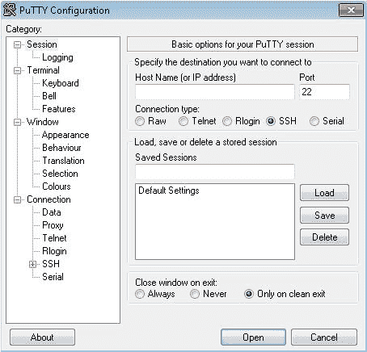

`PuTTY`

在 `Host Name (or IP address)` 框中输入提供给你的主机名或 IP 地址。如果没有给你提供端口，请保持默认值 22。

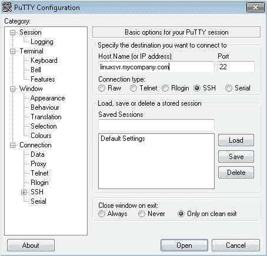

`PuTTY`

通过点击左侧面板中的 `Data` 输入你的用户名。它位于 `Connection` 正下方。在 `Auto-login username` 字段中输入你的用户名。如果你跳过此步骤，在连接到服务器时将提示你输入用户名。

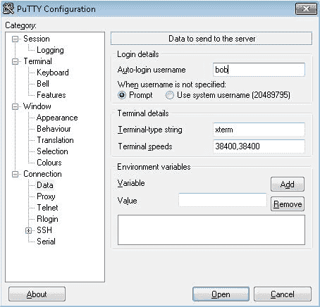

`PuTTY`

在 `Saved Sessions` 框中输入名称以保存你的会话。这允许你通过只需点击保存的会话来加快此过程。

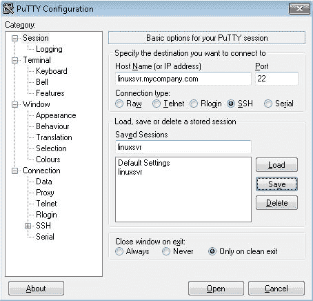

`PuTTY`

当你点击 `Open` 时，将尝试连接。当你第一次连接到特定服务器时，`PuTTY` 会询问是否缓存该服务器密钥。随后的连接将不再提示。要添加服务器主机密钥，只需点击 `Yes`。

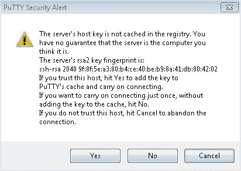

`PuTTY`

一旦成功登录，你将看到类似的内容：

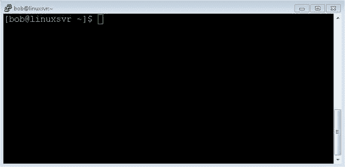

`PuTTY`

## 从 Mac 使用密码通过 SSH 连接

Mac 内置的 SSH 客户端是一个命令行程序。它位于 `/Applications/Utilities` 文件夹中。`ssh` 命令的格式为 `ssh -p port_number username@servername`。如果没有给你提供端口号，则假设默认端口为 22，你可以从命令中省略 `-p 22`。同样，只有当服务器上的用户名与 Mac 上的不同时，才需要指定用户名。例如，如果你的 Mac 用户名是 `bob`，而你在 `linuxsvr` 上的用户名也是 `bob`，你可以省略 `bob@` 并直接输入 `ssh linuxsvr`。一旦 `Terminal` 运行，输入 `ssh` 命令。命令对大小写敏感，`ssh` 命令是小写的。它看起来应该像这三个选项之一：

```
ssh linuxsvr
ssh bob@linuxsvr
ssh -p 2222 bob@linuxsvr
```

当你第一次连接到特定服务器时，你将被要求验证服务器的主机密钥。当被询问 `Are you sure you want to continue connecting (yes/no)?` 时，输入 `yes` 并按 `Enter`。一旦建立连接，将提示你输入密码。

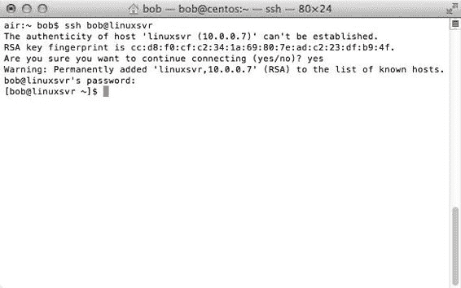

`Terminal`

像 Mac 一样，Linux 也带有一个终端程序和一个 SSH 客户端。一旦连接到一个 Linux 服务器，你可以使用 `ssh` 命令连接到另一个 Linux 服务器。你可以嵌套多个连接，并以这种方式在你的 Linux 服务器网络中导航。

## 关于通过密钥通过 SSH 连接的通用信息

你可能没有收到密码，而是收到了一个 SSH 密钥，甚至被要求生成一个。在物理世界中，钥匙可以打开门。同样，SSH 密钥用于解锁你在服务器上账户的访问权限。如果你没有密钥，就无法打开门。

使用账户密码或账户密码与 SSH 密钥组合是一种常见做法。随着近年来云计算的增长，仅使用 SSH 密钥变得越来越流行。由于云服务器通常连接到公共网络，它们很容易受到暴力破解攻击。心怀不轨的人可能会编写一个程序，反复连接到你的服务器，每次尝试一个新的用户名和密码组合。他们可以通过使用常用用户名和密码列表来增加进入的概率。将你的云服务器配置为不接受密码并仅接受 SSH 密钥即可消除这种威胁。


你可以通过为 SSH 密钥设置密码短语进一步提高其安全性。在这种情况下，你需要“你拥有的东西”（密钥）和“你知道的 set”（密码短语）才能访问你的账户。如果你确信密钥仅由你控制，可以放弃为密钥提供密码短语。这将允许你无需输入任何密码即可登录服务器。拥有没有密码短语的 SSH 密钥允许你自动化和调度需要登录远程系统的任务。

# 在 Windows 上导入 SSH 密钥

如果你获得了一个不是 PuTTY 格式的 SSH 密钥，你需要对其进行转换。在 Windows 系统上转换 SSH 密钥需要 PuTTYgen。这里是 [`puttygen.exe`](http://the.earth.li/~sgtatham/putty/latest/x86/puttygen.exe) 的直接下载链接：[`the.earth.li/~sgtatham/putty/latest/x86/puttygen.exe`](http://the.earth.li/~sgtatham/putty/latest/x86/puttygen.exe)。

运行 PuTTYgen，点击 `Load` 并导航到你收到的私 SSH 密钥。私钥文件名通常为 `id_rsa` 或 `id_dsa`，公钥为 `id_rsa.pub` 或 `id_dsa.pub`。

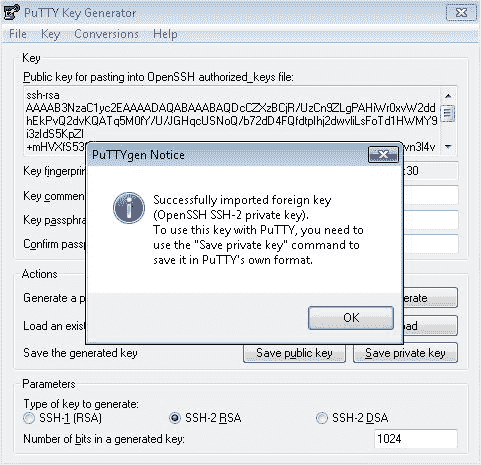

PuTTY

现在你可以保存公钥和私钥，以便以后供 PuTTY 使用。

# 在 Windows 上生成 SSH 密钥

要在 Windows 系统上创建 SSH 密钥，你需要 PuTTYgen。这里是 [`puttygen.exe`](http://the.earth.li/~sgtatham/putty/latest/x86/puttygen.exe) 的直接下载链接：[`the.earth.li/~sgtatham/putty/latest/x86/puttygen.exe`](http://the.earth.li/~sgtatham/putty/latest/x86/puttygen.exe)。

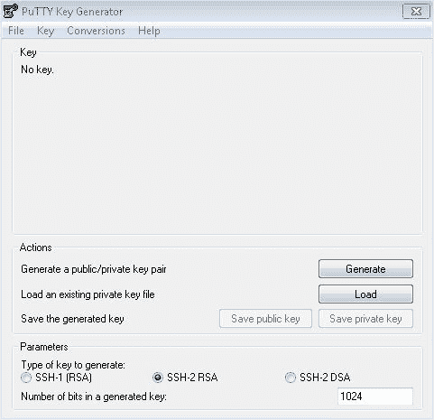

PuTTYgen

运行 PuTTYgen 时，系统会要求你移动鼠标以创建一些随机数据，这些数据将用于密钥的生成。

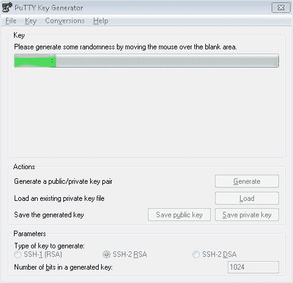

PuTTYgen

你可以选择密钥使用密码短语。你也可以将注释更改为更有意义的内容，例如 `Bob's key`。

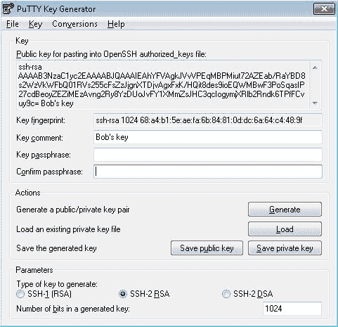

PuTTYgen

现在，通过点击 `Save public key` 然后点击 `Save private key` 来保存公力和私钥。将公钥交给系统管理员，以便他们将其与你的账户关联。私钥仅供你个人使用。不要分享你的私钥！

接下来，点击 `Conversions` 然后点击 `Export OpenSSH Key` 将密钥导出为 OpenSSH 密钥。此 OpenSSH 密钥以后可以在 Unix 或 Linux 系统上使用。

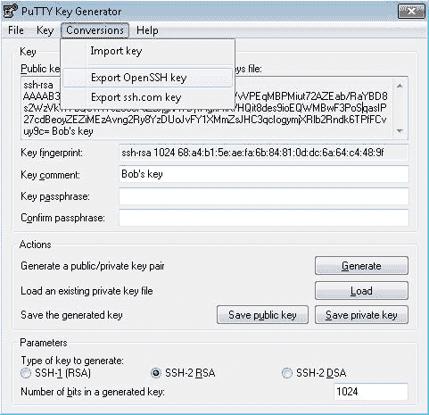

PuTTYgen

## 从 Windows 通过 SSH 连接

遵循“从 Windows 使用密码通过 SSH 连”的说明，但这次需要增加一个步骤来指定你的 SSH 私钥文件。你可以通过点击左侧面板中 `SSH` 旁边的加号符号（`+`）来显示更多选项。接下来点击 `Auth`。在右侧面板中选择 `Private key file for authentication` 字段下的 `Browse`，并找到你的私 SSH 密钥。

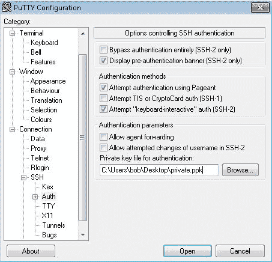

PuTTY

# 在 Mac 上生成 SSH 密钥

如果要求生成 SSH 密钥，请启动 Terminal 应用程序并使用名为 `ssh-keygen` 的命令行工具。你将遇到一系列问题。按 `Enter` 接受所有默认设置。可以选择地为你的 SSH 密钥输入密码短语。

```text
mac:~ bob$ ssh-keygen
Generating public/private rsa key pair.
Enter file in which to save the key (/Users/bob/.ssh/id_rsa):
Enter passphrase (empty for no passphrase):
Enter same passphrase again:
Your identification has been saved in /Users/bob/.ssh/id_rsa.
Your public key has been saved in /Users/bob/.ssh/id_rsa.pub.
The key fingerprint is:
0b:14:c5:85:5f:55:77:35:5f:9e:15:a9:b4:b0:54:05 bob@mac
The key's randomart image is:
+--[ RSA 2048]----+
|      .o.o. .E+=@|
|       .o  o.. oO|
|       . |
```

## 通过密钥从 Mac 连接 SSH

如果要求生成 SSH 密钥，请启动 Terminal 应用程序并使用名为 `ssh-keygen` 的命令行工具。你将遇到一系列问题。按 `Enter` 接受所有默认设置。可以选择地为你的 SSH 密钥输入密码短语。

```text
mac:~ bob$ ssh-keygen
Generating public/private rsa key pair.
Enter file in which to save the key (/Users/bob/.ssh/id_rsa):
Enter passphrase (empty for no passphrase):
Enter same passphrase again:
Your identification has been saved in /Users/bob/.ssh/id_rsa.
Your public key has been saved in /Users/bob/.ssh/id_rsa.pub.
The key fingerprint is:
0b:14:c5:85:5f:55:77:35:5f:9e:15:a9:b4:b0:54:05 bob@mac
The key's randomart image is:
+--[ RSA 2048]----+
|      .o.o. .E+=@|
|       .o  o.. oO|
|       .
```

如果要求生成 SSH 密钥，请启动 Terminal 应用程序并使用名为 `ssh-keygen` 的命令行工具。你将遇到一系列问题。按 `Enter` 接受所有默认设置。可以选择地为你的 SSH 密钥输入密码短语。

```text
mac:~ bob$ ssh-keygen
Generating public/private rsa key pair.
Enter file in which to save the key (/Users/bob/.ssh/id_rsa):
Enter passphrase (empty for no passphrase):
Enter same passphrase again:
Your identification has been saved in /Users/bob/.ssh/id_rsa.
Your public key has been saved in /Users/bob/.ssh/id_rsa.pub.
The key fingerprint is:
0b:14:c5:85:5f:55:77:35:5f:9e:15:a9:b4:b0:54:05 bob@mac
The key's randomart image is:
+--[ RSA 2048]----+
|      .o.o. .E+=@|
|       .o  o.. oO|
|       .
```

如果要求生成 SSH 密钥，请启动 Terminal 应用程序并使用名为 `ssh-keygen` 的命令行工具。你将遇到一系列问题。按 `Enter` 接受所有默认设置。可以选择地为你的 SSH 密钥输入密码短语。

```text
mac:~ bob$ ssh-keygen
Generating public/private rsa key pair.
Enter file in which to save the key (/Users/bob/.ssh/id_rsa):
Enter passphrase (empty for no passphrase):
Enter same passphrase again:
Your identification has been saved in /Users/bob/.ssh/id_rsa.
Your public key has been saved in /Users/bob/.ssh/id_rsa.pub.
The key fingerprint is:
0b:14:c5:85:5f:55:77:35:5f:9e:15:a9:b4:b0:54:05 bob@mac
The key's randomart image is:
+--[ RSA 2048]----+
|      .o.o. .E+=@|
|       .o  o.. oO|
|       .
```

如果要求生成 SSH 密钥，请启动 Terminal 应用程序并使用名为 `ssh-keygen` 的命令行工具。你将遇到一系列问题。按 `Enter` 接受所有默认设置。可以选择地为你的 SSH 密钥输入密码短语。

（注：输入文本包含大量重复块。我保留了关于 `ssh-keygen` 命令和 `ssh` 使用的功能说明性指令。）

# 通过 Telnet 连接

Telnet 曾是连接 Unix 或 Linux 服务器的默认方式。多年来，`telnet` 已被 Secure Shell（简称 SSH）所取代。SSH 正如其所示，比 `telnet` 更安全。Telnet 以明文形式通过网络发送你的登录凭据。SSH 加密了客户端与服务器之间的通信，从而大大提高了安全性。如果有人对你的连接进行数据包嗅探或监听，他们将看到乱码和随机字符。如果你确实需要 `telnet` 到某个系统，可以使用上面的 SSH 指令，但需要进行几处微调。

## 从 Windows 通过 Telnet 连接

运行 PuTTY 并选择 `Telnet` 单选按钮。如果没有给你提供端口，请保留默认值 `23`。当你连接到服务器时，系统会提示你输入用户名和密码。

## 从 Mac 通过 Telnet 连接

（提供的文本在这一部分不完整。）

Mac 内置的 `telnet` 客户端是一个命令行程序。你可以通过 Mac 操作系统自带的 `Terminal` 应用程序运行命令行程序。它位于 `/Applications/Utilities` 文件夹。`telnet` 命令的格式为 `telnet servername port_number`。只有当端口号与默认值 `23` 不同时，你才需要包含它。连接到服务器时，系统会提示你输入用户名和密码。

```text
mac:~ bob$ telnet linuxsvr
Trying 10.0.0.7...
Connected to 10.0.0.7.
Escape character is '^]'.

Ubuntu 12.04.3 LTS

linuxsvr login: bob
Password:

Last login: Thu Nov  7 01:26:37 UTC 2013
Welcome to Ubuntu 12.04.3 LTS

 * Documentation:  https://help.ubuntu.com/

  System info as of Nov 7 01:26:52 UTC 2013

  System load:  0.42

  Usage of /:   3.1% of 40GB

  Memory usage: 32%

  Swap usage:   0%

  Processes:           89

  Users logged in:     0

  IP address for eth0: 10.0.0.7

bob@linuxsvr:~$
```


## 直接连接

如果你正像上一章节中在 VirtualBox 中运行 Linux，或者你拥有安装了 Linux 的专用硬件，你可以直接登录服务器。系统会提示你输入用户名和密码。如果是图形界面，你需要在登录后找到一个终端应用程序。在大多数情况下，它就是 `terminal`，但你可能会看到一些细微的，例如 `gnome terminal`、`konsole` 或 `xterm`。

以下是 CentOS 中打开终端应用程序的界面。你可以在其中一个菜单中找到它。

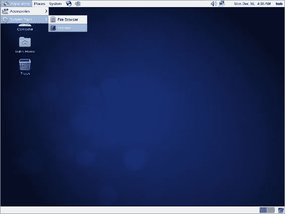

CentOS

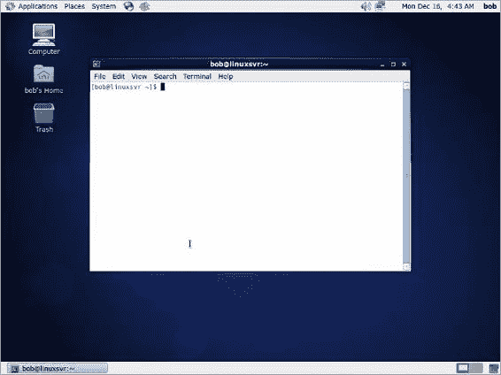

CentOS

在某些 Linux 图形环境中，可能没有传统的菜单系统。在这种情况下，你可能需要搜索终端应用程序。在这个 Ubuntu 示例中，点击屏幕左角的按钮弹出仪表板。你现在可以开始输入以查找系统中安装的应用程序。

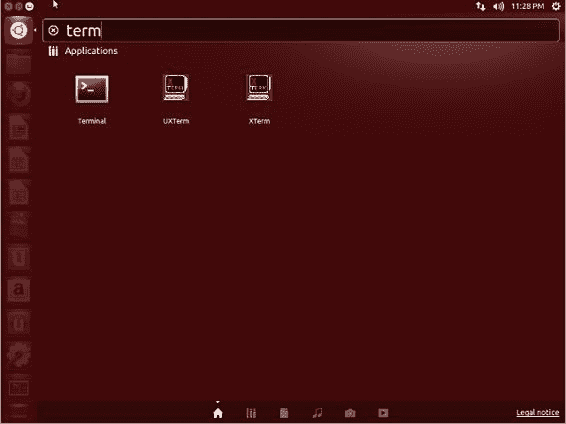

Ubuntu

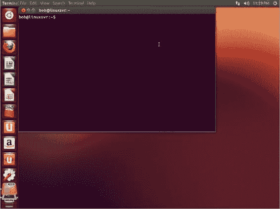

Ubuntu

## 深度解析

- [21 个你可以用于连接 Linux 服务器的 Windows SSH 客户端](http://www.linuxtrainingacademy.com/windows-ssh-clients-connect-linux-server/) - 一列出 21 个最流行的 Windows SSH 客户端的文章。
- [Mac SSH 客户端列表](http://www.openssh.org/macos.html)
- [所有平台的 SSH 客户端列表](https://en.wikipedia.org/wiki/Comparison_of_SSH_clients)
- [终端模拟器列表](http://en.wikipedia.org/wiki/List_of_terminal_emulators) - 包含适用于 Windows、Mac 和 Linux 的终端。
- [Telnet 客户端列表](https://en.wikipedia.org/wiki/Telnet#Telnet_clients)
- [Windows SSH 客户端列表](http://www.openssh.org/windows.html)
- [OpenSSH.org](http://www.openssh.org) - OpenSSH 的官方网站。
- [PuTTY](http://www.LinuxTrainingAcademy.com/putty/?utm_source=linux-for-beginners-ebook&utm_medium=ebook&utm_campaign=linux-for-beginners-ebook)
  - [PuTTY 文档](http://www.chiark.greenend.org.uk/~sgtatham/putty/docs.html)
  - [putty.exe](http://the.earth.li/~sgtatham/putty/latest/x86/putty.exe)
  - [puttygen.exe](http://the.earth.li/~sgtatham/putty/latest/x86/puttygen.exe)
  - [putty.zip](http://the.earth.li/~sgtatham/putty/latest/x86/putty.zip) - 包含所有 PuTTY 程序文件的压缩包。
- 通过 telnet 连接观看《星球大战》。
  - `telnet towel.blinkenlights.nl`
  - 如要断开连接，按住 `Ctrl` 键并按下右括号（`]`）。在 `telnet >` 提示符下输入 `quit` 并按 `Enter`。
- [使用 SSH 公钥认证](http://macnugget.org/projects/publickeys)

# 欢迎使用 Shell

当你通过网络登录到服务器时，shell 程序会启动并作为你系统的默认接口。shell 无非一个接受你的命令并执行这些命令的程序。换句话说，shell 是一个命令行解释器。

让我们来看 shell 提示符。

```text
mac:~ bob$ telnet linuxsvr

Trying 10.0.0.7...

Connected to 10.0.0.7.

Escape character is '^]'.

Ubuntu 12.04.3 LTS

linuxsvr login: bob

Password: 

Last login: Thu Nov  7 01:26:37 UTC 2013

Welcome to Ubuntu 12.04.3 LTS

 * Documentation:  https://help.ubuntu.com/

  System info as of Nov 7 01:26:52 UTC 2013

  System load:  0.42          

  Usage of /:   3.1% of 40GB 

  Memory usage: 32%           

  Swap usage:   0%

  Processes:           89

  Users logged in:     0

  IP address for eth0: 10.0.0.7

bob@linuxsvr:~$ 
```

| `/tmp` | 临时空间，通常在重启时清除。 |
| `/usr` | 用户相关的程序。 |
| `/var` | 可变数据，最重要的是日志文件。 |

## 目录目录列表

以下是您在各种 Linux 系统上可能看到的顶级目录完整列表。其中包含了一些子目录，以清晰地定义顶级目录的作用。您可能永远不会与其中的许多目录进行交互。某些目录会在你遇到的每个系统上存在，例如 `/usr`。而其他目录则是某些特定 Linux 发行版特有的。你可以安全地浏览此列表，并在实际需要时随时查阅。

| 目录 | 描述 |
| --- | --- |
| `/` | 称为 "root" 的目录。它是文件系统层次结构的起点。注意，这与 root 账户（即超级用户）无关。 |
| `/bin` | 二进制文件和其他可执行程序。 |
| `/boot` | 启动操作系统所需的文件。 |
| `/cdrom` | CD-ROM 的挂载点。 |
| `/cgroup` | 控制组（Control Groups）层级结构。 |
| `/dev` | 设备文件，通常由操作系统和系统管理员控制。 |
| `/etc` | 系统配置文件。 |
| `/export` | 共享文件系统。最常见于 Solaris 系统。 |
| `/home` | 用户家目录。 |
| `/lib` | 系统库。 |
| `/lib64` | 64 位系统库。 |
| `/lost+found` | 文件系统在执行文件系统检查后存储恢复的文件。 |
| `/media` | 用于挂载 CD-ROM 等可移动式介质。 |
| `/mnt` | 用于挂载外部文件系统。 |
| `/opt` | 可选或第三方软件。 |
| `/proc` | 提供有关运行进程的信息。 |
| `/root` | root 账户的家目录。 |
| `/sbin` | 系统管理二进制文件。 |
| `/selinux` | 用于显示有关 SELinux 的信息。 |
| `/srv` | 包含系统提供的数据。 |
| `/srv/www` | Web 服务器文件。 |
| `/srv/ftp` | FTP 文件。 |
| `/sys` | 显示并有时配置 Linux 内核已知的设备和总线。 |
| `/tmp` | 临时空间，通常在重启时清除。此目录可以被操作系统和用户使用。 |
| `/usr` | 用户相关的程序、库和文档。`/usr` 中的子目录与上述和下述内容相关。 |
| `/usr/bin` | 二进制文件和其他可执行程序。 |
| `/usr/lib` | 库。 |
| `/usr/local` | 不属于基础操作系统的本地安装软件。 |
| `/usr/sbin` | 系统管理二进制文件。 |
| `/var` | 可变数据，最重要的是日志文件。 |

## Unix 特有目录

Linux 经常出现在带有其他 Unix 变体的环境中。如果您有需要登录 Unix 服务器的需求，您可能会看到以下某些 Unix 特有的目录。

| 目录 | 描述 |
| --- | --- |
| `/devices` | 设备文件，通常由操作系统和系统管理员控制。 |
| `/kernel` | 内核和内核模块。(Solaris) |
| `/platform` | 平台特定文件。(Solaris) |
| `/rpool` | ZFS 根池目录。(Solaris) |
| `/net` | 用于挂载外部文件系统。(HP-UX) |
| `/nfs4` | 用于挂载联邦文件系统域根。(Solaris) |
| `/stand` | 启动 HP-UX 需要的文件。 |

注意，您可能会遇到上述未列出的其他顶级目录。不过，那些很可能是由系统管理员的。

## 应用程序目录结构

应用程序可以遵循操作系统采用的约定。这是一个安装在 `/usr/local` 中名为 `apache` 的应用程序示例目录结构。

| 目录 | 描述 |
| --- | --- |
| `/usr/local/apache/bin` | 应用程序的二进制文件和其他可执行程序。 |
| `/usr/local/apache/etc` | 应用程序的配置文件。 |
| `/usr/local/apache/lib` | 应用程序库。 |
| `/usr/local/apache/logs` | 应用程序日志文件。 |

如果安装在 `/opt`，它可能是这样的：

| 目录 | 描述 |
| --- | --- |
| `/opt/apache/bin` | 应用程序的二进制文件和其他可执行程序。 |
| `/opt/apache/etc` | 应用程序的配置文件。 |
| `/opt/apache/lib` | 应用程序库。 |
| `/opt/apache/logs` | 应用程序日志文件。 |

将所有应用程序子目录置于 `/opt/app-name` 的另一种常见方案是同时使用 `/etc/opt/app-name` 和 `/var/opt/app-name`。对于我们的 `apache` 应用程序示例，可能是这样的：

| 目录 | 描述 |
| --- | --- |
| `/etc/opt/apache` | 应用程序的配置文件。 |
| `/opt/apache/bin` | 应用程序的二进制文件和其他可执行程序。 |
| `/opt/apache/lib` | 应用程序库。 |
| `/var/opt/apache` | 应用程序日志文件。 |

有时会安装不属于标准操作系统的应用程序。

这里是一份基础但重要的命令短列表。在 Linux 中，命令是区分大小大小的，而且通常全都是小写。被括号（`[]`）围起来的项目是可选的。你每次登录 Linux 系统时，很可能会用到这些命令中的至少几个。请熟悉这些命令，因为它们可以让你在短时间内取得很大进展。

- `ls` - 列出目录内容。你将使用 `ls` 来显示文件和目录的信息。
- `cd [dir]` - 将当前目录更改到 `dir`。如果你在不指定目录的情况下执行 `cd`，它将把当前目录切回到你的家目录。这就是你在系统中进行导航的方式。
- `pwd` - 显示当前工作目录名称。如果你不知道自己处于哪个目录，`pwd` 会告诉你。
- `cat [file]` - 合并并显示文件。这是你查看文件内容时使用的命令。
- `echo [argument]` - 在屏幕上显示参数。
- `man command` - 显示 `command` 的在线手册。输入 `q` 退出查看手册页。`man` 命令提供的文档通常被称为“man 页（man pages）”。
- `exit`、`logout` 或 `Ctrl-d` - 退出 shell 或当前会话。
- `clear` - 清除屏幕。

下面是 Bob 使用上述命令的会话截图。

```text
$ ls

PerformanceReviews sales-lecture.mp3 sales.data tpsreports

$ cd tpsreports

$pwd

/home/bob/tpsreports

$ ls -l

total 2

-rw-r--r-- 1 bob users 31 Sep 28 14:49 coversheet.doc

-rw-r--r-- 1 bob users 35 Sep 27 08:47 sales-report.txt

$ cat sales-report.txt

We sold lots of widgets this week!

$ echo $PATH

/bin:/usr/bin:/usr/sbin:/usr/local/bin

$ man ls

NAME

       ls - list directory contents

...
```

关于如何充分利用这些简单命令的更多细节将在稍后介绍。但现在，拿起你的鱼竿——你即将开始学习如何钓鱼了。

# 自学钓鱼

了解可执行命令所在的位置以及 `man` 命令可以让你受益匪浅。你可以通过这种方法自学如何使用 Linux，但这是一个漫长而缓慢的过程。通常情况下，`man` 命令被用快速参考。要记住每个命令的每一个选项几乎是不可能的，而且当你触手可得 `man` 命令时，也没有必要这样做。

要获取 `man` 命令的帮助，可以在查看手册页时输入字母 `h`。这将为你提供一个你可以用于导航或搜索的命令列表。以下是简洁版：

- `Enter` - 向下移动一行。
- `Space` - 向下移动一页。
- `g` - 移动到页面顶部。
- `G` - 移动到页面底部。
- `q` - 退出。

环境变量是一个具有名称和值的存储位置。我们目前感兴趣的是 `PATH`。`PATH` 环境变量包含包含可执行命令的目录列表。你可以通过在 `PATH` 前面加上美元符号（`$PATH`）并使用 `echo` 命令将其值显示在屏幕上来确定其值。

```text
$ echo $PATH

/bin:/usr/bin:/usr/sbin:/usr/local/bin
```

当你在提示符处输入命令并按下 `Enter` 时，系统将在你的 `$PATH` 目录中搜索该命令。在这个示例中，将首先搜索 `/bin`。如果找到了命令，将执行它。如果没有找到，将搜索 `/usr/bin`，依此类推。如果没有找到匹配你请求的可执行命令，系统会礼貌地告诉你找不到。

```text
$ whatsupdoc

-bash: whatsupdoc: command not found
```

如果你想确切知道命令位于哪里，可以使用 `which` 命令。如果程序 `cat` 位于 `/usr/bin` 和 `/usr/local/bin`，那么执行哪一个取决于你的 `$PATH`。

```text
$ which cat

/bin/cat

$ which tac

/usr/bin/tac
```

将以上所有结合起来，你可以开始查看 `$PATH` 中每个目录的 la，并使用 `man` 命令发现它们每一个的作用以及如何使用。记住，要退出 `man` 命令请输入字母 `q`。

```text
$ echo $PATH

/bin:/usr/bin:/usr/sbin:/usr/local/bin

$ cd /bin

$ ls

awk diff cal cat cp date du echo grep groups less more

$ man diff

NAME

      diff - compare two files

...

$ cd /usr/bin

$ ls

clear crontab cut dos2unix find kill mv pstree pwd sed strings touch ...

$ man touch
```

注意，上述 `ls` 命令的输出被截断了。实际上，`/bin` 和 `/usr/bin` 中可能有成百个命令。

许多命令会提供如何在命令行中使用它们的提示。某些命令接受 `-h` 标志，另一些接受 `--help`，而某些则拒绝提供任何帮助。

```text
$ cal -h

Usage:

 cal [options] [[[

]]]
```

## 深度解析

- 环境变量将会有更深入介绍

## 操作目录

目录仅仅是文件和目录的容器。它们为组织系统提供了树形结构。可以通过名称访问目录，也可以使用快捷方式访问。Linux 使用符号 `.` 和 `..` 来表示目录。将 `.` 视为“当前目录”，将 `..` 视为“父目录”。

（等待，这里文本重复了）

使用快捷方式可以让导航变得更容易。例如，输入 `cd ..` 进入当前目录的上一级目录。

```text
$pwd

/home/bob

$ cd tpsreports

$pwd

/home/bob/tpsreports

$ cd ..

$pwd

/home/bob

$ cd ..

$pwd

/home

$ cd .

$pwd

/home
```

`cd .` 命令没有带你去任何地方。记住 `.` 是“当前目录”，而 `..` 是“父目录”。

| 符号 | 描述 |
| --- | --- |
| `.` | 当前目录。 |
| `..` | 父目录。 |
| `/` | 目录分隔符。目录以斜杠结尾，这通常是默认假设。 |

目录分隔符对于路径或命令中的最后一个子目录是可选的。例如，以下命令的作用完全相同。

```text
$ cd /var/tmp

$ cd /var/tmp/
```


导航的另一个快捷方式是`cd -`。该命令带你回到上一个目录。代表上一个工作目录的环境变量是`OLDPWD`。因此，`cd -`和`cd $OLDPWD`是等效的。

```bash
$ pwd
/home/bob

$ cd /var/tmp

$ pwd
/var/tmp

$ echo $OLDPWD
/home/bob

$ cd -
/home/bob

$
```

## 执行当前目录下的命令

你如何执行当前目录下的命令？假设你的当前目录是你的家目录。默认情况下，你的家目录不在你的`$PATH`中。以下是操作方法。

```bash
$ ./program
```

为什么这样做可以行通？嗯，`.`代表“当前目录”，`/`是目录分隔符，而`program`是要执行的程序。你始终可以使用完整路径来显式地指定。这里有两种执行`program`的方法。

```bash
$ pwd
/home/bob

$ ./program
$ /home/bob/program
```

## 创建和删除目录

`mkdir`命令用于创建目录，而`rmdir`命令用于删除目录。

- `mkdir [-p] directory`：创建一个目录。使用`-p`（parents）选项创建中间目录。
- `rmdir [-p] directory`：删除一个目录。使用`-p`（parents）选项删除所有指定的目录。`rmdir`仅删除空目录。要删除目录及其内容，请使用`rm`。
- `rm -rf directory`：递归删除目录以及该目录结构中的所有文件和目录。**请谨慎使用。**在命令行中使用该命令时，没有“垃圾桶”容器可以快速恢复你的文件。当你删除某个东西时，它就消失了。

```bash
$ mkdir newdir

$ mkdir newdir/product/reviews
mkdir: Failed to make directory "newdir/product/reviews"; No such file or directory

$ mkdir -p newdir/product/reviews

$ rmdir newdir
rmdir: directory "newdir": Directory not empty

$ rm -rf newdir

$ ls newdir
ls: newdir: No such file or directory

$ pwd
/home/bob

$ cd ..

$ pwd
/home
```

# 你的免费礼物

感谢你阅读*Linux for Beginners*，我想送你一份*[Linux 替代 Windows 应用程序](http://www.linuxtrainingacademy.com/linux-apps/)*。在书中，你将了解到今天 Linux 提供的 50 多种最流行的应用程序。这些应用程序将允许你浏览网页、观看电影、听音乐、连接你喜爱的社交网络、创建演示文稿等。如果你对 Linux 能提供的功能感兴趣，请立即访问[`www.linuxtrainingacademy.com/linux-apps/`](http://www.linuxtrainingacademy.com/linux-apps/)获取你的免费副本。

我还想为你提供[Linux for Beginners 视频培训课程](https://www.udemy.com/linuxforbeginners/?couponCode=LFB)的 75 折优惠。如果你想在视频中看到书中涵盖的概念，请查看它。它真的可以加强你的学习。只需访问[`www.linuxtrainingacademy.com/25off`](http://www.linuxtrainingacademy.com/25off)，系统会自动应用优惠码“LFB”。

还有一件事。如果你觉得这本书很有价值，我邀请你前往[`www.amazon.com/gp/product/B00HNC1AXY`](http://www.amazon.com/gp/product/B00HNC1AXY/ref=as_li_tl?ie=UTF8&camp=1789&creative=390957&creativeASIN=B00HNC1AXY&linkCode=as2&tag=ebook0a6b-20&linkId=FOHCNPDD7ZYMUQTK)并留下五星好。这不仅能鼓励我为这本书创作更多资源，还能帮助像你这样的的人找到这些内容。

*Linux for Beginners*现在继续“列出文件并理解`ls`输出”。

# 列出文件并理解`ls`输出

这里是使用`-l`选项的`ls`命令输出。`-l`告诉`ls`以长格式显示输出。如果你需要查看存在哪些文件或目录，使用`ls`。然而，如果你需要详细信息，请使用`ls -l`。

```bash
$ ls -l

-rw-rw-r-- 1 bob users 10400 Sep 27 08:52 sales.data
```

在`ls`输出的最左侧是一系列代表文件权限的字符。权限后面的数字代表指向该文件的链接数。下一部分信息是文件的所有者，然后是组名。接着显示文件大小，然后是文件最后修改日期和时间。最后显示文件或目录的名字。以下是`ls -l`命令以表格形式显示的信息。

| 项目 | 值 |
| --- | --- |
| 权限 | `-rw-rw-r--` |
| 链接数 | `1` |
| 所有者 | `bob` |
| 组名 | `users` |
| 文件中的字节数 | `10400` |
| 最后修改时间 | `Sep 27 08:52` |
| 文件名 | `sales.data` |

`-rw-rw-r--`的含义将在“文件和目录权限详解”章节中详细介绍。

## 列出所有文件，包括隐藏文件

以点（`.`）开头的文件或目录被视为隐藏，默认不显示。要显示这些隐藏文件和目录，请使用`-a`选项。

```bash
$ ls -a

.
..
.profile
.bash_history
PerformanceReviews
sales-lecture.mp3
sales.data
```

到此为止，你一直在每个选项前加上一个连字符（`-`）。选项`-l`和`-a`不需要参数，可以组合使用。只需要一个连字符。如果你想显示带有隐藏文件的长`ls`列表，你可以运行`ls -l -a`或`ls -la`。你甚至可以更改标志的顺序，所以`ls -al`也可以。它们都是等效的。

```bash
$ ls -l

total
25-
-
 1     2     :25

-rw-rw-r-- 1 bob users 2522  2  08:5: 22.
-rw-rw-r-- 1 1 104002 27 08:52 sales.data
drwxr-xr-x 2 bob users 512 Sep 28 14:49 tps

$ ls -l

total
25-
-
 1     2     :25

-rw-rw-r-- 1 bob users 2522  2  08:5: 22.
-rw-rw-r-- 1 1 104002 27 08:52 sales.data
drwxr-xr-x 2 bob users 512 Sep 28 14:49 tps
```

## 按类型列出文件

当你对`ls`使用`-F`选项时，文件名后面会附加一个字符，揭示它的类型。

```bash
$ ls
dir1 link program regFile

$ ls -F
dir1/ link@ program*File

$ ls -lF
total 8

drwxr-xr-x 2 bob users 117 Sep 28 15:31 dir1/
lrwxrwxrwx 1 bob users 7 Sep 28 15:32 link@ -> regFile
-rwxr-xr-x 1 bob users 10 Sep 28 15:31 program*
-rw-r--r-- 1 bob users 750 Sep 28 15:32 regFile
```

| 符号 | 含义 |
| --- | --- |
| `/` | 目录。 |
| `@` | 链接。`->`符号之后的文件是链接的目标。 |
| `*` | 可执行程序。 |

链接有时被称为 symlink，是 symbolic link（符号链接）的缩写。链接指向实际文件或目录。你可以像操作实际文件或目录一样操作链接。符号链接可以用于创建长目录名的快捷方式。另一个常见用途是让符号链接指向已安装软件的最新版本，如例所示。

```bash
bob@linuxsvr:~$ cd /opt/apache

bob@linuxsvr:/opt/apache ~$ ls -F
2.4.5/ 2.4.7/ current@ README

bob@linuxsvr:/opt/apache$ ls -l
drwxr-xr-x 2 root root 4096 Sep 14 12:21 2.4.5
drwxr-xr-x 2 root root 4096 Nov 27 15:43 2.4.7
lrwxrwxrwx 1 root root 5 Nov 27 15:43 current -> 2.4.7
-rw-r--r-- 1 root root 1048 Sep 14 12:58 README
```

## 按时间并反序列出文件

如果你想按时间对`ls`列表进行排序，请使用`-t`选项。

```bash
$ ls -t
tpsreports
PerformanceReviews
sales-lecture.mp3
sales.data

$ ls -lt
total 2532

drwxr-xr-x 2 bob users 512 Sep 28 14:49 tpsreports
drwxr-xr-x 3 bob users 512 Sep 28 09:20 PerformanceReviews
-rw-r--r-- 1 bob sales 2562856 Sep 27 08:54 sales-lecture.mp3
-rw-r--r-- 1 bob users 10400 Sep 27 08:52 sales.data
```

当你有一个包含许多文件的目录时，按时间排序可能会很方便，但使用反序更好。这会将最近修改的文件放置在`ls`输出的末尾。旧文件会从屏幕顶部消失，而最近的文件将紧位于你的提示符正上方。

```bash
$ ls -latr
total 2532

drwxr-xr-x 14 root root 512 Sep 27 08:43 ..
-rw-r--r-- 1 bob users 10400 Sep 27 08:52 sales.data
-rw-r--r-- 1 bob sales 2562856 Sep 27 08:54 sales-lecture.mp3
drwxr-xr-x 3 bob users 512 Sep 28 09:20 PerformanceReviews
-rw-r--r-- 1 bob users 28 Sep 28 14:22 .profile
drwxr-xr-x 2 bob users 512 Sep 28 14:49 tpsreports
drwxr-xr-x 4 bob sales 512 Sep 28 14:56 .
-rw------- 1 bob users 3340 Sep 28 15:04 .bash_history
```

## 递归列出文件

在`ls`中使用`-R`选项会导致文件和目录递归显示。

```bash
$ ls -R
.:

PerformanceReviews sales-lecture.mp3 sales.data tpsreports

./PerformanceReviews:

Fred John old

./PerformanceReviews/old:

Jane.doc

$
```

你也可以使用`tree`命令来获得更具视觉效果的输出。如果你只想看到目录结构，请使用`tree -d`。

- `tree`：以树状格式列出目录内容。
- `tree -d`：仅列出目录。
- `tree -C`：彩色输出。

```text
$ tree
.
├── PerformanceReviews
│   ├── Fred
│   ├── John
│   └── old
│       └── Jane.doc
├── sales.data
├── sales-lecture.mp3
└── tpsreports

2 directories, 6 files

$ tree -d
.
└── PerformanceReviews
    └── old

2 directories

$
```

## 只列出目录，而不是内容

通常当你对一个目录运行`ls`时，会显示该目录的内容。如果你想确保获取目录名称，请使用`-d`选项。

```bash
$ ls -l PerformanceReviews
total 3

-rw-r--r-- 1 bob users 36 Sep 27 08:49 Fred
-rw-r--r-- 1 bob users 36 Sep 28 09:21 John
drwxr-xr-x 2 bob users 512 Sep 27 12:40 old

$ ls -ld PerformanceReviews
drwxr-xr-x 3 bob users 512 Sep 28 09:20 PerformanceReviews

$ ls -d PerformanceReviews
PerformanceReviews
```

## 带颜色列出文件

之前你使用`ls -F`通过在`ls`输出的名称末尾添加字符来帮助区分文件类型。你也可以通过使用`ls --color`使用颜色来区分文件类型。


图片替代文本

## 常用的`ls`选项

这里是你学过的`ls`选项的总结。

| 选项 | 说明 |
| --- | --- |
| `-a` | 所有文件，包括隐藏文件 |
| `--color` | 以彩色输出列出文件 |
| `-d` | 列出目录名称 |
| `-l` | 长格式输出 |
| `-r` | 反序排序 |
| `-R` | 递归列出 |
| `-t` | 按时间排序 |

## 文件和目录权限

权限字符串中的第一个字符揭示了类型。例如，`-`是普通文件，`d`是目录，`l`是符号链接。

| 符号 | 类型 |
| --- | --- |
| `-` | 普通文件 |
| `d` | 目录 |
| `l` | 符号链接 |

你会在权限字符串中看到其他字符。它们代表了三种权限：读、写和执行。每个权限由一个符号表示。读是`r`，写是`w`，执行是`x`。

| 符号 | 权限 |
| --- | --- |
| `r` | 读 |
| `w` | 写 |
| `x` | 执行 |

读、写、执行是非常不言自喻的。如果你有读取权限，就可以查看文件内容。如果你有写入权限，就可以修改文件。如果你有执行权限，就可以将该文件作为程序运行。然而，当这些权限应用于目录时，它们的含义与应用于文件时略有不同。

| 权限 | 文件含义 | 目录含义 |
| --- | --- | --- |
| 读 | 允许读取文件 | 允许读取目录中的文件名 |
| 写 | 允许修改文件 | 允许修改目录中的条目 |
| 执行 | 允许执行文件 | 允许访问目录内条目的内容和元数据 |

这些权限适用于三类用户。这些类别是用户（user）、组（group）和其它（other）。就像权限类型一样，每个组都由单个字母表示。所有文件的用户由`u`表示，属于文件组的用户由`g`表示，既不是文件所有者也不属于文件组的其他用户由`o`表示。字符`a`代表所有，即用户、组和其他。

每个用户都至少属于一个被称为“主组”（primary group）的组。然而，用户可以并且也是多个组的成员。组用于将用户组织成逻辑集合。例如，如果销售团队的成员需要访问某些相同的文件和目录，可以将他们放入`sales`组。

运行`groups`命令来查看你属于哪些组。如果你将另一个用户的 ID 作为`groups`命令的参数，你将看到该用户所属的组列表。你也可以运行`id -Gn [user]`来获得相同的结果。

```bash
$ groups
users sales

$ id -Gn
users sales

$ groups pat
users projectx apache

$ groups jill
users sales manager
```

## 权限解码环

现在你已经有了足够的背景信息来开始解码权限字符串。第一个字符是类型。接下来的三个字符代表用户（即文件所有者）拥有的权限。接下来的三个字符代表文件所属组成员拥有的权限。最后三个字符代表所有其他人的权限。

在这种情况下，顺序是有意义的。权限类型将先显示用户，然后是组，最后是其他。此外，读、写、执行权限类型也是按此顺序显示的。如果特定的权限未授予，将用连字符（`-`）代替该位置。

这里是`ls -l`显示的权限信息的图形化表示。

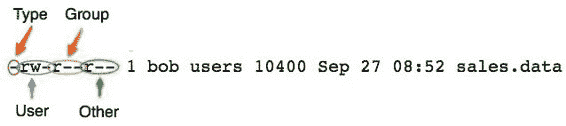

picture alt

如果你在权限字符串的末尾看到额外的字符，说明应用了另一种访问控制方法。如果你看到点（`.`），则文件或目录应用了 SELinux（增强型 Linux）安全上下文。如果你看到加号（`+`），则正在使用 ACL（访问控制列表）。SELinux 和 ACL 超出了本书的范围。不过，你会高兴地知道，其中任何一种的使用都很罕见。如果你在权限遇到问题并注意到权限字符串中有额外的字符，请知道可能需要进一步的调查。

```bash
$ ls -l sales.data.selinux
```


-rw-r--r--. 1 bob users 10400 Sep 27 08:52 sales.data.selinux

$ ls -l sales.data.acl

-rw-r--r--+ 1 bob users 10400 Sep 27 08:52 sales.data.acl

## 更改权限

权限也被称为模式（modes）。这就是为什么你用于更改权限的命令被称为 `chmod`，它是“change mode”的写。`chmod` 命令的格式为 `chmod mode file`。

指定模式有两种方法。第一种称为符号模式（symbolic mode）。符号模式的格式为 `chmod user_category operator permission`。这里是 `chmod` 命令符号模式格式的表格。

| 项目 | 含义 |
| --- | --- |
| `chmod` | 更改模式命令。 |
| `ugoa` | 用户类别。`u` 代表用户、`g` 代表组、`o` 代表其他、`a` 代表所有，其中一个或多个。 |
| `+-=` | `+`、`-` 或 `=` 之一。使用 `+` 添加权限，使用 `-` 减权限，或使用 `=` 显式设置。 |
| `rwx` | 权限。`r` 代表读、`w` 代表写、`x` 代表执行，其中一个或多个。 |

你可以使用用户类别和权限对来添加、减去或设置权限。例如，如果你想为文件所在组的成员添加写权限，可以指定 `chmod g+w file`。

```bash
$ ls -l sales.data

-rw-r--r-- 1 bob users 10400 Sep 27 08:52 sales.data

$ chmod g+w sales.data

$ ls -l sales.data

-rw-rw-r-- 1 bob users 10400 Sep 27 08:52 sales.data
```

注意，运行 `chmod g+w sales.data` 后，权限字符串从 `-rw-r--r--` 变为 `-rw-rw-r--`。记住权限是按用户、组和其他人的顺序显示的。组权限集现在包含了 `w` 符号，表示已授予写权限。

现在文件所有者（`bob`）和组成员（`users`）可以读写 `sales.data` 文件。这里是反向操作。这就是你减去写权限的方法。

```bash
$ ls -l sales.data

-rw-rw-r-- 1 bob users 10400 Sep 27 08:52 sales.data

$ chmod g-w sales.data

$ ls -l sales.data

-rw-r--r-- 1 bob users 10400 Sep 27 08:52 sales.data
```

你可以一次更改多个权限。这次为文件所在组添加了写和执行权限。

```bash
$ ls -l sales.data

-rw-r--r-- 1 bob users 10400 Sep 27 08:52 sales.data

$ chmod g+wx sales.data

$ ls -l sales.data

-rw-rwxr-- 1 bob users 10400 Sep 27 08:52 sales.data
```

你可以一次更改多个权限。这次为文件所在组添加了写和执行权限。

```bash
$ ls -l sales.data

-rw-r--r-- 1 bob users 10400 Sep 27 08:52 sales.data

$ chmod g+wx sales.data

$ ls -l sales.data

-rw-rwxr-- 1 bob users 10400 Sep 27 08:52 sales.data
```

你可以一次更改多个权限。这次为文件所在组添加了写和执行权限。

```bash
$ ls -l sales.data

-rw-r--r-- 1 bob users 10400 Sep 27 08:52 sales.data

$ chmod g+wx sales.data

$ ls -l sales.data

-rw-rwxr-- 1 bob users 10400 Sep 27 08:52 sales.data
```

你可以一次更改多个权限。这次为文件所在组添加了写和执行权限。

```bash
$ ls -l sales.data

-rw-r--r-- 1 bob users 10400 Sep 27 08:52 sales.data

$ chmod g+wx sales.data

$ ls -l sales.data

-rw-rwxr-- 1 bob users 10400 Sep 27 08:52 sales.data
```

你可以一次更改多个权限。这次为文件所在组添加了写和执行权限。

```bash
$ ls -l sales.data

-rw-r--r-- 1 bob users 10400 Sep 27 08:52 sales.data

$ chmod g+wx sales.data

$ ls -l sales.data

-rw-rwxr-- 1 bob users 10400 Sep 27 08:52 sales.data
```

| 2 | 010 | `-w-` | 仅写 |
| 3 | 011 | `-wx` | 写入和执行 (2 + 1) |
| 4 | 100 | `r--` | 仅读 |
| 5 | 101 | `r-x` | 读取和执行 (4 + 1) |
| 6 | 110 | `rw-` | 读取和写入 (4 + 2) |
| 7 | 111 | `rwx` | 读取、写入和执行 (4 + 2 + 1) |

再次强调，权限的顺序具有特定意义。用户类别始终遵循用户（user）、组（group）和其它（other）的顺序。一旦你确定了每个类别的八进制值，就按该顺序指定它们。

例如，要获得 `-rwxr-xr--`，请运行 `chmod 754 file`。这意味着文件的所有者（用户）拥有读取、写入和执行权限；文件组的成员拥有读取和执行权限；其他人拥有读取权限。

| | `U` | `G` | `O` |
| --- | --- | --- | --- |
| `Symbolic` | `rwx` | `r-x` | `r--` |
| `Binary` | `111` | `101` | `100` |
| `Decimal` | `7` | `5` | `4` |

## 常用权限

这里是最常用的权限。这五种权限允许你在权限方面执行几乎任何需要的操作。

| 符号 | 八进制 | 用例 / 含义 |
| --- | --- | --- |
| `-rwx------` | `700` | 确保文件只能由所有者读取、编辑和执行。系统上的其他人无法访问。 |
| `-rwxr-xr-x` | `755` | 允许系统上的所有人执行该文件，但只有所有者可以编辑它。 |
| `-rw-rw-r--` | `664` | 允许一组人员修改文件并让其他人读取。 |
| `-rw-rw----` | `660` | 允许一组人员修改文件但不让其他人读取。 |
| `-rw-r--r--` | `644` | 允许系统上的所有人读取文件，但只有所有者可以编辑它。 |

当你遇到 `777` 或 `666` 权限时，问问自己：“有更好的方法来实现吗？”“系统上的每个人都需要对此文件的写入权限吗？”

例如，如果一个脚本或程序设置为 `777`，那么系统上的任何人都可以对该脚本或程序进行更改。由于对所有人设置了执行位，系统上的任何人都可以执行该程序。如果故意或无意插入了恶意代码，可能会引起不麻烦。

如果多个人需要对文件的写入权限，请考虑使用组并限制他人的访问。避免使用 `777` 和 `666` 权限模式是一个良好的习惯。

## 与组一起工作

如果你在销售团队工作，且每位成员都需要更新 `sales.report` 文件，你可以使用 `chgrp` 命令将组设置为 `sales`，然后将权限设置为 `664`（`rw-rw-r--`）。如果你想确保只有销售团队的成员才能读取报告，甚至可以使用 `660`（`rw-rw----`）权限。

从技术上讲，`774`（`rwxrwxr--`）或 `770`（`rwxrwx---`）权限也可以用，但由于 `sales.report` 不是可执行程序，使用 `664`（`rw-rw-r--`）或 `660`（`rw-rw----`）更有意义。

当你创建一个文件时，它的组被设置为你的主组。这种行为可以通过使用 `newgrp` 命令来覆盖，但请注意，当你创建文件时，它通常会继承你的默认组。在接下来的示例中，Bob 的主组是 `users`。

注意 `chgrp` 命令的格式为 `chgrp GROUP FILE`。

```bash
$ nano sales.report

$ ls -l sales.report

-rw-r--r-- 1 bob users 6 Dec  4 20:41 sales.report

$ chgrp sales sales.report

$ ls -l sales.report

-rw-r--r-- 1 bob sales 6 Dec  4 20:41 sales.report

$ chmod 664 sales.report

$ ls -l sales.report

-rw-rw-r-- 1 bob sales 6 Dec  4 20:41 sales.report
```

与其将文件保存在各个团队成员的家目录中，不如将它们保存在团队专用的位置更为简单。例如，你可以请求服务器管理员创建一个 `/usr/local/sales` 目录。

组应该设置为 `sales`，权限应该设置为 `775`（`rwxrwxr-x`）或 `770`（`rwxrwx---`）。如果销售团队之外的人不需要访问 `/usr/local/sales` 中的任何文件、目录或程序，请使用 `770`（`rwxrwx---`）。

```bash
$ ls -ld /usr/local/sales

drwxrwxr-x 2 root sales 4096 Dec  4 20:53 /usr/local/sales

$ mv sales.report /usr/local/sales/

$ ls -l /usr/local/sales

total 4

-rw-rw-r-- 1 bob sales 6 Dec  4 20:41 sales.report
```

## 重新回顾目录权限

此示例演示了权限如何影响目录及其内容。一个常见问题是对目录内的文件设置了正确的权限，但目录本身的权限却是错误的。

在目录上没有正确的权限可能会阻止文件的执行，例如。如果你确定文件的权限已设置正确，请查看父目录。通过在当前目录运行 `ls -ld .` 向目录树根部移动，使用 `cd ..` 移动到父目录，并重复这两个步骤直到找到问题。

```bash
$ ls -dl directory/

drwxr-xr-x 2 bob users 4096 Sep 29 22:02 directory/

$ ls -l directory/

total 0

-rwxr--r-- 1 bob users    0 Sep 29 22:02 testprog

$ chmod 400 directory

$ ls -dl directory

drwx------ 2 bob users 4096 Sep 29 22:02 directory
```

（注：此处原文输出为 `drwxr-xr-x` 变为 `drwx------` 是 `chmod 400` 的逻辑结果）

## 默认权限与掩码

文件创建掩码（mask）决定了文件在创建时分配的权限。掩码限制或屏蔽权限，从而决定了最终的权限。

掩码通常由系统管理员设置，但可以通过在初始化文件中包含 `umask` 语句按账户覆盖。

`umask [-S] [mode]`：如果指定模式，则设置文件创建掩码。如果省略模式，则显示当前掩码。使用 `-S` 参数允许 `umask` 以符号表示显示或设置。

`umask` 模式的工作方式与 `chmod` 相反。当你向 `chmod` 提供 `7` 时，意味着开启所有权限 `rwx`；当你向 `umask` 提供 `7` 时，意味着关闭所有权限 `---`。

将 `chmod` 理解为开启、添加或赋予权限；将 `umask` 理解为关闭、减去或剥夺权限。

估算 `umask` 模式对默认权限影响的快速方法是从目录减去 `777`，从文件减去 `666`。这里有一个 `umask 022` 的示例，通常是 Linux 发行版使用或系统管理员设置的默认掩码。

```text
 Dir    File

Base Permission      777     666

Minus Umask         -022    -022

                    ----    ----

Creation Permission  755     644
```

使用 `002` 的 `umask` 非常适合与团队成员一起工作。你会发现，当创建文件或目录时，权限允许组成员操作这些文件和目录。

```text
 Dir    File

Base Permission      777     666

Minus Umask         -002    -002

                    ----    ----

Creation Permission  775     664
```

这里是另一个用于与团队成员工作的可能 `umask`。使用 `007` 以便不向组之外的用户授予任何权限。

```text
 Dir    File

Base Permission      777     666

Minus Umask         -007    -007

                    ----    ----

Creation Permission  770     660
```

再次，使用这种八进制减法是一种很好的估计方法。你可以看到，这种方法在 `umask` 模式为 `007` 时失效了。实际上，为了每次都获得准确的结果，你需要将八进制权限转换为二进制值。从那里开始，你对 `umask` 模式进行位取反（NOT）操作，然后对该结果与基础权限进行位与（AND）操作。

在这里略过这些细节没有关系，因为实际使用的 `umask` 模式只有寥几个。它们是 `022`、`002`、`077` 和 `007`。省去你自己做二进制数学作业吧，查看下表，它包含了由八种掩码排列组合创建的所有权限。

| 八进制 | 二进制 | 目录权限 | 文件权限 |
| --- | --- | --- | --- |
| `0` | `000` | `rwx` | `rw-` |
| `1` | `001` | `rw-` | `rw-` |
| `2` | `010` | `r-x` | `r--` |
| `3` | `011` | `r--` | `r--` |
| `4` | `100` | `-wx` | `-w-` |
| `5` | `101` | `-w-` | `-w-` |
| `6` | `110` | `--x` | `---` |
| `7` | `111` | `---` | `---` |

## 特殊模式

当掩码设置为 `022` 时，查看 `umask` 的输出。

```bash
$ umask

0022
```

你会注意到开头多了一个额外的 `0`。到目前为止，你处理的都是代表用户、组和其他权限的三个字符。有一类特殊模式。这些模式是 setuid、setgid 和 sticky（粘滞位）。

注意，这些特殊模式是通过在你通常用于 `umask` 或 `chmod` 的八进制模式前添加一个字符来声明的。这里的重点是需要知道 `umask 0022` 等同于 `umask 022`。同样，`chmod 644` 等同于 `chmod 0644`。

尽管书中不会涵盖特殊模式，但这里列出来供你参考。本章末尾有链接，如果你感兴趣，可以学习更多关于这些模式的知识。

`setuid permission`：允许进程以文件所有者的身份运行，而不是执行该进程的用户身份。

`setgid permission`：允许进程以文件所在组的身份运行，而不是执行该进程的用户组身份。

`sticky bit`：防止用户删除另一个用户的文件，即使他们通常有权限这样做。

## `umask` 示例

以下是 `umask` 模式对文件和目录创建影响的两个示例。

```bash
$ umask

0022

$ umask -S

u=rwx,g=rx,o=rx

$ mkdir a-dir

$ touch a-file

$ ls -l

total 4

drwxr-xr-x 2 bob users 4096 Dec  5 00:03 a-dir

-rw-r--r-- 1 bob users 0 Dec  5 00:03 a-file

$ rmdir a-dir

$ rm a-file

$ umask 007

$ umask

007

$ umask -S

u=rwx,g=rwx,o=

$ mkdir a-dir

$ touch a-file

$ ls -l

total 4

drwx------ 2 bob users 4096 Dec  5 00:04 a-dir

-rw-rw---- 1 bob users 0 Dec  5 00:04 a-file

$ find
```


## Linux 权限免费训练视频

我知道学习 Linux 权限可能具有挑战性。这就是为什么我录制了两个深度涵盖这一主题的视频。这些视频不仅解释了 Linux 权限背概念，而且在实际服务器上进行了演示。观看这些视频将加强你所学的知识，并希望消除任何困惑。

## 深度解析

- **二进制数系统**：世界上只有两种人：懂二进制的人和不懂二进制的人。
- **每一个 Unix/Linux Umask 模式**：列出所有可能的`umask`模式的文章。
- **Linux 权限详解**：观看两个解释并演示文件系统权限的视频。
- **模式**：详细的权限信息。
- **SELinux**：SELinux 官方项目页面。
- **特殊文件权限**：一篇描述 setuid、setgid 和 sticky bit 的文章。
- **Ubuntu ACL 文档**：不仅适用于 Ubuntu 且适用于其他发行版的 ACL 文档。

## 查找文件

如果你需要定位某个文件或目录，可以使用`find`命令。它可以根据名称、大小、所有者、修改时间等来查找文件。

`find [path...] [expression]` - 递归地在`path`中查找匹配`expression`的文件。如果没有参数，它将查找当前目录下的所有文件。

```
$ find
.
./profile
./bash_history
./PerformanceReviews
./PerformanceReviews/current
./PerformanceReviews/current/tps-report.log
./PerformanceReviews/John
./sales.data
```

这里是使用`find`命令的一些实用方法：

`find . -name pattern` - 显示名称匹配`pattern`的文件。此命令是区分大小写的。

`find . -iname pattern` - 与`-name`相同，但忽略大小写。

`find . -ls` - 对每个找到的文件或目录执行`ls`操作。

`find . -mtime num_days` - 查找旧于`num_days`的文件。

`find . -size num` - 查找大小为`num`的文件。

`find . -newer file` - 查找比`file`新的文件。

`find . -exec command {} \;` - 对所有找到的文件运行`command`。

让我们来看一些例子。假设你正在寻找一个名为 "apache" 的文件或目录。你认为它在`/opt`某处，但不确定是 "Apache" 还是 "apache"。你可以为`find`提供`/opt`路径，使用`-iname`忽略大小写，并查找 "apache"。

```
$ find /opt -iname apache
/opt/web/Apache
```

要查找`/usr/local`中所有以 "conf" 结尾的文件，可以使用此命令。

```
$ find /usr/local -name *conf
/usr/local/etc/dhcp.conf
/usr/local/etc/httpd.conf
```

如果你在当前目录下查找旧了 10 天但少于 13 天的文件，可以使用此命令。

```
$ find . -mtime +10 -mtime -13
./.profile
./PerformanceReviews
./PerformanceReviews/John
./tpsreports
./tpsreports/coversheet.doc
```

查找以 "s" 开头并对它们执行`ls`。

```
$ find . -name "s*" -ls
52  11 -rw-r--r-- 1 bob users 10400 Sep 27 08:52 ./sales.data
48   1 -rw-r--r-- 1 bob users    35 Sep 27 08:47 ./tpsreports/sr.txt
53 112 -rw-r--r-- 1 bob sales  2566 Sep 27 08:54 ./sales-lecture.mp3
```

`find`的`-size`参数接受一个数字以及一个表示空间单位的字母。有效选项有：

- `c` 字节
- `k` 千字节（以 1024 字节为单位）
- `M` 兆字节（以 1048576 字节为单位）
- `G` 吉字节（以 1073741824 字节为单位）

这是一个查找大于 300 兆字节文件的示例。

```
$ find . -size +300M
./PerformanceReviews/current/tps-report.log
```

这里是查找比给定文件新的目录的方法。在这种情况下，你正在寻找比 "b.txt" 新的目录。

```
$ find . -type d -newer b.txt
.
./PerformanceReviews
./PerformanceReviews/John
./tpsreports
```

如你所见，`find`是一个非常强大的工具，它拥有的你目前所看到的更多的功能。请查看帮助页（man page）或参考本章末尾的链接。

# Locate - 快速查找

每当你运行`find`命令时，它都会评估每个文件并返回相应的响应。这在某些时候是一个缓慢的过程。例如，如果你正在系统上查找一个文件，且无法将其位置缩小到某个子目录，你将运行`find / -name something`。该命令会检查系统上的每一个文件。如果你知道文件名（或至少是文件名的一部分），并且只想知道它位于何处，那么`locate`命令就是该工作的正确工具。

`locate pattern` - 列出匹配`pattern`的文件。

每天，系统上的所有文件都会由一个名为`updatedb`的进程进行索引。当你运行`locate`时，它只是在查询由`updatedb`创建的索引或数据库，而不是查看系统上的每个文件。这真的非常快。缺点是数据不是实时的。如果你尝试查找一个几分钟前创建的文件，很有可能它还没有被索引，`locate`将找不到它。此外，`locate`可能会返回一个匹配搜索的文件，但该文件自上次更新索引以来可能已经从系统中删除。在某些服务器上，`locate`未安装或启用，因此你唯一的选择可能是使用`find`。

当`locate`禁用时如下：

```
$ locate bob
locate: /var/locatedb: No such file or directory
```

如果已启用，你将获得查询的快速响应。注意，你不需要知道整个文件名，只需要部分即可。

```
$ locate tpsrep
/home/bob/tpsreports
/home/bob/tpsreports/coversheet.doc
/home/bob/tpsreports/sales-report.txt
```

## 深度掌握

* [Find](https://help.ubuntu.com/community/find) - 关于`find`命令的 Ubuntu 文档。
* [Locate](http://www.linfo.org/locate.html) - 关于`locate`命令的文章。
* [/etc/passwd file](http://www.linfo.org/etc_passwd.html) - 关于`/etc/passwd`文件的文章。

# 查看和编辑文件

这里是一些将文件内容显示在屏幕上的简单命令。

`cat file` - 显示`file`的全部内容。

`more file` - 浏览文本文件。按`Spacebar`进到下一页。按`Enter`进到下一行。输入`q`退出文件查看。这些命令基于`vi`编辑器，将在下一节介绍。

`less file` - 类似于`more`，但允许向后移动和模式搜索。

`head file` - 输出`file`的开头（顶部）部分。

`tail file` - 输出`file`的结尾（底部）部分。

以下是你如何使用`cat`、`tail`和`more`命令检查一个名为`file.txt`的文件。

```
$ cat file.txt
This is the first line.
This is the second.
Here is some more interesting text.
Knock knock.
Who's there?
More filler text.
The quick brown fox jumps over the lazy dog.
The dog was rather impressed.
Roses are red,
Violets are blue,
All my base are belong to you.
Finally, the 12th and last line.

$ head file.txt
This is the first line.
This is the second.
Here is some more interesting text.
Knock knock.
Who's there?
More filler text.
The quick brown fox jumps over the lazy dog.
The dog was rather impressed.
Roses are red,
Violets are blue,

$ tail file.txt
Here is some more interesting text.
Knock knock.
Who's there?
More filler text.
The quick brown fox jumps over the lazy dog.
The dog was rather impressed.
Roses are red,
Violets are blue,
All my base are belong to you.
Finally, the 12th and last line.

$ more file.txt
Here is some more interesting text.
Knock knock.
Who's there?
More filler text.
...
$
```

默认情况下，`head`和`tail`只显示十行。你可以覆盖此行为并告诉它们显示指定行数。格式为`-n`，其中`n`是你想要显示的行数。如果你只想显示文件的第一行，使用`head -1 file`。想显示最后三行吗？运行`tail -3 file`。

```
$ head -2 file.txt
This is the first line.
This is the second.

$ tail -1 file.txt
Finally, the 12th and last line.
$
```

## 实时查看文件

使用`cat`是查看内容相当静态的文件的一种良好方法。然而，如果你正尝试跟踪文件中实时发生的更改，`cat`不是最佳选择。经常且快速变化的文件示例是日志文件。例如，你可能需要启动一个程序并查看该程序的日志文件以查看它正在做什么。在这种情况下，使用`tail -f file`命令。

```
$ tail -f file
```


## 编辑文件

### Nano

虽然`nano`对于简单编辑来说很棒，但它显然更容易学习。当你启动`nano`时，你会看到内容和底部的命令列表。要保存文件，输入`Ctrl+o`。如果你在退出前忘记保存文件，`nano`会询问你是否保存。要了解更多信息，输入`Ctrl+g`。

### Vi

了解`vi`的优势在于，`vi`或`vi`的变体（如`vim`）在系统中始终可用。

`Vim`代表 "Vi IMproved"。它与`vi`中找到的命令兼容。`vim`的一些额外功能包括语法高亮、通过网络编辑文件的能力、多级撤销/重做以及分屏。在许多 Linux 发行版中，当你调用`vi`时，实际上运行的是`vim`。

`vi [file]` - 编辑文件。

`vim [file]` - 与`vi`相同，但功能更多。

`view [file]` - 以只读模式启动`vim`。

#### Vi 模式

`Vi`有模式的概念。你始终在三种模式之一工作：命令模式、插入模式或行模式。当`vi`启动时，你处于命令模式。要随时返回命令模式，请按转义键 (`Esc`)。在命令模式下键入字母不会被发送到文件，而是被解释为命令。命令模式允许你在文件中导航、执行搜索、删除文本、复制文本和粘贴文本。

#### 命令模式

这里是一些常用的导航快捷键绑定。

`k` - 向上移动一行。

`j` - 向下移动一行。

`h` - 向左移动一个字符。

`l` - 向右移动一个字符。

`w` - 向右移动一个单词。

`b` - 向左移动一个单词。

`^` - 转到行首。

`$` - 转到行尾。

注意命令是区分大小写的。例如，如果你想向下移动一行，请输入小写的`j`。大写的`J`会合并行。原始的`vi`编辑器并没有使用方向键，但`vim`支持，因此你可能会发现你的系统可以使用方向键。学习原始键位定义的优势在于：1) 它们始终有效；2) 速度更快，因为你的手不需要离开主位键。

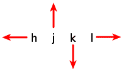

图片替代文本

### 插入模式

要进入插入模式，请按下以下键之一。

`i` - 在光标所在位置插入。

`I` - 在行首插入。

`a` - 在光标位置后追加。

`A` - 在行尾追加。

进入插入模式后，输入你所需的文本。完成后，输入`Esc`返回命令模式。

### 行模式

要进入行模式，你必须从命令模式开始，然后输入冒号（`:`）字符。如果你处于插入模式，请输入`Esc`返回命令模式，然后输入冒号进入行模式。以下是你可能需要知道的一些常用行模式命令。

`:w` - 写入（保存）文件。

`:w!` - 强制保存文件，即使没有写权限。这仅适用于你拥有的文件。

`:q` - 退出。如果文件没有任何修改，此命令有效。

`:q!` - 不保存对文件的修改直接退出。

`:wq!` - 保存并退出。在修改文件后，此命令确保文件被保存并关闭`vi`。

`:x` - 与`:wq`相同。

`:n` - 将光标置于第`n`行。例如，`:5`将光标放在文件的第五行。

`:$` - 将光标放在文件的最后一行。

`:set nu` - 开启行号。

`:set nonu` - 关闭行号。

`:help [子命令]` - 获取帮助。如果你想获取更多关于`:w`命令的信息，请输入`:help :w`。

| 模式 | 键 | 描述 |
| --- | --- | --- |
| 命令 | `Esc` | 用于导航、搜索和复制/粘贴文本。 |
| 插入 | `i I a A` | 也称为文本模式。允许在文件中插入文本。 |
| 行 | `:` | 也称为命令行模式。保存文件、退出`vi`、替换文本和执行某些导航。 |

这是`vim`的截图。波浪号（`~`）表示文件末尾之后的。

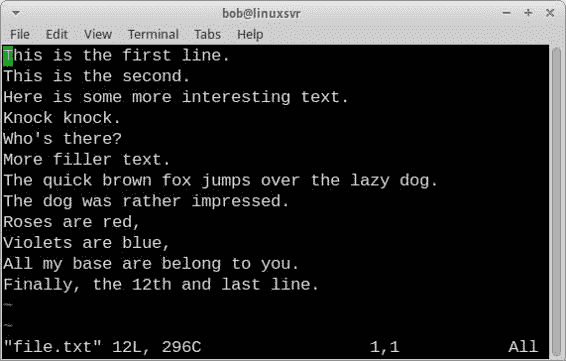

图片替代文本

### 使用`vi`进行高级编辑

你可以通过在命令前加上数字来在`vi`中重复命令。例如，如果你想让光标向上移动 5 行，输入`5k`。如果你想插入 80 次某文本，输入`80i`并开始输入。一旦你按下`Esc`返回命令模式，你输入的文本将重复 80 次。如果你想制作一行星号，可以输入`80i*Esc`。你能看出`vi`比像`nano`这样的编辑器强大得多？

#### 删除文本

`x` - 删除一个字符。

`dw` - 删除一个单词。要删除五个单词，输入`d5w`。`vi`中的重复概念出现在很多地方。

`dd` - 删除一行。要删除 3 行，输入`3dd`。

`D` - 从当前位置删除到行尾。

#### 更改文本

`r` - 替换当前字符。

`cw` - 修改当前单词。

`cc` - 修改当前行。

`c$` - 修改从当前位置到行尾的文本。

`C` - 与`c$`相同。

`~` - 反转字符的大小写。

#### 复制与粘贴

`yy` - 复制（yank）当前行。

`y<position>` - 复制`<position>`。例如，复制一个单词输入`yw`。复制三个单词输入`y3w`。

`p` - 粘贴最近删除或复制的文本。

#### 撤销 / 重做

`u` - 撤销。

`Ctrl-r` - 重做。

#### 搜索

`/<pattern>` - 开始正向搜索`<pattern>`。

`?<pattern>` - 开始反向搜索`<pattern>`。

### Emacs

`Emacs`是另一个强大的编辑器。有些人发现自己被`vi`吸引，而另一些人非常喜欢使用`emacs`。实际上，这在 Linux 世界中是一种竞争关系。尝试`emacs`和`vi`看看哪一个适合你。你不会做出错误的选择，因为它们都是优秀的编辑器。

`emacs [file]` - 编辑文件。

阅读`emacs`文档时，由于`C-<char>`表示按住`Ctrl`键同时按下`<char>`。例如，`C-h`意味着按住`Ctrl`键按下`h`键。如果你看到`C-h t`，意味着按住`Ctrl`键按下`h`，松开`Ctrl`键输入字母`t`。

当你看到`M-<char>`时，意味着按住 "meta" 键。`M-f`向向前一个字符。`M-b`向后移动一个字符。`M-w`向前一个单词。`M-b`向后移动一个单词（注：原文此处重复了`M-b`）。`M-a`到行首。`M-e`到行尾。`M-<`到文件开头。`M->`到文件结尾。`M-u`向上一个段落。`M-p`向下一个段落。`M-n`向上一行。`M-j`向下一行。`M-y`复制当前行。`M-k`杀死当前行。`M-s`保存当前缓冲区。`M-r`替换当前行。`M-c`替换当前行。`M-d`删除当前行。`M-f`删除当前行。`M-b`删除当前行。`M-h`删除当前行。`M-v`删除当前行。`M-t`删除当前行。`M-q`删除当前行。`M-q`删除当前行。`M-z`删除当前行。`M-x`删除当前行...（此处原文存在大量重复的删除指令，已按要求保留格式并翻译）。

某些命令依赖于`$EDITOR`环境变量来告诉它们应该使用哪个程序进行编辑。由于 cron 的主要用途是调度任务，因此它将编辑文件的任务委派给另一个程序。`crontab -e`命令调用由`$EDITOR`环境变量指定的编辑器。你可以在你的个人初始化文件中设置`$EDITOR`，以确保使用你喜欢的编辑器，无论是`nano`、`emacs`、`vi`还是其他程序。

```
$ echo $EDITOR

vi
```

## 深度解析

- [所有基地都属于我们](https://en.wikipedia.org/wiki/All_your_base_are_belong_to_us) - 解释了示例文件`file.txt`中提到的一个处引用。
- [Emacs 教程](https://help.ubuntu.com/community/EmacsHowto) - 一份 emacs 教程。
- Emacs 内置教程 - 启动`emacs`并输入`Ctrl-h t`。
- [Nano 入学者指南](http://www.howtogeek.com/howto/42980/)
- [Vi 教程](https://www.washington.edu/computing/unix/vi.html)
- `vimtutor` - 在命令行运行`vimtutor`启动 vim 教程。
- 欢迎回到 Shell - `more`和`less`命令被称为“分页器”，因为它们允许你翻页查看。你将在“欢迎回到 Shell”章节中学习更多。

## 比较文件

如果你想比较两个文件并显示差异，可以使用`diff`、`sdiff`或`vimdiff`。

`diff file1 file2` - 比较两个文件。

`sdiff file1 file2` - 并排比较两个文件。

`vimdiff file1 file2` - 在`vim`编辑器中高亮两个文件之间的差异。

```
$ cat secret

site: facebook.com

user: bob

pass: Abee!

$ cat secret.bak

site: facebook.com

user: bob

pass: bee

$ diff secret secret.bak

3c3

< pass: Abee!

---

> pass: bee

$ sdiff secret secret.bak

site: facebook.com     site: facebook.com

user: bob              user: bob

pass: Abee!          | pass: bee
```

在`diff`输出中，紧随小于号（`<`）的文本属于第一个文件。跟随大于号（`>`）的文本属于第二个文件。diff 输出的第一行提供了一些额外信息。第一个数字代表第一个文件的行号，第二个数字代表第二个文件的行。分隔行号的中间字符将`c`表示更改（change）、`d`表示删除（deletion）或`a`表示添加（addition）。在这个示例中，第一个文件的第三行从“pass: Abee!”变为第二个文件中的文本“pass: bee”。在`sdiff`输出中，管道符号（`|`）表示文件中的文本存在差异。你还会看到小于号（`<`），表示该行仅存在第一个文件中。大于号（`>`）表示该行仅存在第二个文件中。这里是`vimdiff secret secret.bak`的截图，展示了如何高亮更改。

## 确定文件类型

文件中可能包含的内容有一些线索。例如，某些文件带有扩展名。如果文件以`.txt`结尾，它可能是一个文本文件。如果一个文件具有执行权限，它可能是一个程序。确定文件类型的一种简单方法是对其运行`file`命令。

`file` - 显示文件类型。

```
$ file /etc/passwd

/etc/passwd: ASCII text

$ file bin

bob.tar: POSIX tar archive

test.data: data

test.txt: Bourne-Again shell script, executable
```

## 在文件中搜索

### 在 ASCII 文件中搜索文本

如果你想在文件内查找文本，请使用`grep`命令。

`grep pattern file` - 在文件中搜索模式。

`grep -v pattern file` - 反向匹配。返回文件中不匹配模式的行。

```
$ cat secret

site: facebook.com

user: bob

pass: Abee!

$ grep user secret

user: bob

$ grep o secret

site: facebook.com

user: bob

$ grep -v o secret

pass: Abee!
```

这里是使用`grep`的更多常用选项：

`grep -i` - 执行搜索时忽略大小写。

`grep -c` - 统计文件中出现的次数。

`grep -n` - 在输出前加上文件的行号。

```
$ grep secret

$ grep -i secret

user: bob

$ grep -ci secret

1

$ grep -ni secret

2:user bob
```

### 在二进制文件中搜索文本

如果你对二进制文件运行`grep`，它将简单地显示在文件中是否找到了该信息，但不会显示周围的文本。要查看二进制文件中的文本数据，请使用`strings`命令。

`strings file` - 显示二进制文件中的可打印字符串。

```
$ grep -i john BlueTrain.3

Binary file BlueTrain.3 matches

$ strings BlueTrain.3 | grep -i john

John Coltrane

John Coltrane

$
```

## 管道

你会注意到两个命令通过竖线（也称为管道符号）连接在一起。管道（`|`）意味着获取上一个命令的标准输出并将其作为标准输入传递给下一个命令。如果第一个命令显示错误消息，这些信息不会传递给第二个命令。这些错误消息被称为“标准错误”输出。你将在重定向章节中学习如何操作标准错误。

此外注意，在第一次出现`grep`命令时使用了`grep -i pattern file`格式。在第二次，使用了`grep -i pattern`格式。在第一种格式中，`grep`的输入来自文件。在第二种格式中，`grep`的输入通过管道来自上一个命令。

在第一种格式中，`grep`的输入来自文件。在第二种格式中，`grep`的输入来自前面的命令。

如果你运行`strings BlueTrain.3`，屏幕上将显示大量文本。与其让这些文本流过，不如通过管道将其传递给`grep -i john`。正如你看到的，结果是`strings BlueTrain.3`输出中发现了两次 John Coltrane。

管道不仅限于两个命令。你可以不断链接命令，直到得到你想要的结果。让我们将`grep`的输出传递给`head -1`，将输出限制为一行。

```
$ strings BlueTrain.3 | grep -i john | head -1

John Coltrane

$
```

假设只想只想上述输出的第二个单词。你可以使用`cut`命令来实现该目标。

`cut [file]` - 切文件的某些部分。如果省略文件，则使用标准输入。

`cut -d delimiter` - 使用分隔符作为字段分隔符。

`cut -f N` - 显示第 N 个字段。

要从“John Coltrane”提取“Coltrane”，使用空格作为分隔符（`-d ' '`）并打印第二个字段（`-f 2`）。空格被括起来是因为 Shell 通常忽略空格。在这种情况下，单引号或双引号的作用相同。

```
$ strings BlueTrain.3 | grep -i john | head -1 | cut -d ' ' -f 2

Coltrane

$
```

你会发现有很多只负责做好一件事的小命令。一些示例包括`awk`, `cat`, `cut`, `fmt`, `join`, `less`, `more`, `nl`, `pr`, `sed`, `seq`, `sort`, `tr`和`uniq`。让我们通过使用其中一些命令的示例，并通过管道将它们连接起来。

`/etc/passwd`文件包含了系统账户以及有关这些账户的信息。在这个示例中，目标是找到`/etc/passwd`文件中所有名为 "bob" 的用户，并按用户名按字母顺序以表格格式打印。这里是你可以实现这一点的方法。

```
$ grep bob /etc/passwd

bob:x:1000:1000:Bob:/home/bob:/bin/bash

bobdjr:x:1001:1000:Robert Downey:/home/bobdjr:/bin/bash

bobh:x:1002:1000:Bob Hope:/home/bobh:/bin/bash

bobs:x:1003:1000:Bob Saget:/home/bobs:/bin/bash

bobd:x:1004:1000:Bob Dylan:/home/bobd:/bin/bash

bobb:x:1005:1000:Bob Barker:/home/bobb:/bin/bash

$ grep bob /etc/passwd | cut -f1,5 -d:

bob:Bob

bobdjr:Robert Downey

bobh:Bob Hope

bobs:Bob Saget

bobd:Bob Dylan

bobb:Bob Barker

$ grep bob /etc/passwd | cut -f1,5 -d: | sort

bob:Bob

bobb:Bob Barker

bobd:Bob Dylan

bobdjr:Robert Downey

bobh:Bob Hope

bobs:Bob Saget

$ grep bob /etc/passwd | cut -f1,5 -d: | sort | sed 's/:/ /'

bob Bob

bobb Bob Barker

bobd Bob Dylan

bobdjr Robert Downey

bobh Bob Hope

bobs Bob Saget

$ grep bob /etc/passwd | cut -f1,5 -d: | sort | sed 's/:/ /' | column -t

bob     Bob

bobb    Bob     Barker

bobd    Bob     Dylan

bobdjr  Robert  Downey

bobh    Bob     Hope
```


`bobs    Bob     Saget`

上面的示例展示了如何从一组输出开始，将其作为下一个命令的输入进行逐步思考过程。如果你需要经常执行此操作，可以保存最终命令以备后后用。正如你所看到的，这种简单的管道概念让 Linux 变得极其强大。

## 将输出管道到分页器

管道的另一个常见用途是控制输出在屏幕上的显示方式。如果一个命令产生了大量的输出，它可能会在你检查它之前就滚出屏幕。要控制输出，请使用`more`或`less`等分页器工具。你已经直接对文件使用过这些命令，但请记住它们也可以接受重定向输入。

```bash
$ grep bob /etc/passwd | less

bob:x:1000:1000:Bob:/home/bob:/bin/bash

bobdjr:x:1001:1000:Robert Downey:/home/bobdjr:/bin/bash

bobh:x:1002:1000:Bob Hope:/home/bobh:/bin/bash

bobb:x:1005:1000:Bob Barker:/home/bobb:/bin/bash

...

$ ls -l /usr/bin | less

total 62896

-rwxr-xr-x 1 root root  35264 Nov 19  2012 [

-rwxr-xr-x 1 root root     96 Sep 26 20:28 2to3-2.7

-rwxr-xr-x 1 root root     96 Sep 25 18:23 2to3-3.2

-rwxr-xr-x 1 root root  16224 Mar 18  2013 a2p

....

$ ps -ef | more

UID   PID  PPID  C STIME TTY     TIME CMD

root    1     0  0 Jan08 ?   00:00:00 /sbin/init

root    2     0  0 Jan08 ?   00:00:00 [kthreadd]

root    3     2  0 Jan08 ?   00:00:01 [ksoftirqd/0]

root    6     2  0 Jan08 ?   00:00:00 [migration/0]

root    7     2  0 Jan08 ?   00:00:04 [watchdog/0]

...

$
```

# 删除、复制、移动和重命名文件

## 删除文件

最终，你会厌倦了创建的所有旧文件到处都是，弄乱了你的家目录并占据了宝贵的空间。要删除它们，请使用`rm`命令。

`rm file` - 删除文件。

`rm -r directory` - 递归地删除目录及其内容。如果你想用`rm`删除目录，必须提供`-r`参数。

`rm -f file` - 强制删除且从不提示确认。

可以使用搜索模式同时删除多个文件。在执行`rm`之前，用`ls`双重检查你准备删除的内容将是一个好主意。

```bash
$ ls s*

sales-lecture.mp3 sales.data secret secret.bak

$ rm s*

$ ls -d .*

. .. .profile .bash_history

$ rm .*

rm: cannot remove ‘.’: Is a directory

rm: cannot remove ‘..’: Is a directory

$ ls -d .*

. ..
```

注意，`rm .*`不删除`.`（当前目录）和`..`（父目录）。

## 复制文件

要复制文件，使用`cp`命令。如果你想创建一个文件的副本，可以运行`cp source_file destination_file`。你还可以使用`cp file(s) dir`将文件或一系列文件复制到目录中。

`cp source_file destination_file` - 将`source_file`复制到`destination_file`。

`cp source_file1 [...] destination_directory` - 将文件复制到`destination_directory`。

`cp -i source_file destination_file` - 在交互模式下运行`cp`。如果目标存在，`cp`将在覆盖文件前提示你。

`cp -r source_directory destination` - 递归地复制`source_directory`。如果目标存在，则将内容复制到目录中。

```bash
$ cp file1 file2

$ mkdir dir

$ cp file1 file2 dir/

$ ls dir

file1 file2

$ rm dir/*

$ cp file1 file2 dir

$ cp -i file1 file2

overwrite file2
```

## 移动和重命名文件

要移动或重命名文件，使用`mv`命令。你可以将文件移动到另一个目录，也可以重命名它。

`mv source destination` - 将`source`移动到`destination`。如果`destination`是目录，则将`source`移动到该目录。

`mv -i source destination` - 在交互模式下运行`mv`。如果目标存在，`mv`将在覆盖前提示你。

`mv -f source destination` - 强制移动，从不提示。

```bash
$ mv file1 file2

$ ls

file2

$ mv file2 new_name

$ ls

new_name

$ mv file1 dir/

$ ls dir

file1

$ ls

dir

$ mv -i file1 file2

overwrite file2? (y/n)
```

## 删除目录

要删除空目录，使用`rmdir`命令。要删除包含内容的目录，使用`rm -r`。

`rmdir directory` - 删除空目录。

`rm -r directory` - 递归地删除目录。

# 创建文件集合

如果你想将一组文件和或目录打包到归档中，你可以使用`tar`命令。

`tar [-] c|x|t f tarfile [pattern]` - 使用模式（如果提供）创建、提取或列出 tar 归档的内容。

你会注意到`tar`不需要在其参数前加连字符（`-`）。传统上会排除连字符，但`tar`仍然支持连字符。如果你看到`tar cf file.tar`，它等同于`tar -cf file.tar`。这里是一些最常用的 tar 选项：

`c` - 创建一个 tar 归档。

`x` - 从归档中提取文件。

`t` - 显示目录内容（列表）。

`v` - 使`tar`以详细模式运行。

`f file` - 要执行操作的 tar 归档文件。

在下面的示例中，`tar`用于创建（`tar cf tps.tar`）、列出归档内容（`tar tf tps.tar`）以及提取内容（`tar xf tps.tar`）。

```bash
$ tar cf tps.tar tpsreports/

$ tar tf tps.tar

tpsreports/

tpsreports/sales-report.txt

tpsreports/coversheet.doc

$ cd /tmp

$ tar xf /home/bob/tps.tar

$ ls tpsreports/

coversheet.doc sales-report.txt

$
```

如果你想查看放入归档或从归档中提取的文件，请使用`-v`启用详细模式。

```bash
$ tar cvf misc.tar sec* tpsreports

secret

secret.bak

tpsreports/

tpsreports/sales-report.txt

tpsreports/coversheet.doc

$ tar xvf /home/bob/misc.tar

secret

secret.bak

tpsreports/

tpsreports/sales-report.txt

tpsreports/coversheet.doc
```

# 压缩文件以节省空间

`gzip file` - 压缩文件。生成的压缩文件命名为`file.gz`。

`gunzip file` - 解压缩文件。

`gzcat`或`zcat` - 合并并打印压缩文件。

你可以使用命令`du`显示文件占用的空间。

`du` - 估计文件使用情况。

`du -k` - 以千字节（KB）显示大小。

`du -h` - 以人类可读的格式显示大小。例如 1.2M、3.7G 等。

这里有几个演示如何压缩和解压缩文件的快速示例。

```bash
$ du -k data

15360 data

$ gzip data

$ du -k data.gz

26 data.gz

$ ls data*

data.gz

$ gunzip data.gz

$ ls data*

data

$ du -k misc.tar

10 misc.tar

$ gzip misc.tar

$ du -k misc.tar*

misc.tar.gz

$
```

# 压缩归档

在现代版本的`tar`命令中，`gzip`压缩是内置的。如果你想创建、提取或列出压缩归档的内容，请使用`-z`参数。按照习惯，压缩的 tar 文件以`.tar.gz`或`.tgz`结尾。其格式如下。

```bash
$ tar zcf tps.tgz tpsreports

$ ls *.tgz

tps.tgz

$ tar ztf tps.tgz

tpsreports/

tpsreports/sales-report.txt

tpsreports/coversheet.doc

$
```

如果你遇到了一个没有内置`gzip`压缩的旧版本`tar`，可以使用管道（pipes）来创建压缩归档。当用连字符（`-`）代替文件名时，表示使用标准输出。运行命令`tar cf - pattern`将创建一个 "pattern" 的归档并将输出发送到标准输出（通常是你的屏幕）。如果你在命令后紧跟一个管道，那么标准输出将作为该管道后下一个命令的输入。要强制`gunzip`将其输出发送到标准输出，请使用`-c`参数。基于此，以下是如何使用`tar`、`gzip`和管道来创建、列出和提取压缩归档。

```bash
$ tar cf - tpsreports | gzip > tps.tgz

$ ls *.tgz

tps.tgz

$ gunzip -c tps.tgz | tar tf -

tpsreports/

tpsreports/sales-report.txt

tpsreports/coversheet.doc

$ cd /tmp

$ gunzip -c /home/bob/tps.tgz | tar xf -

$ ls tpsreports/

coversheet.doc sales-report.txt

$
```

# 重定向

你已经学会了如何使用管道重定向一个命令的输出并作为另一个命令的输入。在上一个示例中，你看到了另一种使用大于号（`>`）重定向输出的方法。让我们仔细查看 I/O（输入/输出）重定向。

有三种默认的输入输出类型。它们是标准输入、标准输出和标准错误。默认情况下，标准输入来自键盘，标准输出和标准错误显示在屏幕上。每种 I/O 类型都被分配了一个文件描述符。文件描述符只是代表打开文件的数字。对于人类来说，通过名称引用文件更容易，但对计算机来说，通过数字引用它们更简单。

你可能会想：“我的键盘不是文件，我的屏幕也不是。”在某个层面上是对的，但在另一个层面上并不是。Linux 几乎将一切都表示为文件。这种抽象允许你执行强大的操作，例如将一个通常显示在屏幕上的命令的标准输出提取，并将其作为另一个命令的输入。运行`cat file.txt | sort`比手动输入`file.txt`的全部内容作为`sort`命令的输入要容易得多。

为了演示这个概念，运行`sort`，输入一些文本，并在空行上按`Ctrl-d`。显示如下。

```bash
$ sort

dddd

a

ccc

bb

<<<< 在此处按 Ctrl-d >>>>

a

bb

ccc

dddd

$ cat file.txt

dddd

a

ccc

bb

$ cat file.txt | sort

a

bb

ccc

dddd

$
```

| I/O 名称 | 缩写 | 文件描述符数字 |
| --- | --- | --- |
| 标准输入 | stdin | 0 |
| 标准输出 | stdout | 1 |
| 标准错误 | stderr | 2 |

使用大于号（`>`）重定向输出，使用小于号（`<`）重定向输入。重定向的显式方法是提供文件描述符数字，但如果省略，则假设输入重定向使用文件描述符 0，输出重定向使用 1。

`>` - 将标准输出重定向到文件，覆盖（截断）文件的任何现有内容。如果文件不存在，则创建一个。

`>>` - 将标准输出重定向到文件并追加到任何现有内容之后。如果文件不存在，则创建一个。

`<` - 将输入从文件重定向到小于号之前的命令。

```bash
$ ls -lF /opt/apache

-rw-r--r-- 1 root root 409 Oct 12 10:00 .

drwxr-xr-x 2 root root 4096 Oct 12 10:00 ..

lrwxrwxrwx 1 root root 5 Oct 12 10:00 example -> /tmp/example

drwxr-xr-x 2 root root 4096 Oct 12 10:00 test

-rw-r--r-- 1 root root 409 Oct 12 10:00 file1.txt

-rw-r--r-- 1 root root 409 Oct 12 10:00 file2.txt
```

```bash
$ ls -lF /opt/apache

-rw-r--r-- 1 root root 409 Oct 12 10:00 .

drwxr-xr-x 2 root root 4096 Oct 12 10:00 ..

lrwxrwxrwx 1 root root 5 Oct 12 10:00 example -> /tmp/example

drwxr-xr-x 2 root root 4096 Oct 12 10:00 test

-rw-r--r-- 1 root root 409 Oct 12 10:00 file1.txt

-rw-r--r-- 1 root root 409 Oct 12 10:00 file2.txt

$ ls -lF /opt/apache > files.txt

$ cat files.txt

-rw-r--r-- 1 root root 409 Oct 12 10:00 .

drwxr-xr-x 2 root root 4096 Oct 12 10:00 ..

lrwxrwxrwx 1 root root 5 Oct 12 10:00 example -> /tmp/example

drwxr-xr-x 2 root root 4096 Oct 12 10:00 test

-rw-r--r-- 1 root root 409 Oct 12 10:00 file1.txt

-rw-r--r-- 1 root root 409 Oct 12 10:00 file2.txt

$ ls -lF /opt/apache >> files.txt

$ cat files.txt

-rw-r--r-- 1 root root 409 Oct 12 10:00 .

drwxr-xr-x 2 root root 4096 Oct 12 10:00 ..

lrwxrwxrwx 1 root root 5 Oct 12 10:00 example -> /tmp/example

drwxr-xr-x 2 root root 4096 Oct 12 10:00 test

-rw-r--r-- 1 root root 409 Oct 12 10:00 file1.txt

-rw-r--r-- 1 root root 409 Oct 12 10:00 file2.txt

-rw-r--r-- 1 root root 409 Oct 12 10:00 .

drwxr-xr-x 2 root root 4096 Oct 12 10:00 ..

lrwxrwxrwx 1 root root 5 Oct 12 10:00 example -> /tmp/example

drwxr-xr-x 2 root root 4096 Oct 12 10:00 test

-rw-r--r-- 1 root root 409 Oct 12 10:00 file1.txt

-rw-r--r-- 1 root root 409 Oct 12 10:00 file2.txt

$ ls -lF /opt/apache < files.txt

-rw-r--r-- 1 root root 409 Oct 12 10:00 .

drwxr-xr-x 2 root root 4096 Oct 12 10:00 ..

lrwxrwxrwx 1 root root 5 Oct 12 10:00 example -> /tmp/example

drwxr-xr-x 2 root root 4096 Oct 12 10:00 test

-rw-r--r-- 1 root root 409 Oct 12 10:00 file1.txt

-rw-r--r-- 1 root root 409 Oct 12 10:00 file2.txt
```


输入和输出重定向可以结合使用。这个示例展示了将`files.txt`重定向作为`sort`命令的输入。随后`sort`命令的输出被重定向到`sorted_files.txt`文件中。

```bash
$ sort < files.txt > sorted_files.txt
$ cat sorted_files.txt
-rw-r--r-- 1 root root 1048 Sep 14 12:58 README
-rw-r--r-- 1 root root 1048 Sep 14 12:58 README
drwxr-xr-x 2 root root 4096 Nov 27 15:43 2.4.7
drwxr-xr-x 2 root root 4096 Nov 27 15:43 2.4.7
drwxr-xr-x 2 root root 4096 Sep 14 12:21 2.4.5
drwxr-xr-x 2 root root 4096 Sep 14 12:21 2.4.5
lrwxrwxrwx 1 root root    5 Nov 27 15:43 current -> 2.4.7
lrwxrwxrwx 1 root root    5 Nov 27 15:43 current -> 2.4.7
```

## 标准错误

当程序遇到错误时，它会将结果报告到标准错误（standard error）。文件描述符`1`用于标准输出，`2`用于标准错误。请记住，文件描述符`1`是输出重定向的默认文件描述符。这意味着并不是程序生成的所有输出都被捕获。以下是一个示例。

```bash
$ ls here not-here 
ls: not-here: No such file or directory
here
$ ls here not-here > out
ls: not-here: No such file or directory
$ cat out
here
$ ls here not-here 2> out.err
here
$ cat out.err
ls: not-here: No such file or directory
$ ls here not-here 1> out 2> out.err
$ cat out
here
$ cat out.err
ls: not-here: No such file or directory
$
```

你会注意到，当使用`>`时，错误信息显示在屏幕上，而没有重定向到`out`文件。要重定向错误消息，你必须显式地使用`2>`指定文件描述符`2`。你可以将标准输出发送到一个文件，同时将标准错误发送到另一个文件。你可以利用这一点，让一个文件包含已知的正确输出，而另一个文件则供你检查错误。

如果你想同时捕获标准输出和标准错误，请使用`2>&1`。通常在重定向时，文件会跟随重定向操作。如果你想使用文件描述符而不是文件名，请使用波浪符号（`&`）。因此，不是将标准错误重定向到文件（`2>out.err`），而是将其重定向到标准输出（`2>&1`）。如果你省略了`&`，`1`将被视为名为`1`的文件。

- `&` - 与重定向配合使用，表示使用的是文件描述符而不是文件名。
- `2>&1` - 合并标准错误和标准输出。
- `2> file` - 将标准错误重定向到文件。

```bash
$ ls here not-here > out.both 2>&1
$ cat out.both
ls: not-here: No such file or directory
here
$
```

命令`ls here not-here > out.both 2>&1`的意思是将`ls here not-here`的标准输出发送到名为`out.both`的文件中，并将错误追加到标准输出。由于标准错误被重定向到标准输出，而标准输出被重定向到`out.both`，所有输出都将写入`out.both`。

## 空设备

`>/dev/null` - 将输出重定向到无处。

如果你想忽略输出，可以将其发送到空设备`/dev/null`。空设备是一个特殊文件，会丢弃输入它的任何内容。你可能会听到人们将其称为垃圾桶（bit bucket）。如果你不想在屏幕上看到错误，也不想将其保存到文件中，可以将它们重定向到`/dev/null`。

```bash
$ ls here not-here 2> /dev/null
here
$ ls here not-here > /dev/null 2>&1
$
```

## 深度学习

- [文件描述符](http://en.wikipedia.org/wiki/File_descriptor)
- [在此文档字符串](http://en.wikipedia.org/wiki/Here-document)
- [空设备](https://en.wikipedia.org/wiki//dev/null)
- [重定向](http://en.wikipedia.org/wiki/Redirection_(computing))

# 传输和拷贝文件

你已经知道如何使用`cp`命令在同一系统中从一个位置复制文件到另一个位置。但如果你想从本地工作站将文件复制到 Linux 服务器，或者在 Linux 服务器之间复制文件呢？你可以使用 SCP 或 SFTP。

SCP 是安全拷贝，SFTP 是 SSH 文件传输协议。有时 SFTP 被称为安全文件传输协议。SCP 和 SFTP 都是安全 shell（SSH）协议的扩展。这意味着如果你为 SSH 配置了 SSH 密钥认证，它也适用于 SCP 和 SFTP。

要使用 SCP 或 SFTP，你需要一个客户端。Mac 和 Linux 自带了`scp`和`sftp`命令行工具。如果你正在运行 Windows，可以使用 PuTTY 安全拷贝客户端（`pscp.exe`）和 PuTTY 安全文件传输客户端（`psftp.exe`）程序。命令行工具并不是你唯一的选择。每个平台都有图形化客户端。有些运行在 Windows、Linux 和 Mac 上，如 [FileZilla](https://filezilla.org/)，而另一些则运行在特定平台上，如 Windows 上的 [WinSCP](http://winscp.net)。

- `scp destination` - 将源拷贝到目的地。
- `sftp username@host` - 以用户身份连接到主机以开始安全文件传输。如果你在寻找一种更具交互性的体验，可以检查本地和远程系统，请使用 SFTP。使用 SCP 时，你需要在执行命令之前知道想要传输哪些文件。这是一个 SFTP 会话示例。

```bash
bobby@laptop:/tmp $ sftp bob@linuxsvr
bob@linuxsvr's password:
Connected to linuxsvr.
sftp> pwd
Remote directory: /home/bob
sftp> ls -la
drwxr-xr-x 4 bob bob 4096 Dec 25 19:00 .
drwxr-xr-x 4 root root 4096 Dec 2 22:01 ..
-rw------- 1 bob bob 52 Dec 25 19:00 .Xauthority
-rw------- 1 bob bob 1004 Dec 25 18:53 .bash_history
-rw-r---- 1 bob bob 220 Apr 3 2012 .bash_logout
-rw-r---- 1 bob bob 3655 Dec 2 22:02 .bashrc
-rw-r---- 1 bob bob 675 Apr 3 2012 .profile
drwx------ 2 bob bob 4096 Dec 25 19:00 .ssh
sftp> lpwd
Local directory: /tmp
sftp> lls
file1.txt
sftp> put file1.txt
Uploading file1.txt to /home/bob/file1.txt
file1.txt                                   100%   18.0KB/s   00:00
sftp> ls
file1.txt
sftp> ls -la
drwxr-xr-x 4 bob bob 4096 Dec 25 19:02 .
drwxr-xr-x 4 root root 4096 Dec 2 22:01 ..
-rw------- 1 bob bob 52 Dec 25 19:00 .Xauthority
-rw------- 1 bob bob 1004 Dec 25 18:53 .bash_history
-rw-r---- 1 bob bob 220 Apr 3 2012 .bash_logout
-rw-r---- 1 bob bob 3655 Dec 2 22:02 .bashrc
-rw-r---- 1 bob bob 675 Apr 3 2012 .profile
drwx------ 2 bob bob 4096 Dec 25 19:00 .ssh
-rw-rw---- 1 bob bob 18 Dec 25 19:02 file1.txt
sftp> quit
bobby@laptop:/tmp $ 
```

使用`scp`，你可以从本地系统拷贝到远程系统，从远程系统拷贝到本地系统，或者从一个远程系统拷贝到另一个系统。显示如下：

```bash
bob@linuxsvr $ scp test.txt linuxsvr1:~/
test.txt     100%   35.3KB/s   00:00
bob@linuxsvr $ scp linuxsvr1:~/test.txt .
test.txt     100%   35.3KB/s   00:00
bob@linuxsvr $ scp linuxsvr1:~/test.txt linuxsvr2:/tmp/test-copy.txt
bob@linuxsvr $
```

SCP 和 SFTP 不是向远程系统传输文件的唯一方法。有时启用了 FTP（文件传输协议）。在这种情况下，你可以使用 Linux 和 Mac 内置的`ftp`命令，以及 Windows 上的 WinSCP 等图形化客户端。请注意，FTP 不使用像 SCP 和 SFTP 那样的安全传输协议。这意味着你的登录凭据是以明文在网络上传输的。此外，你上传和下载的文件也没有加密。如果在 SCP/SFTP 和 FTP 之间进行选择，请使用 SCP/SFTP。

```bash
bobby@laptop:~$ ftp linuxsvr
Connected to linuxsvr.
220 ubuntu FTP server (Version 6.4) ready.
Name (linuxsvr:bobby): bob
331 Password required for bob.
Password:
230 User bob logged in.
Remote system type is UNIX.
Using binary mode to transfer files.
ftp> pwd
257 "/home/bob" is current directory.
ftp> quit
221 Goodbye.
```

如果 FTP 未启用，你会看到“连接拒绝”（Connection refused）错误消息。

```bash
bobby@laptop:~$ ftp linuxsvr
ftp: connect: Connection refused
bobby@laptop:~$
```

- 通过密钥使用 SSH 连接 - 本书之前介绍过的 SSH 密钥信息。
- [Cyberduck](http://cyberduck.io/) - 适用于 Mac 和 Windows 的 FTP 和 SFTP 客户端。
- [FileZilla](https://filezilla-project.org/) - 适用于 Mac、Linux 和 Windows 的 FTP 和 SFTP 客户端。
- [FireFTP](https://addons.mozilla.org/en-US/firefox/addon/fireftp/) - 适用于 Mac、Linux 和 Windows 的 Firefox FTP 和 SFTP 客户端。
- [PuTTY](http://www.LinuxTrainingAcademy.com/putty/?utm_source=linux-for-beginners-ebook&utm_medium=ebook&utm_campaign=linux-for-beginners-ebook)
  - [PSCP.EXE](http://the.earth.li/~sgtatham/putty/latest/x86/pscp.exe) - 适用于 Windows 的 SCP 客户端
  - [PSFTP.EXE](http://the.earth.li/~sgtatham/putty/latest/x86/psftp.exe) - 适用于 Windows 的 SFTP 客户端
- [Transmit](http://www.panic.com/transmit/) - 适用于 Mac 的 FTP 和 SFTP 客户端。
- [WinSCP](http://winscp.net) - 适用于 Windows 的 FTP 和 SFTP 客户端。

# 欢迎回到 Shell

## 自定义提示符

正如你在“欢迎 Shell”章节中所看到的，默认提示符因系统而异。无论你使用哪种 shell，都可以通过设置环境变量来自定义提示符。对于`bash`、`ksh`和`sh`等 shell，使用环境变量`PS1`来设置主提示符字符串。`csh`、`tcsh`和`zsh`使用环境变量`prompt`。你放在环境变量中的格式字符串决定了提示符的外观和感受。每个 shell 使用不同的格式字符串，因此请参考你正在使用的 shell 的文档。

让我们来看看自定义 bash 提示符，因为 bash 是 Linux 系统用户账户最常用的默认 shell。以下是 bash 中一些常用的格式字符串选项。完整列表请参阅 man 页（帮助手册）。

- `\d` - “星期 月份 日期”格式的日期（例如“Tue May 26”）
- `\h` - 到第一个 '.' 为止的主名
- `\H` - 主机名
- `\n` - 换行
- `\t` - 24 小制 HH:MM:SS 格式的当前时间
- `\T` - 12 小制 HH:MM:SS 格式的当前时间
- `\@` - 12 小制 am/pm 格式的当前时间
- `\A` - 24 小制 HH:MM 格式的当前时间
- `\u` - 当前用户的用户名
- `\w` - 当前工作目录，其中`$HOME`缩写为波浪号`~`
- `\W` - 当前工作目录的基名，其中`$HOME`缩写为波浪号`~`
- `\$` - 如果有效 UID 为 0，显示`#`，否则显示`$`

以下是通过操作`PS1`环境变量来更改 bash shell 提示符的一些示例。

```bash
[bob@linuxsvr ~]$ echo $PS1
[\u@\h \w]\$
[bob@linuxsvr ~]$ PS1="\u@\h \$ "
bob@linuxsvr $ PS1="<\t \u@\h \w>\$ "
<16:42:58 bob@linuxsvr ~>$ cd /tmp
<16:43:02 bob@linuxsvr /tmp>$ PS1="\d \t \h \W>\$ "
Mon Nov 18 16:45:51 linuxsvr tmp>$ PS1="\t\n[\h \w]\$ "
16:46:47
[linuxsvr /tmp]$
```

为了让你自定义的 shell 提示符在登录之间保持有效，请将`PS1`值添加到个人初始化文件中。个人初始化文件通常被称为“点文件”（dot files），因为它们以点或句号开头。

```bash
$ echo 'export PS1="[\u@\h \w]\$ "' >> ~/.bash_profile
```

## 创建别名

如果你发现自己反复输入同一个命令，可以为它创建一个快捷方式，称为别名（alias）。别名可以被视为文本扩展器。为非常长的命令创建别名也是常见的做法。例如，如果你经常输入`ls -l`，可能想将其缩写为`ll`。事实上，这个别名在许多 Linux 发行版中是预定义的。

`alias [name[=value]]` - 列出或创建别名。如果不提供参数，则显示当前别名列表。使用`name=value`创建新别名。

```bash
$ ls -l
total 4
-rw-r--r-- 1 bob bob 221 Nov 13 11:30 file.txt
$ alias ll='ls -l'
$ ll
total 4
-rw-r--r-- 1 bob bob 221 Nov 13 11:30 file.txt
```

现在你定义的别名在交互式和非交互式会话中均可用。以下是此更改后会话的行为。

### 交互式


`mac:~ bob$ ssh linuxsvr`
`Last login: Thu Nov  7 01:26:37 UTC 2013`
`Welcome to Ubuntu 12.04.3 LTS`

```
 * Documentation:  https://help.ubuntu.com/

  System info as of Nov 14 01:26:52 UTC 2013

  System load:  0.42
  Usage of /:   3.1% of 40GB
  Memory usage: 32%
  Swap usage:   0%
  Processes:           89
  Users logged in:     0
  IP address for eth0: 10.0.0.7
```

`bob@linuxsvr:~$ ll`
`-rw-r--r-- 1 bob bob 221 Nov 13 11:30 file.txt`
`bob@linuxsvr:~$ exit`
`logout`
`Connection to 10.0.0.7 closed.`
`mac:~ bob$`

### 非交互式

```
mac:~ bob$ ssh linuxsvr ll
-rw-r--r-- 1 bob bob 221 Nov 13 11:30 file.txt
mac:~ bob$
```

## 注释

在上面的示例中，你可能注意到在`~/.bash_profile`和`~/.bashrc`文件中井号（`#`）后面跟着一些类似于人类语言的文本。跟在井号后的任何文本都会被 shell 忽略。这是一个非常常见的模式，不仅适用于 shell，也适用于多种计算机编程语言。这种结构允许使用注释和标记，而不影响程序或脚本的执行。

`#` - 井号（Octothorpe）。也称为 hash、square、pound sign 或 number sign。该符号置于注释之前。

```
$ # This does nothing.
$ This does something.
This: command not found
$ alias # Show my aliases.
alias egrep='egrep --color=auto'
alias fgrep='fgrep --color=auto'
alias grep='grep --color=auto'
alias l='ls -CF'
alias la='ls -A'
alias ll='ls -l'
alias ls='ls --color=auto'
$
```

## Shell 历史记录

shell 会记录你之前执行过的命令。Bash 将当前会话的历史保存在内存中，并存储在`~/.bash_history`文件中以便在未来的会话中调用。其他 shell 可能使用`~/.history`、`~/.zsh_history`或其他类似命的文件。访问 shell 历史记录极其有用，因为它允许你快速重复命令。这可以为你节省时间、减少击键次数、通过运行之前的良好命令来防止错误，并通常会加快工作流。

`history` - 显示 shell 历史中的命令列表。

`!N` - 重复行数为`N`的命令。

`!!` - 重复上一条命令行。

`!string` - 重复以 "string" 开头的最近一次命令。

```
$ history
1 ls
2 diff secret secret.bak
3 history
$ !1
ls
PerformanceReviews tpsreports 
$ echo $SHELL
/bin/bash
$ !!
echo $SHELL
/bin/bash
$ !d
diff secret secret.bak
3c3
< pass: Abee!
---
> pass: bee
$
```

使用感叹号历史扩展语法，你可以通过编号重新运行命令。在上面的示例中，历史记录中的第一条命令是通过`!1`执行的。如果你想执行第二条命令，可以执行`!2`。另一个方便的快捷键是`!-N`，意味着执行倒数第 N 命令。如果你想执行倒数第二条命令，输入`!-2`。由于`!!`重复最近一次命令，因此它等同于`!-1`。

```
$ history
1 ls
2 diff secret secret.bak
3 history
$ !-2
diff secret secret.bak
3c3
< pass: Abee!
---
> pass: bee
$
```

默认情况下，bash 在你的 shell 历史记录中保留 500 条命令。这由环境变量`HISTSIZE`控制。如果你想增加这个数字，请在你的个人初始化文件中添加`export HISTSIZE=1000`或类似内容。

`Ctrl-r` - 反向搜索。在你的 shell 历史中搜索命令。

你可以在历史记录中搜索命令。例如，如果你的 shell 历史记录中有命令`find /var/tmp -type f`，你可以通过输入`Ctrl-r fi Enter`找到它。`Ctrl-r`启动反向搜索并显示提示，`fi`是搜索字符串，`Enter`执行找到的命令。你不需要搜索字符串的开头。你完全可以搜索 "var"tmp" 或 "type"。

```
$ find /var/tmp -type f
/var/tmp/file.txt
(reverse-i-search)`fi': find /var/tmp -type f
/var/tmp/file.txt
```

## Tab 补全

提高 shell 效率的另一种方法是使用 Tab 补全。在开始输入命令后，你可以按下`Tab`键调用 Tab 补全。`Tab`会尝试自动完成部分输入的命令。如果有多个以`Tab`之前的字符串开头命令，将显示这些命令。你可以继续操作。

`Tab` - Tab 补全。

```
$ find /var/tmp -type f
/var/tmp/file.txt
(reverse-i-search)`fi': find /var/tmp -type f
/var/tmp/file.txt
```

`a` - 进入插入模式，在当前位置追加文本。

`A` - 进入插入模式，在行尾追加文本。

`I` - 进入插入编辑模式，在行首插入文本。

`v` - 在由`$EDITOR`环境变量定义的编辑器中编辑当前命令行。

有关更多按键绑定，请参考本书书中关于 vi 编辑器 的章节。

## 处理长 Shell 命令

反斜杠（`\`）是行换行延续符。你已经学习了如何使用反斜杠来转义空格等特殊字符。然而，当反斜杠放在行尾时，它被用作行换行延续符。这允许你创建在显示上为多行、但在 Shell 中执行为单行命令的命令行。你可以使用换行延续符让命令更具可读性且易于理解。

```
$ echo "one two three"
one two three
$ echo "one \
> two \
> three"
one two three
$ echo "onetwothree"
onetwothree
$ echo "one\
> two\
> three"
onetwothree
$
```

注意上面示例中的大于符号（`>`）。它是次级提示符字符串，可以通过更改`PS2`环境变量来自定义。你之前已经学习过如何在本书的自定义提示符章节中通过`PS1`更改主提示符字符串。

```
$ PS2="line continued: "
$ echo "one \
line continued: two \
line continued: three"
one two three
$
```

## 环境变量

你已经接触了环境变量并对其进行了良好利用。回顾一下，环境变量是一个具有名称和值的存储位置。它们通常会影响程序的行为。例如，你学习了如何通过定义`$EDITOR`环境变量来告知各种程序你偏好的编辑器。

### 常见环境变量

| 变量名 | 描述 |
| --- | --- |
| `EDITOR` | 执行编辑操作的程序。 |
| `HOME` | 用户的家目录。 |
| `LOGNAME` | 用户的登录名。 |
| `MAIL` | 用户本地收件箱的位置。 |
| `OLDPWD` | 上一个工作目录。 |
| `PATH` | 用冒号分隔的用于搜索命令的目录列表。 |
| `PAGER` | 此程序可能被调用查看文件。 |
| `PS1` | 主提示符字符串。 |
| `PWD` | 当前工作目录。 |
| `USER` | 用户的用户名。 |

### 查看环境变量

如果你知道想要检查的环境变量名称，可以运行`echo $VARIABLE_NAME`或`printenv VARIABLE_NAME`。如果你想检查所有设置的环境变量，请使用`env`或`printenv`命令。

`printenv` - 打印全部或环境变量。

```
$ printenv HOME
/home/bob
$ echo $HOME
/home/bob
$ printenv
TERM=xterm-256color
SHELL=/bin/bash
USER=bob
PATH=/usr/local/bin:/usr/bin:/bin
MAIL=/var/mail/bob
PWD=/home/bob
LANG=en_US.UTF-8
HOME=/home/bob
LOGNAME=bob
$ env
TERM=xterm-256color
SHELL=/bin/bash
USER=bob
PATH=/usr/local/bin:/usr/bin:/bin
MAIL=/var/mail/bob
PWD=/home/bob
LANG=en_US.UTF-8
HOME=/home/bob
LOGNAME=bob
$
```

### 导出环境变量

当进程启动时，它会继承创建它的进程所导出的环境变量。一个设置或更改的变量只会影响当前运行的进程，除非它被导出（export）。未导出的变量被称为本地变量。`export`命令允许变量被后续执行的命令使用。这是一个示例。

```
$ echo $PAGER

$ PAGER=less
$ echo $PAGER
less
$ bash
$ echo $PAGER

$ exit
exit
$ export PAGER=less
$ bash
$ echo $PAGER
less
$ exit
exit
$
```

在上面的示例中，`PAGER`定义在当前环境中。当你启动一个子进程时，它会继承你当前环境中导出的所有环境变量。由于`PAGER`没有被导出，因此在派生的 bash shell 中没有设置。当你导出`PAGER`时，你发现它确实在子进程中可用。

## 从环境中移除变量

你可以使用`unset`来移除或删除环境变量。

```
$ echo $PAGER
less
$ unset PAGER
$ echo $PAGER

$
```

## 深度学习

- [Bash it](https://github.com/revans/bash-it) - 用于管理你 bash 配置的框架。

- [命令行补全](http://en.wikipedia.org/wiki/Command-line_completion) - Tab 补全解释。

- [Shell 配置文件](https://en.wikipedia.org/wiki/Unix_shell#Configuration_files_for_shells) - 用于配置 shell 环境的文件列表。

- [Dotfiles.org](http://dotfiles.org/) - 上传、下载和分享你的 dotfiles 的地方。

- [Dotfiles.github.io](http://dotfiles.github.io/) - github 上上 dotfiles 的指南。

- [Oh my ZSH](https://github.com/robbyrussell/oh-my-zsh) - 用于管理 zsh 配置的社区驱动框架。

- Shells

    - [Bourne Shell](https://en.wikipedia.org/wiki/Bourne_shell)

    - [Bash](https://www.gnu.org/software/bash/)

    - [C Shell](https://en.wikipedia.org/wiki/C_shell)

    - [Korn Shell](http://www.kornshell.com/)

    - [tcsh](http://www.tcsh.org/)

    - [Z Shell](http://www.zsh.org/)

- [交互式使用 Bash History](http://www.gnu.org/software/bash/manual/bashref.html#Using-History-Interactively) - 官方 Bash 历史文档。

- [Unix Shell](https://en.wikipedia.org/wiki/Unix_shell) - 关于 shell 用户界面的文章。

# 进程与作业控制

## 列出进程并显示信息

显示当前运行的进程使用`ps`命令。如果没有指定选项，`ps`会显示与当前会话相关的进程。要查看所有进程（包括不属于你的进程），使用`ps -e`。要查看特定用户运行的进程，使用`ps -u username`。

`ps` - 显示进程状态。

常用的`ps`选项：

- `-e` - 全部，所有进程。

- `-f` - 完整格式列表。

- `-u username` - 显示作为 username 运行的进程。

- `-p pid` - 显示 pid 的进程信息。PID 是进程 ID。

常用的`ps`命令：

- `ps -e` - 显示所有进程。

- `ps -ef` - 显示所有进程。

- `ps -eH` - 显示进程树。

- `ps -e --forest` - 显示进程树。

- `ps -u username` - 显示作为 username 运行的进程。

```
$ ps
  PID TTY          TIME CMD
19511 pts/2    00:00:00 bash
19554 pts/2    00:00:00 bash
$ ps -e
  PID TTY          TIME CMD
19511 pts/2    00:00:00 bash
19554 pts/2    00:00:00 bash
$ ps -ef
  PID TTY          TIME CMD
19511 pts/2    00:00:00 bash
19554 pts/2    00:00:00 bash
$ ps -eH
  PID TTY          TIME CMD
19511 pts/2    00:00:00 bash
19554 pts/2    00:00:00 bash
$ ps -e --forest
  PID TTY          TIME CMD
19511 pts/2    00:00:00 bash
19554 pts/2    00:00:00 bash
$ ps -u username
  PID TTY          TIME CMD
19511 pts/2    00:00:00 bash
19554 pts/2    00:00:00 bash
$ ps
  PID TTY          TIME CMD
19511 pts/2    00:00:00 bash
19554 pts/2    00:00:00 bash
$ ps -e
  PID TTY          TIME CMD
19511 pts/2    00:00:00 bash
19554 pts/2    00:00:00 bash
$ ps -ef
  PID TTY          TIME CMD
19511 pts/2    00:00:00 bash
19554 pts/2    00:00:00 bash
$ ps -eH
  PID TTY          TIME CMD
19511 pts/2    00:00:00 bash
19554 pts/2    00:00:00 bash
$ ps -e --forest
  PID TTY          TIME CMD
19511 pts/2    00:00:00 bash
19554 pts/2    00:00:00 bash
$ ps -u username
  PID TTY          TIME CMD
19511 pts/2    00:00:00 bash
19554 pts/2    00:00:00 bash
```

这里是其他允许你查看运行进程的命令。

`pstree` - 以树状格式显示运行中的进程。

`htop` - 交互式进程查看器。此命令比`top`不常用，系统上可能未安装。

`top` - 交互式进程查看器。

## 在前台和后台运行进程

到目前为止，你执行的所有命令都在前台运行。当一个命令、进程或程序在前台运行时，在进程进程退出之前，shell 提示符不会显示。对于运行时间较长的程序，将它们发送到后台可能非常方便。后台运行的进程仍然会执行并完成其任务，但它们不会阻止你在 shell 提示符处输入后续命令。要将进程放入后台，请在命令末尾加上安符（`&`）。

`command &` - 在后台启动命令。

`Ctrl-c` - 杀死前台进程。

`Ctrl-z` - 挂起前台进程。

`bg [%num]` - 将挂起的进程放入后台。

`fg [%num]` - 将后台进程置于前台。

`kill [%num]` - 通过作业号或 PID 杀死进程。

`jobs [%num]` - 列出作业。

```
$ ./long-running-program &
[1] 22686
$ ps -p 22686
  PID TTY          TIME CMD
22686 pts/1    00:00 long-running-program
$ jobs
[1]+  Running  ./long-running-program &
$ fg
```

当一个命令被放入后台时，会显示两个数字。括号中的数字是作业号，可以通过 % 符号引用。第二个数字是 PID。以下是在后台启动多个进程的示例：


```
$ ./long-running-program &
[1] 22703
$ ./long-running-program &
[2] 22705
$ ./long-running-program &
[3] 22707
$ ./long-running-program &
[4] 22709
$ jobs
[1]   Done         ./long-running-program
[2]   Done         ./long-running-program
[3]-  Running      ./long-running-program &
[4]+  Running      ./long-running-program &
```

`jobs` 输出中的加号（`+`）代表当前作业，减号（`-`）代表上一个作业。当前作业是被在前台运行时停止的最后一个作业，或者是后台启动的最后一个作业。当前作业可以通过 `%%` 或 `%+` 引用。如果在执行 `fg` 或 `bg` 命令时未提供作业信息，则会对当前作业操作。你会注意到作业 1 和 2 被报告为已完成。shell 不中断你当前的命令行，但在显示新提示符之前报告作业状态。例如，如果你在后台启动程序，会返回提示符。shell 在显示新提示符之前报告作业状态。你可以通过按回车键请求新提示符。

要将作业带回前台，输入作业名称或使用 `fg` 命令。要将当前作业置于前台，执行 `%%`、`%+`、`fg`、`fg %+` 或 `%num`。要将作业 3 置于前台，执行 `%3` 或 `fg %3`。

```
$ jobs
[3]-  Running      ./long-running-program &
[4]+  Running      ./long-running-program &
$ fg %3
./long-running-program
$
```

要暂停或挂起在前台运行的任务，输入 `Ctrl-z`。一旦作业挂起，就可以在前台或后台恢复。要将挂起的作业放入后台，输入作业名称后加上安符，或使用作业名加上 `bg`。

```
$ jobs
[1]   Running   ./long-running-program &
[2]-  Running   ./long-running-program &
[3]+  Running   ./another-program &
$ fg
./another-program
^Z
[3]+  Stopped   ./another-program
$ jobs
[1]   Running   ./long-running-program &
[2]-  Running   ./long-running-program &
[3]+  Stopped   ./another-program
$ bg %3
[3]+ ./another-program &
$ jobs
[1]   Running   ./long-running-program &
[2]-  Running   ./long-running-program &
[3]+  Running   ./another-program &
$
```

你可以使用 `kill` 命令停止或杀死后台作业。例如，杀死作业 1 时执行 `kill %1`。杀死在前台运行的任务，输入 `Ctrl-c`。

```
$ jobs
[1]   Running     ./long-running-program &
[2]-  Running     ./long-running-program &
[3]+  Running     ./another-program &
$ kill %1
[1]   Terminated  ./long-running-program
$ jobs
[2]-  Running     ./long-running-program &
[3]+  Running     ./another-program &
$ fg %2
./long-running-program
^C
$ jobs
[3]+  Running     ./another-program &
$
```

## 杀死进程

`Ctrl-c` - 杀死前台进程。

`kill [signal] pid` - 向进程发送信号。

`kill -l` - 显示信号列表。

`kill` 使用的默认信号是终止（termination）。你会看到此信号被称为 `SIGTERM` 或 `TERM`。信号有与其名称对应的数字。默认的 `TERM` 信号数字是 15。因此，运行 `kill pid`、`kill -15 pid` 和 `kill -TERM pid` 是等价。如果发送 `TERM` 信号后进程没有终止，请使用数字为 9 的 `KILL` 信号。

```
$ ps | grep hard-to-stop
27398 pts/1    00:00:00 hard-to-stop
$ kill 27398
$ ps | grep hard-to-stop
27398 pts/1    00:00:00 hard-to-stop
$ kill -9 27398
$ ps | grep hard-to-stop
$
```

## 深度解析

- [Bash 作业控制文档](http://www.gnu.org/software/bash/manual/html_node/Job-Control.html)

# 使用 Cron 调度重复作业

如果你需要按计划重复任务，可以使用 `cron` 服务。cron 服务每分钟检查一次是否有计划运行的任务，如果有则执行。Cron 作通常用于自动化过程或执行常规维护。你可以通过 `crontab` 命令调度 cron 作业。

`cron` - 一个基于时间的作业调度服务。该服务通常在系统启动时启动。

`crontab` - 一个用于创建、读取、更新和删除作业调度的程序。

`crontab`（cron 表）是一个配置文件，指定了 cron 何时执行命令。`crontab` 中的每行代表一个作业，包含两部分信息：1) 什么时候运行以及 2) 运行什么。时间规范由五个字段组成。它们是分钟、小时、日期、月份和星期。在时间规范之后，你提供了要执行的命令。

## Crontab 格式

```
* * * * * command
| | | | | 
| | | | +-- 星期几   (0-6)
| | | +---- 年份的月份 (1-12)
| | +------ 月份的日期 (1-31)
| +-------- 小时             (0-23)
+---------- 分钟             (0-59)
```

在所有时间规范字段匹配当前日期和时间时才会执行。你可以指定命令只运行一次，但这不是 cron 的典型用例。通常，时间规范中的一个或多个字段会包含星号（`*`），用于匹配该字段的任何时间或日期。这里有一个示例 crontab：

```
# 每周一 07:00 运行。
0 7 * * 1 /opt/sales/bin/weekly-report
```

上述 crontab 条目的图示化表示：

```
0 7 * * 1 /opt/sales/bin/weekly-report
| | | | | 
| | | | +-- 星期几   (0-6)
| | | +---- 年份的月份 (1-12)
| | +------ 月份的日期 (1-31)
| +-------- 小时             (0-23)
+---------- 分钟             (0-59)
```

此作业仅在分钟为 0、小时为 7 且星期为 1 时运行。在星期字段中，0 代表星期日，1 代表星期一，此类推。由于在这两个字段使用了星号，该作业将在任何日期和月份运行。

如果命令产生了任何输出，它将通过发送给你。你可以使用 `mail` 命令检查本地邮件。如果你不希望接收电子邮件，可以像示例那样重定向命令的输出。

```
# 每天 02:00 运行并将输出到日志文件。
0 2 * * * /opt/acme/bin/backup-db > /var/opt/acme/backup-db.log 2>&1
```

你可以为每个字段提供多个值。如果你想每半小时运行一次命令，可以这样做。

```
# 每 30 分钟运行一次。
0,30 * * * * /opt/acme/bin/half-hour-check

# 实现相同功能的另一种方法。
*/2 * * * * /opt/acme/bin/half-hour-check
```

在分钟字段中，你可以使用 `*/2` 代替 `0,30`。你甚至可以使用带连字符的范围。如果你想在每小时的前四分钟内每分钟运行一次任务，可以使用此时间规范：`0-4 * * * * command`。

cron 调度器有多种实现方式，某些实现允许你在 crontab 中使用快捷方式和关键字。下面提供了了一些常用的关键字，但请参考你系统上的 cron 文档以确保这些内容可以生效。

| 关键字 | 描述 | 等效命令 |
| --- | --- | --- |
| `@yearly` | 每年在 1 月 1 日凌晨运行一次 | `0 0 1 1 *` |
| `@annually` | 与 `@yearly` 相同 | `0 0 1 1 *` |
| `@monthly` | 每月在每月第一天的凌晨运行一次 | `0 0 1 * *` |
| `@weekly` | 每周在周日的凌晨运行一次 | `0 0 * * 0` |
| `@daily` | 每天凌晨运行一次 | `0 0 * * *` |
| `@midnight` | 与 `@daily` 相同 | `0 0 * * *` |
| `@hourly` | 每小时在小时开始时运行一次 | `0 * * * *` |
| `@reboot` | 启动时运行 | 不适用 |

## 使用 Crontab 命令

使用 `crontab` 命令来管理 cron 任务。

`crontab file` - 从文件安装新的 crontab。

`crontab -l` - 列出你的 cron 任务。

`crontab -e` - 编辑你的 cron 任务。

`crontab -r` - 删除所有的 cron 任务。

```
$ crontab -l
no crontab for bob
$ cat my-cron
# 每周一的 07:00 运行。
0 7 * * 1 /opt/sales/bin/weekly-report
$ crontab my-cron
$ crontab -l
# 每周一的 07:00 运行。
0 7 * * 1 /opt/sales/bin/weekly-report
$ crontab -e
# 启动 $EDITOR。
$ crontab -r
$ crontab -l
no crontab for bob
$
```

## 深入研究

* [WTF](http://wtf.github.io/) - 解码 crontab 行。打印人类可读的输出。
* [Maker](http://www.cronmaker.com/) - 一个帮助你构建 cron 表达式的工具。
* [重定向](https://en.wikipedia.org/wiki/Redirection_(computing))

## 切换用户并以其他身份运行

## su

以另一个用户启动会话的一种方法是使用 `su` 命令。如果没有给 `su` 提供任何参数，它将假设你正尝试变为超级用户（root）。执行 `su` 等同于执行 `root`。除非你指定了 `-`，否则你的当前环境将传递给新的 shell。在这种情况下，`su` 创建的环境将像你登录该用户时预期的那样。

`su [username]` - 更改用户 ID 或变为超级用户。

常用的 `su` 选项：

`-` - 用于提供一个类似于用户直接登录时预期的环境。

`-c command` - 指定要执行的命令。如果命令包含多个单词，则需要加引号。

```
bob@linuxsvr:~$ export TEST=1
bob@linuxsvr:~$ su oracle
Password:
oracle@linuxsvr:/home/bob$ echo $TEST
oracle@linuxsvr:/home/bob$ pwd
/home/bob
oracle@linuxsvr: exit
exit
bob@linuxsvr:~$ su - oracle
Password:
oracle@linuxsvr:~$ echo $TEST
oracle@linuxsvr:~$ pwd
/home/oracle
oracle@linuxsvr:~$ exit
bob@linuxsvr:~$ su -c 'echo $ORACLE_HOME' oracle
Password:
bob@linuxsvr:~$ su -c 'echo $ORACLE_HOME'
bob@linuxsvr:~$
```

如果你想知道自己正在以哪个用户身份工作，请运行 `whoami` 命令。

`whoami` - 显示有效的用户名。

```
$ whoami
bob
$ su oracle
Password:
$ whoami
oracle
$
```

### Sudo - 超级用户

切换用户或以其他身份执行命令的另一种方法是使用 `sudo` 命令。`sudo` 允许你以另一个用户的权限运行程序。与 `su` 类似，如果没有指定用户名，它假设你正尝试以超级用户的身份运行命令。这就是为什么 `sudo` 被称为 super user do（超级用户执行）。它通常用于安装、启动和停止需要超级用户权限的应用。

`sudo` - 以另一个用户（通常是超级用户）身份执行命令。

使用 `sudo` 而非 `su` 命令的一个优势是不需要另一个用户的密码。这可以消除因使用共享密码和通用账户产生的问题。当你执行 `sudo` 命令时，系统会提示你输入自己的密码。如果 `sudo` 配置允许访问，则执行命令。`sudo` 配置通常由系统管理员控制，需要 root 权限。

## 使用 Sudo

使用 `sudo` 的常见方法如下：

`sudo -l` - 显示可以使用 `sudo` 执行的命令。

`sudo command` - 以超级用户身份执行命令。

`sudo` - 以 root 身份执行命令。

`sudo -u [user] command` - 以用户身份执行命令。

`sudo -u user` - 以用户身份执行命令。

`sudo -u user` - 以用户身份执行命令。

```
$ yum search inkscape
Loaded plugins: refresh-packagekit, security
============= N/S Matched: inkscape =============
inkscape-docs.i686 : Documentation for Inkscape
inkscape.i686 : Vector-based drawing program using SVG
inkscape-view.i686 : Viewing program for SVG files

  Name and summary matches only, use "search all" for everything.
$ 
```

要安装软件，请使用 `yum install package`。安装软件需要超级用户权限。这意味着你需要使用 `sudo` 或通过 `su` 命令切换到 root 账户。

```
$ sudo yum install inkscape
[sudo] password for bob: 
Loaded plugins: refresh-packagekit, security
Setting up Install Process
Resolving Dependencies
--> Running transaction check
---> Package inkscape.i686 0:0.47-6.el6 will be installed
--> Processing Dependency: python for package: inkscape-0.47-6.el6.i686
...
Dependencies Resolved

============================================================
 Package      Arch    Version           Repository   Size
============================================================
Installing:
 inkscape     i686    0.47-6.el6        base        8.6 M
Installing for dependencies:
 ImageMagick  i686    6.5.4.7-7.el6_5   updates     1.7 M
...
Transaction Summary
============================================================
Install      21 Package(s)

Total download size: 21 M
Installed size: 97 M
Is this ok [y/N]: y
Downloading Packages:
(1/21): ImageMagick-6.5.4.7-7.el6_5.i686.rpm     
...
Installed:
  inkscape.i686 0:0.47-6.el6

Dependency Installed:
  ImageMagick.i686 0:6.5.4.7-7.el6_5 
...
Complete!
$
```

要卸载软件包，请使用 `yum remove`。移除软件需要超级用户权限。


## 使用 `yum` 命令移除软件包

以下示例演示了如何使用 `yum` 命令移除 `inkscape` 软件包：

```
$ sudo yum remove inkscape
Loaded plugins: refresh-packagekit, security
Setting up Remove Process
Resolving Dependencies
--> Running transaction check
---> Package inkscape.i686 0:0.47-6.el6 will be erased
--> Finished Dependency Resolution

Dependencies Resolved

============================================================
 Package      Arch     Version        Repository       Size
============================================================
Removing:
 inkscape     i686     0.47-6.el6     @base            37 M

Transaction Summary
============================================================
Remove        1 Package(s)

Installed size: 37 M
Is this ok [y/N]: y
Downloading Packages:
Running rpm_check_debug
Running Transaction Test
Transaction Test Succeeded
Running Transaction
  Erasing    : inkscape-0.47-6.el6.i686    1/1 
  Verifying  : inkscape-0.47-6.el6.i686    1/1 

Removed:
  inkscape.i686 0:0.47-6.el6

Complete!
$ 
```

### `rpm` 命令

除了 `yum` 命令外，你还可以使用 `rpm` 命令与包管理器交互。

- `rpm -qa` - 列出所有已安装的软件包。
- `rpm -qf /path/to/file` - 列出包含文件的软件包。
- `rpm -ivh package.rpm` - 从名为 `package.rpm` 的文件安装软件包。
- `rpm -ql package` - 列出属于软件包的所有文件。

```
$ rpm -qa | sort | head
acl-2.2.49-6.el6.i686
acpid-1.0.10-2.1.el6.i686
aic94xx-firmware-30-2.el6.noarch
alsa-lib-1.0.22-3.el6.i686
alsa-plugins-pulseaudio-1.0.21-3.el6.i686
alsa-utils-1.0.22-5.el6.i686
anaconda-13.21.215-1.el6.centos.i686
anaconda-yum-plugins-1.0-5.1.el6.noarch
apache-tomcat-apis-0.1-1.el6.noarch
apr-1.3.9-5.el6_2.i686
$ rpm -qf /usr/bin/which
which-2.19-6.el6.i686
$ sudo rpm -ivh SpiderOak-5.0.3-1.i386.rpm 
[sudo] password for bob: 
Preparing...       ####################### [100%]
   1:SpiderOak     ####################### [100%]
$ 
```

## 在 Debian 和 Ubuntu 上安装软件

Debian 和 Ubuntu 发行版使用一种名为 APT（高级软件包工具）的包管理器。APT 由几个小实用程序组成，其中最常用的两个是 `apt-cache` 和 `apt-get`。

- `apt-cache search search-string` - 搜索 `search-string`。
- `apt-get install [-y] package` - 安装软件包。使用 `-y` 自动回答是。
- `apt-get remove` - 移除软件包。
- `apt-get purge` - 移除软件包并删除配置文件。
- `apt-cache show package` - 显示软件包信息。
- `apt-cache search search-string` - 搜索要安装的软件。

```
$ apt-cache search inkscape
create-resources - shared resources for use
inkscape - vector-based drawing program
python-scour - inkscape
ink-generator - automatically generate files from a
lyx - document processor
robocut - Control program
sozi - inkscape extension for animated presentations
ttf-rufscript - handwriting font for Latin characters (transitional dummy package)
$
```

```
$ sudo apt-get install inkscape

Reading package lists... Done

Building dependency tree

Reading state information... Done

The following extra packages will be installed:

  aspell aspell-en cmap-adobe-japan1 dbus-x11

...3 upgraded, 74 newly installed, 0 to remove and 96 not upgraded.

Need to get 62.7 MB of archives.

After this operation, 171 MB of additional disk space will be used.

Do you want to continue [Y/n]? y

...

Setting up perlmagick (8:6.6.9-5ubuntu3.2) ...

Processing triggers for libc-bin ...

ldconfig deferred processing now taking place

$
```

```
$ sudo apt-get remove inkscape
Reading package lists... Done
Building dependency tree
Reading state information... Done
The following packages will be REMOVED:
  inkscape
0 upgraded, 0 newly installed, 1 to remove and 96 not upgraded.
After this operation, 64.9 MB disk space will be freed.
Do you want to continue [Y/n]? y
(Reading database ... 69841 files and directories currently installed.)
Removing inkscape ...
Processing triggers for man-db ...
Processing triggers for hicolor-icon-theme ...
$
```

### `dpkg` 命令

除了 `apt` 工具外，你还可以使用 `dpkg` 命令与包管理器交互。

- `dpkg -l` - 列出所有已安装的软件包。
- `dpkg -S /path/to/file` - 列出包含文件的软件包。
- `dpkg -i package.deb` - 从名为 `package.deb` 的文件安装软件包。
- `dpkg -L package` - 列出属于软件包的所有文件。

```bash
$ dpkg -l | head

Desired=Unknown/Install/Remove/Purge/Hold
| Status=Not/Inst/Conf-files/Unpacked/halF-conf/Half-inst/trig-aWait/Trig-pend
|/ Err?=(none)/Reinst-required (Status,Err: uppercase=bad)
||/ Name              Version                Description
+++-=================-======================-=================================
ii  accountsservice   0.6.15-2ubuntu9.6      query and manipulate user account information
ii  acpid             1:2.0.10-1ubuntu3      Advanced Configuration and Power Interface event daemon
ii  adduser           3.113ubuntu2           add and remove users and groups
ii  apparmor          2.7.102-0ubuntu3.9     User-space parser utility for AppArmor
ii  apport            2.0.1-0ubuntu17.5      automatically generate crash reports for debugging

$ dpkg -S /usr/bin/which
debianutils: /usr/bin/which

$ sudo dpkg -i spideroak_5.1.3_i386.deb 
[sudo] password for bob: 
Selecting previously unselected package spideroak.
(Reading database ... 153942 files and directories currently installed.)
Unpacking spideroak (from spideroak_5.1.3_i386.deb) ...
Setting up spideroak (1:5.1.3) ...
Processing triggers for man-db ...
Processing triggers for desktop-file-utils ...
Processing triggers for bamfdaemon ...
Rebuilding /usr/share/applications/bamf.index...
Processing triggers for gnome-menus ...
$ 
```


## 安装 Linux 软件的免费视频

如果你想确切看看在 Linux 系统上安装软件究竟是什么样子的，请查看我为你制作的这段视频：[`www.linuxtrainingacademy.com/installing/`](http://www.linuxtrainingacademy.com/installing/)

## 深度学习

- [使用 Yum 管理软件](https://www.centos.org/docs/5/html/yum/)
- [AptGet 教程](https://help.ubuntu.com/community/AptGet/Howto)
- [Ubuntu - 安装软件](https://help.ubuntu.com/community/InstallingSoftware)
- [安装 Linux 软件视频](http://www.linuxtrainingacademy.com/installing/)

## 终结与开始

尽管这本书即将结束，但我衷地希望这只是你 Linux 之旅的开始。自 1991 年发布以来，Linux 的流行程度一直在稳定增长。你会发现 Linux 运行在手机、笔记本电脑、服务器、超级计算机、工业设备，甚至是医疗设备上。学习、探索和成可能性是无尽的。

## 关于作者

Jason Cannon 于 1999 年开始了他的 Unix 和 Linux 系统工程师的职业。从那时起，他在施事、UPS、惠普（Hewlett-Packard）和 Amazon.com 等公司利用了他的 Linux 技能。此外，他还曾为中小型企业担任技术顾问和独立承包商。

Jason 在 CentOS、RedHat Enterprise Linux、SUSE Linux Enterprise Server 和 Ubuntu 方面拥有专业经验。他在个人项目中使用过多个 Linux 发行版，包括 Debian、Slackware、CrunchBang 等。除了 Linux 之外，Jason 还具有支持专有 Unix way 系统的经验，包括 AIX、HP-UX 和 Solaris。

他喜欢教授他人如何使用和利用 Linux 操作系统的力量。他在 [`www.LinuxTrainingAcademy.com`](http://www.linuxtrainingacademy.com/?utm_source=linux-for-beginners-ebook&utm_medium=ebook&utm_campaign=linux-for-beginners-ebook) 写博客并教授在线视频培训课程。可以通过电子邮件 [jacannon@gmail.com] 联系 Jason。

## 作者的其他书籍

- [Bash 命令行专业技巧](http://www.amazon.com/gp/product/B00K53EO3G/ref=as_li_tl?ie=UTF8&camp=1789&creative=390957&creativeASIN=B00K53EO3G&linkCode=as2&tag=linkedincom-20&linkId=PMWYGVV6SFJWESXB) [`www.linuxtrainingacademy.com/bash-pro-tips`](http://www.linuxtrainingacademy.com/bash-pro-tips)
- [命令行功夫：Bash 脚本技巧、Linux Shell 编程技巧以及 Bash 单行命令](http://www.amazon.com/gp/product/B00JRGCFLA/ref=as_li_ss_tl?ie=UTF8&camp=1789&creative=390957&creativeASIN=B00JRGCFLA&linkCode=as2&tag=jasoncame-20) [`www.linuxtrainingacademy.com/command-line-kung-fu-book`](http://www.linuxtrainingacademy.com/command-line-kung-fu-book)
- [LAMP Stack 高可用：消除单点故障并增加基于 Linux、Apache、MySQL 和 PHP Web 应用程序的运行时间](http://www.linuxtrainingacademy.com/ha-lamp-book)
- [Linux 截图之旅书籍：最流行 Linux 发行版图指南](http://www.amazon.com/gp/product/B0073S0S6/ref=as_li_tl?ie=UTF8&camp=1789&creative=390957&creativeASIN=B0073S0S6&linkCode=as2&tag=linux20)

## 包括针对读者的独享折扣在内的额外资源

获取更多资源，请访问 [`www.linuxtrainingacademy.com/resources`](http://www.linuxtrainingacademy.com/resources)。

### 书籍

- [Linux 入门](http://www.linuxtrainingacademy.com/linux)：[http://www.linuxtrainingacademy.com/linux] 如果你想学习如何使用 Linux，但不知道从何处开始，那么这本书适合你。《Linux 入门》对你的背景或知识不做任何假设。你不需要先验知识就能从书中受益。我们将使用逻辑且系统的方法引导你一步步进行。当遇到新概念、命令或术语时，将用通俗的语言进行解释。
- [命令行功夫](http://www.linuxtrainingacademy.com/command-line-kung-fu-book)：[http://www.linuxtrainingacademy.com/command-line-kung-fu-book] 你认为你必须把自己锁在地下室里连续几个月阅读晦涩的帮助页（man pages），才能拥有像忍者一样的命令行技能吗？事实上，如果有人分享他们最强大的命令行技巧、技巧和模式，你将节省大量的时间和挫败感。这本书正是如此。
- [Python 编程入门](http://www.linuxtrainingacademy.com/python-programming-for-beginners)：[http://www.linuxtrainingacademy.com/python-programming-for-beginners] 如果你对学习编程，特别是 Python 感感兴趣，这本书适合你。在书中，你将学习如何安装 Python、选择哪个版本、如何准备你的计算机以获得良好的体验，以及开始编写功能完全程序的所有计算机编程基础。
- [Scrum 核心](http://www.linuxtrainingacademy.com/scrum-book)：[http://www.linuxtrainingacademy.com/scrum-book] 这本书将为每位团队成员、经理和执行人员提供对 Scrum 的共同理解、一套可以在应用时使用的共享词汇，以及从中获取最大价值的实用知识。在读完《Scrum 核心》后，你将了解 Scrum 角色、冲刺（sprints）、Scrum 产物以及更多。

### 课程

- [LAMP Stack 高可用](http://www.linuxtrainingacademy.com/ha-lamp-book)：学习如何设置高可用 LAMP Stack（Linux、Apache、MySQL、PHP）。你将学习负载均衡、数据库集群、创建分布式文件系统等更多内容。
- [初学者 Linux](http://www.linuxtrainingacademy.com/lfb-udemy)：这是一个基于本书的在线视频培训课程。该课程包含了对实际 Linux 系统的解释以及真实世界的示例。请访问 [`www.linuxtrainingacademy.com/lfb-udemy`](http://www.linuxtrainingacademy.com/lfb-udemy)。
- [5 天学会 Linux](http://www.linuxtrainingacademy.com/linux-in-5-days)：在接下来的 5 天里，每天只需花 45 分钟，我将教你关于 Linux 操作系统所需的全部知识。你将学习最重要的概念和命令，我甚至会引导你完成几个实用且真实的示例。现在就去 [`www.linuxtrainingacademy.com/linux-in-5-days`](http://www.linuxtrainingacademy.com/linux-in-5-days) 注册。
- [Windows 程序的 Linux 替代方案](http://www.linuxtrainingacademy.com/linux-alternatives)：如果你想尝试 Linux，但又担心无法使用你喜爱的软件、程序或应用程序，请学习这门课程。你可以在 [`www.linuxtrainingacademy.com/linux-alternatives`](http://www.linuxtrainingacademy.com/linux-alternatives) 获取。
- [LPI 一级认证 / 101 考试培训](http://www.linuxtrainingacademy.com/lpi-course-1)：本课程提供交互式的分步视频，帮助你准备 LPIC-1 101 考试。该考试对于帮助你准备 Linux+ 和 LPIC 1 级认证至关重要，本课程提供了通过考试所需的所有材料。访问 [`www.linuxtrainingacademy.com/lpi-course-1`](http://www.linuxtrainingacademy.com/lpi-course-1) 现在开始你的认证之旅。
- [LPI 一级认证 / 102 考试培训](http://www.linuxtrainingacademy.com/lpi-course-2)：本课程提供交互式的分步视频，帮助你准备 LPIC-1 102 考试。该考试对于帮助你准备 Linux+ 和 LPIC 1 级认证至关重要，本课程提供了通过考试所需的所有材料。访问 [`www.linuxtrainingacademy.com/lpi-course-2`](http://www.linuxtrainingacademy.com/lpi-course-2) 现在开始你的认证之旅。
- [初学者 Python](http://www.linuxtrainingacademy.com/python-video-course)：这门全面的课程涵盖了 Python 的基础知识，以及调试和文件处理等高级内容。注册即可获取《初学者 Python》课程的所有 13 章内容，以及实验室和代码文件。访问 [`www.linuxtrainingacademy.com/python-video-course`](http://www.linuxtrainingacademy.com/python-video-course) 提升你的 Python 技能。

### 云托管与 VPS（虚拟专用服务器）

- [Digital Ocean](http://www.linuxtrainingacademy.com/digitalocean)：为开发者打造的简单云托管。仅需 55 秒即可部署 SSD 云服务器。访问 [`www.linuxtrainingacademy.com/digitalocean`](http://www.linuxtrainingacademy.com/digitalocean) 以每月低至 $5 的价格获取你自己的服务器。

### 带有 SSH 和 Shell 的 Web 托管

- [Bluehost](http://www.linuxtrainingacademy.com/bluehost)：我 99% 的网站都托管在 Bluehost 上。为什么？因为它极其易用，支持一键自动安装 WordPress，并提供优质的电话和聊天客服服务。我强烈建议为你的第一个网站使用 Bluehost。此外，如果你计划创建更多网站，可以使用同一个托管账户管理多个域名。访问 [`www.linuxtrainingacademy.com/bluehost`](http://www.linuxtrainingacademy.com/bluehost) 获取常规价格的特别折扣！
- [HostGator](http://www.linuxtrainingacademy.com/hostgator)：如果你想寻找 Bluehost 的替代方案，请查看 HostGator。它带有 99.9% 的可用性保证，并包含免费的网站生成器。他们提供 7x24 客户支持，甚至提供 45 天退款保证。访问 [`www.linuxtrainingacademy.com/hostgator`](http://www.linuxtrainingacademy.com/hostgator) 了解更多。

# 附录

## 附录 A：缩写与术语

ACL - 访问控制列表（access control list）

APT - 软件包工具（`apt`）

ASCII - 美国信息交换标准代码（American Standard Code for Information Interchange）

CentOS - 社区企业操作系统（Community ENTerprise Operating System）

`cd` - 切换目录

CLI - 命令行界面（command line interface）

`crontab` - 定时任务表

`dir` - 目录

distro - 发行版

FOSS - 自由开源软件（free open software）

FTP - 文件传输协议

GID - 组 ID

GB - 吉字节

GNU - 自由软件

GUI - 图形用户界面（graphical interface）

HP - 惠普

IBM - 国际商业机器

KB - 千字节

I/O - 输入/输出

POSIX - 可移植操作系统接口（portable operating system）

Linux - 操作系统（See [gnu.org](http://gnu.org/)）

LFS - 从零开始 Linux（Linux from scratch）

LSB - Linux 标准基础（Linux Base）

LUG - Linux 用户组

LVM - 逻辑卷管理（logical volume management）

MB - 兆字节

MBR - 主引导记录（master boot record）

NFS - 网络文件系统（network file system）

NTP - 网络时间协议

OS - 操作系统（operating system）

PID - 进程 ID（process ID）

RHEL - 红帽 Linux（Red Hat Linux）

RHCE - 红帽认证工程师

RPM - 红帽包管理器

SAN - 存储区域网络

SELinux - 安全增强 Linux

SSH - 安全外壳

STDIN - 标准输入

STDDOUT - 标准输出

STDERR - 标准错误

`su` - 超用户（superuser）

`sudo` - 以超级用户身份执行命令

SUID - 设置用户 ID

symlink - 符号链接

`tar` - 归档文件

TB - 太字节

TTY - 电传打终端

UID - 用户 ID

VDI - 虚拟磁盘镜像

X - X 窗口系统

YUM - 黄狗更新修改版（Yellow Updater, Modified）

## 附录 B：常见问题（FAQ）

### 在哪里可以访问书中的链接？

书中涵盖的所有链接以及补充材料可以在 [`www.linuxtrainingacademy.com/lfb`](http://www.linuxtrainingacademy.com/lfb) 获取。

### 什么是 Linux？

Linux 是一种基于 UNIX 的开源系统。

### 什么是 Linux 内核？

Linux 内核处理运行在系统的软件与硬件之间的交互。要了解更多信息，请访问内核网站 [`www.kernel.org`](http://kernel.org)。

### 我应该使用哪个 Linux 发行版？

如果你的目标是最终成为 Linux 系统管理员，请关注 CentOS 或 Ubuntu。CentOS 是红帽 Linux（RHEL）的衍生版本。通常情况下，CentOS 和 RHEL 出现在企业环境中。Ubuntu 在云端运营的初创公司和小企业中非常受欢迎。如果你是为了自己的原因使用 Linux，请选择吸引你的发行版。可以参考 [DistroWatch.com](http://distrowatch.com/) 的前十大发行版页面。

这里有一些常见的 Linux 发行版：

- [Arch Linux](https://www.archlinux.org/)
- [Debian](http://www.debian.org/)
- [Fedora](http://fedoraproject.org/)
- [LinuxMint](http://www.linuxmint.com/)
- [Mageia](http://www.mageia.org/)
- [openSUSE](http://www.opensuse.org/)

还有一些针对特定领域的 Linux 发行版。关注领域包括教育、极简主义、多媒体、网络/防火墙以及安全。这里只是一些可用的特种发行版的示例。

- [ArtistX](http://artistx.org/) - 一个可以将计算机变成全功能多媒体制作工作室的 DVD。
- [Edubuntu](http://www.edubuntu.com/) - 一个面向教育的操作系统。
- [live.linuX-gamers.net](http://live.linux-gamers.net/) - 一个专注于游戏的 Live Linux 发行版。
- [Mythbuntu](http://www.mythbuntu.org/) - Mythbuntu 是一个专注于构建基于 MythTV 的独立 PVR（个人视频录制）系统的 Ubuntu 官方发行版。
- [Parted Magic](https://partedmagic.com/) - 一种硬盘管理解决方案。
- [Scientific Linux](https://www.scientificlinux.org/) - Scientific Linux 由费米实验室、欧洲核研究组织（CERN）以及全球其他各个实验室和大学共同构建。主要目的是减少各个实验室的重复工作，并为各种实验人员提供一个共同的安装基础。
- [Ubuntu Studio](http://ubuntustudio.org/) - 提供涵盖音频、图形、视频、摄影和出版的全媒体内容创作应用。
- [VortexBox](http://www.vortexbox.co.uk/) - VortexBox 是一个用于刻录、存储和流传输 CD、数字音乐和互联网电台的多功能解决方案。

### Q：我可以在 Linux 上使用 Microsoft Office 吗？

Linux 不支持 Microsoft Office，但有其他替代方案，例如 [Libreoffice](http://www.libreoffice.org/)、[Open Office](https://www.openoffice.org/) 和 [AbiWord](http://www.abisource.com/)。

### Q：我如何在 Linux 中运行 XYZ 程序？

要查找在 Mac 和 Windows 上使用的软件的 Linux 替代方案，请访问 [`alternativeto.net/`](http://alternativeto.net/)。

## 附录 C：商标

BSD/OS 是 Berkeley Software Design, Inc. 在美国及其他国家的商标。

Facebook 是 Facebook, Inc. 的注册商标。

Firefox 是 Mozilla Foundation 的注册商标。

HP 和 HEWLETT-PACKARD 是属于 Hewlett-Packard Development Company, L.P. 的注册商标。

IBM® 是国际机器公司（International Business Machines Corp.）的注册商标，已在全球许多管辖区注册。

Linux® 是 Linus Torvalds 在美国及其他国家的注册商标。

Mac 和 OS X 是 Apple Inc. 在美国及其他国家的商标。

Open Source 是 Open Source Initiative 的注册认证标志。

Sun 和 Oracle Solaris 是 Oracle Corporation 及其关联公司在美国及其他国家的商标或注册商标。

UNIX 是 The Open Group 的注册商标。

Windows 是 Microsoft Corporation 在美国及其他国家的商标。

此处提到的所有其他产品名称均为其各自所有者的商标。
