# Linux 初学者指南：探索 Linux 操作系统核心

高效学习安装、配置与命令行的最佳实践。

## 序言

那么，Linux 到底是什么？

首先，Linux 是一个基于 UNIX 和 POSIX 代码的免费开源操作系统。简而言之，它是免费下载、免费使用的，最初是基于 Intel x86 范式的。事实上，在所有操作系统中，Linux 的安装基数比其他系统都要大。

这就是为什么运行 Linux 的计算机或设备运行速度非常快，有时甚至与那些惊人的超级计算机相提！这是因为 Linux 可以针对其被用到的任何类型的系统进行定制，而其他操作系统通常只能在特定类型的设备上运行良好。

这种现象归功于所谓的“开源软件协作”，这种协作支持各种类型的库和目录。下一步是学习如何创建和编辑 shell 脚本，并创建自动化脚本，让你能够以更高效的方式使用 Linux。

Linux 操作系统（OS）并不是普通消费者能意识到的，它是最广泛使用的平台，并定制用于 Android 手机、智能手表、冰箱、洗衣机、视频游戏机和 DVR 等设备（仅列举几项）。

Linux 可用于托管网站、创建新的安全文件或电子邮件服务器、诊断你拥有的其他系统，并可能恢复崩溃的文件。它可以增强 Chromebook。甚至是 NASA、戴尔、IBM 和惠尔-帕罗等都使用了 Linux 操作系统。

它最初是作为各种版本 UNIX 的家族扩展开发的。它是免费的开源代码，由 Linus Torvalds 于 1991 年 10 月发布。Torvalds 是一位芬兰裔美国工程师，他认为开源是唯一的道路。幸运的是，他的想法是对的。起初，Linux 主要用于个人计算机，但正如你所见，它的用途已经呈指数级增长，现在还运行着一些最大的超级计算机以及上述提到的设备。

自 Linux 发布以来，其他程序员开发了自己的 Linux 版本或发行版。这些被称为发行版（distros）。这些下一代开发者能够做到这一点是因为 Linux 的开源。这是一件好事，但正如你所看到的，拥有许多不同的版本也会带来挑战。

## 必要软件

在开始编程之前，你需要一个兼容 Linux 的文本编辑器或一个集成开发环境（IDE）。如果你使用文本编辑器，还需要一个编译器，以便你的代码能够补丁到 Linux 框架中。如果你使用集成开发环境，这通常会自动完成。市上有许多免费的开源文本编辑器和集成开发环境可用。

作为替代方案，你可以从使用 Linux shell 开始。有些程序和命令只能通过 shell 实现，你还可以通过 shell 对自己的系统进行一些配置和自定义。你访问它的方式取决于你使用的发行版，但在许多情况下，你可以通过 `Ctrl – Alt – T` 来访问。

你可能还需要一个沙箱（sandbox），这是程序员工具箱中的必备工具。沙箱允许程序在限制的范围内运行。这样，如果程序出现问题（如 bug 或意外错误），只有沙箱内的资源会受到影响，计算机的其他部分将不受影响。编写代码时非常重要。

## 编程语言

与 Linux 最相关的编程语言是 `C`。考虑到这一点，你可能会认为 Linux 编程必须使用 `C`。实际上任何编程语言都可以用于 Linux 编写代码，所以你精通的语言即可。例外可能是（但并非必然）特殊语言，例如 `Solidity`，它是专门为以太坊区块链开发的。在 Linux 中完成编码需要一个编译器，来翻译该语言使其与内核兼容。

## 第 1 章：什么是 Linux

### 早期起源

在 1969 年，`UNIX` 操作系统（被称为 Linux 的祖先）在 AT & T 贝尔实验室创建，它具有 `C` 语言基础，并提供了许多可用于移植的语言。基于这种背景，该操作系统成为企业和学校管理员最信赖的操作系统。

然而，由于反垄断诉讼阻止了 `UNIX` 继续用于业务，出现了一些争议，但由于其开发者和支持者认为 `UNIX` 比人们想象的更多，他们决定开发 GNU 内核。

### Linux 的诞生

在其主要作者 Linus Torvalds 的帮助下，基于寻找一个所有人都能使用的真正功能操作系统的原则，他决定开发 GNU 内核。他想要一种让人们（无论是专业人士还是只是想用计算机和其他设备娱乐的人）都能真正使用的东西。随后他开始将内核创建的文件上传到 FTP 服务器，并想将其命名为“Freax”，但当时的合作者和其他专业人士认为这不是个好主意，于是通过玩他的名字，Linux 在 1991 年诞生了！

1. 创建一个开源编程语言，使其免费，并且每个人都能为其开发做出贡献；
2. 创建一个与其前任者和竞争对手同样优秀的东西，但确保它易于理解且直观；
3. 创建一种对日常任务有用的编程语言，以及
4. 仅仅创建一个在可读性方面可以与纯英语相媲的编程语言。

当它在 1991 年作为版本 `0.9.0` 首次发布（供使用）时，核心数据类型、函数和继承（如 `str`、`dict` 和 `list`）已经可用。1994 年，发布了版本 `1.0`，包含了 `reduce`、`filter`、`map` 和 `lambda` 等；1995 年，Van Rossum 在弗吉尼亚州的国家研究倡议公司工作期间继续致力于 `Linux` 的开发！2000 年，BeOpen Linux Labs 团队成立，该语言的 `1.6` 版本发布，包含了重要的错误修复。另一个被称为版本 `2.0` 的版本在 2008 年发布，随后是 `3.0` 版本——它可以与其他版本共存！

在 Linux 今日，`Linux` 在帮助世界按预期方式运行方面负有部分责任。从在家里使用电脑的人，到 NASA 使用 `Linux` 驱动的计算机等更大的壮举，`Linux` 受到许多人的关注并不意外——今天，你有机会了解它，以及更多！

## 第 2 章：术语

- **广告软件 (Adware)**：强制在计算机或移动设备上显示广告的软件。
- **攻击 (Attack)**：获取访问权限或提取数据的事件。
- **后门 (Back Door)**：一种绕过网络安全、进入系统或软件的隐藏方式。
- **黑帽 (Black Hat)**：主要为了个人利益、名声或破坏公司网站而进行攻击的黑客。黑帽是“坏人”。
- **机器人 (Bot)**：一种可以快速重复执行某些任务的自动化程序。
- **僵尸网络 (Botnet)**：多个未经许可控制的计算机，通常用于执行自动化任务。也被称为僵尸军。
- **暴力攻击 (Brute Force Attack)**：一种尝试不同的登录名和密码组合直到获得访问权限的自动化攻击。
- **缓冲区溢出 (Buffer Overflow)**：当写入计算机系统的数据多于缓冲区能容纳的时候。
- **克隆钓鱼 (Clone Phishing)**：修改电子邮件并带有虚假链接，试图提取个人信息。
- **破解者 (Cracker)**：修改软件以获取意想不到的功能的黑帽。
- **加密货币挖矿 (Cryptojacking)**：对云计算服务进行挖掘加密货币的攻击。
- **加密货币 (Cryptocurrency)**：一种数字货币，具有验证资金、生成货币和传输资金的方法，无需中央银行。
- **拒绝服务攻击 (DoS)**：试图通过过载计算机系统，使系统资源对合法用户不可用的尝试。
- **分布式拒绝服务攻击 (DDoS)**：从多台计算机同时发起的拒绝服务攻击。这通常通过`僵尸网络`实现。
- **漏洞工具包 (Exploit Kit)**：运行在 Web 服务器上以识别客户端机器漏洞的软件。它利用漏洞安装并运行恶意代码或恶意软件。
- **利用程序 (Exploit)**：利用程序是利用漏洞或错误的软件或数据。
- **防火墙 (Firewall)**：一种过滤器，旨在防止入侵者，同时允许防火墙后的系统与互联网之间进行通信。
- **灰帽 (Grey Hat)**：模糊白帽和黑帽界限的黑客。灰帽可以既黑客来帮助保护系统，也可以进行恶意攻击。
- **黑客行动主义 (Hacktivist)**：出于政治、社会或宗教原因进行黑客攻击的人。
- **键盘记录器 (Keystroke Logger)**：记录击键（即键盘上的按键或触摸屏上触摸的位置）的软件。通常用于记录登录名和密码。
- **逻辑炸弹 (Logic Bomb)**：一种在某些条件满足时触发恶意操作的病毒。
- **恶意软件 (Malware)**：恶意软件的总称，包括广告软件、勒索软件、病毒、木洛马、蠕虫等。
- **主程序 (Master Program)**：主程序是一种控制受感染计算机以发送垃圾邮件或拒绝服务攻击的软件。
- **钓鱼 (Phishing)**：一种电子邮件欺骗技术，黑客发送看似官方的电子邮件来收集密码、登录名、信用卡号和其他个人数据。
- **电话拨黑客 (Phreaker)**：原始黑客亚文化之一，围绕着使用蓝盒免费拨打昂贵的长途电话或窃听电话展开。
- **风险 (Risk)**：威胁利用漏洞的机会。
- **根根包 (Rootkit)**：通常是隐藏进程和程序以防止检测的恶意软件，并允许对设备的特权访问。
- **封装代码 (Shrink Wrap Code)**：利用未打补丁软件的攻击。
- **社会工程学 (Social Engineering)**：试图欺骗获取个人信息的尝试。
- **垃圾邮件 (Spam)**：未经接收者许可发送给大量人的非意愿电子邮件。
- **欺骗 (Spoofing)**：通过发送看似来自可信主机的消息来获取计算机访问权限。
- **间谍软件 (Spyware)**：未经许可收集用户信息的软件。它可能会将这些信息传输到另一台计算机或控制计算机。
- **SQL 注入 (SQL Injection)**：一种将 `SQL` 代码注入输入字段以获取访问权限、数据或安装恶意软件的攻击。
- **特木马 (Trojan)**：一种看起来有效但会破坏文件并更改或窃取信息的程序。
- **威胁 (Threat)**：可以利用漏洞的黑客或软件。
- **病毒 (Virus)**：在计算机内部自我复制并损坏数据或损坏计算机系统的代码。
- **漏洞 (Vulnerability)**：计算机系统中可以被利用的弱点。
- **白帽 (White Hat)**：白帽是伦理黑客，通过黑客寻找利用程序、错误和漏洞以更好地保护计算机系统。白帽是“好人”。
- **蠕虫 (Worm)**：一种在活动内存中自我复制的病毒。
- **跨站脚本 (XSS)**：Web 应用中的一种漏洞，允许攻击者向网站注入代码。
- **僵尸无人机 (Zombie Drone)**：在不知情的情况下被另一台计算机控制的计算机。僵尸被称为士兵或无人机。

### 命令行提示符

伦理黑客使用许多工具，命令行提示符（`CLP`）就是其中之一。拥有 `CLPs` 的知识是重要的，因为许多工具都使用它们。以下是一些实用的 `CLPs`：

- `ping`：一个允许用户确定 `TCP/IP`、IP 地址和网络的命令。使用 `ping x.x.x`（将 `x` 替换为 IP 地址）或 `ping www.example.com`。任何一种语法都会在服务器上运行 `ping` 并返回有关 `ping` 的数据。
- `nslookup`：用于查询域名（`DNS`）以获取 IP 地址或域名的命令。要使用 `nslookup` 查找特定邮件服务器的 IP 地址，请使用以下代码：

```text
NSLOOK (按 Enter)
SET TYPE=MX (按 Enter)
```

- `tracert`：一个跟踪用户计算机与互联网上目标之间路由的命令行提示符。此命令还会计算每次传输所需。`tracert x.x.x.x`（将 `x` 替换为 IP 地址）或 `tracert www.google.com`。

## 第 3 章：Linux 桌面

现在我们将讨论如何安装 `Ubuntu` 发行版的 Linux 桌面版。当你安装此版本时，最后你将获得一个良好的图形界面——你将看到可以点击并在操作系统中导航的文件和文件夹。它还带有基本应用程序，如用于浏览网站的网络浏览器，以及在需要输入文档时使用的 OpenOffice 等文字处理程序。再次，安装非常简单；只需点击几个按钮即可。

### 下载

与服务器版本一样，访问`http://www.ubuntu.com/`并下载`Linux`的桌面版本。点击顶部的“Desktop”（桌面）选项进入可以下载 `Ubuntu` 桌面版本的页面。到达那里，点击橙色的“Download”（下载）按钮。点击后，你将看到两个版本的桌面版 `Linux`：`Ubuntu 14.04.4 LTS` 和 `Ubuntu 15.10`。

如果你在右侧看到它要求你选择该版本的变体（你想要 32 位还是 64 位）。选择适用于你系统的版本然后点击“Download”。等待 ISO 下载完成。完成后，将该 ISO 文件刻录到 `CD` 或 `DVD`，放入要安装 `Linux` 的系统中，然后从它启动。现在我们开始进行安装。

在桌面版本安装过程中，你可能会注意到的有趣部分是它为你提供了两个选项：“尝试 Ubuntu”（Try Ubuntu）或“安装 Ubuntu”（Install Ubuntu）。`Linux` 的奇奇之处在于它们有 `Live CDs`。`Live CD` 的意思是整个操作系统都从 `CD` 运行。当你处理 Windows、Mac 甚至 Linux 服务器时，你总是必须安装操作系统才能运行。有了 `Live CD`，你实际上可以直接从 `CD` 启动并使用系统的所有功能，而无需安装。你可以只需运行网页、管理文件、编辑文本等。

- 确保你已接入电源并连接到互联网。请保持连接。
- 在安装时下载更新，并选择同时安装第三方软件。

您应该记住，通过在整个硬盘上安装 Ubuntu，您将擦除驱动器上当前的所有数据。在实际驱动器上安装 Ubuntu 之前，请备份所有数据！如果这让您感到，您可能想尝试 Live（即时运行）安装。如果您还想在安全且远离易损坏硬件的地方保留另一份备份副本，可以尝试诸如 Jungle Disk 之类的云端程序。虽然订阅费用很低，但这项服务非常值得，而且与 Linux 兼容性良好。

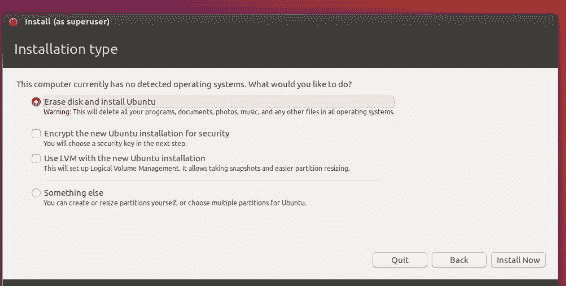[www.ubuntu.com](http://www.ubuntu.com)

### 对于 CD/USB（Live）安装

如果您明智地选择了现场环境安装，一旦下载并从 CD 或 USB 重启，您只需按照一系列提示操作即可。某些提示只需要您提供简单信息，例如语言和偏好。某些提示将询问您此后想对系统进行什么，或者谁可能有权访问该系统。其他提示包括一个关于分区的问题（针对高级用户）。如果系统不允许允许您在 Windows 上使用某些较新版本的内核启动 Linux，您可能需要禁用“安全启动”（Secure Boot）设置。

重启后，您会立即看到标签页包含了功能、应用程序、浏览器浏览器以及类似于 MAC 或 Windows 的工具。“主页”或“我的电脑”就是您的“C”盘。

注意：如果您的计算机没有读取 CD 或 USB 并自动安装，请尝试按 `F12` 键进入菜单以允许启动。

### 虚拟化

任何发行版的另一个很棒的功能是虚拟桌面，它允许您在不同的操作系统之间切换。虚拟桌面正是如此。它是虚拟环境中的用户界面，存储在远程服务器上而不是本地。虚拟操作系统运行在一个应用程序内部。这比双启动要简单得多且高效得多。

您可以在应用程序中获取这些程序。Linux 上流行的程序有 Microsoft Virtual PC、VMWare、VMWare Workstation 或 VirtualBox。对这些进行一些研究以探索这一选项。

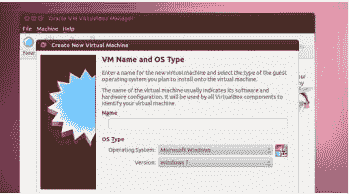

VirtualBox Manager 截图 (`www.lifehacker.com`)

### 双启动选项

因此，您可以选择安装 Linux 或使用现场环境。您也可以选择单独运行 Linux，完全删除您当前的操作系统并用 Linux 代替。您还可以选择让它与您当前的系统（如 Windows）并排运行。

如果您选择了后者，可以对系统进行分区以允许两者运行，并根据需要它们之间切换。能够排除 Windows 故障或恢复数据是拥有分区或 Live USB/光盘的另一个好处。有些人喜欢同时拥有两种类型系统的选项，而另一些人将专门保留其中一种。

维护两者的一种方法是设置双启动配置，这样您实际上保留两个操作系统。Wubi 是一个可以自动化安装的程序，它不会影响计算机的分区（划分区域）。如果您想探索这个，请访问 Wubi 网站：`www.wubi-installer.org` 获取该程序。

如果您更精通技术，可以手动创建自己的双启动安装并创建分区。另一个需要注意点是，如果您有 MAC OS，在共享空间时可能有其他需要考虑的因素。系统可能需要一些特殊的东西帮助共存。可以安装 `rEFInd` 程序，它将帮助您在启动时访问所需的特定操作系统。

### Ubuntu 桌面版的外


到目前，您已经选择了一个您喜欢的版本，并决定使用 Ubuntu 桌面版。这是您一旦启动运行后，桌面版可能的样子。如您所见，GUI（图形用户界面）提供了一个让 Windows 和 MAC 用户感到非常熟悉的界面。您将看到图标、任务栏、工具，并看到如何通过切换窗口来实现多任务处理。

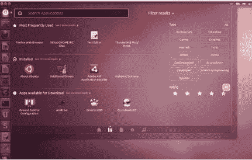

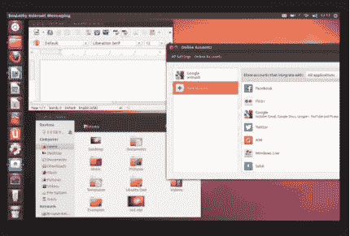

## 服务器版

同样，以 Ubuntu 作为安装示例，您将开始从网站 `[www.Ubuntu.com](http://www.ubuntu.com)` 获取并下载 ISO 文件。根据任务选择所需的版本（桌面、笔记本电脑、服务器、云端等），并在检查计算机设置后刻录您需要的版本。确保要求是兼容的。

如果您想要服务器，可能想选择更大的位宽。将其下载到光盘或 USB 中（再次在现场环境中进行，这是更优的），然后从这里重启而不是从硬盘启动。

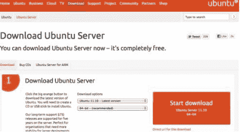

由于文件体积大且互联网速度限制，可能需要一些时间。请耐心等待。它也不会占用太多空间。系统的老旧也没有关系。在大多数情况下，您可以追溯 5-6 年并使用旧系统。记住，服务器版是精简的，没有图形界面。

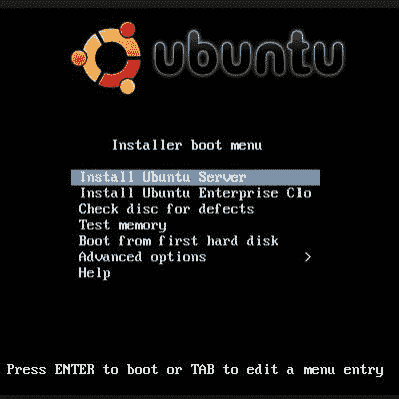

Ubuntu 安装启动菜单 (`www.pendrivelinux.com`)

# 第 6 章：安装类型

Debian 提供了多种方法进行正确设置。这包括图形界面安装和文本界面安装。

- 适用于 32 位和 64 位的 CD 或 DVD
- 适用于 32 位和 64 位的网络镜像（所谓的 `Netinst-ISO`）
- 适用于 32 位或 64 位的小型 CD

我们还提供了测试媒体。这些包括 32 位和 64 位的实时镜像，允许你在将 Debian 安装到计算机之前对其进行尝试。在编写本文期间，版本号 9.5 是 Debian 的当前稳定版本。这里描述的安装基于此版本和 `amd64` 架构。

从 `www.debian.org/distrib` 下载网络镜像后，系统不再需要引用额外的静态镜像。相反，它依赖于连接来检索要安装的包并保持您的操作系统更新。整个过程将花费你大约一小时，并且允许你根据特定需求进行精简的软件选择。你不使用的软件包将不会出现在你的系统中。当你需要它们时，可以随时添加。

我们安装的目标系统是一个基于 XFCE 的单用户桌面系统，配备网络浏览器和音乐播放器。网络浏览器我们使用 Mozilla Firefox，音乐播放器使用 `VLC`。这两个程序都是 Linux 发行版的永久组成部分。我们用于演示的环境是一个基于 `VirtualBox` 的虚拟机，拥有 4 GB 内存和 15 GB 磁盘空间。

# 第 7 章：练习

正如我们在上面已经学过的那样，创建目录非常简单。同样，从 Linux 系统中移除或删除目录也是非常简单的。然而，你必须记住，一旦你从 Linux 系统中移除或删除了一个目录，就没有办法撤销该任务。因此，最好的办法是当你在 Linux 上运行任何命令时，第一件事就是对你的操作小心。如果意味着在运行命令之前双重检查，那就越好。

我们将用于移除或删除目录的命令是 `rmdir`，它的意思是“remove directory”（移除目录）。在这里你需要注意的是，`rmdir` 命令支持与 `mkdir` 命令相同的 `-p` 和 `-v` 选项。此外，该目录在被移除之前必须是空的。我们稍后将学习如何解决这个问题。

```bash
rmdir linux_tutorial/beginner/commands
```

```bash
ls linux_tutorial/beginner
```

## 如何创建一个空文件

许多涉及文件数据操作的命令都有一个极佳特性：当我们引用一个发现不存在的文件时，它们会自动创建一个文件。事实上，我们可以利用这一特性使用 `touch` 命令来创建一个空文件。换句话说，你输入命令 `touch`，后跟命令行选项和文件名。

```bash
pwd
```

```text
/home/Gary/linux_tutorial
```

```bash
ls
```

```text
beginner
```

```bash
touch practice_exercise1
```

```bash
ls practice_exercise1 commands
```

## 复制文件或目录

让我们考虑以下示例：

```bash
user@bash: ls
practice_exercise1 commands
cp practice_exercise1 Exercise1
ls
practice_exercise1 Exercise1 commands
```

在这种情况下，我们必须注意的一个重要点是路径中的源和目标点。这里我们可以考虑的一些示例包括：

- `cp /home/Gary/linux_tutorial/Exercise1 Exercise2`
- `cp Exercise2 ../../backups`
- `cp Exercise2 ../../backups/Exercise3`

当你使用 `cp` 命令时，文件的目标可以代表指向文件或目录的路径。如果目标是一个文件（如 `Exercise1`、`2` 和 `3`），则将在目标文件中创建文件的副本，但原始文件保留在源文件或目录中。我们将文件复制到目录中，文件将在目标目录中保持名称。

在 `cp` 命令的默认行为中，它只会复制文件。在这种情况下，“递归”（recursive）一词意味着你想复制目录以及该目录的所有内容，其中包括文件、目录和子目录等。让我们考虑以下示例：

```bash
user@bash: ls
Gary Practicals transfers
user@bash: cp Practicals Practicals_beginner
cp: omitting directory ‘Practicals.’
user@bash: cp -r Practicals Practicals_beginner
user@bash: ls
Gary Practicals transfers Practicals_beginner
```

请记住，`Practicals` 目录下的任何文件或目录将被复制到 `Practicals_beginner` 目录中。

# 第 8 章：设置 Linux

如前所述，我们将使用 `Debian` 进行演示。回顾一下，`Debian` 是一个提供极佳稳定性的发行版，一旦你的技能和知识超过初级阶段，它的扩展性将非常出色。在本节中，我们将重点介绍安装和配置 `Debian` 的过程，向你展示沿中的每一个步骤。

## 逐步安装 Linux

### 启动菜单

为了开始安装 `Debian`，首先，从你下载的 ISO 镜像启动计算机（在我们的案例中，是 `VirtualBox` 镜像）。如果你也使用虚拟机，请查看你的虚拟机供应商网站以获取有关如何启用 ISO 镜像的帮助。接下来，等待启动菜单在屏幕上出现。下图显示了提供的不同选项。使用光标键可以在启动菜单中导航，按 `Enter` 键选择项目。

不同的选项有：

- `Graphical install`：使用图形化安装程序开始安装过程
- `Install`：使用文本安装程序开始安装过程
- `Advanced options`：选择更多选项，如 `Expert mode`、`Automated install` 或 `Rescue mode`（见下图）
- `Help`：获取进一步帮助
- `Install with speech`：带有语音支持的安装

从主启动菜单选择 `Graphical install`，并按 `Enter` 键继续。

### 语言选择

接下来，选择你在整个安装过程中偏好的语言。对话框将相应翻译。此选择不会决定你的 Linux 系统；你以后可以选择不同的语言。

下图显示了对话框。`English` 已预选，你只需点击对话框右下角的 `Continue` 按钮。


### 位置选择

第三，对你的位置进行选择（根据之前的语言设置，列出了国家）。这也会影响你计算机的时区设置。为了进行不同的设置，从列表末尾选择 `other` 并继续。

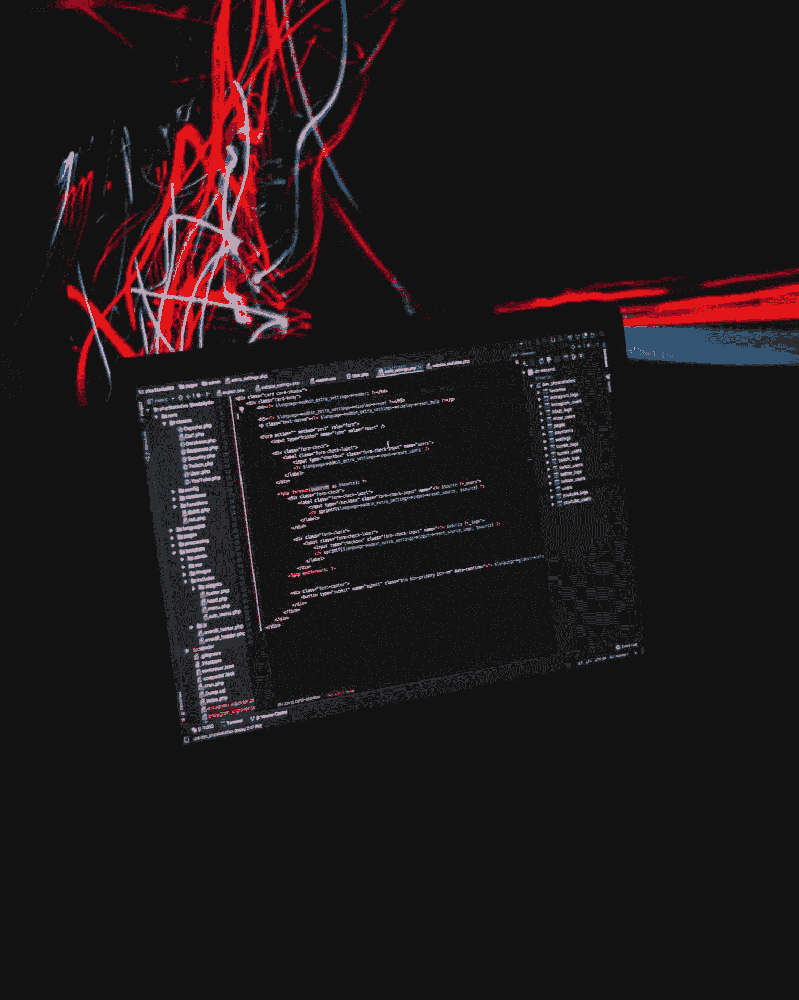

### 键盘选择

第四，从列表中选择你的键盘布局（见下图）。对于美国，预选是 `American`。如果你使用不同的键盘布局，从列表中选择正确的。完成后，点击 `Continue` 按钮继续第五步。

### 网络设置

第五步包括加载 ISO 镜像安装程序组件并检测网络。然后，安装程序尝试通过 `DHCP` 获取 IP 地址。完成后，你可以设置计算机的主机名（见下图）。通常使用主机名作为主机名。在这种情况下，我们选择名称 `debian`，这代表了 Linux 发行版及其版本。完成后，按 `Continue` 键继续进行第六步。

### 用户与角色

我们的 Linux 系统运行至少需要两个用户。一个是名为 `root` 的管理用户，另一个是普通用户 `User`。

接下来的两个步骤中，为用户 `root` 设置密码。为了简单起见，我们使用 `Debian` 作为全名，`User` 作为用户名。对于两个用户，选择一个你记得的密码。你以后将需要这些密码登录计算机。

### 时区

设置正确的时区对于与网络服务的通信非常重要。从列表中选择一个值。列表中的项目基于你之前选择的位置。完成后，点击 `Continue` 按钮定义存储媒体和相应的分区。

### 存储媒体与分区

Linux 系统可以分布在多个不同的存储媒体（如硬盘和闪存器）上。此外，存储媒体可以被分成多个分区。为了实现这一点，Debian 提供了以下方法（见下图）：

- `Guided - use entire disk`：按照提供的步骤操作并使用整个磁盘进行 Linux 安装。这将创建固定大小的分区。
- `Guided - use entire disk and set-up LVM`：按照提供的步骤操作并使用整个磁盘进行 Linux 安装。此选项使用逻辑卷管理（`LVM`）创建可以更改大小的分区。
- `Guided - use entire disk and set-up encrypted LVM`：按照提供的步骤操作并使用整个磁盘进行 Linux 安装。此选项使用逻辑卷管理（`LVM`）创建可以更改大小的加密分区。
- `Manual: create partitions individually`：这是专家模式，需要关于分区和文件系统的深入知识。从列表中选择 `Guided-use the entire disk`。分区值根据算法选择，不需要手动计算。

点击对话框右下角的 `Continue` 按钮继续。接下来，选择要分区的磁盘。在我们的案例中，只有一个可用磁盘（见下图）。在本文后续部分，第 1 个 SCSI 磁盘被称为 `/dev/sda`。

磁盘分区是指存储媒体上被单独组织的部分，旨在包含 Linux 系统树的一个分支。没有正确此事的通用方法。本指南显示了一个适用于基础系统的简单但安全的解决方案。对话框中的菜单提供以下选项：

- `All files in one partition`：使用单个分区保留程序和用户数据。
- `Separate /home partition`：将程序和用户数据存储在单独的分区。
- `Separate /home`, `/var`, and `/tmp` partitions`：将用户数据、变量数据和临时数据保留单独的分区。

点击右下角的 `Continue` 按钮继续安装。下一步是确认分区方案。这是根据经验自动计算的，包含这些分区：

- `sda1`：第一个 SCSI 磁盘的第一分区，大小为 `3 GB` 的 `ext4` 文件系统，作为系统根（`/`）。
- `sda5`：第一个 SCSI 磁盘的第五个分区，大小为 `3 GB` 的 `ext4` 文件系统，存储变量数据（`/var`）。
- `sda6`：第一个 SCSI 磁盘的第六个分区，大小为 `3 GB` 的 `swap` 文件系统。
- `sda7`：第一个 SCSI 磁盘的第七个分区，大小为 `311 MB` 的 `ext4` 文件系统，存储临时数据（`/tmp`）。
- `sda8`：第一个 SCSI 磁盘的第八个分区，大小为 `8.8 GB` 的 `ext4` 文件系统，存储用户数据（`/home`）。

由于历史原因，磁盘只能包含四个分区。第四个是 `Extended Partition`（扩展分区），用于划分逻辑分区或逻辑驱动。在我们的案例中，`/dev/sda2` 和 `/dev/sda3` 是空的。从上方选择 `Finish partitioning and write changes to disk`（完成分区并将更改写入磁盘）。点击 `Continue` 按钮继续。存储媒体将格式化为之前定义的 `ext4` 文件系统。一旦此步骤完成，`Debian` 基础系统将安装。

## 软件包管理


ISO 镜像包含安装程序和用于设置 Linux 基础的软件包。例如，这包括安装 Linux 内。下一步是你决定是否使用额外的安装媒体。在我们的案例中，我们只有一个磁盘，因此从菜单中选择 `No`。

如之前所述，`Debian` 的软件组织成软件包。这些软件包通过多个仓库提供。仓库由大学、私人人士和其他组织维护。在下一步中，你必须决定从哪个国家获取你的 Debian 软件包。建议选择地理位置离你最近的镜像以减少从镜像传输到你计算机的时间。

第一步，选择你所在的国家。第二步，从列表中选择首选镜像。列表包括大学、互联网提供商、政府服务和其他组织。在我们的案例中，网络包括一个与外界通信的代理服务器。在这种情况下，我们没有，将其留空。点击 `Confirm` 按钮继续。

一旦设置了参数，安装程序将连接到之前选择的镜像并获取软件包列表。列表包含可用软件包，包括名称、大小和描述。根据你的连接质量和带宽，此步骤可能需要一段时间。

接下来，要求你参加 Popcon 活动。此信息是可选的，仅供负责 Debian 包的开发团队使用。根据 Popcon，他们确定哪些软件包安装最多。在我们的案例中，我们不参加 Popcon，选择 `No`。点击 `Confirm` 按钮继续选择软件任务（`tasksel`）。

### 软件选择

`Debian` 提供了精心安排的软件包选择，称为“任务”。它们背后的思想是为了特定用途对软件包进行分组以便简化安装。从对话窗口中的列表（见下图），你可以选择不同的环境，以及 Web 服务器、打印服务器、SSH 服务器和标准系统工具。要进行最小化安装，只需启用列表最后两项。我们稍后将安装 XFCE 桌面。

确认软件选择后，安装程序从软件包镜像检索所需的软件包，解包并安装它们。下方的条显示了进度。在这种情况下，必须下载 140 个软件包。

### 设置 GRUB

为了启动我们新安装的 `Debian` 系统，我们也必须设置这些信息。这个过程被称为启动系统。处理这一步的软件组件名为统一引导程序（准确来说是 `GRUB` 或 `GNU GRUB`）。`Yes` 项已预选，我们可以点击 `Continue` 继续。

安装程序需要知道将 `GRUB` 安装在哪里。图中的菜单列出了要考虑的存储媒体。在我们的案例中，我们选择列表中的第二个项目（`/dev/sda`）。然后，点击 `Continue` 继续。现在我们几乎完成了基础安装，剩下的工作只是读一个对话框。

### 完成安装

以下对话框通知你安装已完成。然后点击 `Continue` 重启新安装的系统。几秒后，屏幕上将显示基于文本的 `GRUB` 启动菜单。菜单包含两个选项：`Debian GNU/Linux` 和 `Advanced options for Debian`。第一项已高亮并预选。第二个菜单允许你设置启动选项。查看 `GRUB` 手册 `www.gnu.org/software/grub`。

保持第一项被选中并按 `Enter` 继续启动新系统。最后，将看到一个黑白色的屏幕，名为 `tty1` 的登录提示符要求你登录系统。

```text
Debian GNU/Linux
debian5 tty1 login: _
```

登录系统后，我们将添加额外的软件以可以使用图形界面。在这一步，我们将更改并安装 `XFCE` 桌面。在登录提示符输入 `root`，按 `Enter`，输入 `root` 用户的密码。然后再次按 `Enter` 确认并登录。

接下来，将看到 `XFCE` 桌面。桌面带有若干默认元素：顶部导航栏、底部导航栏和桌面图标。所有提到的元素解释如下：


- **顶部导航栏**：显示访问不同应用程序、虚拟桌面屏幕、时钟以及各种用户操作按钮，如锁屏、切换用户、切换待机和退出当前会话。
- **底部导航栏**：包含多个按钮用于隐藏所有打开窗口并显示空桌面、打开终端、文件管理器、网络浏览器、查找应用程序以及直接打开主目录打开文件管理器。
- **桌面图标**：从上到下有垃圾箱、链接到计算机的文件管理器图标和主目录。

在桌面上右键点击打开上下文菜单，允许你访问各种应用程序。

## 添加图形界面


在当前阶段，`Debian` 系统完全激活并可以生产。对于桌面系统，它缺少一个易用的图形界面。在这一步，我们将更改并安装 `XFCE` 桌面。列表包括：

- `apt`：包管理器
- `xdm`：显示管理器
- `xfce4`：桌面环境

`Debian` 使用 `apt` 处理安装、删除软件和相关的软件包列表。`apt` 解决所有依赖关系并确保系统上有相关软件。在我们的案例中，必须从镜像检索并安装总计约 450 MB 的数据。为了安装软件包，在命令行输入 `#` 之后输入命令：

```bash
root@debian5 ~# apt-get install xdm xfce4
```

`apt` 将显示有关已安装软件包的更多信息，包括依赖包列表和推荐包。最后你会看到命令行提示。输入 `Y` 或按 `Enter` 安装 `apt`、`xdm` 和 `xfce4` 以及依赖包。对于 `xdm` 显示管理器，必须确认两个对话框（见下图）。

安装软件的检索需要一段时间。完成后，命令行提示再次出现。为了激活图形桌面的更改，重启系统。在命令行提示符输入命令 `boot`：

```bash
root@debian5 ~# reboot
```

重启 Linux 系统后，`Debian` 用一个图形启动界面欢迎我们（见下图）。按 `Enter` 使用默认设置启动 Linux 系统。几秒后，将看到图形登录界面（见下图）。使用之前创建的名为 `user` 的普通用户登录系统。输入 `user`，按 `Enter` 并输入用户密码。然后再次按 `Enter` 确认并登录。接下来，将看到 `XFCE` 桌面（见下图）。桌面带有若干默认元素：顶部导航栏、底部导航栏和桌面图标。所有提到的元素解释如下：

- **顶部导航栏**：显示访问不同应用程序、虚拟桌面屏幕、时钟以及各种用户操作按钮，如锁屏、切换用户、切换待机和退出当前会话。
- **底部导航栏**：包含多个按钮用于隐藏所有打开窗口并显示空桌面、打开终端、文件管理器、网络浏览器、查找应用程序以及直接打开主目录打开文件管理器。
- **桌面图标**：从上到下有垃圾箱、链接到计算机的文件管理器图标和主目录。

在桌面上右键点击打开上下文菜单，允许你访问各种应用程序。

## 添加额外的软件

到目前为止，你的 Linux 系统上可用的软件是有限的。最后，下一步要做的是添加以下 Debian 软件包让生活变得简单一点：

- `firefox-esr`：Mozilla Firefox 浏览器（支持）
- `gnome-terminal`：由 GNOME 项目维护的终端
- `xscreensaver`：基础屏保
- `vlc`：视频播放器（VLC）

软件包的安装将在终端执行器完成。在我们的案例中，使用 `term` 终端。为了打开 `term`，点击底部导航栏上的 `terminal` 按钮或从菜单中选择 `Application > Terminal`。下一步，在命令行提示符输入命令 `su`：

```bash
user@debian5: ~$ su
Password:
```

你可能记得之前的步骤，只有管理用户可以更新或删除 Debian 系统。`su` 命令缩写为切换用户并更改当前角色。你可以输入 `sudo su`，这将带你进入 `root` 用户。作为管理员用户，执行以下命令：

```bash
root@debian5 ~# apt-get install firefox-esr gnome-terminal xscreensaver vlc
```

`apt` 将显示有关已安装软件包的更多信息，包括依赖包列表和推荐包。最后你会看到命令行提示符。输入 `Y` 或按 `Enter` 安装 `apt`、`xdm` 和 `xfce4` 以及依赖包。对于 `xdm` 显示管理器，必须确认两个对话框（见下图）。

---

## 第 9 章：导航 Linux

现在我们需要谈论 Linux 操作系统中的基础目录导航。这与 Windows 略有不同。然而，有趣的是，它看起来足够像 Windows，以至于当事情不通时，人们想把电脑扔出窗外。

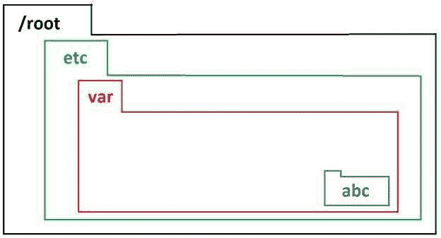

以上面的图为例。在 Linux 中，你也有 `cd` 命令。和 Windows 一样，`cd` 代表切换目录。如果你想去不同的目录或文件夹，输入 `cd`。如果你在一个文件夹中，假设你在图中的 `var` 文件夹中，你想去 `var` 文件夹内部的一个文件夹（在这种情况下是 `abc` 文件夹），你只需要输入命令：

```bash
cd abc
```

所以，是 `cd`、空格，然后你想去的文件夹名称。这将进入你想进入的文件夹。现在问题是，Windows 世界的人习惯在 `cd` 命令后跟一个斜杠符号。如果我们在之前的命令中应用这一点，它看起来像下面所示：

```bash
cd /abc
```

Linux 在这种情况下会将斜杠符号解释为根目录。Linux 会认为你想切换到根目录，然后在根目录内查找 `abc` 文件夹。当然，一旦 Linux 执行此命令，它将找不到存在的 `abc` 文件夹，因为实际上 `abc` 文件夹位于 `var` 文件夹中。

这是你必须极其小心的地方。这就是为什么许多 Linux 管理员总是输入他们想要去的地方的全路径，无论他们现在在哪里。如果一个 Linux 管理员想要进入并更改 `abc` 文件夹中的内容，他们只需输入命令：

```bash
cd /etc/var/abc
```

Linux 对整个过程非常挑剔。正如我们之前提到的，Linux 中大小写很重要。如果你尝试到达一个名称全小写的文件夹，Linux 将无法找到它。这让你感到非常沮丧。

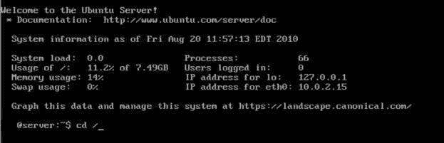

所以，当你想要在 Linux 中导航文件时，首要任务是进入根目录。为了这样做，你必须输入命令：

```bash
cd /
```

这表示 `cd`、空格，然后一个斜杠。这会自动带你进入根目录，如果你不在那里的话。接下来要做的是查看根目录下的文件夹。为了这样做，你必须输入命令：

```bash
ls
```

`ls` 或 `list` 命令将列出特定目录下的所有文件和文件夹。在我们的案例中，是 `root`。

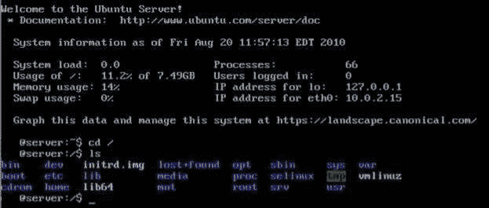

当你输入 `ls` 命令后，Linux 现在将向你显示根目录下的文件夹。你可以看到 `bin`、`dev`、`opt`、`sys`、`boot`、`etc`。如果你想进入 `etc` 文件夹，你只需要输入命令：

```bash
cd etc
```

上述命令会自动带你进入 `etc` 文件夹。如果你在命令行提示符闪烁的光标旁边看到 `$`，说明你已经在 `root` 目录下了。现在再次输入 `ls` 命令将列出 `etc` 文件夹下的所有文件和文件夹。这对于理解 Linux 非常重要。

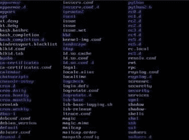

为了返回根目录，你需要输入命令：

```bash
cd ..
```

此命令将工作目录切换到当前目录的父目录。或者你可以输入：

```bash
cd /
```

这表示 `cd`、空格，然后一个斜杠。这会自动带你回到根目录，无论你处于多深。接下来要做的是进入当前用户的主目录。为了这样做，你必须输入命令：

```bash
cd ~
```

此命令将目录切换到用户的主目录 `/home`。`~` 符号被称为波浪号，在 Linux 中表示用户的主目录。

## 第 10 章：常用 Linux 命令

在本节中，我们将探索必要的命令。你现在可以打开终端。点击桌面并选择“Open Terminal”。

### 切换目录

你可能也想导航切换目录。为了实现这一点，使用 `cd` 命令代表“切换目录”。例如：

```bash
cd /home
```

上述命令将工作目录切换到 `/home`。

### 复制文件

`cp` 命令代表“copy files”，用于复制文件。在指定位置创建一个副本：

```bash
cp first me
```

上述命令将在相同位置创建一个 `first` 的副本，命名为 `me`。

`slocate -u` 命令将创建一个名为 `slocate` 的数据库。这需要一些时间来完成，请保持耐心。在你能够搜索文件之前，必须先运行此命令。然而，在大多数系统中，再次运行以下命令：

```bash
locate whois
```

此命令将查找名称包含字符串 `"whois"` 的文件。

### 退出命令

`logout` 命令用于注销用户，即当前登录的系统。执行此命令：

```bash
logout
```

此命令将你注销并返回登录屏幕。

### 列出命令

`ls` 命令代表“list”，用于列出文件和文件夹。在我们的案例中，是 `root`。

```bash
ls
```

`ls` 命令将显示根目录下的所有文件夹。你可以看到 `bin`、`dev`、`opt`、`sys`、`boot`、`etc`。

### 复制文件

`cp` 命令代表“copy files”，用于复制文件。注意我们使用了 `-dpr` 选项。这意味着：

- `-d`：意味着链接将被保留
- `-p`：文件属性将被保留
- `-r`：将递归复制。如果在从目录复制所有文件时，需要指定这些选项，否则默认设置可能会产生意外的结果。

```bash
cp first me
```

上述命令将在相同位置创建一个 `first` 的副本，命名为 `me`。如果 `me` 在目录中存在，在执行此命令前将警告你。考虑以下命令：

```bash
cp -i first me
```

在上述命令中，我们添加了 `-i` 选项。如果 `me` 在目录中存在，在执行此命令前将通知你。接下来，尝试以下命令：

```bash
cp -i /dev/file
```

使用上述命令将 `/dev/file` 复制到当前目录并命名为 `file`。你可能还需要将特定目录中的所有文件复制到另一个目录。可以通过以下方式实现：

```bash
cp -dpr source destination
```

`source` 目录中的所有文件将被复制到 `destination` 目录。

要显示每个挂载文件系统上使用的磁盘空间，使用 `df` 命令。

```bash
df
```

### `less` 命令

`less` 命令与 `more` 命令相同。区别在于使用此命令时用户可以向上或向下翻页文件。考虑示例：

```bash
less first
```

上述命令将显示文件 `first` 的内容。

### `ln` 命令

此命令为特定文件创建符号链接。编写并运行以下命令：

```bash
ln -s first slink
```

上述命令将创建一个名为 `slink` 的符号链接，它将链接到文件 `first`。命令 `ls -i first slink` 将显示两个文件是不同的且具有不同的“inode”。

### `locate` 命令

这用于在数据库中搜索。运行以下命令：

```bash
slocate -u
```

- 自动添加长命令名称或文件名
- 搜索并重新执行执行过的命令
- 通过某些模式替换文件名列表，以及更多功能

当需要对多种对象执行相似的操作时，命令行的优势变得尤为明显。在具有图形界面的系统中，你需要根据对象的数量进行相应次数的鼠标拖拽，而在命令行中，只需一个命令就足够了。

本节将介绍允许你使用命令行解决任何用户任务的主要工具：从文件和目录的简易操作（例如复制、重命名、搜索），到用户应用程序工作中需要执行大量相似操作的复杂任务（如处理大型数据数组或文本，以及系统管理）。

## Shell（外壳）

命令行外壳（command shell）或命令解释器是一个程序，其任务是将你的命令传递给操作系统和应用程序，并将它们的回答返回给你。根据其任务，它对应于 MS-DOS 中的 `command.com` 或 Windows 中的 `cmd.exe`，但从功能上来说，Linux 的 shell 要丰富得多。在命令行 shell 语言中，你可以编写小型程序来对文件及其包含的数据执行一系列顺序操作——即脚本。

通过输入用户名和密码登录系统后，你将看到命令行提示符——一个以 `$` 结尾的行。稍后该符号将用于表示命令行。如果在安装过程中配置了系统启动时运行图形用户界面，那么你可以在任何虚拟文本控制台上进入命令行。你需要按下 `Ctrl-Alt-F1` - `Ctrl-Alt-F6`，或者使用任何终端仿真程序，例如 `xterm`。

以下是可用的 shell。它们可能根据发行版的不同而异：

- `bash`：Linux 最常用的 shell。它可以补全命令和文件的名称，保留命令历史并提供编辑这些命令的能力。
- `pdk`：korn shell 的克隆版本，在 UNIX shell 系统中广为人知。
- `sash`：该 shell 的特殊之处在于它不依赖于任何共享库，并包含一些最重要的实用程序的简化实现，例如 `al`、`dd` 和 `gzip`。因此，在从系统崩溃中恢复或在升级最重要的共享库版本时，`sash` 特别有用。
- `tcsh`：C shell 的改进版本。
- `zsh`：此列出的 shell 中最新的。它实现了命令参数自动补全的高功能以及许多其他功能，使得使用 shell 变得更加方便高效。但是，请注意，所有 `zsh` 扩展默认都是禁用的，因此在你开始使用此命令行之前，你需要阅读它的文档并启用你需要的功能。

默认 shell 是 `bash`（Bourne Again Shell）。要检查你正在使用哪个 shell，输入命令：`echo $SHELL`。shell 之间的区别不仅在于能力上，而且在于命令语法上。如果你是初学者，我们建议使用 `bash`，随后的示例将描述该特定领域的工作。

## Bash shell

`bash` 中的命令行由命令名组成，后面跟着键（选项），即修改命令行为的指令。键以字符 `-` 或 `–` 开头，通常由单个字母组成。除了键之外，命令后面还可以跟上参数，即必须执行该命令的对象的名称（通常是文件和目录的名称）。

按下回车键完成命令输入，随后命令将传递给 shell 执行。作为在用户终端上执行命令的结果，可能会出现关于命令执行或错误的消息，而下一个命令行提示符（以 `$` 字符结尾）的出现表示命令已完成，你可以输入下一个命令。

`bash` 中有几种技术可以让你更方便地输入和编辑命令行。例如，使用键盘，你可以：

- `Ctrl-A`：跳到行首。按下 `Home` 键也可以同样的操作。
- `Ctrl-U`：删除当前行。
- `Ctrl-C`：终止当前命令的执行。

你可以使用符号 `;` 在同一行内输入多个命令。`bash` 记录了所有执行过的命令历史，因此很容易重复或编辑之前的某条命令。要这样做，只需从历史中选择所需的命令：`up` 键显示上一个命令，`down` 键显示上一个和下一个。为了在已执行的命令中找到特定的命令，而无需翻遍整个历史，输入 `Ctrl-R` 并输入你正在查找的命令中使用的某些关键字。

历史记录中的命令是有编号的。要运行特定命令，输入：`!command number`。

如果你输入 `!!`，将启动最后输入的命令。

有时在 Linux 上，程序和命令的名称太长。幸运的是，`bash` 本身可以补全名称。通过按下 `Tab` 键，你可以补全命令、程序或目录的名称。例如，假设你想使用 `bunzip2` 解压程序。这样做，输入 `bu` 然后按 `Tab`。如果没有发生什么，则有几种可能的命令补全。再次按下 `Tab` 键将给你一个以 `bu` 开头的名称列表。例如，系统有 `buildhash`、`builtin`、`bunzip2` 程序：

```text
$ bubuildhash builtin bunzip2
$ bu
```

输入 `n>`（`bunzip` 是唯一第三个字母是 `n` 的名称），然后按 `Tab`。shell 将补全名称，剩下的只需按 `Enter` 即可运行命令！

注意，从命令行调用的程序由 `bash` 在 `PATH` 系统变量定义的目录中进行搜索。默认情况下，此目录列表不包含当前目录，用 `./`（点斜杠）表示。因此，要从当前目录运行 `prog` 程序，必须发布命令 `./prog`。

## 基本命令

任何系统中必须解决的首要任务是：处理数据（通常存储在文件中）和管理运行的程序（进程）。以下是允许你在系统上对文件和进程执行最重要操作的命令。只有 `cd` 是 shell 的内置命令，其余是分布式命令，但在任何 Linux 系统上都可用。所有命令都可以在文本控制台和图形模式（`xterm`、控制台）下运行。有关每个命令的更多信息，请使用 `man` 命令，例如：

```bash
man ls
```

`cd`：允许更改当前目录（通过文件系统）。它支持绝对路径和相对路径。假设你在主目录并想进入 `tmp/` 子目录。这样做，输入相对路径：`cd tmp/`。切换 `/usr/bin` 目录，输入绝对路径：`cd /usr/bin/`。

该命令的一些选项有：

- `cd ..`：允许返回父目录。
- `cd -`：返回上一个目录。

`ls`：（列表）列出当前目录下的文件。两个主要选项：`-a` 查看所有文件，包括隐藏文件；`-l` 显示更详细的信息。

`rm`：此命令用于删除文件。警告：删除文件无法恢复！语法：`rm filename`。此程序有几个参数。最常用的是：`-i` 文件删除请求，`-r` 递归删除（即包括子目录和隐藏文件）。示例：

```bash
rm -i ~/html/*
```

删除所有的 `.html` 文件。


`mkdir`、`rmdir`：`mkdir` 命令允许你创建目录，而 `rmdir` 删除目录，前提是空的。语法：

```
mkdir dir_name
rmdir dir_name
```

`rmdir` 命令经常被 `rm -rf` 命令替换，后者允许删除目录，即使它们不是空的。

`less`: 允许分页查看。语法：`less filename`。它在编辑文件之前非常有用；该命令的主要用途是处理一个屏幕无法显示的大量文本。要退出 `less`，按 `q`。

`grep`: 此命令允许你查找文件中的字符字符串。请注意 `grep` 通过正则表达式进行搜索，在正则表达式语言中，可以描述模式的单词，例如：“行周围的空格”。更多信息可以参考文档（`man grep`）。语法：

```
grep search_file
```

`ps`: 显示当前进程列表。列表示进程名，`PID`（进程标识符）用于进程操作——例如使用 `kill` 命令发送信号。`ps ax` 参数允许你查看那些属于你的进程。提供了更多信息。语法：

```
ps au
```

`kill`: 如果程序停止响应或挂起，使用此命令完成它。语法：

```
kill PID_number
```

这里的 `PID_number` 是进程号，你可以通过 `ps` 找到每个可执行程序的进程号。但有时不起作用，你需要使用 `kill -9 PID_number`。

## 文件和目录操作

这里考虑处理文件系统的工具：文件、目录以及通用文件系统。

- `cp`: 复制文件和目录。
- `mv`: 移动（重命名）文件。
- `rm`: 删除文件和目录。
- `df`: 显示磁盘使用报告（所有磁盘的剩余空间）。
- `du`: 计算文件或目录空间。
- `ln`: 创建文件链接。支持不同的输出格式。
- `mkdir`: 创建目录。
- `touch`: 文件时间戳（修改、访问），可以创建空文件。
- `realpath`: 通过相对路径计算绝对文件名。
- `basename`: 从全文件名移除路径（即将绝对名称缩短为相对）。
- `dirname`: 从全名移除文件名（即显示文件所在的目录名称）。
- `pwd`: 显示当前目录的名称。

## 过滤器

过滤器是从标准输入读取数据、将其转换并输出到标准输出的程序。使用过滤器允许你组织管道以对单命令数据执行顺序操作。本节列出的许多命令都可以处理文件。可以找到 I/O 重定向和管道的信息。

- `cat`: 合并文件并显示到标准输出。
- `tac`: 从末尾合并文件并显示到标准输出。
- `sort`: 对行进行排序。
- `uniq`: 删除排序文件中的重复行。
- `tr`: 执行标准输入中某些字符的替换，可以用于转译、删除额外字符以及更复杂的替换。
- `cut`: 系统文本格式的数据。它允许只显示表格中的指定字段，单元格由字符分隔。
- `paste`: 将多个文件的数据合并为一个表。默认情况下，首先考虑常规字段。
- `split`: 根据模板将文件分成部分。
- `expand`: 将制表符转换为空格。
- `expand`: 将空格转换为制表符。
- `fmt`: 按宽度格式化文本。
- `fold`: 将过长的行传输到下一行。
- `wc`: 统计文件中的行、词和字符数。
- `od`: 以八进制、十六进制和其他类似的形式显示文件。
- `head`: 显示指定大小的文件的初始部分。
- `tail`: 输出给定大小的文件末尾部分，因为它可以输出添加到文件末尾的数据。用于跟踪日志文件。
- `echo`: 显示参数的文本。
- `false`: 什么都不做，返回码为 1（错误），当尝试执行失败的命令时可以在 shell 中使用。
- `true`: 什么都不做，返回码为 0（成功），在需要执行成功命令时可以在脚本中使用。

- 用于必要数据的分区
- 用于服务器程序和配置数据的分区
- 用于程序和应用程序的分区
- 至少一个用于用户邮件、归档和数据库表的分区
- 至少一个用于特定文件的分区
- 至少一个用于虚拟内存的分区

### 常见分区

- 包含个人数据的分区
- 存储临时文件的分区
- 存储第三方数据的分区
- 仅用于程序的分区


## 目录（根目录与子目录）

在 Linux 中，有一个名为“根目录（The Root Directory）”的目录。它作为主目录，正如程序员和系统管理员所指的那样，它是所有目录的目录。

伴随根目录产生的是许多子目录。这些子目录根据其分配的任务来管理文件。

### 子目录及其内容

- `/home` – 用户主目录
- `/boot` – 内核和启动文件；尝试消除不必要的启动加载程序的文件
- `/initrd` – 关于启动信息的数据
- `/dev` – 包含指向所有 CPU 硬件外设的引用
- `/bin` – 常用的共享系统程序
- `/etc` – 核心系统配置数据
- `/lib` – 库文件
- `/lost+found` – 从失败中恢复的数据
- `/opt` – 来自第三方源的文件
- `/net` – 远程文件系统的标准挂载点
- `/misc` – 杂项数据
- `/proc` – 关于系统资源的信息
- `/mnt` – 外部文件系统的标准挂载点

## inode 的作用

在 Linux 文件系统中，`inode` 代表一个文件。`inode` 是一种包含基本信息的序列号类型。它的主要作用围绕着定义分区中的文件数量展开。

在整个 Linux 文件系统中，特别是对于具有多个分区的系统，存在着具有相似 `inode` 编号文件。为了避免复杂性，每个分区都分配了自己的 `inode`。此外，分配的 `inode` 提供了硬盘数据结构的描述。一旦硬盘初始化完成，它可以在两个时间点接受数据存储：一，在安装过程中允许数据存储；二，在向现有系统添加存储空间时允许数据存储。

### inode 中包含的信息

- 文件类型
- 文件大小
- 文件的所有者或组所有者
- 创建日期和时间
- 最后修改日期和时间
- 权限
- 链接数
- 数据地址

## 超块 (Superblock)

在 Linux 文件系统中，关于必要文件大小和形状的信息被称为超级块（The Superblock）。它允许文件系统管理器浏览并维护文件系统的质量。

### 超块中的信息

- 空闲块 – 显示系统空闲块的数量
- 空闲 inode – 显示原始 inode 分配
- 空闲 inodes – 显示系统空闲 inode 的数量
- 块组编号 – 指分配给超级块的
- 每组块数 – 显示一组的块数量
- 块大小 – 指系统的块大小；信息以字节为显示
- 魔数 – 指授予挂载软件进行评估的权限
- 挂载计数 – 指系统的允许评估次数
- 修订级别 – 指系统允许的修订级别确认

## 全关于组描述符 (group descriptor)

组描述符负责标记文件的数据结构。它包含了避免数据重复的详细信息。由于它的作用，系统损坏的可能性极低。

### 组描述符中的信息

- 块位图 (Blocks bitmap)
- 空闲块计数
- 空闲 inode 计数
- inode 位图 (Inode bitmap)
- inode 表 (Inode table)
- 已目录计数

## 文件修改：查找、挂载与更改大小

Linux 文件通常易于定位。只需搜索目录，紧接在“/”或正斜杠后面的名称可能你想要的文件。

示例：

`/home/lp.txt`

如示例所示，`/home/` 是目录，`lp.txt` 是一个文件。你可以开始挂载了。在挂载文件时，需要 Linux 内核的可用性来检查标准。它的存在允许对系统所有传递的参数进行验证。

示例：

```bash
## mountiso898 /dev/rom /dev/cdrom
```

如示例所示，你正在挂载三种信息。`iso898`、`/dev/rom,` 和 `/dev/cdrom.`。

除了查找和挂载文件外，你还有更改文件大小的选项。这是由于文件碎片的产生。由于文件在碎片期间会变得效率低下，更改文件大小允许文件的分配。因此，系统会变得更加稳定。

你将学习到 `truncate` 和 `fallocate` 命令。这两个命令都允许你创建一个具有所需大小的文件。

示例：

```bash
## truncate -s 19MB mop1.txt
## fallocate -l 19000000 mop2.txt
## ls -ls mop.txt
0 -rw-rw--r-- 2 trs trs 19000000 Aug 12 02:44 mop1.txt
14819 -rw-rw--r-- 2 trs trs 19000000 Aug 12 02:45 mop2.txt
```

## 第 15 章：处理文本文件

内部字段分隔符 `IFS` 被 bash 用于将字符串拆分为不同的单词。你可以将其想象为 Excel 将逗号分隔值 (CSV) 文本文件拆分为电子表格的方式；根据它，逗号分隔列。

我们假设 `IFS` 被设置为某个任意值，例如 `Z`。当 bash 展开一个包含‘Z’的变量时，该值值的变量将被拆分为不同的单词（在那种情况下，字面上的 Z 会消失）：

`IFS` 变量默认设置为三个字符，包括空格、制表符和换行符。如果你执行 `echo '$IFS'`，你将什么也看不到，因为显然，在没有任何可见字符的情况下是不可能看到空格字符的。那么结果是什么？简单，你可能会在网上看到代码片段，其中变量 `IFS` 被更改 `'\n'`（这代表“换行符”）或类似的内容。

想象有一个文本文件，其中有一组文本行，例如，它们可能如下引用文件名：

当读取文件的每一行时，`IFS` 的默认值（无疑包含一个空格字符）会导致 bash 将文件：`rough draft . txt` 视为双倍或两个文件，即 `rough` 和 `draft . txt`，这是因为拆分单词使用了空格字符。

当 `IFS` 设置为换行符时，`rough draft . txt` 将被视为一个文件名。

正如你将注意到的那样，当涉及到读取文本文件并对每一行进行操作时，这个概念是有意义的。你可能无法完全理解这一点，但让你意识到这一点是非常重要的，至少以防你习惯了随意地从网上复制粘贴代码。

## 未引号的变量有多糟糕？

在一个美好的理想世界里，我们都应该保持字符串值简短，且不包含空格或换行符或其他任何特殊字符。在这样的世界中，下面的未引号变量引用将完美运行。然而，当我们开始在文件名中添加特殊字符（如空格）并在不使用双引号的情况下扩展变量时，可能会是有害的。在下面的示例中，我想删除名为 `junk final.docx` 的文件：

### 意外的单词拆分

尽管如此，当不使用双引号引用时，bash 认为下方的 `file_to_kill` 是一个包含两个独立值的项，包括 `junk` 和 `final.docx`：

### 意外的特殊字符

你可能会想，“这并没有什么伤害”，因为那些文件根本就不存在。这没关系，但如果有人在文件名中放入星号会发生什么？你知道有人执行 `grep *` 和 `rm *` 时会发生什么，对吧？星号像一只饥饿的熊，抓走所有的文件。

鉴于 `junk` 和 `final.docx` 不存在，你将看到之前的错误。然而，在这些尝试删除的操作之间，`rm` 运行在星号上。所以，和该目录下的所有文件告别吧。

你会看到 `rm "$filename"` 只影响名为 `* LOL BYE FILES` 的文件。因此，这里的主要要点是尽可能在你的变量引用中使用双引号。

这里有你理得的更多信息……

你可能在想“世界上谁会在文件名中放置星号字符？”首先，我们确实有喜欢星形符号的人；此外，我们还有恶意的黑客和讨厌的恶作剧星，他们不在意使用星号字符。注意，变量通常不是由于人类输入赋值的；正如你所知，有时命令的结果会存储在变量中。在原始数据由此类命令处理的情况下，那种数据可能包含损坏某些 bash 程序的特殊字符。你始终要记住，粘贴看似安全的代码是有危险的。bash 处理字符串的语法和行为非常难以理解，这就是为什么开发者转向其他语言来处理更复杂的应用程序。

## 第 16 章：管理运行进程

Linux 中的进程（如 UNIX 中一样）是运行在单独虚拟地址空间中的程序。当用户登录系统时，会自动创建一个进程，并在其中执行 shell，例如 `/bin/bash`。

Linux 支持经典的多道程序方案。Linux 支持并行（如果只有一个处理器，则是准并行）用户进程。每个进程都运行在自己的虚拟地址空间中，即进程之间相互保护，一个进程的崩溃不会影响另一个。

内核提供了用于创建新进程和管理生成进程的系统调用。只有当另一个进程启动它或发生某些中断时，任何程序才能开始执行。使用两个系统调用创建进程：`fork()` 和 `exec`。

```bash
if (fork() == 0) 
    wait(0);
else 
    execl("ls", "ls", 0);
```

### 输入/输出重定向

几乎所有的操作系统都有输入输出重定向机制。Linux 例外。通常，程序从控制台（终端）输入文本数据并将数据输出到控制台。输入控制台意味着键盘，然后输出到终端。键盘和显示分别是标准输入和输出（`stdin` 和 `stdout`）。任何输入/输出都可以解释为从文件的输入和到文件的输出。对文件的操作通过它们的描述符完成。UNIX 使用三个文件进行输入输出：`stdin` (句柄 1)，`stdout` (2) 和 `stderr` (3)。

- `>` 用于将标准输出重定向到文件。

```bash
$ cat > newfile.txt
```

`cat` 命令的标准输入将重定向到文件 `newfile.txt`，该文件将在执行此命令后创建。如果已存在同名文件，它将被覆盖。按 Ctrl + D 将停止重定向并终止 `cat` 命令的执行。

- `<` 用于重新分配标准命令输入。例如，如果你运行 `cat < file.txt` 命令，`file.txt` 文件将作为标准输入。

- `>>` 用于将数据追加到文件末尾（追加）标准输出。例如，与 `>` 情况不同，执行命令 `cat >> newfile.txt` 如果文件存在则不会覆盖而是添加数据。

- `|` 用于将一个程序的标准输出重定向到另一个程序的标准输入。例如，`ps -ax | grep httpd`。

### 进程管理命令

### Ps 命令

`ps` 设计用于显示进程的信息。该命令有很多参数你可以在手册中找到（`man ps`）：

- `-a`: 显示所有与终端相关的进程（所有用户进程）
- `-e`: 显示所有进程
- `-t`: 终端相关进程
- `-u`: 用户标识，显示与这些标识符相关的进程
- `-g`: 组标识，显示与这些组标识相关的进程
- `-x`: 显示所有非终端进程

### “top”程序

设计用于实时显示进程信息。进程按最大 CPU 时间排序，但你可以更改排序（参见 `top`）。程序还报告空闲资源。你可以通过 `free` 命令查看 RAM 信息，关于磁盘内存使用 `df`。关于系统中注册用户的信息可以使用 `w` 命令。

### 更改进程优先级

`nice [-reduction factor] [argument]`

`nice` 命令以较低的优先级执行指定的命令，因子范围为 -20..19（默认等于 0）。超级用户可以增加命令的优先级，这需要指定负因子，例如 `-10`。如果你指定的系数大于 19，将被认为是低。

### nohup - 忽略中断

`nohup [argument]`

`nohup` 以忽略模式运行命令。只有 `SIGHUP` 和 `SIGQUIT` 信号是不忽略的。

### kill - 强制完成

`kill [signal number]`

其中 `PID` 是可以通过 `ps` 找到的进程标识。

### 后台运行进程命令 - jobs, fg, bg

`jobs` 列出在后台运行的进程，`fg` 将进程于普通模式（前台），`bg` - 在后台。你可以使用 `&` 在后台运行程序。

## 第 17 章：成为系统管理员

最重要的一点是选择合适的发行版。如果你知道自己什么，这就不大了。这应该引导你：

a) 你是什么种计算机用户？你是新手还是高手？选择一个与你的计算机技能匹配的发行版将让你受益。

b) 你喜欢标准界面还是现代桌面？这因人而异。有许多人喜欢现代桌面，也有许多计算机用户喜欢标准界面。花时间学习两者以便选择最适合你的界面。

c) 你想要服务器还是桌面发行版？这取决于你是否想成为系统管理员或只需要命令行。如果你的计算机技能基础，建议使用对新手友好的发行版如 Ubuntu 或 Linux Mint。技能以上的的用户可以选择 Fedora 或 Debian。精通系统管理的大佬可以选择 Gentoo。寻找只需要命令行的发行版用户需要在桌面界面之间做选择。系统管理员可以根据所需的功能选择发行版。如果你正在寻找开箱即用的服务器发行版，可以选择 CentOS。如果你正在寻找允许你添加所需功能的桌面发行版，可以选择 Ubuntu 或 Debian。新用户选择适合他们使用的发行版会让工作容易得多。这种方法将节省时间。

## 第 18 章：管理用户帐户


等等，第 18 章：管理用户”，看看你在计算机上大部分时间在做什么。如果你在网上浏览，Linux 在你的计算机上比 MS Windows 更合适。在互联网上，恶意网站正等待你的计算机。在现代互联网，为了生存 MS Windows 必须额外使用防火墙和杀毒软件。在“旧计算机”参数中阅读更多。

事实是 MS Windows 默认第一个用户拥有无限管理员权限，当任何其他程序到达计算机时，它是以用户权限启动的。在这种情况下，现代 MS Windows 版本如 Windows 7 引入了 UAC 机制——用户账户控制。这有帮助，但并没有解决问题，例如点击“是”，在读取和扩展之前，并不清楚属于谁。

在 Ubuntu Linux 中，用户是以管理员身份坐在系统中是安全的。许多用户在互联网上使用 Internet Explorer 面临巨大风险（这是一个蓝色字母 E）。事实是，大多数盗版 MS Windows 没有权限从厂商处更新，网络浏览器也没有更新！对我来说，你的旧版浏览器对于病毒编写者和木马来说就是快乐，当此类用户访问安装了恶意软件的网站时，他们的心会颤抖。

在德国，官方建议不要在所有版本的 MS Windows 上使用 Internet Explorer，而是使用替代浏览器。安装 Ubuntu Linux 后你会发现如 Opera、Mozilla Firefox、Google Chrome。如果你在 MS Windows 下使用它们，这些极其安全的版本在 Ubuntu Linux 中等待你。

在 MS Windows 中，连接数有软件限制，因此微软不允许 MS Windows 客户端仅服务 10 个用户客户端。这是必要的，以便用户不会从家庭计算机安排服务器并破坏微软的业务。在网上阅读当下载客户端启动并使用许多连接时有多少人痛苦。MS Windows 中无法舒适地浏览互联网，一切都变慢了。

人们修复 MS Windows 系统库并冒着系统性能的风险以消除诚实购买的计算机软件限制——恐怖！Ubuntu Linux 没有限制；所有 65535 TCP + 65535 UDP 端口都是你的，没有更多端口了！在 Linux 中，强大的网络子系统设置很难填满网络，MS Windows 下的网络敌人如果用某种网络攻击你就会卸载。

# 第 1 章：管理磁盘和文件系统

作为 Linux 用户，通过终端管理文件至关重要。你很少遇到从终端切换到 GUI 控制的情况。在本节中，我们将学习如何从终端管理文件，就像使用 GUI（图形界面）文件管理器一样。启动终端，让我们开始。

- `pwd`：此命令打印工作目录；显示你在文件系统中当前的工作目录。
- `cd`：我们使用此命令进入目标目录。完整语法是 `cd <目标目录名称>`。如果目录在当前目录之外，则需要路径。如果不指定目标目录，它将带你进入主目录。要返回上次调用 `cd` 之前的目录，输入 `cd ..`。
- `ls`：我们使用 `ls` 命令列出当前目录下的所有文件和目录。`ls` 命令的语法是 `ls <option> [file|dir]`。
- `mkdir`：我们使用此命令创建新目录。要在当前工作区创建一个新目录，输入 `mkdir <目录名>`。对于要在当前目录之外创建的情况，必须指定路径。例如，`mkdir /user1/Desktop/Report/lastWeek`。
- `rmdir`：我们使用 `rmdir` 命令删除目录。与 `mkdir` 命令类似，该命令带有决定系统如何删除文件的选项。

## 其他实用命令

除了上面讨论的文件管理命令外，Linux 还支持大量的命令。在这一节中，我们将查看一些必须知道的命令。

## 终端命令

| COMMAND | Description |
| :--- | :--- |
| `help` | 列出终端中的所有命令。 |
| `tar` | 我们使用它来解压、创建和查看 tar 文件。 |
| `find` | 我们使用此命令在指定位置搜索符合特定标准的文件。 |
| `gzip` | 我们使用此命令提取和创建 gzip 归档。 |
| `unzip` | 我们使用 `unzip` 命令来提取或解压缩 zip 归档。 |
| `whatis` | 此命令显示特定命令的用法；它提供了该命令的简短描述。 |
| `Man` | 此命令显示指定命令的手手册。 |
| `exit` | `exit` 命令结束当前的 bash 会话。我们可以在一个终端中拥有多个 bash 会话。 |
| `sudo` | 我们使用此命令以超级用户或 root 用户身份运行指定的命令。 |
| `su` | 在终端中，我们使用此命令将当前用户切换为指定用户。 |
| `top` | 此命令在终端中充当任务管理器，并显示顶部进程。 |
| `shutdown` | 此命令在指定时间后关闭计算机。 |

注意：`Linux Commands` 是区分大小写的。如果你输入错误，它们将无法工作。如果你想精通 Linux，请精通 shell。

# 第 20 章：配置系统日志

在 Linux 中，可以通过命令行方便地配置网络设置。这包括指定网络的 IP 地址（ip address）、子网掩码（`subnet mask`）以及代理服务器端口（`proxy server port`）。

你可以首先检查网络接口是开启还是关闭状态。这些网络接口定义在 `/etc/network/interface` 文件中。你可以用 `vim` 编辑器打开它并查看内容。要通过命令行配置特定的接口，请使用以下命令语法：

```bash
ifconfig interface_name ip_address netmask subnet_mask.
```

如果你想配置接口 `eth1`，可以使用以下命令：

```bash
ifconfig eth1 192.168.160.1 netmask 255.255.255.0
```

如果你需要查看系统上当前打开的所有网络连接，请使用以下命令：

`netstat`

路由表用于存储主机及其用于网络服务的 IP 地址（ip addresses）。它决定了特定的数据或数据包发送到哪个主机。要查看此表的内容，请使用命令：

```bash
netstat –r
```

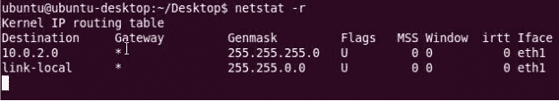

你可能发现某个接口处于关闭状态。如果你需要将其开启，请使用以下命令：

```bash
ifup interface_name
```

这无疑会启用接口。要查看你的机器是否连接到另一个设备，你需要 `ping` 另一台机器。如果已连接，该机器将向你的机器发送 `ICMP echo packets`（ICMP 回显包）。如果没有连接，这些数据包将不会发送到你的机器。可以使用其 IP 地址 `ping` 另一台机器，如下所示：

```bash
ping 192.168.160.2
```

上述命令将 `ping` 上 IP 地址的机器。

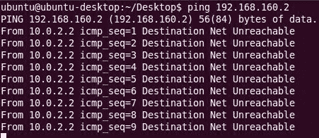

在我的情况下，如上图所示，该机器无法访问的，因为我的电脑没有连接到上述 IP 地址的机器。你还会注意到，即使没有连接，进程也会继续尝试 `ping` 这台机器。要强制停止它，只需按下 `Ctrl + C` 即可立即停止。让我们看看 `ping` 本地机器会发生什么：

```bash
ping 127.0.0.1
```

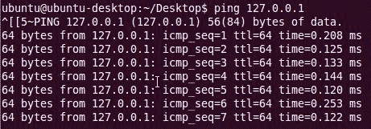

如从上图所示，本地主机是可以访问的。再次，进程将继续 `ping` 该机器，所以，再次只需按下 `Ctrl + C` 进程就会被杀死。与其发送永远不会结束的数据包，你可以如下如下指定需要接收的 `ICMP echo packets` 数量：

```bash
Ping –c4 127.0.0.1
```

这将在标准输出上仅返回四个 `ICMP echo packets`。之后，进程将如所示停止。

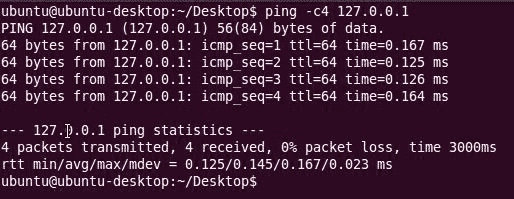

你还会注意到，当 `ICMP echo packets` 发送到你的机器时，它们会显示在标准输出上。你可能对这种文字模式不感兴趣。要使其保持静音，你可以采取以下操作：

```bash
ping –c4 127.0.0.1 –q
```

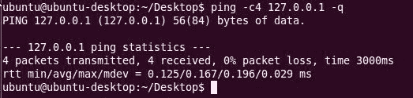

如上图所示，`ping` 是静音的，而不是文字显示。若要在静音时将过程文字化，可以使用 `–v` 选项代替 `-q` 选项。

# 第 21 章：学习 Linux 安全技术

为了帮助你获得更好的安全性，并确保你的操作系统始终处于“健康”状态，最好记住下面提供的命令：

## 跨平台

你也可以为 Linux 进行跨平台编程。对于这一点，你必须记住以下几点：

1. 使用 `windows.h` 和 `winsock.h` 作为头文件。
2. 使用 `closesocket()` 代替 `close()`。
3. 使用 `Send()` 和 `Receive()` 代替 `read()` 或 `write()`。
4. 使用 `WSAStartup()` 初始化库。

## 互联网层消息协议（Internet Message Protocol）

## 主机解析（Host Resolutions）

关于这一点你需要记住，你应该使用 `gethostname()` 语法，这样标准库才能进行正确的调用。当你尝试查找程序某个部分的名称，以及当你想将其用于更大的应用程序时，也是如此。这与 python 几乎一样，因为你可以这样编写代码。

## Linux 套接（Linux Sockets）

你需要理解的是 Linux 是一个开放系统互连（OSI）网络模型，这意味着它在套接 `()` 中工作。为了建立连接，你需要利用监听套接（listening sockets），以便主机可以调用——换句话说，就是连接。

通过输入 `listen()`，用户将能够阻塞程序上的 `accept()` 块。这把 `()` 程序绑定在一起并使其变得完整。对于此，你可以记住以下几点：

- **服务器**：`socket()` → `bind()` → `listen()` → `accept()` → `read()` → `write()` → `read()`
- **发送请求**：`write()` → `read()`
- **接收回复**：`write()` → `read()`
- **建立连接**：`connect` → `accept()`
- **关闭连接**：`close()` → `read()`
- **客户端**：`socket()` → `connect` → `write()` → `read()` → `close()`

# 第 22 章：理解基础 Linux 安全

## 构建与析构（Construct and Destruct）

这些与套接的描述符相关，允许对端端口和对端 IP 地址显示。注意，与其同时代的语言不同，这里不使用 C++ 的其他语言。析构函数能够关闭你建立的任何连接。例如，如果你想注销你的社交网络账户之一，你可以这样做，因为有析构函数存在。

## Linux 和 SMTP 客户端

对于 SMTP 客户端，你可以预计它涉及上述的一些字符——只需进行少量调整。你还应该记住，这一切都是关于打开套接、打开输入和输出流、读取和写入套接，最后清理客户端门户。你还需要知道它涉及以下：

1. **数据报通信（Datagram Communication）**：这意味着每当你的门户向各种客户端和服务器发送数据报时，本地套接都会工作。
2. **Linux 通信（Linux Communications）**：这次，涉及到流和数据报通信。
3. **编程套接（Programming Sockets）**：当然，你可以预计你将以正确的方式编写套接！

### Echo 客户端设置（Echo Client Set-ups）

在 Linux 中，Echo 客户端通过在 `socket()` 中插入参数来工作，这意味着你可以将 IP 与 `PF_INET` 函数一起，以便它们都可以进入 TCP 套接。要设置一个适当的客户端结构，只需记住你必须从之前的代码中进行一些调整。

## Linux 及其套接

你还需要理解，你可以主要用 C 编写 Linux，因为它们都涉及到套接的使用。`socket` 工作像一个桥梁，将客户端绑定到端口，并负责在等待服务器响应时向服务器发送正确类型的请求。最后，完成数据的发送和接收。

同时，Linux 套接还能创建一个套接，以便客户端绑定到端口。在此期间，套接可以创建，以便让数据进入：

`socket()` → `bind()` → `listen()` → `accept()` → `read()` → `write()`

# 第 23 章：理解高级 Linux 安全

互联网层协议（Internet Protocol）是关于组织物理连接的，这取决于。。三种组织组织物理连接的方法：

| `UDP Header` | `UDP` |
| --- | --- |
| `IP Data` | `Transport` |
| `Frame Header` | `Link` |
| `Frame Header` | `Application` |

## 获取对端（Getting Peer）

关于这一点你需要记住，使用 `gethostname()`，标准库进行进行正确的。。。尝试尝试尝试某个名称名称，，，你想你想将其应用程序应用程序应用程序时时时，几乎与 python 一样因为你可以这样编写代码。

## Linux 套接（Linux Sockets）

你需要理解的是 Linux 是一个开放系统互连（OSI）网络模型，这意味着它在套接 `()` 中工作。为了建立连接，你需要利用监听套接（listening sockets），以便主机可以调用——换句话说，就是连接。

通过输入 `listen()`，用户将能够阻塞程序上的 `accept()` 块。这把 `()` 程序绑定在一起并使其变得完整。对于此，你可以记住以下几点：

- **服务器**：`socket()` → `bind()` → `listen()` → `accept()` → `read()` → `write()` → `read()`
- **发送请求**：`write()` → `read()`
- **接收回复**：`write()` → `read()`
- **建立连接**：`connect` → `accept()`
- **关闭连接**：`close()` → `read()`
- **客户端**：`socket()` → `connect` → `write()` → `read()` → `close()`

## 构建与析构（Construct and Destruct）

这些与套接的描述符相关，允许对端端口和对端 IP 地址显示。注意，与其同时代的语言不同，这里不使用 C++ 的的其他语言。析构函数能够关闭你建立的任何连接。例如，如果你想注销你的社交网络账户之一，你可以这样做，因为有析构函数存在。

## Linux 和 SMTP 客户端（Linux and SMTP Clients）

对于 SMTP 客户端，你可以预计它涉及上述的一些字符——只需进行少量调整。你还应该记住，这一切都是关于打开套接、打开输入和输出流、读取和写入套接，最后清理客户端门户。你还需要知道它涉及以下：

1. **数据报通信（Datagram Communication）**：这意味着每当你的门户向各种客户端和服务器发送数据报时，本地套接都会工作。
2. **Linux 通信（Linux Communications）**：这次，涉及到流和数据报通信。
3. **编程套接（Programming Sockets）**：当然，你可以预计你将以正确的方式编写套接！

### Echo 客户端设置（Echo Client Set-ups）

在 Linux 中，Echo 客户端通过在 `socket()` 中插入参数来工作，这意味着你可以将 IP 与 `PF_INET` 函数一起，以便它们都可以进入 TCP 套接。要设置一个适当的客户端结构，只需记住你必须从之前的代码中进行一些调整。

### Linux 及其套接（Linux and its Sockets）

你还需要理解，你可以主要用 C 编写 Linux，因为它们都涉及到套接的使用。`socket` 工作像一个桥梁，将客户端绑定到端口，并负责在等待服务器响应时向服务器发送正确类型的请求。最后，完成数据的发送和接收。

同时，Linux 套接还能创建一个套接，以便客户端绑定到端口。在此期间，套接可以创建，以便让数据进入：

`socket()` → `bind()` → `listen()` → `accept()` → `read()` → `write()`

## 互联网层协议

互联网层协议（Internet Protocol）是关于组织物理连接的，这取决于。。三种组织组织组织物理连接的方法：

- 无线网络；
- 局域网；
- 通过其交换 PPP 的调制调器。

在第一的情况下，需要一个无线接入点。只有在可用的情况下，才能建立连接互联网的无线网络。第二种方法适用于你的计算机连接到局域网，且该局域网有一个访问网的服务器。在这种情况下，你不需要花精力组织连接——局域网管理员会完成所有必要工作。只需启动浏览器，输入你感兴趣的 URL 即可访问。
第三种方式是拨号调制调器连接。在这种情况下，管理员不会帮助你，所以你必须自己完成一切。出于这些原因，我们决定详细考虑这种方法。首先，你自然应该有一个调制调器和电话。接下来，你需要决定提供互联网访问服务的运营商，并从那里获取 PC 连接到运营商调制调器池的电话号码，当然还有访问全球网络所需的用户名和密码。


接下来，你需要配置 `PPP` 协议。这可以手动完成，也可以使用配置程序。手动配置相当复杂，需要编辑文件和编写脚本。因此，对于初学者来说，最好使用一个自动化整个上网设置过程的特殊程序。该程序被称为 `kppp`，最初包含在 `KDE` 图形环境中。此实用程序使得建立连接变得简单得多，在大多数情况下，你只需要正确指定账户信息。

# 第 26 章：将 Linux 扩展到云端

如果你正在寻找 Linux 云托管服务器，那么如果你希望让你的网站或可能的电子商务网站更高效，并确保卓越的整体性能，这将是更好的解决方案。Linux 云托管服务器为客户提供了额外的可配置性，并且可以根据其特定需求进行碎片化调整。为你提供的硬盘服务器提升了你网站的整体性能，并对所提供的处理资源提供了更多的管理。

Linux 服务器软件利用了最新的技术知识，允许每个人成功地运行他们自己的 Linux 类型，并凭借卓越的整体性能、更强的可配置性和优越的路由提供这些服务。100% 的可用性已得到保证，这意味着你的博客将持续成功运行，几乎没有延迟。关于确保你的博客正常运行，提供了服务器自动故障转移功能。关于确保极高的稳定性，Linux 服务器托管服务提供了先进的 DDOS 安全防护。地理上的冗余 DNS 和客户端被转发到 8 家中转公司。

Linux 共享托管支持最新且可靠的托管变体，类似于 `Fedora 7`、`CentOS 7`、`Ubuntu 14.04 LTS` 和 `Debian 7.8`。向客户提供涉及操作系统的服务器和 PC 功能。这些预装主机被即时部署，允许客户在其特定的 Web 托管服务中使用它们。

设有专职的支持人员，如果你在使用网站时遇到任何问题，他们可以提供专业的解决方案。可以为客户提供通用且广泛的知识库，通过简单的请求来指导他们。客户获得与物理服务器具有相同定制化的个人硬盘。Linux Web 托管服务软件允许你的主机通过使用 `Internap` 运营商的千兆上行链路连接到网络。

提供了最新的分区变体以便客户拥有完全管理权。`Internap` 的标准 VPS 托管服务现在不再是某些首选，因为运营商的网络为这些特定的主机进行了切分，以便他们轻松地与客户共享。VPS 公司利用容器技术在单个共享的 Linux 类型上隔离众多用户，这通常会降低运营成本并提高效率。

# 结论

我希望这本书已经帮助你学会了自信地使用 Linux，从将其安装到你的计算机中到使用该操作系统创建你自己的程序。我希望这本书也能作为选择最适合你需求的 Linux 发行版的指南，以及帮助你执行日常计算任务的应用程序。读到本书结束时，你应该学会了使用命令行在 Linux 环境中操作，并学会了一些使你的系统安全的步骤。

虽然没有 Windows 流行——至少对某些人来说——但 Linux 绝对是最可靠的操作系统之一——最棒的一点是它是免费的，所以你不需要为了获取它而支付任何费用，也不必因为付不起正版费用而而去使用假冒类型的操作系统。
