# Linux 入门指南：开启 Linux 编码与编程，第14版，2023年

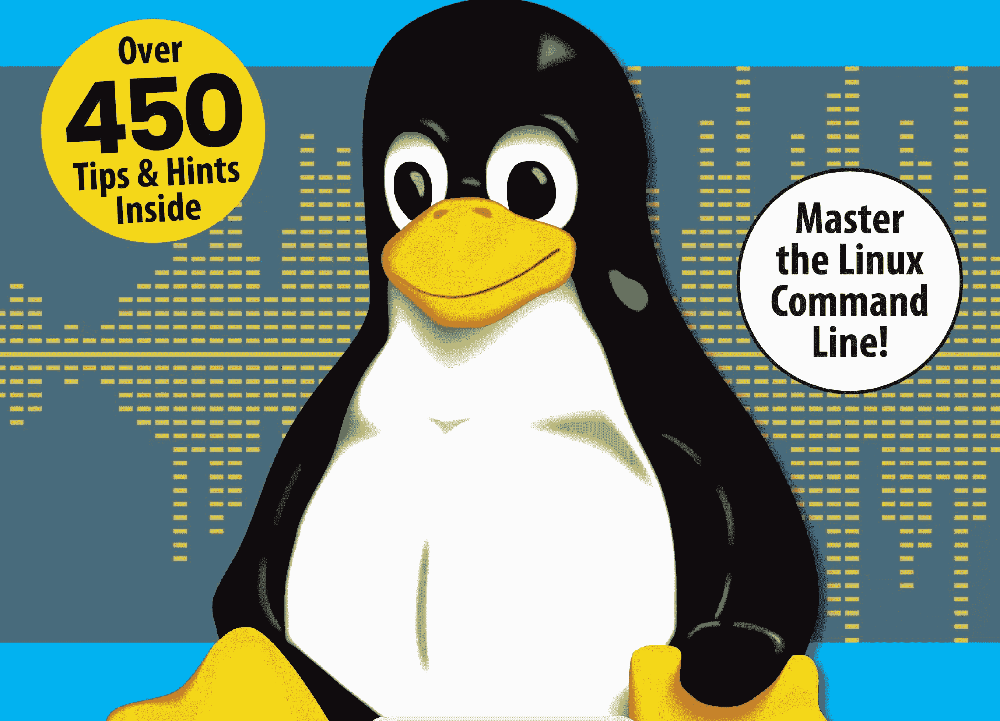

在 Readly 上提供的技术指南


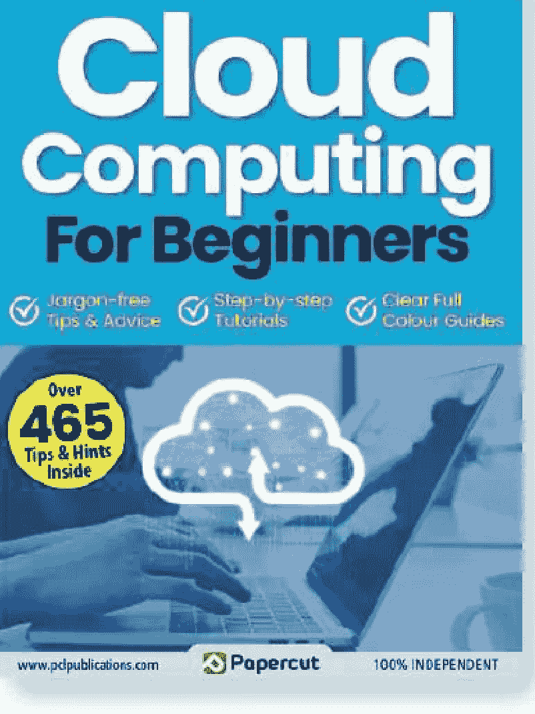

如果你是一个初尝试的新用户，并想要学习启动编码和编程所需的所有知识，《Linux 入学者教程》是你的首次且唯一选择。本指南充满了实用的指导和逐步的完全插图教程，并使用通俗易懂的英语编写。在这份新用户指南页面中，你将清晰地学习编写自己的奇妙应用所需的所有知识。有这本非官方说明手册在身边，在你学习、探索和增强编程技能的过程中，没有任何问题是无法解决的，没有任何问题是没有答案的。


Papercut

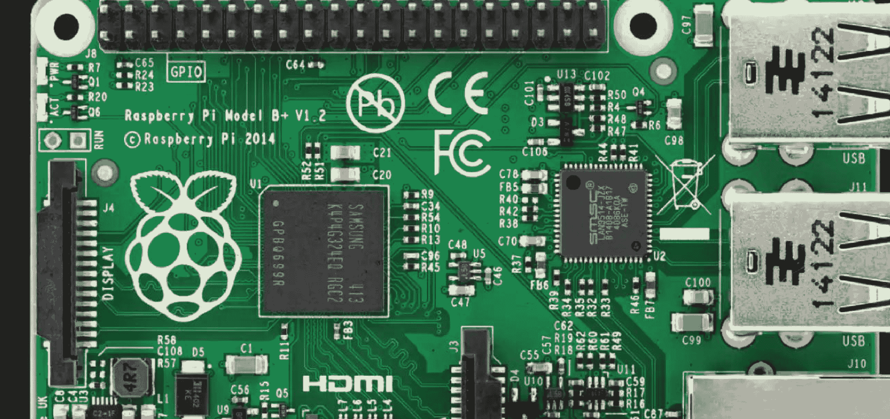


## 接触 Linux

> “你为什么对计算机这么了解？”
>
> “我并不懂，它是第一台。”
>
> – 格蕾丝·霍珀将（编程先驱）在接受大卫·莱特曼采访时


## 接触 Linux

为什么为什么选择 Linux？

对于许多用户来说，Linux 意味着摆脱围墙花园的自由。为什么会有这么多不同的发行版？初学者在开始时会问这些以及更多问题。诚然，Linux 是一个多功能且强大的操作系统，但你应该从何开始呢？坦率地说，你可以在本节找到答案。

### 为什么选择 Linux？

因此，Linux 是一个编程和进化的绝佳环境。它非常适合开发者，并且在不断改进。如果你认真想要学习编程，或者想尝试一些新事物，Linux 将向你展示它是如何适合你的。

目前有很多版本的 Linux 可供选择，被称为“发行版”（Distributions）。每个发行版都有不同的理念和方法。以下是五个值得尝试的优秀发行版以及你可以在哪里获取它们。

大多数发行版的安装过程非常相似。你只需从网站下载磁盘镜像，并将其刻录到光盘或创建 USB 闪存盘安装程序。请务必为你的硬件选择正确的发行版，并仔细阅读说明文档。

到目前为止，最受欢迎的 Linux 发行版是 Linux Mint。Mint 诞生于 2006 年，作为最流行的 Ubuntu 的替代品。虽然它基于 Ubuntu 的长期支持版（LTS），但 Linux Mint 采取了不同的方向，并为用户提供了更好的整体体验。

Linux Mint 每个内核操作系统版本都提供三个主要的桌面版本。这初听起来可能很复杂，但其实非常简单。目前，Linux Mint 使用 Cinnamon 环境作为其旗舰模型；同时也提供 MATE 和 Xfce。

Cinnamon 是一个图形丰富的桌面环境，MATE 使用的图形较少，在更广泛桌面系统上更加稳定，而 Xfce 是一个为了速度和终极稳定性而构建的极精简环境。

在本书中，我们将使用 Cinnamon 版本；不过，你可以根据自己尝试任何其他桌面发行版。事实上，建议你花时间尝试不同的环境，甚至是不同的发行版，看看哪一个最适合你和你的电脑。

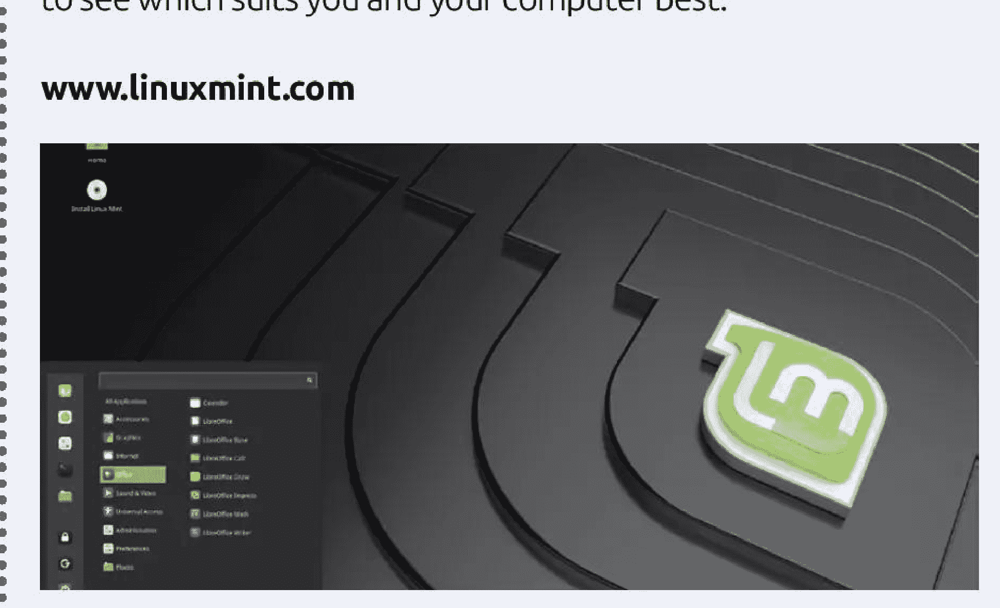
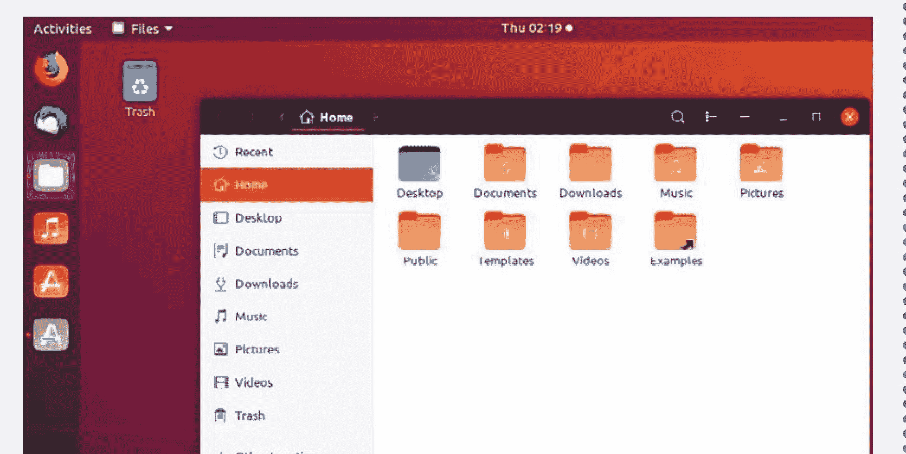

第二受欢迎的发行版是 Ubuntu，它是一个非洲单词，意为“对他人的仁”。Ubuntu 在其十四年的历史中经历过起伏。曾几何时，它是世界上最易用的 Linux 系统，在呈现方式上提供了一些选择，但一些不利的状况（特别是涉及隐私的问题）导致它一度跌下神。

尽管如此，Ubuntu 自此进行了修订，并缓慢地爬回 Linux 领军地位。该操作系统的最新版本使用了 GNOME 3 桌面环境，这是一个令人深刻的改进；尽管对于 Windows 用户来说可能有点困惑，而且资源消耗较大，特别是如果你计划将其安装在旧电脑上的话。

Ubuntu 尽管有各种缺点，但是一个非常适合开始实验的 Linux 发行版。它的界面简洁，易于使用和安装，并为用户提供了完整的 Linux 体验。

```
```

Arch 是运行最久的 Linux 发行版之一，也是许多 Linux 版本的基础。既然可以安装 Arch，为什么还要安装 Mint 或 Ubuntu 呢？许多用户确实是这样做，但它对初学者并不理想。

Arch 是一个在你对 Linux 更有经验时使用的发行版。你从零的命令行开始，然后必须手动对硬盘进行分区、设置用户、设置操作系统，最后以及你需要的应用程序一起安装桌面环境。

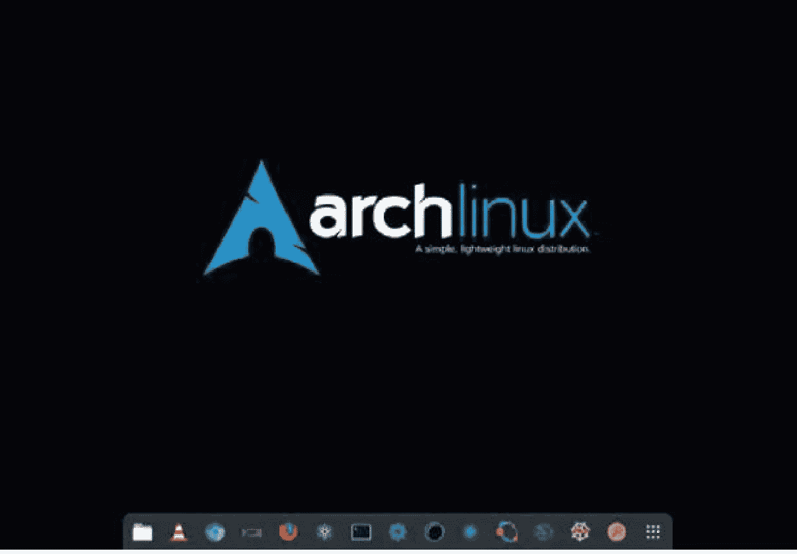

Ubuntu 和 Mint 都提供了安装路径，并附带软件包帮助你起步。而 Arch 则是一个更加“精裸”的选择。Arch 致力于提供免费软件，其存储库包含超过 50,000 个可安装的应用程序，包括多种不同的桌面环境，你可以将其与任何发行版配合使用。

然而，所有这些努力的回报是你拥有了一个亲手创建的发行版。你的 Arch 发行版没有包含他人预装的所有不必要的文件和程序。它是由你为你量身定制的。

```
```

无疑，你一定听过树莓派（Raspberry Pi）。这很难不，因为自从推出以来，这款奇不起的微型电脑在过去的六年里席卷了世界。

树莓派的几个方面使其成为计算世界的杰出之作。首先它很便宜，大约 25 美元就能买到一台功能完的电脑；它很小，尺寸只比信用卡大一点；具有完全可编程接口的内置电子设备；并且带有 Raspberry Pi OS，这是其专用的、基于 Debian 的操作系统，其中包含了办公套件以及许多编程语言和教育资源。

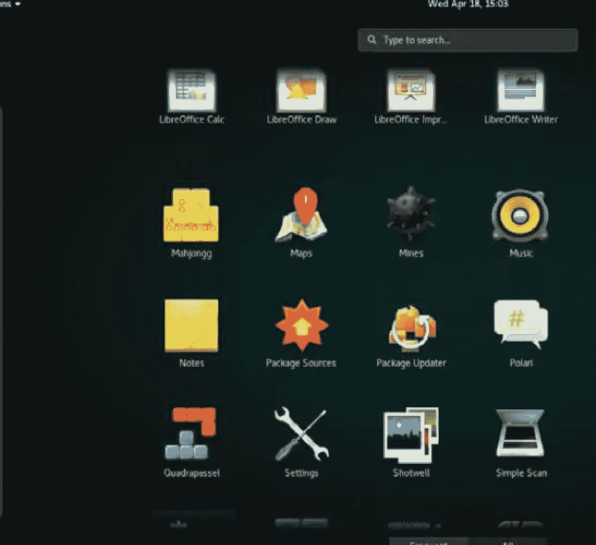

Raspian 对于树莓派是扩展的，因为树莓派使用 ARM 处理器驱动。然而，树莓派基金会随后发布了 PC 版本的 Raspberry Pi Desktop。

就像 Raspberry Pi Desktop 带有你永远可能需要的各种编码、教育和其他应用程序一样。它快速、稳定且运行出色。如果你对扩展 Linux 体验感兴趣，那么这正是你应该考虑的顶级发行版之一。

大多数发行版分为两类。有些具有最新的功能和技术，如 Ubuntu 和 Mint 拥有这些新功能；而像 Debian 那样具有稳健的可靠性。

与此同时，openSUSE 试图兼顾两者。openSUSE 是一个稳如磐石的系统，由社区与 SUSE 员工共同开发，SUSE 负责开发企业级操作系统；SUSE 为伦敦证券交易所等其他机构提供支持，它专为任务关键型场景设计，在这些场景中“没有留给不稳定性的余地”。

就像 Raspberry Pi Desktop 带有你永远可能需要的各种编码、教育和其他应用程序一样。它快速、稳定且运行出色。如果你对扩展 Linux 体验感兴趣，那么这正是你应该考虑的顶级发行版之一。

而 openSUSE 试图兼顾两者。openSUSE 是一个稳如磐石的系统，由社区与 SUSE 员工共同开发，SUSE 负责开发企业级操作系统；SUSE 为伦敦证券交易所等其他机构提供支持，它专为任务关键型场景设计，在这些场景中“没有留给不稳定性的余地”。openSUSE Tumbleweed 滚动版包含了最新功能。

```

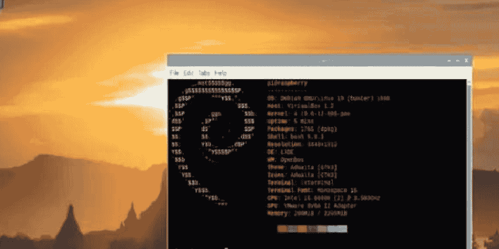

openSUSE 广受好。


Linux Mint 提供了几个不同的版本，或口味：Cinnamon、MATE 和 Xfce；这些版本也有 32 位和 64 位之分。这一切到底意味着什么呢？你在安装时应该选择哪个版本呢？

桌面环境（Desktop Environment）是你用于与 Linux 系统交互的图形化界面。就像 Windows 10 的图形桌面也被称为 Fluent 设计（Fluent Design）。

Linux Mint 提供了多种发行版版本：Cinnamon、MATE 和 Xfce。虽然对于初学者来说这听起来可能有些困惑，但每个可用版本都包含相同的 Linux 结构和内核。内核是操作系统的核心，处理软件和硬件之间所有的指令。

每个版本都是一个略有不同的桌面环境，即你用于与操作系统交互的图形化用户界面（GUI）。每个桌面环境都使用不同的应用程序来访问或使用系统，例如使用文件管理器来浏览操作系统的文件结构，或者启动其他程序的方式。再次强调，尽管核心的生产力工具、视频和图形套件是相同的，并且以相同的方式运行。

那么为什么要费力尝试不同的桌面环境呢？简单来说，这取决于个人喜好。有些用户偏好 MATE，因为 MATE 是经典 GNOME 2 环境的分支，是一个稍微现代一点的环境，可以在近期硬件上运行，并具有一些尖端功能。Xfce 是一个更现代的环境，由于其对可用系统资源的占用极低，它可以在旧硬件上运行。

简而言之，Cinnamon 是 Linux Mint 的旗舰桌面环境。MATE 与更多种硬件兼容兼容。例如，Windows 只提供一种桌面环境供使用，而 Linux 提供了许多。因此，Linux Mint 选择为用户提供丰富的选择。

Cinnamon 除了外观和感受之外，还有许多优点，尽管这些也是重要的因素。在这里，我们列出了几个功能，帮助你判断它是否适合你。

### 特色功能 1
它在更现代的系统上表现出色，但比以前稳定得多，而且不再是以前那样的资源大户了。因此，如果你在使用旧电脑安装 Linux Mint，切不要被 Cinnamon 劝退了。

### 特色功能 2
Cinnamon 具有可配置的“热角”（Hot Corners），桌面的每个角落都可以被点击以执行特定任务，例如显示工作区或运行命令。热角有助于在不同视图之间高效切换。

MATE 是一个简单易用、快速且稳定的 DE。与 Cinnamon 相比，它看起来有点过时，但仅是表面如此。有很多理由喜欢 MATE：

### 特色功能 1
MATE 是旧电脑的优秀桌面环境。它对硬件的支持通常比 Cinnamon 更好，但同样能够提供优秀的桌面体验。

### 特色功能 2
由于其高度可配置的特性，MATE 可以自定义到很高的程度。有许多可用选项，包括 Compiz 设置。

Xfce 起于 1996 年的通用桌面环境（CDE）。从那时起它发生了变化，现在简单称为 Xfce，绰号为“无胆桌面”。

### 特色功能 1
Xfce 确实是一个快速桌面，并带来了 Linux 的最佳体验。事实上，我们为了将其安装到新电脑上已经花了几百个字。

### 特色功能 2
因为它是轻量级的，这意味着 Xfce 并不是一个完整的操作系统。就像其他环境一样，你可以使用最新的 Firefox、Libreoffice、VLC、Gimp 以及下载客户端。

到为止我们主要看了 Linux Mint。事实上，有数千个发行版可以下载和安装，所以你应该选择哪一个？

发行版切换是社区中的一个术语，指的是那些从不坚持单一发行版的人，从一个跳到另一个。发行版切换并没有错，它是一种寻找符合你口味元素的好方法。例如，Linux Mint 是一个理想的起点。它易于安装和使用，包含了日常所需的所有软件。继续进行，随着你更有信心，你可能会发现 Ubuntu 或 Debian 比较受青。考虑到 Linux Mint 的巨大价值，我们建议你慢慢增加你的技能。你可能会发现切换到另一个完全不同的发行版。例如，Tails 是一个为匿名而设计的发行版。Kali 是为了安全设计的，包含了许多种工具。

这些工具已经预先安装，用户可以对自己的网络进行渗透测试。曾经甚至出现过一个名为 Hannah Montana 的 Linux 发行版，但我们谈得越少越好。重点是，总有一个适合你的发行版。

不用俗说，一旦你对 Linux 达到了相当高级的程度并成为一名合格的用户，你将需要扩展自己的技能，并基于 Arch、Debian 或其他发行版构建你自己的 Linux 发行版。这涉及到大量的命令行知识，以及关于 Linux 系统如何工作以及与计算机硬件交互的知识。你需要对硬盘进行分区、安装驱动程序，并最终安装你想要的应用程序和软件。这需要时间，而且你将不断学到很多技能。

奇怪的是，许多更高端的技术用户发现自己又回到了起点，使用像 Linux Mint 这样的发行版。主要原因通常是因为是一个简单的选择，而且环境稳定。如果你喜欢从内而外地构建系统，那么你并不总是想修复潜在的问题。我们大多数人更倾向于轻松的生活，特别是在技术方面，因此逻辑上的选择是选择一个既简单又强大到足以你想要的所有任务的发行版。

然而，根结底，这完全取决于你自己的选择。你可能会在浏览教程后发现自己不喜欢 Linux Mint 或 Cinnamon 桌面，你可能更喜欢 Ubuntu、Debian 或开源；这就是 Linux 的魅力所在。你可以自由更改你想要的，从一个切换到另一个，而不会受到成本或访问限制的惩罚。最终，你可以认为自己是一个技术用户，但永远不要认为自己是专家，毕竟一直在学习新东西。你可以从零开始构建自己的发行版，帮助其他用户解决问题，甚至可以在测试阶段为发行版的改进做出贡献。

关于你喜欢哪种发行版问题的答案可以根据你的需要变得复杂或简单，只要它能完成你想让的任务，它就是完美的。

| 应用 | Linux |
|---|---|
| 文档 | LibreOffice |
| 图像 | LibreOffice Draw |
| 图形 | LibreOffice Calc |
| 互联网 | LibreOffice Impress |
| 办公 | LibreOffice Writer |
| 其他 | |

> “在开源世界中，你有权控制自己的命运。” – Linus Torvalds（Linux 内核开发者）

谈论 Linux 有多好固然言而易之，但如何把它安装到你的电脑上呢？安装 Linux 非常简单，但有几个选项供你选择。本节将介绍你如何下载 Linux ISO、将其安装在 PC 上作为你的主操作系统，甚至包括如何安装虚拟环境。通过虚拟环境，你可以在继续使用主操作系统 macOS 的同时运行 Linux。感兴趣吗？继续阅读以了解更多。

在将 Linux 安装到电脑之前，你需要将下载的 Linux ISO 传输到 DVD 或 USB 闪盘。这将是一个运行环境，允许你在安装之前测试该操作系统，但首先你需要创建可启动的介质。

我们正在使用一台 Windows 10 电脑将 ISO 传输到 DVD。如果你使用的是 Windows 7 及更高版本的 Windows，该过程非常简单。

- **步骤 1** 首先，找到你已经下载的 Linux ISO 镜像。你通常会在 Windows 7、8.1 和 10 的“下载”文件夹中找到它，除非你在保存时指定了不同的位置。
- **步骤 2** 接下来，将一张可刻录的 DVD 光盘插入电脑的光驱器中。几秒钟后，在读取磁盘时，Windows 会弹出一个消息框询问对新插入的光盘进行什么，因为我们将使用内置的镜像刻录功能。
- **步骤 3** 右键点击 Linux ISO，并在菜单中选择“刻录光盘映像”。根据 PC 的速度，可能需要几秒钟才会发生变化。不用太担心，除非超过了一分钟，那种情况下可能值得重启电脑并重试。运气好的，Windows 光盘镜像刻录机将启动。
- **步骤 4** 打开 Windows 光盘镜像刻录机后，点击“验证光盘”，然后点击“刻录”按钮。该过程可能需要几分钟，取决于你 PC 光驱的速度。一旦完成验证阶段，光驱器应该会自动为你识别磁盘。

| 名称 | |
| --- | |
| 快速访问 | linuxmint-19.1-cinnamon-64bit |
| Dropbox (BDM) | |
| OneDrive | |
| 此电脑 | |
| 光 驱动器 (E:) | HiSuite |
| 网络 | |

挂载
刻录光盘映像
使用 Windows Defender 扫描...
共享
使用 WinRAR 打开

USB 介质比 DVD 快，而且更方便，因为大多数现代 PC 都没有安装光驱器。传输镜像的过程很容易，但你需要一个第三方程序和一个 USB 闪盘。

| 首先打开网络浏览器并访问 rufus.ie。向下滚动页面下载最新版本的 Rufus。点击链接下载。 |
| Rufus 3.13.1054 | 驱动器 |
| 设备选择: GPT (non CSM) | Linux (ISO) |
| 目标系统: UEFI (non CSM) | 分区方案 | MBR |
| 目标系统 | BIOS 或 UEFI |

| 步骤 2 下一步是选择你想使用的镜像。Rufus 以 ISO 模式运行，这样在写入后就可以访问驱动器文件。确保已选中并点击“确定”。 |
| 在首次启动 Rufus 界面时，你会发现下载链接。开始之前，点击“磁盘或 ISO 映像(选择)”旁边的选择选择按钮。这将启动 Windows 资源管理器，你可以在其中找到并选择 ISO。 |
| 步骤 3 Linux ISO 正在传输到 USB 闪盘。这可能需要几分钟，取决于你 USB 闪盘的速度。在此过程中，Rufus 会在 Windows 期间运行，在此期间请不要关闭它。完成后，点击“开始”按钮。 |
| 步骤 5 下一步是选择 USB 闪盘。Rufus 已经识别了你的闪盘；如果没有，请插入它。 |

| 属性 | |
| Rufus 3.14.1438 | 设备: Ubuntu 18.1.1-64bit (F:4) |
| 设备选择: GPT (non CSM) | Linux (ISO) |
| 分区方案 | MBR |
| 目标系统 | BIOS 或 UEFI |

| 步骤 6 Linux ISO 正在传输到 USB 闪盘。这可能需要几分钟，取决于你 USB 闪盘的速度。在此过程中，Rufus 会在 Windows 期间运行，在此期间请不要关闭它。完成后，点击“开始”按钮。 |

大多数发行版都以现场环境（Live Environment）的形式提供。在该环境中，你可以从创建的 DVD 或 USB 启动进入一个真实的、功能完整的发行版。让我们来看看它是如何工作的，以及你如何进行 Linux 安装。

统一扩展固件接口（UEFI）用于在 PC 启动过程中识别并保护。它取代了传统的 BIOS，但在安装 Linux 时可能会导致问题。

- **第 1 步** 将你的 DVD 或 USB 闪存插入 PC，如果尚未关闭 Windows，请将其关闭。在本例中，我们将使用 USB 介质，但过程几乎相同。当提示进入 SETUP 时，启动 PC 并按下相应的键，例如：F2、Del 或 F11。
- **第 2 步** UEFI BIOS 有不同的版本，因此涵盖所有版本是不可能的。你需要寻找的是详细说明启动顺序（Boot Sequence）或启动模式（Boot Mode）的部分。在这里你可以选择关闭 UEFI 或选择 Legacy Secure Boot（传统安全启动）。大多数发行版都支持 UEFI，但退出它可能会很麻烦。
- **第 3 步** 当 UEFI 切换到传统模式后，有两种进入现场环境的方法。第一种是通过你已经进入的 BIOS。找到 Boot Sequence，将第一个启动设备从原始设置（内部硬盘 Internal HDD 或类似项）更改为 USB Storage Device（USB 设备，用于 USB 介质）或 DVD Drive（DVD 器）。
- **第 4 步** 另一种是使用 Boot Menu（启动菜单）。通过它，你可以按下 F2（或类似的按键）显示启动选项列表，从那里选择合适的启动介质。现在你可以导航到 Save & Exit（保存并退出）并选择“Saving Changes and Exit”（保存更改并退出）来保存 BIOS。

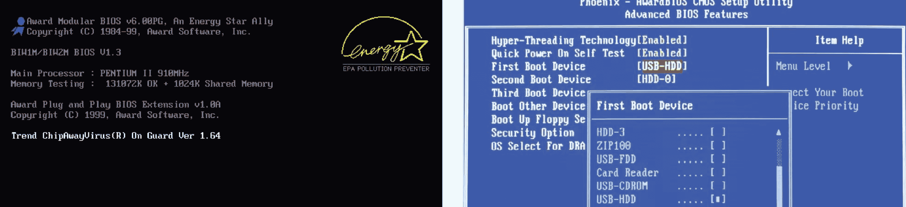
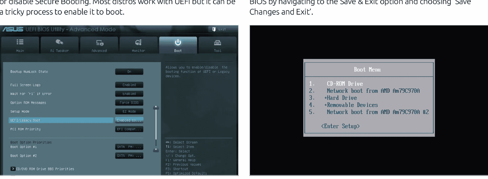

现场环境启动后，使用选项将发行版安装到你的电脑上。观察周围，当你准备好后，寻找桌面上的 Install（安装）选项。

- **第 1 步** 只要你已连接网络（如果没有，请先连接）并处于现场环境，双击桌面上的 Install Linux Mint 图标即可开始安装过程。其他发行版会显示它们的名称或其他名称，但过程是相同的。准备好后点击 Continue（继续）。
- **第 2 步** 虽然安装过程与大多数 Linux 发行版非常相似，但某些发行版在安装期间会提供不同的问题。通常，这些问题并不困难，不涉及复杂的技术，但诸如“安装第三方软件”之类的可能会让人困惑。在这种情况下，你可以继续，但如果不确定，请准备好一台连接了网络的设备以查询任何问题。
- **第 3 步** 安装新操作系统时，建议擦除旧操作系统并用新系统替换它。当你到达安装过程的这一阶段时，请确保选了“Erase disk and install Linux...”（擦除磁盘并安装 Linux...）。注意：这会完全清除你电脑上的 Windows 10，请确保你已备份了所有个人文件和数据。
- **第 4 步** 在安装过程开始之前，系统会询问你是否选择确保硬盘擦除是正确的。这是你最后退出的机会。如果你确定不介意擦除所有内容并重新开始 Linux Mint，点击 Continue。如果你需要将文件备份到磁盘/USB，请重启并重新开始。
- **第 5 步** 最后，你会被要求设置用户名和密码。输入你的名称开始，以及 Computer Name（计算机名称），它是在网络上的标识名称。接下来选择 Username（用户名），然后设置良好的密码。你可以自动点击 Login（登录）按钮，也可以暂时保留 Enter Home Folder（进入主文件夹）选项。
- **第 6 步** 安装过程可能很快，可能会有更多问题要回答，也可能会根据你之前的答案简化 Linux 安装。最后你会被要求 Continue Testing the Live Environment（继续测试现场环境）或 Restarting（重启到新安装的操作系统）。如果你准备好使用 Linux，请点击 Restart Now（立即重启）。

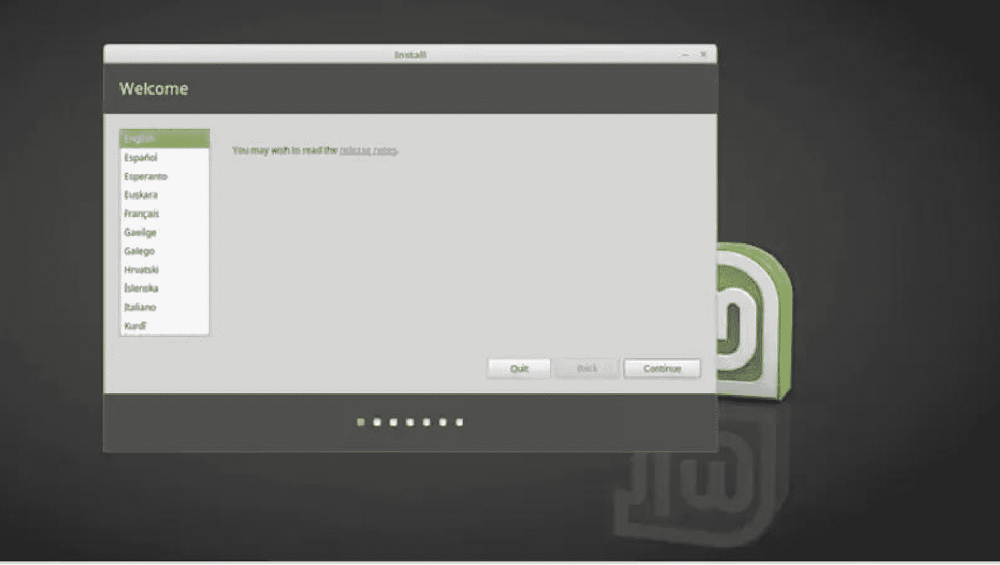
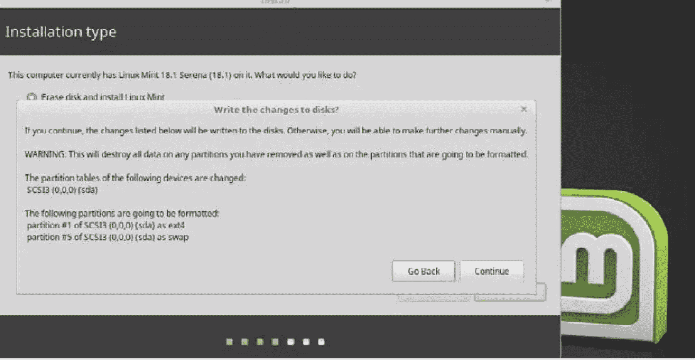
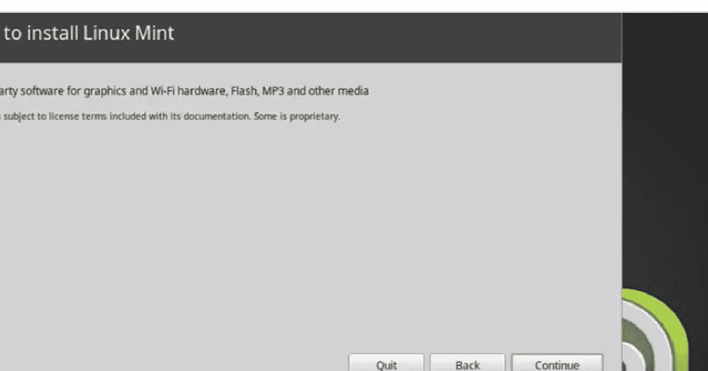
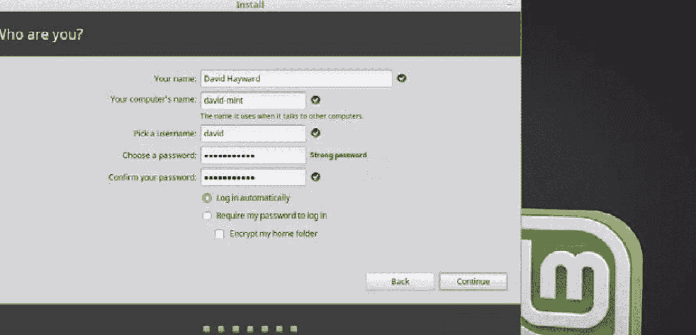
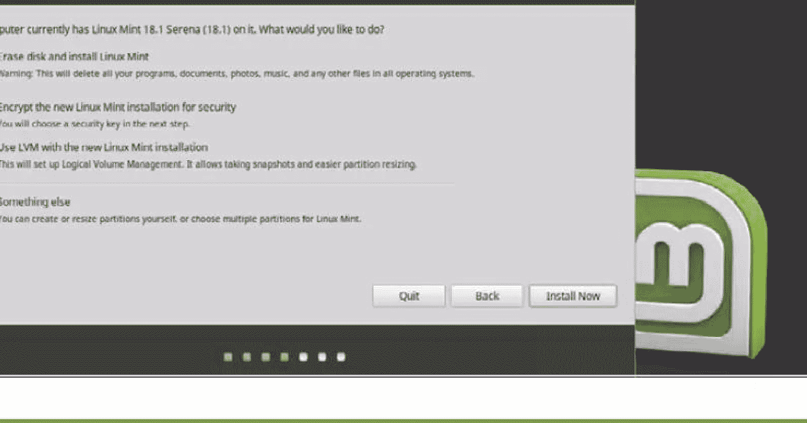
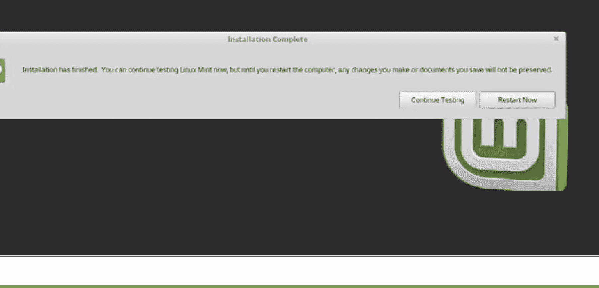

虚拟环境是一个模拟的计算机系统。使用虚拟机（Virtual Machine），你可以模拟标准 PC 并向其安装整个操作系统，而不会影响电脑上已安装的项目。这是使用 Linux 的极佳方法，同时保留 Windows 10 作为主操作系统。

使用虚拟机（VM）会消耗电脑的资源：内存、硬盘空间、处理器占用率等。在开始之前确保你有足够的资源。

- **第 1 步** 我们在本例中使用 VirtualBox，因为它是最容易上手的环境之一。访问 virtualbox.org 并点击“Download VirtualBox”。这将带你进入主下载页面。找到适用于你系统的正确主机（Windows 或 Mac，主机需已安装了正确的操作系统）并点击链接开始。
- **第 2 步** 接下来，在 VirtualBox 下载页面找到 VirtualBox Extension Pack（VirtualBox 扩展包）链接。扩展包支持 USB 设备以及其他可以使虚拟机环境更准确地模拟“真实”电脑的额外功能。
- **第 3 步** 在下载好正确的包后，在安装它们之前，你需要确保你正在使用的电脑可以托管虚拟机。要这样做，请重启电脑并启用 BIOS。当电脑启动时，按下 Del、F2 或进入 Setup 的任意键。

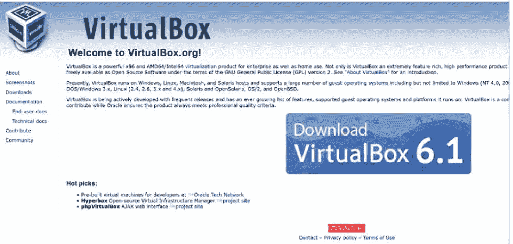
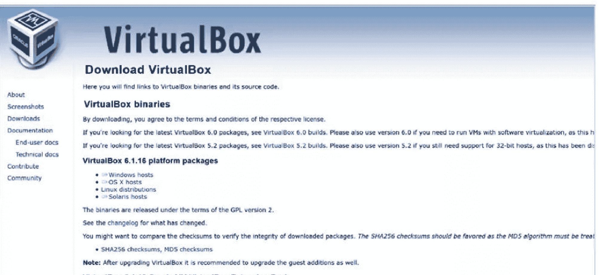
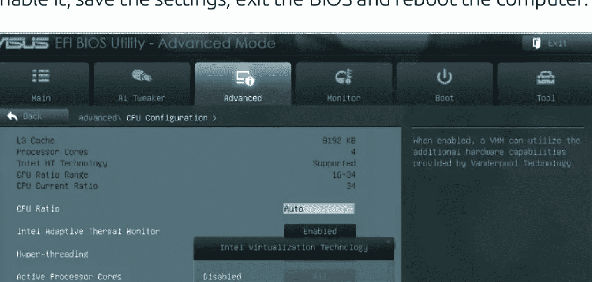

- **第 5 步** 备份准备就绪并运行后，找到下载好的 VirtualBox 主程序并双击开始安装过程。准备好后点击 Next（下一步）。
- **第 8 步** 在安装 VirtualBox 时，你的网络连接会中断一段时间。这是由于 VirtualBox 正在创建一个关联的虚拟网络连接，以便任何安装的虚拟机都能访问互联网，并利用网络资源访问电脑已建立的网络连接。接下来，点击 Next 开始安装。

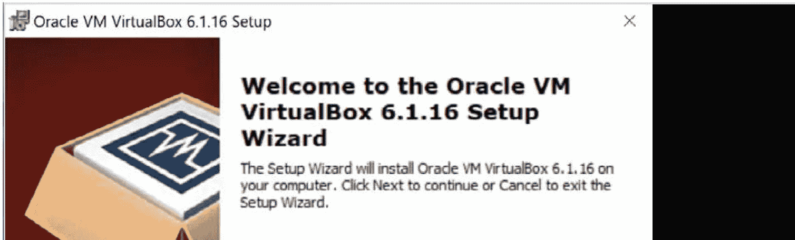
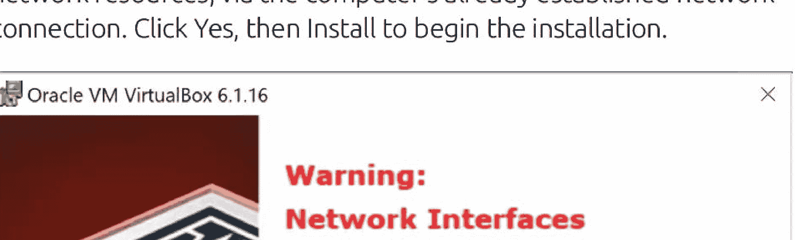

- **第 6 步** 安装过程可能很快，可能会有更多问题要回答，也可能会根据你之前的答案简化 Linux 安装。最后你会被要求 Continue Testing the Live Environment（继续测试现场环境）或 Restarting（重启到新安装的操作系统）。如果你准备好使用 Linux，请点击 Restart Now（立即重启）。
- **第 7 步** 这一部分可以保持默认设置，这样更简单。
- **第 9 步** 备份准备就绪并运行后，找到下载好的 VirtualBox 主程序并双击开始安装过程。准备好后点击 Next（下一步）。
- **第 10 步** VirtualBox 运行后，你可以安装 VirtualBox Pack。在 VirtualBox 加载扩展包时可能会有停顿，但只需点击同意条款即可。

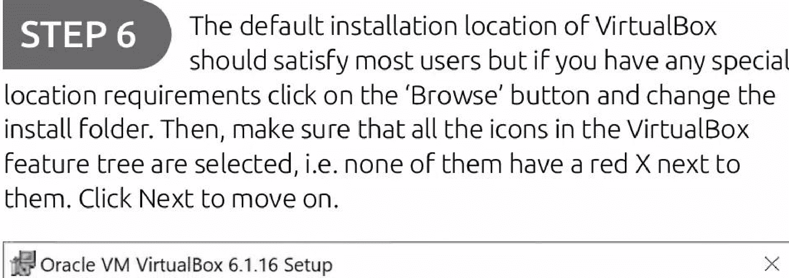
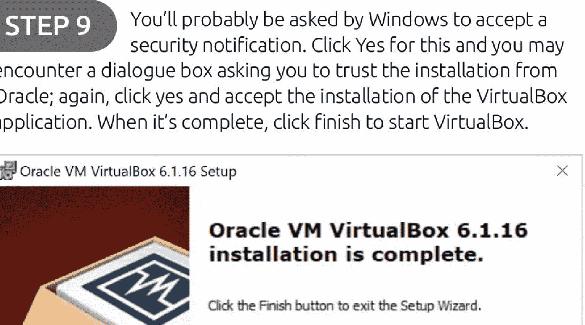
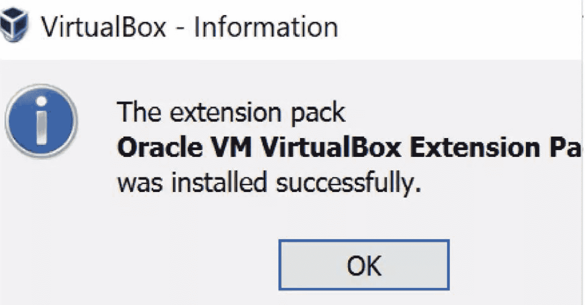

当 Oracle 的 VirtualBox 运行后，下一个任务是创建将要安装的虚拟机（VM）环境。此过程不会影响你当前安装的操作系统。

## 创建虚拟机
创建虚拟机时有许多选项。现在，我们将设置一个足以运行 Linux Mint 的虚拟机。

- **第 1 步** 打开 VirtualBox，点击应用程序右侧面板顶部的 New（新建）图标。这将打开新虚拟机向导。
- **第 2 步** 在下一个框中为 Linux Mint 命名，VirtualBox 应该自动选择 Linux 为类型，Ubuntu (64-bit) 为版本，如果没有，使用下拉框选择正确的设置（记住 Mint 是基于 Ubuntu 的）。准备好后点击 Next。
- **第 3 步** 下一部分将定义虚拟机的内存（即 RAM）。该内存将从电脑的可用内存中提取，不要给虚拟机分配太多。例如，我们有 8GB 内存，给虚拟机 2GB (2048MB)。准备好后点击 Next 继续。
- **第 4 步** 这一部分是你开始创建虚拟机将安装 Mint 的虚拟磁盘。默认选项“Create a virtual disk now”（现在创建虚拟硬盘）就是我们使用的。点击 Create 继续。

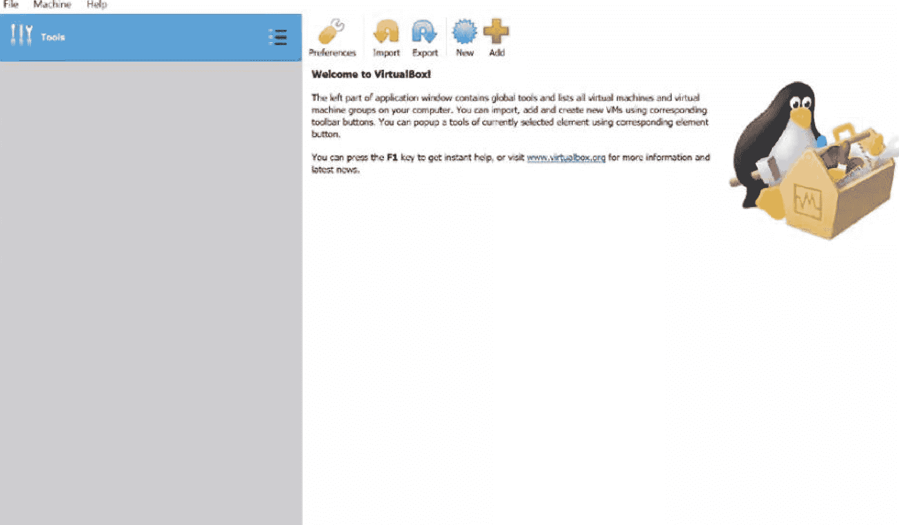
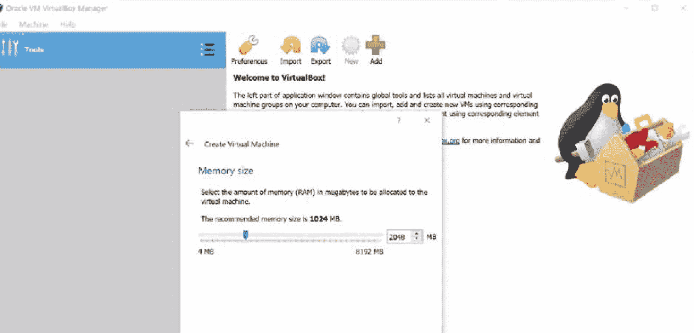
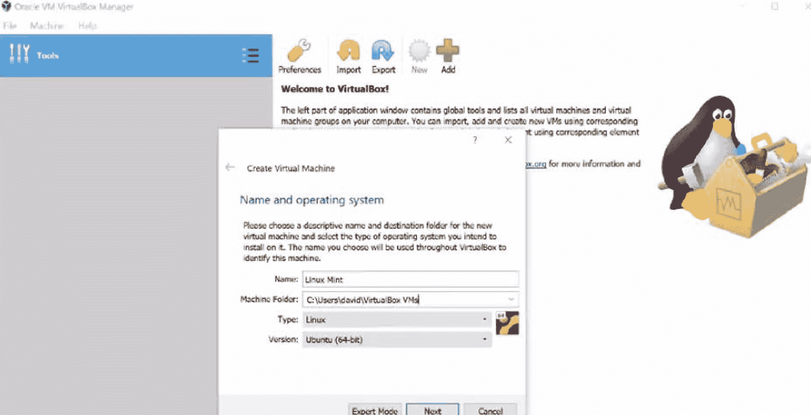
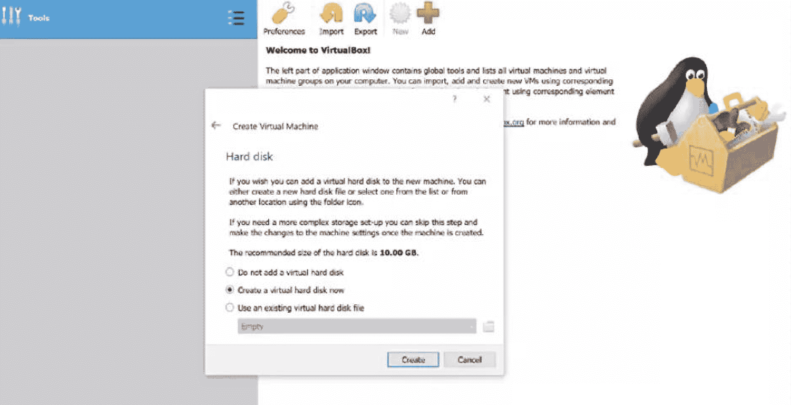

## 第 5 步
点击“创建”（Create）后弹出的窗口会询问您想要创建什么类型的虚拟磁盘。在这种情况下，我们建议使用默认（VirtualBox 磁盘镜像），因为其他选项通常用于将虚拟机从一个虚拟机应用程序移动到另一个。确保选择了 VDI，并点击“下一步”（Next）。

在完成虚拟机的初始设置后；您应该可以在 VirtualBox 应用中看到新创建的虚拟机。在开始之前，点击右侧面板顶部的“设置”（Settings）按钮，在“常规”（General）部分中，点击下拉菜单，为“共享贴板”和“拖放”选择：“双向”（Bidirectional）。

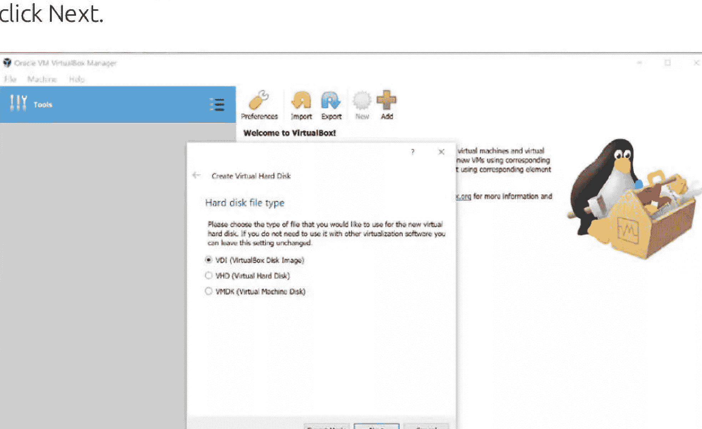

## 第 6 步
关于选择动态分配大小还是固定大小的虚拟硬盘的问题，对于初学者来说可能会有些困惑。基本上，动态分配的虚拟硬盘是一个灵活的选项；它起初不会在您的物理磁盘上占用大量空间。确保选择了“动态分配”（Dynamically Allocated），并点击“下一步”（Next）。

接着点击“系统”（System）部分，然后点击“处理器”（Processor）选项卡。根据您的 CPU，在不影响主机系统的情况下，尽可能分配尽可能多的核心；我们选择了双 CPU。现在点击“显示”（Display）部分，将“显存”（Video Memory）滑动到最大值，并勾选“3D 加速”（3D Acceleration）。点击“确定”（OK）确认后续设置。

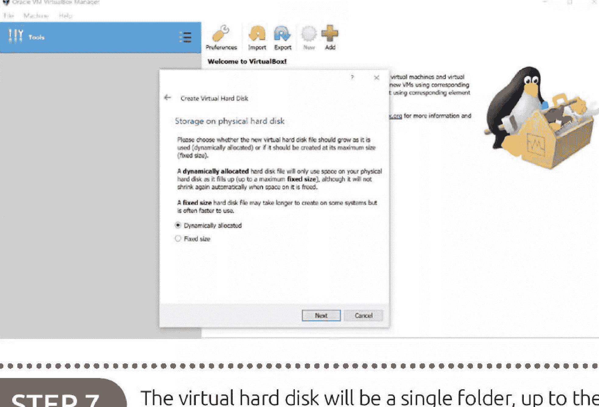
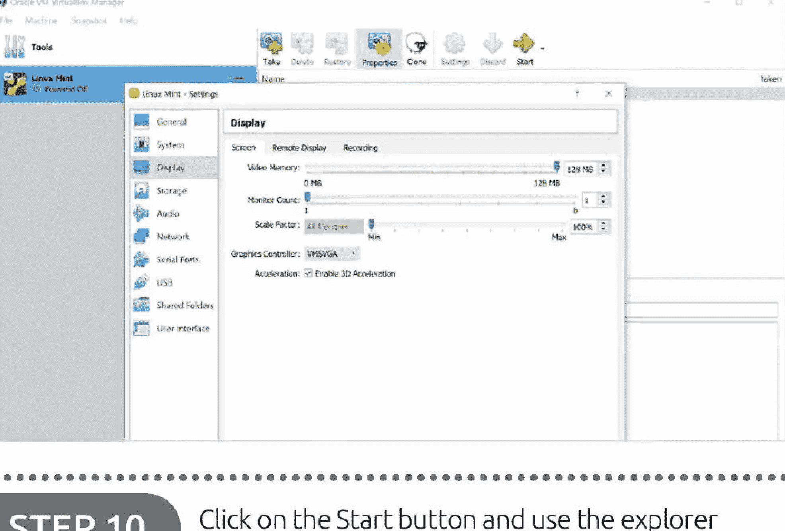

确保虚拟硬盘在计算机上的位置有可用空间。例如，我们在您的 D 盘上使用了一个较大的存储选项，命名为 Linux Mint，并为虚拟硬盘分配了 25.30GB 的空间。

点击“启动”（Start）按钮，并在“选择启动”（Select-Start Up）窗口中使用资源管理器；资源管理器用绿色箭头标亮。点击“确定”（OK）添加新的弹出窗口，下载 ISO 并点击“打开”（Open）选择该 ISO。现在点击“启动”按钮使用 Linux Mint Live 环境启动虚拟机。现在您可以按照标准的 PC 安装要求安装 Linux。

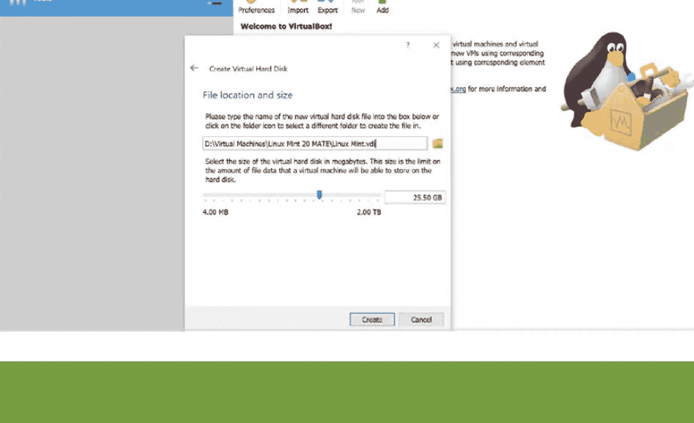
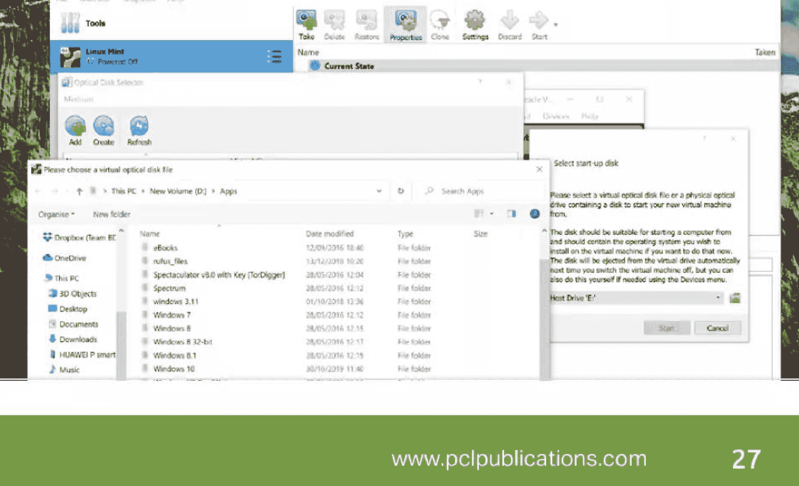

> “任何人都可以构建快速的处理器。诀窍在于构建一个快速的系统。”

–  Seymour Cray（电气工程师，Cray 超级计算机的设计师/创始人）


我们在这里使用 Linux Mint 作为指南，因为它是一个易于使用的发行版，非常适合原来的 Windows 用户。它也是最先进、文档最齐全的 Linux 发行版之一，并具有一些极好的配置选项。

在本节中，我们将介绍 Linux Mint Cinnamon 菜单和桌面环境、它的工作原理以及你可以进行哪些自定义的自定义。想要创建另一个用户，甚至发现如何在网上匿名吗？请继续阅读。

现在您已经安装了 Linux，是时候环顾四周了。但首先，如果您在使用 Virtualbox，您会收到一个关于“软件渲染”（Software Rendering）的通知，这里是修复方法。

您已经查看了一些函数，.insert、.remove 和 .pop，但也有一些可以应用于字符串的函数。

- **第 1 步** 在开始之前，我们假设您在 Virtualbox 中遇到了此问题。“软件渲染”消息出现在桌面的右上角。要修复此，点击 Virtualbox 窗口中的“设备”（Devices），然后点击“插入增强功能光驱”（Insert Guest Additions CD）。
- **第 3 步** 一两分钟后，您会自动进入命令行视图，这在 Linux 中称为“终端”（Terminal）。它详细说明了新 VirtualBox 驱动程序的安装、删除检测到的任何旧驱动并安装最新版本。这不会花费很长时间，完成后您会被要求使用终端。

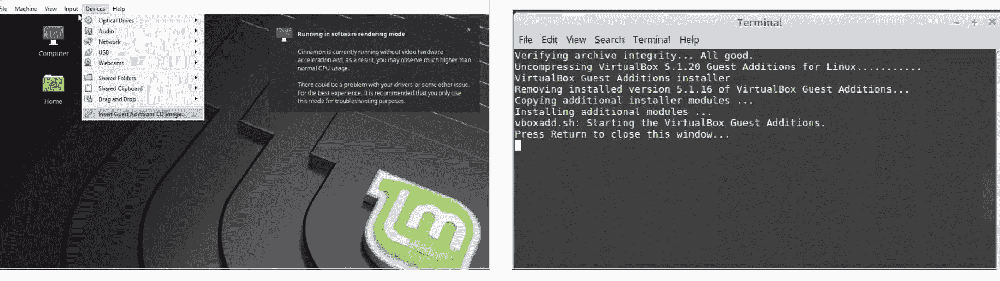

- **第 2 步** 增强功能光驱包含 Virtualbox 的驱动程序，包括虚拟硬件。当它加载时，您将收到一个“软件需要运行”的通知框，带有两个选项：“取消”（Cancel）和“运行”（Run）。点击“运行”按钮并输入您的 Linux 用户密码。
- **第 4 步** VirtualBox 增强功能光驱图标在桌面上，右键点击它，向下滚动到“菜单”（Menu），点击“客户”（Guest）。现在您可以通过点击“菜单”、左侧栏底部的图标，然后点击“重启”（Restart）按钮来重启 Linux Mint。这将重启 Mint 并解决问题。

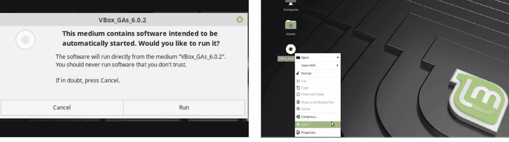

30 www.pcipubications.com

现在 Virtualbox 的软件渲染问题已经解决了，让我们看看 Mint 菜单及其工作原理。请记住，这仅适用于 Mint Cinnamon，其他发行版的视图和行为会有所不同。

- **第 1 步** 首先，您可能已经注意到了登录 Linux Mint 时弹出的“欢迎屏幕”（Welcome Screen）。花点时间浏览这些选项，阅读“第一步”（First Steps）等。当需要时，点击窗口右上角的“X”关闭它。
- **第 4 步** 再次打开“菜单”，但这次将鼠标指针悬停在“图形”（Graphics）上，然后点击“GNU 图像处理程序”（GNU Image Manipulation Program）。GIMP 是一个强大的图像应用，效果与 Photoshop 一样，但需要花一点精力获取。

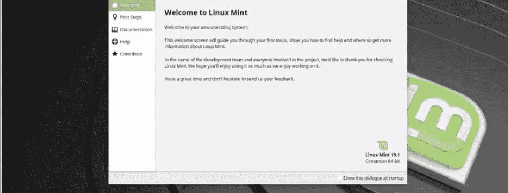

- **第 2 步** 增强功能光驱包含 Virtualbox 的驱动程序，包括虚拟硬件。当它加载时，您将收到一个“软件需要运行”的通知框，带有两个选项：“取消”（Cancel）和“运行”（Run）。点击“运行”按钮并输入您的 Linux 用户密码。
- **第 5 步** 如果您在寻找特定的应用，请搜索“菜单”（Menu）。这适用于大多数情况，无论您输入的是什么内容。


- **第 3 步** 就像任何优秀的文件管理器一样，如果您右键点击任何文件或文件夹，您将获得丰富的选项。在 Cinnamon 的情况下，默认允许您根据文件类型播放或查看文件。
- **第 6 步** 悬停在任何列表上，右键点击将显示选项：“添加到面板”（Add to Panel）、“添加到桌面”（Add to Desktop）。

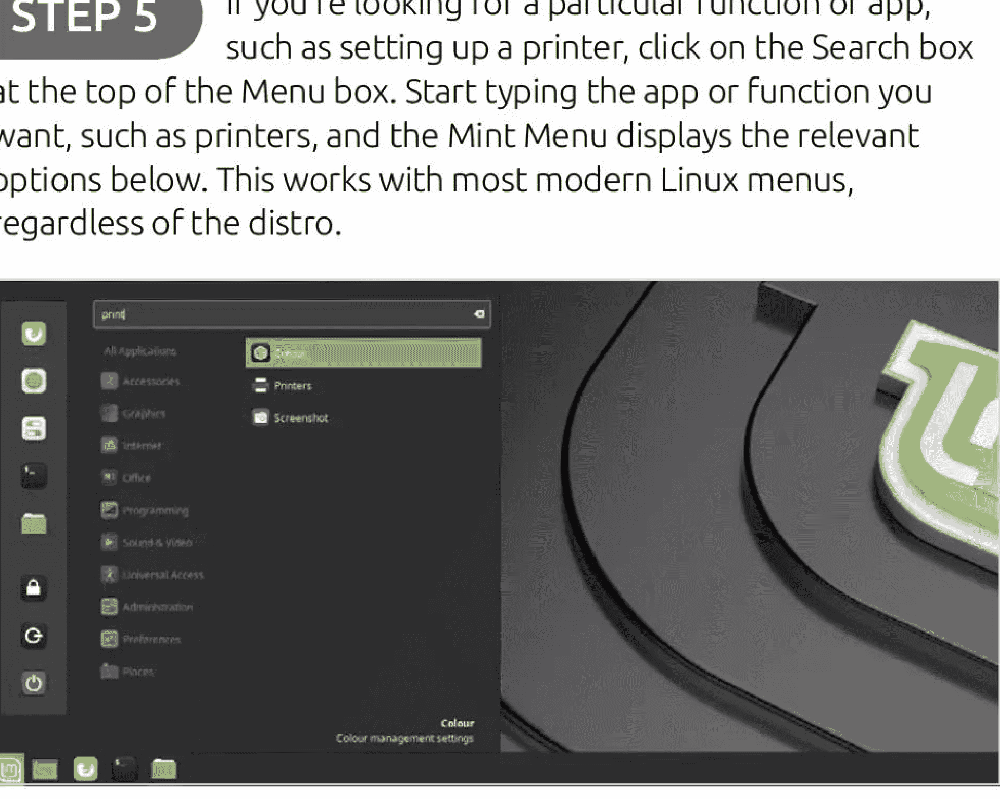
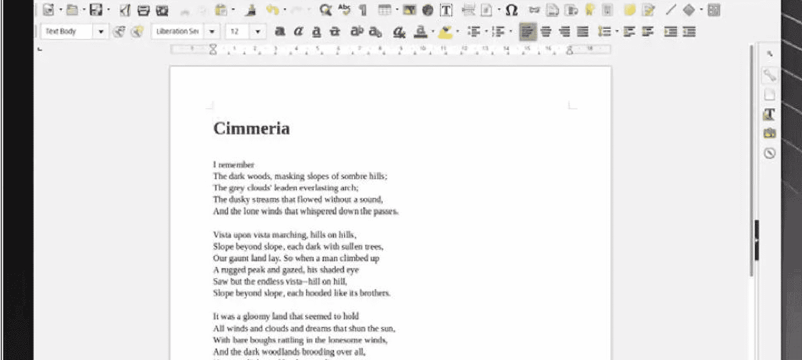

每个桌面环境的行为都与众不同。有些发行版提供可以自定义的桌面组件，而另一些为了保持整洁的外。让我们看看 Cinnamon 桌面提供了什么。

Cinnamon 桌面环境是风格与性能的完美结合。它有很多优点，这也是为什么它如此受欢迎的原因。

- **第 1 步** 通过双击“计算机”（Computer）开始探索 Cinnamon 桌面。这将打开 Nemo， Cinnamon 使用的文件管理器。“计算机”将打开根文件系统，并访问光驱（如果有）、硬盘和核心 Linux 文件系统。
- **第 3 步** Nemo 具有许多功能、视图等，方便您导航和管理文件。例如，如果您在“图片”文件夹中有任何图像，可以使用 Nemo 右下角的滑块来调整图标的缩放级别。

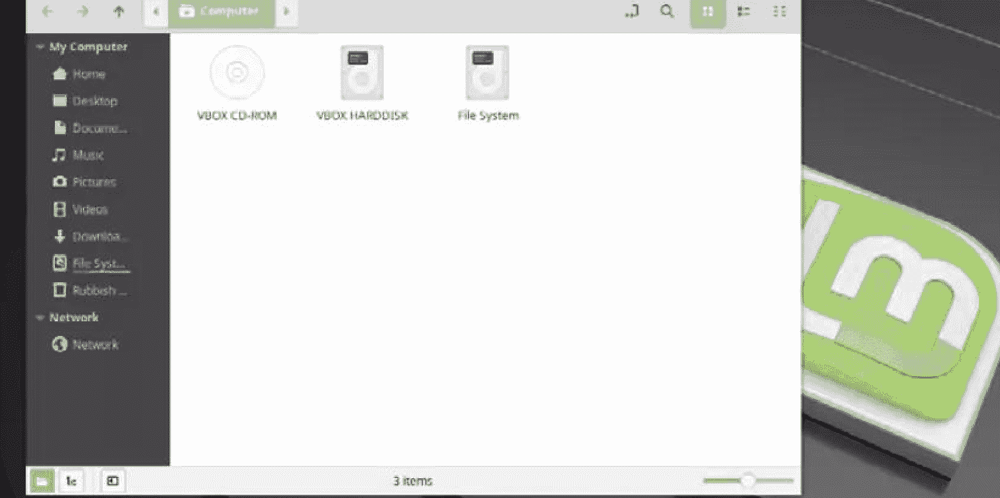


- **第 2 步** Linux 文件系统对于原来的 Windows 用户来说可能看起来很奇怪，直到您对它的工作原理更加了解，我们建议您关注桌面上的“主目录”（Home）图标。这里是与用户账户相关的所有内容：您存储图片、视频、音乐、文档、下载项目的地方。
- **第 4 步** 就像任何优秀的文件管理器一样，如果您右键点击任何文件或文件夹，您将获得丰富的选项。在 Cinnamon 的情况下，默认允许您根据文件类型播放或查看文件。

在桌面底部有一个面板（Panel），我们已经看过了面板中的一个，即菜单。如果你在面板上右键点击，除了面板应用外，还会看到一个允许你以不同方式编辑和设置面板的菜单。

从桌面右键点击的上下文菜单中，选择“自定义”（Customise），这将通过新窗口底部的“桌面设置”链接打开。这会打开一个窗口，你可以在其中编辑显示的桌面图标。如果你使用的是连接了多个显示器的设置，你还可以选择哪个显示器显示图标。

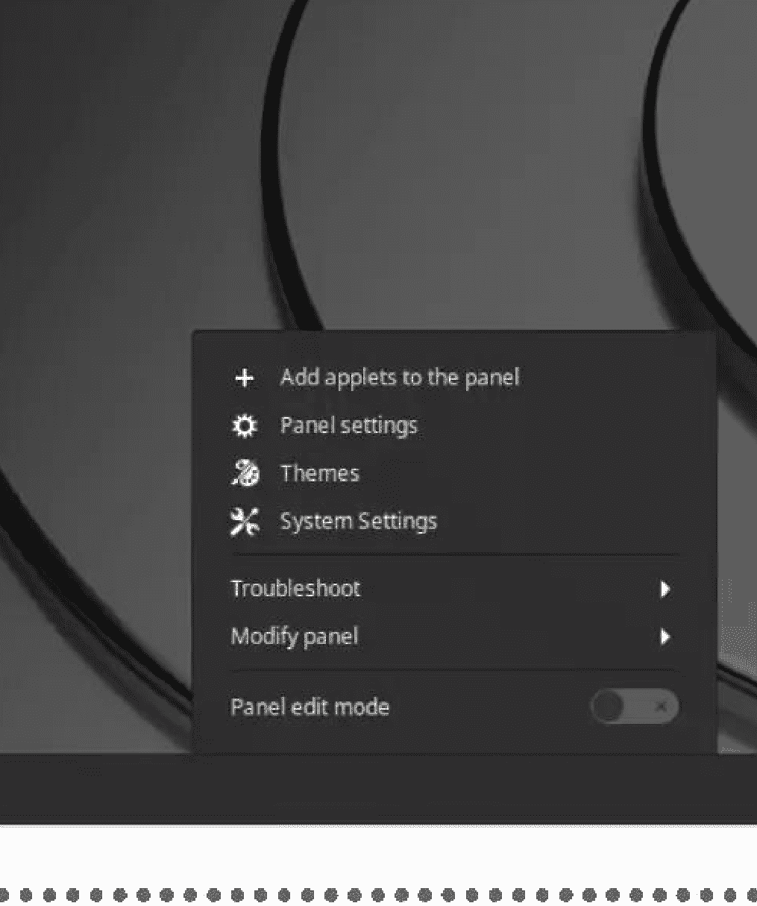

## 第 6 步
例如，如果你点击“修改面板”（Modify Panel）选项，你可以移除、移动、删除面板、添加新面板并清除当前存在的所有应用插件（Applets）。应用插件设计用于运行并适配 Cinnamon 面板。

点击菜单并输入“settings”（设置）以打开生成的图标。这将带你进入系统设置选项。在这里，你可以控制并编辑 Linux Mint Cinnamon 的外观，还可以添加新用户、管理防火墙和辅助功能选项。

- 主题（Themes）
- 系统设置（System Settings）
- 疑难解答（Troubleshooting）
- 修改面板（Modify panel）
  - 移除面板（Remove panel）
  - 添加面板（Add panel）
  - 移动面板（Move panel）
  - 复制插件配置（Copy applet configuration）
- 粘贴插件配置（Paste applet configuration）

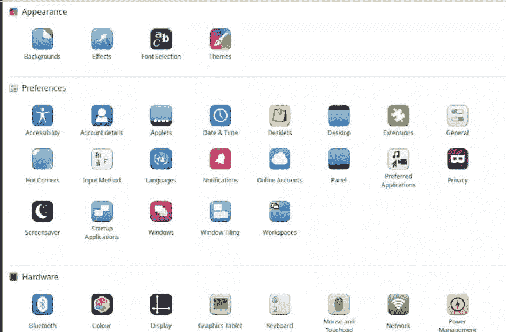

## 第 7 步
如果在 Cinnamon 桌面任何地方右键点击，你会看到一组选项，允许你以不同的方式进一步添加或编辑桌面内容。它与 Windows 非常相似，这就是为什么 Mint 是一个很好的选择。

简而言之，Linux Mint Cinnamon 可以配置得非常不凡。关于它可以有多好以及能变成什么样，有很多例子。你可以根据需要变得复杂或简单，添加不同的组件和动画，或者仅仅保持简洁易读。

- 创建文件夹（Create Folder）
- 创建新文档（Create New Document）
- 添加桌面组件（Add Desklets）
- 修改桌面背景...（Change Desktop Background...）
- 创建新启动器...（Create a new launcher...）
- 在终端打开（Open in Terminal）
- 以 Root 身份（Open as Root）
- 自定义（Customise）
- 粘贴（Paste）

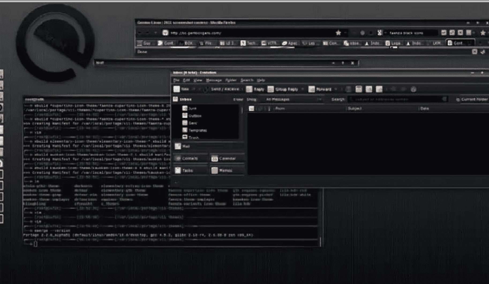

Linux Mint 是一个开箱即用的精致发行版，但与大多数 Linux 发行版一样，可以通过一些调整来改进它的工作方式。虽然这些是 Mint 特有的调整，但也适用于其他发行版。

这些安装后的操作某些是非常建议的，而另一些只是实用的补充，用于调优系统或添加自定义。

- **第 1 步** 第一个也是最重要的安装后操作是更新系统。点击桌面右下角时间和日期旁面板上的图标。

- **第 3 步** 点击 OK 按钮，你可以看到几个待安装的更新。但在更新之前，点击蓝色 OK 按钮切换到本地镜像。这会打开“软件源”选项。在镜像部分的“主”（Main）和“基础”（Base）下拉菜单中，选择一个距离你当前位置最近的服务器。

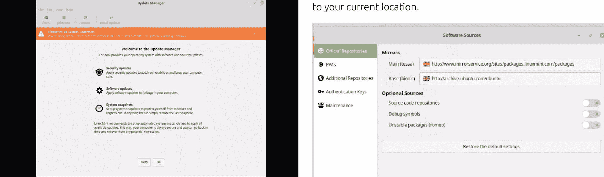

- **第 2 步** Linux Mint 提供了三个层级的更新方法：“不要弄坏我的电脑”、“优化稳定性与安全”以及“始终更新一切”。建议选项是“优化稳定性与安全”，它只更新安全的、必要的补丁，不会影响核心操作系统的关键元素。阅读描述但选择中间的那个，这是推荐的。

- **第 4 步** 点击“更新缓存”按钮并清除“软件源”窗口。在“更新管理器”中，按回车并输入密码。更新将自动安装并重新启动更新管理器，显示大致更新时间。点击“安装”、OK 以及任何消息并等待完成。

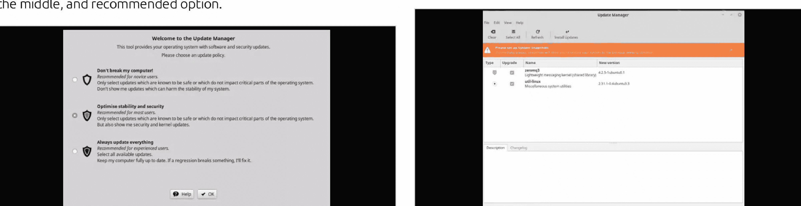

第 5 步 更新按级别分级，低级更新，第 5 级是危险的。我们的建议保持在 3 个左右的更新；关于覆盖配置文件的消息，点击“回复”。对于软件问题和非 VirtualBox 缺少驱动的问题，使用菜单并在搜索框中输入“driver”。

第 8 步 当被要求接受更改时，输入 Y；当要求配置 libdvd 时也是如此。确保按下 OK 并按回车，然后对任何后续问题回答 Yes。接下来，仍在终端中：`cat /proc/sys/vm/swappiness`，结果应为 6；如果你的电脑内存小于 4GB，则输入：`sudo edit /etc/sysctl.conf`。

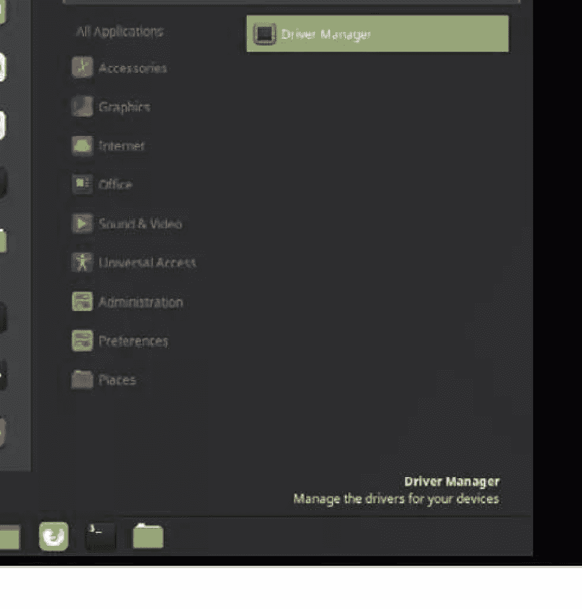

第 6 步 点击搜索结果中出现的“驱动管理器”应用并输入密码。Mint 需要一些时间来分析可用内容，并为你提供检测到的硬件的驱动程序选择。对于带有界面的驱动（如软件渲染），选择使用最新的“推荐”显卡驱动程序。

第 9 步 此项调整有助于加速内存小于 4GB 的系统。滚动到刚打开的文件末尾并添加以下行：
`# Decrease swap usage to a more reasonable vm.swappiness=10`

点击文件 > 保存，然后退出。重启 Linux Mint，你应该注意到性能有轻微延迟。

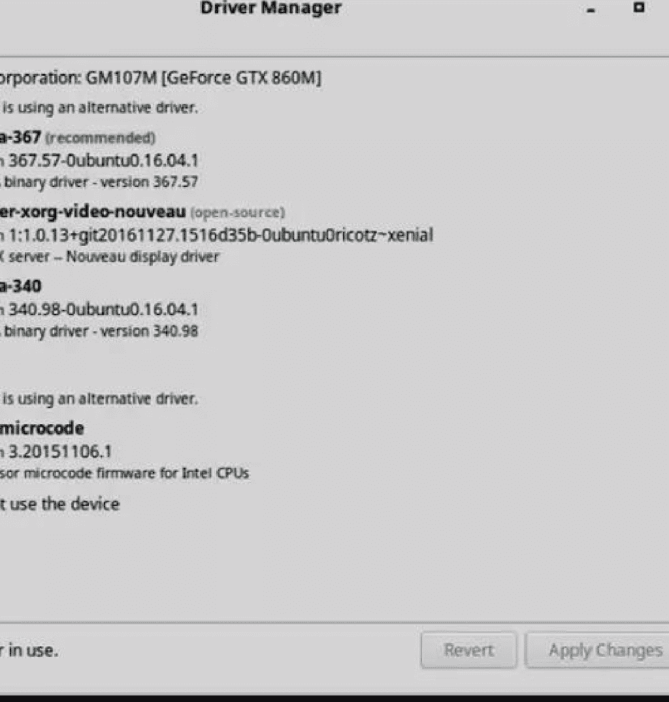

第 7 步 如果在 Cinnamon 桌面任何地方右键点击，你会看到一组选项，允许你以不同的方式进一步添加或编辑桌面内容。它与 Windows 非常相似，这就是为什么 Mint 是一个很好的选择。

第 10 步 当被要求接受更改时，输入 Y；当要求配置 libdvd 时也是如此。确保按下 OK 并按回车，然后对任何后续问题回答 Yes。接下来，仍在终端中：`cat /proc/sys/vm/swappiness`，结果应为 6；如果你的电脑内存小于 4GB，则输入：`sudo edit /etc/sysctl.conf`。

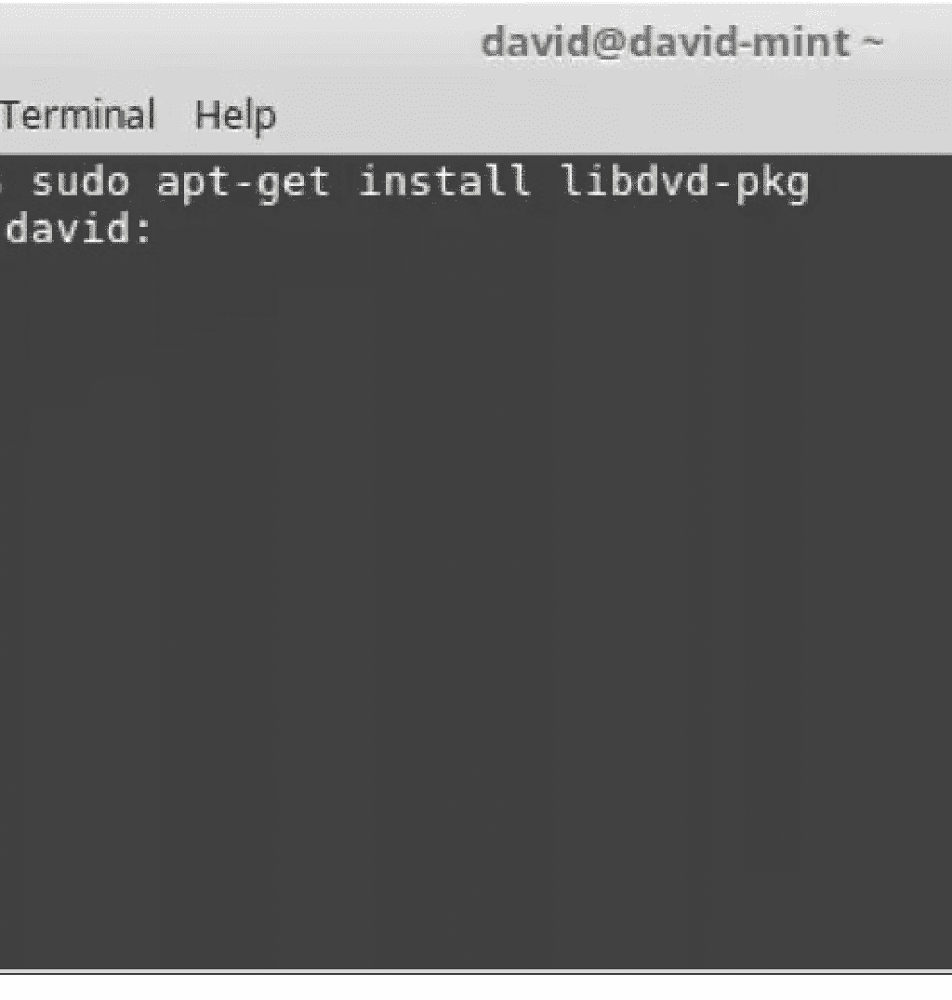

### 步骤 5 你可以为新用户输入密码，或者点击“新密码”文本框末尾的弯曲箭头来为你生成并显示密码。当然，设置一个尽可能强的密码是个好主意。完成后，点击“更改”按钮。

### 步骤 7 登录后，新用户需要设置他们的桌面壁纸、图标、面板、菜单等。根据你设置的账户类型（标准用户或管理员），他们将无法安装任何程序。此截图来自标准用户类型。

| 用户 | 组 |
|---|---|
| BDM | |
| David (david) | |

```text
```


更改密码

新密码 `4vvc_f8*`

确认密码 `4vvc_f8*`

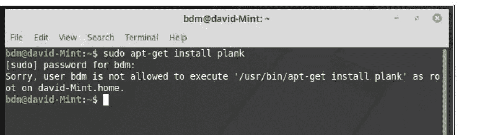

### 步骤 6
新用户已创建，现在可以使用用户和组控制台。如果你点击 Mint 菜单并选择“注销”，你将看到登录管理器。新用户现在出现在可用用户列表中。点击他们登录。

### 步骤 8
你可以根据需要创建新账户，并在它们之间切换。最好只保留一个能够安装软件的账户，这样你可以跟踪桌面。


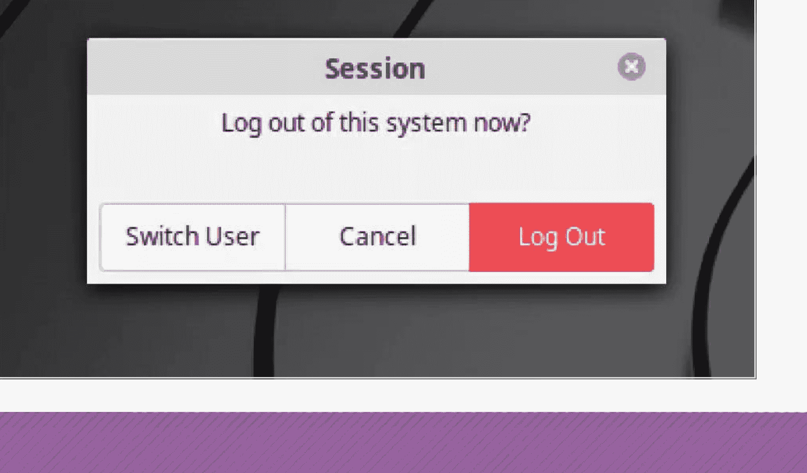

# 命令行账户

正如你所期的，你也可以在命令行创建新用户。要开始，在终端中输入 `sudo adduser username`。然后会被要求为该用户创建密码和其他详细信息。点击以创建账户。

### 步骤 2
你可以在用户和组中检查新用户的详情和账户类型。如果你想从 Mint 中删除用户，可以在终端或组中输入 `sudo deluser username`。

```
$ adduser username

添加用户 username...

添加组 'username' (GID 1001)...

创建主目录 /home/username...

为 username 设置密码:

输入密码:

密码更新成功

重新输入新密码:

为 username 输入完整信息:

全名:

房间号:

电话:

其他:
```

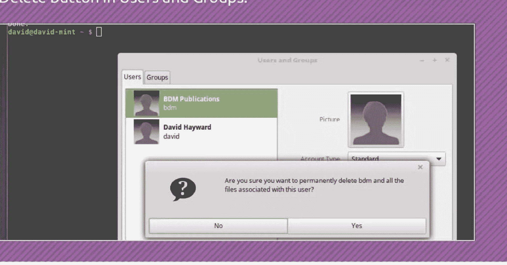


### 步骤 5
如果没有可用壁纸符合你的口味，打开浏览器并搜索你喜欢的背景类型。当你找到了想要的桌面壁纸时，右键点击它并从列表中选择“设置为桌面背景”。打开桌面背景控制台，点击“设置桌面背景”按钮。

### 步骤 8
允许你更改桌面的某些外观：窗口框、图标和桌面。在“设置”选项页中，你可以通过开启/关闭按钮扩展选项。


### 步骤 6
点击菜单按钮搜索“桌面”，然后点击“桌面设置”，允许你选择布局、桌面图标和多显示器支持。你可以根据个人喜味对最佳设置进行尝试。

### 步骤 9
如果你点击可用视图中间的“添加/删除”按钮，可以选择你想要的默认视图，然后点击向下箭头启用它。


### 步骤 7
除了更改桌面壁纸和图标显示方式外，你还可以更改 Linux Mint 的整体主题。从 Mint 菜单搜索“主题”，并点击搜索结果中的主题。

### 步骤 10
点击“主题”，然后“桌面”，你就可以安装新主题并将其应用于桌面。已安装的主题也可以通过“添加/删除”按钮卸载。花时间个性化你想要的桌面是值得的，有很多非常棒的主题可用。


# 在线匿名

数字时代带来了通信的巨大进步；然而，它带来了监视和窥探的新时代。我们大多数人对政府、秘密组织和地下黑客破坏隐私的新闻并不陌生，但你该如何应对呢？

## 使用 MINT 实现匿名

虽然在网上完全匿名是不可能的，但你可以采取措施确保隐私处于最佳状态。

### 步骤 1
从基础开始，浏览时使用 HTTPS 而不是标准的 HTTP。这意味着通过 HTTPS 传输任何内容都是安全的（最后的 S 部分）并经过加密的。

### 步骤 2
浏览时，考虑使用浏览器的无痕或隐私浏览模式。这将禁用网页历史和缓存，允许你在浏览时不会让他人存储详细信息。

### 步骤 3
尽管使用 Google 似乎是现代互联网的显然选择，但请考虑替代搜索引擎，例如 DuckDuckGo，一个不存储个人数据或跟踪你的搜索引擎。

### 步骤 4
考虑一些浏览器插件来增强你的隐私。例如，对于 Firefox，可以使用 Ghostery、NoScript 和 Adblock Plus 来拦截追踪器和其他挖掘技术。


之前的步骤可以帮助你的在线隐私，但为了实现匿名，可以使用 VPN 和 Tor。VPN 是一种隐藏你 IP 地址的远程服务器。`img/2f5daccbaef9a995b10c4942ee31a6fa_40_0.png`

- Tor 是一个可以通过全球节点隐藏你 IP 地址的开放网络。VPN 客户端与远程服务器建立连接。


- 大多数人支付月费或年费，但它是值得的。我们使用 CyberGhost（www.cyberghost.com/hz/articles/2139029-Read-me-first），它提供了 VPN 连接。


点击“连接”调整网络设置。如果你处于审查国家（如中国）或你处于限制性防火墙之后，请使用代理。

- Tor 浏览器是 Firefox 的定制版本，在这里你可以安全地浏览互联网而不被查看或跟踪。混合 VPN 和 Tor 可以提供极其安全且隐私的在线连接。

> “Linux：一个带有 CLUE 的操作系统…… 命令行用户环境。” - 匿名（发布于 comp.software.testing）

Linux 命令行，即终端（Terminal），是一个极其强大的环境。通过它，你可以让操作系统瘫痪，也可以将其更新到令人惊叹的状态。你可以入侵远程计算机、查看动画化的 ASCII 篝火、安装新的应用程序和程序、观看在荷兰服务器上运行的《星球大战》，并编写复杂的自动化脚本。

在本节中，你将探索终端的复杂之处以及它如何与 Linux 协同工作。你将学习如何从终端操作 Linux 文件系统，并发现一些在终端中可以做的奇特但有趣的事情。

终端在 Linux 世界中处于至高无上的地位。学习它是工作的，你就能掌握那所有的力量。

大多数操作系统使用两种类型的界面：GUI（图形用户界面），即 Windows、macOS 和 Linux Mint 启动进入的桌面，以及命令行。虽然现代操作系统尽量避开命令行，但 Mint 使用终端赋予用户对系统更大的控制权。

命令行或终端终端是一个极其强大的界面。你在桌面上可以做的一切都可以在终端内完成。让我们先看看它是如何工作的。

- 步骤 1：可以通过点击面板上的终端图标（位于 Firefox 和文件图标之间），或打开菜单并从左侧的快速启动栏中选择来访问终端。
- 步骤 3：你目前在终端中看到的是你的登录名，后面跟着计算机名称；这是你在第一次安装 Mint 时在设置期间命名的。该行以当前文件夹名称结束；起初这只是波浪号 `~`，你的主目录（Home folder）。


- 步骤 2：终端让你能够访问 Linux Mint Shell（称为 Bash），它让你能够访问底层操作系统。Mint 中的所有内容（包括桌面和 GUI）都是从命令行运行的模块。
- 步骤 4：行最末端闪烁的光标是你输入基于文本的命令的地方。你可以开始尝试一个简单的命令：打印工作目录 (`pwd`)，它会将你当前所在的文件夹输出到屏幕上。输入 `pwd` 并按回车。

```
$ david@david-mint ~ $ 

pwd
```

步骤 5：你输入的所有命令工作方式相同：你输入命令，包含任何扩展命令用法的参数，然后按回车执行你输入的命令。在终端中输入：`uname` 并按回车。这将显示关于 Mint 的系统信息。

步骤 8：查看和搜索选项允许你更改终端窗口的大小，当然还可以在终端内搜索任何特定的单词。


步骤 6：在我们输入命令之前，让我们先花点时间看看终端提供了哪些功能。菜单选项允许你打开一个新的终端，你还可以更改终端的大小、颜色和行为，添加新标签页并关闭所有活动会话。

步骤 9：终端条目（Terminal entry）进入配置编辑，尺寸调整允许你更改字符编码。有趣的是，你还可以将其设置为“只读”模式，这将阻止你向终端输入任何命令：这在你需要永久显示内容时很有用。


步骤 7：编辑（Edit）选项允许你在终端与其他源之间复制和粘贴命令；这在你想要从网页上复制非常长且复杂的命令时非常有帮助。它允许你编辑终端偏好。

步骤 10：最后，帮助（Help）选项显示终端的帮助内容和版本号，更准确地说，以后我们将将其称为 Terminal。目录值得快速阅读一下，以帮助熟悉它的工作方式。


**到目前为止，你一直使用盾牌图标启动 Mint 更新管理器，以更新系统并升级当前安装的应用程序、工具和其他元素。然而，你也可以从终端完成完整的系统更新和升级。**

用于更新和升级终端的 APT（高级软件包工具）是一项强大的命令，并根据其用法组合不同的元素。

- 步骤 1：从打开一个新的终端开始，或者如果你已经有一个终端，则使用当前命令打开其内容。这从一个干净的状态开始工作。
- 步骤 3：`apt-get` 用于更新 Mint 以及 Ubuntu 和其他发行版的软件。使用 `Update` 会检索新软件包并更新源文件列表。要开始升级过程，输入：`sudo apt-get` 然后输入你的密码。
- 步骤 2：在终端中输入：`apt-get`。这会列出最常用命令的列表，即使有时看起来不合逻辑，也值得一看。
- 步骤 4：注意添加了 `sudo` 命令。`sudo` 命令的形式如下：它意味着管理员用户（超级用户）使用 APT（高级软件包工具）获取更新。现在尝试：`sudo apt-get update`。

```
david@david-mint ~ $ 
```

```
File-...-sudo apt-get update

Hit:1 http://archive.ubuntu.com/ubuntu-security InRelease

Get:2 http://archive.ubuntu.com/ubuntu-security [118 KB]

Hit:3 http://archive.ubuntu.com/ubuntu-backports InRelease

Get:4 http://archive.ubuntu.com/ubuntu-backports [116 KB]

Hit:5 http://archive.ubuntu.com/ubuntu-updates InRelease

Get:6 http://archive.ubuntu.com/ubuntu-updates [1.1 MB]

Hit:7 http://archive.ubuntu.com/ubuntu-main InRelease

Reading package lists... Done

Building dependency tree... Done

All lists are up to date.
```

```
apt-get 1.7 (ubuntu)

Usage: apt-get [options] (package|command) [...]

  apt-get update

  apt-get upgrade

  apt-get install

  apt-get remove

  apt-get autoremove

  apt-get purge

  apt-get clean

  apt-get download

  apt-get show

Options:

  update package lists

  upgrade currently installed packages

  install package

  purge remove and configure packages

  autoremove remove unused

  dist-upgrade selection

  size total size of packages

  list available packages

  search for packages

  remove old versions of packages

  Download the binary package

The following packages will be UPGRADED:

  linux-image-5.15.0-72-generic [62.4 MB -> 62.5 MB]

  linux-headers-5.15.0-72-all [15.2 MB -> 15.3 MB]

2 packages upgraded, 0 newly to install, 0 packages to be removed and 0 failed to upgrade.

After this operation, 77.7 MB of additional disk space will be used.

Do you want to continue? [Y/n] 0 to remove and 0 not to upgrade.
```


# 通过终端更新 Mint

### 步骤 5
根据你的更新状态，如果有任何等待安装的项，你可能想要应用 `sudo apt-get upgrade` 的结果。你可以尝试接受并继续。这里发生的情况是 apt-get 有一些更新的软件要应用到 Mint，而你看起来没问题。

### 步骤 7
本质，根据 `apt-get update` 命令提供的可用软件包列表，你的系统现在是最新的。你可以再次运行一遍过程，以防万一一切出错。总结一下：`sudo apt-get update`，按回车，然后输入：`sudo apt-get upgrade` 并按回车。

### 步骤 6
可能会有很多软件包需要处理。升级的软件包文件已经下载、解压、处理并安装。

```
Reading package lists... Done

Building dependency tree... Done

Reading information... Done

All lists are up to date.
```

### 步骤 8
有趣的是，Mint 等内容让你有机会选择想要的功能。在这个例子中，我们使用了 `sudo apt-get update & sudo apt-get upgrade`。双符号 `&` 会等待前一个命令完成后再开始后一个。建议使用更新和升级。

```
Unpacking linux-image-5.15.0-72-generic (62.4 MB -> 62.5 MB) ...

Setting up linux-image-5.15.0-72-generic...

Unpacking linux-headers-5.15.0-72-all (15.2 MB -> 15.3 MB) ...

Setting up linux-headers-5.15.0-72-all...

Unpacking linux-modules-5.15.0-72-amd64 (15.2 MB -> 15.3 MB) ...

Setting up linux-modules-5.15.0-72-amd64...

Processing triggers for queued (0/0)

Processing triggers for upgraded (0/0)

Processing triggers for installed (0/0)
```


# 使用终端

## 通过终端安装应用 – 第一部分

### 命令行安装

通过终端安装应用可能需要一些巧妙的键盘操作，但它可以让你对正在安装的内容及其安装位置有更好的了解。

- **步骤 1** 从终端安装应用相对简单。首先，你需要确保系统是最新版本。要执此此操作，请使用终端并输入：`sudo apt-get update && sudo apt-get upgrade`。
- **步骤 2** 正如你使用 `sudo apt-get update/upgrade` 一样，这些命令设计用于升级系统中已安装的软件。你要安装的应用比你想象的要多吗？恰好这非常简单。首先你需要一个要安装的应用，让我们用 Stella 为例。输入：`sudo apt-get install stella`。
- **步骤 3** 你需要输入 `y` 来确认安装，这将占用系统约 5MB 的存储。一旦 Stella 安装完成，你会发现 Mint 已自动在菜单中创建了“游戏”分类。
- **步骤 4** 有时在安装软件时，你需要添加应用的仓库（Repository）。仓库或简称 repo 是存放软件的最简单远程服务器位置，包含了软件及其所有的依赖项（运行所需的库和文件）。要执行此操作，请使用：`sudo apt-add-repository ppa:peterlevi/ppa`。按回车键添加该 PPA（个人包存档）。

```bash
davidsmith-mint$ sudo apt-get update && sudo apt-get upgrade

Reading package lists... Done

Building dependency tree... Done

Reading state information... Done

0 up./ubuntu-security 0 upgraded, 0 newly installed, 0 to remove and 0 failed to upgrade.

0 upgraded, 0 to upgrade.
```

```bash
davidsmith-mint$ sudo apt-add-repository ppa:peterlevi/ppa

Contains packages for variety changer

More info: https://launchpad.net/~peterlevi/archive/ubuntu/

Press Enter to continue or cancel.
```

#### 步骤 5 这为 Wallpaper Changer 添加了仓库，这是一个基于 Ubuntu 的应用，可以在 Mint 中自动更改壁纸。当仓库添加后，输入：`sudo apt-get update` 来更新软件包信息并添加到数据库。

```bash
sudo apt-add-repository ppa:variety-team/ppa

sudo apt-get update

sudo apt-get install variety
```

Setting up dependencies...

```
Reading package list...
Building dependency tree...
Reading state information...Done

The following packages will be automatically installed,
  variety

The following packages will be upgraded:
  0

The following packages will be removed:  0
```

```bash
sudo apt-get remove variety
sudo apt-get autoremove
```

## 删除应用

除了安装，apt 命令还可以用于删除应用并释放系统资源。

#### 步骤 1 要卸载应用，输入 `sudo apt-get remove variety`。按 `y` 继续卸载应用；你会注意到删除操作释放了多少磁盘空间。

#### 步骤 2 `apt-get autoremove` 命令会卸载应用，但不会移除它附带的额外内容，如配置和库文件。要完全删除应用，输入：`sudo apt-get purge`。

#### 步骤 3 当你从系统移除软件包时，某些包不再需要。通过 `sudo apt-get autoremove` 可以清理系统，然后按 `y` 接受该过程。

```
sudo apt-get remove variety

Reading package list...
Building dependency tree...
Reading state information...Done

The following packages were automatically installed and no longer required
  variety-*

The following packages will be removed:
  variety-common-*

The following packages will be installed:
  0

The following packages will be upgraded:
  0

The following packages will be removed:
  0

Do you want to continue? [Y/n]
```

#### 步骤 4 最后，为了清理系统中所有未使用的软件包并移除 autoremove 命令删除的元素，你可以输入：`sudo apt-get autoremove`。这些残留文件对于保持 Mint 设置良好以及关闭不必要的安装和升级至关重要。

```
sudo apt-get remove variety

Reading package list...
Building dependency tree...
Reading state information...Done

The following packages were automatically installed and no longer required
  variety-*

The following packages will be removed:
  variety-common-*

The following packages will be installed:
  0

The following packages will be upgraded:
  0

The following packages will be removed:
  0

Do you want to continue? [Y/n]
```

```
sudo apt-get purge variety

Reading package list...
Building dependency tree...
Reading state information...Done

The following packages were automatically installed and no longer required
  variety-*

The following packages will be removed:
  variety-common-*

The following packages will be installed:
  0

The following packages will be upgraded:
  0

The following packages will be removed:
  0

Do you want to continue? [Y/n]
```

```
sudo apt-get autoremove

Reading package list...
Building dependency tree...
Reading state information...Done

The following packages were automatically installed and no longer required
  variety-*

The following packages will be removed:
  0

The following packages will be installed:
  0

The following packages will be upgraded:
  0

The following packages will be removed:
  0

Do you want to continue? [Y/n]
```

## 通过终端安装应用 – 第二部分

大多数情况下，你会使用标准的 `apt-get` 命令从终端安装应用。然而，有时某些应用需要更多的工作。这意味着从其源码安装应用，这听起来并没有那么可怕。

### 从源码安装

你需要熟悉的命令有 `Configure`、`Make` 和 `Install`。你会发现很多应用都是从源码使用的，因此这是一项值得投入时间的技能。

步骤 1 Linux 源码文件通常以 `.TAR.GZ` 或 `.TAR.BZ2` 形式出现。两者都是包含“make” 所需所有代码的压缩文件。在 Home 目录下创建一个新文件夹开始本教程：`mkdir vim`。

步骤 2 顺便说一下，Vim 是一种高级文本编辑器，可以帮助我们编辑代码。`cd vim`，然后从互联网获取内容（此处为 Vim 的 BZ 文件），在新的 Vim 文件夹内，在终端输入以下命令：`wget ftp://vim.org/pub/unix/vim-7.4.tar.bz2`。

步骤 3 现在我们需要配置文件的内容，所以：在终端中输入 `tar -xf vim-7.4.tar.bz2`。你可以按 Tab 键自动填充文件名。

#### 步骤 5 如果你再次输入 `ls`，你会发现了一个了一个文件夹：`vim`：在 Mint 中用浅色文本表示文件夹。为主应用创建根文件夹总是更好的，因为当你使用这种方法升级 apt 时，每个单独的版本将会有它们自己的文件夹。

#### 步骤 6 输入 `cd vim` 进入文件夹，再次输入 `ls` 查看其内容。会有相当数量的文件；大部分是核心文件，其他应该应该是 `README` 或 `INSTALL`。阅读这些文件总是明智的，因为它们提供了关于安装的宝贵信息。

#### 步骤 7 安装的第一部分要求你配置系统以使用与应用关联的依赖项。`./configure`。如果你在编译组件时收到错误，该命令将生效。使用 `sudo apt install build-essential`。缺少了第三方应用 ncurses。正如我们提到的，你需要获取 `sudo apt-install libcurses5-dev ncurses-dev`。

#### 步骤 8 你可能需要继续安装依赖项。每安装一个依赖项后，运行 `sudo ./configure`，如果没有报告错误，即可继续安装的下一个阶段。你可能需要在网上搜索某些信息。

#### 步骤 9 成功执行 `./configure` 后，系统将创建一个 Makefile。这需要在终端中进行“make”。这可能需要一段时间时间，取决于应用的大小。

#### 步骤 10 最后，你需要在终端输入：`sudo make install`。这将安装应用，在这种情况下，你可以通过终端输入或通过 Dash 搜索来执行它。

# 使用终端

```
Kernel command line: block2mtd.block2mtd=/dev/hda2,131072.rootfs root=/dev/mtdblock0 roottype=jffs2 init=//etc/preinit noinittrd console=tty0 console=ttyS0,38408 reboot-bios

Found and enabled local APIC:

Enabling FPU save and restore... done.

Enabling unmasked SIMD FPU exception support... done.

Initializing CPU...

PID hash table entries: 32 (order: 5, 128 bytes)

Detected i686GP77+ MHz processor.

Console: colour VGA+0x25

console [tty0] enabled

console [tty0] enabled

Dentry cache hash table entries: 1024 (order: 0, 4096 bytes)

Inode-cache hash table entries: 1024 (order: 0, 4096 bytes)

Memory: 512K/812K available (1497k kernel code, 264k reserved, 597k data, 196k init, Ok highmem)

virtual kernel memory layout:

fixmap: 0xfffff9000 - 0xffffff (280 KB)

vmalloc: 0xc0000000 - 0xffff7000 (1007 MB)

lowmem: 0xc0000000 - 0xc07f0000 (7 MB)

.init: 0xc0313000 - 0xc0344000 (196 KB)

.data: 0xc0d27653c - 0xc030bbfc (597 KB)

.text: 0xc0010000 - 0xc027653c (1497 KB)

Checking if this processor honours WP bit in supervisor mode...Ok. Calibrating delay using timer routine (lp)=203810)
```

# Linux 内核

你可能知道吗...

```c
#include <linux/sched.h>

/*
 * 此模块实现了控制台 IO 函数
 * 希望这将是一个完整的实现。
 */

#include <linux/sched.h>
#include <linux/tty.h>
#include <asm/system.h>
#define SCREEN_START 0x0800
#define SCREEN_END 0x0000
#define LINES 25
#define COLUMNS 80
#define WIDTH 1
extern void interrupt(struct tty_queue *queue) {
    static unsigned long end=SCREEN_START;
    static unsigned long x,y;
    static unsigned long top=LINES;
    static unsigned long line,columns=COLUMNS;
    static unsigned long status=0;
    static unsigned char attr=0;
}
```


注意：有时我们需要禁用中断（为了输入一个单词），但即使在获取中断时，这样做也能有效。希望一切顺利。

你知道吗？Linus Torvalds 编写的 Linux 最初只占用了 5KB 内存？而且自 0.01 版本以来，Linux 内核现在拥有超过 800 万行代码。

# 使用终端创建文件

使用终端，你能够创建文件夹、文件，甚至运行应用程序。事实上，即使没有图形界面（GUI），你仍然可以通过终端完成这些操作。

## 更多终端操作

使用终端创建内容并不像看起来那么困难。对于新手来说，终端可能看起来很大，但一旦掌握就会非常直观。

- **第 1 步** 打开 Home 文件夹。使用 `cd` 返回当前所在的 Home 目录。
- **第 2 步** 在 Home 下创建一个新文件夹，命名为 `Test`。你需要的命令是 `mkdir Test`，然后按回车。这将进入新创建的文件夹。
- **第 3 步** 你的命令行应该切换到 `Test` 文件夹，输入 `ls`（列出目录内容）可以看到文件夹内的内容；显然，`mkdir` 命令是创建目录的，现在你已经猜出它代表 Directory（目录）。你可以在其中创建子目录。
- **第 4 步** 创建名为 `Test.txt` 的空文件，在终端输入 `touch Test.txt`。你可以使用 `ls` 查看文件夹中的新文件。`touch` 是一个标准命令，无需打开编辑器即可创建文件。
- **第 5 步** 假设我们现在想创建一个 `Test2.txt` 文件并写入一些内容。输入 `cat > Test2.txt`。这将创建文件进入编辑模式。
- **第 6 步** 你会注意到 `cat > Test2.txt` 命令下方光标在闪烁。这允许你编辑文件，然后按 `Ctrl+S` 保存内容。
- **第 7 步** 当然，你不总是必须使用终端来输入文本。Linux 自带了一个文本编辑器，类似于 Windows 的记事本。在终端输入 `xed Test2.txt` 并按回车。
- **第 8 步** Xed 是一个 GUI 应用程序，你可以使用主窗口的“文件 > 保存”或“另存为”功能来输入文本并保存文件。
- **第 9 步** 如果你留在留在终端编辑/保存文件，可以使用 Nano。Nano 是一个简单的文本编辑器。例如，输入 `nano Test2.txt`。屏幕底部有一个菜单。按 `Ctrl+X` 保存并退出。
- **第 10 步** 我们已经用过终端启动过 Xed 应用，但在终端内也可以启动任何应用。例如，尝试输入 `firefox` 并按回车。关闭 Firefox 返回终端。此外，输入应用程序名称即可在终端运行它。

# 创建和重命名目录

与在终端创建文件一样，你也可以创建和删除目录（或者你习惯称为文件夹）。目录构成了文件系统的结构，如果没有逻辑目录，文件系统将陷入混乱。

## 管理文件夹

学习如何在终端中创建和删除文件夹是一项重要的技能，事实上是整个 Linux 掌握的技能。以下是一些你可以尝试的基础知识：

- **第 1 步** 在终端打开状态下输入 `cd ~` 确保你在自己的 Home 目录中。现在输入 `ls` 查看 Home 目录下的当前文件夹。你会发现文件夹被标记为青色（浅蓝色）。让我们开始创建一个新目录：`mkdir testdir`。如果你再次输入命令 `mkdir testdir`，你会收到一条消息：`mkdir: directory exists`。不言说，在当前目录下只能有一个同名的唯一目录。然而，由于 Linux 是区分大小写的，你不能有两个 `testdir`。
- **第 2 步** 如果你现在再次输入 `ls`，你会看到新目录 `testdir` 已与 Home 区域的其他目录一起被创建。显然，`mkdir` 命令是创建它的工具，现在你已经猜出它代表 Directory。你可以在其中创建目录。
- **第 3 步** `-p` 选项允许 `mkdir` 根据需要创建父目录。在上一步中，命令是 `mkdir`，选项是 `-p`，参数是 `Temp/finances`。
- **第 4 步** `rmdir` 只能删除空目录。要删除子目录甚至文件，你需要使用 `rm` 命令配合 `-r` 选项。例如，删除目录使用 `rm -r Temp`。使用此命令要小心。
- **第 5 步** `-rf` 选项用于删除目录及其内容而不进行询问。警告：这是永久性的删除。
- **第 6 步** `-i` 选项用于在删除目录前提示确认。
- **第 7 步** `mv` 命令用于重命名或移动目录。
- **第 8 步** `cp` 命令用于复制目录和文件。
- **第 9 步** `chmod` 命令用于更改目录和文件的权限。
- **第 10 步** `chown` 命令用于更改目录的所有者

## 终端中的趣味活动

尽管操作系统是严肃的，但 Linux 社区对趣味并不陌生。多年来，开发者们在终端中创建并插入了各种有趣而奇特的元素。

## 终端趣味

在接下来的两个部分中，你将完全在终端中操作，所以开始热身你的手指吧。毕竟，俗话说的，工作之余必有娱乐……

- 步骤 1：我们将使用的第一个命令是 `sl`，它默认没有安装，请输入：`sudo apt-get install sl`。你可以通过 `sl` 运行该命令，执行时会在屏幕上显示一辆蒸汽机（因此命名为 'sl'）。输入 `LS`（注意是大大写）也可以运行。
- 如果你曾想让电脑向你读出随机的运势，那么你走运了。大多数发行版都需要你安装该程序，但 Linux Mint 的不同之处在于它已经预装了它。你只需要在终端中输入命令 `fortune`，然后享受即可。


- 步骤 2：星大战粉丝甚至在终端中也能获得满足。通过 `telnet` 命令连接到远程服务器，你可以看到以 ASCII 格式出的《星球大战 IV：新希望》。要查看这一奇景，请输入：`telnet towel.blinklights.nl`。
- 步骤 4：`rev` 命令非常有趣，起初对操作系统似乎毫无用。然而，它可以用来创建一些似乎不可破解的密码。输入 `rev`，然后输入一些文本，当你按下回车键时，一切都会反转。按 `Ctrl+C` 退出。


- 步骤 5：如果你卡在尝试计算特定数字的所有可能因数，只需输入 `factor` 后跟数字即可。例如，`factor 7` 的输出不多，而 `factor 60` 显示的内容更多。
- 步骤 8：如果你出于某种原因真的想扩展整个列，可以通过管道将 `fortune` 命令传递给它，使用：`fortune | cowsay`；对于图形化的牛：`fortune | cowsay`。此外，为了一直使用 cowsay，尝试一下：`cowthink` ... 这本书太棒了。

```
$ david-mind - factor 7

$ david-mind - factor 60

$ david-mind - 5
```


- 步骤 6：在“相当酷”和“非常离谱”之间只有微妙的界限。让一只 ASCII 牛向你重复内容可能属于后者。输入 `cowsay` 后跟你想要的任何文本，例如：`cowsay Mint is ice!`。事实上，你甚至可以通过牛输出命令结果，只需输入：`ls | cowsay`
- 步骤 9：我们承认，`toilet` 命令并没有给人多少信心。然而，它并没有像刚开始那样糟糕。通过 `sudo apt-get install toilet` 安装它。安装好后，输入类似 `toilet David` 的内容。或者直接用 `ls | toilet` 列出当前文件夹的内容。

```
$ Lime Mint is ice !

$ ls

$ david-mind - ls cowsay

$ david-mind - 1

$ Pictures Templates Videos:

$ david-mind - 1
```

- 步骤 7：为了遵循示例，还有一个图形化的（即非终端的）命令。通过 `sudo apt-get cowsay` 安装它，安装后使用 `cowsay` 某些内容，例如：`cowsay IBM Publications`。
- 步骤 10：通过扩展 `toilet` 命令，你可以生成美观的图形。例如，尝试这个：`toilet -f monoid12 -f Metal David`。你可以输入 `toilet -help` 来查看命令行参数列表以进一步扩展。

```
$ david-mind - toilet David
```

| | | | | | | | | |
|---|---|---|---|---|---|---|---|---|
| | | | | | | | | | |
| | | | | | | | | | |
| | | | | | | | | | |
| | | | | | | | | | |
| | | | | | | | | | |
| | | | | | | | | | |
| | | | | | | | | | |

```
$ david-mind - 1
```

```
$ david-mind - f monoid12 -f Metal David
```


```
$ david-mind - 5
```


## 终端中的更多趣味活动

如果你对之前列出的趣味且相当古怪的终端活动还想要更多，那么你走运了。我们为你整理了另一批有些有用、有些没用的命令供你尝试。

## 更多趣味，耶

既然终端已经打开，而且你的键盘也热身了，这里有两页终端的胡说八语（其实是内容）。

- 步骤 1：记得旧的 ZX Spectrum 时代吗，你可以输入 `10 print "Hello"`，然后 Hello 就会在屏幕上显示？在 Linux Mint 中你可以做同样的事。只需输入 `10` 后跟一些文本，例如 `Linux is os`。它会一直运行直到你按下 `Ctrl-C`。
- 步骤 3：让一只小白猫在桌面上追逐指针听起来可能是在浪费时间。奇怪的是，其实并不是。执行 `sudo apt-get install oneko` 然后输入 `oneko` 让猫出现。让它在屏幕上追逐光标。使用 `Ctrl-C` 退出操作。

```
Edit View Terminal help

$ david@david-mint ~# echo Mint is os!

$ 10 print Hello!

$ 10 print Hello!

$ 10 print Hello!

$ 10 print Hello!

$ 10 print Hello!

$ 10 print Hello!

$ 10 print Hello!

$ 10 print Hello!

$ 10 print Hello!

$ 10 print Hello!

$ 10 print Hello!

$ 10 print Hello!

$ 10 print Hello!

$ 10 print Hello!

$ 10 print Hello!

$ 10 print Hello!

$ 10 print Hello!

$ 10 print Hello!

$ 10 print Hello!

$ 10 print Hello!

$ 10 print Hello!

$ 10 print Hello!

$ 10 print Hello!

$ 10 print Hello!

$ 10 print Hello!

$ 10 print Hello!

$ 10 print Hello!

$ 10 print Hello!

$ 10 print Hello!

$ 10 print Hello!

$ 10 print Hello!

$ 10 print Hello!

$ 10 print Hello!

$ 10 print Hello!

$ 10 print Hello!

$ 10 print Hello!

$ 10 print Hello!

$ 10 print Hello!

$ 10 print Hello!

$ 10 print Hello!

$ 10 print Hello!

$ 10 print Hello!

$ 10 print Hello!

$ 10 print Hello!

$ 10 print Hello!

$ 10 print Hello!

$ 10 print Hello!

$ 10 print Hello!

$ 10 print Hello!

$ 10 print Hello!

$ 10 print Hello!

$ 10 print Hello!

$ 10 print Hello!

$ 10 print Hello!

$ 10 print Hello!

$ 10 print Hello!

$ 10 print Hello!

$ 10 print Hello!

$ 10 print Hello!

$ 10 print Hello!

$ 10 print Hello!

$ 10 print Hello!

$ 10 print Hello!

$ 10 print Hello!

$ 10 print Hello!

$ 10 print Hello!

$ 10 print Hello!

$ 10 print Hello!

$ 10 print Hello!

$ 10 print Hello!

$ 10 print Hello!

$ 10 print Hello!
```
 help
$ david@david-mint ~# sudo apt-get install oneko
Reading package lists... Done
Building dependency tree... Done
Reading information... Done
The following NEW packages will be installed:
oneko 0.1-1 [all]
0 upgraded, 0 newly installed, 0 to be removed.
Continue? [Y/n] y
Fetching packages... Done
Building dependency tree... Done
Reading information... Done
Unpacking oneko (0.1-1)...
Setting up oneko (0.1-1)...
Processing triggers for oneko...
Creating temporary links... Done
$ david@david-mint ~# oneko
```

- 步骤 2：Matrix 被揭示了。通过 `sudo apt-get cmatrix` 安装它。完成后，跟随 Matrix：`telnet towel.blinklights.nl`。
- 步骤 4：这个比之前的厉害一点。输入 `:(){ :;`。这是一个 fork 弹，请小心。它会占用所有资源导致系统崩溃。

```
Edit View Terminal help
$ david@david-mint ~# :(){ :
```


## 终端中的更多趣味活动

- 步骤 5：如果你卡在尝试计算特定数字的所有可能因数，只需输入 `factor` 后跟数字即可。例如，`factor 7` 的输出不多，而 `factor 60` 显示的内容更多。

```
$ david-mind - factor 7
$ david-mind - factor 60
$ david-mind - 5
```

- 步骤 6：在“相当酷”和“非常离谱”之间只有微妙的界限。让一只 ASCII 牛向你重复内容可能属于后者。输入 `cowsay` 后跟你想要的任何文本，例如：`cowsay Mint is ice!`。事实上，你甚至可以通过牛输出命令结果，只需输入：`ls | cowsay`
- 步骤 7：为了遵循示例，还有一个图形化的（即非终端的）命令。通过 `sudo apt-get cowsay` 安装它，安装后使用 `cowsay` 某些内容，例如：`cowsay IBM Publications`。
- 步骤 8：如果你出于某种原因真的想扩展整个列，可以通过管道将 `fortune` 命令传递给它，使用：`fortune | cowsay`；对于图形化的牛：`fortune | cowsay`。尝试一下：`cowthink` ... 这本书太棒了。
- 步骤 9：我们承认，`toilet` 命令并没有给人多少信心。然而，它并没有像刚开始那样糟糕。通过 `sudo apt-get install toilet` 安装它。安装好后，输入类似 `toilet David` 的内容。或者直接用 `ls | toilet` 列出当前文件夹的内容。
- 步骤 10：通过扩展 `toilet` 命令，你可以生成美观的图形。例如，尝试这个：`toilet -f monoid12 -f Metal David`。你可以输入 `toilet -help` 来查看命令行参数列表以进一步扩展。

# Linux 技巧与妙招

正如你所看到的，Linux 终端是一个非常独特的环境。通过安装一些额外的应用程序，并结合一点命令知识，就可以完成许多不可思议且往往奇特的任务。

## 执行命令

世界上有无数的 Linux 技巧、秘密、黑客技巧和妙招。有些非常古老，源自 Linux 的传统，而另一些则是 Linux 传说中近期添加的内容。这里有我们最喜欢的十个技巧。

### 彩蛋


文本编辑器 `Emacs` 是一款非常出色的软件，但它还包含一个隐藏的彩蛋！你知道吗？在安装了 `Emacs` 的情况下（`sudo apt-get install emacs25`），切换到终端会话并输入：

```bash
emacs -batch -l dunnet
```

### 终端浏览

是否曾经想过从终端浏览互联网？虽然不是特别实用，但这是一个非常引人注目的现象。要这样做，请输入：

```bash
sudo apt-get install elinks
```

`Dunnet` 是 `Ron Schnell` 在 1982 年编写的一款文字冒险游戏，自 1994 年起一直隐藏在 `Emacs` 中。

输入你想要访问的网站。

### 月球车

基于 1982 年的经典街机游戏《月球巡逻》（`Moon Patrol`），月球车在 1985 年出现在家用电脑上，并备受赞誉。它是一款非常棒的雅达游戏，通过输入以下命令可以在 Linux 终端中运行：

```bash
sudo apt-get install moon-buggy
```

### 让雪落下

终端控制台可能会任何一天下雪。如果你感兴趣，请输入：

```bash
wget https://github.com/semtek/15058483/raw/7/d024716ea57e69fb52632fee09f4427353164a2/snowjob.job
chmod +x snowjob.job
```

## 内存大户

删除一个文件，可能会消耗系统的大部分内存。查看内存大户，只需输入：

```bash
ps aux --sort -rnk 4
```

这将根据内存使用情况对输出进行排序。

## BBS

在拨号连接时代，在线世界是由公告板（`BBS`）组成的。这些系统一直是用户聊天、交换代码、玩游戏的聚集地，通过 `Telnet`，我们仍然可以连接到一些活跃的 `BBS`。

```bash
telnet startbestarrars.dyndns.org
```

有无数 `BBS` 可用，你可以查看 https://www.telnetbse.com/bbs/list/ 获取更多信息。

## 彻底粉碎

当你想要删除整个具有树形结构的目录（或文件夹）时，拥有正确软件的人可以恢复它。然而，要安全且永久地删除文件：

```bash
mkdir -p New-Dir/
# subfolder1, subfolder2, subfolder3, subfolder4
shred -zu FILENAME.txt
```

这将创建一个包含四个子文件夹的 `New-Dir`。将 `FILENAME` 替换为文件名。

## ASCII 艺术

`ASCII` 应用于某些图像时会非常醒目。但这很难实现。你可以使用 `img2txt` 从图像创建一些很棒的 `ASCII` 艺术：

```bash
img2txt FILENAME.png
```

将 `FILENAME` 替换为系统中实际的文件。

## 忘记的命令

想要记住所有的 Linux 命令并不容易。坦率说，我们可以使用 `apropos` 来帮助。只需使用它，并带有描述：

```bash
apropos "copy files"
```

1. 复制文件和目录
2. 复制文件和目录
3. 复制文件并设置属性
1. 重命名文件
2. 在标准输出中写入注释，编辑并重命名
3. 重命名

## 使用终端

## Linux 与大爆炸

`Linux` 是碰撞的粒子，因此我们可以理解宇宙是如何运作的。

## 你知道吗...

`Linux` 是大型对子对撞机背后科学的核心吗？通过将 `Red Hat` 和 `CentOS`（一个基于 `Red Hat` 核心构建的超稳定发行版）作为基础，欧洲核研究中心（`CERN`）的聪明人们开发了多个不同版本的自己的发行版来协助各个方面。最著名的是 `SLC`，也称为 `CERN`。据报告，有超过 6000 个系统正在运行，超过 15000 个正在运行。

# 创建 Bash 脚本 – 第一部分

## 脚本编写

脚本仅仅是 `Bash` 将运行以完成特定任务的一系列命令。它们可能非常复杂，取决于具体情况。最终，你将在终端内并配合文本编辑器工作，但为了方便起见，我们将通过以下方式进行示例：

- **第 1 步**：有几种文本编辑器我们可以创建 `Bash` 脚本；`Nano`、`Vim`、`GNU Emacs` 等。根结底取决于个人偏好。使用 `Nano` 纯粹是为了方便在截图中读取脚本。
- **第 2 步**：首先，在你开始编写任何脚本之前，你需要创建一个文件夹，将所有的脚本都放在里面。这将我们的工作文件夹，如果你需要，你可以在这里创建子文件夹。
- **第 3 步**：让我们从简单的脚本开始，向终端输出一些内容。输入 `nano helloworld.sh`。这将启动 `Nano` 并创建一个名为 `helloworld.sh` 的文件。在 `Nano` 中输入以下内容：

```bash
#!/bin/bash
echo Hello World!
```

- **第 4 步**：保存文件并返回终端。
- **第 5 步**：`#!/bin/bash` 行告诉 shell 你将使用什么。井号（`#`）表示注释行，系统会忽略它；感叹号（`!`）表示跳过命令，并将强制脚本将该行作为命令执行。这被称为 `Shebang`（井号）。
- **第 6 步**：当你再次输入 `ls` 时，你可以看到 `helloworld.sh` 现在已经从黑色变成了绿色，这意味着它现在是一个可执行文件。运行脚本，换句话说让它执行你输入的内容：`./helloworld.sh`。
- **第 7 步**：你可以点击 `Save` 保存文件，并返回终端。要让任何脚本变得可执行并能够修改权限，请执行 `chmod +x helloworld.sh`。你应该对创建的每个脚本都这样做。
- **第 8 步**：虽然这并不非常有趣，但“`Hello World!`”单词将显示在终端中。`echo` 命令负责输出其后面的单词，因此无论你让命令输出什么，它都会存储。
- **第 9 步**：将 `echo` 想象成 `BASIC` 的打印命令。它显示文本或存储在系统的变量，例如当前日期。尝试：`echo Hello World! Today is $(date)`。
- **第 10 步**：注意：`$(date +A)` 正在调用存储今天日期的变量。

## 创建 Bash 脚本 – 部分 2

之前我们查看了如何创建你的第一个 `Bash` 脚本 `Hello World`，并添加了一个系统变量。现在你可以扩展这些内容，看看当你开始尝试创建自己的独特变量时可以做什么。

### 变量

与其他所有编程语言一样，`Bash` 脚本可以存储和调用系统的某些变量，无论是通用的还是自定义。

- 步骤1：让我们创建一个名为 `hello.sh` 的脚本；`xed hello.sh`。在编辑器中：`#!/bin/bash`，然后输入 `echo Hello $1`。保存文件并退出 `xed`。使用 `chmod +x hello.sh` 使脚本具有执行权限。
- 步骤2：由于脚本是可执行的，使用 `./hello.sh` 运行它。现在，正如你预期的那样，终端显示了“`Hello`”。如果你对变量使用该命令，它就会变得有趣起来。例如，尝试 `./hello.sh David`。
- 步骤3：现在的输出将是 `Hello David`。这是因为 `Bash` 会自动为用户分配变量，这些变量会被持有并传递给脚本。`$1` 现在持有 `David`。你可以通过输入不同的内容来更改变量：`./hello.sh Mint`。

```
File Edit View Search Terminal
david@david-mint ~/scripts$ edit hello.sh
david@david-mint ~/scripts$ chmod +x hello.sh
david@david-mint ~/scripts$ $
Edit View Search Documents Help
hello.sh x
#!/bin/bash
echo Hello $1
```

```
File Edit View Search Terminal Help
david@david-mint ~/scripts$ ./hello.sh
Hello David
david@david-mint ~/scripts$ ./hello David
david@david-mint ~/scripts$ ./hello.sh Mint
Hello Mint
david@david-mint ~/scripts$ $
```

- 步骤4：你可以重命名变量。使用以下内容修改 `hello.sh` 脚本：`firstname=$1`, `surname=$2`, `echo $firstname $surname`。将每个语句放在新的一行。保存脚本并返回终端。

```
File Edit View Search Documents Help
david@david-mint ~/scripts$ ./hello.sh
Hello David
david@david-mint ~/scripts$ ./hello David
david@david-mint ~/scripts$ ./hello.sh Mint
Hello Mint
david@david-mint ~/scripts$ 
.hello.sh x
#!/bin/bash
firstname=$1
surname=$2
echo Hello $firstname $surname
```

接下来

- 步骤5：当你运行脚本时，现在可以使用自定义变量了：`./hello.sh David Hayward`。自然地根据你的名字更改这两个变量；除非你也是 `David Hayward`。目前我们只是在打印内容，所以让这两个变量派上用场。
- 步骤6：创建一个名为 `addition.sh` 的新脚本，使用与 `hello.sh` 相同的格式。在这里我们定义了变量 `firstname` 和 `surname`，并使用 `echo` 命令通过让一个表达式执行简单的算术运算：`echo The sum is $((firstname+surname))`。保存脚本并使其具有执行权限（`chmod +x addition.sh`）。
- 步骤7：当你运行 `addition` 脚本时，我们可以输入两个数字：`./addition.sh 1 2`。结果将是 3。尝试不同的数字看看会发生什么。同时也修改脚本并重命名为 `multiplication`。
- 步骤8：让我们进一步扩展。创建一个名为 `greetings.sh` 的新脚本。输入下面的脚本并使用 `chmod` 命令使其具有执行权限。你可以看到脚本现在增加了一些内容。
- 步骤9：我们在 `echo` 命令中添加了 `-n`，这会让光标留在与新行的同一行。`read` 命令将用户的输入存储到变量 `firstname` 和 `surname` 中以供稍后读取。`clear` 命令清除屏幕。
- 步骤10：作为最后的完善，让我们包含上一节中使用的变量。修改脚本末尾以 `echo Hello $firstname $surname`。输出应该显示当前日期，调用了一个系统变量。

```
File Edit View Search Terminal
david@david-mint ~/scripts$ ./hello.sh David Hayward
david@david-mint ~/scripts$ ./hello.sh Mint Hello Mint
david@david-mint ~/scripts$ $
```

```
File Edit View Search Documents Help
$ greetings.sh
#!/bin/bash
echo -n "Hello, what is your name?"
read firstname
echo -n "Thank you, what is your surname?"
read surname
echo Hello $firstname, how are you?
```

## 创建 Bash 脚本 – 部分 3

在之前的页面中，我们查看了 `If`、`Else` 语句，现在是一个非常基础的 `Bash` 脚本，涉及向屏幕输出文本、获取用户输入、存储并输出到屏幕，以及包含变量。现在让我们结合目前已取得的并引入循环。

### IF, THEN, ELSE

在大多数编程结构中，总会有需要循环遍历你输入的命令以创建更好功能的时候。

- 步骤1：让我们现在查看 `If`, `Then` 和 `Else` 语句，当正确执行时，它们会带来一组指令，并简单地判断某些内容是否存在，如果存在则执行不同的操作。创建一个新脚本 `greeting.sh` 并输入下面的文本。
- 步骤2：`greeting.sh` 是 `greeting.sh` 的副本，但略有不同。在这里我们在 `if` 语句处添加了一个循环。这意味着如果 `IF` 变量等于 `David`，那么下一行 `THEN` 就是对所发生情况的反应，它将在屏幕上输出“`Awesome name`”，然后是变量（即 `David`）。
- 步骤3：下一行 `ELSE` 是当变量不等于“`David`”时发生的情况。在这种情况下，它只是在屏幕上输出第一行的“`Hello...`”。最后一行，命令是用于结束循环的语句。如果你有一个没有命令的 `if`，你就会得到错误。

```
greeting.sh
#!/bin/bash
echo "Hello, what is your name?"
read firstname
echo "Thank you, what is your surname?"
read surname
clear
if [ "$firstname" == "David" ]; then
  echo "David"
```

```
greeting.sh
#!/bin/bash
echo "Hello, what is your name?"
read firstname
echo -n "Thank you, what is your surname?"
read surname
clear
if [ "$firstname" == "David" ] && [ "$surname" == "Hayward" ];
then
  echo "Awesome $firstname $surname"
else
  echo "Hello $firstname $surname, how are you on this"
```

## 更多循环

你可以使用 `FOR`、`WHILE` 和 `UNTIL` 语句来循环数据。如果你正在进行批量命名、复制或运行需要计数器的脚本，这些会非常有用。

- 步骤1：创建一个名为 `count.sh` 的新脚本。输入截图中的文本并使其具有执行权限。这创建了变量 `count`，它在脚本开始时等于零。然后是 `WHILE` 循环，当 `count` 小于（`LT` 部分）100 时，将在 `echo` 中打印计数器的当前值。
- 步骤2：执行 `count.sh` 脚本将产生 0 到 99 的数字显示；当它达到 100 时脚本结束。使用 `FOR` 语句修改脚本使其工作相同。在这种情况下，你将截图中的文本输入 `count.sh`。
- 步骤4：`UNTIL` 循环与 `WHILE` 循环的工作相同，只是更多时候是反向的。所以数到一百，使用 `UNTIL`，我们将是：`[ count -gt 100 ]`。区别在于，直到计数器大于（`gt` 部分）100，继续循环。

```
count.sh
#!/bin/bash
count=0
while [ $count -lt 100 ]; do
  echo $count
  ((count+=1))
done
```

- 步骤5：你不限于数字到一百。你可以循环执行你喜欢的任何命令集，运行你想循环运行的次数。重命名文件、创建五个文件夹等。此脚本将使用 `FOR` 循环创建从 `folder1` 到 `folder10` 的文件夹。

```
count.sh
#!/bin/bash
until [ $count -gt 100 ]; do
  echo $count
  ((count+=1))
done
```

- 步骤6：再次使用 `FOR` 语句，我们可以通过操作 `(0-100)` 部分来执行以下序列。此部分实际上意味着起始、增量；如果没有增量，它只是一个跳转到结束的单数字，例如我们可以将循环设置到 1000 且步长为 2：`for count in {0..1000..2}; do:` 

```
count.sh
#!/bin/bash
for count in {0..100}; do
  echo $count
  ((count+=1))
done
```

# 创建 Bash 脚本 – 第 4 部分

你已经遇到过脚本与用户交互的情况，例如用户名等。你还查看了如何在脚本中创建循环来计数或简单地多次执行某些操作。让我们结合并扩展更多内容。

## 选择与循环

让我们引入另一种方法 `CHOICE`，以及一些嵌套的 `IF` 和 `ELSE` 语句。从创建一个新脚本 `mychoice.sh` 开始。

### 第 1 步


`mychoice.sh` 脚本开始变得复杂许多。现在我们有一个四个选项的列表，其中三个是选项。如果用户选择了选项键，将显示 **Mint** 和 **Awesome**。否则，菜单将重复直到第四个选项为止。

### 第 3 步

当然，你可以增加选项的数量以匹配 `IF` 语句的数量，但你需要确保脚本不会变得眼花缭乱。这个长脚本是设计菜单的另一种方式，这次使用了花哨的配色方案。


### 第 2 步

如果你顺利运行了脚本，基于我们已经涵盖的 `WHILE`、`IF` 和 `ELSE`，你已经掌握了它的运行原理。`FI` 循环语句将遍历选项，并在你选了错误选项时带你回到起点。


### 第 4 步

你可以在菜单中使用方向键和回车键来选择脚本。`choice` 是一个反馈信息的外部命令。关于命令、选择以及你可以得到的结果，比我们之前看到的要好一点，让你对可以实现的内容有了很好的理解。


# 创建 Bash 脚本 - 第 4 部分

Bash 脚本最常用的示例之一是创建备份程序，该程序可以管理任务并在过程中添加一些自定义功能。

## 第 1 步
一个非常基础的备份脚本看起来像：`~/bin/bash`，然后 `tar cvzf ~/backups/my-backup.tgz` 将为 `~/Documents` 文件夹创建一个压缩文件备份，并将其放入名为 `~/backups` 的文件夹中，命名为 `my-backup.tgz`。

## 第 4 步
一旦创建了 `~/backups` 文件夹，我们现在就可以设置的时间戳变量在其中创建一个新的子文件夹。添加 `mkdir -p $dest/$d/$M/$Y`，你在这里放置与该日期/月/年相关的备份文件。

```bash
#!/bin/bash
clear
# Time stamp
day=$(date +%d)
month=$(date +%m)
year=$(date +%Y)

# Folders
dest=~/backups
source=

if [ ! -d $dest ]; then
  echo "Backup folder does not exist! I am creating it..."
  mkdir -p $dest
fi
mkdir -p $dest/$year/$month/$day
```

## 第 2 步
最后，我们可以让脚本更具交互性。让我们从定义一些变量开始。将截图中的文本输入新的 bash 脚本中。注意我们将 `source` 拼错成了 `sauce`，这是因为这里有一个内置命令 `source`，这是我们方面的拼写错误。

## 第 3 步
上一个脚本允许你创建一个时间戳，这样你就能知道备份是什么时候完成的。你创建了一个 `dest` 变量，即创建备份文件的文件夹（`~/backups`）。你现在可以添加一行代码首先检查 `~/backups` 文件夹是否存在，如果不存在，则创建它。

## 第 5 步
一切就绪后，你现在可以根据第 5 步中的 `Tar` 命令输入实际的备份程序。结合变量，你得到了：`cvfz $dest/$d/$M/$Y~/Documents/Backup.tgz`。在截图中，我们添加了一个方便的 `echo "backing up..."` 命令。

## 第 6 步
最后，你可以添加一条友好的消息：`echo "Backup complete. All done."` 现在脚本已经不再复杂，它可以轻松地包含 Home 区域内的任何文件夹以及 Home 区域本身。

```bash
#!/bin/bash
clear
# Time stamp
day=$(date +%d)
month=$(date +%m)
year=$(date +%Y)

# Folders
dest=~/backups
source=

if [ ! -d $dest ]; then
  echo "Backup folder does not exist! I am creating it..."
  mkdir -p $dest
fi
mkdir -p $dest/$year/$month/$day
```

```bash
echo "Backing up..."
n -s
echo "Backup complete. All done."
```

www.pctubications.com

# 创建 Bash 脚本 – 第 5 部分

我们之前看到的备份脚本可以进一步修改以包含选择、关于备份文件复制到何处的用户交互等。自动化任务是 Bash 脚本的主要优点之一，一个简单的脚本可以在很多方面为你提供帮助。

## 简单的自动化与实用的脚本

输入一系列命令来获取系统信息、查找文件或重命名一批文件？脚本是更好的答案。

### 第 1 步
让我们创建一个脚本来帮助显示 Mint 信息；而必每次都创建一个新的 `sysinfo.sh` 并进入你喜欢的编辑器。

### 第 2 步
我们在这个脚本中包含了一些额外内容。这是用于代码换行，以及随后的特殊字符允许设置颜色和背景。

### 第 3 步
每个部分都运行一个适合终端的标题。你可以包含更多内容，例如系统使用的当前日期等。此外，你还可以将所有信息管道到一个方便的文件中，准备在浏览器中查看。

### 第 4 步
尽管有一些终端命令可以帮助你查找特定的文件或文件夹，但非技术用户可以使用名为 `look.sh` 的脚本。

### 第 5 步
执行脚本时，它会等待用户输入，在这种情况下是文件扩展名，如 `jpg` 等。这看起来不太友好。让我们让它变得更友好一点。在 `read` 命令之前添加 `echo`。

### 第 6 步
这是一个有趣的、使用 `speak` 程序的脚本。使用 `sudo apt-install speak` 安装 `speak`。然后将下面的文本输入新创建的脚本。正如你所看到的，从我们写的第一个脚本开始，它使用了脚本输出中的变量。

### 第 7 步
我们简要地为脚本的输出添加了一些颜色。要深入研究颜色选项太长了，这里有一个可以输出你创建的任何内容的脚本。创建一个名为 `colours.sh` 的新脚本并将下面的文本输入其中。

### 第 8 步
`colours.sh` 的输出当然可以混合，根据你想让输出显示的内容产生不同的效果。例如，红色背景上的白色文字（或闪烁）。遗憾的是，闪烁效果在所有终端上不起作用，所以你可能需要切换到不同的终端。

### 第 9 步
虽然我们不是写华丽的脚本，但使用 `Zenith` 输出图形界面如何？将下面的文本输入新脚本 `menu.sh`。赋予其可执行权限并运行它。如果你有几个框箭头，最后是结束。

虽然在 Bash 脚本中游戏并不经常被谈起，但它是完全可能的，尽管有点困难。基于移动的游戏是……然而，一个好的文本冒险游戏或幻想游戏是终端中游戏的完美选择。尝试一下，并让我们知道你的进展如何。

## Pi x Linux = 完美组合

树莓派（Raspberry Pi）是一件卓越的硬件，为了发挥它的潜力，它需要一个卓越的操作系统。坦率地说，Linux 是树莓派默认且推荐的操作系统，它们组成了一个非常强大的组合。

当树莓派处于开发阶段时，其设计者需要确保他们创建的硬件不仅仅是一台廉价、微型的电脑。

树莓派在功能上需要具有灵活性，它需要空间来容纳更具野心的项目概念和想法，并且需要做到尽可能易于使用。其目标是创建一个通用的学习平台，让任何年龄的学生在学习编程、电子和计算等新概念的同时进行创作。自然地，一旦硬件开发完成，唯一的操作系统选择无疑是 Linux。

Linux 的多功能性是传奇性的。这个惊人的内核如此易塑造，使其可以引导到计算的任何方面，从机器人、航天工业到陆地工程；教育与科学、制造业和互联网。想一个行业，你很可能会某处发现一个 Linux 安装在后台支撑着这一切。


Raspian 是树莓派推荐的操作系统，它是一个基于 Debian 的定制发行版，内置了一系列用于编码、电子设备和通用桌面计算任务的实用工具。除了应用程序外，还预装了模块，帮助你从决定学习和使用的编程语言中充分利用价值，以及让你能够供电并使用树莓派特有的硬件模块。例如，有 Python 模块可以连接到树莓派的 40 路 GPIO，允许你为任何 HAT（硬件顶层扩展）设备创建内容。

这种组合使得树莓派成为极佳的操作基础，不仅可以了解 Linux，还能在 Linux 中使用它。Raspian 基于 Debian，能够运行此书中列出的任何终端命令，因为 Linux 甚至 Ubuntu 也是基于 Debian 的。由于这一切的成本非常低，你既可以拥有常用的 Windows 或 Mac 电脑，又拥有一台树莓派作为无头电脑（一个供电但不需要连接键盘、鼠标或显示器的设备，你可以连接到它），通过它进行连接并学习如何使用 Linux 以及如何编码。


## Pi x Linux = 完美组合

### 选择哪种 PI？

目前有多种树莓派型号可用，每种都与众不同。最新发布的 Pi 是树莓派 4 B，该型号比其他示例稍贵，它是最强大且功能最丰富的树莓派。

总的来说，最好的方法可能是使用 Pi 4 B 开始实验，然后随着技能的提高和对特定项目的关注，转向其他模型（例如在需要占用空间更小且具有 WiFi 连接功能的 Pi Zero 型号）。

Pi 3 A+ 于 2018 年 11 月发布，相比之前的 Model A 有了改进。


树莓派 3 Model B+ 是最好的 Pi 模型之一。

内置 Wi-Fi 和蓝牙的树莓派 Zero W 是一个很棒的项目 Pi。

在可用的 Pi 型号中，我们推荐 Pi 4 Model B、Pi 3 B+ 和 Pi Zero W。


## 超越树莓派

### PI、Linux 与编码

树莓派 ARM 处理器的灵活性意味着它能够运行除默认树莓派操作系统之外的其他操作系统。如果坚持使用 Linux，你可以安装 MATE、PiDA（一个基于 Fedora 的发行版）、LakkaPi（一个复古仿真发行版）和 Arch Linux ARM。还有一些基于本地 Linux 内核的系统，如 Ubuntu、Debian、Raspian 和 Chroot。

如前所述，树莓派是初者的极选择，在 Linux 的骨干下，你可以学习使用多种不同的语言进行编码。

Windows 10 也适用于 Pi 4，这意味着一旦你结束了对某个版本 Linux 的实验，就可以将其用作 Linux 桌面，然后在树莓派上尝试另一个版本看看它是如何运行的，它会运行得良好。

#### Bash 完美主义

Python 是初学者最受欢迎的选择，树莓派预装了你充分利用 Python 体验所需的一切内容。

## 命令行参考书

### 前 10 常用命令

- `cd` 命令允许你更改目录。
- `ls` 显示当前目录下的文件。
- `mv` 将文件移动到不同位置或重命名。
- `cp` 用于复制文件。
- `chmod` 更改文件的权限。
- `rm` 移除或删除文件或目录。
- `pwd` 打印当前目录的完整路径。
- `clear` 清除屏幕。这等同于输入 Ctrl+L。
- `mkdir` 是 "make directory"创建目录）的缩写，用于创建目录（如果指定的目录不存在）。
- `ls` 显示目录中的文件。

### 使用/信息命令

当你尝试进一步了解系统或程序时，以下命令非常有用。你可能并不是每天都需要它们，但当你需要时，它们将无价之。

- `free` 命令显示系统物理内存和交换内存总量和使用情况。例如，`free -m` 以兆字节为单位提供信息。
- `sed` 命令打开一个流编辑器。流编辑器用于对输入流（文件或管道的输入）执行文本转换。
- `df` 显示所有分区的磁盘使用情况。`df -h` 命令可能是最有用的（-h 表示人类可读格式）。
- `adduser` 命令向系统添加新用户。同样，`addgroup` 命令向系统添加新组。
- `top` 程序提供运行中系统的动态视图。它可以显示系统信息以及进程列表。
- `deluser` 命令从系统中删除用户。要删除用户的文件和主目录，你需要添加 `--remove` 参数。
- `uname` 命令配合 `-a` 选项提供所有系统信息，包括机器名称、内核版本以及其他细节。
- `delgroup` 命令从系统中删除组。你不能删除作为任何用户主用户组的组。
- `ps` 命令允许查看机器上运行的所有进程。每个操作系统的 `ps` 版本略有不同，但功能相同。
- `man` 命令调入命令的手手册条目，当你需要帮助时，这是一个极佳的起点。
- `grep` 命令允许在多个文件中搜索特定的搜索模式并打印匹配的行。一个例子是：`grep help file`。
- `man intro` 特别有用。它显示《用户命令简介》，这是一份关于 Linux 命令的编写良好且相当简洁的介绍。

## Linux 命令 A-Z 详解

Linux 命令多到数以千计，所以虽然这并不是一份完整的 A-Z 列表，但它包含了你最可能需要的许多命令。你可能会发现，你最终会反复使用一小部分命令，但拥有一个整体的了解仍然非常有用。

| | | | |
|---|---|---|---|
| `adduser` | 添加新用户 | `dd` | 数据转储，转换并复制文件 |
| `arch` | 打印机器架构 | `diff` | 显示两行之间的差异 |
| `awk` | 在（文件）中查找并替换文本 | `dirname` | 将完整路径名转换为路径 |
| B | | | `du` | 估算文件空间占用 |
| `bc` | 任意精度计算器语言 | `gawk` | 在（文件）中查找并替换文本 |
| | | | `grep` | 在文件中匹配模式的行 |
| C | | | `groups` | 打印用户所属的组名 |
| `cat` | 合并文件并打印到标准输出 | | 压缩或解压命名文件 |
| `chdir` | 切换工作目录 | `head` | 输出文件的开头部分 |
| E `echo` | `ed` | 行式文本编辑器 (`ed`) | 打印或设置系统名称 |
| `chgrp` | 修改文件所有者 | | `egrep` | 在文件中匹配扩展标准的行 |
| `chroot` | `env` | 显示、设置或删除环境变量 | `id` | 打印用户和组 ID |
| `cksum` | 打印 CRC 校验和和字节计数 | `expand` | 将制表符转换为空格 | `info` | 帮助信息 |
| `cmp` | 比较两个文件 | `expr` | 评估表达式 | 复制文件并设置属性 |
| `comm` | 按行比较两个排序后的文件 | F | 打印质因 |
| `cp` | 将一个或多个文件复制到另一个位置 | `fdisk` | Linux 分区表 | J `join` | 按公共字段连接行 |
| `crontab` | 调度命令在稍后运行 | `fgrep` | 在文件中匹配固定字符串的行 | `find` | 查找符合所需条件的文件 | K `kill` 停止进程运行 |
| `csplit` | 将文件分割成由上下文决的部分 | `fmt` | 使用指定格式重新格式化段落文本 | L `less` 每次显示一屏输出 |
| `cut` | 将一行分成几部分 | D `date` | 显示或更改日期和时间 | `format` | 格式化磁盘或磁带 | `ln` 在文件间创建链接 |
| D `dc` | 桌面计算器 | `fschck` | 文件系统一致性检查和修复 | `locate` 查找文件 |

## Linux 命令 A-Z 详解

| | | | |
|---|---|---|---|
| `hostname` | 打印当前登录名 | `rcp` | 在两台机器间复制文件 |
| `lpc` | 行打印机控制程序 | `rm` | 删除文件 |
| `lpr` | 离线打印 | `rdir` | 删除文件夹 |
| `lpm` | 从打印队列移除作业 | `rpm` | 软件包管理器 |
| | | `rsync` | 远程文件复制（同步文件） |
| | | | |
|---|---|---|---|
| U | | 卸载设备 | |
| `unmount` | | 将空格转换为制表符 | |
| `unexpand` | | 合并文件 | |
| `uniq` | | 将单位从一个标度转换为另一个 |
| `units` | | 
包脚本 | 解包 shell 归档脚本 |
| `user` | | 创建新用户 |
| `usermod` | | 修改用户账户 |

## M

| | | | |
|---|---|---|---|
| `man` | 查看帮助手册 | s | 终端窗口管理器 |
| `mkdir` | 创建新文件夹 | `diff` | 交互式合并文件 |
| `mkfifo` | 创建 FIFOs（命名管道） | `select` | 接受键盘输入 |
| `knod` | 创建块或字符特殊字段 | `seq` | 打印数字序列 |
| `more` | 一次显示屏幕输出 | `shutdown` | 机或重启 linux |
| `mount` | 挂载文件系统 | `sleep` | 睡眠指定的时间 |

## N

| | | | |
|---|---|---|---|
| `nice` | 设置命令或作业的优先级 | `sort` | 对内容进行排序 |
| `nl` | 为行编号 | `su` | 切换用户身份 |
| `nohup` | 在后台运行命令 | `sum` | 打印文件的和 |
| | | `link` | 创建新的硬链接 |
| | | `sync` | 同步磁盘数据 |

## P

| | | | |
|---|---|---|---|
| `printf` | 格式化并打印 |
| `password` | 修改密码 | `tac` | 反序合并并打印文件 |
| `paste` | 合并行 | `tail` | 输出文件的末尾 |
| `pathchk` | 检查路径有效性 | `tar` | 归档 |
| `printenv` | 打印环境变量 | `tee` | 输出重定向到多个文件 |
| | | `test` | 评估条件表达式 |

## Q

| | | | |
|---|---|---|---|
| `quota` | 显示磁盘使用情况和限制 | `time` | 测量时间 |
| `quotacheck` | 扫描文件系统磁盘使用 | `touch` | 修改时间戳 |
| `quotactl` | 设置磁盘配额 | `top` | 列出运行中的进程 |
| | | `traceroute` | 跟踪路由 |
| | | `tr` | 翻译、压缩或删除字符 |
| | | `tsort` | 拓扑排序 |

## R

| | | | |
|---|---|---|---|
| `ram` | 内存磁盘 | | |
| | | | |
|---|---|---|---|


| `watch` | 定期执行或显示程序 | | |
| `wc` | 打印字节、单词和行数 | | |
| `where` | 在用户路径中报告命令的所有实例 | | |
| `which` | 查找命令的位置 | | |

|---|---|---|---|

| `who` | 打印当前登录的用户 | | |
| `whoami` | 打印当前用户名称 | | |

|---|---|---|---|

| `xargs` | 执行命令并传递参数列表 | | |

|---|---|---|---|

| `yes` | 打印字符串直到被中断 | | |

# 使用终端

你知道吗……先进的超级计算机集群 Pleiades 是由 Linux 驱动的？Pleiades 由 160 个机架（11440 个节点）、245536 个 CPU 核心、935TB 的总内存、184320 个 NVIDIA CUDA 核心以及超过六英里的光纤电缆组成。

那些 NASA 项目。NASA 高级计算部门使用 Pleiades 进行的项目包括：开普勒任务——寻找地外地球；CFD（计算流体力学）建模帮助创建更高效的太空发射系统；黑暗研究和模拟；海洋流的可视化，为估计海洋气候（ECCO）项目提供数据。

其核心是一套复杂的 SUSE Linux Enterprise Server 配置，以及许多自定义开发包和其他软件。

## 足够 NASA 使用

你知道吗……Linux 驱动的超级计算机 Pleiades 目前位居世界第 11 位。

## 达到 NASA 的标准

现在你已经掌握了基础知识，可以在我们的下一级指南中改进并学习更多本质技能……

## 现在在 Readly 上上线

想要精通你的代码吗？

千万不要错过 Readly 上的新《Programming & Coding》（编程与编码）杂志！

## Linux 入门

# 想精通你的 iPhone 吗？

那么现在不要错过我们在 Readly 上推出的全新的《iPhone & iOS 杂志》！

点击我们的便捷链接立即阅读：https://bit.ly/3y7g1LO
