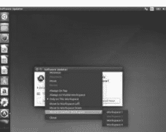

# Linux 初学者指南：循序渐易学习 Linux

在本节中，我们将探索入门必需的基础 Linux 命令。你现在可以打开终端了。在桌面上点击右键，并选择“打开终端”。

如果你没有看到此选项，请查看窗口顶部的“应用程序”。点击“应用程序”并进入“附件”。选择“打开终端”并打开文本编辑器，即“Gedit”。只需点击搜索并输入“text editor”。在文件中添加你选择的文本并保存，可以保存在桌面上。我保存了一个名为 `first` 的文件，内容如下：

我是一个 Linux 专家

我很喜欢读这本书

现在去终端并输入以下内容：

`cat first`

按下回车键后，文件内容将显示在窗口中。若要列出短文件中的内容，这种方法是

```
ubuntu@ubuntu-desktop:~/Desktop$ cat test
I am a Linux Guru
I am enjoying reading this book
ubuntu@ubuntu-desktop:~/Desktop$
```

非常合适的。

## 切换目录

你可能还想通过终端导航或更改目录。要实现这一点，请使用 `cd` 命令，它是“change directory”（更改目录）的缩写。

示例：

`cd /home`

上述命令将工作目录更改为 `home` 目录。使用正斜杠（`/`）意味着相对于根目录，这意味着无论你当前处于哪个目录，该命令都会执行。现在输入以下命令：

```
cd httpd
```

目录将更改为 `httpd`，但是相对于 `/home` 目录。完整的工作目录将是 `/home/httpd`。现在输入以下命令：

```
cd ..
```

此命令将工作目录更改为当前目录的父目录。在本例中，我们将从 `/home/httpd` 移动到 `/home` 目录。输入以下命令：

```
cd ~
```

此命令将目录更改为用户的家目录 `/home/(username)`。“username”将是你电脑上使用的名称。在 Linux 中，`~` 符号用于表示用户的家目录。

## 复制文件

`cp` 命令代表“copy files”（复制文件），用于复制文件。请注意，文件不会从初始位置删除，而是在指定位置创建一个相同文件的副本。输入以下命令：

`cp first me`

上述命令将在相同目录下创建文件 `first` 的副本，但新名称为 `me`。如果目录中已存在 `me` 文件，它将被覆盖，且在执行此命令之前你不会收到警告。考虑下面的命令：

`cp –i first me`

注意，在上述命令中我们添加了 `-i` 选项。如果目录中存在 `me` 文件，在覆盖之前你会收到通知。接下来，尝试以下命令：

`cp –i /d/file`

使用上述命令，文件 `/d/file` 将被复制到当前目录并重命名为 `file`。注意我们使用了 `-i` 选项，所以如果文件已存在，在覆盖之前我们会收到通知。

你可能还需要将特定目录中的所有文件复制到另一个目录。可以通过以下方式实现：`cp -dpr sourcedirectory destinationdirectory`

`sourcedirectory` 目录中的所有文件都将复制到 `destinationdirectory` 目录中。注意我们使用了 `-dpr` 选项。这意味着：

- `-d` – 意味着将保留链接
- `-p` – 将保留文件属性
- `-r` – 复制将以递归进行

在从目录复制所有文件时，如有需要指定这些选项是好的，否则将应用默认设置，可能会产生不想要的结果。

若要显示每个挂载文件系统使用的磁盘空间，请使用 `df` 命令。

## ‘Less’ 命令

`less` 命令与 `more` 命令相同。区别在于，使用此命令时用户可以向上或向下翻页查看文件。考虑下面的用例：

`less first`

上述命令将显示文件 `first` 的内容。

## ‘Ln’ 命令

此命令创建指向特定文件的符号链接。编写并运行以下命令：

`ln –s first slink`

上述命令将创建一个名为 `slink` 的符号链接，该链接将指向文件 `first`。运行 `ls –i first slink` 将显示这两个文件是不同的，并且具有不同的“inodes”（索引节点）。

## ‘Locate’ 命令

用于在数据库中搜索。

运行以下命令：`slocate —u`

将创建一个名为 `slocate` 的数据库。这需要一些时间来完成，请耐心等待。在搜索文件之前，必须运行此命令。在大多数系统中，`cron` 会定期运行此命令。再次运行以下命令：

`locate whois`

此命令将在系统中查找包含“whois”字符串的文件。

## ‘Logout’ 命令

此命令用于注销登录系统的用户。进入终端输入此命令：

`logout` 你将注销并返回登录界面。

## ‘Ls’ 命令

`ls` 代表 list（列出）。用于列出目录中的文件。然而，它带有许多选项需要了解，否则你会感到困惑。如果你需要列出当前目录中所有以“.”开头的文件，只需输入命令：

```
ubuntu@ubuntu-desktop:~/Desktop$ ls me test
```

上面的图是 Desktop 目录，它包含了显示的文件。注意只列出了文件名。你可能需要显示目录中文件的更多详细信息，例如所有权、大小、时间戳等。可以通过以下命令实现：

`ls –al`

如所示，`ls-al` 命令比之前的命令更详尽。如果你想获取文件的详细信息，可以使用它。

## ‘More’ 命令

一次一页将文件内容发送到屏幕。它也可以处理管道输出。让我们将 `/etc/profile` 文件的内容列到屏幕。这是一个内置文件，意味着它随操作系统提供并包含了用户的配置：

`more /etc/profile`

```
ubuntu@ubuntu-desktop:~/Desktop more /etc/profile
# /etc/profile: 系统级 .profile 文件，适用于 Bourne shell (sh(1))
# 以及兼容 Bourne 的 shell (bash(1), ksh(1), ash(1), ...).

if [ -d /etc/profile.d ]; then
  for i in /etc/profile.d/*.sh; do
    if [ -r $i ]; then
      $i
    fi
  done
  unset i
fi
if [ "$PS1" ]; then
  if [ "$BASH" ]; then
    PS1="\@\h:\w\'
    if [ -f /etc/bash.bashrc ]; then
      .etc/bash.bashrc
    fi
  else
    if [ "$(id -u)" -eq 0 ]; then
      PS1='#
    fi
  fi
fi
```

注意，文件内容将一次一页显示。这是因为内容太大，无法在一个页内显示。考虑下面的命令：

`ls -al`

该命令将列出目录中的所有文件，输出将通过 `more` 处理。如果目录的输出无法在一个页内显示，它将在额外页面列出。

## ‘Mv’ 命令

此命令代表“move”（移动），用于重命名或移动文件。考虑以下命令：

```bash
mv -i first first2
```

文件将从‘first’移动到‘first2’，这意味着它将被重命名为‘first2’而不是‘first’。

```bash
mv /d/first
```

上述命令将把文件‘first’从目录 `/d/` 移动到当前工作目录。现在你已经看到‘mv’命令是一个多么强大的工具了。

既然我们一直在谈论工作目录，那么它们究竟是什么呢？我们又如何知道自己当前处于哪个目录中呢？只需输入命令：

```bash
pwd
```

按下回车键后，你会发现输出是一个目录。这显示了你当前所在的目录。’pwd’是“print working directory”（打印工作目录）的缩写，用于显示当前的工作目录。

## ‘Shutdown’ 命令

此命令用于关机系统。该命令的目的是停止当前进程并立即关闭系统。要执行此操作，请使用以下代码：

```bash
shutdown down -h now
```

下一个命令用于重启系统，这意味着它将立即关闭并重启系统。要执行此操作，请使用以下命令：

```bash
shutdown -r now
```

## ‘Whereis’ 命令

此命令用于显示命令的手手册、源文件和二进制文件。考虑以下命令：

```bash
ls
```

此命令将显示‘ls’的手手册和二进制文件。要查看之前在你的系统中运行过的命令列表，请使用命令‘history’：

上面是在我的系统中运行过的命令列表。你可以尝试在你的系统上运行并观察输出。

## ‘Sudo’ 命令


它代表“superuser do”（超级用户执行）。它的目的是允许许可的用户以“超级用户”身份执行命令。这通常在 `sudo` 用户列表中定义。它的重要性在于确保敏感命令仅由正确的人执行，从而确保安全性。另一个命令 `su` 命令允许你以超级用户的身份登录系统。`sudo` 的目的是从超级用户处获取权限。这解释了这两个命令—— `su` 和 `sudo` 命令的区别。`sudo` 命令通常用于会更改系统文件的命令，例如更新或升级操作系统时。这显示了该命令与 `su` 命令相比是多么安全。

## `Mkdir` 命令

此命令代表“make directory”（创建目录）。它创建一个新目录并命名其路径。如果该路径已经存在，则会输出错误，提示无法输出该文件夹。如下图所示：

我创建了一个名为“m”的目录。一旦我在创建目录后列出可用目录，我发现它已经被创建了。注意我是以 `sudo` 身份运行命令的。如果没有它，命令将无法运行。出于安全考虑。当你第一次使用 `sudo` 命令时，系统会提示你提供超级用户的密码以执行操作。需要注意的是，你只能在文件夹内部创建目录，并且你对该文件夹拥有“写权限”。否则，你将无法这样做。

## `Uname` 命令

它代表“Unix name”（Unix名称）。通过此命令，你可以获取有关操作系统、内核和机器的详细信息。考虑下图：

显示了关于操作系统、内核和机器的信息。Ubuntu-机器内核的名称 SMP-机器的节点名称 I686- 处理器配置 GNU/Linux-操作系统的名称。你可以看到该命令提供了多么详细的信息。

## `Touch` 命令

此命令仅在文件不存在时创建文件。它代表将每个文件的访问和修改时间更新为当前时间。如果文件已存在，其时间戳将被更改，但内容将保持不变。如果文件不存在且你拥有“写权限”，则可以使用该命令创建文件。要创建一个名为 `touchfile` 的文件：

```bash
touch touchfile
```

如果目录中不存在该文件，它将被创建。

## `Cal` 命令

它可以用于显示当前日期的月份，或者过去或未来年份的月份。让我们显示1900年2月的月份：

```bash
ubuntu@ubuntu-desktop:/home$ cal 02 1900
February 1900
Su Mo Tu We Th Fr Sa
      1 2 3
4 5 6 7 8 9 10
11 12 13 14 15 16 17
18 19 20 21 22 23 24
25 26 27 28
```

你也可以像下面显示未来年份的月份：

```bash
ubuntu@ubuntu-desktop:/home$ cal 02 2100
February 2100
Su Mo Tu We Th Fr Sa
   1 2 3 4 5 6
   7 8 9 10 11 12 13
14 15 16 17 18 19 20
21 22 23 24 25 26 27
28
```

我们展示了2100年2月的月份。在确定未来或过去事件的日期时，这个命令非常好。

## `Date` 命令

用于在终端中显示当前的日期和时间，如下：

```bash
ubuntu@ubuntu-desktop:/home$ date
Sat Mar 21 09:14:06 MDT 2015
ubuntu@ubuntu-desktop:/home$
```

如果你的系统当前日期错误，你可以按照如下方式设置为正确的日期时间：

```bash
date -s='21 march 2015 18:50'
```

在上面的命令中，我们设置了日期和时间。

# 第2章 Linux 安装

许多人在完成之前由于遇到的困难就已经讨厌了安装系统的过程。好消息是，通过 Linux，你在安装时将有一个非常轻松且无压力的体验。与其他系统相比，安装 Linux 要简单得多。大多数 Linux 发行版都提供 Live 选项，允许你直接从光盘或 U 盘运行系统，而不影响你的硬盘。

安装 Ubuntu。如果你使用的是笔记本电脑，必须连接电源，因为安装过程可能会耗尽你的电池。

你还需要连接到互联网源。

决定如何处理你的其他操作系统。你将会有两个选项：将 Ubuntu Linux 与其他操作系统并存安装，或者用 Ubuntu 替换旧操作系统。如果你选择同时拥有两个，那么每次重启计算机时，你都需要选择要使用的操作系统。

设置你的分区大小。如果你选择在计算机上同时运行两个操作系统，这是必要的。你可以使用滑块来调整想为 Ubuntu 留出的空间。记住，你还需要为文件和程序留足够的空间，因此请为新系统留出足够的空间。选择你的位置。如果你连接了互联网，这会自动完成。

设置你的键盘布局。在这里正确的做法是点击“检测键盘布局 Ubuntu”以自动选择正确的布局。

输入你的登录信息。设置用户名和密码。你可以选择 Ubuntu 自动登录，你也可以在任何想使用电脑时输入登录信息。

等待安装过程完成。

安装完成后重启电脑，Ubuntu 将加载。

## 2. Windows 安装程序

Windows 安装程序会将 Linux 与你正在使用的其他操作系统并存安装。程序和文件不会受到影响，但每次重启计算机时，你都必须选择要使用的操作系统。

- 从 Ubuntu 网站下载安装程序。
- 如果浏览器提示，你可以选择“运行”、“保存”或“打开”。
- 创建一个你将用于登录计算机的用户名和密码
- 点击“安装”开始该过程
- 安装完成后重启电脑，并选择 Ubuntu Linux 作为加载的操作系统

重要提示：

- 在 CD 或 DVD 上运行此类程序通常是一个好主意，这样可以先看一看；如果你喜欢你看到的内容，再进行安装。试用将帮助你做出决定，让你在安装操作系统时不会后悔悔。
- 在开始安装之前，请确保你已经先备份了所有的文件、程序、个人数据和设置，以免丢失它们。

## 在 Linux 上安装新软件

在 Linux 操作系统上安装新软件与你安装操作系统本身一样简单。所有操作都已为用户变得变得非常简单。因此，没有理由担心你过去在其他操作系统上安装新系统时遇到过困难。

大多数 Linux 发行版都有一个应用商店（或类似的东西），它代表了存储所有应用程序的中央区域。你需要做的就是浏览它们，并安装你想在机器上使用的应用程序。这让你能够轻松地找到想在计算机上安装的程序。Ubuntu 软件中心就是 Ubuntu Linux 这种集中地点的示例。Deepin 有 Deepin 软件中心。某些发行版依赖 GNOME 软件，而另一些依赖 Synaptic。

所有这些工具含义和功能都是相同的；它们提供了一个中央位置，你可以从中轻松地搜索和安装 Linux 软件。不过，GUI（图形用户界面）的存在很重要，以便你完成其他软件的安装过程。如果你没有 GUI，将不得不依靠命令行界面来进行安装。

用户需要知道的是，在任何 Linux 机器上安装软件都非常容易。新电脑用户也会发现这非常容易且不费时间。该操作系统的设计旨在让计算机用户在所做的一切上都变得轻松，而这只是其中之一。安装操作系统后，你就可以开始安装你在使用机器或设备时所需的任何应用程序。

Linux 无处不在。你可以在家里、车里，甚至家用电器中找到它。当然，你最常找到它的地方是计算机。乍一看，Linux 看起来和其他任何操作系统一样。它位于你所有其他软件之下，向你的硬件发送信号。它具有图形界面，就像大多数其他操作系统一样，并且对于其他系统具有的大功能，它也有相应的软件实现。如果你用过任何操作系统，那么使用 Linux 应该不会有困难。人们通常不知道的是 Linux 被频繁使用。除了是个人电脑最常用的操作系统之一，它还被用于运行全球许多服务器和嵌入式系统。它被用于运行互联网的巨大大部分，以及许多管理股票和取得科学突破的超级计算机。然而，在此之前，Linux 拥有世界上最无忧无虑、安全且可靠的系统的声誉。这种名誉是实之名归的，Linux 的质量变得越来越明显。

Linux 是一个灵活的工具，可以针对你可能感兴趣的任何工作进行定制。用户始终可以进一步开发它，这意味着它将一直处于越来越好的过程中。Linux 完全依靠社区本身的这一事实让 Linux 成了一项更令人印象深刻的成就。这也让 Linux 看起来更可靠，因为在发行过程中没有贪婪因素介入。该系统是根据需求提供的，并随着需求增长。

Linux 的不同变被称为发行版（Distributions）。发行版是不同组件的软件包，包含了内核和支持库。其中大部分是由 GNU 项目提供的。尽管大多数发行版在名称中使用了“Linux”一字，但这引起了自由软件组织的争议。

另一项研究始于2007年。该系统在 Debian v4.0 上运行。按照传统方法，开发该系统的成本大约需要 86 亿美元。它拥有 2.8 亿行代码，如果由一个人来完成，将需要七万三千年。这充分说明了 Linux 是一个什么样的项目。

你可以轻而易举地说基于投入的巨大工作量，它确实非同寻常。

## Linux 有何不同之处之处？


正如我之前提到的，Linux 执行的工作与任何其他操作系统都相同。然而，Linux 的特殊之处在于它是开源的。事实上，它是使用最广泛的开源操作系统。这意味着用于创建 Linux 的源代码对公众可见并可编辑。这也意味着有才华的人士可以通过对系统进行改进来为 Linux 的开发做出贡献。此外，该系统具有极高的定制性。它有许多版本，也称为发行版，它们彼此各不相同。它们包含不同类型的软件。尽管系统的核心部分大部分是相同的，但你可以选择不同的浏览器、文字处理器和应用程序，让你的系统真正成为你自己的。你还可以更改核心组件，如用户界面组件和图形组件。Linux 非常易于使用且操作简单。此外，它还有许多方式可以根据你的需求进行定制。

## Linux 是如何创建的？

你一定听过 Unix，20 世纪 70 年代开发的操作系统。它在当时是一个优秀的工具，用于学术和商业需求。与 Linux 类似，Unix 有许多不同的变体。该系统最初是程序员的一个工具，使软件开发变得更容易。随着时间的推移，它开始在学术界传播，人们添加了自己的工具并与同事共享。该系统本身遵循 Unix 哲学。这意味着系统倾向于使用功能有限的互连接的小型程序。所有互连接的程序都有定义良好的功能，并且非常擅长执行这些功能。

Linux 的初衷是尽可能地模拟 Unix。许多人都尝试过这样做。这些程序被称为“类 Unix”或“兼容 Unix 的”，但没有哪一个像 Linux 一样成功。Linux 最受欢迎，且与 Unix 最接近。它具有相似的接口方式、文件流布局、核心组件和编程工具。在 Unix 克隆的海洋中，Linux 脱颖而出。这都要归功于一个名叫林斯·托瓦尔斯（Linus Torvalds）的男人。

1991 年，托瓦尔斯对操作系统产生了兴趣。他对 MINIX 的许可（仅限于学术用途）感到沮丧。他利用这种愤怒创建了自己的系统，这个系统现在被称为 Linux 内核。他使用 MINIX 作为平台，并将 MINIX 的大多数应用程序添加到 Linux 中。之后，系统不断成熟和演进，最终跟上了 Linux 系统的新发展。由于受 GPL 许可许可的代码可用，使用它们被认为是有利可的。GNU 替换了 MINIX 的所有组件。GNU 项目允许只要程序在兼容许可下发布就可以使用这些代码。由于此，托瓦尔斯从他的原始许可切换到了 GNU GPL。然而，原始许可不允许对软件进行进一步分发，但在切换许可后，该程序终于实现了开源。许多人在 Linux 上进行工作，以便将 GNU 组件正确地整合到内核中。最后，系统变得可以运行且功能完备。

Linux 的原始名称是 Freax，这是 free（免费）和 Unix 的一个文字游戏。在为期六个月的时间里，项目的 Makefile 包含了“Freax”这个名称。Linux 这个名字虽然是后来才给这个项目的，但在 Freax 之前就被认为是该项目的可能名称，但托瓦尔斯认为它太自恋了并将其弃用。

为了便于 Linux 的进一步开发，文件被上传到 FUNET 的 FTP 服务器上。这是在 1991 年 9 月，在托瓦尔斯在赫尔辛基科技大学的同事 Ari Lemmle 以及其他几位自愿担任 FTP 服务器管理员的人帮助下。Ari 认为“Freax”不是一个好名字。在托瓦尔斯不知的情况下，他将项目更名为 Linux，最终托瓦尔斯也同意了这一点。

背景信息足够了！是时候深入主题核心内容，学习 Linux 能为你做什么了。

Linux 的文件系统在灵活性方面非常出色。它的设计允许它支持普通格式以及特殊类型的文件格式。它可以支持文本、程序、图像、输出和输入设备。因此，由于它支持多种文件格式，它可以与另一个操作系统共存。

此外，在系统中，文件和目录之间几乎没有可区分因素。这意味着目录仅仅是文件堆的位置。

### 文件分类

为了更好地理解 Linux 文件系统，对文件进行了分类。虽然假设这一点是安全的，但了解更多关于特定文件的信息可以让程序员和系统管理员在使用时避免复杂性。

- 文件类别：
  - 目录 `d` —— 文件堆的位置
  - 链接 `l` —— 文件在多个部分的可见
  - 管道 `p` —— 用于进程间通信的系统
  - 普通 `-` —— 普通文件
  - 套接字 `s` —— 提供网络系统
  - 特殊 `c` —— 用于输出输入的机制

### 分区的艺术

Linux 分区是因为电源故障威胁到了大多数 Linux 用户。那时宕机会会对系统造成损害。

此外，分区的主要目的是实现更高的数据安全性。硬盘的划分允许安全分组和保护。

由于分区，你可以对数据组进行优先级排序。当硬盘某部分受损时，只有该部分受到影响。存储在其他分区中的其余部分不受影响。系统的两个主要分区：

1. 交换分区 `Swap` —— 指额外的内存或扩展
2. 数据分区 `Data` —— 指普通数据

推荐分区：

- 用于必要数据的分区
- 用于服务器程序和配置数据的分区
- 用于应用程序的分区
- 至少一个用于用户邮件、存档和数据库表的分区
- 至少一个用于特定文件的分区
- 至少一个用于虚拟内存的分区

常用分区：

- 包含个人数据的分区
- 用于存储临时文件的分区
- 用于存储第三方数据的分区
- 专门用于程序的分区

在 Linux 中，有一个被称为根目录 `Root Directory`。它是主目录，正如程序员和系统管理员所言，它是所有目录的根。

伴随根目录的是子目录。这些子目录根据分配的任务管理文件。

子目录及其内容：

- `/home` – 用户目录
- `/boot` – 内核和启动文件；尝试消除不启动加载程序的文件
- `/initrd` – 关于启动的数据
- `/dev` – 包含所有 CPU 硬件引用
- `/bin` – 常用共享系统程序
- `/etc` – 系统配置数据
- `/lib` – 库文件
- `/lost+found` – 从故障恢复的数据
- `/opt` – 来自第三方来源的文件
- `/net` – 远程文件系统的标准挂载点
- `/misc` – 杂数据
- `/proc` – 关于系统资源的信息
- `/mnt` – 外部文件系统的标准挂载点

## Inode 的作用

在 Linux 文件系统中，`inode` 代表一个文件。`inode` 是一种包含重要信息的序列号类型（索引节点）。它的主要作用围绕定义分区中的文件数量展开。

在整个 Linux 文件系统中，特别是对于具有多个分区的系统，存在具有相似 `inode` 的文件。为了避免复杂性，每个分区都分配了其专属的 `inode`。

此外，分配的 `inode` 提供了硬盘数据结构的描述。一旦硬盘初始化完成，它可以在两个时间点接受数据存储：第一，在安装过程中可以接受数据存储；第二，在向现有系统添加存储空间时接受数据存储。

`inode` 中包含的信息：

- 文件类型
- 文件大小
- 文件所有者或组所有者
- 创建日期和时间
- 最后修改日期时间
- 权限
- 链接数
- 数据地址

在 Linux 文件系统中，关于基本文件大小和形状的信息被称为超级块 `Superblock`。它允许文件系统管理器浏览和维护文件系统的质量。

超级块中的信息：

- 空闲块 `Free blocks` —— 显示系统空闲块的数量
- 空闲 inode `Free inode` —— 显示原始的 inode 分配
- 空闲 inode `Free inodes` —— 显示系统空闲 inode 的数量
- 组编号 `Block group number` —— 分配给超级块的编号
- 每组块数 `Blocks per group` —— 显示一组的块数量
- 块大小 `Block size` —— 指系统的块大小；信息以字节为显示
- 魔数 `Magic number` —— 赋予挂载软件进行评估的权限
- 挂载计数 `Mount count` —— 系统的允许评估额度
- 修订级别 `Revision level` —— 系统的允许确认额度

组描述符负责标记文件的数据结构。它包含了避免数据重复的详细信息。由于它的作用，系统损坏的可能性降到了最低。

组描述符中的信息：

- 块位图 `Blocks bitmap`
- 空闲块计数 `Free blocks count`
- 空闲 inode 计数 `Free inodes count`
- inode 位图 `Inode bitmap`
- inode 表 `Inode table`
- 已用目录计数 `Used directory count`

Linux 文件通常很容易定位。只需搜索目录，跟在“/”或正斜杠后面的名称可能就是你首选的文件。

示例：

`/home/lp.txt`

示例所示，`"/home/"` 是目录而 `"lp.txt"` 是一个文件。

然后你可以开始挂载。在挂载文件时，需要 Linux 内核的可用性来检查标准。它的存在允许对所有通过的系统参数进行验证。

示例：

```
## mount iso898 /dev/rom /dev/cdrom
```

示例所示，你正在挂载三类信息。`iso898`、``/dev/rom`` 和 `"/dev/cdrom"`。


除了查找和挂载文件外，你还可以更改文件的大小。这是由于文件碎片化的产生。由于文件在碎片化期间效率会降低，更改文件大小允许对文件的分配。因此，系统会变得更加稳定。你将接触到`truncate`和`fallocate`命令。这两个命令都允许你创建一个指定大小的文件。

示例：

```
## truncate -s 19MB mop1.txt
## fallocate -l 19000000 mop2.txt
## ls -ls mop.txt
0 -rw-rw--r-- 2 trs 19000000 Aug 12 02:44 mop1.txt 14819 -rw-rw--r-- 2 trs 19000000 Aug 12 02:45 mop2.txt
```

示例所示，你在“8月12日”创建了一个名为“mop”的“19MB”文件。

在本章中，我们将深入探讨黑客的秘密武器之一——脚本。程序员和黑客之间存在非常细小的区别。程序员使用脚本来构建系统，而黑客使用脚本来利用系统。如果不会创建自己的脚本，初级黑客永远无法成为专业的黑客，而只会作为一个使用其他工具破解系统的“脚本小子”（script kiddie）。因此，对于任何试图精通黑客技术来说，脚本知识都是清单中的必修项。为了帮助大家，本章将介绍许多 bash 脚本概念以及真实的代码示例。让我们现在开始编写脚本的乐趣吧！

首先，我们需要详细了解 shell。

## 什么是 Shell？

shell 是当你首次使用密码连接到服务器，或者当你使用 SSH 等远程桌面工具连接到系统时观察到的光标。换句话说，如果你纯粹从编程的角度来看它，你会非常高兴的，因为它的作用就像操作系统一样，在用户和系统之间充当一个解释器。

但它只是发送来自 Linux 内核的输入建议，并将结果发送回系统用户。

## Shell 的类型

根据 Linux 官方文档，存在多种类型的 shell。其中第一种代表 GUI（图形用户界面），而第二种代表 CLI（命令行界面）。

有许多随发行版制造的 shell，如 Bourne shell、C shell、korne shell 和 Bash shell。

在存在的所有不同类型的 shell 中，bash shell 是存在过的最著名的 shell 之一。它预装在几乎所有著名的 Linux 发行版中。它还充当拦截语言，帮助 Linux 内核从逻辑上理解我们提供的指令。

## bash shell 是如何工作的？

人们可以用两种模式操作 shell。其中一种是交互模式，另一种是脚本模式。

### a) 交互模式

在模式模式下，Linux 用户可以逐一个输入函数或 bash 代码，并等待结果给出。如果中间出现错误，用户将无法继续。它只是像旧式手持视频游戏一样以交互方式工作。

### b) 脚本模式

在这种模式下，首先将 bash 代码写在一个文本文件中，然后使用命令行界面运行该脚本文件。使用这种模式时，用户可以一次性获得他想要的所有结果。黑客在脚本模式下需要更加完美，因为通过这种方式很容易快速利用系统。然而创建系统的程序员会更倾向于交互模式。

在了解更多关于 shell 的语法结构之前，最好先对 shell 的优点有一个良好的概览。

## Shell 的优点

- 1) 学习内联编程语言非常容易，它们在执行和实现上都有很大不同。
- 2) 它有许多帮助文档，可以帮助黑客尽快纠正错误。
- 3) 它还有一个额外的优势，因为它是一种解释性语言。也就是说，它在运行之前不需要编译。因此，黑客可以在尝试在受害者系统上实现之前轻松地交叉检查代码。

此外，shell 还速度很快且运行高效。由于所有这些原因，黑客必须学习 shell 的实现。让我们开始吧！

让我们创建一个名为 `sample.sh` 的 shell 脚本。使用以下命令创建一个 shell 脚本。

```bash
cat sample.sh
Location of the shell program
echo " This is very regressive"
```

现在我们将逐行详细解释这些。

- a) `#!` 代表我们正尝试编写的 shell 脚本的开头。
- b) 如果它只以井号 `#` 开头，那么它被称为注释。注释是用于方便参考或供想要查看代码的其他用户使用的注解。
- c) `echo` 是一个 shell 默认命令，它允许解释器显示所写的内容。

在这里运行该 shell 你需要使用以下命令：`bash sample.sh`。然后输出就会出现。

对于这个示例，输出是：This is very regressive

还有另一个功能允许你带有额外的权限运行脚本。正如我们之前讨论的，，Linux 拥有一套权限，如果不提供必要的权限，脚本可能无法完美运行。因此，要提供权限，请使用以下命令

调试是编程中最重要的任务之一。即使是黑客也需要

这一点非常完美，因为对代码的错误调试可能会导致任务适应性不良。

通常当你在脚本中输入了错误的默认命令，如如下代码所示：

`vulnerhost @ @ example: ech 7898`

这段代码将无法运行并显示如下所示的错误

`the ech command is not found`

这就是调试的意义。调试功能会告知用户脚本中的错误。

还有许多在命令行界面中执行任务的 shell 调试工具。像 `bashdb` 这样的工具对此非常有名。本节将帮助黑客有效地理解 Shell 编程的基础。让我们开始吧！

在深入讨论内置命令之前，重要的一是，这些内置命令不能作为变量名。变量是 Shell 编程中一个重要的功能，有助于定义各种内容。

Linux 提供了一个名为 `type` 的命令，可以让你交叉检查某个命令是否为内置命令。

该命令的工作方式如下：`type echo`

输出如下：

`echo is a built-in shell`

另一个例子，

`type trump`

输出如下：

`Trump is not a built-in shell`

此外，记住两个点即 `(••)` 用于判断脚本是否成功工作或执行。以下我们将详细讨论的内置命令。

## 1) Alias (别名)

通常 Linux 命令的输入比较繁琐。我假设你每次都要输入 `echo` 可能会很困难。因此，你可以使用别名为命令提供快捷方式。

下面描述了使别名生效需要输入的命令：`example@linuxwar : Alias groupecho`

然而，应该记住，别名只在 Shell 环境打开期间有效。也就是说，如果退出 Shell，就无法再次访问它。此外，别名函数存储在用户环境的 `bashrc` 中。别名是提高效率的简单方法。黑客使用许多别名来使脚本解析变得复杂。

## 2) Unalias (取消别名)

正如你可能猜到的，`unalias` 用于删除存在的别名系统。通过此命令，你可以删除之前创建的任何别名命令。

下面让我们了解其工作原理的命令：

`example@ linuxwar : unalias groupecho`

你也可以使用 `-a` 同时删除所有存在的别名。然而，正如我们之前提到的，结束 Shell 环境会删除所有存在的别名，但使用 `unalias` 可以在你编写脚本期间帮助删除内容。

很多 Shellcode是在交互模式下完成的。有时当你尝试利用系统时，需要同时执行各种任务。这些任务在 Linux 术语中被称为作业（jobs）。为了方便大家起见，作业分为两种类型。第一种是前台作业（foreground job），我们可以看到正在运行。前台作业的经典例子是安装系统程序。执行前台作业时你无法处理其他任务。

正因为如此，开发了后台作业（background jobs）。后台作业可以帮助程序在后台运行。黑客应该充分这一点，因为他们必须与多个进程一起。

以下是作业功能的命令：

`example@ linuxwar : bg job1`

`example@ linuxwar : fg job2`

`example@ linuxwar : view jobs`

`cd` 是经典的 Linux Shell 命令，因其巨大的使用量而闻名。执行任务时，用户通常会被 Shell 抛到根目录。根目录的大量使用会导致其变得散乱混乱。因此，Linux 用户使用 `CD` 来切换目录并执行操作。

下面是切换目录的命令：

`example@ linuxwar : cd /etc/read`

变量是经典的编程声明。它们通常用于为数据声明位置。变量还有一种称为数据类型的类型声明。通过此点，我们可以轻松地分配它们应该使用的类型。有很多数据类型，如 `int`、`float`、`string` 等。

脚本语言通常包含用于重复和逻辑任务的条件语句和循环。它们可以同时用于这两种情况。在执行重复任务时，很显然应该有一些端点以便进行更好的交互和处理。

因此，Shell 语言使用名为 `break` 的语句，当其提供的逻辑满足时将停止该逻辑任务。`break` 语句也可以配合 `echo` 命令打印语句。

这里是 `break` 命令的例子：`example@ linuxwar : beep.sh`

```
for(i=0)
x>1
y>2
if(b>2)
break:
```


在 `break` 可以立即停止循环的循环中，有一个名为 `continue` 的语句可以帮助切换可用的循环。假设 Shellcode 中有五个循环语句，使用 `continue` 循环可以相互切换。这有助于创建详细的利用代码，这些代码可以破坏系统并进行多次交叉检查。

下面是 `continue` 语句的例子：

```
example@ linuxwar : beep.sh
for(i=0)
x>1
y>2
if(b>2)
continue:
```

Linux 和 Shellcode 通常包含很多需要处理的参数。如果解析字符串，将会有很多问题。因此，Shell 中引入了名为 `eval` 的命令。`eval` 命令替换现有的参数。你甚至可以使用 `eval` 将字符串解析为执行命令，如下所示：

`example@ linuxwar : eval beep.sh`

执行被认为是启动任务的过程。每个安装文件都是一种执行格式，它会在后台启动一个新系统。黑客应该意识到执行 Shell，因为它们执行了大量的分析任务。

当在 Linux Shell 中输入 `exec` 命令时，我们正在操作的界面会刷新。这就是那条详细解释 `exec` 的命令：

`example@ linuxwar : exec beep.sh`

Shell 窗口很复杂并处理许多任务。然而，当你完成任务时，退出 Shell 是一个良好的习惯。否则，进程将继续运行并可能导致不必要的能耗。为此，Shell 语言为了这个原因引入了一个名为 `exit` 的快速命令。

`exit` 命令还会清除所有存在的任务。因此，在发生这种情况之前，确保一切正常。你也可以通过 Shell 脚本退出单个进程或程序。

下面是 `exit` 的简单命令示例：`example@ linuxwar : exit shell.sh`

通常当系统启动时，第一个 Shell 命令在内核系统中被创建。这被称为父 Shell（parent shell）。接下来的后续的被称为子 Shell（child shells），除非父 Shell 被退出或杀死。

因此，在处理不同数量的 Shell 时，我们将处理很多变量。有时我们可能需要我们在其他 Shell 环境中使用过的变量。为了导出这些变量，Shell 为我们提供了 `export` 选项。

使用 `export` 命令后，所有的子 Shell 都可以使用父变量。然而，记住，子 Shell 无法使用它们兄弟（即存在的其他子 Shell）的变量。

这里有一个演示这一过程的例子：

`example@ linuxwar : export example.sh to /etc/dir`

杀死进程是黑客需要学习的一项技能。进程有三个区别。之一是交互，即普通的 Shell 界面。第二个是批处理，所有需要应用的内容按顺序在进程中执行。最后一个是监控进程，正在执行的操作都会被监控。例如，任务管理系统。

当你运行大量这类任务时，进程可能会由于其携带的信号而让你分心。因此，如果你发现某些进程是不必要的，那么杀死它们是一个很好的过程。当你试图利用一个系统时，你需要杀死正在后台运行的防病毒进程。你甚至可以使用杀死进程来停止记录你一举一动的日志文件。

以下是 `kill` 命令的简单演示：

`example@ linuxwar : kill process`

`example@ linuxwar : killall`

`read` 命令可以在执行任务时用于读取 bash 脚本。它甚至可以用于对已编写的 shellcode 进行彻底检查。`read` 语句是一个基础的 shell 命令，可以帮助黑客轻松地解释和交叉检查内容。

以下是带有示例的命令：

```
example@ linuxwar : read bash.sh
```

优先级是 shellcode 最不被使用的功能之一。优先级可以递增也可以递减。通过使用 `ulimit`，黑客可以增加或减少进程的优先级。

为什么对进程进行优先级排序？

当用户处理许多持续运行的后台进程时，这可能会降低其他进程的处理速度。出于这个原因，管理员会将防病毒软件放在优先级的第一级。通过这种方法，任何启动级别的执行操作都可以被消除。

然而，许多系统管理员并没有重视这个问题，这使得黑客的利用变得非常容易。下面是一个示例命令，解释了如何对现有进程进行优先级排序。

```
example@ linuxwar : ulimit PID 2345
```

始终记住，`PID` 是进行优先级排序时最必要的东西。

Shellcode 包含大量的循环和条件代码。在对系统 shell 尝试这些重复性任务之前，在旧的 shell 中检查它们是一个良好的习惯。出于这个目的，引入了 `test` 命令。

以下是负责测试的命令：

`example@ linuxwar : test PID 3634`

至此，我们已经完成了对 Linux 系统中存在的一些内置 shell 命令的解释。这应该能让你对黑客环境有一个良好的整体认识。

但在学习它之前，让我们先学习 bash shell 的安装，它是最著名的 shell 环境。

# bash 环境的安装

1) 你可以使用 `wget` 来获取服务器上存在的系统文件。下面的命令将从镜像网站下载文件，并帮助用户在他们的系统中安装它们。

`wget bash.com/download`

2) 在下一步中，你需要说明或输入你正在使用的系统配置。否则，它可能无法安装。

3) 安装后，你可能需要检查设置并输入默认目录。通常输入为根目录。此外，可以使用 `help` 命令轻松了解 shell 版本。

至此，我们已经安装了 bash 环境，可以开始学习一些 shell 编程的基础知识了。记住，这些主题与 python 脚本非常契合，Python 脚本是黑客的另一种良好的替代脚本语言。

shell 由一组系统指令或命令组成。让我们来学习组成 shell 语言的一些基本组件。

变量是计算机随机访问系统中的部分内存，用于存储数据。正如之前讨论过的，变量是编程语言中最重要的组件，在编写函数或模板时经常会调用。

通常，有两种变量：

a) 局部变量

b) 环境变量

让我们详细讨论这些变量的功能，并附带一些命令行示例。

## 局部变量

局部变量是那些可以在私有或单环境中使用的变量，这意味着这些变量不能在其他 shell 脚本中使用，即使有引用也不行。这类变量用于短的 shell 脚本。

## 全局变量

全局变量也称为环境变量。这些变量与第一种的区别在于，它们可以通过引用用于任何 shell 脚本。使用全局变量，你需要将它们导出到本地 shell 脚本文件中。

shell 语言中的变量在命名时应遵循某些指令。记住，像 `exit` 这样的 shell 内置命令不能作为变量名。

以下是命名变量需要遵循的指令：

a) 在 shell 语言中，变量区分大小写字母的。

b) 变量名绝不能以数字或特殊字符开头。这样做可能会导致错误，提示变量名无法初始化。

这里是一些可以使用的各种示例：`love` `dude` `ra344`

这里是一些不能使用的变量名 `1hjjsd` `#fegge`

变量赋值是用于给变量赋值的数值。

工作原理如下：`变量名 = 变量值`

你可以在变量值中插入很多数据类型。数据类型是定义变量的地方。某些数据类型包括整数、浮点数，有时甚至是字符串。

这里有一个描述赋值值的示例：

`sample = 22`

特殊变量（如 `usnet`）可以从内存中删除定义的变量。在此处，我们可以存储随机内存管理。

还有以 `$` 参数开头的特殊变量。这些变量可以用于定义系统在执行过程中或高级 shell 分析可能需要的额外参数。

这里是某些特殊变量命令的示例：`$ $dude = ' string'`

使用特殊变量的最大优势是，可以根据变量开头的字符轻松地过滤和别名。

数组是一种著名的数据结构，能够持有多个元素项。编程语言使用大量数组，因为它们不像树或图等其他数据结构那样难以实现，而且速度快。shell 也支持使用数组输入元素。在本节中，我们将详细讨论数组。

### 数组的定义

通常数组由一个定义元素数量的下标以及数组名称组成。

这里是数组示例的命令：

`example[]`

### 给数组赋值

数组中存在的所有元素都可以使用符号进行赋值。你也可以像下面所示，使用单个数组赋值来给值：

`sample = "America"`

你可以像变量一样在数组中插入任何数据类型，当你处理带有复杂代码的循环和条件判断时，数组的使用可能非常本质。

你甚至连接两个数组以获得所需的结果。为了让你更好地理解，下面的场景显示：`sample = value`

正如我们所所知的，常量意味着不能改变的东西。常量值始终存在，并用于解释像 `pi` 这样具有常数值的值。每当你尝试更改此常量变量时，shell 前会出现一个错误或警告，说这样做是不可能的。

这里是常量命令的示例：

`pi = 3.1427`

我们已经详细讨论了变量，命名空间是指在定义范围内的变量。创建它们的原因是，当用户尝试创建类型相同的变量时，总是会发生冲突并使组织变得困难。

正因为这个原因，发明了命名空间，并用于定义引用，这些引用可以在 shell 界面或 shell 脚本中多次使用。

## 运算符

运算符是脚本语言最重要的部分。运算符可以帮助混合


或者更改变量值。在 shell 层面，编程中有很多可以使用的运算符。我们现在将详细讨论其中一些：

## 1) 算术运算符

算术运算符处理加法和减法等数学计算。这些对于编程非常重要，因为它们可以轻松地累加数值和乘以变量计数。

以下是算术运算符的命令示例：

```
>>> 2+3
>>> 2-1
>>> 6 * 2
>>> 7/3
```

关系运算符是重要的运算符，可以轻松地改变内容。它们可以用来轻松比较两个事物。常见的关系运算符有 `AND`、`OR` 和 `NOT`。这些关系运算符可以在任何 shell 语言代码中轻松实现。

以下是一个处理关系运算符的命令行示例：

```
>>> 2 != 7
>>> x === y
```

赋值运算符仅向变量或循环代码赋值。通过使用此运算符，可以轻松地为元素赋值。

以下是赋值运算符的示例：

`x = 7`

通过此，我们完成了对脚本世界的简要探索。Shell 语言对于任何认真对待工作的黑客来说都是必不可少的。你也可以通过 Python 编程来实现这些概念，以执行高级黑客任务。让我们开始吧！

我们将继续浏览 Ubuntu 发行版，概述如何安装和设置你的操作系统。记住，任何 Linux 操作系统的资产之一就是你可以对其进行定制以为你服务。

在桌面版本中，你会发现大部分内容都是即插即用的。图形和文本将引导你完成。应用程序将允许你浏览需要执行和拥有的功能，就像使用 Windows 或 MAC OS 一样。同样，你将看到熟悉的图标、任务栏和菜单。

如前所述，尽管你依靠桌面版本提供 GUI（图形用户界面），但在你想这样做的时候，你仍然拥有使用命令行界面（CLI）的能力。不同的 Linux 发行版进入这些提示符的方法不同。在各个版本的 Ubuntu 中，这可能是点击“应用程序菜单”、“辅助工具”，最后点击“终端”的组合，在那里你可以获取输入命令的提示符。

你可能会觉得选择 GUI 版本是为了完全避免使用 CLI。然而，有些人确实非常喜欢这种图形和提示符的结合。你未来观看或阅读的任何教程都可能包含一些即使在桌面版本下在提示符处使用的命令。它们可能对你仍然有效。关于这一点需要注意的是，如果你经常做相同的事情，那么自动化任务等操作非常有用。在 GUI 崩溃时，它也非常方便。学习一些基础知识是好的，因为你永远不知道自己什么时候可能需要它们！

安装后，你的 Ubuntu 发行版已经预装了许多应用程序和程序。这些可能包括：Firefox、OpenOffice、音乐和视频播放器、社交媒体和消息传递工具，以及一些让事情变得实用或有趣的常用应用。

Linux 最棒的部分是定制。如果你不确定应该安装什么，应该在 Google 上搜索最适合你应用的、程序或软件，但美之处在于你可以进行定制，不像我们大多数习惯的带有许多第三方或专有内容的预装系统。其中许多内容来自仓库。Linux 仓库是存放许多程序和应用的地方，你可以随时调用。其中许多也是开源的，有些可能不是。

通过 Ubuntu，你可以轻松地访问新闻应用和软件，点击鼠标即可快速检索并安装你需要的任何内容。


获取新应用 (www.webupd8.org)。

访问仓库的一种快速简单的方法是通过所谓的 Synaptic 软件包管理器（Synaptic Package Manager）。通过它，你可以访问从游戏到 MS Office 的所有内容。在系统文件中，然后点击管理下的“Synaptic 软件包管理器”。寻找“ubuntu-restricted-extras”并通过包管理器安装它。这将允许访问某些专有应用程序。通常，从这个管理器中，你可以检查并安装你喜欢的应用。

在桌面版本上访问仓库的另一种方法是使用 CLI 命令。这将在服务器部分详细介绍，在那里由于缺乏 GUI，CLI 是至关重要的。你将使用如 `apt-get install` 之类的命令从相同的仓库获取应用程序，但这将通过 CLI 界面以文本形式进行。再次，指南最后有列表。你将看到一个初学者基础命令列表，这对于导航 CLI 非常有帮助，即使在桌面级也是如此。还会看到一个更全面的列表，它将帮助学者，并引导你进入中级学习。

桌面版本的魅力之处之一就是这种多功能性。

每个 Linux 用户或开发者都会建议你在首次安装 Ubuntu 版本后，在进入其中玩耍或做太多事情之前做一些非常特定的事情。安全和稳定也是维护 Linux 的关键，你将享受多年。以下是待办事项清单：

- 1. 启用（假设你有超过一个）。
- 2. 调整外观和行为。
- 3. 调整设置和安全。
- 4. 调整主题和菜单。
- 5. 通过 Synaptic 安装任何应用。
- 6. 安装媒体解码器、音频播放器和驱动程序。
- 7. 通过个人包存档 (PPAs) 和 Partner-Deb 安装授权软件（以访问软件）。
- 8. 更新系统。
- 9. 安装如 Google Chrome、GIMP、Spotify 等应用。
- 10. 设置消息帐户和云连接。

## 为桌面创建工作区

你还可以使用工作区来真正最大化你的桌面，获取更多内容。某些版本不会显著显示这些内容，但在不同的发行版中可以启用。你应该检查你的发行版并搜索如何激活它们。在每个环境中，你需要点击以执行：

- 启用工作区
- 添加小组件
- 添加分页器组件



## Ubuntu CLI 中的多工作区

你可能应该学习一些可以在提示符处使用的基础命令，以备万一（是的，已经建议过几次了！）。你会发现，如果进入“应用程序”，然后是“辅助工具”，最后“终端”，就可以访问 CLI 并看到提示符。这就是命令发挥作用的地方。

此外，如果你在某时刻切换到服务器版本，你已经对命令有了欣赏和了解，并且对系统文件的结构和位置有了更好的理解。正如你以后将读到的，Linux 中的一切都是文件。它们的结构与 Windows 等文件不同。通过使用 GUI，你将从一个角度来看待。当你真正更好地理解文件树和目录如何与硬件和软件协同工作构成所谓的你的操作系统时。这也是 Linux 爱好者获得自由感的地方

这不仅带来了应用程序和其他系统资源的开源，还让你能够真正让你的计算机主动为你工作所需的自由和灵活性。

## 在服务器版本中导航

然而，在服务器版本需要花费一些时间。它并不那么直观，在以这种方式探索 Linux 之前和期间，了解某些细节将非常有帮助。如果你熟悉 DOS，这只需要学习命令和代码的问题。如果你不熟悉，你将面临相当陡的学习曲线。


开始时，你将使用提供的信息登录到新的服务器版本。你将看到一个只有 Shell 处有提示符的 DOS 屏幕。你不会看到像现在使用桌面版本时那样的图形用户界面 (`GUI`)。现在，你需要使用命令才能在这个新的操作系统系统中移动到任何地方。你应该设置一个非常安全的密码和 `root`（用户）名称。

务必完全原样记录这些信息。在 Linux 中，标点符号非常重要。不同的拼写意味着完全不同的含义。你会再次看到这个提示。

## 万物之根

在 Linux 中，“Root”一词有几种含义。`Root` 用户（`Root User`）是计算机的管理员（用户名为 `root`），它是权限最高的用户，拥有全权限。

`Root` 也是 Linux 中任何事物的最高级别或核心。它还是安装位置，相当于 Windows 中的 `C:/Home`。可以说，它是文件系统的最高层级。Linux 中的所有内容要么是目录，要么是目录内的文件，而这一切都在 `Root` 目录之下。

命令 `sudo` 意味着“Super User Do”（超级用户执行）。这意味着你，作为 `Root` 用户（即管理员），拥有访问文件和程序的完全权限。在某些发行版中，你需要使用此命令作为某些命令的前缀。

## www.ubuntusererverguide.com

## 掌握你的命令

与现在的绝大多数事物一样，你可以在 Google 上进行一些研究，获取大量的 Linux 命令目录。

通过这些命令，你可以在 Linux 中导航到任何地方。然而，你不应该期望背诵这个列表，你应该开始熟悉 Linux 的语言。

一些最重要和实用的命令将让你进入、退出和穿梭。

为了强调和扩展之前的一个观点，你在命令中使用大小写非常重要。命令的拼写非常具体，因此注意使用正确的大小写。空格和词序也很重要。你可能无法到达任何地方，或者可能会到达一个你无意去的地方。

在 Linux 长长的命令和命令组合列表中，还有“内置 (`builtin`)”命令。正如其名，内置命令已经包含在 `Bash` shell 自身中。当一个简单命令的第一个词是内置命令时，shell 会执行该命令而不需要另一个程序。

正如之前所说，每个发行版都有自己的优势和挑战。需要注意的一点是，每个发行版的命令可能相同，也可能不同。考虑到命令是导航此版本 Linux 的唯一方式，这至关重要。你绝对应该对你选择的发行版进行兼容性和用法方面的研究，你现在还需要研究该特定发行版的特定命令。

你会发现许多命令有一些共同的根，你可以通过其他命令、关键字、文件名或程序名在某些命令的基础上进行。有几个初学者需要立即使用的命令。请跟随操作并尝试一下。

## 需要时获取帮助

这里有几个上手就能知道的简单常识。这些可能是你的救生衣。“Man”页面是手册（即说明性）页面。你也会像使用 `sudo` 命令一样，用这个命令作为另一个命令的前缀。使用 `man` 会打开一个包含你需要的所有信息的屏幕，就像一个数字手册页。在需要时尝试这些变体。知道如何到达某处、如何离开以及如何寻求帮助可能看起来非常基础，但在你学习系统时，这些可能会让你非常沮丧。

- `man –k`：搜索包含某术语的所有命令。你也可以使用 `apropos`。
- `man`：显示帮助信息。
- `info`：显示帮助信息（方式不同）。
- `whatis`：显示 man 页的描述。
- `whereis`：告知 man 页的位置。

要退出 man 页面，输入 `Q`（`Quit`）即可退出。这是退出手册页的唯一方法。

要退出大多数其他地方，只需输入 `Exit` 即可。

命令 `more` 和 `less` 对于显示超出当前屏幕内容的文件很有用。你可能需要在帮助页面上阅读比一个屏幕能看到的更多的信息。这对于系统初学者来说尤为重要。在输入命令后，只需使用空格键向下滚动。

要退出，输入 `q` 即可退出。

## 移动

你很快就会发现 Linux 中有很多目录，你应该熟悉它们。虽然在 Linux 中一切都是文件，但目录是一种特殊类型的文件。目录出现在列表中，并且是相关的结构。与使用 GUI 的方式不同，你需要命令来导航。

正如之前提到的，命令的大小写写非常重要。命令的拼写非常具体，因此注意使用正确的大小写。空格和词序也很重要。你可能无法到达任何地方，或者可能会到达一个你无意去的地方。

在 Linux 长长的命令和命令组合列表中，还有“内置 (`builtin`)”命令。正如其名，内置命令已经包含在 `Bash` shell 自身中。当一个简单命令的第一个词是内置命令时，shell 会执行该命令而不需要另一个程序。

正如之前所说，每个发行版都有自己的优势和挑战。需要注意的一点是，每个发行版的命令可能相同，也可能不同。考虑到命令是导航此版本 Linux 的唯一方式，这至关重要。你绝对应该对你选择的发行版进行兼容性和用法方面的研究，你现在还需要研究该特定发行版的特定命令。

你会发现许多命令有一些共同的根，你可以通过其他命令、关键字、文件名或程序名在某些命令的基础上进行构建。有几个初学者需要立即使用的命令。请跟随操作并尝试一下。

如果你想安装 LAMP 服务器，你可以输入命令 `sudo apt-get install lamp-server` 来自动化此过程。

```
daniel@office:~$ sudo apt-get install 64studio-apt
Reading package lists... Done
Building dependency tree
Reading state information..., Done
The following NEW packages will be installed
64studio-apt
0 upgraded, 1 newly installed, 0 to remove and 0 not upgraded,
Need to get 3,823 of archives,
After this operation, 45,138 kibB of additional disk space will be used.
WARNING: The following packages cannot be authenticated!
64studio-apt
Install these packages without verification [y/N]? y
Get: 1 http://apt.64studio.com/backports/lucid-backports/64studio-apt 0.1~lucid1 [3,828]
Fetched 3,828 in 0s (382.8 KB/s)
Selecting previously selected package 64studio-apt.
Reading database ... 27,169 files and directories currently installed,
Unpacking 64studio-apt (from ...64studio-apt_0.1~lucid1_all.deb) ...
Setting up 64studio-apt (0.1~lucid1) ...
```

这是一个 `apt-get install` 的示例（www.en.flossmanuals.net）。

如果你在任何时候需要帮助，既然你已经知道了了帮助页命令 `Command`，你可以输入：`man taskel`。你会看到帮助页出现以满足你的需求。

## 卸载

若要卸载，你只需输入 `apt-get remove`（在本例中为服务器名称）。使用此命令获取你的大部分软件，并从免费的开源软件开始。

## 更新

在安装软件后，你可以使用升级命令 `sudo aptget upgrade`。通过存储库进行简单的更新。手动更新它们比设置自动更新要容易。由于 Linux 的效率，你不需要经常这样做。这样也更安全。

任务管理器：`top` 提示符命令类似于“任务管理器”，用于查看进程以及每个进程占用的空间，或者停止运行中的程序。使用命令 `h` 可以查看你随时可能需要的命令列表。

输入命令 `sudo top`（以访问任务管理器或顶部界面），然后输入命令 `K`（用于 kill），然后输入在你想要杀的进程旁边看到的进程 ID 数字（称为 PID）。

## 停止/启动/重启服务

Linux 服务器不需要频繁重启，但在某些你可能需要重启软件或服务。

要启动/停止或重启，你将输入命令：

> `sudo /etc/init.d/(程序名称) start` :（或 `stop` 或 `restart`），以进行更改，并在处理更改时离线，就像发生崩溃或重新配置文件一样。

现在你已经有了一些关于在何处、去哪里、如何获取、安装或删除东西的基础知识，请花些时间测试这些内容。后面将是常用命令列表，以及一个更全面的（但不是唯一的）列表。这并不详尽，但它确实展示了你现在就可以执行的一些任务，以及你可能期待学习的任务。Linux 是一个不断演化的操作系统，考虑到发行版和环境的多样性，情况将继续不断变化。随着我们技术的进步，有越来越多的改进和利用 Linux 系统的机会。

# 第 6 章 基础 Kali Linux 工具


在本章中，在对 Kali Linux 的安装进行简要说明，并对 Kali 操作系统中存在的各种类型工具进行详细概述后，我们将借助 kali 中提供的工具通过一些实际场景，这将帮助你详细理解黑客攻击的基础知识。

## 如何进行黑客攻击？

没有特定的黑客指南可以教你完美地进行黑客。但总有一个优秀的黑客下意识里遵循的著名程序，以获得更好的结果。

## 黑客路线图

黑客攻击就像烹饪。你需要准备好所有的食材（即程序），并详细了解这些食材（或程序）的属性，并将它们结合在一起制作出美食。如果食物不好吃呢？也就是说如果你在整个黑客过程之后无法获得更好的结果呢？你只有一种方法可以，即：再次尝试。为了精通黑客，你需要详细学习五个重要领域。

- 1) 信息收集
- 2) 自动漏洞扫描
- 3) 漏洞利用
- 4) 密码攻击
- 5) 嗅探和无线攻击
- 6) 信息收集

信息收集始终被认为是黑客在攻击目标之前应该做的一项关键工作。大致，通过使用信息收集工具，我们可以获取关于目标主机的大量信息，这可以帮助我们创建利用程序，帮助我们为进一步的利用创建一个后门。我们甚至可以使用关于目标的大量公开信息，了解我们应该使用什么策略来使攻击成功。

攻击。你会惊讶地发现，你竟然可以找到如此多的公开信息。

2) 社会工程技术非常疯狂，因为你只需要通过电子邮件这种简单的手段，在心理上欺骗员工或你正在追踪的目标，从而通过你的漏洞创建一个后门。所有伟大的黑客都依赖于社会工程，而不是用更复杂的方法来操作。

3) 端口扫描。如果你好奇端口扫描与什么相关，请仔细阅读接下来的几段。服务器提供各种服务，例如发布首页以及发送和接收电子邮件。执行网络通信的服务包括一个名为“端口”的通信窗口，该窗口由数字管理。例如，知名服务基本上有预分配的端口号，例如用于在互联网上发布主面的 HTTP 服务的 80 端口，以及用于发送电子邮件的 587 端口。从外部（攻击者视角）调查服务器开放了何种端口的行为被称为“端口扫描”。

### 如何进行端口扫描？

端口扫描是在从外部发送特定数据并检查相应的响应的过程，旨在调查连接到网络的各个服务器上正在运行的服务。通过分析获取的响应，你可以识别出服务器上运行的服务版本、操作系统等。有像 `Nmap` 和 `Zenmap` 等工具可以进行端口扫描。

`Nmap` 是命令行工具，而 `Zenmap` 是图形界面工具。两者都使用相同的技术且免费。尝试在阅读这本书时使用一下你的电脑，毕竟，众所周知，你可以通过实践来学习黑客技术或编程，而不仅仅通过阅读。

## Nmap

`Nmap` 是著名的黑客工具之一，因其在渗透测试人员普及而广为人知。人们经常认为 `Nmap` 仅因信息收集能力而流行，但通常并不理解 `Nmap` 也可以作为自动化的漏洞检测器。它可以在开源操作系统和 Windows 中运行。`Nmap` 是一个强大的工具，可用于端口发现、主机发现、服务发现、操作系统及其版本的检测。`Nmap` 既可以在命令行中使用，也可以配合图形用户界面（GUI）。但记住，优秀的黑客使用命令行。

### Nmap 如何工作？

`Nmap` 的编程方式使其可以使用不同的技术执行扫描，例如 TCP 和 FTP 协议扫描。所有这些扫描都有其优缺点，黑客在尝试使用 `Nmap` 攻击主机时可以生动地理解这一点。在黑客术语中，我们技术性地将目标称为目标主机（`target host`）。使用 `Nmap` 时，我们需要首先了解目标的复杂性，以决定使用简单扫描还是耗费更多时间的复杂扫描。我们需要磨练技能，使用一些非常复杂且直观的技术来绕过入侵检测系统（`IDS`），以获得良好的结果。以下是帮助你理解 `Nmap` 可以执行的各种操作的策略：

- 1) 你可以使用以下命令扫描单个主机

  ```
  # nmap www.hackingtools.com
  # nmap 192.232.2.1
  ```

- 2) 你可以使用以下命令扫描整个子网

  ```
  # nmap 192.232.2.1/24
  ```

- 3) `Nmap` 还可以使用以下命令扫描多个目标

  ```
  # nmap 192.232.2.1 192.232.2.4
  ```

- 4) `Nmap` 还有一个选项可以让你扫描一个范围内的目标，如下所示：

  ```
  # nmap 192.232.2.1-100
  ```

  这将精确扫描 IP 地址 `192.232.2.1` 和 `192.232.2.100` 之间的每一个主机

- 5) `Nmap` 有一个选项，你可以将所有过的 IP 地址存储在 `.txt` 格式的文本文件中，并将其放在 `Nmap` 目录下，这样它就可以扫描文本文件中存在的每个 IP 地址，而无需手动输入每一个。

  ```
  # nmap -iL sampleip.txt
  ```

- 6) 如果你想查看需要扫描的所有主机列表，可以输入以下命令

  ```
  # nmap -sL 192.232.2.1/24
  ```

- 7) `Nmap` 提供了一个选项，我们可以在扫描子网主机时排除单个 IP 地址

  ```
  # nmap 192.232.2.1/24 -exclude 192.232.2.24
  ```

## 自动漏洞扫描

漏洞扫描器是一个自动发现和发现计算机、网络应用程序、Web应用程序和软件安全漏洞的程序。它通过网络检测目标系统，向目标系统生成数据，并将反馈数据与内置的漏洞签名匹配。


如果你想排除多个 IP，可以将它们都包含在一个文本文件中，以便在执行子网扫描时排除它们，如下所示。

`nmap 192.232.2.1/24 -exclude excludeIp.txt`

在学习扫描程序之前，Nmap 提供的选项让我们了解如何扫描特定主机上的端口。你可以使用以下命令扫描主机中的单个端口。

`nmap -p78,56,23 192.232.2.1`

## Nmap 中的扫描技术

Nmap 为了工作遵循不同类型的扫描策略。在本节中，我们将详细描述这些过程，并提供一些可以让你良好概述的命令。

1) `sS` 扫描（ Tcp SYN ）

如果黑客没有对软件指定任何内容，这是 Nmap 使用的典型扫描。在这种扫描中，Nmap 通常会对目标系统进行完全握手。它只会向目标主机发送一个 SYN 包，目标主机将检查任何开放的端口，但不会创建登录后可能使用的会话。这是这种扫描策略最大的优势之一。要使用此扫描，必须赋予黑客工具 root 权限，否则它将显示错误。下面是此扫描的命令行。

`hacking@kali #nmap -sS 262.232.2.1`

2) `sT` 扫描（ TCP connect ）

如果因为当前攻击情况不可行而不使用 `ss` 扫描，人们通常使用 `st` 作为下一个救星。它与开放端口进行三次握手，并调用名为 `connect()` 的方法，使软件发现 TCP 端口。在需要时，`st` 扫描也可以用于发现 UDP 端口，尽管人们很少使用。下面是 `-sT` 扫描的命令：

`hacking @kali #nmap -sT 292.232.2.1`

3) `sU` 扫描（UDP 扫描 ）

在 `ss` 扫描之后，这种扫描也是渗透测试清单的一部分。不需要像 TCP 扫描那样发送 SYN 包，因为这只会找到开放的 UDP 端口。当黑客开始使用扫描时，一个 UDP 包到达目标主机并等待响应。如果收到响应，则找到了开放端口。如果它发送了带有 Echo 命令的错误消息，则端口是关闭的。

下面是 `-sU` 扫描的命令行 `hacking@ kali #nmap -sU 292.232.2.1`

4) `sF` 扫描（ FIN 扫描 ）

是一种特殊的扫描，是因为某些目标可能有入侵检测系统，防火墙会阻止使用 TCP 扫描发送的 SYN 包。仅此此原因，如果对方正在进行检测扫描，就会使用 Fin 扫描。Fin 扫描不会保存任何日志信息供检测，因此 Fin 包有很大机会通过溜入目标系统来发现一些开放端口。这里是 `-sF` 扫描的命令 `hacking@kali #nmap -sF 262.232.2.1`

5) `sP` 扫描（ Ping 扫描 ）

Ping 是一种著名的网络协议方法，通过尝试连接目标主机来检查主机是否存活。Nmap 中的 Ping 扫描也用于相同目的，不用于检查开放端口。Ping 扫描要求 root 权限来启动扫描。如果你未准备提供管理员权限，可以使用 connect 方法从 Nmap 启动 ping 泛洪。这里是 `-sP` 扫描的命令 `hacking @kali #nmap -sP 292.232.2.1`

6) `sV` 扫描（ 版本检测扫描 ）

版本检测扫描是黑客对 Nmap 的痴迷用法之一。为了攻击目标系统，你需要了解主机使用的技术和操作系统，以便创建你的漏洞和后门策略来破解系统。然而，与 TCP 扫描不同，版本检测需要大量时间，因为当我们后台启动 `sV` 扫描时，会启动 TCP 扫描并搜索开放端口。在寻找开放端口结束后，`sV` 扫描会自动分析它们并确定有关目标主机的信息。由于这个复杂的过程，它可能会花费很长时间。这里是 `-sV` 扫描的命令 `hacking @ kali #nmap -sV 292.232.2.1`

7) `sL` 扫描（空闲扫描）

这是 Nmap 最疯狂的功能之一，因为它在进行攻击时就像一个代理服务器。在使用空闲扫描时，你可以使用另一个主机的 IP 发送数据包。这种匿名性可以帮助黑客在发生错误或严重问题时保持隐身。免受调查是每个黑客都努力追求的，特别是在当今社会。以下是进行 `-sL` 扫描黑客的命令：

`hacking @ kali #nmap -sL 192.432.2.6 192.432.2.1`

### Nmap 可以检测的项

Nmap 可以检测主机的设备类型（如路由器、工作组等）、运行的操作系统、操作系统的详细版本以及网络距离（目标与攻击者之间的近似距离）。在使用 Nmap 时，始终仅在必要时才使用 ping 扫描，因为目标主机上的某些防火墙可以检测到攻击即将发生并封锁攻击者的地址。通过使用下面的命令，你是在告诉软件不要 ping 远程主机：

`hacking @ kali # nmap -O -PN 192.428.5.6/`

使用 `-PN` 参数可以绕过 Ping 命令，但它不会影响对主机系统的发现。NMAP 的操作系统检测基于开放和关闭的端口。如果 扫描无法检测到至少一个开放或关闭的端口，它将返回以下错误。错误代码如下：

警告：无法找到任何开放或关闭的端口来获取目标系统的信息

使用 NMAP 准确检测远程操作系统是困难的，因此我们需要使用 NMAP 的猜测功能，`osscan-guess` 操作会猜测哪种操作系统类型最接近目标。

`nmap -O -oscan -guess 192.232.2.1`

通过使用以下命令和策略，你可以研究关于目标的大量信息，并利用这些信息创建后门和利用系统。使用 Metasploit 进行系统利用将在后续章节中解释，但在那之前将介绍 Nessus。Nessus 是一种自动漏洞评估工具，它可以自动发现漏洞，否则你将通过枯燥的步骤手动查找漏洞。在讨论 Nessus 之前，让我们来做一个简单的练习。请尝试完成这个练习，以便更好地理解信息收集。

### 练习

启动 Kali Linux 终端并使用命令进入 Nmap。找到 `www.nmap.com` 的子网掩码，并找到它使用的操作系统和版本。完成不同的扫描并对所有可用端口创建一个详细的报告。

## 自动漏洞扫描

首先，让我们详细学习漏洞的含义，并结合一些漏洞的示例。

### 什么是漏洞？

漏洞是主机系统中的缺陷，它允许黑客通过创建针对漏洞的利用程序来创建后门进入系统。例如，勒索软件利用了 Windows 中的一个漏洞利用了全球数百个系统。Web 应用程序也容易产生漏洞。XSS 漏洞、CSRF 检测等被 OWASP 宣布为高风险漏洞，它 决定了漏洞的严重程度。

### 什么是自动漏洞扫描？

在编码完成后，可以通过手动测试很容易发现漏洞。然而，这非常无聊且耗时，许多人会避免这样做。出于此目的，开发了某些自动化扫描工具来扫描系统并检测与其数据库中匹配的任何漏洞。像 Nessus 和 Burp suite 等软件使得这种自动扫描变得高效，如果操作得当，很容易获得良好的结果。

## Nessus

Nessus 被认为是一种自动扫描工具，拥有包含已知漏洞的广泛数据库，工具将使用它来扫描目标并为攻击者提供结果。对于渗透测试人员来说，Nessus 是基本工具之一。Nessus 通常包含数个更新漏洞、多种扫描选项、易于使用的图形界面和有效的报告功能。Nessus 受人们喜爱是因为它具有几个特性。

### 它是如何工作的

为了提供完善的计算机漏洞扫描服务并随时更新其漏洞数据库；与传统的漏洞扫描软件不同，Nessus 可以同时分析和扫描系统的漏洞，并根据系统资源调整其效率。如果主机配置了更多资源（如更快的 CPU 速度或更大的内存容量），由于资源丰富，其性能可以提高；它可以定义自己的插件；`NASL`（Nessus 攻击脚本语言）是 Tenable 发布的一种语言，用于编写 Nessus 安全测试选项；完全支持 SSL（安全套层）。Kali Linux 中预装了 Nessus，可以从菜单或使用搜索框打开。它具有 GUI 且易理解。在 Linux 上，Nessus 工具默认安装在 `/opt/Nessus` 目录下。1.4 启用 Nessus 并使用浏览器访问。例如，如果你的 Ip `192.232.2.1`，在浏览器中输入 https 协议，地址为 `https://192.232.2.1:8834`。首先，我们需要注册登录名和密码来使用 Nessus。你可以通过 Nessus 官方网站完成。

### 在 Nessus 中创建基础扫描

步骤 1：通常当我们要扫描一个主机或网站时，点击 Nessus 菜单中的 My Scans，然后点击 New Scan，创建一个新扫描。如果我们正在扫描网站，可以选择 Web Application Tests；如果正在扫描一个主机，我们需要选择 Advanced Scan。

步骤 2：在接下来的页面中，在 Name of the SCAN 中输入所需的名称。我们编写描述以及目标的 Ip 地址并点击 save。之后，你可以进入 MyScans 页面并点击 start 启动扫描。

步骤 3：扫描完成后，你将看到扫描结构，显示每个漏洞的详细信息。

Netcat 可以用于多种用途，如信息收集、通信和后门创建。它被称为著名的 Kali Linux 工具中的瑞士军刀。

## Netcat


Netcat 是网络黑客工具的瑞士军刀，可以通过 TCP 和 UDP 在网络上读写数据。通过与其他工具结合和重定向，你可以在脚本的各种方式中使用它。Netcat 可以完成许多黑客经常请求的任务。Netcat 的原理基本上有助于在两个系统之间传输数据，即服务器和客户端。如果你建立了两个服务器，就没有停止做疯狂的事情。你可以在命令行中设置聊天并传输视频。Netcat 服务器有无数优点。我们将进一步详细讨论它们。

Netcat 示例：

| 目标 | IP 地址 |
| :--- | :--- |
| A | 192.232.2.23 |
| B | 192.232.2.43 |
| a | 192.232.2.23 |
| b | 192.232.2.43 |

## 如何在 Kali Linux 中使用 Netcat？

如何启动 netcat？在 Linux 终端输入如下 `nc` 并回车。这将启动 netcat 工具。

- 用于端口扫描的 Netcat：新手总是由于端口扫描在渗透测试人员中的流行而感到困惑。如果我们用通俗易懂的语言解释端口扫描，它是通过工具寻找开放端口以希望发现漏洞或后门的过程。

- 使用 Netcat 启动聊天服务器想象你在一个无法使用消息服务的受限场所。`netcat` 可以通过创建一个用于与网络内其他系统交谈的聊天服务器来解决你的问题。然后你可以创建一个与网络中任何你想通信的人建立聊天系统。

```
Server $ nc -l 2343
Client $ nc 192.232.2.1 2343
```

你所有的消息都将通过 netcat 服务器传输到客户端，最好的点是

通信将经过加密，无法被任何如 `Wireshark` 的嗅探软件捕获。

3) 文件传输 许多黑客在网络内部进行攻击时，需要在两台计算机或设备之间交换文件。通常，人们使用文件传输协议（FTP）在主机之间传输文件。但当你处于一个不允许安装额外软件的私有网络时，Netcat 是你传输文件的可靠选择。例如，你可以将其中一个设为客户端，另一个设置为服务器，从 X 系统向 Y 系统发送 `.avi` 文件。

```
Server
$nc -l 6870 < example.avi
Client
$nc -n 292.232.2.1 6870 > example.avi
B as Server
$nc -l 6870 > example.txt
Client $$nc 292.232.2.1 6870 < example.avi
```

4) 在服务器上流视频 有很多其他方法可以实现，但如果使用命令行，这是一种简单的方法。

Server

`$cat tutorial.avi | nc -l 2343`

通过下面的示例，你可能已经理解了 Netcat 有多好用。你可以使用 Netcat 进行几十种实验，这可以帮助你提升黑客技能。在本章中，我们详细介绍了了 Nmap、Ness 和 Netcat 等攻击工具，并解释了潜在的示例，这些示例可以让你对后台发生的情况有清晰的理解。

# 第 7 章 命令语法模式

让我们讨论一下许多 Linux 命令共有的常用用法模式。熟悉这些基础知识可以让你学习速度变得快得多。调用命令始终以命令名称开始。在某些情况下，如 `ls` 命令，仅需名称本身就能返回结果。尽管如此，你通常需要添加一些参数（arguments）和选项（parameters）的组合来充分利用工具。你已经学会了 `ls` 命令上添加 `a` 将显示目录中的所有文件，甚至是隐藏文件。但你也可以使用两个横杠和单词 `all` 来获得相同的结果。提供这些替代方案可以让各种类型的人都更容易使用命令：那些更倾向于通过更完整的描述来记忆事物的人，以及那些频繁执行任务以至于可以享受单字母参数带来的速度的人。查看 `ls` 的 `man` 文件，你会发现许多其他参数也有对应的双横杠长格式。这种参数语法的使用存在例外。网络管理的 `ip command` 可以使用不带横杠的 `addr` 参数来显示与系统网络接口关联的 IP 地址。在大多数 Linux 系统上，这甚至可以缩短为简单的 `a`，同样不带横杠。你可以在单个命令中组合多个短参数。`ls -l` 将以长格式列出目录内容，显示对象权限、所有者、大小和时间详细信息。再次运行该命令并加上 `h` 选项，将为你以人类可读的格式显示文件系统。添加 `t` 则将按时间倒序排列对象。除了参数外，大多数命令还可以读取格式正确的选项。此示例将从你当前在文件系统中的任何位置列出 `etc` 目录的完整内容。由于所有优秀的系统管理员都极其懒惰，你可以预见到会有一些隐藏在显眼处的命令行快捷键。其中最强大的可能被称为自动补全（autocomplete）。Bash 会自动补全你输入的内容，并经常预测你想要找什么。例如，为了查看目录中的压缩 tar 存档文件，你可以开始输入用于提取内容的 `tar` 命令。然后你可以停在字母 `n` 上。你不需要输入整个文件名，只需按下 Tab 键，Bash 就会为你完成剩下的。Bash 理解命令的上下文，因此它会给你存档，而不是使用相似名称的子目录。但如果你运行更改目录命令带有字母 `n` 的 `cd`，按下 Tab 键将正确地给你目录名称。意料不到的是，只有当目录中只有一种匹配可能性时，自动补全才会生效。你有时可能需要提供更多字符来获得良好的匹配。说起 `cd` 和快捷键，你可以在系统的任何地方简单地输入 `cd`，它就会带你回到用户主目录。你可以通过按上箭头键在最近的命令之间循环。显示出旧命令后，你只需按回车键再次运行它。当然，在此期间你可能已经到了不同的位置，因此命令上下文可能会发生变化。最近的 1000 条命令存储在用户主目录下的一个名为 `bash_history` 的隐藏文件中，可以通过运行 `history` 命令查看。有些字符被称为正则表达式（regular expressions），shell 不一定会以你预期的方式解释它们。一个例子是简单的空格。其他例子还包括点、方括号、星号和问号。Bash 经常会将这些解释为命令指令而不是简单的字符。假设你决定创建一个名为 `this is my story` 的文件。运行命令 `touch` 并加上一个未使用的的文件名是创建空文件的一种快速方法。但如果你这样运行 `touch`，结果可能不像你预期的那样工作。列出目录中的文件将显示你现在有四个文件，每个文件都有一个单单词名称。`Touch` 认为你想创建单独的文件，并立即开始执行该操作。如果你想消除这种情况，可以将整个文件名（包括空格）括在引号内。这告诉 Linux 这是一个单一的字符串。另一种强制 Bash 保留你输入的字面值的方法是使用反斜杠作为转义字符。解决你问题的方法是在字符串中的每个空格前输入反斜杠。当你现在列出目录内容时，你现在会有一个名为另一个四个单词名称的单个文件。事实上，从长远来看，养成使用横杠或下划线创建单单词文件名的习惯可能会让你受益。它们可以简化你的文件管理。

## 总结：

你学习了 Linux 主要的内联文档系统 `man`，以及如何使用它快速查找几乎任何 Linux 命令的操作信息。你还学习了系统本身、`usr/share/doc` 目录的内容，甚至在运行命令后加上 `--help` 也可以提供有价值的信息和资源。你还学习了登录和非登录命令行 `shell 会话` 的行为是如何通过 `bashrc` 和 `profile` 等文件控制的。你还发现了参数和选项是如何传递给 Bash 命令的（对于参数而言，既有短格式也有长格式），并学会了利用一些有用的快捷键，包括通过上下箭头键查看命令历史以及通过 Tab 获取上下文建议。最后，你现在理解了某些字符（如空格）的处理方式，有时需要转义字符来获得正确的结果。

# 第 8 章 Linux 文件与目录

如果你要在 Linux 上完成工作，特别是使用命令行时，你需要对文件存储在何处以及如何处理它们有一个良好的了解。好消息是，弄清楚这一切并不像那么困难。在本章中，我们将学习一些基础的文件和目录管理技能，探索一些用于搜索文件以及文件中文本字符串的强大工具，然后处理你找到的数据。此外，你还将学习如何识别系统上的硬件外设，并在需要时启用使用设备所需的内核模块。

在识别目录树时，你可以使用正斜杠。因此，主目录下名为 scripts 的目录的绝对路径将是 `home/ubuntu/scripts`，其中 ubuntu 是你的账户名。如果你在路径前加上 `cd`（意为更改目录），你就会移动到该目录。一旦准备就绪，试一下吧；输入命令：`pwd`（意为当前工作目录），你将看到显示你的新目录位置。为了更容易理解基础的 Linux 文件和目录命令，创建一个新目录并在其中填充一些无用的东西。命令 `mkdir` 将创建一个名为 `data.` 的目录，列出父目录的内容以显示新的子目录，然后切换到


该目录。要创建几个文件，你可以启动文本编辑器`nano`，并在其后输入现有文件或新文件的名称。在这种情况下，它将是`new`。你可以输入一些文本，然后按`Ctrl` `X`再按`Y`来保存并退出。现在`File1`应该已经存在。创建一个带有未使用名称的空文件的快速方法是使用`touch`。在现有文件上使用`touch`将只是更新文件的时间戳，这对于某些管理目的很有用。你可以按上方向键并向上增加几次，以便更容易创建更多几个文件。一旦你创建了一系列编号的空文件，让我们在`data`内部创建一个新目录并将其命名为`newdata`。如果你想将文件复制到`newdata`，可以使用`cp`。这将创建一个`file1`文件的副本。但如果对你系列文件中的每个文件重复该命令将很无聊，所以你可以使用所谓的“通配符（globbing）”。“globbing”命令只是将一个操作扩展到全局目标的方法。因此，输入`cp file* new data`将复制所有以`file`开头的文件，无论该字符串后面跟着什么字符。输入`cd newdata`进入`newdata`查看里面有什么。星号会导致 Linux 命令作用于任何以`file`开头的字符串，无论后面跟着多少个字符。然而，你也可以使用问号将操作限制为单个字符。你可以创建几个名称更长的文件，并使用带有问号的`rm`来删除或移除所有以`file`开头但仅多出一个数字的文件。你应该看到你的某些文件仍然存在那里。如果你使用带星号的`rm file*`，所有文件都将被删除。此外，如果想移动文件而不仅仅是创建一个新副本，请使用命令`mv`。如果你想清理文件，可以使用命令`rm`和星号来删除我们`newdata`目录中的所有文件。请小心操作，因为你有时删除的可能会比预想的要得多，你绝对应该记住 Linux 终端没有可以恢复已删除文件的“垃圾桶”。你可以通过`cd ..`回到`data`并运行`rm dir newdata`来删除`newdata`目录。

# 第 9 章. Linux 文件系统搜索

一个繁忙的 Linux 系统可能包含大量文件。事实上，某些工作站可以轻松拥有超过 200 万到 300 万个文件。追踪单个系统和配置文件将变得重要，但逐个目录在视觉上扫描它们将极其无聊。找到文件最快最简单的方法是使用`locate`命令。假设你不记得控制`adduser`命令工作方式的配置文件隐藏在何处了？你只需使用`adduser`作为参数运行`locate`即可。列表中最可能的候选是`etc`目录下的那个，那里恰好是大多数配置文件的存放地。然后你可以通过指向其地址在文本编辑器中打开该文件。`locate`工作速度非常快，因为它只需读取系统上所有文件和目录的预编译索引。如果你正在寻找最近可能添加的文件，你可能需要更新索引。你可以通过运行`updatedb`命令来实现。当你需要查找文件时，这会为你提供帮助。但由于 Linux 中几乎所有的操作都是通过文件内容控制的，你需要一种方法来搜索文件内部。例如，许多程序会定期生成成千上万甚至百万条文本消息并写入日志文件，以便稍后回顾关键事件。为了管理处理所有这些数据的问题，Bash 提供了一整套文本处理工具，用于读取、转换和重定向文本。你已经知道`less`命令如何读取文件并一次显示一个屏幕。然而，它并不是直接将文本打印到屏幕上，还可以通过发送所谓的“管道（pipe）”来搜索并在需要时操纵文件内容。然后可以调用多个文本处理工具来过滤流文本。你可以使用`cat`命令读取包含系统组信息的组文件，它位于`etc`目录中。但与其直接将其内容转储到`grep`过滤程序，不如使用通过 Shift 和反斜线产生的竖线（`|`）来连接，你将告诉`grep`读取文本并只打印包含你指定的特定单词的行。如果你有需要，而不是将输出打印到屏幕上，你可以将输出重定向到文件。你可以使用单个右箭头覆盖文件，或使用两个箭头将输出附加到文件。如果你只需要查看文件的前几行，使用`head`命令；如果你需要查看最后几行，则使用`tail`。如果你需要从文件中提取特定字段，可以使用`cut`。例如，你可以使用`-d`指定分隔符，使用`-f`指定你感兴趣的字段编号。如果你想对文件内容进行排序，使用`sort`。如果你想按数字排序，添加`-n`，如果你想按逆序排序，添加`-r`。如果你需要查看文件包含多少行、多少单词和字符，运行命令`wc`。

# 管理

在本章中，我们将学习 Linux 中的用户和用户组，以及如何管理它们，并为这些用户制定密码策略。在本章结束时，你将非常熟悉用户和用户组在 Linux 系统中的作用，以及操作系统是如何解释它们的。你将学习创建、修改、锁定和删除本地创建的用户和组账户。你还将学习如何通过在影子密码文件（shadow file）中强制密码年龄策略来手动锁定账户。

# 用户与组

在本节中，我们将理解什么是用户和用户组，以及它们与操作系统的关系。

## 什么是用户？

操作系统上的每个进程或运行的程序都以用户的身份运行。系统中每个文件的所有者都是系统中的一个用户。用户限制了对文件或目录的访问。因此，如果一个进程以某个用户的身份运行，该用户将决定该进程可以访问的文件和目录。

你可以使用`id`命令查看当前登录的用户。如果你将另一个用户作为参数传递给`id`命令，你也可以获取该其他用户的基本信息。

如果你想知道与某个文件或目录关联的用户，可以使用`ls -l`命令，输出中的第三列显示了用户名。

你还可以通过`ps`命令查看与进程相关的信息。该命令的默认输出仅显示在当前 shell 中运行的进程。如果你在命令中使用`ps`选项，你将看到跨终端的所有进程。如果你想知道与某个命令关联的用户，可以为`ps`命令传递`-u`，输出的第一列将显示用户。

用户名使用系统中的数据库映射为数字。`/etc/passwd`处存储着一个平面文件，存储了所有用户的信息。该文件中的每个用户有七个字段。

`username:password:UID:GID:GECOS:/home/dir:shell`

- **username**: 用户名简单地将用户 UID 映射到一个名称，以便人类更好地记忆。
- **password**: 该字段过去是保存用户密码的地方，但现在它们存储在位于`/etc/shadow`的不同文件中。
- **UID**: 用户 ID，是一个数字，用于系统在最基础层面上识别用户。
- **GID**: 这是用户的初始组组 ID。
- **GECOS**: 这是一个使用任意文本的字段，通常是用户的全名。
- **/home/dir**: 这是用户主目录的位置，用户在此处存放个人数据和其他配置文件。
- **shell**: 这是用户登录后运行的程序。对于普通用户，这通常是为用户提供命令行提示符的程序。

## 什么是组？

就像用户一样，组也有相关的名称和组 ID `GID`数字。本地组信息可以在`/etc/group`中找到。

组有两种类型：主组和附加组。让我们逐一理解它们的特。。

### 主组（Primary Group）

每个用户恰好有一个主组。本地用户的主组由`/etc/passwd`文件中的第四字段定义，该字段列出了组号`GID`。用户创建的新文件属于主组。默认情况下，用户的主组名称与用户名相同。这是一种用户私有组（UPG），用户是该组的唯一成员。

### 附加组（Supplementary Group）

用户可以是零或多个附加组的成员。本地用户的主组由`/etc/group`文件中的最后一个字段定义。对于本地组，用户的成员身份通过逗号分隔的用户列表来确标识，该列表位于`/etc/group`中组条目的最后一个字段。

`groupname:password:GID:list,of,users,in,this,group`

引入附加组的概念是为了让用户能够属于更多组，从而获得系统中属于其他组的资源和服务。

# 获取超级用户权限

在本节中，我们将学习什么是 root 用户，以及你如何成为 root 或超级用户并获得系统的完全访问权限。

## root 用户

每个操作系统中都有用户被称为超级用户，他们拥有该系统所有的访问权限和权利。在基于 Windows 的操作系统中，你可能听过被称为管理员（administrator）的超级用户。在 Linux 中，超级用户被称为`root`。

`root`用户拥有该系统所有的访问权限和权利。你可以使用`root`用户执行诸如安装新软件或删除现有软件等任务。然而，能力越大责任越大。如果一个用户变成了`root`用户并获得了`root`用户的所有权力，他们就可以对系统进行关键更改，例如重启系统和删除像`/etc`这样的目录。因此，建议只在绝对必要时才使用`root`用户。

## 使用 su 切换用户

你可以使用`su`命令在 Linux 中切换到不同的用户。如果你不将用户名作为参数传递给`su`命令，将提示你输入想要切换到的账户的密码。然而，如果你以普通用户身份调用该命令，你需要输入你尝试访问的账户的密码。

```bash
student@desktop ~$ su -
Password: 
root@desktop]#
```


如果你使用命令 `su username`，它将在非登录 shell 中启动会话。但如果你使用命令 `su - username`，将为用户启动一个登录 shell。这意味着使用 `su - username` 为用户设置了一个全新的、干净的登录，而仅使用 `su username` 将保留当前 shell 的所有设置。

# sudo 与 root

Linux 操作系统对用户实施了非常严格的模型。`root` 用户有权做任何事情，而其他用户无法进行任何与系统相关的操作。过去遵循的常用解决方案是允许普通用户通过 `su` 命令临时成为 `root` 用户，直到完成所需任务。然而，这种做法的缺点是，普通用户从字上变成了 `root` 用户，并获得了 `root` 用户的所有权力。此外，获得成为 `root` 用户的权限还会涉及另一个问题，即每个切换到 `root` 的用户都需要知道 `root` 用户的密码，这并不是一个好主意。

这就是 `sudo` 命令派上用场的地方。`sudo` 命令允许普通用户根据 `/etc/sudoers` 文件中定义的设置，像 `root` 用户或其他用户一样运行命令。虽然像 `su` 等其他工具需要你知道 `root` 用户的密码，但 `sudo` 命令仅要求你知道自己的密码进行身份验证，而不需要你尝试访问的账户的密码。通过这种方式，系统管理员允许普通用户拥有某些权限列表，以便他们执行系统管理任务，而无需实际上知道 `root` 密码。

账户并锁定账户

```
[student@desktop ~]$ sudo usermod -L username
```

`[sudo] password for student: studentpassword`

使用 `sudo` 访问的另一个好处是，任何用户使用 `sudo` 运行的所有命令都会记录在 `/var/log/secure` 中。

# 第 11 章

初学者的命令与函数

在这里我们为 Linux 新手提供两份指南。第一份是一个实用的命令行快速备查表。如果你必须为桌面或服务器记忆某些内容，这是你的选择。第二个列表虽然详尽，但再次强调，要真正进阶到 Linux 的初级水平，所需的命令并不止于此。

## 初学者必备 29 常用命令列表 - 如果你必须记住它们

- 1. `apt-get` 搜索并安装软件软件包
- 2. `bzip2` 压缩/解压文件
- 3. `cd` 切换目录
- 4. `chmod` 更改文件的访问权限
- 5. `cp` 复制一个或多个文件或目录的位置
- 6. `date` 显示或设置日期与时间
- 7. `df` 显示可用和已用磁盘空间
- 8. `emacs` 编辑器
- 9. `exit` 退出 shell
- 10. `find` 搜索符合特定模式的文件
- 11. `hostname` 打印或更改系统名称
- 12. `install` 复制文件，设置/更改属性
- 13. `locate` 搜索并查找文件
- 14. `ls` 列出目录内容信息
- 15. `man` 显示特定命令的帮助信息
- 16. `mkdir` 创建新文件夹/目录
- 17. `mv` 移动或重命名目录和文件
- 18. `nano` 带有快捷菜单的文本编辑器
- 19. `open` 用原始应用程序打开文件
- 20. `ps` 显示当前进程状态
- 21. `pwd` 显示/打印工作目录
- 22. `quota` 磁盘使用情况、限制
- 23. `reboot` 重启系统
- 24. `rm` 移除、删除目录或文件
- 25. `rmdir` 、删除、空目录或文件夹
- 26. `shutdown` 关机或重启
- 27. `sftp` 安全文件传输程序
- 28. `sudo` 以具有所有权限的特定用户执行命令
- 29. `tar` 存储、列表或从 tar 文件或 tar 包/存档中提取文件

# 第 12 章 使用 Linux 文本编辑器

尽管你能够使用具有功能图形界面的桌面，但你会发现自己渴望通过使用 GUI 之外编辑和创建文件来与 Linux 环境交互。学习如何使用文本编辑器将让你能够编写自己的 shell 脚本，并与你想在操作系统中运行的程序通信。同时，你还能修复配置文件中可能出现，特别是当 X Window 系统加载失败时。

在本章中，你将学习如何使用 GUI 和文本模式编辑器，它们都允许你配置和创建文本文件。

## 如何使用 GUI 文本编辑器

KDE 和 GNOME GUI 桌面带有自带的图形用户界面文本编辑器。你可以从主菜单加载这些编辑器。例如，如果你想打开 GNOME 的 GUI 文本编辑器，导航到 应用程序->文本编辑器，然后选择文件编辑。一旦编辑器加载，你可以选择工具栏上的“打开”选项，然后在标记为“打开文件”的对话框中调出你想编辑的文件或切换包含目标文件的目录。

GNOME 的文本编辑器还可以同时加载多个文件，甚至可以在窗口之间切换进行处理。一个典型的编辑阶段看起来如下：

图片来自：Linux All-in-One for Dummies

看着这张图片，你会注意到编辑器中加载了两个文件——一个似乎是一个新文件，另一个名为 `motd`。你可以在标签页中找到正在编辑的文件名，你也可以点击标签页来切换窗口。

如果你打开了一个只有读取权限的文件，你会看到窗口标题中显示的文件名添加了“Read Only”（只读）字样。如果你拥有超级用户权限，当然可以更改文件的所有权以便进行编辑。

如果你使用的是 KDE 桌面，可以通过导航到 应用程序 -> 附件 -> 文本编辑器来调出 `KWrite` 文本编辑器。

就像在 GNOME 文本编辑器中一样，你可以点击“打开”图标或导航到 文件 -> 打开，以加载你想编辑的文件。这就是 `KWrite` 编辑器的器貌：图片来自：Linux All-in-One for Dummies

## 使用 ed 和 vi 作为文本编辑器

正如你可能注意到的，带有 GUI 的文本编辑器允许你使用鼠标和键盘编辑文件，就像在文字处理程序中输入文档一样。然而，文本模式编辑器比这复杂得多——你只有键盘作为输入设备，并且必须输入命令来执行复制、粘贴或剪切文本等任务。

Linux 原生自带的编辑器被称为 `ed` 和 `vi`。

### ed

这种行行的编辑器当你加载了操作系统的最小版本且尚未获得全屏编辑器所需的支持时，将变得极其有用。当你从启动盘加载 Linux 时，可能会遇到这种情况。

使用 `ed` 允许你在以下模式下工作：

命令模式 – 这是默认模式，在此模式下，你输入的每项内容都会被 Linux 解析为命令。在此模式下，`ed` 有一套非常简单的命令，每个命令由一个或多个字符组成。

文本输入模式 – 这种模式用于输入文本。当你完成输入后，在空行上输入点号（`.`）表示你结束了文本输入模式。之后，你会看到 `ed` 回到了命令模式。

提示：当你想编辑时，请确保你已开启提示符（prompt）。这将帮助你区分自己处于文本模式还是命令模式。

如果你想保存对文件所做的更改，在提示符上输入 `w` 命令。输出将出现。

例如，如果你想删除一行包含 `cdrom` 单词的行，你只需要搜索那个特定字符串。你可以通过输入 `/` 符号，然后输入你需要查找的字符串来实现：

这将返回你想要编辑的行，该行变为当前行。要删除它，只需在提示符上输入 `d`。

要将特定字符串替换为另一个字符串，`s` 命令会非常好用。例如，如果你想将字符串“`cdrom`”替换为“`cd`”，输入此命令：

要在你当前正在编辑的行之前输入一行，请使用以下命令：

从现在起，你可以输入任意数量的行。如果你完成了输入，在空行上输入点号（`.`）表示你结束了文本输入模式。之后，你会看到 `ed` 回到了命令模式。

像这样：

编辑器将保存你所执行的所有更改，并显示保存的字符数。之后，Linux 将退出编辑器。然而，如果你想在不保存对文件做的任何更改的情况下退出，请输入 `q` 命令以不写入文件的方式退出。

当然，在 `ed` 中你还可以使用其他不同的命令。以下是 `ed` 编辑器中最常用命令摘要：

图片来自：Linux All-in-One for Dummies

### vi

与 `ed` 相比，`vi` 编辑器显然更易用，尽管它仍然被认为命令行编辑器。`vi` 允许你在全屏模式下使用文本编辑器，这意味着你可以同时查看多行内容。更有帮助的是，大多数 Unix 系统（包括 Linux）都自带这个文本编辑器；这意味着一旦你理解了该编辑器的工作原理，你就可以在任何基于 Unix 的系统中修改文本文件。

注意：当使用 `vi` 编辑文本文件时，编辑器会将其读入缓冲区内存中。这意味着你可以在缓冲区中更改文件。同时，该编辑器在编辑过程中还会使用临时文件，这意味着除非你保存了所做的更改，否则原始文件不会发生任何变化。

要使用 `vi` 开始编辑，请输入 `vi` 后跟文件名：

这将允许 `vi` 加载文件，然后在屏幕上显示文本文件的前几行。光标也将置于第一行：

图片来自：Linux All-in-One for Dummies

你在此示例中看到的最后一行显示了路径，以及文件的行数和字符数。你还会注意到该文件是只读的。这意味着你正在以普通用户的身份查看文件。你可能还会注意到，由于行数没有占据屏幕的其余部分，未使用的行用波浪号（`~`）符号标记。当前行由正在编辑的字符上方的黑色矩形框标记。

`vi` 编辑器允许你进入以下模式：


- 视觉命令模式（Visual command）——这是默认模式，在此模式下，你键入任何内容都会被视为应用于当前行的 Linux 命令。所有的 vi 命令与 ed 命令相同。

- 冒号命令模式（Colon command）——此模式用于写入或读取文件、设置 vi 选项以及退出 vi。正如名称所示，此模式下的所有命令都以冒号开头。当你键输入冒号符号时，编辑器会将光标移动到最后一行，然后提示你输入命令。一旦你按下回车键，编辑器将执行该命令。

- 文本输入模式（Text input）——这是当你想要向文件中输入文本时需要使用的模式。当你使用以下命令时可以进入此模式：

当你完成文本输入后，按下 `Esc` 退出此模式并返回视觉命令模式。

提示：在使用 vi 编辑器时，可能很难判断你处于哪种命令模式。可能会出现这样的情况：你输入了一长行文本，结果发现自己不在文本输入模式下，这可能会让人有些沮丧。如果你想确保自己处于命令模式，请按几次 `Esc`。

了解可以使用方向键和某些键盘键来移动光标和屏幕也会帮助。尝试这些命令：图片来自：Linux All-in-One for Dummies

你也可以使用冒号命令跳转到特定行。例如，如果你想立即切换到第 6 行，只需在冒号后输入 `6` 然后按回车：

记住，当你输入冒号符号时，vi 编辑器会在屏幕最后一行显示它。之后，vi 将认为你输入的任何文本都是命令。

要搜索特定字符串，输入 `/` 符号然后按回车。`/` 符号将出现在最后一行，提示你输入想要搜索的字符串。一旦找到，vi 将将光标置于文本行匹配项的开头。例如，如果你想在 `/etc/fstab` 文件中搜索字符串“cdrom”，请输入：

如果你想删除光标所在的行，输入命令 `dd`。编辑器随后将删除该行，并将下一行切换为当前行。

如果你想在光标处输入文本，输入命令 `i`。编辑器将将其模式更改为文本输入模式，从而允许你输入所需的文本。完成后，按下 `Esc`。此后， vi 编辑器将恢复到视觉命令模式。

一旦你完成对文件的修改，可以通过输入 `:w` 命令来保存已做的更改。要保存文件并退出编辑器，输入 `:wq` 命令。或者，你也可以通过按住 `Shift` 键然后双击 `Z` 来同时执行保存并退出。要在不保存的情况下退出编辑器，输入 `:q` 命令。

以下是 vi 编辑器中常用的其他命令：图片来自：Linux All-in-One for Dummies

# 第 13 章 练习

正如我们上面所学到的，创建目录非常简单。同样，从 Linux 系统中移除或删除目录也非常简单。然而，你必须记住，一旦你从 Linux 系统中移除或删除一个目录，就没有办法撤销该任务。因此，最好的办法是当你在 Linux 上运行任何命令时，第一件事都要对你的操作小心。如果这意味着在运行命令之前双重检查，那就更好。我们将用于移除或删除目录的命令是 `rmdir`，它的意思是“删除目录”。这里需要注意的是，`rmdir` 命令支持与 `mkdir` 命令相同的 `-p` 和 `-v` 选项。此外，目录在被移除之前必须是空的。我们稍后学习如何解决这个问题。

1. `rmdir linux_tutorial/beginner/commands`

2. `ls linux_tutorial/beginner`

## 如何创建空文件

许多涉及文件数据操作的命令都有一个极佳的功能：当我们引用它们时，它们会自动创建一个文件，而我们发现它不存在。事实上，我们可以利用此功能通过 `touch` 命令创建空文件。也就是说，你输入 `touch` 命令，后跟命令行文件名。

1. `pwd`

2. `/home/Gary/linux_tutorial`

3. `ls`

4. `beginner`

5. `touch practice_exercise1`

6. `ls`

## 复制文件或目录

让我们考虑以下示例：

1. `user@bash: ls`

2. `practiceexercise1 commands`

3. `cp practice_exercise1 Exercise1`

4. `ls`

5. `Exercise1 commands`

在这种情况下，我们必须注意的是源和目标指向路径。我们在这里考虑的一些示例包括：

```
cp /home/Gary/linux_tutorial/Exercise1 Exercise2 cp Exercise2 ../backups
cp Exercise2 ../backups/Exercise3
```

当你使用 `cp` 命令时，文件的目标可以是文件或目录的路径。如果目标是文件（如 Exercise1、2 和 3），这将创建文件的副本，但原始文件保留在源文件或目录中。如果我们复制文件到目录，文件将保持原有名称。在 `cp` 命令的默认行为中，它只会复制文件。在这种情况下，“递归”意味着你想要复制目录及其所有内容，其中可能包括文件、目录和子目录等。

让我们考虑以下示例：

1. `user@bash: ls`

2. `Gary Practicals transfers`

3. `user@bash: cp Practicals`

4. `Practicals_beginner`

5. `cp: omitting directory ‘Practicals.’`

6. `user@bash: cp -r Practicals`

7. `Practicals_beginner`

8. `user@bash: ls`

9. `Gary Practicals transfers`

10. `Practicals_beginner`

记住，`Practicals` 目录中的任何文件或目录都将被复制到 `Practicals_beginner` 目录中。

# 第 14 章 构建脚本

在本章你将学习

- 编写 Shell 脚本

- 命令别名和替换

- 管道

- 文件、描述符和退出状态

结构化命令（if, for, while, until, break, continue）。

在本章中，你将通过示例对脚本编写获得全面的理解。脚本编写的关键在于你对命令的熟悉程度。脚本编写具有极大的优势，因为它可以处理多条命令，处理结果，并将一个结果传递给另一个结果，从而构建一个链链。

你已经知道如何使用 `;` 执行多个命令。例如，`pwd; cd ..` 就是一个组合。它是什么？它是一个基础的 shell 脚本！

## 编写 Shell 脚本

要编写一个 shell 脚本，你只需要对 Linux 命令有一定的了解并使用一个文本编辑器。在 Ubuntu 上，可以使用默认编辑器（gedit）。让我们检查一下组件。

Shell 脚本以顶部的注释开始。

```
#!/bin/shell_type
例如， #!/bin/bash
```

这是一个注释，因为它以 `#` 开头。

这些行不会被 shell 解释！

要进行注释，应使用‘#’。然而，这一特定行告诉 shell 它应该使用什么来执行此脚本。我们称 `#!` 为 Shebang。

接部分将是一组带有说明的命令。如果你熟悉编程，shell 脚本是类似的。

如果我们按照以下示例创建一个脚本，

```bash
#!/bin/bash
who

#who 命令显示你当前登录的账户以及用户登录系统的时间。

pwd
```

它应该能按预期工作。

图片：脚本中的 who 命令


你 也可以使用绝对路径或相对路径。你接下来需要做的一件事是更改权限。为什么？让我们创建一个文件并检查权限。

```bash
jan@jan-virtual-machine:~/Desktop$ ls -l Myscript
-rw-r--r-- 1 jan jan 137 Sep 23 17:29 Myscript
```

根据结果，没有足够的权限执行此文件。系统将自己视为脚本，但尚未修改权限。这取决于用户。

要提供执行权限，可以使用 `chmod` 命令。`chmod u+x Myscript`

一旦完成这一步，脚本就准备就绪

```bash
jan@jan-virtual-machine:~/Desktop$ ls -l Myscript
-rwxr-xr-x 1 jan jan 137 Sep 23 17:29 Myscript
```

可以执行了。

```bash
jan@jan-virtual-machine:~/Desktop$ ./Myscript
jan :0 2019-09-21 05:09 (:0)
/home/jan/Desktop
```

如果你想显示环境文本指南、环境变量的输出等，可以使用 `echo` 命令。我们在之前的一节中已经学习了环境变量。

## 命令别名

使用命令别名可以节省大量时间。要定义一个别名，你必须进行一个简单的赋值。

语法：`alias=command(s)`

示例：

- `alias L="ls -al"`

- `alias search=grep`

## 命令替换


将命令的输出作为变量的输入也是可能的。这是一个继续脚本并使用动态数据执行它的很棒功能。要实现这一点，你必须使用 `$`。

示例：`user_name=$(USERNAME)`

示例脚本：

```bash
#!/bin/bash
user_name=$(who)
echo "Your username is :" $user_name
```

```bash
jan@jan-virtual-machine:~/Desktop$ ./Myscript
"Your username is :" jan :0 2019-09-24 03:42 (:0)
```

## 创建文件

另一个很棒的功能是你可以输出结果。你甚至可以根据需要命名文件。这将在下一个示例中解释。

```bash
#!/bin/bash
mydate=$(date +%Y%m%d)
echo "Today is :" $mydate
who > log.$mydate
ls -l log.$mydate
```

```bash
jan@jan-virtual-machine:~/Desktop$ ./Myscript
"Today is :" 20190924
-rw-r--r-- 1 jan jan 44 Sep 24 06:19 log.20190924
```

在这里，我们创建了一个日期并对其进行了格式化。`%Y` 是 YYYY 格式的年份。月份是数字格式（例如， 09），日期也是数字格式。输出类似于 YYYYMMDD。输出被存入变量中。然后我们使用 `echo` 命令并使用重定向运算符 `>` 将其输入重定向到新文件。文件名被创建为 “log”.YYYYMMDD。这就是我们创建日志保留记录的方式。如果脚本在第二天运行，文件名将是 log.201909205。

重定向是一个非常有用的功能。与其使用 `touch` 等命令，你可以将输出重定向到文件。然而，你甚至可以使用 `touch` 命令从脚本创建文件。例如，

```bash
#!/bin/bash
mydate=$(date +%Y%m%d)
echo "Today is : $mydate"

touch log.$mydate # 创建文件并将第一部分命名为 .log，稍后使用我们的变量我们 who >> log.$mydate
```

```bash
jan@jan-virtual-machine:~/Desktop$ ./Myscript
"Today is :" 20190924
jan :0 2019-09-24 03:42 (:0)
jan@jan-virtual-machine:~/Desktop$ ls -l Myscript
-rw-r--r-- 1 jan jan 137 Sep 23 17:29 Myscript
jan@jan-virtual-machine:~/Desktop$ cat log.20190924
jan :0 2019-09-24 03:42 (:0)
```

## 图像：表达式运算符


## 示例

> 注意：`2 * 2` 表达式会返回语法错误。我们必须使用转义字符来解决此问题。

```bash
与其使用 expr 命令，不如使用括号更方便。#!/bin/bash
var1=2
var2=6
var3=3
var4=$(expr var1 \* var2)
echo $var4
var5=$($var1 * $var2)/$var3
echo $var5
```

```
jan@jan-virtual-machine:~/Desktop$ .Myscript
12
4
```

## Bash 计算器

当你想要执行更复杂的数学函数时，有一个内置的 bash 工具可以完成此操作。这就是 bash 计算器。命令是 `bc`。

```bash
jan@jan-virtual-machine:~/Desktop$ bc
bc 1.07.1
Copyright 1991-1994, 1997, 1998, 2000, 2004, 2006, 2008, 2012-2017 Free Software
Foundation, Inc.
This is free software with ABSOLUTELY NO WARRANTY.
For details type 'warranty'.
quit
```


bash 计算器支持以下内容：

- 数值（整数和浮点数）
- 变量。
- 表达式。
- 函数。
- 语句（例如 if-then-else）。
- 注释。

```bash
jan@virtual-machine:~/Desktop$ bc
bc 1.07.1
Copyright 1991-1994, 1997, 1998, 2000, 2004, 2006, 2008, 2012-2017 Free Software
Foundation, Inc.
This is free software with ABSOLUTELY NO WARRANTY.
For details type 'warranty'.
1 * 4
1.56 *
3.12
1.2222*2
2.4444
0.85/5
1
```

在最后一行，你可以看到一个问题。8.45/5 = 1。除非向上舍入，否则这是不准确的。这里的问题在于小数位数。它由一个名为 `scale` 的内置变量处理。为了获得预期的输出，我们需要修改 `scale`。

```bash
Jan@jan-virtual-machine:Desktop$ bc
bc 1.07.1
Copyright 1991-1994, 1997, 1998, 2000, 2004, 2006, 2008, 2012-2017 Free Software
Foundation, Inc.
This is free software with ABSOLUTELY NO WARRANTY.
For details type 'warranty'.
scale=5
8.45/5
1.69000
```

> 提示：要移除 bc 输出的描述信息，请使用 `-c` 参数。

`bc` 命令支持变量。下面的示例使用了变量而不是数值。

下一个重要任务是在脚本中运行 `bc`。在这种情况下，我们需要依赖管道。

```bash
#!/bin/bash
var1=10
var2=2
var3=$(echo "$var1 ^ \$var2" | bc)
echo "The answer is: $$var3"
```

```bash
jan@jan-virtual-machine:~/Desktop$ ./.Myscript
The answer is: 100
```

另一个使用 `scale` 选项的示例。

```bash
#!/bin/bash
var1=10
var2=3
var3=$(echo "scale=3; \$var1 / \$var2" | bc)
echo "The answer is: \$var3"
```

```bash
jan@jan-virtual-machine:~/Desktop$ ./.Myscript
The answer is: 3.333
```

下一个示例将介绍如何在脚本中使用内联输入操作符配合 `bc` 命令。

```bash
#!/bin/bash
var1=8
var2=1.75
var3=3
varF=$(bc << EOF # EOF 代表文件结束
scale = 4
v1 = ($var1 * $var2)
v2 = ($var1 / $var3)
v1 + v2
EOF
echo The final calculation is: $varF
```

```
jan@jan-virtual-machine:~/Desktop$ 
./Myscript
The final calculation is: 16.666
```

# 第 15 章

## 安全你的 Linux 服务器

如果你不在规划的每一步和实际部署的每一层中加入安全因素，那么你可以完全相信某天会发生事情。在本章中，你将学习权限以及与所有 Linux 文件系统对象相关的、控制谁可以做什么的元数据。

首先，我将介绍如何通过定期应用软件更新和补丁并确保没有网络端口开放且不受保护来加固服务器。接下来，我们将讨论通过加密磁盘、网站和电子邮件服务器来保护静态数据和传输中的数据。但能看到这些权限和属性实际运行将很不错。在我解释如何操作的同时，你还将了解到 Linux 权限的实际工作原理。


## Linux 文件系统权限

Linux 文件系统中的每个对象（无论是文件还是目录）都有与其相关的唯一元数据。这些元数据由运行带有 `-l` 参数的 `ls` 命令时显示的字符表示，其中 `l` 代表长格式版本。当你使用 `cd` 进入秘密目录并输入 `su bob` 时，`su` 命令代表“switch user”（切换用户）。这意味着你将使用 `touch` 让 Bob 创建一个名为“data.txt” 的新文件。如果 Bob 不是“secret group”组的成员，且秘密目录不属于“secret group”，那么他将无法创建该文件。

文件的权限分为三类：所有者（`owner`）、组（`group`）和其他人（`others`）。每类都有三种权限：读取、写入和执行。这些权限由字符 `r`、`w` 和 `x` 表示。对于目录，权限的含义略有不同：读取允许你列出目录的内容，写入允许你在其中创建或删除文件，执行允许你进入目录。

当你运行 `ls -l` 时，你会看到一串代表文件权限的字符。例如：

```
-rw-r--r-- 1 bob secret 4096 Jan 1 12:00 data.txt
```

在这个示例中，`-rw-r--r--` 所有者（`bob`）拥有读取和写入权限，组（`secret`）拥有读取权限，其他人也拥有读取权限。第一个字符表示文件类型：横杠 `-` 表示普通文件，`d` 表示目录。

要更改文件的权限，你使用 `chmod` 命令。例如，要为所有者添加执行权限，你可以使用：

```
chmod u+x data.txt
```

要移除组的写入权限，你可以使用：

```
chmod g-w data.txt
```

你也可以使用数字表示法来更改权限。例如，`chmod 755 data.txt` 将所有者设置为读取、写入和执行权限，并将组和其他设置为只有读取和执行权限。

`chown` 命令用于更改文件的所有者。例如，要将 `data.txt` 的所有者改为 `alice`，你可以使用：

```
chown alice data.txt
```

`chgrp` 命令用于更改文件的所属组。例如，要将 `data.txt` 的组改为 `developers`，你可以使用：

```
chgrp developers data.txt
```

理解并管理权限对于安全你的 Linux 服务器至关重要。通过正确配置权限，你可以确保只有授权用户才能访问敏感文件和目录。

当其他人只有读取和执行权限时，读写？

那就是 6, 6, 5。相反，秘密目录应该是 7, 7, 5。你自己算算看。你可以将这种符号用于“修改模式”（mod），例如对“data.txt”应用 7, 7, 7 将为用户和组添加执行权限，并为其他人添加写入权限。

这是你在现实世界中操作多次后就会像本能一样的事情，但现在，它可能很难吸收。解决方案是尽可能地练习！

# 第 16 章.GNU 工具

在本章中，我们将介绍 Linux 操作系统的通用组件。我们将深入探讨共同工作使 Linux 成为多功能操作系统的关键元素。你将理解 GNU 项目与 GPL 之间的区别。

所有 Linux 发行版都带有在 GNU 项目下开发的软件。当你文本终端模式使用该发行版时，你将看到 GNU 工具。

Linux 发行版包含了在 GNU GPL 许可证下的图形界面软件、办公软件包，甚至编码软件包。

## 什么是 GNU？

GNU（GNU's Not Unix，即 GNU 不是 Unix）是一个免费操作系统，包含了在 GNU 项目和其他第三方发布的的自由软件包。Linux 近期已成为最受欢迎的操作系统，因为它预装了所有软件。Linux 发行版在 GNU GPL 许可证下带有图形软件、办公软件包甚至编码软件包。

1984 年，理查德·斯尔曼（Richard Stallman）启动了 GNU 项目，该项目旨在创建一个基于 UNIX 的操作系统。

GNU 工具是 GNU 软件的集合，包含了 `ls`、`cat`、`rm` 等工具，这些工具大多在 Unix 操作系统实现。`rm` 是用于从文件系统中删除计算机文件、目录和链接等对象的命令。`cat` 是一个 Unix 工具，用于按顺序读取文件并将其作为标准输出写入。名称源于其功能；连接（concatenate）。`ls` 是用于在 Unix 系统和所有基于 Unix 的系统中列出文件的命令。

Linux 使用的 GNU 通用公共许可证（GPL）确保软件对任何人始终免费开放。没有任何个人和/或公司可以声称拥有所有权或控制其使用。此外，任何用户都可以复制、编辑和重新发软件源代码。

你可能会问，那么是谁在资助 GNU 项目？他们是如何筹资金的？自由软件基金会（FSF）资助该项目，这是一个免税的慈善组织。要支持该项目，请登录 `www.gnu.org` 了解详情。

GNOME GUI 和 `bash` 都是在 GNU 项目下制作的程序。Shell 是执行你命令的 GNU 程序，最常被称为命令解释器。

Linux 发行版使用 GNU C 和 C++ 编译器开发。Linux 中的文本文件使用 `ed` 和 `emacs` 编辑器进行编辑。

## GNU 工具示例

其他流行的 GNU 工具包括：

- 1. Binutils - 由处理二进制文件的不同包组成。配套包包括 `ar`, `as`, `gasp`, `id`, `nm`, `objcopy`, `objdump`, `ranlib`, `readlf`, `size`, 和 `strip`。
- 2. Bash – 负责解释 Linux 中 shell 命令的 GNU 包。
- 3. Automake – 用于生成配合 Autoconf 使用的 `makefile.in` 文件的 GNU 软件。
- 4. Autoconf – 用于生成用于配置源代码包的 shell 脚本的包。
- 5. Emacs – 适用于 Linux 的文本编辑器包。
- 6. Ed – 行导向文本编辑器。
- 7. Diff – 用于比较文件并逐行显示差异的包。
- 8. GNU Chess – 用于运行 Linux 国际象棋游戏的包。
- 9. The GIMP – 用于处理图像的 GNU 程序。它就像 Linux 版的 photoshop。
- 10. GNOME – 为 Linux 发行版提供显示或 GUI。
- 11. Gnumeric – 一种在 GNOME GUI 上运行的电子表格 GNU 程序。它等同于 MS Excel。
- 12. Time – 为用户管理时间的 GNU 程序。

# 安装和设置 Linux

在本章中，我们将学习安装和设置 Linux 的必要步骤。Linux 操作系统的优美之处在于它通常预装了基础程序。在这里我们将理解安装步骤、安装的最低要求和配置设置，以及不同发行版的需求。

## 关于安装 Linux 操作系统

大多数计算机通常预装有 Windows 或 MS. DOS 系统。尽管最近，一些计算机制造商销售预装了 Linux 的 PC。

如果你的 PC 没有预装 Linux，你将必须自己安装。第一步是选择你想要安装的类型/发行版。

你可以选择安装 Linux 发行版，也可以直接从 Live CD 运行它。Live CD 允许你直接从光盘启动 Linux 系统，而不一定安装。这一特性使 Linux 成为一个便携操作系统。

或者，你可以选择将 Linux 添加为 Windows 内的虚拟机。要做到这一点，你需要先安装虚拟盒。一旦在 Windows 中安装了 VirtualBox，你就可以在虚拟环境中安装 Linux。因此你必须对硬盘进行分区以容纳两个操作系统。

如果你选择使用 Live CDs，则不需要对硬盘进行分区。

## 安装 Linux 操作系统的步骤

安装 Linux 操作系统并不是火箭科学。安装 Linux 只需要知道一系列易于遵循的步骤。在本章中，我们将介绍安装 Linux 的必要步骤。之后我们将介绍安装设置 Linux Mint 的步骤。

在安装某些发行版之前，你可能至少需要了解系统要求。以下是简单的安装步骤：

- 1. 安装任何发行版的第一步是从网上下载软件。你只需要将其刻录到 CD 上。你也可以将安装文件复制到 USB 盘。
- 2. 确认你的 PC 设置为从 CD 或 USB 盘启动至关重要。某些 PC 需要在启动前更改 BIOS 设置。在大多数 PC 上，在启动界面，按下 `F2` 或 `F8`（取决于 BIOS 版本）进入启动设置。在设置中，更改启动优先级为从 CD 或 USB 盘（Linux 操作系统所在处）启动。
- 3. 如果你计划从 Live CD 运行，你现在只需要重启系统。但如果你计划安装，第三步将是在硬盘上创建一些空间（分区），作为 Linux 的安装位置。
- 4. 如果你想在磁盘上创建分区，使用如 `partition magic` 这样的分区程序是安全的。从 `www.powerquest.com` 下载 `partition magic` 软件。
- 5. 一旦你准备好分区，你现在就可以启动系统开始安装 Linux 了。
- 6. 具体步骤可能因发行版而异。GUI 将引导用户完成安装过程。
- 7. 你将被要求设置时区、网络设置，安装程序将自动完成剩余步骤。Linux 将安装运行系统所需的所有默认程序。
- 8. 安装完成后，重启你的 PC。之后你将会被提示进行配置设置。你也可以安装额外的包。

## 主要发行版的 Linux 系统要求


# 安装 Linux 前的系统要求

如前所述，在安装 Linux 发行版之前了解你的系统属性是重要的。许多 Linux 发行版对安装有不同的最低要求。请将此视为 Linux 操作系统的安装前要求。

我们将讨论安装 Linux 的一些最低系统要求：

大多数 Linux 系统需要 `CD/DVD` 驱动器来安装。尽管你也可以使用 `USB` 盘安装或/或运行 Linux 操作系统。大多数 PC 固定配备内部 `IDE` 或 `ATA` `DVD` 驱动器。你也可以使用通过 `USB` 连接的外部 `DVD` 驱动器。

安装 Linux 之前要检查的下一步是硬盘。Linux 适用于几乎所有的 `IDE` 硬盘。某些 PC 拥有 `SCSI`（小型计算机系统接口）硬盘。Linux 同样可以很好地与 `SCSI` 驱动器配合。大多数发行版至少需要 `5GB` 的硬盘空间才能进行安装。请记住，如果你运行的是 `Live CD`，则就不需要硬盘空间。

请确保你也有一个兼容的键盘，尽管大多数键盘在 Linux 上的运行效果良好。大多数 `USB` 键盘都是即插即用的，这降低了设置键盘的复杂性。

如果你计划使用 Linux 系统访问互联网，你需要一个与 Linux 兼容的解调器。请检查制造商说明以确认其与基于 `Unix` 系统的兼容性。大多数制造商通常会在用户手册中注明此点，并提供在需要设置时可以遵循的步骤。

你的显示器选项也很重要，尽管它并不那么敏感，因为大多数基础显示器都可以支持许多最新的分辨率。你只需要确认显示器能够与你系统中安装的可用显卡良好地工作即可。

你所使用的鼠标类型同样重要。大多数 Linux 发行版同时支持 `PS/2` 和 `USB` 鼠标。

如果你的 PC 使用 `PC` 卡连接互联网或局域网，那么检查与 Linux 的兼容性就非常重要。在安装过程中，Linux 将检查你的卡的兼容性。

Linux 另一个必备的安装前要求是处理器。大多数 Linux 发行版要求处理器至少为 `400MHz`（奔腾 II）。虽然最新的发行版需要多线程处理器，但确保你选择一个可以在你的系统中有效运行的发行版至关重要。

你的 `RAM`（随机存存储器）是一个关键组件。这是系统进程可用的内存。内存越大越好，尽管为了有效运行，你至少需要 `256MB` 及以上的 `RAM`。为了舒适地运行 `GUI` 桌面，由于图形的原因，拥有足够的内存非常重要。

你需要确认的另一个事情是声卡。Linux 可以配合大多数声卡播放媒体。安装 Linux 后，请查看制造商手册进行必要的设置。某些音频卡制造商会为他们的声卡共享 Linux 特定的驱动程序。

检查你显卡的兼容性。如果你安装的是 `GUI` 版本的 Linux，你需要一张可以与 `X` 窗口系统工作的显卡。Linux 可以检测并指示显卡是否与 Linux 系统兼容。

如果你安装了打印机，建议检查用户手册中关于与基于 `Unix` 系统的兼容性说明。大多数制造商都会提供一张包含适用于 `Windows` 和 Linux 系统的驱动程序的 CD。

## 在 VirtualBox 中安装 Linux Mint

有时你可能希望保留 `Windows` 安装，但仍想在同一台 PC 上安装 Linux。为了实现这一点，你需要在 `Windows` 中安装一个虚拟机。

虚拟机是一个虚拟环境，允许你在其中安装 Linux。或者，虚拟机也可以帮助你在 PC 上安装多个发行版。其中一个将安装在硬盘硬盘的分区上，而另一个将安装在虚拟机中。

# 第 17 章：控制特权用户

此时，是时候开始讨论访问你操作系统或服务器的用户的安全和权限问题了。尤其是在今天，人们似乎认为技术和服务器比以往任何时候都更不安全，但与大众的认知相反，实际上有大量的支持来保持系统的安全和可靠。其中一种方法就是通过控制特权用户，本章将教你如何操作。

在阅读本章时，你将学习各种类型的 Linux 账户，例如 `root` 用户、普通用户和系统用户。你将发现 `sudo`，它的意思是“super user do”（超级用户执行）。这是给系统管理员的命令——只要你处于正确的账户并拥有使用它的适当权限，该命令就允许你访问任何事物和任何地方。最后，你将带你了解 `sudoers` 文件。该文件本质上是 `sudo` 背后的底层程序——它控制 `sudo` 以及在最开始谁有权访问 `sudo` 命令。

所有这些都将帮助你管理服务器或机器上的用户，让你能够确保部署了适当的安全系统。当万一切就绪且系统安全后，你就可以放心了，感觉你的系统是真正安全的。

## Linux 账户类型

首先，我们将在讨论 `root`、普通用户和系统用户，然后再进入其他内容。你必须对这三种用户账户类型有完全的理解，才能真正理解 `sudo` 和 `sudoers` 是如何在系统安全性中发挥作用的。

由于 Linux 是极其灵活的，你有权创建几种不同类型的账户。事实上，如果你有需要，可以拥有 `root` 账户，或者在不同类别中拥有不同权限的账户。所有重要的是你的需求能够得到有效满足。

请记住，仅仅因为你拥有 `root` 账户并不意味着你不应该设置某种安全系统——你绝对应该有一个密码来保护 `root` 账户，以确保没有其他人能够访问这些文件并在未经你许可的情况下接管它们。这意味着你能够确保文件本身具有另一层保护。现在，废话不再说，

让我们开始深入研究 Linux 的三类主要用户类型。

### root 用户

你必须了解的第一个用户是 `root` 用户。这也被称为超级用户（super user），特别是在 `sudo` 缩写中。超级用户或 `root` 用户是默认管理员账户的个人。这个人对系统具有完全控制权，就像管理员账户对 `Windows` 的控制权一样。凭借默认赋予的 `root` 权限，该用户能够执行任何命令，并直接控制或更改他人的服务和账户。

实际上，如果你是设置系统的人，那么这个账户应该是你的账户。该账户能够统治其他账户，在不需要额外权限的情况下管理和监控所有账户。所有权限都授予了 `root` 用户。他们能够更改其他用户的权限、移动文件、更改所有权以及在系统内进行任何操作。

请记住，由于你拥有在程序内执行任何操作的力量，系统不会阻止你做某些事。你没有任何安全措施，在使用此账户时必须小心。如果你删除了系统文件，由于没有定期进行备份，可能无法挽回。如果有一个能够对你的程序造成破坏性损坏的用户，那就是超级用户或 `root` 用户。Linux 假设 `root` 用户对自己所做的有很好的掌握，正如此，如果你在任何时候不确定自己在做什么，宁可胜过没有，如果你认为必要，应该尝试寻求他人的帮助。总的来说，虽然这应该是你拥有自己权限的账户，但你也应该尽可能避免使用此账户，以确保你没有毁一切的风险。在非常特定的情况下你才应该使用 `root`。否则，对于大多数日常功能，使用普通账户可能就没问题。当然，每当你尝试需要使用 `root` 的任务时，都应该确保在必要时进行切换，并在尝试任何操作之前备份数据。特别是，你需要使用 `root` 权限将文件或目录从系统目录移入或取出。记住，系统目录是那些直接负责操作系统运行的目录，没有它们，你就无法运行操作系统。当你尝试将任何文件复制到系统目录、更改其他用户的用户权限、进行某些系统修复以及偶尔安装程序时，也需要 `root` 权限。通常情况下，如果一个文件需要 `root` 权限才能安装，是因为该文件本身将直接与系统目录交互。如果你没有执行上述任何操作，就避免它，省去你可能搞砸的麻烦。

### 普通用户

然而，用户（user）通常是一个真实的人，而系统用户（system user）通常是留给软件在必要时使用的用户。

普通用户拥有真实的登录 shell 和自己的家目录，每个用户还会被分配一个 `UID`——即用户标识符。如果在使用 `useradd` 命令创建新用户时未指定此项，则系统通常会自动为你选择 `UID`。

但本质上说，该用户并没有任何特殊的管理员权限或超级用户状态。普通用户可以访问任何未标记为不可用的文件，并且普通用户的权限可以根据用户在任何时刻的需要定期进行更改。

很有可能，如果你在自己的设备上运行 Linux，你将有一个 `root` 账户，这是最初用于设置整个操作系统的管理员账户；然后你还会设置一个普通用户账户，以确保你不会意外删除某些内容或破坏重要文件。这是你防止发生事故的一种保护机制。

普通用户的权限可以由 `root` 用户自定义——只要你编写正确的代码，就可以从 `root` 账户为普通账户授予你所需的任何权限。

### 系统用户

如前提到的，系统用户被授予与普通用户相同的初始权限。然而，系统用户几乎总是某种软件或程序（例如守护进程），它们会在后台运行，并且可能特别具有交互性。这种用户分类主要出于组织架构的考虑。当你能够将某个账户指定为系统账户时，你一眼就能看出它不会涉及任何人员的交互。可能会有一个守护进程运行该用户，但永远不会有人属于该账户。

虽然在现实世界中，这在技术上可能并不重要，但能够一眼看出你有多少人类用户，而不是运行特定软件的守护进程，是一件好事。通常，这些系统账户是由操作系统在安装期间创建的，并由操作系统保留它们的控制权。它们通常具有非常特定的用户 ID，你可以在 `root` 账户中识别出它们。

由于这些服务用户将运行操作系统所需的进程，因此在修改、结束或重置任何进程时，应该放过它们。你希望确保尽可能不要打扰这些服务用户，以保护自己免受损坏软件。如果你损坏了其中一个，很有可能会破坏整个操作系统，不幸的是，如果你不留意，这很容易办到。

# Sudo


现在是时候讨论 `sudo` 了。如果你在命令之前使用 `sudo`，你本质上是在提升该命令的权限。你告诉系统，你正在使用提升后的权限命令这个特定的进程，并且这些权限应该被尊重。通常，提升的权限是系统检查的内容，以确保你确实被授予了执行你所做的任何更改的权限。

如果你一直在使用 Windows，你已经与这种账户的某种示例有过交互了。当你安装软件时，你是否注意到某些安装程序会弹出一个提示框，询问你是否确定要继续，并要求你授予软件继续所需的权限？这就是你在 `Sudo` 中所做的事情。你实际上是授予了该权限，但不是通过点击按钮，而是告诉系统你拥有对系统的提升访问权限并应该受到尊重。

如果你到为止主要使用 macOS，那么当你触发可能被识别为危险或将对操作系统产生重大更改的下载时，你也有类似的保护机制。在 Mac 上，你会看到弹出一个安全对话框，然后你必须向系统提供密码，以确认你确实想在系统上执行该更改。

有效地说，`Sudo` 就是你的特权证。它是一个魔术口令，告诉系统由你负责——只要你的用户账户权限是匹配的。

## 使用 Sudo

当你准备好使用 `Sudo` 时，不需要费太大力。本质上，你所要做的只是在你尝试执行的命令之前添加 `sudo`。如果你这样做了，你的程序应该要求你输入当前所在账户的账户密码。如果你提供了该密码且你的凭据检查通过，它就会执行该功能。

例如，假设你想重启系统。正如你可能记得的，触发系统重启的命令简单就是 `reboot`。

然而，`reboot` 需要 `sudo` 权限。如果你只是尝试仅用 `reboot` 来命令你的系统，它会提示你必须是超级用户才能执行那个特定的命令。

这就是你提升命令的地方。此时，你可以向命令中添加内容，创建如下如下输入：

```
$ sudo reboot
```

然后你的系统会要求输入账户密码，在输入密码后，它会按要求重启。

## 使用 su 代替 sudo

这可能是你用来提升提升权限以让系统听从的最安全的方法之一。还有其他方法，例如切换用户命令，即 `su`。然而，当你使用切换命令时，系统会要求你输入 `root` 密码，然后给你超级用户提示符。

当你看到作为输入就绪信号的提示 `#` 而不是你现在可能习惯看到的 `$` 时，你就知道自己处于超级用户提示符下。`#` 应该是你的警告信号——如果你在终端看到它在等待你，你就知道你处于 `root` 账户，需要小心。

虽然切换用户命令在非常特定的情况下可能有其用处，但也存在由于一个拼写错误或当你在键盘上敲击时有人不小心撞到你就毁一切的风险。然而，当你使用 `sudo` 时，你需要在每一个需要额外权限的命令中插入它。这意味着你有了额外的保护。当然，如果你正在进行需要你不断验证凭据的操作，这可能会很烦恼，但如果你认为额外的安全性是的，那么它是值得的。当然，如果你想在开始输入 `su` 命令的过程之前，你可以随时对系统进行备份以绕过频繁使用 `sudo`，但这终究是你必须做出的个人决定，要权衡自己的风险。最终，你进入 `su` 的次数越多，发生事故的可能性就越大。

# Sudoers 文件

在 `sudo` 之下是 `sudoers` 文件。它决定了最初谁可以使用 `sudo` 命令来实际上在操作系统中使用它所带来的权限。通常，你可以在 `/etc/sudoers` 路径下访问此文件，如果你想修改命令值和权限，就必须编辑它。或许利用 `sudoers` 文件的方法以及编辑它的安全方法是彻底使用 `visudo` 编辑器。

## Visudo

`visudo` 本身充当了一种临时措施——`sudoers` 文件的额外安全层。它允许安全编辑，同时也防止多个用户同时编辑 `sudoers` 文件，因为如果两个人尝试同时创建相反的编辑，可能会变得危险。当其他人正在使用时，如果你尝试用 `visudo` 访问 `sudoers` 文件，你将被拒绝并告知稍后重试。当你通过 `visudo` 编辑系统对文件进行编辑时，它会停止并检查编辑是否存在灾难性的错误，以尝试确保你不会完全破坏某些重要内容。

在访问 `visudo` 编辑系统完成对文件的编辑后，系统将扫描是否存在任何错误。如果你不小心发生了语法错误，它将拒绝保存，并打印声明错误的信息，并告诉你错误所在的行。从那里开始，会被提示尝试重新编辑以修复错误，或者你可以直接退出而不保存更改。然而，如果你在 `visudo` 发现错误后退出，极有可能 `sudo` 也会发现错误，并且在错误纠正之前，`sudo` 将无法被访问。

为了访问 `visudo`，你只需要输入提示符：

```
$ sudo
```

只要权限正确，你就应该能够获得你所需要的访问权限。其他几个选项可以与 `visudo` 函数配合使用，以帮助你充分发挥该程序的作用。这些命令包括：

- `visudo -c`：这将触发 `visudo` 进入“仅检查”模式。它将检查当前的 `sudoers` 文件中是否存在任何语法问题，并打印文件的状态。如果检查通过，`visudo` 将以最终值 `0` 退出。然而，如果检测到任何类型的错误，它将以值 `1` 退出。
- `visudo -f sudoers`：这指定了 `sudoers` 的替代位置，检查或编辑你选择的文件，而不是将其存储在默认的 `/etc/sudoers` 中。
- `visudo -h`：这是帮助选项，当你执行此命令时，`visudo` 将提供一条简短的打印信息。
- `visudo -q`：这告诉 `visudo` 进入静默模式。在此模式下，将不会打印或指出搜索过程中检测到的任何语法错误细节。
- `visudo -s`：这将启用对 `sudoers` 文件的检查。如果使用了未定义的别名 `alias`，它将创建一个错误。
- `visudo -v`：这是版本选项——它告诉 `visudo` 在退出前打印版本号。

## The sudoers 文件

在创建了 `visudo` 访问权限后，你就可以开始编辑你的 `sudoers` 文件了。这将为任何账户提供 `sudo` 访问权限。当你首次访问 `sudoers` 文件并滚动到底部时，你可能会看到类似下面的一行：

```
root ALL=(ALL) ALL
```

实质上，这意味着 `root` 用户可以从所有终端执行操作，像所有用户一样，并运行所有命令。先将 `Read all as any` 理解为以任何身份读取，你就能看出这有多可怕。`root` 用户基本上可以执行任何想执行的事，命令任何想命令的事，做任何想做的事。

如果你想在其他账户上自己拥有类似的权力，你需要为自己设置一个被设计为 `sudo` 账户的账户。首先，你必须以 `root` 用户身份登录服务器。

然后，使用 `adduser` 命令创建一个新用户名。
```
$ adduser username
```
此时，系统会要求你为该账户创建一个新密码。不要忘记你的密码，并确保它是安全的。从那里开始，命令将为你创建一个主目录。除非你想手动填写，否则只需按回车接受默认值。

然后，你必须使用以下命令将新用户添加到 `sudo` 组

```
$ usermod -aG sudo usernamehere
```

这应该会带给你 `sudo` 访问权限，尽管你可能仍然应该进行测试。使用 `su` 命令切换到新用户：

```
$ su – usernamehere
```

此时，你需要测试你的访问权限。

尝试使用 `whoami` 命令获取你的所有详细信息：

```
$ sudo whoami
```

如果操作正确，命令将提供输出 `root.`。如果是 `root`，你就知道你拥有访问权限。

从这里开始，你所做的就是在你发布的任何命令之前加上一个带空格的 `sudo` 命令。在会话中第一次尝试使用 `sudo` 时，出于安全考虑，系统会要求你输入密码。

就这样，你的用户账户将拥有 `sudo` 访问权限，允许你避免任何可能以某种方式瘫痪或破坏你文件的痛苦错误。

由于你现在执行任何重大或危险的操作都必须输入 `sudo`，你应该足够安全了。

恭喜你！你已经完成了《控制特权用户》`Control Privileged User` 的阅读。到目前，你应该已经对 Linux 内部的用户层级如何工作以及你如何为自己访问正确的安全级别有了大致概念。现在，你将面临五个问题，如往常。尝试回答这些问题以判断你对目前为止材料的理解程度。如往常，答案将在将在下一页提供。

1. 哪种用户类型拥有最高权限？
   a. 普通用户
   b. `root` 用户
   c. 系统用户
   d. 随机用户

2. 绕过管理员限制所需的命令是什么？
   a. `sudo`
   b. `visudo`
   c. `sudo`
   d. `su`

3. 哪种陈述是正确的？
   a. 你应该避免使用 `root` 以免丢失重要信息
   b. 你应该避免使用 `visudo` 编辑以免丢失重要信息
   c. 你应该避免使用 `sudo` 命令以免丢失重要信息
   d. 你应该避免使用 Linux 以免丢失重要信息
   e. 以上所有

4. 正确/错误：`Visudo` 在你编辑时检查错误。

5. 正确/错误：`Visudo` 默认会在不警告的情况下将错误的编辑发布到 `sudoers` 文件。
