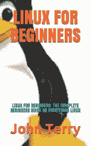

# Linux 入门指南：Linux 全方位初学者指南

Linux 操作系统工具提供了丰富的功能和安全性，使其成为与 macOS 和 Microsoft Windows 相比的极佳的灵活且（通常是）开源的选择。在正式投入使用之前，请回顾 Linux 的的一些重大最新进展以及它与之前其他更新工作系统的对比。

## 什么是 LINUX？

Linux 驱动着各种现代结构，从微型灯泡、家用手机、笔记本电脑到巨大的数据中心。Linux 驱动着你的手机，甚至是你的智能冰箱。

在现代计算领域中，Linux 提供了一个与 Windows 和 macOS 并列的工业级替代操作系统。

Linux 资源来源于 20 世纪 60 年代和 70 年代的最早操作系统之一，因此它保留了其强大的用户级安全性、可定制性和机器稳定性的核心哲学。

## LINUX 替代 Windows 或 macOS

有许多理由让你使用 Linux 替代 Windows 或 macOS，这里是其中一些：

### 你操作的是哪种 Linux 发行版？

Linux 内核就像一个引擎。而发行版则是搭载了这个引擎的真实汽车。

那么你会选择哪种 Linux 发行版呢？Linux 支持数百种发行版，每种都针对某些特定的用例进行了优化：

- `Linux Mint`：需要的专业知识较低，界面整洁、流畅，并且对于家庭 Windows 用户来说有一个熟悉的计算设备。
- `Debian`：对于那些寻求没有专源驱动、固件或软件的纯自由 Linux 发行版的人来说，Debian 非常适合你。
- `Ubuntu`：一种简单上手且流行的现代 Linux 发行版。
- `openSUSE`：一个稳定且强大的 Linux 发行版。虽然不像 Mint 和 Ubuntu 那么容易上手，但是一个很好的替代方案。
- `Fedora`：一个在最早可行机会整合所有新概念的 Linux 发行版。
- `Mageia`：从之前的 Mandriva Linux 灰烬中重生。平滑且流畅。
- `CentOS`：与 Fedora 类似，CentOS 基于企业级 Linux 发行版 Red Hat。与 Fedora 相比，它更多是为了平衡而构建的。
- `Manjaro`：基于 Arch Linux，Manjaro 在易用性和软件更新之间取得了卓越的稳定性平衡。
- `LXLE`：基于轻量级 Lubuntu 发行版，为旧硬件提供了一个功能齐全的 Linux 发行版。
- `Arch`：一种滚动更新发行版，这意味着你不需要在任何时候安装运行系统的新版本，因为它会自动更新。对于不熟悉的新用户来说需要额外花费精力，但非常高效。
- `Elementary`：适合喜欢 Mac 风格界面的人们的 Linux。

### 从 DVD 或 USB 运行 Linux

使用 Live 版 Linux DVD 或 USB 可以在不将其安装到硬盘的情况下运行 Linux。这本质上帮助你在正式安装之前查看驱动器情况，而且对于偶尔使用的人也非常合适。

## 安装 LINUX

每个 Linux 发行版都基于一个独特的安装程序，这是一个引导你配置 Linux 的软件。在大多数情况下，你是将 Linux 作为全新的操作系统安装在设备上，或者作为一个不覆盖 Windows 的独立操作系统安装。

一个典型的 Linux 发行版包含许多不同的组件。

显示管理器允许你登录，而窗口管理器则控制桌面、面板、菜单、仪表界面和中心程序。许多这些项目被打包在一起形成了一个环境。

某些 Linux 发行版仅带有一个桌面环境（尽管在软件仓库中可以使用其他环境），而另一些则提供为针对特定环境深度优化的发行版特定版本。

常见的桌面环境包括 `Cinnamon`、`GNOME`、`Unity`、`KDE`、`Enlightenment`、`XFCE`、`LXDE` 和 `MATE`。

- `Cinnamon` 是一个更传统的环境，看起来像 Windows 7，顶部有面板、菜单、托盘图标和快速启动图标。
- `GNOME` 和 `Unity` 相当相似。它们是现代环境，使用启动图标和仪表盘风格的显示来选择程序。还有与通用环境主题集成得很好的中间包。
- `KDE` 是一个经典风格的现代环境，具有许多功能和一组中心程序，这些程序可能都是可以自定义的。
- `Enlightenment`、`XFCE`、`LXDE` 和 `MATE` 是带有面板和菜单的轻量级环境。

## 有可靠的办公套件吗？

对于个人使用以及小型企业，LibreOffice 提供了一个强大的 Microsoft 办公替代方案，且免费。

LibreOffice 包含一个文字处理器，具有你从文字处理程序中预期的大多数功能。它还有一个一个体面的电子表格程序，功能齐全并包含一个基础编程引擎，尽管它与 `Excel VBA` 不一样。

其他更新包括演示文、数学、数据库和绘图包，它们都非常实用。Linux 安装软件的方式与 Windows 不同。一个包管理器访问仓库，仓库中存储了许多可以在特定发行版上运行的软件包。包控制提供了一个搜索软件、部署软件、维护软件和卸载软件的机制。

每个发行版都有自己的图形工具。许多特定的发行版使用不常见的命令行。

例如，`Ubuntu`、`Linux Mint` 和 `Debian` 都使用 `apt-get` 包管理器。`Fedora` 和 `CentOS` 使用 `yum` 包管理器。`Arch` 和 `Manjaro` 使用 `Pacman`。

### Linux 命令行

鉴于其历史背景和现代环境技术的种类，许多 Linux 仍然通过 Shell 会话运行。在 macOS 界面中，这些会话被称为终端（Terminal）；在 Windows 中被称为命令提示符（Command Prompt）。

尽管现代 Linux 图形界面几乎可以做一切，但在线 Linux 教程仍然依赖 Shell，因为它不再受限于特定发行版或窗口管理器的特性。新用户可以几乎从不通过 Shell 操作，但经常开发 Linux 的人会首先学习 Shell，因为它比点击许多独特的菜单输入一个命令流畅得多。

请记住，此列表没有特定的顺序。编译此列表的主要标准是安装便利性、硬件支持、易用性和软件应用程序的可用性。

1. `Ubuntu`
2. `流畅`
3. 特定的用户体验
4. 通过软件中心获取的大量软件应用程序
5. 关键预装

你一定听过 `Ubuntu` —— 无论如何。它是最著名的 Linux 发行版。不再仅仅局限于服务器，也是最受欢迎的 Linux 选择。

你当前位于：首页 / Linux / 可能最适合新手的优质 Linux 发行版

# 最适合初学者的 Linux 发行版

最后更新于 2020 年 11 月 28 日，作者：Aquil Roshan，298 条评论

快速介绍：它更新简单直观，提供极佳的用户体验，并预装了重要的更新以帮助你快速上手。当然，Ubuntu 在几年前主导了 Linux 体验的简化，这就是为什么尽管现在有许多新的 Linux 发行版，它依然如此受欢迎的原因。

与其他一些非基于 Ubuntu 的 Linux 发行版相比，Ubuntu 提供了一种非常现代方便的安装方式，并确保了良好的硬件兼容性。

原版 Ubuntu 基于 GNOME 桌面。尽管它很易用，但如果你是从 Windows 平台过来的，它可能不是一个熟悉的界面。在这种情况下，你可以尝试一些正统的 Ubuntu 版本，如 `Kubuntu`、`Lubuntu`，以获得类似 Windows 的用户界面。

Ubuntu 拥有优秀的文档和网络社区支持。Ubuntu 论坛和 `Ask Ubuntu` 在 Ubuntu 的几乎所有方面都提供了巨大的帮助。你可以轻松地找到常见问题的解决方案，即使你遇到了新问题，网络也会帮助你排查故障。

面对现实吧，Linux 对新用户来说可能具有很强的复杂性。这种复杂性并非 Linux 本身带来的，而是这种“新奇感”造成的。这不是怀旧，想起我第一次接触 Linux 时，我甚至认不出它是什么。我喜欢它，但首先对我来说，这就像是一次逆水行。

现在不知道从何下手可能会令人沮丧。特别是对于一个没有习惯在家庭 Windows 之外运行其他程序的人来说。

让新手感到困惑的第一点是，Linux 并不总是单一的操作系统。有数百种 Linux 发行版。我们已经解释过为什么会有这么多 Linux，所以我就不再重复了。

以下是根据特定标准详细更新的一些 Linux 发行版列表：

* 适用于 Windows 的卓越 Linux 发行版
* 优秀的轻量级 Linux 发行版
* 用于黑客的 Linux 发行版
* 用于游戏的 Linux 发行版
* 良好的隐私和匿名性 Linux 发行版
* 看起来像 MacOS 的 Linux 发行版

同样，还有一些发行版主要迎合学习者的需求。因此，我们将关注这些选项。

## 适合新手的优秀 Linux 发行版

请注意，此列表没有顺序。编写此列表的主要标准是安装的简单性、开箱硬件支持、易用性以及软件应用程序的可用性。

### 1. Ubuntu

* 简洁现代
* 特有的用户体验
* 通过软件中心提供大量的软件程序
* 预装核心软件

你一定听过 `Ubuntu` ——无论如何。它是世界上最流行的 Linux 发行版。不仅限于服务器，也是 Linux 最受欢迎的桌面选择。

它简单易，提供极佳的用户体验，并预装了重要的更新以帮助你快速上手。当然，Ubuntu 在几年前主导了 Linux 体验的简化，这就是为什么尽管现在有许多令人惊讶的 Linux 发行版，它依然如此著名。

Ubuntu 提供了一种方便的设置方法，与其他几个非基于 Ubuntu 的 Linux 发行版相比，确保了良好的硬件兼容性。

原版 Ubuntu 基于 `GNOME` 桌面。尽管它很简单，但如果你是从 Windows 平台过来的，它可能不是一个熟悉的界面。如果是这样，你可以尝试一些正统的 Ubuntu 版本，如 `Kubuntu`、`Lubuntu`，以获得类似 Windows 的用户界面。

Ubuntu 拥有著名的文档和网络帮助。Ubuntu 论坛和 `Ask Ubuntu` 在 Ubuntu 的几乎所有方面都提供了极佳的帮助。你可以轻松地找到常见问题的答案，即使你注意到某些新事物，网络也会帮助你排查故障。

### 2. Linux Mint

* 与 Windows 相似的用户界面
* 在旧硬件上表现出色
* 相比 Ubuntu 有某些改进

`Linux Mint` 可能是最适合初学者的顶级基于 Ubuntu 的 Linux 发行版。当然，它基于 `Ubuntu`，所以你可以预见到使用 Ubuntu 的相同优点。但是，它没有使用 `GNOME`，而是提供了独特的环境，如 `Cinnamon`、`Xfce` 和 `MATE`。事实上，Linux Mint 在某些方面做得比 Ubuntu 更好。

不仅是熟悉的用户界面，这对 Windows 用户来说也是一个优势。它以极低的硬件要求提供了令人印象深刻的整体性能，特别是在使用 `Xfce` 或 `MATE` 环境时。

它还使用与 `Ubuntu` 相同的软件源。你无需担心软件供应。

`Linux Mint` 是一个非常色的类 Windows 发行版。因此，如果你不再想要完全独特的界面（如 `Ubuntu`），`Linux Mint` 是一个不错的选择。

最流行的建议是 `Linux Mint Cinnamon` 版本。不过，你可能会找到你喜欢的其他。此外，你可能想通过 USB 启动 `Linux Mint 20`。

### 3. Zorin OS

* Windows 风格的用户界面
* 直观的用户体验
* 简洁
* 带有许多预设软件的完整版以及适用于旧旧电脑的 Lite 版本

`Zorin OS` 是另一个卓越的 Linux 发行版，它提供了与 Windows 类似的用户界面。虽然不是最流行的选择，但作为一个主要基于 Ubuntu 的发行版，它非常适合初学者，同时也赋予了许多酷炫的功能。

`Zorin OS` 是一个基于 Ubuntu 的发行版，但感觉非常精美。在我看来，它完美地为需要相似外观和体验但又想要惊艳效果的前 Windows 用户量身定制的。

难怪 `Zorin OS` 是可用最惊的 Linux 发行版之一。

如果你需要所有预装的“礼物”（游戏、办公套件和一些额外功能），`Zorin OS` 的最后一个版本是值得花的。然而，免费版也同样吸引人。

你还会发现一个“Lite”版本，适用于需要重生的老旧硬件。

### 4. Basic OS

* macOS 风格的用户界面
* 特别注重个性化体验
* 简单

既然我上面提到了一个漂亮的 Linux 发行版，`Basic OS` 实际上是最受欢迎的 `8504ca0e3fb5bfcdbdf1e8263f0c30ef` Linux 发行版，它的灵感源自 `macOS`。

尽管它在任何意义上都不是一个“macOS 克隆版”，但它尝试在用户体验上提供与 macOS 类似的现代感。如果你来自苹果生态，你一定会会喜欢尝试这种简单的操作系统。

再次，它是完全基于 `Ubuntu` 更新的，因此你可以获得丰富用户在体验时所享有的所有益处。

基础操作系统功能包含 `Pantheon` 桌面环境。你可以立即发现它与 macOS 的相似之处。

该操作系统的干扰极小，让你能够专心工作。它配备了少量的预装软件程序。因此，任何新手都不会被大量的臃肿软件所击退。然而，它包含了你从容器中所需的所有内容。与其他 Linux 发行版相比，应用中心更加精准。

你会发现一些基础的操作系统定制包，并且可能可以通过软件很方便地向开发者付费。

享受一个智能、简单的操作系统确实是一项极好的软件体验。

### 5. Linux Lite

- 类 Windows 用户界面
- 专为轻量级 Linux 发行版定制
- 顺滑更新

`Linux Lite` 是另一个易于使用的基于 `Ubuntu` 的发行版。它专门作为轻量级发行版定制，配备了一些不占用过多资源的预设应用程序。

`Linux Lite` 非常适合 Windows 用户，它提供了类似于 `Xfce` 桌面环境的相似界面。与之前的版本相比，`Linux Lite` 提升了用户体验。尽管它并非旨在为你提供最现代的体验，但作为一个操作系统，它看起来非常出色。

### 6. Manjaro Linux

- 不再是基于 Ubuntu 的发行版
- 基于 `Arch` 的 Linux 发行版
- 具有学习曲线

如果你需要学习一项具有学习曲线的任务，并且想要尝试除基于 `Ubuntu` 的发行版之外的其他选择，`Manjaro Linux` 是一个顶级选择。

它是基于 `Arch Linux` 更新的，但被定制为对新手友好的发行版。不过，考虑到它遵循滚动发布更新周期，你可能会遇到系统崩溃（尽管这种情况并非总是发生）。但与此列表中任何主要基于 `Ubuntu` 的 Linux 发行版相比，它在可靠性上做了折中。

你还可以获得各种软件系统的选择。还有 `AUR`，这是一个网络维护的仓库，用于存放 `Manjaro` 尚未正式更新的软件。

如果你想了解更多关于它的信息，可以查看我们对 `Manjaro Linux` 的特定评估。

`Manjaro Linux` 提供了如 `XFCE`、`KDE`、`Gnome`、`Cinnamon` 等更多环境。因此，你有多种选择。

### 7. Pop!_OS

- 与 `Ubuntu` 相比改进的用户体验
- 更多开箱即用功能，如窗口平铺辅助快速多任务处理

如果你正在寻找好看的轻量级 Linux 发行版，`Pop OS` 可能是最好的 `Ubuntu`-Linux 发行版。

与 `Ubuntu` `GNOME` 版本相比，它提供了优雅且快速的体验。你还可以获得一些有趣的功能，如自动窗口平铺、窗口堆叠以及 `Pop OS` 的其他特性。

与 `Ubuntu` 相比，你可以在 `Pop OS` 上获得原生的 `GNOME` 体验。但由于其他选项限制，它不再原生支持不同的桌面环境。因此，如果你不喜欢 `GNOME`，可以手动尝试其他环境作为实验。你可能会通过对 `OS 20.04` 的评估来探索更多信息。

### 8. Peppermint OS

- 轻量级 Linux 发行版
-流畅且简单
-具有以本地应用形式运行 Web 应用的能力

`Peppermint Linux` 对于将 Web 程序作为本地包使用的初学者来说是一个有趣的选择，得益于 `Ice` 的开箱集成。

它是完全基于 `Ubuntu` 更新的，因此在拥有 `Ubuntu` 所有优处的同时，它还提供了一些让你领先的更多选项。它虽被定位为轻量级发行版，但它在旧硬件上的运行效果实际上非常好。

### 9. Deepin

- 赏心悦目的视觉效果
- 丰富的用户体验
- 清洁更新

如果整体性能或硬件要求不再困扰你，`Deepin OS` 将是一个令人兴奋的选择。它因其赏心悦目的界面而闻名，是世界上最漂亮的 Linux 发行版之一。

当然，如果你没有不错的现代硬件配置，它会受到整体性能问题的影响。但如果设备运行良好，它是非常直观并提供了许多入门软件的。

有些人可能会指出，仅仅因为它是一个来自中国大陆的项目，你就应该避免。因此，如果你对此有意见，可以尝试 `UbuntuDDE`（它本质上是 `Ubuntu` + `Deepin` 的赏心悦目视觉效果）。

`Linux` 可能会有一点学习曲线，但这从未是让人后悔的事。去尝试吧，你会像我一样喜欢它的！

# 结束
