# Linux 初学者指南：Linux 操作系统终极指南


# 引言

感谢购买*《Linux for Beginners》*。在这本书中，我们将概述在实际开始使用 Linux 之前必须理解的概念。我们将解释你在深入了解 Linux 世界之前应当了解的各个元素。

Linux 有很多优点。然而，它也有许多小细节可能会让你感到困惑。无法理解这些细节确实会在未来给你带来问题。

在这本书中，我们将讨论这些元素是什么。我们还将讨论 Linux 是什么，它来自哪里，以及在开始构建自己的 Linux 服务器和维护自己的 Linux 系统之前必须理解的所有基本概念。此外，我们还将教给你基本终端命令，以便你能够开始在 Linux 操作系统中运行。

希望你喜欢这本书！

# 第 1 章：什么是 Linux？

在这本书中我们需要讨论的第一件事是 Linux 的起源。简而言之，Linux 是一个操作系统。对于不知道什么是操作系统的读者，或者那些以为知道但可能已经忘记操作系统定义的读者，实际上它是位于硬件和允许你在计算机上完成生产任务的软件之间的软件层。

操作系统使软件能够与硬件通信。它允许你在硬盘上存储信息，向打印机发送打印任务等。如果你在正常的 Windows 环境中——即微软 Windows 操作系统——你的硬件在底层，Windows 操作系统位于其上，然后你有例如 Microsoft Office 这样的软件位于操作系统之上。

Linux 是一个操作系统，充当物理设备和程序指令代码之间的中介——即桥梁。你需要意识到的主要一点是，在 Linux 世界中，你运行的软件类型与在 Windows 操作系统中运行的软件完全不同。像 Microsoft Office 和 Adobe Photoshop 这样的桌面应用程序通常不在 Linux 环境中运行。Linux 通常运行服务器——Apache Web 服务器、数据库服务器、Web 虚拟化服务器等。

然而，市面上有各种专为个人桌面计算机制作的 Linux 发行版。这些 Linux 发行版在某种程度上类似于 Windows 和 Mac OS，因为它们运行相同类型的程序，如文字处理程序、照片和视频编辑程序、网页浏览应用、程序开发应用、游戏等。这些 Linux 发行版更多面向只想拥有免费操作系统替代品的家庭用户。

然而，Linux 最初并非作为一个操作系统开始。Linux 是林纳斯·托瓦兹（Linus Torvalds）在赫尔辛基大学求学期间创建的一个内核。内核至关重要，但单独使用时是无用的。它只能在完整操作系统的背景下发挥作用。Linux 内核与 GNU 操作系统结合使用。想象 GNU 是一个复杂的大型拼图，中间缺少一大块——这块大的就是 Linux 内核。完整的拼图等价于一个功能完整的操作系统。

理解什么是内核很重要，因为这是 Linux 的组成部分定义。内核是操作系统的核心部分，负责将你所有应用程序接口连接到物理硬件。

当今市场上有两种主要竞争的内核——Windows 内核和类 Unix 内核。Linux 内核属于后者，BSD、Mac OS 和 Solaris 也是如此。术语“类 Unix”指的是它们运行方式类似于或基于最初的 Bell Labs UNIX 操作系统。

内核通常分为三类：

- 微内核 – 微内核仅管理它必须管理的部分：CPU、内存和 IPC（进程间通信）。如果不是 IPC、内存或 CPU，它自动被视为附件并可在用户模式下处理。
- 整体式 – 像 Linux 这样的整体式内核是微内核的对立面。它们不仅涵盖 CPU、内存和进程间通信，还涵盖其他事物，如设备驱动程序、文件系统管理和系统服务器调用。
- 混合式 – Windows 内核属于混合式，因为它具备在用户模式和监督模式下选择运行内容的能力。

因此，在 1991 年到 1994 年之间，林纳斯·托瓦兹通过将 GNU OS 与 Linux 内核相结合，创建了 Linux 操作系统。基本上，林纳斯·托瓦兹想要一个不仅免费，而且可以根据他的编程需求进行定制的操作系统。Linux 是他业余做的一个创意小项目。Linux 的一大特点是，由于它有“ux”后缀，并且你使用的许多命令看起来很像 UNIX 命令，人们认为 Linux 是一种 UNIX 操作系统。这完全不是事实。UNIX 是其自身类型的操作系统。Linux 也是其自身类型的操作系统。

林纳斯·托瓦兹从头开始创建了整个 Linux 操作系统。他创建 Linux 的原因是想为大众创建一个开源操作系统。在早期，UNIX 不是开源的。如果你想使用 UNIX，必须付钱才能使用。当然，微软 Windows 就是微软 Windows。你总是必须付费才能使用微软 Windows。

因此，作为计算机工程师的林纳斯·托瓦兹希望拥有一个完全免费的操作系统。他和他在麻省理工学院（M.I.T.）的朋友们希望拥有一个无需付费即可使用，并且能帮助他们以更高效、更简单的方式创建他们想要的计算机程序的操作系统。换句话说，他们希望拥有一个可以根据其需求定制且完全免费使用的操作系统。

关于 Linux，需要记住的一点是，尽管它是一个操作系统，但它的外观与微软 Windows 或 Mac OS 完全不同。


## 发行版

早在 20 世纪 90 年代，林纳斯·托瓦兹（Linus Torvalds）创建了 Linux 操作系统之后，他想暂时停止工作一段时间。于是，他将新操作系统的源代码完全向公众开放。这允许世界上所有人，尤其是计算机极客、科学家等，按照自己的意愿开始使用和修改 Linux 操作系统。

各大公司和教育机构决定喜欢 Linux。由于 Linux 是开源的，他们能够查看源代码。这使他们能够开始创建自己的版本。

来自加州大学伯克利分校的人们决定开始创建自己的 Linux 版本。来自中国的民众也开始创建自己的 Linux 版本。来自世界各地——各行各业——的人们开始制作符合其个人需求的 Linux 版本。如今，你拥有 Red Hat Linux、Ubuntu Linux、Google Android 以及许多其他版本。

将 Linux 的源代码向公众开放促进了被称为“发行版”或“distros”的创建。发行版是人们随着时间的推移创建的各种 Linux 版本。市面上有许多不同版本的 Linux。不同的发行版具有不同的功能。现在，当你需要决定要使用哪个 Linux 发行版时，你必须首先思考你希望你的计算机使用 Linux 做什么。

在安装 Linux 操作系统之前，理解你希望计算机做什么要重要得多。对于 Microsoft Windows，你只需先安装它，然后稍后再担心你想用服务器做什么。而对于 Linux，每个发行版都是按照特定方式构建以完成特定任务的。

例如，有一个称为 Trustix 的 Linux 版本。Trustix Linux 被认为是最安全的 Linux 操作系统。它就像一块砖头。你设置好 Trustix Linux 之后，只要你不做任何完全愚蠢的事情，就没有人能入侵它，病毒也无法进入。它只是一台坚固、安全的服务器。但是，在你获取该特定发行版并在服务器上安装之前，你必须先决定你想要一台坚固且安全的服务器。

所以，如果你想要一台可以使用一些办公应用程序或浏览互联网的计算机，那么你可能想要 Ubuntu Linux 的桌面版本。如果你想要一台超级安全的计算机，那么你可能想要 Trustix Linux。如果你想要企业级支持，假设你希望使用一个拥有技术支持中心以便在必要时提供帮助的 Linux 发行版，你可能会决定使用 Red Hat Linux。但再次强调，你必须决定你需要计算机做什么，才能确定要安装在你计算机上的确切 Linux 发行版。

如果你在所有的计算机上都安装了 Ubuntu Linux 发行版，然后你决定你需要企业支持并致电 Red Hat Linux，他们无法帮助你。Red Hat Linux 不支持 Ubuntu Linux。每个发行版都有自己的做法，并由不同的实体创建。因此，你必须先熟悉特定发行版的功能，以及它是否完全符合你的计算需求。

## 开源

既然我们基本上已经谈过 Linux 的起源，下一个我们需要讨论的话题是开源许可。当然，就在这个时候，你可能已经听说过开源软件。你可能也错误地认为开源软件就是免费软件。事实并非如此。

开源软件不是免费软件。如果你将所有开源软件都当作免费软件对待，你不仅会危及你的职业生涯，还会危及你的公司。这在法律上是错误的。因此，我们讨论开源软件以及开源软件供应商获得报酬的不同方式非常重要。

那么，开源究竟是什么意思？开源软件意味着，每当程序员坐下来开始编写软件代码时，他们向你提供代码只是为了让你看到程序是如何编写的。这不一定意味着它是免费的。那么，使用开源许可的程序员如何赚钱呢？这些开源供应商或程序员获得报酬的方式有四种。

第一种是通过开源模式，他们免费赠送软件，但当你需要该软件的培训或支持时，这时你就需要支付他们一定金额。举个例子，假设你为你的 Linux 服务器下载了 mySQL 软件。你下载了 mySQL 程序，稍微摆弄了一会儿，然后发现它极其有用且强大。

即使你已经弄懂了 mySQL 程序的大部分复杂细节，仍有某些方面是你需要学习的，或者需要支持的。因此，你去找软件开发者要求支持和培训。这时你就需要支付他们一定金额。这是这些开发者或程序员为他们的开发工作获得报酬的方式之一。

开发者或供应商通过开源许可获得报酬的第二种方式是：非商业、仅限个人使用的开源许可。这是大多数人，包括资深系统管理员，经常陷入麻烦的地方。

确实，某些获得开源许可的软件允许你免费获取程序。你可以在计算机实验室或任何类型的实验环境中使用它们，而无需担心法律后果。为什么？因为它是仅限个人或非商业用途的。

问题在于，通常让管理员陷入困境的部分，就是一旦他们将服务器从测试实验室取出并安装到生产环境中的服务器机架里，商业使用就开始生效了。

如果你是一个在家中的极客，想要摆弄软件，完全没有问题。一旦你用它来驱动业务服务器，或者例如托管一个家庭商业网站，你就必须为该软件支付许可费。

令人恐惧的是，这些许可费可能在 5,000 美元到 10,000 美元之间。就是这么昂贵。因此，只有当你意识到如何使用软件——无论是用于个人、非商业还是商业用途——才是明智的。

开源软件程序员或供应商获得报酬的第三种方式是：付费开源许可。你们中的一些人可能会问，如果一开始就是付费软件，它怎么能是开源许可的呢？好吧，如果他们让你查看代码，付费软件始终被视为开源。

基本理念是，如果你想要产品，你就向供应商或开发者支付许可费，就像你与 Microsoft、Adobe 等打交道那样购买它。这种模式下开源软件的不同之处在于，即使你购买了软件并且可以查看代码，你可能没有修改该代码的合法权利。

如果你是属于喜欢修改代码以根据你的具体需求量身定制特定软件的用户，你应该留意并避免具有这种开源模式的软件。

这些开源供应商获得报酬的第四种方式是：定期支付的开源许可费。同样，这类似于市面上大多数开源许可。他们让你免费下载和测试软件。他们甚至让你查看代码，以便你知道软件实际上是如何工作的。

然而，为了拥有合法使用软件的权利，他们必须向你收取年度费用。这通常比一次性许可费便宜，但依然昂贵。

这里有一个例子：假设你免费下载了 Foxit PDF 阅读器。你可以使用该软件，测试其最有前景的功能，甚至可以查看代码以了解它是如何做到这些的。但为了合法使用软件、完全解锁其最实用的功能，并获得技术支持，你必须向开发者支付年度定期费用。

因此，如你所见，了解开源许可的运作方式对你业务的重要性远甚于仅仅能够设置服务器。这类事情可能会给你和你的公司造成巨大损害。如果你安装了多台带有开源许可软件的服务器，并且不知道许可要求，那可能会是一个灾难性的问题。请记住，开源并不意味着免费。它与免费毫无关系。大量开源软件碰巧是免费的。然而，这并不意味着开源软件是完全免费的。

开源的含义是，你被允许查看创建该程序的源代码。这并不意味着你被允许修改源代码。你甚至可能无法对源代码做任何事情。但至少你被允许查看源代码，以便你了解发生了什么。如果有缺陷或有安全漏洞，你可以实际地在代码中看到它们。


## Linux 外壳

既然我们已经把法律层面的事情解决了，现在让我们来谈谈 Linux 操作系统的外壳。那么，什么是外壳（Shell）？操作系统的外壳是你用来与操作系统交互的界面。如果你想到的是 Microsoft Windows，那么 Windows 的外壳就是那个图形用户界面，我们在那里使用小鼠标指针来四处移动并点击桌面上的各种元素，例如文件夹、图标等。

外壳分为两种类型。第一种是图形用户界面，即 GUI。第二种被称为行用户界面，即 LUI。LUI 基本上看起来像 DOS 提示符。所以，如果你曾经玩过 Microsoft Windows 的 DOS 提示符，行用户界面正是那样。它是一个黑白屏幕，你在其中输入不同的命令以获取计算机的特定输出。

在 Linux 中，由于这是一个更多被程序员、极客、工程师或其他技术人员偏好的技术性操作系统，他们倾向于使用行用户界面。因此，当你安装 Linux 时，你既可以拥有一个像普通操作系统那样可以点击桌面元素的图形组件，也可以仅仅拥有一个行用户界面。

关于外壳，你必须记住的主要一点是，行用户界面（LUI）比图形用户界面（GUI）强大得多。然而，当你仅安装带有行用户界面的 Linux 外壳时，你得到的只是一个提示符。如果你不知道需要对命令提示符做什么，比如该操作系统的各种外壳命令，你就会陷入困境。

有很多情况是，人们安装了带有 LUI 的 Linux，但不知道任何用于 LUI 的 Linux 外壳命令。因此，基本上就是 Linux 行用户界面就是这样。你必须理解命令，才能让计算机执行你需要的任何操作。

## 根（Root）

当你准备使用 Linux 时，必须理解的下一个重要概念是 Root（根）的概念。在 Linux 中，root 涉及任何事物的最高级别。当你听到 root 用户时，它指的是计算机的管理员。Root 用户是你在计算机上能拥有的最高级别用户。

所以，如果你能以 root 身份登录，你可以对计算机做任何你想做的事情。Root 也可以指操作系统的根。这是操作系统安装在计算机硬盘上的位置。如果你从 Windows 操作系统的角度来思考，C:/ 是 Windows 操作系统的根，因为它就安装在那里。

Root 还可以指用户可以达到的最高级别。这意味着什么？在 Linux 中，用户有主文件夹。主文件夹存储用户的所有数据，如文档、设置、程序等。因此，用户的根就是他们的主目录。主目录是特定用户的最高级别。

在谈论 Linux 中的 root 时，主要需要理解的是 root 是任何事物的最高级别。实际上在 Linux 中有一个名为 root 的用户账户，该用户账户是你启动操作系统时所能拥有的绝对最高级别用户。Root 绝对可以做任何事情。它对操作系统中的所有内容拥有完全访问权限。一旦我们开始实际输入命令并让 Linux 执行某些任务，root 的概念将至关重要。

## 大小写

现在让我们来谈谈一个在从 Windows 切换到 Linux 时让每个 Windows 用户头疼的问题：大小写。基本上，你有大写字母和小写字母。在 Windows 操作系统中，它并不关心你输入的是大写字母还是小写字母。如果在 Windows 中有一个名为“Home”的文件夹，它与“HOME”、“home”或“homeE”是相同的。Windows（除了密码外）并不关心大小写。

在 Linux 世界中，请记住，Linux 是由计算机专业人士创建的。这些计算机专业人士使用 ASCII 文本编码了字母、数字、标点符号等字符。在 ASCII 文本中，例如大写的“H”实际上与小写的“h”是不同的字符。这意味着在 Linux 世界中，“Home”、“HOME”、“home”或“homeE”将被视为不同的文件夹。

假设你有一个名为“USER”的文件夹，但出于某种原因，当你尝试访问它时输入了“user”。Linux 将无法找到该文件夹，因为“user”文件夹不存在。只有带有大写字母的“USER”文件夹才存在。所以要记住，在 Linux 中大小写很重要。

这可能给你带来大问题的一个地方，你很可能在使用某些网站时已经注意到了，那就是当你输入用户名登录时。在 Linux 中，所有用户名和密码都是区分大小写的。因此，当你在 Linux 中输入用户名或密码时，请确保你没有打开大写锁定键，或者你在输入用户名和密码时没有不小心按住 Shift 键。

这其实并不复杂。只是因为人们习惯了使用 Windows，完全把使用 Windows 的习惯带到了 Linux 上，而在 Linux 中大小写至关重要。

## 服务器版 vs. 桌面版

通常，每个人都会提供两种版本的 Linux。无论你获得的是 Red Hat Linux、Ubuntu Linux、Fedora Linux 还是其他任何发行版，它们通常都会有两个版本的发行版。一个是服务器版本，另一个则是桌面版本。

任何这些 Linux 操作系统的服务器版本与桌面版本之间的主要区别在于，服务器版本是精简版的 Linux。为什么？因为他们认为，如果你要安装服务器，你就明确知道你想在服务器上安装什么。这意味着操作系统中将没有图形用户界面，而且你用来管理 Linux 的许多工具不会自动安装。

他们认为，如果你想要某个工具并且正在安装服务器，那么你就知道如何自己将该工具安装到服务器上。如果你刚开始学习 Linux，在这个阶段下载桌面版本可能对你更好。这些发行版的桌面版本一开始就提供了图形用户界面。

当你安装桌面版本时，你将能够立即使用图形用户界面来导航操作系统，很像 Microsoft Windows 或 Mac OS。你将拥有桌面图标、可以点击的文件夹等。

与 Windows 或 Mac 相比，它的运作方式会有所不同，因此你仍然必须学习如何使用 Linux。但它将是一个你一启动就能理解的环境。安装桌面版本后，你将直接进入图形环境。它已经安装了管理工具，你可以随意探索并弄清楚如何使用该图形环境。这就是桌面版本相对于 Linux 服务器版本的主要优势。

## 为什么要使用 Linux？

你应该学习 Linux 并开始部署 Linux 的原因是服务器功能。Linux 极其稳固。一旦你安装了 Linux，一旦你克服了所有怪癖并设置了所有配置，Linux 服务器就会一直运行，直到 CPU 过热而停止工作。它会不停息地运行。一个正确安装的 Linux 服务器可以连续运行一百五十天而不出任何问题。

Linux 与 Windows 完全不同，Windows 每周都需要重启以避免内存泄漏或崩溃。Linux，只要你正确配置，就会日复一日地运行并履行其职责。你应该考虑部署 Linux 的原因是服务器功能，无论是 Apache Web 服务器、MySQL 数据库服务器、虚拟化服务器、邮件服务器等。

当你设置好 Linux 服务器时，那个东西将坚如磐石。你不会遇到与 Windows 相同的问题，在 Windows 中，你今天在一台计算机上安装 Windows 运行得非常好，但随后你不断接收许多更新。两年后，计算机运行速度变慢，因为 Microsoft 提供的所有更新实际上降低了计算机本身的性能。

Linux 并非如此。一旦你安装了 Linux，它将以与你最初在计算机上安装时相同的效率履行其职责——当然，前提是你正确配置了它。

Linux 是一个真正健壮且高效的操作系统。此时，你拥有扎实的基础和对 Linux 来源及其一些基本但重要概念的深入理解是非常重要的。


## 第 2 章：安装 Linux 服务器版

在本章中，我们将讨论如何安装 Linux，以便你可以试用并大致了解如何使用 Linux 操作系统。我们将讨论 Linux 服务器版和桌面版的安装方法，让你直观地了解每种版本的安装流程。请注意，我们将使用 Ubuntu Linux 发行版的服务器版和桌面版。

在如此多的不同发行版中，Ubuntu 目前似乎是最受欢迎的一个。对于 Linux 的所有发行版，你应该明白它们各自都有独特的怪癖。Ubuntu 也不例外。

Ubuntu Linux 有一些其他发行版所没有的独特特性。整本书中我们都会使用 Ubuntu。请记住，如果你决定使用其他版本的 Linux，并尝试运行我们在后续章节中教授的一些命令，这些命令在其他版本中可能略有不同。因此，你可能需要进行一次谷歌搜索，以查看这些差异。

例如，在 Ubuntu 中，你使用 “apt-get” 命令来获取和安装应用程序或程序到 Linux 计算机上。在 Red Hat 或 Fedora 中，你使用 “YUM” 命令。基本上，归根结底，“apt-get” 和 “YUM” 命令做的是同样的事情。只是对于每个版本/发行版，命令的语法有所不同。

现在，我们将学习如何安装 Ubuntu Linux 服务器版。再次强调，Ubuntu 是完全开源的；它完全免费。无论你是将 Ubuntu 用于个人用途还是商业用途，都可以免费使用。你只需要访问 Ubuntu 网站，下载 Ubuntu 服务器版的 ISO 文件，然后将其刻录到光盘或放入 USB 闪存盘中。

为了简洁起见，我们将不会深入讨论光盘刻录过程或可启动 USB 闪存盘的创建过程。如果你不知道如何将映像文件刻录到光盘或 USB 闪存盘上，网上有很多关于如何操作教程。只需查找并按照这些教程中列出的步骤操作即可。

由于我们要安装的是服务器版本，请记住，最后我们只会得到 shell 的**行用户界面**（LUI）。换句话说，就是命令提示符处一个闪烁的光标。如果你不知道需要输入的命令，你就会陷入困境。

此时我们不会讨论这些命令。我们将做的是走完操作系统的安装过程，以便你看到并了解它是如何工作的。你可能会问自己，既然有桌面版本又有服务器版本，那么服务器版本为什么如此简陋？为什么它像 Microsoft Windows Server 操作系统那样没有任何图形用户界面？

服务器版本之所以如此简陋，是因为在计算机的所有事务中，无论你在处理 Windows、Mac OS 还是 Linux，每一个功能或特性都是黑客的攻击向量。你在计算机中增加的每一个额外功能或特性，都是黑客可能利用或操纵的潜在弱点。

以 Mac 操作系统为例：虽然 Mac 操作系统相当安全，但黑客已经学会如何入侵 Mac 操作系统正在使用的 Adobe Flash 小部件，然后通过这种方式接管计算机。即使 Mac 操作系统像砖头一样坚固，其 Adobe Flash 功能现在已成为安全漏洞，黑客可以利用 Flash 软件接管一台漂亮的 Mac 计算机。

现在，对于 Linux 服务器，由于这些将是主要 Web 服务器、数据库服务器或虚拟化服务器，你希望服务器尽可能安全。使服务器安全的方法之一，就是不给黑客任何可乘之机。你的服务器功能或特性越少，黑客入侵你系统的机会就越少。

言归正传，让我们继续安装：

- **下载** – 我们需要做的第一件事是获取 Ubuntu Linux 服务器操作系统。要获取 Ubuntu Linux 服务器版，你只需访问 http://www.ubuntu.com/。请看下图，了解 Ubuntu 网站主页的样子：


对于 Ubuntu，他们创建了多个版本以执行许多不同的任务。Ubuntu 有桌面版，有上网本版，有云版本，甚至还有手机或平板版本。现在，由于我们在寻找 Ubuntu 的服务器版本，我们将去寻找顶部说 “Server” 的链接。请点击上方 “Server”。

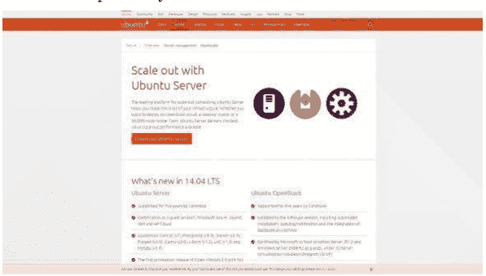

点击 “Server” 后，你将看到上述屏幕。你还会看到页面中间附近有一个橙色的矩形按钮，上面写着 “Download Ubuntu Server”。请点击该按钮。

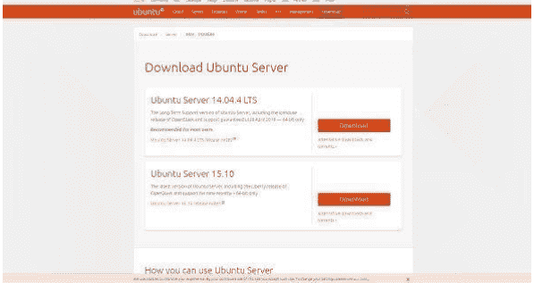

点击 “Download Ubuntu Server” 后，你将看到两个版本的 Ubuntu 服务器版：Ubuntu Server 14.04.4 LTS 和 Ubuntu Server 15.10。这两个版本的区别在于 14.04.4 LTS 版本是 Ubuntu 服务器最稳定的发布版。它拥有长期支持（Long Term Support），如果你将此版本部署在企业服务器上，并希望操作系统出现问题时获得帮助，这一点很重要。

另一方面，15.10 版本是最新鲜的版本，其中实现了大多数最新功能。然而，拥有最新功能并不意味着它是稳定的。该版本中仍然存在一些开发者正在解决的轻微怪癖，且该版本的支持期仅为九个月。

如果你为企业安装 Ubuntu 服务器并且需要最稳定的版本，你应该选择 Ubuntu Server 14.04.4 LTS 版本。如果你想玩玩操作系统的新功能并且不介意可能遇到的稳定性问题，可以选择 Ubuntu Server 15.10 版本。

现在，选择好你想安装的 Ubuntu 服务器版本后，它会询问你希望使用 64 位版本还是 32 位版本。希望你在尝试了解如何使用 Linux 时，已经理解了 64 位和 32 位之间的区别。如果你不理解这两者的区别，基本上你只需要知道，对于服务器版本，你应该尝试下载并安装 64 位版本。

如果 64 位版本无法安装在你想要安装它的计算机上，那么请下载操作系统的 32 位版本。一旦选定了要使用的版本，点击下载按钮，下载过程就会开始。请记住，文件大小约为 600 MB，因此根据你的互联网速度，可能需要一些时间。

在这种情况下，Ubuntu ISO 文件将被下载到你的计算机上。为了安装操作系统，你需要将该 ISO 文件刻录到 CD 或 DVD 上，然后将其放入计算机中。确保你的计算机从 CD 或 DVD 启动。默认情况下，计算机设置为直接启动到计算机的硬盘，那里安装着原始操作系统。

如果你想在你的计算机上安装 Ubuntu，请确保它首先从 CD 或 DVD 启动，而不是从 HDD 或硬盘启动。有很多方法可以做到这一点。但最常见的方法是按键盘上的 “DELETE” 或 “F1” 键进入主板的 BIOS 设置，在那里你可以设置希望计算机从哪里启动。不同的主板制造商进入 BIOS 设置的方法不同，因此请查阅主板用户手册了解操作方法。

- **安装** – 一旦从 CD 或 DVD 启动，系统会询问你希望以何种语言安装 Ubuntu Linux。


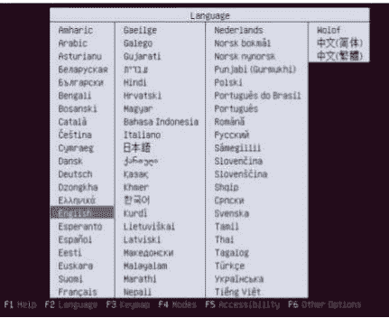

此时，只需选择适用于您的语言并按下 ENTER 键。
按下 ENTER 键后，将显示安装的各种选项。

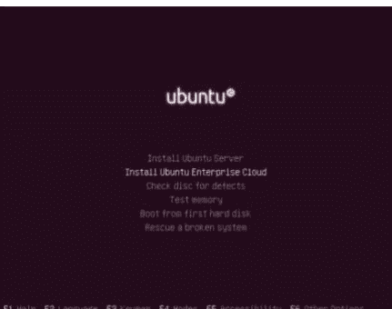

安装的各种选项包括：安装 Ubuntu 服务器、安装 Ubuntu 企业云、检查磁盘缺陷、测试内存、从硬盘启动以及修复损坏的系统。我们要做的仅仅是安装 Ubuntu 服务器。请继续操作，使用键盘上的方向键高亮显示该选项并按下 ENTER 键。

当您在键盘上按下 ENTER 键后，安装过程会要求您选择安装过程本身所使用的语言。请注意，之前要求我们选择的语言是操作系统安装完成后的操作系统语言。

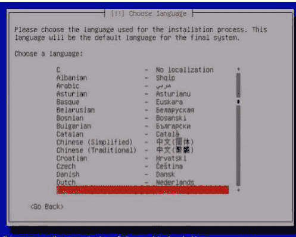

请继续操作，使用方向键选择适用于您的语言，然后按下 ENTER 键。之后，安装程序现在将要求您选择您当前所在的国家和地区或地区。

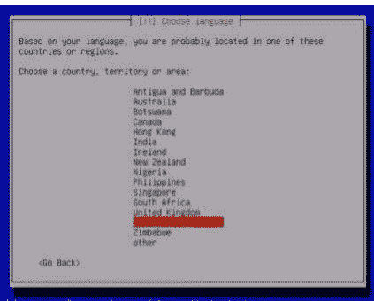

同样，使用方向键选择适用于您的国家、领土或地区，并按下 ENTER 键。接下来，它会询问您是否希望安装程序检测您的键盘布局。这是一个必要的步骤，因为如您所知，Linux 是一个国际操作系统。有些国家使用完全不同的键盘布局来输入文本。

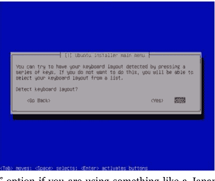

如果您使用的是类似日语、中文或其他亚洲键盘布局，请选择“是”选项。否则，请选择“否”。在您做出选择并按下 ENTER 键后，安装程序随后将询问您的键盘来源。

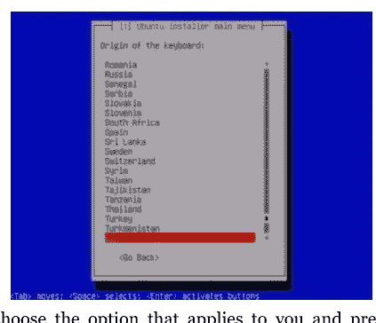

请继续操作，选择适用于您的选项并按下 ENTER 键。现在，根据您选择的键盘来源，安装程序随后将要求您选择适用于您的键盘的具体键盘布局。例如，如果您的键盘源自美国，美国键盘有许多不同的布局，如下所示：

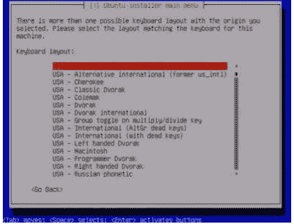

请继续操作，使用方向键选择适用于您键盘的布局，然后按下 ENTER 键。按下 ENTER 键后，您将看到安装程序将运行您刚刚选择的配置。完成后，它将开始网络配置过程。

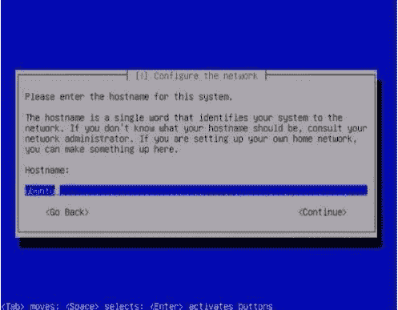

正如上面的插图所示，它现在要求您输入特定系统的主机名。基本上，这就是计算机名称。在 Windows 操作系统中，我们通常通过计算机名称来区分每台计算机。在 Linux 中，计算机名称的等价物是主机名。因此，请继续输入您喜欢的计算机名称，然后按下 ENTER 键。

按下 ENTER 键后，它将开始通过首先要求您选择时区来配置系统时钟。

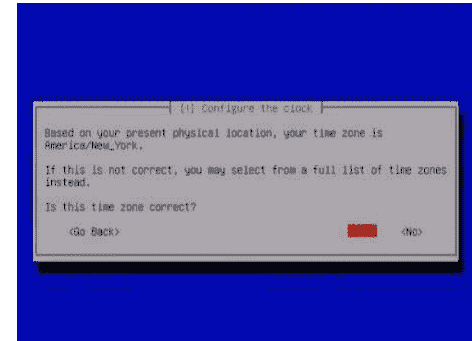

选择您的时区后，按下 ENTER 键。这样做之后，安装程序将再次实施您选择的选项。完成后，安装程序现在将询问您在安装 Linux 之前希望如何设置硬盘。

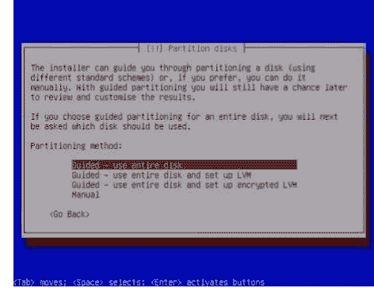

此刻，不要使用标有“引导使用整个磁盘并设置 LVM”的选项。我们将在后续章节中详细讲解 LVM。暂时，请继续选择标有“引导使用整个磁盘”的选项并按下 ENTER 键。执行此操作后，它将要求您选择磁盘分区。

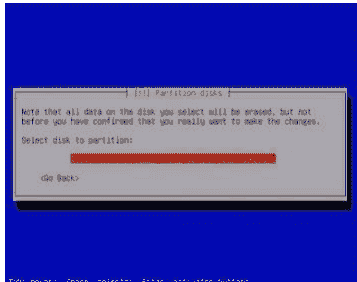

根据您计算机上硬盘的数量，此处显示的选项数量会有所不同。只需选择您希望安装 Linux 的正确硬盘并按下 ENTER 键即可。

按下 ENTER 键后，安装过程现在将询问您是否要将所做的更改——您选择的选项——写入磁盘。这基本上是 Linux 在询问您是否确定之前选择的选项以及一切是否符合您的偏好。如果是，请选择“是”选项并按下 ENTER 键。

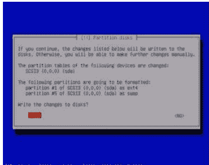

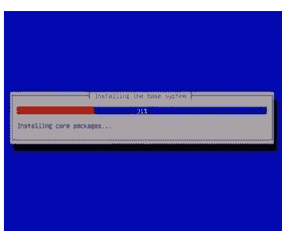

正如上面的插图所示，安装程序现在将实施您选择的所有选项。它将安装 Linux 服务器在您的系统上正常运行所需的所有核心基本文件。现在，取决于您安装的是什么类型的计算机以及什么类型的硬件，这可能是一个非常快速的过程，也可能是相对缓慢的过程。这就是 Linux 有趣的地方。您可以将其安装在任何设备上，从戴尔最现代的三千美元服务器计算机，到十二年前价值三千美元的服务器。

Linux，尤其是服务器版本，无论您的系统规格有多旧都能工作。Linux 的系统要求非常低，它甚至可以在大多数人今天认为过时的系统上运行。与微软 Windows 的系统要求相对较重不同，Linux 的系统要求极轻，您甚至可以在 USB 拇指驱动器上安装它并在任何计算机系统上从中运行整个操作系统。

当 Linux 完成核心基本文件的安装后，它将要求您输入 Linux 用户帐户的全名。

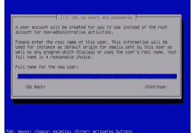

正如屏幕上所述，您的真实姓名将作为默认原始名称使用，例如当您发送电子邮件时，以及任何显示用户真实姓名的程序中。您实际上并不要求在这里输入全名。因此，对于那些不愿意写下真实姓名的人来说，不要担心。请继续输入您希望用于 Linux 帐户的任何虚构姓名。之后，安装程序现在将要求您为 Linux 帐户输入用户名。

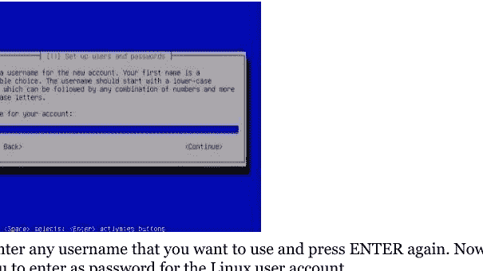

只需输入您想使用的任何用户名，然后再次按下 ENTER 键。现在，它将要求您为 Linux 用户帐户输入密码。

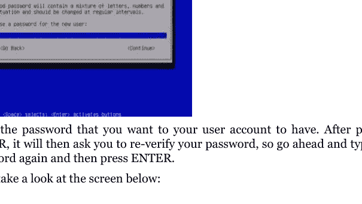

输入您希望用户帐户拥有的密码。按下 ENTER 键后，它将要求您再次验证密码，因此请再次输入密码，然后按下 ENTER 键。现在，请查看下图中的屏幕：

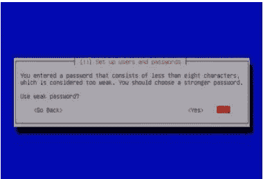

如果您收到与上述类似的屏幕，这基本上是 Linux 在告诉您您选择的密码较弱。这就是 Linux 的安全程度。它会告诉您密码较弱，并且您需要更改它，选择一个更难被黑客破解的密码。如果您收到此屏幕，只需返回并将密码替换为更复杂的密码。

在下一步中，安装过程将询问您是否想要加密配置您的主目录。加密意味着它实际上会加密——编码——您放入主目录的文件和文件夹。您的主目录基本上是 Microsoft Windows 中的文档和设置文件夹。这是您存储大多数基本文件和设置的地方。

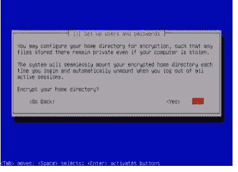

你们中的许多人可能认为一开始就启用加密是好事。然而，问题在于，由于您是 Linux 的新手，建议不要加密主目录。否则，如果您加密了主目录，然后您的 Linux 计算机崩溃，您很可能会丢失所有数据。如果您没有加密目录，并且意外做了不该做的事情并导致系统崩溃，那么您可以取出硬盘并相对轻松地恢复数据。

如果您加密该目录，它将被编码。当您的 Linux 操作系统崩溃时，由于文件是加密的，您将更难恢复数据。


系统崩溃时，你的数据也会随之丢失。为什么呢？因为系统会假设你的系统已被黑客入侵，并会通过销毁数据来防止黑客访问你的文件。因此，既然你刚开始学习如何使用 Linux，建议不要加密你的主目录。

等你熟练了之后，再加密也不迟。现在，先别这么做。

在下一步中，安装程序会询问你若要使用代理服务器，请进行配置。鉴于你还是个新手，很可能没有使用任何代理服务器，所以请保持该选项空白，选择“继续”，然后按 ENTER 键。

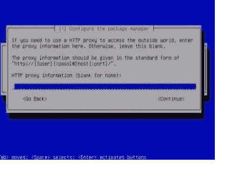

好的。现在安装程序将询问你希望 Linux 系统的更新频率。和微软 Windows 一样，Linux 也需要更新。

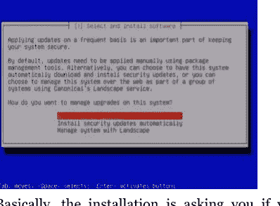

基本上，安装程序是在询问你是否希望安装自动更新。再次强调，由于你是新手，建议不要安装自动更新。正如我们之前提到的，Linux 已经非常稳定且极具安全性。如果你每隔几个月手动进行一次更新，就没问题了。手动更新能让你了解哪些特定功能或补丁被添加到了系统中，从而更好地掌控系统。

请记住，如果是自动更新，在安装过程中如果某个更新包出现问题，那么昨天还运行良好的 Web 服务器现在就会崩溃。所以，在现阶段，不要安装自动更新。

接下来，你会看到一个软件选择界面。

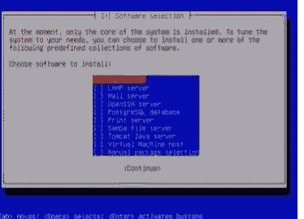

在这个步骤中，实际上是在询问你希望将系统配置为什么类型的服务器。你想让它成为 DNS 服务器吗？你想让它成为 LAMP 服务器吗？你想让它成为邮件服务器吗？

我们现在不打算做任何选择，部分原因是我们将在另一章中讨论如何操作。例如，如果你知道自己在做什么，并希望将服务器配置为 Web 服务器，那就选中 **LAMP 服务器**，按键盘上的空格键进行选择，然后按 ENTER 键。

LAMP 基本上意味着 Web 服务器。LAMP 是 **Linux Apache MySQL PHP 服务器**的缩写。当你选择此选项时，意味着它将自动安装运行该 Apache Web 服务器所需的所有组件。因为我们之前提到过，在 Linux 世界中，他们不希望你安装任何你不会使用的东西。

而在 Windows 世界中，当你安装他们的操作系统时，他们会塞进所有东西，包括厨房水槽、你家邻居的厨房水槽，以及你奶奶的厨房水槽。他们只是在安装操作系统时把所有东西都塞进去了。好处是，东西都在那里，所以你之后不需要安装很多额外软件。但缺点，正如我们之前提到的，是安装到计算机上的每一个组件都是潜在的安全漏洞。在 Linux 世界中，他们更担心安全性，所以除非你希望安装，否则不会安装任何东西。

回到我们的软件选择界面，如果你选择了某个特定选项，请取消选择。确保没有任何选项被选中，然后按 ENTER。这将是一个只有基础功能的服务器。

接下来，你会看到一个 Grub-PC 配置界面。

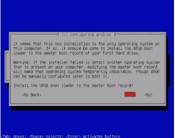

这也被称为 Grub 引导加载程序。很多人喜欢使用 Linux，他们可能热爱 Linux，甚至认为整个世界都应该运行 Linux。然而，这些人也是现实主义者。他们也知道偶尔需要使用微软 Windows。因此，他们的做法是创建双启动计算机。

双启动意味着你可以启动进入 Windows，也可以启动进入 Linux。你可以将计算机——计算机硬盘——划分为容纳 10 个不同的操作系统（如果你愿意的话）。当你启动计算机时，你可以在这 10 个操作系统之间进行选择。

现在 Grub 配置界面询问的是，你是否希望在这台特定的机器上进行双启动。双启动基本上超出了本书的范围，因为它涉及许多操作系统，不仅仅是 Linux。所以，如果你想了解双启动的具体细节，网上有很多资源可以帮助你。但就目前而言，请选择默认选项“是”，然后按 ENTER。

完成后，你会看到一个界面，提示安装已完成。

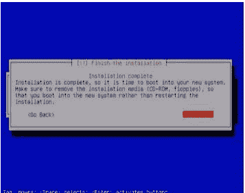

得到上述界面后，请仔细阅读说明并按 ENTER 以启动新安装的 Linux 服务器操作系统。按 ENTER 后，计算机将基本重启，然后你会看到以下界面：

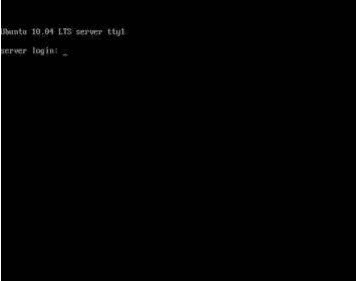

如你所见，只有一个闪烁的光标，提示你输入服务器的登录凭据。请进入你在安装过程中创建的用户名和密码，然后按 ENTER。

```
Password:
Linux server 2.6.32-21-server #32-Ubuntu SMP Fri Apr 16 09:17:34 UTC 2010 x86_64
GNU/Linux
Ubuntu 10.04 LTS
Welcome to the Ubuntu Server!
 * Documentation: http://www.ubuntu.com/server-doc

 System information as of Tue Aug 17 12:43:23 EDT 2010

 System load: 0.0      Memory usage: 5%   Processes: 82
 Usage of /: 10.1% of 7.49GB  Swap usage: 0%  Users logged in: 0

 Graph this data and manage this system at https://landscape.canonical.com/

40 packages can be updated.
 11 updates are security updates.

The programs included with the Ubuntu system are free software:
the exact distribution terms for each program are described in the
individual files in /usr/share/doc/*/copyright.

Ubuntu comes with ABSOLUTELY NO WARRANTY, to the extent permitted by
applicable law.

To run a command as administrator (user "root"), use "sudo <command>".
See "man sudo_root" for details.

server:~$
```

一旦成功输入登录凭据，屏幕上会显示简短的欢迎信息。现在你已经登录到 Linux 服务器本身了。这就是 Ubuntu 服务器。正如我们之前讨论过的，安装 Linux 服务器的用户如果不知道具体的命令来导航 Linux 命令提示符，就会陷入困境。没有图形用户界面——什么都没有。你得到的只是一个看起来像 DOS/终端的屏幕。

## 第 3 章：安装 Linux 桌面版

现在我们将讨论如何安装 Ubuntu 发行版的 Linux 桌面版本。安装完此版本后，你将获得一个美观的图形用户界面——你将能够看到文件和文件夹图标，可以点击并使用它们来导航 Linux 操作系统。它还将包含基本的应用程序，如用于在线浏览网站的网络浏览器，以及像 OpenOffice 这样的文字处理应用程序（当你需要输入文档时）。同样，安装是一个相当简单的过程；你只需点击几个按钮即可大功告成。

- **下载** – 与服务器版本一样，访问 http://www.ubuntu.com/ 并下载 Ubuntu Linux 的桌面版本。


点击顶部写着“桌面”的选项，前往可以下载 Ubuntu 桌面版本的页面。

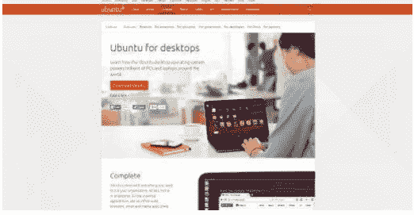

到达该页面后，点击写着“下载 Ubuntu”的橙色按钮。点击后，你会看到 Ubuntu Linux 桌面版本的两个版本：Ubuntu 14.04.4 LTS 和 Ubuntu 15.10。

我们已经在上一部分解释了这两个版本之间的区别


章节，因此请继续选择你希望使用的版本。另外，如果你注意到界面右侧，它会要求你选择该特定版本的“风味”（flavor）。这是在询问你希望使用 32 位还是 64 位版本的 Ubuntu Linux 桌面系统。只需选择适用于你系统的版本，然后点击“下载”。

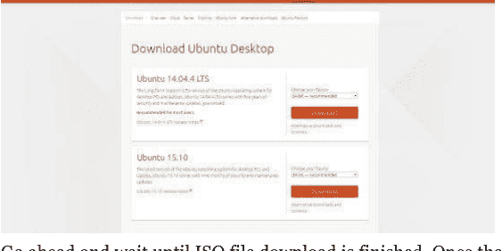

请耐心等待，直到 ISO 文件下载完成。完成后，将该 ISO 文件刻录到 CD 或 DVD 上，将其插入你想要安装 Linux 的系统，然后从它启动。现在我们将从安装过程开始。

在桌面版安装过程中，你可能会注意到一个有趣的点，即它提供了两个选项：试用 Ubuntu 或安装 Ubuntu。关于 Linux 的一个奇特之处在于，它们拥有所谓的“Live CD”（Live 光盘）。Live CD 的意思是，整个操作系统都安装在光盘上，并且可以直接从光盘运行。当你处理 Windows、Mac OS 甚至 Linux 服务器时，你总是必须先安装操作系统，它才能在计算机上工作。而使用 Live CD，你可以直接从光盘启动，并使用操作系统的所有功能，而无需安装它。你可以通过直接从光盘运行整个操作系统来进行网页浏览、文件管理、文本编辑等。

此外，如果你有一台 Windows 计算机，你可以放入一张 Linux Live CD，从中启动，并随意操作，而完全不会影响计算机本身。这是一种让用户体验特定 Linux 发行版的好方法，无需经历漫长的安装过程。

因此，回到我们的安装过程，现在请继续点击“安装 Ubuntu”。

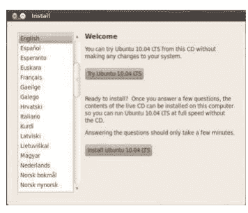

接下来，系统会要求你选择区域和时区。请选择适用于你的区域和时区，然后点击“继续”。

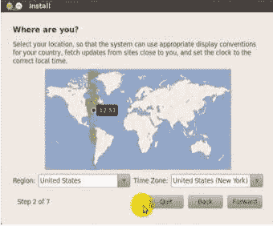

同样，就像在服务器版中一样，安装程序现在会要求你选择键盘布局。请选择适用于你的布局，然后点击“继续”。

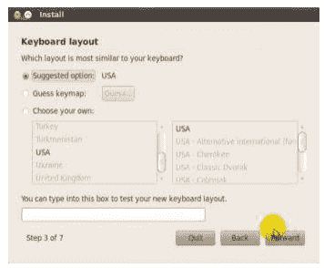

接下来，安装程序会要求在安装前准备硬盘空间。如果你希望将整个磁盘专门用于 Ubuntu，请选择标有“擦除并使用整个磁盘”的选项。然而，如果你的硬盘上还有其他操作系统，并且你想在不同的磁盘分区中安装 Linux，则应选择标有“手动指定分区”的选项。

手动指定分区涉及告诉安装过程你希望为 Linux 安装分配多少磁盘空间。目前，既然你仍然是初学者，让我们假设你只是在硬盘中单独安装 Linux，并且不进行任何分区操作。因此，请选择“擦除并使用整个磁盘”并点击继续。

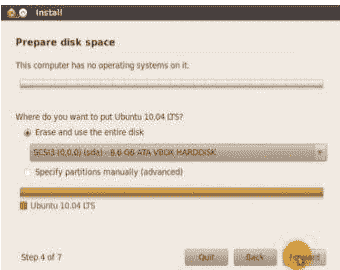

在你按下“继续”后，安装程序会询问你的名字、你想用于登录的名称、用户账户的密码以及你想给 Linux 计算机起的名称。

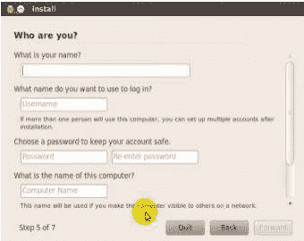

另外，如果你向下滚动一点，你会发现安装程序正在询问你，电脑启动后是否希望自动登录、登录时要求输入密码，以及登录时要求输入密码并解密你的主文件夹。最后一个选项仅适用于你安装了启用加密功能的 Linux 的情况。

请输入所需信息，然后按下“继续”。接下来，安装过程将展示你迄今为止选择的所有设置和选项，以及它即将执行的操作。如果一切看起来正常，请按下“安装”。

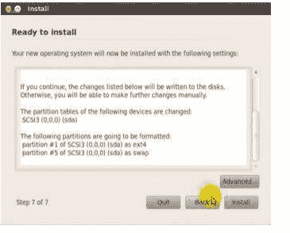

点击安装后，安装将开始进行，你会看到一个底部带有进度条的窗口。此时，请保持耐心，等待进度条达到 100%。

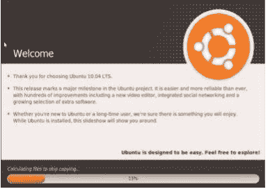

一旦进度条达到 100%，它会提示你安装已完成，你需要重启计算机以最终完成并使用新安装的系统。请继续点击“立即重启”。

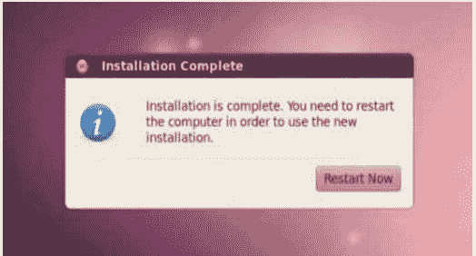

同样，完成此过程实际所需的时间将取决于你的硬件。请务必注意查看 Ubuntu Linux 操作系统桌面版的硬件要求。请记住，服务器版极度精简。实际上，它几乎不包含任何多余内容。

桌面版拥有所有这些华丽的图形和用户界面，正如你从安装程序本身就能明显看到的那样。服务器版的安装基本是文本形式的，而桌面版的安装实际上拥有图形用户界面窗口和选项按钮，你可以实际点击它们。

所有这些华丽的图形便利性实际上都需要相当不错的硬件。因此建议，如果你打算使用 Ubuntu Linux 的桌面版，你的计算机应该至少不超过五年历史，并且至少拥有 1 GB 的内存。如果低于此标准，它可能没有运行所需的资源。

但在更宏观的层面上，Linux 的桌面版与 Microsoft Windows 或 Mac OS 相比，系统要求仍然轻得多。

在计算机重启序列完成，并且你使用安装期间输入的凭据成功登录 Linux 后，你将进入 Ubuntu Linux 的桌面。

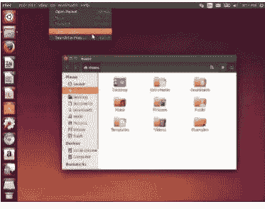

正如我们之前提到的，你现在拥有了一个乍一看有点像 Microsoft Windows 或 Mac OS 操作系统的界面。正如你一开始就能看到的，左侧有你的应用程序，例如用于网页浏览的 Firefox、用于文字处理任务的 OpenOffice 套件、你的主文件夹、Linux 设置、Amazon 等，以及许多许多更多内容。

这就是 Ubuntu Linux 桌面版。

## 第 4 章：基础 Linux 任务/命令

在本章中，我们将介绍你可以在 Linux 中执行的基础任务。我们将向你展示如何安装应用程序、如何更新应用程序、如何查看 Linux 任务管理器，以及在必要时如何终止进程，如何启动服务，等等。这些是你必须在 Linux 中执行其他任何操作之前理解的基础任务。

这里展示的所有内容都将基于 Ubuntu Linux 服务器版。这不是桌面版。你将看到的是 LUI，即行用户界面。你将在键盘上输入命令，而不是在图形用户界面中点击一堆选项。

虽然这看起来可能有点令人生畏且繁琐，但请记住，在 Linux 中，所有类型的严肃管理操作都必须在命令行上完成。毕竟，这是一个主要由程序员为程序员开发的操作系统。

即使你正在使用 Ubuntu Linux 的桌面版，除非你使用终端或命令行执行某些任务，否则它不会赋予你操作系统的全部功能。很多时候，即使你使用的是桌面版，你仍然需要打开终端屏幕并输入你需要键入的所有命令来管理系统。

### Sudo

在你开始执行其他任何命令之前，我们需要讨论的第一个命令是 "sudo"。Sudo 基本上意味着"超级用户"。在之前的章节中，我们讨论了不同的发行版在做事方式上略有不同，并且每一个 Linux 发行版都有自己的怪癖；根据自己的创建者所担心的事情，它们拥有自己独特的小习惯。

Ubuntu Linux 创建者担心的事情之一是安全性。正如我们之前讨论的，在每一台 Linux 计算机上，都有一个名为 Root 的用户。Root 是计算机上最高级别的用户。它有点类似于 Microsoft Windows 计算机中的管理员。

就像在 Windows 计算机上一样，如果有人以管理员身份登录，或者在 Linux 上有人以 root 身份登录，他们可以对那台计算机做任何他们想做的事。他们可以安装病毒、恶意软件或间谍软件，或者基本上造成很大的破坏。黑客也可以使用特殊的程序和脚本尝试以 Root 身份登录，并导致所有这些问题的发生。

为了减少黑客获取 root 访问权限的可能性，Ubuntu 创建者决定他们永远不希望任何人直接以 Root 身份登录。因此在 Ubuntu Linux 中，你不能以用户 Root 的身份登录。

现在，问题来了。既然你不能以 Root 身份登录，那么你要如何执行所有这些管理任务呢？你要如何执行管理进程？他们拥有的是一个名为 sudo 的程序。它基本上是一个命令前缀，告诉操作系统你希望以超级用户或 root 身份运行某个特定进程。

Sudo 临时授予用户管理访问权限——root 访问权限——以在 Linux 中执行关键命令。在 Windows 操作系统中，sudo 相当于每次你想在 Windows 中以管理员权限运行程序时的"以管理员身份运行"选项。


## 手册页

接下来我们需要讨论的是“man”手册页。Man pages 代表 manual pages（手册页）。关于手册页，你必须记住的是：如果你不清楚某个命令应该如何工作，或者不确定应该运行哪个命令，手册页就是查询任何命令相关信息的地方。

举个例子，假设你想查询关于 *ping* 命令的信息。你要做的是输入 *man*，然后跟上你想要弄清楚的那个命令。请查看下面的语法：

```
$ man ping
```

在 Linux 中，这将打开一个页面，向你描述 ping 命令以及你需要知道的所有关于 ping 命令的信息。因此，如果你试图弄清楚某个特定命令的工作原理，你只需要输入 *man*、一个空格，然后输入命令的名称，这会为你打开一个手册页，你可以在其中阅读关于该特定命令你想了解的任何内容。

如今，在互联网时代，进行一次简单的 Google 搜索比尝试使用 *man* 手册页要容易得多。然而，如果互联网访问中断，手边备有手册页也是很有帮助的。

在 Windows 中，手册页基本上就是旧的“问号”命令，它向你显示“帮助”页面。Linux 中手册页的唯一缺点是，它没有向你解释很多内容。它并不一定把事情弄得清晰明了。

所以，当你去手册页查询 ping 命令时，你会看到一整页的文本，这些文本会告诉你关于 ping 命令的信息。然而，一旦你在那里，你就不太知道如何退出那个页面。它既不太用户友好，也不直观。你可以按下 *Escape* 键，但那没有任何作用。你可以尝试按下 *Enter* 或 *Backspace*，但它们同样没有任何作用。

为了退出手册页，你需要输入字母“Q”代表 quit（退出）。当你输入字母“Q”时，你将会退出手册页。因此，除非你按下键盘上的每个键并反复尝试，否则你无法发现退出手册页的命令是输入字母“Q”。正如你所见，这与直觉相悖，因为大多数人习惯在 Windows 中按下 *Escape* 键来退出任何界面。

现在，假设你想知道 *ping* 命令到底是怎么回事。请执行下面的命令：

```
$ man ping
```

输入该命令并按下 ENTER 后，你会看到 ping 命令的 *man* 手册页，如下所示：

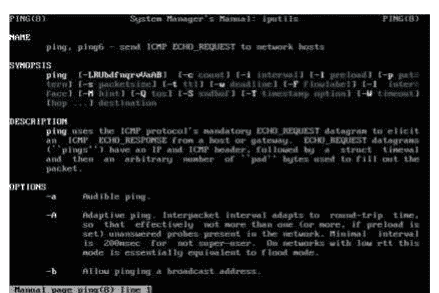

查看 ping 命令的手册页，你会看到命令描述，以及与 ping 命令相关的各种选项。这些选项基本上是 ping 命令的后缀，它们进一步增强了基本 ping 命令的功能。其中一个例子是在 ping 命令后面输入后缀“-r”以持续 ping 某个特定主机。

现在，假设你想知道 apt-get 命令到底是怎么回事。请执行下面的命令：

```
$ man apt-get
```

输入该命令并按下 ENTER 后，你会得到 apt-get 命令的手册页，如下所示：

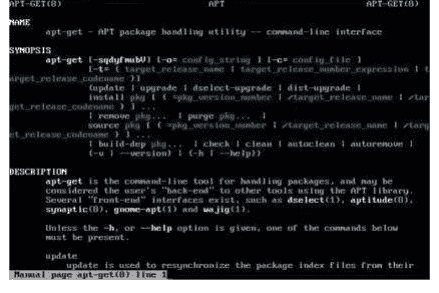

现在，这个关于 apt-get 命令的手册页将告诉你所有你需要知道关于 apt-get 命令的信息。正如我们之前提到的，这些命令的一些手册页几乎和一整本书一样长。请记住，如果你出于任何原因想要退出手册页，只需按下键盘上的 Q 即可退出。

## Tasksel

接下来我们要讨论的命令是 *tasksel*。这代表“task select”（任务选择）。Ubuntu 正努力成为 Linux 发行版的首选提供商。他们在改进 Ubuntu Linux 方面确实做了大量的工作，并且他们知道如何使事物尽可能用户友好。鉴于此，他们想到的其中一件事就是这个名为 *tasksel* 或任务选择的程序。

当你试图设置一个 Apache Web 服务器、电子邮件服务器或虚拟化服务器时，请注意，这些服务器中的每一个都需要许多不同的程序才能正常工作。因此，如果你试图设置一个 Web 服务器，你需要安装 Apache，需要安装 MySQL，需要安装 PHP，还需要安装连接器，以使它们能够实际协同工作。

Ubuntu 的创建者随后意识到，如果你需要安装这些东西，他们可以创建一个脚本来为你安装所有这些内容。因此，如果你确切知道你的服务器要做什么，而且你真的不担心使其高度定制化，你可以运行 *tasksel* 命令并选择你希望服务器成为哪种预打包的服务器类型。

Ubuntu 的创建者想出了大约十到二十个不同的服务器安装包供你选择。当你运行 *tasksel* 命令时，会发生的情况是你将会看到一个 DOS 风格的屏幕，其中列出了所有这些服务器安装包。如果你想让你的服务器成为电子邮件服务器，你只需要选择 *Email server*（电子邮件服务器），然后它会为你安装该特定服务器类型所需的所有软件。

这促进了无麻烦的安装过程。它快捷且极其用户友好。使用此命令，你可以在 30 分钟或更短的时间内拥有一个完整运行的 Apache Web 服务器。

关于这个命令，你必须记住的主要事情是你必须在命令前加上 *sudo*。你可能会问，为什么我们在执行 *man* 命令时没有加上 *sudo*？嗯，执行 *man* 命令并不一定带来安全风险。因此，它是那些不需要 *sudo* 的命令之一。

然而，对于 *tasksel* 命令，请记住我们使用此命令来安装应用程序。安装需要修改操作系统中的某些文件以容纳特定程序。如果某个黑客设法获取访问权限并执行 *tasksel* 命令来安装病毒，你将面临非常严重的问题。

Ubuntu 的创建者也意识到了这一点。他们担心人们会安装不应该安装到服务器上的软件。因此，如果你试图安装软件或执行任何管理任务，你必须在试图启动的命令前加上 *sudo*。鉴于此，为了正确执行 *tasksel* 命令，你必须输入下面的语法：

```
$ sudo tasksel
```

输入上述命令并按下 ENTER 后，你会得到下面的屏幕：

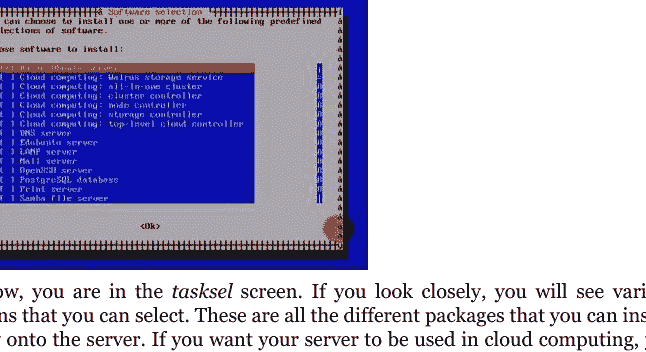

现在，你进入了 tasksel 屏幕。如果你仔细看，你会看到各种可供选择的选项。这些都是你可以轻松安装到服务器上的不同包。如果你想让服务器用于云计算，你可以选择可用的云计算选项之一。如果你想让服务器成为 DNS 服务器，你可以选择 DNS 服务器，以此类推。

一旦你高亮了所选的包，你只需按下键盘上的空格键。这会在左侧的框上打上一个星号，在某些情况下打上一个勾，然后你可以按下 ENTER。当你按下 ENTER 时，服务器将会安装使其正常工作所需的所有软件包。


此过程需要几分钟，具体时间取决于你的计算机速度。一旦过程完成，你将会拥有一个功能齐全的服务器。

## Apt-get

现在我们将讨论如何安装单个程序。关于 Linux，你必须记住的是，这是一个开源世界。大多数软件都是免费的，或者你以奇怪的方式付费，例如服务协议等。在 Windows 世界中，所有软件都必须经过激活程序。

因此，无论你是使用 Quickbooks、Adobe 还是 Microsoft 软件本身，所有人都担心有人会盗版或窃取产品。为了防止软件被盗版，他们加入了这些疯狂的激活程序，要求你拥有带有正确 CD 密钥的 CD 等。除此之外，一旦使用正确的代码安装后，你还必须去连接某个激活服务器，以便软件创建者可以验证你的安装。

在 Linux 中，他们能够创建称为仓库（repositories）的东西。仓库是互联网上的地方，其中托管着成千上万的 Linux 程序。因此，你不必拥有某种磁盘，只需访问该仓库并从中安装应用程序即可。

在 Windows 或 Mac OS 中，你必须拥有软件的 CD 或 DVD。如果你丢失了那个磁盘，你就倒霉了。在 Linux 中，所有软件或大部分软件都存放在这些仓库中。只要你有互联网连接，你就可以直接从这些仓库获取软件。这是在 Linux 平台上安装软件的最简单方法。

在 Linux 中还有其他安装应用程序的方式，我们将在后续章节中讨论它们。但现在，由于我们仍在讨论基础知识，我们将只关注从仓库安装。

基本上，在 Linux 计算机内部，已经有一个配置文件告诉该 Linux 计算机仓库在哪里。当你运行 apt-get 命令时，这个 apt-get 命令会前往仓库，获取你想要获取的程序并将其为你安装。

要正确执行 apt-get 命令，只需输入下面的语法：

```
$ sudo apt-get install <name of program>
```

假设你想在你的服务器上安装 Apache2 程序。只需输入下面的命令：

```
$ sudo apt-get install Apache2
```

输入上述命令并按下 ENTER 后，Linux 将会前往位于互联网上的仓库，找到 Apache2 程序，然后将其安装到你的 Linux 计算机上。就是这么简单。

现在，假设你决定不想要 Apache2，而想使用不同的 Web 服务器。好吧，卸载 Apache2 的命令是：

```
$ sudo apt-get remove Apache2
```


这将用于卸载你 Linux 计算机上的 *Apache2*。就是这么简单。这就是你安装和卸载 Linux 服务器所需的大多数软件的方法。随着你变得更加熟练并获得更多使用 Linux 的经验，你将开始在 Linux 世界中购买专有软件。

你可能会购买专门的备份软件，或者也许是专门的安全软件。其中一些类型的程序可能不在软件仓库中，你可能需要采取不同的步骤来安装这些程序。但对于任何人安装到 Linux 上的 99% 的程序，这个 *apt-get* 命令都适用。

这些仓库中有成千上万个 Linux 程序。弄清楚你想要安装哪些程序可能会有点棘手。如果你不知道在你的 Linux 计算机上哪些程序是最好的，最好的做法就是就此进行谷歌搜索。你会发现许多推荐给初学者的优秀 Linux 程序。

正如你现在可能已经知道的那样，每个人都嘲笑微软 Windows 背后的人们，因为他们总是有这些更新。每周的第三天或每个月，你至少会收到 10 个系统更新。很多人说这些更新是微软很糟糕的证据。然而，现实是每一个操作系统或软件都需要时不时地更新。Linux 也是如此。

因此，一旦你在 Linux 服务器上安装了所有你想要的软件并想要更新它们，你所需要做的就是使用 *upgrade* 命令。请参阅下方的语法：

```
$ sudo apt-get upgrade
```

上述命令的作用是比较仓库中的程序是否比你服务器上的版本更新。如果你拥有的程序版本比仓库中的版本旧，它会下载该信息并询问你是否希望更新你的软件。如果你选择“是”，它会自动更新你计算机上的所有软件。

关于安装和维护软件，目前你基本上需要理解的就是这些。

## 服务

正如我们之前提到的那样，Linux 最适合服务器。一旦你启动 Linux 服务器，它们就可以一直运行，直到硬件故障，字面意思上就是如此。一旦你启动 Linux 系统，你实际上需要重启它的次数非常少。当我们说非常少的时候，我们指的是一年一次；而这已经是过度了。

然而，当你进入并更改正在你的服务器上运行的软件中的配置文件时，你可能需要重启该单个软件或该单个服务。假设你在 Linux 服务器上安装了 *Apache2* 并更改了一些配置文件。这些配置文件直到你重启 *Apache2* 服务时才会被加载。

尽管计算机一直开机，但你不得不时不时地重启服务，以确保它们是最新的。我们现在将了解如何启动、停止和重启服务。

在此，你需要使用以下语法中的 stop（停止）：

```
$ sudo /etc/init.d/<name of the program or service> start
$ sudo /etc/init.d/<name of the program or service> stop
$ sudo /etc/init.d/<name of the program or service> restart
```

因此，假设你更改了服务器上 *Apache2* 程序中的配置文件，并且需要重启它。只需输入：

```
$ sudo /etc/init.d/Apache2 restart
```

这将重启 *Apache2* 服务，从而使你所做的任何配置更改生效。现在，假设你正在摆弄 Web 服务器，你正在做一些更改，并且你不想让外界的人在你进行更改时进入。因此，你希望完全停止服务，这基本上会使 Web 服务器离线。你要做的只是：

```
$ sudo /etc/init.d/Apache2 stop
```

上述命令停止了 Web 服务。然而，它不会停止其他任何东西。这意味着，虽然外界任何人都无法访问你托管的网站，但你仍然可以更改配置文件、编辑选项、修改设置等。此时，只有实际的 Web 服务器组件不在运行。

现在让我们看看在 Linux 命令提示符下实际执行时的样子。

```
Welcome to the Ubuntu Server!
* Documentation: http://www.ubuntu.com/server/doc

System information as of Fri Aug 20 11:42:30 EDT 2010

System load: 0.14
Usage of /: 11.2% of 7.49GB
Memory usage: 14%
Swap usage: 0%
Processes: 66
Users logged in: 0
IP address for lo: 127.0.0.1
IP address for eth0: 10.0.2.15

Graph this data and manage this system at https://landscape.canonical.com/

@server: $
```

现在我们在 Linux 服务器操作系统的命令提示符或终端处。在这个例子中，让我们假设你的系统上安装了 Apache2，并且你想要停止该服务。你应该做的第一件事是输入单词 sudo，在 sudo 后加一个空格，然后输入 /etc/init.d/Apache2，再在后面加一个空格，然后是单词 stop。

在你输入上述命令并按下 ENTER 之后，你会看到下面的屏幕：

```
Welcome to the Ubuntu Server!
* Documentation: http://www.ubuntu.com/server/doc

System information as of Fri Aug 20 11:42:30 EDT 2010

System load: 0.14
Usage of /: 11.2% of 7.49GB
Memory usage: 14%
Swap usage: 0%
Processes: 66
Users logged in: 0
IP address for lo: 127.0.0.1
IP address for eth0: 10.0.2.15

Graph this data and manage this system at https://landscape.canonical.com/

@server: $ sudo /etc/init.d/apache2 stop
* Stopping web server apache2
apache2: Could not reliably determine the server's fully qualified domain name, using 127.0.1.1 for ServerName
... waiting [ OK ]
@server: $ _
```

正如你在上面的屏幕中看到的，Linux 已成功停止该服务。此时，该 Web 服务器托管的域名在互联网上不可访问。网站当前处于离线状态。要启动服务，你只需要输入我们停止服务时输入的相同命令，只不过在末尾将 stop 替换为 start 即可。

```
Welcome to the Ubuntu Server!
* Documentation: http://www.ubuntu.com/server/doc
System information as of Fri Aug 20 11:42:30 EDT 2010
System load: 0.14
Processes: 66
Usage of /: 11.2% of 7.49GB Users logged in: 0
Memory usage: 14%
IP address for lo: 127.0.0.1
Swap usage: 0%
IP address for eth0: 19.0.2.15

Graph this data and manage this system at https://landscape.canonical.com/
@server: $ sudo /etc/init.d/apache2 stop
* Stopping web server apache2
apache2: Could not reliably determine the server's fully qualified domain name,
using 127.0.1.1 for ServerName
... waiting...
[ OK ]
@server: $ sudo /etc/init.d/apache2 start
* Starting web server apache2
apache2: Could not reliably determine the server's fully qualified domain name,
using 127.0.1.1 for ServerName
[ OK ]
@server: $
```

重启服务——自动启动和停止服务——只需输入相同的命令。唯一的例外是，在末尾不是输入 *start* 或 *stop*，而是输入 *restart*。再次强调，Linux 中这一点非常棒的是，你不必重启整个服务器。

如果你重启整个服务器，无论操作系统有多快，在一切恢复在线之前都需要几分钟。如果你只需要重启服务，一切将在几秒钟内恢复在线。

```
Welcome to the Ubuntu Server!
* Documentation: http://www.ubuntu.com/server/doc
System information as of Fri Aug 20 11:42:30 EDT 2010
System load: 0.14
Processes: 66
Usage of /: 11.2% of 7.49GB Users logged in: 0
Memory usage: 14%
IP address for lo: 127.0.0.1
Swap usage: 0%
IP address for eth0: 19.0.2.15

Graph this data and manage this system at https://landscape.canonical.com/
@server: $ sudo /etc/init.d/apache2 stop
* Stopping web server apache2
apache2: Could not reliably determine the server's fully qualified domain name,
using 127.0.1.1 for ServerName
[ OK ]
@server: $ sudo /etc/init.d/apache2 start
* Starting web server apache2
apache2: Could not reliably determine the server's fully qualified domain name,
using 127.0.1.1 for ServerName
[ OK ]
@server: $ sudo /etc/init.d/apache2 restart
* Restarting web server apache2
apache2: Could not reliably determine the server's fully qualified domain name,
using 127.0.1.1 for ServerName
apache2: Could not reliably determine the server's fully qualified domain name,
using 127.0.1.1 for ServerName
[ OK ]
@server: $
```


## 顶部（Top）

接下来我们需要讨论的是 `top` 命令。如果你来自 Windows 世界，可以把 `top` 命令基本上看作是任务管理器。因此，如果你在 Linux 命令提示符中输入 `top`，你会看到内存的使用量、CPU 的使用量，以及当前系统上正在运行的所有进程。

你会看到所谓的进程 ID 或 PID、每个进程的 CPU 使用率、每个进程的内存使用率、进程已运行了多长时间等。所以基本上，`top` 命令就是 Linux 操作系统的任务管理器。

在 Windows 任务管理器中，如果有一个进程正在运行而你需要终止它，你只需使用鼠标右键单击并选择“结束进程”。在 Linux 的 `top` 中，如果你需要终止或杀死某个特定进程，你只需输入以下语法：

```
$ K <PID>
```

因此，正如你从上面的命令语法中看到的，你只需输入字母 K 和进程 ID 号即可。例如，如果你看到进程 1578 正在做愚蠢的事情，你只需输入：

```
$ K 1578
```

输入该命令将终止该特定进程。Linux 中的每个进程都有自己唯一的进程 ID 号。因此，如果某个特定进程正在做它不该做的事情，用户通过 PID 识别并终止该进程非常容易。

请记住，kill 或 terminate 命令仅在 `top` 内部有效。如果你不在 `top` 任务管理器内，kill/terminate 命令本身无法工作。如果你试图终止的特定进程对于 Linux 服务器正常运作非常重要，系统会告诉你该进程无法被杀死/终止。如果是这种情况，你可能需要进行“一年一次”的重启才能终止该进程。

因此，为了查看 `top` 任务管理器，你只需输入以下命令：

```
$ sudo top
```

输入该内容后，你将看到如下屏幕：

```
top - 11:50:20 up 30 min, 1 user, load average: 0.00, 0.00, 0.00
Tasks: 64 total, 1 running, 63 sleeping, 0 stopped, 0 zombie
Cpu(s): 0.02us, 9.62sy, 0.02ni, 90.42id, 0.02wa, 0.02hi, 0.00si, 0.02st
Mem: 505720k total, 158636k used, 346884k free, 113276k buffers
Swap: 367344k total, 0k used, 367344k free, 107496k cached

PID USER PR NI VIRT RES SHR S CPU MEM TIME+ COMMAND
1489 root 20 0 19132 1340 1048 R 9.0 0.6 0:00.3 top
1 root 20 0 25376 1824 1264 S 0.0 0.7 0:00.9 init
2 root 20 0 0 0 0 S 0.0 0.0 0:00.00 kthreadd
3 root RT 0 0 0 0 0 S 0.0 0.0 0:00.00 migration/0
4 root 20 0 0 0 0 S 0.0 0.0 0:00.00 ksoftirqd/0
5 root RT 6 0 0 0 0 S 0.0 0.0 0:00.00 watchdog/0
6 root 20 0 0 0 0 S 0.0 0.0 0:02.57 events/0
7 root 20 0 0 0 0 S 0.0 0.0 0:00.00 khelper
8 root 20 0 0 0 0 S 0.0 0.0 0:00.00 kthread
9 root 20 0 0 0 0 S 0.0 0.0 0:00.00 kswapper
10 root 20 0 0 0 0 S 0.0 0.0 0:00.00 kua:migr
11 root 20 0 0 0 0 S 0.0 0.0 0:00.00 gmac-mqdes
12 root 20 0 0 0 0 S 0.0 0.0 0:00.00 hbl-default
13 root 20 0 0 0 0 S 0.0 0.0 0:00.00 kthredefauld
14 root 20 0 0 0 0 S 0.0 0.0 0:00.00 kthreadd
15 root 20 0 0 0 0 S 0.0 0.0 0:00.00 kthreadd
16 root 20 0 0 0 0 S 0.0 0.0 0:00.00 kswapd0
17 root 20 0 0 0 0 S 0.0 0.0 0:00.00 kcapit_waitify
18 root 20 0 0 0 0 S 0.0 0.0 0:00.00 kacpi_hotplug
19 root 20 0 0 0 0 S 0.0 0.0 0:00.00 kacpid
20 root 20 0 0 0 0 S 0.0 0.0 0:00.00 kacpid
21 root 20 0 0 0 0 S 0.0 0.0 0:00.00 kacpi_sysd
22 root 20 0 0 0 0 S 0.0 0.0 0:00.00 kacpi
```

上面的插图展示了 *top* 任务管理器的样子。如果你仔细看，可以看到计算机的运行时间、任务总数、当前 CPU 使用率、内存使用率、缓冲区交换文件等。这基本上提供了与微软 Windows 操作系统中的任务管理器相同的信息。

你现在可以看到，在顶部有进程 ID 1489，用户是 root。如果你看该行最右侧，你会看到进程 ID 1489 实际上是 *top* 任务管理器进程。你还可以看到 CPU 使用率、内存使用率以及 *top* 进程已经运行了多长时间。

现在，如果你想更好地理解如何使用 *top* 命令，你可以输入字母“H”。输入字母 *H* 将显示你可以在 *top* 命令中使用的不同命令。

```
Help for interactive Commands - procps version 3.2.8
Windows [1-Def]: Cumulative mode: Off, System: Delay 3.0 sec(s): Secure mode: Off.

Z,B Global: 'Z' change color mapping; 'd' disable/enable bold
1,u,m Toggle Summaries: 'i' load avg; 't' tasks/cpu stats; 'm' mem info
1,i Toggle SMP view; 'I' single/separate tasks; 'F' Irx/Stats mode

f,o Fields/Column: 'f' add or remove; 'o' change display order
F,o 0 Select sort field
v,<,> Move sort field: '<' next col left; '>' next col right
R,B Toggle: 'R' normal/reverse sort; 'H' show threads
c,i,S Toggle: 'c' cmd name/line; 'i' idle tasks; 'S' cumulative time
s,d Toggle highlights: 's' sort field; 'f' running tasks
t,z,b Toggle: 't' color/mono; 'b' bold/reverse text only if 'x' or 'y'

o or # Set maximum tasks displayed
k,r Manuplate tasks: 'k' kill; 'r' renice
d or s Set update interval
Q Write configuration file
q Quit

( commands shown with '.' require a visible task display window )
Press 'h' or '?' for help with Windows.
any other key to continue.
```

输入 *H* 后你看到的基本上是 *top* 命令的帮助页面。它显示了你可以在 *top* 环境中使用的所有子命令。要返回到主要的 *top* 环境，只需按任意键。

现在，假设你想杀死/终止一个进程。让我们假设你想杀死 *top* 任务管理器以退出它。再次强调，你可以看到 *top* 的进程 ID 是 1489。首先，输入 *K*，然后它会询问你要杀死哪个 PID。

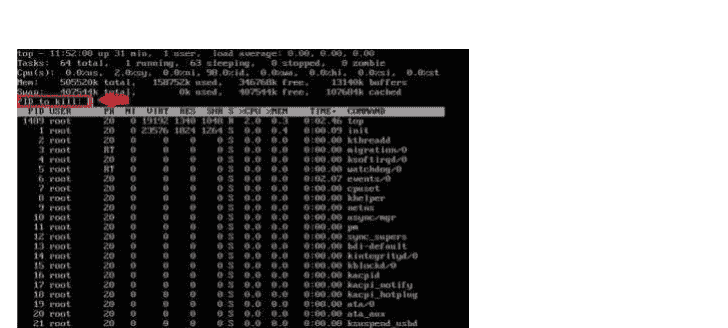

当它询问你要杀死哪个 PID 时，输入 $1489$ 然后按 ENTER 键。然后它会要求你再次确认你是否确实要杀死进程 $1489$。

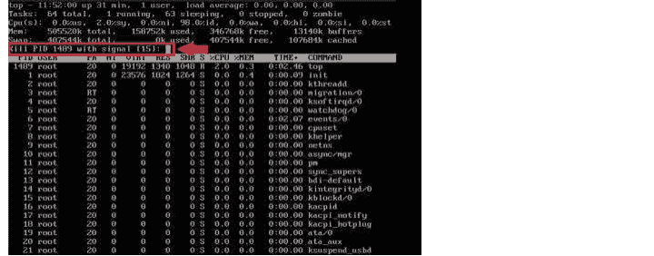

再次按 ENTER 以终止 top 任务管理器并返回 Linux 命令提示符。就是这么简单。

# 第 5 章：Linux 基础导航

现在我们需要讨论 Linux 操作系统中的基本文件夹导航。这与微软 Windows 略有不同。然而，有趣的事情是，它看起来与 Windows 足够相似，以至于当事情不对劲时，人们会有拿起电脑扔出窗外的冲动。

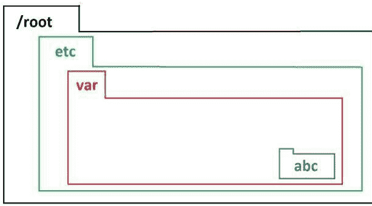

以上面的图表为例。在 Linux 中，你也拥有 *cd* 命令。就像在 Windows 中一样，*cd* 命令代表更改目录。如果你想转到另一个目录或文件夹，你输入 *cd*。如果你在一个文件夹中，比如在我们图中你在 *var* 文件夹中，并且你想进入 *var* 文件夹内的一个文件夹，在这个例子中是 *abc* 文件夹，你只需输入以下命令：

```
$ cd abc
```

所以，这是 *cd*，一个空格，然后是你想要进入的文件夹的名称。这将把你带入你试图进入的文件夹。现在，问题是，来自 Windows 世界的人习惯于在 *cd* 命令后面加上正斜杠符号。如果我们将其应用于之前的命令，它看起来会像下面这样：

```
$ cd /abc
```

在这种情况下，Linux 会将正斜杠符号解释为 *根* 文件夹。Linux 会认为你想更改到 *根* 文件夹，然后在 *根* 文件夹中寻找 *abc* 文件夹。当然，一旦 Linux 执行此命令，它将无法找到现有的 *abc* 文件夹，因为实际上，*abc* 文件夹位于 *var* 文件夹中。这就是你必须极其小心的地方。

这就是为什么许多 Linux 管理员总是输入完整路径的原因


无论他们想要前往何处，也不管他们目前身在何方。如果 Linux 管理员试图进入并更改 `abc` 文件夹中的某些内容，他们只需输入以下命令：

```bash
$ cd /etc/var/abc
```

Linux 对这种更改目录的语法非常挑剔。正如我们之前提到的，在 Linux 中大小写至关重要。如果你试图访问一个名称全为小写的文件夹，而你输入的名称全是大写，Linux 将无法找到该文件夹；它会提示该目录无法找到。

理解这一点对你来说至关重要。如果你没有掌握这一概念，可能会感到非常沮丧。

```text
Welcome to the Ubuntu Server!
> Documentation: http://www.ubuntu.com/server/doc

System information as of Fri Aug 29 11:57:13 EDT 2010
System load: 0.0 Processes: 66
Usage of "/": 11.2% of 7.49GB Users logged in: 0
Memory usage: 14% IP address for lo: 127.0.0.1
Swap usage: 0% IP address for eth0: 10.0.2.15

Graph this data and manage this system at https://landscape.canonical.com/
@server:~$ cd /_
```

因此，在 Linux 中浏览文件和文件夹时，你要做的第一件事就是确保自己位于根目录。为此，你必须输入以下命令：

```bash
$ cd /
```

这就是 `cd`，一个空格，然后是一个正斜杠。如果你当前不在根目录，这将自动将你带到根目录。接下来合乎逻辑的步骤是查看根文件夹内部有哪些文件夹。为此，你必须输入以下命令：

```bash
$ ls
```

`ls`（即 list，列表）命令将列出特定目录内的所有文件和文件夹——在本例中是根目录。

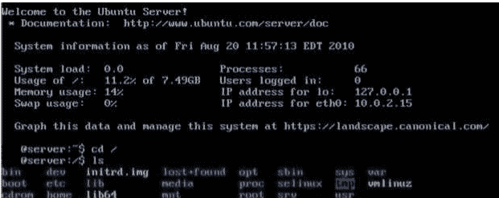

如图所示，在输入 `ls` 命令后，Linux 现在将显示根目录内的所有文件夹。你可以看到许多文件夹，例如 `bin`、`dev`、`opt`、`sbin`、`sys`、`var`、`boot`、`etc`、`lib` 等等。

现在，假设我们要进入 `etc` 文件夹。你只需要输入以下命令：

```bash
$ cd etc
```

上述命令会自动将你带入 `etc` 文件夹。如果你查看命令提示符旁闪烁的光标，它会显示 `/etc`。这是你确实进入了目标文件夹的主要标志。如果你再次执行 `ls` 命令，它将显示 `etc` 文件夹内的所有文件。

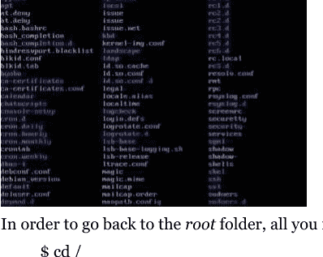

为了返回根文件夹，你只需输入：

```bash
$ cd /
```

无论你深入文件夹多少层，这都会自动将你返回到根目录。

现在假设你想返回 `etc` 文件夹。但这次，你没有用小写输入 `etc`，而是用了全大写。

```text
@server:/etc$ cd /
@server:/$ ls
bin   dev   initrd.img  lost+found  opt   sbin    sys  var
boot  etc   lib         media     proc  selinux tmp  vmlinuz
cdrom home  lib64       mnt       root  srv     usr
@server:/$ cd ETC
-bash: cd: ETC: No such file or directory
```

如图所示，Linux 无法找到全大写的 ETC 目录。为什么？因为 Linux 区分大小写。在 Linux 世界中，大写字母与小写字母是不同的。基本上，这就是 Linux 基础导航的全部内容。

## 第 6 章：使用 Vim 编辑 Linux 文件

本章介绍 Linux 中用于文件编辑的 Vim。在处理 Linux 系统时，编辑配置文件是一件极其重要的事情。如果你希望某个软件执行特定功能，或者你想要自定义某些内容，几乎总是需要打开一个小型配置文件并实际对其进行编辑。无论是 PHP.ini 文件，还是密码文件，或者是 .htaccess 文件，基本上 Linux 系统中的所有配置都保存在一个简单的文本文件中，你需要编辑这些文件才能使系统执行不同的操作。

现在，市面上有许多不同的编辑器，很多人使用它们来编辑 Linux 中的配置文件。我们将讨论 *Vim*，它是 Linux 上最强大的文件编辑器之一。

你需要理解的一个重要事情（由于你们大多数人来自 Windows 操作系统）是，在 Linux 中，没有文件关联。我们的意思是，在 Windows 中，文件名后始终带有文件扩展名——关联。例如，如果你有一个名为 *Notes* 的 Microsoft Word 文档，你会发现它的文件扩展名是 *.doc* 或 *.docx*。因此，它的完整文件名将是 Notes.doc 或 Notes.docx。

文件扩展名告诉 Windows 操作系统使用什么程序来打开该文件。在 Linux 中，没有文件关联。这是大多数人害怕使用 Linux 的主要原因之一；完全没有文件关联。基本上，你只拥有一个文件名。仅此而已。

现在你可能会问，“你怎么知道它是文本文件还是其他类型的文件？” 这实际上是 Linux 的一个奇怪之处。他们期望你，作为系统管理员，知道该文件是什么。因此，如果你要修改文本文件，请理解它们不会有 .txt 文件扩展名。它只是一个文件名。在你使用文件编辑器软件编辑该文件之前，必须首先理解需要修改的是哪个文件。

Linux 中的所有配置文件都必须使用文件编辑器进行编辑。如果你不懂如何在 Linux 中编辑文档或文本，你将寸步难行。

### 启动 Vim

现在，我们需要谈谈如何启动 *Vim*，特别是如何用它打开或创建文件。这很直接。你要做的第一件事是输入命令 *sudo*，后跟一个空格，然后是单词 *vim*，再跟一个空格，然后是你想要打开的文件名。

```bash
$ sudo vim <filename>
```

请注意，单词 *vim* 是全小写的。请记住：在 Linux 中大小写至关重要，因此确保以小写输入 *vim*。当你输入想要打开的文件名时，同样的规则也适用。

这就是使用 *Vim* 打开文件所需的全部操作。例如，如果你试图打开 *PHP.ini* 文件，只需输入以下命令：

```bash
$ sudo vim php.ini
```

现在，如果你试图创建新文件，“$ sudo vim <filename>” 语法也可以创建文件。因此，如果你在命令提示符中输入该命令，它将同时创建文件并打开它。考虑到这一点，打开文件和创建文件使用完全相同的命令。

对于阅读本书的具有使用其他版本 Linux 经验的某些用户来说，你们可能注意到可以不加 *sudo* 运行 *vim* 命令。在 Ubuntu 发行版中，不加 *sudo* 运行 *vim* 的问题在于，有时它会正常运作，有时则不会。这是一个具体情况具体分析的问题，有些配置文件可以在不使用 *sudo* 的情况下打开并编辑，而有些则无法正确编辑。

你可能会遇到一些问题，例如，如果你只用 *vim* 和文件名打开配置文件，在完成编辑后你将无法保存该文件。为什么？因为你没有以管理员身份打开该文件。这就是为什么在执行 Linux 关键任务时，始终使用 *sudo* 被认为是良好的实践。

### 更改文件所有权

由于我们要使用 *Vim* 编辑配置文件，文件所有权是另一个我们需要留意的重要事项。那么我们基本上所说的文件所有权是什么意思？请记住，你在 Linux 系统上安装的大多数软件都来自其各自的开发者。换句话说，它们来自外部来源。当你将它们安装到 Linux 系统上时，该软件所有文件的所有权在技术上仍然属于开发者。

现在，问题在于：在 Linux 中，除非你是文件的所有者，否则你无法编辑任何文件。例如，当你在 Linux Web 服务器上安装 *Apache2*、*MySQL* 或 *PHP* 时，与该软件相关的所有文件都由 *root*（与文件来源相关的用户）所有。如果你试图进入并编辑其中一些文件，很多时候你将无法编辑它们，因为你不是所有者。

因此，如果你要编辑配置文件，你应该做的第一件事是将所有权从当前所有者更改为你自己，以简化你的生活。为此，你只需输入此命令：

```bash
$ sudo chown <username> <filename>
```

上述命令中的 *username* 指的是你想要更改权限的用户名。*Filename* 则指的是你想要更改所有权的文件名。

假设你的用户名是 *reader*，你想更改名为 *notes* 的所有权。你只需输入以下命令语法：

```bash
$ sudo chown reader notes
```

一旦这样做，你将成为该文件的所有者，从而拥有编辑该文件的权限或能力。

[/content]
</think>

[content]
无论他们试图前往何处，也不管他们目前身在何方。如果 Linux 管理员试图进入并更改 `abc` 文件夹中的某些内容，他们只需输入以下命令：

```bash
$ cd /etc/var/abc
```

Linux 对这种更改目录的语法非常挑剔。正如我们之前提到的，在 Linux 中大小写至关重要。如果你试图访问一个名称全为小写的文件夹，而你输入的名称全是大写，Linux 将无法找到该文件夹；它会提示该目录无法找到。

理解这一点对你来说至关重要。如果你没有掌握这一概念，可能会感到非常沮丧。

```text
Welcome to the Ubuntu Server!
> Documentation: http://www.ubuntu.com/server/doc

System information as of Fri Aug 29 11:57:13 EDT 2010
System load: 0.0 Processes: 66
Usage of "/": 11.2% of 7.49GB Users logged in: 0
Memory usage: 14% IP address for lo: 127.0.0.1
Swap usage: 0% IP address for eth0: 10.0.2.15

Graph this data and manage this system at https://landscape.canonical.com/
@server:~$ cd /_
```

因此，在 Linux 中浏览文件和文件夹时，你要做的第一件事就是确保自己位于根目录。为此，你必须输入以下命令：

```bash
$ cd /
```

这就是 `cd`，一个空格，然后是一个正斜杠。如果你当前不在根目录，这将自动将你带到根目录。接下来合乎逻辑的步骤是查看根文件夹内部有哪些文件夹。为此，你必须输入以下命令：

```bash
$ ls
```

`ls`（即 list，列表）命令将列出特定目录内的所有文件和文件夹——在本例中是根目录。


如图所示，在输入 `ls` 命令后，Linux 现在将显示根目录内的所有文件夹。你可以看到许多文件夹，例如 `bin`、`dev`、`opt`、`sbin`、`sys`、`var`、`boot`、`etc`、`lib` 等等。

现在，假设我们要进入 `etc` 文件夹。你只需要输入以下命令：

```bash
$ cd etc
```

上述命令会自动将你带入 `etc` 文件夹。如果你查看命令提示符旁闪烁的光标，它会显示 `/etc`。这是你确实进入了目标文件夹的主要标志。如果你再次执行 `ls` 命令，它将显示 `etc` 文件夹内的所有文件。


为了返回根文件夹，你只需输入：

```bash
$ cd /
```

无论你深入文件夹多少层，这都会自动将你返回到根目录。

现在假设你想返回 `etc` 文件夹。但这次，你没有用小写输入 `etc`，而是用了全大写。

```text
@server:/etc$ cd /
@server:/$ ls
bin   dev   initrd.img  lost+found  opt   sbin    sys  var
boot  etc   lib         media     proc  selinux tmp  vmlinuz
cdrom home  lib64       mnt       root  srv     usr
@server:/$ cd ETC
-bash: cd: ETC: No such file or directory
```

如图所示，Linux 无法找到全大写的 ETC 目录。为什么？因为 Linux 区分大小写。在 Linux 世界中，大写字母与小写字母是不同的。基本上，这就是 Linux 基础导航的全部内容。

## 第 6 章：使用 Vim 编辑 Linux 文件

本章介绍 Linux 中用于文件编辑的 Vim。在处理 Linux 系统时，编辑配置文件是一件极其重要的事情。如果你希望某个软件执行特定功能，或者你想要自定义某些内容，几乎总是需要打开一个小型配置文件并实际对其进行编辑。无论是 PHP.ini 文件，还是密码文件，或者是 .htaccess 文件，基本上 Linux 系统中的所有配置都保存在一个简单的文本文件中，你需要编辑这些文件才能使系统执行不同的操作。

现在，市面上有许多不同的编辑器，很多人使用它们来编辑 Linux 中的配置文件。我们将讨论 *Vim*，它是 Linux 上最强大的文件编辑器之一。

你需要理解的一个重要事情（由于你们大多数人来自 Windows 操作系统）是，在 Linux 中，没有文件关联。我们的意思是，在 Windows 中，文件名后始终带有文件扩展名——关联。例如，如果你有一个名为 *Notes* 的 Microsoft Word 文档，你会发现它的文件扩展名是 *.doc* 或 *.docx*。因此，它的完整文件名将是 Notes.doc 或 Notes.docx。

文件扩展名告诉 Windows 操作系统使用什么程序来打开该文件。在 Linux 中，没有文件关联。这是大多数人害怕使用 Linux 的主要原因之一；完全没有文件关联。基本上，你只拥有一个文件名。仅此而已。

现在你可能会问，“你怎么知道它是文本文件还是其他类型的文件？” 这实际上是 Linux 的一个奇怪之处。他们期望你，作为系统管理员，知道该文件是什么。因此，如果你要修改文本文件，请理解它们不会有 .txt 文件扩展名。它只是一个文件名。在你使用文件编辑器软件编辑该文件之前，必须首先理解需要修改的是哪个文件。

Linux 中的所有配置文件都必须使用文件编辑器进行编辑。如果你不懂如何在 Linux 中编辑文档或文本，你将寸步难行。

### 启动 Vim

现在，我们需要谈谈如何启动 *Vim*，特别是如何用它打开或创建文件。这很直接。你要做的第一件事是输入命令 *sudo*，后跟一个空格，然后是单词 *vim*，再跟一个空格，然后是你想要打开的文件名。

```bash
$ sudo vim <filename>
```

请注意，单词 *vim* 是全小写的。请记住：在 Linux 中大小写至关重要，因此确保以小写输入 *vim*。当你输入想要打开的文件名时，同样的规则也适用。

这就是使用 *Vim* 打开文件所需的全部操作。例如，如果你试图打开 *PHP.ini* 文件，只需输入以下命令：

```bash
$ sudo vim php.ini
```

现在，如果你试图创建新文件，“$ sudo vim <filename>” 语法也可以创建文件。因此，如果你在命令提示符中输入该命令，它将同时创建文件并打开它。考虑到这一点，打开文件和创建文件使用完全相同的命令。

对于阅读本书的具有使用其他版本 Linux 经验的某些用户来说，你们可能注意到可以不加 *sudo* 运行 *vim* 命令。在 Ubuntu 发行版中，不加 *sudo* 运行 *vim* 的问题在于，有时它会正常运作，有时则不会。这是一个具体情况具体分析的问题，有些配置文件可以在不使用 *sudo* 的情况下打开并编辑，而有些则无法正确编辑。

你可能会遇到一些问题，例如，如果你只用 *vim* 和文件名打开配置文件，在完成编辑后你将无法保存该文件。为什么？因为你没有以管理员身份打开该文件。这就是为什么在执行 Linux 关键任务时，始终使用 *sudo* 被认为是良好的实践。

### 更改文件所有权

由于我们要使用 *Vim* 编辑配置文件，文件所有权是另一个我们需要留意的重要事项。那么我们基本上所说的文件所有权是什么意思？请记住，你在 Linux 系统上安装的大多数软件都来自其各自的开发者。换句话说，它们来自外部来源。当你将它们安装到 Linux 系统上时，该软件所有文件的所有权在技术上仍然属于开发者。

现在，问题在于：在 Linux 中，除非你是文件的所有者，否则你无法编辑任何文件。例如，当你在 Linux Web 服务器上安装 *Apache2*、*MySQL* 或 *PHP* 时，与该软件相关的所有文件都由 *root*（与文件来源相关的用户）所有。如果你试图进入并编辑其中一些文件，很多时候你将无法编辑它们，因为你不是所有者。

因此，如果你要编辑配置文件，你应该做的第一件事是将所有权从当前所有者更改为你自己，以简化你的生活。为此，你只需输入此命令：

```bash
$ sudo chown <username> <filename>
```

上述命令中的 *username* 指的是你想要更改权限的用户名。*Filename* 则指的是你想要更改所有权的文件名。

假设你的用户名是 *reader*，你想更改名为 *notes* 的所有权。你只需输入以下命令语法：

```bash
$ sudo chown reader notes
```

一旦这样做，你将成为该文件的所有者，从而拥有编辑该文件的权限或能力。


## 编辑与导航

既然你已经知道如何使用 Vim 打开文件，接下来你需要理解的是如何使用 Vim 修改文件。在编辑 Vim 文件时，你会首先注意到的是，如果你使用箭头键移动光标并开始输入以编辑文件，什么也不会发生。原因在于你必须进入 Vim 的插入模式。

为了进入 Vim 的插入模式，你只需输入字母“a”。一旦这样做，你就能开始编辑并在文件中输入你的修改内容。当你完成对文件的修改后，要退出插入模式，只需按下键盘上的 ESC 键。

接下来，如果你正在编辑一个配置文件，特别是像 php.ini 或其他主要配置文件，请记住这些通常是篇幅很长的文档。如果你试图在那份极长的文件中编辑单个单词或值，仅找到那个单词或值本身就可能是一项枯燥的任务。

为了在 Vim 中查找内容，有两个简单的命令可以帮助你轻松完成任务。首先，确保你已退出插入模式。一旦退出插入模式，请继续输入以下命令：

```
:/ <name>
```

这是冒号，后跟一个正斜杠，然后是一个空格，接着是你试图在要修改的文件中查找的单词或值。再次提醒，大小写至关重要。请确保你正确大写名称，否则 Linux 将无法找到你在找的内容。如果它确实找到了什么，那也必定是错误的对象。

此命令的作用是从你当前所在的位置——即你的光标处——一直向下搜索整个文档的剩余部分。它会查找你在搜索命令中输入的单词或值。现在，关于搜索的一个重要事项是你可以使用通配符。

假设你要在配置文件中查找单词 max。为了查找 max，你需要输入以下搜索命令：

```
:/ max
```

现在，大多数 Linux 专家在查找文件中的特定字符串时会做的一件事是，在字符串名称的前后加上通配符，具体来说就是星号符号。命令的样子将如下所示：

```
:/ *max*
```

上述命令的含义是，你正在寻找任何中间包含 max 的内容；无论它是字符串的一部分还是独立的字符串。因为有时候如果字符串前后有空格或少量字符，在执行搜索命令时可能不会显示出来。这就是在这些情况下使用通配符的目的。

请注意，使用正斜杠时，$Vim$ 将从光标所在处向下搜索。那么，如果你已经到达文件末尾且未找到你要找的内容怎么办？此时，你的光标位于文件末尾。为了从光标所在处向上搜索，只需输入以下命令：

```
:/? <name>
```

这是冒号，后跟一个正斜杠，再后跟一个问号，一个空格，以及你要查找的字符串或值。这将使搜索从光标所在处向上进行。

现在，如果在 $vim$ 文件中存在多个你要查找的字符串或值的实例怎么办？当你执行搜索时，$Vim$ 会自动停留在你要查找的字符串或值的第一个实例上。要移动到下一个实例，你只需按下键盘上的字母 \"$n$\"。这相当于 Windows 操作系统中的“查找下一个”功能。如你所见，在 $Vim$ 中导航非常容易。上述所有命令就足以在 $Vim$ 中打开、导航、搜索和编辑文件。

## 退出与保存

接下来我们需要讨论的是如何在 Vim 中打开、退出和保存文件。到目前为止，我们讨论的是从命令行提示符打开 Vim 文件。现在，让我们讨论如何在 Vim 内部打开其他 Vim 文件。

如果你需要打开一个文件，并且你已经在 Vim 中——也就是说你需要切换到另一个文件——只需输入以下命令：

```
`:e <filename>`
```

这是冒号，后跟小写字母 e，一个空格，然后是文件名。再次提醒，执行此操作时请确保你已退出插入模式。如果你在插入模式下输入此命令，会发生的情况是 Vim 只会将该命令输入到文件本身中。它不会被解释为打开不同文件的命令。

这就是在 Vim 内部打开另一个 Vim 文件所需的全部内容。现在，假设你打开了一个文件并在其中四处查看。但随后，你决定不想更改任何内容，并且需要退出该文件。在这种情况下，你需要输入以下命令：

```
`:q`
```

这是冒号，后跟小写字母 q。此命令将使你退出 Vim。当然，你必须在输入每个命令后按下 ENTER 键才能执行它们。

有时你也必须强制退出 Vim。可能会出现 Vim 失去响应或拒绝接受正常退出命令的情况。在这些情况下，你希望强制 Vim 退出。要做到这一点，你必须在小写字母 q 后面加一个感叹号。

```
`:q!`
```

无论 Vim 是卡住了还是对其他命令失去响应，在小写字母 q 后加感叹号肯定能让你退出 Vim 应用程序。只有在其他方法都无效时才使用此命令。请记住，如果你正常退出 Vim（使用 :q 或 :q! 命令），在你尝试执行退出命令之前如果没有先保存更改，那么你正在编辑的文件中的任何更改都不会被保存。

现在，假设由于某种原因 Vim 锁定了，而你已经对文件进行了大量修改。当然，为了不必重新进行所有修改，你希望在退出前保存文件。在这种情况下，你需要输入以下命令：

```
`:wq`
```

这是冒号，后跟小写字母 w，再后跟小写字母 q。小写字母 w 代表“写入”（保存），小写字母 q 代表“退出”。因此，这会在退出 Vim 之前先保存你对文件所做的任何更改。

接下来，假设你对文件做了一些更改，但不希望保存到原始文件中。所以你基本上是在尝试执行“另存为”命令。要做到这一点，只需输入以下命令：

```
:w <new filename>
```

这是冒号，后跟小写字母 w，一个空格，然后是你想要创建并保存的新文件名。此命令将你编辑的文件保存为新文件。当你不想覆盖原始文件且因某种原因需要保留它时，这特别有用。

## 第 7 章：高级 Linux 导航

在本章中，我们将讨论高级 Linux 导航。在第 5 章中，我们已经讨论了如何在 Linux 中更改目录。现在，我们将讨论如何在 Linux 中查找文件夹、如何创建和删除目录、如何复制文件，最后是如何在 Linux 中挂载驱动器。

### 更改目录与查找文件

在上一章中，我们讨论了如何使用 *Vim* 编辑配置文件，这在 Linux 中非常基本。现在，当你坐在那里查看文件系统时，你可能根本不知道这些配置文件最初在哪里。例如，如果你想要编辑 *php.ini* 文件，作为一个 Linux 初学者，你可能会问，*php.ini* 文件位于哪里？

因此，为了找到你想编辑的任何特定文件，你首先必须学会如何到达该文件所在的文件夹或目录。再次强调，要更改目录，你只需要使用 *cd* 命令，就像在 Windows 中一样。更改目录的语法是：

```
$ cd <name of folder>
```

现在，这个命令比表面看起来的要复杂。请记住，Linux 在对命令语法进行解释时非常字面化。再次，让我们使用下面的图表：

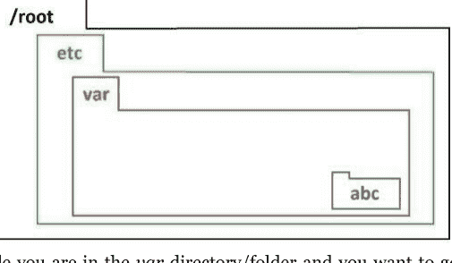

例如，如果你当前在 *var* 目录/文件夹中，并且想要进入 *abc* 文件夹，你只需输入：

```
$ cd abc
```

现在，如果例如你当前在 *var* 文件夹中，并且想要进入 *etc* 文件夹，仅仅从 *var* 内部输入 `$ cd etc` 是行不通的。因为那样 Linux 会认为你想进入 *var* 文件夹内部的 *etc* 文件夹，而那个文件夹并不存在。

你必须输入以下命令：

```
$ cd /etc
```

注意目录名称前的正斜杠。这个正斜杠将告诉 Linux 首先进入 *root* 目录，然后找到 *etc* 文件夹或目录。这样，Linux 现在就能成功地将你带到 *etc* 文件夹，因为它能够在 *root* 目录中定位到它。


现在，考虑一下上面的示例图表。假设你位于*根*目录，想要进入*www*目录。如果你输入：

```
$ cd www
```

Linux 将无法带你进入 *www* 目录；它会提示该目录不存在。为什么？因为记住，你当前位于 *root* 目录。就 Linux 而言，此时 *root* 目录内只有两个文件：*etc* 和 *var*。要从 *root* 目录进入 *www* 目录，你必须输入：

```
$ cd /var/www
```

现在你可能会问，上述命令中第二个斜杠是否会把你带回 *root*？不会。Linux 仅将第一个斜杠解释为 *root* 目录。第二个斜杠将被解释为一条指令，指示从它前面的目录中寻找紧随其后的目录。

这里还有一个例子：假设你位于 *www* 目录，想要进入 *etc* 目录。如果你输入：

```
$ cd etc
```

此命令将无法正常工作。请记住，你当前位于 *www* 目录。就 Linux 而言，*www* 目录内部并没有 *etc* 目录。为了使其正常工作，你必须输入以下命令：

```
$ cd /etc
```

因此，再次说明，斜杠的第一次出现将被 Linux 解释为首先前往 *root* 目录的指令。一旦进入 *root* 目录，它随后会找到 *etc* 目录。当然，由于 *etc* 目录确实存在于 *root* 文件夹内，此命令将成功带你进入 *etc* 目录。

## 列出/显示文件

现在，当你进入某个目录后，了解该目录中还有什么其他内容始终很重要。要在 Linux 中列出文件，只需使用 *ls* 命令即可。

```
$ ls
```

然后，根据你的需求，你可以应用两个参数之一。如果你执行：

```
$ ls -l
```

将会列出所有的文件和文件夹。此外，它还会显示这些文件和文件夹的权限、修改日期、文件/文件夹的组所有权以及单独的所有者。

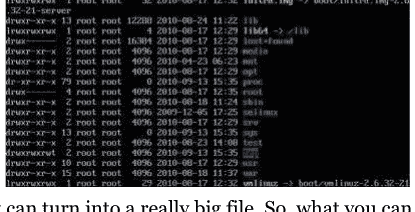

很多时候，这可能变成一个非常大的文件列表。因此，你还可以输入：

```
$ ls -m
```

这次，Linux 不会给你一个长长的列表，而是将所有信息打印在一个整洁的块中，以便你可以查看关于文件和文件夹的每一处细节。这就是在 Linux 中列出文件和文件夹所需的全部操作。

现在，假设你想编辑一个关键的配置文件，但你完全不知道该文件在哪里。幸运的是，Linux 确实提供了搜索选项。为了搜索文件和文件夹，你只需输入：

```
$ sudo find -iname <文件/文件夹名>
```

这就是 *sudo*，一个空格，后面跟着 *find* 一词，再一个空格，参数 *-iname*，再一个空格，最后是你正在查找的文件或文件夹的名称。现在你可能会问，*-iname* 参数是做什么的？它的作用是让搜索不区分大小写。

记住，就像我们从第 1 章开始所提到的，在 Linux 中大小写很重要。由于你是 Linux 新手，你可能不知道哪些文件是大写字母，哪些是小写字母。如果在搜索参数中加入 *-iname*，无论文件的大写或小写情况如何，它都能定位到你正在查找的文件或文件夹。

例如，如果你在查找名为 home 的文件夹，并使用带有 -iname 参数的搜索命令，它将返回所有以 home 为文件夹名的文件夹。无论该文件夹命名为 Home、homeE、hOme、HOme、hoME 还是 HOME，它都会出现在搜索结果中。

相反，如果你搞错了正在查找的文件或文件夹名称的大小写，且未使用 -iname 参数，搜索可能会返回无结果，因为没有任何文件或文件夹匹配该大小写格式。

此外，在 Linux 中执行 find 命令时，不要忘记 sudo 命令。如果你不在开头加上 sudo，find 命令将以一种非常烦人的方式失败，即它不会告诉你失败了。它只是简单地不给你任何结果。因此，你会以为计算机上不存在该文件，而实际上它确实存在，只是你没有使用 sudo。

对于你要查找的任何文件或文件夹，在进行搜索时也可以将通配符与其名称一起使用。在第 6 章中，我们简要讨论了在 Vim 中搜索字符串时使用星号通配符的方法。在查找 Linux 文件系统中的文件和文件夹时，你也可以使用星号通配符。

如果在文件或文件夹名称前加一个星号，意味着你在查找该特定文件或文件夹名称“之前”的任何内容。假设你正在尝试在 Linux 中定位一个配置文件。在 Linux 中，所有配置文件都有 .conf 后缀。如果你在查找一个配置文件，但忘记了确切名称，你可能希望调出所有以 .conf 为后缀的文件。在这种情况下，你只需输入以下命令：

```
$ sudo find -iname *.conf
```

此命令将查找文件名或文件夹名以任何内容开头并以 .conf 结尾的文件。那么，如果你知道要查找的文件名，却不知道后缀怎么办？在这种情况下，你需要输入以下命令：

```
$ sudo find -iname php*
```

此命令将查找以 php 开头并以任何内容结尾的文件名或文件夹名。

## 创建、删除、移动、复制、重命名

现在我们需要讨论在 Linux 中创建、删除、移动、复制和重命名文件和文件夹。我们要做的第一件事是讨论创建文件夹。这很直接。你只需输入：

```
$ sudo mkdir <目录/文件夹名>
```

这就是 sudo，后面跟一个空格，然后是 mkdir 参数，再一个空格，最后是你想要创建的文件夹或目录的名称。正如你可能已经猜到的，*mkdir* 代表“make directory”（创建目录）。

请记住，如果你没有提供目录的完整路径，此命令将简单地在你当前所在的目录内创建该目录或文件夹。

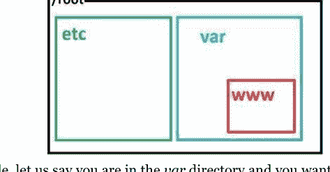

例如，假设你位于 var 目录，想要在 *etc* 目录内创建一个 *Notes* 文件夹。如果你输入：

```
$ sudo mkdir Notes
```

此命令将只是在 *var* 目录中创建 *Notes* 文件夹。要在 *var* 内部于 *etc* 目录中创建 *Notes* 文件夹，你必须输入完整的路径，如下所示：

```
$ sudo mkdir /etc/Notes
```

这样，Linux 会先进入根目录，然后进入 etc 目录，并在 etc 目录内创建一个 Notes 文件夹。输入完整的文件路径将确保无论你位于文件系统的哪个位置，都能将文件夹创建在正确的位置。这就是在 Linux 中创建文件夹或目录所需的全部操作。

删除文件或文件夹同样简单。你只需输入以下命令：

```
$ sudo rm <文件或文件夹名>
```

这就是 sudo，一个空格，后面跟着字母 rm，再一个空格，最后是你想要删除的文件或文件夹的名称。你可能已经猜到，rm 代表 remove（移除）。例如，假设你想删除一个名为 Notes 的文件。你只需输入：

```
$ sudo rm Notes
```

然而，删除文件夹稍微不同。你实际上仍然遵循与删除文件相同的语法。唯一的区别是，在删除文件夹时，你必须在命令末尾添加 *-R* 参数。参数 *-R* 代表 recursive（递归）。通过使用递归参数，你基本上是在告诉 Linux 对该文件夹的内容执行相同的操作。

假设你想删除包含三个文件的 *www* 文件夹。为此，你只需输入：

```
$ sudo rm www -R
```

此命令不仅会删除文件夹本身，还会删除其中的三个文件。如果你在删除文件夹命令的末尾没有添加递归参数，Linux 将无法成功执行它，因为如果你不删除内容，就无法删除文件夹。唯一能在没有递归参数的情况下成功删除文件夹的情况是，该文件夹最初就是空的。

在 Linux 中，严格来说没有专门用于重命名文件和文件夹的命令。取而代之的是“重命名”，我们在 Linux 中有 *move*（移动）命令。例如，假设你有一个名为 *file1* 的文件，你想将其名称更改为 *file2*。为此，你必须输入以下命令语法：

```
$ sudo mv <旧文件名> <新文件名>
```

这就是 *sudo*，一个空格，后面跟着字母 *mv*，再一个空格，原始文件的名称，再一个空格，最后是新的文件名称。因此，回到我们的例子，如果你想将名称 *file1* 更改为 *file2*，你必须输入：

```
$ sudo mv file1 file2
```

此命令会将 *file1* 的名称更改为 *file2*。它在技术上仍然是重命名文件。但在 Linux 中，我们使用 *move*（移动）这一术语。那么，关于在文件夹之间移动文件呢？同样的语法仍然适用。然而，你不仅要输入文件和文件夹的名称，还必须指明完整路径。

假设你想将一个位于 *var* 文件夹内的名为 *file1* 的文件移动到 *root* 目录中的 *etc* 文件夹。为此，你必须输入以下命令：

```
$ sudo mv /etc/var/file1 /etc/file1
```

这就是 *sudo*，一个空格，后面跟着代表移动操作的字母 *mv*，再一个空格，源文件的准确文件路径，再一个空格，最后是目标路径的准确文件路径。就是这么简单。

复制是 Linux 中的另一项重要任务。很多时候，特别是当你处理配置文件时，在你开始对原文件进行修改之前，必须创建一个备份文件。否则，如果你搞乱了原文件，你可能会损坏与该文件关联的程序


要在 Linux 中复制文件，你只需输入：

```
$ sudo cp <name of the file> <name of the copied file>
```

那就是 *sudo*，一个空格，接着是代表复制的字母 *cp*，又一个空格，你想要复制的文件的名称，再一个空格，最后是副本文件的名称。所以，假设你想复制一个名为 *file10* 的文件。你只需输入：

```
$ sudo cp file10 file10.bak
```

这里，*file10.bak* 是 *file10* 的副本文件的名称。正如你所见，在 Linux 中复制文件非常容易。

## 挂载驱动器

为了在 Linux 中进行导航，你必须理解的最后一个重要概念是挂载驱动器。当你有一个外部硬盘，将其插入计算机，并需要挂载该驱动器才能浏览其内容时，就是这种情况。那个外部硬盘可以是普通硬盘、闪存驱动器或 CD-ROM 驱动器。在 Linux 中，闪存驱动器和 CD-ROM 驱动器被视为硬盘。

基本上，任何连接到计算机的驱动器都需要被挂载。你必须理解的第一件事是 Linux 中的挂载过程是如何工作的。挂载过程如下：

- **步骤 1** – 连接硬盘。
- **步骤 2** – 为你的挂载点创建一个文件夹。
- **步骤 3** – 获取有关硬盘的一些特定信息，然后将挂载点文件夹指向该硬盘。

这基本上就是你挂载驱动器的方法。挂载点文件夹现在与硬盘绑定在一起。由于它们绑定在一起，你可以通过挂载点文件夹浏览硬盘的内容。

那么，你实际上如何在命令提示符中创建挂载点文件夹？很简单：只需键入以下命令：

```
$ sudo mkdir /mnt/<name of mount point folder>
```

请注意我们在这里创建的 /mnt 目录。要知道，/mnt 是 Linux 中的标准挂载目录。这个挂载目录是通用的。如果你愿意，可以使用不同的挂载目录。然而，使用 /mnt 被认为是一种最佳实践，因为大多数 Linux 管理员和程序员默认都会使用它。

现在，假设你想将一个连接的硬盘挂载到一个名为 drive1 的挂载点。为此，你只需键入：

```
$ sudo mkdir /mnt/drive1
```

通过键入上面的命令，你正在创建你的硬盘将要被挂载到的文件夹。一旦你这样做，接下来你要做的是找出你试图挂载的硬盘的信息。为此，你只需运行以下命令：

```
$ sudo fdisk -l
```

上述命令将列出连接到你的系统的所有物理硬盘。该列表将向你展示连接到系统的不同硬盘、它们拥有多少空间等。在那里，你要寻找的是类似于 /dev/sda1 的东西。这些在 Linux 中被称为磁盘名称。

Linux 磁盘名称始终按字母顺序排列。例如，如果你的 Linux 系统连接了两个硬盘，它们将分别被命名为 /dev/sda 和 /dev/sdb。跟随磁盘名称后面的数字指代该特定磁盘内的分区。

例如，如果你的第一个硬盘有两个分区，它们将分别显示为 /dev/sda1 和 /dev/sda2。如果你的第二个硬盘有三个分区，它们将分别显示为 /dev/sdb1、/dev/sdb2 和 /dev/sdb3。

因此，为了挂载硬盘，一旦我们找到磁盘名称，我们要做的就是键入以下内容：

```
$ sudo mount <disk name> <mount point>
```

如果我们把这个命令语法应用到我们的示例中，该命令应该如下所示：

```
$ sudo mount /dev/sda /mnt/drive1
```

这是你挂载硬盘所要做的全部。现在，你可以通过键入以下内容更改目录到 /mnt/drive1：

```
$ sudo cd /mnt/drive1
```

一旦你进入你的挂载点目录，你可以键入：

```
$ ls -l
```

上述命令将列出该硬盘的所有内容。现在，你可以在你挂载的驱动器中应用你迄今为止学到的所有 Linux 导航命令。这基本上就是在 Linux 中挂载硬盘的方法。

现在，如果你已经完成了那个硬盘的操作并且想要卸载它，你只需键入：

```
$ sudo umount <disk name> <mount point>
```

你可能已经猜到了，umount 代表卸载。一旦你成功卸载了一个硬盘，如果你想使用一个新的硬盘，可以重复相同的驱动器挂载过程。

## 结论

就是这样。这就是 Linux 中基本安装、基本任务命令、基本和高级导航以及文件编辑的全部内容。再次强调，正如我们在其他章节中提到过一样，唯一让人望而却步且让人紧张的原因是他们不知道要运行什么命令。一旦你理解了需要运行的命令，一切就都变得简单了。

再说一次，这些命令虽然在这个阶段对你来说可能看起来很复杂，但其实只是相当基本的。如果我们在本书中展示的内容不能帮助你完成你需要做的所有事情，那么请务必使用 man 手册页来学习你需要的更复杂的命令。

在 Linux 中，你能用这个操作系统做的事情是 limitless（没有极限的）。我们基本上只是将内容降低到像你这样的初学者可以快速学习和理解的层次。

我们感谢购买本书的你。希望你通过这本书对 Linux 操作系统及其基本命令有了很多了解。随着你探索这个奇妙的操作系统的复杂性，不妨把这本书作为你的初学者快速指南。

在此，我们鼓励你折腾和玩转 Linux 操作系统及其众多发行版。请记住，不同的发行版具有不同的功能。本书中列出的某些命令在另一个发行版中可能已经是自动过程。例如，Linux Mint、Arch Linux、Peppermint Linux、Kali Linux、Puppy Linux 等 Linux 桌面发行版都会自动执行硬盘挂载任务。不仅如此，它们还允许你对 GUI 应用各种主题、使用小工具等，以赋予操作系统更具定制感的风格和外观。

Linux 是一个真正美妙的操作系统，它现在已经达到了可以与市面上更流行的操作系统相匹敌的水平。我们希望这本书能成为你迈向计算机操作系统未来——Linux 的第一步基石。

