# Linux 初学者指南：操作系统、命令行与编程终极实用指南

## 引言

20 世纪 90 年代中期，Linux 停止作为业余爱好者的工具，并开始被用于超级计算社区。当 Linux 最初起步时，它得到了戴尔（Dell）、IBM 和 HP 等公司的支持，从而使 Linux 能够摆脱微软在操作系统市场上的垄断。那时，它找到了最初的商业应用。后来，像美国国家航空航天局（NASA）这样的组织开始使用 Linux 设备，并开始用大量廉价的 Linux 计算机取代它们昂贵的机器，因为这些 Linux 计算机便宜得多，并且能完成相同的工作。如今，你可以到处找到 Linux 系统，从超级计算机到嵌入式系统。它们已在许多服务器安装中确立了永久地位，例如非常流行的 `LAMP` 应用程序堆栈。

在家庭电脑以及企业桌面中的使用也在增加。Linux 在上网本市场也非常受欢迎。许多发行商在其产品中预装了定制版 Linux。甚至谷歌也发布了他们自己的笔记本操作系统，名为 Chrome OS。Linux 在移动设备市场上取得了最大的成功。这是因为 Android 不仅非常受智能手机的欢迎，而且也被用于平板电脑和可穿戴设备。Valve 一直支持 Linux，这为该系统打开了游戏市场，并发布了专为游戏制作的自有 Linux 发行版。Linux 发行版在行政工作方面也开始变得流行。一些地方政府和国家政府使用它，其中之一是巴西政府。

## Linux 的当前发展

目前，Linux 由多个来源共同开发。原始 Linux 内核由格雷格·克罗赫-哈特曼（Greg Kroah-Hartman）维护和指导。克罗赫-哈特曼是参与 Linux 工作的最重要人物之一。在为 Linux 工作之前，他曾在 SUSE 实验室工作，在该领域获得了大量经验。他不仅维护 Linux 的众多子系统，还负责 Linx-hotplug、Linux 驱动程序项目以及 udev 项目。他为促进 Linux 的增长做出了巨大努力，是多本深入探讨 Linux 的书籍的作者和合著者。他制作了许多关于 Linux 如何运作及其未来走向的教程和详细作品。目前，他通过详细的演讲和教程协助内核的开发。2006 年，他制作了一张 CD，帮助新程序员使用 Linux。

理查德·斯托曼（Richard Stallman）是自由软件基金会（Free Software Foundation）的首脑，该基金会支持 GNU 组件。斯托曼是让 Linux 至今保持自由来源的最主要负责人之一。他是自由软件的热心倡导者。他坚信每个程序都应平等地向所有人开放。他曾说，隐藏代码，无论多么重要，都是反人类罪行。由于他的努力，GNU 组件正在被开发，从而 Linux 本身也在发展。

最后但同样重要的是，Linux 的持续运行和开发的大部分功劳归于那些努力开发第三方非 GNU 组件的公司和个人。这些组件构成了大量的工作，包括用户应用程序和模块，以及内核模块。

不同的社区和供应商结合了不同类型的组件。他们将 GNU 组件、非 GNU 组件和内核结合起来，并配合软件包管理软件，形成不同的 Linux 发行版。许多不同的 Linux 发行版可供下载，并且它们都是免费的。

这些发行版中的大多数都针对某种类型的工作进行了专门设计。有些发行版是为编程制作的，而另一些则适合图形设计或游戏。有许多精心制作的选项，以满足不同的需求。这就是 Linux 最强的地方——它可以用于任何事情，并表现出色。

## 谁拥有 Linux？

从技术上讲，没有人拥有 Linux。这是开源许可证的优点。真正注册商标的只有 Linux 这个名字。版权属于林纳斯·托瓦兹（Linus Torvalds）。然而，Linux 本身从技术上讲由许多个人拥有。由于全球贡献者数量众多，联系所有这些人将是一件麻烦事。得益于 `GPLv2` 许可证，您无需这样做。这意味着只要该许可证永久更新，该程序将始终保持为自由来源。

# 第 1 章 Linux 基本命令

在本节中，我们将探索开始使用 Linux 所需的基本命令。现在你可以打开终端。在桌面上右键单击并选择“打开终端”。

如果没看到这个选项，请在窗口顶部查找“应用程序”。单击“应用程序”，然后进入“附件”。选择“打开终端”，并打开文本编辑器，即“Gedit”。只需点击搜索并输入“text editor”。向文件中添加一些你选择的文本并保存，也许可以保存在桌面上。我保存了我的文件，名为 `first`，包含以下文本：

- 我是一名 Linux 高手
- 我正在享受阅读这本书

现在进入终端并输入以下内容：

```
cat first
```

按回车键后，文件的内容将显示在窗口中。要列出短文件中的内容，使用

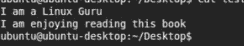

这种方法很合适。

## 更改目录

你可能还希望通过终端导航或更改目录。要做到这一点，请使用命令 `cd`，即“change directory”（更改目录）的缩写。

示例：

```
cd /home
```

上述命令将工作目录更改为 `/home` 目录。使用斜杠 (`/`) 表示相对于根目录，意味着无论您当前在哪个目录中，都将执行此命令。现在输入以下命令：

```
cd httpd
```

目录将变更为 `httpd`，但这是相对于 `/home` 目录的。完整的工作目录将是 `/home/httpd`。现在输入以下命令：

```
cd ..
```

该命令会将工作目录更改为当前目录的父目录。在本例中，我们将 从 `/home/httpd` 移动到 `/home` 目录。输入以下命令：

```
cd ~
```

该命令将目录更改为用户的主目录 `/home/((username))`。“username” 即您在计算机上使用的名称。符号 `~` 称为波浪号，在 Linux 中用于表示用户的主目录。

## 复制文件

命令 `cp` 代表 “copy files”（复制文件），用于复制文件。请注意，文件不会从其初始位置删除，而是在指定位置创建一个副本。输入以下命令：

```
cp first me
```

上述命令将在同一目录下创建文件 `first` 的一个副本，但使用新名称，即 `me`。如果目录中已存在文件 `me`，它将被覆盖，且在执行此命令之前不会收到警告。请考虑以下命令：

```
cp -i first me
```

注意，在上述命令中我们添加了 `-i` 选项。如果目录中已存在文件 `me`，在覆盖之前您将收到通知。接下来，尝试以下命令：

```
cp -i /d/file
```

使用上述命令，文件 `/d/file` 将被复制到当前相同的目录中，然后命名为 `file`。注意，我们使用了 `-i` 选项，因此如果该文件已存在，在覆盖之前我们会收到通知。

您可能还需要将特定目录中包含的所有文件复制到另一个目录。可以按以下方式实现：

```
cp -dpr sourcedirectory destinationdirectory
```

目录 `sourcedirectory` 中的所有文件将被复制到目录 `destinationdirectory`。注意，我们使用了选项 `-dpr`。其含义如下：

- `-d` – 表示将保留链接
- `-p` – 文件属性将被保留
- `-r` – 将递归执行复制

如果需要从目录复制所有文件时，最好指定这些选项，否则将应用默认设置，这可能会产生不想要的结果。

要显示每个已挂载文件系统上磁盘已使用的空间，请使用命令 `df`。

## `Less` 命令

`less` 命令与 `more` 命令相同。区别在于，使用此命令时，用户可以向上或向下翻页浏览文件。请考虑以下示例：

```
less first
```

上述命令将显示文件 `first` 的内容。

## `Ln` 命令

此命令为特定文件创建符号链接。编写并运行以下命令：

```
ln -s first slink
```

上述命令将创建一个名为 `slink` 的符号链接，该链接指向文件 `first`。命令 `ls -i first slink` 将显示这两个文件是不同的，并且具有不同的“inode”。

## `Locate` 命令

这用于在数据库中搜索。运行以下命令：

```
slocate -u
```

将创建一个名为 `slocate` 的数据库。这将需要一些时间来完成，请耐心等待。在您能够搜索文件之前，必须先运行此命令。但是，在大多数系统上，`cron` 会定期运行此命令。再次运行以下命令：

```
locate whois
```

该命令将查找系统中名称包含字符串 `whois` 的文件。

## `Logout` 命令

该命令用于注销当前登录到系统的用户。只需进入终端并输入此命令：

```
logout
```

然后您将被注销并返回登录屏幕。

## `Ls` 命令

`Ls` 代表列出（list）。它用于列出目录中的文件。然而，它附带许多选项，也需要了解，否则您会感到困惑。如果您需要列出当前目录中除那些以 “.” 开头的文件之外的所有文件，只需输入该命令：

```
ls
```

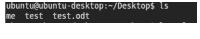


上图是 Desktop 目录，其中包含所示的文件。注意，只列出了文件名。您可能需要显示目录中文件的更多详细信息，例如所有权限、大小、时间戳和日期等。可以使用以下命令实现：

```
ls -al
```

如上所示，命令 `ls -al` 比之前的命令更全面。如果您想要有关文件的更多详细信息，可以使用它。

## ‘More’ 命令

将文件的内容每次一页地发送到屏幕。它也可以处理管道输出。让我们将文件 `/etc/profile` 的内容列出到屏幕。这是一个内置文件，意味着它随操作系统附带，并包含系统用户的配置文件：

```
more /etc/profile
```

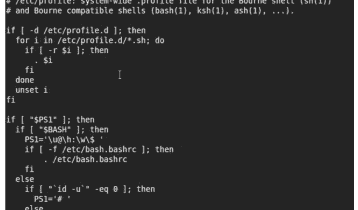

注意，文件的内容将每次一页显示。这是因为内容太大，无法在一页上显示。请考虑以下命令：

```
ls –all | more
```

该命令将列出目录中的所有文件，并且输出将通过 `more` 管道传输。如果目录的输出无法在一页中容纳，它将显示在额外的页面上。

## ‘Mv’ 命令

该命令代表 “move”（移动），用于重命名或移动文件。请考虑以下命令：

```
mv –i first first2
```

文件将从 `first` 移动到 `first2`，意思是它将被重命名为 `first2` 而不是 `first`。

```
mv /d/first
```

上述命令将把文件 `first` 从目录 `d` 移动到当前工作目录。现在您已经看到 `mv` 命令是一个强大的工具。

既然我们一直在谈论工作目录，它们到底是什么？我们如何知道当前在哪个目录中？只需输入该命令：

```
pwd
```

按下回车键后，您会注意到输出是一个目录。这表明您当前所在的目录。缩写 `pwd` 代表 “print working directory”（打印工作目录），用于显示当前工作目录的目的。

## ‘Shutdown’ 命令

该命令用于关闭系统。此命令的目的是停止当前过程并立即关闭系统。为此请使用以下代码：

```
shutdown -h now
```

下一个命令用于重启系统，意味着它将立即关闭并重新启动系统。为此请使用以下命令：

```
shutdown -r now
```

## ‘Whereis’ 命令

该命令用于显示命令的手册、源文件和二进制文件。请考虑以下命令：

```
whereis ls
```

该命令将显示命令 `ls` 的手册文件和二进制文件。要查看之前在您系统上使用过的命令列表，请使用命令 `history`：

上述是我系统上运行过的命令列表。您可以在您的系统上尝试并观察输出。

## ‘Sudo’ 命令

这代表 “superuser do”（超级用户执行）。其目的是允许受权限的用户以“超级用户”身份执行命令。这通常在 `sudoers` 列表中定义。它的重要性在于通过确保敏感命令仅由正确的人员执行来保证安全性。另一个命令 `su` 允许您以超级用户身份登录系统。`sudo` 的目的是借用超级用户的权限。这解释了两个命令 `su` 和 `sudo` 之间的区别。`sudo` 命令通常用于更改系统文件的命令中，例如在更新或升级操作系统时。这显示了与 `su` 命令相比，该命令的安全性有多高。

## ‘Mkdir’ 命令

该命令代表 “make directory”（创建目录）。它创建一个新目录并指定其路径。如果此路径已存在，则会输出一个错误，提示无法创建该文件夹。请考虑下图所示：

我创建了一个名为 “m” 的目录。创建目录后，当我列出可用目录时，我发现它已被创建。注意，我是以 `sudo` 身份运行该命令的。如果没有这样做，命令将无法运行。这是出于安全目的。首次使用 `sudo` 命令时，系统会提示您提供超级用户的密码以执行操作。需要注意的是，您只能在文件夹内部创建目录，并且必须对该文件夹拥有“写入权限”。否则，您将无法执行此操作。

## ‘Uname’ 命令

它代表 “Unix name”。通过此命令，您可以获取有关操作系统、内核和机器的详细信息。请考虑下图：

操作系统、内核和机器的信息已显示。

- Ubutnu - 机器内核的名称

- SMP - 机器的节点名称

### 1686- 处理器配置

GNU/Linux——操作系统的名称。

你可以看到该命令如何提供详细信息。

## 'Touch' 命令

该命令仅在文件不存在时用于创建文件。它代表更新每个文件的访问和修改时间至当前时间。如果文件已存在，其时间戳将被更改，但内容将保持不变。如果文件不存在，且你对该文件拥有“写入权限”，则可以使用该命令创建文件。要创建一个名为 `touchfile` 的文件：

```bash
touch touchfile
```

如果目录中不存在该文件，它将被创建。

## 'Cal' 命令

它可以用于显示当前日期的月份，或过去/未来某年的月份。

让我们显示 1900 年 2 月的日历：

```bash
ubuntu@ubuntu-desktop:~/home$ cal 02 1900
February 1900
Su Mo Tu We Th Fr Sa
    1 2 3
4 5 6 7 8 9 10
11 12 13 14 15 16 17
18 19 20 21 22 23 24
25 26 27 28
ubuntu@ubuntu-desktop:~/home$
```

如下所示，你还可以显示未来年份的月份：

```bash
ubuntu@ubuntu-desktop:~/home$ cal 02 2100
February 2100
Su Mo Tu We Th Fr Sa
    1 2 3 4 5 6
7 8 9 10 11 12 13
14 15 16 17 18 19 20
21 22 23 24 25 26 27
28
ubuntu@ubuntu-desktop:~/home$
```

我们展示了 2100 年 2 月的日历。该命令在确定未来或过去事件的日期时非常有用。

## 'Date' 命令

用于在终端上显示当前的日期和时间，如下所示：

```bash
ubuntu@ubuntu-desktop:~/home$ date
Sat Mar 21 09:14:00 2015
ubuntu@ubuntu-desktop:~/home$
```

如果你的系统当前日期不正确，你可以按如下方式将其设置为正确的日期和时间：

```bash
date --set='21 march 2015 18:50'
```

在上述命令中，我们同时设置了日期和时间。

## 第 2 章。Linux 安装

由于在过程中遇到的困难，很多人已经讨厌安装操作系统的过程。好消息是，使用 Linux，你将拥有一段非常容易且无压力的安装体验。与其他所有操作系统相比，安装 Linux 更为简单。

大多数 Linux 发行版提供 Live Distribution（实时发行版）选项，允许你直接从 CD、DVD 或 USB 闪存盘安装和运行系统，而不会以任何方式影响你的硬盘。如果你选择这种方式，你仍将拥有一个功能完整的操作系统，具备其附带的所有功能。如果你直接运行它，你不必承诺安装它，这意味着你可以始终避免安装带来的麻烦。

一旦你检查过并同意它正是你想要的，然后你就点击安装按钮，快速的过程会在你反应过来之前结束。安装向导将引导你通过以下简单步骤完成过程：

- a) 准备 - 这是确保你的计算机满足安装要求的地方。你还需要选择是否要安装第三方软件。

- b) 无线设置，仅在必要时 - 如果你的机器使用无线网络，你必须连接到网络才能开始安装过程。

- c) 硬盘分区分配 - 这是你选择希望如何安装操作系统的地方。

从地图中选择你的位置，你的系统键盘布局以及你的用户名和密码。

安装 Linux 系统就是这么简单和快速。过程完成后，重启即可准备使用！

新手可以无需他人帮助快速完成 Linux 安装过程。

### 如何安装 Ubuntu Linux

这个示例将帮助你了解在安装你选定的 Linux 发行版时该怎么做。作为最受欢迎的 Linux 发行版，其安装过程与其他发行版并无不同。分步安装过程会使事情对你来说更加简单。

1. **CD/DVD 安装**

从 CD 或 DVD 启动 Ubuntu Linux 是在计算机上安装系统的两种方式之一。

- 从 Ubuntu 软件库下载 Ubuntu ISO 文件。这种文件形式需要在你使用之前烧录到 CD 或 DVD 上。

- 使用你选择的刻录程序烧录 ISO 文件。有免费和付费的程序可以将 ISO 文件烧录到 CD 或 DVD，无需下载单独的刻录程序。你可以选择你最喜欢的那个。

- 从磁盘启动。一旦程序被烧录到磁盘中，你可以重启计算机并选择从 CD 或 DVD 启动。你可能需要更改启动偏好设置。通过在计算机重启时按下 Setup（设置）键来执行此操作。

- Linux 提供选项，允许你在安装前尝试系统，首先确保这就是你需要的。你可以在此级别执行此操作；先试用 Ubuntu，如果你觉得它是你想使用的操作系统，你可以安装它。当系统仍从磁盘运行时，你将能够查看操作系统的布局。


# 安装 Ubuntu

如果你使用的是笔记本电脑，你必须连接到电源，因为该过程可能会耗尽你的电池。你还需要连接到互联网源。

## Windows 安装程序

Windows 安装程序将把 Ubuntu Linux 安装在你当前使用的其他操作系统旁边。程序和文件不会受到影响，但每次重启计算机时，你始终必须选择要使用的操作系统。

- 决定如何处理你的其他操作系统。

  你将获得两个选项；是与其他操作系统并排安装 Ubuntu Linux，还是用 Ubuntu 替换旧的操作系统。如果你选择同时拥有两者，每次重启计算机时，你都将被要求选择要使用的操作系统。
- 设置你的分区大小。如果你选择在计算机上拥有两个操作系统，这将是必要的。你可以使用滑块来调整你想为 Ubuntu 预留的空间量。记住，你还需要足够的空间用于文件和程序，因此，为你的新系统留出足够的空间。
- 选择你的位置。如果你连接到互联网，这会自动发生。
- 设置你的键盘布局。这里正确的做法是点击检测键盘布局，以便 Ubuntu 自动选择正确的布局。
- 输入你的登录信息。设置用户名和密码。你可以选择让 Ubuntu 自动为你登录，或者你可以在任何时候输入你的登录信息来使用你的计算机。
- 等待安装过程完成。安装完成后重启计算机，Ubuntu 将会加载。
- 从 Ubuntu 网站下载安装程序。如果浏览器提示你，你可以选择运行、保存或打开。
- 创建一个用户名和密码，你将使用它来登录计算机。
- 点击安装以开始该过程。
- 安装完成后重启计算机，并选择 Ubuntu Linux 作为要加载的操作系统。

**重要说明：**

- 在 CD 或 DVD 上运行此类程序以先睹为快是一个好主意；然后，如果你喜欢所见，再安装它。试驾将帮助你在安装操作系统时做出不会后悔的决定。
- 在安装开始之前，确保先备份你所有的文件、程序、个人数据和设置，以免丢失它们。

# 在 Linux 上安装新软件

在 Linux 操作系统上安装新软件与安装操作系统本身一样简单。一切都为用户简化了。因此，如果你过去在其他操作系统上安装新系统时遇到了困难，现在没有理由担心。

大多数 Linux 发行版都有一个应用商店，或类似的东西，它是一个存储所有应用程序的中心区域。你要做的是浏览它们并安装你想在机器上使用的应用程序。这使你能够轻松地找到你想在计算机上安装的应用程序。Ubuntu Software Center 就是 Ubuntu Linux 的这种中心地方的一个例子。Deepin 有 Deepin Software Center。一些发行版依赖 GNOME software，而另一些依赖 Synaptic。

所有这些工具的含义和作用相同；它们提供了一个中心位置，你可以轻松地从那里搜索和安装 Linux 软件。虽然 GUI 的存在对于浏览另一个软件的安装过程很重要。如果你不

如果系统带有图形用户界面，在安装软件时，你将不得不依赖命令行界面。

用户需要了解的是，在任何 Linux 机器上安装软件都非常简单。即使是新的电脑用户也会发现这非常容易，且耗时较少。操作系统在设计时旨在让用户在处理任何事务时都能轻松自如，这一点也不例外。在安装完操作系统后，你就可以开始安装使用你的机器或设备所需的任何应用程序。

Linux 无处不在。你可以在家中、汽车中，甚至在电器中找到它。当然，你最常找到它的地方是计算机。乍一看，Linux 看起来和其他操作系统没什么两样。它位于你的所有其他软件之下，并将信号传递给硬件。它像大多数其他操作系统一样拥有图形界面，并且拥有其他系统大部分功能的软件等效品。如果你曾经使用过任何操作系统，使用 Linux 应该没有任何问题。人们通常不知道的是，Linux 被非常频繁地使用。除了是个人电脑中使用了最多的操作系统之一外，它还被用于运行全球各地的许多服务器和嵌入式系统。它被用于运行互联网的巨大部分，以及许多管理股票和实现科学突破的超级计算机。然而，在所有这些之前，Linux 就有着最无忧无虑、最安全、最可靠的系统的声誉。这一声誉名副其实，而 Linux 的质量也显得越来越明显。

Linux 是一个灵活的工具，可以根据你感兴趣的任何工作进行定制。用户始终可以自由地对其进行进一步开发，这意味着它总是处于变得更好的过程中。完全依赖社区本身这一事实，使 Linux 成为了一项更为令人印象深刻的成就。这也使得 Linux 看起来更加可靠，因为在发行方面不存在贪婪的因素。这个系统来自人民，为了人民，并随着趋势而成长。它在用户的帮助下，基于用户的需求而成长。

Linux 的不同变体被称为发行版。发行版是不同组件的打包，这些组件被选择和缝合在一起，以执行明确定义的功能。一个发行版由内核和支持库以及系统软件组成。其中大部分由 GNU 计划提供。尽管大多数发行版在名称中都使用了“Linux”这个词，但在发行版的命名惯例上曾有一些争议，因为自由软件基金会更喜欢使用“GNU/Linux”这一名称，以强调 GNU 软件的重要性。Linux 的创造者 Torvalds 对此并不满意，并立即采取了抵制行动。自那以后，在涉及发行版名称的问题上，紧张局势一直很高。

一些最受欢迎的 Linux 发行版包括 Fedora、Ubuntu 和 Debian。有许多发行版被商业使用。其中一些包括 Red Hat Enterprise Linux 和 SUSE Linux Enterprise Server。Linux 的桌面发行版通常包括像 Wayland 或 X11 这样的窗口系统，以及像 KDE Plasma 5 或 GNOME 这样的桌面环境。其他专为服务器制作的发行版通常没有图形界面，并包含解决方案包。解决方案包的一个例子是 LAMP。那里有众多可用的发行版。使可能性更大的事实是，由于 Linux 是免费分发的，你可以为任何目的制作自己的发行版。

Linux 最初是为个人电脑制作的，基于 Intel x86 架构。从那时起，它已被移植到许多平台，比任何其他操作系统都多。就服务器和大型机而言，Linux 领先于任何其他操作系统。除此之外，它是全球 500 强超级计算机唯一使用的操作系统，自 2017 年 11 月以来，它逐渐消除了竞争。大约 2.3% 的台式电脑运行着它。在 300 美元以下的笔记本销售中，基于 Linux 内核的 Chrome OS 占用了 20% 的份额。凭借这一点，它轻松主导了美国 K-12 教育市场。

Linux 也用于嵌入式系统。这些是操作系统内置于固件中，并根据系统本身进行定制的设备。路由器、电视、自动化控制、视频游戏机、数字视频录像机和智能手表都是嵌入式系统的例子。Linux 的衍生版本通常用于智能手机和平板电脑。由于 Android 在智能手机市场中的主导地位，Linux 通过代理成为通用开源软件中安装基础最大的操作系统。

Linux 高耸矗立，成为在困难逆境中取得成功的见证。它表明独立创作者之间的协作可以走多远。它是开源软件协作的一个显著例子。劳动成果是显而易见的。2001 年，一项关于 Red Hat Linux 7.1 的研究进行了。研究显示，该发行版拥有 3000 万行源代码。研究还发现，如果由一个人创建这个发行版，将需要八千年的开发时间。如果系统是用美国传统的专有方式制作的，开发成本将达到 15.7 亿美元。大约 70% 的源代码是用 C 编程语言编写的。你可以将其余部分视为某种拼凑，因为它们是用许多不同的语言编写的，如 C++、汇编语言、Lisp、Python、Perl、Fortran 以及许多 shell 脚本语言。3000 万行代码中有一半以上在 GPL 许可证下。内核占据了代码的约百分之八，相当于大约 240 万行代码。

2007 年还有另一项研究。这项研究是在 Debian v4.0 上进行的。如果按传统方式开发该系统，成本约为 86.6 亿美元。它有 2.83 亿行代码，如果由一个人完成，他们将需要七万三千年的时间。这充分说明了 Linux 是什么样的项目。基于投入的巨量工作，你可以轻松地说它相当了不起。

# 什么让 Linux 与众不同？

正如我之前提到的，Linux 做的是任何其他操作系统都会做的同样的工作。然而，使 Linux 特别之处在于它是开源的。事实上，它是最常用的开源操作系统。这意味着用于创建 Linux 的源代码可供公众查看和编辑。这也意味着有才华的个人可以通过为系统添加一些改进来参与 Linux 的开发。除此之外，该系统高度可定制。有许多版本，也称为发行版，它们彼此不同。它们包含不同类型的软件。尽管系统的核心部分大致相同，你可以选择不同的浏览器、文字处理器和应用程序，使你的系统真正属于你自己。你还可以更改核心组件，如用户界面组件和图形组件。Linux 非常用户友好且易于使用。除此之外，它还有许多方法可以根据你的需求进行定制。

# Linux 是如何创建的？


你一定听说过 Unix，这是一个在 1970 年代制作的操作系统。它是那个时代的一个优秀工具，用于学术和商业需求。与 Linux 类似，Unix 也有许多不同的变体。该系统最初是程序员的一种工具，使软件开发更容易。随着时间的推移，它开始在学术圈传播，人们添加了自己的工具并与同事分享。该系统本身遵循 Unix 哲学工作。这意味着系统更喜欢使用小的、相互连接且功能有限的程序。所有相互连接的程序都有明确定义的功能，并且非常擅长执行它们。

Linux 最初是尽可能紧密地模拟 Unix 的一种方式。许多人试图做同样的事情。这些程序被称为“类 Unix”或“Unix 兼容”，但没有像 Linux 那样成功。Linux 是最受欢迎的，也是与 Unix 最接近的。它有相似的接口方式、文件流布局、关键组件和编程工具。在 Unix 克隆的海中，Linux 脱颖而出。这一切都要归功于名为林纳斯·托瓦兹（Linus Torvalds）的人。

1991 年，托瓦兹对操作系统产生了兴趣。他对 MINIX 仅限于学术


## Intro

为了更好地了解 Linux 文件系统，对文件进行了分类。虽然可以假设它是安全的，但了解特定文件的更多信息可以帮助程序员和系统管理员在使用 Linux 时避免复杂性。这也防止了他们执行冗长的列表查询。

### List

* `Directory (d)` -> 目录 (`d`) – 作为一个文件堆栈列表的文件
* `Link (l)` -> 链接 (`l`) – 一种允许在文件树的多个部分中显示特定文件的系统
* `Pipe (p)` -> 管道 (`p`) – 一种允许进程间通信的系统
* `Regular (-)` -> 常规文件 (`-`) – 普通文件
* `Socket (s)` – 套接字 (`s`) – 一种提供进程间网络通信的特殊文件
* `Special (c)` -> 特殊文件 (`c`) – 一种用于输入和输出的机制

## 分区艺术

Linux 中的分区始于停电威胁大多数 Linux 用户的时候。有些日子里，中断意味着对系统造成严重损害。

此外，分区的主要原因是为了获得更高的数据安全级别。硬盘的划分允许安全地分组和保护。

由于成功的分区，你可以优先处理更重要的数据组。当硬盘的一部分被破坏时，只有那部分磁盘受到影响。存储在其他分区中的其余部分保持不变。

Linux 系统中的两个主要分区：

* `Swap` -> 交换区 - 指额外内存或扩展
* `Data` -> 数据区 - 指常规数据；指启动和运行系统所需的必需品

推荐的分区：

List items translated straightforwardly.

常见的分区：

List items translated straightforwardly.

## 目录：根目录与子目录

在 Linux 中，有一个称为根目录的目录。它作为主目录，正如程序员和系统管理员所指的那样，它是所有目录的目录。

根目录伴随着子目录。这些子目录根据其分配的任务来管理文件。

子目录及其内容：

* `/home` – 主目录
* `/boot` – 内核和启动文件；旨在消除不必要引导加载程序的文件
* `/initrd` – 有关启动信息的数据
* `/dev` – 包含对所有 CPU 硬件外设的引用
* `/bin` – 常用的共享系统程序
* `/etc` – 重要的系统配置数据
* `/lib` – 库文件
* `/lost+found` – 从故障中检索到的数据
* `/opt` – 来自第三方来源的文件
* `/net` – 远程文件系统的标准挂载点
* `/misc` – 杂项数据
* `/proc` – 有关系统资源的信息
* `/mnt` – 外部文件系统的标准挂载点

## Inode 的作用

在 Linux 文件系统中，`inode` 代表一个文件。`inode` 是一种包含重要信息的序列号类型。其主要作用是围绕定义分区中的文件数量展开。

在整个 Linux 文件系统中，特别是具有多个分区时，存在具有相似 `inode` 的文件。为了避免复杂情况，每个分区都被分配了自己的 `inode`。

此外，分配的 `inode` 提供了硬盘数据结构描述。一旦硬盘初始化完成，它可以在两个时间点接受数据存储。一，在安装过程中，数据存储是可接受的。二，在向现有系统添加存储空间时，数据存储也是可接受的。

`inode` 中包含的信息：

* File type
* File size
* Owner
* Date and time
* Permissions
* Number of links
* Data address

## 什么是超级块？

在 Linux 文件系统中，关于基本文件大小和形状的信息称为超级块（`Superblock`）。它允许文件系统管理员保存和维护文件系统的质量。


## 超级块中的信息

- Free blocks... -> 空闲块 – 显示系统的空闲块数量
- Free inode... -> 空闲 inode – 显示原始的 inode 分配
- Free inodes... -> 空闲 inode 数量 – 显示系统的空闲 inode 数量
- Block group number... -> 块组号 – 指分配给超级块的编号
- Blocks per group... -> 每区块数 - 显示组的块数量
- Block size... -> 块大小 – 指系统的块大小；信息以字节显示
- Magic number... -> 魔术数字 – 指授予挂载软件进行评估的权限
- Mount count... -> 挂载计数 – 指系统对评估的允许次数
- Revision level... -> 修订级别 – 指系统对修订级别确认的允许程度

## 什么是组描述符？

组描述符负责标记文件的数据结构。它包含详细信息以避免数据重复。由于其作用，系统损坏的可能性极小。

### 组描述符中的信息

- Blocks bitmap -> 块位图
- Free blocks count -> 空闲块计数
- Free inodes count -> 空闲 inode 计数
- Inode bitmap -> Inode 位图
- Inode table -> Inode 表
- Used directory count -> 已使用目录计数

## 文件修改：查找、挂载及更改大小

Linux 文件通常很容易定位。只需搜索目录和紧随`/`或斜杠之后的名称，这可能就是你想要的文件。

```
 /home/lp.txt
```

如示例所示，`/home/`是目录，`lp.txt`是文件。然后你可以开始挂载。挂载文件时，必须检查 Linux 内核的可用性以核实标准。其存在允许验证系统传递的所有参数。

示例：

文本结束。

**Refining the Translation:**

- `use.` at the start is a fragment. I will translate it literally as `使用。` or maybe `used.` based on the previous context implied. The text says `use. He used...`. I will keep it as `使用。他使用了...`
- `outrage` -> 愤怒/激愤. `used his outrage` -> 利用他的激愤.
- `wordplay on free and Unix` -> 对 free（自由）和 Unix 的文字游戏.
- `meat of the topic` -> 主题的核心/实质.
- `The Root Directory` -> 根目录.
- `file stacks` -> 文件堆栈.
- `distinguishable factor` -> 区分因素.
- `Swap - refers to extra memory or an expansion` -> 交换区 - 指额外内存或扩展.
- `Data - refers to normal data; refers to the necessities for starting and running a system` -> 数据区 - 指常规数据；指启动和运行系统所必需的要素.
- `Magic number` -> 魔术数字/魔数. In CS, `Magic Number` is often translated as `魔数` or kept as `Magic number`. I will use `魔术数字（Magic number）` or just `魔术数字` to be clear. Given the context of Superblock, it identifies the filesystem type. `魔术数字` is acceptable.
- `Group Descriptor` -> 组描述符.

**Final Check of Formatting:**

- Bold/Italic: No specific instances in the source text except maybe implied emphasis, but the source text provided in the prompt doesn't have `**` or `*` in the body paragraphs I'm translating, except potentially in the structure.


使用。他利用自己的激愤创建了那个系统，即现在的 Linux 内核。他使用 MINIX 作为平台，并添加了 MINIX 的大多数应用程序。在那之后，系统不断成熟和演进，最终迎来了 Linux 系统的新发展。由于采用 GNU GPL 许可的代码的可用性，使用它们被视为有利可图。GNU 替换了 MINIX 的所有组件。GNU 项目允许在程序以兼容许可发布的情况下长期使用代码。因此，托瓦兹（Torvalds）将其从原始许可切换到了 GNU GPL。原始许可不允许对软件进行进一步重新分发，然而，通过更换许可，该程序最终成为开源软件。许多人在 Linux 上工作，以便将 GNU 组件正确集成到内核中。最终，系统变得自由运行且功能完善。

Linux 的原始名称是 Freax，这是对 free（自由）和 Unix 的文字游戏。在六个月的时间里，项目的 makefile 中包含“Freax”这个名称。Linux 这个名字虽然是在稍后才赋予项目的，但早在 Freax 之前就被视为可能的名称，但托瓦兹觉得它太自负而予以拒绝。

为了促进 Linux 的进一步发展，文件被上传到 FUNET 的 FTP 服务器上。这发生在 1991 年 9 月，由托瓦兹在赫尔辛基理工大学的工作同事阿利·莱姆勒（Ari Lemmle）以及几位自愿担任 FTP 服务器管理员的人员协助完成。阿利认为“Freax”不是一个好名字。在托瓦兹不知情的情况下，他将项目名称更改为 Linux，最终托瓦兹对此表示同意。

背景信息足够了！是时候深入主题的核心，了解 Linux 能为你做什么了。

# 第 3 章。文件系统

Linux 的文件系统在灵活性方面表现出色。其设计使其能够支持常规以及特殊类型的文件格式。它可以支持文本、程序、图像、服务、输出和输入设备。因此，由于它支持多种文件格式，它可以与另一个操作系统共存。

此外，在系统中，文件和目录之间几乎没有可区分的因素。由此可知，目录仅仅是文件堆栈的位置。

## 文件分类

为了更好地了解 Linux 文件系统，对文件进行了分类。虽然可以假设这是安全的，但了解特定文件的更多信息可以帮助程序员和系统管理员在使用 Linux 时避免复杂性。这也防止了他们执行冗长的列表查询。

文件类别：

- 目录 (d) – 作为一个文件堆栈列表的文件
- 链接 (l) – 一种允许在文件树的多个部分中显示特定文件的系统
- 管道 (p) – 一种允许进程间通信的系统
- 常规文件 (-) – 普通文件
- 套接字 (s) – 一种提供进程间网络通信的特殊文件
- 特殊文件 (c) – 一种用于输入和输出的机制

## 分区艺术

Linux 中的分区始于停电威胁大多数 Linux 用户的时候。有些日子里，中断意味着对系统造成严重损害。
此外，分区的主要原因是为了获得更高的数据安全级别。硬盘的划分允许安全地分组和保护。
由于成功的分区，你可以优先处理更重要的数据组。当硬盘的一部分被破坏时，只有那部分磁盘受到影响。存储在其他分区中的其余部分保持不变。

Linux 系统中的两个主要分区：

- 交换区 (Swap) - 指额外内存或扩展
- 数据区 (Data) - 指常规数据；指启动和运行系统所需的必需品

推荐的分区：

- 一个用于必需数据的分区
- 一个用于服务器程序和配置数据的分区
- 一个用于程序和应用程序的分区
- 至少一个用于用户邮件、存档和数据库表的分区
- 至少一个用于特定文件的分区
- 至少一个用于虚拟内存的分区

常见的分区：

- 一个包含个人数据的分区
- 一个存储临时文件的分区
- 一个存储第三方数据的分区
- 一个仅用于程序的分区

## 目录：根目录与子目录

在 Linux 中，有一个称为根目录（The Root Directory）的目录。它作为主目录，正如程序员和系统管理员所指的那样，它是所有目录的目录。

根目录伴随着子目录。这些子目录根据其分配的任务来管理文件。

子目录及其内容：

- `/home` – 主目录
- `/boot` – 内核和启动文件；旨在消除不必要引导加载程序的文件
- `/initrd` – 有关启动信息的数据
- `/dev` – 包含对所有 CPU 硬件外设的引用
- `/bin` – 常用的共享系统程序
- `/etc` – 重要的系统配置数据
- `/lib` – 库文件
- `/lost+found` – 从故障中检索到的数据
- `/opt` – 来自第三方来源的文件
- `/net` – 远程文件系统的标准挂载点
- `/misc` – 杂项数据
- `/proc` – 有关系统资源的信息
- `/mnt` – 外部文件系统的标准挂载点

## Inode 的作用

在 Linux 文件系统中，inode 代表一个文件。inode 是一种包含重要信息的序列号类型。其主要作用是围绕定义分区中的文件数量展开。

在整个 Linux 文件系统中，特别是具有多个分区时，存在具有相似 inode 的文件。为了避免复杂情况，每个分区都被分配了自己的 inode。

此外，分配的 inode 提供了硬盘数据结构描述。一旦硬盘初始化完成，它可以在两个时间点接受数据存储。一，在安装过程中，数据存储是可接受的。二，在向现有系统添加存储空间时，数据存储也是可接受的。

inode 中包含的信息：

- 文件类型
- 文件大小
- 文件或组的拥有者
- 创建日期和时间
- 最近修改的日期和时间
- 权限
- 链接数量
- 数据地址

## 什么是超级块？

在 Linux 文件系统中，关于基本文件大小和形状的信息称为超级块（The Superblock）。它允许文件系统管理员保存和维护文件系统的质量。

超级块中的信息：

- 空闲块 – 显示系统的空闲块数量
- 空闲 inode – 显示原始的 inode 分配
- 空闲 inode 数量 – 显示系统的空闲 inode 数量
- 块组号 – 指分配给超级块的编号
- 每区块数 - 显示组的块数量
- 块大小 – 指系统的块大小；信息以字节显示
- 魔术数字 – 指授予挂载软件进行评估的权限
- 挂载计数 – 指系统对评估的允许次数
- 修订级别 – 指系统对修订级别确认的允许程度

## 什么是组描述符？

组描述符负责标记文件的数据结构。它包含详细信息以避免数据重复。由于其作用，系统损坏的可能性极小。

组描述符中的信息：

- 块位图
- 空闲块计数
- 空闲 inode 计数
- Inode 位图
- Inode 表
- 已使用目录计数

## 文件修改：查找、挂载及更改大小

Linux 文件通常很容易定位。只需搜索目录和紧随“/”或斜杠之后的名称，这可能就是你想要的文件。

示例：

```
/home/lp.txt
```

如示例所示，`/home/` 是目录，`lp.txt` 是文件。然后你可以开始挂载。挂载文件时，必须检查 Linux 内核的可用性以核实标准。其存在允许验证系统传递的所有参数。

示例：

挂载 `iso988` `/dev/rom` `/dev/cdrom`

如图所示，您正在挂载三种类型的信息：`iso988`、`/dev/rom` 和 `/dev/cdrom`。

除了查找和挂载文件外，您还可以选择更改文件的大小。这样做是因为发生了文件碎片化。

由于文件在碎片化期间会变得低效，更改文件大小允许重新分配文件空间。因此，系统变得更加稳定。

我们将介绍命令 `truncate` 和 `fallocate`。这两个命令都允许您创建具有首选大小的文件。

示例：

```
truncate -s 19MB mop1.txt
```

```
fallocate -l 19000000 mop2.txt
```

```
ls -ls mop.txt
```


0 -rw-rw-r-- 2 trs trs 19000000 Aug 12 02:44 mop1.txt

14819 -rw-rw-r-- 2 trs trs 19000000 Aug 12 02:45 mop2.txt

```
如图所示，您在 “8月12日” 创建了一个名为 “mop” 的 “19MB” 文件。
```

# 第 4 章。基础 Shell 编程

在本章中，我们将深入探讨黑客秘密武器之一——脚本编程。程序员和黑客之间有很小的区别。程序员使用脚本来构建系统，而黑客使用脚本来利用系统。如果没有创建自己的脚本，新手黑客永远无法成为专业的 Hacker（黑客），而只能作为一个只会使用其他工具来破解系统的 script kiddie（脚本小子）。因此，脚本知识是任何试图掌握黑客技术的人清单中必备的一项。为了帮助您，本章将介绍许多 bash 脚本概念，并附带实际的编码示例。让我们开始享受脚本编程吧！

首先，我们需要详细了解 shell。

## 什么是 Shell？

Shell 是当你使用密码首次连接到服务器时，或者当你使用 `SSH` 等远程桌面工具将自己连接到系统时观察到的那个光标。换句话说，如果你只想从编程的角度来看待它，你会很高兴，因为它就像操作系统一样，充当用户和系统之间的解释器。

但它只是将用户输入的建议发送给 Linux 内核，并将输出结果返回给系统用户。

## Shell 的类型

根据 Linux 官方文档，存在不同类型的 shell。其中第一种代表 GUI，第二种代表 CLI。

有许多 shell 是根据各种发行版（Distro）制造的，如 Bourne shell、C shell、korne shell 和 Bash shell。

在所有不同类型的 shell 中，bash shell 是最著名的之一。它预装在几乎所有著名的 Linux 发行版中。它还充当一种拦截语言，帮助 Linux 内核理解我们逻辑上给出的指令。

## Bash Shell 是如何工作的？

Shell 有两种工作模式。其中一种是交互模式，另一种是脚本模式。

### 交互模式

在此模式下，Linux 用户可以逐个输入函数或 bash 代码，并等待给出结果。如果中间出现错误，用户无法继续。它就像旧的掌上视频游戏一样进行交互工作。

### 脚本模式

在此模式下，首先将 bash 代码写入文本文件，然后通过命令行界面运行脚本文件。使用此模式时，用户可以一次性获取所有想要的结果。黑客需要更精通脚本模式，因为这样更容易快速利用系统。然而，创建系统的程序员更倾向于交互模式。

在了解 shell 的语法结构之前，最好先对 shell 的优势有一个很好的概述。

## Shell 的优势

- 1) 学习内联编程语言非常容易，它们在执行和实现上差异很大。
- 2) 它有很多帮助文档，可以帮助黑客尽快纠正错误。
- 3) 它有一个附加优势，因为它是一种解释型语言。也就是说，它不需要在运行之前编译。因此，黑客可以轻松地在代码实施到受害者的系统之前进行交叉检查。

除了这些，shell 还很快且运行效率很高。由于所有这些原因，黑客必须学习关于 shell 实现的知識。

让我们开始吧！

## 第一个 Shell 脚本

让我们创建一个名为 `sample.sh` 的 shell 脚本。使用以下命令创建 shell 脚本。

```
cat sample.sh
```

Shell 程序的位置

```
echo "This is very regressive"
```

现在我们将逐行详细解释这一点。

- a) `#!` 这代表我们试图编写的 shell 脚本的开始。
- b) 如果它仅以井号 `#` 开头，则被称为注释。注释是用于使引用更容易或供其他查看代码的用户使用的注解。为小型 shell 脚本编写注释可能看起来没有必要。但开始写注释是一个好习惯。
- c) `echo` 是一个 shell 默认命令，让解释器显示写入的内容。

在此处运行 shell，您需要使用以下命令：

```
bash sample.sh
```

然后会出现输出

对于此示例，输出如下：

```
This is very regressive
```

还有一个功能可以让您以额外的权限运行脚本。正如我们之前讨论的，Linux 有一套权限设置，如果您不提供必要的权限，脚本可能无法完美运行。因此，要提供权限，请使用以下命令

调试是最重要的编程任务之一。即使是黑客也需要擅长于此，因为错误的代码调试可能会导致任务适应不良。

### 调试 Shell 脚本

通常，当您在脚本中输入错误的默认命令时，如下面的代码所示。

```
vulnerhost @ example: echo 7898
```

这段代码将无法运行并显示如下错误

```
the echo command is not found
```

这正是调试。调试功能告知用户脚本中的错误。

还有许多 shell 调试工具执行我们在命令行界面中执行的任务。像 `bashdb` 这样的工具在这方面很有名。本节将帮助黑客有效地理解 shell 编程的基础知识。让我们继续！

## 内置 Shell 命令

在深入讨论内置命令之前，重要的是要知道这些内置命令不能用作变量名。变量是 shell 编程的一个重要功能，有助于定义事物。

Linux 提供了一个名为 `type` 的命令，让您交叉检查命令是否为内置命令。

该命令的工作方式如下：

```
type echo
```

输出如下：

```
echo is a built-in shell
```

另一个例子，

```
type trump
```

输出如下：

```
Trump is not a built-in shell
```

此外，请记住，两个点即 `**` 用于确定脚本的成功运行或执行。以下是我们将详细讨论的内置命令。

### 1) Alias（别名）

通常 Linux 命令的输入稍微复杂一些。我想您每次都必须输入 `echo`，这可能很困难。为此，您可以使用别名来为命令提供快捷键。

下面描述需要输入的命令以使别名生效。

```
example@ linuxwar : Alias groupecho
```

然而，应该记住，别名仅在 shell 环境打开期间有效。也就是说，如果 shell 退出，就没有办法再次访问它。此外，别名函数存储在用户环境的 `bashrc` 目录中。别名是提高生产率的简单方法。黑客使用大量别名使解码脚本变得更加困难。

### 2) Unalias（取消别名）

您可能已经猜到，`unalias` 用于删除现有的别名系统。使用此命令，您可以删除之前创建的任何别名命令。

下面是让我们了解其工作原理的命令：

```
example@ linuxwar : unalias groupecho
```

您还可以使用 `-a` 一次删除所有存在的别名。
然而，正如我们之前所说的，结束 shell 环境将删除所有存在的别名，但使用 `unalias` 可以帮助您在仍在编写脚本时删除事物。

### 3) bg, fg, jobs

大量的 shell 代码是在交互模式下完成的。有时，当尝试利用系统时，您需要同时执行各种任务。这些任务在 Linux 术语中被称为作业（jobs）。因此，为了方便每个人，作业分为两种类型。第一种是前景作业，我们可以看到正在进行的流程。前景作业的经典例子是安装系统程序。在执行前景作业时，您无法处理其他作业。

因此，后台任务应运而生。后台任务有助于让程序在后台运行。黑客应该充分意识到这一点，因为他们通常需要处理多个进程。

以下是任务功能相关的命令：
- `example@ linxwar : bg job1`
- `example@ linxwar : fg job2`
- `example@ linxwar : view jobs`

### 4) cd

`cd` 是经典的 Linux Shell 命令，以其广泛的用途而闻名。在执行任务时，Shell 通常会将用户带入根目录。大量使用根目录会导致其杂乱无章。为此，Linux 用户使用 `cd` 来更改目录并执行操作。

以下是更改目录的命令：
`example@ linxwar : cd /etc/read`

### 5) 声明变量

变量是经典的编程声明。它们通常用于声明数据存储位置。变量还具有称为数据类型的类型声明。通过这种机制，我们可以轻松指定其应使用的类型。有许多数据类型，如 `int`、`float` 和 `string`。

### 6) Break

脚本语言通常包含用于重复性和逻辑任务的循环结构。它们可以结合使用。在执行重复任务时，显然需要有一些端点以实现更好的交互和处理。为此，Shell 语言使用了一种称为 `break` 的语句，当它提供的逻辑满足时，该语句将停止任务。`break` 语句还可以用于使用 `echo` 命令打印语句。

以下是 `break` 命令的示例：

```
example@ linuxwar : beep.sh

for(i=0)

x>1

y>2

if(b>2)

break:
```


## 7) Continue

在循环中，`break` 可以立即停止循环，而 `continue` 语句可以帮助切换可用的循环。假设 Shell 代码中有五个循环语句；通过使用 `continue`，可以互换这些循环。这将有助于创建详细的利用代码，以破坏系统并进行多次交叉检查。

以下是 `continue` 语句的示例：

```
example@ linuxwar : beep.sh

for(i=0)

x>1

y>2

if(b>2)

continue:
```

## 8) Eval

Linux 和 Shell 代码通常包含许多需要处理的参数。如果以相同的方式解析字符串和变量，将会产生许多问题。为此，Bash Shell 引入了一个名为 `eval` 的命令。

`eval` 命令将存在的参数替换为指定的变量。您甚至可以使用 `eval` 命令将字符串解析为可执行的命令，如下所示。

```
example@ linuxwar : eval beep.sh
```

## 9) Exec

执行（Execution）是指启动任务的过程。每个安装文件都是执行格式，因为它会在后台启动新的系统 Shell。黑客应该意识到执行 Shell，因为它们执行大量的初始化和分析任务。

当在 Linux 命令 Shell 中输入 `exec` 命令时，我们操作中的屏幕或界面会刷新。

这是详细解释 `exec` 命令的指令：

```
example@ linuxwar : exec beep.sh
```

## 10) Exit

Shell 窗口很复杂，处理大量任务。但是，完成任务后，退出 Shell 是一个好习惯。否则，进程仍将继续运行，可能导致不必要的系统功耗。为此，Shell 语言引入了一个名为 `exit` 的快速命令，正是出于这个原因。

`exit` 命令还会清除所有存在的任务。因此，在执行此操作之前，请确保一切正常。您还可以使用 Shell 脚本退出单个进程或程序。

以下是 `exit` 的简单命令示例：

```
example@ linuxwar : exit shell.sh
```

## 11) Export

通常，系统启动时，内核系统中创建的第一个 Shell 命令被称为父 Shell（Parent Shell）。随后的那些被称为子 Shell（Child Shells），除非父 Shell 退出或被终止。

因此，在处理不同数量的 Shell 时，我们将处理大量变量。有时，我们需要使用在其他 Shell 环境中使用的相同变量。为了导出这些变量，Shell 为我们提供了一个 `export` 选项。

使用 `export` 命令后，所有子 Shell 都可以使用父变量。但请记住，子 Shell 不能使用其同级（即其他存在的子 Shell）的变量。

以下是演示此过程的示例：

```
example@ linuxwar : export example.sh to /etc/dir
```

## 12) Kill

终止（Kill）进程是黑客需要学习的一项重要技能。进程具有三个不同的特征。其中之一是交互，即普通的 Shell 接口。第二个是批处理过程，其中需要应用的所有内容都是按顺序处理的。最后一个是对过程的监控，其中正在进行的所有操作都被监控。例如，任务管理系统。

当您运行大量此类进程时，可能会因它们发出的信号而分心。因此，如果您发现这些进程是不必要的，终止它们是一个好习惯。当您试图利用系统时，需要终止在后台运行的防病毒进程。您甚至可以使用终止进程功能来停止记录您每个动作的日志文件。

以下是 `kill` 命令的简单演示：

```
example@ linuxwar : kill process
example@ linuxwar : killall
```

## 13) Read

`read` 命令可用于在执行任务时读取 Bash 脚本。或者，它甚至可以用来彻底检查已编写的 Shell 代码。`read` 语句是一个基本的 Shell 命令，可以帮助黑客轻松解释和交叉检查内容。

以下是带有示例的命令：

```
example@ linuxwar : read bash.sh
```

## 14) ulimit

优先级是 Shell 代码中最未充分利用的功能之一。优先级可以是递增的，也可以是递减的。通过使用 `ulimit`，黑客可以增加或降低进程的优先级。

为什么需要对进程进行优先级排序？

当用户处理大量持续运行的后台进程时，这可能会降低其他进程的处理速度。为此，管理员将防病毒软件置于优先级的第一级。通过这种方法，可以消除任何引导级别执行。

然而，许多系统管理员没有认真对待这个问题，从而让黑客的利用变得更容易。以下是解释如何对现有进程进行优先级排序的示例命令。

```
example@ linuxwar : ulimit PID 2345
```

始终记住，`PID` 是进行优先级排序时最需要使用的要素。

## 15) Test

Shell 代码包含大量的循环和条件代码。在用系统 Shell 对这些重复任务进行实验之前，在旧 Shell 中检查它们是一个好习惯。为此目的，引入了 `test` 命令。

以下是负责测试的命令：

```
example@ linuxwar : test PID 3634
```

至此，我们已完成关于 Linux 系统中存在的一些内置 Shell 命令的说明。这应该能为您提供良好的黑客环境概览。

## 安装 bash 环境

但在了解相关知识之前，让我们先学习如何安装 bash Shell，这是最著名的 Shell 环境。

1. 您可以使用 `wget` 获取服务器上存在的系统文件。以下命令将从镜像网站下载文件，并帮助用户将其安装到系统中。

```
wget bash.com/download
```


```
2. 在下一步中，您需要提及或输入正在使用的系统配置。否则，可能无法安装。
3. 安装后，您可能需要检查设置并输入默认目录。通常输入为根目录。此外，还可以使用 `help` 命令轻松查看 Shell 版本。
```

至此，我们已经安装了 bash 环境，并准备好开始学习 Shell 编程的一些基础知识。请记住，这些主题与 Python 脚本高度一致，Python 是黑客的另一种优秀的替代脚本语言。

# Shell 编程基础

Shell 由一组系统指令或命令组成。让我们去了解组成 Shell 语言的一些基本组件。

## 变量

变量是计算机随机存取系统中用于存储数据的一块内存。如前所述，变量是编程语言中最重要的组件，在编写函数或模板时经常调用它们。

通常，有两种类型的变量：
- a) 局部变量
- b) 环境变量

让我们详细讨论这些变量的功能，并附带一些命令行示例。

### a) 局部变量

局部变量是那些只能在私人或单一环境中使用的变量，这意味着即使通过引用，它们也无法在其他 Shell 脚本中使用。这类变量常用于简短的 Shell 脚本中。

### b) 全局变量

全局变量也被称为环境变量。这些变量与第一种变量不同，因为它们可以在任何 Shell 脚本中通过引用使用。若要使用全局变量，需要将其导出到本地 Shell 脚本文件中。

## 变量命名

Shell 语言中的变量在命名时需遵循一些不同的规则。请记住，像 `exit` 这样的 Shell 内置命令不能用作变量名。
以下是命名变量时需遵循的规则：
- 在 Shell 语言中，变量区分大写字母和小写字母。
- 变量名永远不能以数字或特殊字符开头。这样做可能会引发错误，提示变量名无法初始化。

以下是一些可用的变量命名示例
- love
- dude
- ra344

以下是一些不能使用的变量命名示例
- 1hjsd
- #fege

## 变量赋值

变量赋值是指用于给变量赋值的赋值操作。

其工作方式如下：
`变量名 = 变量值`

你可以在变量值中插入多种数据类型。数据类型是指定义变量的类型。一些数据类型包括整数、浮点数，有时也包括字符串。
以下是描述赋值值的示例：
`sample = 22`

## 特殊变量

像 `unset` 这样的特殊变量可用于从内存中删除已定义的变量。在此，我们可以存储随机内存管理。
还有一些以 `$` 参数开头的特殊变量。这些变量可用于定义系统在执行过程中或高级 Shell 分析时可能需要使用的额外参数。
以下是使用 `$` 的一些特殊变量命令的示例：
`$ dude = 'string'`

使用特殊变量的最大优势在于，借助变量开头的字符，可以轻松地对它们进行过滤和设置别名。

## 数组

数组是一种著名的数据结构，能够容纳多个元素。编程语言大量使用数组，因为它们不像树或图等其他数据结构那样难以实现，而且速度很快。Shell 也支持数组以输入元素。在本节中，我们将详细讨论数组。

### a) 数组的定义

通常，数组由一个下标组成，该下标定义了元素的编号，同时也包含数组的名称。

以下是数组示例的命令：
`example[]`

### b) 给数组赋值

可以使用符号为数组中存在的所有元素赋值。你也可以使用单个数组赋值来赋予值，如下所示

`sample = "America"`

你可以像变量一样在数组中插入任何数据类型，当你在处理包含复杂代码的循环和条件语句时，使用数组可能非常关键。

你甚至可以将两个数组连接起来以获得所需结果。为了更好地理解，下图展示了这种场景：

`sample = value`

## 常量

正如我们所知，常量意味着不可更改的事物。常量值始终存在，可用于解释具有固定数值值的常量，例如 `pi`。每当尝试更改此常量变量时，Shell 前会出现错误警告，表明这是不可能的。

以下是常量命令的示例：

`pi = 3.1427`

## 命名空间

我们已经详细讨论了变量，而命名空间指的是定义范围内的变量。创建命名空间的原因在于，每当用户尝试创建类似类型的变量时，总会发生冲突，使组织变得更加困难。

出于这个原因，命名空间被发明出来，用于定义可在 Shell 界面或 Shell 脚本中多次使用的引用和引文。
以下示例详细解释了这一概念：

## 运算符

运算符是脚本语言中最重要的部分。运算符可以帮助混合或修改变量值。就 Shell 而言，编程中存在大量可用的运算符。我们现在将详细讨论其中的一些：

### 1) 算术运算符

算术运算符处理加法、减法之类的数学计算。这些对编程很重要，因为它们可以轻松累加并乘算变量计数。
以下是算术运算符的示例命令：

`"2+3"`

### 2) 关系运算符

关系运算符是重要的运算符，可轻松改变事物。它们可用于轻松比较两件事。一些关系运算符包括 AND、OR 和 NOT。这些关系运算符可以轻松应用于任何 Shell 语言代码中。
以下是处理关系运算符的命令行示例：

`"2 != 7"`

### 3) 赋值运算符

赋值运算符只是将值赋给变量或循环代码。使用此运算符，可以轻松地将事物分配给元素。

以下是赋值运算符的示例：

`x = 7`

至此，我们已经简要探索了脚本世界。Shell 语言是任何认真工作的黑客必备的技能。你也可以在 Python 编程中实现这些概念，以执行高级黑客任务。让我们开始吧！

# 第 5 章. Linux 接下来该做什么？

我们将继续导航 Ubuntu 发行版，介绍如何安装和设置你的操作系统。请记住，任何 Linux 操作系统的一项资产是你可以根据自身需求对其进行定制。

## 桌面版本

在桌面版本中，你会发现大部分内容是即插即用的。图形和文本将引导你操作。应用程序将允许你导航到你需要执行和拥有的功能，就像在 Windows 或 MAC OS 中一样。再次强调，你将看到熟悉的图标、任务栏和菜单。

## 图形和 CLI？

如前所述，虽然你依赖桌面版本提供图形用户界面 `GUI`，但你仍然可以随时使用命令行界面 `CLI`。Linux 的不同发行版有不同的方式到达这些提示符。对于 Ubuntu 的各种版本，可能需要点击应用程序菜单、附件，最后到达终端，在那里你可以输入命令。

你可能感觉你选择 GUI 版本是为了完全摆脱使用 CLI。然而，有些人确实喜欢这种图形和提示符的组合。你未来观看或阅读的任何教程可能包含一些可以在提示符处使用的命令，即使是桌面版本也是如此。这些可能仍然适用于你。关于此的一些注意事项是，如果你经常做同样的事情，使用命令行来自动执行任务会非常有用。在 GUI 崩溃等时刻，它也非常方便。学习一些基础知识是很好的，因为你永远不知道什么时候可能需要它们！

## 应用程序和软件

安装后，你的 Ubuntu 发行版已经预装了许多应用程序和程序。这些可能包括：Firefox、OpenOffice、音乐和视频播放器、社交媒体和消息工具，以及一些通常有助于让事物变得有用或有趣的常规应用程序。

Linux 最棒的地方在于定制。如果你不确定应该安装什么应用程序、程序或软件，你应该在 Google 上搜索最适合你需求的最佳应用程序、程序或软件，但其美妙之处在于你可以定制，这不同于预装了许多第三方或专有内容的大多数我们习惯使用的系统。许多这些内容来自软件仓库。Linux 软件仓库是容纳许多程序和应用程序的地方，你可以随时利用它们。其中大多数也是开源的。有些可能不是。

使用 Ubuntu，你可以轻松地访问新闻应用程序和软件，只需轻点鼠标即可快速获取并安装你所需的任何内容。

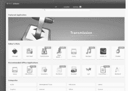

获取新应用程序 ([www.webupd8.org](http://www.webupd8.org))。

访问软件仓库的一种快速简便方法是通过称为“软件包管理器 Synaptic”的工具。借助此工具，你可以访问从游戏到 Microsoft Office 的各种内容。进入你的系统文件，然后在“管理”下点击“软件包管理器 Synaptic”。寻找 "ubuntu-restricted-extras" 并通过软件包管理器安装它。这将允许访问某些专有应用程序。通常，从这个管理器中，你可以检查你想要的应用程序并进行安装。

在桌面版本上访问软件仓库的另一种方法是使用 CLI 命令。这将在服务器部分更详细地概述，因为在该部分 CLI 至关重要，且缺少 GUI。你将使用 "`apt-get-install`" 等命令从软件仓库获取应用程序。

这些是相同的仓库，但这种方式将通过命令行界面以纯文本形式呈现。同样，本指南末尾附有相关列表。你会看到一个初学者基础命令列表，这对于导航命令行界面（即使在桌面级别）也极其有用。你还会看到一个更为全面的列表，它不仅能帮助初学者，还能引导你进入中级学习阶段。

桌面版本的一大优点就在于这种多功能性。

## 安全、更新与效率

每位 Linux 用户或开发者都会建议你，在开始探索或深入使用新安装的 Ubuntu 版本之前，先做几件非常具体的事情。安全与稳定性也是维护 Linux 系统的关键，这能确保你在未来许多年里享受使用体验。以下是 Linux 用户推荐的安装完成后应做的“十大事项”：

- 1. 立即安装并更新 Ubuntu 版本（尽管如果你第一次使用该系统，这听起来似乎没有必要）。如果开发者在版本发布后进行了更新，以修补漏洞或修复问题，就必须执行此操作。
- 2. 根据你的需求调整设置、外观和行为。
- 3. 务必调整隐私设置，以增强安全性。
- 4. 按你的喜好调整主题、壁纸和菜单。可以使用调整工具（Tweak Tool）来获得更多选项。
- 5. 安装 AppGrid 和 Synaptic 包管理器，以便快速查找和安装软件。
- 6. 安装 GetDeb 和 PlayDeb 仓库，以及软件的个人软件包存档（PPA）更新源，并务必启用合作伙伴仓库（Partner Repositories，以访问授权软件）。
- 7. 禁用广告。
- 8. 立即安装任何媒体编解码器、音频播放器和驱动程序。
- 9. 安装免费的软件和应用，例如 Google Chrome、Skype、GIMP、Spotify 等。
- 10. 设置即时通讯、社交媒体账户和云连接。

## 为桌面创建多个工作区

你还可以使用工作区来真正最大化你的桌面 Ubuntu 体验，从中获得更多功能，并为了娱乐或乐趣进行多任务处理。某些版本可能不会显著显示这些选项，但可以在不同的发行版中通过不同的方式启用它们。你应该检查你的发行版，并上网搜索如何在该版本中激活工作区。通常只需点击几下即可。

例如，取决于 Ubuntu 的版本，在每个环境中，你需要点击以启用或管理工作区、添加小部件，或添加分页器小部件来使用这些功能。很快，你就将拥有多个工作区，有助于整理和分离你的活动，前提是你同时拥有多个活动，这将非常有用。你应该尝试激活它们并进行测试。

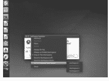

Ubuntu Linux 中的多个工作区

## 命令行界面（CLI）

你最好也学习一些在提示符处可用的基本命令，以防万一（是的，这一点已经建议过几次了！）。你会发现，如果进入应用程序，然后进入附件，找到终端，你就可以访问命令行界面，并会看到一个提示符。这就是命令发挥作用的地方。一些用户非常喜欢这种额外的方式来定制他们希望系统执行的操作、实现自动化或走捷径。

此外，如果有一天你转向服务器版本，你将对命令有一定的欣赏和理解，并且对系统文件的结构和位置有更深入的了解。正如你稍后读到的，Linux 中的一切都是文件。它们的结构与 Windows 等的结构不同。使用图形用户界面（GUI）时，你会从一个角度看到这一点。当你使用命令行界面时，你将更深刻地理解文件树和目录如何与硬件和软件协同工作，从而构成你的操作系统。这也是 Linux 爱好者感受到自由的地方，这种自由不仅来自应用程序和其他系统资源的开源，还来自让计算机真正为你工作的自由和灵活性。

## 在服务器版本中导航

不过，你需要花一些时间在服务器版本上。它并不像桌面版那样直观，有些细节在探索 Linux 之前和过程中非常有用。如果你熟悉 DOS，那么只需要学习命令和代码即可。如果不熟悉，你将面临一条相当陡峭的学习曲线。

首先，你将使用提供的信息登录到你的新服务器版本。你将只看到一个带有 Shell 提示符的 DOS 屏幕。你不会看到像桌面版本那样的图形用户界面（GUI）。现在，你需要使用命令在这个新操作系统中到处移动。你应该设置一个非常安全的密码和 root（用户）名称。务必如实记录这些信息。标点符号在 Linux 中非常重要。不同的拼写等同于完全不同的事物。你会再次看到这一提醒。

## 万物的根源

在 Linux 中，“Root”一词有几个含义。Root 用户是计算机的管理员（用户名为 root），这是最低层级的用户，但拥有完全权限。

Root 也是 Linux 中任何事物的最高级别或核心。它也是系统安装的位置，相当于 Windows 中的 C:/Home。可以说，它是文件的最高层级。在 Linux 中，所有在 Root 目录内部的都是目录或文件。

命令“sudo”意味着“超级用户执行”（Super User Do）。这表示你，作为 Root 用户（即管理员），拥有访问文件和程序的完全权限。在某些发行版中，你需要使用它作为某些命令的前缀。

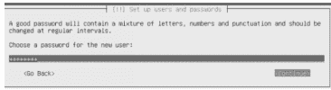

www.ubuntuserverguide.com

## 主宰你的命令

和如今的大多数事物一样，你可以在 Google 上进行简单研究，获取 Linux 命令的大型目录。有了这些，你可以在 Linux 中导航到任何地方。不过，你不应该指望死记硬背这个列表，而应该开始熟悉 Linux 的语言。

一些最重要和最有用的命令能让你进入、退出并四处移动。为了强调并扩展前面的观点，你在命令中使用大写很重要。命令在拼写上非常具体，因此务必正确使用大小写。空格和单词顺序也很重要。你可能无法到达目的地，或者最终到达了一个你 unintended 要去的地方。

在 Linux 的漫长命令列表和命令组合中，还有一些“内置”（builtin）命令。顾名思义，内置命令已经包含在 Bash shell 本身中。

当简单命令的第一个词是一个内置命令时，shell 会执行该命令，而无需调用另一个程序。

正如前面所说，每个发行版都有其优势和挑战。需要注意的是，每个发行版的命令可能相同，也可能不同。鉴于命令是导航此版本 Linux 的唯一方式，这一点至关重要。你不仅应该对已选择的发行版进行一些研究，了解其兼容性和使用情况，现在你还希望研究该特定发行版的具体命令。

你会发现许多命令有一些共同的根源，并且可以在其他命令、关键字、文件或程序名称的基础上进行构建。初学者需要立即使用几个命令。跟随以下步骤并尝试一些命令。

## 在需要时寻求帮助

这里有一些你应该一开始就知道的简单事项。这些可能是你的救命稻草。“Man”页面是手册（即说明性）页面。你将像使用“sudo”命令一样，用此命令作为另一个命令的前缀。使用“man”会打开一个屏幕，其中包含你需要知道的所有内容，作为数字手册页。在需要时尝试这些变体。知道如何到达某处、如何退出以及如何寻求帮助可能看起来很基础，但当你学习系统时，这些可能会让人非常沮丧。

“man -k” 用于搜索包含某个术语的所有命令。你也可以使用“apropos”。

“man” 用于显示帮助信息。

“info” 用于显示帮助信息（方式不同）。

“whatis” 用于显示关于 man 页面的描述。

“whereis” 用于告知 man 页面的位置。

要退出 man 页面，请输入“Q”（退出）。这是退出手册页面的唯一方法。

要退出大多数其他位置，只需输入“Exit”即可。

## “more” 和 “less” 命令

“more” 和 “less” 命令对于显示超出当前屏幕的文件也很有用。在帮助页面上，你可能需要阅读比单屏显示更多的信息。这对于系统初学者尤其重要。只需在输入命令后按空格键向下滚动即可。

要退出，请输入 “q”（代表 quit，退出）。

## 移动操作

你很快就会发现 Linux 中有许多目录，你应该熟悉它们。虽然在 Linux 中一切都是文件，但目录是一种特殊类型的文件。目录在列表中出现，并以树状结构相关。与使用图形用户界面（GUI）的操作系统不同，你看不到文件扩展名。因此，你需要知道如何导航、查找和更改它们。你应该进行一次 Google 搜索以获取它们的列表，以便正确地在系统中导航。

与命令一样，目录的拼写和符号也很重要。另请注意，当你需要在字母和斜杠之间，或来自其他单词的字母之间需要合法的空格时，空格键会派上用场。它节省了时间和按键次数。忽略这些小细节也可能导致你身处不需要的或不想要的地方。它们还可能导致你遇到错误消息的死胡同。在极端情况下，Linux 中的错误可能会造成严重损害，例如删除文件。在设置新文件名时，你应该使用下划线代替空格。这些小事会产生影响。初学者应该熟悉的一些目录和函数包括：

- `/home` - 这是你的根目录，用于存储文档和设置
- `/dev` - 存放设备文件
- `cd` - 更改目录
- `/etc` - 这类似于控制面板

## 使用目录

命令 “pwd” 会打印你的工作目录。这也是查看你起始位置的一个好地方。

要查看目录中包含的内容（从你的主目录开始，然后包括其他目录），你可以输入 “ls” 来列出目录中的内容。

请注意，当服务器账户配置好时，你的主目录中也有隐藏文件。要列出它们，你必须使用句点字符。例如，你不应该只输入 “ls”，而是应该输入 “ls -b” 来查看隐藏文件。

你还会像之前那样学会组合命令。例如，要移动到名为 “xyz” 的子文件夹，你需要在 xyz 前面加上前缀，即 “cd xyz”。

例如，使用 “cd” 命令导航到你的桌面目录，输入 “cd ~/Desktop”。

要返回到根目录，输入 “cd ~”。使用相同命令导航到根目录的一个例子是输入 “cd /”。要移动到当前目录的父目录，你应该输入 “cd ..”。

在你继续之前，你可能想要探索一些目录并四处移动以熟悉方向。

## 如何安装程序

命令 “apt-get” 获取并安装独立的可视化软件包。这就是你创建服务器的方法。你将手动引入任何你需要个性化的 Linux 服务器所需的内容，使用选定的命令。

存储库包含许多你可以随时调用的 Linux 程序。这些也是开源的。如果你此时不知道该需要什么，你应该进行一次 Google 搜索，寻找最适合你需求的软件。

然后访问存储库，例如，你会输入 “sudo apt-get install (程序名)” 来获取副本并自动安装。

在 Ubuntu 中，命令 “tasksel” 意味着任务选择。如果你运行此命令，会出现一个屏幕，列出常见的服务器类型、包和任务。你可以选择并安装你的服务器所需的任何东西。

例如，你会输入 “sudo apt-get install tasksel” 来获取 tasksel 功能，然后通过输入 “sudo apt-get install (然后是你想要的任务名称、想要的服务器等)。” 来使用它。

如果你想安装 LAMP 服务器，你可以输入命令 “sudo apt-get install lamp-server” 来自动化此过程。

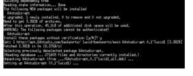

apt-get 安装的一个例子（[www.en.flossmanuals.net](http://www.en.flossmanuals.net)）。

如果你在任何时候需要帮助，既然你知道 man 页命令，你会输入：“man tasksel”。你会看到 man 页出现以解决你的需求。

## 如何卸载

要卸载，你只需输入 “apt-get remove (在这种情况下是服务器的名称)”。使用此命令获取大多数软件，并优先选择免费的开源软件开始。

## 更新

在安装软件后，你可以使用升级命令 “sudo apt-get upgrade”。通过存储库进行简单的更新。手动更新比设置自动更新更容易。由于 Linux 的效率，你不需要经常更新它。这也更加安全。

## 任务管理器

“top” 提示命令类似于“任务管理器”，用于查看进程、每个进程占用的空间，或停止运行中的任务。

使用命令 “h” 获取你任何时候可能需要命令的列表。

输入命令 “sudo top”（访问任务管理器或 top），然后输入命令 “k”（代表 kill，终止），接着输入你在想要终止的进程旁边看到的进程 ID 号（称为 PID）。

## 停止/启动/重启服务

Linux 服务器很少需要重新启动，但有时你可能需要重启软件或服务。

要启动/停止或重启，你将输入命令：

“sudo /etc/init.d/(程序名称) start”（或 stop 或 restart），以进行更改，并在更改期间（例如在崩溃或重新配置文件时）离线工作。

现在你已经对所在位置、去向、如何获取、安装或移除事物有了基本的了解，请花一些时间测试这些操作。下面列出了一组常用命令，以及一份更全面（但非穷尽）的列表。这绝非详尽无遗，但它展示了一些你现在可能能够执行，或者你可能期待学习的内容。

Linux 是一个不断演变的操作系统，鉴于发行版和环境的多样性，事物将继续变化。随着技术进步，改进和利用 Linux 系统的机会越来越多。

# 第 6 章。基础 Kali Linux 工具

在本章中，在简要介绍 Kali Linux 的安装以及对 Kali 操作系统中存在的各种类型工具进行详细概述之后，我们将借助 Kali 中存在的工具通过一些实际场景，帮助我们详细理解黑客攻击的基础知识。

应该如何进行黑客攻击？

没有特定的黑客指南能教你完美地黑客攻击。但总有一个著名的程序，优秀的黑客会无意识地遵循它以获得更好的结果。

## 黑客攻击路线图

黑客攻击就像烹饪。你需要准备好所有食材（即程序），详细了解该食材（或程序）的特性，并将它们结合在一起以产生烹饪材料。如果食物味道不好怎么办？也就是说，如果在所有黑客攻击过程之后，你无法获得更好的结果怎么办？你唯一能做的就是再次尝试。要精通黑客攻击，你需要详细学习五个重要领域。

1. 信息收集
2. 自动漏洞扫描
3. 利用
4. 密码攻击
5. 嗅探和无线路由攻击

### 1) 信息收集

信息收集始终被认为是黑客在攻击目标之前应该做的关键工作。大致总结来说，通过使用信息收集工具，我们可以获得关于目标主机的很多信息，这有助于我们创建可用于建立后门以便进一步利用的漏洞利用程序。我们甚至可以使用大量关于目标的公开信息，对我们的攻击策略有一个很好的了解，以使此次攻击成功。

### 2) 自动漏洞

## 3) 漏洞扫描

漏洞扫描器是一种能够自动在计算机、网络应用、Web 应用程序和软件中发现和检测安全漏洞的程序。它通过网络检测目标系统，向目标系统生成数据，并将反馈数据与内置的漏洞签名数据库进行匹配，从而枚举目标系统上存在的安全漏洞。漏洞扫描是确保系统和网络安全不可或缺的手段。面对互联网入侵，如果用户能够根据具体应用环境尽快通过网络扫描检测到安全漏洞，并及时采取适当的修复措施，就能有效防止入侵事件的发生。由于这项工作相对枯燥，我们可以使用一些便捷的自动化工具来实现，例如 Nessus 和 OpenVAS。

## 3) 利用漏洞

漏洞利用是获取系统控制权的重要方式。用户从目标系统中发现漏洞，然后利用该漏洞获取控制目标系统的权限。为了便于用户实践，本章将介绍由 Metasploit 发布的 Metasploitable 2。用户可以将其作为一个 Linux 操作系统用于练习。本章将使用 Metasploitable 系统中的漏洞来介绍各种渗透攻击，例如 MySQL 数据库、PostgreSQL 数据库和 Tomcat 服务。权限提升是指最大化用户当前拥有的最小权限。通常，我们获取访问权限的用户可能拥有最低的权限。然而，如果你想要执行渗透攻击，可能需要管理员账户权限，因此你需要提升权限。权限提升可以通过使用伪造令牌、本地权限提升和社会工程学来实现。

## 4) 密码攻击

密码攻击是指在不知道密钥的情况下恢复密码明文。密码攻击是所有渗透测试的重要组成部分。如果你是一名渗透测试人员，而不了解密码和密码破解，那是很难想象的。

因此，无论做什么或我们的技术能力有多强，密码似乎仍然是保护数据和限制系统访问的最常见方式。本章描述了各种密码攻击方法，例如密码在线攻击、路由器密码攻击以及创建密码字典。

## 5) 嗅探与无线攻击

这是指人们使用无线网络工具配合网络适配器来捕获数据包，并破解密码或从目标获取敏感信息的过程。像 Wireshark 这样的嗅探工具非常有名，可用于许多攻击和数据包分析。首先，我们将介绍信息收集过程，在这个过程中，我们将借助一个名为 Nmap 的著名侦察工具扫描开放端口。

## 信息收集

信息收集是一个重要的攻击前阶段，黑客在此阶段收集关于其即将攻击的公开目标的大量信息。许多黑客使用社会工程学技术来获取有关目标及其使用的技术、操作系统和版本的坚实信息。每个黑客在针对主机之前，都会使用不同的方法论来收集良好的信息。信息收集有三个重要阶段，如下所述。

- **从搜索引擎收集信息**：使用 Google 等搜索引擎获取有关你要攻击的主机的信息。你会发现你能找到的公开信息之多可能会让你惊讶。
- **社会工程技术**：这些技术之所以有效，是因为你可以用简单的事情（如钓鱼邮件）在心理上欺骗员工或你追踪的目标，从而通过你的漏洞利用程序创建一个后门。所有伟大的黑客都依赖社会工程学，而不是以更复杂的方式行事。
- **端口扫描**：如果你好奇端口扫描涉及什么，请仔细阅读接下来几段文字。服务器提供各种服务，例如发布主页和收发电子邮件。执行网络通信的服务包含一个名为“端口”的通信窗口，它由数字进行管理。例如，知名服务基本上预分配了端口号，例如用于发布互联网主页的 HTTP 服务的 80 端口和用于发送电子邮件的 587 端口。从外部（攻击者视角）调查服务器打开的是什么类型的端口的行为称为“端口扫描”。

## 如何进行端口扫描？

端口扫描的过程是从外部发送特定数据并检查相应的响应，以调查连接到网络的服务器上运行的服务。通过分析获得的响应，你可以识别服务器上运行的服务版本、操作系统等。有 Nmap 和 Zenmap 等工具用于执行端口扫描。

Nmap 是一个命令行接口工具，而 Zenmap 是一个图形界面工具。两者使用相同的技术，且免费使用。尝试在阅读本书时使用你的计算机；毕竟，众所周知，学习黑客技术或编程靠的是做，而不仅仅是读。

## Nmap

Nmap 是著名的黑客工具之一，因其受欢迎程度而在渗透测试人员中广为人知。人们常常误以为 Nmap 仅以其信息收集能力而流行，但通常没有意识到 Nmap 也可以用作可自动化的漏洞检测器。它可以用于各种开源操作系统和 Windows。Nmap 是一个强大的工具，可用于端口发现、主机发现、服务发现、操作系统及其版本检测。Nmap 可以既在命令行中使用，也可与图形用户界面（GUI）结合使用。但请记住，优秀的黑客使用命令行。

## Nmap 是如何工作的？

Nmap 的编程方式使其可以使用诸如 TCP 和 UDP 协议扫描等不同技术进行扫描。所有这些扫描都有其优缺点，当黑客尝试使用 Nmap 攻击主机时，能够生动地理解这一点。在黑客术语中，我们技术上将目标称为目标主机。使用 Nmap 时，我们需要首先理解目标的复杂度，以决定使用哪种扫描，是简单轻松的扫描还是需要更多时间的复杂扫描。我们需要磨练我们的技能，使用一些非常复杂和直观的技术来绕过入侵检测系统以取得良好的结果。以下是一些策略，帮助你欣赏 Nmap 可以执行的各种操作：

- 你可以使用以下命令扫描单个主机：
  - `nmap www.hackingtools.com`
  - `nmap 192.232.2.1`
- 你可以使用以下命令扫描整个子网：
  - `nmap 192.232.2.1/24`
- Nmap 还可以使用以下命令扫描多个目标：
  - `nmap 192.232.2.1 192.232.2.4`
- Nmap 还有一个选项，让你可以扫描一个范围的目标，如下所示：
  - `nmap 192.232.2.1-100`（这精确地扫描了 IP 地址 192.232.2.1 和 192.232.2.100 之间的每个主机）
- Nmap 有一个选项，允许你将所有 IP 地址存储在一个 .txt 格式的文本文件中，并将其放置在 Nmap 的同一目录中，这样它就可以扫描文本文件中存在的每个 IP 地址，而无需手动输入每一个：
  - `nmap -iL sampleip.txt`
- 如果你想查看需要扫描的所有主机列表，可以输入以下命令：
  - `nmap -sL 192.232.2.1/24`
- Nmap 提供了一个选项，我们可以从子网主机中排除单个 IP 地址进行扫描：
  - `nmap 192.232.2.1/24 -exclude 192.232.2.4`
- 如果你想排除多个 IP，你可以将它们全部包含在一个文本文件中，这样在进行子网扫描时就可以排除它们，如下所示：
  - `nmap 192.232.2.1/24 -exclude excludelP.txt`

在学习 Nmap 提供的让我们了解扫描特定主机端口的扫描程序之前，你可以使用以下命令扫描主机中的单独端口：

`nmap -p78,56,23 192.232.2.1`

## Nmap 中的扫描技术

Nmap 遵循不同类型的扫描策略来执行工作。在本节中，我们将详细描述这些程序，并附带一些命令，以便给你一个良好的概览。

### sS 扫描 (TCP SYN)

这是 Nmap 在黑客没有向软件指定任何条件时使用的典型扫描。在这种扫描中，通常 Nmap 不会向目标系统提供完整的握手。它只是向目标主机发送一个 SYN 包，目标主机随后会检查是否有开放端口，但不会创建任何可能在登录后使用的会话。这是该扫描策略最大的优点之一。要使用此扫描，必须赋予黑客工具 root 访问权限，否则将显示错误。下面给出了此扫描的命令行。

`hacking@kali #nmap -sS 192.232.2.1`

### sT 扫描 (TCP Connect)

如果由于当前攻击情况不可行而无法使用 sS 扫描，人们通常使用 sT 扫描作为他们的下一个救星。它与开放端口进行三次握手，并调用一个名为 connect() 的方法，使软件找到 TCP 端口。在优先使用时，sT 扫描也可以用于查找 UDP 端口，尽管人们很少这样使用。以下是 -sT 扫描的命令：

`hacking@kali #nmap -sT 192.232.2.1`

## 3) -sU 扫描（UDP 扫描）

在 -sS 扫描的重要性之后，这种扫描也列入了渗透测试清单中。因为这将仅能找出开放的 UDP 端口，所以无需像 TCP 扫描那样发送 SYN 数据包。当黑客开始使用此扫描时，UDP 数据包会到达目标主机并等待肯定响应。如果收到任何响应，则说明找到了一个开放端口。如果发送带有 Echo 命令的错误消息，则端口是关闭的。

以下是用于 -sU 扫描黑客技术的命令行：
```


`kali@kali:~$ nmap -sU 192.168.2.1`

## 4) `-sF` 扫描（FIN 扫描）

这是一种特殊类型的扫描，因为某些目标可能安装了入侵检测系统和防火墙，这些系统会阻止通过 TCP 扫描发送的 SYN 数据包。仅出于这个原因，如果对方有额外的检测扫描发生，就会使用 FIN 扫描。FIN 扫描不会保存任何日志信息以便被检测，因此 FIN 数据包有很大的机会潜入目标系统并找出少数开放端口。以下是 `-sF` 扫描的命令：

```
kali@kali:~$ nmap -sF 192.168.2.1
```

## 5) `-sP` 扫描（Ping 扫描）

Ping 是一种著名的网络协议方法，通过尝试连接到目标主机来检查主机是否在线。Nmap 中的 Ping 扫描也用于相同目的，并不用于检查开放端口。启动扫描时，Ping 扫描需要请求 root 访问权限。如果你不愿提供管理权限，只需使用 connect 方法即可从 Nmap 启动 Ping 扫描。以下是 `-sP` 扫描的命令：

```
kali@kali:~$ nmap -sP 192.168.2.1
```

## 6) `-sV` 扫描（版本检测扫描）

版本检测扫描是 Nmap 在黑客中最痴迷的使用场景之一。要攻击目标系统，你需要了解主机使用的技术和操作系统，以便你创建你的利用工具和后门策略来闯入系统。然而，与 TCP 扫描不同，版本检测扫描花费很多时间，因为当我们启动 `-sV` 扫描时，TCP 扫描也会随之启动并搜索开放端口。寻找开放端口的任务完成后，`-sV` 扫描会自动分析它们并确定关于目标主机的信息。由于这个复杂的程序，它可能会花费大量时间。以下是 `-sV` 扫描的命令：

```
kali@kali:~$ nmap -sV 192.168.2.1
```

## 7) `-sI` 扫描（空闲扫描）

这是 Nmap 最疯狂的功能之一，因为它在执行攻击时就像代理服务器一样运作。使用空闲扫描时，你可以使用另一个主机的 IP 发送数据包。这种匿名性可以帮助黑客在事情出错或严重时保持隐蔽。保护自己免受调查是每个黑客的努力目标，特别是在这些现代时代。以下是 `-sI` 扫描的命令：

```
kali@kali:~$ nmap -sI 192.168.2.6 192.168.2.1
```

## Nmap 能检测的内容

Nmap 可以检测主机的设备类型（路由器、工作组等）、正在运行的操作系统、操作系统详细信息（如版本和网络距离，即目标与攻击者之间的近似距离）。在使用 Nmap 时，仅在有必要时才使用 Ping 扫描，因为目标主机中的一些防火墙可以检测到即将发生的攻击，并将阻止攻击者的地址进行任何连接。通过以下命令，你是在告诉软件不要 Ping 远程主机：

```
kali@kali:~$ nmap -O -PN 192.168.5.6/12
```

使用 `-PN` 参数可以绕过 Ping 命令，但这不影响宿主系统的发现。NMAP 的操作系统检测基于开放和关闭的端口。如果操作系统扫描无法检测到至少一个开放或关闭的端口，它将返回以下错误。错误代码如下：

警告：我们无法找到任何开放或关闭的端口来获取有关目标系统的信息

使用 NMAP 准确检测远程操作系统很困难，因此我们需要使用 NMAP 的猜测功能。`osscan-guess` 操作会猜测哪种操作系统类型最接近目标。

```
# nmap -O --osscan-guess 192.168.2.1
```

通过使用以下命令和策略，你可以研究关于目标的大量信息，并可以使用这些信息创建后门并利用系统。使用 Metasploit 利用系统将在后续章节中解释，但仅在描述 Nessus 之后进行，Nessus 是一个自动漏洞评估工具，它可以自动发现漏洞，否则你需要通过枯燥的程序手动查找。在讨论 Nessus 之前，让我们做一个简单的练习。请尝试完成此练习，以便更好地理解信息收集。

## 练习

启动 Kali Linux 终端，并使用命令进入 Nmap。查找 `www.nmap.org` 的子网掩码，并查找其使用的操作系统和版本。完成不同的扫描，并创建一份关于所有可用端口的详细报告。

## 自动漏洞扫描

首先，让我们详细学习什么是漏洞，并附带一些漏洞的示例。

### 什么是漏洞

漏洞是主机系统中的缺陷，它允许黑客通过为漏洞创建利用工具来创建后门进入系统。例如，勒索软件利用 Windows 中的漏洞来利用全球数百个系统。Web 应用程序也容易受到漏洞的影响。XSS 漏洞、CSRF 检测等被 OWASP 声明为高危漏洞，它们用于确定漏洞的严重程度。

### 什么是自动漏洞扫描

编码后的手动测试可以轻松发现漏洞。然而，这非常枯燥且耗时，许多人避免这样做。为此，制作了某些自动扫描器来扫描系统并检测是否存在与其数据库匹配的情况。Nessus 和 Burp Suite 等软件使这种自动扫描有效，如果操作得当，很容易获得良好的结果。

## Nessus

Nessus 被认为是一个自动扫描工具，拥有广泛的知名漏洞数据库，该工具将使用它来扫描目标并向攻击者提供结果。对于渗透测试人员来说，Nessus 是必备工具之一。Nessus 的摘要通常包括成千上万的最新漏洞、多种扫描选项以及易用图形界面和有效的报告。Nessus 备受喜爱是因为它具有若干特性。

其工作原理如下：

- 提供完整的计算机漏洞扫描服务，并随时更新其漏洞数据库。
- 与传统漏洞扫描软件不同，Nessus 可以同时分析和扫描系统漏洞，并且可以根据系统资源调整其效率。
- 如果主机配置了更多资源（如更快的 CPU 速度或更大的内存大小），由于资源充裕，其性能可以提高。
- 它可以定义自己的插件；`NASL`（Nessus 攻击脚本语言）是 Tenable 发布的一种语言，用于编写 Nessus 的安全测试选项。
- 完全支持 SSL（安全套接字层）。

Nessus 预装在 Kali Linux 中，可以通过菜单或搜索框打开。它具有 GUI（图形用户界面），易于理解。在 Linux 上，Nessus 工具默认安装在 `/opt/Nessus` 目录中。

1. Nessus 已启用并通过浏览器访问。例如，如果你的 IP 是 `192.168.2.1`，浏览器在 `https://192.168.2.1:8834` 下输入 https 协议。
2. 首先，我们需要注册登录名和密码来使用 Nessus。你可以通过访问 Nessus 官方网站来做到这一点。

### 在 Nessus 中创建基本扫描

步骤 1：通常当我们想要扫描主机或网站时，在 Nessus 菜单中点击“My Scans”（我的扫描），然后点击“New Scan”（新建扫描），这将创建一个新的扫描。如果我们正在扫描网站，可以选择 Web 应用程序测试；如果我们正在扫描主机，则需要选择高级扫描。

第二步：进入下一个页面，我们在“扫描名称”中填入期望的名称。我们填写描述和目标 IP 地址，然后点击保存。之后，你可以前往“我的扫描”页面并点击“开始扫描”以启动该过程。

第三步：当扫描完成后，会出现一个已扫描的结构，包含五个漏洞级别，最高为 Critical（严重），最低为 info（信息）。我们可以点击查看详情中的每个漏洞描述信息，通过漏洞分析可以更好地加固我们的系统。它可以用于多种用途，如信息收集、通信和创建后门。它被称为 Netcat（网络工具），也广为人知是 Kali Linux 工具中的“瑞士军刀”。它随 Kali Linux 预装。

## Netcat

Netcat 是网络黑客工具中的瑞士军刀，可以通过 TCP 和 UDP 在网络中读写数据。通过与其他工具组合和重定向，你可以在脚本中以多种方式使用它。Netcat 可以做许多黑客经常请求的令人惊叹的事情。Netcat 基本上基于一种原理运行，该原理有助于在两个系统（即服务器和客户端）之间传输数据。如果你成功地建立了两个服务器，那么你可以做很多疯狂的事情。你可以在命令行中设置聊天通信，甚至可以流式传输视频。Netcat 服务器有无数优点。我们将进一步详细讨论它们。

Netcat 示例：
- A(`192.232.2.23`)
- B(`192.232.2.43`)
- a(`192.232.2.23`)
- b(`192.232.2.43`)

如何在 Kali Linux 中使用 Netcat？

如何启动 netcat？当你在 Linux 终端中输入 `nc` 如下所示并按回车。这将启动 netcat 工具。

```
$ nc
```

### 1) 使用 Netcat 进行端口扫描

初学者由于渗透测试者中流行，常常对“端口扫描”这一术语感到困惑。如果我们用通俗语言来解释端口扫描，它是一个试图通过工具查找开放且易受攻击的端口的过程，以期找到一个可利用的漏洞或后门。以下是使用 netcat 实用工具进行端口扫描的命令。

```
$ nc -z -v -n 192.232.2.3 21-25
```

### 2) 使用 Netcat 启动聊天服务器

想象你身处一个受限位置，比如在工作场所，无法使用消息服务。netcat 可以通过创建一个聊天服务器来解决这个问题，该服务器可用于与网络中的其他系统进行通信。然后你可以创建一个服务器，作为你想要通信的网络中任何人的聊天系统。


### Server
```bash
$ nc -l 2343
```

### Client
```bash
$ nc 192.232.2.1 2343
```

使用 `netcat` 服务器，你的所有消息都会传输到客户端，最棒的是，通信将被加密，无法被任何嗅探软件（如 `Wireshark`）捕获。

### 3) 文件传输
许多黑客在攻击网络内部设施时，需要在两台计算机或设备之间交换文件。通常人们使用文件传输协议（`FTP`）在主机之间传输文件。但当你处于一个不允许安装额外软件的私有网络中时，`Netcat` 是你传输文件的安全选择。例如，你可以通过将其中一个设为客户端，另一个设为服务器，从 X 系统向 Y 系统发送 `.avi` 文件。

#### Server
```bash
$ nc -l 6870 < example.avi
```

#### Client
```bash
$ nc -n 192.232.2.1 6870 > example.avi
```

### 4) 在服务器中流式传输视频
还有很多其他方法可以做到这一点，但如果使用命令行，这可能是一种简单的方式。

#### Server
```bash
$ cat tutorial.avi | nc -l 2343
```


查看以下示例，你可能已经理解了 Netcat 多么有用。你可以用 Netcat 进行几十种实验，这些实验可以帮助你提高黑客技能。在本章中，我们详细讨论了像 Nmap、Nessus 和 Netcat 这样的黑客工具，并解释了潜在的示例，这些示例可以让你清楚地了解后台发生的事情。

# 第 7 章：命令语法模式

让我们讨论许多 Linux 命令共享的一些常见用法模式。对这些基础良好的感觉可以让你的学习过程快得多。调用命令总是以命令名开始，就像“`ls`”命令一样，仅使用名称就足以返回结果。然而，通常你需要添加一些参数和选项的组合，才能充分利用工具。你 already 已经学习过，向“`ls`”命令添加“`-a`”可以显示目录中的所有文件，包括隐藏文件。但你可以使用两个连字符和单词“all”获得相同的结果。提供这些替代选项使命令参数对各类人群更易于访问，那些通过更完整的描述记忆事物更好的人，以及那些频繁执行任务从而可以享受单字符参数速度的人。查看“`ls`”的“`man`”文件会显示许多其他短参数也有双连字符的较长等价形式。参数语法的使用有一些例外。网络管理“`ip` 命令”可以使用不带连字符的“`addr`”参数来显示与系统网络接口关联的 IP 地址。在大多数 Linux 系统中，这甚至可以缩短为简单的“`a`”，同样不带连字符。你可以在单个命令中组合多个短参数。“`ls -l`”将以长格式列出目录内容，显示对象权限、所有权、大小和年龄详细信息。再次使用“`h`”命令运行它将给你人类可读格式的文件系统。添加“`t`”将按降序时间顺序排列对象。

除了参数，大多数命令还可以读取格式正确的参数。这个示例将列出“`etc`”目录的完整内容，无论你身在文件系统的哪个位置。既然最优秀的系统管理员都极其懒惰，你可以预期会有些非常严重的命令行快捷方式隐藏在明处。其中最强大的可能被称为自动补全。Bash 监视你正在输入的内容，并且通常可以预测你想要什么。例如，要查看目录中的压缩 tar 存档文件，你可以开始输入用于提取内容的“`tar`”命令。然后你可以在字母“`n`”处停止。

而不是输入整个文件名，你只需按 Tab 键，Bash 会为你完成其余部分。Bash 理解命令的上下文，因此它给你存档，而不是使用类似名称的子目录。然而，如果你运行更改目录命令“`cd`”加上字母“`n`”，按 Tab 将正确给你目录名称。不出所料，只有当目录中只有一个匹配的可能性时，自动补全才会工作。有时你可能需要提供几个更多字符以获得良好的匹配。

说到“`cd`”和快捷方式，你可以在文件系统任何地方简单输入“`cd`”，你就会被带回到用户的家目录。你可以通过按上箭头键循环使用最近的命令。当一个旧命令显示时，你只需按 Enter 即可再次运行它。当然，你在此期间可能移动到了不同的位置，因此命令上下文可能已经改变。最近 1,000 个命令存储在你用户家目录中一个名为“`bash_history`”的隐藏文件中，可以通过运行“`history`”命令查看。

有些字符被称为正则表达式，Shell 不一定按你预期的方式解释它们。一个简单的空格就是一个例子。其他例子包括点、方括号、星号和问号。Bash 通常会将这些解释为命令指令，而不是简单字符。假设你决定创建一个名为“this is my story”的文件。运行“`touch`”命令和一个未使用的文件名是创建空文件的一种快速方法。但如果你这样运行“`touch`”，事情不会按你预期的那样发展。列出目录中的文件会显示现在有四个文件，每个都有一个单词的名称。“Touch”认为你想创建四个单独的文件，并立即着手去做。如果你想摆脱这种情况，你可以将包括空格在内的整个文件名封闭在引号内。这告诉 Linux 这是一个字符串的另一个方法是使用反斜杠作为转义字符来强制 Bash 保留输入的字面值。对于你的问题，起作用的方法是在字符串中每个空格前输入反斜杠。当你列出目录内容时，你现在将拥有一个单一文件，其名称是另一个四个词的名称。事实是，从长远来看，你可能最好

养成使用连字符或下划线创建单词文件名的习惯。这可以简化你的文件管理。

摘要：

你已了解 Linux 的主要内联文档系统“`man`”，以及如何用它快速查找几乎任何 Linux 命令的操作信息。你还了解到，info 系统、“`usr/share/doc`”目录中的内容，甚至运行命令后跟随“`—help`”也能提供宝贵的信息和资源。你还学习了登录和非登录命令行“`shell` 会话”的行为如何通过像“`bashrc`”和“`profile`”这样的文件来控制。你发现了参数和变量如何传递给 Bash 命令，在参数的情况下，包括短格式和长格式，并学会了利用一些有用的快捷键，包括通过向上和向下箭头键访问命令历史，以及使用 Tab 键进行上下文自动完成建议。最后，你现在理解了一些字符，如空格，被破折号（dash）的不同处理方式，有时需要转义字符才能获得正确的结果。

# 第 8 章。Linux 文件和目录

如果你要在 Linux 上完成工作，特别是使用命令行，你需要对文件存储位置以及如何操作它们有牢固的认识。好消息是，弄清楚这些并不像看起来那么难。在本章中，我们将学习一些基本的文件和目录管理技能，探索一些强大的工具，用于搜索文件及其内部包含的文本字符串，然后操作你找到的数据。此外，你还将学习如何创建和使用压缩数据归档，以及识别系统中的硬件外设，并在需要时启用你使用设备所需的内核模块。

在识别目录树时，你可以使用正斜杠。因此，你的主目录中名为 scripts 的目录的绝对地址是“`/home/ubuntu/scripts`”，其中 Ubuntu 是你的账户名称。如果你以“`cd`”（代表变更目录）开头，你会移动到该目录。一旦你准备好，就试试看；输入命令“`pwd`”（代表当前工作目录），你将看到你的新目录位置显示出来。为了更容易理解基本的 Linux 文件和目录管理命令，创建一个新目录并填充一些无用的内容。命令“`mkdir`”将创建一个名为“`data`”的目录。列出父目录的内容以显示新的子目录，然后更改位置到该目录。要创建几个文件，你可以启动文本编辑器“`nano`”，后接现有文件或新文件的名称。在这种情况下，它将是“`new`”。你可以输入一些文本，然后按 Ctrl 和“`X`”，再按“`Y`”保存并退出。“`File1`”现在应该存在。通过“`touch`”快速创建具有未使用名称的空文件。对现有文件使用“`touch`”只会更新文件的日期时间戳，这对某些管理目的很有用。你可以按向上箭头，并提高数字几次，以便于创建更多的文件。一旦你有一系列带编号的空文件，让我们在 data 内创建一个新目录，并称之为“`newdata`”。如果你希望将文件复制到“`newdata`”，你可以使用“`cp`”。这将创建“`file1`”文件的副本。但是，重复该命令来复制系列中的每个文件会很无聊，所以你可以使用所谓的“通配符”（globbing）。“`globbing`”命令仅仅是一种将操作扩展到全局目标的方式。所以输入“`cp file* newdata`”将复制所有以 file 开头的文件，不管该字符串后面跟着什么字符。输入“`cd`”到“`newdata`”以查看那里有什么。星号将使 Linux 命令作用于任何以 file 开头的字符串，不管后面有多少字符。然而，你也可以使用问号将操作限制为单个字符。你可以创建几个更多名称更长的文件，并使用带有问号的“`rm`”来删除或删除所有以“`file`”开头但只多一个数字的文件。你会看到其中一些文件仍然存在。如果你使用带有星号的“`rm file`”，所有文件都将被删除。此外，要移动文件而不是仅仅制作一个新副本，请使用命令“`mv`”。如果你想清理你的文件，你可以使用命令“`rm`”和一个星号来删除我们“`newdata`”目录中的所有文件。请小心，因为这有时会删除比你预期的更多的内容，而且你应该一定记住 Linux 终端没有“回收站”，无法从中恢复被删除的文件。你可以“`cd` 返回到 data”并运行“`rm dir`”来删除“`newdata`”目录。

# 第 9 章。Linux 文件系统搜索

繁忙的 Linux 系统可以包含大量文件。事实上，一些工作站可以很容易拥有超过 200-300 万个文件。时不时地追踪单个系统和配置文件将是很重要的。但逐个目录目视扫描它们可能非常无聊。使用命令“`locate`”查找文件是最快和最简单的方式。假设你想不起来他们把控制“`adduser`”命令工作方式的配置文件藏在哪里？你可以简单地使用“`adduser`”作为参数运行 locate。列表中可能性最大的候选项是“`etc`”目录中的那个，而这正是大多数配置文件存储的地方。然后你可以指向其地址在文本编辑器中打开该文件。“`Locate`”工作非常快，因为它只是读取系统上所有文件和目录的预编译索引。如果你在寻找最近添加的文件，你可能需要更新索引。你可以通过运行命令“`update db`”来做到这一点。当你需要查找文件时，这将让你开始行动。但由于 Linux 中几乎所有的操作都通过文件内容来控制，你需要一种搜索这些文件内部的方法。例如，许多程序会定期生成成千上万甚至数百万条写入日志文件的文本消息，以便你稍后可以回顾关键事件。为了管理处理所有这些数据的问题，Bash 附带了一整套文本处理工具，用于读取、转换和重定向文本。你已经知道命令“`less`”如何读取文件并一次显示一屏。然而，与其将文本直接打印到屏幕上，它还可以通过所谓的管道发送文件内容进行搜索，并在需要时进行操作。然后可以调用多个文本处理工具来过滤流式文本。你可以使用命令“`cat`”读取包含系统组信息并位于“`etc`”目录中的组文件。但与其只是将内容转储到屏幕上，你可以使用由 Shift 和反斜杠产生的垂直线将其管道传输到命令“`grep`”过滤程序。你将告诉“`grep`”阅读文本并只打印包含你指定的某个单词的那些行。如果需要，而不是将输出打印到屏幕上，你可以用它来填充文件。你可以通过添加一个重定向和两个右箭头以及文件名来实现这一点。唯一需要注意的是，如果你只用了一个右箭头进行重定向而不是两个，“`grep`”选中的文本将会覆盖文件的任何现有内容。两个箭头会将文本附加到文件的末尾。这是一个你应该记住的重要区别。由于组文件相当短，这是一个说明如何使用更多工具的好方法。命令“`head`”默认只打印文件的前 10 行，“`tail`”打印最后 10 行。当然，像组这样的文件的真正价值在于它包含的任何数据。每行都遵循相似的模式，首先是一个组名，然后是一个冒号和一个 x，另一个冒号和组 ID 号。可能有用的是能够从每行中提取一个字段的数据并将它们一起处理。为此，你可以使用“`cut`”。`-d`”告诉 Linux 使用每个冒号作为字段分隔符，意思是考虑每个冒号的出现作为一个字段的结束和另一个字段的开始。“`-f3`”是我们表示我们只对每行第三个字段的内容感兴趣的方式。这将成功打印每个组的 ID 号。如果你想看到这些数字按升序打印，你必须将你的输出管道传输到排序“`sort -n`”。如果你是降序类型的人，只需在排序参数中添加一个“`r`”或 reverse。虽然这个例子是无意义的，但我仍然觉得在单一短代码行中挤压这么多功能有一定的美感。另一方面，我相信你可以看到，当你有迫切需求快速分析像系统日志这样的大型文本文件，且没有时间逐行阅读时，这些工具中的每一个都非常有用。

如果你想要查看文件包含多少行、单词和字符，运行命令“`wc`”，它代表 word count（字数统计）。由于我提到了使用箭头的重定向，你可能只需将其输入出来。单词 redirect（重定向）意味着你处理的文本方式与其他管理方式不同。那通常会是怎样的？嗯，那取决于文本的类型。你有三种可选择，标准输入通常被称为“`stdin`”，标准输出或“`stdout`”，以及“`stderr`”代表标准错误。标准输入通常来自键盘，通过它提供给 Bash。标准输入重定向将从……接受输入

备用来源。本示例将以 root 用户打开 “`MySQL`” 数据库引擎，并使用左箭头字符来告诉 Bash 在哪里找到文件，从而导入 “`mydatabase.sql`” 数据库文件。默认情况下，命令的“标准输出”将被发送到终端显示。将标准输出重定向到文件的操作如下所示。请记住，一个右箭头会清除文件中的现有文本并用输入内容替换它，而两个右箭头则会追加新文本。最后，标准错误会写入由命令生成的任何错误。默认情况下，这些错误也会输出到终端显示。如果你对 google.com 的错误网页地址运行 “`wget`” 命令，你可以使用两个 “`<`”（或者针对错误使用 `2>`，但上下文暗示的是关于重定向的讨论）来解释其通常的工作方式。你会看到 “`wget`” 无法解析该地址。考虑到根本不存在这样的地址，这并不令人惊讶。然而，如果我希望将错误消息写入文件，我会使用 “`wget`”、错误的地址、数字 2、一个右箭头以及我更正后想要的下一个文件名。数字 2 是标准错误的标识符。0 是标准输入，1 是标准输出。

# 第 10 章. 用户和组管理

在本章中，我们将学习 Linux 中的用户和组，以及如何管理它们并为这些用户管理密码策略。到本章结束时，您将精通 Linux 系统中用户和组的作用，以及操作系统如何解释它们。您将学习创建、修改、锁定和删除在本地创建的用户和组账户。您还将学习如何通过强制在 shadow 密码文件中实施密码老化策略来手动锁定账户。

### 用户和组

在本节中，我们将理解什么是用户和组，以及它们与操作系统的关联。

谁是用户？

操作系统上的每个进程或正在运行的程序都以某个用户的身份运行。系统中每个文件的所有权都属于某个用户。用户限制了对文件或目录的访问。因此，如果某个进程以某个用户的身份运行，该用户将决定该进程可以访问哪些文件和目录。

您可以使用 `id` 命令了解当前登录的用户。如果您将另一个用户作为参数传递给 `id` 命令，您还可以获取该其他用户的基本信息。

如果您想知道与某个文件或目录相关联的用户，您可以使用 `ls -l` 命令，输出中的第三列显示用户名。

您还可以使用 `ps` 命令查看与进程相关的信息。该命令的默认输出仅显示在当前 shell 中运行的进程。如果您在命令中使用 `a` 选项，您将看到终端中所有进程。如果您希望知道与某个命令相关联的用户，您可以将 `u` 选项与 `ps` 命令一起使用，输出的第一列将显示用户。

用户名通过系统中的数据库映射为数字。在 `/etc/passwd` 处存储了一个平面文件，其中包含所有用户的信息。该文件中每个用户有七个字段。

| 字段 | 描述 |
| :--- | :--- |
| `username` | 用户名简单地将用户 ID (UID) 指向一个名称，以便人类更容易记忆。 |
| `password` | 过去用户的密码存储在此字段中，但现在它们存储在位于 `/etc/shadow` 的不同文件中。 |
| `UID` | 这是一个用户 ID，它是数字型的，用于在系统最基本层面识别用户。 |
| `GID` | 这是用户的主组编号。我们稍后会讨论组。 |
| `GECOS` | 这是一个使用任意文本的字段，通常为用户的全名。 |
| `/home/ dir` | 这是用户主目录的位置，用户在此存放个人数据和其他配置文件。 |
| `shell` | 这是用户登录后运行的程序。对于普通用户，这通常是提供命令行提示符的程序。 |

什么是组？

就像用户一样，组也有名称和组 ID (GID) 编号。本地组信息可以在 `/etc/group` 中找到。

有两种类型的组：主组和辅助组。让我们逐一了解它们的特征。

- 主组：
  - 每个用户恰好有一个主组。
  - 本地用户的主组由 `/etc/passwd` 文件中的第四个字段定义，其中列出了组编号 GID。
  - 用户创建的新文件属于主组。
  - 用户的主组默认与用户名相同。这是一个用户私有组（UPG），用户是该组中唯一的成员。
- 辅助组：
  - 用户可以是一个或多个辅助组的成员。
  - 本地用户的辅助组由 `/etc/group` 文件中的最后一个字段定义。对于本地组，用户成员资格由逗号分隔的用户列表标识，该列表位于 `/etc/group` 中组条目的最后一个字段。
    - 格式：`groupname:password:GID:list,of,users,in,this,group`
  - 辅助组概念的存在是为了让用户能够成为更多组的成员，从而拥有访问系统中属于其他组的资源和服务的权限。

### 获取超级用户权限

在本节中，我们将了解什么是 root 用户，以及您如何成为 root 或超级用户并获得对系统的完全访问权限。

#### root 用户

在每个操作系统中，都有一个被称为超级用户的用户，该用户在该系统中拥有所有的访问权限和权利。在基于 Windows 的操作系统中，您可能听说过被称为管理员的超级用户。在基于 Linux 的操作系统中，这个超级用户被称为 root 用户。root 用户拥有覆盖文件系统上任何正常权限的权力，通常用于管理和管理系统。如果您想要执行诸如安装新软件或删除现有软件等任务，以及管理文件和目录等其他任务，用户必须将权限提升为 root 用户。

操作系统上的大多数设备只能由 root 用户控制，但也有少数例外。普通用户可以控制可移动设备，如 USB 驱动器。因此，非 root 用户可以管理和删除可移动设备上的文件，但如果您想要修改固定硬盘，只有 root 用户才能做到。

但正如我们听说的，能力越大，责任越大。鉴于 root 用户拥有无限的权力，这些权力也可以被用于损坏系统。root 用户可以删除文件和目录，删除或修改用户账户，在系统中创建后门等。如果 root 用户账户被破解，其他人可以获得对系统的完全控制。因此，始终建议您以普通用户身份登录，并仅在绝对必要时将权限提升为 root 用户。

在 Linux 中，以普通用户身份登录然后使用工具获取 root 账户的某些权限是一种惯例。

#### 使用 Su 切换用户

您可以使用 `su` 命令在 Linux 中切换到不同的用户账户。如果您未将用户名作为参数传递给 `su` 命令，则默认表示您希望切换到 root 用户账户。如果您以普通用户身份调用该命令，系统将提示您输入想要切换到的账户的密码。但是，如果您以 root 用户身份调用该命令，则无需输入正在切换到的账户的密码。

```bash


`su - <username>`

```
[student@desktop ~]$ su -
Password: rootpassword
[root@desktop ~]#
```

如果您使用命令 `su username`，它将启动一个非登录 shell 会话。但如果您使用命令 `su - username`，则为该用户启动一个登录 shell。这意味着使用 `su - username` 会为 `newUser` 设置一个全新的干净登录环境，而仅使用 `su username` 将保留当前 shell 的所有当前设置。通常，为了获得新用户默认设置，管理员通常使用 `su -` 命令。

## sudo 和 root

Linux 操作系统中实施了一个非常严格的模型。`root` 用户拥有做任何事情的能力，而其他用户无法执行与系统相关的操作。过去遵循的常见解决方案是允许普通用户使用 `su` 命令暂时成为 `root` 用户，直到所需任务完成。然而，缺点是普通用户实际上会成为 `root` 用户并获得 `root` 用户的所有权力。他们随后可以对系统做出关键更改，如重启系统，甚至删除像 `/etc` 这样的整个目录。此外，获得 `root` 用户的访问权限还涉及另一个问题：每个切换到 `root` 用户的用户都需要知道 `root` 用户的密码，这不是一个好主意。

这就是 `sudo` 命令发挥作用的地方。`sudo` 命令允许普通用户运行命令，就好像他们是 `root` 用户或根据 `/etc/sudoers` 文件中定义设置的另一个用户。像 `su` 这样的其他工具要求您知道 `root` 用户的密码，而 `sudo` 命令仅要求您知道自己的密码进行身份验证，而不需要知道您试图获取访问权限的账户的密码。通过这样做，它允许系统管理员允许普通用户拥有一系列特权，使他们能够执行系统管理任务，而无需实际知道 `root` 密码。

让我们看一个示例，其中 `student` 用户通过 `sudo` 被授予运行 `usermod` 命令的权限。拥有此权限后，`student` 用户现在可以修改任何其他用户账户并锁定该账户。

```bash
[student@desktop ~]$ sudo usermod -L username

[sudo] student 的密码：studentpassword
```


使用 `sudo` 访问权限的另一个好处是，用户通过 `sudo` 运行的所有命令都会记录在 `/var/log/secure` 中。

# 第 11 章. 初学者命令与函数

在这里我们为 Linux 新手提供两份指南。第一份可以被称为实用的速查表。如果你必须为桌面或服务器记忆某些内容，这是最佳选择。第二份列表更为全面，但同样，它并非在 Linux 中从新手进阶到熟练级别所需命令的终点。

## 初学者前 29 条命令列表 - 如果你必须记忆它们

1. `apt-get` 搜索软件包并安装
2. `bzip2` 压缩/解压缩文件
3. `cd` 更改目录
4. `chmod` 更改文件的访问权限
5. `cp` 复制一个或多个文件或目录的位置
6. `date` 显示或设置日期和时间
7. `df` 显示磁盘已用和空闲空间
8. `emacs` 文本编辑器
9. `exit` 退出 shell
10. `find` 搜索符合特定模式的文件
11. `hostname` 打印或更改系统名称
12. `install` 复制文件，设置/更改属性
13. `locate` 搜索和查找文件
14. `ls` 列出目录内容的信息
15. `man` 显示特定命令的帮助信息
16. `mkdir` 创建新的文件夹/目录
17. `mv` 移动或重命名目录和文件
18. `nano` 带有菜单快捷键的文本编辑器
19. `open` 在原始应用程序中打开文件
20. `ps` 显示当前进程状态
21. `pwd` 显示/打印工作目录
22. `quota` 显示磁盘使用情况，限制
23. `reboot` 重启系统
24. `rm` 删除，移除目录或文件
25. `rmdir` 删除，移除，清空目录或文件夹
26. `shutdown` 关机或重启
27. `sftp` 安全文件传输程序
28. `sudo` 以特定用户身份执行具有所有权限的命令
29. `tar` 从 tarfile 或 tarball/归档中存储、列出或提取文件

# 第 12 章. 使用 Linux 文本编辑器

即使你能够使用具有功能齐全的图形界面的桌面环境，你会发现你希望使用 GUI 之外的编辑器来编辑和创建文件，从而与 Linux 环境进行交互。学习如何使用文本编辑器将使你能够编写自己的 shell 脚本，并与你想在操作系统中运行的程序进行通信。同时，你还将能够修复配置文件中的潜在问题，尤其是在 X 窗口系统无法加载时。

在本章中，你将学习如何使用 GUI 和文本模式编辑器，这两种编辑器都允许你配置和创建文本文件。

## 如何使用 GUI 文本编辑器

KDE 和 GNOME 的 GUI 桌面环境都内置了具有自己图形用户界面的文本编辑器。你可以从主菜单中加载这些编辑器。例如，如果你想打开 GNOME 的 GUI 文本编辑器，请导航至“应用程序 -> 文本编辑器”，然后选择文件 `gedit`。一旦编辑器加载，你可以选择工具栏上的“打开”选项，然后在标有“打开文件”的对话框中调出你想要编辑的文件或更改包含该文件的目录。

GNOME 的文本编辑器还能够一次加载多个文件，甚至可以在窗口之间切换以处理它们。一个典型的编辑会话看起来像这样：

图片来源：Linux All-in-One for Dummies

观察这张图片，你会注意到编辑器中加载了两个文件 – 一个看起来是新文件，另一个名为 `motd`。你可以在标签页中找到正在编辑的文件名称，你也可以点击标签页来切换窗口。

如果你打开一个只允许读取的文件，你会看到文件名旁边增加了显示“只读”的文本，出现在窗口标题中。如果你具有超级用户权限，当然可以更改文件的所有权，以便你能够进行编辑。

如果你使用的是 KDE 桌面，你可以通过导航至“应用程序 -> 附件 -> 文本编辑器”来调出 `KWrite` 文本编辑器。

就像在 GNOME 文本编辑器中一样，你可以点击“打开”图标或导航至“文件 -> 打开”来加载你想要编辑的文件。`KWrite` 编辑器的外观如下：

图片来源：Linux All-in-One for Dummies

## 使用 ed 和 vi 作为文本编辑器

正如你可能注意到的，具有 GUI 的文本编辑器允许你使用鼠标和键盘编辑文件，类似于你在文字处理器中键入文档的方式。然而，文本模式编辑器比这更复杂 – 你只有键盘作为输入设备，并且你必须输入命令来执行诸如复制、粘贴或剪切文本等任务。

Linux 原生自带的文本编辑器称为 `ed` 和 `vi`。

### ed

当你加载了操作系统的最小版本，并且还没有全屏编辑器所需的充分支持时，这种面向行的编辑器将极其有用。当你从启动盘加载 Linux 时，可能会遇到这种情况。

使用 `ed` 允许你在这些模式下工作：

- 命令模式 – 这是默认模式，你输入的所有内容都被 Linux 解释为命令。在此模式下，`ed` 拥有一组相当简单的命令，其中每个命令由一个或多个字符组成。
- 文本输入模式 – 此模式用于输入较长的文本。当你输入命令 `a` 表示追加、`c` 表示更改或 `i` 表示插入时，你可以进入此模式。当你输入几行文本完成后，你可以在空行上仅输入一个句号来离开此模式。

为了练习使用 `ed` 作为编辑器，执行以下命令：

这将把文件 `/etc/fstab` 复制到你的主目录。要开始编辑此文件，输入此命令：

编辑器随后会响应并显示此输出：

从这个例子来看，`-p` 选项允许你将冒号符号 `:` 设置为你的提示符，并打开你在主目录中的 `fstab` 文件副本。每次 `ed` 编辑器调出文件进行编辑时，它会显示可编辑文件中的字符数，然后显示冒号提示符，表示你可以通过编辑器输入命令。

提示：当你想要使用 `ed` 进行编辑时，请确保使用 `-p` 选项开启提示符。这将帮助你区分你处于文本输入模式而不是命令模式。

一旦 `ed` 打开你想要编辑的文件，你将立即处于文件的最后一行。要查看当前行号，或者查看你即将输入的命令将被放置的行，你可以使用 `. =` 命令，其外观如下：

根据这个结果，你现在知道 `fstab` 文件包含 9 行。现在，如果你想查看文件中包含的所有行，可以使用以下命令：

这将返回一个看起来像这样的输出：

如果你想转到你想要编辑的行号，例如第 2 行，只需在提示符处输入行号。编辑器随后会响应并显示该行：

例如，如果你想删除包含单词 `cdrom` 的行，你只需要搜索该特定字符串。你可以这样做：输入 `/` 符号，然后是你需要查找的字符串：

这将返回包含你要编辑的行成为当前行的那一行。要删除它，只需在提示符处输入 `d`。

要用不同的字符串替换特定字符串，`s` 命令会很有用。例如，如果你要用 `"cd"` 替换字符串 `"cdrom"`，输入此命令：

要在你当前正在编辑的行之前插入一行，使用以下命令：

从这一点开始，你可以输入任意数量的行。如果你输入完毕，在空行上输入句号符号以表示结束文本输入模式。这样做之后，你将看到 `ed` 切换回命令模式。

如果你想保存你对文件所做的更改，在提示符处输入 `w` 命令。如果你想保存更改并退出编辑器，在提示符处键入 `wq` 以执行这两个操作。输出将显示如下：

编辑器随后将保存你执行的所有更改，然后显示保存的字符数。之后，Linux 将退出编辑器。然而，如果你想在不保存对文件所做的任何更改的情况下退出，键入 `q` 命令以在不写入文件的情况下退出。

当然，你可以在 `ed` 中使用其他不同的命令。以下是 `ed` 编辑器中最常用命令的摘要：

图片来源：Linux All-in-One for Dummies

### vi

与 `ed` 相比，`vi` 编辑器绝对更容易使用，尽管它仍然被视为命令行编辑器。`vi` 允许你以全屏模式使用文本编辑器，这意味着你可以同时查看多行。了解大多数 Unix 系统包括 Linux 都自带此文本编辑器也是有帮助的；这意味着一旦你理解这个编辑器的工作原理，你就能在任何基于 Unix 的系统上修改文本文件。

注意：当你使用 `vi` 编辑文本文件时，编辑器将其读入缓冲区内存。这意味着你可以在缓冲区中更改文件。同时，此编辑器在编辑会话期间也使用临时文件，这意味着除非你保存所做的任何更改，否则原始文件不会发生任何更改。

要开始使用 `vi` 进行编辑，键入 `vi` 后跟文件名：

这将使 `vi` 加载该文件，然后将文本文件的前几行显示到屏幕上。光标也将定位在第一行：


在这个示例中，最后一行显示了文件的路径名，以及文件中的行数和字符数。你还会注意到该文件是只读的。这意味着你正在以普通用户的身份查看该文件。你可能还注意到，由于行数没有占满屏幕剩余空间，未使用的行用波浪号 `~` 标记。当前行通过正在编辑的字符上方的黑色矩形进行标记。

`vi` 编辑器允许你进入以下模式：

- 可视命令 – 这是默认模式，其中你输入的所有内容都被 Linux 视为应用于当前行的命令。所有 `vi` 命令与 `ed` 命令相同。
- 冒号命令 – 此模式用于写入或读取文件，设置 `vi` 选项以及退出 `vi`。顾名思义，此模式中的所有命令都以冒号开头。当你输入冒号符号时，编辑器将光标移动到最后一行，然后提示你输入命令。当你按下回车键后，编辑器将执行该命令。
- 文本输入 – 这是当你想向文件中输入文本时需要使用的模式。你可以使用以下命令进入此模式：

输入完文本后，按 `Esc` 退出此模式并返回可视命令模式。

提示：在使用 `vi` 编辑器时，有时可能很难判断你当前处于哪种命令模式。可能会出现你输入了一长行文本，却发现自己并不在文本输入模式的情况，这可能会让人有些沮丧。如果你想确认自己处于命令模式，请按几次 `Esc`。

知道你可以使用方向键和部分键盘快捷键来移动光标和屏幕也会有帮助。试一试这些命令：

图片来源：Linux All-in-One for Dummies

你也可以使用冒号命令跳转到特定行。例如，如果你想立即切换到第 6 行，只需在冒号后输入 `6`，然后按回车键：

请记住，当你输入冒号符号时，`vi` 编辑器会将其显示在屏幕的最后一行。之后，`vi` 会将你输入的任何文本视为命令。

要搜索特定字符串，请输入 `/` 符号，然后按回车键。`/` 符号将出现在最后一行，提示你输入要搜索的字符串。一旦找到，`vi` 将光标定位在文本行中匹配项的开头。例如，如果你想搜索 `/etc/fstab` 文件中的字符串 `"cdrom"`，请输入：

如果你想删除光标所在的行，请键入命令 `dd`。编辑器将删除该行，然后将下一行变为当前行。

如果你想在光标处输入文本，请键入命令 `i`。编辑器将切换到文本输入模式，从而允许你输入所需的文本。完成后，按 `Esc`。`vi` 编辑器随后将恢复到可视命令模式。

完成文件修改后，你可以输入 `:w` 命令来保存所做的更改。要保存文件并退出编辑器，请输入 `:wq` 命令。或者，你也可以同时执行保存和退出操作：按住 `Shift` 键，然后按两次 `Z`。

要在不保存的情况下退出编辑器，请输入 `:q!` 命令。

以下是 `vi` 编辑器常用的一些其他命令：

图片来源：Linux All-in-One for Dummies

# 第 13 章。练习

正如我们上面已经学到的，创建目录非常简单。同样，从 Linux 系统中移除或删除目录也是非常简单的。但是，有一点你必须牢记在心：一旦你从 Linux 系统中移除或删除了一个目录，就没有办法撤销该操作。因此，最好在运行任何 Linux 命令时都要小心谨慎。如果可以的话，最好在运行命令之前进行双重检查。我们将使用 `rmdir` 命令代表 remove directory，即删除目录。这里需要注意的一点是，`rmdir` 命令像 `mkdir` 命令一样支持 `-p` 和 `-v` 选项。此外，在删除目录之前，该目录必须是空的。我们稍后会学习如何绕过这一限制。

1. `rmdir linux_tutorial/beginner/commands`
2. `ls linux_tutorial/beginner`

## 如何创建一个空文件

许多涉及文件内数据操作的命令具有一个绝佳特性：当我们要引用一个不存在的文件时，它们会自动创建该文件。事实上，我们可以利用这一特性，使用 `touch` 命令来创建一个空文件。换句话说，你输入命令 `touch`，后跟命令行选项和文件名。

1. `pwd`
2. `/home/Gary/linux_tutorial`
3. `ls`
4. `beginner`
5. `touch practice_exercise1`
6. `ls practice_exercise1 commands`

## 复制或目录

让我们考虑以下示例：

1. `user@bash: ls`
2. `practice_exercise1 commands`
3. `cp practice_exercise1 Exercise1`
4. `ls`
5. `practice_exercise1 Exercise1 commands`

在这种情况下，我们必须注意的一个重要点是源和目的地指向的路径。我们可以考虑的一些示例包括：

- `cp /home/Gary/linux_tutorial/Exercise1 Exercise2`
- `cp Exercise2 ../../backups`
- `cp Exercise2 ../../backups/Exercise3`

当你使用 `cp` 命令时，文件的目的地可以代表文件或目录的路径。如果目的地是一个文件，例如 `Exercise1`、`2` 或 `3`，则将在目标文件中创建文件的副本，但原始文件仍保留在源文件或目录中。如果我们把文件复制到目录中，文件将在目标目录中保留其名称。在 `cp` 命令的默认行为中，它只复制文件。在此情况下，“递归”一词意味着你希望复制该目录以及该目录中的所有内容，其中可能包括文件、目录和子目录等。

让我们考虑以下示例：

1. `user@bash: ls`
2. `Gary Practicals transfers`
3. `user@bash: cp Practicals Practicals_beginner`
4. `cp: omitting directory 'Practicals.'`
5. `user@bash: cp -r Practicals Practicals_beginner`
6. `user@bash: ls`
7. `Gary Practicals transfers Practicals_beginner`

请记住，`Practicals` 目录内的任何文件或目录都将被复制到 `Practicals_beginner` 目录中。

# 第 14 章。构建脚本

在本章中，你将学习：

- 编写 Shell 脚本
- 命令别名和替换
- 管道
- 文件、描述符和退出状态
- 结构化命令 `if`、`for`、`while`、`until`、`break`、`continue`。

在本章中，你将通过示例获得对脚本构建的全面理解。脚本构建的关键在于你对命令的熟悉程度。脚本编写非常有益，因为它可以处理多个命令、处理结果，并将一个结果传递给下一个，从而构建一个链条。

你已经知道如何使用 `;` 执行多个命令。例如，`pwd; cd ..;` 是一个组合。这是什么？它是一个基本的 shell 脚本！

## 编写 Shell 脚本

要编写 shell 脚本，你只需要对 Linux 命令有基本的了解以及一个文本编辑器。在 Ubuntu 上，可以使用默认编辑器 `gedit`。让我们看看其组成部分。

Shell 脚本以顶部的注释开始。


#!/bin/shell_type

```
例如，`#!/bin/bash`
```

这是一条注释，因为它以 `#` 开头。这些行不会被 shell 解释！要添加注释，应使用 `#`。然而，这一特定行告诉 shell 使用哪个 shell 来执行此脚本。我们称之为 `#!` Shebang（释巴）。

下一部分将是一组带有说明的命令。如果你对编程熟悉，shell 脚本编写与之类似。

如果我们使用以下示例创建一个脚本，

```
#!/bin/bash
```

`who` 命令显示当前登录的账户以及用户登录系统的时间。

### pwd
它应该按预期工作。

图片：脚本中的 `who` 命令

> *注意：* 顶部以注释开头的文件被指定为脚本。请注意颜色

你也可以使用绝对路径或相对路径。
接下来你需要做的是更改权限。为什么？让我们创建一个文件并检查权限。

```
jan@jan-virtual-machine:~/Desktop$ ls -l Myscript

-rw-r--r-- 1 jan jan 137 Sep 23 17:29 Myscript
```

根据结果，执行此文件的权限不足。系统将其视为脚本，但未修改权限。这取决于用户。
为了提供执行权限，可以使用 `chmod` 命令。
`chmod u+x Myscript`

```
jan@jan-virtual-machine:~/Desktop$ ls -l Myscript

-rw-r-xr-x 1 jan jan 137 Sep 23 17:29 Myscript
```

一旦此步骤完成，脚本即可准备执行。

```
jan@jan-virtual-machine:~/Desktop$ ./Myscript

jan        :0           2019-09-21 05:09 (:0)

/home/jan/Desktop
```

如果你想显示文本指南、环境变量输出等，可以使用 `echo` 命令。我们在之前的课程中学过环境变量。

## 命令别名

使用命令别名可以节省大量时间。要定义别名，必须进行简单的赋值。

语法：`alias=command(s)`

示例：
- `alias L="ls -al"`
- `alias search=grep`

## 命令替换

也可以将某个命令的输出用作变量的输入。这是一个很棒的功能，可以继续脚本并使用动态数据执行它。

为了实现这一点，必须使用 `$()`。

示例：`user_name=$(USERNAME)`

示例脚本：

```bash
#!/bin/bash

user_name=$(who)

echo "Your username is :" $user_name
```

```
jan@jan-virtual-machine:~/Desktop$ ./MyScript

"Your username is :" jan : 0 2019-09-24 03:42 (:0)
```

## 创建文件

另一个很棒的功能是你可以输出结果。你甚至可以根据需要为文件命名。这在下一个示例中进行了说明。

```bash
#!/bin/bash

mydate=$(date +%Y%m%d)

echo "Today is :" $mydate

who > log.$mydate

ls -l log.$mydate
```

```
jan@jan-virtual-machine:~/Desktop$ ./MyScript

"Today is :" 20190924

-rw-r--r-- 1 jan jan 44 Sep 24 06:19 log.20190924
```

这里，我们创建一个日期并对其进行格式化。`%Y` 是 YYYY 格式的年份。月份是数字格式（例如，09），日期也是数字格式。输出类似于 YYYYMMDD。输出被存入变量。然后我们 `echo` 该变量。最后，我们使用 `who` 命令并使用重定向运算符 `>` 将其输入重定向到新文件。文件名创建为“log”.YYYYMMDD。这就是我们创建日志以保留记录的方式。如果脚本在第二天运行，文件名将是 `log.20190925`。

重定向是一个极其有用的功能。相反于使用像 `touch` 这样的命令，你可以将输出重定向到文件。然而，你甚至可以使用 `touch` 命令从脚本创建文件。例如，

```
#!/bin/bash

mydate=$(date +%Y%m%d)

echo "Today is: "$mydate

touch log.$mydate #Creates a file and name the first part log and later using our variable

who >> log.$mydate #Append the output of 'who' command to the file.
```

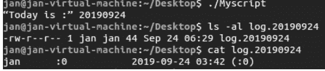

> **提示：** `>>` 运算符用于将条目追加到文件。这是一个极其有用的命令。

你还可以反向我们使用 `>` 运算符执行的过程。这被称为输入重定向。例如，我们可以将文件的条目获取到一个新变量或命令中。以下示例详细说明了这一点。

```
#!/bin/bash

wc < log.20190924

## wc is a new command to you. It counts the number of lines, words and characters.
```

```
jan@jan-virtual-machine:~/Desktop$ ./MyScript

1 5 44
```

最后，我们将研究 `<<` 运算符。这被称为内联输入运算符。
示例：`wc << lastLine`

```
jan@jan-virtual-machine:~/Desktop$ wc << lastLine

> test

> test2

> test3

> lastline
3 3 17
```

正如你所注意到的，直到 `lastLine` 作为文本输入被输入之前，它捕获了用户输入。

其他示例：
将错误和标准输出重定向到同一个文件。你可以使用以下命令。
示例：`ls Test Test2 Test3 > dirlist 2>&1`
这里，我们尝试列出 Test 目录的属性。记住，`ls` 命令支持多个文件或目录名称。然后它列出每个文件或目录的属性。`Test` 和 `Test2` 目录在我的桌面上。`Test3` 目录不存在。我将此命令的输出以及错误重定向到一个名为 `dirlist` 的新文件。

```
jan@jan-virtual-machine:~/Desktop$ ls Test Test2 Test3 > dirlist 2>&1

jan@jan-virtual-machine:~/Desktop$ cat dirlist

ls: cannot access 'Test3': No such file or directory

Test:

File5.txt

Test2:

File6.txt
```

## 标准文件描述符

我们再次回顾文件描述符。
标准输入 - 0: STDIN
标准输出 - 1: STDOUT
标准错误 - 2: STDERR

第一个是标准输入，接下来是标准输出和标准错误。数值是文件描述符。

除了这些技术之外，管道在脚本中被广泛使用。

## 管道

当需要一个命令的输出作为另一个命令的输入时，管道是有用的。这是我们到目前为止学过的。使用的运算符是 `|`。

示例：

```
#!/bin/bash

cat employee.txt | sort -nr -k 2
```


## 我们将获得的重定向文件条目重定向到 `sort` 函数。它按数值排序，逆序排列并按列 ID（第 2 列）排序。

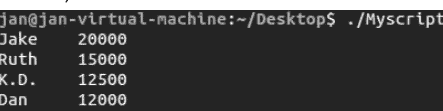

## 脚本构建中的数学运算

任何脚本都可以用于执行某些计算。Linux 中有一些内置命令。我们来看看命令 `expr`。它代表表达式。这些是 `expr` 命令的运算符。

| 运算符 | 描述 |
| :--- | :--- |
| ARG1 \| ARG2 | 如果 ARG1 既不是空也不是 0，则为 ARG1，否则为 ARG2 |
| ARG1 & ARG2 | 如果两个参数都不是空或 0，则为 ARG1，否则为 0 |
| ARG1 < ARG2 | ARG1 小于 ARG2 |
| ARG1 <= ARG2 | ARG1 小于或等于 ARG2 |
| ARG1 = ARG2 | ARG1 等于 ARG2 |
| ARG1 != ARG2 | ARG1 不等于 ARG2 |
| ARG1 >= ARG2 | ARG1 大于或等于 ARG2 |
| ARG1 > ARG2 | ARG1 大于 ARG2 |
| ARG1 + ARG2 | ARG1 和 ARG2 的算术和 |
| ARG1 - ARG2 | ARG1 和 ARG2 的算术差 |
| ARG1 * ARG2 | ARG1 和 ARG2 的算术积 |
| ARG1 / ARG2 | ARG1 除以 ARG2 的算术商 |
| ARG1 % ARG2 | ARG1 除以 ARG2 的算术余数 |
| STRING : REGEXP | REGEXP 在 STRING 中的锚定模式匹配 |
| match STRING REGEXP | 与 STRING : REGEXP 相同 |
| substr STRING POS LENGTH | STRING 的子字符串，POS 从 1 开始计数 |
| index STRING CHARS | 在 STRING 中找到任何 CHARS 的索引，或 0 |
| length STRING | STRING 的长度 |
| + TOKEN | 将 TOKEN 解释为字符串，即使它是像 'match' 这样的关键字或像 '/' 这样的运算符 |

图片：`expr` 运算符

> 注意：虽然这是一个有用的命令，但在某些情况下其操作有些令人困惑。

### 示例

```
jan@jan-virtual-machine:~/Desktop$ expr 1+1

1+1

jan@jan-virtual-machine:~/Desktop$ expr 1 + 1

2

jan@jan-virtual-machine:~/Desktop$ expr 2 - 1

1

jan@jan-virtual-machine:~/Desktop$ expr 2 * 2

expr: syntax error

jan@jan-virtual-machine:~/Desktop$ expr 2 \* 2

4

jan@jan-virtual-machine:~/Desktop$ expr 6 / 3

2
```

> 注意：`2 * 2` 表达式返回语法错误。我们必须使用转义字符来解决这个问题。

与其使用 `expr` 命令，使用括号更方便。

```
#!/bin/bash

var1=2

var2=6

var3=3

var4=$(expr $var1 \* $var2)

echo $var4

var5=[ $(($var1 * $var2))/$var3]

echo $var5
```

```
jan@jan-virtual-machine:~/Desktop$ ./Myscript

12

4
```

## Bash 计算器

当你想要执行更复杂的数学函数时，有一个内置的 bash 工具可以执行此操作。它就是 bash 计算器。命令是 `bc`。

```
jan@jan-virtual-machine:~/Desktop$ bc

bc 1.07.1

Copyright 1991-1994, 1997, 1998, 2000, 2004, 2006, 2008, 2012-2017 Free Software Foundation, Inc.

This is free software with ABSOLUTELY NO WARRANTY.

For details type `warranty'.

quit
```

> 提示：要退出此工具，请输入 `quit` 并按回车。在 `bc` 中，你可以执行数学运算。

Bash 计算器支持以下内容。
- 数值（整数和浮点数）。
- 变量。
- 表达式。

- 函数。
- 语句（例如，if-then-else）。
- 注释。

```bash
jan@jan-virtual-machine:~/Desktop$ bc

bc 1.07.1

Copyright 1991-1994, 1997, 1998, 2000, 2004, 2006, 2008, 2012-2017 Free Software

Foundation, Inc.

This is free software with ABSOLUTELY NO WARRANTY.

For details type `warranty'.

1 * 4

4

1.56 * 2

3.12

1.2222*2

2.4444

8.45/5

1
```

在最后一行中，我们可以看到一个问题。8.45/5 = 1。除非进行舍入，否则这是不准确的。这里的问题在于小数位数。这是由一个名为 `scale` 的内置变量处理的。为了获得预期的输出，我们需要修改 `scale`。

```bash
jan@jan-virtual-machine:~/Desktop$ bc

bc 1.07.1

Copyright 1991-1994, 1997, 1998, 2000, 2004, 2006, 2008, 2012-2017 Free Software

Foundation, Inc.

This is free software with ABSOLUTELY NO WARRANTY.

For details type `warranty'.

scale=5

8.45/5

1.69000
```

> **提示：** 要移除 `bc` 输出的描述信息，请使用 `-q` 选项。

`bc` 命令支持变量。以下示例使用变量代替数值。

```bash
jan@jan-virtual-machine:~/Desktop$ bc -q

var1=10

var2=5

var3=var1/var2

var3

2
```

下一个重要任务是让 `bc` 在脚本中工作。在这种情况下，我们需要依赖管道。

```bash
#!/bin/bash

var1=10

var2=2

var3=$(echo "$var1 * $var2" | bc)

echo "The answer is: "$var3
```

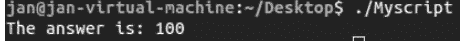

另一个使用 `scale` 选项的示例。

```bash
#!/bin/bash

var1=10

var2=3

var3=$(echo " scale=3; $var1 / $var2" | bc)

echo "The answer is: "$var3
```

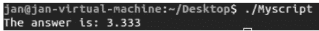

下一个示例将探讨如何在脚本中使用内联输入操作符与 `bc` 命令配合使用。

```bash
#!/bin/bash

var1=8

var2=1.75

var3=3

varF=$(bc << EOF # EOF stands for End of File

scale = 4

v1 = ( $var1 * $var2)

v2 =($var1 / $var3)

v1 + v2

EOF
)
echo The final calculation is: $varF
```

```bash
jan@jan-virtual-machine:~/Desktop$ ./MyScript

The final calculation is: 16.6666
```


# 第 15 章。保护你的 Linux 服务器

如果你没有将安全考虑纳入规划的每一步以及实际部署的每一层，那么你可以相当确信，总有一天会发生某些事情。在本章中，你将学习权限，即与所有 Linux 文件系统对象相关的元数据，它们控制谁可以执行什么操作。首先，我将讨论如何通过定期应用软件更新和补丁，并确保没有网络端口处于打开且未受保护的状态，来加强你的服务器安全性。接下来，我们将讨论通过加密磁盘、网站和邮件服务器来保护静止状态和传输中的数据。但看到这些权限和属性发挥作用会很不错。在我解释如何做到这一点时，你也会了解 Linux 权限究竟是如何工作的。

Linux 文件系统中的每个对象，无论是文件还是目录，都有与之相关的独特元数据。当你使用 `-l` 参数运行 `ls` 时，这些元数据由显示的字符表示，其中 `l` 代表长格式版本。如果你使用 `cd` 进入 secret 目录，然后输入 `su bob`。`su` 命令代表切换用户（switch user）。这意味着你将是以 Bob 的身份登录。你可以使用 `touch` 让 Bob 创建一个名为 `data.txt` 的新文件。如果 Bob 不是 `secret group` 的成员，并且 secret 目录不属于 `secret group`，那么这是不可能的。你可以通过让 Bob 尝试在 `/var/log` 目录中创建一个名为 `stuff` 的文件来证明这一点，该目录由 `root` 拥有。它不会成功。这就是为什么将组与特定资产（如目录）关联起来非常有用。这不仅仅关乎 Bob。你可以将任意数量的用户添加到这个组中，他们都将能够在属于该组的任何目录中创建和编辑文件。让我们看看它是如何工作的。你可以在 `/var/secret` 目录中运行 `ls -l` 以显示内容的文件属性。你可以使用带有 `d` 参数的 `ls` 运行，这将列出 secret 目录本身的属性，而不是内容的属性。如果你查看这两个命令给出的结果；首先是文件 `data.txt`。该行开头的 10 个字符实际上由 4 组组成。如果该目录是一个目录，第一个破折号将是一个 `d`。如果你向下跳几行，你应该会看到目录 secret 属性的第一个字符实际上是 `d`。

接下来的三个字符 `r`、`w` 和 `-` 代表了对象所有者使用文件的方式。

在这种情况下，`r` 表示所有者可以读取文件内容，`w` 表示写入或编辑（包括删除），而 `-` 代替了 `x`，`x` 意味着 Bob 可以在适当的情况下执行该文件。

在这种情况下，`-` 表示所有者没有执行权限。接下来的三个字符表示拥有组中成员（在此情况下是 Bob 的组）的权限。所有组成员都具有读和写权限，但没有执行权限。

最后一组三个字符代表所有其他“非 root”用户的权限。他们可以读取，但不能写入或执行。

下一个字段告诉你文件的所有者是 Bob，其组也是 Bob。尽管目录由 root 拥有，但文件属于 Bob，因为他是创建它的人。现在让我们看看目录的属性。前面已经提到了代表目录的 `d`，但你还应该看到所有者和组都具有完整权限：读、写和执行。

其他人能够读取和执行，但不能写入。为什么目录由 root 拥有？因为它是使用 `sudo` 创建的，这实际上是以 `root` 身份操作。

你稍早运行过的 `chown` 操作只更改了组，但没有更改所有者。要做到这一点，你应该在冒号前包含某个值（例如你自己的用户名），然后在冒号后添加 `secret-group` 以设置组。

你可以使用 `chmod` 更改对象的属性。多尝试几个操作不会对你造成伤害，以确保过程完全清晰。

为其他人添加对 `data.txt` 的执行权限。你可以使用 `o` 代表其他人，加号表示你正在添加权限，`x` 表示可执行。这里有两个重点需要强调。第一点是，由于你当前是以 Bob 的身份登录，而 Bob 是 `data.txt` 的所有者，因此你不需要为此操作使用 `sudo`。

第二点是，这个操作将毫无意义。除非 Bob 恰好将文件变成脚本，否则你永远不会需要执行一个简单数据文件。

在不告诉你一种使用数字表示法表示对象属性的不同方法之前，我无法继续。你会记得有三种权限：读、写和执行。好吧，如果你用数字 4 代表读，2 代表写，1 代表执行；基于此，通过相加这三个权限的值，7 表示可能的最高权限级别（4 加 2 加 1 等于 7）。

具有读取和执行权限但没有写权限的人，其值为 5，而仅具有执行权限的人值为 1。那么，你如何描述 `data.txt` 的当前值，其中用户和组都有读和写权限，而其他人有读和执行权限？

那将是 6, 6, 5。另一方面，secret 目录将是 7, 7, 5。你自己算算。你可以使用这种表示法与 `chmod` 配合使用，例如对 `data.txt` 应用 7, 7, 7，将为用户和组添加执行权限，并为其他人添加写权限。

这是那些在现实生活中多做几次后就会变得像第二本能的东西，但现在，可能有点难以消化。解决办法是尽可能多地练习！

# 第 16 章。GNU 实用工具

在本章中，我们将介绍 Linux 操作系统的一般组件。我们将深入探讨使 Linux 成为最通用操作系统的那些关键要素。你将理解 GNU 项目和 GPL 之间的区别。

所有 Linux 发行版都包含在 GNU 项目下开发的软件。当你在文本终端模式下使用该发行版时，你将能够看到 GNU 实用工具。

### 什么是 GNU？

GNU（GNU's Not Unix）是一个由 GNU 项目和其他第三方发布的免费软件包组成的免费操作系统。Linux 最近成为最受欢迎的操作系统，因为它预装了所有软件。Linux 发行版包含在 GNU GPL 许可证下的图形软件、办公套件，甚至编码套件。

1984 年，Richard Stallman 启动了 GNU 项目，其目的是开发一个基于 UNIX 的操作系统。

GNU 实用工具是一组 GNU 软件的集合，包含诸如 `ls`、`cat` 和 `rm` 等工具，这些工具主要在 Unix 操作系统中实现。

- `rm` – 是一个用于从文件系统中删除对象（如计算机文件、目录和链接）的命令。
- `cat` – 是一个 Unix 实用工具，按顺序读取文件并将其作为标准输出写出。名称源自其功能：拼接（concatenate）。
- `ls` – 是用于在 Unix 系统及所有基于 UNIX 的系统上列出文件的命令。

Linux 的 GNU 通用公共许可证（GPL）确保软件始终是免费的，并对所有人开放。没有任何个人和/或公司可以声称拥有或控制其使用。此外，任何用户都可以复制、编辑和重新分发软件的源代码。

你可能会问，那么是谁资助 GNU 项目的？他们如何筹集资金？自由软件基金会（Free Software Foundation）资助该项目。

(FSF) 是一家免税慈善机构。要支持该项目，请登录 www.gnu.org 获取详情。

GNOME 图形用户界面和 bash 都是根据 GNU 项目开发的程序。Shell 是用于执行用户命令的 GNU 程序，通常被称为命令解释器。

Linux 发行版是使用 GNU C 和 C++ 编译器开发的。Linux 中的文本文件是使用 ed 和 emacs 编辑器进行编辑的。

## GNU 工具示例

其他流行的 GNU 工具包括：

- 1. Binutils - 由处理二进制文件的不同软件包组成。配套的软件包包括 ar, as, gasp, id, nm, objcopy, objdump, ranlib, readlf, size 和 strip。
- 2. Bash – 是负责在 Linux 中解释 shell 命令的 GNU 软件包。
- 3. Automake – 是用于生成与 Autoconf 配合使用的 makefile.in 文件的 GNU 软件。
- 4. Autoconf – 是用于生成用于配置源代码软件包的 shell 脚本的软件包。
- 5. Emacs – 是 Linux 的文本编辑器软件包。
- 6. Ed – 是面向行的文本编辑器。
- 7. Diff – 是用于逐行比较文件并显示差异的软件包。
- 8. GNU Chess – 是用于运行 Linux 国际象棋游戏的软件包。
- 9. The GIMP – 是用于处理图像的 GNU 程序。它类似于 Linux 版的 Photoshop。
- 10. GNOME – 为 Linux 发行版提供显示或图形用户界面 (GUI)。
- 11. Gnumeric – 是在 GNOME Guls 上工作的电子表格 GNU 程序。它是 MS Excel 的等效产品。
- 12. Time – 是管理用户时间的 GNU 程序。

## Linux 系统的安装与设置

在本章中，我们将学习安装和设置 Linux 所需的步骤。Linux 操作系统之美在于它通常附带预装的基本程序。在这里，我们将了解安装步骤、安装最低要求、配置设置以及不同发行版的需求。

### 关于安装 Linux 操作系统

大多数计算机通常预装了 Windows 或 MS. DOS 系统。尽管最近，一些计算机制造商销售预装 Linux 的 PC。

如果您的 PC 没有预装 Linux，您将不得不自己安装它。第一步是选择您希望安装的版本/发行版。

您可以选择安装 Linux 发行版，或者直接从 Live CD 运行它。Live CD 允许您直接从光盘启动 Linux 系统，而不必一定要安装。此功能使 Linux 成为一个便携式操作系统。

或者，您可以选择将 Linux 操作系统作为虚拟操作系统添加到 Windows 中。为此，您需要先安装一个虚拟盒子。一旦在 Windows 中安装了 VirtualBox，您就可以在虚拟环境中安装 Linux。因此，您将不得不分区您的硬盘以容纳两个操作系统。

如果您选择使用 Live CD，则无需分区硬盘。

### 安装 Linux 操作系统的步骤

安装 Linux 操作系统并非高深的科学。一系列易于遵循的步骤是您安装 Linux 所需知道的全部。在本章中，我们将浏览适用于大多数发行版的必要步骤。稍后，我们将浏览安装和设置 Linux Mint 发行版的步骤。

首先，我们将浏览一般安装要求和程序。

在安装某些 Linux 发行版之前，您可能需要至少了解您的系统要求，如硬件和其他组件。以下是安装任何 Linux 发行版的简单步骤：

- 1. 安装 Linux 发行版的第一步是从网络下载发行版。您需要做的就是下载软件并将其刻录到 CD 上。您也可以将安装文件复制到 USB 闪存盘并从该处安装。
- 2. 确认您的 PC 设置为从 CD 或 USB 闪存盘启动至关重要。一些 PC 需要在启动前更改 BIOS 中的设置。在大多数 PC 上，在启动屏幕上，您按下 F2 或 F8（取决于 BIOS 版本）进入启动设置。在设置中，将启动优先级更改为以 CD 或 USB 闪存盘（您的 Linux 操作系统所在地）开始。
- 3. 如果您计划从 Live CD 运行，现在您所需要做的只是重启您的系统。但如果您计划安装，第三步将是在硬盘上创建一些空间（分区），以安装 Linux。
- 4. 如果您想在磁盘上创建分区，使用像 partition magic 这样的分区程序是安全的。从 www.powerquest.com 下载 partition magic 软件。
- 5. 一旦您准备好了分区，现在可以启动您的系统以开始 Linux 安装。
- 6. 特定步骤可能因发行版而异。GUI 将引导用户完成安装过程。
- 7. 您将需要设置时区、网络设置，安装程序将自动完成其余步骤。Linux 将安装运行系统所需的所有默认程序。
- 8. 安装完成后，重启您的 PC。之后，您将被提示进行配置设置。您也可以安装额外的软件包。

## 主要发行版的 Linux 系统要求

如前所述，在安装 Linux 发行版之前了解您的系统属性很重要。许多 Linux 发行版有不同的最低安装要求。请将此视为 Linux 操作系统的预安装要求。

我们将讨论安装 Linux 的一些最低系统要求：

- 大多数 Linux 系统需要 CD/DVD 光驱来安装。虽然您也可以使用 USB 闪存盘来安装和/或运行 Linux 操作系统。大多数 PC 固定配有内部 IDE 或 ATA DVD 光驱。您也可以使用通过 USB 连接的外部 DVD 光驱。
- 在安装 Linux 之前需要检查的下一件事是硬盘。Linux 几乎可以与所有 IDE 硬盘配合使用。一些 PC 有 SCSI (Small Computer System Interface) 硬盘。Linux 也可以很好地与 SCSI 驱动器配合使用。大多数发行版安装至少需要 5GB 的硬盘空间。记住，如果您运行 Live CD，您不需要硬盘空间。
- 确保您也有兼容的键盘，尽管大多数键盘在 Linux 上都能有效工作。大多数 USB 键盘即插即用，从而降低了设置键盘的复杂性。
- 如果您计划使用 Linux 系统访问互联网，您需要一个与 Linux 兼容的调制解调器。检查制造商手册以确认与基于 Unix 系统的兼容性。如今，大多数制造商通常在用户手册上注明这一点，并附上如果需要进行设置时应遵循的步骤。
- 您的显示选项也很重要，尽管不敏感，因为大多数基本显示器都能支持许多最新分辨率。您只需要确认显示器能与系统中安装可用的显卡良好配合。
- 您使用的鼠标类型同样重要。大多数 Linux 发行版都能与 PS/2 和 USB 鼠标配合使用。
- 如果您的 PC 使用 PC 卡连接到互联网或局域网，检查与 Linux 的兼容性很重要。安装期间，Linux 将检查您的卡的兼容性。
- Linux 另一个必要的预安装要求是处理器。大多数 Linux 发行版要求处理器至少为 400MHz (Pentium II)。虽然最新的发行版要求多线程处理器，但确保您选择一个能在您的系统上有效运行的发行版至关重要。
- 您的 RAM (Random Access Memory) 是一个关键组件。这是可供您的系统进程使用的内存。越多越好，尽管为了有效运行，您将需要至少 256MB 或更多的 RAM。为了舒适地运行图形界面 (GUI) 桌面，由于图形需求，拥有足够的内存很重要。
- 您需要确认的另一件事是声卡。Linux 可以与大多数声卡配合使用以播放媒体。安装 Linux 后，请参阅制造商手册以了解必要的设置。一些声卡制造商将为其声卡提供特定的 Linux 驱动程序。

- 检查您的显卡兼容性。如果您安装带图形用户界面（GUI）的 Linux，您需要一张能与 X 窗口系统配合工作的显卡。Linux 能够检测并指示显卡是否与该 Linux 系统兼容。
- 如果您已安装打印机，建议查阅用户手册以了解与基于 Unix 的系统的兼容性说明。大多数制造商都会提供一张包含适用于 Windows 和 Linux 系统驱动程序的 CD。

## 在 VirtualBox 中安装 Linux Mint

在某些情况下，您可能希望保留您的 Windows 安装，同时又希望在同一台电脑上安装 Linux。为了实现这一点，您需要在 Windows 中安装一个虚拟化软件（VirtualBox）。

虚拟盒子（Virtual Box）是一个虚拟环境，允许您在其中安装 Linux。或者，虚拟盒子还可以帮助您在电脑上安装多个发行版。其中一个安装在硬盘的分区上，另一个则安装在虚拟盒子中。

# 第 17 章：控制特权用户

此时，是开始讨论能够访问您的操作系统或服务器的用户的安全性和权限的时候了。尤其如今，人们似乎认为技术和服务器比以往任何时候都更不安全，但与众人的普遍看法相反，实际上有很多可用的支持来保持系统的安全和保障。其中一种方式就是控制特权用户，本章将教您如何做到这一点。

在阅读本章时，您将了解各种类型的 Linux 账户，例如 root 用户、普通用户和系统用户。您会发现 sudo，它是“super user do”（超级用户执行）的缩写。这是系统管理员的命令——只要您在具有适当权限的正确账户上，它是允许访问任何事物和功能的唯一命令。最后，我们将带您了解 sudoers 文件。这个文件本质上是 sudo 背后的基础编程——它控制 sudo 以及谁有权使用 sudo 命令。

所有这些都将帮助您在服务器或机器上管理用户，从而确保有适当的安全系统到位。当所有设置到位且系统安全时，您可以高枕无忧，确信您的系统真正安全。

### Linux 账户类型

首先，我们将讨论 root、普通用户和系统用户，然后再讨论其他内容。您必须彻底理解这三种用户账户类型，才能真正理解 sudo 和 sudoers 如何影响系统的安全性。

由于 Linux 具有惊人的灵活性，您有多种创建不同类型账户的选择。事实上，如果需要，您可以拥有多个 root 账户，或者在不同类别下拥有不同权限的账户。重要的是您的需求得到有效满足。

请记住，仅仅因为您拥有 root 账户并不意味着您不应该建立某种安全系统——您绝对应该使用密码保护 root 账户，以确保其他人无法在没有您允许的情况下访问这些文件并接管它们。这意味着您将能够确保文件本身还有另一层保护。现在，废话不多说，

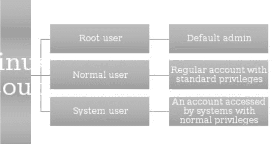

让我们开始深入探讨 Linux 的三种主要用户类型。

## Root 用户

您必须知道的第一种用户是 root 用户。这通常也被称为超级用户，特别是在缩写 sudo 中。超级用户或 root 用户是在默认管理员账户上的人。此人对系统拥有完全的控制权，就像管理员账户对 Windows 的控制一样。凭借默认赋予的 root 权限，此用户可以执行其任何命令，并直接控制或修改其他用户的服务和账户。

实际上，如果您是负责设置系统的人，这应该是您的账户。这个账户能够管理其他账户，管理并监控所有账户，无需额外的权限。root 用户被授予所有权限。他们能够更改其他用户的权限，移动文件，更改文件的所有权，并在系统内执行其他任何操作。

请记住，由于您拥有在程序中做几乎任何事情的能力，操作系统不会告诉您不要做某事。没有为您提供的安全防护措施，因此在使用此账户时必须小心。如果您删除了系统文件，如果您没有定期存档和备份文件，可能就没有恢复的希望了。如果有一个用户能够对您的程序造成灾难性的损害，那就是超级用户或 root 用户。

Linux 假设 root 用户对正在做的事情有很好的把握，因此，如果您在任何时间点不确定自己在做什么，预防胜于补救，如果您认为有必要，最好寻求他人的帮助。总体而言，虽然这应该是具有您自身权限的账户，但您也应该尽可能避免使用此账户，以确保您不会冒着摧毁一切的风险。

在非常特定的时间段内，您应该使用 root。否则，对于大多数日常功能，使用普通账户就很好了。当然，任何时候，如果您尝试的任务需要您使用 root，您应该确保在尝试任何操作之前按需切换并备份您的数据。特别是，您需要使用 root 权限才能将文件或目录移动进或移出系统目录。请记住，系统目录是直接负责操作系统运行的目录，没有它们，您无法运行操作系统。当您尝试将任何文件复制到系统目录、更改其他用户的权限、进行某些系统修复以及偶尔安装程序时，也都需要使用 root 账户。通常，如果安装某个文件需要 root 权限，是因为该文件本身将直接与系统目录交互。如果您没有执行上述任何操作，请避免这样做，以免给自己带来潜在的麻烦。

## 普通用户

普通用户和系统用户拥有相同的权限，通常都由 root 或被授予一定级别 sudo 权限的用户创建。然而，普通用户通常是真实的人，而系统用户通常是保留给软件在必要时使用的用户。

普通用户将拥有真实的登录 shell 和自己的主目录，并且每个用户还将被分配一个 UID（用户标识）。如果在通过 useradd 命令创建新用户时未指定此项，则 UID 通常会自动为您选择。

然而，从根本上说，此用户没有任何超级特殊的管理员权限或超级用户状态。普通用户可以访问任何未被标记为不可用的文件，普通用户的权限可以根据用户在任何特定时间的需求定期更改。

如果您在自己的设备上运行 Linux，最可能的情况是，您会拥有一个 root 账户（最初用于设置整个操作系统的那个管理账户），然后还会为自己设置一个普通用户账户，以确保不会意外删除关键内容或破坏重要事物。这是您针对意外情况的一种保障措施。

普通用户自己的权限可以由 root 用户自定义——从 root 账户中，您可以在普通账户上授予自己任何您想要的权限，只要您知道正确的编码方式即可。

## 系统用户

如前所述，系统用户被授予与普通用户相同的初始权限。然而，系统用户几乎总是某种软件或程序，例如守护进程（daemon），它将在后台运行，并且很可能不会特别具有交互性。此用户分类主要仅出于组织目的存在。当您能够将该账户指定为系统账户时，您一眼就能知道它不会

涉及任何形式的用户交互。可能会有守护进程为用户运行，但绝不会有任何人登录。

虽然在现实世界中，这在技术上可能并不重要，但能够一眼看出你有多少人类用户，相对于运行特定软件的守护进程，会非常方便。通常，这些系统账户是在安装期间由操作系统创建的，并且操作系统保留了对它们的控制权。它们通常具有非常特定的用户 ID，你可以在 root 账户中识别出来。

由于这些服务用户将运行操作系统所需的过程，在你修改、结束或重置任何过程时，应该不要动它们。你需要确保尽可能不碰这些服务用户，以保护自己免于损坏软件。如果你损坏了其中之一，很可能会摧毁整个操作系统，遗憾的是，如果你不专心，这很容易发生。

## Sudo

现在，是时候讨论 sudo 了。如果你在命令前使用 sudo，本质上是将其提升。你告诉系统，你正以应被尊重的提升权限来指挥这个特定进程。通常，系统会检查提升权限，以确保你确实被授权进行你正在进行的任何更改。

如果你主要使用 Windows，你已经有过与此类账户交互的例子。当你安装软件时，你是否注意到某些安装会触发一个提示弹出框，询问你是否确定要继续，并要求你授予软件继续所需的权限？这就是你在 Sudo 中做的事情。你实际上是在授予该权限，但不再是点击按钮，而是告诉系统你拥有系统的提升访问权限，并且应被尊重。

如果你直到现在主要使用的是 macOS，当你触发可能被识别为危险或将对操作系统进行重大更改的下载时，你也有类似的保护措施。在 Mac 上，你会看到一个安全框弹出，然后你必须向系统提供密码，以确认你确实想要在系统上执行该更改。

因此，Sudo 本质上就是你的权限通行证。它是告诉系统你负责管理的“魔法口令”——只要你的用户账户上的权限匹配即可。

### 使用 Sudo

当你准备使用 Sudo 时，你不需要太费力。实际上，你只需在试图推进的命令前加上 sudo 即可。如果你这样做，你的程序应该会要求你输入当前账户的密码。如果你提供此密码并且你的凭证通过检查，它将执行该功能。

例如，想象一下你想重启系统。如你所记得的，触发系统重启的命令仅仅是 reboot。

但是，reboot 需要 sudo 权限。如果你试图仅用 reboot 命令系统，它会告诉你，你必须是一个超级用户才能执行那个特定命令。

这时你就需要提升你的命令权限。在那一点上，你可以向你的命令添加内容，创建如下输入：

```
sudo reboot
```


`$ sudo reboot`

然后你的系统会要求输入账户密码，输入密码后，它便会按请求重启。

### 使用 Su 代替 sudo？

这或许是你提升权限以触发系统服从的最安全方式之一。还有其他方法，例如切换用户命令，即“`su`”。但是，当你使用切换用户命令时，你被要求输入 root 密码，然后获得超级用户提示符。

当你的输入就绪信号从通常的 `$` 变成 `#` 时，你就知道自己在超级用户提示符下。`#` 应该是你的警告信号——如果你在终端看到它等待着你，就知道你在 root 账户上，需要小心。

虽然切换用户命令在非常特定的情况下可能有其用途，但它也有风险，可能会因为一次拼写错误或有人在键盘敲击时意外碰撞到你而摧毁一切。然而，当你使用 `sudo` 时，每个需要额外权限的命令都需要插入它。这意味着你有额外的保障措施。当然，如果你正在做某件需要你不断验证凭证的事情，这可能会很烦人，但如果你认为额外的安全值得，那是很有价值的。当然，如果你想要绕过持续的 `sudo` 使用，也可以在开始输入 `su` 命令之前设置系统的备份，但这最终是你需要自己权衡风险后做出的个人决定。总之，你在 `su` 模式下停留的时间越长，发生事故的可能性就越大。

## Sudoers 文件

在 `sudo` 之下是 `sudoers` 文件。它首先确定了谁有权使用 `sudo` 命令，以利用其在操作系统内带来的权威性。通常，你可以在 `/etc/sudoers` 位置访问此文件，如果你想操纵命令值和权限，就必须编辑它。利用和编辑 `sudoers` 文件的最佳且最安全的方式是通过使用 `visudo` 编辑器。

## Visudo

`Visudo` 本身充当一种权宜之计——为 `sudoers` 文件增加一层安全。它允许安全编辑，同时锁定 `sudoers` 文件，防止多个用户同时编辑，如果两个人试图同时创建冲突的编辑，这会变得危险。如果你尝试在他人当前正在使用 `sudoers` 文件时通过 `visudo` 访问，你会被拒绝并收到错误消息，被告知稍后再试。当你进行编辑时，它会停止并检查编辑中是否存在可能灾难性的错误，以至少尝试确保你不会完全破坏重要的东西。

在完成通过 `visudo` 编辑系统访问的 `sudoers` 文件编辑后，编辑将扫描任何错误。如果你确实犯了语法错误，它将拒绝保存，打印声明有错误的消息，并告诉你错误在哪一行。在那里，你会被提示尝试重新编辑以修复错误，或者你可以无论如何退出并保存更改。但是，如果在 `visudo` 发现错误后你退出，`sudo` 也很可能会发现错误，并且在错误被纠正之前，`sudo` 将不可用。

为了访问 `visudo`，你只需输入提示符：

```
$ visudo
```

只要权限正确，你应该就能获得你正在寻找的访问权限。还有几个其他选项可以与 `visudo` 功能配对，以帮助充分利用该程序。这些命令包括：

- `visudo -c`：这会触发 `visudo` 进入仅检查模式。它将检查当前 `sudoers` 文件是否存在任何语法问题，并打印文件状态。如果检查通过，`visudo` 将以最终值 `0` 结束。但是，如果检测到任何错误，它将结束于值 `1`。
- `visudo -f sudoers`：这指定 `sudoers` 的备用位置，检查或编辑你选择的文件，而不是将其存储在默认的 `/etc/sudoers` 中。
- `visudo -h`：这是帮助选项，当你执行此操作时，`visudo` 将提供简短的打印消息。
- `visudo -q`：这告诉 `visudo` 进入安静模式。在此模式下，搜索期间检测到的语法错误的详细信息不会被打印或指出。
- `visudo -s`：这将启用对 `sudoers` 文件的检查。如果使用未定义的别名，它将创建一个错误。
- `visudo -v`：这是版本选项——它告诉 `visudo` 在退出前打印版本号。

`sudoers` 文件

## 管理 Sudo 权限

在完成 `visudo` 访问设置后，你便可以开始编辑 `sudoers` 文件。该文件将决定哪些账户拥有 `sudo` 权限。当你首次打开 `sudoers` 文件并滚动到底部时，你很可能会看到类似如下的行：

```
root ALL=(ALL) ALL
```

实际上，这意味着 `root` 用户可以从所有终端（就像所有用户一样）执行操作，并运行所有命令。试着将“all”理解为“任何”，你就会明白这有多令人担忧。`root` 用户基本上可以命令它想要命令的任何东西，获取它想要的任何东西，并做它想做的任何事情。

如果你希望自己在其他账户上也拥有类似的权限，你需要为自己设置一个专门设计为 `sudo` 账户的账号。

首先，你必须以 `root` 用户身份登录到你的服务器。

然后，使用 `adduser` 命令，你必须创建一个新的用户名。

```
$ adduser usernamehere
```

此时，系统会要求你为该账户设置一个新的密码。请记住你的密码，并确保它足够安全。之后，该命令会为你创建一个主目录。除非你希望手动填写，否则只需按 Enter 键接受默认设置即可。

然后，你必须使用以下命令将新用户添加到 `sudo` 组：

```
$ usermod -aG sudo usernamehere
```

这应该会赋予你 `sudo` 权限，但你最好还是测试一下。使用 `su` 命令切换到新用户：

```
$ su - usernamehere
```

此时，你需要测试你的访问权限。尝试使用 `whoami` 命令来获取你的详细信息：

```
$ sudo whoami
```

如果操作正确，该命令的输出将是 “`root`”。如果输出是 `root`，说明你拥有访问权限。

从这里开始，你只需在任何你发出的命令前加上 `sudo` 命令，并在其后加一个空格。在会话中第一次尝试使用 `sudo` 时，出于安全原因，系统会要求你输入密码。

就这样，你的用户账户将拥有 `sudo` 权限，这让你能够避免任何可能导致系统瘫痪或以任何方式破坏文件的痛苦错误。既然现在你必须输入 `sudo` 才能执行任何重要或危险的操作，你应该已经相当安全了。

## 测验：控制特权用户

恭喜！你已读完《控制特权用户》章节。至此，你应该已经对 Linux 系统中用户层级结构有了一个大致的了解，并且知道如何为自己获取合适级别的安全性。通常，此时会提供五个问题。请尝试回答这些问题，以判断你迄今对所展示内容的理解程度。一如既往，答案将在本测验后的下一页提供。

- 哪种用户类型拥有最多的权限？
    - a. 普通用户
    - b. Root 用户
    - c. 系统用户
    - d. 随机用户

- 哪个命令可以覆盖管理限制，而无需登录到管理账户？
    - a. sudore
    - b. visudo
    - c. sudo
    - d. su

- 以下哪个陈述是正确的？
    - a. 由于有删除重要信息的风险，你应该避免使用 root 用户账户
    - b. 由于有删除重要信息的风险，你应该避免使用 visudo 进行编辑
    - c. 由于有删除重要信息的风险，你应该避免使用 sudo 命令
    - d. 由于有删除重要信息的风险，你应该避免使用 Linux
    - e. 以上所有

- 判断对错：当你进行编辑时，`visudo` 会检查错误。

- 判断对错：默认情况下，`visudo` 会将错误的编辑发布到 `sudoers` 文件而不发出警告。

## 结语

我想借此机会感谢你能读完这本信息丰富的书籍——《Kali Linux》。我希望它能对你有所启发，并且通过阅读它，你现在在处理与黑客技术相关的事务时能够迅速上手。同时，我希望你获得了相关专业知识，从而能够开始你的黑客职业生涯，或者如果你已经是黑客，能够提升你的技能。我真诚地希望你享受阅读的过程，从第一个主题“Kali Linux 简介”开始，一直到《Kali Linux 基础》、《黑客流程》、《无线网络安全攻击》、《Kali Linux 的用途和应用》、《网络安全入门》、《网络扫描与管理》以及《Web 安全》。我相信，通过研究这本书，你已经学习了许多成为黑客专家所需的实用概念。到现在为止，你一定已经获取了关于各类攻击的大量理论知识，包括这些攻击是如何针对你的系统发起的、发起攻击的原因以及你如何能够保护你的基础设施免受此类攻击。这是你成为专业黑客的第一步。本书涵盖了诸如无线网络攻击、网络攻击和渗透测试等专题，还有其他内容。因此，这意味着你现在处于一个有利位置，能够辨别现实世界中发生的网络攻击机制并开出适当的药方。我还提供了一些你可以实施的安全措施，以保护你的网络安全。本书的格式采用用户友好的语言，使你能够理解保护网络安全的重要性。接下来的一步是将你从这本书中获得的概念付诸实践。俗话说熟能生巧，只有通过实践，才能在黑客领域，特别是使用 Kali Linux 方面成为专家。让你从书中获得的知识为你工作吧。
