# 生物学家 Linux 秘籍

*献给尚蒂*

## 致谢

我要向我的导师、同事、学生、朋友和家人致以诚挚谢意。没有他们的支持与鼓励，本书不可能顺利面世。同时也感谢Linux与开源软件的精彩世界，以及围绕其运转的社区。

## 关于本书

本书的目标读者、跟随书中配套操作指南所需的条件，以及作者简介。

### 1.1 本书适合谁？

如果你是生物科学领域的学生或研究人员，且是Linux新手，本书将帮助你快速上手。本书主要聚焦于使用图形用户界面（GUI）完成任务，但也提供了使用命令行界面的相关方法。

### 1.2 你将学到什么

通过书中配套的操作指南，你将学会如何：

- 在你的电脑上运行Linux
- 使用桌面环境及预装软件
- 处理文件和目录
- 搜索并安装软件
- 运行基础命令
- 在你的电脑上运行Galaxy平台

> **注意：** 如果你在跟随本书学习时遇到问题…… 你可以在Leanpub上访问本书的论坛。如果你的问题在那里没有得到解答，请发起新的讨论。
>
> https://community.leanpub.com/c/linuxforbiologi

### 1.3 你需要准备什么

要学习本书中的操作指南，你需要准备：

1. 一台Linux桌面电脑
2. 管理员权限

#### 1.3.1 Linux桌面系统

Linux与开源世界拥有丰富的选择。你可以下载并使用不同版本（或称发行版）的Linux系统。为了确保你能顺利完成本书的学习，本书选用*Linux Mint 20.1*作为*参考*发行版。所有配套的操作指南都已在该系统上完成测试。

#### 虚拟机镜像

如果你无法使用Linux桌面系统，你可以从本书官网下载虚拟机镜像，在自己的电脑上运行虚拟机（见[图1]）。

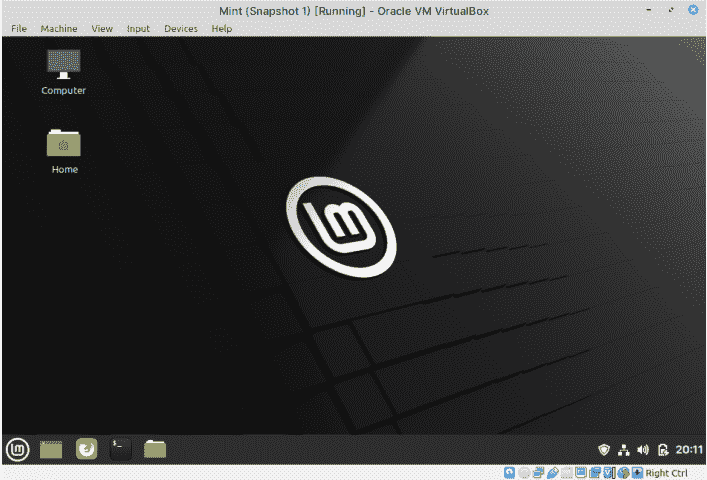

**图1：** 在VirtualBox中运行的Linux Mint

按照*运行Linux虚拟机*中的步骤即可开始操作。

#### 其他Linux发行版怎么办？

尽管大部分操作指南在其他Linux发行版上也能运行，但某些情况下你需要做出调整。例如，你可能需要使用不同的应用程序——本书使用的是*Files*文件管理器，而你可能需要用到Nautilus或Dolphin。如果遇到问题，建议你下载并使用*虚拟机*。

#### 1.3.2 管理员权限

本书中的软件安装步骤需要管理员权限。在默认配置下，只有root用户或sudo用户组的成员才能在Linux系统上安装软件。

> **注意：** 如果你使用的是本书配套的虚拟机，则无需进行额外操作。如果你未使用该虚拟机，则需要确保你的用户账户属于sudo用户组，才能安装软件。

### 1.4 关于作者

大家好，我是Vimal。我在印度马杜赖卡马拉伊大学生物技术专业攻读硕士学位期间，第一次接触到Linux和开源软件。


可以不受限制地使用和修改软件的理念，对我来说既新颖又令人兴奋。我学会了安装Linux、从源代码编译软件，甚至制作了自己的Linux Live CD！

这段经历在学术界十分宝贵，我在此后主要从事科研支持工作，时长超过9年。在此期间，我安装并管理过Linux服务器、数据库、Web应用和网站，参与过科学软件的开发，在软件仓库发布过软件，还讲授过Python编程和生物信息学入门课程。

本书是我多年来与学生、同事以及服务用户交流过程中积累的经验总结。感谢你对本书感兴趣，希望你能从中受益。

Vimalkumar Velayudhan

个人网站：https://vimalkvn.com

邮箱：vimal@disroot.org

## Linux入门

在本节中，你将学会如何：

1. 在你的电脑上运行Linux
2. 使用桌面环境及预装软件
3. 处理文件和目录
4. 开始使用命令行并学习基础命令

### 2.1 Linux概述

Linux是由林纳斯·托瓦兹于1991年开发的*操作系统*，以开源协议发布，源代码对所有人免费开放。

#### 2.1.1 Linux发行版

Linux发行版包含Linux操作系统以及额外的软件。示例如下：

- Debian³ https://www.debian.org/
- Ubuntu⁴ https://ubuntu.com/
- Linux Mint⁵ https://linuxmint.com/
- Fedora⁶ https://getfedora.org/
- openSUSE⁷ https://www.opensuse.org/

#### 2.1.2 桌面环境

桌面环境是一种*图形用户界面*，可以便捷地访问文件和应用程序。示例如下：

- GNOME（*见图* 2）
- KDE Plasma（*见图* 3）
- Xfce（*见图* 4）
- MATE（*见图* 5）
- Cinnamon（*见图* 6）

根据所使用的桌面环境不同，Linux发行版可能还会提供其他可供下载的变体版本。

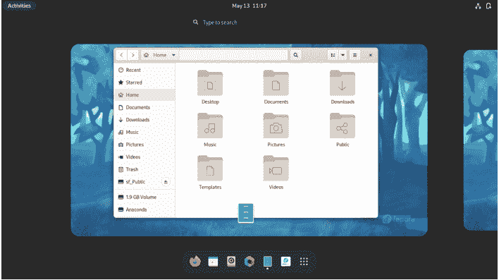

**图2：** GNOME

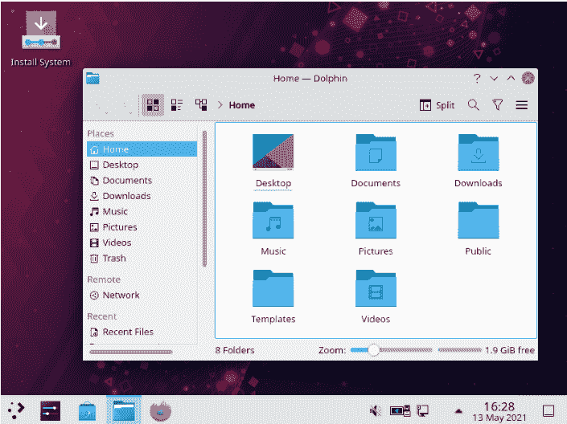

**图3：** KDE Plasma

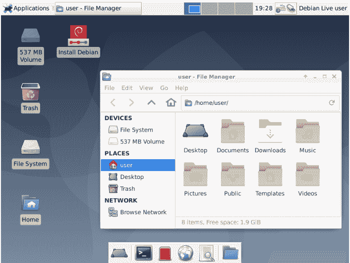

**图4：** Xfce

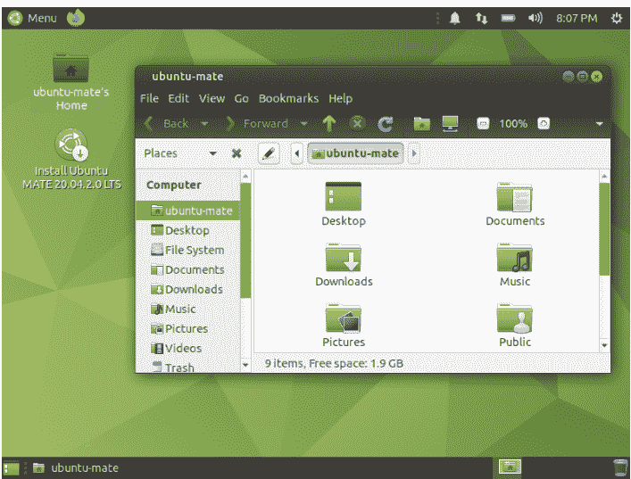

**图5：** MATE

##### 本书选用Linux Mint（Cinnamon）

本书将选用搭载Cinnamon桌面环境的Linux Mint 20.1作为参考发行版（见图6）。

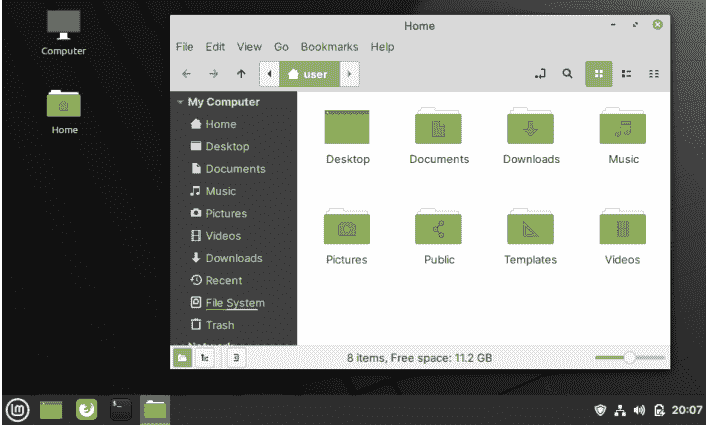

**图6：** 搭载Cinnamon桌面环境的Linux Mint

所有配套的操作指南都已在上述发行版上完成测试。

#### 2.1.3 运行Linux桌面的方式

要在你的电脑上运行Linux桌面，你可以选择：

1. 安装*Linux发行版*，或
2. 运行虚拟机

本书将采用*第二种*方法，因为这对新手来说更易上手。

> **注意：** 还有其他运行方式，但上述两种是最常见的。

### 2.2 运行Linux虚拟机

要在你的电脑（宿主机）上运行其他操作系统（客户机）的虚拟机，你首先需要安装*虚拟机监视器*——也就是用于运行虚拟机的软件。常见的虚拟机监视器包括VirtualBox、Parallels、VMware Workstation等。本书将使用VirtualBox（见图7）。

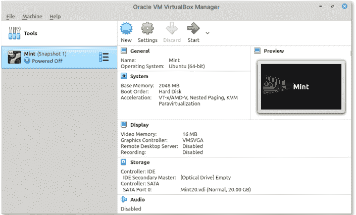

#### 2.2.1 前置要求

##### 已安装VirtualBox的电脑

你可以根据自己使用的操作系统，按照以下步骤安装VirtualBox。

> **注意：** *安装软件需要管理员权限。*

**macOS和Windows系统的安装说明**

你可以从VirtualBox官网的下载页面（见图8）下载适用于macOS或Windows的安装包。

https://www.virtualbox.org/wiki/Downloads

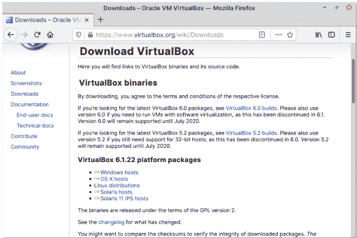

**图8：** VirtualBox下载页面

**Linux发行版的安装说明**

大部分Linux发行版的软件仓库中都包含VirtualBox。建议你使用`Synaptic`、`apt`、`dnf`等软件包管理器进行安装。例如，要在Ubuntu 20.04 LTS上运行VirtualBox，你需要安装`virtualbox`和`virtualbox-guest-additions-iso`两个软件包。

> **注意：** 如果你无法从软件仓库安装，也可以从项目官网的[Linux下载](https://www.virtualbox.org/wiki/Linux_Downloads)页面下载安装包。

##### Linux Mint虚拟机镜像

你可以从本书官网下载即用型的Linux Mint 20.1虚拟机镜像：

> https://vimalkvn.com/linuxforbiologists

该镜像为OVA格式文件。点击下载链接，将`linuxmint-20.1.ova`文件保存到你的电脑中即可。

### 2.2.2 导入虚拟机镜像

打开你电脑上的VirtualBox，然后按照以下步骤导入下载好的虚拟机镜像。

##### 第一步——选择OVA文件

从VirtualBox主窗口选择：文件 → 导入设备（图9）

> 图9：从菜单中选择“文件 → 导入设备”

在“要导入的设备”界面，点击文件输入框旁边的按钮（图10）。

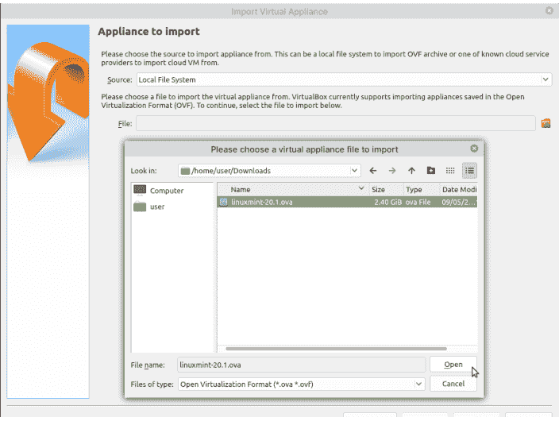

图10：点击文件输入框旁边的按钮

浏览到`linuxmint-20.1.ova`文件所在位置，选中它，然后点击**打开**按钮。文件输入框现在会显示选中文件的完整路径（图11）。


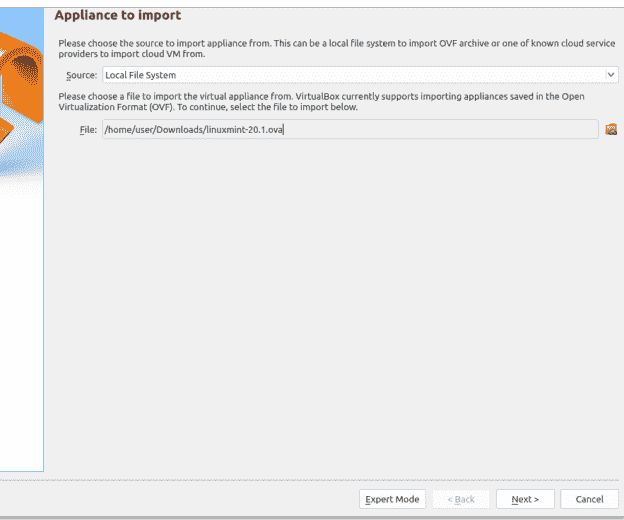

**图11：** 点击下一步按钮继续

点击**下一步**按钮继续。

##### 第二步——调整设备设置（可选）

在下一个界面——设备设置界面（图12），你可以修改这台虚拟机的配置。

> **注意：** *此步骤为可选。* 你可以点击底部的**导入**按钮进入*下一步*。你可以根据你电脑的配置，为这台虚拟机增加CPU或内存。

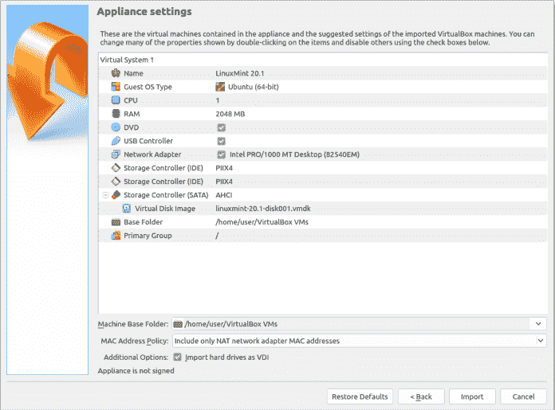

**图12：** 设备设置界面

点击**导入**按钮继续。

##### 第三步——导入进度与完成

这个阶段会显示进度条（图13）。

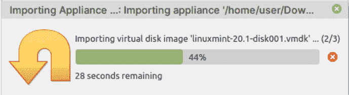

图13：虚拟机导入进度

导入完成后，你会回到VirtualBox的主窗口。已导入的虚拟机——LinuxMint 20.1会出现在左侧面板（图14）。

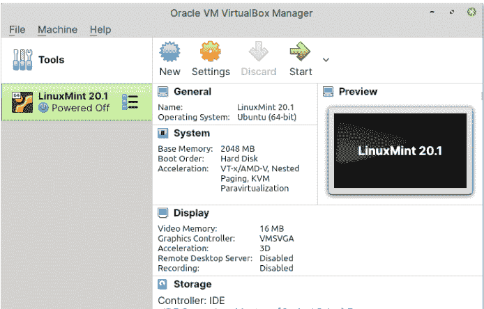

图14：已导入的虚拟机

#### 2.2.3 启动虚拟机

要启动虚拟机，选中LinuxMint 20.1，然后点击主工具栏的启动按钮（图15）。

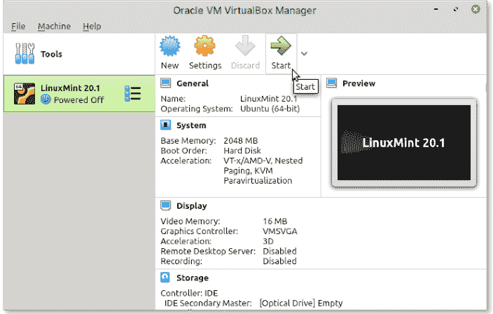

> 图15：启动虚拟机

启动过程完成后，你会直接登录到桌面（图16）。

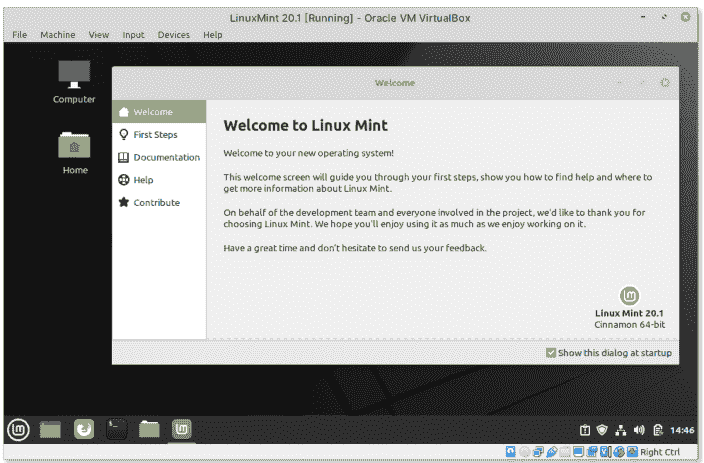

图16：Linux Mint桌面

参考信息：默认用户名和密码均为`user`。

#### 2.2.4 关闭虚拟机

工作完成后，你可以点击Linux Mint应用程序菜单中的退出按钮来关闭虚拟机。此时会弹出确认对话框（图17）。


图17：系统关机确认对话框

点击关机按钮即可关闭虚拟机。

### 2.3 桌面

启动虚拟机后，你会直接登录到桌面。参考信息：虚拟机登录的默认用户账户信息如下：

- 用户名：`user`
- 密码：`user`

#### 2.3.1 Cinnamon桌面

默认配置下，Cinnamon桌面包含以下组件（图18）：

- **应用程序菜单**——搜索并启动已安装的应用、注销、关机或重启系统。
- **面板**——启动固定应用、管理已打开的应用程序窗口。
- **系统托盘**——包含用于管理网络、声音、电源、软件更新等的小组件。
- **日历**——显示当前日期和时间、日历。

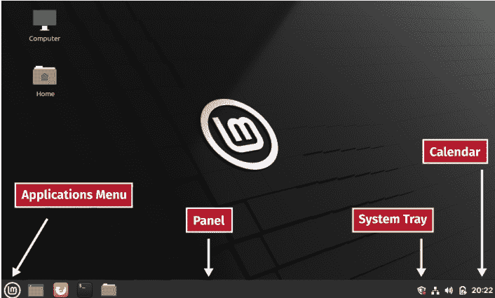

图18：Cinnamon桌面组件

#### 2.3.2 修改系统设置

你可以使用系统设置应用自定义桌面、操作系统和硬件（图19），可以从应用程序菜单启动它。

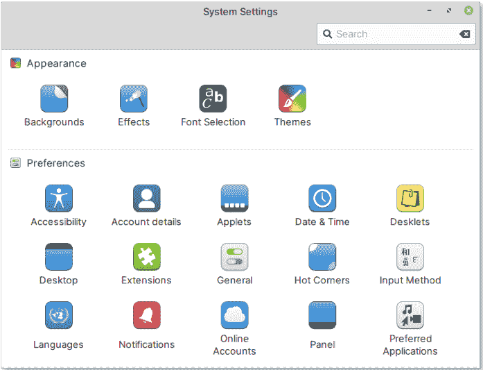

*图19：系统设置应用*

你可以在此配置的设置包括辅助功能、用户账户、日期和时间、键盘布局、语言、网络、显示等更多选项。

##### 修改键盘布局

虚拟机的默认键盘布局为美式英语。你可以在以下路径修改：

- 硬件 → 键盘 → 布局

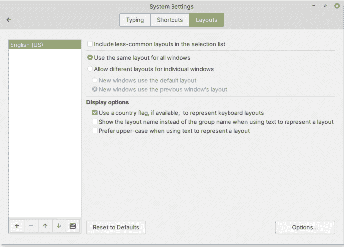

> 图20：系统设置中的键盘布局

##### 修改系统日期和时间

可以通过以下选项更新系统日期和时间：

- 偏好设置 → 日期和时间

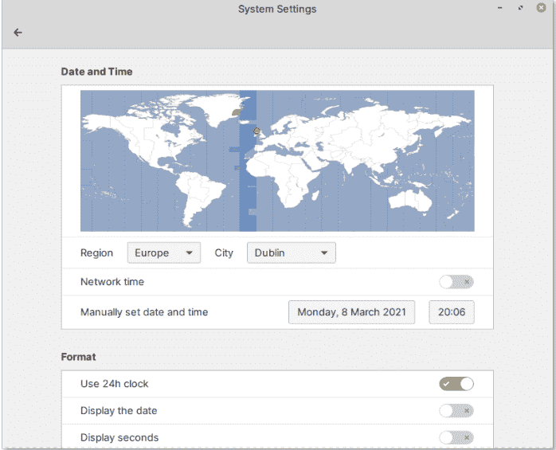

图21：日期和时间设置

### 2.4 可用软件

这是Linux Mint 20.1 Cinnamon内置应用的简要概览。你可以从应用程序菜单启动这些应用（图22），也可以通过搜索栏搜索已安装的应用列表。

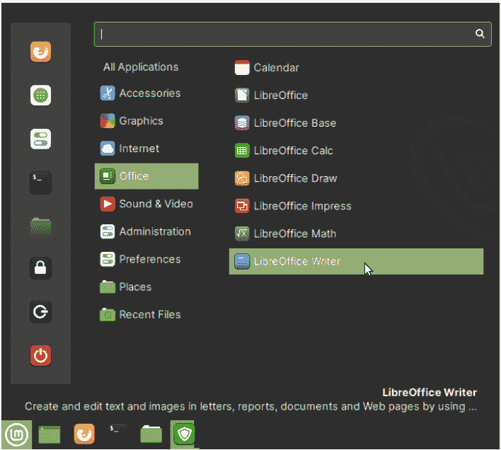

**图22：** 启动应用

**注意：** 文中提到的部分应用未包含在默认安装中，其中包括*GNU图像处理程序*和*Inkscape*。你可以通过*软件管理器*安装它们。

#### 2.4.1 文件——管理文件和目录

文件是Linux Mint的默认文件管理器（图23）。

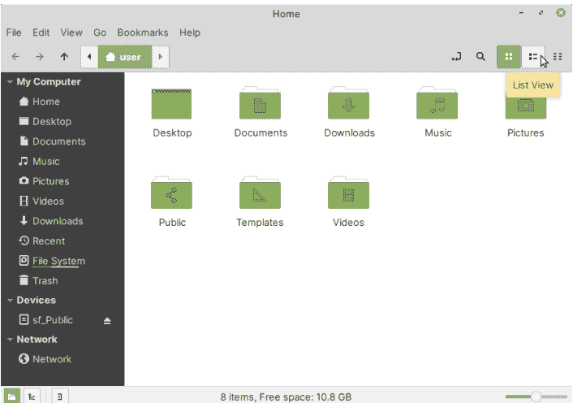

图23：文件主窗口

##### 使用文件管理器

你可以从应用程序菜单启动文件管理器，也可以点击面板中的图标启动。以下是文件管理器的使用技巧。

###### 切换图标和列表视图

你可以通过工具栏中的图标快速切换图标视图和列表视图。

###### 切换侧边栏

你可以通过状态栏中的图标打开或隐藏侧边栏视图。

###### 打开额外面板

你可以通过以下方式打开额外面板：

```
View → Extra Pane
```

在本地目录之间复制文件，或连接远程系统时，这个功能非常实用。

###### 书签位置

浏览目录时，如果你会频繁访问某个目录，可以将其添加为书签。该功能路径为：

```
Bookmark → Add Bookmark
```

###### 连接服务器

文件管理器可以通过FTP、SSH、Samba和Webdav连接外部服务器。该选项路径为：

- 文件 → 连接到服务器

要了解更多关于该功能的信息，请阅读本书的以下章节：*系统间传输文件*。

#### 2.4.2 Firefox——浏览网页

Firefox是默认网页浏览器（图24）。

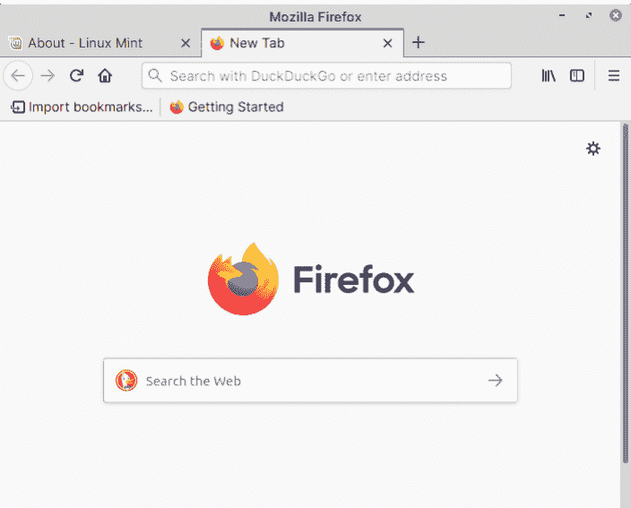

图24：Firefox网页浏览器

其他网页浏览器可以通过*软件管理器*安装。

#### 2.4.3 文本编辑器——创建和编辑文本文件

文本编辑器可用于处理`.txt`、`.md`、`.fasta`等纯文本格式的文件，或编辑`.bashrc`等配置文件（图25）。

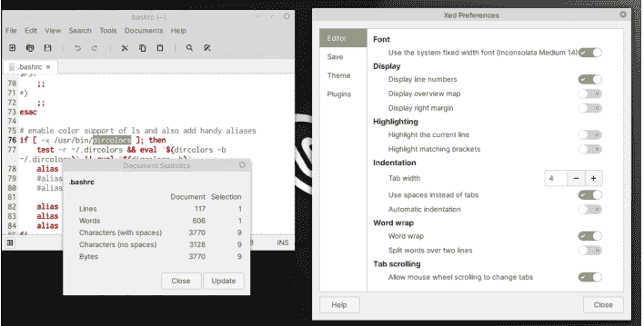

**图25：** 打开的文本编辑器，附带文档统计和偏好设置窗口

使用**编辑 → 偏好设置**，你可以自定义字体、行号显示、缩进、自动换行等设置。**工具 → 文档统计**功能可用于统计文档中的字数和字符数。

##### 在文本编辑器中打开隐藏文件

要在文本编辑器中打开隐藏文件：

1. 使用文件 → 打开选择文件
2. 在弹出的打开文件对话框中，在中间窗格右键单击，选择显示隐藏文件（图26）。

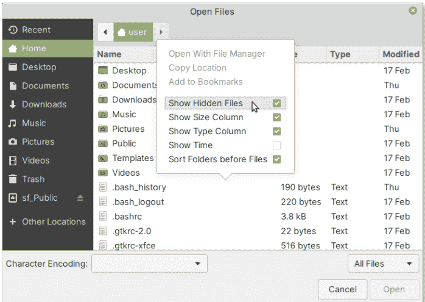

图26：在文本编辑器中打开隐藏文件

你也可以使用`Ctrl + h`键盘快捷键。

#### 2.4.4 LibreOffice——编辑文档和电子表格

LibreOffice Writer和LibreOffice Calc可分别用于创建和编辑文档、电子表格（图27）。

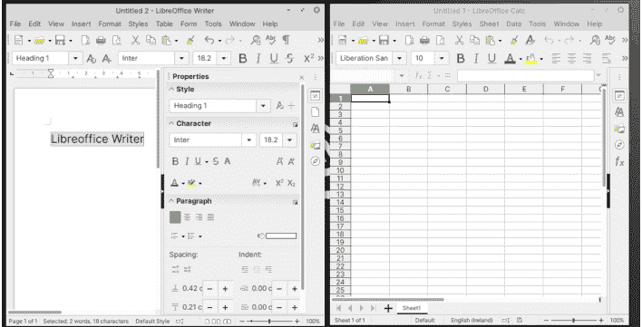

图27：LibreOffice Writer和Calc程序

Writer和Calc的默认文件格式分别为ODF文本文档（`.odt`）和ODF电子表格（`.ods`）。这些应用还支持读写`.docx`或`.doc`（Word）、`.xlsx`或`.xls`（Excel）等微软Office格式的文件。LibreOffice套件中还有额外的应用，可用于创建和编辑幻灯片、演示文稿、科学公式、图表和文件型数据库。

#### 2.4.5 终端——访问命令行

终端应用（图28）提供了使用命令行接口工作的可能性。Linux Mint用户的默认登录Shell是*Bash*。

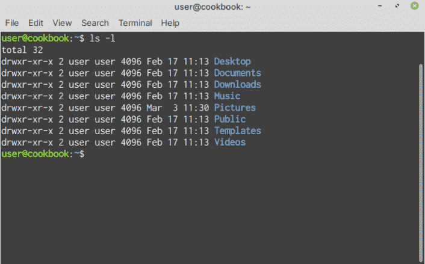

图28：终端

选择「编辑 → 偏好设置」菜单项，即可自定义终端的外观与功能（图29）。

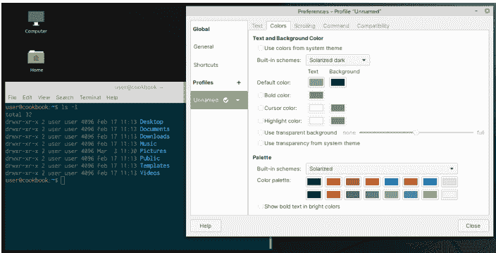

> 图29：在偏好设置中更改终端配色方案

#### 2.4.6 截图工具——截取桌面或窗口的画面

截图工具可用于截取整个屏幕、应用窗口或屏幕指定区域的画面（图30）。

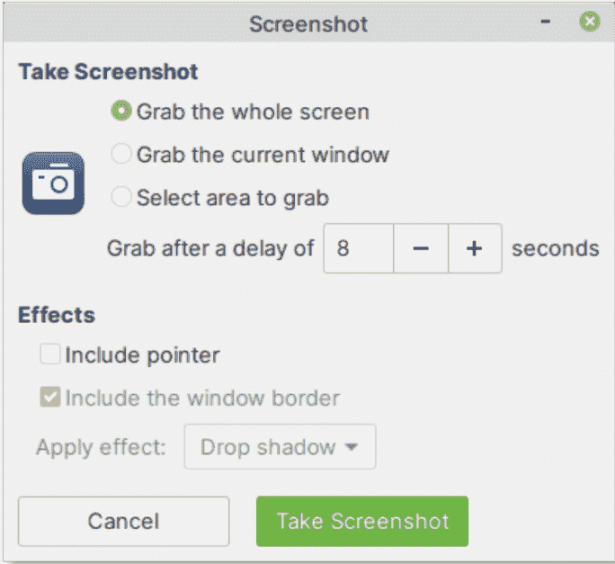

> 图30：截图工具

#### 2.4.7 软件管理器——从软件源安装软件


软件管理器可用于从Linux Mint、Ubuntu、Debian和Flathub软件源安装软件（图31）。如需使用软件管理器安装软件的详细步骤，请参阅*快速简易方法*部分。

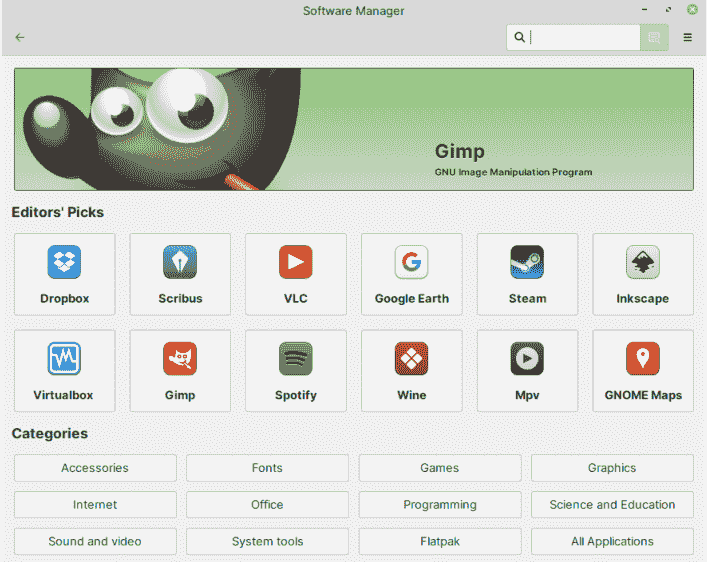

> 图31：软件管理器

## 2.4.8 GNU图像处理程序——编辑图像

GIMP程序可用于编辑JPG、PNG、TIFF、BMP等多种格式的图像（图32）。

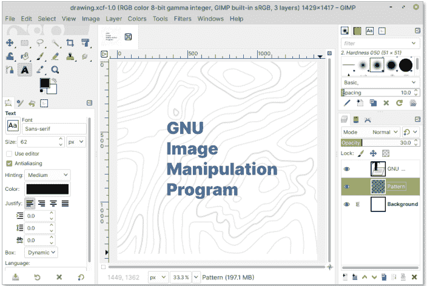

图32：在GIMP中编辑图像

## 2.4.9 Inkscape——创建矢量图形

Inkscape可用于创建和编辑可缩放矢量图形（SVG）格式的图像（图33）。

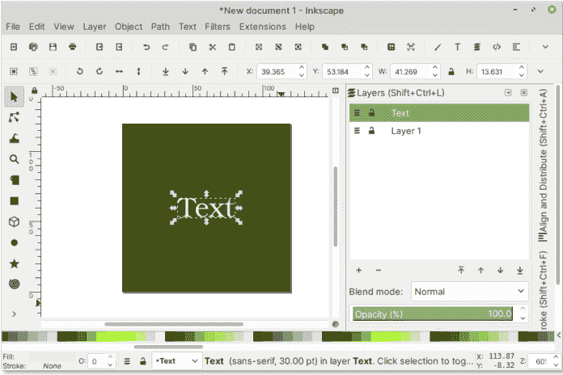

图33：在Inkscape中创建矢量图形

## 2.4.10 笔记

### 将应用添加到收藏夹

如果你经常使用某个应用，可以考虑将其添加到收藏夹，该列表位于应用菜单的左侧。要添加应用至收藏夹，右键点击应用菜单中的应用名称，选择「添加到收藏夹」即可。你也可以选择「添加到面板」操作，这样就会把应用添加到你的面板中。部分应用默认会显示在面板上，包括显示桌面小程序、Firefox浏览器、终端和*文件管理器*。

### 设置默认应用

如需为特定类别或文件类型设置默认应用，可以在系统设置的以下路径中找到对应功能：

- 偏好设置 → 首选应用

## 2.5 文件和目录

本节将介绍主目录、文件、目录及其功能，根文件系统，以及如何在系统间传输文件。

### 2.5.1 你的主目录

登录桌面后打开*文件管理器*，就会显示你的主目录（图34）。主目录下默认包含以下目录：桌面、文档、下载、音乐、图片、公共、模板和视频。

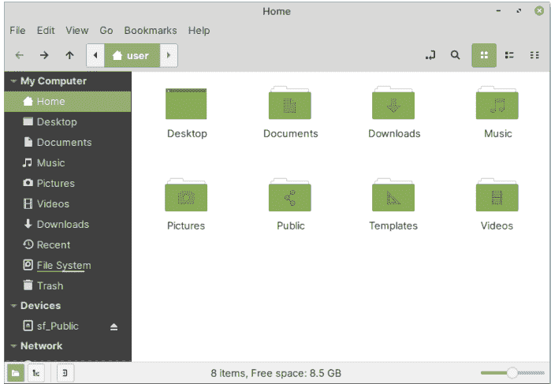

图34：主目录

#### 注释

##### `/home/user`

主目录的完整（绝对）路径格式为`/home/user`，其中`user`是你在系统中的用户名。

##### `$HOME`

`HOME`环境变量会自动设置为文件系统中主目录的完整路径，因此你在命令或脚本中可以将`/home/user`替换为`$HOME`。

### 2.5.2 隐藏文件和目录

除前面提到的默认目录外，主目录下还存在隐藏文件和目录（图35），它们的文件名以点（`.`）字符开头。


图35：主目录中的隐藏文件和目录

你可以在文件管理器的以下菜单项中查看（或隐藏）这些文件：查看 → 显示隐藏文件。此外，你也可以使用`Ctrl + h`快捷键。

### 2.5.3 主目录中的重要文件

`.bashrc`

这是用户账户默认Shell Bash使用的配置文件，当你需要设置或修改`PATH`这类环境变量时，大多会用到该文件。

`.bash_aliases`

你可以通过`.bash_aliases`文件为命令设置别名，示例如下是一个常用别名：

```bash
alias l='ls -l'
```

这意味着当你在命令行输入`l`时，bash Shell会执行`ls -l`，输出文件的详细列表，而非默认的输出格式。

> **注意：** 要了解更多关于`ls`命令的内容，请阅读[ls——列出文件](#)部分。

### 2.5.4 文件和目录名称区分大小写

有一点需要牢记：Linux中的文件和目录名称是区分大小写的，例如一个名为`sequence.txt`的文件，和`Sequence.txt`。

同理，`Documents`和`documents`是两个不同的目录，上述提到的这些文件或目录可以同时存在于同一个目录中，且内容可以不同。

### 2.5.5 访问根文件系统

要访问根文件系统（`/`），点击文件管理器侧边栏中的「文件系统」选项即可（图36）。

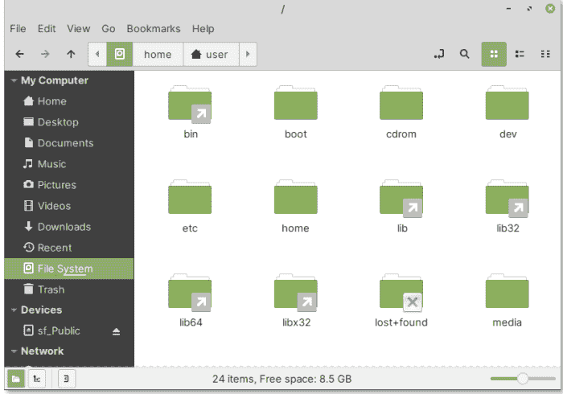

图36：点击文件系统选项以访问根文件系统

#### `/`下的目录及其功能

- `/etc` —— 存储应用程序的配置文件

- `/home` —— 包含所有用户的主目录

- `/media` —— 外部磁盘等设备挂载（即接入系统）的位置

- `/root` —— `root`用户（管理员）的主目录

- `/tmp` —— 应用程序生成的临时文件存放位置

- `/usr` —— 应用程序、库及其相关数据和文档的安装位置

- `/var` —— 日志文件、应用缓存、数据库等内容的存储位置

#### 根文件系统和`root`主目录不同

`/`是根文件系统，系统中所有用户只要拥有相应权限，都可以访问其中的文件和目录。

#### `/root`是`root`用户的主目录

仅`root`用户可访问该目录。

### 2.5.6 在系统间传输文件

*文件管理器*有一个实用功能：可通过SSH、FTP、SMB、WebDAV等协议连接远程系统，连接成功后，你可以在Linux桌面和远程系统之间传输文件，*反之亦可*。

要连接远程系统，可在文件管理器中使用以下菜单项（图37）：文件 → 连接到服务器

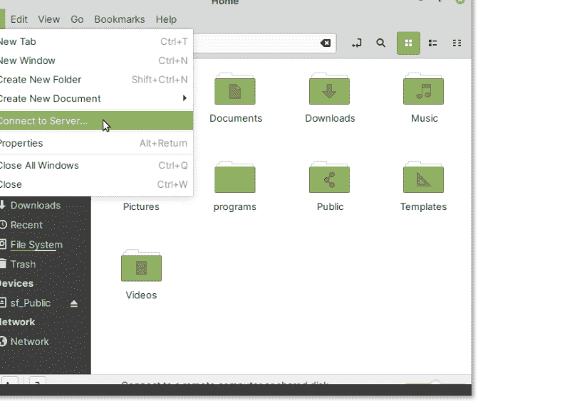

图37：文件管理器中的「连接到服务器」选项

#### 连接SSH服务器

打开「文件 → 连接到服务器」，按照以下步骤操作（图38）：

1. 在对应的「服务器」输入框中，输入你要连接的服务器的域名或IP地址

2. SSH的默认端口为22，通常无需修改

3. 在「类型」下拉框中选择SSH

4. 在「文件夹」选项中，你可以指定连接成功后自动打开的目录（可选）

5. 输入你在*服务器*上的账户用户名和密码

6. 点击「连接」按钮

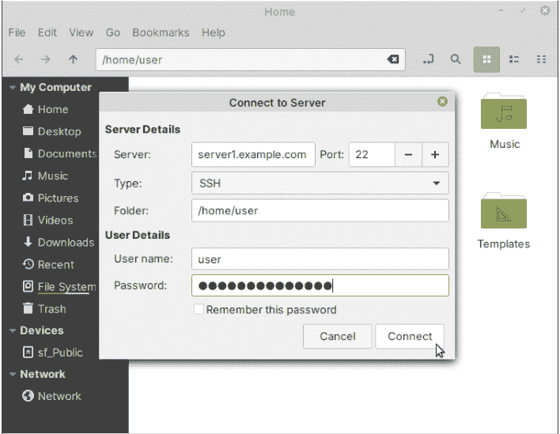

图38：连接SSH服务器

当远程目录在*文件管理器*中打开后，你就可以开始在你的桌面和远程系统之间传输文件，*反之亦可*。

## 3 在Linux上获取软件

本节将介绍如何在你的Linux桌面上获取软件。对于任何你想安装的软件，都可以先尝试*快速简易*方法，该方法会安装Linux发行版软件源中可用的软件。如果你需要的软件在软件源中找不到，或者你需要特定版本的软件，可以考虑使用其他方法。

### 3.1 快速简易方法

*快速简易*方法就是使用*软件管理器*在桌面上搜索并安装软件，它支持从Linux Mint、Debian和Flathub软件源安装软件。

可以使用该方法安装的软件示例：

- **Circo**<sup>10</sup> —— 用于可视化数据的绘图工具

- **Clustal Omega**<sup>11</sup> —— 用于核苷酸和蛋白质序列比对的通用多序列比对程序

- **EMBOSS**<sup>12</sup> —— 欧洲分子生物学开放软件套件

- **NCBI BLAST+**<sup>13</sup> —— 新一代BLAST序列检索工具套件

- **Bioconductor**<sup>14</sup> —— 用于高通量基因组数据分析与解读的工具

- **CD-HIT**<sup>15</sup> —— 用于快速对序列进行聚类的程序套件

- **UGENE**<sup>16</sup> —— 集成化生物信息学工具套件

<sup>10</sup> https://circos.ca

<sup>11</sup> https://www.clustal.org/omega

<sup>12</sup> https://emboss.sourceforge.net

<sup>13</sup> https://blast.ncbi.nlm.nih.gov/Blast.cgi

<sup>14</sup> https://www.bioconductor.org

<sup>15</sup> http://weizhongli-lab.org/cd-hit/

<sup>16</sup> http://ugene.net/

## 第3章 在Linux上安装软件

### 3.1.1 要求

> **注意：** 本流程会在系统路径中安装软件，因此需要管理员权限。

### 3.1.2 查找并安装软件

为了演示相关步骤，我将安装*PyMOL*——一款分子可视化软件。你可以按照同样的流程查找并安装软件仓库中的其他软件。

点击应用程序菜单中的图标打开**软件管理器**（图39），你也可以从应用程序菜单的“管理”板块启动它。

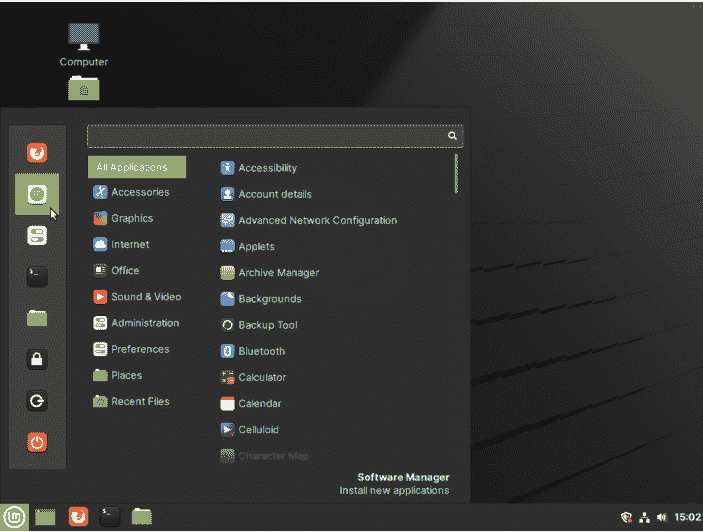

图39：点击应用程序菜单中的软件管理器

启动后你会看到它的主窗口（图40）。

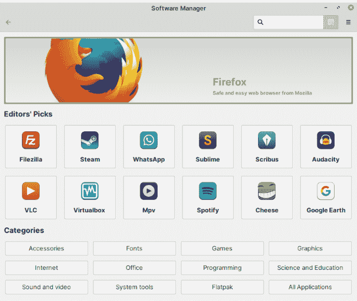

图40：软件管理器主窗口

在搜索栏中输入`pymol`。片刻后，软件仓库中匹配搜索词（即`pymol`）的软件包会显示在下方（图41）。

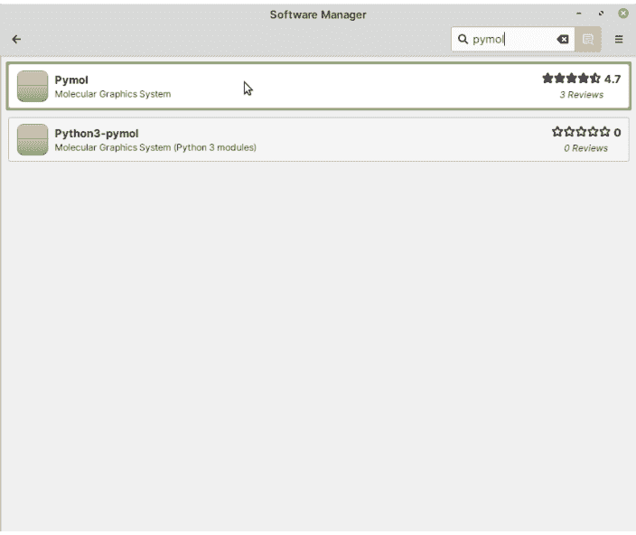

图41：`pymol`的搜索结果

点击第一个结果——**Pymol**，你会进入软件包描述页面。

> **说明：** 为什么不选`Python3-pymol`？第二个结果*Python3-pymol*的描述显示它包含用于操作PyMOL的Python 3 *模块*，这不是我们需要的。如果你不确定，可以在下一页阅读该包的完整描述，确认是否是你想要安装的包。

在软件包描述页面，点击**安装**按钮（图42）。

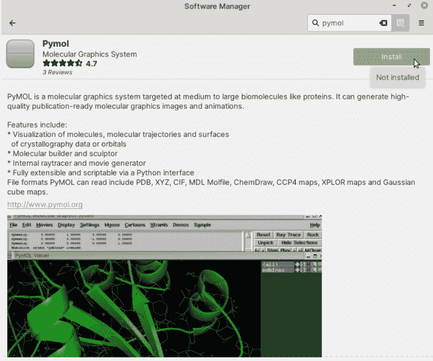

图42：点击安装按钮安装该包

PyMOL是针对蛋白质等中等至大型生物分子的分子图形系统，能够生成可用于出版的高质量分子图形图像与动画。功能包括：

- 可视化分子、分子轨迹以及晶体学数据或轨道的表面

- 分子构建与雕刻工具

- 内置光线追踪器与影片生成器

- 通过Python接口完全可扩展、可编写脚本

PyMOL可读取的文件格式包括PDB、XYZ、CIF、MDL Molfile、ChemDraw、CCP4地图、XPLOR地图和高斯立方地图。

http://www.pymol.org

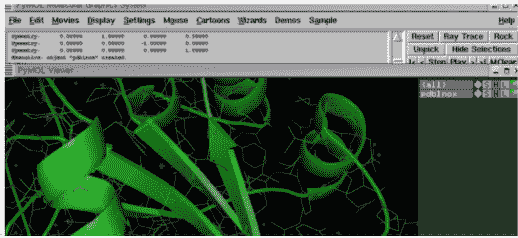

此时会弹出一个对话框，提示你输入*你的密码*，输入密码后点击**验证**按钮（图43）。

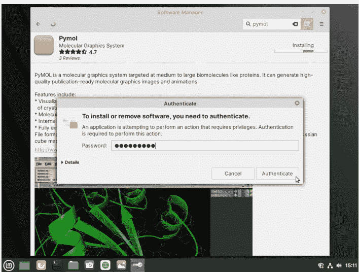

图43：输入你的密码并点击验证按钮

现在会开始安装流程，安装完成后，你会发现安装按钮的位置替换为了两个按钮——启动和移除（图44）。

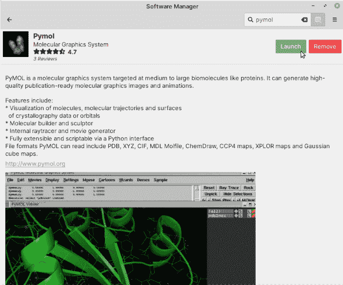

图44：安装完成，注意启动和移除按钮

点击启动按钮，即可打开PyMOL程序（图45）。

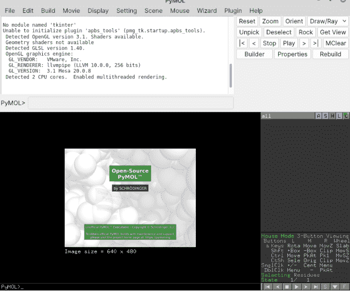

图45：PyMOL主窗口

或者，你也可以在**应用程序菜单**中搜索该应用并从这里启动。

> **说明：** 对于没有图形用户界面的应用，不会显示启动按钮。如果程序包含任何命令，你可以在*终端*会话中访问它们。

### 3.1.3 卸载已安装的软件

你可以按照以下步骤卸载从软件仓库安装的软件：

打开软件管理器，点击主应用窗口中的设置按钮，然后选择“显示已安装应用”（图46）。

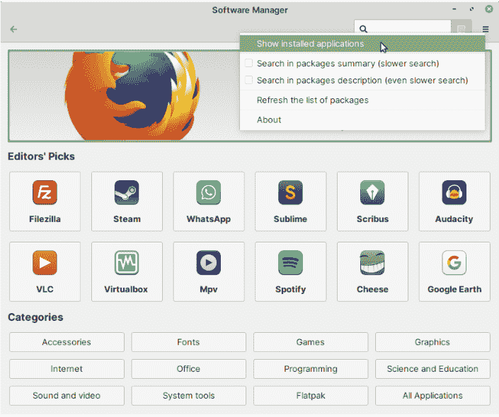

图46：从软件管理器设置中选择显示已安装应用

或者，你也可以在搜索栏中输入软件名称，然后按**回车**键。

在**已安装应用**列表中，点击你想要卸载的包——本例中为`Pymol`（图47）。

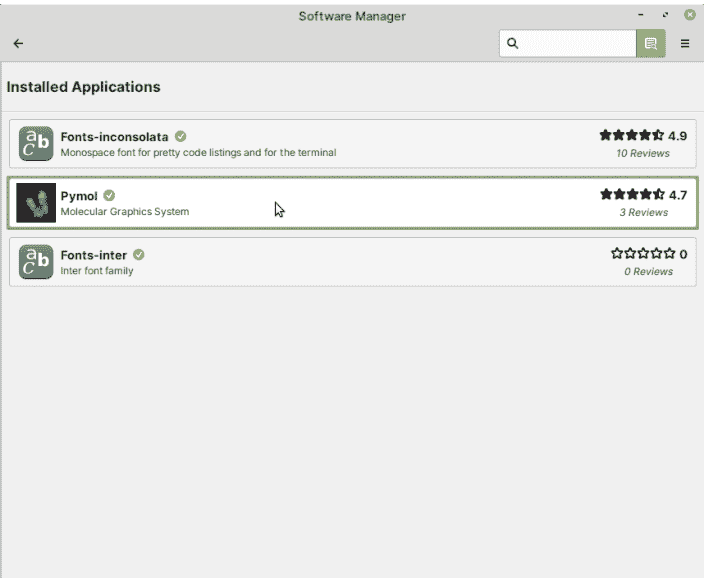

图47：点击你想要卸载的包

你会进入软件包描述页面，点击**移除**按钮即可卸载（或移除）该包（图48）。

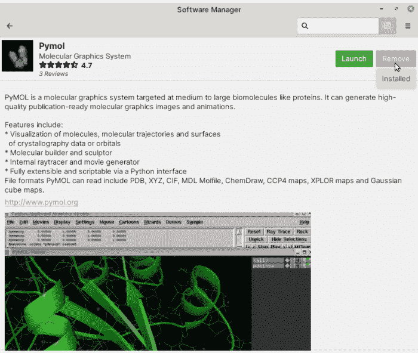

图48：点击移除按钮卸载该包

系统会提示你输入密码，输入*你的密码*后点击**验证**按钮继续（图49）。

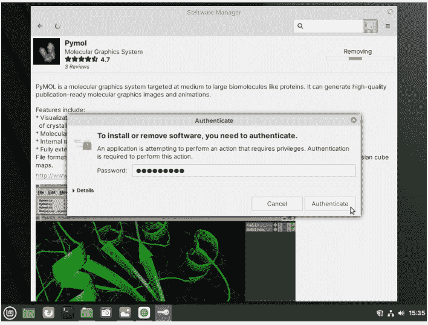

图49：输入你的密码并点击验证按钮

该软件现在会从系统中被卸载（或移除）。

### 3.1.4 更新已安装的软件

当系统中有已安装软件的可用更新时，你会在系统托盘收到通知（图50）。

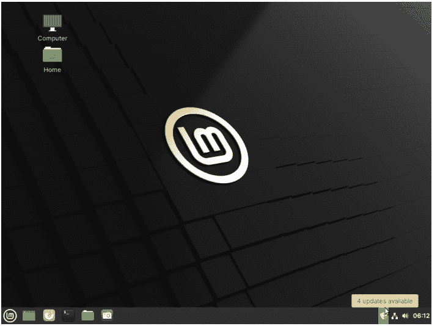

要应用软件更新：

点击系统托盘中的通知图标，这将打开*更新管理器*程序。

要安装所有可用的软件更新，点击工具栏中的*安装更新*按钮（图51）。

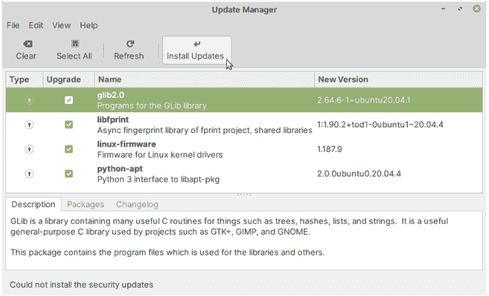

图51：点击**安装更新**按钮以应用所有可用更新

系统会提示你输入密码（图52），输入*你的密码*后点击**验证**按钮。

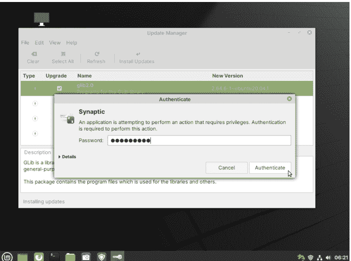

图52：输入你的密码并点击验证按钮

更新管理器现在会继续安装更新（图53）。


图53：更新管理器正在安装软件更新

更新过程完成后，你会看到提示——您的系统已是最新版本（图54）。


图54：更新安装成功

### 3.1.5 说明

#### 命令行版本（apt）

你可以使用`apt`包管理器从命令行安装软件。

#### 搜索软件

打开终端，在软件仓库中搜索匹配的软件包。例如，以下是对`pymol`的搜索：

```apt search pymol
```

> **说明：** 此处无需输入`sudo`。如果有匹配结果，会从软件仓库输出以下内容：

```
p pymol - Molecular Graphics System

p pymol-data - data files for PyMOL

p python3-pymol - Molecular Graphics System (Python 3 module)
```

一旦你确认了正确的包名——本例中为`pymol`——就可以继续安装该包。

#### 安装包

你可以使用以下命令安装软件包：

```sudo apt install pymol
```

> **注意：** 此处需要输入`sudo`。此外，在下方的命令中，系统会要求你输入*你的*密码，你还需要确认是否要继续执行变更，输入`y`后按**回车**键继续。

```
[sudo] password for user:
Reading package lists... Done
Building dependency tree       
Reading state information... Done
The following additional packages will be installed:
  pymol-data python3-pymol
The following NEW packages will be installed:
  pymol pymol-data python3-pymol
0 upgraded, 3 newly installed, 0 to remove and 4 not upgraded.
Need to get 0 B/5,192 kB of archives.
After this operation, 19.8 MB of additional disk space will be used.
Do you want to continue? [Y/n] y
```

#### 卸载已安装的软件包

要卸载已安装的软件包，使用以下命令：

```sudo apt remove pymol
```

上述命令不会卸载依赖的软件包，你可以使用以下命令卸载它们：

```sudo apt autoremove
```

#### 更新软件包

要更新*所有已安装的软件包*，你可以使用以下命令：

```sudo apt update
sudo apt upgrade
```

要更新*特定软件包*——如果有可用更新，你可以再次使用`apt install`命令：


```bash
sudo apt install package_name
```

## 为什么这是一种快速简便的方法？

你可以通过图形用户界面（软件管理器）或命令行（`apt`）安装 Linux 软件仓库中提供的软件。通过这种方式安装的软件也会随系统其余部分一同更新。

## 额外软件仓库

发行版仓库中新版本软件的上线通常需要一定时间。如果你需要的软件不在仓库中，或者你需要更新版本的软件，可以尝试从以下额外源安装：

- 来自 `PyPI` 的 `Python` 包
- 来自 `CPAN` 的 `Perl` 模块
- 来自 `CRAN` 或 `Bioconductor` 的 `R` 包
- 来自 `Anaconda Cloud` 的 `Conda` 包

> **注意：** 通过这些方法安装的软件也需要手动保持更新。

## 3.2 Python 包

如果你需要的软件在 `PyPI` 上以 Python 包的形式提供，你可以使用 `pip`（Python 包安装器）进行安装。

> **注意：** 你需要的软件可能已经可以通过快速简便方法安装，请搜索以`python-`开头的包名。某些情况下，在虚拟环境中安装包可能是更好的选择。阅读：[何时应使用虚拟环境？]()

### 3.2.1 要求

#### Python 包安装器（`pip`）

要安装 `pip`，请按照安装软件的快速简便方法操作，搜索并安装`python3-pip`包。

#### 将`$HOME/.local/bin`添加到`$PATH`

包含命令的包会将其安装在`$HOME/.local/bin`目录（什么是`$HOME`？）中。为了能方便地运行这些命令，你需要将这个目录添加到`$PATH`变量中，你可以按照将目录添加到`PATH`中的步骤操作。

> **注意：** 你不应在下面的命令中添加`sudo`。此方法仅在你的主目录中安装文件，因此不需要管理员权限。

### 3.2.2 在`PyPI`上搜索包

在浏览器中打开`PyPI`网站<sup>17</sup>。在“搜索项目”字段中输入你要安装的软件名称，然后按`ENTER`键或点击搜索按钮（图55）。


> **图55：** 在`PyPI`上搜索包

将显示与搜索词匹配的包列表（图56）。

<sup>17</sup> https://pypi.org


图56：`biopython`的搜索结果。1.78是版本号。点击结果进入项目描述页面。

在项目描述页面中，找到`pip install`命令中的包名（图57），本例中是`biopython`。


> **图57：** Biopython的项目描述页面

> **注意：** 以下步骤中你需要使用`pip3`而非`pip`命令。[原因？]()

现在你可以开始安装该包了。

### 3.2.3 安装Python包

打开终端，使用`pip3 install`命令加上你要安装的包名，以`biopython`为例：

```bash
pip3 install biopython
```

输出：

```bash
Collecting biopython
Downloading biopython-1.78-cp38-cp38-manylinux1_x86_64.whl (2.3 MB) |********************| 2.3 MB 2.1 MB/s
Collecting numpy
Downloading numpy-1.20.1-cp38-cp38-manylinux2010_x86_64.whl (15.4 MB) |********************| 15.4 MB 90 kB/s
Installing collected packages: numpy, biopython
Successfully installed biopython-1.78 numpy-1.20.1
```

> **注意：** 此方法的一个限制是你无法安装同一个包的多个版本，这个问题可以通过使用虚拟环境解决。

### 3.2.4 更新已安装的包

当你发现该包有可用更新时，可以在`install`命令后加上`-U`选项和包名来更新：

```bash
pip3 install -U biopython
```

### 3.2.5 卸载已安装的包

使用`uninstall`命令加上你要卸载的包名即可：

```bash
pip3 uninstall biopython
```

### 3.2.6 使用已安装的包

#### 文件安装在哪里？

你可以使用`pip3 show`命令加上包名来查看其安装路径：

```bash
pip3 show biopython
```

输出：

```text
Name: biopython
Version: 1.78
Summary: Freely available tools for computational molecular biology.
Home-page: https://biopython.org/
Author: The Biopython Contributors
Author-email: biopython@biopython.org
License: UNKNOWN
Location: /home/user/.local/lib/python3.8/site-packages
Requires: numpy
Required-by:
```

安装路径会显示在`Location`关键字旁边。

#### 使用Python包和模块

Python包和模块会安装在`$HOME/.local/lib/python3.8/site-packages`目录中。

> **注意：** 这是Python 3.8的路径，如果你安装的是其他版本的Python，该路径值会发生变化。此目录会自动添加到`$PYTHONPATH`中，因此你无需额外操作，就可以在脚本中导入和使用已安装的包和模块。例如，以下是一个简单的Python脚本，用于测试通过`pip`安装的BioPython：

```python
from Bio.Seq import Seq

seq = Seq('ATGC')

comp = seq.complement()

print(f'The complement of {seq} is {comp}')
```

`Bio.Seq`包是BioPython的一部分。复制上面的代码示例，将其保存为`biopy_test.py`，然后在终端中运行：

```bash
python3 biopy_test.py
```

输出：

```text
The complement of ATGC is TACG
```

#### 使用附带命令

如果包附带命令，这些命令会安装在`$HOME/.local/bin`目录中。为了让这些命令易于调用，你需要按照要求部分所述，将该目录添加到`PATH`中。例如，当你安装`cutadapt`的Python包时，`cutadapt`命令会被安装到`$HOME/.local/bin`中，你可以在终端中像这样运行它：

```bash
cutadapt --version
```

输出：

```text
3.1
```

### 3.2.7 Python虚拟环境

虚拟环境是一个独立的目录树，包含Python解释器以及一些额外的包。

#### 优势

以下是使用虚拟环境的部分优势。

##### 无需管理员权限

创建虚拟环境或在环境中安装包都不需要管理员权限。

##### 多环境支持

可以创建多个虚拟环境，每个环境都包含各自独立的包集合。这些环境相互隔离，某个环境中的包可以安装、更新或卸载，不会影响其他环境。

##### 共享环境

你可以将自己的配置分享给他人，他人就能复现出完全相同的包版本环境。

#### 创建虚拟环境

首先，按照快速简便方法搜索并安装`python3-venv`包，该包包含了创建虚拟环境所需的`venv`模块。你可以在任何有写入权限的目录中创建虚拟环境，例如你的主目录。为了演示，我将在我的主目录中创建一个名为`py3env`的虚拟环境。

```bash
python3 -m venv py3env
```

如果创建成功，你会在当前目录下看到名为`py3env`的目录，不会显示任何提示信息。

> **注意：** `python3`是运行Python 3解释器的命令，其完整路径为`/usr/bin/python3`。  
> **注意：** `venv`是用于创建虚拟环境的Python模块。  
> **注意：** `-m`选项的作用是将`venv`模块作为脚本运行。

在使用虚拟环境之前，你需要先激活它。

#### 激活虚拟环境

你需要先激活虚拟环境才能开始使用它。激活方法是在`source`命令后跟上虚拟环境中`activate`脚本的路径，例如要激活上一步创建的`py3env`，请使用以下命令：

```bash
source py3env/bin/activate
```

此时你的shell提示符会发生变化，表明虚拟环境已激活，注意提示符开头的`(py3env)`标签：

```bash
(py3env) user@cookbook:~$
```

现在你就可以开始使用这个虚拟环境了。

> **注意：** 在开始安装包之前，建议在新虚拟环境中安装（或升级）Python构建工具——`pip`、`setuptools`和`wheel`。这些构建工具是构建和安装来自`PyPI`及其他源的包所必需的，安装它们可以确保后续包的构建和安装不会出错。

##### 安装 Python 构建工具

使用`pip3 install`安装或升级所需的包：

```bash
pip3 install -U pip setuptools wheel
```

`pip3 install`的`-U`选项会在有新版本可用时升级所列的包。

##### 输出

```text
Collecting pip
Downloading pip-21.0.1-py3-none-any.whl (1.5 MB) ...
Installing collected packages: pip, setuptools, wheel
...
Successfully installed pip-21.0.1 setuptools-54.2.0 wheel-0.36.2
```

##### 停用虚拟环境

要退出虚拟环境，请使用以下命令：

```bash
deactivate
```

你的 shell 提示符会恢复为原来的样式：

```bash
user@cookbook:~$
```

### 3.2.8 注意事项

#### 你需要手动更新这些包

通过这种方式安装的包也需要手动更新。当你注意到包有更新时（例如从项目官网或其源码仓库获取到更新信息），请按照更新已安装的包中的步骤安装最新版本。

#### 为什么用`pip3`而不是`pip`？

`pip`包包含以下命令：

- `pip3` — Python 3 版本
- `pip2` — Python 2 版本

Python 2 的支持已于 2020 年 1 月终止。

由于系统中可能同时存在这两个命令，因此用这种方式安装包时使用`pip3`更安全。

#### 用 Python 2 编写的程序怎么办？

Python 2 的支持已于 2020 年 1 月终止。

如果你确实需要使用仅用 Python 2 编写的程序，可以创建一个隔离环境——使用Python `venv`或Conda均可，之后在该环境中安装对应的包即可。

## 生物学家的 Linux 指南

相关章节：

- Python 虚拟环境
- Conda 包

### 何时应使用虚拟环境？

如果你要安装的程序需要从`PyPI`获取同一包的两个不同版本，那么此处描述的方法将不适用。这种情况下，你可以考虑创建隔离环境——使用 Python `virtualenv` 或 Conda 均可，之后在该环境中安装所需的包。

相关章节：

- Python 虚拟环境
- Conda 包

### 旧版`pip`

如果系统中安装的`pip`版本低于 20.0，它默认会尝试将包安装到系统路径中，从而导致权限被拒绝的错误。为避免这种情况，你需要在安装和卸载命令中添加`--user`选项，例如：

```bash
pip3 install --user biopython
```

更好的方法是升级你本地的`pip`版本。升级完成后，你就不再需要用到`--user`了。要升级`pip`，请执行以下命令：

```bash
pip3 install --user -U pip
```

你可以使用以下命令检查已安装的`pip`版本：

```bash
pip3 -V
```

## 3.3 Perl 模块

安装 Perl 模块时，你可以配置`local-lib`模块来创建并使用本地目录。默认路径是`$HOME/perl5`。如果你需要的软件在`CPAN`上可用，你可以使用`cpanminus`脚本轻松安装它。

> **注意：** 你需要的软件可能可以通过快速简易方法获取。请搜索包含`perl`的包名。

### 3.3.1 要求

#### 已安装`build-essential`和`cpanminus`包

如果你尚未安装这些包，请按照快速简便方法搜索并安装以下包：

1. `build-essential` — 安装编译器和构建工具，例如`make`
2. `cpanminus` — 用于从`CPAN`获取、构建并安装模块及其依赖项的脚本

> **注意：** 你不应在下面的命令中添加`sudo`。此方法仅在你的主目录中安装文件，因此不需要管理员权限。

### 3.3.2 配置`local-lib`模块

要配置`local-lib`：

在文本编辑器中打开`$HOME/.bashrc`文件。在文件末尾添加以下内容：

```bash
# Configuration for Perl local-lib module

eval "$(perl -Mlocal::lib)"
```

保存文件。以下是一个`.bashrc`示例，供参考（**图 58**）。


**图 58：** `.bashrc`中的`local-lib`配置

```bash
if [ -f ~/.bash_aliases ]; then

. ~/.bash_aliases

fi

# enable programmable completion features (you don't need to enable

# this, if it's already enabled in /etc/bash.bashrc and /etc/profile

# sources /etc/bash.bashrc).

if ! shopt -oq posix; then

if [ -f /usr/share/bash-completion/bash_completion ]; then

. /usr/share/bash-completion/bash_completion

elif [ -f /etc/bash_completion ]; then

. /etc/bash_completion

fi

fi

# Add $HOME/.local/bin to PATH

export PATH="$HOME/.local/bin:$PATH"

# Configuration for Perl local-lib module

eval "$(perl -Mlocal::lib)"
```

打开一个新的终端窗口。你会看到如下显示的提示信息（**图 59**）。


> **图 59：** 正在尝试创建目录`/home/user/perl5`

配置现已完成。

现在你可以开始从`CPAN`及其他来源安装模块了。

### 3.3.3 在`CPAN`上搜索模块

在浏览器中打开元 CPAN 网站（https://metacpan.org）。在搜索栏中输入你要安装的模块名称，然后点击**搜索 CPAN**按钮。我将以 David H. Ardell 的`FAST`包为例（**图 60**）。


**图 60：** 在 MetaCPAN 上搜索模块

此时会显示与搜索词匹配的模块——`FAST`（**图 61**）。


**图 61：** 模块搜索结果

如果你点击对应的模块名称，就会进入其描述页面，你可以在该页面了解更多关于该模块的信息（**图 62**）。


**图 62：** 模块描述页面

在此页面，你还可以验证下一步要使用的模块名称。要完成验证，请点击侧边栏 TOOLS 菜单下的安装说明。此时会弹出一个窗口，显示你需要与`cpanm`命令配合使用的模块名称信息。本例中需要使用的模块名称就叫`FAST`（**图 63**）。


**图 63：** FAST 的模块安装说明

现在你可以开始安装这个模块了。

### 3.3.4 安装 Perl 模块

打开终端窗口。使用`cpanm`命令安装该模块：

```bash
cpanm FAST
```

如果存在依赖项，此命令会一并安装模块及其依赖项。

**输出：**

```text
--> Working on FAST
Fetching http://www.cpan.org/authors/id/D/DH/DHARD/FAST-1.06.tar.gz ... OK
Configuring FAST-1.06 ... OK
```


```
==> Found dependencies: Bit::Vector, Sort::MergeSort, Sort::Key

--> Working on Bit::Vector

Fetching http://www.cpan.org/authors/id/S/ST/STBEY/Bit-Vector-7.4.tar.gz ... OK

Configuring Bit-Vector-7.4 ... OK

...

Building and testing FAST-1.06 ... OK

Successfully installed FAST-1.06

6 distributions installed
```

### 3.3.5 使用已安装的模块

#### 使用内置命令

如果模块包含命令，这些命令会被安装到`$HOME/perl5/bin`目录下。配置完`local-lib`后，该目录会被添加到`$PATH`中。因此，模块安装完成后，你就可以立刻使用其内置的命令了。

例如，以下是上一步安装的 FAST 包中包含的`fasuniq`命令的帮助页面：

```bash
fasuniq -h

Usage: fasuniq [options] [MULTIFASTA-FILE] [MULTIFASTA-DATA-ON-STDIN]

| fasuniq [options] ...
```

#### 在脚本中使用模块

模块会被安装到以下路径：`$HOME/perl5/lib/perl5/5.30.0.`

> **注意：** 这是 Perl 5.30.0 的模块路径。如果你的系统中安装了其他版本的 Perl，该路径会对应变化。

由于`local-lib`会自动发现这些模块，你可以立即在脚本中使用它们。下面是一个使用`Bio::Phylo`包的示例。使用`cpanm Bio::Phylo`安装该模块后，用文本编辑器创建一个文件，并复制以下内容：

```perl
use Bio::Phylo;

# print version

print Bio::Phylo->VERSION;

# print citation

print Bio::Phylo->CITATION;
```

将文件保存为`biophylo_test.pl`，然后运行它：

```bash
perl biophylo_test.pl
```

输出：

```perl
v2.0.1

Rutger A Vos, Jason Caravas, Klaas Hartmann, Mark A Jensen and Chase Miller, 2011.

Bio. P hylo - phyloinformatic analysis using Perl.

BMC Bioinformatics 12:63.

doi:10.1186/1471-2105-12-63
```

## 3.4 R 包

如果你关注的软件在*CRAN*或*Bioconductor*上以 R 包的形式提供，你可以分别使用`install.packages()`或`BiocManager::install()`命令来安装它。

> **注意：** 你的软件可能已经可以通过*快速简便方法*获取。请搜索以`r-cran-`或`r-bioc-`开头的包名。

### 3.4.1 要求

**已安装 r-base 包**

`r-base`包提供了*GNU R*统计计算与图形系统。如果你尚未安装它，请遵循*快速简便方法*，搜索并安装`r-base`包。

> **注意：** *你不应该在下面的命令中添加`sudo`。* 该方法仅在你的主目录中安装文件，因此不需要管理员权限。

### 3.4.2 启动 R 会话

要启动 R 会话，请打开终端窗口。输入`R`命令并按 ENTER 键。

```bash
user@cookbook:~$ R
```

你将进入 R 会话界面，会显示一些附加信息，包括已安装的 R 版本。你可以在`>`提示符处输入 R 命令。

```r
R version 3.6.3 (2020-02-29) -- "Holding the Windsock"

Copyright (C) 2020 The R Foundation for Statistical Computing

→ Computing Platform: x86_64-pc-linux-gnu (64-bit)

R is free software and comes with ABSOLUTELY NO WARRANTY.

You are welcome to redistribute it under certain conditions.

Type 'license()' or 'licence()' for distribution details.

Natural language support but running in an English locale

R is a collaborative project with many contributors.

Type 'contributors()' for more information and 'citation()' on how to cite R or R packages in publications.

Type 'demo()' for some demos, 'help()' for on-line help, 🛈 or 'help.start()' for an HTML browser interface to help.

Type 'q()' to quit R.
```

# 生物学家 Linux 指南

### 3.4.3 从 CRAN 安装包

你可以在 CRAN 上查阅按分类列出的任务视图<sup>18</sup>或可用包列表<sup>19</sup>（当前共有 17157 个包）来搜索 R 包。确定要安装的包后，你可以按照以下步骤进行安装。下面我将以安装`edgeR`包为例。

1. **使用`install.packages()`命令安装包**

   启动 R 会话。在提示符处，输入带引号的包名的`install.packages()`命令。例如：

   ```r
   install.packages("BiocManager")
   ```

   按下 ENTER 键继续。

2. **确认使用个人库**

   你会看到一个提示，要求你确认是否要使用个人库：

   ```text
   Installing package into '/usr/local/lib/R/site-library' (as 'lib' is unspecified)
   ```

   > <sup>18</sup> [任务视图](https://cran.r-project.org/web/views/)

   > <sup>19</sup> [可用包列表](https://cran.r-project.org/web/packages/available_packages_by_name.html)

   ```text
   Warning in install.packages("BiocManager") :
     'lib = "/usr/local/lib/R/site-library"' is not writable
   Would you like to use a personal library instead? (yes/No/cancel) yes
   ```

   输入`yes`确认，然后按 ENTER 键。

3. **必要时创建个人库**

   如果你从未安装过包，个人库目录将不存在。这种情况下，你会被提示确认是否要创建它：

   ```r
   Would you like to create a personal library '~/R/x86_64-pc-linux-gnu-library/3.6' to install packages into? (yes/No/cancel) yes
   ```

   输入`yes`确认，然后按 ENTER 键。

   > **注意：** 下次安装包时，你不会再看到这个提示。

4. **包安装摘要**

   现在应该开始安装：

   ```r
   trying URL 'https://cloud.r-project.org/src/contrib/BiocManager_1.30.10.tar.gz'

   Content type 'application/x-gzip' length 40205 bytes (39 KB)

   ==================================================

   downloaded 39 KB

   * installing *source* package ‘BiocManager’ ...

   ** package ‘BiocManager’ successfully unpacked and MD5 sums checked

   ** using staged installation

   ** R

   ** inst

   ** byte-compile and prepare package for lazy loading

   ** help

   *** installing help indices

   ** building package indices

   ** installing vignettes

   ** testing if installed package can be loaded from temporary location

   ** testing if installed package can be loaded from final location

   ** testing if installed package keeps a record of temporary installation path

   * DONE (BiocManager)
   ```

下载的源包位于`'/tmp/RtmpDgm0Z8/downloaded_packages'`目录下。如果过程中没有出现错误，说明包安装成功。

### 3.4.4 从 Bioconductor 安装包

你可以在网站上搜索 Bioconductor 软件包列表<sup>20</sup>（当前共有 1974 个包）。确定要安装的包后，你可以按照以下步骤进行安装。下面我将以安装`edgeR`包为例。

1. **使用`BiocManager::install()`命令安装包**

2. 启动 R 会话。

3. 安装`BiocManager`包。从 Bioconductor 仓库安装 R 包时必须先执行这一步。

   > **注意：** 你只需要执行一次该操作。下次想要从 Bioconductor 安装包时，可以直接跳到第 3 步。

4. 在 R 提示符处，使用带引号的你要安装的包名的`BiocManager::install()`命令。例如：

   ```r
   BiocManager::install("edgeR")
   ```

   按下 ENTER 键继续。

   > <sup>20</sup> [Bioconductor 软件包列表](https://www.bioconductor.org/packages/release/BiocViews.html#__Software)

现在将下载、编译并安装该包及其依赖项。

```r
Bioconductor version 3.10 (BiocManager 1.30.10), R 3.6.3 (2020-02-29)

Installing package(s) 'BiocVersion', 'edgeR'

also installing the dependencies 'limma', 'locfit', 'Rcpp' ...

** testing if installed package can be loaded from temporary location

** checking absolute paths in shared objects and dynamic libraries

** testing if installed package can be loaded from final location

** testing if installed package keeps a record of temporary installation path

* DONE (edgeR)
```

如果过程中没有出现错误，说明包安装成功。

### 3.4.5 更新 R 包

当包有可用更新时，使用以下命令进行更新。

对于从 CRAN 安装的包：

```r
install.packages("BiocManager")
```

对于从 Bioconductor 安装的包：

```r
BiocManager::install("edgeR")
```

### 3.4.6 卸载 R 包

要卸载已安装的包，请使用带引号的包名的`remove.packages()`命令。例如：

```r
remove.packages("BiocManager")
```

### 3.4.7 注意事项

- **r-base-dev 和 build-essential 包**

  如果你要从 CRAN 及其他来源安装额外包，你还需要安装`r-base-dev`和`build-essential`包。不过，安装`r-base`时，这些包会作为依赖项一并安装，因此你无需手动安装它们。

- **为什么要使用个人库？**

  安装包时，R 会首先尝试使用系统库——例如`/usr/local/lib/R/site-library`。该路径仅可由拥有管理员权限的用户修改。因此，`$HOME`目录下的个人库是用户安装包的更优选择。

## 3.5 Conda 软件包

您可以使用*Conda*包管理器创建隔离环境，并安装来自*Anaconda Cloud*仓库的软件。这些环境在不需要时可以激活、停用或删除。

### 3.5.1 要求

> **注意：** *请勿在以下命令中添加`sudo`*。该方法仅在您的个人目录下安装文件，因此不需要管理员权限。

### 3.5.2 安装 Conda

通过安装 Miniconda 即可完成 Conda 的最小化安装。您需要按照以下步骤下载并运行 Miniconda 安装程序。

#### 1. 下载 Miniconda

要下载正确版本的 Miniconda：

1. 在浏览器中打开 [Conda 下载页面](https://docs.conda.io/en/latest/miniconda.html)[^21]。
2. 跳转到 Linux 安装程序部分（图 64）。


| Python 版本 | 名称 | 大小 | SHA256 哈希值 |
|:---|:---|---:|:---|
| Python 3.8 | Miniconda3 Linux 64 位 | 68.9 MiB | 87a474a7fa087b01b0284a8d216ef0b8a134840cff6b99b8b06708c10b32bcf6 |
| Python 3.7 | Miniconda3 Linux 32 位 | 62.7 MiB | 7b9f6edad6a3b4a32119d77738ca0b9a6f32dc275b9d5f66a486c27124464efcc4 |
| Python 2.7 | Miniconda3 Linux 64 位 | 48.7 MiB | 0023b61ce4a0ba0e4a49ef46640e7300d675c2502db5d50b71755246f4470a078 |
| Python 2.7 | Miniconda3 Linux 32 位 | 39.9 MiB | 2e3ae4fc7ec5d203a0612b7f2ef4ea1bd7b7798b9e98f4ec8cf39c6be8d87af979 |

3. 点击对应版本的下载链接：Python 3.8 — Miniconda3 Linux 64 位。保存下载的文件，文件保存后的名称为：

```text
Miniconda3-latest-Linux-x86_64.sh
```

> **注意：** 您可以验证文件的 SHA256 校验和，以确保文件已正确下载。*如何操作？*

#### 2. 运行安装程序

使用以下 bash 命令运行安装程序：

```bash
bash Miniconda3-latest-Linux-x86_64.sh
```

运行后会输出欢迎信息：

```text
欢迎使用 Miniconda3 py38_4.8.3

要继续安装流程，请阅读许可协议。按下 ENTER 键继续
```

#### 3. 查看许可协议

按下*ENTER*键查看许可协议。向下滚动阅读许可协议内容。接近末尾时，你会看到如下提示：

```text
是否接受许可条款？[是|否] [否] >>> 是
```

您需要输入*是*接受协议，然后按下*ENTER*键继续。

#### 4. 确认 Miniconda 安装路径

接下来，安装程序会要求您提供 Miniconda 的安装路径。

```text
Miniconda3 将安装到以下路径：/home/user/miniconda3

- 按下 ENTER 确认该路径

- 按下 CTRL-C 中止安装

- 或在下方输入其他路径

[/home/user/miniconda3] >>>
```

此处按下 ENTER 即可接受默认路径。安装流程将自动继续。安装完成后，您会看到提示询问是否要*初始化 Miniconda 3*。

```text
是否希望安装程序通过运行 conda init 来初始化 Miniconda3？[是|否] [否] >>> 是
```

输入是，然后按下**ENTER**键。该操作会将`conda`命令添加到您的`$PATH`环境变量中。完成该配置后，每次打开终端会话时，Conda*base*环境都会自动激活。该行为可以在下一步中关闭。[原因？](https://example.com)

#### 5. 关闭 base 环境的自动激活

打开一个新的终端窗口。现在您的终端提示符应显示为如下内容：

```text
(base) user@cookbook:~$
```

提示符开头的`(base)`标签表示 Conda base 环境当前处于激活状态。要关闭该自动激活行为，以便在需要时手动激活环境，请运行以下命令：

```bash
conda config --set auto_activate_base false
```


### 6. 配置通道

通道可为 Conda 提供额外的软件包。Conda 的默认配置包含`defaults`[^22]通道。还可以添加`bioconda`和`conda-forge`[^23]通道，以获取更丰富的软件包资源。例如，`bioconda`通道提供了超过 7000 款生物信息学软件包。如需将这些通道添加到配置中，可运行以下命令。

> **注意：** 您需要按照以下给出的顺序运行这些命令。

```bash
conda config --add channels defaults
conda config --add channels bioconda
conda config --add channels conda-forge
```

Conda 的安装与配置现已完成。您即可开始使用 Conda 创建环境，并从仓库中安装软件包。

### 3.5.3 使用 Conda

在这份 Conda 使用简指南中，我将向您展示如何执行以下操作：

1. 创建环境
2. 激活环境
3. 搜索、安装和使用软件包——以 NCBI BLAST+ 程序为例
4. 在不需要时删除环境

> **注意：** 您可以在项目官网获取包含常用 Conda 命令的速查表[^24]。

### 创建环境

要创建环境，请使用带有`-n`选项的`conda create`命令，后接环境名称——本示例中为`blast`：

```bash
conda create -n blast
```

### 激活环境

您可以使用以下命令获取所有环境的*列表*：

```bash
conda envs list
```

要激活环境，请使用`conda activate`命令，后接环境的*名称*：

```bash
conda activate blast
```

### 搜索、安装和使用软件包

搜索和安装软件包的步骤如下：

1. 首先，如果尚未激活目标环境，请先激活它。为方便演示，我将激活此前创建的`blast`环境。
2. 要搜索软件包，请在浏览器中打开 [Anaconda.org](https://anaconda.org/)[^25]，在“搜索软件包”输入框中输入搜索关键词，按下 ENTER 键（图 65）。


**图 65：** 在 Anaconda.org 上搜索软件包

或者，您也可以使用`conda search`命令：

```bash
conda search blast
```

该命令会输出匹配的软件包：

```text
Loading channels: done

# Name Version Build Channel

blast 2.2.31 1 bioconca ...

blast 2.9.0 pl526he19e7b1_7 bioconca
```

（后续内容见下一页）

```text
... blast 2.10.1 pl526he19e7b1_2 bioconda
```

3. 要安装软件包，请使用`conda install`命令，后接软件包的*名称*和*版本号*：

   > **注意：** 您需要使用搜索结果中获取的程序的*最高*版本号，否则可能会安装到旧版本。

   ```bash
   conda install blast==2.10.1
   ```

4. 安装完成后，您即可使用软件包附带的程序，示例如下：

   ```text
   (blast) user@cookbook:~$ blastn -version
   ```

   输出：

   ```text
   blastn: 2.10.1+

   Package: blast 2.10.1, build Oct 14 2020 11:36:30
   ```

### 停用环境

完成工作后，您可以停用当前激活的环境。请使用以下命令：

```bash
conda deactivate
```

您的终端提示符将恢复为默认状态，即不再显示 Conda 环境名称——本示例中为`(blast)`。

### 删除环境

如果您不再需要某个环境，可以使用以下命令删除它：

```bash
conda remove -n blast --all
```

其中`-n`参数用于指定要删除的环境名称，`--all`参数会删除该环境中安装的所有软件包。

### 3.5.4 备注

### 如何验证安装程序的 SHA256 校验和

1. 跳转到包含安装程序文件的文件夹——即`Miniconda3-latest-Linux-x86_64.sh`所在路径：

   ```bash
   cd Downloads
   ```

2. 使用`sha256sum`命令验证文件的 SHA256 校验和：

   ```bash
   sha256sum Miniconda3-latest-Linux-x86_64.sh
   ```

   输出：

   ```text
   879457af6a0bf5b34b48c12de31d4df0ee2f06a8e68768e5758c3 →293b2daf688 Miniconda3-latest-Linux-x86_64.sh
   ```

`sha256sum`命令的输出结果应与下载页面列出的值一致。

### 为何要关闭 base 环境的自动激活？

如果您使用其他方法安装软件包，例如*从 PyPI 安装 Python 包*，可能会*意外地*将软件包安装到 Conda base 环境中，而非预期的目标位置。即使您关闭了 base 环境的自动激活，您需要时，你可以使用`conda activate base`命令来激活它。

[^21]: https://docs.conda.io/en/latest/miniconda.html
[^22]: https://repo.anaconda.com/pkgs
[^23]: https://conda-forge.org/
[^24]: https://docs.conda.io/projects/conda/en/latest/user-guide/cheatsheet.html
[^25]: https://anaconda.org/

## 3.6 Debian 软件包

如果感兴趣的软件以*Debian 软件包*的形式提供，你可以使用`gdebi`程序来安装它。如果该软件有任何*依赖项*，它们会被自动安装。可使用此方法安装的软件示例：

- **RStudio Desktop** —— R 编程语言的集成开发环境
- **Modeller** —— 用于蛋白质三维结构比较建模的程序
- **MEGA** —— 分子进化遗传学分析

### 3.6.1 要求

> **注意：** *此流程会将软件安装到系统路径中，因此需要管理员权限。*

### 3.6.2 安装 Debian 软件包

为了演示安装 Debian 软件包的步骤，我将下载并安装以 Debian 软件包形式发行的*RStudio Desktop*——R 的集成开发环境。

#### 1. 下载 Debian 软件包

在浏览器中打开 RStudio 项目的下载<sup>26</sup>页面。在「选择您的版本」栏目下，点击 RStudio Desktop（开源许可证）下方的下载按钮（图 66）。


> **图 66：** 下载 RStudio Desktop（开源许可证）

这将跳转到安装程序分区，其中会展示当前版本的相关信息（图 67）。<sup>26</sup>

https://rstudio.com/products/rstudio/download/


图 67：RStudio Desktop 安装程序

> **注意：** 尽管图 67 中的说明指出安装 RStudio 前需要先安装 R，但你可以安全地*跳过*该步骤。此处使用的 Gdebi 程序会在安装 RStudio 时自动安装 R。

滚动到「所有安装程序」分区，点击对应 Ubuntu 18/Debian 10 的下载链接（图 68）。

##### 所有安装程序

根据操作系统的安全策略，Linux 用户可能需要在安装前**导入 RStudio 的公开代码签名密钥**。RStudio 要求使用 64 位操作系统，如果你使用的是 32 位系统，可以使用**旧版 RStudio**。

| 操作系统 | 下载文件 | 大小 | SHA-256 校验值 |
| --- | --- | --- | --- |
| Windows 10/8/7 | `RStudio-1.4.1103.exe` | 156.96 MB | `c3384189` |
| macOS 10.13+ | `RStudio-1.4.1103.dmg` | 152.77 MB | `20148bd6` |
| Ubuntu 16 | `rstudio-1.4.1103-amd64.deb` | 119.26 MB | `f0857e27` |
| Ubuntu 18/Debian 10 | `rstudio-1.4.1103-amd64.deb` | 120.30 MB | `76864349` |
| Fedora 19/Red Hat 7 | `RStudio-1.4.1103-x86_64.rpm` | 138.02 MB | `8fcb2d29` |

> **图 68：** 适用于不同操作系统的 RStudio 安装程序

在弹出对话框中，选择**保存文件**，然后点击**确定**按钮（[图 69](#)）。


图 69：保存安装程序文件

文件下载完成后，你可以在「下载」目录中找到它。

#### 2. 安装已下载的软件包

打开文件管理器，进入「下载」目录，双击已下载的文件（图 70）。


图 70：已下载的 Debian 软件包

这将打开 Gdebi 应用程序，点击**安装软件包**按钮（图 71）。


图 71：Gdebi：点击「安装软件包」按钮

系统将提示你输入*密码*，输入密码后点击**验证**按钮继续操作（图 72）。


图 72：按提示输入密码

由于该软件包还有额外的依赖项，将会弹出另一个对话框列出这些需要安装才能正常工作的软件包，点击**继续**按钮继续操作（图 73）。


图 73：需要安装的额外依赖项

现在将开始安装（图 74）。


图 74：安装进度

安装完成后，你会在窗口顶部看到提示信息「已安装相同版本的软件」（图 75）。


**图 75：** 软件包安装成功

#### 3. 启动已安装的程序

你可以从「应用程序菜单」启动已安装的程序（图 76）。

> **注意：** 这仅适用于带有图形用户界面的应用程序。


图 76：从应用程序菜单启动已安装的程序

程序的主窗口将会显示出来（图 77）。


图 77：RStudio Desktop 的主窗口

### 3.6.3 升级已安装的软件

升级从 Debian 软件包安装的软件和安装流程类似。当程序发布新版本时，下载软件包文件（`.deb`），然后按照*安装 Debian 软件包*中的步骤操作即可。

### 3.6.4 卸载已安装的软件

你可以按照*卸载已安装的软件*中的步骤，搜索并卸载通过此方式安装的软件包。

### 3.6.5 注意事项

#### 命令行版本

你可以使用`apt`软件包管理器在命令行中安装 Debian 软件包。

#### 这些程序需要手动更新

通过此方式安装的程序*通常*不会自动更新，因此该方法仅适用于无法通过*快速简便方法*获取的软件。

#### 若无法找到依赖项，安装会失败

如果软件仓库中找不到依赖项，部分程序的安装可能会失败。这种情况下，你需要手动查找并安装这些软件包，之后再尝试重新安装目标程序。

## 使用 Linux 命令行

本节将概述 Linux 命令行、Shell 和终端程序、一些常用命令，以及一个示例练习。

### 4.1 Shell 与终端

*Shell* 是提供操作系统服务接口的程序，Linux 发行版中最常用的 Shell 是*Bash*。*终端*程序会运行 Shell，并为用户提供输入命令的接口。Linux Mint 中的默认终端应用程序是`Terminal`（图 78），你可以从「应用程序菜单」或点击面板上的对应图标来启动它。


图 78：终端窗口

终端窗口打开后，你可以在`$`提示符后输入命令，例如以下命令：

```bash
pwd
```

会输出当前工作目录：

```text
/home/user
```

#### 4.1.1 Shell 提示符

图 78 中的提示符`user@cookbook:~$`含义如下：

- **user** —— 账户的用户名
- **cookbook** —— 计算机的主机名
- **~** —— 用户主目录的简写，即`/home/user`
- **$** —— 普通用户账户标识，对于 root 用户，此处会显示为**#**

### 4.2 命令概述

本节将概述 Linux 系统中一些常用的命令，熟悉这些命令将帮助你浏览文件系统、操作文件和目录。

#### 4.2.1 命令选项

命令可能支持额外的选项，例如以下命令：

```bash
ls
```

—— 会输出目录中的文件列表，而：

```bash
ls -a
```

—— 还会输出该目录中的隐藏文件。

#### 4.2.2 获取命令使用帮助

大多数情况下，你可以通过`--help`参数查看命令支持的全部选项列表：

```bash
ls --help
```

**输出：**

```text
Usage: ls [OPTION]... [FILE]...

List information about the FILEs (the current directory by default).

Sort entries alphabetically if none of -cftuSUX nor --sort is specified.

Mandatory arguments to long options are mandatory for short options too.

-a, --all do not ignore entries starting with .

...
```

> **注意：** 为缩短讨论篇幅，本节中的示例仅包含命令支持的*部分*选项。

#### 4.2.3 `date` — 显示当前日期和时间

```bash
date
```

输出：

```text
Wed 10 Mar 2021 10:33:11 GMT
```

### 4.2.4 `cd` — 切换目录

要切换至指定目录，需输入`cd`命令后再跟上该目录的名称。例如，要切换到`/home/user/Downloads`目录，输入：

```bash
cd Downloads
```

> **注意：** 登录系统或打开新的终端窗口时，你会默认处于用户主目录——`/home/user`，其中`user`是你的用户名。你可以使用前面提到的`pwd`命令验证当前所在目录：

```bash
pwd
```

```text
/home/user/Downloads
```

### 返回上级目录

使用`cd ..`即可返回上级目录。例如，当你处于`/home/user/Downloads`目录下时输入：

```bash
cd ..
```

系统会跳转至`/home/user`目录。单个点（`.`）代表*当前*目录。

## 4.2.5 `mkdir` — 创建新目录

使用时在`mkdir`后跟上你想要创建的目录名称即可：

```bash
mkdir Workspace
```

> **注意：** *你要创建的目录不能已经存在，否则该命令将无法生效。* 如前所述，目录名称区分大小写，因此名为`Workspace`的目录和名为`workspace`的目录是不同的。

#### 目录名称中的空格

如果目录名称中包含空格，需要使用双引号包裹，例如：

```bash
mkdir "Project Work"
```

否则系统会创建两个独立的目录——`Project`和`Work`。

## 4.2.6 `rmdir` — 删除空目录

使用时在`rmdir`后跟上你想要删除的目录名称即可：

```bash
rmdir Workspace
```

> **注意：** *待删除的目录必须为空才能执行删除操作。* 该目录下不能包含其他文件或子目录。

## 4.2.7 `ls` — 列出文件

要列出目录中的文件，使用`ls`命令即可：

```bash
ls
```

**输出：**

```text
Desktop
Documents
Downloads
Music
Pictures
Public
Templates
Videos
```

### 列出隐藏文件

你可以为`ls`命令添加额外参数，这会改变命令的执行效果。例如，要同时显示隐藏文件和目录，输入：

```bash
ls -a
```

**输出：**

```text
.
..
.bash_history
.bash_logout
.bashrc
.cache
.cinnamon
.config
.gnupg
.local
.var
.Xauthority
Desktop
Documents
Downloads
Music
Pictures
Public
Templates
Videos
```


### 获取详细文件列表

要获取文件的详细列表，输入：

```bash
ls -l
```

输出：

```bash
total 32
drwxr-xr-x 2 user user 4096 Feb 17 11:13 Desktop
drwxr-xr-x 2 user user 4096 Mar 4 11:41 Documents
drwxr-xr-x 2 user user 4096 Feb 17 11:13 Downloads
drwxr-xr-x 2 user user 4096 Feb 17 11:13 Music
drwxr-xr-x 2 user user 4096 Mar 4 11:27 Pictures
drwxr-xr-x 2 user user 4096 Feb 17 11:13 Public
drwxr-xr-x 2 user user 4096 Feb 17 11:13 Templates
drwxr-xr-x 2 user user 4096 Feb 17 11:13 Videos
```

### 组合多个参数

你可以按照如下方式组合多个参数：

```bash
ls -la
```

输出：

```bash
total 144
drwxr-xr-x 19 user user 4096 Mar 12 10:00 .
drwxr-xr-x 3 root root 4096 Feb 17 10:51 ..
-rw------- 1 user user 190 Mar 4 10:32 .bash_history
-rw-r--r-- 1 user user 220 Feb 17 10:51 .bash_logout
-rw-r--r-- 1 user user 3771 Feb 17 10:51 .bashrc
drwx------ 17 user user 4096 Mar 3 19:28 .cache
drwxr-xr-x 4 user user 4096 Feb 17 11:40 .cinnamon
```

要查看`ls`命令支持的所有参数列表，输入：

```bash
ls --help
```

## 4.2.8 `cp` — 复制文件

使用`cp`命令，你可以将文件或目录从一处（*源位置*）复制到另一处（*目标位置*）。

### 复制单个文件

复制单个文件时，使用以下格式：

```bash
cp source_file destination
```

其中`source_file`是你想要复制的文件，`destination`可以是文件名，也可以是目录。

#### 如果目标是文件名

复制后的文件会使用该名称保存。例如：

```bash
cp /usr/share/dict/words /home/user/Documents/dictionary.txt
```

这会将`/usr/share/dict/`目录下的`words`文件复制到`/home/user/Documents/`目录下，并保存为`dictionary.txt`。

#### 如果目标是目录

文件会被复制进该目录，且保留原文件名。例如：

```bash
cp /usr/share/dict/words /home/user/Documents
```

这会将`/usr/share/dict/`目录下的`words`文件复制到`/home/user/Documents/`目录下，且保留原文件名。

### 复制多个文件

复制多个文件时，使用以下格式：

```bash
cp source_file1 source_file2 destination
```

其中`source_file1`和`source_file2`是你想要复制的文件，源文件的数量没有限制，`destination`是你想要将源文件复制到的目标目录。

例如：

```bash
cp /usr/share/dict/words /usr/share/dict/spanish /home/user/Documents
```

这会将`/usr/share/dict/`目录下的`words`和`spanish`两个词典文件复制到`/home/user/Documents`目录中。

### 复制目录

你可以使用`-r`（递归）参数复制整个目录。例如：

```bash
cp -r /usr/share/dict /home/user/Documents
```

这会将`/usr/share/dict`目录及其包含的所有内容复制到`Documents`目录中。

## 4.2.9 `cat` — 查看文件内容或合并文件

使用`cat`命令，你可以在屏幕上查看文件内容，也可以合并多个文件的内容。

### 查看文件内容

要查看文件内容，在`cat`后跟上文件名即可：

```bash
cat /usr/share/dict/words
```

输出：

```text
A
A's
AMD
AMD's
AOL
AOL's
AWS
AWS's
Aachen
...
```

该命令会输出文件的全部内容。

### 合并文件内容

如果在`cat`后跟上多个文件名，它会合并这些文件的内容并输出到屏幕上。如果你希望将输出结果保存到文件中，使用以下格式：

```bash
cat file1.txt file2.txt > files.txt
```

`>`运算符会将标准输出重定向到其后的文件名对应的文件中。

## 4.2.10 `less` — 查看并浏览文件内容

使用`less`命令查看文件时可以拥有更多控制权，它支持上下滚动浏览文件，还提供关键词搜索等功能。

要查看文件内容，在`less`后跟上文件名即可：

```bash
less /usr/share/dict/words
```

文件打开后的界面如图79所示。


*图79：使用`less`命令打开的`words`文件*

在`:`提示符下，你可以输入`less`可识别的命令。

### 浏览文件

按下回车键即可向下滚动文件，你也可以使用`PgUp`和`PgDn`键实现单页滚动。

### 搜索文件

在使用`less`浏览文件时可以进行搜索，步骤如下：

1. 按下`/`（正斜杠）键
2. 输入想要搜索的内容
3. 按下回车键
4. 如果存在匹配结果，匹配内容会被高亮显示

### 退出`less`命令

要退出`less`命令，在提示符下输入`q`即可。

## 4.2.11 `head` — 打印文件的前几行内容

使用`head`命令可以查看文件的前几行内容（默认显示前10行）。例如：

```bash
head /usr/share/dict/words
```

会输出如下内容：

```text
A
A's
AMD
AMD's
AOL
AOL's
AWS
AWS's
Aachen
Aachen's
```

## 4.2.12 `tail` — 打印文件的最后几行内容

使用`tail`命令可以查看文件的最后几行内容（默认显示最后10行）。例如：

```bash
tail /usr/share/dict/words
```

输出：

```text
élan's
émigré
émigré's
émigrés
épée
épée's
épées
étude
étude's
études
```

前面提到的[`tail`和`head`命令](#)在快速查看大文本文件内容时非常实用。这两个命令都支持使用`-n`参数自定义显示的行数，替代默认的10行。例如：

```bash
tail -n 5 /usr/share/dict/words
```

该命令会显示文件的最后5行内容。

## 4.2.13 `mv` — 移动文件或目录

使用`mv`命令，你可以将文件或目录从一个位置（源）移动到另一个位置（目标）。你可以选择保留原有的文件或目录名称，也可以重命名它们。该命令的基本格式为：

```bash
mv source destination
```

更安全的方式是在命令中添加`-iv`选项：

```bash
mv -iv source destination
```

其中`-i`（*交互式*）选项会在目标位置已存在同名文件或目录时，要求你确认是否覆盖；`-v`（*详细模式*）选项会在屏幕上输出命令执行的操作。为了使用方便，你可以添加别名。

### 示例文件

要完成下方的示例操作，你需要使用`cp`命令将以下文件复制到你的主目录中：

```bash
cp -v /usr/share/dict/words ~
cp -rv /usr/share/doc/bash ~
```

`~`是主目录的快捷方式。

### 移动文件或目录

最简单的适用场景是将文件或目录从一个位置（目录）移动到另一个位置。

#### 移动文件

例如，要将上文复制的`words`文件移动到你的`Documents`目录中，请使用以下命令：

```bash
mv -iv words Documents/
```

输出：

```text
renamed 'words' -> 'Documents/words'
```

#### 移动目录

类似地，要将上文复制的`bash`目录移动到你的`Documents`目录中，请使用以下命令：

```bash
mv -iv bash Documents/
```

输出：

```text
renamed 'bash' -> 'Documents/bash'
```

以上两种情况中，文件或目录的名称均不会改变。

### 重命名文件或目录

本场景下，你需要重命名文件或目录。

#### 重命名文件

要将上文复制的`words`文件重命名为`dictionary.txt`，请使用以下命令：

```bash
mv -iv words dictionary.txt
```

或者，你也可以在将其移动到`Documents`目录的同时重命名，请使用以下命令：

```bash
mv -iv words Documents/dictionary.txt
```

#### 重命名目录

要将上文复制的`bash`目录重命名为`bash-commands`，请使用以下命令：

```bash
mv -iv bash bash-commands
```

### 注意事项

#### 若文件已存在会怎么样？

你会看到系统提示要求你确认是否覆盖该文件。输入`y`后按下回车键即可继续执行：

```text
mv: overwrite 'Documents/words'? y
renamed 'words' -> 'Documents/words'
```

若要取消，只需在提示符处按下回车键即可。

#### 若目录已存在会怎么样？

只有当目标目录为空时，`mv`命令才会覆盖该目录。你可以选择以下两种操作：

- 将文件复制到目标目录中，或者
- 重命名目标目录

#### 为`mv`添加别名

你无需每次使用时都输入`mv -iv`，可以在`~/.bash_aliases`文件中为该命令添加别名。示例如下：

```bash
alias mv='mv -iv'
```

现在，当你输入`mv`时，实际执行的是`mv -iv`命令。

## 4.2.14 `rm` — 删除文件或目录

使用`rm`命令可以删除（移除）文件或目录。该命令的基本格式为：

```bash
rm source
```

更安全的方式是在命令中添加`-iv`选项：

```bash
rm -iv source
```

其中`-i`（*交互式*）选项会在删除文件或目录前要求你确认；`-v`（*详细模式*）选项会在屏幕上输出命令执行的操作。为了使用方便，你可以添加别名。

### 示例文件

要完成下方的示例操作，你需要执行以下步骤：

1. 使用`cp`命令将以下文件复制到你的主目录中：

```bash
cp -v /usr/share/dict/words ~
cp -rv /usr/share/doc/bash ~
```

`~`是主目录的快捷方式。

2. 创建一个空目录：

```bash
mkdir empty-dir
```

### 删除文件

例如，要删除上文复制的`words`文件，你可以使用以下命令：

```bash
rm -iv words
```

输出：

```text
rm: remove regular file 'words'? y
removed 'words'
```

### 删除目录

#### 删除空目录

如果目录为空，你可以使用`-d`选项删除它：

```bash
rm -d empty-dir
```

或者，你也可以使用`rmdir`命令删除：

```bash
rmdir empty-dir
```

#### 删除带内容的目录

如果目录包含内容（即文件或子目录），你需要添加`-r`（递归）选项。例如，要删除上文复制的`bash`目录，请使用以下命令：

```bash
rm -ivr bash
```

该命令会要求你确认删除目录中的每一个文件，确认后才会执行删除：

```text
rm: descend into directory 'bash'? y
rm: remove regular file 'bash/RBASH'? y
removed 'bash/RBASH'
...
rm: remove regular file 'bash/README.gz'? y
removed 'bash/README.gz'
rm: remove directory 'bash'? y
removed directory 'bash'
```

你可以使用`-I`选项替代`-i`选项，该选项仅在递归删除目录时提示一次：

```bash
rm -Ivr bash
```

输出：

```text
rm: remove 1 argument recursively? y
removed 'bash/RBASH'
...
removed 'bash/README.gz'
removed directory 'bash'
```

如果你完全确定不再需要该目录及其内容，可以使用`-f`选项强制删除它：

```bash
rm -vrf bash
```

使用该选项后，`rm`会在不询问确认的情况下直接删除目录。

### 注意事项

#### 为`rm`添加别名

你无需每次使用时都输入`rm -iv`，可以在`~/.bash_aliases`文件中为该命令添加别名。示例如下：

```bash
alias rm='rm -iv'
```

现在，当你输入`rm`时，实际执行的是`rm -iv`命令。

## 4.2.15 `echo` — 显示文本或变量值

使用`echo`命令可以将文本或*环境变量*的值输出到屏幕上。该命令的基本格式为：

```bash
echo text_or_variable
```

### 打印文本

要在屏幕上打印文本，只需在`echo`后跟上你想要显示的内容即可：

```bash
echo "Hello, This is echo!"
```

输出：

```text
Hello, This is echo!
```

### 打印环境变量的值

你也可以使用`echo`来显示环境变量的值。例如：

```bash
echo $PATH
```

`PATH`前的`$`符号表示这是一个变量。

输出：

```text
/usr/local/sbin:/usr/local/bin:/usr/sbin:/usr/bin:/sbin:/bin:/usr/games:/usr/local/games:/snap/bin
```

`PATH`中存储了一系列路径（目录），系统会在这些路径中搜索程序或命令。你可以在`~/.bashrc`文件中设置或修改环境变量。

## 4.3 其他实用命令

以下是一些你可能用到的其他实用命令。

### 4.3.1 `df` — 报告磁盘使用情况

`df`命令会报告系统连接的所有存储设备上的已用和可用磁盘空间。例如，要查看根文件系统`/`的已用磁盘空间，你可以使用以下命令：

```bash
df -h /
```

输出：

```text
Filesystem      Size  Used Avail Use% Mounted on
/dev/mapper/vgmint-root  28G  6.9G  20G  26% /
```

`-h`选项可以让输出结果更易读。如果不加该选项，可用磁盘空间会显示为`20600196`，而不是`20G`。

### 4.3.2 `du` — 估算文件或目录的磁盘使用量

该命令用于计算文件或目录占用的磁盘空间大小。例如，要计算主目录中文件占用的磁盘空间，请使用以下命令：

```bash
du -sh ~
```

输出：

```text
7.4G .
```

`-s`选项会输出总使用量，而非单个文件的占用空间；`-h`选项可以让输出结果更易读。

### 4.3.3 `find` — 搜索文件

你可以通过文件名、文件类型等条件搜索文件。例如，要查找主目录中名称包含`.bash`的文件，请使用以下命令：

```bash
find ~ -name "*.bash*"
```

输出：

```text
/home/user/.bashrc
/home/user/.bash_history
/home/user/.bash_logout
```

> **注意：** 此处的`~`是主目录的快捷方式。
> `.bash*`中的星号（`*`）是通配符。
> `find`命令不使用数据库，因此搜索速度比`locate`命令慢，但它可以识别最近创建或修改的文件。

### 4.3.4 `free` — 查看空闲与已用内存

使用`free`命令可以查看空闲内存、已用内存（RAM，即随机存取存储器）以及交换空间的大小。

用法：

```bash
free -h
```

输出：

```text
total used free shared buff/cache Mem: 3.8Gi 618Mi 1.3Gi 7.0Mi 1.9Gi Swap: 979Mi 0B 979Mi
```

`-h`选项会让输出结果更易读，且显示对应的单位。上例中空闲物理内存（RAM）的大小为`1.3 GiB`（吉字节）。

### 4.3.5 `locate` — 通过文件名查找文件

通过文件名搜索文件。该方法速度较快，因为它使用了文件名数据库。

例如：

```bash
```


`locate bashrc`

```
输出：
```bash

/etc/bash.bashrc

/etc/skel/.bashrc

/home/user/.bashrc

...

```
> **注意：** 该方法可能无法找到近期创建或修改的文件，因为新文件可能还未被收录进数据库中。如需手动更新数据库，可以运行以下命令：
```bash

sudo updatedb

```
或者，你也可以使用`find`命令搜索新文件。

#### 4.3.6 which — 定位命令路径
`which`命令会打印出命令的完整路径，前提是该命令存在于搜索路径（即`$PATH`）中。
例如：
```bash

which python3

```
输出：
```text

/usr/bin/python3

```

## 4.4 使用nano编辑文本文件
*GNU nano*是一款命令行文本编辑器，具备撤销/重做、语法高亮、交互式查找替换等功能。要打开该程序，只需在终端会话中输入`nano`即可。

### 4.4.1 创建新文件
要创建新文件，只需在`nano`后跟上你想要创建的文件名即可。
例如：
```bash

nano exercise.txt

```
这会打开该文件以进行写入操作（图80）。

此时你就可以开始输入文本了。

### 4.4.2 从剪贴板粘贴文本
若要将其他程序（例如网页浏览器）中的文本复制并粘贴到你正在用`nano`编辑的文件中，请按照以下步骤操作：
- 使用`Ctrl + c`将程序中的文本复制到剪贴板
- 在`nano`中，将光标移动到你想要粘贴文本的位置
- 使用`Shift + Ctrl + v`快捷键粘贴文本

### 4.4.3 保存修改
要保存文件，请使用`Ctrl + o`快捷键。该操作对应界面底部显示的`^O`（Write Out，写出）功能（图81）。
此处的`^`代表`Ctrl`键。

界面底部会显示如下提示（图82）：
```

File Name to Write: exercise.txt

```

按下**ENTER**键即可接受默认值（即原文件名）。

### 4.4.4 退出nano
要退出`nano`，请使用`Ctrl + x`快捷键。若未做任何修改，`nano`会直接关闭；若有未保存的修改，它会提示你是否保存（图83）。

输入`y`保存修改，输入`n`放弃修改。

## 4.5 练习 — 使用命令行
这是一项使用命令行完成指定任务的练习，你将用到*前面所讲的*命令。

### 任务
给定一条蛋白质序列，从蛋白质序列数据库中找出匹配的序列。

### 方法
使用NCBI BLAST+工具包中的程序，你可以通过序列（查询序列）搜索序列数据库，从而找到匹配的序列。

### 4.5.1 步骤概述
- 安装NCBI BLAST+
- 下载蛋白质查询序列
- 下载蛋白质序列数据库并对其进行格式化
- 使用查询序列搜索数据库

### 4.5.2 获取示例数据
要继续操作，你需要下载本练习中用到的蛋白质查询序列和数据库。

#### 下载查询序列
本练习中用到的蛋白质查询序列是严重急性呼吸综合征冠状病毒2型（SARS-CoV-2）的*刺突糖蛋白*。该序列可在UniProtKB²⁷（蛋白质知识库）中获取。该蛋白质的数据库编号为P0DTC2²⁸。你可以从该条目的页面下载FASTA格式的序列，也可以通过以下直接链接下载：
`https://www.uniprot.org/uniprot/P0DTC2.fasta`

#### 下载蛋白质数据库
本练习用到的数据库是UniProtKB *Swiss-Prot*²⁹。这是一个人工注释的蛋白质序列数据库，附加了功能信息。你可以从网站的*下载*³⁰页面下载整个数据库的压缩FASTA格式文件。
| 标记 | 网址 |
|:----:|-----|
| ²⁷ | `https://uniprot.org/uniprot/` |
| ²⁸ | `https://www.uniprot.org/uniprot/P0DTC2` |
| ²⁹ | `https://www.uniprot.org/uniprot/?query=reviewed:yes` |
| ³⁰ | `https://www.uniprot.org/downloads` |

### 4.5.3 安装NCBI BLAST+工具包
> **注意：** *该安装流程会在系统路径中安装软件，因此需要管理员权限。*
NCBI BLAST+在Linux软件包仓库中可用，你可以使用`apt`进行安装：
```bash

sudo apt install ncbi-blast+

```
当提示是否继续时，输入`y`。
```text

[sudo] password for user: Reading package lists... Done Building dependency tree Reading state information... Done The following additional packages will be installed: libmbedcrypto3 libmbedtls12 libmbedx509-0 ncbi-data The following NEW packages will be installed: libmbedcrypto3 libmbedtls12 libmbedx509-0 ncbi-blast+ ncbi-data 0 upgraded, 5 newly installed, 0 to remove and 0 not upgraded. Need to get 14.9 MB of archives. After this operation, 75.0 MB of additional disk space will be used. Do you want to continue? [Y/n] y

```

### 4.5.4 下载查询序列
你可以按照以下步骤下载查询序列：
- 创建新目录
- 进入该目录
- 下载查询序列
- 查看已下载的序列（可选）

#### 创建新目录 — `mkdir`
为了将本项目相关的输入、输出文件存放在一起，请使用`mkdir`命令在你的主目录中创建一个新目录。
```bash

mkdir -p ~/projects/sars-cov-2

```
说明：`~`是主目录的简写，`-p`参数会在必要时创建父级目录。本例中`projects`目录不存在，因此也会被一同创建。

#### 切换目录 — `cd`
使用`cd`命令进入刚刚创建的目录：
```bash

cd ~/projects/sars-cov-2

```

#### 下载序列 — `wget`
要下载序列文件，你可以使用`wget`命令，将下载链接作为参数传入。本例中，下载链接对应FASTA格式文件的地址（见[示例数据]）：
```bash

wget https://www.uniprot.org/uniprot/P0DTC2.fasta

```
下载完成后，你可以使用`ls`命令验证文件是否存在：
```bash

ls -l

```
输出：
```text

total 4

-rw-rw-r-- 1 user user 1414 Feb 10 00:00 P0DTC2.fasta

```

#### 查看已下载的序列 — `cat` 或 `less`
由于`P0DTC2.fasta`是纯文本格式的FASTA文件，你可以使用`cat`命令查看其内容：
```bash

cat P0DTC2.fasta

```
输出：
```text

>sp|P0DTC2|SPIKE_SARS2 Spike glycoprotein OS=Severe acute respiratory syndrome coronavirus 2 OX=2697049 GN=S PE=1 SV=1 MFVFLVLLPLVSSQCVNLTTTRTQLPPAYTNSFTRGVVYPDKVFRSSVLHSTQDLFLPFFS NVTWFHAIHVSGTNGTKRFDNPVLPFNDGVVFASTEKSNIIRGWIFGTTLDSKTQSLLIV NNATNVVVIKVCEFQFCFNDPFGLGVVYHKNKKSWMESEFRVYSSANNCTFEYVSQPFMLDE GKQGNFKNLREFVFKNIDGYFKIYSKHTPINLVRLDPQGFQSFALEALPVLDVPIGINITRFQT LLALHRSYLTPGDSSSGWGTAGAAAYYVGYLQPRTFLLKYNENGTITDAVDCALDPLSETK CTLKSFTVEKGIYQTSNFRVQPTESIVRFNPITNLCPFGEVFNATRFASVYAWNRKRISN CVADSVYLYSNSASFSTFKCYGVSPTKLNDLCFTNVYADSFVIRGDEVRQIAPGQTKGIAD YNYKLPDDFTGWVIAWNNSNLDSKVGGNYNYLYRLFRKSNLKPFERDISTEIQYAGQPSTC NGVEGFNCYFPLSGYGFQPTNGVGYQPYRVVVVSFELLHAPATVCGPKKSTNLVKNKCVN FNFNGLTGTVGLTESNKKFLPFQQFGRDIADTTDAVRDPQTLEILDITPCSFGGVSVITP GTNTSNQVAVLYQDVNCTEVPVAIHADQDLTPWRVYSTGSNVFQTRAGCLIGAEHVNNSY ECDIPIGAGICASYQTQTNSPRRARVSASQIIAYTMSLGAENSVAYSNNSIAIPTNFTI SVTTEILPVSMTKTSVDCTMYICGDSTECSNLLLQYGSFCTQLNRALTGIAVEQDKNQTE VFAQVKQIKYTPPIKDGFFGNFQFSILPDDSKPSKRSFIEDLLFNKVTKLADAGFIKQYGCDQFD LGDIAARDLICAQKFNGLTVLPPLTTDEMIAQYTSALLAGTITSGWTFGAGAALQIPFAM QMAYRFNGIGVTQNVLYENQKLIANQFNSAIGKIQDSLSSTASALGKLQDVVNQNAQALNFN TLVKQLSSNFGAISSVLNDILSRDLDKVEALVDQRIDLITGRLQSQLQTYTVTQQLIRAAEI SANLAATKMECVLQKGQSRVDFCGKGYHLMSFPSQAPSHGVVFLHVTYVPAQEQKNFFTAPA ICHDGKAHFREPVFVSVNGTHWFVTQRNFRFYEPQIITTDNTFVSGNCDVVIGIVNNTVYDP LQPELDSFKEELDKYFKNHTSPDVDLDGISGINASVVNIQEIDRLNEVAKNLNESLIDL QELGKYEQYIKWPWYIWLGFIAGLIAIVMVTIMLCCMTSCCSCLKGCCSCGCSCCKFDEDD SEPVLKGVKLHYT

```
若需要更多控制选项，你可以使用`less`命令代替`cat`。

## 4.5.5 下载蛋白质序列数据库
您可以按照以下步骤下载并准备蛋白质序列数据库：
- 新建目录
- 切换到该目录
- 下载数据库压缩包
- 解压缩数据库压缩包
- 格式化数据库

### 新建目录 — `mkdir`
为了将所有BLAST数据库集中存放在同一位置，请使用`mkdir`命令创建一个目录用于存储：
```bash

mkdir ~/databases

```

### 切换目录 — `cd`
使用`cd`命令切换到新创建的目录：
```bash

cd ~/databases

```

### 下载数据库压缩包 — `wget`
访问UniProt网站的数据库下载³¹页面。进入UniProtKB板块。右键点击对应**人工审核（Swiss-Prot）**的fasta格式下载链接，将其复制到剪贴板（图84）。

*图84：Swiss-Prot数据库下载链接*
> ³¹ `https://www.uniprot.org/downloads`

要下载该数据库，您可以使用`wget`命令，将下载链接作为参数传入：
```bash

wget https://ftp.uniprot.org/pub/databases/uniprot/current_release/knowledgebase/complete/uniprot_sprot.fasta.gz

```
下载完成后，您会在当前目录下找到一个名为`uniprot_sprot.fasta.gz`的文件。您可以使用`ls`命令验证该文件是否存在：
```bash

ls -lh

```
输出：
```

total 86M

-rw-rw-r-- 1 user user 86M Feb 10 15:00 uniprot_sprot.fasta.gz

```
由于该文件为.gz压缩格式，您需要在继续操作前对其进行解压缩。

### 解压缩数据库压缩包 — `gunzip`
要解压缩上一步下载的数据库压缩包文件，您可以使用`gunzip`命令。
> **注意：** 默认情况下，`gunzip`会在解压完成后删除原始压缩文件。如果您希望保留原始压缩文件（.gz），可以在`gunzip`命令中添加`-k`（保留输入文件）选项。将下载的文件名作为参数传入：
```bash

gunzip uniprot_sprot.fasta.gz

```
解压完成后，您会在同一目录下找到FASTA格式的数据库文件：
```bash

ls -lh

```
输出：
```

total 267M

-rw-rw-r-- 1 user user 267M Feb 10 15:00 uniprot_sprot.fasta

```

### 查看数据库
由于解压后的数据库文件体积较大，您可以使用`head`命令查看文件的前几行内容：
```bash

head -n 5 uniprot_sprot.fasta

```
输出：
```

>sp|Q6GZX4|001R_FRG3G Putative transcription factor 001R OS=Frog virus 3 (isolate Goorha) OX=654924 GN=FV3-001R PE=4 SV=1

MAFSAEDVLKEYDRRRRMEALLLSLYYPNDRKLLDYKEWSPPRVQVECPKAPVEWNNPPSEKGLIVGHFSGIKYKGEKAQASEVDVNKMCCWVSFKFDAMRRYQGIQTCKIPGKVLSDLDAKIKAYNLTVEGVEGFRYSRVTKQHVAAFLKELRHSKQYENVNLIHYILTDKRVDIQHLEKDLVKDKFALVESAHRMRQGHMINVKYILYQLLKKHGHGPDGPDILTVKTGSKGVLYDD

```
或者，您可以使用`less`命令分页查看文件：
```bash

less uniprot_sprot.fasta

```
如果您想统计数据库中的序列数量，可以使用`grep`命令：
```bash

grep ">" -c uniprot_sprot.fasta

```
输出：
```

564277

```
`grep`命令的`-c`选项会统计给定搜索字符串（此处为`>`）在输入文件中出现的次数。
> **注意：** FASTA格式的序列应以`>`字符开头。因此，统计该字符的出现次数即可得到文件中的序列总数。现在您可以继续进行数据库格式化了。

### 格式化数据库 — `makeblastdb`
在将数据库用于BLAST搜索前，需要先对其进行格式化。您可以使用属于NCBI BLAST+工具包的`makeblastdb`命令完成格式化。该命令支持多个可选参数，示例如下：
```bash

makeblastdb -in uniprot_sprot.fasta -parse_seqids \

-title "Swiss-Prot" -dbtype prot -out swissprot

```
> **注意：** `\`字符用于将长命令拆分为多行。

输出：
```

Building a new DB, current time: 03/24/2021 15:12:50

New DB name: /home/user/databases/swissprot

New DB title: Swiss-Prot

Sequence type: Protein

Keep MBits: T

Maximum file size: 1000000000B

Adding sequences from FASTA; added 564277 sequences in 47.507 seconds.

```
各参数含义如下：
- **-in**：包含输入序列的文件名。
- **-parse_seqids**：解析输入文件中的序列标识符，这些标识符会显示在搜索结果中。
- **-title**：该数据库的描述性名称。
- **-dbtype**：输入序列的类型，可接受值为`prot`（蛋白质）和`nucl`（核酸）序列。
- **-out**：此处设置的值将用于命名输出文件，这也是您在搜索时需要使用数据库的名称（参见输出中的*New DB Name*）。

格式化完成后，您会看到数据库目录下出现以下文件：
```bash

ls -lh

```
输出：
```

total 585M

-rw-rw-r-- 1 user user 100M Mar 24 15:13 swissprot.phr

-rw-rw-r-- 1 user user 4.4M Mar 24 15:13 swissprot.pin

-rw-rw-r-- 1 user user 2.2M Mar 24 15:13 swissprot.pog
```


```text
-rw-rw-r-- 1 user user 18M Mar 24 15:13 swissprot.psd
-rw-rw-r-- 1 user user 411K Mar 24 15:13 swissprot.psi
-rw-rw-r-- 1 user user 195M Mar 24 15:13 swissprot.psq
-rw-rw-r-- 1 user user 267M Feb 10 15:00 uniprot_sprot.fasta
```

## 4.6 注意事项

### 4.6.1 将目录添加到 PATH

`PATH`变量存储了系统搜索您输入命令的目录列表。如果您有一个存储在未包含在该列表的目录中的命令，就需要将其添加到`PATH`中。您可以使用`echo`命令查看`PATH`的当前值：

```bash
echo $PATH
```

输出：

```text
/usr/local/sbin:/usr/local/bin:/usr/sbin:/usr/bin:/sbin:/usr/games:/usr/local/games:/snap/bin
```

> **注意：** 编辑`PATH`时需要格外小心。同时需要确保列表末尾包含`$PATH`，否则您将无法访问任何命令！

1. 打开文本编辑器，编辑`$HOME/.bashrc`文件。
2. 在文件末尾添加以下行，用冒号分隔您要添加的目录，列表末尾需为`$PATH`。

```bash
PATH=/home/user/.local/bin:$PATH
export PATH
```

**注意：** 如果文件中已存在包含`PATH`的行，请直接修改该行即可。

3. 使用`echo`命令验证更改：

```bash
echo $PATH
```

**输出：**

```text
/home/user/.local/bin:/usr/local/sbin:/usr/local/bin:/usr/sbin:/usr/bin:/sbin:/bin:/usr/games:/usr/local/games:/snap/bin
```

当你再次登录或打开新的终端会话时，`/home/user/.local/bin`目录下的命令将可被调用。

### 4.6.2 处理文件名中的空格

创建新文件或目录时，在文件或目录名中不要使用空格是更稳妥的做法。在命令行中操作这些文件或目录时，这一做法尤其有用。你可以在文件名中用下划线（`_`）或连字符（`-`）来分隔不同单词。如果你必须操作包含空格的文件或目录名，可以在文件名或目录名两侧加上引号。例如：

```bash
mkdir "Sample Data"
```

要进入`Sample Data`目录，请使用以下命令：

```bash
cd "Sample Data"
```

打印当前目录：

```bash
pwd
```

输出：

```text
/home/user/Sample Data
```

如果目录名是`sample-data`的话，操作会更简单。这种情况下你不需要使用引号。

## 5 Galaxy入门

`Galaxy`<sup>32</sup>项目支持研究者通过网页界面完成计算分析。你可以在线使用`http://usegalaxy.org/`上的服务，或是其他任意可用的公共服务器<sup>33</sup>上的服务。支撑这些服务器的软件基于开源许可发布，你可以下载该软件并在自己的电脑上搭建本地实例。

> 32 <https://galaxyproject.org/>
>
> 33 <https://galaxyproject.org/use/>

### 5.1 为什么要使用 Galaxy？

使用`Galaxy`有以下部分优势：

- **上传你的数据**——并通过网页界面完成分析。
- **使用内置工具**——或从`Galaxy`工具库安装额外工具（需要本地实例）。
- **使用历史记录**——该功能可以追踪你运行的作业¹，让你可以在之后重新运行这些作业（保证结果可复现）。
- **创建工作流**——通过组合多个工具实现，一个工具的输出可以作为另一个工具的输入。
- **共享你的数据**——可以与其他用户共享历史记录、工作流等内容。

> ¹ 作业运行时会附带额外的参数（如有），以及输入和输出文件的路径。

#### 5.1.1 你可以用 Galaxy 做什么？

使用`Galaxy`可以完成以下任务：

- 从各类来源（数据库）获取数据
- 处理文本数据
- 转换文件格式
- 统计分析
- 排序和筛选数据

> **注意：** 《使用Linux命令行》一章中的练习可以用`Galaxy`复现，无需使用命令行或安装软件。你只需要准备输入数据——查询序列和蛋白质序列数据库即可。

#### 5.1.2 为什么要本地运行 Galaxy？

在自己的电脑上运行`Galaxy`（即本地实例）有以下优势：

- **数据本地存储**——数据会存储在你的电脑上，而如果使用公共实例，数据会存储在服务器上，可能未加密$^2$。
- **访问更多工具**——可以在本地实例上安装公共服务器未安装的工具。
- **CPU和存储限制**——取决于你的电脑配置，而公共服务器会对每个用户的CPU和存储使用量设置限制$^2$。

> $^2$ 上述情况适用于<https://usegalaxy.org>——Galaxy的主实例。更多相关信息请查阅<https://galaxyproject.org/main/#user-data-and-job-quotas>。

## 5.2 在你的电脑上运行 Galaxy

要在你的电脑上运行`Galaxy`本地实例，你需要完成以下步骤：

1. 检查你的电脑是否满足所有要求
2. 获取最新版本的`Galaxy`
3. 创建Python虚拟环境
4. 启动`Galaxy`

完成以上步骤后，你就可以在浏览器中打开`Galaxy`的网页界面，开始使用内置工具了。

> **注意：** 要使用`Galaxy`提供的全部功能（例如安装额外工具），你还需要完成以下操作：

5. 注册用户账号
6. 为用户授予管理员权限

### 5.2.1 检查系统要求

运行`Galaxy`之前，你需要完成以下步骤：

1. 安装Git和Python `virtualenv`模块
2. 检查是否有足够的可用磁盘空间
3. 确保没有激活Conda环境

#### 安装 Git 和 Python `virtualenv` 模块

要从GitHub获取最新版本的`Galaxy`源代码，需要用到Git；要搭建用于运行`Galaxy`的独立虚拟环境，需要用到Python `virtualenv`模块。你可以通过软件管理器或`apt`来安装这两个工具，搜索并安装以下软件包即可：

1. `git`
2. `python3-venv`

#### 检查可用磁盘空间

初始搭建至少需要`5 GB`的可用磁盘空间。后续进行分析、安装`Galaxy`工具库中的工具时还需要更多空间。你可以使用磁盘使用分析器应用程序或`df`命令来检查可用磁盘空间。

#### 确保没有激活 Conda 环境

**注意：** 如果你没有使用Conda，可以忽略该要求，直接进入下一步：

→ [获取最新版本的 Galaxy](#)

如果你正在使用Conda，请在启动`Galaxy`步骤前确保没有激活任何环境。你可以使用以下命令停用已激活的Conda环境：

```bash
conda deactivate
```

虽然也可以使用现有的Conda安装来部署`Galaxy`，但使用Python的`venv`模块创建并使用虚拟环境会更简单。满足所有要求后，你就可以继续使用Git获取最新版本的`Galaxy`了。

### 5.2.2 获取最新版本的 Galaxy

创建一个用于搭建`Galaxy`的目录并进入该目录：

```bash
mkdir ~/programs
cd ~/programs
```

这里的`~`是你主目录的快捷方式。

> **注意：** 该目录并非专用于`Galaxy`，你也可以用它来安装或存储其他程序。

从GitHub上的项目仓库获取最新版本的`Galaxy`。本文撰写时的最新版本为21.01。你可以使用`git clone`命令获取（或克隆）该仓库：

```bash
git clone -b release_21.01 https://github.com/galaxyproject/galaxy.git
```

`git clone`命令的`-b`选项会检出指定的Git分支，本示例中为`release_21.01`。

**输出：**

```text
Cloning into 'galaxy'...
remote: Enumerating objects: 364, done.
remote: Counting objects: 100% (364/364), done.
remote: Compressing objects: 100% (232/232), done.
remote: Total 497693 (delta 184), reused 237 (delta 131), pack-reused 497329
Receiving objects: 100% (497693/497693), 520.44 MiB | 3.89 MiB/s, done.
Resolving deltas: 100% (391502/391502), done.
Updating files: 100% (5826/5826), done.
```

该过程耗时取决于你的网络连接速度。完成后，你会在当前目录下看到一个名为`galaxy`的目录。接下来你需要创建Python虚拟环境。

### 5.2.3 创建 Python 虚拟环境

本步骤中，你将使用Python 3的`venv`模块为`Galaxy`创建独立的虚拟环境。

> **注意：** 关于创建和使用虚拟环境的详细指南，请查阅：→ Python虚拟环境

创建虚拟环境的步骤如下：

1. 进入`galaxy`目录：

   ```bash
   cd galaxy
   ```

2. 使用`.venv`作为名称创建虚拟环境：

   ```bash
   python3 -m venv .venv
   ```

   > **注意：** `.venv`中的点（`.`）非常重要，不可省略。

3. 激活虚拟环境：

   ```bash
   source .venv/bin/activate
   ```

   此时你的终端提示符会变为包含`(.venv)`的形式：

   ```text
   (venv) user@cookbook:~/programs/galaxy$
   ```

4. 安装或升级Python构建工具：

   ```bash
   pip3 install -U pip setuptools wheel
   ```

   此步骤是必需的，这样额外的包在构建和安装时不会出现任何问题。

5. 最后，退出虚拟环境：

   ```bash
   deactivate
   ```

下一步中，启动脚本会检测到该环境，并使用它安装运行`Galaxy`所需的所有依赖项。

## 5.2 在计算机上运行 Galaxy

### 5.2.4 启动 Galaxy

仍处于`galaxy`目录下时，使用以下命令运行启动Shell脚本：

```bash
sh run.sh
```

> **注意：** 首次运行时，该脚本需要一些时间才能完成。后续运行会更快。

输出：

```text
Activating virtualenv at .venv

Requirement already satisfied: pip>=8.1 in ./.venv/lib/python3.8/site-packages (20.0.2)

...
```

当你在终端会话中看到如下消息时，说明`Galaxy`已准备就绪：

```text
Starting server in PID 11466.

serving on http://localhost:8080
```

保持终端窗口开启。打开浏览器窗口，在地址栏输入`http://localhost:8080`。

你将看到本地`Galaxy`实例的主页（**图85**）。


**图85：** 本地`Galaxy`实例的主页

你可以开始探索可用的工具，甚至上传数据并使用它们。不过现在注册一个用户账户是个好主意，这样你在清除浏览器历史记录时不会丢失数据。

### 5.2.5 停止 Galaxy

要停止`Galaxy`，请打开你运行`sh run.sh`命令的那个终端窗口（图86）。


> **图86：** 运行`Galaxy`的终端窗口

使用`Ctrl + c`键盘快捷键停止`Galaxy`，即按住`Ctrl`键，然后按下`c`键。

当`Galaxy`停止运行后，你会在终端看到`Finished shutting down`消息（图87）。


**图87：** `Galaxy`已停止运行

现在你可以关闭终端窗口了。

## 5.3 注册用户账户

在`Galaxy`主页上，点击导航栏中的**登录或注册**链接（图88）。


**图88：** 点击登录或注册链接

你会进入登录页面。点击页面底部的**在此注册**链接（图89）。


**图89：** 点击在此注册链接

在创建`Galaxy`账户页面，输入你的邮箱地址、密码及确认密码，还有公开用户名（图90）。

> **注意：** 该用户账户与你在`usegalaxy.org`或其他`Galaxy`服务器上的账户无关，仅存在于你的本地`Galaxy`实例中。你还可以忽略页面顶部的提示，该提示不适用于本地实例。


**图90：** 用户账户创建页面

点击**创建**按钮继续。

如果账户创建成功，你将会登录并重定向到你的`Galaxy`实例主页。

### 5.3.1 管理你的账户

你可以通过点击导航栏中的你的用户名来管理你的账户（图91）。


**图91：** 以用户身份登录

如果你计划从`Galaxy`工具库安装额外工具，该用户账户需要管理员权限。你可以在下一步中配置该权限。

## 5.4 为用户授予管理员权限

要为用户授予管理员权限，你需要为`Galaxy`创建一个配置文件，将用户的邮箱地址添加到管理员列表中，然后重启`Galaxy`以使更改生效。

### 5.4.1 创建配置文件

`Galaxy`自带一个示例配置文件——`galaxy.yml.sample`。

要使用该示例文件作为模板创建配置文件，请遵循以下步骤（见图92）：

1. 使用文件管理器导航到`$HOME/programs/galaxy/config`目录。
2. 双击`galaxy.yml.sample`，在文本编辑器中打开它。
3. 将其另存为同目录下的`galaxy.yml`。


**图92：** 复制`Galaxy`示例配置文件

> **注意：** 你也可以在终端中使用`cp`命令复制该文件。假设你当前处于`$HOME/programs/galaxy`目录下，执行以下操作：

```bash
cp config/galaxy.yml.sample config/galaxy.yml
```

### 5.4.2 将用户添加到管理员列表

在文本编辑器中打开`galaxy.yml`，搜索`admin_users`设置，你会找到以下部分：

```yaml
# Administrative users - set this to a comma-separated

# list of valid Galaxy users (email addresses). These

# users will have access to the Admin section of the

# server, and will have access to create users,

# groups, roles, libraries, and more. For more

# information, see: https://galaxyproject.org/admin/

#admin_users: null
```

删除开头的`#`符号来取消`admin_users`的注释。将`null`替换为用户账户的邮箱地址，示例如下：

```yaml
admin_users: user@example.org
```


保存文件。

### 5.4.3 重启Galaxy

如果Galaxy正在运行，先停止Galaxy，然后重新启动它。

### 5.4.4 验证管理员权限

再次登录后，你会在导航栏中看到管理员链接（图93）。


**图93：** 导航栏中的管理员链接

如果点击管理员，你会进入管理页面（图94）。


**图94：** Galaxy管理页面

### 安装工具

要安装新工具，请点击以下链接：工具管理 → 安装与卸载。你会进入工具管理页面（图95）。


| 类别 | 描述 | 仓库 |
|----------|--------------|--------------|
| 组装 | 用于处理组装结果的工具 | 161 |
| Chip-seq | 用于分析和处理Chip-seq数据的工具 | 75 |
| 气候分析 | 用于分析气候数据的工具 | 5 |
| 组合筛选 | 用于组合筛选的工具 | 9 |
| 计算化学 | 用于计算化学领域的工具 | 161 |

**图95：** 工具管理页面

从这里你可以搜索并安装Galaxy主工具库中的工具。

## 6 文档：参考文献、文献目录、笔记管理等相关软件的安装

### 6.1 使用Zotero管理参考文献

Zotero是一款免费开源的软件，用于收集和整理科研文章及其他出版物。可以通过收藏集和标签对文章进行分类，还可以将文章作为引用插入到你创建的文档中。

#### 6.1.1 安装Zotero

你可以通过软件管理器搜索并安装Zotero。要从网页保存文章、在文档中插入引用，还需要安装额外的附加组件（或扩展）。你可以遵循以下步骤安装它们。

#### 6.1.2 从网页收集参考文献

要使用浏览器收集参考文献，你需要安装Zotero Connector——一款浏览器附加组件。

##### 安装Zotero Connector

要在Firefox中安装Zotero Connector：

1. 从应用程序菜单打开Zotero。会打开一个浏览器窗口，并跳转到附加组件安装页面[^34](#)。点击安装按钮（图96）。


> **图96：** Zotero附加组件安装页面

2. 现在会看到一个对话框，询问你是否希望

[^34]: https://www.zotero.org/start

请前往 `www.zotero.org` 继续安装此插件。点击“开始安装”按钮以继续操作（图97）。


**图97：** 点击“开始安装”按钮继续操作。

3. 现在会弹出一个对话框，显示此插件所需的权限信息。点击“添加”按钮以继续操作（图98）。


**图98：** 点击“添加”按钮确认安装，安装将随即开始。

安装完成后，你会在浏览器工具栏中看到Zotero图标（图99）。


**图99：** Zotero连接器安装成功。你现在可以开始从浏览器将文章保存到你的Zotero文献库了。

### 6.1.3 将Zotero集成到LibreOffice中

若要在文档中插入引文和参考文献列表，你需要安装文字处理器插件。

#### 安装文字处理器插件

要在LibreOffice中安装该插件，请按以下步骤操作：

1. 在Zotero的主菜单栏中，选择“编辑”→“偏好设置”（图100）。


> 图100：查看Zotero偏好设置

2. 在打开的Zotero偏好设置对话框中，点击“引文”选项卡，再点击“文字处理器”选项卡选中它，随后点击“安装LibreOffice插件”按钮（图101）。


**图101：** 从Zotero偏好设置中安装LibreOffice插件。

3. 现在会打开Zotero LibreOffice插件安装向导（图102）。


**图102：** Zotero LibreOffice插件安装向导。点击“下一步”按钮继续操作。

4. 在“选择LibreOffice安装”对话框中，点击“手动安装”（图103）。


**图103：** 点击“手动安装”按钮。

5. 会打开一个文件浏览器窗口，目录已自动设置为插件文件`Zotero_OpenOffice_Integration.oxt`的所在位置（图104）。


**图104：** 已打开文件浏览器并定位到插件文件所在位置。

6. 双击文件`Zotero_OpenOffice_Integration.oxt`。此时会打开LibreOffice扩展管理器，弹出提示询问你是否要安装该插件，点击“确定”按钮确认（图105）。


**图105：** 在LibreOffice扩展管理器中点击“确定”按钮。

插件将开始安装（图106）。


**图106：** Zotero LibreOffice插件安装成功。

如果你重启LibreOffice，就会在主窗口中看到Zotero工具栏（图107）。


**图107：** LibreOffice中的Zotero工具栏。你现在可以开始在文档中插入引文和参考文献列表了。

## 6.2 使用Zim创建笔记本

Zim是一款用于桌面记笔记的GUI应用。你可以用它来在电脑上创建和管理个人或实验室笔记本。

### 6.2.1 Zim的功能特性

使用Zim，你可以实现以下功能：

- **创建数字笔记本** — 添加页面，并通过索引页整理这些页面。
- **快速记笔记** — 使用“所见即所得”（WYSIWYG）界面¹。
- **插入图片** — 支持插入文件、符号、截图、公式等各类内容²。
- **导出笔记** — 可导出为HTML、LaTeX、Markdown等格式。
- 借助插件，你还可以添加更多扩展功能。

> ¹ 功能类似于LibreOffice Writer等文字处理器，使用Zim无需学习新的标记语言。
> ² 需要在偏好设置中启用相关插件。

### 6.2.2 安装Zim

Zim可在发行版软件仓库中获取，你可以通过软件管理器安装它（图108）。


> **图108：** 使用软件管理器安装Zim。

### 6.2.3 创建笔记本

点击应用程序菜单中的Zim图标即可打开该应用，你也可以通过搜索栏快速找到它（图109）。


**图109：** 从应用程序菜单打开Zim。

首次打开程序时，会弹出“添加笔记本”对话框（图110）。在此处你可以为笔记本设置名称，并选择保存笔记本的目录。


**图110：** 添加笔记本。你可以直接使用默认设置，点击“确定”按钮继续操作。

点击后会打开程序的主窗口（图111）。


**图111：** Zim主窗口。

### 6.2.4 记笔记

笔记本的主页是核心页面，你可以在此处开始输入笔记内容，Zim会自动保存修改。

#### 基础文本格式设置

Zim中的文本格式设置与文字处理器程序类似，你可以点击菜单栏中的“格式”选项，选择需要的格式功能（图112）。


> 图112：文本格式设置选项。

#### 键盘快捷键

另外，你也可以使用键盘快捷键为文本添加格式，示例如下：

```
Bold : Ctrl + b
```

```
Italic or Emphasis : Ctrl + i
```

```
Superscript : Ctrl + Shift + p
```

```
Subscript : Ctrl + Shift + b
```

标题对应的快捷键如下：

- 标题1：`Ctrl + 1`
- 标题2：`Ctrl + 2`
- 标题3：`Ctrl + 3`
- 标题4：`Ctrl + 4`
- 标题5：`Ctrl + 5`

#### 插入图片

要插入图片，你可以在菜单栏中选择以下选项：插入 → 图片。在弹出的对话框中，浏览到存放目标图片的目录，然后选中该图片（图113）。


**图113：** 插入图片。勾选“先附加图片”选项。这会将图片复制到你的笔记本目录中，点击“打开”按钮即可将图片插入到页面中（图114）。


**图114：** 图片已插入到当前页面。

#### 调整图片大小

如果要调整图片大小，右键单击图片，然后选择“编辑属性”（图115）。


> **图115：** 编辑图片属性。

在弹出的对话框中，修改图片的宽度或高度为所需尺寸，然后点击“确定”按钮（图116）。


**图116：** 修改图片的宽度或高度。

图片就会被调整到指定尺寸（图117）。


**图117：** 调整尺寸后的图片。

#### 添加更多页面

要添加更多页面，请在菜单栏中选择以下选项（图118）：

- 文件 → 新建页面

> **注意：** 你也可以在索引视图中右键单击页面，然后选择“在此处新建页面”选项。


**图118：** 添加新页面。

在弹出的“新建页面”对话框中输入页面名称（图119），然后点击“确定”按钮。


**图119：** 输入新页面的名称。

新页面会显示在索引视图中（图120）。


**图120：** 新添加的页面。

#### 添加子页面

子页面会被放置在已有页面下，添加新子页面的步骤如下：

1. 在索引视图中选中一个已有页面
2. 在菜单栏中选择文件 → 新建子页面
3. 输入页面名称，然后点击“确定”按钮

#### 删除或重命名页面

要删除或重命名页面，你可以在页面上执行右键单击操作，然后选择需要的功能。

### 6.2.5 导出笔记和笔记本

要导出笔记本或单页，请选择：

```
File → Export
```

在弹出的对话框窗口中，选择需要的选项，然后单击“前进”按钮（图121）。


在下一个界面中，你可以通过格式下拉框选择要导出的笔记本或页面的格式（图122）。


图122：选择导出格式

你可以保留默认选项——HTML。单击“前进”按钮继续操作。

在最后一个界面中，选择一个目录来保存导出的笔记本或页面。

> **注意：** 如果使用默认设置，建议新建一个输出目录，然后在输出文件夹下选择该目录。

单击“确定”按钮完成导出。


图123：选择输出文件夹

导出完成后，在文件管理器中打开输出目录。双击`Home.html`文件即可在浏览器中打开它（图124）。


图124：查看已导出的笔记本

### 6.2.6 通过插件启用更多功能

Zim自带的部分插件如下：

- **插入符号**——插入特殊符号和字符
- **目录**——添加显示当前页面目录的小部件
- **标签**——为笔记添加标签
- **托盘图标**——在系统托盘添加图标，方便快速访问你的笔记本
- **拼写检查器**——添加拼写检查功能

你需要先在偏好设置中激活（或启用）这些插件，之后才能使用它们。

#### 启用插件

启用插件的步骤如下：

1. 选择`Edit → Preferences`
2. 单击“插件”选项卡
3. 勾选你要启用的插件对应的复选框（图125）
4. 单击“确定”按钮


*图125：启用插件*

> **注意：** *部分插件还有额外选项。* 单击插件描述下方的“配置”按钮即可访问这些选项。

### 6.2.7 获取帮助

Zim内置了详细的用户手册，你可以通过以下方式打开（图126）：

```
Help → Contents
```


**图126：Zim使用帮助**

## 术语表

### Anaconda

一款免费开源的Python和R发行版（即Anaconda个人版）。它内置了Conda，还包含超过250款开源科学软件包。你可以从Anaconda Cloud仓库安装额外的软件包。官网：`https://anaconda.com/products/individual`

### Anaconda Cloud

用于存放Python、R软件包和笔记本的仓库。官网：`https://anaconda.org`

### apt

一款命令行程序，用于在Debian、Ubuntu及其他Linux发行版上安装、卸载软件。相关章节：→ 命令行版本（`apt`）

### bioconda

面向Conda包管理器的软件源，包含超过7000款生物信息学软件包。官网：`https://bioconda.github.io/`

### build-essential

一款软件包，用于安装`make`等构建工具以及`gcc`等编译器，这些是编译C语言等编写的模块所必需的。

### Bash

GNU项目的Shell程序，名称是The Bourne-Again Shell的缩写。它是Linux发行版中最常用的Shell。官网：`https://www.gnu.org/software/bash/`

### Bioconductor

用R编程语言编写的工具集，用于分析和解读高通量基因组数据。官网：`https://www.bioconductor.org/`

### BiocManager

一款R软件包，用于从Bioconductor项目仓库安装和更新软件包。官网：`https://cran.r-project.org/package=BiocManager`

### BioPython

用于计算分子生物学的Python工具集。官网：`http://biopython.org/`

### Bio::Phylo

用于系统发育分析的Perl软件包。官网：`https://metacpan.org/pod/Bio::Phylo`

### commands

也称作二进制文件或可执行文件。

### Conda

一款软件包和环境管理器。作为包管理器，它可以用于从Anaconda Cloud安装软件，软件依赖项会自动安装；作为环境管理器，它可以用于创建和管理包含不同软件包集合的环境，你可以按需激活和使用这些环境。

### cpanminus

一款Perl脚本，用于从CPAN获取、构建和安装模块，它提供`cpanm`命令。官网：`https://metacpan.org/pod/App::cpanminus`

### cutadapt

一款Python程序，用于从高通量测序读段中查找并移除接头序列、引物、poly-A尾及其他不需要的序列。官网：`https://cutadapt.readthedocs.io`

### CPAN


## 术语

综合 Perl 存档网络（Comprehensive Perl Archive Network）的缩写，它提供额外的 Perl 模块供安装（截至 2020 年 12 月共 196752 个）。官网：https://www.cpan.org/

### `CRAN`

综合 R 存档网络（Comprehensive R Archive Network）的缩写，是由 FTP 和 Web 服务器组成的网络，提供最新版本的 R、软件包和文档。官网：https://cran.r-project.org/

### `Debian`

一款由自由开源软件组成的 Linux 发行版，任何人均可免费下载、使用、修改和分发。官网：https://www.debian.org/

### Debian 软件包

包含软件的可执行文件、库和文档的归档文件，可安装在 Debian Linux 以及基于 Debian 的系统（如 Ubuntu 和 Linux Mint）上，这类文件的后缀名为 `.deb`。

### `dependencies`

程序运行所需的额外程序或库。

### `edgeR`

一款用于数字基因表达数据经验分析的 R 软件包，可从 Bioconductor 项目仓库获取。官网：https://www.bioconductor.org/packages/edgeR/

### `FAST`

序列分析工具箱（FAST Analysis of Sequences Toolbox）的缩写，是一组用 Perl 编写的实用工具，将 UNIX 范式扩展到了生物信息学序列记录。官网：https://metacpan.org/pod/FAST

### `Files`

Linux Mint Cinnamon 版的默认文件管理器，原名为 Nemo。

### `gdebi`

一款简易工具，用于安装 Debian 软件包文件及其依赖项（如有）。官网：https://launchpad.net/gdebi

### `GNU`

是“GNU's Not Unix”的递归缩写，该项目的目标是提供一款 100% 由自由软件构成、类 Unix 的系统。官网：https://www.gnu.org/

### `GUI`

图形用户界面（graphical user interface）的缩写。在个人电脑上，它通常包含带有功能按钮的应用程序窗口、用于启动应用程序的图标，以及用于管理设备和服务的窗口小部件。

### `IDE`

集成开发环境（integrated development environment）的缩写，常见实例包括 PyCharm、RStudio 和 Eclipse。

### `local-lib`

一款 Perl 模块，用于创建本地目录结构，无需管理员权限即可安装带依赖项的模块。官网：https://metacpan.org/pod/local::lib

### `Linux Mint`

一款桌面版 Linux 发行版，基于 Debian 和 Ubuntu 开发。官网：https://linuxmint.com/

### `MEGA`

分子进化遗传学分析（Molecular Evolutionary Genetics Analysis）软件，提供 GUI 和命令行两个版本。官网：https://megasoftware.net/

### `MetaCPAN`

用于检索 CPAN 上可用 Perl 软件包和模块的搜索引擎。官网：https://metacpan.org/

### `Miniconda`

Conda 的最小发行版，相比捆绑了额外软件包的替代安装程序 Anaconda，它的安装速度更快，占用的磁盘空间也更少。官网：https://docs.conda.io/en/latest/miniconda.html

### `Modeller`

一款通过满足空间约束进行蛋白质比较结构建模的程序。官网：https://salilab.org/modeller/

### `nano`

一款简易命令行文本编辑器。官网：https://www.nano-editor.org/

### `OVA`

用于分发虚拟机镜像的文件格式。

### `pip`

Python 软件包安装器，可用于从 PyPI 及其他 Python 软件包索引导源安装软件包。官网：https://pip.pypa.io/

### `PyMOL`

一款分子可视化系统，最初由 Warren L. Delano 开发，现由 Schrödinger 公司维护。官网：https://pymol.org/2/

### `PyPI`

Python 软件包索引（Python Package Index）的缩写，是存放 Python 编写软件的仓库（截至 2020 年 12 月共 275161 个项目）。官网：https://pypi.org/

### `root`

Linux 系统上的主管理员账户。

### `R`

用于统计计算和图形绘制的编程语言及自由软件环境。官网：https://r-project.org

### `RStudio Desktop`

面向 R 的 IDE，包含 R 控制台、带语法高亮功能的编辑器，以及绘图、调试等工具。

`RStudio` 是用于安装和管理 R 包的工具。其开源版本可从项目官网免费下载。官网地址：https://rstudio.com/products/rstudio/download/

相关章节：

- 安装 Debian 软件包

`setuptools` 用于构建和安装 Python 包的 Python 工具。

`shell` 为操作系统服务提供命令行界面（CLI）。

软件管理器是 Linux Mint 默认的图形用户界面应用程序，用于在 Linux Mint 上安装软件。其他 Linux 发行版也有功能相似的应用程序，例如：

- Ubuntu 上的 `Ubuntu Software`

- Fedora 和其他基于 GNOME 的发行版上的 `Software`

- Kubuntu 和其他基于 KDE 的发行版上的 `Discover`

相关章节：

- 快速简便的方法

`Synaptic` 适用于使用 apt 的系统的图形用户界面包管理器。官网地址：https://www.nongnu.org/synaptic/

文本编辑器用于编辑文本文件的程序。

## 生物学家的 Linux 指南

### 示例（图形用户界面）

- Linux Mint 上的文本编辑器（`xed`）、Ubuntu 上的文本编辑器（`gedit`）、KDE Plasma 上的 `Kwrite`、`Geany` 等。

### 示例（命令行）

- `nano`、`VIM` 或 `vi`、`GNU Emacs` 等。

相关章节：

- [文本编辑器 — 创建并编辑文本文件]()

- [使用 nano 编辑文本文件]()

`Ubuntu` 由 Canonical 和开发者社区开发的 Linux 发行版，基于 Debian。官网地址：https://ubuntu.com/

`wheel` 用于安装以 Python wheel（`.whl`）格式分发的 Python 包的 Python 工具。

## 全局索引

## 8 致谢

本书在 Linux 系统上使用开源软件制作。所用字体和图片均遵循开源许可或属于公共领域。

### 使用的软件

- Linux Mint — https://linuxmint.com

- Sphinx — https://www.sphinx-doc.org/en/master/

- `sphinx-autobuild` 扩展 — https://github.com/executablebooks/sphinx-autobuild

- 用于生成 PDF 的 LaTeX — https://www.latex-project.org/

- 用于编辑文本的 GNOME Builder — https://wiki.gnome.org/Apps/Builder

- 用于预览 HTML 的 Firefox — https://www.mozilla.org/en-GB/firefox/

- 用于将 HTML 转换为 ODT 的 Pandoc — https://pandoc.org/

- 用于校对润色的 LibreOffice — https://www.libreoffice.org/

- 用于拼写和语法检查的 LanguageTool 扩展 — https://languagetool.org/

- 用于编辑图片的 Inkscape — https://inkscape.org/

- 用于编辑图片的 GIMP — https://www.gimp.org/

### 虚拟机的构建与测试

- Ansible — https://www.ansible.com/

- Vagrant — https://www.vagrantup.com/

- VirtualBox — https://www.virtualbox.org/

### 使用的字体

- Source Serif 4 — https://github.com/adobe-fonts/source-serif/

- Fira Sans — https://github.com/mozilla/Fira

- Fira Code — https://github.com/tonsky/FiraCode

- Recursive Mono — https://github.com/arrowtype/recursive

### 图片

本书封面使用的帝企鹅图片来自 openclipart.org。

https://openclipart.org/detail/47299/emperor-penguin

## 索引

### A

- Anaconda, 295

- Anaconda Cloud, 295

- `apt`, 82, 208, 295

### B

- Bash, 296

- `bash_aliases`, 56

- `bashrc`, 42, 56, 105

- `Bio::Phylo`, 296

- `BiocManager`, 296

- `bioconda`, 295

- Bioconductor, 296

- BioPython, 296

- `build-essential`, 296

### C

- `commands`, 296

- Conda, 232, 296

- CPAN, 297

- `cpanminus`, 297

- CRAN, 297

### D

- `cutadapt`, 297

- Debian, 297

- Debian 软件包, 298

- 依赖项, 298

### E

- edgeR, 298

### F

- FAST, 298

- 文件, 37, 52, 59, 298

### G

- gdebi, 298

- Git, 234

- GNU, 298

- 图形用户界面, 299

### I

- 集成开发环境, 299

### L

- LibreOffice, 261

- Linux Mint, 299

- local-lib, 299

### M

- MEGA, 299

- MetaCPAN, 299

- Miniconda, 299

- Modeller, 300

### N

- nano, 300

### O

- OVA, 300

### P

- pip, 235, 300

- PyMOL, 300

- PyPI, 300

- Python, 235

### R

- R, 300

- root, 300

- RStudio Desktop, 300

### S

- setuptools, 235, 301

- shell, 301

- 软件管理器, 47, 63, 257, 301

- Synaptic, 301

- 系统设置

  - 日期和时间, 34

  - 键盘布局, 33

  - 首选应用程序, 51

### T

- 文本编辑器, 301

### U

- Ubuntu, 302

### V

- `venv`, 235

- VirtualBox, 17

### W

- wheel, 235, 302
