# 生物学家的 Linux 入门指南

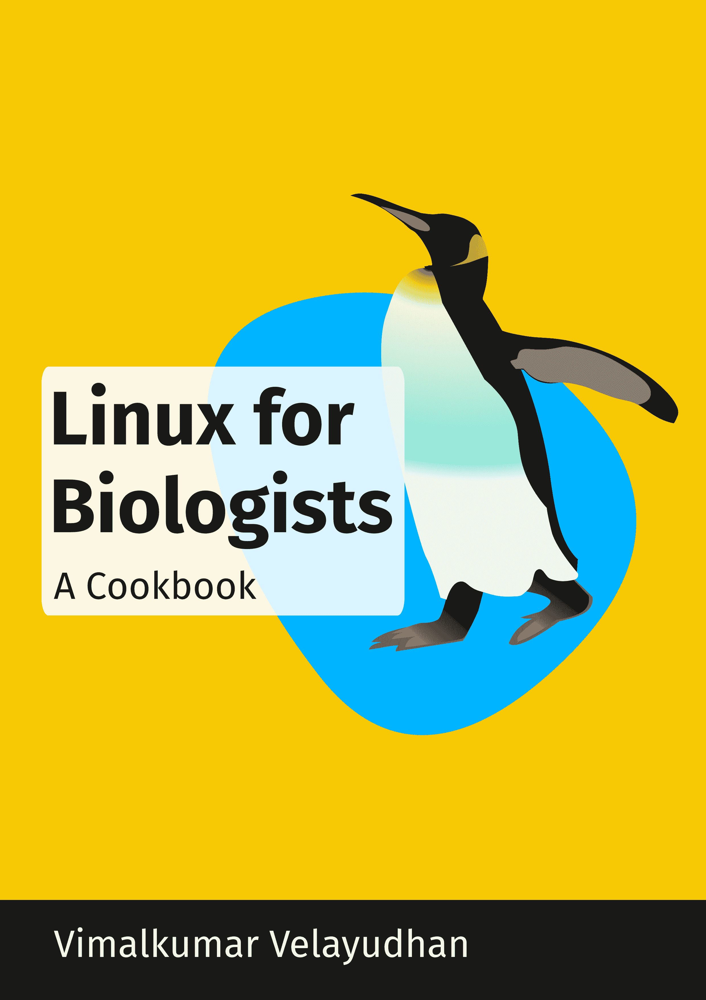


## 2.1. Linux — 概述

Linux 是 Linus Torvalds 在 1991 年开发的操作系统。它以开源许可发布，源代码供所有人免费获取。

- 2.1.1. Linux 发行版
- 2.1.2. 桌面环境
- 2.1.3. 运行 Linux 桌面的方法

### 2.1.1. Linux 发行版

一个 Linux 发行版包含了 Linux 操作系统以及额外的软件。

示例：[Debian](https://www.debian.org/) [`https://www.debian.org/`]、[Ubuntu](https://ubuntu.com/) [`https://ubuntu.com/`]、[Linux Mint](https://linuxmint.com/) [`https://linuxmint.com/`]、[Fedora](https://getfedora.org/) [`https://getfedora.org/`]、[openSUSE](https://www.opensuse.org/) [`https://www.opensuse.org/`] 等。

### 2.1.2. 桌面环境

桌面环境是一种图形用户界面（[`#glossary.xhtml_term-GUI`](#glossary.xhtml_term-GUI)），提供了对文件和应用程序的便捷访问。

示例：

- GNOME（图 2）
- KDE Plasma（图 3）
- Xfce（图 4）
- MATE（图 5）
- Cinnamon（图 6）

Linux 发行版可能会根据所使用的桌面环境提供额外的变体下载。

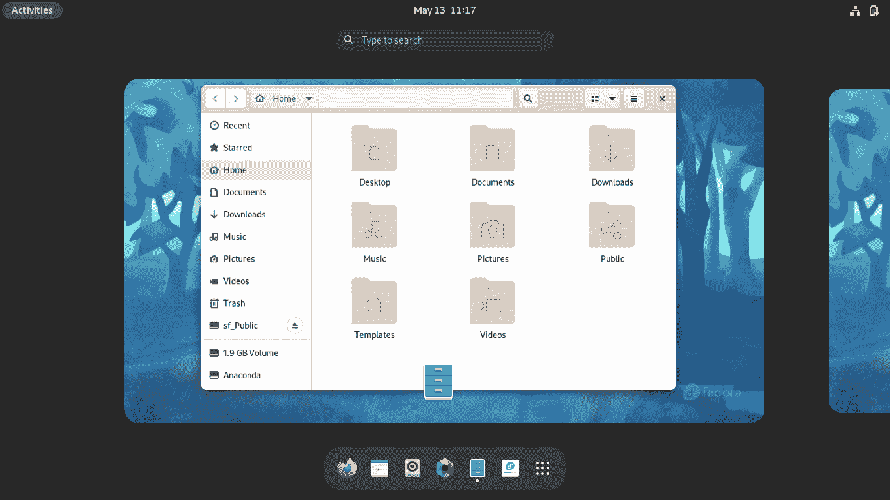

图 2 GNOME

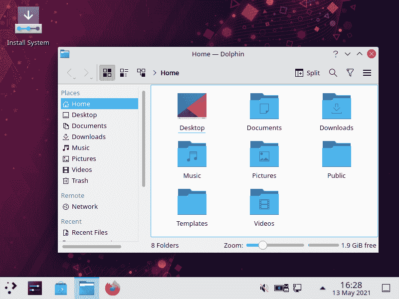

图 3 KDE Plasma

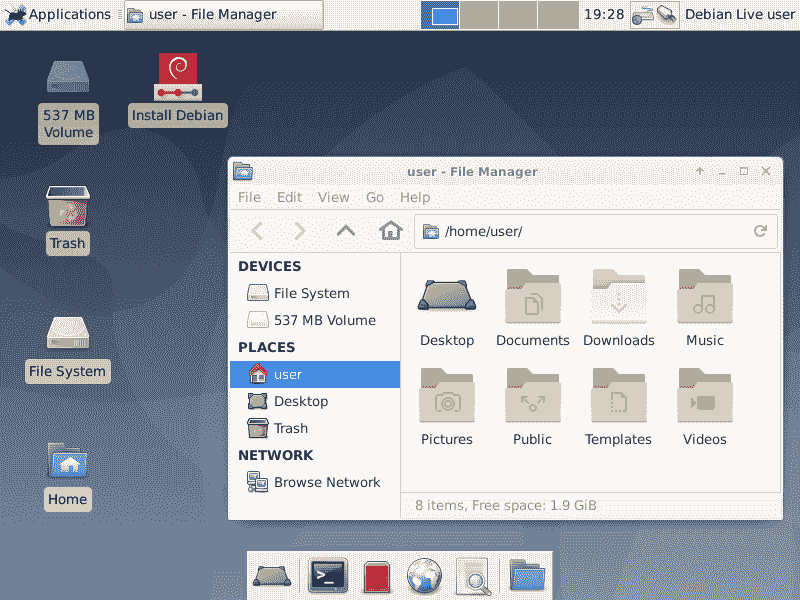

图 4 Xfce

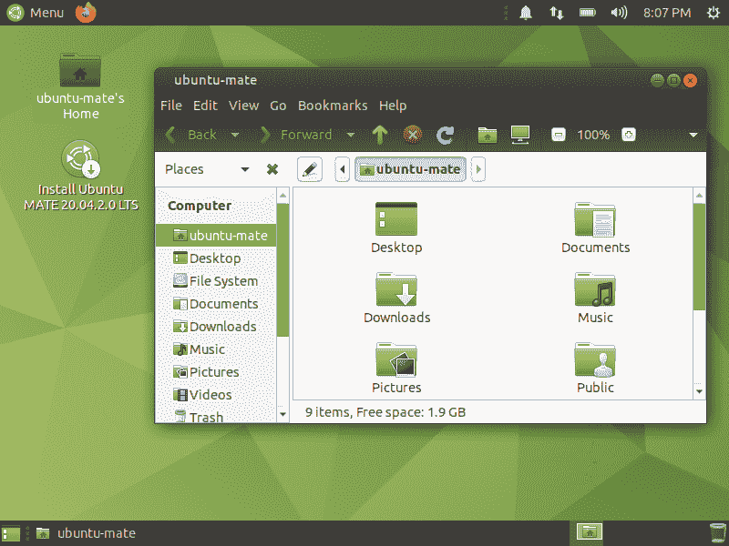

图 5 MATE

#### 本书使用 Linux Mint（Cinnamon）

本书将使用 Linux Mint 20.1 以及 Cinnamon 桌面环境作为参考发行版（图 6）。

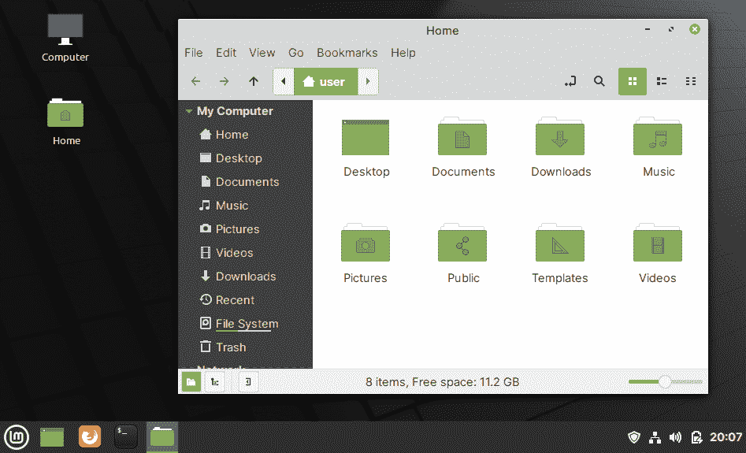

图 6 Cinnamon 桌面环境

所有包含的内容均在此发行版上测试过。

### 2.1.3. 运行 Linux 桌面的方法

要在你的电脑上运行 Linux 桌面，你可以：

1. 安装 Linux 发行版（[`#distribution.xhtml_linux-distribution`](#distribution.xhtml_linux-distribution)）；或
2. 运行虚拟机。

本书将采用第二种方法，这对新用户更容易。

> **注意**
>
> 还有其他可能性，但上述方法是最常见的。

## 2.2. 运行 Linux 虚拟机

要在你的电脑（主机）上运行其他系统的虚拟机（客户），你首先需要安装虚拟机程序——即运行虚拟机的软件。

虚拟机程序示例包括 VirtualBox、Parallels、VMware Workstation 等，本书将使用 VirtualBox（图 7）。

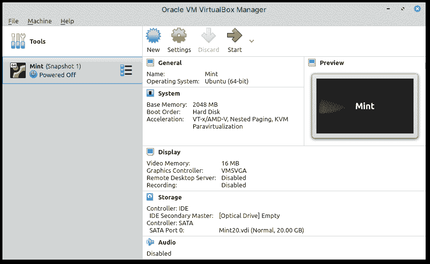

图 7 VirtualBox 主窗口

- 2.2.1. 要求
- 2.2.2. 导入虚拟机镜像
- 2.2.3. 启动虚拟机
- 2.2.4. 停止虚拟机

### 2.2.1. 要求

#### 在你的电脑上已安装 VirtualBox

你可以根据你的操作系统按照以下说明安装 VirtualBox。

> **注意**
>
> 安装软件需要管理员权限。

#### macOS 和 Windows 说明

你可以从 VirtualBox 网站的[下载](https://www.virtualbox.org/wiki/Downloads)（[`https://www.virtualbox.org/wiki/Downloads`](https://www.virtualbox.org/wiki/Downloads)）部分下载 macOS 或 Windows 的安装程序（图 8）。

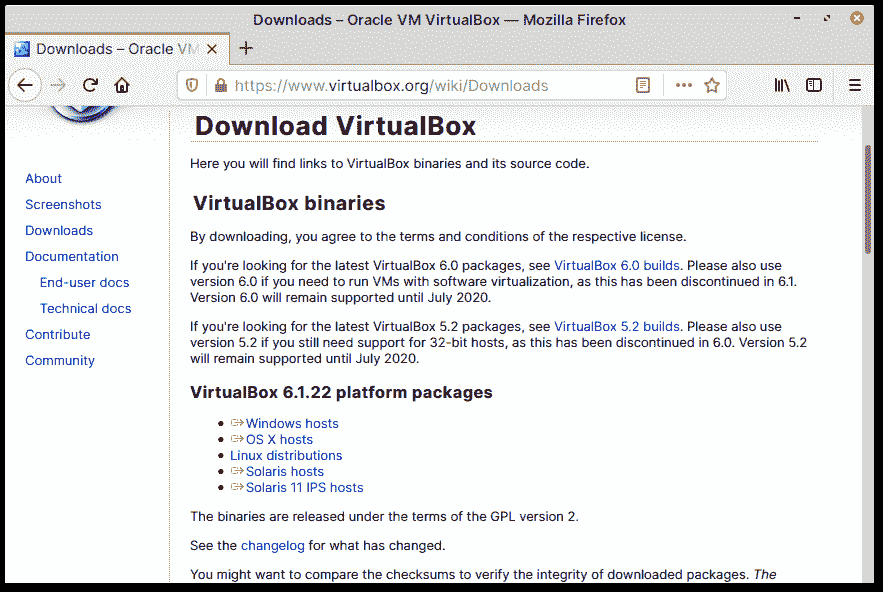

图 8 VirtualBox 下载页面

#### Linux 发行版说明

大多数 Linux 发行版的软件包仓库都包含了 VirtualBox。建议你使用你的包管理器如 Synaptic 或 `apt`、`dnf` 等进行安装。

例如，要在 Ubuntu 20.04 LTS 上让 VirtualBox 工作，你需要安装 `virtualbox` 和 `virtualbox-guest-additions-iso` 软件包。

> **注意**
>
> 如果你无法从仓库安装，可以从项目网站的 [Linux 下载](https://www.virtualbox.org/wiki/Linux_Downloads)（[`https://www.virtualbox.org/wiki/Linux_Downloads`](https://www.virtualbox.org/wiki/Linux_Downloads)）部分下载安装程序。

#### Linux Mint 虚拟机镜像

你可以从本书的网站下载一个现即可用的 Linux Mint 20.1 虚拟机镜像：

[`vimalkvn.com/linuxforbiologists`](https://vimalkvn.com/linuxforbiologists)

它以 OVA 格式发行。

点击下载链接并将 `linuxmint-20.1.ova` 文件保存到你的计算机上。

### 2.2.2. 导入虚拟机镜像

在电脑上打开 VirtualBox，然后按照以下步骤导入下载的虚拟机镜像。

#### 步骤 1 — 选择 OVA 文件

在 VirtualBox 主窗口中，选择：

文件（File）‣ 导入性设备（Import Appliance）（图 9）。

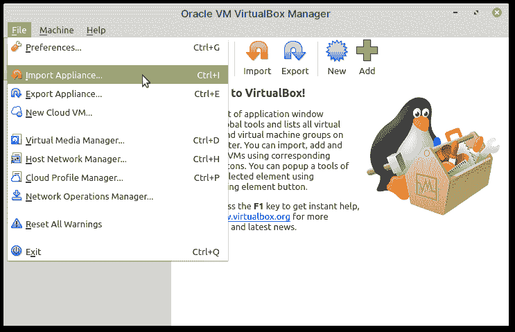

图 9 从菜单中选择 文件 -> 导入性设备

在“要导入设备”屏幕上，点击文件（File）输入字段旁出现的按钮（图 10）。

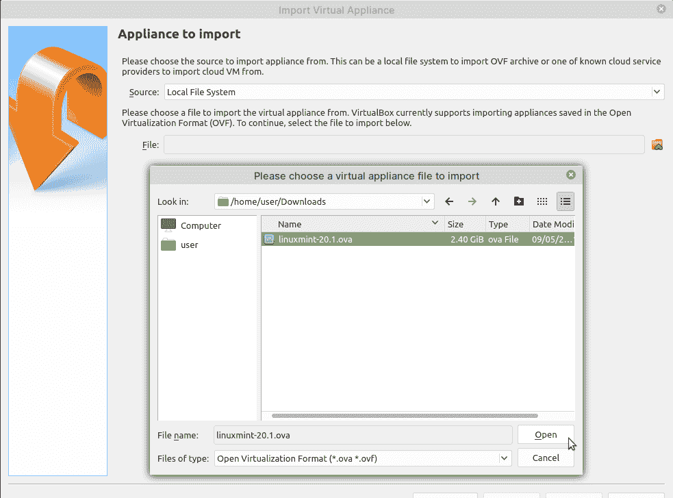

图 10 点击文件输入字段旁出现的按钮

浏览到 `linuxmint-20.1.ova` 文件的位置，选择它，然后点击 `Open`（打开）按钮。

文件（File）输入字段现在显示所选文件的完整路径（图 11）。

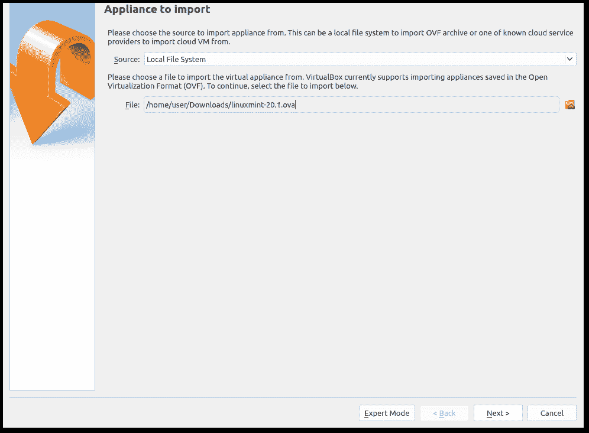

图 11 点击下一步（Next）按钮继续

点击 `Next` 按钮继续。

#### 步骤 2 — 调整设备设置（可选）

在下一个屏幕上——设备设置（图 12），你可以修改此虚拟机的配置。

> **注意**
>
> 此步骤是可选的。

你可以点击底部的 `Import`（导入）按钮继续到下一步。

例如，你可以根据计算机的配置为此虚拟机添加更多 CPU 或 RAM。

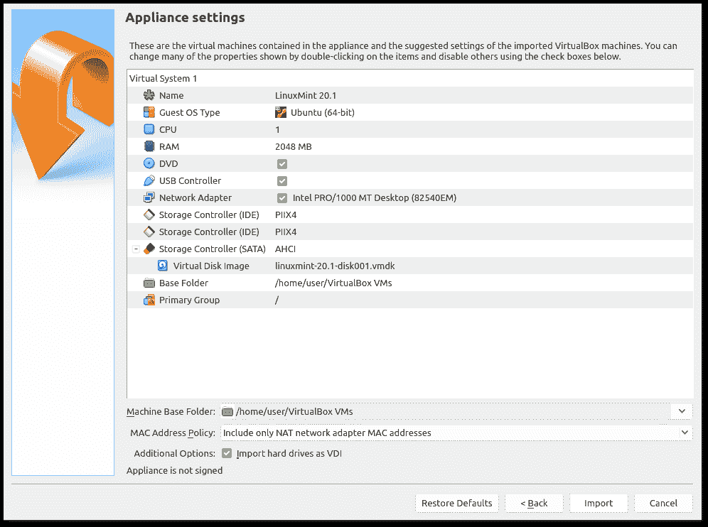

图 12 设备设置屏幕

点击 `Import` 按钮继续。

#### 步骤 3 — 导入进度与完成

在此阶段，你会看到一个进度条（图 13）。

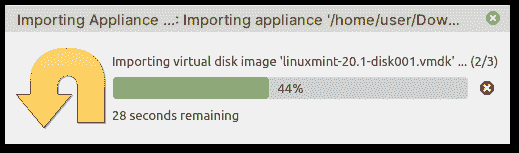

图 13 虚拟机导入进度

当导入完成后，你将回到 VirtualBox 的主窗口。

导入的虚拟机——LinuxMint 20.1 将出现在左侧的面板中（图 14）。

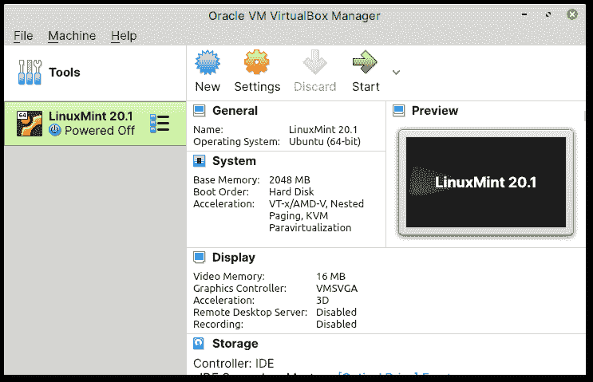

图 14 已导入的虚拟机

### 2.2.3. 启动虚拟机

要启动虚拟机，选择 LinuxMint 20.1，然后点击主工具栏中的 `Start`（启动）按钮（图 15）。

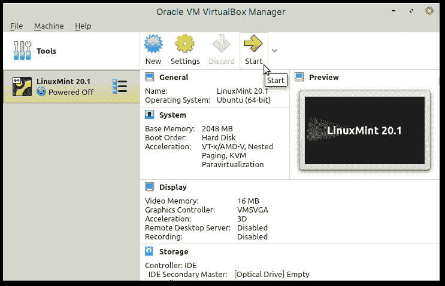

图 15 启动虚拟机

一旦启动过程完成，你将直接登录桌面（图 16）。

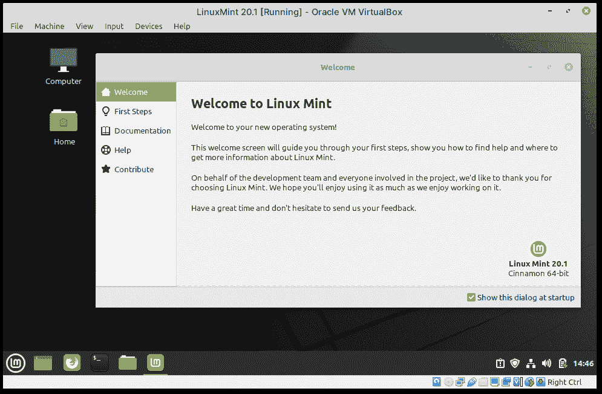

图 16 Linux Mint 桌面

供参考，默认用户名为 `user`，密码也是 `user`。

### 2.2.4. 停止虚拟机

当工作完成后，你可以通过点击应用程序菜单中的 `Quit`（退出）来关闭虚拟机。这将显示一个确认对话框（图 17）。


图 17 确认对话框

点击 `Shutdown`（关）按钮停止虚拟机。

## 2.3. Linux Mint 桌面

### 2.3.1. 桌面

一旦启动 Linux Mint，你将直接登录桌面。供参考，默认用户名为 `user`，密码也是 `user`。

Cinnamon 桌面包含以下内容：

- **应用程序菜单（Applications Menu）**：搜索并启动应用程序。
- **面板（Panel）**：固定的应用程序。
- **系统托盘（System Tray）**：包含网络、声音、电源等小组件。
- **日历（Calendar）**：提供日期和时间。


图 18 桌面组件

### 2.3.2. 修改设置

可以使用“设置”（Settings）应用程序来配置辅助功能、用户账户、日期和时间、键盘布局、语言、网络等（图 19）。


图 19 设置应用程序

#### 更改键盘布局

默认键盘布局是 US（美国）。你可以在硬件（Hardware）‣ 布局（Layouts）下进行更改。

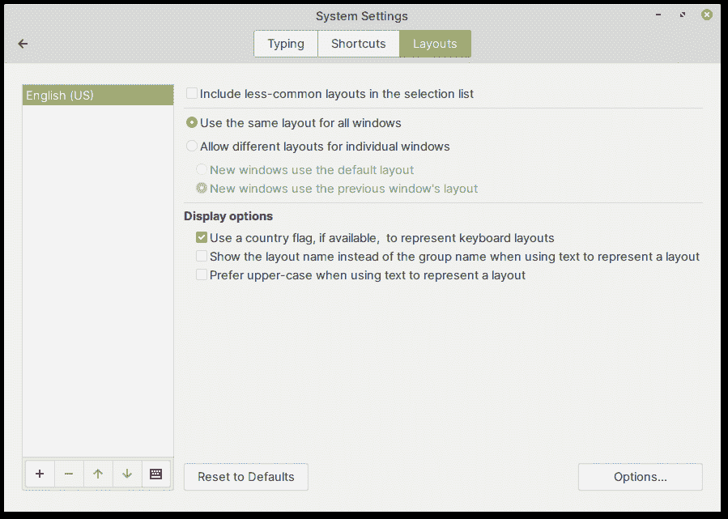

图 20 键盘布局

#### 更改日期和时间

可以通过选择偏好（Preferences）‣ 日期和时间（Date and Time）来更新系统日期时间。

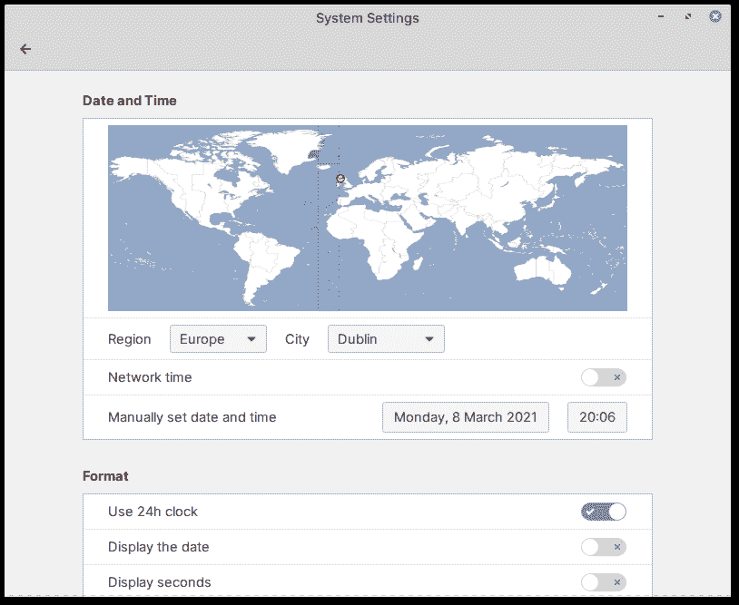

图 21 日期时间设置

## 2.4. 可用软件

这是 Linux Mint 20.1 包含的应用程序的简要概述。你可以从应用程序菜单（图 22）启动它们。你可以使用搜索栏搜索已安装的应用程序。

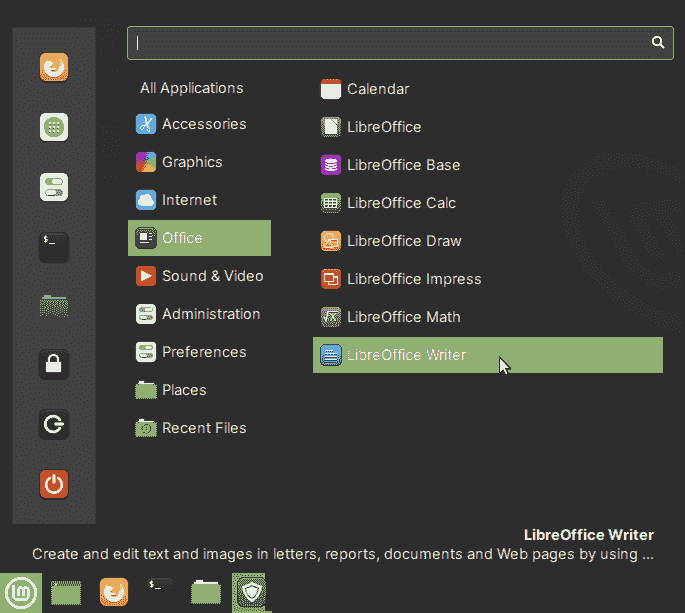

图 22 启动应用程序

> **注意**
>
> 某些应用程序未包含在默认安装中。包括 GNU Image Manipulation 和 Inkscape。你可以使用软件管理器（Software Manager）安装它们。

- 文件（Files）：管理文件和目录。
- Firefox：浏览网页。
- 编辑器（Text Editor）：创建和编辑文本文件。
- LibreOffice：编辑文档和表格。
- 终端（Terminal）：访问命令行。
- 截图（Screenshot）：截取桌面或窗口。
- 软件管理器（Software Manager）：从仓库安装软件。
- GNU Image Manipulation：编辑图像。
- Inkscape：创建矢量图形。
- 笔记。

### 2.4.1. 文件 — 管理文件和目录

Files 是 Linux Mint 默认的文件管理器（图 23）。

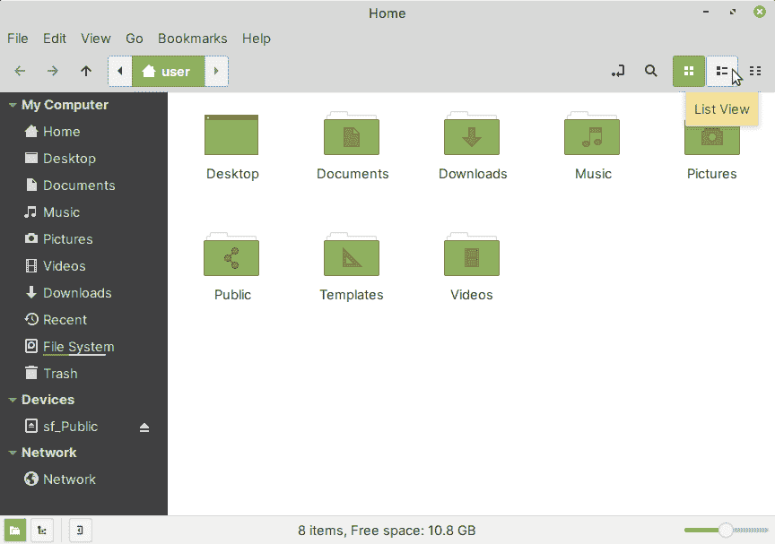

图 23 文件主窗口

#### 使用文件

你可以从应用程序菜单或通过点击面板上的图标启动文件。

以下是一些关于使用文件的一些技巧。

#### 切换图标视图和列表视图

你可以使用工具栏上的图标快速切换图标视图和列表视图。

#### 切换侧边栏

你可以使用状态栏上的图标打开或隐藏侧边栏视图。

#### 打开额外的面板

你可以通过以下操作打开额外的面板：

视图（View）‣ 额外面板（Extra Pane）

当你在本地目录之间复制文件或连接到远程系统时，这特别有用。

当您浏览目录时，如果经常访问它，可以将其收藏。此功能可以通过以下路径访问：

书签 ‣ 添加书签（Bookmark ‣ Add Bookmark）

#### 连接服务器

可以使用 FTP、SSH、Samba 和 Webdav 连接到外部服务器。此选项可以通过以下路径访问：

文件 ‣ 连接服务器（File ‣ Connect to Server）

要了解更多关于此功能，请阅读本书中的章节：系统间传输文件。

### 2.4.2. Firefox — 浏览网页

Firefox 是默认的网络浏览器（图 24）。


图 24 Firefox 网页浏览器

可以使用软件管理器安装其他网络浏览器。

### 2.4.3. 文本编辑器 — 创建和编辑文本文件

文本编辑器可处理 `.txt`、`.md` 和 `.fasta` 等纯文本格式的文件，或编辑如 `.bashrc` 等配置文件（图 25）。

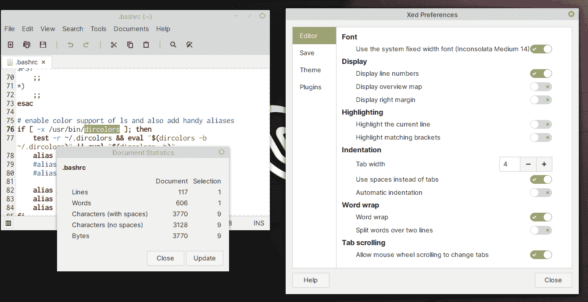

图 25 打开了文档统计和首选项窗口的文本编辑器

通过编辑 ‣ 首选项（Edit ‣ Preferences），您可以自定义设置，如所使用的字体、行号显示、缩进、自动换行等。

工具 ‣ 文档统计（Tools ‣ Document Statistics）功能用于统计文档中的单词数和字符数。

#### 在文本编辑器中打开隐藏文件

要在文本编辑器中打开隐藏文件：

1. 使用文件 ‣ 打开（File ‣ Open）选择文件。
2. 在出现的“打开文件”对话框中，在中间面板点击右键，并选择显示隐藏文件（Show Hidden Files）（图 26）。

   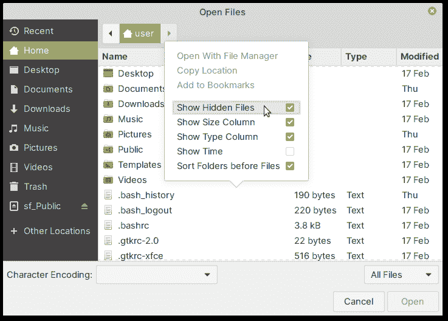

   图 26 在文本编辑器中打开隐藏文件

   您也可以使用快捷键 `Ctrl+h`。

### 2.4.4. LibreOffice — 编辑文档和电子表格

LibreOffice Writer 和 LibreOffice Calc 分别用于创建和编辑文档和电子表格（图 27）。

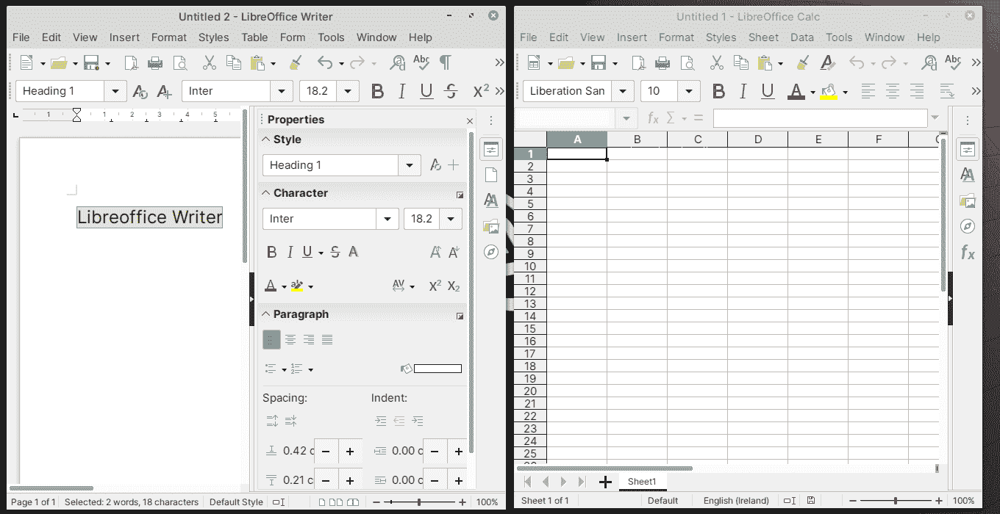

图 27 LibreOffice Writer 和 Calc 程序

Writer 和 Calc 使用的默认文件格式分别为 ODF 文档（`.odt`）和 ODF 电子表格（`.ods`）。

这些应用程序还支持读取和写入 Microsoft Office 格式的文件，如 `.docx` 或 `.doc`（Word）以及 `.xlsx` 或 `.xls`（Excel）。

LibreOffice 套件中还有其他应用程序，具有创建和编辑幻灯片或演示、科学公式、图表以及基于文件的数据库的功能。

### 2.4.5. 终端 — 访问命令行

终端应用程序（图 28）提供了操作命令行界面的能力。Linux Mint 用户的默认登录 shell 是 Bash。

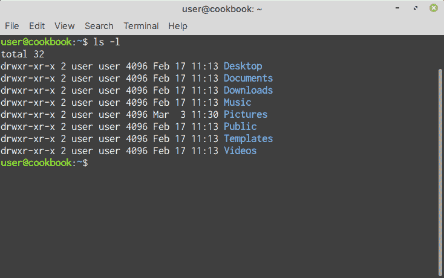

图 28 终端

通过选择编辑 ‣ 首选项菜单项（Edit ‣ Preferences），您可以自定义终端的外观和功能（图 29）。

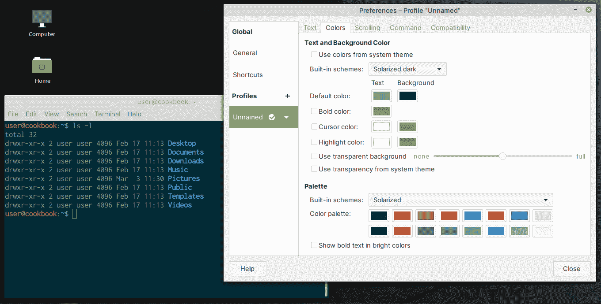

图 29 在首选项中更改终端配色方案

### 2.4.6. 截图 — 截取桌面或窗口

截图程序用于对整个屏幕、应用程序窗口或屏幕选定区域进行截图（图 30）。

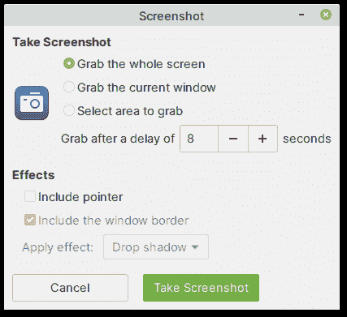

图 30 截图程序

### 2.4.7. 软件管理器 — 从存储库安装软件

软件管理器可从 Linux Mint、Ubuntu、Debian 和 Flathub 存储库安装软件（图 31）。

有关使用软件管理器安装软件的步骤，请参阅快速简便的方法。

图 31 软件管理器

### 2.4.8. GNU 图像处理程序 — 编辑图像

GIMP 程序可编辑 JPG、PNG、TIFF、BMP 等各种格式的图像（图 32）。

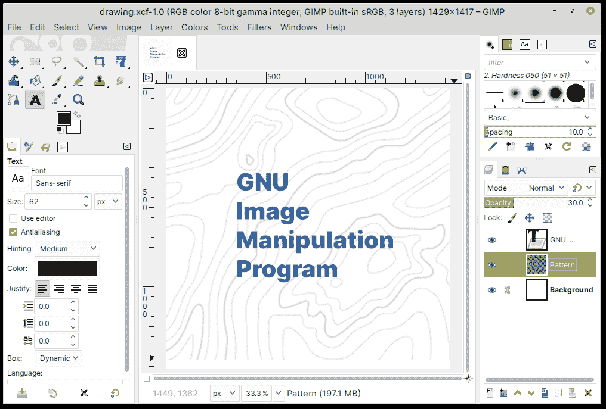

图 32 在 GIMP 中编辑图像


# 2.4.9. Inkscape — 创建矢量图形

Inkscape 可用于创建和编辑可缩放矢量 (SVG) 格式的图像（图 33）。

!\[../../_images/inkscape.png\](img/inkscape.png)

图 33 在 Inkscape 中创建矢量图形

# 2.4.10. 笔记

#### 将应用程序添加到收藏

如果您经常使用某个应用程序，可以考虑将其添加到收藏。此列表位于应用程序菜单的左侧。

要将应用程序设为收藏，在应用程序上点击右键。

收藏一个应用程序，在应用程序菜单中点击右键。

如果您经常使用某个应用程序，可以考虑将其添加到收藏。此列表位于应用程序菜单的左侧。

要将应用程序设为收藏，在应用程序上点击右键。选择。

#### 设置默认应用程序

如果您想为某些类别或文件类型设置默认应用程序，可以通过以下路径设置：

系统设置 ‣ 首选项 (`Settings` ‣ `Preferences`)

# 2.5. 文件和目录

本节介绍了主目录、文件、目录及其功能如何在系统间传输。

* 2.5.1. 你的主目录
* 2.5.2. 隐藏文件和目录
* 2.5.3. 主目录中的重要文件
* 2.5.4. 文件名大小敏感
* 2.5.5. 访问根文件系统
* 2.5.6. 系统间传输

# 2.5.1. 你的主目录

当您登录桌面并打开文件时，它将显示您的主目录（图 34）。

默认存在目录：`桌面`、`文档`、`下载`、`音乐`、`图片`、`公共`、`模板`和`视频`。

!\[../../_images/home-directory.png\](img/home-directory.png)

图 34 主目录

#### 注意

#### `/home/user`

主目录的完整（绝对）路径格式为`/home/user`，其中`user`是您的用户名。

#### `$HOME`

`HOME`环境变量会自动设置为主目录的完整路径。因此，在命令或脚本中可以将`/home/user`替换为`$HOME`。

# 2.5.2. 隐藏文件和目录

除了之前提到的目录外，主目录下还有隐藏文件和目录（图 35）。它们的文件以点（`.`）开头。

!\[../../_images/hidden-directories.png\](img/hidden-directories.png)

图 35 主目录中的隐藏文件和目录

您可以通过文件管理器中的以下菜单项查看（或隐藏）这些文件：

`查看` ‣ `显示隐藏文件` (`View` ‣ `Show Hidden Files`)

或者，您也可以使用快捷键`Ctrl+h`。

# 2.5.3. 主目录中的重要文件

#### `.bashrc`

这是 Bash（用户账户默认 shell）使用的配置文件。当您需要设置或修改环境变量如`PATH`时，通常会使用此文件。

#### `.bash_aliases`

可以使用`.bash_aliases`文件为命令设置别名。

例如，这里有一个常用的别名：

```bash
alias l='ls -l'
```

这意味着当在命令行输入`l`时，bash shell 将执行`ls -l`，从而输出文件的详细列表，而不是默认输出。

# 2.5.4. 文件和目录名称区分大小写

你需要记住的一点是，Linux 中的文件名和目录名是区分大小写的。

例如，一个名为：

```
sequence.txt
```

的文件与以下文件不同：

```
Sequence.txt
```

同样，`Documents`和`documents`是两个不同的目录。

上述这些文件或目录可以存在同一个目录中，并且拥有不同的内容。

# 2.5.5. 访问根文件系统

要访问根文件系统 (`/`)，请点击文件管理器侧边栏中的“文件系统”（图 36）。

!\[../../_images/file-system.png\](img/file-system.png)

图 36 点击“文件系统”项以访问根文件系统

#### `/` 下的目录及其功能

`/etc` — 存储应用程序的配置文件

`/home` — 包含用户的家目录

`/media` — 外部磁盘等设备的挂载（即可用）位置

`/root` — `root`用户（管理员）的家目录

`/tmp` — 应用程序创建的临时文件

`/usr` — 应用程序、库及其数据和文档安装在此

`/var` — 日志文件、应用程序缓存、数据库等的存储空间

#### 根文件系统和 root 家目录是不同的

#### `/` 是根文件系统

只要具有相应的权限，系统上的所有用户都可以访问这里的文件和目录。

#### `/root` 是 root 的家目录

只有 root 可以访问它。

# 2.5.6. 在系统之间传输文件

“文件”的一个有用功能是可以使用 SSH、FTP、SMB 和 Webdav 等协议连接远程系统。一旦连接，你就可以将文件从 Linux 桌面传输到远程系统或反之。

要连接到远程系统，请使用“文件”中的以下菜单项（图 37）：

`文件` ‣ `连接到服务器`

!\[../../_images/files-connect.png\](img/files-connect.png)

图 37 “文件”中的“连接到服务器”选项

#### 连接到 SSH 服务器

打开`文件` ‣ `连接到服务器`并按照下面的步骤操作（图 38）：

1. 在对应“服务器”字段中，输入要连接的服务器的域名或 IP 地址
2. 端口`22`是 SSH 的默认端口，因此通常不需要更改它
3. 从“类型”下拉框中选择 SSH
4. 在“文件夹”下，你可以指定一个连接成功后要打开的目录（可选）
5. 输入你在服务器上的账户用户名和密码
6. 点击“连接”按钮

!\[../../_images/files-connect-ssh.png\](img/files-connect-ssh.png)

图 38 连接到 SSH 服务器

一旦在“文件”中打开了远程目录，你就可以从桌面开始传输文件，或反之。

# 3. 在 Linux 上获取软件

在本节中，我将讨论如何在 Linux 桌面上获取软件。

对于任何想要安装的软件，你可以从快速且方便的方法开始。它将安装 Linux 发行版仓库中提供的软件。

如果你感兴趣的软件不可用，或者你需要不同的版本，可以考虑使用其他方法。

* 3.1. 快速且方便的方法
  * 3.1.1. 要求
  * 3.1.2. 查找并安装软件
  * 3.1.3. 已安装的软件
  * 3.1.4. 更新已安装的软件
  * 3.1.5. 注意事项
* 3.2. Python 包
  * 3.2.1. 要求
  * 3.2.2. 在 PyPI 上搜索包
  * 3.2.3. 安装 Python 包
  * 3.2.4. 更新已安装的包
  * 3.2.5. 删除已安装的包
  * 3.2.6. 使用已安装的包
  * 3.2.7. Python 虚拟环境
  * 3.2.8. 注意事项
* 3.3. Perl 模块
  * 3.3.1. 要求
  * 3.3.2. 配置 local-lib 模块
  * 3.3.3. 在 CPAN 上搜索模块
  * 3.3.4. 安装 Perl 模块

图 39 点击应用程序菜单中的“软件管理器”

启动后，你将看到它的主窗口（图 40）。

!\[../../_images/2-software-manager.png\](img/2-software-manager.png)

图 40 软件管理器主窗口

在搜索栏中，输入`pymol`。

稍后，存储库中匹配搜索词（即`pymol`）的软件包将显示在下方（图 41）。

!\[../../_images/3-search-for-pymol.png\](img/3-search-for-pymol.png)

图 41 pymol 的搜索结果

点击第一个结果 — Pymol。你将被跳转到软件包描述页。

#### 注意

为什么不选择`Python3-pymol`？

第二个结果`Python3-pymol`的描述表明它包含了用于与 PyMOL 操作的 Python 3 `modules`，这并不是我们要找的内容。

如果你不确定，可以在下一页阅读软件包的完整描述，并确认这是否是你想要安装的软件包。

在软件包描述页上，点击`Install`按钮（图 42）。

!\[../../_images/4-pymol-install-button.png\](img/4-pymol-install-button.png)

图 42 点击 Install 按钮安装此软件包

现在会弹出一个对话窗口，提示你输入`your password`。

输入你的密码并点击`Authenticate`按钮（图 43）。

!\[../../_images/5-install-authentication.png\](img/5-install-authentication.png)

图 43 输入密码并点击 Authenticate 按钮

现在现在开始进行。

当安装完成后，你会发现`Install`按钮变成了两个按钮：`Launch`和`Remove`（图 44）。

!\[../../_images/6-pymol-launch-button.png\](img/6-pymol-launch-button.png)

图 44 安装完成。注意 Launch 和 Remove 按钮

点击`Launch`按钮。这将打开 PyMOL 程序（图 45）。

!\[../../_images/7-pymol-window.png\](img/7-pymol-window.png)

图 45 PyMOL 主窗口

或者，你可以在应用程序菜单中搜索该应用程序并从那里启动。

#### 注意

对于没有图形用户界面的应用程序，将不会`Launch`按钮。

如果程序包含任何命令，你可以在 terminal 会话中访问它们。

### 3.1.3 移除已安装的软件

你可以按照以下步骤移除从存储库安装的软件。

打开软件管理器。

点击主应用程序窗口中的设置按钮，然后选择`Show installed applications`（图 46）。

!\[../../_images/8-show-installed-applications.png\](img/8-show-installed-applications.png)

图 46 在软件管理器设置中，选择显示已安装应用程序

或者，你可以在搜索栏中输入软件名称然后按`ENTER`键。

在“已安装应用程序”列表中，点击你想要移除的软件包 — 本例中为 Pymol（图 47）。

!\[../../_images/9-select-pymol-for-removal.png\](img/9-select-pymol-for-removal.png)

图 47 点击你想要移除的软件包

你将被跳转到软件包描述页。

点击`Remove`按钮以移除（或卸载）软件包（图 48）。

!\[../../_images/10-click-remove-button.png\](img/10-click-remove-button.png)

图 48 点击 Remove 按钮移除软件包

系统将提示你输入密码。

输入`your password`然后点击`Authenticate`按钮继续（图 49）。

!\[../../_images/11-remove-authentication.png\](img/11-remove-authentication.png)

图 49 输入密码并点击 Authenticate 按钮

软件现在将从系统中移除（或卸载）。

### 3.1.4 更新已安装的软件

当你的系统中安装的软件有可用更新时，你将在系统托中看到通知（图 50）。

!\[../../_images/12-updates-system-tray.png\](img/12-updates-system-tray.png)

图 50 系统托盘中的软件更新通知

要应用软件更新：

点击系统托中的通知图标。这将打开更新管理器程序。

要安装所有可用的软件更新，点击工具栏上的`Install Updates`按钮（图 51）。

!\[../../_images/13-update-manager.png\](img/13-update-manager.png)

图 51 点击 Install Updates 按钮应用所有可用更新

系统将提示你输入密码（图 52）。

输入`your password`并点击`Authenticate`按钮。

!\[../../_images/14-update-authentication.png\](img/14-update-authentication.png)

图 52 输入密码并点击 Authenticate 按钮

更新管理器现在将继续安装更新（图 53）。

!\[../../_images/15-applying-updates.png\](img/15-applying-updates.png)

图 53 更新管理器正在安装软件更新

当更新完成后，你将看到一条消息 — 系统是最新的（图 54）。

!\[../../_images/16-update-complete.png\](img/16-update-complete.png)

图 54 更新成功

#### 额外的软件仓库

软件的新版本发布到发行版仓库通常需要一段时间时间。

如果您感兴趣的软件不可用，或者您需要更新版本的软件，可以尝试从这些额外源进行安装：

* 来自 PyPI 的 Python 软件包
* 来自 CPAN 的 Perl 模块
* 来自 CRAN 或 Bioconductor 的 R 软件包
* 来自 Anaconda Cloud 的 Conda 软件包

#### 注意事项

使用这些方法安装的软件也需要手动保持更新。

# 3.2. Python 软件包

如果您感兴趣的软件在 PyPI 上作为 Python 软件包可用，您可以使用 `pip` —— Python 软件包安装器来安装它。

#### 注意

您的软件可能已经通过快速简单的方法可用。请搜索以`python-`开头的包名。

在某些情况下，在虚拟环境中安装软件包可能是更好的选择。请阅读：

`->` 我什么时候应该使用虚拟环境？

* 3.2.1. 依赖
* 3.2.2. 在 PyPI 上搜索软件包
* 3.2.3. 安装 Python 软件包
* 3.2.4. 更新已安装的软件包
* 3.2.5. 移除已安装的软件包
* 3.2.6. 使用已安装的软件包
* 3.2.7. Python 虚拟环境
* 3.2.8. 注意事项

# 3.2.1. 依赖

#### Python 软件包安装器 (`pip`)

要安装 `pip`，请参考快速简单的方法安装软件。

搜索并安装`python3-pip`软件包。

#### 将 `$HOME/.local/bin` 添加到 `$PATH`

包含命令的软件包会将它们安装在`$HOME/.local/bin`目录（什么是 `$HOME`?）。

为了能够方便地运行这些命令，您需要将此目录添加到您的`$PATH`变量中。您可以按照将目录添加到 PATH 中的步骤进行操作。

#### 注意事项

* 您不应在下面的命令中添加`sudo`。

此方法仅在您的主目录中安装文件，因此不需要管理员权限。

# 3.2.2. 在 PyPI 上搜索软件包

在网页浏览器中打开 [PyPI 网站](https://pypi.org) [https://pypi.org]。

在“Search projects”（搜索项目）字段中，输入您想要安装的软件名称并按回车键或点击搜索按钮（图 55）。

!\[../../_images/pypi-search.png\](img/pypi-search.png)

图 55 在 PyPI 上搜索软件包

将显示匹配搜索词的软件包列表（图 56）。

!\[../../_images/pypi-search-result.png\](img/pypi-search-result.png)

图 56 biopython 的搜索结果。1.78 是版本号。

点击结果进入项目描述页。

在项目描述页上，在`pip`安装命令中找到包名（图 57）。

在此例中，它是`biopython`。

!\[../../_images/pypi-biopython-page.png\](img/pypi-biopython-page.png)

图 57 Biopython 的项目描述页

#### 注意

在下述步骤中，您需要使用`pip3`而不是`pip`命令。为什么？

您现在可以继续安装软件包了。

# 3.2.3. 安装 Python 软件包

打开终端。

使用`pip3 install`命令配合您想要安装的包名。

以 biopython 为例：

```
pip3 install biopython
```

输出：

```
Collecting biopython
  Downloading biopython-1.78-cp38-cp38-manylinux1_x86_64.whl (2.3 MB)
     |********************************| 2.3 MB 2.1 MB/s
Collecting numpy
  Downloading numpy-1.20.1-cp38-cp38-manylinux2010_x86_64.whl (15.4 MB)
     |********************************| 15.4 MB 90 kB/s
Installing collected packages: numpy, biopython
Successfully installed biopython-1.78 numpy-1.20.1
```

#### 注意

此方法的一个局限性是，您无法安装软件包的多个版本。可以使用虚拟环境来解决这个问题。

# 3.2.4. 更新已安装的软件包


当您注意到软件包有更新可用时，可以使用 `install` 命令配合 `--U` 选项以及包名：

```
pip3 install -U biopython
```

## 3.2.5. 移除已安装的软件包

使用 `uninstall` 命令配合您想要移除的包名：

```
pip3 uninstall biopython
```

## 3.2.6. 使用已安装的软件包

### 文件安装在何处？

您可以使用 `pip3 show` 命令配合包名来识别其安装的路径：

```
pip3 show biopython
```

输出：

```
Name: biopython
Version: 1.78
Summary: Freely available tools for computational molecular biology.
Home-page: https://biopython.org/
Author: The Biopython Contributors
Author-email: biopython@biopython.org
License: UNKNOWN
Location: /home/user/.local/lib/python3.8/site-packages
Requires: numpy
Required-by:
```

### 使用软件包和模块

软件包和模块将安装在 `$HOME/.local/lib/python3.8/site-packages`。

注意

如果您有不同的 Python 版本，此值会发生变化。

该目录会被包含在 `PYTHONPATH` 中。因此，无需额外操作即可导入并使用已安装的软件包。

例如，这是一个使用 pip 安装的简单 Python 脚本：

```python
from Bio.Seq import Seq

seq = Seq('ATGC')
comp = seq.complement()

print(f'The complement of {seq} is {comp}')
```

将上面的代码示例保存为 `biopy_test.py`。然后从终端运行：

```
python3 biopy_test.py
```

输出：

```
The complement of ATGC is TACG
```

### 使用包含的命令

如果软件包包含命令，这些命令将安装在 `$HOME/.local/bin` 目录。为了方便使用这些命令，您需要将此目录添加到 `PATH` 中，正如依赖所示。

例如，当安装 `cutadapt` 的 Python 软件包时，`cutadapt` 命令将安装在 `$HOME/.local/bin`，您可以像这样从终端运行：

```
cutadapt --version
```

输出：

```
3.1
```

## 3.2.7. Python 虚拟环境

虚拟环境是一个包含 Python 和一些额外软件包的自包含目录树。

### 优势

这些是使用虚拟环境的优势。

#### 无需权限

创建虚拟环境或在环境中安装软件包不需要管理员权限。

#### 多个环境

可以创建多个虚拟环境，每个环境包含自己的包集。

它们是相互隔离的，在某个环境中安装、更新或删除软件包不会影响其他环境。

#### 分享您的环境

您可以与他人共享配置。他们将重现您的环境，包含完全软件包版本。

### 创建虚拟环境

首先，使用快速简单的方法搜索并安装 `python3-venv` 软件包。它包含了创建虚拟环境所需的 `venv` 模块。

你可以在任何具有写入权限的目录中创建虚拟环境，例如你的家目录。

为了演示，我将在我的家目录中创建一个名为 `py3env` 的虚拟环境。

```
python3 -m venv py3env
```

如果执行成功，你将在当前目录下找到一个名为 `py3env` 的目录。不会显示任何消息。

#### 注意事项

- `python3` 是运行 Python 3 解释器的命令。它的完整路径是 `/usr/bin/python3`。

- `venv` 是用于创建虚拟环境的 Python 模块。

- `-m` 选项将 `venv` 模块作为脚本运行。在使用虚拟环境之前，你需要先激活它。

### 激活虚拟环境

在开始使用虚拟环境之前，你需要先激活它。为此，请使用 `source` 命令并指向虚拟环境中 `activate` 脚本的路径。

例如，要激活在上一步创建的 `py3env`，请使用：

```
source py3env/bin/activate
```

你的 shell 提示符现在会发生变化，以指示虚拟环境已处于激活状态。注意提示符开头的 `(py3env)` 标签：

```
(py3env) user@cookbook:~$
```

你现在可以开始使用这个虚拟环境了。

#### 注意事项

在开始安装软件包之前……

在一个新的虚拟环境中安装（或升级）Python 构建工具是一个好习惯——`pip`、`setuptools` 和 `wheel`。

这些构建工具对于从 PyPI 以及其他源构建和安装软件包是必要的。

安装它们将确保额外的软件包能够无错误地构建和安装。

#### 安装 Python 构建工具

使用 `pip3 install` 安装或升级所需的包：

```
pip3 install -U pip setuptools wheel
```

`pip3 install` 的 `-U` 选项会在可用新版本时升级列出的包。

输出：

```
Collecting pip
Downloading pip-21.0.1-py3-none-any.whl (1.5 MB)
...
Installing collected packages: pip, setuptools, wheel
...
Successfully installed pip-21.0.1 setuptools-54.2.0 wheel-0.36.2
```

#### 退出虚拟环境

要退出虚拟环境，请使用命令：

```
deactivate
```

你的 shell 提示符将恢复为原始外观：

```
user@cookbook:~$
```

### 3.2.8 注意

#### 你需要手动更新这些包

以这种方式安装的包也应该手动更新。

当你注意到某个包有更新时（例如通过项目网站或其源代码仓库），请按照更新已安装的包中的步骤安装最新版本。

#### 为什么用 `pip3` 而不是 `pip`？

`pip` 包包含以下命令：

- `pip3` — Python 3 版本

- `pip` — Python 2 版本（对 Python 2 的支持已于 2020 年 1 月结束。）

由于系统中可能同时存在这两个命令，因此在使用此方法安装包时，使用 `pip3` 更安全。

#### 如果用 Python 2 编写的程序怎么办？

对 Python 2 的支持已于 2020 年 1 月结束。如果你需要使用仅用 Python 2 编写的程序，可以创建一个隔离环境——使用 `venv` 或 `Conda`，然后安装该包。

相关章节：

- Python 虚拟环境

- Conda 软件包

#### 我什么时候应该使用虚拟环境？

如果你安装的程序需要来自 PyPI 的同一个包的两个版本，本文描述的方法将不起。在这种情况下，你可以考虑创建一个隔离环境——使用 `venv` 或 `Conda`，然后安装软件包。

相关章节：

- Python 虚拟环境

- Conda 软件包

#### `pip` 的旧版本

如果你系统中安装的 `pip` 版本低于 2.0，它默认将尝试将包安装到系统路径，导致权限拒绝错误。为了避免这种情况，你需要在 `install` 和 `uninstall` 命令中添加 `--user` 选项，例如：

```
pip3 install --user python
```

更好的方法是升级你本地的 `pip` 版本。升级后，你将不再需要 `--user`。升级 `pip` 请执行：

```
pip3 install --user -U pip
```

你可以使用以下命令检查已安装的 `pip` 版本：

```
pip3 -V
```

## 3.3 Perl 模块

对于 Perl 模块，你可以配置 `local-lib` 模块来并使用本地目录。默认位置是 `$HOME/perl5`。

如果你感兴趣的软件可以在 CPAN 上找到，可以使用 `cpanminus` 脚本轻松地安装。

你感兴趣的软件可以使用简单方法获取。搜索包含 `perl` 的包名。

- 3.3.1 要求
- 3.3.2 配置 `local-lib` 模块
- 3.3.3 在 CPAN 上搜索模块
- 3.3.4 安装模块
- 3.3.5 使用模块

### 3.3.1 要求

如果你没有安装这些包，请按照简单方法，搜索并安装以下包：

1. `build-essential` — 安装如 `make` 等构建工具
2. `cpanminus` — 用于从 CPAN 获取并安装模块的脚本

注意：此方法不需要 `sudo` 权限。

### 3.3.2 配置 `local-lib` 模块

要配置 `local-lib`：

使用文本编辑器打开 `$HOME/.bashrc` 文件。

在文件末尾添加以下内容：

```
#### Configuration for local-lib
eval "$(perl -Mlocal::lib)"
```

保存文件。这里有一个示例 `.bashrc` 供参考（见图 58）。

打开一个新的终端窗口。你会看到以下消息（见图 59）：

（尝试创建目录 `/home/user/perl5`）

配置已完成。你现在可以从 CPAN 和其他源安装模块了。

### 3.3.3 在 CPAN 上搜索模块

在浏览器中打开 MetaCPAN 网站（[`metacpan.org`](https://metacpan.org)）。

在搜索框中输入想要安装的模块名称，点击 `Search the CPAN` 按钮。我以 David H. Ardell 的 `FAST` 软件包作为示例（见图 60）。

这将显示匹配搜索词 `FAST` 的模块（见图 61）。

如果你点击相应的模块名称，你将进入描述页面，可以在那里了解更多关于该模块的信息（见图 62）。

在该页面上，你还可以验证下一步要使用的模块名称。

要执行此操作，请点击侧边栏 `TOOLS`（工具）菜单下的 `Install Instructions`（安装说明）。这将打开出一个窗口，显示您在用 `cpanm` 命令时所需的模块名称信息。

在这种情况下，要使用的模块名称简单称为 `FAST`（图 63）。

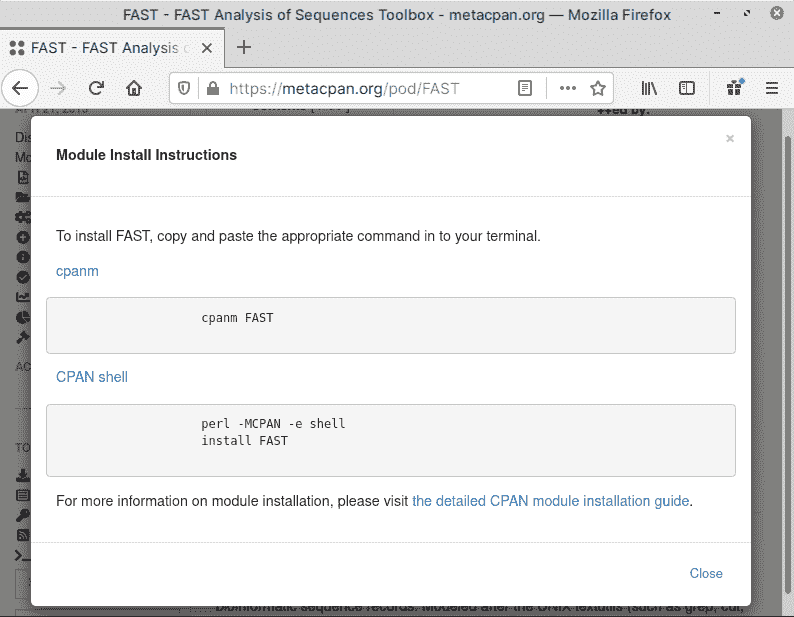

图 63 `FAST` 模块安装说明

现在，你可以继续安装此模块了。

## 3.3.4. 安装 Perl 模块

打开终端窗口。

使用 `cpanm` 命令安装模块：

```
cpanm FAST
```

这将安装该模块及其依赖项（如果有）。

输出：

```
--> Working on FAST
Fetching http://www.cpan.org/authors/id/D/DH/DHARD/FAST-1.06.tar.gz ... OK
Configuring FAST-1.06 ... OK
==> Found dependencies: Bit::Vector, Sort::MergeSort, Sort::Key
--> Working on Bit::Vector
Fetching http://www.cpan.org/authors/id/S/ST/STBEY/Bit-Vector-7.4.tar.gz ... OK
Configuring Bit-Vector-7.4 ... OK
...
Building and testing FAST-1.06 ... OK
Successfully installed FAST-1.06
6 distributions installed
```

## 3.3.5. 使用已安装的模块

### 使用内置命令

如果模块包含命令，这些命令将安装在 `$HOME/perl5/bin` 中。当你配置 `local-lib` 时，该目录将被包含在 `$PATH` 中。因此，安装后你可以立即开始使用模块包含的命令。

例如，这是上一步安装的 `FAST` 包中包含的 `fasuniq` 命令的帮助页面：

```
fasuniq -h
Usage:
    fasuniq [options] [MULTIFASTA-FILE]

    [MULTIFASTA-DATA-ON-STDIN] | fasuniq [options]
...
```

### 在脚本中使用模块

模块将安装在：

`$HOME/perl5/lib/perl5/5.30.0`。

注意

这是针对 Perl 5.30.0 的模块路径。

如果你的系统中安装了不同版本的 Perl，该路径会发生变化。

由于 `local-lib` 会自动发现这些模块，你可以立即在脚本中使用它们。

这里是一个使用 `Bio::Phylo` 包的示例。在使用 `cpanm Bio::Phylo` 安装模块后，使用文本编辑器创建一个文件并复制以下内容：

```
use Bio::Phylo;

#### 打印版本
print Bio::Phylo->VERSION;

#### 打印引用
print Bio::Phylo->CITATION;
```

将该文件保存为 `biophylo_test.pl` 然后运行它：

```
perl biophylo_test.pl
```

输出：

```
v2.0.1Rutger A Vos, Jason Caravas, Klaas Hartmann, Mark A Jensen and Chase Miller, 2011.
Bio::Phylo - phyloinformatic analysis using Perl. BMC Bioinformatics 12:63.
doi:10.1186/1471-2105-12-63
```

## 3.4. R 包

如果你感兴趣的软件作为 CRAN 或 Bioconductor 上的 R 包可用，你可以使用 `install.packages()` 或 `BiocManager::install()` 进行安装。

注意

这种方法只需简单方法。

搜索以 `r-` 或 `bioc-` 开头的包名。

### 3.4.1. Requirements

#### `r-base` 包已安装

`r-base` 包提供了 GNU R 统计计算和图形系统。

如果你没有安装，请按照简单方法安装 `r-base`。

注意

此方法将安装在你的用户目录中，因此不需要管理员权限。

### 3.4.2. 启动 R 会话

要启动 R 会话，请打开终端窗口。

输入 `R` 命令并按回车：

```
user@cookbook~$ R
```

你将进入 R 会话。

#### 2. 确认使用个人库

```
lib = '/usr/local/lib/site-library"' not writable
你想改用个人库吗？(yes/No/cancel) yes
```

输入 `yes` 确认并按回车。

#### 3. 如果需要则创建个人库

如果你从未安装过包，则个人库目录将不存在。如果是这样，将提示你是否创建它：

```
你想创建一个个人库 ~/R/x86_4-pc-linux-gnu/library/3.6
来安装包吗？(yes/No/cancel) yes
```

输入 `yes` 确认并按回车。

注意

下次你安装包时，将不再看到此提示。

#### 4. 包安装摘要

```
trying URL 'https://cloud.r-project.org/src/contrib/BiocManager_1.30.10.tar.gz'
Content type 'application/x-gzip' length 40205 bytes (39 KB)
==================================
downloaded 39 KB

* installing *source* package ‘BiocManager’ ...
** package ‘BiocManager’ successfully unpacked and MD5 sums checked
** using staged installation
** R
** inst
** byte-compile and prepare package for lazy loading
** help
*** installing help indices
** building package indices
** installing vignettes
** testing if installed package can be loaded from temporary location
** testing if installed package can be loaded from final location
** testing if installed package keeps a record of temporary installation path
* DONE (BiocManager)
```

你可以在网站上搜索 Bioconductor [软件包包列表](https://www.bioconductor.org/packages/release/BiocViews.html#___Software) [https://www.bioconductor.org/packages/release/BiocViews.html#___Software]（目前有 1974 个包）。一旦你确定了要安装的包，就可以按照下面的步骤进行安装。

我将以安装 `edgeR` 包作为示例。

#### 使用 `BiocManager::install()` 命令安装包

1. 启动 R 会话。


## 3.4.4. 安装 R 软件包

2. 安装`BiocManager`包。这对于从 Bioconductor 存储库安装 R 软件包是必要的。

> **注意**
>
> 你只需要执行此操作一次。
>
> 下次你想要从 Bioconductor 安装包时，可以直接跳到第 3 步。

3. 在 R 提示符处，使用`BiocManager::install()`命令并用引号括你想要安装的包名称。

例如：

```r
BiocManager::install("edgeR")
```

按下回车键继续。

现在将下载、编译并安装该包及其依赖项。

输出：

```text
Bioconductor version 3.10 (BiocManager 1.30.10), R 3.6.3 (2020-02-29)
Installing package(s) 'BiocVersion', 'edgeR'
also installing the dependencies ‘limma’, ‘locfit’, ‘Rcpp’
...
** testing if installed package can be loaded from temporary location
** checking absolute paths in shared objects and dynamic libraries
** testing if installed package can be loaded from final location
** testing if installed package keeps a record of temporary installation path
* DONE (edgeR)
```

如果过程中没有错误，则包安装成功。

### 3.4.5. 更新 R 软件包

当包可用更新时，使用以下命令进行更新。

对于从 CRAN 安装的包：

```r
install.packages("BiocManager")
```

对于从 Bioconductor 安装的包：

```r
BiocManager::install("edgeR")
```

### 3.4.6. 删除 R 软件包

要删除已安装的包，使用`remove.packages()`命令并用引号括上包名称。

例如：

```r
remove.packages("BiocManager")
```

### 3.4.7. 注意事项

#### `r-base-dev`和`build-essential`包

如果你从 CRAN 和其他来源安装额外的包，你也将需要安装`r-base-dev`和`build-essential`包。然而，当你安装`r-base`时，这些包也会作为依赖项被安装，因此你不需要手动安装它们。

#### 为什么使用个人库？

在安装包时，R 会首先尝试使用系统库——例如，`/usr/local/lib/R/site-library`。该路径只能由管理员权限的用户修改。这就是为什么在`$HOME`目录下的个人库是用户安装包的更好选择。

## 3.5. Conda 软件包

你可以使用 Conda 包管理器来创建隔离环境，并安装来自 Anaconda Cloud 存储库的软件。

这些环境可以在不再需要时激活、取消激活和删除。

- 3.5.1. 要求
- 3.5.2. 安装 Conda
- 3.5.3. 使用 Conda
- 3.5.4. 注意事项

### 3.5.1. 要求

> **注意**
>
> 你不应该在下面的命令中添加`sudo`。

此方法只在你的家目录目录中安装文件，因此不需要管理员权限。

### 3.5.2. 安装 Conda

通过安装 Miniconda 可以设置极简的 Conda 安装。你需要按照下面的步骤下载并运行 Miniconda 安装程序。

#### 1. 下载 Miniconda

要下载正确版本的 Miniconda：

1. 打开 [downloads](https://www.anaconda.com/download/miniconda.html) 页面。
2. 导航到 installers 部分。
3. 点击对应 Linux 的`Miniconda`。

#### 2. 运行安装程序

使用`bash`命令运行安装程序：

```bash
bash Miniconda3-latest-x64.sh
```

#### 3. 确认 Miniconda 安装

接下来，你将被要求提供安装路径。

```text
Miniconda will now be installed into this location:
/home/user/miniconda
```

在此处按 ENTER 接受默认值。

现在开始安装。完成后，你会注意到一个提示询问是否要初始化 Miniconda 3。

```text
Do you wish the installer to initialize Miniconda
by running conda init? [yes|no]
[no] >>> yes
```

输入`yes`然后按回车键。这将`conda`命令添加到你的`$PATH`中。

由于此配置，Conda`base`环境会在打开终端时自动激活。这可以在下一步中禁用。

#### 4. 禁用自动激活 base 环境

打开一个新的终端。你的 shell 提示符现在应该显示：

```text
(base) user@cookbook:~$
```

提示符开头的`(base)`标签表示 Conda base 环境现在已激活。

要禁用此行为，以便在需要时手动激活环境，请运行以下命令：

```bash
conda config --set auto_activate_base false
```

### 3.5.3. 设置通道

通道为 Conda 提供额外的软件。

Conda 的配置包含了 [defaults](https://repo.anaconda.com/pkgs)（https://repo.anaconda.com/pkgs）通道。bioconda 和 [conda-forge](https://conda-forge.org/)（https://conda-forge.org/）通道也可以添加以访问更大的软件集合。例如，bioconda 通道提供了超过 7000 个生物信息软件包。

要将这些通道添加到你的配置中，你可以运行下面的命令。

> **注意**
>
> 你需要按照给出的顺序运行这些命令。

```bash
conda config --add channels defaults
conda config --add channels bioconda
conda config --add channels condaforge
```

### 3.5.4. 使用 Conda

在关于使用 Conda 的简短指南中，我将向你展示如何：

1. 创建环境。
2. 激活环境。
3. 搜索、安装和使用包——以 NCBI BLAST+ 程序为例。
4. 在不再需要时删除环境。

从项目网站可以获取一个用于 Conda 操作的常用命令[速查表](https://docs.conda.io/projects/conda/en/latest/user-guide/cheatsheet.html)（https://docs.conda.io/projects/conda/en/latest/user-guide/cheatsheet.html）。

#### 创建环境

要创建一个环境，请使用`conda create`命令和`-n`选项，后接环境名称——在本例中为`blast`：

```bash
conda create -n blast
```

#### 激活环境

你可以使用以下命令获取所有环境的`list`列表：

```bash
conda envs list
```

要激活一个环境，请使用`conda activate`命令并加上环境的`name`：

```bash
conda activate blast
```

#### 搜索、安装和使用包

要搜索并安装包：

1. 首先，如果你还没有激活，请激活环境。

   为了演示，我将激活之前创建的`blast`环境：

   ```bash
   conda activate blast
   ```

2. 要搜索包，请在浏览器中打开 [Anaconda.org](https://anaconda.org/)（https://anaconda.org/）。

   在搜索包字段中输入搜索词并按回车键（图 65）。

   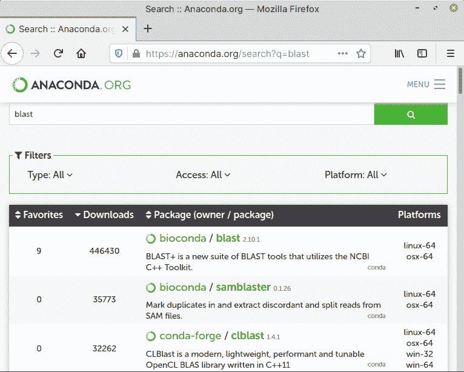

   图 65 在 Anaconda.org 上搜索包。

   或者，你也可以使用`conda search`命令：

   ```bash
   conda search blast
   ```

   这将输出匹配的包：

   ```text
   Loading channels: done
   # Name   Version           Build  Channel
   blast     2.2.31               1  bioconda
   ...
   blast      2.9.0 pl526he19e7b1_7  bioconda
   ...
   blast     2.10.1 pl526he19e7b1_2  bioconda
   ```

3. 要安装该包，请使用`conda install`命令以及包的`name`和`version`号。

   > **注意**
   >
   > 你需要使用从搜索结果获得的程序`highest`版本号。否则，可能会安装旧版本。

   ```bash
   conda install blast==2.10.1
   ```

4. 安装完成后，你就可以开始使用包中包含的程序，例如：

   ```bash
   (blast) user@cookbook:~$ blastn -version
   ```

   输出：

   ```text
   blastn: 2.10.1+
    Package: blast 2.10.1, build Oct 14 2020 11:36:30
   ```

#### 取消环境激活

当你的工作完成后，可以取消环境激活。要操作，请使用命令：

```bash
conda deactivate
```

你的 shell 提示符将恢复到默认状态，即没有 Conda 环境名称——在本例中为`(blast)`。

#### 删除环境

当你不再需要某个环境时，使用以下命令删除它：

```bash
conda remove -n blast --all
```

这里`-n`用于指定你想要删除的环境名称，`--all`则移除该环境中安装的所有包。

### 3.5.5. 注意事项

#### 如何验证安装程序的 SHA256 校验和

1. 导航到包含安装文件的文件夹——`Miniconda3-latest-Linux-x86_64.sh`：

   ```bash
   cd Downloads
   ```

2. 使用`sha256sum`命令验证文件的 SHA256 校验和：

   ```bash
   sha256sum Miniconda3-latest-Linux-x86_64.sh
   ```

   输出：

   ```text
   879457af6a0bf5b34b48c12de31d4df0ee2f06a8e68768e5758c3293b2daf688  Miniconda3-latest-Linux-x86_64.sh
   ```

   `sha256sum`命令的输出应与下载页面列出的值匹配。

#### 为什么要禁用 base 环境的自动激活？

如果你使用其他方法安装包，例如从 PyPI 安装 Python 包，你可能会`accidentally`将包安装到 Conda`base`环境而不是预期的位置。

即使你禁用了`base`环境的自动激活，也可以在需要时使用`conda activate base`命令来激活它。

## 3.6. Debian 包

如果你感兴趣的软件以 Debian 包的形式提供，你可以使用 gdebi 程序来安装它。如果该软件有任何依赖，它们将被自动安装。

可以使用此方法安装的软件示例：

- RStudio Desktop — 用于 R 语言编程的 IDE。
- Modeller — 一个用于比较三维结构的程序。
- MEGA — 演化分析。

### 3.6.1. 下载包

为了演示安装 Debian 包的步骤，这里使用了 [RStudio](https://docs.conda.io/projects/conda/en/latest/user-guide/cheatsheet.html) — 用于 R 语言编程的 IDE、[Modeller](https://docs.conda.io/projects/conda/en/latest/user-guide/cheatsheet.html) — 一个用于比较三维结构的程序，以及 [MEGA](https://docs.conda.io/projects/conda/en/latest/user-guide/cheatsheet.html) — 演化分析。

[RStudio](https://docs.conda.io/projects/conda/en/latest/user-guide/cheatsheet.html) — 用于 R 语言编程的 IDE、[Modeller](https://docs.conda.io/projects/conda/en/latest/user-guide/cheatsheet.html) — 一个用于比较三维结构的程序、[MEGA](https://docs.conda.io/projects/conda/en/latest/user-guide/cheatsheet.html) — 演化分析。

[RStudio](https://docs.conda.io/projects/conda/en/latest/user-guide/cheatsheet.html) — 用于 R 语言编程的 IDE、[Modeller](https://docs.conda.io/projects/conda/en/latest/user-guide/cheatsheet.html) — 一个用于比较三维结构的程序、[MEGA](https://docs.conda.io/projects/conda/en/latest/user-guide/cheatsheet.html) — 演化分析。

[RStudio](https://docs.conda.io/projects/conda/en/latest/user-guide/cheatsheet.html) — 用于 R 语言编程的 IDE、[Modeller](https://docs.conda.io/projects/conda/en/latest/user-guide/cheatsheet.html) — 一个用于比较三维结构的程序、[MEGA](https://docs.conda.io/projects/conda/en/latest/user-guide/cheatsheet.html) — 演化分析。

[RStudio](https://docs.conda.io/projects/conda/en/latest/user-guide/cheatsheet.html) — 用于 R 语言编程的 IDE、[Modeller](https://docs.conda.io/projects/conda/en/latest/user-guide/cheatsheet.html) — 一个用于比较三维结构的程序、[MEGA](https://docs.conda.io/projects/conda/en/latest/user-guide/cheatsheet.html) — 演化分析。

[RStudio](https://docs.conda.io/projects/conda/en/latest/user-guide/cheatsheet.html) — 用于 R 语言编程的 IDE、[Modeller](https://docs.conda.io/projects/conda/en/latest/user-guide/cheatsheet.html) — 一个用于比较三维结构的程序、[MEGA](https://docs.conda.io/projects/conda/en/latest/user-guide/cheatsheet.html) — 演化分析。

[RStudio](https://docs.conda.io/projects/conda/en/latest/user-guide/cheatsheet.html) — 用于 R 语言编程的 IDE、[Modeller](https://docs.conda.io/projects/conda/en/latest/user-guide/cheatsheet.html) — 一个用于比较三维结构的程序、[MEGA](https://docs.conda.io/projects/conda/en/latest/user-guide/cheatsheet.html) — 演化分析。

[RStudio](https://docs.conda.io/projects/conda/en/latest/user-guide/cheatsheet.html) — 用于 R 语言编程的 IDE、[Modeller](https://docs.conda.io/projects/conda/en/latest/user-guide/cheatsheet.html) — 一个用于比较三维结构的程序、[MEGA](https://docs.conda.io/projects/conda/en/latest/user-guide/cheatsheet.html) — 演化分析。

### 3.6.1. 下载包


为了演示安装 Debian 包的步骤，`[RStudio](https://docs.conda.io/projects/conda/en/latest/user-guide/cheatsheet.html)` — 用于 R 语言编程的 IDE，`[Modeller](https://docs.conda.io/projects/conda/en/latest/user-guide/cheatsheet.html)` — 一个用于比较三维结构的程序，`[MEGA](https://docs.conda.io/projects/conda/en/latest/user-guide/cheatsheet.html)` — 演化分析。

`[RStudio](https://docs.conda.io/projects/conda/en/latest/user-guide/cheatsheet.html)` — 用于 R 语言编程的 IDE，`[Modeller](https://docs.conda.io/projects/conda/en/latest/user-guide/cheatsheet.html)` — 一个用于比较三维结构的程序，`[MEGA](https://docs.conda.io/projects/conda/en/latest/user-guide/cheatsheet.html)` — 演化分析。

`[RStudio](https://docs.conda.io/projects/conda/en/latest/user-guide/cheatsheet.html)` — 用于 R 语言编程的 IDE，`[Modeller](https://docs.conda.io/projects/conda/en/latest/user-guide/cheatsheet.html)` — 一个用于比较三维结构的程序，`[MEGA](https://docs.conda.io/projects/conda/en/latest/user-guide/cheatsheet.html)` — 演化分析。

`[RStudio](https://docs.conda.io/projects/conda/en/latest/user-guide/cheatsheet.html)` — 用于 R 语言编程的 IDE，`[Modeller](https://docs.conda.io/projects/conda/en/latest/user-guide/cheatsheet.html)` — 一个用于比较三维结构的程序，`[MEGA](https://docs.conda.io/projects/conda/en/latest/user-guide/cheatsheet.html)` — 演化分析。

`[RStudio](https://docs.conda.io/projects/conda/en/latest/user-guide/cheatsheet.html)` — 用于 R 语言编程的 IDE，`[Modeller](https://docs.conda.io/projects/conda/en/latest/user-guide/cheatsheet.html)` — 一个用于比较三维结构的程序，`[MEGA](https://docs.conda.io/projects/conda/en/latest/user-guide/cheatsheet.html)` — 演化分析。

`[RStudio](https://docs.conda.io/projects/conda/en/latest/user-guide/cheatsheet.html)` — 用于 R 语言编程的 IDE，`[Modeller](https://docs.conda.io/projects/conda/en/latest/user-guide/cheatsheet.html)` — 一个用于比较三维结构的程序，`[MEGA](https://docs.conda.io/projects/conda/en/latest/user-guide/cheatsheet.html)` — 演化分析。

`[RStudio](https://docs.conda.io/projects/conda/en/latest/user-guide/cheatsheet.html)` — 用于 R 语言编程的 IDE，`[Modeller](https://docs.conda.io/projects/conda/en/latest/user-guide/cheatsheet.html)` — 一个用于比较三维结构的程序，`[MEGA](https://docs.conda.io/projects/conda/en/latest/user-guide/cheatsheet.html)` — 演化分析。

`[RStudio](https://docs.conda.io/projects/conda/en/latest/user-guide/cheatsheet.html)` — 用于 R 语言编程的 IDE，`[Modeller](https://docs.conda.io/projects/conda/en/latest/user-guide/cheatsheet.html)` — 一个用于比较三维结构的程序，`[MEGA](https://docs.conda.io/projects/conda/en/latest/user-guide/cheatsheet.html)` — 演化分析。

## 3.6.1 下载包

为了演示安装 Debian 包的步骤，`[RStudio](https://docs.conda.io/projects/conda/en/latest/user-guide/cheatsheet.html)` — 用于 R 语言编程的 IDE，`[Modeller](https://docs.conda.io/projects/conda/en/latest/user-guide/cheatsheet.html)` — 一个用于比较三维结构的程序，`[MEGA](https://docs.conda.io/projects/conda/en/latest/user-guide/cheatsheet.html)` — 演化分析。

`[RStudio](https://docs.conda.io/projects/conda/en/latest/user-guide/cheatsheet.html)` — 用于 R 语言编程的 IDE，`[Modeller](https://docs.conda.io/projects/conda/en/latest/user-guide/cheatsheet.html)` — 一个用于比较三维结构的程序，`[MEGA](https://docs.conda.io/projects/conda/en/latest/user-guide/cheatsheet.html)` — 演化分析。

## 3.6.2 要求

`[RStudio](https://docs.conda.io/projects/conda/en/latest/user-guide/cheatsheet.html)` — 用于 R 语言编程的 IDE，`[Modeller](https://docs.conda.io/projects/conda/en/latest/user-guide/cheatsheet.html)` — 一个用于比较三维结构的程序，`[MEGA](https://docs.conda.io/projects/conda/en/latest/user-guide/cheatsheet.html)` — 演化分析。

`[RStudio](https://docs.conda.io/projects/conda/en/latest/user-guide/cheatsheet.html)` — 用于 R 语言编程的 IDE，`[Modeller](https://docs.conda.io/projects/conda/en/latest/user-guide/cheatsheet.html)` — 一个用于比较三维结构的程序，`[MEGA](https://docs.conda.io/projects/conda/en/latest/user-guide/cheatsheet.html)` — 演化分析。

## 3.6.3 安装包

`[RStudio](https://docs.conda.io/projects/conda/en/latest/user-guide/cheatsheet.html)` — 用于 R 语言编程的 IDE，`[Modeller](https://docs.conda.io/projects/conda/en/latest/user-guide/cheatsheet.html)` — 一个用于比较三维结构的程序，`[MEGA](https://docs.conda.io/projects/conda/en/latest/user-guide/cheatsheet.html)` — 演化分析。

`[RStudio](https://docs.conda.io/projects/conda/en/latest/user-guide/cheatsheet.html)` — 用于 R 语言编程的 IDE，`[Modeller](https://docs.conda.io/projects/conda/en/latest/user-guide/cheatsheet.html)` — 一个用于比较三维结构的程序，`[MEGA](https://docs.conda.io/projects/conda/en/latest/user-guide/cheatsheet.html)` — 演化分析。

## 3.6.4 升级软件

`[RStudio](https://docs.conda.io/projects/conda/en/latest/user-guide/cheatsheet.html)` — 用于 R 语言编程的 IDE，`[Modeller](https://docs.conda.io/projects/conda/en/latest/user-guide/cheatsheet.html)` — 一个用于比较三维结构的程序，`[MEGA](https://docs.conda.io/projects/conda/en/latest/user-guide/cheatsheet.html)` — 演化分析。

## 3.6.5 软件

`[RStudio](https://docs.conda.io/projects/conda/en/latest/user-guide/cheatsheet.html)` — 用于 R 语言编程的 IDE，`[Modeller](https://docs.conda.io/projects/conda/en/latest/user-guide/cheatsheet.html)` — 一个用于比较三维结构的程序，`[MEGA](https://docs.conda.io/projects/conda/en/latest/user-guide/cheatsheet.html)` — 演化分析。

## 3.6.6 注意事项

`[RStudio](https://docs.conda.io/projects/conda/en/latest/user-guide/cheatsheet.html)` — 用于 R 语言编程的 IDE，`[Modeller](https://docs.conda.io/projects/conda/en/latest/user-guide/cheatsheet.html)` — 一个用于比较三维结构的程序，`[MEGA](https://docs.conda.io/projects/conda/en/latest/user-guide/cheatsheet.html)` — 演化分析。

安装将现在开始（[图 74](#install.xhtml_fig-331i)）。

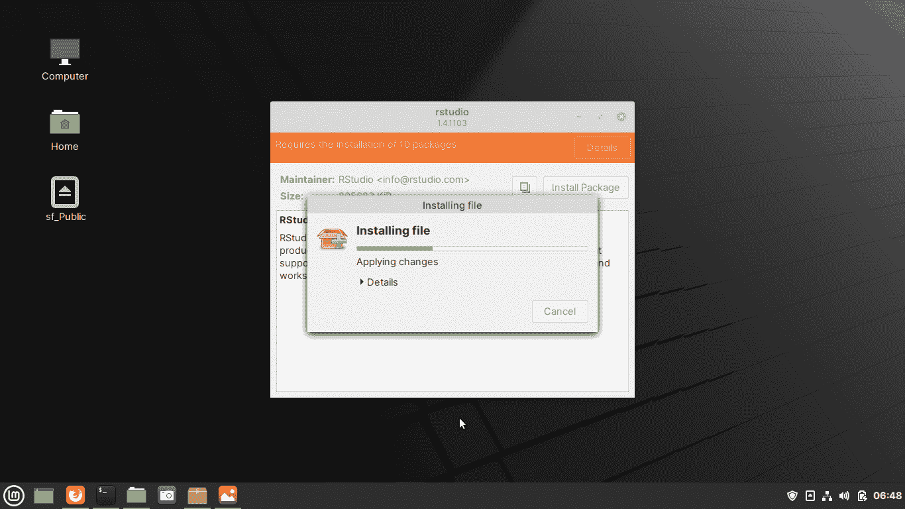

图 74 安装进度

安装完成后，你将在窗口顶部看到 `Same version is already installed` 消息（[图 75](#install.xhtml_fig-331j)）。

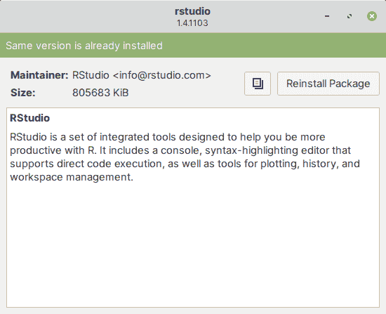

图 75 软件包安装成功

# 3. 启动已安装的程序

## 3.1 启动已安装的程序

你可以从应用程序菜单启动已安装的程序（[图 76](#install.xhtml_fig-331k)）。

#### 注意

这仅适用于带有图形用户界面的应用程序。

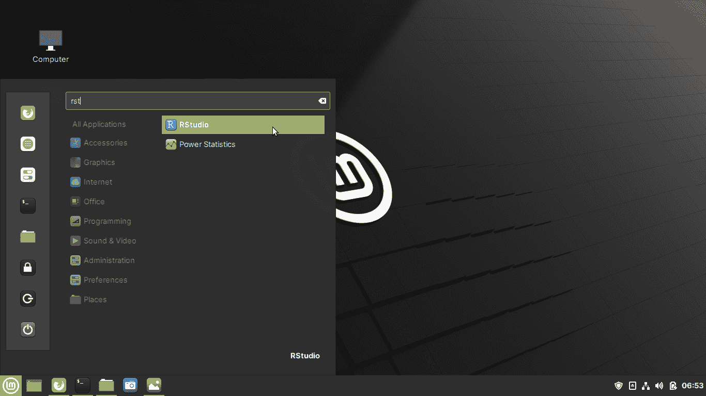

图 76 从应用程序菜单启动已安装程序

程序的主窗口将显示（[图 77](#install.xhtml_fig-331l)）。

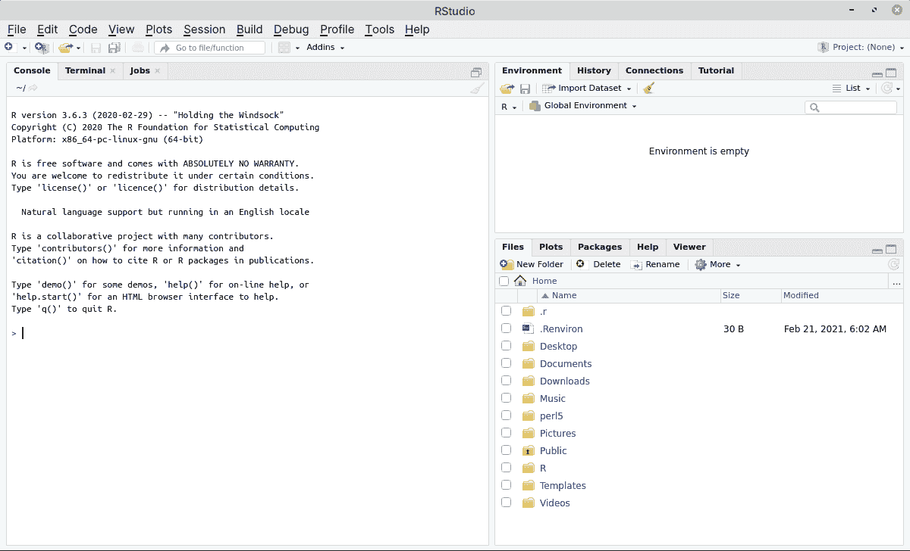

图 77 RStudio Desktop 主窗口

# 3.6.3 升级已安装的软件

从 Debian 软件包安装的软件与安装类似。当有新版本的程序可用时，下载软件包文件（`.deb`），然后按照安装 Debian 软件包中的步骤操作。

# 3.6.4 移除已安装的软件

你可以按照移除已安装的软件中的步骤，搜索并删除以这种方式安装的包。

# 3.6.5 注意事项

### 3.6.5.1 命令行版本

你可以使用 `apt` 包管理器在命令行安装 Debian 软件包。

### 3.6.5.2 这些程序需要手动更新

以这种方式安装的程序通常不会自动更新。因此，此方法应仅用于无法通过快速简单的方法获取的软件。

### 3.6.5.3 如果无法找到依赖项，安装将失败

如果无法在软件库中找到依赖项，某些程序的安装可能会失败。在这种情况下，你需要手动找到并安装这些包，然后再次尝试安装程序。

# 4. 使用 Linux 命令行

在本节中，你将找到 Linux 命令行、shell 和终端程序、一些常用命令以及一个示例练习。

- 4.1. Shell 和终端
  - 4.1.1. Shell 提示符
- 4.2. 命令 — 概述
  - 4.2.1. 命令选项
  - 4.2.2. 获取使用命令的帮助
  - 4.2.3. `date` — 显示当前日期和时间
  - 4.2.4. `cd` — 更改目录
  - 4.2.5. `mkdir` — 创建新目录
  - 4.2.6. `rmdir` — 删除空目录
  - 4.2.7. `ls` — 列出文件
  - 4.2.8. `cp` — 复制文件
  - 4.2.9. `cat` — 显示文件内容或合并它们
  - 4.2.10. `less` — 查看并导航文件内容
  - 4.2.11. `head` — 打印文件的前几行
  - 4.2.12. `tail` — 打印文件的最后几行
  - 4.2.13. `mv` — 移动文件或目录
  - 4.2.14. `rm` — 删除文件或目录
  - 4.2.15. `echo` — 显示文本或值
- 4.3. 其他有用命令
  - 4.3.1. `df` — 报告磁盘使用情况
  - 4.3.2. `du` — 估计文件或目录的磁盘占用
  - 4.3.3. `find` — 搜索文件
  - 4.3.4. `free` — 查看空闲和已内存
  - 4.3.5. `locate` — 使用文件名查找文件
  - 4.3.6. `which` — 查找命令

注：由于提供的原始文本在 4.2.1 之后出现了大量重复的乱码片段，上述译文已根据逻辑结构进行了清理，确保输出不重复且完整。

```
用法: ls [OPTION]... [FILE]...
列出 FILEs 的信息（默认为当前目录）。
如果未指定 -cftuvSUX 或 --sort，则按字母顺序对条目进行排序。

长选项的强制性参数对于短选项也是强制性的。
  -a, --all                  不忽略以 . 开头的条目

...
```

#### 注意

为了保持讨论简洁，本节中的示例仅包含了命令受支持的 `some` 选项。

# 4.2.3. `date` — 显示当前日期和时间

```bash
date
```

输出：

```text
Wed 10 Mar 2021 10:33:11 GMT
```

# 4.2.4. `cd` — 切换目录

要进入一个目录，请使用 `cd` 后后跟该目录的名称。

例如，要进入 `/home/user/Downloads`，请使用：

```bash
cd Downloads
```

#### 注意

当您登录或打开新的终端窗口时，您将位于您的家目录 — `/home/user`，其中 `user` 是您的用户名。

您可以使用之前讨论过的 `pwd` 命令来验证您当前所在的目录：

```bash
pwd
```

```text
/home/user/Downloads
```

## 使用不带参数的 `cd`

无论您在文件系统的何种位置，输入 `cd` 不带任何参数都会带您回到家目录。

```bash
user@cookbook:/usr/share/dict$ cd
user@cookbook:~$
```

#### 进入父目录

使用 `cd ..` 进入父目录。

例如，当您在 `/home/user/Downloads` 并且输入：

```bash
cd ..
```

您将会被带回 `/home/user`。

单个点（`.`）指的是 `current` 目录。

# 4.2.5. `mkdir` — 创建新目录

使用 `mkdir` 后跟您想要创建的目录名称：

```bash
mkdir Workspace
```

#### 注意


您正在创建的目录不能已经存在，否则此命令将无法工作。

正如之前所讨论的，目录名称是区分大小写的，因此目录名为`Workspace`的目录与另一个名为`workspace`的目录不同。

#### 目录名称中的空格

如果目录名称中有空格，请使用双引号，例如：

```bash
mkdir "Project Work"
```

否则，将创建两个独立的目录 — `Project`和`Work`。

## `rmdir` — 删除空目录

使用`rmdir`后跟您想要删除的目录名称：

```bash
rmdir Workspace
```

#### 注意

该目录在删除之前必须为空。该目录内不应有其他文件或目录。

## `ls` — 列出文件

要列出目录中的文件，请使用`ls`命令：

```bash
ls
```

输出：

```text
Desktop  Documents  Downloads  Music  Pictures  Public  Templates  Videos
```

#### 显示隐藏文件

您可以为`ls`提供额外的选项。这将改变命令的工作方式。例如，要同时显示隐藏文件和目录，请使用：

```bash
ls -a
```

输出：

```text
.              .cache     .local    Public
..             .cinnamon  .gnup       .bash_history
.config        Desktop    Pictures      Videos
.bashrc        Documents  .linuxmint   .profile  .authority
```

#### 获取详细列表

要获取详细列表，请使用：

```bash
ls -l
```

输出：

```text
total 32
drwxr-xr-x 2 user user 4096 Feb 17 13 Desktop
drwxr-xr-x 2 user user 4096 Mar 4 Documents
drwxr-xr-x 2 user user 4096 Feb 17 13 Downloads
drwxr-xr-x 2 user user 4096 Feb 17 13 Music
drwxr-xr-x 2 user user 4096 Mar 4 Pictures
drwxr-xr-x 2 user user 4096 Feb 17 13 Public
drwxr-xr-x 2 user user 4096 Feb 17 13 Templates
drwxr-xr-x 2 user user 4096 Feb 17 13 Videos
```

### 组合多个选项

您可以组合多个选项，如：

```bash
ls -la
```

输出：

```text
total 144
drwxr-xr-x 1 user user 4096 Mar 12 00 .
drwxr-xr-x 3 root root 4096 Feb 17 51 ..
-rw-------- 1 user user 190 Mar 4 .bash_history
-rw-r-- 1 user user 220 Feb 17 51 .logout
-rw-r-- 1 user user 377 Feb 17 51 .bashrc
drwx------ 17 user user 4096 Mar 3 .cache
drwxrwxr-x 4 user user 4096 Feb 17 13 .cinnamon
```

要查看`ls`支持的所有选项列表，请使用：

```bash
ls --help
```

## `cp` — 复制文件

使用`cp`命令，您可以复制文件或目录。

#### 复制一个文件

要复制一个文件，使用`cp`后跟源文件名称：

```bash
cp source destination
```

`source`是您想要复制的文件，`destination`是目标位置。

#### 复制多个文件

要复制多个文件，请使用以下格式：

```bash
cp source1 source2 destination
```

`source1`和`source2`是您想要复制的文件，`destination`是目标位置。

#### 复制目录

要复制目录，请使用`-r`选项：

```bash
cp -r source destination
```

`source`是您想要复制的目录，`destination`是目标位置。

## `cat` — 显示并合并文件

使用`cat`命令，您可以在屏幕上查看文件或合并它们。

### 查看文件内容

要查看文件内容，请使用`cat`后跟文件名：

```bash
cat /usr/share/dict/words
```

输出：

```text
A
A's
AMD
AMD's
AOL
AOL's
AWS
AWS's
Aachen
...
```

这将显示文件的全部内容。

### 合并文件内容

如果您在`cat`中包含多个文件名，它会将它们合并并将内容打印到屏幕上。如果您想将输出保存到文件，请使用以下格式：

```bash
cat file1.txt file2.txt > files.txt
```

`>`操作将标准输出重定向到文件名。

## `less` — 查看并导航文件内容

使用`less`命令，您在查看文件时拥有更多控制权。它允许您上下滚动文件，并提供了关键词搜索文件的功能。要查看文件，请使用`less`后跟文件名：

```bash
less /usr/share/dict/words
```

当文件打开时，它的外观将如图 79 所示。

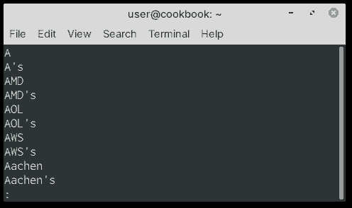

图 79 在`less`中打开的`words`文件

在`:`提示符处，您可以输入`less`理解的命令。

#### 导航文件

您可以通过回车键向下滚动文件。或者，您可以使用`PgUp`和`PgDn`键一次翻一页。

#### 搜索文件

您可以在`less`中查看文件时进行搜索。操作如下：

1.  输入`/`（正斜杠）键
2.  输入想要搜索的文本
3.  按下`ENTER`键
4.  如果有匹配的结果，它们将被高亮显示

#### 退出`less`命令

要退出`less`命令，请在提示符处输入`q`。

## `tail` — 打印文件的最后几行

使用`tail`命令，你可以查看文件的最后几行（默认：10 行）。例如：

```text
tail /usr/share/dict/words
```

```text
élan's
émigré
émigré's
émigrés
épée
épée's
épées
étude
étude's
études
```

在早之前讨论过的`tail`和`head`命令在两种情况下，它们在你想要快速查看大型文本文件的内容时非常有用。在上述两种情况下，你都可以使用`-n`选项来控制显示的行数，而不是默认值（10）。例如：

```text
tail -n 5 /usr/share/dict/words
```

将显示文件的最后 5 行。

## `mv` — 移动文件或目录

使用`mv`命令，你可以将文件或目录从一个位置（源）移动到另一个位置（目的地）。你可以选择保留现有的文件或目录名称或将其重命名。命令的基本格式是：

```text
mv source destination
```

更安全的方法是给命令添加`-iv`选项：

```text
mv -iv source destination
```

使用`-i`（交互式），如果目的地已存在文件或目录，`mv`将要求你进行确认。`-v`（详细）将在屏幕上打印命令的操作。为了方便起见，你可以为命令添加别名。

#### 示例文件

要遵循以下示例，你需要使用`cp`命令将以下文件复制到家目录：

```text
cp -v /usr/share/dict/words ~
cp -rv /usr/share/doc/bash ~
```

`~`是家目录的快捷方式。

#### 移动文件或目录

简单的用例是将文件或目录从一个位置（目录）移动到另一个。

#### 移动文件

例如，将上述复制的`words`文件移动到`Documents`目录，使用：

```text
mv -iv Documents/
```

输出：

```text
renamed 'words' -> 'Documents/'
```

#### 移动目录

同样，将上述复制的`bash`目录移动到`Documents`目录，使用：

```text
mv -iv Documents/
```

输出：

```text
renamed 'bash' -> 'Documents/'
```

在这两种情况下，文件或目录的名字都不会改变。

#### 重命名文件或目录

在这种情况下，你想重命名文件或目录。

#### 重命名文件

将上述复制的`words`文件重命名为`dictionary.txt`，使用：

```text
mv -iv words dictionary.txt
```

或者，将其移动到`Documents`目录并同时重命名，使用：

```text
mv -iv words/dictionary.txt
```

#### 重命名目录

将上述复制的`bash`目录重命名为`bash-commands`，使用：

```text
mv -iv bash-commands
```

#### 注意事项

### 如果文件存在会怎样？

你会看到提示要求你确认覆盖文件。输入`y`并按回车键继续：

```text
mv: overwrite 'Documents/words'? y
renamed 'words' -> 'Documents/words'
```

只需在提示处按回车键即可取消。

### 如果目录存在会怎样？

`mv`只有在目录为空时才会覆盖。你可以：

* 将文件复制到目标目录
* 重命名目标目录

#### 为`mv`添加别名

与其每次使用命令时都输入`mv-iv`，你可以在`~/.bash_aliases`文件中为命令添加别名。例如：

```text
alias mv='mv -iv'
```

现在，当你输入`mv`时，实际上使用的是`mv -iv`。

## `rm` — 删除文件或目录

使用`rm`命令，你可以删除文件或目录。命令的基本格式是：

```text
rm source
```

更安全的方法是给命令添加`-iv`选项：

```text
rm -iv source
```

使用`-i`（交互式），如果文件或目录已存在，`rm`在删除前将要求你进行确认。`-v`（详细）将在屏幕上打印命令的操作。为了方便起见，你可以添加别名。

#### 示例文件

要遵循以下示例，你需要使用`cp`命令将以下文件复制到家目录：

```text
cp -v /usr/share/dict/words ~
cp -rv /usr/share/doc/bash ~
```

`~`是家目录的快捷方式。

#### 删除文件

简单的用例是删除文件。

#### 删除文件

例如，删除上述复制的`words`文件，使用：

```text
rm -iv words
```

输出：

```text
removed 'words'
```

#### 删除目录

同样，删除上述复制的`bash`目录，使用：

```text
rm -iv bash
```

输出：

```text
removed 'bash'
```

#### 删除目录

在这种情况下，你想删除一个目录。

#### 删除空目录

要删除空目录，使用：

```text
rm -iv directory
```

### 删除带有内容的目录

要删除包含文件的目录，使用`-r`选项：

```text
rm -ivr directory
```

#### 注意事项

### 如果文件存在会怎样？

你会看到提示要求你确认删除文件。输入`y`并按回车键继续：

```text
rm: remove regular file 'filename'? y
removed
```

只需在提示处按回车键即可取消。

### 如果目录存在会怎样？

`rm`只有在目录为空时才会删除。要进行递归删除，使用`-r`选项。

#### 为`rm`添加别名

与其每次使用命令时都输入`rm-iv`，你可以在`~/.bash_aliases`文件中为命令添加别名。例如：

```text
alias rm='rm -iv'
```

现在，当你输入`rm`时，实际上使用的是`rm -iv`。

## `echo` — 显示文本或值

使用`echo`命令，你可以打印文本或变量的值。命令的基本格式是：

```text
echo text_or_value
```

#### 显示文本

要在屏幕上打印文本，使用`echo`后接你想打印的内容：

```text
echo "Hello, This is echo!"
```

输出：

```text
Hello, This is echo!
```

#### 显示变量值

你还可以使用`echo`显示环境变量的值。例如：

```text
echo $PATH
```

`PATH`中的`$`表示这是一个变量。输出：

```text
/usr/local/sbin:/usr/local/bin:/usr/sbin:/usr/bin:/sbin:/bin:/usr/games:/usr/local/games:/snap/bin
```

`PATH`包含了用于查找程序或命令的路径（目录）列表。你可以在`~/.bashrc`中设置或修改环境变量。

## 其他有用命令

这些是你可能需要的命令。

* 4.3.1. `df` — 报告磁盘使用情况
* 4.3.2. `du` — 估算文件或目录的磁盘使用情况
* 4.3.3. `find` — 搜索文件
* 4.3.4. `free` — 查看空闲和已内存
* 4.3.5. `locate` — 使用名称查找文件
* 4.3.6. `which` — 定位命令

### `df` — 报告磁盘使用情况

`df`命令将报告连接到系统的所有存储设备的已用和可用磁盘空间。例如，要查找`/`— 根文件系统的磁盘使用量，你可以使用命令：

```text
df -h /
```

输出：

```text
Filesystem               Size  Used Avail Use% Mounted on
/dev/mapper/vgmint-root   28G  6.9G   20G  26% /
```

`-h`选项使输出具有人类可读性。如果没有此选项，可用磁盘空间将报告为`20600196`而不是`20G`。

### `du` — 估计文件或目录的磁盘占用

计算文件或目录占用的磁盘空间。例如，要计算家目录下文件占用的磁盘空间，可以使用以下命令：

```text
du -sh ~
```

输出：

```text
7.4G .
```

`-s`选项打印摘要，而不是打印每个文件占用的空间。`-h`使输出具有人类可读性。

### `find` — 搜索文件

使用文件名、文件类型等搜索文件。例如，要在主目录中查找文件名包含`.bash`的文件，可以使用以下命令：

```text
find ~ -name ".bash*"
```

输出：

```text
/home/user/.bashrc
/home/user/.bash_history
/home/user/.bash_logout
```

注意：这里的`~`是家目录的快捷方式。`.bash*`中的星号（`*`）起通配符的作用。`find`命令不使用数据库，因此与`locate`相比，搜索速度会较慢。然而，它可以识别最近创建或修改的文件。

### `free` — 查看空闲和使用的内存

通过`free`，你可以找到空闲和使用的内存（RAM）以及交换空间。用法：

```text
free -h
```

输出：

```text
              total        used        free      shared  buff/cache   available
Mem:          3.8Gi       618Mi       1.3Gi       7.0Mi       1.9Gi       3.0Gi
Swap:         979Mi          0B       979Mi
```

`-h`选项使输出具有人类可读并显示相应的单位。在上面的示例中，空闲物理内存（RAM）的数量为 1.3 GiB（二进制字节）。

### `locate` — 使用文件名查找文件

使用文件名搜索文件。这种方法非常快，因为它使用了文件名数据库。例如：

```text
locate bashrc
```

输出：

```text
/etc/bash.bashrc
/etc/skel/.bashrc
/home/user/.bashrc
...
```

注意：这种方法可能找不到最近创建或修改的文件。较新的文件可能尚未包含在数据库中。要手动更新数据库，你可以运行命令：

```text
sudo updatedb
```

或者，你可以使用`find`命令来搜索新文件。

### `which` — 定位命令

如果命令存在于搜索路径（即`$PATH`）中，`which`命令会打印该命令的完整路径。例如：

```text
which python3
```

输出：

```text
/usr/bin/python3
```

## 使用 nano 编辑文本文件

`GNU` `nano`是一个命令行文本编辑器，具有撤销/重做、语法高亮、交互式搜索和替换等功能。要打开程序，请在终端会话中输入`nano`。

*   4.4.1. 创建新文件
*   4.4.2. 从剪贴板粘贴文本
*   4.4.3. 保存更改
*   4.4.4. 退出 nano


# 4.4.1. 创建新文件

要创建一个新文件，使用 `nano` 后跟想要创建的文件名。

例如：

```bash
nano exercise.txt
```

这将以写入模式打开文件（图 80）。

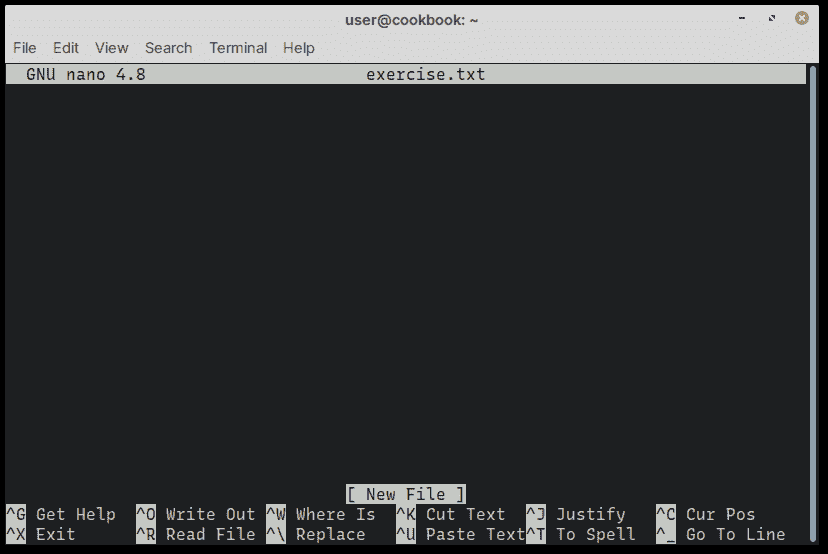

在 `nano` 中创建文件

在此阶段你可以开始输入文本。

# 4.4.2. 从剪贴板粘贴文本

要从不同的程序（例如浏览器）复制并粘贴文本到正在 `nano` 编辑的文件中，执行以下操作：

1. 使用`Ctrl+c`将文本复制到剪贴板

2. 在`nano`中，将光标移动到你想粘贴文本的位置

3. 使用快捷键`Shift+Ctrl+v`粘贴文本

# 4.4.3. 保存更改

要保存文件，使用快捷键`Ctrl+o`。

这对应于底部显示的`^O`写入（图 81）。这里的`^`代表`Ctrl`键。

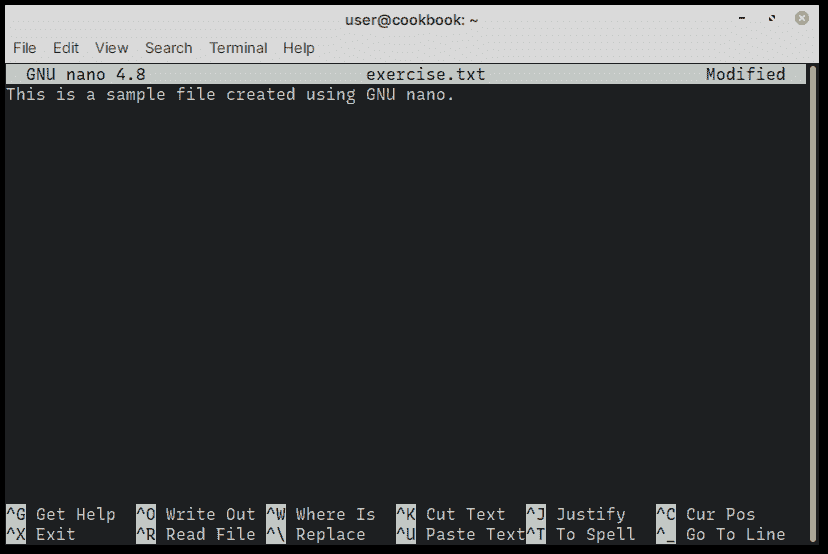

要保存更改时使用写入功能

底部将显示如下的提示符（图 82）：

```
File Name: exercise.txt
```


要保存的文件名

按`Enter`键确认文件名。

# 4.4.4. 退出 nano

要退出`nano`，按`Ctrl+x`。如果你进行了更改，它会询问你是否要保存。

#### 2. 进入该目录

#### 3. 下载查询序列

#### 4. 查看下载的序列（可选）

#### 创建新目录 — `mkdir`

为了将与此项目相关的输入和输出文件放在一起，使用`mkdir`命令在你的主目录下创建一个新目录。

```bash
mkdir -p ~/projects/sars-cov-2
```

这里：

`~`是主目录的快捷方式。

`-p`在必要时创建父目录。在这种情况下，`projects`目录不存在，因此也会被创建。

#### 切换目录 — `cd`

使用`cd`命令进入新创建的目录：

```bash
cd ~/projects/sars-cov-2
```

#### 下载序列 — `wget`

要下载序列文件，你可以使用`wget`命令并将下载链接作为参数。在这种情况下，下载链接对应 FASTA 格式文件的 URL（参见示例数据）：

```bash
wget https://www.uniprot.org/uniprot/P0DTC2.fasta
```

下载完成后，你可以使用`ls`命令验证文件是否存在：

```bash
ls -l
```

输出：

```
total 4
-rw-rw-r-- 1 user user 1414 Feb 10 00:00 P0DTC2.fasta
```

#### 查看下载的序列 — `cat` 或 `less`

由于`P0DTC2.fasta`是 FASTA 格式——一种纯文本格式，你可以使用`cat`命令查看文件内容：

```bash
cat P0DTC2.fasta
```

输出：

```
>sp|P0DTC2|SPIKE_SARS2 Spike glycoprotein OS=Severe acute respiratory syndrome coronavirus 2 OX=2697049 GN=S PE=1 SV=1
MFVFLVLLPLVSSQCVNLTTRQQLPPAYTNSFTRGVYYPDKVFRSSVLHSTQDLFLPFFS
NVTWFHAIHVSGTNGTKRFDNPVLPFNDGVYFASTEKSNIIRGWIFGTTLDSKTQSLLIV
NNATNVVIKVCEFQFCNDPFLGVYYHKNNKSWMESEFRVYSSANNCTFEYVSQPFLMDLE
GKQGNFKNLREFVFKNIDGYFKIYSKHTPINLVRDLPQGFSALEPLVDLPIGINITRFQT
LLALHRSYLTPGDSSSGWTAGAAAYYVGYLQPRTFLLKYNENGTITDAVDCALDPLSETK
CTLKSFTVEKGIYQTSNFRVQPTESIVRFPNITNLCPFGEVFNATRFASVYAWNRKRISN
CVADYSVLYNSASFSTFKCYGVSPTKLNDLCFTNVYADSFVIRGDEVRQIAPGQTGKIAD
YNYKLPDDFTGCVIAWNSNNLDSKVGGNYNYLYRLFRKSNLKPFERDISTEIYQAGSTPC
NGVEGFNCYFPLQSYGFQPTNGVGYQPYRVVVLSFELLHAPATVCGPKKSTNLVKNKCVN
FNFNGLTGTGVLTESNKKFLPFQQFGRDIADTTDAVRDPQTLEILDITPCSFGGVSVITP
GTNTSNQVAVLYQDVNCTEVPVAIHADQLTPTWRVYSTGSNVFQTRAGCLIGAEHVNNSY
ECDIPIGAGICASYQTQTNSPRRARSVASQSIIAYTMSLGAENSVAYSNNSIAIPTNFTI
SVTTEILPVSMTKTSVDCTMYICGDSTECSNLLLQYGSFCTQLNRALTGIAVEQDKNTQE
VFAQVKQIYKTPPIKDFGGFNFSQILPDPSKPSKRSIEDLLFNKVTLADAGFIKQYGDC
LGDIAARDLICAQKFNGLTVLPPLLTDEMIAQYTSALLAGTITSGWTFGAGAALQIPFAM
QMAYRFNGIGVTQNVLYENQKLIANQFNSAIGKIQDSLSSTASALGKLQDVVNQNAQALN
TLVKQLSSNFGAISSVLNDILSRLDKVEAEVQIDRLITGRLQSLQTYVTQQLIRAAEIRA
SANLAATKMSECVLGQSKRVDFCGKGYHLMSFPQSAPHGVVFLHVTYVPAQEKNFTTAPA
ICHDGKAHFPREGVFVSNGTHWFVTQRNFYEPQIITTDNTFVSGNCDVVIGIVNNTVYDP
LQPELDSFKEELDKYFKNHTSPDVDLGDISGINASVVNIQKEIDRLNEVAKNLNESLIDL
QELGKYEQYIKWPWYIWLGFIAGLIAIVMVTIMLCCMTSCCSCLKGCCSCGSCCKFDEDD
SEPVLKGVKLHYT
```

为了更好的控制，你可以使用`less`命令代替`cat`。

# 4.5.5. 下载蛋白质序列数据库

你可以按照以下步骤下载并准备蛋白质序列数据库：

1. 创建新目录

2. 进入该目录

3. 下载数据库压缩包

4. 解压缩（或提取）数据库压缩包

5. 格式化数据库

#### 创建新目录 — `mkdir`

为了将所有 BLAST 数据库放在同一个地方，使用`mkdir`命令创建一个目录存储它们：

```bash
mkdir databases
```

#### 切换目录 — `cd`

使用`cd`命令进入新创建的目录：

```bash
cd databases
```

#### 下载数据库压缩包 — `wget`

访问 UniProt 网站上的[下载](https://www.uniprot.org/downloads)页面。导航到`UniProtKB`部分。点击`Reviewed (Swiss-Prot)`对应的`fasta`下载链接并复制。

要下载数据库，你可以使用`wget`命令并将链接作为参数：

```bash
wget https://ftp.uniprot.org/pub/databases/current_release/uniprot_sprot.gz
```

下载完成后，会在当前目录下找到一个名为`uniprot_sprot.gz`的文件。你可以使用`ls`命令验证它是否存在：

```bash
ls -lh
```

输出：

```
total 86
-rw-rw-r-- 1 user user 86M Feb 10 15:00 uniprot_sprot.gz
```

由于该文件是压缩格式 (`.gz`)，你需要对其解压。

#### 解压缩数据库压缩包 — `gunzip`

要解压缩上一步下载的数据库压缩包，可以使用`gunzip`命令。默认情况下，`gunzip`会删除原始文件。如果你想保留原始文件 (`.gz`)，请在`gunzip`中包含`-k` (keep input files) 选项。提供文件名：

```bash
gunzip uniprot_sprot.gz
```

提取完成后，会在同一目录下找到 FASTA 格式的数据库文件：

```bash
ls -lh
```

输出：

```
total 267M
-rw-rw-r-- 1 user user 267M Feb 10 15:00 uniprot_sprot.fasta
```

#### 查看数据库

由于提取出的数据库文件很大，你可以使用`head`命令查看文件的前几行：

```bash
head -n 5 uniprot_sprot.fasta
```

输出：

```
>sp|Q6GZX4|001R_FRG3 Putative transcription factor 001R OS=Frog virus 3 (isolate Goha) OX=654924 GN=FV3-001R PE=4 SV=1
MAFSAEDVLKEYDRRRMEALLLSLYYPNDRKLLDYKEWSPPRVQECPKAPVEWNNPPS
EKGLIVGHFSGIKYKGEKAASEVDVNKMCCWVSKFKDAMRRYQGITCKIPGKVLSDLD
AKIKAYNLTVEGGFRYSRVTKQHVAAFLKELRHSKQYENVLIHYILTDKRVDIQHL
EKDLVKDFVESAHRMRQMINVKYILYQLLHHGPDGS
```

或者，可以使用`less`命令逐页查看：

```bash
less uniprot_sprot.fasta
```

如果你想统计数据库中的序列数量，可以使用`grep`命令：

```bash
grep ">" -c uniprot_sprot.fasta
```

输出：

```
564277
```

`grep`的`-c`选项统计给定搜索字符串（在此情况下为`>`）在输入文件中出现的次数。FASTA 格式的序列以`>`开头，因此，该计数即数据库中的序列数量。

#### 格式化数据库 — `makeblastdb`

数据库在用于 BLAST 搜索之前需要进行格式化。你可以使用`makeblastdb`命令对其进行格式化，它是 NCBI BLAST+ 软件包的一部分。

该命令有多个选项。例如：

```bash
makeblastdb -in uniprot_sprot.fasta -parse_seqids \
-title "Swiss-Prot" -dbtype prot -out swissprot
```

注意：`\`字符将长命令分成多行。

输出：

```
 Building a new DB, current time: 03/24/2021 15:12:50
 New DB name:   /home/user/databases/swissprot
 New DB title:  Swiss-Prot
 Sequence type: Protein
 Keep MBits: T
 Maximum file size: 1000000000B
 Adding sequences from FASTA; added 564277 sequences in 47.507 seconds.
```

选项含义：

- `-in`：包含输入序列的文件名。

- `-parse_seqids`：从输入文件中解析序列标识符。这些标识符将显示在搜索结果中。

- `-title`：数据库的描述性名称。

- `-dbtype`：输入序列的类型——接受的值为`prot`（蛋白质）和`nucl`（核苷酸）序列。

- `-out`：此处的值将用于命名输出文件。这也是你在进行搜索时需要使用的数据库名称（参见输出中的新数据库名称）。

格式化完成后，你会在`databases`目录下发现以下文件：

```bash
ls -lh
```

```
total 585M
-rw-rw-r-- 1 user user 100M Mar 24 15:13 swissprot.phr
-rw-rw-r-- 1 user user 4.4M Mar 24 15:13 swissprot.pin
-rw-rw-r-- 1 user user 2.2M Mar 24 15:13 swissprot.pog
-rw-rw-r-- 1 user user  18M Mar 24 15:13 swissprot.psd
-rw-rw-r-- 1 user user 411K Mar 24 15:13 swissprot.psi
-rw-rw-r-- 1 user user 195M Mar 24 15:13 swissprot.psq
-rw-rw-r-- 1 user user 267M Feb 10 15:00 uniprot_sprot.fasta
```

# 4.5.6. 使用查询序列搜索数据库

在下载了查询序列并下载且格式化数据库后，你可以开始进行 BLAST 搜索。

首先，进入包含查询序列的目录：

```bash
cd ~/projects/sars-cov-2
```

现在，使用查询序列和数据库的完整路径运行`blastp`命令：

```bash
blastp -query P0DTC2.fasta \
-db /home/user/databases/swissprot \
-out blastp-results.txt \
-outfmt "7 sacc stitle qlen slen pident"
```

各个选项的含义：

`-query`

查询序列的路径。

`-db`

序列数据库的完整路径。

`-out`

保存结果的文件。

`-outfmt`

输出文件的格式。此将使用格式选项`7`（制表符分隔文本）并包含以下信息：

* 匹配序列的访问号和描述（`sacc`和`stitle`），

* 查询序列和目标序列的长度（`qlen`和`slen`），

* 匹配的一致性百分比（`pident`）。

数据库搜索完成后，你可以打开`blastp-results.txt`查看结果：

```bash
less -S blastp-results.txt
```

`less`命令的`-S`选项会禁用自动换行。

输出：

```
#### BLASTP 2.9.0+
#### Query: sp|P0DTC2|SPIKE_SARS2 Spike glycoprotein OS=Severe acute respiratory syndrome coronavirus 2 OX=2697049 GN=S PE=1 SV=1
#### Database: /home/user/databases/swissprot
#### Fields: subject acc., subject title, query length, subject length, % identity
# 88 hits found
P0DTC2      Spike glycoprotein OS=Severe acute respiratory syndrome coronavirus 2 OX=2697049 GN=S PE=1 SV=1 1273    1273    100.000
P59594      Spike glycoprotein OS=Severe acute respiratory syndrome coronavirus OX=694009 GN=S PE=1 SV=1    1273    1255    76.038
Q3LZX1      Spike glycoprotein OS=Bat coronavirus HKU3 OX=442736 GN=S PE=3 SV=1     1273    1242    76.041
Q3I5J5      Spike glycoprotein OS=Bat coronavirus Rp3/2004 OX=349344 GN=S PE=1 SV=1 1273    1241    75.334
Q0Q475      Spike glycoprotein OS=Bat coronavirus 279/2005 OX=389167 GN=S PE=3 SV=1 1273    1241    74.745
...
```

# 4.6. 注意事项

## 4.6.1. 向 PATH 添加目录

`PATH`变量存储了搜索命令的目录列表。如果你有一个命令不在列表中，你需要将其添加到`PATH`。

你可以使用`echo`命令显示`PATH`的当前值：

```bash
echo $PATH
```

输出：

```
/usr/local/sbin:/usr/local/bin:/usr/sbin:/usr/bin:/sbin:/bin:/usr/games:/usr/local/games:/snap/bin
```

要修改`PATH`并添加目录，可以按照以下步骤操作。此示例将`/home/user/.local/bin`添加到`PATH`。

注意

编辑`PATH`时需要小心。你还需要确保列表中包含`$PATH`，否则你将无法访问任何命令！

1. 用文本编辑器打开`$HOME/.bashrc`。

2. 在文件末尾添加以下行。将你想添加的目录用冒号分隔。列表应以`$PATH`结尾。

```bash
PATH=/home/user/.local/bin:$PATH
```

3. 使用`echo`验证更改：

```bash
echo $PATH
```

输出：


```text
/home/user/.local/bin:/usr/local/sbin:/usr/local/bin:/usr/sbin:/usr/bin:/sbin:/bin:/usr/games:/usr/local/games:/snap/bin
```

## 4.6.2. 处理空格

创建带有空格的目录时，最好使用下划线（`_`）或连字符（`-`）来分隔单词。

例如：

```bash
mkdir "Sample Data"
```

进入该目录：

```bash
cd "Sample Data"
```

打印当前目录：

```bash
pwd
```

输出：

```text
/home/user/Sample Data
```

— 存储在你的计算机上，而如果你使用公共实例，它将被存储在服务器上，且可能未加密 2。

### 访问更多工具

— 通过在你的本地实例上安装，来获取公共服务器上未安装的工具。

### CPU 和存储限制

— 取决于你的计算机，而在公共服务器上，对每个用户的 CPU 和存储使用量有限制 2。

2(1,2)

情况在[`usegalaxy.org`](https://usegalaxy.org)——主要 Galaxy 实例也是如此。如需更多信息，请阅读[`galaxyproject.org/main/#user-data-and-job-quotas`](https://galaxyproject.org/main/#user-data-and-job-quotas)。

# 5.2. 在你的计算机上运行 Galaxy

要在你的计算机上运行 Galaxy 的本地实例，你需要：

1. 检查你的计算机是否符合所有要求
2. 获取 Galaxy 的最新发布
3. 创建 Python 虚拟环境
4. 启动 Galaxy

在此阶段，你将能够在浏览器中打开 Galaxy 的网络界面并开始使用包含的工具。

> 注意
>
> 为了利用 Galaxy 提供的所有功能（如安装额外工具），你还需要执行以下操作：
>
> 5. 注册用户账户
> 6. 为用户授予管理员权限

## 5.2.1. 检查系统要求

## 5.2.2. 获取 Galaxy 的最新发布

## 5.2.3. 创建 Python 虚拟环境

## 5.2.4. 启动 Galaxy

## 5.2.5. 停止 Galaxy

# 5.2.1. 检查系统要求

在运行 Galaxy 之前，你需要：

1. 安装 Git 和 Python virtualenv 模块
2. 检查是否有足够的磁盘空间
3. 确保 Conda 环境未激活

## 安装 Git 和 Python virtualenv 模块

Git 对于从 GitHub 获取 Galaxy 的最新版本源码是必要的。Python virtualenv 模块对于为运行 Galaxy 设置一个隔离的虚拟环境是必要的。

要安装它们，请使用 Software Manager 或 apt，并搜索并安装以下包：

1. `git`
2. `python3-venv`

## 检查可用磁盘空间

初始设置至少需要 5 GB 的可用磁盘空间。对于你的分析以及你可能从 Galaxy tool shed 安装的工具，将更多空间。

要检查可用磁盘空间，你可以使用 Disk Usage Analyzer 或`df`命令。

## 确保 Conda 环境未激活

> 注意
>
> 如果你没有使用 Conda，可以忽略此项要求并继续下一步：
>
> `->` 获取 Galaxy 的最新发布

如果你正在使用 Conda，请确保在启动 Galaxy 步骤之前没有环境处于激活状态。

你可以使用以下命令取消激活的 Conda 环境：

```bash
conda deactivate
```

虽然可以使用现有的 Conda 安装安装 Galaxy，但使用 Python 的 venv 模块创建并使用虚拟环境更简单。

—

在满足所有要求后，你可以继续使用 Git 获取 Galaxy 的最新发布。

# 5.2.2. 获取 Galaxy 的最新发布

创建一个目录来设置 Galaxy 并进入该目录：

```bash
mkdir ~/programs
cd ~/programs
```

这里的`~`是你家目录的快捷方式。

> 注意
>
> 此目录并非专门为 Galaxy 设置。你可以用它安装或存储其他程序。

从 GitHub 项目仓库获取 Galaxy 的最新发布。编写时的最新版本是 21.01。

你可以使用`git`命令获取（或克隆）仓库：

```bash
git clone -b release_21.01 https://github.com/galaxyproject/galaxy.git
```

`git clone`的`-b`选项会检出指定的分支——在这种情况下为`release_21.01`。

输出：

```text
Cloning into 'galaxy'...
remote: enumerating objects: 364, done.
remote: Counting objects: 100% (364/364), done.
remote: Compressing objects: 100% (232/232), done.
remote: receiving objects: 497693 (delta 184), reused 237 (delta 131), 520.44 MiB | 3.89 MiB/s, done.
resolving deltas: 100% (391502), done.
packing files: 100% (5826/5826), done.
```

这将取决于你的网络连接需要一些时间。完成后，你将在当前目录下找到一个名为`galaxy`的目录。

# 5.2.3. 创建 Python 虚拟环境

在这一步中，你将使用 Python 3 `venv`模块为 Galaxy 创建隔离的环境。

> 注意
>
> 关于创建和使用虚拟环境的详细指南，请阅读：
>
> `->` Python 环境

创建环境：

1. 进入`galaxy`目录：

   ```bash
   cd galaxy
   ```

2. 使用`.venv`作为名称创建虚拟环境：

   ```bash
   python3 -m venv .venv
   ```

   注意：`.venv`中的点`.`是重要的。

3. 激活虚拟环境：

   ```bash
   source .venv/bin/activate
   ```

   你的 shell 提示符现在将变为包含`(.venv)`：

   ```text
   (.venv) user@cookbook:~/galaxy$
   ```

4. 安装或升级 Python 构建工具：

   ```bash
   pip3 install -U setuptools wheel
   ```

   这一步是必要的，这样额外的包就可以无问题地构建和安装。

5. 最后，退出虚拟环境：

   ```bash
   deactivate
   ```

在下一步中，启动脚本将检测此环境并使用它安装运行 Galaxy 所需的所有依赖项。

# 5.2.4. 启动 Galaxy

在`galaxy`目录中，使用命令运行启动 shell 脚本：

```bash
sh run.sh
```

> 注意
>
> 第一次运行时，此脚本将需要一些时间来完成。后续运行将更快。

输出：

```text
Activating virtualenv at .venv
Requirement already satisfied: pip>=8.1 in .venv/lib/python3.8/site-packages (20.0)
...
```

当你在终端中看到如下消息时，Galaxy 已准备就绪：

```text
Starting server in PID 11466.
serving on http://localhost:8080
```

*保持终端窗口打开。*

打开浏览器窗口并在地址栏输入[`localhost:8080`](http://localhost:8080)。

你将看到你的本地 Galaxy 实例的主页 图 85。

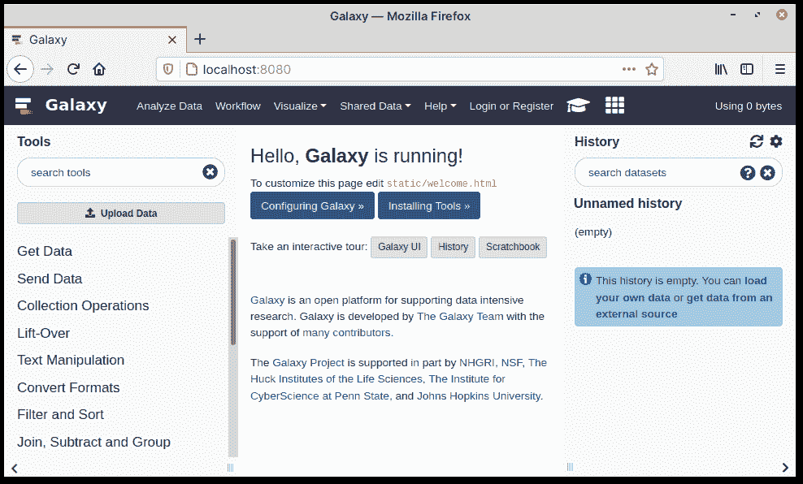

图 85 本地 Galaxy 实例的主页

你可以开始探索可用工具，甚至上传数据并开始使用它们。但是，现在注册用户账户是个好主意，这样当你清除浏览器历史就不会丢失数据。

# 5.2.5. 停止 Galaxy

要停止 Galaxy，打开运行`sh run.sh`命令的终端窗口 图 86。

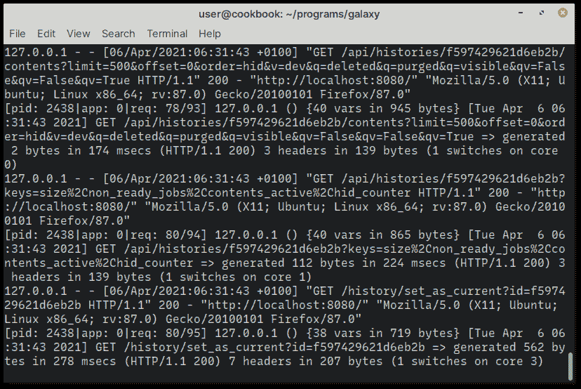

图 86 运行 Galaxy 的终端窗口

使用快捷键`Ctrl+c`停止 Galaxy，即按住`Ctrl`键然后按`c`键。

当 Galaxy 停止运行后，你将在终端中看到已关闭的 图 87 消息。

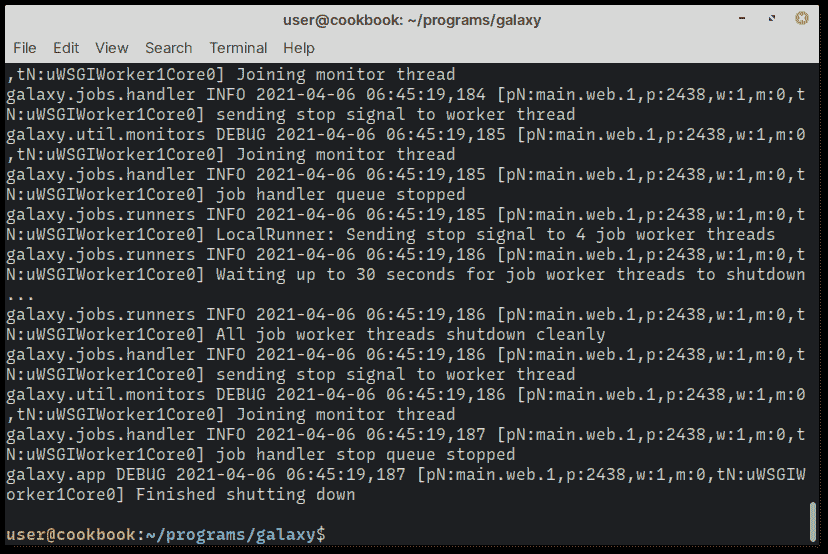

图 87 Galaxy 已完成关闭

现在你可以关闭终端窗口了。

# 5.3. 注册用户账户

在 Galaxy 主页上，点击导航栏中的“登录或注册”链接 图 88。

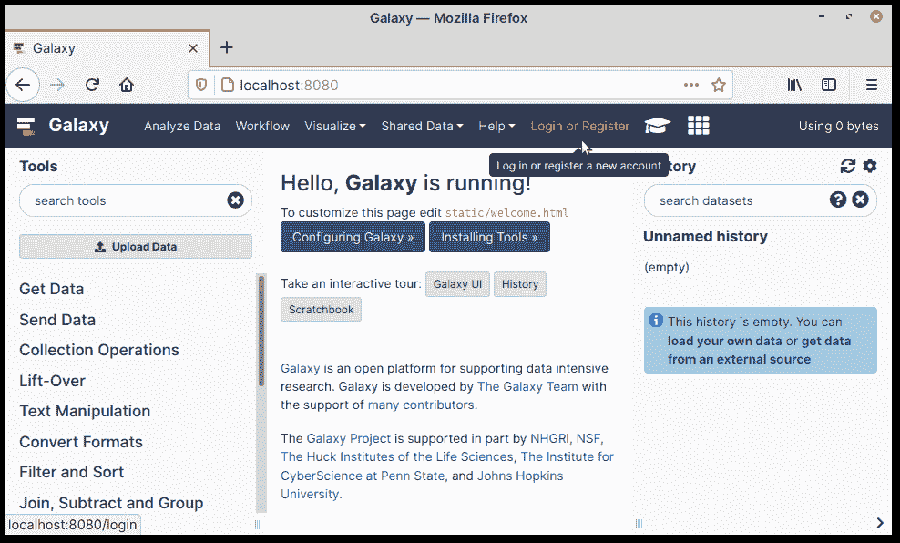

图 88 点击登录或注册

你将被带到登录页面。

点击页面底部的“在此注册”链接 图 89。

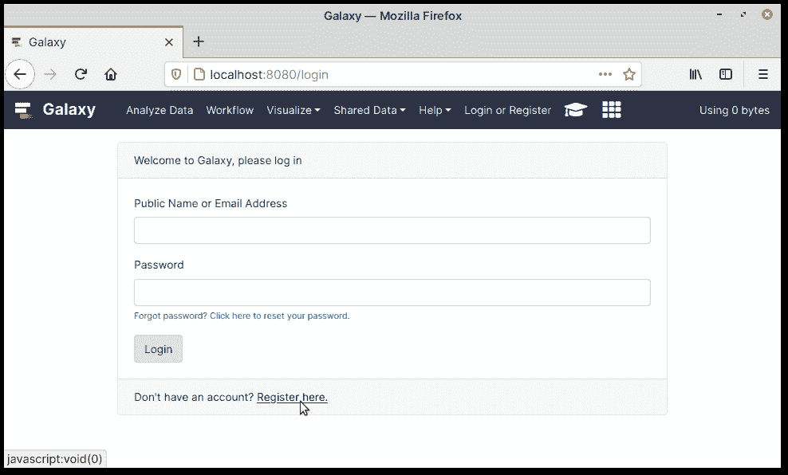

图 89 点击“此处注册”链接

在“创建 Galaxy 账户”页面上，输入您的电子邮件地址、密码及其确认密码，以及一个公共名称（图 90）。

### 注意事项

此用户账户与您在`usegalaxy.org`或其他 Galaxy 服务器上的账户没有关联。

它仅存在于您的本地 Galaxy 实例中。您也可以忽略页面顶通知，该通知不适用于本地实例。

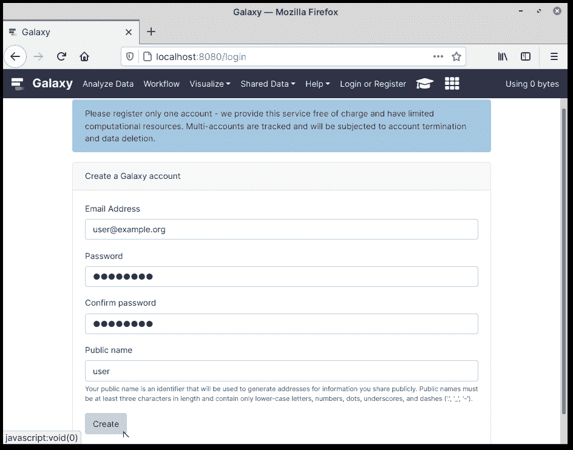

图 90 用户账户创建页面

点击“创建（Create）”按钮继续。

如果账户创建成功，您将会被登录并重定向到您的 Galaxy 实例的主页。

## 5.3.1. 管理您的账户

您可以通过点击导航栏中的用户名来管理账户（图 91）。

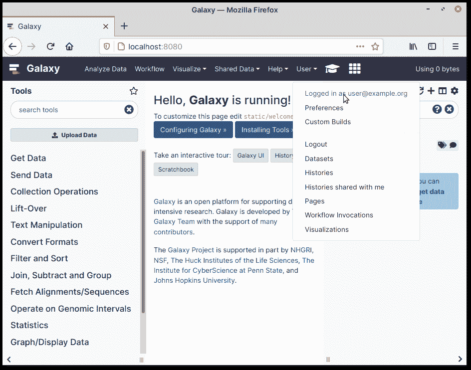

图 91 以用户身份登录

如果您将从 Galaxy 工具共享库（tool shed）安装额外的工具，则此用户账户需要管理员权限。您可以在下一步中进行配置。

# 5.4. 为用户授予管理员权限

要为用户授予管理员权限，您需要为 Galaxy 创建一个配置文件，并将用户的电子邮件地址添加到管理员列表中，然后重启 Galaxy 以使更改生效。

## 5.4.1. 创建配置文件

## 5.4.2. 将用户添加到管理员用户列表

## 5.4.3. 重启 Galaxy

## 5.4.4. 验证管理员访问

# 5.4.1. 创建配置文件

Galaxy 包含了一个示例配置文件——`galaxy.yml.sample`。

要使用示例文件作为模板创建配置文件，请按照以下步骤操作（参见图 92）：

1. 使用文件管理器导航到`$HOME/programs/galaxy/config`目录。
2. 双击`galaxy.yml.sample`在文本编辑器中打开它。
3. 将其保存为同一目录下的`galaxy.yml`。

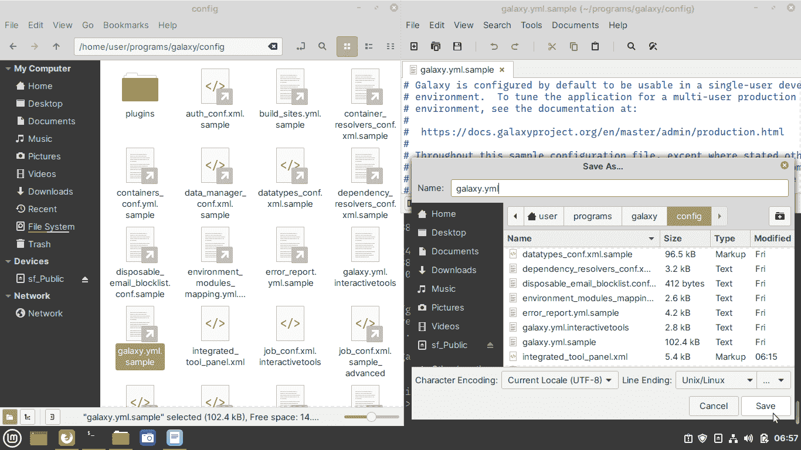

图 92 复制 Galaxy 的示例配置文件

### 注意事项

或者，您可以在终端中使用`cp`命令来复制文件。

假设您在`$HOME/programs/galaxy`目录下，请执行以下操作：

```bash
cp config/galaxy.yml.sample config/galaxy.yml
```

# 5.4.2. 将用户添加到管理员用户列表

在文本编辑器中打开`galaxy.yml`的情况下，搜索`admin_users`设置。

您将发现以下部分：

```yaml
# Administrative users - set this to a comma-separated
# list of valid Galaxy users (email addresses). These
# users will have access to the Admin section of the
# server, and will have access to create users,
# groups, roles, libraries, and more.  For more
# information, see: https://galaxyproject.org/admin/
#admin_users: null
```

通过删除开头的`#`符号来取消注释`admin_users`。

将`null`替换为用户账户的电子邮件地址。

例如：

```yaml
admin_users: user@example.org
```

保存文件。

# 5.4.3. 重启 Galaxy

如果 Galaxy 正在运行，请停止 Galaxy，然后重新启动它。

# 5.4.4. 验证管理员访问

当您再次登录时，您将在导航栏中看到“管理员（Admin）”链接（图 93）。

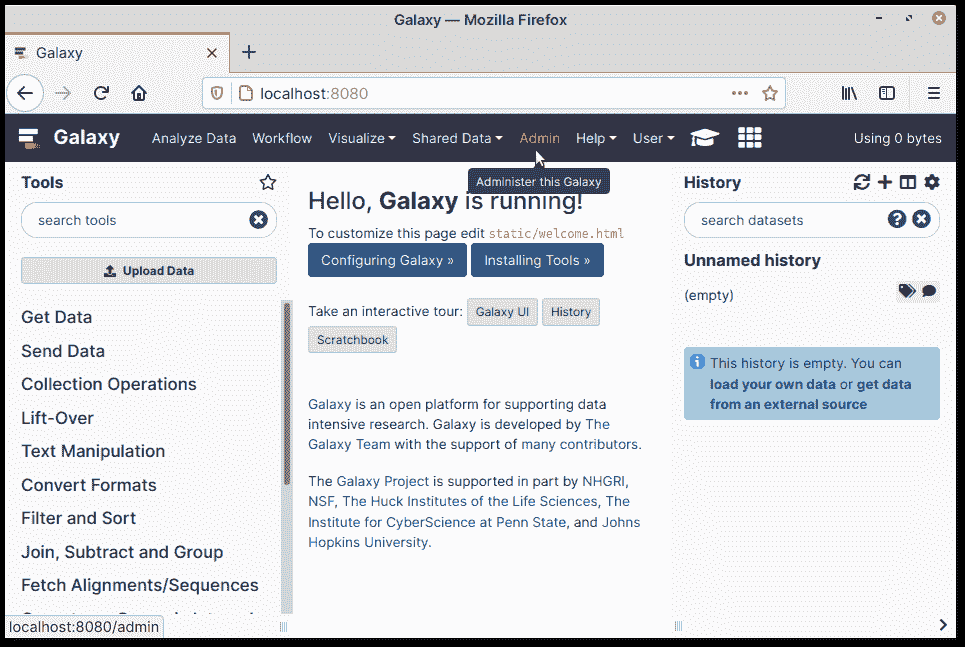

图 93 导航栏中的管理员链接

如果您点击“管理员”，您将进入管理页面（图 94）。

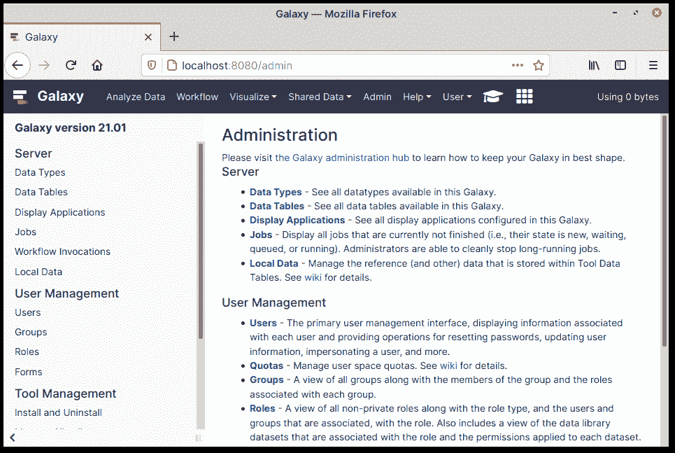

图 94 Galaxy 管理页面

## 安装工具

要安装新工具，请点击以下链接：

工具管理（Tool Management）‣安装与卸载（Install and Uninstall）

您将进入工具管理页面（图 95）。

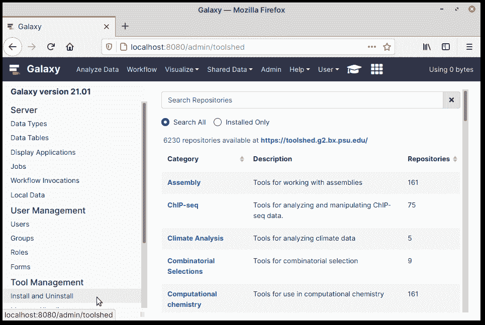

图 95 工具管理页面

从这里，您可以从 Galaxy 主工具共享库中搜索并安装工具。

# 6. 文档

用于管理参考文献和书目、笔记等的安装及软件，

## 6.1. 使用 Zotero 管理参考文献

### 6.1.1. 安装 Zotero

### 6.1.2. 从网络收集参考文献

### 6.1.3. 将 Zotero 集成到 LibreOffice

# 6.1. 使用 Zotero 管理参考文献

Zotero 是一款用于收集和组织文章和其他出版物的免费开源软件。文章可以使用收藏和标签进行组织，并包含在创建的文档中。

## 6.1.1. 安装 Zotero

## 6.1.2. 从网络收集参考文献

## 6.1.3. 将 Zotero 集成到 LibreOffice

# 6.1.1. 安装 Zotero

要从网络收集参考文献，需要安装 Zotero Connector。需要额外的插件（或扩展）。请按照以下步骤安装它们。

## 安装 Zotero Connector

要在 Firefox 中安装 Zotero Connector：

1. 从应用程序菜单打开 Zotero。

   浏览器将打开一个窗口，您将进入[安装页面](https://www.zotero.org/start)[https://www.zotero.org/start]。

   点击“安装（Install）”按钮（图 96）。

   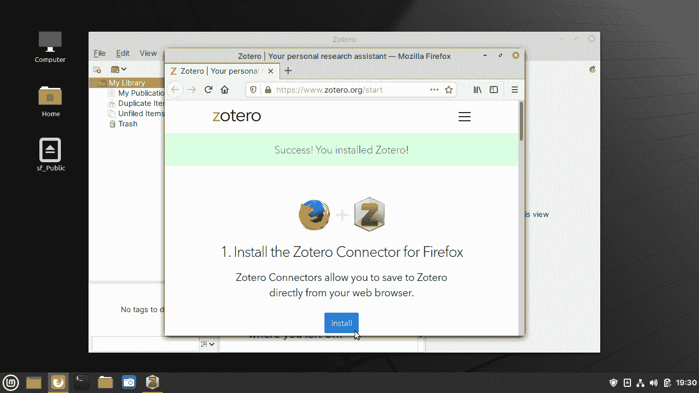

   图 96 Zotero 插件安装页面

2. 您现在会看到一个对话框，询问是否想要继续从`www.zotero.org`安装此插件。

   点击“继续安装（Continue to Installation）”按钮继续（图 97）。

   

   图 97 点击继续安装继续

3. 您现在会看到一个包含此插件所需权限信息的对话框。

   点击“添加（Add）”按钮继续（图 98）。

   

   图 98 点击“添加”确认安装

   安装现在将开始。

   完成后，您将在浏览器工具栏中看到 Zotero 图标（图 99）。

# 6.1.3. 将 Zotero 集成到 LibreOffice


图 99 Zotero Connector 已成功安装

你现在可以开始从浏览器将文章保存到你的 Zotero 库中了。

# 6.1.3. 在 LibreOffice 中集成 Zotero

为了能够在文档中插入引用和参考文献，你需要安装文字处理器插件。

## 安装文字处理器插件

若要在 LibreOffice 中安装该插件：

1. 从 Zotero 的主菜单栏中，选择`Edit`（编辑）‣`Preferences`（偏好）（图 100）。

   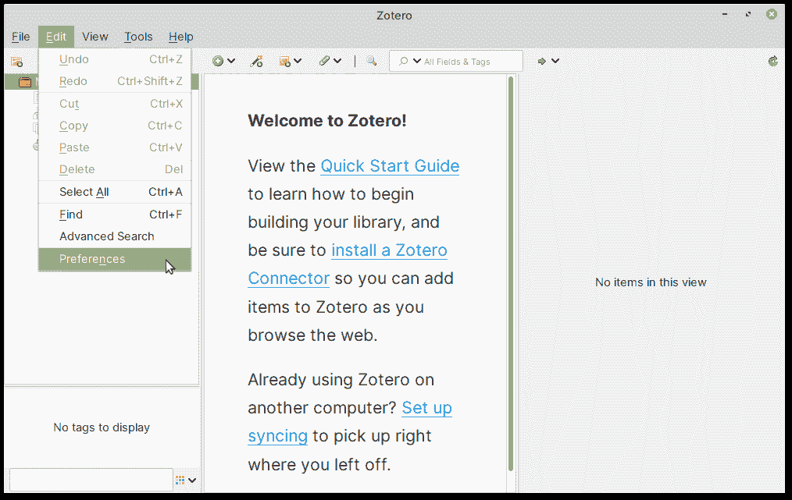

   图 100 查看 Zotero 偏好

2. 在打开的 Zotero 偏好对话框中，点击`Cite`（引用）选项卡。


现在，点击`Word Processors`（文字处理器）选项卡进行选择。

点击`Install LibreOffice Add-in`（安装 LibreOffice 插件）按钮（图 101）。

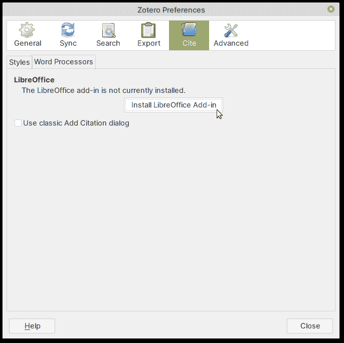

图 101 从 Zotero 偏好中安装 LibreOffice 插件

3. Zotero LibreOffice 插件安装向导现在会打开（图 102）。


图 102 Zotero LibreOffice 插件安装向导

点击`Next`（下一步）按钮继续。

4. 在选择 LibreOffice 安装内容的对话框中，点击`Manual Installation`（手动安装）（图 103）。


图 103 点击手动安装按钮

5. 文件浏览器窗口将打开，目录已设置为插件文件所在位置——`Zotero_OpenOffice_Integration.oxt`（图 104）。


图 104 文件浏览器打开并显示插件文件位置

6. 双击`Zotero_OpenOffice_Integration.oxt`。

这将打开 LibreOffice 扩展管理器，并弹出提示询问你是否想要安装该插件。

点击`OK`按钮确认（图 105）。


图 105 在 LibreOffice 扩展管理器中点击 OK 按钮

插件现在将完成安装（图 106）。


图 106 Zotero LibreOffice 插件安装成功

如果你重启 LibreOffice，你将在主窗口中看到 Zotero 工具栏（图 107）。


图 107 LibreOffice 中的 Zotero 工具栏

— 你现在可以开始在你的文档中开始插入引用和参考文献了。

# 6.2 使用 Zim 创建笔记本

Zim 是一个用于在桌面记录笔记的 GUI 应用。你可以用它在电脑上创建并维护个人或实验室笔记本。

* 6.2.1. Zim 的特性

* 6.2.2. 安装 Zim

* 6.2.3. 创建笔记本

* 6.2.4. 记笔记

* 6.2.5. 导出笔记和笔记本

* 6.2.6. 使用插件激活更多功能

* 6.2.7. 获取帮助

# 6.2.1 Zim 的特性

使用 Zim，你可以：

**创建数字笔记本**

— 添加页面并使用索引页组织它们。

**快速记笔记**

— 使用所见即所得（WYSIWYG）界面 1。

**插入图像**

— 文件、符号、截图、公式等 2。

**导出笔记**

— 导出为 HTML、LaTeX 和 Markdown 等格式。

—

在插件的帮助下，你可以添加更多功能。

1

功能类似于 LibreOffice Writer 等文字处理器。你不需要学习新的标记语言即可使用 Zim。

2

需要在偏好设置中启用插件。

# 6.2.2 安装 Zim

Zim 可以在发行版仓库中找到。

你可以使用软件管理器安装它（图 108）。


图 108 使用软件管理器安装 Zim

# 6.2.3 创建笔记本

通过点击应用程序菜单中的图标打开 Zim（图 109）。你可以使用搜索栏快速定位它。


图 109 从应用程序菜单打开 Zim

当你第一次打开该程序时，你会注意到一个“添加笔记本”对话框（图 110）。

在这里，你可以为此笔记本命名并选择一个保存笔记本的目录。


图 110 添加笔记本

你可以接受默认设置。

点击`OK`按钮继续。

这将打开程序的主窗口（图 111）。


图 111 Zim 的主窗口

# 6.2.4 记笔记

首页是笔记本的主页面。

你可以在这里开始输入笔记。Zim 会自动保存更改。

## 基础文本格式化

在 Zim 中格式化文本与文字处理器程序类似。

你可以使用`Format`菜单栏项并选择所需的选项（图 112）。


图 112 格式选项

### 快捷键

或者，你可以使用快捷键对文本应用格式。

例如：

**加粗**：`Ctrl+b`

*斜体*或*强调*：`Ctrl+i`

上标：`Ctrl+Shift+p`

下标：`Ctrl+Shift+b`

对于标题，使用：

一级标题：`Ctrl`

二级标题：`Ctrl+2`

三级标题：`Ctrl+3`

四级标题：`Ctrl+4`

五级标题：`Ctrl+5`

## 插入图像

要插入图像，你可以从菜单栏选择以下选项：`Insert` ‣ `Image`。

在打开的对话框浏览到图像所在的目录然后选择图像（图 113）。


图 113 插入图像

勾选“附件”选项。这将图像复制到你的笔记本目录。

点击`Open`按钮插入图像（图 114）。


图 114 插入当前页面

### 调整图像大小

如果你想调整图像大小，右键点击图像并选择`Edit Properties`（图 115）。


图 115 编辑图像属性

在打开的对话框中，更改图像的“宽度”或“高度”为所需尺寸并点击`OK`按钮（图 116）。


图 116 更改图像的宽度或高度

图像现在调整完成（图 117）。


图 117 调整大小后的图像

## 添加更多页面

要添加更多页面，从菜单栏选择以下选项：`File` ‣ `New Page`（图 118）。

注意

你也可以在索引视图中右键点击页面并选择`New Page Here`（在此处新建页面）选项。


图 118 添加新页面

在“新页面”对话框中为页面输入名称（图 119）并点击“确定”按钮。


图 119 为新页面输入名称

新页面将出现在“索引”视图中（图 120）。


图 120 新添加的页面

### 添加子页面

子页面将放置在`existing`页面下方。

要添加新的子页面：

1. 在“索引”视图中选择一个现有页面

2. 从菜单栏选择`文件` ‣ `新建子页面`

3. 输入页面名称并点击“确定”按钮

删除 删除或重命名页面

要删除或重命名页面，您可以在页面上`右键点击`并选择所需的功能。

# 6.2.5. 导出笔记和笔记本

要导出笔记本或页面，请选择：

`文件` ‣ `导出`

在出现的对话框中，选择所需的选项并点击“前进”按钮（图 121）。


图 121 导出笔记本

在下一个屏幕上，您可以在`格式`下拉框中选择导出的笔记本或面的格式（图 122）。


图 122 选择导出格式

您可以保持默认值——HTML。点击“前进”按钮继续。

在最后一个屏幕上，选择一个目录来保存导出的笔记本或页面。

**注意**

如果您使用的是默认设置，最好创建一个新的输出目录并在`输出文件夹`下选择它。

点击“确定”按钮完成导出。


图 123 选择输出文件夹

完成后，在文件管理器中打开输出目录。

`双击``Home.html`以在浏览器中打开它（图 124）。


图 124 查看导出的笔记本

# 6.2.6. 使用插件激活更多功能

这些是 Zim 包含的一些插件：

**插入符号**

— 插入特殊符号和字符

**目录**

— 添加一个显示当前页面目录的小部件

**标签**

— 为您的笔记添加标签

**托盘图标**

— 为系统托盘添加图标以便快速访问您的笔记本

**拼写检查**

— 添加拼写检查的支持

—

在开始使用它们之前，需要在设置中激活（或启用）它们。

### 启用插件

要启用插件：

1. 选择`编辑` ‣ `首选项`

2. 点击`插件`选项卡

3. 勾选您想要启用的插件对应的框（图 125）

4. 点击“确定”按钮


图 125 启用插件

**注意**

*某些插件具有额外选项。*

点击插件说明方的`配置`按钮以访问这些选项。

# 6.2.7. 获取帮助

Zim 包含一份详细的用户手册。您可以通过选择以下项来访问它（图 126）：

`帮助` ‣ `内容`


图 126 使用 Zim 的帮助

# 7. 词汇表

**Anaconda**

一个免费开源的（Anaconda 个人版）Python 和 R 分发。它包含了`Conda`和 250 多个开源科学软件包。可以从`Anaconda Cloud`仓库安装额外的包。

网站：[`www.anaconda.com/products/individual`](https://www.anaconda.com/products/individual)

**Anaconda Cloud**

用于 Python 和 R 软件包及笔记本的仓库。

网站：[`anaconda.org`](https://anaconda.org)

**apt**

一个处理 Debian、Ubuntu 和其他 Linux 发行版上安装和删除软件的命令行程序。

相关章节：

`->` 命令行版本 (apt)

**bioconda**

一个`Conda`包管理器的通道，包含超过 7000 个生物信息学软件软件包。

网站：[`bioconda.github.io/`](https://bioconda.github.io/)

**build-essential**

一个安装`make`和`gcc`等构建工具的包。

**Bash**

全称为`GNU`项目程序的 shell。它是 Linux 发行版中最常用的 shell。

网站：[`www.gnu.org/software/`](https://www.gnu.org/bash/)

**Bioconductor**

用于高通量数据分析的 R 工具。

网站：[`www.bioconductor.org/`](https://www.bioconductor.org/)

**Conda**

一个软件包和环境管理器。作为`管理器`，它可以从`Anaconda Cloud`安装软件。`依赖`将自动安装。

**cpanminus**

一个从`CPAN`获取、构建和安装模块的 Perl 脚本。它提供了`cpanm`命令。

网站：[`bioconda.org/term-conda/`](https://bioconda.org/term-conda)

**cutadapt**

一个从高通量测序读数中查找并移除接头序列、引物、聚 A 尾或其他不需要序列的 Python 程序。

网站：[`cutadapt.readthedocs.io`](https://cutadapt.readthedocs.io)

**CPAN**

Comprehensive Archive Network 的缩写。它提供了额外的 Perl 模块进行安装（截至 2020 年有 196,752 个）。

网站：[`www.cpan.org/`](https://www.cpan.org/)

**CRAN**

Comprehensive R Archive Network 的缩写。提供 R 最新版本、软件包和文档的 FTP 和网页网络。

网站：[`cran.r-project.org/`](https://cran.r-project.org/)

**Debian**

由自由开源软件组成的 Linux 发行版。任何人都可以免费下载、使用、修改和分发。

网站：[`www.debian.org/`](https://www.debian.org/)

**Debian package**

可执行文件、库和文档的存档。可以在 Debian Linux 和基于 Debian 的系统（如 Ubuntu 和 Linux Mint）上安装。这些文件具有`.deb`后缀。

**dependencies**

运行程序所需的额外程序或库。

**edgeR**

用于数字基因表达数据经验分析的 R 软件包。可用`Bioconductor`项目仓库。

网站：[`www.bioconductor.org/packages/edgeR/`](https://www.bioconductor.org/packages/edgeR/)

**FAST**

FAST Analysis of Sequences Toolbox 的缩写。一组用 Perl 编写的工具，将 UNIX 范式扩展到生物信息记录。

网站：[`metacpan.org/pod/FAST`](https://metacpan.org/pod/FAST)

**Bio::Phylo**

用于系统发育分析的 Perl 包。

网站：[`metacpan.org/Bio::Phylo`](https://metacpan.org/Bio::Phylo)

**commands**

也称为二进制文件或可执行文件。

**BioPython**

用于计算生物学的 Python 工具。

网站：[`biopython.org/`](http://biopython.org/)

**Files**

Linux Mint Cinnamon 版本的默认文件管理器。其原名为 Nemo。

**gdebi**

一个用于安装 Debian 软件包及其依赖项（如果有）的简单工具。

网站：[`launchpad.net/gdebi`](https://launchpad.net/gdebi)

## GNU

GNU 是 GNU's Not Unix 的递归缩写。该项目的目标提供 100% 免费的 Unix 兼容系统。

网站：[`www.gnu.org/`](https://www.gnu.org/)

## GUI

图形用户界面的缩写。在个人电脑上，它通常包含带有访问功能按钮的应用窗口、用于启动应用程序的图标以及用于管理设备服务的组件。

## IDE

集成开发环境的缩写。示例包括 PyCharm、RStudio 和 Eclipse。

## local-lib

一个 Perl 模块，用于创建一个本地目录结构以便在无需管理员权限的情况下安装带有依赖项的模块。

网站：[`metacpan.org/pod/local::lib`](https://metacpan.org/pod/local::lib)

## Linux Mint

一种桌面 Linux 发行版。它基于 Debian 和 Ubuntu。

网站：[`linuxmint.com/`](https://linuxmint.com/)

## MEGA


## MEGA

用于分子进化遗传学分析的软件。提供 GUI 和命令行版本。

网站：[`megasoftware.net/`](https://megasoftware.net/)

## MetaCPAN

针对 CPAN 上可用的 Perl 包和模块的搜索引擎。

网站：[`metacpan.org/`](https://metacpan.org/)

## Miniconda

Conda 的极简发行。与带有额外软件包的替代安装程序 Anaconda 相比，它的安装速度更快且占磁盘空间更少。

网站：[`docs.conda.io/en/latest/miniconda.html`](https://docs.conda.io/en/latest/miniconda.html)

## Modeller

一个通过满足空间限制进行比较蛋白质结构建模的程序。

网站：[`salilab.org/modeller/`](https://salilab.org/modeller/)

## nano

一个简单的基于命令行文本编辑器。

网站：[`www.nano-editor.org/`](https://www.nano-editor.org/)

## OVA

一种用于分发虚拟机镜像的文件格式。

## pip

Python 包安装器。它可以用于从 PyPI 和其他 Python 包索引安装包。

网站：[`pip.pypa.io/`](https://pip.pypa.io/)

## PyMOL

PyMOL 是最初由 Warren L. Delano 开发的分子可视化系统。目前由 Schrödinger, Inc. 维护。

网站：[`pymol.org/2/`](https://pymol.org/2/)

## PyPI

Python Package Index 的缩写。Python 编写的软件仓库（截至 2020 年 12 月有 275,161 个项目）。

网站：[`pypi.org/`](https://pypi.org/)

## root

Linux 系统上的主要管理员账户。

## R

用于统计计算和图形的编程语言和免费软件环境。

网站：[`r-project.org`](https://r-project.org)

## RStudio Desktop

一个用于 R 的 IDE。它包含一个 R 控制台、一个带有语法高亮的编辑器，以及用于绘图、调试和管理 R 包的工具。可以从项目网站免费下载开源版本。

网站：[`rstudio.com/products/rstudio/download/`](https://rstudio.com/products/rstudio/download/)

相关章节：

`->` 安装 Debian 软件包

## setuptools

用于构建和安装 Python 包的 Python 程序。

## shell

shell 为操作系统的服务提供命令行界面 (CLI)。

## Software Manager

在 Linux Mint 上安装软件的默认应用程序（GUI）。其他 Linux 发行版也提供具有类似功能的应用程序。例如：

- Ubuntu 上的 Ubuntu Software
- Fedora 和其他基于 GNOME 的发行版上的 Software
- Kubuntu 和其他基于 KDE 的发行版上的 Discover

相关章节：

`->` 快速简单的方法

## Synaptic

用于使用 apt 系统的 GUI 包管理器。

网站：[`www.nongnu.org/synaptic/`](https://www.nongnu.org/synaptic/)

## text editor

编辑文本文件的程序。

示例（GUI、Ubuntu 上的 Text Editor (gedit)、KDE Plasma 上的 Kwrite、Geany 等）。

示例（命令行）——nano、VIM 或 vi、GNU Emacs 等。

相关章节：

`->` 文本编辑器

## Credits

- `Debian`：用于基础。
- `Ubuntu`：用于基础。
- `GNU`：用于系统。
- `GNOME`：用于桌面。
- `KDE`：用于桌面。
- `Linux`：用于操作系统。
- `Python`：用于脚本。
- `R`：用于环境。
- `apt`：用于包管理器。
- `nano`：用于编辑器。
- `VIM`：用于编辑器。
- `vi`：用于编辑器。
- `Emacs`：用于编辑器。

## Fonts

- `Source Serif 4`：用于文本。
- `Fira Sans`：用于文本。
- `Fira Code`：用于代码。
- `Recursive Mono`：用于代码。

## Images

封使用的企鹅图像来自 openclipart.org。

[`openclipart.org/detail/47299/emperor-penguin`](https://openclipart.org/detail/47299/emperor-penguin)

# 索引

A | B | C | D | E | F | G | I | L | M | N | O | P | R | S | T | U | V | W

## A

- `Anaconda`
- `Anaconda Cloud`
- [`apt`](#glossary.xhtml_term-apt), [[1]](#install.xhtml_index-0), [[2]](#notes.xhtml_index-0)

## B

- [`Bash`](#glossary.xhtml_term-Bash)
- [`bash_aliases`](important-files.xhtml_index-1)
- [`bashrc`](#configure.xhtml_index-0), [[1]](#text-editor.xhtml_index-0), [[2]](#important-files.xhtml_index-0)
- [`Bio::Phylo`](#glossary.xhtml_term-Bio-Phylo)
- [`BiocManager`](#glossary.xhtml_term-BiocManager)
- [`bioconda`](#glossary.xhtml_term-bioconda)
- [`Bioconductor`](#glossary.xhtml_term-Bioconductor)
- [`BioPython`](#glossary.xhtml_term-BioPython)
- [`build-essential`](#glossary.xhtml_term-build-essential)

## C

- [`commands`](#glossary.xhtml_term-commands)
- [`Conda`](#glossary.xhtml_term-Conda), [[1]](#requirements.xhtml_index-0)
- [`CPAN`](#glossary.xhtml_term-CPAN)
- [`cpanminus`](#glossary.xhtml_term-cpanminus)
- [`CRAN`](#glossary.xhtml_term-CRAN)
- [`cutadapt`](#glossary.xhtml_term-cutadapt)

## D

- [`Debian`](#glossary.xhtml_term-Debian)
- [`Debian package`](#glossary.xhtml_term-Debian-package)
- [`dependencies`](#glossary.xhtml_term-dependencies)

## E

- [`edgeR`](#glossary.xhtml_term-edgeR)

## F

- [`FAST`](#glossary.xhtml_term-FAST)
- [`Files`](#glossary.xhtml_term-Files), [[1]](#files.xhtml_index-0), [[2]](#home-directory.xhtml_index-0), [[3]](#transfer-files.xhtml_index-0)

## G

- [`gdebi`](#glossary.xhtml_term-gdebi)
- [`Git`](clone.xhtml_index-0)
- [`GNU`](#glossary.xhtml_term-GNU)
- [`GUI`](#glossary.xhtml_term-GUI)

## I

- [`IDE`](#glossary.xhtml_term-IDE)

## L

- LibreOffice
- [`Linux Mint`](#glossary.xhtml_term-Linux-Mint)
- [`local-lib`](#glossary.xhtml_term-local-lib)

## M

- [`MEGA`](#glossary.xhtml_term-MEGA)
- [`MetaCPAN`](#glossary.xhtml_term-MetaCPAN)
- [`Miniconda`](#glossary.xhtml_term-Miniconda)
- [`Modeller`](#glossary.xhtml_term-Modeller)

## N

- [`nano`](#glossary.xhtml_term-nano)

## O

- [`OVA`](#glossary.xhtml_term-OVA)

## P

- [`pip`](#glossary.xhtml_term-pip), [[1]](#venv.xhtml_index-0)
- [`PyMOL`](#glossary.xhtml_term-PyMOL)
- [`PyPI`](#glossary.xhtml_term-PyPI)
- [`Python`](venv.xhtml_index-0)

## R

- [`R`](#glossary.xhtml_term-R)
- [`root`](#glossary.xhtml_term-root)
- [`RStudio Desktop`](#glossary.xhtml_term-RStudio-Desktop)

## S

- [`setuptools`](#glossary.xhtml_term-setuptools), [[1]](#venv.xhtml_index-0)
- [`shell`](#glossary.xhtml_term-shell)
- [`Software Manager`](#glossary.xhtml_term-Software-Manager), [[1]](#install.xhtml_index-0), [[2]](#index.xhtml_index-0), [[3]](#software-manager.xhtml_index-0)
- [`Synaptic`](#glossary.xhtml_term-Synaptic)
- System Settings
  - Date and Time
  - Keyboard Layout
  - Preferred Applications

## T

- [`text editor`](#glossary.xhtml_term-text-editor)

## U

- [`Ubuntu`](#glossary.xhtml_term-Ubuntu)

## V

- [`venv`](venv.xhtml_index-0)
- `VirtualBox`

## W

- [`wheel`](#glossary.xhtml_term-wheel), [[1]](#venv.xhtml_index-0)
