# Linux 傻瓜指南

理查德·布鲁姆

在线 Linux 讲师

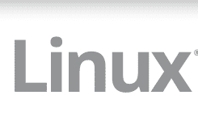


## 引言

欢迎进入 Linux 这个迷人的开源软件世界。在这本书中，我将向你介绍 Linux 操作系统的奇妙之处，它最初由 Linus Torvalds 在 20 世纪 90 年代初作为一份爱的劳动创造出来。我的目标是让你加入那些迅速增长的 Linux 用户和爱好者行列，他们正忙于改写操作系统市场规则。

如果你一直考虑转向 Linux 但觉得前景过于令人望而却步，你可以放宽心。如果你能烧开水或设置闹钟，你也能成为 Linux 用户。（玩笑而已！）

当这本书第一版出版时，Linux 是一个新兴的现象，既不出名也不被理解。在这个版本中——为新一代 Linux 用户——有这么多可用的材料，我将这一特定标题转向了 Linux 是什么以及你如何在桌面上最好地利用它。为此，这些页面包含各种在线资源、技巧、窍门以及更通用的说明。如果你在寻找关于服务器的材料，Emmett Dulaney 的《Linux All-in-One Desk Reference For Dummies》（John Wiley & Sons, Inc.）可以满足你的需求。

在这本书中，我将技术黑话（technobabble）降到最低，并尽可能使用通俗英语。除了关于 Linux 安装、启动、配置和软件的通俗讲解外，我还包含了许多例子，以及大量详细的说明，帮助你以最少的压力或混乱来设置和使用你自己的 Linux 机器。

## 关于本书

把这本书想象成一本友好的、易接近的指南，用于应对术语和 Linux 的工具、实用程序和部件集合。虽然 Linux 并不是特别难琢磨，但它确实包含大量细节、参数和管理琐事（administrivia，UNIX 术语中的管理琐碎事项）。你需要将这些细节


在安装、配置、管理和故障排除基于 Linux 的计算机时，你可以对其随心所欲地塑造。本书涵盖的一些示例主题包括以下内容：

- 了解 Linux 的起源及其能为你做什么
- 安装 Linux 操作系统
- 使用 Linux 系统管理文件并安装软件
- 设置互联网访问并浏览网页
- 自定义你的 Linux 桌面
- 管理 Linux 系统的安全性和资源

乍一看，使用 Linux 似乎需要多年的实践经验、大量的试错、高级计算机科学培训以及极高的投入，但请放心！事实并非如此！如果你能告诉别人如何找到你的办公室，那你肯定能构建一个符合你需求的 Linux 系统。本书的目的并不是让你变成一个彻头彻尾的 Linux 极客（当然，那是 Linux 悟性的终极状态）；而是向你展示构建一个运行流畅的 Linux 系统所需的各项细节，并赋予你使用它所需的专业知识和信心。

## 如何使用本书

本书告诉你如何安装、配置和自定义 Linux 桌面系统。虽然如今在 Linux 上通过点击和点选即可完成大多数操作，但你仍可能希望尝试在命令提示符下使用 Linux——在那里你输入详细的指令来加载或配置软件、访问文件以及执行其他任务。在本书中，输入内容以等宽字体显示，例如：

```
rm dir /etc/bin/devone
```

当你输入 Linux 命令或其他相关信息时，请确保完全按照书中所示复制信息，包括大写字母和小写字母，因为这是使 Linux 正常运作的关键魔法之一。

未能完全按照说明操作可能会带来各种不幸、不可见或意外的副作用。

书籍的页边距提供的空间不如你的电脑屏幕那么大；因此，在本书中，一些 URL 和命令提示符下的长命令可能会换行显示到下一行。请记住，你的电脑将这些换行视为一组单一指令或单一 URL——因此，如果你正在输入一大段文本，请保持它在同一行。如果你看到这种换行，不要插入硬回车。我会在斜杠处或自然的单词断点处断开换行（以暗示“等等——还有更多！”），并略微缩进超出部分，如下面的愚蠢示例所示：

```
www.infocababra.transylvania.com/nexus/pilexus/lexux/praxis/okay/this/is/a/make-believe/URL/bst/some/real/ones/are/SERIOUSLY/long.html
```

请注意，当你深入研读本书——以及你很可能遇到的其他关于 Linux 的智慧、箴言和灵感的来源时——你可能会发现一些术语被互换使用。例如，根据来源、语境以及你所咨询的信息源不同，你可能会看到同一软件被称为程序、命令、工具、脚本、应用程序或工具。在很大程度上，你可以将这些术语视为可互换的；当需要在它们之间做出重要区分时，我会明确指出。类似地，当你处理各种命令或配置控件时，你也可能会遇到诸如标志（flag）、开关（switch）、选项（option）或参数（parameter）等术语，它们或多或少是可以互换使用的。在这种情况下，所有这些术语都指的是控制、完善或修改基本命令或程序以使其按你意愿行事的方法。同样，凡是需要区分和澄清之处，我都会提供说明。

## 三个大胆的假设

人们说，做出假设会让做出假设的人以及被假设涉及的人显得愚蠢。（顺便问一下，这里的“人们”是谁？我假设我知道，但——算了。）即便如此，实用性要求我对尊敬的读者做几个假设：

- 你可以打开和关闭你的电脑。
- 你知道如何使用鼠标和键盘。
- 你想安装、配置和/或使用桌面 Linux 系统，因为出于好奇、兴趣或这是你的工作内容。

你不需要精通逻辑学或编程这门深奥艺术的大师才能使用本书，你也不需要拥有计算机科学博士学位。你甚至不需要对电脑内部运作有完整或完美的理解。

如果你拥有活跃的想象力和解决基本问题的能力，那就更好了——你已经掌握了让 Linux 为你服务所需的关键要素。剩下的只是些许细节和一点耐心。我可以帮你处理细节，但耐心得靠你自己！

## 本书使用的图标

在每一章中，图标突出显示特别重要或有用的信息。本书中包含以下图标：

- **提示图标**
  提示图标标记那些能让你的 Linux 系统使用体验比你想象中更简单化的有用信息。

- **记住图标**
  我有时使用此图标来指出你不应该错过的信息——请不要忽略这些温馨的提醒。（你挽救的可能是自己的生命、理智或纸张。）

- **警告图标**
  当你看到此图标时要谨慎——它警告你不要做某些事情。此图标旨在强调忽略这些智慧片段可能带来的严重后果。

- **技术细节图标**
  此图标指示那些信息丰富且有趣，但对于理解和使用 Linux 并非至关重要的技术细节。如果你想的话可以跳过这些段落（但请之后回来阅读它们）。

## 接下来去哪儿

这就是你选择方向并踏上旅途的时刻！*《Linux 傻瓜入门》（Linux For Dummies）第 10 版*很像《一千零一夜》，因为几乎无关紧要你从哪里开始。在准备构建自己的 Linux 系统时，你会看到许多不同的场景和故事。虽然每个故事都有自己独特的角色和情节，但整体 certainly 令人惊叹。别担心——你能搞定。不在乎别人是否认为你只是在胡闹？我知道你正准备享受人生中最美好的时光。

别忘了检查一下速查表。只需访问 dummies.com 并搜索“Linux For Dummies cheat sheet”。

祝你愉快！

# 第 1 章：初识 Linux

## 本部分导读

了解 Linux 是什么、来自哪里以及它是如何工作的。

着手处理在 PC 上准备和安装 Linux 所涉及的各项任务和活动。

启动你的新 Linux 环境。

在桌面上寻找方向，并根据你的喜好进行调整。

## 本章导读

- 深入探讨 Linux 的起源和特性
- 将 Linux 与其他操作系统区分开来
- 依赖 GNU 和 GPL
- 惊叹于 Linux 公司（或缺乏公司实体）
- 查看流行的 Linux 发行版

欢迎来到 Linux 的世界，这个由世界各地成千上万的人开发的操作系统！在本章中，你将了解 Linux 本身——它是什么、来自哪里，以及为什么它受到如此多的关注。准备好让你的假设受到挑战，关于软件*必须*如何开发和销售，并让你的思维向新的可能性开放。

## “免费”真的免费吗？

理解 Linux 需要从根本上转变你获取和使用计算机软件的方式。（*注：*这里所说的*根本*，是指追溯到事情的本质，而不是戴上念珠并在办公楼里露营。）转变你思维模式的第一步是改变单词*free*（免费）的一般含义，使其代表*自由*（freedom），而不是*免费午餐*（free lunch）。没错，你可以有偿销售“免费”软件……并且我们鼓励你这样做，只要你向软件的每位接收者传递同样的自由即可。


别挠破头皮，这些概念起初确实难以掌握，尤其是当你考虑到商业软件行业市场部门对你进行的“条件反射式”灌输时。你或许并不知道，当你购买大多数专有软件包时，你实际上并不拥有该软件。相反，你只是被许可人在规定范围内授予了使用软件的权限。

Linux 也有许可证。然而，其许可证的动机和目的与大多数商业软件截然不同。Linux 使用的 GNU 通用公共许可证（GPL）并非旨在限制软件的使用，而是确保软件始终对任何人开放。任何公司都永远无法拥有 Linux，也无法规定你使用或修改 Linux 的方式——尽管它们可以拥有各自品牌的独立版权和商标，例如 Red Hat 和 SUSE。本质上，你已经拥有 Linux，你可以随心所欲地使用它，只要将 GPL 自由传播给软件的后续接收者即可。

## Linux：是革命，还是又一个操作系统？

在深入探讨 Linux 之前，我需要先澄清一些术语。

Tux 是代表 Linux 的吉祥物企鹅的正式名称。传闻称，Linux 的创建者 Linux Torvalds 非常喜爱这些穿着体面的南极居民。

操作系统是运行你计算机的软件，处理你与硬件之间的所有交互。无论你在计算机上写信、计算预算还是管理食谱，操作系统都提供了你的计算机赖以呼吸的基本氧气。此外，操作系统不仅仅是一个程序；它由数百个较小的程序和实用工具组成，让我们人类能够使用计算机完成有用的事情。然后，你在操作系统之上运行其他程序（如你的文字处理软件）来完成所有任务。

在近期的技术历史中，Linux 已从极客游乐场演变为坚固可靠的企业解决方案。曾经被斥为“非法”的软件，如今正被 IBM、惠普、摩托罗拉、微软和英特尔等行业领导者采用和推动。这些计算机制造商中的每一家都确定，Linux 在某种程度上为客户（以及其自身运营）提供了价值。

Linux 曾被指责“只是又一个操作系统”。表面上看或许如此，但如果你深入观察，就会发现事实并非如此。Linux 项目是引领当前计算产业向开源和自由（指自由，而非免费午餐）软件趋势发展的旗舰。得益于其开发和（继续）开发的模式，Linux 是一个坚固可靠的操作系统，代表了软件开发中许多优良之处。

有两个根本区别将 Linux 与其他操作系统区分开来：

- Linux 在独特且巧妙的 GNU 通用公共许可证下授权，你可以在下一节中阅读相关内容。
- Linux 由一支全球志愿者和受薪程序员团队开发和维护，他们通过互联网协作工作。

Linux 有许多优点，其中包括那些从头开始构建它的人希望它具备的特性：

- **多用户：** 同一时间可以有多个用户登录到一台计算机。
- **多进程：** 真正的抢占式多任务处理使操作系统内核能够高效地管理同时运行的多个程序。这对在一台计算机上提供多种服务至关重要。
- **多平台：** 尽管 Mac OS 仅在 Intel CPU 上运行，Windows 仅在 Intel 和 ARM CPU 上运行，但 Linux 目前运行在超过 24 种不同的 CPU 平台（硬件类型）上，包括 32 位和 64 位基于 Intel 的 PC、Digital/Compaq Alpha、所有版本的 Apple Macintosh、Sun SPARC、Apple iPod、ARM CPU，甚至 Microsoft XBox。
- **互操作性：** Linux 与大多数网络协议（语言）和操作系统都能良好协作，允许你与运行 Microsoft Windows、UNIX、Apple Macintosh 计算机以及其他更小众群体的用户和计算机进行交互。
- **可扩展性：** 随着你的计算需求增长，你可以依赖 Linux 随之扩展。同一个 Linux 操作系统可以运行在微型电子相框、台式机或大型工业级服务器系统上。
- **可移植性：** Linux 主要使用 C 编程语言编写。C 是为编写操作系统级软件而专门创建的语言，可以轻松地移植（转换）到新计算机硬件上运行。
- **灵活性：** 你可以将 Linux 操作系统配置为网络主机、路由器、图形工作站、办公生产力 PC、家庭娱乐计算机、文件服务器、Web 服务器、集群，或者几乎任何其他你能想到的计算设备。
- **稳定性：** Linux 内核（操作系统的核心）已达到一种成熟度，令大多数软件开发者羡慕不已。听到 Linux 服务器运行数年而不崩溃的报道并不罕见。
- **高效性：** Linux 的模块化设计使你只需包含运行所需服务所需的组件。即使是较旧的计算机也能利用 Linux 重新变得有用。
- **免费：** 对大多数人来说，Linux 最引人注目的方面是它通常免费。资本家们低声问道：没有直接经济回报的动力，任何人如何能建造更好的捕鼠器？

在这一章中，我打算为你回答这最后一个问题。我也希望描绘出创造 Linux 的开源软件开发模式的图景。

## 那么 Linux 从何而来？

了解 Linux 的最快方法是审视其丰富的传承。尽管 Linux 核心的编程始于 1991 年，但其设计概念基于久经考验的 UNIX 操作系统。

UNIX 在 20 世纪 60 年代后期于贝尔电话实验室开发。当时操作系统寥寥无几，UNIX 的原始架构师希望创建一个既能高效又能安全地共享数据、程序和资源的系统——这是当时所不具备的（现在仍在追求）。从此，UNIX 演变为许多不同版本；其当前的谱系如此复杂，看起来就像葛藤入侵！

1991 年，Linus Torvalds 是芬兰赫尔辛基大学的一名计算机科学学生。他想要一个类似他在大学中钟爱的 UNIX 系统的操作系统，但 UNIX 及其运行的硬件都价格高昂。有一种称为 Minix 的 UNIX 版本可以免费获得，但它并不完全满足他的需求。因此，作为计算机科学学生，Torvalds 研究了 Minix，然后着手自己编写一个新版本。用他自己的话来说（因这是早期在线聊天室版本而被记录在互联网上供后人参考），他的工作“只是一个爱好，不会像 GNU 那样变得庞大且专业化。”

编写操作系统绝非易事。即使经过六个月的艰苦工作，Torvalds 在系统通用性方面取得的进展也非常有限。他将自己所做的内容发布到互联网上——并发现许多人分享了他的兴趣和好奇心。没过多久，全球一些最聪明的人开始通过添加增强功能或修复错误（代码中的 bug）来为 Linus 的项目做出贡献。

## 开源软件项目的解剖学

对于漫不经心的观察者（以及一些企业 IT 决策者）来说，Linux 似乎是一个异常的突变体——由无政府状态随机生成的流氓生物。毕竟，像计算机操作系统这样复杂且依赖纪律的事物，如何能由一支松散的全球志愿者电脑极客团队开发出来？

正如科学不断尝试对存在的一切进行分类和解释，科技评论员仍在试图理解开源方法如何能创造优越的软件，尤其是在不收费的情况下。通常，原因与人类普遍渴望用解决方案满足需求的心理有关。当 Linux 世界中的程序员想要一个工具时，该程序员 simply 写一个——或者与其他想要类似软件包的人联合起来，共同编写它。

## GNU 是谁？

想象一下——出于需求而非预期利润而创建的软件。尽管 UNIX 最终成为昂贵的专有软件，但创建它的想法和动机最初是基于实际需求的。人们通常（单数形式）所称的 *Linux 操作系统* 实际上是一组软件工具的集合，这些工具是专门为解决特定计算问题而创建的。

如果没有史蒂文·列维（《黑客》一书的作者）所说的“伟大的 MIT AI-LAB 黑客最后一位”——即原始意义上的 *hacker* 是编码专家，而非当前流行的暗示犯罪意图的含义——的远见，Linux 受欢迎速度的提升也是不可能的。这位 *自由* 软件的先驱和倡导者是 Richard Stallman。

麻省理工学院（MIT）长期以来一直享有在技术学科领域培养最优秀头脑的声誉。1984 年，Stallman，一位 MIT 的才华横溢的学生和出色程序员，面临着一个困境——是将他的天赋卖给一家公司换取一笔可观的金钱，还是将他的天赋捐献给世界。他做了我们都会做的事……对吧？

Stallman 踏上了一段旅程，创建一个完全免费的操作系统，并将它捐献给世界。他理解——并继续践行——原始的黑客伦理，该伦理宣告信息渴望自由。这个概念并非


在他那个时代是新颖的。在计算行业的早期，许多进步是通过自由分享思想和编程代码实现的。由制造商赞助的用户群体将最优秀的头脑聚集在一起，以解决复杂的问题。Stallman 认为，当公司开始将软件作为其自身的知识产权加以垄断，并以盈利为唯一目的时，这种伦理精神就丧失了。

或许到此时您已经意会到，广泛且易于获取的源代码对于成功的软件开发至关重要。术语“源代码”是指人类可读的文本（相对于“可执行”文件中人类无法阅读的电子象形文字），程序员通过键入这些文本来向计算机传达指令。

使用计算机可以直接运行的代码来编写计算机程序是一项极其繁重的任务。现代计算机软件通常使用对人为友好的语言编写，然后编译（或翻译）成计算机的原生指令集。要对这些软件进行修改，程序员需要访问程序的源代码。大多数专有软件仅以预编译产品的形式提供；软件开发商将这些程序的源代码锁在保险柜里。

在确定其操作系统将围绕 UNIX 的概念框架构建之后，Stallman 希望项目名称能够将其系统与 UNIX 区分开来。因此，他选择了递归缩写 GNU（发音为 ga-new），意思是 GNU 不是 Unix（GNU's not Unix）。

为 GNU 项目提供资金，Stallman 组织了自由软件基金会（FSF），该基金会通过销售开源软件来资助从事其持续开发的程序员。（请记住，我们所说的是自由意义上的“自由”，而不是免费的午餐。）尽管该组织及其创建完整操作系统的目标必不可少且至关重要，但为了保护这项新软件免受大企业的侵犯，还须部署一个更为重要的拼图部件——这一问题在今天依然至关重要，因为一家前 Linux 公司试图侵占来自全球数千名志愿者数十年的志愿工作的所有权。

GNU 通用公共许可证（GPL）是一种独特且富有创造力的软件许可证，它利用版权法来保护软件用户的自由，而这通常是版权作用的相反方向。一般来说，版权是一种可执行的排他性所有权和限制复制的指定，除版权持有人外，任何人都不得复制。当软件获得 GPL 许可时，接受者受版权法约束，必须尊重其他任何人以任何方式使用该软件的自由。获得 GPL 许可的软件也被称为“反公共版权”（copyleft，即权利的反面，明白吗？）软件。另一种记忆 GPL 的方式是通过其最终结果：终身保证公共（Guaranteed Public for Life）。

虽然 Stallman 的工作为 Linux 迅速获得 popularity 奠定了基础，但他和他的团队正在开发的操作系统所花费的时间比预期的要长。如果您对完成的版本感兴趣，请访问 www.gnu.org/software/hurd/hurd.html。

# Linux 究竟由谁管理？

随着开源项目的演变，各种人物会涌现出来成为领导者。这位领导者通常被称为项目的*仁慈独裁者*（benevolent dictator）。成为仁慈独裁者的人可能在某个特定问题上投入的时间比任何人都多，并且通常具有一些独特的洞察力。通常，*民主*（democratic）和*独裁*（dictator）这两个词很少出现在同一个句子中，但开源模式是一个非常民主的过程，它支持仁慈独裁者的统治。

林纳斯·托瓦尔兹（Linus Torvalds）仍被视为 Linux *内核*（操作系统核心）的仁慈独裁者。他最终决定哪些功能将被添加到内核中，哪些功能将不被添加。社区信任他的愿景和判断力。万一他对项目失去兴趣，或者社区决定他已经变得老糊涂了，一位新领导人将从与他一起工作的非常有能力的人中脱颖而出。

# 爱因斯坦也是一名志愿者

成为志愿者或向项目捐赠时间的人并不一定是提供二流努力（或者只在周末和假期工作的人）。事实上，任何人力资源专家都会告诉你，那些自愿选择做某项工作的人能生产出最高质量的产品。

为开源项目做出贡献的志愿者通常是其领域的领导者，他们依赖社区协作来完成有用的工作。科学界对开源概念并不陌生。开源项目所培养的公正同行评审流程对于验证某些新功能或能力在技术上的正确性至关重要。


那些将开源社区描绘成版权侵犯者和小偷的人常常误解——或者完全忽视——这些重要问题。开源程序员非常自豪于他们的工作，同时也非常关心他们自己的版权，不希望自己的工作被他人窃取——因此出现了如 GPL 等许可证。这种关切创造了一种对版权给予最大尊重的氛围。那些声称自己“只是在搞开源”来窃取他人辛勤成果的小偷，是在滥用术语以安抚他们自己的良心。

许多人还指出，如果开源中发生版权侵犯，这是很容易辨别的。关注新闻并注意大型软件公司因窃取他人代码并将其融入其自身工作而获罪有多频繁。如果最终产品是开源的，任何人都可以轻松查看并确保其中没有偷来的东西。如您可能想象的那样，在闭源方案中追踪此类版权侵犯要难得多。

# 打包 Linux：发行版

完整的 Linux 系统包被称为*发行版*（distribution）。Linux 发行版包含 Linux 内核、GNU 项目的工具以及数量众多的开源软件项目，以为系统提供各种功能。

有许多不同的 Linux 发行版可供使用，以满足您可能有的几乎所有计算需求。大多数发行版针对特定的用户群体进行了定制，例如商业用户、多媒体爱好者、软件开发者或普通家庭用户。

每个定制发行版都包含支持专业功能所需的软件包，例如供多媒体爱好者使用的音频和视频编辑软件，或供软件开发者使用的编译器和集成开发环境（IDE）。

不同的 Linux 发行版通常分为三类：

- *完整核心 Linux 发行版*
- *专业化发行版*
- *Live 测试发行版*

以下部分描述了这些不同类型的 Linux 发行版，并展示了每个类别中的一些 Linux 发行版示例。

## 核心 Linux 发行版

核心 Linux 发行版包含 Linux 和 GNU 操作系统、一个或多个图形桌面环境，以及几乎每一个可用的 Linux 应用程序，随时可以安装和运行。无论您的需求是什么，核心 Linux 发行版都为完整的 Linux 安装提供了一站式购物体验！

表 1-1 展示了市面上一些更受欢迎的核心 Linux 发行版。

# 核心 Linux 发行版

| 发行版 | 描述 |
| :----------- | :---------- |
| Slackware    | Linux 发行版套装的开创者之一，深受 Linux 极客喜爱 |
| Red Hat      | 一种用于服务器的商业企业发行版 |
| CentOS       | Red Hat 的开源版本，专为测试设计 |
| Fedora       | Red Hat 的另一个开源版本，但专为家庭使用设计 |
| Gentoo       | 专为高级 Linux 用户设计的发行版，仅包含 Linux 源代码 |
| SUSE         | 一种用于商业应用的商业发行版 |
| Debian       | 深受 Linux 专家和商用 Linux 产品喜爱 |

在 Linux 的早期，发行版是以一组软盘的形式发布的。您需要下载一组文件，然后手动将它们复制到磁盘上。通常，制作整个发行版需要 20 张或更多的磁盘！不言而喻，这是一种痛苦的经历。

后来，当家用计算机普遍内置 CD 或 DVD 驱动器时，Linux 发行版以 CD 套装或单张 DVD 的形式发布。通常，您会下载单个 DVD 映像文件（通常根据使用的文件扩展名为 ISO 文件），然后将该映像烧录到 DVD 上。这使得安装 Linux 变得更加容易。

如今，随着许多计算机不再配备 DVD 驱动器，Linux 发行版仍然以 ISO 映像文件的形式发布，但现在工具允许您将它们烧录到可启动的 USB 闪存驱动器上。现代计算机具有从 USB 驱动器启动的能力，这在工作站和服务器中仍然很常见。

虽然发行版中拥有众多选项对 Linux 极客来说是好事，但对于 Linux 初学者来说可能是一场噩梦。大多数发行版在安装过程中会询问一系列问题，以确定默认加载哪些应用程序、PC 连接了什么硬件以及如何配置硬件。初学者常常会发现这些问题令人困惑。结果是，他们往往在计算机上加载了过多的程序，或者加载不足，后来发现计算机无法按他们的意愿工作。

幸运的是，对于初学者来说，安装 Linux 有一种简单得多的方法。


## 专用 Linux 发行版

多年来，出现了一个新的 Linux 发行版子群体，它们专为 Linux 新手设计。这些发行版通常基于某个核心发行版，但仅包含适用于特定使用领域的应用程序子集。

除了提供专用软件（例如为商业用户提供办公产品，或为游戏玩家提供游戏）之外，定制版 Linux 发行版还试图通过自动检测和自动配置常见硬件设备来帮助 Linux 初学者。这使得安装 Linux 的过程变得更加愉快。

表 1-2 展示了一些更受欢迎的专用 Linux 发行版及其专业领域。

**表 1-2 专用 Linux 发行版**

| 发行版 | 描述 |
| :--- | :--- |
| Mint | 配置为替代标准 Windows 工作站的桌面发行版 |
| Ubuntu | 提供针对学校和家庭使用设计的桌面和服务器发行版 |
| MX Linux | 面向拥有较旧硬件的家庭用户的桌面发行版 |
| openSUSE | 商业 SUSE 发行版的开源版本 |
| PCLinuxOS | 专注于支持高级图形卡和声卡的发行版 |
| Puppy | 另一个在旧 PC 上运行良好的小型发行版 |

这只是专用 Linux 发行版的一小部分示例。实际上有成百上千种专用 Linux 发行版，而且互联网上时刻都有新的涌现。无论你的专业领域是什么，你很可能都能找到为你量身定制的 Linux 发行版。


你可能会注意到，通常单个 Linux 发行了发行会发布不同版本的发行版以覆盖更多范围。例如，Ubuntu 会发布使用不同桌面环境的独立发行版。

## Linux Live 发行版

Linux 世界中一个很棒的现象是可引导的 Linux DVD 发行版，最初称为 LiveDVD。如今，大多数计算机都允许你通过从 DVD 或 USB 驱动器读取操作系统来启动，而不是从硬盘启动。这让你可以在不实际安装的情况下体验 Linux 系统是什么样子的。

为了利用这一特性，一些 Linux 发行版会创建可引导的 ISO 文件，你可以将其刻录到 DVD 或 USB 闪存盘上。这些发行版包含完整 Linux 系统的子集。受大小限制，示例无法包含完整的 Linux 系统，但你能相信它们可以塞入这么多软件！结果是，你可以从 DVD 或 USB 闪存盘引导你的 PC，然后从互联网安装你需要的其他软件包。

这是测试各种 Linux 发行版而无需折腾你的 PC 的极佳方式。只需插入 DVD 或 USB 闪存盘并引导即可！所有 Linux 软件将直接从 DVD 或 USB 设备运行。如今，几乎所有 Linux 发行版都有 Live 版本，因此从互联网下载发行版并将其刻录到 DVD（或 USB 闪存盘）上进行试用非常容易。

一些 Linux Live 发行版，如 Ubuntu，还允许你直接从 Live 设备安装 Linux 发行版。这使你能够使用 DVD 或 USB 闪存盘引导，试用 Linux 发行版，如果满意，则将其安装到硬盘上。此功能极其实用且用户友好。

与所有好事一样，Linux Live 发行版也有一些缺点。因为你从 DVD 或 USB 闪存盘访问所有内容，应用程序运行得更慢，特别是如果你使用的是较旧、较慢的计算机和 DVD 驱动器。此外，你对 Linux 系统所做的任何更改在下次重启时都会消失。

## 本章内容

- 采取基本的安装前步骤
- 在同一台计算机上使用 Linux 和 Windows
- 在安装前自定义磁盘分区
- 了解（并查找）你的硬件信息
- 准备安装介质

## 第 2 章：为 Linux 准备你的计算机

有许多不同的方法可以让 Linux 工作站运行起来。随着 Linux 日益流行，一些公司销售预装 Linux 的笔记本电脑。如果你购买了其中一款，你可以直接跳到第 4 章，深入 Linux 世界。如果你有一台只运行 Linux 而不运行其他任何东西的备用计算机，那你很幸运！你可以跳过“准备同时使用 Linux 和 Microsoft Windows”部分。事实上，如果你足够勇敢，你可能想直接跳到第 3 章并开始安装。第 22 章也有故障排除信息。

当然，许多人没有奢侈条件拥有一台或多台专用计算机用于 Linux。要在现有 PC 上永久安装 Linux，你需要为其设置一个硬盘区域。为此有三种常见解决方案：

- 完全替换硬盘上现有的操作系统
- 在第二个硬盘上安装 Linux
- 分区现有硬盘以包含 Linux

### 备份 Windows

术语 *备份* 对不同人意味着不同的事。*完整备份* 复制系统上的所有操作系统、程序和数据文件。这通常需要能够复制所有文件的特殊软件，而你的 PC 正在运行。*数据备份* 只复制你创建的个人文件。你通常可以自己做到，只需将文档、音乐、图片和视频文件夹中常见的文件复制到外部设备，如 DVD 或 USB 驱动器。对于你的 Linux 过渡，很可能你只需要做数据备份。如今大多数现代 PC 都包含一个单独分区，其中存储 Windows 操作系统文件，因此你可以轻松地单独恢复操作系统。你只需担心确保你的个人文件安全即可。


第一种解决方案是在 PC 上安装 Linux 最简单的方法。大多数 Linux 安装甚至包括一个自动过程，指导你将 PC 完全转换为 Linux。然而，这是一种“全有或全无”的方法——你将完全用 Linux 替换现有的操作系统！

如果你确实替换了现有的操作系统，请注意，完成后，你将不再拥有原始的数据文件！如果你希望保留来自 Windows PC 的任何文件，你需要自己将它们备份到可以从 Linux 读取的介质上。有关该过程的更多详细信息，请参阅“备份 Windows”边栏。

另外两种方法需要 *双启动* 场景。在双启动场景中，Linux 和 Microsoft Windows 都驻留在同一台计算机的硬盘上。当你引导计算机时，会出现一个菜单，询问你想使用哪个操作系统。这让你可以保留原始的 Windows 应用程序和文件，同时使用 Linux——全部在同一台计算机上！

如果你使用的是台式 PC，你可能能够添加一个新的第二个硬盘来安装 Linux。这是双启动系统最简单的解决方案，如果可能的话应该使用它。不幸的是，大多数笔记本电脑没有能力添加第二个硬盘，因此你必须退而求其次，按照下一节所述对现有硬盘进行分区。

如果你确实添加了第二个硬盘，请记住计算机如何区分每个驱动器：你要确保不触动你的 Microsoft Windows 安装。你只需要知道哪个驱动器（Windows 或 Linux）在计算机看来是第一，哪个是第二。当你确定知道哪个是哪个驱动器后，请继续本章稍后的“再次检查硬件兼容性”部分。


**警告** 知道哪个硬盘上有你原始的 Windows 安装极其重要。当装载 Linux 时，你不想意外地将其安装到原始的 Windows 驱动器上！这也是为什么在开始此过程之前备份任何重要文件都很重要的另一个原因。事故可能会（且经常）发生！

那些无法为 Linux 腾出整个硬盘且已安装 Microsoft Windows 的人将不得不调整当前 Windows 安装的大小，并在硬盘上创建第二个分区。分区允许单个硬盘拥有计算机视为独立硬盘的单独逻辑部分。如果你的情况如此，你很可能需要完成整个章节的内容。


**提示** 一些 Linux 发行版（如 Ubuntu）具有修改现有 Windows 分区并在安装过程中自动添加 Linux 分区的功能。希望此功能能在其他发行版中变得更常见。在继续之前，请先查阅你特定的 Linux 发行版的安装文档。

如果你绝对不想使用硬盘进行双启动，你还有三个其他选项——我知道我说总共有三种方法，而这里又添加了三个选项变成了六个，但请给我一点时间解释。

你可以使用虚拟化软件，如 VMware 或 Oracle 的 VirtualBox（参见第 20 章），安装一台“虚拟” Linux 机器，它存在于现有 Windows 安装中的窗口内。你保持 Windows 磁盘原样——不做任何修改。你只需在 VMware 或 VirtualBox 软件创建的虚拟区域中安装 Linux。

你也可以做相反的事——仅在计算机上安装 Linux，然后使用 VMware 或 VirtualBox 安装一台虚拟 Windows 机器，它存在于 Linux 安装中的窗口内。如果你这样做，请记住在安装 Linux 之前备份你的原始 Windows 文件，然后在新 Windows 区域中恢复它们。

最后，如果想到要更改计算机上的任何内容都让你起鸡皮疙瘩，你可以直接使用 Live 发行版（参见第 1 章）来引导计算机进入 Linux 而不安装任何内容。通过从 DVD 驱动器或 USB 闪存盘运行 Linux 会比较慢（在旧 PC 上甚至可能慢得令人痛苦），但无论如何它都能工作，并让你了解 Linux 到底是怎么回事。

因此，认真考虑你更喜欢这里详述的哪种选项，然后继续阅读。


Windows 10 引入了一个名为 Windows 子系统 for Linux (WSL) 的新功能。它提供了一个基础的（我是说*非常基础*的）Linux 接口，允许你在 Windows 内运行一些 Linux 应用程序。在撰写本文时，WSL 仍处于起步阶段，并不适合在 Windows 内部运行完整规模的 Linux 系统。不过，还是有希望的，因为下一个版本的 WSL 计划支持完整的 Linux 内核和库。也许有一天……

## 准备同时使用 Linux 和 Microsoft Windows

如果你计划在同一台机器上以双启动环境运行 Linux 和 Microsoft Windows，那么你很可能已经安装了 Windows 并使用了一段时间。因为我讨厌听到新用户痛苦的大叫声，所以花一点时间评估一下你拥有什么以及你需要做什么。


在*极小概率*的情况下，如果你实际上尚未安装 Windows 但仍希望拥有双启动功能，你应该在*安装* Linux *之前*先安装 Windows。否则，在安装过程中，Windows 会覆盖硬盘上 Linux 用于存储其*启动菜单*的部分。（这个因素会在你后来想启动回 Linux 时造成混乱！）然后，在你安装好 Windows 后，回到这里。

然而，大多数人的情况是，因为你们只有一台机器，并且它已经在运行一个你真心不想重做的 Windows 安装环境，所以想要双启动。接下来的章节将逐步介绍使你的计算机准备好双启动环境所需的过程。

### 安装第二块硬盘

除了替换现有操作系统之外，在 PC 上安装 Linux 的第二简单方法就是安装第二块硬盘。许多台式机通过在同一根磁盘电缆上连接两个硬盘，或提供多根电缆来处理硬盘，从而支持多个硬盘。

你需要打开 PC 机箱并查看内部，以了解你面临的具体情况。大多数 PC 中的标准磁盘控制器卡允许每个控制器最多连接两个设备，而且 PC 主板上通常安装有一个以上的控制器。如果你看到两根带有长多针连接器的电缆，那你走运了。如果你只看到一根电缆且有一个空的连接器，那你也应该没问题。

通常，你可以通过查看 PC 的 BIOS 设置屏幕来确定你的磁盘控制器配置。要进入 BIOS 设置屏幕，通常需要在 PC 首次启动时按下一个功能键（通常是 F2 或 F12）。请咨询你具体的 PC 制造商以确定使用哪个键。除了硬盘，控制器还支持连接 CD/DVD 驱动器，因此在评估你的磁盘控制器情况时需要小心。


如果你的主板只包含一个磁盘控制器，并且它被用于硬盘和 DVD 设备，你就无法在该控制器上添加第二块硬盘。通常，你可以找到即插即用磁盘控制器卡来为 PC 添加第二个控制器。如果你想添加另一块硬盘，你就必须这样做。

安装好第二块硬盘后，你就可以开始配置 Linux 了。如前所述，知道哪块硬盘是 Windows 的，哪块将用于 Linux 会很有帮助。如果你不确定，可以使用以下章节中讨论的磁盘管理工具之一。一旦你知道哪块硬盘是哪块，就可以跳到“再次检查硬件兼容性”一节，检查你计算机的其他硬件。

## 对现有驱动器进行分区

如果你的 PC 只有一块可用硬盘，你需要在硬盘上为 Windows 和 Linux 创建独立的区域（称为分区）。本章节将介绍如何执行此过程，但首先，你需要了解分区是如何工作的。

有三种类型的分区可用：主分区、扩展分区和逻辑分区。一块硬盘可以有三个*主*分区和一个*扩展*分区。就操作系统而言，每个*主*分区都充当一块独立的硬盘。在*扩展*分区内部，你可以拥有多达 12 个*逻辑*分区——可以将*扩展*分区想象成一个装有*逻辑*分区的纸箱。*逻辑*分区的行为类似于主分区，用于存储数据；*扩展*分区仅用于容纳*逻辑*分区。由于我无法预测你想安装什么软件，我建议为你的 Linux 安装预留至少 10GB 的空间在一个分区中。更多的空间总是更好，因为它能为你提供更多用于下载甚至安装更多程序的空间。


请记下你专门用于 Windows 的分区和专门用于 Linux 的分区。你在安装 Linux 时需要这些信息。

那些不是从头开始设置双启动的人可能需要对当前的安装环境进行更改。请继续下一节了解如何做。

## 使用 Windows 工具进行分区

如果你已经在整个硬盘上安装了 Windows，你需要缩小该分区以腾出空间给 Linux。第一步是检查现有硬盘上有多少可用空间可以专门用于 Linux。你可以按照以下步骤使用 Windows 中的资源管理器工具来完成：

- 1. **通过单击任务栏中的文件夹图标，或在任务栏中的搜索区域键入 file explorer 并从搜索结果中选择文件资源管理器，打开文件资源管理器。**
- 2. **当文件资源管理器打开时，单击窗口左侧的“此电脑”。**

这会显示你连接到 PC 的各个存储设备的状态。图 2-1 显示了你在文件资源管理器中可能看到的示例。

图 2-1 中的示例显示有一块硬盘连接到 PC（分配为驱动器 C）。文件资源管理器显示该驱动器大小为 899GB，有 483GB 可用空间可用于第二个分区。

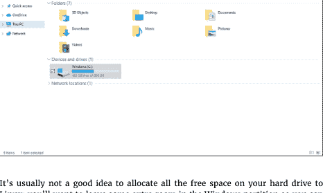

通常，将硬盘上的所有空闲空间都分配给 Linux 并不是一个好主意；你希望在 Windows 分区中保留一些额外的空间，以便在运行 Windows 时继续执行任务，例如下载和安装补丁或保存新文件。

确定你要为 Linux 分配多少空间后，你就可以对硬盘进行分区了。

你想使用的 Windows 实用程序是磁盘管理器程序。请按照以下步骤使用它：

- 1. **右键单击任务栏中的开始图标。**
- 2. **从弹出的菜单中，选择磁盘管理。**

磁盘管理对话框出现，如图 2-2 所示。该对话框显示了 PC 上安装的所有硬盘以及每个硬盘的分区。

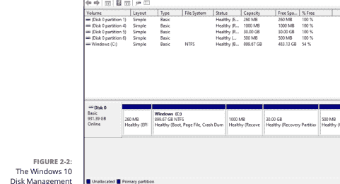

- 3. **右键单击指示其被分配为 Windows 分区并分配了驱动器字母（通常是 C 驱动器）的分区。**

你可以单击文本列表中的分区条目，或分区的图形示意图。


如图 2-2 所示，许多现代 PC 会创建一个或多个未分配驱动器字母的隐藏分区。这些分区不会出现在文件资源管理器中，但被 PC 用于包含恢复数据，以便在紧急情况下重新安装 Windows。不要动那些分区！

- 4. **从弹出菜单中选择“压缩卷”。**

压缩卷对话框出现，如图 2-3 所示。


- 5. **在文本框中输入你想要分配给 Linux 分区的空间大小。**

注意，输入单位是 MB（兆字节）而不是 GB（吉字节）。一吉字节等于 1024 兆字节，所以只需将可用的 GB 空间值乘以 1024，即可得到要在此处输入的 MB 值。

- 6. **单击“压缩”。**

> 在压缩过程中，Windows 会尝试将存储在分区末尾附近的数据向前移动，以为新分区腾出空间。然而，某些系统文件无法移动，这可能会造成问题并产生错误消息。如果发生这种情况，有办法移动这些文件，但这比我在这里所能涵盖的内容要复杂得多。幸运的是，你不是第一个需要做这件事的人，所以有很多可用的帮助。你可以查阅的一个地方是 answers.microsoft.com 上的 Microsoft Windows 论坛，你会看到很多关于如何处理这种情况的帖子。

当压缩过程完成时，磁盘管理器列表中会出现一个新分区。这个新分区显示为未分配（Unassigned），并且没有由 Windows 分配驱动器字母。

> 如果你现有的 Windows 分区上有大量可用空间，你可能需要远超 10GB 的空间。10GB 是大多数 Linux 发行版容纳操作系统的最小推荐值。然而，如果你下载大量多媒体文件，在安装了软件之后，剩下的空间很快就会用完！从你的 Windows 环境中腾出你认为可以提供的空间，尽可能多地分配给 Linux。


## 使用 Linux 工具进行分区

如果你目前没有在硬盘上安装 Windows，但希望先对硬盘进行分区，你可以使用 Linux 工具来完成这项工作。最简单的解决方案是使用 Live 发行版启动你的 PC，并使用可用的磁盘管理工具。许多 Live 发行版默认都包含磁盘管理工具，但其中最受流行的是 KNOPIX Linux 发行版。

KNOPIX Linux 发行版是首个创建 Live Linux 版本的发行版，甚至在 DVD 出现之前就已经存在了（当时被称为 LiveCD！）。KNOPIX 之所以在流行 Linux 发行版列表中名列前茅，是因为它默认包含了大量的实用工具。它将自己定位为一种救援磁盘——如果现有操作系统出现严重问题，你可以用它来启动 PC，从而进行故障排查并可能修复问题。

请按照以下步骤使用 KNOPIX 对硬盘进行分区：

- 1. **从 KNOPIX 网站 www.knopper.net 下载最新的 KNOPIX CD 或 DVD ISO 镜像。**
- 2. **使用标准的 ISO 镜像烧录工具，将 ISO 镜像烧录到可启动的 CD、DVD 或 USB 驱动器上。**

跳转到“创建启动盘”章节*，获取快速操作指南，然后再回到这里。

- 3. **使用 KNOPIX LiveDVD 启动你的 PC。**

在 *boot: 提示符处，按 Enter 键启动 KNOPIX。

- 4. **从主菜单中选择 Graphical Programs  startxide。**

KNOPIX 图形桌面环境随之启动。这是一个相当基础的图形桌面，因此几乎可以在任何 PC 上运行，但它能胜任工作。

- 5. **在 KNOPIX 图形桌面上，点击桌面底部任务栏中的终端图标。**

这将启动一个终端会话，提供对命令提示符的访问权限（我在第 16 章中有更详细的介绍）。

- 6. **在终端的命令提示符下，输入命令：sudo gparted。**

GParted 应用程序是 Linux 中一种流行的磁盘管理工具。它提供了类似于 Windows 磁盘管理工具的界面，如图 2-4 所示。

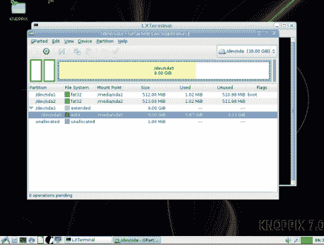

图 2-4：Linux GParted 磁盘管理工具的主窗口。

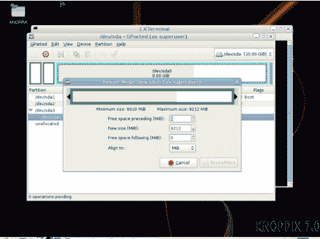

图 2-5：GParted 调整大小/移动对话框。

- 7. **右键点击你需要缩小的分区内部。**
- 8. **从弹出菜单中选择 调整大小/移动。**

如图 2-5 所示，将打开 调整大小/移动 对话框。

- 9. 在 调整大小/移动 对话框中，要么拖动分区图形框的右端以调整分区大小，要么在 新大小 文本框中输入新值。

框中着色部分指示该分区中现有数据的存储位置。你应该能够将分区末端移动到靠近该区域的位置。

- 10. 点击 调整大小/移动 按钮以启动调整大小过程。

硬盘分区完成后，你可以退出工具并关闭 KNOPIX。就这么简单！调整分区大小后，你就可以继续进行为 PC 准备 Linux 的下一步——检查硬件，如下一节所述。

## 重新检查硬件兼容性

如果你是在自己已有的硬件上安装 Linux，只需尝试一下，然后看看哪些不工作。本节的部分内容旨在一般性地解决硬件问题。在其他章节中，会讨论更具体的项目，如声卡（第 13 章）、无线网卡（第 9 章）等。因此，如果你遇到困难，请首先查阅专门针对特定任务的章节，如果问题仍未解决，再回到这里寻求更通用的帮助。

最大的硬件不兼容问题领域包括无线网卡和最新的先进多媒体硬件，例如显卡和声卡。你可以在安装或购买新硬件之前检查硬件兼容性列表，但由于硬件世界变化太快，这些列表的作用有限。

如果你有兴趣查看，首先请尝试访问你特定 Linux 发行版的支持网站，例如 CentOS 或 Fedora 发行版的 Red Hat Enterprise Linux 列表位于 `access.redhat.com/ecosystem/search/~/category/`，或者任何 Ubuntu 发行版的 Ubuntu 列表位于 `certification.ubuntu.com/`。

请记住，硬件兼容性列表通常侧重于企业设备而非家用设备，因此即使你在列表中没有看到某个设备，也不意味着它不能工作。


不用担心项目是否经过 *认证*（经过严格测试以确保正常工作）。对于家庭用户来说，*支持* 和 *兼容* 通常就足够了。最终，判断硬件是否受支持的最佳方法是进行网络搜索。许多人会访问 Google，搜索硬件的品牌和型号，加上 **Linux** 这个词。如果支持该硬件需要特定的驱动程序，你通常可以通过在搜索中添加你的 Linux 发行版名称来找到额外的安装信息。这样的搜索可能会显示其他人使用该特定硬件遇到的问题和成功案例。

如果仅仅想到电脑硬件就让你头晕，别担心，你可以在互联网上找到大量信息。一个很好的起点是 www.tomshardware.com。查找各种设备在 Linux 中工作原理的其他信息资源包括

- 其他面向 Linux 的网站：相当多的网站专门致力于帮助 Linux 用户支持硬件。旧的标准是通用的 Linux 硬件列表，位于 www.tldp.org/HOWTO/Hardware-HOWTO/。现在有更新的网站可用，例如 linux-hardware.org。
- 供应商网站：许多硬件供应商支持 Linux，但他们并不让查找相关信息变得容易。通常，请在供应商的论坛中（如果他们有论坛）搜索该硬件、硬件的常见问题解答（FAQ），或跟随 支持 链接查找 Linux 的下载内容。如果有下载内容，不要下载你发现的内容。目的是查看它们是否存在。可供下载的 *驱动程序*（告知操作系统如何使用硬件的软件）实际上可能已经包含在你的 Linux 安装中。只有当这是你获取驱动程序的唯一方式时，才从供应商处下载驱动程序。


如果情况更糟，你可能会发现关于涉事硬件与 Linux 兼容性的任何信息。然而，再次强调，这并不意味着硬件不能工作。如果你已经拥有该设备，请无论如何都尝试一下。你可能会发现它运行良好。或者，你可能无法使用最新的特性，而其余部分运行正常。（例如，对于最新一代的显卡，最新的高级特性可能无法使用，但至少你可以将其作为通用 SVGA 显卡使用。）

- 令人畏惧的手册：只要可能，请保留你的电脑手册（特别是显卡和显示器的手册）在触手可及的地方，以防安装程序提出问题时你需要它们——大多数人根本不需要处理这个问题，但有些人需要。

### 笔记本电脑的注意事项

当前的 Linux 发行版在较新的笔记本电脑上运行得非常好。（参见 www.linux-laptop.net，这是一个关于 Linux 如何与各种品牌和型号协调工作的优秀研究站点。）如果你的笔记本电脑是常见品牌，你在安装 Linux 时不应该遇到任何问题。然而，一些笔记本电脑使用特殊硬件来将各种高级特性压缩进如此小的盒子中。有时 Linux 无法与这些笔记本电脑上的额外高级特性配合使用，例如触摸屏、可点击的鼠标垫和键盘背光。

如果你计划为 Linux 购买笔记本电脑，请检查其硬件规格（例如网卡），确保它们不是 Windows 专用的。如果笔记本电脑的内置或默认硬件标有 Win（或者你在研究机器时发现它包含 Win 产品，即使没有正确标注），你可能能够使用通过 USB 连接到笔记本电脑的外部设备来替换有问题的硬件。大多数当前笔记本电脑都包含至少一个 USB 插槽，供你连接外部网卡或声卡。只要你使用常见品牌的外部 USB 设备，它应该能很好地与 Linux 配合工作。

如果你需要确切了解机器中有哪些硬件，你有以下选择：

- 使用现有操作系统记录你的硬件。如果你的计算机已经运行 Windows，你可以从 Windows 环境中收集大量信息。在 Windows 10 中，右键点击任务栏中的 Start 菜单图标，然后选择 设备管理器。如图 2-6 所示，将出现 设备管理器 对话框。
- 下载 PC 硬件检测工具。互联网上也有一些可用的硬件检测工具，例如 Dr. Hardware。Dr. Hardware 工具包含关于你机器内部组件的大量信息。该工具是共享软件，使用和费用信息可从 Gebhard Software 网站（www.dr-hardware.com/）获取。
- 访问基本输入/输出系统（BIOS），对于较新的 PC 则是统一可扩展固件接口（UEFI）信息。这些信息存储在小块内存中并由电池保留，有时被称为 CMOS（互补金属氧化物半导体），这表明可以存储和保留信息的计算机芯片类型。BIOS 或 UEFI 中存储的信息量可以从很少到很多不等。一些较新的系统可能会显示有关计算机硬件的多个屏幕信息。


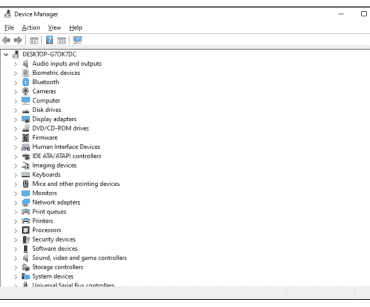

图 2-6：在 Windows 10 中，设备管理器会显示你安装了哪些硬件的信息。

如果你选择访问 BIOS，请确保在*任何*操作系统加载之前这样做。大多数制造商都会指示用于进入 BIOS（或设置）界面的键盘按键（或按键组合），例如，按 Del 键进入 Setup。如果你找不到键盘组合，请检查制造商的网站。进入 BIOS 后，你通常使用方向键、Tab 键或 Enter 键进行导航。某些 BIOS 环境也使用功能键；请在屏幕顶部或底部查找功能键选项列表。


要特别警惕硬件包装盒和网站上包含 *Win*（如 *Windows*）术语的标签。这些组件依赖 Microsoft Windows 才能工作——更糟糕的是，包装上可能没有任何表明这一限制的说明。你几乎不可能为 *Win* 硬件找到 Linux 驱动程序。如果你确实找到了，请在安装 Linux *之前*将其复制到 U 盘上。

## 最后，在开始之前

在安装 Linux 之前，你需要确保你和你的 PC 已准备好启动 Linux 发行版。在进入下一章并安装 Linux 之前，你需要检查最后两件事：

- 确保你的 PC 可以启动备用操作系统。
- 为你的 Linux 发行版创建可启动介质。

以下两节将详细讨论这两项要求。

### 禁用安全启动功能

由于如今针对 PC 的各种攻击，大多数现代 PC 都包含额外的安全功能，以防止使用“未授权的操作系统”进行启动。不幸的是，默认情况下，大多数 PC 唯一授权的操作系统是 Microsoft Windows（可想而知）。你需要禁用此功能才能启动大多数 Linux 发行版。

使用 UEFI 启动方法的系统被锁定，因此启动记录无法更改为从 Linux 启动，或在 Linux 和 Windows 之间进行双启动。你需要禁用此功能以便在 PC 上安装 Linux。

此功能是 UEFI 设置页面的一部分，你只能在启动 PC 时访问该页面。你可以通过在系统首次启动时按下特殊按键来访问这些设置。需要按哪个键取决于你特定的 PC 品牌。请查阅用户手册以了解具体按键。

大多数 UEFI PC 还使用一种称为快速启动的功能，它跳过了之前由 BIOS 执行的许多预启动检查，直接跳转到启动 Windows。你需要格外迅速地按下正确的键才能进入 UEFI 设置页面！

当你到达 UEFI 设置页面后，需要进行一些查找。不同的系统集成了不同的安全功能。查找与安全启动相关的设置，并确保将其设置为禁用值。完成后，保存更改并退出 UEFI 页面。

一些 Linux 发行版已与 Microsoft 协商，在其操作系统中包含必要的认证密钥，以便在启用安全启动功能的情况下从 UEFI 启动。请查阅你特定的 Linux 发行版以查看其是否支持此功能。

### 创建启动磁盘

可启动 DVD 或 U 盘是你在继续安装 Linux 之前需要准备的最后一项物品。如果你记得第 1 章的内容，Linux 发行版以 ISO 映像文件的形式提供。在大多数情况下，你需要将 ISO 文件刻录到 DVD 上，或使用实用工具创建可启动 U 盘。本节将指导你完成这两个过程。

#### 创建可启动 DVD

如果你目前有一台可用的 Windows PC，你可以使用 Windows 10 的内置功能将 Linux ISO 映像刻录到 DVD 上。只需按照以下步骤操作：

1. **打开文件资源管理器，导航到已下载的 ISO 映像文件的位置。**
2. **右键单击映像文件并选择刻录光盘映像。**

Microsoft 光盘映像刻录程序将启动，如图 2-7 所示。

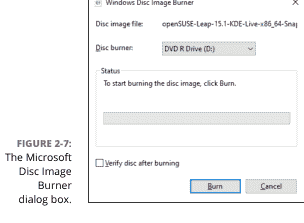

3. **将空白 DVD 插入 DVD 光驱，然后单击刻录以开始过程。**
4. **刻录过程完成后，取出 DVD 并贴上标签，注明操作系统和版本。**

将给 DVD 贴标签作为最后一步可能看起来有点奇怪，但当你开始尝试 Linux 后，你会惊讶地发现你开始累积了多少不同的 DVD！我无法告诉你，我办公室里有多少未贴标签的 DVD，上面装着各种 Linux 发行版！

#### 创建可启动 U 盘

如今，现代台式机和笔记本电脑的一个趋势是省略 DVD 光驱。由于从互联网下载软件变得很容易，DVD 光驱只是占用了可以用于其他用途的空间（或者在笔记本电脑的情况下，只是让它们变得更小）。如果你的 PC 没有 DVD 光驱，不要担心——还有另一种启动 Linux 的方法。

现代 PC 包含从 U 盘启动的选项。然而，创建 PC 可以从中启动的 U 盘有一些技巧。你不能像对 DVD 那样，直接使用 DVD 刻录工具将 ISO 映像文件刻录到 U 盘上。

幸运的是，许多 Linux 发行版现在都包含用于创建可启动 U 盘的实用工具。请查阅你的 Linux 发行版的文档，查看其是否支持此类实用工具。

如果你特定的 Linux 发行版没有用于创建可启动 U 盘自己的实用工具，你可以使用第三方工具。其中一个流行的工具是 Rufus，可在 rufus.ie 找到。下载特定的 Linux 发行版 ISO 文件和 Rufus 后，按照以下步骤从 ISO 文件创建可启动 U 盘：

1. **将空白 U 盘插入 PC 的 USB 端口。**
   确保你选择的 U 盘足够大，可以容纳 ISO 映像文件。某些 Linux 发行版的 ISO 映像文件最大可达 4GB！

2. **启动 Rufus 程序。**
   Rufus 程序对话框打开，如图 2-8 所示。

   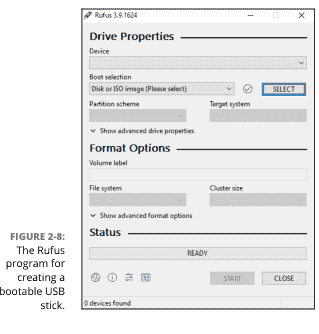

3. **在设备下拉框中选择 U 盘。**
   如果你的 PC 连接了多个 U 盘，请务必小心。最好只连接你打算格式化的那一个，以免意外擦除你一直记录的重要保龄球得分！

4. **在启动选择下拉框中，选择磁盘或 ISO 映像，然后单击选择按钮并导航到你想要使用的 ISO 映像文件。**

5. **单击开始以开始创建可启动 U 盘。**
   Rufus 会显示一个警告对话框，指出 U 盘上的所有内容都将被擦除。在继续之前，确保 U 盘上没有重要文件！

6. **过程完成后，取出 U 盘并贴上标签，注明操作系统和版本。**

现在你应该能够从可启动 U 盘启动你的 PC 了。大多数 PC 要求你在启动时选择从 USB 设备启动的选项。你可能需要中断正常的启动过程才能看到该选择菜单。

如果你能读到这里，你就已经准备好开始安装 Linux 了！

## 本章内容

- 考虑安装前的一些最后时刻问题
- 从 LiveDVD 或 U 盘安装 Ubuntu
- 将 openSUSE 安装为个人桌面
- 首次启动

# 第 3 章

# 安装 Linux

在 Linux 的早期，你几乎需要计算机科学学位才能弄清楚如何让 Linux 在 PC 上运行。幸运的是，如今图形化安装已经非常容易执行，对于来自另一个图形化操作系统（如 Microsoft Windows）的用户来说会很熟悉。本章提供了你让 Linux 发行版在 PC 上运行所需知道的详细信息。

虽然不同的 Linux 发行版使用不同的安装脚本，但它们实际上都非常智能。你可能会发现看到的屏幕与我在这章中展示的不完全相同，但总体概念应该是相同的。如果你看到不熟悉的东西，或者没有看到我在本中涵盖的内容，不要惊慌。安装程序只是根据你的系统硬件和你选择安装的软件来调整它提供的内容。


## 开始安装前需要考虑的事项

下载适合您的特定 Linux 发行版的 ISO 映像后，基本上有从该映像安装 Linux 的三种方式：

- 将 ISO 映像刻录到空白 DVD 上，然后从该 DVD 启动您的工作站。（关于如何执行此操作的具体详情，请参阅第 2 章。）
- 使用 ISO 映像文件创建可启动的 USB 闪存盘，然后从该 USB 闪存盘启动您的工作站。（关于如何执行此操作的具体详情，也请参阅第 2 章。）
- 在通过 VMware 或 VirtualBox 等软件创建的虚拟机中，将 ISO 映像文件挂载为虚拟 DVD 光驱。

我在第 20 章中详细讲解了最后一种方法，该章专注于在虚拟环境中运行 Linux。本章的重点在于通过从 DVD 或 USB 闪存盘启动工作站来安装 Linux。

为了让您了解不同安装方法的特点，本章重点介绍两种不同的 Linux 发行版安装方式——从 Live 发行版安装 Ubuntu 和从完整安装 DVD 安装 openSUSE。我选择这两种方法的原因有两个：

- Ubuntu 的 Live 安装和 openSUSE 的完整安装方法代表了大多数 Linux 系统安装所需的两种主要类型。
- 如果要涵盖现存的每一个 Linux 发行版的具体安装过程，这本书将变成一套百科全书。

一旦您掌握了使用这两种方法安装 Linux 的技巧，就可以去尝试安装市面上几乎任何一种 Linux 系统。

此外，我假设您想要安装的是 Linux 桌面版，而不是服务器版。市面上有很多书籍专注于服务器，因此我的目标是让《*Linux For Dummies*（Linux 小白书）》完全专注于那些希望将 Linux 作为实际桌面计算机使用的人群。在一本篇幅如此有限的书中，要同时深入且令人满意地涵盖桌面版和服务器版的功能是不可能的。


如果您安装的是其他版本的 Ubuntu 或 openSUSE，或者是完全不同的 Linux 发行版，您的屏幕界面将与本书中显示的内容有所不同。每个 Linux 发行版的安装例程涵盖相同的基本任务，但具体操作可能以不同的顺序呈现，或者为了界面显示效果而进行了定制。例如，某个发行版可能在磁盘分区之前呈现账户创建，而另一个发行版可能将这两个主题颠倒。然而，大多数发行版都会经历相同的基本选择，因此，即使您安装的不是 Ubuntu 或 openSUSE，阅读本章仍然会有所帮助。

## 从 Ubuntu Live 安装

Ubuntu 的安装过程是 Linux 世界中最简单的安装过程之一。Ubuntu 会引导您完成设置系统所需的所有步骤，然后安装整个 Ubuntu 系统，而不会提示您输入过多信息。

从 Live DVD 或 USB 闪存盘启动后，您可以从两个位置开始安装过程：

- 直接从启动菜单开始，而不启动 Ubuntu 系统
- 启动 Ubuntu Live 系统后，从桌面上的“Install”图标开始

这两个位置都会启动相同的安装过程，该过程会引导您完成多个选项步骤。


要从 DVD 或 USB 闪存盘开始安装，您可能首先需要更改系统设置，使其从 DVD 或 USB 闪存盘启动（即引导）——当今许多系统已经配置为执行此操作，因此您可能不需要做任何更改。您需要查看 BIOS 设置，以确定您的系统能否从 DVD 光驱或 USB 闪存盘启动。

当您手中持有 Live DVD 或 USB 闪存盘时，就可以开始安装过程了。只需按照以下步骤操作。

1. **将 Ubuntu Live DVD 放入您 PC 的 DVD 光驱中（或将 USB 闪存盘插入 USB 端口），然后重启您的 PC。**

您的 PC 随后将从 Ubuntu Live DVD 或 USB 闪存盘启动，您会看到图 3-1 中所示的主要 Ubuntu Live 菜单。

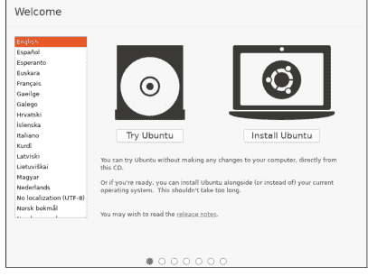

图 3-1：Ubuntu Live 启动菜单。

2. **从菜单中选择您的语言，然后选择直接安装 Ubuntu，或者先通过从 DVD 或 USB 闪存盘运行来试用 Ubuntu。**

Live 版本的一个很棒功能是，您可以在不折腾硬盘的情况下试驾 Ubuntu。这能让您了解哪些功能有效，哪些无效。在您完成试驾后，如果您决定安装 Ubuntu，只需单击桌面上的 Install 图标，如图 3-2 所示。如果您决定从主菜单运行安装，请跳到第 4 步。

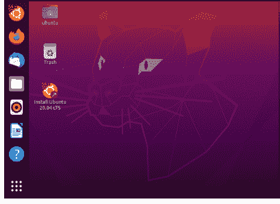

图 3-2：带有 Install 图标的 Ubuntu Live DVD 桌面。

3. 选择用于安装的语言，然后单击 Continue。

如果您从桌面安装图标安装 Ubuntu，它会再次询问默认语言，如图 3-3 所示。

Ubuntu 使用此语言在安装过程中显示文本消息，并设置操作系统运行时使用的默认语言。

然而，这并不一定意味着系统上运行的所有应用程序都会使用该语言。每个单独的应用程序可能会也可能不会检测到 Ubuntu 中配置的默认语言。

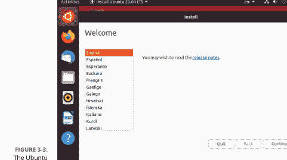

4. 选择键盘，然后单击 Continue。

安装过程中的下一步是确定您将用于 Ubuntu 系统的键盘。虽然这听起来像是一个简单的选项，但如果您有一个包含特殊选项的键盘，情况可能会变得复杂。Ubuntu 识别数百种不同的键盘类型，并全部列在“Keyboard Layout”（键盘布局）窗口中，如图 3-4 所示。

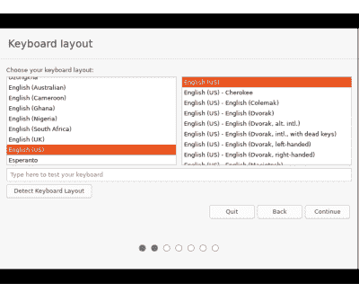

**图 3-4：** 键盘布局窗口。

键盘布局窗口根据您所在的国家/地区列出了常用的不同键盘类型。左侧列表列出国家/地区，右侧列表列出所选国家/地区使用的不同已知键盘类型。首先从左侧列表中选择您的国家/地区，然后从右侧列表中选择您的键盘类型。

对于大多数标准键盘，Ubuntu 安装脚本会自动检测正确的键盘，您无需执行任何操作。如果第一次检测出现错误，还有一个按钮可以强制安装程序重新尝试检测您的键盘。如果您使用的是特殊键盘，在两个列表下方有一个区域可以测试键盘选择。只需在键盘上输入任何可用的特殊或独特字符，以查看您选择的设置是否生成了正确的字符。

5. 选择要在 Ubuntu 桌面上默认安装的软件，然后单击 Continue。

Ubuntu 安装程序提供了一些关于安装哪些软件的选择，如图 3-5 所示。

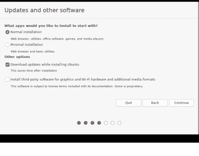

**图 3-5：** 更新和其他软件窗口。

Ubuntu 安装程序为您提供两个选项来安装软件包：

- *正常安装*：包含网络浏览、办公自动化（如文字处理和电子表格操作）、游戏以及播放音频和视频的软件
- *最小安装*：提供最小的桌面软件捆绑包，仅包含用于网络浏览和标准桌面工具（用于控制桌面环境）的软件

对于大多数 Ubuntu 桌面安装，请选择正常安装。如果您使用的是硬盘空间较小的旧工作站，可能不得不选择最小桌面安装，然后手动安装所需的其他软件包。


如果您的 PC 已连接到网络，安装程序会提供一个选项，让您现在可以从 Ubuntu 软件源安装任何可用的更新，如果您愿意的话。选择此选项会增加安装时间，但它也能确保您首次登录时 Ubuntu 桌面软件是最新的。

最后一个选项是安装第三方软件。这个话题在 Linux 世界中颇具争议。一些硬件公司使用专有驱动程序，以便 Linux 能与它们的硬件交互。这些驱动程序不是开源的，因此许多 Linux 原教旨主义者倾向于不使用它们。还有一些音频和视频格式也是专有的，可以想象，这些也让 Linux 原教旨主义者感到困扰。我将是否选择此选项的决定权留给您，但请注意，如果您选择不安装此软件包，您的桌面可能无法与某些硬件设备配合使用，或者无法播放某些更流行的音频和视频格式。

6. **选择如何在硬盘上安装 Ubuntu，然后单击 Install Now。**

安装过程中的这一步可能是最重要的，也是最复杂的。在这里，您需要告诉 Ubuntu 安装程序 Ubuntu 操作系统在系统中的确切位置。这里的一个错误操作可能会真的搞砸您的日子。

在此窗口中安装时获得的选项取决于您的硬盘配置，以及硬盘上是否有现有软件。如果您已经执行了第 2 章中的步骤，那么您应该已经为这个小测验做好了准备！图 3-6 展示了“Installation type”（安装类型）窗口的示例。

Ubuntu 安装程序试图检测您的确切系统配置并提供一些简单的选项：

- 如果您的整个硬盘当前都用于 Windows，Ubuntu 安装程序会建议缩小分区以为 Ubuntu 分区腾出空间，并创建双启动环境。


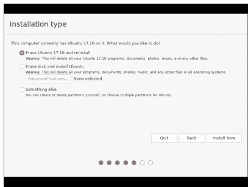

**图 3-6**：Ubuntu 安装类型窗口。

- 如果你已经手动缩小了现有的 Windows 分区（如第 2 章中所述），Ubuntu 安装程序会提供将 Ubuntu 安装在可用空分区并创建双引导环境的选择。
- 如果你已经安装了旧版本的 Ubuntu，Ubuntu 安装程序会提供仅升级操作系统并尽可能保留你数据的选择。
- 如果你的工作站中安装了第二块硬盘，Ubuntu 安装程序会提供使用该硬盘安装 Ubuntu、保持现有硬盘不动并创建双引导环境的选择。
- 如果你有一块已包含现有 Windows 或 Linux 分区的单一硬盘，Ubuntu 安装程序会提供擦除整个分区并直接安装 Ubuntu 的选择。
- 允许你手动分区硬盘以创建自定义分区。

你选择哪个选项取决于你想要尝试的具体设置类型。如果你想运行仅安装 Ubuntu 的工作站，擦除现有操作系统的选项是最快、最简单的方法。

即使你选择保留现有操作系统的某个选项，备份该操作系统中包含的重要文件也是一个非常明智的做法。在操作硬盘时，错误是可能发生的（而且经常发生）。

如果你选择保留硬盘上的现有操作系统，Ubuntu 安装程序允许你选择分配多少磁盘空间给新的 Ubuntu 分区。你可以拖动分区分隔符来重新分配原始操作系统和新 Ubuntu 分区之间的磁盘空间。希望你记得在第 2 章中确定的磁盘空间需求，以便在此处使用！

如果你选择手动分区过程，Ubuntu 将分区过程的控制权交给你。它提供了一个功能强大的分区实用工具（如图 3-7 所示），供你用于创建、编辑或删除硬盘分区。

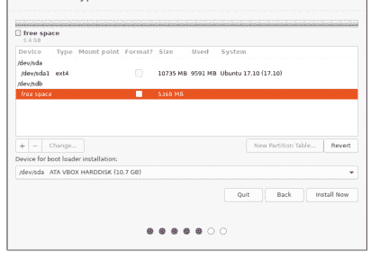

**图 3-7**：Ubuntu 手动分区实用工具。

手动分区实用工具显示当前的硬盘以及其中配置的任何现有分区。一旦你成为一名经验丰富的 Linux 用户，你就可以手动删除、修改或创建安装在系统上的任何硬盘上的单独分区，以自定义你的 Linux 设置。

7. 如果你正在进行手动分区，请为你的 Ubuntu 分区选择文件系统。

手动分区过程的一部分是为每个分区分配文件系统。文件系统是一种用于在分区上存储和访问文件的方法。与某些其他操作系统不同，Ubuntu 支持多种不同的文件系统。你可以为 Ubuntu 将使用的任何分区选择任何可用的文件系统。表 3-1 显示了在 Ubuntu 中创建磁盘分区时可用的文件系统类型。

## 表 3-1 Ubuntu 分区文件系统类型

| 分区类型 | 描述 |
| :--- | :--- |
| ext4 | 一种流行的 Linux 日志文件系统，是原始 Linux ext2 文件系统的当前扩展版本 |
| ext3 | 一种传统的 Linux 日志文件系统，是原始 Linux ext2 文件系统的扩展版本 |
| ext2 | 原始的无日志 Linux 文件系统 |
| btrfs | 一种较新的高性能文件系统，支持大文件 |
| JFS | 日志文件系统，由 IBM 创建并用于 AIX Unix 系统 |
| XFS | 一种高性能日志文件系统，由 Silicon Graphics 为 IRIX 操作系统创建 |
| FAT16 | 旧版 Microsoft DOS 文件系统 |
| FAT32 | 新版 Microsoft DOS 文件系统，兼容 Microsoft Windows |
| swap 区域 | 虚拟内存区域 |
| 加密卷 | Linux 允许你加密整个分区 —— 只是别忘了密钥 |
| 不使用 | 忽略该分区 |

最常见的分区类型（也是 Ubuntu 引导方法默认的格式）是 ext4 格式。此文件系统格式为 Ubuntu 提供日志文件系统。日志文件系统会在尝试将文件更改提交到磁盘之前，先将这些更改记录到日志文件中。如果系统在能够正常提交数据之前崩溃，日志文件将用于完成待处理的文件提交，并将磁盘恢复到正常状态。日志文件系统大大减少了 Linux 中的文件损坏。

8. 如果你正在进行手动分区，请为分区选择挂载点。

在为分区选择文件系统后，Ubuntu 针对分区的下一项需求是将分区挂载到虚拟文件系统中的位置（参见第 7 章）。Ubuntu 虚拟文件系统通过将硬盘插入虚拟文件系统中的特定位置来处理硬盘。表 3-2 列出了你可以挂载分区的可能位置。

如果你只为 Ubuntu 创建一个分区，必须将其挂载到根挂载点（`/`）。如果你有额外的可用分区，可以将它们挂载到虚拟文件系统中的其他位置。

## 表 3-2 挂载点位置

| 位置 | 描述 |
| :--- | :--- |
| `/` | Linux 虚拟文件系统的根目录 |
| `/boot` | 用于引导系统的 Linux 内核所在位置 |
| `/home` | 用于存储个人文件和单个应用程序设置文件的用户目录 |
| `/tmp` | 应用程序和 Linux 系统使用的临时文件 |
| `/usr` | 多用户应用程序文件的常见位置 |
| `/var` | 可变目录，常用于日志文件和暂存文件 |
| `/srv` | 系统上运行的服务所使用的文件的常见位置 |
| `/opt` | 第三方应用程序的可选包安装目录 |
| `/usr/local` | 可选的多用户包安装的常见替代位置 |


如果你使用手动分区方法，别忘了为 swap 区域分配一个分区，即使你的系统中已经安装了许多物理内存。Linux 内核将 swap 区域用作临时存储位置，将休眠应用程序移出物理内存，为正在运行的应用程序腾出更多空间。关于此的标准规则是创建一个与你拥有的物理内存一样大的 swap 区域。因此，如果你有 8GB 物理内存，请创建一个 8GB 的分区并将其分配为 swap 区域。

9. 如果你正在擦除现有分区或创建新分区，请选择要使用的任何高级磁盘功能，然后点击“确定”。

Ubuntu 提供了使用 Linux 的逻辑卷管理器（LVM）功能与你的硬盘分区的选项。LVM 提供了一种简单的方法，允许你在需要时随时为现有目录添加更多空间，即使该目录中已有数据。如果你需要，也可以选择加密逻辑卷。另一个选项是使用 ZFS 文件系统，这是一种最近开源的商业文件系统。

10. 点击“现在安装”以接受建议的硬盘分区更改并继续安装。

直到此时，你都可以改变主意，撤销硬盘更改。但是，一旦在此处点击“现在安装”，你就被锁定在这些更改中，无法回头！

11. 选择你的位置，然后点击“继续”。

由于 Ubuntu 在全球范围内使用，你需要手动选择你在世界上的具体位置，以便 Ubuntu 可以分配正确的时间区和区域设置。

12. 创建一个登录 ID，然后点击“继续”。

安装过程中的下一步是登录 ID 窗口，如图 3-8 所示。

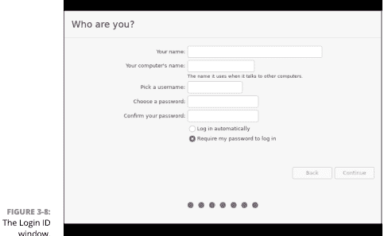

在此过程中创建的登录 ID 具有一定重要性。与其他 Linux 发行版不同，Ubuntu 发行版不使用管理员登录账户（在 Unix/Linux 世界中通常称为 *root*）。相反，Ubuntu 提供让普通用户账户属于管理员组的能力。管理员组的成员具有在系统上成为临时管理员的能力（参见第 17 章）。


拥有一个具有管理员权限的账户非常重要，因为管理员是唯一允许执行大多数系统功能（如更改系统特性、添加新设备和安装新软件）的账户。如果没有管理员账户，你将无法在系统上执行任何新的操作。

除了标识你自己之外，你还需要为计算机本身分配一个名称。Ubuntu 在网络上广播其存在以及在日志文件中引用系统时会使用此名称。你应该选择一个在你的网络上唯一的计算机名称，长度不超过 63 个字符，且不包含任何特殊字符（虽然允许使用连字符）。

最后一个设置 —— 你必须决定是希望系统自动登录到你的桌面，还是提示输入你的登录密码。我不建议在你可能意外遗忘在某处的笔记本电脑上使用此功能。如果你将是使用这台台式机的人（且


周围没有爱管闲事的人）你可以利用自动登录功能来节省一些时间。否则，请将其设置为每次登录系统时都提示你输入密码。

## 13. 坐靠椅背，享受这出好戏！

随着安装过程的进行，安装程序会展示一系列信息幻灯片。浏览这些幻灯片，了解你的新 Ubuntu 系统中可用的功能。我将在接下来的章节中更详细地介绍这些功能。

当 Ubuntu 系统安装到硬盘上后，安装程序会提示你重新启动。下一次系统启动时，你就进入 Ubuntu 了——太棒了！

## 第一次启动 Ubuntu

重新启动 Ubuntu 后，根据你在安装期间选择的设置，系统要么自动登录并直接带你进入桌面，要么你会看到一个登录窗口。如果你看到登录窗口，请单击你的用户账户，然后在密码文本框中输入你的密码（你应该还记得你设置的是什么吧？）。

第一次进入用户桌面时，Ubuntu 会询问几个日常维护问题。按照以下步骤操作以进入你的桌面：

1. **如果你有来自 Ubuntu、Google、Nextcloud 或 Microsoft 的网络账户，请从菜单中选择相应的图标。如果你没有网络账户，或者选择不使用它，请单击“跳过”。**
   Ubuntu 可以同步你的许多网络账户功能，例如你的桌面日历，以及你存储在上述任何提供商的常见云账户中的文件。只需从图 3-9 所示的菜单中选择你拥有的账户类型，然后输入你的登录信息，并选择你想要同步的项目。

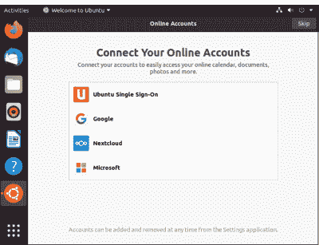

图 3-9：选择你要同步的在线账户。

2. **选择是否使用 Ubuntu Livepatch 功能。如果要使用，请单击“设置 Livepatch”。如果你选择不使用，请单击“下一步”。**
   Ubuntu Livepatch 功能允许你将多台计算机连接到 Canonical 云网络。Canonical 是赞助 Ubuntu 的公司，并提供一些高级功能，其中一些是免费的，另一些则是订阅服务。你可以免费连接三台工作站，或者支付费用成为 Advantage 会员以连接更多设备。如果你参与 Livepatch 功能，Ubuntu 会自动为你的系统安装所有更新，而你无需做任何事情！

3. 选择是否向 Ubuntu 发送关于你安装体验的报告。做出选择后，单击“下一步”。
   Ubuntu 开发者利用这些信息来确定在安装期间你的系统中哪些硬件被正确检测了，哪些没有，以及安装后你额外安装了哪些软件。这些信息有助于开发者确定在将来的版本中应该包含或不包含什么。

4. 选择是否启用位置服务，然后单击“下一步”。
   位置服务允许应用程序自动确定你的位置，而无需提示你。

5. 快速浏览“准备就绪”窗口中可安装的额外软件，然后单击“完成”。
   这只是一小部分可供你安装的软件。Ubuntu 软件仓库包含数百个开源应用程序，随时供你安装和使用！我将在第 15 章中详细介绍软件安装过程。

恭喜——你已经完成了所有安装和安装后提示！此时你的头可能有点晕，所以花点时间整理一下思绪，然后继续阅读本书，以了解更多关于你的 Linux 系统的知识。

## 安装 openSUSE

当你从一个完整的核心 Linux 发行版进行安装时，你会获得意想不到的体验。如果你从 Ubuntu Live 安装中注意到了，缺少的一样东西就是选择权。除了配置你的硬盘分区外，Ubuntu Live 并没有给你太多控制权来决定在系统中安装什么。

使用像 openSUSE 这样的核心 Linux 发行版时，情况有点不同。你有更多的选择来控制安装过程安装了哪些软件，以及安装脚本如何配置各种设置。

本节将介绍如何从 openSUSE 完整安装 DVD 进行安装。openSUSE 发行版也支持 Live 安装版本，但如果你想要选择权，完整安装是最佳选择！只需按照以下步骤即可完成安装：

1. **从 www.opensuse.org 下载完整的 openSUSE Leap 完整安装 ISO 镜像文件。**
   在撰写本文时，openSUSE 发行版目前支持该发行版的两个版本：
   - **Tumbleweed** 是一个滚动发布版本，包含最新版本的软件。它主要面向高级用户和软件开发者。
   - **Leap** 是面向像我们这样的普通 Linux 用户设计的稳定常规发布版本。

2. **将 openSUSE Leap ISO 镜像文件烧录到空白 DVD 光盘上，或者使用如 Rufus 等程序创建可启动 USB 驱动。**
   这些过程在第 2 章中有详细描述。

3. **使用 DVD 或可启动 USB 驱动启动你的工作站。单击“安装”以开始安装过程。**
   当 openSUSE 启动时，你会看到一个菜单，如图 3-10 所示。
   启动菜单提供了许多选项，包括在紧急情况下从工作站硬盘启动，或者仅升级现有的 openSUSE 安装。你想要执行一次全新安装，因此选择“安装”菜单选项。

4. **选择你的语言和键盘，然后单击“下一步”以同意许可协议。**
   作为第一步的一部分，openSUSE 安装会自动检测你的网络设置。如果出现问题，它可能会要求你输入环境的具体网络设置。如果它自动检测到了你的网络，它会显示一个窗口供你选择默认语言和键盘，如图 3-11 所示。

与 Ubuntu 一样，openSUSE 安装脚本会尝试检测你的键盘，但如果你使用的是特殊键盘（例如 Dvorak 布局），你可能需要手动从列表中选择它。

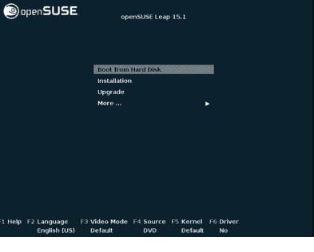

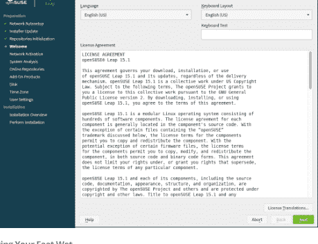

选择是否使用 openSUSE 在线软件仓库。如果你的 PC 可以连接到互联网，以便跟踪软件更改并安装新软件，请单击“是”。

大多数 Linux 发行版在在线仓库中维护软件，以便于你升级软件包并安装新软件（参见第 15 章）。openSUSE 安装允许你选择是否使用在线软件仓库。当你选择“是”时，会出现另一个窗口，显示不同的仓库选项，如图 3-12 所示。

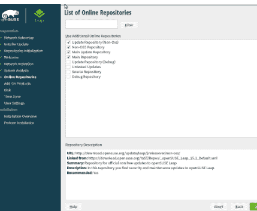

**在“在线仓库列表”窗口中单击“下一步”。**

默认情况下，安装程序会选择标准软件仓库以查找更新、安全补丁以及开源和非开源软件包。如有需要，你还可以额外选择用于调试软件以及下载应用程序源代码的仓库。普通 Linux 用户不需要这些，但它们对软件开发者可用。

**从“系统角色”窗口中选择“带有 KDE Plasma 的桌面”以安装默认的 openSUSE 桌面环境，然后单击“下一步”。**

这就是你对完整安装的第一次体验。从图 3-13 所示的列表中可以看到，openSUSE 安装不仅给你选择安装桌面或服务器环境的选择，还允许你自定义类型。我将在第 4 章和第 5 章中详细介绍 GNOME 和 KDE Plasma 桌面之间的区别。暂时选择 KDE Plasma 选项。如果在阅读第 4 章后你认为更喜欢 GNOME 桌面，你可以稍后添加它。

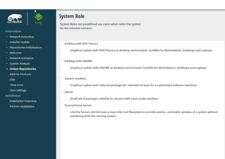

图 3-13：系统角色窗口。

8. 在“建议分区”窗口中选择你想要的分区选项。

与 Ubuntu 安装程序类似，openSUSE 安装程序会尝试检测你的特定分区设置，如图 3-14 所示。

如果你不喜欢 openSUSE 安装程序建议的分区方案，有两种手动方法可用：

- “引导设置”选项从安装程序建议的分区布局开始，并允许你进行调整。
- “专家分区器”选项允许你完全控制系统中硬盘的分区和使用方式。


9. 如果您希望完全控制以自定义分区布局，请点击 **Expert Partitioner**（高级分区器）。

如图 3-15 所示，高级分区器窗口提供了一个图形界面，供您添加、更改和创建磁盘分区。与 Ubuntu 工具类似，您必须为创建的每个分区选择文件系统类型以及挂载位置。

高级分区器提供的另一个额外工具是直观展示分区如何格式化和挂载的图形表示。只需单击系统视图窗格中的 Device Graphs（设备图），即可看到布局，如图 3-16 所示。

这为您提供了全盘分区在建议分区方案中如何使用的鸟瞰图。这是帮助您组织磁盘布局的一个绝佳工具！

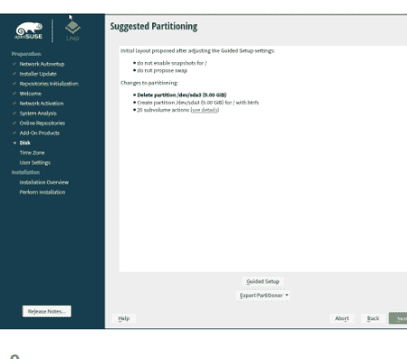

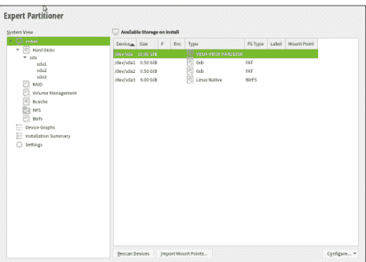

图 3-15：高级分区器工具。

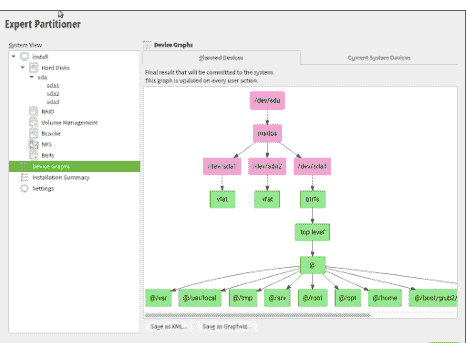

图 3-16：高级分区器图形设计布局。

10. 点击 **Accept**（接受）以确认最终的分区方案。

11. 选择您的硬件时钟设置和时区，然后点击 Next（下一步）。

如图 3-17 所示，时钟和时区窗口不仅允许您选择时区，还允许您配置高级时钟功能，例如您的工作站是使用 UTC 还是本地时间设置 BIOS 时间。如果您的网络使用自己的网络时间服务器，请单击 Other Settings（其他设置），您可以配置 openSUSE 使用该服务器，而不是默认设置。


图 3-17：时钟和时区窗口。

12. 创建一个登录 ID，然后点击 Next（下一步）。

安装流程中的下一项是如图 3-18 所示的登录 ID 窗口。

您在此过程中创建的登录 ID 用于在系统中标识您。openSUSE 发行版使用一个名为 root 的独立用户账户进行管理。除了创建您的用户账户外，还有一个复选框，可将管理员账户密码设置得与您的用户账户相同。如果您取消勾选，系统将提示您设置单独的管理员密码。当您与他人共享系统，而这些人可能需要 root 权限来安装软件包时，这会派上用场。

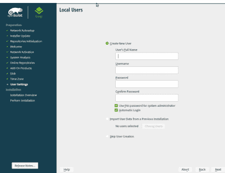

最后一项设置——您必须确定是希望系统自动登录到桌面，还是提示您输入登录密码。

如果您恰好是从旧版本的 openSUSE 升级，可以选择从先前的安装中导入用户设置。虽然这不是万无一失的，但它有助于迁移您的账户。

13. 选择 **Install**（安装）以开始安装。

如图 3-19 所示，安装设置窗口总结了您的所有选择。

这是进行完整安装时优势显现的另一个地方。在您开始实际安装之前，可以点击任何类别并进行必要的更改。

例如，如果点击 **Software**（软件）标题，您将看到 **Software Selection**（软件选择）和 **System Tasks**（系统任务）窗口。在此窗口中，您可以精确设置哪些软件包会（或不会）安装到您的工作站配置中。您还可以更改引导加载程序、网络设置，甚至系统以图形模式还是文本模式启动。这就很有威力了！

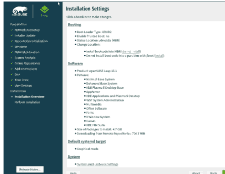

图 3-19：安装设置窗口。

安装程序完成其任务后，您就大功告成了——您应该拥有一台功能完整的 openSUSE 工作站！现在您准备好进入下一章，深入探讨 Linux 的不同桌面功能，以便开始在桌面上操作。

» GNOME 桌面历史
» 查看桌面
» 自定义您的桌面
» 设置辅助功能特性

### 第 4 章
### 查看 GNOME 桌面

有些人喜欢将 Linux 描述为由极客构建、专为极客服务的操作系统。这让人联想到必须在电脑上输入晦涩难懂的命令才能完成任何事情。然而，事实恰恰相反！Linux 支持多种图形桌面环境，为台式电脑提供了一些可用的用户友好界面。

虽然有些让人困惑，但 Linux 图形桌面并没有统一的标准。Linux 充满了选择，而在图形桌面领域这一点体现得尤为明显。在第 4、5 和 6 章中，我将介绍流行的 Linux 发行版所使用的最常见 Linux 图形桌面环境。本章将从查看 GNOME 桌面开始讨论。

### GNOME 的历史

GNU 网络对象模型环境（GNOME）桌面（正如您可以从其名称推测的那样）是 GNU 项目的一部分，该项目因创建和支持许多 Linux 使用的开源包而闻名（参见第 1 章）。GNOME 的初始版本因作为流行的 Red Hat Linux 发行版的默认桌面而流行起来，Red Hat Linux 是最早的商业 Linux 发行版之一。此后，它已被许多其他 Linux 发行版采用，包括 Ubuntu。

然而，GNOME 的历史并非一帆风顺。虽然原版 GNOME 很受欢迎，但 2011 年 GNOME 开发团队在第 3 版中进行了重大变革。

与大多数人已经习惯并感到舒适的传统图形桌面环境不同，GNOME 3 引入了一种全新的图形桌面范式——在不同设备（如笔记本电脑、平板电脑和移动电话）之间使用一致的界面。无论您在什么类型的设备上使用 GNOME 3 桌面，用户体验都是相同的。

新设计通过减少对在移动设备上使用不便的用户界面（例如从长下拉菜单中选择项目）的强调，并增加对可以滚动和点击的用户界面（例如从图标列表中选择项目）的强调，实现了这一目标。虽然这使得平板电脑和移动电话用户的使用变得更加容易，但桌面和笔记本电脑用户却觉得这不便。新版 GNOME 使 Linux 世界陷入了一阵骚动，甚至产生了一些基于原始 GNOME 版本的新图形桌面环境（您可以参见第 6 章）。

然而，随着时间的推移，人们逐渐对 GNOME 3 背后的桌面范式感到更加舒适，它在 Linux 世界中已基本被接受。以下几节将详细讲解 GNOME 3 桌面的主要特点，以及如何按您的喜好进行自定义。


> GNOME 3 图形桌面的用户界面现在被称为 *GNOME Shell*（GNOME 外壳）。这可能会造成一些混淆，您可能会在文档和书籍中看到 GNOME 3 和 GNOME Shell 被互换使用。我更喜欢仅使用 GNOME 3，以免与原始 GNOME 桌面或命令行 shell 混淆。

### 解析 GNOME 桌面

简洁性已成为 GNOME 3 桌面环境的标志。没有需要从中选择项目的长菜单，也不需要翻找文件夹寻找文件，但熟悉新界面可能需要一些时间。本节将介绍 GNOME 3 桌面的基本功能，以便您能够自如操作。

#### 请列出菜单！

GNOME 3 桌面顶部有一个面板（称为顶栏），在桌面首次打开时，仅包含三个菜单选项，如图 4-1 所示。

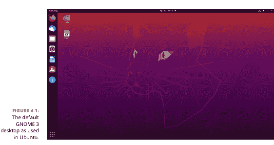

这三个菜单项是：

- » Activities（活动）
- » Calendar and notifications（日历和通知）
- » System menu（系统菜单）

以下几节将介绍每个菜单包含的内容。

##### 活动菜单

活动菜单是您访问应用程序并检查任何正在运行的应用程序状态的方式。您可以使用三种不同的方法打开活动菜单：

- » 点击顶栏中的活动菜单项。
- » 将鼠标指针移动到桌面的左上角（某些 Linux 发行版，如 Ubuntu，已禁用此功能）。
- » 按下键盘上的 Super 键（在 PC 上是 Windows 徽标键）。


当你打开**“活动”**菜单时，你会看到*活动概览*布局，如图 4-2 所示。

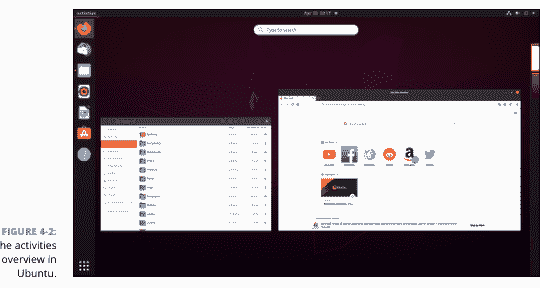

活动概览为你一站式地提供了访问所有应用程序的途径，并查看桌面上已运行应用程序的状态。它由以下三个主要部分组成：

- 应用启动器（Dash）
- 窗口概览
- 工作区选择器

我将在稍后的“探索活动概览”章节中深入探讨活动概览。

## 日历菜单

日历菜单项会生成你预期的结果——一个日历，如图 4-3 所示。但是等等，还有更多功能！

在日历左侧是*通知区域*。通知区域会显示你计划的所有即将发生的日历事件。GNOME 3 允许你将日历与许多流行应用程序（如 Google、Facebook 和 Microsoft）的在线日历同步，提供了一种绝佳的途径，让你在一个地方查看所有日历事件！

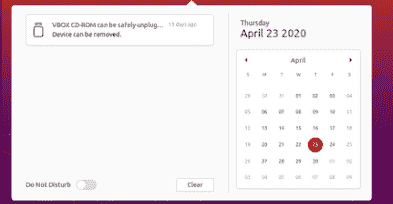

图 4-2：GNOME 3 日历菜单。

除了管理你的日程安排外，通知区域还会显示系统生成的任何消息，例如当有可用的升级和补丁可安装时，或者系统磁盘空间不足时。“请勿打扰”滑块允许你禁用桌面弹出系统消息。

# 系统菜单

在顶部栏的最右端是系统菜单。系统菜单显示图标，表明系统中多个功能的状态，具体取决于系统中可用的硬件。此菜单高度可自定义，并且通常在不同的 Linux 发行版之间略有不同。系统菜单选项可能包括：

- 网络连接状态
- 声卡状态
- 显示亮度设置
- 电池状态
- 登录用户状态
- 重启选项

要访问这些菜单选项，请单击系统菜单中的向下箭头图标。会出现一个系统选项的下拉菜单，如图 4-4 所示。

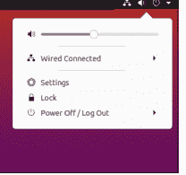

**图 4-4：** GNOME 3 系统菜单。

如果你的 PC 有声卡，你可以调整音量或静音扬声器；如果你的 PC 有可调节亮度的显示屏，还有一个设置用于调整显示亮度。

接下来你会看到一个菜单，如果可用，允许你管理网络连接。如果你的 PC 使用无线网络连接，下拉菜单允许你选择要连接的无线网络，以及其他网络设置。如果你的 PC 使用有线网络连接，你会看到禁用网络连接和更改网络设置的选项。网络设置涉及许多方面，因此我将在第 9 章中深入探讨。

作为系统菜单的一部分，大多数 Linux 发行版都包含访问系统设置的选项——通常作为菜单选项，或作为系统菜单底部的图标。当你选择任一选项时，如图 4-5 所示的系统设置对话框将出现。它允许你按喜好自定义桌面体验。我将在本章稍后的“定制你的体验”章节中详细讨论此内容。

系统菜单中还有一个选项用于管理当前登录的用户帐户。一些 Linux 发行版对此选项进行了自定义，因此你的结果可能与图 4-4 中显示的不同。在 Ubuntu 中，你只能为当前用户锁定桌面。Fedora Linux 允许你从该菜单注销，或转到用户帐户的设置对话框。

在系统菜单的底部是关机或注销系统的选项。关机菜单选项提供另一个菜单，允许你选择重新启动、关闭或挂起系统。

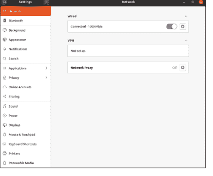

图 4-5：设置对话框。

### 应用程序菜单

虽然我提到默认情况下顶部栏只显示三个菜单，但有时会出现第四个菜单。当你在 GNOME 3 桌面中启动应用程序时，顶部栏会出现一个单独的菜单。这是*应用程序菜单*，其中包含与该应用程序相关的选项。GNOME 3 没有将应用程序菜单放在应用程序的窗口标题栏中，而是将其放在顶部栏中，与应用程序窗口分离。这可能需要你花点时间来适应。

应用程序菜单中可用的选项取决于你在桌面上打开的应用程序。大多数应用程序提供选项，允许你打开应用程序的新窗口，或退出当前窗口。一些应用程序还提供其他特定于应用程序的功能。

## 桌面

在许多图形桌面环境中，桌面是核心。你做的几乎所有事情都是从桌面上的图标开始的。有一个喜欢频繁使用的应用程序？在桌面上创建一个图标来启动它。有一个需要每天打开的文件？在桌面上创建一个图标来打开它。插入新的 USB 驱动器？系统会在桌面上自动创建一个图标以访问它。

GNOME 3 的范式对此进行了一些改变。桌面图标不再是启动应用程序、存储文件或访问可移动介质的首选方式。实际上，许多 Linux 发行版默认甚至不费心在桌面上创建任何图标！然而，如果你难以改掉旧习惯，GNOME 3 仍然允许你在桌面上创建和使用图标。

Ubuntu Linux 发行版默认会创建两个桌面图标：

- **主文件夹（Home folder）：** 打开 Files 文件管理器程序，并默认定位到用户帐户的主文件夹。
- **回收站（Trash folder）：** 打开 Files 文件管理器程序，并默认定位到用户帐户的回收站文件夹。

你可以从桌面执行几项操作。在桌面的空白区域右键单击，会打开一个弹出菜单，如图 4-6 所示。

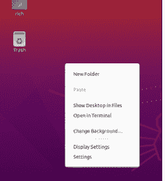

图 4-6：GNOME 3 桌面弹出菜单。

桌面弹出菜单为你提供了几种不同的选择：

- **新建文件夹：** 在用户帐户的桌面文件夹下创建新文件夹。
- **粘贴：** 将复制或剪切的文件或文件夹粘贴到桌面。
- **在 Files 中显示桌面：** 使用 Files 文件管理器程序打开桌面文件夹（参见第 8 章）。
- **在终端中打开：** 使用 Terminal 命令行接口打开桌面文件夹（参见第 16 章）。
- **更改背景：** 修改用于桌面背景的图片。
- **显示设置：** 更改显示器的方向和分辨率设置。
- **设置：** 访问系统设置工具。

这使你能够快速访问与桌面相关的某些系统设置，如“定制你的体验”章节稍后所述。

许多图形桌面允许你通过右键单击桌面来创建新文件，不幸的是 GNOME 3 不是其中之一。如果你想在桌面上为文件创建图标，你需要使用 Files 文件管理器程序（参见第 8 章）将文件存储在位于主文件夹中的桌面文件夹里。


# 探索活动概览

活动概览区域取代了旧版 GNOME 中使用的应用程序菜单系统，这也是 GNOME 3 如此具有争议的原因。虽然它被设计得非常易于导航，但其总体结构和布局可能会让人困惑，尤其是如果你已经习惯使用旧菜单系统的话。本节将依次介绍活动概览的三个功能——应用启动器、窗口概览和工作区选择器。

## 应用启动器（Dash）

应用启动器是一组应用程序图标，默认显示在活动概览的左侧。一些 Linux 发行版选择默认显示应用启动器，因此无需任何操作即可在桌面上看到它，如图 4-7 所示。

其他 Linux 发行版选择将应用启动器保留为活动概览部分的一部分，因此你需要单击顶部栏中的“活动”菜单选项才能看到它。

无论哪种情况，一旦出现，应用启动器都包含若干图标，如下文各节所述。


## 收藏夹

虽然父母通常不应该偏爱某个孩子，但 Linux 用户经常这样做。快捷启动器（Dash）提供了一个区域，你可以在其中放置图标以启动你喜爱的应用程序，从而轻松启动常用的应用程序。

大多数 Linux 发行版都提供了一些默认的收藏夹应用程序，以帮助你快速上手。在 Ubuntu 中，收藏夹包括：

- Firefox 网络浏览器
- Thunderbird 邮件客户端
- Files 文件管理器
- RhythmBox 音频播放器
- 用于文字处理的 LibreOffice Writer
- Ubuntu 软件中心
- Ubuntu 桌面帮助指南

点击收藏夹图标会启动对应的应用程序。右键点击收藏夹图标会弹出一个菜单，包含以下默认选项：

- 为该应用程序打开一个新窗口
- 应用程序特有的选项，例如为 Firefox 打开一个隐私浏览窗口，或为 Writer 创建新文档
- 从快捷启动器中移除该收藏夹图标

某些应用程序在快捷启动器菜单中提供额外的选项，以便你可以直接从快捷启动器图标控制应用程序内的功能，而有些则没有。你需要查阅特定应用程序的文档，以了解该应用程序提供哪些可用的选项。

## 运行应用程序

除了你喜爱的应用程序图标外，快捷启动器还会显示当前正在运行的所有桌面应用程序的图标。当某个应用程序处于活动状态时，该应用程序图标旁边会出现一个点。

右键点击正在运行的应用程序图标，会弹出一个小菜单，提供几种可执行的操作选择：

- 打开应用程序窗口，或者如果应用程序打开了多个窗口，则打开该应用程序的特定窗口。
- 为该应用程序打开一个新窗口。
- 如果该应用程序尚未成为收藏夹，则将其作为收藏夹添加到快捷启动器中。

当你退出某个应用程序时，其图标会自动从快捷启动器中消失（除非该应用程序被标记为收藏夹）。

## 可移动介质

当你在 PC 中插入可移动介质设备（如 DVD 或 USB 闪存盘）时，该设备的图标会出现在快捷启动器中，如图 4-8 所示。

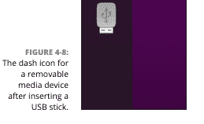

点击设备图标即可打开一个“文件”窗口，以查看可移动设备的内容。当你准备移除设备时，右键点击设备图标并选择“弹出”菜单选项。

### 应用程序总览图标

当你点击快捷启动器中的应用程序总览图标（位于快捷启动器底部的网格图标）时，你将在桌面中央看到应用程序总览界面，如图 4–9 所示。

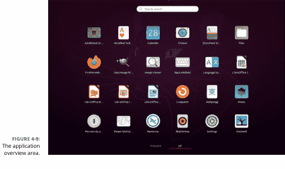

应用程序总览区域显示所有当前已安装的桌面应用程序图标。如果存在更多图标，你可以向下滚动应用程序总览区域以查看其他页面。在应用程序总览区域的底部，有选项可以显示所有应用程序图标，或者仅显示常用应用程序图标。选择“常用应用程序”会将应用程序图标缩减为仅显示你最近使用的应用程序。

在应用程序总览区域，点击某个应用程序的图标即可在桌面上启动它。如果你希望将该应用程序添加到快捷启动器的收藏夹区域，请在应用程序总览中右键点击该图标并选择“添加到收藏夹”。

**提示**
应用程序总览中最多功能化的功能可能是顶部的搜索文本框。搜索文本框不仅允许你搜索应用程序，还可以搜索位于文件夹中的文档。这是一个查找丢失文档的绝佳工具！

## 窗口总览区域

在活动总览的中部是*窗口总览*。窗口总览提供了快速管理桌面活动应用程序的途径。它显示当前桌面上正在运行的所有应用程序窗口的缩略图像。当你在窗口总览中点击某个应用程序的缩略图时，桌面上的该应用程序会切换到前台。你还可以通过将鼠标悬停在缩略图上时，点击缩略图右上角出现的红色圆圈来终止正在运行的桌面应用程序。

窗口总览区域的顶部还有一个搜索文本框（参见图 4-2）。就像在应用程序总览区域一样，你可以在这里输入应用程序名称、文件名或资源名称来查找。当你输入时，GNOME 会搜索预设的一组位置以查找匹配的应用程序和文件，并在搜索区域显示匹配结果的列表。当你找到所需内容时，只需点击其图标即可启动它。这是一种访问你藏在文件夹深处的文件的好方法！

除了窗口总览，还有另一种方法可以在桌面上正在运行的应用程序之间进行切换：

1. 按*Super 键*（在 Windows PC 上为*Windows 键*）和*Tab 键*。
   
   窗口切换器将出现在桌面中央，显示当前桌面上每个正在运行的应用程序的图标。

2. *按住 Super 键*，并按*Tab 键*在*正在运行的应用程序*之间进行切换。
   
   当你选中想要切换到的应用程序时，松开 Super 键。

**提示**
在使用 Super + Tab 组合键打开窗口切换器后，你可以直接通过鼠标点击应用程序图标来选择要切换到的应用程序。

## 使用工作区

在活动总览的最右侧是*工作区选择器*。一个存在已久的概念是*虚拟桌面*功能。虚拟桌面允许你定义单独的桌面区域，并在这些单独的桌面上打开应用程序窗口。这使得你可以将应用程序分组，并通过切换桌面而不是在同一个桌面上打开大量窗口来管理它们。

GNOME 3 实现了虚拟桌面，但稍有不同。工作区是同一个桌面的一部分；它们只是将应用程序窗口放入不同的组中，以便于管理。你使用工作区选择器来控制此功能。

当你第一次打开活动总览时，工作区选择器是缩小显示的，但如果将鼠标指针悬停在该区域上方，它会完全显示出来，如图 4-10 所示。

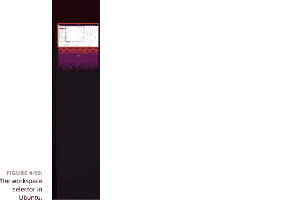

默认情况下，Ubuntu 创建一个默认的工作区，并将你启动的任何应用程序放置在该工作区中。你可以按照以下步骤将应用程序移动到新的工作区：

1. 打开活动总览。
2. 点击并按住你要移动的、位于窗口总览区域中的应用程序缩略图。
   
   鼠标指针会变成一个手形。
3. 将应用程序缩略图拖拽到工作区选择器区域。
   
   当你将手形指针移动到工作区选择器时，选择器中会出现一个新的工作区窗口。
4. 将应用程序缩略图放入新的工作区区域。

当你在两个或更多工作区中都有应用程序时，你可以轻松切换桌面上哪个工作区处于活动状态。有两种方法可以做到这一点：

- 打开活动总览，然后从工作区选择器中选择一个工作区。
- 在桌面上，按 Super + Page Down 键移至下一个较低的工作区，或按 Super + Page Up 键移至旋转顺序中下一个较高的工作区。

如果你是一个真正的多任务处理者，并且桌面上打开了大量应用程序，这提供了一种保持事物井井有条的简单方法！

## 自定义你的体验

我在本章开头提到，Linux 以提供图形化桌面选择而闻名。我未提到的是，即使你选择了一个特定的桌面使用，你仍然有许多选项来自定义你的桌面体验。

这是通过 GNOME 3 通用“设置”工具中的桌面设置选项来实现的。你可以通过右键点击桌面上的空白区域并选择“设置”，或者通过选择前面“菜单，请！”部分中讨论的系统菜单中的“设置”选项来访问“设置”工具。

你可以使用“设置”工具自定义许多事情。目前，我仅讨论你可以用来自定义 GNOME 3 桌面体验的各种桌面相关设置。


## 背景

每个 Linux 发行版的开发人员都会选择一个默认的桌面背景图像来帮助识别该发行版。Fedora 为每个发行版本使用不同的风格化配色方案，而 Ubuntu 则使用以其发行版命名来源的动物为原型的某种风格化图像。

然而，你不必局限于这些桌面背景。你可以轻松更改桌面背景；只需按照以下步骤操作：

- 在“设置”工具中打开“背景”选项。
- 你可以通过右键单击桌面并选择“更改背景”来执行此操作。或者，如果你已经在“设置”工具中，请在左侧菜单中选择“背景”。
- 每个 Linux 发行版都会选择一组默认包含的图像。
- 滚动浏览可用图像并选择一张。
- 如果你有自己使用的图像，请单击“设置”工具顶部的“添加图片”按钮。


系统上的每个用户都可以选择自己的桌面背景，因此如果你需要与他人共享你的电脑，你也不必整日盯着对方宠物的照片看！

## 外观

你不仅可以更改桌面背景，还可以更改应用程序窗口本身使用的颜色。从“设置”工具中，单击左侧菜单中的“外观”选项。将出现“外观”窗口，如*图 4–11*所示。

在“窗口颜色”部分，“外观”选项允许你设置应用程序窗口的色调：选择浅色、标准色或深色。

在其下方有一些你可以更改的设置，用于控制 Dock（在设置中称为*dock*）。如果你的 Linux 发行版在桌面上显示 Dock，你可以选择在应用程序想要进入全屏模式时自动隐藏它。此功能允许应用程序将 Dock 移开，并占据整个桌面查看区域。

在这里，你还可以更改显示在 Dock 中的应用图标的大小（包括收藏夹和正在运行的应用程序），以及设置当你打开活动概览时 Dock 出现在桌面的哪一侧（左、右、上或下）。

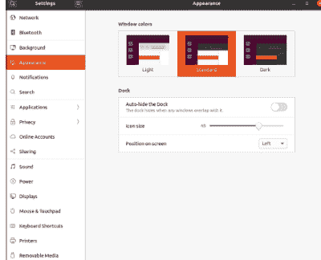

**图 4–11：外观窗口。**

## 显示器

尝试让图形桌面与各种不同显卡和显示器配合工作可能是一场噩梦。大多数 Linux 发行版都会尽力在安装时自动检测你的显卡和显示器并设置桌面分辨率，但它们并不总是准确，或者无法识别你特定的硬件配置。如果出现这种情况，安装脚本通常会回退到默认设置，这对你而言可能并非最佳选择。

如果这也是你的情况，仍有一些希望，因为你可以为 GNOME 3 桌面自定义显示设置。在“设置”工具中，单击左侧菜单中的“显示器”条目，你将看到可以为显示器更改的不同选项，如图 4–12 所示。

你在这里看到的内容主要取决于你的显示器设置。至少你应该看到三个可更改的选项：

- **方向：** 显示器相对于键盘的方向。对于平面显示器，你有很多安装选项——例如将显示器侧向放置。如果是这种情况，你可以在这里将屏幕方向更改为纵向（Portrait）。如果你的显示器必须倒置安装，只需选择“横向（翻转）”（Landscape (flipped)）选项。
- **分辨率：** 在这里，你可以更改显示器的分辨率或宽高比设置。你可以尝试不同的设置，找到你感觉舒适的一个。
- **小数缩放：** 此设置允许你缩放桌面中窗口和文本的大小。启用此功能允许你设置小数倍数值，例如使对象比正常大 125% 或 200%。

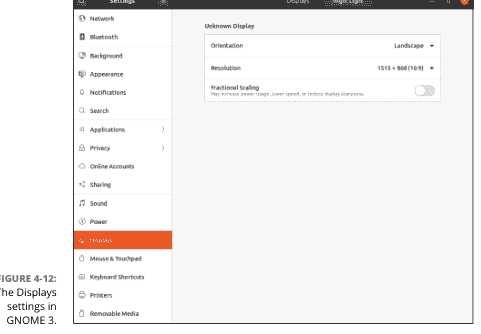

如果你将多个显示器连接到电脑，这就是你可以控制它们行为的地方。当 GNOME 3 检测到多个显示器时，它会扩展显示设置以包含多个显示器的设置，如图 4-13 所示。

你首先要做的是选择显示模式。共有三种：

- **连接显示器：** 默认情况下，GNOME 3 使用第二个显示器扩展桌面，并将第二个显示器放置在主显示器的右侧（如果你将鼠标光标移出桌面右侧，它会进入第二个显示器的桌面区域）。如果你的第二个显示器在物理位置上位于其他地方，你可以将第二个显示器图标移动到主显示器图标的任意一侧，以反映其物理位置。图 4-13 显示了我的次要显示器被移动到了主显示器的左侧。如有必要，你甚至可以选择哪个显示器是主显示器。
- **镜像：** 你可以选择不使用第二个显示器扩展桌面区域，而是选择在所有连接到电脑的显示器上镜像单个桌面。你在主桌面上进行的任何操作都会镜像到其他显示器桌面上。这在制作演示文稿时非常有用。
- **单独显示：** 可用的第三种选项是将每个显示器视为单独的显示设备，而不扩展主桌面。

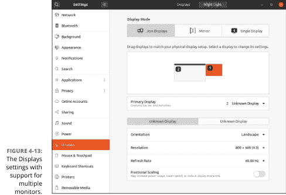

在“显示”设置顶部的相应按钮中做出选择后，显示器的附加选项会随之更改。

## 鼠标和触控板

鼠标和触控板设置是安装脚本尝试自动检测你的特定硬件所需配置的另一领域，但并不总能设置正确。单击“设置”工具左侧的“鼠标 & 触控板”选项，以自定义你的鼠标和/或触控板设置，如图 4-14 所示。

这些设置允许你选择哪个鼠标按钮是主按钮（右手方向为左键，左手方向为右键）。

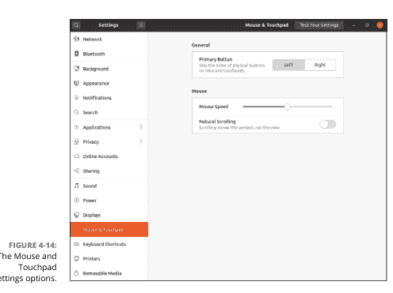

你还可以设置移动鼠标在桌面上移动时的速度，以及启用自然滚动，该功能会移动窗口的内容，而不是整个窗口视图。

## 深入了解辅助功能

GNOME 3 桌面包含若干功能，使残疾人能够使用替代方法操作桌面上的应用程序。这些功能包括屏幕放大器（放大屏幕区域）、屏幕阅读器（朗读屏幕上的文本）以及键盘和鼠标辅助功能（例如粘滞按键和缓慢鼠标点击）。你可以根据需要启用每个功能。

你通过“设置”工具访问辅助功能。按照以下步骤进行操作：

1. 打开“设置”工具。
2. 从左侧菜单中选择“通用访问”（Universal Access）选项。
3. 启用你的环境所需的功能。

当你在“设置”工具中选择“通用访问”选项时，你会看到许多可启用的选项，如图 4–15 所示。

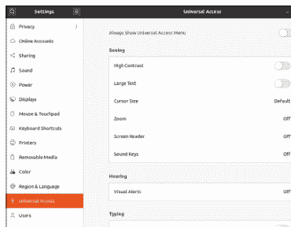

**图 4-15：Ubuntu 中可用的通用访问选项。**

这些选项分为四类：

- **视觉：** 为视障人士启用功能的选项
- **听觉：** 为听障和重听人士启用功能的选项
- **输入：** 启用辅助输入功能的选项
- **指点与点击：** 启用使用鼠标的辅助功能的选项

视觉类别包括以下功能：

- **高对比度：** 使窗口和图标更鲜艳，从而更容易看到。
- **大文本：** 为桌面文本使用更大的字体。
- **光标大小：** 更改光标大小，使其更容易找到。
- **缩放：** 放大屏幕的特定区域，使其更容易阅读。
- **屏幕阅读器：** 使用 Orca 语音程序朗读屏幕上的文本。
- **声音按键：** 在按键时发出可听见的音调。

听觉类别仅包含一个功能——当系统产生警报蜂鸣声时，启用视觉警报的能力。


Typing 类别包含以下功能：

-   **屏幕键盘：** 当可以输入文本时，显示屏幕键盘。
-   **重复按键：** 当按住某个键时，模拟多次按键操作。
-   **光标闪烁：** 使光标指针闪烁，以便更容易找到。
-   **输入辅助：** 允许你启用三种独立的输入功能——粘滞键、慢速键和弹跳键。

Pointing & Clicking 类别包含以下功能：

-   **鼠标按键：** 使用键盘按键模拟鼠标移动和点击。
-   **定位指针：** 使更容易在桌面上找到指针。
-   **点击辅助：** 通过按住主按钮或将鼠标指针悬停在某个位置上来模拟双击。
-   **双击延迟：** 设置鼠标按键双击的速度，以发送双击事件。

如果你需要频繁开关特定的辅助功能，Universal Access 设置中还有一个下拉菜单，你可以在系统菜单中启用它。只需在设置中启用“始终显示 Universal Access 菜单”功能，系统菜单中就会出现一个图标，如图 4-16 所示。

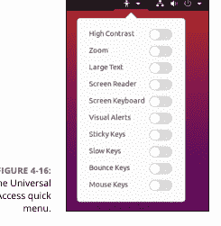

点击该菜单，下拉菜单就会出现，让你可以轻松启用和禁用特定功能。

### 第 5 章

### 检查 KDE Plasma 桌面

在第 4 章中，你已经了解了 GNOME 3 桌面是如何工作的。本章讨论 Linux 世界中的“另一种”流行桌面环境——KDE Plasma。KDE Plasma 桌面环境为你的 Linux 发行版提供图形界面，使用了在 Microsoft Windows 系统中常见的那些功能。它作为软件包在 Fedora、openSUSE 和 Ubuntu 中可用，并且是 Kubuntu（基于 Ubuntu 但专注于 KDE Plasma 桌面的 Linux 发行版）的主要桌面。本章将逐步介绍 KDE Plasma 桌面功能，向你展示如何在桌面环境中操作以及如何从工作区中获取最大效益。

### KDE Plasma 桌面

KDE 桌面最早于 1996 年发布，名为 Kool Desktop Environment，但如今它试图表现得稍微更精致一些，更喜欢被简单地称为 K 桌面环境（但它仍然相当“酷”）。它很快就受到 Linux 初学者的欢迎，因为它为你的 Linux 桌面提供了类似 Windows 的界面。

除了图形桌面向外，KDE 社区还发布了大量其他软件应用程序。为了避免混淆，从版本 4.4 开始，KDE 桌面被称为 KDE Plasma 桌面，或简称为 Plasma，以区别于 KDE 组织生产的其他软件项目。图 5-1 展示了在 openSUSE Leap 15.1 Linux 发行版中使用的 Plasma 桌面。

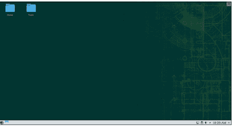

若要了解有关 KDE 项目的更多信息，请查看位于 www.kde.org 的 KDE 网站。

> 与 Linux 中的其他所有内容一样，Plasma 桌面布局高度可定制，因此你系统中的内容可能与本章图示中看到的内容有所不同。别慌，所有这些功能都在那里，我将向你展示如何定制你的桌面以适合你的需求和愿望！

Plasma 桌面包含三个你应该熟悉的主要组件：

1.  应用程序启动器
2.  面板
3.  桌面

在接下来的部分中，我将逐一介绍这些组件，并查看它们的外观。

### 更多菜单！

你可以从面板底部最左侧的单个图标访问应用程序启动器。点击该图标会生成完整的应用程序启动器布局，如图 5-2 所示。

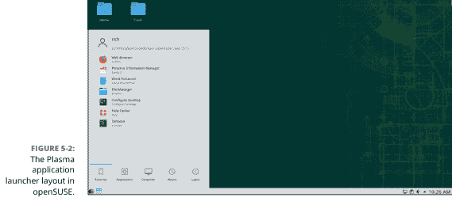

启动器的底部包括五个标签页，每个标签页都包含一组菜单项：

-   **收藏夹：** 用于轻松访问你经常使用的应用程序的图标
-   **应用程序：** 用于启动系统中程序的程序图标子菜单
-   **计算机：** 跳转到计算机上特定位置的快捷方式
-   **历史记录：** 你最近运行的应用程序列表，以及你最近打开的文档和文件夹
-   **离开：** 退出当前桌面会话的选项


右侧带有箭头的菜单项提供子菜单。通过鼠标点击该菜单选项来打开子菜单。有时子菜单内部还有它们的子菜单，提供更多程序。

### 收藏夹

收藏夹菜单标签页提供了一个区域，你可以在此放置你经常使用的应用程序图标。只需在应用程序菜单中导航到某个程序条目，右键点击它，然后选择“添加到收藏夹”选项。openSUSE Plasma 桌面在收藏夹中为你提供七个条目：

-   **网络浏览器：** Firefox 网络浏览器（见第 10 章）
-   **个人信息管理器：** Kontact 日历、联系人和电子邮件包（见第 10 章）
-   **文字处理器：** LibreOffice Writer 文字处理包（见第 12 章）
-   **文件管理器：** Dolphin 文件管理器程序（见第 8 章）
-   **配置桌面：** 打开系统设置对话框
-   **帮助中心：** 打开 KDE 用户手册，其中包含关于 Plasma 桌面及其他 KDE 软件包的所有相关信息的极佳资料
-   **终端：** Konsole 命令行接口工具（见第 16 章）


通过右键点击条目并选择“从收藏夹中删除”来移除收藏夹标签页中的条目。

### 应用程序

应用程序菜单标签页提供对你系统中安装的所有程序的快速访问。显然，这里可用的选择取决于你安装了什么，但 openSUSE 使用了一些你可能会在系统中遇到的一些标准一级菜单项。表 5-1 描述了这些内容。

**表 5-1**  
**应用程序菜单内容**

| 菜单选项 | 你能找到的内容 |
| :--- | :--- |
| 游戏 | 用来消磨时间的程序 |
| 图形 | 图像操作程序 |
| 互联网 | 用于在互联网上交互的程序 |
| 多媒体 | 用于处理音频和视频文件的应用程序 |
| 办公 | 用于办公相关任务的程序，如文字处理、电子表格和演示文稿图形 |
| 设置 | 用于配置用户特定设置的实用工具 |
| 系统 | 用于监控和设置系统级功能的实用工具 |
| 实用工具 | 用于处理桌面和系统上小功能的各种程序和实用工具 |

你可能会注意到一级菜单项中有些重复劳动。并非所有 Plasma 系统都使用所有这些菜单选项。不同的发行版使用菜单项的不同组合，为其菜单提供自定义的外观和感觉。

### 计算机

计算机菜单标签页（在表 5-2 中描述）提供了一种快速跳转到系统中特定位置以查看文件的方法，以及对某些流行功能的快速访问。这些分为三个类别：

-   **应用程序：** 提供常用系统应用程序的菜单选项，例如：
    -   *KRunner：* 生成命令行以启动程序
    -   *配置桌面：* 打开系统设置工具以更改你的桌面偏好设置
    -   *信息中心：* 打开 KInfoCenter 应用程序，它提供有关你系统硬件和桌面设置的信息
    -   *软件中心：* 打开 Discover 软件管理应用程序
-   **位置：** 提供链接以在 Dolphin 文件管理器程序的虚拟目录中打开特定位置。
-   **可移动存储：** 使用 Dolphin 打开任何连接的可移动存储设备的链接。如果没有连接可移动存储设备，则不显示此类别。

位置选项使用 Dolphin 文件管理器直接跳转到虚拟目录内的特定位置（在第 8 章中详细讨论）。位置类别下列出了许多位置项；表 5-2 显示了一些你可能有兴趣查找的位置。

**表 5-2**  
**计算机菜单位置内容**

| 菜单选项 | 你能找到的内容 |
| :--- | :--- |
| 主目录 | 查看用户主目录的内容。 |
| 桌面 | 查看用户桌面文件夹的内容。 |
| 下载 | 查看用户下载文件夹的内容。 |
| 根目录 | 查看虚拟目录结构的内容。 |
| 回收站 | 查看存储在特殊回收站文件夹中的项目，并清空回收站。 |


## 表 5-2（续）

| 菜单选项 | 功能说明 |
| :--- | :--- |
| 网络 | 查看本地网络上可用的任何共享资源。 |
| 今天 | 使用 Dolphin 时间线功能显示今天打开的文件。 |
| 昨天 | 使用 Dolphin 时间线功能显示昨天打开的文件。 |
| 文档 | 使用 Dolphin 搜索功能显示用户主文件夹下的所有文档。 |
| 图像 | 使用 Dolphin 搜索功能显示用户主文件夹下的所有图像文件。 |
| 音频文件 | 使用 Dolphin 搜索功能显示用户主文件夹下的所有音频文件。 |
| 视频 | 使用 Dolphin 搜索功能显示用户主文件夹下的所有视频文件。 |

“计算机”菜单项也会扩展，以包含您插入工作站的可移动媒体，例如 CD 或 DVD，或 USB 闪存盘。只需选择该菜单项即可访问可移动媒体上的文件和文件夹。

## 历史记录

“历史记录”选项卡提供对您最近执行操作的快速访问，因此如果您是个有规律的人，这就是您的去处！“历史记录”选项卡包含两个部分：

- **应用程序**：链接到您最近运行过的应用程序
- **文档**：链接到您最近工作的文件夹，或最近打开过的文档

## 离开

离开爱人的方式可能有 50 种，但离开桌面（至少在不崩溃的情况下）只有六种方式！“离开”选项卡提供退出桌面会话的七种选项，详见表 5-3。

当您从“离开”菜单中选择一个选项时，会弹出一个对话框，提示您进行确认。这有助于防止“误操作”的发生！

有了所有这些不同的菜单选项，要找到您正在寻找的东西可能会很麻烦。为了帮助您，应用程序启动器还提供了一个快速搜索查询工具。它有点隐藏在菜单顶部您的用户名下方。只需点击您用户名下的文本，搜索查询工具就会出现（参见图 5-2）。您可以在这里输入文本，快速找到任何相关的菜单项。应用程序启动器会快速返回与搜索词匹配的菜单选项。只需点击搜索结果中的菜单项即可！


## 表 5-3 “离开”菜单组件

| 菜单选项 | 功能说明 |
| :--- | :--- |
| 锁定 | 锁定桌面并显示屏幕保护程序。要重新进入桌面，必须输入当前登录用户的密码。 |
| 注销 | 结束当前桌面会话并返回到登录屏幕。 |
| 切换用户 | 挂起当前用户的会话，并允许另一个用户登录。 |
| 挂起 | 将当前会话状态写入磁盘文件，并将系统置于低功耗模式。 |
| 休眠 | 将当前会话状态写入磁盘文件并关闭计算机。仅在笔记本电脑上安装时可用。 |
| 重新启动 | 结束当前桌面会话并重新启动系统。 |
| 关机 | 结束当前桌面会话，停止系统上的所有进程，并关闭系统电源。 |


如果您发现您真的不喜欢应用程序启动器的格式，您还有其他选择！右键单击应用程序启动器图标并选择“替代项”。您将获得其他应用程序启动菜单系统，例如“应用程序菜单”，它提供了一种更传统的菜单系统，以及“应用程序仪表板”，它看起来非常像 GNOME 3 的应用程序概览系统。

## 面板

在您的 Plasma 桌面底部，您会看到一行带有许多图标的条。这就是面板。面板包含小部件，即在面板上运行以直接在面板上提供功能的小型程序。

Plasma 面板的布局是另一个可以轻松更改的功能，因此它通常在不同的 Linux 发行版中看起来不同。通常，发行版会将应用程序启动器的图标放置在面板的最左侧。（这恰好也是 Microsoft Windows 放置其“开始”图标的地方。我告诉过您 Plasma 对前 Microsoft Windows 用户很友好！）

在 openSUSE Plasma 桌面（参见图 5-1）中，应用程序启动器图标后面的面板上包含以下小部件：

- **分页器**：允许您在不同的虚拟桌面工作区之间切换
- **任务管理器**：显示正在运行的应用的缩略图
- **系统托盘**：包含在后台模式下运行的实用程序和系统应用的图标，如声音系统、网络管理器和剪贴板
- **数字时钟**：显示当前时间
- **面板编辑器**：允许您修改面板布局和小部件

您可以轻松修改面板布局以适合您的喜好。只需点击面板最右侧的面板编辑器图标，即可将面板置于编辑模式，如图 5-3 所示。

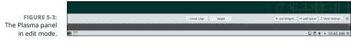

编辑模式下的面板包含用于操作面板的图标。表 5-4 显示了这些图标各自的用途。

## 表 5-4 面板编辑器功能

| 功能 | 功能说明 |
| :--- | :--- |
| 屏幕边缘按钮 | 选择面板出现在桌面的哪一侧。 |
| 高度按钮 | 选择面板的高度。 |
| 添加小部件按钮 | 向面板添加新的小部件。 |
| 添加间隔符按钮 | 在面板中的小部件之间添加空白。 |
| 更多设置按钮 | 访问用于对齐面板小部件、自动隐藏面板，或指示应用程序窗口是否可以覆盖面板的按钮。 |
| 退出按钮 | 退出面板编辑器。 |
| 左侧指针 | 设置面板左侧的位置。 |
| 右侧上指针 | 设置面板右侧的最大位置。 |
| 右侧下指针 | 设置面板右侧的最小位置。 |

在面板编辑模式下，您还可以通过拖放来移动现有小部件，或者右键单击小部件图标并选择“移除”选项来删除现有小部件。有了所有这些功能，您可以选择您的面板在桌面上看起来的样子！

## 桌面

桌面可能是 Plasma 中最具争议的功能。它的行为与其他桌面环境显著不同。Plasma 中的桌面更像是一个面板的扩展，而不是一个桌面。您不能将文件、文件夹或应用程序图标放在 Plasma 桌面上。相反，您只是放置额外的小部件。

然而，尽管如此，您可以使用一种技巧让 Plasma 桌面表现得类似于 Windows 桌面。您可以使用的小部件之一是“文件夹视图”小部件，它在您的 Plasma 桌面上提供了一个类似 Windows 桌面的区域。默认的 openSUSE Plasma 桌面使用“文件夹视图”小部件来显示用户桌面文件夹的内容。（参见图 5-1。）并非所有 Linux 发行版都这样做。

“文件夹视图”区域允许您在定义的“文件夹视图”区域内将文件、文件夹和应用程序图标放置在桌面上。实际上，您可以为系统中的任何文件夹创建一个文件夹视图区域，但最常见的是为您的主文件夹中的桌面文件夹创建它（参见第 7 章）。这是 openSUSE Plasma 桌面提供的默认“文件夹视图”。因此，放置在桌面“文件夹视图”中的项目会出现在您主区域的桌面文件夹中，就像 Windows 中的桌面一样。

除了“文件夹视图”之外，默认的 openSUSE 桌面仅包含另一个图标，即桌面工具箱，通常位于桌面的最右上角。桌面工具箱图标允许您向桌面添加额外的小部件，就像在面板上一样。

Plasma 桌面和面板都使用相同的小部件，因此接下来我将更仔细地查看小部件。

## 使用小部件

Plasma 桌面环境的关键是小部件。小部件是在桌面上运行的小型应用程序。每个小部件都提供一种不同的实用工具或小型程序供您在桌面使用。本节介绍如何在您的 Plasma 环境中添加、删除和获取新的小部件。

### 添加小部件

Plasma 软件包提供了许多不同的小部件供您用于面板和桌面。点击面板或桌面编辑器中的“添加小部件”按钮，会列出当前安装在工作站上的小部件列表。图 5-4 显示了其外观。


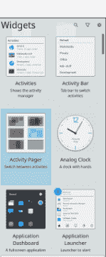

**图 5-4：** 添加小部件菜单。

在桌面或面板上已激活的小部件旁边会有一个标记。添加新小部件非常简单，只需选择所需的小部件并点击“添加小部件”按钮即可。表 5-5 列出了 openSUSE 中默认提供的小部件。

### 表 5-5 openSUSE KDE 小部件

| 小部件名称 | 功能描述 |
|---|---|
| Activities（活动） | 显示活动管理器。 |
| Activity Bar（活动栏） | 显示独立的活动，以便在它们之间切换。 |
| Activity Pager（活动切换器） | 轻松地在活动之间切换。 |
| Analog Clock（模拟时钟） | 显示经典的圆形指针时钟！ |
| Application Dashboard（应用仪表板） | 以全屏显示已安装应用的图标。 |
| Application Launcher（应用启动器） | 显示选项卡式菜单以启动应用程序。 |
| Application Menu（应用程序菜单） | 提供旧式的应用程序菜单。 |
| Audio Volume（音量） | 控制音频设备的当前音量设置。 |
| Battery and Brightness（电池和亮度） | 显示笔记本电脑电池的充电状态以及显示器亮度设置。 |
| Binary Clock（二进制时钟） | 极客的计时工具！ |
| Calculator（计算器） | 提供快速访问 KDE 计算器的功能。 |
| Calendar（日历） | 显示预约和事件。 |
| Clipboard（剪贴板） | 查看过去放入剪贴板的项目历史记录。 |
| Color Picker（取色器） | 允许您捕获桌面上任何颜色的数值。 |
| Comic Strip（漫画连环画） | 显示每日漫画连环画。 |
| Dictionary（词典） | 适用于您不知道如何拼写某个单词的场合。 |
| Digital Clock（数字时钟） | 以数字格式显示时间。 |
| Disk Quota（磁盘配额） | 显示磁盘用量的详细信息。 |
| Fifteen Puzzle（十五字滑块拼图） | 为拼图爱好者提供快速的娱乐。 |
| Folder View（文件夹视图） | 提供特定文件夹内容的图形化显示。 |
| Global Menu（全局菜单） | 在显示器的顶部显示全局菜单栏。 |
| Grouping Plasmaoid（分组合成小部件） | 将小部件分组。 |
| Hard Disk I/O Monitor（硬盘 I/O 监视器） | 监视硬盘吞吐量。 |
| Hard Disk Space Usage（硬盘空间使用情况） | 监视硬盘空间。 |
| Icons-only Task Manager（仅图标任务管理器） | 通过图标在正在运行的应用程序之间切换。 |
| Input Method Panel（输入法面板） | 显示通用输入法。 |
| Kate Sessions（Kate 会话） | 启动并跟踪 Kate 编辑器的会话。 |
| KDE Connect（KDE 连接） | 显示来自使用 KDE Connect 的设备的通知。 |
| Konsole Profiles（Konsole 配置档） | 列出并启动 Konsole 终端会话。 |
| Lock/Logout（锁定/注销） | 轻松访问注销或锁定工作站的功能。 |
| Media Frame（媒体框） | 显示图片。 |
| Media Player（媒体播放器） | 显示多媒体播放器的控制界面。 |
| Memory Status（内存状态） | 显示物理内存和虚拟内存的状态。 |
| Minimize All Windows（最小化所有窗口） | 通过最小化所有打开的应用程序窗口返回桌面。 |
| Network Monitor（网络监视器） | 显示网络使用情况。 |
| Network（网络） | 显示可用的网络连接。 |
| Notes（便签） | 就像在现实生活中一样——在您的桌面上随处留下便签！ |
| Notifications（通知） | 显示系统通知和任务。 |
| Pager（分页器） | 允许您快速在工作区之间跳转。 |
| Printers（打印机） | 列出并管理打印机。 |
| QuickShare（快速共享） | 将文本/图像粘贴到远程服务器。 |
| QuickLaunch（快速启动） | 启动收藏夹中的应用。 |
| Search（搜索） | 搜索应用程序和文档。 |
| Show Desktop（显示桌面） | 通过最小化正在运行的应用程序窗口来显示 Plasma 桌面。 |
| Software Updates（软件更新） | 获取并安装软件更新。 |
| System Load Viewer（系统负载查看器） | 显示 CPU 和内存状态。 |
| System Tray（系统托盘） | 访问在系统托盘中最小化的隐藏应用。 |
| Task Manager（任务管理器） | 在正在运行的应用程序之间切换。 |
| Timer（计时器） | 提供倒计时计时器。 |
| Touchpad（触控板） | 显示当前触控板状态。 |
| Trashcan（回收站） | 提供快速访问回收站文件夹的功能。 |
| User Switcher（用户切换器） | 快速在用户之间切换。 |
| Wacom Tablet Settings（Wacom 数位板设置） | 支持 Wacom 数位板的即插即用和配置文件。 |
| Weather Forecast（天气预报） | 显示当前天气信息。 |
| Web browser（网页浏览器） | 从桌面启动网页。 |
| Window list（窗口列表） | 显示打开的应用程序窗口列表。 |

这是一个相当丰富的小部件集合供您玩味！您可以通过将它们添加到面板或桌面来实验小部件，如果认为它们没用，还可以轻松删除它们。

大多数小部件都提供了一个简单的控制菜单，您可以通过在面板中右击小部件，或将鼠标指针悬停在桌面上的小部件上来修改小部件的布局和行为。从这个菜单中，您可以移动小部件、删除小部件，或者对于某些小部件，访问“属性”对话框以配置小部件。

## 获取更多小部件

除了所有标准小部件外，您甚至还可以下载更多小部件！点击“添加小部件”对话框中的“获取新小部件”按钮，会弹出一个下拉框，包含两个选项：

- **从互联网下载：** 浏览在线仓库中的新小部件包。
- **从文件安装...：** 浏览到工作站上的位置，从工作站上已有的文件安装新小部件包。

如果您的工作站已连接到互联网（参见第 9 章），请按照以下步骤从互联网安装新小部件：

1. **选择“从互联网下载”选项。**

将打开 Plasma 插件安装程序，如图 5-5 所示。

安装程序对话框会联系已配置的小部件仓库，并提供可用小部件列表。您可以按照下载量最多、最新或评分最高来对列表进行排序。您也可以选择仅显示已安装的小部件。只需选择列表右侧相应的单选按钮即可。

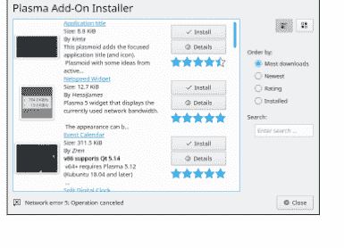

**图 5-5：** 插件安装程序。

2. **点击您要使用的小部件的“安装”按钮。**

插件安装程序会自动从仓库下载小部件并将其安装到您的工作站上。

3. **点击“关闭”按钮以关闭插件安装程序。**

新安装的小部件将出现在“添加小部件”对话框中。

4. **从“添加小部件”对话框中选择新小部件。**

5. **点击“添加小部件”按钮，将新小部件添加到您的桌面或面板中。**

在您将新小部件安装到桌面或面板后，您可以访问控制菜单来管理该小部件。

## Plasma 系统设置

借助 Plasma，您几乎可以将桌面环境中的每个功能都按自己的喜好进行配置。Plasma 系统设置工具提供了对您所有配置需求的快速访问。

您从“应用启动器”启动 Plasma 系统设置工具。在 openSUSE 中，只需从“计算机”菜单选项卡中选择“配置桌面”菜单项即可。主系统设置对话框如图 5-6 所示。

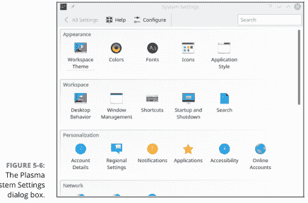

该对话框包含六个独立的区域：

- **外观：** 访问桌面大多数常见的“外观和感觉”功能。
- **工作区：** 管理窗口显示方式，以及如何在桌面上控制窗口。
- **个性化：** 为用户账户设置自定义操作，例如设置无障碍功能、通知以及连接在线账户。
- **网络：** 控制系统如何连接网络（参见第 9 章）。
- **硬件：** 定义新的硬件设备，如显示器、键盘、鼠标和打印机。
- **系统管理：** 管理高级功能，如创建新用户账户、管理网络服务和软件仓库。

如您所见，您可以在 Plasma 桌面环境中自定义很多事情。然而，奇怪的是，在桌面上还有一个地方可以进行调整。

## 桌面文件夹设置

我提到过，Plasma 中的桌面实际上不是一个真正的桌面，而是另一个名为“文件夹视图”的小部件。因此，桌面设置与其他 Plasma 设置是分开的。不过，确实有一些设置可以为桌面进行修改。

要访问桌面文件夹设置，请在桌面的空白处右键单击并选择“配置桌面”。

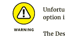

不幸的是，这个“配置桌面”与应用启动器中启动系统设置的“配置桌面”选项不同。

如图 5-7 所示，桌面文件夹设置对话框将出现。


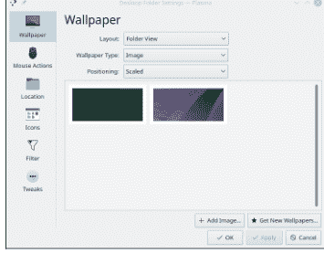

图 5-7：桌面文件夹设置对话框。

桌面文件夹设置允许你自定义与桌面相关的几项不同设置：

-   **墙纸**：让你选择桌面区域的背景显示内容
-   **鼠标操作**：允许你设置每个鼠标按钮执行的操作
-   **位置**：确定桌面文件夹视图显示的目录
-   **图标**：设置显示在桌面上的图标属性
-   **过滤器**：允许你从桌面显示中过滤掉特定类型文件的图标
-   **微调**：用于显示桌面工具箱和小部件行为的选项


这些设置仅适用于桌面文件夹视图；若要调整与桌面行为相关的设置，你需要前往系统设置。

## 无障碍设置

虽然并不显眼，但 Plasma 确实包含用于控制身障人士桌面行为的设置。要访问这些设置，请在应用启动器中选择“配置桌面”菜单项以打开系统设置对话框，然后在“个性化”部分选择“无障碍”。图 5-8 展示了无障碍选项对话框。

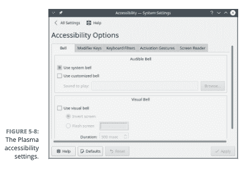

无障碍设置分为五个选项卡：

-   **铃声**：允许你自定义铃声声音，并在激活铃声时提供视觉闪烁效果。
-   **修饰键**：设置粘滞键和锁定键功能。
-   **键盘过滤器**：启用慢速键和弹跳键功能。
-   **激活手势**：设置如何启用/禁用粘滞键或慢速键功能，以及如何通知这些事件的发生。
-   **屏幕阅读器**：激活屏幕阅读器程序，并设置使用哪个屏幕阅读器程序。

Plasma 的无障碍功能有助于为残障人士使用图形桌面功能提供公平的机会。

# 本章要点

-   Cinnamon 桌面
-   考察 MATE 桌面
-   Xfce 桌面的简洁性

# 第 6 章
## 探索替代桌面

第 4 章和第 5 章分别介绍了 GNOME 3 和 KDE Plasma 桌面。尽管这两个是目前 Linux 系统中使用最广泛的桌面环境，但它们并非唯一的选项。Linux 中有很多图形桌面可供选择，而且即使你选择的 Linux 发行版默认使用其中某一种，也并不意味着你必须局限于此。每个 Linux 发行版都允许你安装替代的桌面环境，从而为你提供丰富的选项来决定如何与你的 Linux 系统交互。

本章将介绍你在 Linux 世界中会遇到的另外三种图形桌面环境——Cinnamon、MATE 和 Xfce 的基础知识。希望这能让你对其他桌面环境在 Linux 中的运作方式有一个了解。

## 用 Cinnamon 增添色彩

在第 4 章中，我提到随着 GNOME 3 桌面的发布，Linux 界曾出现过巨大的焦虑。许多核心 Linux 用户对 GNOME 2 的外观和感觉非常满意，而 GNOME 3 引入的桌面范式变革颠覆了他们的世界。

这催生了一些源自原始 GNOME 桌面的分支桌面。Cinnamon 就是其中一个分支。本节将介绍 Cinnamon 桌面的基础知识。

### Cinnamon 的历史

Cinnamon 桌面项目由 Linux Mint 发行版的开发者于 2011 年发起，作为 GNOME 3 的替代方案。它使用了与 GNOME 3 桌面项目大多相同的后台代码，但保留了 GNOME 2 桌面的原始外观和感觉，如图 6-1 所示。


图 6-1：Linux Mint 中的 Cinnamon 桌面。

Linux Mint 中的 Cinnamon 桌面具有许多与 Windows 桌面相似的功能：

-   桌面底部有一个单一的面板
-   面板左边缘有一个应用程序启动器
-   面板右边缘有一个系统托盘
-   一个可以保存文件夹和文件的桌面区域

Cinnamon 的应用程序启动器旨在类似于旧的 GNOME 2 菜单系统。我将在下一节中深入探讨这一点。

你的特定 Linux 发行版的 Cinnamon 桌面可能与图 6-1 中显示的略有不同。在 Cinnamon 中，你可以将面板移动到桌面的任何一侧，甚至可以拥有多个面板。只需在面板的空白处右键单击，选择**移动**选项即可移动面板，或选择**添加面板**选项以创建额外面板。

## 查看菜单

Cinnamon 应用程序启动器，简称为 *Cinnamon 菜单*，提供了对系统和目录中应用程序的快速访问。图 6-2 显示了在 Linux Mint 中看到的默认菜单布局。


Cinnamon 菜单包含四个主要部分：

-   左侧的收藏夹列表
-   中间的分类列表
-   右侧与中间所选分类匹配的应用程序详细列表
-   顶部的搜索文本框，用于帮助搜索文件、目录或应用程序

Linux Mint 提供的默认收藏夹包括：

-   Firefox 网络浏览器
-   软件管理器，用于安装和删除应用程序
-   系统设置，用于管理桌面设置
-   终端，提供命令行界面
-   文件，用于浏览文件和文件夹
-   锁定屏幕，用于锁定当前桌面会话
-   注销，用于离开当前会话
-   退出，用于关机或重启计算机

收藏夹旁边是应用程序分类，列于表 6–1 中。

**表 6–1 应用程序菜单分类**

| 分类 | 描述 |
| :--- | :--- |
| 所有应用程序 | 列出系统上安装的所有应用程序 |
| 附件 | 简单的 GNOME 实用程序，如计算器、文档查看器和磁盘查看器 |
| 图形 | 图形处理应用程序 |
| 互联网 | 用于联网的应用程序，如 Firefox 和 Thunderbird 邮件（参见第 10 章） |
| 办公 | LibreOffice 生产力应用程序（参见第 12 章） |
| 声音和视频 | 视频和音频文件播放应用程序 |
| 管理 | 用于管理你的 Linux 系统的应用程序 |
| 偏好 | 允许你更改桌面设置 |
| 位置 | 使用 Nemo 文件管理器显示目录 |
| 最近文件 | 列出最近打开的文档 |

当你将鼠标指针悬停在每个分类上时，右栏显示的应用程序列表会相应地变化。只需点击所需图标即可启动应用程序。


你可以通过右键单击面板中的菜单图标并选择“配置”来修改 Cinnamon 菜单布局。在配置对话框中，点击顶部的“菜单”按钮以更改菜单行为和菜单项。你可以添加和删除菜单项，并设置是否在菜单中显示图标。

## 更改设置

Cinnamon 桌面允许你从系统设置对话框中自定义许多功能，该对话框可从应用程序启动器访问。系统设置对话框的布局如图 6-3 所示。


该对话框有四个部分：

-   **外观**：控制桌面的外观，如背景、字体和窗口主题。
-   **偏好**：允许你设置桌面功能，如无障碍功能、面板外观以及热角的使用。
-   **硬件**：设置显示器、打印机和网络功能。
-   **管理**：管理用户账户、软件源和防火墙。

偏好部分是你可以大显身手自定义桌面环境的地方。表 6-2 详细列出了在偏好中看到的不同项目。


# innamon 偏好设置

| 项目 | 描述 |
| :--- | :--- |
| 辅助功能 | 启用辅助功能，例如更大的字体、屏幕阅读器、键盘辅助和鼠标辅助。 |
| 账户详情 | 管理用户账户，例如更改密码或添加图片。 |
| 日期和时间 | 定义日期和时间格式，以及时区设置。 |
| 桌面 | 控制桌面上显示的图标。 |
| 常规 | 与图形管理器使用的视频合成器相关的设置。 |
| 热角落 | 定义当光标放置在桌面角落时启动的应用程序。 |
| 输入方法 | 定义如何输入键盘上不可用的特殊字符和外语字符。 |
| 语言 | 定义用于时间、货币和字符的语言和格式。 |
| 在线账户 | 配置对在线账户或日历和邮件的访问权限。 |
| 首选应用程序 | 定义在需要特定操作时（如网络浏览器、邮件客户端或多媒体播放器）启动的应用程序。 |
| 隐私 | 设置“最近文件”菜单选项跟踪已打开文件的持续时间。 |
| 屏幕保护程序 | 定义屏幕保护程序的启动时间及其行为方式。 |
| 启动应用程序 | 定义桌面打开时启动哪些应用程序。 |
| 窗口 | 配置应用程序窗口的外观和行为。 |
| 工作区 | 配置 Cinnamon 如何处理多个虚拟工作区。 |

# 添加更多“香料”

Cinnamon 桌面和面板都允许你添加小部件（称为*香料*）为你的桌面提供额外功能。要添加桌面小部件，请在桌面区域的任意位置右键单击，并选择**添加桌面小部件**。你将看到当前可用的桌面小部件列表，以及一个允许你下载更多小部件的标签页。

同样地，当你右键单击面板区域并选择 Applets（小部件）时，你会看到可以添加到面板中的 Applets 选项，如*图 6-4*所示。

带有复选标记的 Applets 表示已经安装。某些 Applets 允许你配置其行为，旁边显示齿轮图标表示可配置。


**图 6-4：**
Linux Mint 中可用的面板 Applets 列表。

# 使用 MATE

另一个受欢迎的 GNOME 衍生版是 MATE 桌面环境。它具有与 Cinnamon 类似的许多功能，但也有一些不同之处。本节将介绍 MATE 的组件，以及如何根据喜好进行自定义。

## MATE 的历史

MATE（发音为 "ma-tay"，源自南美植物）桌面也是在 2011 年创建的，起因是 GNOME 项目转向 GNOME 3。它由 Arch Linux 发行版的开发者创建，但也在其他 Linux 发行版中作为桌面替代方案获得了 popularity。图 6–5 展示了 Fedora MATE spin 中的默认 MATE 桌面。

在许多方面，MATE 桌面保留了基本的 GNOME 2 桌面布局：

- **顶部面板**包含三个独立的菜单，而不仅仅是一个：
  - **应用程序**：提供访问系统中所有已安装图形应用程序的途径。
  - **位置**：提供访问各种目录，如主目录、文档、下载以及任何网络驱动器。
  - **系统**：提供访问系统偏好设置、管理功能以及关机功能。
- **底部面板**包含三个主要部分：
  - **显示桌面图标**：点击时，最小化所有打开的窗口。
  - **正在运行的应用程序**：显示桌面上所有打开窗口的图标和标题。
  - **工作区切换器**：允许更改在桌面上显示的当前活动工作区。
- **系统托盘**位于桌面右上角，包括时间和日期、网络状态以及声卡状态的图标。
- **桌面区域**，你可以在这里保存文件夹和文件，并像旧的 GNOME 2 桌面一样为文件、目录和应用程序创建图标。它还具有几个收藏夹应用图标，以便快速访问常用应用。


**图 6-5：**
Fedora MATE 中的默认 MATE 桌面。

# 查看菜单

正如前一节所述，Fedora MATE 中使用的默认菜单设置在顶部面板上创建了三个菜单项。应用程序菜单如图 6-6 所示。


应用程序菜单为启动任何已安装的图形应用程序提供了快速访问途径。它将应用程序分为八个类别，如表 6-3 中所述。

当你使用软件管理器（见第 15 章）添加新的软件包时，它们会自动出现在应用程序菜单中。

**表 6-3** MATE 应用程序菜单项

| 类别 | 描述 |
| :--- | :--- |
| 附件 | 小型实用程序，如时钟、日历和文本编辑器 |
| 教育 | 面向学习的教育软件包 |
| 图形 | 用于查看和编辑图像的图形软件包 |
| 互联网 | 用于访问互联网功能（如浏览器和邮件客户端）的软件包 |
| 办公 | LibreOffice 办公生产力软件包 |
| 声音与视频 | 用于播放和编辑音频和视频文件的软件包 |
| 系统工具 | 用于管理 Linux 系统的软件包 |
| 通用访问 | 提供辅助功能特性的软件包 |

## 更改桌面设置

与 Linux 中的任何其他图形桌面环境一样，你可以更改 MATE 桌面布局中的几乎所有内容。要做到这一点，你需要前往控制中心。你可以从顶部面板的系统菜单进入。主要的控制中心对话框如图 6–7 所示。


**图 6-7：**
MATE 控制中心。

控制中心将设置分为六个主要部分：

- **管理**：设置软件管理、打印、防火墙和登录窗口等功能。
- **硬件**：管理硬件功能，如声卡和电源管理。
- **互联网和网络**：配置高级网络设置。
- **外观和感受**：设置窗口、弹出窗口和屏幕保护程序的外观。
- **个人**：启用辅助功能、首选应用程序以及启动时运行的应用程序。
- **其他**：设置特殊字符的字符显示。

**提示**

“外观和感受”类别中的外观设置允许你更改桌面的背景主题。你还可以通过右键单击桌面上的空白处并选择“更改桌面背景”直接访问该位置。

## 小部件（Applets）

与 Cinnamon 类似，MATE 也提供可以添加到桌面任何面板的小部件，如图 6–8 所示的“添加到面板”对话框。


要添加新的小部件，请遵循以下步骤：

1. 右键单击面板中的空白处，然后选择**添加到面板**以打开**添加到面板**对话框。
2. 点击你想添加的小部件。
3. 点击**添加**按钮。
   小部件将出现在主面板中。
4. 右键单击小部件并选择**移动**。
5. 移动鼠标指针以重新定位当前面板上的小部件，或将指针指向另一个面板以将小部件移动到该面板。点击你希望小部件驻留的位置。

# Xfce 桌面界面

虽然 GNOME 3、KDE Plasma、Cinnamon 和 MATE 桌面非常华丽，但它们运行都需要相当多的计算资源。Linux 的一个原始卖点是它可以运行在你手头几乎任何旧 PC 上。不幸的是，使用那些桌面环境时，情况并非总是如此。

然而，其他图形桌面环境资源占用较少，确实可以运行在几乎任何设备上。Xfce 桌面就是其中之一。本节将探讨 Xfce 桌面的特性，并展示如何对其进行自定义。

## Xfce 的历史

Xfce 桌面实际上是 Linux 世界中较旧的桌面软件包之一，由 Olivier Fourdan 于 1996 年创建，作为当时商业通用桌面环境（CDE）在 Unix 中使用的开源替代方案。由于它是在 x86 计算机统治世界的时候创建的，因此运行 Xfce 不需要很多资源，这在今天仍然适用。

由于其轻量级的要求，Xfce 桌面在面向旧硬件或功率较低硬件（如使用 ARM 处理器芯片的设备）的 Linux 发行版中很受欢迎。图 6-9 展示了 MX Linux 发行版中使用的默认 Xfce 桌面。


**图 6-9：**
MX Linux 中的 Xfce 桌面。


Xfce 的关键在于简洁。桌面包含两个元素——一个单一的面板（在 MX Linux 中，默认位于桌面左侧）和桌面区域。Xfce 面板使用小工具（applets）来提供不同的功能。MX Linux 的默认面板配置中包含若干默认小工具：

-   **操作按钮**：提供一个弹出窗口，用于注销、重启或关机系统
-   **数字时钟**：点击时调出 Orage 日历应用程序
-   **活动窗口区域**：显示桌面上已打开应用程序窗口的图标
-   **收藏夹**：用于快速启动常用应用程序的图标
-   **通知区域**：显示各种应用程序状态的图标，如网络、声音和软件更新应用程序
-   **分页器**：允许你在工作区之间切换
-   **Whisker 菜单**：提供对应用程序的访问权限

你会注意到，在那些“知名”图形化桌面中常见的许多功能，在 Xfce 中也可以使用。它们仅凭极小的内存需求就能做到这些，真是令人惊叹。

## Whisker 菜单

Whisker 菜单（因其命名源于 Xfce 的老鼠吉祥物）提供了对系统中所有图形应用程序的快速访问。图 6-10 展示了 MX Linux 中提供的默认 Whisker 菜单。

在菜单顶部，你可以找到当前登录的用户账户，以及四个图标：

-   **设置管理器**：调出设置管理器对话框。（参见“更改 Xfce 设置”章节。）
-   **锁定**：使用屏幕保护程序锁定桌面。
-   **切换用户**：保持当前用户账户处于登录状态，并允许另一用户登录。
-   **注销**：显示一个对话框，用于注销、重启或关闭系统。


**图 6-10**：MX Linux 中的 Xfce Whisker 菜单。

用户账户下方是一个搜索文本框，允许你输入应用程序名称以快速显示匹配的应用程序图标。只需点击应用程序图标即可启动程序。

Whisker 菜单底部是应用程序菜单区域。与其他菜单系统类似，这里分为两个部分。右侧是类别列表，左侧是所选类别内的程序列表。表 6-4 概述了 MX Linux Whisker 菜单中使用的不同类别。

### 表 6-4 Whisker 菜单类别

| 类别 | 描述 |
|---|---|
| 收藏夹 | 标记为收藏夹以便快速访问的应用程序 |
| 最近使用 | 最近启动的应用程序列表 |
| 所有应用程序 | 已安装的所有图形应用程序的完整列表 |
| 附件 | 计算器、文本编辑器等简单实用工具 |
| 开发 | 用于软件开发的应用程序 |
| 游戏 | 供你无聊时游玩的游戏 |
| 图形 | 图形图像查看和编辑软件 |
| 互联网 | 用于浏览、电子邮件及其他网络功能的应用程序 |
| 多媒体 | 播放音频和视频文件 |
| MX 工具 | 专为 MX Linux 环境设计的专用工具 |
| 办公 | LibreOffice 办公生产力应用程序 |
| 设置 | 快速访问设置管理器程序中的特定设置 |
| 系统 | 磁盘、打印机和软件管理器程序 |


你可以通过右键点击菜单图标并选择**编辑应用程序**来自定义 Whisker 菜单。然后你可以更改现有条目并添加新条目！

你还可以通过在桌面区域右键点击并选择**应用程序**来快速访问 Whisker 应用程序菜单。

## 更改 Xfce 设置

正如你所预期的那样，Xfce 桌面允许你按喜好进行自定义。为此，你使用**设置管理器**对话框，如图 6-11 所示。


要打开设置管理器，请点击面板中的 Whisker 菜单图标，然后点击菜单区域顶部的设置管理器图标。

设置管理器是配置 Xfce 中大多数需要自定义内容的一站式地方。对话框中有四个独立部分：

-   **个人**：自定义桌面主题和外观。
-   **硬件**：管理打印机、显示器和网络连接等硬件设备。
-   **系统**：设置系统相关项，如防火墙、用于与 Windows 客户端共享目录的 Samba 服务器，以及设置辅助功能。
-   **其他**：如广告拦截器和 Adobe Flash 设置等杂项。


## 小工具

Xfce 面板的一个意外功能是能够添加小工具。你不会指望在如此极简的图形桌面环境中拥有这种功能，但 Xfce 提供了相当多的精美小工具，你可以将它们添加到面板中。请按以下步骤添加新的小工具：

1.  **右键点击面板上的空白处。**
    将出现一个弹出菜单，允许你移动小工具图标、删除它们或添加新的小工具。
2.  **将鼠标悬停在“面板”菜单选项上。**
3.  **从菜单中选择“添加新项”。**
    “添加新项”对话框将出现，显示可添加的小工具列表，如图 6-12 所示。你还可以从这里添加应用程序启动器图标，或添加分隔符以在面板中的小工具图标之间产生空白区域。


4.  **找到你想要添加的小工具，然后点击“添加”按钮。**
5.  **右键点击面板中的应用程序图标，然后选择“移动”。**
6.  **将小工具图标移动到面板上你希望它停留的位置。**

很快，你就可以将 Xfce 桌面自定义成看起来和行为都像更花哨的 GNOME 3 或 KDE Plasma 桌面环境！

# 第 2 部分

快速上手 Linux

## 本部分介绍

-   发现 Linux 文件系统中各个内容存储的位置。
-   像专家一样浏览 Linux 文件系统。
-   将 Linux 计算机连接到互联网。

## 本章介绍

-   了解如何在文件系统中导航
-   查找可移动媒体
-   理解文件系统权限

# 第 7 章

## 认识 Linux 文件系统

掌握新操作系统时最令人沮丧的事情之一就是弄清楚它在哪里存储文件。Linux 不像 Microsoft Windows 那样将所有重要的系统文件保存在单个目录（如 C:\Windows 目录）中，而是遵循其 UNIX 近亲的榜样，将内容分布得更广一些。尽管 Linux 和 Windows 的设置涉及不同的方法，但它们都是合乎逻辑的，即使在你理解去哪里查找之前可能感觉并非如此。

在带你游览查找各项内容的位置之后，本章将展示如何在命令行中操作你的文件系统。如果你输入命令时感到心惊肉跳，阅读这一部分并非强制性的，但如果以后你需要修复某些问题，这会很有用；而且有些人就是喜欢知道如何做这些事情。

## 拼图碎片

在开始之前，了解术语会有所帮助。这些内容中的许多对你来说可能很熟悉，来自 Microsoft Windows 等其他操作系统，但也有一些差异你需要习惯。首先，“文件系统”这个词实际上有多种用法。通用用法（也是我在使用该术语时在整个书中通常所指的）意味着“你现在可以访问的文件和目录（或文件夹）”。

需要意识到的第一个主要差异是，Linux 在目录之间使用正斜杠（ / ），而不是 Windows 使用的反斜杠（\）。因此，目录 `etc` 中的文件 `hosts` 是 `/etc/hosts`。文件和目录的名称长度最多可达 256 个字符，这些名称可以在任何位置包含下划线（ _ ）、短横线（-）和点（ . ），甚至可以有多个。因此，我的 `. big . file` 或 `my . big . file` 或 `my - big - file` 都是有效的文件名。

在 Linux 中，文件名的上标和下标（大小写）也很重要。它们必须完全匹配。就 Linux 而言，文件 `hosts` 和 `Hosts` 不是同一个文件。最后，同一个文件系统可以跨越多个分区、硬盘以及可移动媒体，如 DVD 驱动器和 USB 驱动器。你只需通过子目录不断向下查找，不必关心某个内容是在磁盘 A、B 还是其他盘上。我将在稍后的“可移动媒体存放的位置”部分对此进行更多阐述。

## 游览 Linux 文件系统

在本节中，我将查看典型 Linux 文件系统的内容。至少对其有一点熟悉有助于你稍后追踪各项内容，并帮助你了解哪些地方可以随意操作，哪些地方需要非常小心。

### 树的根

Linux 文件系统中的所有事物都相对于根目录，即 `/`。不要将其与系统管理员（即 root 用户）或分配给 root 用户的 `/root` 目录混淆。（我不确定为什么 Unix 和 Linux 极客们如此喜欢“root”这个词！）根目录是文件系统的基础——进入所有文件的入口。根目录包含一组基本可预测的子目录。每个发行版略有不同，但存在某些它们都遵守的标准。这些标准让 Linux 世界保持某种有序。


在 Linux 的早期，不同的发行版确实使用不同的位置来存储文件。谢天谢地，一个名为文件系统层次结构标准（Filesystem Hierarchy Standard, FHS）的标准已经形成，这使得生活变得更加容易。如果你对标准感兴趣，请访问 refspecs.linuxfoundation.org/fhs.shtml 并查看规则的最新版本。


表 7-1 列出了你可能会在根目录（即 `/` 中的项目）中找到的内容。（此列表可能因你安装的内容而异。）描述末尾的星号 (*) 表示，除非你有**非常充分的理由**，否则不应动这个目录，因为它包含对系统运行**至关重要**的文件。实际上，大多数根目录都应保持原样。它们内部的某些部分是安全可修改的。

这些目录中的一些拥有同样重要的子目录，我将在接下来的章节中介绍。

## 表 7-1 Linux 中的标准 / 内容

| 目录 | 包含内容 |
|---|---|
| /bin | 任何人随时都需要使用的基本命令* |
| /boot | 用于启动机器的信息，包括内核* |
| /dev | 系统需要交互的所有硬件的设备驱动程序* |
| /etc | 系统的配置文件* |
| /home | 每个用户的家目录 |
| /lib | *库*，或许多程序（以及内核）使用的代码* |
| /media | 添加临时媒体（如 DVD 和 U 盘）的位置；并非所有发行版都有此目录 |
| /mnt | 添加额外文件系统组件（如网络驱动器）的位置；这些不是永久添加到文件系统的项，但也不像 DVD 和 U 盘那样临时 |
| /opt | 一些发行版用于安装新软件包（如文字处理器和办公套件）的位置 |
| /proc | 当前内核（操作系统）设置* |
| /root | 超级用户（root；用户）的家目录 |
| /sbin | 系统管理员需要访问的命令* |
| /srv | 系统*服务*的数据（在后台运行的程序）* |
| /sys | 关于你硬件的内核信息* |
| /tmp | 所有人和所有事物存储临时文件的地方 |
| /usr | 额外的程序和文件的复杂层级结构 |
| /var | 经常变化的数据，例如日志文件和你的邮件 |

## /etc 的重要性

/etc 根目录主要包含配置文件。除非你知道自己需要做什么，否则最好不要动这些文件。这里一些重要的目录（因你安装的内容而异）有：

- 以 /etc/cron 开头的目录包含各种在自动化时间运行的程序的指令。
- /etc/cups 目录包含你的打印机配置信息。
- 以 /etc/rc 和 /etc/systemd 开头的目录都包含关于启动和关机时启动和不启动什么的数据。当你看到关于服务（如第 17 章中所述）的讨论时，这些目录就是存储它们运行时间的地方。
- /etc/NetworkManager 目录包含网络配置信息（参见第 9 章）。
- /etc/X11 目录包含 X 窗口系统（X）的配置详细信息，它运行你的图形用户界面（GUI）。有关 GUI 的更多信息，请参见第 4、5 和 6 章。
- /etc/opt/ 目录包含 /opt/ 目录中程序的配置文件，如果你决定使用 /opt/ 目录的话。

## 可移动媒体所在之处

对于从 Windows 转向 Linux 的用户来说，Linux 如何处理可移动媒体（如 DVD 和 U 盘）是一件令人困惑的事。虽然 Windows 为可移动媒体设备分配不同的驱动器字母，但在大多数 Linux 发行版中，当你插入可移动媒体驱动器时，Linux 会自动将其放置在根文件系统结构中（称为挂载）。

通常，Linux 在 /media/ 目录中创建一个子目录，使用你的用户 ID，随后在该目录下创建另一个子目录，作为媒体的唯一标识符，例如 DVD 标签或 USB 唯一标识号。例如，在我将 U 盘插入我的 PC 后，Ubuntu 创建了一个名为 /media/rich/88CE-4A75 的新目录，我可以在其中访问 U 盘上的所有文件。


在本章后面的“在没有网络（或鼠标）的情况下管理你的文件系统”部分，我将向你展示如何使用命令行找到这些项目。在第 8 章中，你将了解如何在图形桌面环境中使用更便捷的即点即选方法找到它们。

## 计算机是 /usr 的一部分

/usr 目录常被称为其自己的微型文件系统树。该目录有许多重要或有趣的子目录，如表 7-2 所示。描述末尾的星号 (\*) 表示，除非你有充分的理由（在你获得大量 Linux 经验并确切知道需要做出的更改之后）去动那个目录，否则你应该保持原样——以免意外改变系统正常运行所需的东西。关于文件系统这一部分的一个有趣之处在于，许多高级 Linux 用户经常使用 /usr 来存储可以与其他 Linux 机器共享的程序。

**表 7-2** 标准 /usr 子目录

| 子目录 | 内容 |
| :----------- | :------- |
| /usr/bin | 对用户不是必需的但有用的命令* |
| /usr/games | 你安装在系统上的游戏，除了那些你可以选择放在 /opt 中的游戏。 |
| /usr/include | C 编程语言系统及其程序所需的文件* |
| /usr/lib | 此 /usr 子层级中许多程序使用的共享代码* |
| /usr/local | 你希望保留在本地甚至在其他 /usr 共享所有内容时也保留的程序和其他项目 |
| /usr/sbin | 对管理员不是必需的但有用的命令* |
| /usr/share | 你可以在任何 Linux 机器上使用的信息，即使它运行的硬件与此机器非常不同* |

## 在没有网络（或鼠标）的情况下管理你的文件系统

第 8 章介绍了如何使用即点即选文件管理器在 Linux 文件系统中导航。在本节中，我将看看如何使用命令行工具在文件系统中找到方向。你不需要知道这一点，但它将来肯定会有用！

### 在命令行上查看文件信息

如果你决定在 Linux 上进行任何严肃的工作，你将希望熟悉命令行界面（CLI）。CLI 允许你直接向 Linux 提交命令，没有图形中介，并立即看到结果。

如果你属于较老的一代人，CLI 可能会让你想起 MS-DOS 的早期日子。你只是获得一个提示符来输入文本命令，并在监视器上看到文本响应——无聊，但高效！

在 GUI 世界中，你可以使用终端程序访问 CLI，如图 7-1 所示。


终端程序提供一个图形窗口，显示 CLI，允许你输入命令并查看结果。

要查看文件和目录，你需要使用 `ls` 命令。它本身显示你请求的非隐藏文件和目录的名称；图 7-1 显示了一个示例。

根据你的 Linux 发行版设置，`ls` 输出可能显示为彩色，每种颜色告诉你关于你正在查看的项类型的某些信息。虽然不是详尽的列表，但这里有一些你在目录列表中可能看到的较流行的颜色：

| 文本颜色 | 通常含义 |
| :--- | :--- |
| 白色 | 不匹配任何需要颜色的特殊类型的常规文件。 |
| 红色 | *归档*或*包*（参见第 15 章）。 |
| 粉色 | 图像文件（如果它识别文件扩展名，如 `.jpg`、`.tif` 和 `.gif`）。有时粉色也用于另一种特殊文件，但它高度专业化，你不必担心。如果你在文件名上没有看到图像扩展名但看到粉色文件，只需忽略它。 |
| 深蓝色 | 目录。 |
| 浅蓝色 | 指向另一个文件的*软链接*。 |
| 绿色 | Linux 中的程序（称为*可执行文件*）。 |
| 红底白字 | *断开的链接*。 |
| 黑底黄字 | *设备文件*（基本上，用于与硬件（如你的监视器）通信的文件）。 |
| 绿底黑字 | 你只能删除或更改你拥有或*具有写权限*的文件目录。（有关更多信息，请参见本章后面的“理解文件列表信息”部分。） |

`ls` 命令显示请求位置的所有内容，除了以点开头的*隐藏文件*。要查看隐藏文件，输入 `ls -a`，你会得到如图 7-2 所示的结果。

到目前为止，你做的只是查看文件，并从你看到的颜色中了解一点关于它们的信息。下一节向你展示如何发现更多。

### 理解文件列表信息

要查看比名称和模糊类型更多的信息，你需要长格式文件列表。你可以使用命令 `ls -l` 获取此列表（如果你想要长格式和隐藏文件，则输入 `ls -la`）。图 7-3 显示了你可能看到的示例。

你可能会发现这种格式中的一些部分比其他部分更容易一眼看懂。每个列表中的第一项（带有字母和破折号的部分——例如，对于 `.bash_history` 文件的 `-rw-------`）是分配给该项的*权限*设置。简要地说，权限定义谁可以读取文件、更改它，或者如果是程序则运行它。你可以在“权限简介”中阅读更多关于权限的内容。


本章稍后。第一行中的第二项（对于“.bash_history”文件，为 1，2）是该项的硬链接数。硬链接是指向同一文件的指针，但使用单独的文件名。


**图 7-2：** 主目录，显示隐藏文件，同时使用了 `ls -a` 命令。


**图 7-3：** 全新主目录的开头部分，以长格式同时显示隐藏和非隐藏文件。

第三项（对于 .bash_history 文件为 rich）是文件的所有者，第四项（rich）是组——具体取决于你使用的 Linux 版本；这些项可能相同，也可能不同。你可以在本章稍后的“权限入门”部分进一步了解这两者。第五项是文件的字节大小。所有目录都显示为 4,096 字节。其他文件都有各自的大小。你可以通过 0 字节的大小来识别空文件。

第六、第七和第八项都与文件最后修改时间有关：对于 .bash_history 文件，分别是月份（Jun）、日期（24）和 24 小时制的时间（08:12）。最后，第九项是文件名（例如 .bash_history）。

## 理解文件类型

长格式文件列表中的第一个字母告诉您正在处理哪种类型的文件。在表 7–3 中，我列出了您可能会遇到的类型。在查看了文件列表的颜色方案后，其中一些类型可能看起来很熟悉。

除了表 7–3 中提到的那些之外，在 Linux 世界中您还会发现更多不同的文件类型。这里的“类型”并不是指扩展名，如 .exe 或 .doc。Linux 将其文件系统内的一切——甚至包括目录和硬件（如您的显示器）——都视为“文件”。因此，为文件分配类型只是 Linux 系统的一种记录各文件性质的方法。

**表 7-3**
**Linux 文件类型**

| 标签 | 类型 | 描述 |
| :---- | :--- | :---------- |
| - | 常规文件 | 该项是普通文件，例如文本文件或程序。 |
| b | 块设备 | 该项是存储介质（如硬盘或 DVD 驱动器）的驱动程序（控制程序）。 |
| c | 字符设备 | 该项是数据传输硬件（如调制解调器）的驱动程序（控制程序）。 |
| d | 目录 | 该项是文件的容器，在某些操作系统的术语中也被称为文件夹。 |
| l | 链接 | 该项是另一个文件的链接。该项本身不作为单独文件存在，而是指向另一个文件的指针。 |

对于特定从 Windows 转向 Linux 的用户来说，他们最想知道的是如何识别程序。与寻找具有特定扩展名（如 .exe）的文件不同，程序具有（或需要具有）可执行权限，以便系统知道它们被允许运行。请参阅第 8 章，了解如何在 Nautilus 中执行此操作。

在命令行上，尝试使用 `file` 命令，例如 `file Desktop`，以了解更多关于特定文件内容的信息。


## 在 Linux 中导航文件系统

如果您喜欢在命令行上进行探索，以下是关于其他一些在浏览文件系统时会有所助益的命令的简短入门指南。要移动位置，您可以使用 `cd` 从一个目录切换到另一个目录。例如，要从 `/home/rich` 切换到 `/home/rich/Documents`，您可以*输入*以下命令之一：

```
cd /home/rich/Documents
cd Documents
```

这两个命令中的任何一个都可以到达目的地。然后，要从 `/home/rich/Documents` 返回 `/home/rich`，您可以*输入*以下命令之一：

```
cd /home/rich
cd ..
```

同样，这些命令中的任何一个都可以达到目的。在这两种情况下，第一种命令被称为*绝对*导航（“我想去这个确切地址”），另一种被称为*相对*导航（“我想从这里往前三个房子”）。`..` 让您在目录树中向后退一层。如果您迷路了，无法弄清楚自己在目录树的哪个分支上，可以输入 `pwd`（这可能看起来像是一个奇怪的命令，但它是“print working directory”（打印当前工作目录）的缩写）来查看您当前所在的目录。

接下来是几个用于处理文件的快速命令。要处理文件内容，请参阅第 11 章中关于在 Linux 中使用文本编辑器的内容。然而，如果只是在命令行上复制文件，请使用 `cp` 命令，例如以下命令将 `file1` 复制为名为 `file2` 的新文件：

```
cp file1 file2
```

如果您想重命名文件，请使用 `mv`（move）命令，格式相同；或者使用此命令将文件从一个位置移动到另一个位置。要创建目录，请使用 `mkdir` 命令，例如以下命令在当前目录中创建一个 `Documents` 目录：

```
mkdir Documents
```

要删除文件，请使用 `rm`（remove）命令，例如以下格式用于从目录 `/home/rich` 中删除 `file1`：

```
rm /home/rich/file1
```

最后，要删除目录，使用特殊的 `rmdir` 命令时，您必须先删除目录内的所有文件，然后才能删除该目录。要删除目录 `/home/rich/notes` 中的所有文件并同时删除该目录（请务必确保您真的想要这样做！），您可以输入以下任一命令：

```
rm -rf /home/rich/notes
```

或者您可以输入以下一系列命令：

```
cd /home/rich/notes
rm *
cd ..
rmdir notes
```

这些内容应该足以让您起步。祝您探索愉快！

## 权限入门

如果您在查看图 7-3 中的长格式文件列表部分时感到困惑，别担心。那只是一段描述分配给文件的权限的代码。Linux 被创建为一个多用户操作系统——这意味着它假设有不止一个人正在使用该系统，并且它还假设您希望某种安全机制来控制谁可以（或不可以）操纵您的文件。

前面的“理解文件类型”部分让您了解了每行第一个字母的含义，但在到达下一列之前，该条目后面还有九个附加字符。这组九个字符是该文件或目录的一组*权限*（也称为*权限集*）。Linux 使用这些权限作为提供文件和目录安全性的方法，让您能够确切指定谁可以查看您的文件，谁可以更改它们，甚至谁可以运行您的程序。当您的机器上有许多不同的用户，并且这些用户通过网络连接到世界时，您需要这种能力。

### 查看三元组

每个权限集由三个三元组组成。每个三元组具有相同的基本结构，但控制谁可以使用什么的方面不同。请考虑以下代码中 `/home/rich` 的长格式列表：

```
total 464
drwx------ 23 rich rich 4096 Dec 15 05:01 .
```

```
drwxr-xr-x 3 root root 4096 Dec 3 06:27 .  
-rw------- 1 rich rich 5 Dec 3 07:07 .bash_history
-rw-r-- 1 rich rich 24 Jul 12 00:11 .bash_logout
-rw-r-- 1 rich rich 176 Jul 12 00:11 .bash_profile
-rw-r-- 1 rich rich 124 Jul 12 00:11 .bashrc
```

如您所见，权限集中的第一个字符指的是文件类型。对于目录，该字符显示为 d，如前列表中前两项所示；文件则用短横线（–）表示。每个文件或目录的权限集是一组九个字符——即第一个字符之后的九个字符（总共十个）。但这组九个字符实际上是由三个三字符组组成的，如图 7-4 所示。


这三个三元组的读取方式如下：

- 第一个三元组由长格式文件列表中的第二、第三和第四个字符组成。此三元组设置文件所有者或用户的权限。（所有者将在本章稍后的“小心所有者”部分中讨论。）
- 第二个三元组由长格式文件列表中的第五、第六和第七个字符组成。此三元组设置分配给文件的组的权限。（组将在本章稍后的“聚集在群组中”部分中讨论。）
- 第三个三元组由长格式文件列表中的第八、第九和第十个字符组成。此三元组设置其他用户，即不是文件所有者或所属组成员的每个人的权限。

尽管每个三元组通常与其他三元组不同，但每个三元组的内部结构都以相同方式构成。在同时查看整个权限集之前，请重点关注如何读取单个三元组。每个三元组包含三个字符：


- 第一个字符是 `x` 或短横线。`x` 代表读权限。如果设置了 `x`，该权限组允许其所代表的主体（用户、组或其他用户）查看目录或文件的内容。
- 第二个字符是 `w` 或短横线。`w` 代表写权限。如果设置了 `w`，该权限组允许其所代表的主体在此目录或文件中添加、删除或编辑项目。
- 第三个字符是 `x` 或短横线。`x` 代表执行权限。如果设置了 `x`，该权限组允许其所代表的主体访问此目录中包含的文件，或运行此文件中的特定程序。

在所有情况下，如果短横线取代了 `r`、`w` 或 `x`，则该权限组不允许该主体拥有读、写或执行权限。

以下部分将更详细地描述所有者和组。

## 谨防所有者问题

你到现在可能已经注意到，我在讲 Linux 时大量提到了所有者（用户）和组。每个文件和目录都包含这两个组成部分：一个是分配为其所有者的用户（来自 `/etc/passwd` 文件），另一个是分配为其组的组（来自 `/etc/group`）。

虽然普通用户可能不需要经常更改文件所有权，但 root 用户则经常这样做。例如，如果你以超级用户身份（这是管理员的另一个术语，即拥有 root 账户的人）登录时将 `comments` 文件添加到 `/home/rich`，那么该文件的所有者将是 root。用户 `rich` 无法对其做任何操作，除非你将最后一个权限组的权限设置为允许其他人员（既不是文件所有者也不在指定组中的人）读写该文件。但这种方法相当粗糙，因为权限的核心理念是限制访问，而不是赋予每个人访问权。相反，请记住将文件的所有者更改为用户 `rich`。你可以使用 `chown`（更改所有者）命令来完成此操作。例如，输入 `chown rich comments` 后，root 会将所有权转移给 `rich`。然后 `rich` 就可以处理该文件，甚至将其权限更改为他喜欢的设置。

## 组的深入应用

组比所有者更有趣。你使用组允许 root 用户向多个用户授予共享特定文件系统区域的能力。例如，在许多版本的 Linux 中，所有用户都被添加到一个名为 `users` 的组中（例如，openSUSE 就是这样做的）。因此，你看到的可能不是本章前面展示的那种长格式的文件列表，而是类似以下内容的列表：

```
total 20
drwx------ 2 rich users 4096 Jul 29 07:48 .
drwxr-xr-x 5 root root 4096 Jul 27 11:57 ..
-rw-r--r-- 1 rich users 24 Jul 27 06:50 .bash_logout
-rw-r--r-- 1 rich users 230 Jul 27 06:50 .bash_profile
-rw-r--r-- 1 rich users 124 Jul 27 06:50 .bashrc
-rw-rw-r-- 1 rich users 0 Jul 29 07:48 lsfile
```

`users` 组中的每个人都有这些文件的读权限。在其他发行版（如 Ubuntu）中，为每个用户创建唯一的组，因此默认情况下，一个用户无法访问另一个用户创建的文件。这就是为什么前面的列表显示所有者和组项相同（rich rich）的原因。

既然你已经看到了 Linux 处理文件的基本方法，请继续阅读下一章，了解如何使用 Linux 桌面中可用的图形工具，最轻松地导航 Linux 系统！

# 第 8 章
## 使用文件系统

第 4、5 和 6 章详细介绍了 Linux 中一些更流行的图形桌面及其使用方法，但我故意跳过了一个技能：处理文件。第 7 章介绍了如何使用命令行处理文件和目录，这可能会有些笨拙，特别是如果你是 Linux 新手。如果你熟悉 Microsoft Windows 或 Mac OS 世界，你习惯了使用图形工具来操作文件和目录（在图形世界中，目录通常被称为文件夹，因为使用的是文件夹图标来表示它们）。别担心——Linux 不会让你失望。本章重点介绍如何通过点击操作轻松浏览目录并进行文件操作。

### 通过点击浏览文件系统

从图形桌面管理文件和目录的关键是文件管理器程序。文件管理器程序为你系统中杂乱无章的文件和目录提供了一个友好的图形界面。你不必通过命令行指令苦苦搜寻，只需指点即可管理文件系统！

然而，就像在 Linux 世界中几乎所有其他事物一样，你可以从几种不同的文件管理器程序中进行选择。你的 Linux 发行版默认提供的文件管理器主要取决于你使用的桌面。主要选项包括：

- **Files（文件）：** GNOME 3 桌面的默认文件管理器
- **Dolphin（海豚）：** KDE Plasma 桌面的默认文件管理器
- **Thunar（迅捷）：** Xfce 桌面的默认文件管理器

当然，仅仅因为某个文件管理器是某个桌面的默认项，并不意味着你必须使用它！任何文件管理器程序在其他桌面环境中都能正常运行。事实上，如果你在 Ubuntu 中安装了 KDE Plasma 桌面，Files 文件管理器仍然是默认选项！

以下部分将逐一介绍这些流行文件管理器程序的功能，让你熟悉如何灵活操作。

### 使用 Files

正如我所指出的，在 GNOME 3 桌面环境中，默认的文件管理器是 *Files*。在 *Files* 中浏览文件系统涉及与使用命令行不同的几项技能。你可能确切知道你想在文件系统中的位置，却不知道点击哪里才能到达那里。首先，你需要知道从哪里开始。这个决定并不像听起来那么难。


在早期版本的 GNOME 中，文件管理器程序被称为 Nautilus。在 GNOME 3 中，它是同一个程序，但名称更改为 *Files*。为了增加混淆，在 GNOME 内部，它仍被称为 Nautilus 项目。你经常在文档和帮助文件中看到这两个名称互换使用。在这本书中，我尽量记住将其称为 *Files*！

从 GNOME 3 桌面启动 *Files* 通常有几种不同的方法：

- **点击 dash 中的 *Files* 图标。** 大多数 Linux 发行版将 *Files* 图标（文件夹图片）作为 dash 中的收藏夹。
- **双击桌面的 Home（主目录）图标。** Ubuntu（以及许多其他基于 GNOME 的发行版）在默认桌面上包含 Home 图标。这会打开 *Files* 并定位到用户的主目录。
- **打开应用程序启动器，然后选择 *Files* 图标。** *Files* 默认安装在所有使用 GNOME 3 桌面的 Linux 发行版中。只需打开应用程序启动器并点击出现的 *Files* 图标。

无论你如何启动该程序，Files 都会以你的 Home 文件夹作为默认位置打开，如图 8–1 所示。


**图 8-1：** GNOME Files 文件管理器窗口。

**Files** 窗口由三个主要部分组成：

- **工具栏：** 工具栏位于窗口顶部，包含用于目录导航的前进和后退按钮、用于标识当前在目录结构中的位置的路径栏、用于查找文件的搜索按钮、允许更改内容区域布局和行为的按钮，以及应用程序菜单按钮。
- **侧边栏：** 侧边栏允许你导航到 Home 文件夹中的常见目录，并快速导航到已安装的可移动媒体驱动器和网络驱动器。如果你愿意，可以通过按 F9 键隐藏侧边栏。
- **上下文区域：** Files 的主区域，显示所选目录中包含的文件和目录。你可以自定义 Files 在上下文区域中显示的信息量。
- **状态栏：** 当你选择文件 or 目录时，窗口底部会出现一个浮动状态栏，显示有关该文件或目录的一些信息。

上下文区域是操作发生的地方。你可以对在上下文区域中看到的项采取几种操作：

- **双击** 文件图标以使用默认应用程序打开文件。对于应用程序文件，将打开该应用程序。对于文本文件，如果没有分配默认应用程序，标准 GNOME 文本编辑器将打开供你查看该文件


对于系统提示你如何打开的文件，请参阅本章稍后的“打开文件和运行程序”部分以获取更多相关信息。

> 若要打开目录，你有几种选择：
>
> - **双击目录**图标，在现有的上下文区域中打开它。
> - **中键单击目录**图标，在文件窗口的新标签页中打开它。如果使用的是没有三个按钮的鼠标，通常可以按住左右两个按钮同时单击来模拟中键功能。
> - **右键单击目录**图标以查看上下文菜单。你可以选择在新标签页或新窗口中打开该目录，还可以执行其他操作，例如更改目录权限。

> 若要关闭文件窗口，请选择面板应用程序菜单中的**文件 ⇄ 退出**，或单击窗口右上角的 X。

如果你选择在同一个文件窗口中打开子目录，请留意工具栏中的路径栏会在路径中添加一个新按钮，指示当前显示的目录，如图 8-2 所示。


你可以单击路径栏中的任意目录按钮，直接跳转到该目录。这样你可以上下导航目录结构。

> 通常，在同一窗口的标签页之间拖放文件比试图在不同窗口之间切换更容易！

## 设置显示的信息量

默认情况下，文件管理器仅显示代表文件和目录的图标，以及文件或目录的名称。通常你希望看到比这稍多的信息，例如文件或目录的大小，甚至所有者。此时工具栏中的视图按钮就派上用场了：

> **切换视图：** 在*图标视图*和*列表视图*之间切换。列表视图显示关于文件或目录的更多信息。

> **视图选项：** 此菜单中可用的选项取决于文件管理器当前使用的视图模式：
>
> - 在图标视图中，你可以选择文件管理器排序文件和目录图标的顺序（按名称、按大小、按日期等）。
> - 在列表视图中，可以使用**可见列**菜单选项选择文件管理器为每个文件或目录显示哪些信息。

经过一点自定义，列表视图可以提供关于文件和目录的非常详细的信息，如图 8-3 所示。


除这些选项外，如果需要更改文件夹内容的视觉大小，还可以选择视图的**放大**、**缩小**和**正常大小**选项。如果最近向目录添加了文件但尚未显示，**重新加载**选项会很有用。

## 创建新目录

你可以使用文件管理器的图形界面创建新目录。只需遵循以下步骤：

1. **浏览到你要创建目录所在的目录。**
   在进行下一步之前，你需要打开该目录并进入其窗口。
2. **右键单击该目录内的空白位置。**
   请确保没有选中目录中的任何内容。随后会显示一个上下文菜单。
3. **选择新建文件夹。**
   会出现一个新目录图标，处于选中状态，并且名称处于可编辑状态。
4. **输入你要分配给该目录的名称，然后单击创建。**
   名称将被分配给该目录。

这比在命令行中摸索晦涩的 `mkdir` 命令要容易得多！

## 打开文件和运行程序

要在文件管理器中打开文件或运行程序，只需双击它即可。就这么简单！嗯，不完全是。你还可以右键单击文件以打开上下文菜单，其中提供了一些更多选项：

> **用程序打开：** 如果文件已经与特定程序关联，选择此选项等同于双击该文件。如果系统知道安装了多个可以完成此任务的程序，则可能列出多个此类选项——文件夹图标旁边的顶部项是默认项。选择你偏好的任一选项。

> **用其他应用程序打开：** 选择此选项会打开“选择应用程序”对话框，其中包含系统已知的已安装程序列表。你可以选择其中一个程序，或者如果看不到你需要的程序，请单击“查看所有应用程序”按钮。选择用于打开文件的程序后，单击“选择”继续。

大多数常见文件类型在文件管理器中已经定义了默认应用程序用于打开文件，例如文本文件、多媒体文件以及 LibreOffice 文档、电子表格和演示文稿文件。

## 复制和移动文件

你可以在文件管理器中使用两种不同的方法来复制和移动项目。第一种是你可能从 Windows 或 Mac OS 熟悉的方法——单击并抓取文件或目录，然后将其拖动到你要去的地方。你可以在桌面上的任何目录窗口之间单击并拖动，甚至可以拖动到文件管理器内的特定目录图标中。以下是一些建议遵循的实用技巧：

- 若要制作副本而不是仅仅移动文件，在拖动时按住 Ctrl 键。
- 若要移动文件到某个目录，将其拖动到目录图标上，并在其高亮显示时释放鼠标。
- 若要移动文件到某个目录窗口，而不是目录图标内部，请确保在释放鼠标之前目录图标未处于高亮状态。

复制和移动文件和目录的另一种方法涉及以下步骤：

1. **右键单击你要复制或移动的文件或目录。**
2. **从出现的上下文菜单中，若要移动文件选择剪切，若要复制选择复制。**
   如果你尝试移动文件，做出选择后文件不会消失。
3. **导航到你要移动文件的目标目录。**
   当你打开该目录的窗口时，你就准备好继续了。
4. **执行以下操作之一：**
   - 若要移动或复制文件到目录窗口中，在该窗口内部右键单击（请确保没有选中任何项），然后选择粘贴。
   - 若要移动或复制文件到目录图标而非打开的文件夹窗口中，右键单击该图标，然后选择粘贴到文件夹。


如果只有一个文件管理器窗口打开，尝试导航到其他目录以剪切或复制文件可能会很困难。如果你选择复制到或移动到选项，会出现一个新窗口，允许你导航到希望文件存放的目录。

## 删除文件和目录

若要将文件或目录从文件系统中删除，请遵循以下步骤：

1. **浏览到文件或目录的位置。**
2. **选择文件或目录。**
   - 你可以通过执行以下任一操作来选择文件或目录：
     - 单击单个文件或目录以高亮显示它。
     - 对于多个连续的文件或目录，单击第一项，按住 *Shift*，然后单击组中的最后一项以选中它们全部。
     - 对于多个不连续的项目，单击第一项，按住 *Ctrl*，然后单击你要选择的各个单独项目。
     - 单击并拖动鼠标按钮，绘制一个包含你要选择的所有项目的框。
3. **按 *Delete* 键或右键单击并选择 *移动到垃圾桶*。**
   - 文件或目录将从视图中消失。请记住，如果你正在删除一个包含其他文件或目录的目录，它们会随之一起进入垃圾桶。


> 这些被删除的项目实际上位于*垃圾桶*中，因此它们并没有真正从你的硬盘中删除。如果你愿意，可以将这些文件从垃圾桶移出并放回文件系统中。

## 清空垃圾桶

你可以按照以下步骤永久删除*垃圾桶*文件夹的内容：

1. **右键单击 *Trash* 图标，并从此快捷菜单中选择 *清空垃圾桶*。**
   - 此时会打开一个确认对话框。
2. **在确认对话框中单击 *Empty*（清空）以删除 *Trash* 文件夹的内容。**
   - Linux 会永久移除 *Trash* 目录中的项目。你可以通过查看 *Trash* 垃圾桶来判断 *Trash* 目录是否为空。如果为空，其中没有任何文件。如果你看到里面装有纸张，则说明其中包含文件。


## 查看和修改权限

在第七章中，你了解到 Linux 中的每个文件和目录都拥有一组权限，这些权限决定了谁可以查看、运行或删除它们。这些权限用于确保人们无法干扰系统文件或彼此的文件，因此非常重要。在本节中，我将重点介绍如何在图形用户界面（GUI）中处理文件。

要在“文件”管理器中查看和修改文件或目录的权限，你需要遵循以下步骤：

1.  **导航到文件或目录的位置。**
   只需打开包含此项目的文件夹窗口即可。
2.  **右键单击文件或目录，并从快捷菜单中“属性”。**
   将显示“属性”对话框，并打开“基本”选项卡。
3.  **单击“权限”选项卡。**
   “属性”对话框的“权限”部分将显示出来，如 图 8-4 所示。


4.  **设置新的权限和所有权。**
   请参阅第七章，了解所有这些内容的具体含义。请注意，GUI 将用户、组和“其他人”分解为单独的下拉列表框。除非你熟悉 SELinux，否则请勿更改“上下文”选项。
5.  **单击“关闭”以关闭对话框。**
   此时，文件的权限已更改。

这基本上涵盖了你在“文件”管理器中想要对文件系统做的所有基本操作。在下一节中，我们将看看 KDE Dolphin 包。

## 与 Dolphin 畅游

如果你使用的是带有 KDE Plasma 桌面的新 Linux 发行版，那么你很可能会使用 *Dolphin* 文件管理器程序。Dolphin 的功能与“文件”管理器非常相似，允许你在单个窗口中轻松浏览文件系统目录。

要打开 Dolphin 窗口，Plasma 菜单系统（参见第五章）在“计算机”选项卡下提供了指向工作站上特定位置的链接。你可以查看你的主文件夹、网络上发现的远程共享文件夹、从根文件夹开始的整个文件系统（参见第七章），或特殊的“回收站”目录。图 8–5 展示了 Dolphin 主窗口的布局。


查看默认的 Dolphin 窗口，你会发现它具有许多与“文件”管理器相同的功能：

- **工具栏：** 提供按钮，以便快速访问常用的菜单功能：
  - *后退：* 导航到之前查看的文件夹。
  - 前进：如果你已向后导航，则导航到下一个查看的文件夹。
  - 向上：在目录结构中向上一级导航。
  - 图标视图模式：以图标形式显示文件和目录。
  - 紧凑视图模式：以更小的图标显示文件和目录，以便在视图窗口中看到更多内容。
  - 详细视图模式：显示有关文件和目录的更多信息。
  - 查找：搜索文件和目录。
  - 预览：显示文本和图片文件内容的小图像。
  - 拆分：显示两个窗口，以便轻松拖放文件，从一个位置移动到另一个位置。
  - 控制：显示上下文菜单，以选择视图窗口的功能和选项。

- 位置栏：工具栏下方显示当前目录名称以及目录结构中较高层目录的区域。

- 位置面板：提供对磁盘和已收藏目录的便捷访问。

- 状态栏：显示当前查看文件夹中文件和文件夹的数量，以及磁盘上可用的当前空闲空间量。

当你在视图窗口中单击一个目录图标时，该文件夹将在同一窗口中打开，并且到该文件夹的路径会显示在位置栏上方。这被称为面包屑。就像在森林中留下面包屑以找到回来的路一样，你可以单击面包屑路径名中的任何位置，以返回你开始所在的文件夹。

在 Dolphin 中创建、复制和重命名文件及文件夹的操作与在“文件”管理器中完全相同。右键单击文件或目录图标会生成一个快捷菜单，允许你剪切或复制文件，或将其移动到回收站文件夹以删除。

在 Dolphin 中操作时要小心；默认情况下，它使用 KDE Plasma 的单击方法来激活图标。这意味着，如果你只是单击一个图标，Dolphin 会尝试使用该文件的默认应用程序显示该文件。对于来自 Microsoft Windows 环境的用户来说，这有点烦人。你可以使用“系统设置”功能（参见第五章）来更改此设置。


Dolphin 还允许你在拆分显示模式下生成文件系统的并排窗口，如图 8-6 所示。


图 8-6：
Dolphin 中的拆分显示模式。

使用此功能，你可以轻松地将文件从一个文件夹拖放到系统上任何其他位置的文件夹中！

## 别忘了 Xfce！

鉴于 Xfce 桌面的低功耗需求，你不会指望默认的文件管理器有什么花哨的东西。然而，你会惊讶的！Thunar 文件管理器程序是一个宝，它在性能较弱的 PC 上运行良好。

要启动 Thunar，请单击面板收藏夹中的文件管理器图标（文件柜）。如图 8–7 所示，Thunar 的主窗口将出现。

看起来有点眼熟吗？尽管体积小巧，但 Thunar 具有许多与“文件”和 Dolphin 相同的功能。侧边栏显示常见位置列表，分为三个部分：

- 设备：列出设备，如硬盘和可移动介质
- 位置：列出主文件夹内的常见目录
- 网络：允许你轻松浏览网络以查找共享驱动器


**图 8-7：**
MX Linux 中的 Thunar 文件管理器。

窗口的主区域显示所选目录中包含的文件和目录图标。要更改布局，请单击菜单栏中的**视图**选项，然后选择**图标**、**详细列表**或**紧凑列表**视图。要自定义详细列表视图中的字段，请选择**配置列**选项。

选择**视图 > 首选项**会打开文件管理器首选项对话框，如图 8–8 所示。

在此处，你可以更改 Thunar 的基本布局或行为，例如是使用单击还是双击打开文件，以模拟“文件”或 Dolphin 的行为。

右键单击文件或目录图标以显示快捷菜单，如图 8–9 所示。

从快捷菜单中，你可以选择使用哪个应用程序打开文件，或者是否复制、移动或删除文件。还与其他工具一样，你可以选择**属性**菜单选项来更改文件属性，包括设置对文件的访问权限。

借助 Thunar 的强大功能，你绝不会意识到自己正在低功耗计算环境中操作！


图 8-8：Thunar 文件管理器首选项对话框。


图 8-9：Thunar 快捷菜单。

## 使用 DVD 和其他可移动介质

如第七章所述，当涉及到可移动介质（CD-ROM、DVD-ROM、USB 闪存盘等）时，如果你在命令提示符下工作，最终不得不四处寻找它们。然而，拥有可用的 GUI 文件管理器程序使得查找你已连接的介质变得更加容易。

通常，在 GNOME 3 桌面中，当你插入新的可移动项目（例如 DVD 或 USB 闪存盘）时，dash 中会出现一个带有分配给该设备的名称的图标。当你双击该图标时，会打开一个“文件”窗口，显示该设备的目录。

当你用完可移动介质设备后，在取出之前需要将其弹出。如果“弹出”选项可用（驱动器图标旁边的向上箭头），只需单击向上箭头图标使其可以安全移除。如果不存在向上箭头，请右键单击设备图标，并从快捷菜单中选择“弹出”。


在“弹出”选项不可用的情况下，请在从计算机中移除项目（例如 USB 闪存盘）之前使用“卸载”。此操作可确保你保存的所有数据确实已写入，因为 Linux 并不总是立即将数据写入驱动器。

KDE Plasma 桌面不会自动为可移动介质生成桌面图标。然而，一旦你插入可移动驱动器，如 DVD 或 USB 闪存盘，设备通知器小组件面板中就会显示一条消息，如图 8-10 所示。


访问可移动介质就像单击设备通知器图标生成的弹出窗口中的条目一样简单！一旦打开可移动介质，它作为新位置显示在 Dolphin 位置菜单中。


若要移除媒体设备，请打开 Dolphin，右键单击“位置”菜单中的设备项，然后选择“安全移除”。

在 GNOME 3 桌面环境中，当插入音乐 CD 或 DVD 时，音乐播放器（参见第 13 章）会自动打开以播放音乐（对于 KDE Plasma 桌面，你需要从“新设备通知器”小部件中选择播放器）。关于如何支持更多类型的音乐文件，请参阅第 13 章。至于视频 DVD，由于第 14 章中讨论的若干问题，通常你需要安装额外的软件。

## 在此计算机上访问 Windows 驱动器

如果你正在 Windows 和 Linux 之间双系统启动，你可能会遇到需要从 Linux 访问 Windows 驱动器上信息的时刻（不幸的是，Windows 无法访问 Linux 驱动器上的信息）。如果你使用的是 GNOME 3 桌面，当两者位于同一台计算机上时，要从 Linux 访问 Windows 驱动器上的文件，你应该能在“文件”侧边栏中看到 Windows 分区。只需单击分区图标即可打开 Windows 目录。然后你可以在 Linux 和 Windows 之间复制和粘贴文件！

同样，如果你使用的是 KDE Plasma 桌面，Windows 驱动器会出现在 Dolphin 侧边栏区域的位置列表中，再次使用与 Windows 中相同的驱动器长名称。


某些 Windows PC 使用硬盘上的隐藏分区来存放紧急恢复文件。这些分区在 Linux 中不会被隐藏，因此请小心，不要破坏对 Windows 系统重要的任何内容（除非你当然计划移除 Windows）！

## 访问网络驱动器

有时，你要访问的驱动器位于另一台计算机上。如果另一台计算机上的驱动器被设置为可通过网络访问，你可以通过 Files、Dolphin 或 Thunar 文件管理器访问它。

在 Files 中，选择“网络”以浏览网络中找到的共享文件夹列表。如果你想访问 Windows 计算机，请双击“Windows 网络”。你的网络中可供浏览驱动器的 Windows 计算机将显示出来。从那里，你可以浏览到你要去的任何位置！

在 KDE Dolphin 环境中，你需要转到“位置”菜单下“远程”部分的“网络”选项。Dolphin 文件管理器将以网络模式打开，如 图 8–11 所示。


你的 Windows 网络共享应出现在“共享”文件夹下。

## 查找事物

GNOME 3 和 KDE Plasma 桌面都提供了在文件系统中搜索文件和文件夹的便捷方法。对于 KDE Plasma 桌面，KFind 工具是最佳选择。

打开 KDE 菜单，在顶部你会看到 KFind 搜索文本框。输入需要查找的文件名，随着输入，KFind 会显示匹配的文件，如图 8–12 所示。

使用默认应用程序选择需要打开的匹配文件。

正如预期的那样，GNOME 3 桌面也有自己的文件搜索实用工具，简单地称为“文件搜索器”。你实际上并不直接启动文件搜索器；它会自动作为应用概览或活动概览窗口中的搜索文本框出现，如图 8–13 所示。


当你输入要查找的文件名时，文件搜索器会随着你的输入显示所有匹配文件的列表。

使用“查找”功能常常可以省去使用标准文件管理器在文件夹中翻找的步骤！

# 第 9 章

## 连接到互联网

如果你所在的机器已连接到局域网，并且你在安装期间配置了网络，那么你可能已经连接到互联网了。要测试是否有连接，请打开网络浏览器并尝试访问一个外部网站（如 www.gnu.org）。如果有效，那你就成功了！无需阅读本章。否则，请继续阅读。

## 互联网连接入门

不要让高速服务提供商让你不敢使用 Linux 来使用他们的服务。即使他们不直接支持 Linux，也不意味着该技术在 Linux 上不起作用。TCP/IP（互联网的流量规则集）是为 UNIX 操作系统开发的，Linux 正是源自 UNIX。

如果你双启动到 Windows，你的 ISP 可以帮助你安装宽带连接，然后你可以利用空闲时间和兴趣去折腾让 Linux 连接上网。在下面的列表中，我为你指出了一些网站，这些网站可以帮助你在查看可用类型时配置宽带连接：

- **电缆调制解调器：** 当你订阅电缆互联网服务时，安装技术人员通常会提供给你一个特殊设备，称为*电缆调制解调器*。电缆调制解调器使用有线同轴电缆或光纤将信号传输到电缆调制解调器。你可以使用连接到电缆调制解调器以太网端口的*以太网*电缆，直接连接到你的工作站，如果你的工作站包含无线网络芯片组，也可以无线连接。要查找可用的确切速度，你需要与你的电缆提供商交谈。以下网页提供了一份包含关于各种电缆提供商和 Linux 有用信息的文档：

www.t1dp.org/HOWTO/Cable-Modem

- **数字用户线 (DSL)：** DSL 以数字格式将数据传输到你的电话插孔。DSL 之所以流行，是因为它利用了电话公司提供的现有铜质电话布线。你甚至可以将同一电话线作为普通电话线使用！DSL 连接需要额外的通信硬件，你的互联网服务提供商 (ISP) 应该会提供。

注意存在几种 DSL 变体：
  - 综合业务数字网 (ISDN) 数字用户线 (IDSL) — 见本列表中稍后对 ISDN 的定义
  - 对称数字用户线 (SDSL)
  - 非对称数字用户线 (ADSL)
  - 通用 DSL (XDSL)

你可以从你的 ISP 那里得知你的 DSL 连接速度，因为它是变化的。要浏览 DSL 和 Linux 的概览，请访问 www.t1dp.org/HOWTO/DSL-HOWTO/。

- **综合业务数字网 (ISDN)：** ISDN 是最早的住宅高速选项之一。当 28 Kbps（相当于今天普通拨号调制解调器速度的一半）是从连接你电话和电话公司的铜丝中能榨取的全部速度时，它出现了。ISDN 在某些地区仍然可用，并承诺稳定的 128 Kbps——前提是你距离电话公司的中心办公室 3.4 英里以内。使用 ISDN 需要两个特殊设备：ISDN 调制解调器（通常由 ISDN ISP 提供）和网络适配器（有时是以太网卡）。Linux 调制解调器综合 HOWTO（www.t1dp.org/HOWTO/Modem-HOWTO.html）不仅包含指向最新 ISDN 信息的指针，而且本身就很值得一读。

- **卫星调制解调器：** 居住在特别偏远或基础设施薄弱且无法访问电缆、DSL 或 ISDN 连接的人们可能会选择卫星调制解调器路径（www.tldp.org/HOWTO/Sat--HOWTO.html）。你可以在许多方面将此服务视为与电缆服务等同，因为你通常是通过提供卫星电视服务的相同提供商获取它。然而，卫星有一些缺点。如果你的卫星电视服务不可靠，你的互联网服务也会遭受同样的命运。上传和下载速度也可能差异巨大。

- **拨号调制解调器：** 即使在当今高速互联网时代，在宽带不可用或负担得起的地区，拨号调制解调器仍在使用。它将计算机的*数字*信号转换为从墙插到电话公司传输所需的*模拟*信号。因为调制解调器利用现有的语音电话服务，除了订阅 ISP 外，你不需要任何特殊设置。然而，你不能同时使用同一电话线进行拨号和电话通话。由于调制解调器大多已成为过去，Linux 世界在调制解调器支持方面近期活动不多，但你可以在 www.tldp.org/HOWTO/Modem--HOWTO.html 找到基础知识。

## 设置硬件

在你坐得太舒服之前，你必须物理检查一些项目。这可能需要你做一些低层级的操作（如在桌子下爬行）：

- **以太网电缆连接：** 如果你有一个电缆、DSL 或 ISDN 调制解调器，需要从你的工作站进行有线连接，你需要确保：
  - 一根以太网电缆（像电话线，但连接器更宽）插入你计算机的以太网端口以及你的 ISP 安装的特殊调制解调器。
  - 那个花哨的调制解调器设备已通电。（这些装置通常有自己的电源。）

- **无线连接：** 如果你有无线网卡或内置芯片组，你还需要一个无线*路由器*来收集和引导计算机之间的无线*流量*，和/或桥接，让你的工作站能与你的以太网网络通信。无线路由器能覆盖多远以及通过什么（墙壁、地板等）


或者网桥取决于你正在使用的技术。设置无线接入的一部分内容包括：

- 确定你的无线路由器或网桥所使用的无线标准。
    - 目前存在五种主要的无线标准类型，它们通常被统称为 Wi-Fi（802.11a、802.11b、802.11g、802.11n 和 802.11ac）。你需要确保购买的无线路由器或网桥能够支持你的设备所使用的无线标准。
- 为你的无线网络创建一个唯一的网络名称。
- 为你的无线网络启用安全设置。

目前有几种不同的无线安全标准可用。WEP、WPA 和 WPA2 是最常见的，其中 WPA2 是三者中最安全的。如果你的无线路由器支持 WPA2 安全，请使用它。

调制解调器：如果你使用的是拨号上网服务的调制解调器，你需要确认以下内容：

- 电话线的一端插入墙壁插孔，另一端插入调制解调器。
- 如果是外置调制解调器，确保有一根电缆牢固地连接到调制解调器和计算机的相应端口，并且已开机。
- 如果是内置调制解调器，确保它不是需要特殊 Windows 驱动程序（通常称为 WinModems）的软件调制解调器。

好了，现在你可以回到你的椅子上了。

## 选择互联网服务提供商 (ISP)

由于 Linux 流行度的迅猛增长，许多 ISP 正在培训其支持人员掌握 Linux 的相关知识。如果你已经有一个 ISP，不妨给他们打个电话，告知他们你正在使用 Linux。很有可能有那个客服已经掌握了与 Linux 用户相关的信息，并能向你提供这些信息。如果你正在寻找一个新的 ISP，本节将提供一些实用的选择建议。

一些 ISP 提供必须安装在你的 PC 上才能连接互联网自有软件。他们提供的软件很可能仅在 Windows 上运行。

如果你正在四处比较 ISP，请考虑以下问题：

- 它是否提供 Linux 技术支持？如果你计划运行 Linux，这是一个重要的考量因素。它不必是决定因素，但非常方便。
- 你能得到推荐吗？问问朋友。ISP 最好的朋友来自满意客户的背书。
- 你能否获得合同规定的带宽？许多 ISP 对其网络进行过载订阅，假设并非所有人都同时在线。确保你在一天中的任何时候，特别是晚上所有邻居都在家流媒体看电影时，都能获得你付费对应的正确带宽。

## 从你的 ISP 获取所需信息

大多数声誉良好的 ISP 在你注册服务后，会提供一份客户信息表。该表应包含关于你的网络如何被分配 IP 地址的信息，这是在网络中进行通信所必需的。在某些情况下，该网络地址会传递给你本地的工作站，而在其他情况下，你的 IP 地址仅分配给路由器，而你本地网络上的各个工作站则被分配私有 IP 地址。

有以下几种方法将 IP 地址分配给你的 Linux 工作站：

- **静态：** 你始终拥有相同的 IP 地址。对于桌面电脑而言，静态地址比服务器更少见。如果你使用静态配置，你的 ISP 需要向你提供名称服务器 IP 地址、网关地址、网络地址和子网掩码。这些信息都应包含在客户信息表中。
- **动态：** 你的 IP 地址在每次连接时或定期间隔时会发生变化。对于大多数桌面电脑而言，你并不总是需要相同的地址，这也让 ISP 的生活更轻松。它也让经常在不同网络之间移动的计算机（如笔记本电脑）的生活更轻松。如果你使用动态寻址，你会被告知需要使用动态主机配置协议 (DHCP) 进行连接。在 DHCP 中，你的电缆、DSL、ISDN 或卫星调制解调器兼作路由器，并为本地网络上的设备分配独立的 IP 地址。

如果你使用 ISP 作为电子邮件服务提供商，你还需要了解一些额外的信息以配置到你的电子邮件客户端（见第 10 章）：

- 用于向互联网发送邮件所需的出站 SMTP 中继服务器地址。
- 用于从服务器上的收件箱检索邮件的入站 POP3 或 IMAP 邮件服务器地址。

有了这些信息，你就可以使用你的 Linux 系统建立互联网连接了。

## 配置你的连接

好的，你已经有网络硬件和 ISP 信息了，接下来做什么？答案是配置你的 Linux 系统以接入互联网！

配置过程因你使用的硬件而异。幸运的是，Linux 世界的网络已经发展到这样一个阶段：连接互联网可能对你来说毫不费力。本节涵盖了访问互联网的三大方法：

- 使用图形化 Network Manager 工具
- 使用命令行工具进行精细调整
- 使用调制解调器软件

以下各节将逐一介绍这些领域。

### Network Manager

Network Manager 应用程序为你所有的网络配置需求提供一站式服务。如今，几乎所有流行的 Linux 发行版都使用 Network Manager 应用程序，包括 Ubuntu 和 openSUSE。

不同的桌面环境使用不同的方法来启动 Network Manager：

- 在 GNOME 3 桌面中，点击系统托盘，然后选择网络功能（无线或有线）进入设置。
- 在 KDE Plasma 桌面中，点击面板上的网络图标，然后选择控制中心图标。

当你启动 Network Manager 时，它会显示当前活动的网络连接，如图 9–1 所示。


该窗口根据连接类型提供不同的信息：

- 有线以太网卡连接
- 无线以太网卡连接
- 移动宽带（无线调制解调器）连接
- 虚拟专用网络 (VPN) 连接
- DSL 连接

你很可能正在家中的有线或无线网络上工作。以下各节将介绍在这两种类型网络上工作的基础操作。

### 玩转线缆

如果你使用有线网卡接入宽带连接，最有可能的是 Network Manager 软件在安装过程中自动检测并为你进行了配置。你可以通过查找 Network Manager 的活动连接来确认这一点。

如果由于某种原因 Network Manager 没有正确检测你的网络设置（或者你需要手动设置静态 IP 地址），你可以使用 Network Manager 界面来做到这一点：

1. 点击列表中有线网卡的齿轮图标。
    此时会打开*有线*对话框，如图 9-2 所示。


2. 配置有线网卡设置。
    *有线*对话框包含网卡信息的五个标签页：
    - **详细信息**：提供网络接口连接信息的摘要。
    - **标识**：设置卡片的媒体访问控制 (MAC) 地址（Linux 会自动检测）和媒体传输单元 (MTU) 大小，默认设置为自动。在大多数网络环境中，你从不需要调整这些设置。
    - **IPv4 设置**：确定网卡 IP 地址的设置方式。这可以是来自 DHCP 服务器的动态分配，或者使用由 ISP 提供的已配置的 IP 地址、子网掩码、路由器和 DNS 服务器进行静态设置。
    - **IPv6 设置**：确定在某些网络上使用的 IP 版本 6 协议的网络信息。这些信息可以来自 DHCP 服务器的动态分配，或者使用由 ISP 提供的已配置的网络信息进行静态设置。
    - **安全性**：设置连接到受保护有线网络的登录详细信息。此功能被某些网络交换机用于限制对有线网络的访问。如果你的网络使用 802.1x 安全，请咨询你的网络管理员以获得正确的设置。

3. 点击**应用**按钮以保存新设置。

一旦你为有线以太网卡配置了 Network Manager，它在每次启动工作站时都会尝试启动它！如果出现问题，请查看本章末尾的“*一切都很有趣，直到某些东西无法正常工作*”部分。

### 看，妈妈，没线缆！

在无线领域，你的第一个障碍可能是无线网卡本身。过去，**无线网络支持**一直是 Linux 世界的一个棘手问题，因为许多**无线芯片制造商**未能为其芯片提供 Linux 驱动程序。然而，多年来这种情况发生了变化，现在所有流行的无线芯片制造商都提供 Linux 驱动程序，这些驱动程序通常包含在 Linux 发行版中。


如果你的无线网卡不受支持，你可以尝试 ndiswrapper 项目作为最后的努力。**ndiswrapper 项目**是一个开源项目，它使用为无线网卡提供的 Windows 网络驱动程序来创建伪 Linux 驱动程序。不幸的是，Ubuntu 和 openSUSE 在默认配置中都不提供 ndiswrapper 软件，但你可以在其他位置找到它。你可以访问 ndiswrapper.sourceforge.net 了解更多关于 ndiswrapper 的信息。

如果你有足够幸运，拥有一张被你的 Linux 安装环境**支持**的无线网卡，你可以使用 Network Manager 工具将其配置为你的无线接入点：

1. **左键点击****Network Manager 小部件** 图标，显示**检测到的无线接入点列表**，如**图 9-1**所示。

每个网络的信号强度由网络名称左侧的图标表示。受安全密码保护的网络会在右侧显示额外的锁图标。选择你要连接的网络。


2. 如果你没有看到想要连接的网络名称（例如，该网络使用隐藏的 SSID），请选择“连接到隐藏无线网络”菜单项。

输入无线网络的名称以及其使用的安全方案（如果有的话）。如果你选择需要密码的安全方案，将出现一个新的文本框供你输入密码。

3. 配置无线网络设置。

图 9-3 展示了基本的无线连接设置。

就像有线网络一样，你需要为无线连接分配一个 IP 地址——要么使用 DHCP，要么手动分配。你还可以更改无线路由器所需的安全设置。


**图 9-3：** 无线配置对话框。

4. 通过单击“应用”保存设置。

网络管理器小工具在面板中显示一个动画图标，表示它正在尝试连接到无线网络。如果连接成功，你会看到信号强度表图标。

## 命令行工具

如果你没有使用图形桌面客户端环境，或者你希望采用更亲力亲为的方式配置网络设置，你可以使用几种 Linux 命令行工具之一。你手头有一些不同的命令行工具可用。本节介绍你在 Linux 发行版中最有可能可用的那些工具。

### 网络管理器命令行工具

你的图形化伙伴——网络管理器工具——也提供两种不同类型的命令行工具：

- `nmtui`：提供简单的基于文本的菜单工具
- `nmcli`：提供纯文本的命令行工具

这两个工具都能指导你完成为 Linux 系统设置所需网络信息的过程。要启动工具，只需在命令提示符中输入工具名称即可。`nmtui` 工具显示图形工具的简化版本，你可以在其中选择网络接口并为其分配网络属性，如图 9-4 所示。


`nmcli` 工具不尝试使用任何类型的图形功能；它仅提供一个命令行界面，你可以在其中查看和更改网络设置。默认情况下，该命令显示当前的网络设备及其设置：

```
$ nmcli
 enp0s3: connected to enp0s3
        "Intel 82540EM Gigabit Ethernet Controller
        (PRO/1000 MT Desktop
        Adapter)
        ethernet (e1000), 08:00:27:73:1C:6D, hw, mtu 1500
        ip4 default
        inet4 10.0.2.15/24
        route4 0.0.0.0/0
        route4 10.0.2.0/24
        inet6 fe80::5432:eddb:51ea:fb44/64
        route6 ff00::/8
        route6 fe80::/64
        route6 fe80::/64
```

`nmcli` 命令使用命令行选项允许你设置网络设置：

```
# nmcli con add type ethernet con-name eth1 ifname enp0s3
     ip4 10.0.2.10/24 gw4 192.168.1.254
```

此示例为名为 enp0s3 的以太网接口设置 IPv4 地址和默认路由器，并为其分配简单名称 eth1。虽然这种格式乍一看可能有些让人不知所措，但随着你越来越熟悉网络连接操作，你会发现使用命令行工具比尝试通过不同的对话框来设置信息要快得多！

### 传统工具

如果你的 Linux 发行版不支持网络管理器工具之一，你可以使用这五个传统的命令行工具：

- **ethtool**：显示网络接口的以太网设置
- **ifconfig**：显示或设置网络接口的 IP 地址和子网掩码值
- **ip**：显示或设置网络接口的 IP 地址、子网掩码和路由器值
- **iwconfig**：设置无线接口的 SSID 和加密密钥
- **route**：设置默认路由器地址

## ETHTOOL

`ethtool` 命令允许你查看网络接口卡内部的以太网设置，并更改你可能需要与网络设备（如交换机）通信的任何属性。

默认情况下，`ethtool` 命令显示网络接口的当前配置设置：

```
$ ethtool enp0s3
Settings for enp0s3:
Supported ports: [ TP ]
Supported link modes:  10baseT/Half 10baseT/Full
                        100baseT/Half 100baseT/Full
                        1000baseT/Full
Supported pause frame use: No
Supports auto-negotiation: Yes
Supported FEC modes: Not reported
Advertised link modes:  10baseT/Half 10baseT/Full
                        100baseT/Half 100baseT/Full
                        1000baseT/Full
Advertised pause frame use: No
Advertised auto-negotiation: Yes
Advertised FEC modes: Not reported
Speed: 1000Mb/s
Duplex: Full
Port: Twisted Pair
PHYAD: 0
Transceiver: internal
Auto-negotiation: on
MDI-X: off (auto)
Cannot get wake-on-lan settings: Operation not permitted
Current message level: 0x00000007 (7)
drv probe link
Link detected: yes
$
```

你可以更改速度、双工模式以及网络接口是否尝试与交换机自动协商功能等功能。

## IFCONFIG

ifconfig 命令是用于配置网络设备设置的传统命令。它允许你设置网络接口的网络地址和子网掩码：

```
$ sudo ifconfig enp0s3 down 10.0.2.10 netmask 255.255.255.0
```

## IP

ip 命令功能更强大，正成为一种更流行的从命令行定义网络设置的方法。ip 实用程序使用几个命令选项来显示当前网络设置或定义新的网络设置。表 9-1 显示了这些命令。

**表 9-1**

ip 实用程序命令选项

| 参数 | 描述 |
| :--- | :--- |
| address | 显示或设置设备上的 IPv4 或 IPv6 地址。 |
| label | 定义配置标签。 |
| l2tp | 通过 IP 隧道传输以太网。 |
| link | 定义网络设备。 |
| madress | 定义系统要监听的多播地址。 |
| monitor | 监视 netlink 消息。 |
| mroute | 定义多播路由缓存中的条目。 |
| mrule | 定义多播路由策略数据库中的规则。 |
| neighbor | 管理 ARP 或 NDISC 缓存条目。 |
| netns | 管理网络命名空间。 |
| ntable | 管理邻居缓存操作。 |
| route | 管理路由表。 |
| rule | 管理路由策略数据库中的条目。 |
| tcprmetrics | 管理接口上的 TCP 指标。 |
| token | 管理分块接口标识符。 |
| tunnel | 通过 IP 隧道传输。 |
| tuntap | 管理 TUN/TAP 设备。 |
| xfrm | 管理安全连接的 IPsec 策略。 |

每个命令选项利用参数来定义要执行的操作，例如显示网络设置或修改现有网络设置：

```
$ ip address show
1: lo: <LOOPBACK,UP,LOWER_UP> mtu 65536 qdisc noqueue state UNKNOWN group
    default qlen 1000
    link/loopback 00:00:00:00:00:00 brd 00:00:00:00:00:00
    inet 127.0.0.1/8 scope host lo
        valid_lft forever preferred_lft forever
    inet6 ::1/128 scope host
        valid_lft forever preferred_lft forever
2: enp0s3: <BROADCAST,MULTICAST,UP,LOWER_UP> mtu 1500 qdisc pfifo_fast
    state UP group default qlen 1000
    link/ether 08:00:27:73:1c:6d brd ff:ff:ff:ff:ff:ff
    inet 10.0.2.15/24 brd 10.0.2.255 scope global noprefixroute dynamic
        enp0s3
        valid_lft 84411sec preferred_lft 84411sec
    inet6 fe80::5432:edc0:51ea:fb44/64 scope link noprefixroute
        valid_lft forever preferred_lft forever
$
```

此示例显示 Linux 系统上的两个网络接口：

- **lo：** 本地环回接口
- **enp0s3：** 有线网络接口

本地环回接口是一种特殊的虚拟网络接口。任何本地程序都可以使用它与其他程序进行通信，就像它们在网络上一样。这简化了程序之间的数据传输。

enp0s3 网络接口是 Linux 系统的有线网络连接。ip 命令显示分配给接口的 IP 地址（同时分配了 IP 和 IPv6 链路本地地址）、子网掩码值以及关于接口上数据包的一些基本统计数据。

如果输出未显示分配给接口的网络地址，你可以使用 ip 命令指定接口的主机地址和子网掩码值：

```
# ip address add 10.0.2.15/24 dev enp0s3
```

然后使用 ip 命令设置网络接口的默认路由器：

```
# ip route add default via 192.168.1.254 dev enp0s3
```


最后，使用 link 选项激活网络接口：

```
# ip link set enp0s3 up
```

## IWCONFIG

在你可以使用 ip 命令为无线接口分配地址之前，必须使用 iwconfig 命令分配无线 SSID 和加密密钥值：

```
# iwconfig wlan0 essid "MyNetwork" key s:mypassword
```

essid 参数指定接入点 SSID 名称，key 参数指定连接该接入点所需的加密密钥。注意，加密密钥前带有 s:。这允许你使用 ASCII 文本字符指定加密密钥；否则你需要使用十六进制值指定密钥。

如果你不知道本地无线连接的名称，可以使用 iwlist 命令显示你的无线网卡检测到的所有无线信号。只需指定无线设备的名称，并使用 scan 选项：

```
$ iwlist wlan0 scan
```

## ROUTE

虽然 ip 命令是更改网络设置的一站式方法，但指定网络路由设置的另一种方式是 route 命令：

```
# route add default gw 192.168.1.254
```

你也可以单独使用 route 命令来查看系统当前配置的路由器。

```
$ route
Kernel IP routing table
Destination Gateway     Genmask         Flags Metric Ref Use Iface
default         192.168.1.254  0.0.0.0         UG    0      0     0     enp0s3
192.168.1.0     *              255.255.255.0  U       1      0     0     enp0s3
$
```

为 Linux 系统定义的默认路由器是 192.168.1.254，可通过 enp0s3 网络接口访问。输出还显示，要到达 192.168.1.0 网络不需要网关，因为那是 Linux 系统连接到的本地网络。

如果你的网络通过多个路由器连接到多个网络，你可以使用 route 命令的 add 或 del 命令行选项手动创建系统中的路由表。其格式为：

```
route [add] [del] target gw gateway
```

其中 target 是 *目标* 主机或网络，而 *gateway* 是路由器地址。

## 拨号连接

使用调制解调器拨号连接到你的 ISP 是一个两步过程。首先，你必须使用来自 ISP 的设置配置你的调制解调器。之后，你必须手动启动和停止互联网连接。（你大概不希望调制解调器整天占用你的电话线。）

GNOME 3 和 KDE Plasma 桌面环境各有自己的软件包用于配置调制解调器和连接 ISP：

- **GNOME-PPP：** 适用于 GNOME 3 桌面
- **KDEPPP：** 适用于 KDE Plasma 桌面

如果你的 Linux 发行版未包含这些程序，可以从大多数 Linux 发行版的标准安装 CD 安装这两个软件包。（参见第 15 章。）安装后，你可以一步步配置它们以配合你的调制解调器工作。

## 一切顺利直到某处出现问题

在理想世界中，前一部分中的网络配置步骤将 100% 有效。Linux 厂商确实隐藏了传统上围绕网络的所有神秘感。不幸的是，在许多情况下（主要与调制解调器和硬件相关），简化的配置无法正常工作。如果你按照这些步骤仍无法连接到互联网，一个寻找帮助的绝佳网站是 LinuxQuestions.org (www.linuxquestions.org)。是的，我知道——你将不得不使用另一台已经拥有互联网访问权限的计算机、智能手机或热点来获取该帮助。（这是个无解困境吗？）要预见人们可能遇到的广泛问题范围简直不可能，而 Linux 社区是你最好的选择；该网站以其乐于助人的社区成员而闻名。

此外，前往你喜欢的搜索引擎，搜索系统正在给出的错误信息——如果仅搜索错误信息不起作用，加上网络硬件的制造商型号和你的发行版名称也无妨。当你在试图弄清楚网络连接出了什么问题——或者试图收集信息以帮他人弄清楚问题所在时——你可以使用一个很酷的工具：方便的命令行程序 `ping`。


某些主机和防火墙会阻止通过 `pings` 发送的那类流量，因此即使连接良好，这些命令也不总是按预期工作。

Linux 中的 `ping` 命令类似于潜艇使用声呐检测海洋中的其他物体。声呐发出 `ping` 信号，该信号在硬表面上反射。通过测量发送 `ping` 和 `ping` 返回之间的时间量，潜艇工程师可以确定物体是否在那儿，以及物体距离潜艇有多远。

Linux 中的 `ping` 命令提供类似于声呐提供的信息——它非常有用，你在这里看到它既是 Linux 命令，也是一个久负盛名的词汇。如果你把互联网视为你的海洋，你可以通过 `pinging` 确定存在哪些其他网络计算机——以及你的 `ping` 命令返回需要多长时间。你使用此命令的格式是 `ping hostname` 或 `ping ipaddress`，例如 `ping bob.example.com` 或 `ping 192.168.1.5`。如果你无法 `ping` 你家或办公室里的另一台计算机（假设它们都连接到同一网络，而不是分别使用不同的拨号连接），那么你的机器在 `ping` 目标时存在一些问题。另一方面，如果你可以 `ping` 你家或办公室里的另一台机器，但无法 `ping` 互联网上其他地方的机器，那么你可能与 ISP 的连接存在问题。


*延迟*，即信号在互联网上旅行所需的时间，与物理距离关系不大。相反，诸如网络流量、带宽和网络硬件等因素都导致慢延迟。这些因素决定了 `ping` 你邻居计算机的命令是否比 `pinging` 南极的主机花费更长的时间。

例如，尝试通过打开命令提示符（参见第 7 章）并输入以下命令来 ping Google：

```
ping www.google.com
```


按 `Ctrl+C` 停止 `ping`；否则，你的计算机将继续 `ping` 目标。

输出，如图 9–5 所示，提供了关于 ping 正在做什么的信息。如果 ping 无法到达主机，你会收到主机不可达的消息。如果 ping 可以到达主机，你会收到反馈，提供信号从你的计算机到达目标计算机并返回所需的时间（以毫秒 ms 计）。（数字越低越好。）对于连接到同一本地网络的计算机，1 ms 到 3 ms 的 ping 时间是可接受的响应时间。对于拨号连接，预计约为 150 ms。当你开始看到 ping 时间攀升至 900 ms 或更高时，网络很可能处于高使用率状态（或者你的电缆有问题）。


## 连接之后

连接后，你可能会直接跳到第 10 章了解如何使用可用的各种互联网程序。在此期间，让我为你提供一系列在需要帮助、有问题或想进一步探索 Linux 世界时可能觉得有用的网站——其中一些相当极客，但你会慢慢习惯的！你可能还想更新你的机器（参见第 15 章），添加新软件（也是第 15 章），并额外考虑系统安全性（参见第 18 章），以保护你自己免受不良人员和程序的侵害。

有用的网站包括：

- www.linuxsecurity.com: 一个略带极客味（但有用）的地方，你可以跟踪 Linux 安全领域的动态。
- www.linuxquestions.org: 我在书中其他地方提到了这个网站，但值得再次提及。它是那些有问题要问的人，以及那些喜欢帮他们找答案的人的热门聚集地。
- linux.inag.sourceforge.net/: Linux 新手管理员指南是一个巨大的信息集合，你可能会觉得有用。
- www.tldp.org: 包含许多为不同用户级别编写的帮助文档。
- www.slashdot.org: 超级极客聚集地（不幸的是有一种相当敌对的文化），提供许多指向在线有趣文章的指针。最适合浏览文章；跳过评论部分的争论。

除了这些建议外，请记住你喜欢的搜索网站也可能非常有用。


# 完成任务（Getting Things Done）

## 本部分包含……

使用网络浏览器、电子邮件等工具连接到外部世界。

使用文本处理器、文字处理软件和办公套件完成工作。

通过音频和视频享受乐趣。

## 本章内容

- 浏览网页
- 查收电子邮件
- 发送即时消息
- 获取文件
- 通过互联网通话

# 第 10 章
## 使用互联网

互联网是一个跨越全球的庞大计算机网络。许多不同类型的计算机和操作系统协同工作，使您能够访问互联网上的信息。Linux 以及其他相关的 UNIX 操作系统长期以来一直支持并与互联网协同工作。实际上，互联网上提供的所有不同服务几乎都可以在您的 Linux 桌面上使用。

安装 Linux 时，一个或多个网络浏览器、邮件程序以及其他互联网工具会被安装到您的新系统中。在本章中，我将向您介绍一些可用于访问互联网不同服务的工具，例如访问网站、使用电子邮件、利用 FTP 以及通过网络通话——前提是您的互联网连接已配置好（参见第 9 章）。

## 使用 Firefox 浏览网页

许多人将互联网的爆炸式增长归功于图形化网络浏览器。实际上，互联网的历史比浏览器的发明要悠久得多。只是当时大部分在互联网上进行的都是纯文本工作，这对喜欢精美图片的人来说吸引力不大。

在 Linux 世界中，最流行的浏览器可以说是 Firefox（www.mozilla.org/products/firefox），它是基于 Mozilla 构建的——本质上，Firefox 只是 Mozilla 中的网络浏览器部分，而 Mozilla 还可以处理电子邮件和新闻浏览。

### 配置 Firefox

如果您愿意，现在就可以开始冲浪了。您不需要自定义浏览器。但是，您可能希望花一点时间告诉 Firefox 您的偏好设置，例如启动时显示的默认网站、默认使用的字体大小、使用的颜色以及许多其他选项。

以下步骤将引导您进入“偏好设置”窗口，所有 Firefox 配置参数都存储在这里：

1. **启动 Firefox。**
   启动 Firefox 通常有多种方式。使用 GNOME 3 桌面的 Linux 发行版通常在“Dash”收藏夹中提供一个应用程序启动图标（参见第 4 章）。使用 KDE Plasma 桌面的发行版通常将 Firefox 包含在面板或“应用程序”菜单的收藏夹中（参见第 5 章）。

2. **点击 Firefox 菜单按钮并选择“偏好设置”。**
   “偏好设置”窗口将出现，如**图 10-1**所示。此对话框包含您为获得网络浏览体验所需调整的所有设置。

3. **点击“偏好设置”窗口左侧的条目，以访问各种偏好类别。**
   某些类别下有作为单独部分列出的偏好子类别。

4. **如果您厌倦了阅读菜单，只需点击“关闭”以退出“偏好设置”对话框，继续您的网络冲浪之旅。**

接下来的部分将详细讲解这些偏好类别，解释每一项的作用。

### 通用偏好设置

默认类别——如**图 10-1**所示——允许您确定 Firefox 运行时的外观和行为。七个独立的章节控制此对话框：


- **通用（General）**：选择是否在打开 Firefox 时恢复上次的 Firefox 会话，或者启动一个新会话，并选择如何在 Firefox 窗口内处理会话标签页。
- **语言和外观（Language and Appearance）**：选择字体、颜色、缩放偏好和语言偏好。
- **文件和应用程序（Files and Applications）**：确定如何处理来自网站的文件下载。您可以在此定义一个用于文件下载的具体文件夹，或指定根据下载的文件类型自动打开的应用程序。
- **Firefox 更新（Firefox Updates）**：Firefox 会自动更新到最新版本；此处显示当前安装的版本。
- **性能（Performance）**：设置是否使用推荐的性能设置。如果禁用推荐的性能设置，您可以选择是否使用硬件加速来显示图像，或限制每个标签页可使用的内存量。
- **浏览（Browsing）**：控制 Firefox 如何处理滚动、光标键和推荐的文件扩展名。
- **网络设置（Network Settings）**：仅当您的网络使用网络代理服务器时才需要此设置。

### 主页

主页部分包含两个设置区域：

- **新窗口和标签页（New Windows and Tabs）**：确定 Firefox 浏览器作为初始网页显示的内容的设置。
- **Firefox 主页内容（Firefox Home Content）**：允许您选择出现在 Firefox 主页上的元素，例如搜索工具栏、您最常访问的网站列表以及您最近活动的亮点。

### 搜索

搜索类别提供选项来自定义浏览器的内置搜索功能：

- **搜索栏（Search bar）**：设置是否显示单独的搜索栏，或者也将标准地址栏用作搜索栏。
- **默认搜索引擎（Default Search Engine）**：选择用于搜索的引擎。
- **搜索建议（Search Suggestions）**：选择如何显示搜索结果，是在窗口中还是在搜索栏中。当您在地址栏中输入文本时，Firefox 会自动使用一个或多个搜索引擎动态搜索所输入的文本。此设置允许您确定这些搜索结果在您输入时的显示方式。
- **单击搜索引擎（One-Click Search Engines）**：当您在搜索栏中输入关键词时，启用一个或多个替代搜索引擎。您还可以更改搜索引擎结果出现的顺序。

### 隐私与安全性

每当你点击一个网站链接时，你都在通过网络交换信息。虽然你不必为此寝食难安，但你应该意识到你在互联网上发出的每一个请求。花一点时间检查一下隐私和安全类别，确定是否有你想更改的内容：

- **浏览器隐私（Browser Privacy）**：有助于防止网站追踪你的活动的设置。这些包括：
    - **增强型跟踪防护（Enhanced Tracking Protection）**：设置对网站间移动追踪的限制级别。默认的“标准”防护提供了安全性和性能功能的平衡。您可以使用“严格”防护来阻止所有 Cookie 和跟踪器，但这可能会（且通常会）破坏许多网站的功能。
    - **Cookie 和网站数据（Cookies and Site Data）**：设置是否允许网站将你的浏览数据作为文件（Cookie）存储，以便它们稍后检索。
    - **登录和密码（Logins and Passwords）**：设置是否记住网站的用户名 ID 和密码。
    - **表单和自动填充（Forms and Autofill）**：选择是否记住常用表单字段数据以便在未来的网络交易中使用。
    - **历史记录（History）**：设置记住浏览历史记录的多少或多长时间。如果你与他人共享工作站，你可能希望在每次网络会话后清除浏览历史。
    - **地址栏（Address bar）**：设置在你输入地址时，过去的浏览网站、你保存的书签页面或你的浏览历史是否应作为建议出现在地址栏中。
- **权限（Permissions）**：设置允许或阻止网站访问工作站功能（如你的位置、摄像头或麦克风）的权限。
- **Firefox 数据收集和使用（Firefox Data Collection and Use）**：允许 Firefox 将技术和使用数据发回给 Mozilla 的设置。
- **安全性（Security）**：阻止潜在危险的网站交易，以及控制用于安全交易的证书。

Firefox 中的默认隐私设置比许多其他浏览器更严格，在浏览互联网时为您提供基本的隐私和安全级别。然而，如今你越小心越好，所以在访问未知网站时请保持谨慎！

### 同步

如果你在多台设备上使用 Firefox 浏览器，使用此功能在你的所有设备之间同步你的书签、浏览历史、标签页、密码、附加组件和偏好设置。

### 扩展和主题

管理安装在 Firefox 浏览器中的扩展、主题和插件。这是 Firefox 的一个很棒的功能，值得单独成一节，将在下文讨论。


## 使用附加组件扩展您的数字世界

Firefox 支持一组基本功能。然而，在广阔的网页浏览世界中，您总会遇到一些基本 Firefox 设置中不支持的内容。

不过，请不要担心；帮助就在身边！Firefox 允许您只需几次鼠标点击即可为基本设置添加新功能。Firefox 通过*附加组件*实现这一功能。

附加组件是小型软件程序，用于为基本浏览器添加额外功能。Firefox 有三种类型的附加组件：

- **扩展**：为 Firefox 程序添加新功能，例如自定义工具栏和字典等实用工具。
- **主题**：允许您更改整个 Firefox 浏览器界面的外观和感觉。
- **插件**：直接在浏览器窗口中提供对额外多媒体格式（如视频和音频类型）的支持。

您是否对那些坚持要求您下载特殊软件才能查看的网站感到恼火？插件和外部程序之间的区别在于：插件在浏览器中显示结果，而外部程序在浏览器外部运行。默认情况下，Firefox 预装了一个插件，如图 10-2 所示。


OpenH264 插件允许 Firefox 使用 H.264 编解码器在浏览器内部播放视频，而无需使用外部视频程序。

### 浏览网络

Firefox 是您进入精彩万维网的窗口。Firefox 的主要目的是根据您的指令获取网页，将所有图形和相关文件下载到您的计算机内存中，并最终渲染页面以供您交互式查看。

如果您习惯使用 Mac 上的 Microsoft Edge 或 Safari，那么使用 Firefox 应该很轻松。它具有所有熟悉的导航工具，例如地址栏；后退、前进、重新加载和停止按钮；以及存储您常用网站链接的功能（书签）。

Firefox 还有一个历史记录侧边栏功能——按 Ctrl+H 可以显示或隐藏它（见图 10-3）——您可以使用它来访问最近访问过的网页。


图 10-3：打开历史记录侧边栏的 Firefox。

选项卡式浏览功能允许您在同一个窗口中打开多个网站。这有助于防止桌面变得杂乱，无需打开多个浏览器窗口来同时查看不同的网站。如果您确实需要同时查看不同的页面，则需要打开单独的窗口。

启动 Firefox 网页浏览器后，定义为主页的网站将显示在一个选项卡页面中。然后，您可以使用以下快捷方式通过额外的选项卡保持浏览器井然有序：

- 在新选项卡中打开网站。按 Ctrl+T，新的网页将出现在同一个 Firefox 窗口内，但作为一个选项卡页面。
- 切换选项卡。点击顶部相应的选项卡即可前往该网站。
- 通过链接打开新选项卡。右键单击链接并选择“在新选项卡中打开链接”。此功能非常适合在需要参考先前页面的复杂网站中进行导航。

## 通过电子邮件进行交流

在您开始尝试设置电子邮件软件包之前，您需要获取一些关于支持您电子邮件地址的互联网服务提供商（ISP）的信息。这些信息中的大部分内容，您应该能够从 ISP 提供的电子邮件账户信息中获取，或者通过致电 ISP 的服务台询问几个简单的问题来获得。

开始前您需要准备好的事项包括：

- 您的电子邮件地址

这应该由您的 ISP 分配，格式如 `ne@myhost.com`。您需要记住在电子邮件软件包中准确输入该地址，正如它出现在您的电子邮件中那样，否则别人将无法回复您的消息！

- 您的 ISP 用于接收邮件的电子邮件服务器类型

ISP 电子邮件服务器使用几种不同的方法与电子邮件客户端通信。最流行的两种是 POP（也称为 POP3 以指代版本）和 IMAP。

这两种协议的主要区别在于，POP 通常要求您将来自 ISP 服务器的所有传入消息下载到本地工作站。一旦它们下载到您的 PC，ISP 就会从服务器删除它们。

IMAP 允许您在 ISP 服务器上创建文件夹，并将所有邮件存储在服务器上。IMAP 服务器通常为您提供一定数量的服务器存储空间，因此您必须注意积累的邮件数量。IMAP 邮箱的一个优点是，由于所有邮件都在服务器上而不是下载到个人设备上，因此您可以从多个设备访问您的电子邮件。

- 您的 ISP 收件邮件服务器的主机名或 IP 地址

您的 ISP 应为您提供一个主机名或 IP 地址以连接接收邮件，例如 `pop.isp.com`。

- 您的 ISP 用于发送邮件的电子邮件服务器类型

发送出站电子邮件需要与检索入站电子邮件不同的协议。大多数 ISP 电子邮件服务器使用 SMTP 从客户端发送电子邮件。

- 您的 ISP 发件邮件服务器的主机名或 IP 地址

一些 ISP 使用与入站邮件不同的服务器来处理出站邮件。请咨询您的 ISP 获取出站服务器主机名，例如 `smtp.isp.com`。

- 加密会话中身份验证所需的任何特殊端口或密码

如今，许多 ISP 要求您使用电子邮件账户登录，以建立入站和出站电子邮件的加密连接。如果您的 ISP 服务器不将此作为要求，只要您的 ISP 支持，您仍应考虑使用它。

掌握所有这些信息后，您就准备好配置您的电子邮件软件包了。在 Linux 世界中，您会遇到三种主要的电子邮件客户端软件包：

- GNOME Evolution
- KDE KMail
- Mozilla Thunderbird

以下章节将指导您如何使用其中任何一个软件包的基础知识。

### 演进出电子邮件

如果您正在使用 GNOME 3 桌面，默认的电子邮件软件包称为 *Evolution*。Evolution 应该会让您强烈想起 Microsoft Outlook。如果您喜欢将日历、地址簿、任务管理器和电子邮件集成在一起，您会感觉 Evolution 很亲切。

本节将指导您完成使 Evolution 与您的 ISP 通信的步骤。


并非所有使用 GNOME 3 桌面的 Linux 发行版都默认安装 Evolution 电子邮件软件（例如 Ubuntu），但从发行版的存储库安装它很容易，因为它是标准的 GNOME 应用程序。请参阅第 15 章了解如何执行此操作。

### 设置 Evolution

首次启动 Evolution 时，会启动 Evolution 设置助手。点击“下一步”跳过欢迎屏幕，随后会出现“从备份恢复”窗口。如果您之前保存过 Evolution 设置的备份副本，您可以从此窗口快速轻松地恢复它。如果这是您第一次使用 Evolution，请点击“下一步”。

接下来会打开“身份”对话框（见图 10-4）。要填写此对话框，请完成以下步骤：

1. 更改“全名”字段，如果您愿意。
    有些人不想使用他们的真实姓名，而是选择使用昵称。根据您在机器上配置的其他程序，可能会有或没有默认值分配。
2. 如果“电子邮件地址”字段与您 ISP 提供的地址不匹配（很可能不匹配），请更改它。


3. **选择“基于输入的电子邮件地址查找邮件服务器详细信息”复选框。**
    这为您节省了大量手动配置电子邮件服务器信息的时间。Evolution 已经知道许多常见 ISP 的信息！
    如果您希望人们回复一个与您发送消息的账户不同的电子邮件账户，请在“回复到”字段中输入该电子邮件地址。否则，您可以保持此字段空白。您还可以选择在“机构”字段中输入您的组织名称。


4. **点击“下一步”继续。**
    如果您没有允许 Evolution 自动查找您的电子邮件服务器信息，或者它无法找到您特定电子邮件服务器的信息，您将进入“接收电子邮件”对话框。
5. **在“接收电子邮件”对话框中，从下拉框中选择“服务器类型”。**
    图 10-5 中显示的“接收电子邮件”对话框是您需要知道电子邮件服务器类型（POP 或 IMAP）、登录服务器所需的用户名以及任何所需安全设置的地方。


6. **在“服务器”文本框中输入邮件服务器的完整名称。**

名称可能与 `pop.example.com` 类似。

7. **在“用户名”文本框中输入用于接收邮件的登录名。**

如果您的电子邮件地址是 `rich@mytest.com`，那么您的用户名就是 `rich`。

8. **选择连接到您的邮件服务器所需的安全加密方式。**

9. **在“身份验证”下方，选择适当的身份验证选项。**

如果您不知道您的邮件服务器使用哪种类型的身份验证，请单击“检查支持类型”按钮。如果您的 ISP 服务器支持加密的身份验证方法，Evolution 会自动检测并使用它。通常，身份验证方法只是纯文本密码，因此您可以选择“密码”选项。

10. **单击“下一步”以转到二级“接收选项”对话框（见图 10-6）。**

该对话框是否出现取决于您使用的是哪种类型的传入邮件服务器。如果您不使用 IMAP 并且出现二级对话框，它可能与此处显示的不完全匹配，尽管它确实共享了一些所示选项。


图 10-6：针对 IMAP 邮件用户的 Evolution 接收选项对话框。

11. **如果您希望自动检查新邮件，请勾选“检查新邮件”复选框。**

如果您没有永久连接到互联网，您可能更喜欢手动检查邮件。如果是这样，请保持该复选框未勾选，并跳到步骤 14。

12. **在“分钟”文本框中，设置您希望自动检查新邮件的频率。**

13. **选择任何您想要的过滤器选项。**

过滤器允许您阻止潜在垃圾邮件的下载。

14. **单击“下一步”以继续。**

您现在已经完成了传入邮件的设置。在图 10-7 所示的“发送邮件”对话框中，执行以下操作：


15. **如果您的服务器类型不是 SMTP，请更改“服务器类型”条目。**

我假设您使用 SMTP 发送邮件。

16. **在“主机”文本框中输入 SMTP 邮件服务器的完整名称。**

名称可能与 `smtp.example.com` 类似。

17. **如果您被告知需要使用额外的身份验证来发送邮件，请勾选“服务器要求身份验证”复选框。**

如今，几乎所有 ISP 都要求在进行身份验证后才允许转发电子邮件消息。如果您未勾选此框，请跳过下一组说明。否则，请继续下一步骤。

18. **如果您被告知使用 SSL 以确保安全，请从“加密方法”下拉列表框中选择您的 ISP 指定的值。**

19. **在“身份验证”下方，按照 ISP 的指示选择适当的“类型”。**

如果您不确定，请选择“检查支持类型”。

20. **在“用户名”下方，输入您应当用来对传出邮件服务器进行身份验证的登录名。**

这个名称可能与您用于接收邮件的名称不同。

21. **单击“下一步”以继续。**

您现在已经到达“帐户摘要”部分，该部分汇总了您输入的（或 Evolution 自动检测到的）邮件服务器条目。

22. **为帐户分配一个名称，以便在 Evolution 中识别它。**

您在“帐户摘要”部分分配的名称不必与您的姓名或电子邮件地址匹配；它只是一个标识符，如果您使用 Evolution 管理多个电子邮件帐户时会用到。

23. **单击“下一步”以接受所有设置，或单击“后退”以返回之前的对话框进行更正。**

24. **单击“应用”以保存您的设置。**

Evolution 程序打开，如图 10-8 所示。


## 发送和检查电子邮件

以下步骤概述了如何创建并发送新电子邮件：

1. **单击“新建”。**

将打开“撰写消息”窗口，如图 10-9 所示。如果您想打开其他新项目，例如新联系人列表条目或新日历预约，请单击“新建”旁边的箭头以打开选项列表供您选择。


图 10-8：Evolution 应用程序窗口。


图 10-9：Evolution 撰写消息窗口。

2. **在“收件人”文本框中输入收件人的电子邮件地址（例如 `bob@example.net`）或逗号分隔的地址列表（例如 `bob@example.net, tom@example.org`）。**

3. **如果您需要在收件人列表中添加 CC（碳副本）或 BCC（秘密碳副本），请打开邮件消息的“查看”菜单，选择适当的字段以显示，然后在这些字段中输入相应的地址。**

不要混淆 CC 和 BCC 选项。添加到 CC 字段的邮件地址将显示在邮件消息的头部，供所有人查看。添加到 BCC 字段的邮件地址不会显示在邮件消息的头部（但消息仍会投递给他们）。这是一种偷偷给某人发送消息副本而不让其他人知道的方式，也是当您不希望每个人都能看到其他电子邮件地址时向一群人发送消息的好方法。

4. **在“主题”文本框中输入您邮件的主题。**

5. **在下方窗口中，输入您邮件的正文。**

如果您想“美化”您的电子邮件，请使用方便的格式化按钮和“格式”菜单。如果您想使用格式化按钮，请首先将您的格式类型设置为 HTML。

6. **如果您想在邮件底部添加签名，请单击“签名”旁边的下拉列表框并选择“自动生成”。**

要创建自定义签名，请转到 Evolution 主窗口并选择“编辑” > “首选项”以打开 Evolution 首选项对话框。选择您要为其创建签名的帐户，然后单击“编辑”按钮以打开 Evolution 帐户编辑器（见图 10-10）。在此对话框中，在“身份”选项卡中，单击“添加新签名”。在这里，您可以创建和格式化您的新签名，并且在单击“保存并关闭”按钮后，您可以选择在“身份”选项卡的“签名”下拉列表框中哪个签名应为默认签名。通过单击每个对话框的“确定”或“关闭”来消除多余的对话框。

7. **当您完成输入消息后，单击“发送”按钮。**

该电子邮件现在被添加到您的发件箱，如果帐户配置为自动发送和接收邮件，则会发送。如果没有，您可以编辑发件箱中的消息（如果您愿意的话）。

8. **单击“发送/接收”按钮。**

您的电子邮件发出，Evolution 检查新的传入邮件。

花一些时间真正探索一下 Evolution。正如您从本章图中的所见，这个程序具有许多功能，包括过滤垃圾邮件的能力。


图 10-10：Evolution 帐户编辑器对话框。

## 使用 KMail

使用 KDE Plasma 桌面的 Linux 发行版通常提供 KMail 应用程序用于电子邮件访问。KMail 是另一个类似 Evolution 的一体化软件包——它在一个窗口中提供电子邮件客户端、日历和任务调度器。

本节介绍您需要采取的步骤，使您的 KMail 软件与您的 ISP 协同工作，然后介绍如何使用它来发送和接收电子邮件。

### 设置 KMail

通常您可以在应用程序菜单部分的“互联网”组中找到 KMail 应用程序（参见第 5 章）。首次启动 KMail 时，您会看到 KMail 向导。


如果您之前打开过 KMail 但没有创建帐户，您将不会看到向导。只需选择“设置” > “添加帐户”以启动向导来添加新帐户。

单击“下一步”按钮以开始配置过程。在您开始发送和接收电子邮件之前，您需要告诉 KMail 如何与您的 ISP 进行交互


邮件服务器。与单体的 Evolution 设置向导不同，KMail 的向导更为紧凑：

1.  **输入你的账户信息，保持“在互联网上查找提供商设置”复选框选中状态，然后单击“下一步”。**

   账户助手对话框会要求你提供你的真实姓名、电子邮件地址以及电子邮件账户的密码。（参见图 10-11。）


> **图 10-11：** KMail 账户信息对话框。

2.  **（可选）如果 KMail 识别出你的电子邮件服务器提供商，它会自动为你填入所有必需的信息。如果没有识别出，请手动输入相应信息。单击“下一步”继续。**

3.  **创建一个加密密钥以便你可以发送加密电子邮件，然后单击“下一步”。**

   有些 ISP 会将你的加密密钥保存在服务器上，而另一些则不会。如果允许的话，KMail 会尝试将你的加密密钥上传到服务器。

4.  **选择接收邮件服务器类型，然后单击“下一步”。**

   选择账户类型允许你选择从 ISP 服务器检索邮件所需的协议，例如 POP3 或 IMAP。

5.  在 KWallet 向导中选择基本设置，然后单击“下一步”。

   就像在钱包里放小纸条一样，KWallet 应用程序将所有密码存储在一个单一位置，应用程序只能在你批准后访问该位置。这使得存储密码变得更加容易，因为你只需要记住一个密码即可允许应用程序访问你存储的密码。

6.  输入你的用户名、 incoming 服务器地址和 outgoing 服务器地址。完成后单击“下一步”。

   KMail 向导会尝试联系你的电子邮件服务器并创建你的账户。完成后，KWallet 应用程序会出现，要求你将账户密码存储在工作站的加密位置中。填写所需信息后，主 KMail 窗口将打开，如图 10-12 所示。


7.  当 KWallet 应用程序出现时，输入一个钱包密码以存储访问你的电子邮件所需的密码。

   KWallet 应用程序创建一个单一位置（称为钱包）来存储你从桌面应用程序使用的任何密码。这样你只需要知道你的钱包密码，其余的它都会处理！

创建新账户后，你将进入主 KMail 窗口。主 KMail 窗口分为四个部分：

-   **收藏夹文件夹：** 如果你配置了多个电子邮件账户，允许你快速访问常用文件夹
-   **文件夹：** 显示 KMail 中该账户使用的文件夹。每个电子邮件账户都有单独的一组文件夹
-   **邮件列表：** 显示你的邮件，按任意列排序（只需单击列标题即可按该列排序）
-   **预览窗格：** 显示当前选中的电子邮件

从主 KMail 窗口中，你只需在文件夹部分选择收件箱条目即可查看收件箱。单击工具栏中的“检查邮件”图标可手动连接 ISP 服务器以检查你的邮箱。

发送电子邮件消息就像单击工具栏中的“新建”按钮一样简单。如图 10-13 所示，撰写窗口将出现，具有标准的电子邮件布局，类似于 Evolution。（参见图 10-9。）


## 令人惊叹的 Thunderbird

虽然 Evolution 和 KMail 分别面向各自的桌面环境，但你可以使用任何电子邮件客户端软件包在任何桌面环境中运行。Thunderbird 是 Mozilla Firefox 软件包家族的一部分。它提供了与 Evolution 非常相似的外观和感觉。

由于其流行度，你通常可以在大多数 Linux 发行版的软件安装仓库中找到 Thunderbird（参见第 15 章），甚至现在它还是 Ubuntu 中默认安装的电子邮件客户端软件包。

安装 Thunderbird 后，你需要通过配置向导来设置好一切。只需启动 Thunderbird（它应该位于你的菜单系统的 Internet 组中），如图 10-14 所示的向导就会出现。


从这里只需按以下步骤进行操作即可设置好：

1.  **在身份页中输入你的名字和电子邮件地址，然后单击“继续”。**
    这些值将显示在你的 outgoing 电子邮件中，因此请输入你希望他人看到的内容。如果你不想每次打开 Thunderbird 时都输入密码，请选择“记住密码”复选框。
2.  **Thunderbird 会尝试自动配置你的电子邮件服务器信息。如果成功，请单击“完成”。如果失败，请继续第 3 步。**
3.  **输入用于连接你的 incoming 和 outgoing ISP 邮件服务器的用户 ID 信息，然后单击“完成”。**
    为你的特定 incoming 和 outgoing 邮件服务器填写表单中的必需信息（参见图 10-15）。


设置好电子邮件配置后，主 Thunderbird 页面将出现，如图 10-16 所示。


从这里你应该能认出基本的电子邮件界面功能，例如工具栏中的“撰写”按钮用于创建新消息，或“获取邮件”按钮用于检查邮件服务器上的新邮件。

与 KMail 一样，如果你需要自定义你的 ISP 连接，需要在账户设置页中进行。只需单击菜单按钮并选择 **偏好设置 -> 账户设置** 即可打开如图 10-17 所示的账户设置窗口。


从这里你可以选择左侧的服务器设置选项，并填写与你的 incoming ISP 服务器连接所需的额外信息，例如加密类型。

## 传统文件传输

虽然网站现在非常流行，但有时你只需要执行简单的文件传输来移动数据或应用程序文件。仍有许多互联网网站要求你使用旧的文件传输协议（FTP）方法下载文件。你经常会在这些 FTP 网站上找到应用程序、实用工具和其他酷炫东西的文件仓库。

大多数 Linux 发行版都包含一个命令行 ftp 客户端（简单称为 ftp），但默认不包含图形化 FTP 客户端。Linux 世界中最受欢迎的三个图形化 FTP 程序是：

-   gFTP：GNOME 项目的图形化 FTP 客户端
-   Kget：KDE 项目的图形化 FTP 客户端
-   FileZilla：一个为在任何桌面（包括 Windows 和 Mac）上运行而创建的图形化 FTP 客户端软件包

FileZilla 软件包在大多数 Linux 发行版中可用，并且在 GNOME 3 和 KDE Plasma 桌面环境中都能很好地工作。它还支持安全 FTP 会话，这在当今更受欢迎。如果你正在寻找一个强大的图形化 FTP 客户端程序，尝试通过安装第 15 章中讨论的标准技术来试用 FileZilla。安装完成后，请按照这些步骤试用一下：

1.  **从桌面菜单系统的 Internet 组中启动 FileZilla。在 GNOME 3 菜单中，单击应用程序启动器并寻找 FileZilla。**
    主 FileZilla 窗口将出现，如图 10-18 所示。FileZilla 提供了对你的文件系统和远程 FTP 服务器文件系统的并排查看。默认情况下，FileZilla 指向你的主目录作为本地目录（显示在左侧列表框中）。


2.  在“主机”文本框中输入远程 FTP 服务器的主机名，在“用户名”文本框中输入用户名，在“密码”文本框中输入密码。
    如果你之前连接过某个主机，其主机名和用户登录名将显示在文本框中。
3.  当远程 FTP 会话开始时，可用的文件和文件夹列表将显示在右侧列表框中。
4.  找到并选择你要下载的文件，在左侧列表框中选择要下载到的文件夹，然后拖动并放置以传输文件。
5.  完成后，单击工具栏中的断开图标以断开连接并结束 FTP 会话。

事情就是这么简单。使用图形化 FTP 客户端使得传输大量文件几乎毫无痛苦。

## 使用 Skype 聊天

通过互联网与他人的实时通信已成为热门话题，有许多不同的网站和应用程序可供你与街道对面或地球另一端的聊天！Zoom 和 Microsoft Teams 等应用程序变得非常流行，但 Skype 是最早的实时通信软件包之一。

许多 Linux 发行版将 Skype 安装为默认 IP 电话软件。不幸的是，Ubuntu 和 openSUSE 并没有这样做，但你可以在它们的软件仓库中找到它。不过，如果你愿意，可以直接从 Skype 网站下载最新版本的 Skype。要这样做，只需执行以下操作：

1.  将你的 Web 浏览器指向 www.skype.com。
2.  在 Skype 主页上，单击“下载”链接。
    你将进入“下载 Skype”页面。
3.  单击适用于你发行版的 Linux 版 Skype 版本。
    下载页面试图自动检测你的系统类型并建议合适的下载软件包。如果猜错了，请单击向下箭头并选择适合你系统的软件包；Red Hat 基础发行版（如 openSUSE）使用 RPM，Debian 基础发行版（如 Linux Mint）使用 DEB，使用 SNAP 数据库的发行版（如 Ubuntu）使用 SNAP。


4. **选择“使用软件安装器打开”选项并单击“确定”，或者单击以将安装文件下载到您的工作站。**

如果您可以立即打开“软件安装器”，那么当下载完成后，适用于您的发行版的“软件安装器”程序（参见第 15 章）就会启动。如果您将安装文件下载到工作站，则需要找到该文件，然后单击它以启动“软件安装器”程序。

5. **使用您的“软件安装器”开始安装。**

根据您使用的发行版不同，“软件安装器”可能需要下载额外的文件以支持 Skype 的安装。这一过程由“软件安装器”自动完成，您只需坐下来观看安装过程即可。

6. **安装完成后，Skype 应该会出现在您桌面的“Internet”菜单组中。单击该项以启动 Skype。**

当 Skype 启动时，会出现一个向导，允许您输入您的 Skype 账户信息，或者连接到 Skype 服务器并创建一个新账户，如图 10-19 所示。在拥有账户后，您可以使用 Skype 界面连接到 Skype 服务器并开始拨打电话！


**图 10-19：** Skype 网络电话客户端的新账户窗口。

## 使用其他网络工具

根据您的需求，您可能希望探索多种其他类型的工具。本节介绍了一些入门要点，因此，如果您前往第 15 章并希望添加适当的软件（或者发现自己正在菜单中翻找，想知道该程序可能叫什么名字），您就不会完全迷失方向。

- **即时通讯：** 虽然即时消息是手机的一个常见功能，但您也可以使用 Linux 桌面通过常见的 IM 服务与他人进行消息沟通。可以查找 **GNOME Pidgin** 和 **KDE Kopete** 等包来实现这一功能。

- **IRC 程序：** 尽管现在的即时通讯客户端都支持 IRC（Internet Relay Chat），但您可能更倾向于使用专门用于 IRC 的程序。常用的此类程序包括 **X-Chat** 和 **KIRC**。

- **文件共享：** 如果您想使用 Gnutella 网络，**LimeWire** 及其最新分支 **WireShare** 是受欢迎的文件共享应用程序。

- **RSS 阅读器：** 简易信息聚合（RSS）协议允许网站向订阅者发送简洁的内容更新，从而无需重新加载整个网页。尽管 RSS 在早期拨号调制解调器时代很流行，但 RSS 馈送仍然是自动获取新内容（特别是来自不断提供更新新闻故事的网站）的便捷方式。**Firefox** 拥有许多专为它设计的 RSS 扩展。此外，**Straw** 也是一个受欢迎的 RSS 程序。

一般来说，如果您不确定该使用什么程序，请在网络上搜索您想要做的事情类型（如 RSS）以及 *Linux* 一词。

## 第 11 章 让 X 融入文本

> 本章内容
> - 查看文本文件的内容
> - 使用 nano 操作文本文件
> - 在 gedit 中处理文本文件

从文本编辑器到文字处理器，Linux 提供了多种处理文字的选择。如今，由于软件包试图整合多种功能，很难区分文本编辑器和文字处理器的区别。这里所说的文本编辑器，主要指程序员用来创建无格式纯文本文件的工具。虽然文字处理器也能做到这一点，但其主要重点在于使用不同的字体和样式格式化文本，以创建精美的文档。在本章中，我将介绍使用一些简单的文本编辑器在非 GUI 和 GUI 环境中处理纯文本文件的不同方法。在第 12 章中，我将介绍办公套件，供那些更喜欢进行文字处理的人使用。

### 查看文本文件的内容

Linux 中几乎所有的配置文件都是文本文件。此外，许多伪程序（称为 shell 脚本）、所有 HTML 文档以及系统中的许多其他项目都是文本文件。幸运的是，如果您只想查看文本文件的内容而不想对其内容做任何修改，就不必使用编辑器或文字处理器。您可以使用三个命令行命令来查看文本文件：`cat`、`less` 和 `more`。我敢打赌，您会逐渐喜欢上它们。

是的，第一个命令是 `cat`，它取自单词 concatenate，意思是首尾相连——您可以对多个文本文件使用 `cat` 命令，使它们的文本连接在一起，一个文件的内容紧接在另一个文件之后。

通常，您在 Linux 世界中使用该命令的格式为 `cat filename`，此时文件 `filename` 的内容会显示在屏幕上。例如，如果您创建了一个简短的文本文件 `greetings`，然后输入 `cat greetings`，您会看到以下内容：

```
$ cat greetings
These are the contents of the greetings file.
Meow!
$
```

当然，如果文件包含超过一屏幕的信息量，`cat` 会像一个大毛球一样一次性吐出所有内容，除了最后一屏文本外，其余内容都会从屏幕上滚走。好在您还有其他选择。您可能会选择的是 `less`，它一次显示一屏的文件内容。然后您可以按空格键继续到下一屏，或者按 `B` 键向后滚动一屏。如果您愿意，也可以使用方向键逐行上下移动。

`less` 的一个替代方案是 `more`。两者的主要区别在于，使用 `more` 时，您只能向前浏览文件，并且一次只能看到一屏的信息。您无法后退。

无论是使用 `less` 还是 `more`，其格式都与 `cat` 命令使用的格式类似：`less filename` 或 `more filename`。阅读完文档后，按 `Q` 退出。（请记住，您无法使用 `less` 或 `more` 更改文档中的任何文本。）

### 使用 nano 编辑文本文件

如果您不使用（或无法使用）GUI，您有许多可用的文本编辑器。其中最强大的是 `vi` 和 `emacs`，您会听到很多人对此滔滔不绝。然而，这两个程序都需要一定的学习曲线。对于只想编辑文件然后继续工作的初学者，我推荐 `nano`，它提供了一个友好的菜单驱动界面。

要在 `nano` 中打开一个文件，请键入 `nano filename`，例如 `nano file1`。文件会在 `nano` 编辑器中打开，如图 11–1 所示。

然后您可以按需编辑或输入该文件。


**图 11-1：** 在 Ubuntu 的 nano 编辑器中打开的 file1 文件。

#### 边做边保存工作

要在不关闭文件的情况下保存文件内容（以便您可以继续工作）：

1. **按 Ctrl+O 以“写入（Write Out）”。**
   屏幕底部会出现一个提示，询问文件名，并提供当前名称作为默认选项。

2. **如果您想使用相同的名称，按 Enter。如果您想更改名称，请进行更改然后按 Enter。**
   屏幕下半部分现在会显示已写入（保存）了一定数量的行。

3. **继续工作！**

#### 保存并继续您的生活

要在保存文件内容的同时关闭它（因为您暂时完成了工作）——或者关闭文件且不保存更改——请执行以下操作：

1. **按 Ctrl+X 以“退出（Exit）”。**
   屏幕底部会出现一个提示，询问是否保存 *modified buffer*（已修改的缓冲区）。这是询问您是否想保存更改的一种委婉说法。

2. **按 Y 以保存更改，或按 N 以不保存更改。**
   如果您按 Y，系统会提示输入文件名，并提供当前名称作为默认选项。如果您按 N，nano 将关闭并退出，因此您已完成这些步骤。

3. **如果您想使用相同的名称，按 Enter。如果您想更改名称，请进行更改然后按 Enter。**
   nano 编辑器将保存并关闭您的文件。

### 使用 gedit

在 Linux 中，您并不局限于仅基于命令提示符的文本编辑器。有很多图形选项可供选择。在本节中，我介绍了 gedit（图 11-2），因为它是 GNOME 3 桌面的默认 GUI 文本编辑器。


> 如果您在应用程序启动器中寻找 gedit 应用程序，GNOME 仅将其称为 **Text Editor**（文本编辑器）。


## 在 gedit 中输入和编辑文本

*gedit* 严格来说是一个*文本编辑器*，因为它用于生成纯文本，而*文字处理器*创建的则是经过标记的文本，只有能够读取该文字处理器文件格式的程序才能打开。如果您想为文档添加粗体、*斜体*、下划线或任何其他特殊功能，请继续阅读第 12 章。

要在 *gedit* 中输入文本，只需点击大的空白区域并开始输入即可。您可以使用标准的编辑工具集合，例如剪切、粘贴和复制。要使用这些工具，请选择您要处理的文本，然后右键单击并从上下文菜单中选择相应的命令。

*gedit* 编辑器利用插件来执行专门的功能，以协助您输入。我比较喜欢的两个插件是日期/时间插件，它可以自动为您输入当前日期和时间；以及代码片段插件，它可以自动为您补全常见单词。只需开始输入一个单词，然后按 *Tab* 键即可查看可能的补全方式。有关如何安装新插件的详细信息，请查看接下来的“插件”部分。

## 保存您的工作

与大多数程序一样，您有两种保存工作的选择。您可以保存工作并继续，或者保存后关闭程序。若仅保存文件并继续，请遵循以下步骤：

1. **点击保存按钮。**
   
   此按钮位于窗口标题区域。如果您从未保存过此文件，点击它将打开“另存为”对话框。
2. **如有必要，在左侧或右侧窗格中浏览目录，直到进入您想要保存文件的目录。**
   
   双击目录名称以进入该目录，或双击左侧窗格中的条目以先跳转至其位置。
3. **在“名称”文本框中输入文件名。**
4. **点击“保存”以保存文件。**
   
   对话框将关闭。

要关闭 *gedit*，请遵循以下步骤：

1. **从面板中选择 文本编辑器 ⇐ 退出，或点击 文本编辑器 窗口中的“关闭”按钮。**
   
   如果您自上次更改后尚未保存此文件，将出现“询问”对话框。

- 如果您看到该对话框，请点击 **保存** 以保存您的工作，或点击 **不保存关闭** 以放弃更改。
   
   程序将关闭，除非您打开了多个文件，在这种情况下，您会为每个已更改但未保存的文件看到 **询问** 对话框。

## 设置首选项

正如您在查看 **插件** 区域时所看到的，应用程序菜单中包含一个“首选项”项。这允许您设置 `gedit` 的外观和感觉。图 11–3 中所示的 `gedit 首选项` 对话框包含几个不同的功能。


您可以在这里自定义 `gedit` 编辑器的操作。**首选项** 对话框包含四个标签页区域，用于设置编辑器的功能和行为。

### 视图

**视图** 标签页提供了 `gedit` 在编辑器窗口中显示文本的选项：

1. **显示功能：** 启用显示行号、页边距、状态栏和网格线等选项。
2. **文本换行：** 决定如何处理编辑器中的长文本行。
   启用文本换行选项会将长行换行至编辑器的下一行。不在两行之间拆分单词选项可防止自动在可以拆分为两行的长单词中插入连字符。
3. **高亮显示：** 启用高亮显示当前光标所在行，以及高亮显示编程代码中的括号、方括号和大括号对的功能，使您能够轻松匹配 if–then 语句、for 和 while 循环以及其他使用这些元素的编程元素。

行号和括号匹配功能为程序员提供了一个排查代码问题的环境，这在某些文本编辑器中并不常见。


如果您使用 `gedit` 编辑程序代码，请选择 视图:: 高亮模式。您可以从列表中选择您正在使用的编程语言来定制 `gedit`。您的代码将以不同的颜色显示不同的元素（例如变量名、常量和文本）！

### 编辑器

编辑器标签页提供了关于 `gedit` 编辑器如何处理制表符和缩进，以及文件保存方式的选项：

- **制表位：** 设置按下 Tab 键时跳过的空格数。默认值为八。此功能还包括一个复选框，勾选后将以插入空格代替制表符跳过。
- **自动缩进：** 启用后，`gedit` 会自动缩进文本中段落和代码元素（例如 if–then 语句和循环）的行。
- **文件保存：** 提供两种文件保存功能，即是否在编辑窗口中打开文件时创建备份副本，以及是否按预设间隔自动保存文件。

自动保存功能是一种确保定期保存更改以防范因崩溃或断电造成灾难性后果的好方法。

### 字体与颜色

字体与颜色标签页允许您配置（不出所料）两项内容：

- **字体：** 允许您选择默认系统字体，或从对话框中选择自定义字体和字体大小
- **配色方案：** 允许您选择用于文本、背景、选中文本和选择颜色的默认配色方案，或为每个类别自定义颜色

gedit 的默认颜色与您为桌面选择的标准 GNOME 桌面主题相匹配。这些颜色会随您为桌面选择的方案而变化。

### 插件

插件标签页提供对 gedit 中使用的插件的控制。插件是能够与 gedit 接口的独立程序，提供额外的功能。插件标签页如图 11-4 所示。


图 11-4: gedit 插件首选项标签页。

有多个插件可用于 gedit，但并非所有插件都默认安装。要使用这些功能，您需要遵循以下步骤：

1. 从 gedit 应用程序菜单中选择 首选项。
   首选项对话框打开。
2. 点击 插件 标签页。
   显示插件标签页的内容。
3. 在插件标签页中点击您感兴趣的项目。
4. 点击 关于 按钮以获取更多详细信息。
   信息包含在出现的小型“关于”窗口中。
5. 点击 关闭 以关闭关于窗口。
6. 如果您想使用此插件，请选中其复选框。
   如果复选框中出现对勾，则插件已激活。
7. 如果刚才选中的插件的 首选项 按钮变为可用状态，请点击该按钮以打开该工具的插件配置对话框。
   此对话框因您使用的插件不同而有所不同。
8. 完成单个插件的配置后，点击 确定 以返回到首选项对话框。
9. 如果您想检查更多插件，请返回到步骤 3。
10. 当您完成插件选择后，点击 关闭 以关闭首选项对话框。

现在您可以从 gedit 菜单中访问插件。每个插件都位于其适当的位置：例如，插入日期/时间 出现在 *工具* 菜单中。

## 在 KDE Plasma 桌面中编辑文本

KDE Plasma 环境也没有被落下，它提供了一种图形化编辑文本文件的方式。事实上，它提供了两个不同的软件包，KWrite 和 Kate。如果您在 KDE Plasma 环境中工作，您最好至少熟悉其中之一。在本节中，我将花一些时间介绍它们的工作方式。


一些 Linux 发行版只安装这两个编辑器中的一个，而另一些则安装两者。如果您的 Linux 发行版只安装了一个，使用软件安装工具（参见第 15 章）安装另一个非常容易，因为两者都是标准 KDE 项目应用套件的一部分。

### 使用 KWrite 编写

KDE Plasma 环境的基础编辑器是 KWrite。它提供简单的文字处理风格文本编辑，并支持代码语法高亮和编辑。

默认 KWrite 编辑窗口如图 11-5 所示。


虽然从图 11-5 中无法直接看出，但 KWrite 编辑器能够识别多种编程语言，并使用颜色编码来区分常量、函数和注释。如果你是程序员（或 aspiring programmer，即有志成为程序员的人），你会非常喜欢这个功能！

KWrite 编辑窗口通过鼠标和方向键提供完整的剪切和粘贴功能。就像在 gedit 中一样，你可以高亮并剪切（或复制）编辑器区域内的任何位置文本，并将其粘贴到任何其他位置。

若要使用 KWrite 编辑文件，你可以从桌面 KDE 菜单系统中选择 KWrite（某些 Linux 发行版甚至为其创建了一个面板图标），或者从命令行提示符启动它，并指定要打开的文件：

```
$ kwrite factorial.sh
```

kwrite 命令有几个命令行参数，可用于自定义其启动方式：

- `-stdin`：使 KWrite 从标准输入设备读取数据，而不是从文件读取。这通常用于脚本中，将输出直接发送到 KWrite 编辑器。
- `-encoding`：指定文件使用的字符编码类型。
- `-line`：指定在编辑器窗口中开始编辑的起始行号。
- `-column`：指定在编辑器窗口中开始编辑的起始列号。

KWrite 菜单栏包含以下项目：

- **文件**：从文件加载、保存、打印和导出文本。
- **编辑**：在缓冲区区域中操作文本。
- **视图**：管理文本在编辑器窗口中的显示方式。
- **书签**：在文档的特定行设置书签，以便随时快速跳回这些位置。
- **工具**：包含用于操作文本的专用功能。
- **设置**：配置编辑器处理文本的方式。
- **帮助**：获取有关编辑器和命令的信息。

“编辑”菜单项提供了所有文本编辑需求。你不必记住晦涩的键盘命令（顺便提一下，KWrite 也支持这些命令），只需从“编辑”菜单中选择项目即可，如表 11–1 所示。

### 表 11-1

| 项目 | 功能 |
|---|---|
| 撤销 | 撤销最后一个操作。 |
| 重做 | 撤销最后一次“撤销”操作。 |
| 剪切 | 删除选定的文本并将其放入剪贴板。 |
| 复制 | 将选定的文本复制到剪贴板。 |
| 粘贴 | 在当前光标位置插入剪贴板的当前内容。 |
| 剪贴板历史 | 显示以前的剪贴板条目，以便你可以选择它们。 |
| 复制为 HTML | 将选定的文本作为 HTML 代码复制。 |
| 全选 | 选择编辑器中的所有文本。 |
| 取消选择 | 取消当前选定的任何文本。 |
| 块选择模式 | 启用后，允许你按列选择文本，而不是按整行选择。 |
| 输入模式 | 将输入模式设置为常规模式或 vi 模式。 |
| 覆盖模式 | 在插入模式和覆盖模式之间切换，用新输入的文本替换文本，而不仅仅是插入新文本。 |
| 查找 | 打开“查找文本”搜索框，允许你执行文本搜索。 |
| 查找变体 | 查找下一个、上一个、选定的内容或反向选定的内容。 |
| 替换 | 打开“替换为”搜索框，允许你执行文本搜索和替换。 |
| 跳转到行 | 打开“跳转”对话框，允许你跳转到匹配的花括号（如果选定了花括号），跳转到下一个或上一个修改过的行，或输入行号。光标将移动到指定位置。 |

“查找”功能会在 KWrite 窗口底部显示一个搜索文本框，用于输入要查找的文本。然后 KWrite 会高亮显示文档中所有匹配的条目。

“查找文本”功能使用当前光标位置的单词作为要搜索的默认文本值。你还可以使用几个按钮来自定义搜索，例如是否执行区分大小写的搜索，或只查找整词而不是查找单词内的文本。

“工具”菜单项提供了几个便于在编辑器区域中处理文本的功能。表 11–2 描述了 KWrite 中可用的工具。

### 表 11-2：KWrite 工具

| 工具 | 功能 |
|---|---|
| 只读模式 | 锁定文本，使其在编辑器中无法更改。 |
| 模式 | 选择文本使用的文件类型方案，例如编辑编程语言。 |
| 语法高亮 | 根据内容（如程序代码或配置文件）高亮显示文本。 |
| 缩进 | 根据所选的编程语言自动缩进行。 |
| 编码 | 设置文本使用的字符集编码。 |
| 行尾 | 确定是使用 Unix（默认）、Windows 还是 Mac OS 的行结束方法。 |
| 添加字节顺序标记 | 对于多字节字符集（如 UTF16），设置是否包含字节顺序标记（BOM）字符。 |
| 脚本 | 许多预构建的脚本用于处理编程代码，例如查找匹配的 HTML 标签、增加或减少数字以及移动代码段。 |
| 调用代码补全 | 在适当的时候启用代码语句补全。 |
| 单词补全 | 启用对文档中已使用的常见单词的补全。 |
| 拼写检查 | 启用并设置拼写检查功能。 |
| 清理缩进 | 将所有段落缩进恢复为原始设置。 |
| 对齐 | 强制当前行或选定的行返回到默认缩进设置。 |
| 切换注释 | 对于包含注释行的编程代码，此选项允许你隐藏注释并只查看编程代码。 |
| 大写 | 将选定的文本或当前光标位置的字符设置为大写。 |
| 小写 | 将选定的文本或当前光标位置的字符设置为小写。 |
| 首字母大写 | 将选定文本或当前光标位置单词的首字母大写。 |
| 合并行 | 将选定的行，或当前光标位置的行与下一行合并为一行。 |
| 应用自动换行 | 在文本中启用自动换行。如果一行超出了编辑器窗口边缘，该行的内容将继续到下一行。 |

一个简单的文本编辑器拥有这么多工具！“设置”菜单包含“配置编辑器”对话框，如图 11–6 所示。

“配置编辑器”对话框左侧使用图标让你选择要在 KWrite 中配置的功能。当你选择一个图标时，对话框右侧显示该功能的配置设置。


**图 11–6：** KWrite 配置编辑器对话框。

“外观”功能允许你设置文本在文本编辑器窗口中显示的若干特性。你可以在此处启用自动换行、空格高亮显示以及单词或行计数器。通过“字体和颜色”功能，你可以自定义编辑器的完整配色方案，确定程序代码中每类文本的颜色。

## 认识 Kate

Kate 编辑器是 KDE 项目的旗舰编辑器。它使用与 KWrite 应用程序相同的文本编辑器（因此大部分功能相同），但将许多其他功能整合到一个软件包中。

Kate 编辑器以会话形式处理文件。你可以在一个会话中打开多个文件，并且可以保存多个会话。如果你有一个或多个已保存的会话，Kate 会提供选择返回哪个会话的选项，如图 11–7 所示。


当你关闭 Kate 会话时，它会记住你当时打开的文档，并在你下次启动 Kate 时显示它们！

选择会话后，你会看到主 Kate 编辑器窗口，如图 11–8 所示。

左侧框架显示当前在会话中打开的文档。你只需点击文档名称即可在文档之间切换。如果这个框架碍事，你可以通过选择“视图”->“工具”来移除它。

要开始一个新文件，只需点击左侧的“创建新文档”图标。要打开现有文件，只需点击“打开现有文档”图标。这允许你通过图形化浏览来定位文件。


Kate 还支持多标签页，但带有一些变化！选择 **视图** → **分屏视图** 可以决定标签页窗口的显示方式：

- 垂直分割当前窗口
- 水平分割当前窗口
- 向上、向下、向左或向右移动分隔条
- 关闭当前窗口

要在 Kate 中设置配置选项，请选择 **设置** → **配置 Kate**。将显示配置对话框，如 **图 11-9** 所示。

编辑器设置区域与 KWrite 完全相同。这是因为这两个编辑器共享同一个文本编辑引擎。应用程序设置区域允许你配置 Kate 各项的设置，例如控制会话、文档列表和编辑器外观。Kate 还支持外部插件应用程序，可以在这里激活。我个人最喜欢的 Kate 编辑器插件之一是内置的终端窗口，如 **图 11-10** 所示。

文本编辑器窗口底部的终端按钮会启动 Kate 中的内置终端模拟器（使用 KDE Konsole 终端模拟器）。此功能会将当前编辑窗口水平分割，创建一个在其中运行 Konsole 的新窗口。现在你可以在不离开编辑器的情况下输入命令行命令、启动程序或检查系统设置！要关闭终端窗口，请在命令提示符处输入 `exit`。


**图 11-9：** Kate 配置对话框。


**图 11-10：** Kate 内置终端窗口。

# 第 12 章

## 使用 LibreOffice 进行文字处理及其他功能

如今，几乎每台电脑的用户手中都至少有一套办公套件。如果是微软 Windows 用户，这套软件可能是 Microsoft Office，但也可能是其他优秀的竞争者，如 Corel WordPerfect Office；如果你的 PC 连接了互联网，也可能是 Google 的程序套件。在 Linux 中，通常使用的套件是 LibreOffice，它为文字处理、电子表格、演示文稿以及数据库操作提供了独立的应用程序。

当你弄清楚如何使用该套件中的某个程序后，你可能会高兴地发现其他程序在设计外观和工作方式上也非常相似。如果需要与他人共享文件，你甚至可以打开和保存 Microsoft Office 格式的文件——你也能够编辑别人发给你的 Office 文件。

关于 LibreOffice 的介绍就到这里。在这一章中，你可以实际*使用*它！


Apache OpenOffice 是 Linux 的另一个开源办公套件。实际上，Apache OpenOffice 和 LibreOffice 源自同一父体——OpenOffice.org。2010 年 OpenOffice.org 被 Oracle 收购，这引起了开源社区许多人的担忧。2011 年，OpenOffice.org 的原始开发者分裂出来，基于相同的源代码基础创建了 LibreOffice。随后 Oracle 将 OpenOffice.org 移交给 Apache 基金会，后者将其重命名为 Apache OpenOffice。Apache OpenOffice 和 LibreOffice 具有相似的功能，但就目前而言，LibreOffice 似乎是这两个软件包中更受欢迎的一个，并且默认安装在大多数 Linux 发行版中。

### 安装 LibreOffice 套件

在你开始创作杰作之前，必须确保 LibreOffice 已可用。安装 Ubuntu 或 openSUSE 时，LibreOffice 软件包套件会自动安装。对于其他 Linux 发行版，你可能需要单独安装它。

完整的 LibreOffice 套件包含六个独立程序：

- **Writer** 用于文字处理
- **Calc** 用于电子表格
- **Impress** 用于演示文稿图形
- **Draw** 用于绘制图形
- **Base** 用于创建和使用数据库
- **Math** 用于创建复杂的数学公式

然而，并非所有 Linux 发行版都安装所有这些组件。例如，Ubuntu 默认不安装 Base 包。

如果你在安装时选择不安装办公生产力软件，或者需要安装你的 Linux 发行版中默认未安装的某个软件包，别担心；你现在就可以做到，而无需完全重新安装 Linux 发行版。只需使用第 15 章找到如何从发行版使用的软件包管理器中添加 LibreOffice 软件包的方法。

安装 LibreOffice 软件包后，其中大部分都会列在 GNOME 3 或 KDE Plasma 的应用程序菜单中。两个例外是 Draw 和 Math 包，遗憾的是它们通常没有单独的列表项。

要访问这两个包中的任意一个，你需要启动其他 LibreOffice 包（如 Writer），然后选择 文件：新建。新建菜单区域包含创建新绘图（启动 Draw）或新公式（启动 Math）的选项。


在某些 Linux 发行版中，Writer 包甚至在面板上拥有自己的快速启动图标。只需单击图标一次即可启动带有空白文档的 Writer。

### 使用 LibreOffice Writer 进行文字处理

如今，文字处理器几乎是必备工具。孩子们用它给祖父母写信。祖父母用它给孙辈写信。无论你是在写伟大的美国小说，还是在写学校读书报告，LibreOffice Writer 都具备你在现代文字处理器中期望找到的所有最佳功能。

#### 游览 LibreOffice Writer

在进行之前，请查看图 12-1 中显示的 GUI 布局。


##### 菜单栏

窗口顶部是菜单栏，如果你通常处理 Windows 程序，应该对此很熟悉。LibreOffice Writer 拥有现代文字处理器应有的所有功能。它的菜单选项太多，无法深入涵盖，因此我为你提供了每个主要菜单上内容的（非详尽）摘要：

- **文件：** 常见的打开、保存、另存为、打印和打印预览（或页面预览）命令，以及一组向导（帮助创建传真、信函或将文档转换为 Microsoft 格式的脚本），此外还有通过电子邮件发送文档、创建模板、创建网页以及访问数据库信息的功能
- **编辑：** 常见的全选和查找命令，以及更改跟踪、文档合并和文档比较
- **视图：** 常见的缩放功能和工具栏，以及显示或隐藏格式字符的功能，以及查看文档作为网页的外观
- **插入：** 常见的分页符和特殊字符，以及索引、表格、书签、页眉、页脚和交叉引用
- **格式：** 常见的字符、段落和页面设置，以及样式、自动格式设置功能和多栏
- **样式：** 一组预定义的文本样式，如标题、强调或各种列表类型
- **表格：** 常见的表格控制选项，包括插入、删除和选择单元格、在表格和文本之间转换等功能
- **表单：** 标准表单元素，如文本框、复选框、列表，以及时间、日期等预定义字段
- **工具：** 常见的拼写检查和同义词库条目，此外还有连字符处理、自动更正和参考文献数据库
- **窗口：** 打开特定窗口、关闭窗口或打开新窗口的命令
- **帮助：** 在线用户指南，以及查看关于 Writer 的信息

这些菜单比这里列出的拥有更多功能。去看看吧，你可能会在其中找到某个新的喜爱功能。

#### 标准工具栏

菜单栏下方是标准工具栏。此系列中的每个图标代表不同的功能，详见表 12–1。


如果整个标准工具栏无法适应窗口大小，Writer 会在末端放置一个下拉按钮。单击下拉图标以查看并访问剩余的工具栏图标。


## 表 12-1 LibreOffice Writer 标准工具栏（从左到右）

| 按钮或项目 | 功能说明 |
| :--- | :--- |
| 新建 | 创建各种类型的新文档。点击向下箭头可从 LibreOffice (OOo) 支持的任意类型中选择一个特定的文档类型进行创建。 |
| 打开 | 打开现有文件以进行阅读或编辑。 |
| 保存 | 保存当前文档。如果您之前未保存过此文档，将打开“另存为”对话框。 |
| 直接导出为 PDF | 打开“另存为”对话框，并预将文件类型设置为 PDF。 |
| 打印 | 将文件发送至默认打印机。 |
| 打印预览 | 显示页面打印后的预览效果。若要退出预览模式，请单击“关闭预览”。 |
| 剪切 | 从文档中移除选定的对象并将其保存在内存中。 |
| 复制 | 创建选定文档文本的副本并将其保存在内存中。 |
| 粘贴 | 将内存中的文本放置在光标当前所在的文档位置。点击向下箭头可查看关于如何粘贴文本的选项。 |
| 克隆格式 | 选取您点击的第一段文本的格式，并将其应用到您点击的第二段文本上。 |
| 撤销 | 撤销您对文档所做的最后一次更改。点击向下箭头可选择要回退多少步。 |
| 恢复 | 在使用“撤销”取消更改后，恢复对文档的最后一次更改。点击向下箭头可选择要恢复多少步。 |
| 查找和替换 | 搜索文本并进行替换。 |
| 拼写检查 | 对整个文档或选定的文本运行拼写检查器。 |
| 切换格式标记 | 开启或关闭格式标记（例如段落标记）。 |
| 插入表格 | 插入一个新表格。点击向下箭头可拖动并选择表格应包含的行数和列数。 |
| 插入图像 | 向文档添加图片。 |
| 插入图表 | 添加由 Calc 创建的图表。 |
| 插入文本框 | 在文档内添加一个文本框区域。 |
| 插入分页符 | 创建分页符以强制开始新页。 |
| 插入域 | 添加特殊数据域，例如当前日期或时间。 |
| 插入特殊字符 | 提供一种在键盘上找不到的特殊字符添加方法。 |
| 插入超链接 | 向文档添加可点击的 URL 超链接。 |
| 插入脚注 | 为页面添加并设置脚注格式。 |
| 插入尾注 | 为文档添加并设置尾注格式。 |
| 插入书签 | 设置书签，以便轻松跳回文档中的此位置。 |
| 插入交叉引用 | 将文本段标记为指向文档中另一位置的交叉引用。 |
| 插入批注 | 在文档文本之外添加批注。 |
| 显示修订跟踪功能 | 启用或禁用对文档进行修订跟踪的功能。 |
| 插入直线 | 在文档中绘制一条简单的直线。 |
| 插入基本形状 | 向文档添加一个简单的形状。 |
| 显示绘图功能 | 在窗口底部启用绘图工具栏，以执行更复杂的绘图功能。 |

### 格式工具栏

在默认的 LibreOffice 设置中，格式工具栏位于标准工具栏的正下方——尽管并非所有发行版都如此。照例，您可以随时通过**“视图”**菜单移除格式工具栏。这一系列图标允许您单击按钮并展开下拉列表框，这些列表框代表标准的文字处理功能，例如*样式、字体、字号*以及*格式设置指令*。此工具栏上的大多数功能与您在大都数现代文字处理器中看到的内容相同。段落背景格式设置按钮是其中唯一显得特别不寻常的一个。


此工具栏实际上会根据您的操作而变化。例如，如果光标位于表格内，格式工具栏将包含用于处理表格的实用按钮。

### 标尺

在默认的 LibreOffice 设置中，标尺位于格式工具栏的正下方。所有现代文字处理器都提供此项目，它用于标记文档的边距和制表符等，单位为您选择的测量系统。若要更改您想要使用的系统，请右键单击标尺以打开*“测量”*对话框。

## 您的文档

哦，对了——那个占据了窗口大部分空间的被阻断的空白区域。那就是您处理文档的地方！只需在那里单击并开始输入即可。您也可以通过在文档区域右键单击来访问格式快捷菜单。

## 处理 Writer 文件

LibreOffice Writer 可以处理多种不同的文件类型。这使得您可以创建能够用于许多不同文字处理系统的文档。

您不仅可以将新文档保存为各种格式，还可以读取在其他文字处理程序中创建的文档。以下是您可以用于 LibreOffice Writer 的不同文档类型列表：

- **OpenDocument (.ODT) 格式：** 默认的 LibreOffice 文档格式，一种可能有一天会被所有文字处理程序支持的开放标准提案。
- **Microsoft Word 2007-2015 (.DOCX) 格式：** 是的，您可以使用 Writer 读取和写入 Word 文档。
- **Microsoft Word 97-2003 (.DOC) 格式：** 甚至可以处理一些较旧的 Word 格式。
- **富文本 (.RTF) 格式：** 一种用于保存基本字体和文档信息的标准格式。
- **纯文本 (.TXT) 格式：** 您还可以选择用于存储无格式信息的原始文本的字符编码方案。
- **可扩展标记语言 (.XML) 格式：** 一种用于轻松识别跨多个平台的数据对象的标准。
- **超文本标记语言 (.HTML) 格式：** 将文档保存为 HTML 格式以便作为网页查看。

虽然“另存为”对话框中不可用，但 LibreOffice Writer 工具栏允许您将任何格式的文档导出为 PDF 文档格式。仅此一项功能就足以让您避免购买昂贵的商业产品（来自一家未具名的商业软件公司）。

## 使用 LibreOffice Calc 处理电子表格

从记录保龄球得分到执行复杂的经济预测，电子表格提供了执行几乎任何类型计算的平台。我相信您有自己喜爱使用的电子表格场景，并且可能正在好奇 LibreOffice Calc 能在多大程度上支持您的需求。以下章节将带您浏览 LibreOffice Calc，以便您开始工作。

## 浏览 LibreOffice Calc

在 LibreOffice Calc 中看到的内容应该看起来很熟悉，结合您在 LibreOffice Writer 和其他电子表格程序中的使用经验。请查看图 12-2 中显示的 GUI 布局。


## 菜单栏

窗口顶部是菜单栏，这是 GUI 世界中的标准，无论您使用哪种操作系统。LibreOffice Calc 具备您期望现代电子表格系统拥有的所有功能。它有太多菜单选项无法深入覆盖，因此，这里简要总结（非详尽列举）您在每个菜单中发现的内容：

- **文件：** 常规的“打开”、“保存”、“另存为”、“打印”和“打印预览”命令，以及一组向导；此外，还具备通过电子邮件发送文档、创建模板和创建网页的能力。
- **编辑：** 常规的“全选”和“查找”命令，以及变更跟踪和单元格保护功能。
- **视图：** 常规的缩放功能和工具栏，以及显示或隐藏列和行标题的选项。
- **插入：** 常规的分页符和特殊字符，以及单元格、行、函数和外部数据。
- **格式：** 常规的单元格和行格式设置、单元格合并和页面设置，以及条件格式设置。
- **样式：** 向单元格应用样式的功能，例如着色和提供强调效果。
- **工作表：** 电子表格功能，例如添加或删除单元格、行或列。
- **数据：** 与数据相关的功能，例如排序、筛选或在数据更改后强制重新计算。
- **工具：** 常规的拼写检查和同义词条目，以及连字符化、自动更正功能以及宏创建器和编辑器。
- **窗口：** 用于关闭当前窗口、选择另一个打开的窗口或打开新窗口的命令。
- **帮助：** 常规的查看用户指南、帮助提示以及 Calc 版本信息的选项。

这些菜单具有比这里列出的更多的功能。请逐一查看；您可能会在其中某个地方找到一个新的喜爱功能。

## 标准工具栏

菜单栏下方是标准工具栏。此系列中的每个图标代表不同的功能，如表 12-2 所示。

## 格式工具栏

在默认的 LibreOffice 设置中，格式工具栏位于标准工具栏的正下方。照例，您可以随时通过“视图”菜单移除格式工具栏。这一系列图标允许您单击按钮并展开下拉列表框，这些列表框代表标准的电子表格功能，例如样式、字体、字号和数字格式设置指令。此工具栏上的大多数功能与您在大都数现代电子表格中看到的内容相同。


## 表 12-2 LibreOffice Calc 标准工具栏（从左到右）

| 按钮或项目 | 功能说明 |
|---|---|
| 新建 | 打开各种类型的新文档。点击向下箭头可从 OOO 类型中选择特定类型的文档进行创建。 |
| 打开 | 打开现有文件以供阅读或编辑。 |
| 保存 | 保存当前文档。如果您之前未保存过此文档，将打开“另存为”对话框。 |
| 直接导出为 PDF | 打开“另存为”对话框，并将 PDF 选为文件类型。 |
| 打印 | 将文件发送到默认打印机。 |
| 打印预览 | 显示该页面如果打印出来的效果。若要退出预览模式，请单击“关闭预览”。 |
| 剪切 | 从文档中删除选定的文本并将其保存在内存中。 |
| 复制 | 复制选定的文档文本并将其保存在内存中。 |
| 粘贴 | 将内存中的文本插入到文档中光标的当前位置。单击向下箭头可查看文本粘贴方式的选项。 |
| 克隆格式 | 拾取您单击的第一个文本的格式，并将其应用于您单击的第二个文本。 |
| 清除格式 | 移除应用于单元格的任何格式。 |
| 撤销 | 撤销您对文档所做的最后一次更改。单击向下箭头以选择要回退的程度。 |
| 恢复 | 在使用“撤销”取消更改后，重新执行对文档的最后一次更改。单击向下箭头以选择要恢复的程度。 |
| 查找和替换 | 打开或关闭“查找和替换”对话框。 |
| 拼写检查 | 对整个文档或选定的文本运行拼写检查器。 |
| 行 | 插入或删除行。 |
| 列 | 插入、删除或隐藏列。 |
| 排序 | 根据一项或多项数据对电子表格进行排序。 |
| 升序排序 | 将选定的数据按升序重新排序。 |
| 降序排序 | 将选定的数据按降序重新排序。 |
| 自动筛选 | 仅显示与定义筛选条件匹配的数据值。 |
| 插入图片 | 将图片插入到单元格中。 |
| 插入图表 | 基于选定的数据创建图表。 |
| 插入或编辑数据透视表 | 基于两个或更多数据列创建或编辑数据透视表。 |
| 插入特殊字符 | 插入键盘上没有的字符。 |
| 插入超链接 | 插入指向 URL 的活跃链接。 |
| 插入批注 | 在电子表格数据外部添加批注。 |
| 页眉和页脚 | 在电子表格中创建或编辑页眉或页脚。 |
| 定义打印区域 | 指定电子表格中显示在打印输出中的部分。 |
| 冻结行和列 | 滚动时锁定行或列。 |
| 拆分窗口 | 拆分显示以并排查看两个或更多电子表格。 |
| 显示绘图功能 | 启用窗口底部的绘图工具栏，以便在电子表格中使用绘图功能。 |

### 公式栏

在默认 LibreOffice Calc 设置中，公式栏位于格式工具栏的正下方。表 12-3 列出了这个简短条目集合中的内容。实际上，该栏会根据您正在进行的操作而变化，为您提供针对特定任务的按钮，因此，如果查看此处发现该表与您自己公式栏上的内容不匹配，请不要惊慌。

#### 表 12-3
LibreOffice Calc 公式栏（从左到右）

| 按钮或项目 | 功能说明 |
| --- | --- |
| 名称框 | 显示当前单元格的名称。您还可以为单元格组分配一个名称，以便在电子表格中将来引用。 |
| 函数向导 | 单击以打开“函数向导”对话框，浏览以查找您正在寻找的特定电子表格函数。 |
| 选择函数 | 单击以选择简单的函数，例如求和、平均值、计数、最小值或最大值。 |
| 公式 | 单击以在输入行中放置一个 =，表示您即将输入一个函数。 |
| 输入行 | 分配值或输入函数以填充电子表格单元格。 |

## 您的文档

文档区域是处理电子表格的地方。只需选择一个单元格并开始输入即可。您还可以通过右击文档区域访问格式快捷菜单。

## 处理 Calc 文件

与 Writer 软件包一样，Calc 软件包允许您读取和写入许多不同的电子表格格式：

- **OpenDocument 电子表格 (.ODS) 格式：** 标准 LibreOffice 电子表格格式，一种建议标准的电子表格文档格式
- **数据交换格式 (.DIF)：** 一种文本文件格式，用于在不同电子表格程序之间导入和导出电子表格
- **dBase (.DBF)：** 将电子表格数据导出到 dBase 数据库文件
- **Microsoft Excel 2007-365 (.XLSX) 格式：** 当前和近期版本的 Excel 使用的标准 Microsoft Excel 电子表格格式
- **Microsoft Excel 97-2003 (.XLS) 格式：** 甚至包括较旧的 Excel 电子表格格式
- **SYLK (.SLK) 格式：** 符号链接格式，用于在电子表格和其他应用程序（如数据库）之间交换数据
- **文本 CSV (.CSV) 格式：** 逗号分隔的文本值，常用于将数据导出到数据库
- **HTML (.HTML) 格式：** 将电子表格数据格式化为 HTML 网页

此外，与 Writer 类似，Calc 标准工具栏提供了一个按钮，允许您将电子表格直接导出为 PDF 文档。

# 使用 LibreOffice Impress 制作演示文稿

大多数人宁愿吃玻璃也不愿在群体面前演讲。尽管如此，如果您必须这样做，您可能最好有一些很酷的演示软件来支持您。LibreOffice Impress 软件包几乎提供了您在 Microsoft PowerPoint 演示文稿中可能使用的所有花哨功能，而您的观众甚至不会知道您没有为此支付任何费用！给 LibreOffice Impress 一个机会来给您留下深刻印象。

## 创建新演示文稿

当您打开 LibreOffice Impress 时，首先启动的是“选择模板”对话框，它允许您为幻灯片演示文稿选择整体模板主题，如图 12–3 所示。


LibreOffice 附带了许多不同的主题可供选择，并且您可以单击“导入”按钮导入更多主题。

> **提示**
> 如果您喜欢自己操作，只需取消勾选“启动时显示此对话框”复选框中的勾选。下次启动新演示文稿时，您将看到一个空白演示文稿！

选择要使用的模板后，您将进入演示文稿编辑器窗口，如图 12–4 所示。

窗口右侧的属性工具允许您微调幻灯片的布局。顶部是您在其他 LibreOffice 软件包中应习惯的标准工具栏集合。以下各部分将更详细地查看这些内容。

## 浏览 LibreOffice Impress

在继续之前，请查看图 12–4 中显示的 GUI 布局。左侧的幻灯片窗格和右侧的属性侧边栏对某些人来说可能看起来杂乱无章；如果您不需要它们，只需单击每个窗格右上角的 X。您可以通过选择“视图”→“幻灯片窗格”和/或“视图”→“侧边栏”随时将它们调回。


图 12-4：
Ubuntu 中 LibreOffice Impress 的默认外观。

### 菜单栏

窗口顶部是菜单栏。LibreOffice Impress 具备现代演示软件包预期的许多功能。它有太多的菜单选项无法深入涵盖，因此我为您提供了每个菜单上内容的（非穷尽）摘要：

- **文件：** 常规的打开、保存、另存为和打印命令，以及一组向导，此外还有通过电子邮件发送文档和创建模板的功能
- **编辑：** 常规的选择全部和查找命令，以及快速复制幻灯片的功能
- **视图：** 常规的缩放功能和工具栏，以及选择查看幻灯片、备注或另一个部分的功能
- **插入：** 常规的新幻灯片，以及图表、框架、图形和电子表格
- **格式：** 常规的文格式功能，以及布局、图形和样式格式
- **幻灯片：** 创建新幻灯片、删除现有幻灯片或隐藏幻灯片的命令
- **幻灯片放映：** 常规幻灯片放映控制器菜单
- **工具：** 常规拼写检查功能，此外还有连字符处理、自动更正和图像库
- **窗口：** 启动新 Impress 窗口、关闭现有窗口或切换到另一个打开窗口的命令
- **帮助：** 用户指南或其他关于 Impress 的信息


这些菜单比此处列出的功能更为丰富。别忘了自己动手去探索一番。

## 标准工具栏

窗口顶部是标准工具栏，您可以随时通过选择“视图”→“工具栏”→“标准”来移除它。此系列中的每个图标都代表不同的功能，具体说明请参见表 12-4。

### 表 12-4：LibreOffice Impress 标准工具栏（从左至右）

| 按钮或项目 | 可执行的操作 |
| :--- | :--- |
| 新建 | 创建新的演示文稿。 |
| 打开 | 打开现有的演示文稿。 |
| 保存 | 保存当前演示文稿。 |
| 导出为 PDF | 将演示文稿幻灯片保存为 PDF 文档。 |
| 打印 | 打印演示文稿幻灯片。 |
| 剪切 | 将选定对象剪切到剪贴板。 |
| 复制 | 将选定对象复制到剪贴板。 |
| 粘贴 | 将剪贴板内容粘贴到选定位置。 |
| 格式刷 | 选择文本以复制格式样式到其他文本。 |
| 清除格式 | 清除文本上的任何格式。 |
| 撤销 | 撤销上一个操作。 |
| 恢复 | 恢复先前撤销的操作。 |
| 查找和替换 | 打开或关闭“查找和替换”对话框。 |
| 拼写检查 | 对选定文本使用拼写检查功能。 |
| 显示网格 | 在幻灯片上显示网格线，以帮助您定位幻灯片中的对象。 |
| 显示视图 | 更改使用的编辑模式。 |
| 母版幻灯片 | 将母版幻灯片的格式应用到当前幻灯片。创建母版幻灯片模板可以轻松地使演示文稿中所有幻灯片的格式保持一致。 |
| 从第一张幻灯片开始 | 从第一张幻灯片开始演示。 |
| 从当前幻灯片开始 | 从当前幻灯片开始演示。 |
| 表格 | 在幻灯片中插入表格。 |
| 插入图片 | 在幻灯片中插入图片。 |
| 插入音频或视频 | 在幻灯片中添加音频或视频片段。 |
| 插入图表 | 在幻灯片中插入图表。 |
| 插入文本框 | 在幻灯片中添加文本框。 |
| 插入特殊字符 | 添加键盘上找不到的特殊字符。 |
| 艺术字 | 选择一种华丽的字体样式。 |
| 插入超链接 | 向幻灯片添加超链接 URL。 |
| 显示绘图功能 | 在窗口底部显示绘图功能工具栏。 |
| 新幻灯片 | 在当前位置创建新幻灯片。 |
| 重复幻灯片 | 复制当前幻灯片。 |
| 删除幻灯片 | 删除当前幻灯片。 |
| 幻灯片版式 | 为幻灯片选择版式模板。 |

## 绘图工具栏

标准工具栏下方是绘图工具栏，它允许您根据需要选择线条、箭头、形状等用于创建演示文稿。大多数这些按钮都有向下指的箭头，您可以借此查看它们提供的完整功能范围。

## 线条和填充工具栏

线条和填充工具栏有时会在绘图工具栏旁边激活。照例，您可以随时使用“视图”菜单移除线条和填充工具栏。这一系列图标允许您点击按钮并展开下拉列表框，这些列表框代表标准演示软件的功能，例如箭头样式、颜色、线条样式以及其他格式设置指令。此工具栏上的大多数功能与您在大多数现代演示程序中看到的功能相同。

## 视图切换器

如果“视图”选项卡栏已激活，您将在文档上方看到一系列选项卡，每个选项卡都会引导您进入查看幻灯片的特定方式（在 Ubuntu 系统中，此功能默认未激活，但只需选择“视图”→“视图选项卡栏”即可激活）。表 12-5 概述了可用的视图及其内容。

### 表 12-5：可用的 LibreOffice Impress 视图

| 视图 | 内容说明 |
| :--- | :--- |
| 普通 | 单张幻灯片视图，您可以在其中向幻灯片添加内容。 |
| 大纲 | 包含所有幻灯片的视图，幻灯片按顺序列出，便于逐步浏览。在导航时，侧面窗口会以缩略图模式显示幻灯片。 |
| 备注 | 单张幻灯片视图，您可以在其中查看幻灯片的缩略图版本以及关于该幻灯片的备注。 |
| 幻灯片浏览 | 包含所有幻灯片的视图，尽可能多地将幻灯片按列和行排列。重新排列幻灯片很简单，只需将它们拖放到想要的位置然后放下即可。 |

## 您的文档

带选项卡的窗口包含您的文档。在“普通”视图中，该文档即您的幻灯片。如果幻灯片已包含某个对象，请点击该对象开始编辑。否则，您需要点击绘图栏中的一个工具（将在下一节中讨论），才能输入任何内容。要在此幻灯片之前或之后添加更多幻灯片，请右键单击文档区域并选择“幻灯片”→“新幻灯片”。对于每张幻灯片，您可以使用右侧“任务”窗格中的版式来更改其设置。

## 处理 Impress 文件

LibreOffice Impress 应用程序支持的文件类型不如其兄弟产品 Writer 和 Calc 那么多。这主要是因为在演示图形环境中缺乏标准所致。

Impress 支持的格式包括：

- **OpenDocument Presentation (.ODP) 格式：** 由 LibreOffice 提出的标准演示图形格式。
- **Microsoft PowerPoint 2007-365 (.PPTX) 格式：** Microsoft PowerPoint 包当前使用的格式。您可以使用 Impress 读取和编写大多数 PowerPoint 幻灯片演示文稿。
- **Microsoft PowerPoint 97-2003 (.PPT) 格式：** 较旧的 Microsoft PowerPoint 格式。
- **Office Open XML Presentation (.PPTX) 格式：** 一种提出的演示标准，与 Microsoft .PPTX 格式非常相似。

与 LibreOffice 套件中的其他包一样，Impress 也提供了一个工具栏图标，允许您将幻灯片保存为 PDF。

# 使用 LibreOffice Draw 进行精细艺术创作

无论您是志在成为图形艺术家，还是只需要一个可以生成简单图形用于自身、演示文稿或其他用途的工具，LibreOffice Draw 都提供了大量的绘图功能。退一步讲，玩弄它也充满乐趣！并非生活中所有事情都必须实用。

## 浏览 LibreOffice Draw

在继续之前，请查看图 12-5 所示的 GUI 布局。如果您觉得左侧的“页面”窗格过于杂乱，请单击其右上角的 X 将其移除。您可以随时通过选择“视图”→“页面窗格”将其调回。


## 菜单栏

窗口顶部是常规的菜单栏。LibreOffice Draw 是一个典型的“矢量”图形程序，意味着它依赖于线条而非点或其他技术。关于用于编辑照片及其他细节丰富工作的软件讨论，请参见第 14 章。

LibreOffice Draw 的菜单选项太多，无法深入介绍，因此我为您提供了每个菜单内容的（非详尽）摘要：

- **文件**：常规的“打开”、“保存”、“另存为”、“打印”和“导出”命令，以及一组向导（有助于您开始特定类型文档的脚本），外加通过电子邮件发送文档和创建模板的功能
- **编辑**：常规的“查找”、“替换”和其他命令，以及不太常规的“图像映射”
- **视图**：常规的缩放功能和工具栏，外加选择使用彩色、灰度或黑白的能力
- **插入**：常规的图表、框架、图形以及音频或视频媒体项目，外加扫描功能
- **格式**：常规的线条和图形格式，外加图层和样式格式
- **页面**：在绘图中创建新页面、复制现有页面或从其他绘图文件插入页面的命令
- **形状**：在绘图页面中创建的形状
- **工具**：常规的拼写检查器，以及连字符、自动更正、图像库以及用于抓取颜色的吸管工具
- **窗口**：打开新窗口或现有绘图窗口的命令
- **帮助**：在线用户指南及其他 Draw 信息


这些菜单比此处列出的功能更为丰富。请逐一查看；您可能会在其中找到一个新的最爱功能。

## 标准工具栏

菜单栏下方是标准工具栏，您可以随时通过选择 *视图* → *工具栏* → *标准* 来移除它。此系列中的每个图标都代表不同的功能，如表 12-6 所述。如您所见，此主工具栏比 LibreOffice Writer 中的工具栏更像 LibreOffice Impress 中的工具栏。

## 标尺

在默认的 LibreOffice 设置中，标准工具栏正下方是标尺。这些项目标记出文档在您选择的测量系统中的页边距和制表位等。若要更改您想要使用的系统，请右键单击标尺并将 *测量单位* 更改为您的偏好设置。


## 表 12-6 LibreOffice Draw 主工具栏，从左到右

| 按钮或项目 | 你可以做什么 |
| --- | --- |
| 新建 | 创建一个新的 Draw 文档。 |
| 打开 | 打开一个现有的 Draw 文档。 |
| 另存为 | 保存当前文档。 |
| 导出 | 将文档导出为不同的图像文件类型。 |
| 直接导出为 PDF | 将文档导出为 PDF 文件。 |
| 打印 | 打印文档。 |
| 剪切 | 将选定的对象剪切到剪贴板。 |
| 复制 | 将选定的对象复制到剪贴板。 |
| 粘贴 | 将剪贴板内容粘贴到当前位置。 |
| 克隆格式 | 将选定对象的格式复制到另一个对象。 |
| 撤销 | 移除最后一次操作。 |
| 恢复 | 恢复上一次的撤销操作。 |
| 显示网格 | 在文档中显示网格线。 |
| 移动时显示参考线 | 仅在移动对象时显示网格线。 |
| 缩放和平移 | 放大或缩小文档，或平移查看区域。 |
| 插入图像 | 向文档中添加图像。 |
| 插入文本框 | 向文档中添加文本框。 |
| 插入特殊字符 | 添加键盘上找不到的特殊字符。 |
| 艺术字 | 选择一种花式字体样式。 |
| 变换 | 对对象应用旋转、翻转或扭曲。 |
| 对齐 | 将对象与文档中的其他对象对齐。 |
| 排列 | 在文档中将对象移动到另一个对象的前面或后面。 |
| 分布 | 管理三个或更多对象之间的间距。 |
| 阴影 | 在选定对象上创建阴影效果。 |
| 裁剪图像 | 在对象中选择裁剪区域。 |
| 顶点 | 在线条上添加一个或多个顶点。 |
| 显示连接点功能 | 显示用于将对象连接到顶点的功能。 |
| 切换拉伸 | 在 2D 和 3D 之间切换选定对象。 |
| 显示绘图功能 | 切换 Draw 功能工具栏的显示，通常位于窗口的左侧。 |

## 你的文档

点击那大片空白区域，开始涂鸦吧。你还可以通过在文档区域右键单击来访问格式设置弹出菜单。

如果你更喜欢修改其他图片，可以选择 **文件 → 打开** 来选择任何标准图形格式文件（如 .BMP 或 .JPG）进行操作。文件在 Draw 中打开后，你可以使用图片上所有可用的标准 Draw 工具。

## 绘图工具栏

窗口左侧是一个绘图工具栏，允许你选择线条、箭头、形状等以满足你的绘图创作需求。这些按钮大多数都有指向下方的箭头，允许你查看它们提供的完整功能范围。

## 处理 Draw 文件

乍一看，当你使用“另存为”对话框时，LibreOffice Draw 似乎对保存的文件类型支持最为有限。从那里，你可以将文档保存为的文件格式只有

- OpenDocument 绘图 (.ODG) 格式：LibreOffice 提议的图形文件标准
- OpenDocument 绘图模板 (.ODT) 格式：创建一个模板文件，可用于创建具有相似对象的其他文件
- 扁平 XML OpenDocument 绘图 (.FODG) 格式：定义绘图文件的 XML 标准

这实在没什么可做的空间，尤其是处理图片文件时。幸运的是，Draw 也有一些绝招。你可以通过点击标准工具栏上的 **导出** 图标，或选择 **文件 → 导出** 来将图像保存为除标准格式以外的其他格式。

这将生成一系列支持的图形格式：HTML、XHTML、SWF (Flash)、BMP、EMF、EPS、GIF、JPEG、PNG、SVG、TIFF 和 WMF。这应该能满足任何计算机艺术家的需求。

## 使用 LibreOffice Base 管理数据

那些习惯使用 Microsoft Access，或需要与各种数据库产品交互的人，过去在 Linux 下处理这些需求时常常感到困惑。现在，不用再困惑了！LibreOffice Base 提供了访问 Microsoft Access 文件和其他数据库的界面。

## 从向导获取帮助

你可以以许多不同的方式使用此程序。核心内容包括在系统文件中从零开始创建数据库，处理 Microsoft Access 文件，以及处理为许多主要数据库服务器创建的数据库——甚至可以通过网络。由于方法繁多且篇幅有限，我专注于两种更常见的选择：创建新的数据库文件和打开现有文件，其中包括 Microsoft Access 文件。

除了从 **文件 ⧉ 最近文档** 菜单选项打开你之前处理过的文档外，你遇到的第一个界面是数据库向导（图 12–6）。


**图 12–6：**
LibreOffice
Base 数据库
向导，用于
打开现有
数据库和
创建新数据库。

## 在数据库向导中创建新的数据库文件

在数据库向导对话框中，执行以下操作以创建一个全新的数据库文件：

- 1. 选择 **创建新数据库** 单选按钮。
- 2. 点击 **下一步**。

出现“决定保存数据库后如何进行”对话框，如图 12-7 所示。

**图 12-7：** LibreOffice Base 数据库向导的“决定保存数据库后如何进行”对话框。


- 3. 如果你想将此数据库注册为 LibreOffice 中的数据源，请保持选中 **是，为我注册数据库**；否则，选择 **否，不注册数据库** 单选按钮。注册后的数据库可被你的所有 LibreOffice 应用程序访问，而不仅仅是 LibreOffice Base。
- 4. 如果你想立即打开此文件进行编辑，请保持勾选 **打开数据库进行编辑** 复选框；否则，点击此选项以取消勾选。
- 5. 如果你想立即使用 **表格向导（推荐使用时）** 在数据库中创建新表格，请选中 **使用表格向导创建表格** 复选框。

目前，最好将其关闭，以便你可以一步一步地探索。

- 6. **点击完成。**

打开保存对话框。

- 7. 在 **名称** 文本框中输入文档的名称。
- 8. 在 **保存在文件夹下拉** 列表框中选择你要保存文档的目录，或点击 **浏览其他文件夹** 旁边的向右箭头以导航到你要保存文档的位置。
- 9. **点击保存按钮。**

无论你指定了什么，就会发生什么。如果你选择立即打开数据库，你会看到类似图 12-8 的内容。


## 在数据库向导中打开现有文件

如果你有一个现有的 Microsoft Access 文件想要在 LibreOffice Base 中打开，请从初始数据库向导对话框执行以下操作：

- 1. 选择 **打开现有文件。**
- 2. 如果该文件在 **最近使用** 下拉列表框中，请在那里选择该文件。**否则，点击打开按钮。**

如果你点击了打开按钮，将显示打开对话框。如果你从最近使用中选择了项目，点击完成，文件打开即告完成。

- 3. *导航到你要打开的文件，并选择该文件。*
- 4. **点击打开。**
    - 该文件将在类似图 12-8 所示的窗口中打开。

## 环游 LibreOffice Base

在继续之前，请参阅图 12-8。这是打开数据库进行操作后的主 LibreOffice Base 窗口。让我们看看那里有什么。

### 菜单栏

窗口顶部是菜单栏。LibreOffice Base 提供了许多你可能在数据库界面中预期的功能：

- **文件：** 常规的文件、保存和另存为命令，以及一组向导和通过电子邮件发送文档的功能
- **编辑：** 常规的剪切、复制和粘贴命令，以及访问数据库属性、高级设置和表单与报表向导
- **视图：** 工具栏和数据库对象，以及预览和排序功能
- **插入：** 表单、查询等
- **工具：** 表之间的关系、筛选表、运行 SQL 查询、创建宏等
- **窗口：** 命令以打开新窗口或现有窗口
- **帮助：** 在线用户指南或关于 Base 的其他信息

### 标准工具栏

菜单栏下方是标准工具栏，你可以随时通过选择 **视图** > **工具栏** > **标准** 来移除它。你在此面板中看到的图标取决于你在数据库面板中选择了哪个数据库功能。表格功能中可用的图标在表 12-7 中有描述。

### 数据库面板

主窗口的左侧是数据库面板。在此面板中你会看到四个图标：表、查询、表单和报表。选择这些图标以确定最右侧两个面板中显示的内容——例如，若要处理表格，请选择表图标。


## 表 12-7：LibreOffice Base 标准工具栏（从左至右）

| 按钮或项目 | 功能说明 |
| :--- | :--- |
| 新建（New） | 打开各种类型的新文档。点击向下箭头可从 OoO 类型中选择一个特定类型的文档进行创建。 |
| 打开（Open） | 打开现有文件进行读取或编辑。 |
| 保存（Save） | 保存当前文档。如果您之前未保存过该文档，将打开“另存为”对话框。 |
| 复制（Copy） | 创建所选文档文本的副本并将其保存在内存中。 |
| 粘贴（Paste） | 将内存中的文本放置在文档光标当前位置。点击向下箭头可查看文本粘贴的选项。 |
| 升序排序（Sort Ascending） | 将右下角窗格中的条目按字母顺序排序。 |
| 降序排序（Sort Descending） | 将右下角窗格中的条目按字母逆序排序。 |
| 表单（Form） | 创建表单。 |
| 帮助（Help） | 打开 LibreOffice 帮助对话框。 |
| 新表设计（New Table Design） | 在数据库中创建一个新表。 |
| 打开数据库对象（Open Database Object） | 打开右下角窗格中选定项目。 |
| 编辑（Edit） | 打开右下角窗格中选定项目的设计视图。 |
| 删除（Delete） | 删除选定的表。 |
| 重命名（Rename） | 重命名选定的表。 |


查询允许您就数据库提出复杂的问题。

## 任务窗格

右上角窗格是任务窗格。在这里，您可以看到针对数据库窗格中特定选择可以执行的操作类型。使用右侧的说明来理解那些让您眼花缭乱的专业术语。

## 表/查询/表单/报表窗格

右下角窗格显示已存在的表、查询、表单或报表。您可以双击此窗格中的任何一个来打开它们并进行操作。

## 坐下来面对表格

表是数据库系统的核心。它们存储您的数据，并允许您快速访问信息。理解 Base 中表的组织方式，以及如何利用它们来存储和显示数据，是一个很好的做法。

要创建新表，如果您认为有一个标准表结构，可以使用 Base 表向导；或者您可以在设计视图中直接创建您自己的表。图 12-9 显示在表设计视图对话框中创建表的过程。


**图 12-9：** Base 中的表设计视图对话框。

表设计中的每一行代表表中的一个数据字段。每个字段必须有一个唯一的字段名称（Field Name），并被分配一个字段类型（Field Type）。字段类型定义了字段中数据的内容（字符、数字、日期等）。说明（Description）区域允许您编写简短的描述来解释数据字段的含义。

创建新表很简单：

- 1. 点击数据库窗格中的“表”图标。
- 2. 点击标准工具栏中的“新表”图标。
- 3. 输入描述数据的文本名称作为字段名称。
- 4. 从下拉菜单中选择字段类型。
- 5. 在说明文本区域中输入简短的描述。
- 6. 如果该字段是主键，请右键点击该行左侧，然后选择“主键”。

表的主键是一个能够唯一识别表中每条记录的数据字段。在图 12-9 的例子中，每个员工由唯一的员工 ID 识别，因为可能有多名员工拥有相同的姓氏。当您选择作为主键的字段时，会出现关键图标。

- 7. 输入剩余的行以完成表中的数据元素。
- 8. 选择“文件 另存为”来保存表，使用唯一的表名。

新表现在出现在主 Base 窗口的“表”区域下。双击新表将调出数据查看和录入窗口，如图 12-10 所示。


如果您熟悉 Microsoft Access，您应该会觉得这里很亲切。此窗口允许您查看表中现有的数据记录，并轻松添加新的数据记录。

## 使用 LibreOffice Math 进行排版

没有什么比试图输入数学或科学报告，却不得不使用多行来显示方程（这看起来总是不对劲！）或者手写它们更令人抓狂的了。LibreOffice Math 是解决这个问题的绝佳方案。您可以在此程序中排版您的方程及其他内容，然后将其插入到任何 LibreOffice 文档中。无论您是中学生还是专业工程师，LibreOffice Math 都可能让您感到兴奋。

如果您查看过其他所有 LibreOffice 程序，您会发现许多 LibreOffice Math 的功能与您习惯的不同。然而，由于该程序的专用性质，在很多方面它比某些程序更不复杂。请记住，它不是计算程序。它用于在纸上或屏幕上排版复杂的公式。

启动 LibreOffice Math 有点棘手，因为在许多情况下您无法在面板菜单中找到它（例如在 Ubuntu 中）。如果您的 Linux 发行版菜单中没有它，您仍然可以通过打开 Writer，然后选择“文件 新公式”来启动一个新的 Math 文档。

在继续之前，请查看图 12-11 中所示的 GUI 布局。


暂时点击右上角窗口中的小 X 来关闭“元素”对话框，以保持界面尽可能整洁。您可以随时通过选择“视图 元素”来重新获取它。

## 菜单栏

窗口顶部是菜单栏，这是 GUI 世界的标准，无论您使用哪种操作系统。LibreOffice Math 可能与您之前使用过的任何程序都不同，因此我不谈论您可能预期在那里找到的内容。我只是给您提供每个菜单中内容的（非详尽的）摘要：

- **文件（File）：** 您在大多数 GUI 程序中常见的常规“打开”、“保存”、“另存为”和“打印”命令，以及一组向导和通过电子邮件发送文档的功能。
- **编辑（Edit）：** 常规的“全选”、“复制”和“粘贴”命令，以及用于在公式内移动的特殊命令。
- **视图（View）：** 常规的缩放功能和工具栏，以及屏幕更新功能等。
- **格式（Format）：** 常规的字体类型、字体大小、间距和对齐功能等。
- **工具（Tools）：** 用于自定义程序设置和行为常规的“自定义”和“选项”条目，以及公式导入和符号目录访问。
- **窗口（Window）：** 打开现有窗口或创建新窗口的命令。
- **帮助（Help）：** 在线用户指南或其他 Math 信息。

## 标准工具栏

窗口顶部是工具栏区域。一行上显示两个工具栏，即标准工具栏和工具工具栏。您可以通过选择“视图：工具栏”并选择“标准”或“工具”来随时显示或隐藏其中任何一个。

此系列中的每个图标代表不同的功能。您可能会发现这个主要工具栏与其他 LibreOffice 程序中的工具栏有很大不同。通常，它只是拥有更少的图标。表 12-8 中描述每个图标。

## 表 12-8
LibreOffice Math 标准工具栏和工具工具栏（从左至右）

| 按钮或项目 | 功能说明 |
| :--- | :--- |
| 新建（New） | 打开各种类型的新文档。点击向下箭头可从 OOO 类型中选择一个特定类型的文档进行创建。 |
| 打开（Open） | 打开现有文件进行读取或编辑。 |
| 保存（Save） | 保存当前文档。如果您之前未保存过该文档，将打开“另存为”对话框。 |
| 附加到电子邮件（Attach to Email） | 在您首选的电子邮件程序中打开撰写窗口，并自动附加此文档。 |
| 直接导出为 PDF（Export Directly as PDF） | 打开“另存为”对话框，文件类型默认为 PDF。 |
| 打印（Print） | 将文件发送到默认打印机。 |
| 剪切（Cut） | 从文档中移除选定的文本并将其保存在内存中。 |
| 复制（Copy） | 创建所选文档文本的副本并将其保存在内存中。 |
| 粘贴（Paste） | 将内存中的文本放置在文档光标当前位置。 |
| 撤销（Undo） | 撤销对文档所做的最后一次更改。点击向下箭头可选择要回退的程度。 |
| 重做（Redo） | 在使用“撤销”取消更改后，恢复对文档的最后一次更改。点击向下箭头可选择要重做的程度。 |
| 帮助（Help） | 打开 LibreOffice 帮助对话框。 |
| 放大（Zoom In） | 显示更大的图像。 |
| 缩小（Zoom Out） | 缩小图像。 |
| 100% | 按实际大小显示图像。 |
| 显示全部（Show All） | 以适合屏幕的最大尺寸显示整个公式。 |
| 更新（Update） | 更新文档窗口中显示的公式。 |
| 公式光标（Formula Cursor） | 开启或关闭公式光标。 |
| 符号（Symbols） | 插入方程中使用的希腊字母或其他特殊数学符号。 |

## 文档区域

如果您从未使用过公式编辑软件，这里的操作会稍微棘手一些。您不能在 LibreOffice Math 的主（上方）文档窗口中输入任何内容。相反，您在命令（下方）窗口中输入。在命令窗口上右键点击会打开快捷菜单。为了帮助您习惯操作这些公式，我建议多玩弄一下这个工具。例如，如果您从未使用过此类软件，可以按照这些步骤操作：

1. **右键点击命令窗口。**
   打开主要快捷菜单。
2. **选择一个子菜单打开。**
   例如，格式（Formats）。


在次菜单中选择一个公式组件。

我是个极客，对矩阵课程印象深刻，所以我选择了矩阵 { ... } 作为示例。立即，在命令对话框中出现了将矩阵添加到公式所需代码。片刻之后，由于我让程序在工作时刷新屏幕的其他部分，我在文档窗口中看到了矩阵的样子。该组合如图 12-12 所示。

**图 12-12：** 开始在 LibreOffice Math 中添加矩阵。


将每个 `<.?>` 条目替换为你公式中相应的字母和数字。

当我将 matrix { a a a a `<.?>` a a a a `<.?>` a a `<.?>` a `<.?>` } 更改为 matrix { A B B C a D } 时，我看到了图 12-13 中显示的结果。

继续向公式添加组件，直到完成。

假设你要将该矩阵乘以 3。为了了解如何操作，按 Enter 键在命令窗口中移到下一行（用作“草稿纸”），右键单击以显示弹出菜单，然后选择 一元/二元运算符：a Times b。此选择会在矩阵代码下方添加短语 `<.?> times <.?>`。现在你知道如何格式化乘法了，所以请擦除这个短语，并以此为指导将你的公式更改为：

```
3 times matrix { A a B B a C a D }
```

这一行给出了如图 12-14 所示的结果。我本可以继续讲下去，但我想此时你已经开始渴望进行自己的探索了！

**图 12-13：**
LibreOffice Math 中的 4-x-4 矩阵。


**图 12-14：**
LibreOffice Math 中的完整公式。


LibreOffice Math 支持其自身的 OpenDocument 格式 (.ODF) 和 MathML 1.01 (.MML)，后者并非程序。数学标记语言 (MathML) 是类似于 HTML 的标准，用于处理网络，而 1.01 是该标准的特定版本。关于此特定版本的 MathML，请访问 www.w3.org/TR/REC-MathML。主要标准页面可在 www.w3.org/Math/ 获取。如果你需要在网页中添加公式，这个网站会是非常有趣的阅读材料！

## 本章内容

- 听音乐
- 使用、录制和抓取自 CD
- 修复声音问题

# 第 13 章

## 摆弄音频

如果你和我一样，一切有音乐都会更好。许多人使用电脑播放音频 CD 或聆听数字音乐文件。因此，我可以向你保证，在 Linux 中有许多听音乐的方法。继续阅读，了解可用的各种方法！

### 什么声音？我什么都听不见！

如今，几乎每个工作站和笔记本电脑都内置了声卡或芯片，大多数 Linux 发行版在安装过程中能够很好地自动检测这些设备。如果由于某种原因你的声音设置未通过测试，或者你尝试使用本章中的某个选项播放声音但它不起作用，请使用本节来诊断和修复你的问题。

首先，从一个通过了测试但出于某种原因却听不到任何声音的声音设置开始。检查并确保你的扬声器或耳机正确连接。许多现代笔记本电脑使用单个音频端口用于麦克风和耳机连接，并确保使用正确的连接器可能很棘手。请咨询你的硬件用户手册了解这些要求。

其次，你的音频设置可能被调低到零或被静音了。GNOME 3 和 KDE Plasma 桌面都在系统托盘中提供了一个图标，可以立即访问声音系统的音量控制。只需在你的面板上寻找扬声器图标。左击该图标会生成一个简单的滑块条，你可以用鼠标拖动它上下移动以增加或减少音量级别，或点击扬声器图标以静音或取消静音输出。

要进行更详细的音量调整，你需要进入桌面的系统设置。在 GNOME 3 桌面中，只需点击系统托盘区域并选择“设置”，然后在左侧菜单中寻找“声音”选项；图 13-1 显示了声音选项。


**图 13-1：**
GNOME 3 设置中的声音选项。

打开此窗格时，理解你即将看到的术语会有所帮助：

- **系统音量：** 声卡的主音量控制。你可以通过点击扬声器图标来静音和取消静音声音。
- **音量级别：** 控制各个音频应用程序的音量。默认情况下，它显示由操作系统生成的声音控制。
- **输出：** 控制使用多个可用选项时所使用的输出卡，以及使用的音频方法。
- **输入：** 控制使用的麦克风输入，以及其灵敏度。
- **警报声音：** 选择操作系统试图吸引你注意时播放的声音。

如果你正在 KDE Plasma 桌面上工作，打开“配置桌面”应用程序后，请选择硬件设置部分中的多媒体图标以访问音频设置。多媒体设置如图 13-2 所示。


在多媒體设置窗口的左侧，你会看到不同元素的独立图标：

- **音频 CD：** 控制 KDE Plasma 如何处理播放音频 CD 的选项，例如在播放时用于编码数据的 CPU 使用量，以及从编码 CD 中提取哪些信息数据。
- **音频音量：** 选择音频输入和输出方法、默认音量以及操作系统通知音量。图 13-3 显示了此界面的样子。
- **音频和视频：** 管理用于音频和视频播放及录制的物理硬件设备。

现在，既然你已经知道在这个对话框中看的是什么，请寻找以下两个主要线索之一，看看可能出了什么问题：

- 你看到的任何项目是否被静音了？你可以通过寻找每个部分音量图标上的红色 X 来判断。你看到的被静音项是否是你的问题所在？例如，如果你将耳机连接到音频插孔且该端口被静音，你戴上耳机后将什么都听不到。要取消静音，请点击 X 将其移除。
- 任何音量滑块是否都完全调低了？即使音频端口未被静音，如果滑块调低了，你也什么都听不到。将它们向上滑动，看看是否能听到任何声音。

一旦你解决了基本的声音和音量问题，你就可以开始听你的音乐了！


**图 13-3：**
KDE Plasma 音频设置对话框。

### 听 CD

如果你的 PC 中有 CD/DVD 播放器，你可以在工作（或玩耍）时播放你的音频 CD。你所使用的应用程序取决于你的桌面。以下各节将介绍在 GNOME 3 和 KDE Plasma 桌面环境中使用最常見的应用程序。

### GNOME 3 和 Rhythmbox

在 GNOME 3 桌面中，默认情况下，第一次插入音频 CD 时，GNOME 会挂载它但不会播放它。如果你点击快启动中的 CD 图标，你可能会同样失望——文件应用程序打开，只显示 CD 上的音频文件，如图 13-4 所示。

然而，请注意在文件窗口右上角有一个启动 Rhythmbox 的按钮。Ubuntu 包含用于播放音频 CD 的 Rhythmbox 应用程序。只需点击该按钮即可启动 Rhythmbox。


如果你更喜欢在插入音频 CD 时自动启动 Rhythmbox，请遵循以下步骤：

1. 点击桌面右上角的 **系统托盘** 并选择 **设置** 选项。
2. 点击左侧列表中的 **可移动媒体** 类别。
3. 在 **CD 音频** 下拉框中，选择 **Rhythmbox** 应用程序。
   - 如果你安装了其他 CD 处理应用程序，它们也会被列出。
4. 关闭 **设置** 对话框。

Rhythmbox 扫描 CD，并在主窗口中显示 CD 的曲目和曲目时长。如果你的工作站连接到互联网，Rhythmbox 还会联系远程 CD 数据库以提取有关 CD 的信息，包括 CD 标题、单个曲目歌曲标题，以及如果可用的话，CD 的专辑封面艺术。图 13-5 显示了打开音频 CD 后的 Rhythmbox 窗口。

Rhythmbox 的主界面相当直观。它在主窗口区域中列出各个 CD 曲目，以及它检索到的基本曲目信息。Rhythmbox 窗口底部的工具栏提供了与你预期与 CD 播放器交互的基本功能相对应的按钮：

- **播放：** 开始当前曲目。
- **上一首：** 跳到曲目列表中的上一首。
- **下一首：** 跳到曲目列表中的下一首。


重复：重复播放当前曲目。随机播放：随机播放播放列表中的曲目。时间轴：显示当前音频播放位置相对于音频总长度的位置。弹出：将 CD 从 CD 托盘中弹出。

你可以最小化 Rhythmbox 窗口，并通过右键点击 Dash 中的 Rhythmbox 图标来控制播放。出现的上下文菜单允许你播放、停止或切换至上一个或下一个曲目。

## KDE Plasma 与 CD

当你在 KDE Plasma 桌面上插入一张音频 CD 时，设备通知器面板组件会出现，询问你选择哪个已安装的应用程序来播放 CD，如图 13-6 所示。

KDE 项目实际上支持多种不同的多媒体应用程序，因此并没有一个保证安装在你的 KDE Plasma 桌面上的应用程序——不同的发行版会选择不同的播放器应用程序。你看到的一些更常见的是：


图 13-6：
KDE Plasma 通知面板组件。

- **Elsa**：一个简单、无花哨功能的音乐播放器。
- **Kaffeine**：一个功能更丰富的音乐播放器，曾经很流行，但近年来热度有所下降。
- **KMPlayer**：面向 Windows 世界，KMPlayer 有 Linux 版本，并由 KDE 项目支持用于 KDE Plasma。

除了标准的 GNOME 和 KDE 音频应用程序外，其他开源多媒体应用程序也非常流行。其中，最受欢迎的是 VLC 应用程序。

### VLC 来救场

VLC 应用程序是多媒体的瑞士军刀。它可以处理几乎任何类型的可移动介质、音频或视频媒体文件，甚至可以使用 URL 直接从互联网获取音频或视频媒体文件并播放。由于其多功能性，许多 Linux 发行版（如 openSUSE）将其安装为默认的多媒体工具。

在 openSUSE 中，当你插入音频 CD 并在设备通知器面板组件中选择 VLC 时，主 VLC 窗口会出现，因为它开始播放 CD，如图 13-7 所示。

正如你所料，它具有播放 CD 的所有标准界面，以及音量控制滑块。


图 13-7：
VLC 主窗口。

你可能还注意到了，就像 Rhythmbox 一样，VLC 会去互联网获取专辑和曲目名称（如果你拥有互联网连接）。这使得观看 VLC 界面比盯着 CD 唱机有趣多了！

### 收听下载的音乐

从互联网下载音乐是一项有趣的活动。然而，如今它已陷入版权和许可复杂性的网络中。很多人喜欢假装从互联网下载任何音乐文件都是合法且合乎道德的，但事实上，取决于你从哪里获取音乐，这有时往往是盗窃。关于道德问题，我留给你去判断。

合法歌曲的一个来源是艺术家的网站。许多流行艺术家提供免费歌曲样本，许多新艺术家提供免费下载整首歌曲以获得追随者。在这些情况下，你非常欢迎下载和收听！

正如你现在可能知道的，用于收听下载音乐的程序取决于你的桌面。本节将探讨 KDE Plasma 桌面上的 Amarok，并看看 Rhythmbox 如何在 GNOME 3 桌面上帮助你。

#### Amarok

在 KDE Plasma 桌面世界中，音频文件播放之王是 Amarok 软件包。许多 Linux 发行版默认安装它，如果没有，它通常可在发行版软件仓库（见第 15 章）中找到，便于安装。

##### 另一个 MP3 争议

根据你居住的地方，你可能还必须担心在没有许可证的情况下处理 MP3 文件本身的合法性。MP3 音频文件格式是由几位开发者在几年时间内创建的标准。由于这种奇怪的过程，多家公司在不同时间于不同国家申请并获得了 MP3 技术的专利。随着时间推移，这些不同的公司都在法院成功执行了这些专利，起诉任何未经授权使用 MP3 技术的软件包。

因此，大多数 Linux 发行版的观点是不允许在标准软件仓库中收录 MP3 库或播放器。然而，这些专利（大多）已过期，在大多数国家（包括美国）无需许可证即可合法读取和处理 MP3 文件。因此，一些 Linux 发行版现在默认安装 MP3 库，而另一些则在安装过程中提供添加它们的选项（见第 3 章）。现在大多数播放音频文件的软件包都会检查是否安装了 MP3 库，如果没有，则不会提供读取 MP3 音频文件的选项。

当你首次启动 Amarok 时，它默认会请求扫描主目录层级中的 Music 文件夹，查找要添加到播放列表库中的音频文件。如果你有存储音乐文件的其他位置，请遵循以下步骤：

- **从 Amarok 的菜单栏中，选择 设置 → 配置 Amarok。**
- **在 配置 对话框中，点击窗口左侧的 本地收集 图标。**
    - 出现 配置本地收集 屏幕，如图 13-8 所示。
- **在 收集文件夹 窗口中，通过点击文件夹名称旁边的复选框来选择存储音乐文件的文件夹。点击箭头图标以展开或折叠文件夹。**
- **选中 递归扫描文件夹 和 监视文件夹更改 的复选框。**
    - 这确保你保存的任何新音乐文件都会添加到 Amarok 播放列表库中。
- **点击 确定 以完成导入收集并退出 配置 屏幕。**
    - 打开默认的 Amarok 屏幕，如图 13-9 所示。


图 13-8：
Amarok 本地
收集屏幕。


图 13-9：
Amarok 主
屏幕。

Amarok 窗口左侧是一系列选项卡。你看到的和我看到的可能不同，这取决于 Amarok 在你的系统上发现了哪些音频文件。每个选项卡提供某些功能片段，并可能会更改播放列表左侧的界面。在我的设置中，显示的选项卡从上到下依次是：

- **本地音乐：** 显示通过扫描你的目录（来自配置过程中提供的目录）找到的音乐收集，如果你插入了一张音频 CD 也会显示。在列表上方，点击 编辑过滤器 按钮以选择功能，例如收集是否按组、专辑等组织。你可以通过在搜索框中输入来快速搜索特定歌曲。
- **互联网：** 如果你连接到互联网，Amarok 允许你连接提供流媒体音频的流行互联网广播电台，搜索你可以在线购买的书籍和音频录音，或收听播客。
- **播放列表：** 这是你可以整理音乐库的地方。就像在流行的 Mac 或 Windows 音频播放器上的播放列表一样，你可以创建新的播放列表来组织收听选项，然后访问这些播放列表来播放它们。动态播放列表类别不断变化。例如，随机混合动态播放列表会从你的收集库中随机选择音乐，然后在你继续收听时保持选择。已保存播放列表是你创建并保存的播放列表。自动播放列表允许你创建过滤器，基于流派、艺术家或组来匹配歌曲。添加到你的库中并匹配过滤器的任何歌曲都会添加到播放列表中！
- **文件：** 浏览你的文件系统以找到你想要点击并拖放到播放列表中的单个歌曲。
- **播客：** 你已订阅的播客列表。点击 添加播客 按钮以指定播客位置，Amarok 会完成其余工作。

无论你怎么把音乐放入播放列表，一旦它在那里，你可以点击窗格左上角的 播放 按钮来播放整个歌曲播放列表，或者双击播放列表中的特定曲目来播放它。使用窗格右上角的滑块调整音量。

Amarok 还有很多内容。花点时间探索这个工具并真正根据你的需求进行自定义。当你关闭此程序时，停靠到系统托盘组件会出现。它警告你 Amarok 正在继续运行，并作为系统托盘图标出现在面板上。这允许你启动你的播放列表，然后最小化 Amarok，使其在你工作时保持在不显眼的位置（但继续播放音乐）。如果你真的想退出 Amarok，选择 Amarok:: 退出 而不是点击应用程序角落的 X 来关闭程序。如果你将程序留在面板上，你可以通过点击小狼图标随时打开它。


如果您使用移动数字音频播放器或智能手机播放数字音频文件，可能可以利用 Amarok 与您的数字播放器进行交互。Amarok 能够检测插入 USB 端口的数字播放器，并在该选项卡区域中创建一个“设备”选项卡。选择该选项卡，查看 Amarok 是否可与您的设备进行交互！

## 重新审视 Rhythmbox

在 GNOME 3 桌面环境中，播放音频文件最流行的工具是 Rhythmbox。没错，那个可以播放音频 CD 的工具同样也能播放音频文件。

默认情况下，Rhythmbox 主库区域是主目录下的“音乐”文件夹。当您在主页面的“库”部分选择“音乐”链接时，Rhythmbox 会显示它在您的库中找到的文件。就像 Amarok 一样，您可以创建播放列表来分组特定文件。

如果您尝试播放您的 Linux 发行版不支持编解码器的音频文件（例如 MP3 文件），它会显示一条警告消息，并且可能会提供一个链接供您下载并安装该音乐文件类型的编解码器。

## 收听互联网广播

在 Linux 中收听互联网广播在很大程度上很简单，除非您想要收听采用 Windows 格式的流媒体。大多数人在 Linux 中用于互联网广播的软件选择是 GNOME 3 的 Rhythmbox 和 KDE Plasma 的 Amarok（听起来很耳熟吧？）。

### 流媒体与下载

得益于家庭宽带互联网的普及，互联网广播电台和音乐流媒体服务的受欢迎程度呈爆炸式增长。通过 Google、Amazon、Spotify、Pandora 等众多服务商，您可以（合法地）在指尖拥有一个完整的音乐库。然而，您只拥有通过流媒体收听音乐的权利，或者可能暂时将音乐文件下载到特定播放器中，但不能将音乐文件导出用于其他程序。允许您购买和下载音乐文件的服务会将这些文件保存为真正的音频文件，然后您可以在任何播放器中使用它们。请谨慎选择您注册的流媒体服务类型！

要在 Rhythmbox 中找到预设电台，请在“库”部分选择“广播”条目。您会看到相当长的一份各种类型的免费互联网广播电台列表供收听！

如果您使用的是 Amarok，您需要做一些工作才能收听互联网广播。Amarok 使用插件来实现此功能。要在 Amarok 中启用互联网广播插件，请遵循以下步骤：

- **从应用程序启动器中选择 多媒体 -> Amarok 来启动 Amarok。**
- **选择 设置 -> 配置 Amarok。** 将显示配置对话框。
- **点击左侧的插件图标。**
- **从“互联网服务”部分选择所需的插件。** 一些服务是免费的，但要求您在他们的网站上创建账户。如果您的服务有此要求，Amarok 会提供位置让您指定用户账户信息。
- **点击“确定”将插件添加到 Amarok。** 您的新插件将出现在“广播流”文件夹的底部。

要收听某个电台，请在列表中双击该电台。您应该在右侧窗口中看到该电台的选项。选择一个选项即可收听该电台。

## 从 CD 中抓取音轨

这是另一个如果不至少提及涉及道德和法律问题就无法完全涵盖的主题。我不打算在这里深入探讨法律问题，但我个人的道德准则是，从我自己的 CD 中抓取（复制）音乐供我自己使用是没有问题的。如果我想从购买的 CD 中提取我最喜欢的歌曲，并将它们设置好以便通过电脑硬盘上的随机播放列表一起收听，我不认为这有问题（但您可能需要查看您所在国家的法律）。然而，在我看来，这样做后退货退款或将 CD 送给朋友，属于盗窃。

因此，既然如此，要在 Linux 中从 CD 中抓取音轨，您需要使用一种流行的抓音软件包。您已经看到 Rhythmbox 如何从音频 CD 中抓取歌曲，因此在本节中，我将查看另一个流行软件包——Sound Juicer。

**Sound Juicer** 软件包在大多数 Linux 发行版中都有提供，包括 Ubuntu 和 openSUSE。如果您在菜单系统的多媒体区域看不到它，只需使用第 15 章中讨论的方法来安装它。

拥有 **Sound Juicer** 后，从音频 CD 中抓取歌曲很容易：

- **从 KDE Plasma 桌面，选择 应用程序 \ 音频和视频 \ Sound Juicer CD Extractor。** 从 GNOME 3 应用程序启动器，只需找到 **Sound Juicer** 图标。**Sound Juicer** 启动，显示 CD 上的音轨（见图 13-10）。如果您的工作站连接到互联网，它还会显示专辑和音轨标题（如果可用）。


- **对于不想抓取的每首歌曲，取消勾选歌曲旁边的复选框。** 对于不想数字化的每首歌曲，对勾将消失。
- **选择 Sound Juicer \ 首选项。** 将显示首选项对话框，如图 13-11 所示。
- **在“输出格式”下拉列表框中选择您首选的声音格式。** 如果空间有限，Ogg Vorbis（`.oga`）是一个不错的选择，因为它提供卓越的压缩率且音质损失极小。然而，如果您计划将音乐文件复制到便携式音乐播放器，请选择 MP3 格式，因为它的识别度最高。如果您希望在家用音响系统中获得更高音质，请选择 FLAC（`.flac`），这是另一种开放格式，但不会损失音质。不过，正因为如此，FLAC 音频文件通常体积大得多。


图 13-11：Sound Juicer 首选项对话框。

- 点击文件夹下拉列表框，选择您想要保存音乐文件的位置。如果您想使用的路径未列出，请选择“其他”，然后浏览到您想要使用的文件夹。
- 在“音轨名称”部分，选择您希望 Sound Juicer 如何命名文件以及在子目录中安排文件。
- 注意自动弹出 CD（抓取后）和打开音乐文件夹（抓取后）的复选框。根据这些情况做出您的选择。
- 完成更改后，关闭窗口。
- 点击“提取”。Sound Juicer 窗口底部显示进度条，并高亮显示当前正在处理的音轨。提取完成后，会显示一个对话框。
- 选择 Sound Juicer \ 磁盘：弹出。CD 托盘打开。
- 取出 CD 并关闭托盘。
- 关闭 Sound Juicer。

现在，您的 CD 音轨已保存为数字音频文件。然后，您可以将这些文件导入您的 Rhythmbox 或 Amarok 库中，而无需每次都拿出 CD！

## 刻录音频 CD 和 DVD

第 8 章讨论了如何使用 Brasero 和 K3b 应用程序创建数据 CD 和 DVD，将重要数据安全地存储在安全位置。然而，这两个软件包都有一个选项，允许您从数字音乐文件创建音频 CD。

### 使用 Brasero

要使用 Brasero 创建音频 CD，请遵循以下步骤：

- **从 GNOME 3 桌面，点击应用程序启动器，找到 Brasero 图标或在搜索文本框中输入应用程序名称。** 将显示图 13-12 中所示的 Brasero 主窗口。


- **点击音频项目图标。** 将显示新的音频光盘项目窗口。
- **从文件窗口将音乐文件拖放到音频项目窗口中，或点击 + 图标浏览文件并选择。** 音频文件将显示在窗口中，如图 13-13 所示。拖放文件以重新排列它们在 CD 上的顺序。
- **当您收集好文件后，点击“刻录”以创建音频 CD。**


图 13-13：在 Brasero 中添加音频文件以刻录到 CD 上。

现在，你可以在你喜欢的便携式音响（是的，这是个八十年代的怀旧引用！）上播放这张音频 CD 了。

## 使用 K3b

要使用 K3b 包创建音频 CD，请遵循以下步骤：

1. **通过选择“应用程序 多媒体 K3b”来启动 K3b。**
   - 应用程序启动后，你会看到如图 13-14 所示的窗口。


图 13-14：K3b CD 和 DVD 刻录机。

2. 在 K3b 主页面点击“新建音频 CD 项目”选项。
   - 音频 CD 窗口（见图 13-15）会出现。


3. 在顶部区域，点击文件夹按钮并导航到你要刻录到 CD 上的文件所在目录。

4. 将你想刻录的文件拖放到页面下半部分。
   - 当你将文件拖入下半部分时，底部的状态栏会逐渐增长，显示 CD 上剩余的空间大小。

5. 完成后，点击下半部分的“刻录”按钮。
   - 音频项目对话框会打开，如图 13-16 所示。

6. 插入一张空白 CD，选择你想要的份数（如有必要），然后点击“刻录”按钮。
   - 刻录过程开始将你的数字音频文件以模拟音频文件的形式复制到 CD 上。

7. 从驱动器中取出你的新 CD，然后点击“关闭”以关闭刻录信息对话框，再次点击“关闭”以关闭主刻录对话框。

完成刻录过程后，通常是个好主意给 CD 贴上标签——我可没法告诉你有多少未贴标签的 CD 躺在角落里！现在你可以带着你的音频 CD 到几乎任何 CD 播放器上，听你下载的文件了！


图 13-16：K3b 音频项目对话框。

# 本章内容

- 观看在线和下载的视频
- 观看 DVD
- 使用 GIMP 创建和修改高性能图形
- 玩 3D 游戏

# 第 14 章

# 玩转视频和图形

毫无疑问，视频是 Linux 一直在追赶的一个领域。最初的 Linux 系统甚至不支持类似 Windows 的桌面环境！在 Linux 的早期，显示任何类型的视频几乎是不可能的，更不用说用它们来播放电影或高端计算机图形游戏了。

幸运的是，如今情况大不相同了。在视频领域，你的 Linux 计算机几乎没有什么做不到的事情（当然，除非是非法的，但这一点稍后再谈）。在这一章中，我将带你了解 Linux 计算机的视频和图形功能。

## 在网络上观看视频

互联网已经成为几乎你能想到的任何类型视频内容（甚至包括你想不到的一些）的集散地。从搞笑的 YouTube 网络短片到无数的视频流媒体服务（如 Netflix），有许多网站可以供你娱乐。

你的 Linux 系统通过 Firefox 网页浏览器（参见第 10 章）有能力显示许多不同类型的流媒体视频，但不幸的是，默认情况下并非支持所有类型。

### Firefox 视频支持

试图在互联网上错综复杂的视频格式迷宫中导航可能会让你头晕目眩。这个问题是由于表示视频所需的数据量巨大而导致的。单个以 1920x1080 分辨率拍摄的高清视频帧需要 8,294,000 字节的存储空间。典型的视频每秒使用 30 帧，因此一分钟的视频片段需要 1.39GB 的存储空间！

由于原始视频文件的巨大文件大小需求，不同的组织开发了不同的视频压缩技术，以使视频文件更易于管理。不幸的是，问题从这里开始。每个组织发布其压缩技术和格式时都使用不同的许可方案。要查看所有不同的视频格式，软件包需要确保其符合所有必要的许可要求。

对于在网页中嵌入视频，HTML5 网页标准支持三种主要的压缩视频格式：

- **MPEG4：** 一种使用 H.264 视频压缩算法的专利视频压缩格式（因此你也可能看到它被称为 H.264 格式）。MPEG4 是一种专利视频压缩格式，需要许可。尽管这是互联网上使用最流行的文件格式，但 Firefox 默认不包含其解码器，但有一个插件。
  - 大多数 Linux 发行版都包含 Cisco H.264 插件，支持在网页中播放 MPEG4 视频。如果你的发行版没有包含它，你可以自己安装该插件；只需参阅第 10 章了解如何操作。

- **WebM：** 一种由 Google 收购并作为互联网标准发布的视频压缩标准。WebM 视频格式不需要许可证即可使用——它是一个开放的视频标准——因此 Firefox 包含其解码器。

- **Ogg：** 一个由 Xiph.Org 基金会维护的开源视频标准。与 WebM 一样，Ogg 是一个开放的视频标准，不需要许可证，因此你也可以在 Firefox 中找到其解码器。

你可以轻松地从“附加组件管理器”检查你在 Firefox 设置中已经安装了哪些插件。选择“插件”项，如图 14-1 所示。


图 14-1：Ubuntu 中 Firefox 的附加组件插件区域。


技术上来说，虽然 Cisco H.264 插件是免费的，但它是一个许可软件，因此一些 Linux 发行版默认不安装它。其他一些（如 Ubuntu 和 open-SUSE）在安装时提供选项，让你决定是否安装许可软件。如果你当时没有选择该选项，那么 Cisco H.264 插件很可能没有在 Firefox 中安装。请在初始安装后，查询你的特定 Linux 发行版如何安装这些许可组件。

### 获得更多视频支持

如果你记得第 10 章，Firefox 还支持一项名为“扩展”的功能。扩展是提供额外功能给你 Firefox 浏览器的小型应用程序。如果你在寻找更多的视频支持，或者仅仅是一些花哨的视频功能，有许多可用的扩展可以帮助你。扩展的官方 Mozilla 网站是 addons.update.mozilla.org。你也可以直接在 Firefox 的附加组件对话框中浏览扩展。

其中一个我最喜欢的扩展是 Fast YouTube Video Downloader。Fast YouTube Video Downloader 允许你将 YouTube 嵌入的流媒体视频内容保存为计算机上的视频文件。以下是加载和安装它所需的操作：

1. 从桌面打开 Firefox。你可以通过点击 KDE Plasma 应用菜单中的 Firefox 图标，或者 GNOME 3 任务栏来启动 Firefox。

2. 通过选择“打开附加组件”来打开附加组件对话框。
   - “推荐”窗口会打开，其中提供流行 Firefox 扩展的链接，你可以下载和安装。

3. 在搜索框中输入 Fast YouTube Video Downloader。

4. 点击 Fast YouTube Video Downloader 扩展的链接。
   - 该扩展的完整信息窗口会显示。

5. 点击 Fast Video Download 扩展的“添加到 Firefox”按钮。
   - 由于 Fast YouTube Video Downloader 扩展需要访问你的文件系统以保存下载的视频文件，因此会出现一个对话框询问你是否真的想要安装它，如图 14-2 所示。


6. 点击“添加”按钮安装扩展。
   - 完成后，附加组件对话框会显示，表明安装成功。

7. 重启 Firefox 以使新扩展生效。
   - 现在，当你访问 YouTube 视频页面时，视频窗口下方会出现一个新的“下载为”按钮，如图 14-3 所示。


点击该按钮可以查看您可以下载该视频的格式列表（如果有音频轨道，您甚至只需下载音频部分）。点击您所需的格式，下载即开始。您可以通过工具栏中的 Firefox 下载状态图标查看下载状态。

## 查看电影文件

随着数字视频录像机的普及，通过电子邮件或文件共享网站（请注意确保文件共享网站是合法的）收到一段您侄女芭蕾舞演出的视频片段已不再罕见。这些文件通常以多种视频格式存储：

- **AVI：** 音视频交错格式，大多数视频软件包都支持的标准视频格式。
- **DivX：** 一种专有的 AVI 视频压缩格式，在 Linux 中运行需要获得授权。
- **MPG：** 运动图像专家组（mpeg）标准格式。这包括 MPEG 和 MPG 格式。
- **WMV：** Windows 媒体视频格式，一种微软专有格式。
- **RM：** RealNetworks 专有视频格式。这需要 RealOne 视频播放器。
- **MOV（和 QT）：** Apple QuickTime 专有视频格式。

要观看这些电影，您需要一个视频播放器应用程序。Linux 中有几种不同的视频播放器可用。您的 Linux 发行版默认使用的播放器主要取决于您的桌面环境，尽管有一些出色的视频播放器拥有适用于所有桌面环境的版本。本节将介绍最流行的 Linux 视频播放器。

## GNOME 视频

GNOME 3 桌面环境中的默认视频文件播放器是“视频”（Videos）。在 Ubuntu 中，您可以通过双击已保存的视频文件，或者从应用程序启动器中选择其图标或在搜索文本框中输入其名称来启动“视频”。

与 Firefox 视频插件一样，由于授权限制，默认安装的“视频”功能可能在可播放的文件类型方面略显有限。如果您在安装期间选择了安装第三方软件的选项，“视频”就可以播放流行的 MPEG4 视频文件类型。

当您启动视频或仅仅打开“视频”窗口时，主观看窗口会出现，如图 14-4 所示。


如果您在没有指定视频文件的情况下打开**视频**，**视频**窗口会显示一个播放列表，其中包含最近播放过的视频的图标。通过点击工具栏中的 **+** 图标，您可以将新视频添加到播放列表中，该图标为将电影加载到**视频**查看器提供了两个选项：

- **添加本地视频**：打开文件浏览器，以便您找到系统中的视频文件并将其添加到播放列表。
- **添加网络视频**：显示一个文本框，供您输入在互联网上找到的视频的 URL。

您可以通过点击工具栏中的**菜单**图标并选择**首选项**来更改**视频**使用的一些设置。有三个首选项标签页：

- **常规**：启用使用来自外部文件的字幕，选择字幕使用的字体，以及一个用于启用/禁用插件的按钮。
- **显示**：设置整体色彩特征，如亮度、对比度、饱和度和色调。
- **音频**：设置音频特征，如单声道或立体声。

启动视频后，点击工具栏中的**菜单**按钮，您可以查看在视频播放时可以设置的一系列选项，例如设置长宽比以观看视频，以及启用或禁用视频的字幕。

## KDE Dragon

KDE Plasma 桌面的旗舰视频播放器应用程序是 **Dragon**。如果您的发行版没有默认安装它，您可以在软件仓库中轻松找到它（参见第 15 章）。

您可以通过选择 **应用程序** :: 多媒体 :: **Dragon** 从**应用程序**菜单中启动 **Dragon**。图 14–5 显示了主要的 **Dragon** 窗口。

左侧导航栏允许您从三种类型的源启动视频：

- **文件**：打开文件管理器，以便导航到要播放的视频文件。
- **DVD**：尝试检测可移动 DVD 位置以播放 DVD。
- **流**：提示输入 URL 以从互联网查找要播放的视频。


图 14-5：KDE Dragon 视频播放器。

Dragon 中的播放工具栏位于观看区域上方的顶部。这里没有什么令人惊讶的；只是标准的播放或暂停视频控制。不过，您可以选择 设置 :: 配置工具栏 来更改播放工具栏中显示的控制项。只需选择要显示哪些控制即可！

## VLC

第 13 章讨论了如何使用 VLC 多媒体播放器来播放音频文件，但 VLC 作为视频播放器也非常出色！VLC 项目创建了几乎适用于所有 Linux 图形桌面环境的版本，因此在许多 Linux 发行版中都很常见使用它（它甚至是 openSUSE 的默认视频播放器）。

如图 14-6 所示的主要 VLC 窗口并不是特别引人注目。

媒体菜单选项允许您从几个位置选择视频文件：

- 打开单个文件。
- 同时打开多个文件。
- 打开指定目录中包含的所有文件。
- 播放 DVD 光盘。
- 使用 URL 打开网络流。
- 直接从连接的设备（如摄像机）捕获视频。


图 14-6：VLC 的主要观看窗口。

打开视频文件后，VLC 窗口底部的控制项提供播放视频的标准控制功能。

## 观看 DVD

如果您居住在美国，在 Linux 上观看 DVD 在法律上有点棘手。《数字千年版权法》（DMCA）和其他问题使得任何开源程序在涉及以各种方式编码或保护的电影时，都难以应对授权迷宫。然而，并非所有 DVD 都启用了此类反制措施：有一些 DVD 美国人在 Linux 下可以毫无问题地观看。（注意，我说的是*观看*，而不是*复制*或*盗版*。）


由 K3b 或 Brasero 等视频烧录软件创建的 DVD 不包含版权保护，因此可以很好地使用这里提到的标准 Linux 视频播放器进行播放。

您如何观看视频取决于您的发行版：

- Ubuntu 使用“视频”。但是，就像查看视频文件一样，您需要确保安装了第三方软件扩展才能播放商业 DVD。
- KDE 使用 Dragon 视频播放器。它提供了一个按钮来从 DVD 启动视频，但同样需要安装第三方软件扩展才能播放商业 DVD。
- openSUSE 使用 VLC 多媒体播放器。插入 DVD 后，设备通知器会提示您选择使用什么软件来播放 DVD。选择 VLC 后，电影就会开始播放（假设它没有受保护，且您已安装正确的编解码器）。


您可能想用 Brasero 或 K3b 等 Linux DVD 烧录软件包来复制商业 DVD——不要这么做。复制包含版权保护的商业 DVD 是非法的，即使只是为了您自己的使用。

# 创建和修改图形

*GIMP* 软件包是一个图形程序，在很多方面被认为与 Adobe Photoshop 相当。许多人并不认为 GIMP 是地球上最友好的程序，但至少它拥有足够多的功能，足以让您花费数周的时间去实验！由于其体积庞大和专用性，大多数 Linux 发行版不会默认安装 GIMP。您需要使用第 15 章中列出的方法之一在您的 Linux 发行版中安装 GIMP。

启动 GIMP 后，会弹出一个或多个窗口集合，其中包含 GIMP 主窗口（见图 14-7）以及两个额外的工具窗口。您可以关闭右侧包含画笔选择器和图层部分的窗口。左侧的工具箱窗口和主窗口在一定程度上是整合在一起的。


> 图 14-7：Ubuntu 中的 GIMP 主窗口。


GIMP 是一个非常复杂的程序，甚至有人专门为想要深入使用它的人撰写了整本书。这里有一些入门建议供你参考。

## GIMP 基础工具

GIMP 的美妙之处在于，所有工具都显示在独立的窗口中，允许你在绘制时布局多个工具。主窗口允许你在编辑图像时协调不同的工具窗口。

文件菜单允许你打开或获取要处理的图像。GIMP 允许你从五种不同来源编辑图像：

-   在空白画布上从头开始创建新图像。
-   从你的计算机加载现有图像。GIMP 支持所有标准的图像类型，如 GIF、JPEG、TIFF 等。
-   从远程网络位置获取图像。
-   从连接到你的计算机的扫描仪获取图像。
-   生成桌面截图或桌面上单个应用程序窗口的图像。

当你打开一个图像时，它会出现在主窗口的编辑窗口区域内。如果你一次打开多个图像，每个图像都会在自己的编辑窗口中打开。此功能允许你同时处理多个图像，而无需在单个窗口中来回切换图像。

工具箱窗口包含你期望从图像编辑器中获得的所有图像编辑工具。工具箱由选择图像区域、重新定向图像（例如翻转）、使用铅笔、画笔、墨水或喷枪绘制、填充颜色以及添加基本特效的工具组成。

对于你选择的每个工具，工具箱窗口的底部部分都会显示该工具的详细设置。在图 14-8 中，选择了画笔工具，因此与画笔相关的设置（如笔刷大小和颜色不透明度）出现在中间部分。

你还可以保持多个选项的详细设置作为独立窗口打开。主窗口中的菜单栏允许你选择要打开的编辑功能。选择“工具”会生成一个列表，显示你可以在桌面上打开的不同工具窗口，如图 14-8 所示。


**图 14-8：** GIMP 工具窗口列表。

在工具箱窗口的工具下方，有一个区域用于选择前景色和背景色（黑白方块）。双击黑色区域以设置前景色，双击白色区域以设置图像的背景色。旁边还有一个图标，允许你轻松更改绘图工具的形状和大小。

为了展示 GIMP 的能力，在下一节中，我将对示例图像进行一些操作。

## 捕获屏幕截图

为了获得要处理的图像，测试屏幕截图功能。按照以下步骤创建屏幕截图图像：

1.  **通过单击 GIMP 图标（或根据你的 Linux 发行版启动方式）从应用程序启动器中打开 GIMP。**
2.  **从 GIMP 菜单栏中，选择“文件 :: 新建 :: 屏幕截图”。**
   -   出现屏幕截图对话框，如图 14-9 所示。
   -   你可以选择捕获单个应用程序窗口或整个桌面。你还可以设置 GIMP 拍摄屏幕截图的延迟，让你有时间在拍摄前将窗口调整到理想的布局。
3.  **单击“截取”按钮以启动屏幕截图过程。**
   -   当屏幕截图完成后，GIMP 会在图像编辑窗口中打开该图像。


4.  **选择“文件 :: 导出为”来保存图像文件。**
   -   如果你从文件菜单使用“另存为”选项，GIMP 会以 `.xcf` 格式保存图像，这是 GIMP 用于存储关于文件编辑的附加信息的格式。要以常见的图像格式保存图像，请使用“导出为”菜单选项。GIMP 允许你以大多数常见的图像格式保存图像。你需要做的是为文件名选择正确的图像格式扩展名（如 `.jpg`、`.tiff`、`.gif` 或 `.bmp`）。点击“确定”后，GIMP 可能会弹出另一个对话框，询问关于图像文件类型的特定选项。

现在你拥有一个在 GIMP 中可操作的已保存图像文件。

## 编辑图像文件

现在打开你保存的图像文件，熟悉一下 GIMP 的图像编辑功能。

1.  **选择“文件 :: 打开”并选择你从截图中保存的图像文件。**
   -   GIMP 在图像编辑窗口中打开该图像，如图 14-10 所示。

2.  **在 GIMP 工具箱中，选择工具之一（例如矩形框工具）**，并在图像上选择一个区域。


**图 14-10：** GIMP 图像编辑窗口。

3.  **在 GIMP 工具箱中，选择旋转工具。**
   -   出现旋转对话框，允许你设置旋转的细节，或者你可以抓取图像并移动鼠标指针进行旋转。随着你增加或减小旋转角度，你会看到选定的图像区域在编辑器中实际旋转。到达理想位置后，单击“旋转”按钮以设置旋转。

4.  **在 GIMP 工具箱中，选择你喜欢的绘图工具（画笔、铅笔等）并在图像上随意涂鸦。**
   -   默认情况下，绘图颜色设置为黑色。要更改颜色，你可以双击 GIMP 工具箱中的前景色图标区域。出现“更改前景色”对话框，如图 14-11 所示。
   -   此工具提供了一种选择适合你绘图的颜色的便捷方式。你可以指向并单击任何你想要的颜色色调。

5.  **将你的新作品保存为相同的文件名，或使用另一个文件名创建单独的图像文件。**

这些是相当基础的内容。你可能觉得使用一些不太复杂的工具（如 Microsoft Paintbrush）也能做同样的事情。在一定程度上，你是对的。这确实展示了 GIMP 在操作图像方面的简单性。但等等，还有更多。现在跟随这个步骤：

1.  **如果你已关闭图像文件，请通过选择“文件 :: 打开”将其重新打开，使其在一个新的图像编辑窗口中显示。**
   -   图像编辑窗口有一些你可以使用的小技巧。


**图 14-11：** GIMP 更改前景色对话框。

2.  单击“滤镜”菜单项，并从菜单列表中选择一种特殊效果。

“滤镜”部分包含许多用于增强图像外观的特殊效果。图 14-12 显示了应用“漩涡和捏压”（Distorts Whirl and Pinch）效果后的结果。


**图 14-12：** 应用漩涡和捏压效果后的图像。

你现在开始看到 GIMP 的强大功能。但等等，还有更多。

## 使用 GIMP 脚本

对于艺术能力不足的人（比如我们），GIMP 尽力提供帮助。许多有艺术才华的人为 GIMP 贡献了脚本，提供了比你在好莱坞动作电影中看到的更多的特殊效果。

特殊效果的关键在于能够将一系列特殊效果串联起来以创建整体效果。GIMP 允许你通过使用脚本语言将特殊效果串联起来。Fedora 包含 Python-Fu 和 Script-Fu 两种 GIMP 脚本语言。

Python-Fu 和 Script-Fu 脚本可从图像菜单访问。每个脚本都有其自身的一组参数，你可以设置这些参数以改变脚本的效果。由于脚本对图像应用多层特殊效果，它们通常需要一些时间才能完成。

GIMP 随附的预制脚本可以产生一些相当惊人的效果。图 14-13 展示了在保存的桌面图像上应用 Weave Script-Fu 效果的效果。


> **图 14-13：** 应用 Weave Script-Fu 效果后的示例图像。

对于一个简单的开源程序来说，这看起来相当专业！花时间玩玩 GIMP 中可用的不同脚本效果。你会惊讶于这些特殊效果的画质。你始终可以通过选择“编辑 -> 撤销”来纠正任何错误，所以请大胆尝试。

## 玩 3D 游戏

Windows PC 的优势之一是对高级视频游戏的支持。这些游戏利用高级图形，通常需要专门的 3D 视频卡才能运行。

再次，这是 Linux 从未完全赶上 Windows 的另一个领域——直到现在。两大 3D 视频卡制造商 ATI 和 NVIDIA 已为其产品发布了 Linux 驱动程序，允许游戏开发人员进入 Linux 市场。

不过，这里有一个陷阱。NVIDIA 和 ATI 都为其 3D 视频卡发布了 Linux 二进制驱动程序，但没有源代码。一个真正的开源系统必须包含系统中所有组件的源代码。这给 Linux 发行版造成了相当大的困境。

对于 Linux 发行版来说，包含 ATI 或 NVIDIA 的二进制驱动程序违反了开源软件的真实精神。但如果 Linux 发行版不提供这些驱动程序，它就有在 Linux 发行版战争中落后并失去市场份额的风险。

Ubuntu 在安装过程中会提示你是否要安装第三方驱动程序，或使用 Ubuntu 提供的通用驱动程序。你可以通过打开应用程序启动器并搜索“软件和更新”（注意这与“软件更新器”程序不同）来检查系统当前使用哪些驱动程序。

“软件和更新”对话框打开后，单击“附加驱动程序”选项卡，以查看 Ubuntu 当前使用的驱动程序，以及是否有其他可下载的驱动程序。

对于 openSUSE，你需要使用 YaST 管理程序来安装任何非标准显示驱动程序。从 openSUSE 菜单中，选择“应用程序 -> 系统 -> YaST”。当 YaST 窗口打开时，从左侧图标选择“软件”类别，然后选择“附加产品”。

在“附加产品”窗口中，单击“添加”按钮，选择“社区存储库”，然后单击“下一步”。YaST 扫描包含你的 3D 显示所需的第三方硬件驱动程序的社区存储库。


## 4 初级系统管理员训练营

### 本部分介绍

- 安装新软件并让你的 Linux 系统保持最新。
- 执行基本的系统管理任务，例如创建和管理用户账户、维护文件系统、设置打印等。
- 告别图形界面（GUI），成为命令行的爱好者。
- 通过自动化加速常规任务。
- 通过虚拟软件扩展你的 Linux 系统。
- 学习如何保护你的 Linux 系统安全。

### 本章内容

- 识别 tar 包、RPM 和压缩文件
- 创建 tar 包和归档
- 压缩文件
- 打开 tar 包、归档和压缩文件
- 安装和移除 RPM

## 第 15 章
### 向 Linux 添加软件

每当你安装一个新的操作系统时，你总需要安装配套的应用程序。Linux 与其他操作系统略有不同，大多数 Linux 发行版默认都会安装大量的软件，但即便如此，通常仍会有其他你需要安装的内容。

在过去，这意味着你需要一张 DVD（或者在更久远的过去，是一组软盘）来安装新应用程序。如果你的计算机连接了互联网，你就不再需要摆弄 DVD 了！本章将介绍在新 Linux 系统上轻松安装应用程序的不同方法。

### 打开下载的文件

Linux 和 UNIX 世界充满了奇怪的术语和缩写。例如，如果有人无缘无故走到你面前，开始谈论 tar 包，你脑海中可能会浮现出粘性、有气味的焦油球，甚至可能裹着羽毛。然而，tar 包在 Linux 世界中经常遇到，尤其是当你寻找软件或需要节省空间时。tar 包是一组文件（可能还有目录），使用 tar 工具打包成归档文件，然后使用 gzip 工具进行压缩。

幸运的是，你只需要知道如何双击文件以访问表 15-1 中列出的多种格式。当你双击文件时，你的桌面文件管理器会显示文件内容。

尽管表 15-1 提到了操作系统，但它并没有包含一成不变的规则。无论使用什么操作系统，人们往往倾向于使用他们熟悉的程序。


WinZip (www.winzip.com) 可以为 Windows 用户处理 .gz、.tgz 和 .tar.gz 文件（以及 .bz2 版本）。

**表 15-1 下载文件的潜在格式**

| 扩展名 | 含义 | 涉及程序 |
|---|---|---|
| `.bz` | .bz2 的旧形式。 | bzip, bunzip |
| `.bz2` | 对于某些类型的文件（如文本文件），压缩速度较慢但效率更高。 | bzip2, bunzip2 |
| `.deb` | 与应用程序相关的所有文件使用 Debian 特定格式捆绑在一起，用于 Ubuntu。 | dpkg |
| `.gz` | Linux 和 UNIX 的典型压缩文件。 | gzip, gunzip |
| `.xz` | Linux 较新的压缩方法。 | xz |
| `.iso` | CD-ROM 或 DVD-ROM“镜像”，这是一个包含 CD 或 DVD 整个内容的单个文件。你需要告诉 CD 或 DVD 刻录软件此文件是镜像，以便它知道是创建 CD 或 DVD，而不仅仅是在介质上放置此文件的副本。 | 参见第 3 章。 |
| `.rpm` | 与单个应用程序相关的所有文件使用由 Red Hat 设计的格式捆绑在一起，用于 openSUSE。 | rpm |
| `.tar` | 捆绑在一起的一组文件。 | tar |
| `.tar.bz2` | 一个 tar 包，在这种情况下是一个位于 .bz2 文件内部的 .tar 文件。 | tar, bzip2, bunzip2 |
| `.tar.gz` | 传统的 tar 包，是一个位于 .gz 文件内部的 .tar 文件。 | tar, gunzip, gzip |
| `.tgz` | 传统的 tar 包，是一个位于 .gz 文件内部的 .tar 文件。 | tar, gunzip, gzip |
| `.Z` | 旧式 UNIX 压缩文件。 | compress, uncompress |
| `.zip` | Windows .zip 文件。 | zip, unzip |

### 压缩和打包文件以共享

生活并不全是“索取，索取，索取”（或者至少我应该这么希望！）。有时候你不得不付出。创建包含礼包与其他人分享，涉及找到如何告诉你的文件管理器你想这样做的方法。

为了打包和压缩文件以发送给其他人，导航到你存储文件的位置——参见第 8 章了解如何在 Files 或 Dolphin 中移动——然后：

1. 确定你是想压缩或打包单个文件、一组文件，还是整个文件夹。
   如果你想要捆绑在一起的文件和文件夹在文件系统中四处散落，你可能想要创建一个新的文件夹，并将你想要捆绑的项目复制到其中——仅为方便起见。第 8 章展示了如何这样做。
2. 选择你要打包的项目。
   第 8 章解释了如何这样做。如果你想选择整个文件夹，导航到其父文件夹并仅选择文件夹的图标，而不是进入它。
3. 右键点击项目并选择“压缩”。
   在 Ubuntu Files 中，会出现“创建归档”框，如图 15-1 所示。
4. **命名压缩文件，如果你使用的是 openSUSE Dolphin，请选择一个压缩选项。**
   你可以选择 .zip 或 .tar.gz 压缩选项。选择 .zip 以仅创建一个压缩文件，或选择 tar 选项以创建同一文件夹中文件的 tar 包。
5. **点击“创建”。**
   归档已创建。


### 保持最新状态

任何操作系统的一个关键功能是能够快速轻松地更新它。始终有新的功能、安全修复和软件错误修复，你应该安装它们以保持系统平稳运行。

大多数 Linux 发行版都包含一个程序，通过互联网连接自动检查系统上已安装软件的更新。如果你的 PC 连接到互联网，你可以每日收到关于新更新的通知，并在你方便时（并有时间等待更新安装）安装它们。这有助于你的系统保持所有最新补丁的前沿状态！以下各节介绍了这些程序在你的桌面系统上是如何工作的。

### 更新 Ubuntu

Ubuntu 发行版一直在后台运行软件更新器程序以检查更新。如果有新更新可用，你的桌面上会出现通知。你可以点击选项立即安装更新，或者点击“稍后提醒我”按钮稍后再次收到通知（有点像更新的休眠按钮！）。你也可以随时手动运行软件更新器程序：

1. **从顶边栏菜单中选择“软件更新器”。**
   显示主更新管理器窗口，如图 15-2 所示。
2. **如果你想禁用自动更新检查，或者只是更改其发生方式，请点击“设置”按钮。**
   更新设置允许你自定义 Ubuntu 如何处理更新，例如启用安全更新的自动安装，但通知你应用程序的更新。
3. **如果你想要有关单个更新的信息，请在列表中选择该更新，并点击列表下方的“技术描述”箭头。**
   关于更新的信息会出现在更新列表下方。
4. **点击“立即安装”按钮开始安装更新。**
   系统会要求你输入密码，以确保你有运行更新的适当权限。
5. **点击“关闭”按钮退出软件更新器对话框。**
   现在你的 Ubuntu 系统应该与所有可用补丁保持同步！


### 更新 openSUSE

与 Ubuntu 类似，openSUSE 在后台运行更新程序，当有更新可用时，系统托盘中的通知组件会产生弹出通知。当你看到通知时，点击系统托盘中的软件更新图标，然后点击“安装”按钮安装它们。就是这么简单！

如果你想手动检查更新，你可以使用 Discover 程序来完成。只需遵循以下步骤：

1. **从 KDE 菜单选择“应用程序 > 系统 > 软件中心”。**
   Discover 程序也可在收藏夹页面中以链接形式提供。当 Discover 启动时，它会自动检查更新。
2. **当 Discover 完成查找更新后，点击左下角的“更新”按钮。**
   出现更新页面，如图 15-3 所示。
3. **点击“更新全部”按钮安装所有更新，或选择单个更新仅安装该一个。**


就这样，你的 openSUSE 系统应该已经打上了所有可用的补丁！

## 安装新软件

除了更新现有的软件包，我相信你还想安装新的软件。你可以在 Ubuntu 和 openSUSE 中通过两种方式添加新软件：

- **添加/删除应用程序程序：** 添加/删除应用程序程序允许你根据完整的应用程序名称添加新软件。通常，一个应用程序由多个不同的组件组成，称为软件包。你不必逐个安装单独的软件包，只需选择安装完整的应用程序即可。此方法常用于安装较大的应用程序，例如 LibreOffice 或 Firefox。
- **软件包管理器程序：** 然而，有时你只想安装单个软件包，这可能是因为只需要完整应用程序的一部分，或者因为某个程序不够大，无法在添加/删除应用程序程序中拥有自己的条目。这时就需要软件包管理器了。

本节将介绍如何使用这两种工具在系统上获取新软件。

### 添加应用程序

得益于添加/删除应用程序程序，添加完整应用程序并不比更新软件难多少。你只需浏览到想要安装的应用程序，然后选择它即可！添加/删除应用程序工具仅从信誉良好的仓库获取软件，并自动为你下载软件包及其任何依赖项。

#### 在 Ubuntu 中添加应用程序

只需按照以下步骤即可在 Ubuntu 中安装新的应用程序：

1. **点击 Dash 收藏夹中的 Ubuntu 软件图标。**

   添加/删除应用程序程序打开，如 图 15-4 所示。


2. **从列表中选择应用程序类别。**

   你还可以使用窗口顶部的搜索图标来搜索特定的应用程序，或应用程序中的关键词。

3. 从窗口中显示的图标中选择要安装的应用程序。

   会显示该应用程序的描述。

4. 点击安装按钮以安装该应用程序。

5. 对想要安装的其他应用程序重复此过程。

很快，新的应用程序就会在你的系统上可用。大多数时候，应用程序会自动添加到应用程序菜单中。

#### 在 openSUSE 中添加应用程序

Discover 程序（在菜单中称为软件中心）不仅处理更新过程，还处理新应用程序的安装。要安装新的应用程序，请按照以下步骤操作：

1. 选择 K 菜单 → 应用程序 → 系统 → 软件中心。

   Discover 主窗口出现，如 图 15-5 所示。


2. 从左侧的应用程序列表中选择类别。

   你还可以使用类别列表上方的搜索文本框来搜索特定的应用程序，或应用程序中的关键词。

3. 从右侧列表中选择要安装的应用程序。

4. **（可选）点击应用程序名称以展开窗格，显示应用程序的完整描述。**

5. **点击描述上方的安装按钮以安装该软件包。**

### 添加软件包

Ubuntu 和 openSUSE 使用不同的程序来安装系统上的单个软件包。本节将指导你在 Linux 系统中安装单个软件包。

#### Synaptic 软件包管理器

Ubuntu 使用 *Synaptic 软件包管理器* 来管理软件包。该工具允许你从同一界面手动添加、删除和更新软件包。不幸的是，Ubuntu 的后期版本默认不安装它，但你可以通过 Ubuntu 软件程序来完成安装！

安装 Synaptic 后，要添加新的软件包：

1. **从 Dash 应用程序启动器启动 Synaptic。**

   Synaptic 软件包管理器启动并显示主窗口，如 图 15-6 所示。


2. 在左侧过滤器列表中选择软件包的类别，或在顶部的搜索文本框中输入软件包名称。

   匹配过滤器类别或搜索关键词的软件包将显示在右侧列表中。

3. 从列表中选择一个软件包以查看详细信息。

   该软件包的详细信息显示在下方窗格中。

4. 点击复选框，并从弹出菜单中选择标记为安装。

5. 点击应用按钮以安装所选的软件包。

#### 使用 YaST2 安装

openSUSE 发行版使用 YaST2 程序来安装单个软件包。让我们通过 YaST2 查找软件包的过程如下：

1. 选择 KDE 菜单 应用程序 系统 安装/删除软件。

   由于安装和删除软件需要 root 权限，系统会提示你输入密码。输入密码后，主 YaST2 窗口将出现，如 图 15-7 所示。


2. 在搜索文本框中输入想要查找的软件包，并点击搜索。

   YaST2 允许你指定要搜索的字段，例如软件包名称、描述或关键词。这可以帮助限制返回的结果。

3. **点击软件包以显示有关该软件包的信息。**

4. **点击你想要安装的软件包的复选框。**

   当你点击复选框时，框中会出现一个加号，表示该软件包已选定用于安装。再次点击复选框即可将其从安装列表中移除。

5. **点击接受按钮以开始安装。**

YaST2 将下载并安装你选择的所有软件包。

## 查找更多软件

如果你无法通过前一节中讨论的官方（和非官方）来源找到你正在寻找的东西，怎么办？这些并不是你唯一的选择。虽然我无法预见到你可能遇到的每种情况，但至少我可以给你一些关于如何查找额外软件以及如何安装其中大部分软件的技巧。

尝试在这些地方寻找新软件：

- **对于 Ubuntu 和其他基于 Debian 的 Linux 发行版，请查看 Debian 软件包分发网站**（`packages.debian.org`）。

  最好坚持使用稳定（Stable）发行版部分中的软件包。虽然测试（Testing）发行版可能拥有较新版本的软件，但它们尚未经过完全测试，可能会引发问题。

- **对于 openSUSE 和其他基于 Red Hat 的 Linux 发行版，请查看 RPM Fusion 网站**（`rpmfusion.org`）**以查找标准仓库中找不到的额外软件包。**

- **如果你不知道自己想要什么，可以通过打开你喜欢的网络搜索引擎，搜索一个功能加上 linux 一词来找到。**

  例如，也许你想要一个与 Windows 世界的 irfanview 程序相当的东西，那么你会搜索 irfanview linux。

  浏览搜索结果，看看是否建议了某个特定程序。如果没有，在你的搜索中添加 equivalent（等效）一词并再次搜索。

  因此，继续这个例子，如果你再次搜索，但这次使用 irfanview linux equivalent。现在你会开始看到名为 xnview 的程序被提及。在费心手动安装它之前，回头看看你的 Linux 发行版的软件包管理器是否提供此程序并不会带来坏处。

当你找到想要下载的程序时，请遵循以下步骤：

1. **从程序的网页上，点击下载链接。**
2. **定位并下载与你发行版最匹配的具体版本。**
   你可能会被提供，例如，Windows、UNIX 和 Linux 选项。在这种情况下，你应该选择 Linux。如果提供的是 Linux amd64 和 Linux x86，除非你使用的是旧版 32 位工作站上的 Linux，否则选择 amd64。如果提供的是 RPM 或 tarball（有关这些的更多信息，请参阅本章开头），请选择 RPM。
3. **下载程序后，按如下方式安装它：**
   - 如果是 RPM 或 DEB 软件包，打开文件管理器并双击下载文件以安装它。你还可以通过命令行安装它（有关如何打开命令行终端，请参见第 7 章）。当终端窗口打开时，输入 su 并按 Enter。系统会要求输入 root 密码。输入密码，按 Enter，然后使用第 7 章中的文件系统导航命令导航到你保存 RPM 文件的位置，然后输入 `rpm -Uvh filename`。此命令会根据需要安装或更新程序。
   - 如果是 tarball，打开文件管理器。双击文件以打开它并查看其内容。其中应该有一个名为 README 或 INSTALL 的文件。此文件包含你需要做什么的说明，网站上可能还有更多说明。使用 tarball 只需要练习；随着时间推移会变得更加容易，所以解压文件并开始操作吧！

## 升级你的操作系统

通常，Ubuntu 和 openSUSE 用户通过下载新版本的发行版，启动安装并选择升级而非新安装来进行升级。通过选择升级选项，你应该能够保留个人数据文件并仅升级操作系统文件。如果你执行新安装，所有现有数据都将丢失。然而，即使选择了升级选项，与任何重大系统更改一样，最好备份重要文件的副本，以防万一。


许多 Linux 发行版允许你为 /home 目录创建单独的分区。这样，在升级到操作系统的新版本时，你可以保持 /home 目录不变。


## 本章内容

- 了解用户 shell 环境
- 自定义 bash 环境
- 处理命令、通配符、长命令、变量、重定向和管道

# 第 16 章

## 在没有图形用户界面的情况下工作

许多计算领域的老手都对命令行赞不绝口。而另一些通过点击操作发展技能的人则称命令行为一种过时工具，只有那些顽固的老家伙才使用。事实是，大多数熟练的计算专业人员都认识到点击式图形用户界面（GUI）和“大量输入”的命令行界面（CLI）都有各自的优点。你必须理解，命令行为你操作计算机提供了一种强大的力量。如果你曾从身后观察过熟练的 Linux 极客，你会注意到，登录之后，他们很快就会开始手动输入看似晦涩难懂的指令。

在本章中，我将探讨提供 CLI 的 Linux 程序，即 bash shell。虽然 Linux 有很多种 shell 可供选择，但 bash 是最常见的，这也是有充分理由的。基本上，bash 的创建者将其他 shell 的许多良好功能整合到了一个出色的软件包中。

每个 shell 都有自己处理命令的方式和一套额外的工具。我将首先解释 shell 的真正含义，一旦你理解了这一点，你就准备好深入研究 bash 了。我会具体介绍你可以利用 bash shell 的一些最佳功能做什么。然后我将继续介绍如何在命令提示符下工作，并深入了解 bash shell 的内部装饰。

Shell 配备了执行某些功能的能力。这些功能中的大多数随着时间的推移不断演变，以帮助命令行用户在众多任务中工作。我在这里只触及表面，我建议你阅读 bash 的 man 页面，因为它是现存最完整且可读性最强的 man 页面之一。你可以稍后在本章的“Help!”（帮助）部分阅读有关如何使用 man 页面（Linux 中的在线帮助系统）的全部内容。


## 玩 Shell 游戏

你需要一种方法来告诉计算机你想要它做什么。在 Linux 中，与计算机通信的方式之一是通过一种称为 shell 的东西。Shell 并不是图形化的东西；它是你用来完成工作的所有可用命令和语法的总和。

与图形桌面标准相比，Shell 环境相当平淡无奇。当你启动 shell 时，你看到的只是一个短提示符，例如 $，后面跟着一个等待你键盘输入的闪烁光标。

Linux 中默认使用的 shell 是 *bash* shell。此工作环境基于 UNIX shell，称为 Bourne shell，也被称为 *sh*。术语 *bash* 代表 Bourne again shell（另一个 Bourne shell）。*bash* shell 附带大多数 Linux 发行版。

### 获取 shell

你可以使用 GUI 桌面中的终端应用程序来启动 *bash* 会话。你使用的终端应用程序当然取决于你的桌面：

- **Terminal**（终端）是 GNOME 3 桌面中使用的默认终端。要启动它，请选择应用程序启动器中的终端图标，或者如果没有看到它，请在搜索文本框中输入 Terminal。启动 Terminal 后，你会看到界面，如图 16-1 所示。
- **Konsole** 是 KDE Plasma 桌面中使用的默认终端。要启动它，请选择 K 菜单 ⚙ Applications ⚙ System ⚙ Konsole。Konsole 界面如图 16-2 所示。

注意窗口中间的提示符——这是 shell 命令行提示符。你在那里输入你的命令。

Terminal 和 Konsole 都有一些额外的酷炫功能，可能很有用，例如剪切和粘贴文本，以及更改文本和背景的颜色。你甚至可以使用老式风格，在黑色背景上使用绿色文本——就像你在 70 年代老电影中看到的计算机终端一样！


如果你像我一样经常使用 shell 提示符，请将终端窗口添加到你的收藏夹图标中。参见第 4 章和第 5 章以了解如何操作。

### Shell 提示符

通常，我们的 shell 提示符包含有用的信息。例如，如果你在 Ubuntu 机器 testbox 上以 rich 的身份登录，你的提示符看起来像这样：

```
rich@testbox:~$
```

波浪号字符 (~) 表示我在我的 Home 文件夹中（参见第 7 章）。美元符号表示 bash shell 已准备好让我输入命令。

在调查一些 shell 功能之前，我需要告诉你另一种启动 shell 会话的方法。你可能不会经常使用它，但也许在某个时刻你会发现它很有用。首先，注意你的 shell 提示符只是位于 GUI 桌面的一部分窗口内。假设你希望整个屏幕只有文本。

每个 Linux 发行版在启动时都会启动一个或多个虚拟终端。每个虚拟终端像独立的物理终端一样工作，提供独立的 shell。要切换到不同的虚拟终端，请按下 Ctrl+Alt+F#，其中 # 是从 1 到 8 的虚拟终端编号。但技巧在于，不同的 Linux 发行版将其默认的图形 shell 放在不同的虚拟终端上（例如，Ubuntu 使用终端 2，而 openSUSE 使用终端 7）。

使用 Ctrl+Alt 方法在不同的虚拟终端之间切换。当熟悉的图形桌面消失时，请不要惊慌。它仍在后台运行，你可以随时返回到你离开的地方。一旦你找到一个基于文本的虚拟终端，看看屏幕布局。

你通常会看到类似这样的内容：


继续输入你的用户名和密码，系统会提示你输入。你会看到一条指示你最后登录日期的消息，然后是 bash 提示符：


注意这个提示符与你在 GUI 桌面上留下的开放窗口之间的相似性。两个提示符都表明你拥有一个开放的 bash 会话。请注意，虽然准确地说它们都是使用 bash shell 的结果，但它们是该程序的两个不同的、独立的实例。换句话说，你在此处工作的环境独立于你仍然在 GUI 终端窗口中打开的 bash 环境。

你想知道你的 GUI 桌面去哪里了吗？为了让你稍微放心一点，在不同虚拟终端之间跳来跳去。大多数虚拟终端提供基于文本的登录，而一两个提供图形桌面环境。只需找到你最初的桌面会话所在的位置并切换到那里。一两秒内，你的屏幕应该会闪烁并返回到你的图形桌面。不错吧？猜猜怎么着？你在另一个虚拟终端上留下的 bash 会话仍然在那里；你从未注销。

按 Ctrl+Alt 加上该虚拟终端会话的功能键再次返回它。Voilà!（看吧！）——就在你离开的地方。随意跳来跳去几次，并尝试其他 VT（F1 到 F8）。太棒了！这个虚拟终端功能真酷。

如果你的桌面使用了锁屏工具（在第 4、5 和 6 章中讨论过），只有你的 GUI 会话会被锁定。任何人都可以使用 Ctrl+Alt 切换到虚拟终端。因此，离开计算机前务必确保注销你的虚拟终端。

好吧，当你厌倦并玩腻了这个小技巧后，输入 exit（字面上输入 exit）来退出你可能打开的每个 VT，并按相应的 Ctrl+Alt 快捷键返回到图形桌面和你的 bash 提示符。然后你可以去探索这个 shell 玩意儿的所有轰动效应。

## 理解 bash 命令语法和结构

许多人愉快地使用 Linux，却不理解 bash shell 中命令的基本知识。注意，这种方法会使你失去 bash 中可用的一些酷炫功能。你对这个 shell 的“语言”工作原理了解得越多，你能够用它做的事情就越有趣。

在命令提示符下使用 bash 的基础通常涉及输入一个命令及其标志和值。例如，你输入 `ls -la ~` 命令以查看主目录中所有文件的长格式列表，包括那些以点 (.) 开头的隐藏文件。那个其他神秘的波浪线字符在技术上称为波浪号。波浪号是 bash 的一个快捷字符，指向用户的主目录。在这个例子中，我只是列出了我主目录的内容。

你可以将一个命令分解为三个不同的组件：

- 命令名称
- 选项或标志
- 参数

考虑这个例子。

从一个简单的命令开始。du 命令（disk usage，磁盘使用量的缩写）列出你当前所在目录及其子目录的内容，以及它们占用了多少

每个项目占用的硬盘空间，并在最后显示总数。尝试单独输入 `du` 命令：

```
du
```

这很酷，但它提出的疑问可能比解决的问题还多。输出提供了长长的数据列表，但那是关于什么的？这些数字是字节、千字节，还是来自外太空的信息？为了澄清，尝试在你的命令中增加一个简单的选项：

```
du -h
```

你仍然是在发出相同的命令，但现在你提供了关于希望显示什么内容的额外指示。`-h` 选项告诉 `du` 以人类更容易阅读的方式显示信息。现在，M、K 和 G 出现在数字旁边，这样你就可以看到这些数字实际上有多大。但是，等等——还有更多。如果你只想知道此目录及其子目录占用的总磁盘空间是多少呢？这需要 `-s` 选项：

```
du -s
```
如果你想要查看不同目录的总数呢？或者只是其中一个子目录？以我的情况为例，我保留了一个 Music 子目录，用于存放我从 CD 复制到 Ogg Vorbis 格式的文件（参见第 13 章）。我可以键入以下命令，以人类可读的方式查看该目录占用了多少硬盘空间，而无需数零：

```
du -sh ~/Music
```
在此示例中，`du` 是命令名称，`-sh` 表示选项（顺序可以任意），而 `~/Music` 是一个参数。`-sh` 选项还可以伴随许多其他提供适用于该命令的各种功能的选项。

你是否想知道在哪里可以找到某个特定命令的所有可用选项和参数？大多数命令都提供 `man` 手册页，这将在本章后面的“求助！”部分中讨论。另一个的好去处是 `--help` 选项，许多命令都支持它。请注意，`--help` 显示的是选项的简要列表，但如果你知道某个选项却想不起来具体是哪个，这确实是一个便捷且快速的方法。通过键入以下命令试一试：

```
du --help
```
很酷，是吧？

## 从 Shell 启动程序

Shell 最明显但或许不太显而易见的用途是启动其他程序。你在 Linux 中使用的大多数实用程序都是独立且不同的可执行程序。用户需要一种方法来启动这些程序。在 GUI 中，你可以将图标与特定程序关联，图形环境包含启动该程序所需的智能。请注意，程序通常需要来自环境变量的信息，而环境变量是 shell 环境的一部分。（我将在本章后面的“处理变量”部分更详细地讨论环境变量。）出于这个原因，GUI 通常通过 bash shell 调用预期的程序。所以你看，即使是 GUI 也认为 shell 是必需的——尽管 GUI 尽其所能向用户隐藏这一细节。

例如，在 Ubuntu GUI 中，打开一个终端窗口后，在提示符处键入以下命令：

```
gedit
```
几秒钟后，Gedit 文本编辑器会打开。如果你使用的是 openSUSE GUI，在打开一个终端窗口后，在提示符处键入以下命令：

```
kate
```
几秒钟后，Kate 文本编辑器会打开。如果你知道底层程序的名称，你可以启动任何在命令提示符下可以运行的程序，就像你可以从 GNOME 或 KDE 菜单中点击启动那样。请注意，如果你是在虚拟终端（按 Ctrl+Alt+F1）而不是 GUI 中，你可能会看到错误消息。一些程序需要图形环境才能运行，而基于字符的终端显然不具备这一环境。

## 充分发挥通配符扩展的作用

如果你必须在多个文件上重复相同的命令，计算生活会变得枯燥无味。毕竟，重复性任务不就是计算机设计用来做的吗？**通配符扩展**指的是一条命令能够针对许多文件执行的能力。星号 (*) 和问号 (?) 是用于匹配任何文件名或文件名部分的两个通配符字符。例如，你可以使用以下命令来查看一个长目录列表，该列表仅包含以 .doc 文件扩展名结尾的文件：

```
ls -l *.doc
```
列出的文件可能包括 `resume.doc`、`cover_letter.doc` 和 `to_editor.doc`，例如。

## 处理长命令

当你习惯使用命令行后，你应该会发现一些快捷键来减轻你的打字负担。在本节中，我将向你介绍 `bash` shell 的一些功能，这些功能旨在使你在命令行上的生活尽可能舒适。这些功能包括命令行补全、编辑以及使用先前输入命令的历史记录。

### 让 Linux 为你补全命令或文件名

考虑到你在 Linux 命令行上打字的数量比你在 GUI 环境中通常做的要多得多，任何提供打字快捷键的功能都是极好的。命令补全是 shell 的一项功能，它补全文件名和系统命令。

Linux 文件系统处理实际上无限大小的文件名能力意味着许多文件名可能变得非常长。输入这些长文件名可能变得繁琐。幸运的是，借助命令补全，输入命令或长文件名变得轻而易举。

你可能希望在两种情况下使用命令补全：输入命令或补全文件名。

#### 补全命令

假设你想输入一个命令，但你只记得它以字母 `up` 开头，并且应该返回自系统重启以来经过的时间长度。在命令提示符处键入 `up`，然后按 Tab 键：

```
rich@testbox:~$ up[TAB]
```
会发生以下两种情况之一：

- 如果 `search path`（用于搜索程序的路径；键入 `echo $PATH` 以查看你的路径）中只有一个匹配的命令，你的命令行将使用该命令完成，系统会等待你按 Enter 键执行命令。
- 如果你听到哔声，这意味着有一个以上的命令以 `up` 开头。只需再次按 Tab 键，所有可能性都会显示出来。在列表中找到该命令，并继续输入，直到首字母变得唯一，此时你可以按 Tab 键补全命令。如果按两次 Tab 键后没有显示任何内容，则完全没有匹配项。

#### 补全文件名

命令行补全不仅限于命令；如果你在命令行上输入文件名，你只需输入前几个字符，然后按 Tab 键。Shell 通常会在当前工作目录中搜索与你输入内容匹配的文件名，随后在命令行上补全文件名。如果多于一两个文件包含你输入的字母，该功能的行为与命令补全功能相同，你会听到哔声，并需要再次按 Tab 键以查看选项列表。

这需要一点时间来适应，但一旦你掌握了 Tab 键和 shell 命令行补全功能，你可能会奇怪之前没有它是怎么过的。

### 访问你的命令历史

Shell 记得你做过的事情（无论是好是坏）是很贴心的。让 shell 跟踪你输入的命令使得你可以轻松回到那些你以前敲击的糟糕冗长的命令——甚至几天前的！例如，假设昨天你设法发出一个命令来查找系统中的所有核心转储文件（核心转储文件是包含只有专业程序员或你的计算机才能理解的调试数据的巨大文件）并删除它们。该命令看起来像这样：

```
find / -name core -exec rm {} \;
```
要重新执行该命令，你只需从你的 shell 历史中把它找出来并重新运行即可。最简单的方法（如果你正在重复与上次使用的完全相同版本的命令，在这种情况下是 find 命令）是键入 !find 并按 Enter。这样做会告诉你的系统在你的历史记录中查找并重运行列表中的最后一个 find 实例。

另一方面，如果你运行 find 命令的次数多于一，并且想要确保你正在重新执行正确的版本，你需要通读


你的命令历史。你可以逐行操作，只需反复按向上箭头键，直到找到你要重新执行的命令。然后，只需按 Enter 键即可再次运行该命令。


> 当你根据提示输入 `history` 命令时，它会列出你最近使用的 20 条命令（默认值），以备好奇时查阅。如果你想查看更长的命令列表，请使用第 11 章中介绍的技术来查看文件 `~/.bash_history` 的内容。

## 处理变量

*变量* 是 bash shell 中计算机用来表示数据片段或字符串的单词。使用变量的一个例子是将变量 `fruit` 设置为包含文本 `apple`。许多标准变量包含了有关你的账户和环境设置的信息。

### 变量与环境变量

我需要首先澄清的是，bash shell 有两种类型的变量：

- *变量*：变量可以在程序或 shell 会话中被引用，但仅对该会话或该程序可见和可用。
- *环境变量*：环境变量也可以由 shell 或程序引用。然而，它具有附加的行为，即其值会被复制到由其环境创建的任何其他程序或 shell 中。


在 `bash` 中，通常可以一眼看出变量和环境变量之间的区别。通常的惯例是将局部变量命名为全小写或混合大小写的字符。然而，环境变量通常始终全为大写字母。

### 查看常用的环境变量

bash shell 拥有许多环境变量。你可能会惊讶于这些变量存储的信息范围之广。方便的是，如果某些内容存储在变量中，你可以根据需要修改它！在表 16-1 中，我列出了你最可能需要处理的环境变量。

| 环境变量 | 用途 | 值 |
| :--- | :--- | :--- |
| HISTSIZE | 确定存储的之前输入命令的数量。 | 命令的数量 |
| HOME | 设置主目录的位置。 | 指向主目录的路径 |
| MAILCHECK | 设置 bash shell 检查邮箱中新邮件的频率。如果有邮件到达，下次在命令提示符下执行操作时，你会看到类似于 `You have new mail` 的消息。 | 两次检查之间等待的秒数 |
| PATH | 设置 bash 查找程序名称的目录以及查找顺序（这些目录是你在命令提示符下输入程序名称时 bash 查找的位置）。 | 用冒号分隔的目录 |
| PS1 | 设置你的命令提示符。 | 用于构成提示符的命令和格式化字符 |

大多数环境变量由系统管理员或 shell 本身为你设置。这些变量主要由程序读取以收集信息，你不需要更改它们的值。然而，你可能希望更改某些环境变量的值。例如，在表 16-1 中，第一个条目 `HISTSIZE` 决定保留在文件中的命令行历史行数。你可能在本章前面阅读过关于重新执行昨天命令的讨论。（如果没有，请参阅“访问你的命令历史”一节。）通过为 `HISTSIZE` 设置更高的数值，你可以保存更长的之前执行的命令列表。

### 存储和检索变量的值

要为变量赋值，只需使用变量名后跟等号（=），再跟要存储的值：

```
MyVariable=MyValue
```

要检索该变量所代表的值，你需要在变量名前面加上美元符号（$）。查看一个由 shell 创建的、决定你的提示符样式的变量。这个变量名为 `PS1`。首先，你查看 `PS1` 中存储的值：

```
echo $PS1
```

你很可能会看到类似以下行：

```
[ \u@\h \w]\$
```

每个由反斜杠（\）开头的字符都代表 shell 的特定指令，在引用 shell 提示符时返回特定信息。有关你可以在自定义提示符中使用的特殊斜杠字符示例，请参阅表 16–2。

## 表 16–2 PS1 拼图的部分

| 组件 | 结果 |
|---|---|
| \! | 打印命令在你的历史列表中的位置。 |
| \# | 打印当前 shell 会话中使用的命令数量。 |
| \$ | 为用户账户打印 $，为超级用户打印 #。 |
| \d | 按以下格式打印日期：day month date（日 月 日）。 |
| \h | 打印你登录的机器名称。 |
| \n | 将光标移动到下一行。 |
| \s | 为 bash shell 打印 bash。 |
| \t | 以 24 小时制打印时间。 |
| \u | 打印你的用户名。 |
| \w | 打印最低的当前目录层级。 |
| \W | 打印整个当前目录。 |

好的，继续示例；要将你的 shell 提示符更改为更有趣的内容，请输入以下行：

```
PS1='Hello \u, what can I do for you? => '
```

注意单个引号。在按 Enter 键后，你会看到你的提示符变得更具吸引力。如果你更希望保留原始提示符，请不要担心；你可以将存储在 PS1 中的值重新分配给原始提示符，或者关闭终端窗口并打开一个新窗口，这样就回到了熟悉的领地。

你想知道你的系统还有哪些其他变量吗？你可以通过输入 `env` 一次性查看所有环境变量。请注意，作为 Linux 的普通用户，你可能没有理由在命令行上访问变量。然而，当你变得更加熟练后，你可能希望探索 bash 的 shell 编程功能，在这种情况下，变量存储非常有用，就像在任何计算机编程语言中一样。

那些单个引号是怎么回事？在更改环境变量时，你需要注意一些细节。如果你只是给数字赋值，你可以直接使用，例如 `HISTSIZE=250`。然而，如果你想使用包含空格的内容，你需要使用引号。你使用哪种引号取决于你还需要做什么。

如果你想要确切显示你指定的内容，请使用单个引号创建字面文本字符串。例如，在命令提示符下输入以下行：

```
echo 'Hello, my name is $USER'
```

有点傻气，不是吗？看看另一种 shell 以不同方式解释的字符串：插值字符串。插值值是指在处理值之前，shell 解释特殊字符的值。这次，不要使用单个引号，而是使用双引号使用相同的示例：

```
echo "Hello, my name is $USER"
```

注意这次的输出。shell 没有显示你提供的确切文本，而是将用美元符号指定的变量名称替换为该变量中存储的实际值。


为什么我在 PS1 示例中使用单个引号，而在 echo 中使用双引号？带反斜杠（\）的项会以某种方式被解释。然而，如果你对 PS1 使用双引号，它们只会被解释一次，因此列出你所在目录的项只在第一次时改变。使用单个引号，变量每次你执行操作时都会被解释。双引号示例显示类似 "Hello, my name is bob" 的内容。然而，单个引号会显示 "Hello, my name is $USER"。

如果你打算与环境变量一起玩，我建议你先使用本部分讨论的方法。当你决定对自己所做的更改感到舒适后，你可以通过打开 ~/.bashrc 文件并在其中添加相同的文本使更改永久化。下次登录时，更改将生效。你也可以在 /etc/profile 中为所有用户配置文件进行更改。


如果你对这几个文件进行大量实验，建议创建一个单独的用户账户，这样你就可以随心所欲地操作，而不会弄乱自己的登录设置。这条建议尤其适用于 /etc/profile。用这个文件搞破坏的话，可能会损坏所有用户的登录！要为 /etc/profile 创建一个备份，你可以输入 `cp /etc/profile /etc/profile.original` 来制作一个副本。然后，你就可以放心地编辑 /etc/profile，因为你知道随时可以用 `rm` 命令删除它，并用 `mv` 命令将 `/etc/profile.original` 重命名回 `/etc/profile`。

从头创建一个环境变量，通常你需要用全大写字母命名它，然后将其“导出”。例如：

```
CUSTOMVAR="new variable"
export CUSTOMVAR
```

如果你现在还不理解所有这些变量相关的东西，不要太灰心。随着你对 Linux 的掌握更加熟练，你应该去探索 Shell 脚本编程。Shell 脚本编程就是仅用 Shell 创建计算机程序的艺术。大多数 Linux 和 UNIX 系统管理员使用 Shell 脚本语言，就像我们使用母语一样熟练。

## 使用重定向和管道

重定向和管道促进信息的流动。管道正如其名：它将一个程序的输出引导至另一个程序的输入。一个管道可能由几个通过管道连接起来的实用程序组成。在这个管道的任一端，都可以选择使用重定向。

几乎所有需要输入和输出的 Linux 实用程序都通过以下通用接口进行了连接：stdin（标准输入——通常是键盘）、stdout（标准输出——通常是显示器）和 stderr（标准错误——通常也是显示器）。通过拥有向程序提供输入或从程序输出读取数据的通用方法，你可以将实用程序粘合在一起，形成复杂的解决方案。

### 重定向命令输出

我在这里讨论命令输出的重定向，因为这是最常见的信息迂回形式。输出重定向的一个例子是告诉一个命令将其结果发送到文件而不是屏幕上，就像你以前习惯看到的那样。从一个熟悉的地方开始，输入 `ls -la ~` 然后按 Enter，产生如下类似的结果：

```
total 20
drwx------ 2 rich users 4096 Oct 30 07:48 .
drwxr-xr-x 5 root root 4096 Oct 30 11:57 ..
-rw-r----- 1 rich users 24 Oct 30 06:50 .bash_logout
-rw-m----- 1 rich users 230 Oct 30 06:50 .bash_profile
-rw-m----- 1 rich users 124 Oct 30 06:50 .bashrc
-rw-rw-r-- 1 rich users 0 Jan 2 07:48 wishlist
```

想将此类信息发送到文件中吗？你可以使用 `>` 重定向操作符告诉 bash 将数据发送到文件而不是你的屏幕。输入以下命令，将信息发送到当前目录下名为 `listing` 的文件：

```
ls -la > listing
```

注意，屏幕上没有显示任何内容，尽管你通常会期望看到。这是因为 Shell 已将输出重定向到名为 `listing` 的文件。为了验证目录列表是否存在，输入以下命令：

```
cat listing
```

附录 A 解释了 `cat` 命令（以及更多命令）。

注意，如果你再次输入 `ls -la > listing`，数据将被覆盖，这意味着文件的内容将被清除并替换为新输出。你可以使用 `>>` 作为重定向操作符来避免这种情况，它告诉 bash 将命令的输出附加到指定文件的末尾。如果在没有做任何更改的情况下在同一目录中输入 `ls -la >> listing`，`listing` 的内容将如下所示：

```
total 20
drwx------ 2 rich users 4096 Oct 30 07:48 .
drwxr-xr-x 5 root root 4096 Oct 30 11:57 ..
-rw-m----- 1 rich users 24 Oct 30 06:50 .bash_logout
-rw-m----- 1 rich users 230 Oct 30 06:50 .bash_profile
-rw-m----- 1 rich users 124 Oct 30 06:50 .bashrc
-rw-rw-r-- 1 rich users 0 Jan 2 07:48 wishlist
total 20
drwx------ 2 rich users 4096 Oct 30 07:48 .
drwxr-xr-x 5 root root 4096 Oct 30 11:57 ..
-rw-m----- 1 rich users 24 Oct 30 06:50 .bash_logout
-rw-m----- 1 rich users 230 Oct 30 06:50 .bash_profile
-rw-m----- 1 rich users 124 Oct 30 06:50 .bashrc
-rw-rw-r-- 1 rich users 0 Jan 2 07:48 wishlist
```

### 铺设管道

另一个 *bash* Shell 功能允许你连接命令，使一个命令的输出成为下一个命令的输入。此功能称为 *pipe*（管道）。假设你想以长列表格式查看 /etc 目录中所有文件的详细信息。如果你输入 `ls -la /etc` 来这样做，会显示出一个巨大的列表，很多信息会迅速滚动过去。虽然你可以按 Shift-PageUp 向回滚动，但你可能无法看到所有内容。

要查看所有信息，你可以做以下两件事之一：

- 通过输入类似 `ls -la /etc > ~/etclisting` 的命令将数据重定向到文件，然后用你最喜欢的编辑器查看 `~/etclisting` 的内容。
- 将输出管道传输到 *more* 命令（参见附录 A）。

要将输出管道传输到 *more*，输入 `ls -la directory_path | more`，其中 *directory_path* 是你想要列出其内容的目录。`|` 符号（在键盘上看起来更像是两个堆叠在一起的垂直条，而不只是一条实线）告诉 *bash* 你想使用管道。*ls* 命令的输出被“在幕后”发送到 *more* 命令，然后由 *more* 命令负责将其在显示器上分页显示。

### “救命！”

*man page*（手册页）系统是针对 *Linux* 的电子手册（*man* 是 *manual* 的缩写），旨在为用户提供一个方便的参考，包含所有详细的命令信息。这些信息包括命令提示符选项、文件格式和程序功能用法。

打开 *man page* 的语法是 `man <command name>`。

不知道你要查找的命令，或者需要了解使用 *man page* 系统的基本信息？只需输入 `man man` 即可开始。读完 *man* 页面后，按 Q 键退出。

### 清除屏幕

*clear* 和 *reset* 命令在 Shell 中工作时非常有用。*clear* 命令只是将 *bash* 屏幕清除干净。别担心；它不会删除任何文件，清空命令历史，或更改任何设置——它只是在整理，以便你可以再次向屏幕输出新内容。

`reset` 命令则更有趣一些。假设你尝试使用 `cat` 命令将二进制文件列表显示到屏幕上。在计算机执行完 `cat` 命令对二进制文件的操作并“呕吐”出结果后，你可能会幸运地仍然能够读取你的提示符。更有可能的是，你的提示符被渲染成没有特殊含义的框线字符，而在键盘上输入只会产生更多的此类字符。要恢复正常，只需输入 `reset` 并按 Enter。注意，看起来不像你在输入单词 `reset`，但请放心，计算机理解这一系列字符，并且在几秒钟后应该会恢复你的 Shell 环境到你熟悉的语言状态。

好了，现在你的 Linux 系统已经按照你想要的方式运行，安装了恰到好处的软件包组合。你在写文档，创建精美的图形，听音乐，甚至玩游戏。但不要坐在那里放松：还有更多事情要做。

你总是需要在系统上进行微调——无论是允许其他人使用它，安装新打印机，还是弄清楚为什么某个软件程序运行这么慢（是的，即使 Linux 程序有时也会出问题）。保持一切井然有序并正常运行可能是一份全职工作。即使对于家用 Linux 系统，你可能也需要管理几个用户账户和打印机，并跟踪系统上运行的十几个程序。

Linux 提供了一些有助于管理过程的工具。毫无疑问，你已经在桌面上的菜单区域看到了“管理”部分（参见第 4、5 和 6 章）。其中一些项目相当不言自明，例如日期和时间设置、显示设置、键盘设置和语言设置。然而，其他一些项目则不那么容易弄清楚如何使用。本章将介绍 Ubuntu 和 openSUSE 提供的几个管理工具，以帮助使你的系统运行更简单一点。

# 第 17 章

## 基础系统管理


## 用户和组管理

无论你维护的是拥有数百名用户的 Linux 系统，还是仅仅为你和你的猫各创建一个用户账户，你都需要知道如何管理用户账户。本节将引导你了解管理 Linux 系统上用户账户所需的基本知识。

### 选择合适的工具

并非所有桌面 Linux 发行版都包含有用的图形用户界面（GUI）用户管理工具。然而，每种常见桌面环境都有可用的用户管理工具，因此在你的 Linux 发行版中找到一个能用的工具应该不难（参见第 15 章关于软件安装的内容）。

例如，Ubuntu 默认的用户管理工具功能相对较弱。虽然它试图隐藏创建用户账户的一些复杂性，但它限制了你在创建新用户账户时的操作自由度。不过，GNOME 3 项目提供了一些出色的管理工具，包括 GNOME 用户和组实用程序。该实用程序允许你执行系统中几乎任何所需的用户或组功能。只需使用 Ubuntu 软件中心（参见第 15 章）安装 GNOME 用户和组程序即可。图 17-1 展示了启动后的 GNOME 用户和组实用程序界面。


在从 Ubuntu 软件列表中选择合适的“用户和组”实用程序时要小心。如果你搜索“Users and Groups”，你会看到针对不同桌面环境的三个不同版本。只需阅读描述，确保你选择的是 GNOME 版本。


图 17-1：GNOME 用户管理实用程序。

在 openSUSE 中，主要的管理工具是 YaST。幸运的是，YaST 包含一个非常好的用户管理工具。要访问该工具，请按照以下步骤操作：

- 1. **从 KDE 菜单中选择“应用程序 > 系统 > 管理员设置”。**
- 2. **在 YaST 控制中心窗口中，选择窗口左侧的“安全性和用户”图标。**
- 3. **点击出现在窗口右侧的“用户和组管理”图标。**

主窗口包含四个选项卡页面——一个用于管理用户，一个用于管理用户组，一个用于设置默认用户属性，还有一个用于定义系统使用的用户认证方法（例如，你是否希望使用集中式网络认证服务器来管理多台工作站）。主要用户和组管理窗口如图 17-2 所示。


所有用户和组管理工具的功能和特性大致相同。与其试图遍历所有可能的情景，以下几个部分将介绍使用 YaST 用户和组管理工具添加、修改和删除用户及组的基本步骤。你可以将这些相同的原则应用到你正在使用的桌面环境的任何工具中。

## 添加新用户

当你最初安装 Linux 系统时，它会为你创建一个用户账户。该账户拥有自己的主文件夹用于存储文件。如果你处于其他人也使用同一系统的环境中，为每个用户创建单独的用户账户是个好主意。这样，你就不必担心猫意外删除你的重要文档了。

如果你需要添加额外的用户账户，请按照以下步骤操作：

- 1. **在“用户”选项卡中，点击“添加”按钮。**
   屏幕会提示输入新用户账户的信息。在 YaST 中，这是“用户数据”选项卡，如图 17-3 所示。


- 2. **在“用户全名”文本框中输入用户的完整姓名，用于文档记录。**
- 3. **在“用户名”文本框中为用户输入用户名。**
- 4. **在“密码”文本框中为用户输入密码，然后在“确认密码”文本框中再次输入。**
   出于安全考虑，密码应始终避免使用常见单词，应包含数字及大小写字母的混合，且长度至少为八个字符。


- 5. **点击“详细信息”选项卡以查看账户详情。**

你可以自定义几个账户功能，或使用 Linux 系统中定义的默认设置，如图 17-4 所示。


- 6. **（可选）修改其中任何设置：**
   - **用户 ID：** Linux 通过用户 ID 而非用户名来追踪用户账户。每个用户账户必须分配一个唯一的用户 ID。通常用户管理工具会自动选择下一个可用的用户 ID，但如有需要你可以更改它。
   - **主目录：** 用户账户通常在 `/home` 目录下拥有自己的用户目录用于存储文件。此设置定义了用户目录的位置。
   - **主目录权限模式：** 通常每个用户账户仅对其自己的用户目录拥有权限。你可以更改权限，允许同一组内的用户读取其他用户的主目录（参见第 7 章）。
   - **登录 Shell：** Linux 支持多种不同的命令行 shell 环境（参见第 16 章）。通常默认使用 *bash* shell。
   - **默认组：** 某些 Linux 发行版（如 Ubuntu）将每个用户账户分配给一个唯一的组，而其他发行版（如 openSUSE）则将用户分配给公共组。
   - **附加组：** 用户账户可以是多个组的成员，这常用于文件共享；你可以从列表中选择这些组。

- 7. **点击“密码设置”选项卡。**

Linux 允许你控制密码更改的频率。“密码设置”选项卡提供了相应的字段，让你控制用户账户密码何时必须更改或可以更改，如图 17-5 所示。

- 8. **点击“确定”以创建新用户。**


创建新的用户账户后，它将出现在“用户”选项卡下的用户列表中。某些实用程序提供了额外的功能来管理新的用户账户。YaST 工具有两个选项卡——一个用于上传用户账户的 SSH 密钥以访问远程主机，另一个用于使用插件功能，例如为新的用户账户分配磁盘配额。

> **提示**
> 大多数 Linux 发行版使用相同的工具来修改或删除现有的用户账户。只需从列表中选择现有用户，然后点击按钮以编辑或删除该用户账户。当你编辑用户账户时，你会看到与创建账户时完全相同的提示，允许你更改之前分配的任何设置。

> **提示**
> 某些工具允许你在删除用户账户后保留该用户的主目录。当需要访问该用户的某些个人文件时，这会非常有用。但是，这些文件仍然被分配给原始所有者的旧用户 ID。你可能需要更改这些分配（参见第 7 章）。

## 添加新组

组帮助你管理系统中文件和文件夹的访问权限。每个文件和文件夹包含三组权限——一组属于所有者，另一组属于文件或文件夹所属的组，最后一组属于系统上的所有其他用户。通过将文件或文件夹分配给一个特殊的组，你可以允许属于该组的所有用户完全访问该文件或文件夹。

在 openSUSE YaST 用户和组管理工具中创建组，请按照以下步骤操作：

- 1. **在用户管理工具中点击“组”选项卡。**
   它列出了现有的组以及当前分配给每个组的用户。由于许多组与系统相关，该工具会过滤掉它们，仅显示标准用户组，如图 17-6 所示。


图 17-6：YaST 用户管理工具中的“组”选项卡。

- 2. **点击“添加”按钮。**
   打开“创建新组”窗口，如图 17-7 所示。

- 3. **在“组名”文本框中输入新组的名称。**


**图 17-7：** YaST 用户管理工具中的“创建新组”窗口。

4. **(可选)** 如果你不想接受自动分配的组 ID，请输入一个新的组 ID。

默认情况下，用户管理程序会自动为新建组分配一个唯一的组 ID（GID）。如果你希望使用自己的 GID，请勾选该复选框，然后从下拉列表中选择一个可用的 GID。

5. **设置组密码（如需要）。**

Linux 允许你要求组成员使用密码才能访问组资源（例如分配给该组的文件）。如果没有分配密码，组成员就可以像访问自己的文件一样访问组文件。

6. **添加组成员。**

选择要添加到新组中的用户账户。

7. **单击“确定”以接受设置并创建该组。**

新组将被创建，并出现在主用户管理窗口的“组”选项卡下的组列表中。


组管理工具还允许你编辑或删除现有的组。只需选择你要操作的组，然后单击 *编辑* 按钮来修改组属性，或单击 *删除* 按钮来移除该组。

## 打印

尽管技术专家们不断预测无纸化社会的到来，但目前我们仍然不得不打印一些东西。过去，打印是 Linux 的一个难题。尝试让现代打印机在 Linux 上工作曾经是一项巨大的挑战。然而，最近 Linux 在打印兼容性方面取得了一些令人惊叹的进展。

在这个领域，最大的进展可能是通用 Unix 打印系统（CUPS）。CUPS 提供了 UNIX（以及 Linux）系统与打印机之间的通用接口。它在后台作为服务运行，连接到任何已定义的打印机，并等待应用程序发送打印任务。由于它在后台运行，它既可以与远程打印机通信，也可以接受来自远程系统的打印任务。

Ubuntu 和 openSUSE 都包含一个 **打印机配置** 工具，该工具与 CUPS 进行接口交互。打印机配置工具提供了一种简便的方式来配置系统中运行的 CUPS 服务器以及你定义的任何打印机。

对于 Ubuntu，你可以通过打开“设置”窗口，然后单击“设置”窗口左侧窗格中的“打印机”条目来访问 **打印机配置** 工具。在 openSUSE KDE 桌面环境中，请在 **系统** 组菜单下查找 **管理员设置** 条目。然后，在“硬件”部分中，单击打印机图标。


Ubuntu 会尝试自动检测你的本地或网络打印机。如果它没有找到你的打印机，请单击“打印机”窗格中的 **其他打印机设置** 按钮，以启动 **打印机配置** 工具。

图 17-8 显示了 Ubuntu 的主 **打印机配置** 窗口。

你可以从 **打印机配置** 窗口控制两件事：

- **服务器设置**：允许你控制 CUPS 服务器如何管理系统打印功能。
- **本地打印机**：允许你更改系统中所有已定义本地打印机的单个打印机属性。


主窗口区域显示你已配置的（或被 Linux 自动检测到的）打印机图标。“添加”下拉按钮为你提供两个选项：

- **新打印机**：启动一个简单的向导，引导你将新打印机添加到系统中。
- **新类别**：启动另一个简单的向导，引导你将配置的打印机分组以形成一个打印机池（在 CUPS 中称为打印类别）。向打印类别发送打印任务允许该任务由类别中任何可用的打印机打印。

如果你的系统中已经定义了打印机，请右键单击打印机图标以访问以下功能：

- **属性**：允许你设置打印机的功能。
- **复制**：从选定的打印机创建另一个打印机对象。
- **重命名**：更改打印机的系统名称。
- **删除**：删除选定的打印机。
- **启用**：勾选后允许打印机处理打印任务。

**图 17-8：** Ubuntu 打印机配置窗口。

- **共享**：勾选后，此功能会在网络上宣告该打印机，以便其他使用 CUPS 连接的 Linux 工作站可以使用。
- **设为默认**：从应用程序打印时默认使用此打印机。
- **查看打印队列**：列出等待该打印机打印的任务。

以下各节描述了如何使用打印机配置窗口为你的系统设置 CUPS 和打印机属性。

## 打印机服务器设置

单击打印机配置窗口菜单栏上的“服务器”项，会显示如图 17-9 所示的基本服务器设置窗口。


**图 17-9：**
打印机配置基本服务器设置窗口。

你可以调整一些不同的设置来帮助你的打印机管理：

- **发布连接到本机的共享打印机**：允许远程客户端连接到标记为共享的任何本地打印机（稍后会有更多说明）。
- **允许远程管理**：启用远程客户端连接到运行在本机上的 CUPS 服务器。
- **允许用户取消任何任务（不仅限自己的任务）**：默认情况下，普通用户只能取消自己的打印任务。启用此功能允许任何用户取消其他用户的打印任务。虽然这是一个便捷的功能，但在庞大的多用户环境中可能会变得危险（尤其是如果你的用户喜欢互相恶作剧的话）。
- **保存调试信息用于故障排除**：默认情况下，CUPS 服务器会生成中等数量的日志信息来监控使用情况或问题。如果你在特定的打印机配置上遇到问题，可以启用此功能以在日志文件中生成更多（多得多）的信息。

除了这些选项，通过单击“高级服务器设置”下拉按钮还可以获得额外的高级选项。高级选项允许你控制 CUPS 如何管理打印任务日志。在确定适合你的 CUPS 服务器环境的设置后，你可以继续进行创建单个本地打印机的工作。

## 添加新打印机

Ubuntu 和 openSUSE 的一个惊人特性是它们能够自动检测通过 USB 线连接或位于本地网络中的打印机。如果你拥有其中一种打印机，你很可能不需要将其添加到系统中。你应该已经可以在“本地打印机”列表中看到它。你可以直接转到下一节进行配置。

如果你没有足够幸运地拥有一台自动连接的打印机，你就必须手动添加你的打印机。以下是操作步骤：

1. 单击工具栏上的 **添加按钮** 并选择 **打印机**，或者直接单击 **添加按钮**。

如 图 17-10 所示，新打印机向导会出现。如果你的本地网络上有打印机，请展开“网络打印机”类别，查看 Ubuntu 是否已自动检测到它们。

2. 选择新打印机的连接类型。

有五种不同的打印机连接类型可使打印机在系统中可用。这些打印机连接类型列在 表 17-1 中。

**图 17-10：**
打印机配置工具中的新打印机向导。


## 表 17-1 Ubuntu 打印机连接类型

| 连接类型 | 描述 |
| :--- | :--- |
| AppSocket/HP JetDirect | 通过网卡和 Internet 软件直接连接到网络的打印机。 |
| Internet Printing Protocol (IPP) | 使用 HTTP、IPP 或 IPPs 协议远程使用本地打印机的远程 CUPS 系统 |
| LPD/LPR 主机或打印机 | 用于远程共享本地打印机的旧 UNIX 标准 |
| 通过 Samba 的 Windows 打印机 | 宣告共享本地打印机的 Microsoft Windows 工作站或服务器 |
| URI | 用于映射到网络打印机的特定通用资源标识符 (URI) |

当你在窗口左侧选择每种连接类型时，右侧会出现不同的“属性”区域。例如，如果你选择“通过 Samba 的 Windows 打印机”，会出现文本框，你可以在其中输入打印机名称以及访问网络打印机所需的用户 ID 和密码。

选择连接类型并更改任何属性设置后，单击“下一步”以继续向导。


## 3. 选择打印机制造商，或者指定 PPD 文件的位置。

CUPS 使用标准 PostScript 打印机描述文件（PPD）来处理打印机的格式化打印。这与您可能习惯的 Microsoft Windows 标准打印机驱动概念相同。每台打印机都必须安装一个 PPD 文件，CUPS 才能知道如何格式化发送到打印机的文本和图形。

此向导窗口允许您选择用于新打印机的 PPD 文件。您有三个选择：

-   从已安装驱动程序的列表中选择一个打印机制造商。
-   选择为您自己的打印机安装提供的 PPD 文件。
-   在互联网上搜索要下载的 PPD 文件。

如果您有幸拥有打印机的 PPD 文件，请将其复制到 Linux 系统上的某个位置，并选择“提供 PPD 文件”选项。浏览到文件所在位置并选择该文件，然后点击“下一步”。

如果您没有打印机的 PPD 文件，可以尝试在标准软件库中进行搜索。如果看到打印机制造商在列表中，请选择它并点击“下一步”。

## 4. 如果您选择了打印机制造商，下一个向导窗口将提供特定打印机型号和 PPD 文件的列表。请选择打印机型号以及（可选的）合适的 PPD 文件。

此向导窗口要求您选择打印机的具体型号。希望您的打印机型号在列表中。如果没有，您必须返回上一步并找到您自己的 PPD 文件进行安装。

如果您的具体型号在列表中，请选择它，系统将显示可用的 PPD 文件列表。某些型号可能只有一个 PPD 文件，但其他型号可能有 两个或更多文件供选择。在这种情况下，通常会有一个被标记为推荐。请先尝试那个：如果不起作用，请选择不同的 PPD 文件。点击“下一步”按钮将带您进入最终的向导窗口。

## 5. 为打印机创建唯一名称，并可选地输入描述和位置。点击摘要窗口中的“应用”以创建新打印机。

新打印机将被添加到本地打印机列表（即使您映射到远程打印机）。现在，当您从系统中的应用程序打印时，您应该能看到新打印机。在沉迷于打印之前，检查打印机的配置是个不错的主意。

### 修改打印机属性

您可以修改系统上任何打印机的属性（无论是由 Linux 自动创建的还是您手动创建的）。点击打印机旁边的齿轮图标，会出现一个包含四个选项的内容菜单。

### 打印机选项

“打印机选项”对话框允许您设置一些物理打印机设置的属性。可供您修改的属性基于特定打印机 PPD 文件提供的信息，并取决于打印机的物理特性。

这些属性根据打印机的功能分为不同的类别。我的测试打印机的可用选项如图 17-11 所示。


图 17-11：打印机配置工具中的“打印机选项”区域。

“页面设置”设置处理打印机能处理的纸张类型、能产生的打印质量以及纸盒的数量和类型等属性。您可以强制打印服务器要求所有打印作业使用特定的纸张尺寸，甚至指定从哪个纸盒取纸。

“可安装选项”设置设定打印机提供的特定功能，例如自定义页面尺寸或双面打印。

### 打印机详情

“打印机详情”区域提供了一些您可以更改的基本设置。在此，您可以更改打印机的描述和位置标签、打印机的 URL 以及用于打印机的 PPD 文件。

### 默认使用此打印机

大多数应用程序允许您在配置了多台打印机时选择要使用的打印机。然而，有些应用程序不允许这样做，或者假设存在默认打印机。选择此选项会将此打印机设为系统的默认打印机。

### 移除打印机

从 CUPS 服务器中移除打印机定义。这还会移除为该打印机创建的任何队列，因此无法处理打印作业。

### 系统监视器

虽然 Linux 系统通常运行良好，但有时应用程序可能会出错。当这种情况发生时，能够观察操作系统内部正在发生的事情会很有帮助。

“系统监视器”工具提供了有关系统硬件和软件工作状态的信息。它通常由 Linux 发行版包含，以便以图形化方式查看您的系统。Ubuntu 和 openSUSE 默认都包含此功能。

要在 Ubuntu 中启动“系统监视器”工具，请从应用程序启动器点击“系统监视器”图标，或在搜索文本框中输入。在 openSUSE 中，从“应用程序”菜单选择“系统”，然后点击“系统监视器”图标。虽然 Ubuntu 和 openSUSE 中的“系统监视器”工具存在一些差异，但它们提供的大致相同信息。为了节省篇幅，我只介绍 Ubuntu 中显示的系统监视器。

系统监视器中有三个窗口选项卡：

-   进程（Processes）：显示有关当前在系统上运行的程序的信息
-   资源（Resources）：显示有关 CPU 和内存使用情况的信息。
-   文件系统（Filesystem）：显示有关系统上挂载的硬盘的信息

当然，仅仅抛给你一堆信息是毫无帮助的。你需要知道这些信息意味着什么，它们才有意义。以下部分有助于你理解如何解释系统监视器中包含的各种信息。

### 进程

点击“进程”选项卡可获取当前在系统上运行的程序的概览，如图 17-12 所示。


**进程** —— Linux 中用于描述在系统上运行的程序的术语 —— 以表格形式显示。默认视图显示当前由您的用户帐户运行的所有进程。或者，您可以通过点击标题栏中的菜单图标并选择要查看的选项来监视所有进程，或仅监视正在积极工作的进程。

您可以基于任何表格列对表格行进行排序。例如，要查看哪些进程占用了最大的 CPU 时间百分比，请点击“% CPU”列标题。系统监视器会自动根据 CPU 使用率对行进行排序。

还有其他列可供您添加。选择“菜单首选项”即可查看“进程”选项卡可用的选项。表 17-2 列出了在“进程”选项卡中可显示的数据。

#### 表 17-2 系统监视器进程表格列

| 列 | 描述 |
| :--- | :--- |
| 进程名称 | 正在运行的进程的**程序名称** |
| 用户 | 进程的**所有者** |
| 状态 | 进程的**状态**（休眠或运行） |
| 虚拟内存 | 分配给该进程的**虚拟系统内存量** |
| 常驻内存 | 分配给该进程的**物理内存量** |
| 共享内存 | 该进程与其他进程之间**共享的内存量** |
| %CPU | 该进程使用的**总 CPU 时间百分比** |
| CPU 时间 | 该进程使用的**实际 CPU 时间** |
| 开始时间 | 进程**开始运行的时间** |
| Nice | 进程的**系统优先级**；较高的 nice 数值在系统中的优先级较低 |
| ID | 系统分配给该进程的**唯一进程 ID（PID）** |
| 命令行 | 用于启动该进程的**命令名称及任何命令行参数** |
| 内存 | 该进程使用的**系统内存量** |
| 等待通道 | 进程**所在的等待通道** |
| 控制组 | 进程所属的**内核控制组** |
| 单元 | 进程所属的**systemd 启动单元** |
| 会话 | 关于进程会话的**其他详细信息** |
| 座位 | 进程**启动所用的终端** |
| 所有者 | 启动该进程的**用户 ID** |
| 磁盘读取总量 | 进程**读取的总字节数** |
| 磁盘写入总量 | 进程**写入的总字节数** |
| 磁盘读取 | 自上次更新以来进程**读取的字节数** |
| 磁盘写入 | 自上次更新以来进程**写入的字节数** |
| 优先级 | 分配给该进程的**系统优先级** |

在“首选项”对话框中，您还可以设置其他一些选项：

-   更新间隔（秒）：系统监视器**刷新表格数据的频率**
-   启用平滑刷新：在刷新表格数据之前**收集新的进程信息**，而不是在收集进程信息时刷新表格数据


- **结束或终止进程前的警告：** 在你终止正在运行的进程之前，会弹出一个警告对话框，“以防万一”。
- **按 CPU 数量分配 CPU 使用率：** 根据系统安装的 CPU 数量提供 CPU 百分比，而不是作为总和提供。

你还可以直接通过“进程”选项卡来控制你拥有的进程。右键单击某个进程会弹出一个菜单，允许你停止、结束或终止该进程，并更改该进程的优先级。

## 资源

单击“资源”选项卡可以快速查看系统的硬件状态，如图 17-13 所示。


显示三个实时图表：

- **CPU 历史：** 显示实时的 CPU 百分比利用率。如果系统包含多个处理器，每个处理器都会显示为一条独立的历史曲线。
- **内存和交换历史：** 显示两个实时图表：一个用于显示用户使用的内存量，另一个用于显示用户使用的交换空间量。
- **网络历史：** 显示通过网络接口发送和接收的数据量。

“资源”选项卡可以让你快速了解系统的整体运行情况。如果你发现 CPU 或内存使用率很高，你可以切换到“进程”选项卡，并基于该参数对列表进行排序。

## 文件系统

单击“文件系统”选项卡可以查看每个已挂载文件系统的磁盘空间使用量（如图 17-14 所示）——有关文件系统及其挂载的详细信息，请参阅第 7 章。

所有硬盘和分区都会显示出来，包括其总磁盘空间、可用磁盘空间和已用磁盘空间。这可以让你快速了解硬盘上剩余的可用空间有多少。

正如你所见，系统监视器工具实际上是一系列实用工具的集合，旨在让系统管理变得更轻松。


## 本章内容

- 实施强密码策略
- 保持系统最新
- 堵住安全漏洞
- 使用系统日志查看器
- 通过使用最佳实践来保护系统安全

## 第 18 章
### 安全的 Linux 盒子是快乐的 Linux 盒子

你出门上班时不会把前门敞开着，对吗？或者门虽锁上，却开着几个大而漂亮的窗户？问题是，许多人每天都在对自己的电脑这样做，甚至自己都没意识到！在本章中，我将审视你系统中那些敞开的“门窗”，以及如何保护它们。

每个用户的行为都会影响你的整体系统安全。如果你的家人或同事需要访问你的 Linux 机器，请花时间坐下来向他们解释安全生活的事实。他们随后可以将这些信息应用到其他他们使用的计算机上，因为这些安全问题并不特定于 Linux。

## 选择安全的密码

抵御入侵者的第一道防线是你系统中使用的密码。对于你在系统中设置的每个账户，密码必须强大且难以猜测。如果其中一个账户拥有弱密码，你可能会遇到麻烦。令人惊讶的是，在未经授权的个体访问系统的 70% 案例中，账户的密码竟然是*password*这个词本身！在选择好密码时，请遵循以下规则：

- 不要使用你名字的任何部分。
- 不要使用朋友、亲人或宠物的名字。
- 不要使用生日、纪念日或其他容易被猜到的日期。
- 不要使用字典中的单词。
- 不要将密码写下来放在电脑旁边，除非它是埋在别的东西里，例如将其写入地址中。
- 不要告诉任何人你的密码。如果有人需要访问特定文件，请为该人员创建一个账户，并正确设置权限和组，以便他们能够这样做（在第 17 章中描述）。
- 要混合使用小写字母、大写字母、数字和特殊字符。
- 要确保密码至少包含八个字符，但越长越好。
- 要使用由句子组成的缩略语，例如让密码 M8y0d»1T 代表“My eight-year-old dog’s name is Tabby”（我八岁的狗名叫 Tabby）。

你系统中的每个人都需要遵循这些规则，包括你自己！考虑在机器旁边放一张写有这些规则的纸。


我无法过分强调这条建议：*永远*不要泄露你的密码。确保使用你机器的人理解这条规则。你总能找到替代方法来完成某项任务，而不必泄露你的密码。如果有人想使用你的机器，请为该人员创建一个账户。然后他们就可以拥有自己的密码了！

## 更新软件

所有用户都可以下载并安装新软件。*当然*，他们安装的程序仅限于用户自身的权限范围。这里需要小心的一点——与任何操作系统一样——是你不要获取被篡改过的程序版本，甚至是试图诱骗人们安装的完全假冒的程序。

查找新软件的首选位置是发行版的软件库（参见第 15 章）。使用内置的软件安装工具来安装新应用程序，你就知道自己是安全的。如果你无法在发行版的软件库中找到该应用程序，请查找由受信任来源打包的软件包。确保你和你 Linux 系统的其他用户对所使用的网站感到放心。你需要制定一个*列表*，列出那些提供你所需信息且表述不具误导性的受信任网站。作为起点，如果你的 Linux 发行版衍生自某个核心发行版（例如 Ubuntu 衍生自 Debian Linux），你可以信任父发行版的软件库。其他受信任的软件分发网站包括 GitHub 和 SourceForge——这两个网站都致力于分发开源软件。如果你或你 Linux 系统的用户不确定是否信任某个特定网站，请做一些研究，或者询问他人的意见。

第 15 章还详细介绍了如何保持你的发行版及其软件通过安全补丁保持最新。随着时间的推移，即使是最受欢迎的软件包也会被发现有安全漏洞。请务必关注安全更新并安装它们！毕竟，作为负责人，你的工作是确保这台计算机不被入侵者侵入。除了确保你在用户账户和超级用户（root）账户上执行与用户相同的所有操作之外，无论你运行的是哪个 Linux 发行版，你都必须密切关注安全问题并保持更新。

## 网络漏洞

在 Linux 服务器或工作站上——或者任何使用任何操作系统的计算机上——你不应该运行任何你并不打算使用的网络服务。把每个正在运行的网络程序想象成你房子上的玻璃窗或滑动玻璃门。每个网络服务都是一个弱点，互联网上有许多心怀不轨的人喜欢走访所有房屋，记下有多少窗户和玻璃门，它们是什么类型，以及入侵它们有多容易。

## 控制你的服务

你在系统上安装的软件越多，后台运行的服务可能就越多。Ubuntu 和 openSUSE 都提供了一种实用程序来控制系统自动启动的应用程序。

Ubuntu 和 openSUSE 都使用 *systemd* 软件来启动服务。虽然 openSUSE 提供了管理服务的图形工具，但 Ubuntu 没有。然而，在这两个系统中，你都可以使用 *systemctl* 命令行命令来


查看和管理系统服务。要查看当前在 Ubuntu 或 openSUSE 系统上运行的服务列表，只需使用以下命令：

```
$ systemctl list-units --all --state running
UNIT LOAD ACTIVE SUB DESCRIPTION
cups.path loaded active running CUPS Scheduler
init.scope loaded active running System and Service Manager
session-2.scope loaded active running Session 2 of user rich
auditd.service loaded active running Security Auditing Service
avahi-daemon.service loaded active running Avahi mDNS/DNS-SD Stack
chronyd.service loaded active running NTP client/Server
cron.service loaded active running Command Scheduler
cups.service loaded active running CUPS Scheduler
dbus.service loaded active running D-Bus System Message Bus
display-manager.service loaded active running X Display Manager
firewalld.service loaded active running firewalld - dynamic firewall daemon
getty@tty1.service loaded active running Getty on tty1
haveged.service loaded active running Entropy Daemon based on the HAVEGE algorithm
lvm2-lvmetad.service loaded active running LVM2 metadata daemon
ModeManager.service loaded active running Mode Manager
NetworkManager.service loaded active running Network Manager
nsmd.service loaded active running Name Service Cache Daemon
polkit.service loaded active running Authorization Manager
postfix.service loaded active running Postfix Mail Transport Agent
rsyslog.service loaded active running System Logging Service
rtkit-daemon.service loaded active running Realtime Scheduling Policy Service
sshd.service loaded active running OpenSSH Daemon
systemd-journald.service loaded active running Journal Service
systemd-logind.service loaded active running Login Service
systemd-udev.service loaded active running udev Kernel Device Manager
udisks2.service loaded active running Disk Manager
upower.service loaded active running Daemon for power management
user@1000.service loaded active running User Manager for UID 1000
avahi-daemon.socket loaded active running Avahi mDNS/DNS-SD Stack Activation Socket
cups.socket loaded active running CUPS Scheduler
dbus.socket loaded active running D-Bus System Message Bus Socket
lvm2-lvmetad.socket loaded active running LVM2 metadata daemon socket
syslog.socket       loaded active running Syslog Socket
systemd-journald-dev-log.socket  loaded active running Journal Socket (/dev/log)
systemd-journald.socket  loaded active running Journal Socket
systemd-udevd-control.socket  loaded active running udev Control Socket
systemd-udevd-kernel.socket  loaded active running udev Kernel Socket

LOAD   = Reflects whether the unit definition was properly loaded.
ACTIVE = The high-level unit activation state, i.e. generalization of SUB.
SUB    = The low-level unit activation state, values depend on unit type.

37 loaded units listed.
To show all installed unit files use `systemctl list-unit-files`.
lines 18-45/45 (END)
$ 
```

如您所见，Linux 系统上运行着相当多的服务！在尝试禁用任何服务之前，请确保您已经查询了它们的具体功能，并确定您的系统不需要它们。描述（Description）列可以为您提供一些线索，告诉您在哪里可以找到有关该服务的更多信息。您可能还记得第 17 章中的 CUPS 服务，或者第 9 章中的 NetworkManager 服务。请查阅您特定的 Linux 发行版的文档，查看哪些服务应当默认运行。

如果您确实发现了一些不希望其运行的服务，请使用 `systemctl` 命令来禁用它们：

```
$ sudo systemctl disable ModemManager
[sudo] password for rich:
Removed /etc/systemd/system/dbus-org.freedesktop.ModemManager1.service.
Removed /etc/systemd/system/multi-user.target.wants/ModemManager.service.
$ 
```

如果稍后您决定需要该服务，只需使用 enable 命令：

```
$ sudo systemctl enable ModemManager
Created symlink /etc/systemd/system/dbus-org.freedesktop.ModemManager1.service /lib/systemd/system/ModemManager.service.
Created symlink /etc/systemd/system/multi-user.target.wants/ModemManager.service /lib/systemd/system/ModemManager.service.
$ 
```

使用 **systemctl**，您可以自定义 Linux 系统上运行的具体服务！

## 控制与调整您的防火墙

关闭不必要的服务固然重要，但确保部署防火墙则更为关键（同样必不可少）。防火墙就像在你的房子周围建造一个大型堡垒。它会有特定的入口，只允许想要进行特定活动的人通过。朋友可以通过一扇门进入，家人通过另一扇，而包裹投递则通过另一扇。


虽然大多数家庭网络通过路由器的内置防火墙功能连接到互联网，但在您的 PC 上再激活一层防火墙也无妨。这提供了两层保护。

在计算机网络中，前文提到的每项服务总是通过同一扇“门”（计算机术语称为*端口*）进入。您使用防火墙来阻止任何人接触任何一扇门（即端口），除非您明确配置允许他们这样做。

Ubuntu 和 openSUSE 默认都安装了防火墙，但在 Ubuntu 中它并未被激活。Ubuntu 中安装的防火墙包是 **ufw**。要在 Ubuntu 中激活 **ufw** 防火墙，您需要从命令行执行一些操作（参见第 7 章）。请遵循以下步骤：

- 1. **从应用程序启动器中选中终端以启动终端应用。**
- 2. **输入以下命令：**

```
sudo ufw allow ssh/tcp
sudo ufw logging on
sudo ufw enable
sudo ufw status
```

第一条命令在 SSH TCP 端口上启用安全连接（我稍后会更详细地讨论这一点）。第二条命令指示 **ufw** 将其限制的任何活动记录到日志文件中。这使您可以查看是否有人试图入侵您的系统。下一条命令启动 **ufw** 防火墙，最后一条命令显示**状态**。

- 3. **输入 exit 以退出终端会话。**

不幸的是，由于 **ufw** 是一个命令行程序，您必须使用命令行向防火墙添加或删除任何额外设置。

另一方面，openSUSE 提供了一个方便的图形界面来配置防火墙。如果您想进行更改，请从 KDE 菜单中选择 应用程序：\\ 系统：\\ 管理员设置。在此过程中，您可能需要输入 root 密码。在管理员设置对话框中，点击左侧的网络服务图标，然后向下滚动并点击右侧的防火墙图标。防火墙配置窗口将打开，如图 18–1 所示。


在防火墙窗口的右侧，您可以查看防火墙的当前状态，以及下拉框，用于选择在新配置时执行的操作（停止、重启或重新加载），以及是否在系统启动时自动启动防火墙。

在防火墙窗口的左侧，列出了当前在防火墙中配置的不同区域，以及分配给每个区域的以太网接口（如果有）。您可以为每个区域定义一组不同的规则，然后将网络接口移动到不同的区域中（如有必要）。

默认情况下，主以太网接口（称为 eth0）被分配给公共区域。点击公共区域条目，查看该区域是否有任何服务被阻止或允许，如图 18–2 所示。


图 18-2：默认的公共防火墙区域设置。

默认情况下，只有 DHCP 服务被允许在 eth0 以太网接口上接收传入流量。要允许 SSH 连接，请遵循以下步骤：

- 1. 向下滚动左侧列表以找到 ssh 服务并点击它。
- 2. 点击“添加”按钮，将其添加到允许列表中。
  ssh 服务现在出现在允许列表中，作为防火墙允许的服务。
- 3. 点击“接受”按钮。

现在，您可以使用 SSH 协议建立到系统的远程连接，如下所述。

## 安全 Shell 游戏 (SSH)

Linux 的一个酷点在于，只要您拥有正确的软件（并且您连接的机器没有处于某种阻止软件之后），就可以使用命令行从任何地方连接到您的账户。这种“正确软件”称为安全 Shell (SSH)。SSH 既是网络协议，也是客户端/服务器协议。OpenSSH 软件包提供了您所需的工具，使您可以从任何支持 SSH 的其他设备（包括手机和平板应用）安全地连接到您的 Linux 系统。


在过去，人们会使用 telnet 程序远程连接到系统，但我恳求你不要再这样做了。再次强调，不要在安全工具中打开 Telnet 端口，也不要使用 telnet 程序。它会在互联网上以原始的明文形式传输信息，任何人都可以窃听。现在，你可以使用 SSH 协议交互式地登录你的系统，或者使用 scp 程序来回复制文件。

## 运行 Linux SSH 服务器

首先，你需要确保 Linux 系统中已安装 SSH，SSH 服务器正在运行，并且在防火墙中启用了 SSH。（有关第三个问题，请参阅本章前面的“控制和调整防火墙”部分。）

openSUSE 发行版默认安装 SSH 软件，但不会自动启动 SSH 服务器服务。要启动它，你可以使用 systemctl 命令：

```
$ sudo systemctl enable ssh
Created symlink /etc/systemd/system/multi-user.target.wants/sshd.service -> /usr/lib/systemd/system/sshd.service.
$ sudo systemctl start sshd
```

如果你已经在前一节中在防火墙中打开了 SSH 端口，那么你就准备好从远程客户端连接到你的 Linux 系统了！

Ubuntu 工作站发行版默认不安装 SSH 服务器，但你可以使用 apt-get 命令行工具安装 OpenSSH 服务器软件包：

```
$ sudo apt-get install openssh-server
```

安装软件包后，你可以使用 systemctl 命令检查它是否正在运行：

```
$ systemctl list-units --all | grep ssh
ssh.service
loaded active running OpenBSD Secure Shell server
$
```

如果你选择在 Linux 电脑上保持 SSH 服务器运行，你可以使用任何 SSH 客户端软件从远程电脑连接到该 Linux 电脑。你需要使用的软件取决于你从哪种类型的电脑发起连接。

## 安装 Windows SSH 程序

如果你想从 Windows 电脑连接到你的启用 SSH 的 Linux 机器——或者实际上，连接到任何配置为接受 SSH 连接的电脑，而不仅仅是 Linux 机器——你有几个优秀的软件包可供选择。

在 Windows 世界中，一个流行的 SSH 客户端软件包是 PuTTY。这是一个在 MIT 许可证下发布的免费软件包——与大多数 Linux 发行版使用的 GNU GPL 许可证类似——因此你可以随心所欲地使用它，而无需支付一分钱。

PuTTY 的主页（www.chiark.greenend.org.uk/~sgtatham/putty/）提供了一个指向下载区域的 Download 链接。在这里，你可以选择使用哪个版本的 PuTTY（如果你愿意，甚至可以下载程序源代码并自己把玩一番）。在 Windows PC 上让 PuTTY 运行的最简单方法是选择 putty.exe Windows 二进制文件进行下载。这是完整的 PuTTY 程序，包含在一个简单的文件中。

下载 putty.exe 文件后，使用文件管理器程序找到你下载它的位置，然后双击它。主 PuTTY 窗口将出现，如 图 18-3 所示。


仅此而已：PuTTY 不需要任何安装设置。现在你准备好使用 SSH 连接到远程电脑了！

## 在 Windows 中设置并建立 SSH 连接

使用 PuTTY 几乎和下载它一样简单。从主 PuTTY 窗口：

- 1. 点击左侧菜单中的 Session 以显示会话选项。参见 图 18-3。
- 2. 在窗口顶部的文本框中输入你想连接的远程电脑的主机名或 IP 地址。
  - 如果你不确定 Linux 系统的地址，打开终端提示符并输入命令 `ip addr`。你应该能看到分配给以太网端口的 IP 地址。
- 3. 确保地址下方的 SSH 单选按钮已选中（这默认应该已经选中）。
- 4. 如果你想保存连接设置，请在 Save Sessions 文本框中输入一个名称，然后点击 Save。
  - 你可以从列表框中选择已保存的会话。PuTTY 会恢复所有配置设置到你保存时的状态。
- 5. 点击 Open 按钮以启动 SSH 会话。

第一次连接到你的 Linux 系统时，PuTTY 会提示你是否要保存服务器的指纹密钥。这可以确保网络上的另一台服务器不会窃取你服务器的 IP 地址并劫持你的连接。只需点击 Yes 接受该密钥即可。

PuTTY 在呈现远程系统的命令行时模拟控制台终端。你可以通过点击主 PuTTY 窗口 Window 部分下的 Appearance 条目来更改终端窗口的外观，如 图 18-4 所示。


如果你使用虚拟化软件将你的 Linux 工作站作为虚拟机运行（参见第 20 章），请确保选择创建桥接网络连接，而不是 NAT 网络连接。NAT 网络连接会为你的 Linux 工作站分配一个不在本地网络上的 IP 地址，你将无法从远程客户端连接到它。

然后，终端模拟窗口将出现，要求你输入用于连接的 userid 和密码。输入你的登录信息后，你应该会看到远程电脑的命令行提示符，如 图 18-5 所示。


**图 18-4：** PuTTY 窗口外观配置。


**图 18-5：** 从 Windows PC 连接到远程 Ubuntu 电脑。

现在你可以像在 Terminal 或 Konsole 程序中那样输入 Linux 命令了！SSH 确保你所有的会话数据在通过网络发送之前都得到安全加密。当你完成后，在命令行输入 **exit**，你的会话就会关闭。

## 使用 SSH 从另一个 Linux 机器连接到你的 Linux 机器

是的，你也可以从另一个 Linux 机器进行连接。这个任务稍微简单一些。打开一个终端窗口（参见第 7 章）并遵循以下步骤：

- 1. **输入** `ssh username@IPaddress` 或 `ssh username@machinefullname` **以打开连接。**
  - 例如，输入 `ssh rich@192.168.1.76` 或 `ssh rich@computer.example.com`。执行此步骤后，会出现以下文本：
    ```
    The authenticity of host '192.168.1.76 (192.168.1.76)' can't be established.
    RSA key fingerprint is ed:68:0f:e3:78:56:c9:b3:d6:6e:25:86:77:52:a7:66.
    Are you sure you want to continue connecting (yes/no)?
    ```
- 2. **输入 yes 并按下 Enter。**
  - 你现在会看到以下行：
    ```
    Warning: Permanently added '192.168.1.76' (RSA) to the list of known hosts.
    rich@192.168.1.76's password:
    ```
- 3. **输入你的登录密码并按下 Enter。现在你进来了！**
  - 通过注销账户（输入 `logout`）来关闭连接。

## 使用 SSH 从运行 OS X 的 Macintosh 连接到你的 Linux 机器

从 Macintosh 进行的过程与在 Linux 下类似。转到 Applications→Utilities→Terminal.app，它会为你打开一个命令行窗口。然后输入

```
ssh IPaddress
```

以访问远程机器上的相同用户账户（同样，你可以使用电脑的全名而不是 IP 地址），或者输入

```
ssh login@IPaddress
```

如果你想访问 `login` 账户，而不是在 Mac 上使用的相同账户。

## 软件漏洞

当有人已经侵入你的系统——无论他们是否被允许在那里——你还有额外的安全问题需要考虑。其中一个涉及机器上安装了什么软件。信不信由你，每个软件都是一个潜在的安全漏洞。如果某人能让程序以正确的方式崩溃，他们就能获得比你本应允许的更大的系统访问权限。这是非常糟糕的事情！

关闭软件漏洞的一种方法是删除所有你不需要的程序。如果需要，你可以随时稍后添加它们。大多数 Linux 发行版（包括 Ubuntu 和 openSUSE）都提供图形工具来添加和删除软件包（参见第 15 章），因此你可以轻松地从电脑上删除任何不必要的软件。

如果事实证明，由于依赖关系，你丢失了其他想要保留的软件，请确保取消删除。

## 使用系统日志查看器关注日志文件

你可能需要考虑的另一个安全问题涉及日志文件。你的网络程序、内核和其他程序都运行日志文件，其中包含系统上正在发生什么记录。你会惊讶于其中包含的信息量之多！它们主要位于 /var/log；有空时去看看。

幸运的是，有工具可以帮助普通人筛选有用信息，以发现 bug 和入侵者的踪迹。Ubuntu 和 openSUSE 都提供图形日志查看器工具，允许你轻松扫描电脑上的主要日志文件。

在 Ubuntu 中，打开应用程序启动器并查找 Logs 应用程序。点击图标启动它。主窗口将出现，如 图 18-6 所示。

Logs 程序将日志数据分为六个类别以便查看：

- **Important：** 所有日志文件中的致命错误
- **All：** 所有日志文件中的所有条目
- **Applications：** 应用程序生成的日志条目
- **System：** 操作系统生成的日志条目
- **Security：** 由安全事件（如登录或注销系统）生成的日志条目
- **Hardware：** 由硬件设备生成的日志条目


**图 18-6：Ubuntu 日志查看器程序。**

当你点击窗口左侧的某个类别时，相关的日志条目会显示在右侧。较新的日志条目位于顶部，较旧的日志条目位于列表底部。

在 openSUSE 中，日志查看器是 YaST2 控制中心的一部分。只需点击 KDE 菜单图标，然后选择“应用程序”>“系统管理员”>“设置”。向下滚动到“杂项”部分，并选择“系统日志”条目。系统日志查看器随即出现，如图 18-7 所示。

openSUSE 的日志查看器不如 Ubuntu 中的 Logs 功能那么高级，但足以完成任务。窗口顶部有一个下拉框，允许你选择要查看的日志文件：

- **/var/log/messages:** 一般系统事件日志
- **/var/log/boot.log:** 启动时事件
- **/var/log/YaST2/y2log:** 由 YaST2 工具生成的事件

在日志文件中，最近的事件位于列表底部，因此你需要向下滚动到底部，以查看系统最近发生的事件。


日志文件根据严重程度对条目进行分类。你不必过分关注日志文件中出现的每一个通知；这些主要供参考之用。但是，如果你看到大量的警告或错误，那很可能表明你的系统出了问题！

### 查找安全资源

你可以在互联网上找到大量关于桌面、网络和 Linux 安全的信息。由于可用的信息量巨大，我列出了一些我喜欢用于安全问题的网站：

- **www.sans.org**: 互联网上主要的与安全相关的网站之一。
- **www.grc.com**: 提供一些有趣的工具，例如用于测试系统上哪些端口是开放的工具。此外，该网站还收录了许多关于系统和网络安全的优秀文章。点击“Shields Up”图形。
- **www.tldp.org/HOWTO/Security-HOWTO/index.html**: Linux 安全 HOWTO。
- **www.linusecurity.com**: 展示来自 Linux Security.com 的大量信息。
- **www.securluspace.com**: 包含大量关于不同操作系统的安全问题和工具的信息。

## 第 19 章
自动化你的世界

当你使用 Linux 系统时，你可能会发现经常需要反复执行相同的任务，例如检查系统上的可用磁盘空间，或创建用户账户。与其每次都输入多条命令，你可以编写在 shell 中运行的脚本来自动执行这些任务。本章探讨 bash shell 脚本的工作原理，并演示如何编写自己的脚本来自动化 Linux 系统上的日常活动。

## Shell 脚本编写基础

Shell 脚本编写允许你编写小程序来自动化 Linux 系统上的活动。Shell 脚本通过提供快速处理数据和生成报告的灵活性来节省你的时间，而这些操作如果通过手动在命令提示符下输入多条命令完成则会很麻烦。你可以使用 shell 脚本自动化你在命令提示符下执行的几乎所有操作。

本节介绍 shell 脚本的基本概念，以及如何开始编写它们。

## 运行多条命令

第 16 章展示了如何使用 Linux 命令行直接向 Linux 系统输入命令，而不是使用图形桌面。Linux 命令行令人兴奋的一个特性是，你可以在同一行命令中输入多条命令，Linux 会处理所有这些命令！只需在你输入的每个命令之间加上分号即可：

```
$ date ; who
Tue Jun 16 19:20:06 EST 2020
rich        :0                  2020-06-16 19:15 (:0)
$
```

Linux shell 运行第一条命令 (date) 并显示输出，然后运行第二条命令 (who) 并显示该命令的输出，紧接着第一条命令的输出之后。虽然这可能看似微不足道，但这是 shell 脚本工作原理的基础。

## 重定向输出

Shell 脚本编写的另一个构建模块是存储命令输出的能力。通常，当你运行一个命令时，你可能希望保存输出以备将来参考。为此，shell 提供了输出重定向。

输出重定向允许你将命令的输出从显示器重定向到另一个设备，例如文件。当你需要记录在业务时间之后运行的 shell 脚本的数据时，这个功能非常有用，这样你可以稍后查看 shell 脚本运行时做了什么。

要重定向命令的输出，请在命令后使用大于号 (>)，然后指定用于捕获重定向输出的文件名。这里演示如下：

```
$ date > today.txt
$ cat today.txt
Tue Jun 16 19:21:12 EST 2020
$
```

这个示例将 date 命令的输出重定向到名为 today.txt 的文件。请注意，当你重定向命令的输出时，显示器上不会显示任何内容。输出中的所有文本现在都在文件中，如使用 cat 命令显示文件内容所示。

大于号输出重定向运算符会自动为输出创建一个新文件，即使文件已存在。如果你愿意，可以使用双大于号 (>>) 将输出追加到现有文件中，如下所示：

```
$ who >> today.txt
$ cat today.txt
Tue Jun 16 19:21:12 EST 2020
rich :0         2020-06-16 19:15 (:0)
$
```

today.txt 文件现在包含第一个示例中原始 who 命令的输出，以及第二个示例中运行的 who 命令的输出。


在 Linux 中，一切都是文件，包括命令的输入和输出过程。Linux 使用文件描述符来识别文件，文件描述符是一个非负整数。bash shell 为输入和输出保留了前三个文件描述符。文件描述符 0 称为 STDIN，指向 shell 的标准输入，通常是键盘。文件描述符 1 称为 STDOUT，指向 shell 的标准输出，通常是显示器。标准输出消息会发送到这里。文件描述符 2 称为 STDERR，这是 shell 发送被标识为错误的消息的地方。默认情况下，它指向与 STDOUT 文件描述符相同的设备，即显示器。你可以使用 2> 代替标准的 > 输出重定向字符，将 shell 脚本中的错误重定向到与正常输出不同的单独文件。这允许你指定一个单独的文件来监控来自命令的错误消息。

输出重定向是 shell 脚本中的一个关键功能。借助它，你可以从脚本中生成日志文件，从而在脚本在 Linux 系统中以背景模式运行时，有机会跟踪各种事件。

## 管道传输数据

虽然输出重定向允许你将命令输出重定向到文件，但管道允许你将输出重定向到另一个命令。第二个命令使用第一个命令重定向的输出作为输入数据。当使用处理数据的命令（例如 sort 命令）时，此功能非常有用。

管道符号是竖线 (|) 符号，通常出现在美国键盘的 backslash 键上方，作为 shift 键的修饰字符。以下是使用管道的示例。

```
$ ls | sort
Desktop
Documents
Downloads
Music
Pictures
Public
Templates
test.txt
today.txt
Videos
$
```

`ls` 命令的输出直接作为输入发送给 `sort` 命令，但在幕后进行。你不会在显示器上看到 `ls` 命令的输出；你只能看到管道中最后一个命令的输出，在这种情况下是 `sort` 命令。你可以用管道连接命令的数量没有限制。

> >, >>, 和 | 符号是通常被称为元字符的一组字符的一部分。元字符是在 Linux shell 中具有特殊含义的字符。如果你需要像使用标准字符一样使用元字符（例如在输出中作为大于号使用 > 字符，而不是作为重定向符号），你必须通过在元字符前放置反斜杠或将元字符封闭在单引号或双引号中来标识元字符。这种方法称为转义。

## Shell 脚本格式

通过在单行上放置多条命令，无论是使用分号还是管道，都是处理数据的极好方式，但仍然可能变得相当繁琐。每次你想要运行这组命令时，都需要在命令提示符下输入所有命令。

然而，Linux 允许你将多条命令放在一个文本文件中，然后从命令行将该文本文件作为程序运行。这被称为 shell 脚本，因为你在编写命令供 Linux shell 运行。

Shell 脚本文件是纯文本文件。要创建一个 shell 脚本文件，你只需要使用任何你熟悉的文本编辑器。务必不要使用文字处理程序，因为那些程序会在文本中嵌入二进制数据以定义字体和样式。如果你使用的是基于 KDE 的图形桌面，可以使用 KWrite 或 Kate 程序；如果你使用的是基于 GNOME 的图形桌面，可以使用 Gedit 程序（参见第 11 章）。


如果你直接在命令行环境中工作，你仍然有一些选择。许多 Linux 发行版都包含 pico 或 nano 编辑器，通过使用 ASCII 控制字符创建全屏编辑窗口，从而提供图形化的编辑器环境。

如果你的 Linux 发行版既不包含 pico 也不包含 nano 编辑器，仍然还有最后一个备选方案：vi 编辑器。vi 编辑器是一个基于文本的编辑器，它使用简单的单字母命令。它是 Linux 环境中历史最悠久的文本编辑器，可以追溯到 Unix 的早期，这可能就是它为什么不太优雅或不太用户友好的原因之一。

一旦你选择了文本编辑器，你就准备好创建你的 shell 脚本了。首先，为了让你的 shell 脚本正常工作，你需要遵循 shell 脚本文件的具体格式。文件的第一行必须指定运行该脚本所需的 Linux shell。这以一种有点奇怪的格式编写：

```
#!/bin/bash
```

在 Linux 世界中，井号（#）和感叹号（!）的组合被称为 shebang（哈希井号）。它向操作系统发出信号，指出应使用哪个 shell 来运行 shell 脚本。大多数 Linux 发行版支持多种 Linux shell，但最常见的是 bash shell。你可以运行针对其他 shell 编写的 shell 脚本，只要该 shell 已安装在 Linux 发行版上即可。

指定 shell 后，你就可以开始列出脚本中的命令了。你不需要将所有命令输入在同一行；Linux 允许你将它们放在单独的行上。此外，Linux shell 假设每一行都是 shell 脚本中的新命令，因此你不需要使用分号来分隔命令。下面是一个简单的 shell 脚本文件的示例。

```
$ cat test1.sh
#!/bin/bash
# 此脚本显示日期和谁已登录
date
who
$
```

test1.sh 脚本文件以 shebang 行开始，标识 bash shell，这是 Linux 中的标准 shell。代码中的第二行展示了 shell 脚本的另一个特性。以井号开头的行被称为注释行。它们允许你在 shell 脚本程序中嵌入注释，以帮助记忆代码正在做什么。当处理 shell 脚本时，shell 会跳过注释行。你可以在 shell 脚本文件中的任何位置放置注释行，但必须在开头的 shebang 行之后。


请注意，我在 shell 脚本文件上使用了 .sh 文件名扩展名。虽然在 Linux 中这不是强制要求的，但它已成为程序员之间某种事实上的标准。这有助于识别该文本文件是一个可以在命令行上运行的 shell 脚本。

## 运行 shell 脚本

如果你在命令提示符下输入 shell 脚本文件来运行它，你可能会感到有点失望：

```
$ test1.sh
test1.sh: command not found
$
```

不幸的是，shell 不知道在虚拟目录中何处找到 test1.sh 命令。造成这种情况的原因是，shell 使用一个名为 PATH 的特殊环境变量来列出它查找命令的目录。如果你的本地主目录未包含在 PATH 环境变量的目录列表中，你就无法直接运行 shell 脚本文件。相反，你需要使用相对或绝对路径名（参见第 7 章）来指向 shell 脚本文件。做到这一点的 easiest 方法是在文件前添加 ../ 相对路径快捷方式：

```
$ ./test1.sh
bash: ./test1.sh: Permission denied
$
```

现在 shell 可以找到该程序文件，但仍然存在错误消息。这次错误信息表明你没有权限运行该 shell 脚本文件。使用 `ls` 命令加上 `-l` 选项快速查看 shell 脚本文件显示了该文件设置的权限：

```
$ ls -l test1.sh
-rw-r--- 1 rich rich 73 Jun 16 19:37 test1.sh
$
```

默认情况下，Linux 系统没有赋予任何人运行该文件的执行权限（参见第 7 章）。你可以使用 `chmod` 命令为文件所有者添加该权限：

```
$ chmod u+x test1.sh
$ ls -l test1.sh
-rwxr--- 1 rich rich 73 Jun 16 19:37 test1.sh
$
```

`u+x` 选项为文件的所有者添加执行权限。现在你可以运行该 shell 脚本文件并查看输出：

```
$ ./test1.sh
Tue Jun 16 19:21:12 EST 2020
rich   :0      2020-06-16 19:15 (:0)
```

既然你已经看到了创建和运行 shell 脚本的基础知识，下一节将深入探讨一些更高级的功能，你可以添加这些功能来制作更花哨的 shell 脚本。

## 高级 Shell 脚本编写

哇，上一节涵盖了很多内容！如果你的头有点晕，花些时间只用示例进行练习。一旦你准备好了，本节将通过展示 shell 脚本中可用的更多功能，使它们看起来和行动起来更像真正的程序，来补充这些内容。

### 显示消息

当你在 shell 脚本文件中串联命令时，输出看起来可能有些混乱。能够通过分离输出并在列出的命令输出之间添加你自己的文本来自定义输出将会很有帮助。

`echo` 命令允许你从命令行显示文本消息。在命令行中使用时，这并不太令人兴奋：

```
$ echo This is a test
This is a test
```

但现在你有了在 shell 脚本文件的输出中任何位置插入消息的能力。跟随这个示例：

1.  打开你喜欢的文本编辑器并创建文件 `test1.sh`。
2.  输入以下文本：

```bash
#!/bin/bash
# 此脚本显示日期和谁已登录
echo The current date and time is:
date
echo
echo "Let's see who's logged into the system:"
who
```

3.  保存文件，然后使用 `chmod` 命令为自己分配执行权限：

```bash
chmod u+x test1.sh
```

4.  运行 `test1.sh` 脚本：

```
$ ./test1.sh
The current date and time is:
Tue Jun 16 19:55:44 EST 2020
Let's see who's logged into the system:
rich          :0                  2020-06-16 19:15 (:0)
$
```

你创建的 shell 脚本在 `test1.sh` 脚本中添加了三个 `echo` 命令。请注意，第一个 `echo` 命令没有使用引号，但第三个使用了。原因是第三个 `echo` 命令的文本输出中包含单引号。单引号也是 shell 中的元字符，这会使 `echo` 命令感到困惑，因此你需要在文本周围放置双引号。还要注意，第二个 `echo` 命令行上没有任何文本。这会输出一个空白行，当你想要分隔多个命令的输出时很有用。

### 使用变量

编程的一部分能力是暂时存储数据以供程序后续使用。你通过使用*变量*来实现这一点。

变量允许你留出内存位置来暂时存储信息，然后通过在脚本中引用变量名稍后回忆这些信息。

Linux shell 中提供两种类型的变量。接下来的部分将解释如何在你的 shell 脚本中使用这两种类型。

#### 环境变量

环境变量跟踪特定的系统信息，例如系统名称、登录到 shell 的用户名、用户 ID (UID)、用户的默认主目录以及 shell 用于查找可执行程序的搜索路径。你可以使用 `set` 命令显示在 shell 中可用的所有活动环境变量的完整列表，如下所示：

```
$ set
BASH=/bin/bash
BASHOPTS=checkwinsize:cmdhist:complete_fullquote:
  expand_aliases:extglob:extquote:
  force_fignore:histsappend:interactive_comments:progcomp:
  promptvars:sourcepath
BASH_ALIASES=()
BASH_ARGC=()
BASH_ARGV=()
BASH_CMDS=()
BASH_COMPLETION_VERSINFO=([0]="2" [1]="8")
BASH_LINENO=()
BASH_SOURCE=()
BASH_VERSINFO=([0]="4" [1]="4" [2]="19" [3]="1"
  [4]="release" [5]="x86_64-pc-linux-gnu")
BASH_VERSION='4.4.19(1)-release'
CLUTTER_IM_MODULE=xim
COLORTERM=truecolor
COLUMNS=80
DBUS_SESSION_BUS_ADDRESS=unix:path=/run/user/1000/bus
DESKTOP_SESSION=ubuntu
DIRSTACK=()
DISPLAY=:0
EUID=1000
GDMSESSION=ubuntu
...
```

环境变量跟踪命令行 shell 的几乎每个特性。你可以使用环境变量名称，前面加上美元符号，从你的脚本内部利用这些环境变量。按照以下步骤创建一个示例：

1.  **打开你喜欢的文本编辑器并创建文件 test2.sh。**
2.  **输入以下代码：**

```
#!/bin/bash
# 从系统显示用户信息。
echo User info for userid: $USER
echo UID: $UID
echo HOME: $HOME
```


3. 保存文件，然后使用 `chmod` 命令更改执行权限：

```
chmod u+x test2.sh
```

4. 运行文件：

```
$ ./test2.sh
User info for userid: rich
UID: 1000
HOME: /home/rich
$
```

`$USER`、`$UID` 和 `$HOME` 环境变量通常用于显示有关已登录用户的信息。您看到的值与您的用户账户相关。这使得您可以动态获取运行您的 Shell 脚本的用户账户信息，从而自定义输出。

# 用户变量

用户变量允许您将数据存储在自己的 Shell 脚本中。使用等号为用户变量赋值。变量名、等号和值之间不能有空格。以下是一些示例：

```
var1=10
var2=23,45
var3=testing
var4="Still more testing"
```

Shell 脚本将所有值存储为文本，但单个命令会将文本解释为数字或字符串数据。在 Shell 脚本中定义的变量称为 *局部变量*，只能从 Shell 脚本内部访问。全局变量定义在 Shell 脚本外部的主 Shell 级别，并被脚本 Shell 环境继承。


`set` 命令显示所有已设置的全局变量。如果需要查看会话中设置的局部变量，请使用 `printenv` 命令。

与环境变量一样，可以使用美元符号引用用户变量。以下是一个使用用户变量编写 Shell 脚本的示例：

```
$ cat test3.sh
#!/bin/bash
# testing variables
days=10
guest=Katie
echo $guest checked in $days days ago
$
```

运行 test3.sh 脚本将产生以下输出：

```
$ chmod u+x test3.sh
$ ./test3.sh
Katie checked in 10 days ago
$
```

一旦将数据存储到用户变量中，您就可以在 Shell 脚本的任何地方引用它！


在 echo 语句中使用变量时要小心。由于变量名只是文本值，如果您尝试向变量名追加文本，Shell 会将该文本视为变量名的一部分，您将无法获得预期的结果。如果需要这样做，可以用花括号将变量名括起来，例如 ${guest}。这确保了追加到变量末尾的任何文本都与变量名分开。

# 命令行参数

Shell 脚本最通用的功能之一是在运行脚本时将数据传入脚本。这允许您在每次运行脚本时使用新数据来自定义脚本。

将数据传入 Shell 脚本的一种方法是使用命令行参数。命令行参数是您在运行命令时包含在命令行上的数据。只需在命令后开始列出它们，每个数据值之间用空格分隔，格式如下：

```
command argument1 argument2 ...
```

在 Shell 脚本代码中，使用特殊的数字位置变量来检索值。使用变量 $1 检索第一个命令行参数，$2 检索第二个参数，依此类推。下面是一个示例，展示了如何在 Shell 脚本中使用位置变量：

```
$ cat test4.sh
#!/bin/bash
# Testing command line arguments
echo $1 checked in $2 days ago
$ chmod u+x test4.sh
$ ./test4.sh Barbara 4
Barbara checked in 4 days ago
$ ./test4.sh Jessica 5
Jessica checked in 5 days ago
$
```

test4.sh Shell 脚本使用了两个命令行参数。$1 变量存储人员的姓名，$2 变量存储他们几天前签入的天数。运行 test4.sh Shell 脚本时，务必在命令行中包含这两个数据值。如果位置变量不存在，Shell 不会生成错误消息；您只是无法获得预期的结果：

```
$ ./test4.sh rich
rich checked in days ago
$
```

检查位置变量是否存在于您的程序代码中是由您自己负责的。我将在后文的“逻辑语句”部分探讨如何做到这一点。

# 退出状态

当 Shell 脚本结束时，它会向启动它的父 Shell 返回一个 *退出状态*。退出状态告诉您 Shell 脚本是否成功完成。

Linux 提供了特殊的 `$?` 变量，它保存最后执行的命令的退出状态值。要检查命令的退出状态，必须在命令结束后立即查看 `$?` 变量。它的值根据 Shell 最后执行的命令的退出状态而变化：

```
$ who
rich     :0      2020-06-16 23:16 (:0)
$ echo $?
0
$
```

按照惯例，成功完成的命令的退出状态为 0。如果命令因错误而完成，则退出状态会显示为一个正整数值。

您可以通过使用 `exit` 命令来更改 Shell 脚本的退出状态。只需在 `exit` 命令中指定您想要的 `exit` 状态值：

```
$ /bin/bash
$ exit 120
exit
$ echo $?
120
$
```

此示例使用 `/bin/bash` 命令启动一个新的子 Shell，然后使用 `exit` 命令以退出状态代码 120 退出子 Shell。父 Shell 随后显示 `$?` 变量的值，以查看它是否与 `exit` 命令中设置的值匹配。


当您编写更复杂的脚本时，可以通过更改退出状态值来指示错误。这样，通过检查退出状态，您可以轻松调试 Shell 脚本。

# 编写脚本程序

到目前为止，您已经探索了如何在 Shell 脚本中结合常规命令行命令，以自动化您可能作为系统管理员执行常见任务。但 Shell 脚本允许您做更多的事情。`bash` Shell 提供了更多类编程的命令，允许您在 Shell 脚本中编写完整的程序，例如捕获命令输出、执行数学运算、检查变量和文件条件以及循环执行命令。本节将介绍 `bash` Shell 提供的一些高级编程功能。

## 命令替换

Shell 脚本最有用的功能之一可能是存储和处理数据的能力。到目前为止，我已经讨论了如何使用输出重定向将命令输出存储到文件中，以及使用管道将命令输出重定向到另一个命令。然而，另一种技术可以为您提供在脚本中存储和使用数据的更大灵活性。

*命令替换* 允许您将命令的输出分配给 Shell 脚本中的用户变量。输出存储到变量后，您可以使用标准的 Linux 字符串处理命令（如 `sort`）在显示之前处理数据。

要将命令输出重定向到变量，您需要使用两种命令替换格式之一：

- 在命令周围放置反引号（`` ` ``）
- 在 `$( )` 函数中使用命令

这两种方法产生相同的结果——将命令的输出重定向到用户变量。下面是一个演示使用这两种方法的示例：

```
$ var1=`date`
$ echo $var1
Tue Jun 16 18:05:38 EST 2020
$ var2=$(who)
$ echo $var2
rich :0 2020-06-16 17:56 (:0)
$ 
```

命令替换的输出存储在相应的变量中。然后，您可以在脚本程序的任何地方将这些变量作为标准字符串值使用。

> **警告**：反引号字符与单引号不同。它是美国键盘上通常与波浪号字符（~）位于同一键上的字符。由于反引号和单引号之间的混淆，在 Linux 界中使用 `$( )` 函数格式变得更加流行。

## 执行数学运算

最终，您会希望不仅仅在 Shell 脚本中操作文本字符串。世界围绕数字运转，在某个时候，您可能需要对自己的数据进行一些数学运算。不幸的是，这是 bash Shell 显示其年代久远的地方之一。bash Shell 中的数学功能不像较新的 Shell（如 Z shell）中找到的功能那样花哨。然而，您可以使用几种简单的方式在 bash Shell 脚本中使用简单的数学函数。

要在 Shell 脚本中包含数学表达式，您使用一种特殊格式。该格式将方程放置在 `$[ ]` 字符内：

```
result=$(( 25 * 5 ))
```


你可以使用该方法对数据执行许多不同的数学运算，但存在一个限制。`$ []` 格式仅允许使用整数；不支持浮点值。

如果你需要进行浮点计算，在 bash shell 中的情况会复杂得多。一种解决方案是使用 `bc` 命令行计算器程序。`bc` 计算器是 Linux 中的一种工具，可以执行浮点算术运算：

```bash
$ bc
bc 1.07.1
Copyright 1991-1994, 1997, 1998, 2000, 2004, 2006, 2008, 2012-
    2017 Free Software Foundation, Inc.
This is free software with ABSOLUTELY NO WARRANTY.
For details type `warranty`.
12 * 5.4
64.8
3.156 * (3 + 5)
25.248
quit
$
```

不幸的是，`bc` 计算器本身也有一些限制。浮点算术运算由一个名为 `scale` 的内置变量控制。你必须将此变量设置为你希望在答案中保留的小数位数，否则你将无法得到期望的结果：

```bash
$ bc -q
3.44 / 5
0
scale=4
3.44 / 5
.6880
quit
$
```

要将 `bc` 计算嵌入到你的脚本中，情况会稍微复杂一些。你必须使用命令替换（command substitution）将计算的输出捕获到变量中，但这里有个转折点。你需要使用的基本格式是：

```bash
variable=$(echo "options; expression" | bc)
```

第一个参数，*options*，允许你设置 `bc` 变量，例如 *scale* 变量。*expression* 参数定义了使用 `bc` 评估的数学表达式。虽然这看起来有点奇怪，但它有效：

```bash
$ var1=$(echo "scale=4; 3.44 / 5" | bc)
$ echo $var1
.6880
$
```

这虽然不是理想的方案，但对于小型项目来说已经足够。如果你有一个需要大量计算的大型编程项目，我建议研究一下 Z shell（Zsh）。它支持许多高级数学功能和特性。

## 逻辑语句

到目前为止，所介绍的所有 shell 脚本都是线性处理命令的，即一个命令接一个命令。然而，并非所有编程都是线性的。有时你希望程序测试特定条件，例如文件是否存在，或者某个数学表达式是否为 0，并根据测试结果执行不同的命令。为此，`bash` shell 提供了逻辑语句。

逻辑语句允许你测试特定条件，然后根据该条件评估为真（True）或假（False）逻辑值，分支到代码的不同部分。在 `bash` 脚本中有几种不同的实现逻辑语句的方法。

### if-then 语句

最基本的逻辑语句是 *if-then* 条件语句。*if-then* 条件语句的格式是：

```bash
if [ condition ]
then
    commands
fi
```

如果你指定的 *condition* 评估为真逻辑值，shell 将运行 *then* 代码段中的命令。如果 *condition* 评估为假逻辑值，shell 脚本将跳过 *then* 代码段中的命令。

在 bash shell 编程中，条件表达式有相当多种不同的格式。内置了用于数值、字符串值，甚至是文件和目录的测试。表 19-1 列出了可用的不同内置测试。

### 表 19-1 条件测试

| 测试 | 类型 | 描述 |
| :----------------- | :----- | :------------------------------------------------- |
| *n1 -eq n2* | 数值 | 检查 *n1* 是否等于 *n2*。 |
| *n1 -ge n2* | 数值 | 检查 *n1* 是否大于或等于 *n2*。 |
| *n1 -gt n2* | 数值 | 检查 *n1* 是否大于 *n2*。 |
| *n1 -le n2* | 数值 | 检查 *n1* 是否小于或等于 *n2*。 |
| *n1 -lt n2* | 数值 | 检查 *n1* 是否小于 *n2*。 |
| *n1 -ne n2* | 数值 | 检查 *n1* 是否不等于 *n2*。 |
| *str1 = str2* | 字符串 | 检查 *str1* 是否与 *str2* 相同。 |
| *str1 != str2* | 字符串 | 检查 *str1* 是否与 *str2* 不同。 |
| *str1 < str2* | 字符串 | 检查 *str1* 是否小于 *str2*。 |
| *str1 > str2* | 字符串 | 检查 *str1* 是否大于 *str2*。 |
| *-n str1* | 字符串 | 检查 *str1* 的长度是否大于零。 |
| *-z str1* | 字符串 | 检查 *str1* 的长度是否为零。 |
| *-d file* | 文件 | 检查 *file* 是否存在且是一个目录。 |
| *-e file* | 文件 | 检查 *file* 是否存在。 |
| *-f file* | 文件 | 检查 *file* 是否存在且是一个普通文件。 |
| *-r file* | 文件 | 检查 *file* 是否存在且可读。 |
| *-s file* | 文件 | 检查 *file* 是否存在且非空。 |
| *-w file* | 文件 | 检查 *file* 是否存在且可写。 |
| *-x file* | 文件 | 检查 *file* 是否存在且可执行。 |
| *-O file* | 文件 | 检查 *file* 是否存在且由当前用户拥有。 |
| *-G file* | 文件 | 检查 *file* 是否存在且其默认组与当前用户相同。 |
| *file1 -nt file2* | 文件 | 检查 *file1* 是否比 *file2* 更新。 |
| *file1 -ot file2* | 文件 | 检查 *file1* 是否比 *file2* 更旧。 |

按照以下步骤使用条件进行测试：

- **打开你最喜欢的文本编辑器并创建文件 test5.sh。**
- **在编辑器中输入以下代码：**

```bash
#!/bin/bash
# testing the if condition
if [ $1 -eq $2 ]
then
	echo "Both values are equal!"
	exit
fi

if [ $1 -gt $2 ]
then
	echo "The first value is greater than the second"
	exit
fi

if [ $1 -lt $2 ]
then
	echo "The first value is less than the second"
	exit
fi
```

- **保存该文件，然后使用以下命令为其分配执行权限：**

```bash
chmod u+x test5.sh
```

- **运行该文件并提供两个数值参数：**

```bash
$ ./test5.sh 10 5
The first value is greater than the second
$
```

test5.sh 脚本评估在命令行中作为参数输入的两个值。只有评估为真逻辑值的 if-then 语句中的命令会被 shell 脚本处理。

### case 语句

你经常会发现自己试图评估变量的值，在一系列可能的值中寻找特定值，类似于我在上一个示例中演示的那样。与其编写多个 if-then 语句来测试所有可能的条件，不如使用 case 语句。

case 语句允许你以面向列表的形式检查单个变量的多个值：

```bash
case variable in
    pattern1) commands1;;
    pattern2 | pattern3) commands2;;
    *) default_commands;;
esac
```

case 语句将指定的变量与不同的模式进行比较。如果变量与模式匹配，shell 将执行该模式指定的命令。你可以在一行中列出多个模式，使用竖线运算符分隔每个模式。星号符号是捕获所有不匹配任何列出模式的值的通配符。

按照以下步骤编写一个使用 case 语句的脚本：

- **打开你最喜欢的文本编辑器并创建文件 test6.sh。**
- **在编辑器中输入以下代码：**

```bash
#!/bin/bash
# using the case statement

case $USER in
    rich | barbara)
        echo "Welcome, $USER"
        echo "Please enjoy your visit";;
    testing)
        echo "Special testing account";;
    jessica)
        echo "Don't forget to log off when you're done";;
    *)
        echo "Sorry, you're not allowed here";;
esac
```

- **保存该文件并使用以下命令更改执行权限：**

```bash
chmod u+x test6.sh
```

- **运行该文件：**

```bash
$ ./test6.sh
Welcome, rich
Please enjoy your visit
$
```

case 语句为指定每个可能变量值的各种选项提供了一种更简洁的方式。

## 循环

在编写脚本时，你经常会发现自己处于一种希望多次重复相同命令的情境中，例如对目录中的所有文件应用某个命令。bash shell 提供了一些基本的循环命令来满足这一需求。

### for 循环

for 语句遍历系列中的每个元素，例如目录中的文件或文本文档中的行。for 命令的格式是：

```bash
for variable in series ; do
  commands
done
```

变量变成一个占位符，在每次迭代中取系列中每个元素值。命令可以像你在脚本中定义的其他任何变量一样使用该变量。以下是一个示例，展示了如何使用 for 循环遍历目录中的所有文件。

```bash
$ cat test7.sh
#!/bin/bash
# iterate through the files in the Home folder
for file in $(ls | sort) ; do
 if [ -d $file ]
 then
  echo "${file} is a directory"
 fi
 if [ -f $file ]
 then
  echo "${file} is a file"
 fi
```


完成

如果你运行 `test7.sh` 这个 shell 脚本，你会看到主目录中文件和目录的列表：

```
$ chmod u+x test7.sh
$ ./test7.sh
Desktop is a directory
Documents is a directory
Downloads is a directory
Music is a directory
Pictures is a directory
Public is a directory
Templates is a directory
test1.sh is a file
test2.sh is a file
test3.sh is a file
test4.sh is a file
test5.sh is a file
test6.sh is a file
test7.sh is a file
today.txt is a file
Videos is a directory
$
```

这大大节省了编写代码的工作量，因为你不需要在一堆 `if-then` 或 `case` 语句中手动检查每个文件！

## while 循环

另一个有用的循环语句是 `while` 命令。它的格式如下：

```
while [ condition ] ; do
commands
done
```

只要*条件*的评估结果为 `True` 逻辑值，`while` 循环就会持续循环。当条件评估结果为 `False` 逻辑值时，循环停止。`while` 循环中使用的条件与 `if-then` 语句中的条件相同，因此你可以测试数字、字符串和文件。下面是一个示例，演示了如何使用 `while` 循环来计算一个数的阶乘。（一个数的阶乘是所有前序数的乘积，这使得它成为使用循环的理想应用场景。）

```
$ cat test8.sh
#!/bin/bash
number=$1
factorial=1
while [ $number -gt 0 ] ; do
        factorial=$[ $factorial * $number ]
        number=$[ $number - 1 ]
done
echo The factorial of $1 is $factorial
```

该 shell 脚本获取传递给脚本的第一个参数，并在 `while` 循环中使用它。只要存储在 `$number` 变量中的值大于 0，`while` 循环就会持续循环。在每次循环迭代中，该值都会减 1，因此在某个点，`while` 条件将变为 False。当这种情况发生时，`$factorial` 变量包含最终的计算结果。当你运行 `test8.sh` 程序时，你将得到以下结果：

```
$ chmod u+x test8.sh
$ ./test8.sh 5
The factorial of 5 is 120
$ ./test8.sh 6
The factorial of 6 is 720
$
```

`while` 循环承担了遍历数字序列的所有繁重工作。现在，你可以将任何数字作为命令行参数传入并计算阶乘值！


`while` 命令的反面是 `until` 命令。它会遍历命令块，直到测试条件的评估结果为 True 逻辑值。

# 本章内容

- 理解虚拟化软件
- 安装、创建和定制 VirtualBox
- 在 VirtualBox 中使用沙盒

# 第 20 章
虚拟世界

虽然*虚拟机*这个词听起来很像*空气吉他*，但虚拟机实际上是一件好事。它们允许你在单台物理机器上支持多台服务器，从而节省空间并降低成本。它们正在企业界迅速流行起来，但在家庭环境中也有其位置。你现在可以在一台 PC 上安装多个 Linux 发行版，或者让 Linux 和 Windows 在同一台 PC 上运行！

# 什么是虚拟化软件？

在这个技术飞速发展的世界里，没有任何事物是理所当然的。在过去，如果你需要在网络上运行十个独立的服务器，你必须外出购买十台独立的系统，并将它们放置在一个占用大量空间的巨大数据中心中。

如今，你拥有了另一种工具——虚拟化软件。借助虚拟化软件，你可以在一台硬件系统上运行所有十个独立的服务器。你不仅节省了硬件成本，还节省了数据中心的占用空间、电力和冷却成本，甚至可能还节省了支持服务器所需的人力成本。

虚拟化软件充当主机系统和服务器之间的中介。每台服务器都有一个称为*虚拟机*的专属区域用于运行。主机服务器为虚拟机提供内存和 CPU 时间，使其表现得就像直接在底层硬件上运行一样。

在虚拟机中运行服务器的关键在于虚拟化软件。市面上有几种不同的虚拟化软件包；在 Linux 世界中，最流行的是：

- **KVM：** 一个开源项目，直接嵌入 Linux 内核。它仅在支持虚拟化的 CPU 的系统上运行。
- **VirtualBox：** 一个由 Oracle 赞助的项目，可安装在任何 Linux 发行版中，无论其内核或底层 CPU 类型如何。
- **VMware Server：** VMware 提供的软件包，具有免费和商业版本，可运行在 Windows、Mac 和 Linux 主机上。

这些虚拟化软件包中的每一个都安装在 Linux 主机上，并允许你运行不同的虚拟服务器操作系统，包括 Linux 和 Windows！

在本章中，我将带你了解如何安装和使用 Oracle VirtualBox，并在虚拟机中运行 Ubuntu 工作站。

## 安装 VirtualBox

第一步是安装 VirtualBox。根据你使用的 Linux 发行版不同，该软件包可能在发行版的软件仓库中提供。对于 Ubuntu 和 openSUSE，VirtualBox 软件包在标准软件仓库中可用。只需使用 Ubuntu 软件程序或 openSUSE 软件中心（在第 15 章中讨论）在你的系统上安装它。安装软件包后，它将出现在应用程序启动器中。

如果你的 Linux 发行版不包含 VirtualBox 软件，或者你只是想确保拥有最新版本，你可以直接从 VirtualBox 网站下载它，并从下载的软件包中安装。VirtualBox 网站为许多常见的 Linux 发行版（包括 Ubuntu 和 openSUSE）提供了安装软件包。下载 VirtualBox 软件时，重要的是要针对你的 Linux 发行版选择正确的版本。

以下是从网站下载和安装 VirtualBox 软件包的步骤：

1. **打开网络浏览器并访问 http://www.virtualbox.org。**
   虽然 VirtualBox 项目由 Oracle 赞助，但它拥有自己的网站，其中包含下载文件、文档和一个社区论坛区域。

2. **点击主网页左侧的“下载”链接。**

3. **确定适用于你的 Linux 平台的当前 VirtualBox 版本。**
   这是为你选择的主机平台准备的。你仍然可以在 VirtualBox 软件中运行其他操作系统，例如 Microsoft Windows。
   请注意，还有适用于 Microsoft Windows 和 Mac OS X 操作系统的 VirtualBox 版本。如果你对向现有的 Windows 或 Mac 安装中添加 Linux 感到不安，你可以将该系统安装 VirtualBox，并在现有系统的虚拟机中运行 Linux！在 Windows 或 Mac OS X 环境中安装 VirtualBox 后，在内部运行 Linux 发行版的虚拟机与在本章中描述的 Linux 主机环境中运行完全相同。

4. **选择你的 Linux 发行版和版本的链接。**
   尽量使发行版版本与你正在使用的版本匹配。如果尚无适用于你的特定版本的 VirtualBox 版本，请获取可用的最高版本——它很可能仍然有效。

5. **下载开始时，选择将软件包保存到硬盘的选项。**
   安装过程有点漫长，可能会崩溃。将完整的软件包下载到硬盘并从中执行安装是个好主意。

6. **使用文件管理器（参见第 8 章）查找 VirtualBox 安装软件包文件的位置，并双击软件包文件。**
   在 Ubuntu 中，你需要先安装一个软件包管理器程序（参见第 15 章）来提取并安装 .deb 软件包。openSUSE 中的 Dolphin 文件管理器知道如何自动处理。
   VirtualBox 需要内核头文件来构建插入内核的模块。你很可能需要先安装这些软件包才能安装 VirtualBox。查阅你的 Linux 发行版关于安装内核头文件软件包的文档；对于 openSUSE，它是 kernel-default-devel。

7. **当软件包管理器提示你输入管理员密码时，输入它。**


新的 VirtualBox 系统可能会或可能不会在你的桌面菜单系统中添加一个条目。openSUSE 在 KDE 菜单的 *应用程序 → 系统* 区域下放置该菜单项。

如果你没有看到菜单项，可以通过打开一个终端会话（或在 KDE Plasma 桌面的 Konsole 会话中）并输入以下命令来启动 VirtualBox：

```
VirtualBox
```

请务必小心，确保大小写正确，否则 Linux 将找不到 VirtualBox 程序。图 20–1 展示了启动后 VirtualBox 主界面的样子。


到达主界面后，你准备好开始创建一些虚拟机了！

## 创建虚拟机

该过程的下一步是为你的客户操作系统构建一个虚拟机。在此过程中，你需要告知 VirtualBox 虚拟机的尺寸。你需要选择分配给虚拟服务器的磁盘空间量，以及要使用的内存量。这两项资源与主机系统共享，因此请仔细确定分配给虚拟机的数量！每个 Linux 发行版都列出了运行所需的最小磁盘空间和内存量，此外，增加额外的磁盘空间以便有空间保存你自己的程序和数据也是一个好主意。我喜欢给虚拟机至少分配 20GB 的磁盘空间和 4GB 的内存，如果可用的话就更多。

请按照以下步骤创建你的第一个虚拟服务器沙盒：

1. 如果你关闭了 VirtualBox 主窗口，请重新打开它。
2. 点击 VirtualBox 工具栏区域的“新建”图标。
   - 向导将引导你完成虚拟机的创建过程。
3. 为虚拟机命名，选择你计划安装的操作系统的类型，然后点击“下一步”按钮。
   - 下拉菜单提供了许多可安装在虚拟机中的操作系统类型供你选择。选择你想要安装的操作系统，如图 20-2 所示。


VirtualBox 软件包提供了一种从主机系统内部运行多个操作系统的方式，但它不提供这些操作系统的任何许可证。你有责任为你在 VirtualBox 中安装的任何操作系统软件获取适当的许可证。


4. 选择分配给虚拟机的内存量，然后点击“下一步”按钮。
   - VirtualBox 根据你选择的操作系统以及主机系统上安装的内存量，提供推荐的内存量供选择。你可以使用滑块或直接在文本框中输入数值来增加或减少该数量。请记住，分配给虚拟机的内存量是从主机服务器在虚拟机运行期间可用的内存量中扣除的！
5. 选择虚拟机的硬盘仿真，然后点击“下一步”按钮。
   - VirtualBox 通过在主机系统上创建一个大型文件来仿真硬盘。你为硬盘选择的磁盘空间量是在该文件内部创建的，因此它不能大于主机系统上可用的磁盘空间。
   - 选择“现在创建虚拟硬盘”单选按钮以创建一个新的硬盘文件。如果你碰巧有一个现有的硬盘文件，请选择“使用现有虚拟硬盘文件”单选按钮，并使用文件浏览器浏览到其位置。
6. 如果你选择创建一个新的硬盘文件，下一个对话框会要求你选择存储类型。选择类型然后点击“下一步”按钮。
   - VirtualBox 磁盘映像 (VDI) 是一种专有格式，其他虚拟化软件系统无法读取。然而，它在 VirtualBox 内部提供了最佳的性能。如果你只计划在 VirtualBox 中运行你的虚拟机，请选择此选项。
7. 选择创建存储文件的方法，然后点击“下一步”。
   - VirtualBox 可以一次创建整个硬盘文件（固定大小），也可以创建一个基础文件并随着虚拟机操作系统的磁盘空间使用量增加而扩展它（动态分配）。通过一次性创建所有磁盘空间，你可以使虚拟机内的磁盘访问速度更快，但会占用主机系统上更多的磁盘空间，这些空间可能未被虚拟机使用。
8. 选择新硬盘文件的名称和位置，以及文件的大小，然后点击“创建”按钮。
   - 你可以将硬盘文件放在主机系统上任何你有访问权限的位置。使用滑块或文本框设置硬盘文件的大小，如图 20-3 所示。

完成向导后，你的新虚拟机条目将出现在 VirtualBox 主窗口中，如图 20-4 所示。

既然你已经创建了一个虚拟机，你准备好开始使用了！


**图 20-3：**
设置虚拟服务器硬盘文件的位置和大小。


**图 20-4：**
VirtualBox 窗口中的虚拟服务器条目。

## 自定义虚拟机

在你开始进入你的虚拟世界之前，你需要对虚拟机进行更多设置。新建虚拟机向导设置了一个通用环境，因此你希望先稍微美化一下。本节将介绍如何自定义虚拟机以及如何在虚拟机中加载你的操作系统。

### 更改设置

你在 VirtualBox 中创建的每个虚拟机都有其自己的一组配置设置。这些配置设置决定了 VirtualBox 在虚拟机中仿真什么。

要访问配置设置，请选择左侧的虚拟机条目（参见图 20-4），然后点击工具栏中的“设置”图标。设置对话框如图 20-5 所示出现。


设置对话框有十个设置类别，在左侧显示为带文本的图标：

- **常规**：设置虚拟机名称和操作系统类型。高级选项卡允许你启用剪贴板，以便你能够在主机和客户机系统之间复制和粘贴文本、文件和文件夹。
- **系统**：设置分配给虚拟机的 CPU 和内存。
- **显示**：管理分配给虚拟机的视频内存和虚拟显示器。
- **存储**：定义虚拟硬盘和 DVD 驱动器的仿真访问。你应该能看到这里列出了你创建的虚拟硬盘，但如有需要你可以添加额外的驱动器。这也是你可以允许虚拟机访问主机系统 DVD 驱动器的地方。VirtualBox 的另一个酷功能是你可以直接将 ISO 映像文件直接挂载到虚拟机客户机上。这样你就可以直接从 ISO 映像文件安装 Linux 发行版，而无需将它们刻录到 DVD！图 20-6 显示了该部分的样子。

如果你打算从 DVD 安装虚拟机操作系统，请确保在 DVD 部分挂载该驱动器。不幸的是，默认情况下并没有选中此项。


- **音频**：管理对主机系统声卡的访问。对于 Linux 主机，你可以选择 ALSA 驱动程序，以允许虚拟服务器将声音发送到主机的 Linux 声音系统。
- **网络**：虚拟机可以接入主机系统的网络连接，这里你可以配置该功能。默认的 NAT 选项在虚拟机和主机系统之间创建一个内部网络。这在虚拟机和你的本地网络之间放置了一个缓冲层，使得你网络上的其他设备无法访问该虚拟机。如果你正在测试操作系统并希望将其与你的网络隔离，这将很有益。如果你真的希望虚拟机完全访问你的本地网络，请选择“桥接网络”选项。然后你可以使用虚拟服务器上的网络接口访问主机服务器的网络。图 20-7 显示了该部分的标准设置。
- **串行端口**：如果可用，管理对主机系统串行通信端口的访问。


- **USB：** 列出您希望在虚拟机上允许使用的宿主系统 USB 设备。
- **共享文件夹：** 允许您创建一个宿主系统和虚拟机均可访问的文件夹。这为在两个环境之间传输文件提供了一个便捷的通道。
- **用户界面：** 定义您希望在菜单栏中激活哪些功能以控制虚拟机。

设置好您的偏好后，点击“确定”保存设置并返回 VirtualBox 主窗口。现在，您已准备好安装软件了！

## 安装操作系统

既然您的虚拟机已针对新的操作系统进行了定制，万事俱备，只欠东风！不过，在开始之前，请确保您已准备好安装所需的 DVD 或 USB 驱动器。准备好后，您可以按照以下步骤进行安装：

1. **将操作系统安装 DVD 插入宿主系统的 CD/DVD 驱动器，或将虚拟机的 DVD 驱动器指向 ISO 镜像文件。**

   如果您的桌面自动打开了文件管理器应用程序，您可以先关闭它再继续操作。您可能会看到磁盘已挂载到系统上，并在桌面上显示为一个图标——这是正常的。

2. 从左侧列表中选中要安装操作系统的虚拟机。

3. 点击工具栏上的“启动”图标。

这相当于为虚拟机“上电”，就像您打开了硬件上的电源开关一样。VirtualBox 控制台仿真窗口随即打开，如图 20-8 所示。通常显示在显示器上的任何内容都会显示在此窗口中。


图 20-8：VirtualBox 控制台仿真窗口。

窗口底部的一组图标（参见图 20-8）指示虚拟机何时正在访问系统硬件。这些图标包括：

- 硬盘
- DVD 驱动器
- 音频输入/输出
- 网络接口
- USB 接口
- 共享文件夹
- 视频内存
- 录制
- CPU 状态

窗口右下角还包含一个鼠标图标、一个键盘图标以及短语 **Right Ctrl**（右 Ctrl）。当您启动虚拟机时，VirtualBox 会接管宿主系统的键盘和鼠标，并将其控制权交给虚拟机。如果您在任何时候希望将控制权释放回宿主系统（例如，如果您想同时运行另一个应用程序），请按下键盘右侧的 Ctrl 键。若要重新在虚拟机内获得控制权，请将鼠标移动到控制台仿真窗口内的任意位置，并再次按下右 Ctrl 键。

4. **按照您要安装的操作系统完成安装流程。**

虚拟机将从 DVD 或 ISO 文件启动（如果没有，请参见“设置”对话框中的“常规”部分）。只需按照操作系统的正常安装流程操作即可。操作系统会检测到您在虚拟机中配置的所有仿真硬件。

5. **安装完成后，重启虚拟机。**

大多数操作系统安装过程会自动重启系统。如果发生这种情况，VirtualBox 控制台仿真窗口会检测到重启并保持打开状态，允许您查看重启过程。

**最终结果是，如图 20–9 所示，您的虚拟机内部运行着一个完美可用的操作系统。**


当您指示虚拟机的操作系统关机时，VirtualBox 会自动关闭控制台仿真窗口。

## 管理虚拟机

当您的虚拟机正在运行时，您可能需要熟悉一些 VirtualBox 命令。您已经了解了右侧 Ctrl 键的重要性。这是您在虚拟机中获取和释放键盘及鼠标控制权的方式。

菜单栏中的三个项目也可以在您的虚拟机环境中提供帮助——机器（Machine）、视图（View）和设备（Devices）。

### 机器菜单区域

“机器”菜单区域提供了对您可能想要在虚拟机上执行的一些常用功能的快速访问：

- **设置：** 显示虚拟机的“设置”对话框，允许您对虚拟机环境进行修改。某些设置在您下次启动虚拟机之前不会生效。

- **创建快照：** 这与截取窗口屏幕截图无关。VirtualBox 中的快照允许您保存虚拟磁盘文件在某一时刻的副本。这提供了一种在任意时间点备份虚拟机的绝佳方式。您可以将虚拟机的状态恢复到任何已保存快照的时间点。这对于实验可能会使系统崩溃的新软件或设置非常有用。只需在更改前创建一个快照，如果更改失败，只需还原该快照即可！

- **会话信息：** 提供正在运行的虚拟机会话的基本信息，如图 20-10 所示。

图 20-10 中显示的“性能监视器”选项卡显示了分配给客户系统的虚拟 CPU 和内存的当前统计信息。

- **文件管理器：** 提供图形界面用于查看宿主和客人文件系统，允许您在两者之间复制文件。

图 20-10：VirtualBox 会话信息窗口。


- **暂停**：将虚拟机置于挂起模式，但不会向客户操作系统发送任何关机信号。然后您可以启动虚拟机，客户操作系统会像什么都没发生一样从您停止的地方继续运行。

- **重置**：模拟按下工作站上的重置按钮。这通常会向客户操作系统发送关机信号，并重启虚拟机。

- **ACPI 关机**：模拟按下工作站上的电源按钮。这通常会向客户操作系统发送关机信号，并在客户操作系统完成关机后停止虚拟机。

### 视图菜单

**视图** 菜单允许您控制 **虚拟机** 在您的桌面上的显示方式，以及窗口中有哪些选项：

- **全屏模式**：将虚拟机控制台仿真窗口放大以占据宿主屏幕的完整大小。若要返回窗口模式，请按住右侧的 **Ctrl** 键并按一下 **F** 键。

- **无缝模式**：某些客户操作系统可用的特殊功能。VirtualBox 允许您在客户操作系统上安装视频驱动程序，这使得 VirtualBox 能够像宿主系统上的普通窗口一样显示和控制客户操作系统。

- **缩放模式**：根据客户桌面的分辨率调整控制台仿真窗口。

- **调整窗口大小**：更改宿主系统上 VirtualBox 控制台仿真窗口的大小。

- **截图**：拍摄当前控制台区域的图片。

- **录制**：开始对控制台区域的所有活动进行视频录制。

- **菜单栏**：更改菜单栏中可用内容的设置。

- **状态栏**：更改状态栏中可用内容的设置。

- **虚拟屏幕**：控制分配给客户系统的虚拟显示器。如果分配了多个显示器，您可以从这里启用或禁用它们，并根据需要进行缩放。

### 设备菜单区域

“设备”菜单区域允许您控制在虚拟机中使用的硬件设备的状态。此部分可用的选项取决于您在创建虚拟机时选择了哪些硬件设备。可用选项包括：

- **挂载光盘驱动器**：允许您将虚拟机连接到宿主系统的 DVD 驱动器，或连接到存储在宿主系统上的 DVD 的 ISO 镜像。这项功能非常适合无需将 ISO 镜像烧录到 DVD 或 USB 驱动盘即可轻松安装 Linux 发行版！

- **音频**：控制客户系统的音频输出（扬声器）或输入（麦克风）。

- **网络适配器**：提供对虚拟服务器上仿真网络适配器的访问。您可以从此界面启用或禁用网络适配器。适配器旁边的对勾表示它已启用。

- **USB 设备**：如果在虚拟机设置期间您选择了允许虚拟机访问您的 USB 设备，则会出现此菜单选项。当您将 USB 设备插入宿主系统时，VirtualBox 会自动检测新设备并将其传递给客户操作系统。插入设备后，请在此菜单中禁用该条目之前不要移除设备。

- **共享文件夹**：如果在设置期间您选择了为虚拟机创建共享文件夹，请使用此区域来启用或禁用对共享文件夹的访问。

- **共享剪贴板**：控制宿主剪贴板如何与客户系统共享。


- 拖放：控制你如何在宿主系统和客户系统之间移动对象。
- 安装客户机增强功能：你可以从此菜单项下载 VirtualBox 客户机增强功能 CD。该 CD 包含专有的驱动程序，你可以将其安装在客户操作系统上，以实现定制的视频和鼠标交互（参见前文“机器菜单区域”部分）。这通常能改善客户系统使用显示器的性能。

借助 VirtualBox，你可以在舒适的桌面环境中运行多个桌面操作系统！

## 5 进阶篇

### 本篇内容

- 搭建 Web 开发环境以创建 Web 应用程序。
- 查找 Linux 系统的关键故障排查技巧和窍门。

### 第 21 章

#### 运行 Web 服务器的十个步骤

如今，世界离不开“Web”。尽管大多数人使用网络托管公司来提供他们的网络存在，但创建自己的 Web 环境来试验和开发网站，然后将文件上传到你的网络托管公司平台，仍然非常有用。能够使用自己的工作站开发网站，让你可以轻松尝试不同的软件或功能，从而让你的网络存在更加生动。

仅仅安装了一个 Linux 桌面并不意味着你无法在其上运行服务器程序。事实上，图形化的 Linux 桌面是一个极好的自包含式 Web 开发环境！你可以从自己的工作站舒适地创建完整的 Web 应用程序，然后将其部署到互联网上真实的 Web 服务器上。本章将介绍创建你自己的 Web 开发工作站所需的内容，以便你可以打造属于你自己的网站杰作。

#### 所需组件

就像那个著名的需要组装的家具一样，你需要组装一些独立的组件才能让你的 Web 应用程序开发环境运行起来。你的 Web 开发环境需要组装三个主要部分：

- 一个 Web 服务器，用于处理来自客户端浏览器的请求，以与你的应用程序进行交互。
- 一个编程语言服务器，用于运行嵌入在你应用程序中的编程代码。这正是创建动态网站的原因，这些网站会随着内容更新而变化。
- 一个数据库服务器，用于存储你的动态应用程序所需的内容数据。

表面上看，这可能显得相当简单，但使事情变得更复杂的是，这些每个部分都有不同的选项和版本可供选择。这可能导致数百种不同的组合，需要你在构建 Web 开发环境时逐一筛选！

流程的一部分是确定你需要安装哪些软件。因此，最初的几个步骤帮助你决定需要什么，然后剩余的步骤将深入介绍如何创建你的 Web 开发环境。

#### 步骤 1：选择 Web 服务器

Web 服务器是与你的网站访客交互的组件。它静静地监听客户端请求，并将这些请求传递给你的 Web 应用程序。当你的应用程序处理完毕后，Web 服务器然后将应用程序的响应传回给客户端。

Web 服务器充当文件服务器——它接受来自客户端浏览器的网页文件请求，然后检索这些文件并将其发送回客户端浏览器。它使用 HTTP 标准来允许匿名请求访问服务器上的文件，并响应这些请求。

如今有很多不同的 Web 服务器选项。在 Linux 环境中，你会遇到的一些较受欢迎的选项包括：

- **Apache：** Web 服务器的老祖宗，它源自伊利诺伊大学开发的原始 Web 服务器。它是一个开源软件项目，曾是且目前仍是互联网上使用最广泛的 Web 服务器。它非常多功能，支持许多不同的功能，但多功能性也带来了复杂性。试图梳理 Apache Web 服务器的配置文件可能会让人有些困惑。然而，对于大多数 Web 环境，你只需更改几个默认配置设置即可。
- **nginx：** 较新的后起之秀，旨在减轻 Apache Web 服务器的某些复杂性，并提供改进的性能。它目前正逐渐普及，但与 Apache 相比还有很长的路要走。
- **lighttpd：** 如其名所示，这是一个轻量级 Web 服务器，其多功能性和复杂性远低于 Apache Web 服务器。它在小型开发环境中表现出色，并且正在需要小占用空间的 Web 服务器的嵌入式系统中变得流行。然而，它在不适合大型生产级 Web 服务器环境中，可能不是 Web 开发环境的良好选择。

从描述中可以看出，几乎每个 Web 服务器都会与 Apache Web 服务器进行比较。它已成为互联网 Web 服务器的黄金标准。除非你有特定原因不使用 Apache Web 服务器，否则最好在你的开发环境中使用它，特别是如果你知道你的生产 Web 服务器环境将使用它。这就是我将引导你安装和使用的 Web 服务器。

#### 步骤 2：选择编程语言

如今，仅包含静态 HTML 网页的网站不仅会让你的网站访客感到无聊，如果你必须不断用内容更新这些页面，对你来说也会变得单调乏味。服务器端 Web 编程语言允许你创建动态网页，这些网页会随着内容的变化而实时自动改变，让你的网站访客保持最新，同时在这个过程中为你节省大量工作。

如今有众多种类的 Web 编程语言在使用，许多讨论组经常为决定哪个最好而争论不休。在这个项目中，我选择了 PHP 语言，因为它相对容易学习，并且已成为使用最流行的 Web 编程语言之一。

PHP 编程语言始于 1995 年，是 Rasmus Lerdorf 的一个个人项目，旨在帮助他的网页访问存储在数据库中的数据。他在 1995 年 6 月 8 日向开源社区发布了第一个正式版本 1.0。

自那时起，PHP 语言已经展现出自我发展的生命力，在功能和受欢迎程度上都取得了增长。PHP 语言的开发目前由 Zend 公司支持，该公司生产许多 PHP 工具。

由于 PHP 的流行，大多数 Linux 发行版在其软件仓库中都有 PHP 服务器软件，并且通常做得不错，能跟上最新的 PHP 版本。如果你使用发行版包管理器安装 PHP，这不应该是一个问题。

#### 步骤 3：选择数据库服务器

世界依靠数据运行。无论你是创建网站来追踪你最爱的家庭食谱，还是保龄球联盟的分数，你都需要一种方式来存储和检索数据。

正如你在 Linux 中预期的一样，许多不同类型的数据库服务器可以处理你的 Web 应用程序的数据。在开源 Web 应用程序中，迄今为止使用最流行的是 MySQL 服务器，其名称是对结构化查询语言（SQL）的双关，而 SQL 是用于处理存储在数据库中的数据的标准编程语言。

虽然许多网站和 Web 包使用术语“MySQL Server”，但实际上它有几种不同的版本。自 2010 年 Oracle 收购 MySQL 项目以来，它已将该项目拆分为四个版本：

- **MySQL Standard Edition（标准版）：** 一款提供最小 MySQL 数据库功能商业产品
- **MySQL Enterprise Edition（企业版）：** 一款提供额外支持、监控和维护功能的商业产品
- **MySQL Cluster Carrier Grade Edition（集群载波级版）：** 一款除了企业版功能外，还支持多服务器集群的商业产品
- **MySQL Community Edition（社区版）：** 可免费下载的 MySQL 版本，支持与标准版相同的功能，但没有正式支持


# MySQL 的历史

MySQL 服务器项目有着非常有趣的历程。它最初于 1994 年由一家名为 MySQL AB 的瑞典公司作为开源项目开发。随着知名度的提升和功能的增加，Sun Microsystems 在 2008 年收购了该公司。Sun Microsystems 维持了 MySQL 的开源状态，一切风平浪静。然而，Oracle 在 2010 年收购了 Sun Microsystems，并接管了 MySQL 项目。

当 Oracle 从 Sun Microsystems 手中购得 MySQL 的权益后，MySQL 的主要开发者及其团队离开，并启动了他们自己的独立开源分支，名为 MariaDB。根据开源许可证的条款，这一举动完全合法，该项目在开源社区中赢得了一定的尊重和追随者。MariaDB 与 MySQL 具有近 100% 的兼容性，在一些环境中常被用作 MySQL 社区版的直接替代品。你编写用于与 MySQL 服务器交互的任何 PHP 代码同样适用于 MariaDB 服务器。如果你使用的 Linux 发行版切换到 MariaDB，请不要惊慌！

正如你可以从列表中看到的，MySQL 服务器既有商业版本也有开源版本，这可能会让人困惑。商业版本支持一些开源版本中没有的高级功能，例如热备份（在服务器仍在运行时备份数据的能力）、数据库活动监控，以及能够在多台服务器上实现读写数据库集群。这些高级功能在大型数据库环境中非常有用，但对于大多数中小型数据库应用程序来说，MySQL 的开源社区版就足够了。这正是 Linux 服务器软件包中包含的版本。

# 步骤 4：安装服务器

即使你安装的是 Linux 发行版的桌面版本，你仍然可以访问标准软件仓库中的各种服务器软件。驱动高端云服务器的同一个 Linux 内核也在你的桌面系统中运行，因此安装和运行服务器软件包轻而易举！

唯一的缺点是，你可能习惯使用的桌面图形软件安装包通常不包含服务器应用程序，因此你需要稍微“偏离常规”，使用命令行工具来安装它们。不过别担心，这是一个简单的过程！

唯一需要注意的是，不同的 Linux 发行版使用不同的软件包格式（如第 15 章所述），因此使用不同的命令行工具。当你使用命令行工具安装软件时，你需要知道你的 Linux 发行版使用哪种格式，以便知道该使用哪个工具。Linux 中使用的两种基本软件包格式是：

-   **Debian 包管理：** 由 Debian、Ubuntu、Mint 以及其他基于 Debian 的 Linux 发行版使用
-   **Red Hat 包管理：** 由 Red Hat、CentOS、Fedora、open-SUSE 以及其他基于 Red Hat 的 Linux 发行版使用

在这一步中，我将介绍两种安装服务器软件包的方法。

通过使用每个服务器的发行版软件包，你可以保证服务器在你的 Linux 环境中正确运行。额外的优点是，当你更新发行版软件时，它们会自动包含 Apache、MySQL 和 PHP 服务器的任何安全补丁或错误修复版本。

## 在 Ubuntu 中安装服务器

对于基于 Debian 的系统（如 Ubuntu），你使用 `apt` 命令行工具进行安装。你还需要拥有管理员权限来安装软件——这就是 `sudo` 命令的作用。它允许你以管理员权限运行单个命令，前提是系统认定你为管理员。

只需按照以下步骤安装 Apache、MySQL 和 PHP 服务器：

1.  **使用终端打开命令提示符，并使用以下命令安装 Apache  Web 服务器：**

    ```sh
    sudo apt install apache2
    ```

    随着安装的进行，你会看到许多关于安装程序正在做什么的文本。与图形化安装包隐藏在幕后隐藏所有繁琐细节不同，命令行工具向你展示正在发生的一切！如果你被提示是否继续安装，只需按 Y 继续即可。

2.  **使用以下命令安装 MySQL 服务器包：**

    ```sh
    sudo apt install mysql-server
    ```

3.  **安装 PHP 服务器包：**

    ```sh
    sudo apt install php libapache2-mod-php php-mysql
    ```

    这将安装 PHP 服务器文件，处理 PHP 代码所需的 Apache 模块，以及处理 MySQL 数据库命令所需的 PHP 库。

就这样。你刚刚在 Linux 中安装了一个完整的 Apache、MySQL 和 PHP 环境！这种组合通常被称为 *LAMP* 服务器。

如果你想测试你的进展，Ubuntu 会创建一个默认的 Apache 网页。打开你的浏览器并访问以下网址：

```
http://localhost/
```

Apache 默认测试页面将打开，如图 21-1 所示。


**图 21-1：**
Ubuntu 中的默认 Apache 网页。

## 在 openSUSE 中安装服务器

大多数基于 Red Hat 的系统（如 Fedora 和 CentOS）使用 `dnf` 命令行工具安装基于 Red Hat 的软件包。然而，如果你使用的是 openSUSE，它使用自己的名为 *zypper* 的工具。在 openSUSE 中，你也需要以管理员权限运行 *zypper* 程序，因此我使用 `sudo` 命令来实现这一点。

按照以下步骤在你的 openSUSE 系统上加载服务器：

1.  **使用 *Konsole* 打开命令提示符，并使用以下命令安装 Apache Web 服务器：**

    ```sh
    sudo zypper install apache2
    ```

2.  **使用以下命令启用 Apache Web 服务器服务并启动它：**

    ```sh
    sudo systemctl enable apache2
    sudo systemctl start apache2
    ```

    Red Hat 的 Apache 软件包默认不启动 Apache Web 服务器，因此这两行代码使用 `systemctl` 实用工具启用 Apache 服务，使其在启动时自动运行，然后手动启动它。

3.  **使用以下命令安装 *MariaDB* 服务器和 *client* 包：**

    ```sh
    sudo zypper install mariadb mariadb-client mariadb-tools
    ```

    Red Hat 使用 *MariaDB* 数据库服务器而不是 *MySQL* 服务器，因此你需要安装该软件包。幸运的是，包括 *MySQL* 命令行命令在内，在 *MariaDB* 中的一切都同样适用。

4.  **使用以下命令启用 *MariaDB* 服务器服务并启动它：**

    ```sh
    sudo systemctl enable mysql
    sudo systemctl start mysql
    ```

    同样，Red Hat 软件包默认不启动 *MariaDB* 服务器，因此这两行代码使用 `systemctl` 实用工具启用服务，使其在启动时自动运行，然后启动它。

5.  **使用以下命令安装 *PHP* 包：**

    ```sh
    sudo zypper install php7 apache2-mod_php7 php7-mysql
    ```

    这将安装 PHP 服务器、使用 PHP 所需的 Apache 模块以及与 *MySQL* 数据库服务器通信所需的 PHP 库。

6.  **使用以下命令启用 Apache 的 PHP 模块：**

    ```sh
    sudo a2enmod php7
    sudo systemctl restart apache2
    ```

    Red Hat 的 PHP 软件包不会在 Apache 服务器中自动启用 PHP 模块，因此你需要使用特殊的 Apache `a2enmod` 命令来启用模块，并使用 **systemctl** 命令重启 Apache Web 服务器。

不幸的是，openSUSE 不会为 Apache 创建默认网页，因此在你创建 Web 应用程序页面之前，你无法使用浏览器进行测试。


当你安装 **MySQL** 或 **MariaDB** 时，该软件包会将 root 用户账户的密码设置为空字符串。如果你只是单独在家用网络上使用，那没问题，但如果你的服务器连接在与其他人共享的网络上，则不建议这样做。幸运的是，有一个实用工具可以运行以更改 root 用户账户的密码：

```sh
mysql_secure_installation
```

当你运行此脚本时，它会提示你回答几个问题，例如 root 用户账户的新密码、是否将 root 用户账户限制为仅从本地主机登录、是否删除匿名用户功能，以及是否删除测试数据库。

# 步骤 5：检查 Apache 服务器

默认情况下，Apache Web 服务器使用文本配置文件来存储其设置。该文件通常称为 **apache2.conf**，在 Linux 系统中通常存储在 /etc 文件夹结构中，通常位于 /etc/apache2 文件夹下。

**httpd.conf** 配置文件包含称为 *directives*（指令）的单独行。每个指令定义一个配置选项及其设置的值。对于这个简单的项目，你不需要修改任何指令，但了解它们的存在以及何时需要修改它们会有所帮助。

Apache Web 服务器功能非常强大，有许多不同的选项和功能。缺点是，这可能使配置起初看起来复杂，但配置文件的组织方式使得你相对容易找到所需的内容。


许多系统（包括 Ubuntu 和 openSUSE）将 Apache Web 服务器配置拆分为多个文件，以帮助使功能更加模块化。查看主配置文件 `httpd.conf` 中的 `Include` 指令行，以了解哪些其他文件包含 Apache Web 服务器配置设置。如果 `Include` 指令指向一个文件夹，Apache 服务器将读取该文件夹中所有以 `.conf` 结尾的文件，以查找指令。

## 定义 Web 文件夹位置

Apache Web 服务器的主要职责是向远程客户端提供文件。然而，你并不希望任何人都能检索你系统中的任意文件！为了限制 Apache 服务器提供的文件，你必须将其限制在系统中的特定文件夹区域。

你使用 `DocumentRoot` 指令来设置 Apache Web 服务器提供文件的文件夹：

```
DocumentRoot /var/www/html
```

在 Linux 环境中，`html` 文件夹已成为 Apache Web 服务器的常见默认值，Ubuntu 也使用此设置。对于 openSUSE，它使用 `/srv/www/htdocs`。


如果你选择将 `DocumentRoot` 文件夹移动到服务器上的另一个位置，请确保运行 Apache Web 服务器的用户账户有权读取该文件夹中的文件。

## 设置默认 TCP 端口

Apache Web 服务器使用两个不同的默认 TCP 网络端口来监听来自客户端浏览器的传入连接：

- 用于 HTTP 请求的 TCP 端口 80
- 用于 HTTPS 请求的 TCP 端口 443

HTTPS 请求使用加密来保护浏览器和服务器之间的通信。这种方法正在迅速成为互联网上所有 Web 服务器的标准。

## 使用加密

要建立安全的 HTTPS 连接，你的 Apache Web 服务器必须拥有一个有效的*由证书颁发机构签署的加密证书*。证书颁发机构确认你的网站是有效的，并保证你的真实性。这使得你的网站访问者能够相信你是你说的那个人，并且你的 Web 服务器是它声称的那个服务器。

不幸的是，签署的证书必须购买，而且可能有点昂贵。对于开发工作，你可以使用*自签名证书*。自签名证书就是字面意思——你自己签署你的证书。这不会给你的网站访问者带来任何信任，因此不要在生产网站上使用自签名证书；仅将其用于开发。你可以使用 OpenSSL 包创建自签名证书。

你使用 `Listen` 指令来设置 Apache Web 服务器接受传入请求的端口：

```
Listen 80
Listen 443
```

你可以在配置文件中使用多个 `Listen` 指令来监听多个 TCP 端口。

# 与 PHP 服务器交互

Apache Web 服务器必须知道如何将包含 PHP 代码的文件传递给 PHP 服务器进行处理。这是一个两步过程。

首先，Apache Web 服务器必须加载 PHP 服务器模块，以便它可以在 Apache 和 PHP 服务器之间建立链接。它使用 `LoadModule` 指令来做到这一点：

```
LoadModule php7_module /usr/lib/apache2/modules/libphp7.4.so
```

在 Apache 加载 PHP 模块后，它必须知道将哪种类型的文件发送到 PHP 服务器。它使用 `SetHandler` 指令来实现这一点：

```
<FilesMatch "\.(ar|pl|tml)$">
  SetHandler application/x-httpd-php
</FilesMatch>
```

该指令告诉 Apache Web 服务器将所有具有 `.phar`、`.php` 或 `.phtml` 文件扩展名的文件转发给 PHP 模块，然后该模块将文件转发给 PHP 服务器进行处理。


将所有 `.html` 文件直接转发给 PHP 服务器可能会很有吸引力，因为 PHP 服务器会直接将任何 HTML 代码传递给客户端浏览器。然而，你的静态网页加载时间会更长，从而导致 HTML 页面出现性能问题。

# 跟踪错误

在开发环境中工作时，能够跟踪应用程序中发生的任何错误总是很有帮助的。Apache Web 服务器支持九个不同级别的错误消息，如表 21-1 所示。

**表 21-1 Apache Web 服务器错误级别**

| 错误级别 | 描述 |
|---|---|
| `emerg` | 导致 Apache Web 服务器停止的致命错误 |
| `alert` | 对应用程序产生不利影响且需要立即解决的严重错误 |
| `crit` | 导致操作失败的关键状况，例如无法访问网络 |
| `error` | 会话中发生的错误，例如无效的 HTTP 标头 |
| `warn` | 会话中发生的小问题，但没有阻止其继续 |
| `notice` | 发生了异常情况 |
| `info` | 关于应更改的设置或应加载的模块的信息消息 |
| `traceN` | 跟踪级别，其中 N 为 1–8，用于跟踪服务器中的活动 |
| `debug` | 解释服务器处理请求每一步的低级别消息 |

你使用 `LogLevel` 指令定义错误跟踪级别，使用 `ErrorLog` 指令定义错误日志的位置：

```apache
LogLevel warn
ErrorLog ${APACHE_LOG_DIR}/error.log
```

在 Linux 系统中，APACHE_LOG_DIR 通常设置为 /var/log/apache2 文件夹。调试日志级别在排查问题时可能很有用，但不建议用于常规活动，因为它会产生大量输出！

# 步骤 6：检查 MySQL（或 MariaDB）服务器

MySQL 系列服务器使用 /etc/mysql 文件夹来存储配置文件。MySQL 服务器的主配置文件是 mysql.conf。

关于 MySQL 服务器更令人困惑的功能之一是，指定配置设置有三种方法：

- 可以从源代码编译时编译到可执行服务器程序中。
- 可以在服务器启动时作为命令行选项指定。
- 可以在 MySQL 配置文件中设置。

大多数 MySQL 服务器安装使用一种组合方式，将一些基本设置编译到可执行服务器程序中，并为其余设置创建一个基本配置文件。配置文件中设置的值覆盖编译到可执行服务器程序或命令行中设置的任何内容。

与 Apache Web 服务器一样，MySQL 数据库服务器有许多选项可以在配置文件中更改，以微调工作方式。话虽如此，在正常设置中，你只需要调整几个项目。以下部分将讲解你应该熟悉的一些设置。

# 核心服务器设置

核心服务器设置定义了 MySQL 服务器运行的基本方式。这些设置看起来像这样：

```ini
[mysql]
port = 3306
socket = /var/run/mysql/mysql.sock
tmpdir = /tmp
datadir = /var/lib/mysql
log_error = /var/log/mysql/error.log
```

**port** 设置定义了 MySQL 服务器监听传入请求的 TCP 端口。**socket** 设置定义了本地客户端可以使用的套接字文件的位置，以便在不使用网络的情况下与 MySQL 服务器通信。

**tmpdir** 和 **datadir** 设置定义了 MySQL 用于存储其工作文件的服务器上的位置。**datadir** 设置定义了 MySQL 存储实际数据库文件的位置。

# 处理 InnoDB 存储引擎

InnoDB 存储引擎为 MySQL 服务器提供高级数据库功能。它拥有一套自己的配置设置，精确控制它的操作方式以及它如何处理使用该存储引擎的表中的数据。

你可能需要根据你的特定 MySQL 服务器安装调整两个主要配置设置：

```
innodb_data_home_dir = /var/lib/mysql
innodb_data_file_path = ibdata1:10M:autoextend
```

**innodb_data_home_dir** 设置定义了 MySQL 放置支持 InnoDB 存储引擎所需文件的位置。这允许你在需要时将这些文件与正常的 MySQL 数据库文件分离。

**innodb_data_file_path** 设置为存储引擎定义了三个信息部分：

- MySQL 用于主要 InnoDB 存储文件的文件名
- 存储文件的初始大小
- 当存储文件填满时会发生什么

为了帮助加快数据存储过程，InnoDB 存储引擎在系统硬盘上为数据库存储文件预分配空间。这样，对于插入表中的每条数据记录，存储引擎不需要向操作系统请求更多磁盘空间来添加到数据库文件中——它已经在那里了！这极大地提高了数据库性能。第二个参数定义了 InnoDB 存储引擎分配的初始磁盘空间量。

第三个参数是事情变得有趣的地方。它定义了当为存储文件分配的空间变满时，InnoDB 存储引擎的行为。


默认情况下，当 InnoDB 存储引擎的已分配存储空间用尽时，它会阻止向表中插入新数据。你需要手动扩展存储文件大小。

指定 autoextend 设置后，允许 InnoDB 存储引擎自动为文件分配更多空间。虽然这很方便，但在某些环境中也可能很危险。InnoDB 存储引擎会根据需求不断分配更多存储空间，直到服务器磁盘空间耗尽！

> 当你在 MySQL 应用程序中使用 InnoDB 存储引擎时，最好经常关注存储空间目录，以确保它没有占用完服务器的所有磁盘空间。

## 步骤 7：自定义 PHP 服务器

PHP 服务器的配置文件名为 php.ini，但它可能位于多个不同的位置。PHP 服务器按以下顺序检查的路径包括：

- 1. 在 Apache Web 服务器配置文件中由 PHPIniDir 指令指定的路径
- 2. 在名为 PHPRC 的系统环境变量中指定的路径
- 3. 存储 PHP 服务器可执行文件的文件夹
- 4. 默认 Web 服务器的文件夹
- 5. 操作系统文件夹，对于 Linux 来说就是 /usr/local/lib 文件夹

如果你不确定 PHP 服务器正在使用哪一个 php.ini 配置文件，可以在一个小的 PHP 程序中运行 `phpinfo()` 函数，例如：

```php
<?php
phpinfo();
?>
```

图 21–2 展示了在 Ubuntu 系统上运行 `phpinfo()` 函数的输出。


**图 21-2：** 在 Ubuntu 中 phpinfo() 函数的输出。

`phpinfo()` 函数显示每个配置设置的系统值，以及是否有任何设置被本地设置所覆盖。查找“Loaded Configuration File”条目，该条目显示了当前活动的 php.ini 文件的路径，以查看该文件在你的 PHP 服务器上的位置。

可想而知，php.ini 配置文件中有很多可用设置。你可能需要调整 PHP 服务器上的某些 php.ini 设置：

- `date.timezone`：定义 PHP 服务器的时区。必须使用在 https://php.net/manual/en/timezones.php 中定义的时区值。
- `display_errors`：定义 PHP 错误消息是否显示在网页上。此功能对于开发工作非常方便，但在生产服务器上应禁用。
- `error_reporting`：设置 PHP 服务器的错误报告级别。PHP 使用复杂的位模式来设置要显示的错误。它使用标签表示错误级别，并使用布尔按位运算符来组合这些级别；波浪号 (`~`) 表示 NOT（非）运算符。错误级别如下：
  - `E_ERROR`：致命运行时错误
  - `E_WARNING`：不会中断脚本的运行时警告
  - `E_PARSE`：解析语法错误
  - `E_NOTICE`：脚本遇到了可能成为错误并影响结果的情况
  - `E_CORE_ERROR`：阻止 PHP 启动的致命错误
  - `E_CORE_WARNING`：启动期间的非致命错误
  - `E_COMPILE_ERROR`：编译 PHP 代码时的致命错误
  - `E_COMPILE_WARNING`：编译期间的非致命错误
  - `E_USER_ERROR`：由你的 PHP 代码手动生成的致命错误消息
  - `E_USER_WARNING`：由你的 PHP 代码手动生成的非致命错误消息
  - `E_USER_NOTICE`：由你的 PHP 代码手动生成的通知消息
  - `E_STRICT`：PHP 检测到不符合 PHP 严格规则代码
  - `E_RECOVERABLE_ERROR`：你可以用 `try`-`catch` 块捕获的致命错误
  - `E_DEPRECATED`：PHP 解析器检测到不再受支持的代码
  - `E_USER_DEPRECATED`：由你的 PHP 代码手动生成的弃用错误
  - `E_ALL`：除 E_STRICT 之外的所有错误和警告
- `variables_order`：PHP 从 HTTP 会话中填充数据的顺序。G = GET，P = POST，C = Cookies，S = 系统变量。
- `short_open_tag`：确定是否可以使用 `< ?` 标签在你的 HTML 文档中标识 PHP 代码。
- `max_execution_time`：设置 PHP 程序运行前的时间限制（以秒为单位），超过该限制后 PHP 服务器将终止它。这对于停止陷入循环的程序非常有用！
- `memory_limit`：设置 PHP 服务器可以在物理服务器上分配内存的限制。这也帮助防止失控的程序拖垮整个 Web 服务器。

既然你已经创建了 Web 服务器开发环境，你可以开始考虑为你的应用程序编码了。

## 步骤 8：创建数据库环境

对于动态 Web 应用程序，你需要数据——即要在网页上显示的内容。在本示例中，我创建一个简单的员工数据库，列出一些员工及其薪资。请按照以下步骤在 MySQL 或 MariaDB 中构建示例数据库：

1. **使用 Terminal 或 Konsole 打开命令行会话。**
2. **通过输入以下命令启动 MySQL 或 MariaDB 控制台：**

   ```bash
   sudo mysql
   ```

   该控制台提供了一个命令行界面，用于与 MySQL 服务器交互。你可以从这里提交标准 SQL 语句或专门的 MySQL 命令。
3. **在 MySQL（或 MariaDB）提示符处，通过输入以下命令为应用程序创建数据库：**

   ```sql
   create database mytest;
   ```
4. **通过输入以下命令创建供应用程序登录数据库服务器使用的用户帐户：**

   ```sql
   create user 'test'@'localhost' identified by 'test';
   ```

   MySQL 服务器使用三部分信息来允许访问——用户 ID、密码和位置。此命令创建一个名为 *test*、密码为 *test* 的用户 ID，允许从本地计算机登录。
5. **通过输入以下命令授予应用程序用户帐户对数据库的权限：**

   ```sql
   grant all on mytest.* to 'test'@'localhost';
   ```

   此命令授予 *test* 用户帐户对 *mytest* 数据库中所有表的所有权限（当从本地计算机登录时）。

很好，现在你拥有了一个数据库和一个具有访问数据库表权限的用户帐户。现在你需要做的就是向数据库中放入一些数据！为此，请按照以下步骤操作：

1. **如果尚未打开，请使用 Terminal 或 Konsole 打开一个命令行会话。**
2. **启动 MySQL 或 MariaDB 控制台：**

   ```bash
   sudo mysql
   ```
3. **将 *mytest* 数据库设置为当前会话的默认数据库：**

   ```sql
   use mytest;
   ```

   MySQL 中 SQL 语句末尾的分号非常重要——它告诉 MySQL 语句已结束。如果你不小心漏掉它并按下回车，MySQL 会提示你继续该命令。
4. **通过输入以下命令创建名为 employees 的表：**

   ```sql
   create table employees (
       empid int not null,
       lastname varchar(30),
       firstname varchar(30),
       salary float,
       primary key (empid));
   ```

   在第一行之后按下回车键时，MySQL 会提示你继续输入语句。这有助于你将长的 SQL 语句分成易于阅读的部分。只是别忘了末尾的分号！
5. **通过输入以下命令在 employees 表中创建一些数据记录：**

   ```sql
   insert into employees values (1, 'Blum', 'Rich', 25000.00);
   insert into employees values (2, 'Blum', 'Barbara', 4500.00);
   insert into employees values (3, 'Blum', 'Katie Jane', 34500.00);
   insert into employees values (4, 'Blum', 'Jessica', 52340.00);
   ```

   你可以自由添加任意数量的数据记录！只是别忘了更改每条记录的 empid 值，因为它是表的主键，所以对于每条数据记录必须是唯一的。
6. **通过输入以下命令测试你的表：**

   ```sql
   select * from employees;
   ```

   SELECT 语句从 employees 表中检索数据。输出看起来像这样：

   ```text
   mysql> select * from employees;
   +----+----------+-----------+--------+
   | empid | lastname | firstname | salary |
   +----+----------+-----------+--------+
   |    1 | Blum | Rich | 25000 |
   |    2 | Blum | Barbara | 45000 |
   |    3 | Blum | Katie Jane | 34500 |
   |    4 | Blum | Jessica | 52340 |
   +----+----------+-----------+--------+
   4 rows in set (0.05 sec)

   mysql>
   ```

现在你的表中已有数据，准备好开始为你的 Web 应用程序编码了！


# 第 9 步：构建你的应用程序

下一步是处理你的 Web 应用程序代码。为此，你只需要一个文本编辑器，但使用能够识别 HTML 和 PHP 代码的编辑器会很有帮助。这样，如果你犯了任何拼写错误，编辑器可以在你尝试运行应用程序之前将其标记出来。

要创建应用程序文件，请遵循以下步骤：

- 1. 打开你喜欢的文本编辑器，并在你的主文件夹区域创建文件 `mytest.php`。
- 2. 在编辑器窗口中，输入以下代码：

```html
<html>
<head>
<style>
table, td, th { border: 1px solid black; }
</style>
</head>
<body>
<h1>Employees</h1>
<table >
<tr><th>EmpID</th><th>Last</th><th>First</th><th>Salary</th></tr>
<?php
$conn = mysqli_connect("localhost", "test", "test", "mytest") or
die("Problem connecting to database");
$query = "SELECT empid, lastname, firstname, salary FROM employees";
$result = mysqli_query($conn, $query) or die("Problem retrieving data");
while($row = mysqli_fetch_array($result)) {
$empid = $row['empid'];
$last = $row['lastname'];
$first = $row['firstname'];
$salary = number_format($row['salary'], 2);
echo "<tr><td>$empid</td><td>$last</td><td>$first</td>
<td>$salary</td></tr>";
}
?>
</table>
</body>
</html>
```

该代码将 PHP 代码嵌入标准的 HTML 网页中。Apache Web 服务器检测到 `.php` 文件扩展名，并将文件传递给 PHP 服务器进行处理。PHP 代码使用 `mysqli_` 函数连接 MySQL 服务器，提交 SQL 查询，并检索数据。

如果你有兴趣使用 PHP 创建动态 Web 应用程序，请看看我的 ***PHP、MySQL 和 JavaScript 三合一傻瓜教程***！它详细讲解了如何使用 HTML、CSS、JavaScript、PHP 和 MySQL 为 Web 创建大型应用程序。

- 3. **在文本编辑器中保存更新后的代码文件。**
- 4. **退出文本编辑器。**

现在，你的服务器已安装完毕，数据库已构建完成，数据库中已有数据，并且拥有应用程序代码文件。距离完成整个过程只差最后一步！

# 第 10 步：部署和测试你的应用程序

你几乎就成功了！你创建的 *mytest.php* 应用程序文件位于你的 **HOME** 文件夹中，但不幸的是，Apache Web 服务器无法在那里访问它（还记得 **DocumentRoot** 设置吗？）。你需要将 *mytest.php* 应用程序文件复制到你的 Apache Web 服务器的 DocumentRoot 文件夹中，以便向网站访客提供服务。为此，请遵循以下步骤：

- 1. 如果尚未打开，**使用 Terminal 或 Konsole 打开一个命令行会话**。
- 2. 如果你还没有在该目录，**通过单独使用** `cd` **命令进入你的主文件夹**。

```bash
cd
```

- 3. **将** `mytest.php` **文件复制到你的 Apache 服务器的 DocumentRoot 文件夹。对于 Ubuntu，输入：**

```bash
sudo cp mytest.php /var/www/html
```

**对于 openSUSE，输入：**

```bash
sudo cp mytest.php /srv/www/htdocs
```

就这样，你的应用程序准备就绪了！要测试功能，只需打开浏览器并输入以下 URL：

```bash
http://localhost/mytest.php
```

你将看到程序的输出，如 21-3 图所示。


21-3 图：mytest.php 程序的输出。

如果出了问题，你可以尝试几种不同的故障排除技术：

- 在 Apache Web 服务器的错误日志中查找 PHP 错误，通常位于 /var/log/apache2/error_log。PHP 错误可以为你提供关于你的 PHP 代码出错的线索。
- 在 MySQL 控制台中运行 SELECT 查询语句。输出结果将显示 employees 表是否包含数据。
- 在 mysqli_query() 行中添加 mysqli_error() 函数，如下所示：

```sql
$result = mysqli_query($con, $query) or die(mysqli_error($con));
```

如果提交的 SQL 语句失败，mysqli_error() 函数会显示由 MySQL 服务器生成的详细错误消息。这通常有助于阐明问题所在。

恭喜！你现在正式成为一名 Web 开发人员，并且拥有了自己的个人 Web 开发环境！

# 第 22 章
## 十个故障排除技巧

故障排除就像阅读悬疑小说。你有一些事实、症状和细节，但你不知道“凶手”是谁。你必须利用你掌握的任何信息，处理这些数据，权衡各种可能性，然后将其缩小到单个嫌疑人。最后，你需要测试你的理论并证明你的嫌疑人是有罪的。

在 Linux（或任何操作系统）中排除故障可能涉及许多硬件和软件问题。无论问题是操作系统、硬件还是让你头疼的服务，你都可以使用一些基本的故障排除技巧开始你的调查：

- **记录问题。** 写下系统显示的所有症状，包括你能做和不能做的操作。记下你在错误消息中看到的所有信息。
- **检查 Linux 日志文件。** 你可以在 /var/log 目录中找到其中大多数。查找单词 "error"。
- **将你的问题系统与运行相同发行版和版本的工作系统进行对比。** 有时，比较配置文件和设置可以发现问题或缩小可能性范围。
- **检查连接。** 检查所有硬件是否连接正确并已通电。验证所有电缆和连接是否正确连接。总有人在某个地方意外地踢掉墙上的连接电缆。
- **移除新硬件。** 移除你最近更改或添加的任何硬件（在问题发生之前），看看问题是否消失。如果是这样，你很可能可以得出结论，新硬件或更改的硬件（或其驱动程序）是罪魁祸首，并开始研究解决方案。
- **减少活动程序的数量。** 停止运行与当前问题无关的不必要的服务应用程序。如果其他服务和应用程序没有干扰，你可能更容易弄清楚发生了什么。
- **检查问题是否可重现。** 相同的事件序列是否产生相同的问题？假设当你试图打印到彩色打印机时，什么也没发生。如果你每次尝试打印时都没发生什么，那么问题是可以重现的。相反，如果你的信息有时被打印，有时又没有被打印，那么问题模式并不相同且不可重现——或者是由比点击一个按钮更复杂的事情引起的。不幸的是，不可重现的问题更难解决，因为似乎没有固定的事件模式可以重现这些问题。

在你想出解决方案后，花一点时间记录这种情况。记下问题的症状、其原因以及你实施的解决方案。下次遇到相同的问题时，你可以调用你的笔记来获取解决方案，而不是重新发明轮子。

**提示** 如果你目前没有任何需要排除的故障问题，请在出现问题之前记录你的环境。备份你的 /etc 目录和 /boot 目录是一个很好的开始。

# 技巧 #1：“Linux 安装程序卡住了”

当你在安装 Linux 时，安装过程可能会突然卡住。如果发生这种情况，请稍等片刻，确认安装程序确实卡住了。（有时，软件需要一段时间来处理信息。）如果软件看起来像是卡住了，重启你的计算机并重新开始是没有害处的——就像你在安装任何操作系统时会做的那样。有时，你可以重启并且再也不会遇到这个问题。在其他时候，问题可能会连续发生两次，然后第三次就正常了。在放弃之前，请务必多试几次。

如果安装仍然在相同的位置或附近卡住，请访问该发行版的支持页面（参见第 2 章）。这些页面可能会讨论一些已知问题和解决方案，这些解决方案可以帮助你，并且应该展示如何加入


讨论列表以获得更多帮助。否则，诊断问题可能会比较棘手，有时感觉更像巫术而非科学。以下是一些提示：

-   如果这个问题总是在完全相同的位置反复发生，你可能拥有一个损坏的安装 ISO 镜像或 DVD 烧录文件。请参见下一节“技巧 #2：检查你的发行版烧录”，如果该技术无法解决你的问题，请返回此处。否则，如果可能，请尝试在另一台机器上使用该 DVD 或 USB 驱动器，查看安装是否也在相同位置失败。如果你是从某人那里购买了安装 DVD，请联系他们的技术支持团队。如果你自己将 ISO 镜像烧录到 DVD 上，请尝试以较慢的速度烧录一份新的副本，或者如果你的 PC 可以从 USB 设备启动，请将其烧录到 USB 存储设备上。

-   如果这个问题总是在完全相同的位置反复发生，并且你的安装磁盘没有损坏，那么问题可能出在你机器的某个硬件组件上。如果可以，请尝试在机器之间交换硬件。如果不行，你可能需要选择另一台机器来安装 Linux，或者尝试其他发行版。

-   如果问题似乎是随机发生的，那么你的特定 Linux 发行版可能与该特定机器不兼容。同样，你可以尝试使用其他发行版，看看它是否能检测到你的硬件。如果不能，请尝试交换一些硬件，或在另一台机器上安装 Linux。


如果你不确定安装程序是否已冻结，请尝试按各种 Alt+F# 组合，其中 # 对应某个功能键。根据发行版的不同，如果你使用此技术时可以看到不同的屏幕，则说明安装程序并未完全冻结。

## 技巧 #2：检查你的发行版烧录

某些 Linux 发行版（例如 Ubuntu 和 openSUSE）提供检查安装介质错误的选项。如果你的安装一直在安装程序将包放置到硬盘时死机，请按照以下步骤尝试修复：

1.  将 DVD 放入光驱。
2.  重新启动机器。
3.  等待直到到达启动菜单。

如果你改变了主意，只想开始安装，请使用 Tab 键或方向键选择 **Skip**（跳过），然后按 Enter 键。

4.  **使用 Tab 键或方向键选择检查安装介质的选项。**
5.  **按 Enter 键开始媒体检查。**

媒体检查状态框将打开，并显示分配给 DVD 的名称以及进度。在检查结束时，媒体检查结果对话框将打开。

6.  **查看 after 和 result is 后面的文本。**

如果结果是 PASS，则 DVD 本身没有问题。你的安装烦恼是由其他原因造成的。请返回本章前面的“技巧 #1：Linux 安装程序冻结”部分。

如果结果是 FAIL，则你刚刚测试的 DVD 有缺陷。如果你购买了这张 DVD，你需要与你购买它的公司联系，看看是否可以更换。另一方面，如果你是从 ISO 文件自己烧录的 DVD，我建议你执行以下操作之一：

-   以较慢的速度重新烧录 DVD。
-   在具有 BurnProof 技术（www.digitaI-sanyo.com/BURN\_Proof）或类似功能的新驱动器上重新烧录 DVD。

## 技巧 #3：“我让安装程序测试我的显卡，但测试失败了”

安装程序可能猜错了你拥有的硬件。请尽可能仔细检查设置。如果设置看起来正确，请暂时尝试选择较低的分辨率并再次测试，如果失败，请尝试较低的颜色数量并再次测试。你然后可以在机器完全安装和更新后，将设置恢复为你想要的样子，届时希望问题会有修复方案。

## 技巧 #4：“安装程序测试我的显卡没问题，但我的 GUI 无法启动”

如果你的 Linux 安装程序向你显示了一个 GUI 桌面，并告诉你准备继续其余安装，你可能预期 GUI 会毫无问题地启动。不幸的是，这种情况并不总是会发生。

如果你第一次启动机器时，在尝试自动进入 GUI 或手动输入 `startx` 启动 GUI 时看到错误消息，请在命令提示符下输入 `system-config-display` 以启动一个可以帮助你修复问题的程序。

## 技巧 #5：“我想我在 Linux 中，但我不知道该做什么！”

对于 Linux 新手来说，两个不同的屏幕往往会引发恐慌。第一个屏幕（如图 22-1 所示）实际上表明你已成功安装软件并启动了机器。你应该为之欢呼！这只是因为你启动的是命令行环境而非 GUI 环境。如果你到达与图 22-1 类似的屏幕，计算机正在要求你使用在安装过程中创建的帐户的用户名和密码登录。


如果你只创建了 root 帐户，你可以以 root 身份在那里登录。

输入用户名和密码后，你发现自己位于图 22-2 所示的屏幕前，这恰恰是人们感到担忧的第二个地方。如果你看到此屏幕，你不仅正确启动到 Linux，而且已登录并正在使用该机器！给自己一点奖励吧。

```
ubuntu 20.04 LTS ubuntu20 tryd
Ubuntu20 login: rish
Password:
Welcome to Ubuntu 20.04 LTS (GNU/Linux 5.4.0-57-generic x86_64)
* Documentation: https://help.ubuntu.com
* Management: https://landscape.canonical.com
* Support: https://ubuntu.com/advantage


N updates can be installed immediately.
1 of these updates are security updates.
To see these additional updates run: apt list --upgradable

4 updates could not be installed automatically. For more details, run:
/usr/lib/apt/apt.systemd-updates.d/unattended-upgrades.log
New release 'Ubuntu 22.04' is available.
Run 'apt list --upgradable' to see updates available.
Last login: Fri Jun 14 10:20:14 EDT 2020 from 192.168.1.28 on pts/1
[rish@ubuntu2020r ~]$
```


从这里开始你要做什么？任何你想做的事情。浏览这本书查找你想运行的命令。输入 startx 以启动 GUI。如果你没有安装任何 GUI（这意味着你选择了无图形界面的最小安装选项，或者你实际上取消了图形选择），你可能想要重新安装，或者必须手动添加所有工具（这并不是一项快速的工作！）。

## 技巧 #6：“我不想启动到这种环境！”

当你只想使用 GUI 时，你是在启动到命令行环境吗？还是你发现你已经启动到了 GUI，但你更希望启动到那个整洁、清晰的黑白命令行屏幕？你不必被困在这两个选项中的任何一个。你可以随时更改它们。


你可以按 Ctrl+Alt+F#（F# 指 F2 到 F6 功能键）随时从 GUI 切换到命令行终端，然后按 Ctrl+Alt+F2 或 Ctrl+Alt+F8 切换回去。

## 技巧 #7：更改你的启动环境“永久”地

标题中 *permanently* 这个词加了引号，因为当然，如果你愿意，之后你可以回去更改此设置。*Permanently* 仅指这样的事实：在你做出此更改后，每次你启动系统时，它都会自动进入首选环境，直到你再次更改。

要进行此更改，你需要确定你的 Linux 发行版使用哪种启动方法。目前有两种流行的 Linux 启动方法：

-   SysVinit：在 Linux 中最初使用的方法，从 Unix 世界复制而来。它使用一组由操作系统在启动时运行的脚本。配置文件确定要启动哪些服务，以及以何种模式（命令行或 GUI）启动。
-   Systemd：systemd 启动方法是一种专门针对 Linux 开发的相对较新的启动方法。它不使用启动脚本，而是使用配置文件。

确定你的 Linux 发行版使用哪种方法的最简单方式是通过以下命令：

```
ps -p 1
```

如果结果显示 *systemd* 程序作为 PID 1 正在运行，则你的系统使用 systemd 启动方法。如果结果显示 *init* 程序作为 PID 1 正在运行，则你的系统使用 SysVinit 启动方法。

对于使用 systemd 启动方法的系统，请按照以下步骤更改默认启动环境：

1.  **在 GUI 中，打开一个命令行终端。**
    有关如何操作，请参阅第 7 章。

2.  **输入以下内容：**
    ```
    sudo systemctl set-default multi-user.target
    ```

3.  **重新启动系统。**


这将系统设置为基于文本的系统。如果您想改回图形登录界面，只需使用以下命令：

```
sudo systemctl set-default graphical.target
```

对于使用 SysVinit 启动方法的分发版，您需要手动编辑所谓的*运行级别*。幸运的是，这些分发版使用相同的运行级别设置，因此所有分发版的说明都是相同的：

1.  **在图形用户界面中，打开一个命令行终端。**
    如果您不确定如何操作，请参阅第 7 章。

2.  **输入以下内容：**

    ```
    sudo cp /etc/inittab /etc/initab.old
    ```
    
    这会为当前的 `inittab` 文件创建备份。这样，如果在编辑 `inittab` 文件时出现问题，您始终可以使用旧版本重新初始化系统。

3.  **使用您喜欢的文本编辑器打开 `inittab` 文件。**
    第 11 章介绍了一些 Linux 文本编辑器。

4.  **向下滚动，直到找到类似以下内容的行：**

    ```
    id:5:initdefault:
    ```
    
    该行位于文件顶部附近。这里您需要关注的是那个数字。在大多数主流 Linux 发行版中，数字 5 表示 Linux 启动到图形用户界面（GUI），而数字 3 表示 Linux 启动到命令行。因此，在上面的示例中，系统将启动到图形用户界面。

5.  **更改此行中的数字。**
    如果是 5，请将其更改为 3，反之亦然。请确保所有冒号和其他项目都保留在正确的位置，否则您的机器稍后在启动时会遇到问题。

6.  **保存并退出文件。**
    更改将在您下次重启系统时生效。


如果最终系统在启动时出现问题，几乎任何 Linux LiveDVD 发行版都可以用作紧急启动盘。

## 临时更改您的启动环境

在任何时候，您都可以让您的 Linux 机器在完全命令行模式和完全图形用户界面模式之间切换。

要在 systemd 启动方法中切换模式，请执行以下操作：

- 要从图形用户界面登录切换到命令行登录，打开一个终端窗口并输入：
  ```
  sudo systemctl isolate multi-user.target
  ```
- 要从命令行登录切换到图形用户界面登录，输入：
  ```
  sudo systemctl isolate graphical.target
  ```

要在 SysVinit 启动方法中切换模式，请执行以下操作：

- 要从图形用户界面登录切换到命令行登录，打开一个终端窗口并输入：
  ```
  sudo init 3
  ```
- 要从命令行登录切换到图形用户界面登录，输入：
  ```
  sudo init 5
  ```

## 提示 #8：“我想更改屏幕分辨率”

您是否希望在图形用户界面上随时在分辨率之间切换？假设您想使用 1,024 x 768 分辨率，但您在制作网页，希望能够在 800 x 600 甚至 640 x 480 的浏览器中查看它们的外观。您的机器很可能已经配置好了，您只需要知道该怎么做！

如果您的机器已为此配置好，您可以通过按下 **Ctrl+Alt+加号** 来更改分辨率，其中“加号”是数字键盘上带有加号 (+) 标志的大按键——您不能使用主键盘上的加号 (+) 键来完成此操作。

如果在您的桌面上不起作用，通常您可以右键单击桌面上的空白处并选择“显示”。图 22-3 展示了 Ubuntu 中的操作。


您可以随时更改显示分辨率设置，并根据需要将其改回！

## 提示 #9: “我的图形用户界面卡住了，我动不了了！”

解决此问题的一个快速方法是按下 **Ctrl+Alt+Backspace**。如果这样不行，说明您的系统状况真的非常糟糕！请尝试使用 **Ctrl+Alt+F5** 切换到虚拟终端。如果此组合键也无效，您需要重启机器。

## 提示 #10: “救命，我的机器在启动过程中卡住了！”

在配置 Linux 机器时，您可能会遇到与 GRUB2 引导加载程序相关的问题，该程序负责加载 Linux 内核。该程序使用配置文件来指示您的系统可以启动到哪个或哪些操作系统，并且该文件还包含 Linux 启动设置。

您可以在系统启动时“即时”更改 GRUB2 引导设置，但您需要进入 GRUB2 菜单才能做到这一点。一些 Linux 系统（例如 open-SUSE）始终显示 GRUB2 引导菜单，这使得修改变得容易。只需在启动时按 E 键即可编辑菜单。

不幸的是，许多 Linux 发行版（例如 Ubuntu）会隐藏 GRUB2 引导菜单并自动跳转到系统启动。要进入 GRUB2 菜单以进行修改，您需要中途停止引导过程。

具体如何做取决于您的系统：

- 对于使用 BIOS 固件的旧系统，在系统首次启动时按住 Shift 键。如果您看到了发行版的启动画面，说明您太晚了；请重试。
- 对于使用较新 UEFI 固件的系统，在系统首次启动时按住 ESC 键。同样，如果您看到了发行版的启动画面，说明您太晚了；请重试。

一旦您进入 GRUB2 引导菜单，一些 Linux 发行版具有特殊的恢复模式启动选项。尝试一下看看会发生什么。如果没有，请按 E 键编辑 GRUB2 菜单设置。查找配置中的 Linux 行，在该行的选项列表中添加单词 single，然后按 F10 使用新选项重新启动。Linux 将以单用户命令行模式启动。从这里，您可以查看 /var/log 文件夹中的日志文件，以查看之前哪些启动尝试失败了。

## “天哪！我忘记了我的 Root 密码！我该怎么办？”

别担心。您有办法解决此问题！您需要启动到单用户模式，您可以通过重启机器来实现。当您看到带有“按任意键进入菜单”字样的蓝色屏幕时，按下一个键。在 GRUB 启动屏幕上，按 E，这将带您进入配置文件。使用箭头键移动到以 Linux 开头的行，再次按 E 以编辑该行。在行末添加单词 single，按 Enter 以应用更改，然后按 B 启动机器。

输入 passwd，然后按照提示两次输入新密码。完成后，输入 exit，然后正常启动机器。

## 附录 A

### 常见 Linux 命令

计算机初学者通常会对 Linux 专家通常执行的键盘操作感到惊叹。当然，这些专家知道鼠标和图形界面等现代进步，但这些“键盘音乐家”更喜欢主键区，并发现这样工作速度更快。达到这种熟练程度需要一些时间，但每个专家曾经都是初学者，任何初学者只要大量练习都可以成为专家。

在本附录中，您会找到按主题列出的命令行命令，根据它们实际能为您做的事情进行分类。

所以，继续阅读，用您在命令行上的熟练技巧让您的朋友们惊叹不已。当他们问您是如何以及在哪里弄清楚所有这些命令时，只需微笑并含糊地说出你脑海中的声音——当然，请保持这一章节的折角标记，并把它放在电脑附近。

### 按功能分类的 Linux 命令

由于每个命令都服务于特定目的，将这些工具根据其各自的功能分组并不困难。如果您知道需要做什么但不知道哪个命令能完成任务，请翻阅此章节开始您的搜索。从这里，您可以通过参考手册页（man pages）和其他帮助信息（例如在线网站和参考书籍）或查看本书的索引以获取进一步说明来深入挖掘。

要访问手册页，请在命令提示符下输入 man command。例如，man ls 显示文件列表命令的帮助信息。

### 获取帮助

当您四处寻找某个命令的帮助时，您可以调用一系列有趣的 shell 命令来获取协助，如表 A-1 所示。


## 归档与压缩

| 表 A-1 Shell 帮助命令 |  |
| --- | --- |
| 命令 | 用途 |
| apropos | 在 man 页面描述中查找包含特定关键字的命令。 |
| info | 获取帮助信息的方式之一。你可以在 www.gnu.org/software/texinfo/manual/info-std/info-std.html 找到该工具的说明，或者通过启动 info 工具并在其中按 H 键使用内置教程。 |
| man | 在 Linux 和 UNIX 中获取帮助的主要方式。 |
| whatis | 获取命令的单行描述。 |

寻找命令提示符选项的详细资料是一场永无止境的探索。man 页面系统提供了一些有用的指南，让你能快速找到这些详细资料。

虽然磁盘空间不像过去那样珍贵，但带宽和备份介质仍然很重要。因此，这一组工具提供了压缩和组织数据以便存储的多样化功能，如表 A-2 所示。

### 归档与压缩工具

| 命令 | 用途 |
| --- | --- |
| bzip2 | 将文件压缩为 .bz2 格式。主要用于极其庞大的文本文件集（源代码实际上就是这样）。 |
| bunzip2 | 解压 .bz2 文件。 |
| compress | 将文件压缩为 .Z 格式。相当老旧，在 Linux 世界中很少使用。 |
| gunzip | 解压 .gz 文件和 .tgz 文件。 |
| gzip | 将文件压缩为 .gz 格式。 |
| tar | 将文件打包成一个组。使用此命令最常见的方式是 `tar xvf filename`，例如 `tar xvf download.tar`。 |
| uncompress | 从 .Z 格式解压文件。 |
| unzip | 从 .zip 格式解压文件。 |
| xz | 从 .xz 格式压缩和解压文件。 |
| zip | 将文件压缩为 .zip 格式。 |

## 内置 bash 命令

有些命令即使你尝试在 `man` 页面中查找其帮助信息，似乎也不存在，而且这些命令在系统中并不显示为文件。请记住，当你在提示符处输入命令时，你正在与一种称为 `shell` 的程序进行通信。（在我的情况下，它是 `bash`，即默认的 Linux shell。）Shell 拥有一组命令（见下表），你可以使用它们来与之通信，如表 A-3 所示。

### Shell 命令

| 命令 | 用途 |
| --- | --- |
| alias | 创建或列出命令快捷方式。 |
| env | 列出你当前的环境变量及其设置。 |
| export | 每当你被告知要设置一个环境变量时，创建该变量，然后使用此命令，以便该变量被正确记住。 |
| history | 列出你最近输入的 1,000 条命令。 |
| unalias | 移除命令快捷方式。 |

如果你尝试查看这些命令中某些命令的 `man` 页面条目，你会发现 `BASH BUILTINS`（Bash 内置命令）的帮助信息加载出来了。要在此手册中搜索，请按斜杠 (/) 键打开 `man` 搜索界面，然后输入你想搜索的命令名称。按 `Enter` 开始搜索。界面会在找到该术语的第一个位置停止。如果你想再次尝试，按 `N` 键前进到该单词的下一个出现位置。

例如，你可能正在阅读庞大的 `bash` `man` 页面（输入 `man bash` 可访问此页面），但你可能只对与 `prompts`（提示符）相关的条目感兴趣，提示符是文本窗口中光标左侧显示的文本片段。一个示例提示符是：

```
rich@testbox:~$
```

因此，你可能输入 `/prompt` 并按 `Enter` 跳转到该单词的第一个实例。如果该单词周围的文本不符合你的查找要求，按 `N` 键跳到下一个实例，依此类推。

## 文件与文件系统

无论你使用哪种操作系统，无法浏览文件系统并与之交互，就几乎无法执行任何操作。以下实用程序可以帮助你找到自己的位置。

### 文件组织

装箱、打包、排序、运输——我总是在我的系统中整理文件。文件组织命令提供了用于移动文件和文件系统单元的工具，如表 A-4 所示。

#### 文件组织工具

| 命令 | 用途 |
| --- | --- |
| cd | 更改目录。 |
| cp | 复制文件。 |
| df | 显示分区及其剩余空间。 |
| du | 显示当前目录及其子目录下磁盘的使用情况。 |
| ln | 创建快捷方式。 |
| ls | 列出目录的内容或文件的信息。 |
| mkdir | 创建目录。 |
| mv | 移动或重命名文件。 |
| pwd | 显示你当前所在目录的路径。 |
| rm | 删除文件。 |
| rmdir | 删除空目录。 |

### 文件属性

文件很像糖果。包装纸提供了关于成分、尺寸和包装日期的信息——所有这些描述都适用于里面美味的糖果。（也许包装纸甚至是儿童安全型。）文件将所有这些包装纸信息存储在一个 inode 中。除了能够更改文件 inode 信息之外，这些命令还可以返回关于文件内容的信息，如表 A-5 所示。

#### 文件属性命令

| 命令 | 用途 |
| --- | --- |
| chgrp | 更改与文件关联的组。 |
| chmod | 更改文件的权限。 |
| chown | 更改文件的所有者。 |
| file | 显示你正在处理的文件类型。 |
| stat | 显示关于文件的一些统计信息。 |
| touch | 创建一个具有此名称的空文件。 |
| wc | 显示此文件中有多少单词、行等。 |

### 文件定位器

我的文件在哪里呢？这些命令（见表 A-6）帮助你在 Linux 庞大的树状结构文件系统中定位文件。

#### 文件定位器命令

| 命令 | 用途 |
| --- | --- |
| find | 硬核的文件系统搜索工具。 |
| locate | 轻量级的文件系统搜索工具。 |
| which | 告诉你如果输入此命令，将要运行的程序的路径。 |

### 文件查看器

浏览文本文件是许多系统用户的消遣。这些工具提供了多种实用程序，用于查看各种大小的可读文本文件的内容。与使用全屏编辑器不同，你无法使用这些命令（见表 A-7）损坏文件内容，因为它们只是查看器，而不是编辑器。

#### 文件查看器

| 命令 | 用途 |
| --- | --- |
| cat | 将文件内容输出到你的屏幕。 |
| head | 显示文件的前十行。 |
| less | 每次显示一屏文件，可向前和向后翻页。 |
| more | 每次显示一屏文件，仅可向前翻页。 |
| tail | 显示文件的后十行。 |

### 文件系统命令

这些列在表 A-8 中的命令提供信息或对整个文件系统执行操作，从创建和调优到修复和恢复。其中一些命令仅返回数据，而另一些还为你提供用于严肃文件系统“黑客”操作的手术工具。

#### 文件系统命令

| 命令 | 用途 |
| --- | --- |
| badblocks | 搜索分区中的坏块。 |
| e2fsck | 检查并修复 ext2 或 ext3 文件系统。 |
| e2label | 将文件系统标签应用于 ext2 或 ext3 分区。 |
| eject | 弹出 CD 或 DVD。 |
| fsck | 可以检查并修复许多类型的文件系统。 |
| mkfs | 创建文件系统（格式化分区）。 |
| mount | 将分区加载到你的文件系统中。 |
| sync | 将所有信息从缓冲区保存到磁盘。 |
| tune2fs | 调整 ext2 和 ext3 文件系统参数。 |
| umount | 将分区从文件系统中移除。 |

## 系统控制

这些命令提供系统范围的信息和控制。普通用户可以运行许多命令来获取系统信息；然而，积极更改系统配置的命令需要在你以 root 身份登录时运行，或者使用 `su` 命令临时成为超级用户。

### 管理

一些管理命令（见表 A-9）并不整齐地归入某个类别。

#### 管理命令

| 命令 | 用途 |
| --- | --- |
| passwd | 更改特定用户的密码。任何用户都可以运行此命令来更改自己的密码。只有 root 可以更改他人的密码。 |
| su | 切换到另一个用户账户，而不注销当前账户。使用此命令的最佳方式是 `su -`，以便加载你的文件系统路径和其他信息。 |

### 内核模块处理

有时你可能需要为附加设备（软件或硬件）添加内核支持。如果产生这种需求，你的选择有限：你可以重新构建内核，或者安装可加载内核模块。虽然重新构建内核并不需要核物理博士学位，但可以将其视为一个耗人的麻烦事，最好避免。表 A-10 中的命令使你可以在系统运行时包含所需的内核支持，而无需从头重新构建整个内核。

#### 内核支持命令

| 命令 | 用途 |
| --- | --- |
| depmod | 重新生成你的模块依赖关系。 |
| insmod | 手动加载模块。 |
| lsmod | 列出你的内核已加载的模块。 |
| modprobe | 手动加载模块及其依赖关系和设置。 |
| rmmod | 手动卸载模块。 |


## 进程

你的系统活动大部分都需要进程。即使系统看起来处于空闲状态，后台也在运行着大约十几个进程（程序）。表 A-11 中展示的这些命令，让你可以深入内部进行检查，以确保所有需要运行的服务都在运行，并且你没有让系统过热或过度消耗资源。

| **命令** | **用途** |
| :--- | :--- |
| `crontab` | 设置定期执行命令。 |
| `kill` | 通过进程号停止进程。常用于 `kill -9`，以强制停止那些无法自然终止的进程。 |
| `killall` | 通过名称而非进程号停止进程。 |
| `nice` | 为进程分配 CPU 使用优先级。 |
| `pidof` | 获取程序的 ID 号。 |
| `ps` | 获取许多程序的 ID 号，通常用作 `ps aux`。 |
| `pstree` | 显示程序之间的关系。 |
| `renice` | 更改程序的 CPU 使用优先级。 |
| `top` | 显示随时间变化的资源使用情况。 |

## 网络

如今大多数 Linux 系统都连接着某种网络，即使是你的小型家庭网络也是如此。图形化网络管理器工具（参见第 9 章）提供了一站式配置网络设置的体验。Linux 还提供了一系列命令行命令，帮助你管理甚至微调网络设置。表 A-12 展示了一些可用的更有用的网络相关命令。

表 A-12：网络命令

| **命令** | **用途** |
| :--- | :--- |
| `ethtool` | 显示网络接口的以太网设置。 |
| `ifconfig` | 显示或设置网络接口的 IP 地址和子网掩码。 |
| `ip` | 显示或设置网络接口的 IP 地址、子网掩码和路由器。 |
| `iw` | 显示或设置无线接口的无线设置。 |
| `iwconfig` | 显示或设置无线接口的 SSID、IP 地址和子网掩码。 |
| `nmc1i` | 打开网络管理器命令行界面。 |
| `nmtui` | 打开网络管理器基于菜单的命令行工具。 |
| `route` | 显示或设置默认路由器信息。 |

## 附录 B：Linux 发行版

### Linux 发行版

Linux 世界的基础是 Linux 核心发行版。这些发行版通常包含了发行版发布光盘上的几乎所有可用的 Linux 应用程序，或者可以轻松下载获得。核心发行版通常是新软件包被开发、测试并整合到 Linux 发行版中的地方。

虽然有数百个 Linux 发行版可用，但其中许多都是这些核心 Linux 发行版的衍生版本（参见第 1 章）。每个子发行版都继承了核心发行版的特性和某些理念。因此，仔细查看主要的 Linux 发行版会有所帮助。

你在核心 Linux 发行版世界中遇到的主要玩家是：

- Slackware
- Fedora
- Debian
- Gentoo

本章提供了一些关于这些核心发行版彼此区别的背景信息。


列出并讨论所有发行版是不可能的。如果你对了解其他发行版感兴趣，请访问 www.distrowatch.com，这是一个关于所有 Linux 发行版的绝佳且最新的信息来源！

### Slackware

由 Patrick Volkerding 于 1993 年创立，它是现存最古老的 Linux 发行版之一。在早期，你必须将发行版作为一系列软盘下载！

Slackware 常被称为“裸机”核心发行版，主要是因为它缺乏定制化的图形管理工具。它肯定不适合 Linux 初学者，但为高级用户提供了许多好处。

Slackware 直接从 `.tar.gz` 源文件安装应用程序，因此你知道应用程序是在安装时定制构建的。在一个颇具争议的做法中，Slackware 仅支持 KDE 和 Xfce 图形桌面环境，倾向于排除 GNOME 桌面环境。不过，你可以将 GNOME 作为单独的软件包安装。

虽然许多基于 Slackware 的 Linux 子发行版已经消失，但你可能特别认得其中一个——openSUSE 发行版在其起步阶段得益于 Slackware，当时它还是 S.u.S.E. 软件包。

### Fedora

Fedora Linux 发行版诞生于 2003 年，是原始 Red Hat Linux 发行版的衍生版本，后者始于 1994 年。Red Hat 公司决定将 Red Hat Linux 推向商业领域并专注于服务器，但创建了 Fedora Linux 发行版作为验证 Linux 应用的免费开发和测试平台。许多整合到 Fedora 中的功能最终会进入商业版本，现在称为 Red Hat Enterprise Linux。

自版本 30 起，Fedora 以多种变体发布：

- **Fedora Workstation**：使用图形化 GNOME 3 桌面环境。
- **Fedora Server**：不提供图形桌面，专为数据中心服务器环境定制。
- **Fedora CoreOS**：仅提供核心功能，无额外应用程序。适用于云环境。
- **Fedora IoT**：Fedora 的精简版，旨在用于设备上运行。
- **Fedora Silverblue**：为使用基于容器的工作流的开发者创建。

除了这些官方认可的版本外，Fedora 还支持所谓的 spin 发行版，或简称 spins。Spins 是使用 Fedora 工具创建的 LiveDVD。最常见的 spins 是包含 GNOME 3 的 Desktop spin 和包含 KDE 的 Workstation spin。你还可以下载 Fedora 的 OpenStack 云镜像、用于容器的最小镜像，或允许你通过交互式 Web 界面添加软件包来自定义 Fedora 系统的自定义系统构建器（CSB）镜像。

lived-creator 工具，并且可以为任何环境进行定制。这是创建和分发你自己的 Linux 环境的一个绝佳方式！

Fedora 使用一种特殊的软件包格式，称为 **Red Hat 软件包管理（RPM）**。这是一种常见的软件包格式，你会看到许多 Linux 应用程序提供以 `.rpm` 格式定制的安装在。RPM 的美妙之处在于，它可以在系统上自动将应用程序文件和库放置在正确的位置，无需人工干预。Red Hat Enterprise Linux 系统使用这些相同的软件包文件。

历史上，Fedora 默认使用 GNOME 桌面环境（参见第 4 章），但提供了一种简单的方法来安装 KDE Plasma，如果你更偏好它的话。

基于 Fedora 系统的发行版包括：

- **K12LTSP**：一个专注于 K-12 学校环境的发行版，整合了 Linux 终端服务器（LTS），以便在精简的客户端工作站上共享服务器资源。
- **CentOS**：通过手动编译 Red Hat 源代码文件创建的发行版，这些文件源自 Fedora 软件包。作为 Red Hat Enterprise Linux 的免费替代方案，在服务器环境中很受欢迎。
- **EnGarde Linux**：专注于创建安全的服务器环境。
- **Network Security Toolkit**：一个带有用于执行安全诊断、网络诊断和监控的安全与网络工具的 LiveDVD。

### Debian

Debian Linux 发行版始于 1993 年，由 Ian Murdock 创建。它由 Linux 环境中组织较为严密的开源理事会之一——Debian 项目支持。Debian 项目是一个完全由软件开发人员组成的志愿者组织，指导 Debian Linux 的发布和发展。每年，该组织成员投票选出项目负责人，该负责人指导开发过程，但对发行版的开发没有绝对权力。

Debian 项目以其组织良好的版本分层策略而闻名。在任何给定时间，都有三个版本的 Debian Linux 发行版可供下载：

- **Stable（稳定版）**：最新的官方发布版本，推荐给大多数 Linux 环境使用。
- **Testing（测试版）**：计划作为下一个官方发布版本的版本。此版本大部分能正常工作，但仍可能包含 bug。推荐 Linux 用户下载并试用以帮助发现 bug。
- **Unstable（不稳定版）**：开发版本，大多数实验在此进行。仅推荐给高级 Linux 用户，以及系统崩溃无关紧要的环境！

如果你正在为生产系统安装 Debian Linux，你肯定想要确保你获取的是稳定版！如果你喜欢玩尝鲜工具，尝试一个不稳定版本——只要小心那些锋利的边缘！不过，关于 Debian 系统的一个抱怨是，发行版进入稳定环境需要很长时间。Debian Linux 以发布周期较长而闻名！

考虑到要支持三个发行版级别，你可以想象协调这些事情需要多少工作！Debian 使用三个独立的软件仓库——每个发行版级别一个——来支持添加软件和修复。

除了三个主要的发行版仓库外，Debian 项目还支持另外三个额外的软件仓库：

- **Experimental（实验版）**：获取尚未定制为在 Debian 环境中运行的标准软件应用程序的地方。
- **Volatile Project（易变项目）**：正在开发中的软件应用程序。如果名字没有说明一切，那就别问了！
- **Oldstable（旧稳定版）**：Debian 上一个稳定版发布的仓库。

正如你可能猜到的，这可能会使初学者对软件安装感到困惑，但为高级 Linux 用户提供了琳琅满目的软件选择！

Debian 发行版使用自己的软件包管理系统（称为 **dpkg**），它创建 `.deb` 软件包文件。它还使用 `apt` 工具在仓库中搜索已安装软件的安全更新和 bug 修复。


## 基于 Debian 的发行版

许多发行版都是基于 Debian 的。其中一些比较受欢迎的包括：

-   **Ubuntu：** 可能是世界上最受欢迎的 Linux 发行版，它还有自己的衍生版本——使用 KDE Plasma 桌面的 Kubuntu 和使用 Xfce 桌面的 Xubuntu。
-   **Knoppix：** 第一个 Live 发行版。
-   **MX Linux：** 一个面向 Linux 初学者的发行版，在硬件检测方面表现出色。
-   **Linux Mint：** 一个实际上基于 Ubuntu 的发行版，专注于多媒体编解码器的支持。
-   **BackBox：** 另一个基于 Ubuntu 的发行版，专为执行渗透测试和安全评估而开发。

### Gentoo

Gentoo Linux 发行版被描述为“Linux 极客的发行版”。它最早起源于 1999 年 Daniel Robbins 的一个项目，该项目旨在让 Linux 系统上安装的所有程序（包括 Linux 软件本身）都仅使用源代码。

Gentoo 的基本安装过程是运行一个包含最小化 Linux 系统的 Live 系统，然后下载并编译你希望安装的每个独立应用程序。由于这一特性，Gentoo 的安装过程显得有些繁琐且缓慢（并不推荐给心理承受力较弱的人）。

虽然不推荐给初学者，但 Gentoo Linux 发行版可以让经验丰富的 Linux 用户回想起过去的日子，那时程序员主宰着 Linux 世界！手动编译每个独立应用程序确保了系统中没有软件臃肿，且经验丰富的 Linux 用户可以创建一个精细调整的 Linux 环境。

手动编译应用程序的缺点是，没有自动软件包管理器去寻找软件更新。一旦你接管了软件控制权，维护工作就全由你自己负责了！

信不信由你，有些发行版是基于 Gentoo 的：

-   **Tin Hat Linux：** 一个加固的 Linux 系统，用于部署高安全性工作站
-   **Sabayon Linux：** 一个桌面 Linux 发行版，它为你预编译核心系统，然后允许你使用 Gentoo 源代码包来增加额外功能
-   **SystemRescueCD：** 一个方便的 Linux LiveCD 发行版，用于修复无法自行启动的计算机
-   **Gentoox：** Gentoo 发行版在 Xbox 环境上的移植版

## 索引

### 数字

- 3D（三维）游戏，288–289

### A

- 绝对导航，130
- 辅助功能设置，针对 KDE Plasma 桌面，98–99
- 管理命令，439
- 行政杂事，定义，1
- ADSL（非对称数字用户线路），154
- Amarok，260–264
- 模拟信号，155
- Apache Web 服务器，401，407–410
- 外观选项，76
- Apple QuickTime 视频格式，278
- 小部件，111，116–117
- 应用程序启动器，KDE Plasma 桌面
- 应用程序菜单，86–87
    - 计算机菜单，87–88
    - 收藏夹菜单，85–86
    - 历史菜单，88
    - 离开菜单，88–89
    - 概述，84–85
- 应用程序概览图标，72–73
- 应用程序，71–73，299–301
- KDE Plasma 桌面应用程序菜单，85，86–87
- apt-get 命令行工具，352
- Arch Linux 发行版，107
- 参数，命令行，369–370
- 非对称数字用户线路（ADSL），154
- 音频，收听 CD 的方法
    - 刻录 DVD 及，268–271
    - 从中复制音轨，265–267
    - Gnome 3，256–258
    - KDE Plasma，258–259
    - 概述，256
    - Rhythmbox，256–258
    - VLC，259–260
- 下载音乐，260–264
- 网络广播，264–265
    - 概述，253–254
- 音频视频交错（AVI），277

### B

- BackBox，447
- 备份，20
- 带宽，约定带宽，157
- Base，LibreOffice，240–246
- bash 命令，309–310
    - .bash_history 文件，127–129
- 基本输入/输出系统（BIOS），23，31
- bc 变量，574
- BCC（密送），190
- BIOS（基本输入/输出系统），23，31
- 密送（BCC），190
- 启动盘，创建，33–36
- 启动环境，更改，427–429
- 启动菜单，22
- 可启动 DVD，34
- 可启动 U 盘，34–36
- 启动过程，32–36
- 底部面板，在 MATE 中，108
- Brasero 应用程序，268–269
- 面包屑，定义，145
- 网桥，155–156
- 内置 bash，435

### C

- C 编程语言，9
- 电缆调制解调器，154
- Calc，LibreOffice，226–230
- Canonical，49
- 碳拷贝（CC），190
- case 语句，376–378
- CDE（公共桌面环境），112
- 光盘（CD）
    - 刻录，268–271
    - 从中复制音轨，265–267
    - GNOME 3，256–258
    - KDE Plasma，258–259
    - 概述，256
    - Rhythmbox，256–258
    - VLC，259–260
- CentOS 发行版，445
- chown（更改所有者）命令，133
- Cinnamon 桌面
    - 更改设置，105–106
    - 历史，102–103
    - 菜单，103–104
    - 概述，101–102
    - 小部件，添加，106–107
- clear 命令，320–321
- CLI（命令行界面），126–127
- CMOS（互补金属氧化物半导体），31
- 命令历史，访问，313–314
- 命令行参数，369–370
- 命令行界面（CLI），使用它查看文件，126–127
- 命令行工具
    - 传统工具，164–169
    - 用于管理 Linux 文件系统，125–131
    - Network Manager 工具，163–164
    - 概述，163
- 命令替换，371–372
- 命令行登录提示符，425–426
- 命令
    - 管理命令，439
    - 按功能分类，433–435
    - 内核模块处理，439
    - 多个命令，运行，360
    - 概述，433
    - 进程命令，440
    - 用于 Shell，312–314
    - 系统控制，439–441
    - 类型，130–131
- 注释行，363
- 公共桌面环境（CDE），112
- 通用 Unix 打印系统（CUPS）
    - 添加新打印机，334–336
    - 修改打印机属性，337–338
    - 概述，331–333
    - 服务器设置，333–334
- 光盘。参见 CD
- 互补金属氧化物半导体（CMOS），31
- 压缩文件，434
- 计算机手册，保存，30
- KDE Plasma 桌面计算机菜单，85，87–88
- 计算机，为 Linux 做准备
    - 启动，32–36
    - 硬件兼容性，29–32
    - 概述，19–22
    - 同时使用 Microsoft Windows 和 Linux，22–29
- concatenate，定义，203
- Configure Desktop 应用程序，87，97–98
- 配置互联网连接
    - 命令行工具，163–169
    - 其中的错误，169–171
    - Network Manager 工具，158–162
    - 概述，158
    - 使用调制解调器拨号，169
- 约定带宽，157
- 版权软件，12
- 核心转储，313
- CUPS。参见通用 Unix 打印系统
- 定制
    - GNOME 桌面，75–80
    - 虚拟机（VM），387–393
- C:\Windows 目录，121

### D

- dash，67–73
- 数据备份，20
- 数据库环境，415–417
- 数据库文件，在数据库向导中创建，241–242
- 数据库窗格，在 LibreOffice Base 中，243–244
- 数据库服务器，402–403
- 数据库向导，240–243
- datadir 设置，412
- Debian (DEB) 发行版，199，445–447
- 桌面工具箱，91
- 桌面
    - 替代桌面
        - Cinnamon，101–107
        - MATE，107–111
    - 概述，101
    - Xfce，112–117
    - 背景，76
    - GNOME 3
        - 辅助功能特性，80–82
        - 定制，75–80
        - 历史，61–62
        - 概述，61
        - 组成部分，62–74
    - KDE Plasma
        - 辅助功能设置，98–99
        - 应用程序启动器，84–89
        - 描述，91
        - 概述，83–84
        - 面板，89–90
        - 系统设置，96–97
        - 小部件，91–96
    - Xfce
        - 小部件，116–117
        - 更改设置，115–116
        - 历史，112–113
        - 概述，112
        - Thunar 文件管理器程序，136，146–148
    - Whisker 菜单，113–115
- 设备文件，127
- 设备菜单区域，针对虚拟机，395–396
- DHCP（动态主机配置协议），157
- 拨号调制解调器，154，155
- 数字时钟小部件，90
- 数字信号，155
- 数字用户线路（DSL），154
- 数字视频光盘（DVD）
    - 可启动，34
    - 刻录，268–271，281–282
- 目录，140，142
- 磁盘管理器程序，25
- 显示设置，76–79
- 发行版，14–17，21
    - Arch Linux，107
    - DEB，199，445–447
    - Fedora，29，444–445
    - Gentoo，447–448
    - openSUSE，51
        - 概述，443
    - RPM，199
    - Slackware，443–444
    - Ubuntu，29
- DivX，277
- 码头，定义，76
- 文档
    - 在 LibreOffice Calc 中，230
    - 在 LibreOffice Draw 中，239
    - 在 LibreOffice Impress 中，235
    - 在 LibreOffice Math 中，249–251
    - 在 LibreOffice Writer 中，225
- Documents 目录，130
- Dolphin 文件管理器程序，145–146
- 下载的文件，打开，293–294
- 下载音乐，260–264
- Dr. Hardware 工具，31
- Draw，LibreOffice，236–239
- 绘图工具栏，在 LibreOffice Draw 中，239
- 驱动程序，定义，30，129
- 驱动器
    - 安装多个，22–23
    - 网络，访问，150–151
    - 分区，23–29
- DSL（数字用户线路），154
- 双启动，20，150
- DVD（数字视频光盘）
    - 可启动，34
    - 刻录，268–271，281–282

*450 Linux For Dummies*


## E
- 编辑器选项卡（Editor tab），在 gedit 中，209 页
- 电子邮件（email）
    - 使用 Evolution 发送，183–184 页
    - 概述，182–183 页
    - 使用 Thunderbird 发送，195–197 页
- EnGarde Linux 发行版，445 页
- enp0s3 网络接口，167、168 页
- 环境变量（environment variables），314–315、366–368 页
- 错误（errors）
    - GUI 桌面，424–425 页
    - 在 Internet 连接中，169–171 页
    - 故障排除（tracing），410–411 页
- essid 参数，168 页
- /etc 目录，124 页
- /etc/cups 目录，124 页
- /etc/NetworkManager 目录，124 页
- /etc/opt 目录，124 页
- /etc/X11 目录，124 页
- 以太网电缆（Ethernet cable），154、155 页
- ethtool 命令，164、165 页
- Evolution 电子邮件软件包，183–184 页
- 可执行权限集（executable permission set），129 页
- 执行权限（execute permission），133 页
- 退出状态（exit status），370–371 页
- 实验性软件仓库（Experimental software repositories），446 页
- expression 参数，374 页
- 扩展分区（extended partitions），23 页
- 扩展功能（extensions），在 Firefox 浏览器上，179 页
- Extensions 功能，274 页
- 外置调制解调器（external modem），156 页

## F
- 双启动时访问文件，150 页
- 通过它访问网络驱动器，150–151 页
- 相关命令，438 页
- 内容，122–125 页
- Dolphin 文件管理器程序，136、145–146 页
- Files 文件管理器程序，136–144 页
- 使用命令行界面（CLI）进行管理，125–131 页
- 使用文件管理器程序进行管理，135–136 页
- 概述，121、135 页
- 权限，131–134 页
- 可移动介质，149–150 页
- 搜索，151–152 页
- 相关术语，121–122 页
- Thunar 文件管理器程序，136、146–148 页
- 文件系统层次结构标准（Filesystem Hierarchy Standard, FHS），122 页
- FileZilla 软件包，198 页
- find 命令，313 页
- Firefox 浏览器，175–182 页
    - 主内容（home content），178 页
    - 更新，177 页
- 防火墙（firewalls），348–349 页
- 第一个三元组（first triplet），132–133 页
- 快速启动（fast boot），33 页
- Fast YouTube Video Downloader，275–277 页
- 收藏夹菜单（Favorites menu），在 KDE Plasma 桌面上，85–86 页
- Fedora CoreOS，444 页
- Fedora 发行版，29、444–445 页
- Fedora IoT，444 页
- Fedora Server，444 页
- Fedora Silverblue，444 页
- Fedora Workstation，445 页
- FHS（文件系统层次结构标准），122 页
- 文件属性（file attributes），436–437 页
- file 命令，129 页
- 文件描述符（file descriptor），361 页
- file Desktop 命令，129 页
- 文件列表信息（file listing information），127–129 页
- 文件定位器（file locators），437 页
- 文件管理器程序，135–136 页
- 文件系统选项卡（File Systems tab），342 页
- 文件传输协议（File Transfer Protocol, FTP），197–199 页
- 文件类型（file types），129 页
- 文件查看器（file viewers），437–438 页
- 文件名（filenames），122、312–313 页
- Files 文件管理器程序，136–144 页
- 文件共享应用程序（file-sharing applications），201 页
- 文件系统（filesystem）
    - 双启动时访问文件，150 页
    - 通过它访问网络驱动器，150–151 页
    - 相关命令，438 页
    - 内容，122–125 页

## G
- 网关（gateway），定义，169 页
- gedit 文本编辑器，206–210 页
- 常规首选项部分（general preferences section），在 Firefox 浏览器上，176–177 页
- GNU 通用公共许可证（General Public License, GPL），8、9、12 页
- 通用数字用户线路（Generic DSL, XDSL），154 页
- Gentoo 发行版，447–448 页
- GIMP（GNU 图像操作程序）脚本，287–288 页
- GNOME（GNU 网络对象模型环境）3 桌面
    - 辅助功能特性（accessibility features），80–82 页
    - 自定义，75–80 页
    - 其上的 Files 文件管理器程序，136–144 页
    - 历史，61–62 页
    - 概述，61 页
    - 组成部分，62–74 页
    - 从中播放音频，256–258 页
    - 使用它观看视频，278–279 页
- GNOME-PPP（调制解调器配置软件包），169 页
- GNU（GNU 不是 Unix）通用公共许可证（GPL），8、9、12 页
- GNU's Not Unix（GNU），11–13 页
- GParted 磁盘管理工具，28 页
- 图形用户界面（Graphical User Interface, GUI）桌面错误，424–425 页
- 图形处理（graphics），282–289 页
- 组（groups），133–134、324–330 页
- GRUB2 引导加载程序错误，431 页
- GUI（图形用户界面）桌面错误，424–425 页

## H
- 硬盘（hard drives），安装多块，22–23 页
- 硬链接（hard link），128 页
- 硬件（hardware）
    - 检查兼容性，29–32 页
    - 用于 Internet 连接的设置，155–156 页
- hardware-detect 工具，31 页
- 帮助（help），功能命令，433–434 页
- 隐藏文件（hidden files），127 页
- history 命令，314 页
- 历史记录菜单（History menu），在 KDE Plasma 桌面上，85、88 页
- 主目录文件夹图标（Home folder icon），68 页
- 主内容部分（Home section），在 Firefox 浏览器上，178 页
- 超文本预处理器（Hypertext Preprocessor, PHP）服务器，409–410、413–415 页

## I
- IDE（集成开发环境），14 页
- i_config 命令，164、166 页
- if~then 条件语句，374–375 页
- IM（即时通讯），201 页
- 图像文件（image files），编辑，285–287 页
- IMAP 电子邮件服务器地址，158 页
- Impress, LibreOffice，230–235 页
- 入站 POP3 服务器地址（inbound POP3 server address），158 页
- Info Center 应用程序，87 页
- InfoDB 存储引擎，412–413 页
- inode，定义，436 页
- 安装介质，检查错误，423–424 页
- 安装 Linux
    - 卡住的安装（frozen installations），422–423 页
    - openSUSE，51–59 页
    - 概述，37 页
    - 预安装，38–39 页
    - Ubuntu 启动，49–50 页
    - 从 Ubuntu Live 启动，39–49 页
- 安装 VirtualBox，382–384 页
- 安装 Web 服务器，403–407 页
- 即时通讯（instant messaging, IM），201 页
- 集成开发环境（integrated development environments, IDEs），14 页
- 综合业务数字网（Integrated Services Digital Network, ISDN）数字用户线路（Digital Subscriber Line, DSL），154 页
- 内置调制解调器（internal modem），156 页
- Internet。另见电子邮件（email）
    - Firefox 浏览器，175–182 页
    - 概述，175 页
    - 上面的 Skype，199–200 页
    - 上面的工具，201 页
    - 在上面观看视频，273–277 页
- Internet 连接（Internet connectivity）
    - 配置
        - 命令行工具，163–169 页
        - 其中的错误，169–171 页
        - Network Manager 工具，158–162 页
        - 概述，158 页
        - 使用调制解调器拨号，169 页
    - 概述，153–155 页
    - 连接后操作，171–172 页
    - 选择 ISP，156–158 页
    - 为其设置硬件，155–156 页
- Internet 中继聊天（Internet Relay Chat, IRC）程序，201 页
- 互联网服务提供商（Internet Service Provider, ISP），选择，156–158 页
- Linux 的互操作性，9 页
- 插值字符串（interpolated string），317 页
- ip 命令，164、166–168 页
- IRC（Internet 中继聊天）程序，201 页
- ISDN（综合业务数字网）数字用户线路（DSL），154 页
- ISP（互联网服务提供商），156–158 页
- iwxonfig 命令，165、168 页
- iwl list 命令，168 页

## J
- join 显示模式，78 页
- 日志文件系统（journaling filesystem），46 页

## K
- K 桌面环境。另见 Kool 桌面环境（KDE）Plasma 桌面
- K3b 软件包，269–271 页
- K12LTSF 发行版，445 页
- Kate 编辑器，216–218 页
- KDE Plasma 桌面
    - 其辅助功能设置（Accessibility settings），98–99 页
    - 应用程序启动器，84–88 页
    - 描述，91 页
    - 其上的 Dolphin 文件管理器程序，136、145–146 页
    - 在其上进行编辑，211–218 页
    - 概述，83–84 页
    - 其上的面板（panel），89–90 页
    - 从中播放音频，258–259 页
    - 其系统设置（system settings），96–97 页
    - 使用 KDE Dragon 观看视频，279–280 页
    - 小部件（widgets），91–96 页
- KDEPPP 调制解调器配置软件包，169 页
- 内核（kernel），Linux，10、13 页
- 内核模块处理命令，439 页
- 基于内核的虚拟机（Kernel-based Virtual Machine, KVM），382 页
- KNOPIX Linux 发行版，27、447 页
- Kool 桌面环境 Plasma 桌面。另见 KDE Plasma 桌面
- KRunner 应用程序，87 页
- KVM（基于内核的虚拟机），382 页
- KWrite 编辑器，211–216 页

## L
- 笔记本电脑（laptops），30 页
- 延迟（latency），170 页
- leap，51 页
- 离开菜单（Leave menu），在 KDE Plasma 桌面上，85、88–89 页
- 传统工具（legacy tools），164–169 页
- 库（libraries），定义，123 页
- LibreOffice Base，240–246 页
- LibreOffice Calc，226–230 页
- LibreOffice Draw，236–239 页
- LibreOffice Impress，230–235 页
- LibreOffice Math，246–251 页
- LibreOffice 套件，219–221 页
- LibreOffice Writer，221–225 页
- lighttpd 服务器，401 页
- LineWire，201 页
- Line and Filling 工具栏，在 LibreOffice Impress 中，234 页
- Linux
    - 使用它补全 shell 命令，312–313 页
    - 其发行版，14–17 页
    - 安装
        - openSUSE，51–59 页
        - 概述，37 页
        - 预安装，38–39 页
        - Ubuntu 启动，49–50 页
        - 从 Ubuntu Live 启动，39–49 页
    - 其内核，10、13 页
    - 与笔记本电脑，30 页
    - 与其他操作系统的比较，8–10 页
    - 概述，7 页
    - 其所有权自由，7–8 页
    - 开源软件的组成部分，11–14 页
    - 工具，27–29 页
    - 与 Microsoft Windows 一起使用，22–29 页
- 《Linux All-In-One Desk Reference For Dummies》（Dulaney 著），1 页
- 通过 SSH 连接 Linux 机器，354–355 页
- Linux 文件系统
    - 双启动时访问文件，150 页
    - 通过它访问网络驱动器，150–151 页
    - 内容，122–125 页
- Dolphin 文件管理器程序，145–146 页
- Files 文件管理器程序，136–144 页
- 使用命令行工具进行管理，125–131 页
- 使用文件管理器程序进行管理，135–136 页
- 概述，121、135 页
- 权限，131–134 页
- 可移动介质，149–150 页
- 搜索，151–152 页
- 相关术语，121–122 页
- 其上的 Thunar 文件管理器程序，146–148 页
- Linux Mint，447 页
- Linux Newbie Administrator，172 页
- 字面文本字符串（literal text string），317 页
- Live 发行版，16–17、21 页
- LiveDVD，16 页
- 本地环回（local loopback, lo）接口，167 页
- 局部变量（local variables），366 页
- 逻辑语句，在脚本程序中，374–378 页
- 逻辑分区（logical partitions），23 页
- 逻辑卷管理器（Logical Volume Manager, LVM），47 页
- 循环（loops），378–380 页
- ls 命令，126 页
- LVM（逻辑卷管理器），47 页

## M
- MAC（媒体访问控制）地址，160 页
- 虚拟机（VM）的机器菜单区域（Machine menu area），393–394 页
- Macintosh，从其中连接 Linux 机器，355 页
- man（手册）页系统，320 页
- 手动分区（manual partition），45 页
- 手册，保留，30 页
- 麻省理工学院（Massachusetts Institute of Technology, MIT），11 页
- MATE 桌面
    - 其小部件（applets），111 页
    - 更改其设置，110–111 页
    - 历史，107–108 页
    - 其菜单，109 页
    - 概述，107 页
- 数学，LibreOffice，246–251 页
- 数学表达式，包含在脚本程序中，372–374 页
- 媒体访问控制（Media Access Control, MAC）地址，160 页
- 媒体传输单元（Media Transfer Unit, MTU）大小，160 页
- 元字符（metacharacters），362 页
- Microsoft Windows
    - 备份，20 页
    - 在其上进行 SSH 连接，353–354 页
    - 其工具，24–26 页
    - 与 Linux 一起使用，22–29 页


## M
- 最小化安装，43
- 镜像模式，79
- 麻省理工学院（MIT），11
- `mkdir` 命令，130
- 调制解调器，154–156，169
- 挂载点位置，47
- 挂载，定义，124
- 鼠标设置，79–80
- 移动（`mv`）命令，130
- 查看电影文件，277–281
- 摩zilla。参见 Firefox 浏览器
- MPEG4 视频压缩，274
- 运动图像专家组（MPG），277
- 媒体传输单元（MTU）大小，160
- 多平台，作为 Linux 的特性，9
- 运行多个命令，360
- 安装多块硬盘，22–23
- 下载音乐，260–264
- `mv`（移动）命令，130
- MX Linux，其中的 applets，113
- MySQL，411–413
  - 集群载波版，402
  - 社区版，402
  - 企业版，402
  - 标准版，402

## N
- `nano`，使用其编辑，204–205
- 自然滚动，80
- Nautilus，136
- `ndiswrapper` 项目，161
- 网络命令，440–441
- 访问网络驱动器，150–151
- 网络接口，167
- 网络管理器工具，158–164
- 网络安全工具包发行版，445
- 防止网络薄弱环节，概述，345
- `nginx` 服务器，401
- `nmcli` 命令，162，163
- `nmtui` 命令，162
- 通知区域，64
- NU 图像处理程序（GIMP）脚本，287–288

## O
- Ogg 视频压缩，274
- 旧稳定版软件存储库，446
- 开源软件，11–14
- openSUSE
  - 在其中添加应用程序，300–301
  - 安装，51–59，405–407
  - Plasma 桌面，86
  - 更新，297–298
- 操作系统（OS）
  - 安装操作系统，390–393
  - Linux 与其他操作系统对比，8–10
  - 升级，304
- `options` 参数，374
- 出站 SMTP 中继服务器地址，158
- 输出重定向，318–319，360–361
- 所有者（用户），针对 Linux 文件系统，131–133
- 所有权自由，7–8

## P
- 安装包，301–303
- Pager 小工具，89
- 面板编辑器小工具，90
- 分区驱动器，23–29
- 密码，343–344，431–432
- PC 硬件检测工具，31
- 权限，127，131–134，143–144
- PHP（超文本预处理器）服务器，409–410，413–415
- `phpinfo()` 函数，413
- `php.ini` 设置，414–415
- `ping` 命令，170
- `ping` 信号，170
- `ping` 操作，定义，170
- 管道，320–321
- 管道操作，361–362
- 平台，定义，9
- 插件选项卡，在 `gedit` 中，210–211
- POP3 服务器地址，158
- 端口，定义，348
- 端口设置，412
- 移植，定义，9
- 连接后的互联网连接，171–172
- 抢占式多任务处理，9
- 预安装，38–39
- 演示文稿，231–232
- 主分区，23
- `printenv` 命令，368
- 打印机详细信息选项，338
- 打印机选项对话框，337
- 打印机属性，337–338
- 隐私与安全部分，在 Firefox 浏览器中，178–179
- `processes` 命令，440
- 进程选项卡，339–341
- 程序，使用其打开文件，140
- 编程语言，9，401–402
- 程序，140，311
- PuTTY，351–352

## Q
- 查询窗格，在 LibreOffice Base 中，244
- QuickTime 视频格式，278

## R
- 读权限，133
- 简易信息聚合（RSS）阅读器，201
- RealNetworks（RM），278
- Red Hat 包管理（RPM），199，404，445
- 重定向，318–319
- 相对导航，130
- 可移动介质
  - 描述，71–72
  - 在 `filesystem` 中，149–150
  - 挂载，124
- 可移动存储，87
- 删除（`rm`）命令，130
- 删除打印机选项，338
- 报告窗格，在 LibreOffice Base 中，244
- `reset` 命令，320–321
- 分辨率，78
- 资源选项卡，341–342
- Rhythmbox，256–258，264
- RM（RealNetworks），278
- `rm`（删除）命令，130
- `/root` 目录，122–123
- `route` 命令，165，168–169
- 路由器，无线，155–156
- RPM（Red Hat 包管理），199，404，445
- RSS（简易信息聚合）阅读器，201
- Rufus 程序，35
- 标尺，在 LibreOffice 套件中，223，237–239

## S
- Sabayon Linux，448
- 卫星调制解调器，155
- 屏幕分辨率，429–430
- 编写脚本程序
  - 命令替换，371–372
  - 其中的逻辑语句，374–378
  - 其中的循环，378–380
  - 其中的数学表达式，372–374
  - 概述，371
- 对称数字用户线路（SDSL），154
- 搜索部分，在 Firefox 浏览器中，178
- 第二三元组，132–133
- 安全外壳（SSH），349–355
- 安全性
  - 在线资源，356–358
  - 用于安全性的密码，343–344
  - 系统日志查看器，356–358
  - 更新软件，344–356
- 服务，123，345–348
- `set` 命令，368
- shebang，363
- `shell` 提示符，307–309
- Shell 脚本
  - 命令行参数，369–370
  - 显示消息，365–366
  - 退出状态，370–371
  - 格式化，362–364
  - 输出重定向，360–361
  - 概述，359
  - 管道操作，361–362
  - 运行，364–365
  - 运行多个命令，360
  - 使用变量，366–369
  - 编写脚本程序，371–380
- Shell
  - `bash` 命令，309–310
  - 其命令，312–314
  - 概述，305–306
  - 管道，320–321
  - 重定向，318–319
  - Shell 提示符，307–309
  - 使用终端应用程序启动 `bash` 会话，306–307
  - 使用其启动程序，311
  - 变量，314–318
  - 通配符扩展，311–312
- 单模式，79
- Skype，199–200
- Slackware 发行版，443–444
- SMTP 中继服务器地址，158
- 套接字，设置，412
- 软件
  - 添加到 Linux
    - 压缩和打包文件，295–296
    - 安装，298–301
    - 打开下载的文件，293–294
  - OS，304
  - 概述，293
  - 搜索，303–304
  - 更新，296–298
  - 其存储库，446
  - 类型
    - 强制共享（copyleft），12
    - 自由，11
    - 专用，16
    - 虚拟化，21
  - 更新，344–346
- 软件中心应用程序，87
- 源代码，12
- 专用 Linux 发行版，16
- 专用软件，16
- 小部件。参见 widgets
- Spin 发行版，444
- Spins，444
- SSH（安全外壳），349–355
- 稳定版 Debian（DEB）发行版，446
- 理查德·斯托曼，11–12
- 静态方法，157
- `stderr`（标准错误），318
- `stdin`（标准输入），318
- `stdout`（标准输出），318
- 存储介质，129
- Straw 程序，201
- 超级用户，133
- 对称数字用户线路（SDSL），154
- Synaptic 包管理器，301–302
- 同步功能，在 Firefox 浏览器中，179
- 系统管理
  - CUPS，331–336
  - 管理用户和组，324–330
  - 概述，323
- 系统监视器工具，338–342
- 系统控制命令，439–441
- 系统日志查看器，356–358
- 系统监视器工具
  - 文件系统选项卡，342
  - 概述，338–339
  - 进程选项卡，339–341
  - 资源选项卡，341–342
- 系统设置，用于 KDE Plasma 桌面，96–97
- 系统托盘，在 MATE 中，108
- 系统托盘小工具，89
- `systemctl` 命令，347–348
- `systemd` 软件，345
- SystemRescueCD，448

## T
- 表格，在 LibreOffice Base 中，245–246
- 表格窗格，在 LibreOffice Base 中，244
- 目标主机，169
- 任务管理器小工具，89
- 任务窗格，在 LibreOffice Base 中，244
- 使用终端应用程序启动 `bash` 会话，306–307
- 文本文件
  - 在 KDE Plasma 桌面中编辑，211–218
  - 使用 `nano` 编辑，204–205
  - `gedit` 文本编辑器，206–210
  - 概述，202–204
  - 保存其中的内容，205–206
- 主题，在 Firefox 浏览器中，179
- 第三三元组，132–133
- 3D 游戏，288–289
- Thunar 文件管理器程序，146–148
- Thunderbird 邮件应用程序，195–197
- Tux，448
- 林纳斯·托瓦兹，10
- 触控板设置，79–80
- 回收站文件夹，68，142
- 三元组，131–133
- 故障排除
  - 更改启动环境，427–429
  - 更改屏幕分辨率，429–430
  - 命令行登录提示符，425–426
  - 重新检查设置，424
  - 遗忘的密码，431–432
  - 安装冻结，422–423
  - GRUB2 引导加载程序错误，431
  - GUI 桌面错误，424–425
  - 概述，421–422
  - tumbleweed，51

## U
- 高级极客聚集地，172
- Ubuntu，29
  - 在其中添加应用程序，299–300
  - 检查安装介质中的错误，423–424
  - 安装，404–405
  - 从启动安装 Linux，49–50
  - 更新，296–297
- Ubuntu Live，39–49
- `ufw` 防火墙，348
- 用户 ID（UID），366
- 统一可扩展固件接口（UEFI）信息，31
- 通用访问选项，80–81
- UNIX 操作系统，10–12
- 不稳定版 Debian（DEB）发行版，446
- USB 闪存盘，可启动，34–36
- 用户变量，368–369
- 用户 ID（UID），366
- 用户
  - 描述，131–133
  - 管理
    - 添加新用户，326–328
    - 概述，324
    - 用于此的工具，324–325
- `/usr` 目录，125

## V
- 变量，314–318，366–369
- VDI（VirtualBox 磁盘映像）。参见 虚拟机（VM）
- 视频LAN 客户端（VLC），259–260，280–281
- 视频
  - 查看 DVD，281–282
  - 查看电影文件，277–281
  - 在互联网上观看，277–279
- 视图按钮，自定义，139
- 视图菜单，用于 VM，394–395
- 视图选项卡，在 `gedit` 中，208–209
- 视图选项卡栏，在 LibreOffice Impress 中，234–235
- 虚拟桌面，74
- 虚拟机（VM）
  - 创建，384–387
  - 自定义，387–393
  - 导航，390–396
  - VirtualBox，安装，382–384
  - VirtualBox 磁盘映像（VDI），386


虚拟化软件
- 安装 VirtualBox，382–384
- 概述，381–382
- 虚拟机，384–396
- VLC (VideoLAN 客户端)，259–260, 280–281
- VM (虚拟机)，384–387
- VMware Server，382
- Volatile Project 软件仓库，446
- 志愿者，13–14
- Web 应用程序代码，419–420
- Web 文件夹位置，408
- Web 服务器
  - Apache，407–410
  - 自定义 PHP，413–415
  - 数据库环境，415–417
  - 选择数据库服务器，402–403
  - 安装，403–407
  - MySQL，411–413
  - 概述，399–400
  - 组装所需部件，400
  - 编程语言，401–402
  - 选择，400–401
- 其 Web 应用程序代码，419–420
- WebM 视频压缩，274
- while 循环命令，379–380
- Whisker 菜单，113–115
- 小部件
  - 添加，91–94
  - 定义，89
  - 下载额外小部件，95–96
  - 概述，91

## **W**

- 通配符扩展，311–312
- Win，定义，32
- Windows. 参见 Microsoft Windows
- Windows Media Video (WMV)，277
- 窗口概述，73
- Windows Subsystem for Linux (WSL)，22
- WinModems，156
- 有线网络，159–161
- 无线连接，155
- 无线网络，161–162
- 无线路由器，155–156
- WireShare，201
- WMV (Windows Media Video)，277
- 工作区选择器，74
- WPA2 安全协议，156
- 写权限，133
- Writer, LibreOffice，221–225
- WSL (Windows Subsystem for Linux)，22

- XDSL (通用 DSL)，154
- XFce 桌面
  - 其小工具，116–117
  - 更改其设置，115–116
  - 历史，112–113
  - 概述，112
  - 其上的 Thunar 文件管理器程序，136, 146–148
  - Whisker 菜单，113–115

## **X**

## **Y**

YaST2 程序，302–303

## 关于作者

**理查德·布鲁姆** (Richard Blum) 在 IT 行业工作已超过 30 年，担任网络和系统管理员。在此期间，他有机会使用过许多不同的计算机产品，包括 Windows、Netware、Cisco、Avaya、不同版本的 UNIX，以及当然是 Linux。多年来，他还为几个非营利组织志愿服务，帮助支持那些资金有限的小型网络。Rich 是几本面向 Linux 极客的 Linux 类书籍的作者，并教授 Linux 和 Web 编程的在线课程。

当不忙于做计算机极客时，Rich 喜欢弹钢琴和贝斯吉他，并享受与妻子芭芭拉 (Barbara) 以及女儿凯蒂·简 (Katie Jane) 和杰西卡 (Jessica) 共度的时光。

## 献词

献给我的女儿们，凯蒂·简和杰西卡。请记住：学习新事物永远是个好时机（即使你不在学校）。

> “让智慧人听见，增加知识；使通达人领受劝戒，得着智慧。” 箴言 1:5 (ESV)

## 致谢

首先，所有的赞美和荣耀归于上帝，祂通过祂的儿子使万事都能成就，并赐给我们永生礼物。

特别感谢《Linux For Dummies》系列过去的所有作者。我在第 8 版时加入了这个项目；想到从一开始引导这个系列的伟大作者们，真是令人惊叹。我很高兴能够建立在传统和你们的辛勤工作之上。

衷心感谢约翰·威利 (John Wiley & Sons) 的出色团队在写作过程中给予的帮助和指导。感谢凯蒂·莫尔 (Katie Mohr) 启动了这个项目，感谢凯尔西·贝德 (Kelsey Baird) 中途接手并坚持完成。也要感谢丽贝卡·森宁格 (Rebecca Senninger) 帮助保持项目的专注和正轨，即使看起来车轮都要掉了！特别感谢本书的技术编辑格伊·哈特-戴维斯 (Guy Hart-Davis)。Guy 温和的更正和建议使本书变得更加优秀——谢谢 Guy！也要感谢 Waterside Productions 的卡罗尔·杰伦 (Carole Jelen) 安排了这次合作，并保持了我的写作生涯在正轨上。

最后，我要感谢我的父母麦克 (Mike) 和乔伊斯 (Joyce) Blum，他们总是强调教育重于玩乐，以及我的妻子芭芭拉 (Barbara) 和两个女儿凯蒂·简 (Katie Jane) 和杰西卡 (Jessica) 对我的爱与支持，特别是在我从事这个项目期间。

### 出版商致谢

- **联合出版商：** 凯蒂·莫尔 (Katie Mohr)
- **收购编辑：** 凯尔西·贝德 (Kelsey Baird)
- **开发编辑：** 丽贝卡·森宁格 (Rebecca Senninger)
- **校对员：** 黛比·巴特勒 (Debbye Butler)
- **技术编辑：** 格伊·哈特-戴维斯 (Guy Hart-Davis)
- **制作编辑：** 穆罕默德·扎法尔·阿里 (Mohammed Zafar Ali)
- **封面图片：** © Julien Tromeur/Shutterstock

## 随时随地携带 dummies！

无论您是热衷于电子书、希望从网络获取更多内容、必须拥有移动应用程序，还是沉迷于社交媒体，dummies 让一切变得更容易。


在线找到我们！


dummies.com


## 利用 dummies 的强大力量

Dummies 是全球参考类别的领导者，也是世界上最受信赖和高度认可的品牌之一。不再仅仅专注于书籍，客户现在可以以他们想要的格式访问 dummies 所需的內容。我们将共同打造一个方案，吸引您的客户，在竞争中脱颖而出，并帮助您实现目标。

### 广告与赞助

在一个强大的多媒体网站与积极参与的受众互动，并将您的信息放置在专家实用内容旁边。
Dummies.com 是一个一站式商店，提供由专家团队策划的免费在线信息和知识。

- 定向广告
- 视频
- 电子邮件营销
- 微型网站
- 抽奖赞助


## dummies 的强大力量


### 定制出版

通过创建一种能与竞争对手区分开来、放大您的信息并鼓励客户做出购买决定的解决方案，用任何语言触达全球受众。

- 应用程序
- 书籍
- 电子书
- 视频
- 音频
- 网络研讨会


### 品牌授权与内容

利用世界上最受欢迎的参考品牌的强大力量，触达新的受众和分销渠道。

更多信息，请访问 dummies.com/biz


Wiley 旗下品牌

## 个人提升

| ISBN | 美国 | 加拿大 | 英国 |
| :--- | :--- | :--- | :--- |
| 9781119187790 | $25.00 | $31.99 | £19.99 |
| 9781119197005 | $21.99 | $25.99 | £16.99 |
| 9781119233354 | $25.99 | $32.99 | £17.99 |
| 9781110929347 | $22.99 | $27.99 | £16.99 |
| 9781119310068 | $24.99 | $27.99 | £16.99 |
| 9781119323506 | $24.99 | $29.99 | £17.99 |
| 9781119251163 | $24.99 | $29.99 | £17.99 |
| 9781119235491 | $26.99 | $31.99 | £19.99 |
| 9781119279952 | $24.99 | $29.99 | £17.99 |
| 9781119283133 | $24.99 | $29.99 | £17.99 |
| 9781119287117 | $24.99 | $29.99 | £16.99 |
| 9781119130246 | $22.99 | $27.99 | £16.99 |

## 职业发展

| ISBN | 美国 | 加拿大 | 英国 |
| :--- | :--- | :--- | :--- |
| 9781119311041 | $24.99 | $29.99 | £17.99 |
| 9781119225796 | $39.99 | $47.99 | £27.99 |
| 9781119293439 | $26.99 | $31.99 | £19.99 |
| 9781119281467 | $26.99 | $32.99 | £19.99 |
| 9781119280651 | $29.99 | $35.99 | £21.99 |
| 9781119251132 | $24.99 | $29.99 | £17.99 |
| 978111910563 | $34.00 | $41.99 | £24.99 |
| 9781119181705 | $29.99 | $29.99 | £21.99 |
| 9781119263593 | $26.99 | $31.99 | £19.99 |
| 9781119257769 | $29.99 | $35.99 | £21.99 |
| 9781119293477 | $26.99 | $31.99 | £19.99 |
| 9781119265313 | $24.99 | $29.99 | £17.99 |
| 9781119229314 | $29.99 | $35.99 | £21.99 |
| 9781119293323 | $29.99 | $35.99 | £21.99 |


## 威利最终用户许可协议

请访问 www.wiley.com/go/eula 查看威利电子书最终用户许可协议。

