# Linux 傻瓜指南第 7 版，源码 DVD Mp (2 DVD 装)

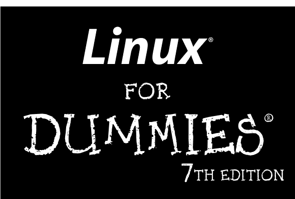

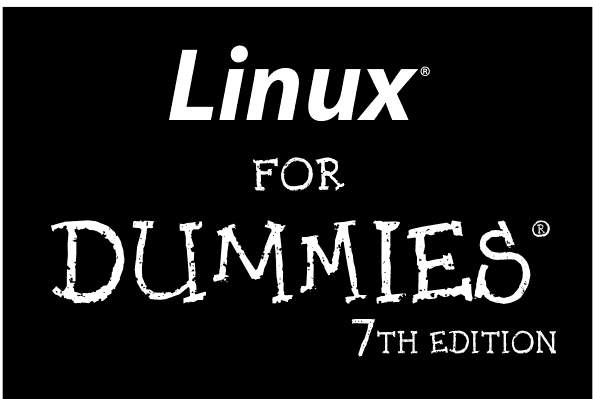

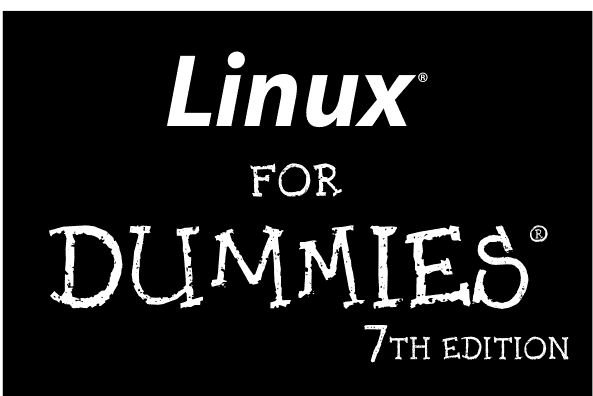


# 关于作者

Dee-Ann LeBlanc 是 RHCE（Linux 认证工程师），她是一位作家、开发者、记者，专门从事 Linux 技术。虽然这些专业领域看起来很分散，但实际上相辅相成，能够让她看到人们在现实世界中如何使用 Linux 以及他们需要什么。她是 Linux Journal 的编辑，Wiley.com 的编辑，并编写了许多关于 Linux 的书籍。

# 致谢

将本书献给我的丈夫，感谢他的支持与耐心，献给我的孩子们，他们是我生活的乐趣。

我要感谢 Wiley Publishing, Inc. 的人员提供出版这本书的机会。首先，我要感谢我的编辑，感谢他们的辛勤工作和指导。我还要感谢技术团队的专业知识和支持。最后，感谢读者对我的作品的持续关注。

## 第一部分：入门指南............................................................... 7

### 第 1 章：熟悉 Linux..................................................9

- 真的免费吗？.........................................................................................9
- Linux：是革命还是另一个操作系统？...............................10
- 开源软件项目的剖析..................................................13
- GNU?................................................................................................................13
- 到底是谁在管理 Linux？...............................................................15
- 爱因斯坦是一个志愿者................................................................................15
- Linux 软件包化：发行版.............................................................16

### 第 2 章：为 Linux 准备计算机........................................ 19

- 安装注意事项..........................................................................19
- 准备共同使用 Linux 和 Microsoft Windows.......................................20
- 从头开始为双启动进行分区..................................................................21
- 在 Windows 中查看你的分区.......................................................22
- 在 Windows 2000 和 Windows XP 中查看你的分区......................22
- 在 Windows 98 中查看你的分区.......................................................23
- 腾出空间......................................................................................26
- 处理磁盘分区...............................................................................27
- 选择分区工具...............................................................................28
- 使用 qtparted 获取并调整分区..............................................28
- 双重检查硬件兼容性.....................................................33
- 最后，最后，在您开始之前...........................................................37

《Linux 入门教程》，第 7 版

### 第 3 章：安装 Fedora Core ................................................................39

- 在开始安装前需要考虑的事项 .................................39
- 安装过程...............................................................................................................40
- 你的首次启动...........................................................................................................................51

### 第 4 章：安装其他 Linux 发行版 ........................................................57

- 使用 Knoppix 快速启动.......................................................................58
- 与 Linspire 生活...............................................................................58
- 安装 Linspire................................................................................................................59
- 某些特殊的 Linux 特性...............................................................64
- 关于各种 Linux 版本..................................................................................................64
- 使用 Mandriva 尽情玩耍...............................................................64
- 安装 Mandriva................................................................................................................65
- 关于各种 Mandriva 版本...............................................................................................70
- 从 SuSE 开始..................................................................................................................71


### 安装 SuSE
### 关于各种 SuSE 版本
### 利用 Ubuntu
### 安装 Ubuntu
### 关于各种 Ubuntu 版本
### 使用 Xandros 消除沮丧
### 安装 Xandros
### 关于各种 Xandros 版本
### 使用 LiveCD 和 LiveDVD
### 寻找更多时间

# 第 5 章：启动与停止 Linux

## 启动过程

### 第一步：电源自检 (POST) 进入 BIOS
### 第二步：BIOS 将接棒交给引导加载程序
### 第三步：引导加载程序 (LILO 或 GRUB) 将系统内核加载到内存中
### 第四步：控制权交给它

## 进入救援模式

### 进入救援模式（快速指南）
### 使用 Fedora Core 救援模式（逐步步骤）
### 不要关闭机器！
### 从你的系统中移除 Linux

# 第 6 章：查看这些桌面

## 决定使用哪种界面

## 充分利用命令行

## GNOME 基础

### 菜单
### 锁屏工具

# 第 7 章：配置 Linux

## 大小账户
## 避免使用 root
## 创建用户账户
## 在 Linux 下进行打印
## 禅与 Linux 配置的艺术
## Fedora 核心与 Red Hat 工具
## Knoppix 工具
## Linspire 工具
## Mandriva 工具
## SuSE 工具
## Xandros 工具


# 第二部分：现在是互联网！

## 第 8 章：连接互联网

### 互联网连接 101

### 设置硬件

### 选择互联网服务提供商 (ISP)

### 从你的 ISP 获取所需信息

### 接入

### 配置你的连接

### 连接（并断开）互联网

### 在出现问题之前一切都是很有趣的游戏

### 连接后

## 第 9 章：使用互联网

### 使用 Firefox 浏览网页

### 配置 Firefox

### 一些该死的浏览器插件

### 冲浪网络

### 演变为电子邮件

### 设置 Evolution

### 发送和检查电子邮件

### 利用即时通讯

### 使用 GAIM 即时通讯软件

### 排除你的 IM 连接故障

### 使用 BitTorrent 下载

### 电话通话

### 使用其他互联网工具

## 第 10 章：操作文件和目录

### 在 GUI 中操作文件

### 使用 Nautilus 航行

### 使用 Conqueror 统治

### 使用 Alexandros 文件管理器挖掘

### 理解文件系统机制

### 理解长格式文件列表

### 权限入门

## 第 11 章：检查文件系统

### 介绍文件系统

### root 目录

### `/etc` 子目录

### `/mnt` 和 `/media` 子目录

### `/usr` 子目录

### 在 GUI 中查找

### 在 Fedora 中导航文件系统

### 在 Knoppix 中导航文件系统

### 在 Linux 中导航文件系统

### 在 Mandriva 中导航文件系统

### 在 SuSE 中导航文件系统

### 在 Ubuntu 中导航文件系统


# 第 12 章：为 Linux 添加软件

## 下载的文件
## 压缩和共享文件
## 更新你的软件
## Fedora 更新
## Linspire 更新
## Mandriva 更新
## SuSE 更新
## Ubuntu 更新
## Xandros 更新
## 安装新软件
## 使用 Fedora 包管理器正确操作
## 使用 Linspire 进行
## 使用 Mandriva 进行
## SuSE 扩展
## Ubuntu 扩展
## Xandros 网络扩展
## 寻找更多软件
## 升级你的操作系统

# 第 13 章：安全的 Linux 盒是快乐的 Linux 盒

## 选择安全密码
## 更新软件
## 网络漏洞
## 安全 Shell 游戏 (SSH)
## 软件漏洞
## 使用系统日志查看器监控你的日志文件
## 定位安全资源

# 第 14 章：无 GUI 工作

## Shell 游戏
## 理解 bash 命令语法和结构
## 从 Shell 启动程序
## 善用通配符扩展
## 处理长命令


# 第 15 章：玩转图形用户界面 281

## 更改 GNOME 的外观和感觉 282
- 你喜欢这些小组件吗？ 282
- 不要忘记程序 284
- KDE 285
- 小组件不断掉到我头上 285
- 向你的面板添加程序 287
- 让桌面堆满图标 287
- 通过主题美化你的桌面 288
- 为 GNOME 添加主题 288
- 为 KDE 添加主题 290
- 调整 GUI 的内部构造 292

# 第四部分：完成任务 293

# 第 16 章：在文本中大显身手 295
- 查看文本文件内容 295
- 编辑带名的文本文件 296
- 在操作过程中保存工作 297
- 保存并继续你的生活 297
- 使用 edit 298
- 在 gedit 中输入和编辑文本 298
- 保存你的工作 300
- 快速查看 Kate 301

# 第 17 章：使用 OpenOffice.Org 进行文字处理及更多操作 303
- 使用 OpenOffice.Org Writer 进行文字处理 304
  - 启动它 304
  - 浏览 OpenOffice.Org Writer 305
- 使用 OpenOffice.Org Calc 电子表格 309
  - 启动它 309
  - 浏览 OpenOffice.Org Calc 309
- 使用 OpenOffice.Org Impress 演示文片 313
  - 启动它 314


## 使用演示向导 314

## 浏览 OpenOffice.Org Impress 316

## 使用 OpenOffice.Org Draw 进行艺术 320

### 启动它 320

### 浏览 OpenOffice.Org Draw 321

## 使用 OpenOffice.Org Base 管理数据 324

### 启动它 325

### 浏览 OpenOffice.Org Base 328

### 使用 OpenOffice.Org Math 进行布局 330

#### 启动它 330

#### 浏览 OpenOffice.org Math 330

### 配置 OpenOffice.org 的打印 336

## 第 18 章：多媒体震撼！ 337

### 检查你的声卡 338

#### 查看你的调音器 338

#### 调查棘手的音频问题 339

#### 听 CD 340

#### 听网络电台 342

#### 听下载的音乐 344

#### 使用 Amarrakk 345

#### 从 CD 中刻录音乐轨道 348

#### 刻录数据 CD 和 DVD 350

#### 创建和修改图形 353

#### 看电影 355

## 第 19 章：仅限 Windows 的媒体格式和程序 357

### 商业软件 358

#### CodeWeavers 358

#### Win4Lin 359

#### Cedega 360

#### VMware 361

#### 安装和使用 Wine 362

### “Linux 安装器冻住了” 368

#### 针对 Fedora Core 369

#### “我让安装器测试我的显卡，但它们失败了” 371

#### “安装器测试我的显卡正常，但我的 GUI 无法启动” 371

#### “我觉得我进到 Linux 了，但我不知道该怎么办！” 372

#### “我不想启动到这个系统！” 373

#### “永久”地更改你的启动环境 373

#### 临时更改你的启动环境 374

#### “我想更改屏幕分辨率” 375

#### “我的 GUI 卡住了，我动不了！” 375

#### “救命，我的机器在启动时死机了！” 375

#### “啊！我忘记了 root 密码！我该怎么办？” 376

## 第 21 章：Knoppix 十步法 379

### 从无法启动的机器上救援文件 379

### 使用 Knoppix 恢复 root 密码 381

## 第六部分：附录 383

### 附录 A：按功能分类的命令 385

#### Linux 命令分类 385

#### 获取帮助 386

#### 归档与压缩 386

#### 内置 bash 命令 387

#### 文件和文件系统 388


mtools........................................................................................... 391

系统控制............................................................................................... 392

- 附录 B：关于 DVD-ROM................................................................. 395

系统要求..................................................................................... 396

使用 DVD-ROM...................................................................................... 397

从 DVD-ROM 启动........................................................................... 397

在 Fedora Core 5 中发现的内容....................................................................... 398

如果你遇到了问题（DVD-ROM 类）.................................................. 399

# 引言

欢迎来到 Linux 这个迷人的开源软件世界。在本书中，我将向你介绍 Linux 操作系统的魅力，它最初是由林纳斯·托瓦尔斯（Linus Torvalds）在 20 世纪 90 年代初作为心血之作的。我的目标是让你加入快速增长的 Linux 用户和爱好者行列，他们正忙于重写操作系统市场领域的规则。

如果你考虑过切换到 Linux，但发现这个前景太望而却畏，那么你可以放松了。如果你会烧开水或设定闹钟，你也可以成为一名 Linux 用户。（没开玩笑的！）

当这本书的第一版出版时，Linux 还是一个新兴的现象，既不广为人知，也不被人们理解。在这一版中——为了新一代的 Linux 用户——可用材料非常多，你可以在桌面电脑上充分利用它们。为此，这些页面包含了各种在线资源、技巧和窍门，以及更通用的指令。如果你在寻找关于服务器的材料，《Linux All-in-One Desk Reference For Dummies》（Wiley Publishing, Inc.）可以满足你的需求。

我将技术术语减少到最低，并尽可能坚持使用简单的英语。基础部分解释了 Linux 的安装、启动、配置和软件，我包含了许多示例和大量的细节，以帮助你以最小的压力或困惑来设置和使用你自己的 Linux 机器。

我还在随书中附带了一张实用的 CD-ROM，其中包含了 Fedora 5 和 Knopix，以及 CD-ROM（你可以用于刻录到 Linsphere、Mandriva、SuSE 和 Xandros 的光盘上的文件。若要确切知道 DVD-ROM 中包含哪些内容，请参阅附录 B。）Ubuntu 也涵盖在内，但 DVD 没有足够的空间存放它的指令——指令包含在第 4 章，教你如何自己下载这个分发版。如果你不知道我在说什么，别担心。你很快就会明白的！

# 关于这本书

把这本书看作是一个亲切、易于理解的指南，用于应对术语以及 Linux 工具集、实用程序和组件。虽然 Linux 并不是非常难以理解，但它包含了大量的细节、参数和行政杂事（Unix 术语中的行政小琐事）。在安装、配置、管理和排除基于 Linux 的计算机的故障时，你需要将这些细节理顺成章。你在书中可以找到的一些示例主题包括：

- 理解 Linux 的来源以及它能为你做什么
- 安装 Linux 操作系统
- 使用 Linux 系统来管理文件和添加软件
- 设置网络访问和浏览网页
- 自定义你的 Linux 系统
- 管理 Linux 系统安全和资源

尽管初一看，使用 Linux 可能需要多年的实操经验、数十次的尝试、高级的计算机科学训练以及极的投入和心血！事实并非如此！如果你告诉别人如何找到你的办公室，你完全可以构建一个实现你要求的 Linux 系统。本书的目的是让你变成一个彻彻的 Linux 极客（这是我们的说法）；向你展示为了构建运行流畅的 Linux 系统而需要掌握的来里，并给你使用它所需的知识和信心。

# 如何使用这本书

本书告诉你是如何安装、配置和自定义 Linux 桌面系统的。如今你可以在 Linux 中通过点击来完成大部分工作，但你可能仍然想在命令行提示符下使用 Linux——在那里输入详细的指令来加载或配置软件、访问文件和其他任务。在书中，输入内容以等宽字体显示如下：

```
rmdir /etc/bin/devone
```

当你输入命令或其他相关信息时，请务确保按照你在书中看到的完全复制信息，包括大写和小写字母，因为那是让 Linux 正常运行的魔法之处。

不遵守指令可能会导致各种不幸、不体面或意料之外的副作用。

书的页边距没有提供与计算机屏幕相同的空间；因此，在书中，某些 URL 和命令行提示符下的长命令可能会换行到下一行。记住，你的计算机将这些换行的行视为一组指令，或者单个 URL——所以如果你正在输入一段文本，请将它保持在单行内。如果你看到这些换行行之一，请插入一个硬回车（hard return）。为了让你明白，在下面的这个愚蠢的示例中，我通过斜杠标记或自然的单词断句（暗示“等一下——还有！”）并对溢出的部分略微缩进，来告诉你那本该是完整的一行：

```
www.infocadabra.transylvania.com/nexus/plexus/lexus/praxis/okay/this/is/a/make-believe/URL/but/some/real/ones/are/SERIOUSLY/long.html
```

注意，你可以深入阅读这本书——以及你可能会遇到的其他 Linux 智慧、见解和灵感来源——可能会发现某些术语是互换使用的。例如，你可能会发现同一段软件被称为程序、命令、实用程序、脚本、应用程序或工具，这取决于你咨询的信息来源、上下文以及该信息的作者。在很大程度上，你可以将这些视为是互换的，而当需要在它们之间做出重要的区分时，我一定会会指出。同样，当你处理各种命令或配置时，你可能会遇到此类标志（flag）、开关（switch）、选项或参数。

# 三个自作的假设

人们说做假设会让人变成傻瓜，但我做了几个：

- 你可以开关你的电脑
- 你知道如何使用鼠标
- 你想安装、配置和使用 Linux

使用这本书不需要你成为逻辑大师或编程奇才，也不需要计算机科学博士学位。如果你拥有活跃的想象力和解决问题的能力，那就好了——你已经掌握了让 Linux 为你服务的要素。

# 本书的结构

本书包含六个主要部分，按顺序引导你从 Linux 安装和配置到系统运行。大部分部分包含三个或多个章节和附录，每个章节包含模块化的内容。每当你需要帮助或信息时，可以打开本书从任何地方开始，或者使用目录和索引来查找特定主题或关键词。

## 第一部分：入门

这一部分设定了基础，并包含了对术语、技术和软件组件的概述。更具体地说，我从 Linux 概述开始，解释 Linux 是什么、来自哪里以及如何工作。接下来，我处理在 PC 上准备和安装 Linux 所涉及的任务和活动。如果你不是 Fedora 的硬核粉丝，我也涵盖了安装 Linscore、Mandriva、SUSE、Ubuntu 和 Xandros，但细节少一些（否则这本书就会像全书一样大！）。之后，我教你如何启动 Linux——不是为了删除它，而是为了让你的新系统达到计算狂喜的高度（至少，我希望对你也是如此）。最后，我帮助你探索标准的 Linux 工具和界面，管理账户，并获取有关发行版 Linux 工具的内幕。

如果你不想安装而想尝试 Linux，我还提供了使用所谓的 LiveCD（可启动分发版）的选项。Knopix 可能是最流行的那种，所以在这里会被涵盖。

## 第二部分：现在上网！

在这一部分，你将探索将 Linux 系统连接到互联网的相关问题、配置调制解器、管理到互联网服务提供商（ISP）的拨号连接以及配置使你的互联网连接工作的各种互联网协议。你还将涉及配置和使用网络浏览器以及设置电子邮件客户端的细节。

# 引言

## 第三部分：快速上手 Linux

Linux 包含了许多强大的功能和能力，因此在完成完成最初的安装和配置之后，你可能想要使用你的系统做些事情。这正是实操开始！在本书的这一部分，你将读到 Linux 文件系统，以及如何处理文件、目录和相关的访问权限——在 Linux 术语中被称为“权限”。你将发现如何在 GNOME 和 KDE 这两个 Linux 的主要图形界面（GUI）中移动和操作。此外，我还深入探讨了 Linux 命令行提示环境，也称为 shell（壳）。第三部分还包含了重要的安全信息，以及如何向你的系统添加软件并保持其更新。

## 第四部分：完成任务


在本书的这一部分，你将发现如何使用 Linux 中提供的各种软件。从纯文本编辑器到全功能办公套件，无一不包，此外还有极其强大的多媒体工具以及基于 Microsoft Windows 的文件格式和媒体。更棒的是，你知道你可以在 Linux 下运行许多程序吗？我将在这一部分向你展示如何做到。

# 第五部分：总结

在本书的高潮部分，我总结并提炼了你现在对 Linux 及其内部运作所了解的精华。在这里，你有机会回顾 Linux 系统的一些关键故障排除技巧和窍，以及 Knoppix 的两种酷炫用法。

# 第六部分：附录

本书以一组附录结束，旨在总结并进一步扩展本书的内容。附录 A 提供了各种 Linux 命令，并带有语法和解释，按其功能排列。附录 B 列出了《Linux 学者指南》第 7 版 DVD 中的详细内容。正如我在附录中所出的，DVD 上的材料包含了 Fedora Core 5 发行版。

# Linux 学者指南，第 7 版

## 本书使用的图标

在每个章节中，我使用图标来突出特别重要或实用的信息。你会在书中看到以下图标：


提示（Tip）图标标记了有用信息，让你的 Linux 系统生活比你担想象的要简单得多。


我有时使用这个图标来指出你不应该忽略的信息——不要忽视这些温和的提醒。（你省下的生命、理智或页面可能就是你自己的）。


当你看到这个图标时要加小心——它警告你不要做某些事。这个图标旨在强调，忽视这些智慧之言的后果可能是严重的。


这个图标标志着技术细节，这些信息很有价值，但对于理解和使用 Linux 并非至重要。如果你愿意，可以跳过这些段落（但以后可以回来读）。

## 接下来该何去

这是你选择方向并出发的时候！《Linux 学者指南》第 7 版就像 101 入门教程，因为你从哪里开始几乎并不重要。在准备构建自己的系统时，你会看到许多不同的场景和故事。尽管每个故事都有独特的角色和情节，但整体是令人惊叹的。别担心——你能搞定的。谁在乎别人觉得你只是在胡闹呢？我知道你正准备好迎接人生中最精彩的时刻。享受吧！

# 第一部分：入门尝试


## 在这一部分中 ...

这一部分包含了对 Linux 系统的开发和能力的介绍。我还涵盖了让 Linux 成为如今模的术语和工具，并提供了详细的逐步操作说明，介绍了为你的电脑准备并在你的个人 PC 上安装 Linux 所需的步骤。对于那些对 Fedora Core（书中包含）之外的其他 Linux 发行版感兴趣的人，我还涵盖了安装其他流行发行版所涉及的内容——即 Mandriva、SuSE、Ubuntu 和 Xand。我甚至解释了如何配置这个奇妙的操作系统来实现你的愿望，以及如何启动你的新系统——更不用如何正确关闭它以防丢失任何数据。之后，你将了解到使用标准 Linux 工具、点选式 GUI、账户和打印机所需的内容，以及与发行版相关工具的快速浏览。

# 第 1 章：熟悉 Linux

在本章中

- 深入探讨 Linux 的起源和特性
- 区分 Linux 和其他操作系统
- 依赖 GNU 和 GPL
- 惊叹 Linux 公司（或其不存在的现状）
- 查看流行的 Linux 发行版

> — Arthur Dent

欢迎来到 Linux 世界，这是一个由全球数千人共同开发的操作系统！在本章中，你将了解到 Linux 本身——它是什么，源自哪里，以及为什么它在当今新闻中获得如此关注。准备好让你对软件必须如何开发和销售的假设接受挑战，并让你的思维开启新的可能空间。

### 免费真的是免费吗？

理解 Linux 需要对获取和使用计算机软件的方式进行彻底的思维转变。转变思维的第一步是改变你对“free”一词的通用理解，指的是*自由*（freedom），而不是*免费*（free lunch）。没错，你可以出售“免费”软件……只要你向每个软件接收者传递同样的自由。

不要苦命抓头；这些概念起初很难理解，尤其是当你考虑了来自商业软件部门的种种训练。也许你不需要

第一部分：入门尝试

当你购买大多数专有的、封装软件时，你并没有真正拥有该软件；相反，你被许可在许可者规定的范围内使用该软件。

Linux 也有许可证，但该许可证的动机和目的与大多数软件大不相同。与其利用许可证保护软件所有权，Linux 遵循的 GNU 通用许可证（GPL）确保了软件将对任何人开放。没有人可以拥有或规定你使用或修改 Linux 的方式——尽管他们对自己的品牌拥有个人版权和商标，例如红帽。从本质上说，你已经拥有 Linux，你可以随时如何使用它，只要向进一步的接收者传播 GPL。

### Linux：革命还是另一个操作系统？

> 与流行观点相反，企鹅并不是技术的救星。它们也不会为城市无产阶级举办派对。
> — Anonymous

作者注：幽默的引用……显然 Anonymous 没去过 Linux 大会！

在进一步研究 Linux 之前，我需要解释一些术语。

Tux 是代表 Linux 的吉祥物企鹅的正式名称。传 Linux 的创始人 Linus Torvalds 是这些身着整齐的南极生物之一。

操作系统是运行计算机的软件，处理你与硬件之间的所有交互。无论你是在电脑上写信、计算预算，还是管理你的食谱，操作系统都提供了计算机运行所需的必需空气。此外，操作系统不仅仅是一个程序；它由数百个较小的程序和实用程序组成，允许我们使用计算机做些事情。你可以在操作系统之上运行其他程序（如你的文字处理器）来完成所有工作。

在近期的科技史上，Linux 从茶水间的技术闲谈演变为企业稳健的解决方案。这些曾被视为叛逆的软件，现在正被 IBM、惠普、摩托罗拉和英特尔等行业领导者采用和推广。每个

# 第 1 章：初识 Linux

这些计算机制造商以某种方式认定，Linux 为他们的客户（以及他们自身的运营）提供了价值。在这些公司中，只有微软公开谴过 Linux。请注意，人们无需观察得太远就能得出结论：微软仅仅是由于 Linux 对其个人电脑操作系统垄断地位构成的威胁而感到恐惧。

Linux 被指责为“仅仅是另一个操作系统”。从表面上看，它似乎确实如此，但如果你深入观察，就会发现事实并非如此。Linux 项目是一面旗帜，引领着当前计算行业向开源和自由（指自由，而非免费的啤酒）软件发展的趋势。由于其开发（以及现在持续开发）的模式，Linux 是一个稳如磐石的操作系统，它代表了软件开发中许多美好且纯粹的事物。

两个根本区别将 Linux 与其他操作系统区分离开来：

- Linux 采用独特且天才的 GNU 通用公共许可证（GNU General Public License）授权，你可以在下一节中阅读相关内容。
- Linux 由全球志愿者程序员团队开发和维护，他们通过互联网共同工作。

Linux 优秀之处有许多原因，包括那些从零开始构建它的人希望它具备以下特性：

- 多用户（Multiuser）：一次可以有多个用户登录一台计算机。
- 多任务（Multitasking）：真正的抢式多任务使操作系统能够高效处理同时运行的全局程序。这对于在台计算机上提供多种服务至关重要。
- 多平台（Multplatform）：Linux 目前运行在 24 个平台（硬件类型）上，包括基于 Intel 的 PC、Digital/Compaq Alpha、基于 PowerPC 的 Apple Macintosh、Sun SPARC、Amiga 以及基于 StrongARM 的计算机。
- 可操作性（Interoperable）：Linux 支持大多数网络协议（语言）和操作系统，允许你与运行 Windows、Unix、Novell、Mac OS 9 以及从 OS X 开始的代以及其他小众群体的计算机进行交互。
- 可扩展性（Scalable）：随着你的计算机的增长，Linux 也可以随之增长。同一个 Linux 操作系统可以运行在台式计算机上，也可以运行在大型工业级服务器系统上。
- 可移植性（Portable）：Linux 大部分用 C 语言编写。C 是一种专门为编写操作系统级软件而创建的语言，可以很容易移植（翻译）到新的计算机硬件上运行。
- **灵活性（Flexible）：** 你可以将 Linux 操作系统配置为网络主机、图形工作站、办公生产 PC、家庭娱乐计算机、文件服务器、Web 服务器、集群，或你想到的任何其他计算设备。
- **稳定性（Stable）：** Linux **内核**（操作系统）已经达到了让大多数软件开发者羡慕的成熟水平。很少听到关于 Linux 服务器运行多年而无崩溃的报道。


- **高效性（Efficient）：** Linux 的模块化设计允许你仅包含运行所需服务的组件。即使是旧的 Pentium 计算机也可以利用 Linux 并再次变得有用。

- **免费（Free）：** 对大多数人来说，Linux 最引人注目的方面是，它一切都是免费提供的。（资本家们低声抱怨）在没有任何金钱回报的情况下，任何人怎么能制造出更好的捕鼠器呢？

在本章中，我打算为你回答最后一个问题。我希望希望描绘出创建 Linux 的开源开发模型。

## 那么，Linux 是从哪里来？

理解 Unix 最快的方法是看一眼其丰富的遗产。尽管 Linux 核心编程始于 1991 年，但其设计概念是基于经过时间考验的 Unix 操作系统。

1991 年，Linus 是芬兰赫尔辛基大学的一名计算机科学学生。他希望有一个像大学里喜欢的 Unix 系统那样的操作系统，但 Unix 和他运行的硬件都贵得离谱。一个名为 Minix 的 Unix 版本可以免费获得，但它不能完全满足他的需求。因此，作为一名计算机科学家，Torvalds 研究了 Minix，然后开始编写一个新版本。用他自己的话（为了后世记录在互联网上，这是在一个在线聊天室的早期版本），他的工作“只是一个爱好，不像 GNU 那样庞大和专业”。

Unix 于 20 世纪 60 年代后期开发于贝尔实验室。Unix 的原始架构创建于操作系统很少的时代，当时人们有*高效且安全地共享数据、程序和资源的愿望*——这在当时是无法实现的（而且现在仍然被追求）。现在，Unix 演变成了许多版本；它的树形结构如此复杂，看起来就像某种爆炸！

编写一个操作系统不是一项易事。在经过六月的艰苦工作后，Torvalds 在系统通用性方面的进展非常小。他将自己的成果发布到互联网上——发现许多人和他一样感兴趣并好奇。世界上最聪明的四位思想家通过增加增强或修复漏洞（代码中的错误）为 Linux 项目做出了贡献。

## 开源软件项目的解剖结构

Linux 不是一个产品。Linux 是软件生态系统的一个有机组成部分。

> Michael Robinson, Netrinsics

旁观者（以及以及一些企业 IT 决策者）认为，Linux 似乎是一个奇特的变异——一个由无政府主义随机生成的叛逆生物。毕竟，像计算机操作系统这样复杂且依赖纪律的东西，怎么能由一群来自世界各地、关系松散的志愿者极客开发出来呢？

正如科学不断尝试分类和解释存在的所有事物一样，技术评论员仍在试图理解在别无选择的情况下，开源方法如何能创造优越的软件。通常，原因与人类用解决方案来满足需求的常规欲望有关。当 Linux 世界的程序员想要一个工具时，或者与其他想要类似软件包的人聚在一起时，他们就一起工作。

## 谁是 GNU？

想象一个基于需求而非利润创建的软件。Unix 最终变成了昂贵的专有软件，人们通常所说的（单数）Linux 操作系统实际上是为了解决问题而创建的软件集合。

正如你可能已经意识到的，广泛且可访问的源代码对于成功的软件开发至关重要。源代码是指人类可读的文本（与可执行文件中不可读的二进制形符号相反），程序员通过这些文本向计算机传达指令。

用二进制编写计算机程序是一项极其困难的任务。现代计算机软件通常用人类友好的语言编写，然后编译（或翻译）成计算机的原指令集。要对这些软件进行更改，程序员需要访问程序的源代码。大多数专有软件只提供预编译代码；软件开发人员将其程序的源代码锁起来。

在确定他的操作系统将围绕 Unix 的概念框架构建后，Stallman 希望项目名称能将其与 Unix 区分开来。因此，他选择了递归缩写 GNU（读作 ga-new），它的意思是“GNU 不是 Unix”。

为了资助 GNU 项目，Stallman 成立了自由软件基金会（FSF），通过销售免费（开源）软件来帮助那些进行持续开发的程序员。（记住，我们指的是言论的自由，而不是免费的啤酒。）这个组织以及创建完整操作系统的目标是必要且重要的，这是一个更重要的拼图，用以保护这些软件免受大企业海盗的侵害——这种担忧在今天仍然非常现实，因为一家前 Linux 公司正试图收购全球范围内几十年志愿者工作的所有权。

# 第一章：认识 Linux

## 到底是谁在负责 Linux？

随着一个开源项目的演进，各种人物会脱颖而出成为领导者。领导者通常被称为项目的“仁慈独裁者”。成为仁慈独裁者的人可能在某个问题上花费了比任何人都多的时间，并且通常具有某些独特的见解。通常情况下，“民主”和“独裁”这两个词永远不会出现在同一个句子中，但开源模型是一个非常民主的过程，它认可了仁慈独裁者的统治。

莱纳斯·托瓦尔斯（Linus Torvalds）仍然被认为是 Linux 内核（操作系统的核心）的仁慈独裁者。他最终决定哪些功能被添加到内核中，哪些不会。社区信任他的愿景和判断力。一旦他对项目失去了兴趣，或者社区认为他已经老糊涂了，新的领导将从与他一起工作的能干人才中脱颖而出。

## 爱因斯坦是一个志愿者

作为志愿者或为项目贡献时间的人并不意味着他们提供的是二流的努力（或只在周末和假日工作）。事实上，任何人力资源专家都会告诉你，出于意愿选择某份工作的人将产出最高质量的产品。

贡献开源项目的志愿者通常是他们所在领域的领导者，他们依赖社区协作来完成有用的工作。开放概念对于科学界并不陌生。开源项目所培养的公正的同行评审过程对于验证新功能或能力在技术上是正确的至关重要。

那些将开源社区描绘成版权侵犯者的人往往误解了——或完全忽略了这些至关重要的问题。开源程序员对自己的版权感到自豪，不希望自己的工作被他人盗窃——因此产生了如 GPL 等许可证。这种关注营造了一种对版权极度尊重的氛围。那些在偷取他人工作时声称“只是在开源”的强匪在严重滥用这个术语来安抚他们的良心。


许多人指出开源中存在侵权行为，这显而易见。看看新闻，注意大型软件公司经常被定罪偷取他人代码并将其整合到自己的工作中。如果最终产品是开源的，任何人都可以查看并确保其中没有被盗窃。正如你想象的，在闭源方案中追踪此类版权侵权要困难得多。

## 16 第一部分：入门

## 打包 Linux：发行版

人们所谓的 Linux 发行版实际上是 GNU 项目工具、Linux 内核以及在此过程中产生的许多其他开源（及闭源）软件项目的结晶。

红帽（Red Hat）联合创始人兼现任主席 Robert Young 一个将 Linux 比作番酱的类比。本质上，Linux 操作系统——包括 GNU 工具、Linux 内核和其他软件——是一种免费获取的商品，就像番酱一样，不同的发行者可以在不同的容器中对其进行包装和标记。鼓励任何人对其进行包装和营销，尽管其成分本质上是相同的。

Linux 是一个复杂且可塑的操作系统，因此它可以呈现许多面貌。近年来 Linux 最大的进展是让安装变得更加简单。毕竟，让普通 PC 用户能够安装 Linux 的工具最初并不可用。像红帽这样的公司看到了这是一个为现有产品增加价值的机会，这一概念像野火一样蔓延开。

再次引用番酱的类比，各种 Linux 发行版具有略有不同的味道或质地；你的发行版偏好可能是辣的、温和的或稀的。然而，你可以放心，以下任何发行版都拥有相同的 Linux 和 GNU 灵魂。列表中的每个描述都包含一个 Web 地址，你可以在那里找到关于每个项目的更多信息：

- Debian GNU/Linux：这种发行版——最古老的版本之一——是高级技术圈公认的最爱。它的安装相对较困难。Debian 团队与 GNU 项目紧密合作；Debian 被认为是 Linux 发行版中最“开放”的。基于 Debian 且更易于安装（和使用）的发行版有 Ubuntu、Xandros 和 Linspire（以前名为 Lindows）

```
www.debian.org
www.xandros.com
www.ubuntu.org
www.linspire.com
```

- Mandriva：这个发行版展示了 GPL 的力量，允许这家竞争性公司能够站在巨人的肩膀上。Mandriva（以前名为 Mandrake）最初基于红帽 Linux（这在闭源环境中根本是不可能发生的），但从那以后已成为自身的优秀解决方案。

```
www.mandrivalinux.com
```

- 红帽和 Fedora：红帽声称因成功大规模营销 Linux 操作系统而获得了声誉。红帽通过用熟悉的发行方式（缩膜包装）打包 GNU 和 Linux 工具来验证了 Linux，并向其产品中加入了增值功能，例如电话支持、培训和咨询服务。

```
www.redhat.com
http://fedora.redhat.com/
```

- Slackware：在所有广为人知的 Linux 发行版中，Slackware 存在时间最长（事实上，它的安装直到大约年前一直保持不变）。Slackware 有非常忠诚的追随者，但并不知名。从精神上说，Slack 粉丝在 Linux 圈内被尊为经验丰富的老兵，他们分享着关于携带一盒盒软盘的故事。

```
www.slackware.com
```


- SUSE：（发音为 soo-seh）这种发行版源自德国，它有非常忠实的追随者，并被 Novell 公司收购。像红帽一样，SUSE 是一个商业发行版。遵循红帽的脚步，Novell 创建了 openSUSE，一个类似于 Fedora 的尝试。

```
www.opensuse.org
www.novell.com/linux/suse/own
```

- 安装程序：每个发行版都开发了自己的程序来帮助你实现运行系统。有些安装程序是为普通用户设计的（隐藏了技术细节）；另一些则是为资深管理员设计的。一些简单的版本为那些想要更多控制权的人提供了专家模式。

- 版本：不同的发行版可能使用不同版本的内核。开源项目是动态的并定期发布新版本，而不是传统软件往往缓慢的开发周期。

- 软件包管理器：尽管一个 Linux 程序应该可以在任何发行版上运行，但名为软件包管理器的工具跟踪系统中的软件，并确保你有易用的更新程序，以及不需要计算机学位即可添加软件的方法。第12 章提供了有关包管理的更多信息。记录每个发行版的每个安装是不可能的。好吧，也许字面上不是，但如果你真的那样，你需要一台叉车才能把《Linux 入门》带回家。因此，我尝试将安装任何 Linux 发行版所需的概念总结在书中，并提供足够的细节引导你。（你可以想象，这是一个挑战！）

我选择 Fedora Core 作为发行版是因为红帽已成为公认的 Linux 标准，其 Fedora Core 项目专门针对负担不起或不需要购买更高级产品的家庭和小企业用户。更棒，如果你在办公室或组织中使用红帽企业 Linux (RHEL)，Fedora Core 是那些将进入 RHEL 的技术的试验场。

除了红帽，我还包含了其他针对初者的流行发行版的信息：Linspire、Mandriva、S、Ubuntu 和 Xandros。我绝不想轻视 Slackware 和 Debian，因为它们是非常强大的发行版。我只是觉得它们比其他版本更高级，最好留给你学习 Linux 之后的尝试。包含的还有 Knopix，这是一种 Live CD，你可以通过它启动电脑进入全功能桌面，而无需安装任何东西！有关 Live CD 的更多信息请参见第4 章。

事实上，随书附的 DVD 不仅包含 Fedora。请参阅附录 B 以获取可以在 DVD 上找到的物品列表。

# 第 2 章

## 为 Linux 准备计算机

本章内容

- 执行基础的安装前步骤
- 在同一台电脑上使用 Linux 和 Windows
- 在安装前自定义磁盘分区
- 了解（并查找）你的硬件信息
- 为光盘或软盘安装做准备

大多数 Linux 发行版会自动检测你的硬件并引导你完成安装过程。事实上，有些人甚至会直接着手开始安装。然而，如果你正在设置一台将同时运行 Windows 和 Linux 的机器（尽管不是同时运行），在跳到后续章节之前，请务必阅读本章稍后出现的“准备共同使用 Linux 和 Microsoft Windows”章节。确保你有足够的硬盘空间来安装 Linux —— 并确保你不会意外删掉你的 Windows 安装。

另一些人则喜欢从谨慎开始。通过熟悉你的计算机硬件，你可以避免以后潜在的头疼问题——或者让排除技术故障变得更加容易。

在准备安装 Linux 时，你应该注意几个问题。在本章中，将处理一些为 Linux 安装过程做准备的任务，例如设置系统以安装 Linux——无论是直接通过 DVD 或 CD，还是通过安装软盘（如果你最后确实需要的话）。

## 安装注意事项

> 如果你不知道要去去哪里，就必须小心，因为你可能无法到达。
>
> — 约基·贝拉 (Yogi Berra)

如果你有一台只运行 Linux 而不运行其他程序的空闲机器，那你就幸运了！你可以跳过所有“准备共同使用 Linux 和 Microsoft Windows”的内容。事实上，如果你觉得很有冒险，可以直接跳到第 3 章或第 4 章（取决于你使用的是哪种发行版）并开始安装。第 20 章中也有故障排除的信息。

如果你计划在同一台电脑上同时运行 Linux 和 Microsoft Windows —— 这种情况被称为“双引导”，在阅读下一节“准备共同使用 Linux 和 Microsoft Windows”之前，**请不要进入第 3 章**。抱歉我大大叫，但如果不采取预防措施，可能会破坏你的 Windows 安装！


## 准备共同使用 Linux 和 Microsoft Windows

如果你计划在同一台机器上运行 Linux 和 Microsoft Windows，那么你可能已经安装了 Windows 并使用了一段时间。因为我不希望听到从加拿大西部传来的痛苦哀嚎，请花些时间评估你现拥有的东西以及需要做什么。

对于你实际上还没有安装 Windows 但仍想在安装 Linux 之前安装 Windows 的情况：否则，在安装过程中，Windows 将覆盖硬盘上 Linux 用于存储其引导菜单的部分（当你想要回到 Linux 时，这可能会导致一些混乱！）。对于那些正在安装磁盘分区的用户，是为了查看如何设置你的 Windows 安装，以便在以后添加 Linux 时产生最小的故障。


然而，你们大多数人想用双引导是因为你只有一台机器，而且它已经在运行 Windows 了。如果你有一个完全空白、没有任何内容的新硬盘可以使用，请直接跳到我刚才提到的那节（“处理磁盘分区”）。不需要对 Windows 正在使用的硬盘进行任何特殊操作。但是，如果你需要 Linux 和 Windows 共享同一块硬盘，并且你已经安装了 Windows，那么如果你使用的是 Fedora Core（本书的默认选择！）、Linux、Ubuntu 或某些版本的 Xandros，你确实需要做一些额外的工作。SuSE、Mandriva 以及 Xandros Deluxe 和商业版可以为你调整大小，你也不需要安装 Knoppix，因此不需要为它留出空间。本节的其余部分将专注于帮助你解决这些麻烦。


如果你使用的是 SuSE、Mandriva、Xandros Deluxe 版或 Xandros Business 版，你的 Linux 发行版可以为你调整 Windows 分区。尽管如此，你仍然需要完成你的 Windows 版本对应的“在 Windows 中查看你的分区”章节（本章稍后内容），以便在安装程序询问你时，决定将 Linux 分区做得多大。


在已安装 Windows 的系统上安装 Linux 时，你一次只能运行一个操作系统。换句话说，如果你正在使用 Windows 并想运行 Linux，你必须关闭 Windows，允许电脑重启，然后启动 Linux。注意，通过某些额外软件，你可以在 Windows 运行时同时运行 Linux。你还可以在 Windows 内部运行 Windows 软件！（更多信息请参见第 19 章。）

## 从头开始为双引导分区

如果你计划使用一个全新的硬盘并在上面同时安装 Windows 和 Linux，请确保先安装 Windows。在进行 Windows 安装时，你会被要求分区。无论你使用什么种类型的分区（主分区、扩展分区或逻辑分区），请确保至少有 10GB 空间。


记录下这个分区在哪个磁盘上、哪个分区，并跳到“制作空间”章节。

## 在 Windows 中查看分区

在进行任何更改之前，了解你是否有未分配空间是非常重要的。如果没有（或没有足够的）未分配空间，请保留此窗口并查看本章稍后的“制作空间”章节了解如何操作。


## 在 Windows 2000 和 XP 中查看分区

Windows 2000 和 XP 操作系统使用账户来控制和保护文件；要获取磁盘使用信息，你必须以管理员身份登录（或使用具有管理权限的账户）。登录后，使用管理工具中的计算机管理来查找硬盘详情。遵循以下步骤：

- 通过开始：控制面板打开控制面板。
- 打开管理工具文件夹并双击计算机管理图标。
- 在计算机管理的左侧面板中，点击磁盘管理。

几秒钟后，右侧面板显示计算机上存储设备的状态，例如硬盘、光驱、DVD/CD 光等。图 2-1 是 Windows XP 磁盘管理的示例，Windows 2000 用户将看到几乎相同的视图。

图 2-1 反映了一台带有硬盘和一个光驱的计算机。这里要寻找的是磁盘列表中的“未分配”（Unallocated）字样。未分配分区未分配任何分区系统，可以自由用于 Linux 安装。


# 第二章：为 Linux 准备计算机

如果你找到了未分配分区（参考图 2-1），那么你就准备好了——只要它至少有 10GB 大（见前节）。记录下这个分区在哪个磁盘上、哪个分区，并跳到“制作空间”章节。例如，在图 2-1 中，该分区在磁盘 1 上，是分区 2。

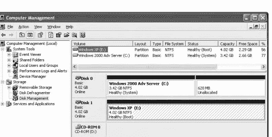

图 2-1 Windows“计算机管理”工具中的磁盘管理信息。


## 在 Windows 98 中查看你的分区

如果绝对必须让 Windows 和 Linux 共享同一块硬盘，我希望你在继续操作之前先做一些侦查工作。以下是内幕：Windows 98 并没有提供像“计算机管理”那样的图形化工具。它使用 `FDISK`，这是一个命令行工具，用于显示硬盘上的分区。要在 Windows 98 中查找计算机硬盘的详细信息，请按照以下步骤操作：

在 `FDISK` 中操作时要小心，如果你对其进行任何更改，都可能会擦除数据。当你退出程序时，如果提示你是否保存更改，请不要保存。

- 1. 选择“开始:程序:MS-DOS 提示符”，打开 MS-DOS 提示符窗口。
- 2. 输入 `FDISK` 并按回车。

在 Windows 98 中，你可以大写、小写或任何混合大小输入 `FDISK`，只要你拼写正确即可！

你可能会被提示显示较大的“磁盘”（驱动器）信息——“大”是相对于 Windows 98 时代的大硬盘而言的，这意味着大于 512MB 的驱动器。如果你没有看到该提示，请跳到第 4 步，`FDISK` 菜单选项将与图 2-2。

- 3. 如果看到大磁盘提示，在此提示处选择 Y 并按回车。

出现 `FDISK` 菜单选项。

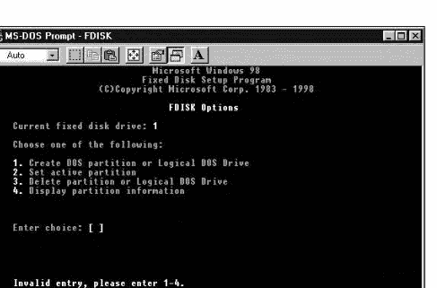

图 2-2:

`FDISK` 菜单选项。

当前固定磁盘驱动器：C:

选择以下其中之一：

1. 创建 DOS 分区或逻辑 HD 驱动器
2. 删除分区
3. 创建扩展或逻辑 HD 驱动器
4. 显示分区信息。

输入选择：[_

无效输入，请输入 1-4。

按 Esc 退出 `FDISK`。


- 4. 显示当前的驱动器-分区信息。

如果你的计算机中有多个硬盘，`FDISK` 会显示第五个选项，以便你可以在磁盘之间切换。

以下是使用菜单选项切换到另一个磁盘的方法：

- a. 输入 5 并按回车。

`FDISK` 显示系统中的所有硬盘。

- b. 输入你想要的磁盘编号并按回车。

`FDISK` 菜单屏幕的顶部显示 `FDISK` 正在操作的驱动器编号。

- 5. 输入磁盘编号并按回车显示分区信息。

图 2-3 显示了 `FDISK` 内磁盘分区信息的屏幕示例。

图 2-3 表示驱动器上有空闲的未分配的磁盘空间。如果磁盘有未分区的空间，`FDISK` 将显示可用空间的大小。

在图 2-3 中，你看到磁盘空间的一部分被配置为扩展分区 EXT DOS。扩展分区可以包含所谓的逻辑分区，因此扩展分区内部可能有可用的空闲空间，你可以用它安装另一个操作系统（如 Linux）或其他类型的 Windows。


将主分区想象成你放入数据的空箱子。扩展分区是那些烦人的箱子，里面堆叠着一堆较小的盒子。你只有在扩展分区中才将数据放入较小的盒子。这些较小的盒子就是逻辑分区。

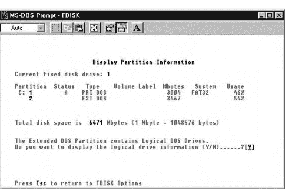

图 2-3：`FDISK` 中的分区信息。

遗憾的是，`FDISK` 并没有告诉你任何关于这个扩展分区内部的。。你必须更深入挖掘。

- 6. 要查看扩展分区内的本地分区，选择 EXT DOS 条目并按回车。

图 2-4 是本地分区设置的示例。在这种情况下，扩展分区内的所有空间均已分配。你可以通过使用驱动器的使用百分比来判断是否有空闲空间。该总和决定了你接下来的操作：

- 如果总和为 100%，则没有可用空间。如果是如此（或者你的可用空间小于 10GB），请保持此工具打开并进入下一节“腾留空间”。
- 如果你有 10GB 或更多，请跳到下一节“腾留空间”。

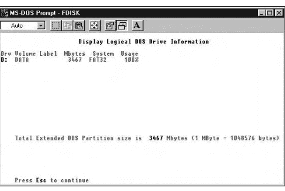

图 2-4：逻辑驱动器信息。

扩展总大小为 448576

## 腾留空间

你可能有未分配的空间——也可能。无论如何，你都需要调整大小为 Linux 腾出空间。如果你安装 SuSE 或 Mandriva，这些工具可以帮你处理。如果你空间不足，请跳到后面的“检查硬件兼容性”。


记住，你可能需要超过 10GB。例如，如果你下载了大量多媒体文件，空间很快就会被占用


如果你发现你的 Windows 驱动器都满了，可能是时候把一些文件刻到光盘上以便从硬盘中删除它们。

- 1. 双击“我的电脑”打开“计算机管理”。
- 2. 选择“查看:分区”。
- 3. 高亮你的驱动器。你会看到图 2-5 所示。

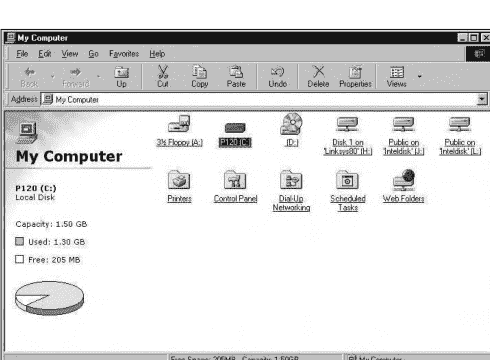

图 2-5：

此 Windows 98 驱动器的可用磁盘空间。

当你决定调整哪个分区时，记下它位于哪个硬盘上以及是哪个分区（第一个、第二个等等）。在告知安装程序时，你需要这些信息。


## 处理磁盘分区

在“准备使用 Linux 和 Microsoft Windows”节（本章开头）中，我讨论了为什么要在已经在运行 Windows 的计算机上为 Linux 留出空间。在这里我介绍了如何在调整分区后找到可以供 Linux 使用的空闲空间。如果你在一个全新的额外硬盘上安装，或者正在擦除整个硬盘交给 Linux，或者已经有一个大于 19GB 的未分配/空闲空间，请跳到后面的“检查硬件兼容性”。

商业工具（如 Partition Magic）提供了一种轻松调整和处理硬盘驱动器分区的方法。你可以从该公司的网站找到有关 Partition Magic 的信息。在下一节“处理磁盘分区”中，你还将了解到如何获取和使用免费替代方案 `qtpartition`。

如果改变 Windows 驱动器上的任何内容都会让你感到不安，那么廉价的额外硬盘将价值连城。

## 选择分区工具

调整现有分区的简单方法可能是使用诸如 Partition Magic 类的商业程序。Partition Magic 允许你查看硬盘的分区信息。你还可以使用此实用程序对分区进行调整大小、移动和添加。然而，如果你只想调整大小，则不必特意去购买软件来完成。相反，你可以下载一个免费工具来为你完成工作（有关如何操作请参阅下一节）。


没有任何工具是完美的。在继续操作之前，请对你不想丢失的 Windows 安装系统中的任何内容进行备份！在分区的各个步骤中，即使都可能出现问题，即使在 Windows 系统上使用 Windows 工具也是如此。

如果你使用 Partition Magic（在调整 Windows 分区大小后）创建了一个开放分区，请记下它是哪个驱动器和哪个分区（第一个、第二个等）。当你告诉安装程序将 Linux 放在何处时，将需要这些信息。

## 使用 gparted 获取并调整分区

你可以使用的免费调整大小程序称为 `gparted`。此实用程序可以处理 VFAT 和 NTFS 分区，因此它可以处理你在 Windows 中设置机器时可能使用的两种文件系统。该程序附带 Knoppix，它是一个 Live CD —— 另一种可启动的发行版 —— 这你可以将此光盘放入 CD-ROM 驱动器，用它启动计算机，它将带你进入无需安装的完整版 Linux。Knoppix 对于向人们展示 Linux 非常方便，但对于（我的目的）来说，它对于救援无法启动的机器和调整分区非常有用。

Knoppix 随本书附带在 DVD 中，这非常方便。如果由于某种原因你无法使用 DVD，请参阅第 4 章了解如何在 CD 上获取 Knoppix。在继续之前，请双倍检查你是否已备份了所有重要数据。然后，拿出你在本章前面的“准备共同使用 Linux 和 Microsoft Windows”部分中做的任何笔记——特别是你想要更改的分区——并执行以下操作：


- 1. 将你的 `Knoppix` `CD` 或 `DVD`（或随书的 `DVD`）放入 `CD-` 或 `DVD-ROM` 驱动器并重启计算机。

如果你使用的是书的 `DVD`，会出现一个菜单，询问你想使用 `Fedora` 还是 `Knoppix`。选择 `Knoppix`，你将进入 `Knoppix` 欢迎界面。如果你使用的是普通的 `Knoppix` `CD` 或 `DVD`，计算机将直接启动到 `Knoppix` 欢迎界面。

## 第 2 章：为 Linux 准备计算机

- 2. 在启动提示符处，按回车。

当 `Knoppix` 确定你系统上的所有硬件时，会有大量文本滚动。在许多机器上，`Knoppix` 完全启动可能需要一分钟：它完全从 `CD` 或 `DVD-ROM` 运行。运行后，你可以使用启动提示符：按 `F2` 和 `F3` 查看你可以添加的启动选项以让 `Knoppix` 工作。

如果在 `Knoppix` 启动过程中出现任何问题，按 `Ctrl+Alt+Del` 或计算机上的重置键重启。当你到达启动提示符时，按 `F2` 和 `F3` 查看启动选项。

- 3. 从 `K`（主）菜单，选择 `System: QParted`。

打开 `QParted` 工具（图 2-7）。

- 4. 在左侧，选择你想要操作的驱动器。

如有必要，参考你的笔记（在本章前面的“准备共同使用 Linux 和 Microsoft Windows”部分），查看它是你的硬盘中的第一个、第二个、第三个还是后续的。如果你同时有 `IDE` 和 `SCSI` 硬盘——大多数用户拥有 `IDE` 硬盘，你通常需要费力才能获取 `SCSI`，因为它们更昂贵——你可以通过列表中以 `hd` 开头的 `IDE` 名称和以 `sd` 开头的 `SCSI` 名称来区分它们。它们在机器上的安装顺序是按字母顺序排列的。例如，`hda` 是第一个 `IDE` 硬盘，`hdb` 是第二个，依此类推。（`SCSI` 也是如此，`sda` 和 `sdb` 也是一样）。

做出选择后，驱动器的分区和其他信息将显示在窗口的底部和右侧部分（图 2-8）。

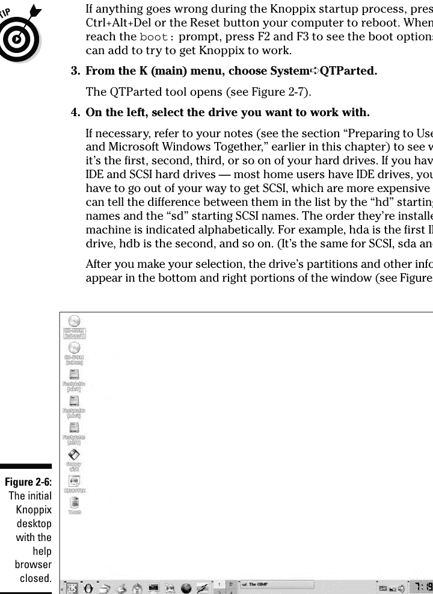
图 2-6：关闭了帮助浏览器的初始 `Knoppix` 桌面。

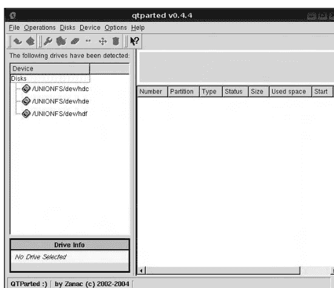
图 2-7：初始的 `QParted` 分区编辑器。

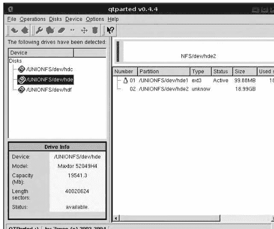
图 2-8：选择了第二个 `IDE` 硬盘的 `QParted`。

- 5. 在右侧，选择你想调整大小的分区。

如有必要，参考你的笔记查看它它是图 2-8 所示的第一个……第二个……

- 6. 选择 `Operations`（操作）：`Resize`（调整大小）以打开对话框。

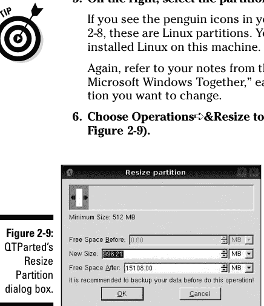

- 7. 进行更改。
- 8. 点击 `OK`。
- 9. 如果需要更改，返回。
- 10. 点击 `Commit`（提交）保存更改。
- 11. 如果需要返回，返回。
- 12. 如果已完成，退出。
- 13. 从主菜单，注销。
- 14. 从对话框，重启。
- 15. 点击 `OK` 关机。

## 硬件双检

大多数硬件现在在 Linux 下运行良好。不过，有时最新的显卡或其他奇设备可能会遇到问题；如果你是追随者，请检查以下：

- 你的发行版网站：
  - `Fedora`：还没有官方硬件列表。在此，你可以使用 Red Hat 的列表 `http://hardware.redhat.com/hcl/`。记住此列表关注企业设备，并不完全适用于家用。
  - `Linspire`：查看 `www.linspire.com/windows_hw_compatibility.php`。
  - `Mandriva`：访问 `www.mandriva.com/en/hardware`。
  - `SUSE`：起点是 `suse.com/private/online_help/`。在这里，点击 `Hardware Database`（硬件数据库）链接进行搜索。
  - `Ubuntu`：访问 `https://wiki.ubuntu.com/HardwareSupport`
  - `Xandros`：查看 `http://support.xros.com/hcl.php`。

不要担心项目是否认证（经过严格测试以确保正常工作）或是否支持（包含驱动程序且已知硬件可用）。大多数情况下，支持即可。这些是给需要此类信息的企业用户的。

如果你是计算机新手或不熟悉硬件定义和细节，并且淹没在技术术语中，你可以在网上找到许多关于硬件的信息。（一个很好的网站是 `www.tomshard.com`。）如果你的硬件没有被列出，不要惊慌。

- 其他 Linux 导向的网站：你也可以查看 `www.tldp.org/HOWTO/Hardware-HOWTO` 中的通用硬件列表

* 讨论你特定硬件的网站：如果你仍然找不到硬件列表，将你的网络浏览器指向 `www.google.com/linux` 并对硬件的品牌和型号进行网络搜索，加上


## 34 第一部分：入门尝试

Linux 词汇。例如，你可以搜索 "`Innovision DX700T Linux`" 来了解其他人对这一特定品牌和型号硬件的使用情况。（当然，这里并不意味着对文中提到的任何硬件进行任何背书。）

- **供应商网站**：许多供应商会在其网站上提供有关他们对 Linux 支持程度的信息。然而，尽管硬件在 Linux 上运行良好，他们也可能完全没有提到 Linux。你还可能在供应商网站上找到可以下载的驱动程序。只有在没有其他方法获取你发行版的驱动程序时才这样做。这将是获取驱动最笨拙的方法。

如果情况最糟糕，你可能发现某件硬件没有列在支持列表中。尽管如此也请尝试一下；它在某些限制下可能会运行良好。例如，你可能无法使用最新一代显卡的最新功能，但至少可以将其作为通用的 `SVGA` 使用。此外，有时硬件虽然未列出，但仍然受到支持。

- **令人头疼的手**：如果可能，请保留你的电脑手册（特别是显卡和显示器的手册），以防你需要通过它们来回答安装程序提出的问题——大多数人根本不需要处理这个问题，但确实有人需要。

如果安装程序无法检测你的特定显卡，那么你需要确切知道它是什么以及它的规格——或者选择“通用（Generic）”选项。（在第 3 章或第 4 章安装 Linux 时我会介绍如何操作，取决于你的发行版）。如果你决心要清楚机器里到底有什么——或者因为需要进行额外研究而想找出——你有以下选项：

- **使用现有的操作系统来记录你的硬件**。如果你的电脑已经在运行 Windows，你可以从 Windows 环境中收集大量信息。根据你的系统，使用以下方法之一：

- **在 Windows 98 中**：（是的，有些人人仍在运行它。）选择“开始 -> 控制面板 -> 系统 -> 设备管理器”，访问图 2-11 中的对话框。

- **在 Windows 2000 中**：选择“开始 -> 控制面板 -> 系统 -> 设备管理器”，访问机器上安装的硬件列表，如图 2-12 所示。

- **在 Windows XP 中**：选择“开始 -> 控制面板 -> 打印机和其他硬件”。在这里，你可以从“选择控制面板图标”下的对话框中选择其中之一，或者查看“另另”并选择“系统”。如果你选择了“系统”，则从那里选择“硬件 -> 设备管理器”来访问机器上安装的硬件列表（如图 2-13 所示）。


## 第 2 章：为 Linux 准备电脑 35

图 2-11：在 Windows 98 中，设备管理器为你提供有关已安装硬件的信息。

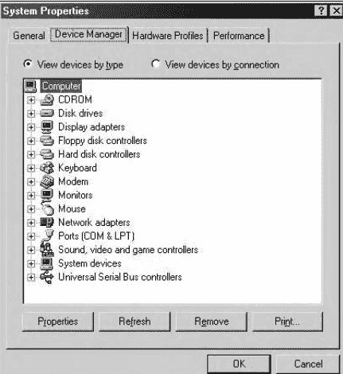
图 2-12：Windows 2000 设备管理器。

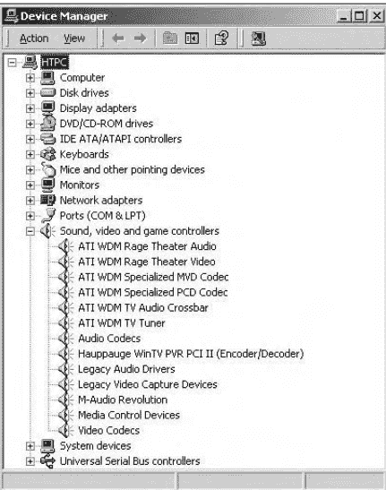

## 36 第一部分：入门尝试

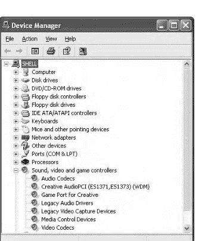
图 2-13：Windows XP 设备管理器。


你可以双击设备管理器中的每一项以显示相应的详细信息。

- **下载 PC 硬件检测工具**。如果你没有任何诊断工具，并且拥有相对较新的 DOS 版本，可以从互联网下载 PC 硬件设备工具，例如 `PC-CONFIG`。`PC-CONFIG` 包含了多个屏幕的信息和菜单，用于选择硬件平均值和选项。该工具可以共享，使用和费用信息可以通过 Holin Datentechnik 网站 (`www.holin.com`) 获取。


- **通过阅读电脑启动时的屏幕来收集信息**。如果你的系统没有包含任何操作系统，或者你没有文档，请在电脑启动时阅读屏幕。视频信息会在电脑启动时显示。如果信息消失太快，你可能需要重启几次才能阅读完。此外，某些系统在启动时会显示 PCI 组件及其设置。同样，你可能需要重启几次才能收集所有信息。

你可以尝试按下电脑上的 `Pause-Break` 键（它应该是 `Scroll Lock` 键）来让屏幕在启动期间冻结。阅读完毕后，按任意键即可取消冻结。

- **访问基本输入输出系统 (BIOS) 信息**。它存储在内存的一小块区域并由电池保持，有时被称为 `CMOS`（互补金属氧化物半导体），这表示了可以存储和保留信息的芯片类型。`BIOS` 中存储的信息量从非常少到相当多不等。一些较新的系统可能会显示有关电脑硬件的屏幕信息。

## 第 2 章：为 Linux 准备电脑 37

如果你选择访问 `BIOS`，请确保在任何操作系统加载之前进行。大多数制造商会在系统启动时在屏幕上指示进入 `BIOS`（或设置）的键盘键（或按键序列），例如，“按 `Del` 进入设置”。如果你找不到按键序列，请检查制造商的网站。进入 `BIOS` 后，你通常使用方向键、`Tab` 键或回车键进行导航。某些 `BIOS` 环境使用功能键；查看屏幕顶部或底部的功能键选项列表。


要格外警惕那些带有术语（如 Windows）字样的硬件包装盒和网站。这些组件（如 `WinModems`）依赖 Microsoft Windows 才能运行——尽管如此，包装上可能什么都不显示。

# 第 3 章

## 安装 Fedora Core

**本章内容**

- 考虑安装前的最后准备问题
- 将 Fedora 安装为个人桌面系统
- 首次启动 Fedora

> 要么做，要么不做。没有所谓的“尝试”。
>
> — 尤达，《帝国终击战》

安装 Linux **不再**需要那些奥秘的符号和复杂的魔法师咒语了。现在的图形化安装已经变得非常容易操作，对于习惯了微软 Windows 等其他图形化系统的用户来说，这会感到非常熟悉。本章将提供相关细节。

如果你正在安装 Linspire、Mandriva、SuSE、Ubuntu 或 Xandros，请跳转到第 4 章——如果你想使用 Knix 而无需安装任何内容，也同样如此。即使你没有使用 Fedora，你仍然在本章中发现很多收获——所有的 Linux 发行版都拥有许多共同元素。

## 开始安装前需要考虑的事项

**40 页 第一部分：入门**

你可以通过以下方式安装 Fedora Core：

- 使用随书附带的 DVD-ROM 启动，并在初始菜单中选择 Fedora。
- 使用 Fedora Core 安装光盘启动。如果你使用书末附带的优惠券购买了光盘套装，这就是第 1 张光盘；或者从第三方供应商（如 Fedora 项目供应商页面列出的供应商）购买。

```
http://fedora.redhat.com/download/vendors.html
```

要从 DVD-ROM 或 CD-ROM 开始安装，你必须确保你的系统可以从 DVD-ROM 或 CD-ROM 启动（*boot*）。在第 2 章中，我介绍了如何配置计算机从这些设备启动。

我重点关注 Fedora Core 5 及其安装主要有两个原因：

- Fedora Core 5 包含在随书附带的 DVD 中以及你通过优惠券订购的光盘中。
- 涵盖现有的每一个 Linux 发行版的安装将使这本书变成一套百科全书集。

我假设你想安装一个桌面系统。市面上有很多专注于服务器的书籍，因此我的目标是让《Linux for D》完全服务于那些想要将 Linux 作为实际桌面机器的用户。此外，在如此幅幅书中，无法以令人满意的深度同时涵盖桌面和服务器功能。

请注意，如果你使用的是红帽企业级 Linux（Red Hat Enterprise Linux）、其他版本的 Core 或不同的 Linux 发行版，你的界面将与书中所示内容不同（对于 Linspire、Mandriva、SuSE、Ubuntu 和 Xandros，请参见第 4 章）。每个 Linux 发行版程序都涵盖基本任务，特定操作可能会以不同的顺序呈现，或者经过自定义以显示不同的屏幕内容。例如，某个发行版可能会在网络配置之前创建账户，而另一个可能将这两个主题的顺序颠倒。


对于 Fedora，在到达“准备安装”（About To Install）GUI 界面之前，你可以退出安装而不更改系统上的任何内容。在到达“准备安装”界面**之前**所做的任何配置选项都不会保存到磁盘中。当你越过“准备安装”界面继续后，数据将写入磁盘，你的系统也会发生变化。

## 安装过程

在本节中，我遵循图形化安装。如果由于原因你无法使用图形化安装程序（例如 Linux 不支持你的显卡），请改用文本安装。步骤是相同的，只是没有那么美观，而且你无法获得在点选版本中可以获得的所有选项。

由于随书附带的 DVD 包含多个发行版，因此启动界面与你直接从自己的 DVD 或光盘安装 Fedora Core 5 时的默认界面不同。由于某种原因，你使用的是只包含 Fedora Core 5 的 DVD 或光盘，请按照说明操作，但在到达启动提示符时只需按 `Enter` 键。使用随书自带 DVD 的用户应执行以下操作：

## 第 3 章：安装 Fedora Core

1. 如果你想从随书附的 Fedora DVD-ROM 启动并安装，请将 DVD 插入 DVD-ROM 驱动器，重启系统，输入 `linux` 并按 `Enter` 键。

有多个启动选项，如图 3-1 所示，每个选项在下列表中都有描述：


- 图 3-1：Linux for D 初始安装界面
- KNOPPIX: 按 `<ENTER>` 直接启动到 KNOPPIX（或输入 `knopix`）。
- Fedora Core: 输入 `linux <ENTER>` 安装 Fedora Core 5。
- Copy CDs: 按 `F5` 获取创建 root linux 光盘的说明。
- `F1`-主页 `[F2-Knopix Options] [F3-Knopix Cheatsheet][F4-Fedora Options] [F5-Linux CDs] [F6-General] [F7-Kernel Parameters]`
- **以图形模式安装或升级 (Install Or Upgrade In Graphical Mode):** 图形界面中的第一个选项用于首次安装 Fedora Core 或升级现有的 Fedora Linux 版本。此安装将探测并检测你的系统硬件。图形界面设计用于配合鼠标选择选项。如果你没有鼠标，可以使用键盘在屏幕间进行导航。在大多数地方，空格键切换选项的开启和关闭；`Enter` 键接受选择并移动到下一个屏幕。如果你想更改之前的设置，可以使用“返回”按钮返回之前的界面。图形安装界面包含了有关当前配置的信息。
- **以文本模式安装或升级 (Install Or Upgrade In Text Mode):** 第二个选项允许你通过文本界面安装或升级 Fedora Core。使用箭头键在区域之间移动，使用空格键切换选项的开启和关闭。要使用文本界面安装，在 `boot:` 提示符输入 `linux` 并按 `Enter`。

**42 页 第一部分：入门**

- **功能键 (Function Keys):** 初始启动屏幕底部列出的最后一项是功能键。
`F1` 键显示初始启动屏幕，提供通用说明以及指向 `F2` 到 `F5` 功能键的提示。
`F2` 键包含了启动 knopix Live CD 的选项。有关 knopix 和发行版的信息请参见第 4 章。
`F3` 键提供了 knopix 的更多选项。
`F4` 键提供了在安装期间禁用硬件检测（你在此之前需要硬件详情）；启用恢复模式；使用未包含在安装介质中的驱动器磁盘、光盘或 DVD；以及测试系统内存。
`F5` 键说明了 DVD 上的可用内容。

如果不选择选项并直接按 `Enter`，Linux 发行版图形安装将开始。

2. 按 `Enter` 开始图形化安装。

## 第 3 章：安装 Fedora Core


由于随书附带的 DVD 不仅包含完整的 Fedora 5（不包括源代码；参见附录 B），还包含许多发行版的文件，我不建议在此设备上尝试介质检查，因此请“跳过此 DVD”（Skip for this DVD）。即使 DVD 是好的，它也很可能失败。

无论你是否检查介质，都会出现初始 Fedora Core 安装界面。如果你愿意，可以点击“发行说明”（Release Notes）按钮打开包含此版本信息的字体。这可能有点极客，但你可能会发现有趣或实用的内容。

- 3. 准备好继续时，点击“下一步”（Next）。


初始屏幕消失，取而代之的是语言选择屏幕，如图 3-2 所示。Linux 支持多种语言。

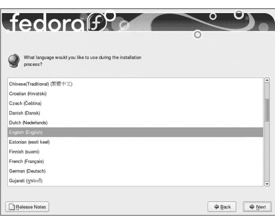

- 4. 使用鼠标或 ↑ 或 ↓ 键选择你的语言并点击“下一步”。

出现键盘配置屏幕，如图 3-3 所示。不同语言在键盘上的按键布局不同；你可能想要选择与你的键盘匹配的语言。（默认是美国英语。）

## 第一部分：入门教程

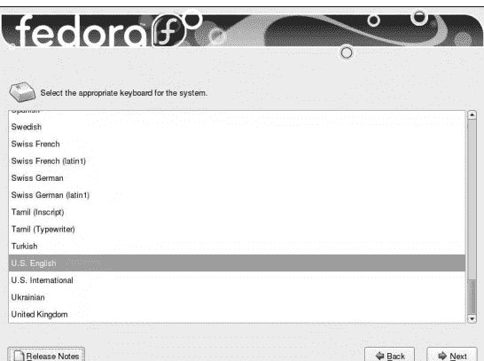

图 3-3：键盘屏幕。

- 5. 选择你的键盘配置并点击“下一步”。

出现分区屏幕，如图 3-4 所示。你会有四个选项：

- **删除所选驱动器上的所有分区并创建默认布局：** 选此此项将擦除你在在该选项下方复选框中选中的硬盘上的所有内容。
- **删除所选驱动器上的 Linux 分区并创建默认布局：** 如果你已经在在该选项下方显示复选框标记的硬盘上安装了版本的 Linux，安装程序将找到之前的实例并覆盖安装，从而清除旧数据。
- **使用所选驱动器上的空闲空间并创建默认布局：** 寻找可用空闲空间并安装在其中。
- **创建自定义布局：** 手动定义安装位置。如果你选择此路径，请使用附近侧边栏的“定义分区”。

作为选择合适驱动器的提示，计算机中的第一块硬盘通常是 `hda`，第二块是 `hdb`，第三块是 `hdc`。（使用某种硬盘技术，第一块将是 `hde`，第二块是 `hdf`，依此类推——只需从低到高计数即可。）如果你有 SCSI 驱动器，请查看 `sda`、`sdb` 和 `sdc`。

如果你既紧张又足够懂技术来理解硬盘链接，请先勾选*检查并修改分区布局*。如果你这样做了，将出现一个布局屏幕。选择删除现有分区的用户将被询问是否真的想这样做。在实际删除任何内容之前，请回看你的笔记进行双检。

## 第 3 章：安装 Fedora 45

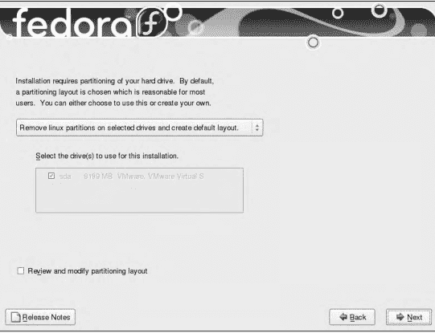

图 3-4：分区屏幕。

要小心——当你选择删除分区时，你会丢失现有分区中的所有数据。然而，它们不会立即更改——直到最后的安装屏幕。

### 手动定义分区

如果你选择手动定义分区，你将使用 Red Hat 的 Disk Druid。Disk Druid 允许你删除现有分区并添加新分区。如果你不知道如何使用 Disk Druid，我建议你不要继续。点击“返回自动分区”，然后选择查看 Disk Druid 建议的自动设置，而不是从头开始。

如果你选择检查并更改，你将需要了解一些术语：挂载点是设备（可能是你 IDE 硬盘上的第一个分区，即 `/dev/hdl`）在你的文件系统（你的目录层次结构）中连接的位置。你文件系统的起始点是根目录，显示为 `/`。你需要有一个挂载为 `/` 的分区，如果你不创建很多分区，那么你希望它越大越好。你还需要一个挂载为 `/boot` 的分区，但那个可以很小，大约 150MB。最后，你想要一个大约是你的计算机内存两倍的分区。交换分区没有显示挂载点，只有一个你必须选择的交换系统类型。否则，在 Fedora 中，你将使用 `ext:3` 作为你的文件系统类型，因为它是默认的。我将在第 10 章详细介绍这些内容。

## 第一部分：入门教程

- 6. 选择合适的选项并确保选择了正确的驱动器；然后点击“下一步”。

点击“下一步”后，出现网络配置屏幕，如图 3-5 所示。

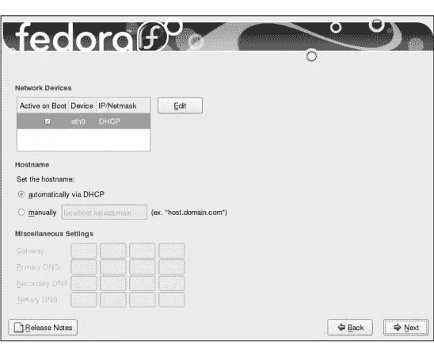

图 3-5：网络配置屏幕。

如果你使用调制解调器且没有以太网卡，将看不到此屏幕，跳到第 8 步。如果你看到了这个：

- 7. 配置你的网络。如果你不是使用 DHCP 而是使用静态网络，执行以下操作：
    - a. 点击“使用 DHCP”。
    - b. 点击“编辑界面”。
    - c. 输入管理员给你的 IP 地址。例如，如果你的 IP 地址是 192.168.1.44，你会在第一个框输入 192，第二个输入 168，第三个输入 1，第四个输入 46。
    - d. 在子网掩码框输入。
    - e. 在杂项部分输入主机名。
    - f. 在主屏幕输入你的网关和 DNS 字段。如果你的网络有多个 DNS 服务器，你可以输入三个服务器地址。

- 8. 设置完成后，点击“下一步”。

出现时区选择屏幕，如图 3-6 所示。

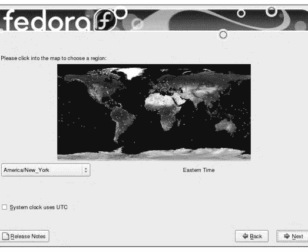

图 3-6：时区屏幕。

- 9. 选择你的 Linux 系统所在的地理区域。如果你旅行，请将其设置为现在的所在地。
- 10. 选择你的城市，如果在列表中没有找到，选择同一时区的另一个城市。
- 11. 如果必要，点击“系统时钟使用 UTC”——大多数人不需要此选项。如果结果证明你的计算机确实在使用 UTC 而你选错了，你可以在安装计算机后更改此值，所以不用太担心。
- 12. 点击“下一步”进入下一步。
- 13. 根密码屏幕。在根密码屏幕上，将根账户密码输入“根密码”字段，然后在“确认”字段中输入相同的密码。输入时你看不到密码——只有星号字符。星号可以防止未经授权员看到你的密码。如果你在其中一个框中输入错误，当你想要移动到安装的下一步时会收到警告，并有机会重新输入值。
- 14. 输入两次根密码后，点击“下一步”。

出现应用程序屏幕，如图 3-7 所示。


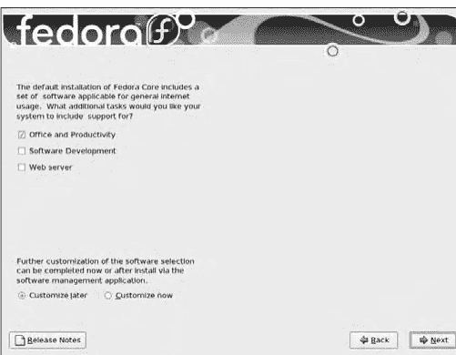

图 3-7：应用程序类型屏幕。

软件选择的进一步自定义

可以在现在完成，也可以在安装后通过软件管理应用程序完成。

## 第 3 章：安装 Fedora

15. 添加或删除包类型以自定义您的系统。

要添加某种类型，其复选框必须勾选。要删除某种类型，框框必须为空。您可以通过点击框框来添加或取消勾选。

可用的组包括：

- *办公与效率*：我假设你正在设置桌面系统，因此你可能希望确保选中此项。
- *软件开发*：如果你是程序员，你会想要添加此组。否则，你可以不需要。
- *Web 服务器*：如果你想在该系统上运行 Web 服务器，或者只是想实验 Apache Web 服务器，请添加此项。否则，你不需要。

请记住，最后三个选项超出了本书的范围。

16. 在屏幕底部，选择“自定义名称”并点击“下一步”继续。

软件包选择界面，如图 3-8 所示。

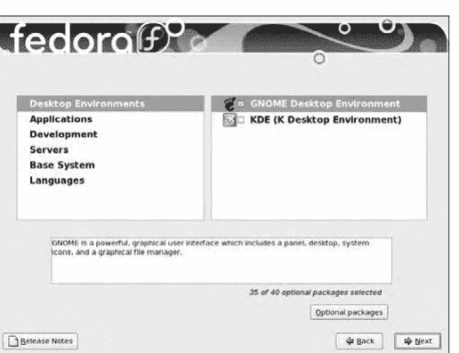

图 3-8：软件包选择屏幕。

17. 点击 KDE，如果你想在系统中同时安装这两个主要的图形用户界面。

我将在第 6 章和第 15 章中详细介绍这些界面。

18. 应用程序。

此类别下可用的包类型显示在右侧。你可以从任何地方开始，但我认为此部分可能是一个很好的例子。

- 19. 滚动查看右侧的列表。确保你需要的组已勾选，而不需要的组未勾选。

你可以点击组的名称来查看其描述。

- 20. 如果你想查看该组的可选软件包，则在选中该组状态下，点击“可选软件包”按钮。

此操作将打开该组的“软件包”对话框。阅读描述并从复选框中添加/取消勾选，直到你对选择感到满意，然后点击“关闭”关闭对话框。如果该组尚未标记为安装，则此按钮将不可用。

- 21. 当你完成每个组的可选软件包选择后，选择左侧的下一个类别，例如，“基础系统 Base Systems”，然后返回步骤 19。
- 22. 当你检查完所有可能性——你以后可以更改安装内容——，点击“下一步”。

首先，会出现一个对话框，告诉你安装程序正在检查你选定的软件列表。如果它发现你漏掉了软件依赖的程序，它将为你提供添加这些程序的机会。完成后，将出现安装屏幕。


如果你想停止 Linux 的安装，安装屏幕是你可以在不更改驱动器任何内容的情况下停止的最后一个地方。要停止安装，按下 `Ctrl+Alt-Del`，系统将重启。如果你这样做了，如果不打算重新开始安装，请确保取出 DVD 或第一张 CD。

- 23. 当你准备好提交安装时，点击“下一步 (`Next`)”。

如果你是从光盘安装，可能会出现“所需介质 (`Required Media`)”对话框，确切告诉你安装所需的物品。如果你使用 CD，根据你请求的软件，你可能不需要所有的光盘。

之后，将出现软件包安装屏幕。系统首先准备安装，然后开始安装。在系统安装期间，查看每个正在安装的软件包的进度条，以及总安装的进度条。

软件包安装完成后，你将到达最终屏幕，上面的文字以“恭喜，安装完成”开头。CD 或 DVD 会自动弹出（如果没有弹出，请手动弹出）；如果你使用了软盘，也请将其移除。在移除所有安装介质后，点击“重启 (`Reboot`)”重启你的机器，并进入本章的下一节，“首次启动”。


## 首次启动

Fedora Core 系统的首次启动

当计算机首次启动时，你将看到首次启动欢迎屏幕。

执行以下操作以完成机器的初始设置：

- 1. 点击“前进 (`Forward`)”继续设置程序。

出现“许可协议 (`License Agreement`)”屏幕。

- 2. 阅读这段文字，选择“我同意许可协议 (`Select I Agree To The License Agreement`)”然后点击“前进 (`Forward`)”。

出现“防火墙 (`Firewall`)”屏幕，如图 3-9 所示。

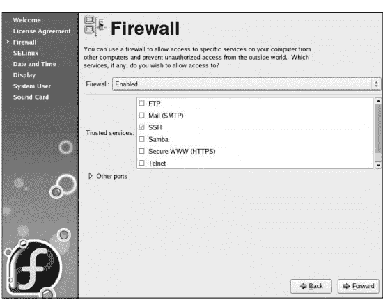

图 3-9：Fedora 防火墙屏幕。

防火墙保护你的系统不受未经授权的访问和发现。当你以高速连接互联网时，你的电脑就变成了数十万台电脑之一。我希望能告诉你没有大量试图进入你计算机的坏人和恶意程序，但我做不到；不幸的是，它们有一大群。防火墙是你（但但不限于你）的保护屏障，用于防止网络犯罪、病毒、蠕虫以及其他可能试图通过本应关闭的门溜入的各种物品；参见侧边栏“防火墙和...”。

- 3. 除非你100% 确定它是安全的，否则将其保持为“启用 (`Enabled`)”。

- 4. 确定你想启用哪些服务。

- 5. 如果看到“警告”对话框，点击“是”设置配置。

- 6. 除非你想实验 SELinux，否则请选择“许可 (`Permissive`)”。

- 7. SELinux 在此处有非常详细的解释

- 8. 点击“前进 (`Forward`)”进入后配置的下一个阶段。

- 9. 如果你处于当前连接到互联网的计算机网络上……检查“网络时间协议 (`Network Time Protocol`)”选项卡。

- 10. 勾选“启用网络时间协议”复选框以启用此功能。

- 11. 如果你的网络管理员要求添加特定的时间服务器，点击“添加 (`Add`)”并输入你的服务器地址。

- 12. 如果你打算手动控制机器的日期和时间，请验证日期和时间……

- 13. 在调整日期/或网络时间服务器后，点击“前进 (`Forward`)”继续。

- 14. 查看“配置 (`Configure`)”按钮左侧。如果你没有在列表中正确列出你的显示器，点击“配置 (`Configure`)”按钮...

### 第 54 页 第一部分：入门

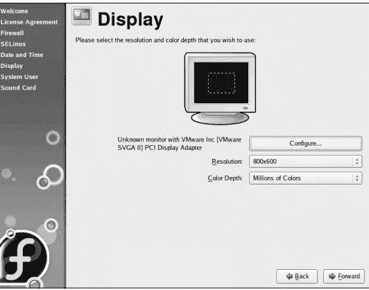

图 3-10：

Fedora Core 首次启动的屏幕。

- 15. 在“分辨率”（Resolution）下拉列表框中，选择您想要使用的视频分辨率。

安装程序只会向您提供它认为您的显示器和显卡支持的分辨率。如果您发现没有提供完整范围，请继续选择您能获得的最佳选项；稍后可以更改视频设置。（一个常用的设置是 1024 x 768。）

- 16. 在“颜色”（Color）下拉列表框中，选择您想要使用的颜色数量。

同样，您获得的是安装程序认为您的系统支持的内容。您可能想要选择“百万色”（Millions Of Colors）。

- 17. 点击“向前”（Forward）继续您的首次启动机器设置。

出现“系统用户”（System User）屏幕。

- 18. 在“用户名”（Username）文本框中输入您想要为个人账户设置名称，然后在“全名”（Full Name）文本框中输入您的姓名。

例如，在用户名中输入 `zorro`，在全名中输入 `Zorro the Dog`。

- 19. 在“密码”（Password）和“确认密码”（Confirm Password）框中输入您的账户密码。

此密码是您的个人账户密码，与您的 root（管理员）账户无关。可以随意使用与 root 不同的密码。事实上，这样做是个好主意，如果您不小心没有输入相同的密码，您将在第 20 步中收到警告并返回此步骤。

- 20. 点击“向前”（Forward）按钮继续。

出现“声卡”（Sound Card）屏幕。

- 21. 确保您的扬声器或耳机已打开，并点击“播放”（Play）箭头按钮。

您应该能从右声道、左声道，然后同时听到听到声音。如果您想再次播放但希望声音更大或更小，请使用音量滑块进行更改，然后再次点击“播放”箭头。

- 22. 当询问是否正确听到了声音时，如果听到了三个声音，点击“是”（Yes），否则点击“否”（No）。

如果您没有正确听听到声音，请参阅第 18 章了解稍后如何让音频正常工作。音频硬件极客们可能想要修改底部的可选项目。否则，请保持默认设置不变。

- 23. 点击“完成”（Finish）启动您的新安装。

大功告成！您刚刚度过了第二个 Linux 磨炼！您的计算机现在将带您进入图形化登录提示界面。有关如何继续操作，请参阅第 5 章。

# 第 4 章

## 安装其他 Linux 发行版

**本章内容**

- 使用 Knoppix 启动 Linux

- 感受 Linspire 的魅力

- 揭秘 Mandriva 的奥秘

- 了解 SuSE

- 利用 Ubuntu

- 使用 Xandros 震撼你的大脑

- 利用 LiveCDS 和 LiveDVDs

- 发现更多 Linux！

快速阅读本书中的任何章节都将让您明白 Linux 不仅仅是一个新奇的计算机程序。Linux 是一个配备了软件工具和构建材料的完功能工作站，您可以使用它来构建任何广泛的计算解决方案。开发一个杀手级的 Linux 发行版一直是 Linux 社区的圣杯。这个终极的 Linux 发行版将为学前儿童、火箭科学家、家庭主妇和老迈的计算机科学教授提供所需的支持和能力，以利用 Linux Power。

然而，创建一个让所有人满意的东西是不可能的。在本章中，我调查了五个流行的（且易于安装的）发行版。其中一些是商业性的，如果您正在考虑获取其中一个，我希望本章能帮助您决定哪一个（如果没有 Fedora）符合您的需求。我没有涵盖商业品的每一个方面（正如我没有涵盖每一个侧面一样）。

在本章中，我提到了 ISO 文件的制作。

（注：此处原文似乎存在重复或截断，已根据指令对后续原文进行 翻译 

）

（第 58 页 第一部分：入门）

# 第 4 章

## 安装其他 Linux 发行版

**本章内容**

- 使用 Knoppix 启动 Linux

- 感受 Linspire 的魅力

- 揭秘 Mandriva 的奥秘

- 了解 SuSE

- 利用 Ubuntu

- 使用 Xandros 震撼你的大脑

- 利用 LiveCDS 和 LiveDVDs

- 发现更多 Linux！

快速阅读本书中的任何章节都将让您明白 Linux 不仅仅是一个新奇的计算机程序。Linux 是一个配备了软件工具和构建材料的完功能工作站，您可以使用它来构建任何广泛的计算解决方案。开发一个杀手级的 Linux 发行版一直是 Linux 社区的圣杯。这个终极的 Linux 发行版将为学前儿童、火箭科学家、家庭主妇和老迈的计算机科学教授提供所需的支持和能力，以利用 Linux。

然而，创建一个让所有人满意的东西是不可能的。在本章中，我调查了五个流行的（且易于安装的）发行版。其中一些是商业性的，如果您正在考虑获取其中一个，我希望本章能帮助您决定哪一个（如果没有 Fedora）符合您的需求。我没有涵盖商业品的每一个方面（正如我没有涵盖每一个侧面一样）。

在本章中，我提到了 ISO 文件的制作。（注：此处原文似乎存在重复或截断，已根据指令对后续原文进行 翻译 

）

（第 58 页 第一部分：入门）

# 第 4 章

## 安装其他 Linux 发行版

## Burning ISO

使用 Knoppix 启动 Linux / 感受 Linspire 的魅力 / 揭秘 Mandriva 的奥秘 / 了解 SuSE / 利用 Ubuntu / 使用 Xandros 震撼你的大脑 / 利用 LiveCDS 和 LiveDVDs / 发现更多 Linux！


## Burning ISO

当你准备刻录 CD 或 DVD 时，请确保您的软件理解您要刻录的是镜像而不是文件。如果您将 CD 或 DVD 刻录后，放入驱动器打开并发现只有一个一个文件，那么您刻录错误。ISO 应该被解压到 CD 或 DVD 目录。

尽可能使用 CD-RW，因为它们是重复写的，而且您可以下载并刻录。

最后，一个好主意是以较低的速度刻录 CD 或 DVD。。。这些 ISO 制作成 CD 或 DVD。

使用 Knoppix 启动 Linux / 感受 Linspire 的魅力 / 揭秘 Mandriva 的奥秘 / 了解 SuSE / 利用 Ubuntu / 使用 Xandros 震撼你的大脑 / 利用 LiveCDS 和 LiveDVDs / 发现更多 Linux！

## 60 第一部分：入门

- 3. 在初始界面，选择在当前台式计算机的硬盘上安装（INSTALL）或更新（UPDATE）Linspire，并按回车键。

Linspire 开始执行所有标准的安装前任务，例如扫描你的计算机硬件并启动安装程序。进度条显示了安装进度。进度条满满后，你的屏幕会变黑（不要慌！这是正常现象！）最后，你将到达欢迎界面。如果你想将 Linspire 作为 Live CD 使用而不是现在进行安装，请运行[直接从 CD 运行 Linspire 而无需安装（LinspireLive）]。

- 4. 在欢迎界面，点击“下一步”（Next）。

出现键盘布局界面，如图 4-1 所示。

- 5. 如果你使用 Dvorak 键盘布局（或英语以外的其他支持语言），请选择你的键盘应该布局的语言。

- 6. 点击“下一步”（Next）。

出现安装或更新界面，如图 4-2 所示。取决于你是否已经安装了 Linspire，你可能会看到或看不到已检测到之前的安装的提示。

- 7. 如果你的系统中已经有了 Linspire 且你想更新到五-0 版本，否则选择“安装”（Install），然后点击“下一步”（Next）。

出现安装方法界面，如图 4-3 所示。


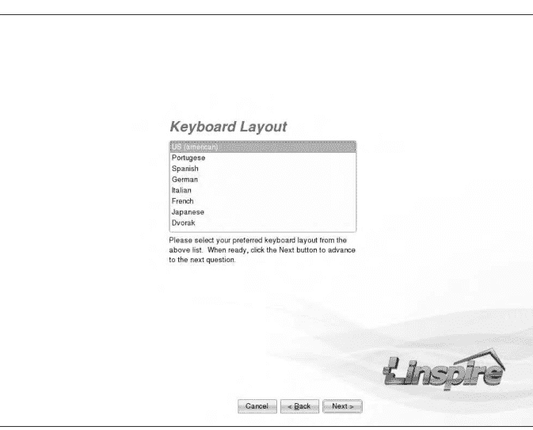

图 4-1：Linspire 键盘布局界面。

# 第 4 章：安装其他 Linux 发行版

## 安装还是更新？

我们检测到此计算机上已经安装了 Linspire，你有保留现有文件或完全刷新安装的。请选择以下选项之一一：

- `Install`：在安装新版本的 Linspire 之前，删除硬盘或分区上的所有数据。
- `Update`：删除除你的数据以外的所有系统文件和应用程序，并从 CD 安装新版本的 Linspire。你的数据文件将不受受影响。你之前安装的软件应用程序可以通过拷贝 CD 来更新。

无论你选择哪种选项，在安装之前请务必对重要数据进行备份。

请从下面的选项中选择你偏好的安装方法。准备好后，点击“下一步”`Next`按钮进入下一个问题。


图 4-2：Linspire 安装或更新界面。

## 安装方法

请从下面的方法中选择一种用于在计算机上安装 Linspire：

- `Take over an entire hard disk`：这将覆盖并在整个硬盘上安装 Linspire。点击此处获取更多信息。
- `Advanced Install`：此方法适用于高级用户，允许你在驱动器或指定的、预配置分区上覆盖并安装 Linspire。点击此处获取更多信息。

选择上述方法之一后，点击“下一步”`Next`按钮进入下一页。


图 4-3：Linspire 安装方法界面。

## 62 第一部分：入门

8. 如果你正在为一台独立的计算机安装 Linspire 或让它接管整个硬盘，请选择“接管整个硬盘”`Take Over An Entire Hard Disk`。否则，如果 Linspire 必须与另一个操作系统共享硬盘，请选择“高级安装”`Advanced Install`。

第二个选项更复杂，我会介绍那一个。如果你选择第一个选项，接下来的步骤将询问你想安装在哪个硬盘上。使用 Windows 看到它们的顺序，因此第一块驱动器是 C；第二块是 D；以此此类推。如果有必要，你可以在 BIOS 中查看大小和其他信息，以尝试确定哪个是第一个、第二个或第三个。

如果你选择“高级安装”，在继续之前最好检查系统现有的空闲空间；否则安装程序将不允许你进入分区选择界面。请参阅第 2 章了解如何释放空间。

9. 当你做出选择后，点击“下一步”`Next`继续。

出现高级安装对话框，如图 4-4 所示。

10. 从列表中选择你想将 Linspire 安装到哪个硬盘（如果你想安装在整个驱动器上）或分区（如果你想安装在特定的空闲分区中），然后点击“下一步”`Next`。

出现计算机名称和密码对话框，如图 4-5 所示。


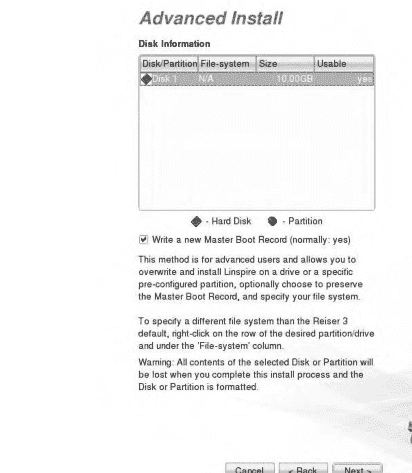

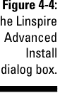

## 第 4 章：安装其他 Linux 发行版 63

| 计算机名称 |
| :--- |
| 此计算机的名称：[ ] |
| 你必须给你的计算机命名。例如：johoe，jimsmith。 |
| 密码 |
| 管理员密码：[ ] |
| 确认密码：[ ] |
| 为了防止未经授权的访问，建议你的计算机使用密码，尽管这不是强制要求的。在点击下一步之前输入它。 |

图 4-5：Linspire 计算机名称密码对话框。

> **重要提示！** 如果你使用密码，请务必记住它。


11. 在对话框中输入你想让计算机命名的名称。

出现设置配置对话框。

12. 在两个密码框中输入你的管理员密码。

13. 安装现在开始。

屏幕变黑，你看到进度条，然后 CD 弹出。

15. 从驱动器中取出 CD 并按回车键重启机器；或者让它从这里启动。

## 64 第一部分：入门

## 识别 Linspire 的特殊功能

Linspire 最受讨论的功能之一是它的 `CNR`（点击并运行）仓库。这个在线商店允许你浏览、购买并安装程序。更棒的是，如果你订阅了 `CNR` 服务，仓库中的许多项目是免费的。（一旦你获取了软件，就不需要保持 `CNR` 更新。）我将在第 11 章介绍如何使用该服务添加软件。

某些版本的另一个功能是他们的音视频教程。安装完成后，教程将立即启动并引导你如何使用系统。你可以停止它们并随时回来。

### 关于各种 Linspire 版本

Linspire 的人员在组合选项方面非常有创意。在本章较前的“尽享 Linspire”部分中，讨论了购买此发行版的各种方式。在本节中，我查看了 Linspire 的各种封装方式。我不会介绍所有的插件（如果对每个发行版都这么做，这本书就会变成百科全书了！）相反，我查看了当时的几个版本：

- Linspire 五-0：Linspire 主产品。此版本包含了许多内容以及支持。
- Linspire 五-0 CNR：此版本与之前的版本相同，但自带了一年的 `CNR` 订阅（参见第 12 章）。

两个版本的 Linspire 都可以进入现场版本而不是实际安装系统。请查看本章后面的“使用 LiveCD 和 LiveDVD”部分了解有关发行版。

## 第 4 章：安装其他 Linux 发行版

在本节中，我将专注于 Mandriva 2006 的免费版本——商业版本的安装程序完全相同。安装此发行版所需的三个 ISO 文件包含在随书附的 DVD-ROM 中，只需将它们刻录到 CD-ROM 即可开始——请查看附录 B 获取这些文件。如果您无法使用 DVD-ROM，也可以从 Mandriva 官网（https://www.mandrivalux.com）免费下载该发行版，或者从 Mandriva 在线商店（www.mandrivastore.com）购买包含手册及更多内容的盒装版。

在第 2 章中，我提到 Mandriva 可以调整您的 Windows 分区大小；无需提前完成此任务。

## 安装 Mandriva

在您在 CD-ROM 或 DVD 上刻录或购买了 Mandriva 后，按照以下步骤进行安装：

- 将 CD 1 或 DVD 插入您的 CD-ROM 或 DVD-ROM 驱动器并重启电脑。

出现初始屏幕。如果电脑忽略了您的 CD-ROM 并尝试正常启动，请参阅第 2 章了解如何对 BIOS 进行必要的更改。

- 按 `F1` 查看更多选项（当您知道必须使用特定选项时），或按回车键开始安装。

我假设您按了回车键。进度条让您知道程序正在运行，然后您将进入“语言”对话框，如图 4-6 所示。

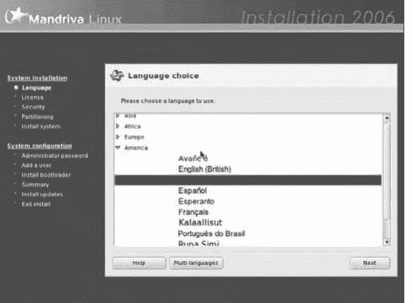

图 4-6：Mandriva 2006 语言对话框。

3. 如果你想使用英语（美国）以外的语言作为默认语言，请在列表中选择相应的语言，然后点击“下一步”。

如果您希望支持多种语言，可以通过点击“语言”按钮进行设置。点击“下一步”后，会出现“许可”屏幕。阅读许可协议，选择“接受”，然后点击“下一步”。随后出现“安全”屏幕。

4. 将您的安全级别保留在“标准”`Standard`，除非你想尝试“高”`High`。

设置为高于“高”可能会让电脑变得非常痛苦，因为这会完全关闭安全性！尽管如此，仍人喜欢这样做。请将安全级别保持在“标准”。

5. 如果您希望非 root 用户在系统上接收所有安全通知（推荐），请在“安全”文本框中输入您将创建的登录帐户。

只要不降低您的安全性，以 root 身份登录通常都是好的。请为此文本框进行选择。


6. 点击“下一步”。

出现“磁盘分区”屏幕。在这里看到的选项取决于硬盘 `DrakX` 上的内容，因此您看到的可能与我看到的不同。

7. 选择您想要使用的分区方式。

- 不要使用“现有分区”`Existing Partitions`，除非您已经提前设置好了机器的分区。通常情况下，您可能想要其他选项之一。
- 如果您要将整个硬盘交给 Linux，请选择“删除整个硬盘”`Erase Entire Disk`。
- 如果您的 Linux 安装需要与另一个操作系统共享硬盘（或者您想以特定方式设置分区），请选择“自定义分区”`Custom Partitioning`——如果您有可用空间，也可以选择“使用空空间”`Use Free Space`。


进入`/path/to/xxx`目录，找到`xxx.json`。

在表达式`cvar = avar + bvar`中，加法运算符（`+`）将`avar`与`bvar`相加，得到它们的和`cvar`

在`List.of(arg0, arg1, arg2)`中，`List`接口的工厂方法`of()`接受一系列的元素，返回包含它们的只读列表。

之后我们这样调用`cmd`命令：`cmd arg0 arg1 arg2`。

```
if (condVar > someVal) {console.log("xxx")}
```


9. 在分区部分，如果你对提供的建议感到满意，点击 `Partitioning` 链接。否则跳转到第 14 步。点击链接将带你进入分区界面。

10. 如果只想进行一些调整，点击 `Base Partition Setup` 单选按钮。如果你想完全更改设置，选择 `Create Setup` 单选按钮。由于最后一个选项实际上是给高级用户的，我假设你选择了 `Base Partition Setup` 来调整分配给你的内容。

11. 点击 `Next` 进行你的更改。

打开专家分区工具（见图 4-10）。

| 设备 | 大小 | 类型 | 挂载 | 开始 | 使用者 | 标签 |
|---|---|---|---|---|---|---|
| `devsda0` | 10.0 GB | | LVM2, Virtual Volume | | 0 | 104 |
| `devdb1` | 50.2 MB | Linux swap | swap | | 0 | 63 |
| `devsda2` | 9.5 GB | Linux native (Reser) | `/` | | 64 | 1304 |

> 图 4-10：OpenSUSE 10 专家分区界面。

12. 进行更改。

你可以通过点击列表中的分区（整个驱动器，如 `/dev/hda`；应关注分区，如 `/dev/hda1`）来更改分区大小，然后点击 `Edit` 按钮打开现有分区对话框。如果你想调整任何 NTFS 或 FAT32 分区，在列表中点击该分区并点击 `Resize` 完成完成。

13. 完成更改后，点击 `Finish` 返回安装设置对话框。

14. 点击 `Software` 链接。

你可能想挑选要安装的程序！这将带你进入软件选择界面（见图 4-11）。


15. 花费你想要的时间，浏览选项并将项目添加到列表。

- 这里是初次使用处理此对话框的推荐方法：查看左侧 `Selection` 下，并选择你想要使用的程序。作为桌面用户，你可能想添加 KDE 桌面环境、全部 KDE、`GNOME` 系统（以便可以使用两个环境，第 8 步中应该已经选了一个）、游戏、应用程序、多媒体、Java 和 VoIP。选择这些会将大块程序添加到你的列表中。你可以查看左下角查看磁盘选择占用了多少空间。

- 如果你想确保拥有某些特定类型的软件，点击 `Filter` 下拉列表并选择 `Package Groups`（软件包组）。此操作会更改左侧的布局以显示类型。你可以点击加号展开列表，点击减号收起列表。然后在右侧，你可以查看你在左侧所选的单个程序，然后勾选以将它们添加到安装列表，或取消勾选以将其移除。

## 第 4 章：安装其他 Linux 发行版

- 17. 如果你想让默认语言不是美式英语，请点击“语言（Language）”选项并进行更改。

- 18. 如果你是一个高级用户（或只是想尝试一下），点击“专家（Expert）”选项卡并研究其他可能的设置；否则点击“接受（Accept）”继续。

此时，你可能会被要求接受诸如 Macromedia Flash Player 等软件包的许可协议。阅读这些协议并（如果你需要这些软件包）点击“同意（Agree）”继续。当进入实际安装时，会出现“确认安装（Confirm Installation）”对话框。

- 19. 如果你确定继续，点击“安装（Install）”。如果你改变主意，点击“否（No）”返回安装设置（Installation Settings）对话框。

如果你点击了安装，让安装开始吧！SuSE 安装程序会显示它检测到的光盘、从这些光盘中需要的材料，并在安装过程中为每个光盘显示进度条。但请注意，它会在过程中重启。你可以直接让它运行，让它在重启后选择默认值，它将返回安装程序——如果你离开，这一切将自动发生。但是，如果你走得太远，你将需要回来更换 CD。

安装完成后，SuSE 将继续执行安装后的设置程序。

由于我的书没有无限的空间，从这里开始我为你提供一些关于如何完成此初始启动和设置程序的简要说明。（记住，如果你需要，以后可以更改这些任何一个项的配置。）操作如下：

- 1. 为 `root`（管理员）用户选择一个强密码。请参阅第 3 章获取三个建议。

- 2. 在“网络配置（Network Configuration）”部分，首先检查你的互联网连接是否已正确检测。

查看你可能拥有的连接类型，请参阅第 8 章。如果检测到，你将在相应的章节下方看到网卡的品牌和型号。如果没有，请查看“已检测（Detected）”。你可以以后更改这些设置。

- 3. 如果你的互联网连接未被检测到，点击该章节链接进行配置。

执行此操作，点击“添加（Add）”，完成设置（以第 8 章为指南），并在完成后点击“完成（Finish）”。

- 你可能需要来自 ISP（互联网服务提供商）或硬件文档的信息来完成此操作。如果过程让你感到压力，只需点击“返回（Back）”直到回到主“网络配置”部分，选择“跳过配置（Skip Configuration）”单选按钮，以后使用第 8 章进行设置。

- 还建议你查看网络配置中的“防火墙（Firewall）”部分——特别是以 SSH 开头的行——然后点击“已禁用（disabled）”。这将文字变为“已启用（enabled）”。你可以在第 13 章了解更多关于 SSH 的信息。


- 4. 当到达“测试互联网连接（Test Internet Connection）”时，如果你在线并可以访问互联网，选择“是（Yes）”。然后点击“下一步（Next）”。

如果尝试失败，不要因为现在放弃并继续而沮丧。你可以以后再次尝试。

- 5. 当询问是否想获取在线更新时，选择“是”（如果你现在可以访问互联网）。

你这将从一个完全更新系统开始。在“安装源（Installation Source）”下拉列表中，选择地理离你最近的站点。

- 6. 如果它是空的，点击“手动选择补丁（Manually Select Patches）”框。这告诉 SuSE 更新所有内容并避免每隔几秒问你一次问题。这种自动更新可能需要一段时间，即使如此，它有时也会停下来提问。如果是这样，通常错误会在五次尝试内纠正。如果你在获取补丁时遇到错误，告诉它重试。如果你尝试了十次或更多仍然无法通过，告诉它跳过该修复。你以后可以使用第 12 章再次更新。（如果更新了内核，操作系统的核心，系统将在你之前重启。）

- 7. 在“用户身份验证方法（User Authentication Method (login))”屏幕上，保持为“独立机器（Stand-Alone (etc/password))”，除非你确定你的机器属于 NIS、LDAP 或 Samba 网络。

- 8. 在“添加新用户（Add New User）”屏幕中，在“用户登录（User Login）（Username)”框中定义你的登录账户名称。

你的登录账户是你登录时大部分时间使用的账户，而不是 `root` 账户（原理请参阅第 3 章）。

- “用户名称（User's Name）”是你填写全名的地方，这样它就会出现在你的邮件头等所有内容中。

- 如果你创建的账户是你的登录账户，选择“接收邮件（Receive Mail）”框并打一个 X。这样，你就可以在这里收到所有的系统警告等内容——而无需以 `root` 登录即可看到它们。

- 我不建议勾选“自动登录（Auto Login）”。你应该必须实际登录机器，否则别人使用你的账户就太容易了。


发行说明（Release Notes）可能值得一读，以看看哪些可能适用于你的微小问题，以及你可能会发现哪些处理你个人设置需求的实用贴士。

9. 配置你的硬件。

“硬件配置（Hardware Configuration）”部分与其他部分工作原理一样。如果你想对某些内容进行调整，点击相应的链接，你可以保持原样并在以后看。特别是处理声音（参阅第 8 章）和打印（参阅第 7 章）。

在完成设置后，你会被带到登录屏幕。尽管开始探索吧！只需在此时确保你的安装已离开驱动器，以便在你重启时它们不会挡路。

# 关于各种 SuSE 版本

SuSE 提供了广泛的服务器和桌面产品

来自 SuSE 的可用桌面版本包括：

- SuSE Linux LiveEval：即 SuSE LiveDVD，其镜像包含在本书附带的 DVD-ROM 中。如有必要，你可以从 `www.novell.com/products/suselinux/downloads/suse_linux/` 下载完整版本。

- OpenSUSE：可以从 `www.opensuse.org` 获取的免费版 SuSE Linux。

- SuSE Linux 10：这是你可以购买的盒装版，包含了许多由于许可原因无法包含在 OpenSUSE 中的软件，以及一套厚厚的手。


## 利用 Ubuntu


Ubuntu Linux (www.ubuntux.org) 与其他发行版相比是领域的新成员。大多数新发行版需要很长时间才能获得广泛的支持，但 Ubuntu 被选中的原因之一是你可以：

- 从网站下载。执行此操作，点击主页上的“下载（Download）”链接，找到标记为“Ubuntu Sites”的章节。在那里，点击地理离你最近的地点即可获得下载文件。
- 请求在下一个版本发布时免费邮寄一套 CD。执行此操作，点击主页上的“通过快递 - 免费 CD（Shipt - Free CDs）”链接。创建新账户（Create A New Account）、创建账户、登录并完成剩余的请求流程。

## 第4 章：安装其他 Linux 发行版

5. 如果你不在美国，请选择合适的国家并按回车。

出现“选择键盘布局”界面。

6. 如果你有多个选项，请选择最合适的一个。准备好继续后按回车。

安装程序会查找你的 CD-ROM 驱动器——如果在扫描时出现冻结，请等待一分钟左右，它可能会重新运行——并自动检测更多硬件。最后出现“配置网络”界面。

7. 如果此处还没有名称，请为你的机器输入一个名称并按回车。

如果已经填写了，请保持原样。你的 ISP 或网络管理员可能告诉你要使用特定的名称，因此如果该行为空，请填写它。（如果你不确定，可以留空或随便起一个）。按回车后，自动检测将继续，最终出现“磁盘分区”界面（见图 4）。

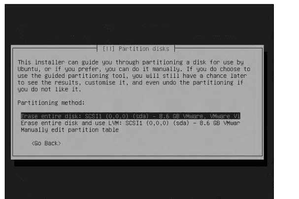

8. 参考你在第 2 章的笔记，选择你想使用的分区选项，然后按回车。

三个主要选项是：“擦除整个磁盘”、“擦除整个磁盘并使用 LVM”以及“手动编辑分区表”。当你擦除整个磁盘时，我建议使用 LVM 选项。由于你可能需要自己编辑分区表，我假设你选择了“手动编辑分区表”选项，因为这是最困难的。

你选择此选项后，会出现第二个“磁盘分区”界面。如果你选择了“擦除整个磁盘”选项，可以直接跳转到第 26 步。

- 9. 如果你需要清理一些空间，选择要删除的分区并按回车。（如果你有足够的空空间，请跳到第 11 步）

出现“编辑分区”界面。你可以通过列表右侧的 FREE SPACE（空空间）发现磁盘上的空区域。

- 10. 选择“删除分区”并按回车。

返回“磁盘分区”界面。如果你还有另一个分区要删除，请返回第 9 步。

- 11. 使用上下方向键选择你想使用的 FREE SPACE（空空间）部分，然后按回车。

- 12. 如果你使用这段空空间来存放 Ubuntu 安装程序，使用上下方向键选择“自动空空间”（Automatically The Free Space），然后按回车。否则，选择“新分区”（New Partition）并按回车。

如果你只有一个正在处理的空空间块，请选择自动选项。如果你专门想查看柱面/头/扇区（Cylinder/Head/Sector）信息，这些信息高级用户可能感兴趣。创建新分区是一个更复杂的任务——如果你使用多个空空间块来创建分区，请选择此项（我将在剩余步骤中介绍如何操作）。如果你让安装程序引导你完成，完成后完成后跳转到第 26 步。

- 13. 在“新分区大小”（New Partition Size）框中指定你想让此分区有多大。

框中的大小是你可以为此分区设置的最大大小。如果你想使用它，请继续下一步。你需要两个分区：一个用于交换空间（swap），一个用于你的文件。交换空间是计算机内存满时的一种特殊虚拟内存。如果你不确定有多少内存 RAM，请将交换空间设置为 2GB——恰好是 2GB。如果你知道，请将交换空间的大小设置为你的 RAM 大小。对于另一个分区，请将其尽可能大。

- 14. 输入交换文件值后，使用 Tab 键移动到“继续”（Continue），并按回车。

出现“分区类型”磁盘分区界面。

- 15. 使用上下方向键选择此分区是主分区（Primary）还是逻辑分区（Logical），然后按回车。

如果你不确定在这里选什么，请选择“逻辑”。这是一个安全的选项。当你按回车后，出现“位置”（磁盘分区）界面。

- 16. 选择“起始”（Beginning）或“结束”（End）并按回车。

选哪一个并不重要。当你按回车后，出现“分区设置”磁盘分区界面。

- 17. 如果你正在创建交换分区，使用上下方向键选择“用作”（Use As）并按回车。否则跳转到第 20 步。

出现“如何”磁盘分区界面。

- 18. 选择“交换区”（Swap Area）并按回车。

返回“分区设置”磁盘分区界面。

- 19. 使用上下方向键选择“完成”（Done）并按回车。

返回“磁盘分区”概述界面，显示你的新交换分区。

- 20. 使用上下方向键选择你想包含剩余文件系统的空空间，并按回车。

出现“如何使用”磁盘分区界面。

- 21. 选择“创建新分区”（Create A New Partition）并按回车。

出现大小磁盘分区界面。

- 22. 你可能想使用所有空间，直接按回车。如果你不想使用所有空间，更改列出的值，然后按回车。

出现类型磁盘分区界面。

- 23. 使用上下方向键选择分区类型，然后按回车。如果这是你想制作的最后一个分区，选择哪种类型都是安全的。同样，如果你不确定，选择“逻辑”。当你按回车后，出现“编辑分区”界面。

- 24. 选择“完成”并按回车。

返回“磁盘分区”界面。

- 25. 选择“完成分区”（Finish Partitioning）和“将更改写入磁盘”（Write Changes To Disk）并按回车。

出现警告界面。

- 26. 检查你的选择，如果满意选“是”（Yes），如果想返回修改则选“否”（No）。然后按回车。

系统设置分区、安装 Linux，然后带你进入时区配置界面。

- 27. 选择你的位置并按回车。

出现“设置用户和密码”界面。

28. 输入你想让主账户使用的真实姓名或昵称（不是管理员账户），然后按回车。

出现“用户名”设置用户和密码界面。

29. 输入你想使用的账户登录并按回车。

出现“密码”设置用户和密码界面。

30. 输入密码并按回车。

出现“确认密码”设置用户和密码界面。

31. 再次输入密码并按回车。

出现最终摘要界面。查看详情后安装开始。

### 84 第一部分：入门

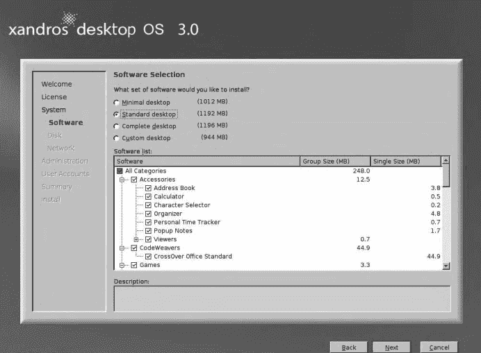

图 4-13：Xandros 3 软件选择界面。

- 6. 选择你想要安装的软件组。

除非你的空间非常紧张，否则你可能会喜欢选择“完整桌面版”（Complete Desktop），因为它提供了所有的软件。如果你想走稳妥的路线，可以先选择“完整”（Complete），然后通过点击勾选标记来移除项目。或者你可以选择“自定义”（Custom）并开始添加它们。当你点击列表中的某项时，会在屏幕底部看到描述。

如果你确实在“服务器”部分选择了“完整”，并从列表中删除了 Apache（Web 服务器）以及 FTP 服务器——除非你非常确定你打算使用 FTP 服务器让别人获取文件。


- 7. 完成软件选择后，点击“下一步”（Next）。

出现“磁盘配置”（Disk Configuration）界面。

- 8. 选择最符合你要求的磁盘配置选项。

方便的是，你可以调整 Windows 分区——甚至是 NTFS。为了与本章的其他章节不同，我假设你有一个用于 Linux 的可用硬盘（带有空空间），并且选择了“接管磁盘或分区”（Take Over Disk Or Partition）。

- 9. 当你准备好继续时，点击“下一步”。

出现“磁盘配置”对话框，如图 4-14 所示。

## 第 4 章：安装其他 Linux 发行版

### 85

xandros 桌面操作系统 3.0

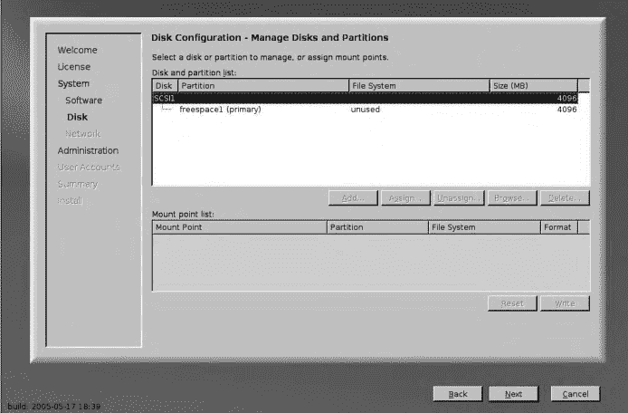

图 4-14：Xandros 3 磁盘配置对话框。

- 10. 如果你想将某个分区让给 Xandros，请点击列表中的该分区。
- 对于整个硬盘，你会看到它们被列为 IDE2、IDE3 等（SCSI1、SCSI2 等）。
- 11. 点击“下一步”继续。
- 出现“磁盘配置摘要”对话框。
- 12. 检查摘要，如果有错，点击“返回”（Back）；如果准备好继续，则点击“下一步”。
- 13. 选择你唯一使用的网络设备。
- 通常，桌面机器只有一个以太卡、调制解器或无线卡。
- 14. 如果你应该使用 DHCP，只需点击“下一步”并跳到第 18 步。否则，点击“编辑”（Edit）。

打开“编辑界面”对话框。

- 15. 如果你使用的是拨号调制解器，选择“不配置网络接口”，点击“确定”，并跳到第 17 步。否则，如果你被告知要使用的 IP 地址，请选择“静态地址”（Static Address）。
- 调制解器设置将在第 8 章介绍。

### 86 第一部分：入门

- 16. 根据 ISP 提供的信息填写“IP 地址”和“子网掩码”字段，然后点击“确定”。
- 17. 点击“下一步”继续安装。

出现“管理配置”对话框。


### 18. 在两个密码文本框中输入你的管理员（`root`）密码。

请参考第 3 章中关于 `root` 账户安全使用的讨论。

### 19. 如果你的电脑必须与 Windows 网络集成，请在“计算机名称”文本框中输入你的网络名称。

你在这里输入的是 `NETBIOS` 名称（如果你熟悉它的话）。遵循对话框中该部分指定的规则。传统上，`NETBIOS` 名称是全大写字母。

### 20. 勾选“创建用户主目录文件夹”（`Make User Home Folders`）复选框。

此功能不仅让每个用户更容易保持数据私密，而且还帮助布局符合红帽（`Red Hat`）在 `Fedora` 中的设计，使得本书的内容更容易让你理解。

### 21. 点击“下一步”继续。

出现“用户账户配置”界面。

### 22. 点击“添加”（`Add`）按钮创建一个普通用户账户。

出现“添加/编辑用户账户”对话框（见图 4-15）。由于你想尽可能避免使用管理员（`root`）账户（见第 3 章），因此这个普通账户是你大部分时间使用的账户。

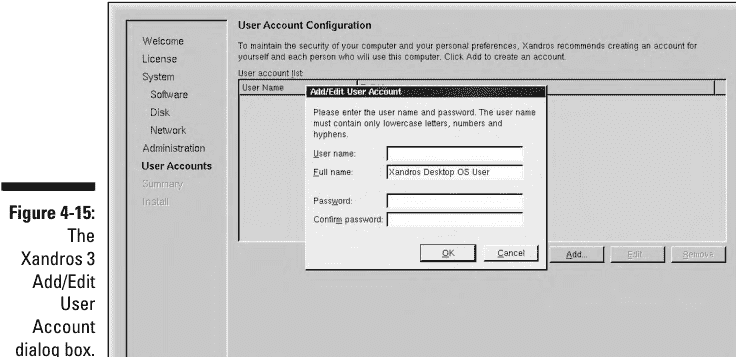

## 第 4 章：安装其他 Linux 发行版

### 23. 在“用户名”框中输入你的登录名。

你的登录名可能是像 `bob` 这样的。

### 24. 在“全名”框中输入你的全名。

这个名字在你的系统中有很多用途；例如，它将出现在你电子邮件的“全名”字段中。

### 25. 在两个文本框中输入你的密码并点击“确定”创建账户。

### 26. 点击“下一步”继续。

出现“安装摘要”对话框。

### 27. 检查摘要。如果一切如常，点击“完成”（`Finish`）。否则，根据需要多次点击“返回”来修复问题——并再次进行到这一步。

到此时，你的名字在电脑上已经更改了。当你点击“完成”时，安装正式开始。完成后，出现“安装完成”对话框。

### 28. 准备好后点击“退出”（`Exit`）。

### 29. 准备好重启到 `Xandros` 时，弹出光驱。

当 `Xandros` 启动界面出现时，点击 `Xandros` 图标进入。

### 30. 如果你已经连接到网络，点击 `Xandros` 图标更新系统。此操作可确保你拥有最新的安全补丁。更新程序是自动的。

- 在“区域设置”下，语言设置是 `Xandros` 提供的。除非你非常确定你打算使用 `FTP` 服务器让别人获取文件。
- 在“字符设置”下，`Xandros` 包含了你选择的字符。关于其他发行版，这里：
- 对于那些热衷于互联网的用户， `Xandros` 包含了 `USB` 耳机。
- 打印机对话框中，对于打印机在“打印机”下，它看起来像 `Windows`、`macOS`、`Linux`（在第 6 章了解更多 `KDE`），或者 `Unix`？系统将如何运行？
- 在“系统行为”下，包括 `Xandros` 默认设置，但尽管可以尝试！


## 88 第一部分：入门

- 在“注册”下，是否立即注册取决于你。你以后也可以注册；但为了获得技术支持必须注册，所以要在遇到问题之前注册。
- 当你到达“完成”界面时，如果你的网络已经连接到互联网，点击 `Xandros` 图标更新系统。

## 第 4 章：安装其他 Linux 发行版

当系统崩溃时，使用 `LiveCD` 重启是一种为自己提供一个“已知良好”（未损坏）系统的方法，以便在修复电脑本身损坏的同时进行。此外，许多可启动的发行版为特定任务提供了高度专业化的环境……但我有点操之过急。

`LiveCD` 和 `LiveDVD` 的速度通常比传统的安装系统要慢。这是因为所有内容都是直接从 `CD` 或 `DVD-ROM` 运行的。

请确保你在需要时可以保存数据。许多流行的 `LiveCD` 都包含一种访问你现有磁盘的方法。你通常可以从启动发行版访问你的硬盘空间，尽管它是否支持 `NTFS` 取决于版本。`Knoppix` 支持 `NTFS`，但最好作为只读模式使用。

如果我使用现场发行版进行工作并需要“保存”时，由于某种原因它无法访问硬盘，或者我第二天不在原来的位置了——我会配置该发行版的邮件客户端，并将工作作为附件通过电子邮件发送给自己。这就是我在写这本书期间，如何从 `Knoppix` 将那些 `NTFS` 化镜像（见第 2 章）传输到我的 `Fedora` 的！

`LiveCD` 和 `LiveDVD` 的另一个流行选择是使用 `USB` 闪盘等便携存储设备。这样，你就可以携带你的密钥和发行版——并同时访问你喜欢的环境和数据。关于存储需要知道的一点是，`Linux` 将这些项目视为 `SCSI` 驱动器，如果你必须手动访问它们（见第 11 章），你将作为 `SCSI` 分区访问它们。例如，如果你将 `USB` 闪盘插入第一个 `SCSI` 插槽，它很可能就是 `/dev/sdb`。

最后，并不是所有的 `LiveCD` 都适用于所有电脑——但如果某一个对你不行，你只需要耸耸肩并下载另一个即可！

如果你正在使用本书附带的 `LiveCD` 或 `DVD`，并且它要求登录密码，它实际上是要求你为本次会话分配密码。只需输入你任何密码即可。

## 寻找更多 Linux

如今有超过 300 种不同的 `Linux` 发行版，每年都有新的发行版诞生（而其他则随着最初热情的消退或资金的匮乏而消失）。这些发行版中许多是通用的，或者至少用途相似（全桌面、尾部服务器等），并向彼此提供相似的软件和支持工具，但配置、文档、GUI 界面、安装程序以及其他功能各不相同。此外，某些通用发行版对某些市场的服务比其他更好，例如，`TurboLinux` 在日本流行，红旗 `Linux` 是中国的官方选择，而 `Conecta` 在西班牙语国家流行。还有更多特殊用途的发行版。`LiveCD` 属于这一类（尽管如此，它们又细分为子类，其中一些（如 `Knoppix`）服务于通用领域，而另一些则被精调为多媒体中心、系统救援环境和其他酷炫的特殊任务）。要深入研究许多全功能发行版，请查看 `DistroWatch` (`www.distrowatch.com`) 以节省你翻阅 300 多种发行版的时间。如果你在这里没有找到足够的选择，可以去这个 `LiveCDs` 网站，或者访问 `www.frozentech.com/content/livecd.php`。


如果你不想下载并刻录所有东西——而且恰恰也不认识任何热心的 `Linux` 极客——你可能想寻找当地的 `Linux` 用户组（`LUG`）。你可以在 `GLUE` (`Groups of Linux Users Everybody`) 网站 `www.ssc.com:8080/groups` 上按地理区域找到全球 `LUG` 列表。这些人总是乐于帮助技术上遇到困难的人。这些用户组还赞助名为“演示日”（demo days）或“安装节”（install-fests）的活动，你可以带着电脑获得所需的所有帮助。这些活动对于计算机爱好者来说非常有趣——热咖啡、冷咖啡，以及足够处理电脑任何事情的知识。

## 第 5 章

## 启动与停止 Linux

**在本章中**

- *理解当你开启 Linux 电脑时发生了什么*
- 识别并隔离启动问题
- 安全关机
- 从你的电脑上卸载 Linux

> *“我喜欢工作；它令我着迷。我可以坐着眼睛看它好几个小时。”*
> —— Jerome K. Jerome

如果你是从第 3 章或第 4 章来到这里的，你可能刚刚度过了 `Linux` 世界的第一场磨炼：安装操作系统。我希望第一次启动成功了。如果成功了，而且你决定本章的大部分内容不适合你，至少跳到本章末尾附近的章节，“不要关闭电脑！否则，如果你对你的电脑在启动时做什么感兴趣（本章可能会变得非常专业），请继续读下去。

你的 `Linux` 安装无法正常启动并不意味着紧急。本章的大部分内容旨在帮助你解决可能遇到的任何问题。在选择 `Linux` 之前，请记住安装操作系统并不是一项轻的任务——而且由于此类安装涉及许多技术变量，许多电脑制造商坚持为你完成这项任务。（你上一次自己安装 `Windows` 是什么时候的事？惠尔·百事、戴尔和沃尔玛（信不信由）一直一直提供预装了 `Linux` 的电脑，所以如果你在此刻感到非常沮丧，或者因为提前阅读而太紧张而不敢尝试，你可以使用 `Knoppix`（见第 4 章了解如何在不安装的情况下使用 `Knoppix`），或从供应商或本地电脑组装商处购买预装机器。）

要解开无法启动的 `Linux` 系统的谜团，需要对电脑如何启动有一定的了解。至少，能够告诉维修人员问题似乎在哪里可以让你感到不那么畏惧——甚至可以为你节省一些钱，因为加快了你的排故障速度。

## 让 Linux 启动

让我们面对现实：尽管盯着休眠的电脑很有趣，但真正的乐趣在你开启电脑时才开始。对于任何电子设备，开启电子流是第一步。在 `BIOS` 通过成功的 `POST`（开电自检）后，`BIOS` 定位你系统中的第一块硬盘并读取磁盘的第一个扇区，这通常被称为 `MBR`（主引导记录）。引导加载程序执行后续步骤。

### 第 1 步：开电自检 (`POST`) 引导 `BIOS`

`POST` 失败的一些症状包括：

- 一系列不寻的长短哔哔声
- 显示器上什么都没有显示
- 除了风扇转动声外没有其他明显活动
- 电脑箱冒出一股烟或电子元件的刺鼻味
- 显示器上显示指示硬件故障的错误消息


如果你遇到这些问题中的任何一个，说明你在开始安装 Linux 之前需要解决硬件故障，问题通常不是由安装新操作系统引起的；它们更多是电脑本身的 {。好消息是，如果你能进入 BIOS，问题可能比在进入 BIOS 之前就故障更容易修复。

### 第 2 步：BIOS 将接力棒交给引导加载程序

在 BIOS 通过成功的 POST 后，BIOS 定位你系统中的第一块硬盘并读取磁盘的第一个扇区。在那个第一个磁盘块上，有一个被称为引导加载程序的程序。引导加载程序执行

# 94 第一部分：入门

除了不知道如何加载你的操作系统之外，对任何事情都无所知。

有两个引导加载器程序了解如何加载 Linux 操作系统：`LILO`（Linux 加载器）和 `GRUB`（大统一引导加载器）。自从 Linux 还是极客眼中一个闪光之现以来，`LILO` 一直是一个经过考验的引导加载器；而 `GRUB` 则很新——而且复杂得多。许多发行版允许你选择自己的引导加载器。通常，大多数人只使用默认设置，对于我在书中讨论的六个发行版，它们的默认设置如下（不包括 Knoppix，因为它直接从 CD-ROM 或 DVD-ROM 驱动器启动）：

| 发行版 | 默认引导加载器 |
|---|---|
| Fedora Core | `GRUB` |
| Linspire | `GRUB`，在其上方有自己的特殊例程 |
| Mandriva | `LILO` |
| SuSE | `GRUB` |
| Xandros | `LILO`，在其上方有自己的特殊例程 |
| Ubuntu | `GRUB` |

有时你的引导加载器可能会出现“坏事”。引导加载器问题的常见症状之一是显示找不到操作系统的消息。另一个提示问题出在引导加载器的线索是，你从未见过引导菜单，引导菜单是启动过程中出现的一个屏幕，让你让你选择要启动哪种操作系统和版本。

引导菜单在不同的发行版之间看起来会有不同。

如果你怀疑是引导加载器问题，请参阅本章后半部分的“进入救援模式”。


# 第 3 步：引导加载器（LILO 或 GRUB）将系统内核加载到内存中

每台计算机（以及电子设备）都需要操作系统来运行。这种操作系统的技术术语，或者至少是它的内核，被称为内核。如果说内核是你的主人，协调计算机的所有组件并以逻辑且合作的方式分配资源，那么引导加载器就是大师到达时的红地毯。

# 第 5 章：启动和停止 Linux


如今许多 Linux 发行版实际上在内核加载和系统初始化阶段（内核完成后，即启动过程结束时）会显示图形化进度屏幕。如果你想看到发生了什么，通常可以点击一个图标或按一个键。只需寻找如何“查看详情”的说明即可。（并不是所有发行版都提供此功能，所以如果你没有找到这种方法，请不要慌。）

如果可用，观察滚动的文本是否出现以下症状之一：

- 系统冻结。
- 监控器顶部出现点号，然后系统冻结。
- 屏幕上出现一条消息，最后的消息是 kernel panic（内核恐）。
- 系统自动重启。

引导加载器将控制权交给内核。你知道内核正在加载，是因为你开始看到像像这样的疯狂文本：

```
Uncompressing Linux... OK, booting the kernel.
audit(1092566112,337:0): initialized
```

从内核故障中恢复（除上一节描述的令人可怕的找不到操作系统外）是 Linux 中更有挑战性的问题之一。遗憾的是，这项任务并不适合心软之士。另一方面，失败的内核可能是一个更新后的版本；如果你在引导菜单中有多个 Linux 选项，查看每个选项的数字并选择最新的。这样你就可以启动到上一个运行的内核并（至少）拥有一个运行系统。

你可以打开 `www.google.com` 搜索特定的错误消息，或者等待下次内核更新发布并忽略那个坏掉的。如果你的光盘安装无法启动，请查看发行版的支持。如果这是问题，我建议查看第 13 章。通过查阅发行版的文档和在线论坛可以找到帮助提示。如果需要重新安装，请查看第 21 章。在安装过程中出现问题，重新安装可以修复它。

# 96 第一部分：入门

# 第 4 步：控制权移交给 init

内核加载完成后，它将启动过程交给 `init`。`init` 程序负责启动所有服务。如果在引导菜单中看到这些选项，说明内核已经加载。

在由于问题，由于 `init` 启动时，你可以看到这些行。

`init` 的主要问题通常是因为配置错误或不支持的硬件程序。由于这些服务需要等待。

在启动过程中，由于服务出现问题。如果由于这个问题无法启动，请查看下一章节。


## 进入救援模式

强力系统修复通常在救援模式下进行。这种模式的好处是它在内存中。缺点是命令行界面。你可以通过查看内核留下的错误消息获得帮助。


`Knoppix` 用于系统救援非常受欢迎，因为它是一个光光。（有关实时光盘和 DVD，请参见第 4 章。）有关如何使用 `Knoppix`。

# 第 5 章：启动和停止 Linux

几乎每个 Linux 发行版都包含救援模式。`Fedora` 是我唯一有空间逐步介绍的，但至少这里有一个如何在发行版中找到救援模式的快速参考：

## 进入救援模式（快速指南）

- Linspire：CD 包含救援模式，如果你能进入那里，引导菜单中也有一个可用。对于 CD，当安装程序启动时，使用方向键选择高级选项，按回车，然后使用方向键导航到运行诊断，按回车。
- Fedora：随书提供的 DVD、下载的 DVD 或首次安装 CD 包含一个救援模式，你可以在安装程序提示符处输入 `rescue` 进入。
- Mandriva：第一个 CD 或 DVD 包含救援模式。当安装程序启动时，按 `F1` 访问命令行提示，输入 `rescue`。
- SuSE：如果你获得了 OpenSUSE 或购买了完整版，DVD 或首次安装 CD 包含 Rescue 选项。使用方向键选中此选项并按回车。
- Ubuntu：CD 包含救援模式。当安装程序启动时，按 `F1` 访问命令行提示，输入 `rescue`，然后按回车。
- Xandros：CD 包含救援模式。当安装程序启动时，按 `Shift` 键。这将打开一个菜单列表。使用方向键选择 Rescue Console，然后按回车。


# 第 5 章：Linux 的启动与停止

如果你习惯了 Windows 98，你需要调整一下观念：完成后不要直接切电源。其一，许多用户在不使用电脑时会让它保持运行——他们只是注销账户以防止别人乱动他们的东西——并且（哦，对了）关闭显示器，因为它的耗电很大。

当你决定关闭 Linux 机器时，无论出于什么原因，都必须有序地关闭计算机。你可以使用以下方法之一来正确关闭 Linux：

- 如果你在 GUI 中，使用主菜单中的“注销”（Log Out）退出账户——Fedora Core 用户可以在“系统：关机”（System: Shut Down）找到它——然后点击显示（奇怪的是）“关机”（Shut Down）的对话框。
- 如果你打开了命令提示符，在 shell 提示符 (#) 后输入 `halt` 命令并输入根密码；当你按下回车时，Linux 就会关闭并告诉你何时可以安全关闭机器。
- 如果你打开了命令提示符，输入 `reboot` 命令；当你按下回车时，Linux 会执行关机程序，然后立即重启机器。
- 如果你打开了命令提示符，输入 `shutdown -f now`（并按下回车）是最传统且接受的方法。`shutdown` 命令可选允许你向用户发送消息，并确定关机发生所需的时间。另一种方法是使用 `poweroff` 命令，它只是前面提到的 `halt` 命令的别名。

如果你不小心切断了 Linux 盒的电源，请小心；一切并非无可挽回。大多数情况下，你可以重启电脑并从离开的地方继续。然而，在机器进行快速文件系统检查以确保没有东西受损的等待期间，你可能需要为你的错误付出代价。这个过程与 Windows 在不不关机时使用的过程类似。操作系统可能需要扫描硬盘以确保一切正常。

如果你饱受短暂断电或电压尖峰导致电脑重启的困扰，请考虑为电脑买一台 UPS（不间断电源）。这些沉重的可充电电池不仅旨在保护你的电脑免受损坏（阅读包装说明……），还能提供额外的五分钟或更长的电源，这样在停电时你就有机会正常关闭文件并关闭机器。此外，对于那些非常短暂的尖峰，


# 100 第一部分：入门

如果你安装了 UPS，你必须面对的不便是听着它发出哔哔声进行抱怨。尖峰完全不会影响你的电脑！

# 从系统中移除 Linux

尽管我不得不看到你离开 Linux 世界，但如果你不想使用它，我也不希望你被困在 Linux 中！最容易移除 Linux 的方法取决于你想做什么：


- 如果你想用 Windows 替换 Linux，只需在机器上安装 Windows。它将覆盖所有的 Linux 内容，包括启动菜单。

- 如果你想从双启动设置中移除 Linux，请进入 Windows，访问命令提示符并输入 `fdisk /mbr`。此操作会移除 Linux 引导加载程序。它不会删除 Linux，但随后你可以为 Windows 格式化 Linux 驱动器或分区。


Windows XP 和 Xandros 用户有一个可以使用特殊命令来移除此发行版。通过将 Windows XP CD-盘放入恢复控制来启动机器。切换到 Windows 目录，在命令提示符输入 `fixmbr`，然后按下回车。

## 第 6 章

## 查看这些桌面

**本章内容**

- 选择合适的界面
- 利用命令行
- 进入 GNOME 基础
- 考虑 KDE 基础
- 在 GNOME 和 KDE 之间切换

> 公交站是汽车停止的地方。
> 火车站是火车停止的地方。
> 在我的桌子上，我有一个工作站 ....
> Steven Wright

许多人喜欢将 Linux 描述为一个类 DOS 的环境，你所能做的只是在这个古老感的世界里操作，你必须输入许多晦涩的内容，而没有任何漂亮的图片。然而，正如你在本章中所看到的，Linux 桌面为你提供了一个良好的工作环境。酷的地方在于，它的大部分内容都是可配置的。喜欢自定义系统的人可以在更改设置时获得极大的乐趣。

### 决定使用哪种界面

Linux 有两种类型的界面：命令行界面 `CLI` 和图形用户界面 `GUI`。如果你使用其他计算机系统（如 Windows 或 Macintosh），你已经熟悉了 GUI，它有图片可以看，图标可以点击。大多数 Linux 发行版都包含了 Linux 世界中两种主要的 GUI 的版本 `GNOME` 和 `KDE`。

#### 102 第一部分：入门

如果你使用电脑已经很长时间，你可能也熟悉命令行界面，它通常由一个只显示平行排列白色文本的黑屏幕组成。Linux 的初始发布和早期开发也是以命令行为导的；GUI 随后作为锦上添花出现，使得对于那些倾向于点击而不是输入的人来说变得更好用。

在命令行和 GUI 之间选择时，你需要考虑许多因素。对于许多人来说，这个决定是显而易见的。他们不想离开 GUI。这没关系，但至少你可能想了解底层的原理。你的 GUI 可能会崩溃并让你回到登录提示符！

在命令行界面和 GUI 之间选择时，速度是一个重要因素。记住，如果你是一个需要编译程序的程序员或者是一个需要运行计算软件的科学家，GUI 会减慢你的系统。此外，当将 Linux 作为服务器时，你通常必须关闭 GUI，因为所有图片大多浪费内存和处理速度——毕竟，大多数情况下，

## 第 6 章：查看这些桌面

### 103

如果你使用电脑已经很长时间，你可能也熟悉命令行界面，它通常由一个只显示平行排列白色文本的黑屏幕组成。Linux 的初始发布和早期开发也是以命令行为主的；GUI 随后作为锦上添花出现，使得对于那些倾向于点击而不是输入的人来说变得更好用。

在命令行和 GUI 之间选择时，你需要考虑许多因素。对于许多人来说，这个决定是显而易见的。他们不想离开 GUI。这没关系，但至少你可能想了解底层的原理。你的 GUI 可能会崩溃并让你回到登录提示符！

在命令行界面和 GUI 之间选择时，速度是一个重要因素。记住，如果你是一个需要编译程序的程序员或者是一个需要运行计算软件的科学家，GUI 会减慢你的系统。此外，当将 Linux 作为服务器时，你通常必须关闭 GUI，因为所有图片大多浪费内存和处理速度——毕竟，大多数情况下，酷的地方在于，它的大部分都是可配置的。喜欢自定义系统的人可以在更改设置时获得极大的乐趣。

### 决定使用哪种界面

Linux 有两种类型的界面：命令行界面 `CLI` 和图形用户界面 `GUI`。如果你使用其他计算机系统（如 Windows 或 Macintosh），你已经熟悉了 GUI，它有图片可以看，图标可以点击。大多数 Linux 发行版都包含了 Linux 世界中两种主要的 GUI `GNOME` 和 `KDE`。

如果你使用电脑已经很长时间，你可能也熟悉命令行界面，它通常由一个只显示平行排列白色文本的黑屏幕组成。Linux 的初始发布和早期开发也是以命令行为主的；GUI 随后作为锦上添花出现，使得对于那些倾向于点击而不是输入的人来说变得更好用。

在命令行和 GUI 之间选择时，你需要考虑许多因素。对于许多人来说，这个决定是显而易见的。他们不想离开 GUI。这没关系，但至少你可能想了解底层的原理。你的 GUI 可能会崩溃并让你回到登录提示符！

在命令行界面和 GUI 之间选择时，速度是一个重要因素。记住，如果你是一个需要编译程序的程序员或者是一个需要运行计算软件的科学家，GUI 会减慢你的系统。此外，当将 Linux 作为服务器时，你通常必须关闭 GUI，因为所有图片大多浪费内存和处理速度——毕竟，大多数情况下，

### 充分利用命令行

Linux 命令行界面提供了一种快速、高效的方法来输入命令和执行操作。即使你主要是“GUI 用户”，在习惯了使用命令行后，你会发现通过命令行执行任务更快。然而，如果你倾向于使用 GUI 界面作为工作环境，你可以轻松打开一个终端窗口，这是一个命令提示符窗口，来执行命令驱动的任务，而无需完全离开点击环境。

使用命令行界面有一些你可能会觉得有趣的事情。Linux 命令与其他界面命令如 Windows `MS-DOS` 提示符的一个区别是，Linux 命令是区分大小写的。输入 `ls` 实际上会报错，因为没有 `LS` 命令。Linux 命令行还有自动补全功能。如果你知道命令或文件名的几个字符，输入部分并按下 `Tab` 键即可完成剩余。例如，如果你正尝试使用 `less` 查看文件 `/home/bob/grocery_list` 的内容，你可以输入 `less /bob/gro` 并按下 `Tab` 来查找并完成文件名。然而，如果你还有一个子目录 ` `/home/bob/group_projects``，你会听到哔哔声。你可以再次按下 `Tab` 键并双击鼠标来查看输出：

| grocery_list | group_projects |

酷的地方在于，命令提示符在这些这些项后已经有了 `less gro` 文本，所以你不需要重新输入！你可以看到输入一个 `c` 就清楚了你指的是 `grocery` 而不是 `group`，只需添加一个 `c` 变成 `less groc` 并按下 `Tab` 键完成。

#### 104 第一部分：入门基础

自动补全。这种技术可以节省你大量的输入时间，尤其是当文件名非常长时！

大多数 Linux 发行版还会保留最近使用的命令的运行历史。要使用此列表，请按键盘上的向上方向键。此操作会调出你输入的上一条命令。当你继续按向上方向键时，会从新到旧的顺序遍历最近输入的命令。如果你不小心跳过了想要的命令，使用向下方向键返回。当命令出现在命令提示符处时，按回车键执行该命令，或者对其进行编辑后再按回车键。

在第 14 章中，我将更详细地介绍命令行环境。

当你安装 Linux 时，默认添加了图形化登录界面。这对于书中讨论的所有版本都适用。某些版本提供选择图形化登录或命令行登录的选项，这可能会给不小心选了命令行选项的人带来很多困惑。如果你执行了这样做或者你认为自己执行了，并且在机器启动后发现自己不知所措，请参第 20 章。


### GNOME 基础

`GNOME` 代表 `GNU Network Object Model Environment`——尽管这个缩写并不能告诉你它意味着什么！简单来说，`GNOME` 是一个完整的图形化环境。Fedora、SuSE 和 Ubuntu 都使用类似版本的 `GNOME`，因此我将重点关注 Fedora，但会尝试指出它们之间的差异。Mandriva 是书中包含的唯一也包含 `GNOME` 的发行版，但它的版本也相似。图 6-1 显示了你登录 Fedora 系统后看到的内容。

要了解 `GNOME`，请访问 `GNOME` 网站 `www.gnome.org`。请记住，你拥有的程序取决于你选择的安装类型以及你所做的自定义；如果你拥有的与描述中看到的不同，不要惊慌！`GNOME` 桌面环境分为四个部分：

- 菜单
- 桌面顶部的菜单与图标面板
- 桌面底部的桌面面板
- 桌面上的图标


## 第 6 章：查看桌面

### 105

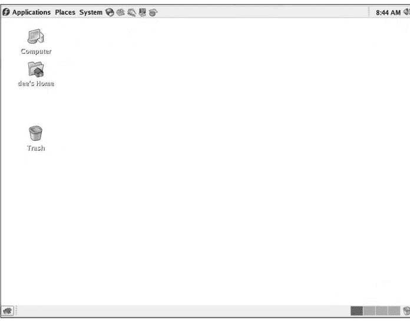

图 6-1：Fedora 中的默认 `GNOME` 桌面。

### 菜单

`GNOME` 有三个主菜单，它们在顶部面板上均可见。从左到右，它们是：

- `应用程序` `Applications`：通过 GUI 提供的所有程序 `Fedora` 和 `Ubuntu` 请见表 6-1。


- **位置 (Places)：** 通向硬盘上各个位置的快捷方式（Fedora、SuSE 和 Ubuntu 请见表 6-2）。
- **系统或桌面 (System or Desktop)：** 个人和系统设置，以及更通用的命令（Fedora 请见表 6-3）。

右侧带有箭头的菜单项提供子菜单，你可以通过将鼠标悬停在其上打开，从而提供更多程序。SuSE 和 Ubuntu 的菜单包含的列表略有不同，但提供的内容大部分相同。


# 第一部分：入门基础

| 表 6-1 | Fedora 和 Ubuntu：应用程序菜单内容，按出现顺序列表 |
| :--- | :--- |
| 菜单选择 | 你会发现 |
| 辅助工具 (Accessories) | 较小、特定的 GNOME 程序。包含计算器、字符映射表、字典、文本编辑器等 |
| 游戏 (Games) | 游戏集合 |
| 图形 (Graphics) | 各种图形处理程序，包括 GIMP |
| 互联网 (Internet) | 几个互联网工具，如 Evolution（电子邮件和日历）、Evolution（即时通讯）和 Firefox（Web 浏览器） |
| 办公 (Office) | OpenOffice.org 应用程序套（文字处理、绘图等） |
| 音频与视频 (Sound & Video) | 程序，如 CD 播放器和录音器，用于处理电脑的多媒体 |
| 系统工具 (System Tools) | 许多用于管理、监控和更新系统的工具，例如文件浏览器和软件更新程序 |
| 添加/删除软件或添加应用程序 | （仅限 Fedora 和 Ubuntu。）打开应用程序安装和卸载实用 |

| 表 6-2 | Fedora、SuSE 和 Ubuntu：位置菜单内容，按出现顺序列表 |
| :--- | :--- |
| 菜单选择 | 你会发现 |
| 主目录 (Home Folder) | 用户主目录的内容，详见第 1 章和第 11 章讨论 |
| 桌面 (Desktop) | 用户桌面目录的内容，包含应该出现在你桌面上的文件和文件夹 |
| 计算机 (Computer) | 系统上可用的硬盘和临时介质。 |
| 软盘 (Floppy) | （仅限 SuSE）插入电脑软盘驱动器时的软盘快捷方式。 |
| CD/DVD 刻录器 (CD/DVD Creator) | （仅限 Fedora）GNOME 特殊文件夹，用于存放你想要刻录到 CD 或 DVD 的文件。 |

# 第 6 章：查看这些桌面

| 菜单选择 | 你会发现 |
| :--- | :--- |
| 网络服务器 (Network Servers) | 网络上可用的计算机和硬盘。 |
| 连接到服务器 (Connect To Server) | 用于连接不同类型服务器的工具。 |
| 搜索 (Search) | 文件系统搜索工具。 |
| 最近文档 (Recent Documents) | 你最近使用的文档。 |

| 表 6-3 | Fedora：系统菜单内容，按出现顺序列表 |
| :--- | :--- |
| 菜单选择 | 你会发现 |
| 偏好 (Preferences) | 你的个人设置。 |
| 系统设置或管理 | 系统级设置。 |
| 帮助 (Help) | GNOME 帮助工具。 |
| 关于 GNOME | 关于 GNOME 信息。 |
| 关于 Fedora | 关于 Fedora 信息。 |
| 锁定屏幕 (Lock Screen) | 设置机器无需输入密码即可使用 GNOME 登录的能力。 |
| 注销用户 (Log Out user) | （仅限 Fedora，其他发行版中此选项可能是下方的关机选择。）退出当前登录会 |
| 关机 (Shut Down) | 挂（进入睡眠/休眠模式）、重启或关闭机器。 |

## 锁定屏幕工具

如果你开启了屏幕并从主菜单选择锁定屏幕选项，你的屏幕会显示或淡变为黑色。然后如果任何人移动鼠标或使用键盘，就会出现一个带有登录名称和密码字段的对话框。你可以通过输入密码恢复工作。在此之前，你可以放心地知道，没人可以玩弄你的电脑并假装成你给老板发一封玩笑邮件。请注意，如果你以 `root` 用户身份登录，锁定屏幕选项将

# 第一部分：入门基础

此功能在 Fedora 中默认开启的。要在发行版中更改此功能或其行为，GNOME 默认路径如下：

- Fedora：选择系统-偏好-屏幕保护。
- SUSE：选择桌面-GNOME 控制中心-屏幕保护。
- Ubuntu：选择系统-偏好-屏幕保护。

进入相同的菜单可以让你关闭此功能，或者更改它在锁定屏幕之前等待的时间。


## 第6 章：检查这些桌面

这些选项具有以下功能：

- 注销 (Log Out)：关闭 GNOME 并返回登录提示。
- 关机 (Shut Down)：关闭机器并电源。
- 重启电脑 (Restart The Computer)：关闭机器然后重新启动。

如果你想让电脑进入睡眠模式，有时会有“挂起/休眠 (Suspend/Hibernate The Computer)”选项。

- 点击“确定 (OK)”确认您的选择，如果改变主意则点击“取消 (Cancel)”。

## 面板

你的 GNOME 桌面的顶部和底部有两个面板。由于这些栏被整齐地划分为若干区域，请从顶部面板开始，从左到右查看每个区域包含的内容。在顶部面板的最左侧是本章之前“菜单”部分讨论过的三个菜单。

当你继续你的旅程时，你会遇到一组图标（参见图 6-1）。你可以通过主菜单访问所有项目，但将它们放在面板上是为了方便查找。在 Fedora 中，这些图标是：

- Firefox：点击带有鼠标指针的地球图标可打开 Firefox Web 浏览器。（更多信息请参阅第 9 章。）
- Evolution：位于 Web 浏览器正右侧；启动电子邮件和日历程序。（更多信息请参阅第 9 章。）
- OpenOffice.org Writer：看起来像两张纸（和一支笔），打开 OpenOffice.org 文字处理程序。（更多信息请参阅第 17 章。）
- OpenOffice.org Impress：打开 OpenOffice.org Impress 演示文程序。（更多信息请参阅第 17 章。）
- OpenOffice.org Calc：打开 OpenOffice.org 表格程序。（更多信息请参阅第 17 章。）

然后你会看到一个巨大的空白区域，你可以在那里添加新图标。在 Fedora 中，空白区域之后，从左到右你会发现这些——尽管你的特定安装可能会显示额外的选项：

- 日期和时间组件 (Date and Time applet)：在这里你可以看到日期时间，取决于该组件的配置。
- 主音量控制组件 (Master Volume Control applet)：点击打开主音量控制。

现在看底部面板。从左到右，你在 Fedora 和 Ubuntu 的此面板中发现：

- 隐藏/恢复桌面应用程序 (Hide/Restore Desktop Applications)：此按钮让你立即最小化所有运行中的程序，然后只需点击即可重新打开它们。
- 任务栏 (Taskbar)：在这个大空间中，你可以找到桌面上运行的每个程序的条目。你可以按照指示使用框来更改程序状态：
    - 如果程序被最小化，可以通过点击其任务框来打开窗口。
    - 如果程序已最大化但埋在另一个程序之下，点击面板上的上的任务框将其置于顶层。
    - 如果程序已最大化并处于最上方，你可以通过点击其任务框将其最小化。
- 工作空间 (Workspace)：允许你在单个登录会话期间在四个不同的桌面环境中工作。每个桌面环境都有相同的菜单、面板和背景，但你可以在每个环境中运行不同的程序。这是一种在处理多个程序时保持井井有序的简单方法。尝试一下吧。这就像在一个显示器上有四个显示器！
- 垃圾桶 (Trash Can)：指向桌面垃圾桶的快捷方式。

SuSE 和 Ubuntu 有类似的布局，尽管它们提供的图标略有不同。

想将程序从一个工作空间窗口移动到另一个吗？点击程序左上角的小箭头或图标，并选择以下选项之一：


- 始终在可见工作空间 (Always On Visible Workspace)：让窗口在所有四个空间都显示。
- 移动到右侧工作空间 (Move To Workplace Right)：将窗口向右滑动进入“下一个工作空间”。
- 移动到另一个工作空间 (Move To Another Workplace)：让你指定工作空间 1（最左）、2（左侧第二个）、3（从左数第三）或 4（最右）。

## 第6 章：检查那些桌面

你可以通过查看工作空间切换器（Workplace Switcher）并识别与你的桌面布局匹配的小窗口来查看打开的工作空间。


## 更改你的面板

是时候看看如何更改面板的外观。你可以通过面板菜单单独自定义顶部底部面板。你通过在要操作的面板上找到空白空间并右键调出面板上下文菜单来打开此菜单。（此菜单的项目列表请参见表 6-4）

如果你打开的程序太多，占据了整个底部面板的宽度，你可能没有足够的空间可以右键点击。尝试非常精确地移动鼠标来找一个位置。如果不行，你可能需要关闭一两个程序来清理空间。


| 表 6-4 | GNOME 面板菜单内容 |
| :--- | :--- |
| 添加面板 (Add To Panel) | 对话框允许向主面板添加组件、菜单和其他对象 |
| 属性 (Properties) | 设置此面板行为的选项 |
| 删除此面板 (Delete This Panel) | 删除此面板 |
| 新面板 (New Panel) | 创建新面板的选项 |
| 帮助 (Help) | 用于帮助的帮助 |
| 关于面板 (About Panels) | 关于面板的一些信息 |

## 添加到面板 (The Add to Panel)

对话框允许向主面板添加组件、菜单和其他对象。你通过在要操作的面板上找到空白空间并右键调出面板上下文菜单来打开此菜单。（此菜单的项目列表请参见表 6-4）

如果你打开的程序太多，占据了整个底部面板的宽度，你可能没有足够的空间可以右键点击。尝试非常精确地移动鼠标来找一个位置。如果不行，你可能需要关闭一两个程序来清理空间。

（注：此处原文逻辑存在重复或混乱，已根据上下文整理翻译）

### 第6 章：检查这些桌面 109

- 通过右键点击垃圾桶图标并从菜单中选择清空来清空。询问时点击清空。
- 通过选择文件：清空清空整个垃圾桶内容。
- 要从垃圾桶删除单个项目，右键点击上下文菜单并选择从垃圾桶删除。询问确定时点击删除。

你可以通过按住 `Ctrl` 键单独选择不相邻的项目；按住 `Shift` 键选择范围内的项目；左键点击并拖动来收集框中的所有项目。

- 另一种从垃圾桶删除项目的方法是手动从 `~/.Trash` 删除它们


## KDE 基础

KDE 桌面环境是 Knoppix、Linspin、Mandriva 和 Xandros 的默认环境。Fedora 和 SuSE 也包含且它们的 KDE 布局与其他相似。由于你可以直接从随附的 DVD 启动 Knoppix 系统，因此 KDE 部分关注 Knoppix 并指出了与其他发行版的不同之处。

要了解更多关于 KDE 的信息，请访问 KDE 主站 `www.kde.org`。

KDE 桌面环境基本上分为三个部分：


- 菜单
- 屏幕底部的菜单图标面板
- 桌面图标

## 菜单

KDE 有一个主菜单，你可以在面板左侧找到它（图 6-3）。在四个 KDE 发行版中此菜单标记为：

- Knoppix：蓝色背景上的字母 K
- Linspin：启动 (Launch)
- Mandriva：黄色背景
- Xandros：启动 (Launch)

# 114 第一部分：入门指南

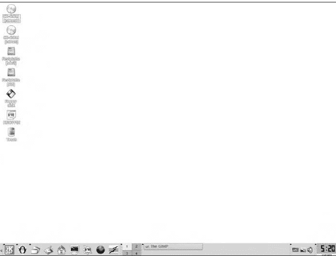

图 6-3：Knoppix 4.0 KDE 桌面。

> 注意
> 右侧带有箭头的菜单项提供子菜单，你可以将鼠标悬停在该菜单选项上打开它。通常情况下，子菜单被分成自己的子菜单，提供更多程序。

每个基于 KDE 的发行版的主菜单都大不相同，但其内容理想应该是相似的。KDE 菜单通常通过水平栏划分不同类型的条目。本节重点介绍 Knoppix 的布局。Knoppix 菜单的顶部是“所有应用程序”，包括：

- 开发：软件开发工具
- 编辑器：各种文本编辑器
- 教育：非游戏的教育程序（DVD 曾包含）
- 教育益智：教育游戏
- 模拟器：用于模拟其他平台的软件
- 游戏：大量游戏
- 图形：图像编辑器

## 第 6 章：查看这些桌面

- 帮助：帮助菜单
- 互联网：互联网相关软件
- KANOTIX：一些配置工具
- Knoppix：Knoppix 特有的菜单
- 多媒体：声音、视频和其他多媒体软件
- 办公：各种办公生产力程序
- 设置：各种系统设置
- 系统：系统和管理工具
- 玩具：愚蠢但有趣的东西
- 实用程序：更有趣的工具
- 丢失：额外工具（仅限 DVD）
- 控制中心：用于桌面配置的 KDE 控制中心
- 查找文件：搜索程序
- 帮助：帮助界面
- 主页：打开你的用户目录的 Konqueror 文件管理器
- 书签：你在网络浏览器中设置的书签
- 快速浏览器：在 Konqueror 中快速打开文件系统中各个地点的快捷方法（见第 11 章）
- 运行：手动启动程序的界面
- 切换用户：切换到不同的用户登录
- 锁定会话：与表 6-3 中的“锁定屏幕”应用程序相同（更多信息请参见本章节前面的“锁定屏幕工具”部分）
- 注销：退出你的账户、重启机器或关机（更多信息请参见本章节前面的“注销工具”部分）

Knoppix 主菜单的第二部分是“操作”，它包含：

## 面板

你的 KDE 桌面的底部有一个面板。由于此栏被整齐地划分为区域，请从左到右查看每个区域的内容。最左侧是主菜单，正如在本章 KDE 部分前面的“菜单”节中讨论的那样。

当你继续向右移动时，你会遇到一组图标（请参见图 6-3）。你可以通过主菜单访问所有这些项目，但它们被放置在面板上，以便你快速方便地找到它们。在 Knoppix 中，从左到右这些图标是：

- Knoppix 企鹅菜单：配置选项。
- 窗口列表：在这里你可以打开和最小化程序窗口。
- 桌面：此按钮让你能够立即最小化所有运行中的程序，然后只需点击即可恢复它们。
- 主页：打开你的用户文件的快捷方式。
- Konsole：一个在窗口中提供终端的程序。
- Firefox：Worldplanet 打开 Firefox 浏览器。（更多信息请参见第 9 章。）
- OpenOffice.org：OpenOffice.org 套件的通用界面，在第 17 章中讨论。

Knoixix 面板上的下一个是工作区切换器，正如本文 GNOME 部分的面板节中讨论的那样。它的右侧是任务栏出现的空白区域。在这里你可以找到桌面上运行的每个程序的条目。你可以按照指示使用方框来更改程序状态：

- 如果程序被最小化，你可以点击其面板任务框来打开其窗口。
- 如果程序已最大化但埋在另一个程序之下，点击面板上的其任务框将此程序带到前面。
- 如果程序已最大化并位于最上方，你可以通过点击其面板任务框将其最小化。

在 Knoppix 桌面工作区切换器的右侧，你会发现：

- 语言切换器：点击旗帜图标可以在支持的语言之间循环切换，或者你可以右键点击它直接访问选项菜单。
- 屏幕尺寸和旋转：点击（或右键点击）此图标可以更改屏幕分辨率和其他显示设置。
- 音量控制：设置音频程序的音量。
- 时间和日期：查看时间和日期，或点击打开日历。

## 更改你的面板

你可以通过面板菜单自定义你的面板。在任务栏中找到空白空间，然后右键点击调出面板的上下文菜单，提供：

- 添加到面板：你可以添加到此面板的项目
- 从面板移除：从面板中移除项目的选项
- 配置面板：更改面板的当前设置
- 帮助：打开关于 KDE 面板的帮助文件


如果你面板上有许多想要删除的图标，右键点击该图标并从菜单中选择“从面板移除”。KDE 菜单包含以下内容：

- 插件：你可以附加的各种小部件
- 应用程序：已有的启动器
- 面板：创建新面板
- 特殊按钮：添加到

## 使用桌面图标

当你想删除文件时，将它们拖入垃圾桶。如果你确定要丢弃它们，右键点击垃圾桶图标并选择“清空桶”来清空所有内容。你可以点击垃圾桶并选择“恢复”将内容放回。

## 在 GNOME 和 KDE 之间切换

当发行版为你提供桌面选择且你又安装了两者时，你通常可以在登录时选择要使用哪一个。在 Fedora、Mandriva 和 SuSE 中，你在登录屏幕上有此选项：

- Fedora：点击登录屏幕上的会话图标将弹出一个对话框，可以在其中选择你想使用的 GUI。
- Mandriva：点击会话类型图标并从会话类型菜单中选择你想使用的 GUI。
- SuSE：点击会话图标并在对话框中选择你想使用的 GUI。当你选择好后，点击确定。

# 120 第一部分：入门指南

## 避免使用 root

`root` 用户（也称为超级用户或直接称为 `root`）拥有访问机器上任何内容和所有东西的权限。没有任何东西可以阻止 `root` 访问目录、文件、命令或设备——因此许多 Linux 初学者认为，既然 `root` 账户如此方便，他们大可以一直使用 `root` 账户。

简而言之，不要这样做。出于许多充分的理由，你不应该在日常使用中使用 `root` 账户：


杀鸡用牛。对于日常任务，你并不总是需要 `root` 级别的权限。

`Root` 级别的权限既是祝福，也是诅咒。如果你以普通用户身份出错，你只会弄坏自己账户里的东西。如果你以 `root` 用户身份出错，你可能会抹掉一切——你整个 Linux 系统上的所有文件！

你不认为自己真的不会抹掉一切吗？许多经验丰富的管理员讲述过恐怖故事，关于他们某天由于致命的拼写错误，或者因为没有注意操作而完全摧毁了一个安装系统。

`Root` 会让你看起来像个无知的吹牛者。如果除了处理严重的管理事务之外，你以 `root` 身份发送电子邮件或发布帖子，人们会认为你不知道自己在做什么，或者认为你在炫耀。

`Root` 伴随着太多的诱惑。超级用户可以读取他人的电子邮件和文件，这涉及了一些“细微”的伦理问题。

Linuxspur 有一种略有不同的哲学。在默认情况下，当你使用 Linuxspur 时，你只有一个账户，我强烈建议这样做。在下一节中，我将向你展示如何在本书涵盖的发行版中创建新账户，这样你就不需要在日常工作中使用 `root` 了。或者，更糟糕的是，让借用你电脑的人在 `root` 身份下上网（这是一个坏主意，听我的！）。

## 创建用户账户

大多数 Linux 发行版都包含用于创建和管理用户账户的图形界面。以下是为你的发行版找到该应用程序的方法：

- Fedora Core: 选择 `System-Administration-Users And Groups`（系统管理-用户和组）打开用户管理器。
- Knoppix: 从主菜单选择 `System-User`（系统用户）打开 KDE 用户管理器。然而，如果你不打算长期使用 Knoppix，就没有必要。默认情况下，你以用户 `knoppix` 的身份使用它。
- Linspace: 选择 `Launch-Settings-Additional Options-User Manager`（启动-设置-其他选项-用户管理器）打开 KDE 用户管理器。完成此后，你可以在图形登录提示处选择不同的用户登录。默认情况下，Linspace 将你作为 `root` 用户。
- Mandriva: 从主菜单选择 `System-Configuration-Other User Administration`（系统配置-其他用户管理）打开用户工具。
- SuSE: 选择 `Desktop-YAST`（桌面-YAST）打开 YAST。（更多 YAST 信息请参见后续章节“SUSE 工具”）。在左侧选择 `Security and Users`（安全与用户）。在右侧选择 `User Management`（用户管理）打开用户组管理对话框。
- Ubuntu: 选择 `System-Administration-Users and Groups`（系统管理-用户和组）打开用户管理器。
- Xandros: 选择 `Launch-Control Center`（启动中心）打开 Xandros 控制中心。在这里，点击 `System Administration`（系统管理）旁边的加号展开菜单，然后点击 `User Manager`（用户管理器）打开用户工具。

虽然这些工具在不同的发行版之间并不完全相同，但它们非常相似——而且方式基本相同。毕竟，每个应用程序创建用户账户都有相当标准的步骤。我将引导你如何在 Fedora Core 中创建用户账户，在其他地方大部分步骤也一样。

在 Fedora 中创建新用户账户，请遵循以下步骤：

1. 选择 `System-Administration-Users And Groups`。

由于你（希望是）正在使用普通用户账户，会出现 `Password for root`（root 密码）对话框。

2. 输入 `root` 密码并点击 `OK`。

用户管理器窗口打开，如图 7-1 所示。当应用程序打开时，你在安装期间创建的用户账户已经显示在其中。

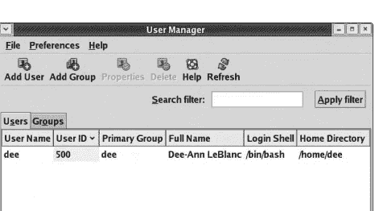

图 7-1: Fedora Core 5 中的用户管理器应用程序。

3. 点击 `Add User`（添加用户）。

创建用户对话框打开，如图 7-2 所示。


图 7-2: Fedora Core 5 中的创建用户对话框。

4. 为新用户输入名称。
5. 为新用户输入密码。
6. 重新输入密码以确认。
7. 点击 `OK`。

用户管理器窗口更新，你的新用户账户现在列在其中。你现在可以配置用户的设置了。

## 第 7 章：配置 Linux

### 在 Linux 中打印

在这一节中，我将描述如何设置打印机——由于空间限制，仅针对 Fedora 进行。虽然每个应用程序都不同，但它们都涉及相同的配置基本步骤，尽管这些步骤的顺序可能不同，或者措述略有不同。请按照 Fedora 的步骤操作（如果你正在使用其他发行版，请阅读此处并根据你发现的信息通过适当的工具设置打印）：

- Fedora: 选择 `System-Administration-Printing`（系统管理-打印）。
- Knoppix: 从主菜单选择 `Knoppix:Configure`，双击打开工具。
- Linspur: 双击桌面图标打开 `Printers`（打印机）工具，然后点击 `Add`（添加）打开打印机向导。
- Mandriva: 从主菜单选择 `System-Configuration:Configure`（系统配置:配置），点击 `Hardware`（硬件）然后点击 `Set The Printer`（设置打印机）。
- SuSE: `Desktop:YaST`（桌面:YaST）打开工具。在这里，在左侧选择 `Hardware`（硬件），然后在右侧选择 `Printer`（打印机）。
- Ubuntu: 选择 `System-Administration-Printing`（系统管理-打印）。
- Xandros: 选择 `Launcher:Control Center`（启动:控制中心）展开菜单，然后选择 `Printers`（打印机）。点击 `Add`（添加）打开打印机向导对话框。

要访问打印设置工具，选择 `System-Administration-Printing`。

出现打印配置窗口，如图 7-3 所示。如果你没有以 `root` 身份登录，系统会提示你输入 `root` 密码。

图 7-3: 打印配置工具的打开窗口。

2. 要开始设置打印机，请点击 `New`（新建）按钮。

出现“添加新打印队列”窗口。点击 `Forward`（前进）按钮进入下一步。

3. 在“队列名称”窗口中，输入您想要分配给此特定打印机的名称。

如果您有多个打印机，请在“短描述”框中添加一些内容，以便日后区分它们。

4. 完成后，点击 `Forward`（前进）按钮进入下一步。

出现“队列类型”对话框，如图 7-4 所示。

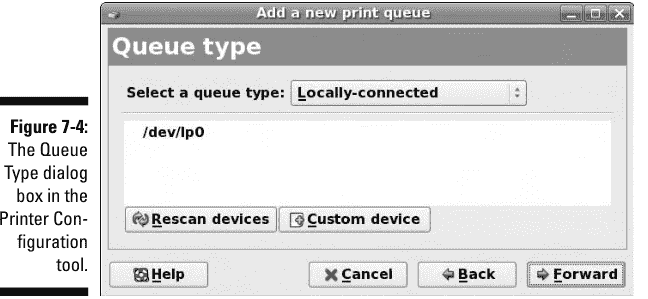

5. 使用下拉列表选择您需要的队列类型。

队列类型对应于打印机的连接方式：

- 如果打印机直接连接到您的 Linux 系统，选择 `Locally-Connected`。
- 如果您的打印机是理解互联网打印协议（IPP）并通过网络连接到另一台 Unix 机器（包括 Linux 和 OS X），选择 `IPP`。
- 如果您的打印机连接到使用 `LPD` 的另一台 Unix 机器，选择 `LPD`。
- 如果打印机连接到网络上的 Windows 机器，选择 `SMB`。
- 如果打印机连接到网络上的 Novell 机器，选择 `NCP`。
- 如果打印机具有 JetDirect 技术，则选择 `JetDirect`。

对话框会根据您选择的这些项目而发生变化。

6. 输入针对特定选择所需的额外信息。

例如，如果您选择 `CUPS (IPP)`，您需要填写打印服务器的（或 IP 地址）。您可以忽略文本框并保持默认设置。这些选项中的每一个都解释了对您的要求。必要时点击 `Help`（帮助）按钮。

7. 输入信息后，点击 `Forward`。

出现“打印机型号”对话框。

8. 点击列表打开您的打印机制造商，并滚动到相应的选项。

型号的选择会根据您的制造商进行更改。选择正确的打印机品牌和型号非常重要，因为 Linux 会加载并关联与您提供的信息相应的特定打印机驱动（与打印机通信的软件）。如果指定的错误的打印机品牌和型号，系统在尝试打印时通常会出现乱码字符和符号。


9. 选择打印机型号然后点击 `Forward`。

出现“创建新打印队列”对话框。

10. 在“创建新打印队列”对话框中，点击 `Finish`（完成）启用您的新打印机。

您将获得测试页的机会。

11. 点击 `Yes`（是）打印测试页。

如果此页没有打印，请确保您设置了正确的打印机名称和型号。某些制造商为不同的打印机分配类似的数字，很容易混淆。

12. 如果测试页出来，当被询问是否正常时点击 `Yes`（是）；如果完全没有打印或显示乱码，点击 `No`（否）。


如果您回答“否”，将显示指向日志文件的副本。滚动到最后几行以找到问题所在处。（这种情况发生过在我身上，结果发现是网络问题，而不是打印机问题！）如果您遇到问题，请回到过程的开头，确保所有的选择都是正确的。

如果测试页正常且您点击了“是”，将出现主打印机配置窗口，您的新打印机将列在工具列表中。

### 13. 选择操作（Action）::退出（Quit）；保存以关闭打印机配置工具。

# 第 7 章：配置 Linux

## Linux 配置的禅与艺

每个发行版与其他发行版不同之处之一是它的配置工具集。工具越友好，由于 Linux 新手就越倾向于该发行版。请记住，老手也不介意有简单的工具，特别是当他们从一个发行版移动到另一个时。这让他们无需重新学习每个发行版存储配置的位置。

在本节中，我将介绍书中涵盖的每个 Linux 版本中的配置工具。需要注意的是，每个 KDE 默认发行版（Knoppix、Mandriva、Linspire 和 Xandros）的控制面板的外观和工作方式都很相似，它们都基于主 KDE 控制面板。

## Fedora Core 和 Red Hat 工具

Red Hat 的 Fedora Core 社区项目带有 Red Hat 为其商业产品开发的工具，以及由社区构建的各种工具，例如 GNOME 项目的工具。在自定义您的桌面时，您可以通过选择“系统偏好”（System-Preferences）找到您需要的大部分内容。GNOME 没有选择一个大型的控制中心，而是选择将配置工具拆分为较小的独立程序。这种布局在其他 GNOME 安装中也是如此。

根据更小、更专业的工具的主题，可以通过选择“系统管理”（System-Administration）获得各种系统级配置选项。

## Knoppix 工具

Knoppix 带有许多工具，人们在菜单间穿梭时很容易迷失且不知措。在该发行版中找到配置工具的主要地方是从主菜单（左下角的字母 K）选择 Knoppix。此菜单内部包含一组子菜单，提供了配置选项：

- 配置（Configure）：设置电脑声卡、打印机、在多次启动此发行版之间保留的真实主目录（持久性 Knoppix 磁盘镜像）等选项。
- 网络/互联网（Network/Internet）：互联网连接（见第 8 章）涵盖从调制器到 ISDN 的所有程序。
- 服务（Services）：启动桌面上有用的各种服务的选项，例如 SSH（见第 13 章）、用于通过网络向 Windows 机器提供 Linux 文件的 Samba，以及防火墙。

除了此位置外，您还可以通过主菜单选择设置找到一些配置工具：

- 面板（Panel）：让您可以自定义面板——移动它、隐藏它、更改外观。
- 桌面向导（Desktop Wizard）：此选项打开向导。
- 菜单编辑器（Menu Editor）：此选项打开编辑器，您可以在那里自定义菜单。
- 菜单更新（Menu Updating）：此选项搜索系统中的特定程序并将其添加到菜单中。
- 打印管理器（Printing Manager）：此程序（如图 7-5 所示）打开一个方便管理器，可以帮助您执行打印到 PDF、发送到传真机等操作。

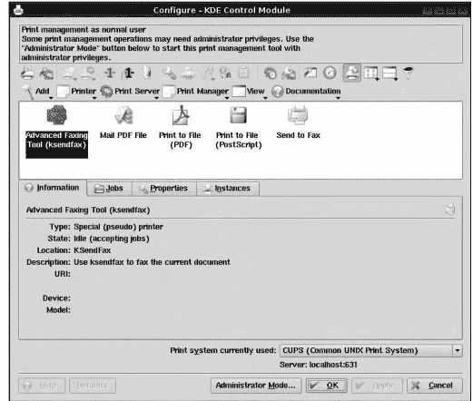

图 7-5：打印管理器

## Linspire 工具

第一次运行 Linspire 时，会出现“首次设置”对话框，在勾选“我同意”之前它会一直出现。在此工具中，您可以引导进行配置，设置时区、日期、重置密码、更改屏幕分辨率、创建新用户账户以及重命名机器。点击“完成”结束工具并启动 Linspire 音频辅助教程。可以根据喜好一直听（或看）这些内容！


如果您想立即退出音频辅助教程，点击右上角的 X 关闭教程。

要找到剩余的配置工具，选择启动（Launch）：设置（Settings），然后选择以下项：

- 修改密码（Change Password）：更改您当前使用的账户密码。
- 自动启动程序（Programs To Autostart）：包含您要在登录时自动启动的程序快捷方式。要向此文件夹添加项目（当打开它时）：
  1. 打开菜单。
  2. 浏览到您要在 Linspire 启动时运行的程序。
  3. 将程序拖入自动启动窗口。
  4. 弹出菜单时，选择“复制在此”。
  您的自动启动快捷方式出现了。
- 重命名计算机（Rename Computer）：更改您为此电脑分配的名称。
- 用户管理器（User Manager）：创建和删除用户账户。
- 控制中心（Control Center）：Linspire 控制中心（见图 7-6）是除添加和更新软件之外配置该发行版的中心点。您可以在第 12 章了解到如何使用此面板。

## 130 第一部分：入门


图 7-6：控制面板

Mandriva 包含了许多配置工具，尽管其中许多是重复的 - 你可以选择运行整个工具，也可以运行它的一小部分。你可以通过进入主菜单并选择 System>Configuration 来找到 Mandriva 工具。此子菜单包含：

- **配置桌面**：KDE 控制中心包含许多桌面设置。所有用户都可以根据喜好进行更改。
- **KDE**：这里的每个选项都对应 KDE 控制中心中的一个选择。这种方便的方法可以避免为了某一个更改而打开整个工具。
- **硬件**：这里提供了许多 Mandriva 的硬件相关设置，无需打开整个工具。

## 第 7 章：配置 Linux

- **软件包**：随着你使用 Mandriva 的时间，这可能是你常用的选项之一。一个原因是 Ubuntu 是最新的；它的开发者还没有时间创建这么多工具。然而，另一个原因是，与其他包含 GNOME 的发行版（Fedora、Mandriva 和 SuSE）相比，Ubuntu 更多是一个“原生 GNOME”发行版。

你可以在 System 菜单下的 System>Preferences 和 System>Administration 找到大多数 Ubuntu 的设置。

正如你所见，学习一个 Linux 发行版的酷之处在于，你正在掌握可以帮助你适应另一个版本 Linux 的实用知识。现在，去尽情享受调整系统的乐趣吧！

# 第二部分

现在上网！

Rich Tennant 著《第五波》


> “这在我们重新连接网络之前。”

## 在这一部分……

在本部分中，你将建立必要的心理和物理连接，将你的 Linux 机器接入互联网，包括配置电话拨号到互联网服务提供商（ISP）。你还将学习如何进行一些基础的网络故障排除，以防一切不顺利。接下来，你将设置 Web 浏览器、电子邮件客户端和即时消息软件，以便你可以浏览网页、发送和接收电子邮件以及访问新闻组。有了在本部分安装的工具，你就可以心所欲地扩展和自定义你的 Linux 系统。你还学了如何在互联网的电子公路和小径上旅行以完成任务！

# 第 8 章

## 连接互联网

- 理解常见的互联网连接方法
- 设置你的互联网连接
- 连接到你的互联网服务提供商（ISP）
- 了解足够的 TCP/IP 以防意外

> 通通信的每一步改进都让无聊变得更加糟糕。
> Frank Moore Colby

你可能已经连接了互联网。要测试你是否连接，请打开浏览器并尝试访问 www.org。否则，请继续阅读。

## 互联网连接 101

关于宽带选项（DSL 和电缆）的几个词。虽然拨号调制调器以每秒 56 千字节的速度传输信息，但宽带连接可以达到该速度的 50 倍。不要让高速供应商阻碍你使用 Linux。仅仅因为他们不支持 Linux，并不意味着该技术无法与 Linux 使用。TCP/IP（互联网的一套流量规则）是为衍生出的 Unix 系统开发的。

## 138 第二部分：现在上网！

如果你正在为 Windows 安装双系统，你的 ISP 可以帮助你安装宽带连接。在下面的列表中，我列出了可用的类型：

- **电缆调制调器**：电缆电视公司已扩展其产品线，包括接入互联网。当你订阅电缆服务时，安装人员通常会为你提供一个特殊设备，称为电缆调制调器，以及一个网卡。技术人员会将网卡安装到你的电脑并将电缆调制调器连接到它。至于速度，要获得确切的速度你需要联系你的电缆供应商。以下页面提供了一个关于各种电缆供应商和 Linux 的帮助文档：www.tldp.org/HOWTO/Cable-Modem
- **数字用户线 (DSL)**：DSL 以数字格式传输数据到电话口。DSL 之受欢迎是因为它比 ISDN 提供了更快的连接和更低的安装和服务成本，并且利用了电信公司提供的现有布线。DSL 连接需要额外的通信硬件，由你的互联网服务提供商（ISP）提供。注意 DSL 有多种变体：
  - ISDN（综合业务数字网络）数字用户线 (IDSL) —— 见本节后对应的 ISDN 定义
  - 对称数字用户线 (SDSL)
  - 通用 DSL (XDSL)


你可以从 ISP 处获你的 DSL 连接有多快，因为速度各异。有关 DSL 和 Linux 的概述，请访问以下 Web 页面：`www.tldp.org/HOWTO/DSL-HOWTO/`

- **卫星调制调器**：住在特别偏远或基础设施不足地区的人可能会选择卫星调制调器方案（`www.tldp.org/HOWTO/Sat-HOWTO.html`）。在许多方面，你可以认为这种服务与电缆等同，因为你通常是通过提供卫星电视信号的供应商获取它的。

# 第 8 章：连接互联网

然而，卫星连接也有缺点。如果你的卫星服务不可靠，那么你的互联网服务也将面临同样的命运。上传和下载速度也可能发生巨大的变化。

- **拨号模式：** 在无法使用宽带或价格负担不起的地区，拨号调制调器仍被广泛使用。它将计算机的数字信号转换为模拟信号，以便从墙壁插座传输到电信公司。由于调制调器利用了语音电话服务，因此在订阅互联网服务提供商（ISP）之前，你不需要任何特殊设置。但是，你不能同时将电话线用于拨号和通话。如果你在使用拨号调制调器，请参阅侧栏“警惕伪装调制调器的设备”以获取更多注意事项。

- **无线：** 无线网络领域，取决于你使用的无线类型，Linux 现在可能能为你提供最大的帮助。目前存在四种主要的无线类型，它们通常统称为 WiFi（802.11a、802.11b、802.11g，或者作为 A、B、G 和蓝牙）。到目前为止，A 和 B 在 Linux 中的支持程度最好，因为它们出现的时间最长。你应该追求的是 G 的安全性，但它也增加了复杂性，需要网卡制造商提供更多的配合。现在的许多无线网卡实际上能够支持这些类型中的多种，如果你还没有，请买一个同时支持 B 和 G 的。

我在这里能给出的最佳建议是，针对无线网卡的品牌和型号（或你考虑购买的型号），加上“Linux”一词进行网络搜索，看看你会发现什么——当然，你也可以检查其与发行版的硬件兼容性。由于这是一个技术发展迅速的领域，请务必检查你找到的资源的日期，并确保它们是近期的。即使是六个月以前也可能意味着你获得的是过期信息。关于这个主题，一些实用的链接包括：

- 我为 Fedora 用户编写的博客文章，抱歉 URL 很长：`http://dee-ann-blog.com/wireless_setup_on_an_emachine_m5310_notebook.htm`
- Linux 网络快速入门 HOWTO：`www.linuxnetworking.com/linux-hw/wmp11-linux.htm`
- 适用于 Linux 的无线局域网资源：`www.hpl.com/personal/Jean-Tourrilhes/Linux/`
- 在 Linux 中使用 Windows 无线驱动的方法：`www.linuxant.com/driverloader`
- 网络拓扑指南：`www.homenethelp.com/network`

## 第二部分：现在就上网！

- **综合业务数字数字网络 (ISDN)：** 不久之前，ISDN 曾是唯一的家庭高速选择之一。当它出现时，28 Kbps（仅是如今普通拨号调制调器速度的一半）几乎就是你能从连接电话与电信公司的铜线束中榨取出的全部速度了。ISDN 在某些地区仍然可用，并承诺提供 128 Kbps 的速度——只要你位于电信公司局端办公室 3.4 英里以内。使用 ISDN 需要两个设备：一个 ISDN 调制调器（通常由 ISP 提供）和一个网络适配器（一根以太网线）。由于现在 ISDN 很少使用，因此没有多少专门的网站在介绍它。总的调制调器 HOWTO（`www.tldp.org/HOWTO/Modem-HOWTO.html`）包含了指向最新 ISDN 信息的指引，而且通俗易懂。

## 警惕伪装调制调器的设备

我试图避免你产生挫败感——免得你的电脑遭受你的圆锤。许多 Linux 新手因为无法与他们的互联网调制调器通信而感到恼火。“毕竟，”新手发誓道，“当我运行微软 Windows 时，硬件完全是一模一样的。”

标签可能会具有误导性，因为某些制造商可能会误导你。如果你正在使用拨号调制调器，请参阅侧栏“警惕伪装调制调器的设备”以获取更多注意事项。

# 143

- 用户登录密码
- 电子邮件地址
- 电子邮件出站主机或简单邮件传输协议 (SMTP) 服务器
- 电子邮件入站主机或邮局协议 (POP) 服务器
- 新闻主机
- 你的计算机地址是否将是：

  - **静态**：你始终拥有相同的 IP 地址。静态地址对于服务器比桌面电脑更常见。如果你使用静态地址，互联网服务提供商（ISP）需要提供域名服务器 IP 地址、网关地址、网络地址和子掩码。这些信息应该都在客户信息表上。
  - **动态**：你的 IP 地址在每次连接时或每隔一段时间就会变化。在大多数桌面电脑上，你不需要相同的地址，这让 ISP 的工作变得更容易。它也让像笔记本电脑这种经常在不同网络之间移动的设备使用起来更方便。如果你使用动态地址，会被会被你需要使用 DHCP 进行连接。

有了这些信息，你可以使用你的 Linux 系统建立互联网连接。

## 连接

幸运的是，Linux 供应商提供了许多工具来降低与 Linux 连接的复杂性。并不是网络发生了变化，而是它的许多细节被隐藏了，导致你必须点击这里并按下某个键。不久前，在 Linux 机器上配置拨号网络（特别是拨号网络）无异于调试一个有缺陷的鲁布装置。

书中发行版中提供的可用互联网连接配置工具包括：

- Knoppix：点击面板上的企鹅图标并选择“网络/互联网”。此菜单包含了你可以用于通过 Knoppix 上网的各种工具，具体取决于你正在使用的硬件类型。
- Linspire：选择“启动程序”→“互联网”→“互联网连接”，并为你的 ISP 选择最合适的工具。
- Fedora：选择“系统”→“管理”→“网络”打开配置对话框。点击“新建”开始添加新设备类型向导。
- Mandriva：从主菜单中，选择“系统-配置-配置你的计算机”以打开 Mandriva 控制中心。输入密码。选择“网络与互联网-设置新网络接口（LAN, ISDN, ADSL）”进入连接向导，并选择你想配置的连接。
- SE：从主菜单中，选择“应用程序-系统-YaST”打开 YaST 配置工具。输入密码。在左侧选择“网络”。在右侧选择你拥有的硬件类型以配置你的设置。
- Ubuntu：选择“系统-管理-网络”打开网络设置。输入密码。选择“以太网连接”或“现代连接”，然后点击“属性”。要设置此连接，点击“启用此”并填写信息。
- Xanders：选择“启动-控制中心”打开 Xandros 控制中心。点击“网络”旁边的“+”展开该菜单，然后选择“互联网”打开你的连接列表——你可能需要点击“管理员”按钮输入你的 root 密码。点击“新建”启动连接向导。

有时选择并不像你想象的那么明显。例如，也许你使用的是 DSL，但由于 DSL 连接是通过你的以太线传输的，你的系统是一个 LAN/以太网连接。如果你无法让连接工作，请尝试这些因素。


再次，由于我空间有限，我将使用 Fedora 来演示该设置过程。许多决策和所需信息在不同发行版之间是相同的，所以如果你使用的不是 Fedora，请仔细阅读此部分，看看在你自己的电脑上哪些方法是有效的。

### 配置你的连接

手里有了 ISP 的信息，面前有一台闪光的显示器，请按照以下步骤在 Fedora 中配置你的拨号上网连接：

1. 从 GUI 桌面，选择“系统-管理-网络”。
2. 如果必要，在对话框中输入你的 root 密码。

如果你是以普通用户（而不是 root）登录的，系统会提示输入 root 密码。

网络配置对话框打开（见图 8-1）。

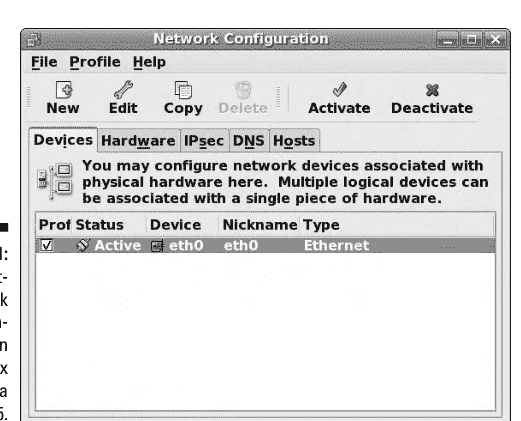

你可以在这里配置与物理硬件关联的网络设备。多个逻辑设备可以关联到单个硬件上。

图 8-1：Fedora Core 5 中的网络配置对话框。

活动配置文件：常用

3. 在网络配置对话框中，点击“新建”按钮。

出现“选择设备”对话框，如图 8-2 所示。由于我无法一次涵盖所有的网络连接类型，拨号调制解调器是最复杂的，我将从此处遵循拨号（调制调器连接）选项：为你自己选择正确的硬件类型并继续。

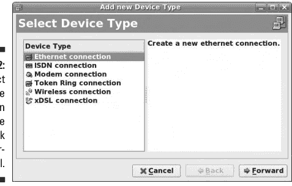

图 8-2：Fedora Core 5 网络配置工具中的“选择设备”对话框。

4. 要设置拨号调制调器，从“设备类型”列表中选择“调制调器连接”并点击“向前”按钮。

点击“向前”后，系统会探测你的调制调器。如果没有找到你的调制调器，将打开拨号（调制调器连接）选项，如图 8-3 所示。

图 8-3：选择对话框。

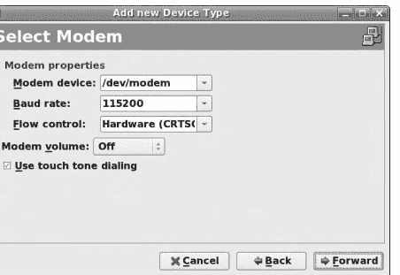

5. 从列表中选择正确的设备。
6. 如果你使用调制调器，从列表中选择速度。
7. 从列表中选择你的速度。
8. 开启调制调器音量，以便听到它在做什么。
9. 点击“向前”继续。
10. 输入你的 ISP 信息，然后点击“向前”。


10. 在“前缀”文本框中，输入拨打实际电话号码所需的任何拨号前缀。

11. 在“区号”文本框中，输入调制调器拨打所需的区号。

12. 在“电话号码”文本框中，输入调制调器拨打所需的号码（不包括前缀和区号）。

13. 在“服务提供商名称”文本框中，输入你的 ISP 名称。

# 148 第二部分：现在是互联网！

## 14. 在“登录名”文本框中，输入你的拨号账户登录名。

## 15. 在“密码”文本框中，输入你的拨号账户登录密码。

## 16. 点击“下一步”。

出现“IP 设置”对话框，如图 8-5 所示。

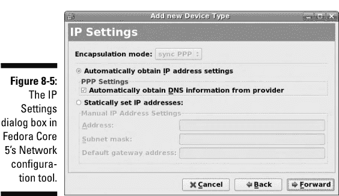

## 17. 在“IP 设置”对话框中，选择相应的单选按钮，决定决定是否需要从 ISP (DHCP) 获取 IP 地址（参见本章节前面的“从 ISP 获取信息”部分），或者你是否需要手动告诉它 IP 数据是什么（静态）。

你的 ISP 应该已经告知你需要其中哪一种。DHCP 是默认选项。如果你选择静态，对话框的下半部分将可用。

## 18. 如果你选择了静态，且你的 ISP 告诉你可以从其设备自动获取名称设置，请勾选“从提供程序自动获取 DNS 信息”框。否则，请取消勾选。

## 19. 如果你选择了静态，请根据 ISP 提供的信息填写“地址”、“子网掩码”和“默认网关地址”。

## 20. 点击“下一步”进入摘要对话框，然后点击“应用”，将你刚刚设置的调制解调器添加到主网络配置框中。

你现在网络配置工具中有一个调制解调器项（查看“类型”列）。

# 第 8 章：连接互联网

## 连接（及断开）互联网

通过 Fedora 网络配置对话框连接互联网，选中你创建的调制解调器项（见前节）并点击“激活”按钮。如果运气好，调制解调器会发出哔哔声，然后伴随着一个指示正在连接的对话框。连接成功后，网络配置对话框再次出现：此时设备的“状态”列显示为“已激活”。恭喜——你已连接到互联网！

要断开连接，请点击网络配置对话框中的“激活”按钮。你的设置将保留；下次想连接时，只需打开此对话框并激活即可。如果一切不顺利，请跳到下一节“在出现问题之前一切都很顺利”来查找如何寻求帮助。


使用其他发行版的读者应该使用它们相应的连接工具。你可能会发现双击 Web 浏览器图标并尝试访问某个网站就会激活你的连接。

## 在出现问题之前一切都很顺利

在完美的世界里，前一节中的拨号配置步骤应该 100% 都能有效。Linux 供应商确实揭示了传统上围绕着网络的奥谜。遗憾的是，在许多情况下（主要与调制解调器和硬件有关），简化的配置并不有效。如果你在遵循这些步骤后仍无法连接互联网，一个非常有帮助的网站是 LinuxQuestions.org (`www.linuxquestions.org`)。是的，我明白——你必须使用一台已经接入互联网的计算机来获取帮助。（有人遇到过这种“两难困境”吗？）预料可能遇到的各种问题是不可能的，Linux 社区是你的最佳选择；该网站以其乐于助人的成员而闻名。

此外，去你最喜欢的 Web 搜索网站，搜索你收到的系统错误信息——如果只搜索错误信息不起作用，加上硬件品牌、型号以及你的发行版名称也没有坏。当你试图找出网络连接出了什么问题——或者尝试收集可以帮助他人找出问题的信息时——你可以使用一个酷的工具：别手的命令行程序，`ping`。


某些防火墙会拦截 `ping` 类型的流量，因此即使在连接良好的情况下，这些命令也不总是按预期方式工作。

`ping` 命令类似于潜水艇使用声纳探测海洋中的其他物体。声纳发送 `ping 信号`，该信号会在硬表面上反射。通过测量发送 ping 和 ping 返回之间的时间，潜水艇工程师可以判断是否存在物体，以及该物体距离潜水艇有多远。

Linux 中的 `ping` 命令提供了与声纳类似的信息——它是如此有用，以至于你既视为一个 Linux 命令，也视为一个悠老的词。如果你把互联网视为你的海洋，那么通过 `ping`，还有哪些网络命令可用——以及你的 `ping` 命令需要多长时间返回。你使用的格式为 `ping hostname` 或 `ping ipaddress`，例如 `ping bob.example.com` 或 `ping 192.168.1.5`。如果你无法 ping 家里或办公室的另一台计算机（假设你已连接到以太网而不是在独立的拨号连接上），那么你 ping 的那台机器出了问题。另一方面，如果你可以 ping 家里或办公室的另一台机器，但无法 ping 互联网上的机器，那么你的连接可能出了问题。


*延迟*，即信号到达目的地并返回的时间，与物理距离无关。网络流量、带宽等因素决定了 ping 你的 ISP 需要多长时间。对于拨号连接，预计 ping 在 150 ms 左右。例如，通过打开命令提示符（见第 14 节）并输入以下内容尝试 ping Yahoo：

```
ping www.yahoo.com
```


按 Ctrl-C ping；否则你的计算机将继续 ping 目标。如图 8-6 所示的输出提供了 ping 执行的信息。如果你无法 ping 主机，会收到主机不可达的消息。如果你能到达主机，会收到关于返回所需毫秒（ms）的反馈——数字越低越好。对于通过以太网连接的，1 ms 到 3 ms 是可以接受的响应时间。当你看到 ping 时间上升到 900 ms 或更高时，网络负载很大（或你的线缆有问题）。

### 图 8-6：ping 命令的示例结果。


## 连接后

连接成功后，你可能想直接跳转到第 9 章，学习如何使用各种互联网程序。在此期间，让我提供一些你可能需要帮助、提问或想进一步探索 Linux 世界时可能会用的网站——其中有些非常极客，你会逐渐适应的！你还想要更新机器（见第 12 章）、添加新软件（同样见第 12 章），并考虑系统安全（见第 13 章），以保护自己不受恶意和程序的侵害。

一些网站包括

- `www.linuxsecurity.com`：一个相当极客（但有用）的地方，你可以在那里跟踪 Linux 安全世界的动态。

- `kerneltraffic.org`：你从未想知道 Linux 内核发生了什么但又敢问的所有问题。对于跟踪正在添加哪些新功能，如果你对前沿硬件感兴趣或只是想了解内幕，这个地方很棒。

- `www.linuxquestions.org`：我在书中其他地方提到过这个网站，但它是有问题要问的人，以及乐于帮助他们寻找答案的人的热门聚集地。

- `http://linux-newbie.sunsite.dk/`：Linux 新手管理员指南是一份你可能会发现的海量信息集。

- `www.tuxfiles.org`：关于感兴趣的各个主题的简短帮助文件集。

- `www.tldp.org`：包含许多为不同用户级别编写的帮助文档。

- `www.tuxmagazine.com`：为 Linux 桌面用户提供的免费数字杂志。

- `www.slashdot.org`：极客聚集地（但遗憾的是，其文化相当具有攻击性），包含许多指向在线有趣文章的链接。最适合查看文章；跳过评论中的争论。

除了这些建议之外，请记住你最喜爱的搜索引擎也可以非常好用。

# 第 9 章

## 使用互联网

本章内容

- 浏览网页

- 检查和发送电子邮件

- 获取文件

- 发送即时消息

> 授人以鱼，让其饱用一天；授人以网（上网），他就可以不打扰你好几周了。

—— 匿名

互联网是一个遍布全球的巨大计算机网络。许多不同类型的计算机和操作系统共同工作，允许你访问整个互联网上的信息。Linux 以及其他 Unix 操作系统长期以来支持并与互联网协作。互联网上提供的几乎所有不同服务都可以从你的 Linux 桌面获取。

当你安装 Linux 时（参见第 3 和第 4 章），新系统中将安装一个或多个 Web 浏览器、邮件程序和即时消息工具。在本章中，我将为你介绍一些你可以访问互联网不同服务的工具，例如访问网站、使用电子邮件、调查新闻组以及利用 FTP —— 前提是你互联网连接已配置（参见第 8 章）。

### 使用 Firefox 浏览网页


许多人将互联网的爆炸式增长归功于图形 Web 浏览器。互联网的出现比浏览器的发明早得多。只是在互联网上进行的大部分都是旧式的纯文本，对于那些喜欢漂亮图片的人来说缺乏吸引。在 Linux 世界中，最流行的浏览器无疑是 `Firefox` (`www.mozilla.org/products/firefox`)，它基于 `Mozilla` —— 本质上 `Firefox` 是 `Mozilla` 的网页浏览器部分，而 `Mozilla` 还可以处理电子邮件和新闻组浏览。另一个流行的选项是 `Konqueror` (`www.konqueror.org`)，你将在第 10 章中了解到它的文件浏览功能，但该工具也可以用作 Web 浏览器。

并不是所有的发行版都内置了 `Firefox`。例如，在 `Xandros` 的某些发行版中，你需要使用第 12 章涵盖的技术来添加该程序。你会在 `Xandros Networks` 的“New Applications:Internet”文件夹中找到 `Firefox`，并在 `CNR` 部分的“Internet:Browsers”中找到它。请注意，如果你选择 `Firefox` 而不是 `Mozilla`，你将需要安装本章稍后“演变为电子邮件”节中讨论的电子邮件应用程序之一。


## 配置 Firefox

如果你愿意，现在就可以开始。你不需要自定义你的浏览器。不过，你可能想花点时间告诉 `Firefox` 你的偏好，例如启动时显示的默认网站、默认字体大小、使用的颜色以及许多其他选项。

以下步骤将向你介绍“首选项”窗口，所有的 `Firefox` 配置参数都存储在这里：

1. **启动 `Firefox`。** 如何启动取决于你正在使用的哪种发行版。通常，它是你面板上的快捷方式（`Fedora`, `Knoppix`, `Mandriva`, `SUSE`、`Ubuntu` 和 `Xandros`）、桌面上的快捷方式（如果你安装了软件，`Xandros` 和 `Linux` 如此；它已经在 Business 中了），或者可以在主菜单的“Internet”部分找到（如果你安装了软件，所有这些都有）。如果你被要求导入偏好，如果是新安装且你没有用过其他浏览器，请说“否”；如果不是新安装，请说“是”。

2. **编辑：首选项。** 打开首选项窗口，如图 9-1 所示。此对话框在不同发行版之间可能不同，但大多数情况下应该是相同的。

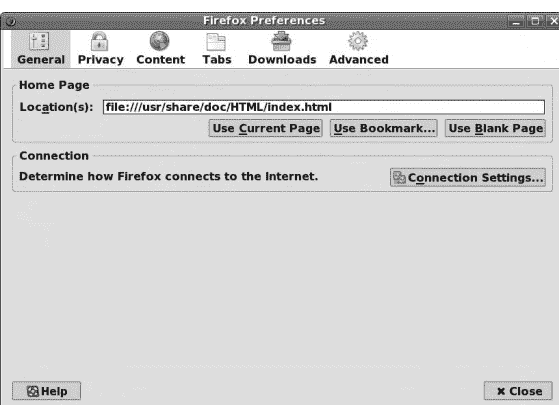

图 9-1: `Fedora 5` 中的 `Firefox` 首选项窗口。

3. **点击首选项窗口顶部的图标**访问各种首选项类别。
   - 某些类别足够复杂，提供了子标签。这些标签也值得探索。

4. **如果你看腻了菜单**，只需点击“关闭”关闭首选项对话框并返回浏览。

### 常规首选项

选择“常规”选项——如前文图 9-1 所示——让你决定 `Firefox` 的工作方式和运行方式。此对话框由两个独立部分组成：

- **主页：** 此部分允许你选择启动时立即显示的内容。你可以直接在文本框中输入 URL，或点击以下按钮：
  - *使用当前页面*：导航到你想作为默认网页的页面，然后点击此按钮。该页面的 URL 将出现在位置栏。
  - *使用书签*：显示你的书签列表。
  - *空白*：显示空白页。

- **连接：** 此部分允许你配置 `Firefox` 如何连接互联网。如果你使用代理，点击“设置”按钮进行配置。如果不使用代理，选择“不使用代理”。

- **历史：** 此部分允许你决定 `Firefox` 如何记住你的浏览历史。你可以选择永久记录、记录若干天，或在关闭 `Firefox` 时清除记录。

- **表单：** 此部分允许你控制 `Firefox` 是否记住你在表单输入的信息。你可以选择记住所有表单、某些表单或无表单。

- **Cookie：** 此部分允许你管理 `Firefox` 如何处理 Cookie。你可以选择允许所有 Cookie、阻止所有 Cookie 或为特定网站设置自定义规则。

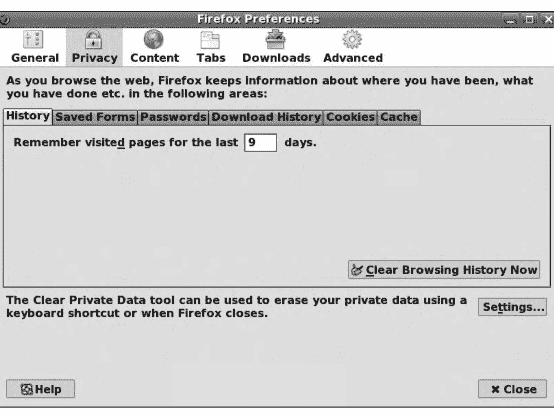

图 9-2: 隐私窗口。

### 158 第二部分：现在是互联网！

- 直到过期：大多数 Cookie 都有自动过期日期。如果你想让 Cookie 决定它们何时被删除，请选择此选项。
- 直到 `Firefox` 关闭：如果你正在使用图书馆的计算机或其他共享机器，或者你不希望在浏览浏览器时电脑在后台“烤比饼”，请选择此选项。
- 每次都询问我：如果你对 Cookie 感到极度偏执，或者想找出它们实际上是如何被使用的，请选择此选项。
- 缓存：`Firefox` 会记住你最后存储的几个页面，以便在你快速返回这些页面时可以加载它们。你可以通过点击“立即清除缓存”来清空此缓存。你还可以通过更改 `Use-To` 框中的值来更改存储这些信息时使用的硬盘空间。

### 内容偏好

选择“内容”将带你进入 `Firefox` 首选项对话框的“内容”部分（版本 9.3）。此部分允许你控制 `Firefox` 对各种类型内容的响应。顶部部分涉及允许或禁止——注意每个选项的右侧都有一个按钮，可以提供额外的控制：

- 阻止弹出窗口：告诉 `Firefox` 阻止你没有请求的新窗口——这是一个非常受欢迎的功能，并且在 `Microsoft Windows` 下的 `Firefox` 可能会移动此功能。某些网站具有打开窗口（例如登录窗口）的功能，因此你可以点击“允许的站点”按钮为它们设置例外。如果你不进行此配置，它也可以工作。每当弹出窗口被拦截时，浏览器中会出现一个黄色条，允许你在此处访问设置。
- 当网站尝试安装扩展程序或主题时警告我：强烈建议开启此选项。此设置可以防止网站自动合并到你的 `Firefox` 配置中。再次，对于你想要允许此类操作的网站，有一个“例外”按钮。
- 加载图像：允许阻止所有图像。这对于视力受损或试图通过忽略图片来加快浏览速度的人非常有用。选择“仅针对定向的网站”是一种阻止广告的方法，因为许多广告是从其他网站加载并仅显示在你正在查看的页面上的，但也会阻止合法的图形。“例外”按钮有助于管理你想看什么和不想看什么。
- 启用 Java：如果你安装了 `Java` 并且启用了此选项，`Firefox` 将运行 `Java` 代码。
- 启用 JavaScript：有些人出于安全考虑关闭了它。许多人没有。点击“高级”按钮将打开“高级 JavaScript 设置”对话框，你可以用它来选择允许此脚本语言执行的操作。如果你发现某个网站会执行调整窗口大小等操作，请到此对话框禁用它。

### 第 9 章：使用互联网

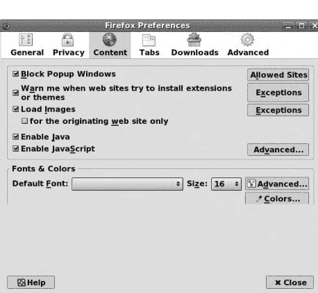

9-3: `Fedora Core 5` 中的 `Firefox` 内容窗口。

下半部分是“字体与颜色”。这些功能包括：

- 默认字体：点击此下拉列表框选择你想要使用的字体。
- 大小：点击此下拉列表框选择你使用的字体大小。
- 高级：点击此按钮打开“字体”对话框，允许你为各种字体类选择使用的默认字体和大小，以及其他视觉设置。在这里，你还可以设置页面使用它们自己的字体，而不是覆盖你的设置。
- 颜色：点击此按钮打开“颜色”对话框，更改分配给文本、背景和链接的默认颜色。

浏览时，如果你对字体大小不满意，可以按住 `Ctrl+` 键使字体变大，按住 `Ctrl–`（减号）键使字体变小。`+` 和 `-` 是数字键盘上的版本，而不是主键盘上的。


### 额外偏好

还有三个设置部分：

- 标签页：`Firefox` 提供“标签页浏览”，在同一个窗口中通过标签页打开新页面而不是两个窗口——你甚至可以使用此功能一次标记一组标签页。此部分允许你配置此功能。

### 160 第二部分：现在是互联网！

- 下载：使用此部分告诉 `Firefox` 默认下载文件位置、下载管理器如何运行以及如何处理类型。
- 高级：此部分提供三个选项卡：常规、更新和安全。“常规”选项卡允许你设置偏好。“更新”选项卡告诉 `Firefox` 如何检查更新。“安全”选项卡决定安全设置。

### 额外偏好

虽然大多数人在提到互联网时会想到 Web，但电子邮件可能是最常用且最受喜的应用。`Linux` 用户可以使用多种电子邮件程序。书中讨论的各种发行版的默认设置可以在菜单中找到。

- `Knopix`：`KMail` (`http://kmail.kde.org/`)，同时也包含了 `Mozilla Mail` 和 `Thunderbird` (`www.mozilla.org/products/thunderbird`)。
- `Fedora`：`Novell Evolution` (`www.novell.com/products/evolution`)，通过 `yum` 可获取 `KMail` 和 `Thunderbird`，如第 12 章所示。
- `Linspire`：`Mozilla Mail`，你可以通过 `CBR` 添加 `Thunderbird` 和 `Evolution`，如第 12 章所示。


- Mandriva：Contact (www.kontakt.org/)，也安装了 KMail 和 Evolution。
- SuSE：安装了 KMail 的 Evolution。Thunderbird 也可以通过 `YaST` 获取，如第 12 章所示。
- Ubuntu：Evolution，你可以安装 Thunderbird 和 Kmail，如第 12 章所示。
- Xandros：Mozilla，同时也包含了 KMail。你还可以通过 Xandros Networks 添加 Thunderbird 和 Evolution，如第 12 章所示。Xandros 商业版默认带有 Evolution。

## 设置 Evolution

当你第一次打开 Evolution 时，程序将引导你完成设置过程，请务必准备好以下信息：

- 你被分配的电子邮件地址，格式为 `username@example.org`。
- 用于接收邮件的邮件服务器类型：例如，`POP`。
- 用于接收邮件的邮件服务器名称，格式为 `servername.example.org`。
- 用于发送邮件的邮件服务器类型：例如，`SMTP`。
- 用于发送邮件的邮件服务器名称，格式为 `servername.example.org`。此名称可能与接收邮件服务器的名称相同。
- 接收和发送邮件时所需的任何特殊类型身份验证。这种身份验证通常接收邮件只需要密码，而发送邮件可能不需要。

当你第一次启动 Evolution 时，会启动 Evolution 设置向导（Evolution Setup Assistant）。

点击“下一步”（`Forward`）进入欢迎界面，随后将打开“身份”（`Identity`）对话框（见图 9-6）。要填写此对话框，请完成以下步骤：

### 1. 如果需要，修改“全名”（`Full Name`）字段。

有些人不想使用真实姓名，而是选择使用昵称，或者根据您在机器上配置的程序，可能没有分配默认值。

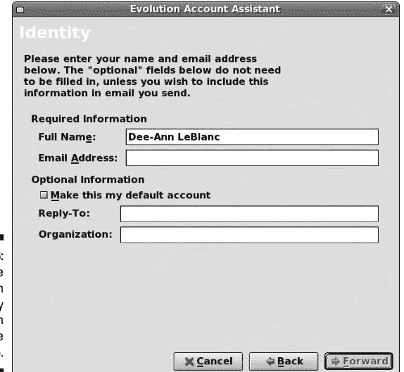

图 9-6：Fedora Core 中的 Evolution 身份对话框。

2. 如果“电子邮件地址”（`E-Mail Address`）字段与您的 ISP 提供的地址不符，请进行修改（可能是不符）。

3. 如果你想让此特定账户作为默认邮件账户，请确保勾选“设置为我的默认账户”（`Make This My Default Account`）复选框。否则，确保未勾选。

4. 点击“下一步”（`Forward`）继续。

打开“接收邮件”（`Receiving Mail`）对话框。

5. 在“服务器类型”（`Server Type`）列表框中，选择您的 ISP 使用的入电子邮件服务器类型。

如果您不想在此计算机上接收电子邮件，请保持为“无”（`None`）——如果您只想发送邮件，或者只想使用 Outlook 中的日历和任务管理功能，此设置非常有用。根据您选择的项目，对话框会变化并请求适当的信息。我假设您正在使用 POP 服务器接收邮件，因此选择 `POP` 时看到的内容如图 9-7 所示。如果您没有使用 POP，请完成看到的对话框，然后进入第 6 步。

> 图 9-7：Fedora Core 5 中选中 POP 的 Evolution 接收对话框。

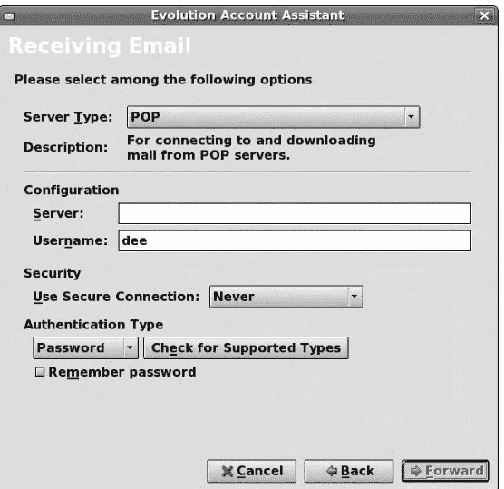

最新版本的 Evolution 已支持 Microsoft Exchange 服务器。如果您需要此，您的发行版中可能已经安装或尚未安装。对于 Fedora，请使用第 12 章中的信息向您的系统添加 "`evolution-connector`" 包，并重启 Evolution 设置过程。

6. 在“服务器”（`Server`）文本框中输入您的 POP 邮件服务器全名。

名称可能类似于 `pop.example.com`。

7. 在“用户名”（`Username`）文本框中输入您检查邮件的登录名。如果您的电子邮件地址是 `jane@example.com`，则用户名就是 `jane`。

8. 如果被告知使用 SSL 进行安全保护，请在“安全连接 (SSL)”下拉列表框中选择“始终”（`Always`）或“在可行的情况下始终”（`Whenever Possible`），取决于您的 ISP 的规定。

9. 在“身份验证类型”（`Authentication Type`）下，选择相应的身份验证选项。如果您不知道邮件服务器使用哪种身份验证，请点击“检查支持类型”（`Check For Supported Types`）按钮。通常是“密码”（`Password`）。

10. 勾选“记住密码”（`Remember Pass`）复选框，这样您每次检查邮件时无需输入电子邮件密码。如果您要离开计算机且可能有其他人访问，请进入主菜单并选择“锁定屏幕”（`Lock Screen`），以保护自己免受垃圾恶作邮件的影响。执行此操作可确保当您输入登录密码时无人可以使用您的 GUI。

您必须开启屏幕保护程序此功能才能生效。屏幕保护程序默认开启的。

11. 点击“下一步”（`Forward`）进入第二个“接收选项”（`Receiving Options`）对话框（见图 9-8）。此对话框是否存在取决于您正在使用的入邮件服务器类型。如果您不想在此计算机上接收电子邮件——如果您只想发送邮件，或者只想使用 Outlook 中的日历和任务管理功能，此设置非常有用。根据您选择的项目，对话框会变化并请求适当的信息。我假设您正在使用 POP 服务器接收邮件，因此选择 POP 时看到的内容如图 9-7 所示。如果您没有使用 POP，请完成看到的对话框，然后进入第 12 步。


图 9-8：Fedora Core 5 中的 Evolution 接收选项对话框。

12. 如果您不想在此计算机上接收电子邮件——如果您只想发送邮件，或者只想使用 Outlook 中的日历和任务管理功能，此设置非常有用。根据您选择的项目，对话框会变化并请求适当的信息。我假设您正在使用 POP 服务器接收邮件，因此看到的内容所示。

13. 如果您不想在此计算机上接收电子邮件——如果您只想发送邮件，或者只想使用 Outlook 中的日历和任务管理功能，此设置非常有用。根据您选择的项目，对话框会变化并请求适当的信息。我假设您正在使用 POP 服务器接收邮件，因此看到的内容所示。

14. 如果您不想在此计算机上接收电子邮件——如果您只想发送邮件，或者只想使用 Outlook 中的日历和任务管理功能，此设置非常有用。根据您选择的项目，对话框会变化并请求适当的信息。我假设您正在使用 POP 服务器接收邮件，因此看到的内容所示。

# 第二部分：现在是网络！

6. 如果你想在电子邮件底部添加签名，请点击“Signature”（签名）旁边的下拉列表并选择“Autogenerated”（自动生成）。

要创建自定义签名，请进入 Evolution 窗口并选择 `Edit:Preferences`（编辑：首选项）打开 Evolution 设置对话框（见图 9-12）。选择你想要创建签名的账户，然后点击“Edit”（编辑）按钮打开 Evolution 账户编辑器。在对话框中，切换到“Identity”（标识）选项卡，点击“Add New Signature”（新建签名）。在这里，你可以创建并格式化签名，点击“Save and Close”（保存并关闭）按钮后，你可以在 Identity 选项卡的 Signature 下拉列表中选择哪一个签名作为默认。通过点击每个对话框上的 OK（确定）或 Close（关闭）消除额外的对话框。

7. 当你完成消息输入后，点击“Send”（发送）按钮。

电子邮件现在已添加到你的发送箱，如果你需要，可以对其进行编辑。

8. 点击“Send/Receive”（发送/接收）按钮。

你的电子邮件将发出，同时 Evolution 会检查新的传入邮件。

花些时间真正探索 Evolution。正如本章插图所示，该程序有许多功能，包括过滤垃圾邮件的能力。

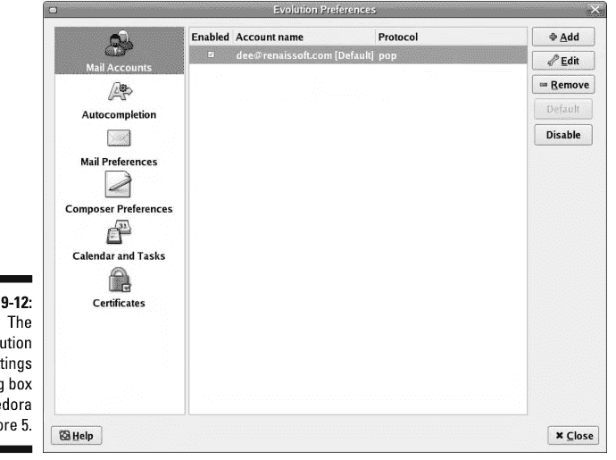

图 9-12：Fedora Core 5 中的 Evolution 设置对话框。

## 第 9 章：使用网络

## 利用即时消息

人之间的即时消息（IM）就像使用电话——区别在于你是打字交流而不是说话。此外，你可以同时进行多个即时消息对话，而不需要额外的互联网连接。美国在线（AOL）提供了一种名为 AOL Instant Messenger（简称 AIM）的流行服务。其他的还有 ICQ、MSN、Yahoo 和 Google。包括 Linux 在内的各种计算机操作系统都支持这些各种服务（事实上，GAIM 运行在非 Linux 系统上）。

本书涵盖的发行版使用以下即时消息程序：

- Fedora: `GAIM` (http://gaim.sourceforge.net/)
- Knoppix: `GAIM`
- Linux: `GAIM`


- Mandriva: `Kopete` (`http://kopete.kde.org/`) 和 `GAIM`

- SuSE: `GAIM` 和 `Kopete`

- Alexandros: `Kopete`

- Ubuntu: `GAIM`

因为 `GAIM` 是 Fedora 的默认程序，所以我详细介绍了它。`Kopete` 的用法大大相同。

## 使用 GAIM 即时消息软件

你通过以下菜单选择启动 `GAIM`：

- Fedora: 选择 `Applications`（应用程序）▸`Internet`（网络）▸`Internet Messenger`（网络消息器）。
- Knoppix: 从 `Main Menu`（主菜单）选择 `Internet`（网络）▸`GAIM Instant Messenger`。
- Linux: `Launch`（启动）▸`Run Programs`（运行程序）▸`Internet`（网络）▸`Instant Messenger`（即时消息）。
- Mandriva: 从 `Main Menu`（主菜单）选择 `Internet`（网络）▸`Instant Messaging`（即时消息）▸`GAIM`。
- SuSE: `Applications`（应用程序）▸`Internet`（网络）▸`Chat`（聊天）▸`GAIM Instant Messenger`。
- Ubuntu: `Applications`（应用程序）▸`Internet`（网络）▸`GAIM Instant Messenger`。

应用程序首次启动后（见图 9-13），它的主界面和账户管理对话框都会出现。要告诉 `GAIM` 你的其中一个账户：

1. 点击 `Accounts`（账户）对话框中的 `Add`（添加）按钮。出现图 9-13 所示的 `Add Account`（添加账户）对话框。
2. 在 `Protocol`（协议）下拉列表中，选择你想要使用的 IM 网络。你的选项有 `AIM/ICQ`、`Gadu-Gadu`、`GroupWise`、`IRC`、`Jabber`、`MSN`、`Napster`、`SILC`、`Yahoo` 和 `Zephyr`。如果你想使用 Google 即时消息，请参阅 `www.google.com/support/talk/bin/answer.py?answer=24073` 中的说明。
3. 在 `Screen Name`（屏幕名称）文本框中，输入你的 IM 账户登录名。如果你使用的是 `ICQ`，请使用你的会员号。
4. 在 `Password`（密码）文本框中，输入该账户的 IM 密码。
5. 在 `Alias`（别名）文本框中，输入你希望在别人 IM 客户端中显示的名称，除非你想使用屏幕名称。
6. 勾选 `Password`（记住密码）复选框，这样你就不需要每次都输入密码。

## 第 9 章：使用互联网

1. 按照前面的讨论启动 BitTorrent 客户端。

图 9-14 显示了 Fedora 客户端。

图 9-14：Fedora Core 5 中的 Bit-Torrent 窗口。

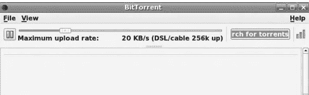

2. 选择文件（`File`）：打开 Torrent 文件（`Open Torrent File`）。

出现一个浏览器窗口。

3. 浏览并选择你想要下载的文档的 `.torrent` 文件，然后点击确定（`OK`）。

文件以类似于音乐播放器的格式显示，如图 9-15 所示。你可以通过使用最大上传速率（`Maximum Upload Rate`）滑块向其他 BitTorrent 用户提供更快的上传来加速下载。如果你有带宽（见第 8 章），`40kbps` 的效果就很好。

文件可能需要一分钟左右才能完全同步，因此预计时间会发生剧烈变化，直到稳定在一个固定的值上。

4. 等待下载完成，然后选择文件（`File`）：退出（`Quit`）以关闭客户端。

图 9-15：Fedora Core 5 中正在下载文件的 Bit-Torrent 窗口。

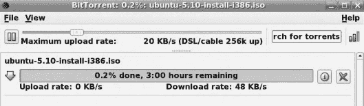

# 电话通话

最近的新热潮是通过互联网拨打电话聊天。无论你只是想实验一下，还是一个完全的追随者，Linux 都提供了你参与所需的软件。将互联网电话网络想象成即时通讯（Instant Messenger）网络。此用途最流行的网络之一是 `Skype` (`www.skype.com`)，所以我在这里重点介绍它，以及 `SIP`（会话启动协议），这是一种广泛使用的默认协议，你可以用于更多不同的程序。首先需要合适的硬件——无论是可以插入电脑的电话（例如 `SIP` 电话），还是仅仅耳机和麦克风的组合——最好不要选择低端的型号，这样你可以获得最佳音质。当你有了硬件后，就是时候获取软件了：

- Fedora：默认客户端（`Ekiga`, `www.ekiga.org`）可以通过 `Applications`：互联网-IP 电话、VoIP 及视频会议（`Internet-IP Telephony, VoIP and Video Conferencing`）获得。存储中包含两个 `SIP` 客户端，如第 12 章讨论的，`KPhone` (`www.wirlab.net/kphone`) 和 `Linphone` (`www.linphone.org`)。`Skype` 不在内，但你可以从 `www.skype.com` 下载 Linux 客户端。
- Knopix：不包含。
- Linsp：如第 12 章所述，进入 CNR 的互联网部分并安装 `Skype`。此外，还有 `PhoneGaim`（带有增强型 `SIP` 客户端的 `GAIM`，`www.phonegain.com`）用于其他类型的互联网通话。
- Mandriva：在 Mandriva 的商业版本中，你可以从主菜单（`Main Menu`）中选择：互联网：即时消息：`Skype`（`Internet:Instant Messaging:Skype`）。免费版用户可以尝试主菜单：互联网：`Gnome` 客户端（`www.gnomeeting.org`），这是一种视频/音频组合客户端。该程序也适用于其他发行版，包括 Fedora。
- SuSE：选择 `Applications`：互联网：电话（`Internet:Telephone`），然后选择你想使用的程序。选项包括 `GnomeMeeting`、`KPhone` 和 `Linphone`。
- Ubuntu：虽然默认提供了 `Applications`：互联网：`GnomeMeeting`（`Internet:GnomeMeeting`）。你可以使用第 12 章讨论的工具安装 `Linphone` 用于 `SIP` 通话。
- Xandros：选择 `Launch:Applications:Internet:Voice Over Ip Phone` 或 `Skype Calling`，取决于你使用的 Xandros 版本。你可以使用第 12 章讨论的技术添加额外选项。

要在 Fedora 中安装 `Skype`，请执行以下操作：

1. 将浏览器指向 `www.skype.com`。
2. 点击下载 `Skype`（`Download Skype`）。你将进入下载 页面。
3. 点击企鹅图标或 `Linux` 字。你将进入 Linux 版 `Skype` 下载页面。
4. 右键点击下载公钥（`Download the Public Key`）链接，并在右键菜单中选择“链接另存为”（`Save Link As`）。出现另存为对话框。
5. 点击保存（`Save`）将文件保存到你的下载目录（默认是桌面）。对话框关闭，文件出现在桌面上。
6. 选择 `Applications`：辅助工具：终端（`Accessories:Terminal`）。出现一个终端窗口，如第 14 章所示。
7. 输入 `su -` 临时切换到 root 用户。
8. 输入 `rpm --import /home/user/Desktop/rpm-public-key.asc`，其中 `user` 是你的用户账户，例如 `/home/dee/rpm-public-key.asc`。我假设下载目录是桌面。如果不是，请相应调整文件路径。
9. 点击终端窗口右上角的 `X` 关闭它。
10. 点击 适用于 Fedora 的 RPM 条目，即使它不是针对 Fedora 5 的。注意你也可以为 SuSE 和 Mandriva 获取 `Skype`。在标题中打开文件的全名。
11. 保持选中“打开并安装软件”（`Open with Install Software`），并点击确定（`OK`）。下载期间打开下载窗口，下载完成后，出现 root 密码（`Password For root`）对话框。
12. 输入你的 root（管理员）密码并点击确定（`OK`）。打开下载窗口。
13. 点击应用（`Apply`）。安装程序将软件添加到你的系统。安装完成后，出现信息（`Information`）对话框。
14. 点击确定（`OK`）关闭对话框。此软件（图 9-16）未出现在 `Applications:Internet` 中，注销并重新登录。
15. 点击下载窗口右上角的 `X`。在能够通话之前，你需要选择 `Tools:Add Contact` 正确配置。它应该显示。

## 第二部分：现在上网！


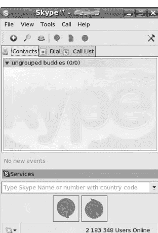

## 使用其他工具

根据你的需求，你可能想探索其他工具。本节介绍了入门：

- FTP 程序：如果你想使用 FTP，一个常用的程序是 `GFTP`。
- IRC 程序：虽然 IM 客户端支持 IRC，但你可能更倾向于使用仅用于 IRC 的程序。常见的有 `X-Chat` 和 `KIRC`。
- 文件共享：如果你想使用 Gnutella 网络，`LimeWire` 是一个流行的选择。
- RSS 阅读器：`Firefox` 有许多针对它的扩展。此外，`Straff` 是一个流行的 RSS。

总的来说，如果你不确定哪些程序，可以针对你想做的事情（如 RSS）和 Linux 一词进行 Web 搜索。

## 第 10 章

### 操作文件和目录

+ 本章内容
- 处理文件系统内容
- 理解文件系统机制

> 完全没必要做任何家务。过了四年之后，脏东西也不会变得更糟。
> —— 昆廷·克里斯普 (Quentin Crisp)

这是不可避免的。在某个时刻，你必须学会处理系统中的文件和目录。坦率地说，在你熟悉了这些规则和命令后，你会感到更加从容（即使你偶尔会想起那些在性能良好的 MS-DOS 中工作的日子）。因为许多人发现处理文件时在命令行下操作更简单，因此在本章中，我将同时涵盖键入命令以及你可以使用的图形化工具。

## 在 GUI 中操作文件

倾向于留在图形界面的人喜欢使用 Linux 提供的 GUI 文件管理器，而不是访问命令行提示符来处理文件。文件管理器是一个程序（例如 Windows 资源管理器），允许你通过鼠标、有时只需少量输入来浏览和操作你的文件和目录。在本节中，我将带你浏览流行的 Linux 发行版默认自带的文件管理器。

### 在 Nautilus 中航行

在 `GNOME` 桌面环境中（因此，如果你使用的是发行版的默认设置，则是在 Fedora Core、SuSE 或 Ubuntu 中），管理器是 `Nautilus`。在 `Nautilus` 中穿梭文件系统涉及到几种不同的技能。首先，你需要知道想从哪里开始。如果你不想从家目录开始，请使用第 6 章介绍过的“位置”菜单，或者执行以下操作之一：

- Fedora：双击桌面上的“计算机”或“主目录”图标，从“位置”菜单中选择任意项，或者选择“应用程序：系统工具：文件浏览器”，以便在左侧查看树结构并在右侧查看文件夹内容，这可能正是你在其他操作系统中所习惯的。
- Suez：双击桌面上的“计算机”或“主目录”图标，从“位置”菜单中选择任意项。要像通常预期那样在左侧看到树结构，请选择“查看：侧边栏”。
- Ubuntu：选择“位置”菜单中的任何位置，或“应用程序：辅助工具：文件浏览器”。默认启用两个窗格。图 10-1 显示了在打开的家目录中使用 `Nautilus` 可以看到的内容示例。


图 10-1：在 Fedora Core 5 中显示 Dee 目录的 `Nautilus`。

如果你使用的是带有图标的发行版，请双击桌面上的“主目录”。

当你打开了想要开始位置的窗口后，需要找到如何导航。使用一个文件，只需双击，然后参考本章后面的“打开文件和运行程序”部分了解 `Nautilus`。你也可以双击文件夹来打开并访问其内容。当你打开一个文件夹且不在树形视图时，会打开一个新窗口，同时你你正在操作的窗口保持开启。如果你愿意，可以通过选择“文件=关闭”或点击窗口右上角的“X”来关闭原始窗口。

如果你发现打开了太多目录，请选择以下命令之一：

- **关闭：父级文件夹：** 关闭用于进入此目录的所有文件夹。
- **关闭：所有文件夹：** 关闭你所有打开的文件浏览器窗口。
- **关闭：** 关闭此文件夹。

如果你需要，也可以轻松地返回之前访问过的文件夹。（例如，你可能处于 `/home/jane/documents/invoices`，并想回到 `/home/jane` 而无需反复打开和关闭多个文件夹。）为此，查看文件夹窗口左下角以找到你所处子目录的名称（如 `invoices`）。点击该名称，将打开一个包含所有父目录以及当前目录的列表。该列表可能如下例所示：

home

jane

documents

invoices

要向上返回，你可以选择目录树中的某个位置（例如 jane）以进入你想移动的 `/home/jane`。

### 设置文件夹的显示内容

你获取的关于每个文件的信息是太多了还是不够？尝试一下“查看”菜单。“查看”菜单下的主要列出选项包括以下命令：

- **以图标形式显示：** 此默认选项将所有文件以图标形式显示，并在下方显示名称，请参考图 10-1。
- **以列表形式显示：** 此命令会为你提供有关文件的信息列表，以及它的图标和名称（见图 10-2）。注意，列表左侧有小图标可用。


10-2：在 Fedora Core 5 的 dee 目录中使用“以列表形式显示”选项的 `Nautilus`。

除了这些“查看”菜单命令，你还可以使用：

- **查看：刷新：** 如果你刚刚创建了一个文件但在文件夹中没有看到，请选择此选项。
- **查看：显示隐藏文件：** Linux 中所有以点（`.`）开头的文件都是隐藏文件，这意味着你必须明确告诉 Linux 你想看到它们。

除了这些命令，如果你需要更改文件夹的视觉大小，可以选择“查看”菜单中的“放大”、“缩小”和“标准大小”。

## 创建文件和文件夹

在 `Nautilus` 中创建新文件或文件夹：

1. 浏览到你想要创建的文件夹。你需要打开该文件夹的窗口并在窗口内操作。
2. 在文件夹内部的空白处点击右键。确保你没有选中任何内容。会弹出一个菜单。
3. 根据你想完成的任务，选择“创建文件夹”或“创建文档”。
   - “创建文件夹”命令会在当前目录下创建一个新文件夹。
   - “创建文档”命令将打开一个子菜单，让你从“模板”（如果你已经创建了模板）或“空文件”中选择。
4. 输入你想为该文件夹或文件命名的名称并按回车。

### 打开文件和运行程序

在 `Nautilus` 中打开文件或运行程序，双击即可。就这样！噢，不完全如此。你也可以右键点击文件打开上下文菜单，并从菜单选择以下内容：

- **用程序打开：** 如果文件已与某个程序关联，选择此选项等同于双击文件。如果系统知道你安装了多个可以处理的程序，可能会列出多个选项——带有文件图标的项目是默认选项。选择你喜欢的任何一个。
- **用其他应用程序打开：** 选择此选项将打开一个包含已知安装程序列表的子菜单。如果你找到了需要的程序，点击“使用自定义命令”。在这里你可以：
  - 输入应用程序的完整路径（如 `/usr/bin/conqueror`）。
  - 点击“浏览”按钮打开文件浏览器并浏览到你想使用的程序。

选择打开文件的程序后，点击“打开”继续。

### 复制和移动文件

你可以使用两种方法在 `Nautilus` 中复制和移动项目。第一种是你在 Windows 或 Mac OS 中熟悉的方法——点击并抓取文件，然后将其拖到你想去的地方。你可以在文件夹窗口之间拖动，也可以拖到文件夹图标上。以下是一些技巧：

- 拖动时按住 `Ctrl` 键可以进行复制而不是移动文件。
- 如果你想将文件拖入文件夹图标，请在释放鼠标前确保文件夹图标处于高亮状态。

> 如果你想将文件拖入一个文件夹窗口，而不是拖入某一个文件夹图标，请确保在松开鼠标之前，文件夹图标没有被高亮显示。

复制和移动文件及目录的另一种方法涉及以下步骤：

- 1. 右键点击你想要复制或移动的文件或目录。
- 2. 从弹出的右菜单中，如果你想移动文件，请选择“剪切”(`Cut`)；如果你想复制它，请选择“复制”(`Copy`)。

如果你尝试移动文件，在做出选择后文件不会消失。

- 3. 导航到你想要移动文件的文件夹。

当你打开了该文件夹的窗口时，你就准备好了。

- 4. 执行以下操作之一：
  - 如果你想将文件移动或复制到文件夹窗口中，在该窗口内右键点击（只需确保没有高亮内容），然后选择“粘贴”(`Paste`)。
  - 如果你想将文件移动或复制到文件夹图标而不是打开的窗口，右键点击该图标，然后选择“粘贴到文件夹”(`Paste Into Folder`)。

## 删除文件和文件夹

要使用 `Nautilus` 从文件系统中删除文件或目录，请遵循以下步骤：

- 1. 浏览到文件（们）或文件夹的位置。
- 2. 选择文件（们）或文件夹（们）。

你可以通过执行以下操作选择文件或文件夹：

- 点击文件或文件夹将其高亮。
- 点击第一个项目，按住 `Shift` 键，然后点击组中的最后一个项目以选择所有项目。（这些项目将整齐排列。）
- 点击第一个项目，按住 `Ctrl` 键，并点击你想要选择的每个单独项目。
- 点击并拖动鼠标按钮，画出一个包含你想要选择的所有项目的矩框。
- 3. 按 `Delete` 键，或右键点击并选择“移动到垃圾箱”(`Move To Trash`)。

## 第三部分：快速上手 Linux


文件从视图中消失。请记住，如果你正在删除一个文件夹且该文件夹包含其他文件或文件夹，它们会随它一起进入垃圾箱。

# 第 10 章：操作文件和目录

这些被删除的项目实际上位于垃圾箱中，因此它们并没有真正从你的硬盘上删除。如果你需要，可以将这些文件从垃圾箱移出并回到你的文件系统。

## 清倒垃圾箱

你可以通过以下步骤永久删除垃圾箱文件夹中的内容：

- 1. 右键点击垃圾箱图标。
  此操作将打开一个列有选项的快捷菜单。
- 2. 从快捷菜单中选择“清空垃圾箱”`Empty Trash`。
  将弹出一个确认对话框。
- 3. 点击确认对话框中的“清空”`Empty`以删除垃圾箱文件夹的内容。

Linux 会永久删除垃圾箱文件夹中的项目。你可以通过查看垃圾桶来判断垃圾箱是否为空。如果它是空的，它就不包含任何文件。如果你看到里面有纸张，它就包含垃圾。

## 查看和更改权限

Linux（以及其他形式的 Unix）中的每个文件都有一组权限，用于规定谁被允许查看、运行、删除它等。这些权限用于确保人们无法弄乱系统或彼此的文件，因此它们非常重要。在本节中，我将重点介绍如何在 GUI 中中操作文件。请参阅本章后半部分的“权限入门”章节，以了解文件权限工作原理的详细介绍。

若要在 `Nautilus` 中查看和更改文件或目录的权限，你需要遵循以下步骤：

- 1. 浏览到文件或目录的位置。
  打开包含此项的文件夹窗口即可。
- 2. 右键点击文件或目录。
  出现一个右菜单。
- 3. 从右菜单中选择“属性”`Properties`。
  出现一个打开“基本”`Basic`选项卡的属性对话框。
- 4. 点击“权限”`Permissions`选项卡。
  188 第三部分：快速上手 Linux


图 10-3：显示权限选项卡的属性对话框。
- 5. 设置权限。
  关于权限如何工作，请参见本章的“权限入门”部分。
- 6. 点击“关闭”`Close`关闭对话框。

文件所有权已更改。

## GUI 中操作文件

在 `PPIX`、`Linspire`、`Mandriva` 和 `Xandros` 中，默认文件垃圾桶布局略有不同。你可以通过执行以下操作访问此程序：

- 190 第三部分：快速上手 Linux

## 文件系统

- 10 章：操作文件和目录
- 100-4：显示文件管理器


图 10-4：显示多个选项卡的文件管理器。

## 导航文件系统

在文件系统中导航涉及以下图标。`Nautilus` 布局略有不同；它的版本可以使用多个选项卡。

- 左箭头：返回上一个目录。
- 右箭头：前进到目录。
- 上箭头：进入上一级目录。
- 主页：显示当前目录。
- 刷新：刷新当前目录。
- 停止加载：停止正在加载。
- 打印：打印选定的文档。
- 放大：放大图标。
- 缩小：缩小图标。
- 查看菜单：请参见“在文件夹中查看内容”。

## 在文件夹中查看内容

如果你想查看每个文件更多或更少的信息，可以通过选择视图模式（或在栏右侧找到图标）进行尝试。主要的列表选项可能包括：

- 图标视图：以图标形式显示所有文件，下方带有名称（参见图 10-4）。这是默认选项。
- 多列视图：图标按列而非行排列。
- 树视图：显示文件的信息，以及其图标和名称（参见图 10-5）。你可以点击项目旁边的加号来展开此列表，点击减号来折叠列表。
- 信息列表视图：以小列表格式显示图标和名称。
- 详细列表视图：类似于树视图，但不支持展开和折叠目录。
- 文本视图：类似于列表视图，但没有精美的图标。
- 图像视图：允许你在文件管理器中使用图像浏览器（图 10-6）。如果你选择了此视图选项，使用左侧选项卡点击主页图标并浏览你想查看的文件夹。
- 照片册：与图像视图相似但布局略有不同。
- 文件大小视图：以一种奇特的图形方式显示你的文件系统（图 10-7），目录为蓝色，文件为棕色，你可以运行的程序为。它并不是本文涵盖的所有发行版中都可用，因为此功能非常酷。当你添加新文件时，除非选择刷新或点击刷新图标，否则它们不会显示。
- `KfileReplace`：打开搜索与替换对话框。
- `CVS FrontEnd`：打开一个可以使用名为 `CVS` 的流行版本管理工具的对话框。

图 10-6：`KNOPIX` 4.0 主目录下开启“图像视图”选项的 `Konqueror`。别担心，不是刀；是一块木头。


图 10-7：`KNOPIXX` 4.0 主目录下开启“大小视图”选项的 `Konqueror`。


除了这些“视图”菜单设置外，你还可以使用：

- `View::Reload`：如果你刚刚创建一个文件但在文件夹中没有看到，请选择此选项。
- `View::Show Hidden Files`：Linux 中所有以点（`.`）开头的文件（例如 `.profile`）都是隐藏文件，这意味着你必须显式告诉 Linux 你想查看它们。

## 创建文件和文件夹

在 `Konqueror` 中创建新文件或文件夹：

1. 浏览到你想要创建项的文件夹。
2. 在该文件夹内部点击右键。确保你没有选中其中的任何内容。会弹出一个上下文菜单。
3. 选择“新建”`Create New`。会弹出一个子菜单。
4. 根据你想实现的目标，选择“文件夹”`Folder`或“文件”或“文档”选项之一。

这些命令的作用如下：

- 文件夹 `Folder`：在当前目录下创建一个新文件夹。
- 文本文件 `Text File`：创建一个纯文本文件。
- HTML 文件 `HTML File`：一个网页。

5. 在查询对话框中，输入你要创建的文件夹或文件的名称。
6. 点击“确定”完成创建过程。

## 打开文件和运行程序

在 `Konqueror` 中打开文件或运行程序，只需单击（`KNOPPIX`）或双击（`Linsphere` 和 `Mandriva`）。就这么！嗯，不完全如此，`Konqueror` 本身可能不支持该文件格式。你也可以在上下文菜单中点击右键打开文件，并选择“打开方式”`Open With`菜单。从那里，你可以选择上下文子菜单中的建议选项之一，也可以选择“其他”`Other`来访问“打开方式”对话框。使用此对话框：

1. 在下方区域浏览选择你想用哪个程序处理此文件，或者在文本框中输入应用程序的完整路径（完整目录路径，`/usr/bin/konqueror`）。
2. 如果你需要浏览文件系统，点击文本框右侧的小文件夹图标打开浏览器器。
3. 如果你想始终使用此应用程序打开此类类型的文件，请勾选“记住为此类型的应用程序关联”`Remember application association for this type of file`复选框。
4. 点击“确定”打开或运行文件。

## 复制和移动文件

你可以在 `Conqueror` 中使用两种不同的方法复制和移动项。第一种使用你可能熟悉的常用方法——点击并按住文件或文件夹，将其拖到你想去的地方。树状视图 `Tree View` 对于这种方法非常方便，因为你可以打开文件夹直到找到想要复制进去的文件夹，然后点击并拖动该文件或文件夹。当你这样做时，会弹出一个小的上下文菜单，询问你是想移动文件、复制它、剪切它、创建链接（请参见“理解长格式文件列表”章节以了解更多链接；它们基本上是快捷方式），或取消并什么都不做。

复制和移动文件目录的另一种方法涉及以下步骤：

1. 右点击想要复制或移动的文件或目录。
2. 在出现的上下文菜单中，如果你想复制文件，选择“复制”`Copy`；如果想移动它，则选择“剪切”`Cut`。
3. 选择你想将文件移动到的文件夹。
4. 在文件夹的空白处点击右键并选择“粘贴”`Paste`。

## 删除文件和文件夹

要使用 `Conqueror` 从文件系统中删除文件或目录，请遵循以下步骤：

1. 浏览到文件或目录的位置。
2. 右点击文件或目录的位置。你可以通过以下方式操作：
   - 按住 `Shift` 键并点击该行。
   - 按住 `Ctrl` 键并点击每个项目。
3. 删除你的文件。操作方法如下：
   - 按 `Delete` 键。
   - 右键点击该项并选择“删除”`Delete`。

## 清倒垃圾箱

你可以按照以下步骤永久删除垃圾箱的内容：

1. 右键点击垃圾箱图标。
2. 选择“清空桶”`Empty Bin`。

## 查看和更改权限

要查看和更改文件或目录的权限，请遵循以下步骤：

1. 浏览到文件或目录的位置。
2. 右点击文件或目录的位置。
3. 点击“权限”`Permissions`选项卡。
4. 设置权限。
5. 点击“确定”关闭。


第三项（`dee`）是文件的所有者，第四项（`dee`）是组——取决于你所使用的 Linux 版本，这两项可能相同，也可能不同。你可以在本章节后面的“权限”部分找到更多关于这两项的介绍。第五项是文件的大小（单位为字节）。所有目录都显示为 4096 字节。其他内容都有自己的大小。你可以通过 0 字节的大小判断一个空文件。

第六、七和八项与文件的最后修改时间有关：月份（Jul）、日期（29）以及 24 小时制的时间（07:48）。最后，第九项是文件名（例如第三行中的 `bash logout`）。

## 权限入门

如果你在查看该长格式列表的部分内容时感到困惑，不要担心。本章中的“理解文件类型”会让你对每行的第一个字母有一个直观的感觉，但在进入下一列之前，该项目后面还有更多的字符。这组字符是文件或目录的权限集（也称为权限组合）。Linux、Unix 和 Mac OS X 使用权限作为提供文件和目录安全的方法，让你能够精确指定谁可以查看你的文件、谁可以修改它们，甚至谁可以运行你的程序。当你需要在同一台连接到世界的机器上有许多不同的用户时，你需要这种能力。

## 查看三元组

每个权限由三个三元组组成。每个三元组的基本结构维度不同，但控制着我们可以使用什么。考虑以下代码中 `/home/dee` 的长格式列表：

```
total 20
drwx------x 2 dee root 4096 Jul 29 07:48
drwx-xr-x 5 dee root 4096 Jul 27 11:57 -
-rw-r--r 1 dee dee 24 Jul 27 06:50 .bash_logout
-rw-r--r 1 dee dee 230 Jul 27 06:50 .bash_profile
-rw-r--r 1 dee dee 124 Jul 27 06:50 .bashrc
-rw-r---- 1 dee dee 0 Jul 29 07:48 lsfile
```

权限集中的第一个字符指的是文件类型。对于目录，该字符显示为 `d`，正如你在前面的列表中两个项目看到的那样；文件则用连字符（`-`）代替。每个文件或目录的权限集都是九个字符的组——即紧跟第一个字符之后的九个字符（共十个）。但这九个字符实际上是三组三个一组的，如图 10-10 所示。

| R | W | X | R | W | X | R | W | X |

|---|---|---|---|---|---|---|---|---|

| 用户 | | | 组 | | | 其他 | | |

**图 10-10：** 九个权限字符的拆解。

图例：

R=读 (Read)

W=写 (Write)

X=执行 (Execute)

三个三元组的读取方式如下：

- 第一个三元组由长格式文件列表中的第二、第三和第四字符组成。该三元组设置文件的*用户*或*所有者*权限。（所有者将在本章后面的“注意所有者”部分讨论。）

- 第二个三元组由长格式文件列表中的第五、六和第七字符组成。该三元组设置分配给文件的*组*权限。（组将在本章后面的“混入小组”部分讨论。）

- 第三个三元组由长格式文件列表中的第八、第九和第十字符组成。该三元组设置*其他*权限，即既不是文件所有者也不是所属组成员的人员。

虽然每个三元组可能不同，但它们的内部结构构造方式是相同的。在整体查看这些组合之前，专门关注如何读取一个三元组。每个三元组包含以下字符：

- 第一个字符是 `r` 或连字符（`-`）。`r` 代表*读*权限。如果 `r` 被设置，该三元组允许相应的实体（用户、组或其他）查看目录或内容。

- 第二个字符是 `w` 或连字符（`-`）。`w` 代表*写*权限。如果 `w` 被设置，该三元组允许实体对该目录或文件添加、删除或编辑项目。

- 第三个字符是 `x` 或连字符（`-`）。`x` 代表*执行*权限。如果 `x` 被设置，该三元组允许实体访问该目录包含的文件或运行该文件中的特定程序。

在所有情况下，连字符占据了 `r`、`w` 或 `x` 的位置，这意味着该三元组不允许实体拥有读、写或执行权限。

后续章节将详细详细介绍所有者和组。

## 注意所有者

你可能已经注意到，我在 Linux 中大量讨论了所有者（用户）和组。每个文件和目录都有一个所有者和一个组。这允许你控制谁可以访问什么。

## 混入小组

组比所有者更有趣。它们允许你同时向多个用户分配权限，而不是逐个管理每个用户。

# 第 11 章

## 检查 Linux 文件系统

**本章内容**

- 探索根目录和子目录

- 区分分区与目录

- 将可移动媒体添加到文件系统

- 维护你的文件系统

- 在 Windows 计算机上访问共享文件

> 我有一张存在主义地图。上面到处都是“你在这里”。
>
> — Steven Wright

在掌握新操作系统时，最沮丧的事情之一可能是弄清楚它把文件存在哪里。Linux 没有像 Microsoft Windows 那样将所有系统文件放在一个目录中（例如 `C:\Windows` 目录），而是遵循它的 Unix 兄弟们的做法，将它们分布得更分散。尽管 Linux 和 Windows 的设置涉及的方法不同，但它们都是符合逻辑的，尽管在你理解该去哪里看之前，可能并不会这么觉得。

你遇到的另一个问题是向现有文件系统添加新介质——硬盘、软盘、CD-ROM、DVD-ROM、zip 磁盘等。在本章中，我将侧重介绍文件系统是如何组织的以及其他方便的话，例如如何访问软盘上的数据。在第 10 章中，你可以通过查看文件管理器找到如何进行操作。

## 介绍 Linux 文件系统

Linux 可能独立存在于你的硬盘上，也可能正在与另一个操作系统（如 Microsoft Windows）共享你的硬盘。你在安装过程中为 Linux 分配的所有硬盘空间都是你 Linux 文件系统的大部分。由于你运行的是自己的 Linux 机器，你需要熟悉它是如何组合在一起的——特别是那些不要乱碰的区域！

### 认识根目录

Linux 文件系统中的一切都相对于根目录，根目录被称为 `/`，它是文件系统的基准，是通往你所有文件的入口——不要将其与 `root` 用户（超级用户）混淆，后者是系统管理员。根目录包含一组大部分可预测的子目录。每个发行版略有不同，但存在着它们都遵循的某些标准。这些标准确保了我们的安全。


如果你对这些标准感兴趣，请访问 www.pathname.com/fhs 查看规则的最新版本。

我不会一次性向你介绍所有内容，而是从基础目录开始，即你在 `/` 中找到的项。表 11-1 列出了你在这个基础位置可能找到的内容（此列表可能随发行版而异）。描述末尾的星号 (*) 表示除非你有真正的理由，否则你不应该动这个目录，因为它包含了对你的系统功能运行非常重要的文件。

| 目录 | Linux 中的标准 / 内容 |

| :--- | :--- |

| `/bin` | 每个人在任何时候都需要使用的基本命令* |

| `/boot` | 启动机器的信息，包括你的内核* |

| `/dev` | 系统需要交互的所有硬件的设备驱动程序* |

| `/etc` | 系统的配置文件* |

| `/home` | 每个每个用户的家目录 |

| `/lib` | 许多程序（以及内核）使用的库或代码* |

| `/media` | 添加临时介质质（如软盘和 CD-ROM）的地点；并非所有发行版都有这个目录 |

| `/mnt` | 添加额外文件系统组件的地方，例如网络驱动器；这些是你不会永久添加到文件系统中的项，但又不像 CD-ROM 和软盘那样是临时的 |

| `/opt` | 某些人决定使用（以及某些程序也想使用）来安装新软件包的位置，例如文字处理器和办公套件 |

| `/proc` | 内核（操作系统）的当前设置* |

| `/root` | 超用户（root 用户）的家目录 |

| `/sbin` | 系统管理员需要访问的命令 |

| `/srv` | 系统服务的数据（在后台运行的程序)* |

| `/sys` | 关于你硬件的内核信息* |

| `/tmp` | 所有人和所有存放临时文件的地方 |

| `/usr` | 额外的程序和文件的复杂层次结构 |

| `/var` | 经常变化的数据，例如日志文件和你的邮件 |

这些目录中的某些还具有同样重要的子目录，我将在接下来的章节中介绍它们。

### 认识 `/etc` 子目录

尽管 `/etc` 中存在的具体子目录可能会随发行版而变化，但以下两个相当标准：

- `/etc/X11` 目录包含 X Window 系统 (X) 的配置细节，该系统运行你的图形用户界面 (GUI)。有关 GUI 的更多信息请参阅第 14 章。

- 如果你决定使用它，`/etc/opt` 目录包含 `/opt` 目录中程序的配置文件。

Fedora 中另一个重要位置是 `/etc/sysconfig`，它包含了启动时运行的服务配置信息，包括网络等内容。每个发行版倾向于有自己处理网络信息的方式。

### 认识 `/mnt` 和 `/media` 子目录

你在 `/media` 或 `/mnt` 中可能有任何子目录（你可能不会同时拥有这两个目录）。但通常，你可以寻找以下内容：

- `/mnt/floppy` 或 `/media/floppy` 目录用于向你的文件系统添加软盘——不是 floppy 这个词，你可能会看到 `fd0` 或 `floppy0`。


- `/mnt/cdrom` 或 `/media/cdrom`（或 `/media/dvd`、`/media/cdrecorder` 等，取决于你拥有的硬件类型）用于向你的系统添加 CD-ROM、DVD-ROM、CD 刻录机等。

在在 GUI 中查找 CD 等”章节中，我将为你展示如何为每个发行版添加这些项。坦地说，在 GUI 中你不需要知道这些信息，因为这些都为你处理好了。尽管如此，知道了也没有坏！

### 认识 /usr 子目录

`/usr` 目录通常被称为自己的文件系统层次结构。该目录有很多有趣的子目录，如表 11-2 所示。描述末尾的星号 (*) 表示除非你有充分理由去动它——即在你获得大量 Linux 经验并确切知道要更改什么之后。关于文件系统这部分一个重要的一点是，许多 Linux 用户使用 `/usr` 来存储可以共享的程序。

| 子目录 | 内容 |
| :--- | :--- |
| `/usr/X11R` | 管理 X 系统的文件* |
| `/usr/bin` | 对用户来说不是必需但很有用的命令* |
| `/usr/games` | 你安装在系统上的游戏，除了你选择放置在 `/opt` 中的那些 |
| `/usr/include` | C 编程语言系统及其程序所需要的文件 |
| `/usr/lib` | 许多程序使用的共享代码* |
| `/usr/local` | 你希望本地保留的程序和其他项，即使你正在共享 `/usr` 中的所有内容 |
| `/usr/sbin` | 对管理员来说不是必需但很有用的命令* |
| `/usr/share` | 你可以在任何 Linux 机器上使用的信息，即使它的硬件与运行它的的完全不同 |
| `/usr/src` | 你构建系统上程序所需的源代码 |

## 在 Fedora 中导航文件系统

如果你使用的是 GNOME 桌面，Fedora 的文件系统导航完全通过 Nautilus（见第 10 章）处理。默认情况下某些事情对你非常简单：

- 当你插入数据 CD-ROM 或 DVD-ROM 时，桌面左侧会出现一个图标。双击此图标打开项目内容。稍你可以通过右键点击图标并从随后的快捷菜单中选择“弹出”来从系统中移除它。
- 当你插入如钥匙扣之类的 USB 存储设备时，Fedora 会在你的桌面上为该项目添加一个图标，你可以双击打开它。完成对 USB 设备的操作后，关闭所有正在使用的窗口，右键点击桌面上的该图标，并选择“卸载”（Unmount）。现在可以安全地移除钥匙扣了。在移除此类设备之前对其进行卸载至关重要；否则你可能会丢失数据。
- 当你插入音乐 CD 时，Fedora 会打开音乐播放器并开始播放。
- 当你插入视频 DVD 时，Fedora 将尝试加载并播放 DVD，但由于法律原因，你可能需要添加更多软件才能使用此功能。更多请见第 18 章。

要更改 Fedora 处理这些项目的方式，请选择“偏好：可移动设备和媒体”（Preferences:Removable Devices and Media）。如果你关闭了某个项的自动加载，可以通过在 Nautilus 中选择“位置：计算机”（Places:Computer）并双击相应的图标来访问设备内容。此操作也会在桌面上添加一个图标。


- 当你插入空白的可写或重复写 CD 或 DVD 时，Fedora 会打开 Nautilus 的“CD/DVD 创建器”窗口。你可以在第 18 章中了解更多信息。
- 对于软盘，计算机无法可靠地检测到已插入软盘。因此，请将软盘插入驱动器，选择“位置：计算机”，然后双击“软驱驱动器”（Floppy Drive）以访问磁盘内容并在桌面上添加软盘图标。要移除软盘，右键点击桌面上的软盘图标并选择“卸载卷”（Unmount Volume）。等待软驱器灯熄灭后再取出软盘。
- 如果你想从 Windows 访问网络驱动器，或者有人设置了另一台 Linux 且已建立了共享功能，请选择“位置：网络服务器”（Places:Network Servers）。此操作允许你通过网络浏览提供文件的计算机。
- 如果你想访问所有的 Linux 文件系统，请选择“位置：计算机”（Places:Computer）并双击“文件系统”（Filesystem）图标。
- 访问硬盘上不属于 Linux 安装部分的内容（可能是 Windows 驱动器）。

对于列出的最后一个选项，请按照以下步骤操作：

### 1. 打开命令行终端。如果你不确定如何操作，请参阅第 14 章。

### 2. 输入 `su` 并按回车以成为 root（管理员）用户。系统会要求输入 root 密码。在提示时输入并按回车。

### 第 11 章：检查 Linux 文件系统

#### 3. 输入 `fdisk -l` 查看你所有的硬盘和分区。

如果你正在寻找 Windows 分区，可以直接在这里找到它。忽略文本与 `Windows 95 Ext'd` 相似的项目；它们并不是真正的数据分区。任何包含 `NTFS`、`FAT32` 或 `VFAT` 的项都是 Windows 分区，也是你感兴趣的内容。如果你正在寻找 Linux 分区（可能你的系统上安装了多个发行版），那么你需要的是描述中包含 "Linux" 字样而不是 "swap" 字样的分区。

#### 4. 如果你需要访问 NTFS 分区，请参阅第 12 章了解如何为你的发行版添加 NTFS 支持（以及如何检查已安装）。

#### 5. 当你认为知道想要尝试的分区时，输入 `mount -t type /dev/partition /mnt` 将其添加到你的文件系统中，其中 `type` 是文件系统类型（如表 11-3 所示），`partition` 是你在磁盘中看到的字母数字组合（例如 `hde2`）。

例如，在添加 NTFS 支持后，你可能会执行 `mount -t ntfs /dev/hde2 /mnt`。执行后，你可以在 `/mnt` 目录下找到该分区的所有内容。

| 表 11-3 | 常见文件系统类型 |
| :--- | :--- |
| ext2 | 旧的 Linux 文件系统 |
| ext3 | 较新的 Linux 文件系统，默认用于 Fedora 和 Red Hat |
| ntfs | 较新的 Windows 文件系统，从 Windows NT 开始并常用于 XP |
| reiserfs | 另一种 Linux 文件系统，默认用于 Mandrake 和 SuSE |
| vfat | 较旧 Windows 文件系统，例如 FAT32 |

#### 6. 根据需要进行浏览。你可能会发现挂载的 NTFS 分区为只读，无法对其进行任何更改。

#### 7. 完成后，输入 `umount /mnt` 将分区内容从文件系统中移除。

上述步骤适用于所有发行版。


## 在 Kppix 中导航文件系统

Kppix 是另一个让一切变得尽可能简单的发行版，尽管过程中会遇到一些小问题。当系统启动时，它会在桌面左侧为找到的每个驱动器和分区自动创建图标。为了帮助你导航：

- 需要注意的是，由于 Kppix 是一个可启动的发行版，你已经有一张 CD...

### 210 第三部分：上手 Linux

- 要访问网络上的文件，请双击“设备”，然后双击“本地局域网”、“网络服务”或“Samba 共享（Windows 共享）”。
- 要访问 Linux 文件系统中的内容，双击桌面上的“主目录”图标，并点击向上箭头，直到你进入根 (`/`) 目录。
- 要访问你其他分区之一（可能是 Windows 分区）上的内容，双击桌面上的“主目录”图标，选择“转到 C 存储介质”。然后你可以双击“硬盘”图标，以确定你需要查看哪一个。

## 在 SuSE 中导航文件系统

SuSE 是另一个发行版，它提供了一些实用的图标，让浏览过程更加直观。要在 SuSE 中进行操作：

- 当你插入 CD、CD-ROM、DVD 或 DVD-ROM 时，会打开一个 Conqueror 窗口并显示该设备的内容。你可以通过点击窗口并按下电脑上的弹出按钮来移除 CD。
- 当你插入光媒体 CD 或视频 DVD 时，SuSE 会识别出其类型并询问是否应该用特定工具打开文件。如果你想让它这样做，请点击“是”，否则点击“否”。如果你想让你的选择成为默认答案，请确保勾选“不再询问”框并打叉。你可能会收到一条消息，说明由于法律原因已禁用所有或特定 DVD 的播放功能。如果是这样，请参阅第 18 章。
- 当你插入空白的可刻录或可重写 CD/DVD 时，桌面上会出现该介质的图标。关于刻录 CD 和 DVD 的更多信息，请参阅第 18 章。
- 要访问网络上的内容，双击桌面上的“计算机”图标，然后在“计算机 - 文件浏览器”窗口中双击“网络”图标。
- 要访问 Linux 文件系统中的内容，点击桌面上的“计算机”图标，然后在“计算机 - 文件浏览器”窗口中双击“文件系统”图标。
- 要访问你其他分区之一（可能是 Windows 分区）上的内容，请遵循 Fedora 节中给出的说明进行操作。

# 第 11 章：检查 Linux 文件系统


# 在 Ubuntu 中导航文件系统

Ubuntu 不提供桌面图标，但在顶部面板上有一个“位置”菜单。要在 Ubuntu 中进行操作：

- 当你插入数据 CD、CD-ROM、DVD 或 DVD-ROM 时，会打开一个 Nautilus 窗口并显示该设备的内容。你可以通过右键点击该项目并选择“弹出”来移除它。
- 当你插入音乐 CD 或视频 DVD 时，Ubuntu 会识别出其类型并询问是否应该用特定工具打开该项目。如果你想这样做，请点击“是”，否则点击“否”。如果你想让你的选择成为默认答案，请确保勾选“不再询问”框并打叉。你可能会收到一条消息，说明由于法律原因已禁用所有特定 DVD 的播放功能。如果是这样，请参阅第 18 章。
- 当你插入空白的可重写 CD 或 DVD 时，弹出的对话框询问你想要刻录种类的 CD。选择合适的选项。关于刻录 CD 和 DVD 的更多信息，请参阅第 18 章。
- 当你插入软盘时，选择“位置：计算机”并双击软盘以访问其内容。完成后，右键点击软盘并选择“卸载卷”。在磁盘指示灯熄灭之前不要移除软盘。
- 要访问网络上的内容，选择“位置：网络服务”。从这里你可以浏览可用的网络驱动器。
- 要访问 Linux 文件系统中的内容，选择“位置：计算机”，然后双击“文件”图标。
- 要访问你某个分区之一（可能是 Windows 分区）上的内容，请遵循 Fedora 节中给出的说明进行操作。

# 在 Xandros 中导航文件系统

Xandros 是另一个针对新手的发行版，你可以预想它是易于导航的。以下是在其中进行操作的方法：

- 当你插入数据 CD、CD-ROM、DVD 或 DVD-ROM 时，会打开 Xandros 文件管理器并显示设备的内容。你可以通过点击窗口并按下电脑上的弹出按钮来移除 CD。
- 当你插入音乐 CD 时，Xandros 文件管理器会打开。
- 当你插入视频 DVD 时，Xandros 文件管理器会打开。
- 当你插入空白的可刻录或可重写 CD/DVD 时，关于刻录 CD 和 DVD 的更多信息，请参阅第 18 章。
- 当你插入软盘时，Xandros 文件管理器会打开。通过电脑上的弹出按钮。
- 要访问网络上的内容，双击桌面上的“计算机”图标，然后在“计算机 - 文件浏览器”窗口中双击“网络”图标。
- 要访问 Linux 文件系统中的内容，点击桌面上的“计算机”图标，然后在“计算机 - 文件浏览器”窗口中双击“文件系统”图标。
- 要访问你其他分区之一（可能是 Windows 分区）上的内容，请遵循 Fedora 节中给出的说明进行操作。

## 分区与目录

关于 Linux 文件系统非常重要（且极客）的一点是，它并不位于单个硬盘或分区上。在 Microsoft Windows 世界中，主分区是 C，下一个是 D，依此类推。在 Linux 中，每个分区都是一个目录。这些驱动器和分区，参见表 11-4。

# 第 11 章：检查 Linux 文件系统

| 标识 | 描述 |
| --- | --- |
| `/dev/cdrom` | CD-ROM 驱动器；如果你有多个，会有 `/dev/cdrom1` 等；你还可能看到 `/dev/cdwriter`、`/dev/dvd`，甚至是作为 `/dev/hda` 的硬盘 |
| `/dev/fd0` | 软盘驱动器 1 |
| `/dev/fd1` | 软盘驱动器 2 |
| `/dev/hda` | 第一个 IDE 硬盘 |
| `/dev/sda1` | 第一个 IDE 硬盘的主分区或扩展分区 |
| `/dev/hda2` | 第一个 IDE 硬盘的第二个分区或扩展分区 |
| `/dev/hdb` | 第二个 IDE 硬盘 |
| `/dev/hdb1` | 第二个 IDE 硬盘的主分区或扩展分区 |
| `/dev/hdb2` | 第二个 IDE 硬盘的第二个分区或扩展分区 |
| `/dev/sda` | 第一个 SCSI 硬盘 |
| `/dev/sda1` | 第一个 SCSI 硬盘的主分区或扩展分区，以及一个小型 USB 驱动器/存储设备 |

你可能已经发现了一个模式。硬盘有一个三个字母的标识：

- IDE 硬盘的标识以 `/dev/hd` 开头，这种类型的第一个硬盘是 a，第二个是 b，依此类推。第三个 IDE 硬盘看起来像这样：`/dev/hdc`。如果你正在使用类似 Promise 控制器这种绕过主 IDE 控制器的设备（我知道，这些技术性内容），那么你的第一个 IDE 硬盘实际上会显示为 `/dev/hde`。我这是通过一次个人经历！
- SCSI 硬盘的标识以 `/dev/sd` 开头，这种类型的第一个硬盘是 a，第二个是 b，依此类推。第四个 SCSI 硬盘看起来像这样：`/dev/sdd`。USB 驱动器也被视为 SCSI 设备。如果你没有连接任何永久驱动器，像 USB 钥匙的小物品通常会被系统识别为 `/dev/sda`。

# 214 第三部分：快速上手 Linux

紧随三个字母代号后面的数字代表你所指的分区。我在第 2 章中讲解了硬盘分区的内容。

在图 11-1 中，我拆解了这一概念，希望让它易于理解。在这种情况下，用户为 Linux 创建了三个分区。第一个 IDE 硬盘是一个单分区，分配给根分区。第二个 IDE 硬盘被分为两个分区。第一个分配给 `/usr`；第二个分配给 `/var`。


| Windows | | Linux |
|---|---|---|
| | A: 软盘 | `/mnt/floppy` Floppy | |
| | B: CDROM | `/mnt/cdrom` CDROM | |
| 第一个 IDE 硬盘 | C: | `/dev/hda1` `/` | 第一个 IDE 硬盘 |
| 第二个 IDE 硬盘 | D: | E: | `/dev/hdb1` `/usr` `/dev/hdb2` `/usr` | 第二个 IDE 硬盘 |
| | 第一个分区 | 第二个分区 | |

如果你在文件系统中移动，你无法判断（也不需要知道）这些目录哪些位于哪个硬盘上。例如，提示符不会根据每个目录所在的硬盘而改变；用于在文件系统中移动的命令（见附录 A）并不关心底层的硬盘或多个硬盘。

## 格式化磁盘

软盘、USB 钥匙以及任何其他较小（的）存储设备通常以空白盘的形式出现，或者是为 Windows 或 Macintosh 用户格式化的（如今它们大多是以 Windows 格式格式化的）。如果该设备是空白的，任何计算机都无法用它做任何事情。许多设备默认是 Windows 格式，你可以在 Linux 中无问题地使用——或者你可以将其格式更改为设置。（将其保持为 Windows 磁盘的好处是，你可以用它与 Windows 用户共享文件。）

# 第 11 章：检查 Linux 文件系统

要格式化软盘，请将软盘插入软驱器并执行以下操作：

- Fedora：选择“位置：计算机”。在“计算机”对话框中，右键点击软盘驱动器图标，从上下文菜单中选择“格式化”。
- Knoppix：右键点击桌面上的软盘图标，选择“操作：格式化软盘”。
- Linscope：选择“启动器：运行程序：实用程序：软盘格式化”。
- Mandriva：从主菜单中选择“系统：配置：硬件：软盘格式化”或 KFloppy。
- SuSE：选择“应用程序：系统：文件系统：软盘格式化”。
- Ubuntu：选择“应用程序：系统工具：软盘格式化”。
- Xandros：双击桌面上的“主目录”图标，右键点击左侧的“软盘”，并选择“格式化”。

通常情况下，默认选项就是你需要的。如果你想为 Linux 格式化磁盘，请使用 Linux 原生（ext2）格式。要与 Windows 用户共享磁盘，请选择 DOS (FAT)。另一个你可能想要选择的设置是“彻底”而非“快速”。

## 文件系统的维护与管理

无论你使用哪种操作系统，你都需要保持文件系统的健康和良好。你运行机器和进行工作（或游戏）所需的一切都存在于该文件系统中。保持它的完好，它一定会报答你。幸运的是，Linux 会自动为你完成大部分工作。

# 如果你的机器无法重启

如果你的机器没有正常关机（这是一个委婉的说法，意味着它崩溃了或你在没有正常关闭机器的情况下切断电源，如第 5 章所述），系统会在启动时根据需要检查文件系统，从而省去了你手动操作的麻烦。通常系统在发生此类事件后能够正常启动。如果真的出了问题，这个令人不安的提示会让你输入密码或按 `Control-D` 继续。如果出现此提示，输入你的 `root`（管理员）密码，然后按照这些步骤操作。不要担心，大多数情况下你可以修复这个问题。

# 216 第三部分：快速上手 Linux

由于确定哪个分区可能损坏有时像是一门艺术，我将引导你检查最可能的的分区并依次处理其余分区。

- 1. 输入 `df -h` 查看所有分区的列表。

`df` 命令列出了分区和介质，以及它们的一些统计信息。你可能会看到类似的内容：

| 文件系统 | 可用空间 | 使用率 | 挂载点 |
|---|---|---|---|
| `/dev/hde2` | 54G | 27G | 54% | `/boot` |
| `/dev/hde1` | 99M | 88M | 88% | |


| none | 506M | 0M | 0% | `/dev/shm` |

| `/dev/hdf3` | 54G | 39G | 76% | `/mnt/FC1` |

- 2. 在右列查找带有 `/dev/boot` 的项目。

如果你找到了，请继续到第 3 步。否则跳到第 10 。

- 3. 在同一行中，查看左侧查看分区。

在这个例子中，`/boot` 位于 `/dev/hde`。

- 4. 输入 `mount`。

此命令会提供更多晦涩的信息。在我的例子中，可能是：

```
/dev/hde2 on ext3 (rw)
none on proc (rw)
none on sysfs (rw)
none on /pts devpts (rw,gid=5,mode=0620)
usdevfs on /proc usdevfs (rw)
/dev/hde on /boot ext3 (rw)
none on /shm tmpfs (rw)
/dev/hdf3 on /mnt/FC1 ext3 (rw)
rpc on /var/pipefs (rw)
```

- 5. 在 `/dev/hde` 上找到 `/boot` 并再次查看“type”是什么。在这种情况下，`/boot` 在 `/dev/hde` 上格式化为 ext3。记住这一点，你将在第 8 步中使用此信息。

- 6. 输入 `mount /boot`。千万不要以读写模式运行该命令，否则会糟糕！上面的 remount 命令将分区重新加载为 `(ro)` 。

- 7. 输入 `df -ahn` 确保该分区不再列出。在例子中，现在应该看到：

| 文件系统 | 可用空间 | 使用率 | 挂载点 |

|---|---|---|---|

| `/dev/hde2` | 54G | 27G | 54% | `/` |

| none | 506M | 0M | 0% | `/dev/shm` |

| `/dev/hdf3` | 54G | 39G | 76% | `/mnt/FC1` |

看到 `/boot` 分区了吗！如果你使用了 remount，再次挂载以确保它列为 `(ro)` 而不是 `(rw)`。

- 8. 现在类型取决于 `/boot`：

* ext2 或 ext3：输入 `e2fsck -fy`，例如 `e2fsck -fy /dev/hde`。

* reiserfs：输入 `reiserfs --ff-fixable`，例如 `reiserfs --ff-fixable /dev/hde`，如果这给了更多错误，后续使用 `reiserfs --rebuild-tree`，例如 `reiserfs --rebuild-tree /dev/hde`。

- 9. 退出并让机器重启。如果机器重启，你就完成了！如果没有，返回第 6 步再次运行该过程。有时你需要尝试多次。如果再次重启失败，继续。

- 10. 重复第 1 和 4 步，但这次查找对应 `/` 目录的行。在我的例子中，它从 `/dev/hde` 挂载并使用 ext3 格式化。遗憾的是，你无法移除 `/` 文件系统，因为它是你所有命令的基础！但仍然有一种安全的方法。

- 11. 输入 `mount -o remount,ro /`。此命令重新加载根 `(/)` 分区并再次添加它，但这次是只读的，这样在你处理它时内容不会改变。这使得你正要执行的操作安全的。

- 12. 对该分区重复第 8 步。所以对于我的例子，分区是 `/dev/hde`，因此你将从 `e2fsck -fy /dev/hde` 或 `reiserfs --ff-fixable /dev/hde` 开始。

- 13. 重复第 9 步。同样，如果重启失败，重复第 10 到 12 步以看看是否解决了问题。遗憾的是，到此时如果问题仍然发生，可能是许多原因。现在是去你当地的 Linux 用户组（见第 4 章）或在线帮助网站的好时候了。

# 218 第三部分：快速上手 Linux

## 不要耗尽空间！

所有计算机用户经常遇到的最隐蔽的问题之一磁盘空间不足。这个问题的范围实际上取决于许多因素。主要问题是你的根分区变成了 99 或 100% 满，你需要使用紧急救援技术（参考第 5 章）启动机器并进行清理。这可不好玩，不是吗？

在开始时，你可能没有空间空间的危险，除非安装 Linux 的空间就很紧张。然而，你可能会忘记监控磁盘剩余空间。即使是经验丰富的管理员也会遇到这个问题，所以你也可以被原谅！

真的尝试把以下操作变成习惯：

- 1. 打开命令行窗口（见第 14 章）。

- 2. 输入 `df -h`。

就这样！正如你之前在“如果你的机器无法重启”部分看到的，尽管你那时忽略了它，这些列包括

- ✔ Size：分区的大小

- ✔ Used：分区已使用的量

- ✔ Av：剩余多少

- ✔ Use%：这样我们不需要心算，分区已使用的百分比

当你开始达到 90% 满时，是时候开始大扫除了！

# 第 12 章

## 在 Linux 中添加软件

### 本章内容

- 识别 tarballs、RPM 和压缩文件

- 创建 tarballs 和归档

- 压缩文件

- 打开 tarballs 和压缩文件

- 安装和移除 RPM

> 我要取掉你的脑袋。

— 埃丽莎白一世

当你开始使用一个一个新的操作系统时，最令人沮丧的事情之一就是试图弄懂所有混乱无章的扩展名。Windows 世界有 `.exe` 和 `.zip`。Macintosh 世界有 `.bin` 和 `.hqx`。那么 Linux 世界呢？它确实有很多古怪的扩展名，但说真的，在你了解了生成它们的程序后，它们就会非常有意义。在本章中，你将了解到 `.tar`、`.gz`、`.tar.gz`、`.tgz`、`.bz2` 和 `.rpm`。有人想玩一场“字母汤”拼字游戏吗？

当你理清了这些杂乱的字母后，你会高兴地发现 Linux 提供了许多酷炫的工具来处理这些疯狂的文件、更新系统、添加新软件等。

### 打开下载的文件

Linux 和 Unix 世界充满了奇怪的术语和缩写。例如，如果有人突然降临并开始谈论 tarballs，你脑海中可能会浮现出一个粘糊糊的、发臭的焦油球，可能还裹着羽毛。然而，tarball 是你在 Linux 世界中经常遇到的东西，尤其是当你寻找软件或需要节省空间时。tarball 是将一组文件（以及可能还有目录）打包在一个 tar 文件中，然后使用 gzip 实用程序进行压缩。

> 提示

> WinZip 可以在 Windows 电脑上毫无问题地打开 tarballs。

幸运的是，你只需要知道如何通过双击文件来访问表 12-1 中列出的许多格式。当你双击文件时，你的文件文件管理器会显示其内部的内容。

虽然表 12-1 提到了操作系统，但它并不包含硬性规定。人们倾向于使用他们熟悉的任何程序，无论他们运行在什么操作系统上。

| 表 12-1 下载文件的潜在格式 | |

| 扩展名 | 含义 | 涉及的程序 |

| --- | --- | --- |

| `.bz` | `.bz2` 的旧形式。 | bzip, bunzip |

| `.bz2` | 对某些类型的文件（如文本文件）压缩较慢但效率更高。 | bzip2, bunzip2 |

| `.deb` | 不是用来“打开”的文件，见本章稍后的“安装新软件”部分。 | apt |

| `.gz` | Linux 和 Unix 典型的压缩文件。 | gzip, gunzip |

| `.iso` | CD-ROM 或 DVD-ROM“镜像”，是一个包含 CD 或 DVD 完整内容的单个文件。你必须告诉你的 CD 或 DVD 刻录软件该文件是一个镜像，这样它就不知道将该文件的副本存到介质上。 | 参见第 18 章。 |

| `.rpm` | 不是用来“打开”的文件，见本章稍后的“安装新软件”部分。 | rpm |

| `.tar` | 一捆捆在一起的文件。 | tar |

| `.tar.bz2` | 一个 tarball，在这种情况下，是 `.bz2` 文件内部的 `.tar` 文件。 | tar, bzip2, bunzip2 |

| 扩展名 | 含义 | 涉及的程序 |

| --- | --- | --- |

| `.tar.gz` | 传统的 tarball，即 `.gz` 文件内部的 `.tar` 文件 | tar, gunzip, gzip |

| `.tgz` | 传统的 tarball，即 `.gz` 文件内部的 `.tar` 文件 | tar, gunzip, gzip |

| `.Z` | 旧式 Unix 压缩文件 | compress, uncompress |

| `.zip` | Windows ZIP 文件 | zip, unzip |


### 压缩并打包文件以分享

生活不仅仅是“取、取、取”（至少我希望不是如此！）。有时你只是想给予。创建关怀包与他人分享，关键在于学习如何告诉 Nautilus（如果你是 GNOME 用户）或 Konqueror（如果你是 KDE 用户）你想这样做。然而，这两个环境的整体过程是相似的，我没有将这些步骤分成独立的章节。

为了打包并压缩文件发送给他人，请导航到你存储文件的位置——关于如何在 Nautilus 和 Konqueror 中移动，请参见第 10 章——然后执行操作：


## 创建归档

1. 确定你是想压缩或打包单个文件、一组文件还是整个文件夹。

   如果你想要打包的文件和文件夹散落在文件系统的各个地方，你可能想要创建一个新文件夹，并将想要打包的项目复制到其中——为了方便起见。第 10 章展示了如何这样做。

2. 选择你想要打包的项目。

   第 10 章解释了如何操作。如果你想选择整个文件夹，请进入它的父文件夹，只需选择文件夹图标而不是进入它。

3. 选择你想要打包的项目。

   第 10 章解释了如何操作。如果你想选择整个文件夹，请进入它的父文件夹，只需选择文件夹图标而不是进入它。

4. 创建你的归档。

   你如何创建归档取决于你正在使用什么发行版：

   - Fedora、SuSE 和 Ubuntu：在右键菜单中选择“Archive（归档）”。两种情况下都会出现归档对话框，并建议你想要的内容。不要管 `.tar.gz` 或 `.gz` 部分。只更改第一部分。例如，如果你正在归档 Files 文件夹，建议的名称可能是 `Files.tar.gz`。如果你想使用 `Files100305.tar.gz` 作为实际名称，只需在现有名称后添加日期即可。

   - Knoppix：在右键菜单中选择 Archive 以为每个 . 的创建独立的 `.zip` 文件。你可能只有一个。

   - Linux：你必须进入 Launch（启动）>Programs（程序）>Utilities（工具）>Archiving and Zip Tool（归档和压缩工具）。

   - Mandriva：在右键菜单中选择 System（系统）>Archiving（归档）>Compression（压缩）以及 Archive 或 File-Roller。

   - X：如果是与 Windows 共享，菜单中选择 Add to Zip Archive（此选项可以创建一个全新的 `.zip`），或者选择 Create TGZ Archive（创建 TGZ 归档）来制作表 12-1 中讨论的 tarball。

5. 如果你想重命名文件以及它在文件系统中的存放位置，请现在进行。

   不要管 `.tar.gz` 或 `.gz` 部分。只更改第一部分。

6. 点击 OK。

归档已创建。

## 更新你的软件

在过去的几年里，更新 Linux 操作系统和软件变得越来越容易。每种 Linux 发行版都有其处理更新的方式，因此我在各自的章节中介绍了如何更新它们。酷的地方在于，你实际上是在同时更新你的操作系统及其软件。在尝试更新之前，请确保你已连接到互联网！

然而，我不介绍如何更新 Knoppix，因为如果你在使用 Knoppix，你并没有安装任何需要更新的内容！

### 更新你的 Fedora Core 系统

1. 选择 `Applications::System Tools::Software Updater`。

此操作将打开 Package Updater (`pup`) 对话框，如图 12-1 所示——你可能需要输入 `root`（管理员）密码。你可能需要等待该工具连接互联网并加载更新信息。当此过程完成后，对话框将关闭。


图 12-1：Fedora 包更新器。

2. 如果你想获取任何某个单独更新的信息，请点击列表中的项目，然后点击“更新详情”（Update Details）旁边的箭头。

有关更新的信息将会在可用更新列表下方显示。

3. 点击“应用更新”（Apply Updates）继续。

会出现“解析更新依赖”（Resolving Dependencies for Updates）对话框，并带有进度条——在第一次更新机器时，此过程可能需要一段时间。工具会确保每个程序所需的各项内容，完成后对话框会关闭，并可能会提示你依赖项已就绪——依赖项是另一个包为了正确安装和运行而具备的包。如果是，点击“继续”（Continue）继续。如果你看到对话框提示解析依赖出现错误，请稍后重试。服务器可能没有同步同步。

从这里，你会看到一个“正在下载”（Downloading）对话框。进度条显示了所有更新下载到你的电脑还需要多久。下载完成后，会出现一个“安装中”（Installing）进度条。当更新程序完成包安装后，会出现一个“信息”（Information）对话框，说明更新已完成。

4. 如必要，点击“确定”（OK）关闭更新程序。

# 第三部分：快速上手 Linux

## 更新 Linspire

这里就是你接触 Linspire 的“点击即运行仓库”（CNR!）的地方。它是非常酷的东西，特别是对于 Linux 新手来说。要使用 CNR 更新你的系统：

1. 双击桌面左侧的 CNR 图标，或单击单击面板栏左侧的图标。

这两个图标看起来完全相同——它们是绿色背景上奔跑的小人。当你激活此图标时，会弹出 CNR-Client 对话框（见图 12-2）。

2. 如果你使用的是 Linspire 的免费版，点击“获取会员”（Get Membership）并点击“开始免费试用”（start Free Trial）进行注册。如果你使用的是购买的版本，请点击“登录”（Sign In）。

我将按照购买版的说明进行操作，因为由于你有试用会员信息，这些说明同样适用于免费用户。会出现 My.Linspire 登录界面，

3. 在“电子邮件地址”（Email Address）文本框中输入你的电子邮件地址。

# 第 12 章：向 Linux 中添加软件


图 12-2：Linspire CNR 客户端。

4. 如果你还没有设置 CNR 账户，点击“否，我需要创建一个新账户”（No, I Need To Create A New Account）。否则，点击“是，我有密码”（Yes, I Have An Account Password）并在文本框中输入该密码。

我将涵盖已创建账户的情况，否则只需填写表格来设置 CNR。

5. 点击“前往”（Go）继续。

记住，我假设你此时已经设置好了账户。点击“前往”后，CNR 客户端返回到默认页面。

6. 点击“我的产品”（My Products）标签页。

出现“我的产品”部分（见图 12-3）。

7. 点击“可用更新”（Available Updates）查看有哪些软件更新。

你可能一个都没有，也可能有很多。


图 12-3：Linspire Five-O CNR 客户端的“我的产品”标签页。

8. 选择你想应用的更新。

如果你想选择全部，点击最上面的一个，按住 Shift 键，稍等，点击最底部的一个。

9. 点击“安装/更新已选”（Install/Update Selected）开始更新。

出现“安装/更新产品 — CNR 客户端”对话框，告知你项目已添加到下载队列中。如果你不想再次收到此通知，请勾选“不再显示此消息”（Do Not Show This Message Again）复选框。点击“关闭”（Close）关闭此对话框。

10. 点击右上角的“X”关闭 CNR 客户端。

为了安全起见，请等待更新完成。

## 更新 Mandriva

更新你的 Mandriva 系统，请执行以下操作：

1. 从主菜单中选择 `系统::配置::软件包：Mandriva 更新`（System:: Configuration:: Packaging: Mandriva Update）。

你需要 `root`（管理员）密码。随后会出现 `rpm-d` 对话框，询问你是否真的要更新系统。

2. 当询问是否可以继续时，点击“是”（Yes）。

出现另一个提问对话框，询问你是否连接了互联网。

3. 当你确定已连接互联网时，点击“是”（Yes）继续。

在 `rpmrake` 找到镜像列表（你可以用于更新的站点）后，会出现“请选择所需的镜像”（Please Choose The Desired Mirror）对话框。

4. 选择离你最近的地点并点击“确定”（OK）。

当可以联系更新服务器时，会出现“软件包更新”（Software Packages Update）对话框（见图 12-4）。


> 图 12-4：Mandriva 2006 中的软件包更新对话框。

5. 点击“确定”（Ok）选择所有可以更新的内容。

你可能会被告知某些包由于依赖问题无法更新。这没关系；

6. 点击“安装”（Install）继续。

进度条显示了安装包需要的时间。更新完成后，对话框将消失。

# 第三部分：快速上手 Linux

## 更新 SuSE

如果你想更新 SuSE，请执行以下操作：

1. 点击 SuSE 观察者（SuSE Watcher）。


图 12-5：SuSE 更新对话框。

2. 点击“开始更新”（Start for updates）。


- 3. 点击“确定”（OK）继续。
- 4. 点击“安装”（Install）继续。
- 5. 点击“启用自动更新”（Enable Automatic Update）。
- 6. 点击“完成”（Finish）继续。
- 7. 点击“安装”（Install）更新。
- 8. 点击“仅下载补丁”（Only Download Patches）。
- 9. 点击“安装”（Install）继续。
- 10. 点击“完成”（Finish）继续。
- 11. 点击“完成”（Finish）进入“写入系统配置”框。


图 12-6：YaST 更新对话框。

## 第 12 章：为 Linux 添加软件

### 更新 Xandros

Xandros 添加了 Xandros Networks，旨在帮助用户轻松更新系统并添加新软件。要使用此工具更新您的操作系统和软件：

- 1. 双击桌面左侧的 Xandros Networks 图标。

打开 Xandros Networks 对话框（见图 12-8）。系统可能会提示该工具需要下载包信息。点击“是”继续。


图 12-8：Xandros Networks 对话框。

- 2. 当工具需要下载信息时，点击“确定”。

下载完成后，Xandros Networks 对话框将填充内容。

- 3. 选择文件：安装来自 Xandros 的所有最新更新 (Install All Latest Updates From Xandros)以安装所有可用更新。

出现“获取最新更新 (Get Latest Updates)”对话框。

- 4. 点击“确定”继续。

出现密码对话框。

- 5. 输入您的管理员/root 密码并按回车。

更新开始。完成后，回车键消失，动画停止。

- 6. 点击“关闭”以关闭更新器 (Updater) 对话框。

- 7. 选择文件：退出 (Quit)以关闭 Xandros Networks 客户端。

### 安装新软件

在许多情况下，安装新软件的难度并不比更新大多少：这取决于发行版以及为该过程整合了哪些工具。本节的重点是使用这些工具。在随后的“寻找更多软件”章节中，我介绍了如何添加未包含在这些工具中的程序。在每个发行版的章节中，我还会告诉您如何添加本书书中讨论的许多程序。


再次强调，这里没有包含 Knoppix，因为你无法在 CD 上永久安装新软件！

### 在 Fedora 中正确操作

#### 包管理器

Fedora 提供了一个图形化的软件安装和卸载工具。要使用此工具添加程序，请确保您已连接到互联网，然后执行以下操作：

- 1. 选择应用程序：系统工具：添加/删除软件。

系统可能会要求您输入 root 密码。出现包管理器窗口（图 12-9）。由于系统需要查找已安装了哪些软件以及哪些是可用的，此窗口可能需要一分钟左右来加载内容。

- 2. 确定您想如何选择软件：

    - 搜索：点击“搜索”按钮。选择“可用包 (Available Packages)这样您就可以只搜索未安装的包。然后在在文本框中输入您想要查找的文本，并点击“搜索”。搜索按钮变为“停止”按钮，随着包管理器找到匹配项，它们将显示在下方的文本区域中，搜索完成后，“停止”按钮恢复为“搜索”按钮。


图 12-9：选择了桌面环境的 Fedora Core 5 包管理器。

- **浏览类别：**点击“浏览”按钮在左侧显示包组列表。选择一个类别，在右侧显示该类别下的包组列表。如果某个组的框中没有勾选，则表示未被选中，其基础包将不会安装。每个组都有可选包，这些包默认未被选中，但可以安装。要查看这些包，点击右侧的组，然后点击“可选包 (Options Packages)”按钮打开软件包对话框（图 12–13）——必须勾选该组，此按钮才可用。点击“关闭”退出窗口。

- **列出包：**点击“列出”按钮，如果需要将显示所有软件包列表，点击“可用包 (Available Packages)”单选按钮。

- 3. 勾选想要安装的软件复选框。如果您也想删除软件，则取消勾选这些框。

- 4. 当您标记了所有想要添加的包和组后，点击“应用”。

出现“解析更新依赖 (Resolving Dependencies for Updates)”对话框。此对话框的行为与 Fedora 更新器相同，可能会提示已添加依赖项（点击“继续”），然后软件下载并安装。最后，出现信息对话框，告知您安装已完成。

- 5. 点击“确定”关闭对话框和包管理工具。

### 跟上 Linux

#### 添加存储源

Fedora 以及其他发行版使用存储源来跟踪可用软件。添加某些存储源：

- 1. 按照第 14 章的方法打开终端窗口。
- 2. 输入 `su` root。
- 3. 输入 `/etc`。
- 4. 输入 `cp yum.conf yum.bak`。
- 5. 输入 `wget http://www.fedora.org/samples/yum.conf`。
- 6. 输入 `rpm -Uvh http://www.fedora.org/samples/`。
- 7. 关闭终端。

#### 添加软件

如果您默认安装 Fedora，某些软件已经安装。其他软件需要通过包管理器添加：

- Konqueror
- Kmail/Contact
- Amarok
- K3B
- Mplayer/Mplayer-plugin
- Thunderbird
- Macromedia Flash 插件

您可能想要添加的两个主要项目未通过 yum 存储源提供，但安装也不太困难。第一个是您在 Web 及其他地方会遇到的 Java 支持。为 Fedora Core 5 添加 Java 支持：

- 1. 将您的浏览器指向 `www.java.com/en/download/index.jsp`。
- 2. 点击“立即下载”按钮。
- 3. 点击“Linux RPM (自解压文件)”旁边的“下载”按钮。
- 4. 选择“保存到磁盘”并点击“确定”。
- 5. 双击主目录打开打开文件浏览器。
- 6. 导航到默认下载目录，如果您在 Firefox 中没有设置过新路径，则是桌面。

236 第三部分：快速上手 Linux

- 8. 点击“权限”选项卡。

出现文件属性对话框的“权限”部分。

- 9. 在“所有者”下，勾选“执行”，然后点击“关闭”。

现在该文件可以作为程序运行。

- 10. 右键点击文件末尾的 `.sh`，并从右键菜单中选择“重命名”。
- 11. 在文件名末尾添加内容并按回车键。
- 12. 双击文件。

出现“运行或显示”对话框。

- 13. 点击“在终端中运行”按钮。

你会在文本窗口中看到 Sun 的 Java 许可证，至少是其一部分。

- 14. 在每个显示有 MORE 的内容的屏幕上，按空格键继续。

你最终会看到文本 Do Agree To The Above License Terms?（同意上述许可条款吗？）

- 15. 输入 `yes` 并按回车继续。

目录中现在出现了一个类似于 `jre-1_5_06-linux-i586.rpm` 的文件。

- 16. 双击 jre RPM 文件。

RPM 已经为你安装好了。你现在拥有 Java 支持。

- 17. 打开终端以成为 root 用户。
- 18. 输入 `su`

```
su -s /usr/java/jre.5.0_06/plugin/i386/ns7/
libjavaplugin.oji.so /usr/lib/mozilla/plugins/ 并按
Enter.
```

你创建了一个快捷方式，将插件放置在正确的位置。

你可能还想要添加对 RealPlayer 的支持，它提供 MP3 支持并可以处理许多多媒体格式。要添加此软件：

- 1. 将你的 浏览器指向 `www.real.com/linux`。

你将看到 Real 的 Linux 页面。

- 2. 点击巨大的 Download RealPlayer 按钮下方的“Download RPM Package”链接。

出现“打开 RealPlayer”对话框。

- 3. 确保选中了“通过安装包打开”（Open With Install Packages）选项。

第 12 章：向 Linux 添加软件 237

- 4. 点击 OK 下载文件。

系统会要求你输入 root 密码。

- 5. 输入你的 root 密码并点击 OK。

出现“系统准备完成”对话框。

- 6. 点击“继续”安装程序。

此过程完成后，RealPlayer 10 将出现在“音频与视频”菜单中。

### 使用 Linspire 点击并运行

玩 Linspire 的 CNR 仓库非常有趣。要使用 CNR 添加新软件，请执行以下操作：


# 第三部分：快速上手 Linux

## 使用 CNR 添加软件

- 1. 双击桌面左下角的 CNR 图标，或者点击面板左侧的图标。

这两个图标看起来完全相同；它们是绿色背景上的跑步人。当你激活它时，会弹出 `CNR-Client` 对话框，如本章之前所示（见图 12-2）。

- 2. 在左侧寻找标记为 `Install Software By Category` 的部分。

- 3. 如果看到旁边有 `+` 号，点击它以展开此菜单。

如果仓库的内容是隐藏的，现在它们将会显示。

- 4. 浏览吧！

浏览是最有趣的部分！CNR 实际上允许你在同一个界面中下载免费软件来访问商业（付费）软件，这使得安装变得简单，非常酷。所以，找到你想要添加的内容。

- 5. 在找到你想要添加的程序后，点击它的名称。

列表看起来类似于图 12-10 所示。

- 6. 安装程序。

点击绿色的跑步人 CNR 图标，只需点击即可添加此软件。


你看到的这些 Aisle（过道）到底是什么？你可以创建 Aisles，将相似的程序归类到一个菜单中，然后让其他 Linspire 用户访问它们。

## 238 第三部分：快速上手 Linux


信不信，就是这样。如果你遵循了这些说明，你可能刚刚就安装了一个程序！当然，如果你选择了必须购买的内容，过程会稍微复杂一点，但并不难。

有时你实际上可以通过“程序”（Programs）菜单及其子菜单添加内容。例如，如果你正在寻找一个多媒体应用，使用 `Launcher>Programs>Multimedia & Design>CNR More`。然后你只需选择想要添加的应用程序，打开程序页面，然后点击 CNR 按钮进行安装。

### 添加书中的软件

你可以通过使用 CNR 仓库为 Linsphere 添加大部分软件。要找到并添加书中讨论的软件包，请打开 CNR 客户端，点击 `CNR Membership Services`（（员服务）选项卡，并在以下 CNR 仓库部分中查找：

- Macromedia Flash 支持：搜索 `flash` 以找到 Flash 7 插件。
- Ximian Evolution：选择 `Business & Finance > Miscellaneous: Novell Evolution 2`。
- Kmail: 选择 `Internet`（互联网）
- Amarok: 选择 `Audio`（音频）
- Mplayer: 选择 `Multimedia & Design`（多媒体与设计）
- Thunderbird: 选择 `Internet`（互联网）

## 第 12 章：向 Linux 添加软件 239

### 使用 Mandriva 实现目标

如果你之前读了本章前面的内容，你已经熟悉寻找软件的概念。要为你的系统添加仓库，你必须找到这些仓库，以便系统知道去哪里寻找：

- 1. 将你的 浏览器指向 `http://`。
- 2. 在章节中，选择 `2006`。
- 3. 如果看到旁边有 `+` 号，点击它以展开此菜单。

#### 查找仓库

要为 Mandriva 添加仓库，请执行以下操作：

- 1. 将你的 浏览器指向 `http://`。
- 2. 在章节中，选择 `2006`。
- 3. 如果看到旁边有 `+` 号，点击它以展开此菜单。

### 将 Mandriva 添加到你的系统

在添加仓库后（通过上一节的操作），你可以使用 Mandriva 图形界面工具开始添加新软件。

- 1. 从主菜单中选择 `System:Configuration:Packaging:Install Software`（系统：配置：软件包：安装软件）。
- 2. 在 `Find`（查找）旁边的文本框中输入关键词。

## 242 第三部分：快速上手 Linux


- 3. 点击“搜索”（Search）。

该工具现在将搜索所有软件包描述，并显示包含关键词的列表。

- 4. 在软件包列表中，选择一个你认为可能感兴趣的软件包。

该软件包的更多信息将显示在右侧。

- 5. 如果你想添加该程序，点击其框框添加勾选标记。

如果证明你选择的程序需要其他程序，会弹出一个框通知你它们也将被添加。如果发生这种情况，请点击“确定”（OK）继续。如果你想寻找更多程序，请返回步骤 2 。

- 6. 当你准备好添加所有选择的软件时，点击“安装”（Install）。

如果某些软件来自 Mandrake CD，系统会在需要时要求你插入相应的 CD。

- 7. 完成后，点击“退出”（Quit）。

### 添加书中的软件

要添加书中讨论的特定程序，请使用安装管理器（Installation Manager）添加以下程序：

- Thunderbird：`mozilla-thunderbird` (搜索 `thunderbird`)
- Mplayer：`mplayer` 和 `mplayer-gui` (搜索 `mplayer`)
- Flash 插件：`swfdec-mozilla` (搜索 `mozilla`)

# 第 12 章：为 Linux 添加软件 243

然而，对于 RealPlayer 和浏览器对 Java 的支持，请参考 Fedora 章节了解如何手动添加这些项目。

### 使用 SuSE 进行操作

OpenSUSE 和 SuSE 盒装包含了海量的软件。如果你不知道如何使用软件管理工具，仅仅在包含内容的迷宫中导航就足以让你抓狂。别担心。我不希望看到你们任何人掉头发（或比现在更秃顶！）。所以，以下是使用方法。

本节重点介绍 SuSE 的安装版本。请记住，书后 CD-ROM 包含的版本是 LiveCD 也是安装版本。

对于大多数 SuSE 管理功能，首先选择“Desktop-YaST”来调出 SuSE 管理工具。从这里：

- 1. 选择“软件”（Software）：软件管理（Software Management）。

软件管理对话框打开，如图 12-14 所示。


> 图 12-14：YaST 软件管理对话框。


- 2. 在“搜索”（Search）部分下，点击“描述”（Description），以确保你在程序描述中搜索你的关键词。

# 244 第三部分：快速上手 Linux

- 3. 在搜索框中输入你的关键词。

例如，你可能想看看 SuSE 提供了关于 quicktime 电影格式的哪些内容。

- 4. 点击“搜索”（Search）。

会出现一个进度条，让你知道 SuSE 正在搜索所有程序名称和描述。搜索完成后，右上面板将出现一个可能的列表。

- 5. 点击一个程序以获取更多信息。

更多信息将显示在窗口的右下部分。

- 6. 对于你想要安装的程序，点击项目旁边的框添加勾选标记。

- 7. 继续搜索并选择软件。

- 8. 当你准备好继续时，点击“接受”（Accept）。

如果没有依赖项，安装将开始。如果需要添加其他程序以满足要求，会出现“自动更改”（Automatic Changes）对话框。点击“继续”（Continue）接受这些更改。

- 9. 根据要求插入相应的 CD 或 DVD。

完成后，SuSE 将重构配置文件，软件安装工具将关闭。


倾向于使用 DVD？进入 YaST，选择“软件::安装”（Software::Installation）。在“软件源”对话框中，选择“添加”（Add）将 DVD 添加到列表中。列表中列表中 DVD 条目并点击“完成”（Finish），准备好了！

在你添加软件后，由于是从介质添加的，你可能希望更新系统以获取刚添加内容的最新版本。如果你想为 SuSE 添加外部存储库，进入 YaST 并选择“软件::安装”（Software::Installation）。从那里点击“添加”（Add）从官方列表中添加所有存储库（`www.opensuse.org/Additional_YaST_Repositories`）。

### 添加书中的软件

要添加书中讨论的各种程序，请使用前节提到的 SuSE 软件管理工具，然后在列表中选择“软件包组”（Package Groups）。现在你可以在左侧看到所有组；右侧是所选组的内容。你可以在以下位置找到寻找的程序：

- Macromedia Flash 插件：搜索 `flash`
- Java 支持：搜索 `java` 并找到 Java(TM) 环境

## 第 12 章：为 Linux 添加软件

### 使用 Ubuntu 操作

Ubuntu 允许你使用内置软件管理工具添加新软件。使用此工具安装软件：


# 选择“应用程序”（Applications）：添加应用程序（Add Applications）

添加应用程序（Add Applications）。可能会提示输入 `root` 密码。如果是，请输入。出现“添加应用程序”对话框（图 12-15）。


> 图 12-15：Ubuntu 的添加应用程序对话框。

1. 点击向右的箭头打开各种类别进行浏览，或者在搜索框中输入关键词并点击“搜索”按钮。
2. 当你看到想要的程序时，选择它以在右侧查看更多信息。
3. 如果你想安装此程序，点击框进行勾选。
4. 返回步骤 2 选择更多软件，然后点击“应用”（Apply）安装你选择的软件。出现“等待更改”（Changes Pending）对话框，告知将添加哪些软件。
5. 点击“应用”继续安装。软件将从在线获取。可能会出现“摘要”（Summary）对话框。如果看到它，请点击“应用”。安装完成后，出现“已应用”（Changes Applied）框。
6. 点击“关闭”（Close）关闭对话框，初始化完成后，选择“文件：退出”（File:Quit）关闭软件工具。

要添加书中提到的某些应用程序，查看“添加应用程序”工具的以下部分：

- Amarok：选择“音频与视频”（Sound & Video）：更多程序（More Programs）：Amarok
- Mplayer 插件：选择“音频与视频”（Sound & Video）：更多程序（More Programs）：Mplayer。将询问你是否要启用该程序的存储库。点击“添加”（Add）。
- K3b：选择“音频与视频”（Sound & Video）：更多程序（More Programs）：K3b

## 使用 Xandros Networks 操作

正如 Linux 用户可以使用 CNR 仓库添加软件，Xandros 用户可以使用 Xandros Networks。使用此工具添加软件：

1. 双击桌面上的 Xandros Networks 图标。打开 Xandros Networks 对话框。询问下载软件包信息，点击“确定”（OK）。
2. 点击“新应用程序”（New Applications）旁边的加号展开该菜单部分。
3. 浏览类别。
4. 当你找到想要安装的程序时，点击旁边的框勾选。
5. 当准备好安装要添加的程序时，选择“文件：安装已选应用程序”（File:Install Selected Applications）。出现安装软件对话框。你也可以在程序描述点击“安装产品”（Install Product）链接立即安装特定程序。
6. 在对话框中点击“确定”下载并安装程序。可能会要求输入 `root`（管理员）密码。然后，软件将下载并添加到你的机器。毫不费力！更新完成后，“更新系统”（Updating System）对话框将保持打开。
7. 点击“关闭”（Close）关闭“更新系统”对话框。
8. 如果想添加更多软件，返回步骤 3。如果完成，关闭“文件：退出”（File: Quit）。

## 添加书中的软件

书中讨论的许多程序要么已安装（如 Flash 和 Java 插件），要么未通过 Xandros Networks 提供。可以通过选择“新应用程序”（New Applications）部分中的“互联网”（Internet）：Thunderbird Mail 来找到 Thunderbird。要为你的系统添加更多软件，请参见“寻找更多软件”（Finding More Software）章节。

## 寻找更多软件

如果通过上一节讨论的官方（以及非官方）来源找不到你需要的内容怎么办？那些不是你唯一的选择。如果我无法预测你可能遇到的任何情况，我至少可以提供一些关于如何寻找额外软件以及如何安装大部分内容的技巧。

寻找新软件的一般步骤包括：

1. 检查你发行版的手册和论坛，寻找其他用户使用的存储库，并将其添加到你的软件安装列表中。
2. 如果你不知道想要，通过打开你喜爱的 Web 搜索引擎并搜索某个功能和“linux”单词来查找。例如，你可能想要一个类似于 Windows 世界中 irfanview 的程序，所以你会搜索 `irfanview linux`。
3. 筛选搜索结果，查看是否建议了某个程序。如果没有，则在搜索中添加“等效”（equivalent）单词并再次搜索。所以，继续示例，你会再次搜索，但这次使用 `irfanview linux equivalent`。你现在开始看到一个程序

# 第三部分：快速上手 Linux

文中提到了 `xview`。在手动安装它之前，回过头看看你的发行版软件安装管理器是否提供了该程序，这并大无益。

4. 对你感兴趣的 Linux 程序进行网络搜索。
你通常可以找到该程序的主页。
5. 点击该程序的主页。
6. 点击页面上的下载（Download）链接。
7. 找到并下载与你的发行版最匹配的具体版本。

你可能会看到 Windows、x86 和 Linux 等选项。在这种情况下，你应该选择 Linux。如果提供了 x86 Linux，除非你正在 Apple Macintosh 上运行 Linux（本书未涵盖此类），否则请选择 x86。如果提供了 RPM 或 tar 包（tarball）（关于这些更多信息请见本章开头），如果你使用的是 Fedora、SuSE 或 Mandriva，请选择 RPM；如果你使用的是 Linspire 或 Xandros——或者你在 Fedora、SuSE 或 Mandrake 系统上尝试 RPM 失败了，请选择 tar 包。

8. 下载程序后，按照以下步骤进行安装：
- 如果是 RPM，打开文件管理器并双击下载的文件进行安装。
- 如果是 tar 包，打开文件管理器并双击文件以打开它并查看内容。其中应该有一个名为 `README` 或 `INSTALL` 的文件。该文件包含了你需要执行的操作说明，网站本身也可能提供更多说明。处理 tar 包只需要练习；它随着时间的推移会变得越来越简单，解压文件并开始吧！

## 升级你的操作系统

当你的 Linux 发行版发布新版本时，你可能会发现想要升级它。通常，你可以通过下载或购买新版本来升级，像启动新安装一样启动它，但选择“升级”（Upgrade）而不是“安装”（Install）。就是这样

# 第 13 章

# 安全的 Linux 就是快乐的 Linux

本章内容

- 实现强密码
- 保持系统更新
- 堵住漏洞
- 使用系统日志查看器（System Logs Viewer）
- 通过最佳实践保护你的系统

> 我是克鲁索督长（Inspector Clouseau），我正在执行公务公务。
> — 克鲁索督长

你上班时不会把家的大门敞开吧？那么关上门并锁好，但留几扇舒服的窗户怎么样？问题在于，许多人每天都对自己的电脑这样做，而且他们自己都不知道！在本章中，我将看看你开放的门和窗户在哪里，以及你可以做什么来保护它们。

每个用户的操作都会影响你的整体安全系统。如果你的家人或同事需要访问你的 Linux 机器，请花时间坐下来向他们解释安全生活的常识。他们随后可以将这些信息应用到他们使用的其他电脑上，因为这些问题并不是 Linux 特有的。

## 选择安全密码

防止入侵者的第一道防线是你系统上使用的密码集合。对于你在系统上设置的每个账户，密码必须强有力且难以被破解。即使其中一个账户的密码很弱，你也可能遇到麻烦。令人惊讶，在未经授权的人访问系统的 70% 案例中，账户的密码就是“password”单词本身！在选择密码时，请遵循以下规则：

- 不要使用你名字的任何部分。
- 不要使用朋友、爱人或宠物的名字。
- 不要使用生日、周年日或其他容易猜到的日期。
- 不要使用字典中的单词。
- 不要把密码写在电脑附近，除非它被埋没在其他信息中（例如写在一个地址栏里）。
- 不要告诉任何人你的密码。如果有人需要访问特定文件，给他们一个账户并正确设置权限和用户组，以便他们完成操作。
- 使用小写字母、大写字母和数字的混合。
- 确保你的密码至少包含八个字符。
- 使用句子中的缩写词，例如使用密码 `M8ydnit` 代表“My eight-year-old dog's name is Tabby（我那八岁的狗叫 Tabby）”。

# 第 13 章：安全的 Linux 节点就是快乐的 Linux 节点 253

- `kdu`：如果你正在使用 Fedora 并在启动时不断遇到硬件相关的错误，关闭此服务可以停止这些信息。如果你以后更换了硬件，可以以 `root` 身份手动运行它。
- `lisa`：之前在第 11 章中已结合某些发行版中的网络浏览器讨论过。
- `mdNSResponder`：除非你是 Howl（www.porchdogs.com/products/howl）的忠实粉丝，否则请关闭此服务。`nfs` 服务也应该是开启的，或与与之相关的服务保持一致。


- `mdmonitor`：除非你在安装期间实施了软件 RAID，否则请关闭此服务。（如果你已经跳过了这一步，或者你不知道怎么做，那么你可能没做！）如果你将此服务更改为开启或关闭，请确保 `mdadm` 也处于相应的开启或关闭状态（保持一致）。

- `pcmcia`：你仅在笔记本电脑上需要它。它是用于 PCMCIA 卡服务器的。

- `sendmail`：如果你可能不需要一个功能齐全的邮件服务器，关闭此服务可能会产生意想不到的后果，因为它被用于处理系统的内部邮件。请保持其开启。

- `smart`：如果你在启动时遇到此项的错误，请将其关闭。它只对特定的 IDE 硬盘有效，所以如果你没有使用该类型的驱动器，它就是一个（无害的）错误。

- `spammassassin`：如果你想配合你的邮件程序一起使用此程序，就用它吧！在 Fedora（第 9 章）中，Evolution 默认使用此程序，所以如果你正在使用这种工具组合，请保持此服务。

- `yum`：在 Fedora 上，让我们为那些通夜连接机器的机器运行夜间更新。


在 Fedora 中，当你勾选或取消勾选某个服务时，你需要确保它在开启时不会崩溃。你需要使用 `Start`（启动）和 `Stop`（停止）按钮来立即启动或停止它。使用拨盘的右下部分查看 Fedora 现在是否正在运行。

## 控制和调整你的防火墙

比关闭不必要的服务更好（但也至关重要）的方法是确保你部署了防火墙。防火墙就像在你的房子周围筑一个堡垒。它会有一些开口，只允许想要执行某些操作的人。朋友可以从一扇门、另一扇门进入，包裹快递可以通过另一扇门。

在计算机网络中，之前讨论的每个服务都通过同一个门进入（在计算机世界的术语中称为端口）。你使用防火墙来防止任何人触碰大门，除非你显式设置了他们可以这样做。这种技术当你位于电缆网络（第 8 章）时尤为重要，因为那里总有

# 254 第三部分：快速上手 Linux

有些粗鲁无礼的混蛋在外面使用他的电脑敲击网络上每台电脑的门，看看能从哪里进入。

你可能在安装期间已经已经做了一些基本的防火墙设置。如果你想进行更改，请执行以下操作（在此过程中可能会被要求输入 root 密码）：

- ✓ Fedora: 选择 `System:Administration:Security Level and Firewall`（图 13-2）
- ✓ Knoppix: 从主菜单选择 `Knoppix:Services:Knoppix Firewall`。
- ✓ Linspark: 点击桌面上的 `CNR`，或如第 12 章讨论的那样。当 `CNR` 工具打开时，选择 `Utilities:System Utilities:Firestarter`。此工具帮助你设置防火墙并安装在 `Run Programs:Utilities` 中。
- ✓ Mandriva: 从主菜单选择 `System:Configuration:Configure Your Computer:Security:Set Up A Personal Firewall In Order To Protect The Computer And The Network`。
- ✓ SuSE: 从主菜单选择 `System:Configuration:Security:YaST`。
- ✓ Xanders: 执行以下操作允许 SSH 访问：选择 `Internet:Firewall`。
- ✓ Ubuntu: 如果你没有运行服务器，则不需要开启此项。

（注：原文此处：当 `CNR` 工具打开时，选择 `Utilities:System Utilities:Firestarter`。此工具帮助你设置防火墙，并安装在 `Run Programs:Utilities` 之后。）

# 第 13 章：安全的 Linux 终端就是快乐的 Linux 终端

放弃 telnet，用 SSH SSH。提供 30 天试用版，如果你喜欢，完整版仅需约 25 美元。

在下载 `PN2setup.exe` 后在 Windows 下安装 PenguinNet，请按照以下步骤操作：

- 1. 打开文件管理器（如 Windows 资源管理器），浏览到保存下载文件的位置，并双击 `PN2setup.exe` 程序。

此操作将打开 Penguin 安装向导。如果弹出“打开文件 – 警告”（`Open File – Warning`）对话框，请点击“运行”（`Run`）向你的计算机确认你想运行此程序。

- 2. 点击“下一步”（`Next`）继续。

打开许可协议对话框。

- 3. 阅读协议（这是你一直应该做的事），点击“我接受协议”（`I Accept The Agreement`）并点击“下一步”继续。

打开“选择目标目录”（`Select Destination Directory`）对话框。我通常直接使用默认。

- 4. 选择安装 PenguinNet 的目录后，点击“下一步”。

出现“开始菜单文件夹”（`Start Menu Folder`）对话框。

- 5. 选择合适的文件夹后，点击“下一步”。

出现“选择额外任务”（`Select Additional Tasks`）对话框。如果你想创建桌面图标或快速启动按钮，请选择相应的复选框。

- 6. 选择好额外任务后，点击“下一步”。

出现“准备好安装”（`Ready To Install`）对话框。

- 7. 点击“安装”（`Install`）开始安装 PenguinNet。

出现安装对话框。安装完成后，将显示安装界面。

- 8. 选择一个或两个最终完成项勾选框。

我建议你至少勾选“运行 PenguinNet”（`Run PenguinNet`）。如果你喜欢通过阅读手册来熟悉程序，可能还会想查看“PenguinNet文档”（`The PenguinNet Documentation`）。

- 9. 点击“完成”（`Finish`）。

出现 PenguinNet 窗口（如果你勾选了运行 PenguinNet），如图 13-3 所示。


图 13-3：Windows 下的 PenguinNet 连接程序。

### 在 Windows 中设置并建立 SSH 连接

你可能已经安装并打开了 PenguinNet，或者你现在需要从桌面快捷方式或开始菜单打开它。完成后，请按照以下步骤操作：

- 1. 选择 `Session::Connection Profiles`（会话::连接配置）。

打开连接配置对话框，如图 13-4 所示。

- 2. 点击“添加”（`Add`）新建配置。
- 3. 在“配置文件名称”（`Profile Name`）文本框中输入此配置的名称。
- 4. 在“主机”（`Host`）文本框中输入你的 Linux 终端 IP 地址或全名（例如 `computer.example.com`）。
- 5. 在“终端类型”（`Terminal Type`）下拉列表中选择 Linux。
- 6. 在“用户名”（`Username`）文本框中输入你的 Linux 登录名。

你不能在此使用 root 账户。这样做对安全非常不利。

- 7. 在“密码”（`Password`）文本框中输入你的 Linux 登录密码。


图 13-4：PenguinNet 连接配置对话框。

- 8. 点击“连接”（`Connect`）建立与你的 Linux 机器的连接。

第一次以此方式连接时会打开“未找到主机密钥”（`Host Key Not Found`）对话框。点击“连接”并保存主机密钥。你无需在这台 Windows 上再次执行此步骤。查看图 13-5 了解为什么默认字体是“手写体”（freehand）；（我不确定为什么默认字体是这样；你可以通过选择“格式:更改字体”（`Format:Change Font`）更改所有会话，或者在“首选项”（`Preferences`）菜单中选择配置并点击“外观”（`Appearance`）选项卡来按连接配置进行更改。）


图 13-5：Windows 下的 Linux 命令行！

完成后，在命令行输入 `exit`，连接将关闭。

### 从另一个 Linux 终端通过 SSH 连接到你的 Linux 终端

是的，你也可以从另一个 Linux 终端连接。这个任务稍微简单一些。打开终端窗口（见第 14 章）并遵循以下步骤：


- 1. 输入 `ssh username@ipaddress` 或 `ssh username@machine` 建立连接。在执行此步骤后，会出现以下内容：

```
主机 '192.168.1.6' 的真实性无法验证。
你确定要继续连接吗？(yes/no)
```

- 2. 输入 `yes` 并按回车。

现在你会看到这些行：

```
警告: 已将 '192.168.1.6' 添加到已知主机列表中
192.168.1.6 的密码:
```

- 3. 输入你的登录密码并按回车。你现在进来了！通过注销（输入 `logout`）关闭连接。

### 从运行 OS X 的 Macintosh 通过 SSH 连接到你的 Linux 终端

在 Macintosh 上的过程与 Linux 类似。前往“应用程序:终端”（Applications:Terminal.app），这将为你打开一个命令行。然后输入：

```
ssh IPAddress
```

访问远程机器上的相同用户（再次强调，可以使用计算机的全名而不是 IP 地址），或者输入

```
ssh login@IPAddress
```

如果你想访问在 Mac 上使用的相同账户。

### 软件漏洞

当有人已经在你的系统中时——无论他们是否允许在那里——你都需要考虑额外的安全问题。其中一个涉及你在机器上的内容。信不信，每一件软件都是潜在的安全漏洞。如果有人通过正确的方法，他们可以获得比你更大的访问权限。这非常糟糕！

关闭软件漏洞的一种方法是移除你不需要的程序。你可以随时添加它们。具体操作取决于你发行版的包管理方案：

- Fedora：可以使用添加/删除工具（见第 12 章）。

- Knoppix：你使用的是光盘，所以很难删除东西！

- Linspire：打开 CNR（第 12 章），点击“产品”（Products）标签，选择你想删除的程序，然后点击“卸载”（Uninstall）。

- Mandriva：从主菜单选择“系统:配置:移除软件”（System:Configuration:Remove Software）。在对话框中，勾选你想删除的框。准备好后，点击“移除”（Remove）。

- SuSE：选择“应用程序:YaST:软件管理”（Applications:YaST:Software Management）。找到你想删除的程序（见第 12 章）。已安装软件有一个勾选框。点击直到它变成垃圾桶，然后点击“接受”（Accept）。

- Xandros：如第 12 章所讨论。选择“已安装应用程序”（Installed Applications），浏览到你想删除的程序，并点击程序描述中的链接。

- Ubuntu：选择“应用程序:添加应用程序”（Applications:Add Applications）。找到你想删除的软件——所有已安装软件都有勾选框——点击移除框。点击“应用”（Apply）。你可能会被由于其他程序依赖它而移除。由于依赖关系导致了你想保留的其他软件，请确保取消移除。

### 使用系统日志查看器监控日志文件

另一个你想配置的安全问题涉及日志文件。你的网络程序、内核和其他程序的日志文件包含了你系统中发生过的记录。你可能会对其中包含这么多信息感到惊讶！它们大多在 `/var/log` 中；抽空看看。坦率地说，有很多工具可以帮助你筛选信息，清除 Bug 和入侵者的杂质。

查找你发行版的系统日志查看器：

- Fedora：系统:管理:系统日志（System:Administration:System Log）（见图 13-6）。你可能需要手动打开日志查看，可以通过选择“文件:打开”（File:Open）、选择你想查看的内容内容然后点击“打开”。

- Knoppix：无。

- Linux：从 CNR（见第 12 章），选择“工具:系统单元:XWatch”（Utilities:System Units:XWatch）。


| /var/log (监控中) - 系统日志查看器 | 日志编辑查看帮助 |

| :--- | :--- |

| /var/log | 01/30/2006 |

| messages | Jan 31 08:00:26 client: DHCPREQUEST on eth0 to 192.168.252.254 port 67 |

| secure | Jan 31 08:01:26 client: DHCPACK from 192.168.252.254 |

| cron | Jan 31 08:11:51 client: DHCPREQUEST to 192.168.252.138 - renewal in 712 seconds. |

# 第 13 章：安全的 Linux 终端是快乐的 Linux 终端 263


有时在 CNR 仓库查找程序最快的方法是使用搜索框。

- Mandriva: 从主菜单中选择“系统：监控：系统日志”。

- SuSE: 选择“应用程序：系统：监视：系统日志”。

- Xandros: 无。

- Ubuntu: 选择“应用程序：系统工具：系统日志”。

## 定位安全资源

你可以在网上找到大量关于桌面、网络和 Linux 安全的资讯。由于可用信息量巨大，我列出了一些我喜欢的用于安全问题的网站：

- www.sans.org: 互联网上主要的安全网站之一。

- www.grc.com: 提供了一些有趣的工具，例如测试系统上哪些端口是打开的工具。此外，该网站还有许多处理系统和网络安全的优秀文章。点击“盾牌”（Shields Up）图标。

- www.tldp.org/HOWTO/Security-HOWTO/index.html: Linux 安全 HOWTO

- www.linuxsecurity.com/: 提供了来自 Linux 安全的大量信息。

- www.securityspace.com/: 有许多关于不同操作系统的安全问题和工具信息

## 第 14 章

# 在没有 GUI 的工作

本章内容

- 理解用户 shell 环境

- 自定义 bash 环境

- 使用命令工作

- 利用通配符扩展

- 使用长命令

- 摆弄变量

- 使用重定向和管道

> 计算机在毁灭它们之前，必须先让它们发疯。

— 匿名

许多计算老兵对命令行赞誉有加。而另一些通过点击和指向来培养技能的人则将其称为老古董使用的过时工具。事实是，大多数熟练的计算专业人士都认可图形用户界面（GUI）和命令行界面（CLI）的优点。你必须理解，命令行为你操作计算机提供了一个强大的杠杆。如果你曾观察过一个熟练 Linux 极客的肩膀，你会发现他在登录后，没花多久就开始在命令行上敲击看似晦涩的指令。

在本章中，我将探索提供 CLI 的 Linux 程序，它被称为 bash shell。虽然 Linux 有许多可用的 shell，但 bash 是最常见的，这有其道理。基本上，bash 的创建者将其他 shell 的许多优秀功能整合到了一个极佳软件包中。

每个 shell 都有自己处理命令的方法和的一套额外工具。我将开始解释 shell 到底是什么，当你理解了它，你就准备好深入实战 bash 了。我将专门介绍使用 bash shell 的一些最佳功能可以做的事情。然后，我将继续在命令提示符下工作，并进入 bash shell 的内部装饰。

# 266 第三部分：快速上手 Linux

Shell 配备了执行某些功能。这些功能中的大部分随着时间的推移而进化，以帮助命令行高手处理各种任务。尽管我在这里仅浅触此，但我鼓励你阅读 bash 的 man page（帮助手册），因为它可能是现存最完整、最易读的 man page 之一。你可以在本章后部分的“帮助！”部分详细阅读如何使用 man（Linux 中的在线帮助系统）。

## 玩 shell 游戏

你需要一种方法告诉计算机你想让它做什么。在 Linux 中，与计算机通信的方法之一是通过被称为 shell 的东西。shell 不是图形化的东西；它是你为了工作而可以使用的命令和语法的总和。

shell 环境按图形标准来看相当单调乏味。当你启动 shell 时，你看到的只是一个简短的提示符，例如 $ 后面跟着一个闪烁的光标等待你的键盘输入。（在本节后面的部分，我将向你展示几种访问 shell 的）。

Linux 中的默认 shell 是 bash shell。这个工作环境基于原始的 Unix shell，被称为 Bourne shell，也称为 sh。bash 一词代表 Bourne shell，它随绝大多数 Linux 发行版一起。

如果你安装的 Linux 发行版是为了登录图形桌面（如 GNOME 或 KDE），那么你看到的可能不是 shell。

- Fedora: 选择“终端”（Terminal）。

- Kppix: 点击“终端”（Terminal）。

- Linspire: 选择“程序：终端”。

- Mandriva: 点击“终端”。

- SuSE: 选择“应用程序：终端”。


# 第 14 章：在没有 GUI 的工作

- Ubuntu: 选择“应用程序：终端”。
- Xandros: 选择“终端”。

通常，你的提示符包含：

```
$ dee@catherine:
```

在你开始 shell 之前，注意它看起来像这样：

这很不错，但它提出的问题可能比答案多。输出给了你一个详细列表，但是什么？这些数字是字节、千字节还是来自太空的消息？为了清楚，给你的命令添加一个简单的选项：

```
-h
```

# 第 14 章：在没有 GUI 的工作

```
$ dee@catherine:
```

# 268 第三部分：快速上手 Linux

## bash 命令语法和结构

很多人快乐跳过 Linux 而不理解 shell 的基础。注意，这种方法让你错失了 bash 中提供的某些功能。你对这个 shell “语言”了解得越多，你能做的事情就越多。

在命令行提示符处使用 bash 的基础涉及输入命令及其标志。例如，你输入 `ls -la` 命令来查看主目录下所有文件的详细列表，包括以点（`.`）开头的隐藏文件。另一个波浪字符技术上被称为波浪号。波浪号是 bash 的快捷字符，指向用户的主目录。例如，我仅仅列出了我的主目录的内容。

你可以将一个命令分成三个不同的部分：

- 命令名称
- 选项或标志
- 参数

考虑这个例子。

从简单的命令开始。`du` 命令列出你所在目录的内容，以及每个项目占用的硬盘空间，并在最后给出一个总量。尝试单独运行 `du` 命令：

```
du
```

这很不错，但它提出的问题可能比答案多。输出给了你一个详细列表，但是什么？这些数字是字节、千字节还是来自太空的消息？为了清楚，给你的命令添加一个简单的选项：

```
-h
```

它们会出现在数字旁边，这样你就能看到这些数字到底有多大。但是，等一下——还有。如果你只想知道这个目录及其子目录占用了多少磁盘空间呢？这就需要 `-s` 标志了：

```
du -s
```

如果你想查看另一个目录的总和呢？或者你的某一个子目录？在我的情况下，我保留了一个 `Music` 子目录，用于我从 CD 复制到 Ogg 格式的目（第 18 章）。我只需要输入命令以人类可读的方式查看硬盘占用了多少空间，而不需要去数零个数：

```
du -sh ~Music
```

在这个示例中，`du` 是命令名，`-sh` 表示标志（选项），而 `~Music` 是一个参数。`-sh` 标志可以与其他许多标志一起使用，提供适用于命令的各种选项。

你是否在想从哪里找到特定命令的所有可用选项和参数？大多数命令都提供 `man` 页（帮助手册），我们在本章的“帮助”部分进行了讨论。另一个很好的查询途径是 `--help` 选项，许多命令都支持。注意，`--help` 会显示选项的简要列表，但如果你已经知道某个选项，只是记不起具体是哪一个，它会非常方便快速。尝试输入以下命令来测试：

```
du --help
```

很酷，对吧？

## 从 Shell 启动程序

Shell 最明显但可能并不那么显眼的用法是启动其他程序。你在 Linux 中使用的大多数工具都是独立且不同的程序。用户需要一种方法来启动这些程序。在 GUI 中，你可以将图标与程序关联以启动程序。图形环境包含了启动程序的智能功能。注意，程序通常需要从环境变量中提取信息，而环境变量是 shell 环境的一部分。（我将在本章稍后的“使用变量”部分中更详细地讨论环境变量。）由于这个原因，GUI 往往通过 `bash` Shell 调用要执行的程序。所以你看，即使是 GUI 也认为 Shell 是必不可少的——尽管 GUI 正在尽力向用户隐藏这一细节。

# 第三部分：快速上手 Linux

例如，在 GUI 中打开终端窗口后，在提示符处输入如下所示的命令：

```
mahjong
```

几秒钟后，麻将游戏就会显示出来。如果你知道底层程序的名称，你可以从 GNOME 菜单中点击的提示符处启动任何程序。注意，如果你是在虚拟终端（Alt+Fi）而不是 GUI 中，你可能会看到错误消息。某些程序需要在图形环境中运行，而一个基于字符的终端显然不具备这种环境。

# 将通配符扩展大其用

如果你必须在多个文件上重复相同的命令，那么计算生活将变得枯燥乏味。毕竟，重复性任务不正是计算机设计用来完成的吗？通配符扩展是指一个命令可以针对多个文件执行的能力。星号（`*`）和问号（`?`）是两个通配符字符，用于匹配任何文件名或文件名的一部分。例如，你可以使用以下命令查看仅包含以 `.doc` 文件扩展名结尾的文件的长目录列表：

```
ls -1 *.doc
```

列出的文件可能包括 `resume.doc`、`cover_letter.doc` 和 `to_editor.doc` 等。

## 处理长命令

当你习惯了命令行后，你应该会发现一些快捷方式来减轻打字的工作。在本节中，我将向你展示 bash Shell 的一些功能，旨在让你的命令行生活尽可能愉快。这些功能包括命令行补全、编辑以及使用之前输入过的命令的历史记录。

## 让 Linux 为你完成命令或文件名

考虑到你在 Linux 命令行上输入的字符比通常在 GUI 环境中输入的要多，因此一个在尽可能地方提供打字快捷键的功能是非常棒的。命令补全是 Shell 的一项功能，用于补全文件名和系统命令。

## 第 14 章：使用变量

# 271 无 GUI 操作

# Linux 系统处理几乎无限长度的能力意味着输入文件名变得非常困难。幸运的是，有了命令补全，输入很简单。

# 命令补全适用于以下两种情况：

# 272 第三部分：快速上手 Linux

## 访问历史记录

Shell 能记住你做过的事情是非常好的，无论好坏。让 Shell 跟踪你输入的命令使得返回那些长命令变得很容易！给我举个例。假设昨天你执行了一个命令来查找所有的转储（转储文件是只有专家才能理解的调试数据）并删除它们。命令看起来如下：

```
find / -name core -exec rm {} \;
```

要重新执行该命令，你只需要从历史记录中提取。简单的方法（如果你重复上次完全相同的命令，即 `find` 命令）是输入 `find` 并按回车。这将将查找历史并返回最后一次 `find`。

另一方面，如果你运行了多次 `find` 命令并想确保执行的是正确的内容，你需要查看命令历史。你可以通过按下箭头键直到找到想要重新执行的命令。然后按回车键再次运行该命令。

在提示符处输入 `history` 命令时，它会列出最后 20 条命令（默认情况下），当你好奇它们是什么时。


## 处理变量

Shell 中的变量是计算机表示数据的单词或文本字符串。使用变量的一个例子是设置变量 `fruit` 包含文本 `apple`。许多标准变量包含有关你的账户和环境设置的信息。

# 变量与环境变量

我首先需要明确的是 bash Shell 有两类变量：

- 变量：变量可以在程序或 Shell 会话中引用，但它仅对该会话或程序可见并可用。
- 环境变量：环境变量也可以被 Shell 或程序引用。但它有一个额外的行为，其值会被复制到从其环境创建的任何其他程序或 Shell 中。

## 第 14 章：在没有 GUI 的工作

在 bash 中，你通常一眼就能看出变量和环境变量的区别。通常的约定是本地变量使用全小写或混合大小写字母。然而，环境变量通常始终使用全大写字母。

## 检查常用的环境变量

bash shell 有许多环境变量。你可能会对这些变量所存储的内容范围感到惊讶。方便的一点是，如果某些内容被存储在变量中，你可以根据需要对其进行更改！在表 14-1 中，我列出了你最可能用到的环境变量。

| 表 14-1 常用的 bash 环境变量 |
|---|---|---|
| 环境变量 | 用途 | 值 |
| `HISTSIZE` | 决定存储的之前输入过的命令数量。 | 命令数量 |


| `HOME` | 设置你的家目录位置。 | 你家目录的路径 |
| `MAILCHECK` | 设置 bash shell 检查信箱中新邮件的频率。如果有邮件到达，下次你在提示符处进行操作时，你会看到类似“You have new mail”的消息。 | 检查之间等待的秒数 |
| `PATH` | 设置 bash 查找的目录以及在这些目录中查找你在命令行提示符处输入的程序名的顺序。 | 冒号分隔的目录 |
| `PS1` | 设置你的命令提示符。 | 用于形成提示符的命令和格式字符 |

大多数环境变量由系统管理员或 shell 自己为你建立。这些变量主要由程序读取以收集信息，你不需要更改它们的值。

然而，你可能想更改某些环境变量的值。例如，在表 14-1 中，第一条目 `HISTSIZE` 决定了保留在文件中命令行历史行数。你可能读过本章较早关于重新执行昨天命令的讨论。（如果没有读过，请参阅“访问你的命令历史”部分）。通过为 `HISTSIZE` 设置更大的数字，你可以保存更长的之前执行过的命令列表。

## 存储和检索变量值

要给变量赋值，你使用变量名后跟一个等号（`=`），然后是要存储的值：

```
MyVariable=MyValue
```

要检索该变量表示的值，你需要在变量名前面加一个美元符号（`$`）。看一个由 shell 创建的决定你提示符外观的变量。这个变量名为 `PS1`。首先，查看 `PS1` 持有的值：

```
echo $PS1
```

你可能会看到类似下面的内容：

```
[\u@h \$]
```

每个由反斜杠之前的字符都代表一个 shell 的特殊指令，在引用 shell 提示符时返回特定信息。参见表 14-2 用于自定义提示符时可特殊 shell 字符示例。

| 表 14-2 | `PS1` 的碎片 |
| 组件 | 结果 |
| --- | --- |
| `\!` | 打印命令在历史列表中的位置。 |
| `\#` | 打印你在当前 shell 会话期间使用的命令数。 |
| `\$` | 对于用户账户打印 `$` 或对于超级用户打印 `#`。 |
| `\d` | 按以下格式打印日期：日 月 年。 |
| `\h` | 打印你登录的机器名称。 |
| `\n` | 移动到下一行。 |
| `\s` | 为 bash shell 打印 bash。 |
| `\t` | 打印 24 小时格式的时间。 |
| `\u` | 打印你的用户名。 |
| `\w` | 打印当前的最低目录层级。 |
| `\W` | 打印整个当前目录。 |

好了，来看这个例子：通过输入以下行将你的 shell 提示符更改为有趣的内容：

```
PS1='Hello \u, what can I do for you? -> '
```

注意单引号。在按下回车键后，你会发现你的提示符已经变成了更具吸引力的东西。如果你想要原来的提示符，不用担心：你可以重新分配存储在 `PS1` 中的原始提示符值，或者只需注销并重新登录即可回到熟悉的区域。

你是否好奇你的系统中存储了哪些变量？你可以通过输入 `env` 一次查看所有环境变量。注意，你可能像通常的 Linux 那样没有理由在命令行访问变量。然而，在你变得更精通之后，你可能想尝试 `bash` 的 shell 编程功能，在这种情况下，变量存储非常有用，就像在任何计算机编程语言中一样。

这些单引号是怎么回事？更改环境变量时你必须注意一些细节。如果你在给一个数字赋值，你可以直接使用，例如 `HISTSIZE=250`。但是，如果你想使用包含空格的内容，你需要使用引号。你使用哪种引号取决于你还想做什么。

如果你想显示*完全符合*你指定的内容，请使用单引号创建一个*字面文本*字符串。例如，在命令行提示符输入以下行：

```
echo 'Hello, my name is $USER'
```

有点傻的，对吧？看看另一种 shell 解释方式不同的字符串：*插值字符串*。*插值字符串*是指 shell 在显示之前扩展变量的字符串。例如：

```bash
echo "Hello, my name is $USER"
```

# 278 第三部分：快速上手 Linux

如果你在进行更改后在同一目录下输入 `ls -la >> listing`，那么 `listing` 文件的内容如下：

```
total 20
drwx-xr-x 2 users 4096 Oct 30 07:48 .
drwx-xr-x 5 root 4096 Oct 30 11:57 ..
-rw-r-- 1 users 24 Oct 30 06:50 .bash_logout
-rw-r-- 1 users 230 Oct 30 06:50 .bash_profile
-rw-r-- 1 users 124 Oct 30 06:50 .bashrc
-rw-r-- 1 users 0 Jan 2 07:48 wishlist
total 20
drwx-xr-x 2 users 4096 Oct 30 07:48 .
drwx-xr-x 5 root 4096 Oct 30 11:57 ..
-rw-r-- 1 users 24 Oct 30 06:50 .bash_logout
-rw-r-- 1 users 230 Oct 30 06:50 .bash_profile
-rw-r-- 1 users 124 Oct 30 06:50 .bashrc
-rw-r-- 1 users 0 Jan 2 07:48 wishlist
```

## 使用管道

Bash 的另一个功能允许你连接命令，使得上一个命令的输出成为下一个命令的输入。这种功能被称为管道（pipe）。假设你想以长列表格式查看 `/etc` 目录下所有文件的详细信息。如果你输入 `ls -la /etc` 来执行此操作，会出现一个巨大的列表，很多信息会快速掠过。虽然你可以通过按下 `Shift-PageUp` 来向上回溯，但你可能看不到所有内容。

要查看所有信息，你可以采取以下方法之一：

- 通过重定向将数据发送到文件，方法输入类似 `ls -la /etc > ~/extclisting` 的命令，然后用你喜喜欢的编辑器查看 `~/extclisting` 的内容。
- 将输出管道到 `more` 命令（参见第 16 章）。

要将输出管道到 `more`，输入 `ls -la directory_path | more`，其中 `directory_path` 是你想要列出内容的目录。`|`（在键盘上看起来像两个垂直堆叠的竖线，而不是一条单一的实线）告诉 bash 你想使用管道。

# “帮助！”

帮助页（man page）系统是 Linux 的电子手册（`man` 是 manual 的缩写），旨在为用户提供所有详细命令信息的便捷参考。这些信息包括了命令提示符选项、文件格式和程序功能用法。

绘制帮助页的语法是 `man <command name>`。

不知道你正在寻找的命令，或者需要关于使用帮助页系统的基础信息？只需输入 `man` 即可开始。`clear` 命令只是简单的清空 bash 屏幕。当你读完帮助页后，按 `Q` 退出。

## 清屏

在 shell 中工作时，了解 `clear` 和 `reset` 命令非常有用。`clear` 命令只是简单地清空 bash 屏幕。别担心；它没有删除任何文件或更改任何设置——它只是在整理界面，以便你可以再次向屏幕投射新内容。

`reset` 命令稍微有趣一点。假设你尝试通过将二进制文件的 `cat` 命令结果“倾倒”到屏幕来列出二进制文件，在计算机执行完 `cat` 命令后，你可能运气好仍然能看到你的提示符。更有可能的是，你的提示符被渲染成了没有特殊含义的方框字符，在键盘上打字会产生更多这类字符。要恢复正常，只需输入 `reset` 并按回车。注意，看起来并不像你输入了 `reset`，但请放心，计算机理解这一系列字符，几秒钟之后，它应该将你的 shell 环境恢复到原生语言。

## 第 15 章

## 玩转 GUI

**本章内容**

- 向面板添加小部件（applets）
- 向桌面添加程序
- 下载并设置主题
- 配置 X 窗口系统

X 窗口系统（或 X）开启了一个充满可能的世界。通常，X 是一系列共同工作的应用程序，提供图形用户界面。将这些应用程序视为你 GUI 下方的线框，而 GNOME 和 KDE（参见第 6 章）则提供了精美的匹配涂层。这些应用程序中有些绘制窗口，有些管理外观和感受，另一些则为你处理图形世界的各个方面。它们所有都是可配置的，甚至是可替换的，这足以让普通用户因选项过多而眼花缭乱！

GNOME 和 KDE 完全是便利的产物，提供了集成的窗口集，使得你不需要自己挑选组件。在本章中，你可以发现这些小部件在面板上的窗口中，可以更改 KDE 和 GNOME 的行为以适应你的需求。

如果 GUI 界面出现什么问题你想要退出，按 `Shift-PageUp`。这个组合可以改变这些窗口的字体。

在 GNOME 桌面中，你可以发现这些。按下 `Ctrl+Alt` 可以清空屏幕上的 `man` 页面。这种组合键起到了什么作用。如果你没有看到 `Add` 命令，你可能正在查看这些面板上的应用程序。

# 282 第三部分：快速上手 Linux

# 修改 GNOME 的外观与感受


GNOME 桌面拥有惊人的功能。这些功能中有些很有用，有些纯属无聊。在基于 GNOME 的发行版中（如 Fedora），你通常可以通过“系统”然后“偏好设置”找到这些。

## 你喜欢小部件吗？

小部件是一系列程序，功能从显示时间到显示系统状态不等——其中有些比其他的更有用。尽管如此，每个人都需要一点娱乐。

### 向面板添加小部件图标

要查看哪些小部件可用（记住面板是顶部或底部的栏），请遵循以下步骤：

1. 右键点击顶部或底部面板的任意空间，选择“添加面板”（`Add To Panel`）。“添加面板”对话框出现，如图 15-1 所示。虽然对话框在 Ubuntu 中看起来不同，但原理相同。如果你没有看到“添加面板”命令，请尝试点击面板的其他处。
2. 浏览可用的小部件。
3. 选择你想添加到面板的小部件后，点击“添加”。

小部件现在就在你的面板上了。


图 15-1：Fed 添加面板对话框。

如果你想将小部件移动到面板的其他位置，右键点击它并从快捷菜单中选择“移动”（`Move`）。然后你可以拖动小部件，并在将其放在满意位置后点击。

### 配置小部件

在你将小部件放置并运行后，你可能可以调整配置选项。其中某些选项允许你更改显示的信息。另一些则有多种外观感受设置。

要检查你的小部件具有哪些配置和其他选项，请遵循以下步骤：

1. 右键点击小部件，并检查出现的快捷菜单。此快捷菜单因小部件而异。底部部分始终相同：“从面板移除”、“移动”以及“锁定”（防止移动）。顶部常见项目是“帮助”和“关于”。其余项目都是配置选项（参见步骤 2）或特殊的小部件功能。
2. 从快捷菜单中选择“偏好设置”（`Preferences`）。

每个小部件都有偏好设置对话框。如果有，当你选择此选项时就会打开对话框，并显示该小部件的所有配置功能。

3. 修改偏好（`Preferences`）对话框中的选项以自定义此小组件（applet）的行为。

现在你可以尝试一下了。做出更改看看这个小组件能做什么——当你做出更改时，它们会出现在你的面板中。每个小组件都有自己的一套功能，因此我无法对其进行通用的介绍。只需记住，你随时可以返回更改设置或以后从面板中移除该小组件。

4. 点击关闭（`Close`）保存你的更改并关闭对话框。

### 移除小组件

你的面板空间是有限的。而且，如果你和我一样，你可能不希望每一处空隙都被图标填满。要从面板中移除小组件，只需右键点击你想要移除的小组件，从弹出的快捷菜单中选择“从面板移除”（`Remove From Panel`）。小组件就会伴随着轻微的消失消失在面板上。

### 别忘记程序

你可能正看着你的面板， wondering是否可以像处理小组件那样，对那里列出的程序进行更改。好消息是，你可以更改栏上的程序！它们占据的空间与小组件相同。如果你愿意，还可以将程序直接添加到桌面上。

#### 将程序添加到面板或桌面

如果你有一个经常使用的程序，可以按照以下步骤将其添加到面板中：

- 1. 选择“应用程序”（`Applications`）并浏览到你想要添加到栏的程序。不要打开该程序。只需用鼠标指针指向该菜单项。
- 2. 右键点击该程序，并选择“将此启动器添加到面板”（`Add This Launcher To Panel`）将其添加到面板，或选择“将此启动器添加到桌面”（`Add This Launcher To Desktop`）将其添加到桌面。

该程序的图标将出现在你的面板或桌面上。

将程序添加到面板后，你只需点击其图标即可运行该程序。如果你将其添加到桌面，请双击图标。

如果你对桌面图标的放置位置不满意，点击并将其拖到新位置。对于面板条目，右键点击它并选择“移动”（`Move`）。此选项允许你将图标拖到你想去的地方。点击即可固定在该位置。

你还可以为面板添加一个抽屉（drawer，菜单按钮）来包含整个菜单。操作如下：

- 1. 点击“应用程序”（`Applications`）并浏览到你想要添加的子菜单。
- 2. 进入该子菜单。

例如，如果你想为面板添加一个“图形”（Graphics）菜单的按钮，打开主菜单，将鼠标移动到“图形”菜单内部，

- 3. 右键点击打开上下文菜单。
- 4. 选择“整个菜单”（`Entire Menu`），然后选择“作为抽屉添加到面板”（`Add This As Drawer To Panel`）或“作为菜单添加到面板”（`Add This As Menu To Panel`）。

抽屉仅以图标显示内容，而菜单看起来则更像主菜单中的实际子菜单。

#### 从桌面或面板移除程序

要删除桌面上的图标，右键点击该图标，并从弹出的快捷菜单中选择“移动到垃圾箱”（`Move To Trash`）。

如果你想移除面板上的某个程序，只需右键点击想要移除的图标，从弹出的快捷菜单中选择“从面板移除”（`Remove From Panel`）。图标会从面板上消失。就这样！

## 自定义 KDE

KDE 用户们别担心：你们也有很多选择。你可以通过许多方式自定义你的 KDE 设置，从功能性到实用性应有尽，让你真正享受其中。事实上，作为 GNOME 用户，你可以选择的功能比我在本书中涵盖的要多，所以如果你喜欢折腾 GUI 的外观和感受，请自己去探索探索吧！

### 小组件接踵而来

小组件是执行各种任务的小型程序。小组件可以显示时间、系统状态，甚至是一个小消遣。在计算机编程的世界里有各种类型的小组件。你的默认 KDE 安装中包含了许多小组件，尽管其中一些比其他的更有用。

#### 将小组件图标添加到面板

KDE 提供了有趣的小组件组合，你可以根据需要轻松地在 KDE 面板中添加或移除这些宝石。要在 KDE 中添加到面板（记住面板是屏幕底部的栏），请遵循以下步骤：

- 1. 右键点击面板上的空白处。面板菜单打开。
- 2. 选择“添加到面板：小组件”（`Add To Panel :: Applet`）。你会看到小组件子菜单的内容。
- 3. 选择你想要添加到面板的小组件。

在拥挤的面板上，你可能需要删除小组件。要添加小组件……（此处 OCR 文本乱码）。

### 为 GNOME 添加主题

- 1. 将网络浏览器指向 `http://themes.freshmeat.net`。

你将进入 Themes 网站，那里提供了许多数量的 GUI 定制项目。

如果你热于尝试各种定制，也可以查看 `http://art.gnome.org`。

- 2. 在 Freshmart 上获取 `GTK`，它是 GNOME 桌面环境的一部分。

此操作将带你进入相应的栏目，以确保你选择的主题与你的系统兼容。

- 3. 选择 `GTK 2.X` 主题。

现在你已经进入了 GNOME 最新版本的对应区域。

- 4. 浏览并选择你想要的主题。

如果你创建了账户并登录，可以使用“排序顺序”（Sort Order）列表来更改项目的显示顺序。在查看主题信息时，请注意该主题的“要求”（有时被称为“依赖项”）。某些主题需要额外的“引擎”（在后台运行的软件），如果你在此时对于查找和添加软件感到不方便，最好避开它们。如果你寻找的是 GTK 主题，则是安全的。

- 5. 选择好主题后，点击其名称进入该主题特定的页面。

在那里，你可以找到他人对该主题的任何评论。

- 6. 如果必要，向下滚动并点击 `Tar/GZ` 或 `Tar/BZ2` 链接，然后在询问如何处理文件时点击“保存到磁盘”（`Save To Disk`）。

- 7. 选择 `System:Preferences: Theme`。

此操作将打开 GNOME 主题偏好对话框，如图 15-2 所示。

- 8. 双击桌面上的用户主目录图标。

文件管理器将打开。

- 9. 浏览到你存储主题的位置。

如果你没有更改 Firefox 的默认设置，它会在你的 Firefox 目录中。

- 10. 确保主题文件是 `.tar.gz` 文件。

如果不是，你需要查看第 12 章了解如何将此文件转换为此格式。


图 15-2：GNOME 主题对话框。

- 11. 选择主题文件并将其拖动到主题偏好对话框的左侧（“安装程序”Installer）面板中。

一个安装程序对话框将打开。

- 12. 点击 `Theme`（主题）。

你的新主题已添加到主题列表中。当信息对话框通知你安装完成时，点击“确定”（`OK`）。

- 13. 在列表中选择你的新主题。

你的桌面将发生变化以匹配该主题。如果你没有看到，请选择“自定义主题”（`Custom Theme`）然后点击“主题详情”（`Theme Details`）。你可能可以在那里找到该主题。

- 14. 当你对桌面的外观满意时，点击“关闭”（`Close`），主题偏好对话框将关闭。

### 为 KDE 添加主题

就如 GNOME 一样，KDE 桌面也有许多主题可用。本书涵盖的大多数发行版都在使用 KDE 3.4 版本，因此我将关注此版本。

查找为 KDE 添加主题：

- 1. 将网络浏览器指向 `www.kde-look.org`。


- 2. 点击 Themes/Styles（主题/样式），然后选择 KDE 3.2 - 3.5。

不确定运行的是哪个版本的 KDE？打开“配置桌面/控制中心”（Configure Desktop/Control Center）工具，你将看到显示的版本号。

“选择主题文件”（Select Theme File）-控制中心对话框将出现。

- 10. 点击你在解压文件时创建的目录名称。

- 11. 寻找以 `.kth` 或 `.ktheme` 结尾的文件。如果你找到了，点击它。否则，你需要寻找一个新主题。

- 12. 点击“打开”（Open），然后在主题列表中寻找你喜欢的主题。

- 13. 如果你喜欢预览，点击“应用”（Apply）使用此主题，然后通过点击角的角的“X”关闭对话框。

你可以随意浏览列表中的其他主题以查看预览。你可能会发现你的主题仅针对桌面的某个方面，例如，如果你是一个图标主题，它只会出现在例如“图标”（Icons）按钮下。

你可能会发现，需要在不同的部分（背景、颜色、窗口装饰、图标等）中查找，以找到主题的所有部分。如果你的的主题管理器（Theme Manager）底部带有按钮的主题定制区域，你可能需要点击其中的每一个按钮以找到你新主题的信息部分。

## 调整 GUI 内部结构

在 GNOME 和 KDE 背后是 X 窗口系统（或“X”），它提供了 GUI 的骨架结构和功能。GNOME 和 KDE 利用这个骨架来为你提供一个愉快的 GUI 环境。每当你配置工具或分辨率等其他基础 GUI 功能时，你实际上是在与 X 交互，而不是 GNOME 或 KDE。

`/etc/X11/xorg.conf` 文件之一包含了你的 X 配置。（三个文件看起来都一样内部，但你应该只有一个）

# 296 第四部分：完成任务

当然，如果文件包含的信息超过一个屏幕，`cat` 会会像倒出一大把东西一样一次性全部输出，除了最后一屏文本外，所有内容都会滚屏。幸好你还有其他选择。你可能选择的是 `less`，它一次全屏显示一个文件的内容。然后你按空格键继续到下一屏。如果你愿意，还可以使用方向键每次移动一行向上或向下。

`less` 或 `more` 的替代方案。两者之间的主要区别是，使用 `more` 时，你只能向前移动文件，并且一次只能看到一屏信息。你无法后退。

使用 `less` 或 `more` 的格式与 `cat` 命令的格式相似：`less filename` 或 `more filename`。完成文档后，按 `Q` 退出。

## 使用 nano 编辑文本文件

如果你没有使用（或无法使用）GUI，那么你有许多文本编辑器可以使用。其中最强大的是 `vi` 和 `emacs`，你会听到很多人在谈论它们。然而，这两个程序都需要学习曲线。对于想要直接编辑文件并进行移动的初学者，我推荐 `nano` 和 `pico`。这两个编辑器非常相似，大多数 Linux 发行版通常都会包含其中一个（遗憾的是，并非所有）。书中讨论的发行版中包含的“友好型”文本编辑器：

- Fedora：仅 DVD 版本包含 `nano` —— CD 版本包含 `joe` 
- Knoppix：无；参见第 12 章通过 CNR 添加 `nano` 
- Linspire：无；参见第 12 章添加一个（`jed` 和 `joe` 都有）
- Mandriva：无；参见第 12 章添加一个（可用）
- SuSE：`pico`
- Ubuntu：`nano` 和 `pico`
- Xandros：`editor`，其屏幕底部有功能键

若要在 `nano` 中打开文件，输入 `nano filename`，例如 `nano file1`。此操作将在 `nano` 编辑器中打开文件，如图 16-1 所示。

然后你可以根据需要在该文件中进行编辑或输入。

# 第 16 章：在文本中加入 X


图 16-1:

在 Fedora Core 的 nano 编辑器中打开的文件。

## 边工作边保存

要在不关闭文件的情况下保存文件内容（以便继续继续工作）：

- 1. 按 `Ctrl-O` 写入（Write Out）。

屏幕底部会出现一个提示符，询问文件名，并提供当前名称作为默认选项。

- 2. 如果你想使用相同的名称，按 `Enter`。如果你想更改名称，进行修改后按 `Enter`。

屏幕下半部分现在显示已写入（保存）了若干行。

- 3. 回到工作中！

## 保存并继续生活

要保存文件内容并关闭它（因为你已完成了目前的工作）——或者关闭文件但不保存更改——请执行以下操作：

- 1. 按 `Ctrl-X` 退出（Exit）。

屏幕底部会出现一个提示符，询问是否保存修改后的缓冲区。这个问题是询问你是否想保存更改的一种 Fancy说法。

- 2. 按 `Y` 保存更改，或按 `N` 不保存。

如果你按 `Y`，系统会询问文件名并提供当前名称作为默认选项。如果你按 `N`，`nano` 将关闭并退出，这样你就完成了这些步骤。

- 3. 如果你想使用相同的名称，按 `Enter`。如果你想更改名称，进行修改后按 `Enter`。

# 第 16 章：让文本更有灵魂（X）

2. 如果你看到对话框，点击“保存”来保存你的工作，或点击“不保存并关闭”来放弃它。

程序将关闭，除非你打开了多个文件，在这种情况下，你可能会为每个已修改但未保存的文件看到相应的对话框。

# 快速浏览 Kate

Kate（见图 16-3）是 KDE 的默认编辑器，它的工作方式与 edit 非常相似。然而，Kate 实际上比 edit 稍微精细一些，它提供了诸如导出为 HTML（选择“文件：导出”）、过滤各种类型的标记和代码以帮助发现错误（选择“工具：高亮”）等功能。


图 16-3：SuSE 中的 Kate 编辑器。

# 第 17 章

# 文字处理及其他功能

使用 OpenOffice.org

## 本章内容

- 安装 OpenOffice.org 套件
- 使用 OpenOffice.org Writer 进行文字处理
- 使用 OpenOffice.org Calc 进行“电子表格”处理
- 使用 OpenOffice.org Impress 进行演示
- 使用 OpenOffice.org Draw 进行绘图
- 使用 OpenOffice.org Base 管理数据
- 使用 OpenOffice.org Math 编辑公式
- 配置 OpenOffice.org 套件的打印设置

> 言语随风逝，文字永留。

—— 西班牙语谚语，出自 Delfin Carbonell Basset 所著的《谚语词典》

如今，几乎每个拥有电脑的人手头至少有一套办公软件。如果他们是 Microsoft Windows 用户，这套软件可能是 Microsoft Office，尽管它也可能是另一个值得考虑的竞争者，如 Core Perfect。在 Linux 中，通常该套件是 OpenOffice.org。该套件带有 Base（数据库）、Calc（电子表格）、Draw（图表和图形）、Impress（用于演示文稿）、Math（编写数学公式的文字处理器）和 Writer（用于文字处理）。

当你学会了如何使用该套件中的某一个程序后，你可能会高兴地发现，其他程序的设计和工作方式非常相似。如果你需要与使用 Microsoft Office 的人员共享文件，你甚至可以打开并保存 Microsoft Office 格式的文件——你也可以编辑你发送的 Office 文件。

关于 OpenOffice.org 的介绍就足够了。在本章中，你实际上可以使用它！

Linux 用户其他其他办公套件还有商业版的 OpenOffice.org 亲戚 StarOffice（www.sun.com/staroffice）、Applixware Office（www.vistasource.com/products）、KOffice（www.koffice.org）以及 GNOME Office（www.gnome.org/gnome-office/）。


## 使用 OpenOffice.Org Writer 进行文字处理

文字处理器如今几乎是必备设备。孩子们用它们给孙辈辈写信；祖父母用它们给孙子辈写信。无论你是在写一部伟大的美国小说，还是写一份学校报告，OpenOffice.org Writer 都拥有你现在可以在文字处理器中找到的所有最佳功能。

### 启动程序

要在本书涵盖的发行版启动 OpenOffice.org Writer，请执行以下操作：

- Fedora Core：选择“应用程序::文字处理器”。或者你也可以点击顶部面板上的“文字处理器”按钮。
- Kroppix：从主菜单中，选择“Office::OpenOffice.org::nOpenOffice.org”。


- Linsphere：选择“启动::运行程序::业务与财务::nOpenOffice::OpenOffice 文字处理器”。
- Mandriva：从主菜单中，选择“文字处理程序::nOpenOffice.org”。
- SuSE：从主菜单中，选择“应用程序::文字处理器::OpenOffice.org”。
- Xandros：选择“启动::应用程序::OpenOffice.org::文字处理器”。Xandros 用户可能会发现 OpenOffice.org 具有许多功能，如导出为 HTML、过滤标记和代码以发现错误等。你也可以编辑你发送的 Office 文件，如果你需要与使用它的人共享的话——- Ubuntu：选择“应用程序::文字处理器::OpenOffice.org”。

# 浏览 OpenOffice.org Writer

在继续之前，请查看所示图 16-3。


## 菜单栏

窗口顶部是菜单栏，包含了你预期的功能：

字体 编辑：常见的查找、复制、粘贴、撤销和重做。
- 视图：常见的缩放、全屏和状态栏选项。
- 插入：常见的分页符、页眉、页脚和图像。
- 格式：常见的字符、段落页面设置。
- 工具：常见的拼写检查、词典、连字符。
- 表格：常见的表格控制、单元格和列。

这些菜单的功能比这里列出的要多。

## 标准工具栏

菜单栏下方是标准工具栏。

| 按钮或项目 | 你可以的操作 |
|---|---|
| 新建 | 创建各种类型的文档。点击箭头进行选择。 |
| 打开 | 打开现有文件进行读取或编辑。 |
| 保存 | 保存当前文档。如果你还没有保存过此文档，将弹出“另存为”对话框。 |
| 作为电子邮件发送 | 在你喜好的电子邮件程序中打开窗口，并自动添加此文档。 |
| 编辑 | 编辑显示的页面。 |
| 导出 | 打开另存为对话框，并选择 PDF 为文件类型。 |
| 打印 | 将文件发送到默认打印机。 |
| 页面预览 | 显示页面打印后的样子。要返回预览模式，点击“关闭预览”。 |
| 拼写检查 | 对整个文档或选中文运行拼写检查。 |
| 自动拼写开启/关闭 | 激活或关闭自动拼写检查功能。 |
| 剪切 | 从文档中移除并保存到内存中。 |
| 复制 | 创建选中内容的副本并保存到内存中。 |
| 粘贴 | 将内存中的文本放置在光标当前位置。点击箭头查看粘贴选项。 |
| 刷刷 | 获取点击的第一个文本的格式，并将其应用于点击的第二个文本。 |
| 撤销 | 撤销对文档进行的最后更改。点击箭头选择你想回退的程度。 |
| 重做 | 在使用撤销后恢复文档的最后一次更改。点击箭头选择你想重做的程度。 |
| 超链接 | 打开或关闭对话框，你可以使用它来构建复杂的超链接。 |
| 表格 | 插入新表格。点击箭头并选择表格应有的行和列。 |
| 显示绘图功能 | 访问许多 OpenOffice.org 绘图工具。 |
| 查找和替换 | 打开或关闭查找替换对话框。 |
| 导航 | 打开或关闭导航窗口，允许你跳转到文档中的特定功能。 |

# 308 第四部分：完成任务

| 表格 17-1（续） |
| 按钮或项目 | 你可以的操作 |
| 图库 (Gallery) | 打开或关闭文档顶部的窗格，该窗格提供访问剪贴画的。再次点击此按钮可关闭该窗格。 |
| 非打印字符 开启/关闭 | 显示所有的空格、段落末尾的回车符，以及你在文档中通常看不到的其他字符。 |
| 缩放 | 更改文档在屏幕上的显示大小。 |
| 帮助 | 打开 OpenOffice 帮助对话框。 |

### 格式工具栏

在默认的 OpenOffice.org 设置中，格式工具栏直接位于标准工具栏的下方——尽管并非所有发行版都是如此。一如既常，你可以随时通过“视图（View）”菜单移除格式工具栏。这一系列图标允许你点击按钮并展开下拉列表框，这些框代表了文字处理功能，如样式、字体、字体和格式指令。此工具栏上的大多数功能与你在大多数现代文字处理器中看到的完全相同。段落背景格式按钮是唯一特别不同寻常的。


此工具栏实际上会根据你正在的操作而变化。例如，如果光标在表格内，该对象将包含用于处理表格有用按钮。

## 标尺

在默认的 OpenOffice.org 设置中，格式工具栏下方是标尺。所有的文字处理器都提供此项，它可以在你选择的测量系统中标记文档的页边距和制表符。要更改使用的系统，右键点击标尺以打开“测量（Measurements）”弹出对话框。

### 你的文档

噢，是的——那块占据窗口大部分的巨大空白区域。那是——你工作文档的地方！只需点击那里并开始打字即可。你也可以在文档区域点击右键来访问格式快捷菜单。

# 第 17 章：使用 OpenOffice.org 进行文字处理及更多

OpenOffice.org Writer 支持以下文件格式（以及更多）：它自己的 OpenDocument (.ODT) 格式、StarWriter 格式 (.SXW)、Microsoft Word 95、6.0、97、2000 和 XP (.DOC)、富文本格式 (.RTF)、文本格式 (.TXT)、网页格式 (.HTML)、DocBook (.XML) 以及 Microsoft Word 2003 XML (.XML)。

# 使用 OpenOffice.Org Calc 电子表格

有些人喜欢手动对账单。当我从大学毕业时，我决定是时候掌握我的财务状况了，而电子正是实现这一目标的方法。如今，我使用电子表格来记录做合同或法庭工作时的“时间卡”，帮助我管理项目团队并完成其他任务。我相信你也有自己喜欢的电子表格用途。接下来的章节介绍 OpenOffice.org Calc，以便你开始工作。

## 启动

要在本书涵盖的发行版中启动 OpenOffice.org Calc，请执行以下操作：
- Fedora Core: 选择 应用（Applications） -> 办公（Office） -> 电子表格（Spreadsheet）。或者点击顶部面板上的电子表格按钮。
- Knoppix: 从主菜单（Main Menu）选择 办公（Office） -> OpenOffice.org -> OpenOffice.org。
- Linspire: 选择 （Launch） -> 运行程序（Run Programs） -> 商务与财务（Business & Finance） -> 办公（Office） -> OpenOffice Spreadsheet。
- Mandriva: 从主菜单（Main Menu）选择 办公（Office） -> OpenOffice.org Calc。
- SuSE: 选择 应用（Applications） -> 办公（Office） -> 电子表格（Spreadsheet） -> Calc。
- Xros: 选择 启动（Launch） -> 应用（Applications） -> OpenOffice.org。
- Ubuntu: 选择 应用（Applications） -> 办公（Office） -> OpenOffice.org2 Calc。

# OpenOffice.org Calc 概览

在 OpenOffice.org Calc 中看到的大部分内容在你查看过 OpenOffice.org Writer 和你使用过的其他电子表格程序之后应该看起来很熟悉。请看图 17-2 所示的 GUI 布局。

# 310 第四部分：完成任务


图 17-2：Fedora Core 5 中的 OpenOffice.org Calc 布局。

## 菜单栏

窗口顶部是菜单栏，无论你使用什么操作系统，这都是 GUI 世界的标准。OpenOffice.org Calc 具有你对现代电子表格系统预期的所有功能。它的菜单选项太多，无法详尽介绍，因此对每个菜单的内容提供了一个（非详尽的）总结：
- **文件（File）**: 常用的打开（Open）、保存（Save）、另存为（Save As）、打印（Print）和打印预览（页面预览下）命令，以及一组向导以及通过电子邮件发送、创建模板和创建网页的能力。
- **编辑（Edit）**: 常用的全选（Select All）和查找（Find）命令，以及更改页眉、页脚和插件加载。
- **视图（View）**: 常用的缩放和工具栏，以及显示或隐藏列头和行头的选项。
- **插入（Insert）**: 常用的分页符和特殊字符，以及单元格、行、函数和外部数据。
- **格式（Format）**: 常用的单元格和行格式、单元格合并和页面设置，以及条件格式。

# 第 17 章：使用 OpenOffice.org 进行文字处理及更多 311


# 第 17 章：使用 OpenOffice.org 进行文字及更多功能

## 菜单

- **文件（File）**: 常用的打开（Open）、保存（Save）、另存为（Save As）、打印（Print）和打印预览（页面预览下）命令，以及一组向导以及通过电子邮件发送文档、创建模板和创建网页的能力。
- **编辑（Edit）**: 常用的全选（Select All）和查找（Find）命令，以及更改页眉、页脚和插件加载。
- **视图（View）**: 常用的缩放和工具栏，以及显示或隐藏列头和行头的。
- **插入（Insert）**: 常用的分页符和特殊字符，以及单元格、行、函数和外部数据。
- **格式（Format）**: 常用的单元格和行格式、单元格合并和页面设置，以及条件格式。
- **工具（Tools）**: 常用的拼写检查、同义词典、连字符等。
- **数据（Data）**: 常用的选择、排序和分组。
- **窗口（Window）**: 常用的窗口管理、拆和排列。
- **帮助（Help）**: 常用的帮助索引和搜索功能。

这些菜单的内容比列出的多。

## 标准工具栏

菜单栏下方是标准工具栏。此系列中的每个图标都代表一项功能。

| 表格 17-2（续） |
| 按钮或项目 | 你可以的操作 |
| 新建 (`New`) | 创建新的电子表格。 |
| 打开 (`Open`) | 打开现有文件。 |
| 保存 (`Save`) | 保存当前文档。 |
| 另存为 (`Save As`) | 以新名称或位置保存文档。 |
| 打印 (`Print`) | 打印文档。 |
| 打印预览 (`Print Preview`) | 查看文档打印后的效果。 |
| 导出为 PDF (`Export as PDF`) | 将文档导出为 PDF。 |
| 发送电子邮件 (`Send Email`) | 通过电子邮件发送文档。 |
| 剪切 (`Cut`) | 从文档中删除选中文本。 |
| 复制 (`Copy`) | 复制文本。 |
| 粘贴 (`Paste`) | 将内存中的文本放置在光标处。 |
| 格式刷 (`Formatbrush`) | 获取点击的第一个文本的格式并将其应用于第二个。 |
| 撤销 (`Undo`) | 撤销对文档进行的最后更改。 |
| 重做 (`Redo`) | 重新执行撤销的更改。 |
| 超链接 (`Hyperlink`) | 打开对话框以构建复杂的链接。 |
| 升序排序 (`Sort Ascending`) | 按升序重新排列数据。 |
| 降序排序 (`Sort Descending`) | 按降序重新排列数据。 |
| 插入图表 (`Insert Chart`) | 根据选数据创建图表。 |
| 显示绘制 (`Show Draw`) | 使用 OpenOffice 绘图工具。 |
| 查找替换 (`Find and Replace`) | 打开或关闭查找替换对话框。 |
| 导航器 (`Navigator`) | 打开或关闭导航窗口以跳转到特定功能。 |
| 图库 (`Gallery`) | 打开或关闭提供访问剪贴画的窗格。 |

## 公式栏

在默认的 OpenOffice.org Calc 设置中，对象栏正下方是公式栏。表 17-3 列出了此简短条目集合中所包含的内容。此栏实际上会根据你正在的操作发生变化，为你提供特定任务的按钮，所以如果你查看此处时发现的内容与你自己的公式栏上看到的不符，请不要惊慌。

| 表格 17-3 OpenOffice.org Calc 公式栏（从左到右） |
| 按钮或项目 | 你可以的操作 |
|---|---|
| 函数向导 | 点击打开函数向导对话框，并浏览查找你所需的特定电子表格函数。 |
| 求和 (`Sum`) | 点击在输入行中开始 `SUM`（加法）函数。 |
| 函数 | 点击在输入行中放置 `=`，表示你即将输入一个函数。 |
| 输入行 | 分配值或输入函数以填充电子表格单元格。 |

## 你的文档

文档区域是你处理电子表格的地方。只需选择一个单元格并开始输入即可。你也可以通过在文档区域点击鼠标右键来访问格式快捷菜单。

OpenOffice.org Calc 支持以下文件格式（以及：OpenDocument 电子表格格式 `(.ODS)`、StarOffice Calc 格式 `(.SXC)`；数据交换格式 `(.DIF)`、dBASE `(.DBF)`、Microsoft Excel 95, 5.0, 97, 2000 和 XP `(.DOC)` 基于文本的逗号分隔值 `(.CSV)`、符号链接 `SYLK`、网页 `(.HTML)` 和 Microsoft 2003 XML `(.xml)`）。

## 使用 OpenOffice.Org Impress 进行演示

大多数人宁愿吃玻璃也不愿在小组面前演讲。尽管如此，如果你不得不这样做，你可能有一些酷炫的演示软件作为支持。这就是我在会议上演讲时使用的程序。（即使我的客户要求以 Microsoft PowerPoint 格式发送我的演示文稿我也使用它。嘘！别告诉他们——他们并不区分！）给 OpenOffice.org Impress 一个让你大惊艳的机会。

## 启动 OpenOffice

要在本书涵盖的发行版中启动 OpenOffice.org Impress，请执行以下操作：

- Fedora Core：选择 `Applications::Office::Presentation`。或者，你也可以点击顶部面板上的 `Presentation` 按钮。
- Knopix：从 `Main Menu` 中选择 `::OpenOffice.org::OpenOffice.org Impress`。
- Linspire：选择 `Launch::Run Programs::Business & Finance::OpenOffice::OpenOffice Presentations`。
- Mandriva：从 `Main Menu` 中选择 `::OpenOffice.org Impress`。
- SuSE：选择 `Applications::Office::Presentation::OpenOffice.org Impress`。
- Xandros：选择 `Launch::Applications::Presentation`。
- Ubuntu：选择 `Applications::Office::OpenOffice.org Impress`。

## 使用演示向导

当你打开 OpenOffice.org Impress 时，首先启动的是演示向导（见图 17-3），你稍也可以通过选择 `File::Wizards::Presentation` 手动打开它。如果你不想在下次打开 OpenOffice.org Impress 时再次显示此向导，请点击“不再显示此对话框”（`Do Not Show This Dialog`）。

图 17-3：Fedora Core 5 中的 OpenOffice AutoPilot 演示向导。


要使用此向导，请遵循以下步骤：

1. 保持“空演示”（`Empty Presentation`）选项被选中（除非你有模板可以使用），并点击“下一步”（`Next`）。出现对话框 2。
2. 如果你想选择 OpenOffice impress 自带的默认幻灯片背景之一，可以通过查看“选择幻灯片设计”（`Select a Slide Design`）下拉列表，选择“演示文稿背景”（`Presentation Backgrounds`），然后点击各种选项查看它们在对话框右侧的外。默认情况下没有背景模板。这是 Sun*StarOffice 提供额外价值领域之一。
3. 如果你想选择一个专门为你在对话框第 1 页面中选择的模板设计的演示（内容）布局模板，可以通过查看“选择幻灯片设计”（`Select Slide Design`）下拉列表，选择“演示文稿”（`Presentations`），然后选择你想要的演示类型。同样，你发现这里的选项有限。
4. 如果你想让你的演示文稿最终出现在计算机以外的地方，请调整“选择输出介质”（`Select Output medium`）以匹配其预期设置。你的选择有屏幕（`Screen`）、投影灯片（`Overhead`）、幻灯片（`Slide`）和纸张（`Paper`）。
5. 点击“下一步”继续。出现对话框 3。
6. 在“选择幻灯片切换”（`Select Slide Transition`）下，在“效果”（`Effect`）下拉列表中尝试各种选项，以缩小你从一张幻灯片移动到另一张的方式。只要勾选预览（`Preview`），OpenOffice.org Impress 就会为你制作这些切换动画。
7. 如果你想在演示期间手动从一张幻灯片导航到下一张（默认选项），请跳到第 10 步。如果你想让演示自动进行，请点击“自动”（`Automatic`）。
8. 在“页面时长”（`Duration Of Page`）中，设置你希望每张幻灯片停留多久。
9. 在“暂停时长”（`Duration Of Pause`）中，设置你希望幻灯片之间的间隔。如果勾选了“Logo”，则 Logo 在切换期间出现。
10. 选择好设置后，点击“创建”（`Create`）继续。

OpenOffice.org Impress 打开，如图 17-4 所示。你可能会发现点击上方面板来清空窗口很有用。


图 17-4：Fedora Core 5 中的 OpenOffice.org 默认外观。

## 浏览 OpenOffice Impress

在继续之前，请查看图 17-4 所示的布局。左侧的幻灯片（Slides）视图和右侧的任务（Tasks）视图可能看起来很杂乱；如果你不需要它们，只需点击每个面板的右上角。你可以随时通过选择 `View>Slide Pane`（幻灯片面板）和 `View>Task Pane`（任务面板）来恢复它们。

## 菜单栏

窗口顶部是菜单栏。OpenOffice.org Impress 拥有你对现代演示软件包所预期的许多功能。它的菜单选项太多，无法详细介绍，因此我为你总结了每个菜单中可以的内容：

- 文件（File）：常用的“打开”、“另存为”和“打印”命令，以及一组向导，加上通过电子邮件发送文档和创建模板的功能。
- 编辑（Edit）：常用的“全选”和“查找”命令，以及快速克隆幻灯片的能力。
- 视图（View）：常用的缩放功能和工具栏，以及可以选择查看的是仅幻灯片、备注还是另一个部分的功能。
- 插入（Insert）：常用的新建幻灯片，以及图表、框架和电子表格。
- 格式（Format）：常用的文本格式，以及布局、图形。
- 工具（Tools）：常用的拼写检查功能，以及连字符、自动纠正和图像库。
- 幻灯片放映（Slide Show）：幻灯片播放控制。


这些菜单的功能比这里列出的多。不要忘了自己探索。

## 标准工具栏

窗口顶部是标准工具栏，你可以随时通过 `View>Toolbars>Standard` 移除它。此系列中的每个图标代表不同的功能，详见表 17-4。

| 表格 17-4（续） | | 按钮或项目 | 你可以的操作 |
|---|---|---|---|
| 新建（New）：创建各种类型的文档。点击向下箭头选择文档类型。 |
| 打开（Open）：打开现有文件进行读取或编辑。 |
| 保存（Save）：保存当前文档。如果以前保存过此文档，将打开“另存为”对话框。 |
| 邮件发送（Document as Email）：打开首选程序的编写窗口，并自动附加此文档。 |
| 编辑文件（Edit File）：打开显示的文件。 |
| 直接导出为 PDF（Export Directly as PDF）：以 PDF 文件类型打开“另存为”对话框。 |
| 直接打印（Print File Directly）：将文件发送到默认打印机。 |
| 检查（Spellcheck）：对整个文档或选中的文本运行检查检查。 |
| 自动检查（AutoSpellcheck）：激活或关闭自动检查功能。 |
| 剪切（Cut）：从文档中删除选中文本并存入内存。 |
| 复制（Copy）：复制选中文本并存入内存。 |
| 粘贴（Paste）：将内存中的文本粘贴到光标所在位置。点击向下箭头查看粘贴选项。 |
| 格式刷（Format Paintbrush）：选取你点击的第一个文本的格式并将其应用到第二个文本。 |
| 撤销（Undo）：撤销你对文档进行的最后更改。点击向下箭头选择你想回退的程度。 |
| 重做（Restore）：在使用撤销后恢复文档的最后更改。点击向下箭头选择你想重做的程度。 |
| 图表（Chart）：使用选定的数据插入图表。 |
| 电子表格（Spreadsheet）：在演示文稿中插入电子表格。 |
| 超链接（Hyperlink）：打开你可以构建复杂超链接的对话框。 |
| 显示网格（Display Grid）：在幻灯片上显示或移除网格。 |
| 导航（Navigator）：打开或关闭导航窗口，允许跳转到文档中的特定功能。 |
| 缩放（Zoom）：调整文档在屏幕上的显示大小。 |
| 帮助（Help）：打开 OpenOffice.org 帮助框。 |
| 幻灯片（Slide）：在当前幻灯片后插入一张新幻灯片。 |

## 第 17 章：使用 OpenOffice.org 进行文字处理及更多 319

| 按钮或项目 | 你可以的操作 |
|---|---|
| 幻片设计 (Slide Design) | 打开幻片设计对话框。 |
| 幻映 (Slide Show) | 开始幻灯片。 |

## 线与填充栏

在默认的 OpenOffice.org 设置中，线和填充工具栏位于标准工具栏的正下方。按照习惯，你可以通过“视图”菜单随时移除对象栏。这一系列图标允许你点击按钮并展开下拉列表框，这些框代表演示文软件的功能，例如箭头样式、颜色、线条样式和其他格式指令。此工具栏上的大多数功能与你在现代演示文程序中看到的完全相同。

## 视图切换器

在你的文档上方，你会看到一系列标签，每个标签都能带你进入查看幻（片）的特定方式。表 17-5 概述了可用视图以及你在其中发现的内容。

| 表 17-5 | 按字母顺序排列的 OpenOffice.org Impress 可用视图 |
| 视图 | 你发现的内容 |
| 普通 (Normal) | 单个幻片视图，你可以在幻片上添加艺术元素。 |
| 讲义 (Handout) | 每页六张幻片，就像你打印出来的讲义。 |
| 母版 (Master) | 单个幻片视图，你可以在此处应用适用于所有幻片的母版格式。通过选择“视图>母版”访问。在“母版”子菜单中，你可以选择“幻片母版”查看母版幻片，“备注母版”查看母页或“母版元素”来分配母版视图中提供的信息。 |
| 备注 (Notes) | 单个幻片视图，你可以看到幻片的小版本以及你关于该幻片的备注。 |
| 大纲 (Outline) | 所有幻片按顺序列出，方便快速浏览。在侧边，当你导航时，幻片将以缩图模式显示在单独的窗口中。 |
| 幻片排序器 (Slide Sorter) | 所有视图，尽可能在列和行中排列大量幻片。重新排列幻片只需将其拖动到你想去的地方然后松开。 |

## 320 第四部分：完成工作

## 你的文档

选项页窗口包含你的文档。在“普通”视图下，文档就是你的幻片。你需要点击绘图栏（将在下一节中讨论）中的工具之一才能输入任何内容。如要在在此之前或之后添加更多幻片，请右键点击文档区域并选择“幻片::新建幻片”。你可以使用“任务”面板中的布局来更改它们的设置。

OpenOffice.ress 支持以下文件格式（以及更多）：它自己的 OpenDocument 演示文稿格式（`.ODP`）、StarOffice Imp 的格式（`.SXF`）以及 Microsoft PowerPoint 97、2000 和 XP（`.PPT` 或 `.PPS`）。

## 绘图栏

窗口下方是一个绘图工具栏，它允许你为演示文稿的需求选择线条、箭头、形状等。这些按钮中的大多数带有指向向下的箭头，这允许你查看它们提供的全套功能范围。

## 使用 OpenOffice.Org Draw 创作艺术

无论你是一个有抱的平面艺术家，还是只需要一个可以让你生成简单图形以用于自身、演示文稿或其他地方的工具，OpenOffice Draw 都提供了大量的绘图功能。至少，玩玩它是非常有有趣的！生活中的并不是所有事情都必须是实用的。

## 启动

要在书中涵盖的发行版中启动 OpenOffice Draw，请执行以下操作：

- Fedora Core：在 Fedora Core 5 中没有直接访问 Draw 程序的菜单。相反，如果你想创建一个新的绘图，请打开其他 OpenOffice.org 工具之一并选择“文件::新建::Draw”。你可以通过在文件管理器中双击打开现有 OoO Draw 文档，或在另一个 OOO 工具中选择“文件::打开”并选择它。
- Knoppix：从主菜单中，选择“Office::OpenOffice.org::”。
- Linlibre：选择“启动::运行程序::业务与财务::OpenOffice::”。
- Mandriva：从主菜单选择“Office::OpenOffice.org::”。
- SuSE：选择“应用程序::OpenOffice.org”。
- Xanders：选择“应用程序::OpenOffice.org”。
- Ubuntu：选择“应用程序::OpenOffice.org”。

## 导览 OpenOffice Draw

在继续之前，查看图 17-5 所示的布局。

图 17-5：Fedora Core 5 中的 OpenOffice.org 布局。

## 菜单栏

窗口顶部是常用的菜单栏。OpenOffice.org Draw 是一个典型的矢量程序，意味着它依赖线条而不是点。参见用于编辑的技巧。

OpenOffice.org Draw 的选项太多，无法详细介绍，因此我提供每个菜单内容的（非详尽）摘要：

- 文件：常用的打开、保存、另存为、打印以及...
- 编辑：常用的查找、替换和...
- 视图：常用的缩放和...
- 插入：常用的图表、框架、图形和...
- 工具：常用的拼写检查和...
- 修改：用于...的常用选项


（此处无图片，9d1d864ba1ec3b7ad341.png）

这些菜单有更多功能。

## 标准工具栏

菜单下方是标准工具栏，你可以通过“视图>工具栏>标准”将其移除。这一系列中的每个图标都代表不同的功能，如表 17-6 所示。

| 表 17-6 | OpenOffice.org 主工具栏，从左到右 |
|---|---|
| 按钮或项目 | 你可以的操作 |
|---|---|
| ... |
- 拼检查：对整个文档或选定文本运行拼检查。
- 自动拼检查：激活或关闭自动拼检查功能。
- 剪切：从文档中删除选定文本并将其存入。
- 复制：复制选定文本并将其内存。
- 粘贴：将内存中的文本粘贴到文档的光标当前位置。点击向下箭头查看粘贴选项。
- 格式刷子：选取你点击的第一个项目的格式并将其应用于点击的第二个项目。
- 撤销：撤销对文档所做的最后更改。点击向下箭头选择你想回退到哪里。
- 重做：在使用撤销取消后，恢复文档的最后更改。点击向下箭头选择你想重做多少。
- 图表：使用选定数据插入图表。
- 超链接：打开或关闭用于构建复杂超链接的对话框。
- 导航：打开或关闭导航窗口，允许跳转到文档中的特定功能。
- 缩放：更改文档在屏幕上的显示大小。
- 帮助：打开 OpenOffice.org 帮助对话框。

# 324 第四部分：完成工作 (Getting Things Done)

并展开代表标准演示软件功能的下拉列表框，例如箭头样式、颜色、线条样式和其他格式指令。

## 标尺

在默认的 OpenOffice.org 设置中，线条和填充条正下方是标尺。这些项目会在你所选择的测量系统中标记出文档的页边距和制表符。要更改使用的系统，请右键点击标尺并将“测量”（Measurements）更改为你的偏好。

## 你的文档

点击那个大空白区域并开始涂鸦。你也可以通过在文档区域点击右键来访问格式弹出菜单。

## OpenOffice.org Draw

OpenOffice.org Draw 看起来初在使用“另存为”对话框时支持的保存类型最有限，但实际上，它支持广泛的图形格式。你可以通过选择“文件...”将图像保存为 OpenOffice.org Draw 格式（.ODG）以外的格式。

支持的图形格式有 `BMP`, `EMF`, `EPS`, `GIF`, `JPEG`, `MET`, `PBM`, `PCT`, `PGM`, `PNG`, `PPM`, `RAS`, `SVG`, `SWF` (Flash), `TIFF`, `WMF` 和 `XPM`。

## 绘图栏

文档窗口下方是绘图工具栏，允许你根据绘图创建需求选择线条、箭头、形状等。这些按钮中有些带有向下的箭头，允许你查看它们提供的完整功能范围。

## 使用 OpenOffice.org Base 管理数据

那些习惯使用 Microsoft Access 或必须与各种数据库产品交互的人，过去往往会抓耳挠腮，不知道在 Linux 下如何处理这些需求。现在，再也不用担心了！OpenOffice.org Base 提供了连接 Microsoft Access 文件和其他数据库的接口。该软件仅在那些通过更新或安装时默认包含 OpenOffice.org 的发行版中可用。

## 第 17 章：使用 OpenOffice 3 进行文字处理及更多

### 启动

在我本书涵盖的包含 OpenOffice.org 2 的发行版中，启动 OpenOffice.org Base 的请执行以下操作：

- Fedora Core: Fedora 默认没有随 OpenOffice.org 一起安装 OpenOffice.org Base。使用第 12 章，从“应用程序:办公/效率”部分的可选软件包中添加 OpenOffice.org Base。安装完成后，选择“应用程序:数据库开发”来打开它。
- Knopix: 从主菜单中选择“Office:OpenOffice.org:Base”。
- SuSE: 选择“应用程序:办公:数据库:OpenOffice.org Base”。
- Ubuntu: 选择“应用程序:办公:OpenOffice.org2 Base”。

你有许多方法可以使用此程序。基本内容包括在文件中从头创建数据库，或处理 Microsoft Access 文件，以及处理为为用于许多主要数据库服务器（甚至是通过网络）而创建的数据库。由于方法非常多且我的空间有限，我将关注两种最常见的选择：创建新的数据库文件和打开现有文件（包括 Microsoft Access 文件）。

当你从“文件:最近文档”菜单打开任何非已处理过的文档内容时，遇到的第一个界面是“数据库向导”（图 17-6）。


| 数据库向导 | 步骤 |
| :--- | :--- |
| 1 选择数据库 | 欢迎使用 OpenOffice.org 数据库。使用数据库向导创建新数据库、打开现有数据库文件或连接到存储在服务器上的数据库。 |
| 2 保存并继续 | 你想做什么？创建新数据库、打开现有数据库文件、最近使用、打开...、连接到现有数据库、JDBC。 |
| 帮助 << 上一步 下一步 >> 完成 取消 |

### 在数据库向导中创建新的数据库文件

在“数据库向导”对话框中，按照以下步骤创建新的数据库文件：

- 1. 选择“创建数据库”单选按钮。
- 2. 点击“下一步”。出现“保存后如何继续”对话框，如图 17-7 所示。


- 3. 如果你想将此数据库注册为 OpenOffice.org 源，选择“是”；否则选择“否”。注册的数据库可以由所有 OpenOffice.org 应用程序访问，而不仅仅是 OpenOffice.org Base。
- 4. 如果你想立即打开编辑，勾选“打开数据库”。
- 5. 如果你想使用“表向导”（建议使用向导）立即在数据库中创建新表，点击“表向导”框。现在最好保持它关闭。
- 6. 点击“完成”。打开“保存”对话框。
- 7. 在“名称”框中输入文档名称。
- 8. 在“文件夹”下拉列表中选择要保存的目录，或点击“浏览”导航到要保存的位置。
- 9. 点击“保存”。无论发生什么，如果你选择了立即打开，你将看到类似于图 17-8 的界面。


图 17-8：在 OpenOffice.org 中打开数据库

### 在数据库向导中打开现有文件

如果你有一个要在 OpenOffice.org Base 中打开现有 Microsoft Access 文件，请从初始对话框执行以下操作：

- 1. 选择“打开文件”。
- 2. 如果文件在“最近使用”列表中，选择该文件。否则，点击“打开”按钮。如果你点击了“打开”，会出现对话框。从“最近使用”中选择项目的人可以点击“完成”并结束打开。
- 3. 导航到要打开的文件并选择该文件。
- 4. 点击“打开”。文件将在类似于图 17-8 所示的窗口中打开。

## OpenOffice.org

在继续之前，请参考图 17-8 的布局。这是你打开数据库工作后的 OpenOffice.org Base 主窗口。让我们看看那里提供什么。

### 菜单栏

窗口顶部是菜单栏。OpenOffice.org 为你提供了数据库界面中可能看到的许多功能：

字体 文件：常用的打开、保存和保存，以及一组向导和通过电子邮件发送文档的功能。

- 编辑：常用的复制和粘贴命令，访问数据库属性、高级设置以及表和报告向导。
- 查看：访问工具栏和数据库对象，以及预览和排序功能。
- 插入：创建表、查询等功能。
- 工具：分配表之间的关系、过滤表、创建宏等功能。

### 标准工具栏

菜单栏下方是标准工具栏，你可以通过“查看>工具栏>标准”随时访问。每个图标代表一种不同的功能，如表 17-7 所示。你可以看到，主工具栏与 OpenOffice.org Impress 更相似，而不是 OpenOffice.org Writer。

| 表 17-7 | OpenOffice.org Base 标准工具栏，从左到右 |
|---|---|
| 按钮或项目 | 你可以 |
| :--- | :--- |
| 新 | 打开各种类型的新文档。点击向下箭头从任何 OO 类型中选择创建特定文档。 |
| 打开 | 打开现有文件进行读取或编辑。 |
| 按钮或项目 | 你可以 |
| :--- | :--- |
| 保存 | 保存当前文档。如果你以前没有保存此文档，将打开“另存为”对话框。 |
| 复制 | 复制选中的文档文本并保存到内存。 |
| 粘贴 | 将内存中的文本放在文档光标当前位置。点击向下箭头查看文本粘贴的选项。 |
| 升序 | 按字母顺序对右侧面板中的项目排序。 |
| 降序 | 反字母顺序对右侧面板中的项目排序。 |
| 表 | 创建表单。 |
| 帮助 | 打开 OpenOffice.org 帮助对话框。 |
| 打开数据库对象 | 打开右侧面板中的选定项目。 |
| 编辑 | 打开右侧面板中选中项目的设计视图。 |


| 删除 | 删除右侧面板中的选定项目。 |
| 重命名 | 重命名右侧面板中的选定项目。 |

## 数据库面板

主窗口左侧是数据库面板。在此面板中你可以看到四个图标：表、查询、表单和报告。选择这些图标可以决定最右侧两个面板显示的内容——例如，要处理表，请选择“表”图标。

查询允许你对数据库提出复杂的问题。

## 任务面板

右上面板是任务面板。在这里，你可以看到针对数据库面板中的特定选择可以执行的操作类型。使用右侧的描述来解析任何眼花缭眼的术语。

## 表/查询/表单/报告面板

右下面板显示已存在的表、查询、表单或报告。你可以通过双击此面板中的任何一个项目来打开它们进行工作。


# 330 第四部分：完成任务

## 使用 OpenOffice.Org Math 进行布局

在编写数学或科学报告时，没有什么比尝试输入公式却发现必须用多行来显示公式（这看起来总是不对！）或者手写公式更痛苦的了。OpenOffice.Org Math 是解决这一问题的绝佳方案。你可以在此程序中布局公式及其他内容，并将其插入到任何 OpenOffice.org 文档中。无论你是中学生还是专业工程师，OpenOffice.Org Math 都会让你着迷。

如果你查看过所有其他 OpenOffice.org 程序，你会发现 OpenOffice.Org Math 的许多功能与你习惯的有所不同。但由于其特殊用途性，该程序在许多方面比其他程序更简单。请记住，它不是一个计算程序，它是用于在纸上或屏幕上布局复杂的公式。

## 启动程序

在本书介绍的发行版中，启动 OpenOffice.Org Math 的方法如下：

- Fedora Core：Fedora Core 5 中没有 OpenOffice.Org Math 的菜单选项。相反，打开另一个 OpenOffice.org 应用并选择 `文件:新建:公式` (File:New:Formula)。
- Knoppix：从主菜单中选择 `选择:OpenOffice.org:OpenOffice.Org Math` (Choice:OpenOffice.org:OpenOffice.Org Math)。
- Linspire：选择 `启动:运行程序:商务与财务:OpenOffice:附加程序:OpenOffice.Math` (Launch:Run Programs:Business & Finance:OpenOffice:Additional Programs:OpenOffice.Math)。
- Mandriva：从主菜单中选择 `选择:文字处理器:OpenOffice.Org Math` (Choice:Wordrocessors:OpenOffice.Org Math)。
- SuSE：该程序没有菜单选项，请遵循 Fedora 章节提供的说明。
- Xandros：选择 `启动:应用程序:OpenOffice.org:公式编辑器` (Launch:Applications:OpenOffice.org:Formula Editor)。此编辑器可能位于一个附加的`视图`或`工具` (Tools) 子菜单下。
- Ubuntu：选择 `应用程序:OpenOffice.org2` (Applications:OpenOffice.org2)

## 初览 OpenOffice.org Math

在继续之前，请查看图 17-9 所示的 GUI 布局。


图 17-9：OpenOffice.org Math 布局。

现在点击窗口右上角的小 X 关闭“选择”对话框，以保持界面尽可能简洁。你可以随时通过选择 `视图:选择` (View:Selection) 重新打开它。

## 菜单栏

窗口顶部是菜单栏，无论你使用哪种操作系统，这 GUI 世界的标准。OpenOffice.org Math 可能与你用过的任何程序都不同，因此我不会说明你可能预期在那里找到什么。我只是为你提供每个菜单中内容的（非详尽的）总结：

- 文件 (File)：你在大多数 GUI 程序中找到常用的打开、保存、另存为和打印命令，以及一组`向导` (Wizards) 和通过电子邮件发送文档的功能。
- 编辑 (Edit)：常见的全选、复制和粘贴命令，以及用于在公式内移动的特殊命令。
- 视图 (View)：常见的缩放功能和工具栏，所有这些都带有屏幕更新等功能。
- 格式 (Format)：常见的字体类型、字体大小、间距和对齐功能等。
- 工具 (Tools)：用于自定义程序设置和行为的常用`自定义`和`选项`选项，此外还有公式导入和符号库的访问权限。

## 标准工具栏

窗口顶端是标准工具栏，你可以随时通过选择 `视图::工具栏::标准` (View::Toolbars::Standard) 将其移除。此系列中的每个图标都代表不同的功能。你可能会发现此工具栏与其他 OpenOffice.org 程序中的工具大不相同。大多数情况下，它只是更小。每个图标的描述见表 17-8。

| 表 17-8 | OpenOffice.org Math 标准工具栏（从左到右） |
|---|---|
| 按钮或项目 | 你可以执行的操作 |
| 放大 (Zoom In) | 显示更大的图像。 |
| 缩小 (Zoom Out) | 缩小图像。 |
| 1 | 按实际大小显示图像。 |
| 显示全部 (Show All) | 以最适应屏幕的最大尺寸显示整个公式。 |
| 新建 (New) | 打开各种类型的新文档。点击向下箭头从许多 OOO 类型中选择要创建的特定类型。 |
| 打开 (Open) | 打开现有文件进行读取或编辑。 |
| 保存 (Save) | 保存当前文档。如果你尚未保存此文档，将弹出“保存”对话框。 |
| 文档作为电子邮件 (Document as Email) | 在你优的程序中打开编写窗口，并自动附加此文档。 |
| 直接导出为 PDF (Export Directly as PDF) | 打开一个以 PDF 为类型的另存为对话框。 |
| 直接打印文件 (Print File Directly) | 将文件发送到默认打印机。 |
| 剪切 (Cut) | 从文档中删除选定的文本并保存到内存中。 |
| 复制 (Copy) | 复制选定的文档文本并保存到内存中。 |
| 粘贴 (Paste) | 将内存中的文本放置光光标当前位置。 |
| 按钮项目 | 你可以执行的操作 |
|---|---|
| 撤销 (Undo) | 你对文档进行的最后更改。点击向下箭头选择你想回退的距离。 |
| 恢复 (Restore) | 在使用撤销取消更改后，恢复文档的最后更改。点击向下箭头选择你想回退的距离。 |
| 帮助 (Help) | 打开 OpenOffice.org 帮助对话框。 |
| 更新 (Update) | 更新文档窗口显示的公式。 |
| 公式光标 (Formula Cursor) | 开启或关闭公式光标。 |
| 符号库 (Catalog) | 打开符号对话框。 |

## 文档区域

如果你从未用过公式编辑软件，事情就会变得复杂。你无法在 OpenOffice Math 的主（上方）文档窗口中输入任何内容。相反，你在`命令`（Commands，下方）窗口中输入。在命令窗口中点击右键可打开快捷菜单。为了帮助你开始操作公式，我建议尝试一下这个工具。例如，如果你从未用过此类软件，可以遵循以下步骤：

- 1. 在命令窗口中点击右键。
主快捷菜单打开。
2. 选择一个子菜单打开。
例如，“格式” (Formats)。
3. 选择该子菜单中的一个公式组件。

我是一个极客，怀怀地记得上过过关于矩阵的课，所以我选择了矩阵 (...) 作为示例。立即，为了添加所需的代码是 `to`。（等等，让我重新对齐文本流）

- 1. 在命令窗口中点击右键。
主快捷菜单打开。
2. 选择一个子菜单打开。
例如，“格式” (Formats)。
3. 选择该子菜单中的一个公式组件。

我是一个极客，怀怀地记得上过关于矩阵的课，所以我选择了矩阵 (...) 作为示例。立即，为了添加所需的代码是 `to`。（此处为重复文本忽略）

- 1. 在命令窗口中点击右键。
主快捷菜单打开。
2. 选择一个子菜单打开。
例如，“格式” (Formats)。
3. 选择该子菜单中的一个公式组件。

我是一个极客，怀怀地记得上过关于矩阵的课，所以我选择了矩阵 (...) 作为示例。立即，为了添加所需的代码是 `to`。（实际上，查看文本流）：

## 第 18 章

## 多媒体惊叹！

**本章内容**

- 听音乐
- 使用、录制以及从 CD 中提取
- 使用 GIMP 创建和修改高性能图形
- 观看电影

> 自由的代价是责任，但这是非常划算的，因为自由是无价的。
> — 休·当斯 (Hugh Downs)


在如今嘈杂的彩色计算时代，如果你不能让电脑唱歌跳舞，它看起来就不像一台电脑了。这曾是 Linux 的一个弱点，但如今，在我的 Linux 桌面电脑上，几乎无所不能。从听 CD 到看 QuickTime 电影，你可以做任何事情。有时候，需要费一点力水才能让一切正常运行。

是时候尝试一些挑战，让你的 Linux 盒子跳起卡雷纳舞了。


由于许多多媒体程序及其在美国等国家的使用涉及法律纠纷，某些 Linux 发行版被移除了一些多媒体功能。然而，如果你知道去哪里寻找——并且你所在的法律管辖区允许听 MP3、看 DVD 或其他受专利法和《数字千年版权法》(DCMA) 制的敏感话题——这些功能仍然可用。第 12 章将向你如何添加本章讨论的许多功能。

338 第四部分：完成

## 检查你的声卡

在听音乐之前，你必须确保你的声卡工作正常。处理完配置问题后，你就可以转向有趣的内容了，如听 CD、网络广播和下载歌曲。

许多发行版允许你在安装过程中或安装后的常规程序中测试声音。以防你跳过了这一步，要做第一件事找到声音测试程序（如果有的话）查看它是否工作：

- Fedora: 选择 `System-Administration-Soundcard Detection` 查看显卡是否被正确检测并播放测试音。
- Knoppix: 从主菜单选择 `KNOPPIX-Configure-Sound Configuration` 启动声音配置工具。
- Linspire: 选择 `Desktop-Settings-Control Center-System Administration-Information` 查看卡是否被正确检测。如果你是一个大胆且精通硬件的人，可以通过选择主 Control Center 面板并选择 `Sound & Multimedia-JACK Sound Server-Advanced` 来修改。
- Mandriva: 从主菜单选择 `System-Configuration-Configure Your Computer-Hardware-Look At And Configure Hardware`，然后点击 `Sound` 下的声卡音频（而不是它的标签），查看卡是否被正确检测。
- SuSE: 选择 `Desktop-Yaast-Hardware-Hardware Information-Sound`，然后点击特定声音旁边的加号，确保它被正确列出。
- Xandros: 选择 `Launcher-Control Center-Hardware Information` 查看操作系统发现了什么声卡（你可能在额外的 System 菜单下找到它）。要进行更改，请遵循与 Linspire 相同的说明。
- Ubuntu: 选择 `System-Preferences-Sound` 确保你的卡被正确找到。

## 查看你的混音器

如果显卡看起来检测正常，那么查看混音器就是下一个重要步骤。有时卡被正确识别了，但由于某些原因，混音器默认静音了某些项或设置了其他奇怪的东西。

查找混音器：

- Fedora: 选择 `System::Preferences::Volume Control`。
- Knoppix: 从主菜单选择 `Multimedia::KMix`。
- Linspire: 选择 `Launch::Run Programs::Audio & MP3::Volume Control`。
- Mandriva: 从主菜单选择 `Multimedia::Sound::KMix`。
- SuSE: 选择 `Applications::Multimedia::Volume Control`（此版本中可能有另一个带有另一个 Volume Control 组件的菜单层）。你可能会在这个菜单中发现其他有用程序。
- Xandros: 选择 `Launch::Applications::Multimedia::Sound Mixer`。
- Ubuntu: 选择 `Applications::Sound & Video::Volume Control`。

感兴趣的混音器项目包括：

- Lock（锁定）：当一个设置出现两个滑块时，此选项仅用于确保它们始终保持一致。
- Mute（静音）：无声。
- PCM: 控制音频。
- Volume（音量）：控制音量。

最后，如果混音器看起来正常但你没有声音，许多发行版在底部有一个小图标。

## 调查声音问题

如果你的声音不起工作，以下策略可以帮助你：

如果 CDDB 无法识别你的 CD，你可以将其添加到数据库中：

- Fedora, Knoppix, SuSE 和 Ubuntu: 在最下方的一行，点击 `Open Track Editor` 按钮打开右侧的 CDDB Track 编辑器（见图 18-4），输入相关信息，然后点击 Save。你可以点击向右的箭头展开此对话框以输入更多信息。
- Mandriva 和 Xandros: 点击 CDDB 按钮，输入相关信息并点击 Upload。

两个特殊的音频项目可以提供帮助：

- Advanced Sound Architecture (ALSA)，你可以在 alsa-project.org 找到它。
- Open System Sound (OSS)，位于 opensound.com。

## 听 CD

大多数发行版在你将 CD 插入驱动器时会自动打开 CD 播放器。

- Fedora: 默认的 CD 播放器实际上是 Totem Movie Player，但有一个更简单且功能更丰富的工具，所以我重点关注那个。选择 `System-Preferences-Sound` 启动它。
- Knoppix: 从主菜单取消勾选 `Multimedia::KMix`。
- Linspire: 选择 `Launch::Run Programs::Audio & MP3:Lsongs`（见图 18-2）。
- Mandriva: 从主菜单选择 `Multimedia::Sound:KsCD`（见图 18-3）。
- SuSE: 选择 `Applications::Multimedia::CD Player` 或 `KsCD`。
- Xandros: 选择 `Launch::Applications::Multimedia::CD Player`。
- Ubuntu: 选择 `Applications::Sound & Video::CD Player`。

第 18 章：多媒体惊叹！ 339


图 18-1：Fedora 中播放 CD 的简单 CD 播放器。

| | |
| :--- | :--- |
| Various | My Chemical Romance / Helena |
| No disc | |
| Various | Big Shiny Tunes 10 |
| 1 | My Chemical Romance / Helena |

第 18 章：多媒体惊叹！ 341


图 18-2：Linspired 中插入 CD 的 Lsongs。


图 18-3：Mandriva 中播放 CD 的 KsCD。

# 342 第四部分：完成任务


图 18-4：Fedora 中 CD 播放器的 CDDB 轨道编辑器对话框。

这些播放器还提供了其他方法。请花一点时间探索并设置它们的默认行为，以符合你的喜好——在某些情况下，你可以设置系统在插入 CD 时不自动播放。请参阅第 11 章了解不同发行版在插入 CD 时的反应。

## 收听网络电台

在 Linux 中收听网络电台并不总是世界上最简单的事情，这取决于你的发行版。由于各种法律、专利和许可问题，某些格式（如 MP3）并不开箱即支持。查看你目前支持哪些格式最好的方法就是直接尝试收听。在你确认音频设置妥当后，可以尝试浏览器尝试许多网站：

- SHOUTCAST：用于查找数千个离线电台的链接，位于 www.shoutcast.com
- Radio-Locator：用于查找提供在线版本的“常规”电台，位于 www.radio-locator.com


在 Linspire 的 Lsongs 中，默认可用 SHOUTCAST 电台。

第一个尝试的地方是 SHOUTCAST。当你找到想要收听的电台时：

- 1. 点击“Tune In!”按钮。

如果你已经设置好了软件，可以自动收听。但如果你以前没收听过在线电台，可能还没有设置。如果你从未收听过该程序的格式，系统会询问你使用什么种程序来打开内容。


## 2. 如果建议了某个程序，点击 `OK` 继续。否则，你需要浏览文件系统手动选择该程序。

如果你从未用过这个程序：

### 3. 如果需要，按照程序的设置程序进行操作。

即使在完成所有这些之后，你可能仍会被告知不支持该格式。坦率地说，这里会告诉你具体是什么格式（例如 `mpg`）。

### 4. 如果你的软件不支持该文件格式，请安装支持该格式的程序。

对于任何无法播放的格式：

你在尝试网络电台时不太可能遇到的软件包括：

> Amarok：一个功能全音频播放器，具有一些非常酷的功能，例如加载专辑封面图像的能力。这是我最喜欢的音频工具，它可以添加到书中讨论的大多数发行版中。更多信息请参阅本章节后面的“使用 Amarok”部分。

> Rhythmbox 音乐播放器：在此程序中添加 MP3 是一个法律上棘手的问题；MP3 是一种专利格式，需要适当的许可才能合法使用。`www.fedorafaq.org` 的 FedoraFAQ 网站有更多信息。除了 MP3 问题外，它可以播放 CD、网络（流媒体）电台和下载的音乐。

> RealPlayer：来自其他操作系统的面面熟悉的程序。它可以播放网络（流媒体）和下载的音乐。

> HelixPlayer：RealPlayer 的一个版本，去掉了需要付费许可处理的部分（如 MP3）。它可以播放网络（流媒体）电台和下载的音乐。

> MPlayer-Plugin：一个浏览器插件，你有时可以用它收听其他播放器可能不支持的格式，包括 Windows 格式。在美国，这可能不合法。

- XMMS：Winamp 的克隆，可以播放网络（流媒体）电台和下载的音乐。有时带有 MP3 支持，有时没有，但通常你都可以通过发行版的额外仓库添加 MP3 支持（见第 12 章）。

- Caffeine：一个功能全音频/视频媒体播放器，用于网络（流媒体）电台、下载文件、CD、DVD 等。再次，该程序在美国的合法性存疑。在 SuSE 中，如果你收到关于未包含“`demux`”的投诉，请查看 `ogmtools` 包（见第 4 章）。

- Xine：一个功能全音频/视频媒体播放器，用于网络（流媒体）、下载文件、CD、DVD 等。再次，该程序在美国的合法性存疑。在 SuSE 中，如果你收到关于未包含“`demux`”的投诉，请查看 `ogmtools` 包（见第 4 章）。

## 收听下载的音乐

从互联网下载音乐是一项有趣的活动。很多人喜欢假装这既合法又符合伦理，但往往并非如此，这取决于你从哪里获取音乐。我将这个伦理问题留给你和你的信仰体系，但因为我自己的伦理认为它存在，所以我将重点向你展示你受欢迎下载的音乐——合法且符合伦理的！看看寻找此类音乐的策略，以及如何收听它们。

寻找此类材料的一个地方是乐队自己的网站。许多团体意识到，提供作品的免费下载是一项极好的公关举措——如果人们喜欢样本，他们更有可能出去买专辑。例如，我使用我最喜欢的乐队之一 Evanescence (`www.evanescence.com`)。

# 第18章：多媒体太震撼了！347


| 标题 | 艺术家 | 专辑 | 长度 |
|---|---|---|---|
| Tetrad aprun | Pentah. | Tribal... | 4:04 |
| Meamorphosis | Pentah. | Tribal... | 3:53 |
| so do cereal | Pentah. | Tribal... | 2:04 |
| crash raid | Pentah. | Tribal... | 2:22 |
| Sahay | Pentah. | Tribal... | 4:02 |
| Sahan | Pentah. | Tribal... | 4:45 |
| Interminante | Pentah. | Tribal... | 2:35 |
| bit sector | Pentah. | Tribal... | 2:14 |
| knionprite 20 | Pentah. | Tribal... | 3:55 |

图 18-6

Amarok 的上下文标签页，

音乐子标签页，已加载

使用封面管理器（Cover Manager）的封面。


如果你使用 `Tools（工具）>Cover Manager` 并点击 `Fetch Covers（获取封面）`，上下文标签页会变得酷得多。当找到封面时，点击 `Save（保存）`。如果没有找到，点击 `Next（下一个）` 循环查看其他选项，直到找到正确的那个。

- **收藏（Collection）：** 显示你的音乐收藏。通过该列表，可以使用分组（`Group By`）按钮来显示收藏是如何按组、专辑等进行组织的特征。在在此处过滤（`Filter Here`）框中，你可以输入关键词来确定显示哪些歌曲。或者，在过滤输入（`Filter Entry`）下拉列表中，你可以指定是否要

- **播放列表（Playlists）：** 在这里你可以创建新播放列表并访问现有列表。智能播放列表（Smart Playlists）部分提供了多种预设列表，例如：供想要列出所有内容的“收藏”、让播放器为你挑选的“50 首随机曲目”、你在刻录 CD 时分配流派信息的“流派”等。动态混音（Dynamic mixes）与智能播放列表的不同之处在于它们是不断变化的。例如，`Rand mix` 动态播放列表会从你的收藏中随机选择音乐，并在继续播放时不断选择。对于推荐歌曲（Suggested Songs），你可以在播放列表中放入几首关键歌曲，然后 `Last.fm` (`www.last.fm`) 会根据他人的喜好为你构建一个包含音乐的个性化在线广播电台。如果你是在线电台的大粉丝或对此感到好奇，请查看 `Radio Streams（电台流）` 部分的 `Cool-Streams` 文件夹。在这里你会发现许多可选的广播电台。

348 第四部分：搞定任务

- **媒体设备：浏览器（Media Device: Browser）：** 点击此标签页并点击 `Connect（连接）` 打开配置媒体设备（`Configure Media Device`）框。在这里，有各种便携式存储设备，可以从中进行选择（`VFAT` 指基于 Windows 的设备），以便 Amarok 可以从它们加载音乐。

- **文件（Files）：** 浏览你的文件系统，找到你想要点击并拖入播放列表的单曲。

无论你如何将音乐移到右侧的播放列表，一旦进入那里，你就可以点击页面底部的 `Play（播放）` 按钮播放选定的歌曲。你也可以双击曲目进行播放。在音量滑块下方，你会找到一组控件（将鼠标悬停在图标上可以查看当前设置），其中最重要的有：

- **随机模式（Random Mode）：** 开启或关闭播放列表的随机化。

- **重复（Repeat）：** 设置在播放完整个播放列表后停止播放（不重复）、重复特定曲目或重复整个播放列表。

Amarok 有很多功能。花点时间探索这个工具，并根据你的喜意对其进行自定义。当你关闭它时，会弹出 Docking In（停靠）对话框。它警告你 Amarok 将继续运行并作为系统托盘图标显示。你可以通过 `Actions（操作）>Quit（退出）` 而不是点击右上角的 X 来避免这种情况。如果你将程序留在面板上，可以随时点击托盘中的小狼图标打开它。

# 从 CD 刻录曲目（Ripping Music Tracks from CDs）

另一个如果不承认伦理和法律问题就无法讨论的话题。我不在这里讨论法律细节，但我个人的伦理是：为了自己使用，从自己的 CD 中刻录（复制）音乐是可以的。如果我想刻录购买的喜欢的歌曲，并设置以便在电脑硬盘的随机播放列表中听它们，我不认为这有什么问题。如此，Linux 中有很多音乐刻录程序：

- **Fedora:** 选择 `Applications>Sound & Video>Sound Juicer Extractor`（见图 18-7）。

- **Knopix:** 无，尽管你仍然需要一个 CD 驱动器！

- **Linspire:** 如第 12 章所述，进入 Warehouse 并前往 `Audio & MP3:Rippers & Encoders` 部分下载 `G-Rip`。安装此程序后，选择 `Launch>Run Programs>Audio & MP3>G-Rip` 来运行它。

- **Mandriva:** 从主菜单选择 `Multimedia>Sound Juicer Ripper`。

- **SuSE:** 选择 `Applications>CD/DVD Tools>K`。

- **Xandros:** 无，但你可以使用 Xandros 文件管理器来管理 CD（见本文后部分的“刻录数据 CD 和 DVD”章节）。

- **Ubuntu:** 选择 `Applications>Sound & Video>Sound Juicer Ripper`。

368 第18章：多媒体太震撼了！


图 18-7：Fedora 中的 Sound Juicer Extractor。

| | 艺术家 | 时长 |
|---|---|---|
| 1 | I Am Eve | Medieval | 3:40 |
| 2 | Glass Window | Medieval | 3:39 |
| 3 | Stay Me | Medieval | 1:14 |
| 4 | The Smoke | Medieval | 1:15 |
| 5 | The Circle of the Lust | Medieval | 4:00 |
| 6 | Laud Novella | Medieval | 4:42 |
| 7 | There Is No Rose of Vertu | Medieval | 4:42 |
| 8 | Lick the Names | Medieval | 3:28 |

使用 Sound Juicer 从已插入的 CD 刻录歌曲：
1. 对于不想刻录的每首歌，取消勾选旁边的复选框。对于不想数字化的每首歌曲，勾选将消失。
2. 选择 `Edit>Preferences`（偏好）。出现如图 18-6 所示的偏好对话框。
3. 选择你喜欢的格式。如果空间有限，我建议使用 Ogg Vorbis，因为这种格式在 Linux 机器上很容易处理，没有任何法律问题，而且在音质相当的情况下比 MP3 压缩率更高。如果你想为家庭追求更高质量，选择 FLAC，它是另一种开放格式，但无音损。
349 第四部分：搞定任务


图 18-8：Sound Juicer 对话框。
4. 点击 Folder 下拉列表选择保存音乐文件的位置。如果没有你想使用的位置，选择 Other 然后浏览到你想使用的文件夹。
5. 在 Track Names（曲目名称）部分，选择你希望 Sound Juicer 如何命名和安排子目录中的文件。
6. 进行任何你想做的其他配置更改。
7. 修改完成后，点击 Close（关闭）。对话框显示 Extract（提取）。
8. 点击 Extract。Sound Juicer 窗口会在底部显示进度条，并高亮当前正在处理的曲目。提取完成后会弹出对话框。
9. 在对话框中选择 Extract。CD 托盘打开。
10. 移除 CD 和托盘。
11. 关闭 Sound Juicer。

## 刻录数据 CD 和 DVD（Burning Data CDs and DVDs）

CD 和 DVD 刻录机是制作数据备份（特别是可写的）、保存和分享你的数字照片、制作多媒体纪念集等的好方法。有许多工具可以在 Linux 下刻录 CD，但你也可以通过第 10 章讨论的文件系统导航工具，右键点击要特定刻录的文件，并从上下文菜单选择相应的选项。

专门为刻录 CD 和 DVD 编写工具可能随你的发行版一起，也可以安装：
- **Fedora:** 如果安装了 KDE，选择 `Applications>Sound & Video>K3b`（如果你使用的是 GNOME），或者添加 Grip（见第 12 章）。
- **Knopix:** 从主菜单选择 `Multimedia>K3b`，记得你需要一个 CD 或 DVD 驱动器。
- **Linspire:** 选择 `Run Programs>Audio & MP3>CD and DVD Burning (K3b)`。
- **Mandriva:** 默认未安装。使用第 12 章，寻找 `arson` 和 `xcroroad` 程序。
- **Suse:** 选择 `Applications>CD/DVD Burning>K3b` 或其他可用选项。
- **Xandros:** 选择 `LauncherApplications>Multimedia>DVD Writer`（刻刻 CD）。
- **Ubuntu:** 使用第 12 章的工具安装 K3b。

## 352 第四部分：完成任务

### 刻录 (Burning)

如果你想将下载的 ISO 文件刻录成 CD 或 DVD，请按照以下步骤操作：
- 1. 如果该 ISO 文件是 CD-ROM 的，请选择“工具：刻录 CD 镜像”；如果是 DVD-ROM 文件，请选择“工具：刻录 DVD 镜像”。
  这两个选项都会打开“刻录镜像”对话框（图 18-10）。
2. 在“刻录”（Burn）部分，点击文件夹按钮并导航到你想要刻录到 CD 或 DVD 的文件。
3. 找到文件后，选择它并点击“确定”。
  名称和信息现在会出现在对话框中。
4. 如果由于某种原因你有多个刻录机，请确保“刻录设备”（Burning Device）中显示的是正确的设备，并在必要时更改选择。
5. 在“速度”（Speed）设置中，如果你正在刻录 Linux 发行版的 CD 或 DVD，请将其降低到至少 4x。否则，可以保持原样。
  如果你发现刻录的 CD 或 DVD 经常变成“光斑”（刻录失败的介质），请降低你通常使用的速度。
6. 如果你想在每次刻录时都使用大多数设置，请点击“保存用户默认设置”。


图 18-10：K3b 刻录 CD 对话框。
7. 点击“开始”开始刻录。
弹出一个带有两个进度条的对话框。第一个显示写入准备的进度，然后第二个显示总进度，包括刻录时间。
8. 如果这是可重写介质，系统会询问你是否想要擦除其内容以便写入。请根据实际情况回答。
如果你告诉 K3b 擦除介质，那么在过程的该阶段会出现“擦除”对话框。擦除完成后，托盘会打开弹出介质，然后自动再次关闭。这一刻就是实际刻录会话的开始。当磁盘再次进入时，处理处理完成。
9. 从驱动器中取出新的 CD 或 DVD，然后点击“关闭”关闭刻录信息对话框，再次点击“关闭”关闭主刻录对话框。
10. 选择“文件┮退出”关闭 K3b。

注意，该程序在主窗口底部还有其他有趣的功能。点击“项目”按钮之一将帮助你从零开始创建音乐（音频）CD、数据 DVD 或数据 CD。

## 创建和修改图形

GIMP 是一个图形程序，在许多方面被认为与 Adobe Photoshop 平起。虽然许多人并不认为 GIMP 是地球上最友好的程序，但至少，它拥有许多足够让你忙于实验几周的功能！打开 GIMP。


GIMP 可能尚未安装。特别是在 Linux 和 Xandros 中，你可能需要使用你在第 12 章中发现的方法来添加此软件，才能使用它。
- Fedora：选择“应用程序┮图形┮The GIMP”。
- Knovpix：从“主菜单”选择“图形┮GIMP 图像编辑器”。
- Linscape：使用第 12 章中的工具打开 CNR，导航到“多媒体与设计”部分并安装 GIMP。安装后，你可以通过“启动┮运行程序┮多媒体与设计┮(The GIMP)”找到此程序。
- Mandriva：从“主菜单”选择“多媒体┮图形┮The GIMP v2”。
- SuSE：选择“应用程序┮图形┮图像编辑┮The GIMP”。

## 第四部分：完成任务
- Xandros：使用第 12 章中的工具打开 CNR，导航到“多媒体与设计”部分并安装 GIMP。安装后，你可以通过“启动┮运行程序┮多媒体与设计┮(The GIMP)”找到此程序。
- Ubuntu：选择“应用程序┮图形�图像����The GIMP”。

如果这是可重写介质，系统会询问你是否想要擦除其内容以便写入。请根据实际情况回答。
如果你告诉 K3b 擦除介质，那么在过程的该阶段会出现“擦除”对话框。擦除完成后，托盘会打开弹出介质，然后自动再次关闭。这一刻就是实际刻录会话的开始。当磁盘再次进入时，处理完成。
9. 从驱动器中取出新的 CD 或 DVD，然后点击“关闭”关闭刻录信息对话框，再次点击“关闭”关闭主刻录对话框。
10. 选择“文件┮退出”关闭 K3b。

注意，该程序在主窗口底部还有其他有趣的功能。点击“项目”按钮之一将帮助你从零开始创建音乐（音频）CD、数据 DVD 或数据 CD。
- Mandriva：选择“多媒体┮图形┮The GIMP”。

图 18-11：GIMP 的主界面。


图 18-10：K3b 刻录 CD 对话框。
- Fedora：选择“应用程序┮图形┮The GIMP”。
- Knovpix：从“主菜单”选择“图形┮GIMP 图像编辑器”。
- Linscape：使用第 12 章中的工具打开 CNR，导航到“多媒体与设计”部分并安装 GIMP。安装后，你可以通过“启动┮运行程序┮多媒体与设计┮(The GIMP)”找到此程序。
- Mandriva：从“主菜单”选择“多媒体┮图形┮The GIMP v2”。
- SuSE：选择“应用程序┮图形┮图像编辑┮The GIMP”。

## 第18 章：多媒体哇！ 353

### 电影


在本章节早些的“收听网络广播”部分提到了一些你可能需要的额外工具。通常，建议安装许多此类工具，以便某一个对特定文件格式的效果更好。此外，还有 `mplayer`，我建议配合其相关的插件一起用于查看硬盘上的内容（安装方法请参见第 12 章）。

当你启动 `mplayer` 时，如图 18-12 所示。

 可能会在你双击文件或插入想要观看的介质时加载，也可能不会。如果没有自动加载，右键点击主窗口并选择“打开”。在内部选择“播放文件”以播放硬盘上的文件，在文件浏览器中导航到你想播放的文件，然后点击“确定”。媒体播放器面板上的控制功能停止、暂停、播放等符合你的预期。

在 Linux 中观看 DVD 是一个困局，《数字千年版权法》（DMCA）让任何开源程序都变得棘手。然而，你可能已经有了第 12 章中讨论的某些工具：

- Fedora：选择“应用程序┮音频与视频┮播放器”。
- Knappix：从“主菜单”选择“多媒体┮视频┮xine”。
- Linscape：启动┮运行程序┮多媒体与设计┮(Kplayer)。
- Mandriva：从“主菜单”选择“多媒体┮视频┮Kaffeine”。
- SuSE：选择“应用程序┮多媒体┮视频┮Totem”。
- Xandros：启动┮应用程序┮图形┮Totem。
- Ubuntu：选择“应用程序┮音频与视频┮Totem”。

Fedora 和其他发行版中的 `Totem` 版本在它支持的格式方面是精简的——再次，这是一个法律问题而非其他问题。你可以通过卸载 `Totem`、添加包含多媒体工具的软件源，然后安装完整版本的 `Totem` 来替换此版本（所有这些技能在第 12 章中都有讨论）。这是我推荐的观看 DVD 的解决方案。

享受吧！

# 第 19 章

# 仅限 Windows 的格式和程序

## 本章内容

- 使用 `CrossOver` 运行 Microsoft Office 和网络工具
- 使用 `Win4Lin` 在 Linux 内部运行 Windows
- 使用 `Cedega` 玩 Windows 游戏
- 使用 `VMware` 在 Linux 内部创建“虚拟计算机”
- 尝试 Linux 内部运行 Windows 的免费工具 `WINE`

> 绅士是指会演奏手风琴但不演奏的人。 — 无名

没有什么比这更让人狂了：在网上找到一个文件或让别人发一个文件，结果发现你无法使用它。虽然对于 Linux 用户来说，随着时间的推移，这个问题变得不那么严重，但当你切换到 Linux 并发现自己有某些离不开且似乎无法替代的程序时，问题仍然会冒出来。

幸运的是，无论你需要使用哪些文件还是运行 Windows 程序，你都有许多选择。如果你正在寻找可以尝试现有文件的软件，或者是某个你喜爱的 Windows 程序的 Wine 替代品，那么除了第 12 章外，一个很好的起点是 www.linuxrsp.ru/win-lin-soft/table-eng.html。在这里，你可以看到，如果你找不到在 Linux 下完成你所需的程序，那是非常令人惊讶的。这些软件中一些是“商业性的”（即售卖），另一些程序是免费的。

如果你发现你确实需要在 Linux 下运行 Windows 程序，你既有商业选项也有免费选项，尽管商业选项要多得多。本章将介绍这两种可能性，以便你选择符合你需求的方案。

## 商业软件

越来越多的商业可用工具允许你在 Linux 下处理从 Microsoft Office 到 Windows 游戏的任何内容。请注意，Linux 用户的最终目标并不是去使用这些额外层——但在此期间，不受到不便是好事。我审查过或至少使用过这些产品中的每一个（在多年里通常使用多次），我不仅仅是根据它们的网站来判断的。

许多供应商都提供服务器版以及桌面版产品。我专注于桌面版。了解更多关于他们服务器产品的信息，请查看他们的网站。


## CodeWeavers

`CodeWeavers` (www.codeweavers.com) 提供了一个优秀的产品，我经常使用：`CrossOver Office`。该程序允许你直接在 Linux 下运行 Microsoft Office（以及日益增多的办公应用程序）。它还附带了大量的插件（见图 19-1），在进行网页浏览时你可能会想念它们。初在 Linux 下运行 Microsoft Word 和 Windows Media Player 可能会有些突兀——因为在其他情况下（如果不使用特殊软件）没有提示可以这么做——但确实非常方便。你甚至可以使用 iPod 上的 iTunes 来运行 `CrossOver Office`！

我最欣赏 `CodeWeavers`（实际上是所有这些公司）的地方是，他们对于哪些功能运行得良好、哪些除了几个功能外运行得良好、以及哪些无法运行表现得非常坦诚。你只需要查看他们的网站即可。对于那些在提到 Linux 时似乎总是想大喊“盗版”的人来说，你实际上需要拥有你想要的程序（例如 Microsoft Office），并通过他们的原始光盘或 DVD 通过 `CrossOver Office` 安装它们。然而，你并不需要拥有运行在它之底的 Microsoft Windows 软件版本。`CodeWeavers` 已经在底层构建了这些必要的 Windows 功能的替代品。


图 19-1: Fedora Core 下的 `CrossOver` 安装软件对话框。

`CrossOver` 安装向导将引导你完成将软件安装到系统的过程。

要开始，请选择你想要安装到系统的软件。

```
（此处为示例列表，根据要求不翻译代码块，但根据原文的 deatils 翻译，，，此处应为列表内容）
```

我最欣赏 `CodeWeavers`（实际上是所有这些公司）的地方是，他们对于哪些功能运行得良好、哪些除了几个功能外运行得良好、以及哪些无法运行表现得非常坦诚。你只需要查看他们的网站即可。对于那些在提到 Linux 时似乎总是想大喊“盗版”的人来说，你实际上需要拥有你想要的程序（例如 Microsoft Office），并通过他们的原始光盘或 DVD 通过 `CrossOver Office` 安装它们。然而，你并不需要拥有运行在它之底的 Microsoft Windows 软件版本。`CodeWeavers` 已经在底层构建了这些必要的 Windows 功能的替代品。

```
-   Adobe Acrobat 5.0
-   Adobe FrameMaker
-   Adobe Photoshop 7
-   Adobe Reader
-   Adobe Dreamweaver
-   Adobe Encoder
-   Adobe InDesign
-   Adobe Illustrator
-   Adobe Premiere Pro
-   Adobe Media Encoder
-   Adobe After Effects
-   Microsoft Office
-   Microsoft-Office 2003
-   Office 2007
-   Office 2010
-   Office 2013
-   Microsoft Windows
-   Windows Word
-   Windows Media Player
-   Windows 95
-   Windows 98
-   Windows ME
-   Windows 2000
-   Windows XP
```

（注：原文中此处似乎漏掉了列表，根据 Markdown 逻辑推断此处为软件列表，已翻译如下）

- Adobe Acrobat 5.0
- Adobe FrameMaker
- Adobe Photoshop 7
- Adobe Reader
- Adobe Dreamweaver
- Adobe Encoder
- Adobe InDesign
- Adobe Illustrator
- Adobe Premiere Pro
- Adobe Media Encoder
- Adobe After Effects
- Microsoft Office
- Microsoft-Office 2003
- Office 2007
- Office 2010
- Office 2013
- Microsoft Windows
- Windows Word
- Windows Media Player
- Windows 95
- Windows 98
- Windows ME
- Windows 2000
- Windows XP

（修正：由于原文提供的文本在列表部分似乎不完整，我将基于提供的文本内容进行翻译。如果原文中列表是缺失的，我将按原文结构呈现。）

*重新对齐文本进行翻译：*


## 第 19 章
## 仅限 Windows 的格式和程序

**本章内容**

- 使用 `CrossOver` 运行 `Microsoft Office` 和网络工具
- 使用 `Win4Lin` 在 Linux 内部运行 Windows
- 使用 `Cedega` 玩 Windows 游戏
- 使用 `VMware` 在 Linux 内部创建“虚拟计算机”
- 尝试 Linux 内部运行 Windows 的免费工具 `WINE`

> 绅士是指会演奏手风琴但不演奏的人。 — 无名

没有什么比这更让人疯狂了：在网上找到一个文件或让别人发一个文件，结果发现你无法使用它。虽然对于 Linux 用户来说，随着时间的推移，这个问题变得不那么严重，但当你切换到 Linux 并发现自己有某些离不开且似乎无法替代的程序时，问题仍然会冒出来。

幸运的是，无论你需要使用哪些文件还是运行 Windows 程序，你都有许多选择。如果你正在寻找可以尝试现有文件的软件，或者是某个你喜爱的 Windows 程序的 Wine 替代品，那么除了第 12 章外，一个很好的起点是 `www.linuxrsp.ru/win-lin-soft/table-eng.html`。在这里，你可以看到，如果你找不到在 Linux 下完成你所需的程序，那是非常令人惊讶的。这些软件中一些是“商业性的”（即售卖），另一些程序是免费的。

如果你发现你确实需要在 Linux 下运行 Windows 程序，你既有商业选项也有免费选项，尽管商业选项要多得多。本章将介绍这两种可能性，以便你选择符合你需求的方案。

### 商业软件

越来越多的商业可用工具允许你在 Linux 下处理从 `Microsoft Office` 到 Windows 游戏的任何内容。请注意，Linux 用户的最终目标并不是去使用这些额外层——但在此期间，不受到不便是好事。我审查过或至少使用过这些产品中的每一个（在多年里通常使用多次），我不仅仅是根据它们的网站来判断的。

许多供应商都提供服务器版以及桌面版产品。我专注于桌面版。了解更多关于他们服务器产品的信息，请查看他们的网站。

### CodeWeavers

`CodeWeavers` (`www.codeweavers.com`) 提供了一个优秀的产品，我经常使用：`CrossOver Office`。该程序允许你直接在 Linux 下运行 `Microsoft Office`（以及日益增多的办公应用程序）。它还附带了大量的插件（见图 19-1），在进行网页浏览时你可能会想念它们。初在 Linux 下运行 `Microsoft Word` 和 `Windows Media Player` 可能会有些突兀——因为在其他情况下（如果不使用特殊软件）没有提示可以这么做——但确实非常方便。你甚至可以使用 iPod 上的 `iTunes` 来运行 `CrossOver Office`！

我最欣赏 `CodeWeavers`（实际上是所有这些公司）的地方是，他们对于哪些功能运行得良好、哪些除了几个功能外运行得良好、以及哪些无法运行表现得非常坦诚。你只需要查看他们的网站即可。对于那些在提到 Linux 时似乎总是想大喊“盗版”的人来说，你实际上需要拥有你想要的程序（例如 `Microsoft Office`），并通过他们的原始光盘或 DVD 通过 `CrossOver Office` 安装它们。然而，你并不需要拥有运行在它之底的 `Microsoft Windows` 软件版本。`CodeWeavers` 已经在底层构建了这些必要的 Windows 功能的替代品。


图 19-1: Fedora Core 下的 `CrossOver` 安装软件对话框。

`CrossOver` 安装向导将引导你完成将软件安装到系统的过程。

要开始，请选择你想要安装到系统的软件。

- Adobe Acrobat 5.0
- Adobe FrameMaker
- Adobe Photoshop 7
- Adobe Reader
- Adobe Dreamweaver
- Adobe Encoder
- Adobe InDesign
- Adobe Illustrator
- Adobe Premiere Pro
- Adobe Media Encoder
- Adobe After Effects
- Microsoft Office
- Microsoft-Office 2003
- Office 2007
- Office 2010
- Office 2013
- Microsoft Windows
- Windows Word
- Windows Media Player
- Windows 95
- Windows 98
- Windows ME
- Windows 2000
- Windows XP


> 绅士是指会演奏手风琴但不演奏的人。 — 无名

没有什么比这更让人疯狂了：在网上找到一个文件或让别人发一个文件，结果发现你无法使用它。虽然对于 Linux 用户来说，随着时间的推移，这个问题变得不那么严重，但当你切换到 Linux 并发现自己有某些离不开且似乎无法替代的程序时，问题仍然会冒出来。

幸运的是，无论你需要使用哪些文件还是运行 Windows 程序，你都有许多选择。如果你正在寻找可以尝试现有文件的软件，或者或者是某个你喜爱的 Windows 程序的 Wine 替代品，那么除了第 12 章外，一个很好的起点是 `www.linuxrsp.ru/win-lin-soft/table-eng.html`。在这里，你可以看到，如果你找不到在 Linux 下完成你所需的程序，那是非常令人惊讶的。这些软件中一些是“商业性的”（即售卖），另一些程序是免费的。

如果你发现你确实需要在 Linux 下运行 Windows 程序，你既有商业选项也有免费选项，尽管商业选项要多得多。

## 商业软件

越来越多的商业可用工具允许你在 Linux 下处理从 Microsoft Office 到 Windows 游戏的任何内容。请注意，Linux 用户的最终目标并不是去使用这些额外层——但在此期间，不受到不便是好事。我审查过或至少使用过这些产品中的每一个（在多年里通常使用多次），我不仅仅是根据它们的网站来判断的。

许多供应商都提供服务器版以及桌面版产品。我专注于桌面版。了解更多关于他们服务器产品的信息，请查看他们的网站。


## CodeWeavers

CodeWeavers (`www.codeweavers.com`) 提供了一个优秀的产品，我经常使用：CrossOver Office。该程序允许你直接在 Linux 下运行 Microsoft Office（以及日益增多的办公应用程序）。它还附带了大量的插件（见图 19-1），在进行网页浏览时你可能会想念它们。初在 Linux 下运行 Microsoft Word 和 Windows Media Player 可能会有些突兀——因为在其他情况下（如果不使用特殊软件）没有提示可以这么做——但确实非常方便。你甚至可以使用 iPod 上的 iTunes 来运行 CrossOver Office！

我最欣赏 CodeWeavers（实际上是所有这些公司）的地方是，他们对于哪些功能运行得良好、哪些除了几个功能外运行得良好、以及哪些无法运行表现得非常坦诚。你只需要查看他们的网站即可。对于那些在提到 Linux 时似乎总是想大喊“盗版”的人来说，你实际上需要拥有你想要的程序（例如 Microsoft Office），并通过他们的原始光盘或 DVD 通过 CrossOver Office 安装它们。然而，你并不需要拥有运行在它之底的 Microsoft Windows 软件版本。CodeWeavers 已经在底层构建了这些必要的 Windows 功能的替代品。


图 19-1: Fedora Core 下的 CrossOver 安装软件对话框。

CrossOver 安装向导将引导你完成将软件安装到系统的过程。

要开始，请选择你想要安装到系统的软件。

（注：由于原文文本在列表部分似乎存在乱码或缺失，我将严格按照您提供的文本进行翻译。）

## 第 19 章：仅限 Windows 的媒体格式和程序

某些 Linux 发行版直接在其安装光盘或通过软件包方案提供 Wine RPM。对于本书涵盖的发行版，以下内容将针对尚未安装 WINE 的发行版进行安装，或者为已经安装的发行版启动它。（有关安装软件的更多细节请参见第 12 章。）

- Fedora Core:可以通过包管理器作为 `wine` 包可用，取决于你添加了哪些仓库（第 12 章）。
- Knoppix:可以通过命令行可用，而无法通过主菜单。
- Linspire:可以通过基础部分中的 `CNR` 仓库可用（第 12 章）。
- Mandriva:可以通过安装程序可用（第 12 章）。搜索 `wine`。
- SuSE:可以通过 `YaST` 的软件安装程序可用（第 12 章）。你可以在 软件 < 软件管理中找到它。搜索 `wine` 包。
- Xandros: 不可用。欢迎真正具有冒险精神的人访问 `www.winebg.org`，点击 Download 链接，并尝试从源代码构建此（参见第 12 章）。
- Ubuntu: 不可用。更多信息请参见 Xandros 条目。


你可以在 `www.winebg.org/site/docs/wineusr-guide/index` 找到文档。从“Configuring Wine”部分开始。

现在是第一部分——运行你的 Windows 软件。你不需要运行 `wine`，而是在当你需要使用 Windows 世界的任何东西时调用 Wine。要通过 Wine 安装 Windows 程序，请将光盘或软盘插入相应的驱动器。你的发行版可能会为你打开文件管理器，或者你可能需要手动打开文件管理器。无论如何，你的目标是运行安装程序，通常是 `SETUP.EXE`。你可以在文件管理器中双击此图标，当询问你想用什么程序打开此文件时，回答 `wine`。

在我写这些文字时，我正在尝试我买买的一个家居设计程序，当时我傻傻地以为我能用 Wine 盖房子已经九十岁了。因为描述一个标准的 Wine 会话很困难，我想带你了解一下我是如何操作的。

安装程序加载并运行得很好。对于默认设置（因为 Wine 仍然处于开发阶段，最好不要尝试让它变得太复杂），并等待安装程序为我的 SuSE 系统添加所有文件。现在，运行我的这个“新旧”软件。要运行 Wine 程序，我首先需要知道该程序的路径。我可以通过查看 `~/.wine` 目录来找到它。在这种情况下，程序被安装在 `/home/dee/.wine/fake_windows/Program Files/HOUSE`。`house.exe` 文件看起来像是启动程序的程序。

如果你正尝试在 GUI 中寻找 `.wine` 目录并能看到它，你可能需要进入“视图”菜单并选择“显示隐藏文件”。因此，要运行该程序，双击它，当询问要用什么程序运行它时，输入 `wine`。（见图 19-5）。现在取出那些旧的 Windows 95 和 98 光盘试一试吧！并不是它们都能工作，但某些可能可以。酷的一点是，随着较新版本的 Wine 的发布，你可以随时间开启或关闭它们。


图 19-5：WINE 运行一个旧的家居设计 Windows 98 程序。

## 第四部分：搞定事情

## 十字法则

Rich Tennant 著《第五波》


> “把我们的关系想象成 Red Hat Linux 的最新版本——我不会在你生活的爱情分支上共享一个目录。”

> 在这一部分...

在本书的这一部分，我涵盖了关于 Linux 最常见问题的解答。我解释了一些关键的 Linux 安装和设置要点，并分享了更多常规的故障排除技巧和技巧。如果你遇到了一些问题需要帮助，或者有什么事情让你困扰，这里就是你的选择。我还为你提供了书中 DVD 中 Knoppix 部分的两个酷用法。

## 第 20 章：十个故障排除技巧

**本章内容**

- 处理卡死的安装
- 更改你的启动环境
- 当你看到黑白文字屏幕时恢复！
- 退出 GUI
- 使用多种分辨率

故障排除就像读一本侦探小说。你有一些事实、症状和细节，但你不知道凶手。你必须利用你拥有的任何信息，根据这些数据权衡各种可能性，然后将它们缩小到一个嫌疑人身上。最后，你需要测试你的理论并证明你的嫌疑人是罪魁祸首。

Linux（或任何操作系统）中的故障排除可能涵盖许多硬件和软件问题。无论问题出在操作系统、硬件还是服务上，你都可以一些基本的故障排除技术来开始调查：

- **记录问题。** 写下你看到的任何和所有症状。
- **检查日志文件。** 你可以在 `/var/log` 中找到大部分此类文件。寻找单词“`error`”。
- **将你的问题与正常系统进行比较。** 有时，对比配置文件可能会发现问题。
- **检查连接。** 确保所有硬件已连接并电源。验证所有电缆均已连接。
- **移除新硬件。** 移除你最近更改的任何硬件，看看问题是否消失。如果是，你可能推断出新硬件（或其驱动程序）是罪魁祸首，并开始研究。
- **减少活动程序数量。** 停止运行与问题无关的其他和服务应用程序。如果其他服务不在干扰，你可能更容易发现发生了什么。
- **检查问题是否可重复。** 相同的事件序列会产生相同的问题吗？假设当你尝试打印时什么都没有发生。如果每次尝试打印都没有发生，那么问题是可以重复的。如果相反，有时可以打印有时不行，那么问题是不相同的——或者比点击按钮更复杂。


当你有了解决方案后，花几分钟记录这种情况。记录问题的症状、原因以及你实施的解决方案。下次当你遇到这个问题时，你可以参考你的笔记寻求解决方案，而不是重新造轮子。


如果你还没有需要排除的问题（目前），在问题出现之前记录你的环境。备份 `/etc` 目录和 `/boot` 目录是一个很好的开始。

### Linux 安装程序卡住了

当你安装 Linux 时，安装程序可能会卡死。如果是这样，等一会儿并确保安装程序真的死住了。（有时，软件只是需要时间来处理信息。）如果软件看起来已经死住了，那么就重启你的计算机并重新开始——就像你进行任何操作系统安装一样。有时，你重启后再也不会遇到该问题。在其他情况下，问题可能会连续发生两次，然后在第三次出现。在放弃之前一定要尝试。

如果安装仍然卡在相同位置或相同位置，请访问发行版的支持页面（第 2 章）。这些页面可能列出一些已知问题的解决方案，可以帮助你，并告诉你如何加入讨论列表以获得更多帮助。

## 第 20 章：十个故障排除技巧

否则，问题可能会非常棘手，而且看起来更像巫术而不是科学。以下是一些技巧：

- 如果此情况反复出现在完全相同的位置，你可能有一张损坏的安装光盘。如果你是 Fedora Core 或 Red Hat Enterprise Linux 用户，请查看下一节“针对 Fedora Core 用户”，如果该技术没有解决你的问题，请返回此处。如果可能，请在另一台机器上尝试该光盘，看看安装是否在相同位置失败。如果你随 Linux 发行版购买了此光盘，请联系出版者的技术支持团队。如果你随书获得了此光盘，请联系出版者的技术支持团队。如果你是自己刻的光盘，请尝试用较慢的速度重新刻一份。

- 如果问题反复出现在完全相同的位置，且你没有损坏的安装光盘，那么问题可能出在某个硬件组件上。如果不是，你可以尝试在机器之间交换硬件。

- 如果问题似乎是随机发生的，你使用的特定的 Linux 发行版可能与该机器不兼容。同样，你可以尝试某些硬件、在另一台机器上安装 Linux，或使用另一个发行版。


如果你不确定安装程序是否已冻结，尝试按下 `Alt+F#` 的各种组合，其中 `#` 对应功能键之一。取决于发行版，如果你在使用此技术时能看到屏幕，说明安装程序并没有完全冻结。

### 对于 Fedora Core 用户

在安装 Red Hat Linux 7.3 或更高版本（Fedora Core 5 被认为是“更高版本”）时，对于那些遇到似乎完全无法解释的问题（如安装程序冻结）的人，有一个特殊的解决方案。该解决方案不适用于书中提供的 DVD，因为它包含的内容不仅仅是 Fedora 软件。只有在你下载了 DVD 或从第三方购买了 DVD，或者你下载或通过其他方式获取了 Fedora CD 后，才继续阅读本节。

当 `Anaconda`（Red Hat 安装程序）将包放置在你的硬盘上时，如果安装持续崩溃，请按照以下步骤修复：

- 将 DVD-ROM 或第一张 Fedora Core CD-ROM 放入驱动器。

- 重启机器。

- 3. 等待你进入黑白界面，通常你在此处按回车键开始安装。

如果你进入了图形安装界面，说明你错过了你要找的屏幕。你需要重启，重复此步骤，然后继续。

- 4. 在提示符处，输入 `linux mediacheck` 并按回车。

文本滚动通过，然后你看到一个亮蓝色背景的屏幕。接着出现了 CD Fraud 对话框。

- 5. Tab 到 OK 按钮并按回车继续介质检查。

此步骤将打开 Media Check 对话框。如果你改变主意并想开始安装，使用 Tab 或方向键选择 Skip（跳过）然后按回车。

- 6. 如果你想测试第一张 CD-ROM 或 DVD-ROM，tab 到该按钮并按回车。如果你想测试另一个安装 CD-ROM，Tab 到 Eject CD 按钮并按回车。

如果你选择了第二个选项，从 CD-ROM 驱动器中取出 CD-ROM 并替换为你想测试的 CD-ROM。关闭 CD-ROM 驱动器并确保选中了 Test。

- 7. 按回车开始介质检查。

Media Check 状态框打开，显示分配给 DVD-ROM 或 CD-ROM 的名称以及进度。检查结束后，将打开 Media Check Result 对话框。

- 8. 查看文本和结果是什么。

如果结果为 PASS（通过），则 DVD-ROM 或 CD-ROM 本身没有问题。你的安装困难是由其他原因引起的。返回本章之前的“Linux 安装程序探测”部分。

如果结果为 FAIL（失败），则 DVD-ROM 或 CD-ROM 本身有问题。尝试更换光盘或重新刻录。

### 374 第五部分：十之篇

- 2. 执行 `cp /etc/inittab /etc/inittab.old` 进行备份。

现在，如果你在编辑 `inittab` 文件时发生了任何情况，你始终可以使用旧版本重新启动。

- 3. 在你偏好的文本编辑器中打开 `inittab` 文件。

某些 Linux 编辑器将在第 16 章中介绍。

- 4. 向下滚动直到找到与下面类似的一行：

```
id:5:initdefault:
```

此行出现在文件顶部附近。你在这里感兴趣的是大多数 Linux 发行版中的数字 5，数字 `5` 告诉 Linux 启动到 GUI 模式，而数字 `3` 告诉 Linux 启动到命令行模式。在之前的示例中，我启动到

- 5. 修改此行中的数字。

如果是 `5`，则将其改为 `3`，反之亦然。确保所有的冒号和其他项目都正确地留在原位，否则你的机器稍后启动时会出现问题。

- 6. 保存并退出文件。

更改将在下次重启系统时生效。


> 如果你最终遇到系统启动问题，在许多 Linux 发行版中（包括本书附带的那个），你的安装磁盘可以作为应急启动盘。如果你使用的不是 Red Hat 10，请查看你的文档获取有关你所用发行版的信息。

### 仅暂时更改你的启动环境

你随时可以让你的 Linux 启动在全命令行模式和全 GUI 模式之间切换。我提供的说明假设你正在使用 Fedora、Mandriva 和 SuSE。（Knoppix、Linspire、Ubuntu 和 Xandros 不提供此选项。）

要在模式之间切换，请执行以下操作：

- 从 GUI 登录切换到命令行登录，打开终端窗口并（以 root 身份）输入 `init 3`。

- 从命令行登录切换到 GUI 登录，输入（以 root 身份）`init 5`。

### 第 20 章十故障排除技巧

#### “我想更改分辨率”

你是否想或需要在 GUI 中动态切换分辨率？假设你想使用 1024 x 768，但你的工作是 Web 页面，希望看到它们在浏览器中 800 x 600 甚至 640 x 480 时的样子。你的机器很可能已经可以做到，但你只需要知道！

如果你的机器已为此做好了，你可以通过按键组合 `Ctrl+Alt+Plus` 来更改分辨率，其中 `Plus` 是数字键盘上的大 `(+)` 号——你不能使用主键盘上的加号来执行此操作。

如果你使用的是没有数字键盘的键盘——如果你正在使用笔记本电脑或你的机器没有设置好动态切换，你需要通过你的显示配置程序来更改分辨率。你可以在这里找到此选项：

- Fedora: 选择 `System::Administration::Display`。

- Knoppix 和 Linspire: 从主菜单，选择 `Control Center::Peripherals::Display`。

- Mandriva: 从主菜单，选择 `System::Configuration::Configure Your Desktop::Peripherals::Display`。

- SuSE: 选择 `Desktop::YaST::Hardware::Graphics Card And Monitor`。

- Ubuntu: 选择 `System::Preferences::Resolution`。

- Xandros: 选择 `Launch::Control Center::Display::Settings`。

#### “我的 GUI 挂起了，我卡住了！”

解决此问题的方案之一是键组合 `Ctrl+Alt+Backspace`。如果这不起作用，说明你的系统状态非常糟糕！尝试使用 `Ctrl+Alt+F5` 切换到虚拟终端。如果此键组合也不行，你需要重启机器。

#### “救命，我的机器在启动过程中挂起了！”

在配置 Linux 机器时，你可能会遇到 `/etc/grub.conf` 文件的问题。该文件指示你的系统可以启动的操作系统或系统，该文件还包含 Linux 启动设置。Linux 可以从你的任何硬盘启动——而不只是主 IDE 硬盘。

## 第五部分：十之篇


在配置 Linux 机器时，你可能会遇到 `/etc/grub.conf` 文件的问题。该文件指示你的系统可以启动的操作系统或系统，该文件还包含 Linux 启动设置。Linux 可以从你的任何硬盘启动——而不只是主 IDE 硬盘。

考虑这个列表：

- 如果是 `5`，则将其改为 `3`，反之亦然。确保所有的冒号和其他项目都正确地留在原位，否则你的机器稍后启动时会出现问题。
- 如果你最终遇到系统启动问题，在许多 Linux 发行版中（包括本书附带的那个），你的安装磁盘可以作为应急启动盘。如果你使用的不是 Red Hat 10，请查看你的文档获取你所用发行版的信息。
- 如果你的机器已为此做好了，你可以通过按键组合 `Ctrl+Alt+Plus` 来更改分辨率，其中 `Plus` 是数字键盘上的大 `(+)` 号——你不能使用主键盘上的加号来执行此操作。
- 如果你使用的是没有数字键盘的键盘——如果你正在使用笔记本电脑或你的机器没有设置好动态切换，你需要通过你的显示配置程序来更改分辨率。你可以在这里找到此选项：
  - Fedora: 选择 `System::Administration::Display`。
  - Knoppix 和 Linspire: 从主菜单，选择 `Control Center::Peripherals::Display`。
  - Mandriva: 从主菜单，选择 `System::Configuration::Configure Your Desktop::Peripherals::Display`。
  - SuSE: 选择 `Desktop::YaST::Hardware::Graphics Card And Monitor`。
  - Ubuntu: 选择 `System::Preferences::Resolution`。
  - Xandros: 选择 `Launch::Control Center::Display::Settings`。

### 修改默认运行级别

4. 向下滚动直到找到与下面类似的一行：

```
id:5:initdefault:
```

此行出现在文件顶部附近。你在这里感兴趣的是大多数 Linux 发行版中的数字 `5`，数字 `5` 告诉 Linux 启动到 GUI 模式，而数字 `3` 告诉 Linux 启动到命令行模式。在之前的示例中，我启动到

5. 修改此行中的数字。

如果是 `5`，则将其改为 `3`，反之亦然。确保所有的冒号和其他项目都正确地留在原位，否则你的机器稍后启动时会出现问题。

6. 保存并退出文件。

更改将在下次重启系统时生效。

你随时可以让你的 Linux 启动在全命令行模式和全 GUI 模式之间切换。我提供的说明假设你正在使用 Fedora、Mandriva 和 SuSE。（Knoppix、Linspire、Ubuntu 和 Xandros 不提供此选项。）

要在模式之间切换，请执行以下操作：

- 从 GUI 登录切换到命令行登录，打开终端窗口并（以 root 身份）输入 `init 3`。
- 从命令行登录切换到 GUI 登录，输入（以 root 身份）`init 5`。

## 第 20 章 十故障排除技巧

### “我想更改分辨率”

你是否想或需要在 GUI 中动态切换分辨率？假设你想使用 1024 x 768，但你的工作是 Web 页面，希望看到它们在浏览器中 800 x 600 甚至 640 x 480 时的样子。你的机器很可能已经可以做到，但你只需要知道！

如果你的机器已为此做好了，你可以通过按键组合 `Ctrl+Alt+Plus` 来更改分辨率，其中 `Plus` 是数字键盘上的大 `(+)` 号——你不能使用主键盘上的加号来执行此操作。

如果你使用的是没有数字键盘的键盘——如果你正在使用笔记本电脑或你的机器没有设置好动态切换，你需要通过你的显示配置程序来更改分辨率。你可以在这里找到此选项：

- Fedora: 选择 `System::Administration::Display`。
- Knoppix 和 Linspire: 从主菜单，选择 `Control Center::Peripherals::Display`。
- Mandriva: 从主菜单，选择 `System::Configuration::Configure Your Desktop::Peripherals::Display`。
- SuSE: 选择 `Desktop::YaST::Hardware::Graphics Card And Monitor`。
- Ubuntu: 选择 `System::Preferences::Resolution`。
- Xandros: 选择 `Launch::Control Center::Display::Settings`。

### “我的 GUI 挂起了，我卡住了！”

解决此问题的方案之一是键组合 `Ctrl+Alt+Backspace`。如果这不起作用，说明你的系统状态非常糟糕！尝试使用 `Ctrl+Alt+F5` 切换到虚拟终端。如果此键组合也不行，你需要重启机器。

### “救命，我的机器在启动过程中挂起了！”

在配置 Linux 机器时，你可能会遇到 `/etc/grub.conf` 文件的问题。该文件指示你的系统可以启动的操作系统或系统，该文件还包含 Linux 启动设置。Linux 可以从你的任何硬盘启动——而不只是主 IDE 硬盘。

# 第 21 章

## 使用 Knoppix 十步

在本章中

- 从死机中恢复文件
- 使用 Knoppix 恢复丢失的密码

> 在穿上别人的鞋走他的路之前，你无法想象那种味道。
> — Robert Byrne

LiveCD 是实验通用 Linux 或特定 Linux 发行版的绝佳方法，因为许多版本都提供下载或购买的实时版本。因为本书推荐使用 Knoppix 作为预安装任务的 LiveCD，我想应该确保给你提供更多用这张 CD-ROM 可以做的事，以免你觉得浪费了刻的时间！我甚至不会采用我丈夫建议的十条建议中的“把磁盘当成飞盘”，因为我不希望让你错过了一些真正酷炫的东西。

### 从无法启动的机器上恢复文件

可以使用 Knoppix 恢复可能留在其他无法启动的计算机上的重要文件。无论这些文件是在 Linux 中还是 Windows 中（甚至在 NTFS 分区上），你都可以使用 Knoppix 完成任务。你可以将文件发送给自己——你可以在主菜单的 `Internet:KMail` 中找到简单的电子邮件程序——或者将 USB 存储设备连接到并将并将复制到其中。

### 啊！我忘记我的 root 密码了！该怎么办？

无论你使用哪种发行版，现在都是将 root 密码更改为你记得的密码的机会。输入 `passwd` 然后两次输入新密码。完成后，输入 `exit` 然后正常启动机器。

## 380 第五部分：关键步骤

要访问 USB 存储设备，只需插入它，Knoppix 会自动在你的桌面上为其创建一个图标！但是，这里有一个注意事项：它会将所有文件系统挂载为只读，因此你需要先将 USB 驱动器更改为读写模式：

- 点击面板上带有黑色屏幕图标的终端。
  会出现一个终端窗口。
  输入 `su -` 成为 root（管理员）用户。
  系统不会提示你输入密码。
  观察新图标以及括号中的内容。
  例如 `[sda]`，这是 USB 驱动器的典型标签。
  输入 `mount -o remount, rw /mnt/sda1` 将驱动器重新挂载为读写模式。
  例如，输入 `mount -o remount, rw /mnt/sda1`。
- 使用图形用户界面（GUI）找到你想要从驱动器中拷贝的文件。
  如果你有很多地方，目前先集中处理一组，稍后回来处理另一组。
- 查看位置栏查看它们所在的文件夹。


例如，如果显示 `file:/mnt/hd1/web`，那么文件夹就是 `/mnt/sda1/web`。

- 使用 `cd` 命令在命令行终端中切换到此目录。

例如，`cd /mnt/sda1/web`。

- 输入 `ls -l` 查看目录内容。

它们就在那里！

- 使用 `cp` 命令拷贝你想要复制的文件。

一些提示：

* 要拷贝此目录及其所有子目录中的所有文件到 `/dev/sda`，输入 `cp -r * /dev/sda`

* 要拷贝此目录下的所有文件但不包括子目录，输入 `cp * /dev/sda`

* 要拷贝所有以字母 `a` 开头的文件，输入 `cp a* /dev/sda`

* 你可能想先对文件进行打包和压缩。在这种情况下，通过主菜单中的 `Utilities▸Ark` 来使用该程序。

## 第 21 章：Knoppix 十步法 381

这样做，并让它直接在 USB 驱动器上创建归档，它会在你的桌面上显示为硬盘分区 `[sda1]`（指向 `/dev/sda1` 和 `/mnt/sda1`）。

- 10. 右键点击桌面上的 USB 设备并选择“Unmount”（卸载）。此操作可确保你的所有数据已妥善保存。

## 使用 Knoppix 恢复 root 密码

如果你使用的是 SuSE、Linspire、Xandros 或需要输入 root 密码才能进入单用户模式的其他发行版，当你忘记 root 密码时，你需要外部工具帮助恢复。这也是许多系统管理员保留 Knoppix 的另一个原因。要恢复 root 密码，请执行以下操作：

- 1. 将 Knoppix CD 插入 CD 驱动器并重启电脑。在电脑成功进入 Knoppix 后，确定哪个分区指向你的主 Linux 安装。如果你目前在该分区的任何地方都没有打开文件浏览器（关于分区的讨论见第 11 章），点击分区图标打开浏览器。

你正在寻找 root (`/`) 分区。第 11 章详细介绍了你在那里需要寻找的内容。基本上，打开桌面上的每个分区图标，判断哪一个看起来像你文件系统的正确部分。例如，如果根分区是 `/dev/hda3`，点击硬盘分区 `[hda3]` 图标。

- 2. 点击面板上的终端程序图标，然后输入 `su` 以访问 root 用户账户。确保关闭正在访问 root 分区的文件浏览器窗口，然后输入 `remount rw /dev/partition` 以移除分区并将其读取为全读写文件系统。

切换到 root 时不会提示密码。关于输入内容的示例，如果你的根分区是 `/dev/hda3`，你输入 `cd /mnt/hda3`。

- 3. 输入 `cd /mnt/partition/etc` 切换到挂载根分区基目录下的 `/etc` 目录。

## 382 第五部分：关键步骤

- 4. 输入 `cp passwd passwd-orig` 为你的用户和密码文件创建备份，然后输入 `joe passwd` 在 joe 编辑器中打开 `/etc/passwd` 文件。

不要跳过拷贝步骤。这让你在搞砸某些内容时可以恢复到原始文件！在 joe 内部，你可以随时按 `Ctrl-K` 然后按 `H` 键在屏幕顶部显示帮助菜单。要取消它，再次按下相同的按键即可。

- 5. 寻找类似于 `root:x:0:0:root:/bin/bash` 的行，并删除两个冒号之间的 `x`（或任何内容），使得该行看起来如下：

```
root::0:0:root:/bin/bash
```

- 6. 按 `Ctrl-K` 然后按 `X` 保存文件并退出程序。当询问要保存的文件名时，直接按回车接受默认值。

- 7. 输入 `reboot` 重启机器。当 CD-ROM 弹出时，将其从驱动器中取出并按回车继续重启。

- 8. 在你重启进入系统后，登录一个普通用户账户。打开终端窗口，在按回车之前输入 `su` 成为 root 用户。

当你在第 5 步中删除 `x` 时，你实际上删除了 root 用户的任何密码。如果提示你输入密码，

- 9. 打开终端窗口，在按回车之前输入 `su` 成为 root 用户。

# 附录 A：常用 Linux 命令 387

| 命令 | 用途 |
| --- | --- |
| compress | 将文件压缩为 .z 格式。非常老旧，且在 Linux 世界中已不再常用。 |
| gunzip | 解压 .gz 文件和 .tgz 文件。 |
| gzip | 将文件压缩为 .gz 格式。 |
| tar | 将一组文件打包在一起。该命令最常用的用法是 `tar xvf 文件名`，例如 `tar xvf download.tar`。 |
| uncompress | 解压 .z 格式的文件。 |
| unzip | 解压 .zip 格式的文件。 |
| zip | 将文件压缩为 .zip 格式。 |

## 内置 bash 命令

如果你尝试在 `man` 页面（手册）中查找某些命令的帮助信息，它们可能根本不存在，而且这些命令在你的系统中也不会以文件的形式出现。记住，你在提示符处输入命令，你是在与一种名为 shell（壳）的程序进行通信。（在我的情况下，它是 bash，Linux 的默认 shell。）shell 拥有一组命令（包含在下列表中），你可以使用它们与 shell 通信，如表 A-3 所示。

| 表 A-3 | Shell 命令 |
| --- | --- |
| 命令 | 用途 |
| alias | 创建或列出命令快捷方式。 |
| env | 列出当前的环境变量及其设置。 |
| export | 每当你被要求设置环境变量时，创建该变量并使用此命令，以便该变量能被正确记录。 |
| history | 列出你最后输入的 1,000 条命令。 |
| unalias | 命令快捷方式。 |

# 388 第六部分：附录

如果你尝试查看其中某些命令的 `man` 页面条目，你会发现显示的是 BASH BUILTINS（bash 内置命令）加载的帮助信息。要搜索此手册，请按正斜杠 (`/`) 键打开 `man` 界面，然后输入你想搜索的命令名称。按回车键开始搜索。界面会停止在找到该术的第一个位置。如果你想再次尝试，按 `N` 键跳转到该词的下一个出现处。

例如，你可能正在阅读巨大的 bash 页面（输入 `man bash` 进入此页面），但也许你只对相关的提示符感兴趣，即文本窗口中光标左侧出现的文本。一个提示符示例是

```
[@catherine dee $]
```

因此，你可能会输入 `/prompt` 并按回车键跳转到该词的第一个实例。如果该词周围的文本没有反映你要寻找的内容，你就按 `N` 键跳转到下一个，以此此类推。

# 文件和文件系统

无论你使用什么种操作系统，如果不能在文件系统中找到路径并进行操作，就很难做任何事情。以下工具可以帮助你找到路径：

## 文件组织

装箱、打包、排序——我总是在系统中四处移动文件。文件组织命令提供了移动文件和文件单元的工具，如表 A-4 所示。

| 表 A-4 | 文件组织工具 |
|---|---|
| 命令 | 用途 |
| cd | 切换目录。 |
| cp | 复制文件。 |
| df | 显示分区及其可用空间。 |
| du | 显示当前目录及其子目录下使用的磁盘空间。 |
| ln | 创建快捷方式。 |

# 附录 A：常用 Linux 命令 389

| 命令 | 用途 |
| --- | --- |
| ls | 列出目录内容或文件信息。 |
| mkdir | 创建目录。 |
| mv | 移动或重命名文件。 |
| pwd | 显示当前所在目录的路径。 |
| rm | 删除文件。 |
| rmdir | 删除空目录。 |

## 文件属性

文件非常像糖果。包装纸提供了成分、尺寸和包装日期的信息——这些都是对内部美味糖块的描述。（也许包装纸还是防儿童的。）文件在 `inode` 中保留所有这些包装信息。除了更改 `inode` 信息的能力，这些命令还可以返回有关文件内容的数据，如表 A-5 所示。

| 表 A-5 文件属性命令 |
| 命令 | 用途 |
| --- | --- |
| chgrp | 更改文件的组。 |
| chmod | 更改文件的权限。 |
| chown | 更改文件的所有者。 |
| file | 显示你正在处理什么类型的文件。 |
| stat | 显示关于文件的一些统计信息。 |
| touch | 创建一个同名的空文件。 |
| wc | 显示文件中有多少单词、行等。 |

## 文件定位器

我的文件在哪，到底在哪？表 A-6 所示的这些命令帮助你在 Linux 的树形结构系统中定位文件：

# 390 第六部分：附录

| 表 A-6 文件定位器命令 |
| 命令 | 用途 |
| --- | --- |
| find | 核心搜索工具。 |
| locate | 轻量级搜索工具。 |
| which | 告诉你如果你输入此命令将运行的程序路径。 |

## 文件查看器


文本浏览是许多人的嗜爱好。这些工具提供了多种实用程序来查看可读文件的内容。与全屏编辑器不同，你使用表 A-7 所示的这些命令不会损坏文件内容，因为它们只是查看器：

表 A-7 文件查看器

| 命令 | 用途 |
|---|---|
| `cat` | 打印文件内容。 |
| `head` | 显示文件的前几行。 |
| `less` | 分页查看文件内容。 |
| `more` | 分页查看文件内容。 |
| `tail` | 显示文件的最后几行。 |

## 文件系统命令

表 A-8 所示的这些命令提供了文件系统信息或对文件系统执行操作，从创建到恢复。某些命令仅返回数据，而另一些则提供了文件系统的工具：

表 A-8 文件系统命令

| 命令 | 用途 |
|---|---|
| `badblocks` | 搜索磁盘坏块。 |
| `e2fsck` | 检查并修复 ext2 文件系统。 |
| `e2label` | 为 ext2 分区应用标签。 |
| `eject` | 弹出 CD 或 DVD。 |
| `fsck` | 并修复多种文件系统。 |
| `mkfs` | 创建文件系统。 |
| `mount` | 挂载分区。 |
| `sync` | 将缓冲区写入磁盘。 |
| `tune2fs` | 调整 ext2 文件系统参数。 |
| `unmount` | 卸载分区。 |

### 附录 A：常用 Linux 命令

## mtools

`mtools` 工具集提供了一种传输 DOS 信息的良好方法。虽然 Linux 原生支持 DOS 文件系统，但 `mtools` 命令（见表 A-9）可以与它们进行交互：

表 A-9 mtools 命令

| 命令 | 用途 |
|---|---|
| `mcd` | 在 DOS 中切换目录。 |
| `mcopy` | 在 DOS 之间拷贝文件。 |
| `mdel` | 删除 DOS 文件。 |
| `mdtree` | 删除 DOS 目录及其内容。 |
| `mdir` | 列出 DOS 目录内容。 |
| `mdu` | 显示 DOS 分区的可用空间。 |
| `mformat` | 格式化 DOS 分区。 |
| `mlabel` | 应用 DOS 卷标签。 |
| `mmd` | 创建 DOS 目录。 |
| `mmount` | 挂载 DOS 磁盘分区。 |
| `mmove` | 移动或重命名 DOS 文件或目录。 |

## 系统控制

这些命令提供了系统范围的信息控制。普通用户可以运行许多命令获取系统信息；但实际更改配置的命令需要在以 root 登录时运行——或者使用 `su` 命令临时变为超级用户。

## 管理

表 A-10 所示的某些管理命令并不完全归属于某一类。

| 命令 | 用途 |
|---|---|
| `passwd` | 更改特定用户的密码。任何用户都可以运行此命令更改自己的密码。只有 root 可以更改他人的密码。 |
| `su` | 在不退出的情况下切换到用户账户。使用此命令的最佳方法是 `su` —— 这样可以加载路径和其他信息。 |

## 内核模块处理

有时你需要为额外的设备（软件或硬件）添加内核支持。如果出现这种情况，你有有限的选择：你可以重建内核或安装可加载内核模块。虽然重建内核并不需要核科学博士，但请将其视为尽量避免的耗时琐事。表 A-11 所示的命令允许你在系统运行时包含所需的内核支持，而无需从头开始构建。

| 命令 | 用途 |
|---|---|
| `depmod` | 重新生成模块依赖。 |
| `insmod` | 手动加载模块。 |
| `lmod` | 列出内核已加载的模块。 |
| `modprobe` | 手动加载模块及其依赖关系和设置。 |
| `rmmod` | 手动卸载模块。 |

## 进程

你系统的大部分活动都需要进程。即使你的系统看起来是空闲的，也有十几个的进程（程序）在后台运行。表 A-12 所示的命令允许你检查底层情况，以确保所有需要运行的程序都在运行，并且你没有出现过热或过度消耗资源：

表 A-12

| 命令 | 用途 |
|---|---|
| `crontab` | 设置按固定间隔运行的命令。 |
| `kill` | 通过进程号停止进程。通常用 `kill -9` 强制停止无法杀死的程序。 |
| `killall` | 通过名称而非数字停止进程。 |
| `nice` | 为进程分配 CPU 优先级。 |
| `pidof` | 获取程序的 ID 号。 |
| `ps` | 获取许多程序的 ID 号，通常用作 `ps aux`。 |
| `pstree` | 显示程序之间的关系。 |
| `renice` | 更改程序的 CPU 使用优先级。 |
| `top` | 显示随时间变化的资源占用。 |

# 附录 B

## 关于 DVD-ROM

本书附带的 DVD-ROM 包含了安装和运行 Fedora Core 5 所需的所有内容。这相当于你必须从 Fedora 项目网站下载的四张 CD-ROM，包含以下内容：

- Fedora Core 5：一份由 Red Hat 赞助的免费 Linux 的最新、最强大版本的软件完整副本，供你的计算使用。如果你对源代码感兴趣，可以直接从 Red Hat 的 Fedora 项目网站下载。我们希望你可能不介意将原本用于多张 CD 源代码的空间，转而用于包含大量的其他软件。
- RPM (Red Hat 软件包管理器)：Red Hat 软件发行和安装管理环境，在该环境中，Linux 更新和新功能被打包，以便在你的 Linux 机器上易于安装。
- KDE（K 桌面环境）和 GNOME（GNU 网络对象模型环境）：Linux 两种领先的图形用户界面。你可以选择你喜欢的那个！
- Mozilla Firefox：为你 Linux 机器准备的顶级浏览器，正等待你享用。
- Samba：将 Linux 服务器与 Windows 用户集成的最佳方式。`Samba` 让你的 Linux 伪装成 Windows 服务器，这样 Windows 就可以轻松地获取文件和打印文档了。
- Apache Web 服务器：世界上最流行的（或至少是使用最频繁的）Web 服务器软件。
- 游戏：海量的游戏；足够让你拖延几周时间！
- OpenOffice.org：一个功能全且流行的办公套件。

如果你没有 DVD-ROM 驱动器，请将书后的优惠券寄给 Wiley Publishing, Inc. 以接收完整的 CD 组。（详情请参见优惠券。）


但不仅于此。这张 DVD 还包含了以下 ISO 镜像（你可以用来制作自制 CD 的文件）：

- 流行的 Knoppix 4.02 LiveCD
- Inspire Five-0 的完整版，你通常需要购买
- 流行的 SuSE Linux 10 发行版的 LiveDVD 版本（参见第 4 章对 LiveDVD 的解释）
- Xandros 3 的“开放发行”（免费）版本
- Mandriva 2006完整版；另一个流行的发行版

（有关这些发行版的更多信息，请参阅第 1 章和第 4 章。）

Xandros 和 Mandriva 的 ISO 镜像都是压缩过的，这意味着它们是以 `.zip` 结尾的文件。`Zip` 文件是压缩过的，你可以在 Windows 中通过双击并使用内置的压缩工具来打开它们，或者下载 WinZip (www.winzip.com) 来为你完成工作。如果你有这些镜像，就可以处理它们。

对于 Fedora 和 Knoppix，你可以直接从 DVD-ROM 使用。其他的需要使用你的刻录机将 ISO 镜像刻到 CD。由于书中没有空间，第 4 章介绍了如何下载该发行版。

> 确保你使用刻录机处理 ISO 镜像（通常被称为“image”）。如果你刻了 CD 发现只包含一个大文件（ISO 文件），那么它无法工作。ISO 镜像实际上包含了 CD 上的所有文件，所以如果你放入 CD 发现包含很多文件，说明 CD 制作正确。


## 系统要求

确保你的电脑符合以下系统要求。如果你的电脑不符合大部分要求，在使用 DVD-ROM 内容时将遇到问题：

- 带有 Intel 兼容 Pentium 类处理器的 PC：图形模式下建议使用 400 MHz Pentium IV 或更高型号，尽管对于重型系统，“越多越好”。
- 至少 256MB 内存：图形模式至少需要 192MB 内存。（Linux 可以处理典型 PC 中允许的任何内存，越多比越少好。）
- 至少 1GB 硬盘空间：如果你想安装 DVD-ROM 中的所有软件，建议 10GB。如果你不安装每个程序，需要的空间会少，但你应该准备多于 10GB 的空间，给自己提供更多选项和存储空间。同样，越多越好。
- DVD-ROM 驱动器——双速（2x）或更快：DVD-ROM 驱动器越快，安装体验越快。如果你需要订购 CD，书中提供了优惠券。


- 几乎任何 VGA 显示器：几乎任何显示器都能识别技巧，但你想要一个能够显示 256 色或灰度色的显示器。
- 键盘和鼠标：你需要这两项物品，以便与你的 Linux 系统通信并告诉它要做什么！
- 某种网络连接：再次，你的互联网连接越快，更新所需的时间越短。DVD 的内容在以下节中描述。

## 附录 B：关于 DVD-ROM 399

两张 CD 都包含 GPG 签名，允许安装程序根据存储的安全数据对文件内容进行核对，以确保文件没有被改动。（假设所有变动都是变坏的，例如木马或病毒。）因此，签名提供了一种确保你的计算机上所有内容都安全且健康的方法！

## 如果你遇到了问题（DVD-ROM 类的问题）

我已尽力寻找在大多数符合最低系统要求的计算机上都能运行的程序，正如 Fedora 团队对其操作系统所做的那。然而，你的计算机可能有所不同，某些程序可能由于某些原因无法正常工作。

另外两个问题是：你想要使用的程序没有足够的内存（RAM），或者你运行了其他程序影响了程序的安装或运行。如果你看到“内存不足”（Not enough memory）或“安装无法继续”（Setup cannot continue）之类的错误消息，请尝试以下方法，然后重新尝试使用软件：

- 关闭所有运行中的程序。运行的程序越多，留给其他程序的内存就越少。安装程序通常还会更新文件和程序；如果你继续运行其他程序，安装可能无法正常工作。
- 在 Linux 中，选择你的 GUI 环境并直接从命令行运行演示（demos）。界面本身可能会占用系统内存，甚至与某些类型的交互式演示冲突。使用命令提示符浏览 DVD-ROM 上的文件并启动安装程序或演示。为你的本地电脑增加内存。这一步承认是激进且可能价格昂贵的，这取决于当时内存的价格。然而，如果你的 PC 内存小于 64MB，增加内存确实可以提高计算机的运行速度，并允许更多程序同时运行。

如果你在 DVD-ROM 上仍然遇到困难，请拨打 Wiley 产品技术支持电话 1-800-572-3994。在美国以外的地区，你也可以通过互联网访问 `www.wiley.com/techsupport` 联系 Wiley 产品技术支持。Wiley 出版社仅为安装及其他通用质量控制项目提供技术支持；关于应用程序本身的技术支持，请咨询程序的供应商或作者。

如需下额外订单或索取其他 Wiley 产品的信息，请拨打 1-800-225-5945。

# 索引

### 符号

- `\$` (shell 提示符), 274
- `\d` (shell 提示符), 274
- `$` (美元符号), 274
- `=` (等号), 274
- `/` (正斜杠), 388
- `\h` (shell 提示符), 274
- `\n` (shell 提示符), 274
- `\s` (shell 提示符), 274
- `\!` (shell 提示符), 274
- `\#` (shell 提示符), 274
- `'` (单引号), 275–276
- `\t` (shell 提示符), 275
- `\u` (shell 提示符), 275
- `\w` (shell 提示符), 275
- 设备, 防火墙, 52
- 应用程序。*参见按名称列出的特定*应用程序
- 命令行，启动, 269–270
- 压缩和打包文件以进行共享, 221–222
- 发行版, 17
- 运行中的文件, 219–221
- Fedora 核心包管理器 (Fedora Core Package Manager), 232–237
- Fedora Core, 更新, 223–234
- 查找更多, 247–248
- GNU 通用公共许可证 (GNU General Public License), 14
- K 桌面环境，添加到面板, 287
- Linspire CNR 仓库, 237–239
- Linspire, 更新, 224–225
- Mandvira, 软件仓库, 230–243

### A

- 账户，描述, 119
- 密码，创建良好的, 123
- root，避免, 120
- 用户，创建, 120–123
- 管理命令, 392
- 高级 Linux 声音架构 (ALSA), 340
- Ais，分组, 237
- *别名* (`alias`), 287
- Amarok 播放器
    - Fedora Core, 添加, 235
    - 启动, 345
    - Mandvira, 添加, 239
    - Ubuntu, 添加, 246
    - 使用, 343
- 小部件 (applets)
    - GNU 网络模型, 282–284
    - K 桌面环境，添加, 285–287
    - Mandvira, 更新, 226–227
    - 在工作窗口间移动, 110–111
- 操作系统，更新, 248
- 安全性，更新, 250–251
- SuSE, 74, 228–230
- Ubuntu, 230, 245–246
- Xandros, 231–232, 246–247
- `apropos` 命令, 386–387
- 音频/视觉教程, Linspire, 64
- 登录, 69

### B

- 反斜杠特殊字符，bash 提示符, 274–275
- `badblocks` 命令, 390
- 目录, 202
- Base (OpenOffice.org)，描述, 324
- 绘图栏, 324
- 数据库文件，使用数据库向导打开, 327–328
- 新数据库文件，使用数据库向导创建, 326–327
- 尺子, 324
- 标准工具栏, 328–329
- 启动, 325
- 表格、查询、表单或报告, 329
- 任务面板, 209
- 你的文档
- bash (Bourne Shell) 命令语法和结构, 268–269
- 列出的命令, 387
- 启动, 266
- 无线桥接, 141
- 浏览器 (Firefox)，高级偏好, 160
- 内容偏好, 158–159
- 下载, 154–155
- 编辑偏好, 155–156
- 面板图标, 109
- 插件 (plug-ins), 160–161
- 隐私偏好, 156–158
- 浏览 Web, 161
- 标签页浏览, 159
- `burnip2` 命令, 386
- BurnCD 软件, 59
- 刻录 CD 和 DVD, 350–353
- `.bz` 文件扩展, 220
- `bzip2` 文件扩展, 220

### C

- C 编程语言, 11
- 调制解调器, 138, 141
- 缓存, 158
- 分离数据, 98
- Calc (OpenOffice.org) 格式栏, 312
- 公式栏, 313
- `cat` 命令, 390
- `cd` 命令, 388
- Cedega,
- 认证硬件, 33
- 字符设备类型, 200
- `chgrp` 命令, 389
- `chmod` 命令, 389
- `chown`, 389
- 清除和重置命令, 279
- Click and Run Warehouse (CNR) 添加软件, 237–239 描述, 64
- 集合, 347
- 颜色，互联网设置, 159
- 命令，补全，请求, 270–271
- 命令输出，重定向, 277–278
- 全命令或文件名，请求系统, 270–271
- 命令行界面 (CLI) bash 命令语法和结构, 268–269
- 命令行界面 (CLI) 程序，启动, 269–270
- 桌面, 101–103
- Cookie, 157–158
- 核心转储文件, 25
- 复制和移动文件, 112–113
- `crontab` 命令, 388
- 版权，开源, 15
- CrossOver Office 程序, 358–359
- 日期和时间小部件, 110
- 日期，打印, 274
- DCMA (数字千年版权法), 337, 355
- `.deb` 文件扩展, 202
- Debian/Linux 发行版, 16. 参见 Linspare
- 删除文件和文件夹
- 演示日, 90
- `depmod` 命令, 392
- 拨号调制调器, 139–145
- 设备驱动程序, 212–213
- 磁盘文件，打开, 219–221
- Firefox 浏览器设置, 160
- 历史, 157
- 音乐, 344–345
- man 页面，访问, 266
- man-page, 393
- 列出内容 (`du` 命令), 268–269
- 分区对比, 212–214
- 打印, 275
- 目录文件管理器。参见 Konqueror 文件管理器；Nautilus 文件管理器描述, 181
- 标准工具栏, 311–312
- 329
- 表格、查询、表单或报告, 329
- 任务面板, 209
- 你的文档, 324

# 索引 405

- 菜单栏, 321–322
- 标准工具栏, 322–323
- 启动, 320–321
- 你的文档, 320


- 驱动程序，声音, 339

- `DSL` (数字用户用户线), 138, 141

- `d` 命令, 268–269, 388

- 双系统，Windows (Microsoft)

  - 描述, 20–21

  - 硬盘空间，重新排列, 26–27

  - 硬盘分区, 21

  - 选择分区工具, 28

  - 使用 `qtparted` 调整分区, 28–32

  - 查看分区, 21–22

  - Windows 98 命令行工具 (`DISK`), 23–25

  - Windows XP 和 2000 分区

  - 查看账户, 22–23

- DVD

  - 数据，刻录, 350–353

  - SuSE, 210, 244

  - Ubuntu, 211

  - Xandros, 211–212

- DVD-ROM，书后附

  - 从...启动, 397–398

  - 内容, 395–396

  - 损坏，替换, 42

  - Fedora Core, 41–43, 395, 398

    - 系统要求, 396–397

    - 故障排除, 399

- 动态 IP 地址, 143

- 编辑文本

  - `gedit` 文本编辑器, 298–299

  - `Kate`, 301

  - `nano`, 296–298

- Linux 的高效性, 12

- `eject` 命令, 391

- 电子邮件

  - `KMail` 程序, 162

  - `Contact` 程序, 162

  - `Mozilla Mail` 程序, 154, 162

  - `Thunderbird` 程序, 162, 235, 239

  - 电子邮件，`Evolution` 程序

    - 结束, 238

    - 验证, 167–168

    - 身份对话框, 163–164

    - 面板图标, 109

    - 接收电子邮件, 164–167

    - 安全套接层 (Secure Sockets Layer), 167

    - 发送和检查电子邮件, 169–170

    - 设置信息, 162–163

- 紧急，崩溃 GUI, 281

- `ev` 命令, 388

- 环境变量, 272–273

- 等号 (`=`), 274

- 公式创建器

  - 文档章节, 333–335

  - GUI 布局, 330–331

  - 菜单栏, 321

  - 标准工具栏, 322–333

  - 启动, 320

- `/etc` 目录, 202, 203–204

- `e2fsck` 命令, 390

- `e2label` 命令, 390

- `evanescence` 乐队，示例 Web 页面, 344

- `Evolution` 电子邮件程序

  - 结束, 238

  - 验证, 167–168

  - 身份对话框, 163–164

  - 面板图标, 109

  - 接收电子邮件, 164–167

  - 安全套接层 (Secure Sockets Layer), 167

  - 发送和检查电子邮件, 169–170

  - 设置信息, 162–163

# • E •

- 编辑，Firefox 浏览器偏好, 154–155

- 编辑图形

  - 绘制, 320

  - 线条和填充条, 323–324

  - 菜单栏, 321–322

  - 标准工具栏, 322–323

  - 启动, 320–321

  - 你的文档, 320

- 带反斜杠的感叹号 (`\`)

  - Shell 提示符, 274

- 设置可执行权限, 200

- `export` 命令, 387

- 扩展分区

  - 描述, 221

  - 在 `FDISK` 中查看, 24

- 扩展，Firefox 浏览器, 160–161

- 外部模式, 141

- 救救模式, 97

- 屏幕分辨率，更改, 375

- 单用户模式，启动, 276

- 声卡，检查, 338

- 文本编辑器, 298

- 故障排除, 369–370

- 更新, 223–224

- 安装 VNC, 363

- Fedora Core 安装

  - 启动方法, 39–40

  - 从书后附 DVD-ROM 启动, 41–43

  - 驱动器，分区, 44–46

  - 防火墙, 51–53

  - 首次启动, 51

  - 键盘配置, 43

  - 网络配置, 46–48, 53–54

  - 软件包, 49–50

  - 账户和密码, 54–55

  - 根密码, 48–49

  - 视频分辨率, 54

- Fedora Core 包管理器, 232–237

- Fedora 发行版, 17

- `file` 命令, 389

- 文件权限, 199

- `Konquer` 文件管理器, 194–195

- 所有者, 199

- 查看和更改, 187–188

- 文件共享

  - BitTorrent, 174–175

  - 文件传输程序 (FTP)

    - 启用, 52

    - 请求系统完成, 270–271

- Fedora Core

  - 账户, 121–123

  - 存档，创建, 222

  - `bash` 会话，启动, 266

  - 刻录 CD 和 DVD, 351

  - CD 音乐，复制, 348–349

  - 桌面，切换, 118

  - 书后附, 41–43, 395, 398

  - 电子邮件, 162

  - 文件系统导航, 205–207

  - 软盘，格式化, 215

  - 图形程序，添加, 353

  - 硬件兼容性, 33

  - 网络连接, 143

  - 混合器, 339

  - DVD 上的电影, 355

  - 听音乐 CD, 340, 341

  - 听音乐文件, 344

- `Nautilus` 文件管理器, 182

  - `OpenOffice.Base`, 启动, 225

  - `OpenOffice.Calc`, 启动, 309

  - `OpenOffice.Draw`, 启动, 320

  - `OpenOffice.Impress`, 启动, 314

  - `OpenOffice.Math`, 启动, 330

  - `OpenOffice.Writer`, 启动, 304

  - 打印机配置, 123–126

  - 在 OpenOffice.org 中打印, 336

# 索引 407

- 在 `Nautilus` 文件管理器中创建,184–185

- 下载，219–221

- 音乐, 348

- 使用 `nano` 文本编辑器打开, 296–297

- 非启动机器, 379–381

- 视图, 183–184

- 文件系统

  - 命令, 338–391

  - (`命令`), 268–269

  - 磁盘空间不足，`/etc` 目录, 203–204

  - 在 Fedora Core 中导航, 205–207

  - 文件类型, 200

  - 在 Knoppix 中导航, 208

  - 在 Linspire 中导航, 208–209

  - 位置, 201–202

  - 长格式文件列表, 196–197

  - `/mnt` 和 `/media` 目录, 203, 204

  - 分区，手动划分, 45

  - 权限, 197–199

  - 重启失败, 215–217

  - 根目录, 202–203

  - 在 SuSE 中导航, 210

  - 在 Ubuntu 中导航, 211

  - `/usr` 目录, 204–205

  - 在 Xandros 中导航, 211–212

- `find` 命令, 390

- Firefox Web 浏览器

  - 高级偏好, 160

  - 内容偏好, 158–159

  - 描述, 154

  - 下载, 160

  - 编辑偏好, 154–155

  - 通用偏好, 155–156

  - 面板图标, 109

  - 插件, 160–161

  - 隐私偏好, 155–158

  - 浏览 Web, 161

  - 标签页浏览, 159

- 防火墙

  - Fedora Core 安装, 51–53

  - Mandriva 安装, 69–70

- Flash (Chromedia), 235, 236, 245

- Linux 的灵活性, 12

- 软盘

  - 格式化, 215

  - SuSE, 210

- 文件夹

  - 创建, 184–185

  - 查看, 190–191

- 字体，Internet 设置, 159

- 格式化磁盘, 214–215

- 表单，保存 Firefox 浏览器，正斜杠 (`/`), 388

- Linux 的自由性质, 12

- 自由软件基金 (FSF), 14

- 自由软件的性质, 9–10

- `fsck` 命令, 391

- FTP (文件传输程序)

  - 启用, 52

  - 程序, 178

  - 按钮, 313

  - 向导, 313


- AIM 即时消息
  - 连接故障排除, 173–174
  - 启动, 171–173
- 游戏支持, 360–361
- `gedit` 文本编辑器
  - 输入和编辑文本, 298–299
  - 插件, 299–300
  - 保存工作, 300–301
- The GIMP 图形程序, 353–354
- GNU 通用许可证 (GPL), 10, 14
- GNU's Not Unix), 13–14
- GNU 网络环境 (GNOME)
  - 添加面板对话框, 111–112
  - 小组件, 204–105
  - 描述，播放, 112–113
  - 桌面主题, 228–290
  - 锁屏工具, 107
  - 退出, 108–109
  - 菜单, 105–171
  - 面板, 209–111
  - 从桌面移除程序, 259–399
- GNU 统一引导加载程序 (GRUB), 94–95
  - 图形安装, Fedora Core, 41,
  - 图形用户界面 (GUI)
    - 桌面, 101–103
    - 紧急，崩溃, 281
    - 网络环境, 282–285
    - 主题, 288–292
    - 未启动, 371
- X Window 系统，调整, 292
- 图形用户界面 (GUI) 管理器。参见 Konquer 文件管理器, 181, Xandros 文件管理器, 195
- 图形，创建和修改, 355–304
- 图形编辑程序
  - 绘制, 320
  - 线条和填充条, 323–324
  - 菜单栏, 321–322
  - 标准工具栏, 322–323
  - 启动, 320–321
  - 你的文档, 320
- 图形测试失败, 371
- 组权限, 199
- GUI。参见图形用户界面
- `.gz` 文件扩展, 220
- `gzip` 命令, 387
- h (shell 提示符), 274
- 硬盘, 26。参见分区
- 硬件设备驱动程序, 212–213
- Mandriva 版本, 70
- 移除新的, 368
- 设置, 77
- `head` 命令, 390
- HelixPlayer 音播放器, 343
- 帮助论坛和接口, 38
- 隐藏文件, 268
- 隐藏/恢复桌面, 110
- `history` 命令, 387
- `history` Firefox 浏览器, 156
- `HISTSIZE` 变量, 273
- `/home` 目录, 202
- `HOME` 变量, 273
- 图标, 117–288
- IDE 设计情况, 213
- 身份对话框，Evolution 电子邮件程序, 163–164
- IM (即时消息)
  - 连接故障排除, 173–174
  - 启动, 171–173

# 索引 409

- 图像编辑程序
  - 绘制, 320
  - 线条和填充条, 323–324
  - 菜单栏, 321–322
  - 标准工具栏, 322–323
  - 启动, 320–321
  - 你的文档, 320
- 图像，Internet, 158
- Impress (OpenOffice)
  - 线条和填充工具栏, 319
  - 菜单栏, 316–317
  - 面板图标, 109
  - 演示向导, 314–316
  - 标准工具栏, 317–319
  - 查看器, 319
- `info` 命令, 386
- `init` 初始化过程, 96
- 输入行按钮, 313
- `insmod` 命令, 392
- 安装
  - 发行版, 177
  - 冻结, 368–369
  - Linspire, 59–63
  - Ubuntu, 78–82
  - Xandros 开放发行版, 83–87
  - 安装, 90
- 即时消息 (IM)
  - 连接工具栏, 173–174
  - 启动, 171–173
- 集成服务网络 (ISDN), 140
- 内部调制解调器, 141
- Internet
  - 音乐，下载, 344–345
  - 广播, 342–344
  - 电话, 175–178
- Internet 浏览器，Firefox
  - 高级偏好, 160
  - 内容偏好, 158–159
  - 描述, 154
  - 下载, 160
  - 编辑偏好, 154–155
  - 通用偏好, 155–156
  - 面板图标, 109
  - 插件, 160–161
  - 隐私偏好, 155–158
  - 浏览 Web, 161
  - 标签页浏览, 159
- Internet 连接。参见 Firefox
  - 激活和断开, 149
  - 宽带, 137–140
  - 列出的配置工具, 143–144
  - Fedora Core 示例, 144–148
  - 硬件设置, 141
  - ISP 信息, 142–143
  - 在线资源, 151–152
  - 软件调制解调器, 140
  - SuSE，测试, 76
  - 故障排除, 149–151

# 410 Linux 傻瓜指南，第 7 版

• K •

## K

- K 桌面环境 (KDE) 小程序, 285–287
更改面板, 117
GNU 网络对象模型环境, 切换, 118
图标, 117, 287–128
菜单, 113–115
面板, 添加到面板, 287
Kaffeine 音频播放器, 344
Kate, 使用编辑, 301
KDE. 参见 K Desktop Environment。参见操作系统键盘配置, 43–44
`kill` 命令, 393
`killall` 命令, 393
KMail 邮件程序, 162, 235, 299
Knoppix 账户, 创建, 121
归包, 222
`bash` 会话, 启动, 266
刻录 CD 和 DVD, 351
CD 音乐轨道, 复制, 348
配置工具, 127–128
描述, 58
电子邮件, 162
文件, 从非启动机器上恢复, 379–381
文件系统, 在其中导航, 208
软磁盘, 格式化, 215
图形程序, 添加, 353
GUI 文本编辑器, 298
Internet 连接配置, 143
Konqueror 文件管理器, 188
混合器, 查找, 339
电影, 在 DVD 上观看, 355
音乐 CD, 听收, 340, 341
音乐文件, 听, 344
OpenOffice.org Base, 启动, 325
OpenOffice.org Calc, 启动, 309
OpenOffice.org Draw, 启动, 320
OpenOffice.org Impress, 启动, 314
OpenOffice.org Math, 启动, 330
OpenOffice.org Writer, 启动, 304
使用 (qtparsed) 调整分区大小, 28–32
打印机配置, 124
在 OpenOffice.org 中打印, 336
root 密码, 恢复, 381–382
屏幕分辨率, 更改, 375
单用户模式, 进入, 377
声卡, 检查, 338
WINE, 安装, 363

## Konqueror 文件管理器

- 复制和移动文件, 193
- 创建文件和文件夹, 192
- 删除文件和文件夹, 193
- 清空垃圾箱, 194
- 文件夹视图, 设置, 190–191

## Knoppix, 188

- 导航, 189
- 打开, 188–189
- 打开文件和运行程序, 192
- 软件, 添加, 235
- 查看和更改权限, 194–195

## Kontakt 邮件客户端, 162, 235

## K3b CD 和 DVD 刻录机

- 软件, 添加, 235, 246
- 使用, 351–353

• L •

## L

- 笔记本电脑, 378
多媒体法律问题, 337
`less` 命令, 390
`/lib` 目录, 202
许可证, 10
LILO (Linux LOADER), 94–95
LimeWire 文件共享, 178
Lindows. *参见 Linspire*

# 索引 411

## 索引

链接, 文件格式, 196–197

## Linux

## Linspire

- 优势, 11–12
账户, 创建, 121
CDs, 获取, 37
Amarok 音乐播放器, 启动, 345
分发版, 额外的, 89–90
归包, 创建, 222
免费软件, 性质, 9–10
音频/视觉教程, 64
GNU's Not Unix, 13–14
`bash` 会话, 创建, 266
硬件兼容性, 33–37
刻录 CDs 和 DVDs, 351
历史, 10–11
CD 音乐轨道, 复制, 349
安装考虑, 19–20


Click and Run Warehouse, 64

配置工具, 129–130

描述, 58–64

领导者, 15

与 Windows, 20–27

电子邮件, 162

开源社区, 15

文件系统, 在其中导航, 208–209

软磁盘, 格式化, 215

图形程序, 添加, 353

GUI 编辑器, 298

`/etc` 目录, 202–204

硬件兼容性, 33–37

Fedora Core, 导航, 205–207

帮助论坛和接口, 38

Knoppix, 导航, 208

安装, 59–63

Linspire, 导航, 208–209

Internet 连接配置, 143

位置, 201–202

Mandriva, 导航, 209–210

Konqueror 文件管理器, 188, 189

`/mnt` 和媒体目录, 203, 204

混合器, 查找, 339

重启失败, 215–317

电影, 在 DVD 上导航, 355

root 目录, 202–203

音乐 CDs, 听收, 330, 340

SuSE, 导航, 210

音乐列表, 听, 340, 344

Ubuntu, 导航, 211

OpenOffice.org Calc, 启动, 309

`/usr` 目录, 203, 205

OpenOffice.org Impress, 启动, 314

与, 导航, 211–212

OpenOffice.org Math, 启动, 330

OpenOffice.org Writer, 启动, 304

字面文本, 275

打印机配置, 124

在 OpenOffice 中打印, 336

Linux LOADER (`LILO`), 94–95

Linux 组用户组 (`LUG`), 90

LiveCDs 和 LiveDVDs, 88–89

购买, 58

`ln` 命令, 388

本地打印机, 123

`locate` 命令, 390

锁定工具, 107–108

锁定声音设置, 339

日志文件, 使用 System 查看, 224–226

Log Out 工具, 108–109

逻辑分区, 21

与扩展分区查看, 45

登录账户, 76–77

长格式列表, 196–197

`is` 命令, 389

`ismod` 命令, 392

`LUG` (Linux Users Group), 90

歌词, 345

电影, 在 DVD 上观看, 355

音乐 CDs, 听收, 340, 341

音乐文件, 听, 344

OpenOffice.org Calc, 启动, 309

OpenOffice.org Draw, 启动, 320

OpenOffice.org Impress, 启动, 314

OpenOffice.org Math, 启动, 330

OpenOffice.org Writer, 启动, 304

包, 68–69

分区选项, 66–67

打印机配置, 124

救援移动, 97

root 密码, 69

屏幕分辨率, 更改, 375

安全性, 66

## M

启动期间机器挂起, 375–376

Macintosh, 260

Macromedia Flash, 235, 245

`MAILCHECK` 变量, 273

`man` 命令, 279

## Mandriva

账户, 创建, 121

Amarok 音乐播放器, 启动, 345

归包, 创建, 222

bash 会话, 启动, 266

启动, 65

刻录 CDs 和 DVD, 351

CD 音乐轨道, 复制, 349

配置工具, 130–131

描述, 16, 64–65

桌面, 切换, 118

电子邮件, 162

文件系统, 在其中导航, 209–210

防火墙, 69–70

软磁盘, 格式化, 215

完整实现, 67–68

图形程序, 添加, 353

硬件兼容性, 33

帮助论坛和接口, 38

Internet 连接配置, 145

Konqueror 文件管理器, 188

语言, 选择, 66

Linux 文件系统, 在其中导航, 209–210

混合器, 查找, 339

显示器和显卡配置, 69–70

单用户模式, 进入, 377

软件, 239–243

声卡, 检查, 338

文本编辑器, 298

更新, 224–226

版本, 70

WINE, 安装, 363

## Media Browser, 348

`/media` 目录, 202

`format` 命令, 391

Microsoft Office, 运行, 358–359

描述, 20–27

硬盘空间, 重新排列, 26

分区工具, 28

调整分区大小, 32

与分区查看, 45

Windows 98 命令行工具, 23–25

Windows XP, 358–359

分区, 查看, 22–23

微软对 Linux 的观点, 11

Minix 操作系统, 12

MIT (麻省理工学院), 13–14

混合器, 多媒体, 338–339

`mkdir` 命令, 389

`mkfs` 命令, 391

`mlabel` 命令, 391

`md` 命令, 391

`mdelt` 命令, 391

`dir` 命令, 391

`mu` 命令, 391

`/mnt` 目录, 203

调制解调器, 设置, 141–145

修改缓冲区, 297

`modprobe` 命令, 392

显示器配置, 69

`more`, 390

`mount` 命令, 216, 391

挂载点, 45, 212

电影, 在 DVD 上观看, 355–356

移动和复制文件, 193

Nautilus 文件管理器, 152–186

Mozilla Mail 邮件程序, 154, 162

MP3 播放器软件, 236–237

Mplayer/Mplayer-plugin

Fedora Core, 添加, 235

Mandriva, 添加, 239

电影, 观看, 356

音乐, 听收, 343

Ubuntu, 添加, 291

mTools 命令, 391

## multimedia

Amarak 音乐播放器, 345–348

刻录数据 CD 和 DVD, 350–353

CD 播放器, 340–342

CDs, 复制音乐轨道, 348–350

从 Internet 下载音乐, 344–345

图形, 创建和修改, 353–354

硬盘空间, 26

Internet 广播电, 342–344

法律问题, 337

混合器, 338–339

故障排除, 339–340

# 414 Linux 入手指南，第7版

多平台操作系统, 11

多任务处理操作系统, 11

多用户操作系统, 11

音乐 CD

Knoppix, 208

SuSE, 210

音乐文件，收听, 344

静音设置, 339

`mv` 命令, 389

# N

- `$` (shell 提示符), 274
- nano 文本编辑器
  打开文件, 296–297
  保存内容并关闭文件, 297–298
  在不关闭文件的情况下保存内容, 297
- Nautilus 文件管理器
  复制和移动文件, 185–186
  删除文件和文件夹, 186–187
  清空回收箱, 18
  创建文件和文件夹, 184–185
  文件视图，设置, 183–184
  打开文件并运行程序, 185
  启动, 182–183
  查看和更改权限, 187–188
- Nero CD 刻录软件, 59
- 网络
  Fedora Core 配置, 46–48, 53–54
  网络，关闭, 251–255
  打印机, 123
  `nice` 命令, 393
  Novell. 参见 Evolution 邮件程序；SuSE
  开源社区, 15
  打开文件并运行程序
  Konqueror 文件管理器, 192
  Nautilus 文件管理器, 185
- OpenOffice.org
  数据库, 324–329
  公式编辑器, 330–335
  图形编辑器, 320–324
  演示文稿, 313–320
  打印机配置, 336
  电子表格, 309–309
  文字处理, 304–309
- OpenOffice.org Base
  数据库面板, 329
  描述, 324
  绘图条, 324
  使用数据库向导打开现有数据库文件, 327–328
  菜单栏, 328
  使用数据库向导创建新数据库文件, 326–327
  标准工具栏, 328–329
  启动, 325
  表格、查询或报告面板, 329
  任务面板, 329
  你的文档, 324
- OpenOffice.org Calc
  格式栏, 312
  公式栏, 313
  菜单栏, 310–311
  面板图标, 109
  标准工具栏, 311–312
  启动, 309
  你的文档, 313
- OpenOffice.org Draw
  绘图条, 320


线条和填充条, 323–324

标准工具栏, 322–323

启动, 320–321

你的文档, 320

# O

- Ogg Vorbis 声音格式, 349–350
- 开放发行版, Xandros, 34–48
- 开放声音系统 (OSS), 340

# 索引 415

- OpenOffice.org Impress
  - 线条和填充工具栏, 319
  - 菜单栏, 316–319
  - 面板图标, 109
  - 演示文稿向导, 314–316
  - 标准工具栏, 317–319
  - 视图切换, 319

- OpenOffice.org Math
  - 文档章节, 333–335
  - GUI 布局, 330–331
  - 菜单栏, 331
  - 标准工具栏, 332–335
  - 启动, 330

- OpenOffice.org Writer
  - 格式工具栏, 308
  - 菜单栏, 305–306
  - 面板图标, 109
  - 尺子, 308
  - 标准工具栏, 306–308
  - 启动, 304–305
  - 你的文档, 308–309

- OpenSE 10, 71–75, 参见双启动，操作系统。Windows (Microsoft) 命令, 392
  - 10
  - Linux 的稳定性, 325
  - Unix, 124
  - 升级, 248

- `/opt` 分区工具, 27

- 分区
  - Fedora Core 安装, 44–46
  - 卸载 (`umount /boot`), 216
  - 剩余空间, 218
  - 调整工具 (`parted`), 28–32
  - SuSE, 73
  - Ubuntu, 80–81
  - 查看, 21–22, 207
  - Xandros 命令, 392

- `passwd`
  - 密码, 248–250
  - 选择, 249
  - 创建, 123
  - Fedora Core 安装, 54–55
  - Internet, 157
  - 忘记, 376–377
  - 恢复, 381–382
  - 补丁, SuSE, 76
  - `PATH` 变量, 273
  - PC 卡, 37
  - PCM 声音设置, 339
  - 企鹅, 256–260
  - 权限，组
    - Konqueror 文件管理器, 194–195
    - 所有者, 199
    - 用户, 197–199
    - 查看和更改, 187–188
    - Core 安装, 54–55
    - 个人账户和密码, 199
    - 所有者权限, 199

- OSS (开放声音系统), 340

- GNU 网络对象模型
  - K 桌面环境，更改, 111
  - 包管理器, 17–18
  - Fedora Core 安装，选择, 49–50
  - Mandriva, 68–69
  - 面板
  - `pid` 命令, 393
  - `ping` 命令, 150
  - 命令输出，重定向, 277–278
  - 层, 278
  - `man` 页系统, 279

# 416 Linux 入手指南，第7版

- 位置菜单, 106–107
- 播放列表，音乐, 347–348
- 插件
  - Firefox, 160–161
  - `gedit` 窗口，阻塞, 158
  - Linux 的便携性, 11
- 反斜杠美元符号 (`\`), 274
- 自检测试 (POST), 92–93
- 演示软件
  - 线条和填充工具栏, 319
  - 菜单栏, 316–317
  - 面板图标, 109
  - 演示文稿向导, 314–316
  - 标准工具栏, 317–319
  - 视图, 393
- 主分区
  - 在 FDISK 中查看, 24
  - 打印机设置, 123–126
  - 在 OpenOffice 中打印, 336
  - 隐私设置, 156–158
- `/proc` 目录, 203
- 进程, 393
  - 程序。参见按名称列出的特定程序。命令行, 269–270
  - 压缩并打包文件以共享, 221–222
  - 发行版, 17
  - 下载的文件, 219–221
  - Fedora Core 包管理器, 232–237
  - Fedora Core，更新, 223–224
  - 查找更多, 247–248
- GNU 通用许可证, 14
- K 桌面环境，添加到面板, 287
- Linspire CNR 仓库, 237–239
- Linspire，更新, 224–226
- Mandriva 软件仓库, 239–243
- Mandriva，更新, 226–227
- 在工作窗口间移动, 110–111
  - 操作系统，升级, 248
  - 安全，更新, 250–251
  - SuSE, 74, 228–230, 243
  - Ubuntu, 230, 245–246
  - Xandros, 231–232, 246–247
- 提示符，命令行界面 (CLI)
  - `bash` 命令语法和结构, 268–270
  - 请求系统补全命令或文件名, 270–271
  - 桌面, 101–103
  - 历史记录, 104, 271–272
  - 登录, 372–373
  - 程序，启动, 269–270
  - 使用的原因, 265–266
  - 重定向和管道, 276–279
  - `shell`, 266–267
  - 关机 Linux, 99
  - 变量, 272–276
  - 通配符, 270
- Windows 工具 (FDISK), 23–25
- 提示符，命令, 392
  - 归档和压缩, 386–387
  - `bash`, 387
  - 文件系统, 388
  - 内核模块处理, 392
  - `man` 页，访问, 386
  - 进程, 393
  - `shell` 命令, 386
  - `PS1`, 273, 274–275
  - `pstree` 命令, 393
  - `pwd` 命令, 389
- `qtparted` 调整工具, 28–32
- `root`账户，避免, 120
- `/root` 目录, 45, 202–210
  - Fedora Core 安装, 48–49
  - 忘记, 376–377
  - 恢复, 381–382
  - 路由器，无线, 141
- Radio-Locator, 342
- RealPlayer 音频, 236–343
- 重启失败, 215–218
- Red Linux, 90
- 红帽企业 Linux (RHEL), 18
  - 配置工具, 127
  - 清除和重置命令, 279
  - 命令输出，重定向, 277–278
  - 层, 278
  - `man` 页系统, 279
  - 从系统中移除 Linux, 100
  - 救援模式, 96
  - 启动 Linux, 96–98
  - Linux 版本, 17
- GIMP 图形程序, 354
  - 硬件兼容性, 33–34
  - Internet 连接, 151–152
  - 安全, 263
  - 可重写 CD, 59
  - RHEL (红帽企业 Linux), 18
- Rhythmbox音乐播放器, 343
- `rm` 命令, 389
- `rmdir` 命令, 398
- `rmmod` 命令, 392
- 卫星调制调器, 138–139
- `gedit` 文本编辑器, 300–301
- `/sbin` 目录, 203
- Linux 可扩展性, 11
- 屏幕分辨率, 375
- SCSI 驱动器标识, 213
- 搜索路径, 271
- SSH (SSH)
  - 启用远程访问, 52, 255–256
  - Macintosh 计算机, 260
  - Windows 计算机 (企鹅), 256–260
- 套接层 (SSL), 167
- GPG 签名, 399
- 日志文件，使用 System Log Viewer, 262–263
- Mandriva, 66
  - 网络, 251–255
  - 密码，选择, 249–250
  - 安全 shell, 52, 255–260
  - 软件网络, 261
  - 软件，更新, 250–251
  - 服务，运行失败, 96
- 共享文件
- Torrent, 174–175
- LimeWire, 178
- `shell`
  - 命令行, 266–267
  - 帮助命令, 386
  - 脚本, 295
- SHOUTcast 网络电台, 342
- 关机, 98–100
- 单引号 (`''`), 275–276
- 单用户模式，进入, 376
- Slackware 发行版, 17
- 软件。*另按名称查看特定程序*
  - 命令行, 269–270
  - 压缩并打包文件以共享, 221–222
  - 发行版, 17
  - 下载的文件，打开, 219–221
  - Fedora Core 包管理器, 232–237
  - Fedora Core，更新, 223–224
  - 查找更多, 247–248
- GNU 通用许可证, 14
- K 桌面环境，添加到面板, 287
- Linspire CNR 仓库, 237–239
- Linspire，更新, 224–226
- Mandriva 软件仓库, 239–243


# 索引 419

- Mandriva，更新, 226–227
- 在工作窗口间移动, 110–111
- 操作系统，升级, 248
- 安全，更新, 250–251
- SuSE, 74–228, 243–245
- Ubuntu, 230–245
- Xandros, 231–232, 246–247
- 软件调制调器, 140

## 支持的硬件, 33

- 浏览 Web。参见 SuSE 下的 Firefox 浏览器

## 文本编辑器, 298

- 更新, 226–227, 228–230
- 版本, 71, 77

- WINE, 安装, 363
- 交换空间, 80
- `sync` 命令, 391
- `/sys` 目录, 203
- 系统初始化阶段, 95
- 系统初始化过程 (it), 96
- 系统日志查看器, 262–263
- 账户,创建, 121
- Amarok 音乐播放器, 启动, 345
- 存档, 222
- bash 会话, , 266
- 刻录 CD 和 DVD, 351
- CD, 210
- CD 音乐轨道, 复制, 349

## 配置工具, 131–132

- 描述, 17, 77

- 桌面,切换, 118
- DVD, 210
- 电子邮件, 162
- 文件系统,导航, 210
- 软磁盘, 210, 215
- 硬件兼容性, 33
- 帮助论坛和接口, 38
- 互联网连接配置, 144
- Linux 文件系统,导航, 210
- `\t` (shell 提示符), 275
- Firefox 标签页浏览, 159
- 表格、查询、表单或报告, 329
- `tail` 命令, 390
- `tar` 命令, 387
- `.tar` 文件扩展名, 220
- tar 包 (tarball)
- 注销, 108–109
- 混合器,在 DVD 上观看, 355
- 音乐 CD, 听收, 341
- 音乐文件, 听, 345
- Nautilus 文件管理器, 182
- Novell 的购买, 17
- 描述, 220
- 打开并阅读内容, 248
- `.tar.bz` 文件扩展名, 220
- `.tar.gz` 文件扩展名, 221
- 任务栏, 110
- OpenOffice.Org Base, 325
- OpenOffice.Org Calc, 启动, 309
- OpenOffice.Org Draw, 启动, 220
- OpenOffice.Org Imp, 启动, 314
- OpenOffice.Org Writer, 启动, 304
- OpenSuSE, 安装, 71–75
- OpenSuSE 安装后设置例程, 75–77
- 测试机, 361–362

## 文本文件

- 内容, 295–296
- 编辑,使用...编辑, 298–301
- 使用 Kate 编辑, 301
- 使用 nano 编辑, 296–298

- `.tgz` 文件扩展名, 221
- 桌面的主题
- 打印机配置, 124
- 救援模式, 94
- 屏幕分辨率,更改, 375
- 单用户模式, 启动, 377
- 声卡, 检查, 338

## GNU 网络对象模型

- 环境, 288–290

- K Desktop Environment, 290–292
- Thunderbird 邮件程序, 162, 235, 239
- `/tmp` 目录, 203
- `top` 命令, 393

# 420 傻学者 Linux, 第 7 版

- Thorvalds, Linus (Linux 创始人), 10, 12, 15
- Totem 电影播放器, 355
- `touch` 命令, 389
- Gaming Cedega, 360

## 垃圾箱

- 转储, 18

- Konqueror 文件管理器, 194
- 快捷方式, 110
- 三元权限,文件, 197–99

## 故障排除

- 基础技术, 367–368
- 环境,永久更改, 373–374
- 命令行登录, 372–373

- DVD-ROM,书中的, 399
- Fedora Core, 369–370
- GAIM 即时消息连接
- 图形界面未启动, 371
- 图形界面失败
- 安装冻结, 368–369
- 启动期间机器, 375–376
- root 密码,忘记, 376–377
- 音频问题, 339–340
- TurboLinux, 90

## Ubuntu

- 账户,创建, 121
- Amarok 音乐播放器, 345
- 存档,创建, 222
- bash 会话, 启动, 266
- 刻录 CD 和 DVD, 351
- CD 发行版, 211
- 解压命令, 387
- `unzip` 命令, 387

- 不间断电源 (UPS), 99–100
- Fedora Core, 224–226
- Linsur, 224–226
- Mandriva, 226–227
- 安全软件, 250–251
- OpenSuSE, 226–227, 228–230
- Ubuntu, 230–232
- Knoppix, 380–381
- USB 设备,在 `/usr` 目录中, 203
- `/var` 目录, 203
- 常用环境, 273–274
- 常规版本, 272–273
- 数值,存储和检索, 274–276
- 显卡, 69–70
- 视频分辨率, 54
- VMware, 361–362
- 音量设置, 339
- 面板图标, 109
- 插件, 160–161
- 隐私偏好, 156–158
- 浏览 Web, 161
- 标签页浏览, 159
- `what` 命令, 386
- `which` 命令, 390
- Wikipedia, 346
- 通配符,命令行, 270
- Windows Media Player (Microsoft),运行, 358–359
- Windows (Microsoft) 双启动描述, 20–21
- 硬盘空间,重排, 26–27
- 分区硬盘, 21
- 分区工具,选择, 28
- 使用 qtparted 调整分区, 28–32
- 查看分区, 21–22
- Windows 98 命令行工具 (DISK), 23–25
- Windows XP 和 2000 分区,查看账户, 22–23
- Windows (Microsoft),运行, 360–361
- CodeWeaver, 358–359
- CrossOver Office, 358–359
- 查找, 358
- 游戏, 360–361
- PenguinNet, 256–266
- Win4Lin, 359–360
- WINE, 362–364
- Windows 8 (Microsoft),硬件兼容性, 34, 35
- Windows 2000 (Microsoft),硬件兼容性, 34–35
- Windows XP (Microsoft),硬件兼容性, 34, 36
- 分区,查看账户, 22–23
- WINE, 362–364
- WineX, 360
- `\w` (shell 提示符), 275
- `wc` 命令, 389

## 浏览器,Firefox

- 高级偏好, 160
- 内容偏好, 158–159
- 描述, 154
- 下载, 160
- 编辑偏好, 154–155
- 通用偏好, 155–156

# 422 傻学者 Linux, 第 7 版

- Win4Lin 平台, 359–360
- Winzip, 220, 221
- 无线卡, 141
- 无线网络, 139

## 文字处理

- 格式化工具栏, 305–306
- 菜单栏, 109
- 面板图标, 109
- 尺子, 308
- 标准工具栏, 306–308
- 启动, 304–305
- 文本编辑真的, 298
- 你的文档, 308–309

## Writer (OpenOffice.org)

- 格式化工具栏, 308
- 菜单栏, 305–306
- 面板图标, 109
- 尺子, 308
- 标准工具栏, 306–308
- 启动, 304–305
- 你的文档, 308–309

- 互联网连接配置, 144
- Konqueror 文件管理器, 194
- Linux 文件系统,导航, 210
- 混合器,在 DVD 上观看, 355
- 音乐 CD, 听收, 341
- 音乐文件, 听, 345
- OpenSuSE, 安装, 71–75
- OpenOffice.Org Base, 325
- OpenOffice.Org Calc, 启动, 309


- OpenOffice.Org Draw, 启动, 220
- OpenOffice.Org Imp, 启动, 314
- OpenOffice.Org Writer, 启动, 304
- 打印机配置, 124
- 救援模式, 94
- 屏幕分辨率,更改, 375
- 单用户模式, 启动, 377
- 声卡, 检查, 338
- 文本文件
  - 内容, 295–296
  - 编辑,使用...编辑, 298–301
  - 使用 Kate 编辑, 301
  - 使用 nano 编辑, 296–298
- 文本编辑真的, 298
- 你的文档, 308–309

## 5. 有限质保。

(a) WPI 保证软件和软件介质自本书购买之日起六十（60）天内没有材料和工艺方面的缺陷。如果 WPI 在保修期内收到有关材料或工艺缺陷的通知，WPI 将更换缺陷的软件介质。

(b) WPI 以及本书的作者对软件、其中包含的源代码和/或其中描述的技术不承担任何其他形式的保证，无论是明示还是暗示的，包括但不限于对适销性性和特定用途的适用性的暗示保证。WPI 不保证软件中包含的功能将满足您的要求，亦不保证软件的运行没有错误。

(c) 本有限质保赋予了您特定的法律权利，您可能还拥有因司法管辖区而异的其他权利。

## 6. 救济措施。

(a) WPI 对材料和工艺缺陷的全部责任以及您的唯一救济措施限于更换软件介质，您可以将其连同您的救济说明副本寄回 WPI，地址为：Software Media Fulfillment Department, Dunn.: Linux For Dummies, 7th Edition, Wiley Publishing, Inc., 10475 Indianapolis Blvd., Indianapolis, IN 46256，或拨打 1-800-762-2974。请留出四到六周的时间交付。如果软件介质故障是由意外、滥用或使用不当引起的，则本有限质保有效。任何更换的软件介质的质保期为原始质保剩余期限或三十天，以较者为准。

(b) 在任何情况下，WPI 或作者对因使用或无法使用本书或软件引起的任何损害（包括但不限于利润损失、业务中断、信息丢失或任何或其他经济损失）均不负责，即使 WPI 已告知此类损害的可能性。

(c) 由于某些管辖区不允许排除或限制对间接或后果性损害的责任，上述限制或排除可能不受适用于您。

## 7. 美国政府限制。代表美国及其机构和/或工具（简称“美国政府”）使用、复制或披露软件，须受 DEARS 252.227-7013《技术数据和计算机软件权利》第 (c)(1)(i) 段所述限制，或《商业计算机软件》受限权利的第 (c) 和 (2) 小节限制，适用于 FAR 52.227-19 以及 NASA FAR 补充中的类似类别（如适用）。

## 8. 一般规定。本协议构成了双方的完整理解，并取代了之前的所有口头或书面协议；除非由双方签署并特别提及本协议的书面文件，否则不得对其进行修改或修订。本协议应优先于任何可能与之冲突的其他文件。如果本协议中包含的任何一个或多个条款被任何法院或法庭判定为无效、非法或其他不可执行，则其他每个条款均应保持完全有效。

# GNU 通用公共许可证

版本 2，1991年6月

版权所有 (C) 1989, 1991 Free Software Foundation, Inc.

59 Temple Place - Suite 330, Boston, MA 02111-3307, USA

复制并分发本许可证文件的逐字副本，但不允许对其进行更改。

# 前言

大多数软件的许可证旨在剥夺您分享和更改它的自由。与之相反，GNU 通用公共许可证旨在保证您分享和更改自由软件的自由，以确保软件对所有用户都是免费的。本通用公共许可证适用于自由软件基金的大多数软件，以及任何其他承诺使用它的其他程序。（某些其他自由软件受 GNU 库许可证的保护。）您也可以将其应用于您的程序。

当我们谈论“自由软件”时，指的是自由，而不是价格。我们的通用公共许可证旨在确保您有分发自由软件副本的自由，并确保您在需要时接收源代码或获取它，并且您可以更改软件或在新程序中使用它的部分；并且您了解这些内容。为了保护您的权利，我们需要设定禁止剥夺这些权利的限制。例如，如果您分发软件副本或对其进行更改，您必须确保他们知晓。

# 复制和分发的条款

0. 版权。本程序是自由软件：您可以重新分发和/或修改它，并或或发布修改后的版本，只要您为用户提供 GNU 通用公共许可证副本或说明获取它的方法。本程序由作者提供，您在使用时不不带任何形式的保证，无论是明示还是暗示的，包括但不限于适销性和特定用途适用性的保证。详情请参阅 GNU 通用公共许可证。

1. 许可证。您可以复制并分发本许可证文件的逐字副本，但不允许对其进行更改。

2. 对象。您可以根据第 1 条和第 2 条的条款，以对象代码或可执行格式复制并分发程序（或根据第 2 条基于其的作品），前提是您还满足以下条件之一：
   - a) 您修改了文件，并载有适当的通知说明您更改了文件以及更改日期。
   - b) 您发布了修改后的作品，并附带显著说明您更改了文件以及更改日期，并向接收者免费或收费提供修改的源代码（或基于修改的版本）。
   a) 随附一份完整的对应的机器可读源代码，该源代码必须根据上述第 1 条和第 2 条的条款，在通常用于软件交换的介质上分发；或；
   b) 随附一份有效期至少三年的书面报价，承诺向任何第三方以不超过你执行物理分发源代码成本的费用，提供一份完整的机器可读源代码副本，该副本将根据上述第 1 条和第 2 条的条款，在通常用于软件交换的介质上分发；或；
   c) 随附你收到的作为分发相应源代码报价的信息。（此替代方案仅适用于非商业分发，且仅在你根据第 b 条规定，以带有此类报价的机器码或可执行文件形式接收该程序时才可用。）

作品的源代码是指对该作品进行修改的首选形式。对于可执行文件，完整的源代码意味着所有模块的所有源码，外加任何相关的接口文件、用于控制可执行文件编译和安装的脚本。但是，作为一个特殊例外，所需的源代码应包括通常与运行该可执行文件的操作系统的主要组件（编译器、内核等）以（源代码或二进制形式）一起分发的源码，除非该单元本身是可执行的。

如果通过提供指定地的复制访问来分发可执行代码或机器码，则应提供与分发源代码相同地的等效源码复制访问权限，尽管第三方并不强制在复制机器码的同时复制源码。

4. 除非本许可明明确规定，否则你不得复制、修改、分许可或分发程序。任何修改或分发程序的尝试都将终止你根据本许可所享的权利。然而，从你那里获得副本或权利的人，只要这些副本保持符合规定，他们的许可就不会终止。

5. 如果你没有签署本许可，则要求你接受本许可。看到本许可，否则授予你修改或分发程序或其衍生作品的许可。如果你不接受本许可，这些行为将受法律禁止。因此，通过修改或分发程序（或任何基于该程序的作品），你表示你接受此许可，以及其对于复制、分发或修改程序的所有条款和条件。

6. 每次分发程序（或任何基于该程序的作品），接收者自动从原始许可方处获得一份许可，根据这些条款和条件复制、修改或分发程序。你不能对接收者行使此处授予的权利施加任何进一步限制。你不对第三方遵守本许可的执行负责。

7. 如果由于法院判决、专利侵权指控或出于任何原因（不限于专利问题），（通过法院命令、协议或其他方式）对你施加了与本许可条款冲突的条件，这些条件并不排除你受本许可条款的约束。如果你分发程序是为了同时满足你对本许可的义务和任何其他许可义务，结果你可能完全无法分发该程序。例如，如果专利许可不允许所有直接或间接接收你副本的人免版税地重新分发程序，那么你满足这两者以及本许可的唯一方法就是停止分发程序。


如果本节的任何部分在任何特定情况下被认为无效或不可执行，则该节其余部分应适用，且整个节在其他情况下应适用。

本节的目的并非诱导你侵犯任何专利或财产权利主张，或质疑任何主张的有效性；本节的唯一目的是保护自由软件分发系统的完整性，该系统是通过公共许可实践来实现的。许多人对于通过该系统分发的广泛软件在系统一致性应用方面做出了慷慨贡献；由作者/捐赠者决定是否愿意通过其他系统分发软件；本许可无法做出这种选择。

本节旨在彻底说明，如果程序的分发/使用在某些国家受专利或受版权接口的限制，那么根据本许可放置程序的原始版权所有者可以在排除此类国家的情况下，在本许可中加入该限制。

自由软件基金可能会定期发布本许可的修订版或新版本。新版本与当前版本精神上相似，但在解决新问题或关注点上有所不同。每个版本都有一个区分数字。如果程序指定了本许可的版本或“任何后续版本”，你可以遵循该版本或后续版本。如果你希望将程序的部分整合到其他受自由软件基金版权的软件中，请向作者请求许可。我们的决定将由维护所有免费软件的状态以及促进软件通用重用的这两个目标引导。


11. 因为程序是免费的，因此不提供任何保证。除非适用法律另有规定，版权所有者和/或其他方均按“原样”提供程序，不提供任何形式的明示或暗示保证，但不限于对特定用途的适用性的保证。如果程序有缺陷，你须承担所有修理、服务或纠正的费用。12. 在任何情况下，除非适用法律要求或同意，版权所有者或任何方均不得修改并重新分发程序，对使用或无法使用程序而引起的任何特殊、间接或后果性损害（包括数据丢失或数据不准确，或你或第三方遭受的损失），即使此类所有者或其他方已被告知此类损害的可能性。


# 商务类

- 营销指南 (Marketing For Dummies): 0-7645-5600
- 个人财务指南 (Personal Finance For Dummies): 0-7645-2590
- 项目管理指南 (Project Management For Dummies): 0-7645-5283
- 简历写作 (Resuming For Dummies): 0-7645-3471
- 销售指南 (Selling For Dummies): 0-7645-5363
- 小企业经营指南 (Small Business For Dummies): 0-7645-5093
- 会计指南 (Accounting For Dummies): 0-7645-5314
- 商业计划指南 (Business Plans For Dummies): 0-7645-5365
- 求职信指南 (Cover Letters For Dummies): 0-7645-5224
- 节约生活指南 (Frugal Living For Dummies): 0-7645-5403
- 领导力指南 (Leadership For Dummies): 0-7645-5176
- 管理指南 (Managing For Dummies): 0-7645-1771


# 家庭与商务

- ACT 指南 (ACT For Dummies): 0-7645-2645
- 全能桌面指南 (All-in-One Desk Reference For Dummies): 0-7645-3883
- 微软软件 2004指南 (Microsoft Software 2004 For Dummies): 0-7645-4195
- Office 2003 全能桌面指南 (Office 2003 All-in-One Desk Reference For Dummies): 0-7645-3759
- Outlook 2003指南 (Outlook 2003 For Dummies): 0-7645-4072
- 电脑基础 (PCs For Dummies): 0-7645-5036
- TNs指南 (TNs For Dummies): 0-7645-1665
- 电脑升级与维修 (Upgrading and Fixing PCs For Dummies): 0-7645-3748
- Windows XP 指南 (Windows XP For Dummies): 0-7645-6769
- IP 网络指南 (IP Networking For Dummies): 0-7645-5812
- Mac OS 技巧 (Mac OS Techniques For Dummies): 0-7645-5656
- 鼠标使用 (Mucs For Dummies): 0-7645-5558


# 互联网与数字媒体

- 2005 在线搜索目录 (2005 Online Search Directory For Dummies): 0-7645-7387
- CD & DVD 指南 (CD & DVD For Dummies): 0-7645-5956
- eBay 指南 (eBay For Dummies): 0-7645-5654
- 反垃圾邮件指南 (Fighting Spam For Dummies): 0-7645-5296
- 谱学指南 (Genealogy For Dummies): 0-7645-5964
- Google 指南 (Google For Dummies): 0-7645-4420
- 家庭菜谱 (Home Recipes For Dummies): 0-7645-314
- 互联网指南 (The Internet For Dummies): 0-7645-5130
- iPod & iTunes 指南 (iPod & iTunes For Dummies): 0-7645-7777
- 预防身份盗骗 (Preventing Identity Theft For Dummies): 0-7645-5719
- Pro Tools 全能桌面指南 (Pro Tools All-in-One Desk Reference For Dummies): 0-7645-5719
- Roxio 轻松媒体制作 (Roxio Easy Media Creator For Dummies): 0-7645-1071


# 食品、园艺、爱好、音乐与宠物

- 贝斯吉他 (Bass Guitar For Dummies): 0-7645-2487
- 菜谱指南 (Cookbook For Dummies): 0-7645-5230
- 园艺指南 (Gardening For Dummies): 0-7645-5130
- 吉他指南 (Guitar For Dummies): 0-7645-5106
- 节日装饰 (Holiday Decorating For Dummies): 0-7645-5790
- 家庭装修 (Home Improvement All-in-One): 0-7645-5680
- 针织指南 (Knitting For Dummies): 0-7645-5395
- 钢琴指南 (Piano For Dummies): 0-7645-5105
- 幼犬指南 (Puppies For Dummies): 0-7645-5645
- 剪贴簿 (Scrapbooking For Dummies): 0-7645-7208
- 老犬指南 (Senior Dogs For Dummies): 0-7645-5518
- 歌唱指南 (Singing For Dummies): 0-7645-2475
- 30分钟快餐 (30-Minute Meals For Dummies): 0-7645-2589


* 另有加拿大版可选
* 另有英国版可选

书籍均有出售。如需更多信息或直接订购：请访问 www.dummies.com 或拨打 1-877-762-2974。

加拿大客户访问 www.dummies.ca 或拨打 1-800-568-5777。

# 运动、健身、宗教与精神


- 更多可选：
- 收养傻指南 (Adoption For Dummies) 0-7645-5848-8
- 篮球傻 (Basketball For Dummies) 0-7645-5248-1
- 圣经傻 (The Bible For Dummies) 0-7645-5296-1
- 佛教傻 (Buddhism For Dummies) 0-7645-5359-3
- 天主教傻 (Catholicism For Dummies) 0-7645-5391-7
- 冰球傻 (Hockey For Dummies) 0-7645-5228-7
- 太太教傻 (Judaism For Dummies) 0-7645-5296-4
- 武术傻 (Martial Arts For Dummies) 0-7645-5352-5
- 普拉提傻 (Pilates For Dummies) 0-7645-5397-6
- 宗教傻 (Religion For Dummies) 0-7645-5264-3
- 阅读教学傻 (Teaching to Read For Dummies) 0-7645-4043-2
- 力量训练傻 (Weight Training For Dummies) 0-7645-5168-X
- 瑜伽傻 (Yoga For Dummies) 0-7645-5117-5

# 旅游


- 更多可选：
- 阿拉斯加傻 (Alaska For Dummies) 0-7645-1761-9
- 亚利桑那傻 (Arizona For Dummies) 0-7645-6698-9
- 纽约与尤卡坦半傻 (New York and the Yucatán Dummies) 0-7645-2437-2
- 邮轮度假傻 (Cruise Vacations For Dummies) 0-7645-6941-4
- 欧洲傻 (Europe For Dummies) 0-7645-5456-5
- 爱尔兰傻 (Ireland For Dummies) 0-7645-5457-5
- 拉斯维加斯傻 (Las Vegas For Dummies) 0-7645-5448-4
- 伦敦傻 (London For Dummies) 0-7645-4277-X
- 纽约傻 (New York For Dummies) 0-7645-6947-5
- 巴黎傻 (Paris For Dummies) 0-7645-5409-8
- 房车旅行傻 (RV Vacations For Dummies) 0-7645-5633-5
- 华特迪士尼世界与奥兰多傻 (Walt Disney World & Orlando For Dummies) 0-7645-6943-0

# 图形、设计与网页开发


- 更多可选：
- Adobe Acrobat6 傻 (Adobe Acrobat6 Dummies) 0-7645-3760-1
- 建立网站傻 (Building a Web Site For Dummies)
- Dreamweaver MX 2004 傻 (Dreamweaver MX 2004 For Dummies) 0-7645-4342-3
- FrontPage 2003 傻 (FrontPage 2003 For Dummies) 0-7645-3882-9
- HTML 傻 (HTML For Dummies) 0-7645-1995-6
- Illustrator cs 傻 (Illustrator cs For Dummies) 0-7645-4084-X
- Media Flash MX 2004 傻 (Media Flash MX 2004 For Dummies) 0-7645-4358-X
- Photoshop 7 全合桌面 (Photoshop 7 All-in-One Desk)
- 资料傻 (Reference For Dummies) 0-7645-5671-7
- Photoshop cs 节省时间傻 (Photoshop cs Timesaves For Dummies) 0-7645-5782-9
- PHP 5 傻 (PHP 5 For Dummies) 0-7645-4166-8
- PowerPoint 2003 傻 (PowerPoint 2003 For Dummies)
- QuarkX 印刷版傻 (QuarkX For Press Dummies) 0-7645-2593-X

# 网络、安全、编程与数据库


- 更多可选：
- A+ 傻 (A+ For Dummies) 0-7645-4187-0
- Access 203 多合参考傻 (Access 203 All-in-One Reference For Dummies) 0-7645-3998-8
- 初学者编程傻 (Beginner Programming For Dummies) 0-7645-4997-9
- C 傻 (C For Dummies) 0-7645-7068-4
- 防火墙傻 (Firewalls For Dummies) 0-7645-4068-3
- 家庭网络傻 (Home Networking For Dummies) 0-7645-4279-6
- 网络安全傻 (Network Security For Dummies) 0-7645-1679-5
- 网络傻 (Networking For Dummies) 0-7645-1677-9
- TCP/IP 傻 (TCP/IP For Dummies) 0-7645-1760-0
- VBA 傻 (VBA For Dummies) 0-7645-3889-2
- 无线多合参考傻 (Wireless All-in-One Reference For Dummies) 0-7645-7496-5
- 无线家庭网络傻 (Wireless Home Networking For Dummies) 0-7645-3910-8

# 健康与自助


- 更多可选：
- 阿尔海默症傻 (Alzheimer's For Dummies) 0-7645-3899-3
- 哮喘傻 (Asthma For Dummies) 0-7645-4233-8
- 控制胆固醇傻 (Controlling Cholesterol For Dummies) 0-7645-5463-9
- 抑郁傻 (Depression For Dummies) 0-7645-3900-0
- 饮食傻 (Dieting For Dummies) 0-7645-4149-8
- 生育能力傻 (Fertility For Dummies) 0-7645-2349-2
- 纤维肌痛傻 (Fibromyalgia For Dummies) 0-7645-5441-7
- 提高记忆力 (Improving Your Memory For Dummies) 0-7645-5435-2
- 怀孕傻 (Pregnancy For Dummies) 0-7645-5467-9
- 戒烟傻 (Quitting Smoking For Dummies) 0-7645-2629-4
- 关系傻 (Relationships For Dummies) 0-7645-5384-2
- 甲状腺傻 (Thyroid For Dummies) 0-7645-5385-2

# 教育、历史、参考与考试


- 更多可选：
- 代数傻 (Algebra For Dummies) 0-7645-5325-9
- 英国史傻 (British History For Dummies) 0-7645-7618-5
- 微积分傻 (Calculus For Dummies) 0-7645-2498-4
- 英语语法傻 (English Grammar For Dummies) 0-7645-5322-4
- 法医科学傻 (Forensics For Dummies) 0-7645-5580-4
- GMAT 傻 (The GMAT For Dummies) 0-7645-5251-1
- 英语入门傻 (Ingl Para Dummies) 0-7645-5427-1
- 意大利语傻 (Italian For Dummies) 0-7645-5196-9
- 拉丁语傻 (Latin For Dummies) 0-7645-511-X
- 刘易斯与克拉克傻 (Lewis & Clark For Dummies) 0-7645-2545-X
- 论文论文傻 (Research Papers For Dummies) 0-7645-5426-3
- SAT 傻 (The SAT For Dummies) 0-7645-7193-1
- 科学展项目傻 (Science Fair Projects For Dummies) 0-7645-5460-3
- 美国史傻 (U.S. History For Dummies) 0-7645-5249-X


# 在 dummies.com 变聪明*

- 查找傻瓜系列完整列表
- 查看在线免费文章优惠
- 注册每周通过邮件发送您的免费电子贴士
- 在傻瓜书店购物
- 每月都有机会赢新奖品！

* 另有加拿大版

† 另有英国版

各大书店均有。欲更多信息或订购：美国客户访问 www.dummies.com 或拨打 1-877-262-2974，英国客户访问 www.wiley.com 或拨打 0800 243047。加拿大客户访问 www.wiley.ca 或拨打 1-800-567-4797。

# 使用傻瓜做更多

适合我们人的产品！

从爱好到健康，

各种有趣的产品


DVD/视频 • 音乐 CD • 游戏

消费电子产品 • 软件

手工包 • 烹饪工具包 • 以及更多！

访问 www.dummies.com 查看傻瓜特色商店获取更多信息！WILEY

ISO 发行版：本书包含一份由 Red Hat, Inc. 提供的 Red Hat Linux ISO 副本 - 您可以根据随附软件的许可协议使用它。购买的官方 Red Hat Linux 包括完整的官方 Red Hat 发行版、Red Hat 的文档，并可能包括官方 Red Hat Linux 的技术支持。您也可以从 Red Hat 购买技术支持。您可以通过 Red Hat 公司网站 (www.redhat.com) 或其免费热线 1.888. 购买官方 Red Hat Linux。
