# Linux 入门指南，第 8 版

Dee-Ann LeBlanc

LinuxWorld 杂志游戏行业编辑

Richard K. Blum

Dee-Ann LeBlanc 与 Richard Blum 著

1 0 9 7 6 5 4 3 2 1

## 关于作者

**Dee-Ann LeBlanc** 是一位红帽认证工程师（RHCE），也是一名作家、课程开发人员、记者和培训师，专攻 Linux。尽管这些职业听起来可能很杂乱，但它们实际上相互促进，让她能够观察人们在现实世界中如何使用 Linux 以及他们在哪方面需要帮助。过去，她曾担任 *Linux Journal* 的 Linux 游戏编辑、*LinuxToday.com* 的桌面编辑，并在《Computer Power User》杂志等其他 Linux 和技术出版物上撰稿并担任职务。她还编写了许多关于 Linux 的书籍。现在她是 IT 搜索公司 Splunk（www.splunk.com）的 SplunkBase 知识经理。她的工作是围绕 SplunkBase（www.splunkbase.com）建立社区，为 IT 故障排除资源注入世界级的内容。

当 Dee-Ann 不在管理、教学、开发课程材料、编写技术非虚构作品、撰写奇幻和科幻小说、在在线或会议上讨论 Linux 或尝试以各种方式拯救世界时，她会和她的狗一起远足，并让她的丈夫 Rob 尝试新菜谱。详见 www.Dee-AnnBlanc.com 和 http://dee-ann.blog-city.com/。（通过 dee@renaissance.com 联系 Dee-Ann）。

**Richard Blum** 在 IT 行业工作了 20 多年，担任网络和系统管理员。在此期间，他有机会接触许多不同的计算机产品，包括 Windows、Netware、Cisco、Avery、各种版本的 UNIX，当然还有 Linux。多年来，他一直在几个非营利组织担任志愿者，帮助那些资金有限的小型网络。Rich 是几本针对纯 Linux 极客的 Linux 相关书籍的作者，还写了几本针对程序员的 Windows 相关书籍。

当他不当电脑极客时，Rich 在教会崇拜乐队中弹奏电贝斯，并喜欢与妻子 Barbara 以及他们的两个女儿 Katie Jane 和 Jessica 一起度过。

## 献辞

Dee-Ann 希望将本书献给她在写作过程中偶尔（好吧，经常是）让他们感到沮丧或抓狂的所有人。

Richard 希望将本书献给他的女儿们。记住：学习新事物总是好时机（即使你不在学校）。

## 作者致谢

Dee-Ann 像往常一样，有很多人要感谢。首先，她感谢那些没有他们，本书的早期版本就永远不会存在的人。其中，她感谢 "maddog" Hall 给了她一个机会，来接手这本书的演进。在领导康柏电脑软件组、担任 Linux International 执行董事以及担任 Linux/GNU 认证顾问委员会成员的忙碌期间，她一直在处理这个项目。感谢 Wiley Publishing 的编辑和员工。没有他们他们的指导，本书将不存在，更无法随着时间的推移而改进。还要感谢 Richard Blum 在关键时刻站出来，Dee-Ann 意识到她这次确实做得过头了。

最重要的是，她感谢那些带着问题、建议和疑虑与她联系的读者。她对那些发了海量邮件但没有收到回复的人表示歉意，但请相信，至少当她在三个月后翻出你的邮件时，她将其归类为下一版本中可以考虑的更多事项之一。正是读者的参与让这类书籍多年来不断改进，而她的目标是继续完善《Linux 傻呆指南》，保持它是最好的桌面 Linux 书籍。

Richard 感谢 Dee-Ann 让他有机会参与这一版本的编写。还要感谢 Wiley Publishing 的优秀同仁，感谢他在写作过程中给予的帮助和指导。他特别感谢策划编辑 Kyle Looper 和项目编辑 Linda Morris 帮助他保持正轨。还要感谢 Waterside Productions 的 Carole McClendon 为他安排了这个工作机会。

最后，Rich 想要感谢他的父母 Mike 和 Joyce Blum，他们不断强调教育而非玩乐；感谢他的妻子 Barbara 以及女儿 Katie Jane 和 Jessica 的爱与支持，特别是在他负责这个项目期间。

- 在 Windows 2000 和 Windows XP 中查看你的分区.......................... 22
- 双重检查硬件兼容性.................................................................. 34
- 第二步：BIOS 将接力棒交给引导加载程序 ................................................... 59
- 不要直接关闭机器！.................................................................................. 63
- 让 Linux 为你完成命令或文件名 ................................................... 89
- 访问你的命令历史 ................................................................................ 90
- 使用默认工具：Ekika ............................................................................ 180

## 第 11 章：在文本中大文章 .......................................................... 185

- 使用 OpenOffice.Org Math 进行布局 ................................................................ 218
- 选择安全密码..................................................................................................................... 302
- 更新软件.................................................................................................................................... 302
- 网络漏洞......................................................................................................................................... 303

# 第五部分：十步法 ................................................................................315

- 如果遇到困难.............................................................................................................................................. 333

# 引言

欢迎来到 Linux 这一迷人的开源软件世界。在本书中，我们将向你介绍 Linux 操作系统的魅力，它最初是 Linus Torvalds 在 20 世纪 90 年代初作为他的热爱之作创造的。我们的目标是让你加入快速增长的 Linux 用户和爱好者行列，他们正忙于重写操作系统市场市场的规则。

如果你曾考虑过切换到 Linux，但觉得这个前景太遥不可及，那么，只要你学会烧开水或设定闹钟，你就能成为一名 Linux 用户。（没开玩笑的！）

当本书第一版出现时，Linux 还是一个新兴现象，既不是特别出色，也没有被很好理解。在这一为新一代 Linux 用户准备的版本中——可用材料非常多，以至于我们将本特定的书侧重于 Linux 本以及你如何在你的桌面电脑上充分利用它。为此，这些页面包含了各种在线资源、提示和小诀门，以及更通用的指令。如果你正在寻找关于服务器的材料，Naba Barkakati 编写的《傻瓜版 Linux 全方位指南》（Linux All-In-One Reference for Dummies，Wiley Publishing, Inc.）可以满足你的需求。

在本书中，我们将技术术语（technabble）减少到最低，并尽可能坚持通俗易懂的英语。除了对 Linux 安装、启动、配置和软件进行通俗介绍外，我们还包含了许多示例，以及大量的详细说明，帮助你以最少的压力或困惑设置并使用你自己的 Linux 机器。

我们还随书附了一个实用的 DVD-ROM，其中包含了 Fedora Core 7，由领先的 Linux 供应商红帽（Red Hat）赞助。（如需了解 DVD-ROM 中究竟包含什么，请参阅附录 B。）如果你完全不知道我们在说什么，别担心。你很快就会懂的！

# 关于本书

将本书看作一本亲切、易于上手的指南，用于处理术语以及 Linux 工具、实用程序和组件的集合。虽然 Linux 并不是非常难以理解，但它包含了大量的细节、参数和管理杂事（在 UNIX 术语中称为管理杂事）。当你安装、配置、管理和排查基于 Linux 的计算机故障时，我们需要将这些细节理顺成形。你在书中找到的一些示例主题包括：

- 理解 Linux 的来源以及它能为你提供什么
- 安装 Linux 操作系统
- 与 Linux 系统工作
- 在 Linux 系统中工作
- 配置 Linux
- 管理 Linux
- 安全 Linux...（此处为翻译的）

如果你拥有丰富的想象力和解决基础问题的能力，那再更好了——你已经掌握了让 Linux 为你服务的关键要素。剩下的就是更多细节和一些耐心。我们可以在细节上提供帮助，但耐心取决于你自己！

本书包含六个主要部分，按顺序排列，旨在带你从 Linux 的安装和配置，一直到保持 Linux 桌面的正常运行，甚至让它像在阳光下晒着的猫一样舒服！大部分部分包含三个或多个章节或附录，每个章节或附录又包含模块化的节。每当你需要帮助或信息时，都可以拿起这本书从任何喜欢的地方开始，或者使用目录和索引来查找特定主题或关键词。

以下是书中六部分的详细介绍以及每部分包含的内容。

## 第一部分：入门上手

这部分奠定了基础，包括对介绍术语、技术和软件组件的概述，这些元素让 Linux 成为一只随时准备好、乐意且大展身手的猛虎。具体来说，我们从 Linux 概述开始，解释 Linux 是什么、源自哪里以及它是如何工作的。接下来，我们将处理在为 PC 准备安装 Linux 的各种任务和活动。之后，我们将告诉你如何让 Linux 启动——绝不是为了删掉它，而是为了修复你的新系统，使其达到计算狂喜的高度（至少，我们希望它对你来说像通常对我来说那样好）。最后，我们将帮助你熟悉的桌面上穿梭并根据你的喜好进行调整。

## 第二部分：跟上 Linux 节奏

在这一部分，你将了解到如何在点击的世界之内和之外在 Linux 中工作。你将发现各种事物存储在 Linux 文件系统中的位置，以及如何在其中进行穿梭。当你熟悉了环境后，你将看到如何离开系统并连接到互联网。

## 第三部分：完成任务

Linux 包含了许多设施和功能，因此在完成初始的安装和配置后，你可能想使用你的系统做些事情。这就是开始操作的地方！在书的这一部分，你将学会使用 Web 浏览器（Firefox）、电子邮件、即时消息等网络工具。然后你将发现如何编辑文本文件，并得益于 OpenOffice 完全使用文字处理程序和其他办公套件。这部分也很有趣，如何在 Linux 世界中使用音频和视频，以及如何访问只有 Windows 用户才能使用的软件和格式。

在书的这一部分，你将发现如何照顾你的系统。我们将看到如何处理各种文件格式、如何安装新软件，最重要的是如何保持你的系统更新以免受攻击。你还将了解基本的系统管理任务，如创建和管理账户、维护你的文件系统、设置打印等。然后你将了解一些如何保持 Linux 系统的安全。提示：与任何操作系统一样，最重要的事情就是保持更新！

在本书的大高潮中，我们总结并提炼了你现在对 Linux 及其内部机制所了解的精华。在这里，你有机会回顾 Linux 系统的一些关键故障排除提示和技巧，以及一些非常极客的内容：设置无线访问点、设置一个所有电脑都可以打印的打印服务器，以及设置一个所有电脑都可以使用的文件服务器。

本书以一组附录结束，旨在总结并进一步扩展本书的内容。附录 A 提供了组 Linux 命令，并根据其功能排列了语法和解释。附录 B 列出了关于《Linux 入门教程（第 8 版）》DVD 内容的细节。正如我们在附录中所提到的，DVD 上的材料包含了 Fedora Core 7 发行版。

在每个章节中，我们使用图标来突出显示特别重要或实用的信息。你会在书中发现以下图标：

[提示] 图标标记了有用信息，让你的 Linux 系统生活比你担心的要简单得多。

[注意] 我们时时使用此图标来指出你绝不应该保存的信息——不要忽视这些温和的提醒。（为了节省你自己的生命、理智或页面）。

[警告] 当你看到这个图标时要小心——它警告你不要做某些事宜。这个图标旨在强调，忽视这些智慧之分的后果可能是严重的。

[信息] 此图标标志着具有启发性且有趣的技术细节，但对于理解和使用 Linux 并非关键。如果你愿意，可以跳过这些段落（但请以后回来阅读它们）。

这里就是你选择方向并出发的地方！《Linux 入门教程（第 8 版）》就像《千夜夜谭》，因为你从哪里开始几乎并不重要。在准备构建自己的 Linux 系统时，你会看到许多不同的场景和故事。虽然每个故事都有其独特的角色和情节，但整体无疑是非常惊叹的——别担心——你可以处理的。谁会在乎别人是否认为你是在胡闹？我们知道你正准备好过人生中最美好的时光。

# 入门上手

由 Rich Tennant 编写的第5 波

本部分包含了对 Linux 操作系统开发和能力的介绍。我们还涵盖了让 Linux 成为现在的术语和工具，并提供了关于如何准备你的 PC 以安装 Linux 的详细说明。从那里开始，我们将如何解决特定的问题，并带你了解桌面。在本部分结束时，你将安装并尝试 Linux。

- 惊叹 Linux 公司（或其缺失）

> 与大众认知相反，企鹅并不是现代技术的救星。它们也不会为城市无产阶级举办派对。
>
> — Arthur

来到 Linux 的世界！在本章中，你将了解到 Linux 本身——它是什么、源自哪里以及它为什么在新闻中受到如此关注。准备好让你的假设受到挑战，并开启新的可能性。

理解 Linux 需要对你获取和使用软件的方式进行根本性的转变。（注意：这里的根本性是指回到本质，而不是在户外露营。）

不要抓破头；这些概念很难理解，尤其是考虑到你受到的来自商业软件营销部门的训练。你可能不知道，当你购买专有封装软件时，你并不真正拥有该软件。相反，你被许可在许可者规定的范围内使用它。

Linux 也有一个许可证。然而，该许可证的动机和目的与商业软件大不同。与其使用许可证限制软件的使用，GNU 通用许可证（GPL）Linux 确保软件对任何人开放。任何公司都无法拥有或规定你使用或修改 Linux 的方式——尽管他们对自己的品牌拥有版权和商标，例如 Red Hat 和 Novell。从本质上说，你已经拥有 Linux，只要你向进一步的者传播 GPL 自由，你可以用它做任何事情。

在近期的技术史上，Linux 已经从饮水机的技术极客闲谈演变成了企业级稳固如山的解决方案。这 same曾经被视为叛逆的软件，现在被 IBM、惠尔士、惠普、摩托罗拉、微软和英特尔等行业领导者采用并推广。这些计算机制造商都以某种方式确定，Linux 为他们的客户（以及他们自己的运营）创造了价值。

Linux 曾被指责“只是另一个操作系统”。从上看，它似乎确实如此，但如果你深入观察，就会发现事实并非如此。Linux 项目是一项旗帜工程，引领着当前计算行业向开源和自由（指自由，而非免费啤酒）软件的趋势。由于其开发（以及目前持续开发）的模式，Linux 是一个稳固如山的操作系统，它代表了优秀软件开发的典范。

两个根本性的区别将 Linux 与其他操作系统隔离开来：

- Linux 采用独特且天才的 GNU 通用公共许可证授权，你可以在下一节中读到它的相关内容。
- Linux 由全球范围内的志愿者和付费程序员组成的团队开发和维护，他们在互联网上协作工作。

Linux 非常优秀，有很多原因，包括那些从底层开始构建它的人希望它是这样的：

- 多用户（Multiser）：多个用户可以同时登录到同一台计算机。
- 多进程（Multiprocess）：真正的抢占式多任务处理允许操作系统内核高效地处理同时运行的几个程序。这对于在一台计算机上提供多种服务非常重要。


在近期的技术史上，Linux 已经从饮水机的技术极客闲谈演变成了企业级稳固如山的解决方案。这曾经被视为叛逆的软件，现在被 IBM、惠尔士、惠普、摩托罗拉、微软和英特尔等行业领导者采用并推广。这些计算机制造商都以某种方式确定，Linux 为他们的客户（以及他们自己的运营）创造了价值。

Linux 曾被指责“只是另一个操作系统”。从上看，它似乎确实如此，但如果你深入观察，就会发现事实并非如此。Linux 项目是一项旗帜工程，引领着当前计算行业向开源和自由（指自由，而非免费啤酒）软件的趋势。其开发（以及目前持续开发）的模式使其成为一个稳固如山的操作系统，Linux 代表了优秀软件开发的典范。

两个根本性的区别将 Linux 与其他操作系统隔离开来：

- Linux 采用独特且天才的 `GNU` 通用公共许可证授权，你可以在下一节中读到它的相关内容。
- Linux 由全球范围内的志愿者和付费程序员组成的团队开发和维护，他们在互联网上协作工作。

Linux 非常优秀，有很多原因，包括那些从底层开始构建它的人希望它是这样的：

- **多用户**：多个用户可以同时登录到同一台计算机。
- **多进程**：真正的抢占式多任务处理允许操作系统内核高效地处理同时运行的几个程序。这对于在一台计算机上提供多种服务非常重要。
- **多平台**：Linux 目前运行在 24 多个平台（硬件）上，包括 32 位和 64 位的 `Intel` 基 `PC`、`Digital/Compaq Alpha`、`Apple Macintosh` 所有变体、`Sun SPARC`、`Apple iPod` 甚至微软 `Xbox`。
- **可交互**：Linux 与大多数协议（语言）和操作系统都能良好协作，允许你与运行微软 `Windows`、`UNIX`、`Novell`、`Apple Macintosh` 计算机和其他小众群体的用户及计算机进行交互。
- **可扩展**：随着你计算需求的增长，你可以依靠 Linux 随你一起成长。同样的 Linux 系统可以运行在微型电子相框、台式电脑或非常大的工业级服务器系统上。
- **可移植**：Linux 大部分用 `C` 语言编写。`C` 语言是一种专门为编写操作系统级软件而创建的语言，可以很容易地移植（翻译）到新的计算机硬件上。
- **灵活**：你可以将 Linux 操作系统配置为网络主机、路由器、图形工作站、办公生产力 `PC`、家庭娱乐电脑、文件服务器、`Web` 服务器、集群，或你能想到的任何其他计算设备。
- **稳定**：Linux 内核（操作系统）已经达到了让大多数软件开发者羡慕的成熟水平。听到 Linux 服务器运行多年而未发生崩溃的报告并不罕见。
- **高效**：Linux 的模块化设计允许你仅包含运行所需服务的组件。即使是较旧的计算机也可以使用 Linux 并再次变得有用。
- **免费！**：对大多数人来说，Linux 最引人注目的方面是它通常是免费提供的。（资本主义者低声抱怨道）在没有直接金钱回报的情况下，谁能制造出更好的捕鼠器呢？

## 那么 Linux 是从哪里来的？

理解 Linux 最快的方法是看一眼它丰富的历史。尽管 `UNIX` 核心编程始于 1991 年，但其设计概念是基于经过考验的 `UNIX` 操作系统。

1991 年，`Linus Torvalds`（林纳·托瓦兹）是芬兰赫尔辛基大学的一名计算机科学学生。他希望有一个像他在大学里喜欢的 `UNIX` 那样的操作系统，但 `UNIX` 和硬件的价格都极其昂贵。当时有一个免费的 `UNIX` 版本——`Minix`，但它并不能满足他的需求。作为一名计算机科学家，`Torvalds` 研究了 `Minix`，然后开始自己编写一个新版本。在他自己的话中（记录在互联网上以留传后世，因为那是在线聊天室的早期版本），他的项目“只是一个爱好，不会像 `GNU` 那样专业”。

`UNIX` 是在 20 世纪 60 年代末在贝尔电话实验室开发的。`UNIX` 的原始架构师们在操作系统很少的年代工作，他们想要创建一个可以共享数据、程序，并兼顾效率和安全性的系统——这在当时是不可见的（且至今仍是人们追求的）。从那里，`UNIX` 演化出了许多不同的系统；它现在的家族如此复杂，看起来就像藤蔓蔓延一样！

编写一个操作系统不是一项易事。在经过六月的艰苦工作后，`Torvalds` 在其通用性方面的进展微乎其微。他在互联网上发布了内容，并发现许多人对他有同样的兴趣和好奇心。不久，世界上一些最聪明的头脑就开始通过增强功能或修复漏洞（在代码中）来为 Linux 项目贡献力量。

在本章中，我打算为你回答最后一个问题。我也希望描绘出创造了 Linux 的开源软件开发模型。

> Linux 不是一个产品。Linux 是软件生态系统的一个有机部分。 — Michael Robinson, Netrinsics

对于普通观察者（以及一些企业 `IT` 决策者）来说，Linux 似乎是一个免费的变异——一个由无政府主义随机生成的叛逆生物。毕竟，一个如此复杂且依赖纪律的计算机操作系统，能由一个来自世界各地、松散结合的志愿者极客团体开发的吗？

由于科学不断尝试分类和解释存在于世的一切，技术评论员仍在试图理解开源方法如何能创造出卓越的软件，特别是在没有选择的情况下。通常，原因在很大程度上源于人类用解决方案填补需求的常规欲望。当 Linux 世界的程序员想要一个工具时，程序员只需要简单地

接收者受版权法约束，必须尊重他人以其所选的方式使用软件的自由。使用 `GPL` 许可的软件也被称为“左版拷贝”（`copyleft`，它是 `right` 的反义词，懂了吗？）。记忆 `GPL` 的另一种方法是看它的最终结果：终身保障（`Guaranteed Public for Life`）。

虽然 `Stallman`（史尔曼）的工作为 Linux 的迅速普及奠定了基础，但他和团队开发该操作系统的时间比预期的要长。如果你对完成版感兴趣，请访问 `http://www.gnu.org/software/hurd/hurd.html`。

随着开源项目的演进，各种人物会逐渐出来成为领导。一个成为“仁慈独裁者”（`benevolent dictator`）的领导在某个特定问题上花费的时间比任何人都要多，并且拥有独特的见解。通常情况下，“民主”和“独裁”这两个词永远不会出现在同一个句子中，但开源模型是一个非常民主的过程，它认可了仁慈独裁者的存在。

`Linus Torvalds`（林斯·托瓦尔斯）仍然被认为是 Linux 内核（操作系统的核心）的仁慈独裁者。他最终决定哪些功能被加入内核，哪些功能不加入。社区信任他的愿景和判断力。如果某天他对该项目失去了兴趣，或者社区认为他已经老糊涂了，一个新的领导将从与其一起工作的那些优秀人才中脱颖而出。

某人是志愿者或为项目捐时间，并不意味着他们提供的是二流的努力（或仅在周末和假期工作）。事实上，任何人力资源专家都会告诉你，自愿选择某项工作的人产生最高质量的产品。

为开源项目贡献的志愿者通常是各自领域的专家，他们依靠社区协作来完成有用的工作。开源概念对于科学界并不陌生。开源项目所培养的公正的同行评审过程，对于验证某些新功能或能力在技术上是正确的至关重要。

那些将开源描绘成版权侵权者的人往往误解——或忽视了——重要问题。开源程序员对他们的工作感到非常自豪，并非常关注自己的版权，不希望它们被他人盗窃——因此有了像 `GPL` 这样的许可。这种关注营造了一种极度尊重版权的氛围。那些在偷取他人劳动成果时声称自己“只是在开源”的强盗，严重误用了这个术语来宽慰自己的良心。

许多人还指出，如果开源中违反了版权，很容易发现的。看看新闻，看看大型软件公司有多频繁地被定罪偷窃他人代码并将其整合到自己的工作中。如果最终产品是开源的，任何人都可以查看并确保其中没有被盗的内容。正如你可能想象的，在闭源方案中，追踪此类版权侵权行为要困难得多。

许多人所说的 Linux 发行版（`Linux distribution`）实际上是 `GNU` 项目工具、Linux 内核以及在此过程中出现的许多其他开源（以及闭源）软件产品的结晶。

红帽公司（`Red Hat`）的创始人兼现任主席 `Robert Young`（罗伯特·杨）创造了一个将 Linux 比作番茄酱的类比。基本上，这种名为 Linux 的操作系统——包括 `GNU` 工具、Linux 内核和其他软件——是一种免费获取的商品，就像番茄酱一样，不同的发行者可以在不同的容器中对其进行包装和标记。鼓励任何人对这些东西进行包装和营销，尽管成分在根本上是相同的。

Linux 是一个复杂、可塑的操作系统，它可以呈现许多面貌。近年来 Linux 最大的进展是安装变得更加简单。毕竟，今天让普通 `PC` 用户能够安装 Linux 的工具最初是并不存在的。像 `Red Hat` 这样的公司认为这是一个为现有产品增加价值的机会，而这个概念可以像黑帮一样迅速兴起。

再次回到番茄酱的类比，不同的 Linux 发行版具有略有不同的味道或质地；你对发行版的偏好可能是辣的、温和的、浓的或稀的。然而，你可以放心，以下任何发行版都具有相同的 `GNU` 核心和灵魂。列表中的每个描述都包含一个 `Web` 地址，可以在那里找到有关每个项目的更多信息：

- **Debian/GNU**：这种发行版——最古老的发行版之一——是高级技术圈公认的喜爱。从历史来看，它的安装相对困难。基于 `Debian` 的更易安装（以及使用）的发行版有 `Knoppix`、`Ubuntu`、`Xandros` 和 `Linspire`（通常被称为 Linux）。在这些中，`Ubuntu` 目前是最受欢迎的，拥有全球性的粉丝群。`Debian`、`Knoppix` 和 `Ubuntu` 像免费啤酒一样免费，而 `Xandros` 和 `Linspire` 都是商业发行版——尽管它们都有你可以尝试的免费版本——专为那些真正在 `Windows` 中感到最舒适且不想掌握 Linux 使用细枝末节的人设计的。

```
www.debian.org
www.xandros.com
www.ubuntulinux.org
www.knoppix.org
www.linspire.com
```


# Linux 发行版概述

- **Knoppix** 特别有趣，因为它是一个现场版（live distribution），这意味着你取一张 Knoppix CD-ROM 或 DVD-ROM，将其放入驱动器，并重启机器进入完全运行的 Linux 桌面。这为那些不想在硬盘上安装 Linux 的人提供了另一个现场版发行版选项。更多信息请参阅第 3 章。Knoppix、Ubuntu 和 Xandros 包含在随书的 DVD-ROM 中。

- **Mandriva**：这种发行版通过允许这间竞争公司站在巨人的肩膀上，展示了 GPL 的力量。Mandriva（以前称为 Mandrake）最初基于 `Red Hat Linux`（这在闭源环境中是不可能发生的），但从现在已变成了一个出色的解决方案。

  ```
  www.mandrivaux.com
  ```

- **红帽与 Fedora**：这种发行版通过允许这间竞争公司站在巨人的肩膀上，展示了 GPL 的力量。红帽已成为公认的标准，其 Fedora 项目专门针对负担不起或不需要购买高级产品的小企业。此外，如果你在办公室或组织中使用红帽企业版 Linux (RHEL)，Fedora 是将进入 RHEL 的技术的试验场。红帽企业版基于 Fedora。

  ```
  www.redhat.com
  www.fedoraproject.org
  ```

- **Slackware**：许多人还指出，如果开源中违反了版权，很容易发现。在这些发行版中，Slackware 存在时间最长（事实上，它的安装一直没有变化）。像 Debian 的精神一样，Slackware 在圈内备受尊重。这种发行版也是免费的。

  ```
  www.slackware.com
  ```

- **Novell 与 SUSE**（发音为 oo-za）：这种发行版最初源自德国，拥有非常忠实的粉丝，并被 Novell 公司收购，作为该公司对 Linux 新关注的一部分。提供商业版 Enterprise Linux 以及免费版 openSUSE。

  ```
  www.opensuse.org
  www.novell.com/linux/
  ```

正如你所看到的，许多路径（发行版的形式）都通向 Linux。重要的是，无论你选择哪种发行版，你使用的基本元素都是：GNU 工具和 Linux 内核。发行版之间的主要差异在于：

- **安装程序**：每个发行版都开发了自己的安装程序来帮助你建立系统。有些安装程序是为普通用户设计的（隐藏技术细节）；另一些是为资深系统管理员设计的。一些简单的版本为那些从一开始就想要更多权限的人提供了“专家模式”。
- **软件版本**：不同的发行版可能使用不同版本的内核（操作系统的核心）和其他软件包。开源项目是动态的，经常发布新版本，而传统商业软件的周期非常缓慢。发行版通常依赖于特定的软件包管理器。
- **包管理器**：虽然一个 Linux 应用程序应该运行在任何发行版上，但名为软件包管理器的工具会跟踪系统中的软件并确保你拥有所有所需的软件。发行版通常依赖于特定的软件包管理器。从长期来看，软件包管理还涉及易于使用的更新程序，以及一种不需要计算机科学学位即可添加软件的方法。第 16 章提供了有关管理的更多信息。要说明每个发行版的可能安装是不可能的。好吧，可能不是字面上的，但如果我那样做，你的《Linux 傻瓜书》可能需要一辆叉车。我尝试将安装任何 Linux 发行版所需的概念总结在书中，并足以指导你完成。我选择 Fedora 作为示例发行版。

请查看附录 B 获取 DVD 上提供的物品完整列表。

---

# 第 2 章：为 Linux 准备你的电脑

## 本章内容

- 采取基础的准备步骤
- 在同一台电脑上同时使用 Linux 和 Windows
- 在安装前自定义磁盘分区
- 了解（并找到）你的硬件信息
- 为 DVD 或 CD 安装做准备

> 如果你不知道自己要去向哪里，就必须得小心，因为你可能无法到达那里。
>
> — 尤金·贝拉

由于安装 Linux 有三种主要方法，请将本章的引言视为一份快速的路线图，它会告诉你哪些章节对你的特定情况重要。如果你的电脑只运行 Linux 而不运行其他系统，那么你太幸运了！你可以跳过“准备共同使用 Linux 和 Microsoft Windows”章节。事实上，如果你觉得很有勇气，你可能想直接跳到第 3 章开始安装。第 22 章中也有故障排除信息。

当然，许多人并没有拥有多台电脑的这种奢侈品。处理双系统启动的情况有许多方法，即在同一台电脑上同时安装了 Microsoft Windows 和 Linux，并通过重启机器在两者之间切换。许多人倾向的方案是添加第二个全新的硬盘来安装 Linux，或者删除现有硬盘上的所有数据并将其格式化供 Linux 使用。如果你决定采用这些选项之一：请记下是哪个硬盘（就分区顺序而言）：你需要确保你的硬盘（Windows 或 Linux）在顺序信息中处于第一位或第二位。你可以在本章稍后的“从 Windows 窥视你的分区”章节中找到如何读取顺序信息。当你确定知道哪个硬盘是哪个后，请继续阅读本章稍后的“双重检查硬件兼容性”章节。

如果你正在从硬盘中删除信息以便擦除它，请确保在安装 Linux 之前已经移动了所有内容，因为 Linux 将完全抹除硬盘。

那些无法为 Linux 留出整个硬盘且已经安装了 Microsoft Windows 的人将不得不调整他们当前的 Windows 安装分区。如果这是你的情况，你需要仔细阅读本章。**绝对不要**在至少阅读了下一节“准备共同使用 Linux 和 Microsoft Windows”之前**继续进入第 3 章**。抱歉让你担心了，但如果不采取预防措施，你可能会抹掉你的 Windows 安装！

如果你正在使用 Microsoft Windows Vista 并计划购买产品来帮助你调整分区大小等操作，请务必阅读产品包装并确认其是否支持 Vista。例如，Partition Magic 有你可以下载的升级版来增加对 Vista 的支持。访问 `www.symantec.com/windowsvistupport`。

如果你绝对不想重启，你还有其他三个选项——我知道总共有四种方法，加上这三个就变成了六种，请给我一点时间解释。你可以使用 VMware（见第 15 章）安装一个“虚拟”Linux 机器，它运行在你的 Windows 安装程序内部的窗口中。你可以只在电脑上安装 Linux，然后使用 VMware 或 Win4Lin 安装一个运行在 Linux 安装内部窗口中的虚拟 Windows 机器。或者，如果改变电脑上任何东西的想法让你感到恐慌，你可以使用 Live 发行版（见第 3 章）让电脑启动到 Linux 而无需安装任何东西。

所以，请考虑这里详细说明的选项你更倾向于哪一个，然后继续阅读。

## 准备共同使用 Linux 和 Microsoft Windows

如果你计划在同一台机器上运行 Linux 和 Microsoft Windows，那么很有可能你已经安装了 Windows 并已经使用了一段时间了。因为我不希望在加拿大西部这边听到痛苦的尖叫，请花点时间评估你拥有的东西以及你需要做的事情。

即使你实际上还没有安装 Windows 但仍然想要双系统启动功能，你也应该在安装 Linux 之前安装 Windows。否则，在安装期间（可能会出问题）。当你确定知道哪个硬盘是哪个（就分区顺序而言），你可以在本章稍后的“从 Windows 窥视你的分区”章节中找到如何读取顺序信息。

> **注意**：你需要确保你的硬盘（Windows 或 Linux）在顺序信息中处于第一位或第二位。当你确定知道哪个硬盘是哪个后，请继续阅读本章稍后的“双重检查硬件兼容性”章节。

再次，如果你还没有安装 Windows 但想要双系统，你应该在安装 Linux 之前安装 Windows。否则，在安装期间。如果你要在硬盘上安装 Linux，请查看本章稍后的“磁盘分区”章节。分区是指使用软件将硬盘分成更小的区域。有三种分区类型：主分区、扩展分区和逻辑分区。一个硬盘可以有三个主分区和一个扩展分区。在扩展分区内，你可以拥有多个逻辑分区。逻辑分区存储数据；扩展分区只是包含逻辑分区的“盒子”。逻辑分区位于扩展分区内部。

请记下你分配给 Windows 的分区和分配给 Linux 的分区。在笔记本中记下它们位于哪个硬盘（第一、第二、第三等）以及它们在磁盘上的编号（再次，第一、第二等）。在安装 Linux 时，你需要这些信息。

那些不是从头开始双系统的人可能需要调整他们当前的安装。请阅读下一节以了解。

## 从 Windows 窥视你的分区

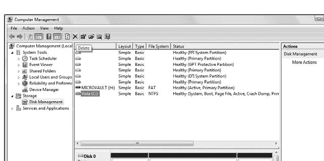

**图 2-1：** Windows 磁盘管理工具。

如果你查看 `Disk 0`、`Disk 1` 和 `Disk 2` 列表，你会看到其中一个框显示为 `Vista (C)`；那是 Vista 的安装分区。你还会看到一些显示为“未分配”（Unallocated）的框。它们是未被用于任何地方的空空间。你看到的 EFI 项目是为 Apple Intel Macintosh 准备的。

如果你发现一个大小为 10GB 或更大的未分配分区（参考图 2-1），请记录该分区位于哪块磁盘上，在在该磁盘上是第几个分区，然后直接跳到“处理磁盘分区”章节。如果你没有（或足够的）未分配空间，请保持此窗口打开，稍后跳转到本章后半部分的“创建空间”章节。

### 在 Windows 2000 和 Windows XP 中查看分区

Windows 2000 和 XP 操作系统仅允许账户控制和保护文件及文件夹；要获取计算机磁盘使用情况的信息，首先必须以管理员身份登录（或使用具有管理员权限的账户）。登录后，使用“管理工具”集合中的“计算机管理”应用程序查找计算机硬盘使用的详细信息。按照以下步骤操作：

1. 通过“开始：设置：控制面板”打开控制面板。
2. 打开“管理工具”文件夹并双击“计算机管理”图标。
3. 在“计算机管理”程序的左侧窗中，点击“磁盘管理”文件夹图标。

几秒钟后，右侧窗会显示计算机上存储设备的当前状态，例如硬盘、CD 驱动器、DVD/CD 驱动器等。图 2-2 是 Windows XP 磁盘管理的示例，Windows 2000 用户看到的视图几乎完全相同。

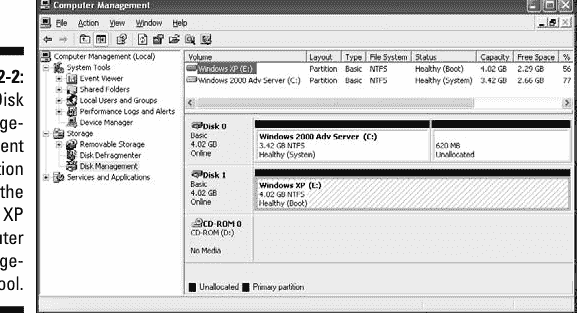

**图 2-2：** Windows XP 磁盘管理示例。

图 2-2 反映了一台有两个硬盘和一个 CD 驱动器的计算机。这里需要寻找的关键是磁盘列表中的“未分配”（Unallocated）一词——图中显示了一个示例。未分配分区未分配给任何操作系统，可以供你的 Linux 安装自由使用。

如果你发现了一个未分配分区（参考图 2-2），且其大小为 10GB 或更大，你可以对其设置。记录该分区位于哪块磁盘以及在该磁盘上的编号，然后直接跳到“处理磁盘分区”章节。例如，在图 2-2 中，该分区位于磁盘 1 上，编号为 2。

如果你有任何（或）未分配空间，请保持此窗口打开，稍后跳转到本章后半部分的“创建空间”章节。

### 在 Windows 98 中查看分区

的是，Windows 98 没有提供像 Windows 2000 和 XP 那样的图形化工具。它使用 `FDISK`，这是一个命令行工具，用于指示硬盘上的分区情况。要查找 Windows 98 中计算机硬盘的详细信息，请按照以下步骤操作。

> **请小心使用 `FDISK`**。如果你对其进行任何更改，可能会抹除你的数据。在退出提示符时，请务必保存任何更改。

1. 通过“开始：程序：MS-DOS 提示符”打开 MS-DOS 提示符。
2. 输入 `FDISK` 并按回车。

在 Windows 98 中，你可以大写输入 `FDISK`，或者任何你喜欢的混合大小写，只要你拼写正确 `FDISK` 即可！

你可能会被提示显示大的“磁盘”（驱动器）信息——“大”是相对于 Windows 98 中的硬盘而言的，这意味着大于 512MB 的驱动器。如果你没有看到提示，请跳到第 4 步，`FDISK` 菜单选项将与图 2-3 类似。

3. 如果看到大磁盘提示，在此提示处选择 `Y` 并按回车。出现 `FDISK` 菜单选项。

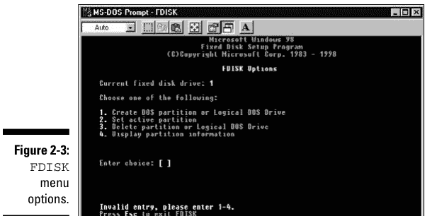

```
MS-DOS Prompt - FDISK

Windows 98

Fixed Disk Program

(C) Microsoft Corp., 1993-1998

FDISK Options

Current fixed drive: 1

Choose the following:

1. Create large partitions or Logical Drive

2. Select inactive partition as Logical Drive

3. Display partition information

Enter selection:

Invalid entry, please enter 1.

Press Esc to exit FDISK
```


## 第 2 章：为 Linux 准备电脑

### 显示当前驱动器信息

如果你有多个硬盘，`FDISK` 会显示一个 `5` 菜单，以便你在磁盘之间切换。


以下是使用 `5` 菜单切换到另一个磁盘的方法：

- a. 输入 `5` 并按回车。`FDISK` 屏幕显示系统中的所有硬盘。
- b. 输入你想要的磁盘编号然后按回车。`FDISK` 屏幕顶部显示 `FDISK` 正在操作的驱动器编号。

### 显示分区信息

若要显示分区信息，输入 `4` 并按回车。图 2-4 显示了一个示例。

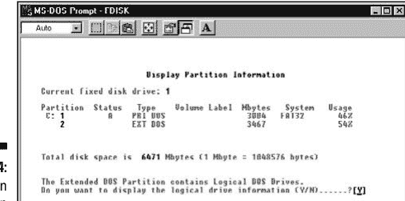

图 2-4 是 `FDISK` 中的分区信息。扩展分区总大小为 3467 MB（1 MB = 1048576 字节）：按 `ESC` 继续。扩展分区包含逻辑驱动器。`FDISK` 无法告诉你驱动器内部的情况。图 2-4 指出磁盘没有未分配空间。按 `Esc` 返回 `FDISK` 选项。

### 查看扩展分区内的逻辑分区

若要查看扩展分区内的逻辑分区，输入 `4` 并按回车。图 2-5 是分区设置的示例。在这种情况下，扩展分区内的所有空间已分配。你可以通过汇总使用百分比来判断是否有可用空间。如果总和为 100%，则没有可用空间。如果是如此（或可用空间少于 10GB），请打开此工具并进入下一节：“创建空间”。

- 如果你有 10GB 或更多可用空间，跳到“处理磁盘分区”章节。

## 创建空间

你可能出于多种原因需要调整分区大小。你可能有未分配空间，但少于 10GB。你可能有 10GB 的未分配空间，但它是分散在各个驱动器上的碎片，需要合并。（最常见的情况下），你可能完全没有任何未分配空间。在所有这些情况下，你都需要移动数据，以便为安装 Linux 和存储你想保留在 Linux 文件系统中的文件留出空间。

你可能需要比 10GB 更多的空间。例如，如果你下载大量多媒体，很快就会耗尽安装软件后的剩余空间！20GB 可能是个更好的目标——至少。

创建空间的关键在于（首先）确定你到底使用了多少磁盘空间，并记录这些信息以备后用。


- 记住，除非工具明确表示可以安全操作，否则不要尝试调整 Windows 分区。
- 在 Windows XP 和 2000 中，回到之前的章节“在 Windows 2000 和 Windows XP 中查看分区”中讨论的“计算机管理”工具，并查看容量、可用空间和百分比。

### 确定磁盘使用情况

在这里，你可以看到每个分区已经使用了多少空间，以及还有多少可用空间。

- 如果你正准备让一台老旧的 Windows 98 或 95 机器恢复到双启动状态，可以按此方法使用“计算机管理”工具：
  1. 双击“我的电脑”打开“计算机管理”。
  2. 选择“查看” -> “网页”。
  3. 选中你的第一个驱动器。

看起来类似于图 2-6 所示。

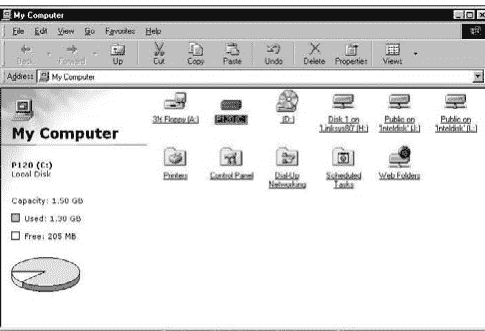

图 2-6：你的 Windows 98 C: 盘上有多少可用磁盘空间。

确定 Windows 安装需要多少空间——你不希望分区收缩得太厉害以导致 Windows 空间不足——还要查看你对电脑的使用情况。同样，如果你下载并保存大量的多媒体内容，留出足够的空间来适应你的下载习惯是明智的。

如果你发现所有驱动器都满了，没有剩余空间（或者你下载并保存了太多音频、视频或图形文件），可能是时候将某些文件刻录到 CD 或 DVD 了，这样你就可以从硬盘中删除它们。另一个选项是为电脑添加第二个驱动器——如果你不擅长自己操作，许多商店会付费为你安装驱动器。

当你决定了要调整大小的哪个分区后，请记住每个分区位于哪个硬盘上，以及它们是该硬盘上的哪个分区。

## 处理磁盘分区

在本章前面的“准备共同使用 Linux 和 Microsoft Windows”节中，我讨论了为什么你可能需要在一台已经运行 Windows 的电脑上为 Linux 留出磁盘空间。我涵盖的技巧假设你在调整分区大小后，已经找到了可以分给 Linux 的空闲空间。如果你是在全新的额外硬盘上安装、正在擦除整个硬盘以将其交给 Linux，或者已经有一块大于 10GB 的未分配/空闲空间，请跳到本章稍后的“双重检查硬件兼容性”节。


如果动 Windows 驱动器上的任何东西就让你感到不适，那么一个廉价的额外硬盘将价值连城。

### 选择分区工具

调整现有分区的最简单的方法是使用如 `Partition Magic` 之类的商业程序。`Partition Magic` 允许你查看硬盘的分区信息。你还可以使用此实用程序来调整分区大小、移动分区和添加分区。然而，如果你只想调整大小，并不需要特意去买软件。相反，你可以下载一个免费工具来帮你完成工作（如何操作请参阅下一节）。


没有任何工具是完美的。在继续操作之前，请对你 Windows 安装中任何不想丢失的物品进行备份！无论你选择什么工具，在分区的各个步骤中都可能出现问题。

### 使用 GParted 合并和调整分区大小

如果你发现有空闲空间，但需要将多个小碎片合并成一个大分区，你就需要调整某些分区的大小。你为此目的使用的程序是 `GParted`。该实用程序可以处理 Windows 分区，至少从 Microsoft Vista 的原始版本开始。

#### 获取 GParted

在使用之前，你需要下载 `gparted` 程序并将其刻录到 CD-ROM 中。按照以下步骤下载 `gparted`：

1. 访问 `http://gparted.sourceforge.net/`
2. 点击左侧的 `LiveCD` 链接。

你将来到 `gparted LiveCD` 页面，在那里你可以下载 ISO 镜像（将其想象为一个包含 CD-ROM 所需所有内容的 zip 压缩包，你可以通过它启动电脑）。启动后，你会发现自己处于 Linux 会话中，在那里你可以使用 `gparted` 调整你的分区。

3. 寻找“Download the latest version, here”这句话，并点击其中的链接。

在写作时，点击 “here” 单词。点击将带你进入列出所有 LiveCD 版本的页面。

4. 在最新（顶部）版本下，点击以 `.iso` 结尾的文件。

它看起来可能像 `gparted-lived-0.3.4-5.iso`。如果你只看到一列带有数字并以 `.iso` 结尾的名称，点击顶部文件，文件夹将打开并显示该文件。当你点击文件时，浏览器可能会询问你要对其进行处理。选择下载文件。与大多数 ISO 镜像相比，LiveCD 镜像很小，只有 52.8MB。它设计用于适合放入名片大小的 CD。

#### 将你的 ISO 刻录到 CD-ROM

你需要一台 CD 刻录机或 CD 重写机来继续（或者找一个拥有这种设备的朋友）。你还需要准备可写的 CD-ROM。

### 使用 GParted 调整分区

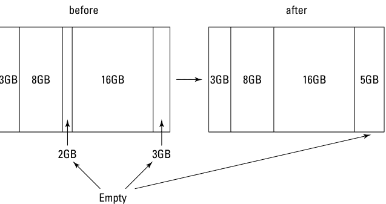

图 2-9：通过吸收空闲空间合并 2GB 和 3GB 的空分区，然后创建新空间以形成一个 10GB 的分区。

9. 点击“调整/移动”保存该分区的更改。
在屏幕底部，你刚刚请求的更改将出现在待处理更改列表中。你的硬盘尚未被永久修改。

10. 如果你还有其他想要更改的驱动器或分区，请返回第 5 步。否则，继续执行第 13 步。

11. 点击“应用”使更改生效。
出现“磁盘应用操作”对话框。

12. 点击“应用”确认你想要进行更改。
现在你的硬盘真正发生变化了！会出现“正在应用待处理操作”对话框，显示更改正在发生的过程。

13. 更改完成后，点击“关闭”。
对话框关闭，屏幕底部的待处理更改列表也会关闭。

14. 再次检查你是否为自己留了至少 10GB 的空闲空间，如果没有，请进一步调整大小。

15. 重启机器，在此过程中移除 GParted CD 或 DVD。
如果出现问题且你难以启动系统，请使用你的 Windows 系统恢复光盘（例如你的 XP 或 Vista CD）来修复损坏。幸运的是，这种损坏非常罕见！

## 双重检查硬件兼容性

如果你要在已拥有的硬件上安装 Linux，只需尝试一下，然后看看哪些地方无法工作即可。本节的部分内容涉及从通用意义上解决硬件问题。在其他章节中，将专门介绍更具体的项目，如声卡（第 13 章）、无线网卡（第 9 章）等。因此，如果你遇到困难，请从针对特定设备的章节开始，如果仍然无法解决问题，再来这里寻求更通用的帮助。

最大的问题领域是无线网卡（Fedora 项目正重点针对 Fedora 7）以及非常新的硬件，如显卡、声卡和图像扫描仪。在安装或购买新硬件之前，你可以检查硬件兼容性列表，但这些列表用途有限，因为硬件世界变化非常快。如果你感兴趣并查看，可以使用 `http://hardware.redhat.com/hcl/` 上的红帽企业 Linux 列表。（没有官方 Fedora 列表。）请记住，此列表侧重于业务设备而非家庭物品，所以如果你没有看到某项被列出，并不意味着它不受支持。

- 不要担心项目是否经过了“认证”（Certified，经过严格测试以确保其正常工作）。对于家庭用户来说，“受支持”（Supported）和“兼容”（Compatible）通常就可以了。判断某个硬件是否受支持的最佳方法是进行网络搜索。许多人去 `www.google.com/linux` 对硬件的型号和品牌加上“Linux”一词进行网络搜索。例如，你可以在 Innovation Linux 上搜索，看看其他人对该品牌和型号的硬件评价如何。（当然，这里并不意味着对示例中提到的任何硬件背书。）此类搜索可能会向你展示人们在该特定硬件上遇到的问题和取得的成功。

- 如果即使是想到计算机硬件都让你感到头晕，不要担心，你可以找到大量关于互联网的信息。一个很好的起点是 `www.tomshareware.com`。其他查找各种设备在 Linux 中如何工作信息的地方包括：
  - 以 Linux 为导向的网站：特别是通用的 Linux 硬件列表位于 `www.tldp.org/HOWTO/Hardware-HOWTO/`。
  - 厂商网站：许多厂商支持 Linux，但并不易于找到相关信息。通常情况下，如果硬件有论坛，请前往该硬件的论坛、硬件常见问题解答（FAQ），或者按照“支持”链接查找 Linux 的下载。如果发现下载，请不要下载你找到的内容。重点在于查看它们是否存在。供下载的驱动程序（告诉操作系统如何使用硬件的软件）实际上已经包含在你的 Linux 安装中了。仅从厂商处下载驱动程序。

### 笔记本电脑考虑因素

目前的 Linux 发行版在较新的笔记本和台式电脑上表现非常好。（参见 `www-linux.net`，这是一个关于 Linux 与各种型号兼容情况的优秀研究网站。）如果你的笔记本是常见品牌，你在安装 Linux 时不应该遇到任何问题。然而，笔记本电脑通常包含 WinModems（Windows 调制解调器，带有 Win 前缀的硬件仅用于 Windows，Linux 无法处理它们）。

如果你计划为 Linux 购买笔记本电脑，请检查它的调制解调器和其他硬件（例如网卡，确保它们不是 Win 品牌的）。如果笔记本的内置或默认硬件是 Win 标记的（或者你在研究该机器时发现它包含 Win 产品，即使它没有正确标记的话），你可能可以将冲突的硬件更换为 PC 卡（PCMCIA）。大多数笔记本电脑至少包含一个 PC 卡插槽，为你提供一个插入 PC 卡调制解调器、网卡或调制解调器-网卡合一卡的地方。只要你使用的是常见品牌的 PC 卡，它就应该可以在 Linux 上工作。

如果你需要使用调制解调器，花点钱买一个支持良好的调制解调器。（特别是关于 WinModems 的更多信息，请参阅第 9 章。）

## 最后，最后，在你开始之前

在继续安装 Linux 之前，你需要的最后一件事是可启动的第一张 CD 或 DVD。如果你的电脑没有 DVD-ROM 驱动器，请查看附录 B 中的各种其他选项。

如果你必须在 BIOS 中进行更改，务必在退出前保存它们！这很容易忘记，导致你最后纳闷为什么机器没有按照你的指令运行。

现在，在你继续进行之前，还有一件事我想让你做：访问以下 Fedora 网站并将其加入书签，以便在需要帮助时可以轻松访问和参考：

- [Fedora Project Wiki](http://fedoraproject.org/wiki/)
  Wiki 是一个集体维护的 Web 页面（或一组 Web 页面），任何人都可以进行更改（取决于 wiki 的设置，一组指定的人也可以）。Wiki 正在因生成基于社区的支持网站而变得流行，因为任何有贡献意愿的人都可以以极小的麻烦来帮助。
- [Fedora Documentation Project](http://fedoraproject.org/wiki/DocsProject)
- [Fedora Forum](www.fedoraforum.org)
- [Fedora News](www.fedoranews.org)
- [Unofficial Fedora FAQ](www.fedorafaq.org)
- [LinuxQuestions.org](linuxquestions.org)

如果你已准备好安装，请进入第 3 章。

## 第 3 章：安装 Fedora

本章内容

- 考虑安装前的最后关键问题
- 将 Fedora 作为个人桌面进行安装
- 首次启动 Fedora

> “要做，或者不做。没有‘尝试’这一说。” —— 尤达，《帝国反击战》

安装 Linux 不再需要奥秘的符号和复杂的魔法师咒语。图形化安装现在执行起来非常容易，并且对于来自其他图形化操作系统（如微软 Windows）的用户来说会很熟悉。本章将提供细节。

安装程序其实非常智能。你可能会发现你看到的屏幕和我在本章显示的并不完全相同。如果你看到不熟悉的内容或者没有看到这里提到的内容，请不要慌。安装程序只是根据你系统中的硬件以及你选择安装的内容来调整它提供的选项。

### 开始安装前需要考虑的事项

你可以通过以下方式安装 Fedora：

- 使用书中附带的 DVD-ROM 启动，并在初始菜单选择“安装/升级现有系统”。
- 使用 Fedora 安装 CD 启动（这是第 1 号 CD），前提是你自己下载了 CD 镜像。访问 `http://fedoraproject.org/wiki/` 并点击 Torrents 链接，找到 Fedora Core 7 Final，以及描述类似于“Fedora Core 7 binary iso images for i86”的条目，或者 x86_64 的条目（如果你使用的是 64 位的电脑）。
- 或者，你可以从第三方供应商（如 `http://shop.cheapbytes.com/`）订购。

在从 DVD-ROM 或 CD-ROM 开始安装之前，你可能首先需要更改系统以从 DVD-ROM 或 CD-ROM 启动——如今的许多系统已经配置了此项，所以你可能不需要进行任何更改。在第 2 章中，我涵盖了如何配置电脑从这些设备启动。

在本书中，我专注于 Fedora 7 主要有两个原因：

- 本书附带的 DVD 包含了 Fedora 7。
- 涵盖现有每种 Linux 发行版的安装将这本书变成一套百科全书。

此外，假设你想安装一个桌面系统。市上有大量关于服务器的书，我的目标是让《Linux 傻瓜》完全专注于那些想要将 Linux 作为其实桌面机器的用户——除了你在书中各处发现的几个“桌面支持”功能外，例如在“十锦”中。在如此规模的书中，无法以令人满意的深度同时涵盖桌面和服务器功能。

请注意，如果你安装的是红帽企业 Linux、某些版本的 Fedora 或不同的 Linux 发行版，你的屏幕看起来将与书中所示不同。每个 Linux 发行版的安装流程都涵盖了基本任务，但具体操作可能会以不同的顺序呈现，或者在屏幕上经过自定义显示不同。例如，一个发行版可能会在网络配置之前创建账户，而另一个则会将这两个主题顺序反过来。然而，大多数发行版都经过相同的基本选择，因此阅读本章对 Fedora 以外的内容仍然有所帮助。

对于 Fedora，在到达“关于安装 (GUI)”屏幕之前，你可以在不更改系统任何内容的情况下退出安装。在到达“关于安装”屏幕之前你所做的任何选项都不会保存到磁盘上。在你继续“关于安装”屏幕之后，数据就会写入磁盘，你的系统也会被更改。

### 开始安装过程

在本节中，我遵循图形化安装。如果你无法使用图形化界面，请遵循文本安装。

#### 语言选择

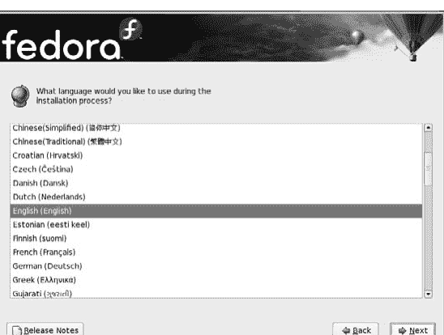

图 3-2：语言选择屏幕。

3. 使用鼠标或 `↑` 或 `↓` 键选择您的语言并点击“下一步”。

出现键盘配置界面，如图 3-3 所示。

#### 键盘配置

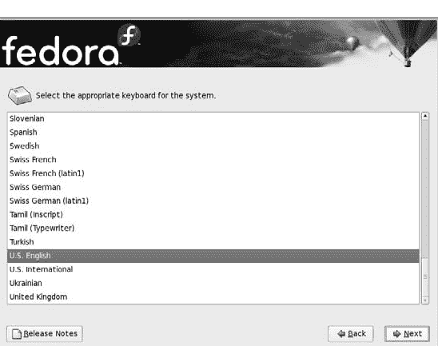

图 3-3：键盘配置界面。

不同语言在键盘上的按键布局不同；您可能想选择与您的键盘匹配的语言。（默认是美国英语。）

4. 选择您的键盘配置并点击“下一步”。

出现分区界面，如图 3-4 所示。系统提供了四个初始选项：

- **删除所选驱动器上的所有分区并创建默认布局**：清除您在此选项下方复选框中勾选的硬盘上的所有内容。
- **删除所选驱动器上的 Linux 分区并创建默认布局**：如果您已在此选项下方复选框中标记的硬盘上安装了版本的 Linux，安装程序将找到之前的实例并覆盖它，从而清除旧实例。
- **使用所选驱动器上的空闲空间并创建默认布局**：找到可用空闲空间并安装在那里。
- **创建自定义布局**：手动定义安装位置。如果您选择此路径，请参考旁边的侧栏“创建自定义布局”。

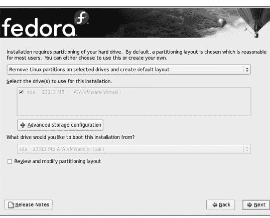

图 3-4：分区界面。

> **关于选择合适硬盘的提示**：您电脑的第一块硬盘是 `hda`，第二是 `hdb`，第三块是 `hdc`。（对于某些硬盘技术，第一块硬盘将是 `hde`，第二块是 `hdf`，以此类推——只需从低到高计数即可。）如果您有 SCSI 驱动器，您将看到的是 `sda`、`sdb` 和 `sdc`。

#### 创建自定义布局

如果您选择手动定义分区，将使用 Red Hat 的磁盘钻工具（Disk Druid）。Disk Druid 允许您定义现有分区并添加新分区。如果您不知道如何使用 Disk Druid，建议您不要继续。点击“返回”回到自动分区方案，然后不要从头开始，而是选择查看 Disk Druid 建议的自动设置。

您的文件系统是根目录，显示为 `/`。您需要一个挂载为 `/` 的分区，如果您不创建很多分区，则希望它越大越好。您还需要一个挂载为 `/boot` 的分区，该分区可以很小，大约 150MB。最后，您需要一个大小为电脑物理内存两倍的分区作为交换分区。交换分区没有显示挂载点，除非您有想要选择的交换分区。否则，对于 Fedora 而言，您将一直使用 `ext3` 作为您的文件系统类型，因为它是默认的。（我将在第 10 章中详细讨论这些内容）。

如果您选择“查看”并做出决定，有一些术语是您需要的：挂载点是一个设备（可能是您第一块 IDE 硬盘上的第一个分区，即 `/dev/hda1`），它挂载在您的文件系统（目录层次结构）中。

如果您很紧张且具备足够的技术来理解硬盘列表，在这样做时，会出现一个布局屏幕。选择删除现有分区的用户将会被询问是否真的想这样做。在实际执行任何操作之前，请参考您的笔记进行双重检查。

> **小心**——当您选择“删除分区”时，现有分区中的数据将会丢失。然而，它们不会立即被更改——直到最后的安装屏幕。

您还会发现一个“高级存储配置”按钮。只有当知道什么是 SCSI 和 DM RAID 并需要处理它们时，才关注它。

5. 选择合适的选项并确保选择了正确的驱动器；然后点击“下一步”。

点击后，出现的内容取决于安装程序决定显示什么。您可能会发现处于 GRUB 引导加载程序界面。在这种情况下，您可能正在删除 Windows 或正在设置双系统。如果您让 Linux 和 Windows 共享一台电脑，请确保它们都在选项列表中。请确保在您想要默认启动的操作系统上勾选“默认”复选框。

否则，出现网络配置界面，如图 3-5 所示。

#### 网络配置


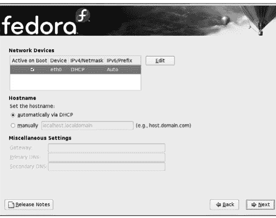

如果您没有网线，则不会看到此界面，请跳到第 7 步。

6. 配置您的网络。使用 DHCP（动态主机配置协议）可以让电脑自动获取设置。否则，对于 Fedora 而言，您将手动设置。

如果您使用 DHCP，唯一想要更改的项是主机名。如果您不使用 DHCP 而是使用静态网络，请执行以下步骤：

- a. 选择“手动”按钮。
- b. 在“网络设备”框旁点击“编辑”。出现编辑对话框。
- c. 在“启用 IPv4”部分，勾选 IPv4。
- d. 如果您需要 IPv6，请勾选此框。
- e. 点击“确定”关闭对话框。
- f. 在“主机名”框中输入主机名。
- g. 在主界面，输入网络给您的网关和 DNS 服务器。

如果您的网络有多个 DNS 服务器，可以输入最多三个 DNS 服务器地址——DNS 服务器帮助电脑找到网络上的其他机器。

7. 设置好后，点击“下一步”。

出现时区选择界面，如图 3-6 所示。

8. 选择您的城市，或者如果没有找到，选择一个具有相同选项（例如夏令时）的其他城市。

9. 点击“下一步”进入下一步。
出现根密码界面。

10. 在根密码界面，在根密码字段中输入根（管理员）账户密码，然后在确认字段中输入相同的密码。

> **不要忘记您的根密码！** 您在 Linux 盒上执行任何管理任务都需要它。如果确实忘记了，请参阅第 22 章了解如何重置它。

11. 输入两次根密码后，点击“下一步”。

出现应用程序类型界面，如图 3-7 所示。

#### 软件选择


默认安装包含了一组供普通互联网使用的软件。您希望系统支持哪些额外任务？

- 办公与生产力
- 软件开发
- Web 服务器

请选择任何您希望用于软件安装的附加存储库。

- 添加额外的软件存储库

您可以现在自定义软件选择，也可以在安装后通过软件管理应用程序进行。

- 稍后自定义
- 现在自定义

12. 添加或删除包类型以自定义您的系统。

要添加一个类型，其复选框中必须有一个勾选。要移除一个类型，方框必须为空。你可以通过点击框框来添加或取消检查。

可用的组有：

- **办公与生产力**：假设你正在设置一个桌面系统，所以你希望确保选中了此项。
- **软件开发**：如果你是一名程序员，你想要添加此组。否则，你可以不需要它。
- **Web 服务器**：如果你想在该系统上运行 Web 服务器，或者只是想实验一下 Apache Web 服务器，请添加此项。否则，你不需要它。

请记住，最后两个选项超出了本书的范围。

13. 在屏幕底部，选择“现在自定义”，然后点击“下一步”继续。

出现软件包选择界面，如图 3-8 所示。

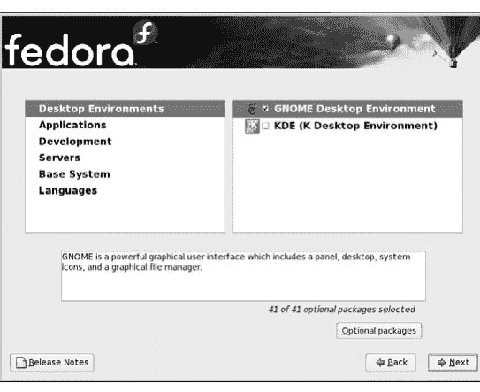

图 3-8：软件包选择屏幕。

14. 如果你想在系统上同时安装两个主要的图形界面，请点击 KDE（K 桌面环境）。

本书中我重点关注 GNOME（参见第 5 章和第 8 章），但 KDE 在许多 Linux 用户中也很流行。

15. 点击“应用程序”。

右侧将显示该类别下可用的软件包类型。你可以从左侧选项的任何地方开始，但我认为这个部分可能是一个很好的例子。

16. 滚动查看右侧的列表。确保你需要的组的复选框已勾选，而不需要的组未勾选。

你可以点击组的名称来查看其描述。

17. 如果你想查看该组的可选软件包（程序），在选中该组时点击“可选软件包”按钮。

如果该组尚未被标记为要安装，则此按钮将不可用。对于每个软件包组，都有默认安装的程序，以及被认为是可选的程序。你必须自己选择可选软件包才能安装它们，并在点击该组的“可选软件包”后打开的“软件包”对话框中进行操作。阅读描述并从复选框中添加/取消勾，直到对你的选择感到满意，然后关闭对话框。

18. 当你完成每个组可选软件包的选择后，选择左侧的下一个类别（例如，用于软件编程工具的“开发”），然后返回此处第 16 步。

19. 当你检查完所有可能性后——你以后可以更改安装的内容——点击“下一步”。

首先，会弹出一个对话框，告诉你安装程序正在检查你选的软件列表。如果它发现你漏掉了所选软件依赖的程序，它将为你提供添加这些程序的机会。完成后，将出现安装屏幕。

> 如果你想停止 Linux 的安装和/或对硬盘的更改，安装屏幕是你可以在不更改驱动器任何内容的情况下停止的最后位置。要停止安装，按下 `Ctrl+Alt+Del`，系统将重启。如果你这样做了，且不打算重新安装，请务必取出 DVD 或第一张 CD。

20. 你准备好执行安装了，点击“下一步”。

如果你从 CD 安装，可能会出现“所需的安装介质”对话框，准确告诉你安装所需的哪些 CD。如果你使用 CD，根据软件请求，你可能不需要所有的 CD。

此后，会出现软件包安装屏幕。系统首先准备安装并开始安装。在系统安装时，你会看到每个正在安装的软件包的名称，以及总安装的进度条。


软件包安装完成后，你到达了最终安装屏幕，屏幕上有以“恭喜，安装完成”开头的文字。CD 或 DVD 会自动弹出（不要手动弹出）。在你移除安装介质后，点击“重启”重新启动你的机器，并进入本章的下一部分，“你的首次启动”。如果你想关闭电脑，在此时这样做是安全的。下次启动时，你将进入下一节“你的首次启动”中讨论的过程。

### 你的首次启动

当 Fedora 系统首次启动时，你有第一次机会看到启动菜单闪过。那是一个蓝屏，在进入默认选择之前为你提供三秒钟。如果你选择 Windows 为默认，按任意键（如空格键）进入菜单，选择 Linux 条目并按回车。如果 Linux 是默认值（唯一安装的系统），只需坐好让机器自行启动。如果由于任何原因你的电脑在此处无法启动，请参阅第 4 章。

电脑首次启动时，你会看到首次启动欢迎屏幕。按照以下步骤完成机器的初始设置：

1. 点击“向前”继续执行设置程序。

出现“许可协议”屏幕。

2. 通读文本，选择“是，我同意许可协议”，然后点击“向前”。

出现“防火墙”屏幕，如图 3-9 所示。

防火墙保护你免受未经授权的访问和发现。当你高速连接到互联网时，你的电脑就变成了数十万台机器之一。我希望能告诉你并没有无数的人和程序试图入侵你的电脑，但我做不到；那里有一大群这样的存在者。防火墙是你防御网络混合体、病毒、蠕虫以及可能尝试通过本应关闭的门进入的其他项目的第一道（但不是唯一的）屏障；更多信息请参阅侧边栏“防火墙与你”。


#### 防火墙与你

任何连接到互联网的人，特别是使用宽带（可用连接类型参见第 9 章，宽带主要是 DSL 和电缆），都应该拥有某种防火墙。你可以购买防火墙设备（连接到你的互联网连接和电脑的特殊小盒子），或让 Linux 机器为自己提供防火墙——甚至为你的整个家庭或业务网络提供。虽然这是一个广泛的话题，足以写成一整本书，但我们在第 9 章和第 19 章中涵盖了一些基础知识。在此期间，至少为这台机器配备防火墙。

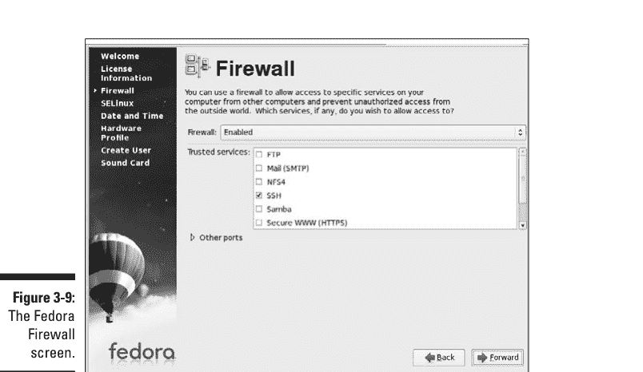

图 3-9：Fedora 防火墙

3. 除非你百分之百确定这台电脑对于互联网以及你家里或办公室网络中的其他机器都是安全的，否则请将防火墙设置为“已启用”。

请记住，在病毒和蠕虫之前，大多数计算机故障源于内部而非外部。如果你坚决要关闭防火墙，请选择“禁用”。祝你好运！

4. 确定让哪些可用服务通过你的防火墙。

我建议启用 SSH，以便你远程访问这台电脑，并使用第 18 章中讨论的技术。虽然本书中没有介绍你自己的 Web 服务器，但你可以在这台电脑上运行一个——如果是这样，你还将想要启用 WWW (HTTP) 和安全 WWW (HTTPS)。FTP（对于移动文件非常方便）和邮件 (SMTP) 也是如此。对于我的桌面机器，我倾向于勾选 SSH 和 FTP 条目。关于如何使用 FTP 客户端从这台机器获取文件，请参见第 8 章。

5. 在你想要启用的每个项目旁边，点击框使其带有标记；准备好继续时，点击“向前”。

## 第 4 章：Fedora 的启动与停止

**本章内容**

- 理解开启 Linux 机器时发生了什么
- 安全地识别并隔离启动问题
- 从你的机器上卸载 Linux

> 我喜欢工作；它令我着迷。我可以静静地看着它几个小时。
> — 杰洛·K·杰罗姆

我从第 3 章来到这里，你可能刚刚挺过了 Linux 世界的第一场考验：安装操作系统。希望你的第一次启动运行良好。如果一切顺利，且你认为本章的大部分内容不适合你，至少可以跳到本章末尾的“不要只管关机！”一节。否则，如果你想了解你的机器在启动时做了什么（本章的内容可能会变得复杂），请继续读下去。

你的 Linux 安装无法正常启动并不意味着就是紧急情况。本章的大部分内容都是为了帮助你解决可能遇到的任何问题。在开始配置 Linux 之前，请记住，安装操作系统并不是一项轻易的任务——因为这种安装涉及许多技术变量，许多计算机制造商坚持由他们为你完成这项任务（你上一次自己安装 Windows 是什么时候？）像惠普、戴尔和沃尔玛这样的公司一直提供预装 Linux；或者如果你现在对此太畏惧，或者正在预读且太紧张不敢尝试，你可以使用第 2 章讨论的 Linux LiveCD，或者从供应商或本地电脑装机商购买预装机器。

要解开无法启动的 Linux 系统的谜团，需要对计算机如何启动有一定的了解。至少，能够告诉维修人员问题似乎在哪里可以让你感到不那么恐慌——甚至可以为你节省一些费用，因为加快了故障排除的速度。

### 让 Linux 启动

面对吧：尽管盯着沉睡的电脑是一种享受体验，但真正的乐趣在你开启它时开始。和任何电子设备一样，开启电子流是开启乐趣的第一步。然而，计算机的功能比你的烤箱要多得多。你的计算机不仅仅是加热一个加热元件，还可以冷却你（或制造商）插入主板的所有奇妙设备。在初始上电后，你的电脑会执行一些硬件测试（称为 POST，即通电自检），以确定这些各个组件是否工作正常。

检查所有硬件只是开始。从你开启电脑到显示器上的发光磷提示你输入登录名称之间，电脑正在构建它自己的帝国。如果你仔细听、观察，你的电脑和显示器通过蜂鸣声、嗡嗡声、电机旋转声、咔哒声、显示器上的信息和闪烁的灯光显示启动过程的迹象。

尽管你听过“罗马不是一天建成的”这种陈词滥调，但启动过程相当快。这非常令人惊讶，考虑到操作系统的架构让罗马看起来像一堆纸箱；每当你启动电脑时，它都必须在内存中构建整个操作系统。（记住，操作系统是让你的电脑运行的核心软件。）这个过程可以分为四个主要步骤，我将在后续章节中讨论它们。

#### 步骤 1：通电自检 (POST) 进入 BIOS

POST 过程实际上与操作系统完全无关。当你运行 Linux 或其他操作系统（如 Windows Vista）时，电脑会执行这一步。

POST 失败的一些症状包括：

- 一系列不寻常的长短促蜂鸣声
- 显示器上无显示
- 除了电脑机箱内由于烧毁电子元件的风扇旋转声外，没有明显的活动
- 显示器上显示的错误信息，指示硬件故障

如果你遇到这些任何问题，说明你的硬件出了故障，在继续之前需要解决它们。如果你的电脑在你开始安装 Linux 之前运行正常，那么你的电脑应该能够顺利通过 POST——POST 问题通常不是由安装新操作系统引起的；它们是电脑本身更根本的问题。

对于最后这些错误，是时候怀疑你的侄子莫蒂默了，他曾看到拿着螺丝刀在你的电脑附近徘徊。（或者把你的电脑带到电脑维修店！）如果你看到指示硬件故障的错误信息，你可能可以在 BIOS 中修复问题。当 POST 完成工作并结束时，它会短暂地（在屏幕底部）显示进入“setup”（指 BIOS）的指令。通常，这些指令会提到按下 `DEL` 键或功能键如 `F1`。当你按下此键（如果一切顺利的话），你通常会看到一个带有黑白文字的蓝屏。这就是 BIOS。从这里，如果你熟悉你的硬件，可以尝试弄明并修复问题。然而，许多人宁愿接受不打麻醉的根管治疗也不愿碰这些东西；所以你可能会找来最近的青少年或电脑维修大师，恳求他们看一看。

好消息是，如果你能进入 BIOS，那么问题的修复可能比在电脑到达 BIOS 之前就故障的情况要简单。

#### 步骤 2：BIOS 将接棒交给引导加载程序

在 BIOS 对成功的 POST 给出确认信号后，BIOS 定位系统中的第一块硬盘并读取该磁盘的第一个扇区，该区域通常被称为 MBR（主引导记录）。在磁盘的第一部分上有一个名为引导加载程序的小程序。引导加载程序对任何事情都不了解，除了启动你的操作系统。

有两个引导加载程序知道如何加载 Linux：`LILO`（Linux Loader）和 `GRUB`（通用引导加载程序）。自从 Linux 出现以来，`LILO` 一直是一个可靠的引导程序；`GRUB` 则更新且功能更强大。许多发行版允许你选择引导加载程序。通常，大多数人使用默认值，在 Fedora 中是 `GRUB`。

有时引导加载程序会发生“坏事”。引导加载程序的常见症状是提示找不到操作系统。另一个引导加载程序问题的提示是你从未见过启动菜单——这是启动过程中出现的、给你三秒时间按键选择操作系统的蓝屏。

如果你怀疑引导加载程序问题，请查看本章的“进入救援模式”。该章节将帮助你解决问题。如果不起作用，根据错误信息，你的硬盘可能损坏了，或者硬盘相关的其他硬件可能坏了。

#### 步骤 3：引导加载程序将系统内核加载到内存

每台计算机和电子设备都需要操作系统来运行。这种操作系统的技术术语，或者它的核心，被称为内核。如果内核是你的大师，协调电脑的所有组件并逻辑合作地分配资源，那么引导加载程序就是大师抵达的红毯。

当你看到这样的文本时，引导加载程序会将控制权交给内核：

```


Uncompressing Linux... Ok, booting the kernel.

aud(1092566112,337:0): initialized

当然，这些文本可能会闪而过。只需记住，你在看到这些之后，可能会看到类似的内容：

- 系统冻结
- 显示器顶部出现点，然后系统冻结
- 屏幕上出现几条信息，最后的消息显示 kernel panic（内核恐慌）
- 系统自动重启

如果你刚刚安装了 Linux，发现它无法正常启动，请尝试重新安装。奇怪的是，这可以解决问题。

# 第 4 章：启动与停止 Fedora

你的内核可能出了问题。如果启动继续通过那一步，内核会在你的屏幕上向下滚动，因为它正在寻找系统所有的硬件并加载处理它们所需的内容。在此阶段的任何地方，如果你又遇到了刚才提到的问题列表，那再次属于内核故障的范围（你甚至可能会看到内核恐慌 kernel panic）。

从内核加载失败或恐慌中恢复（上一节描述的未找到操作系统的情况外）是 Linux 中更有挑战性的问题之一。遗憾的是，这项任务并不适合胆小者。另一方面，除非你刚刚安装了系统，否则失败的内核很可能是你通过更新过的某一个。在这种情况下，你很幸运。记下你看到的任何错误信息。然后重启，按任意键选择启动菜单，并从顶部向下选择 Linux 选项（默认）。那是下一个内核。按回车键，你应该可以正常启动（如果没有，重启并尝试第三个，以此类推，直到启动成功）。当你再次运行系统后，你有两个选择。你可以访问 www.google.com 并搜索你找到的特定错误信息来弄清楚出了什么，或者等下一次内核更新发布并希望它不会启动失败。

如果是原始安装没有正常启动，那么你有一个回退内核选项。如果这是你的问题，许多人只需重新安装并希望此操作能修复一切。通常情况下，确实如此。否则，尝试前面提到的方法进行搜索，或者查看第 2 章了解在 Linux 社区中寻求帮助的地方。

## 第 4 步：控制权交给 init

当内核完成加载后，它会将启动过程传递给一个名为 `init` 的程序。`init` 程序负责启动所有的和服务程序。你可以看到这些程序在启动，它们在屏幕上向上滚动，并在显示器右侧显示 [OK] 或 [FAILED]。如果你看到这些行，请知道你的内核已成功完成任务。

你在 init 服务（在后台运行的程序）时可能遇到的主要问题是：其中一个或多个可能无法正常启动，正如启动过程中显示的 [FAILED] 状态所示。服务失败通常是因为配置错误或不支持的硬件驱动程序。如果某个服务无法启动，并不是世界末日，有时你可能需要等待几分钟，一个非常顽固的服务才会向系统承认它无法运行。请耐心等待并记录下哪个服务在给你带来麻烦。稍后，你可以查阅第 18 章，找到如何关闭该服务，以便它以后不再出现问题。

## 进入救援模式

重型系统修复通常发生在救援模式（rescue mode）中——这是一个特殊的启动选项。该选项的优点是，如果你安装的系统已经彻底坏了，你可以进行必要的系统手术。缺点是这是一个纯命令行界面——你必须精通相关知识才能找到路。

附录 A 包含了一份可以尝试帮助你的 Linux 命令列表。第 22 章讨论了诸如如何从救援模式修复引导程序（如果你的问题出在引导程序上），以及如何跟踪内核可能留下的错误信息。你可能还可以通过查看你所发行版的文档和在线论坛找到有用的提示。

在 Fedora 中进入救援模式（它是基于文本的，准备好打字！），将 DVD 或你的第一个 CD 插入 DVD-ROM 或 CD-ROM 并启动机器。然后按照以下步骤操作：

1. 当第一个磁盘加载时，从菜单中选择 Rescue Installed System（救援已安装的系统）并按回车。此操作开始将系统引导维护模式。
2. 选择你的语言并按回车。
3. 选择你的键盘类型并按回车。救援系统会运行一段时间，在慢速系统上可能需要一两分钟。
4. 当询问你是否想要启动网络接口时，除非你知道你需要下载什么，否则回答 No（否）。
5. 在救援界面，选择提供的三个选项之一，然后按回车。

你的三个选项是：
- **Continue（继续）**：救援界面为你查找你安装的 Fedora Core 系统。
- 如果你选择此选项（或下一个）且失败了，你可能需要重启并重新启动救援系统。重启后，选择 Skip（跳过）。
- **Read-Only（只读）**：与 Continue 相同，但你无法对硬盘安装内容进行任何更改。
- **Skip（跳过）**：如果你选择这一项，就像是在说*别费劲定位文件系统了，直接给我一个提示符！*

我假设你选择了 Continue。如果是这样，会出现一个窗口向你提供有关已发生情况的信息。你将在下一个步骤中看到它给你的指令副本，所以不用担心按回车关闭窗口。你不会丢失这些信息。

当你按回车时，会出现一个 shell 提示符（救援命令行出现），你现在可以访问救援界面了。

6. 如果救援过程能够加载你的 Fedora 安装，则会出现 `root/mnt/sysimage`。这样做使你能够使用 `/mnt/sysimage`。
7. 完成后，弹出 CD 或 DVD。

## 不要直接关掉机器！

即使你决定关闭，Linux 用户也有方法可以正常关机：
- 如果你在 GUI（图形用户界面）中，请注销账户并关机（Down）。
- 如果你有命令提示符，输入 `halt` 命令；按回车键后 Linux 关机。
- 如果你有命令提示符，输入 `reboot` 命令；按回车键后 Linux 重启。

如果你不小心切了 Linux 的电源，请不要灰心；一切尚未为 true。通常情况下，你可以重启并从中断的地方继续。然而，你可能需要通过快速文件系统检查作为代价。这个过程与 Windows 在非正常关机时使用的过程类似。操作系统可能需要扫描其驱动器以确保正常。

如果你经常受到短暂停电或导致电脑重启的电压波动困扰，请考虑为你的电脑买一台 UPS（不间断电源）。这些沉重的充电电池不仅可以保护电脑免损坏（阅读包装以查看特定 UPS 提供的功能），还可以提供额外的几分钟或更长时间电力，这样你在停电时就有机会复制文件并关闭机器。更好的是，对于那些真正的波动，如果你有 UPS，唯一需要处理的不便就是。

## 从你的系统中移除 Linux

虽然我不希望看到你离开 Linux 宇宙，但也不希望当你不想使用它时，却被困在 Linux 中！最简单移除 Linux 的方法取决于你想做什么：

- 如果你想用 Windows 替换 Linux，只需在机器上安装 Windows。它将覆盖所有的 Linux 内容，包括启动菜单。
- 如果你想从双启动设置中移除 Linux，请进入 Windows，访问命令提示符并输入 `fdisk/mbr`。此操作会移除 Linux 引导程序。它不会删除 Linux，但你随后可以将 Linux 驱动器或分区格式化供 Windows 使用。

Windows XP 和 Xandros 用户可以使用特殊的命令来移除此发行版。通过放入 Windows CD-ROM 启动机器进入恢复控制台。在命令提示符处输入 `fixmbr`，然后（哦对了）按回车。

# 第 5 章

## 检查桌面

在本章中

- 利用命令行
- 了解 GNOME 基础
- 自定义 GNOME

> 巴士站是汽车停止的地方。
> 火车站是火车停止的地方。
> 我的办公桌，我有一个工作站 . . .
>
> — 史蒂芬·莱特

很多人喜欢将 Linux 描述为类 DOS 的环境，在这个充满古董感的世界里，你只能输入大量晦涩的内容，而没有任何精美的图片。然而，正如你将在本章中看到的，Linux 桌面为你提供了一个非常棒的工作环境。酷的一点是，它的大部分内容都是可配置的。喜欢自定义系统的人可以在更改设置时获得无尽的乐趣。

## 充分利用命令行

Linux 命令行界面可能会让某些人想起旧的 DOS 时代，但它提供了一种输入命令和执行操作的快速、高效的方法。即使你主要是一个“点击鼠标”型的人，在习惯了使用命令行后，你会发现在那里面执行某些任务比在 GUI 环境中使用鼠标操作要快得多。不过，如果你倾向于使用 GUI 界面作为工作环境，你可以轻松打开一个终端窗口（这是一个命令提示符窗口）来执行你的命令驱动任务，而无需完全离开点击环境（参见第 6 章）。

关于命令行界面，有一些你可能会觉得有趣的知识。Linux 命令行与其他界面命令（如 Windows MS-DOS 提示符）的区别之一是 Linux 命令是区分大小写的。输入 `LS` 与输入 `ls` 完全不同，事实上你会收到错误，因为没有 `LS` 命令。Linux 命令行还具有自动补全功能。如果你知道命令或文件名的前几个字符，输入部分并按 Tab 键即可自动完成剩余部分。例如，如果你尝试使用 `less` 命令查看文件 `/home/bob/grocery_list` 的内容，你可以输入 `/home/bob/gro` 并按 Tab 完成完成文件名。然而，如果你有一个子目录（文件夹）`/home/bob/group_projects`，你会听到哔的一声。你可以再次按 Tab 键或用鼠标双击来查看输出：

```
grocery_list    group_projects
```


这里酷的地方在于，当你输入 `less gro` 时，命令提示符会列出这些项目，所以你不需要重试！你可以发现输入一个 `c` 就明确了你指的是 `grocery` 而不是 `group`，所以只需添加 `c` 变成 `less groc` 并再次按 Tab 完成自动补全。这种技术可以节省你大量的打字时间，对于长文件名更是如此！

大多数 Linux 发行版还会保留最近使用的命令运行历史。要使用此列表，请按键盘上的向上箭头。此操作会调出你输入的上一条命令。当你继续按向上箭头时，你将从最近到过去的顺序遍历最近输入的命令。如果你不小心跳过了你想找的内容，使用向下箭头返回。当你需要的命令在命令提示符上出现时，按回车键执行命令，或者对其进行编辑后按回车键。

在第 6 章中，我将更详细地介绍命令行环境。

## GNOME 桌面

GNOME 代表 GNU Network Object Environment（GNU 网络对象环境）——尽管这个缩写并不能告诉你太多信息！简单来说，GNOME 是一个完整的鼠标点击式环境。图 5-1 显示了你登录 Fedora 系统后看到的内容。

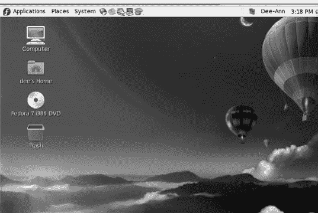

图 5-1：Fedora 7 中的默认 GNOME 桌面。

了解更多关于 GNOME 的信息，请访问 GNOME 主站 www.gnome.org。

> 请记住，你拥有的程序取决于你选择的安装类型以及你的自定义；如果你在这里看到的与描述或图中不同，不要惊慌！

GNOME 桌面环境分为四个部分：

- 菜单
- 屏幕顶部的菜单和图标面板
- 屏幕底部的桌面面板
- 桌面上的图标

## 菜单

GNOME 有三个主菜单，它们在顶部面板上均可见。从左到右它们是：

- **应用程序**：通过图形用户界面 (GUI) 可用的程序。（参见表 5-1）。
- **位置**：硬盘上特殊位置的快捷方式。（参见表 5-2。注意，你不一定得在“位置”中使用为你创建的特殊目录，如“文档”、“图片”等。）第 8 章将更详细地介绍此菜单及其用途。
- **系统**：个人和系统设置，以及更通用的整体系统命令。（参见表 5-3）。

带有向右箭头的菜单项提供子菜单，你可以通过将鼠标悬停在菜单选项上打开它。子菜单内部通常包含更多程序。

| 表 5-1 | 应用程序菜单内容，按顺序列出 |
| 菜单选项 | 你能找到的内容 |
|---|---|
| 附件 | 小而特定的程序。包含计算器、字符映射表、截图、文本编辑器等 |
| 游戏 | 游戏集合 |
| 图形 | 各种图形程序，包括 GIMP（参见第 14 章） |
| 互联网 | 第 10 章介绍的互联网工具，如 Evolution（邮件和日历）、Gaim（即时通讯）和 Firefox（网络浏览器） |
| 办公 | 第 12 章介绍的办公套件 |
| 声音与视频 | 用于处理硬件的程序，如 CD 播放器和录音机 |
| 系统工具 | 用于管理、监控和更新系统，如文件浏览器和软件更新程序 |
| 添加/删除软件 | 打开软件安装与移除 |

| 表 5-2 | 位置菜单内容，按顺序列出 |
| 菜单选项 | 你能找到的内容 |
|---|---|
| 文档 | 用户的文档目录，你可以在这里放置处理的文件 |
| 音乐 | 用户的音乐目录，你可以在这里保存音乐文件 |
| 图片 | 用户的图片目录，你可以在这里保存图像 |
| 视频 | 用户的视频目录，你可以在这里保存视频 |
| 下载 | 用户的下载目录，下载内容存放处 |
| 计算机 | 系统上的可用硬盘和临时介质 |
| CD/DVD 创建器 | 用于汇总要刻录到 CD 或 DVD 的文件的文件夹 |
| 网络 | 网络上可用计算机和硬盘 |
| 连接服务器 | 连接许多不同类型服务器的工具 |
| 搜索 | 文件系统搜索工具，不仅可以搜索文件名，还可以搜索文件内容 |
| 最近文档 | 最近打开的文档 |
| 主目录 | 第 7 章介绍的用户主目录内容 |
| 桌面 | 用户的桌面目录内容，包含应出现在桌面的文件和文件夹 |

| 表 5-3 | 系统菜单内容，按顺序列出 |
| 菜单选项 | 你能找到的内容 |
|---|---|
| 偏好 | 你的个人设置 |
| 管理 | 系统级设置 |
| 帮助 | GNOME 帮助工具 |
| 关于 GNOME | 关于 GNOME 的信息 |
| 关于 Fedora | 关于 Fedora Core 的信息 |
| 锁定屏幕 | 设置机器使无人输入密码无法使用你的 GNOME 登录 |
| 注销用户 | 允许离开当前会话 |
| 关机 | 休眠（进入睡眠/休眠模式）、重启或关机（关闭机器） |

## 锁屏工具

如果你开启了屏幕保护程序，并且屏幕保护程序出现或变为黑色。那么，当任何人移动鼠标或使用你的键盘时，就会弹出一个对话框，其中有你的登录名称和一个密码字段。你可以通过输入密码返回工作。在此之前，你可以放心地知道，没有其他人可以操作你的电脑，并伪装成你向你的老板发送一封幽默邮件。请注意，如果你以 root 用户身份登录，则锁屏选项将不起作用。

此功能在 Fedora 中默认开启的。若要关闭它，请执行以下操作：

1. 打开 `系统` -> `偏好` -> `外观和字体`

出现屏幕保护程序对话框，如图 5-2 所示。

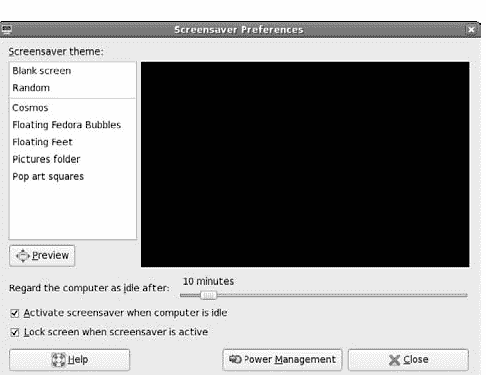

> 图 5-2：GNOME 屏幕保护程序偏好对话框。

2. 取消选择“在屏幕保护程序运行时锁定屏幕”复选框。

3. 完成更改后，点击关闭。

对话框关闭。

在此对话框中，你还可以更改是否开启屏幕保护程序、屏幕保护程序启动的时间，以及使用哪种屏幕保护程序。

你还可以点击“电源管理”按钮进入更多设置。

# 第 5 章：查看桌面环境

## 面板

在你的 GNOME 桌面的顶部和底部有一对面板。由于这些栏被整齐地划分为若干区域，请从左到右（从顶部面板开始）查看每个区域的内容。在顶部面板的最左侧是本章之前“菜单”部分中讨论的三个菜单。

当你继续向右移动时，你会遇到一组图标（参见图 5-1）。你可以通过菜单访问所有这些项目，但将它们放置在面板上是为了方便查找。在 Fedora 中，这些图标是：

- **Firefox**：点击带有鼠标指针的地球仪图标可打开 Firefox Web 浏览器。（更多信息请参阅第 10 章。）
- **Evolution**：紧邻网络浏览器右侧；启动电子邮件和日历程序。（更多信息请参阅第 10 章。）
- **OpenOffice.org Writer**：打开 OpenOffice.org Writer 文字处理程序。（更多信息请参阅第 12 章。）
- **OpenOffice.org Impress**：打开 OpenOffice.org Impress 演示程序。（更多信息请参阅第 12 章。）
- **OpenOffice.org Calc**：打开 OpenOffice.org 表格处理程序。（更多信息请参阅第 12 章。）

然后你会看到一个空白区域，你可以在那里添加新图标。在 Fedora 中，空白区域右侧从左到右显示如下——尽管你的特定安装版本可能显示额外的选项：

- **更新插件**：取决于是否有可用更新，此插件可能不可见。你可以看到有多少更新等待你下载。只需连接互联网，点击插件图标并点击“应用更新”即可下载并安装。
- **用户切换器插件**：如果你创建了多个用户账户（root 不在此计数），点击顶部面板上的你的名称将列出系统中其他用户的列表。你可以使用此插件临时切换到另一个用户账户。如果你没有创建其他账户，点击你的名称只会显示你的名称。
- **日期和时间插件**：在这里你可以看到日期和时间，取决于此插件的配置。
- **主音量控制插件**：点击此打开主音量控制。

现在看底部面板。从左到右，你在面板上找到：

- **隐藏/显示桌面应用程序**：此按钮可以让你立即最小化所有运行中的程序，然后只需点击一下即可重新打开。
- **任务栏**：在这个大空间内，你可以找到桌面每个程序的条目。你可以按照指示使用框来更改程序状态：
    - 如果程序被最小化，你可以点击其任务面板框来打开其窗口。
    - 如果程序已最大化但埋在另一个程序下方，点击面板上的其任务框将其置于顶层。
    - 如果程序已最大化并处于最上方，你可以通过点击其任务面板框将其最小化。
- **工作区切换器**：允许你在同一个登录会话周围的四个不同环境中工作。每个桌面环境具有相同的菜单、面板和背景，但你可以在每个环境中运行不同的程序。这是在运行多个程序时保持井井有序的简单方法。尝试一下。这就像在一个显示器里有四个显示器！
- **垃圾桶**：指向桌面垃圾桶的快捷方式。


现在如何将程序从一个工作区窗口移动到另一个？点击程序左上角的图标并选择以下选项之一：

- **始终在可见工作区显示**：使窗口在四个工作区都显示。
- **仅位于此工作区**：保持窗口不出现在其他工作区（默认情况下）。
- **移动到右侧工作区**：将窗口向右滑动到“邻近”工作区。
- **移动到另一个工作区**：让你可以选择指定工作区 1（最左侧）、2（左侧第二个）、3（左侧第三个）、4（最右侧）。

你可以在不同的工作区之间移动程序。

## 更改面板

你可以通过菜单自定义面板。

如表 4 所示，你可以通过菜单单独自定义顶部和底部面板。

### 添加到面板对话框

添加到面板的对话框（参见图 5-3）可以通过上一节访问。此对话框包含插件列表——你可以用于为面板添加功能的微型程序。要将这些插件之一添加到你的面板，打开对话框，选择你想使用的插件，然后点击“添加”。插件将出现在你的面板上。如果你右键点击插件并选择“移动”，你可以在面板上滑动插件直到你满意的位置，然后点击释放。

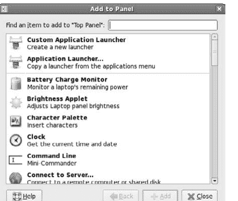

图 5-3：Fedora 中的 GNOME 添加到面板对话框。

### 配置插件

在你放置并运行插件后，你可能可以对其配置选项进行设置。某些选项允许你更改显示的内容，另一些则有多种外观设置。

要检查你的插件具有哪些配置和其他选项，请遵循以下步骤：

1. 右键点击插件并查看出现的快捷菜单。
此快捷菜单与面板不同。底部部分始终相同：从面板移除、移动和锁定面板（防止移动）。顶部部分的常用项目是“帮助”和“关于”。其余项目是配置选项（参见步骤 2）或插件特殊功能，例如从时钟插件中复制日期。

2. 从快捷菜单中选择“偏好”。
并不是每个插件都有偏好对话框。如果有，当你选择此选项时，对话框会打开，并显示该插件具有的所有配置功能。

3. 更改偏好对话框中的选择以自定义你的插件的行为。

现在你可以尽情玩了。做出更改以便让你看到这个插件能做什么——当你做出更改时，更改将出现在面板上的小组件。每个小组件都有自己的一套功能，因此我无法在这里进行通用的介绍。只需记住，你以后可以随时返回更改设置或从面板中移除该小组件。

4. 点击“关闭”保存你的更改并关闭对话框。

## 移除小组件

你有足够的空间放置许多小组件。而且，如果你和我一样，可能不希望让每个空闲空间都被图标填满。要从面板中移除小组件，只需右键点击你想移除的小组件，并在出现的快捷菜单中选择“移除”。小组件就会悄悄地从面板上消失。

## 将程序添加到面板或桌面

如果你有一个经常使用的程序，可以按照以下步骤将其添加到面板：

1. 选择“应用程序”并浏览到你想添加到栏的程序。不要打开该程序。只需用鼠标指针指向该菜单项。

2. 右键点击该程序，选择“将此启动器添加到面板”将其面板，或选择“将此启动器添加到桌面”将其添加到桌面。你的面板或桌面上会出现该程序的图标。

将程序添加到面板后，只需点击其图标即可运行该程序。如果你将其添加到桌面，请双击图标。

> 提示：如果你对桌面图标的位置不满意，点击它并将其拖动到新位置。对于面板项，右键点击它并选择“移动”。此选项允许你将图标拖到你想要的地方。点击即可将其固定到位。

你还可以为面板添加一个抽屉（菜单按钮）来包含整个菜单。操作方法如下：

1. 点击“应用程序”并浏览到你想添加的子菜单。

2. 进入该子菜单。例如，如果你想为面板添加一个“图形”菜单按钮，请打开“主菜单”，将鼠标移动到“图形”菜单，然后向右移动进入“图形”菜单的内容。

3. 右键点击打开上下文菜单。

4. 选择“整个菜单”，然后选择“将此作为抽屉添加到面板”或“将此作为菜单添加到面板”。

抽屉仅以图标显示你的内容，而菜单的显示方式与主菜单中的实际子菜单相似。

## 从桌面或面板移除程序

若要删除桌面上的图标，右键点击该图标并在出现的快捷菜单中选择“移动到垃圾桶”。

如果你想移除面板上的程序之一，只需右键点击你想移除的图标，并在出现的快捷菜单中选择“从面板移除”。图标将从面板上消失。就是如此！

## 玩 GNOME 桌面图标

你的桌面图标会在屏幕左上角形成一条垂直线（参见图 5-1）。从上到下的显示顺序如下：

- **计算机**：打开 Nautilus 文件管理器（见第 8 章），列出你的 CD-ROM 驱动器、硬盘等。
- **主目录**：打开 Nautilus 浏览器（第 8 章），显示你的主目录内容。
- **垃圾桶**：GNOME 快捷方式，用于打开 Nautilus 文件管理器的垃圾桶文件夹，其中包含了你因不确定要删除而拖入的文件。

要使用垃圾桶，将任何你想删除的文件拖入其中。稍后，如果你确定要丢弃它们，可以通过三种方式清空垃圾桶：

- 右键点击图标，在上下文菜单中选择“清空垃圾桶”。在提示确认时，点击“清空”。
- 双击图标打开垃圾桶。然后通过选择“文件：清空垃圾桶”来删除垃圾桶的所有内容。
- 双击图标打开垃圾桶。要删除垃圾桶中的单个项目，右键点击它调出垃圾桶上下文菜单，并在弹出菜单中选择“从垃圾桶删除”。在询问是否确定时，点击“删除”按钮完成操作。

你可以按住 Ctrl 键单独选择多个项目，即使它们并不相邻；按住 Shift 键选择一个范围的项目；或者左键点击并拖动来收集框内的所有项目。

- 另一种从垃圾桶移除项目的方法是从 `~/.Trash` 手动删除它们。

## 添加主题

互联网上有许多适用于 GNOME 的主题。但我现在就要提醒你，在寻找一个既喜欢又与你的安装兼容的主题时，可能会感到有些沮丧。考虑到这一点，请先保持耐心。要找到并获取这些主题供，，遵循以下步骤：

1. 将浏览器指向 http://themes.freshmeat.net。你将进入 Themes 网站，那里提供了许多数量的 GUI 定制项目。

如果你非常热迷于自定义，也可以查看 http://art.gnome.org。特别是，查看 http://live.gnome.org/GnomeArt/Tutorials。

2. 在 Freshmeat 上，点击 GTK（这是极客术，指 GNOME 桌面环境的一部分）。此操作将带你进入相应部分，确保你选择与系统兼容的主题。

3. 选择最新版本 GNOME 的 GTK 2.X 主题。

4. 浏览并选择你想尝试的主题。

如果你创建一个账户并登录，可以使用“排序顺序”下拉列表框更改项目的显示顺序。在查看主题信息时，请注意与该主题一起带的要求（有时被称为“依赖项”）。某些主题需要额外的“引擎”（在后台运行的软件），如果你在此时阶段对查找和添加软件感到不适，那么最好避免它们。如果你寻找的是 GTK 主题，那是安全的。

5. 选好主题后，点击其名称进入主题特定页面。在那里，你可以找到别人对该主题发表的任何评论。

6. 如必要，向下滚动并点击 Tar/GZ 或 Tar/BZ2 下的链接，在询问如何处理该文件时选择“保存到磁盘”，最后点击 OK 下载文件。

7. 选择 `系统` -> `偏好设置` -> `外观` -> `主题`。此操作将打开 GNOME 主题偏好对话框，如图 5-4 所示。

图 5-4：GNOME 主题偏好对话框。

8. 双击桌面上的用户主目录图标。文件管理器打开。

9. 浏览到存储主题的位置。如果你没有更改 Firefox 的默认设置，它将在你的桌面目录中。

10. 确保主题文件是 .tar.gz 文件。如果不是，你需要查看第 16 章如何将此文件转换为此格式。

11. 选择主题文件并将其拖入主题偏好对话框的左侧（安装器）面板。系统会尝试安装主题。如果成功，将出现确认对话框。

12. 如果你想立即更改主题，请选择“应用新主题”。否则，选择“当前主题”。你可能会也可能不会看到这个问题。如果没有看到，不要慌慌：主题有不同类型，有些不会触发此问题。如果你看到了问题并选择了“应用新主题”，你的桌面将更改以匹配该主题。如果你想，可以通过点击列表中的主题切换到另一个主题。

如果系统提示主题无效，且主题符合指定的格式，说明你获取了一个并非适用于你设置的主题。如果你查看主题页面，它在“环境”或“依赖项”部分可能有些内容试图告知你，但那是写给极客看的，所以不要自责。只需回去尝试另一个主题吧！

根据主题的不同，你的新主题可能会被添加到主题列表中。如果你没看到它，点击“主题详情”。在主题详情对话框中，你会看到三种不同类型的主题：控制（影响桌面控件外观的主题）、窗口边框（更改窗口边框外观的主题）和图标（更改你的图标外观的主题）。你的新主题可能列在这些位置中的一个或多个处。

13. 如果你尚未选择，请在列表中选择你的新主题。无论你在主列表还是“主题详情”对话框中选择主题，你的桌面都会更改以匹配该主题。如果主题不在主列表中，你会看到“自定义主题”位于选项的最上方。点击“保存主题”并为你的桌面外观分配新名称。

14. 当你对桌面外观满意时，点击“关闭”，主题偏好对话框将关闭。

## 第二部分：快速上手 Linux

## Rich Tennant 的《第五波浪》

在这一部分中，你将了解到许多 Linux 基础。你将发现如何在没有“网”的情况下工作（实际上，其实是在没有鼠标的情况下）。你将巡游 Linux 文件系统中布满灰尘的角落，找出哪些内容存储在何处，然后发现如何在其中穿行。最后，如果你还没有连接上网络，你将体验连接互联网的各种乐趣。

## 第 6 章：在脱离 GUI 的情况下工作

## 本章内容

- 理解用户 shell 环境
- 自定义化 bash 环境
- 使用命令工作
- 利用通配符扩展
- 使用长命令
- 摆弄变量
- 使用重定向和管道

> 计算机要摧毁人类，必须先让他们发疯。
>—— 匿名

许多计算界的老兵会怀怀地谈论命令行。而另一些通过指向和点击来提高技能的人则将命令行视为老古董们使用的过时工具。事实是，大多数熟练的专业人士都认可点点式图形用户界面（GUI）和“大量输入型”命令行界面（CLI）的优点。你必须理解，命令行为你操作计算机提供了一种强大的力量。如果你曾经观察过一位熟练 Linux 极客的肩膀，你会发现，在登录后，该极客并没有花多长时间就开始手动输入那些看似晦涩的指令了。

在本章中，我将探索提供 CLI 的 Linux 程序，它被称为 bash shell。虽然 Linux 有许多 shell 可用，但 bash 是最常用的，这有其充分的理由。基本上，bash 的创建者将其他 shell 的许多优秀功能整合到了一个极佳的软件包中。

每个 shell 都有其处理命令的方法和自己的一套额外工具。我将从解释 shell 到底是什么开始，当你理解了这一点，就准备好开始上手实战 bash 了。我将专门介绍你可以利用 bash shell 的一些最佳功能做什么。然后，我将继续在命令提示符下工作，并进入 bash shell 的内部装饰，使其执行某些功能。这些功能中的大部分都随着时间的推移而演变，以协助各种任务的命令行之旅。尽管我在这里仅触及皮毛，但我鼓励你阅读 bash 的 man pages（帮助手册），因为它是存在的最完整、最易读的 man pages之一。你可以在本章的“帮助”部分阅读关于如何使用 man pages（Linux 中的在线帮助系统）的所有内容。

## 玩 shell 游戏

你需要一种方法来告诉计算机你想做什么。在 Linux 中，与计算机通信的方法之一是通过被称为 shell 的东西。shell 不是图形化的东西；它是为了完成工作而执行的所有命令和语法的总和。

shell 环境对于图形化桌面标准来说相当相当单调无味。当你启动 shell 时，你看到的只是一个简短的提示符，如 `s$`，后面跟着一个在你键盘输入处闪烁的光标。（在本节的后后部分，我将向你展示几种访问 shell 的方法。）

Linux 使用的默认 shell 是 bash shell。这个工作环境基于原始的 UNIX shell，即 Bourne shell，也被称为 sh。bash 一词代表 Bourne again shell（再次 Bourne shell）。bash 随大多数 Linux 发行版一起。你可以通过选择 `应用程序` -> `系统工具` -> `终端` 来启动 bash 会话。如果你像我一样频繁使用 shell 提示符，那么利用你在第 5 章中发现的内容将终端窗口添加到桌面顶部面板的图标中将非常方便。

通常，你的 shell 提示符包含有用的信息。例如，如果你在 Fedora 7 机器 `catherine` 上登录为 `dee`，你的提示符看起来如下：


$dee@catherine -$

在回顾几个 shell 功能之前，我需要告诉你另一种启动 shell 会话的方法。你可能不会使用它，但在某些时刻你可能会发现它很有用。首先，注意你的 shell 提示符仅仅位于你 GUI 桌面的一部分的窗口内。假设你想让整个屏幕只显示文本。

# 第 6 章：在脱离 GUI 的情况下工作

要切换到文本环境，请按 `Ctrl+Alt+F2`。当你熟悉的图形化桌面消失时，请不要惊慌。它仍在后台运行，你很快就能回到之前离开的地方。但首先，先对你现在看到的这个无聊的文本屏幕说几句话（我希望是这样）。

你看到的是一个虚拟终端，这是你默认安装中提供的几个可用终端之一。你会看到类似这样的内容：

```
catherine login:
```

继续输入系统提示你输入的用户名和密码。你会看到一条指示登录日期的消息，随后是 bash 提示符。

```
[dee@catherine .dee] $
```

注意这个提示符与你在 GUI 桌面后留下的打开窗口之间的相似之处。注意，虽然说它们都是使用 bash shell 的结果是准确的，但它们是同一个程序的不同且独立的实例。换句话说，你正在工作的环境与你在 GUI 窗口中仍然开启的 bash 环境是互斥的。

你是否好奇你的 GUI 桌面去哪里了？为了让你宽心，通过一些跳跃。GUI 桌面默认位于虚拟终端 (VT) 数字 7。你现在打开了 VT-2。摆好你弹钢琴的按键，击和键 `Ctrl+Alt+F7`（如果这不起作用，请尝试 `Ctrl+Alt+F8`）。在一秒钟内，你的屏幕将闪烁并返回你的图形化桌面。很酷，对吧？猜猜怎么着？你在 VT-2 上留下的 bash 会话仍然在那里；你从未注销。按 `Ctrl+Alt+F2` 回去。漂亮！——就在你离开的地方。随意来回跳转几次尝试其他的 VT（F1 到 F6）。哇！虚拟终端太棒了。

如果你使用了第 5 章讨论的锁定屏幕，只有你的 GUI 会话被锁定了。任何人都可以使用 `Ctrl+Alt` 移动到虚拟终端。所以，在你离开电脑之前，确保你注销了虚拟终端。

好了，当你对这个小技巧感到厌倦时，输入 `exit`（字面意思是退出）来退出 VT 并返回图形桌面和你的 bash 提示符。然后你就可以探索这个 shell 的意义了。

## 理解 bash 语法和结构

许多人在使用 Linux 时愉快跳过了 bash shell 的基础。注意，这种方法让你错过了 bash 中提供的酷功能。你对这个 shell “语言”工作原理的了解越多，你能做的趣的事情就越多。

在命令提示符处使用 bash 的基础涉及输入命令及其所有的标志和值。例如，你使用 `ls -la ~` 查看家目录下所有文件的详细格式列表，包括带有点 `.` 的隐藏文件。另一个波浪线字符技术上被称为 tilde。tilde 是一个指向用户主目录的 bash 快捷字符。

你可以将一个命令分解为三个部分：

- 命令名称
- 选项或标志
- 参数

考虑这个例子。

从简单的命令开始。`du` 命令列出当前所在的目录及其子目录，以及每个项目占用的硬盘空间，最后是总计。尝试单独使用 du 命令：

```
du
```

这很酷，但它可能提出的问题比回答的还要多。输出给你一份长数据列表，但单位是什么？是字节、千字节还是来自外太空的消息？为了澄清，在你的命令中添加一个简单的选项：

```
-h
```

你仍然在发布相同的命令，但现在你为你想要显示的内容提供了额外的指示。`-h` 选项告诉 `du` 以人类更易读的方式显示信息。现在是 Ms、Ks 和 Gs。

在数字旁边，这样你就能看到这些数字到底有多大了。等一下——还有更多。如果你只想知道此目录及其子目录占用的磁盘空间总量怎么办？这就需要 `-s` 标记：

```
du -s
```

如果你想获取另一个目录的总和呢？或者仅仅是其中一个子目录？在我的情况下，我保留了一个 `Music` 子目录，用于存放从 CD 复制到 Ogg Vorbis 格式的项目（第 13 章）。我可以输入以下命令，以易读的方式查看它占用了多少硬盘空间，而无需去数零：

```
du -sh ~/Music
```

在这个示例中，`du` 是命令名，`-sh` 表示标记（选项），而 `~/Music` 是参数。`-sh` 标记可以带有许多其他标记，提供适用于该命令的各种选项。

你是否在想哪里可以找到特定命令的所有可用选项和参数？大多数命令都提供 man 页（帮助手册），这将在本章后面的“帮助”部分进行讨论。另一个很好的查询途径是 `--help` 选项，许多命令都支持该选项。注意，`--help` 显示了一个简短的选项列表，但如果你已经知道某个选项只是想不起具体是哪一个，使用它会非常方便快速。尝试输入以下内容来测试：

```
du --help
```

很酷对吧？

## 从 Shell 启动程序

Shell 最显而见但可能并不那么明显的用途是启动其他程序。你在 Linux 中使用的大多数工具都是独立且不同的程序。用户需要启动这些程序。在 GUI 中，你可以将图标与特定程序关联，图形化环境包含了启动程序的智能机制。请注意，程序通常需要从环境变量中提取信息，而环境变量是 shell 环境的一部分（我将在本章后面的“使用变量”部分更详细地讨论环境变量）。正因如此，GUI 是通过 bash shell 找到预设程序的。所以你会发现，即使是 GUI 也认为 shell 是必不可少的——尽管 GUI 会尽力向用户隐藏这一细节。

例如，在 GUI 中打开终端窗口后，在提示提示符处输入以下命令：

```
mahjongg
```

几秒钟后，就会显示麻将游戏。如果你知道底层的程序名称，就可以从 GNOME 菜单中点击的提示符处启动任何程序。请注意，如果你在虚拟终端（按 `Alt+F`）而不是 GUI 中，你可能会看到错误信息。某些程序需要在图形化环境中运行，而基于字符终端显然不具备这种环境。

## 善用通配符扩展

如果你必须在多个文件上重复相同的命令，那么计算将变得非常枯燥。毕竟，重复性任务不正是计算机设计的初衷吗？通配符扩展是指一个命令对多个文件执行执行的能力。星号（`*`）和问号（`?`）是两个通配符字符，用于匹配任何文件名或文件名的一部分。例如，你可以使用以下命令查看长目录列表，其中仅包含以 .doc 扩展结尾的文件：

```
ls -l *.doc
```

星号（`*`）匹配任意数量的字符，而问号（`?`）匹配单个字符。例如，如果你想找到以 "file" 开头并带有任何扩展的文件，可以使用 `file.*`。如果你想找到以 "file1"、"file2" 或 "file3" 结尾的文件，可以使用 `file[123]`。

## 变量与环境变量

我首先需要明确的是，bash 有两种类型的变量：

- 变量：变量可以在程序或 shell 会话中被引用，但它仅对该会话或程序可见并可用。
- 环境变量：环境变量也可以被 shell 或程序引用。然而，它具有额外的行为，即其值会被复制到从该环境创建的任何其他程序或 shell 中。

你通常一眼就能变量和环境变量之间的区别。通常的惯例是局部变量使用全小写或大小写混合。然而，环境变量始终使用全大写字母。

## 检查常用的环境变量

bash 有许多环境变量。这些变量存储的内容项范围可能会让你感到惊讶。方便的一点是，如果内容存储在变量中，你可以根据需要更改它！在表 6-1 中，我列出了你最可能需要使用的环境变量。

| 环境变量 | 目的 | 值 |
|---|---|---|
| HISTSIZE | 决定存储的先前输入的命令数量。 | 命令数量 |
| HOME | 设置你的主目录的位置。 | 主目录的路径 |
| MAILCHECK | 设置 bash shell 检查信箱中新邮件的频率。如果有邮件到达，下次你在命令行提示符执行操作时，会看到类似“You have new mail”的消息。 | 检查之间的等待秒数 |
| PATH | 设置 bash 查找的目录以及在这些目录中查找你在命令行提示符处输入的程序名的顺序。 | 冒号分隔的目录 |
| PS1 | 设置你的命令提示符。 | 用于形成提示符的命令和格式字符 |

环境变量是由系统管理员或 shell 本身为你建立的。这些变量主要由程序读取以收集信息，你不需要更改它们的值。然而，你可能想要更改某些环境变量的值。例如，在表 6-1 的第一条目 HISTSIZE 中决定了保留在文件中命令历史的行数。你可能读过本章较早关于重新执行昨天命令的讨论。如果没有，请参阅“访问你的命令历史”部分。通过为 HISTSIZE 设置一个更大的数字，你可以保存更长的先前执行的命令历史。

## 存储和检索变量的值

要给变量赋值，你只需要使用变量名后接一个等号 (`=`)，然后是要存储的值：

```bash
MyVariable=MyValue
```

要检索该变量代表的值，你需要在变量名之前加一个美元符号 (`$`)。看一个由 shell 创建的、决定你的提示符外观的变量。这个变量命名为 `PS1`。首先，你查看 `PS1` 持有的值：

```bash
echo $PS1
```

你可能会看到类似下面的一行：

```
[\u@\h \W \]


# 第 6 章：在没有 GUI 下工作

## Shell 提示符特殊字符

每个由反斜杠开头的字符都代表一个 shell 的特殊指令，在引用 shell 提示符时返回特定信息。请看表 6-2 在自定义提示符时可以使用的特殊斜杠字符示例。

| 组件 | 结果 |
|---|---|
| `\a` | 打印命令在历史列表中的位置。 |
| `\#` | 打印你在 shell 会话期间使用的命令数。 |
| `\$` | 为用户账户打印 `$` 或为超级用户打印 `#`。 |
| `\d` | 按照以下格式打印日期：日 月 日。 |
| `\h` | 打印你登录的机器名称。 |
| `\n` | 移动到下一行。 |
| `\s` | 为 bash shell 打印 `bash`。 |
| `\t` | 以 24 小时格式打印时间。 |
| `\u` | 打印你的用户名。 |
| `\w` | 打印当前目录的深度。 |
| `\W` | 打印整个当前目录。 |

好了，继续示例：将你的 shell 提示符改为有趣的某些，输入以下行：

```bash
PS1='Hello \u, what can I do for you? => '
```

注意单引号。在按下回车键后，你会发现你的提示符已经变成了更具吸引力的东西。如果你更喜欢原始的提示符，不用担心：你可以重新分配存储在 `PS1` 中的原始提示符值，或者关闭终端窗口并打开一个新的，你就回到了熟悉的领域。

你是否好奇你的系统还为你提供了哪些变量？你可以通过输入 `env` 查看所有的环境变量。请注意，在 Linux 的通常情况下，你可能没有理由在命令行上赋值。然而，在你变得更熟练后，你可能想要探索 bash 的 shell 编程功能，在这种情况下变量存储是非常方便的。

那些单引号是怎么回事？更改环境变量时，你必须小心细节。如果你只是给一个数字赋值，例如可以使用 `HISTSIZE=250`。然而，如果你想使用包含空格的内容，可以使用双引号。

要显示类似这样的时间：

```bash
echo 'Hello, $USER'
```

如果你想扩展变量值，请使用：

```bash
echo "Hello $USER"
```

## 重定向命令输出

我在这里讨论重定向命令输出，是因为它是最常见的信息流形式之一。输出重定向的一个示例是让命令将其结果发送到文件而不是屏幕，正如你可能看到的那样。从一个熟悉的领域开始，输入 `ls -la ~` 然后按回车，将产生类似下面的内容：

```
total 20
drwx------ 2 sue users 4096 Oct 30 07:48 .
drwxr-xr-x 5 sue root 4096 Oct 30 11:57 ..
-rw-r--r-- 1 sue users 24 Oct 30 06:50 .bash_logout
-rw-r--r-- 1 sue users 230 Oct 30 06:50 .bash_profile
-rw-r--r-- 1 sue users 124 Oct 30 06:50 .bashrc
-rw-r--r-- 1 sue users 0 Jan 02 07:48 wishlist
```

想把这些信息保存到文件中吗？你可以使用重定向操作符告诉 bash 将数据发送到文件而不是屏幕上。输入以下命令将信息发送到名为 `listing` 的文件中：

```bash
ls -la > listing
```

注意，屏幕上什么都没有显示，正如你通常预期的那样。那是因为 shell 将输出重定向到了名为 `listing` 的文件。验证目录列表，输入以下命令：

```bash
cat listing
```

`cat`（以及更多命令）将在第 16 章解释。

注意，如果你再次输入 `ls -la > listing`，数据会被覆盖，这意味着文件的内容会被擦除并替换为新输出。你可以通过使用 `>>` 作为重定向操作符来避免这一点，它告诉 bash 将命令追加到文件末尾。如果你在未做更改的情况下在同一目录下输入 `ls -la >> listing`，`listing` 的内容如下：

```
total 20
drwx------ 2 sue users 4096 Oct 30 07:48 .
drwxr-xr-x 5 sue root 4096 Oct 30 11:57 ..
-rw-r--r-- 1 sue users 24 Oct 30 06:50 .bash_logout
-rw-r--r-- 1 sue users 230 Oct 30 06:50 .bash_profile
-rw-r--r-- 1 sue users 124 Oct 30 06:50 .bashrc
-rw-r--r-- 1 sue users 0 Jan 02 07:48 wishlist
drwx------ 2 sue users 4096 Oct 30 07:48 .
drwxr-xr-x 5 root root 4096 Oct 30 11:57 ..
-rw-r--r-- 1 sue users 24 Oct 30 06:50 .bash_logout
-rw-r--r-- 1 sue users 230 Oct 30 06:50 .bash_profile
-rw-r--r-- 1 sue users 124 Oct 30 06:50 .bashrc
-rw-r--r-- 1 sue users 0 Jan 02 07:48 wishlist
```

## 建立管道

另一个 bash shell 功能允许你连接命令，使一个命令的输出成为下一个命令的输入。这种功能被称为管道（pipe）。假设你想以长列表查看 `/etc` 目录下所有文件的详情。如果你输入 `ls -la /etc` 来这样做，会出现一个巨大的列表，很多信息会从你面前闪过。虽然你可以通过按 `Shift+PageUp` 来向上回溯，但你可能看不到所有内容。

要查看所有内容，你可以采取两种方法之一：

- 通过重定向将数据发送到文件，输入类似 `ls -la /etc > ~/etclisting` 命令，然后用你喜欢的编辑器查看 `~/etclisting` 的内容。
- 将输出管道到 `more` 命令（见第 16 章）。

要将输出管道到 `more`，输入 `ls -la directory_path | more`，其中 `directory_path` 是你想要列出内容的目录。`|` 符号（在键盘上看起来更像两个堆叠在一起的竖线，而不是一根实线）告诉 bash 你想使用管道。

## 帮助！

页面系统（page system）是 Linux 的电子手册（man 是 manual 的缩写），旨在为用户提供所有详尽命令信息的方便参考。这些信息包括命令行提示符选项、文件格式和程序功能用法。

打开 man 页面的语法是 `man <command name>`。

不知道你正在寻找的命令，或者需要关于使用 man 页面系统的基础信息？只需输入 `man man` 即可开始。在阅读 man 页面时，按 `Q` 退出。

## 清除屏幕

`clear` 和 `reset` 命令在 shell 中工作时非常实用。`clear` 命令只是简单地清空 bash 屏幕。别担心；它没有删除任何文件或更改任何设置——它只是在整理，以便你可以再次开始向屏幕上输出新内容。

`reset` 命令更有趣。假设你尝试用 `cat` 命令将一个二进制文件列到屏幕上。计算机完成结果推送后，屏幕会一片乱码。`reset` 命令会将终端恢复到原始状态，这在你意外 `cat` 二进制文件时非常有用。

# 第 7 章：了解文件系统

## 系统的组成

在开始之前，理解术语是有帮助的。“系统”一词实际上有多种用法。通用的用法（以及我在书中通常使用这个词时的含义）是指“你可以访问的所有文件和目录”。

要注意的第一个主要区别是 Linux 使用正斜杠（`/`）分隔目录，而不是 Windows 使用的反斜杠（`\`）。所以目录中的 yum.com 是 `etc/yum.com`。文件和目录名称可以长达 256 个字符，这些名称可以包含下划线（`_`）、连字符（`-`）和点（`.`）。所以 `my.bigfile` 或 `my-bigfile` 都是有效的文件名。

大小写也非常重要。它们必须完全匹配。对于 Linux 来说，`yum.com` 和 `Yum.com` 不是同一个。最后，同一个文件系统可以跨越多个分区、硬盘和光介质。你只需要继续遍历目录，无需担心东西是在磁盘 A、B 还是哪里。这将在本章“分区与目录”部分进行讨论。

## 游览文件系统

在本节中，我将查看典型文件系统的内容。至少熟悉它有助于以后查找东西，并帮助你知道哪里可以安全操作，哪里需要非常小心。

### 树的根

Linux 文件系统中的所有内容都相对于根目录——不要与系统管理员 root 用户混淆——根目录被称为 `/`。这是你所有文件的入口。根目录包含一组最可预测的子目录。每个发行版略有不同，但存在它们都遵循的标准。这些标准让 Linux 世界保持某种正常。


如果你对这些标准感兴趣，可以访问 www.pathname.com/fhs 查看最新版本的规则。

## 第 7 章：了解 Linux 文件系统

表 7-1 列出了你可能在基础目录中发现的内容，即你在 `/` 下找到的项目。（此列表可能根据你安装的内容而异）。描述末尾的星号（*）表示除非你有充分的理由，否则不要动这些这些内容，因为它们包含了对系统运行至关重要的文件。实际上，大多数基础目录应该保持原样。只有它们内部的子目录是可以修改的。

| 目录 | 包含 |
| --- | --- |
| `/bin` | 每个人在任何时候都需要使用的基本命令* |
| `/boot` | 引导机器的信息，包括你的内核* |
| `/dev` | 系统需要交互的所有硬件的设备驱动程序* |
| `/etc` | 你的系统配置文件* |
| `/home` | 每个用户的家目录 |
| `/lib` | 许多程序（以及内核）使用的库或代码* |
| `/media` | 添加临时介质（如软盘和 CD-ROM）的地方，并非所有发行版都有这个目录 |
| `/mnt` | 添加挂载网络驱动器等额外文件系统组件的地方，即那些不是永久添加到文件系统、但又不像 CD-ROM 和软盘那样的临时项目 |
| `/opt` | 一些人决定（以及某些程序想要使用）安装新软件包的位置，例如文字处理器和办公套件 |
| `/proc` | 你的内核（操作系统）的当前设置* |
| `/root` | 超用户（root 用户）的家目录 |
| `/sbin` | 系统管理员需要访问的命令* |
| `/srv` | 系统服务的数据（在后台运行的程序）* |
| `/sys` | 关于硬件的内核信息* |
| `/tmp` | 所有人一切存储临时文件的地方 |
| `/usr` | 额外的程序和文件的复杂层级结构 |
| `/var` | 经常变化的数据，如日志文件和你的邮件 |

这些目录中的一些具有同样重要的子目录，我将在接下来的章节中介绍。

## /etc 的重要性

`/etc` 基础目录主要包含配置文件。除非你知道需要做什么，否则最好不要动这些文件。这里的一些重要目录（取决于你安装的内容）包括：

- 以 `/etc/cron` 开头的目录包含在自动时间运行的各种程序的指令。
- `/etc/cups` 目录包含你的打印机的配置信息。
- 以 `/etc/rc` 开头的目录包含所有关于启动和关机时哪些启动、不启动的数据。当我们在第 18 章中讨论服务时，这些是存储服务的目录。
- `/etc/sysconfig` 目录具有网络配置信息。
- 以 `/etc/yum` 开头的目录包含你用于向机器添加程序的软件仓库（第 16 章）的数据。
- `/etc/X11` 目录包含 X 系统 (X) 的配置细节，它运行你的图形用户界面 (GUI)。有关 GUI 的更多信息请参见第 5 章和第 8 章。
- 如果你决定使用 `/opt`，该目录包含 `/opt` 目录中程序的配置文件。

## 临时介质存放的位置

默认情况下，你可能在 `/media` 或 `/mnt` 中没有任何子目录。但通常，你可以寻找以下内容：

- `/media/floppy` 目录用于将软盘添加到你的文件系统——不只是单词 "floppy"；你可能会看到 `fd0` 或 `floppy0`。
- `/media/cdrom`（或 `/media/dvd`、`/media/cdrecorder`）目录取决于你使用了什么类型的硬件向系统添加 CD-ROM、DVD-ROM、CD 刻录机等。

在本章后的“在没有网络（或鼠标）的情况下管理你的系统”部分，我将展示如何在命令行中添加这些项目。在第 8 章中，你将了解到如何以更方便的点点点击方式来实现。

## 计算机所在是 /usr

`/usr` 通常被称为它自己的微型文件系统树。它有许多重要或有趣的子目录，如表 7-2 所示。描述末尾的星号（*）表示，在你获得丰富的 Linux 经验并确切知道需要进行哪些更改之前，除非你有充分的理由，否则不要动该目录——这样就不会意外更改系统正常运行所需的设置。记住文件系统这部分的一个有趣点是：许多高级 Linux 用户经常使用 `/usr` 来存储可以与其他 Linux 机器共享的程序。

| 子目录 | 内容 |
|---|---|
| `/usr/X11R6` | 管理 X 系统的文件（你 GUI 下方的骨架框架）* |
| `/usr/bin` | 对用户并非必需但很有用的命令* |
| `/usr/games` | 你安装在系统上的游戏，除了那些你可以选择放在 `/opt` 中的游戏 |
| `/usr/include` | C 语言语言运行所需的文件* |
| `/usr/lib` | 许多程序使用的共享代码* |
| `/usr/local` | 你想要在本地保留的项目* |
| `/usr/sbin` | 对用户并非必需但很有用的命令* |
| `/usr/share` | 许多程序共享的数据 |

## 在没有网络（或鼠标）的情况下管理你的文件

在这一节中，我将展示如何在命令行中添加这些项目。在第 8 章中，你将了解到如何以更方便的点点点击方式来实现。

## 关于 /etc 的信息

当你使用 `ls` 命令时，你可以查看 `/etc` 中的文件。例如，在图 7-1 所示：

| 目录/文件 | 描述 |
|---|---|
| `/etc/cron` | 在自动时间运行的各种程序的指令。 |
| `/etc/cups` | 你的打印机的配置信息。 |
| `/etc/rc` | 所有关于启动和关机时哪些启动、不启动的数据。 |
| `/etc/sysconfig` | 网络配置信息。 |
| `/etc/yum` | 软件仓库的数据。 |
| `/etc/X11` | X 窗口 (X) 的配置细节。 |
| `/etc/opt` | `/opt` 目录中程序的配置文件。 |

## 链接基础 101

链接是指向另一个文件的伪文件列表。在 Linux 中使用两种链接：软链接和硬链接。软链接类似于 Windows 快捷方式，指向原始文件，你对链接的任何编辑都会作用于原始文件。删除原始文件，链接仍然存在，但会变得无法使用（被称为断链）。

硬链接在 Windows 世界中没有直接对应项；它是文件本身的另一个实例。该文件中的数据只保在一个地方，但你可以编辑原始文件或链接，编辑将对两个实例生效。删除原始文件，只要链接还在，文件就存在。这就像通往同一个房间的两扇门！

## 理解文件列表信息

如果你想查看比名称和类型之外更多的信息，你需要一个长格式的文件列表。你可以通过命令 `ls -l` 获取它（如果你想要长格式并包含隐藏文件，则需要输入 `-la`）。图 7-3 显示了你可能会看到的示例：

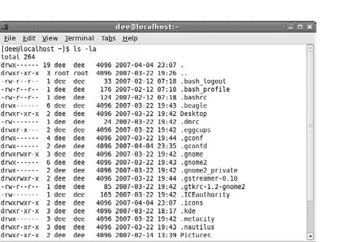

## 使用 SUID 和 SGID 进行“假装”

有时，程序需要执行运行程序的用户实际上并不具备文件系统权限才能执行。在这种情况下，允许一个文件伪装成另一个人，以便执行它必须执行的操作。一个在运行时伪装成属于另一个用户的文件被称为开启了 **SetUID**（SUID，或设置用户 ID）。倾向于属于运行用户未所属的组的文件被称为 **SetGID**（设置组 ID）。


## 第 7 章：认识 Linux 文件系统

### 理解文件列表信息

如果你想查看比名称和类型之外更多的信息，你需要一个长格式的文件列表。你可以通过命令 `ls -l` 获取它（如果你想要长格式并包含隐藏文件，则需要输入 `ls -la`）。图 7-3 显示了你可能会看到的示例：

```
drwxr-xr-x 2 root root 4096 2006-03-24 22:07 .
-rw-r--r-- 1 root root 4096 2006-03-22 19:26
drwxr-xr-x 2 root root 4096 2006-03-21 18:17 bash
-rw-r--r-- 1 root root 4096 2006-03-22 19:42
drwxr-xr-x 6 root root 4096 2006-03-23 15:43 config
-rw-r--r-- 1 root root 4096 2006-03-22 19:42 gnome
drwxr-xr-x 4 root root 4096 2006-03-22 19:42 groups
-rw-r--r-- 1 root root 4096 2006-03-22 19:44 ghost
-rw-r--r-- 1 root root 4096 2006-03-22 19:42 images
drwxr-xr-x 2 root root 4096 2006-03-22 19:42 private
-rw-r--r-- 1 root root 4096 2006-03-22 19:44 straceme
drwxr-xr-x 2 root root 4096 2006-03-22 19:17 home
-rw-r--r-- 1 root root 4096 2006-03-22 18:17 aide
drwxr-xr-x 3 root root 4096 2006-03-22 19:43 music
-rw-r--r-- 2 root root 4096 2006-03-21 11:38 pictures
```

你可能会发现这种格式的某些部分一目了然，而另一些部分则不然。列表中的第一个项（带有字母和横线的部分——例如第一行中的 `drwxr-xr-x`）是分配给该项的**权限**。权限定义了谁可以读取文件、更改它，或者如果它是程序则可以运行它。第一行中的第二个项（在本例中为 `2`）是指向该项的硬链接数量。

第一行的第三项（在本例中为 `root`）是该项所属的**所有者**。第四项（在本例中为 `root`）是该项所属的**组**。第五项是文件大小（单位为字节，本例中为 `4096`）。

第六、第七和第八项是文件最后修改的时间：月份（`Mar`）、日期（`24`）以及时间（`22:07`）。最后，第九项是文件名（例如 `bash`）。

### 使用 SUID 和 SGID 进行“假装”

有时，程序需要执行运行程序的用户实际上并不具备文件系统权限才能执行的操作。在这种情况下，允许一个文件伪装成另一个用户，以便执行它必须执行的操作。一个在运行时伪装成属于另一个用户的文件被称为开启了 **SetUID**（SUID，或设置用户 ID）。倾向于以运行用户未所属的组身份运行的文件被称为 **SetGID**（设置组 ID）。


你可能会发现这种格式的某些部分一目了然，而另一些部分则不然。每个列表中的第一个项（带有字母和横线的部分——例如第一行中的 `drwx-`）是分配给该项的**权限**。权限定义了谁可以读取文件、更改它，或者如果它是程序则可以运行它。你可以在本章后尾的“权限”中阅读更多关于权限的内容。第一行中的第二个项（在本例中为 2）是指向该项的硬链接数量。

第一行的第三项（在本例中为 root）是该项所属的**所有者**。**所有者**的第四项（在本例中为 root）是该项所属的**组**。你可以在本章后尾的“权限”中阅读更多关于权限的内容。第五项是文件大小（4096字节）。

第六、第七和第八项是文件最后修改的时间：月份（Dec）、日期（24）以及时间（22:07）。最后，第九项是文件名（例如，bash）。

## 第 7 章：了解 Linux 文件系统

| 标签 | 类型 | 描述 |
|---|---|---|
| c | 字符设备 | 该项是传输数据的硬件（如调制解调器）的驱动（控制程序）。 |
| d | 目录 | 该项是文件的容器，在某些操作系统的术语中被称为文件夹。 |
| l | 链接 | 该项是一个链接，正如本章早些部分讨论过的。 |

除了表 7-3 中提到的类型外，你在 Linux 世界中还会发现更多不同类型。我所说的“类型”指的不是扩展名（例如 .exe 或 .doc）。Linux 将其文件系统内的一切内容——即使是目录和像你显示器这样的硬件——都视为“文件”。因此，为文件分配类型仅仅是 Linux 跟踪文件种类的一种方式。

Windows 用户在迁移到 Linux 时特别想知道的是如何识别程序。程序不是通过寻找带有扩展名（.exe）的文件，而是拥有（或需要）执行权限，以便系统知道它们被允许运行。请参阅第 8 章如何在 Nautilus 中进行操作。

在命令行上，可以尝试 `file` 命令，例如 `file Desktop`，以获取更多关于特定文件的内容。

## 在 Fedora 中导航文件系统

如果你使用的是 GNOME 桌面，Fedora 的文件系统导航完全通过 Nautilus（见第 8 章）处理。默认情况下，某些操作已经为你变得非常简单。

- 当你插入数据 CD-ROM 或 DVD-ROM 时，桌面左侧会出现一个图标。双击此图标打开该项的内容。稍后你可以通过右键点击图标并在随后的快捷菜单中选择“弹出（Eject）”将其从系统中移除。
- 当你插入如钥匙扣之类的存储设备时，Fedora 会自动在桌面上为该项添加一个图标，你可以双击打开。完成对 USB 设备的操作后，关闭所有使用该设备的窗口，右键点击桌面上的图标，并选择“卸载（Unmount）”。在移除设备之前进行卸载是安全的；否则可能会丢失数据。
- 当你插入音乐 CD 时，Fedora 会打开音乐播放器并开始播放。
- 当你插入 DVD 时，Fedora 会尝试加载并播放 DVD，但由于法律原因，你可能需要添加更多软件才能使此功能正常工作。请查看第 14 章获取更多信息。
- 要更改 Fedora 处理这些项的方式，选择“系统偏好；硬件；可移动驱动器和媒体”。如果你关闭了某些项的自动加载功能，可以通过选择“位置；计算机”并双击相应的图标来访问设备内容。此操作会在你的桌面上也添加一个图标。
- 当你插入空白 CD 或可刻写 DVD 时，Fedora 会打开 Nautilus 里的 CD/DVD 刻录器。（你可以在第 3 章和第 8 章了解更多关于刻录的知识）。
- 至于软盘，计算机无法可靠地检测到软盘已插入驱动器。因此，将软盘插入驱动器，选择“位置；计算机”，并双击“软驱驱动器（Floppy Drive）”以访问磁盘内容并在桌面上添加软盘图标。右键点击桌面上的软盘图标并选择“卸载卷（Unmount Volume）”。等待软盘灯熄灭后再取出软盘。
- 如果你想从 Windows 访问网络驱动器，或者别人在另一台 Linux 计算机上设置并开启了共享功能，选择“位置；网络服务器”。此操作允许你浏览网络以找到提供文件的计算机。
- 如果你想访问 Linux 文件系统的部分内容，选择“位置；计算机”并双击“文件系统”图标。
- 访问硬盘上不属于你 Linux 安装内容的项（可能是 Windows 驱动器）。

对于列出的最后一个选项，请遵循以下步骤：

1. 打开命令行终端。如果你不确定如何操作，请参阅第 6 章。
2. 输入 `su` 并按回车以成为 root（管理员）用户。系统会要求你输入 root 密码。在提示时输入并按回车。
3. 输入 `fdisk -l` 查看所有的硬盘和分区。如果你正在寻找 Windows 分区，可以在这里找到。忽略带有如 Windows 95 Ext'd 等文本的项目；它们并不是真正的数据分区。任何包含 NTFS、FAT32 或 VFAT 的项都是 Windows 分区，是你感兴趣的。如果你正在寻找 Linux 分区（你可能在系统中安装了多个发行版），请选择描述中包含“Linux”字样而不是“swap”字样的分区。
4. 当你认为知道尝试哪个分区时，输入 `mount -t type /dev/partition /mnt` 将其添加到文件系统中，其中 `type` 是文件系统类型（如表 7-4 所示），`partition` 是你在 fdisk 中看到的字母和数字组合（例如 `hde2`）。

例如，在添加 NTFS 支持后，你可能会执行 `mount -t ntfs /dev/hde2 /mnt`。这样做后，你就可以找到分区分区。

| 表 7-4 | 常见文件系统 |
|---|---|
| 类型 | 描述 |
| ext2 | 旧版 Linux 文件系统 |
| ext3 | 较新的 Linux 文件系统，Red Hat 等默认使用 |
| ntfs | 较新的文件系统，供 Windows XP 使用 |
| reiserfs | 另一种 Linux 文件系统，被 Mandrake 等使用 |
| vfat | 旧版文件系统，如 FAT |

5. 根据需要浏览。请参阅第 8 章。

## 分区与目录

关于文件系统的一个非常重要（且极客的）点是，它可能不只有一个驱动器。在其他情况下，你会清楚地看出你正在操作一个驱动器。在 Windows 世界中，主驱动器是 C，下一个是 D，以此类推。你可能已经看到了这种模式。硬盘有一个三个字母的标识：驱动器名称以 `/dev/hd` 开头，这种类型的第一个磁盘是 a，第二个是 b，以此类推。第三个 IDE 驱动器类似于 `/dev/hdc`。如果你使用的是类似绕过主 IDE 控制器的 Promise 控制器，你的第一个

| 表 7-5 | 常见驱动器命名 |
|---|---|
| 命名 | 描述 |
| /dev/cdrom | CD-ROM 驱动器；如果你有多个，可能会有 `/dev/cdrom1` 等，你可能还会看到 `/dev/cdwriter`、作为 `/dev/dvd` 甚至是硬盘命名为 `/dev/hda` |
| /dev/fd0 | 软驱器 1 |
| /dev/fd1 | 软驱器 2 |
| /dev/hda | 第一个 IDE 磁盘 |
| /dev/hda1 | 第一个 IDE 硬盘，第一个主分区或扩展分区 |
| /dev/hda2 | 第一个 IDE 硬盘，第二个主分区或扩展分区 |
| /dev/hdb | 第二个 IDE 磁盘 |
| /dev/hdb1 | 第二个 IDE 硬盘，第一个主分区或扩展分区 |
| /dev/hdb2 | 第二个 IDE 硬盘，第二个主分区或扩展分区 |
| /dev/sda | 第一个 SCSI 硬盘 |
| /dev/sda1 | 第一个 SCSI 硬盘，第一个主分区或扩展分区，也是像 U 盘之的小 USB 存储设备 |

## 第 7 章：了解 Linux 文件系统（续）

实际上，它会显示为 `/dev/hde`；我通过个人经验知道这！

- SCSI 驱动器的名称以 `/dev/scd` 开头，这种类型的第一个驱动器是 a，第二个是 b，以此类推。第四个 SCSI 驱动器类似于：`/dev/ssd`。USB 驱动器也被视为 SCSI 驱动器。如果没有连接任何固定的 SCSI 驱动器，像 USB 钥匙圈这样的小物品通常会被系统识别为 `/dev/sda`。（如果你不确定自己拥有的是 IDE 还是 SCSI，只需记住你通常需要特意去连接 SCSI。如果没有连接，你可能拥有的是 IDE。）

三字母名称后面的数字代表你所指的分区。我在第 2 章中介绍过你的硬盘。

在图 7-5 中，我拆解了这一概念，使其更容易于理解。在这种情况下，用户为 Linux 创建了三个分区。第一个 IDE 驱动器是一个分区，分配给根分区。第二个 IDE 驱动器被分为两个分区。第一个分配给 `/usr`；第二个分配给 `/var`。

| Windows | Linux |
| :--- | :--- |
| A: 软磁盘 | /mnt/floppy 软磁盘 |
| B: CDROM | /mnt/cdrom CDROM |
| 第一个 IDE 驱动器 | C: | /dev/hda1 /drive 第一个 IDE 驱动器 |
| 第二 IDE 驱动器 | D: E: | /dev/hdb1 /usr /dev/hdb2 /var 第二 IDE 驱动器 |
| 第一个分区 | 第二个分区 | 第一个分区 第二分区 |

**图 7-5：** Linux 与 Windows 处理分区和硬盘的对比。

如果你喜欢在命令行中尝试，这里有一些其他在穿梭文件系统时你会发现这些命令的简要介绍。要进行移动，你可以使用 `cd` 从一个目录切换到另一个目录。例如，从 `/home/sanji` 到 `/home/sanji/Documents`，你可以输入以下命令之一：

```
cd /home/sanji/Documents

cd Documents
```

这两个命令中的任一都能带你到达。然后从 `/home/sanji/Documents` 回到 `/home/sanji`，你可以输入以下命令之一：

```
cd /home/sanji

cd
```

再次，这两个命令中的任一都可以达到目的。在两种情况下，第一个类命令被称为“绝对导航”（“我想去确切的这个地址”），另一个被称为“相对导航”（“我想去这里往下三个房子的地方”）。`..` 在树结构中向上返回一级目录。如果你迷路了，无法确定处于树的哪个分支，输入 `pwd` 来查看你当前所处的位置。

一些处理文件的快速命令。要处理文件内容，请参考第 11 章。然而，只需在命令行复制文件，使用 `cp` 命令，如下所示将 `file1` 复制到名为 `file2` 的新文件中：

```
cp file1 file2
```

如果你想重命名文件，使用相同格式的 `mv`（移动）命令，或者使用此命令将文件从一个位置移动到另一个位置。要创建一个目录，使用 `mkdir` 命令，如下所示在当前目录下创建一个 `Documents` 目录：

```
mkdir Documents
```

要删除文件，使用 `rm`（删除）命令，如下格式从 `/home/keiko` 目录删除 `file1`：

```
rm /home/keiko/file1
```

最后，要删除目录，使用特殊的 `rmdir` 命令，然后你就可以删除它。要删除其中的所有文件，请删除 `/home/keiko/notes` 目录中的所有文件并同时删除它（确保你真的想这样做！）：

```
rm -rf /home/keiko/notes
```

或者你可以输入以下系列命令：

```
cd /home/keiko/notes

rm *

cd ..

rmdir notes
```


这些应该足够入门了。祝探索愉快！

# 第 8 章：在 GNOME 和 Nautilus 中使用文件系统

## 本章内容

- 借助 Nautilus 航行文件系统
- 在 Nautilus 中处理文件
- 使用光盘和其他可移动介质

> 完全不需要做任何作业。过了四年，情况不会变得糟糕。
> — 昆廷·克里斯普（Quentin Crisp）

在第 5 章中，我们查看了 GNOME 以及如何使用桌面，但刻意跳过了一个技能：处理文件。第 7 章探讨了如何在命令行中操作文件系统以及在哪里找到东西。本章侧重于通过指向和点击轻松地浏览目录并进行文件操作。

## 在文件夹间穿行

在 GNOME 桌面环境中，文件管理器是 Nautilus。在 Nautilus 中穿梭文件系统涉及与使用命令行不同的技能。你可能确切知道想去文件系统的哪个位置，但不知道点击什么才能到达。首先，你需要知道想从哪里开始。这个决定并没有看起来那么困难。

使用 Nautilus 导航文件系统有三种选择：

- **双击桌面上的“主目录”图标：** 双击主目录图标（图 1）等同于进入“位置：主目录文件夹”（参见第 5 章）。注意窗口是单窗格的（白色区域）。顶部是菜单。
- **使用侧边栏：** 窗口左侧的侧边栏提供了快捷访问频繁使用的文件夹，如主目录、文档和下载。
- **使用地址栏：** 窗口顶部的地址栏允许你查看当前文件夹的路径。你也可以在地址栏中输入路径直接跳转到目录。

除了这些命令，如果你需要更改文件夹内容的显示大小，还可以更改“视图”菜单中的“放大”、“缩小”和“标准大小”选项。如果你想从头开始，请选择“重置视图为默认值”。对于“列表”模式的更高级设置，请尝试“查看列”。

## 创建文件和文件夹

在 Nautilus 中创建新文件或文件夹：

1. **浏览到你想要创建项的文件夹。**
   在继续之前，你需要打开该文件夹并进入其窗口。
2. **在文件夹内部的空白处点击右键。**
   确保你没有选中文件夹中的任何内容。会出现一个上下文菜单。
3. **根据你想实现的目标，选择“创建文件夹”或“创建文档”。**
   - **创建文件夹**命令会在此目录下创建一个新的空文件夹。
   - **创建文档**命令将打开子菜单，让你选择从“模板”（顶部区域，如果你已经创建了模板）创建文档，或者创建一个“空文件”。

文件夹或文件将出现，并处于高亮状态，且名称处于可编辑状态。

4. 输入你想分配给此文件夹或文件的名称，然后按回车键。

名称已分配给该文件夹或文件。

## 打开文件和运行程序

要在 Nautilus 中打开文件或运行程序，只需双击它。就这么简单！哦，不完全是。你也可以右键点击文件打开上下文菜单，然后从上下文菜单中选择以下项之一：

- **使用程序打开：** 如果文件已经关联到某个特定程序，选择此选项等同于双击文件。如果你的系统知道你安装了多个可以胜任此工作的程序，则可能会列出多个此类选项——带有文件夹图标的顶部项目是默认项。选择你偏好的任何选项即可。
- **使用其他应用程序打开：** 选择此选项将打开一个子菜单，其中包含系统已感知的安装程序列表。如果你在里面找到了你需要的内容，可以点击选择这些程序之一——
- **使用自定义命令：** 从这里，你可以：
  - 输入应用程序的路径（完整目录路径，例如 `/usr/bin/conqueror`）。
  - 点击“浏览”按钮打开文件浏览器，并找到你想要使用的程序。

选择好打开文件的程序后，点击“打开”继续。

## 复制和移动文件

你可以通过 Nautilus 中的两种不同方法复制和移动项。第一种是使用你可能在 Windows 或 Mac OS 中熟悉的常用方法——点击并按住文件或文件夹，然后将其拖到你想去的地方。你可以在文件夹窗口和文件夹图标之间拖动。以下是一些实用的技巧：

- 拖动时按住 `Ctrl` 键可以进行复制而不只是移动文件。
- 如果你想将文件拖入文件夹图标，请确保在释放鼠标之前文件夹图标处于高亮状态。
- 如果你想将文件拖入文件夹窗口而不是某个文件夹图标，请确保在释放鼠标之前文件夹图标没有被高亮。

复制和移动文件及目录的另一种方法涉及以下步骤：

1. 右键点击你想复制或移动的文件或目录。
2. 从出现的上下文菜单中，如果你想移动文件，选择“剪切”，如果你想复制它，选择“复制”。如果你尝试移动它，选择后文件不会消失。
3. 导航到你想将文件移动到的文件夹。当你打开了该文件夹的窗口时，就准备好了。
4. 执行以下操作之一：
   - 如果你想将文件移动或复制到文件夹窗口，右键点击该窗口（只需确保没有选中任何内容）并选择“粘贴”。
   - 如果你想将文件移动或复制到文件夹图标而不是打开的文件夹窗口，右键点击图标并选择“粘贴到文件夹”。

## 删除文件和文件夹

要使用 Nautilus 删除文件系统中的文件或目录，请遵循以下步骤：

1. 浏览到文件或目录的位置。
2. 选择文件或文件夹。你可以通过以下任一方式选择文件或文件夹：
   - 点击文件或文件夹使其高亮显示。
   - 点击第一个项，按住 `Shift` 键，然后点击组中的最后一个项以选择所有项。（这些项都排成一排）。
   - 点击第一个项，按住 `Ctrl` 键，然后点击你想选择的每个单独项。
   - 点击并拖动鼠标按钮，画一个包含你想选择的所有项的框。
3. 按 `Delete` 键或右键点击并选择“移动到回收站”。文件或文件夹将从视图中消失。请记住，如果你正在删除一个文件夹，且该文件夹包含其他文件或文件夹，它们会随之一起进入回收站。

这些项位于回收站中，因此没有从你的驱动器中删除。你可以通过查看回收站文件夹来查看垃圾是否为空。

## 清空回收站

你可以通过以下步骤永久删除回收站的内容：

- 右键点击回收站图标。此操作将打开一个带有选项的快捷菜单。
- 从快捷菜单中选择“清空”。打开一个确认对话框。
- 点击对话框中的“清空”。

Linux 永久移除这些项。你可以看到垃圾是否为空。

## 查看和更改权限

正如第 7 章所述，Linux 中的每个文件（和其他形式）都有一组权限，决定谁允许编辑、删除等。在本节中，我关注如何操作。要在 Nautilus 中查看和更改文件或目录的权限，你需要遵循以下步骤：

1. 浏览到文件或目录的位置。打开包含该项的文件夹就足够了。
2. 右键点击文件或目录。出现上下文菜单。
3. 从上下文菜单中选择“属性”。打开一个带有“基本”选项卡的对话框。
4. 点击“权限”选项卡。显示权限部分，如图 8-4 所示。

### 权限和所有权

5. 设置新的权限和所有权。查看第 7 章了解所有这些内容的含义。注意 GUI 将“用户”、“组”和“其他”分成了独立的下拉列表。除非你熟悉 SELinux，否则保留 SELinux 上下文选项。
6. 点击“关闭”关闭对话框。

文件的权限已更改。

## 使用 CD 和其他移动介质

正如第 7 章讨论过的，对于可移动介质（软盘、CD-ROM、DVD-ROM、USB 驱动器等），如果你在命令行工作，最终必须查找它们。GUI 让寻找你连接的介质变得简单得多。

通常，当你插入新介质（例如 CD-ROM）时，桌面左侧会出现一个分配了设备名称的图标。你可以双击图标查看介质内容。如果有“弹出”选项（例如对于 CD-ROM），你可以右键点击图标并在上下文菜单中选择“弹出”。在没有“弹出”选项的地方，请在将项（如 USB 驱动器）移除计算机之前使用“卸载”。此操作确保你保存的所有数据都已写入，因为 Linux 不会立即将数据写入驱动器。

适用于各种音乐文件。当涉及到视频 CD 和 DVD（尤其是视频 DVD），由于第 14 章讨论的许多问题，你通常需要安装额外的软件。

对于空白 CD 或 DVD 可写或可重写介质，将它们插入驱动器会打开一个 Nautilus 窗口，显示 CD/DVD 刻录窗口（如何刻录自己的 CD 和 DVD 请参见第 13 章）。

然而，计算机无法可靠地检测到驱动器中插入了软盘，因此在插入磁盘后可能需要手动告诉它进行查找。因此，将软盘插入驱动器，选择“位置：计算机”，然后双击“软驱驱动器”以访问磁盘内容并在桌面上添加软盘图标。完成对软盘的操作后，你可以右键点击桌面上的软盘图标并选择“卸载”来将其移除。等待软驱驱动器关闭后再取出磁盘。

如果你想更改 Fedora 处理媒体的方式，选择“系统：首选项：可移动驱动器和媒体”来打开可移动驱动器和媒体对话框（图 8-5）。

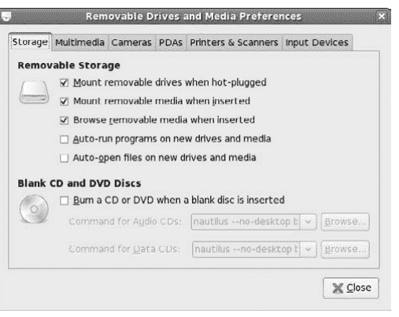

> 图 8-5：显示“存储”选项卡的可移动驱动器和媒体对话框。

有些选项有点难以理解，以下是其中一些常用选项的解释：

- **挂载：** 意味着应将驱动器添加到文件系统中以便使用，并且桌面上会出现一个图标显示其已添加。
- **热插设备：** 可以在系统运行时插入或从系统中移除，例如插入 USB 驱动器。
- **浏览：** 指的是挂载，但同时也打开一个显示介质内容的 Nautilus 窗口。
- **自动播放/运行：** 正如你在 Windows 世界中预期的那样，即系统将尝试在插入介质时识别出它应该运行的程序，并自动启动该程序。
- **自动打开：** 与自动运行类似，区别在于将打开文件以显示其内容。

点击“多媒体”选项卡（图 8-6）允许你专门处理音乐和视频的设置。可用设置如下：

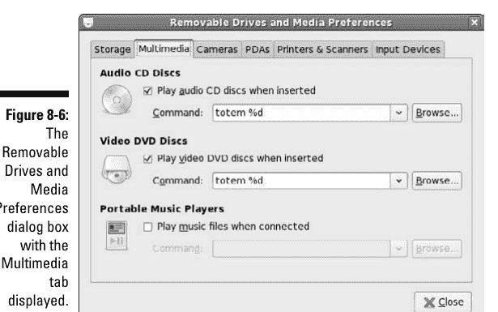

- 在“音频 CD 磁盘”部分，你可以设置当音频 CD 放入设备时是否自动播放。在下方，“命令”框会告诉你当插入磁盘时播放什么程序。关于比默认的播放器 totem 更好的播放器的建议，请参见第 13 章（此建议的播放器实际上显示在图 8-6 中，而不是默认的）。
- 在“视频光盘”部分，设置类似。在这里你还可以设置在插入光盘时会发生什么，以及应该运行什么命令。
- 在“便携式音乐播放器”部分，如果你有一个 MP3 播放器，可以设置系统在连接播放器时自动播放文件。如果勾选该框，你还可以使用“命令”框中的命令。我推荐使用 `amarok %d`（参见第 13 章），除非你需要 iTunes（参见第 15 章）。

如果你有其他想要设置的设备，请随时探索其他选项卡。完成此对话框的操作后，点击“关闭”以保存更改。

## 在此计算机上访问 Windows 驱动器

如果你在 Windows 和 Linux 之间进行双启动，你会有需要从 Linux 访问 Windows 驱动器信息的情况（遗憾的是，Windows 无法访问 Linux 磁盘上的信息）。当文件在同一台计算机上时，从 Linux 访问 Windows 驱动器上的文件，请执行以下操作：

1. **打开命令行终端。**
   请参见第 6 章。
2. **输入 `su` 切换到 root 用户。**
3. **输入 `fdisk -l` 查看所有分区。**
4. **输入 `mount -t ntfs-3g /dev/sdb1 /mnt` 来挂载分区（注意：请根据实际情况替换 sdb1）。**
5. **使用 `ls /mnt` 查看挂载的内容。**
6. **完成后，输入 `umount /mnt` 卸载。**
7. **如果需要以只读方式挂载，使用 `mount -r -t ntfs-3g /dev/sdb1 /mnt`。**
8. **如果需要安装 `ntfs-3g` 驱动，使用 `apt-get install ntfs-3g`。**

## 访问网络驱动器

有时你想要访问的驱动器在网络上。如果该计算机设置为可访问，请通过“位置：网络”。一个 Nautilus 文件夹将显示网络选项。如果你想访问 Windows 计算机，双击“网络”。

## 格式化磁盘

软盘、U 盘以及任何其他小型存储设备通常以 Windows 格式出厂。如果项目是空白的，你可以将其格式化为 Linux。

要格式化软盘，将软盘插入驱动器并选择“计算机”。在计算机对话框中，右键点击软驱图标并选择“格式化”。

通常情况下，默认设置是你想要的。如果你想将磁盘格式化为 Linux，请使用 Linux 原生 (ext2) 格式。为了与 Windows 用户共享，选择 DOS (FAT)。你可能想要选择的另一个设置是“彻底”而非“快速”。

完成格式化后，点击“开始”。当格式化完成后，你会看到一个提示。你可以查看图 8-7。

## 刻录数据 CD 和 DVD

CD 和 DVD 刻录机是制作数据备份的极佳方法（特别是对于可重写的）、保存和共享数字照片、制作多媒体合集等。许多工具允许你在 Linux 下刻录 CD，但你也可以使用 Nautilus 菜单刻录 CD 和 DVD。右键点击你想要刻录的文件，从右键菜单中选择相应的选项。

如果你想进行更高级的操作，可能想使用 K3b。如果你还没有安装它，请参见第 16 章了解如何操作——所需的特定包是 `k3b` 和 `k3b-extras`。要打开它，转到“应用程序—声音和视频—K3b”。当你启动此工具时，看到图 8-7 所示的窗口。

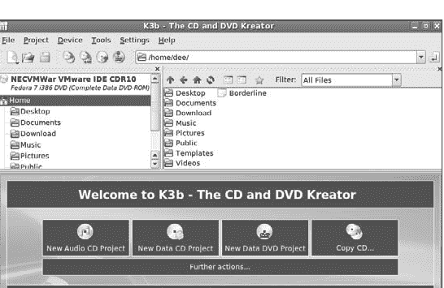

> 图 8-7：K3b CD 和 DVD 刻录器。

如果你想要下载的 ISO 文件创建 CD 或 DVD，请执行以下操作：

1. 如果是 CD-ROM 的 ISO 文件，选择“工具：刻录 CD 镜像”；如果是 DVD-ROM 文件，选择“工具：刻录 DVD 镜像”。

这两个操作都会打开“刻录镜像”对话框（图 8-8）。

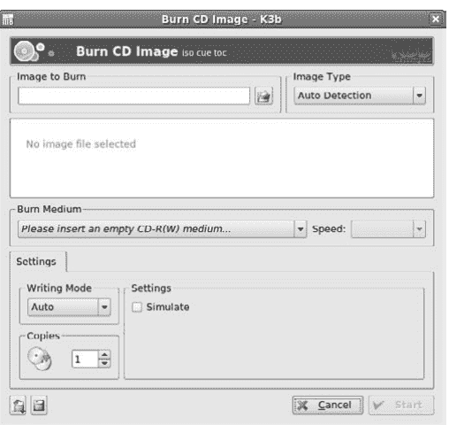

> 图 8-8：K3b 刻录镜像对话框。

2. 在“要刻录的镜像”部分，点击文件夹按钮并导航到你想刻录到 CD 或 DVD 的文件。
3. 找到文件后，选择它并点击确定。

文件名和信息现在出现在对话框中。

4. 如果出于某种原因你有多个刻录机，请确保“刻录介质”中显示的是正确的设备，并在时更改选择。
5. 在“速度”中，如果你正在刻录发行版的 CD 或 DVD，请将其降低到至少 4x。否则，通常保持原样即可。

如果你发现刻录的 CD 或 DVD 经常变成“光垫”（刻录失败的废盘），请降低你通常使用的速度。

6. 如果你想在每次刻录中使用大部分这些设置，请点击“保存默认值”。
7. 点击“开始刻录”。

出现一个带有两个进度条的对话框。第一个显示准备进度，第二个显示总进度（包括刻录时间）。

8. 如果是可重写介质，系统会要求你擦除内容以便重新写入。请根据需要进行适当处理。

如果你让 K3b 擦除介质，在过程的这一部分会出现“擦除”对话框。擦除完成后，光驱托盘打开弹出介质，然后自动关闭。这就是实际刻录会话开始的时刻。下一次光盘弹出时，过程即告完成。

9. 从驱动器中取出你的新 CD 或 DVD，然后点击“关闭”关闭刻录信息对话框，再次点击“关闭”关闭主对话框。
10. 选择“文件：退出”关闭 K3b。

注意，该程序在主窗口的底部还有其他有趣的功能。点击“项目”之一可以帮助你从头创建一个音乐（音频）CD、数据 DVD 或数据 CD。制作音频 CD 将在第 13 章介绍。

## 查找东西

名为 Beagle 的工具默认未安装，因此请使用第 16 章中的说明安装所有名称包含“beagle”字样的程序。完成后，你可以通过前往“位置：搜索”来运行此程序——注意，Beagle 现在已经取代了之前那个原始的搜索工具。你将在主窗口中看到一组“快速提示”，以充分利用它。

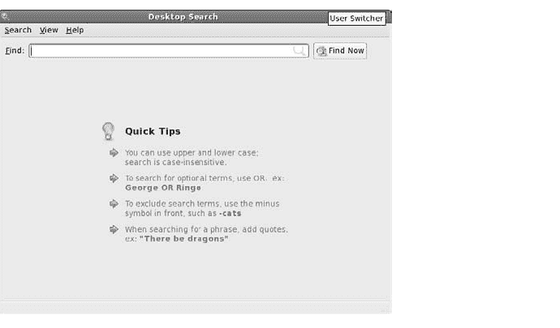

> 图 8-9：桌面搜索工具。

举例说明 Beagle 有多好用：如果你用 OpenOffice.org Writer 为一份关于文艺复兴的报告写笔记，你可以输入“Renaissance”，点击“立即查找”，所有“Renaissance”出现的地方（文档、即时消息对话、甚至你的网页搜索缓存）都会出现在搜索结果中。

如果你看到出现了“启动搜索服务”按钮，点击它，在后台运行搜索任务的程序就会启动。启动后，你正尝试运行的搜索将自动完成。

要查看你可以搜索的所有类别（并调整系统应该显示哪些类别），选择“搜索：显示类别”。在子列表中，你将看到 Beagle 可以且应该访问的材料类型完整列表。你可以通过选择项目单独从列表中删除项，也可以通过选择“无”然后逐个选择要添加的项目来全部移除。

选择“搜索：偏好”打开“搜索偏好”对话框（图 8-10），在其中你可以配置 Beagle 针对你特定登录的行为。

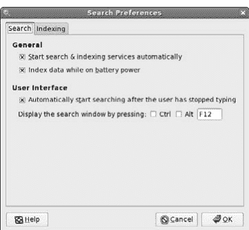

> 图 8-10：桌面搜索工具对话框。

你最感兴趣的标签是“索引”。在这里，你可以通过在“常规”下点击“添加”，告诉 Beagle 查找你的家目录（存储个人文件的地方）之外的内容。或者，你也可以使用“隐私”部分来添加不应被索引的项。

# 第 9 章：连接互联网

## 本章内容

- 理解常用方法
- 设置你的互联网
- 理解你的互联网服务供应商 (ISP)
- 理解 TCP/IP

## 互联网连接 101

关于宽带选项（DSL 和电缆）的几句话：宽带意味着高速互联网访问。虽然拨号调制解调器可以以每秒 56 千比特的速度传输信息，但宽带连接可以达到该速度的 50 倍。如今网页包含大量的图像和多媒体元素，请享受这些功能。不要让高速提供商阻碍你使用 Linux。仅仅因为他们直接不支持 Linux 并不意味着该技术无效。TCP/IP（互联网的一套规则）是为了操作系统开发的。

如果你是双启动到 Windows，你的 ISP 可以帮助你安装宽带连接。注意可用类型：

- **电缆调制解调器：** 当你订阅电缆互联网服务时，技术人员通常会提供一个名为电缆调制解调器的特殊设备和一个网络适配器（如以太网卡）。技术人员会将网络适配器安装到计算机中并连接调制解调器。要确定确切的速度，你需要联系你的电缆供应商。
- **数字用户线路 (DSL)：** DSL 以数字格式将数据传输到电话插座。DSL 的可能是因为比 ISDN 更快、安装和服务成本更低，并且利用了电信公司提供的现有铜线线路。你甚至可以使用同一条电话线。DSL 连接需要额外的通信硬件，应由你的互联网服务供应商 (ISP) 提供。

注意 DSL 有若干种变体：

- SDN（集成业务网络）数字用户线路 (IDSL) —— 参见本项目列表后文对 ISDN 的定义。
- 非对称数字用户线路 (ADSL)。
- 通用 DSL (XDSL)。

你可以从你的 ISP 处获取你的 DSL 连接有多快，因为速度而异。
- **卫星调制解调器：** 住在特别偏远或基础设施不足地区的人可能会选择卫星调制解调器。你可以认为这种服务与电缆等同，因为你接收卫星电视信号。然而，卫星也有缺点。如果你的卫星电视服务不可靠，你的互联网服务也会遭遇同样的命运。上传和下载速度也可能差异巨大。

## 警惕伪装调制解调器的设备

许多 Linux 新手因为无法与内置调制解调器通信而感到恼火。“毕竟，”新手推想道，“当我运行微软 Windows 时，同样的硬件是可以工作的，其他操作系统也是如此，尽管硬件也能与那些操作系统配合。”

- Windows 可以识别你的调制解调器，但 Linux 不可以。

好了，情况是这样的：年前，硬件制造商为了降低硬件成本开发了一种名为软调制解调器的设备。其想法是减少调制解调器的负担，并将任务委托给软件。结果是产生了一种廉价的调制解调器，它将信号路由到仅在微软 Windows 下运行的专用软件。此外，这些所谓的“软猫”并不是真正的调制解调器，而是连接到 Windows 的电话接口。

简而言之，如果你确定自己有一个软猫，Linux 就无法与其工作。对于那些冒险者来说，LinModem 项目 (linmodem.org) 已成功编写了 Linux 驱动程序，以配合其中一些软调制解调器。如果你感兴趣，我鼓励你参与这类项目。这些探索者推动着自由软件奇妙世界的发展，而它是其中的一个重要部分。

以下列表列出了你可以用来判断是否拥有软调制解调器的方法：

- 型号中带有 HCF、HSP 或 HSF。
- 包装上将设备称为 WinModem 或指定其仅适用于 Windows（尽管有时这些标签可能具有误导性，某些制造商根本不予理会）。

这一切令人遗憾的是，虽然你通过购买带有软调制解调器的机器可能省了一些钱，但你可能需要一个真正的调制解调器来运行 Linux（除非你幸运拥有 LinModem）。最好的办法是购买一个外部调制解调器，这样你可以保留软猫，而将外部设备专门用于 Linux（或你以后可能移动的任何其他电脑）。

**拨号调制解调器：** 拨号猫在无法或无法负担带宽地区的广泛使用。它将计算机的数字信号转换为模拟信号，从墙插座传输到电话公司。由于调制解调器利用了现有的语音电话服务，在订阅 ISP 之前不需要任何特殊设置。然而，你不能同时使用同一条电话线进行拨号和通话。如果你选择拨号路由，请查看侧边栏“警惕伪装调制解调器的设备”以获取更多注意事项。

**无线：** 无线网络领域可能是 Linux 如今给你带来最多麻烦的地方，取决于你使用的是哪种无线。存在四种无线类型，它们通常统称为 WiFi（802.11a、802.11b 和 802.11g，或者简单称为 A、B、G 和蓝牙）。A 和 B 是目前 Linux 中支持得最好的，因为再次，它们存在的时间最长。G 的安全性是你应该的目标；而且它具有复杂性，需要网卡制造商提供更多配合。现在的许多无线卡实际上能够胜任这些类型之外的功能，所以如果你没有一个，那一个同时支持 B 和 G。

我能给你的最佳建议是针对你无线卡的市场和型号（或你考虑购买的型号）进行搜索，使用“Linux”一词，然后看看你发现了什么——当然，你也可以检查针对各个发行版的硬件兼容性。由于这个领域技术发展非常迅速，请务必检查你找到的资源的日期，并确保它们是最近的。六个月前的资源可能意味着你获得的是过时信息。关于此主题的一些有用链接（有些比其他的更）包括：

- 我为 Fedora 用户发布的帖子（抱歉 URL 很长）：`http://dee-ann.blog-city.com/wireless_setup_on_emachine_m510_notebook.htm`
- Linux 网络快速 HOWTO：`www.linuxhomenetworking.com/linux-hn/wmpl1-linux.htm`
- Linux 无线局域网资源：`www.hpl.com/personal/Jean_Tourrilles/Linux/`
- 在 Linux 中使用 Windows 无线驱动的方法：`www.linux.com/driverloader`
- 网络拓扑指南：`www.homenethelp.com/network`

**综合业务数字网络 (ISDN)：** 在不久前，ISDN 还是真正的家庭高速选项之一。当 28 Kbps（是如今普通双工调制解调器速度的一半）几乎是你从连接你电话到电话公司的铜线中能榨出的全部时，它出现了。ISDN 在某些地区仍然可用，并承诺提供稳定的 128 Kbps——只要你距离电话公司的市局 3.4 英里以内。使用 ISDN 需要两个特殊设备：一个调制解调器（通常由 ISDN ISP 提供）和一个网络适配器（有时是以太网卡）。因为现在 ISDN 使用很少，没有多少特定网站专门负责。总的调制解调器 HOWTO (`www.tldp.org/HOWTO/Modem-HOWTO.html`) 包含了指向最新 ISDN 信息的提示，而且非常直观。

## 设置硬件

在你坐在椅子上感到太舒服之前，你必须物理检查一些项目。这可能需要你进行一些底层工作：

- **线缆、DSL 或 ISDN：** 如果你正在使用这些，你必须检查：
  - 调制解调器已正确连接到计算机。
  - 调制解调器已开启。（这些通常有自己的电源）。
  - 线缆一端插入墙插座，另一端插入电脑。

- **外部调制解调器：** 如果你有一个外部调制解调器，你需要检查：
  - 调制解调器已正确连接到计算机。
  - 调制解调器已开启。（这些通常有自己的电源）。
  - 线缆一端插入墙插座，另一端插入电脑。

- **内部调制解调器：** 如果你有一个内部调制解调器，你需要检查：
  - 调制解调器已正确连接到计算机。
  - 调制解调器已开启。（这些通常有自己的电源）。
  - 线缆一端插入墙插座，另一端插入电脑。

- **无线卡：** 如果你有一个无线卡，你需要检查：
  - 调制解调器已正确连接到计算机。
  - 调制解调器已开启。（这些通常有自己的电源）。
  - 线缆一端插入墙插座，另一端插入电脑。

好了，现在你可以坐回椅子上了。

## 选择互联网服务提供商 (ISP)

由于 Linux 普及率急剧上升，许多 ISP 正在培训其支持人员使用 Linux。如果你已经有了拨号服务，给他们打个电话，让他们知道你的需求。很可能，他们已经有了关于 Linux 的信息并可以提供给你。

某些 ISP 拥有自己的专用软件，你必须安装在 PC 上以连接互联网。他们提供的软件可能仅运行于 Windows。该软件会干扰操作系统以确保横幅被隐藏或确保你停留一段时间。

当你挑选 ISP 时，请考虑以下问题：

- 可以在全国范围内获得拨号号码吗？如果你经常旅行并在不同的城市访问，这项服务是一个方便的省钱（省疼）方案。
- 它提供 Linux 的技术支持吗？如果你计划运行 Linux，这个考虑是非常重要的。它不必须是否决因素，但很有帮助。
- 可以得到推荐吗？问问你的朋友。ISP 最好的朋友就是来自满意客户的背书。
- 你会有空闲问题吗？虽然用户与线路比例 7:1（每条线路平均 7 个或更少用户）更好并不是你获得占线信号频率完全准确的标准，但对消费者来说是最简单的衡量方法。

## 从 ISP 获取你需要的信息

大多数良好的 ISP 会在你注册其服务后向你提供一份客户信息表。该表至少应包含以下信息：

- 调制解调器用户使用的本地电话拨号号码
- 用户登录名
- 用户登录密码
- 电子邮件地址
- 电子邮件出站主机或简单邮件传输协议 (SMTP) 服务器
- 电子邮件入站主机或邮局协议 (POP) 服务器
- 新闻主机
- 你的计算机地址将是：
  - **静态：** 你始终拥有相同的 IP 地址。对于服务器来说，静态地址比台式电脑更常见。如果你使用静态地址，你的 ISP 需要提供你的名称服务器 IP 地址、网关地址、网络地址和子网掩码。这些信息应该在客户信息表上。
  - **动态：** 你的 IP 地址在每次连接时都会更改，或者在定期间隔更改。对于大多数台式电脑，你并不需要相同的地址，这让 ISP 的工作变得更简单。它也让笔记本电脑等在网络间移动的计算机使用起来更方便。如果你使用动态地址分配，系统会提示你需要通过 DHCP 进行连接。

有了这些信息，你可以通过你的 Linux 系统建立 Internet 连接。

## 配置你的连接

好了，现在你已经有了网络硬件和 ISP 信息，接下来该怎么办？答案是配置你的 Fedora 系统以接入 Internet！

配置过程根据你使用的硬件而略有不同。本节涵盖了访问 Internet 的三种主要方法：

- 使用调制解调器拨号到你的 ISP
- 使用以太网卡连接 DSL 或电缆调制解调器
- 使用无线卡连接到无线访问点

每种情况都需要配置一些略有不同的项目，但你都可以使用 Fedora 网络配置工具完成所有操作。

### 拨号连接

使用调制解调器拨号连接到 ISP 是一个两步骤的过程。首先，你必须根据 ISP 的设置配置你的调制解调器。之后，你必须手动启动和停止 Internet 连接（你可能不希望调制解调器整天占用你的电话线）。首先，设置你的调制解调器。

#### 设置调制解调器

手里拿着 ISP 信息，面前是亮着的显示器，请按照以下步骤在 Fedora 中配置你的拨号 Internet 连接：

1. 从 GUI 桌面中，选择“系统：管理：网络”。
2. 如果必要，在对话框中输入你的 root 密码。

如果你是以普通用户（而非 root）身份登录，系统会提示你输入 root 密码。

网络配置对话框打开（见图 9-1）。

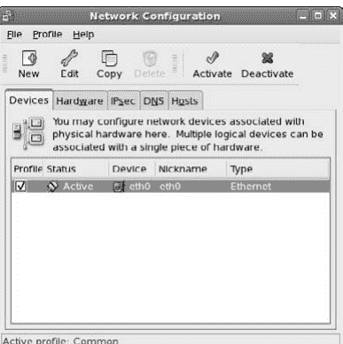

> 图 9-1：网络配置对话框。

3. 在网络配置对话框中，点击“新建”按钮。

出现“选择设备类型”对话框，如图 9-2 所示。

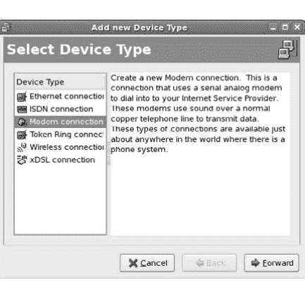

> 图 9-2：网络配置工具中的“选择设备类型”对话框。

4. 设置拨号调制解调器，从设备类型列表中选择“调制解调器连接”，然后点击“前进”按钮。

点击“前进”后，工具会探测你的调制解调器。如果找不到你的调制解调器（我将按照最困难的选项继续），将出现“选择调制解调器”对话框，如图 9-3 所示。我假设你正面对这个对话框。如果它没有出现，请继续你的配置直到再次匹配这些步骤。

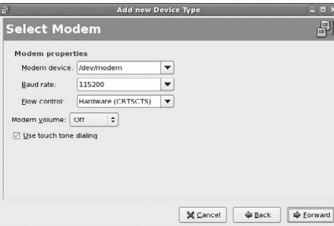

> 图 9-3：网络配置工具中的“选择调制解调器”对话框。

5. 从“调制解调器设备”下拉列表中选择正确的设备。

如果你知道在 Windows 中你的调制解调器在 COM1 或 COM2，将这种术语翻译成 Linux 并不难：你只需要减 1。所以，COM1 对应 `ttyS0`，COM2 对应 `ttyS1`。如果你使用的是 USB 调制解调器（扁平矩形接口），你的调制解调器可能在 COM1。如果你没有使用 USB 调制解调器，调制解调器可能在 COM2。

6. 从“波特率”下拉列表中选择你调制解调器的速度。

如果你被告知使用特定速度，请选择该速度。否则，选择最高数字。关键是尝试最高设置，如果不起作用，就开始选择更慢的速度，直到你能够正常建立连接。

保持“流控”设置不变。只有当你难以让调制解调器连接工作，或者你的 ISP 明确要求你选择“软件流控”或“无流控”时，才更改此设置。


7. 开启调制解调器音量，这样你在测试时就能听到它的运行。

当你安装 Fedora 时，它会自动检测大多数品牌的网卡。Fedora 甚至具有检测系统中多个网卡的能力。第一个被检测到的网卡被分配设备名称 `eth0`。系统中的第二个被检测到的网卡（如果存在）被分配设备名称 `eth1`。

尽管 Fedora 可能已经自动检测了你的网卡，但你可能仍然需要更改某些配置设置，以符合你的 ISP（互联网服务提供商）的要求：

1. 从 GUI 桌面中，选择“系统：管理：网络”。
2. 如果必要，在对话框中输入你的 root 密码。

如果你是以普通用户（而不是 root）登录的，系统会提示你输入 root 密码。

网络配置对话框打开（参见图 9-1）。

3. 你应该会在网络配置工具中看到你的网卡。双击该项目。

出现“以太网设备”对话框（如图 9-6 所示），显示了网卡的当前配置。

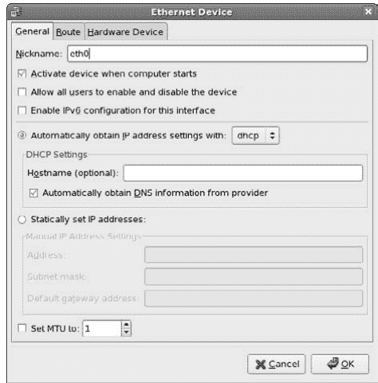

> 图 9-6：网络配置工具中的以太网设备框。

以太网设备对话框包含几个你可以更改的设置：

- **昵称：** 允许你为设备分配一个不同的（可能有意义）名称，而不是 `eth0` 或 `eth1`。
- **计算机启动时激活设备：** 允许 Fedora 在启动时自动激活网卡，无需你的任何干预。
- **允许所有用户启用和禁用设备：** 默认情况下，只有 root 用户可以启动和停止网络连接。勾选此框允许任何用户进行操作。
- **为此设备启用 IPv6 配置：** 这是提供 Internet 地址的未来标准。目前，大多数 ISP 不支持 IPv6，因此保持此框为空。

4. **选择你的 ISP 需要的 IP 地址方法。**

大多数电缆和 DSL 调制解调器通过 DHCP 为设备提供 IP 地址。如果是你的情况，请选择此方法。如果你的 ISP 为设备分配特定的 IP 地址，你需要选择“静态设置 IP”选项并输入适当的值。

5. **点击“确定”保存设置。**

网络配置工具会自动保存新的网卡设置。如果网卡未处于活动状态，点击“激活”按钮启动它。

## 看我的，没电缆了！

无线现象已经席卷了家庭网络。如今，购买和安装无线路由器就像购买有线交换机一样简单。如果你已经加入了无线浪潮的大潮，你需要知道如何将你的 Fedora 系统连接到你的无线接入点。

你遇到的第一个障碍是无线网卡本身。遗憾的是，Linux 世界对无线网络的支持仍处于起步阶段。虽然 Fedora 的每个新版本都包含了对更多网卡的支持，但你完全可能拥有一个不受支持的网卡。

如果你的网卡不受支持，你最后的努力是使用 `ndiswrapper` 项目。`ndiswrapper` 项目是一个开源项目，它使用为网卡提供的 Windows 网络驱动程序来创建一个伪 Linux 驱动程序。遗憾的是，Fedora 在默认配置中不提供 `ndiswrapper` 软件，但你可以在其他地方找到它。你可以访问 `ndiswrapper.net` 了解更多信息。


如果你足够幸运，有一个被 Fedora 支持的无线网卡，你可以使用我们的朋友网络配置工具来为你的无线接入点配置：

1. 从 GUI 桌面中，选择“系统：管理：网络”。
2. 如果必要，在对话框中输入你的 root 密码。

如果你是以普通用户（而不是 root）登录的，系统会提示你输入 root 密码。

网络配置对话框打开（再次参见图 9-1）。

3. 在网络配置对话框中，点击“新建”按钮。

出现“选择设备类型”对话框（参见图 9-2）。由于此部分涵盖无线接入，请在此处选择“无线连接”，并点击“下一步”。

4. 选择你的无线设备，并点击“下一步”。

出现“选择无线设备”对话框，列出了系统上检测到的所有无线网卡（如图 9-7 所示）。

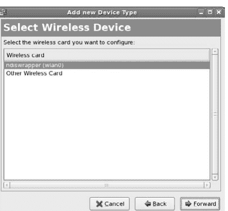

> 图 9-7：网络配置工具中的选择设备对话框。

5. 输入你的无线接入点配置设置。

出现“配置无线连接”对话框（如图 9-8 所示）。

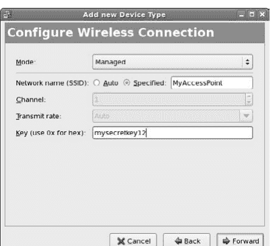

> 图 9-8：网络配置中的配置无线连接对话框。

你必须配置几个无线设置才能连接到你的接入点：

- **模式：** 决定无线卡是否由接入点管理。要连接到你的接入点，请将其设置为“托管”。
- **网络名称 (SSID)：** 无线接入点通过服务集标识符（SSID）进行识别。在此字段中输入你接入点的 SSID。如果将其留为“自动”，Fedora 将尝试连接到任何接入点。
- **通道：** 某些网卡允许你设置特定通道，而其他则扫描所有通道。
- **传输速率：** 某些网卡允许你指定传输速率，而其他则自动检测。
- **密钥：** 加密接入点在今天的环境中是必要的。此字段允许你输入加密密钥。

输入选择后，点击“下一步”。

出现 IP 设置对话框；参见图 9-5。

7. 在 IP 设置对话框中，根据你的网卡需要从接入点获取 IP 地址（DHCP，见本章前面的“从你的 ISP 获取所需信息”）还是需要手动指定（静态），选择相应的单选按钮。

大多数无线接入点也内置了 DHCP 服务器，所以即使你的 ISP 不提供，也可以使用 DHCP。如果你选择了静态，下半部分就可以填写由 ISP 提供的地址、子网掩码和默认网关。

8. 点击“下一步”将你刚刚设置的无线网卡添加到网络配置中。

当无线网卡出现在网络配置列表中，你可以通过使用“激活”和“禁用”按钮来方便地启动和停止它。

## 一切顺利，直到出现问题

在理想情况下，前述的配置步骤应该是 100% 有效的。Linux 供应商确实隐藏了传统网络中的神秘感。遗憾的是，在许多情况下（与方法和硬件有关），简单的配置并不有效。如果你在执行这些步骤后仍无法连接网络，一个很好的寻找网站是 LinuxQuestions.org (`www.linuxquestions.org`)。而且是的——你必须使用一台已经接入 Internet 的计算机来访问那里。（谁陷入了两难境地呢？）我们无法预料人们可能遇到的各种情况，Linux 社区是你的最佳选择；这里以乐于助人的社区成员闻名。

此外，去你喜欢的网站搜索你从系统获取的错误信息——如果只搜索错误信息不起作用，加上网络硬件的品牌、型号以及你使用的发行版名称也无妨。当你试图找出网络连接出的问题时——或者试图收集可以帮助他人找出问题的信息——你可以使用一个非常酷的工具：方便的命令行程序 `ping`。

> **警告！**
> 某些防火墙会拦截 `ping` 发送的流量，因此即使在连接良好的情况下，这些命令也不总是能如预期那样工作。

`ping` 命令类似于潜艇使用声纳探测海洋中的其他物体。声纳发送一个 `ping` 信号，该信号会在硬表面反射。通过测量发送 `ping` 和收到返回之间的时间差，潜艇工程师可以判断是否存在物体，以及物体距离潜艇有多远。

Linux 中的 `ping` 命令提供的信息与声纳提供的信息类似，作为一个 Linux 命令和一个历史悠久的词汇，在这里看到它非常有帮助。如果你将互联网比作你的海洋，通过 `ping`，可以计算其他网络中的计算机，以及 `ping` 命令返回需要多长时间。你以 `hostname` 或 `ipaddress` 的格式使用此命令，例如 `ping bob.example` 或 `ping 192.168.1.5`。如果你在家里或办公室里找不到另一台电脑（假设它们都通过以太网连接，且没有连接在独立的拨号连接上），那么是机器出了问题；另一方面，如果你可以 ping 家里或办公室的另一台机器，但无法 ping 互联网上的其他机器，那么可能是你到 ISP 的连接出了问题。

延迟，是指信号传输到互联网所需的时间。网络流量、带宽和网络硬件等因素都会导致延迟。这些因素决定了 ping 邻居的电脑所需的时间是否比 ping 南极的一台主机更长。

例如，通过打开命令提示符（见第 6 章）并输入以下命令来 ping Yahoo!：

```bash
ping yahoo.com
```


# 第 9 章：连接互联网

执行 `ping www.yahoo.com` 命令。

```
ping www.yahoo.com
```

按下 `Ctrl-C` 停止 ping；否则，你的计算机将继续 ping 目标。

图 9-9 所示的输出提供了 `ping` 正在执行的信息。如果你无法访问主机，会收到一条“主机不可达”的消息。如果你可以访问主机，将收到反馈，显示信号从你的计算机到达目标计算机并返回需要多长时间——以毫秒（ms）为单位（数字越小越好）。对于通过以太网连接的计算机，1 ms 到 3 ms 的 ping 时间是可以接受的响应时间。对于拨号连接，预计在 150 ms 左右。当你看到 ping 时间攀升到 900 ms 或更高时，网络可能正处于高负载状态（或你的电缆出了问题）。

```bash
ping www.yahoo.com
ping -c 5 www.yahoo.com
64 bytes from www-yahoo-ak3.net (66.249.224.210): 56 bytes of data.
64 bytes from www-yahoo-ak3.net (66.249.224.210): icmp_seq=1 ttl=56 time=64.2 ms
64 bytes from www-yahoo-ak3.net (66.249.224.210): icmp_seq=2 ttl=56 time=65.1 ms
64 bytes from www-yahoo-ak3.net (66.249.224.210): icmp_seq=3 ttl=56 time=63.8 ms
64 bytes from www-yahoo-ak3.net (66.249.224.210): icmp_seq=4 ttl=56 time=65.5 ms
64 bytes from www-yahoo-ak3.net (66.249.224.210): icmp_seq=5 ttl=56 time=64.9 ms
```


图 9-9：`ping` 命令的示例结果。

## 连接之后

连接上之后，你可能想直接跳到第 10 章，学习如何使用为你提供的各种互联网程序。在此期间，让我们为你提供一些可能在你需要帮助或想要进一步探索 Linux 世界时发现的网站——其中一些非常极客，但你会逐渐适应的！你可能还会更新你的机器（见第 16 章）、添加新软件（也是第 16 章），并额外考虑系统安全（见第 18 章），以保护自己不受坏人和程序的侵害。

### 有用的网站

- `linuxsecurity.com`：一个有点极客但很有用的地方，你可以在那里跟踪 Linux 安全世界的动态。
- `kerneltraffic.org`：关于 Linux 内核发生的一切你不想了解的事情。
- `linux-newbie.org`：这个网站对于 Linux 新手来说非常棒。
- `http://linux-newbie.org/`：为初学者提供的海量资源。

# 第 10 章：使用互联网

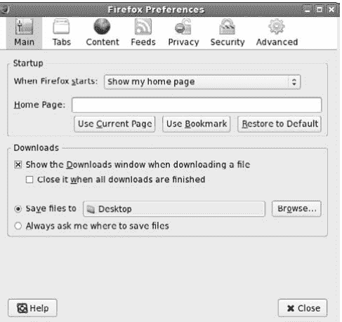

图 10-1：Fedora 7 中的 Firefox 选项窗口。

- **使用当前页面 (Use Current Page)**：导航到你想作为默认主页的页面，然后点击此按钮。该页面的 URL 将出现在“位置(s)”文本框中。
- **使用书签 (Use Bookmark)**：点击此按钮打开“设置主页”对话框，其中包含你所有的书签。选择你想要使用的书签，然后点击确定将该页面的 URL 添加到“位置(s)” 文本框中。
- **恢复默认 (Restore to Default)**：点击此按钮，让 Firefox 仅打开一个空窗口。

**下载 (Downloads)**：此部分允许你设置 Firefox 执行下载的方式。你可以设置 Firefox 下载文件的位置，以及在文件下载时是否显示“下载”窗体。

## 隐私偏好

每当你发送电子邮件或点击网站时，你都在跨网络交换信息。虽然你不需要为此彻夜难眠，但你应该对在互联网上进行的每一次请求保持意识。花点时间检查“隐私偏好”（见图 10-2），确定是否有任何你想更改的内容：

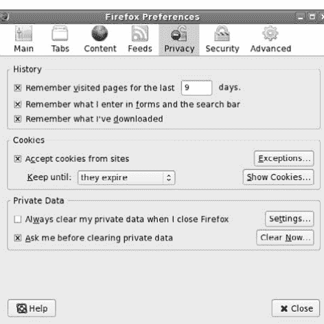

图 10-2：Fedora 7 中的 Firefox 选项窗口。

- **历史记录 (History)**：历史记录部分允许指定浏览器记住你去过的地方的天数。你还可以选择让 Firefox 记住你输入表单和搜索栏的文本。如果你使用此功能，Firefox 将尝试自动完成你以前在这些表单输入过的单词。你还可以允许 Firefox 记住你下载的文件，以便你可以轻松删除它们，而不是意外下载上周已经下载过的 500MB 文件。
- **Cookie (Cookies)**：这是让一些人陷入疯狂的话题之一。Cookie 是网站存储在你机器上的一些位信息，以便在你返回时可以访问这些数据。有些人不在乎创建了多少 Cookie，而另一些人不希望系统中有任何 Cookie。为了防止存储 Cookie，请点击“接受来自网站的 Cookie”框并取消勾选。你也可以通过点击“例外”按钮并将网站添加到列表中来仅允许某些网站。

你可以通过点击“显示 Cookie”按钮查看当前所有的 Cookie，并可以逐个删除（选择要删除的 Cookie 然后点击“删除 Cookie”）或点击“删除所有 Cookie”按钮立即丢弃所有 Cookie。对于“保留直到 (Keep until)”下拉列表框，选择你希望让 Firefox 丢弃 Cookie 的频率：

- **直到过期 (Until expire)**：大多数 Cookie 都有自动有效期。如果你想让 Cookie 决定何时被删除，请选择此选项。
- **我关闭 Firefox (I close Firefox)**：如果你使用的是图书馆计算机或其他共享机器，或者只是不想在使用浏览器时让计算机存储 Cookie，请选择此选项。
- **每次都询问 (Ask me every time)**：如果你对 Cookie 极度偏执，或者想知道它们实际上是如何被使用的，请选择此选项。

**私有数据 (Private Data)**：此部分允许你设置存储的项目（如 Cookie、临时文件、项目和存储（表单数据））如何被清除以及如何清除。如果你想在每次退出 Firefox 时清除所有存储的文件，请勾选“始终清除我的私有数据”框。你可以点击“设置”按钮并选择你想要清除的具体项目来精确选择清除哪些项目。作为安全功能，“清除私有数据前询问我”框默认被勾选。这有助于防止意外清除你的数据。

## 内容偏好

选择“内容 (Content)”将你带到 Firefox 选项对话框的各个部分（图 10-3）。此部分允许你控制 Firefox 如何对各种类型的内容做出反应。顶部涉及允许或不允许的项目——注意这些每个项目的右侧都有一个按钮，可以提供额外的内容：

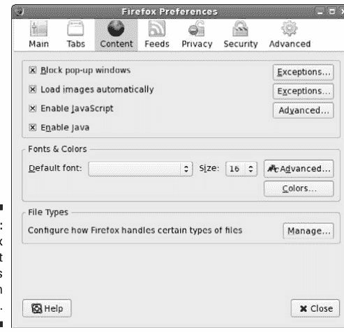

图 10-3：Fedora 7 中的 Firefox 选项窗口。

- **阻止弹出窗口 (Block Popup Windows)**：告诉 Firefox 阻止你没有请求的新窗口——这是一个非常受欢迎的功能，也是许多人在 Microsoft Windows 环境下迁移到 Firefox 的原因之一。某些网站具有需要打开（例如，登录窗口）的功能，因此你可以点击“允许的网站”按钮为它们设置例外。如果你不配置此项，它仍然有效。每当弹出窗口被阻止时，浏览器中会出现黄色条，允许你在此访问设置。
- **自动加载图像 (Load Images Automatically)**：允许你阻止所有图像。适用于视力障碍者或试图通过忽略图片来加快浏览的人。在“组织网站”中，许多广告通常从其他网站加载并仅显示在你查看的页面上，但它也可以阻止合法的图形。“例外”帮助你管理可以看到什么和看不到什么。
- **启用 Java (Enable Java)**：如果你安装了 Java 并启用了此选项，Firefox 将运行 Java 插件。
- **启用 JavaScript (Enable JavaScript)**：一些人出于安全考虑会关闭 JavaScript。点击“高级”按钮打开设置，允许你从中选择。

- **默认字体 (Default Font)**：点击此下拉列表框选择你想要的。
- **字体 (Size)**：点击此下拉列表框选择你想要的。
- **高级 (Advanced)**：点击此按钮打开对话框，允许你选择。
- **颜色 (Colors)**：点击此按钮打开对话框并更改。
- **文件类型 (File Types)**：点击“管理”允许你分配。


## 高级偏好

此部分提供了四个用于高级功能的选项卡：

- **通用 (General)**：“通用”选项卡允许你设置功能，以及你可以阅读的语言顺序。
- **网络 (Network)**：如果你的网络管理员告诉你必须使用代理服务器，请在“连接”部分点击“设置”按钮。“缓存”部分允许你查看存储页面内容时占用的空间。这允许 Firefox 在你下次访问时更快显示页面。你可以通过“清除”按钮清除缓存。缓存数据也是你可以设置自动清除私有数据的一部分。
- **更新 (Update)**：“更新”选项卡允许 Firefox 处理自身的更新，以及你已安装的任何插件。
- **加密 (Encryption)**：“加密”选项卡具有 Firefox 使用的安全协议设置，以及你是否有用于访问加密网站的加密证书。通常情况下，你不需要动这些设置。

# 第 10 章：使用互联网

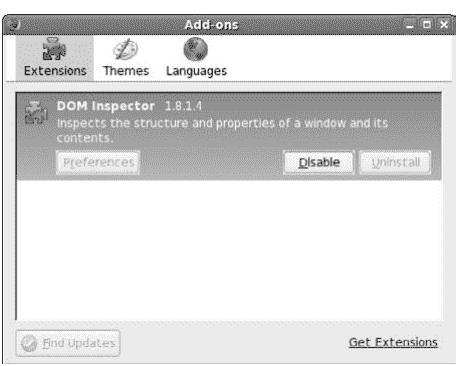

**图 10-4：Fedora 7 中的 Firefox 扩展对话框。**

“扩展”（Extensions）部分显示了当前安装的扩展。点击“获取更多扩展”（Get More Extensions）链接（如果您已连接到互联网）将打开一个网页，让您浏览可用的扩展。如果您发现了想要尝试的扩展，点击描述下方的“安装”（Install）链接，如果您的 Firefox 版本在列出的支持范围内，则点击“立即安装”（Install Now）（您可以通过“帮助 -> 关于 Firefox”来查看版本）。遗憾的是，某些扩展可能会导致错误出现并可能变得不稳定。

## 浏览网页

Firefox 是您通往奇妙宽网的窗口。Firefox 的主要目的是根据您的命令抓取 Web 页面，将所有图形和相关文件下载到您的计算机内存中，最后渲染页面以供您进行交互式观赏。

如果您正在使用 Internet Explorer 或 Netscape，切换到 Firefox 应该非常容易。它拥有所有熟悉的导航工具，例如地址栏；后退、前进、重新加载和停止按钮；以及一个存储您收藏网站链接（书签）的功能。

Firefox 与 Netscape 一样也有一个“历史”（History）侧边栏——按下 `Ctrl+H` 显示或隐藏它（见图 10-5）——您可以用它访问最近访问过的网页。

标签页浏览——这是 Firefox 的一项功能，对您来说可能是新颖的——允许您在同一个窗口中打开多个网站。对于许多从 Internet Explorer 6 或 Netscape 转过来的人来说，Firefox 的标签页浏览最初可能看起来奇怪，但我认为您会很快爱上它的。

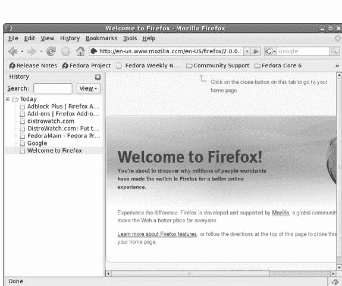

**图 10-5：在 Fedora 中打开了历史侧边栏的 Firefox。**

欢迎使用 Firefox！您即将了解为什么全球范围内的人都切换到 Firefox 以获得更好的在线体验。

不同在于：Firefox 由 Mozilla 开发和支持，这是一个致力于为所有人让 Web 变得更好的全球社区。

了解更多关于 Firefox 的功能，或遵循页面顶部的说明关闭您的主页。

启动 Firefox Web 浏览器后，定义为主页的网站会在标签页中出现。您可以保持该页面打开，并通过按下 `Ctrl+T` 在标签页中打开一个新的网站。新网页位于同一个 Firefox 窗口内，但以标签页形式存在。您只需点击每个页面顶部相应的标签，即可在两个标签页之间切换。

您还可以通过右键点击链接并选择“在新标签页中打开链接”（Open Link in New Tab），将网页链接作为新标签页打开。此功能对于在需要参考之前页面的复杂网站中导航非常好。

## 演变为电子邮件

尽管大多数人在提到互联网时会想到 Web，但实际上电子邮件可能是互联网中最常用且最受欢迎的应用程序。Linux 用户有大量的电子邮件程序可用。Fedora 选择默认包含 Evolution-mail 包。

Evolution 会让您联想起 Outlook。如果您喜欢能够整合日历、地址录、任务管理器和电子邮件，那么您应该在 Evolution 中感到很自在。其他 Linux 邮件客户端如 Mozilla Mail、Thunderbird 和 KMail 更加功能单一，尽管 Thunderbird 支持阅读新闻。如果您喜欢保持简单，可能想尝试这些包中的一个。

## 设置 Evolution

第一次打开 Evolution 时，程序将引导您完成设置过程，因此请确保手头有以下信息：

- 您分配的电子邮件地址，格式为 `username@example.org`。
- 用于接收邮件的邮件服务器类型，例如 POP。
- 用于接收邮件的邮件服务器名称，格式为 `server.example.org`。
- 用于发送邮件的邮件服务器类型，例如 SMTP。
- 用于发送邮件的邮件服务器名称，格式为 `servername.example.org`。此名称可能与接收邮件的服务器名称相同。
- 收发邮件均可能所需的任何特殊类型的身份验证。这种验证通常只是接收邮件的密码，而发送邮件可能不需要。

首次启动 Evolution 后，将启动 Evolution 设置向导（Evolution Setup Assistant）。

点击“下一步”（Forward）通过欢迎屏幕，随后将打开“身份”（Identity）对话框（见图 10-6）。要填写此对话框，请完成以下步骤：

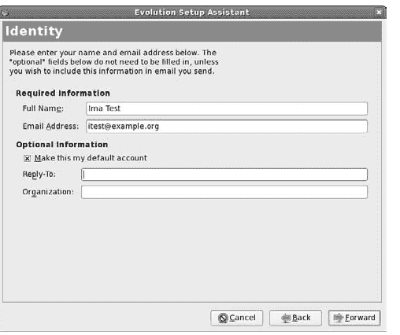

**图 10-6：Fedora 7 中的身份对话框。**

- 1. 如果您需要，更改“全名”（Full Name）字段。

  有些人不想使用真实姓名，而是选择使用昵称。可能分配了可能未分配默认值，取决于您在机器上配置了哪些程序。

- 2. 如果“电子邮件地址”（E-Mail Address）字段与 ISP 给您的地址不匹配（它很可能不匹配）。

- 3. 如果您想使用与发送方不同的账户，请确保选中了“默认账户”（Default Account）。

- 4. 点击“下一步”（Forward）。

- 5. 在“服务器类型”（Server Type）列表中选择合适的选项。

  如果您不知道邮件服务器使用什么种身份验证，请点击“检查支持”（Check Supported）。如果您的 ISP 支持加密验证方法，Evolution 将自动检测并使用它。通常，验证方法只是明文密码，因此可以选择“密码”（Password）选项。

- 6. 在“服务器”（Server）文本框中输入您的 POP 服务器全名。该名称可能是 `pop.example.com`。

- 7. 在“用户名”（Username）框中输入检查邮件的登录名称。如果您的电子邮件地址是 `jane@example.com`，用户名就是 jane。

- 8. 在“身份验证类型”（Authentication Type）下，选择合适的选项。

- 9. 勾选“记住密码”（Remember Password）复选框，这样每次检查邮件都无需输入电子邮件密码。

  如果您要离开计算机其他人可能会访问，可以通过进入主菜单并选择“锁定屏幕”（Lock Screen）来保护自己。确保在输入登录密码时没人可以使用您的 GUI。

- 10. 点击“下一步”（Forward）进入二级“接收选项”（Receiving Options）对话框（见图 10-8）。

  此对话框取决于您使用的入站邮件服务器类型。如果您没有使用 POP 且二级对话框，它可能与此处显示的匹配，尽管它共享一些显示的选项。

- 11. 如果您想自动检查新邮件，勾选“自动检查新邮件”（Automatically for New Mail）复选框。

  如果您没有持续的互联网连接，可能更喜欢手动检查邮件。如果是这样，请取消勾选该框并跳到第 14 步。

- 12. 在“分钟”（Minutes）文本框中，设置您想自动检查新邮件的频率。

| Evolution | |
| :--- | :--- |
| Description | 用于连接到 POP 并从中下载邮件。 |
| Server type | POP |
| Server | `servername.example.com` |
| Username | test |
| Security | |
| Secure Connection | No |
| Authentication Type | |
| Password | |
| Remember | [x] |

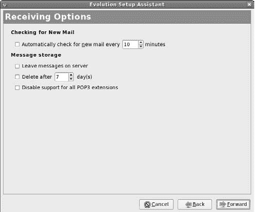

**图 10-8：** Fedora 7 中 POP 邮件用户的 Evolution 接收邮件对话框。

- 14. 如果你从多台计算机上检查邮件，你可能想要勾选“在服务器上保留邮件”（Leave Messages on Server）复选框，这样你就可以从所有机器上访问相同的邮件。

  如果你选择了此选项，你的多台机器上都会有邮件副本，但也意味着无论你从哪台机器上检查邮件，都可以访问你的电子邮件。请记住，偶尔你需要取消勾选此框并检查邮件，以清理邮件在服务器占用的所有空间。你不希望空间用尽。

- 15. 如果你的 ISP（互联网服务提供商）告诉你要使用 POP3 扩展，请勾选“禁用所有 POP3 扩展”（Disable Support for All POP3 Extensions）复选框。

- 16. 点击“下一步”（Forward）继续。

你现在已完成收件邮件的设置。在图 10-9 所示的“发送邮件”对话框中：

- 17. 如果你的服务器类型不是 SMTP，请更改“服务器类型”。

  我假设你正在使用 SMTP 发送电子邮件。

- 18. 在“主机”（Host）文本框中输入 SMTP 邮件服务器的完整名称。

  该名称可能类似于 `smtp.example.com`。

- 19. 如果你被告知使用 SSL 进行安全保护，在“安全连接 (SSL)”下拉列表框，选择“始终”（Always）或“尽可能”（Whenever Possible），取决于你的 ISP 的规定。

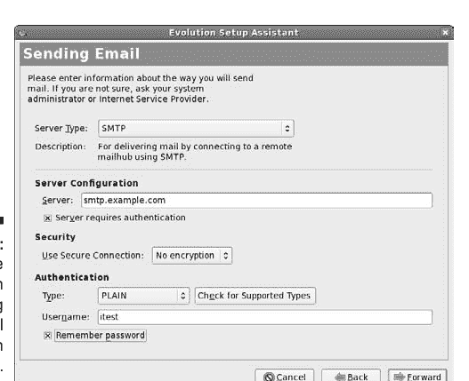

图 10-9：Fedora 7 中的 Evolution 发送邮件对话框。

- 20. 如果你执意要在发送邮件时使用额外的身份验证，请勾选“服务器需要身份验证”（Server Requires Authentication）。

  通常情况下不需要任何操作。如果你不勾选此框，请跳到下一组指令。否则，继续执行下一步。

- 21. 在“身份验证”（Authentication）下，根据 ISP 的指示选择合适的“类型”（Type）。

  如果你不确定，点击“检查支持的类型”（Check for Supported Types）。

- 22. 在“用户名”（Username）下，输入你用于向发件邮件服务器进行身份验证的登录名。

  此名称可能与你收件时使用的名称不同。

- 23. 勾选“记住密码”（Remember Password）复选框，这样你每次发送邮件时就不需要输入密码。

  再次务必注销或使用“锁定屏幕”选项，以免他人冒用你的名义发送恶搞邮件！

- 24. 点击“下一步”（Forward）继续。

你现在到达了极其简单的“账户管理”对话框。可以保持“名称”（Name）不变，或将其更改为具有描述性的内容，这样如果你有一列表账户可以使用，你就能认出正在查看的是哪个账户。

你的电子邮件地址通常会在这个最终框中显示为 `jane@computer5.example.com` 等内容。如果你的情况也是如此，你需要编辑此条目以与你的真实电子邮件地址匹配，对于 Jane 来说，就是 `jane@example.com`。

- 26. 点击“下一步”（Forward）进入“时区”对话框。

  在时区地图上点击离你所在地最近的城市，或使用“选择”下拉列表选择正确的时区。

- 27. 点击“下一步”（Forward）进入“完成”（Done）对话框。

  在这里你只需输入一条简短的消息表示你已完成。

- 28. 点击“应用”（Apply）保存你的设置。

Evolution 程序打开，如图 10-1 所示。

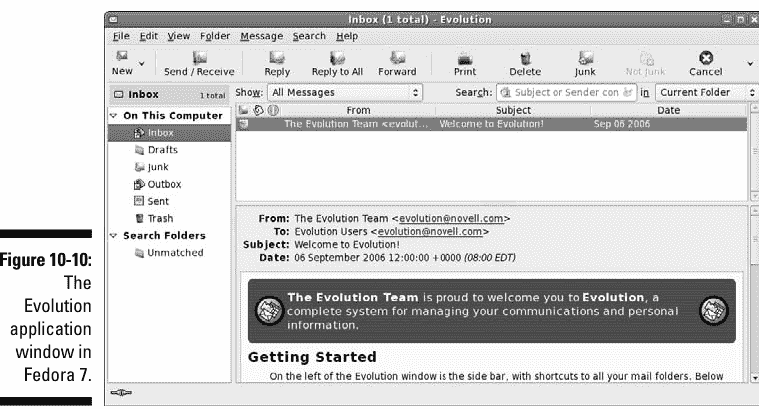

## 发送和检查电子邮件

以下步骤概述了如何创建新的邮件并发送它：

1. 点击“新建”（New）。

   打开“撰写邮件”窗口，如图 10-11 所示。如果你想打开另一个新项目作为新的联系人列表或日历安排，请点击“新建”旁边的箭头打开选项列表进行选择。

2. 在“文本”框中输入收件人的电子邮件地址（例如 `bob@example.net`）或用逗号分隔的地址列表（例如 `bob@example.net, tom@example.org`）。

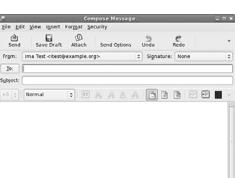

**图 10-11：** Fedora 7 中的 Evolution 撰写窗口。

- 显示附件栏（Show Attachment Bar）

3. 如果你需要在收件人列表中添加 CC（抄送）或 BCC（密送），打开邮件的“视图”（View）并选择相应的字段显示，然后将相应的地址输入这些字段中。

   不要混淆 CC 和 BCC 选项。添加到 CC 字段的邮件地址会出现在邮件消息的头部，所有人可见。添加到 BCC 字段的邮件地址不会出现在邮件头部中（但消息仍会投递给他们）。这是一种在不让他人知道的情况下向某人发送消息副本的方法。

4. 在“主题”（Subject）文本框中输入你的邮件类型。

5. 在下方的窗口中，输入格式按钮和“格式”（Format）来美化你的邮件。

6. 如果你想在邮件底部添加签名，点击“格式”旁边的下拉列表选择 HTML。

   要创建自定义签名，转到 Evolution 偏好设置（Preferences）对话框（见图 10-12）。在此对话框中，在“身份”标签页，点击“新建”（New）。在这里你可以创建并格式化签名，点击“保存并关闭”后，你可以选择哪个签名作为默认。

7. 完成输入消息后，点击“发送”（Send）。

   邮件现在已进入发送箱，如果你需要可以编辑它。

8. 点击“发送/接收”（Send/Receive）按钮。

   Evolution 将检查邮件。

花点时间探索 Evolution。


## 利用即时消息

人之间的即时消息（IM）就像使用电话——只不过打字而不是说话。此外，你可以同时处理多个即时消息，而无需额外的连接。美国在线（AOL）提供了一种流行的即时消息服务，名为 AOL 即时消息（AIM）。其他还有 ICQ、MSN、Yahoo 和 Google。许多计算机操作系统（包括 Linux）支持这些服务。

直到最近，Pidgin 软件包被称为 GAIM。由于版权限制，该包名必须更改。如果你在之前的 Fedora 版本中使用过 GAIM，Pidgin 的用法完全相同。

## 使用 Pidgin 即时消息

要启动 Pidgin，选择 `应用程序 > 互联网 > Internet Messenger`。应用程序首次启动后（见图 10-13），其主对话框（称为“好友列表”）和账户管理对话框都会出现。要让 Pidgin 了解你的某个 IM 账户：


| 好友列表 | 账户 |
|---|---|
| 欢迎使用 Pidgin！你还没有配置账户。要连接 Pidgin，点击下方的“添加”按钮配置第一个账户。如果你想让 Pidgin 连接账户，请从“账户=添加/编辑”中选择。添加账户后，你就可以登录、设置状态并与他们聊天。 | 添加 编辑 目录 关闭 |

1. 点击账户对话框中的“添加”按钮。出现“添加账户”对话框，如图 10-13 所示。
2. 在“协议”下拉列表中，选择你想使用的 IM 网络。你的选项有 AIM、Gadu-Gadu、GroupWise、ICQ、IRC、Jabber、MSN、QQ、SILK、SIMPLE、Yahoo 和 Zephyr。如果你想使用 Google 即时消息，请遵循 `www.google.com/support/talk/bin/answer.py?answer=24073` 的说明。
3. 在“屏幕名称”（Screen Name）文本框中，输入你 IM 账户的登录名。如果你使用的是 ICQ，请使用你的会员号。
4. 在“Password”（密码）文本框中，输入此账户的 IM 密码。
5. 在“Alias”（别名）文本框中，输入你实际希望在他人 IM 客户端显示的名称，除非你想使用你的显示名称。
6. 勾选“Remember Password”（记住密码）复选框，这样你每次连接到此 IM 服务时都无需再次输入密码。

   当你离开电脑时，请记住注销或使用“Lock Screen”（锁定屏幕）选项，以防有人进来作剧，使用你的 IM 客户端向他人发送消息。

7. 如果你通过此服务接收电子邮件并想知道何时有新邮件到达，请勾选“New Mail Notifications”（新邮件通知）框框。
8. 如果你想用一张小图片作为好友图标（你自己、你的狗或任何你想使用的图片），点击“Buddy Icon”（好友图标）标签旁边的“Open”（打开）按钮，并导航到你想使用的图片。
9. 如果你要访问此 IM 服务的更多高级选项，点击“Save”（保存）将其添加到你的账户，点击“Advanced”（高级）复选框。

   每个 IM 服务都有其自己可供配置的高级选项。例如，对于 AIM 服务，你可以更改默认连接的 AOL 服务器和默认 TCP 端口号。

10. 当你完成信息输入后，点击“Save”（保存）将此 IM 账户添加到你的账户列表。

对每个想要在 Pidgin 中使用的账户重复此过程。然后，在主对话框中，点击你想要自动登录账户的“Enabled”（已启用）列。

你可以随时通过在主对话框中选择账户并点击“Modify”（修改）按钮来修改账户设置。

启动会话后，“Buddy List”（好友列表）窗口会显示你的活动连接。如果你关闭了 Buddy List 窗口，Pidgin 图标将出现在你的面板（Panel）上，因为程序在后台运行。你可以右键点击此图标来打开 Buddy List。

再次，Pidgin 的功能不止于此，因此绝对值得尝试这个工具。

关闭“Accounts”（账户）和“Buddy List”（好友列表）对话框后，你可以通过右键点击系统托中的 AIM 图标，并从菜单中选择要打开的对话框来重新打开它们。

### 排除 IM 连接的故障

如果你一直在其他操作系统上使用大多数此类 IM 客户端，有时你的 Linux 系统可能无法正确连接到 IM 服务。当此问题发生时，屏幕上会弹出错误消息并指示连接失败。你可能无法连接到 IM 服务的原因有以下几点：

- 你可能输入了错误的 IM 账户密码或不正确的 IM 账户名称。
- 你的计算机可能没有连接到互联网。尝试打开浏览器查看是否可以访问网站，这将告诉你你是否已连接到互联网。
- 如果你可以打开网站但无法让 IM 工作，则可能是 IM 系统不可用。此问题有时是因为 IM 服务的维护或互联网或 IM 服务流量过大导致的。
- 如果你尝试从工作地的计算机访问 IM 服务，你的公司或组织可能出于安全或效率考虑阻止了 IM 服务。如果允许在工作中使用 IM，请咨询你的网络管理员查看他是否能提供帮助。
- 许多公司在公司网络和互联网之间使用防火墙，以阻止公司网络上的意外流量。如果防火墙被配置为阻止 IM 流量，你就无法通过互联网使用 IM。

### 使用 BitTorrent 下载

无论你对文件共享怎么看，它都很受欢迎。诸如 BitTorrent (`www.bittrent.com`) 这样的网络实际上已经在软件公司和其他内容分发商中找到了合法用途，作为一种提供大文件下载的方式，而无需自行承担大部分带宽消耗，因此值得看看如何在 Linux 上使用此软件。

标准的 Fedora 安装默认不包含 BitTorrent 客户端，因此如果你想使用它，就必须自行安装。你可以参考图 16 中的信息安装 `bittorrent-gui` 软件包。

安装 BitTorrent 客户端后，你可以通过选择 `应用程序 > 互联网 > BitTorrent Transfer` 启动它。如果你发现某个文件可以通过 BitTorrent 获取，请先下载该项目的 `.torrent` 文件。下载完成后：

1. 如前所述，启动你的 BitTorrent 客户端。

   Fedora 客户端如图 10-14 所示。

2. 选择 `文件 > 打开种子文件`。

   出现一个文件浏览器窗口。

3. 导航并选择你想下载的文档的 `.torrent` 文件，然后点击 OK。

   文件出现在看起来非常像音乐播放器的格式中，如图 10-15 所示。你可以通过使用“Maximum Upload Rate”（最大上传速率）滑块为 BitTorrent 用户提供更快的上传来加速下载。如果你有宽带（参见第 10 章），40 kbps 即可。

   该工具可能需要一分钟左右的时间完全同步，因此预计时间会发生很大变化，直到它稳定下来。

## 使用默认值：Ekiga

默认的 Ekiga 电话软件是对旧 GNOMEMeeting 包的重新设计，用于互联网语音和视频会议应用。Ekiga 经过扩展，提供了与流行的 Skype 软件相同的 Basic 功能，并兼容 Microsoft NetMeeting。这种兼容性允许你与你的微软朋友们一起参加会议（别太抱怨你的软件是免费的）。

要启动 Ekiga，点击 `应用程序 > 互联网 > IP 电话、VoIP 和视频会议`。第一次启动 Ekiga 时，你会看到一系列配置窗口。按照以下步骤配置你的 Ekiga 软件：

1. 点击“下一步 (Forward)”启动向导。
2. 出现“个人信息 (Personal Information)”对话框。
3. 在提示时，输入你希望在网络上标识的名称。
   其他 Ekiga 用户将通过你在此输入的名称看到你。
4. 点击“下一步 (Forward)”。
   向导将进入 Ekiga 账户页面。
5. 在提示处输入你的 Ekiga 账户用户名和密码。
   如果你还没有账户，可以转到 Ekiga Web (`www.ekiga.net`) 注册免费账户。
6. 在弹出的“连接类型 (Connection Type)”窗口中，选择系统使用的互联网连接类型，然后点击“下一步 (Forward)”。
   配置向导现在将通过一系列窗口，自动确定你系统设置的硬件和软件细节。
7. 对于后续每个窗口，在相关确定或完成后点击“下一步 (Forward)”。

该系列窗口包括以下内容：

- **NAT 类型 (NAT Type)**：确定你的系统和互联网之间是否存在网络地址翻译 (NAT) 服务器。想要向你打电话的远程 Ekiga 用户必须能够从互联网访问你的系统。如果你使用 NAT 进行互联网连接，你的网络地址是 NAT 的地址而不是你系统的地址。
- **音频管理器 (Audio Manager)**：检测控制你音频应用的软件。对于大多数 Linux 发行版，该软件被称为 ALSA。
- **音频设备 (Audio Devices)**：检测系统上的音频输入和输出设备。Ekiga 软件很可能在无需你干预的情况下成功检测这些设备。
- **视频管理器 (Video Manager)**：检测系统上的视频管理器软件。对于大多数 Linux 系统，该软件是 Video4Linux(V4L)。
- **视频设备 (Video Devices)**：确定系统是否连接了视频输入设备（摄像头）。

当配置向导完成后，会出现一个最终的配置窗口，显示你所做的选择。点击“应用 (Apply)”按钮完成配置。

完成配置后，会出现主 Ekiga 窗口（如图 10-17 所示），它将监听新电话并等待你拨打。

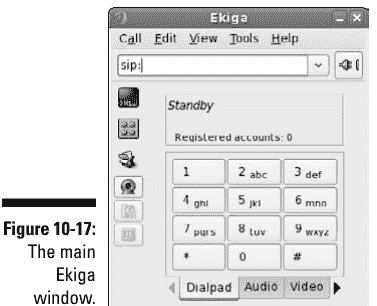

图 10-17：Ekiga 主窗口。

## 使用 Skype

Skype 是目前最流行的 IP 电话网络。许多 Linux 发行版将 Skype 作为默认 IP 电话软件。遗憾的是 Fedora 没有。如果你喜欢在 Fedora 系统上使用 Skype，你需要自己安装。

在 Fedora 中安装 Skype 的步骤如下：

1. 将你的网络浏览器指向 `www.skype.com`。
2. 在 Skype 首页，点击“下载 (Download)”链接。你将被带到下载 Skype 页面。
3. 点击页面左侧的“Skype for Linux”。你将被带到下载 Skype for Linux 页面。
4. 右键点击“下载公钥 (Download the Public Key)”链接，并在弹出的右菜单中选择“另存为 (Save As)”。出现“另存为”对话框。
5. 点击“保存 (Save)”将文件保存到你的下载目录（默认是你的桌面）。对话框关闭，文件出现在桌面上。
6. 选择 `应用程序 > 系统 > 终端`。如第 6 章所述，会出现一个终端窗口。
7. 输入 `su -` 临时成为 root 用户。
8. 输入 `rpm --import /home/user/Desktop/rpm-public-key.asc`，其中 `user` 是你的用户账户，例如 `/home/dee/Desktop/rpm-public-key.asc`。我假设你的下载目录是桌面。如果不是，请相应调整文件路径。
9. 点击终端窗口右上角的“X”关闭它。
10. 回到 Skype 下载网页，点击“RPM for Fedora”条目，即使它不是针对 Fedora 7 的。注意你也可以获取其他 Linux 发行版的 Skype。出现“打开 Skype”对话框，标题中显示文件的全名。
11. 勾选“使用软件安装程序打开 (Open with Software Installer)”并点击“确定”。下载期间会打开下载窗口，下载完成后，出现“root 密码 (Password For root)”对话框。
12. 输入你的 root（管理员）密码并点击“确定”。出现“安装包 (Installing Packages)”对话框。
13. 点击“应用 (Apply)”。软件安装程序会将软件添加到你的系统中。当安装完成后，会出现“信息 (Information)”对话框。
14. 点击“确定”关闭对话框，并点击窗口中的“X”。

# 第 11 章：在文本中处理文字

**本章内容**

- 查看文本文件内容
- 在 nano 中处理文本文件
- 在 gedit 中处理文字

从文本编辑器到文字处理器，Linux 为文字工作提供了多种选择。在本章中，我将介绍查看文本文件内容的不同方法，并在非 GUI 和 GUI 环境中使用一些文本编辑器。在第 12 章中，我将介绍用于文字处理的办公套件。

## 查看文本文件的内容

Linux 中几乎所有的配置文件都是文本文件。此外，许多伪程序（称为*脚本*）、所有 HTML 文档以及许多许多项目都是文本文件。幸运的是，如果你只想查看文本文件的内容而不想对其进行任何修改，就不需要编辑器或文字处理器。你可以使用三个命令行命令来查看文本文件：`cat`、`less` 和 `more`。我打赌你将会学会它们。

是的，第一个 `cat` 就是 cat，它源自单词 *concatenate*（连接），意思是将……末端连接在一起——你可以使用 `cat` 命令处理多个文本文件，将一个文件的内容直接接在另一个文件之后。通常你在 Linux 世界中使用该命令的格式为 `cat filename`，其中文件 `filename` 的内容将显示在屏幕上。例如，如果你创建一个短文本文件 `greetings`，然后输入 `cat greetings`，你会看到如下：


```bash
$ cat greetings

These are the contents of the greetings file.

Meow!

$
```


当然，如果文件包含的信息超过一个屏幕的内容，`cat` 会像扔出一个大手球一样一次性把所有内容吐出来，但最后一屏的文本会滚出屏幕。幸好你还有其他选择。你可能选择的是 `less`，它一次只全屏显示文件的内容。你可以使用空格键继续显示下一页。如果你想的话，还可以使用方向键一次向上或向下移动一行。

`less` 的替代方案是 `more`。两者之间的主要区别是，使用 `more` 时，你只能向后移动文件，并且一次只能看到一屏的信息。你不能向回移动。

要使用 `less` 或 `more`，其格式与 `cat` 命令的格式相似：`less filename` 或 `more filename`。当你读完文档后，按 `Q` 退出。

# 使用 nano 编辑文本文件

如果你没有使用（或无法使用）图形界面（GUI），你有许多文本编辑器可用。其中最强大的是 `vi` 和 `emacs`，你会听到很多人在谈论它们。然而，这两个程序都需要学习曲线。对于想要快速编辑该死的文件并移动的初学者，我推荐使用 `nano`，它提供了一个友好的、菜单驱动的界面。

要在 `nano` 中打开文件，输入 `nano filename`，例如 `nano file1`。此操作将在 `nano` 编辑器中打开文件，如图 11-1 所示。

然后你就可以根据需要对文件进行编辑或输入了。

# 在过程中保存工作

要在不关闭文件的情况下保存内容（以便继续继续工作）：

1. 按 `Ctrl+O` 写入（Write Out）。

屏幕底部会出现一个提示，询问文件名，并提供当前名称作为默认选项。

2. 如果你想使用相同的名称，按回车键（Enter）。如果你想更改名称，进行修改后按回车键。

屏幕下半部分现在显示已写入（保存）了若干行。

3. 回到工作去！

# 保存并继续生活

要保存文件内容并关闭它（因为你暂时完成了工作）——或者关闭文件但不保存更改——请执行以下操作：

1. 按 `Ctrl+X` 退出（Exit）。

屏幕底部会出现一个提示，询问是否应该保存修改后的缓冲区。这个问题询问你是否想保存更改的一种高级说法。

2. 按 `Y` 保存更改，或按 `N` 不保存。

如果你按 `Y`，系统会询问文件名，并提供当前名称作为默认选项。如果你按 `N`，`nano` 将关闭并退出，这样你就完成了这些步骤。

3. 如果你想使用相同的名称，按回车键。如果你想更改名称，进行修改后按回车键。

nano 编辑器关闭，你的文件已保存。

# 在 gedit 中输入和编辑文本

`gedit` 严格来说是一个文本编辑器，因为你用它生成原始文本，而文字处理器创建的是只能由程序打开的带标记文本。如果你想为文档添加粗体、斜体、下划线或其他任何特殊功能，请阅读第 12 章。

要在 `gedit` 中输入文本，只需点击大空白区域并开始打字。你可以访问标准的编辑工具集，如剪切、粘贴和复制。要使用这些工具，选择你要处理的文本，然后点击 `gedit` 菜单栏上相应的按钮（或右键点击并从上下文菜单中选择相应的命令）。

这个特定文本编辑器真正有趣的地方在于它的插件。要使用这些功能，你需要遵循以下步骤：

1. 在 `gedit` 中选择“编辑：首选项”（Edit:Preferences）。
此操作将打开首选项对话框。

2. 点击“插件”（Plug-Ins）选项卡。

显示插件选项卡的内容。

3. 在插件选项卡内，点击你感兴趣的项目。

4. 点击“关于插件”（About Plug-In）按钮获取更多信息。

信息包含在出现的小“关于”窗口中。

5. 点击“关闭”（Close）移除“关于”窗口。

6. 如果你想使用此插件，点击其复选框。

如果复选框中出现勾，则插件被激活。

7. 如果你刚刚选择的插件的“配置插件”（Configure Plug-in）按钮变为激活状态，点击该按钮打开工具的插件配置对话框。

此对话框将根据你使用的哪个插件而不同。

8. 完成单个插件的配置后，点击“确定”（OK）返回首选项对话框。

9. 如果你想查看更多插件，返回到步骤 3。

10. 当你完成插件选择后，点击“关闭”（Close）关闭首选项对话框。

你现在可以从 `gedit` 菜单访问插件了。每个插件都放置在适当的位置：例如，“更改大小写”（Change Case）出现在“编辑”菜单中。

# 保存你的工作

与大多数程序一样，你有两种选择来保存工作。你可以保存工作并继续，或者保存工作然后关闭程序。如果只需保存文件并继续，请遵循以下步骤：

1. 点击“保存”（Save）按钮。

此按钮看起来像一个软磁盘。如果你从未保存过此文件，点击它将打开“另存为”对话框。

2. 在“保存到”（Save In）下拉列表框中选择一个文件夹保存文件，或者点击右侧的“浏览”（Browse）打开文件浏览部分。

对话框展开，允许你浏览。

3. 在“名称”框中输入文件名。

4. 点击“保存”。

对话框关闭。

关闭 gedit，请执行以下步骤：

1. 选择“文件：退出”（File:Quit）；

如果你自上次修改以来未保存此文件，会出现对话框。

2. 如果看到对话框，点击“保存”保存工作，或点击“不保存”（Without Saving）放弃更改。

程序关闭，除非你打开了多个文件，这时你会看到每个未保存修改文件的对话框。

# 第 12 章：使用 OpenOffice.org 进行文字处理及更多

**本章内容**

* 安装 OpenOffice.org 套件
* 使用 OpenOffice.org Writer 进行文字处理
* 使用 OpenOffice.org Calc 进行表格
* 使用 OpenOffice.org Impress 进行演示文稿
* 使用 OpenOffice.org Draw 进行绘图
* 使用 OpenOffice.org Base 管理数据
* 使用 OpenOffice.org Math 进行公式

> 言语飞，字迹留。
> —— 西班牙语谚语，出自 Delfin Carbonell Basset 的《谚语字典》

如今，每个拥有电脑的人手里至少有一个办公套件。如果他们是 Windows 用户，这个套件可能是 Microsoft Office，但也可能是其他竞争对手，如 Core WordPerfect。在 Linux 中，通常套件是 OpenOffice.org。该套件包含 Base（数据库）、Calc（电子表格）、Draw（图表和图形）、Impress（演示文稿）、Math（数学公式的文字处理器）以及 Writer（文字处理）。

一旦学会了如何使用该套件中的一个程序，你可能会发现其他程序的设计和工作方式非常相似。你甚至可以打开并保存 Microsoft Office 格式的文件，如果你需要与使用它的人分享。

关于 OpenOffice.org 的介绍就足够了。在本章中，你实际上可以使用它了！

适用于 Linux 用户可用的其他办公套件包括商业版的 OpenOffice.relative StarOffice (www.sun.com/staroffice)、Applixware Office (www.vistascource.com/products)、KOOffice (www.koffice.org) 以及 GNOME Office (www.gnome.org/gnome-office/)。

## 启动 OpenOffice.org 套件

在展示你的杰作之前，你必须确保 OpenOffice.org 可用。当你安装 Fedora 时，安装选项之一就是安装办公生产力软件。如果你选择了此选项，你就安装了大部分 OpenOffice.org 软件件程序。

默认情况下，Fedora 在生产力安装中包含了这些 OpenOffice.org 包：

* Writer：用于文字处理
* Calc：用于电子表格
* Impress：用于演示文
* Draw：用于绘图
* Math：用于创建复杂的公式

还有一个未安装的 OpenOffice.org 包：Base，它用于创建个人数据库。如果你选择不安装办公生产力软件，或者你需要安装 Base 软件，不用担心，你现在可以通过完全重新安装 Office.org 包来实现。

安装 OpenOffice.org 包后，你会在应用程序菜单中找到大部分包（甚至包括额外的包）。其中比较特殊的两个包是 Draw 和 Math。要访问这两个包中的任何一个，你需要启动一个 OpenOffice.org 包（例如 Writer），然后选择“文件：新建”。在“新建”区域，你将看到创建新绘图（启动 Draw）或新公式（启动 Math）的选项。Writer、Calc 和 Impress 包在顶部面板上有它们自己的快速启动图标。只需点击一下图标即可启动所需的包。

## 使用 OpenOffice.org 进行文字处理

如今，文字处理器几乎是必不可少的。孩子和祖父母都用它们写信。无论你是在写一本伟大的小说还是一份学校报告，OpenOffice.org Writer 都拥有你如今对文字处理器所预期的所有最佳功能。

### 游览 OpenOffice.org Writer

在继续之前，请查看图 12-1 中的 GUI 布局。

#### 菜单栏

窗口顶部是菜单栏，这是你在 Microsoft Windows 中工作时应该熟悉的界面。OpenOffice.org Writer 拥有你对现代文字处理器预期的所有功能。它的选项多到无法一一介绍，因此我为你总结了每个主要菜单上找到的内容：

* **文件**：常用的“打开”、“另存为”、“打印”和“打印预览”（位于“页面预览”下）命令，一组向导（位于“向导”下），以及通过电子邮件发送文档、创建模板和访问数据库的能力。
* **编辑**：使用“全选”和“查找”命令，以及修订跟踪、文档合并和文档比较。
* **视图**：常用的缩放功能和工具栏，具有显示或隐藏格式字符以及查看文档实际样貌的能力。
* **插入**：常用的分页符和特殊字符，以及索引、书签、页脚和交叉引用。
* **格式**：常用的字符、段落和页面设置，带有样式、格式功能和列。
* **表格**：常用的表格控制选项，包括插入、删除和选择单元格，以及在表格之间进行转换的功能。
* **工具**：常用的拼写检查和词典条目，此外还有连字符、自动纠、图像库和参考文献。

这些菜单的功能比这里列出的要多。过一遍看看；你可能会在其中发现某个新喜爱的功能。

#### 标准工具栏

菜单下方是标准工具栏。该系列中的每个图标代表一个不同的功能，详细信息见表 12-1。

| 表格 12-1 | OpenOffice.org Writer 标准工具栏，从左到右 |
| :--- | :--- |
| 按钮或项目 | 你可以执行的操作 |
| 新建 | 创建各种类型的新文档。点击向下箭头从任何 OpenOffice.org (OOO) 类型中选择要创建的特定类型。 |
| 打开 | 打开现有文件进行读取或编辑。 |
| 保存 | 保存当前文档。如果你之前没有保存过此文档，将打开“另存为”对话框。 |
| 邮件发送 | 在你首选的电子邮件程序中打开编写邮件窗口并自动附加此文档。 |
| 编辑文件 | 编辑显示的页面。 |
| 直接导出为 PDF | 打开一个选择 PDF 为文件类型的“另存为”对话框。 |
| 直接打印文件 | 将文件发送到默认打印机。 |
| 页面预览 | 显示此页打印后的样子。要从预览模式返回，点击“关闭”。 |
| 拼写检查 | 对整个文档或选中文本运行拼写检查。 |
| 自动拼写检查开启/关闭 | 激活或关闭自动拼写检查功能。 |
| 剪切 | 从文档中删除选中文本并将其保存到内存中。 |
| 复制 | 复制选中文档文本并保存到内存中。 |
| 粘贴 | 将内存中的文本放入文档的当前位置。点击向下箭头查看粘贴文本的选项。 |
| 格式刷 | 获取你点击的第一个文本的格式并将其应用到第二个文本。 |
| 撤销 | 撤销上一次更改。 |
| 重做 | 恢复上一次更改。 |
| 超链接 | 创建超链接。 |
| 表格 | 插入表格。 |
| 显示绘图 | 显示绘图工具。 |
| 查找替换 | 打开查找替换对话框。 |
| 导航器 | 打开导航器窗口。 |
| 画库 | 打开画库。 |
| 非打印字符开启/关闭 | 显示非打印字符。 |
| 缩放 | 更改文档的显示方式。 |
| 帮助 | 打开 OpenOffice.org 帮助对话框。 |

#### 格式工具栏

在默认的 OpenOffice.org 设置中，格式工具栏位于标准工具栏下方——尽管并非所有发行版都是如此。如往常，你可以随时通过“视图”菜单移除格式栏。你用于点击按钮和展开下拉列表的这一系列图标代表文字处理功能，如样式、字体和大小。此栏上的大多数功能与你在现代文字处理器中看到的完全相同。段落格式按钮是唯一一个特别特别的。

#### 标尺

在默认的 OpenOffice.org 设置中，格式工具栏正下方是标尺。所有现代文字处理器都提供此功能，它在测量系统中标记文档的页边距和制表位。要选择你想使用的系统，右键点击标尺以打开测量弹出对话框。

#### 你的文档

噢，是的，就是占据窗口大部分的空白区域。那是你编写文档的地方！只需点击那里并开始打字。你也可以通过右键点击文档区域访问格式快捷菜单。

## 处理 Writer 文件

OpenOffice.org Writer 可以处理许多不同的文件类型。这允许你创建可以使用许多不同文字处理系统的文档。

你不仅可以使用各种格式保存新文档，还可以读取在其他文字处理程序创建的文档。以下是 OpenOffice.org Writer 可使用的文档类型列表：

* OpenDocument (.ODT) 格式：建议的开放标准，未来可能被所有文字处理程序支持。
* OpenOffice 1.0 (SXW) 格式：原始 OpenOffice 文档格式。
* Microsoft Word 97/2000/XP (.DOC) 格式：是的，你可以用 Writer 读取和写入 Word 文档。
* Microsoft Word 95 (.DOC) 格式：以及一些较旧的 Word 。
* Microsoft Word 6.0 (.DOC) 格式：甚至是非常老旧的 Word 。
* 富文本 (RTF) 格式：保存基本字体和文档信息的标准格式。
* StarWriter 3.0 – 5 (SDW) 格式：Sun 的 StarOffice 文字处理器（OpenOffice.org 的表兄弟）。
* Microsoft Word 2003 (XML) 格式：微软尝试使用 XML 标准语言创建标准文字处理文档的尝试。

尽管在“另存为”对话框中不可用，但 OpenOffice.Org Writer 工具栏允许你将任何格式的文档导出为 PDF 文档格式。单此一项功能就能让你免于购买昂贵的商业产品（来自某未具名的商业软件公司）。

## 使用 OpenOffice.Org Calc 电子制电子表格

有些人喜欢手动核对支票。当我刚从大学毕业时，我决定是时候管理自己的财务状况了，而电子表格就是实现这一目标。如今，我使用电子表格来记录我在咨询或合同工作时的“工时卡”，帮助我管理项目团队并完成其他任务。我相信你对电子表格也有自己喜爱的用途。接下来的章节将介绍 OpenOffice.Org Calc，以便你开始工作。

### 浏览 OpenOffice.Org Calc

在 OpenOffice.Org Calc 中看到的大部分内容在你浏览过 OpenOffice.org Writer 以及你使用的其他电子表格程序后，应该看起来很熟悉。查看图 12-2 所示的 GUI 布局。

#### 菜单栏

窗口顶部是菜单栏，无论你使用哪种操作系统，它都是 GUI 世界的标准。OpenOffice.Org Calc 拥有你对现代电子表格系统预期的所有功能。它的菜单选项太多，无法详尽介绍，因此，这里是对每个菜单中内容的（非详尽式）总结：

* ✔ **文件 (File)**：常用的打开、另存为、打印和打印预览（使用“页面预览”术语）命令，以及一组向导；此外还有通过电子邮件发送文档、创建模板和创建网页的能力
* ✔ **编辑 (Edit)**：常用的全选和查找命令，以及修订跟踪、页眉页脚和插件加载
* ✔ **视图 (View)**：常用的缩放功能和工具栏，以及显示或隐藏列行头的选项
* ✔ **插入 (Insert)**：常用的分页和特殊字符，以及单元格、行、函数和外部数据
* ✔ **格式 (Format)**：常用的单元格和行格式、合并单元以及页面设置，带有条件格式
* ✔ **工具 (Tools)**：常用的拼写检查和词典条目，此外还有连字符、自动纠正功能、图像库以及宏创建器和编辑器
* ✔ **数据 (Data)**：在一个方便的地方提供常用的数据选择、排序和分组程序，以便快速访问

这些菜单的功能比这里列出的更多。过一遍查看一下；你可能会在某个地方发现新的喜爱的功能。

#### 标准工具栏

菜单栏下方是标准工具栏。该系列中的每个图标代表一个不同的功能，如表 12-2 所示。

| 表格 12-2 | OpenOffice.org Calc 标准工具栏，从左到右 |
| :--- | :--- |
| 按钮或项目 | 你可以的操作 |
| 新建 (New) | 打开各种类型的新文档。点击向下箭头从任何 OOO 类型中选择要创建的特定类型文档。 |
| 打开 (Open) | 打开现有文件进行读取或编辑。 |
| 保存 (Save) | 保存当前文档。如果以前没有保存过此文档，将打开“另存为”对话框。 |
| 文档作为电子邮件 (Document as E-mail) | 在你常用的电子邮件程序中打开编写邮件窗口，并自动附加此文件。 |
| 编辑文件 (Edit File) | 编辑显示的电子表格。 |
| 直接导出为 PDF (Export Directly as PDF) | 打开一个以 PDF 为文件类型的“另存为”对话框。 |
| 直接打印文件 (Print File Directly) | 将文件发送到默认打印机。 |
| 页面预览 (Page Preview) | 显示此页打印后的样子。要返回预览模式，点击关闭预览。 |
| 拼写检查 (Spellcheck) | 对整个文档或选定文本运行拼写检查。 |
| 自动拼写检查 (AutoSpellcheck) | 激活或关闭拼写检查功能。 |
| 剪切 (Cut) | 从文档中删除选定文本并保存到内存中。 |
| 复制 (Copy) | 制作选定文档的副本并保存到内存中。 |
| 粘贴 (Paste) | 将内存中的文本放置在文档中光标当前位置。点击向下箭头查看粘贴文本的选项。 |
| 格式刷 (Format Paintbrush) | 获取你点击的第一个文本的格式，并将其应用于你点击的第二个文本。 |
| 撤销 (Undo) | 撤销你对文档进行的最后更改。点击向下箭头选择你想后退的深度。 |
| 重做 (Redo) | 恢复撤销后的最后更改。点击向下箭头选择你想要重做的深度。 |
| 超链接 (Hyperlink) | 为选定文本创建超链接。 |
| 升序排序 (Sort Ascending) | 按升序重新排列数据。 |
| 降序排序 (Sort Descending) | 按降序重新排列数据。 |
| 插入 (Insert) | 根据选定数据插入图表。 |
| 显示函数 (Show Functions) | 访问各种函数。 |
| 查找和替换 (Find and Replace) | 打开查找替换对话框。 |
| 导航器 (Navigator) | 打开导航器窗口跳转到特定部分。 |
| 画库 (Gallery) | 访问剪贴库。 |
| 缩放 (Zoom) | 更改文档显示方式。 |
| 帮助 (Help) | 打开帮助窗口。 |

#### 格式栏

在默认的 OpenOffice.org 设置中，对象栏位于功能栏正下方。通常情况下，你可以随时通过“视图”菜单移除对象栏。这一系列图标允许你访问样式、字体大小和数字格式。

#### 公式栏

在默认的 OpenOffice.org 设置中，对象栏正下方是公式栏。表 12-3 列出了你在此集合中找到的内容。此栏实际上会根据你的操作而变化。

| 表格 12-3 | OpenOffice.org Calc 公式栏，从左到右 |
| :--- | :--- |
| 按钮或项目 | 你可以的操作 |
| 函数向导 (Function Wizard) | 点击打开函数向导对话框并浏览查找你正在寻找的特定函数。 |
| 求和 (Sum) | 点击在输入行中开始 SUM（加法）函数。 |
| 函数 (Function) | 点击在输入行中放置 = 表示你即将输入函数。 |
| 输入行 (Input Line) | 为单元格分配值或输入函数。 |

#### 你的文档

文档区域是你处理电子表格的地方。只需选择单元格并开始输入。你也可以通过在文档区域点击右键访问格式快捷菜单。

## 处理 Calc 文件

就像 Writer 软件包一样，Calc 软件包允许你读取和写入许多电子表格格式：

* OpenDocument 表格 (.ods) 格式：一种标准的电子表格文档格式。
* OpenOffice.org 1.0 电子格 (.OTS) 格式：旧的 OpenOffice 1.0 电子表格格式。
* 数据交换格式 (.DIF)：用于在不同的电子表格程序之间导入和导出电子表格的文本文件。
* dBase (.DBF)：将电子表格数据导出数据文件。
* Microsoft Excel 97/2000/XP (XLS) 格式：最流行的 Excel 版本使用的标准 Microsoft 电子表格格式。
* Microsoft Excel 95 (.XLS) 格式：以及一些更旧的 Excel 电子表格格式。
* Microsoft Excel 5.0 – 5.0 (SDC) 格式：Sun 的 StarOffice 电子表格格式（OpenOffice.org 套件的近兄弟）。
* SYLK (.SLK) 格式：符号链接格式，用于在电子表格与其他应用程序（如数据库）之间交换数据。
* 文本 CSV (.CSV) 格式：逗号分隔的文本值，通常用于将数据导出到数据库
* HTML (.HTML) 格式：将电子表格数据格式化为 HTML 网页页
* Microsoft Excel 2003 (XML) 格式：微软提出的标准，用于使用 Internet XML 标准处理电子表格数据

此外，与 Writer 类似，Calc 标准工具栏提供了一个按钮，让你能够直接将电子表格导出为 PDF 文档。

## 使用 OpenOffice.Impress 进行演示

大多数人宁愿吃玻璃也不愿站在一群人面前。尽管如此，如果你必须这样做，你可能有一些很酷的软件作为你的后盾。这就是我在参加会议演讲时使用的程序。（即使我的客户要求我用 Microsoft PowerPoint 格式发送演示文稿，我也用它。嘘！别告诉他们——他们不知道区别！）给 OpenOffice.Impress 一个让你惊艳的机会。

### 使用演示向导

当你打开 OpenOffice.Impress 时，首先启动的是演示向导（见图 12-3），你之后可以通过选择 `File::Wizards::Presentation` 手动打开它。如果你不想下次打开 OpenOffice.org 时再次显示此向导，请点击“不再显示此对话框”。

要使用此向导，请遵循以下步骤：

1. 选中“空演示”选项（除非你有需要使用的模板）并点击“下一步”。
2. 如果你想选择 OpenOffice.org Impress 自带的默认幻灯片背景之一，可以通过“选择幻灯片设计”下拉列表，选择“演示背景”，然后点击各种选项以查看它们在对话框右侧的样子。
3. 默认情况下，背景模板并不多。这是 StarOffice 提供额外价值的一个领域。
4. 如果你想选择专门为你在对话框第 1 页中选择的模板设计的演示（内容）布局模板，可以查看“选择幻灯片设计”下拉列表，选择“演示”，然后选择你想要使用的演示类型。
5. 再次，默认情况下这里的选项有限。
6. 如果你希望你的演示文稿最终出现在计算机屏幕以外的地方，请调整“选择输出媒介”以匹配其预期发送目标。

   你的选择有：屏幕、透明片、幻灯片和纸张。
7. 点击“下一步”继续。
8. 在“选择幻灯片切换”下，尝试“效果”下拉列表框中的各种选项，以缩小从一张幻灯片移动到另一张幻灯片的方式。
9. 如果你在演示时手动从一张幻灯片导航到下一张（默认选项），请跳到第 12 步。如果你想让演示自动播放，点击“自动”选项。
10. 在“页面持续”中，设置每张幻灯片停留的时间。
11. 在“暂停持续”中，设置幻灯片之间想要多长的空白间隔。
12. 设置完成后，点击“创建”继续。

如果你勾选了“显示标志”，OpenOffice.org 标志将在空白暂停期间出现。

OpenOffice.org Impress 打开了，如图 12-4 所示。你可能会发现点击幻灯片面板右上角的 X 来清理窗口是有用的。

### 浏览 OpenOffice.org Impress

在继续之前，请看图 12-4 所示的 GUI 布局。左侧的幻灯片视图和右侧的任务视图对某些人来说可能看起来很乱；如果你不需要它们，只需点击右上角的 X。

#### 菜单栏

窗口顶部是菜单栏。OpenOffice.org Impress 有许多功能：

* **文件**：新建、打开、保存、另存为、文档作为电子邮件、直接导出为 PDF、打印
* **编辑**：剪切、复制、粘贴、撤销、重做
* **视图**：标准、显示网格、导航、缩放、帮助
* **插入**：图表、电子表格、超链接
* **工具**：拼写检查、自动拼写检查
* **幻灯片放**：幻灯片、幻灯片设计、幻灯片放

#### 标准工具栏

窗口顶部是标准工具栏。此系列中的每个图标都在表 12-4 中描述。

| 按钮 | 功能 |
| :--- | :--- |
| 新建 | 打开各种类型的新文档 |
| 打开 | 打开现有文件 |
| 保存 | 保存当前文档 |
| 另存为 | 打开另存为对话框 |
| 文档作为电子邮件 | 打开编写电子邮件窗口 |
| 直接导出为 PDF | 打开已选定 PDF 的另存为对话框 |
| 打印 | 将文件发送到默认打印机 |
| 拼写检查 | 对整个文档或选中文本运行拼写检查 |
| 自动拼写检查 | 启用或关闭自动拼写检查 |
| 剪切 | 移除选中文本并保存到内存 |
| 复制 | 复制选中文本并保存到内存 |
| 粘贴 | 将内存中的文本放置到光标位置 |
| 撤销 | 撤销上一次操作 |
| 重做 | 恢复使用撤销的上一次更改 |
| 格式刷 | 从一个文本获取格式并应用到另一个文本 |
| 图表 | 在演示文稿中插入图表 |
| 电子表格 | 在演示文稿中插入电子表格 |
| 超链接 | 打开对话框构建复杂的超链接 |
| 显示网格 | 在幻灯片上显示或移除网格 |
| 导航 | 打开或关闭导航窗口 |
| 缩放 | 更改文档在屏幕上的显示大小 |
| 帮助 | 打开 OpenOffice.org 帮助框 |
| 幻灯片 | 在当前幻灯片后插入新幻灯片 |
| 幻灯片设计 | 打开幻灯片设计对话框 |
| 幻灯片放 | 开始幻灯片放 |

#### 线和填充栏

在默认的 OpenOffice.org 设置中，线条和填充栏位于标准工具栏的正下方。同样，你可以通过视图菜单移除对象栏。此系列图标允许你点击按钮并展开下拉列表，这些列表代表标准的演示软件功能，如箭头样式、颜色、线条样式和其他格式。此栏上的大多数功能与你在大多数现代演示文程序中看到的完全相同。

#### 视图切换器

在文档上方，你会看到一系列标签，每个标签都能带你进入查看幻灯片的特定方式。表 12-5 概述了可用视图以及你可以在它们中找到的内容。

| 表 12-5 | OpenOffice.org Impress 可用视图（按字母排序） |
| :--- | :--- |
| 视图 | 你找到的内容 |
| 普通 (Normal) | 幻灯片视图，你可以在幻灯片上添加艺术。 |
| 讲义 (Handout) | 每页六张幻灯片，就像你打印讲义一样。 |
| 母版 (Master) | 幻灯片视图，你可以应用应用于所有幻灯片的母格式。通过选择“视图”进入此视图：在“母版”子菜单中，你可以选择“母版”查看母版幻灯片、“母版备注”查看母版备注页，或“母版元素”来分配在母版视图中提供的信息。 |
| 备注 (Notes) | 幻灯片视图，你可以看到幻灯片的缩略图以及关于它的备注。 |
| 大纲 (Outline) | 所有幻灯片视图，幻灯片按顺序列出，方便快速浏览。在导航时，幻灯片会在单独窗口中以缩略模式显示。 |
| 幻灯片排序 (Slide Sorter) | 幻灯片视图，大量幻灯片以列和行的形式排列。重新排序幻灯片只需将它们拖到你想去的地方然后松开。 |

#### 你的文档窗口

你的文档窗口包含你的文档。在“普通”视图中，该文档就是你的幻灯片。你需要点击绘图栏（下一节将讨论）中的工具之一来输入任何内容。要在此幻灯片之前或之后添加更多幻灯片，右键点击文档区域并选择幻灯片>新建幻灯片。对于每张幻灯片，你可以使用任务面板中的布局来更改其设置。

#### 绘图栏

文档窗口下方是一个绘制工具栏，允许你为演示创建需要选择线条、箭头、形状等。这些按钮中的大多数带有指向向下的箭头，将让你看到它们提供的完整功能范围。

## 处理 Impress 文件

OpenOffice.org Impress 支持的文件类型没有它的 Writer 和 Calc 兄弟版本那么多。这主要是由于演示图形环境缺乏标准。

Impress 支持的格式：

* OpenDocument Presentation (.ODP) 格式：由 OpenOffice.org 提议的标准演示图形格式。
* OpenOffice.org 1.0 Presentation (.OTP) 格式：原始的 OpenOffice.org 演示图形格式。
* Microsoft PowerPoint 97/2000 (.PPT) 格式：商业领域可能最流行的演示图形工具。你可以使用 Impress 读取和写入大多数 PowerPoint 幻灯片演示。
* OpenOffice.org 1.0 Drawing (.SXD) 格式：一种较旧的原始图形绘制格式。
* StarDraw 3.0 – 5.0 (.SDA) 格式：来自 Sun 的 Impress 商业兄弟。
* Starminimp 4.0 and 5.0 (.SDD) 格式：来自 Sun 的 Impress 商业兄弟。
* OpenOffice.org Drawing (.ODG) 格式：基础图形绘制格式。

尽管 Impress 可以处理 OpenOffice.org Draw 文件，但 Impress 文件的默认格式是 .ODP 格式。与 OpenOffice.org 套件中的其他软件包一样，Impress 还提供了一个工具栏图标，让你将幻灯片保存为 .PDF 格式。

## 使用 OpenOffice.Org Draw 进行艺术创作

无论你是一个有志的艺术家，还是只需要一个可以让你生成简单图形用于自身、演示文或其他地方的工具，OpenOffice.org Draw 都提供了大量的绘制功能。无论如何，玩玩它也非常有意思！并不是什么都非得实用的。

### 浏览 OpenOffice.org Draw

在继续之前，请查看图 12-5 所示的 GUI 布局。如果你发现左侧的“页面”面板太杂乱，点击右上角的 X 将其移除。你可以通过选择“视图>页面”随时将其找回。

#### 菜单栏

顶部是常用的菜单栏。OpenOffice.org Draw 是一个典型的“矢量”程序，意味着它依赖于线条而不是点或其他技术。请参第 14 节关于用于编辑照片和其他高细节工作软件的描述。

OpenOffice.org Draw 的选项太多，无法深入介绍，因此我为你提供每个菜单中可以找到的内容的（非详尽的）总结：

* **文件 (File)**：常见的打开、保存、另存为、打印和导出命令，以及一组向导（在“自动驾驶”术语下），以及通过电子邮件发送文档和创建模板的能力。
* **编辑 (Edit)**：常见的查找、替换和其他命令，以及你可能熟悉的“图像映射”。
* **视图 (View)**：常见的缩放功能和工具栏，以及选择显示质量的能力。
* **插入 (Insert)**：常见的图表、框架、图形和电子表格，以及扫描功能。

### 绘图栏

文档窗口下方是绘图工具栏，允许你根据绘图创建需求选择线条、箭头、形状等。这些按钮中的大多数带有向下指向的箭头，点击后可以查看它们提供的完整功能范围。

## 操作 Draw 文件

从乍看之下，当你使用“另存为”对话框时，OpenOffice.org Draw 提供的可保存文件类型似乎是最有限的。从那里，你只能将文档保存为以下文件：

* OpenDocument 绘图 (.ODG) 格式：OpenOffice.org 提出的图形文件标准
* OpenOffice.org 1.0 绘图 (.XD) 格式：旧 OpenOffice.org 图形格式
* StarDraw 3.0 (.SDD) 格式：旧的 Sun StarDraw 格式
* StarDraw 5.0 (.SDA) 格式：新的 Sun StarDraw 格式

可以操作的内容不多，特别是在处理图片文件时。坦率地说，Draw 可以通过选择“文件->导出”将图像保存为标准格式以外的格式。

这将产生大量支持的图形格式：BMP, EMF, EPS, GIF, JPEG, MET, PBM, PCT, PGM, PPM, RAS, SVG, SWF (Flash), TIFF, WMF, XPM。这应该能满足任何计算机艺术家。

## 使用 OpenOffice.org Base 管理数据

那些使用 Microsoft Access 或必须与各种数据库产品交互的人，过去一直一着挠腮，疑惑在 Linux 下如何最好地处理这些需求。好了，别再疑惑了！OpenOffice.org Base 提供了指向 Microsoft Access 文件和其他数据库的接口。

### 从向导获取帮助

你有许多不同的方法可以使用此程序。核心内容包括在你的系统上从零创建数据库、处理 Microsoft Access 文件，以及处理旨在与许多主流数据库服务器配合使用的数据库——甚至是跨网络的。由于方法很多且我的篇幅有限，我重点关注了两种更常见的选择：创建新数据库文件和打开现有文件（包括 Microsoft Access 文件）。

当你打开除“文件>最近文档”菜单中已过的文档以外的任何内容时，遇到的第一个界面就是数据库向导（图 12-6）。

#### 在数据库向导中创建新数据库文件

在数据库向导对话框中，执行以下操作以创建一个全新的数据库文件：

1. 选择“创建新数据库”单选按钮。
2. 点击“下一步”。
3. 如果你想将此数据库注册为 OpenOffice.org 中的数据源，请勾选“为我注册数据库”；否则，选择“否，不注册数据库”单选按钮。

出现“保存数据库后如何处理”对话框，如图 12-7 所示。

注册过的数据库可以被你所有的 OpenOffice.org 应用程序访问，而不仅仅是 OpenOffice.org Base。

4. 如果你想立即打开此文件进行编辑，请勾选“用于编辑数据库”框；否则，点击此选项取消勾选。
5. 如果你想立即使用表向导在数据库中创建一个新表（建议使用向导），请勾选“使用表向导创建表”复选框。

目前，最好保持关闭状态，这样你可以一步步探索。

6. 完成。

在“名称”文本框中为你的文档保存名称。

7. 在“保存到文件夹”下拉列表中输入你想要保存文档的目录，或者点击向右的箭头“浏览其他文件夹”以导航到你想保存文档的位置。

8. 点击“保存”按钮。

无论你指定了什么，操作都会发生。如果你选择了立即打开数据库，你将看到与图 12-8 类似的内容。

#### 在数据库向导中打开现有文件

如果你有一个现有的 Microsoft Access 文件想在 OpenOffice.org Base 中打开，请在初始数据库向导对话框中执行以下操作：

1. 选择“现有文件”。
2. 如果文件在“最近使用”下拉列表中，请选择该文件。否则，点击“打开”按钮。

如果你点击了“打开”按钮，会出现“打开”对话框。如果你从“最近使用”选择了项目，点击“完成”，你就完成了文件的打开。

3. 导航到你想打开的文件并选择该文件。
4. 点击“打开”。

文件被打开到 OpenOffice.org 中。

### 浏览 OpenOffice

在继续之前，请参考 12-8 所示的布局。

#### 菜单栏

窗口顶部是菜单栏。OpenOffice.org 允许你访问：

* **文件**：常用的、保存
* **编辑**：常用的、复制
* **视图**：常用的
* **插入**：创建
* **工具**：常用的
* **格式**：常用的

#### 标准工具栏

文档窗口下方是绘图工具栏，允许你根据绘图创建需求选择线条、箭头、形状等。这些按钮中的大多数带有向下指向的箭头，点击后可以查看它们提供的完整功能范围。

| 按钮或项目 | 你可以的操作 |
| :--- | :--- |
| 新建 | 创建文档 |
| 打开 | 打开现有文件 |
| 保存 | 保存当前文档 |
| 复制 | 复制选取 |
| 粘贴 | 放置文本 |
| 升序 | 按字母顺序排序 |
| 降序 | 按反序排序 |
| 表单 | 创建表单 |
| 帮助 | 打开 OpenOffice 帮助 |
| 打开 | 打开选中项目 |
| 编辑 | 打开项目的设计视图 |
| 删除 | 删除选中项目 |
| 重命名 | 重命名选中项目 |

#### 数据库面板

窗口左侧是数据库面板。在此面板中，你看到四个图标：表、查询、表单和报告。选择这些图标可以决定右侧两个面板显示——例如，处理你的查询允许对数据库提出复杂的问题。

#### 任务面板

右方的面板是任务面板。在这里，你可以看到针对特定选择可以的操作类型。使用右侧的描述来解密任何术语。

#### 表/查询/表单/报告面板

右下方的面板显示已存在的表、查询、表单或报告。你可以通过双击它们来打开任何一个进行操作。

### 进入表格

表是数据库系统的核心。它们存储你的数据，并允许你快速访问信息。了解 Base 中如何组织表，以及你如何使用它们存储和显示数据是非常重要的。

要创建新表，如果你认为你有一个标准表，可以使用 Base 表向导，或者你可以在设计视图中创建自己的表。图 12-9 显示了一个空的设计视图对话框。

设计视图中的每一行代表表中的一个数据字段。每个字段必须有一个唯一的名称并分配一个字段类型。字段类型定义了字段中存在的数据类型（字符、数字、日期等）。描述区域允许你为数据字段的含义编写简短描述。

创建新表很容易：

1. 在字段名称处输入描述数据库的文本名称。
2. 从下拉菜单中选择字段类型。
3. 在描述文本区域输入简短描述。
4. 如果该字段是主键，右键点击行左侧并选择“主键”。

表的主键是一个可以唯一标识表中每条记录的数据字段。在 12-9 的示例中，每个员工都通过唯一的员工 ID 来标识，因为可能有多个员工具有相同的姓名。

5. 输入剩余的行以完成表中的数据元素。
6. 选择“文件” > “另存为”来保存表，并使用唯一的“表名称”。

新表现在出现在 Base 主窗口的“表格”区域下。双击新表将调出数据查看和输入窗口，如图 12-10 所示。

如果你熟悉 Microsoft Access，你会感到如如胜归。此窗口允许你查看表中的现有数据记录，并轻松地添加新记录。

## 使用 OpenOffice.org Math 进行布局

没有什么比尝试撰写一份数学或科学报告，却发现必须用多行来显示方程（这看起来从不对！）或者手写更糟糕了。OpenOffice.org Math 是解决此问题的绝方案。你可以在此程序中布局方程等内容，并将其插入到任何 OpenOffice.org 文档中。无论你是中学生还是专业工程师，OpenOffice.org Math 都会让你惊喜。

### 浏览 OpenOffice.org Math

如果你看过所有其他 OpenOffice.org 程序，OpenOffice.org Math 的功能与你习惯的有所不同。然而，在许多方面，由于其特殊用途，这个程序比某些程序简单得多。请记住，它不是一个计算程序。它是用于在纸张或屏幕上布局复杂的公式。

在继续之前，请看图 12-11 所示的 GUI 布局。

现在点击窗口右上角的的小 X 来关闭“选择”对话框，以保持界面尽可能整洁。你可以随时通过选择“视图：选择”来恢复它。

#### 菜单栏

窗口顶部是菜单栏，无论你使用哪种操作系统，这 GUI 世界中的标准。OpenOffice.org Math 可能与你用过的任何程序都不同，因此我不多说你可能在其中发现什么。我只是为你提供每个菜单中发现内容的（非详尽）总结：

* **文件**：你在大多数 GUI 程序中看到的常见的“打开”、“保存”、“另存为”和“打印”命令，以及一组向导和通过电子邮件发送文档的能力。
* **编辑**：常见的“全选”、“复制”和“粘贴”命令，以及在公式内移动的专用命令。
* **视图**：常见的缩放功能和工具栏，以及屏幕更新功能等。
* **格式**：常见的字体类型、字体大小、间距、对齐功能等。
* **工具**：用于自定义程序设置和行为的常见“自定义”和“选项”项目，此外公式导入和访问符号库。

#### 标准工具栏

窗口顶部是标准工具栏，你可以通过选择“视图::工具栏::标准”随时移除它。此系列中的每个图标代表不同的功能。你可能会发现此工具栏与其他 OpenOffice.org 程序中的非常不同。通常，它更小。每个图标的描述见表 12-8。

| 表 12-8 | OpenOffice.org Math 标准工具栏从左到右 |
| :--- | :--- |
| 按钮或项目 | 你可以的操作 |
| 放大 | 大放大显示图像。 |
| 缩小 | 缩小图像。 |
| 1 | 按实际大小显示图像。 |
| 显示全部 | 以适应屏幕的最大尺寸显示整个公式。 |
| 新建 | 打开各种类型的新文档。点击向下箭头从任何 Ooo 选择要创建的特定类型文档。 |
| 打开 | 打开现有文件进行读取或编辑。 |
| 保存 | 保存当前文档。如果你之前没有保存，将打开“另存为”对话框。 |
| 邮件文档 | 在你首选的电子邮件程序中打开撰写邮件窗口，并自动附加此文档。 |
| 直接导出为 PDF | 打开一个以 PDF 为文件类型的保存对话框。 |
| 直接打印文件 | 将文件发送到默认打印机。 |
| 剪切 | 从文档中删除选中文本并存入内存。 |
| 复制 | 复制文档文本并存入内存。 |
| 粘贴 | 将文本放入文档并存入内存。 |
| 撤销 | 撤销上次更改。 |
| 恢复 | 恢复上次更改。 |
| 帮助 | 打开帮助。 |
| 更新 | 更新公式。 |
| 光标 | 开启或关闭。 |
| 目录 | 打开目录。 |

#### 文档部分

如果你从未用过软件，这里会变得复杂。OpenOffice.org Math 可能与你用过的任何程序都不同，因此我不多说你可能在其中发现什么。我只是为你提供每个菜单中发现内容的（非详尽）总结：

* **文件**：你在大多数 GUI 程序中看到的“打开”、“保存”、“另存为”和“打印”命令，以及一组向导和通过电子邮件发送的能力。
* **编辑**：常见的“全选”、“复制”和“粘贴”命令，以及在公式内移动的专用命令。
* **视图**：常见的缩放功能和工具栏，以及屏幕更新功能等。
* **格式**：常见的字体类型、字体大小、间距、对齐功能等。
* **工具**：用于自定义程序设置和行为的常见“自定义”和“选项”项目，此外公式导入和访问符号库。

# 第 13 章：玩转音频

**本章内容**

* 听音乐
* 使用、录制到 CD 以及刻录 CD
* 解决声音问题

> 自由的代价是责任，但这是一个非常划算的交易，因为自由是无价的。
> — 休伯·当斯 (Hugh Downs)

如果你和我一样，有了音乐一切都会变得更好。如果电脑不能取代我所在地方的音响，那我就不感兴趣了。所以，我可以向你保证在 Linux 中有许多听音乐的方法。继续读下去发现各种可用方法！以前唯一棘手的问题是听 MP3，因为它们是专利格式，但 Linux 提供了 RealPlayer 及其播放 MP3 的许可，所以你已经准备好了。关于如何安装 RealPlayer，请参阅第 16 章。

你是 iTunes 粉丝吗？如果是，请查看第 15 章，了解如何在 Linux 中安装 iTunes！

## 什么声音？我我什么也听不见！

首先，检查并确保你的扬声器或耳机连接正确。你不会是第一个没注意到猫把接线头从插座上拔出来的人。

现在，你的音频设置可能被调到了零或静音了。右键点击桌面左角的音量图标，选择“打开音量控制”（图 13-1）。

当此控制打开时，了解你即将看到的术语将会有帮助：

* **主音量（Master）**：主音量控制，对应桌面上的音量滑块。
* **PCM**：控制存储在电脑上的音频文件的音量。
* **线路输入（Line-in）**：控制通过声卡线路插口输入的声音音量。
* **CD**：控制通过 CD 和/或 DVD 播放器输入的声音音量。
* **麦克风（Microphone）**：控制通过声卡麦克风接口输入的声音音量。

现在你已经知道在这个对话框中看到的是什么，请寻找以下主要线索之一，以判断可能出了什么问题：

* 你看到的任何项目是否已静音？你可以通过查看每个部分下方音量图标顶部的红色“X”来判断。例如，在图 13-1 中，线路输入和麦克风都是静音状态。静音的那个是导致你问题的根源吗？例如，如果你将耳机连接到线路输入接口且线路输入已静音，那么你戴上耳机后什么也听不到。要取消静音，点击“X”将其移除。
* 是否有任何音量滑块完全滑到底了？同样，图 13-1 中的线路输入和麦克风都滑到底了。用同样的耳机例子，即使线路输入没有静音，除非滑块调高，否则也听不到任何声音。向上滑动它们看看是否能听到声音。

如果问题不是这些之一，那么可能是更基础的问题。要进行调查：

1. 选择 系统：管理：声卡检测（图 13-2），查看声卡是否被正确检测并播放声音。

在工具打开之前，你可能会被要求输入 root（管理员）密码。

2. 如果你知道你拥有什么种声卡，请查看“已选声卡”下方的内容。

信息正确吗？如果不正确，点击“设置”选项卡，并点击“默认音频卡”旁边的下拉列表框。如果有合适的选项，请选择它。

3. 点击“声音测试”下的播放按钮。

你应该能从左侧、右侧和中间听到声音。如果没有，点击“重复”复选框，再次点击“播放”，然后调整下方的音量设置栏，看看是否能让声音大到听见。

4. 如果你仍然听不到任何声音，更改 PCM 设备设置并尝试再次播放声音。

如果这不起作用，在继续之前，将 PCM 设备改回原来的设置。

5. 如果这些操作都没有帮助，请去你最喜欢的搜索引擎搜索你的声卡品牌、型号以及“linux”单词。

你可能会通过这种方式找到一些帮助的信息。

## 听 CD

默认情况下，当你将一张音乐 CD 放入运行 Fedora 的电脑时，Totem 电影/音乐播放器会打开。然而，这个程序会自动获取有关 CD 的信息，我个人觉得这非常烦人。所以，我建议的第一件事是切换 CD 播放器。操作如下：

1. 选择 系统：偏好：硬件：可移动设备。出现“可移动驱动器媒体偏好”对话框。
2. 点击“多媒体”选项卡。

多媒体部分（图 13-3）。

3. 在“音频 CD”下，将 totem 替换为 gnome-cd。保持原样。
4. 点击“关闭”。

对话框关闭。现在当你插入音频 CD 时，打开的是 CD 播放器（图 13-4）而不是电影播放器。

如果程序不识别你的 CD，你可以通过以下方式将其添加到数据库：

1. 在底部上方的一行，点击“打开轨道编辑器”。打开 CD 轨道编辑器（见图 13-5）。
2. 填写艺术家、光盘标题和单个音目。要填写某个音目，点击它所属的行，然后点击你想要编辑的部分（如标题）。这些操作将打开一个可以输入内容的编辑区域。
3. 如果你想输入更多关于 CD 的信息，点击“显示高级选项”旁边的箭头，并填充额外的框。此部分允许你输入 CD 的流和其他数据。
4. 完成后，点击“保存”。

## 听下载的音乐

从互联网下载音乐是一件有趣的活动。如果你喜欢下载，查看第 16 章了解如何使用 amarok (http://amarok.org/)。通过这种方式，让 Amarok 完成大部分工作。

1. 安装 amarok 后，通过 应用程序：声音和视频：amarok 启动它。第一次在 Fedora 中运行它时，首次向导启动并显示欢迎界面。
2. 点击“下一步”进入界面界面。在这里你可以选择 Amarok 是单窗口还是双窗口。假设你选择前者。
3. 再次点击“下一步”进入收藏界面。

最好是为你正在听的歌曲加载歌词，如果它无法确定具体是哪首歌，它会提供可点击的选项——第一次点击此标签页时可能会出一个“运行脚本管理器”（Run Script Manager）按钮；如果是，请选择一个歌词选项并点击“运行”。最右侧的标签“艺术家”（Artist）会在维基百科网站（www.wikipedia.org）上查找与歌曲相关的团体或艺术家的信息。歌词和艺术家标签上方也有控制控件供你探索。

* **集合（Collection）**：这里是你的音乐集合。在列表上方，点击“分组”（Group By）按钮来选择特征，例如集合是否按分组、专辑等进行组织。在“过滤”（Filter）文本框中，你可以输入关键词来确定显示的歌曲。或者，在“整个集合”（Entire collection）下拉列表中，你可以指定是否只想显示最新添加的歌曲。
* **播放列表（Playlists）**：这里是你创建新播放列表和访问已有列表的地方。“智能播放列表”（Smart Playlists）部分为你提供了各种预建的播放列表，例如供想听所有内容的“全部集合”（All Collection）、让播放器为你挑选的“50 首随机轨道”（50 Random Tracks）、如果你在刻 CD 时花时间分配了流派信息，会有“流派”（Genres）等。动态播放列表与智能播放列表不同，它们是不断变化的。例如，“随机混合”（Random Mix）动态列表会从你的集合中随机选择音乐，并在继续播放时不断选择。对于“推荐歌曲”（Suggested Songs），你可以在列表中放入几首关键歌曲，Last.fm (www.last.fm) 就会构建一个它认为类似的个性化在线电台。如果你是在线电台的大粉丝或对此好奇，请查看电台部分的“酷炫流”（Cool-Streams）。在这里你会发现许多可选的电台。
* **媒体设备浏览器（Media Device Browser）**：点击此标签页然后打开“配置媒体设备”对话框。如果你有任何便携式存储设备，可以从各种类型中进行选择（从 VFAT 到 Windows 设备），这样 Amarok 就可以从它们加载音乐。

浏览你的文件系统，找到你想要的单曲，并将其拖入播放列表。

无论你如何将音乐移到右侧的播放列表，只要你想，就可以点击面板底部的“播放”按钮来播放选定的轨道。你也可以双击轨道进行播放。在滑块下方，你会找到一组控件（将鼠标悬停在图标上查看其当前设置），其中最重要的有：

* **随机模式（Random Mode）**：允许你开启或关闭播放列表的随机化。
* **重复（Repeat）**：让你决定是在播放完整个播放列表后停止播放（不重复）、重复特定轨道，还是重复整个播放列表。

Amarok 还有很多功能。花点时间探索这个工具并按喜好进行自定义。当你关闭此程序时，会出现“接入系统托盘”（Docking In System Tray）对话框。它警告你 Amarok 将继续运行并作为系统托盘图标显示在面板上。你可以通过选择“操作： 退出”而不是点击应用程序右上角的 X 来避免这种情况。如果你将程序留在面板上，可以随时点击中间的小狼图标来打开它。

## 收听在线电台

在 Linux 中，收听在线电台大部分情况下是非常容易的，除非你想听 Windows 格式的流媒体（请参第 15 章可以购买的解决此问题的软件）。大多数人在 Linux 下选择在线电台的软件通常是 RealPlayer、Amarok 和 Mplayer（关于 Windows 格式的更多 Mplayer 信息请见第 14 章）。第 16 章讨论了如何安装 RealPlayer。本节其余部分关注在 Amarok 中播放流媒体音频（在线电台）。有关 Amarok 的更多信息，请参见上一节。

> Mplayer 在北美及其他地方的合法性存疑，知识产权法和如《数字千年版权法》（DMCA）等法律使得开源程序在处理音乐格式许可时难以应对复杂的许可迷宫。关于 DMCA 及其引起的问题，请参阅 www.anti-dmca.org。

要在 Amarok 中找到预设电台，请选择“播放列表”标签并查看“电台流”（Radio Streams）下的内容。“酷炫流”（Cool-Streams）和 Shoutcast 流都有许多可选项目。要向列表添加新电台：

1. 点击“添加”（Add）。出现下拉列表。
2. 选择“电台流”（Radio Stream）。出现“添加电台流”对话框。
3. 在“名称”（Name）文本框中输入流的名称。
4. 在“Url”文本框中输入流的 URL。
5. 点击“确定”（OK）将流添加到 Amarok。

你的新流将出现在“电台流”文件夹的底部。

要收听该流，双击它。

## 从 CD 刻录音乐

这是另一个主题：我想从 CD 中提取我喜爱的歌曲。然而，我想将其数字化，所以从 CD 刻录轨道的操作如下：

1. 选择“应用程序：声音与视频：Juicer Extractor”（见图 13-7）。
2. 对于每首不想刻录的歌曲，取消勾选旁边的复选框。
3. 选择“编辑：选项”（Edit:Preferences）。出现对话框，如图 13-8 所示。
4. 在“输出格式”（Output Format）下拉列表框选择你喜的音频格式。如果你空间有限，我建议使用 Ogg Vorbis，因为这种格式在 Linux 机器上很容易处理，而且比 MP3 压缩更好。然而，如果你想为家庭系统追求更高质量，请选择 FLAC，另一种开放格式，但没有音质损失。
5. 点击“文件夹”（Folder）下拉列表选择你想保存音乐文件的位置。如果你想使用的位置不在列表中，选择“其他”（Other）然后选择你想使用的文件夹。
6. 在“轨道名称”（Track Names）部分，选择你希望 Sound Juicer 如何命名和安排子目录中的文件。
7. 进行任何你想做的其他配置更改。
8. 完成更改后，点击“关闭”（Close）。对话框关闭。
9. 点击“提取”（Extract）。窗口在底部显示进度条，并高亮显示当前正在处理的轨道。提取完成后会出现一个对话框。
10. 在对话框中选择“弹出”（Eject）。CD 托匣打开。
11. 移除 CD 并关闭托匣。
12. 关闭 Juicer。

## 刻录数据 CD 和 DVD

CD 和 DVD 刻录机是制作数据备份（特别是对于可重写光）、保存和分享数字照片、制作多媒体剪集等的好方法。Linux 下有许多可用于刻录 CD 的工具，但你也可以通过第 8 章讨论的文件系统导航工具，右键点击要刻录的文件，并在右键菜单中选择相应的选项来刻录 CD 和 DVD。

我们将重点介绍 K3b。当你启动此工具（使用应用程序：声音与视频：K3b）时，你会看到如图 13-9 所示的窗口。

如果你想下载的 ISO 文件创建 CD 或 DVD，请按照以下步骤操作：

1. **如果这是一个 CD-ROM 的 ISO 文件，选择“工具：刻录 CD 镜像”；如果是 DVD-ROM 文件，则选择“工具：刻录 DVD 镜像”。**

这两个操作都会打开“刻录镜像”对话框（图 13-10）。

2. 在“要刻录的镜像”部分，点击文件夹按钮并导航到想要刻录到 CD 或 DVD 上的文件。
3. 找到文件后，选择它并点击确定。

对话框现在会显示文件名和信息。

4. 如果出于某些原因你有多个刻录机，请确保“刻录设备”中显示的是正确的设备，并在必要时更改选择。
5. 在“速度”中，如果你正在刻录 Linux 发行版的 CD 或 DVD，请将其降低到至少 4x。否则，通常保持原样是安全的。

如果你发现刻录 CD 或 DVD 时经常变成“光盘垫片”（刻录失败的废盘），请降低你通常使用的速度。

6. 如果你想在每次刻录时使用这些大部分设置，请点击“保存用户默认设置”。
7. 点击“开始”开始刻录。

弹出一个带有两个进度条的对话框。第一个显示写入准备进度，第二个显示总进度（包括刻录时间）。

8. 如果是可重写介质，系统会询问你是否想要擦除其内容以便进行覆盖。请根据实际情况回答。

如果你告诉 K3b 擦除介质，在过程的该阶段会出现“擦除”对话框。擦除完成后，托盘会打开弹出介质，然后自动重新关闭。这一刻就是实际刻录会话开始的时候。当磁盘再次打开时，处理就已完成。

9. 从驱动器取出你的新 CD 或 DVD，然后点击“关闭”关闭刻录信息对话框，再次点击“关闭”关闭主对话框。
10. 选择“文件：退出”以关闭 K3b。

注意，该程序在主窗口底部还有一些其他有趣的功能。点击“项目”按钮之一将帮助你从头开始创建音乐（音频）CD、数据 DVD 或数据 CD。

# 第 14 章：视频与图形处理

**本章内容**

* 观看在线和下载视频
* 观看 DVD
* 使用 GIMP 创建和修改高强度图形
* 播放 3D 游戏

> 视频杀死了无线电之星。 — The Buggles

毫无疑问，视频是 Linux 系统甚至不支持 Windows 风格桌面的领域之一！在 Linux 早期，显示任何类型的视频几乎是不可能的，更不用说用于播放电影或高端图形了。

幸运的是，如今情况已大不相同。在视频世界里，你的 Linux 电脑没有做不到的事情了（除非是非法的，稍后会详细介绍）。在本章中，我将带你了解 Linux 电脑的视频和图形能力。

## 观看那些搞笑的网络片段

互联网已成为你可以想象的任何类型视频内容的集散地（甚至是你尝试了也无法想象的内容）。从 Google 视频到 YouTube，有很多网站可以让你感到娱乐。

你的 Fedora 系统通过 Firefox Web 浏览器（见第 10 章）具备显示许多不同类型网络片段的能力，但遗憾的是，并不是默认都支持。

### 检查你的插件

在 Firefox 中显示网络视频内容的关键是插件。正如第 10 章所述，插件为 Firefox 浏览器提供了额外功能。

你可以按照以下步骤轻松查看 Firefox 设置中已安装了哪些插件：

1. 通过选择“应用程序-互联网-Firefox 浏览器”打开 Firefox。
   你也可以点击顶面板上的地球图标来启动 Firefox。
2. 在 URL框中输入 `about:plugins` 并按回车。

默认情况下，Fedora 7 的 Firefox 安装包含以下插件：

* **Totem**：一个功能全视频音频播放器，可以显示 AVI、ASF、WMV、OGG 和 MPEG 视频格式，以及 WAV 和 MP3 音频格式
* **Helix DNA**：一个兼容 RealPlayer 的播放器，可播放 RPM 视频格式
* **DivX Web Player**：用于播放 DivX 编码的 AVI 视频
* **QuickTime**：用于 Apple QuickTime MOV 和 QT 格式的视频

“关于插件”页面显示了当前安装插件的信息，如图 14-1 所示。

尽管从表面上看可能意味着你已经涵盖了大部分网络视频基础，但你可能会实际的视频测试结果感到失望。尽管 Totem 支持流行的视频格式……

### 安装 Unplug 扩展

要从网页下载视频，你可以安装 Unplug 扩展。

1. 在 Firefox 中访问 https://addons.mozilla.org/。
2. 在搜索框中输入 `Unplug` 并按回车。
3. 点击“安装”按钮安装 Unplug 扩展。完成后，将出现“附加组件”对话框，显示安装成功。
4. 点击“重启 Firefox”以使新扩展程序生效。

当 Firefox 启动时，你应该会注意到工具栏上有一个绿色的鱼图标。使用 Unplug，导航到一个包含嵌入流媒体视频的网页，然后点击工具栏上的 Unplug 图标。Unplug 会扫描网页寻找视频链接，然后创建一个单独的网页，包含它认为是视频文件直接链接的内容，并带有一个将视频剪辑保存到你的计算机的按钮。

在计算机上保存视频剪辑后，你可能想想查看它。这时就需要 Totem 电影播放器了，我将在接下来介绍它。

## 查看电影文件

随着数字视频录制器的普及，在电子邮件或文件共享网站中收到你侄女芭蕾舞表演的视频剪辑并不罕见。这些文件以各种视频格式存储：

* **AVI**：音频视觉交错格式，是大多数视频软件包支持的一种标准视频格式。
* **DivX**：一种专有的 AVI 视频压缩格式，可能获得许可在 Linux 上运行。
* **MPG**：运动图像专家组 (mpeg) 标准格式。这包括 MPEG 和 MPG 格式。
* **WMV**：Windows 媒体视频格式，微软拥的专有格式。
* **RM**：RealNetworks 专有视频格式。这需要 RealOne 视频播放器。
* **MOV**（以及 QT）：苹果 专有的 QuickTime 视频格式。

默认的视频文件查看器是 Totem。你可以通过双击已保存的视频文件来启动 Totem，或者通过面板菜单选择“应用程序\音频\视频\电影播放器”来启动它。

与 Firefox 视频插件一样，由于许可限制，默认的 Totem 安装在它可以播放的文件类型上受到一定限制。你可以通过卸载并重新安装原始软件包来获取 Totem 的完整版本，该版本支持更多文件类型。只需按照第 16 章中的安装步骤操作即可。

当你启动 Totem 时，会出现主查看窗口，如图 14-3 所示。

### Totem 菜单栏

Totem 菜单栏为查看你的视频提供了几个选项。

**“电影”（Movie）菜单项**提供了将电影加载到 Totem 查看器中的选项：

* **打开（Open）**：允许你浏览到计算机上存储的视频文件并将其加载到播放列表中
* **打开位置（Open location）**：允许你从远程 Web 位置将视频文件添加到播放列表中
* **属性（Properties）**：显示视频文件的属性，例如格式以及任何嵌入信息（如标题、艺术家和时长）
* **播放/暂停（Play/Pause）**：允许你开始播放列表中的选定视频文件
* **退出（Quit）**：退出 Totem 应用程序

**“编辑”（Edit）菜单项**控制电影的播放方式：

* **截图（Screenshot）**：允许你对视频文件中的场景拍摄静态快照
* **重复模式（Repeat Mode）**：重复视频文件直到你停止它
* **随机模式（Shuffle Mode）**：按随机顺序播放列表中的视频文件
* **清空播放列表（Clear Playlist）**：从列表中移除所有文件
* **偏好设置（Preferences）**：允许你设置基本的视频音频设置，例如设置色彩平衡和音频输出格式

**“视图”（View）菜单项**控制视频在屏幕上的显示方式：

* **全屏（Fullscreen）**：使用整个屏幕显示视频文件。
* **窗口适应电影（Fit Window to Movie）**：自动调整 Totem 查看窗口以适应视频文件的大小。你也可以选择以默认大小的 50% (1:2) 查看电影。
* **宽高比（Aspect Ratio）**：允许你将宽屏视频的查看模式设置为 4:3 或 16:9。
* **去隔行（Deinterlace）**：有助于更清晰地查看交错视频。
* **始终置顶（Always on Top）**：即使 Totem 电影播放器不是活动窗口，也保持其为顶端窗口。
* **显示控制（Show Controls）**：在查看窗口底部显示播放、跳过和位置控制。
* **字幕（Subtitles）**：如果视频中包含字幕，则显示字幕。
* **侧边栏（Sidebar）**：在查看窗口中包含播放列表侧边栏窗口。

**“跳转”（Go）菜单项**控制播放视频文件的部分。对于视频文件，使用这些选项：

* **跳到（Skip to）**：定位视频文件中的特定点
* **前跳（Skip Forward）**：在视频文件中快速向前
* **向后跳（Skip Backwards）**：在视频文件中快速向后

**“音频”（Sound）菜单项**控制音频的处理方式：

* **语言（Languages）**：如果视频文件中可用替代语言轨道，则播放
* **音量增大（Volume Up）**：增加音频轨的音量级
* **音量缩小（Volume Down）**：降低音频轨的音量级

**“帮助”（Help）菜单项**显示 Totem 手册以及版本信息。

## 看 DVD

在美国 Linux 下观看 DVD 是一个法律困境。《数字千年版权法》(DMCA) 和其他问题使得任何开源程序在面对以各种方式编码或保护的电影时，都难以应对许可迷宫。然而，并非所有的 DVD 都有此类应对措施：美国人可以在 Linux 下毫无问题地观看 DVD。（注意，你可以观看，但不能复制或盗版。）

> 有关更多信息，请参考 dmca.org。

## 使用 GIMP 创建和修改高强度图形

GIMP (GNU Image Manipulation Program) 是一个功能强大的图形编辑程序。它提供了许多专业级的工具，用于创建和修改图像。

### 浏览 GIMP

在继续之前，请查看图 14-5 所示的 GUI 布局。

#### 菜单栏

顶部是常用的菜单栏。OpenOffice.org Draw 是一个典型的“矢量”程序，意味着它依赖于线条而不是点或其他技术。请参第 14 节关于用于编辑照片和其他高细节工作软件的描述。

OpenOffice.org Draw 的选项太多，无法深入介绍，因此我为你提供每个菜单中可以找到的内容的（非详尽的）总结：

* **文件 (File)**：常见的打开、保存、另存为、打印和导出命令，以及一组向导（在“自动驾驶”术语下），以及通过电子邮件发送文档和创建模板的能力。
* **编辑 (Edit)**：常见的查找、替换和其他命令，以及你可能熟悉的“图像映射”。
* **视图 (View)**：常见的缩放功能和工具栏，以及选择显示质量的能力。
* **插入 (Insert)**：常见的图表、框架、图形和电子表格，以及扫描功能。

### 捕捉屏幕

为了获得可以操作的图像，请测试截图功能。按照以下步骤创建截图：

1. **通过应用程序（Applications）：图形（Graphics）：The GIMP 打开 GIMP。**
2. **在 GIMP 菜单栏中，选择文件（File）：获取（Acquire）：屏幕截图（Screen Shot）。**

出现屏幕截图对话框，如图 14-6 所示。
你可以选择捕获单个应用程序窗口或整个桌面。你还可以为 GIMP 截屏设置延迟，以便在拍摄照片之前有时间按照你的要求设置好窗口。

3. 截图完成后，GIMP 会在图像编辑窗口中打开该图像。通过文件（File）：另存为（Save as）来保存图像文件。

GIMP 允许你以大多数常见的图像格式保存图像。你只需要在文件名上加上正确的图像格式扩展名（如 .jpg,.tif,.gif 或 .bmp）。点击确定后，GIMP 可能会生成另一个对话框，询问要指定你保存的图像类型选项。

现在你已经有了一个可以在 GIMP 中操作的保存图像。

### 编辑图像文件

现在打开你保存的图像文件，并尝试使用 GIMP 的图像编辑功能。

1. 选择文件（File）：打开（Open），并选择你从截图保存的图像文件。
GIMP 在图像编辑窗口中打开图像，如图 14-7 所示。
2. 在 GIMP 工具箱中，选择一个选择工具（如矩形选择框），并在图像上选择一个区域。
3. 在 GIMP 工具箱中，选择旋转工具（Rotate），然后点击图像上的选定区域。
出现旋转对话框，允许你设置旋转的细节。随着你增加或减少旋转量，你会看到选定的图像在编辑器中实际旋转。当你达到合适的位置时，点击旋转（Rotate）按钮来设置旋转。
4. 在 GIMP 工具箱中，选择你喜的绘图工具（画笔、铅笔等），并在图像上进行涂鸦。

默认情况下，绘图颜色设置为黑色。要更改颜色，你可以双击 GIMP 工具箱中的前景区域。出现更改前景颜色（Change Foreground Color）对话框，如图 14-8 所示。

此工具提供了一种简单的方法来为你的绘画选择最合适的颜色。你可以点击并选择你寻找的任何色调的颜色。

5. 将你的新作品保存为相同的文件，或使用另一个文件名创建一个独立的图像文件。

这些都是非常基础的内容。你可能在想可以使用一些不那么复杂的工具（如微软画图）完成同样的事情。在某种程度上，你是的。这确实展示了 GIMP 操作图像有多简单。但等等，还有更多。现在按照以下步骤操作：

* 如果你已关闭图像文件，请通过文件（File）：打开（Open）打开它，使其处于图像编辑窗口中。

图像编辑窗口有一些你可以使用的技巧。

* 点击过滤器（Filters）菜单项，并从列表中选择一个特殊效果。

过滤器部分包含许多特殊效果，可以增强你图像的外观。图 14-9 显示了扭变（Distorts）：螺旋和挤压（Whirl and Pinch）效果的结果。

遗憾的是，你需要额外做一些工作才能将这些客户端安装到你的 Fedora 计算机上。在本节中，我将以“第二人生”（Second Life）作为示例。

“第二人生”在线游戏是一个完全由玩家构建的虚拟 3D 世界。它利用 3D 显卡的性能带你穿过一系列令人惊叹的地点，并让你与代表其他玩家的图形化“人物”进行互动。进入第二人生世界后，你可以与他人互动以购买或交易产品、购买土地，甚至访问娱乐场所！

要进入第二人生世界，你需要客户端软件。该软件可以在 Second Life 网站以可安装的二进制包的形式获取。你将需要做一些额外工作来安装客户端，但这是值得的：

1. 通过选择“应用程序：Firefox 浏览器”打开 Firefox。你也可以通过选择顶部面板上的地球图标启动 Firefox。
2. 前往 http://www.secondlife.com 网站。
3. 在首页底部，点击“Downloads”（下载）链接。
4. 在下载网页上，选择“Linux x86_64”链接。
5. Linux 下载管理器启动。选择“保存到桌面”选项，将软件客户端包保存到你的桌面。
6. 退出 Firefox。
7. 双击桌面上的 SecondLife 安装包。File Roller 应用程序启动，显示安装包的内容。
8. 在 File Roller 窗口中，点击“提取”（提取）图标。弹出提取窗口。你可以选择将 Second Life 客户端文件夹提取到哪里（你可能想把它放在你的 Home（主目录）文件夹下）。

安装好软件后，是时候找到你从安装包中提取的 SecondLife 文件夹了。里面有一个名为 `secondlife` 的文件。双击此文件启动客户端。客户端将连接到 Second Life 网站，游戏开始。享受得吧！

# 第 15 章：Windows 专用的媒体格式和程序

**本章内容**

* 使用 CrossOver 运行 Microsoft Office 和 Web 工具
* 使用 Win4Lin 在 Linux 中运行 Windows
* 使用 Cedega 玩 Windows 游戏
* 使用 VMware 在 Linux 内部创建“虚拟计算机”
* 尝试免费的 Linux 运行 Windows 工具 Wine

> 绅士是一个会演奏手风琴但不演奏它的人。
> — 未知

对我们来说，没有什么比在网上找到一个文件或别人发给你一个文件，结果却发现你无法使用它更让人抓狂的。尽管随着时间的推移，Linux 用户面临这类问题正变得越来越少，但有时仍然会出现一些需要设法解决的问题，特别是当你切换到 Linux 后发现自己有某些无法离开且似乎无法替代的程序时。

幸运的是，无论你是需要使用文件还是运行 Windows 程序，你都有许多可用选择。如果你正在寻找可以尝试的现有软件，或者某个喜爱的 Windows 程序的 Linux 替代品，除了第 16 章外，一个很好的起点是 www.linuxrsp.ru/win-lin-soft/table-eng.html。在这里，你可以看到为什么在在今天，如果你在 Linux 下找不到一个满足你需求的程序反而是令人惊讶的。这些软件是“商业性”的（即售卖），而另一些程序是免费的。

如果你发现自己实际上需要在 Linux 下运行 Windows 程序，商业和免费的选项都是可用的，尽管商业选项要多得多。本章将介绍这两种可能性，以便你选择符合你需求的方案。

## 商业软件

越来越多的商业可用工具允许你在 Linux 下处理从 Microsoft Office 到你的 Windows 游戏的任何内容。请注意，最近 Linux 的目标不再是使用任何这些额外的程序层——但在此期间，不受到困扰总是一件好事。我审查过或至少使用过这些产品中的每一个（在多年里通常使用多次），所以我不仅仅是根据它们的网站来判断。

这些供应商中的许多都提供服务器产品以及桌面产品。我专注于桌面产品。有关更多关于他们服务器产品的信息，请查看他们的网站。

### CodeWeavers

CodeWeavers (www.codeweavers.com) 提供了一款我偶尔使用的优秀产品：CrossOver Office——不要被这个名字误导了，CrossOver 现在也支持游戏。该程序允许你直接在 Linux 下使用 Microsoft Office（以及日益增多的办公应用程序）。它还有大量的插件，当你在上网时可能会想念这些插件。先在 Linux 下运行 Microsoft Word 和 Windows Media Player 感觉可能有些突兀——因为没有原生的（不使用特殊软件）方法可以做到——但绝对没问题。你甚至可以通过 CrossOver Office 使用 iTunes！

我最欣赏 CodeWeavers（实际上是所有这些公司）的地方是，他们对于哪些运行得很好、哪些除了几个功能外还可以以及哪些不行非常透明。你们都必须查看他们的网站。对于那些一提到 Linux 就大喊“盗版”的人，你实际上必须拥有你想要运行的程序（例如 Microsoft Office），并通过 CrossOver Office 从官方网站进行安装。

### Win4Lin

Win4Lin (www.win4lin.com) 允许你在 Linux 中运行完整的 Windows 98/2000/XP。它通过在 Linux 内核中运行一个 Windows 内核来实现这一点。这意味着你可以获得接近原生的性能，但你需要一个合法的 Windows 许可证。

### Cedega

Cedega (www.transgaming.com) 专注于在 Linux 上运行 Windows 游戏。它是 Wine 的一个商业分支，针对 DirectX 和游戏性能进行了优化。

### VMware

VMware (www.vmware.com) 允许你在 Linux 内部创建“虚拟计算机”。你可以在虚拟机中安装完整的 Windows 系统，并像在真实硬件上一样运行 Windows 应用程序。

## 安装和使用 Wine

然后是 Wine (www.winehq.org)，它是 Windows 功能的完整重构，运行在 Linux 之之下。在许多方面，Wine 是前一节中所有内容的母体。然而，由于它是一个免费且非常复杂的项目，它并不像商业版本那样友好。它就像其他软件，但去掉了所有的化妆和发胶水。

你可以使用第 16 章中的信息安装 Wine。你会发现有许多以 "wine" 开头的包。安装 `wine`、`wine-cms`、`wine-core`、`wine-docs` 和 `wine-tools`（如果你空间充足且不想冒险，可以全部全部安装）。

你可以在 www.winehq.org/site/docs/wineusr-guide/index 找到 Wine 文档。从“配置 Wine”部分开始。安装后，你可以在“应用程序：Wine”中找到 Wine 工具。

当你安装好 Wine 后，你就可以进入有趣的部分了——尝试运行你旧的 Windows 软件。你并不是真的在运行 Wine。相反，每当你需要使用来自 Windows 世界的工具时，就调用 Wine。要通过 Wine 安装程序，请将光光盘或软盘插入相应的驱动器中。你的发行版可能会为你打开文件管理器，或者你可能需要手动打开文件管理器。无论如何，你的目标是运行安装程序，它通常是 `SETUP.EXE`。你可以在文件管理器中双击它，当系统询问你想用什么程序打开此文件时，回答 `wine`。

在我写这些内容时，我正在尝试我以前买的一个家居设计程序，那时候我傻傻到认为自己能在 90 岁之前负担得起盖房子。由于很难描述一个标准的 Wine 会话，我想带你走一遍我是如何操作的。

安装程序正常加载并运行得良好。我保持默认设置（因为 Wine 仍然是一个进行中的项目，最好不要为了显得太复杂而弄乱它），并等待安装程序将所有文件添加到我的 SuSE 系统中。现在，运行我的新旧软件了。要运行一个程序，我首先需要知道该程序的路径。可以通过查看 `~/.wine` 目录找到它。在这种情况下，程序被安装在 `/home/dee/.wine/fake_windows/Program Files/HOUSE`。该文件看起来就像启动程序的那个文件。

如果你尝试在图形用户界面中寻找 `.wine` 目录但看不到它，你可能需要去“查看”菜单并选择“显示隐藏文件”。所以，为了运行程序，我双击它，当系统询问你想用什么程序运行它时，输入 `wine`。就这样（参见图 15-5）。现在把那些旧的 Windows 95 和 98 光盘拿出来试一试吧！并不是所有的都能运行，但可能有些可以。酷酷的一点是，随着新版本的 Wine 发布，你可以随着时间的推移反复尝试开启运行。

# 第四部分：初级管理员 - 训练营

## 第 16 章：为 Linux 添加软件

**本章内容**

* 识别 tar 包、RPM 和压缩文件
* 创建 tar 包和归档
* 压缩文件
* 打开 tar 包、归档和压缩文件
* 安装和删除 RPM

> 我将从头上削减你的高度。
> — 埃丽莎白一世

当你开始使用一个新的操作系统时，最让人沮丧的事情之一就是尝试弄清楚所有疯狂的文件扩展名。Windows 世界有 `.exe` 和 `.zip`。Macintosh 世界有 `.bin` 和 `.hqx`。Linux 世界呢？它确实有许多奇异的扩展名，但实际上，在了解生成这些扩展名的程序后，它们非常有意义。在本章中，你将了解到 `.tar`、`.gz`、`.tgz`、`.bz2` 和 `.rpm`。

当你搞定了这些格式后，你会感到高兴的。

## 打开下载的文件

Linux 和 UNIX 世界充满了奇怪的术语。

## 压缩和打包文件

为了给他人解包并压缩文件，导航到你存储文件的地方——如何移动文件请参第 8 章——然后：

1. 确定是要压缩还是打包单个文件、一组文件还是整个文件夹。如果你想要打包的文件和文件夹散落在文件系统的各个地方，你可能想要创建一个新文件夹并将要打包的项目复制进去——为了方便起见。第 8 章展示了如何操作。
2. 选择你想要打包的项目。第 8 章解释了如何操作。如果你想选择整个文件夹，请进入它的父文件夹并选择文件夹图标而不是进入它。
3. 在项目上点击右键（或选择编辑菜单）。
4. 在上下文菜单或编辑菜单中，选择“创建归档”。创建归档对话框出现，建议创建一个 tar 包版本（参见表 16-1）。
5. 如果你需要 tar 包，保持原样，或按表 16-1 所示更改文件扩展名以匹配你的需求。
6. 点击创建。Nautilus 使用文件名的后缀来确定使用何种压缩方式。

Linux 和 UNIX 世界充满了奇怪的术语。WinZip (www.winzip.com) 可以为 Windows 用户处理 `.gz`、`.tgz` 和 `.tar.gz`（以及 `.bz2` 版本）。

### 表 16-1 下载文件的潜在格式

| 扩展名 | 含义 | 相关程序 |
| :--- | :--- | :--- |
| .bz | 旧的格式 | bzip |
| .bz2 | 旧的压缩文件 | bzip, bunzip |
| .gz | 压缩文件 | gzip, gunzip |
| .iso | 映像 | |
| .rpm | Linux 包 | rpm |
| .Z | 旧式压缩文件 | compress |
| .tar | tar 包 | tar |
| .tar.bz2 | tar 包 | bzip, bunzip |
| .tar.gz | tar 包 | gzip, gunzip |
| .tgz | tar 包 | |
| .zip | Windows 压缩文件 | zip, unzip |

7. 如果你想重命名文件或更改其在文件系统中的存放位置，请现在进行。

保留 `.tar.gz` 或 `.gz` 部分。只更改第一部分。例如，如果你正在归档 Files 文件夹，建议的名称可能是 `Files.tar.gz`。如果你想用 `Files100305.tar.gz` 作为实际名称，只需在现有名称中添加日期即可。

8. 点击确定。

归包已创建。

## 更新 Fedora

Fedora 默认会运行一个实用程序，该程序会自动连接到互联网并检查可用的操作系统和软件更新。你可以等待该程序通知你有新可用可用，也可以手动更新系统。大多数人采取的是两者的结合：在方便时接受自动更新，在不方便时在稍后手动拒绝（更新）。

### 自动更新

如果你连接了互联网并出现了可用更新，屏幕右上角会出现一个白色通知框，显示“有可用更新（Updates Available）”并告诉你有多少个。点击“更新（Updates）”打开软件包更新器，并按照下一节“手动更新”中的说明来更新你的计算机。

### 手动更新

如果你关闭了“有可用更新”框或只是很久没有尝试更新机器了，可以手动启动更新器。操作如下：

1. 选择 应用（Applications）...软件更新器（Software Updater）。

此操作将打开软件包更新器（pup）对话框，如图 16-1 所示——你可能会首先被要求输入你的 root（管理员密码）。你可能需要等待工具连接互联网并加载更新信息。当此过程完成后，进度对话框关闭，你就可以看到所有可用的更新。

2. 如果你想获取任何单独更新的信息，点击列表中的该项，然后点击箭头进入“下次更新详情（Next Update Details）”。

更新信息显示在可用更新列表下方。

3. 点击“应用更新（Apply Updates）”继续。

会出现“正在解析依赖（Resolving Dependencies for Updates）”对话框，并带有进度条——第一次更新机器时，此过程可能需要一段时间，可能有一百个或更多更新。

当工具确定每个程序处理都已妥善后，该对话框将关闭，另一个对话框可能会你已了依赖项——依赖项是另一个软件包安装和正常运行必须具备的软件包。如果你看到对话框显示解析依赖错误或下载头文件错误，请点击“继续（Continue）”。稍后重试。服务器可能没有正确同步。

从这里开始，你将看到一个“正在下载（Downloading）”对话框。进度条显示了所有更新下载到你的计算机还需要多长时间。下载完成后，会出现一个安装进度条。当更新器完成软件包安装后，会出现一个信息对话框，说明更新已完成。

4. 如果需要，点击确定（OK）关闭更新器。

## 安装新软件

在许多情况下，安装新软件并不比更新更困难，因为 Fedora 提供了只需点击几次即可安装的工具。我这一节的重点是使用这些工具。在稍后的“寻找更多软件”章节中，我将介绍如何添加无法通过这些工具提供的程序。要使用 Fedora 软件包管理器添加程序，请确保你已连接到互联网并执行以下操作：

1. 选择 应用（Applications）； 添加/删除软件（Add/Remove Software）。

你可能会被要求输入 root。软件包管理器窗口出现（图 16-2）。该窗口可能需要一分钟左右的时间来扫描系统，以查看安装了哪些软件以及哪些

GNOME 是一个强大的图形化用户界面，包含面板、桌面、系统图标和图形文件管理器。

2. 确定你想如何选择软件：

* **浏览类别（Browse through categories）**： 默认看到的是“浏览（Browse）”标签页。左侧显示软件类别，右侧是该类别下的软件组。组旁方框中的 X 表示该组已被选中安装，但并不意味着该组中的*所有*内容都将被安装。向下并向右看将显示从该组中实际选中了多少个软件包（程序）。如果你想查看软件包并选择更多，选择你感兴趣的组并点击“可选软件包（Optional Packages）”以查看其他可用内容。浏览并点击空框以添加 X，或点击移除。当你准备好这些选择后，点击“关闭（Close）”，然后移动到另一个类别（左侧）或组（右侧）。然后你可以选择新标签页，或点击“应用（Apply）”安装软件。

* **搜索（Search）**： 点击“搜索（Search）”标签页（图 16-3）。选择“可用软件包（Available Packages）”，你可以仅搜索未安装的软件包。然后在文本框中输入你想查找的内容，并点击“搜索（Search）”。搜索按钮将变为“停止（Stop）”按钮，随着软件包找到匹配项，它们将显示在下方的文本区域中，当搜索完成后，停止按钮将恢复为“搜索”。如果你觉得准备好继续了，点击“应用（Apply）”安装你的软件。

* **列表（List）**： 在所有可能的软件包列表加载并显示后，点击“可用（Available）”单选按钮。你现在可以查看列表，点击要安装的软件旁边的框以添加 X，或再次点击移除 X。如果你现在觉得已拥有所有需要的软件，点击“应用（Apply）”安装软件。

## 添加存储库

Fedora 与其他 Linux 发行版一样使用存储库。默认情况下，只有主库是可用的。要添加更多，可能需要使用本节讨论的工具。

4. 点击确定下载文件。

系统要求你输入 root 密码，然后点击确定。

5. 输入你的 root 密码并点击确定。

出现“系统准备完成”对话框。

6. 点击“继续”安装程序。

## 寻找更多软件

如果你无法通过上一节讨论的官方（以及不那么官方的）部分找到你想要的内容？那些可不是你唯一的选择。虽然我无法预料你可能会遇到的每种情况，但我至少可以为你提供一些关于如何寻找额外软件以及如何安装它们的提示。

以下是寻找新软件的通用步骤：

1. 检查 Fedora FAQ (www.fedorafaq.org)、Fedora 新闻 (www.fedoranews.org)、Fedora 论坛 (www.fedoraforum.org) 以及人们可能推荐的其他在线网站。
2. 如果你不知道自己想要什么，可以打开你喜欢的 Web 搜索引擎，搜索某个功能名称以及“如何搜索 linux”。

例如，你可能想要一个类似于 Windows 领域中 `irfanview` 的程序，你就会搜索 `irfanview linux`。

3. 筛选搜索结果，看看是否有推荐某个特定的程序。如果没有，在搜索词中加入 `equivalent`（等效的）并再次搜索。

所以，继续这个例子，你将再次搜索，但这次使用 `irfanview linux equivalent`。现在你开始看到一个名为 `xview` 的程序被提到。在手动安装它之前，回头看看 Fedora 的包管理器是否提供了这个程序，这并无害。

4. 在找到你需要的程序后，对其进行 Web 搜索。

通常情况下，你会找到该程序的官方首页。

5. 点击进入该程序的首页。
6. 点击该页面上的下载链接。
7. 定位并下载与你的发行版最匹配的特定版本。

你可能会看到 Windows、UNIX 和 Linux 选项。在这种情况下，你会选择 Linux。如果提供 Linux x86 与 Linux pec，除非你在 Apple Macintosh 电脑上使用 Linux（本书未涵盖此类），否则请选择 x86。如果提供 RPM 或 tarball（关于这些的更多信息请参见本章开头），请选择 RPM。

8. 下载程序后，按照以下方式安装：

* 如果是 RPM，打开你的文件管理器并双击下载的文件进行安装。你也可以从命令行安装（请查看第 6 章了解如何打开命令终端）。当终端窗口打开时，输入 `su` 并按回车键。系统会要求你输入 root 密码。输入密码并按回车，使用第 7 章中的文件系统导航命令进入你保存 RPM 文件的目录，然后输入 `rpm -tvh [filename].rpm`。此命令将根据需要安装或更新程序。
* 如果是 tarball，打开你的文件管理器。双击文件打开它并查看其内容。里面应该有一个名为 `README` 或 `INSTALL` 的文件。该文件包含了你需要执行的操作说明，网站本身可能还会提供更多说明。处理 tarballs 需要练习；随着时间的推移会变得容易，所以解压文件并开始操作吧！

## 升级你的操作系统

通常，Fedora 用户通过下载发行版的新版本（例如 Fedora 8）、启动安装并选择“升级”而非“全新安装”来升级。

# 第 17 章：基本系统管理

**本章内容**

* 管理用户
* 玩转打印机
* 监控程序

> 看一眼这个星球后，任何来自外太空的访问都会说：“我想见经理。”
> — 威廉·伯鲁斯 (William Burroughs)

好了，你的 Fedora Linux 系统运行得完全符合你的预期，并且安装了恰当的软件包组合。你正在编写文档、创建精美的图形、听音乐 CD，甚至在玩游戏。但不要坐下就放松：还有更多事情要做。

你将始终需要对系统进行微调——无论是允许他人使用它、安装新的打印机，还是试图弄为什么某个软件程序运行得如此缓慢（是的，Linux 程序有时也会出问题）。保持一切井井有条并正常运行可能是一项全职工作。对于家庭级 Linux 系统，你可能需要管理几个用户账户和打印机，并跟踪系统上运行的十多个程序。

Fedora 提供了了一些帮助 Linux 管理过程的工具。毫无疑问，你已经在桌面上看到了“管理”菜单（参见第 5 章）。某些项目是非常自而易懂的，例如日期和时间设置、显示设置、键盘设置和语言设置。然而，其他项目并不容易弄清楚如何使用。本章将介绍 Fedora 提供的几个管理工具，帮助让你的系统运行变得轻松一点。

## 用户和组

从桌面选择“系统用户和组”将启动 Fedora 用户管理器工具。如果你尚未以 root 用户身份登录，系统在启动前会要求你输入 root 用户的密码。主用户管理器窗口出现，如图 17-1 所示。

主窗口包含两个标签页——一个用于管理用户，另一个用于管理组，外工具栏中还有几个实用的按钮。

菜单栏提供了工具栏上相同功能的访问，并多了一个功能。从菜单栏选择“编辑：选项”会产生选项对话框，如图 17-2 所示。

该对话框包含了控制用户管理器行为的设置：

* **隐藏系统用户和组**：Fedora 系统需要许多用户名来控制后台程序。不建议干扰这些用户和组，因此隐藏它们有助于清理用户区域，并防止意外发生（例如删除重要的用户账户）。
* **自动分配 UID 最大值**：Fedora 为每个用户账户分配一个唯一的 ID 数字 (UID)。用户管理器乐意为新用户自动分配 UID，你也可以选择手动分配。此设置确保如果用户管理器分配 UID，数字将排在你已创建账户之后。除非你自己手动分配 UID，否则保持此值是安全的。
* **自动分配 GID 最大值**：Fedora 为每个组分配一个唯一的组 ID (GID)。此设置确保任何自动分配的组号在列表末尾排序。再次，开启此功能是可以的。
* **优先私有组 GID 与 UID 相同**：此功能确保每个账户的 UID 与分配的组 ID 相同。这通过确保每个用户账户属于自己的组来简化了用户管理。

### 添加新用户

要创建一个新用户账户，请执行以下操作：

1. 点击工具栏上的“添加用户”图标。

这将启动“新建用户”对话框，如图 17-3 所示。

2. 在“用户名”框中输入用户名，在“全名”框中输入全名。

3. 在“密码”文本框中为用户输入密码，然后在“确认密码”文本框中重新输入。

为了安全起见，您应该始终使用不是常用单词的密码，包含数字、大小写字母的混合，且至少有八个字符。

4. 为用户选择登录 shell（login shell）。

Fedora Linux 支持多种不同的登录 shell。登录 shell 允许您处理命令和脚本（有关使用登录 shell 的帮助，请参见第 6 章）。Linux 的默认登录 shell 是 Bourne again，称为 `bash`。默认即使用它即可。

5. 为用户创建家目录。

默认情况下，用户管理器会为新用户创建一个目录用于存储个人文件，该目录位于 /home/ 目录下，并以用户账户名命名。您可以选择不创建家目录，或者在其他位置创建家目录。除非您正在运行一个将家目录迁移到另一个磁盘的大型数据中心，否则建议的默认位置就足够了。

6. 为用户创建一个私有组。

每个用户必须属于一个默认组。某些 Linux 发行版创建一个包含所有用户的单一组。默认情况下，Fedora 为每个用户创建一个私有组，确保用户不会意外共享文件。让 Fedora 这样做是可以的。

7. 手动指定用户 ID (UID)。

默认情况下，用户管理器工具会自动为新用户账户分配一个 UID。如果您倾向于使用自己的 UID 编号系统，可以在此处分配您自己的 UID。

8. 点击“确定”按钮创建新用户。

新用户账户创建后，它将出现在“用户”选项卡下的用户列表中。

### 修改现有用户

在创建新账户时，某些用户账户设置不会分配。您可以从“用户属性”对话框进入这些设置：

1. 双击“用户”窗格中列出的用户账户，选择该用户账户并点击工具栏上的“属性”按钮。

出现“属性”对话框，如图 17-4 所示。

2. 在“用户数据”选项卡上修改数据。

“用户数据”选项卡包含与“新建用户”对话框中所示相同的字段。您还可以在此处修改用户名、全名、家目录或登录 shell，并更改用户账户的密码。

3. 点击“密码信息”选项卡设置账户过期日期或锁定账户。

过期日期并不意味着用户已过期，仅仅是登录账户过期了。当到达该日期时，账户将被锁定（但不会删除），用户将无法登录。如果您怀疑此用户账户存在未经授权的活动，也可以手动锁定账户，防止其登录，但保留账户在系统中的配置。

4. 点击“密码信息”强制执行密码过期规则。

此部分允许您设置用户是否必须更改密码。有相关字段可以设置用户在多少天内更改密码、密码过期前多少天提醒用户，以及密码更改后多少天内若未更改密码将锁定账户。

5. 点击“组”将用户账户分配到其他组。

默认情况下，当创建用户账户时，Fedora 会为该用户创建一个唯一的组。在这里您也可以将用户账户分配到其他组。系统上定义的所有组都会出现在选项卡中。选择用户账户应该所属的每个组。您还可以更改用户账户所属的主组（默认情况下，与用户名相同）。

6. 点击“确定”接受对用户账户所做的任何更改。

对用户账户所做的任何更改都会立即生效。但是，如果您将用户添加到新组，在用户注销并重新登录之前，权限通常无法正常工作。

### 删除用户

虽然添加新用户账户相当于费劲，但删除用户账户却轻而易举。从“用户”列表中选择您想要删除的用户账户，点击工具栏上的“删除”按钮。系统会弹出一个简单的消息询问您是否确定选择该项。在双击确认删除的是正确的账户后，只需点击“是”即可。

用户管理就是这些。在下一节中，我们将处理组管理。

### 添加新组

组帮助您管理对系统上文件和文件夹的访问权限。每个文件和文件夹包含三组权限：一组属于所有者，另一组分配给该文件或文件夹的组，最后一组属于系统上的所有用户。通过将文件或文件夹分配给特殊组，您可以允许属于该组的用户进行访问。

创建组时您需要执行以下操作：

1. 点击工具栏上的“添加组”图标。

这将启动“新建组”对话框，如图 17-5 所示。

2. 在“组名”框中输入组名称。

3. 如果您想手动指定组 ID (GID)，勾选该框。

默认情况下，用户管理器会自动为组分配一个唯一的组 ID。如果您倾向于使用自己的 ID，勾选框，然后从列表中选择一个可用 ID。

4. 点击“确定”接受设置并创建组。

新组被创建，并出现在“组”选项卡的列表中。

### 修改组

现在您已经创建了组，很可能想将用户添加到组中。（没有成员的组是什么？）通过使用“属性”框来实现：

1. 双击“组”选项卡中的组名，或从列表中选择组名并点击属性工具栏图标。

出现“属性”对话框，如图 17-6 所示。

2. 点击“组数据”选项卡重命名组。

如果您想在保持 GID 的情况下重命名现有组，请在“组名”框中输入新名称。

3. 点击“用户”选项卡将用户添加到组。

“用户”选项卡包含一个包含系统上所有配置用户的下拉列表。选择要添加到组的每个用户的复选框。

4. 点击“确定”应用更改。

您应该能看到新添加的用户账户出现在“组”选项卡的组名下。

## 打印

从桌面菜单选择系统>管理>打印将启动 Fedora 打印配置工具。尽管技术专家不断预言一个无纸社会的到来，但目前我们仍然需要打印一些东西。过去，打印是 Linux 的一个黑暗领域。然而，最近在 Linux 更加友好打印方面取得了一些进展。

在该领域最大的优势可能是通用 打印系统 (CUPS)。CUPS 在 UNIX（以及 Linux）系统与打印机之间提供了一个通用接口。它作为服务后台运行，连接任何定义的打印机，并等待应用程序发送打印作业。因为它在后台运行，它可以既能与远程打印机通信，也能接受远程系统的打印作业。

打印配置工具提供了一种简单的方法来配置在系统上的 CUPS 服务器以及您任何定义的打印机。主打印配置窗口如图 17-7 所示。

打印机配置窗口分为两个部分：

* **服务器设置（Server Settings）**：允许你控制 CUPS 服务器如何管理系统打印功能。
* **本地打印机（Local Printers）**：列出系统上所有定义的本地打印机，并允许你更改每台打印机的单独属性。

每个部分会在右侧窗口区域生成一组不同的可配置属性。工具栏中还有 6 个按钮：

* **新打印机（New Printer）**：启动一个简单的向导，引导你向系统添加新的打印机。
* **新打印类（New Class）**：启动另一个简单的向导，引导你将打印机分组以形成打印机池（CUPS 中的*打印类*）。将作业发送到打印类中，允许该作业由该打印类中的任何可用打印机进行打印。
* **复制（Copy）**：复制现有的本地打印机定义，以创建另一个相同名称和模型的打印机。
* **删除（Delete）**：删除现有的打印机。
* **转到服务器（Goto Server）**：允许你连接到运行在远程计算机上的 CUPS 服务器。
* **刷新（Refresh）**：刷新打印机显示区域，显示任何新发现或添加的打印机。

后续章节将描述如何使用打印机配置窗口为你的系统设置 CUPS 和打印机属性。

### 打印机服务器设置

点击打印机配置窗口上的“设置（Settings）”项目会生成“基本服务器设置”窗口——参见图 17-7。这里有一些不同的设置可以尝试，以帮助你的打印机管理：

* **显示其他系统共享的打印机（Show Printers Shared by Other Systems）**：显示通过浏览网络找到打印机。
* **共享连接到此系统的发布打印机（Share Published Printers Connected to This System）**：允许远程客户端连接任何本地打印机作为共享连接（后文详细介绍）。
* **允许远程管理（Allow Remote Administration）**：允许远程客户端连接到在该机器上的 CUPS 服务器。
* **允许用户取消任何作业（而不只是他们自己的）（Allow Users to Cancel Any Job (Not Just Their Own)）**：默认情况下，普通用户可以取消自己的打印机作业。启用此功能允许任何用户取消任何用户的打印机作业。虽然这是一个很有用的功能，但在巨大的多用户环境中可能是危险的（特别是如果你的用户喜欢互相捣鬼的话）。
* **保存调试信息以进行故障排除（Save Debugging Information for Troubleshooting）**：默认情况下，CUPS 服务器会生成大量的日志信息来监控使用或问题。如果你在特定的打印机配置遇到问题，可以启用此功能在日志文件中产生更多（大量）信息。

定义好适用于 CUPS 服务器环境的设置后，你可以开始创建各个的本地打印机。

### 添加新打印机

Fedora 的惊人功能之一是能够自动检测通过 USB 线缆连接的打印机。如果你有这类打印机之一，你可能不需要将其添加到系统。你可能已经在“本地打印机”列表中看到它了。你只需要移动到下一节进行配置即可。

如果你没有足够幸运拥有 USB 连接的打印机，则你必须手动添加打印机。以下是操作步骤：

1. 点击工具栏上的“新打印机（New Printer）”按钮。

出现“新打印机向导”，如图 17-8 所示。

为打印机创建一个唯一的名称。你也可以为打印机分配描述和位置，以帮助用户确切知道是哪一台打印机（这通常对拥有大量打印机的大型机构有用）。点击“向前（Forward）”按钮进入下一个向导窗口。

2. 选择新打印机的连接类型。

虽然该打印机被定义为本地打印机，但此实用允许你配置六种不同的类型。

| Fedora 打印机类型 | 描述 |
| :--- | :--- |
| LPT#1 | 连接到 LPT#1 |
| Socket/Direct | 连接到 Socket/Direct |
| Internet Printing Protocol (IPP) | 使用 IPP |
| LPD/PR | 使用 LPD/PR |
| Samba | 使用 Samba |
| 其他 (Other) | 未列出 |

当你在左侧选择连接类型时，会出现属性区域。例如，如果你选择 Samba，会出现某些对话框，如图 17-9 所示。

当你选择了连接类型并更改了任何设置后，点击“向前”。

3. 选择打印机制造商或 PPD 文件的位置。

Fedora 使用打印机描述（PPD）文件来处理发送到打印机的图形。每个打印机必须安装 PPD，CUPS 才知道如何格式化。此向导允许你为打印机选择 PPD 文件。你有两个选择：

* 从列表中选择打印机制造商
* 安装自己的 PPD 文件

如果你幸运拥有打印机的 PPD 文件，浏览到文件位置并选择它，然后点击“向前”。如果你没有打印机的 PPD 文件，你只能希望 Fedora 在库中定义了你的型号。你找到列出的打印机制造商，选择它并点击“向前”。

4. 如果你选择了打印机制造商，下一个向导将提供特定的打印机模型和 PPD 文件列表。选择打印机模型和（可选）PPD 文件。

此窗口要求你选择特定模型类型。希望你的打印机型号在列表中。如果没有，你必须返回上一步并找到自己的 PPD 文件进行安装。如果你的特定型号在列表中，选择它，将显示可用 PPD 文件列表。某些模型可能只有一个 PPD 文件，但另一些模型可能有两个或更多。在这种情况下，通常会标记一个推荐。先尝试：如果不起作用，请选择不同的 PPD 文件。点击“向前”将进入最后的向导窗口。

5. 点击摘要窗口创建你的新打印机。

新打印机被添加到本地打印机列表中（即使你将其映射到远程打印机）。现在当你从系统应用程序打印时，应该能看到新打印机了。在过度使用打印机之前，检查打印机是如何配置的是一个好主。

### 修改打印机属性

你可以修改系统上任何打印机的属性（无论是 Fedora 自动创建还是你手动创建的）。在左窗口中选择要配置的打印机，打印机属性将出现在右侧，如图 17-10 所示。

有五个不同的标签页包含了你可以修改的打印机信息。这些标签分别是设置（Settings）、策略（Policies）、访问控制（Access Control）、打印机选项（Printer Options）和作业选项（Job Options）。在接下来的节中，我们将介绍每一个。

#### 设置 (Settings)

设置标签提供了你可以为打印机更改的基本设置。在这里，你可以更改打印机的描述和位置标签，以及打印机使用的 PPD 文件。

有三个复选框允许你控制打印机状态：

* **启用 (Enabled):** 如果出现问题，允许你将打印机离线
* **接受作业 (Accepting Jobs):** 允许临时暂停处理作业
* **共享 (Shared):** 允许你设置此打印机是否为网络共享资源

除了三个复选框外，还有两个按钮：

* **设为默认打印机 (Make Default Printer):** 从应用程序打印时，让此打印机显示在首位
* **打印测试页 (Print Test Page):** 提供了一种测试打印机和 PPD 文件是否正常工作的简单方法

我们涵盖了打印机的通用设置。其他标签则深入到了更高级的设置。

#### 策略 (Policies)

策略包含了四个控制打印机行为的策略（或规则）。其中两个策略控制打印作业的横幅页，另外两个控制打印机的运行方式。

横幅页允许你打印一个描述作业的特殊页面。起始横幅（Starting Banner）——在打印作业之前打印的特殊页面——允许你为打印作业打印封面。从理论上讲，它应该提供一些隐私保护，防止人们看到打印机上的第一页，实际上，难道不想看横幅页下面吗？

结束横幅页（Ending Banner）允许你打印一个标记打印作业结束的结束页。如果你处于高打印量环境，大量打印作业不断从打印机吐出，设置起始或结束横幅有助于将每个人的打印作业分开。

你可以设置两项操作策略：

* **错误策略 (Error Policy):** 决定打印机对打印过程中错误的反应。选项有：中止打印作业（Abort the Print Job，放弃打印该作业的所有希望）、停止作业（Stop the Print Job，在手动干预后可能重试）或停止打印机（Stop the Printer，阻止所有其他打印作业打印）。默认值是停止打印机，其理论是如果一个作业出错，后续的任何作业都很可能同样出错。
* **操作策略 (Operation Policy):** 决定打印机运行的模式。目前，此项唯一的设置为默认。

#### 访问控制 (Access Control)

访问控制标签提供了一种限制访问打印机的方法。有两种方法可以实现。

首先，你可以列出服务器将阻止使用打印机的每个用户账户。这假设任何不在列表中的用户账户都可以打印，而列表上的任何用户账户都不能打印。

第二种方法是列出允许使用打印机的用户账户。这假设任何不在列表中的用户账户都可以打印。显然，选择哪一种取决于你是想允许更多的人打印，还是限制更多的人打印。

#### 打印机选项 (Printer Options)

打印机选项允许你为物理打印机设置某些属性。你可以修改的可用属性基于单个打印机 PPD 文件提供的信息，并取决于打印机的物理特性。

这些属性被分为不同的类别，取决于打印机的能力。我的测试打印机的可用选项如图 17-11 所示。

通用（General）设置处理此类属性，例如打印机可以处理的纸张类型、它可以产生的打印质量，以及输入纸盒的数量和类型。你可以强制打印机服务器为所有作业请求特定的纸张尺寸，甚至请求从哪个打印机纸盒取纸。

打印模式（Printout Mode）设置设置打印机使用的默认打印质量。再次，此设置取决于特定打印机的能力，但通常有一系列点密度（DPI）设置和颜色设置供你选择。

#### 作业选项 (Job Options)

最后，作业选项标签允许你设置发送到打印机的打印作业的默认属性。当你请求应用程序向打印机发送内容时，会弹出一个标准的 GNOME 打印对话框，如图 17-12 所示。

你可以为特定的打印作业选择多个打印属性，例如是否以横向模式打印、打印多少份文档、使用何种纸张尺寸等。如果你希望默认使用这些设置中的任何一个，可以在作业选项标签中进行设置。

设置作业选项有些奇怪：

1. 在作业选项标签上，从窗口顶部的“指定默认作业”（Specify Default Job options）下拉列表中选择作业选项。
2. 点击“添加”（Add）按钮将其添加到可修改的选项列表中。
3. 更改选项的默认值。

完成后的选项列表显示在打印机配置窗口中，如图 17-13 所示。

## 系统监控器 (System Monitor)

系统监控工具提供了有关系统如何运行的信息。有四个标签：

* **系统 (System):** 显示主机、硬件和系统状态
* **进程 (Processes):** 显示当前运行的程序信息
* **资源 (Resources):** 显示 CPU 和内存信息
* **文件系统 (Filesystem):** 显示挂载了哪些驱动器

当然，仅仅向你投掷一堆信息并没有帮助。你需要知道这些信息意味着什么，它们才有意义。

### 进程 (Processes)

进程（Processes——Linux 中对系统上运行程序的术语）以表格格式显示。默认视图显示由你的用户账户当前运行的所有进程。或者，你可以通过点击菜单栏中的“视图”（View）并选择你想查看的选项来查看所有进程，或只查看正在运行的进程。

下表显示你可以根据任何列对行进行排序。例如，要查看哪些进程使用了最多的 CPU 时间，点击 % CPU 列头。系统监控器会自动根据 CPU 使用情况对行排序。

| 表 17-2 系统监控进程表列 | 列 | 说明 |
| :--- | :--- | :--- |
| 进程名称 (Process Name) | 运行程序的名称。 |
| 用户 (User) | 进程的所有者。 |
| 状态 (Status) | 进程的状态（睡眠或运行）。 |
| 内存 (Virtual Memory) | 为进程分配的虚拟系统内存。 |
| 常驻内存 (Resident Memory) | 为进程分配的物理内存。 |
| 可写内存 (Writable Memory) | 当前加载到物理内存中的进程分配内存。 |
| 共享内存 (Shared Memory) | 此进程与其他进程共享的内存。 |
| X 服务器内存 (X-Server Memory) | 进程与 X Windows (GUI) 服务器共享的内存。 |
| %CPU | 进程使用的总 CPU 时间百分比。 |
| CPU 时间 (CPU Time) | 进程实际使用的 CPU 时间。 |
| Started (启动) | 进程开始运行的时间。 |
| Nice (优先级) | 进程的系统优先级。Nice 值越高，优先级越低。 |
| ID | 系统分配给进程的唯一进程 ID (PID)。 |
| Security Context (安全上下文) | SELinux 系统分配的安全分类。 |
| Arguments (参数) | 命令名称以及启动它时使用的任何命令行参数。 |
| Memory (内存) | 进程使用的系统内存量。 |

在进程（Processes）选项页对话框中，你还可以设置以下其他选项：

* **以秒为单位更新间隔（Update Interval in Seconds）:** 系统监视器刷新数据表的频率。
* **启用平滑刷新（Enable Smooth Refresh）:** 在刷新表格数据之前收集新的进程信息，而不是在收集进程信息的同时刷新表格数据。
* **结束或杀死进程警告（Alert Ending or Killing Processes）:** 在允许你终止运行中的进程之前提供警告对话框，以“防万一”。
* **隐藏进程警告（Alert Hiding Processes）:** 在切换到特定进程时提供警告。

你也可以直接从“进程”选项页控制你拥有的进程。右键点击进程会弹出一个菜单，允许你停止、结束或杀死进程，并更改进程的优先级。

### 资源

点击“资源（Resources）”选项页可以快速查看系统硬件状态的概述，如图 17-15 所示。

显示了三个实时图表：

* **CPU 历史（CPU History）:** 显示正在运行的实时 CPU 使用百分率。如果系统包含多个处理器，每个处理器将显示为一条独立的历史线。
* **内存和交换分区历史（Memory and Swap History）:** 显示两个运行的实时图表，一个显示用户使用的内存量，另一个显示用户使用的交换分区（swap）量。
* **网络历史（Network History）:** 显示从网络接口发送和接收的数据量。

“资源”选项页可以让你快速了解系统的运行状况。如果你发现 CPU 或内存使用率较高，可以切换到“进程”选项页，并根据该参数对列表进行排序。

### 文件系统

点击“文件系统（Files）”选项页可以快速参考每个挂载文件系统使用的磁盘空间（如图 17-16 所示）——文件系统和挂载请参阅第 7 章。

显示所有硬盘和分区，以及它们的总磁盘空间、可用磁盘空间和已用磁盘空间。这让你能够快速判断硬盘上剩余多少可用空间。正如你所看到的，系统监视器工具是一组非常有用的工具，可以让你的系统管理变得简单一些。

# 第 18 章：安全的 Linux 机器就是快乐的机器

**本章内容**

* 实现强密码
* 保持系统最新更新
* 修补安全漏洞
* 使用系统日志
* 通过最佳实践保护你的系统

问题是，许多人在去上班时会把家的大门敞开；那么把门关上并锁好怎么样呢？许多人甚至不知道这一点！在本章中，我们将查看你的门窗在哪里，以及你可以做些什么来确保它们的安全。每个用户的行为都会影响你的整体安全。如果你的家人或室友需要访问你的机器，请花时间坐下来向他们解释安全方面的常识，因为这些问题并不是 Linux 特有的。

## 选择密码

防范入侵者的第一道防线是你系统上使用的密码。对于你在系统上设置的每个账户，密码必须强力且难以猜破。惊讶的是，70% 的未经授权的人员访问系统的案例是因为其中一个账户使用了弱密码！在选择好密码时，请遵循以下规则：

* 不要使用你名字的任何部分。
* 不要使用朋友、亲人或宠物的名字。
* 不要使用生日、周年纪念或其他容易猜到的日期。
* 不要使用字典中的单词。
* 不要将你的密码写在电脑附近，例如写在地址簿里。
* 不要告诉任何人你的密码。如果有人需要访问特定文件，给该个人一个账户，并妥善设置权限和用户组，让他们可以进行操作。
* 使用小写字母、大写字母和数字的混合。
* 确保你的密码至少包含八个字符。
* 使用句子的首字母缩写，例如用“MY8ODNIT”代表“我的八岁狗的名字叫 Toby（My eight-year-old dog's name is Toby）”。

你系统上的每个人都需要遵循这些规则，包括你，考虑在机器旁边放一张写有这些规则的纸。

> **记住：** 我怎么强调都不为过：永远不要泄露你的密码。确保使用你机器的人理解这条规则。你总是可以找到其他方法完成任务，而无需泄露密码。如果有人想用你的机器，为那个人创建一个账户。这样他们就可以有自己的密码了！

## 更新软件

所有用户都可以下载并安装新软件。当然，他们安装的程序受限于用户自身的权限。在这里需要注意的是（对于任何操作系统都是如此）——确保你获取的程序版本没有被篡改，甚至是纯粹为了骗取人们安装的虚假软件。

大多数 Linux 应用和其他 Linux 软件程程序通过互联网分发。事实上，新 Linux 软件（及其更新）的开发周期围绕着互联网进行文件交换。确保你和 Linux 系统的用户对所访问的网站是感到放心的。你需要建立一个能够提供所需信息且不误导的信任网站列表。作为起点，你可以信任书中提到的所有网站。如果你或你 Linux 系统的用户不确定某个网站是否可靠，可以进行一些研究，并询问他意见。

第 16 章详细介绍了如何保持你的发行版及其软件更新。请、请、请，一定要这样做！作为负责人，你的工作是确保这台电脑不受入侵。除了确保对用户账户和超级用户（root）账户执行所有必要操作外，无论你运行哪种 Linux 发行版，都必须关注安全问题。

## 网络漏洞

在 Linux 服务器或工作站上——或者任何使用操作系统的计算机上——你不应该运行任何不需要的网络服务。将每个运行的网络程序想象成家里的一扇玻璃窗户或滑动门。每个网络服务都是一个弱点，互联网上有许多坏人喜欢到处逛房子，记录那里有多少窗户和玻璃门，它们是什么类型，以及有多容易破解。

### 控制你的服务

系统上安装的软件越多，后台运行的服务就越多。Fedora 为我们提供了工具来控制系统自动启动的应用程序。你可以从网络服务管理程序进行操作。

选择系统：管理：服务器设置：服务（如图 18-1）。服务选项可能直接出现在管理菜单中：这取决于当前安装的软件集合。你还会被要求 root 用户密码，以确保你有权限更改服务设置。

已安装的服务列在左侧的滚动窗口中。Fedora 在启动时会启动其旁边带有勾选标记的服务。你可以通过设置或取消勾选服务复选框中的勾选标记来开启或关闭某个服务。

你可能感兴趣开启或关闭的服务包括：

* **apmd**: 此服务在笔记本电脑以外的地方可能不是必需的。它用于监控电池电量。
* **iptables**: 此服务是你的防火墙（关于防火墙的更多信息请参阅本章节后的“控制和调整你的防火墙”章节）。如果你需要临时关闭它，可以使用“服务控制”框进行操作。
* **ip6tables**: 此服务用于新的、改进的 IP 版本 6 协议，你所在的大部分地区并没有使用它。你很可能可以在关闭它而不破坏任何功能。
* **kudzu**: 如果你正在使用 Fedora 并且在启动时一直遇到硬件缓慢问题，关闭此服务将停止所有这些信息。你可以在以后更改硬件时手动运行它。
* **mdmonitor**: 除非你在安装期间必须实现软件 RAID，否则请关闭此服务。（如果你不知道自己是否特意为这么做，那你可能没做！）如果你将此服务更改为开启或关闭，请确保 mdadm 也处于相应的开启或关闭状态（保持一致）。
* **pcscd**: PC/SC 读读器程序。如果你没有使用智能卡登录你的 Fedora 计算机，可以将其关闭。
* **sendmail**: 尽管你可能没有运行一个功能完整的邮件服务器，但关闭此服务可能会产生意外的后果，因为它被用于处理系统内部的邮件。
* **smartd**: 如果你在启动时收到此项的错误，请将其关闭。它只对 IDE 硬盘有效，所以如果你没有使用那种类型的驱动器，它就会产生（无害的）错误。
* **assassin**: 如果你想配合你的邮件程序使用此程序，用它吧！此程序在 Fedora 中默认与 Evolution 配合使用（见第 10 章），所以如果你正在使用这种工具组合，请保持此服务开启。
* **yum**: 在 Fedora 上，此程序允许你为那些夜连接的机器运行运行自动更新。

在 Fedora 中，当你勾选或取消勾选某个服务时，你需要确保它在重启时不会被开启。你需要使用“启动”（Start）和“停止”（Stop）按钮来立即启动或停止它。使用对话框的右下部分查看 Fedora 现在是否正在运行。

### 控制和调整你的防火墙

比关闭不需要的服务更重要（但同样重要）的是确保你有一道防火墙。防火墙就像在你的房子周围围了一个大堡垒。它将会有一些开口，只允许想要做某些事情的人进入。朋友可以通过一扇门，家人可以通过另一扇门，包裹交付可以通过另一扇门。

在计算机网络中，之前提到的每项服务都通过同一扇门（计算机世界中称为“端口”）。你使用防火墙来防止任何人触碰某扇门，除非你明确设置了他们可以这样做。这种技术如果你位于电缆或 DSL 网络上（见第 10 章）尤为重要，那里总有一些过度活跃的家伙在用他的电脑敲击网络上每台计算机的门，看看能从哪里可以进入。

你可能在安装期间已经完成了基本的防火墙设置。如果你想进行任何更改，请选择“系统管理-防火墙和 SELinux”（过程中可能会要求你输入 root 密码）。你应该看到如图 18-2 所示的“安全配置”窗口。

“防火墙选项”（Firewall Options）选项卡具有可以轻松配置防火墙选项的设置。你可以从窗口顶部的下拉列表框启用或禁用防火墙功能。如果你的计算机直接连接到互联网——大多数计算机都是这样——请确保使用“启用防火墙”（Enable Firewall）。唯一你不应该设置这道防火墙的情况是，你的机器已经处于一个强大的防火墙之后，或者你有一个否则无法运行的关键应用程序。但是，仅仅为了一个应用程序，那是一个巨大的风险！你反而可以找到如何在防火墙中为该程序开启适当的门。

防火墙设置下拉列表框下方是另一个列表，包含了你计算机上当前安装并可用的网络服务。勾选网络服务的复选框将启用对该服务的远程连接。

请极度谨慎地选择这些项目。以下是你在列表中看到的最常见的网络服务列表：

* **HTTP 和 HTTPS**: Web 相关内容；只有在你运行 Web 服务器时才需要。
* **FTP**: FTP 服务器相关内容；如果你不运行 FTP 服务器，则不需要它。
* **邮件 (SMTP)**: 允许远程邮件服务器直接向你的计算机发送邮件。如果你使用 ISP 邮件（大多数用户都是如此），不需要启用此项。
* **NFS**: 网络文件共享。如果你想与其他 Linux 或 UNIX 计算机共享文件夹，请启用它。
* **SSH**: 选择此项。我将在下一节解释它。
* **Samba**: 允许微软计算机共享你的 Fedora 上的文件和打印机。如果你连接到本地网络，可能需要启用此项。如果你直接连接到互联网，开启它并不好。
* **Telnet**: 不要启用此项。它用于与你的计算机进行交互会话，在当今世界非常不安全。

### 安全 Shell (SSH)

关于 Linux 的一点是，你可以使用任何 SSH 客户端连接到远程计算机，只要你连接的机器已设置接受 SSH 连接。默认情况下，Fedora 会安装 SSH 软件并启动服务器。如果你不想提供此功能，可以使用之前提到的服务配置停止 SSH 服务。

#### 使用 SSH 从 Windows 连接到你的 Linux 盒子

要从 Windows 连接到 Linux，你需要一个 SSH 客户端。PuTTY (www.chiark.greenend.org.uk/~sgtatham/putty/) 是一个流行的免费选择。

1. 下载并运行 `putty.exe`。
2. 使用左侧菜单设置仿真功能。
   当你选择一个项目时，PuTTY 窗口的右侧会显示与其相关的可能的配置项。例如，你可以通过点击 Window（窗口）部分下的 Appearance（外观）项来设置窗口外观，如图 18-4 所示。
3. 点击左菜单中的 Session（会话）显示会话选项。
4. 在窗口顶部的框中输入要连接的远程计算机的主机名或 IP 地址。
5. 确保地址下方的 SSH 单选按钮已选中（默认已选中）。
6. 如果你想保存连接设置，在 Sessions（会话）文本框中输入一个名称并点击 Save（保存）。

你可以从列表框中选择已保存的会话。PuTTY 将所有配置设置恢复到你之前保存的状态。

7. 点击 Open（打开）按钮启动 SSH 会话。

终端仿真窗口出现，要求输入用于登录信息的用户 ID（user id）和密码。输入后，你应该会获得远程计算机的命令行提示符，如图 18-5 所示。

你可以像在 Fedora 控制台上一样输入 Linux 命令！SSH 确保你的所有会话数据在发送到网络之前都经过安全加密。完成后，在命令行中输入 `exit`，你的会话就会关闭。

#### 使用 SSH 从另一个 Linux 盒子连接到你的 Linux 盒子

是的，你也可以从另一个 Linux 盒子连接。这个任务稍微简单。打开终端窗口（见第 6 章）并按照以下步骤操作：

1. 输入 `ssh username@address` 或 `ssh username@machine fullname` 打开连接。

例如，输入 `ssh dee@192.168.1.6` 或 `ssh dee@computer.com`。完成此步骤后，复制以下文本：

> host '192.168.1.6 (192.168.1.6)' 的真实性无法建立。
> RSA 密钥指纹为 ed:68:0f:e3:78:56:c9:b3:d6:6e:25:77:52:a7:66:
> 你确定继续连接吗 (yes/no)?

2. 输入 `yes` 并按回车。

你现在会看到这些行：
Warning: Permanently added '192.168.1.6' (RSA) to the list of known hosts.
dee@192.168.1.6's password:

3. 输入你的登录密码并按回车。现在你进来了！

通过注销账户（输入 `logout`）关闭连接。

#### 使用 SSH 从运行 OS X 的 Macintosh 连接到你的 Linux 盒子

从 Macintosh 连接的过程与在 Linux 下类似。进入 Applications（应用程序）；Utilities（工具）；Terminal.app（终端），这将为你打开一个命令行窗口。

```
ssh username@address
```

输入命令后，按照与 Linux 客户端相同的步骤操作（接受密钥指纹、输入密码）。


## SSH 远程访问

以访问远程机器上的同一个用户账户（再次，你可以使用计算机的全名而不是 IP 地址），或者输入：

```
ssh login@IPaddress
```

如果你想访问登录账户，而不是你在 Mac 上正在使用的同一个账户。

## 软件漏洞

当有人进入你的系统时——无论他们被允许呆在那儿——你都有额外的需要考虑的安全问题。其中一个涉及你机器上安装的软件。信不信由你，每一段软件都是一个潜在的安全漏洞。如果有人能以正确的方式让程序崩溃，他们就可以获得比应有的更大的系统访问权限。这非常糟糕！

关闭软件漏洞的一种方法是删除所有不需要的程序。如果有必要，你以后可以添加它们。在 Fedora 中，使用 **Add/Remove Software**（添加/删除软件）工具（见第 16 章）从你的计算机删除任何不必要的软件。

如果结果由于依赖关系导致丢失了想要保留的其他软件，请确保取消删除。

## 使用系统日志查看器监控你的日志文件

另一个可能想要配置日志文件的安全问题。你的网络程序、内核和其他程序都会运行日志文件，这些文件记录了系统上发生过什么种情况。你可能会被其中包含的信息之多感到惊讶！它们大部分在 `/var/log` 中；找时间看一看。

幸运的是，有很多工具可以帮助更好地从中筛选信息，寻找 bug 和入侵者的“杂质”。Fedora 提供了**系统日志查看器**（System Log Viewer），允许我们轻松扫描计算机上的主要日志文件。通过选择 **Administration**（管理）> **启动系统日志查看器**（见图 18-6）。它会要求输入 root 密码，因为所有日志文件都限制由 root 访问。

系统日志查看器提供了指向 `boot.log`、`maillog`、`messages` 和 `Xorg` 的快速链接。

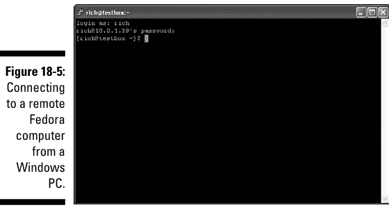

系统日志查看器提供了指向 `boot.log`、`maillog`、`messages` 和 `Xorg` 的快速链接。

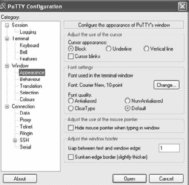

`messages`。此条目看起来如下：

```
Apr 9 13:34:55 test dhclient: REQUEST 192.168.1.654
```


此日志项识别了以 root 权限运行的应用程序。定期查看 `messages` 日志文件也是好主意。如果任何系统服务启动失败，你会在该日志文件中发现。

# 查找安全资源

你可以在网上找到大量关于桌面、网络和 Linux 安全的信息。由于可用信息量巨大，我列出了一些我喜欢的用于安全问题的网站：

- `www.sans.org`：互联网上主要的安全网站之一。
- `www.grc.com`：提供了一些有趣的工具，例如测试系统开启了哪些端口的工具。此外，该网站还有许多关于系统和网络安全的优秀文章。点击 Shields Up Security HOWTO。
- `tldp.org/HOWTO/Security-HOWTO/index.html`：Linux 安全 HOWTO。
- `www.linuxsecurity.com/`：提供了 Linux Security.com 的大量信息。
- `www.securityspace.com/`：拥有关于不同操作系统的安全问题和工具的大量信息。

# 第五部分

# 十之篇

Rich Tennant 著《第五次浪》


# 在这一部分 ...

在本书的这一部分，我们将介绍关于 Linux 最常见问题的解答。我们将解释一些关键的 Linux 安装和设置要点，并分享更多常规的故障排除技巧和窍门。当你遇到困难需要帮助，或者你的设置中存在某些让你困扰的地方时，这里就是你的选择。我们还为你提供了一些有趣的极客项目。搭建你自己的无线接入点、打印服务器和文件服务器，让你的朋友赞叹观口吧！

## 第 19 章

### 制作自己的无线接入点的十步

- 本章内容
- 你好，大师
- 制作无线接入点的步骤
- 故障排除

> 你知道，有线电就像一种非常、非常长的猫。你在纽约拉它的尾巴，它的头就在洛杉矶喵喵叫。你理解这吗？无线电的操作完全一样：你在这里发送信号，他们在那里接收。唯一的区别是没有猫。
>
> — 阿尔伯特·爱因斯坦，被要求描述无线电时

无线现象几乎席卷了每一个。你现在可以在家里的任何地方切换电视频道、接听电话或启动咖啡机。无线技术也侵入了计算机世界。

在过去（2000 年代初），你必须在整个家里布满电缆才能将多台计算机连接到互联网。现在，你可以使用无线技术从任何计算机发送和接收数据包（在计算机网络中传输的数据块），而无需在所有的墙上钻洞。

你现在可以从任何电子产品商店购买无线接入点（WAP）。WAP 连接到你的有线网络，然后在整个房子内产生无线电信号（甚至可以在房子外的一小距离内）。带有无线网卡的电脑可以接收这些信号并连接到有线网络。

如第 9 章所述，如果你已经在网络中有了一个无线接入点，Fedora 支持将许多无线网卡作为客户端。但如果你有互联网连接但没有无线接入点呢？嗯，Fedora 也可以在这里为你营救。

### 你好，大师！

每个无线网络都必须有一个供远程计算机连接的 WAP。在无线区域中，WAP 被称为主设备——计算机连接并与无线网络上的其他设备进行交互的中心点。无线网络上的所有网络活动都通过主设备进行，即使是两台计算机之间的通信。当你配置 Fedora 计算机的无线网卡时，可能会遇到“管理模式”术语。管理模式意味着你的计算机通过网络连接到主设备。这在图 19-1 中所示。

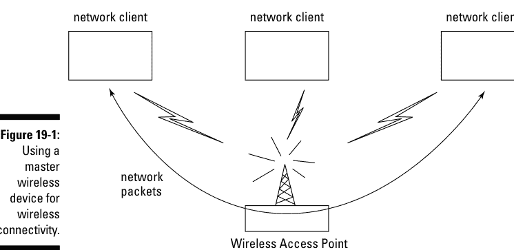

图 19-1：使用主无线设备进行连接。网络客户端 网络客户端 网络客户端 网络数据包 无线接入点

还有一种“自形成模式”——两个客户端之间可以直接对话，而不需要主设备。然而，这种模式仅限于两个客户端。为了本章的目的，请不要尝试使用这种方法来制作你的接入点：这里的目标是支持多个无线客户端。

# 第 19 章：制作自己的无线接入点的十步

创建你自己的无线接入点的关键是构建一个房子里所有计算机都可以连接的主设备。当你购买商业无线接入点时，制造商会将其配置为主设备，允许无线客户端连接到它。然而，你的无线网络并不需要商业接入点：你可以使用 PC 上的无线网络网卡来实现相同的功能。

虽然典型的 Linux 设置通常不使用它们作为（主设备），但你可以配置大多数计算机无线网卡来充当网络主设备。（某些网卡不支持此功能，因此你可能需要检查你的无线网卡的网站以确保。）接下来的章节将引导你完成使用有线连接接入互联网，并将你的 Fedora 系统作为无线接入点所需的步骤。

### 第 1 步：规划你的网络

与任何其他网络实现一样，在开始之前计划好你想做的事情是有回报的。无线网络的缺点是它们极易受到环境条件的影响。无线电波范围有限，且难以穿某些物质，例如材料墙、砖墙或实木墙。

使用普通的 PC 无线网络网卡作为接入点会加剧这些局限性。大多数为 PC 设计的无线网卡使用小型天线，为了尽可能不显眼。虽然这看起来可能不错，但对无线网络的范围帮助不大。

计划的第一部分是尝试找到使用大天线的网卡，或者具有连接到外部天线的能力。你不需要使用业余无线电天线场，但拥有一个比 PC 后面伸出的短桩更大的东西是有帮助的。

无线接入点还与房地产共享角色——位置，位置，位置。你将无线接入点放在哪里对它的运行良好程度至关重要。显然；如果你有有线互联网连接，你需要将接入点定位在互联网连接可及的范围内，但尽量让它位于中心位置。

在你决定了位置和天线配置后，你就可以开始配置你的 Fedora 系统了。

### 第 2 步：配置你的网卡

在可以无线共享你的网络连接之前，你必须连接到网络。为了这个例子，我们假设你有有线连接（如 DSL 调制解调器）。你必须首先将 Fedora 连接到网络。通常 Fedora 会自动检测网卡，执行某些步骤见第 9 章：

1. 从 GUI 界面选择`系统：网络`

这启动了网络配置工具。如果你不是以 root 用户登录，你需要 root 密码才能继续。网络配置工具出现，显示了检测到的网卡。注意网卡的设备（通常是 `eth0`）。稍后你需要这些信息。

2. 双击网卡条目

以太网设备框（如图 19-2 所示）出现，显示网卡的当前配置。

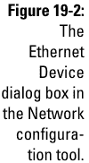

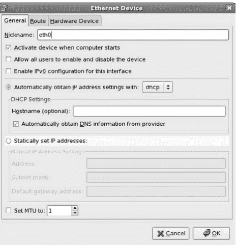

3. 选择`静态 IP 地址`按钮以设置静态 IP `0.0.0.0`

设置无线接入点时，Fedora 系统用于在有线和无线网卡之间传递数据包。你不需要网络地址来实现。

4. 点击 `OK` 保存设置

网络配置工具会自动保存新的网卡设置。如果网卡不是激活状态，点击`激活`按钮启动它。以太网设备框包含几个你可以更改的设置：

- `昵`：允许为设备分配一个不同的（可能有意义的）名称而不是 `eth0`。
- `计算机启动时激活设备`：允许 Fedora 在启动时自动激活网卡，无需你的干预。
- `允许所有用户启用和禁用设备`：默认情况下，只有 root 用户可以启动和停止网卡。勾选此框允许任何用户执行。
- `为此接口启用 IPv6 配置`：这是未来互联网地址的标准。目前大多数 ISP 不支持 IPv6，因此保持此框为空。

你现在应该已经激活了有线网卡，但由于没有为其分配 IP 地址，你将无法在网络上使用它。如果你只是将你的 Linux 计算机作为接入点，你不需要配置 IP 地址。下一步是无线网卡。

如果 Fedora 在安装过程中检测到了你的无线网卡，你可以使用标准的网络配置工具对其进行配置（稍后我们会向你介绍该过程）。

如果你的无线网卡没有被检测到，或者你尝试安装一个新的无线网卡，你有几个选项可以实现：

- 使用网络配置工具选择新卡
- 使用网卡制造商提供的 Linux 工具
- 使用 `ndiswrapper` Linux 应用程序

首先，尝试使用网络配置工具查看 Fedora 是否识别了你的无线网卡以及是否拥有相应的驱动程序。该过程在第 9 章有详细介绍。只需按照那些步骤操作，如果你获取了无线网卡，再跳回到这里。

如果你在网络配置工具列表中找不到你的网卡，你将不得不进行一些尝试。最好的办法是使用 Linux 工具来帮助安装网卡。检查你的网卡附带的驱动光盘或网站。希望对于你特定的网卡，你能够找到对应的 Linux 驱动程序或工具。如果找到了，请按照制造商提供的说明操作。

如果你仍然无法让网卡工作，你还有最后机会。`ndiswrapper` 应用程序是一个开源项目，尝试根据随附网卡的 Windows 驱动创建 Linux 驱动程序。

`ndiswrapper` Wiki 站点（`http://ndiswrapper.sourceforge.net/mediawiki/index.php/Main_Page`）提供了有关网卡如何与 `ndiswrapper` 工作的信息。先检查 Wiki 站点，看看你特定的无线网卡是否有使用的希望。很多人会在那里发布他们的无线网卡问题，你很有可能找到关于你那款网卡的信息。如果你的无线网卡没有出现在列表中，你就运气不佳，需要购买一张新卡。

如果你发现可以使用 `ndiswrapper` 来支持你的无线网卡，就可以继续本节内容。你必须首先安装 `kmod-ndiswrapper` 程序包：

1. 点击`应用程序：添加/删除软件`

这会启动软件包管理器工具。如果你没有以 root 用户身份登录，将被要求输入 root 密码以继续。

2. 点击“搜索”选项卡来搜索软件包。

3. 在文本框中输入 `kmod-ndiswrapper` 并点击“搜索”按钮。

搜索完成后，你将在结果窗口中看到列出的 `kmod-ndiswrapper` 包。

4. 选择 `kmod-ndiswrapper` 条目，然后点击“应用”开始安装。

完成软件安装后，你需要加载 `ndiswrapper` 驱动程序。

1. 将你无线网卡的 Windows 驱动程序复制到家目录下的一个文件夹中。

通常网卡自带光盘上的驱动程序是旧的。尝试访问你的无线网卡网站，查看是否有更新的驱动程序。

2. 点击`应用程序：系统工具：终端`

终端工具出现，显示命令提示符。

3. 如果你尚未以 root 用户身份登录，你必须变为 root 用户。

要在命令行执行此操作，输入 `su` 并输入 root 密码。命令行提示符将变为井号（#），表示你现在是 root 用户了。

4. 切换到你拷贝 Windows 驱动程序的文件夹。

使用 `cd` 命令行切换到你拷贝驱动程序的文件夹名称：

```
cd drivers
```

5. 安装 Windows 驱动程序中的 `.inf` 文件。

使用 `-i ndiswrapper` 来安装无线网卡制造商提供的 `.inf` 文件：

```
ndiswrapper -i file.inf
```

6. 安装 `ndiswrapper` 模块。

使用 `-m ndiswrapper` 选项安装 `ndiswrapper` 模块：

```
ndiswrapper -m
```

7. 重启系统。

系统重启后，按照第 9 章所示的普通步骤安装无线网卡。`ndiswrapper` 驱动程序将作为一个名为 `wlan0` 的新无线网卡出现。

如果一切顺利且 Fedora 识别到你的无线网卡存在，是时候你将其配置为无线接入点了。以下是实现该更改你需要执行的操作。

### 从 GUI 桌面，选择`系统::管理::网络`

如果你是以普通用户（非 root）身份登录的，系统会提示输入 root 密码。网络配置对话框打开。注意无线网卡的名称（如果是第二个安装的卡，它会被称为 `eth1`）。如果你使用了 `ndisswapper` 技术安装无线网卡，它将使用别名 `wlan0`。

### 在网络配置对话框中，双击你检测到的无线网卡

出现无线设备配置对话框（如图 19-3 所示）：

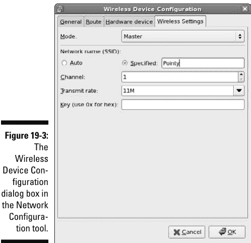

### 点击“无线设置”选项卡，然后输入你的无线接入点配置设置

你必须配置若干无线设置以连接到你的接入点：

- `模式 (Mode)`：决定无线卡是否为接入点。
- `网络名称 (SSID)`：接入点通过服务集标识符识别。
- `通道 (Channel)`：你必须选择一个通道。
- `传输速率 (Transmit rate)`：某些无线网卡允许你指定速率。
- `密钥 (Key)`：接入点加密是必要的。

4. 点击“常规”选项卡配置无线卡。

5. 点击“确定”完成无线卡配置。

当无线卡出现在网络列表中后，你可以通过“激活”和“取消激活”按钮轻松启动和停止。

### 第 4 步：安装桥接

对于下一个技巧，你需要在有线网卡和无线网卡之间建立桥接。

网络桥接用于桥接网络中的隙。它们连接同一子网上的网络系统。路由器用于在不同网络之间移动流量，而桥接器在必须连接的相似网络之间移动流量。

此项目所需的桥接软件已封装在软件包中。`bridge-utils` 包包含了构建网络桥所需的所有组件。你只需要安装该包。

1. 点击`应用程序：添加/删除软件`

2. 点击“搜索”选项卡来搜索软件包。

3. 在文本框中输入 `bridge-utils` 并点击“搜索”按钮。

搜索完成后，你将在结果窗口中看到列出的 `bridge-utils` 包。

4. 选择 `bridge-utils` 条目，然后点击“应用”开始安装。

### 第 5 步：构建桥

构建桥可能是所有步骤中最复杂的。不幸的是，这里没有华丽的图形工具提供帮助。你必须深入 Fedora 命令行，按照传统方式在命令行提示符逐条输入命令。

你需要使用的 Linux 桥接命令是 `brctl`。该命令允许你创建网络桥、将网络接口添加到桥中以及监控桥接。

`brctl` 命令的格式为：

```
brctl [command]
```

其中 `command` 是要执行的桥接命令。你将使用的 `brctl` 命令如表 19-1 所示。

| 命令 | 描述 |
|---|---|
| addbr | 创建一个新的网络桥接 |
| delbr | 现有的网络桥接 |
| addif br | 将网络接口 if 添加到桥接 br |
| delif br | 从桥接 br 中移除网络接口 |
| stp state | 设置桥接 br 的生成树协议为开启或关闭 |

要执行命令行，你需要打开一个终端会话：

1. **点击`应用程序：系统工具：终端`**

终端出现，显示命令行提示符。

2. **如果你尚未以 root 用户身份登录，你必须成为 root 用户。**

要在命令行中执行此操作，输入 `su`，然后输入 root 密码。命令行提示符将变为井号 (#)，表示你现在是 root 用户了。

3. **创建一个名为 br0 的新桥接实例。**

使用 `brctl` 命令创建一个新桥接：

```
brctl addbr br0
```

此命令创建了一个名为 `br0` 的新桥接。

4. **临时禁用以太网接口。**

在将接口添加到桥接之前，你必须停止它们接收网络流量。使用 `ifconfig` 命令执行此操作：

```
ifconfig eth0 down
ifconfig eth1 down
```

5. **将网卡添加到新创建的桥接中。**

再次使用 `brctl` 命令，使用第 2 步找到接口名称添加有线网卡，使用第 3 步找到接口名称添加无线网卡：

```
brctl addif br0 eth0
brctl addif br0 eth1
```

桥接构建过程完成。你可以使用 `show` 命令选项查看你的新桥接：

`brctl` 命令显示桥接状态正常 (OK)，并且它包含了两个网络接口。你现在可以使用 `ifconfig` 命令激活两个网络接口和新桥接：

```
ifconfig eth0 0.0.0.0
ifconfig eth1 0.0.0.0
ifconfig br0 up
```

两个网卡之间应该有网络流量流过。

## 步骤 6：保存你的成果

在命令行提示符输入所有这些命令后，你已经在有线网卡和无线网卡之间建立了一个工作的桥接。唯一的问题是，系统重启后所有工作都会消失。哎。

与其每次启动系统时都输入所有的桥接命令，聪明的做法是让命令在系统启动时自动运行。最简单的方法是将这些命令放置在启动时运行的脚本中。

最可能的候选文件是 `/etc/rc.local`。该文件包含了在每次启动结束时运行的脚本条目。

以下是将你的命令放入该脚本的方法：

1. 以 root 用户身份登录 Fedora 系统。
  修改 `rc.local` 文件需要 root 权限，因此简单的方法是直接以 root 登录。
2. 点击`应用程序>杂项>文本编辑器`
  此命令将启动 gedit 文本编辑器。
3. 点击工具栏上的“打开”图标，找到 `/etc` 文件夹，并选择打开 `rc.local` 文件。

# 第 19 章：制作自己的无线接入点的十步

4. 将上一步列表第 5 步中输入的 `brctl` 命令行条目添加到文件中。

引用 `rc.local` 文件中的 `brctl` 和 `ifconfig` 命令时，使用命令的完整路径（`/usr/sbin/brctl` 和 `/sbin/ifconfig`）。生成的文件看起来应该像图 19-4 所示。

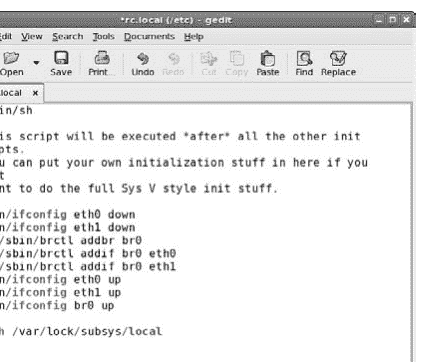

> 图 19-4：将 brctl 命令添加到 /etc/rc.local 文件。

```bash
### /bin/sh

# 此脚本将在所有其他初始化脚本“之后”执行
```


# 如果你有需要，可以在这里放置自己的初始化步骤

## 我们想实现 S V 风格的初始化脚本

```
/sbin/ifconfig eth0 down
/sbin/ifconfig eth1 down
/usr/sbin/brctl addif eth0
/usr/sbin/brctl addif eth1
/sbin/ifconfig eth0 up
/sbin/ifconfig eth1 up
touch /var/lock/subsys/local
```


- 5. 点击“保存”图标保存你的更改。
- 6. 退出编辑工具。

过程完成。重启你的系统，一切都应该按预期运行。你可以使用 `brctl` 配合 `show` 命令查看桥接是否正确启动。

## 步骤 7：测试连接性

新的无线接入点现在应该上线了。要测试这一点，请到另一个无线客户端浏览网络寻找新的接入点。

在 Microsoft Windows XP 家庭工作站上，你可以通过以下步骤操作：

- 1. 点击开始；我的网络位置。
- 2. 从左侧面板选择“查看网络连接”。
- 3. 在设备列表中找到你的无线网卡，然后右键点击图标。从菜单中选择“查看可用的无线网络”。

新的接入点（在本例中称为 Pointy）应该出现在你的可用网络列表中，并带有一个小锁符号。这表示接入点正在使用加密。

无线网卡应连接到接入点。同样，如果你的网络使用 DHCP 分配网络地址，客户端接收到地址后就可以正常使用了。如果你的网络使用静态 IP 地址，则你需要为客户端上的无线网卡分配一个合适的地址。

## 第 10 步：测试远程设备

当你连接到无线接入点后，在 Fedora 系统上创建的桥接会将来自你无线客户端的所有数据包传递到有线网络。

使用 Web 浏览器访问互联网位置来测试这一点。如果你能够访问互联网，恭喜你！你已经建立了自己的安全接入点。

### 如果遇到困难……

正如你所想象的，对于这样一个复杂的系统，有很多地方可能会出错。在排除故障时，要记住的一点是将系统拆分为各个独立的组件并测试每一个部分。

以下是一些可能出现的问题以及对应检查项的提示：

- 你在客户端的接入点列表中没有看到无线接入点：检查客户端是否在无线接入点的范围内。记住，如果你使用的是 PC 无线网卡，范围可能会受到限制。
- 接下来，使用网络配置工具确保无线网卡处于激活状态。如果你的 `rc.local` 脚本出现问题，无线网卡可能未激活。
- 你可以连接到无线接入点，但无法连接互联网：检查有线网卡是否处于激活状态。使用网络配置工具检查无线网卡的状态，并在时激活它。
- 此外，使用命令行 `brctl` 命令检查桥接状态。你可以使用 `showmac` 命令检查客户端网卡的以太网地址是否出现在桥接的地址列表中。
- 手动设置时一切运行良好，但重启后什么都无法工作：检查你的 `/etc/rc.local` 脚本，确保你按正确的顺序输入了 `ifconfig` 和 `brctl` 命令。也可能是这些命令在无线网卡准备就绪之前运行并失败了。

某些 PCMCIA 和 USB 无线网卡必须由 Fedora 系统激活后才能进行配置。有时在运行 `rc.local` 脚本时，网卡仍在启动中。如果是这种情况，你可能需要使用 Linux 的 `sleep` 命令在运行 `ifconfig` 和 `brctl` 命令之前设置一个短的延迟。

## 第 19 章：创建自有无线接入点的十个步骤

## 第 20 章：设置 Samba 打印服务器的十个步骤

## 本章内容

- 学习 Samba (Dancing the Samba)
- 设置打印服务器
- 排除故障

> 为那些从一开始就没人想要的东西制作复印和计算机打印件，正为美国带来新的使命感。
> — 安迪·鲁尼 (Andy Rooney)

网络彻底改变了计算机世界。它们不仅帮助你查看精美的网站，还让你能够在位于房屋两端的电脑之间共享一台打印机。在家里所有的电脑之间共享一台打印机可以为你节省大量的费用。

Linux 计算机可以很好地相互共享打印机。第 17 章展示了如何将 Fedora 计算机映射到几乎任何类型的网络打印机。然而，你的网络中很可能还有一个或多个 Microsoft Windows 系统。让这些系统与 Linux 打印机配合并不总是易事。

本章将介绍必要的步骤，使连接到你 Linux 计算机的打印机供网络上的 Microsoft Windows 计算机使用。

## 学习 Samba

让你的 Linux 计算机与 Microsoft Windows 工作站和服务器通信需要一个特殊的软件包。微软使用一种专有的（秘密的）网络协议在网络上的 Windows 设备之间进行通信。

幸运的是，一些进取的开源爱好者致力于对微软网络协议进行逆向工程研究，并制作了复制该结果的软件。这种努力产生了名为 Samba 的开源软件包。

Fedora 将 Samba 软件作为核心 Fedora 软件包的一部分包含。我使用 Samba 软件包使连接到你 Linux 计算机的任何打印机对网络上的 Microsoft Windows 工作站或服务器可见。

接下来的步骤将引导你完成安装和配置 Samba 以及 Linux 所需的过程，创建一个所有人都可以使用的打印服务器。

## 第 1 步：规划你的共享

在开始加载和配置软件之前，先了解你的网络环境是一个好主意。在开始之前准确确定你正在要做什么总是一件好事。

首先，让我们确保我们谈论的是同一件事。网络打印的世界变得很复杂。网络打印机市场上存在特殊类型的打印机。你可以直接将这些类型的打印机连接到网络，而无需使用中间计算机。

网络打印机通常是重型打印机，每天能够打印数千页纸。这些打印机是为中大型办公设计的，通常对于普通家庭或小微企业用户来说太贵了。这些不是我们在这里讨论的打印机类型。

本章完全关于共享你插入到 Linux 计算机或服务器的通用、普通打印机。这些被称为本地打印机，因为你直接（或本地）将它们连接到特定的 PC。

共享本地打印机的优之处在于，你不需要为网络上的每台电脑购买单独的打印机。了解如何将一台简单的喷墨打印机转换为共享网络打印机是非常划算的买卖。

如果你还没有购买打印机，请检查系统。一个很好的资源是 OpenPrinting 网站（`www.linux-foundation.org/en/OpenPrinting`）。该网站包含所有带有驱动程序的打印机数据库。

## 第 2 步：连接本地打印机

获取打印机后，你想将其连接到系统。连接打印机的两种最常用方法是：

- 并口：使用 `LPT#1`
- USB 端口：使用 `USB`

现在的打印机大多使用 USB 线。当你将打印机插入 Fedora 系统时，它会自动检测打印机型号并为你创建打印机。如果你使用旧旧方法，则什么都不会发生。

## 第 3 步：手动添加本地打印机

Fedora 使用打印配置工具添加和管理打印机。如果你使用的是并行打印机，可以在打印配置窗口中手动添加打印机。以下是操作步骤：

1. 从面板菜单选择“系统管理-打印”。这会启动打印配置窗口，如图 20-1 所示。
2. 点击“新建打印机”按钮。启动新建打印机向导。你必须分配服务器在本地系统使用并在网络上发布的新打印机。你还有选项定义打印机的描述和位置。在网络环境中，服务器会将这些项目与打印机名称一起发布。如果你有多台打印机，这可以帮助用户找到正确的打印机。

完成输入后，点击“下一步”按钮进入下一个向导窗口。

3. 选择连接方法。对于并行打印机，选择 `LPT#1` 并点击“下一步”按钮。

4. 选择打印机驱动程序。这可能是最令人沮丧的部分。如果你的打印机制造商在提供的列表中，请选择它并继续点击“下一步”。

如果你的打印机制造商未被选中，你可能没运气了。有时你可以在制造商网站或 OpenPrinting 网站找到相应的 Postscript 打印描述 (PPD) 驱动。如果是这样，在向导窗口中选择该选项，并使用文本框在系统中查找 PPD 文件。

5. 如果您选择了打印机制造商，下一步是从列表中选择特定的打印机型号。如果列表中没有您的打印机型号，您将不得不尝试下载适当的 PPD 文件并使用该方法。

某些型号有多个 PPD 驱动文件可用。在这种情况下，通常有一个会被标记为“推荐”。请先尝试那一个。当选择了合适的打印机型号和驱动程序后，点击“向前”按钮。

6. 完成安装。

最后的窗口总结了您的选择。如果您需要更改任何内容，可以点击“上退”按钮返回相应的向导窗口。如果一切无误，点击“应用”创建打印机定义。

安装打印机后，或者 Fedora 自动检测到您的 USB 打印机，检查打印机配置项是一个好主意。进入下一步。

## 步骤 4：设置打印机配置

“打印机配置”窗口分为两个面板。左窗格列出了可以配置的项目。右窗格用于显示配置设置。

默认情况下，窗口左窗格显示常规项目：

- 服务器设置：允许您设置适用于打印服务器的选项
- 本地打印机：允许您设置适用于各个已配置打印机的选项

当您点击左窗格中的某项时，工具会在右窗口中显示信息。以下是打印服务器所需的配置项：

1. 点击“服务器设置”项目。

当您点击“服务器设置”时，它会显示一组用于配置项的复选框：

- 显示其他系统共享的打印机：扫描网络中的广告打印机，并将其添加到可用打印机列表中
- 共享连接到此系统的发布打印机：在网络上发布所有标记为“共享”的本地打印机
- 允许远程管理：允许远程连接到打印机配置系统
- 允许用户取消任何作业（而不只是自己的）：允许他人取消发送到打印机并在队列中的打印作业
- 保存调试信息以进行故障排除：指示打印系统创建调试文件以观察发生的情况

2. 确保“共享连接到此系统的发布打印机”复选框已勾选。

通过勾选此设置，Samba 会自动共享系统上创建的任何打印机。（如果有不想共享的打印机，请担心，您可以配置它们不共享。）

3. 点击左窗格中“本地打印机”下的特定打印机项。

“本地打印机”选项提供了所有手动安装的打印机列表。点击打印机将产生“打印机配置详情”窗口，如图 20-2 所示。

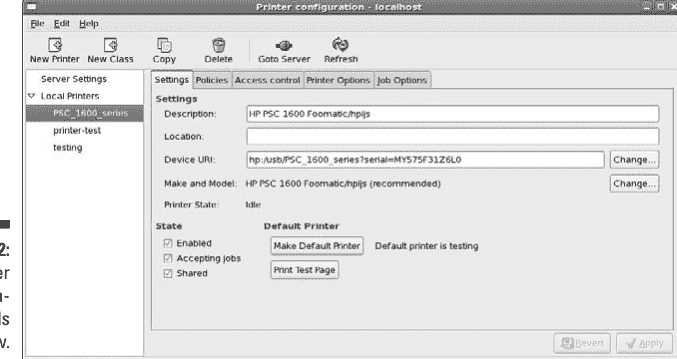

图 20-2：打印机配置详情窗口。

4. 勾选右窗格中的“共享”复选框。

您还可以为打印机设置其他选项（在第 17 章详细描述），例如设置横幅页、限制特定用户使用打印机，以及为打印机设置纸和纸源。

5. 点击“打印测试”按钮。

在尝试从远程客户端打印之前，确保本地打印机工作正常始终是一个好主意。

## 步骤 5：安装 Samba

要与 Microsoft Windows 工作站和服务器共享打印机，您必须安装 Samba 软件包包。Samba 允许您的 Linux 系统使用 Microsoft 网络协议与 Windows 设备通信。

如第 16 章所示，您可以使用 Fedora 软件包管理系统轻松地安装 Samba。方法如下：

1. 点击“应用程序：添加/删除软件”。

这启动了 Fedora 软件包管理系统。您可以从这里轻松地添加或删除软件包。

2. 在软件包管理窗口中，选择左侧的“服务器”选项和右侧的“Windows 文件系统”选项。

“Windows 文件系统”选项包含一个可选包——`system-config-samba`。确保您也选择了此包进行安装。它会让配置 Samba 软件变得更容易。

3. 点击右下角的“应用”按钮开始软件安装。

## 步骤 6：配置 Samba

安装 Samba 后，您必须针对您的特定 Microsoft 网络环境对其进行配置。Microsoft 网络使用两种不同的方法将网络设备加入组：

- 工作组：定义属于临时网络组的少量工作站和服务器
- 域：定义属于受控网络环境的较多工作站和服务器

由于我们正在小型网络环境中工作，我假设您在网络中使用 Microsoft 工作组。在工作组环境中，您必须配置每个工作站和服务器属于一个特定的组名。为了让网络设备看到您的共享打印机，您必须将您的 Linux 服务器加入工作组：

1. 从面板菜单中选择“系统设置：管理：服务器设置：Samba”。

这启动了 Samba 服务器配置窗口（如果您未以 root 用户登录，将会被要求提供 root 密码）。

2. 点击菜单栏上的“偏好：服务器设置”。

出现如图 20-3 所示的“服务器设置”配置窗口。

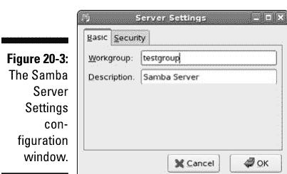

3. 在“服务器设置”中，在“工作组”框中输入您的网络工作组名称。默认情况下，Fedora 使用 Linux 主机名。您还可以在“描述”框中提供简要描述。当网络设备浏览网络时会看到该描述和主机名。

完成后点击“确定”，然后关闭 Samba 设置窗口。

如果您在安装期间启用了 SELinux 安全软件，则需要允许 Samba 运行。要做到这一点，选择“系统->SELinux 管理”。从那里选择“布尔值”，然后点击 Samba。选择“允许 Samba 共享”。就这样！

## 步骤 7：启动 Samba

遗憾的是，Samba 在安装后默认不会启动。您可以选择需要时手动启动，或让 Linux 系统在启动时自动启动。

对于任何选项，您都必须使用服务配置窗口。

1. 从菜单中选择“系统—管理—服务”。

这启动了服务配置窗口。再次，您必须是 root 用户才能使用此工具，如果尚未登录 root，将提示提示密码。当服务窗口启动时，您将看到 Fedora 上的可用服务，如图 20-4 所示。

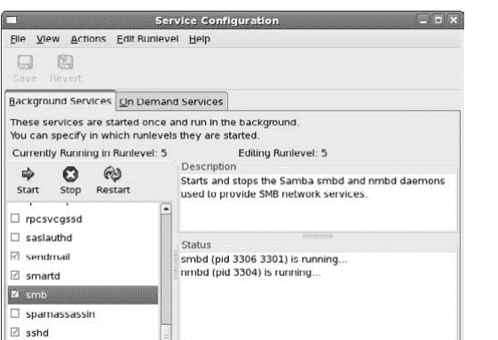

图 20-4：Samba 配置窗口。

服务器在系统启动时会自动启动复选框中带有绿色勾标记的服务。您还可以通过相应的按钮启动、停止或重启单个服务。

服务配置将 Samba 服务标记为 `smbd`。此服务实际上控制两个独立的服务：

- `smbd`：控制客户端到 Samba 服务器的连接
- `nmbd`：控制在网络上广播设备

2. 选择 `smbd` 服务并点击“启动”。

当您启动 `smbd` 服务时，两个 Samba 服务都会启动。您可以在右窗口中查看服务的状态。

3. 如果希望 Samba 在启动时自动启动，请勾选 `smbd` 旁边的选择框。

## 步骤 8：打开防火墙端口

现在 Samba 服务器已经在运行，你只需要确保远程客户端可以连接到它。因为默认情况下，Fedora 是一个安全的系统，所有未使用的网络端口都会被防火墙拦截。

最后一步是打开 Samba 服务器端口，以便远程客户端的数据包能被防火墙接受并传递给 Samba：

1. 从菜单中选择“系统：管理：防火墙与 SELinux”。

这会启动“级别配置”窗口，如图 20-5 所示。

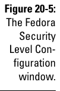


现在需要 root 用户才能访问此工具，所以如果你还没有登录，必须输入 root 密码。此工具有三个选项卡：

- **防火墙选项**：用于打开特定的应用程序端口
- **高级选项**：用于打开特定的 TCP 端口
- **SELinux**：用于控制 Linux 如何锁定特定应用程序

2. 在“防火墙选项”区域，选择 Samba 条目。

防火墙选项显示了系统上配置的常用服务列表。选择 Samba 条目将其标记为信任服务，并允许网络客户端连接它。

## 步骤 9：允许来打印

默认情况下，Samba 使用标准的 Windows 网络登录账户来控制网络安全。然而，对于小型网络上的打印机服务器来说，这大材小用了。

对于小型网络，你可能更希望让网络上的任何人都能打印。在这种情况下，为每个人创建唯一的用户账户有点太愚蠢。相反，你应该允许任何人在共享打印机上打印。

遗憾的是，Samba 配置窗口没有提供设置此功能的地方，因此你必须深入 Samba 配置文件并进行修改。以下是操作方法：

1. 以 root 用户身份登录 Fedora 系统。

Samba 配置文件受保护，只有 root 用户才能编辑它。

2. 点击“应用程序：辅助工具：文本编辑器”。

3. 点击“打开”图标并浏览到 Samba 配置文件 `/etc/samba/smb.conf`。

4. 在配置文件中查找 `[printers]` 部分。

`[printers]` 部分包含了所有控制打印机共享的 Samba 设置。你应该看到以下条目：

```
comment = All Printers
path = /usr/share/samba
browseable = no
# Set public = yes to allow user 'guest account' to
  print
  guest ok = no
```


`writeable = no`

`printable = yes`


- 5. 删除 `guest ok` 前面的分号，并将 `no` 改为 `yes`。

这将允许客人访问并使用共享打印机。

- 6. 在原位置保存配置文件并退出文本编辑器。

## 第 346 章：第五部分：十个步骤

### 第 10 步：映射网络 Windows 打印机

最后一步是前往 Microsoft Windows 工作站或服务器，映射你 Linux 系统上的共享打印机。如果你有一台 Windows XP 家庭版工作站，可以按照以下步骤操作：

- 1. 选择“开始：控制面板”。
- 2. 选择“打印机和其他硬件”。
- 3. 选择“添加打印机”。

这会启动添加打印机向导。点击“下一步”继续下一个窗口。

- 4. 选择“网络打印机”或“连接到其他计算机的打印机”单选按钮，并点击“下一步”。
- 5. 选择“浏览打印机”单选按钮。
- 6. “共享打印机”文本框显示了网络上检测到的打印机服务器列表。双击你的 Linux 服务器名称并选择你想映射的共享打印机。

如果你知道打印机和服务器名称，可以使用格式 `\servername\printername` 手输入。

Linux 打印机与 Linux 系统的主机名相同。选择所需的共享打印机后，点击“下一步”。当你在使用网络打印机的危险时，会出现几个 Windows 警告框，但嘿，这是你自己的网络打印机，所以不用担心这些警告。

- 7. 从制造商和型号列表中选择相应的打印机驱动程序。完成后点击确定。

## 故障排除

在理想世界中，一切应该运行得很好。你应该能够将网络上的任何 Windows 工作站或服务器映射到新的 Linux 打印机服务器，并打印到服务器上本地连接的任何打印机。

然而，事情并不总是如计划。在网络世界中，有很多机会出错。如果你的打印机服务器无法工作，请注意以下几点：

## 第 20 章：设置 Samba 打印机服务器的十个步骤

- **测试本地打印机：** 这一步怎么强调都不为过。我们遇到过很多情况，管理员花费无数小时试图排除网络问题，结果最后发现本地系统甚至无法打印。

确保你可以从 Linux 系统向本地打印机发送打印作业，并且打印作业输出正常。通常，PPD 驱动不匹配会导致打印机出现异常行为。

- **记得允许客人打印：** 默认情况下，Fedora 会配置客人打印。在这种情况下，为每个人创建唯一的用户账户有点太愚蠢。

- **检查全局和本地：** Samba 配置窗口提供了两个必须设置的位置。如果其中一个没有设置，当你在浏览时将看不到打印机。

- **检查网络连接性：** 最后，确保你的 Linux 系统具有正确的网络连接。

## 第 21 章：设置文件服务器的十个步骤

## 本章内容
* 重新介绍 Samba
* 创建文件服务器
* 故障排除

> 有些事情是你无法分享而不产生后果的。
—— J. K. 罗琳，《哈利·波特与魔法石》，1997年

除了打印机之外，网络中的下一个大项是文件共享。文件共享在商业世界是必须的，但在家里也很有用。毫无疑问，Microsoft 网络环境是最流行的文件共享系统。仅仅你决定使用 Linux 并不意味着你被冷落了。在本章中，我将介绍在家庭网络上创建自己的文件服务器的必要步骤。

### 重新介绍 Samba

在第 20 章中，你看到了如何使用 Samba 软件包共享本地打印机给 Microsoft Windows 客户端。同样的 Samba 软件包还让 Linux 和 Windows 设备之间的文件夹和文件共享变得轻而易举。

Samba 允许你在 Linux 系统上定义文件夹，然后在 Microsoft 网络上发布这些文件夹。远程 Windows 客户端可以像在 Windows 系统上一样浏览并映射这些文件夹。

你可以使用标准的 Linux 用户和组权限来控制对文件夹的访问。Samba 能够允许网络上的 Windows 用户访问单个用户账户。此功能允许你在 Windows 网络上使用一组用户账户，而在 Linux 系统上使用另一组用户账户。

### 第 1 步：制定共享策略

在开始共享之前，你首先必须决定你想共享什么，以及谁可以共享。规划文件夹共享策略是创建一个文件服务器的关键元素。

即使在小型组织中，你通常也需要限制子组访问某些信息。无论是将老师数据与学生数据分开，还是让孩子远离父母的数据，你经常会发现需要创建多个组来共享数据。

你可以根据需要为文件服务器创建任意数量的共享。对于每个必须共享数据的组，你必须创建一个单独的文件夹并定义一个单独组将用户置其中。

为了让这些信息不致混乱，最好的方法是创建一个简单的表格，列出哪些用户应该访问哪些数据。在看到布局后，更容易创建正确的配置。表 21-1 展示了一个简单的共享文件夹策略表。

表 21-1
| 组 | 文件夹 | 共享名称 | 成员 |
|---|---|---|---|
| accounting | /accounting | accounting | fred, barney |
| sales | /sales | sales | wilma, betty |

表 21-1 显示每个组在 Linux 系统上都分配了一个唯一的文件夹。为了保持简单，本示例使用了相同的组名、文件夹名和共享名称，但在实际系统中，这可能是不行的：制作一个映射你所要做内容的表格将能够让你在项目后期避免很多麻烦。

### 步骤 2：创建 Linux 组

创建文件服务器的下一步是在 Linux 中创建必要的组。文件服务器使用 Linux 组来控制对你创建的各个共享文件夹的访问。对于此步骤，你需要使用 Fedora 用户和组管理器：

- 1. 从面板菜单中选择 系统 > 管理 > 用户和组。

用户管理器窗口将会出现。如果你没有以 root 用户身份登录，Fedora 会要求你输入 root 密码以继续。

此工具为在系统上创建和管理组提供了图形化界面。

- 2. 点击“添加组”图标添加一个新的 Linux 组。

出现如图 21-1 所示的“新建”窗口。


在文本框中，输入你想用于控制共享文件夹的组名称。留空“手动指定 ID”复选框。Fedora 会自动为该组分配一个唯一的组 ID。

使用此技术创建一个名为 `accounting` 的组，然后再创建一个名为 `sales` 的组。新组将出现在“组”选项卡下的组列表中。

### 步骤 3：创建用于共享的文件夹

创建组之后，你就可以创建用于共享的文件夹。出于安全考虑，在现有用户的家目录下创建文件夹并不是好主意。相反，你应该创建与系统普通目录结构独立的文件夹。

- 1. 以 root 用户身份登录。
这是少数更容易以 root 用户身份登录的情况之一。每当你登录 root 时，请务必极其小心，不要修改任何你不该修改的内容。
- 2. 双击电脑桌面图标，然后双击“文件系统”图标。
这将启动 Nautilus，显示 Linux 系统的根目录结构。
- 3. 在 Nautilus 窗口的空白处点击右键并选择“创建文件夹”。
当 Fedora 创建新文件夹时，它会提供重命名的选项。将名称更改为 `accounting`。
- 4. 在根目录下创建另一个名为 `sales` 的文件夹。
- 5. 右键点击 `accounting` 文件夹，从下拉菜单中选择“属性”。
- 6. 点击“权限”选项卡。
权限选项卡显示了文件夹所有者、文件夹所属的分配组以及系统上所有其他用户的访问权限。如图 21-2 所示。


图 21-2：带有“权限”选项卡的 accounting 窗口。

- 7. 将组设置设置为 `accounting`。

默认情况下，Fedora 将文件夹的组设置为创建该文件夹的用户所属的组，在这种情况下，该组是 root。使用下拉框将值更改为你之前创建的 `accounting` 组。

- 8. 从“文件夹访问”下拉列表中选择“创建和删除文件”，并在“文件访问”下拉列表中选择“读取和写入”。

这允许 `accounting` 组中的任何人创建新文件并删除现有文件。完成后，请关闭此窗口。

- 9. 对 `sales` 文件夹执行相同的操作，将其分配给 `sales` 组，并赋予该组“创建和删除”权限。

### 步骤 4：设置高级文件夹权限

在完成共享文件夹权限设置时，你必须使用一个额外的技巧。当 Fedora Linux 创建用户账户时，它为每个账户分配一个唯一的组（恰好与用户名相同）。不幸的是，这在共享文件夹环境中会导致问题。

尽管你的用户都是同一组的成员，他们的主 Linux 组仍然是他们唯一的组名。当用户在共享文件夹中创建新文件时，它属于用户的主组，而不是你新创建的组。

要解决这个问题，你必须告诉共享文件夹在用户创建新文件时使用文件夹的组而不是用户的组。这需要一种 Nautilus 属性窗口无法提供的特殊 Linux 权限。

你必须通过命令行提示符使用 Linux `chmod` 命令手动分配此权限。以下是完成该操作的步骤：

- 1. 选择 应用程序：系统工具：终端启动命令行会话。
- 2. 如果你未以 root 用户身份登录，在命令行输入 `su` 变为 root 用户。在提示时输入 root 用户密码。
- 3. 输入命令 `chmod g+rws /accounting`。

`chmod` 命令更改指定文件夹的权限。命令中的各个选项含义如下：

- `g` 指定要添加到“组”的权限。
- `r` 指定该组具有读取权限。
- `w` 指定该组具有写入权限。
- `s` 指定 setgid 位，确保组所有权。

- 4. 再次使用 `chmod` 命令，这次使用 `/sales`。

每当用户在 `sales` 文件夹中创建文件时，该组就会被设置为 `sales` 组，而不是用户的主组。此过程确保了组中的其他成员可以访问某个成员创建的文件。

- 5. 在命令行输入 `exit` 退出 root 模式，然后再次输入 `exit` 退出终端。

### 步骤 5：安装并启动 Samba

如果你在学习第 20 章时还没有安装并启动 Samba，那么现在需要这样做了。你可以使用 Fedora 软件包管理工具安装 Samba：

- 1. 点击 应用程序：添加/删除软件。

这将启动软件包管理系统。你可以轻松地添加或删除软件包。如果你没有以 root 用户身份登录，它会要求你输入 root 密码以继续。

- 2. 在软件包管理窗口中，在左侧选择“服务器”选项，在右侧选择“Windows 文件系统”选项。

“Windows 文件系统”选项包含一个可选包 —— `system-config-samba`。确保你也选择了该包安装。它会让配置 Samba 软件变得更容易。

- 3. 点击右下角的“应用”按钮开始软件安装。

安装 Samba 软件后，你必须决定如何在服务器上运行它。你有两个选项：

- 手动：如果你不希望 Samba 服务器一直运行
- 自动：如果你希望 Samba 服务器在系统启动时启动。

对于任一种选项，你都必须使用 Fedora 配置窗口。

- 1. 选择 管理 > 服务器设置 > 服务。

这将启动服务配置窗口。再次，你必须是 root 用户才能使用此工具，因此如果你没有以 root 登录，将被要求输入 root 密码。当服务配置窗口启动时，你会看到 Fedora 服务器上可用的服务，如图 21-3 所示。

服务器在系统启动时会自动启动复选框中带有绿色勾标记的服务。你也可以使用相应的按钮启动、停止或重启单个服务。服务配置窗口将 Samba 服务标记为 `smb`。该服务实际上控制两个独立的 Samba 服务：

- `smbd`：控制客户端到 Samba 服务器的连接。
- `nmbd`：控制在网络上广播共享设备。


图 21-3：Fedora 服务配置窗口。

- 2. 选择 `smb` 服务，并点击启动。

当启动 `smb` 服务时，两个 Samba 服务器都会启动。你将在右侧窗口中看到服务的状态。

- 3. 如果你想让 Samba 在启动时自动启动，勾选 `smb` 旁边的复选框，然后退出服务配置窗口。

### 步骤 6：配置 Samba

为了让你的 Samba 服务器在网络上工作，你必须配置两个主要功能：

- 微软网络域或工作组名称
- 为网络客户端开放 Samba 服务器防火墙端口

以下是完成此操作你需要遵循的步骤。

- 1. 从菜单中选择 系统：管理：服务器设置：Samba。
  这会启动 Samba 服务器配置窗口。
- 2. 从菜单栏中点击 首选项：服务器设置。
将显示如图 21-4 所示的服务器设置配置窗口。


图 21-4：Samba 服务器配置窗口。

在服务器设置窗口中，输入你的 Windows 网络的组名（记住，所有需要使用共享文件夹的网络设备必须使用此名称）。

默认情况下，Fedora 使用你系统的 Linux 主机名作为网络上的 Windows 网络名称。你也可以在提供的描述对话框中为你的主机提供简短描述。网络设备在浏览网络时，将看到该描述以及你的主机名。

- 3. 完成后点击确定，并关闭 Samba 设置窗口。

下一步是打开 Samba 使用的防火墙端口以允许远程客户端访问服务器。这是通过 Fedora 安全级别配置窗口完成的：

- 4. 从菜单中选择 系统；管理；防火墙与 SELinux。

这会启动安全级别配置窗口，如图 21-5 所示。


图 21-5：Fedora 安全级别配置窗口。

你必须是 root 用户才能访问此工具，因此如果你还没有登录，必须输入 root 密码。此工具有两个标签页：

- 防火墙：用于打开特定的防火墙端口
- SELinux：用于控制 Linux 如何锁定特定应用程序

- 5. 在防火墙选项区域，勾选 Samba 复选框。

防火墙选项区域显示了系统上配置的常用服务列表。勾选 Samba 项将其标记为信任的服务，并允许网络客户端连接到它。

如果你在安装期间启用了 SELinux 安全软件，你将告诉它允许 Samba。要这样做，选择“系统-SELinux 管理”来启动 SELinux 管理工具。从那里，选择“布尔值”，然后点击 Samba 下拉列表。勾选“允许 Samba 共享任何文件/目录的读/写”复选框。就这些了！


### 步骤 7：创建 UNIX 用户账户

现在你的 Samba 服务器已在网络上，是时候将注意力转回设置共享文件夹环境了。你已经创建了访问共享文件夹所需的组，现在是时候处理用户账户了。

每个需要访问共享文件夹的用户都必须拥有一个独立的用户账户。正如你在第 17 章所看到的，你可以通过用户管理器来实现这一点：

- 1. 从面板菜单中选择 系统-管理-用户和组。
  这会启动用户管理器。如果你不是 root 用户，它会首先向你索要 root 用户密码。

- 2. 点击“添加用户”按钮创建一个新用户。
显示如图 21-6 所示的“新用户”窗口。

为新用户输入用户名，并为了文档记录目的输入用户的全名。你必须为用户账户分配密码，但不用担心：Samba 不会使用此密码来验证远程客户端。

- 3. 为每个需要访问共享文件夹的用户添加新用户账户。

要创建示例共享计划中定义的用户，请创建 `fred`、`wilma`、`barney` 和 `betty` 用户。

- 4. 点击“组”标签页查看已配置的组。

“组”标签页显示了在服务器上配置的组。你应该看到你在第 2 步中创建的组。

- 5. 将新用户添加到相应的组中。

双击会计组（`accounting group`）名称。出现“组属性”窗口，允许你在“组用户”标签页下选择属于该组的用户。选择属于会计组的用户（`fred` 和 `barney`），然后点击确定。


### 步骤 8：创建 Samba 用户账户

现在你的 Samba 服务器已在网络上，是时候将注意力转回设置共享文件夹环境了。你已经创建了访问共享文件夹所需的组，现在是时候处理用户账户了。

每个需要访问共享文件夹的用户都必须拥有一个独立的 Samba 用户账户。正如你在第 17 章所看到的，你可以通过 Samba 配置工具来实现这一点：

- 1. 从面板菜单中选择 系统-管理-服务器设置-Samba。
  这会启动 Samba 服务器配置窗口。如果你不是 root 用户，它会首先向你索要 root 用户密码。

- 2. 从菜单栏中选择 首选项-Samba 用户。
显示如图 21-7 所示的“Samba 用户”窗口。

- 3. 点击“添加用户”按钮创建一个新的 Samba 用户。
显示如图 21-8 所示的“创建新 Samba 用户”窗口。


图 21-8：创建新 Samba 用户窗口。

在“Unix 用户名”下拉列表中，选择你在第 7 步中创建的 Unix 用户账户之一。在“Windows 用户名”文本框中，输入该用户在 Windows 网络上使用的用户名。在“密码”和“确认密码”文本框中，输入该用户用于访问 Samba 共享的密码。

- 4. 为每个需要访问共享文件夹的用户重复此过程。

要创建示例共享计划中定义的用户，请为 `fred`、`wilma`、`barney` 和 `betty` 创建 Samba 用户账户。

### 步骤 9：共享文件夹

现在你已经创建了组、文件夹、用户和 Samba 账户，是时候将它们全部组合在一起了。你将使用 Samba 配置工具来共享文件夹：

- 1. 从面板菜单中选择 系统-管理-服务器设置-Samba。
  这会启动 Samba 服务器配置窗口。

- 2. 点击“添加共享”图标（或从菜单栏选择 文件-添加共享）。
显示如图 21-9 所示的“创建共享”窗口。


图 21-9：在 Samba 中共享文件夹。

在“基本”选项卡中：
- 在“目录”文本框中，输入要共享的文件夹的完整路径（例如 `/accounting`）。
- 在“共享名称”文本框中，输入共享名称（例如 `accounting`）。
- 在“描述”文本框中，输入共享的简短描述。
- 勾选“可写”复选框以允许用户写入文件。
- 勾选“可见”复选框以允许在网络浏览中显示。

在“访问”选项卡中：
- 选择“仅允许指定用户访问”。
- 从列表中选择属于该组的用户（例如 `fred` 和 `barney`）。

- 3. 点击确定创建共享。
- 4. 对 `sales` 文件夹重复此过程，选择 `wilma` 和 `betty` 作为允许的用户。

### 第 10 步：映射共享文件夹

现在你的文件服务器已经准备好了，是时候测试它了。有几种不同的方法可以实现这一点。最简单的方法是从远程 Windows 客户端映射共享文件夹。为此，我正在使用 Windows XP 家庭版：

1. 通过双击桌面上的“计算机”图标或从“开始”菜单中选择来打开“我的电脑”图标。
2. 在“我的电脑”栏上点击“工具：映射网络驱动器”。
3. 点击“浏览”按钮来浏览网络。
4. 选择一个可用的本地驱动器号映射到网络共享文件夹。
5. 点击“完成”完成网络共享文件夹的映射。

在 Windows 网络下，你应该能看到 Fedora Linux 服务器作为网络资源列出。展开该资源，你将看到列出的共享名称。选择你有权访问的共享。

就是这么简单。你现在应该可以在你的“计算机”区域看到共享文件夹了。点击共享驱动器号将显示共享文件夹的内容。你应该具备创建、修改和删除该文件夹中任何文件的能力。

## 故障排除

与计算机的其他任何事情一样，在创建文件服务器时总会有可能出错的地方。当情况没有按预期进行时，这里有一些需要注意的简短列表：

- 用户无法访问其共享文件夹：检查所有权限。首先，检查是否为文件夹设置了正确的 Linux 组，然后确保该组对文件夹具有适当的权限。最后，确保单个用户是 Linux 组的成员。

- 在你确认 Linux 权限无误后，检查 Samba 权限。检查并已给正确的 Samba 用户账户授予了对该共享的访问权限。

- 用户在浏览网络时看不到共享：检查 Samba 配置窗口中的共享是否已勾选了“可见”复选框。勾选此复选框允许 Samba 在网络上发布该共享。如果没有勾选此复选框，共享将不会被发布，客户端浏览网络时也不会出现。

这可以作为一种额外的安全功能。黑客无法尝试破解他们看不见的东西。有效用户可以使用 Microsoft 网络名称 `\servername\sharename` 手动映射到该共享。

- 用户在浏览网络时可以看到文件服务器：确保在服务配置窗口中已启用 `smb` 服务。如果没有启用 `smb` 服务，远程客户端将无法在网络上看到该服务器，也无法连接到它。

- 用户可以看到文件服务器，但无法映射到任何共享：确保 Fedora 防火墙设置已启用 Samba。如果没有启用 Samba 端口，Samba 可以发送数据包，但无法接收数据包。


## 第 22 章：十个故障排除技巧

**本章内容**

- 处理卡死的安装
- 更改你的启动环境
- 当看到黑白文字屏幕时进行恢复！
- 退出卡死的 GUI
- 使用多种分辨率

故障排除就像读悬疑小说。你拥有一些事实、症状和细节，但你不知道是谁干的。你必须利用现有的任何信息和数据，权衡各种可能性，然后将其缩小到一个嫌疑人身上。最后，你需要测试你的理论并证明你的嫌疑人是凶手。

在 Linux（或任何操作系统）中排除故障可能涉及许多硬件和软件问题。无论是操作系统、硬件还是某个服务让你头疼，你可以使用一些基本的故障排除技术来开始调查：

- 记录问题。写下系统显示的所有症状，包括你可以做和不能做的操作。记下你在错误信息中看到的任何内容。

- 检查 Linux 日志文件。你可以在 `/var/log` 目录下找到大多数此类文件。寻找“error”一词。

- 将你的系统与运行相同发行版和版本的正常系统进行比较。有时，比较配置文件和设置可能会发现问题或缩小可能性。

- 检查连接。确保所有硬件都已正确连接并通电。验证所有电缆和连接是否已连接妥当。总有人在某个地方不小心把墙上接口上的电缆踢掉了。

- **移除新硬件。** 移除你最近更改或添加的任何硬件（在问题出现之前），看看问题是否消失。如果是这样，你可能可以得出新或更改的硬件（或其驱动程序）是罪魁祸首的结论，并开始研究解决方案。

- **减少活动程序的数量。** 停止运行与当前问题无关的必要和服务应用程序。如果其他服务和应用程序没有阻碍，你可能更容易发现发生了什么。

- **检查问题是否可重现。** 相同的事件序列会产生相同的问题吗？假设当你尝试打印彩色打印机时，什么都没有发生。如果你每次尝试打印时都没有发生，那么问题是可重现的。相反，有时你的信息打印了，而有时没有，那么问题模式就是不可重现的——或者它是由比仅仅点击更复杂的原因引起的。

如果遇到不可重现的问题，解决起来会更困难。在你找到解决方案之前，请花一点时间记录情况。记录问题的症状、原因以及你实施的解决方案。当你再次遇到相同问题时，可以根据你的笔记寻求帮助，而不是重复造轮子。


在你还没有遇到问题时，先备份你的环境。备份 `/etc` 目录和 `/boot` 目录是一个很好的开始。

## 技巧 1：“安装卡住了”

当安装 Linux 时，安装程序可能会直接卡死。如果发生了这种情况，请等一会儿，确保安装程序是真的卡住了。重启电脑并重新开始并没有处。有时，问题可能会发生两次，第三次就正常了。如果安装仍然卡在相同的位置，请访问发行版的支持页面（参见第 2 章）。这些页面可能会介绍已知问题和解决方案，并显示如何加入列表以获得更多帮助。否则，诊断问题可能很棘手，看起来像巫术。这里是一些技巧：

## 技巧 2：检查你的刻录

在安装 Red Hat Linux 7.3 或更高版本时（所有 Fedora Core 版本都被视为“更高版本”），对于遇到完全无法解释的问题的人，提供了一个特殊的解决方案。

如果你的安装在 Anaconda（Red Hat 安装程序）将包放在硬盘上时一直中断，请按照以下步骤尝试修复：

3. 等待进入介质检查对话框。

如果你改变了主意只想开始安装，请使用 Tab 键或方向键选择“跳过”，然后按回车。

4. Tab 切换到“测试”按钮并按回车。如果你正在使用 CD-ROM 并想测试另一个，请按 Tab 切换到“弹出 CD”按钮并按回车。

如果你选择了第二个选项，请从 CD-ROM 驱动器取出第一张 CD-ROM，并替换为你想测试的另一张。关闭驱动器并确保已选中“测试”。

5. 按回车开始介质检查。

介质检查状态框会打开，显示分配给 DVD-ROM 或 CD-ROM 的名称以及进度。检查结束后，会打开介质检查结果对话框。

6. 查看结果文本。

如果结果为通过（PASS），说明 DVD-ROM 或 CD-ROM 本身没有问题。你的安装问题是由其他原因引起的。请回到本章前面的“Linux 冻结”章节。

如果结果为失败（FAIL），说明你测试的 DVD-ROM 或 CD-ROM 有缺陷。如果你购买了这张 CD-ROM 或 DVD-ROM，你需要联系购买公司查看是否可以更换。另一方面，如果你是自己刻制的 DVD-ROM 或 CD-ROM，我建议采取以下措施之一：

- 以 4x 或更慢的速度重新刻录 DVD-ROM 或 CD-ROM。
- 使用带有 BurnProof 技术（www.digital-sanyo.com/BURN-Proof）或类似技术的较新驱动程序重新刻录 DVD-ROM 或 CD-ROM。

如果随书的 DVD-ROM 有缺陷，请联系书中列出的技术地址，而不是 Red Hat。但请记住，介质检查程序并未对该特定的 DVD-ROM 提供可靠的通过或失败判定。

## 技巧 3：“让安装程序测试了显卡，但测试失败了”

安装程序可能误判了你的硬件。请尽可能的检查设置。如果设置看起来正确，尝试选择较低的分辨率并再次测试；如果仍然失败，降低颜色数量并再次测试。在机器完全安装并更新后，你可以尝试将设置改回你想要的状态，那时可能已经针对该问题提供了修复。

## 技巧 4：“安装程序测试显卡显示正常，但我的 GUI 无法启动”

如果你的 Linux 安装程序显示了 GUI 测试界面，说明你已准备好继续剩余的安装，你可能预期 GUI 会顺利启动。遗憾的是，情况并不总是如此。

如果你第一次启动机器，在尝试自动进入 GUI 或输入 `startx` 手动启动 GUI 时看到错误信息，请在命令提示符输入 `system-config-display` 来启动一个帮助你解决问题的程序。

## 技巧 5：“我觉得我进入了 Linux，但我不知道该做什么！”

两个不同的屏幕往往会让 Linux 新手感到恐慌。这两个屏幕中的第一个（如图 22-1 所示）实际上是事实：你已经成功安装了软件并启动了机器。欢跃起来吧！你只是进入了命令行环境而不是 GUI 环境。如果你进入了与图 22-1 类似的屏幕，计算机正在要求你使用安装过程中创建的账户用户名和密码登录。

如果你创建了 root 账户，你可以以 root 身份登录。

输入用户名和密码后，你会发现自己处于图 22-2 所示的界面，这恰是人们感到担心的第二个地方。如果你看到这个界面，说明你不仅已正常进入 Linux，而且已经登录并正在使用机器了！给自己点个赞吧。

```bash
```


$ localhost -u telnet localhost

Trying 127.0.0.1...

Connected to localhost.

Escape character is ']'

Fedora release 8.95 (Hardened)

Kernel: 2.6.21-3116.fc on x86_64

login:

图 22-1：Linux 命令行登录提示符。

```bash
$ localhost -u telnet localhost

Trying 127.0.0.1...

Connected to localhost.

Escape character is ']'

Fedora release 8.95 (Hardened)

Kernel: 2.6.21-3116.fc on x86_64

login: dee

Password: [localhost-js |
```

图 22-2：已登录 Linux 命令行。

从这里开始做什么？随你想做什么都行。输入 `startx` 启动 GUI。如果你卡住了，可以使用 `Ctrl+F2` 到 `F6` 切换到虚拟终端。返回 GUI，请切换到 `F7`。

## 提示 #6：“我不想启动到 GUI”

你是因为自己进入进入命令行的？如果你想使用 GUI，可以修改 `/etc/grub` 文件中的设置。大多数 Linux 发行版使用以下行来进入 GUI：

## 提示 #7：永久更改启动

“永久”一词是指你可以更改这些设置。如果你在多系统操作系统环境中工作，请务必找到以下这一行：

```text
id:5:init
```

该行出现在文件顶部附近。大多数 Linux 发行版使用数字 5 进入 GUI。

## 第五部分：十的部分

Linux 允许你在文件名中使用空格和其他字符，这些字符在其他操作系统的文件名中可能是无法使用的。然而，某些 Linux 应用在遇到包含空格的文件或目录名称时可能会出现问题。通常情况下，安全的做法是坚持使用字母和数字，并避免空格和特殊字符（例如问号和感叹号）。


## “啊！我忘记我的 root 密码了！我该怎么办？”

不要担心。你有办法解决这个问题！你需要进入单用户模式（`singleuser mode`），这可以通过重启机器来实现。当你看到写有“按任意键进入菜单（Press any key to enter the menu）”的蓝屏幕时，按任意键。在 GRUB 启动界面上，按 `E`，这将这将进入配置文件。使用方向键移动到以 `kernel` 开头的行，再次按 `E` 编辑该行。在行末尾添加单词 `single`，按回车键应用更改，然后按 `B` 启动机器。

输入 `passwd` 然后按照提示两次输入新密码。完成后，输入 `exit` 然后正常启动机器。

## 第六部分：附录

Rich Tennant 著《第五波浪》


> “我们应该在版本 2 中修复它。”

在本部分中...
本部分添加了一些支持本书其他内容的额外材料。从广受欢迎且实用的附录 A 开始，你会发现一个相当详尽且友好的常用 Linux 命令汇编，可以作为桌面参考使用。附录 B 提供了书中附带 DVD 的概述和相关信息（以及如果你没有 DVD-ROM 驱动器，如何获取一套 CD），包括安装 Fedora Core Linux 时的基本启动说明，以及 DVD 中包含的内容列表。

## 附录 A：常用 Linux 命令

### 在本附录中

- 归档与压缩命令
- 通信命令
- 文件命令
- 系统控制命令

计算机初学者往往对 Linux 专家通常执行的“键盘舞蹈”感到惊叹。当然，这些专家也鼠标和图形界面等现代技术，但这些键盘音乐家更倾向于使用主键盘，并发现这样工作速度更快。达到这种熟练程度需要一些时间，但每位专家都曾是初学者，任何初学者通过大量练习都能成为专家。

在本附录中，你可以根据主题（根据你实际能实现的操作）找到这些命令。

所以，继续读下去——用你的命令行提示符技巧让朋友们大开眼界吧。当他们问你如何以及在哪里找到这些命令时，只需微笑并含糊一些关于脑海中声音的话——当然，要把这一页折起来，放在电脑触手可及的地方。

## 按功能分类的 Linux 命令

由于每个命令都有特定的用途，根据其各自的功能将这些工具分类小组并不困难。如果你知道需要做什么，但不知道哪个命令可以完成任务，可以翻阅本节开始搜索。从这里开始，你可以通过参考 man 手（帮助手册）和其他帮助信息（例如网站和参考书）或通过查看本书的索引来进一步深入研究。

## 获取帮助

当你正在寻找某个命令的帮助时，可以调用一系列有趣的 shell 命令来寻求协助，如表 A-1 所示。

| 表 A-1 | Shell 帮助命令 |
| --- | --- |
| 命令 | 用途 |
| `apropos` | 在 man 手中查找包含关键词的命令 |
| `info` | 寻找帮助信息的一种方法。你可以在可以在 `www.gnu/software/texinfo/manual/info/` 找到该工具的说明，也可以通过启动 `info` 工具并在内部按 `H` 键来使用内置教程。 |
| `man` | 在 Linux 和 UNIX 中获取帮助的主要方式。 |
| `whatis` | 获取命令的单行描述。 |

寻找命令命令行选项的详细信息是一项无休止的追求。man 手系统在你的指尖提供了一些实用的指南，帮助快速找到这些详细信息。

## 归档与压缩

尽管磁盘空间不再像以前那样紧缺，但带宽和备份介质依然如此。因此，本组提供了许多用于压缩和组织数据以存储的工具，如表 A-2 所示。

| 表 A-2 | 归档与压缩工具 |
| --- | --- |
| 命令 | 用途 |
| `bzip2` | 将文件压缩为 .bz2 格式。主要用于极其巨大的文本文件（源代码实际上就是这种）。 |
| `bunzip2` | 解压缩 .bz2 文件。 |
| `compress` | 将文件压缩为 .z 格式。非常老旧，在 Linux 世界中不常用。 |
| `gunzip` | 解压缩 .gz 文件和 .tgz 文件。 |
| `gzip` | 将文件压缩为 .gz 格式。 |
| `tar` | 将文件打包。该命令最常用的方式是 `tar xvf filename`。 |
| `uncompress` | 解压缩 .z 格式的文件。 |
| `unzip` | 解压缩 .zip 格式的文件。 |
| `zip` | 将文件压缩为 .zip 格式。 |

## 内置命令

有些命令在尝试查找帮助时并不存在（在我的情况下，是 `bash`）。shell 有一组命令，如下如下：

| 命令 | 用途 |
| --- | --- |
| `alias` | 创建或列出命令快捷键。 |
| `env` | 列出环境变量及其设置。 |
| `export` | 当你被设置环境变量时，使用此命令以便该变量被记住。 |
| `history` | 列出最后输入的 1000 条命令。 |
| `unalias` | 删除命令快捷键。 |

如果你尝试查看某些命令的 man 手页，你发现的是 `bash` 的帮助信息。要在本手册中搜索，按斜杠 (`/`) 打开 man 搜索界面，然后输入你想搜索的命令名称。按回车键开始搜索。界面会在找到该词的地方停止。如果你想再次尝试，按 `N` 键跳转到下一个。

例如，你可能正在阅读巨大的 man 手（输入 `man bash`）来访问此页面，但你可能只对提示符相关的项感兴趣，即文本窗口中光标左侧的文本。例如

```bash
$[@catherine dee]$ /prompt
```


所以，你可能输入并按回车跳转到该词首次出现的地方。如果单词周围的文本不符合你的寻找要求，按 `N` 键跳转到下一个。

# 文件与文件系统

无论你使用哪种操作系统，如果无法遍历和处理文件系统，很难做任何事情。以下实用程序帮助你找到路径：

## 文件组织

装箱、打包、排序、运输——我总在系统上移动文件。文件组织命令提供了移动文件和系统单元的工具，如表 A-4 所示。

| 命令 | 用途 |
|---|---|
| `cd` | 切换目录。 |
| `cp` | 复制文件。 |
| `df` | 显示分区及其可用空间。 |
| `du` | 显示当前目录及其子目录使用的磁盘空间。 |
| `ln` | 创建快捷方式。 |
| `ls` | 列出目录内容或文件信息。 |
| `mkdir` | 创建目录。 |
| `mv` | 移动或重命名文件。 |
| `pwd` | 显示当前所在目录的路径。 |
| `rm` | 删除文件。 |
| `rmdir` | 删除空目录。 |

## 文件属性

文件就像糖果。包装纸提供了关于成分、尺寸和包装日期的信息——这些都是对内部美味糖块的描述。（也许包装纸甚至很幼稚。）文件在 inode 中保留了这些包装信息。除了更改文件 inode 信息的能力外，这些命令还可以返回有关文件内容的数据，如表 A-5 所示。

| 命令 | 用途 |
|---|---|
| `chgrp` | 更改与文件关联的组 |
| `chmod` | 更改文件的权限 |
| `chown` | 更改文件的所有者 |
| `file` | 显示你正在处理的文件类型 |
| `stat` | 显示关于文件的一些统计信息 |
| `touch` | 创建一个同名的空文件 |
| `wc` | 显示文件中的单词数、行数等 |

## 文件定位器

我的文件在哪里，哦，在哪里呢？表 A-6 所示的命令可以帮助你在 Linux 巨大的树形结构文件系统中定位文件：

| 命令 | 用途 |
|---|---|
| `find` | 强力文件系统搜索工具。 |
| `locate` | 更轻量级的文件系统搜索工具。 |
| `which` | 告诉你在输入此命令后将运行的程序路径 |

## 文件查看器

浏览文本文件是许多系统用户的嗜爱好。这些工具提供了各种实用程序，用于查看各种大小的可读文本文件内容。与全屏编辑器不同，使用表 A-7 所示的这些命令不会损坏文件内容，因为它们只是查看器，而不是编辑器：

| 命令 | 用途 |
|---|---|
| `cat` | 将文件内容打印到屏幕。 |
| `head` | 显示文件的前十行。 |
| `less` | 每次显示一屏文件。 |
| `more` | 每次显示一屏文件。 |
| `tail` | 显示文件的后十行。 |

## 文件系统命令

表 A-8 所示的命令提供了整个文件系统的信息或对其执行操作，从创建、调优到修复和恢复。其中某些命令仅返回数据，而另一些命令还为你提供了进行深度文件系统黑客操作的手术：

| 命令 | 用途 |
|---|---|
| `badblocks` | 搜索分区坏块。 |
| `e2fsck` | 检查并修复 ext2 或 ext3 文件系统。 |
| `e2label` | 为 ext2 或 ext3 分区应用文件系统标签。 |
| `eject` | 弹出 CD 或 DVD。 |
| `fsck` | 可以检查并修复许多类型的文件系统。 |
| `mkfs` | 创建文件系统（格式化分区）。 |
| `mount` | 将分区加载文件系统中。 |
| `sync` | 将缓冲区中的所有信息保存到磁盘。 |
| `tune2fs` | 调整 ext2 和 ext3 文件系统参数。 |
| `umount` | 从文件系统中移除分区。 |

## mtools

mtools 工具套件提供了一种向你的微软朋友传输信息的良好方法。虽然 Linux 对 Microsoft Windows 和 DOS 文件系统有原生支持，但你的微软同事无法访问 Linux (ext2 和 ext3) 文件系统。为了让大家开心，你可以购买预先格式化的 MS-DOS 磁盘并配合 mtools 命令（见表 A-9）使用，这样你就可以与使用 Windows 的朋友来回：

| 命令 | 用途 |
|---|---|
| `mcd` | 在 DOS 磁盘上以 DOS 格式更改目录。 |
| `mcopy` | 在 Linux 之间拷贝 DOS 文件。 |
| `mdel` | 删除 DOS 文件。 |
| `mdeltree` | 删除 DOS 目录的内容。 |
| `mdir` | 列出 DOS 目录的内容。 |
| `mdu` | 显示 DOS 分区的已用和可用空间。 |
| `mformat` | 为 DOS 格式化分区。 |
| `mlabel` | 应用 DOS 卷标签。 |
| `mmd` | 创建 DOS 目录。 |
| `mount` | 计数（或挂载）DOS 磁盘或分区。 |
| `move` | 移动或重命名 DOS 文件或目录。 |

# 系统控制

这些命令提供了系统级的信息和控制。普通用户可以运行许多命令来获取系统信息；然而，主动更改系统配置的命令需要在以 root 身份登录时运行——或者利用 `su` 命令临时变为超级用户。

## 管理

表 A-10 所示的某些管理命令并没有明确的归类。

| 命令 | 用途 |
|---|---|
| `passwd` | 更改用户密码。任何用户都可以运行此。 |
| `su` | 切换到另一个用户。只有 root 可以更改别人的密码。这是最好的方法。 |

## 内核处理

你有时需要添加内核支持。如果出现这种情况，你有有限的选择，如表 A-11 所示。这些是处理内核模块的最佳方法：

| 命令 | 用途 |
|---|---|
| `depmod` | 重新模块依赖。 |
| `insmod` | 手动加载模块。 |
| `lsmod` | 列出已加载的模块。 |
| `modprobe` | 加载模块及其依赖项。 |
| `rmmod` | 卸载模块。 |

## 进程

大多数系统活动都需要进程。即使当系统看起来空闲时，也有十几个进程在后台运行。表 A-12 所示的这些命令允许你检查内部情况：

| 命令 | 用途 |
|---|---|
| `crontab` | 设置定期运行的命令。 |
| `kill` | 停止进程。通常使用 -9 强制停止。 |
| `killall` | 按名称而非数字停止进程。 |
| `nice` | 为进程分配 CPU 使用优先级。 |
| `pidof` | 获取程序的 ID 号。 |
| `ps` | 获取许多程序的 ID。通常配合 aux 使用。 |
| `pstree` | 显示进程之间的关系。 |
| `renice` | 更改程序的 CPU 优先级。 |
| `top` | 显示随时间变化的资源使用情况。 |

# 附录 B：关于 DVD-ROM

如果你没有 DVD-ROM 驱动器，你有几个选择。首先，你可以去 Fedora 项目网站（http://fedoraproject.org）下载 Fedora 7 的 CD 镜像并自己刻录，正如在第 3 章中讨论的那样。这需要大量的下载，因此这可能不是你的首选。其次，你可以去同一个网站下载 LiveCD 镜像，它不会给你提供一个可以永久安装到计算机上的版本，而是一张你可以直接启动进入 Linux 而无需安装的单 CD。第三，你可以去像 CheapBytes（www.cheapbytes.com）这样的网站，以大约 10 美元的价格订购 CD 版本的 Fedora 7——我们无法预测他们的收费标准，只要他们不收我们的钱，对我们就无害。

如果你下载了用于刻录的 CD 镜像，请确保告诉你的光驱刻录机你正在处理 ISO 镜像（通常该选项中包含“image”字样）。如果你刻录了 CD 发现它只包含一个大文件（ISO 文件），那么它是无法运行的。ISO 镜像实际上包含了 CD 上应有的的所有文件，如果你放入 CD 发现它包含许多文件，则说明 CD 刻录是正确的。

## 系统要求

确保你的计算机符合最低系统要求。如果你的计算机不符合这些要求中的大部分项，你在使用 DVD-ROM 中的内容时可能会遇到问题：

- 带有 Intel 兼容奔腾级处理器的 PC：图形模式的最低要求是 400 MHz 的奔腾 IV。不过，请尝试配置比高强度使用的桌面系统更高的配置。对于这些计算机来说，“配置越高越好”。
- 至少 256MB RAM：图形模式至少需要 192MB RAM。（Linux 可以处理任何你能装进典型 PC 的内存，而且通常内存越多总比内存少要好）。
- 至少 1GB 硬盘空间：如果你想安装 DVD-ROM 中的所有软件，我建议预留 15GB。如果你不安装每个程序，需要的空间会少一些，但你应该预留超过 15GB 的空间，为自己提供更多选择和文件存储空间。同样，越大越好。
- DVD-ROM 驱动器——速度更快（2x）或更快：DVDROM 驱动器速度越快，你的安装体验就越快。
- 几乎任何 VGA 显示器：几乎任何显示器都能用，但你想要一个能够显示至少 256 色或灰色的显示器。
- 键盘和鼠标：你需要这两项物品，以便你与 Linux 系统进行通信并告诉它该做什么！
- 某种网络连接：再次，你的互联网连接越快，更新安装到最新版本所需的时间就越短。我使用拨调制解调器连接互联网，在处理在线多种 Linux 软件和更新时，我喜欢这种速度的提升。参见第 9 章关于连接互联网的不同方法。

如果你需要更多关于 PC 基础的知识，请查看 Dan Gookin 写的《PC Forummies》（Wiley Publishing, Inc. 出）。

## 使用 DVD-ROM

你可以采取两种基本方法使用来自 DVD-ROM 的 Fedora Core 安装。我将在单独的步骤列表中介绍每种方法。在本节中，我将告诉你如何选择遵循哪一组说明。使用此 DVD-ROM 的两种方法列在本列表中：

- 如果你可以从 DVD-ROM 驱动器启动（这可能意味着你有一台较新的 PC），请按照后续章节中的说明操作。
- 如果出于某种原因你无法从 DVD-ROM 驱动器启动，你可以购买 CD-ROM 或自行下载并刻录 CD-ROM。（我们在第 3 章中详细介绍了刻录安装 CD。）

## 从 DVD-ROM 启动

要将 DVD-ROM 中的项目安装到你的硬盘上，请遵循以下步骤：

1. 将 DVD-ROM 插入计算机的 DVD-ROM 驱动器中。
2. 重启你的 PC。

只要你的 PC 配置为从 DVD-ROM 启动，此步骤就会自动为你启动 Linux 安装过程。

3. 要安装 Fedora，按 `Enter` 键。

恭喜！Linux 安装过程现在已经进行。关于这项趣味任务的其余细节，请参阅第 3 章。如果你必须从如 www.cheapbytes.com 这样的供应商订购 CD-ROM，使用第一张 CD 启动的效果，与使用 DVD 启动相同。

有些人竟然说安装 Linux 很难！还有什么比这更简单的吗？另一方面，如果你只是想研究 Linux 安装 DVD-ROM 的内容，只需将其插入机器的 DVD ROM 驱动器即可。之后，你可以在 Windows 中直接浏览 DVD-ROM 的内容。内容将在后续章节描述。

## 在 Fedora 7 中发现的内容

这里是 DVD-ROM 软件摘要，按目录结构排列。如果你使用 Windows，DVD-ROM 界面将帮助你轻松导航 DVD-ROM；如果你只安装了 Linux，你可以使用它的大部分内容。

DVD 的内容包含了 Fedora 7 所有安装 CD-ROM 的材料。并不是所有软件都会自动安装。你将在第 3 章和第 16 章中了解到如何自定义添加的内容。除此之外，DVD 还有实用的工具和一个 README 文件，它详细解释了你会找到的内容。目录结构可能如下：

```
/media/cdrom
/base -- 二进制包
/boot -- 引导
/images -- 软件仓库
/isolux -- 安装程序
/repodata -- 信息
/GPGKEY -- Red Hat 包的 GPG 签名
README -- 说明
RELEASE-NOTES -- 通用信息
```


两张 CD 都包含了签名，允许安装程序检查文件与存储的数据，以确保它们没有发生变化。（我们假设所有更改都是坏的，例如木马或病毒。）这提供了一种确保你的计算机一切安全且健康的途径！

# 如果你有问题（DVD-ROM 类）

我尽力在大多数符合最低系统要求的计算机上寻找程序，正如 Fedora 团队对其操作系统做的那样。遗憾的是，你的计算机可能不同，某些程序由于某种原因无法正常工作。

可能的问题是你所需的程序没有足够的内存（RAM），或者你有其他程序正在运行影响程序的安装或运行。如果你看到类似“内存不足”或“设置无法继续”的错误消息，请尝试以下一种或多种方法重试软件：

- 关闭所有程序。运行的程序越多，其他程序的可用内存就越少。安装程序通常还会更新文件和程序；如果你运行其他程序，安装可能无法正常工作。
- 在 Linux 中，关闭 GUI 环境并直接从命令行运行演示或安装。界面本身会占用系统内存，甚至与某些交互式演示冲突。

如果你遇到 DVD-ROM 的问题，请拨打 Wiley 技术支持热线 800-762-2974。在美国境外，请拨打 317-572-3994。Wiley Publishing 仅对安装和其他通用质量控制项目提供技术支持；对于应用程序本身的技术，请咨询程序供应商或作者。

如需订购额外产品或索取产品信息，请拨打 800-225-5945。

# 索引

## 符号与数字

- 星号 (`*`) 作为通配符，88
- 反斜杠 (`\`) 在 Windows 与 Linux 中的区别，100
- 连字符/横字符 (`-`) 在文件名和目录名中，100
- 在权限集中的，108–110
- `$` (美元符号) 在 bash 提示符中，检索变量名见 84–85，获取变量名时见 93
- 点 (`.`) 在文件名和目录名中，100
- `"` (双引号) 用于字符串，94
- `=` (等号) 用于为变量赋值，92
- `/` (正斜杠) 用于目录，100
- 大于符号 (`>`) 作为重定向操作符，96
- `|` (管道符号) 用于重定向输出，97
- `?` (问号) 作为通配符，88
- `'` (单引号) 用于字符串，94
- `~` (波浪号) 用于主目录，86
- `_` (下划线) 在文件名和目录名中，100

## Amarok 音乐播放器

- 添加音乐文件，233
- 获取专辑封面，232
- 过滤集合，232
- 查找与安装，230–231
- 首次运行向导 (`First-Run Wizard`)，231
- 安装，275
- 用于网络电台，233–234
- 播放音乐，231–232
- 播放列表，232–235
- 窗口标签，231–233

## Apache Web 服务器（在 DVD 上），387

- `apmdd` 服务，关闭，304

## Apple QuickTime, 241

- `aplets` (GNOME)，73–75
- 应用程序。参见程序 (programs)
- `ApplixWare Office` 办公套，192
- 归档命令，378–379
- 命令参数，87
- 星号 (`*`) 作为通配符，88
- ATI 二进制驱动程序，254
- 文件的属性，相关命令见 38
- 音频。参见音乐 CD；声音 (sound)
- 音频配置工具，227–228
- 自动完成功能，66, 89–90
- AVI (音频视频交织) 格式，240–241

## 3D 游戏

- 使用 Cedega，259–261
- Linux 挑战，254–255
- Linux 显卡驱动程序，254–255
- 在线，255–256
- 仓库，255
- 第二人生 (`Second Life`)，256

## B

- 列表中的 `b`，110
- 备份
  - 实验前的 `/etc/profile` 文件，95
  - 分区前，29–30
- 反斜杠 (`\`) 在 Windows 与 Linux 中的区别，100
- Barakati, Naba (`Linux Alt-in-One Desk Reference For Dummies`)，1
- 基础目录，100–102

## A

- 打印机访问控制，293
- 管理。参见系统管理 (system administration)
- 行政杂事 (`administratrivia`)，1

## 394 Linux For Dummies, 第 8 版

## Base (OpenOffice.org)

- 创建新的数据库文件，213–214
- 创建表格，217–218
- 数据库窗格，217
- 数据库向导 (`Database Wizard`)，213–215
- 描述，212
- 菜单栏：215–216
- 打开数据库文件，214–215
- 标准工具栏，216
- 表格/队列/表单/报告窗格，217
- 任务窗格，218

## bash (bash shell)。*另见 cli*

- (命令行界面)：命令
  - 自动完成功能，89
  - 内置命令，379–380
  - 清除屏幕，98
  - 自定义提示符，93–94
  - 帮助命令，378
  - 登录，85
  - 作为最常用的 shell，83–84
  - 提示符，84–85
  - 重置提示符，98
  - 会话，84–85
  - 从此处启动程序，87–88
- Be 搜索工具，131–133
- 仁慈独裁者 (`benevolent dictator`)，15
- BIOS (基本输入输出系统)，38, 59
- BitTorrent，176–178
- `ls` 列表中的块设备，110
- Blum, Richard (`Linux For Dummies`)，1–6
- 引导程序
  - 描述，59
  - 安装 Fedora 的选项，47
  - 故障排除，60
- 启动菜单，210, 47
- `/` 分区设置。*另见* 双系统 (dual booting)
- 引导加载程序 (`boot-loader`)，60
- 环境更改，371–372
  - 作为复杂过程，58
  - 带有 DVD-ROM 的，389–390
  - 进入救援模式，62–63
  - POST 失败的系统，59–58
  - 首次使用 Fedora，32–56
  - 获取 BIOS 信息，38
  - 获取视频信息，38
  - 在期间挂起，373–374
  - 重启，63–64
  - 针对问题重装 Linux，60
  - 在单用户模式下，374
  - 在标准 Samba 期间期间，343
  - 步骤 1：POST 过程，58–59
  - 步骤 2：从 BIOS 到引导加载程序，59–60
  - 步骤 3：内核加载，60–61
  - 步骤 4：杀死进程，61
  - 故障排除，57–61, 373–374
- `boot.log` 文件，313
- Bourne shell。*另见* bash
- Bourne shell (`sh`)，84
- `brctl` 命令，326–328
- 用于无线网络的桥接器，139, 325
- 宽带
  - 互联网连接设置，146
  - 种类，136, 138
  - 概述，135
- 损坏链接，105
- 浏览，157–158。*另见* Firefox 浏览器 (Firefox browser)
- 刻录 CD 和 DVD
  - 数据，使用 Kata，236–238
  - 数据，使用 Nautilus，129–131
  - 使用 Ged 程序 ISO，30
  - 从 ISO 文件，130–131, 237–238
  - Nautilus 默认操作，112, 125
- `ls` 列表中的 `c`，111
- 调制解调器，136, 139。*另见* 互联网连接 (Internet connection)

## Calc (OpenOffice.org)

- 文档，201
- 格式输出，201–202
- 格式栏，200
- 公式栏，200–201
- GNOME 图标，71
- 菜单栏，197–198
- 快速启动图标，192
- 标准工具栏，199–200
- 屏幕屏幕 (`GLIMP`)，249–250
- `case`
  - 命令，66
  - 环境变量变量名，91
  - 文件名和目录名敏感的，100
  - 变量名，91
- `cat` 命令，185–186
- `cd` 命令，115–116
- CD 驱动器标识，114

# 索引 397

- 损坏，正在更换, 44
- 涵盖的发行版, 17
- Fedora, 39, 43, 387, 390
- 系统要求, 388–389
- 故障排除, 391
- 使用, 389
- 在没有 DVD 驱动器的情况下, 388
- DVDs，另见 CDs 和 DVDs 弹出, 124
- Nautilus 默认, 111–112
- 刻制的光盘产生的问题, 44
- 在 Nautilus 中使用, 124–126
- 动态主机配置协议。参见 DHCP
- 动态 IP 地址, 141

# E

- `echo` 命令, 93–94
- Linux 的效率, 12
- Ekiga 网络电话, 179–181
- `emacs` 编辑器, 186
- 电子邮件。另见 Evolution 程序
  - 在 Evolution 中检查, 173
  - 在 Evolution 中创建和发送, 171–173
  - 为服务器启用, 54
  - 清空垃圾箱 (GNOME), 76–77, 启用, 123
- Firefox 中的 Java 和 JavaScript, 162
- 3d 视频驱动程序, 255
- 防火墙设置, 54
- 加密，Firefox 选项, 163
- 环境变量
  - 常用（表格）, 91–92
  - 创建和导出, 95
  - 在插值字符串中, 94
  - 作为 shell 环境的一部分, 87
  - 大写变量，用于 91
  - 用于为变量赋值的等号 (`=`), 92
- 方程编辑器。参见 Math (OpenOffice.org)
- 错误信息
  - 服务的 [FAILED] 状态, 61
  - 启动时硬件故障的, 58
  - 网络连接错误, 151
  - 内核加载期间, 60–61
  - 内核恐慌 (`kernel panic`)，60–61
  - 日志文件, 312–313
  - 未找到操作系统, 60
  - 打印机策略, 293
  - 使用 Google 搜索, 61
- `/etc` 目录, 101, 102
- `/etc/group` 文件, 109
- `/etc/passwd` 文件, 109
- `/etc/profile` 文件, 95
- 以太网卡。参见 NICs (网络接口卡)
- Evanescence 网站, 230
- Evolution 程序
  - 在电子邮件中创建和发送, 171–173
  - 描述, 165
  - GNOME 图标, 71
  - 设置, 166–171
  - Evolution 设置向
    - 账户管理界面, 170–171
    - 检查邮件, 173
    - 身份界面, 166–167
    - 接收电子邮件, 167–168
    - 接收选项界面, 168–169
    - 发送电子邮件, 169–170
    - 时区界面, 171
    - 欢迎界面, 166
- 执行 (`x`) 权限, 109–110
- `exit` 命令, 85
- `export` 命令, 95
- `ext2` 文件系统, 113, 128
- `ext3` 文件系统, 113, 128
- 扩展 (Firefox), 163–164, 242–243
- 外部媒介, 139

# F

- 服务的 [FAILED] 状态, 61
- Fedora 常见问题解答, 39, 246, 274, 276
- `fdisk` 命令, 127
- `fdisk` 工具 (Windows 88), 25–27
- `fdisk/mbr` 命令, 64

# 398 Linux 傻瓜指南 第 8 版

- Fedora。另见安装 Fedora，特定组件
  - 音频配置工具, 227–228
  - 在 DVD-ROM 上, 39, 43, 387–390
  - 安装后的首次启动, 53–56
  - NIC 探测, 17
  - 重启, 63
  - 参考网站, 39
  - 作为 RHEL 验证场, 18
  - 关, 63–64
  - 作为本书的核心: 17–18,
  - 用户中的非唯一组, 110
  - 更新, 270–271
- Fedora 文档项目网站, 39
- Fedora 论坛, 39, 26
- Fedora 新闻网站, 39
- Fedora 软件包管理器
  - 添加存储库, 274–275
  - 添加书中的软件, 275–276
  - 打开, 272
- Fedora 打印机配置工具
  - 添加打印机, 288–291, 337–339
  - 修改打印机属性, 291–295
  - 打开, 286
  - 11月, 286–287
  - 打印服务器, 388–391
- Fedora 项目
  - 发送到硬件, 55–56
  - Web 网站, 17, 41
  - Wiki 网站, 39
- 文件格式
  - C 支持, 201–202
  - DOS 方法, 383–384
  - 下载的文件, 268–269
  - Draw 支持, 212
  - Impress 支持, 208
  - 视频, 243–244
  - 视频播放器支持, 240–241
  - Windows 支持, 257
  - Writer 支持, 196–197
- 文件管理器。另见 Nautilus (GNOME)
- 文件服务器。另见 Samba 协议 (FTP), 54, 178–179, 306
- 文件名
  - 自动完成功能, 66, 88–90
  - 隐藏文件, 86, 106
  - Linux 规范, 100
  - 通配符扩展, 88
- 文件。另见目录；`ls` 命令
  - 在 Nautilus 中关闭, 119
  - 归档命令, 378–379
  - 属性命令, 381
  - 组织命令, 380–381
  - 查看命令, 185–182
  - 压缩, 269–270, 378
  - 在 Nautilus 中拷贝, 121–122
  - 使用 `cp` 拷贝, 116
  - 在 Nautilus 中创建, 120–121
  - 在 Nautilus 中删除, 122
  - 使用 `rm` 删除, 116
  - 下载的, 267–269
  - 隐藏的, 86, 106
  - `ls` 长格式信息, 107
  - 在 Nautilus 中移动, 121–122
  - 使用 `mv` 移动, 116
  - 在 Nautilus 中打开, 119
  - 打包和压缩, 269–270
  - 重定向输出到, 96
  - SUID (SetUID) 权限, 106
  - 文本, 185–190
- 文件系统。另见目录；`ls` 命令
  - 基础目录, 100
  - 定义, 47
  - 命令, 115–116, 382–383
  - 监控, 299–300
  - 命名规范, 100 (等待检查流)
  - 在 Fedora 中导航, 111–113
  - 根目录, 47, 100–102
  - 类型, 128
  - 在书中的用法, 100
- Windows 与 Linux, 99–100

# 索引 399

- `find` 命令, 90
- 查找。另见搜索
- Firefox 浏览器
  - 添加插件, 241–242
  - 高级选项, 163
  - 基于 Mozilla, 158
  - 更改字体大小, 162
  - 检查已安装插件, 240–241
  - 内容选项, 161–242
  - 扩展, 163–164, 244–243
  - 通用选项, 158–159
  - 主, 71
  - 隐私选项, 159–161
  - RSS 扩展, 184
  - 浏览 Web, 164–165
  - 标签浏览, 164–165
- 防火墙
  - 网络配置, 305–307
  - 定义, 53
  - 需要性, 53–54
  - 打印服务器设置, 307, 344
  - 首次启动设置, 53–55
- `fixmbox` 命令 (XP), 64
- 命令标记, 3, 6–87
- 软盘驱动器
  - 标记, 114
  - 格式化磁盘, 129
  - 在 Nautilus 中, 112, 125
- 文件夹。另见目录；文件系统
- 字体设置, 162
- 忘记根密码, 374
- 公式编辑器。另见 Math (OpenOffice.org)
- 对于 Fedora, 39, 276
- 用于目录的正斜杠 (`/`), 100
- 自由软件
  - 描述, 9
  - GPL 保护, 10, 14–15
  - 作为 Linux, 12
  - PSF (自由软件基金), 14
- FTP (文件传输协议), 54, 178–179, 306

# G

- 3D 游戏，另见 3D games
- DVD 上的游戏, 387
- `gedit` 编辑器, 188–190
- 通用公共许可证 (GPL), 10, 14–15, 53
- `gFTP` 程序, 178–179
- GIMP 图形程序
  - 基础工具, 248–249
  - 截屏, 249–250
  - 编辑图像文件, 250–252
  - 效果, 252–253
  - 打开图像, 250
  - 用于 GIMP, 247–253
  - 脚本, 252–253
  - 设置例程, 247
  - 资源, 248
  - 工具箱, 248–249
  - 撤销效果, 253
- GNOME 网络环境。另见特定
  - 发送到面板或桌面, 75–76
  - 启动到, 371–372
  - 安装 Fedora 时选择, 51
  - 作为默认桌面, 67
  - 在 DVD-ROM 上, 387
  - 进一步信息, 67
  - 隐藏/恢复程序, 72
  - 在工作区之间移动, 72
  - 菜单, 77–79
  - 面板, 73–76
  - 从面板移除程序, 76
  - 切换桌面, 72
  - 切换到 CLI, 370–371
  - 任务栏, 72
- GNOME Office 套件, 192
- Google, 34, 61
- GNU (PCs For Dummies), 387

# 400 Linux 傻瓜指南 第 8 版

- Parted 程序
  - 使用调整分区, 30–33
  - 使用前备份, 30
  - 下载, 29–30
- GPL (通用公共许可证), 10, 14–15
- Draw (OpenOffice.org), 用于 208–212
- 图形
  - 截屏, 248–249
  - 编辑图像文件, 250–252
  - 用于 GIMP, 247–253
- 大于符号 (`>`) 运算符, 96
- 用于文件服务器, 351–352, 358–359
- 修改, 285–286
- 概述, 110
- 权限, 109–110
- GRUB (统一引导加载程序), 47, 59–60
- 帮助
  - 命令, 378
  - `--help` 选项, 87
  - 手页, 97, 378, 380
- 隐藏文件, 86, 106
- 在 GNOME 中隐藏/恢复程序, 72
- `history` 命令, 90
- 历史功能, 66, 90
- `HISTSIZE` 环境变量, 91–92
- `HOME` 环境变量, 91
- `HOME` 图板, 76
- 主机名设置, 48
- HTTP 和 HTTPS 服务，防火墙设置, 306

# H

- 黑客，定义为, 13
- 黑客 (Levy), 13
- `halt` 命令, 63
- 硬盘
  - 为 Linux 添加, 19
  - 标记, 114–115
  - 确定可用空间, 27–28
  - 监控, 299–300
  - 安装 Fedora 选项, 46–47
  - 双引导调整分区, 27–28
  - Linux 需要的空间, 22, 24, 27
  - Windows 需要的空间, 29
  - 使用 `dfdisk` 查看, 112
- 硬锁, 105
- 硬件。另见特定种类
  - 认证、支持或兼容, 34
  - 与 Linux 的兼容性, 34–39
- 硬件检测工具, 38
- 网络连接设置, 139
- 笔记本电脑兼容信息, 35
- POST 问题, 38–39
- 名称中的 Win 前缀, 38–39
- Helix DNA 播放器, 240

# I

- 图标
  - GNOME 桌面, 72, 76–77
  - 本中边缘, 6
  - 面板上 (GNOME), 71
  - 快速启动，用于 OpenOffice, 192
- IDE 驱动策略, 114–115
- IM (即时消息), 173–176
- 图像。见图形
- Impress (OpenOffice)
  - 文档, 207
  - 绘制, 207–208
  - 支持的格式, 208
  - 线条和填充条, 206–207
  - 菜单栏, 204–205
  - 演示文稿, 202–204
  - 快速启动图标, 192
  - 标准工具栏, 205–208
  - 视图切换, 207
- `init` 程序, 61
- 安装。另见安装 Fedora
  - Amarok 播放器, 230–231, 275
  - BitTorrent, 177
  - Firefox 扩展, 242–243
  - Firefox 插件, 242
  - Java, 275
  - `kmod-ndisiswrapper` 包, 322–323
  - K3 程序, 129, 275

# 索引 401

- Mplayer, 275
- OpenOffice.org 网站, 192
- RealPlayer, 275–276
- Samba, 341, 355
- Skype, 182–183
- 软件回滚完成, 42, 275–276
- 主题 (GNOME), 78–79
- 3D 视频驱动程序, 254
- Thunderbird, 275
- Windows 替换 Linux, 64
- Linux 之前的 Windows, 21
- `xine` 视频播放器, 42
- 安装 Fedora. *另请参见*：
    - 首次启动后, 53–56
    - 检查发行版刻光光, 367–368
    - 损坏的 CD 或 DVD, 44
    - 屏幕差异对于, 42
    - 下载 CD 镜像, 41–42
    - 使用此书的 DVD-ROM, 41, 43, 389–390
    - Free安装程序, 366–367
    - 从供应商处获取 CD, 42
    - 无启动的 GUI, 39
    - 期间信息擦除, 20
    - 使用鼠标, 43–44
    - 选项, 19–20
    - 针对启动问题重新安装, 60
    - 步骤, 43
    - 文本模式, 42–44
    - 故障排除, 366–369
    - 显卡, 368–369
- 即时消息 (IM), 173–176
- 集成服务数字网络 (ISDN), 138–139. *另请参见* 互联网连接
- 内部守护进程, 139
- 互联网连接：
    - 宽带选项, 135–136, 138
    - 为板载配置, 146–148
    - 为拨号配置, 141–146
    - 为无线配置, 148–151
    - 拨号, 137
    - 防火墙, 53–54
    - 硬件设置, 139
    - ISP 需要的信息, 140–141
    - ISDN, 138
    - 选择 ISP, 140
    - 故障排除, 151–153, 176
    - 有用网站, 153–154
    - 无线, 138
- 互联网电话：
    - 使用 Ekiga, 179–181
    - 使用 KPhone, 179
    - 使用 Linphone, 179
    - 概述, 179
    - 使用 Skype, 179, 181–183
- 互联网电台, 233–234
- 互联网中继链 (IRC) 程序, 184
- 互联网资源：
    - Amarok 音乐, 230–231
    - 目录标准, 100
    - 基础建议, 155–154
    - BitTorrent, 176–178
    - Codega, 258
    - CodeWeaver CrossOver Office, 258
    - Linux 发行版, 17–18
    - Dr. Hardware 工具, 38
    - Evanescence 网站, 230
    - Fedora CD 镜像, 41–42
    - Fedora FAQ, 39, 246, 274, 276
    - Fedora 论坛, 279
    - Fedora 安装包, 41–42
    - Fedora 参考网站, 39
    - Firefox 扩展, 242
    - Firefox 插件, 241
    - Firefox 网站, 158
- GNU 历史, 15
- GPartner 下载, 29
- 硬件兼容性信息, 34–35
- 互联网电话程程, 179
- Conqueror 浏览器, 158
- LinuxDM 项目, 137
- MathML 格式信息, 224
- 音乐下载, 230–233
- `dnisriper` 软件, 148, 322
- Nero Burning ROM, 330
- 未批准的 Fedora 软件包, 254
- PuTTY SSH 客户端, 308
- RHEL 硬件能力列表, 34
- 安全参考网站, 314
- Skype 客户端, 179
- 软件更新, 276–277
- 主题 (GNOME), 77
- 3D 游戏仓库, 255
- 3D 显卡驱动程序, 254
- 时间服务器, 55

# 402 Linux 傻瓜指南 第 8 版

- 互联网资源（续）：
    - 故障排除帮助, 151
- Vista 用于 Partition Magic, 20
- VMware 产品, 261
- Wikipedia, 232
- Wiley 产品技术支持, 391
- Windows/Linux 程序, 257
- Wine, 262–263
- Win4line, 259
- 无线网络信息, 138–149
- KIRC 程序, 184
- Knoppix 发行版, 16, 17
- KOffice 套件, 192
- Conqueror 浏览器, 158
- KPhone 互联网程序, 179
- K3b 程序：
    - 将 ISO 刻录 CD 或 DVD, 130–131, 296
    - 关闭, 238
    - 安装, 129, 275
    - 打开, 236
- 关闭 `kudzu` 服务, 304
- 互联网服务提供商 (ISP), 139–141.
- Linux 的互操作性, 11
- 插值字符串, 94
- IP 地址, 141, 148
- IP 电话, *另请参见* 互联网电话
- 关闭 `iptables` 服务, 304
- `iptables` 服务, 204
- IRC (互联网聊天), 184
- ISDN (集成服务网络), 138–139. 另请参见 互联网连接
- ISO 文件：
    - 使用 K3 刻录, 130–131, 237
    - 用于部分, 30
- ISP (互联网服务提供商), 139–141. 另请参见 互联网连接
- 安装期间的语言, 44–45
- 笔记本电脑兼容性, 35
- `less` 命令, 186
- LILO (Linux 加载器), 59–60
- 链接, 105, 111
- LimeWire 文件共享程序, 184
- 调制解调器项目, 137
- Linphone 互联网程序, 179
- Linux 发行版, 16–17
- Linux 傻瓜指南与 Windows 在同一台机器上. *另请参见* 双启动：
- Java, 162, 275
- 在 Firefox 中启用 JavaScript, 162
- KDE (桌面环境), 51, 387
- 发行版之间的差异, 18
- 加载失败, 60–61
- 模块处理命令, 385
- 从更新问题恢复, 61
- 内核崩溃 (`kernel panic`)，60–61
- 键盘安装选项, 45–46
- Live 发行版, 17, 20
- Lock Screen, 70, 85
- 日志文件, 311–313
- 在 bash 中登录, 85
- 从 VT 退出, 85
- 小写. *另请参见* 大

# 索引 403

- `ls` 命令：
    - 显示颜色, 105–106
- 列表中的文件大小, 107
- 列表中的文件类型, 110–111
- 列表中的组, 107
- 列出所有主目录文件, 86
- 列出隐藏文件, 106
- 列出 `_doc_files`, 88
- 列表格式列表, 107
- 概述, 104–106
- 列表中的所有者, 107
- 列表中的权限集, 107–109
- 重定向输出, 96–97
- 菜单 (GNOME)：
    - 向面板添加按钮, 75–76
    - 应用程序, 67–68
    - 位置 (Places), 67–69
    - 快捷或右键菜单, 73, 74
    - 子菜单, 68
    - 系统, 68–69
- 消息日志, 312–313
- 使用 Microsoft Office CrossOver, 241–258
- OpenOffice.org 支持的 Microsoft Office 格式, 196–197, 201–202, 208
- Minix, 12
- `mkdir` 命令, 116
- MML (MathML) 格式, 223–224
- `/mt` 目录, 101
- 调制解调器. *另请参见* 互联网连接：
    - 电缆, 136, 139
    - 拨号, 142–146
    - DSL, 136, 139
    - 外部与内部, 139
    - ISDN, 139
    - 卫星, 136, 139
- WinModems, 38–39
- 监控系统. *另请参见* 系统监视器
- 挂载点, 47, 113
- 在没有鼠标的情况下安装 Fedora, 43–44
- MOV 视频格式, 241, 244
- 移动文件和文件夹：
    - 使用 `mv`, 116
    - 在 Nautilus 中, 121–122
- Mozilla 程序, 158, 241, 242
- MPG 运动图像专家组格式, 240, 244
- Mplayer 插件, 233, 275
- `mtools` 命令, 383–384
- 多平台, 定义, 11
- 多进程, 定义, 11
- 多驱动器, 定义, 11
- 音乐. *另请参见* CD
- 音乐 CD. *另请参见* CD
- Nautilus, 默认操作, 112, 124, 126
- 从中提取轨道, 234–236
- 切换到 GNOME 播放器, 228–229
- 类型播放器, 228
- 命令, 116

- MacOS OS. 使用 SSH, 311
- 命令行, 88
- 防火墙设置, 54, 306
- 邮件, 92
- 手页, 97, 380
- Mandriva 发行版, 17
- ISDN (集成服务网络), 215–216
- MBR (主引导记录), 59
- `/media` 目录, 103
- MathML 格式, 223–224
- 用户管理器：
- 工具, 280
- Writer (OpenOffice.org), 193–194

# Linux 傻瓜指南 第 8 版

- 命名. *另请参见* 文件名
- 114, 115
- 文件系统, 100
- 文本编辑器, 186
- Nautilus (GNOME)：
    - 访问驱动器, 127–128
    - 访问网络, 147–148
    - 更改权限, 123–124
    - 关闭, 119
    - 关闭, 119
    - 复制文件, 121–122
    - 创建文件夹, 120–121
    - 删除文件, 122–123
    - 所有的者, 117
    - 格式化磁盘, 119
    - GNOME 图标, 71
    - 挂载分区, 112–113
    - 移动文件, 121–122
    - 打开文件, 119
    - 打开文件夹, 119
    - 软件包, 269–270
    - 偏好设置, 125–126
    - 运行程序, 119
    - 位置 (Places), 71
    - 视图, 119
    - 使用可移动介质, 124–127
- 锁定界面 (Lock Screen), 70, 85
- 日志文件, 311–313
- 在 bash 中登录, 85
- 从 VT 退出, 85
- 小写. *另请参见* 大

# 索引 405

- 未找到操作系统的消息, 60
- 操作系统, 10–12
- 命令选项, 3, 86–87
- 所有者, 107–109. *另见用户*

## p

- 软件包管理器
  - 定义, 18
  - 不同发行行版之间的差异, 18
    - 使用 Fedora 的, 272–276
  - Package Updater, 270–271
    - 打包, 269–270
  - 面板 (GNOME)
    - 定制, 73–76
    - 概览, 71–72
  - 命令参数, 3, 86–87
  - 分区表 (Partition Map), 20, 29
    - 分区与分区
    - 从此处备份, 29–30
    - 用于此商业程序, 20, 25
    - 确定硬盘可用空间, 27–28
    - 目录与分区的, 113–115
  - 用于 GParted 程序, 29–34
    - 监控, 299–300
    - 挂载点, 47, 113
    - 在 Nautilus 中挂载分区, 112–113
  - Windows 注意事项, 21
    - 安装 Fedora 时的选项, 46–47
    - 双引导调整分区大小, 27–28
  - 双引导从零开始, 21
    - Nautilus 需要的空间, 22–24, 27–29
    - Windows 需要的空间, 29
    - 在 Vista 中查看, 22–23
    - 在 Windows 中查看, 28–97
    - 在 Windows 2000 和 XP 中查看, 23–24
    - 使用 `fdisk` 查看
      - 需要的 Windows 信息, 22
  - 密码
    - 用于双接连接的, 145
    - 忘记的 root 密码, 374
    - 带有锁屏选项, 70
    - 绝不泄露, 302
    - root, 50, 112, 374
      安全的, 选择, 302
      - 用于 VTs, 85
- PATH 环境变量, 92
- 《PC 傻指南》(Gookin), 387
- `pscscd` 服务, 关闭, 305
- 权限集
  - 在 Nautilus 中更改, 123–124
  - 用于 `chmod` 命令, 354
  - 定义, 108
  - 用于文件共享, 352–354
  - 在列表中, 107–108
- SGID (设置组 ID), 106
- SUID (设置 UID), 106
- 其中的三元组, 108–109
- 图片. *另见图形*

- Pidgin IM 软件, 152–153
- 管道符号 (`|`) 用于重定向, 97
- Linux 支持的平台, 11
- 播放
    - 下载的音乐, 230–233
    - DVD, 246
    - 网络电电, 232–234
- 3D 游戏, 253–256
- Web 剪辑, 240–241
  - 插件
    - 添加到 Firefox, 241–242
    - 在 Firefox 中检查, 240–241
  - `gedit` 文本, 188–189
- 源于此的安全问题, 163
- 打印机策略, 292–293
- 弹窗,在 Firefox 中拦截, 162
- Linux 的可移植性, 12
  - 定义, 12
- POST (开机自检), 58–59
- 电源程序, 64
- PDD (Postscript 打印机描述) 文件, 290–291
- 抢占式多任务, 11
- 准备安装 Linux. *另见* 双引导
  - 添加第二个硬盘, 19, 28
  - 签签 Fedora 网站, 39
  - 检查硬件兼容性, 33–34
  - 分区操作, 29–34
- p 程序. *另见 Impress* (*OpenOffice.org*)
- 打印服务器. 见 Samba 打印服务器打印机
  - 添加, 288–291
  - 连接类型, 289–290
  - 控制状态, 292
  - 用于 CUPS, 286
  - 任务选项, 294–295
  - 修改属性, 291–295
  - 策略, 292–293

## 0

- QT 视频格式, 241, 244
- 号 (`?`) 作为通配符, 88
- QuickTime 播放器 (Apple), 241
- 用于 PPD 文件, 290–291
  - 限制访问, 293
- 进程, 296–298, 385–386
  - 另见命令；特定程序
  - 添加到 GNOME 面板或桌面, 75
  - 引导器, 59–60
  - 安装 Fedora 时的选择, 51–52
  - 用于下载的文件, 266–299
  - DVD 刻录机, 370
  - 执行权限, 111
  - 用于安装的 Fedora 软件包管理器, 272–276
- `r` (读) 权限, 109
- RealPlayer, 233, 275–276
- `reboot` 命令, 63
- 红帽企业 Linux (RHEL), 17–18, 34
- 上的红帽软件包管理器 (RPM)
  - 重定向输出, 96–97
  - 文件系统, 113, 128
  - 可移动介质, 124
  - Nautilus 偏好设置, 125–126
  - 使用 Nautilus, 124–127
- 救援模式, 62–63
- `reset` 命令, 98
- 双引导调整分区大小, 27
- 解决方案,为屏幕更改, 372–373
  - 在 GNOME 中恢复/隐藏, 72
  - 限制访问打印机, 293
  - 从 CD 刻录歌曲, 234–236
  - RHEL (红帽企业 Linux), 17–18, 34
    - 查找, 272–273, 276–277
    - GNOME 任务栏上, 72
    - 在 GNOME 工作区移动, 72
    - 工具包, 383–384
    - 其他术语, 34
    - 分区, 20
    - 用于文件共享
    - 硬件检测工具, 318
    - 网络电话, 179
    - IRC, 184
    - 在 Linux 中识别, 111
    - 从 Nautilus 运行, 121
    - 用于 Windows 软件, 258–264
    - 安全漏洞, 311
    - 从 shell 启动, 87–88
    - 安全更新, 302–303
    - Windows 事件, 257
    - `rm` 格式, 244
    - `rmd` 命令, 116
    - root 目录
      - 基础, 101–102
      - root 用户, 100
      - root 密码设置, 50
      - 文件所有权, 109–110
      - 锁屏可用, 70
      - root 目录对比, 100
      - bash shell, 84–85
      - PS1 环境变量, 92–93
      - 在 bash 中, 98
      - 代理服务器. Firefox 设置, 163
      - PS1 环境变量, 92–94
      - PuTTY SSH 客户端, 307
      - 系统管理, 280
      - 网络路由器, 139
      - DVD 上的 RPM (红帽软件包管理器), 387
      - RSS 阅读器, 184

# 索引 407 S

- Samba 文件服务器
  - 配置, 356–358
  - 创建共享, 352–353
  - 创建 Linux 组, 351–352
  - 创建 Samba 用户帐户, 359–361
  - Samba 中的共享文件夹, 361–362
  - 安装 Samba, 355
  - 映射到共享文件夹, 362
  - 策略, 350–351
  - DVD 上的 Samba, 387
  - Samba 概览, 350
  - 文件夹权限, 352–354
  - 启动 Samba, 355–356
  - 故障排除, 362–363
- Samba 打印服务器
  - 允许访客打印, 345
  - 配置, 341–342
  - 连接本地打印机, 337
  - 防火墙设置, 307, 344
  - 安装 Samba, 341
  - 映射工作区到, 346
  - 打印机, 336–337
  - 打印机配置设置, 288, 337–341
    - Samba 定义, 386
    - DVD 上的 Samba, 387
    - 启动 Samba, 342–343
    - 故障排除, 346–347
- 卫星模式, 136, 139. *另见*
- 第二人生 3D, 256
- 安全日志文件, 313
- Secure Shell. *另见* SSH
- 安全
  - 导入, 301
  - 日志文件, 311–313
  - 网络问题, 303–307
  - 密码选择, 302
  - 插件问题, 163
  - 首次启动 SELinux 设置, 55
  - 软件漏洞, 311
  - 用于 SSH, 307–311
  - 安全更新, 302–303
  - Web 网站, 314
  - 无网络, 330–331
- SELinux (增强型 Linux) 设置, 55
- `sendmail` 服务, 关闭, 305
- 服务
  - 启动问题, 61
  - 定义, 64
  - Fedora 工具, 303–304
  - 网络防火墙设置, 306–307
  - 启动 Samba, 342–343
  - 关闭, 304–305
- 会话传输协议 (SIP), 179
- Set (UID) 权限, 106
- shell 脚本. *另见* 脚本. *另见* bash (Bourne shell)
  - 内置命令, 379–380
  - 环境, 87
  - 帮助命令, 378
  - 启动会话, 84–85
  - 启动程序, 87
- 用于 VTs, 285
- 关机线路, 63–64
- 单用户模式, 374
- 用于单引号 (`'`), 94
- SIP (会话传输协议), 179
- Skype 网络电话, 179, 181–183
- 发行版, 17
- 智能服务, 关闭, 305
- 软锁, 105
- 软件. *另见* 程序
- Linux 的能力, 116
- 屏幕分辨率, 372–373
- 使用 GIMP 截图, 249–250
- GIMP, 252–253
- shell 脚本定义, 95
- SCSI 驱动器标识, 114–115
- 带有 Beagle 的电脑, 131–132
- 文件查找命令, 381–382
- 用于硬件兼容性, 48
- 用于软件, 272–273, 276–277

# 索引 408 《Linux傻指南》第8版

- 声音. 另见 音乐 CD
  - 网络电电, 233–234
  - 播放下载的音乐, 230–233
  - 故障排除, 225–228
  - 音量控制, 71, 222–227
  - 声卡, 56, 225–228
  - Sound CD 提取器, 234–236
  - 垃圾邮件服务, 开启, 305
- SSH (Secure Shell)
  - 防火墙设置, 54, 307
  - 默认安装, 307
  - Mac 到 Linux 连接, 310
  - Linux 到 Linux 连接, 311
  - 概览, 307
  - 用于 Windows 客户端, 307–308
  - Linux 到 Linux 连接, 311
- Linux 的稳定性, 12
- Stallman, Richard (GNU 创始人), 17–18
- 启动 Linux. 见启动
- 静态 IP 地址, 141
- 网络设置, 48
- `stderr` (标准错误), 95
- `stdin` (标准输入), 95
- `stdout` (标准输出), 95
- 停止, 63–64

# 索引 409

- 主目录波浪号 (`~`), 86
- 时间服务器设置, 55
- 提示图标, 6
- 工具栏
  - Base (OpenOffice), 216
  - Calc (OpenOffice), 199–201
  - Draw (OpenOffice), 210–212
  - Impress (OpenOffice), 205–208
  - Writer (OpenOffice), 194–196
- tools. 见命令；程序
- Torvalds, Linus (创始人), 1, 10, 12, 15
- `temovie`/音乐播放器
  - 描述, 240
  - 完整版, 244, 246
  - 菜单, 245–246
  - , 241
  - 切换到 GNOME CD, 228–229
  - 支持的视频格式, 240–241
  - 使用其观看 DVD, 246
- TransGaming Cedega, 259–261
- 垃圾桶 (GNOME)
  - 桌面图标, 76–79
  - 清空, 76–77, 123
  - 面板快捷方式, 72
  - 使用其移动桌面图标, 76
- 故障排除
  - 基础技巧, 365–366
  - BIOS 默认值, 59
  - 启动问题, 57–61, 373–374
  - 进入错误环境, 370–372
  - 引导器程序, 60
  - 检查发行版规则, 367–368
  - 初次用户的困惑, 369–370
  - 损坏的操作系统或 DVD, 44
  - 带有 DVD-ROM, 390
  - 冻结 Linux 安装程序, 366–367
  - GUI 启动卡死, 369
  - GUI 启动, 379
  - 启动期间挂起, 373–374
  - IM 连接, 176
  - `init` 程序, 61
  - 网络连接连接, 151–153
  - 内核更新问题, 61
  - 内核加载失败, 60–61
  - Linux 安装, 366–369
  - POST 问题, 58–59
  - 电源问题后重启, 64
  - 救援模式, 62–63
  - 忘记 root 密码, 374
  - Samba 文件服务器, 362–363
  - Samba 打印服务器, 364–347
  - 屏幕分辨率，更改, 372–373
  - 服务 [FAILED] 状态, 61
  - 声卡, 225–228
  - 显卡, 368–369
  - 无线网络, 333–334
- 关闭调整
  - 电脑, 63–64
  - 锁屏选项, 70
  - 无需的服务, 304–305
  - telnet, 307
- 开启调整。见启用

- Ubuntu 发行版, 16
- 文件和目录名称中的下划线 (`_`), 100
- 卸载 Linux, 64
- UNIX 开发, 12
- 卸载软磁盘, 112
- 非官方 Fedora FAQ, 39, 246, 274, 276
- 更新
  - Fedora, 271
  - Firefox 偏好, 163
  - GNOME 插件, 71
  - 内核，从问题后恢复, 61
  - 安全问题, 302–303
  - 升级 Fedora, 277
- 大写字母。见
- UPS (不间断电源), 64
- USB 存储设备, 111
- 用户管理器工具
  - 添加新组, 284–285
  - 添加新用户, 281–283
  - 控制行为, 281
  - 删除用户, 284
  - 修改组, 285–286
  - 修改用户, 283–284
  - 打开, 280
  - 概述, 280
- 用户. 另见添加, 281–283, 358–359
  - 为文件共享创建账户, 358–359
  - 删除, 284
  - 修改账户, 283–284
  - 所有者, 107, 109–110
  - Samba 账户, 358–359
  - 切换。GNOME 插件, 71
- 用于用户管理器工具, 280–284
- 用户组, 110

- 虚拟 Windows, 20。另见 Linux 下的 Windows 程序
- Vista. 见 Windows Vista
- VMWare, 20, 261–262
- VMWare Player, 261
- VMWare Server, 261
- VoIP. 见网络电话
- Amarok 音乐播放器, 233
  - GNOME 插件, 71
  - 使用 (GNOME), 226–227
- VTs (虚拟机)。另见终端窗口
  - 清除屏幕, 98
  - GUI 默认, 85
  - 扩展, 85
  - 被锁屏工具锁定, 85
  - 重置提示符, 98
  - 启动 shell 会话, 84–85
  - 切换, 285

- 变量
  - 赋值, 92
  - 在 bash shell 中定义, 90
  - 环境变量, 91
  - 获取值, 93
  - `vfat` 接口, 113, 128
- `vi` 编辑器, 186
- 视频。见视频；CDs 和 DVDs
  - 为 Firefox 添加插件, 241–242
  - Apple 格式, 241
  - 在 Firefox 中安装的插件, 240–241
  - 编码器, 241
  - 文件格式, 243–244
  - Firefox 扩展, 242–243
  - Microsoft 格式, 241
  - 播放器, 240
  - 运行 3D 游戏, 253–256
  - 查看电影文件, 243–246
  - Web 视频, 229–243
- 显卡
  - 启动时获取信息, 38
  - 3D Linux 驱动程序, 254
  - CDs 和 DVDs。另见 CDs
  - Nautilus 默认操作, 112, 124, 126
  - 观看 DVD, 246
  - 视频分辨率，更改, 372–373
  - 虚拟 Linux, 20

- `w` (写)权限, 109
- WAP (无线接入点)。另见无线网络
  - 配置无线 NIC, 324–325
  - 作为主设备, 318
  - 购买, 317
  - 故障排除, 333–334
- Web 浏览器, 157–158。另见 Firefox
  - 为 Firefox 添加扩展, 242–243
  - 添加插件, 241
  - 检查插件, 240
- 视频播放器用于, 242
- Web 服务器，启用防火墙, 54
- Web 网站。见网络资源
- Wikipedia 网站, 232
- 带有通配符命令, 88
- Wiley 产品支持, 391
- 在 Nautilus 中关闭窗口, 119
- `/usr` 目录。工具: 101, 103–110

- 同一机器上的 Windows 和 Linux。另见双系统；Windows 程序
- SSH 客户端软件, 307–308
- Windows Media Video (WMV) 格式, 240–241, 244
- Windows 98
  - 确定磁盘可用空间, 28
  - 获取硬件信息, 36
  - 分区, 25–37
- Linux 下的 Windows 程序
  - Codeavers CrossOver Office, 241, 258–259
  - 寻找 Windows 等品
  - VMware: 261–262
  - Wine: 262–262
  - Win4Lin 用于, 20, 259–260
- Windows 2000
  - 确定磁盘可用空间, 27–28
  - 获取硬件信息, 36–37
  - 分区, 23–24
- Windows Vista
  - 确定磁盘可用空间, 27
  - 获取硬件信息, 38
  - 分区软件，用于: 20
  - 分区, 22–23
- Windows XP
  - 确定磁盘可用空间, 27–28
  - 获取硬件信息, 36–37
  - `fixmbr` 命令, 64
  - 映射 Samba 打印服务器, 346
  - 移除 Linux, 64
  - 分区, 23–24
- SSH Windows-Linux 连接, 308–310
- Wine 软件, 262–264
- Win4Lin 程序, 20, 259–260
- WinModems, 38–39, 137
- WinZip 程序, 269
- 无线网络。见 WAP (无线接入点)
  - ad-hoc 模式, 318
  - 桥接用于, 139, 325–329
  - 配置远程设备, 331–333
  - 更多信息, 138–148
  - 安装你的无线 NIC, 321–322
- 网络连接挑战, 138, 148
- 网络连接设置, 148–151
  - 管理模式, 318
  - `dswrapper` 用于, 148, 322–323
  - NIC 配置, 149–151, 320–321
  - 规划网络, 319
  - 路由器用于: 139
  - 桥接命令, 328–329
  - 安全配置, 330–331
  - 测试, 329–330
  - 故障排除, 333–334
- WMV (Windows Media Video) 格式, 240–241, 244
- 文字处理器
  - 在 office 套件中, 191
- 文字编辑器
  - 在 office 套件中, 191
- 文字处理器
  - 在 office 套件中, 191
- 文字编辑器
  - 在 office 套件中, 191
- 开启。见启用

## 复制、发行和修改的条款与条件

0. 本许可适用于任何版权所有者在下方发布声明的程序或其他工作，该声明说明其可以根据本通用公共许可协议的条款进行分发。“程序”是指任何程序或工作，而基于程序的“工作”是指根据版权法基于程序的程序本身或任何衍生作品：即对程序或其部分部分的复制的作品，无论是逐字复制的，还是经过修改和/或翻译成另一种语言的。（在此处，“翻译”被无限制地包含在“修改”一术中）。每位被许可者统称为“你”。

复制、发行和修改之外的活动不受本许可限制；它们在本许可的范围之外。运行程序的行为不受限制，程序的输出仅在其内容构成基于程序的工作时（无论是否由程序生成）才受本许可涵盖。事实取决于程序的功能。

1. 你可以按照接收到的形式、以任何媒介复制并分发程序的源代码副本，前提是你自觉地并公开地在每份副本上打印适当的版权声明和免责声明；保留所有引用本许可以及不提供任何保证的通知；并向程序的任何其他接收者提供该程序的副本以及程序本身。

你可以对传输副本的物理行为收取费用，并可以根据你的选择收取费用以提供保证保护。

2. 你可以修改你对程序的副本或其任何部分，形成基于程序的工作，并按照上述第 1 条的条款复制和分发此类修改或工作，前提是你满足所有这些条件：

- a) 你必须使修改后的文件带有显著的通知，说明你更改了文件以及更改的日期。
- b) 你必须使你分发或出版的任何全部或部分包含或源自程序或其任何部分的工作，都必须根据本许可的条款作为一个整体免费向第三方授予许可。
- c) 如果程序在你运行时通常会进行交互式读取，则你必须使其在以最普通的方式启动交互式界面时，打印或显示一份公告，包括适当的版权声明和不提供保证的通知（或者，提供你提供保证的声明），并告知用户可以在这些条件下重新分发程序，同时告诉用户如何查看本许可的副本（例如：如果程序是交互式的，但通常不打印此类公告，则你基于程序的工作并不要求打印公告。）

要求在你在处理修改工作时适用于该修改工作。如果工作的可识别部分并非源自程序，并且可以被合理认为是本身独立且分离的工作，那么本许可及其条款在将它们作为独立工作分发时，不适用于这些部分。但当你将相同的部分作为基于程序工作的整体的一部分进行分发时，整个整体的分发必须遵守本许可的条款，本许可对其他被许可者的权限延伸到整个整体，到其中及每一个部分，无论由谁编写。

因此，本节的意图并不是声称权利或质疑你对完全由你编写的作品的权利；意图是行使控制基于程序的衍生作品或集体作品分发的权利。

此外，在存储卷或发行媒介上将非基于程序的工作与程序（或基于程序的工作）合并，不会将该工作引入本许可的范围。

3. 你可以按照上述第 1 条和第 2 条的条款，以目标代码或可执行形式复制并分发程序（或根据第 2 条基于程序的工作），并提供以下之一：
- a) 完整的机器可读源代码，按照上述第 1 条和第 2 条的条款，在通常用于软件交换的媒介上分发；或；
- b) 一份书面报价，有效期至少三年，承诺向任何第三方收取不超过你物理执行源代码分发成本的费用，提供相应源代码的完整机器可读副本，并按照上述第 1 条和第 2 条的条款，在通常用于软件交换的媒介上分发；或；
- c) 你收到的作为分发源代码报价的信息（这种替代方案仅适用于非商业分发，或者你以目标代码或可执行形式连同此类报价（或根据第 b 条）接收程序）。

工作的源代码是指对该工作进行修改时的首选形式。对于可执行源代码，意味着所有模块的所有源代码加上任何额外的接口定义文件、用于控制编译和安装可执行程序的脚本。然而，作为一个特殊例外，所需的源代码不是运行该可执行程序的操作系统的主要组件（编译器、内核等）所分发的任何内容（无论是源代码形式还是二进制形式），除非该组件随可执行程序一同提供。

如果通过从另一个地方复制来发行可执行代码或目标代码，则提供从相同地方复制源代码的等效访问也视为分发，尽管双方并不被强制随目标代码一起复制源代码。

4. 你在根据本许可明确提供的外外，不得修改、分许可或分发程序。任何修改、分许可或分发程序的尝试都是无效的，并将自动终止你在本许可项下的权利。然而，根据本许可从你处获得代码或权利的方，只要这些权利保持合规，其许可将不会终止。

5. 你不被要求接受本许可，因为你没有签署它。但是，没有任何东西许可你修改或分发程序或衍生工作。如果你不接受本许可，这些行为是被禁止的。

# 免责声明

11. 由于本程序是免费许可的，在适用法律允许的范围内，本程序不提供任何保证。除非另有书面说明，版权所有者和/或其他方按“原样”提供本程序，不提供任何形式的保证，无论是明示还是暗示的，包括但不限于对可销性和特定用途的适用性的暗示性保证。有关代码质量和性能的所有风险均由您承担。如果本程序被证明存在缺陷，您须承担所有必要修理或修正的费用。

12. 在任何情况下，除非适用法律已有书面约定，否则任何版权所有者或根据上述许可修改和/或重新发本程序的任何人员，对于对您造成的损害不承担责任，包括因使用或无法使用本程序而引起的任何一般性、特殊性、偶然或间接性损害（包括但不限于数据丢失、数据不准确、您或第三方遭受的损失，或程序无法与任何其他程序运行），即使该等所有者或其他方已被告知发生此类损害的可能性。

# 条款与条件结束
