# Linux 初学者指南，第 9 版

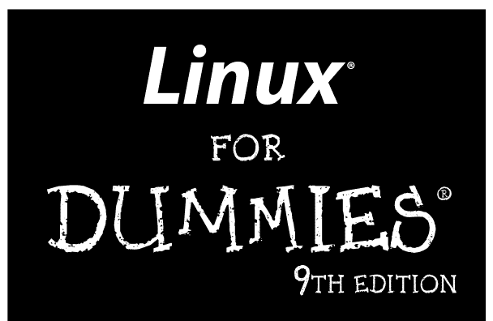


# 关于作者

Richard Blum 在 IT 行业工作了 20 多年，担任网络和系统管理员。在此期间，他有机会接触许多不同的计算机产品，包括 Windows、Netware、Cisco、Avaya、不同版本的 UNIX，当然还有 Linux。多年来，他还担任了几家非营利组织的志愿者，帮助支持那些资金支持有限的小网络。Richard 是几本针对深度 Linux 极客的 Linux 相关书籍的作者，还为程序员写了几本基于 Windows 的书。

当他不当电脑极客时，Richard 在一个崇拜乐队中弹电贝斯，并喜欢与妻子 Barbara 度过时光。

# 献辞

献我的妻子 Barbara。

# 作者致谢

首先，赞美并荣耀上帝，感谢赐予生命。特别感谢 Dee-Ann LeBlanc 让这一切成为可能。非常感谢 Wiley 帮助本书上市的人们。我很兴能感谢我的女儿 Katie 和 Jessica 的爱与支持。

- 使用 OpenOffice.org Impress 进行演示 ................................................... 224
- 入坐桌 ................................................................................ 239

## 目录

- 听 CD ................................................................................... 253
- 让 Linux 为你自动完成命令或文件名............................... 320
- 使用变量 ............................................................................ 321
- 添加新打印机 ............................................................................ 342
- 检查系统监器 ........................................................ 349
- 资源 ............................................................................................ 351
- 文件系统 ....................................................................................... 352
- 第三步：创建要共享的文件夹...................................................................... 384
- 第五步：安装并启动 Samba.................................................................. 386

文件系统命令 ............................................................................ 414

如果你遇到了问题（与 DVD-ROM 相关的问题） ........................................ 422

# 引言

欢迎来到 Linux 这个迷人的开源软件世界。在书中，我们将向你介绍 Linux 操作系统的魅力，它最初是由林纳斯·托瓦尔斯（Linus Torvalds）在 20 世纪 90 年代初作为心血之作创造的。我们的目标是让你加入快速增长的 Linux 用户和爱好者的行列，他们正在重写操作系统市场的规则。

如果你考虑过切换到 Linux 但但觉得这个前景令人望而却畏，那么你可以放松心情了。如果你能烧开水或设定闹钟，你也可以成为一名 Linux 用户。（没开玩笑的！）

当本书第一版出版时，Linux 还是一个新兴的现象，既不为人知也不被理解。对于新一代的 Linux 用户来说——可用的材料多到以至于我们将此本书的重点转向了 Linux 是什么以及你如何在桌面上最充分地利用它。为此，这些页面包含了在线资源、提示和技巧技巧，以及更通用的性说明。如果你在寻找关于服务器的材料，Naba Barkatti 编写的《Linux Alt-In-One Desk Reference For Dummies》（Wiley Publishing, Inc.）可以满足你的需求。

在书中，我们尽可能地减少了技术术语，并坚持使用通俗的英语。除了对 Linux 安装、启动、配置和软件进行直白介绍外，我们还包含了许多示例，以及大量详细的说明，帮助你以最小的压力或困惑使用你自己的 Linux 机器。

我们还随书附带了一个实用的 DVD-ROM，其中包含了 Ubuntu 9.04（周围最流行的工作站 Linux 发行版）和 Fedora 11（由领先的 Linux 供应商红 Hat 支持的项目）的镜像文件。要了解 DVD-ROM 具体包含什么，请参见附录 B。如果你不知道我们在说什么，别担心。你很快就会知道了！

- 理解 Linux 的来源以及它能为你做什么
- 安装 Linux 操作系统
- 使用 Linux 系统来管理文件和添加软件
- 设置网络访问并浏览网页
- 自定义你的 Linux 桌面
- 管理 Linux 系统安全和资源

当你输入 Linux 命令或其他相关信息时，请务必完全按照你在书中看到的内容复制信息，包括大写和小写字母，因为那是让 Linux 正常运行的魔力的一部分。

## 未能完全按照说明操作可能会导致各种不幸、不体面或意料之外的副作用。

书的页边距提供的空间与你的电脑屏幕并不相同；因此，在书中，某些 URL 和命令行提示符后的长命令可能会换行到下一行。记住，你的计算机将这些换行的行视为一组指令或单个 URL——所以如果你正在输入一段文本，请让它保持在单行。如果你看到这些换行的行之一，请不要插入硬回车。我们使用斜杠或自然断句（意味着“等一下——还有后面”）清除该行，并对溢出的部分稍微缩进，如下例所示：

```
www.infocadabra.transylvania.com/nexus/plexus/lexus/
praxis/this/is/a/make-believe/URL/but/
some/real/ones/are/SERIOUSLY/long.html
```

请注意，在你阅读这本书的过程中——以及你可能会遇到的其他关于 Linux 幽默、智慧和灵感的来源中——你可能会发现某些术语是通用的。例如，你可能会看到同一段软件被称为程序、命令、实用程序、脚本、应用程序或工具，这取决于你咨询的来源、上下文以及该信息的作者。在很大程度上，这些术语可以互换，除非需要进行区分，我们会指出。

# 假设

他们说，做出假设会愚弄那些假设的人以及那些被假设的人。尽管如此，实用性要求我们对你（亲爱的读者）做出一些假设：

- 你知道如何开启电脑。
- 你知道如何使用鼠标和键盘。
- 你想要安装、配置或使用桌面系统，因为这是你的工作。

你不需要成为逻辑学家或编程的奥术大师就能使用本书，甚至不需要完全理解你的计算机内部发生了什么。

如果你有活跃的想象力和解决问题的能力，那就更好——你已经掌握了让 Linux 运行的关键要素。剩下的只是细节和一些耐心。我们可以为你提供帮助，但耐心取决于你自己！

本书包含六部分，按顺序引导你从 Linux 安装和配置到保持系统运行，如果不是运行得像阳光下的猫一样！大部分部分包含两个或多个章节或附录，每个章节或附录包含模块化的节。

以下是书的六部分的划分：

这部分奠定了基础，并对让 Linux 成为准备就绪的软件老虎的术语、技术和软件组件进行了概述。更具体地说，我们从 Linux 概述开始，解释它是什么、来自哪里以及它是如何工作的。接下来，我们将处理在电脑上安装 Linux 前的各种任务和活动。之后，我们将找到如何启动 Linux ——不是为了任何手段摆脱它，而是为了启动你的新系统以达到计算喜悦的高度。最后，我们帮助你熟悉桌面并根据你的喜好进行调整。

在这一部分中，你将学习 Linux 的基础知识。你将发现各种事物存储在 Linux 文件系统中，以及如何在其中穿行。当你能够熟悉环境后，你将看到如何离开系统并连接互联网。

# 引言


Linux 包含了大量的功能和能力，因此在完成最初的安装和配置后，你可能想用你的系统来做些事情。这就是实践开始的地方！在本书的这一部分，你将学习如何使用网络工具，如 Web 浏览器（Firefox！）、电子邮件、即时消息等。接着，你将发现如何编辑文本文件，然后得益于 OpenOffice，尽情使用文字处理器和其他办公套件程序。这一部分也包含有趣的内容，如如何在 Linux 世界中使用音频和视频，以及如何访问那些仅 Windows 用户可用的软件和格式。

在本书的这一部分，你将发现如何维护你的系统。你将看到如何处理各种文件格式、如何安装新软件，最重要的是，如何保持系统更新以防受漏洞攻击。你还将了解到基础的系统管理任务，如创建和管理用户账户、维护文件系统、设置打印等。然后，你将学习一些关于保持 Linux 系统安全性的知识。提示：和任何操作系统一样，最重要的一就是保持更新！

在本书的高潮部分，我们总结并提炼了你对 Linux 及其内部机制所了解的精华。在这里，你有机会回顾 Linux 系统的一些关键故障排除技巧和技巧，并学习设置 Samba 服务器以便与另一台共享文件。

本书以一组附录结束，旨在总结并进一步扩展本书的内容。附录 A 按功能列出了了 Linux 命令组，并带有完整的语法和解释。附录 B 列出了《傻瓜学 Linux》（Linux For Dummies，第 9 版）DVD 中的详细内容。

在每个章节中，我们使用图标来突出显示特别重要或实用的信息。你会在书中看到以下图标：

提示（Tip）图标标记了实用的信息，这些信息会让你的 Linux 生活比你想象的要简单得多。

有时我们使用这个图标来指出你不应该忽略的信息 —— 一些温和的提醒（省下的生命、理智或页面将是你自己的）。

当你看到这个图标时要加小心——它警告你不要做某些事情。这个图标强调忽视这些智慧之举后果将是严重的。

此图标标志着技术细节，这些信息很有启发且有趣，但对于理解和使用 Linux 并非关键。如果你愿意，可以跳过这些段落（但请以后回来阅读它们）。

这就是你选择方向并出发的地方！《傻瓜学 Linux，第 9 版》就像《一千一夜》，因为你从哪里开始几乎并不重要。在你准备构建自己的 Linux 系统时，你正在观察不同的场景和故事。虽然每个故事都有自己独特的角色和情节，但整体无疑是令人惊叹的。别担心——你能应对的。谁会在意别人觉得你只是混日子？我们知道你正准备好过人生高光的时刻。

过得愉快！

# 入门基础

> 在安装 Linux 之前，Dwayne 准备对硬盘进行分区。

这一部分包含了对 Linux 操作系统的发展和能力的介绍。我们还涵盖了让 Linux 成为如今的术语和工具，以及关于准备电脑以运行 Linux 以及在你自己的电脑上安装流行的 Ubuntu 或 Fedora 的详细步骤说明。从那里开始，你将发现如何解决特定的故障排除问题，然后我们将游览桌面并发现如何自定义它。到本部分的结束时，你已经安装了 Linux 系统，并具备了在你的新桌面上导航的基本能力。

# 熟悉 Linux

- 惊叹 Linux 公司（或其不存在）

> > 福特，你正在变成一只企鹅。住手！—— 亚瑟·丹特

欢迎来到 Linux 世界，这是一个由全球一千多人开发的操作系统！在本章中，你将了解到 Linux 本身 —— 它是什么，源自哪里，以及为什么它在如今的新闻中如此关注。准备好让软件开发和销售的方式对你的假设提出挑战，并对新的可能性开放心脑。

理解 Linux 需要一种激进的思维转变，关于获取和使用软件的方式（注意：激进意味着触及了问题的根源，而不是在营地里露营）。这种思维转变的第一步是改变你对“free”一词的通用认知，它指的是“自由”，而不是“免费午餐”。没错，你可以付费把这种自由传递给每个接收者。

不要抓头挠腮；这些概念起初很难理解，尤其是当你考虑到从商业软件营销部门接受的培训时。你可能不知道当你购买闭源软件时，你并不真正拥有该软件。相反，你被许可在许可者规定的范围内使用该软件。

Linux 也有许可证。然而，该许可证的目的和宗旨与大多数商业软件不同。与其使用许可证来限制软件的使用，Linux 使用的 GNU 通用许可证（GPL）确保了软件将对所有人开放。没有任何公司可以拥有或规定你使用 Linux 的方式——尽管他们对自己的品牌拥有版权和商标。从本质上说，你已经拥有了 Linux，你可以如何使用它，只要你向任何接收者传递同样的自由。

理解 Linux 需要对获取计算机软件的想法进行彻底转变。操作系统是处理你与硬件之间所有交互的软件。无论你是写信、计算预算还是管理食谱，操作系统都为你提供了必要的空气。此外，操作系统并不是一个程序；它由成百上千的程序和工具组成，让人类可以使用计算机做有用的事情。然后，你在操作系统之上运行其他程序（如你的文字处理器）来完成所有工作。

Linux 被指责为“另一个操作系统”。从表面上看，它可能确实如此，但如果你深入观察，就会发现事实并非如此。Linux 项目是计算行业中开源和自由（指“自由”，而非“免费啤酒”）软件趋势的旗舰。由于其开发（以及持续开发）的模式，Linux 是一个极其稳固的操作系统。

Linux 与其他操作系统相比，有两个根本性的区别：

- Linux 采用独特且精妙的“GNU 通用公共许可证”（GNU General Public License）授权，你可以在下一节中了解到相关内容。
- Linux 是由全球范围内的志愿者和付费程序员组成的团队在互联网上共同开发和维护的。

Linux 之所以优秀有许多原因，其中包括从零开始构建它的人们希望它具备以下所有特性：

- 多用户（Multiuser）：在同一时间，可以有多个一个用户登录到同一台计算机上。
- 多处理器（Multiprocessor）：真正的抢占式多任务处理允许操作系统内核高效地处理同时运行的几个程序。这对于在一台计算机上提供多种服务至关重要。
- 多平台（Multiplatform）：Linux 目前运行在 24 种以上的平台（硬件）上，包括 32 位和 64 位的 Intel Base PC、Digital/Compaq Alpha、Apple Macintosh 所有变体、Sun SPARC、Apple iPod 甚至微软 Xbox。
- 可互操作性（Interoperable）：Linux 与大多数网络协议（语言）和操作系统都能良好协作，允许你与运行 Microsoft Windows、UNIX、Novell NetWare、Macintosh 计算机以及占据较小市场份额的其他群体进行交互。
- 可扩展性（Scalable）：随着你计算需求的增长，你可以依靠 Linux 随你一起成长。同样的 Linux 操作系统可以运行在微型电子相框、台式电脑或非常大型的工业级服务器系统上。
- 可移植性（Portable）：Linux 大部分是用 C 语言编写的。C 语言是一种专门为编写操作系统级软件而创建的语言，可以很容易地移植（翻译）到新的计算机硬件上运行。
- 灵活（Flexible）：你可以将 Linux 操作系统配置为网络主机、路由器、图形工作站、办公生产力 PC、家庭娱乐电脑、文件服务器、Web 服务器、集群，或你想象到的几乎任何其他计算设备。
- 稳定（Stable）：Linux 内核（操作系统的核心）已经达到了让大多数软件开发者都嫉不已的成熟度。听到 Linux 服务器运行多年而不崩溃的报道并不罕见。
- 高效（Efficient）：Linux 的模块化设计允许你仅包含运行所需服务所需的组件。即使是旧的 Pentium 计算机也可以利用 Linux 并再次变得有用。
- 免费（Free）：对大多数人来说，Linux 最具吸引力的方面是它通常是免费的。（资本家们低声议道）在没有直接资金回报的情况下，谁能造出更好的捕鼠器呢？

在本章中，我们打算为你回答最后一个问题。我们希望描绘出创建 Linux 的开源软件开发模型。

尽管 Linux 内核编程始于 1991 年，但其设计理念基于经过考验的 UNIX 操作系统。UNIX 是于 20 世纪 60 年代后期在贝尔实验室开发的。UNIX 的原始架构师在操作系统稀少的年代工作，他们希望创建一个高效且安全地共享数据、程序和资源的操作系统——这个想法在今天仍然非常有意义。从那里，UNIX 演变成了许多不同的版本；它现在的分支结构如此复杂，看起来就像是一场爆炸。

1991 年，Linus Torvalds 是芬兰赫尔辛基大学的一名计算机科学学生。他想要有一个像他在大学里喜欢的 UNIX 系统那样的操作系统，但 UNIX 和他运行的硬件都贵得令人望而止步。有一个名为 Minix 的 UNIX 版本免费提供，但它并不能满足他的需求。于是，Torvalds 研究了 Minix，然后开始为自己写一个新版本。经过六个月的努力，Torvalds 的进展微小。编写一个操作系统并不是一项易事。

### 开源项目的剖析

到此为止，你可能已经意识到，广泛且易于获取的源代码对于软件开发的成功至关重要。源代码是指人类可读的文本（与“可执行”文件中的不可读的象形文字相反），程序员通过这些文本向计算机传递指令。


用二进制形式编写计算机程序是一项艰巨的任务。现代计算机软件通常用人类友好的语言编写，然后编译或翻译成计算机的指令集。若要对此软件进行更改，程序员需要访问程序的源代码。大多数专有软件仅以预编译产品的形式提供；软件开发人员将这些程序的源代码锁起来。

到此为止，你可能已经意识到，广泛且易于获取的源代码对于软件开发的成功至关重要。源代码是指人类可读的文本（与“可执行”文件中的不可读的象形文字相反），程序员通过这些文本向计算机传递指令。

虽然 Stallman 的工作为 Linux 迅速普及铺平了道路，他及其团队一直努力开发的操作系统是如期而至的。

尽管这个组织（以及它创建完整操作系统的目标）是必要且重要的，但拼图中更重要的部分也已到位。新软件需要一种许可证来保护它免受大企业盗版者的侵扰——这种担忧在今天并非所有时候都相关，因为之前的 Linux 公司劫持了全球成千上万志愿者几十年来的工作成果的所有权。

通用公共许可证（GPL）是一种独特且创新的软件许可证，它利用版权法来保护软件用户的自由，而这通常是版权权的反面。版权是对所有权的一种强制执行的规定，防止任何人复制。当软件根据 GPL 许可时，接收者受版权法约束，尊重他人以任何意愿使用软件的自由。使用 GPL 许可的软件被称为“版权左”（copyleft）（right 的反向，懂了吗？）。

为了资助 GNU 项目，Stallman 建立了自由软件基金会（FSF），自由代码（即开源）软件帮助开发它的程序员（即持续开发）。记住，我们谈论的自由是指言论的自由，而不是啤酒的免费。在计算工业的早期，许多进展来自于自由共享并非新新的想法。

# 第一章：熟悉 Linux

## 到底是谁在管理 Linux？

随着一个开源项目的演进，各种人物会作为领导者出现。这种领导者被称为项目的“`仁慈独裁者`”（`benevolent dictator`）。这位仁慈独裁者可能在某个问题上花费的时间比任何人都都要多，并且通常具有独特的见解。通常，“民主”和“独裁者”这两个词永远不会出现在同一个句子里，但开源模型是一个非常民主的过程，它认可了仁慈独裁者的统治。

林纳斯·托瓦兹（Linus Torvalds）仍然被认为是 Linux 内核（操作系统的核心）的仁慈独裁者。他最终决定哪些功能被添加到内核，哪些功能不添加。社区信任他的远见和裁量权。如果他对项目失去兴趣，或者社区认为他已经变得糊涂，在他一起工作的那些精干的人士中将会出现新的领导者。

作为志愿者或向项目捐赠的人并不意味着提供的是二流的努力（或只在周末和假日工作）。事实上，任何人力资源专家都会告诉你，出于意愿选择某项工作的人所产生的产品质量最高。

为开源项目贡献志愿者通常是各自领域的领导者，他们依靠社区协作来完成有用的工作。开源概念对于科学界来说并不稀奇。开源项目所培养的公正的同伴评审过程对于验证某些功能或能力在技术上是正确的至关重要。

> 那些将开源社区描绘成版权侵权者的人往往误解——或完全忽略了——这些问题。开源程序员对自己的工作感到非常自豪，而且非常关注自己的版权，不希望自己的工作被他人盗窃——因此有了像 GPL 这样的许可协议。这营造了一种对版权极度尊重的氛围。那些在偷取他人劳动成果时声称自己“只是在开源”的强盗，完全是为了安抚自己的良心而严重偏离了重点。

许多人还指出，如果开源软件中违反了版权，很容易发现的。我们关注新闻，看到有多频繁的大公司因偷窃他人代码并将其整合到自己的工作中而被判有罪。如果最终产品是开源的，任何人都可以查看并确保其中没有被盗窃的内容。正如你想象的，在闭源方案中追踪此类版权侵权行为要困难得多。

- LiveCD 测试发行版

单一 Linux 发行版通常以几个不同的版本出现以涵盖更广泛的内容。例如，Fedora 发布了一个完整的核心发行版，还有一个包含完整系统子集的 LiveCD 版本。许多特色 Linux 发行版（如 Ubuntu）基于 Debian 发行版。Ubuntu 使用与 Debian 相同的安装文件，但只包含了完整 Debian 系统的一小部分软件包。


核心 Linux 发行版包含 Linux 和 GNU 操作系统，或者一个多个图形桌面环境，以及几乎所有可用的 Linux 应用，准备好安装和运行。对于完整的 Linux 安装，无论你的需求是什么，表 1-1 显示了目前一些流行的核心 Linux 发行版。

核心 Linux 发行版

| 发行版 | 何查找 | 描述 |

| Slackware | www.stackoverflow.com | 原始 Linux 发行版之一，深受 Linux 极客喜爱。 |

| Red Hat | www.redhat.com | 一种商业业务发行版，主要用于互联网服务器。 |

| Fedora | www.fedoraproject.org | Red Hat 的衍生版本，为家庭使用设计。 |

| Mandriva | www.mandriva.com | 主要为家庭使用设计（以前称为 Mandrake）。 |

| openSuSe | www.opensuse.org | 针对业务和家庭的不同发行版（现由 Novell 所有）。 |

我们在本书中中使用 Fedora 发行版来说明如何与核心 Linux 交互。

在 Linux 早期，发行版是以软盘组的形式发布的。你需要下载一组文件并将它们复制到磁盘上。

Linux 世界中一个较新的现象是可启动光盘，称为 LiveCD。大多数现代计算机可以从光盘读取操作系统，而不是硬盘。这种安排让你在不实际安装的情况下看到 Linux 系统的样貌。

为了利用这一功能，某些 Linux 发行版创建了包含示例 Linux 系统的可启动光盘。由于光盘大小的限制，示例无法包含完整的 Linux 系统，但你会对他们塞进去的软件感到惊讶！结果非常酷：你可以从光盘启动计算机并运行 发发行版，而无需在硬盘上安装任何东西。

这是测试各种 Linux 发行版而无需干扰电脑的极佳方法。只需插入光盘并启动！所有的 Linux 将直接在光盘上运行。有很多 LiveCD 可以从互联网下载并刻录到光盘上进行测试。表 1-2 显示了一些流行的 Linux LiveCD。

| 发行版 | 何查找 | 描述 |

|---|---|---|

| Knoppix | www.knoppix.net | 德国 Linux发行版，第一个开发的 Linux LiveCD。 |

| SimplyMEIS | www.mepis.org | 为成为家庭 Linux 用户设计。 |

| PCLinuxOS | www.pclinux.com | 单光盘上的全功能 Linux 桌面工作站。 |

| Ubuntu | www.ubuntu.com | 全球 Linux 项目，为多种语言设计。 |

| Slax | www.slax.org | 基于 Slackware发行版子集的 live Linux CD。 |

| Puppy Linux | www.puppylux.org | 为旧电脑设计的全功能 Linux 发行版。 |

虽然发行版中提供的可用选项对 Linux 极客来说很棒，但对初学者来说可能是一场噩梦。大多数发行版在安装过程中会一系列问题，以确定默认加载哪些应用程序、连接了哪些硬件以及如何配置硬件。结果是它们要么在计算机上加载了太多的程序，要么加载得不够，以后发现计算机无法执行他们想要做的事。

某些 Linux LiveCD 发行版（例如 Ubuntu）允许你直接从 LiveCD 安装 Linux 发行版。这使你能够通过 CD 启动，测试该 Linux 发行版，然后如果你喜欢它，就可以将其安装到硬盘中。这个功能非常方便且用户友好。

在本书中，我们将使用 Ubuntu LiveCD 发行版来演示如何使用 LiveCD。

凡事皆完美，Linux LiveCD 也有一些缺点。因为你从 CD 访问一切内容，应用程序的运行速度较慢，特别是当你使用旧、较慢的电脑和 CD 光驱时。此外，由于你无法向 CD 写入，你对 Linux 系统所做的更改在下次重启时将会消失。

但 LiveCD 世界正在取得进展，可以帮助解决其中的一些问题：

- 将 Linux 系统文件从 CD 复制到内存中快速运行

- 将系统文件复制到硬盘上的文件中进行保存

- 将设置存储在 USB 闪盘上

- 将用户设置存储在 USB 闪盘上

某些 LiveCD（如 Puppy Linux）设计包含极少量的 Linux 系统文件；当 CD 启动时，它们会被直接复制到内存中——一旦 Linux 开始启动，你就可以从电脑上取出 CD。这不仅让你的应用程序运行得更快（因为应用程序在电脑内存中运行更快），而且释放了你的 CD 盒，你可以用它刻录音频 CD 或通过已安装的软件播放 DVD。

## 特种 Linux 发行版


在过去的几年里，一个 Linux 发行版小组开始出现。这些通常基于核心发行版之一，但仅包含对特定使用领域有意义的应用程序。

除了提供专用软件，例如为商业用户提供的办公产品套件，定制的 Linux 发行版还尝试通过自动检测和自动配置常用硬件设备来帮助初 Linux 用户。这让安装 Linux 的过程变得更加愉快。

表 1-3 显示了一些可用的特种 Linux 发行版及其专长。

| 表 1-3 特种 Linux 发行版 | 在何处找到 | 描述 |
| :--- | :--- | :--- |
| Linux | www.inspire.com | 一个配置得像 Windows 的商业 Linux 包。 |
| Xandros | www.xandros.com | 一个为初学者预配置的商业 Linux 包。 |
| SimplyMEPIS | www.mepis.org | 一个面向家庭用户的桌面发行版。 |
| Ubuntu | www.ubuntu.com | 一个面向家庭和办公的桌面发行版。 |
| PCLinusOS | www.pclinuxos.com | 一个专注于家庭和办公的发行版。 |
| gOS | www.thinkgos.com | 一个为初学者设计的发行版，预装在某些笔记本和台式机系统中。 |
| Puppy Linux | www.puppylinux.org | 一个在旧 PC 上运行良好的轻量发行版。 |

这只是特种 Linux 发行版的一个小样本。有数百种特种 Linux 发行版，互联网上不断涌出新的。无论你的专长是什么，你可能都能找到一个为你定制的 Linux 发行版。


我们在本书中使用 gOS 发行版来查看特种 Linux 发行版中的某些功能是如何工作的。gOS 发行版包含了 Google 桌面应用，我们将在第 15 章讨论它。

## 本章内容

- 采取基础的安装前步骤
- 在同一台电脑上使用 Linux 和 Windows
- 在安装前自定义磁盘分区
- 了解并准备硬件
- 了解 Linux

某些 LiveCD 如 Puppy Linux 设计包含极少量的 Linux 系统文件；当 CD 启动时，它们会被直接复制到内存中——一旦 Linux 开始启动，你就可以从电脑上取出 CD。这不仅让你的应用程序运行得更快，因为应用程序在电脑内存中运行更快，而且释放了你的 CD 盒，你可以用它刻录音频 CD 或通过已安装的软件播放 DVD。

你也可以采取相反的方法 —— 仅在计算机上安装 Linux，然后使用 VMware 详参见第 20 章 安装一个虚拟 Windows 虚拟机，它运行在你 Linux 安装系统中的一个窗口内。

如果你采用这种方法，请在安装 Linux 之前备份你的原始 Windows 文件，然后在新的 Windows 虚拟机中恢复它们。

另一个选项是 Ubuntu LiveCD 中包含的一项新功能。Ubuntu 安装程序 Wubi 是一个你可以使用的应用程序，它可以在现有的 Windows 分区内创建一个普通文件作为 Ubuntu 分区，之后它会将 Linux 作为一个 Windows 应用程序进行安装。这种新方法让你可以在无需对任何磁盘分区的情况下创建双启动场景，而且易于撤销，只需卸载 Wubi 即可。


# 准备共同使用 Linux 和微软 Windows

如果你计划在同一台机器上运行 Linux 和微软 Windows，很有可能你已经安装了 Windows 并已经使用了一段时间。由于我们不想听到新 Linux 用户痛苦的哀嚎，请花一点时间评估一下你拥有的和需要的。接下来的章节将引导你完成为计算机准备好双启动环境的过程。

万一你还没有安装 Windows 但仍然想具备双启动能力，你应该在安装 Linux 之前先安装 Windows。否则，在安装过程中，Windows 会覆盖硬盘上 Linux 用于存储其启动菜单的区域。这一因素在你以后想要启动回 Linux 时可能会造成混乱。等在你完成安装后，请返回此处。

除了替换现有的操作系统外，将 Linux 安装到计算机上的第二简单方法是安装第二个硬盘。许多计算机支持多个硬盘，通过同一条磁盘电缆链联或通过多根电缆连接。

通常，你可以通过查看计算机的 BIOS 设置界面来确定磁盘控制器的配置情况。BIOS 设置界面控制计算机上的基本硬件配置。图 2-1 显示了 BIOS 屏幕上磁盘区域的一个示例。

| 主 | 高级 | | | | | |
|---|---|---|---|---|---|
| 系统时间: | | | | 项目特定帮助 | | |
| 系统日期: | 05:59:47 (06/11/2000) | | | <Fab> | |

BIOS 2-1：BIOS 硬盘配置区域。

如何进入计算机的 BIOS 屏幕。只需在计算机首次启动时按下一个快捷键，通常是 F12 或 ESC 即可。有时计算机会在屏幕上提示你按哪个键键进入 BIOS。其他时候，你必须查阅你的用户手册。


如果你无法通过 BIOS 确定你的硬盘设置，就必须打开计算机机箱并查看内部，看看你面对的是什么。大多数计算机的标准磁盘控制器允许你为每个控制器设置两个设备；其他计算机在主板上安装了多个一个控制器。如果你看到两根带有多引脚连接器的电缆，那么你很幸运了。如果你只看到一根带有空闲连接器的电缆，那么你应该也没问题。

图 2-1 中的示例显示了两个硬盘控制器，称为主控制器（`primary`）和从控制器（`secondary`）。主硬盘控制器包含用于启动计算机的硬盘。每个硬盘控制器可以支持两个设备（称为主设备 `master` 和从设备 `slave`）。这种设置允许你向计算机连接总共四个独立的设备。

除了硬盘之外，控制器还支持连接 CD/DVD 驱动器。在评估你的磁盘控制器状况时，务必考虑这些因素。

在你安装好第二个硬盘后，你就可以开始使用 Linux 了。只需跳到“双检硬件兼容性”部分来检查计算机的其他硬件。

如果你计划在硬盘上同时安装 Windows 和 Linux，请务必先安装 Windows。当你进行 Linux 安装时，系统会要求对硬盘进行分区（使用软件将一个大硬盘划分为较小的虚拟驱动器）。当你准备好分区后，你就有了放置 Linux 的地方。

有三种分区：主分区（`primary`）、扩展分区（`extended`）和逻辑分区（`logical`）。一个硬盘可以有三个主分区和一个扩展分区。在扩展分区内部，你可以拥有最多 12 个逻辑分区——将扩展分区想象成一个包含逻辑分区的纸箱。逻辑分区存储数据；扩展分区包含逻辑分区。

由于我们无法预测你想安装什么软件，我们建议为你的 Linux 安装至少留出 10GB 的空间。越大越好，因为这可以给你提供更多的下载空间甚至更多的程序，而且至少，你可以把从这本书的 DVD-ROM 中的所有内容都安装到这 10GB 空间里。

记下你分配给 Windows 的分区和分配给 Linux 的分区。记下哪个硬盘分区（第一个、第二个、第三个等）以及磁盘上的每个分区编号（第一个、第二个等）。在安装 Linux 时，你需要这些信息。


你不限于双启动。如果空间允许，你可以在计算机上运行三个或多个操作系统。

如果你不是从头开始进行双启动，你可能需要对当前的安装进行更改。在更改任何内容之前，请确保你收集了关于当前设置的重要信息——特别是这两大点：(a) 你的硬盘上是否留有未分区空间；(b) 如果有，有多少。

如果你发现有至少 10GB 的未分区空间，你可以跳到“双检硬件兼容性”部分。

# 第 2 章：为 Linux 准备你的计算机


## 29

图 2-3：Windows 管理工具中显示的磁盘管理信息。

尽管微软不再支持 Windows 9x，但一台运行 Windows 98 的旧电脑也可以作为一台非常好的 Linux 机器。遗憾的是，Windows 98 没有提供图形化工具。相反，Win98 使用的是 `FDISK`，这是一个显示硬盘上分区的命令行工具。

在使用 `FDISK` 时要务必小心。如果你对其进行任何更改，都可能会擦除你的数据。退出程序时，请确保不要保存任何更改。

要在 Windows 98 中查找计算机硬盘的详细信息，请遵循以下步骤：

- 1. 通过选择 `开始:程序:MS-DOS 提示符` 打开 MS-DOS 命令行窗口。
- 2. 输入 `FDISK` 并按回车。

在 Windows 98 中，你可以以大写、小写或你喜欢的任何混合大小输入 `FDISK`，只要你拼写正确即可！

你很可能会被提示显示大容量“磁盘”（驱动器）信息 —— “大”是相对于 Windows 98 时代的大型硬盘而言的，这意味着大于 512MB 的驱动器。如果你没有看到提示，请跳到第 4 步，`FDISK` 菜单选项将与图 2-4 类似。


## 30 第一部分：初上手

- 3. 如果你看到大磁盘提示，在此提示处选择 Y，然后按回车。

出现 `FDISK` 菜单选项，如图 2-4 所示。

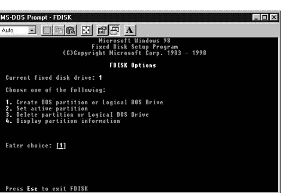

图 2-4：`FDISK` 菜单选项。


- 4. 显示驱动器-分区信息。

如果你的计算机中有一个以上的硬盘，`FDISK` 会显示第五个菜单选项，以便你可以在磁盘之间切换。

以下是使用菜单选项切换到另一个磁盘的方法：

- a. 输入 `5` 并按回车。
  `FDISK` 屏幕显示系统中的所有硬盘。
- b. 输入你想要的磁盘编号，然后按回车。
  `FDISK` 菜单屏幕的顶部显示 `FDISK` 正在操作的驱动器编号。
- 5. 要显示所显示磁盘的分区信息，输入 `4` 并按回车。

图 2-5 显示了 `FDISK` 中“显示分区信息”屏幕的示例。

图 2-5 表明驱动器上是否有空闲的未分配磁盘空间。如果磁盘上有未分区的空间，`FDISK` 将显示具体大小。

如果你在磁盘上有一个扩展分区，你将需要深入查找。

## 第2章：为Linux准备你的计算机

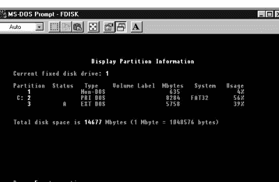

图 2-5：`FDISK` 中的分区信息。

- 6. 要查看扩展分区内的逻辑分区，选择 `EXT DOS` 条目并按回车。

你可以通过累加驱动器的使用百分比来判断是否有空闲空间。

- 如果总和为 100%，则没有可用空间。
- 如果你有 10GB 或更多可用空间，则说明你的空间足够了。

## 腾出空间

最终，你可能需要调整分区大小 —— 可能是出于以下原因之一：

- 你可能有一些未分配空间，但空间少于 10GB。
- 你可能有 10GB 的未分配空间，但它分散在各个驱动器上的多个处，需要进行合并。
- 你可能完全没有未分配空间（最常见的原因）。

在所有这些情况下，你都需要移动数据以腾出空间 —— 不仅是为了安装 Linux，还为了存储你想在 Linux 文件系统中保留的任何文件。

关键在于确定你现有的 `C:` 盘上是否有额外的空间可以转换为单独分区。所有的 Windows 操作系统都允许你轻松查看 `C:` 盘上有多少可用空间。

## 32 第一部分：初上手

Windows XP、2000 和 Vista 在“计算机管理”工具中提供了这些信息；参见本章较早的“为双系统启动现有硬盘分区”部分。

如果你有一台老旧的 Windows 98 或 95 机器重回双系统生活，请按此方法使用计算机管理工具：

- 1. 双击“我的电脑”打开计算机管理工具。
- 2. 选择 `查看:网页`。
- 3. 选中你的第一个驱动器。

你会在图 2-6 中看到类似的内容。

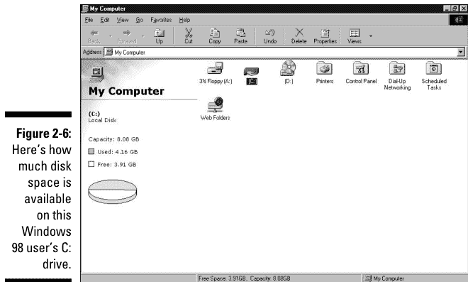

确定 Windows 驱动器是否有足够的空间，以防磁盘空间不足。所有的 Windows 操作系统都允许你轻松查看 `C:` 盘上有多少可用空间。

## 第2章：为Linux准备你的计算机

## 碎片整理

在正常使用过程中，系统会将文件写入硬盘的随机位置。碎片整理会将这些块移动使其连续。

碎片整理是 Windows 世界中的常见过程。当 Windows 创建和删除文件时，数据会分散在硬盘上。Windows 会重新组合这些块使其形成连续。所有的 Windows 版本都包含一个用于碎片整理硬盘的工具。你可以从计算机管理窗口进入碎片整理工具。只需选择碎片整理选项。

在 Vista 中，磁盘碎片整理在后台进行，不会显示任何进度。Windows XP 提供了一个实用的碎片整理窗口，显示文件移动的进度，如图 2-7 所示。

> 图 2-7：碎片整理工具。

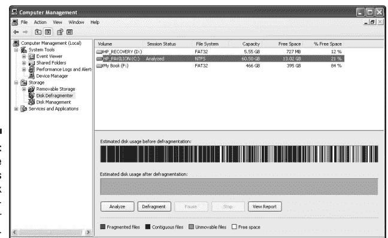

## 34 第一部分：初上手

图 2-8 显示了 Windows 98 中的磁盘碎片整理。

提示：通常需要多次才能将所有文件移动到一个公共区域。碎片整理完成后，你的文件位于磁盘空间起始的连续区域 —— 你准备好在 Linux 安装时对硬盘分区了。

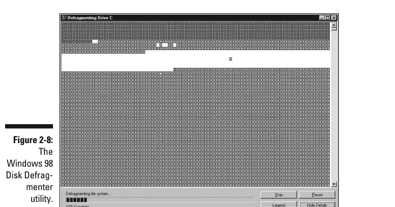

## 双击硬件兼容性

如果你是在现有的硬件上安装 Linux，只需尝试一下，看看哪些部分不起作用。本节的部分内容可以为你提供帮助；它们解决了通用的硬件问题。其他章节针对特定的硬件问题。如果你遇到问题，先从针对特定任务的章节开始，如果仍然无法解决，再回到这里。

最大的问题领域是无线卡和最新的多媒体硬件 —— 例如花哨的显卡、声卡和图像扫描仪。在购买新硬件之前可以检查硬件兼容性列表，但其作用有限，因为硬件世界变化非常快。如果你感兴趣查看通用列表，

# 第 2 章：为 Linux 准备你的计算机


访问 `http://hardware.redhat.com/hcl/` 查看 Red Hat Enterprise Linux 列表。（没有官方的 Fedora 列表。）请记住，此列表侧重于企业设备，因此如果你在列表中没有看到某个东西，并不意味着它不受支持。

不用担心那些已经经过“认证”（Certified）的特定设备（经过了严格测试以确保其正常工作）。对于高级用户来说，“支持”（Supported）和“兼容”（Compatible）在大多数情况下都是足够的。判断某个硬件是否受支持的最佳方法是进行网络搜索。访问 `www.google.com` 并在搜索词中包含“Linux”一词。例如，你可以搜索“Inovision XD700T Linux”来了解其他人对这一特定品牌和型号硬件的使用情况。（当然，这里并不意味着对示例中提到的任何硬件的背书。）此类搜索可能会让你看到人们在使用特定硬件时遇到的问题和取得的成功。

如果仅仅是想到硬件就让你头晕，也不要担心；你可以在互联网上找到大量信息。一个很好的起点是 `www.tomshare.com`。其他查找 Linux 中各种设备信息的地方还包括：

- 其他以 Linux 为导向的网站：特别是 `www.tldp.org/HOWTO/Hardware-HOWTO/` 上的通用硬件列表。
- 厂商网站：许多硬件厂商支持 Linux，但他们并没有让查找信息变得容易。通常，前往该硬件的厂商论坛、硬件常见问题解答（FAQ），或者点击“支持”（Support）链接查找 Linux 的下载内容。如果有疑问，不要下载你找到的内容。关键点在于查看是否存在驱动程序（告诉操作系统如何使用硬件的软件）可以下载，因为它可能已经包含在你的 Linux 安装中了。只有当确实需要它时，才从厂商下载驱动。

如果出现最坏的情况，你可能找不到任何关于该硬件的 Linux 相关信息。这并不意味着该硬件无法工作。如果你手里有该设备，尽管尝试一下。你可能会发现它运行良好良好（例如，对于最新一代的显卡，最新的华丽功能可能无法工作，但你至少可以将其作为通用的 SVGA 使用）。

- 令人畏惧的手书：在可能的情况下，备好你的计算机手册（特别是显卡和显示器的手册），以防你需要它们来回答安装程序提出的问题（大多数 Linux 用户不需要遇到这种情况，但确实有人会遇到）。

## 36 第一部分：入门指南

### 笔记本电脑考量

如果笔记本电脑标有 Win 标签（或者在研究该机器时发现它包含 Win 产品，即使没有被正确标记也是如此），你可能可以将该有问题的硬件更换为 PCMCIA（个人电脑内存卡国际协会）卡。这在笔记本上是标准配置，提供了一种插入额外功能的方法。目前的笔记本电脑至少包含一个 PCMCIA 卡槽，让你有地方插入 PCMCIA 网卡或组合调制解调器卡。只要你坚持使用常见的 PCMCIA 卡品牌，它在 Linux 上运行就会很良好。

如果你需要找出你的机器中有哪些硬件，你有以下方法：

- 使用现有的操作系统记录你的硬件。如果你的计算机已经在运行 Windows，你可以从 Windows 环境中收集大量信息。根据你的系统，使用以下方法之一：
    - 在 Windows 98 中：选择“开始>><设置><控制面板><设备管理器”来访问图 2-9 中的对话框。
    - 在 Windows XP 中：右键点击“我的电脑”图标，选择“管理”打开“计算机管理”对话框。然后选择“设备管理器”以访问安装在你的机器上的硬件列表（如图 2-10 所示）。
    你可以双击设备管理器中的每个项目来显示相应的详细信息。
    - 在 Windows Vista 中：选择“开始><控制面板><设备管理器”来浏览你的硬件。会出现一个警告对话框；出现时，点击“确定”。
- 下载硬件检测工具。如果你没有任何诊断工具，可以从互联网下载各种硬件检测工具，例如 Dr. Hardware。Dr. Hardware 工具包含许多关于你机器内部的信息。该工具是共享的，使用方法和费用信息可以在 Gebhard 网站 `www.dr-hardware.com` 获取。


# 第 2 章：为 Linux 准备你的计算机

## 37

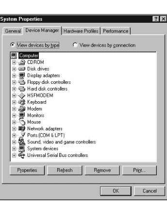

图 2-9：在 Windows 98 中，设备管理器为你提供了有关已安装硬件的信息。

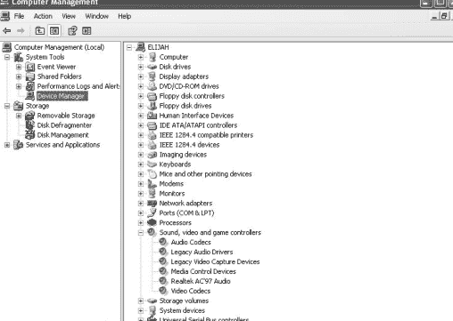

图 2-10：Windows XP 设备管理器。

> 通过阅读计算机启动时的屏幕来收集信息。如果你的系统没有包含任何操作系统，而你需要系统的任何文档，你可以诉诸在计算机启动时阅读屏幕。在某些系统上，视频信息会在计算机启动时从 BIOS 显示。如果运行得太快，你可能需要重启几次。此外，某些系统会在系统启动时显示 PCI 组件及其设置。你可能需要重启几次来收集所有信息。

## 38 第一部分：入门指南

- 访问基本输入/输出系统（BIOS）信息。这些信息存储在内存的一个小区域中并由电池保持，这有时被称为 CMOS（互补金属氧化半导体），它表示可以存储的计算机芯片类型。BIOS 中存储的信息量从非常少到相当多不等。一些较新的系统会显示硬件信息。

如果你选择访问 BIOS，请确保在任何操作系统加载之前进行。大多数制造商会在系统启动时在屏幕上指示进入 BIOS（或设置）的键盘键（或序列），例如，*按 Del 进入设置*。如果你找不到键盘序列，请检查制造商的网站。进入 BIOS 后，你通常使用方向键、Tab 键或回车键进行导航。某些 BIOS 环境还使用功能键：在屏幕顶部或底部寻找功能键选项列表。

要特别警惕硬件盒和网站上包含“win”（即 Windows）一词的标签。这些组件作为“Win 调制解调器”（WinModems），依赖 Microsoft Windows 才能运行——更糟糕的是，包装上可能没有显示这一点。你为 win 硬件找到 Linux 驱动程序的概率非常小。如果你确实找到了，请在安装 Linux 之前将其复制到存储设备（如 CD 或闪存盘）。如果你找不到驱动程序并需要使用调制解调器，请花点钱买一个支持的调制解调器。（有关 Win 调制解调器的更多信息，请参见第 8 章）。

## 最后，你开始了

可启动的第一张 CD 或 DVD 是你在继续安装 Linux 之前最后需要准备的东西。这本书 DVD 包含了 Ubuntu LiveCD 和 Fedora 发行版的 ISO 镜像。在将这些镜像刻录到单独的 CD 或 DVD 之前，你需要将它们复制到硬盘上。如果你的计算机没有可以刻录光子的 DVD-ROM 驱动器，请参阅附录 B 获取其他选项。

现在，在你进一步操作之前，我们还有一件事需要做：确保你可以从 Linux 在线社区获得帮助。访问以下网站并书签，以便在需要时方便参考：

## 第 2 章：为 Linux 准备电脑

- Ubuntu 项目：`http://www.ubuntu.com`
- Fedora 项目：`http://fedoraproject.org`
- gOS 项目：`http://www.thinkgos.com`
- Fedora 项目 Wiki：`http://fedoraproject.org/wiki/`

Wiki 是一个共同维护的 Web 页面（或一组 Web 页面），其中任何人都可以进行更改（或者取决于 wiki 的设置，由一组指定的人进行更改）。Wiki 在生成基于社区的支持站点方面正变得越来越流行，因为任何有贡献意愿的人都可以以最小的麻烦参与其中。

- Ubuntu 项目 Wiki：`https://wiki.ubuntu.com`
- LinuxQuestions.org: `linuxquestions.org`

## 第 3 章

### 安装 Linux

### # 本章内容

- 考虑安装前的最后一些问题
- 从 LiveCD 安装 Ubuntu
- 将 Fedora 安装为个人桌面
- 首次启动 Fedora

> 要么做，要么不做。没有所谓的“尝试”。
> — 尤达，《帝国终击战》

安装 Linux 再也不需要奥秘的符号和复杂的术士咒语了。图形化安装现在变得非常容易执行，如果你是从其他图形操作系统（如微软 Windows）切换过来的，你会觉得很熟悉。本章将提供细节。

安装程序实际上非常智能。你可能会发现你看到的屏幕与本章中显示的并不完全相同。如果你看到不熟悉的内容或我们涵盖过的屏幕，不要恐慌。安装程序只是根据你系统中的硬件以及你选择安装的内容来调整它所提供的选项。

在本章中，我们将展示如何在你的个人电脑上安装 Linux 桌面。如果你想在你的网络上安装 Linux 服务器，有许多其他书籍专注于服务器。在如此篇幅的书中，无法对桌面和服务器功能都达到令人满意的深度。


## 第一部分：初尝试

### 开始安装前需要考虑的事项

你有两种方式可以从书中附的 DVD-ROM 安装 Linux：


# 第 3 章：安装 Linux

- 从 DVD-ROM 复制 Ubuntu LiveCD ISO 镜像，将其刻录到 CD，然后从 CD 启动以安装 Ubuntu。
- 从 DVD-ROM 复制 Fedora 完整安装 DVD 镜像，将其刻录到 CD，然后从 CD 启动以安装 Fedora。

要从你从 ISO 镜像创建的 CD-ROM 开始安装，你可能需要先将系统设置为从 CD-ROM 启动。许多系统已经配置了此项，因此你可能不需要任何更改。对于某些系统，你可能需要在启动过程中按某个键来调出菜单，允许你选择从哪个设备启动。如果你的启动屏幕没有列出要按的键，请咨询你的系统手册获取更多信息。

在本章中，我们重点关注三种不同的安装方法——从 LiveCD 镜像安装 Ubuntu、从安装-DVD-ROM 安装 Fedora，以及使用 Wubi 包安装 Ubuntu。我们选择这些方法有两个原因：

- Ubuntu LiveCD 安装和 Fedora 完整安装方法代表了安装大多数 Linux 系统的两种方式。
- 涵盖每一个存在的 Linux 发行版的安装将使这本书变成一套百科全书。

一旦你学会了使用这些方法安装 Linux，你就可以对付任何 Linux 安装了。

如果你正在安装另一个版本的 Ubuntu，或者完全不同的 Linux 发行版，你的屏幕将与书中显示的不同。每个发行版的安装程序都涵盖相同的任务，但具体操作可能会以不同的顺序呈现，或者它们被自定义为看起来不同的样子。例如，一个发行版可能会在磁盘分区之前显示账户创建；另一个可能会反转那两个主题的顺序。大多数发行版都经过相同的选择，因此阅读本章对 Ubuntu 或 Fedora 以外的其他内容仍然有所帮助。


## 处理损坏的 CD 或 DVD

| 如果你的 CD 或 DVD 似乎有问题，请根据你获取 DVD 或 CD 的地方采取下一步。如果 DVD 是随书附带的，请联系 Wiley 技术支持以更换 DVD。 | 另一方面，如果你是自己刻录的 CD 或 DVD，你可能遇到两个问题之一。首先，刻录过程可能损坏了；要解决这个问题，请尝试以较慢的速度刻录光盘。如果新刻录的光盘仍然失败，则可能是介质在下载过程中损坏了。要解决这个问题，请重新下载光盘。 |

## 从 Ubuntu LiveCD 安装

Ubuntu 的安装过程是 Linux 世界最简单的过程之一。Ubuntu 会引导你完成设置系统所需的所有步骤，然后安装整个 Ubuntu 而无需向你索要过多信息。

你可以从 LiveCD 的两个位置启动安装过程：

- 直接从启动菜单
- 在启动 Ubuntu 系统后从桌面

这两个位置都会启动相同的安装过程，引导你完成各项选项。

### 刻录你的镜像

| 本书附带 DVD-ROM 提供的 Ubuntu LiveCD 和 Fedora 完整安装是 ISO 镜像。ISO 镜像是保存为文件的 CD-ROM 副本。这是用于分发 Linux 发行版的常用格式。 | 可以刻录 ISO 镜像的软件包。请参考你的 CD 刻录软件说明，了解如何将 ISO 镜像刻录到 CD-ROM。 | 可以刻录 ISO 镜像的软件包。请参考你的 CD 刻录软件说明，了解如何将 ISO 镜像刻录到 CD-ROM。 |

## 第一部分：初尝试

当你手持 LiveCD 时，可以从以下位置启动安装过程。遵循这些步骤：

Ubuntu 的安装过程是是 世界最简单的过程之一。Ubuntu 会引导你完成设置系统所需的所有步骤，并且在不向你索要过多信息的情况下安装整个 Ubuntu。

你可以从 LiveCD 的两个位置启动安装过程：

- 直接从启动菜单
- 在启动 Ubuntu 系统后从桌面

这两个位置都会启动相同的安装过程，引导你完成各项选项。

当你手持 LiveCD 时，可以从以下位置启动安装过程。遵循这些步骤：

1. 将 LiveCD 放入电脑的光驱槽，然后重启电脑。Ubuntu 菜单 3-1 所示。
2. 从菜单中选择直接安装 Ubuntu（安装 Ubuntu）或尝试 Ubuntu（尝试 Ubuntu）。

LiveCD 的很棒的功能在于你可以在测试 Ubuntu 而无需弄你的硬盘。当你完成测试后，如果决定安装 Ubuntu，只需点击桌面上的安装图标。

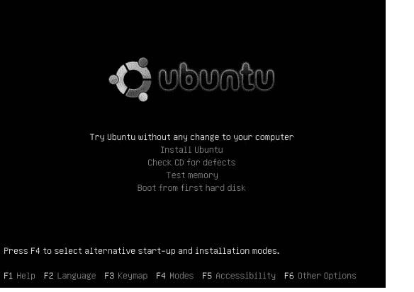

图 3-1：Ubuntu LiveCD 启动菜单。

当你启动 Ubuntu 安装时，第一个窗口是语言窗口。

选择安装使用的语言，然后点击下一步。

这选择了 Ubuntu 在安装过程中显示信息的语言，并设置了操作系统运行时使用的语言。

选择默认语言并不意味着运行系统上的所有应用程序都会使用该语言。每个单独的应用程序可能或不会检测 Ubuntu 配置的默认语言。

安装过程的第二个窗口允许你选择你区域的时区。

4. 选择时区并点击下一步。

此窗口允许你通过地图或下拉菜单选择位置。虽然从图形地图选择时区听起来是个好主意，但取决于 Ubuntu 识别你周围城市的数量，这往往是一个挑战。

下一步是识别识别键盘。虽然这听起来是一个简单的选项，但如果你有一个带有特殊键的键盘，可能会变得复杂。Ubuntu 识别数百种键盘类型，并在键盘选择窗口中列出所有类型。

5. 选择键盘，点击下一步。

键盘配置窗口列出了根据你的国家常用的不同键盘类型。Ubuntu 根据它检测到的键盘为你提供建议选项。这可能是或不是。如果你想进行微调，窗口的下部分允许你进行实验。左侧是国家列表；右侧是所选国家使用的不同键盘类型列表。先从左侧列表选择键盘：先从右侧列表选择键盘类型。

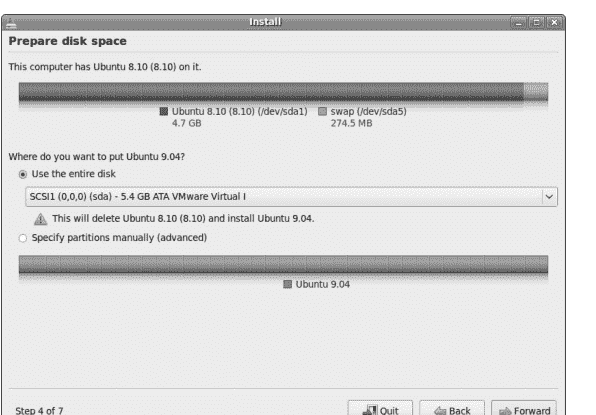

图 3-2:

Ubuntu 磁盘分区窗口。

Ubuntu 磁盘分区窗口最初至少有两个可能的选择：

- * 引导分区以默认方式安装 Ubuntu：Ubuntu 提供了一种引导分区方式，它会自动对系统的整个硬盘进行重新格式以安装 Ubuntu。如果你想运行仅包含 Ubuntu 的工作站，这是最快最简单的方法。如果你选择此项，请跳到第 11 步。

小心——这是默认安装选项！当你选择在整个硬盘上安装 Ubuntu 时，任何之前安装的操作系统（以及数据）都将被删除。在安装 Ubuntu 之前，务必备份任何重要文件。

- * 手动分区以创建你自己的分区：如果你选择手动分区过程，Ubuntu 将分区过程的控制权交给你。它提供了一个分区工具（如图 3-3 所示），用于创建、编辑或删除硬盘分区。手动分区工具显示当前的硬盘以及其中配置的任何现有分区。每个硬盘都作为分区列表中的单独项目出现，并分配一个设备名称（例如第一个硬盘为 s，第二个硬盘为 sdb）。你可以手动在系统安装的任何硬盘上调整单个分区的大小、修改或创建分区。

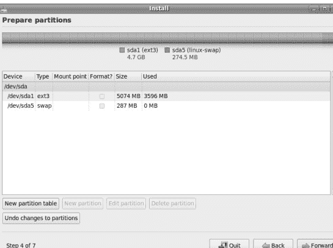

图 3-3:

Ubuntu 手动分区工具。

- - 撤销分区的更改


如果你选择对现有的操作系统进行分区，记住坏事可能会（而且经常）发生。即使你计划保留现有的操作系统，在执行分区过程之前对现有的操作系统进行完整备份也是一个好主意。

如果你正在执行手动分区，请继续第 7 步。

务必记住你的磁盘空间需求（在第 2 章中确定）！我们建议最小化安装 Ubuntu 至少 10GB 空间，如果你计划保存大量图像或音频文件，20GB 会更好。

- 7. 如果你正在执行手动分区，点击“编辑分区”（Edit Partition）和“删除”（Delete）按钮来操作硬盘上的分区。

要调整现有 Windows 分区的大小，请从分区列表中选择该分区，然后点击“编辑分区”按钮。然后你可以调整分区大小以达到释放所需的空间（确保已按照第 2 章所示释放了空间），以创建一个新分区。

- 8. 当硬盘上有空闲空间，或者你有一个第二个硬盘时，点击“新分区”（New Partition）按钮创建新分区。

出现“创建分区”窗口，允许你选择新分区的大小。你可以将新分区添加到硬盘的空闲空间，或添加到第二个硬盘上。

### 为你的分区选择文件系统

手动分区过程的一部分是为每个分区分配一个文件系统。Ubuntu 使用一种文件系统。与某些操作系统不同，Ubuntu 支持多种。表 3-1 所示：

| 类型 | 说明 |
| :--- | :--- |
| ext3 | 一种流行的日志文件系统 |
| ext4 | 最新的日志文件系统 |
| ext2 | 原始的日志文件系统 |
| ReiserFS | 高性能文件系统 |
| JFS | 日志文件系统，由 IBM 创建 |
| XFS | 日志系统，由 Silicon Graphics 创建 |


| FAT16 | 旧版 DOS |
| FAT32 | 较新的 DOS |
| swap | 交换区域 |
| `/opt` | 第三方应用程序的可选安装目录 |


Ubuntu 分区是默认的。

# 第 3 章：安装 Linux

10. 如果你正在执行手动分区，在分区窗口中选择挂载点。

如果你只创建一个分区，Ubuntu 必须将其挂载到根目录 (`/`)。表 3-2 所示：

| 挂载点 | 说明 |
| :--- | :--- |
| `/` | 文件系统的根 |
| `/boot` | 内核位置 |
| `/home` | 个人文件的用户目录 |
| `/tmp` | 应用程序使用的临时文件 |
| `/usr` | 程序的常用位置 |
| `/var` | 变量目录，通常用于日志 |
| `/opt` | 可选安装 |
| `/usr/local` | 安装的常用替代位置 |

## 第一部分：入门

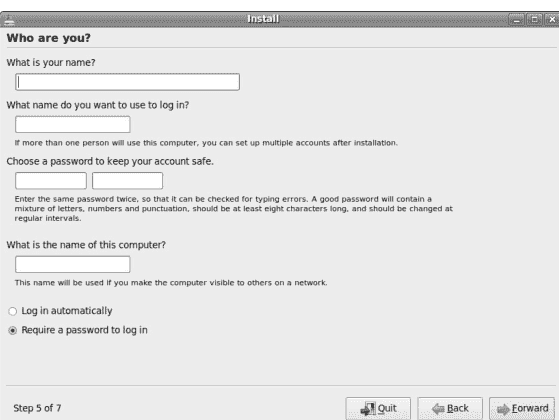

### 图 3-4:

登录 ID 窗口。

### 11. 创建登录 ID，然后点击下一步。

你在此过程中创建的登录用户非常重要与其他与其他 Linux 发行版不同，Ubuntu 发行版不使用管理员账户（在 UNIX/Linux 世界中称为 `root`）。相反，Ubuntu 为普通用户账户提供了加入管理员组的选择。此类组的成员可以成为系统的临时管理员（第 18 章）。

拥有管理员权限的账户非常重要，因为管理员账户是唯一允许执行大多数系统功能的账户，例如更改系统功能、添加新设备和安装新软件。如果没有管理员账户，你将无法在系统上做几乎任何事情。

安装的下一步是 Ubuntu 安装程序中一个相对较新的功能。“迁移文档和设置”窗口可能会出现在你的安装过程中，也可能不会出现，这取决于你在安装 Ubuntu 之前的原始系统。

# 第 3 章：安装 Linux

如果你正从现有的 Windows 或 Linux 分区过渡到 Ubuntu 分区，就会出现“迁移文档和设置”窗口。Ubuntu 迁移功能旨在确保从 Microsoft Windows 或其他 Linux 发行版工作站无缝过渡到 Ubuntu 工作站。这是 Ubuntu 的一项强势功能，旨在为当前的 Windows 用户提供进入 Ubuntu 的便捷路径。

### 12. 选择“迁移文档和设置”，然后点击“下一步”。

安装程序的这一步会检查你正在替换的硬盘分区；它会查找现有的 Windows 或 Linux 分区。如果找到，它将提议帮助将用户账户迁移到 Ubuntu 环境。

该工具的基本原理是在现有的 Windows 安装程序中查找“文档和设置”（Documents and Settings）文件夹——然后尝试在 Ubuntu 中复制该环境。如果配置了任何内容，“迁移文档和设置”窗口将显示各个用户，以及包含每个用户数据的文件夹。它允许你选择要迁移哪些用户和哪些文件夹。目前 Ubuntu 中的 Windows 用户功能尝试迁移：

- Internet Explorer 书签
- “我的文档”（My Documents）文件夹中的文件
- “我的图片”（My Pictures）文件夹中的文件
- “我的音乐”（My Music）文件夹中的文件
- 用户保存的壁纸

尽管此功能很有用，但不要依赖它能正常工作。如果你正将 Windows 工作站迁移到 Ubuntu 工作站，在开始迁移过程之前备份重要数据总是个好主意。

### 13. 在最后一个屏幕上检查你的选项。

安装过程的最后一步会生成一个窗口，列出你在之前的安装窗口中选择的所有功能。此时，你可以选择返回到上一个安装窗口并修改你的选择。

请密切注意磁盘分区设置；当你点击“安装”按钮时，这些设置将成为永久设置。

### 14. 点击“高级”按钮检查其他选项。

打开“高级选项”窗口，如图 3-5 所示。


52 第一部分：初学者入门

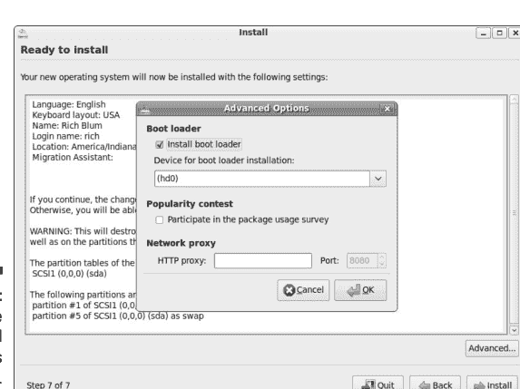

图 3-5：高级选项窗口。

“高级选项”窗口允许你自定义 Ubuntu 中的三个额外功能：

- 引导加载程序：当 Ubuntu 安装在工作站时，它可以提供自己的引导加载程序。引导加载程序负责启动操作系统。当你安装了 Windows 操作系统时，Ubuntu 会提供自己的引导加载程序。

Ubuntu 可以用统一引导加载程序（GRUB）程序替换 Windows 引导加载程序。GRUB 是 Linux 系统使用的标准引导加载程序；它不仅可以启动 Linux 系统，还可以启动许多其他操作系统，包括 Windows。

GRUB 引导加载程序可以加载到第一个硬盘（在 Ubuntu 中称为 `hd0`）的主引导记录（MBR）中，或者在多硬盘系统中，它可以存在于包含 Linux 分区的硬盘上。

“高级选项”窗口允许你更改 GRUB 的默认设置。Ubuntu 会启用 GRUB 并将其安装在第一块硬盘的 MBR 中。建议这样做以启动 Ubuntu；如果你有 Windows/Ubuntu 双系统设置，也建议这样做。如果你保留 Windows 引导加载程序，你将无法直接启动到 Ubuntu。

- 软件包使用调查：软件包使用调查会检索有关你设置的非个人信息（例如 CPU 类型、内存大小、硬盘空间以及你使用的安装方法），并将其发送到中央存储库用于统计目的。你可以通过访问 `http://popcon.ubuntu.com` 查看当前的软件包使用调查结果。一些细节和图表显示了当前的调查总计。

- 网络代理：“高级选项”窗口中的最后一个功能是设置网络代理服务器（特别是企业中的代理）可能会过滤掉任何网络流量，以限制员工可以访问的网站。这是通过网络代理实现的。防火墙会阻止来自网络的所有正常 HTTP 访问，但网络代理可以接收 HTTP 请求，然后拦截不可接受的请求，并转发允许的请求。这可以完全控制员工从公司网络可以访问和不能访问的互联网内容。

如果你的 Ubuntu 工作站位于使用网络代理的网络上，你必须配置此功能以确保你的互联网访问正常工作。

当你完成任何高级选项后，就可以开始安装了。

### 15. 在“选项”屏幕上点击“安装”。

开始安装后，你除了坐着观察发生的变化外别无他事。Ubuntu 安装程序将接管，创建你指定的分区并安装整个 Ubuntu 操作系统。

在 Ubuntu 系统安装到硬盘上之后，安装程序会提示你重启。下一次系统启动时，你将进入 Ubuntu 世界！如果你保留了 Windows 分区，启动时会出现一个漂亮的菜单，允许你选择使用 Windows 启动或使用 Ubuntu 分区启动。


Ubuntu 还通过 Windows Ubuntu 安装程序（Wub）了一种运行 LiveCD 系统的方式。如果你在 Windows 会话期间插入 Ubuntu LiveCD，系统会提示将 Ubuntu 安装为 Windows 应用程序。这会在 Windows 内创建一个完整的 Ubuntu 安装，并允许你双启动 Windows 和 Ubuntu。

54 第一部分：初学者入门

## 安装 Fedora

当你从完整发行版进行安装时，你会大吃一惊。你有许多选择来控制安装。

本节将引导你完成图形化安装过程。如果由于原因无法使用图形化安装程序（例如 Linux不支持你的显卡），请改用文本安装。步骤是相同的，只是没那么美观，而且无法获得图形版本中所有的选项。

图形界面设计设计用于使用鼠标选择选项。如果你没有鼠标，可以使用键盘在屏幕间导航。在大多数情况下，`Tab` 键移动到下一个选项，空格键切换选项的开启，`Enter` 键接受选择并进入下一个屏幕。在大多数屏幕上，如果你想更改之前的设置，可以使用“返回”按钮回到之前的屏幕。如果你想获取更多关于安装过程的信息，可以随时点击“发行说明”。


如果你使用的是书中附带 Fedora 11 完整安装 DVD 镜像，请使用刻录软件包创建安装 DVD。免费的 `isrecord` 也可以刻录镜像。获得 Fedora 11 安装 DVD 后，按照以下步骤操作：

1. 将 DVD 插入 DVD 驱动器并重启系统。

会出现一系列启动选项，如图 3-6 所示。以下是每个选项的说明：

- 安装或升级现有系统：图形界面第一个（默认）选项用于首次安装 Fedora 或升级现有的 Fedora 版本。
- 使用基本视频驱动程序安装系统：如果 Fedora 无法正确检测到系统中使用的显卡，此选项允许你使用通用视频驱动程序。
- 已安装救援：此选项实际上并不用于安装 Linux。如果出现问题，使用它进入救援模式。（有关救援模式的更多信息请参见第 4 章）。
- 从本地驱动器启动：这也不是一个安装选项。如果安装后引导菜单损坏，选择此菜单项可以让你从硬盘启动。


# 第 3 章：安装 Linux

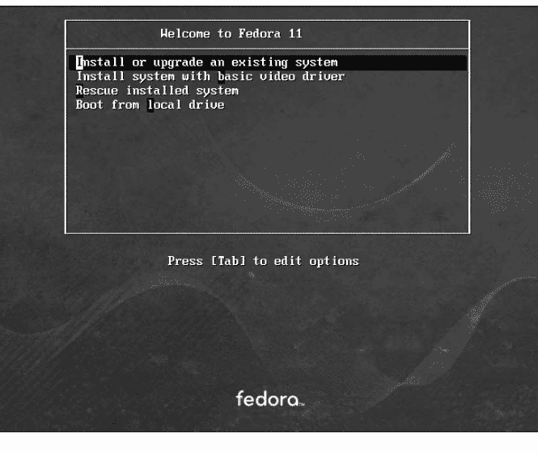

图 3-6：初始 Fedora 安装界面。

- 2. 选择“安装或升级现有系统（Install or Upgrade an Existing System）”并回 Enter。

Fedora 图形安装过程开始，随着安装程序的启动，会有大量信息滚动显示。

如果你下载了 Fedora 的完整版本并将其刻录到 CD 或 DVD 中，将会出现“找到 CD（介质检查）”界面。此界面允许你检查用于安装 Linux 的介质的完整性。如果是这种情况下，我们建议你花时间亲自对下载的所有 CD 或 DVD 进行此项测试。最好提前知道其中哪一个是损坏或不完整的。

无论你是否检查介质，Fedora 的初始安装程序界面最终都会出现。

- 3. 当你准备好离开初始 Fedora 安装程序界面时，点击“下一步（Next）”。

初始界面消失，取而代之的是语言选择界面。

- 4. 选择你的语言并点击“下一步（Next）”。

接下来会出现键盘配置界面。

## 第一部分：初入门阶段

### 5. 选择你的键盘配置并点击“下一步（Next）”。

不同语言在键盘上的按键布局可能不同；你可能希望选择与你的键盘匹配的语言。（默认是美国英语。）

### 6. 选择“安装 Fedora（install Fedora）”选项，并点击“下一步（Next）”。

如果 Fedora 安装程序检测到你的硬盘上存在先前的 Fedora 版本，它会提供两个选项：你可以升级现有版本，或者对新版本进行全新安装。

- 7. 为你的工作站选择主机名（`hostname`）和域名（`domain name`），并点击“下一步（Next）”。

如果你共享驱动器，这就是其他网络设备在网络上检测到的名称。

- 8. 选择你的时区，然后点击“下一步（Next）”。

你可以从图形地图上选择时区，也可以从城市下拉列表中选择。

如果你使用本地时间而不是 UTC 时间（美国大多数计算机都是如此），请取消勾选“系统时单位 UTC（System Clock Units UTC）”复选框。

- 9. 在 root 密码界面，在“Root 密码（Root password）”字段中输入 `root`（管理员）账户密码，并在“确认（Confirm）”字段中输入相同的密码。

输入密码时看不到密码内容——每个字符仅显示一个点。（这些点可以防止未经授权的人员看到密码。）

如果你在其中一个框中输错了内容，当你必须移动到安装的下一步时，你会收到警告，并有机会重新输入这些值。如果你选择的密码太弱，也会收到警告——因此这会对你的系统安全造成危险。

不要忘记你的 `root` 密码！在 Linux 机器上执行任何管理任务都需要它。如果你确实忘记了密码，我们将在第 18 章中教你如何重置。

现在，你已经到达了 Fedora 安装中最棘手的部分。分区界面出现了了，如图 3-7 所示。

- 10. 选择磁盘设置（disk setup），并点击“下一步（Next）”。

你将获得四个选项：

- 使用整个硬盘（Use Entire Drive）：在此选项下方出现的复选框中选择你想要使用的硬盘，这将清除硬盘上的所有内容。
- 替换现有 Linux 系统（Replace Existing Linux System）：如果你已经在下方所示的复选框标记的硬盘上安装了 Linux Linux，安装程序将找到之前的实例并覆盖它，从而擦除旧系统。


- 缩小当前系统（Shrink Current System）：更改现有的 Windows 或 Linux 分区以为你的 Fedora 安装创建空间。
- 使用空空间（Use Free Space）：找到可用的空空间并在那里安装 Fedora。
- 创建自定义布局（Create Custom Layout）：手动定义 Fedora 应该安装的分区。


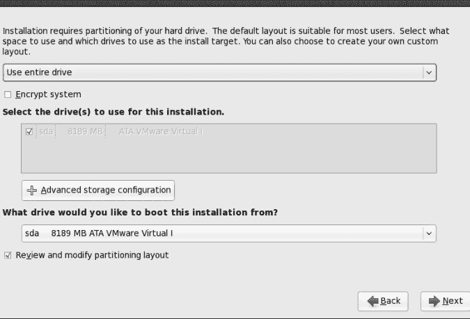

**3-7：** Fedora 分区界面。

你也可以选择加密整个硬盘，这会使得他人更难破解你的数据。然而，这样做会减慢访问文件的速度。如果你想使用此选项，请勾选“加密（Encrypt）”复选框。

如果你的系统支持高级磁盘选项（例如访问远程网络存储驱动器），点击“高级存储配置（Advanced Storage Configuration）”按钮添加高级驱动器。

如果你选择创建自定义布局，将出现如图 3-8 所示的分区编辑器界面。

你可以从编辑器添加、删除和修改系统上的任何分区。它甚至允许你调整现有分区的大小，为你的 Fedora Linux 分区腾出空间。

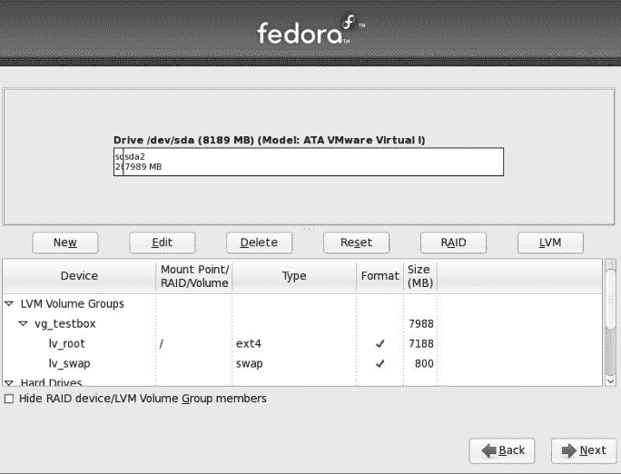

图 3-8：Fedora 分区编辑器界面。

逻辑卷管理器（LVM）提供了一种管理磁盘空间的灵活方法。它允许你将多个物理硬盘组合到一个卷组，然后从该组创建逻辑卷。与传统的分区相比，这种方法在以后调整分区大小时要灵活得多。

基于 LVM 的分区还允许你在不重新分区的情况下调整分区大小，这是一个巨大的优势。

- 11. 选择你的启动引导（boot）位置，并点击“下一步（Next）”。

基于 LVM 的分区还允许你在不重新分区的情况下调整分区大小，这是一个巨大的优势。

- 12. 选择要安装的软件。

软件存储库（Repositories）部分提供了可用资源列表，你可以从这些资源自动为系统加载新的更新和补丁。只有当你想要尝试开发包时，才选择 Rawhide 存储库。

- 13. 在屏幕底部，选择“现在自定义（Customize Now）”，然后点击“下一步（Next）”。

软件包选择界面出现了，如图 3-10 所示。

### 17. （可选）若要查看此组的可选软件包（程序），请点击“可选软件包”（Optional Packages）按钮。在“软件包”（Packages）对话框中选择可选软件包。然后点击“关闭”（Close）返回软件包选择屏幕。

如果该组尚未标记为要安装，则此按钮将不可用。对于每个软件包组，某些程序是默认安装的，而其他程序被认为是可选的。

- 18. 对剩余的任何类别执行步骤 15–17（例如，软件编程工具的“开发”）。

- 19. 当你完成所有选择后——你以后可以更改安装内容——点击“下一步”（Next）。

会弹出一个对话框，告知安装程序正在处理你选定的软件列表。如果它发现你漏掉了勾选的软件，它将为你提供添加这些软件的机会（选择“是”）。完成后后，将出现安装界面。

如果你想停止 Linux 的安装，和/或在安装对你的硬盘进行更改之前停止，安装界面就是你可以停止且无需更改硬盘上任何内容的地方。要停止安装，按下 `Ctrl-Alt-Del`，系统将重启。然而，如果你不打算重新启动安装，请务必在系统重启时取出 DVD 或第一张 CD。


- 20. 当你准备好提交并进行安装时，点击“下一步”。

如果你是从 CD 安装，可能会出现“所需的介质”（Required Media）对话框，准确地告诉你安装具体需要哪些 CD。如果你使用的是 CD，根据请求的软件，你可能不需要所有的 CD。

此后，将出现软件包安装界面。系统首先为安装做准备并开始安装。在系统正在安装自身时，你会看到正在安装的每个单独软件包的名称，以及一个跟踪总安装完成的进度条。

软件包安装完成后，将到达最后的安装界面，屏幕上会欢迎你：“恭喜你，安装已完成。”CD 或 DVD 会自动弹出（如果没有自动弹出，请手动弹出）。

- 21. 移除安装介质，点击“重启”（Reboot）重新启动你的机器，并继续本章的下一个部分，“你的首次 Fedora 启动”。

如果你想直接关闭电脑，在此时这样做是安全的。下次你启动机器时，你将按照下一节“你的首次 Fedora 启动”中讨论的步骤进行。

### 你的首次 Fedora 启动

当 Fedora 系统首次启动时，你仍然需要进行一些配置。

当 Fedora 启动时，你将第一次有机会看到启动菜单——那个在进入默认选项前给你三秒时间做选择的蓝色屏幕——一闪而过：

- 如果你选择 Windows 为默认项，按任意键（如空格键）进入菜单，选择 Linux 条目并按回车键。
- 如果 Linux 是默认——或唯一安装的——操作系统，只需坐好让机器自行启动即可。

如果由于任何原因，你的电脑在此处无法启动，请查看第 22 章。

当电脑首次启动时，你会看到首次启动欢迎（Welcome）屏幕。按照以下步骤操作完成机器的初始设置：

- 1. 点击“向前”（Forward）继续设置程序。

出现“许可协议”（License Agreement）屏幕。


进入`/path/to/xxx`目录，找到`xxx.json`。

在表达式`cvar = avar + bvar`中，加法运算符（`+`）将`avar`与`bvar`相加，得到它们的和`cvar`

在`List.of(arg0, arg1, arg2)`中，`List`接口的工厂方法`of()`接受一系列的元素，返回包含它们的只读列表。

之后我们这样调用`cmd`命令：`cmd arg0 arg1 arg2`。

```
if (condVar > someVal) {console.log("xxx")}
```


| 偏好 (Preferences) | 个人用户设置。 |
| 管理 (Administration) | 系统级设置。 |
| 帮助 (Help) | GNOME 帮助工具。 |
| 关于 GNOME (About GNOME) | 关于 GNOME 信息。 |
| 锁定屏幕 (Lock Screen) | 设置机器使无人无需输入密码即可使用你的 GNOME 登录的功能（在 Ubuntu 中未使用）。 |
| 注销 (Log Out) | 允许你离开当前会话（在 Ubuntu 中未使用）。 |
| 关机 (Shut Down) | 休眠（进入睡眠/休眠模式）、重启（重启）或关机（关闭）机器（在 Ubuntu 中未使用）。 |

Ubuntu 选择将最后三个菜单项（锁定屏幕、注销、关机）从“系统”菜单移动到小部件中（在“小部件”中讨论）。小部件提供了这些选项。

屏幕保护功能默认在 Fedora 和 Ubuntu 中都可用。要更改设置，请执行以下操作：

1. 选择 `系统::偏好::屏幕保护`（Ubuntu）或 `外观感觉::屏幕保护`（Fedora）。
2. 点击“在屏幕保护活动时锁定”复选框以选择或取消选择。
3. 完成更改后，点击 `关闭`。

对话框关闭。（注意，在此对话框中，你还可以更改屏幕保护启动、持续时间以及使用哪种屏幕保护程序。）

## 面板

`gnome` 桌面有一对面板 —— 一个位于顶部，一个位于底部。由于这些栏被整齐地划分为几个区域，让我们从左到右查看顶部面板的内容。

面板有三个不同的区域：快速启动图标、小部件和底部面板。

### 快速启动图标

在顶部面板菜单区域之后，你会遇到一组快速启动图标（参考图 4-1），用于启动特定的应用程序。你可以通过菜单访问所有这些项目，但它们在面板上可以让你更容易找到。在 Fedora 和 Ubuntu 中，这些图标是

- `Firefox`：带狐的行星图标打开 Firefox 浏览器。（更多请见第 9 章。）
- `Evolution`：位于网络浏览器按钮右侧；启动电子邮件和日历程序。（更多请见第 10 章。）

Ubuntu 还包含一个帮助图标，以便方便访问 Ubuntu 手册。

### 小部件区域

快速启动图标旁边是一个巨大的空白区域，你可以在那里添加图标。空白区域右侧是顶部面板的小部件区域。

GNOME 小部件是直接从面板访问的小型程序。它们的强大之处在于它们与面板交互，通常直接在面板上显示信息，这使你无需启动一个巨大的窗口即可查看信息。

大多数使用 GNOME 桌面的 Linux 发行版默认在顶部面板上放置几个小部件。在 Fedora 中，从左到右你会发现以下内容——尽管你特定的安装可能会显示额外的选项：

#### 第一部分：入门指南

- `关机 (Shut Down)`：此小程序提供了一个快速方便的位置来终止桌面会话。它有多个选项，包括重启计算机、注销用户并返回登录屏幕，以及关闭系统。
- `网络管理器 (NetworkManager)`：如果您的工作站中有有线或无线网卡，Ubuntu、Fedora 和 CentOS 默认都会启动 `NetworkManager`。`NetworkManager` 让您能够轻松配置无线网卡设置并配置网络连接。它还可以显示有线连接的网络流量和无线连接的信号强度。
- `用户切换 (User Switch)`：如果您创建了多个用户账户（root 不计在此内），请点击顶部面板上的您的名称；这将显示系统上其他用户的列表。您可以使用此小程序临时切换到另一个用户账户。如果您没有创建其他账户，点击您的名称将显示您的名称。
- `日期和时间 (Date and Time)`：在这里您可以查看日期和时间，具体取决于此小程序的配置。
- `主音量控制 (Master Volume Control)`：点击此打开主音量控制。

## 底部面板

现在来看底部面板。从左到右，您可以在此面板上找到以下项目：

- `隐藏/恢复桌面应用程序 (Hide/Restore Desktop Applications)`：此按钮让您立即最小化运行中的程序，然后只需点击即可重新打开它们。
- `任务栏 (Taskbar)`：在这个大空间中，您可以找到桌面上运行的每个程序的条目。您可以使用指示的框来更改程序的状态：
  - 如果程序被最小化，可以通过点击其任务框来打开其窗口。
  - 如果程序已最大化但埋在另一个程序下面，点击面板上的其任务框将其置于顶层。
  - 如果程序已最大化并处于顶部，可以通过点击其面板上的任务框将其最小化。
- `工作空间切换 (Workspace Switch)`：允许您在单次登录会话期间在不同的桌面环境中工作。每个环境具有菜单、面板和背景，但您可以在每个环境中运行不同的程序。这是在您运行多个程序时保持井井有序的简单方法。试试看，这就像拥有四个显示器一样！
- `垃圾桶 (Trash Can)`：指向桌面垃圾桶的快捷方式。

# 第 4 章：检查 GNOME 桌面

想将程序从一个工作空间窗口移动到另一个吗？点击程序左上角的图标并选择以下选项之一：

- `始终显示在可见的工作空间 (Always on Visible Workspace)`：让窗口在所有四个工作空间上。
- `仅在此工作空间 (Only on this Workspace)`：（默认情况下）防止窗口出现在其他工作空间中。
- `移动到右侧工作空间 (Move to Workspace Right)`：将窗口向右滑动到“下一个”工作空间。
- `移动到另一个工作空间 (Move to Another Workspace)`：让您可以指定工作空间 1（最左侧）、2（左侧第二个）、3（左侧第三个）或 4（最右侧）（仅在当您配置了两个以上的桌面时可见）。

要查看打开的窗口在哪个工作空间，请查看工作空间切换器；在那里您可以发现与桌面布局匹配的窗口。

## 玩玩 GNOME 桌面图标

屏幕上顶部和底部面板之间的区域被称为桌面。桌面实际上是您主目录中的一个单独文件夹，但内容以图标的形式图形显示在您的屏幕上。这提供了一个存储文件、附加文件夹和应用程序快速启动图标的地方，所有这些都可以从桌面访问。

您的初始桌面图标可能有所不同，取决于您安装了哪个 Linux 发行版。Ubuntu 桌面图标默认不使用任何桌面图标。Fedora 默认桌面图标在屏幕左上角形成垂直线。从上到下，您可以看到：

- `计算机 (Computer)`：打开 `Nautilus` 文件管理器（见第 7 章），并列出您的 CD-ROM 驱动器、硬盘等。
- `主 (Home)`：打开 `Nautilus` 浏览器（第 7 章），显示您的主目录内容。
- `垃圾桶 (Trash)`：GNOME 快捷方式，可打开 `Nautilus` 文件管理器的垃圾桶文件夹，其中包含您拖入的文件。

要使用垃圾桶，请拖动任何您想要删除的文件。稍后，如果您确定要删除它们，可以通过三种方法清空垃圾桶：

- 右键点击垃圾桶图标并从右键菜单中选择“清空垃圾桶”以清空整个垃圾桶。当要求确认时，点击“清空”。
- 双击图标打开垃圾桶。然后通过选择“文件-> 清空垃圾桶”来删除垃圾桶的所有内容。
- 双击图标打开垃圾桶。要删除垃圾桶中的单个项目，右键点击它并选择“从垃圾桶删除”。当询问您是否确定时，点击“删除”按钮完成操作。

您可以按住 `Ctrl` 键来选择多个项目，以便单独选择它们（即使它们并不相邻）；或者通过左单击 `Shift` 键来选择一个范围的项目；或者通过左键单击并拖动来收集同一个框内的所有项目。

您也可以从主目录区域的垃圾桶文件夹中手动删除文件（参见第 7 章中的如何操作）。


## 自定义您的面板

您可以通过面板菜单单独自定义顶部和底部面板。要进行操作，请在要操作的面板上找到空闲空间，右键点击并从右键菜单中选择适当的项目。（有关此菜单提供的列表，请参阅表 4-4）

如果您打开了这么多程序，以至于您使用了整个面板，您可能没有空闲空间进行右键点击


表 4-4 GNOME 面板内容

| 菜单 | 您可以找到 |
| :--- | :--- |
| 添加到面板 | 用于将小程序、菜单和其他对象添加到主面板的对话框。 |
| 属性 | 设置此面板的行为。 |
| 删除此面板 | 删除此面板的选项。 |
| 新面板 | 创建不同面板的选项。 |
| 帮助 | GNOME 的帮助。 |
| 关于 | 关于此面板的选项。 |

# 第 4 章：检查 GNOME 桌面

### 添加应用程序

添加到面板对话框（见 4-3）可用于将小程序、菜单和其他对象添加到主面板。要将这些应用程序之一添加到面板，请遵循以下步骤：

1. 右键点击应用程序并查看出现的快捷菜单。

此快捷菜单根据应用程序而异。底部部分是相同的：从面板删除、移动和锁定面板。顶部项目是帮助和关于。其余项目是配置选项（见第 2 步）或特殊的应用程序功能，例如从时钟应用程序复制日期。


# 第 4 章：检查 GNOME 桌面

## 从快捷菜单中选择偏好

2. 从快捷菜单中选择偏好。

并不是每个应用程序都有偏好对话框。如果您选择的具有，在选择此选项时将打开对话框，显示应用程序的配置功能。

3. 在偏好对话框中更改设置以自定义您的应用程序行为。

现在您可以尽情尝试。做出更改以查看您的应用程序可以做什么：随着您做出更改，更改将出现在面板上的应用程序中。（每个应用程序都有自己的功能集，因此我们无法提供任何特定的信息。）

4. 点击关闭以保存您的更改并关闭对话框。

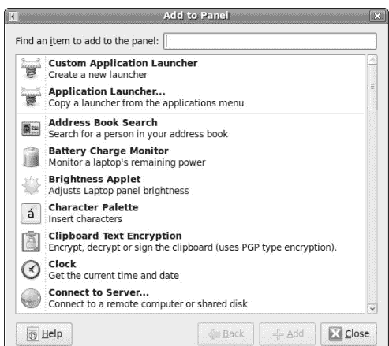

### 配置应用程序

在将应用程序放置并运行后，您可能对其进行配置。这些选项中的某些允许您更改显示内容，其他则具有各种设置。

### 丢弃应用程序

您的空间只能容一些应用程序。而且，如果您和我们一样，您可能不希望空地被图标堆满。要从面板中删除应用程序，只需右键点击您想要删除的应用程序，当弹出上下文菜单时，选择“从面板删除”。随着一声叹，应用程序从面板上消失了。当然，您可以回到“添加到面板”菜单选项来让它复活！

## 检查 GNOME 桌面

- 1. 选择“应用程序”并浏览到您想要添加到面板的程序。

不要打开该程序。只需用鼠标指针指向该菜单项即可。

- 2. 右键点击该程序并选择“将此启动器添加到面板” (`Add This Launcher to Panel`) 将其添加到面板，或选择“将此启动器添加到桌面” (`Add This Launcher to Desktop`) 将其添加到桌面。

您的面板或桌面上会出现该程序的图标。

一旦您将程序添加到面板，只需点击其图标即可运行该程序。如果您将其添加到了桌面，请双击图标。


如果您对桌面图标的位置不满意，可以点击它并拖动到新位置。对于面板条目，右键点击它，选择“移动”，将图标拖到您想要的地方，然后点击将其固定在位置。

您还可以为面板添加一个抽屉（菜单按钮）来显示整个菜单。请按照以下步骤操作：

- 1. 点击“应用程序”并浏览到您想要添加的子菜单。
- 2. 进入子菜单。

例如，如果您想为面板添加“图形”菜单按钮，请打开“应用程序”菜单，将鼠标移动到“图形”菜单，然后向右移动进入“图形”菜单的内容。

- 3. 右键点击打开上下文。
- 4. 选择“整个菜单” (`Entire Menu`)，然后选择“作为抽屉添加到面板” (`Add This As Drawer to Panel`) 或“作为菜单添加到面板” (`Add This As Menu to Panel`)。

很容易区分：抽屉仅以图标形式显示内容；而菜单看起来更像“应用程序”菜单中的子菜单。


### 从桌面或面板移除程序

要移除桌面上的图标，请右键点击该图标并从快捷菜单中选择“移动到垃圾箱” (`Move to Trash`)。

如果您想移除面板上的某个程序，只需右键点击您想要移除的图标，当快捷菜单出现时，选择“从面板移除” (`Remove from Panel`)。图标将从面板上消失。就是这样！

本节将介绍如何使用此工具根据您的喜好自定义桌面。

## 桌面主题

主题是一组命名的设置，用于控制对象在桌面上的整体显示方式——例如复选框、单选按钮、文件夹图标以及窗口的配色方案。Ubuntu 包含了许多主题——其中一些是为视觉障碍人士设计的高对比度主题。

Ubuntu 的默认主题名为 Human。它在桌面上呈现出轻松的橙色窗口主题。可以选择任何主题进行测试。

如果您不喜欢所选的主题，可以通过“外观偏好” (`Appearance Preferences`) 对话框中选择不同的主题来轻松更改。

在选择主题后，您可以对其外观和感受进行额外的更改。点击“自定义” (`Customize`) 按钮打开“自定义主题”对话框，如图 4-5 所示。

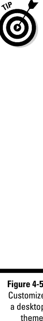

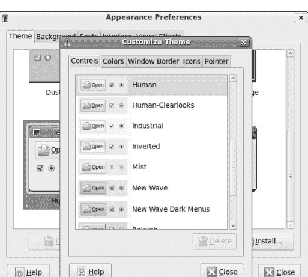

“自定义主题”对话框允许您更改单个项目的外观，如复选框和单选按钮、窗口、窗口边框、文件夹和文档使用的图标以及鼠标指针。

### 第一部分：开始尝试

互联网上有许多适用于 GNOME 的主题；然而，您可能需要寻找一段时间并忍受一些挫折，直到找到一个与您的安装版本兼容的主题。要查找并获取供自己使用的主题，请按照以下步骤操作：

- 1. 将网络浏览器指向 `http://themes.freshmeat.net`。您将带到 Themes 网站，该网站提供了大量的自定义 GUI 条目。如果您热衷于自定义您的 GUI，也可以查看 `http://art.gnome.org`；特别是查看 `http://live.gnome.org/GnomeArt/Tutorials`。
- 2. 在 Freshmart 上，在搜索框中输入 `GTK themes` 并点击“搜索” (`Search`) 按钮。您将进入网站的一个区域，可以在那里确保您选择的主题与您的系统匹配。GTK 是极客术语，指 GNOME 桌面环境的一部分。
- 3. 选择 `GTK 2.X Themes` 区域。现在您进入了最新版本 GNOME 的部分。
- 4. 浏览并选择您想要尝试的主题。

如果您创建账户并登录，可以使用“排序顺序” (`Sort Order`) 下拉列表来更改项目的显示顺序。在查看主题信息时，请注意与主题一起出现的要求（有时称为*依赖项* *dependencies*）。某些主题需要额外的引擎（在后台运行的软件）；如果您在此时阶段对查找和添加软件感到不适，则可以避免这种情况。如果您在寻找 GTK 主题，那么可以避免这些额外的麻烦。

- 5. 选择好主题后，点击其名称进入主题页面。如果您想使用它，就需要安装它。
- 6. 如果您想安装该主题，点击下载链接。文件下载后，您需要将其解压。
- 7. 如果您想使用该主题，进入“外观偏好”对话框，选择该主题，然后点击“安装” (`Install`)。
- 8. 如果主题不在列表中，点击“添加” (`Add`) 按钮。
- 9. 如果您想使用自定义主题，请浏览文件。
- 10. 一旦主题安装完成，从列表中选择它。
- 11. 如果您想更改主题，点击“自定义” (`Customize`) 按钮。
- 12. 如果您想恢复默认设置，点击“重置” (`Reset`) 按钮。
- 13. 当您对桌面外观满意时，点击“关闭” (`Close`)。


## 背景

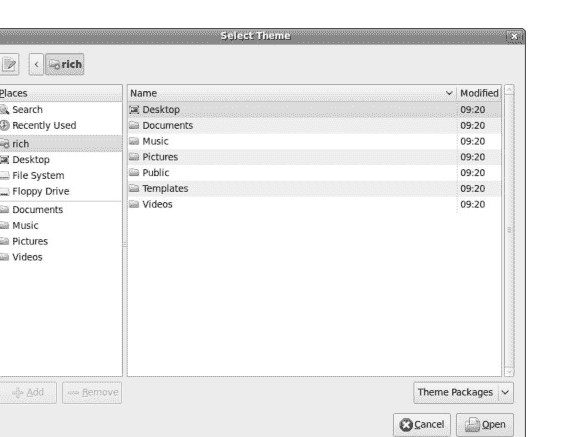

桌面背景是一个重要功能，它是您停留最久的地方。Ubuntu 和 Fedora 都允许您使用图像作为背景（称为壁纸）或使用颜色背景。

“背景” (`Background`) 选项卡控制桌面背景上的内容。默认情况下，选择一种颜色作为背景，或加载自己的壁纸图像。要设置背景，打开“外观偏好”对话框，点击“背景”选项卡，然后按照以下步骤操作：

- 1. 点击“添加” (`Add`) 按钮。
- 2. 使用浏览器找到您的图像文件。

GNOME 支持使用任何图像文件类型作为背景图像。

- 3. 点击“打开” (`Open`) 按钮。

图像被导入到背景列表中，并自动选择为背景壁纸。

“无壁纸” (`No Wallpaper`) 选项允许您选择单一颜色作为背景，或者从一种选定颜色到另一种颜色的渐变（水平或垂直）。GNOME 使用酷酷的色轮来选择颜色，如图 4-7 所示。

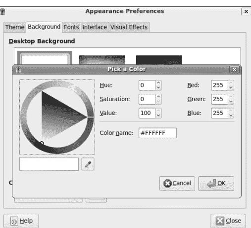

图 4-7：颜色选择轮。

只需点击外圈选择基础色，然后从内三角形选择阴影。

### 字体

“字体”选项卡允许你自定义 Ubuntu 在桌面各种功能中使用的字体。如所预期，Ubuntu 提供了许多不同的字体供选择。另一个很棒的功能是你可以自定义字体在屏幕上的渲染方式。

点击“字体”选项卡底部的“详细”按钮将打开“字体渲染详细”对话框，如图 4-8 所示。

在这里，你可以真正深入到屏幕上字体渲染的基础设置。

> 字体设置得越详细，它们看起来就越漂亮——但显示文本所需的处理时间和性能消耗也越多。


### 界面

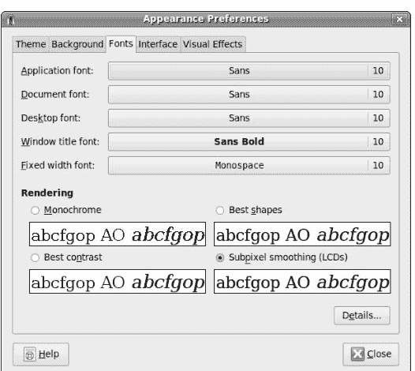

图 4-8：字体渲染详细日志框。

“界面”选项卡提供了几个自定义窗口菜单和工具栏显示方式的设置：

- 在菜单中显示图标：在菜单中的文本项旁边显示图标。
- 可编辑的菜单快捷键：启用通过快捷键选择菜单选项。
- 工具栏标签列表：设置工具栏项目的显示方式：仅文本、仅图标、图标在文本下方或文本在图标侧旁。


此窗口设置适用于任何使用 GNOME 界面的窗口。它们不适用于未使用 GNOME 库的应用程序，例如基于 KDE 桌面库构建的应用程序。

## 视觉效果

“视觉效果”选项卡允许你选择桌面处理窗口的华丽程度。效果有三个级别：

- 无：窗口直接出现和消失，没有任何特殊特效。
- 正常：窗口在启动时淡入，在关闭或最小化时淡出。
- 额外：此级别提供了更华丽的效果，例如窗口最小化时的融化效果。

额外级别的效果需要你的电脑中配有高级显卡。


## 启用辅助功能

GNOME 桌面包含若干功能，使残障人士能够使用替代方法在桌面上操作应用程序。这些功能包括屏幕放大镜（放大屏幕区域）、屏幕阅读器（读取屏幕上的文本）和键盘辅助功能（如粘滞键和慢鼠标点击）。你可以根据需要启用单个功能。

在使用单个辅助功能之前，你需要在 GNOME 中启用辅助功能。请按照以下步骤启用辅助技术：

1. 选择“系统：偏好：辅助技术”。
打开“辅助技术偏好”对话框，如图 4-9 所示。

图 4-9：辅助技术对话框。

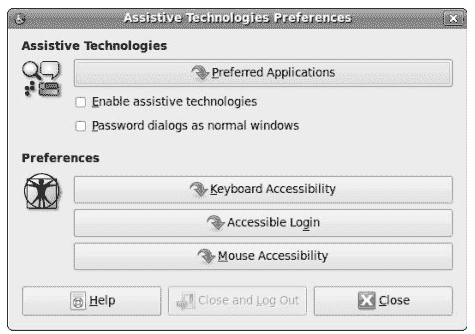

2. 勾选“启用辅助技术”复框。
3. 点击“关闭并注销”按钮。

当你重新登录系统时，GNOME 会启用辅助技术功能。在启用辅助技术功能后，你可以配置你所需的功能。主要有三大类：

- 偏好应用程序：允许你定义在启动时自动启动的辅助程序，例如屏幕阅读器。
- 键盘辅助：定义键盘功能，例如用于模拟多次按键组合的粘滞键，以及忽略随机按键点击的慢速键。
- 鼠标辅助：定义鼠标功能，例如模拟双击和鼠标停留（将鼠标悬停在某项上而不点击）。

# 第 5 章：检查 KDE 桌面

在本章中

- 熟悉 KDE
- 设置你的工作空间

> 车站是汽车停靠的地方。
> 
> 火车站是火车停靠的地方。
> 
> 在我的桌子上，我有一个工作站 . . . .
> 
> — Steven Wright

在第 4 章中，你了解了 GNOME 桌面是如何工作的，而本章将讨论 Linux 世界中另一个流行的桌面 —— KDE。KDE 桌面环境使用 Windows 系统中常见的功能，为你的 Linux 发行版提供图形界面。它以软件包的形式提供于 Fedora 和 Ubuntu 中，并且是 Kubuntu（一种基于 Ubuntu 但专注于 KDE 桌面的 Linux 发行版）使用的默认桌面。本章将介绍 KDE 的功能，展示你如何在 KDE 中操作并充分利用你的工作空间。


## KDE 桌面基础

KDE 桌面首次于 1996 年作为 Kool Desktop Environment 发布，但现如今它试图变得更精细，并倾向于仅称为 KDE 环境。它因为它提供了类似 Windows 的界面，而在初学者中非常流行。它以软件包的形式提供于 Fedora 和 Ubuntu 中。

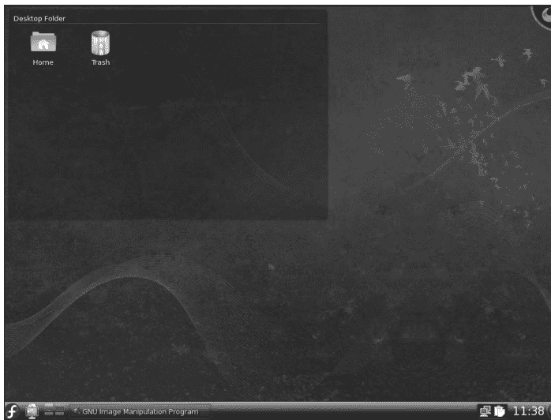

图 5-1：KDE 桌面菜单。

## KickOff 菜单

KDE 桌面提供了一个名为 KickOff 的菜单，位于面板的最左侧。点击图标会产生以下选项卡：

- 收藏：你常用的应用程序图标。
- 应用程序：程序子菜单。
- 计算机：指向计算机特殊位置的快捷方式。
- 最近使用：你最近运行的应用程序和打开的文档列表。
- 退出：退出会话的选项。

有了这么多菜单选项，寻找想要的内容可能很麻烦。为了方便，KDE 菜单在顶部提供了一个快速搜索工具。输入文本，KDE 会返回搜索结果；然后你可以选择你想要的。

## 收藏

Fedora KDE 桌面在“收藏”选项卡上为你提供了三个项目：

- **浏览器**：KDE Konqueror 浏览器和文件管理器（见第 7 章）。
- **系统设置**：KDE 桌面的配置工具。
- **文件管理器**：Dolphin 文件管理器（见第 7 章）。

“收藏”选项卡还提供了一个区域，让你收集常用应用程序的图标。在菜单中导航到一个程序，右键点击它并选择“添加到收藏”选项。

你可以通过右键点击项目并选择“从收藏中移除”来从收藏中移除项目。

## 应用程序

“应用程序”菜单提供了快速访问系统上所有安装程序的通道。显然，可用选项取决于你安装了什么，且 KDE 使用了一些标准的一级菜单项。这些项在表 5-1 中。

| 表 5-1 | 应用程序菜单 |
| :--- | :--- |
| 菜单选择 | 你能找到 |
| 管理 | 用于修改系统设置和功能的应用程序及工具。 |
| 开发 | 用于开发程序的应用程序。 |
| 教育 | 教育类应用程序。 |
| 游戏 | 消磨时间的程序。 |

### 第 5 章：检查 KDE 桌面

| 菜单选项 | 你能发现 |
| --- | --- |
| 图形 | 图像处理程序。 |
| 互联网 | 用于与互联网交互的程序。 |
| 多媒体 | 处理音频文件的应用程序。 |
| 办公 | 用于办公任务的程序，例如用于文字处理的文字处理、用于数字计算的电子表格以及用于图形的演示文。 |
| 设置 | 配置用户特定设置的工具。 |
| 系统 | 用于监控和设置系统级功能的工具。 |
| 工具 | 用于处理桌面和系统中小型功能的各种程序和工具。 |
| 帮助 | KDE 帮助中心文档。 |
| 个人文件 | 访问你的主目录（参见第 7 章）。 |

你可能会注意到一级菜单项花费了大量精力。所有的 KDE 系统都使用这些菜单选项。不同的发行版提供不同的菜单项组合，为它们的菜单提供自定义的外观和感受。

## 计算机

计算机菜单标签页（见表 5-2）提供了一种快速跳转到系统特定位置的方法，以便查看文件并快速访问 KDE 设置。

| 表 5-2 | 计算机菜单 |
| 菜单选项 | 你能发现 |
| --- | --- |
| 系统设置 | 这允许你访问 KDE 桌面设置工具。 |
| 系统信息 | 提供快速访问有关你工作站的信息——硬盘大小和使用情况、网络状态、操作系统版本以及你重要文件夹的链接。 |
| 主目录 | 查看用户主目录的内容。 |
| 网络 | 查看本地网络上可用的文件服务器。 |
| 根 | 查看虚拟目录结构的内容。 |
| 垃圾箱 | 查看存储在特殊垃圾箱文件夹中的项目并清空垃圾箱。 |
| PC 软盘驱动器 | 查看插入工作站软盘驱动器中的软盘内容。 |


### 第一部分：入门

计算机菜单项还会扩展到包含插入工作站的任何可移动介质，例如 CD、DVD 或 USB 内存。只需选择该菜单项即可访问可移动介质上的文件和文件夹。

## 最近使用

当你使用应用程序时，KDE 会将其添加到菜单的此部分。你越频繁使用某个应用程序，它在列表中的排名就越高。

## 退出

离开情人可能有 50 种方法，但离开桌面只有六种方法（至少在不导致系统崩溃的情况下！）。退出标签提供了六种退出桌面会话的选项，见表 5-3。

| 表 5-3 | 退出菜单 |
| 菜单选项 | 它的功能 |
| --- | --- |
| 注销 | 结束当前桌面会话并返回登录会话。 |
| 锁定 | 锁定桌面并显示屏幕保护。要重新进入桌面，必须输入已登录用户的密码。 |
| 切换用户 | 挂起当前会话，允许另一个用户登录。 |
| 挂起到磁盘 | 将当前会话状态写入磁盘文件并将系统设置为低功率模式。 |
| 关闭 | 结束当前桌面会话，停止系统上的所有进程并关闭电源。 |
| 重启 | 结束当前桌面会话并重启系统。 |

当你从退出菜单中选择一个选项时，会出现一个对话框提示你确认。这有助于防止“失误”时刻。

## 面板

在你的 KDE 桌面底部，你会看到一条带有许多图标的线。这被称为面板。面板包含*部件*，即在面板上运行直接在面板上提供功能的小程序。

KDE 面板的布局是 KDE 的另一个特性，在不同的发行版中通常有所不同。大多数发行版将 KDE 菜单放在面板左侧——这恰好是 Windows 放置启动图标的地方。

### 第 5 章：检查 KDE 桌面

在 Fedora KDE 桌面上（参考图 1），在 KDE 菜单图标旁边，你可以在面板上看到以下小部件：

- **新设备监控**：当 USB 设备插入你的工作站时提醒你，并提供安装设备列表。这是带有 USB 符号的框。
- **分页器**：允许你在不同的虚拟桌面空间之间切换。这是四个框聚集在一起的部分。
- **任务管理器**：显示运行的应用程序的缩略图。如果没有运行任何应用程序，它将作为面板上的空白区域出现。
- **系统托盘**：包含工具和系统应用程序的图标，如声音系统、网络管理器和剪贴板，它们在后台模式运行。系统托盘作为面板上的黑色区域出现，带有图标。
- **数字时钟**：显示当前时间。
- **面板编辑器**：允许你修改面板布局和小部件。这是面板右侧的半圆图标。


你可以轻松修改布局以适应你的喜好。只需点击面板右侧的面板编辑器将面板进入编辑模式，如图 5-3 所示。


# 第一部分：上手入门

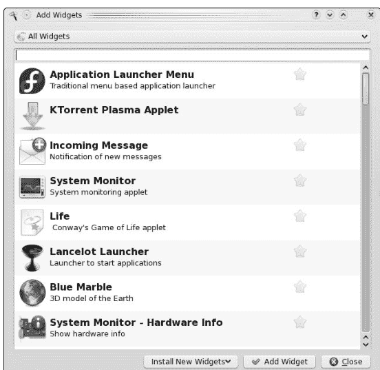

图 5-4：添加组件菜单。

| 表 5-5 Fedora KDE 组件 |
| 组件名称 | 功能 |
| --- | --- |
| 模拟时 (Analog Clock) | 显示一个带指针的老式圆钟！ |
| 应用启动器 (Application Launcher) | 启动预设应用程序。 |
| 应用启动器菜单 (Application Launcher menu) | 提供应用程序菜单。 |
| 二进制监控器 (Binary Monitor) | 显示笔记本电脑电池的电量状态。 |
| 二进制时 (Binary Clock) | 极客的工具！ |
| 计算器 (Calculator) | 快速访问 KDE 计算器。 |
| 取色器 (Color Picker) | 允许你获取桌面上任何颜色的颜色值。 |
| 漫画 (Comic Strip) | 显示每日漫画。 |
| 字典 (Dictionary) | 用于在你不知道某个单词如何拼写时。 |
| 数字钟 (Digital Clock) | 以数字格式显示时间。 |

# 第 5 章：检查 KDE 桌面

| 组件名称 | 功能 |
| --- | --- |
| 十五格 (Fifteen Puzzle) | 为益智爱好者的快速娱乐。 |
| 文件监控器 (File Watcher) | 以滚动方式实时显示文本文件的内容（非常适合查看日志文件）。 |
| 文件夹视图 (Folder View) | 提供特定文件夹内容的图形化显示。 |
| 模糊钟 (Fuzzy Clock) | 用日常英语显示时间，例如 5:50 显示为 "六差十分"。 |
| 新消息 (Incoming Messages) | 通知你有新的电子邮件。 |
| KGet | 图形化地显示正在进行的 Kfile 下载状态。 |
| Konq 配置文件小部件 (Konq Profiles Applet) | 提供快速访问所有不同 Konqueror 文件和 Web 浏览功能的菜单。 |
| 锁定/退出 (Lock/Logout) | 方便注销或锁定工作站。 |
| Luna (Luna) | 显示月相。 |
| 新设备监控器 (New Device Monitor) | 提供插入工作站的 USB 设备信息。 |
| 新闻滚动条 (News Ticker) | 在桌面上提供最新的新闻！ |
| 笔记 (Notes) | 为你提供一个记录的地方（就像现实生活一样——你可以在整个桌面上到处贴便利签！） |
| 正在播放 (Now Playing) | 显示当前播放的音乐视频文件名称。 |
| 分页器 (Pager) | 允许你在工作区之间快速切换。 |
| 画框 (Picture Frame) | 创建一个以幻灯片形式显示喜图片的区域。 |
| 显示面板 (Show Dashboard) | 将所有桌面组件带到任何打开窗口之前。 |
| 显示桌面 (Show Desktop) | 通过一次最小化所有打开的应用程序快速访问桌面。 |
| 系统监控 (System Monitor) | 显示关键系统统计。 |
| 系统监控 - 网络 (System Monitor - Network) | 显示网络统计。 |
| 系统托盘 (System Tray) | 显示后台系统程序的图标。 |
| 任务管理器 (Task Manager) | 显示当前在桌面运行的应用程序图标。 |
| 垃圾桶 (Trashcan) | 为可能删除的文件提供临时存放地。 |
| Twitter 微博 (Twitter Microblogging) | 快速访问流行的 Twitter 社交网站。 |

这是一个非常丰富的供你使用的组件集合！你可以通过将它们添加到面板或桌面上尝试这些组件，如果你发现它们没用，可以轻松地删除它们。

要添加组件，只需选择你想要的组件，然后点击“添加”按钮。大多数组件都提供简单的控制方法，通过在面板中右键点击组件或将鼠标指针悬停在桌面上的组件上，来修改组件的布局和行为。从此菜单中，你可以移动组件、删除组件，或（对于某些组件）访问属性对话框来配置组件。

## 获取更多组件

除了所有标准组件外，你还可以下载更多。在“添加组件”对话框中点击“安装新组件”按钮来查找这些选项：

- **下载新的 Plasma 组件 (Download New Plasma Widgets)**：浏览在线仓库查找新的组件包。
- **从本地文件安装 (Install from Local File)**：浏览工作站上的位置，从工作站已存在的文件安装新组件包。

如果你的工作站已连接到互联网（见第 8 章），请按照以下步骤从互联网安装新组件：

1. **在“安装新组件”中选择“下载新的 Plasma 组件”选项。**

打开工作区插件安装器，如图 5-5 所示。

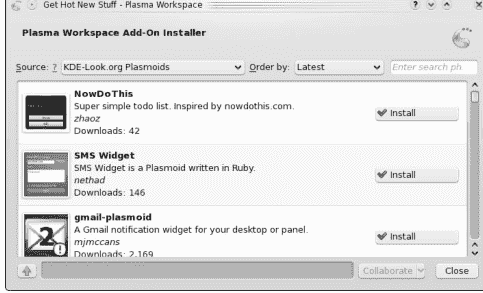

安装器对话框会连接已配置的组件仓库（经 KDE 批准），并提供可用组件列表。

2. **点击你要使用的组件的“安装”按钮。**

插件安装器会自动从仓库下载组件并将其安装到你的工作站上。

3. **点击“关闭”按钮关闭插件安装器。**

新安装的组件将出现在“添加组件”对话框中。

4. **从“添加组件”对话框中选择新组件。**

5. **点击“添加组件”按钮将新组件添加到你的桌面或面板上。**

在桌面或面板上安装新组件后，你可以从控制菜单访问并管理该组件。

## 调整桌面设置

在 KDE 中，你可以按照喜好配置桌面环境中的每一个功能。KDE 系统设置实用程序快速访问你所有的配置需求。

你从 KDE KickOff 菜单启动系统设置实用程序。在 Ubuntu 中，选择“计算机”。在 Fedora 中，选择“计算机”。主系统设置对话框出现。它包含：

- 外观外观 (Look & Feel)
- 网络与连接 (Network & Connectivity)
- 个人 (Personal)
- 桌面 (Desktop)

“外观外观”设置提供了丰富的功能供你自定义桌面环境。如果你不习惯花费几个小时来调整桌面，不用担心，大多数 Linux 发行版的默认设置已经很好。

### 外观外观

此实用程序控制桌面的整体外观。它包含你可以自定义的功能：

- **样式 (Style)**：窗口的整体样式。包含多种预定义样式。
- **颜色 (Colors)**：定义窗口使用的配色方案。
- **图标 (Icons)**：定义桌面使用的图标。
- **字体 (Fonts)**：选择用于文本的字体。
- **窗口 (Windows)**：选择窗口。
- **启动屏幕 (Splash Screen)**：选择 KDE 启动时显示的屏幕。
- **表情 (Emoticons)**：KDE 允许你定义产生表情符号（如笑脸和哭脸），你可以在文档中使用。

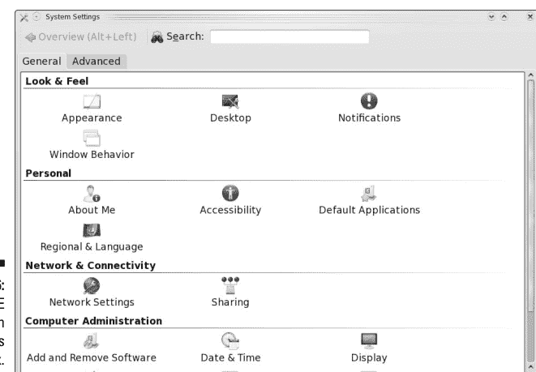

图 5-6：系统设置对话框。

### 桌面

此实用程序控制桌面环境。它包含四个功能：

- **桌面特效 (Desktop Effects)**：如果你的工作站带有高级显卡，你可以开启酷的桌面特效，如窗口融化、阴影、放大镜，甚至是桌面下雪！
- **多桌面 (Multiple Desktops)**：定义多个桌面，或创建虚拟桌面以便于管理应用程序。
- **屏幕保护程序 (Screen Saver)**：选择屏幕保护程序，在工作站空闲一段时间后告知 KDE 正在运行。
- **启动反馈 (Launch Feedback)**：发送特定效果告知 KDE 正在处理启动应用程序请求，例如跳动的光标。

### 通知

此实用程序让你设置 KDE 如何通知你系统事件，例如错误、错误的键或错误的鼠标点击。它包含两个功能：

- **系统通知 (System Notifications)**：为 KDE 应用程序中的特定操作设置不同的声音。
- **系统提示声 (System Bell)**：选择自定义并播放提示声而非通知音。

### 窗口行为

此实用程序定义应用程序窗口在桌面上的行为。它有两个功能：

- **窗口行为 (Window Behavior)**：设置桌面所有窗口的窗口行为。例如，你可以指定如何聚焦于活动应用程序窗口、鼠标右键、中键和左键在窗口中的作用，以及如何在桌面上移动窗口。
- **特定窗口 (Window-Specific)**：为特定应用程序定义窗口行为。

### 个人

“个人”部分允许你使用偏喜的功能来个性化桌面，或者为有特殊需求的人提供一些与桌面文件、文件夹和应用程序交互的有用方法。

# 102 第 I 部分：入门


- 关于我：为你的用户账户设置属性，例如你的名称、电子邮件地址和主目录位置。这还提供了更改密码的快捷方法。
- 辅助功能：为键盘和声音功能提供设置，以适应特殊需求。
- 默认应用程序：设置用于电子邮件、文本编辑器、即时消息、终端模拟器和 Web 浏览的默认应用程序。
- 区域与语言：设置在桌面会话中使用的默认语言和键盘布局。

通过“个人设置”，你可以自定义你的桌面环境，让它感觉像家一样！

## 网络与连接

“网络与连接”部分仅包含两个工具：

- 网络设置：这个名称稍微有点误导性，因为该工具实际上并不控制你的网络连接如何配置（请参阅第 8 章）。相反，它提供了一个地方，让你定义定义网络上的任何默认网络代理服务器（例如 Web 代理主机——关于这些更多信息请见第 8 章），并允许你针对特定的网络环境调整连接超时时间。
- 共享：设置在连接网络上远程 Windows 共享时使用的 Microsoft Windows 用户名和密码（关于此内容的更多信息请见第 7 章）。


如果你的工作站位于公司网络，在动这些工具任何一个之前，建议咨询你的网络管理员。

## 计算机管理

“计算机管理”部分提供了你可以用于配置系统设置的工具。表 5-6 列出了此处可用的工具。

## 表 5-6 计算机管理工具

| 工具 | 用途 |
| --- | --- |
| 添加和删除软件 | 在 Fedora 中，提供一个用于添加新软件软件包、更新存储库以及配置 PackageKit 包管理器中使用的设置的接口（见第 16 章）。 |
| 日期和时间 | 设置工作站的日期和时间。 |
| 显示 | 设置显示分辨率；在这里你也可以实施任何节能功能，例如在超时后关闭显示器。 |
| 字体安装程序 | 为你的 KDE 应用安装新字体。 |
| 输入动作 | 为特定功能定义组合键（称为*热键*）。 |
| 键盘和鼠标 | 设置基础键盘和鼠标功能。 |
| 多媒体 | 设置用于各种桌面程序的音频和视频程序。 |

# 第二部分

## 快速上手 Linux

Rich Tennant 著《第五次浪潮》

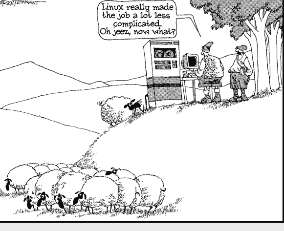

## 在这一部分中……

在这一部分，你将了解到许多 Linux 基础知识。你将对 Linux 文件系统的每一个尘封的角落进行之旅，找出什么内容存储在什么地方。然后，你将学习如何使用桌面提供的图形化工具在其中穿行并管理你的文件。最后，如果你还没有连接上网，你将体验连接互联网的各种乐趣。

# 第 6 章

# 了解 Linux 文件系统

**本章内容**

- 探索文件系统的路径
- 向文件系统添加可移动介质
- 理解文件系统权限

> 我拥有一张生存地图。上面到处写着“你在这里”。
> — 史蒂芬·莱特 (Steven Wright)

掌握新操作系统最令人沮丧的事情之一就是搞清楚它把文件放在哪里。Linux 没有将所有系统文件放在单个目录中（例如 Microsoft Windows 中的 `C:\Windows` 目录），而是遵循其 UNIX 兄弟的逻辑，将它们分布得更分散。虽然 Linux 和 Windows 涉及不同的方法，但它们都是符合逻辑的，尽管在你掌握了去哪里查看之前，可能并感觉不到这一点。

## 整合拼图的碎片

在开始之前理解术语会有帮助。许多内容你可能已经从其他操作系统（如 Microsoft Windows）中对它们有所熟悉，但你需要习惯一些差异。首先，“文件系统”（filesystem）一词实际上有多种用法。通用用法（以及我们在本书中通常指代的内容）指的是“你现在可以访问的文件和目录（或文件夹）”，而不是指在硬盘上存储数据的方法（例如第 3 章讨论的 ext3 文件系统）。

# 108 第二部分：快速上手 Linux

以下是关于文件系统你需要了解的知识：

- Linux 在目录之间使用正斜杠 (`/`)，而不是 Windows 使用的反斜杠 (`\`)。因此，目录 `etc/yum/` 下的文件是 `yum.conf`。
- 文件和目录名称长度可达 256 个字符，这些名称可以在任何地方包含下划线 (`_`)、破折号 (`-`) 和点 (`.`)。因此，`my.big.file` 或 `my.big_file` 或 `my-big-file` 都是有效的文件。
- 大小写很重要。它们必须完全匹配。文件 `yum.conf` 和 `Yum.conf` 不是同一个，因为 Linux 是区分大小写的敏感——它会注意每个字符的大小写。相反，Windows 是不区分大小写的。
- 同一个文件系统可以跨越多个分区、硬盘和介质（如 CD）。

## 游览文件系统

在这一节中，我们查看典型文件系统的内容。熟悉它有助于你知道哪些是安全的。

## 树的根

文件系统中的一切都相对于根目录。每个发行版在 `/` 中放置的内容略有不同。如果你对这些标准感兴趣，请访问 www.linux.org/。这些标准让 Linux 世界保持有序。


# 第 6 章：了解 Linux 文件系统

表 6-1 列出了你在根目录（即 `/`）中可能发现的内容。描述末尾的星号 (`*`) 表示除非你有非常有理由，否则不要动该目录。大多数根目录应该保持原样。

| 目录 | 内容 |
| --- | --- |
| `/bin` | 所有人随时需要的基础命令。* |
| `/boot` | 启动机器的信息，包括你的内核。* |
| `/dev` | 系统与硬件交互所需的所有设备驱动。* |
| `/etc` | 系统的配置文件。* |
| `/home` | 每个用户的家目录。 |
| `/lib` | 许多程序（内核）使用的库或代码。* |
| `/media` | 你添加临时介质的地方，如软盘和 CD-ROM，并非所有发行版都有这个目录。 |
| `/mnt` | 你添加额外文件系统组件的地方，如网络驱动器和永久添加到系统中的、但不像 CD-ROM 和软盘那样的临时项。 |
| `/opt` | 一些人决定使用（某些程序想要使用）来安装新软件包的位置，例如文字处理器和办公套件。 |
| `/proc` | 你的内核（操作系统）的当前设置。* |
| `/root` | 超用户 root 的家目录。 |
| `/sbin` | 系统管理员需要访问的命令。* |
| `/srv` | 系统的服务的数据（后台运行的程序）。* |
| `/sys` | 关于你硬件的内核信息。* |
| `/tmp` | 所有人和所有事物存储临时文件的地方。 |
| `/usr` | 包含额外程序和文件的复杂层次结构。 |
| `/var` | 经常变化的数据，例如日志文件和你的邮件。 |

*这些目录中的某些具有同样重要的子目录，我们将在接下来的章节中介绍。

# 110 第二部分：快速上手 Linux

## /etc 的重要性

`/etc` 基础目录主要包含配置文件。除非你清楚自己在做什么，否则最好不要弄动这些文件。一些重要的目录（取决于你安装了什么）包括以下内容：

- 以 `/etc/cron` 开头的目录包含用于在自动时间运行的各种程序的指令。
- `/etc/cups` 目录包含你的打印机的配置信息。
- 以 `/etc/rc` 开头的目录都包含关于启动、非启动时间以及关机的数据。这些目录存储了运行的服务。
- `/etc/sysconfig` 目录拥有网络配置信息。
- `/etc/samba` 目录包含 Samba 软件的配置文件，用于与 Microsoft Windows 服务器进行通信（见第 20 章）。
- `/etc/X11` 目录包含 X Window 系统 (X) 的配置细节，该系统运行你的图形用户界面 (GUI)。第 4 和第 5 章将详细介绍 GUI。
- 如果你决定使用 `/opt` 目录，则 `/etc/opt` 目录包含该 `/opt` 目录中程序的配置文件。

## 临时介质所在地

你默认可能在 `/media` 或 `/mnt` 中拥有子目录。但通常情况下，你可以寻找：

- `/media/floppy` 目录用于向你的文件系统添加软盘——与其看到 "floppy" 字样，你可能会看到 `fd0` 或 `floppy0`。
- 当你将 USB 驱动器插入工作站时，使用 `/media/sdb`（或 `/media/sdc`, `/media/ssd` 等）。
- `/media/cdrom`（或 `/media/dvd`, `/media/cdrecorder` 等）取决于你拥有的硬件类型，用于向系统添加 CD-ROM、DVD-ROM、CD 写刻等。

在第 7 章中，你将了解到如何以更方便的点点击方式来操作。

# 第 6 章：了解 Linux 文件系统

## 计算机所在的 usr


`/usr` 目录通常被称为它自己的微型文件系统树。该目录有很多重要或有趣的子目录，如表 6-2 所示。描述末尾的星号 (*) 表示，除非你有充分理由要动它，否则请保持原样——在你获得丰富的 Linux 经验并确切知道需要进行哪些更改之后——以免你意外更改了系统正常运行所需的配置。关于文件系统这部分需要记住的一个趣点是，许多高级 Linux 用户经常使用 `/usr` 来存储可以与其他 Linux 机器共享的程序。

| 表 6-2 标准 /usr 子目录 |
| 子目录 | 内容 |
| --- | --- |
| `/usr/X11R` | 管理 X Window 系统（你 GUI 下方的骨架）的文件。* |
| `/usr/bin` | 对用户来说并非不可少但很有用的命令。* |
| `/usr/games` | 你安装在系统上的游戏，除了你选择放置在 `/opt` 中的那些。 |
| `/usr/include` | C 编程语言用于系统及其程序所需的文件。* |
| `/usr/lib` | 此 `/usr` 子层级结构中许多程序使用的共享代码。** |
| `/usr/local` | 你想在本地保留的程序和其他项目，即使你正在共享 `/usr` 中的其他所有内容。 |
| `/usr/sbin` | 对管理员来说并非不可少但很有用的命令。* |
| `/usr/share` | 你可以在任何 Linux 机器上使用的信息，即使它运行着完全不同的硬件。 |

## 在没有网络（或鼠标）的情况下管理你的文件系统

第 7 章涵盖了如何使用点点击文件管理器。在这一部分中，我们查看如何使用命令行工具在文件系统中穿行。对你来说，知道如何使用命令行并非关重要，但它某天可能会证明非常有用！

# 第二部分：快速上手 Linux

在第 17 章中，我们将介绍使用 Terminal 程序（在 GNOME 桌面中）和 Konsole 程序（在 KDE 桌面中）从桌面访问命令行的细节。你将在桌面菜单中找到这些程序。


## 在命令行查看文件信息

正如你将在第 17 章中看到的，`ls` 命令允许你查看文件和目录。单独运行时，它会向你显示请求的非隐藏文件和目录名称。例如，如果你在 `/etc` 目录并输入 `ls`，你可能会看到图 6-1 所示的内容。

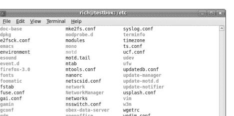

图 6-1：`/etc` 内部 `ls` 命令的输出。

当你使用此版本的命令时，彩色显示会告诉你关于你正在查看的项目类型的信息：

| 文字颜色 | 通常意味着 |
| --- | --- |
| 黑色 | 不匹配任何需要颜色特殊类型的普通文件。 |
| 红色 | 存档或包 |
| 粉色 | 图像文件 |
| 绿色 | 目录 |
| 蓝色 | 软链接 |
| 绿色 | 程序 |
| 橙色 | 设备文件 |
| 黄色 | 组文件 |
| 白色 | 用户文件 |
| 黑色 | 普通文件 |
| 深蓝色 | 目录 |
| 浅蓝色 | 软链接 |
| 蓝色 | 程序 |
| 深蓝色 | 设备文件 |
| 深蓝色 | 组文件 |
| 白色 | 用户文件 |

# 第 6 章：了解 Linux 文件系统

## 计算机所在的 usr

`/usr` 目录通常被称为它自己的微型文件系统树。该目录有很多重要或有趣的子目录，如表 6-2 所示。描述末尾的星号 (*) 表示，除非你有充分理由要动它，请保持原样——在你获得丰富的 Linux 经验并确切知道需要进行哪些更改之后——以免你意外更改了系统正常运行所需的配置。关于文件系统这部分需要记住的一个趣点是，许多高级 Linux 用户经常使用 `/usr` 来存储可以与其他 Linux 机器共享的程序。

| 表 6-2 标准 /usr 子目录 |
| 子目录 | 内容 |
| --- | --- |
| `/usr/X11R` | 管理 X Window 系统（你 GUI 下方的骨架）的文件。* |
| `/usr/bin` | 对用户来说并非不可少但很有用的命令。* |
| `/usr/games` | 你安装在系统上的游戏，除了你选择放置在 `/opt` 中的那些。 |
| `/usr/include` | C 编程语言用于系统及其程序所需的文件。* |
| `/usr/lib` | 此 `/usr` 子层级结构中许多程序使用的共享代码。** |
| `/usr/local` | 你想在本地保留的程序和其他项目，即使你正在共享 `/usr` 中的其他所有内容。 |
| `/usr/sbin` | 对管理员来说并非不可少但很有用的命令。* |
| `/usr/share` | 你可以在任何 Linux 机器上使用的信息，即使它运行着完全不同的硬件。* |

## 在没有网络（或鼠标）的情况下管理你的文件系统

第 7 章涵盖了如何使用点点击文件管理器。在这一部分中，我们查看如何使用命令行工具在文件系统中穿行。对你来说，知道如何使用命令行并非关重要，但它某天可能会证明非常有用！

# 第二部分：快速上手 Linux

在第 17 章中，我们将介绍使用 Terminal 程序（在 GNOME 桌面中）和 Konsole 程序（在 KDE 桌面中）从桌面访问命令行的细节。你将在桌面菜单中找到这些程序。


## 在命令行查看文件信息

正如你将在第 17 章中看到的，`ls` 命令允许你查看文件和目录。单独运行时，它会向你显示请求的非隐藏文件和目录名称。例如，如果你在 `/etc` 目录并输入 `ls`，你可能会看到图 6-1 所示的内容。


图 6-1：`/etc` 内部 `ls` 命令的输出。

## 了解 Linux 文件系统

- 第五项是文件的字节（bytes）。所有目录都显示为 4,096 字节。其他所有内容都有自己的大小。你可以通过其大小为 0 字节来判断是否是一个空文件。
- 第六和第七项都与文件修改的日期和时间有关：YYYY-MM-DD 格式的日期，以及 24 小时制的时间（17:22）。
- 第九项是文件名（例如第三行中的 bash 历史记录）。

Linux 使用了两种你在文件列列表中可见的特殊文件。单点 `.` 代表当前目录，而双点 `..` 代表父目录。当你从命令行在系统中之间穿梭时，可以使用这些目录别名。


## 权限入门


如果你在查看那种长格式文件列表的某些内容时感到困惑，别担心。第一个字母后面的九个字符是该文件或目录的权限组（也称为权限集）。Linux、UNIX 和 Mac OS 使用权限作为提供文件和目录安全的方法，让你精确指定谁可以查看你的文件、谁可以修改它们，甚至谁可以运行你的程序。当你在一台连接到世界的机器上上有许多不同的用户时，你需要这种能力。

## 查看三元组

每个权限由三个三元组组成。每个三元组的结构相同，但控制的是谁可以使用它的方面。考虑以下代码中 `/home/dee` 的长格式列表：

```
rich@testbox:~$ ls -al
total 2480
drwxrxr-x 30 rich 4096 2009-05-16 13:58 .
drwxrxr-x 3 root 4096 2009-05-16 09:04 ..
--rw-r-- 1 rich 220 2009-05-16 09:04 .bash_logout
--rw-r--r 1 rich 3115 2009-05-16 09:04 .bashrc
drwxrxr-x 2 rich 4096 2009-05-16 09:20 .cache
drwxrxr-x 4 rich 4096 2009-05-16 09:23 .config
drwx------ 3 rich 4096 2009-05-16 09:20 .dbus
drwxrxr-x 2 rich 4096 2009-05-16 09:20 Desktop
```

116 第二部分：快速上手 Linux

权限集中的第一个字符指代文件类型。对于目录，该字符显示为 `d`，如上列表的前两个项目所示；文件则用连字符 `-` 表示。每个文件或目录的权限集都是一组九个字符——即紧跟在第一个字符后面的九个字符（总共九个）。但这九个字符实际上是三个三个一组的，如图 6-4 所示。


| R | W | X | R | W | X | R | W | X |

|---|---|---|---|---|---|---|---|---|

| 用户 | | | 组 | | | 其他 | | |

> nR = 读取

W = 写

X = 执行

这三个三元组的读取方式如下：

- 第一个三元组由长格式文件列表中的第二、第三和第四字符组成。该三元组为文件的用户或所有者设置权限。（所有者将在本章后部分的“注意所有者”部分进行讨论）。
- 第二个三元组由长格式文件列表中的第五、六和第七字符组成。该三元组为分配文件的组设置权限。（组将在本章后部分的“闲逛”部分进行讨论）。
- 第三个三元组由长格式文件列表中的第八、第九和第十字符组成。该三元组为其他（或任何不是文件所有者也不是所属组成员的人）设置权限。

尽管每个三元组与其他不同，但每个三元组的内部结构构建方式是相同的。在查看一组三元组之前，专门关注如何读取一个三元组。每个三元组包含三个字符：

- 第一个字符是 `r` 或连字符 `-`。`r` 代表读取权限。如果设置了 `r`，该三元组允许其代表的实体（用户、组或其他）查看目录的内容。
- 第二个字符是 `w` 或连字符 `-`。`w` 代表写入权限。如果设置了 `w`，该三元组允许其代表的实体在该目录或文件中添加、删除或编辑项目。
- 第三个字符是 `x` 或连字符 `-`。`x` 代表执行权限。如果设置了 `x`，该三元组允许其代表的实体访问该目录中包含的文件或运行特定的程序。


在所有情况下，如果连字符占据了 `r`、`w` 或 `x` 的位置，该三元组就不允许该实体读取、写入或执行权限。

接下来的章节将详细介绍所有者和组。

### 注意所有者

你现在可能已经注意到我们一直在讨论所有者（用户）和组。每个文件和目录都有这两个组件：一个来自 `/etc/passwd` 文件的用户，以及一个来自 `/etc/group` 文件的组。

尽管一个普通用户可能不需要更改所有权，但 root 用户经常这样做。如果你以超级用户身份登录，例如向 `/home/tom` 添加文件，你可以更改所有权。当你在一台连接到世界的机器上有许多不同的用户时，你需要这种能力。

### 闲逛

组比所有者更有趣。你使用组允许多个用户共享某些文件。例如，在许多 Linux 版本中，所有用户都被添加到名为 `users` 的组。如果所有用户都是该组的成员，且每个文件属于该组，那么每个用户都拥有文件的组权限。

在其他发行版中（如 Fedora），为每个用户创建一个唯一的组，这就是为什么之前的列表显示所有者组项是相同的。

# 第 7 章：使用文件系统

## 本章内容

- 使用 Nautilus 航行文件系统
- 使用 Dolphin 游泳
- 查看 Konqueror
- 使用 CD 和其他可移动介质

> 完全不需要做任何家务。过了几年，灰尘并没有变得更糟。

—— Quentin Crisp

在第 4 章和第 5 章中，我们查看了 GNOME 和 KDE 桌面，并学习了如何使用它们，但有一项技能被故意跳过了：处理文件。第 6 章涉及了如何在命令行处理文件系统以及在哪里寻找东西。本章重点关注通过指向和点击浏览目录并轻松操作文件。

## 选择文件管理器

从你的图形化桌面管理文件和文件夹的是文件管理器程序——一种良好的图形界面，可以让你方便地访问系统中混乱的文件和文件夹。你不需要从命令行中费力搜索，只需要指向和点击即可管理文件系统！

然而，就像 Linux 世界的其他任何事情一样，你可以从几种不同的文件管理器程序中选择。你使用的程序主要取决于你使用的桌面。主要的有

# 120 第二部分：快速上手 Linux

- `Nautilus`: GNOME 桌面环境使用的默认文件管理器。
- `Dolphin`: KDE 桌面环境使用的新文件管理器。
- `Konqueror`: KDE 桌面环境使用的旧文件管理器，由于其多功能性，在今天依然很受欢迎。

当然，仅仅因为某个文件管理器是某个桌面的默认管理器，并不意味着你必须使用它！在某个 Linux 桌面面上可用的任何文件管理器程序在另一个 Linux 桌面面上都能正常工作。事实上，如果你在 Ubuntu 中安装了 KDE 桌面，`Nautilus` 文件管理器仍然保持默认设置——但你可以使用任何你喜欢的。

## 使用 Nautilus 穿梭文件夹

在 GNOME 桌面环境中，默认的文件管理器是 `Nautilus`。在 `Nautilus` 中穿梭文件系统涉及使用命令行的一些不同技巧。你可能确切地知道想去文件系统中的哪个位置，但不知道点击哪里才能到达那里。首先，你需要知道想从哪里开始。这个决定并没有听起来那么困难。

使用 `Nautilus` 导航文件系统时，你有两种选择：

- 空间模式（Spatial mode）：在窗口中显示单个文件夹的内容。如果你双击文件夹，它会打开一个包含该文件夹内容的新窗口，同时保持原始窗口开启。图 7-1 显示了空间模式的使用。

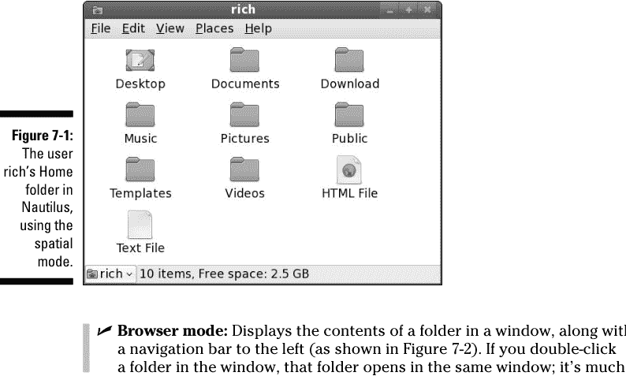

# 第7章：使用文件系统

就像在 Web 浏览器中打开新页面一样。你可以在同一个窗口内对文件系统进行向前和向后的导航。


Ubuntu 配置 `Nautilus` 始终以浏览器模式打开。Fedora 对某些项目使用空间模式打开 `Nautilus`，对另一些项目使用浏览器模式。如果你更倾向于一种模式而不是另一种，这个选择将通过显示如何控制打开哪种模式来提供帮助。

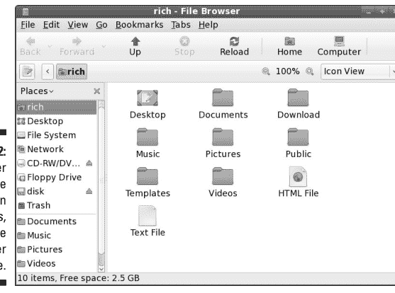

图 7-2：`Nautilus` 中的用户主文件夹，使用浏览器模式。

通常有几种方法从 GNOME 桌面启动 `Nautilus`：

- **双击桌面的“主”图标：** Fedora（以及许多其他基于 GNOME 的发行版）在默认桌面上包含主目录图标。`Nautilus` 将以空间模式打开当前用户的主文件夹。顶部是菜单栏，左下角是导航下拉列表，让你能够快速移动到父文件夹和“父文件夹的文件夹”。注意图 7-1，该窗口包含一个“位置”（Places）。
- **选择应用程序：文件浏览器：** 某些 Linux 发行版（如 Fedora）在应用程序菜单中包含 `Nautilus` 作为文件浏览器，其具有从“位置”到左侧的导航选项的双窗格。点击“位置”下拉列表查看左窗格中还有哪些可用选项，或者点击左窗格上部的 X 将其关闭。你可以随时再次使用下拉列表返回“位置”部分。
- **选择“位置”：** 此面板菜单为你提供了第 4 章中讨论的选项，让你能够立即打开 `Nautilus` 到预定义的位置。Ubuntu 默认使用浏览器模式，但 Fedora 使用空间模式（如图 7-1 所示）。
- **以图标形式查看：** 此默认选项将所有文件以图标形式显示，并在下方带有名称；参考图 7-1。
- **以列表形式查看：** 此命令为你提供有关文件的列表信息，以及图标和名称（见图 7-3）。注意列表左侧仍有小图标。


对于“以列表形式查看”模式的更多高级设置，选择“查看：可见列”。

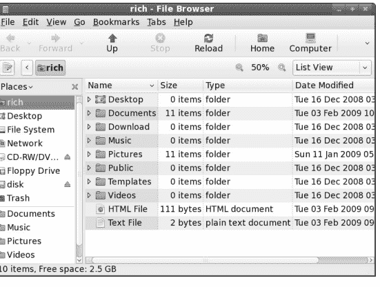

- **刷新：** 如果你创建了一个文件但在文件夹中没有看到，请选择此选项。
- **显示隐藏文件：** Linux 中所有以点开头的文件（例如 `.profile`）都是隐藏文件——你必须显式地告诉 Linux 看到它们。
- **放大、缩小和正常大小：** 更改文件夹内容的视觉大小。
- **重置视图为默认值：** 从头开始。

### 创建文件和文件夹

要在 `Nautilus` 中创建新文件或文件夹，请遵循以下步骤：

- 1. 浏览到你想在该文件夹中创建项目的文件夹。
在继续之前，你必须打开该文件夹并进入其窗口。
在选择了用于打开文件的程序后，点击“打开”继续。

### 复制和移动文件

你可以使用不同的方法在 `Nautilus` 中复制和移动项目。第一种是你可能在 Windows 或 Mac OS 中熟悉的常用方法——点击并按住文件或文件夹，将其拖动到你想去的地方。你可以在文件夹窗口之间以及文件夹图标之间进行拖动。这里有一些提示：

- 拖动时按住 `Ctrl` 键以进行复制而不是移动。
- 如果你想移动文件，请确保文件夹没有被高亮。
- 如果你想在文件夹窗口之间以及文件夹图标之间拖动，请确保文件夹处于高亮状态。

复制和移动文件的另一种方法涉及：

- 1. 右键点击你想移动的文件。2. 从弹出菜单中选择“剪切”，如果要复制则选择“复制”。
- 3. 导航到你想放置它的文件夹。
- 如果你想移动，确保文件夹没有被高亮。
- 如果你想在文件夹窗口之间以及文件夹图标之间拖动，确保文件夹处于高亮状态。

# 第二部分：快速上手 Linux

## 删除文件

要永久删除文件，请遵循以下步骤：

- 1. 右键点击文件或文件夹图标。2. 从菜单选择“移动到垃圾箱”。
文件将进入垃圾箱。如果你想删除它，确保文件夹没有被高亮。


### 清空垃圾箱

可以通过以下步骤永久删除垃圾箱的内容：

- 1. 右键点击垃圾箱图标。2. 从快捷菜单中选择“清空垃圾箱”。3. 在对话框中点击“清空”。
Linux 不会自动清理垃圾箱中的文件。你可以通过查看它来判断垃圾箱是否为空。如果它是空的，则里面没有文件。如果你在里面看到内容，则里面装有垃圾。

# 查看和修改权限

在第 6 章中，你看到 Linux（以及其他形式的 UNIX）中的每个文件都有一组权限，规定谁被允许查看、运行、删除等。权限非常重要；它们的分配是为了确保人们不会破坏系统文件或他人的文件。在本节中，我们重点关注如何在 GUI 中管理权限。

要在 `Nautilus` 中查看并更改文件或目录的权限，请遵循以下步骤：

- 1. 浏览到文件或目录的位置。打开包含该项目的文件夹窗口即可。
- 2. 右键点击文件或目录。出现一个弹出菜单。
- 3. 从弹出菜单中选择“属性”。属性对话框出现，并打开“基本”标签页。
- 4. 点击“权限”标签页。属性对话框的属性部分，如图 7-4 所示。
- 5. 设置新的权限和所有权。参阅第 6 章了解所有这些内容的含义。注意 GUI 将所有者、组和其他人分成了不同的下拉列表框。除非你熟悉 SELinux，否则保留 SELinux 上下文选项。
- 6. 点击“关闭”关闭对话框。

文件的权限现在已更改。

这基本上涵盖了你想在 `Nautilus` 中对文件系统进行的所有操作。

# 128 第二部分：快速上手 Linux

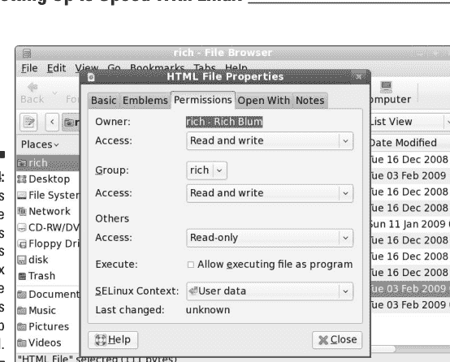

图 7-4 显示带有“权限”标签页的 `Nautilus` 管理器对话框

## 与海豚共游

如果你正在使用带有 KDE 桌面面的新 Linux 发行版，那么你可能正在使用 `Dolphin` 文件管理器。`Dolphin` 的工作方式与 `Nautilus` 的浏览模式非常，允许你从单个窗口中轻松浏览文件系统中的文件夹。

要打开 `Dolphin` 窗口，KDE 菜单系统（第 5 章）在“计算机”标签页下提供了指向工作站特定位置的链接。你可以查看“主目录”文件夹、网络上的远程共享文件夹、根目录下的整个文件系统（参见第 6 章）或特殊的“回收站”文件夹。图 7-5 显示了 `Dolphin` 窗口的主要布局。

查看默认的 `Dolphin` 窗口，你会发现它[拥有]许多与 `Nautilus` 相同的的功能：

- **菜单栏**：允许你访问用于在 `Dolphin` 窗口中显示文件和文件夹的设置，以及在当前窗口中创建新文件和文件夹的选项。
- **工具栏**：提供快速访问常用菜单功能的按钮：
    - 后退：导航到上一个查看过的文件夹。
    - 前进：如果你已向后导航，则导航到下一个查看过的文件夹。

# 第 7 章：使用文件系统

- **图标**：以图标形式显示文件和文件夹。
- **详情**：显示每个文件和文件夹的详细信息。
- **列**：显示两列信息，当前文件夹显示左侧列，所选文件夹中的文件和文件夹在右侧列。
- **预览**：显示文本和图像文件内容的缩略图。
- **分屏**：显示两个窗口，你可以用它们轻松将文件从一个位置拖放到另一个位置。

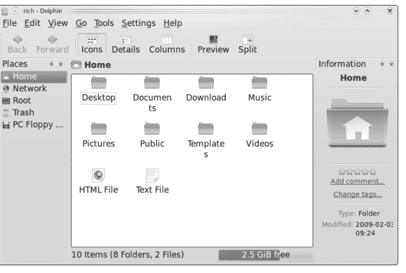

**图 7-5：** `Dolphin` 文件管理器中显示的用户主目录。

- **导航栏**：窗口左侧显示位置图标的区域。
- **视图**：显示当前文件夹中包含的文件和文件夹的区域。
- **信息区域**：窗口右侧的此区域在可能的情况下，会显示文件的缩略图预览（例如文本和图像文件）以及文件详情。
- **状态栏**：显示当前查看文件夹中的文件和文件夹数量——以及磁盘上当前可用的可用空间。

当在视图窗口中单击一个文件夹时，文件夹将在同一窗口中打开，路径（一个*面包屑*）会出现在视图窗口上方。就像在森林中留下面包屑以找到回路一样，你可以点击面包屑路径上的任何位置（也称为*路径名*）回到你开始运行的文件夹。

130 第二部分：快速上手 Linux

在 `Dolphin` 中创建、复制和重命名文件及文件夹的操作与 `Nautilus` 中完全相同。右键点击文件或文件夹会产生菜单，你可以剪切、复制或将文件移动到回收站文件夹。

在 `Dolphin` 中工作时要小心；默认情况下，它使用 KDE 的单单击激活方法：如果你选择一个图标，`Dolphin` 会尝试使用该文件的默认应用程序显示该文件。对于习惯在 Microsoft Windows 环境下双击打开文件的人来说，这有点烦人。你可以通过系统设置功能（参见第 5 章）来改变这种情况。

`Dolphin` 允许你在分屏显示模式下生成文件系统的并排窗口，如图 7-6 所示。只需点击工具栏上的“分屏”按钮。

使用分屏显示模式，你可以轻松地将文件从一个文件夹拖放到另一个文件夹——系统中的任何地方！

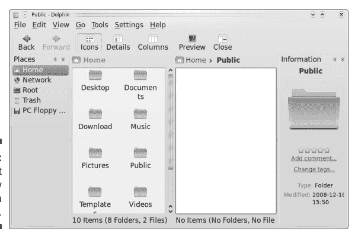

**图 7-6：** `Dolphin` 中的分屏显示模式。

## 征服者万岁

在旧版本的 KDE 中（在某些 Linux 发行版中仍然流行），默认文件管理器程序是 `Conqueror`。`Konqueror` 应用是 KDE 项目的瑞士军刀；它将文件管理器和浏览器包含在一个包中。

第 7 章：使用文件系统

由于其多功能性，许多新版本的 KDE 即使 `Dolphin` 被加载为默认文件管理器，仍然保留了 `Konqueror`。在 Fedora 中启动 `Konqueror`，选择“收藏：Web 浏览器”。默认的 `Konqueror` 打开了，但指向 Fedora 主页。你可以轻松地在 URL 中输入路径来查看你的本地文件。图 7-7 显示了 URL `/home/rich`，这是一个主目录。

`Konqueror` 的迷之处在于，你可以在同一个窗口内在页面和本地文件夹之间无缝跳跃！`Konqueror` 使用标签页浏览在主窗口内显示多个位置。按 `Ctrl+T` 打开一个新的标签页区域。然后你可以点击标签轻松地在网页和你的本地文件系统之间切换。

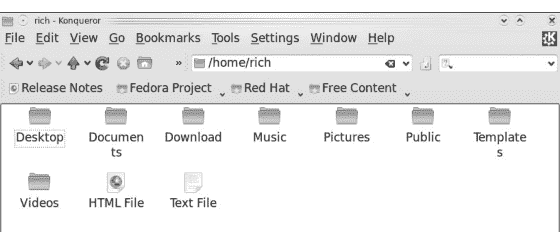

**图 7-7：** URL `/home/rich`，这是一个主目录。

*(注：由于原文中存在大量重复和 OCR 错误，翻译已根据唯一内容进行了去重)*

# 134 第二部分：快速上手 Linux

以下是从每个 Linux 文件管理器访问你的 Windows 文件的方法：

- `Nautilus`：选择“位置”`Places` 菜单。Windows 驱动器将与你可以访问的所有位置一起列出（驱动器名称将与 Windows 中使用的长名称匹配，但与驱动器器号不匹配）。
- `Dolphin`：Windows 驱动器将出现在导航栏区域的“位置”列表中——同样，使用的是与 Windows 相同的长驱动器名称。


某些 Windows PC 使用硬盘上的隐藏分区来存储备用数据。这些分区在 Linux 中不会被隐藏，因此请务必小心不要破坏对你的 Windows 系统重要的任何内容（除非，你正打算删除 Windows 的话）！

## 访问网络驱动器

有时你想要访问的驱动器在另一台电脑上。如果另一台电脑上的驱动器已设置为可以通过网络访问，你可以通过 `Nautilus`、`Dolphin` 或 `Konquerer` 文件管理器访问它：

- 在 GNOME 桌面中，选择“位置<-网络”(Places<-Network) 查看网络上的共享文件夹。如果你想访问 Windows 电脑，双击“Windows 网络”(Windows Network)。系统将显示网络上具有可浏览驱动器的 Windows 电脑。从那里，你可以浏览到你想去的任何地方！

- 在 KDE 世界中，选择 `KDE::Computer::Network`（参见第 5 章）。`Dolphin` 管理器将以网络模式打开，如图 7-9 所示。

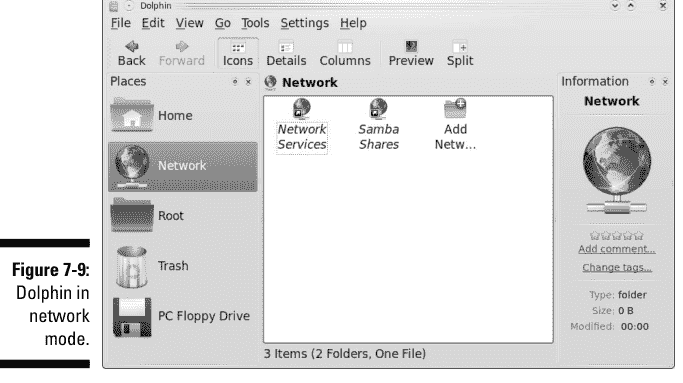

图 7-9：网络模式下的 Dolphin。

# 第 7 章：使用文件系统

你的 Windows 网络共享位于 Samba 文件夹下（Samba 不仅仅是一种舞蹈；它是 Linux 用于与 Windows 网络通信的软件——参见第 21 章）。

如果你能看到网络上的 Windows 共享文件夹，请检查你的 Linux 发行版是否启用了防火墙。默认情况下，Fedora 有防火墙来阻止 Samba 连接；而 Ubuntu 没有。（关于这些差异的更多信息，请参见第 8 章）。


## 刻录数据 CD 和 DVD

CD 和 DVD 刻录机是制作备份（特别是当光片是可重写的时）、保存和共享你的数字照片、制作纪念品或贴簿等的绝佳方法。Linux 下有许多工具可以让你刻录 CD；这里简要介绍其中几个工具。

### K3b 软件包

目前 KDE 环境中最流行的 CD 和 DVD 刻录软件是 K3b。遗憾的是，Fedora 默认没有安装它。如果你还没有安装，请参见第 16 章如何操作——你需要的特定包是 `k3b` 和 `k3b-extras`。要打开 K3b 程序，选择“应用程序:\媒体\CD 和 DVD 刻录”(Applications:\Media\CD and DVD Burning)。打开图 7-10 所示的窗口。

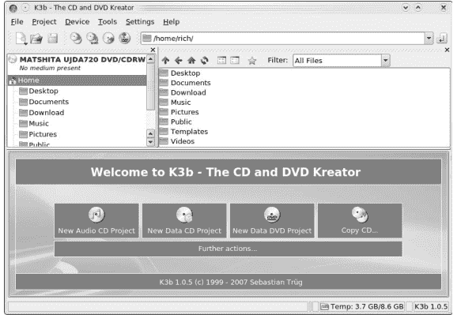

图 7-10：K3b CD 和 DVD 创建器。

# 136 第二部分：快速上手 Linux

如果你只是想用下载的 ISO 文件创建一张 CD 或 DVD，请执行以下操作：

- 1. 选择“工具::刻录 CD 镜像”(Tools::Burn CD Image)(如果这是 CD-ROM 的 ISO 文件）或选择“工具::刻录 DVD ISO 镜像”(Tools::Burn DVD ISO Image)(如果这是 DVD-ROM 文件）。

这两个选项都会打开“刻录 CD 镜像”对话框（参见图 7-11）。

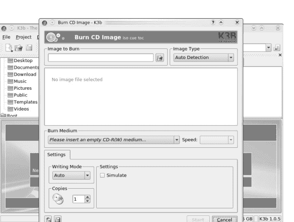

图 7-11：

K3b 刻录 CD 对话框。

- 2. 在“刻录”部分中，点击文件夹按钮，导航到你想刻录到 CD 或 DVD 的文件，选择该文件并点击确定。

文件名和信息现在出现在对话框中。

- 3. 如果由于某种原因你有多个刻录机，请确保“刻录介质”(Burn Medium)部分出现正确的刻录机，并在必要时更改选择。

- 4. 在“速度”(Speed)文本框中，如果你正在刻录 Linux 发行版的 CD 或 DVD，将其降低到至少 4x。否则，通常保持原样即可。

如果你发现当你刻录 CD 或 DVD 时，它们经常变成“飞星”（刻录失败的光片），请降低你通常使用的速度。

- 5. 如果你想在每次刻录时使用大部分这些设置，点击“保存用户默认值”(Save User Defaults)。

- 6. 点击“开始”(Start)开始刻录。

# 第 7 章：使用文件系统

出现一个对话框，显示两个进度条。第一个显示写入准备进度；第二个显示总进度，包括刻录时间。

- 如果是可重写介质，系统将询问你是否想擦除其内容以便重新写入。请给出相应的回答。

如果你告诉 K3b 擦除光盘，在过程的该部分会出现“擦除”(Erasing)对话框。擦除完成后，光驱会打开。

## 第8章

## 连接互联网

**本章内容**

- 收集连接信息

- 连接到你的互联网服务供应商 (ISP)

- 诊断你的连接问题

> 通信的每一次改进都让无聊变得更加糟糕。

— Frank Moore Colby

如果你使用的是一台连接到局域网 (LAN) 的机器，并且在安装期间配置了网络，那么你可能已经连接了互联网。要测试你是否已连接，请打开浏览器并尝试访问外部网站（如 www.gnu.org）。如果可以访问，说明你已经成功了！不需要看本章了。请继续阅读。

### 从你的 ISP 获取所需信息

大多数信良好的 ISP 在你注册其服务后会为你提供一份客户信息表。该表单应至少包含以下信息：

- 调制号器用户的本地电话拨号号码

- 用户登录名

- 用户登录密码

- 电子邮件地址

- 用于路由出站电子邮件的电子邮件出站主机或简单邮件传输协议 (SMTP) 服务器

- 用于接收入站电子邮件的电子邮件入站主机或邮局协议 (POP) 服务器

- 新闻主机

- 你的计算机地址是否属于以下类型之一：

  - 静态：你拥有相同的 IP 地址。静态地址对于服务器比桌面电脑更常见。如果你使用静态地址，你的 ISP 需要为你提供一些信息。你必须定义名称服务器 IP 地址（将主机名解析为 IP 地址）、网关地址（通过 ISP 路由你的连接）以及网络地址和子掩码组合（定义哪些地址是工作站的本地地址）。所有信息都应在客户信息表上。

  - 动态：你的 IP 地址每次连接时都会变化，或者会定期变化。在大多数桌面电脑上，你不需要相同的地址，这让 ISP 的工作变得更容易。它也让笔记本等经常在网络间移动的电脑更加方便。如果你使用动态地址，会被告知需要使用 DHCP 连接。

有了这些信息，你可以使用 Linux 系统建立互联网连接。

### 配置你的连接

好了，你已经有了网络硬件和 ISP 信息 —— 现在怎么办？答案是配置你的 Fedora 系统以接入互联网！

配置过程根据你使用的硬件而略有不同。本节涵盖了访问互联网的三种最佳方法：

- 使用调制号器拨打 ISP

- 使用以太网卡连接到 DSL 或电缆调制号器节点

- 使用无线网卡连接到无线接入点

每种情况都需要配置一些略有不同的项目，但你可以通过 Fedora 网络配置工具完成所有操作。

## 第8章：连接互联网

### 拨号连接

使用调制号器拨号连接 ISP 是分两个步骤。首先，你必须根据 ISP 提供的设置配置你的调制号器。之后，你必须手动启动和停止连接（你可能不想让你的调制号器整天占用你的电话线）。

GNOME 和 KDE 桌面有不同的软件包来配置调制号器并连接 ISP：

- `GNOME-PPP`：此程序适用于 GNOME 桌面。

- `KPPP`：此程序适用于 KDE 桌面。

如果你的 Linux发行版没有包含这些程序（Fedora 包含 KPPP 但不包含 GNOME-PPP），可以从大多数 Linux 发行版的标准安装 CD 安装这两个包（见第 16 章）。安装完成后，你可以按照接下来的章节操作，了解如何配合你的调制号器配置它们。

### 设置 GNOME-PPP

安装 `GNOME-PPP` 软件包后，你可以按照以下步骤配置 PPP 会话以连接到 ISP：

1. 从顶部边缘菜单选择 应用程序：Internet；GNOME PPP。

   主 GNOME PPP 对话框如图 8-1 所示。


2. 点击底部的 Setup 按钮。

   打开 Setup 对话框，如图 8-2 所示。


3. 在 Modem 选项卡中配置调制号器设置。

   你必须选择调制号器通信的端口。大多数 Linux 发行版分配给调制号器的设备名称是 `/dev/modem`、`tty0`、`ttyS1` 等。

4. 点击 Networking 选项卡设置你的 IP 地址。

   - 如果你的 ISP 动态分配 IP 地址，选择 Dynamic IP address。

   - 如果你的 ISP 使用静态地址，选择 Static IP address 并在框中输入。

5. 点击 Options 选项卡设置附加功能。

   如果你希望 KPPP 记住你的密码，可以勾选该框。

6. 点击 OK 按钮保存设置。

## 第8章：连接互联网

7. 回到 GNOME PPP 对话框，输入你的 ISP 账户信息。


你必须提供 ISP 提供的号码，然后点击 OK。号码将出现在列表中。如果 ISP 提供其他号码，你也可以将其加入列表。咨询你的 ISP 以确定认证设置。

## 设置 KPPP

KPPP 软件包所需的操作与 GNOME-PPP 连接互联网的操作相似。对话框如图 8-3 所示。


图 8-3：PPP 对话框

以下是设置 KPPP 的方法：

1. 点击 Connect 按钮更改设置。

KPPP 配置对话框有四个选项卡用于配置连接：

- `Accounts`：定义 ISP 的登录信息
- `Modems`：定义你的调制号器属性
- `Graph`：定义连接统计的显示方式
- `Misc`：定义应用程序的各种行为

2. 选择 `Modems` 选项卡设置你的调制号器。

3. 点击 Add 按钮添加新的调制号器。

弹出 New Modem 对话框，如图 8-4 所示。


图 8-4：在 KPPP 中添加调制号器

调制号器设备应该指向你的 `/dev/modem` 条。这是 Linux 发行版分配给调制号器的设备名称。你可以点击 Query 按钮测试调制号器配置。

4. 选择 `Accounts` 选项卡。

`Accounts` 选项卡允许你定义多个 ISP 账户。

5. 点击 New 按钮添加新账户。

无论你想使用向导还是手动输入 ISP 信息，都会弹出 New Account 对话框。目前，向导仅支持几个国家的几个 ISP（在美国尚不支持）。你可能需要使用手动设置方法。

# 第 8 章：连接互联网

147

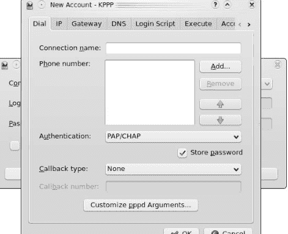

图 8-5：在 KPPP 中添加 ISP 账户。

- 7. 点击确定返回到主配置窗口。你现在已准备好连接了。
- 8. 输入你的 ISP 用户名和密码，然后点击连接。KPPP 会拨号连接、连接到 ISP 并使用你的用户名和密码登录。

当 KPPP 与 ISP 建立连接时，它会在 KDE 面板中显示一个图标，显示当前的活动连接。要停止互联网连接，右键点击面板图标，并选择断开连接。

## 网络管理器 (Network Manager)

Network Manager 应用程序为你所有的网络配置需求提供一站式服务。如今几乎每个 Linux 发行版都使用 Network Manager 应用，包括 Fedora 和 Ubuntu。

你可以通过右键点击 GNOME 或 KDE 面板上的网络管理器来启动 Network Manager（取决于你的网络连接，它可能是两个显示器的图片或一系列条形）。从上下文菜单中选择“编辑配置”来查看你的网络配置。会出现图 8-6 所示的“网络连接”对话框。

148 第二部分：快速上手 Linux

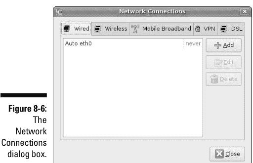

通过此界面，你可以配置：

- 有线以太网卡连接
- 无线以太网卡连接
- 移动宽带（无线调制调器）连接
- 虚拟专用网络 (VPN) 连接
- DSL 连接

你可能正在家庭网络上工作，无论是有线的还是无线的。接下来的章节将介绍处理这两类型网络的基本知识。

## 玩转网卡

随着宽带连接的增加，如今有更多的 Linux 用户直接连接到互联网。对于大多数电缆和 DSL 调制调器，你需要一个网络接口卡 (NIC) 来连接到调制调器。

如果你使用有线网卡访问宽带连接，Network Manager 软件可能会在安装过程中自动为你检测并完成配置。你可以通过查看桌面面板上的 Network Manager 小程序来判断这一点。

如果由于某种原因，Network Manager 没有正确检测到你的网络设置（或者你必须手动设置静态 IP 地址），你可以使用 Network Manager 接口进行设置。

打开“网络连接”对话框并按照以下步骤配置你的有线网络连接：

第 8 章：连接互联网

- 1. 在列表中点击有线网络网卡，然后点击“编辑”按钮。

如果工作站有多个有线网卡，Ubuntu 按照数字顺序对网卡命名，第一块网卡为 `eth0`，第二块网卡为 `eth1`，以此此类推。

图 8-7 所示的编辑对话框。

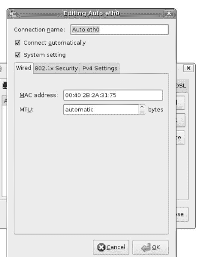

图 8-7：网络连接编辑对话框。

2. 配置有线网卡设置。

编辑对话框包含网卡的三个标签信息：

- 有线 (Wired)：设置网卡的介质访问控制 (MAC) 地址（Ubuntu 会自动检测）和介质传输单元 (MTU) 大小，设置为自动。
- 802.1x 安全：设置连接到有线网络的登录详情。某些网络交换机使用此功能来限制对有线网络的访问。如果你的网络使用了 802.1x 安全，请咨询你的网络管理员以获取正确的可用设置。
- IPv4 设置：确定网卡 IP 地址的设置方式。这可以是从 DHCP 服务器动态获取（使用 `zeroconf` 协议与网络上的其他设备协商地址），也可以使用配置好的的 IP 地址进行静态设置。

150 第二部分：快速上手 Linux

3. 点击确定保存新设置。

当你为有线以太网卡配置好 Network Manager 后，它会尝试在你启动工作站的同时启动该网卡。如果 Network Manager 图标出现在面板上但未显示连接（图标上有一个红 X），请检查电缆以确保插得正确。此外，检查你连接的网络集线器。


看，没电缆了！

无线现象已经席卷了家庭网络。如今，无线路由器的购买和安装和有线交换机一样简单。如果你已经加入了无线大潮，你需要知道如何将你的 Fedora 连接到无线接入点。

首先，你可能几乎没有拥有一个无线网卡本身。遗憾的是，Linux 世界对无线网络的支持仍处于起步阶段。Fedora 的每个新版本都包含了对更多无线网卡的支持，你的无线网卡很有是有支持的。


如果你的无线网卡不受支持，你还可以采取最后的措施：`ndiswrapper` 项目。`ndiswrapper` 项目是一个使用 Windows 驱动程序的开源项目，你可以通过访问 http://sourceforge.net/projects/ndiswrapper/ 了解详情。

如果你的无线网卡受支持，你可以执行以下操作：

- 1. 在列表中点击无线网络网卡，然后点击“编辑”按钮。
- 2. 配置无线网卡设置。
- 3. 点击确定保存新设置。

第 8 章：连接互联网

151

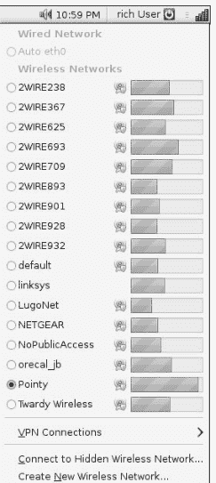

图 8-8：网络列表。

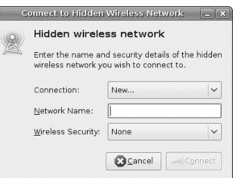

图 8-9：指定网络。

152 第二部分：快速上手 Linux

## 在一切顺利之前之前都是乐趣

在理想的世界里，前面的章节应该在 100% 的情况下正常工作。预判人们可能遇到的问题范围是不可能的，Linux 社区是你的最佳依靠。此外，去你最喜欢的网站搜索从系统获取的错误信息。当你试图弄清网络出了什么问题，或者试图收集信息来帮助他人判断问题时，你可以使用一个酷的工具：手手的 `ping` 命令行程序。

第 8 章：连接互联网

延迟（Latency）是指信号到达互联网所需的时间，与物理距离有关。相反，网络流量、带宽和网络硬件等因素共同导致了低延迟。这些因素决定了对邻居电脑执行 `ping` 命令的时间是否比 `ping` （比如）南极的一台主机更长。

例如，通过打开命令提示符（见第 17 章）并输入以下命令来 `ping` Yahoo!：

```
ping www.yahoo.com
```

按下 `Ctrl+C` 停止 `ping` 命令；否则你的计算机将继续 `ping` 目标。

输出内容：

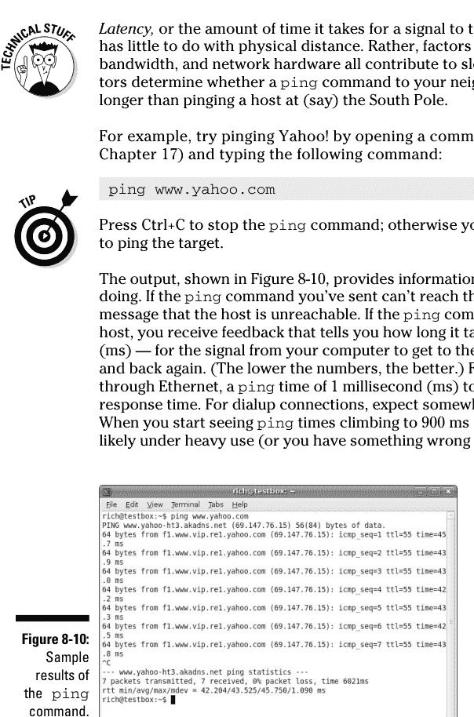

图 8-10 `ping` 命令的示例结果。

## 第三部分

搞定

Rich Tennant 著《第五波》

> > 够了！泰人不再听这些了！一直收到坏消息！这是什么意思？！泰人尝试了一切！让泰人像猎豹一样愤怒！想把劳力士穿过屏幕！

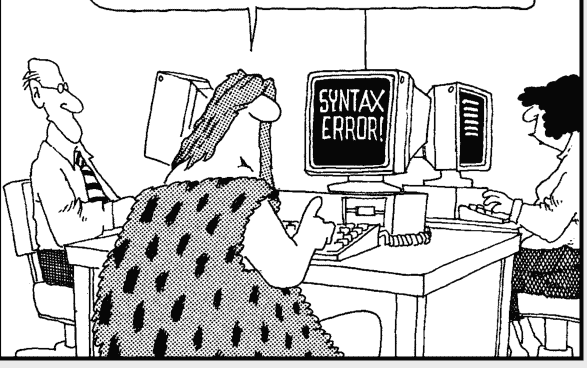

## 在这一部分……


在书的这一部分，真正的乐趣开始了。在这里，你将发现如何使用 Linux 系统自带的所有有趣软件！你将从生存所需的互联网工具开始，你知道的，如果现在无法访问这些东西，你恨不得咬断自己的腿：网网、电子邮件、即时消息等。你还将发现如何编辑文件，无论是普通的文本文件，还是需要办公套件的文件——是的，你将看到如何在 Linux 环境中处理 Windows 文档！然后你将进入我们认为最好的部分：音频和视频！最后，这一部分以对流行的 Google Gadgets 的介绍结束，这是一种最近非常流行的桌面工具。

# 第 9 章 使用互联网

**本章内容**

- 浏览网页
- 发送即时消息
- 获取文件
- 跨网聊天

> > 授人以鱼，可以饱他一天；授人以渔网，他可以不打扰你几周。
> 
> — 匿名

互联网是一个遍布全球的计算机网络。许多不同类型的计算机和操作系统共同工作，让你能够访问跨越该网络的信息。Linux 与其他 UNIX 操作系统一样，长期支持并与互联网协作。互联网上几乎所有可用服务都可以从你的 Linux 桌面获取。

当你安装 Linux（第 3 章）时，你的新系统上将获得一个或多个 Web 浏览器、电子邮件程序和即时消息工具。在本章中，我们将向你介绍这些工具；在配置互联网连接（第 8 章）后，你可以使用它们访问互联网上的不同服务——例如网站、电子邮件、新闻组和 FTP。

## 使用 Firefox 浏览网页

许多人将互联网的爆炸式增长归功于图形化浏览器。互联网的出现比浏览器的发明早得多。只是互联网上的大部分工作都是纯文本，对于那些喜欢漂亮图片的人来说毫无吸引力。在 Linux 世界中，最流行的浏览器无疑是 Firefox (`www.mozilla.org/products/firefox`)，它是 Mozilla（一个通信程序）的 Web 浏览器部分，还可以处理电子邮件和新闻浏览。另一个流行选项是 Conqueror (`www.conqueror.org`)，它不仅是一个良好的 Web 浏览器，还包含了类似于 Nautilus 和 Dolphin 程序的文件浏览功能（见第 7 章）。

目前，某些 Linux 发行版的开发者与 Firefox 开发者之间存在一些问题。Firefox 开发者复制了 Firefox 的名称和标志，这在开源软件世界中被视为大忌。因此，某些 Linux 发行版拒绝包含 Firefox。相反，它们包含了 IceWeasel 浏览器（你一定会喜欢这种开源幽默的），它使用与 Firefox 相同的源代码（因为源代码仍然是开源，即使标志和名称不是）。如果你的发行版使用 IceWeasel，你可以按照本章中的相同步骤操作。

### 配置 Firefox

如果你愿意，现在就可以开始冲浪。你不需要自定义浏览器。不过，你可能想花点时间告诉 Firefox 你的偏好，例如启动时显示的默认网站、默认使用的字体大小、使用的颜色以及许多其他选项。

按照以下步骤在“偏好”窗口中配置 Firefox 设置：

1. 启动 Firefox。
通常有多种方法启动 Firefox。使用 GNOME 桌面的 Linux 发行版通常会在顶部放置应用程序启动图标（见第 4 章）。使用 KDE 桌面的发行版有时会将 Firefox 作为应用程序启动器，并将其放在面板中（见第 5 章）。
在两种桌面环境中，你始终可以选择 `Applications::Internet::Firefox`（在 GNOME 中）或 `KDE::Applications::Internet::Firefox`（在 KDE 中）。

2. 选择 `Edit::Preferences`。
偏好窗口出现，如图 8-10 所示[注：文中写的是图 8-10，但上下文暗示是一张新图]。

3. 选择 `Edit::Preferences`。
偏好窗口出现，如图 9-1 所示。

4. 选择 `Edit::Preferences`。
偏好窗口出现，如图 9-2 所示。

### 内容偏好

点击“内容”图标进入 Firefox 偏好对话框的“内容”部分（见图 9-3）。

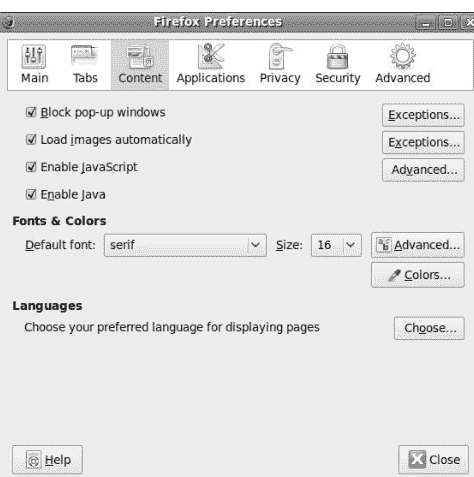

图 9-3：
Firefox 偏好窗口。

本节介绍了 Firefox 如何响应各种类型的内容。顶部部分是指你可以阻止或允许的项目；每个项目右侧都有一个按钮，提供额外的控制选项：

- 阻止弹出窗口：告诉 Firefox 阻止你未请求的新窗口 —— 弹出窗口是某些所有者在你尝试访问其网站时投放广告的常用手段。然而，某些网站的功能需要打开某些未经请求的窗口（例如，为了登录）；点击“例外”按钮将这些网站添加到“已允许的站点”列表中。当弹出窗口尝试打开时，浏览器窗口中会出现一个黄色条条，允许你打开该弹出窗口或将其删除。

- 自动加载图像：允许你阻止所有图像。这对于视力障碍或试图通过忽略图片来加快浏览速度的人非常有用。如果你选择“仅限源网站”，你将阻止许多从其他站点加载并显示在你正在查看的页面上的广告。然而，选择此选项也会阻止图形。点击“例外”按钮来管理你想要或不想看到的内容。

- 启用 JavaScript：有些人出于安全考虑关闭了此功能。但许多人没有。点击“高级”按钮将打开“高级设置”对话框，在其中你可以选择允许 JavaScript 执行的操作。如果你发现某个网站执行诸如缩调整窗口大小等烦人操作，请进入此对话框禁用该功能。

- 启用 Java：如果你安装了 Java 并启用了此选项，Firefox 将运行它找到的任何代码。

中间部分是“字体与颜色”。这些功能包括：

- 默认：点击此下拉列表框选择字体。
- 大小：点击此下拉列表框选择字体大小。
- 高级：点击此按钮打开“字体”对话框，允许你为各种字体类选择要使用的默认字体和大小，以及其他视觉设置。在此处你还可以指定页面使用除你覆盖设置之外的字体。
- 颜色：点击此按钮打开“颜色”对话框，更改分配给文本、背景和链接的默认颜色。

底部部分是“语言”。这允许你在有多种选择时设置你偏好的网站语言。勾选相应的框来设置你偏好的语言，以及你的偏好顺序。


在浏览时，如果你对字体大小不满意，按 `Ctrl++`（加号）使字体变大，或按 `Ctrl--`（减号）使字体变小。`+` 和 `–` 是数字小键盘上的版本，而不是主键盘上的。

### 高级偏好

本节提供了四个标签页设置，用于大多数用户可能并不需要的更高级的功能：

- 通用：`通用`标签页允许你为行动不便的用户设置功能，添加额外的浏览器控制功能，并指定你是否让 Firefox 检查它是否为系统的默认浏览器。
- 网络：点击“连接”部分中的“设置”按钮使用代理服务器访问在线内容。代理服务器提供了访问互联网的网关，网络管理员可以在此处控制你不应访问的站点的。“离线存储”部分允许你设置 Firefox 允许留出多少磁盘空间作为存储访问过的网页内容的缓存。如果你允许较大的缓存，那么 Firefox 下次访问这些页面时可以更快地显示。你可以通过点击“立即清除”按钮清除缓存。缓存数据也是你可以设置在退出 Firefox 时自动清除的隐私数据的一部分。
- 加密：`加密`标签页具有 Firefox 使用的安全协议设置；你也可以在这里访问加密网站时指定任何特殊的加密证书。通常情况下，你可以保持这些不变。

## 通过扩展程序扩展你的宇宙

Firefox 在基础设置中支持了一系列功能。然而，在广大的 Web 浏览世界，你早晚会遇到基础 Firefox 设置不支持的内容。

但不要担心 —— 帮助就在身边！Firefox 允许你只需点击几次鼠标即可为基础设置添加新功能。Firefox 通过“扩展程序”支持这些新功能 —— 扩展程序是附加在基础浏览器上的更多功能的小型程序。Firefox 中有三种类型的扩展程序：

- 扩展：为 Firefox 程序添加新功能，例如定制工具和作为字典的工具。
- 主题：允许你更改整个 Firefox 浏览器界面的外观和感受。
- 插件：直接在浏览器中为额外的多媒体格式（如视频和音频轨道）提供支持。


你会对那些坚持你下载软件才能查看的网站感到恼吗？插件和外部程序的区别在于：插件显示在浏览器内部，而外部程序运行在外部。虽然当你只是寻找某些东西时插件可能会很烦，但它们可以提供一些很酷的东西，例如视频流。第 14 章解释了如何添加

Firefox 提供了一个独立的界面来管理扩展程序。选择“工具；扩展程序”来打开“扩展程序”对话框（见图 9-4）。

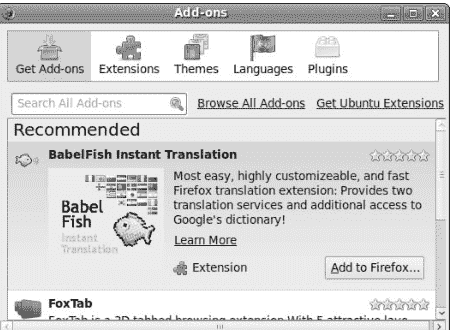

图 9-4：扩展程序对话框。

扩展、主题和插件显示你当前安装的内容。以下是安装扩展程序的方法：

1. 如果已连接互联网，点击“获取扩展程序”图标查看推荐的扩展程序。


2. 点击“浏览所有扩展程序”链接打开一个可以查看可用扩展程序的网页。

3. 当你发现想要尝试的扩展程序时，点击其描述下方的“安装”链接；如果你的 Firefox 版本支持，点击“立即安装”。


帮助？关于 Mozilla Firefox。如果你运行的版本不支持，你可能会收到错误消息且扩展程序可能无法安装。

## 浏览 Web

Firefox 是你通往万维网的窗口。Firefox 的主要目的是根据你的命令获取 Web 页面，将所有的图形和相关文件下载到计算机内存中，并最终渲染页面供你交互。

## 完成任务

如果你习惯使用浏览器浏览器，使用 Firefox 应该轻而易举。它拥有熟悉的导航工具，如地址栏；后退、前进、刷新和停止按钮，以及一个存储你收藏站点链接的功能（书签）。

Firefox 像 Netscape 一样有一个“历史记录”侧边栏 —— 按 `Ctrl+H` 显示或隐藏它（见图 9-5） —— 你可以用它访问最近过的 Web 页面。

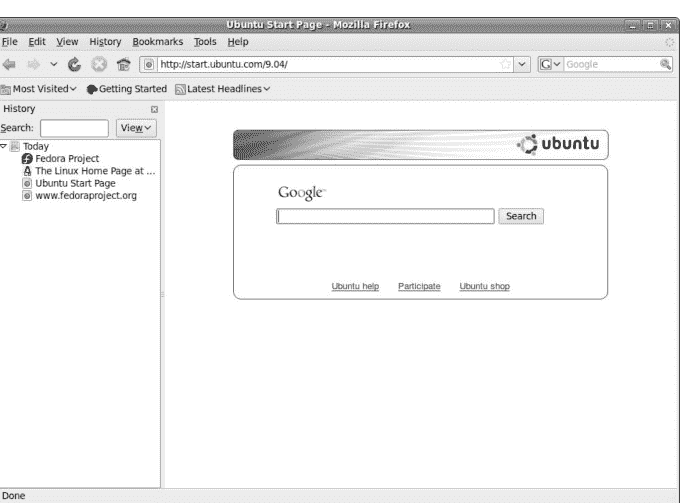

图 9-5：打开了历史记录侧边栏的 Firefox。

标签页浏览 —— Firefox 的一项功能对你来说可能是全新的，允许你在同一个窗口中打开多个 Web 站点。

启动 Firefox 浏览器后，定义为主页的 Web 站点会出现在标签页中。你可以保持该页面打开，并通过 `Ctrl+T` 在新标签页中打开一个新的 Web 站点。新的 Web 页面出现在同一个 Firefox 窗口中，但你只需点击每个页面顶部相应的标签即可在两个标签页之间切换。

你也可以通过右键点击链接并选择“在新标签页中打开链接”，将 Web 链接作为新标签页打开。此功能对于在复杂的网站之间导航且需要返回之前的页面时非常有用。

当你尝试关闭打开了多个标签页的 Firefox 时，会弹出警告，询问你是否要保存打开的标签页。如果你点击“保存并退出”按钮，下次打开 Firefox 时，你的标签页将打开到之前保存的站点。


## 利用即时消息

人之间的即时消息（IM）就像使用电话——不同的是你是打字聊天而不是口头交流。此外，你可以在不需要额外连接互联网的情况下同时进行即时消息对话。美国在线 (AOL) 提供了流行的即时通讯器 (AIM)。ICQ、MSN、Yahoo! 和 Google 也提供其他即时消息服务。包括 Linux 在内的多种计算机操作系统都支持这些不同的即时消息服务。

在 Linux 世界中，你可能会遇到两个流行的即时消息软件包：

- Pidgin：用于 GNOME 桌面环境。
- Kopete：用于 KDE 桌面环境。


我们将查看如何为你的即时消息账户设置这些软件包中的每一个。

Pidgin 软件软件包曾用作 GAIM。遗憾的是，由于版权限制，软件包名称必须更改。如果你在之前的 Fedora 或 Ubuntu 版本中使用过 GAIM，Pidgin 的工作方式完全相同。

## 使用 Pidgin 即时消息器

要从 Fedora GNOME 桌面启动 Pidgin IM 软件，选择“应用程序>互联网消息传递”。从 Ubuntu，选择“互联网>Pidgin 即时消息器”。

当你第一次打开 Pidgin 时（见图 9-6），会弹出一个空对话框（用于管理你的账户）。

### 168 第三部分：完成任务

账户

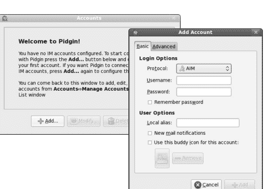

图 9-6：添加账户对话框（空）和添加账户对话框。

要让 Pidgin 你的一个即时消息账户，请按照以下步骤操作：

1. 点击账户对话框中的“添加”按钮。

显示如图 9-6 所示的添加账户对话框。

2. 在“协议”下拉列表框中选择你想要使用的 IM 网络。

有很多选项可以选择，包括流行的 AIM、Bonjour、Gadu-Gadu、Google Talk、Groupwise、ICQ、Jabber、MSN、MySpace IM、QQ、SILC、SIMPLE、Yahoo! 和 Zephyr。

3. 在账户和密码框中输入你即时消息账户的登录名和密码。

不同的 IM 主机使用不同的登录名连接，例如你的电子邮件地址或预分配的登录 ID。

4. 在“用户选项”部分，输入要使用的本地别名；然后选择一个好友图标来代表该账户。

本地别名将代替你的登录名，如果你与多个站点进行交互，这将更容易识别你正在与哪个 IM 站点交互。

5. 如果你通过此服务接收电子邮件并想知道新邮件何时到达，请勾选“新邮件通知”框。

6. 如果你想访问此 IM 服务的更高级选项，请点击“高级”标签卡。

### 第 9 章：使用互联网

每个 IM 服务都有其自己的一套可以配置的高级选项。

例如，AIM IM 服务允许你更改连接的默认 AOL 服务器，以及默认的 TCP 端口号。

7. 当你完成信息输入后，点击“添加”将此 IM 账户添加到你的账户列表中。

对你每个想要用 Pidgin 使用的账户重复此过程。

当你创建一个账户时，它会出现在账户对话框中。对于你想要自动登录的账户，选择“已启用”列。

在你创建账户后，会显示 Pidgin 好友列表对话框（见图 9-7）。


图 9-7：Pidgin 好友列表。

你可以通过在 Pidgin 好友列表对话框中选择账户并点击“修改账户”按钮来修改账户设置。

当你启动会话时，好友列表窗口会显示你的活动连接。如果你关闭好友列表窗口，Pidgin 图标会出现在你的面板上，因为程序在后台运行。你可以通过右键点击此图标打开好友列表窗口。

再次，Pidgin 的功能远不止于此，因此绝对值得花时间玩玩这个工具。

关闭账户和好友列表对话框后，你可以通过右键点击系统托栏中的 IM 图标并从菜单选择你想打开的对话框来重新打开它们。

### 170 第三部分：完成任务

## 尝试 Kopete

如果你使用 KDE 桌面，你可能已经安装了 Kopete 即时消息应用。要启动 Kopete，选择“KDE::互联网”。在 Fedora 中，选择“应用程序>互联网::即时消息”。启动 Kopete 后，将显示其主窗口（见图 9-8）。


图 9-8：Kopete 主窗口。

要在 Kopete 中开始，你必须添加账户。按照以下步骤操作：

1. 点击主窗口中的“添加”按钮。

Kopete 会启动一个向导引导你完成设置。第一页列出了你可以使用的网络。

2. 选择你想要使用的 IM 网络，然后点击“下一步”。

第二页根据网络包含一个或多个标签卡。

3. 填写你的账户信息，然后点击“下一步”。

4. 点击最后一页上的“完成”按钮。

如果你想让 Kopete 自动连接到 IM 服务，在点击“完成”按钮之前勾选“立即连接”框。

向导将你返回主窗口。

每个网络都有一个“基本”标签卡，你那里配置登录名和密码。某些网络有“账户”标签卡，允许你设置备服务器或代理服务器。某些网络可能提供“隐私”标签卡，允许你确定哪些用户被阻止或允许。

### 第 9 章：使用互联网


图 9-9：选择 IM 网络。

要修改你的账户设置、添加新账户或更改 Kopete 的行为，通过选择“设置:配置”打开“配置”窗口。显示如图 9-10 所示的配置窗口。

从从配置窗口中可以看出，你可以通过多种方式自定义 Kopete 以最大化你的体验。

在启动 Kopete 后，它会在 KDE 面板的系统托栏区域创建一个图标。只需右键点击图标即可调出好友列表。


### 172 第三部分：完成任务


图 9-10：Kopete 配置窗口。

## 排除 IM 连接的故障

如果你在其他操作系统上一直使用大多数 IM 客户端，在你的 Linux 系统成功连接到 IM 服务后，现有的好友列表将被导入。如果你从未用过 AIM 或 MSN，现在可以设置好友列表了。好友列表包含了你想通过即时消息服务通信的人的用户名。你的好友列表让你知道“朋友”何时在线并可以接收即时消息。

有时，你的 Linux 系统无法正确连接到 IM 服务。当此问题发生时，屏幕上会弹出错误消息并指示连接失败。你可能由于以下原因无法连接到 IM 服务：

- 你可能输入了错误的 IM 账户密码或选择了错误的 IM 账户名。
- 你的计算机可能没有连接互联网。尝试打开 Web 浏览器查看是否可以访问 Web 站点，这告诉你已连接到互联网。


如果你可以打开 Web 站点但无法让 IM 工作，则 IM 系统可能不可用。这种问题有时是因为 IM 服务的维护或互联网或 IM 服务流量过大导致的。

# 第 9 章：使用互联网

如果你尝试从工作电脑上访问 IM（即时通讯）服务，你的公司或组织可能会出于安全或效率考虑阻止 IM 服务。如果工作场所允许使用 IM，请咨询你的网络管理员查看他或她是否可以提供帮助。

公司网络和互联网之间通常会使用防火墙，以防止意外流量进入公司网络。如果防火墙被配置为阻止 IM 流量，则你无法通过互联网使用 IM。

## 使用 BitTorrent 下载

无论你对文件共享怎么看之，它确实非常流行。诸如 BitTorrent (`www.bittorrent.com`) 这样的网络已经在软件公司和其他内容贡献者中找到了合法的用途。他们利用它来提供大文件的下载，而无需自行承担带宽压力，因此了解如何在 Linux 下使用这种软件是值得的。

你可能已经猜到 Linux 世界中有几个图形化的 BitTorrent 客户端软件包：

- BitTorrent：由 BitTorrent 网络开发的软件包，在 Windows 和 Linux 用户中都很受欢迎。
- Transmission：由 GNOME 桌面开发者为 GNOME 桌面创建的 BitTorrent 软件包，在 Fedora 和 Ubuntu 中默认安装。
- KTorrent：由 KDE 开发者为 KDE 桌面创建的 BitTorrent 软件包，在选择 KDE 桌面时，在 Fedora 中默认安装。

所有的 BitTorrent 客户端软件包工作方式大同相同。以下是概述：

- 1. 一个 BitTorrent 下载包含一个必须下载的控制文件。控制文件通过文件名中的 `.torrent` 扩展名识别。它告诉 BitTorrent 客户端软件去哪里联系控制下载信息的服务器。
- 2. 当客户端连接到服务器时，服务器会将客户端引导至其他拥有下载文件部分的其他客户端。
- 3. 这是一个互惠的过程，客户端从其他客户端下载文件的部分内容，同时将他们已下载的部分分享给其他客户端。

以下是在你的 Linux 桌面上启动 BitTorrent 会话的方法：

- 1. 启动你的 BitTorrent 客户端。你可以从桌面菜单系统中的“互联网”组访问 BitTorrent 客户端。图 9-11 所示了 Fedora Transmission 客户端。对于大多数 Linux 发行版，Firefox 浏览器都配置为每当你从网页上选择 `.torrent` 文件时，都会启动 BitTorrent 客户端。


图 9-11：Transmission-BitTorrent 客户端窗口。
- 2. 选择打开 Torrent 文件选项。对于 Transmission，点击工具栏上的“添加”按钮。对于 KTorrent，点击“打开”按钮。会出现一个文件浏览器窗口。
- 3. 导航并选择你想要下载的文档的 `.torrent` 文件，然后点击选中的 torrent 将其添加到列表。文件将以类似于音乐播放器的格式出现，如图 9-12 中使用 KTorrent 所示。你通常可以通过向其他 BitTorrent 用户提供更快的上传来控制下载。如果你有宽带（第 8 章），40 Kbps 的上传速度效果良好。

工具可能需要一分钟左右才能完全同步，因此预计时间在一段时间内会发生巨大变化，直到稳定在一个一致的值上。


图 9-12：正在下载文件的 KTorrent 窗口。


- 4. 当你准备退出时，选择：退出客户端。即使下载完成，BitTorrent 客户端也会继续保留该文件供他人下载。如果你想做一个良好的互联网邻居，在下载完成后让 BitTorrent 客户端运行一会，以便其他人能够顺利获取他们需要的片段。

## 处理老式文件传输

虽然 BitTorrent 是未来的趋势，但仍有很多互联网网站需要你使用旧的文件传输协议（FTP）方法来下载文件。你经常可以在 FTP 站点找到应用程序、实用程序和其他酷工具的文件仓库。

大多数 Linux 发行版都包含一个命令行 FTP 客户端（简单称为 `ftp`），但默认安装中不包含图形化客户端。不过，使用软件软件包管理器添加图形化客户端是没有问题的（见第 16 章）。Linux 世界中最流行的三个图形化 FTP 程序是：

- gFTP：GNOME 项目的图形化 FTP 客户端。
- Kget：KDE 项目的图形化 FTP 客户端。
- FileZilla：创建一个运行在任何桌面（包括 Windows 和 Mac）上的图形化 FTP 客户端程序。

`FileZilla` 软件包在大多数 Linux 发行版中可用，且在 GNOME 和 KDE 桌面环境中运行同样良好。它还支持安全的 FTP 会话，这在如今变得越来越流行。如果你正在寻找一个健壮的 FTP 客户端程序，请尝试安装 `FileZilla`（第 16 章）。

当你拥有 FileZilla 后，按照以下步骤操作：

- 1. 在桌面菜单的“互联网”组中启动 FileZilla。出现 FileZilla 窗口，如图 9-13 所示。FileZilla 提供并列查看你的文件系统和远程服务器视图。


图 9-13：FileZilla 窗口。
- 2. 在“主机”框中输入远程 FTP 服务器的主机，在“用户名”框中输入用户名，在“密码”框中输入密码。如果你以前连接过该主机，其主机名和用户名会显示在框。
- 3. 当远程 FTP 会话启动时，可用文件和文件夹出现在右列表中。
- 4. 找到并选择你想要下载的文件，在左列表中选择要下载到的文件夹，然后通过拖放进行传输。
- 5. 完成后，点击工具栏上的断开图标（带有红色 X 的图标）以断开并结束会话。

就是如此简单。使用图形化 FTP 客户端让文件传输几乎毫无痛苦。

## 拨打电话

在互联网上通话已成为现实。无论你只是想尝试一下还是完全忠实者，Linux 都能提供你需要的软件。把互联网电话类比为即时通讯。最流行的电话网络之一是 Skype (`www.skype.com`)，它使用 SIP（会话建立协议），这是一种流行的标准，可以用于更广泛的程序。首先，你需要合适的硬件——无论是可以插入电脑的电话（例如 SIP 电话），还是仅仅耳机和麦克风的组合——最好不是低端，以获得最佳音质。当你有了硬件后，该是获取软件了。在 Fedora 和 Ubuntu 中，默认客户端软件是 Ekiga (`www.ekiga.org`)。存储库中还包含两个 SIP 客户端，如第 16 章所述。

在接下来的章节中，我们将向你如何配置默认的 Ekiga 软件包以及流行的 Skype 软件包。

## 使用默认软件：Ekiga

默认的 Ekiga 电话是对旧 GNOME GnomeMeeting 软件包的重新设计，用于互联网语音和视频会议。Ekiga 经过扩展，提供了与流行的 Skype 软件相同的 Basic功能，并兼容微软 NetMeeting。

### 178 第三部分：完成任务

这种兼容性允许你与你的微软朋友一起参加会议（只是别太吹嘘你的软件是免费的）。

要启动 Ekiga，选择“应用程序：Internet”，然后按名称查找 Ekiga 软件（这是 Ubuntu 的列出方式），或者查找“IP 电话、VoIP 和视频会议”（这是 Fedora 的列出方式）。当你第一次启动 Ekiga 时，会出现系列配置窗口。请按照以下步骤配置你的 Ekiga 软件：

- 1. 点击“下一步”以启动向导。

出现“个人信息”对话框。
- 2. 在提示处，输入你希望在网络中被识别的名称。

其他 Ekiga 用户将通过你在此处输入的名称看到列出的列表中。
- 3. 点击“下一步”。

向导将进入 Ekiga 账户页面。
- 4. 在提示时，输入你的 Ekiga 账户用户名和密码。

如果你还没有账户，可以跳转到 Ekiga 网站 (`www.ekika.net`) 并注册免费账户。
- 5. 点击“下一步”继续。

配置向导现在将设置为通过一系列窗口自动确定系统的硬件和软件详情。

系列窗口包括以下内容：

- 连接类型：设置你的互联网连接速度。对于拨号调制解调器，将是 56K 项。对于宽带连接，将是 xDSL/Cable 项。
- 音频设备：检测系统上的音频输入和输出设备。Ekiga 软件将在无需你干预的情况下最成功检测这些设备。
- 视频设备：确定系统是否连接了视频输入设备（摄像头）。
- 6. 选择你使用的互联网连接类型，然后点击“下一步”。
- 7. 对于后续每个窗口，在 Ekiga 完成相关的确定或检测后点击“下一步”。

当配置向导完成后，会出现最终配置窗口，显示你所做的选择。

### 第9 章：使用互联网

- 8. 点击“应用”按钮完成配置。


完成配置后，将出现 Ekiga 主窗口（如图 9-14 所示），它将监听新电话并等待你拨出电话。


## 与 Skype 通话

Skype 是目前最流行的 IP 电话网络。许多 Linux 发行版将 Skype 作为默认 IP 软件。遗憾的是，Fedora 和 Ubuntu 都没有。如果你喜欢在 Fedora 或 Ubuntu 系统上使用 Skype，你必须自行安装。

要在你的 Linux 系统上安装 Skype，请执行以下操作：

- 1. 将网络浏览器指向 `www.skype.com`。

- 2. 在 Skype 主页上，点击“下载”链接。

- 你将进入“下载 Skype”页面。

- 3. 点击页面左侧的“Skype for Linux”链接。

- 你将进入“下载 Skype for Linux”页面。在这里你将看到各种 Linux 发行版的链接。

- 4. 点击对应你特定 Linux 发行版的链接。

- 如果没有列出你特定的发行版版本，你应该能够安装旧版本。会出现一个“打开 Skype”对话框，标题中显示文件的全名。

- 5. 选择“用软件安装程序打开”选项并点击确定，或者点击将安装程序文件下载到工作站的选项。

如果你的发行版具有下载完成后立即打开“软件安装程序”的选项，那么软件安装程序将启动（见第 16 章）。如果你将安装程序文件下载到工作站，你需要在工作站上找到它，然后点击启动软件安装程序。

- 6. 从你的软件安装程序开始安装。

取决于你的发行版，软件安装程序可能需要下载额外文件来支持 Skype 的安装。软件安装程序会自动处理此操作；只需坐下观察安装即可。

安装完成后，Skype 将出现在桌面的“互联网”组中。

- 7. 选择“互联网：Skype”来启动 Skype。

当 Skype 启动时，会出现向导。可以通过以下两种方式之一使用：

- 输入你的 Skype 账户信息。

- 连接到 Skype 服务器并创建新账户（如图 9-15 所示）。

设置账户后，你就可以使用 Skype 界面连接到 Skype 服务器并开始拨打电话了！


图 9-15：创建新的 Skype 账户。

Skype 网络是一个带宽共享应用程序。当你连接到 Skype 服务器后，其他人可以通过你的客户端程序使用你的带宽进行连接。如果你处于限带宽连接下，这可能会是一个问题。

## 与其他工具协作

根据你的需求，你可能想探索各种其他类型的工具。本节提供了入门提示，因此如果你去第 16 章添加适当的软件（或发现自己正在翻阅方法并思考程序可能叫什么），你也不会完全迷失。以下是一些引导你正确方向资源：

- **IRC 程序**：互联网中继聊天 (`IRC`) 是一种提供任何想象主题的协议。虽然现在的即时消息客户端支持 `IRC`，但你可能更喜欢*仅*用于 `IRC` 的程序。此用途的常用程序有 `X-Chat` 和 `KIRC`。

- **文件共享**：如果你想使用 Gnutella 网络，`LimeWire` 是流行的文件共享应用程序。

- **RSS 阅读器**：许多以新闻为导向的网站使用实时订阅（`RSS`）协议将新闻直接流向 `RSS` 阅读器程序。`Firefox` 有许多为它设计的 `RSS` 扩展。此外，`Straw` 是一个流行的 `RSS` 程序。

如果不确定用什么程序，可以对你想做的事情类型（如 `RSS`）进行网络搜索，并包含单词 `Linux`。

## 第10 章

## 向全球发送电子邮件

本章

- 检查 Evolution

- 与 KMail 协作

你的邮箱箱是你通往心灵的窗口！确保保持那个窗口打开！

> Takayaki Ikkaku, Arisa Hosaka, 和 Toshihiro

你的邮箱箱是你通往心灵的窗口！确保保持那个窗口打开！

本章提供了最流行的电子邮件软件包的概述。希望找到找到你喜欢的。

### 三思而后行

在开始尝试设置电子邮件之前，你需要获取一些关于你的服务提供商 (`ISP`) 的信息。你应该能够从 `ISP` 提供的信息或通过拨打他们获取大部分内容。

在开始之前你需要准备的项目有：

- 你的电子邮件地址：这应该由 `ISP` 分配，格式类似于 `me@host.com`。你需要在电子邮件软件包中输入它。

- `ISP` 入站邮件服务器的主机或 IP 地址：`ISP` 应提供主机名或 IP 地址（例如 `pop.isp.com`），供你连接以接收邮件。

- `ISP` 出站邮件服务器的主机或 IP 地址：某些 `ISP` 使用不同的入站和出站服务器。咨询你的 `ISP` 获取出站主机名（例如 `smtp.isp.com`）。

- 加密会话验证所需的任何特殊端口或密码：现在许多 `ISP` 要求你登录以建立入站和出站电子邮件的加密连接。这不是你 `ISP` 服务器的要求，但如果你的 `ISP` 支持，你仍应该考虑使用。

### 演进电子邮件：Evolution

如果你使用 `GNOME` 桌面，默认的电子邮件软件包被称为 `Evolution`。`Evolution` 应该让你非常像 Outlook。如果你喜欢整合日历、通讯录、任务管理器和电子邮件，你会在 `Evolution` 中感到如归归家。

本节将引导你完成 `Evolution` 与 `ISP` 通信的步骤。

## 第 10 章：向世界发送电子邮件

### 设置 Evolution

你可以点击 `Evolution` 面板图标（打开的信封）或选择“应用程序>互联网>Evolution”来启动 `Evolution`。首次启动 `Evolution` 后，会[打开]`Evolution` 设置向导。

点击“下一步”继续通过“欢迎”界面，随后将显示“从备份恢复”界面。如果你之前保存过 `Evolution` 设置的备份副本，可以从此界面快速恢复。接下来，如果你是第一次使用 `Evolution`：

接下来将打开“身份”界面（见图 10-1）。要完成 `Evolution` 设置向导，请按照以下步骤操作：


图 10-1：`Evolution` 身份界面。

- 1. （可选）更改“全名”字段。

有些人人不想在网上使用真实姓名；许多人选择使用昵称。取决于你在机器上配置了其他程序，可能会分配默认值，也可能未分配。

- 2. 如果“电子邮件地址”字段与你的 `ISP` 提供的地址不符，请进行更改（很可能不符）。

- 3. 如果你想让此特定账户成为你的默认邮件账户，请确保勾选“将此账户设为默认”复选框。

如果你希望人们回复与你发送信息时不同的电子邮件账户，请在“回复至”字段中输入你想使用的电子邮件地址。否则，你可以保持此字段为空。你也可以选择在“组织”字段中输入你的组织名称。


- 4. 点击“下一步”继续。

打开“接收邮件”界面，如图 10-2 所示。

- 5. 在“服务器类型”列表框中，选择你的 `ISP` 使用的入邮件服务器类型。

如果你不想在此计算机上接收电子邮件，请将其留为“无”——如果你只想发送邮件，或仅使用 `Evolution` 中的日历和任务管理功能，此设置将非常有用。根据你选择的项目，屏幕会变化并请求相应的信息。我们假设你正在使用 `POP` 邮件服务器接收邮件；这些选项如图 10-2 所示。如果你没有使用 `POP`，请完成你看到的界面并进入第 7 步。


图 10-2：`Evolution` 接收邮件界面，已选择 `POP`。


`Evolution` 的最新版本支持 Microsoft Exchange 服务器。如果你需要此功能，你的发行版中可能没有安装相关信息。请使用第 16 章中的信息将 `evolution-connector` 软件包添加到你的系统，然后重启 `Evolution` 设置过程。

- 6. 在“服务器”框中输入你的 `POP` 邮件服务器的全名。

名称可能是类似 `pop.example.com` 的内容。

- 7. 在“用户名”文本框中输入检查邮件时的登录名。（例如，如果你的电子邮件地址是 `jane@example.com`，那么用户名就是 `jane`。）

- 8. 如果你想使用 SSL 进行安全，在“使用安全连接 (SSL)”下拉列表中，选择“始终”或“尽可能”，取决于 `ISP` 的规定。

- 9. 在“身份验证类型”下，选择合适的身份验证选项。

如果你不知道你的邮件服务器使用什么种身份验证，点击“检查支持的类型”按钮。如果你的服务器支持加密验证方法，`Evolution` 将自动检测并使用它。通常，身份验证方法只是明文密码，因此你可以选择“密码”选项。

- 10. 勾选“记住密码”复选框，这样你就不需要每次检查邮件都输入电子邮件密码了。


> 如果你要离开电脑且其他人可能会访问，请进入“主菜单”并选择“锁定屏幕”，以保护你的发送邮件免受影响。这样做可以确保在你输入登录密码时，没有人可以使用你的 GUI。（注意，你必须开启屏幕保护程序此功能才能生效。屏幕保护程序默认开启的。）


- 11. 点击“下一步”。

下一个出现的界面取决于你正在使用的入邮件服务器类型。如果你使用的是 POP，将打开“接收选项”界面，如图 10-3 所示。

- 12. 如果你想自动检查新邮件，请勾选“检查新消息”复选框。

如果你没有持续的互联网连接，可能更倾向于手动检查邮件，因此请取消勾选该框并跳到第 14 步。

- 13. 在“分钟”文本框中，设置自动检查新邮件的频率。

- 14. 如果你想在服务器上保留副本，请勾选“在服务器上保留消息”复选框。

如果你选择了此项，请指定在服务器上保留消息的天数。如果你未选择此项，邮件在下载后将从服务器删除。

你想从服务器上删除邮件，请勾选“从服务器删除消息”框。如果你选择了此项，请指定在删除前保留消息的天数。

如果你想删除 X 天之前的消息，请选择“早于”框。如果你选择了此项，请指定天数。

如果你想删除大于 X 大小的消息，请选择“大于”框。如果你选择了此项，请指定大小（KB）。

如果你想限制服务器上的消息数，请选择“限制总数”框。如果你选择了此项，请指定消息总数。

你想删除服务器上的所有消息，请选择“删除所有消息”框。如果你选择了此项，请指定消息数量。

如果你不在服务器上使用 POP3，请选择“禁用 POP3”框。


图 10-3：接收选项界面。

- 15. 如果你想在服务器上使用 POP3，请勾选“启用 POP3”框。


图 10-3：删除选项界面。

- 16. 点击“下一步”。

打开“发送邮件”界面，如图 10-4 所示。

- 17. 在“服务器类型”列表框中选择“SMTP”。

- 18. 在“服务器”框中输入你的 SMTP 服务器的全名。

名称可能是类似 `smtp.example.com` 的内容。

- 19. 如果你的 ISP 要求身份验证，请勾选“需要身份验证”框。

- 20. 如果你想使用 SSL 进行安全，在“安全连接 (SSL)”下拉列表中，选择“始终”或“尽可能”，取决于 ISP 的规定。


图 10-4：发送邮件界面。

- 21. 在“用户名”文本框中输入你应该使用的登录名。

- 22. 勾选“记住密码”复选框，这样你就不需要每次发送邮件都输入密码了。

- 23. 点击“下一步”。

打开的是“账户管理”界面，如图 10-5 所示。

- 24. 点击“完成”。

设置现在已完成。你现在可以使用 Evolution 发送和接收电子邮件了。

# 第 10 章：向世界发送电子邮件

## 191


图 10-6

Evolution

编写

消息

窗口。

3. 如果你需要在收件人列表中添加 CC（抄送）或 BCC（密密），请从菜单中选择“查看（View）”，勾选要显示的相应字段，然后在这些字段中输入相应的地址。

添加到 CC 的邮件地址将显示在邮件头部中，供所有人可见。添加到 BCC 字段的邮件地址不会显示在邮件头部中（但消息仍然会递送给他们）。这是一种在不让对方知情的情况下发送消息副本的*狡猾（好吧，也许只是谨慎）的方法。

4. 在“主题（Subject）”文本框中输入你的邮件类型。

5. 在下方窗口中输入你的邮件正文。

如果你想“美化”你的邮件，可以使用方便的格式按钮和“格式（Format）”菜单。如果你想使用格式按钮，请先将你的格式类型设置为 HTML。

6. 如果你想在邮件底部添加签名，点击“签名（Signature）”旁边的下拉列表并选择“自动生成（Autogenerated）”。

要创建自定义签名，请进入 Evolution 主窗口并选择“编辑（Edit）→偏好（Preferences）”打开 Evolution 偏好对话框（见图 10-7）。选择你想要创建签名的账户，然后点击“编辑（Edit）”按钮打开 Evolution 账户编辑器。在对话框中，点击“身份（Identity）”选项卡，点击“添加新签名（Add New Signature）”。在这里，你可以创建并格式化你的新签名，点击“保存并关闭（Save and Close）”按钮后，你可以在“身份”选项卡的签名下拉列表中选择哪个签名作为默认值。点击“确定”或每个对话框来移除多余的框。


图 10-7：Evolution 偏好对话框。

- 7. 当你完成消息后，点击“发送（Send）”按钮。

邮件现在被添加到你的“发送箱（Outbox）”中，如果你需要可以对其进行编辑。

- 8. 点击“发送/接收（Send/Receive）”按钮。

你的邮件发出，Evolution 会检查新的传入邮件。

花些时间彻底探索 Evolution。正如本章插图所示，该程序有很多功能，包括过滤垃圾邮件的能力。

## 使用 KMail

使用 KDE 桌面面的 Linux 发行版通常提供 KMail 应用程序用于访问电子邮件。KMail 是另一个类似于 Evolution 的全功能软件包——它在同一个窗口内提供了电子邮件客户端、日历和任务调度器。

本节将介绍让 KMail 软件与你的 ISP 邮件服务器协同工作所需的步骤，然后向你如何发送和接收电子邮件。

### 设置 KMail

你通常可以通过选择“应用程序（Applications）:网络（Internet）:KMail”找到 KMail 应用程序（见第 5 章）。第一次启动 KMail 时，你会看到 KMail 欢迎向导，如图 10-8 所示。


图 10-8：用于设置邮件的 KMail 欢迎向导。

只需点击“下一步（Next）”按钮开始配置过程。然而，在开始发送接收邮件之前，你需要告诉 KMail 如何与你的 ISP 邮件服务器交互。与庞大的 Evolution 设置向导相比，KMail 的向导要紧凑得多：

- 选择你的 ISP 邮件服务器类型，并点击“下一步”。

账户类型识别了你为了获取邮件而连接的服务器类型。图 10-9 显示了你可以选择的选项。最常见的是 POP3 和 IMAP。KMail 还允许你连接到工作站上的邮箱，除非你正在与他人共享工作站（或者你只是喜欢给自己发消息），否则这有点愚蠢。

### 194 第三部分：完成任务


图 10-9：KMail 账户界面。

- 2. 输入你的账户信息，并点击“下一步”。

出现账户信息界面，要求输入你的姓名、电子邮件地址以及可选的组织名称，这些内容将出现在你发出的邮件消息中（见图 10-10）。输入电子邮件地址时要小心，因为那是别人回复的地方。


图 10-10：KMail 账户界面。

- 3. 输入你的 ISP 登录信息，并点击“下一步”。

某些 ISP 分配单独的用户 ID 和密码。

### 198 第三部分：完成任务


图 10-15：KMail 传输对话框。

5. 修改“修改传输”对话框中的设置并点击确定。

“修改传输”对话框包含两个选项卡：

- *常规（General）*：此选项卡包含 SMTP 服务器主机名和端口号的设置，以及指定连接时是否使用加密。
- *高级（Advanced）*：此选项卡包含验证 SMTP 服务器以转发电子邮件的设置。

6. 点击确定退出“配置”对话框。

现在你的 KMail 软件已经配置完成，可以开始使用了。从 KMail 主窗口（参考图 10-12）中，你只需选择“文件夹”部分中的收件箱项即可查看收件箱。要检查邮箱，请点击工具栏上的“检查邮件”图标以手动连接到你的 ISP 服务器。

发送电子邮件如点击工具栏上的“新建”按钮一样简单。图 10-16 所示的编辑器窗口将出现，具有标准的电子邮件布局，正如我们在“演变为电子邮件：进化”章节中所讨论过的。

## 第 10 章：向世界发送电子邮件

### 199


图 10-16：

KMail 编辑器窗口。

## 处理垃圾邮件


KMail 的一个功能是它的自动垃圾邮件和病毒过滤能力。KMail 可以扫描你的入站邮件并自动过滤垃圾邮件和病毒。如今，垃圾邮件（正式称为未请求的商业电子邮件）可能会淹没你的收件箱，能够触及并捕捉垃圾信息是很早的事。

Fedora 和 Ubuntu 在默认设置中都包含了垃圾邮件过滤程序，你可能需要在 KMail 配置中启用它们。要在此设置，只需按照以下步骤操作：

1. **选择工具：** 运行“反垃圾邮件向导”启动向导，在检测到垃圾邮件过滤器后点击“下一步”。

向导会扫描你已安装的垃圾邮件过滤程序——你的 Linux 发行版可能已经有一个（Fedora 安装 `SpamBays`；Ubuntu 安装 `Bogfilter`）。向导检测到已安装的程序后，它将如图 10-17 所示。

2. **选择你希望 KMail 如何处理垃圾邮件，然后点击“下一步”。**

你可以配置 KMail 只将垃圾邮件标记为已读，这样它就不会计入你的未读消息总数，或者你可以让它自动将任何它认为是垃圾邮件的消息移动到单独的文件夹。

3. **检查你的选择并点击“完成”按钮。**

# 第三部分：完成任务

垃圾邮件检测仍然是一个进行中的工作。没有一种解决方案可以检测到所有可能的垃圾邮件，因此你必须保持警惕。大多数垃圾邮件过滤器会在运行过程中学习，因此你的垃圾邮件过滤器可能需要一段时间才能习惯识别你收到的垃圾邮件。确保检查垃圾邮件文件夹，查看是否有可能被错误标记为垃圾邮件的消息。你可以取消标记它们，帮助垃圾邮件过滤器学习哪些是和不是可以丢进垃圾桶的。

## 第11章 在文本中实现 X

**本章内容**

- 在 `gedit` 中处理文本文件
- 在 `KWrite` 中进行编辑

从文本编辑器到文字处理器，Linux 为文字处理提供了多种选择。在本章中，我们将介绍使用 GUI 环境中一些简单文本编辑器查看文本文件内容的不同方法。在第 12 章中，我们将为那些更倾向于使用文字处理的人介绍办公套件。

### 使用 gedit

有许多图形选项可供选择。在本节中我们将介绍 `gedit`（见图 11-1），它是 GNOME 桌面的默认 GUI 文本编辑器。要启动 `gedit`，请从 Ubuntu 或 Fedora 的面板中选择“应用程序‣辅助工具‣ 文本编辑器”。

`gedit` 是一个纯粹的文本编辑器；使用它生成原始文本，而文字处理器创建的是只能由读取文字处理器文件格式的程序打开标记文本。如果你想在文档中添加粗体、斜体、下划线或任何其他特殊功能，请阅读第 12 章。

# 第三部分：完成任务

图 11-1：Ubuntu 中的 `Gedit` 窗口，显示为空文件。

### 在 gedit 中输入和编辑文本

要在 `gedit` 中输入文本，只需点击大空白区域并开始打字。你可以访问标准的工具集，如剪切、粘贴和复制。要使用这些工具，请选择你要的文本并右键点击上下文菜单。

`gedit` 有趣的地方在于它的插件。编辑插件提供了可以将简单编辑器变为文字处理器的功能。一些受欢迎的插件包括拼写检查、自动缩进，甚至提供字符计数。

编辑设置是你用于设置编辑器外观和感觉的地方。编辑设置对话框如图 11-2 所示，包含四个选项卡区域。

## 第 11 章：在文本中实现 X

### 保存工作

与大多数程序一样，你有两种保存工作的选择：

1. 选择“文件：退出”。

如果你自更改以来未保存此文件，将弹出对话框。

2. 如果看到对话框，点击“保存”保存工作，或点击“不保存并关闭”。

程序将关闭，除非你打开了多个文件，此时你会看到每个已修改但未保存文件的对话框。

# 第三部分：完成任务

图 11-2：`gedit` 设置对话框。

### 视图

视图选项卡提供了 `gedit` 在编辑器窗口中显示文本的选项。

- **换行：** 如何处理编辑器中的长行。勾选“启用换行”会将行换到编辑器的下一行。如果不勾选“跨单词换行”，它将防止在长单词的行尾自动插入连字符。
- **行号：** 在编辑器窗口左侧边缘显示行号。
- **当前行：** 高亮显示光标所在的行，方便找到光标位置。
- **右边距：** 启用右边距，并允许你设置编辑器窗口的列数。默认值是 80 列。
- **括号匹配：** 启用后，将高亮编程代码中的括号对，以便匹配 `if-then` 语句、`for` 和 `while` 循环以及其他使用括号的代码元素。

如果你使用 `gedit` 编辑代码，请选择“视图：高亮模式”。你可以从列表中选择正在使用的编程语言来自定义 `gedit`。你的代码将以不同的颜色显示不同的元素（如变量、常量和文本）。

# 第 11 章：文本处理精要

### 编辑器

编辑器选项卡提供了 `gedit` 编辑器处理制表符和缩进的选项，以及文件的保存方式：

- 制表符停止 `Tab Stops`：设置按下 `Tab` 键时跳过的空格数。默认值为 8。此功能还包含一个复选框，勾选后将插入空格而非跳转制表符。
- 自动缩进 `Automatic Indentation`：启用后，`gedit` 会自动对段落和代码元素（如 `if-then` 语句和循环）的文本行进行缩进。
- 文件保存 `File Saving`：提供保存文件的两种选择：在编辑窗口中打开文件时是否创建备份副本，以及是否在预设间隔内自动保存文件。

### 字体与颜色

字体与颜色选项卡允许你配置你的项目：

- 字体 `Font`：允许你选择默认的 Monospace 10 字体，或从对话框中选择自定义字体和字体大小。
- 颜色方案 `Color Scheme`：允许你选择用于文本、背景、选中文本和选择颜色的默认颜色方案，或为每个类别选择自定义颜色。

`gedit` 的默认颜色与桌面上选择的标准 GNOME 桌面主题匹配。这些颜色会随你为桌面选择的方案而改变。

### 插件

插件选项卡提供了对 `gedit` 使用插件的控制。插件是独立的程序，可以与 `gedit` 接口以提供额外功能。

要安装插件，请遵循以下步骤：

1. 点击插件选项卡。

显示插件选项卡的内容，如图 11-3 所示。

2. 点击插件选项卡中你感兴趣的项目。

如果你想获取有关某个插件的更多信息，请点击“关于插件 `About Plug-In`”按钮。点击“关闭 `Close`”退出该窗口。

3. 当找到需要的插件时，勾选其复选框以激活。

如果复选框中出现勾选，则表示插件已激活。

4. 如果所选插件的“配置插件 `Configure Plugin`”按钮变为激活状态，点击该按钮打开工具的插件配置对话框。

此对话框根据你使用的插件而不同。

5. 配置你的插件并点击“确定 `OK`”返回偏好对话框。

6. 如果你需要额外的插件，请重复步骤 3 和 4。

7. 完成插件选择后，点击“关闭 `Close`”退出偏好对话框。

你现在可以从 `gedit` 菜单访问插件了，如图 11-4 所示。每个插件都放置在适当的位置；例如，“更改大小写 `Change Case`”出现在“编辑”菜单中，而“拼写检查 `spellchecker`”出现在“工具”菜单中。

图 11-4：在 `gedit` 中使用拼写检查。

### 在 KDE 桌面中编辑文本：KWrite

KDE 环境也不例外，提供了一种图形化编辑文本文件的方法。KDE 环境的基础编辑器是 `KWrite`。它提供了简单的文字处理式文本编辑，并支持代码语法高亮和编辑。

要打开 `KWrite`，请从桌面的 KDE 菜单系统中选择 `KWrite`。（在 Fedora 中，它位于“工具 `Utilities`”部分。某些 Linux 发行版甚至为其创建了面板图标。）默认的 `KWrite` 编辑窗口如图 11-5 所示。

图 11-5：默认的 `KWrite` 窗口。

`KWrite` 编辑窗口提供了完整的剪切粘贴功能，可以使用鼠标和方向键实现。就像在文字处理器一样，可以在缓冲区任何地方剪切（或复制）文本，并粘贴到任何其他地方。

菜单栏包含以下项目：

- 文件 `File`：加载、保存、打印和从文件中导出文本。
- 编辑 `Edit`：操作缓冲区内的文本。
- 视图 `View`：管理文本在编辑器窗口中的显示方式。


- 工具 (Tools)：使用专门功能处理文本。
- 设置 (Settings)：配置编辑器处理文本的方式。
- 帮助 (Help)：获取有关编辑器和命令的信息。

编辑菜单提供了你所有的文本编辑需求。与其记忆晦涩的命令（顺便说，KWrite 也支持这些命令），你可以从编辑菜单中选择项目，如表 11-1 所示。

| 表 11-1 KWrite 编辑菜单 |
| 项目 | 作用 |
| :--- | :--- |
| 撤销 (Undo) | 消上一次撤销操作。 |
| 重做 (Redo) | 消上一次操作。 |
| 剪切 (Cut) | 删除选中文本并将其放入剪贴板。 |
| 复制 (Copy) | 将选中文本复制到剪贴板。 |
| 粘贴 (Paste) | 插入剪贴板的当前内容。 |


## 第 11 章：文本处理精要

| 项目 | 作用 |
| :--- | :--- |
| 替换 (Replace) | 产生替换对话框，允许你自定义要搜索的文本。 |
| 查找下一个 (Find Next) | 定位文档中的下一次出现。 |
| 查找上一个 (Find Previous) | 定位文档中的上一次出现。 |
| 转到行 (Go to Line) | 产生跳转对话框，允许你输入行号。光标将跳转到该行。 |

查找文本对话框使用光标处的单词作为默认搜索值。点击“选项 (Options)”按钮可以自定义搜索，例如是否区分大小写，或仅查找整个单词。


图 11-6：查找文本对话框。

工具菜单提供了若干处理文本的方便功能。表 11-2 描述了 KWrite 中的可用工具。

| 表 11-2 | 工具 | 作用 |
| :--- | :--- | :--- |
| 只读模式 | 锁定文本，使其在编辑器中修改。 |
| 缩进 | 根据选择自动缩进行。 |
| 编码 | 指定文本使用的字符集编码。这定义了用什么代码表示什么字符。KWrite 支持多种字符集来表示多种语言。 |
| 拼写 | 从文本开始开始拼写检查。 |
| 拼写（从光标） | 从当前光标位置开始拼写检查。 |
| 检查选区 | 仅对选中文本进行拼写检查。 |
| 缩进 | 增加段落缩进。 |
| 取缩进 | 减少段落缩进。 |
| 清缩进 | 将所有段落缩进恢复为设置。 |
| 对齐 | 强制当前行或所选行返回默认缩进设置。 |
| 大写 | 将选中文本或当前光标处的字符设置为大写。 |
| 小写 | 将选中文本或当前光标处的字符设置为写。 |
| 首字母大写 | 将选中文本或光标处单词的首字母大写。 |
| 合并行 | 合并所选行，或将光标处的行与下一行合并。 |
| 文档自动换行 | 启用文本自动换行。如果某行文本超出编辑器窗口边缘，文本将在下一行继续。 |

## 第 11 章：让文本展现灵魂


11-7：KWrite 配置编辑器对话框。

点击对话框左侧的图标可以配置功能。对话框右侧显示每个功能的配置设置。

“外观”（Appearance）设置允许你设置文本在文本编辑器窗口中的显示方式。你可以启用自动换行、行号（这对程序员非常有帮助）和文件夹标记。通过“字体与颜色”（Fonts & Colors）功能，你可以自定义编辑器的配色方案，决定为程序代码中的每类文本分配哪些颜色。

KWrite 编辑器识别多种编程语言，并使用颜色编码来区分常量、函数和注释。此外，请注意代码中的 `for` 循环有一个连接大括号和小括号的图标。这被称为折叠标记。点击该图标，你可以将函数折叠为单行。


## 第 12 章

## 使用 OpenOffice.org 进行文字处理及更多

## 本章内容

- 安装 OpenOffice.org 套件
- 使用 OpenOffice.org Writer 进行文字处理
- 使用 OpenOffice.org Calc 电子表格
- 使用 OpenOffice.org Impress 进行演示
- 使用 OpenOffice.org Draw 绘图
- 使用 OpenOffice.org Base 管理数据
- 使用 OpenOffice.org Math 编写公式

> 言语随风散，文字永留。
> — 西班牙谚语，摘自 Delfin Carbonell Basset 编写的《谚语字典

如今，几乎每个拥有电脑的人手头都至少有一套软件。如果他们是 Microsoft Windows 用户，这可能是 Microsoft Office，尽管也可能是另一个值得关注的竞争者，例如 Core Perfect。在 Linux 中，通常使用的套件是 OpenOffice.org。它包含了 Base（数据库）、Calc（电子表格）、Draw（图表和图形）、Impress（用于演示文稿）、Math（用于编写数学公式的文字处理器）和 Writer（用于文字处理）。

当你学会了如何使用套件中的某个程序后，你可能会高兴地发现其他程序的设计和工作方式是非常相似的。如果你需要与使用该产品的人共享文件，你甚至可以打开并保存 Microsoft Office格式的文件的文件也可以编辑别人发送给你的 Office 文件。

关于 OpenOffice.org 的介绍就到此。在本章中，你将可以直接使用它！

214 第三部分：搞定任务

Linux 用户可用的其他办公套件还包括商业化的、与 OpenOffice.org 相关的 StarOffice (`www.sun.com/staroffice`)、Applix Office (`www.vistasource.com/products`)、KOffice (`www.koffice.org`) 以及 GNOME Office (`www.gnome.org/gnome-office/`)。

## 安装 OpenOffice.org 套件

在展示你的杰作之前，你必须确保已安装了 OpenOffice.org。当你安装 Fedora 时，安装选项之一即是安装办公生产力软件。如果你选择了此选项，你就安装了 OpenOffice.org 套件的大部分程序。

默认情况下，Fedora 在办公生产力安装中包含了这些 OpenOffice.org 软件包：

- Writer 用于文字处理
- Calc 用于电子表格
- Impress 用于演示图形
- Draw 用于绘制图形
- Math 用于创建复杂的数学公式

然而，并非所有的 Linux 发行版都安装了所有组件。例如，Ubuntu 默认只安装了 Writer、Calc 和 Impress。还有一个额外的 OpenOffice.org 软件包可用，但它通常不会默认安装：Base，它用于创建个人数据库。

如果你在安装时没有选择安装办公生产力软件，或者你需要安装某个 Linux 发行版中默认未安装的软件包，不必担心；你现在可以安装，而无需完全重新安装 Linux 发行版。请参阅第 16 章，了解如何从发行版使用的软件包管理器添加 OpenOffice.org 软件包。

安装好 OpenOffice.org 软件包后，你将通过 GNOME 或 KDE 中的“应用程序：办公”（Applications: Office）找到其中的大部分程序（即使你安装了额外的 Base 软件包也是如此）。

两个例外是 Draw 和 Math 软件包，它们（遗憾的是）通常没有自己的列表项。要访问这两个软件包中的任何一个，你必须先启动另一个 OpenOffice.org 软件包（如 Writer），然后选择“文件：新建”（File:New）。你会看到创建新绘图（启动 Draw）或新公式（启动 Math）的选项。

## 第 12 章：使用 OpenOffice 进行文字处理及更多

## 使用 OpenOffice.Org Writer 进行文字处理

如今，文字处理器几乎是必备设备。孩子们用它们给祖父母写信。祖父母用它们给孙孙辈写信。无论你是在写一部伟大的美国小说，还是写一份读报告，OpenOffice.org Writer 都拥有你现今在文字处理器中希望找到的所有优秀功能。

## 浏览 OpenOffice.org Writer

在继续之前，请查看图 12-1 所示的 GUI 布局。


**图 12-1：** OpenOffice.org Writer 布局。

219 第三部分：搞定任务

窗口顶部是菜单栏。菜单栏下方是标准工具栏。工具栏上的每个图标代表不同的功能。菜单提供的功能比这里列出的更多。

表 12-1：OpenOffice.org Writer 标准工具栏

| 按钮或项目 | 你可以的操作 |
|---|---|
| 新建 | 创建新文档。点击向下箭头选择文档类型。 |
| 打开 | 打开现有文件进行读取或编辑。 |


| 保存 | 保存当前文档。如果你之前没有保存此文档，将打开“另存为”对话框。 |

| 文档邮件 | 打开邮件窗口并自动附加此文档。 |

| 编辑文件 | 编辑显示的页面。 |

| 直接导出为 PDF | 打开另存为对话框并选择 PDF 类型。 |

| 直接打印 | 将文件发送到默认打印机。 |

| 页面预览 | 显示打印效果。要返回预览模式，点击“关闭预览”。 |

| 检查语法 | 对整个文档或选中文本运行检查。 |

| 自动检查开启/关闭 | 激活或关闭自动检查功能。 |

| 剪切 | 从文档中删除选中文本并存入内存。 |

| 复制 | 复制选中文本并存入内存。 |

| 粘贴 | 将内存中的文本放置在光标所在位置。点击箭头查看粘贴选项。 |

| 格式刷 | 获取第一个点击文本的格式并将其应用于第二个点击的文本。 |

| 撤销 | 撤销对文档所做的最后更改。点击箭头选择要回溯的深度。 |

| 重做 | 在使用撤销取消后，恢复文档的最后更改。点击箭头选择要重做的步数。 |

| 超链接 | 打开或关闭用于构建复杂超链接的对话框。 |

| 表格 | 插入新表格。点击箭头选择表格的行数。 |

| 显示绘图功能 | 访问许多 OpenOffice.org 绘图工具。 |

| 查找和替换 | 打开或关闭查找和替换对话框。 |

| 导航 | 打开或关闭导航，允许你跳转到文档内的特定功能。 |

| 画库 | 打开或关闭文档顶部的面板，提供剪贴素材。再次点击此按钮可关闭面板。 |

# 第三部分：完成任务

# 表 12-1（续）

| 按钮或项目 | 你可以执行的操作 |
|---|---|
| 非打印字符的开启/关闭 | 显示所有的空格、段落末尾的回车符以及你在文档中通常看不到的其他字符。 |
| 缩放 | 更改文档在屏幕上的显示大小。 |
| 帮助 | 打开 OpenOffice.org 帮助对话框。 |

在默认的 OpenOffice.org 设置中，格式工具栏位于标准工具栏的正下方——尽管并非所有发行版都是如此。你可以通过选择“视图：工具栏：格式”来随时移除格式工具栏。

此工具栏允许你点击按钮并展开下拉列表，这些项目代表了作为样式、字体、大小和格式指令的标准文字处理功能。该工具栏上的大多数功能与你在大多数现代文字处理器中看到的相同。段落背景按钮是唯一一个特别不寻常的。它允许你更改段落的背景颜色，这可以产生一些有趣的效果。


在默认的 OpenOffice.org 设置中，格式工具栏的正下方是标尺。所有现代文字处理器都提供此项目，它可以在你选择的测量系统中标记（例如）文档的页边距和制表符。要更改使用的测量单位，请右键点击标尺打开测量对话框。

噢，是的，占据窗口的巨大空白区域就是文档区域。那里是你编写文档的地方！只需点击此处开始输入即可。你也可以在文档区域点击右键来访问格式快捷菜单。

## 使用 Writer 文件

OpenOffice.org Writer 可以处理许多不同的文件类型。这允许你创建可以使用许多不同文字处理系统的文档。

# 第 12 章：使用 OpenOffice.org 进行文字处理及更多 219

你不仅可以用各种格式保存新文档，还可以读取其他文字处理程序创建的文档。以下是你可以配合 OpenOffice.org Writer 使用的不同文档类型列表：

- OpenDocument (ODT) 格式：一种建议的开放标准，可能被所有文字处理器支持。（真了不起的概念）
- OpenOffice 1.0 (SWW) 格式：原始的 OpenOffice 文档格式。
- Microsoft Word 97/2000/XP (DOC) 格式：是的，你可以用 Writer 读取和写入 Word 文档。
- 当前版本的 OpenOffice.org 无法打开 Word 2007 (.docx)。然而，如果你有 Word 2007 的副本，可以将这些文档转换为 .doc 格式，然后在 OpenOffice.org 中读取它们。与任何类型的文档转换一样，请注意不要在转换过程中丢失文档中的任何任何重要功能。
- Microsoft Word 95 (DOC) 格式：甚至是一些旧的 Word 格式。
- Microsoft Word 6.0 (DOC) 格式：甚至是一些非常老旧 Word 格式。
- 富文本 (RTF) 格式：保存基本字体和文档信息的标准格式。
- StarOffice Writer 3.0 – 5.0 (SDW) 格式：Sun 的 StarOffice 文字处理器（OpenOffice.org 的近亲）。
- Microsoft Word 2003 (XML) 格式：微软尝试使用 XML 标记语言创建一种标准的文字处理文档格式。

尽管在“另存为”对话框中不可用，但 OpenOffice.org Writer 工具栏允许你将任何文档格式导出为 PDF 文档格式。单此这一项功能就可以免去购买昂贵的商业产品（来自某家不具名的商业软件公司）。


## 使用 OpenOffice.org Calc 电子表格

有些人喜欢手动对账。但许多其他数学任务——处理起来要简单得多。接下来的章节将介绍 OpenOffice.org Calc，以便你开始工作。

# 第三部分：完成任务

## 游览 OpenOffice.org Calc

你在 OpenOffice.org Calc 中看到的很多内容通过通过 OpenOffice.org Writer 和你使用过的其他电子表格程序应该很熟悉。请看图 12-2 所示的 GUI 布局。


图 12-2：OpenOffice.org Calc 布局。

窗口顶部是菜单栏。OpenOffice.org Calc 拥有你对现代电子表格所期望的所有功能。它的菜单选项太多，无法深入介绍，因此，这里是对每个菜单中可以找到内容的（非详尽）总结：

- **文件 (File)**：包含打开、保存、另存为、打印和打印预览（在“页面”项下）；一组向导；以及通过电子邮件发送文档、创建模板和创建网页的能力。
- **编辑 (Edit)**：包含全选和查找命令，以及修订、页眉和页脚以及插件加载。
- **视图 (View)**：使用缩放功能。

# 第 12 章：使用 OpenOffice.org 进行文字处理及更多功能

| 按钮或项目 | 功能 |
|---|---|
| 名称框 (Name Box) | 显示当前单元格的名称。你也可以为一组单元格命名，以便日后在电子表格中引用。 |
| 函数向导 (Function Wizard) | 点击打开函数向导对话框，并浏览查找你需要的特定电子表格函数。 |
| 求和 (Sum) | 点击在输入行中启动 SUM（加法）函数。 |
| 函数 (Function) | 点击在输入行中放置等号 (=)，表示你正要输入函数。 |
| 输入行 (Input Line) | 分配值或输入函数以填充电子表格单元格。 |

你编写电子表格的工作区域。只需选择一个单元格并开始输入。你也可以通过在文档区域点击右键来访问格式快捷菜单。

## 实体 Calc 文件

与 Writer 软件包一样，Calc 软件包允许你以许多格式读取和写入文档：

- OpenDocument 表格 (ODS) 格式：一种提议的电子表格标准文档格式。
- OpenOffice 1.0 表格 (OTS) 格式：旧版本的 OpenOffice 1.0 表格格式。
- 数据交换格式 (DIF)：一种在不同电子表格程序之间导入和导出表格的文本文件格式。
- dBase (DBF)：此选项将表格数据导出为 dBase 数据库文件。
- Microsoft Excel 97/2000/XP (XL) 格式：最流行的 Excel 版本使用的标准 Microsoft Excel 格式。
- 当前 OpenOffice.org 版本不支持 Excel 2007 (.xlsx) 格式。然而，如果你有 Excel 2007 副本，可以将该格式的表格转换为标准的 .xls 格式，然后在 OpenOffice.org 中读取。
- Microsoft Excel 95 (XLS) 格式：旧版 Excel 表格格式。
- Microsoft Excel 5.0 (XLS) 格式：甚至更早的 Excel 表格格式。
- StarCalc 3.0 – 5 (SDC) 格式：Sun 的 StarOffice 表格格式（OpenOffice 套件的近亲）。
- SYLK (SLK) 格式：符号链接格式，用于电子表格与其他应用程序（如数据库）之间交换数据。
- 文本 CSV (CSV) 格式：逗号分隔文本值，通常用于导出到数据库。
- HTML (HTML) 格式：将表格数据格式化为 HTML 网页。


- Microsoft Excel 2003 (XML) 格式：微软提议的一种标准，使用 Internet XML 这种标准标记语言来定义电子表格数据。

与 Writer 类似，Calc 标准工具栏也提供了一个按钮，让你直接将表格导出为 PDF 文档。

## 使用 OpenOffice.org Impress 进行演示

大多数人宁愿吃玻璃也不愿在小组面前演讲。尽管如此，如果你必须这样做，最好有一些酷炫的演示软件作为后支持。给 OpenOffice.org Impress 一个机会让你大惊艳。

Impress 在 Fedora 和 Ubuntu 菜单中列为 OpenOffice.org Presentation。你也可以从任何 OpenOffice.org 程序中通过菜单栏选择“文件：新建：演示”来打开一个新的 Impress 演示文稿。


## 使用演示向导

当你打开 OpenOffice.org Impress 时，首先启动的是演示向导（见图 12-3），你随时可以通过选择“文件：向导：演示”来打开它。如果你不希望在下次打开 OpenOffice.org Impress 时显示此向导，请勾选“不再显示此内容”复选框。


图 12-3：OpenOffice.org 演示向导。

要使用此向导，请遵循以下步骤：

1. 保持选中“空演示稿”选项（除非你有需要使用的模板），并点击“下一步”。
2. 出现向导的下一个屏幕。
3. 如果你想选择 OpenOffice.impress 自带的默认幻灯片背景之一，请从“幻灯片设计”下拉列表中选择“演示背景”，然后点击各种选项查看效果。
   默认情况下，背景模板并不多。这是 SunStarOffice 提供价值的一个领域。
4. 如果你想选择专门为该模板设计的演示（内容）布局模板，请从“选择幻灯片”下拉列表中选择“演示(稿)”，然后选择你想使用的演示类型。
   再次，默认情况下这里的选项有限。
5. 如果你希望你的演示文稿最终出现在电脑屏幕以外的地方，请调整“选择输出介质”以匹配预期设置。
   你的选项有“屏幕”、“投影片”、“幻灯片”和“纸张”。
6. 点击“下一步”继续。
   出现向导的下一个屏幕。
7. 选择“幻灯片切换”，在“效果”和“速度”下拉列表中尝试各种选项，以决定你如何从一张幻灯片移动到另一张。
   只要勾选“预览”复选框，OpenOffice.impress 就会为这些切换制作动画。

# 第12章：使用 OpenOffice 进行文字处理及更多 229

| 按钮或项目 | 你可以的操作 |
|---|---|
| 帮助 | 打开 OpenOffice.org 帮助对话框。 |
| 幻片 | 在当前幻片之后插入新幻片。 |
| 幻片设计 | 打开幻片设计对话框。 |
| 幻片播放 | 开始播放幻片。 |

在默认的 OpenOffice.org 设置中，“线条和填充”工具栏位于标准工具栏的正下方。如往常一样，你可以通过选择“视图：工具栏：线条和填充”随时移除该工具栏。

此工具栏允许你点击按钮并展开下拉列表，这些列表代表演示文软件的功能——例如箭头样式、颜色、线条样式和其他格式指令。此栏上的大多数功能与你在大多数现代演示文程序中看到的相同。

在你的文档上方，你会看到一系列标签页，每个标签页都会带你进入查看幻片的特定方式。表 12-5 概述了可用的视图及其所在位置。

| 表 12-5 | 可用的 OpenOffice.org Impress 视图 |
| 视图 | 你能找到的内容 |
| 普通 | 单个幻片视图，你可以在其中为幻片添加内容。 |
| 投影 | 每页六张幻片，就像你打印讲义一样。 |
| 母版 | 单个视图，你可以在其中应用适用于所有幻片的母版。通过选择“视图：母版”进入此视图。在母版子菜单中，你可以选择“幻片母版”查看母版幻片，“备注母版”查看母页，或“母版元素”分配要在母版视图中显示的信息。 |
| 备注 | 单个视图，你可以在其中看到幻片的缩小版本以及关于该幻片的备注。 |
| 大纲 | 所有视图，按顺序列出所有幻片以便快速浏览。在侧边，当你导航时，幻片将以缩略图模式显示在单独窗口中。 |
| 幻片排序器 | 所有幻片视图，尽可能在列和行中排列大量幻片。重新排列幻片只需将其拖动到想要的位置然后松开即可。 |

# 230 第三部分：完成工作

标签窗口包含你的演示文稿。在普通视图下，该演示文稿就是你的幻片。你需要点击绘图栏上的工具之一（将在下一节讨论）以输入任何内容。要在此幻片之前或之后添加更多幻片，请右键点击该区域并选择“幻片-新建幻片”。对于每张幻片，你可以使用右侧任务面板中的布局来更改设置。

你的演示文稿之外是一个绘图工具栏，它允许你根据创建演示文的需求选择线条、箭头、形状等。这些按钮中的大多数带有指向下的箭头，你可以使用它们查看所提供的完整功能范围。

## 使用 Impress 文件

OpenOffice.org 应用程序支持的文件类型不如其同类产品 Writer 和 Calc 那样多。这主要是由于演示图形行业缺乏通用的标准。

Impress 支持的格式有：

- OpenDocument 演示文稿 (ODF) 格式：OpenOffice.org 提出的标准演示图形格式。
- OpenOffice.org 1.0 演示文稿 (OTP) 格式：原始的 OpenOffice.org 演示图形文件格式。
- Microsoft PowerPoint 97/2000/XP (PPT) 格式：业务中最可能常用的演示图形工具。你可以使用 Impress 读取和写入 PowerPoint 幻片演示文稿。
- OpenOffice.org 1.0 绘图 (SXD) 格式：一种旧的基础图形格式。
- StarDraw 3.0 – 5.0 (SDA) 格式：在 Sun 公司的商业版 Draw 中创建的文件。
- StarImpress 4.0 和 5.0 (SDD) 格式：在 Sun 公司的商业版 Impress 中创建的文件。
- OpenOffice.org 绘图 (ODG) 格式：基础图形绘制格式。

当前版本的 Imp 不支持新的 PowerPoint 2007 `.pptx` 格式。不过，你可以使用 PowerPoint 2007 将演示文稿转换为 `.ppt` 文件，OpenOffice.org 可以读取并修改它。

尽管 Imp 可以与 OpenOffice.org Draw 工作，但 Imp 的默认文件格式是 ODF 格式。与 OpenOffice.org 套件中的其他软件包一样，Impress 还提供了一个工具栏图标，你可以它将幻片保存为 PDF 文件。

# 第12章：使用 OpenOffice 进行文字处理及更多 231

## 使用 OpenOffice.Org Draw 创作艺术

无论你是一个有志的图形艺术家，还是只需要一个能让你生成简单图形以用于自身、演示文稿或其他地方的工具，OpenOffice.org Draw 都提供了大量的绘图功能。至少，玩玩它非常有趣！生活并非所有事情都必须实用的。

## 游览 OpenOffice.org Draw

在继续之前，请查看图 12-5 中的 GUI 布局。如果你发现左侧的“页面”面板太混乱，点击其右上角的 X 将其移除。你可以通过选择“视图>面板”将其找回。

| 菜单栏 | 标准线条和填充工具栏 | 尺子 | 你的图片 |
| --- | --- | --- | --- |


图 12-5：OpenOffice.org 布局。

# 232 第三部分：完成工作

标签窗口包含你的演示文稿。在普通视图下，该演示文稿就是你的幻片。你需要点击绘图栏上的工具之一（将在下一节讨论）以输入任何内容。要在此幻片之前或之后添加更多幻片，请右键点击该区域并选择“幻片-新建幻片”。对于每张幻片，你可以使用右侧任务面板中的布局来更改设置。

你的演示文稿之外是一个绘图工具栏，它允许你根据创建演示文的需求选择线条、箭头、形状等。这些按钮中的大多数带有指向下的箭头，你可以使用它们查看所提供的完整功能范围。

# 234 第三部分：搞定任务

此工具栏允许你点击按钮并展开下拉列表，这些列表代表标准的演示文软件功能，例如箭头样式、线条样式和其他格式指令。

在默认的 OpenOffice 设置中，“线条和填充”工具栏的正下方是标尺。这些项目标记了你在所选测量系统中的的边距和制表位（例如，你的图片）。要更改要使用的系统，请右键点击标尺并将测量更改为你的偏好设置。

点击该空白区域并开始涂鸦。你也可以通过右键点击访问格式设置的弹出菜单。

如果你更喜欢处理其他图片，可以选择“文件：打开”来选择任何图形文件格式（如 BMP 或 JPG）进行处理。当文件在 Draw 中打开时，你可以使用所有标准的 Draw 工具来修改图片。


文档窗口下方是绘图栏，允许你根据绘图创建的需求选择线条、箭头、形状等。这些按钮中的大多数带有指向向下的箭头，允许你查看它们提供的完整功能。

# 使用 Draw 文件工作

从初上看，OpenOffice.org Draw 提供的文件类型支持似乎是最少的。当你使用“另存为”对话框时，你可以保存文档的唯一格式有：

- OpenDocument Drawing (`ODG`) 格式：OpenOffice.org 建议的图形文件标准
- OpenOffice.org 1.0 Drawing (`XD`) 格式：旧的 OpenOffice.org 图形格式
- StarDraw 3.0 (`SDD`) 格式：旧的 Sun StarDraw 格式
- StarDraw 5.0 (`SDA`) 格式：新的 Sun StarDraw 格式

可处理的内容不多，尤其是当你处理图片文件时。幸运的是，Draw 有一些技巧。你可以通过选择“文件：导出”将图像保存为标准格式之外的格式。

产生了许多支持的图形格式：`BMP`, `EMF`, `EPS`, `GIF`, `JPEG`, `MET`, `PBM`, `PCT`, `PGM`, `PNG`, `PPM`, `RAS`, `SVG`, `SWF` (Flash), `TIFF`, `WMF` 和 `XPM`。应该满足任何计算机艺术家。

# 第 12 章：使用 OpenOffice.org 进行文字处理及更多 235

# 使用 OpenOffice.org Base 管理数据

如果你习惯 Microsoft Access（或与各种数据库产品交互），并且经常感到困惑，不知道在 Linux 中如何处理这些需求，那么不要再了！OpenOffice.org Base 提供了指向 Microsoft Access 文件和其他数据库的接口。

## 从向导获取帮助

你有许多不同的方法可以使用此程序。核心内容包括在系统的文件中从头创建一个数据库、处理 Microsoft Access 文件，以及处理为主要数据库服务器程序创建的数据库——即使是跨网络运行。由于方法很多且书中的空间有限，我们关注两个最常见的选择：创建新数据库文件和打开现有文件（包括 Microsoft Access 文件）。

当你打开一个新数据库文件时，遇到的第一个界面是数据库向导（图 12-6）。


### 在数据库向导中创建新数据库文件

在数据库向导对话框中，执行以下操作以创建一个全新的数据库文件：

1. 选择“创建新数据库”单选按钮。
2. 点击“下一步”。

出现“保存数据库后决定如何继续”的屏幕，如图 12-7 所示。


图 12-7：保存数据库后决定如何继续的屏幕。

3. 如果你想将此数据库注册为 OpenOffice.org 中的数据源，请勾选“是，为我注册数据库”；否则，选择“否，不注册数据库”单选按钮。

注册的数据库可以被除 OpenOffice.org Base 以外的所有 OpenOffice.org 访问。

4. 如果你想立即打开此文件进行编辑，请保留“打开数据库进行编辑”复选框；否则点击此选项。
5. 如果你想使用表向导立即在数据库中创建新表，请勾选“使用表向导创建表”复框。

目前，最好关闭向导，这样你可以一步步探索。

6. 点击“完成”。

打开“保存”对话框。

7. 在“名称”文本框中输入文档名称。
8. 在“保存到文件夹”下拉列表中选择你想要保存文档的目录，或点击向右的箭头“浏览其他文件夹”以导航到你想保存文档的地方。

# 第 12 章：使用 OpenOffice.org 进行文字处理及更多

9. 点击“保存”按钮。

你指定的任何操作都会发生。如果你选择立即打开数据库，你会看到类似于图 12-8 的内容。


图 12-8：保存数据库后决定如何继续的屏幕。

### 打开现有文件

如果你想打开现有数据库，请执行以下操作：

1. 选择“打开数据库”按钮。
2. 点击“下一步”。

出现“保存数据库后决定如何继续”的屏幕，如图 12-7 所示。

# 240 第三部分：完成任务

要创建一个新表格，如果你认为你有一个标准表格，可以使用 Base 表格向导，你也可以在设计视图中创建自己的表格；在“表格”页面列表中选择合适的选项。图 12-9 显示了在表设计对话框中创建的表格。


图 12-9。

Base 中的表设计视图对话框。


表设计中的每一行都代表表格中的一个数据字段。每个字段必须有一个唯一的“字段名称” (`Field Name`) 并分配一个“字段类型” (`Field Type`)。字段类型定义了字段中存在的数据类型（字符、数字、日期等）。使用“描述” (`Description`) 区域编写该数据字段含义的简要描述。

创建一个新表格非常简单：

- 1. 为“字段名称”输入一个描述数据的文本名称。
- 2. 从下拉菜单中选择“字段类型”。
- 3. 在“描述”文本区域中输入简要描述。
- 4. 如果该字段是主键，右键点击行的左侧并选择“主键”。

表格的*主键*（primary key）是一个可以唯一标识表中每条记录的数据字段。在图 12-9 的示例中，每个员工都通过唯一的员工 ID 来识别，因为可能多个员工拥有相同的姓名。

没有什么比尝试撰写一份数学或科学报告，却必须使用多行来显示公式（这看起来总是都不对！）或者手写它们更难受的。OpenOffice.org Math 是解决这个问题的绝佳方案。你可以在此程序中布局公式，并将其插入到任何 OpenOffice.org 文档中。无论你是初中学生还是专业工程师，OpenOffice.org Math 都可能让你兴奋。

# 第三部分：完成任务

如果你查看过所有其他 OpenOffice.org 程序，那么许多 OpenOffice.org Math 函数与你习惯的有所不同。然而，在许多方面，得益于它的特殊用途，这个程序比某些程序要简单得多。

Math 不是一个计算程序。它是用于在纸上或屏幕上布局复杂的公式。它非常适合为研究论文添加复杂公式，但对于平衡你的工资单来说它毫无用处。

启动 OpenOffice.org Math 有点麻烦；通常你无法在面板菜单（例如 Ubuntu 中的菜单）中找到它。如果你的 Linux 发行版在菜单中没有 Math，你可以通过打开 Writer，然后选择“文件：新建：公式”来启动新的 Math 文档。

在继续之前，请查看图 12-11 所示的 GUI 布局。


现在通过点击窗口右上角的小 X 关闭“选择”对话框，以保持界面尽可能整洁。你随时可以通过选择“视图：选择”来将其找回来。

# 第 12 章：使用 OpenOffice 243 进行文字处理及更多

## 菜单栏

窗口顶部是菜单栏，这是 GUI 世界的标准配置。

以下是每个菜单内容的（非详尽）总结：

- **文件：** 你在大多数 GUI 程序中常见的“打开”、“另存为”和“打印”命令，以及一组向导和通过电子邮件发送文档的功能。
- **编辑：** 常见的“全选”、“复制”和“粘贴”命令，以及用于在公式内移动的特殊命令。
- **视图：** 常见的缩放功能和工具栏，以及屏幕更新功能等等。
- **格式：** 常见的字体类型、大小、间距、对齐和其他功能。
- **工具：** 用于自定义程序状态和行为的常用“自定义”和“选项”项目，此外还有公式导入和符号目录的访问。

## 标准工具栏

窗口顶部是标准工具栏，你可以通过选择“视图：工具栏：标准”随时移除它。工具栏上的每个图标都代表不同的功能。你可能会发现这个主工具栏与 OpenOffice.org 程序中的其他工具栏大不相同。大多数更小一些。每个图标的描述请见表 12-8。

| 表格 12-8 OpenOffice.org Math 标准工具栏 |
|---|---|
| 按钮或项目 | 你可以的操作 |
| 放大 | 放大图像。 |
| 缩小 | 缩小图像。 |
| 1 | 按实际大小显示图像。 |
| 显示全部 | 以屏幕上能容纳的最大尺寸显示公式。 |
| 新建 | 打开各种类型的新文档。点击向下箭头从任何 Oo 类型中选择要创建的特定类型文档。 |
| 打开 | 打开现有文件进行读取或编辑。 |
| 保存 | 保存当前文档。如果你以前保存过此文档，则会打开“另存为”对话框。 |

# 244 第三部分：完成任务

## 表格 12-8（续）

| 按钮或项目 | 你可以的操作 |
|---|---|
| 电子邮件发送文档 | 在你偏好的电子邮件程序中打开撰写邮件窗口，并自动附加此文档。 |
| 直接导出为 PDF | 打开一个以 PDF 为文件类型的“另存为”对话框。 |


| 直接打印文件 | 将文件发送到默认打印机。 |
| 剪切 | 从文档中删除选定的文本并将其保存到内存中。 |
| 复制 | 复制选定的文档文本并将其保存到光标位置。 |
| 粘贴 | 将内存中的文本放在文档的当前位置。 |
| 撤销 | 撤销对文档所做的最后更改。点击向下箭头选择你想回退多少步数。 |
| 恢复 | 在使用“撤销”取消更改后，恢复文档的最后更改。点击向下箭头选择你想重做多少步。 |
| 帮助 | 打开 OpenOffice.org 帮助对话框。 |
| 更新 | 更新文档窗口中显示的公式。 |
| 公式光标 | 开启或关闭公式光标。 |
| 目录 | 打开“符号”对话框。 |

## 命令

如果你从未用过公式编辑，在 OpenOffice.org Math 中操作会变得复杂。例如，右键点击“命令”窗口显示快捷菜单。要开始公式，请遵循以下步骤：

- 1. 右键点击“命令”窗口。
  显示主菜单。
- 2. 选择一个子菜单打开。
  例如，“格式”。
- 3. 选择子菜单中的一个公式组件。
  代码立即出现在文档窗口中。
- 4. 将每个项目替换为公式所需的正确字母和数字。

当我们输入 `matrix{<?> # <?> ## <?>}` 为 `matrix{A # B ## C D}` 时，我们得到 12 所示的结果。
- 5. 继续添加组件直到完成。

假设你想将矩阵乘以 3。要实现这一点，按回车键进入命令窗口的下一行，右键点击菜单，选择“一元/二元运算符”。这会在矩阵下方添加短语。现在你知道如何从屏幕上删除该短语，并作为指南将你的公式改为：

```
3 times(A # B ## C D)
```

这将让你得到图 12-14 所示的结果。

# 第 12 章：使用 OpenOffice 243 进行文字处理及更多 245

# 第三部分：完成任务 246


图 12-13：

一个 4x4 矩阵。

在 Open Office.org Math 中。

```
matrix(A # B ## C D)
```


图 12-14：

完整的公式

在 Open Office.org Math 中。

```
3 matrix(A # B ## C D)
```

OpenOffice.org Math 支持（以及其他）自己的 OpenDocument 格式 `ODF`、相应的 StarOffice 格式 `SXM` 以及 MathML 1.01 `MML`，后者并不是程序。对于这个特定的 MathML 版本，请参 `www.w3.org/TR/REC-MathML`。主标准页面位于 `www.w3.org/Math/`。

# 第 13 章

## 玩音频

本章内容

- 修复音频问题
- 听音乐
- 将音乐录制到 CD 和 DVD
- 从 CD 将音频文件复制到工作站

> 自由的代价是责任，但这是一个非常的交易，因为自由是无价的。
> — 休伊·当斯 `Hugh Downs`

你和我们一样，有了音乐一切都会变得更好。如果电脑不能在我们在任何地方取代音响系统，那你可能就不感兴趣了。所以我们可以保证，Linux 提供了许多在电脑上听音乐的方法。继续读下去了解 Linux 能做什么吧！

在 Linux 上播放 MP3 曾是一个问题；MP3 是一项专利格式，Linux 用户无法使用。但现在 RealPlayer 已经支持 Linux，并拥有播放 MP3 的许可，所以你已经准备就绪。如何安装 RealPlayer 请参见第 16 章。

### 什么声音？我什么都没听见！

如今，大多数 Linux 发行版在安装过程中会自动检测声卡——而且做得非常好。然而，如果你的声卡没有通过测试——或者你尝试使用本章中的某个软件选项播放声音但不起作用——请使用本节来诊断并修复你的问题。

假设你的声卡通过了测试，但由于某些原因你听不到任何声音。以下是处理方法：

- 1. 检查你的音箱或耳机是否连接正确。
  你不会是第一个发现猫把连接从袜子里拽出来的人。
- 2. 点击面板上的扬声器图标，确保你的音频设置没有调到零或静音。
  GNOME 和 KDE 桌面都在系统托中提供了一个图标，让你能够立即访问音频系统的音量控制。使用鼠标向上或向下拖动滑动条来或减少音量。
- 3. 右键点击扬声器图标进行更详细的音量调整。在 GNOME 和 KDE 桌面中，你都可以通过扬声器图标访问“音量控制”应用程序。
- 4. 选择菜单选项启动你桌面的音量控制应用程序。

图 13-1 显示了 GNOME 音量控制。


图 13-1：GNOME 音量控制。

当此控制打开时，你可以检查音量设置来帮助解决音频困扰。

- 主音 `Master`：主音量控制对应桌面上的音量滑动条。
- 耳机 `Headphone`：调整工作站耳机插的音量。
- PCM（脉冲编码调制）：控制存储在电脑上的音频文件的音量。
- 前置 `Front`：调整工作站前置音箱的音量。
- 线路输入 `Line-in`：控制通过声卡线路输入插座进入的声音音量。
- CD：控制通过 KDE 和/或 DVD 播放器进入的声音音量。
- 麦克风 `Microphone`：控制通过声卡麦克风接口进入的声音音量。

如果你在 KDE 桌面上操作，当你右键点击扬声器图标时会看到 KMix 音量控制（图 13-2）。


在 KMix 中，你还会看到针对不同元素的独立滑动条：

- 前置 `Front`：控制电脑内置音箱的音量。如果可以使用立体声输出，你会看到两个前置滑动条，一个用于左，一个用于右声道。
- PCM：控制存储在电脑上的音频文件的音量。
- CD：控制通过 CD 和/或 DVD 播放器进入的声音音量。
- 耳机 `Headphones`：控制工作站外部音箱插口的音量。

捕捉 `Capture` 复选框允许你更改滑动条的含义。它不再控制 CD 音量，而是控制你从该设备进行任何录制时的音量。

当你熟悉 GNOME 或 KMix 控制界面中的内容后，请寻找以下两个主要线索之一来判断可能的问题所在：

- 是否有项目被静音了？你可以通过查看 GNOME 控制中每个部分下方音量图标旁边的红色 X，或者在 KMix 中查看是否勾选了“静音 `Mute`”复选框来判断。例如，在图 13-1 中，线路输入和麦克风都是静音状态。你看到的静音项目是导致你问题的原因吗？如果你将耳机连接到线路输入接口且线路输入被静音，那么当你戴上耳机时什么也听不到。要取消静音，点击 X 让它消失。
- 是否有任何音量滑动条完全拉到底部？同样，图 13-1 中的线路输入和麦克风都拉到了底部。用同样的耳机例子，即使线路输入没有静音，你也听不到任何声音，因为滑动条在底端。将它们向上滑动，看看是否能听到任何声音。

如果这两种情况都不符合，可能是更基础的问题。要进行调查，请找到“音频”设置。对于 GNOME 桌面，尝试这样做：

- 1. 在 Ubuntu 中，选择“音频”；在 Fedora 中，选择“硬件”选项卡查看你的声卡是否被检测到。
- 2. 如果没有，进入“音频”部分并询问你想播放哪个程序。对话框打开，如图 13-3 所示。
- 3. 如果这些操作都不起作用，进入“偏好设置”。对于 KDE 桌面：
- 1. 在 Ubuntu 中，选择“音频”；在 Fedora 中，选择“硬件”选项卡查看你的声卡是否被检测到。
- 2. 如果没有，进入“音频”部分并询问你想播放哪个程序。对话框打开，如图 13-3 所示。
- 3. 如果这些操作都不起作用，进入“偏好设置”。


图 13-3：GNOME 音频设置。

### 听 CD

如果你有 CD/DVD 播放器，你可以播放 CD。使用的应用程序取决于你的桌面——GNOME 使用 Rhythmbox，KDE 使用 KsCD。

#### Rhythmbox

在 GNOME 桌面上，第一次插入 CD 时会弹窗询问你想播放哪个程序。选择该选项（默认值），并点击确定。如果你希望未来的 CD 自动播放，勾选让 Rhythmbox 始终执行此操作的复选框。每当你插入 CD，Rhythmbox 就会启动。

Rhythmbox 扫描 CD，并在播放窗口显示 CD 的轨道和时长。如果你的工作站连接了互联网，Rhythmbox 还会联系远程数据库提取有关 CD 的信息——包括 CD 标题、各个歌曲标题以及专辑封面（如果有的话）。


图 13-4：Rhythmbox 打开 CD。


Rhythmbox 界面非常直观。它在主窗口区域列出单个 CD 轨道以及它获取的基本轨道信息。工具栏提供了与 CD 播放器交互所需的基本功能以及一些额外功能：

- 播放：开始当前轨道。
- 上一个：跳转到列表中的上一个轨道。
- 下一个：跳转到列表中的下一个轨道。
- 重复：重复当前轨道。
- 随机：随机播放列表轨道。
- 浏览：浏览音乐轨道。
- 复制 CD：将 CD 复制到空白 CD。
- 可视化：播放轨道时显示屏保图像。
- 弹出：从盒中移除 CD。
- 提取：将 CD 轨道转换为音频文件并存储在主目录的库中。

“提取”功能允许你将 CD 轨道复制到工作站上的音频文件（称为“刻录”），我们在本章稍后的“从 CD 刻录音乐轨道”部分将详细讨论。


图 13-5：Rhythmbox 窗口。

# KsCD

当你在 KDE 桌面插入音频 CD 时，你不会看到任何操作发生。相反，KDE 会静地将其放置在面板中的“新设备”小部件中（参见第 5 章）。要播放 CD，你需要手动启动 CD 播放器。

KDE 中用于播放音频 CD 的工具被称为 KsCD。你可以通过选择 KDE：应用程序：多媒体来找到它。图 13-6 显示了 KsCD 的主窗口。

图 13-6：KsCD 主窗口。


令人惊讶的是，它看起来像一个真实的 CD 播放器！如果你用过 CD 播放器，可能可以猜出该点击哪些按钮来播放 CD。

你可能还会注意到，与 Rhythmbox 不同，KsCD 会连接互联网以检索专辑和曲目名称（如果你有互联网连接的话）。这让观察 KsCD 界面比盯着收音机要有趣得多！

# 听听下载的音乐

从互联网下载音乐是一项有趣的活动。很多人喜欢假装这既合法又符合道德；事实上，取决于你从哪里获取音乐，这通常是盗窃行为。我们将这一伦理问题留给你和你你的信仰体系去考虑，但由于我们自己的伦理认为这是盗窃，我们将专注于向你展示那些你——在法律上——欢迎下载的音乐！

合法来源之一是艺术家的官方网站。许多流行艺术家提供其歌曲的免费样本，许多新艺人提供完整歌曲供下载。在这些情况下，非常欢迎你下载并收听！

你可能已经知道，你听下载音乐的程序取决于你的桌面。Amarok 可以在 KDE 桌面为你提供帮助，而 Rhythmbox 可以在 GNOME 桌面为你提供帮助。

网站上播放歌曲的一种流行媒介是 Macromedia Flash Player。该软件包直接在网页中播放歌曲，而无需将歌曲下载到计算机的硬盘上。你可以使用第 14 章描述的方法为你的 Firefox Web 浏览器添加此功能。本节专门处理你下载到计算机中的歌曲文件播放。

> 提示

## Amarok

在 KDE 桌面世界中，音频文件播放之王是 Amarok 音乐播放器。在你运行的每一个 KDE 桌面安装后，都会遇到使用 Amarok 播放音频文件。以下是操作步骤：

- 1. 安装 Amarok 后，通过选择多媒体▷音频播放器来启动它。

第一次启动 Amarok 时，会启动“首次运行向导”，显示欢迎界面，然后带你进入配置中的“收藏”部分。

- 2. 展开（点击 + 符号）和收起（点击 - 符号）文件系统的部分，找到包含你音乐的章节。

当你显示这些文件夹（例如，`/home/rich/Music`）时，点击它们的框以添加勾选（参见图 13-7）。保留（或放上）勾选“递归扫描文件夹”（查找子文件夹）和“监控文件夹更改”（自动拾取新文件）。这样 Amarok 就能完成大部分工作。


图 13-7：Amarok 配置收藏界面。

- 3. 点击“导入收藏”按钮，将你现有的音频文件导入 Amarok 库。

导入收藏向导启动。

- 4. 选择一个站点来检索音频文件的曲目信息（如艺术家名称），然后点击“下一步”。

你可以从 Amarok 1.4 网站或流行的 Apple iTunes 商店检索信息。

- 5. 为 Amarok 库选择一个要使用的数据库系统，然后点击“下一步”。

如果你不是数据库专家，只需为你的库选择默认数据库系统即可。从此屏幕，你也可以选择在可用时导入专辑封面。

- 6. 点击“完成”以完成收藏的导入，然后点击“确定”退出配置界面。

显示默认的 Amarok 界面，如图 13-8 所示。


从这里开始，你必须将音乐添加到侧才能播放。你可以（例如）单独拖拽文件。

Amarok 窗口侧有一组标签。你看到的和我们看到的可能有所不同，取决于你的版本。每个标签提供特定的功能段，并可能会更改播放列表左侧的界面。Amarok 中从上到下显示的标签是：

- 文件：浏览你的文件系统以寻找你想点击并拖入播放列表的单个歌曲。
- 播放列表：这里是你创建新播放列表并访问已有播放列表的地方。“智能播放列表”部分提供了各种预构建的播放列表，例如如果你想听所有内容的“所有收藏”、让播放器为你挑选的“50 首随机曲目”、流派（如果你花时间分配了它们）。
- 动态播放列表：这些列表根据你的标准自动更改，例如如果你想听所有内容的“所有收藏”、让播放器为你挑选的“50 首随机曲目”、流派（如果你花时间分配了它们）。
- 互联网：如果你连接了互联网，可以收听热门广播电台。Last.fm 为你创建个性化播放列表。
- 收藏：按分组、专辑等显示你的音乐。
- 搜索：在搜索框中输入关键词搜索歌曲。

无论你如何进入播放列表，Amarok 都会显示文件。音量滑块位于面板右上角。

当你关闭此程序时，会出现对接对话框。它警告你 Amarok 将继续作为系统图标运行。如果你让程序留在面板上，可以随时通过点击图标打开它。你可以通过点击应用程序右上角的 X 来避免这种情况。


如果你使用移动音频播放器（如 iPod）听音频文件，你可以使用 Amarok 与数字播放器进行交互。Amarok 可以检测插入 USB 端口的数字播放器。如果检测到数字播放器，Amarok 会主界面创建一个“设备”标签（参见图 13-8）。选择该标签查看 Amarok 是否能与数字播放器交互！

## 重温 Rhythmbox

GNOME 桌面最流行的音频文件播放工具是 Rhythmbox。没错——我们刚刚用于 CD 的同一个工具也可以播放音频文件。

默认情况下，Rhythmbox 库区域是家目录下的 Music 文件夹。当你选择主页库部分的 Music 链接时，Rhythmbox 会显示它在库中找到的文件。

如果你尝试播放你的 Linux 发行版没有解码器的音频文件（例如 MP3 文件），它会显示一条警告消息，如图 13-9 所示。


Linux 应用于许多国家，因此仅仅你为你感兴趣的音频文件类型找到了解码器，并不一定意味着在你的国家使用该解码器是合法的！例如，你可以轻松在 Fedora 和 Ubuntu 仓库中找到 MP3 解码器，但在美国，没有相应许可解码 MP3 音频文件是非法的。（这真令人倒霉。）


# 260 第三部分：完成任务

## 从 CD 中刻录音乐轨道

将音乐从 CD 盘复制到你自己的工作站是另一个话题，如果不至少承认这涉及到伦理和法律问题，这个话题是无法涵盖的。我们在这里不会深入探讨法律问题，但从个人伦理角度来看，从我们自己的 CD 盘中刻录（复制）音乐供自己使用是可以的。我们想要从购买的 CD 中提取出喜欢的歌曲，并对其进行设置，这样我们就可以在电脑硬盘上通过随机播放列表统一听它们，我们并不认为这有什么问题。

尽管如此，要在 Linux 中从你的 CD 提取轨道，你需要一个流行的刻录软件软件包之一。你已经看到 Rhythmbox 如何从音频 CD 刻录歌曲了，因此我们来看来看一个流行的软件包——Sound Juicer，它专门用于从 CD 中刻录歌曲。因为它只专注于一件事，所以它为我们提供了几个额外的选项。

Sound Juicer 软件包在大多数 Linux 发行版中都可用，包括 Fedora。如果你在菜单系统的“多媒体”（Multimedia）区域没有看到它，请查阅第 16 章进行安装。

一旦你拥有了 Sound Juicer，从音频 CD 刻录歌曲就很简单：

- 在 Fedora GNOME 桌面面上选择：应用程序：音频与视频：音频 CD 提取器（见图 13-10），或者在 Fedora KDE 桌面上选择：应用程序：多媒体：音频 CD 提取器。

Sound Juicer 启动并显示 CD 上的轨道。如果你的工作站连接了互联网，Sound Juicer 还会显示专辑和轨道标题。

- 对于每首不想刻录的歌曲，取消勾选歌曲旁边的复框。


每个不想数字化的歌曲的勾选标记都会消失。

- 选择：编辑：首选项。

出现首选项对话框，如图 13-11 所示。

- 在“输出格式”（Output Format）下拉列表中选择你偏好的声音格式。

如果你的可用空间有限，我们强烈建议使用 `Ogg Vor (.oga)`，因为这种格式在 Linux 机器上很容易处理，没有任何固有的法律问题，而且在同等音质下比 MP3 压缩率更好。

然而，如果你想为家庭音响系统获得更高的音质，那么可以使用 `FLAC (.flac)` —— 这是另一种开放格式，但没有任何音质损失。


图 13-10：Sound Juicer CD 提取器。

- 5. 点击“文件夹”下拉列表，选择你想保存音乐文件的位置。

如果你想使用的位置没有列出，选择“其他”（Other），然后浏览到你想使用的文件夹。


图 13-11：Sound Juicer 对话框。

- 6. 在“轨道名称”（Track Names）部分，选择你希望 Sound Juicer 如何命名和安排子目录中的文件。

- 7. 进行任何你想做的其他配置更改。

- 8. 在进行更改时点击“关闭”（Close）。

- 9. 点击“刻录”（Extract）。

Sound Juicer 窗口在底部显示进度条，并突出显示它当前正在工作的轨道。刻录完成后会出现一个对话框。

- 10. 在菜单栏中选择“弹出光片”（DiscEject）。

- CD 托盘打开。

- 11. 移除 CD 并关闭托盘。

- 12. 关闭 Sound Juicer。

现在你已经将 CD 轨道存储为数字音频文件。你可以将这些文件导入你的库中（无论是在 Rhythmbox 还是 Amarok 中），在那里你可以直接听它们，而不需要一直取出 CD 了。

## 刻录音频 CD 和 DVD

CD 和 DVD 刻录机是数据备份的好方法（特别是当你使用可重写磁盘时）、保存和分享你的数字照片，以及制作媒体备录和剪贴。它对于创建可以在任何类型的 CD 播放器上播放的音频 CD 也非常好，不仅仅是电脑。有很多工具可以在 Linux 下录制 CD。

例如，如果你使用 GNOME 桌面，可以使用第 7 章讨论的文件系统导航，从工作站的音频文件录制 CD 和 DVD，只需对想要录制的文件点击右键，并在从菜单中选择适当选项。

然而，这种方法通常只是将数字音频文件刻录到 CD 或 DVD 上。如果你试图创建一个音频 CD 以在不识别数字音频文件格式的老旧 CD 播放器上播放，这种方法将不起作用。

这里我们关注 K3b，一种流行的 CD 刻录软件，通常位于 KDE 桌面，也可以运行在 GNOME 桌面。K3b 软件可以从你系统的数字音频创建音频 CD。

在 KDE 桌面上选择：应用程序：多媒体：CD 和 DVD 刻录来打开 K3b，主窗口打开，如图 13-12 所示。


图 13-12：K3b CD 和 DVD 刻录机。

如果你想用下载的音乐或音频创建一个音频 CD，请执行以下操作：

- 1. 在 K3b 主窗口中点击“新建音频 CD”（New Audio CD）选项。打开“音频 CD 当前项目”（Audio CD Current Projects）对话框。

- 2. 在文件部分，选择你想要刻录到 CD 的文件。


图 13-13：K3b 对话框。


（注：此处原文未提供，，，，占））

### 268 第三部分：完成任务

#### 添加插件

如果你在你感兴趣的特定视频格式下没有看到列出的插件，可以查看是否存在该插件。Firefox 插件的资源集散地位于 `http://plugindoc.mozdev.org`（Firefox Web 浏览器基于 Mozilla 开源浏览器）。该网站包含指向许多不同类型视频相关插件的链接。

Macromedia Flash 视频播放器是一个流行的插件，支持流行的 YouTube 网站（以及许多其他网站）使用的视频格式。Ubuntu 默认安装 Shockwave Flash 播放器，但 Fedora 没有安装。以下是在你的 Fedora 系统上安装它的方法：

- 1. 打开 Firefox，并浏览到 `plugindoc.mozdev.org`。

- 2. 点击页面顶部的 Linux (x86)。

- 如果你必须在 64 位 Linux 发行版上运行，请选择 Linux (x86 64) 链接。

- 3. 点击 Flash Player 链接。

- 4. 点击 Download Macromedia Flash Player for x86 Linux player。

- 此链接将你重定向到 Adobe Flash 安装网页。

- 5. 选择要下载的版本。

- 对于 Fedora，你可以选择 YUM for Linux。它使用 Fedora 软件管理器（见第 16 章）。

- 6. 点击 Agree 和 Install Now 弹出对话框，点击 OK。

- 7. 当 Firefox Download Manager 对话框打开时，点击 OK。

- 默认操作是通过 Fedora Software 程序自动打开文件。

- 8. 点击 Install 按钮安装软件包。

- 9. 在 Missing Security Signature 对话框中点击 Force Install 按钮。

- Adobe 安装包未签名，但由于是你直接从 Adobe 网站下载的，所以它是安全的。

- 10. 输入你的 root 用户密码继续安装。

- 11. 点击 Close 按钮退出软件管理器。

- 12. 安装完成后，打开 Firefox 并查看 Add-ons（扩展）对话框。

### 第 14 章：玩转视频与图形

你现在应该可以看到已可用的 Shockwave Flash 插件了。现在你可以花整天看 YouTube 视频了！

#### 获取更多视频支持


如果你记得第 9 章，Firefox 还支持一种名为扩展（extensions）的功能。扩展是为 Firefox 浏览器提供额外功能的小应用程序。如果你正在寻找更多的视频支持，或者仅仅是一些酷的视频功能，有许多扩展可以提供帮助。扩展的官方网站是 `https://addons.update.mozilla.org`。

该网站使用安全版本的 HTTP，因此你必须使用 `https:` 而不是 `http:`。

你也可以直接在 Firefox 的 Add-ons 对话框中浏览扩展。

我们的功能之一是快速视频下载（Fast Video Download）。快速视频下载允许你将网页（如 YouTube 和 MySpace）上的嵌入式流视频内容作为视频文件保存到你的计算机上。以下是加载并安装它的步骤：

- 1. 通过 `Applications:Firefox Web Browser` 打开 Firefox。

- 2. 通过 `Tools:Add-on` 打开 Add-ons 对话框，然后点击顶部的 Get-Ons 图标。

- 3. 在搜索框中输入 Fast Video Download。

- 4. 点击 Fast Video Download 扩展的 Add to Firefox 按钮。

- 5. 点击 Install Now 按钮安装扩展。

- 6. 点击 Restart Firefox 按钮以使新扩展生效。

由于 Fast Video Download 未经签名，会出现一个对话框询问你是否真的想安装它，如图 14-2 所示。

当此过程完成后，会出现 Add-Ons 对话框，显示安装成功。

当 Firefox 启动时，你应该会注意到底部状态栏右侧有一个新图标，并且会出现 Add-Ons 对话框，显示 Fast Video Download 扩展已正确安装，如图 14-3 所示。

### 270 第三部分：完成任务


图 14-2：在 Firefox 中安装 Fast Video 扩展。


图 14-3：已安装的 Fast Video 扩展。

要使用快速视频下载，请导航到包含嵌入式流视频的网页，然后点击状态栏中的 New 图标。快速视频下载会扫描网页寻找视频链接；然后它会显示一个对话框，询问你想将文件保存在何处。

### 第 14 章：玩转视频与图形

仅仅因为你可以下载和保存嵌入式流视频，并不意味着你有权分享它。在下载和分发任何在线内容之前，请确保你没有违反任何版权法。


## 使用 Totem 观看电影文件

随着 DVR（数字视频录制机）的普及，在电子邮件中收到你侄女芭蕾舞演出的视频片段，或其他来自文件共享网站的其他宝藏，并不罕见。这些文件通常存储在各种视频格式中：

- AVI: 音视频交错格式（Audio Visual Interleave），这是一种大多数视频软件包都支持的标准视频格式。
- DivX: 一种专有的视频压缩格式，在 Linux 中运行必须获得许可。
- MPG: 运动图像专家组（MPEG）标准格式。这包括 MPEG 和 MPG 格式。
- WMV: Windows Media Video 格式，微软的专用格式。
- RM: RealNetworks 专有的视频格式，需要 RealOne 视频播放器。
- MOV (以及 QT): Apple QuickTime 专用视频格式。

Fedora 和 Ubuntu 的默认视频查看器都是 Totem。你可以通过双击保存的视频文件来启动 Totem，或者从面板菜单启动查看器（GNOME 菜单中的 `Sound:Video:Movie Player`，或者在 KDE 菜单中选择 `Applications:Multimedia:Movie Player`）。

与 Firefox 插件一样，许可限制了默认安装可以播放的文件类型。你可以通过卸载 Totem 然后安装从 Totem 网页下载的原始软件包，获取支持更多文件类型的 Totem 完整版本。

### 272 第三部分：完成任务


Totem 菜单栏提供了多种视频查看选项。Movie 菜单提供了加载电影的选项：

- Open: 加载计算机上的视频文件。
- Open location: 将远程位置的视频文件添加到列表。
- Eject: 移除计算机上的 DVD。
- Play/Pause: 播放列表中的选定文件。
- Quit: 退出 Totem 应用程序。

Edit 菜单控制电影的播放方式：

- Take screenshot: 拍摄场景的快照。
- Repeat Mode: 重复视频文件直到你停止。
- Shuffle Mode: 随机播放列表中的视频文件。
- Clear Playlist: 清空列表中的文件。
- Plugins: 控制 Totem 使用的插件。
- Preferences: 允许设置基础视频音频设置，如色彩平衡和音频输出格式。

View 菜单控制视频在屏幕上的显示方式：

- Fullscreen: 使用整个屏幕显示视频文件。
- Fit Window to Movie: 自动调整 Totem 窗口以适应视频文件的大小；允许以默认大小的50%（1:2）查看电影。
- Aspect Ratio: 允许将幻灯片的查看模式设置为 4:3 或 16:9。
- Switch Angles: 切换提供该功能的 DVD 。
- Show Controls: 在底部显示播放、跳过和位置控件。
- Subtitles: 如果视频中包含字幕则显示字幕。
- Sidebar: 在窗口中包含列表侧边栏。

Go 菜单控制视频文件的播放部分。对于视频文件，它链接到视频内的特定菜单，如标题菜单、章节菜单和视角菜单。它还使用通用选项：

- Skip To: 定位到视频文件的特定点。
- Skip Forward: 快速前进。
- Skip Backwards: 快速后退。

audio 菜单控制音频的处理方式：

- Languages: 如果视频文件中可用备选语言音频轨则播放。
- Volume Up: 增加音频轨音量。
- Volume Down: 减小音频轨音量。

Help 菜单显示 Totem 手册以及你正在运行的软件版本信息。


当你启动 GIMP 时，可以运行用户设置程序。幸运的是，在每次弹出提示时你只需点击“继续”（Continue）即可，除非你是一个有特殊理由想要不同方式操作的图形大师。当你点击完所有这些对话框后，会弹出一个包含一个或多个对话框的 GIMP 主对话框（见图 14-5）以及两个额外的工具对话框。你可以关闭侧包含图层（Layers）、通道（Channels）、路径（Paths）和撤销（Undo）功能的右侧对话框。

### 第 14 章：玩转视频与图形 273

工具箱（Toolbox）对话框和主对话框在某种程度上整合在一起。你无法关闭工具箱对话框，但可以通过右键点击标题栏并选择“移动到右工作区”（Move to Workspace Right）将其移动到屏幕上的另一个工作区。


图 14-5：Fedora 下的 GIMP 主对话框。

GIMP 是一个极其复杂的程序，为真正想要深度使用它的人编写了整本书的书。这里是一些帮助你入门的内容。

#### GIMP 基础工具

GIMP 的美之处在于，所有工具都出现在独立的对话框中，允许你在绘图时布局多个工具。主对话框允许你在编辑图像时在不同的工具对话框之间进行协调。

文件（File）菜单允许你打开或获取要处理的图像。在 GIMP 中，你可以从五种来源编辑图像：

- 在空白画布上从零开始创建一个新图像。
- 从你的计算机加载现有图像。GIMP 支持所有标准图像类型，如 GIF、JPEG、TIFF 等。
- 从远程 Web 位置获取图像。
- 从连接到你计算机的扫描仪获取图像。
- 生成桌面或桌面上应用程序窗口的截图图像。

当你打开一张图像时，它会出现在主对话框的编辑区域内。如果你一次打开多个图像，每张图像都将在自己的编辑窗口中打开。此功能允许你同时处理多张图像；你不需要在单个窗口中来回切换。

工具箱（Toolbox）框包含了你对图像编辑器预期的所有图像工具。你获得了用于选择图像、重新定向图像（通过翻转等）、使用虚拟铅笔、画笔或喷漆笔绘图；用颜色填充空间以及添加特效的工具。

对于你选择的每个工具，工具箱框的底部都会显示该工具的详细设置。在图 14-5 中，选中了画笔（Paintbrush）工具；与画笔相关的设置（如画笔大小和颜色的不透明度）出现在中间部分。

你还可以将多个选项的详细设置作为独立的对话框打开。主对话框中的菜单栏允许你选择选项的编辑功能。选择“工具”（Tools）会生成你可以在桌面上打开的不同工具列表（如图 14-6 所示）。

图 14-6：GIMP 工具对话框列表。


工具箱对话框工具下方是一个选择前景色和背景色的区域（黑色和白色方块）。双击黑色方块设置前景色；双击白色方块设置图像的背景色。在该区域旁边，有一个图标，可以方便地更改绘图工具的形状和大小。

为了演示 GIMP 的功能，接下来的章节将对示例图像进行授权和调整。

#### 截图

既然有了要处理的图像，不妨测试一下截图功能。按照以下步骤创建截图图像：

1. 通过选择 `应用程序:图形:GIMP`（或你的 Linux 发行版分配给它的任何名称）打开 GIMP。
2. 从 GIMP 菜单中，选择 `文件(File):创建(Create):创建截图(Create Screen Shot)`。

截图对话框出现，如图 14-7 所示。

你可以选择捕捉单个应用程序窗口或整个桌面。你还可以为 GIMP 截图时设置延迟，以便在拍摄之前按照你想要的方式设置好窗口。


**图 14-7：** GIMP 截图对话框。

3. 截图拍摄后，GIMP 在图像编辑窗口中打开该图像。选择 `文件(File):另存为(Save As)` 保存图像文件。

GIMP 允许你以大多数图像格式保存图像。你只需要为文件名加上正确的文件扩展名来指定图像。当你打开一张图像时，它会出现在主对话框的编辑区域内。如果你一次打开多个图像，每张图像都将在自己的编辑窗口中打开。此功能允许你同时处理多张图像；你不需要在单个窗口中来回切换。

工具箱（Toolbox）框包含了你对图像编辑器预期的所有图像工具。你获得了用于选择图像、重新定向图像（通过翻转等）、使用虚拟铅笔、画笔或喷漆笔绘图；用颜色填充空间以及添加特效的工具。

对于你选择的每个工具，工具箱框的底部都会显示该工具的详细设置。在图 14-5 中，选中了画笔（Paintbrush）工具；与画笔相关的设置（如画笔大小和颜色的不透明度）出现在中间部分。

你还可以将多个选项的详细设置作为独立的对话框打开。主对话框中的菜单栏允许你选择选项的编辑功能。选择“工具”（Tools）会生成你可以在桌面上打开的不同工具列表（如图 14-6 所示）。

#### 编辑图像

GIMP 允许你以大多数图像格式保存图像。你只需要为文件名加上正确的文件扩展名来指定图像。当你打开一张图像时，它会出现在主对话框的编辑区域内。如果你一次打开多个图像，每张图像都将在自己的编辑窗口中打开。此功能允许你同时处理多张图像；你不需要在单个窗口中来回切换。


工具箱（Toolbox）框包含了你对图像编辑器预期的所有图像工具。你获得了用于选择图像、重新定向图像（通过翻转等）、使用虚拟铅笔、画笔或喷漆笔绘图；用颜色填充空间以及添加特效的工具。

对于你选择的每个工具，工具箱框的底部都会显示该工具的详细设置。在图 14-5 中，选中了画笔（Paintbrush）工具；与画笔相关的设置（如画笔大小和颜色的不透明度）出现在中间部分。

你还可以将多个选项的详细设置作为独立的对话框打开。主对话框中的菜单栏允许你选择选项的编辑功能。选择“工具”（Tools）会生成你可以在桌面上打开的不同工具列表（如图 14-6 所示）。

# 第 14 章：玩转视频与图形

GIMP 允许你以大多数图像格式保存图像。你只需要为文件名加上正确的文件扩展名来指定图像。当你打开一张图像时，它会出现在主对话框的编辑区域内。如果你一次打开多个图像，每张图像都将在自己的编辑窗口中打开。此功能允许你同时处理多张图像；你不需要在单个窗口中来回切换。

工具箱（Toolbox）框包含了你对图像编辑器预期的所有图像工具。你获得了用于选择图像、重新定向图像（通过翻转等）、使用虚拟铅笔、画笔或喷漆笔绘图；用颜色填充空间以及添加特效的工具。

对于你选择的每个工具，工具箱框的底部都会显示该工具的详细设置。在图 14-5 中，选中了画笔（Paintbrush）工具；与画笔相关的设置（如画笔大小和颜色的不透明度）出现在中间部分。

你还可以将多个选项的详细设置作为独立的对话框打开。主对话框中的菜单栏允许你选择选项的编辑功能。选择“工具”（Tools）会生成你可以在桌面上打开的不同工具列表（如图 14-6 所示）。

## 第三部分：已完成的工作

### 玩 3D 游戏

Windows PC 的优势之一是支持高级视频游戏。这些游戏利用高端图形，通常需要专门的 3D 显卡才能运行。

再次，这是另一个 Linux 直现在还没有赶上 Windows 的领域。两家 3D 显卡厂商 ATI 和 NVIDIA 已经为它们的产品发布了 Linux 驱动，允许游戏开发者进入 Linux 市场。

然而，这里有一个问题：ATI 和 NVIDIA 都为它们的 3D 显卡发布了二进制驱动，但没有提供源代码。一个真正的开源系统必须包含系统中包含的所有组件的源代码。这给 Linux 发行版带来了相当大的困境。

Linux 发行版包含 ATI 或 NVIDIA 的二进制驱动违反了开源软件的真正精神。但如果 Linux 发行版不提供这些驱动，就有可能在发行版竞争中落后并失去市场份额的风险。

Ubuntu 通过安装 3D 显卡驱动并通知你它安装了专有卡的驱动来处理这个问题。你可以选择“系统；管理；驱动”来查看 Ubuntu 安装的驱动。

Fedora 决定通过折中方案来解决这个问题：Fedora 不包含 ATI 或 NVIDIA 的 3D 显卡驱动，使得该发行版完全开源。然而，如果你仍然想要支持你的 ATI 或 NVIDIA 3D 显卡，那么还有希望。

`http://rpm.livna.org` 网站是一个由社区运营的非批准 Fedora 软件包存储库。它不仅包含了本章中讨论的许多视频的软件软件包，还包含了商业版 ATI 和 NVIDIA 3D 显卡的软件软件包。


为 ATI 和 NVIDIA 显卡安装商业驱动并不是违法的，它只是违背了开源运动的初衷。然而，正如我们之前提到的，可用的解码器确实受许可限制的影响，所以请小心！

默认情况下，Fedora 软件安装程序不识别 `http://rpm.livna.org` 仓库。该网站包含了如何将其添加到存储库列表的说明。完成操作后，你就可以准备安装 ATI 或 NVIDIA 3D 显卡驱动了，但你必须使用第 17 章中详细的命令行界面技能：

- 1. 在 GNOME 桌面中选择“应用程序：系统工具：终端”，或在 KDE 桌面中启动 Konsole 来启动命令行会话。
- 2. 输入 `su` 并输入 root 密码成为 root 用户。
- 3. 使用 `yum` 命令行程序在你的系统上安装相应的 3D 显卡驱动。

ATI 视频驱动被称为 `kmod-fglrx`，而 NVIDIA 视频驱动奇怪的是，被称为 `kmod-nvidia`。安装驱动的命令为：

```
yum install kmod-nvidia
```

- 4. 使用 `init` 命令关闭 X 服务器。

该操作的命令是：

```
init 3
```

- 5. 启用 NVIDIA 3D 视频驱动。

要启用 NVIDIA 驱动，输入：

```
nvidia-config-display enable
```

要启用 ATI 视频驱动，输入：

```
ati-fglrx-config-display enable
```

- 6. 使用 `init` 命令重启 X 服务器。

执行此操作的命令是：

```
init 5
```

你的 3D 显卡应该已经在 Fedora 上正常工作了！标准的 Fedora 软件存储库中有许多 3D 游戏可用：

- freedom: 热门游戏 DOOM2 的新章节
- bzflag: 一款坦克对战战斗游戏
- openarena: 基于 III arena 游戏
- scorched3d: 基于大地之地（Scorched Earth）游戏
- neverball: 桌面倾斜球游戏
- neverput: 一个微型高尔夫游戏
- ppr: 企鹅 Tux 沿着山坡向下赛车

如果你更喜欢更刺激的游戏，许多热门游戏网站（如 `icculus.org`）提供了许多图形化开源游戏的 Linux 版本。这些游戏中的许多利用了先进的 3D 图形来提供真实的游戏环境。


## 第三部分：完成工作

如果在线 3D 游戏是你的偏好（或者那是“成瘾”），那么 Fedora 不会让你感到冷落。一些最流行的在线 3D 游戏网站开始拥抱 Linux 的流行并提供 Linux 客户端。

遗憾的是，即使在今天，你仍然需要多做工作才能在 Fedora 电脑上安装这些客户端。本节以第二人生（Second Life）游戏为例。

第二人生在线游戏是一个完全由玩家构建的虚拟 3D 世界。它利用 3D 显卡的力量带你穿过一系列地点，并让你与代表其他玩家的图形化“人”互动。当你进入第二人生世界后，你可以与其他互动以购买或交易产品、购买土地，甚至访问娱乐场所！

要进入第二人生世界，你需要客户端软件。该软件可以在第二人生官方网站获取。该软件可以在第二人生官方网站获取。该软件可以在第二人生官方网站获取。

- 1. 打开互联网：浏览器
- 2. 进入主页
- 3. 点击下载链接
- 4. 选择下载链接
- 5. 使用文件管理器
- 6. 双击文件

游戏开始。享受吧！

# 第 15 章

## 玩 Google 小组件

### 本章内容

- 安装小组件
- 使用小组件
- 使用 Google 应用

没有任何暴政像官僚的琐碎暴政那样令人厌恶。

> 爱德华·阿比 (1927-1986)

就像每个办公桌都需要订书机、胶带分配器或便利签一样，你的桌面也需要小组件。有很多小组件可以提升你的体验。

Google 桌面为 Windows 电脑带来了桌面搜索以及小组件。Google 桌面由：

- `Google 搜索栏`: 允许不仅搜索 Google 存档，还可以搜索工作站上的文件。
- `Google 小组件`: 运行在桌面上的小型实用程序，提供触手信息。
- `Google 应用`: 功能全办公应用程序，包括文字处理、表格和演示图形，全部运行在 Google 服务器上并通过互联网访问。

## 第三部分：完成工作

尽管 Google 小组件在 Windows 世界很流行，但在 Linux 世界还没有那么快受欢迎。这可能会随着 gOS Linux 发行版的日益普及而改变——它不仅包含 Google 小组件，还包含各种 Google 应用的链接。

### 在 gOS 中寻找小组件

gOS Linux 发行版在 GNOME 桌面上安装了 Linux 版的 Google 小组件，如图 15-1 所示。


图 15-1：带有 Google 小组件的 gOS 桌面。

小组件直接出现在桌面上，因此你不需要在菜单中寻找启动它们。gOS 桌面的底部是一个独立的工具栏，包含你在 gOS 中使用的各种应用程序图标。这包括已安装的应用程序（如 OpenOffice 套件，见第 12 章），以及可以在任何地方的 Google 应用。

### 在其他发行版中安装小组件

如果你没有 gOS Linux 发行版，你仍然可以玩 Google 小组件。根据你使用的 Linux 发行版，你可能可能不

# 第 15 章：玩转 Google Gadgets

你可能无法方便地访问 Google Gadgets。本节将引导你如何在 Fedora 和 Ubuntu 发行版上安装 Google Gadgets。


## 在 Fedora 上安装 Gadget 包

Fedora Linux 发行版在主仓库（第 16 章）中包含了 Google Gadgets，因此安装它简直是轻而易举！

打开 `PackageKit` 软件包管理器程序，在 Linux 中搜索 Google Gadgets，如图 15-2 所示。


勾选 Google Gadgets for Linux 复选框，并点击 `Apply` 按钮。`PackageKit` 会检索并安装该包。现在你应该看到工作站的 Internet 菜单中增加了 Google Gadgets 条目。

## 适用于所有的 Gadgets

如果你的 Linux 发行版没有包含 Google Gadgets 软件包（如 Ubuntu 的情况），你也不需要切换到 gOS Linux 发行版即可在 Linux 桌面面上享受 Google Gadgets。你可以使用适用于几乎任何 Linux 发行版的 Google Gadgets 安装文件。

> Google Gadgets 主项目主页 (`http://code.google.com/google-Gadgets-for-linux/`) 包含了 Gadgets 源代码，你可以在任何 Linux 系统上编译它，还包含了其他已编译该源码并提供运行所需的二进制包的下载链接。

在 Ubuntu 的情况下，你可以按照以下步骤获取 Gadgets：

- 1. 访问

```
http://www.getdeb.net/app/Google+Gadgets
```

- 2. 选择适用于你所在的 Ubuntu 版本的链接。

你可以通过选择顶端边缘面板的 `System About Ubuntu` 来查看你使用的 Ubuntu 版本。

- 3. 下载 `.deb` 包。

如果你不确定如何下载 `.deb` 包，请参阅第 16 章。

- 4. 双击 `.deb` 包以启动 `Package Installer`（软件包安装）。

`Package Installer` 程序（如图 15-3 所示）会自动提取软件包中的文件并将它们安装到正确的位置。


- 5. 点击 `Install Package` 按钮开始安装。

`Package Installer` 程序会判断安装是否需要任何额外的软件包。如果你的 Ubuntu 工作站连接了互联网，它将自动从软件仓库中检索并安装它们。

- 6. 安装完成后关闭 `Package Installer`。

- 7. 按 `Alt+F2`。

打开 `Application` 对话框，如图 15-4 所示。

图 15-4：Run Application 对话框。


- 8. 在 Run Application 对话框中输入 `ggl-gtk`，然后点击 `Run`。

`ggl-gtk` 命令启动 Google Gadgetsget。你也可以通过 `Applications:>Internet:Google Gadgets` 来启动 Gadgets。

Google Gadget 图标出现在顶栏中（带有四种颜色的正方形），Gadget 侧边栏出现在桌面侧边，如图 15-5 所示。

侧边栏

Google Gadget 图标


图 15-5：在 Ubuntu 中运行的 Google Gadget。

## 使用 Gadgets

如果你不知道如何使用它们，那么手头有 Gadgets 也并不无趣。本节将介绍如何使用 gOS 桌面默认安装的 Google Gadgets，如何为你自己的环境进行定制，以及如何轻松添加新的 Gadgets。如果你在其他 Linux 发行版中安装了 Google Gadgets，这些说明同样适用，尽管默认的 Gadgets 可能有所不同。

## 默认的 gOS Gadgets

默认的 gOS 桌面包含几个出现在桌面顶部的 Gadgets（参考图 15-1）：

- **电池计（Battery meter）：** 显示笔记本电脑电池的电量状态。

- **无线信号计（Wireless signal meter）：** 显示你所连接的无线接入点的信号强度。

- **花盆（Flower pot）：** 美化你的桌面；点击花朵来浇水！

- **Gadget 新闻（Gadget News）：**为需要关注资讯的人提供当日新闻简报。

- **Gadget 日历（Gadget Calendar）：** 提供每月日历的快速概览，包括节日和特殊活动。

- **天气地球仪（Weather Globe）：** 帮助你关注所在位置的外部天气。

- **计算器（Calculator）：** 快速进行数字计算。

默认 gadgets 提供了可用内容的小部分示例。其中某些可能不适用于你的特定情况。电池计和无线信号计可能不适用于你的工作站。同样，除非你住在德萨斯州的哈比市（Happy），否则你很可能想更改天气地球仪中的默认位置。下一节将介绍你如何定制你的 Gadgets。


如果你不喜欢桌面杂乱，可以将 Gadgets 移动到侧边栏区域。然后隐藏它们，仅在需要时显示。

## 定制 Gadgets

桌面上的每个 Gadget 都包含有一套用于管理它的工具。当你将鼠标悬停在 Gadget 上时，会显示出以下图标：

- **双击：** 展开或收叠 Gadget。

- **箭头：** 显示 Gadget 菜单。

- **X：** 关闭 Gadget。


如果你想从桌面上永久移除 Gadget，只需点击 `X`。当你下次启动桌面需要该 Gadget 时，可以通过“添加 Gadgets”章节将其找回。

图 15-6：天气地球仪。(`img/f493a327f3c2a812b2e84b22c874990c_304_0.png`)

天气地球仪 提供了更多相关信息。如果你的 Ubuntu 工作站连接了互联网，它将从软件仓库中检索并安装它们。

图 15-7：天气地球仪。

要添加更多 Gadgets，请遵循以下步骤：

- 1. 访问

```
http://www.getdeb.net/app/Google+Gadgets
```

- 2. 选择适用于你所在的 Ubuntu 版本的链接。

你可以通过选择顶端边缘面板的 `System About Ubuntu` 来查看你使用的 Ubuntu 版本。

- 3. 下载 `.deb` 包。

如果你不确定如何下载 `.deb` 包，请参阅第 16 章。

- 4. 双击 `.deb` 包以启动 `Package Installer`。

`Package Installer` 程序（如图 15-3 所示）会自动提取软件包中的文件并将它们安装到正确的位置。


- 5. 点击 `Install Package` 按钮开始安装。

`Package Installer` 程序会判断安装是否需要任何额外的软件包。如果你的 Ubuntu 工作站连接了互联网，它将自动从软件仓库中检索并安装它们。

- 6. 安装完成后关闭 `Package Installer`。

- 7. 按 `Alt+F2`。

打开 `Application` 对话框，如图 15-4 所示。

图 15-4：Run Application 对话框。


- 8. 在 Run Application 对话框中输入 `ggl-gtk`，然后点击 `Run`。

`ggl-gtk` 命令启动 Google Gadgetsget。你也可以通过 `Applications:>Internet:Google Gadgets` 来启动 Gadgets。

Google Gadget 图标出现在顶栏中（带有四种颜色的正方形），Gadget 侧边栏出现在桌面侧边，如图 15-5 所示。

侧边栏

Google Gadget 图标


图 15-5：在 Ubuntu 中运行的 Google Gadget。

## 使用 Gadgets

如果你不知道如何使用它们，那么手头有 Gadgets 也并不无趣。本节将介绍如何使用 gOS 桌面默认安装的 Google Gadgets，如何为你自己的环境进行定制，以及如何轻松添加新的 Gadgets。如果你在其他 Linux 发行版中安装了 Google Gadgets，这些说明同样适用，尽管默认的 Gadgets 可能有所不同。

## 默认的 gOS Gadgets


默认的 gOS 桌面包含几个出现在桌面顶部的 Gadgets（参考图 15-1）：

- `电池计（Battery meter）`：显示笔记本电脑电池的电量状态。
- `无线信号计（Wireless signal meter）`：显示你所连接的无线接入点的信号强度。
- `花盆（Flower pot）`：美化你的桌面；点击花朵来浇水！
- `Gadget 新闻（Gadget News）`：需要关注资讯的人提供当日新闻简报。
- `Gadget 日历（Gadget Calendar）`：提供每月日历的快速概览，包括节日和特殊活动。
- `天气地球仪（Weather Globe）`：帮助你关注所在位置的外部天气。
- `计算器（Calculator）`：快速进行数字计算。

默认 gadgets 提供了可用内容的小部分示例。其中某些可能不适用于你的特定情况。电池计和无线信号计可能不适用于你的工作站。同样，除非你住在德萨斯州的哈比市（Happy），否则你很可能想更改天气地球仪中的默认位置。下一节将介绍你如何定制你的 Gadgets。


如果你不喜欢桌面杂乱，可以将 Gadgets 移动到侧边栏区域。然后隐藏它们，仅在需要时显示。

## 定制 Gadgets

桌面上的每个 Gadget 都包含有一套用于管理它的工具。当你将鼠标悬停在 Gadget 上，会显示出以下图标：

- `双击`：展开或收叠 Gadget。
- `箭头`：显示 Gadget 菜单。
- `X`：关闭 Gadget。


如果你想从桌面上永久移除 Gadget，只需点击 X。当你下次启动桌面需要该 Gadget 时，可以通过“添加 Gadgets”章节将其找回。

图 15-6：天气地球仪。(img/f493a327f3c2a812b2e84b22c874990c_304_0.png)

天气地球仪 提供了更多相关信息。如果你的 Ubuntu 工作站连接了互联网，它将自动从软件仓库中检索并安装它们。

图 15-7：天气地球仪。

## 添加更多 Gadgets

要添加更多 Gadgets，请遵循以下步骤：

1. 访问

```
http://www.getdeb.net/app/Google+Gadgets
```

2. 选择适用于你所在的 Ubuntu 版本的链接。

你可以通过选择顶端边缘面板的“System About Ubuntu”来查看你使用的 Ubuntu 版本。

3. 下载 `.deb` 包。

如果你不确定如何下载 `.deb` 包，请参阅第 16 章。

4. 双击 `.deb` 包以启动 Package Installer。

Package Installer 程序（如图 15-3 所示）会自动提取软件包中的文件并将它们安装到正确的位置。


5. 点击 Install Package 按钮开始安装。

Package Installer 程序会判断安装是否需要任何额外的软件包。如果你的 Ubuntu 工作站连接了互联网，它将自动从软件仓库中检索并安装它们。

6. 安装完成后关闭 Package Installer。

7. 按 `Alt+F2`。

打开 Application 对话框，如图 15-4 所示。

图 15-4：Run Application 对话框。


8. 在 Run Application 对话框中输入 `ggl-gtk`，然后点击 Run。

`ggl-gtk` 命令启动 Google Gadgetsget。你也可以通过 Applications:>Internet:Google Gadgets 来启动 Gadgets。

Google Gadget 图标出现在顶栏中（带有四种颜色的正方形），Gadget 侧边栏出现在桌面侧边，如图 15-5 所示。

侧边栏

Google Gadget 图标


图 15-5：在 Ubuntu 中运行的 Google Gadget。

## 使用 Google Apps

除了桌面上看到的 Google Gadgets，你可能注意到了底部的一系列图标。这些图标提供了对多个 Google 应用程序的快速访问，详见表 15-1。

| 表 15-1 | Google 应用程序 |
| :--- | :--- |
| Firefox | 流行的 Web 浏览器程序。 |
| Google Mail | 一个全功能的电子邮件客户端。 |
| Google Calendar | 一个全功能的个人日历，也可以与他人共享。 |
| Google Documents | 一个全功能办公套件，提供文档、表格和演示文稿。 |
| Google Maps | 流行的全球地图，提供街道地图和卫星视图。 |
| Google Reader | 收集选定的 Web 馈送，并允许你订阅所选的通讯内容。 |
| Google News | 连接到 Google 网页，提供最新新闻。 |
| Google Product Search | 允许你对产品进行比较购物。 |
| Google Finance | 连接到 Google 财经页面，提供股票市场新闻和信息。 |
| Blogger | 连接到流行的 Google 博客，你可以在那里创建和维护自己的博客。 |
| YouTube | 直接访问流行的视频分享网站。 |
| Pidgin | 连接到流行的即时消息网站（见第 9 章）。 |
| Skype | 连接到电话服务（见第 9 章）。 |
| OpenOffice Writer | 流行的文字处理程序（见第 12 章）。 |
| OpenOffice Calc | 流行的表格程序（见第 12 章）。 |
| OpenOffice Impress | 流行的演示文稿程序（见第 12 章）。 |

# 第三部分：完成工作 (Getting Things Done)

Google 应用（Google Applications）有一个独特之处，它们都运行在互联网上的 Google 服务器上。你必须连接互联网才能使用 Google 应用。

你在 Google 应用服务器上创建的文档存储在 Google 网络中自己的私有区域。你可以选择让它们保持私密，也可以与他人分享——既可以与全世界共享，也可以仅与少数几个亲密的朋友分享！


要使用 Google 应用，你需要在 `google.com` 上创建一个免费 Google 账号。你可以注册一个适用于所有应用的免费 Google 邮箱（Gmail）账号，也可以使用你现有的电子邮件地址注册单个的 Google 应用。

## 第四部分

### 初级管理员训练营 (Junior Administrator Boot Camp)

Rich Tennant 著

《第五波浪》


> “噢，稻草人！如果没有你笔记本电脑里的数据库，我们如何在奥兹国（Oz）找到任何东西呢？”

# 在这一部分……

在这一部分，你将接管你的 Linux 电脑。你将弄清楚所有奇怪的文件扩展名是什么（`.gz`? `.tgz`? `.rpm`? 哈？）你将学会如何安装更多新软件、更新系统并追踪更多新软件。然后，你将发现管理 Linux 系统时涉及的一些深奥的“手法式”操作。例如，你可能想为你的妹妹创建一个账号，以免她用你的账号访问男团论坛。你将走进 Linux 基础安全的大门（仅仅因为你正在使用 Linux 并不意味着你可以忽视安全问题）。最后，你将看到如何在 Linux 工作站中内部运行其他操作系统（甚至是其他的 Linux 系统）。

# 第 16 章

## 在 Linux 中添加软件

### 本章内容

- 识别下载的软件文件格式
- 创建 tar 包（tarballs）和归档
- 压缩文件
- 打开 tar 包、归档和压缩文件
- 安装和移除软件包

> 我要从头上让你变短。
>
> — 莎士比亚女王女王

当你开始使用一个新的操作系统时，最令人沮丧的事情之一就是试图弄清楚所有奇怪的扩展名。Windows 世界有 `.exe` 和 `.zip`。Macintosh 世界有 `.bin` 和 `.hqx`。Linux 世界呢？它确实有很多古怪的扩展名，但说真的，在你了解了这些扩展名对应的程序后，它们其实非常有意义。在本章中，你将了解到关于 `.tar`, `.gz`, `.tar.gz`, `.tgz`, `.bz2`, `.deb` 和 `.rpm` 文件的所有信息。（有人想玩一场基于“字母汤”的拼字游戏吗？）


当你弄清楚了所有这些字母后，你会惊喜地发现 Linux 提供了许多酷炫的工具来处理这些疯狂的文件、更新系统、添加新软件等。

# 打开下载的文件

Linux 世界充满了奇怪的术语和缩写。例如，如果有人突然冲到你面前并开始谈论 `tar` 包（`tarballs`），你脑海中可能会浮现出一个粘糊糊的、发臭的沥油球，可能还裹着羽毛。然而，`tar` 包是你在 Linux 世界经常遇到的东西，尤其是当你正在寻找软件或需要节省空间时。`tar` 包是一组打包在 `.tar` 文件中的文件（可能还有目录），并使用 `gzip` 实用进行压缩；`tar` 包随后包含 `.tar.gz` 扩展名。

幸运的是，你只需要知道如何双击 `.tar.gz` 文件（它包含一个 `tar` 包），即可访问表 16-1 中列出的任何格式的许多文件。当你双击 `.tar.gz` 文件时，你的桌面文件管理器会显示其内部的内容。虽然表 16-1 提到了用于处理这些文件的特定程序，但与 Linux 中的其他东西一样，处理这些文件的方法通常不止一种。无论运行在什么操作系统上，人们都需要使用他们熟悉的程序。

| 表 16-1 | 下载文件的格式 |
| :--- | :--- | :--- |
| 扩展名 | 含义 | 涉及的程序 |
| `.bz` | `.bz2` 的旧格式 | `bzip`, `bunzip` |
| `.bz2` | 某些类型文件（如文本文件）较慢但效率更高的压缩方式 | `bzip2`, `bunzip` |
| `.deb` | 用于 Ubuntu 和 gOS 的 Debian 特定格式，打包的所有相关文件 | `dpkg`, `apt-get` |
| `.gz` | Linux 和 UNIX 的典型压缩文件 | `gzip`, `gunzip` |
| `.iso` | CD-ROM 或 DVD-ROM“镜像”，包含整个 CD 或 DVD 内容的文件。你需要告诉 CD 或 DVD 软件这是一个镜像，以便从该文件中创建磁盘，而不是仅仅将文件放在存储介质上。 | 第三章 |
| `.rpm` | 使用 Red Hat 和 Fedora 设计的格式打包的所有相关文件 | `rpm`, `yum` |
| `.tar` | 打包的一组文件 | `tar` |
| `.tar.gz` | `.gz` 压缩内的 `.tar` 文件，`tar` 包 | `gzip` |
| `.tar.bz2` | `.bz2` 压缩内的 `.tar` 文件，`tar` 包 | `bzip2` |

## 第 16 章

### 在 Linux 中添加软件

## 第四部分

### 初级管理员训练营

## 压缩文件以共享

为了给他人发送打包并压缩的文件，请导航到文件所在的位置：

1. 确定你是想要压缩或打包单个文件、一组文件还是整个文件夹。
2. 选择你想要打包的项目。
3. 右键点击项目（或在 `Nautilus` 中，点击“编辑”菜单）。
4. 在右键菜单或编辑菜单中，选择“压缩”(`Dolphin` 中)或“创建归档”(`Nautilus` 中)。
5. 如果你需要一个 `tar` 包，请保持不变，或如表 16-1 所示更改文件扩展名以匹配你的需求。
6. 点击“创建”。
7. 如果你想重命名文件或更改它在文件系统中的位置，请现在操作。保留 `.tar.gz` 或 `.gz` 部分，只需更改第一部分。例如，如果你正在归档 `Files` 文件夹，建议名称可能是 `Files.tar.gz`。如果你想使用 `Files100305.tar.gz` 作为实际名称，只需在现有名称后添加日期即可。
8. 点击“确定”。

归档已创建。

# 第 16 章：在 Linux 中添加软件

如果你习惯在命令行环境中工作，这些命令行程序（参见第 17 章）是非常棒的实用工具。如果你不习惯，Fedora 和 Ubuntu 也包含了图形化程序：

- 对于 Fedora，是 `PackageKit` 程序。`PackageKit` 与 `yum` 程序接口以管理软件包数据库，以便你可以轻松地安装或删除软件包。
- Ubuntu 使用 `Synaptic` 程序，它与 `apt-get` 程序接口以管理软件包数据库并使软件包易于安装或删除。

后续章节将带你了解这些程序在你的桌面系统上是如何工作的。


保持 Linux 系统的更新是防止病毒和漏洞的第一步。有关保持 Linux 系统安全的更多信息，请参阅第 19 章。

# 使用 PackageKit 更新 Fedora

Fedora 默认运行 `PackageKit` 程序，自动连接互联网并检查可用的操作系统和软件更新。KDE 和 GNOME 桌面都使用 `PackageKit` 程序（尽管 KDE 桌面版本被称为 `KPackageKit`）。

你可以等待此工具通知你何时有新内容可用，也可以手动更新系统。大多数人将两者结合使用：在方便时接受自动更新，如果以后再回来手动获取更方便，则拒绝自动更新。

## 自动更新

如果你连接到互联网并有了可用更新，你的桌面上会出现一个通知框，自豪地宣告着“有可用更新（Updates Available）”，并告诉你有多少个，如图 16-1 所示。

如果有安全更新，通知窗口会有某种警告感（虽然从黑白图 16-1 中无法看出，但窗口框是亮红色的）。

你可以选择只安装与安全相关的更新，稍后再安装其他更新，或者你可以选择现在安装所有可用更新。

# 第四部分：初级管理员训练营

可用的安全更新

你的计算机可用以下重要更新：

- `compiz-fusion`: Compiz-fusion gnome 配置
- `compiz-fusion`: 用于 Compiz 的 Compiz 插件集
- `evolution-data-server`: Evolution 的后端数据服务器
- `refox`: - Firefox Web 浏览器
- `ghostscript`: - 一个 PostScript(TM)解释器和渲染器。
- `gnome-python-extras`: 额外的 PyGNOME Python 扩展源码。
- `gnome-python2-gthtml2`: - 与 python2 及其他一个安全更新交互的 Python 绑定...

图 16-1：Fedora 中的 `KPackageKit` 通知窗口。


你可能还会注意到，当通知窗口打开时，桌面面板会出现一个图标。`KPackageKit` 使用面板小组件显示进程状态。不同的图标告诉你 `PackageKit` 的运行情况：

- 红色爆炸：有一个或多个安全更新可用。
- 橙色爆炸：：有一个或多个非安全软件包更新可用。


- 带列表的框：正在检索更新文件列表。
- 带绿色箭头的框：正在下载新更新。
- 带齿轮的框：正在安装更新。

如果你点击该图标，会出现一个对话框，显示进程状态。当所有更新完成后，面板图标将消失。

## 手动更新

如果你关闭了“有可用更新”框或有一段时间没有尝试更新机器了，可以手动启动更新程序。按照以下步骤操作：

1. 在 GNOME 桌面上选择“应用程序::系统::更新系统”，或者在 KDE 桌面上选择“KDE::应用程序::系统::软件管理”。

`PackageKit`（在 GNOME 中）或 `KPackageKit`（在 KDE 中）对话框打开，如图 16-2 所示。

2. 点击左侧的“软件更新”图标。

你可能需要等待一会儿，让该工具连接互联网并加载更新信息。当此过程完成后，进度对话框关闭，你可以看到所有可用更新。

# 第 16 章：在 Linux 中添加软件 303


图 16-2：KDE 桌面上的 Fedora KPackageKit 对话框。


如果此时显示“另一个应用程序正在运行并访问软件信息”，请等几分钟。告知你有可用更新的工具可能正在扫描中间。

3. 如果你想获取任何单独更新的信息，点击“查看（Review）”按钮，然后从列表中选择所需项目。

关于更新的信息将出现在可用更新列表下方，如图 16-3 所示。


图 16-3：使用 PPackageKit 查看更新。

| 类型 | 值 |
| :--- | :--- |
| 类型 | 安全更新 |
| 状态 | 稳定 |
| 发布日期 | 2009-03-25 |
| 存储库 | compiz-fusion-0.7.8 |
| 更新 | 更新 |
| 说明 | 此更新修复了 |

304 第四部分：初级管理员训练营

4. 点击“应用更新（Apply Updates）”继续。

出现“正在处理任务（Processing Tasks）”对话框，带有进度条；可能有上百个更新。当更新程序完成安装后，此对话框关闭。依赖项是另一个软件包安装和运行所需的软件包。

5. 如果必要，点击 OK 关闭更新程序。

## 使用 Synaptic 更新 Ubuntu

Ubuntu 发行版一直在运行 Synaptic 程序以检查更新。它使用与 Fedora PackageKit 类似的技巧——显示一个对话框告诉你可用更新。

当你看到 Synaptic 对话框时，就知道该开始下载更新了。如果你正在忙，可以选择关闭 Synaptic 框稍后再回来。当你准备好检查更新时，按照以下步骤操作：

1. 从顶部面板菜单选择“系统::管理::更新管理器”。

打开如图 16-4 所示的主更新管理器窗口。

2. 点击“检查”按钮检查更新。

更新管理器检查互联网上的软件包更新。如果面板提醒你已有可用更新，可以跳过此步。

3. 如果你想获取单个更新的信息，选择列表中的更新，并点击“更新说明（Description of Update）”链接。

关于更新的信息出现在更新列表下方。

4. 点击“安装更新（Install Updates）”按钮开始安装更新。

会被要求输入密码以确保你拥有添加更新的适当安全权限。

305


图 16-4：Ubuntu 更新管理器窗口。

点击“关闭”按钮。现在你的 Ubuntu 系统应该已经包含了所有可用补丁。

## 安装新软件

Fedora 和 Ubuntu 都包含允许你向 Linux 系统添加新软件的程序。软件在 Linux 发行版中两种两种封装：

- 应用程序：包含多个组件的软件，例如 OpenOffice.org 软件包或软件开发平台，作为完整的应用程序进行安装。
- 软件包：不是应用程序部分的单个软件程序，例如 The GIMP（参见第 14 章），可以封装在仅安装这一个程序的软件包中。

# 306 第四部分：初级管理员训练营

由于 Linux 提供了两种安装软件的方法，因此大多数发行版都提供了两种独立的软件安装方式：

- *添加/删除程序*：添加或删除应用程序的程序允许您以完整应用程序的形式添加新软件，其顺序由每个完整应用程序的名称决定。您不需要一个一个地安装单个软件包，而是可以选择整个应用程序。
- *包管理器程序*：这些程序选择应用程序的单个组件（包）。如果您只想安装单个软件包，这就是首选方法，因为您可能只需要完整应用程序的一部分（或者某个程序规模不够大，不足以在“添加/删除程序”中拥有自己的条目）。这种方法通常用于安装大型应用程序的单个组件，例如当你想从 OpenOffice.org 组织安装 Writer 时。

本节将介绍您如何在 Fedora 和 Ubuntu 中使用这些工具来在系统上获取新软件。

## 添加完整应用程序

“添加/删除程序”添加完整应用程序的难度与更新现有软件一样简单：如果您的工作站连接到互联网，您只需浏览到想要安装的应用程序，然后选择它。添加/删除程序会自动从网络存储库下载并安装必要的组件。

### 在 Fedora 中添加应用程序

按照以下步骤在 Fedora 中安装您的新应用程序：

1. 对于 KDE 桌面，选择 `KDE::Applications::Administration::Add/Remove Software`，或者为 GNOME 桌面选择 `System::Administration::Add/Remove Software`。

出现如图 16-5 所示的添加/删除软件窗口。

2. 从左侧列表中选择应用程序类别。

您也可以可以使用列表上方的搜索框搜索特定的应用程序，或搜索应用程序内的关键词。

3. 从右上窗格的列表中选择要安装的应用程序。

下方窗口将显示应用程序的描述。

# 第 16 章：为 Linux 添加软件

# 307


图 16-5：KDE 桌面上的添加/删除软件窗口。

4. 对想要安装的任何其他应用程序重复此过程。

5. 点击“应用”（Apply）按钮。

### 在 Ubuntu 中添加应用程序

按照以下步骤在 Ubuntu 中安装您的新应用程序：

1. 从顶部面板菜单选择“应用程序：添加/删除应用程序”（Applications: Add/Remove Applications）。

打开添加/删除应用程序程序，如图 16-6 所示。


图 16-6：Ubuntu 中的添加/删除应用程序程序。

# 308 第四部分：初级管理员训练营

2. 从左侧列表选择应用程序类别。

您可以使用窗口右上角的搜索文本框搜索特定的应用程序，或搜索应用程序内的关键词。

3. 从右上窗格选择要安装的应用程序。

下方的窗格将显示应用程序的描述。

4. 对想要安装的任何其他应用程序重复此过程。

5. 点击“应用更改”（Apply Changes）按钮。

很快，新应用程序就会在您的系统上可用。通常，应用程序会自动添加到“应用程序”菜单中。

## 添加单个软件包

Ubuntu 和 Fedora 都使用独立的包管理程序在您的系统上安装单个软件包。本节将介绍如何在 Ubuntu 和 Fedora 上安装软件包。

### 使用 PackageKit 安装

用于安装应用程序的相同 PackageKit 程序也用于在 Fedora 中安装单个软件包。本节将介绍 Fedora KDE 桌面中使用 PackageKit 应用程序的用途：

1. 在 KDE 桌面选择 `KDE Menu: Applications->Software Management`。

Fedora 使用相同的 PackageKit 程序安装应用程序和视频。KDE 桌面的 PackageKit 程序为不同功能提供了图标。GNOME 桌面的 PackageKit 程序则共同处理应用程序和软件包。

2. 在左侧选择软件管理图标。

打开 PackageKit 包处理器，显示添加和删除软件的对话框（如图 16-7 所示）。

3. 从右侧的下拉列表中选择软件包类别，从“过滤器”（Filters）下拉列表中选择过滤器，或在搜索文本框中输入包名。

选择好过滤标准后，所有匹配过滤器的包都会出现在右侧窗格中。PackageKit 从互联网检索软件包可能需要一些时间。

# 第 16 章：为 Linux 添加软件


16-7：Fedora 中的 KPackageKit 添加和删除对话框。

4. 点击软件包以显示有关该包的信息。

5. 点击您想要安装的软件包上的加号。


当您点击包行末尾的绿色加号时，它会变成减号。如果您改变了主意不再安装该包，点击减号将其从安装列表中移除。

点击按钮开始安装。

`PackageKit` 将下载并安装所有选定的软件包。

# 使用 Synaptic Manager 安装

Ubuntu 使用 Synaptic Manager 来管理软件包。这允许您添加、删除和更新软件包。要在 Ubuntu 中添加新软件包，请遵循以下步骤：

1. 从顶部面板选择 `Applications::Administration::Synaptic Manager`。

打开 Synaptic Manager 程序，如图 16-8 所示。

2. 从左侧列表选择类别。

可以使用窗口右上角的搜索框搜索特定的应用程序，或搜索应用程序内的关键词。

3. 从右上窗格选择要安装的应用程序。

下方窗格将显示应用程序的描述。

4. 对想要安装的任何其他应用程序重复此过程。

5. 点击“应用更改”（Apply Changes）按钮。

# 310 第四部分：初级管理员训练营


图 16-8：Ubuntu 中的 Synaptic Manager。

## 寻找更多软件

如果通过官方渠道找不到所需内容，我们可以为您提供一些寻找额外软件的提示。以下是通用步骤：

1. 查看 Fedora FAQ (`www.fedoraaq.org`)、`Fedora News` (`www.fedorews.org`)、`Fedora Forum` (`www.fedoraforum.org`) 以及其他人推荐的在线网站。

2. 如果您不知道想要，可以通过打开您喜欢的搜索引擎并搜索“linux”来查找。

3. 筛选结果并查看是否推荐了某个程序。如果没有，在搜索词中添加“equivalent”（等）——然后再次搜索。现在您会看到一个名为 `xview` 的程序。

# 第 16 章：为 Linux 添加软件


在自己安装考虑的程序之前，检查一下 Fedora 的包管理器是否提供了该程序是没有坏处的。下载软件包后，按照以下方式安装：

- 如果软件包的文件扩展名为为 `.rpm` 或 `.deb`，打开您的文件管理器并双击进行安装。您也可以从命令行安装（参见第 17 章了解如何打开命令行终端）。打开终端窗口后，输入 `su` 并按回车。系统要求输入 root 密码。输入密码并回车，使用文件系统导航命令（参见第 7 章）进入保存文件的位置，然后输入以下命令来安装或更新程序：

```
rpm -Uvh filename
```

# 312 第四部分：初级管理员训练营

- 如果是一个 tar 包（归档包），请打开你的文件管理器。双击文件打开它并查看其内容。应该有一个名为 `README` 或 `INSTALL` 的文件。该文件包含了你需要执行的操作说明，且网站本身可能还会提供更多说明。（处理 tar 包只需要练习；随着时间的推移，它会变得越来越容易，提取文件并开始操作吧！）

## 升级你的操作系统

通常情况下，Fedora 用户通过下载发行版的新版本、启动安装程序，然后在安装菜单中选择“升级（Upgrade）”而不是全新安装。Ubuntu 用户有一个很酷的方法可以轻松地升级现有系统：当新版本可用时，如果你点击该按钮，Synaptic Update 系统窗口将下载所有完全升级到新版本所需的升级文件（尽管即使在高速互联网连接下，这通常也需要很长时间）。


通常，升级现有系统会保留存储在你的家目录中的所有数据（见第 6 章）。然而，没有什么是是完美的。在尝试升级系统之前，将你的重要数据备份到可移动存储设备（如 USB 闪盘或可写光盘）始终是一个好主意。

## 第17 章

## 在没有 GUI 的情况下工作

### 本章内容

- 理解用户 shell 环境
- 自定义 bash 环境
- 使用命令
- 利用通配符扩展
- 使用长命令
- 捣弄变量
- 使用重定向和管道

> 计算机要毁灭谁，就必须先让他们疯狂。
> —— 匿名

许多老练的电脑兵会怀怀地谈论命令行。其他通过指向和点击来学习技能的人则将命令行称为某些由古板老头儿使用的过时工具。事实是，绝大多数熟练的命令行专业人士都认可点点点击图形用户界面（GUI）和“大量输入”的命令行界面（CLI）的优点。你必须理解，命令行为你操作计算机提供了一种强大的力量。如果你曾近距离观察过熟练的 Linux 极客，你会注意到，在登录后，该极客并没有花费长时间就开始手动输入那些看似晦涩的指令。

在本章中，我们将探索提供 CLI 的 Linux 程序，它被称为 `bash` shell。虽然 Linux 有许多 shell 可用，但 `bash` 是最常见的，这是有缘之的。基本上，`bash` 的创建者将其他 shell 的许多优秀功能整合到了极佳的包中。

每个 shell 都有自己处理命令的方法和一套自己的额外工具。我们首先开始解释 shell 到底是什么，当你理解了它，就准备好开始上手 `bash` 了。我们将专门介绍你利用 `bash` shell 的一些最佳功能可以做些什么。我们将继续在命令提示符中工作，并进入 `bash` shell 的内部装饰。

`shell` 配备了执行某些功能的能力。这些功能大部分随着时间的推移而演变，以帮助命令行高手处理各种任务。尽管我们在这里只触了皮毛，但鼓励你阅读 `bash` shell 的 `man` 页面（帮助手册），因为它可能是存在的最完整、最易读的 `man` 页面之一。你可以在在本章稍后的“使用帮助”部分阅读关于所有 `man` 页面（Linux 中的在线帮助系统）。

## 玩 shell 游戏

你需要一种方法来告诉计算机你想它做什么。在 Linux 中，与计算机通信的方法之一被称为 `shell`。`shell` 不是一个图形化的东西；它是你可用的所有命令和语法的总和，用于告诉操作系统为你的工作执行什么。

按照图形桌面的标准，`shell` 环境相当单调乏味。当你启动 `shell` 时，你看到的是一个简单的窗口，上面有一个短提示符（如 `$`），后面跟着一个闪烁的光标，等待你的键盘输入。（在本节稍后的部分，我们将向你展示几种访问 `shell` 的方法。）

Linux 的默认 `shell` 是 `bash` shell。这个工作环境基于原始的 UNIX `shell`，它被称为 Bourne shell，也被称为 `sh`。`bash` 一词代表 Bourne again shell（再次 Bourne shell）。`shell` 带有大多数 Linux 发行版。

## 获取 shell

你可以使用 GUI 桌面中的终端应用程序启动 `bash` 会话。你使用的终端应用程序（取决于）你的桌面：

- `Terminal`（终端）：这是 GNOME 菜单中使用的默认终端，选择 `Applications:System Tools:Terminal`；如果你使用的是 Fedora；在 Ubuntu 中，请选择 `Applications:Accessories:Terminal`。图 17-1 显示了终端。注意提示符——那是 `shell` 的命令行提示符。你在那里输入命令。

- `Konsole`：这是 KDE 桌面使用的默认终端。在 KDE 世界中，选择 `K Menu:Applications:System:Konsole`。控制台界面如图 17-2 所示。命令行提示符出现在窗口中。


图 17-1：GNOME 终端窗口。


图 17-2：KDE 控制台窗口。（等等，这里的 OCR 文本损坏了，但根据上下文）

`Terminal` 和 `Konsole` 都具有额外功能，如剪切和粘贴。注意，如果你使用锁屏（第 4 和 5 章讨论过），你的 GUI 会话是被锁定的。任何人都可以使用 `Ctrl+Alt` 移动到虚拟终端。

## 使用 shell

你的提示符通常包含一些信息。例如，如果你已经登录，它看起来像这样：

```
user@hostname:~```
```

波浪号 (`~`) 是指向用户家目录的 `bash` 快捷字符。美元符号 (`$`) 表示你是一个普通用户。

## 打开终端

我们需要一种方法告诉计算机你想它做什么。在 Linux 中，与计算机通信的方法之一被称为 `shell`。`shell` 不是一个图形化的东西；它是你可用的所有命令和语法的总和，用于告诉操作系统为你的工作执行什么。


按照图形桌面的标准，`shell`环境相当单调乏味。当你启动`shell`时，你看到的是一个简单的窗口，上面有一个短提示符（如`$`），后面跟着一个闪烁的光标，等待你的键盘输入。（在本节稍后的部分，我们将向你展示几种访问`shell`的方法。）Linux的默认`shell`是`bash shell`。这个工作环境基于原始的UNIX `shell`，它被称为`Bourne shell`，也被称为`sh`。`bash`一词代表`Bourne again shell`。`shell`带有大多数Linux发行版。

## 第四部分：初级管理员训练营

考虑这个例子。从一个简单的命令开始。`du`命令列出你当前所在目录的内容及其子目录，以及它们占用的硬盘空间，并在最后显示总计。尝试只输入`du`命令本身。你会看到一个长串的文件列表，如下所示：

```
rich@testbox:-$ du
4 /.local/share/totem
8 /.local/share
12 /.local/
8 /.config/gnome-session/saved-session
8 /.config/gnome-session
8 /.config/gtk-2.0
8 /.config/totem
40 /.config/
44 /.pulse
```

仅此而已，但它提出的问题可能比回答的还要多。输出给了你很长的数据列表，但这些数据代表什么？它们代表的是字节、千字节还是来自太空的兆字节？为了弄清楚，尝试为你的命令添加一个简单的选项：

```
rich@testbox:-$ du -h
4.0K /.local/share/totem
8.0K /.local/share
12K /.local/
4.0K /.config/gnome-session/saved-session
8.0K /.config/gnome-session
8.0K /.config/gtk-2.0
8.0K /.config/totem
40K /.config/
44K /.pulse
```

你仍然在使用同一个命令，但现在你提供了一个额外的指令来规定显示内容。`-h`选项告诉`du`以人类易读的方式显示信息。现在数字旁边显示了`K`、`M`和`G`，这样你就能看出这些数字到底是什么了。但等一下——还有。如果你只想知道这个目录及其子目录占用的磁盘空间总和呢？使用`-s`标志。

```
rich@testbox:-$ du -s
24064
rich@testbox:-$
```

如果你想获取另一个目录的总计呢？或者获取某个子目录的总计呢？下面的命令以人类可读的方式显示了`Music`目录占用了多少硬盘空间：

```bash
du -sh ~/Music
```

在这个例子中，`du`是命令名，`-sh`表示标志（选项），而`~/Music`是参数。`-sh`标志可以带有许多其他标志，提供适用于命令的各种选项。

你是否在知道哪里找到特定命令的所有可用选项和参数？大多数命令的手页（`man pages`）都会在本章后面的“使用帮助”部分中进行讨论。另一个很好的查找处是`--help`选项，许多命令都支持该选项。注意，`--help`会显示选项列表，如果你已经知道某个选项但不记得具体是哪一个时，使用它会非常方便快捷。尝试输入以下命令来测试：

```bash
du --help
```

很酷吧？

### 从 Shell 启动程序

`Shell`最明显但可能并不显而易见的用法是启动其他程序。你在Linux中使用的的大多数工具都是独立且不同的可执行程序。用户需要一种启动这些程序的方法。在GUI中，你可以将图标与特定程序关联，图形界面具有足够的智能来启动该程序。注意，程序通常需要从环境变量中提取信息，而环境变量是`shell`环境的一部分（我们将在本章后面的“处理变量”部分中对它们进行更详细的处理）。由于变量存在于`shell`中，GUI通常通过`bash shell`调用预期的程序。GUI会尽力向用户隐藏这种必要性。

例如，在提示符处输入以下命令：

```bash
mahjong
```

几秒钟后，麻将游戏会在GUI中显示。如果你知道底层程序的名称，你就可以从命令提示符启动任何程序。

如果你是在虚拟终端（通过按`Alt+F1`获取）而不是GUI中，你可能会看到错误信息。原因如下：某些程序需要在图形环境中才能运行；而字符终端（显然）没有这种环境。

### 善用通配符扩展

如果你必须对多个文件重复执行相同的命令，那么计算工作将变得非常枯燥。毕竟，重复性任务不正是计算机被设计用来完成的吗？通配符扩展是指在不需要重新输入命令的情况下，对多个文件执行一个命令的能力。星号（`*`）和问号（`?`）是两个通配符，用于匹配任何文件名或文件名的一部分。例如，你可以使用以下命令查看只包含`.doc`扩展名文件的详细目录列表。

```bash
ls -l *.doc
```

列出的文件可能包括`resume.doc`、`cover_letter.doc`和`to_editor.doc`等。

星号通配符字符可以匹配零或多个字符。要匹配单个字符，请使用问号。


### 处理长命令

当你习惯了命令行后，你应该发现一些快捷方式来减轻打字工作的负担。在本节中，我们将向你展示`bash shell`的某些功能，旨在让你的命令行生活尽可能愉快。这些功能包括自动命令行补全、编辑以及使用之前输入命令的历史记录。

#### 让 Linux 完成输入

当你习惯了命令行后，你应该发现一些快捷方式来减轻打字工作的负担。在本节中，我们将向你展示`bash shell`的某些功能，旨在让你的命令行生活尽可能愉快。这些功能包括自动命令行补全、编辑以及使用之前输入命令的历史记录。


当你习惯了命令行后，你应该发现一些快捷方式来减轻打字工作的负担。在本节中，我们将向你展示 `bash` shell 的某些功能，旨在让你的命令行生活尽可能愉快。这些功能包括自动命令行补全、编辑以及使用之前输入命令的历史记录。

## 让 Linux 完成输入

当你习惯了命令行后，你应该发现一些快捷方式来减轻打字工作的负担。在本节中，我们将向你展示 `bash` shell 的某些功能，旨在让你的命令行生活尽可能愉快。这些功能包括自动命令行补全、编辑以及使用之前输入命令的历史记录。

## 322 初级管理员训练营

当你习惯了命令行后，你应该发现一些快捷方式来减轻打字工作的负担。在本节中，我们将向你展示 `bash` shell 的某些功能，旨在让你的命令行生活尽可能愉快。这些功能包括自动命令行补全、编辑以及使用之前输入命令的历史记录。

# 第 17 章：在没有 GUI 的工作

## 323


在 `bash` 中，你通常一眼就能看出变量和环境变量的区别。通常习惯是将局部变量命名为全小写，例如 `this`，或者使用混合大小写，例如 `This`。然而，环境变量通常始终全大写，如 `LIKE THIS`。

## 检查常用的环境变量

shell 有许多环境变量。你可能会对这些变量存储的项范围感到惊讶。方便的地方在于，你可以更改变量存储的任何内容以适应你的需求。表 17-1 列出了你可能需要使用的环境变量。

大多数环境变量由系统或 shell 建立。这些变量主要由程序读取以收集信息。你不需要更改它们的值 —— 但可能想要更改某些环境变量。例如，在表 17-1 中，第一个项目 `HISTSIZE` 决定了文件中保留的命令历史行数。通过设置更大的 `HISTSIZE` 值，你可以保存更长的已执行命令列表。

## 存储和检索变量

要给变量赋值，只需输入你选择的变量名，后跟等号 (=)，然后是你想存储的值：

```
MyVariable=MyValue
```

要检索该变量表示的值，你需要在变量名前加上美元符号 ($)。例如，查看由 shell 创建的决定你提示符样式的变量。首先，查看 `PS1` 中的值：

```
echo $PS1
```

你可能会看到如下行：

```
[u@h W]$
```

每个斜杠前的字符都代表 shell 在引用提示符时返回特定信息的指令。表17-2 显示了你可以用于自定义提示符的特殊斜杠字符示例。

| 表 17-2 组件 | 结果 |

| :--- | :--- |

| \! | 打印历史列表中命令的位置 |

| \# | 打印 shell 会话期间使用的命令数 |

| \$ | 打印用户账户的 $ 或超级用户的 # |

| \d | 打印格式如下的日期： |

| \h | 打印你登录的机器名称 |

| \n | 移动到下一行 |

| \s | 打印 bash shell |

| \t | 打印 24 小时格式的时间 |

| \u | 打印你的用户名 |

| \w | 打印当前目录级别 |

| \W | 打印整个目录 |

好了，通过示例将你的提示符更改为有趣的内容，输入以下行：


```
PS1='Hello \u, what can I do for you? => '
```

注意单引号（'）。在按下回车键后，你会看到你的提示符变成了友好的内容。如果你更喜欢原始提示符，可以重新分配提示符的值（存储在 `PS1` 中），或者关闭终端窗口并打开一个新的。无论哪种方式，你都回到了熟悉的领域。

你是否好奇系统中还有哪些变量？你可以通过输入 `env` 一次查看所有环境变量。注意，在 Linux Linux 中，你可能没有理由在命令行访问变量。然而，在你变得熟练后，你可能想探索 `bash` 的 shell 编程能力 —— 在这里，变量存储就像计算机编程语言一样有用。


那些单引号是怎么回事？更改环境变量时你必须注意某些细节。如果你只是给一个名称赋值，你可以使用，例如 `HISTSIZE=250`。然而，如果你想使用包含空格的内容，必须使用引号。你使用哪种引号（单引号或双引号）取决于你想做什么。

如果你想精确显示你指定的内容，请使用单引号创建一个`字面量字符串`。例如，在命令提示符下输入以下行：

```
echo 'Hello, my name is $USER'
```

输出如下：

```
Hello, my name is $USER
```

有点傻，对吧？

看看另一种 shell 解释方式不同的字符串：插值字符串（interpolated string）。插值是指 shell 在处理值之前解释特殊字符的值。这次你不是使用单引号，而是使用双引号的相同的示例：

```
echo "Hello, my name is $USER"
```

注意输出的内容：

```
Hello, my name is $USER
```

如果你想精确显示你指定的内容，请使用单引号创建一个`字面量字符串`。例如，在命令提示符下输入以下行：

```
echo 'Hello, my name is $USER'
```

输出如下：

```
Hello, my name is $USER
```

有点傻，对吧？

看看另一种 shell 解释方式不同的字符串：插值字符串。插值是指 shell 在处理值之前解释特殊字符的值。这次你不是使用单引号，而是使用双引号的相同的示例：

``` evenecho "Hello, my name is $USER"
```

注意输出的内容：

```
Hello, my name is $USER
```

如果你想精确显示你指定的内容，请使用单引号创建一个`字面量字符串`。例如，在命令提示符下输入以下行：

```
echo 'Hello, my name is $USER'
```

输出如下：

```
Hello, my name is $USER
```

有点傻，对吧？

看看另一种 shell 解释方式不同的字符串：插值字符串。插值是指 shell 在处理值之前解释特殊字符的值。这次你不是使用单引号，而是使用双引号的相同的示例：

```
echo "Hello, my name is $USER"
```

注意输出的内容：

```
Hello, my name is $USER
```

# 328 第四部分：初级管理员训练营

`cat` 命令（以及更多命令）将在附录 A 中解释。

请注意，如果你再次输入 `ls -1 listing`，数据将被覆盖，这意味着文件的内容会被擦除并替换为新的输出。你可以使用 `>>` 作为重定向操作符来避免这种情况，它会告诉 `bash` 将命令的输出添加到指定文件的末尾。如果你在未进行任何更改的情况下在同一目录下输入 `ls -1 >> listing`，则 `listing` 的内容如下：

```
rich@testbox:-$ ls -1
total 36
drwxr-xr-x 2 rich 4096 2009-05-20 18:56 Desktop
drwxr-xr-x 2 rich 4096 2009-05-17 14:09 Documents
drwxr-xr-x 4 rich 4096 2009-05-17 17:42 GNUstep
drwxr-xr-x 4 rich 4096 2009-05-17 14:09 Music
drwxr-xr-x 2 rich 4096 2009-05-17 14:09 Pictures
drwxr-xr-x 2 rich 4096 2009-05-17 14:09 Public
drwxr-xr-x 2 rich 4096 2009-05-17 14:09 Templates
drwxr-xr-x 2 rich 4096 2009-05-17 14:09 Videos
rich@testbox:-$ ls -1
rich@testbox:-$ ls -1
total 36
drwxr-xr-x 2 rich 4096 2009-05-20 18:56 Desktop
drwxr-xr-x 2 rich 4096 2009-05-17 14:09 Documents
drwxr-xr-x 4 rich 4096 2009-05-17 17:42 GNUstep
drwxr-xr-x 4 rich 4096 2009-05-17 14:09 Music
drwxr-xr-x 2 rich 4096 2009-05-17 14:09 Pictures
drwxr-xr-x 2 rich 4096 2009-05-17 14:09 Public
drwxr-xr-x 2 rich 4096 2009-05-17 14:09 Templates
drwxr-xr-x 2 rich 4096 2009-05-17 14:09 Videos
rich@testbox:--$
```

## 建立管道

另一种 `bash` shell 允许你连接命令，使得一个功能的输出被称为“管道”。假设你想以长列表格式查看 `/etc` 目录所有所有文件的详细信息。如果你输入 `ls -la /etc` 来执行操作，会出现一个巨大的列表，很多信息会从你面前飞速掠过。虽然你可以通过 `Shift-PageUp` 回溯一下，但你可能无法看到你想看到的所有。

要查看所有信息，你可以采取以下操作之一：

- 通过重定向将数据发送到文件，输入类似 `ls -l /etc > ~etclisting` 的命令，然后用你喜欢的编辑器查看 `~etclisting` 的内容。

# 第 17 章：无 GUI 工作

将输出管道到 `more` 命令（见附录 A），这样你就可以一次查看屏。

要将输出管道到 `more`，使用 `ls -la directory_path | more`，其中 `directory_path`是你想要列出内容的目录。`|` 符号（在键盘上看起来像两个堆叠的竖线，而不是一条简单的实线）告诉 `bash` 你想使用管道。

## 使用帮助

`man` 页（帮助页）系统是 Linux 的电子手册（`man` 是 `manual` 的缩写），旨在为用户提供所有详细命令信息的方便参考。这些信息包括命令行提示选项、格式和功能用法。

打开 `man` 页的语法是 `man <command name>`。

不知道你正在查找的命令，或者需要关于 `man` 页系统的基础信息？只需输入 `man man` 即可。读完 `man` 页后，按 `Q` 退出。

## 清屏

`clear` 和 `reset` 命令在你在 shell 中工作时非常有用。`clear` 命令只是擦除 `bash` 屏幕——它不会删除任何文件或任何设置——它只是为了整理界面，以便你开始向屏幕上输出新内容。

`reset` 命令稍微有趣一点。假设你尝试将一个二进制文件交给 `cat` 命令。在计算机显示完对二进制文件执行 `cat` 命令的结果后，你可能运气很好能读取你的提示符。更有可能，你的提示符被渲染成了毫无意义的框字符，在键盘上输入会得到更多的内容。要恢复正常，只需输入 `reset` 并按回车。注意，这看起来不像你在输入 `reset` 这个单词，它只是在整理界面，以便你开始向屏幕上输出新内容。

# 第 18 章：基础系统管理

Linux 系统需要许多管理员用户来控制后台程序。不建议随意修改这些用户和组账户，因此隐藏它们可以清理用户的视图，并防止意外事故发生（例如删除重要的系统账户）。

- 管理用户和组

- 尝试

- 观察

Linux 系统需要许多管理员用户来控制后台程序。不建议随意修改这些用户和组账户，因此隐藏它们可以清理用户的视图，并防止意外事故发生（例如删除重要的系统账户）。

# 334 第四部分：初级管理员训练营

在设置好用户管理器（User Manager）工具的偏好后，你就可以开始管理用户和组了。

## 添加新用户

当你第一次安装 Fedora 时，系统会为你创建一个用户账户。该账户有自己的用于存储文件的家目录（home）。如果你处于一个其他人也会使用同一系统的环境中，那么为每个用户创建独立的用户账户是一个好主意。这样你就不必担心猫不小心删除了你的重要文档。

如果你需要添加额外的用户账户，请执行以下操作：

- 1. 点击“添加用户”（Add User）按钮。


# 第 18 章：基础系统管理

打开“创建用户”（Create User）对话框，如图 18-3 所示。


> 图 18-3：用户管理器工具中的新用户对话框。

- 2. 在“用户名”（User Name）文本框中为用户输入用户名。在“姓名”（Full Name）文本框中输入用户的全名以便备查。
- 3. 在“密码”（Password）文本框中为用户输入密码，然后在“确认密码”（Confirm Password）文本框中重输。


为了安全，你应该始终使用不是常用单词的密码，密码应包含数字和小写字母，且长度至少为八字符。

- 4. 为用户选择一个登录 shell（login shell）。

Fedora Linux 支持多种登录 shell；每种都允许你使用文本命令和脚本（有关操作登录 shell 的帮助请参见第 17 章）。Linux 的默认登录 shell 是 Bourne Again shell，称为 `bash`。使用此默认值即可。

- 5. 为用户创建家目录。

默认情况下，用户管理器工具会创建一个用户存储个人文件的目录——`/home` 文件夹，并以用户账户命名。你可以选择创建一个 `/home` 目录，或者在其他位置创建一个。除非你正在运行一个将 `/home` 文件夹迁移到另一个磁盘的大型数据中心，否则建议的默认设置就足够了。

- 6. 为用户创建一个私有组。

每个用户必须属于一个默认组。某些 Linux 发行版创建一个包含所有用户的单一组。默认情况下，Fedora 会为每个用户创建一个唯一的组，确保用户不会意外共享文件。让 Fedora 这样做是没问题的。

- 7. 手动指定用户 ID（User ID）。

默认情况下，用户管理器工具会自动为新用户账户分配一个 UID。如果你倾向于使用自己的 UID 编号系统，可以在这里分配你自己的 UID。

- 8. 点击“确定”（OK）创建新用户。

新用户账户创建后，它将出现在“用户”（Users）选项卡下的用户列表中。

## 修改现有用户

某些用户账户设置在创建新账户时不会分配。你可以按照以下方法从“用户属性”（User Properties）对话框访问这些设置：

- 1. 双击“用户”选项卡列出的用户账户，或选择该用户账户并点击工具栏上的“属性”（Properties）按钮。

出现“用户属性”对话框，如图 18-4 所示。


图 18-4：用户管理器工具中的属性对话框。

- 2. 修改“用户数据”（User Data）选项卡上的数据。

“用户数据”选项卡包含与“创建用户”对话框相同的字段。你可以在这里修改用户名、全名、家目录或登录 shell，也可以更改用户账户的密码。

- 3. 点击“账户信息”（Account Info）选项卡设置过期日期或锁定账户。

过期日期并不意味着用户已过期；仅是指登录账户过期了。当达到账户过期日期时，该日期会锁定（而不是删除）账户，用户将无法登录。如果你怀疑此用户账户存在未经授权的活动，也可以手动锁定账户，防止用户登录，同时让账户在系统上保持配置。

- 4. 点击“密码信息”（Password Info）选项卡强制执行密码过期规则。

此部分允许你设置用户是否必须更改密码。有字段可以设置在用户必须更改密码之前可以经过多少天收到警告，以及在密码更改日期后多少天未更改密码的情况下账户将被锁定。

- 5. 点击“组”（Groups）选项卡将用户账户分配到额外的组。

当创建用户账户时，Fedora 默认会自动为用户创建一个唯一的组。你也可以在这里将用户账户分配到其他组。系统上定义的所有组都会出现在该选项卡中。选择用户账户应该所属的每个组。你还可以更改用户账户所属的主组（默认情况下与用户账户名称相同）。

- 6. 点击“确定”（OK）接受对用户账户进行的任何更改。

对用户账户的任何更改将生效。

## 删除账户

如果你想删除用户账户，请从“用户”选项卡中选择它并点击“删除”（Delete）按钮。会出现一个对话框以确保你正在删除正确的账户。点击“是”（Yes）。账户将被删除，其家目录也将被移除。

## 添加组

组帮助你管理文件和文件夹。每个组有三组权限：所有者、组和其他。若要创建一个新组，请使用用户管理器：

- 1. 点击工具栏上的“添加组”（Add Group）图标。

打开“创建组”对话框，如图 18-5 所示。

- 2. 在“组名”（Group Name）框中输入组名称。
- 3. 如果你想手动指定组 ID（GroupID），请勾选相应的框。默认情况下，用户管理器为组分配一个唯一的 GID。如果你倾向于使用自己的 GID，请从下拉列表中选择。
- 4. 点击“确定”（OK）接受设置并创建组。

该组已创建，并出现在“组”选项卡中。

## 修改组

当你创建一个新组后，可能想向其添加用户。可以通过“属性”对话框来实现：

- 双击“组”选项卡中的组名，或选择组名并点击“属性”（Properties）按钮。

出现“属性”对话框。

- 点击“成员”（Members）选项卡向组添加用户。
- 点击“数据”（Data）选项卡重命名组。
- 点击“成员”（Members）选项卡从组移除用户。
- 点击“确定”（OK）应用更改。

## 打印配置

尽管技术专家一直预测无纸化社会，但目前我们仍然需要打印东西。过去，打印一直是 Linux 的一个黑暗领域。让现代打印机在 Linux 上工作曾是一项挑战。然而，在过去的几年里，一些进步让 Linux 更加友好。

最大的进展可能是通用打印系统（CUPS）。`CUPS` 在 UNIX（以及 Linux）系统与打印机之间提供了通用接口。它作为服务在后台运行，连接任何定义的打印机，供应用程序发送打印作业。由于它在后台运行，它可以与远程打印机通信并接受来自远程系统的打印作业。

打印配置工具提供了配置系统上的 `CUPS` 服务以及你定义的任何打印机的简单方法。Ubuntu 和 Fedora 都包含了打印配置工具，帮助你处理打印状况。

在 GNOME 桌面，从桌面菜单选择“系统->管理->打印”来启动打印配置工具。在 KDE 桌面，选择“管理->打印”。出现打印配置主窗口，如图 18-7 所示。

### 第四部分：初级管理员训练营


图 18-7：打印机配置窗口。

你可以从打印机配置窗口中控制两个设置：

- 服务器设置（Server Settings）：使用这些设置控制 `CUPS` 服务器如何管理系统打印功能。
- 本地打印机（Local Printers）：在此处，你可以更改系统上定义的本地打印机的单独属性。

主区域显示了你已配置（或由 Linux 自动检测到）的本地打印机图标。工具栏上的“新建（New）”按钮为为你提供了两个选项：

- 新打印机（New Printer）：启动一个简单的向导，引导你向系统添加新的打印机。
- 新打印类（New Class）：启动另一个向导，引导你将打印机分组在一起形成一个打印机池（在 `CUPS` 中称为打印类）。将打印作业发送到打印类可以使该作业由该类中的任何可用打印机进行打印。

如果你已经在系统中定义了打印机，可以右键点击打印机图标以访问这些功能：

- 属性（Properties）：允许你设置打印机功能。
- 重命名（Rename）：更改打印机的系统名称。
- 复制（Copy）：复制现有的本地打印机定义，以创建另一个相同型号的打印机。
- 删除（Delete）：删除现有打印机。
- 启用（Enabled）：勾选时，允许打印机处理打印作业。
- 共享（Shared）：勾选时，将在网络上发布该打印机，供其他使用 `CUPS` 的 Linux 工作站连接。
- 打印打印队列（View Print Queue）：列出等待打印机打印的打印作业。

以下章节描述了如何使用打印机配置窗口为系统设置 `CUPS` 和打印机属性。

### 打印机服务器设置

选择 服务器设置（Server:Settings）进入基本服务器设置窗口，如图 18-8 所示。


这里有几个设置可以使用，帮助你管理打印机：

- 显示其他系统共享的打印机（Show Printers Shared by Other Systems）：显示通过浏览网络发现的打印机。
- 发布连接到此系统的共享打印机（Publish Shared Printers Connected to This System）：允许远程客户端连接标记为共享的任何本地打印机（稍后详细介绍）。
- 允许远程管理（Allow Remote Administration）：允许客户端连接到在此运行的 `CUPS` 服务器。


- 允许用户取消任何作业（不仅是自己的作业）（Allow Users to Cancel Any Job (Not Just Their Own)）：默认情况下，普通用户只能取消自己的打印作业。启用此功能允许你取消任何其他用户的打印作业。虽然此功能很方便，但在多用户环境中可能是危险的（特别是当你的用户喜欢互相作剧时）。

- 为故障排除保存调试信息（Save Debugging Information for Troubleshooting）：默认情况下，CUPS 服务器会生成大量的日志信息来监控使用情况或问题。如果你在特定打印机配置上遇到问题，可以启用此功能在日志文件中产生更多（多得）信息。

# 第四部分：初级管理员训练营

在确定了适用于 CUPS 服务器环境的设置后，你可以继续创建单独的本地打印机账户。

## 添加新打印机

Fedora 和 Ubuntu 的一个惊人特性是能够自动检测通过 USB 和并行端口线连接的打印机。如果你拥有其中一种打印机，你可能不需要将其添加到系统中心。它会自动列在“本地打印机”列表中。你只需要移动到下一节进行配置即可。

如果你没有幸运拥有 USB 连接的打印机，则必须手动添加打印机。以下是操作步骤：

1. 点击工具栏上的“新建打印机（New Printer）”按钮。

出现“新建打印机向导”，如图 18-9 所示。


> 图 18-9：配置工具中的新建打印机向导。

2. 选择新打印机的连接类型。

虽然打印机被定义为本地打印机，但此实用允许你配置表 18-1 列出的打印机连接类型，使打印机对系统可用。

### 第 18 章：基础系统管理 343

| 表 18-1 Fedora 打印机连接类型 |
| :--- | :--- |
| 连接类型 |  |
| LPT#1 | 通过本地计算机上的 25 针 LPT 端口连接的打印机。 |
| 串口端口 #1 | 通过本地计算机上的 9 针或 25 针串口端口连接的打印机。 |
| AppSocket/HP JetDirect | 直接连接到网络、使用网卡和互联网软件的打印机。 |
| HP 打印机 (HPLIP) | 使用专用 HP 网络协议的网络打印机。 |
| 互联网打印协议 (IPP) | 远程 CUPS 服务器，发布可远程使用的本地打印机。 |
| LPD/LPr 主机或打印机 | 用于远程共享本地打印机的旧 UNIX 标准。 |
| 通过 Samba 的 Windows 打印机 | 发布本地打印机的 Microsoft Windows 工作站或服务器。 |
| 其他 | 通用资源标识符 (URI)。 |

当左侧选择连接类型时，右侧会出现不同的框。

3. 如果你选择了打印机制造商，下一个窗口将提供 PPD 文件列表。某些型号可能只有一个 PPD 文件，但其他型号可能有两个或多个文件供选择。在这种情况下，通常会标记一个为推荐。先尝试那个：如果无效，请选择另一个 PPD 文件。

4. 选择打印机型号和（可选）正确的 PPD 文件。

CUPS 使用 Postscript Description (`PPD`) 文件来处理发送到打印机的格式。此向导允许你选择 PPD 文件。你有三个选择：

- 从列表中选择打印机制造商。
- 安装自己的 PPD 文件。
- 在互联网上搜索。

5. 如果你足够幸运拥有打印机的 PPD 文件，将其复制到系统上的某个位置并选择它。如果没有，可以在标准存储中搜索。

6. 为打印机创建一个唯一名称，并（可选）输入描述和位置。在摘要窗口上点击“应用”创建新的打印机账户。

新打印机被添加到本地打印机列表中（即使映射到远程打印机）。现在当你从应用程序打印时，可以看到该新打印机。

## 修改打印机属性

你可以修改系统上任何打印机的属性（无论是 Linux 自动创建的还是你手动创建的）。在窗口中右键点击要配置的打印机，然后从菜单中选择“属性（Properties）”。出现打印机属性窗口，如图 18-10 所示。

有五个包含你可以修改的打印信息的区域。这些区域分别是设置（Settings）、策略（Policies）、访问控制（Access Control）、打印机选项（Printer Options）和作业选项（Job Options）。在接下来的章节中，我们将详细查看每一个。

如果你在打印机属性对话框中进行了任何更改，不要忘记点击“应用（Apply）”或“确定（OK）”以使更改生效。

# 第 18 章：基础系统管理


图 18-10：在打印机配置中修改打印机属性。

### 设置

设置区域提供了一些你可以为打印机更改的基本设置。在这里，你可以更改打印机的描述和位置标签、打印机的 URI 以及打印机使用的 PPD 文件。

设置下方有三个按钮，可以帮助你测试和维护打印机：打印测试页、打印自检页和清洁打印头。

### 策略

策略区域包含三个复选框以及四个控制打印机行为的策略（或规则）。这三个复选框允许你控制打印机状态：

- `Enabled`：在出现问题时允许你将打印机设置为离线状态。
- `Accepting Jobs`：允许你临时暂停打印作业的处理。
- `Shared`：允许你设置此打印机是否为网络上的共享资源。

有两个策略控制打印作业的横幅页（banner pages）；另外两个控制打印机的运行方式：

- `Banner` 页面允许你打印一页描述该打印作业的特殊页面。
- `The Starting Banner` 是在打印作业开始前打印的特殊页面；此选项允许你为打印作业打印封面。从理论上讲，它应该提供一些隐私，防止人们在打印机打印时看到作业的第一页，但实际上，谁又不会直接看横幅页下面呢？
- `The Ending Banner` 允许你打印一个标记打印作业结束的结束页。如果你处于高打印量环境，大量打印作业不断从打印机吐出，设置起始或结束横幅有助于将大家的打印内容分开。

有两个可以设置的操作策略：

- `Error Policy`：决定打印机对打印过程中错误的反应。选项有：中止打印作业（Abort Print Job，放弃打印该作业的所有希望）、重试打印作业（Retry the Print Job，在手动干预后可能重试）和停止打印机（Stop the Printer，防止所有打印作业打印）。
- `Operation Policy`：决定打印机运行的模式。目前，该选项的唯一设置是默认值。

### 访问控制

访问控制区域提供了一种你可以用于限制访问打印机的方法。实现此种方法：

- 你可以列出服务器将阻止使用打印机的每个用户账户。这假设不在列表中的任何用户账户都可以打印，而列表中的任何用户账户都不能打印。
- 你可以列出允许使用打印机的用户账户。这假设不在列表中的任何用户账户都不能打印。

显然，选择哪种方法取决于你想允许更多人还是限制更多人打印。

### 打印机选项

打印机选项允许你为物理打印机设置某些属性。你可以修改的可用属性基于单个打印机 PPD 文件提供的信息，并取决于打印机的物理特性。

这些属性根据打印机的功能被分为不同的类别。打印机的可用选项如图 18-11 所示。

通用（General）设置处理此类属性，例如打印机可以处理的类型、它能产生的打印质量以及输入盒的数量和类型。你可以强制打印机服务器为所有打印作业请求特定的纸张，甚至请求从哪个纸盒中取纸。

图 18-11：打印机配置中的打印机选项区域。


输出模式（Printout Mode）指定打印机使用的默认打印质量。这取决于特定打印机的能力，但通常有一系列范围的点每英寸（DPI）设置和颜色设置供你选择。较低的 DPI 数可以节省墨水；较高的 DPI 数会产生更高的打印质量。

### 作业选项

作业选项区域允许你为发送到打印机的打印作业设置默认属性。当你请求应用程序向打印机发送内容时，会弹出一个标准的 GNOME 打印对话框，如图 18-12 所示。


图 18-12：标准的 GNOME 打印对话框。

你可以为特定的打印作业选择若干几个打印属性，例如是否以横向模式打印、打印多少份文档、使用何种纸张大小等。如果你希望默认使用这些设置中的任何一个，你可以在打印机配置工具的作业选项中指定你的偏好。

设置作业选项的过程有点奇异：

1. 在作业选项区域，在窗口底部的其他选项（Other Options）文本框中输入作业选项。
2. 点击“添加 (Add)”按钮将其添加到可修改的可用选项列表中。
3. 修改该选项的默认值。

完成后的选项列表显示在选项窗口中，如图 18-13 所示。


如果你决定恢复某个选项的默认值，点击重置（`Reset`）按钮。该选项将从列表中移除。

## 查看系统监视器

虽然 Linux 的一切通常运行良好，但有时应用程序会出现问题。发生这种情况时，能够观察后台运行是非常方便的。系统监视器（System Monitor）提供了系统如何运行的信息。Ubuntu 和 Fedora 都包含此功能。

要启动系统监视器，在 Ubuntu 中选择系统→管理 (`System→Administration`)，在 Fedora 中选择应用程序→系统工具 (`Applications→System Tools`)。系统监视器包含四个选项卡：
- **系统 (System)**：显示主机名、硬件信息和系统状态。
- **进程 (Processes)**：显示正在运行程序的信息。
- **资源 (Resources)**：显示 CPU 和内存使用情况。
- **文件 (File)**：显示关于挂载的信息。

### 进程

点击进程选项卡可以提供当前运行程序的概览，如图 18-14 所示。

进程（Processes——Linux 中对运行程序的术语）以表格形式显示。默认视图显示由你的用户账户当前运行的所有进程。或者，你可以通过从菜单栏选择视图（`View`）并选择你想查看的选项来查看所有进程——或正在工作的进程。你可以根据表格的任何列对表格行进行排序；例如，要查看哪些进程占用 CPU 百比最大，点击 `% CPU` 列。系统监视器会自动按 CPU 使用百分比对行排序。


图 18-14：系统监视器工具中的进程选项卡。

还有其他列供你添加。选择编辑→偏好 (`Edit->Preferences`) 打开进程选项卡的偏好对话框。表 18-2 列出了进程选项卡中显示的数据。

| 表 18-2 | 系统监视器进程列 |
| :--- | :--- |
| 进程名称 (Process Name) | 运行程序的名称。 |
| 用户 (User) | 进程的所有者。 |
| 状态 (Status) | 进程的状态（睡眠或运行）。 |
| 虚拟内存 (Virtual Memory) | 为进程分配的虚拟系统内存。 |
| 常驻内存 (Resident Memory) | 为进程分配的物理内存。 |
| 写内存 (Writable Memory) | 当前加载到物理内存的进程分配的内存（活动）。 |
| 共享内存 (Shared Memory) | 此进程与其他进程共享的内存。 |
| X 服务器内存 (X-Server Memory) | 进程与窗口（图形）服务器共享的内存。 |

## 第 18 章：基础系统管理 351

| 列 | 描述 |
| --- | --- |
| %CPU | 进程使用的总 CPU 时间的百分比。 |
| CPU Time | 进程使用的实际 CPU 时间。 |
| Started | 进程开始运行的时间。 |
| Nice | 进程的系统优先级。Nice 值越高，系统优先级越低。 |
| ID | 系统分配给进程的唯一进程 ID (PID)。 |
| Security Context | SELinux 系统分配的安全分类。 |
| Arguments | 命令名称以及启动该命令时使用的任何命令行参数。 |
| Memory | 正在运行的进程占用的系统内存量。 |

在“进程”（Processes）选项选项对话框中，你还可以设置其他选项：
- **更新间隔间隔（Update Interval in Seconds）：** 系统监器刷新表格数据的频率。
- **启用平滑刷新（Enable Smooth Refresh）：** 在刷新表格数据之前收集新的进程信息，而不是在收集信息的同时刷新表格。
- **结束或杀死进程前警报（Alert Before Ending or Killing Processes）：** 在允许你终止运行中的进程之前提供警告框（以防万一）。
- **隐藏进程前警报（Alert Before Hiding Processes）：** 在切换到特定进程时提供警告。


你也可以直接从“进程”标签控制你拥有的进程。右键点击进程会弹出菜单，允许你停止、结束、杀死或更改进程的优先级。

## 资源

点击“资源”（Resources）标签可以提供系统硬件状态的快速概述，如图 18-15 所示。

352 第四部分：初级管理员训练营


图 15- 系统工具中的资源标签。

显示三个实时图表：
- CPU 历史：显示实时 CPU 百分比利用率。如果系统包含多个处理器，每个处理器都将显示为历史线。
- 内存和交换分区历史：显示两个实时运行图表：一个显示用户使用的内存量，另一个显示用户占用的虚拟内存交换空间大小。
- 网络历史：显示从网络接口发送和接收的数据量。


“资源”标签可以让你快速了解系统的整体运行状况。如果你发现 CPU 或内存使用率很高，可以切换到“进程”标签并根据该参数对列表进行排序。

## 文件系统

“文件系统”（File Systems）标签可以让你快速查看每个挂载文件系统使用的磁盘空间——文件系统和监控请参考第 7 章。

显示所有驱动器和分区，以及每个区的总磁盘空间、可用空间和已用空间。你可以快速、准确地了解硬盘上剩余的空间。

## 第 19 章

## 安全的 Linux 就是快乐的 Linux

### 本章内容

- 保持系统更新
- 堵住安全漏洞
- 使用系统日志查看器

> 我是克鲁索探长，我正在执行警务任务。
> — 克鲁索探长

你出门上班时不会把家大门敞开对吧？把门关好锁好，只开几扇大窗户呢？问题是，许多人每天对电脑也做类似的事，而他们却不知道！本章将看看你电脑上敞开的门和窗在哪里——以及你可以做什么来确保它们的安全。

每个用户的操作都会影响你的整体系统安全。如果你的家人或同事需要访问你的 Linux 机器，请花时间坐下来向他们解释安全生活的因素。

## 更新你的软件

所有用户都可以下载和安装新软件。当然，他们可以安装哪些程序受到用户权限的限制。在这里——和任何操作系统一样——确保你没有获取被篡改过的程序版本，并记住有些是完全的伪品，试图欺骗人们安装它们。

354 第四部分：初级管理员训练营

大多数 Linux 应用和其他 Linux 软件程序通过互联网发布。事实上，新 Linux 软件的开发周期及其更新依赖互联网进行文件交换、电子邮件和论坛新闻讨论。确保你和其他其他 Linux 用户对他们使用和访问的网站熟悉。你需要建立一个信任网站列表——即那些能提供你所需信息且在展示上不误导你的网站。


从起点开始，你可以信任书中引用的所有网站，因为我们访问过所有它们。如果你或 Linux 系统用户不确定是否信任某个特定网站，请进行一些研究，也许可以询问他人的意见。

第 19 章

安全的 Linux 就是快乐的 Linux

# 第 19 章：安全的 Linux 盒子就是快乐的 Linux 盒子

- `iptables`: 此服务是你的防火墙（关于防火墙的更多信息见本章节后面的“控制和调整你的防火墙”部分）。如果你需要临时关闭防火墙，可以使用 `Service` 对话框进行。
- `ip6`: 此服务用于新的、改进的 IP 版本 6 协议，该协议在世界上大部分地区尚未使用。你很可能可以关闭它而不会影响任何功能。
- `mdmonitor`: 除非你在安装期间实现了软件 RAID，否则请关闭它。（这需要你特意为，如果你不知道，说明你可能没做过！）如果你更改了此服务的开启或关闭状态，请确保 `mdadm` 也处于相应的开启或关闭状态（保持一致）。
- `pcsd`: 这是 PC/SC 智能卡读卡器。如果你没有使用智能卡登录你的 Fedora 电脑，可以将其关闭。
- `sendmail`: 尽管你可能不需要一个全功能的邮件服务器，但关闭它可能会导致意想不到的后果，因为它被用于处理系统中的内部邮件。请保持其开启。
- `smartd`: 如果你在启动时收到关于此服务的错误消息，请将其关闭。它只与特定的 IDE 硬盘配合，所以如果你没有使用该类型的驱动，它就会弹出一个（无害的）错误消息。
- `spassmanassis`: 如果你想配合你的邮件程序使用此程序，尽管去用吧！此程序在 Fedora 中默认与 Evolution 配合（见第 10 章），所以如果你正在使用这种工具组合，请保持此服务开启。
- `yum`: 在 Fedora 上，如果你的机器连接到互联网，此程序允许你运行每晚自动更新。


在 Fedora 中，当你选择或取消勾选某个服务时，请确保它在重启时时的行为符合你的预期（执行或不执行）。使用工具栏上的“启动”和“停止”图标可以立即启动或停止服务；可以使用对话框的右下部分查看服务现在是否正在运行。

## 控制和调整你的防火墙

比起关闭必要的服务（这同样重要），更好的做法是确保你有一道防火墙。使用防火墙就像在房子周围围起一个大堡垒，开口只允许那些想要执行某些任务的访客进入。朋友可以进入一扇门，家人通过另一扇门，快递配送可以通过另一扇门。

在计算机网络中，之前讨论的每种服务总是通过同一扇门（计算机术语称为“端口”）。你使用防火墙是为了防止任何人除非你显式设置允许，否则他们甚至无法触碰门（端口）。

Ubuntu 和 Fedora 默认都安装了防火墙，但在 Ubuntu 中它并未激活。Ubuntu 安装的防火墙包是 `ufw`。要向 Ubuntu 激活 `ufw` 防火墙，你需要从命令行进行一些操作（见第 17 章）。按照以下步骤操作：

1. 从顶部边缘面板选择“应用程序：附件：终端”来启动终端应用程序。

2. 输入以下命令：

```
rich@:- sudo ufw allow ssh/tcp
```

输出看起来像这样：

```
[sudo] password for rich:
Rules updated
richtbox@$ sudo ufw logging on
Logging enabled
richtbox@$ sudo ufw enable
Firewall is active and enabled on system startup
richtbox@$ sudo ufw status
Status: active
```

| | Action | From |
|---|---|---|
| 22/tcp | ALLOW | Anywhere |
| richtbox@$ | | |

第一条命令开启了 SSH TCP 端口上的安全连接。

第二条命令告诉 `ufw` 将其限制的任何活动记录在日志文件中。这让你看到是否有人尝试黑入你的系统。下一条命令启动 `ufw` 防火墙，最后一个命令显示状态。

3. 输入 `exit` 退出终端会话。

一旦你启用防火墙，它会在每次重启工作站时启动。遗憾的是，由于 `ufw` 是一个命令行程序，你必须使用命令行向防火墙添加或删除任何进一步设置。

另一方面，Fedora 提供了一个高度图形化的界面来配置防火墙。如果你想进行更改，请选择“系统：管理：防火墙”（在此过程中可能会被要求输入 root 密码）。防火墙配置窗口将打开，如图 19-3 所示。


图 13：Fedora 配置框。

防火墙配置窗口打开了你可以用来轻松指定防火墙选项的设置。它包含了一些你可以执行的快速操作的工具栏。你甚至可以（例如）通过分别点击工具栏上的“启用”或“禁用”图标可以使用整个防火墙功能。如果你的计算机直接连接互联网——现在大多数计算机都是如此——请确保使用“启用防火墙”。

Fedora 防火墙不激活的唯一时间是你已经在另一个强力防火墙后面设置了你的机器，或者你正在使用一个无法与防火墙配合的关键应用程序。

防火墙配置窗口打开了你可以用来轻松指定防火墙选项的设置。对于一个应用程序，这里存在一个巨大的风险！

工具栏上的“向导”图标提供了一种引导方式来配置防火墙。它会关于你的系统提出简单的问题，然后提供配置防火墙的选项。

工具栏下方是一个你可以配置特定设置的区域。左侧面板提供了以下类型的选项：

- **信任的服务**：允许或拒绝访问常用应用程序端口，如 FTP、HTTP 和 SSH。
- **其他端口**：允许或拒绝访问自定义端口。
- **信任接口**：根据接口或信任网络允许访问。
- **地址伪装**：配置防火墙允许从本地网络到互联网的连接。
- **端口转发**：重定向指向某个端口的数据包到另一个端口。
- **ICMP 过滤**：阻止来自工作站的错误消息网络测试包（如 ping）。
- **自定义规则**：在防火墙中创建自己的规则。

这里是最常用的服务列表。请谨慎选择这些项目。大多数情况下，你应该只坚持信任的服务：

- WWW：Web 相关；只有运行 Web 服务器时才需要。
- FTP：FTP 相关；如果你不运行 FTP 服务器，则不需要。
- 邮件 (SMTP)：允许远程邮件服务器直接向你的电脑发送邮件。如果你使用 ISP 的电子邮件（大多数用户都是如此），你不需要启用它。
- NFS：网络文件共享。如果你想与 Linux 或 Unix 计算机共享文件夹，请启用此项。
- SSH：如果你需要保持开启请选择此项。将在下一节中解释。
- Samba：允许微软计算机在你的 Fedora 电脑上共享文件和打印机。如果你连接到本地网络，可能需要启用它来共享文件。如果你直接连接到互联网，启用它不是好主意。

## 使用系统日志查看器监控日志文件

另一个你可能想要配置的安全问题是日志文件。你的网络程序、内核和其他程序都会运行日志文件，其中记录了你的系统上发生的情况。你可能会对其中包含的信息量感到惊讶！

你的的大部分日志文件都在 `/var/log`；找时间看看。

幸运的是，有很多工具可以帮助你从麦子中筛选出找出 Bug 和入侵者的杂壳。Ubuntu 和 Fedora 都提供了系统日志查看器，允许你轻松扫描计算机上的主要日志文件。通过选择“系统：管理：系统日志”启动系统日志查看器（见图 19-4）。由于所有日志文件仅限 root 访问，请输入 root 密码。

## 第 19 章：安全的 Linux 盒子就是快乐的 Linux

不同的 Linux 发行版将信息存储在不同的日志文件中。系统日志查看器（System Log Viewer）提供了指向您特定 Linux 系统中安装的主要日志文件的快捷链接。如果您想查看任何其他日志文件，可以通过菜单栏选择“文件：打开”（File:Open），选择您感兴趣的日志文件，然后点击“打开”（Open）。


图 19-4：Ubuntu 系统日志查看器。

如你所示，有很多日志文件可以研究。不同的 Linux 发行版使用不同的日志文件；你看到的取决于你特定的 Linux 发行版。以下是您可能会遇到的日志文件的简要总结：

- **messages**：这是主系统日志文件。它包含了来自操作系统以及许多应用程序和服务的错误和状态消息。`messages` 日志文件中输入的所有消息都采用这种格式：

**timestamp application**: `message`

你可以使用过滤功能功能定位来自特定应用程序的消息，以帮助识别系统上的问题。一个示例条目如下：

```
Apr 9 19:34:55 textdbcp: DHCPREQUEST on eth0 to 192.168.73.254 port 67
```

此条目显示 eth0 网络接口通过 DHCP 请求了 IP 地址。

- **auth.log**：`auth.log` 文件包含系统执行的身份验证尝试。
- **boot.log**：此日志文件包含启动过程中生成的消息（在启动系统时，大多数滚动内容速度太快，无法阅读）。当应用程序和服务开始启动时，它们会在 `boot.log` 文件中报告其状态。`boot.log` 文件使用的格式与 `messages` 日志相同。如果 Fedora 无法识别系统上的任何硬件，这里是寻找答案的好佳之处。
- **daemon.log**：`daemon.log` 文件记录了系统后台运行的程序的活动。
- **secure**：`secure` 日志文件报告系统上的每一个安全请求实例，例如当用户尝试登录或请求特殊权限时。如果你无法使用用户账户登录系统，请检查此日志。
- **mailog**：`mailog` 报告来自邮件系统的错误和状态消息。每当发送或接收消息时，就会生成一条日志消息并存储在此日志文件中。如果你无法发送或接收邮件，请检查此处。
- **X.org.0**：此日志文件跟踪计算机上图形化 x.org 服务器的状态。x.org 服务器为桌面提供了窗口环境。如果你在显示器桌面上出现问题，请检查此处。

在 Fedora 中，`secure` 日志文件包含有关连接尝试和失败访问尝试的信息。定期查阅此日志文件以监控入侵者是一个好主意。如果你看到大量被拒绝的访问请求，可能有人正尝试破解你的系统。

它还记录了用户每次请求 root 权限的情况。例如，当我们启动系统日志查看器应用程序时，它要求我们输入 root 密码。这样做会在 `secure` 日志文件中生成一个条目：

```
Mar 20 13:38:22 testbox userhelper: running /usr/sbin/ gnome-system-log with root privileges on behalf of 'rich'
```


此条目识别了以 `root` 权限运行的应用程序以及请求该权限的用户 ID。

定期查阅 `messages` 日志文件也是一个好主意。如果任何系统服务启动失败，你将从此日志文件的条目中发现。


# 第 20 章 虚拟世界

本章内容

- 什么是虚拟服务器？
- 安装 VirtualBox
- 准备使用虚拟机执行真实任务

> 问题不在于机器是否思考，而在于人类是否思考。
> 
> — B. F. Skinner (1904–1990)

虽然“虚拟服务器”这个词听起来很像小说，但虚拟服务器实际上是一件好事。虚拟服务器允许你在单台机器上支持多个服务器，既节省空间又节省资金。它们正迅速成为企业界的潮流，但在家庭中也有一席之地。虚拟服务器允许你在单台计算机上安装多个 Linux 发行版，或者在同一台电脑上同时运行 Linux 和 Windows！在本章中，我们将详细介绍什么是虚拟服务器——它比小说里的要复杂一点——并向你展示如何安装和使用 `VirtualBox`。

## 了解什么是虚拟服务器

在飞速发展的技术世界中，没有什么是理所当然的。在过去，如果你需要在一个网络上运行独立的服务器，你必须出去购买系统，然后将它们放在一个巨大的数据中心里，这会占用大量空间。现在，你有了另一个可用工具：虚拟服务器可以为你提供与硬件相同的能力。通过虚拟服务器，你可以在一个系统上运行独立的服务器，不仅节省了硬件成本，还节省了空间、电力、冷却，可能还节省了雇人成本。

运行虚拟服务器需要一个软件包，你通过它在单个主机内创建服务器。主机操作系统负责与硬件接口；虚拟服务器中间件在主机和每个虚拟服务器之间发挥作用。每个虚拟服务器都有自己的运行区域——沙箱。主机为虚拟服务器节省内存和 CPU 时间。

以下是几种流行的 Linux 化软件包：

- `KVM`: 一个开源项目，[`KVM`](https://www.kvm.org)，它直接插入 Linux 内核。
- `VirtualBox`: 赞助项目，[`VirtualBox`](https://www.virtualbox.org)，它可以在 Linux 上运行多种不同的发行版。
- `VMware Server`: 由 VMware 提供的免费软件包，[`VMware Server`](https://www.vmware.com)，它支持多种 Linux 发行版。


你可以在 Linux 上安装这些虚拟服务器软件包，并在同一个主机上运行各种操作系统！

## 安装 VirtualBox

第一步是安装 `VirtualBox` 软件包。根据你的 Linux 发行版，你可能可以在软件中找到它。对于 Ubuntu，可以通过 `Synaptic` 软件包管理器（见第 16 章）安装。

如果你的 Linux 发行版没有包含 `VirtualBox` 软件，或者你想确保拥有最新版本，可以直接从 `VirtualBox` 网站下载。`VirtualBox` 网站提供了适用于许多 Linux 发行版的软件包。以下是从网站下载并安装 `VirtualBox` 软件包的步骤：

1. 打开浏览器并访问 `virtualbox.org`。尽管 `VirtualBox` 项目由 Oracle 赞助，但它有自己的网站——包含下载文件、文档和社区论坛。
2. 点击页面左侧的“下载” (`Downloads`) 链接。进入 `VirtualBox` 下载页面。
3. 选择适用于 Linux 平台的当前版本的 `VirtualBox`。这是你选择的主机平台。你可以在 `VirtualBox` 中运行其他操作系统，例如 Microsoft Windows。我们点击的是本文编写时适用于 Linux 的 `VirtualBox 2.2` 版本。`VirtualBox` 也有适用于 Windows 和 Mac 操作系统的版本。如果你担心在现有的 Windows 或 Mac 安装中添加 Linux，可以在系统中安装 `VirtualBox` 并在同一系统中运行 Linux。进入 Linux 主主机下载页面。
4. 点击对应 Linux 发行版和 CPU 类型的链接。`VirtualBox` 同时支持 Intel x86 (32 位) 和较新的 AMD64 64 位 CPU 平台。如果你使用的是 Ubuntu 或 Fedora 的 64 位安装，请选择 64 位版本的 `VirtualBox`。根据你的 CPU 选择正确的 `VirtualBox` 版本至关重要。
5. 点击“保存” (`Save`) 按钮将软件包保存到硬盘上。安装过程有点长，而且可能会崩溃。将整个软件包下载到硬盘上并从那里进行安装是一个好主意。

### 366 页 第四部分：初级管理员训练营

6. 使用你的文件管理器（参见第 7 章）找到安装包的位置，并双击包文件。

`Nautilus`、`Dolphin` 和 `Conqueror` 会启动相应的软件包管理器来安装该包。软件包管理器会提示你输入管理员密码。
7. 输入密码继续安装。

软件包管理器安装 `VirtualBox` 软件后退出。

以下是找到你新安装 `VirtualBox` 系统的方法：

- 在桌面菜单中：在 Fedora GNOME 桌面上，选择“应用程序：系统工具：VirtualBox”，或者在 KDE 桌面上选择“应用程序：系统”。在 Ubuntu 中，选择“应用程序：常用工具：VirtualBox OSE”。
- 在终端会话中：打开一个终端会话（或在 KDE 桌面上打开 `Konsole` 会话）并输入以下命令：

```
VirtualBox
```

请注意大小写必须完全正确，否则 Linux 将找不到 `VirtualBox` 程序。

图 20-1 显示了 `VirtualBox` 启动后主窗口的样子。


图 20-1：`VirtualBox` 主窗口。

## 创建虚拟服务器

当你安装好 `VirtualBox` 后，就可以创建任意数量的虚拟服务器了。

流程的下一步是为你的虚拟服务器构建一个运行沙箱。你需要为沙箱的大小定义两个参数：为虚拟服务器分配的磁盘空间以及使用的内存量。

这些项目与宿主机系统共享，但请注意分配给虚拟服务器的比例！你需要留下足够的资源让宿主机操作系统运行。你可能需要进行实验，以找出对于你的环境来说，多少是过多或过少。


按照以下步骤创建你的第一个虚拟服务器沙箱：

- 1. 点击 `VirtualBox` 工具栏上的“新建”图标，然后在向导的欢迎页中点击“下一步”。

会打开一个向导（如图 20-2 所示），引导你完成虚拟服务器沙箱的设置。


图 20-2：`VirtualBox` 新服务器向导的第一个屏幕。
- 2. 在“名称”文本框中为沙箱输入一个名称，从“操作系统”下拉列表中选择你计划在虚拟服务器区域安装的操作系统，从“版本”下拉列表中选择一个“版本”，然后点击“下一步”按钮。

`VirtualBox` 软件软件包提供了一种从宿主机系统内部运行多个操作系统的方法，但它并不提供这些操作系统的任何许可。获取获取你在 `VirtualBox` 中安装的任何操作系统软件的适当许可，是你的责任。


### 368 页 第四部分：初级管理员训练营

- 3. 通过尺寸滑块或输入值，选择你想分配给虚拟服务器的内存量；然后点击“下一步”按钮。

`VirtualBox` 会推荐一个内存值以及宿主机系统安装的内存量。你可以通过使用尺寸滑块或在文本框中输入数值来增加或减少该数量。如果你不确定虚拟内存需求，可以使用默认值；你随时可以更改。

你分配给虚拟服务器的内存将从虚拟服务器运行时宿主机服务器的可用内存中扣除。


- 4. 为虚拟服务器选择一个硬盘仿真文件。

`VirtualBox` 通过在宿主机系统上创建一个大文件来模拟硬盘。你为此虚拟硬盘选择的磁盘空间将创建在该文件内部，因此它不能大于宿主机系统的可用磁盘空间。我们假设你没有空闲的虚拟磁盘，并且你需要创建一个。
- 5. 为了为虚拟服务器创建一个可启动的硬盘，确保勾选了“启动硬盘”复框，然后点击“新建”按钮创建一个新的硬盘文件。

“创建新虚拟磁盘向导”启动。
- 6. 点击“下一步”按钮继续。

`VirtualBox` 可以一次性创建整个硬盘文件（称为“固定大小存储”），也可以创建一个基础文件并在虚拟服务器操作系统使用更多磁盘空间时对其进行扩展（称为“动态扩展存储”）。通过一次性创建所有磁盘空间，你可以提高虚拟服务器的磁盘访问速度——但你也会占用宿主机的磁盘空间。


# 第 20 章：虚拟世界

- 7. 选择“固定大小存储”按钮，然后点击“下一步”。

- 8. 为硬盘文件选择位置，指定大小，然后点击“下一步”。

你可以将硬盘文件放置在宿主机系统的任何位置。向导设置了虚拟服务器，如图 20-3 所示。在这里你可以允许虚拟服务器访问宿主机的光驱驱动器。VirtualBox 的另一个酷功能是你可以直接从 ISO 镜像安装 Linux 发版，而无需将其刻录到光盘图 20-3：设置虚拟服务器。


- 9. 确保启用光驱/DVD，然后点击“下一步”。

向导正在设置虚拟服务器。

- 10. 确保光驱/DVD 是虚拟磁盘，然后点击“下一步”。

- 11. 检查虚拟服务器的设置，然后点击“完成”。

当你完成向导时，虚拟服务器将出现，如图 20-4 所示。


图 20-4：VirtualBox 中的虚拟机项目。

## 修改设置

你在 VirtualBox 中创建的每个虚拟服务器有一组决定 VirtualBox 如何仿真沙箱的配置设置。

要进入配置设置，选择 VirtualBox 窗口左侧的虚拟服务器项目（参见图 20-4），然后点击“设置”图标。弹出设置对话框，如图 20-5 所示。


图 20-5：VirtualBox 对话框。

设置对话框有八类设置，左侧带有图标和文本：

- **常规**：设置内存和 BIOS 仿真功能。在这里你可以重新调整虚拟服务器的内存，同时设置分配给显存的内存。“高级”选项卡允许你配置 BIOS 仿真设置，包括启动设备顺序、硬盘控制器仿真以及与宿主机的剪贴板共享。

如果你必须从 CD 或 CD/DVD 安装虚拟服务器操作系统，请确保启用光驱/DVD 驱动器，并在高级设置中将其置于启动列表的第一位。

- **硬盘**：管理用于虚拟服务器的硬盘文件。你可以挂载多个硬盘文件来仿真系统的多个硬盘。

- **光驱/DVD**：管理光驱硬件或对光驱/DVD 仿真文件的访问。在这里你可以允许虚拟服务器访问宿主机的光驱驱动器。

如果你正从 CD 或 DVD-ROM 安装虚拟服务器的操作系统，请确保在启动虚拟服务器之前，在这些设置中挂载 CD 或 DVD-ROM 驱动器。它默认是不被选中的。

- 软磁盘（Floppy）：管理软磁盘驱动器硬件或对软磁盘驱动器仿真访问。与 CD/DVD-ROM 功能一样，你可以让虚拟服务器访问主机上的软磁盘驱动器（如果可用），或者你可以挂载一个模拟软磁盘的文件。

- 音频（Audio）：管理对主机系统声卡的访问。对于 Linux 主机，你可以使用 ALSA 驱动程序允许虚拟服务器将声音发送到 Linux 音频系统。

- 网络（Network）：虚拟服务器可以接入主机系统的网络连接，你可以在此处配置该功能。默认的 NAT 功能允许主机充当 DHCP 服务器，并在虚拟服务器和主机之间创建一个内部网络。你可以使用虚拟服务器上的网络接口访问主机服务器的网络。图 20-6 显示了该部分的标准设置。

- 串口（Serial Ports）：管理对主机服务器上串口通信端口的访问（如果可用）。

- 共享文件夹（Shared Folders）：允许你创建一个主机系统和虚拟服务器都可以访问的文件夹。这为两个环境之间移动文件提供了一个方便的通道。

图 20-6：设置对话框中的 CD-DVD-ROM 部分。


图 20-7：设置对话框中的网络部分。

当你自定义好设置后，点击对话框底部的 OK 保存设置并返回 VirtualBox 主窗口。

## 加载操作系统

当虚拟服务器的沙箱已为你的新操作系统完成所有自定义后，你就准备好安装操作系统了。

在开始之前，确保你已经准备好了操作系统所需的 CD 或 DVD-ROM。

当你拿到安装光盘后，按照以下步骤安装操作系统：

1. 在主机系统上插入操作系统安装 CD 或 DVD-ROM 播放器（光驱）。

2. 如果你的桌面自动打开了文件管理器程序，请在继续之前关闭该程序。然后你可能会看到磁盘已挂载到系统并显示为桌面上的一个图标——这没关系。

3. 点击 VirtualBox 窗口左侧的列表，选择你要安装操作系统的虚拟服务器。

4. 点击“启动”工具栏图标。


虚拟服务器启动，就像你开启了硬件设备的电源开关一样。VirtualBox 控制台仿真窗口打开。正常显示在显示器上的任何内容都会出现在此窗口内，如图 20-8 所示。


图 20-8：

VirtualBox 控制台仿真窗口。

4. 继续你正在安装的操作系统安装过程。

虚拟服务器应该从你插入的操作系统 CD 或 DVD-ROM 启动（如果没有，请参考设置对话框的“常规”部分）。按照操作系统的正常安装流程操作。操作系统应该检测到你在虚拟服务器中配置的所有仿真硬件。

5. 安装完成后重启虚拟服务器。


图 20-9：设置中的网络部分。

## 使用沙箱

当你自定义好设置后，点击对话框底部的 OK 保存并返回 VirtualBox 主窗口。

## 加载操作系统

当虚拟服务器的沙箱已为你的新操作系统完成所有自定义，你就准备好安装操作系统了。

在开始之前，确保你已经准备好了操作系统所需的 CD 或 DVD-ROM。

当你拿到安装光盘后，按照以下步骤安装操作系统：

1. 在主机系统上插入操作系统安装 CD 或 DVD-ROM 播放器（光驱）。

2. 如果你的桌面自动打开了文件管理器程序，请在继续之前关闭该程序。然后你可能会看到磁盘已挂载到系统并显示为桌面上的一个图标——这没关系。

3. 点击 VirtualBox 窗口左侧的列表，选择你要安装操作系统的虚拟服务器。

4. 点击“启动”工具栏图标。

虚拟服务器启动，就像你开启了硬件设备的电源开关一样。VirtualBox 控制台仿真窗口打开。正常显示在显示器上的任何内容都会出现在此窗口内，如图 20-8 所示。

图 20-8：

VirtualBox 控制台仿真窗口。

4. 继续你正在安装的操作系统安装过程。


虚拟服务器应该从你插入的操作系统 CD 或 DVD-ROM 启动（如果没有，请参考设置对话框的“常规”部分）。按照操作系统的正常安装流程操作。操作系统应该检测到你在虚拟服务器中配置的所有仿真硬件。

安装完成后重启虚拟服务器。

操作系统：安装完成后重启虚拟服务器。虚拟服务器窗口，如图 20-9 所示。

# 第四部分：初级管理员训练营

## 第 20 章：虚拟世界

操作系统应该检测到你在虚拟服务器中配置的所有仿真硬件。

安装完成后重启虚拟服务器。

操作系统：安装完成后重启虚拟服务器。虚拟服务器窗口，如图 20-9 所示。

### 快照与会话控制

- 拍摄快照（Take Snapshot）：这与截取窗口无关。VirtualBox 中的快照允许你保存虚拟磁盘在某一时刻的副本。你可以使用此虚拟磁盘副本而不是正常版本启动虚拟服务器。它是在任何时间对虚拟服务器进行备份的极佳方法。
- 会话信息对话框（Session Information）：提供当前运行的虚拟服务器会话的基本信息，如图 20-10 所示。

运行（Runtime）选项卡显示硬盘、CD-ROM 和网络适配器活动的当前统计数据。

- 重置（Reset）：模拟按下工作站上的重置按钮。这通常会向操作系统发送关闭信号并重启虚拟服务器。
- 暂停（Pause）：将虚拟服务器置于挂起，但不会向操作系统发送任何关闭信号。
- ACPI 关机（ACPI Shutdown）：模拟按下工作站上的电源按钮。这通常会向操作系统发送关闭信号，并在操作系统完成关机后停止虚拟服务器。
- 关闭（Close）：保存 VirtualBox 窗口。如果你在操作系统运行时运行时选择此选项，VirtualBox 会显示一个关闭对话框。你可以尝试向操作系统发送关闭信号、将系统状态保存为快照，或直接执行关机操作。

图 20-10：VirtualBox 会话对话框。

### 设备 设备菜单

设备菜单允许你控制虚拟服务器所使用的硬件设备状态。此部分提供的可用选项取决于你在创建虚拟服务器沙盒时选择了哪些硬件设备。可用选项包括：

- 挂载 CD/DVD-ROM（Mount CD/DVD-ROM）：允许将虚拟服务器连接到主机系统的 CD 或 DVD-ROM 驱动器，或存储在主机上的 CD 或 DVD-ROM ISO 镜像。第二个功能非常适合从 ISO 镜像轻松安装 Linux 发行版，而无需将其刻录到 CD。
- 卸载 CD/DVD-ROM（Unmount CD/DVD-ROM）：从虚拟服务器中释放 CD/DVD 或 ISO 镜像。
- 挂载软盘（Mount Floppy）：允许访问工作站的软盘驱动器（已安装）或软磁盘的文件映像。与 CD/DVD-ROM 版本类似，你可以使用主机系统上的文件来模拟软磁盘。
- 网络适配器（Network Adapter）：提供对虚拟服务器上仿真网络适配器的访问。你可以启用或禁用网络适配器。
- USB 设备（USB Devices）：如果你在设置虚拟服务器时允许虚拟服务器访问你的 USB 设备，则会出现此选项。当你将 USB 设备插入主机系统时，VirtualBox 会自动检测到设备并将其传递给客户操作系统。要移除 USB 设备，请禁用此菜单中的该项。
- 共享文件夹（Shared Folders）：如果你在设置期间选择为虚拟服务器创建共享文件夹，则此区域用于启用和禁用对共享文件夹的访问。
- 安装增强功能（Install Guest Additions）：你可以从此菜单项下载 VirtualBox 增强功能。增强功能包含专门的程序，你可以将它们安装在客户操作系统上，以允许自定义的视频和鼠标交互（参见本章前面的“机器菜单”章节）。

适配器旁边的打钩标记表示其已启用。

设备菜单让你能够完全控制客户操作系统可以访问哪些硬件。

## 第五部分

十部（The Part of Tens）

第五波浪

作者：Rich Tennant

> “我们应该在版本 2 中修复它。”

在此部分……

在书的这一部分，我们将涵盖对关于 Linux 最常见问题的回答。我们解释了一些关键的 Linux 安装和设置点，并分享了更多常规的故障排除技巧和方法。如果你遇到困难需要帮助，或者对你的设置中有某些让你困扰的地方，可以来这里。

## 第 21 章

## 设置 Samba 服务器的十步

**在本章中**

- 介绍 Samba
- 创建文件服务器
- 故障排除

> 有些事情如果你不产生好感，是无法共享的。

> J. K. 罗琳，《哈利·波特与魔法石》

在本地网络中可能最重要的事情无疑是文件共享。文件共享在商业世界是必须的，但在家庭网络中也同样有用。为家里的每个人提供一个共同存放照片、音乐或文档的地方，会让软盘和闪存盘几乎变得过时。

毫无疑问，微软网络环境是可用最流行的文件共享系统。任何微软 Windows 计算机都可以相互连接共享文件夹。但仅仅因为你决定使用 Linux，并不意味着你被冷落了。在本章中，我们将逐步介绍在你的家庭网络上创建自己的文件服务器所需的步骤，该服务器可以从网络上的任何微软或 Linux 设备访问。

### 舞 Samba

要让你的 Linux 计算机与微软 Windows 工作站和服务器通信，需要一个特殊的软件包。微软使用一种专有的（秘密的）网络协议来在网络上的 Windows 设备之间进行通信。

幸运的是，一些进取的开源爱好者致力于对微软网络协议进行逆向工程，并制作了用于复制这些协议的软件。这种努力产生的结果就是名为 Samba 的开源软件包。

Ubuntu 和 Fedora 都包含了 Samba 软件，允许你将工作站连接到现有的微软网络以共享文件。然而，这两者都没有提供创建 Samba 服务器的软件 —— 而这是允许 Windows 工作站读取你 Linux 系统上的文件和文件夹的方法。

但是，Fedora 发行版确实包含一个独立的 Samba 软件包，它为在 Fedora 系统中创建和配置 Samba 服务器提供了一个极佳的图形界面。这允许你的 Fedora 工作站与网络上的其他微软 Windows 工作站共享你的文件夹。

Ubuntu Server Linux 发行版提供了 Samba 服务器软件，但没有提供用于配置服务器的图形界面。你必须从命令行进行配置。

Samba 服务器软件允许你在你的 Linux 系统上定义文件夹，并在微软网络上发布这些文件夹。远程 Windows 客户端可以浏览并映射到这些文件夹，就像它们在 Windows 系统上一样。

你可以通过标准的 Linux 用户和组权限来控制对文件夹的访问。Samba 能够允许网络上的 Windows 用户访问单独的 Linux 用户账户。此功能允许你使用一套用户账户。

### 第 1 步：规划共享策略

在开始共享之前，你必须先决定你想共享什么以及谁有权共享。规划文件夹共享策略是创建文件服务器的关键要素。

即使在小型组织中，你也必须限制子组访问信息。无论是将数据与学生分开，还是防止孩子接触父母的数据，你经常发现自己需要创建多个组。对于每个共享数据的组，你必须创建一个文件夹并定义一个独立的组。你可以根据需要为文件服务器上创建任意数量的共享（网络可用文件夹）。

有了这些需要整理的信息，最好的方法是创建一个简单的表格，列出哪些用户应该拥有访问权限。当你能看到完整的布局时，创建正确的配置会更容易。表 21-1 展示了一个简单的共享文件夹策略。

| 组 | 文件夹 | 共享名称 | 成员 |
|---|---|---|---|
| bowling | `/bowling` | bowling | fred, barney |
| shopping | `/shopping` | shopping | wilma, betty |

表 21-1 显示每个组在 Linux 系统上都分配了唯一的文件夹。保持简单，这个示例使用了相同的组、文件夹和共享名称，但在实际系统中这可能不可行。创建一个映射对应情况的表格可以让你在项目后期避免很多麻烦。

### 第 2 步：创建 Linux 组

创建文件服务器的下一步是在 Linux 中创建必要的组。文件服务器使用 Linux 组来控制对各个共享文件夹的访问。对于此步，你需要使用 Fedora 用户和组管理器：

1. 从面板菜单中选择系统：管理：用户和组。Fedora 要求你输入 root 密码；然后出现用户管理器。该工具为创建和管理用户用户组账户提供了图形界面。
2. 点击“添加组”图标添加新的 Linux 组。弹出“新组”窗口，如图 21-1 所示。


# 384 第五部分：十步


图 21-1：Fedora 创建新窗口。

## 步骤 3：创建共享文件夹

创建用户组后，你可以创建想要共享的文件夹。

> 出于安全考虑，在现有用户的家目录下创建文件夹并不是一个好主意，因为这允许他人访问你的目录结构。

你应该在系统的普通目录结构之外单独创建共享文件夹。请按照以下步骤操作：

- 1. 选择“应用程序::系统工具::终端”来启动命令行会话。
- 2. 如果你没有以 root 用户身份登录，在命令行中输入 `su` 命令并按回车以成为 root 用户。在提示时输入 root 用户密码。
- 3. 使用 `cd` 命令切换到 root 目录。

如果你需要命令行方面的帮助，请参阅第 17 章。

```
cd /
```

# 第 21 章：设置 Samba 服务的十步

## 步骤 3：创建共享文件夹

- 4. 使用 `mkdir` 命令创建文件夹。

文件夹名称与你设置的组对应。例如，如果你创建了 `bowling` 和 `shopping` 组，则设置文件夹的命令为：

```
mkdir bowling
mkdir shopping
```

- 5. 更改文件夹的组组。

使用 `chgrp` 命令更改文件夹所属的组。如果你的文件夹是 `bowling` 和 `shopping`，命令为：

```
chgrp bowling bowling
chgrp shopping shopping
```

此步允许组组员访问适当的文件夹。

- 6. 在命令行提示符处输入 `exit` 退出 root 模式，然后再次输入 `exit` 退出终端会话。

## 步骤 4：设置高级文件夹权限

为了完成共享文件夹的权限设置，你还需要使用一个额外的技巧。当 Fedora 创建用户账户时，它会将每个用户账户分配到一个唯一的组（这恰好与用户名相同）。遗憾的是，这在共享文件夹环境中会导致问题。

尽管你们都属于同一个组，你的主 Linux 组仍然是他们唯一的组名。当一个用户在共享文件夹中创建新文件时，该文件属于用户的主组，而不是你新创建的组。

为了解决这个问题，你必须告诉共享文件夹在用户创建新文件时使用文件夹的组，而不是用户的组。这需要一种文件管理器无法提供的特殊 Linux 权限。

你必须在命令行提示符处使用 Linux `chmod` 命令手动分配此权限。以下是操作步骤：

- 1. 选择“应用程序::系统工具::终端”来启动命令行会话。

如果你不熟悉命令行，请参阅第 17 章。

## 386 第五部分：十步

- 2. 如果你没有以 root 用户身份登录，在命令行中输入 `su` 命令并按回车以成为 root 用户。在提示时输入 root 用户密码。
- 3. 输入命令 `chmod g+rws /foldername`，并将 `/foldername` 替换为你特定的组文件夹。

如果你创建了 `bowling` 和 `shopping` 文件夹，命令为：

```
chmod g+rws /bowling
chmod g+rws /shopping
```

Linux `chmod` 命令更改指定文件夹的权限。命令中的各个选项含义如下：

- `g` 指定将权限添加到组组设置中。
- `r` 指定该组对文件夹具有读取权限。
- `w` 指定该组对文件夹具有写入权限。
- `s` 指定文件夹组设置将应用于该文件夹内创建的所有文件。

- 4. 对你创建的每个文件夹重复步骤 3。

每当用户在其中一个共享文件夹中创建文件时，该文件的组将被设置为你指定的特殊组名，而不是用户的主组。

此过程确保了组内的其他成员可以访问由组内成员创建的文件。

- 5. 在命令行提示符处输入 `exit` 退出 root 模式，然后再次输入 `exit` 退出终端会话。

## 步骤 5：安装并启动 Samba

现在，你需要安装 Samba 服务器软件。你可以使用 Fedora 包管理工具来完成，操作如下：

- 1. 选择“系统：管理：添加/删除软件”。

Fedora PackageKit 软件启动。你可以轻松地从这里添加或删除软件包。如果你没有以 root 用户身份登录，它会在你继续之前要求你输入 root 用户密码。

## 第 21 章：设置 Samba 服务的十步

- 2. 在 PackageKit 中，选择左侧的“服务器”选项。当右侧软件包列表填充完成后，选择“服务器”和“客户端”软件，以便与 Windows 条目互操作。

Samba 软件包包含运行 Samba 服务器所需的所有软件包（见图 21-2）。


图 21-2：选择 Samba 软件包。

## 3. 选择 Samba 配置软件包。

Samba 配置软件包包含了用于轻松配置 Samba 的图形化界面。如果你找不到它，在搜索框中输入 `system-config` 并点击查找。

## 4. 点击底部的应用按钮启动安装。

安装完 Samba 软件后，你必须决定如何运行它：

- 手动：如果你不想让服务器一直运行，请选择此项。
- 自动：如果你希望在 Linux 服务器启动时运行 Samba，请选择此项。

对于其他选项，你必须：

## 388 第五部分：十步

## 1. 选择“系统：管理：服务”。

服务配置窗口打开。再次，使用此工具必须是 root 用户，如果你尚未登录 root，会提示输入密码。当服务配置启动时，你可以看到 Fedora 上可用的所有服务，见图 21-3。


图 21-3 Fedora 配置窗口。

服务器会自动启动带有绿色图标图标的服务。你也可以通过相应的按钮启动、停止或重启服务。

服务配置窗口将 Samba 服务标记为 `smb`。它包含两个独立的服务：

- `smbd`：控制到 Samba 服务器的连接。
- `nmbd`：控制网络上的广播。

- 2. 选择 `smb` 服务并点击启动。

当你启动 `smb` 服务时，两个 Samba 服务都会启动。你可以在右窗口查看服务的状态。

- 3. 如果你想让 Samba 自动启动，请选择启用图标，然后退出服务配置窗口。

## 配置 Samba

为了让你的 Samba 服务器在网络上工作，你需要配置两个主要功能：

- 你必须指定 Microsoft 网络域或工作组名称。
- 你必须为网络客户端开放 Samba 服务器防火墙端口。

以下是配置 Samba 的步骤：

- 1. 从菜单选择“系统::管理::Samba”。

Samba 服务器配置窗口打开。

- 2. 选择“偏好设置::服务器设置”

服务器设置窗口如图 21-4 所示。

- 3. 在服务器设置窗口中，输入 Windows 网络的工作组名称。

记住，所有使用共享文件夹的网络设备都必须使用相同的名称。默认情况下，Fedora 使用你的 Linux 系统主机名作为 Windows 网络设备名称。

你可以在提供的描述框中为你的主机提供简要描述。网络设备在浏览网络时会看到该描述以及主机名。

# 390 第 V 部分：十部分

4. 完成后点击确定，然后关闭服务器设置窗口。

5. 从菜单中选择系统 (System) -> 管理 (Administration) -> 防火墙 (Firewall)。

打开防火墙配置窗口，如图 21-5 所示。


图 21-5：防火墙配置窗口。

你必须是 root 用户才能访问此工具；如果你尚未登录，必须输入 root 密码。

## 6. 在“信任服务 (Trusted Services)”区域，勾选 Samba 复选框。

信任服务区域显示了系统上配置的常用服务列表。勾选 Samba 将将其标记为信任服务，并允许网络客户端连接它。

Fedora 使用 SELinux 安全机制来防止工作站上的未经授权活动。你的系统已启用 SELinux 安全软件，因此你必须告诉它 Samba 的存在。要做到这一点，选择系统 (System) -> 管理 (Administration) -> SELinux 管理 (SELinux Management) 来启动 SELinux 管理工具。从那里，选择布尔值 (Boolean)，并向下滚动到 Samba 模块。在 Samba 模块中，勾选 Samba共享任何文件/目录读/写 (Samba to Share Any File/Directory Read/Write) 复选框。

## 步骤 7：创建 Linux 用户账户

当你的服务器在网络上线后，可以将注意力转向设置共享文件夹环境。你已经创建了访问共享文件夹所需的组，现在是时候处理用户账户了。

## 第 21 章：设置 Samba 服务器的十步 391

3. 在文本框中输入控制共享文件夹的组名称。留空“手动指定组 ID”复选框。Fedora 会自动为该组分配一个唯一的组号。例如，创建两个组 —— `bowling` 和 `shopping`。新组出现在“组”选项卡下的组列表中。


每个需要访问共享文件夹的用户都必须拥有一个独立的 Linux 用户账户。按照以下步骤完成：

- 1. 从面板菜单中选择 `System` -> `Administration` -> `Users and Groups`。

输入 `root` 用户密码后，将打开 `User Manager` 窗口。

- 2. 点击“`Add User`”按钮创建新用户。

出现 `Create New User` 窗口，如图 21-6 所示。


- 3. 为每个需要访问共享文件夹的用户添加新用户账户。

为新用户输入用户名，并为了文档记录目的输入用户的全名（例如：`fred`, `barney`, `wilma` 和 `bety`）。分配一个密码。你必须为用户账户分配密码，但不必担心。`Samba` 不使用此密码来验证远程客户端。

- 4. 点击“`Groups`”选项卡以查看已配置的组。

“组”选项卡显示了在服务器上配置的组。你应该看到你在“步骤 2：创建 Linux 组”部分中创建的组。

- 5. 将新用户添加到相应的组中。

双击组名。出现“`Group Properties`”窗口，允许你在“组”选项卡下选择属于该组的用户。选择你想要加入该组的用户，然后点击确定。

# 第 V 部分：十部分

例如，如果 `barney` 和 `fred` 是保龄球组 `bowling group` 的成员，双击保龄球组，然后在组属性窗口中选择 `barney` 和 `fred`。

- 6. 对所有用户重复步骤 5。

## 步骤 8：创建 Samba 用户账户

我们在上一节中提到，`Samba` 在验证远程客户端时并不使用 Linux 用户账户密码。这是因为 `Samba` 使用了自己的用户账户。`Samba` 充当远程 Windows 客户端和 Linux 文件系统之间的中间人。

在访问系统上的文件和文件夹时，`Samba` 使用定义的 Linux 用户账户。在与远程客户端通信时，`Samba` 使用你作为 `root` 指定组设置：你将 Windows 用户账户映射到本地 Linux 用户账户。你可以在 `Samba` 服务器配置窗口中按照以下步骤进行操作：

- 1. 选择 `System` -> `Administration` -> `Samba` 以启动 `Samba` 配置窗口。

与之前一样，你需要 `root` 权限使用此程序，如果你尚未以 `root` 用户身份登录，Fedora 将要求你输入 `root` 密码。

- 2. 从菜单栏中选择 `Preferences` -> `Samba Users`。

打开 `Samba Users` 窗口，如图 21-7 所示。


图 21-7：添加新 Samba 用户的 Samba窗口窗口。

第 21 章：设置 Samba 服务器的十步

- 3. 点击“`Add User`”按钮添加新的 Samba 用户。

出现 `Create New Samba User` 窗口。此窗口包含四个你需要输入特定信息的区域：

- `UNIX Username`：下拉列表，可以在其中选择要映射的 Linux 用户账户。
- `Windows Username`：文本框，用于输入远程客户端将使用的关联 Windows 网络用户名。
- `Samba Password`：在这里输入为 Windows 网络用户名分配的密码（记住，这可能且通常与 Linux 密码不同）。
- `Confirm Samba Password`：在此处输入密码以确保无误。

你必须让 `Samba` 匹配网络用户名。在图 21-8 所示的示例中，你映射了用户名


- 4. （可选）如果你需要修改 Samba 账户，从 Samba 用户列表中选择账户并点击“`Edit`”。

在映射账户后，保持 Samba 配置窗口打开。

## 步骤 9：在 Samba 中创建共享文件夹

最后拼图是使用 `Samba` 配置窗口告诉 `Samba` 你想要在网络上发布并允许连接的文件夹。操作如下：

- 1. 点击“`Add`”按钮。

出现 `Create Share` 窗口。

- `Directory`：输入文件夹的完整路径。
- `Share Name`：输入你想使用的共享名称。
- `Description`：输入该名称的简单描述。
- `Writable`：如果你想允许远程客户端写入文件夹，请勾选此框。
- `Visible`：如果你希望网络看到此共享，请勾选此框。

- 2. 在目录框中输入文件夹名称。

随着你输入名称，`Samba` 会给出建议。图 21-9 显示了保龄球文件夹。


第 21 章：设置 Samba 服务器的十步 395

- 3. 点击“`Access`”选项卡并选择哪些用户具有访问权限。

`Samba` 允许分配访问权限。你可以选择所有用户，也可以从列表中选择特定用户。允许所有用户并不是坏事，因为 Linux 权限仍然阻止未经授权的用户访问共享。

- 4. 点击确定接受共享文件夹更改，然后选择 `File` -> `退出` 关闭窗口。

## 步骤 10：映射共享文件夹

现在你的服务器已经完成，是时候测试它了。你有几种方法可以实现。最简单的方法是从客户端映射共享文件夹。对于这次测试，我们使用 Windows XP 家庭：

- 1. 通过双击“我的电脑”图标或选择 `Start` -> `我的电脑` 来打开“我的电脑”窗口。

- 2. 从“我的电脑”菜单栏中选择 `Tools` -> `Map Network Drive`。

- 3. 点击 `Browse` 按钮浏览网络。

在 Windows 网络下，Fedora Linux 服务器列为网络资源。扩展资源以查看列出的共享名称。

- 4. 选择你有访问权限的共享。

- 5. 选择一个可用的本地驱动器（通过驱动器号）映射网络共享文件夹。

- 6. 点击 `Finish` 完成网络共享文件夹的映射。


你也可以使用 `\服务器名称\共享名称` 的格式映射共享驱动器。默认情况下，你的 Windows 会尝试使用用户名和密码登录。如果你想使用不同的用户名和密码，请点击映射网络驱动器对话框中的“`Different User Name`”链接，然后输入你想使用的用户名和密码。

# 第五部分：十部


# 故障排除

与计算机相关的其他任何事情一样，在创建文件服务器时，总会有一些问题出现。这里列出了可能出现的故障排除简短列表：

- 用户无法访问共享文件夹：检查所有权限。首先，确保为文件夹设置了正确的 Linux 组。然后确保该组对文件夹拥有正确的权限。最后，检查并确保单个用户是该 Linux 组的成员。

- 在确认 Linux 权限无误后，检查 `Samba` 权限。确保已给正确的 `Samba` 用户授予了对共享内容的适当访问。

- 用户在浏览网络时看不到用户：在 `Samba` 配置窗口中检查该共享是否已启用的“可见”`Visible` 复选框。勾选此框允许 `Samba` 在网络上进行广播。如果未勾选此框，共享将不会被发布——客户端在浏览网络时，它就不会出现在屏幕上。

“可见”框可以作为一种额外的安全功能。黑客无法入侵他们看不见的东西。有效用户可以使用以下格式的 Microsoft 网络名称手动映射到共享：`\servername.sharename`。

- 用户在浏览网络时可以看到文件服务器：确保在“服务配置”窗口中已启用了 `smb` 服务。如果未启用 `smb` 服务，远程客户端将无法在网络上看到服务器，也无法连接到它。

- 用户可以看到文件服务器，但无法映射到任何共享：确保 Fedora 防火墙设置允许 `Samba`。如果未启用 `Samba` 端口，`Samba` 可以通过网络发送数据，但无法接收任何数据。


# 第 22 章

# 十个故障排除技巧

## 本章内容

- 处理安装冻结
- 更改你的启动环境
- 当看到黑白文字屏幕时如何恢复！
- 退出 GUI
- 使用多重分辨率


故障排除就像读推理小说：你拥有一些事实、症状和细节，但你不知道凶手是谁。你必须利用现有的任何信息，对这些数据进行处理，权衡各种可能性，并将它们缩小到同一个嫌疑人。最后，你需要测试你的理论并证明你的嫌疑人就是罪犯。

Linux（或任何操作系统）中的故障排除可能涵盖许多硬件和软件问题。无论问题出在操作系统，还是某个服务提供的提示，你都可以使用一些基本的故障排除技术来开始调查：

- **记录问题。** 写下系统显示的所有症状，包括你能够做和不能做的操作。记下你在错误信息中看到的任何信息。
- **检查 Linux 日志文件。** 你可以在 `/var/log` 目录下找到大部分此类文件。寻找 `error` 一词。
- **将你的问题系统与运行相同发行版和版本的正常系统进行比较。** 有时比较配置文件和设置可能会发现问题或缩小范围。
- **检查连接。** 确保所有硬件都正确连接并已电源。验证所有电缆和连接是否已就连接。总有人会在某个地方不小心把墙插上的电缆踢掉。

## 第五部分：十部

- **移除硬件。** 移除你最近更改或添加的任何硬件（在问题发生之前），并检查问题是否消失。如果问题真的消失了，你可能断定新或更改的硬件（或其驱动程序）是罪祸首——开始研究解决方案。
- **减少活动程序的数量。** 停止运行与当前问题无关的必要服务和应用程序。如果没有其他服务和应用程序的干扰，你可以很容易判断出发生了什么。
- **检查问题是否可以复现。** 相同的事件序列会产生相同的结果吗？假设你尝试打印到彩色打印机，什么都没有发生。如果每次尝试打印时什么都没有发生，那么问题就是可复现的。（反之）有时你的信息能打印出来，有时不发生，说明问题不同，或者不可复现——或者是由比仅仅点击一个按钮更复杂的原因引起的。遗憾的是，不可复现的问题更难解决，如果没有固定的事件模式能重新产生这些问题，你就不知道该修改什么。

当你得出一个解决方案后，花几分钟记录下这种情况。记录问题的症状以及你实施的解决方案。下次当你遇到该问题时，你可以参考你的笔记获取解决方案，而不需要重新发明轮子。


如果你还没有任何需要故障排除的问题，请在问题出现之前记录你的环境。备份 `/etc` 目录和 `/boot` 目录是一个很好的开始。

当你安装 Linux 此时，安装过程可能会直接冻结。如果发生这种情况，请等一下（也许几分钟），并确保程序真的冻结了。（有时软件只是需要一些时间处理。）

如果安装仍然卡在相同的位置（或附近），请访问该发行版的支持页面。这些页面可能会介绍已知问题，并告诉你如何加入讨论列表以获得帮助。否则，诊断问题可能会非常棘手——看起来更像巫术而非科学。这里有一些技巧：

## 第 22 章：十个故障排除技巧

- 如果问题总是出现在相同的位置，说明你的安装光盘有问题。请查看下一节“技巧 #2：检查你的发行版镜像”，如果该技术没有解决你的问题，请返回此处。如果你随书购买了光盘，请联系出版社的技术团队。如果你是自己刻的光盘，请尝试以更慢的速度重新刻一张。
- 如果问题总是出现在相同的位置且你没有坏光盘，那么问题可能出在硬件组件上。你可以尝试在机器之间交换硬件。如果你，可能需要在另一台机器上安装 Linux——或尝试另一个发行版。
- 如果问题似乎随机发生，你的发行版可能与特定的机器不兼容。再次，你可以尝试调整硬件、在另一台机器上安装 Linux 或使用另一个发行版。


### 技巧 #2：检查你的发行版镜像

有时问题在于物理 CD 或 DVD。某些 Linux 发行版（如 Fedora）在安装过程中提供了一个实用程序，允许你检查 CD 或 DVD 介质的完整性。

如果你的安装在 Anaconda（安装程序）将包放置到硬盘时一直崩溃，请按照以下步骤尝试修复：

- 将 DVD（或你发行版的第一张 CD）放入驱动器。
- 重启机器。
- 等待进入“媒体对话框”。

如果你改变了主意并只想开始安装，按 `Tab` 键或方向键选择“跳过”（Skip），然后按回车键。

## 第五部分：十提示

- 4. 按 `Tab` 键到“测试”（Test）按钮并按 `Enter`。如果你正在使用 CD-ROM 并想测试不同的光盘，按 `Tab` 键到“弹出”（Eject）按钮并按 `Enter`。

如果你选择了第二个选项，请从 CD-ROM 驱动器中取出第一张 CD-ROM 并替换为你想测试的 CD-ROM。关闭 CD-ROM 驱动器并确保已选择“测试”。

- 5. 按 `Enter` 开始媒体检查。

媒体检查（Media Check）状态框打开，显示分配给 DVD-ROM 或 CD-ROM 的名称以及进度。检查结束后，会打开媒体结果（Media Result）对话框。

- 6. 查看检查结果。

如果结果为 PASS（通过），则 DVD-ROM 或 CD-ROM 本身没有问题。你的安装故障是由其他原因引起的。回到本章前面的“提示 #1：‘Linux冻结’”部分。

如果结果为 FAIL（失败），则你刚刚测试的 DVD-ROM 或 CD-ROM 有缺陷。如果你是购买的这张 CD-ROM，请联系购买它的公司查看是否可以更换。另一方面，如果你是自己刻制的 DVD-ROM 或 CD-ROM，请尝试以下方法：

- 以 4x 或更低的速度再次刻录 DVD-ROM 或 CD-ROM。
- 使用 BurnProof 技术（www.digital-sanyo.com/BURNProof）或类似技术的较新设备再次刻录 DVD-ROM 或 CD-ROM。

如果附带的 DVD-ROM 有缺陷，请检查书中列出的技术支持。记住，DVD-ROM 中包含的 ISO 安装文件必须复制到你的硬盘上，然后再刻录到 DVD-ROM；你不能直接从书中提供的 DVD-ROM 运行安装。


### 提示 #3：“我让安装程序测试我的显卡，但它们失败了”

安装程序可能误判了你拥有的硬件。尽力重新检查设置。如果设置看起来正确，暂时选择较低的分辨率并再次测试；如果仍然失败，尝试较低的颜色深度并再次测试。在机器完全安装并更新后，你可以尝试将设置恢复为你想要的状态，届时（希望）会有针对任何可能问题的修复。

### 提示 #4：“安装程序测试了我的显卡，但我的 GUI 无法启动”

如果你的 Linux 安装程序显示了 GUI 测试屏幕，说你已准备好继续剩余安装，你可能预期 GUI 会顺利启动。遗憾的是，情况并不总是如此。

如果你第一次启动机器并在尝试自动进入 GUI 时（或手动输入 `startx` 启动 GUI）看到错误信息，请在命令提示符输入 `system-config-display` 来启动一个帮助你解决问题的程序。

### 提示 #5：“我觉得我在 Linux 里，但我不知道该怎么办！”

两个不同的屏幕往往会让 Linux 新手感到恐慌。图 22-1 显示的第一个屏幕实际上是你成功安装了软件并启动了机器的标志。欢跃起来吧！只是你进入的是命令行环境而不是 GUI 环境。如果你看到与图 22-1 类似的屏幕，计算机正在要求你使用账户用户名和在安装过程中创建的密码进行登录。

图 22-1：Linux 命令行提示符。

```
from (hda0,dev1) ext4 22c49a49-f526-43a9-8821-2eea80e2eb
starting...
loading: busy wait...
s0=0 records
init: root=/home/user,ro=/dev/disk/by-uuid/a5fd48d0-ce82-4647-9a84-bf6c80e5859 = ev(8,5)
init: trying to resume from /dev/disk/by-uuid/a5fd48d0-ce82-4647-9a84-bf6c80e5859
init: no resume image, normal boot...
unubuntu 8.10 test tty
```

## 第五部分：十提示

在 Fedora 中，你可以以 root 身份登录并对系统进行所需的任何操作。由于 Ubuntu 不使用 root 账户，你只能登录普通用户账户，如果需要以 root 权限运行任何命令，可以使用 `sudo` 命令。

输入用户名和密码后，你会发现自己处于图 22-2 所示的屏幕，这恰好是人们担心的第二个地方。如果你看到这个，说明你不仅进入了 Linux，而且已经登录并意识到了机器的存在！放松心情，给自己点个赞吧。


```
Loading, please wait...
0 records read
0 records written
name=dev(sda1=/dev/disk-by-uuid/a5fd48d0-ce82-4647-9a84-bf6c80e5859) = d
sda1
trying to resume from /dev/disk-by-uuid/a5fd48d0-ce82-4647-9a84-bf6c80e5859 = d
sda1
no resume image, normal boot...
unbd 0.30 test
starting kernel:
Linux version 2.6.0-27-generic #1 SMP Nov 20 21:57:00 UTC 2008
```

图 22-2：登录 Linux 命令行。

Ubuntu 自带的程序是免费软件；每个发行版的许可证在 `/usr/share/doc` 中的文件中描述。Ubuntu 不提供担保。要访问官方文档，请访问：http://help.ubuntu.com

在这里你可以做什么？输入 `startx` 启动 GUI。如果你没有安装 GUI（选择了无图形界面的最小安装，或者你实际上选择了图形界面），你可能需要重新安装或添加你需要的工具（这工作很快！）。

# 提示 #6：“我不想进入这个界面！”

在你只想使用 GUI 时进入了命令行环境吗？或者你发现自己已经进入了 GUI，但更想进入那个黑白的命令行界面？你不受限于任何一种选项。你可以随时更改它们。

你可以按 `Ctrl+Alt+F2` 到 `F6` 从 GUI 切换到命令行终端——然后按 `Alt+F7` 或 `Alt+F8` 切。

# 提示 #7：永久更改启动环境

标题中的“永久”一词加了引号，是因为你以后可以回来更改。永久指的是在你做出更改后，系统每次启动时都会自动进入该环境——直到你更改它为止。

在 Ubuntu 中无法进行此更改，除非你想进入单用户模式（那是“安全模式”，且不怎么用）。好吧，你可以更改，但如果你真的想使用系统，你需要一个技术高手来帮你设置。

在 Fedora 中进行此更改，你需要编辑所谓的运行级别（run level）：

1. 在 GUI 中，打开命令行终端。如果你不如何操作，请看第 17 章。如果你不在 GUI 中且已经登录，输入 `su` 成为 root 用户。

2. 输入 `cp /etc/init /etc/init.old` 进行备份。现在，如果你在编辑 init 文件时发生了什么，你始终可以使用旧版本恢复。

3. 使用你喜欢的文本编辑器打开 init 文件。某些 Linux 文本编辑器在第 11 章介绍。

4. 向滚动找到类似下面的一行：

```
id:5:initdefault:
```

此行出现在文件顶部。你感兴趣的是数字。在大多数主流 发行版中，数字 5 告诉 Linux 进入 GUI，数字 3 告诉 Linux 进入命令行。因此，前面的示例进入 GUI。

# 404 第五部分：十提示

- 5. 更改此行中的数字。

如果是 5，将其改为 3，反之亦然。确保所有的冒号和其他项目都留在原位，否则你的机器以后将出现启动问题。

- 6. 保存并退出文件。

更改将在下次重启系统时生效。


如果你最终遇到系统启动问题，Ubuntu 或 Fedora LiveCD 可以作为应急启动盘。

你可以随时让你的 Linux 设备在全命令行模式和全 GUI 模式之间切换。

要切换模式，请执行以下操作：

- 从 GUI 登录切换到命令行登录，打开窗口并以 root 身份输入 `init 3`。

- 从命令行登录切换到 GUI 登录，以 root 身份输入 `init 5`。

当你输入 init 命令时，系统将重启到你指定的模式。

# 提示 #8：“我想更改屏幕分辨率”

你确实想或需要在大 GUI 中动态切换分辨率吗？假设你想处理网页，并希望看到 1024 x 768，但你在浏览器中看到的是 800 x 600（甚至 640 x 480）。你的机器很可能已经设置好了，你只需要知道怎么做！

如果你的机器已为此设置，你可以通过按 `Ctrl+Alt+=`（加号）来更改分辨率。


务必使用数字小键盘上的 (+) 符号——你不能使用主键盘上的加号来实现此操作。

如果你使用的是没有数字小键盘的键盘——当你使用笔记本电脑时就是这样——或者你的机器没有设置好动态更改，那么你必须通过显示配置程序来更改分辨率（选择系统：偏好：显示）。

# 第 22 章：十个故障排除技巧

## 技巧 #9：“我的 GUI 死机了，我卡住了！”

如果你的 GUI 无法运行，尝试按下 `Ctrl+Alt+Backspace`。如果这不起作用，那么你的系统状态真的非常糟糕了！尝试使用 `Ctrl-Alt+F5` 切换到虚拟终端。如果这个组合键同样无效，你需要重启机器了。

## 技巧 #10：“救命，我的机器在启动时死机了！”

在配置 Linux 机器时，你可能会遇到 GRUB 配置文件的问题。在 Fedora 中，该文件是 `/boot/grub/grub.conf`。Ubuntu 使用的是 `/boot/grub/menu.1st` 文件。

该文件指示你的系统可以启动的操作系统或系统，而且该文件还包含了 Linux 启动设置。为了修复你的电脑，你可以尝试重启并从菜单中选择不同的 Linux 启动选项，或者参考第 3 章中关于使用救援磁盘引导进入救援模式的说明。如果 GRUB 配置文件出现问题，请考虑这些可能的解决方案：

- 如果你更改了分区或软硬盘，你可能需要更改 GRUB 配置文件中的启动行。

- 如果你没有进行硬件更改，请确保你的 GRUB 配置文件指向 Linux 程序的正确位置。（运行在运行时加载并执行的代码位于 `/boot` 目录）。

- 如果 `/boot` 目录下的位置或根条目的设备不正确，你将无法启动。

- 如果你正在多系统引导（双系统或更多）操作系统环境环境中工作，请确保你的 `/etc/grub.conf` 文件包含每个操作系统的条目。

- 每个操作系统或 Linux 安装都必须有一个单独的条目。

- 如果你的文件包含切换到高分辨率显示器的条目，且你遇到了启动问题，请将视频设置改为简单的 VGA。


406 页 第 V 部分：十的部分

Linux 允许你在文件名中使用空格和其他字符，这些字符在其他系统的文件名中可能是无法使用的。然而，某些 Linux 应用在遇到包含空格的文件或目录名时可能会遇到障碍。通常情况下，稳妥的做法是坚持使用字母数字，并避免空格和特殊字符（如问号和感叹号）。

这里有一个针对常见情况的额外通用故障排除技巧……

## “啊啊！我忘记我的 root 密码了！我该怎么办？”

不要担心——你有解决这个问题的方法！你需要进入单用户模式，操作方法如下：

1. 重启你的机器。

2. 当你看到带有“按任意键进入菜单”字样的蓝色屏幕时，按任意键。此时按哪个键都无所谓。

3. 在 GRUB 启动界面上，按 `E`。会打开一个配置文件。

4. 使用方向键移动到以 `kernel` 开头的行。

5. 按 `E` 编辑内核行。在行末尾添加 `single` 单词。

6. 按回车使更改生效，然后按 `B` 启动机器。

7. 输入 `passwd` 然后按照提示输入两次新密码。

8. 输入 `exit`，然后正常启动机器。

## 第 VI 部分

## 附录

第五波

Rich Tennant 著


> “执行完最后几个更新后我就会和你们在一起。”

> 在这一部分……

本部分提供了一些支持本书书其他内容的额外材料。从广受欢迎且实用的附录 A 开始，你将找到相当详尽且友好的常用 Linux 命令汇，可以作为桌面参考。附录 B 向你展示了如何使用随书提供的 DVD。

## 附录 A

## Linux Linux 命令

**在本附录中**

- 使用归档和压缩命令管理存储

- 使用通信命令保持联系

- 使用文件命令组织数据

- 使用系统控制命令操控机器

计算新手往往对 Linux 专家通常执行的“键盘舞蹈”感到惊奇。当然，这些专家了解触摸鼠标和图形界面等现代先进技术，但这些键盘音乐家更倾向于使用主 键，并发现这样工作速度更快。达到这种熟练程度需要时间，但每位专家都曾是新手，而任何新手通过大量练习都能成为专家。

在本附录中，你将根据命令实际能为你做什么，按主题列出命令。所以继续读下去——用你的命令行提示符技巧惊艳你的朋友吧。当他们问你如何以及在哪里找到这些命令时，只需微笑并含糊一些关于脑海中的声音——当然，把把这一页折起来放在你电脑触手可及的地方。

## 按功能分类的 Linux 命令

由于每个命令都有特定的用途，根据其各自的功能将这些工具分组并不困难。如果你知道自己需要做什么，但不知道哪个命令可以完成任务，请翻阅这一节开始搜索。


# 410 页 第 VI 部分：附录

## 获取帮助

当你需要帮助时，使用表 A-1 所示的命令。

| 表格 A-1 | Shell 命令 |
| :--- | :--- |
| `apropos` | 查找包含关键词的命令。 |
| `info` | 获取帮助的一种。你可以在 www.gnu.org/software/info/ 找到信息。 |
| `man` | 获取帮助的主要方法。 |
| `whatis` | 获取命令的一行描述。 |

## 归档与压缩

虽然磁盘空间不像以前那样难以获得，但带宽和备份介质仍然是稀缺。

| 表格 A-2 | 归档与压缩 |
| :--- | :--- |
| `bzip2` | 将文件压缩为 .bz2。主要用于大型文本集。 |
| `bunzip2` | 解压缩 .bz2 文件。 |

附录 A：常用命令

| 命令 | 用途 |
| :--- | :--- |
| `compress` | 将文件压缩为 .z 格式。非常老旧，在 Linux 世界中不怎么使用。 |
| `gunzip` | 解压缩 .gz 文件。 |
| `gzip` | 将文件压缩为 .gz 格式。 |
| `tar` | 将文件打包在一个名为 tarball 的组中。此命令最常用的方法是 `tar xvf filename`，例如 `tar xvf download.tar`。 |
| `uncompress` | 解压缩 .z 文件。 |
| `unzip` | 解压缩 .zip 文件。 |
| `zip` | 将文件压缩为 .zip 格式。 |

## bash 内置命令

当你尝试在 man 页面查找帮助时，某些命令似乎不存在，而且命令本身不在系统中显示文件。

| 表格 A-3 | 内置 |
| :--- | :--- |
| `alias` | 创建或列出命令快捷方式。 |
| `env` | 列出当前的环境变量及其设置。 |
| `export` | 每只要被要求设置环境变量，该变量并使用此命令，以便变量被正确记住。 |
| `history` | 列出你最后输入的 1000 条命令。 |
| `unalias` | 删除命令快捷方式。 |

> **提示**
>
> 如果你尝试查看某些命令的 man 页面条目，发现的是 BASH BUILT-INS 的帮助信息。要在手册中搜索，按下斜杠 (`/`) 键打开 man 搜索界面——然后输入你想搜索的命令名称。


# 412 第 VI 部分：附录

按回车键开始搜索。界面会在找到术语的第一个停止。如果你想再次尝试，请按 N 键跳转到该词的下一个出现处。

例如，你可能正在阅读巨大的 bash man 手页（输入 `man bash` 进入此页面），但你可能只对与提示符（prompts）相关的项目感兴趣，提示符是出现在文本窗口中光标左侧的文本。一个提示符示例是：

```bash
rich@textbox:--$
```

你可以输入 `/prompt` 并按回车键跳转到该词的第一个出现处。如果单词周围的文本没有反映你正在寻找的内容，按 N 键跳转到下一个，以此此类推。

## 文件与文件系统

无论你使用哪种操作系统，如果无法找到路径并与文件系统进行交互，你将很难完成任何事情。以下子节中的实用程序可以帮助你找到路径。

## 文件组织

装箱、打包、排序、发货——你可能一直在系统中四处移动文件。文件组织命令提供了移动文件和文件系统单元的工具，如表 A-4 所示。

| 命令 | 用途 |
| --- | --- |
| `cd` | 切换目录。 |
| `cp` | 复制文件。 |
| `df` | 显示分区及其剩余空间。 |
| `du` | 显示当前目录及其子目录占用的磁盘空间。 |
| `ln` | 创建快捷方式。 |
| `ls` | 列出目录内容或文件信息。 |

## 附录 A：常用 Linux 命令 413

| 命令 | 用途 |
| --- | --- |
| `mkdir` | 创建目录。 |
| `mv` | 移动或重命名文件。 |
| `pwd` | 显示当前所在目录的路径。 |
| `rm` | 删除文件。 |
| `rmdir` | 删除空目录。 |

## 文件属性

文件非常像糖果：包装纸提供了关于成分、尺寸和包装日期的信息——这些都是对内部美味糖块的描述。（也许包装纸甚至是墨西哥香肠。）文件将所有这些包装信息保存在 inode（索引节点）中。除了具有更改文件信息的能力外，文件属性命令还可以返回有关文件内容的数据，如表 A-5 所示。

| 表 A-5 文件属性命令 |
| 命令 | 用途 |
| `chgrp` | 更改关联文件的组。 |
| `chmod` | 更改文件的权限。 |
| `chown` | 更改文件的所有者。 |
| `file` | 显示你正在处理的文件类型。 |
| `stat` | 显示有关文件的一些统计信息。 |
| `touch` | 创建一个同名的空文件。 |
| `wc` | 显示文件中有多少单词、行数等。 |

## 文件定位器

你的文件在哪里，噢，在何处？表 A-6 所示的文件定位命令可以帮助你在 Linux 庞大的树形结构文件系统中定位于文件。

## 414 第 VI 部分：附录

| 表 A-6 文件定位命令 |
| 命令 | 用途 |
| `find` | 强力文件系统搜索工具。 |
| `locate` | 轻量级文件系统搜索工具。 |
| `which` | 告诉你如果你输入此命令将将运行的程序路径。 |

## 文件查看器

文本文件浏览是许多系统用户的爱好。这些工具提供了各种实用程序，用于查看各种大小的可读文本文件的内容。与全屏编辑器中的命令不同，这些命令（如表 A-7 所示）没有任何一个会损坏文件内容。这是因为它们是查看器，而不是编辑器。

| 表 A-7 文件查看器命令 |
| 命令 | 用途 |
| `cat` | 将文件内容打印到屏幕。 |
| `head` | 显示文件的前十行。 |
| `less` | 每次显示屏文件。 |
| `more` | 每次显示屏文件。 |
| `tail` | 显示文件的最后十行。 |

## 文件系统命令

表 A-8 列出的文件系统命令提供了对整个文件系统的操作信息或执行操作，从创建、调优到修复和恢复。其中某些命令仅返回数据，而另一些命令还为你提供了进行深度文件系统黑客操作的手术器。

## 附录 A：常用 Linux 命令

表 A-8 文件系统命令

| 命令 | 用途 |
| --- | --- |
| `badblocks` | 搜索分区中的坏块。 |
| `e2fsck` | 检查并修复 ext2 或 ext3 文件系统。 |
| `e2label` | 为 ext2 或 ext3 分区应用文件系统标签。 |
| `eject` | 弹出 CD 或 DVD。 |
| `fsck` | 可以检查并修复许多类型的文件系统。 |
| `mkfs` | 创建文件系统（格式化分区）。 |
| `mount` | 将分区加载到你的文件系统中。 |
| `sync` | 将缓冲区所有信息保存到磁盘。 |
| `tune2fs` | 调整 ext2 和 ext3 文件系统参数。 |
| `ummount` | 从文件系统中卸载分区。 |

## mtools

mtools 实用程序包为向你的微软朋友传输信息提供了一种很好的方法。虽然 Linux 对 Windows 和 DOS 文件系统有原生支持，但你的微软同事们无法访问 Linux (ext2 和 ext3)。

表 A-9 mtools

| 命令 | 用途 |
| --- | --- |
| `mcd` | 在 DOS 中更改目录。 |
| `mcopy` | 复制文件到 DOS。 |
| `mdel` | 删除文件。 |
| `mdeltree` | 删除目录。 |
| `mdir` | 列出目录。 |

## 416 第 VI 部分：附录

| 表 A-9 mtools |
| 命令 | 用途 |
| `mdu` | 显示已用和可用空间。 |
| `mformat` | 格式化分区。 |
| `mlabel` | 应用卷标签。 |
| `mnd` | 创建目录。 |
| `mmount` | 挂载分区。 |
| `mmove` | 移动或重命名文件。 |

## 系统控制

这些命令提供了系统范围的信息和控制。普通用户可以获取信息；然而，更改配置的命令需要在登录时运行。

## 管理

某些管理命令（如表 A-10 所示）并不容易分类归类。

表 A-10 管理

| 命令 | 用途 |
| --- | --- |
| `passwd` | 更改特定用户的密码。 |
| `su` | 切换到另一个用户账户。 |

## 418 第 VI 部分：附录

| 表 A-12 继续 |
| 命令 | 用途 |
| `nice` | 为进程分配 CPU 使用优先级。 |
| `pidof` | 获取程序的 ID 号。 |
| `ps` | 获取许多程序的 ID 号。 |
| `pctree` | 显示程序之间的关系。 |


| `renice` | 更改程序的 CPU 优先级。 |
| `top` | 显示资源使用情况。 |

## 附录 B

### 关于 DVD

随书提供的 DVD-ROM 包含了安装或运行 Ubuntu 9.04 工作站或 Fedora 11 需要的所有内容。这等相当于你需要从 Ubuntu 网站下载的 LiveCD，或者从 Fedora 项目下载的完整安装 DVD-ROM。DVD 包含：

- Ubuntu 工作站 LiveCD：包含常用应用程序的发行版。你可以使用 LiveCD 直接从电脑的 CD-ROM 驱动器启动以测试 Ubuntu，无需加载，也可以直接安装到硬盘。
- 完整安装 DVD-ROM：包含了每一个 Linux 应用程序。由于是安装 DVD-ROM，你无法从 DVD-ROM 直接运行此发行版。当你从完整安装 DVD-ROM 启动时，它会自动启动 Fedora 安装程序将其安装到硬盘。如果你不想替换现有的操作系统，请不要使用此功能。
- KDE（桌面环境）和 GNOME（网络对象环境）：Linux 的两个领先图形界面。Ubuntu 使用 GNOME 桌面，但在 Fedora 安装中你可以选择你最喜欢的！
- Firefox：Linux 上最好的 Web 浏览器，等待你的冲浪。
- Samba：将 Linux 服务器与 Windows 用户集成的最佳方法。Samba 让你的 Linux 伪装成 Windows 服务器，以便 Windows 用户可以无忧地获取文件和处理文档。
- Games!：大量的游戏；足够让你拖延好几周！
- OpenOffice.org：一个功能全且流行的办公套件。

### 第 VI 部分：附录

如果你没有 DVD-ROM 刻驱驱动器，你有几种方案可供：

- 如果你想尝试 Ubuntu，可以去 Ubuntu 官网（`www.ubuntu.com`）下载 LiveCD 并将其刻录（在第 3 章中讨论）。
- 如果你想安装完整的 Fedora 系统，必须前往 Fedora Project 官网（`http://fedoraproject.org`）下载 Fedora 11 的 CD 镜像并自行刻录。这涉及到大量的下载量，因此这可能不是你的首选。
- 前往 Fedora 网站并下载 Fedora CD 镜像，它并没有提供一个可以永久安装的完整版本，而是一个让你可以直接启动进入 Linux 而无需安装的镜像。
- 前往 CheapBytes 网站（`www.cheapbytes.com`）订购一张大约 10 美元左右的 Ubuntu 或 Fedora CD —— 我们无法预知他们是否会收取费用，所以即使我们错了也不过没有损失。

如果你下载了 CD 镜像进行刻录，请确保你的 CD 刻录机支持 ISO 镜像（通常该选项与“image”一词有关）。如果你刻录了 CD 发现里面只包含一个大文件（ISO 文件），那么它是无法工作的。ISO 镜像实际上包含了 CD 上应有的所有文件，所以如果你把 CD 放入电脑后发现它包含许多文件，说明 CD 的创建是正确的。

## 系统要求

请确保你的计算机符合以下最低系统要求。如果你的计算机不符合这些大部分要求，你在在使用 DVD-ROM 中的内容时可能会遇到问题：

- 配有 Intel 兼容奔腾级（级）处理器的 PC：我们建议图形模式使用 400 MHz 的奔腾 IV 或更高型号，尽管对于高负载桌面系统来说，“越大越好”。
- 至少 256MB 内存：图形模式至少需要 192MB 内存（Linux 可以处理任何你能放入典型电脑的内存，而且内存越大在几乎情况下都比内存越小要好）。
- 至少 1GB 硬盘空间：如果你想安装 DVD 中的所有软件，我们建议预留 10GB。如果你不安装每个程序，需要的空间会更少，但你仍然应该预留超过 10GB 的空间，以便给自己提供更多选择并用于文件存储。再次，越大越好。
- DVD-ROM 刻驱器 —— 双速（2x）或更快：DVD-ROM 刻驱速度越快，你的安装体验就越快。

## 附录 B：关于 DVD

- 几乎任何 VGA 显示器：几乎任何显示器都可以胜，但你需要一个能够显示至少 256 色或灰度级的显示器。
- 某种网络连接：同样，更新安装到最新版本所需的时间越快。请参见第 9 章关于连接的各种方法。

如果你需要更多关于 PC 基础的信息，请查看《PCs For Dummies Dan Gookin》（Wiley Publishing, Inc. 出版）。

## 使用 DVD-ROM

书中附带的 DVD-ROM 不可启动。为了在同一个 DVD-ROM 上同时包含 Ubuntu 和 Fedora，我们创建了两个 ISO LiveCD：

- `ubuntu-9.04-desktop-i386.iso`: 32位 Ubuntu 9.04 工作站 LiveCD
- `Fedora-11-i386-DVD.iso`: 32位完整 Fedora 11 安装 DVD-ROM

你需要在计算机上安装 CD/DVD 刻录机，以创建可启动的 Ubuntu CD-ROM 或可启动的 Fedora DVD-ROM。按照以下步骤创建适当的 CD-ROM 或 DVD-ROM：

1. 将 DVD-ROM 插入计算机的 DVD-ROM 播放器。
2. 打开你操作系统的管理器（例如 XP 或 Vista 的 Windows 资源管理器、GNOME 桌面的 Nautilus 或 KDE 桌面的 Dolphin）。
3. 将相应的 ISO 文件从 DVD-ROM 复制到硬盘上。

如果你的计算机中有两个 DVD-ROM 刻驱器，将无法直接从 DVD-ROM 刻录镜像文件。

4. 打开支持刻录 ISO 镜像的 DVD-ROM 创建程序。

某些免费的 CD 刻录软件不支持刻录 ISO 镜像。对于 Windows 环境，一个流行的免费包是 `iso recorder` 程序包（`http://isorecorder.alexfenman.com/isorecorder.htm`）。

5. 选择刻录 DVD-ROM（或用于 Ubuntu LiveCD 的 CD-ROM）。

注意不要仅仅将文件复制到 CD-ROM 或 DVD-ROM 中。确保你选择了“刻录镜像”选项。

6. 在刻录机中插入一张空白 CD-ROM 或 DVD-ROM，并开始刻录过程。

完成后，查看 CD/DVD-ROM 上的文件。它应该包含几个文件夹和文件，而不仅仅是一个 `.iso` 镜像文件。

当你准备好安装 Linux 时，将 CD/DVD-ROM 光盘放入 CD/DVD-ROM 驱动器，然后重启计算机。你可能需要选择 BIOS 选项，或者在系统启动期间按键以从 CD/DVD-ROM 驱动器启动。

## 如果你遇到了问题（关于 DVD-ROM 的）

书中的 DVD-ROM 包含两个 ISO 文件 —— 用于 Ubuntu LiveCD，另一个用于完整安装 DVD-ROM。当你将 DVD-ROM 放入 DVD-ROM 播放器时，它应该出现在管理器中，你应该能看到上面的两个文件。在操作之前，你应该意识到以下几个问题：

- **空间**：完整安装 DVD-ROM 空间很大。请在复制文件到硬盘之前，确保你有足够的磁盘空间（至少4GB）。
- **DVD-ROM 速度**：如果你的 DVD-ROM 速度较慢，复制文件到硬盘可能需要一些时间。如果你在美国遇到问题，请拨打 877-762-3994 联系技术支持。如果你对 DVD-ROM 遇到问题，请拨打 800-225-5974 联系技术支持。

## 索引

### 符号

- 星号 (`*`) 320
- 美元符号 (`$`) 316
- 点 (`.`) 317
- 双引号 (`"`) 326
- 波浪号 (`~`) 115
- 管道 (`|`) 27
- 问号 (`?`) 320
- 重定向 (`>>`) 328
- 大于 (`>`) 328
- 根目录 (`/`) 108
- 挂载点 (`/`) 49
- 单引号 (`'`) 325
- 反引号 (`` ` ``) 326
- 波浪号 (`~`) 319

- `apt-get` 程序 298
- 归档 299
- bash shell (Bourne shell)
- BASH BUILTINS 语言 411–412
- 历史记录 321–322
- `bash_history_file` 322
- `bash_file` 326
- 奔腾 (Pentium) 24–25
- 奔腾 (Pentium) IV 37–38
- 奔腾 (Pentium) 级（级）
- 音频 34,249–253,260, 35
- 音频支持 252
- 音频文件 259
- 音频视频 266
- AVI 格式 271
- 自动崩溃报告 361
- 自动程序 350
- 自动位置 110
- AVI (Audio Interleave) 271

###

- 关于 (KDE) 102
- 辅助功能 85–86
- 动作调度 355
- 添加和删除软件 103
- 桌面小组件 95–98
- Firefox 160–164
- 添加/删除程序 307–308
- 地址 142,149
- 管理 331,332, 416
- 管理程序 (KDE) 90
- 账户 55
- 管理员登录 2
- 别名命令 411


# Linux 入手指南第 9 版

- 始终在工作区 73
- Amarok 225,256–258
- `anacron` (动作调度) 355
- 外观偏好 78–85
- Apple QuickTime 格式 266,271
- 应用 3
- 启动器小组件 (KDE) 96
- 应用描述 305
- Applizware Office 214
- `apropropos` 命令 410
- 背景 桌面 82–83
- 备份 396
- `badblocks` 命令 415
- 横幅页 345–346
- Base.Office.org 214,235–241
- 根目录 108,109

电池监控小部件 (KDE), 96

Ubuntu，仁慈独裁者，138

二进制时小部件 (KDE), 96

BIOS（基本输入/输出系统），查看/设置, 24–25, 37–38

BitTorrent, 173–175

B, 293

蓝牙设备管理, 355, 356

Bog 垃圾邮件过滤, 199

启动环境, 更改, 402–404

从本地驱动器启动 (Fedora), 54

启动存储，位置, 109

启动加载程序, 52, 58–406

启动过程。见双系统系统

从 CD/DVD 启动, 38, 42

配置文件, 110

Fedora, 54, 61–63

从驱动器启动, 55

故障排除, 404, 405–406

Ubuntu, 14

启动日志文件, 361–362

Bourne shell。见 bash shell

Bourne shell, 314

盲文显示器管理, 355

Brasberry Ubuntu, 138

突破，Dolphin 管理器, 129

将程序置于顶层, 72

`bunzip2` 命令, 010

`bunzip`/`bunzip2` 文件类型, 298

从 CD/DVD 启动。见 CDs; DVDs

- `bz`/`bz2` 文件, 283
- `bfzag` (名称), 228
- `bzip` 程序, 298
- `bzip2`/`bzip2` 文件类型, 298
- `zip3` 命令, 410

ISO 镜像文件，刻录, 43, 54, 400

虚拟服务器选项, 378

CDs

音频，刻录, 262–264

刻录速度, 43

刻录软件, 133

从其中拷贝, 254, 260–262

损坏，修复, 43

数据，刻录, 135–140

收听, 255–265

故障排除, 43

可写的, 133

已认证，定义, 35

`chattr` 命令, 413

`chmod` 命令, 413

`chmod` (更改所有者) 命令, 117, 413

`clear` 命令, 329

CLI (命令行接口), 313, 402–409

CMOS（互补氧化半导体）存储, 38

代码, 259, 267, 282

颜色选择器小部件 (KDE), 96

漫画条小部件 (KDE), 96

命令补全, 320–321

命令提示符, 2–3

命令行界面 (CLI), 313, 402–409

逗号分隔符 (CSV) 文件格式, 224

商业软件，许可, 10

通用 Unix 打印系统 (CUPS), 39。见编辑器配置工具

可编译的，定义, 355

编译, 14

互补氧化半导体 (CMOS) 存储, 38

压缩程序, 299, 411

压缩文件, 299–300, 410–411

计算机活动记录器, 355

计算机桌面, 73

计算机管理工具 (Windows), 28–29, 31–32, 37

会议技术, 177–178

配置文件，存储位置, 109

控制，控制主题, 82

cookies，管理, 161

左版拷贝软件, 144

版权, 148, 158, 271, 274, 368

核心 Linux 发行版, 16–17

成本，Linux, 12

C (计算机编程语言), 11, 111

OpenOffice Calc, 214, 219, 220–224, 293

计算器小部件, 290

计算器小部件 (KDE), 96

文件名中的大小敏感性, 108

`cat` 命令, 322, 329, 414

`cd` 命令, 412

CD/DVD Creator Windows (Nautilus), 133

CD/DVD 驱动器

从其中启动, 38, 42

磁盘控制器, 25

`cp` 命令, 412

CPU 频率管理器, 355

CPU 利用率，查看, 352

崩溃恢复, 48

`contab` 命令, 417

`crossOffice` 软件, 326

CSV (逗号分隔) 文件, 224

CUPS (通用 Unix 打印系统), 339，另见打印机配置工具

自定义应用程序启动器, 75

自定义主题对话框 79, 82

磁盘，硬盘。见硬盘

显示工具 (IDE), 103

显示器，计算机, 103, 362, 404

发行版, 16, 398–400。另见 Fedora 完整发行版: LiveCD

DivX 文件格式, 271

DivX Web 播放器, 266

DMCA (数字千年版权法), 274

美元符号 ($) 在命令行提示符中, 316

Dolphin 文件管理器, 90, 119, 128–135, 299–300

点 (.) 在命令行中, 326

双引号 ("), 目录, 115

下载音乐, 265

`dpkg` 文件类型, 298

`daemon.log` 文件, 362

Draw, OpenOffice, 214, 231–234

绘制, 77

数据交换格式 (DIF), 223

数据文件，存储位置, 109

数据传输，到所有 OS, 22

数据与时间 (IDE), 103

日期时间, 432

基础 (DIF), 223

-`deb` 软件包, 298, 300

Debian 发行版, 16

默认应用程序设置 (KDE), 102

碎片整理文件, 33–34

崩溃碎片整理, 374

依赖项, 304

桌面环境 (KDE), 95

桌面环境，切换, 87 见 GNOME

开发，贡献, 15

开发程序 (KDE), 90

设备，存储位置, 109

管理器 (Windows), 36, 37

`df` 命令, 412

字典 (KDE), 917

DIF (数据交换格式), 223

数字音频播放器，接口, 258

数字时小部件 (KDE), 93, 96

数字千年版权法 (DMCA), 274

目录, 108, 109, 111, 115

禁用功能, 85–86, 102, 163, 355

磁盘碎片整理工具, 33–34

磁盘管理工具 (Windows), 27–28

磁盘计数, 25–26

双系统, 21–24, 26, 133–134, 405–406

DVD-ROM 驱动器

音频, 262–264

可启动安装, 38

刻录软件, 133

版权问题, 274

数据刻录, 135–138, 420

镜像刻录软件, 43, 54, 400

安装，创建, 54

故障排除, 63

可写的, 133

镜像, 86

动态扩展存储，虚拟服务器, 368

`echo` 命令, 321

教育程序 (KDE), 90

效果，视觉化界面, 84–85

效率，Linux, 12

802 安全设置, 149

`eject` 命令, 415

可移动介质, 132

Ekiga 电话软件, 177–179

电子邮件

可用应用程序, 183

环境变量, 323

Evolution 软件包, 71, 185–191, 192

所需信息, 183–184

KMail 软件包, 193–195, 196–200

安全, 184

内部服务, 357

采样, 199–200

存储位置, 109

故障排除, 362

表情符号，KDE, 100

清空垃圾桶命令, 73–74

加密, 57

`env` 命令, 325

环境变量, 322–324, 335, 326, 411

错误命令行标准, 327

`/etc` 目录, 109

`eff` 命令, 415

`elemail` 命令, 415

Evolution 软件, 71, 184, 185–191

可执行文件，描述, 14。另见软件

执行权限, 117

退出按钮 (KDE), 94

`export` 命令, 411

`ext2`/`ext3`/`ext4` 文件系统, 48

扩展分区, 26

环境扩展，浏览器, 164

图标，桌面, 73

安装, 54, 55–61

安装，预备步骤, 42

许可协议, 62

KDE 安装, 135

OpenOffice.org 安装, 214

流行程度, 42

配置信息, 63

基于文本界面, 54

时间服务器，设置, 62–63

更新, 300–304

升级, 312

用户账户, 56, 62

视频驱动程序, 282

网站, 274

Fedora 配置工具

Fedora 网络配置工具, 142

Fedora 项目资源, 39, 274

Fedora 用户管理器, 332–339


Fedora 软件安装程序, 282–283, 298, 300, 357

文件归档, 284

`file` 命令, 413

文件管理器 (KDE), 90

文件管理器。见 Dolphin管理器: Nautilus

文件行, 111–112

默认, 119–120

图形化, 119

File Roller, 284

文件搜索实用程序, 140

文件传输协议 (FTP) 传输, 175–177

文件查看器, 414

文件小部件 (KDE), 97

文件。见所有目录

属性命令, 413

配置, 109

压缩, 299–300, 410–411

碎片整理, 33–34

可执行, 14

扩展名, 297

隐藏, 113, 123

定位命令, 413–414

日志, 48, 362–367

`fack` 命令, 415

命名规范, 108, 113

组织命令, 412–413

所有者, 116, 117

权限信息, 114

BitTorrent, 173–175

Linux 组，创建, 283–384

微软环境, 381

故障排除, 39

使用 Gnutella 网络, 181

# 428 Linux 学者指南，第9版

## GNOME (GNU 网络对象模型桌面环境（续）)

- 软件包, 66–67
- 程序, 76–77
- 搜索工具, 104
- 快捷键, 84
- 工具栏, 84
- 在 Ubuntu 中, 65–66
- 变,
- 网站, 66
- GNOME, 214
- GNOME 音量控制, 250–251, 252
- GnomeMeeting 软件包, 177
- 用于现代连接的 GNOME-PPP 包, 135–145
- GNU, 10, 14
- GNU 图像处理程序图形程序。见 GIMP
- GNU 网络对象模型环境桌面。见 GNOME 桌面
- Google 应用程序, 285–294
- Google 日历小组件, 290, 293
- Google 桌面应用, 20, 285–286
- Google 文档, 293
- Google 财经, 293
- Googlegets
  - 添加, 292–293
  - 自定义, 290–292
  - 描述, 285–286
  - 包含在 Goplus 发中, 286
  - 安装, 268–289
  - 启动, 289
  - 使用, 289–290
- Google Mail, 293
- Google 地图, 293
- Google 新闻小组件, 290, 293
- Google 产品搜索, 293
- Google Reader, 293
- Google 搜索栏, 285
- GPL (GNU 通用公共许可证), 10, 14
- 广统一引导加载程序 (GRUB), 52, 58, 405–406
- 图形登录管理器, 355
- 图形用户界面 (GUI), 313, 401, 402–405
- 图形创建/修改。见 GIMP
- 图形硬件，故障排除, 400
- 图形程序 (KDE), 91
- 图形组 ID (GIDs), 333
- 组
  - 添加, 337–338
  - 创建, 383–384
  - 描述, 117–118
  - 管理工具, 332–339
  - 权限, 116
  - 用户，添加, 335, 336–337, 338–339–392
- GRUB (广统一引导加载程序), 52, 58, 405–406
- `grub`, conf 文件设置, 405
- VirtualBox 增强功能, 378
- GUI (图形用户界面), 313, 401, 402–404, 405
- 指导分区, 46
- `gzip` 程序, 298, 299, 411
  - `.gz` 文件, 298
  - `gzip` 实用, 298, 299, 411

## H

- 黑客伦理, 13
- 硬盘。另见分区
  - 从其启动, 54
  - 磁盘碎片整理, 33
  - 安装在第二个硬盘上, 21, 22, 23–24–25
  - 安装第二个硬盘, 24–25, 32
  - 顺序, 23
  - 空间，设置, 21
  - 使用统计数据, 352
- 硬件
  - 兼容性, 34–38, 400
  - 现有的，确定, 36–38
  - 文件，存储位置, 109
  - 图形, 400
  - 推荐, 420–421
  - Linux 要求, 12
  - 状态，查看, 351–352
  - 故障排除, 362, 400
  - Win, 36
- 硬件检测工具, 36
- Ubuntu 中的 hd0 硬盘, 52
- `head` 命令, 414
- 高度按钮 (KDE), 94
- 帮助
  - bash shell, 322, 419–412
  - 命令, 410, 411–412
  - `--help` 选项, 319
  - KDE, 91
  - man 手页, 314, 319, 329, 409


# 索引 429

- 提示, 412
- 来自包含的 DVD 中的选项, 42
- 快速启动图标, 71
- 腾出空间, 26–27
- 休眠命令, 69
- 在网络上, 41
- 隐藏文件, 113
- 硬盘分区, 21–22, 26–34
- 隐藏的无线网络, 158
  - 准备, 21–22
  - Hide/恢复桌面, 72
  - 替换操作系统, 21, 22
  - 历史命令, 322, 411
  - 第二个硬盘, 21–22, 24–25
  - `HSIZE` 环境变量, 323, 324
  - 空间资源, 26–32
  - 桌面图标, 73
  - 目录, 109
  - Ubuntu, 63, 44–47, 48–59
  - HOME (KDE), 323
    - 变, 41
  - Hot 选项, 355
  - 热键, 103
  - HTML 样式表, 224
  - 人性主题, 79
  - 安装小组件, 99
  - 即时消息 (IM), 167, 170–173, 181, 293
    - 描述, 157
    - 下载, 160, 161
    - 即时消息, 167, 170–173, 181, 293
      - 过滤器设置, 360
    - 自定义主题, 82
  - GNOME, 66, 71–73, 74, 82, 84
    - KDE, 100
    - 冲浪, 165
  - Nail 浏览器, 73
  - 电话, 177–181
- 网络管理器, 151
- PackageKit 管理器, 302
- IDE 驱动服务, 357
- 故障排除, 150, 152–153
  - 通过媒体, 142, 143–147, 181, 293
  - 网络代码, 148–150, 153
  - 通过无线, 150–151, 153
- 刻录软件, 43, 54, 400
- 图像扫描仪，兼容性, 34
- Internet。另见 Web 浏览器
- iced Java 插件, 266
- Weasel 浏览器, 158
- Internet 继聊天 (IRC), 181
- Internet 服务提供商 (ISP) 信息, 141–142, 183–184
  - 桌面背景, 82–83
  - Linux 互操作性, 11
  - OpenOffice.org, 214, 224–230, 293
  - 插值字符串值, 326
- 入站消息 (KDE 小组件), 97
- IP 地址, 142
- IP 版本 (IPv6) 协议, 357
- `iptables` 服务, 357
- IPv4 设置, 149
- 节点, 413
- 输入，命令行标准, 327
- ISO 镜像文件, 43, 298, 371–372, 400
- 输入动作 (KDE), 103
- `insmod` 命令, 417
- 安装，Linux。另见双系统系统
  - 演变, 41
  - Fedora, 42, 55–64
  - 硬件兼容性, 34–38


# 430 Linux 学者指南，第9版

- Java，启用/禁用 Internet, 163
- JavaScript，启用/禁用 Internet, 163
- JFS 文件系统, 48
- 日志系统, 48
- KMIX 音量控制, 251–252
- Knoppix LiveCD 发版, 18
- KOffice, 214
- Kong Profiles 小组件 (KDE), 97


# K

- Kontor 文件管理器/浏览器, 90, 119, 130–132–145, 158
- 控制台程序 (KDE), 112, 314–315
- Kool 桌面环境, 87。另见 KDE
- Kopete 即时消息, 170–172
- KWe, 103, 287, 301–304–308
- KPhone, 177
- 用于媒体连接的 KPP 包, 143, 145–147
- KaCD, 225
- K3b 和 DVD Kreator, 135–137, 262–264
- KTorrent, 173, 175。另见 BitTorrent
- Kubuntu 发行, 87
- KVM 虚拟服务器软件, 364
- KWallet 向导, 195
- Write 编辑器, 207–211
- KDE (K 桌面环境)
  - 应用，组织, 90
  - 可用性, 87
  - CD/DVD 刻录软件, 133
  - 配置工具, 90
  - 随附在 DVD 上, 419
  - 表情，解码, 100
  - Firefox 浏览器，启动, 158
  - 软驱器，处理, 133
  - 字体, 103
  - 图标，自定义, 100
  - 在 Fedora 中安装, 60
  - 启动菜单, 92
  - 启动反馈, 101
  - 启动浏览器, 90
  - 网络驱动器, 134–135
  - 可移动媒体, 123
  - 屏保护程序, 101
  - 搜索工具, 139
  - 启动屏, 100
  - 系统设置, 90, 91, 99–103
  - 用户界面, 87–88, 99–103
    - 变, 88, 92
  - 网站, 88
  - 小组件, 92–99
  - 内核：Linux操作系统
    - 模块系统, 417
  - 键盘与鼠标实用程序 (KDE), 85–86, 102, 163, 355
  - 图形 FTP 程序, 175
  - K 小组件 (KDE), 97
  - 启动菜单, 88, 89–92
  - `kill` 命令, 417
  - `killall` 命令, 417
  - IRC 程序, 181
  - KMail 邮件软件, 193–195, 200
  - 语言，默认, 44–45
  - 笔记本，拓扑, 36
  - Linux 开发中, 15
  - `less` 命令, 414
  - `lib` 目录, 109
  - 库，存储位置, 109, 111
  - 许可证, 100
  - Limefile 共享应用, 181
  - Linphone, 177
- Linire 特色发行版, 200
- Linux 操作系统
  - 定义, 10
  - 描述, 12, 13
  - 历史, 12
  - 尝试劫持, 14
  - 重建, 417
  - 替换现有的, 21, 22
  - 在 Windows 上运行, 24–25, 26
  - 分级, 312
  - LinuxQuestions 网站, 359
  - LiveCD 发行, 16, 18–19, 22
  - `lin` 命令, 412
  - Lock 选项 (KDE), 92
  - Lock 屏选项, 69, 187, 189, 317
  - Lock 小组件 (KDE), 94
  - Lock/退出 小组件 (KDE), 97
  - 日志文件, 48, 360–392, 397
- 退出选项 (关机), 70
- 逻辑分区, 26
- 逻辑卷管理器 (LVM), Fedora, 58
- 登录账户, 55
- 注销选项, 69, 70, 92
- `ls` 命令, 112–115, 317, 320, 412
- `lsmod` 命令, 417
- Luna 小组件 (KDE), 97
- LVM (逻辑卷管理器), Fedora, 58

# M

- MAC (媒体访问地址)
  - 设置, 149
- Macromedia Flash Player, 256
- 放大镜, 258
- `MAILCH` 环境, 323
- `mailog` 文件, 302
- 手页, 314, 319, 329, 409
- `man` 命令, 410
- Mandriva 发行版, 17
- 手动分区, 46–49
- 伪装, 360
- 主引导记录 (MBR), 引导加载
  - 存储在, 52
- 主设备, 25
- 主控制输出, 72
- 数学，OpenOffice, 214, 241–246
- MBR (主引导记录), 引导加载
  - 存储在, 52
- `mcmd` 命令, 415
- `mcopy` 命令, 415
- `md` 命令, 415
- `mdeltree` 命令, 415
- `dmdir` 命令, 415
- `mdmonitor` 服务, 357
- 媒体访问控制 (MAC) 地址
  - 设置, 149
- `/media` 目录, 109, 110
- 媒体传输单元 (MTU) 大小，设置, 149
- 内存使用，查看, 352
- 日志文件, 361, 382
- `format` 命令, 416
- Microsoft Excel 表格格式, 223–224
- Microsoft 网络环境, 381
- Microsoft PowerPoint 文件格式, 230
- Microsoft Word 文档格式, 219
- 最小化程序, 72
- Mine 操作系统, 12
- `mkdir` 命令, 413
- `mkfs` 命令, 415
- `label` 命令, 416
- XML (MathML) 标准, 247
- `mount` 命令, 416
- `move` 命令, 416
- `/mnt` 目录, 109
- 调制调器, 142, 143–147, 153
- `modprobe` 命令, 417
- `more` 命令, 329, 414
- More 按钮 (KDE), 94
- `mount` 命令, 415
- 挂载点, 449
- 挂载分区, 415
- 鼠标功能, 85–86, 102, 355
- 鼠标集成, 376
- 鼠标设置, KDE, 103
- MOV (Apple QuickTime) 视频格式, 266, 271
- 移动到工作区, 73
- 移动到右工作区, 73
- 电影小组 (MPEG/MPEG)
  - 文件格式, 271
- 在工作区间移动程序, 72, 73
- Mozilla,158。另见 Firefox 浏览器
- `mp3` 插件, 266
- `mp3` 音乐文件, 249, 259, 260
- MPEG/MPEG (运动电影小组)
  - 工具, 415–416
- MTU (媒体传输单元) 大小，设置, 149
- 多播 dns 服务发现, 356
- 多媒体硬件，兼容性, 334
- 多媒体程序 (KDE), 91
- 多平台能力, Linux, 11
- 多处理器能力, Linux, 11
- 多服务器能力, Linux, 11
- 使用。另见音频
  - CD/DVD，收听, 133, 253–255
  - 数字音频播放器，接口, 258
  - 下载, 255–259
  - 在线, 255
  - RealPlayer, 249
  - 刻录, 254,260–262
- `mv` 命令, 413

# N

- ODP (OpenDocument 演示）格式, 230
- ODS (OpenDocument 表格）格式, 223
- ODT (OpenDocument）格式, 219
- 办公和生产力应用软件 (Fedora), 59
- 办公程序 (KDE), 91
- 办公套件, Linux, 213–214
- `oga` (Ogg Vorbis）格式, 260
- 仅在此工作区（Only on This Workspace）选项, 73
- 开源社区, 165
- 开源软件, 110, 13, 14, 15
- `openarenama`, 283
- OpenDocument 格式文件, 219, 223, 230, 247
- OpenOffice.org
  - 数据库, 214–251
  - 描述, 213
  - 绘图, 214–234
  - 随附的 DVD, 419
  - 安装, 214
  - 数学, 214–241–246
  - 打开应用程序, 214
  - 演示文稿, 224, 220–239
  - 表格, 214, 220–224, 229
  - 文字处理, 213, 215, 218–219, 283
- OpenOffice.org 文件格式, 223, 230, 234
- OpenOffice 分发, 17
- `/opt` 目录, 109
- 选项 (option), 定义, 3

# 432 Linux傻瓜，第9版


### 其他权限
- 其他权限, 116

### OTP OpenOffice.org 文件格式
- OTP OpenOffice.org 文件格式, 230

### OTS OpenOffice.org 1.0 表格格式
- OTS OpenOffice.org 1.0 表格格式, 223

### 输出
- 输出 (output), 命令行标准, 327
- 输出重定向, 327–328

### 所有者文件
- 所有者文件, 116
  - 名称
    - 计算机, 50
    - 文件系统, 108, 113

### 域名服务器 IP 地址
- 域名服务器 IP 地址, 142

### Nautilus 浏览器图标
- Nautilus 浏览器图标, 73

### Nautilus 文件管理器
- Nautilus 文件管理器
  - 从 Linux 访问 Windows 文件, 134
  - 浏览器模式, 120–121, 122
  - CD/DVD 刻录, 137–138
  - 描述, 119
  - 文件/文件夹管理器, 123–127
  - 文件，压缩, 299–306
  - ic, 73
  - 导航, 120–121, 122
  - 权限管理, 127–128
  - 程序，运行, 124
  - 隐藏隐藏文件, 123
  - 空间模式, 120, 122
  - 启动, 121
  - 视图选项, 122–125

### drive-npec 项目
- drive-npec 项目, 150

### 子掩码
- 子掩码, 142

### 网络适配器，虚拟服务器选项
- 网络适配器，虚拟服务器选项, 378

### 网络地址
- 网络地址, 142, 149

### 网络数据，查看
- 网络数据，查看, 352

### 网络驱动器
- 网络驱动器, 111–135

### 网络文件共享 (NFS)
- 网络文件共享 (NFS), 360

### 网络管理器 (Network Manager)
- 网络管理器 (Network Manager), 147, 148–150, 151

### 网络选项 (KDE)
- 网络选项 (KDE), 91

### 网络设置
- 网络设置, 503

### 网络设置 (KDE)
- 网络设置 (KDE), 102

### 网络时间协议 (NTP), 设置
- 网络时间协议 (NTP), 设置, 63

### NetworkManager 挂件
- NetworkManager 挂件, 72

### 网络
- 网络, 110, 373

### neversoft (游戏)
- neversoft (游戏), 283

### neverpart (游戏)
- neverpart (游戏), 283

### 新显示器小组件 (KDE)
- 新显示器小组件 (KDE), 93, 937

### NFS (网络文件共享) 服务
- NFS (网络文件共享) 服务, 360

### 无壁纸选项 (外观偏好对话框)
- 无壁纸选项 (外观偏好对话框), 92

### 笔记小组件 (KDE)
- 笔记小组件 (KDE), 97

### 正在播放小组件 (KDE)
- 正在播放小组件 (KDE), 97

### NTP (网络时间协议), 设置
- NTP (网络时间协议), 设置, 63

## p

### 软件包安装程序
- 软件包安装程序, 288

### 软件包调查
- 软件包调查, 53

### PackageKit 软件包管理器
- PackageKit 软件包管理器, 103, 287, 301–304, 308–309

### 软件包管理器程序
- 软件包管理器程序
  - 描述, 306

### PackageKit
- PackageKit, 103, 287, 301–308–309
  - Synaptic, 301, 304–305, 309–310

### 软件包
- 软件包, 305, 308–310, 311–362。另另软件

### 分页器小组件 (KDE)
- 分页器小组件 (KDE), 93, 97

### 面板编辑器小组件 (KDE)
- 面板编辑器小组件 (KDE), 93–94

### 参数 (parameter), 定义
- 参数 (parameter), 定义, 3

### 分区
- 分区
  - 创建, 26, 34–47
  - 用于 Linux 安装, 221, 22–26–34
  - ODF (OpenDocument)格式, 247
  - ODG (OpenOffice.org)格式, 230, 234
  - 手册, 46–49
  - 媒体跨越, 108
  - 挂载, 49
  - 顺序, 23, 26
  - 调整大小, 31–32, 47
  - 交换区域, 49
  - 类型, 26, 46, 48
  - 在 Windows 中查看, 27–31

### 密码命令
- 密码命令, 416

### 密码
- 密码, 56, 195, 335, 406

### PATH 环境
- `PATH` 环境, 323

### 路径名，Dolphin 管理器
- 路径名，Dolphin 管理器, 129

### PCI 软盘驱动 (KDE)
- PCI 软盘驱动 (KDE), 91

### PCI 组件，收集信息
- PCI 组件，收集信息, 37–38

### Linux LiveCD 分发
- Linux LiveCD 分发, 18

### Linux 特化分发
- Linux 特化分发, 220

### PCM (脉冲调制)
- PCM (脉冲调制), 250

### PCMCIA (个人内存卡协会)
- PCMCIA (个人内存卡协会), 36

### PDF 文件
- PDF 文件, 19, 219, 220

### 权限
- 权限, 114–118, 127–128, 385–386

### PCMCIA (个人内存卡)
- PCMCIA (个人内存卡), 36
- PCMCIA (个人内存卡), 36

### 文件选项 (KDE)
- 文件选项 (KDE), 97

### 图像框小组件 (KDE)
- 图像框小组件 (KDE), 97

### Pidgin 即时通讯工具
- Pidgin 即时通讯工具, 167, 169, 233

### 管道
- 管道, 152–153

### 管道 (pipes)
- 管道 (pipes), 327

### Plasma 小组件
- Plasma 小组件, 98–99

### 平台 Linux
- 平台 Linux
  - 浏览器, 164
  - Firefox, 266–268
  - 几何, 202, 205–207
  - Iced Tea 浏览器, 266
  - Plumber, 266
  - Shockwave Flash 播放器, 267–268
  - Totem 浏览器, 266, 271–273, 274
  - 视频, 266–269
  - VLC 多媒体, 266
  - Windows Media播放器, 266

### 策略，打印机
- 策略，打印机, 346

### POP (邮件协议)服务器
- POP (邮件协议)服务器, 142, 184

### 弹出窗口，使用 Firefox 控制
- 弹出窗口，使用 Firefox 控制, 162

### 可移植性, Linux
- 可移植性, Linux, 11

### 端口
- 端口, 358, 359, 360, 372。另见防火墙，网络

### POP (邮件协议)服务器
- POP (邮件协议)服务器, 142, 184

### 电源管理
- 电源管理, 356

### PPD (Postscript打印机描述)文件
- PPD (Postscript打印机描述)文件, 343–344

### PPT (Microsoft PowerPoint)格式
- PPT (Microsoft PowerPoint)格式, 230

### 偏好对话框
- 偏好对话框, 76

### 演示应用
- 演示应用, 214, 224–240, 239

### 主键，数据库
- 主键，数据库, 240

### 主分区，限制
- 主分区，限制, 26

### 打印类
- 打印类, 340

### 打印机配置工具
- 打印机配置工具
  - 添加类, 340
  - 添加打印机, 340, 342–344
  - 连接类型, 342–343
  - 自定义打印机, 344–348
  - 描述, 339
  - 服务器设置, 340, 341–342
  - 启动, 339
  - 用户界面, 340

### 打印机
- 打印机, 110

### 打印，Linux 历史
- 打印，Linux 历史, 339

### /proc 目录
- `/proc` 目录
  - 查看活动, 349–351, 354–357

### 进程命令
- 进程命令, 417–418

### 配置文件设置
- 配置文件设置, 326

### 程序 (program), 定义
- 程序 (program), 定义, 323

### 编程
- 编程
  - 文本编辑器, 201, 202–207
  - kwrite 编辑, 207–211
  - Shell, 326
  - 程序，软件。*查看*软件
  - 提示，帮助, 412
  - 提示，shell, 316
  - 代理服务器, 102, 163

### ps 命令
- `ps` 命令, 418

### PS 环境变量
- `PS` 环境变量, 324, 323–354

### tree 命令
- `tree` 命令, 418

### 脉冲调制 (PCM)
- 脉冲调制 (PCM), 250

### Puppy Linux 分发
- Puppy Linux 分发, 18, 19, 20

### ped 命令
- `ped` 命令, 413

## q

### QT (Apple Quick)视频格式
- QT (Apple Quick)视频格式, 271

### 数据库查询
- 数据库查询, 239

### 问号 (?) 通配符
- 问号 (?) 通配符, 320

### 快速启动图标，GNOME
- 快速启动图标，GNOME, 71

### 快速搜索工具 (KDE)
- 快速搜索工具 (KDE), 90

### QuickTime 插件
- QuickTime 插件, 266

## R

### Rawhide 仓库
- Rawhide 仓库, 59

### 读取权限
- 读取权限, 116

### 阅读器
- 阅读器, 85

### RSS (极其简单订阅)阅读器
- RSS (极其简单订阅)阅读器, 181

### Realworks (RM) 视频文件
- Realworks (RM) 视频文件, 271

### RealPlayer
- RealPlayer, 249

### 恢复，救援模式
- 恢复，救援模式, 54

### 红帽分发
- 红帽分发, 17

### 红企业级 Linux，硬件兼容性
- 红企业级 Linux，硬件兼容性, 34–35

### 重定向
- 重定向, 327

### 区域与大型系统 (KDE)
- 区域与大型系统 (KDE), 102

### ReiserFS 文件系统
- ReiserFS 文件系统, 48

### 远程计算机访问
- 远程计算机访问, 102

### 可移动介质
- 可移动介质, 92, 99–110, 132–138

### 重命名命令
- 重命名命令, 418

### 存储库
- 存储库, 59–98

### 救援模式，Fedora
- 救援模式，Fedora, 54

### 重置命令
- 重置命令, 329


- 分辨率，排排除命令, 404
- 重启选项 (KDE), 92
- 恢复团队, 253–254, 255, 260
- 丰富文本 (RTF)格式, 219
- 刻录多轨道, 254, 260–262
- `rm` 命令, 413
- RM (网络)视频文件, 271
- `rdir` 命令, 413
- `rmmod` 命令, 417
- 根目录 (root), 108, 109
- 根登录账户, 50, 56
- 根选项 (KDE), 91
- 根用户, 70, 109, 406
- `rm` 程序, 298
- RSS (极其简单订阅)阅读器, 181
- 丰富文本 (RTF)格式, 219
    - 描述, 381, 382
    - 分发中, 382
    - 随附的 DVD, 419
    - 用户组, 391–392
    - 安装前的初步步骤, 373–383
    - 共享文件夹, 394–396
    - 策略, 382–383
    - 故障排除, 135, 296
    - 用户创建, 392–393
- `samba` 服务, 360
- 沙箱，虚拟服务器, 364, 370–373
- Samba 通信软件
    - 从 Windows , 135
- SGID (SetGID) 可执行文件, 113
    - `shell`, 314
        - 描述, 382
    - 共享工具 (KDE), 102
    - `shell` 脚本, 326
    - `shell`。另见 bash
        - 命令语法, 325, 326, 313–314
        - 在编程中，pts, 317
        - 选择, 335
        - 启动程序, 319
        - 类型, 323
    - 通配符, 320
    - Shockwave Flash 播放器插件, 267–268
    - 快捷菜单, 74, 76
- 显示面板 (KDE), 97
- 显示桌面 (KDE), 97
- 显示命令 (GNOME), 69, 70, 72
- 显示选项 (KDE), 92
- 关机过程, 110
- 简单邮件协议 (SMTP), 142, 184, 360
- SimplyMetPS 分发, 18, 20
- `shell` 中的单引号 (`'`)
- `shell` 中的单引号 (`'`)'), 225, 326
- SIP (会话协议), 177
- Skype, 177, 178–191, 283
- Slackwork 分发, 18
- 从属设备, 25
- Slack Live 分发
- SLK (符号链接)格式, 224
- 慢速鼠标, 85
- 智能卡阅读器服务, 357
- 智能服务, 357
- SMTP (简单邮件协议), 142, 184, 360
- 软件
    - 活动，查看, 354–357
    - 添加, 103, 305–310
    - 添加/删除, 306, 307
    - 软件包, 305, 308–310, 311–362
    - 更新, 103, 353–354
- 软件开发应用软件 (Fedora), 59
- 软件存储库选项，Fedora, 59
- 声卡, 34, 252–253, 372。另见音频
- Sound Juicer, 260–262
- 声音偏好对话框, 252, 253
- 源代码，描述, 14
- 垃圾邮件（分发邮件），过滤, 192, 199–200
- spamByes 垃圾邮件过滤器, 199
- spamassassin, 357
- 特化分发, 19–20
- 启动屏，KDE, 100
- `/srv` 目录, 109
- SSH 服务, 360
- 稳定性，Linux, 12
- Stallman, Richard, 13–14
- 标准错误 (stderr), 327
- 标准输入 (stdin), 327
- 标准输出 (stdout), 327
- StarDraw (SSD) 格式, 230
- Starphysics (SSD) 格式, 230
- StarOffice, 214, 219, 224
- `start` 命令, 402
- `stat` 命令, 413
- stderr (标准错误), 327
- standin (标准输入), 327
- stdout (标准输出), 327
- 粘性键, 85, 88
- straw RSS 程序, 181
- `su` 命令, 416
- 子菜单，添加, 77
# 436 Linux 入门指南，第 9 版
`sudo` 命令, 402
SUID (SetUID) 可执行文件, 113
Sun VirtualBox. 参见 VirtualBox, Sun
超级用户 (superuser), 109, 402, 406
支持 DVD, 422
挂起 (suspended), 定义, 35
挂到磁盘选项 (KDE), 92
交换区域 (swap area), 48, 49
交换空间使用，查看, 352
切换 (switch), 定义, 3
切换选项 (KDE), 92
XD (OpenOffice.org 图形) 文件格式, 234
(Stardraw) 文件格式, 230
SMX 输出文件格式, 247
符号链接 (slink) 格式, 224
Synaptic 软件包软件包管理器, 301, 304–305, 309–310
Synaptic 更新系统, 312
`sync` 命令, 415
`/sys` 目录, 109
系统提示音 (System Bell), KDE, 101
系统命令, 416–418
系统通信总线, 356
系统信息 (KDE), 91
系统日志查看器 (System Log Viewer), 360–361
系统监控器 (System Monitor), 97, 345–352
系统通知, (KDE), 101
系统程序 (KDE), 91
系统设置 (KDE), 90, 91, 99–103
系统托盘组件 (KDE), 93, 97
`system-config-display`, 416–408
`shell` 提示符中的波浪号 (~), 316, 317
时间服务器, 62
系统时区, 45
`/tmp` 目录, 109
tomware 网站，用于查询硬件兼容性信息, 35
工具 (tools), 定义, 3
`top` 命令, 418
Torvalds, Linux, 1, 12
总计: 浏览器插件, 266, 271–274
`touch` 命令, 413
从操作系统向 Linux 传输数据, 22
Transmission 软件包, 173, 177. 参见 zero, BitTorrent
垃圾桶 (Trash Can), 72–74
垃圾文件夹 (Trash folder), 126–127
垃圾选项 (KDE), 91
垃圾桶组件 (KDE), 97
故障排除 (troubleshooting)
音频, 245–253
启动过程, 402, 404–406
CD/DVD 分发媒体, 33, 399–400, 422
双系统系统, 405–406
DVDs, 45
电子邮件, 362
文件共享, 396
图形用户界面, 401, 405
图形硬件, 400
GRUB, 405–406
硬件, 362
安装, 398–401
即时消息, 172–173
互联网连接, 150, 152–153
密码，忘记, 406
进程, 297–308
Samba 通信软件, 135, 396
受信接口，控制, 359
受信服务，控制, 359
`tune2` 命令, 415
Twitter 博客组件 (KDE), 97
- 标签页浏览, Firefox 浏览器, 166–167
- `tar` 文件, 298, 299
- `tar` 程序, 298, 299, 414
- `tar` 包 (tarballs), 297–298, 292
- 任务管理器 (KDE), 93, 97
- 任务栏, 72
- 互联网电话, 177–181
- 临时文件, 109
- 终端应用程序, 314, 316, 317
- 终端程序 (GNOME), 112, 314, 315
- 文本编辑器
- geedit, 201, 202–205
- KWrite, 207–211
- `tgz` 文件, 299
- 浏览器主题, 164
- 桌面主题, 79, 80–82
Ubuntu 发行版，描述, 16, 20
添加软件, 307–308, 309–310
Ubuntu LiveCD 发行版. 同样参见 Windows
可用性, 38
启动, 44, 52
双系统选项, 24
附带的 DVD, 419
字体, 83–84
Google Gadgets, 13, 288–289


# 索引

安装, 19, 43, 44, 47–48, 53

流行程度, 42

初步步骤, 42

`samba` 稳定性, 382

空间需求, 47

系统设置, 99

尝试, 14

更新, 304–305

升级, 312

视频驱动程序, 282

Ubuntu 0.9 可用性, 1

项目在线资源, 39

管理器, 332

`ufw`, 358

`UID` (用户 ID), 333, 335

`mount` 命令, 415

本地分区, 28

解压缩程序, 299, 411

通用 Linux 机器, 111

UNIX 系统，历史, 12, 13

可移动介质, 132

未命名垃圾邮件 (spam)，过滤, 192–200

`unzip` 程序, 299, 411

更新管理器, Ubuntu, 304–305

Firefox 浏览器, 164

Linux, 300–305

USB 设备, 92, 93, 109–110, 132–138

用户账户, 72, 109–392

用户 ID (`UIDs`), 333, 335

用户管理器, 322–339

用户切换器 (applet), 72

用户组, 117–118

`/usr` 目录, 109, 111

实用程序 (KDE), 91

`/var` 目录, 109

变量, `shell`, 322–323, 324

矢量图形, 232

视频, 130, 265, 269–270, 273

视频卡, 34, 35, 282

视频游戏, 90, 111, 282–284, 419

视频设置, 103

虚拟安装，使用虚拟服务器软件, 22–24

虚拟服务器, 363–364, 参见 VirtualBox, Sun

虚拟终端窗口, 316–317, 319

VirtualBox, Sun. 同样参见 虚拟

备份, 371

虚拟与宿主机系统切换, 376

描述, 264

下载, 365

客体扩展 (Guest Additions), 378

安装, 364–366

操作系统, 173–375

操作系统关闭, 374

选项, 376–378

服务器, 367–370

设置, 370–373

启动, 366

用户界面, 366, 370, 375–378

版本, 365

VLC 多媒体插件, 266

VMware, 23 同样参见 安装

VMWare Server, 364

卷控制, 245–251

志愿者，贡献, 15

桌面壁纸, 82–83

`wc` 命令, 413

WebServer 小组件, 290, 291–292

Web 浏览器选项 (KDE), 90

Web 浏览器, 157–158, 参见 Firefox 浏览器

Web 剪辑, 133, 265, 269–273

Web 应用程序 (Fedora), 59

桌面资源, 80

Cheap Bytes, 274

数字检测工具, 362

Fedora, 274, 282, 420

文件系统标准, 108

Firefox, 158, 267, 269

游戏, 283, 284

Google Gadgets, 287, 288

OS 项目, 39

硬件兼容性, 15

Linux 社区, 38–39

问题, 39, 192

MathML, 247

Mozilla, 158

Office 办公件, 214

软件操作, 310–311

视频工具, 266, 271, 282

虚拟服务器, 364

`whatis` 命令,

`which` 命令, 414

小组件 (KDE), 92–99

通配符扩展, 320

`win` 硬件, 36

窗口边界，自定义主题, 82

Windows 与 Linux 运行, 24–25, 26

Windows 98 系统, 29–31, 34, 36

Windows 2000 系统, 28–29

Windows ，作为 Windows 安装, 22

Windows Media Player, 266

Windows Media Video (WMV) 视频格式, 266, 271

Windows Ubuntu 安装程序 (Wubi), 24, 42, 53

Windows Vista, 27–28, 33

Windows XP, 28–29, 33, 36

Winzip 程序, 299

无线网兼容性, 34

无线网络, 150–151, 152–153

无线信号磁铁, 290

WMV (Windows Media Video) 视频格式, 266, 271

文字处理应用程序, 201, 219. 参见 Writer. OpenOffice.org

工作空间切换器, 72, 73

工作空间，在空间间移动程序, 72, 73

写入命令行, 3

写入权限,

Writer. OpenOffice.org, 213, 214

# GNU 通用许可证

版本 2，2007年6月29日

版权所有 ©2007 自由软件基金 (Free Software Foundation, Inc.) <http://fsf.org/>

每个人都许可复制和分发本文的副本，但不允许修改。

## 前言

GNU 通用许可证是一种适用于软件和其他作品的自由、性（copyleft）许可证。

大多数软件和其他作品的许可证旨在剥夺您共享和修改作品的自由。相比之下，GNU 通用许可证旨在确保所有用户都有共享和修改所有版本的自由。我们，自由软件基金会在软件中使用 GNU 通用许可证；它也适用于我们发布的任何其他工作。当我们谈论自由时，指的是自由而不是价格。

## 条款与条件

### 0.

“许可证”指的是第 3 版 GNU 通用许可证。“版权”也意味着适用于其他工作（如半导体掩膜）的版权法律。“程序”指的是本许可证下的任何受版权保护。此处“许可证”和“成员”可以是个人或组织。“修改”作品意味着在需要版权许可的情况下复制或适应作品的全部或部分，制作精确复制之外。所得的作品被称为早期作品的“修改版本”或“基于”早期作品的作品。

### 1.

“程序”指的是对其进行适配，如果没有许可，这将直接或间接地侵犯了适用法规或法律的版权，例如在计算机上执行或修改私人副本。传播包括复制、分发（无论是否修改）、公开可用，以及在某些国家的其他活动。

“传输”是指任何允许他人制作或接收副本的传播。通过计算机网络与用户交互，如果没有副本传输，就不属于传输。

交互式用户界面显示“适当的法律声明”，其程度取决于它是否包含一个方便且显著可见的特征，该特征：(2) 告知用户该工作不提供任何保证（在提供保证的范围内除外），被许可者可以根据本许可传输该工作，以及如何查看本许可的副本。如果界面呈现用户命令或选项的列表（例如菜单项），它必须清晰地列出这些声明。

## 1. 源代码。

源代码是对该工作进行修改的首选形式。“标准接口”指的是由标准机构定义的官方标准，或者在特定编程语言的接口情况下，是使用该语言的开发人员广泛使用的接口；

可执行工作的“系统库”包括除工作本身以外的其他工作，这些工作：(a) 被包含在制作“主要组件”的正常包中，或 (b) 仅用于允许该工作与该主要组件配合使用，或实现“标准接口”；在此语境下，实现可以以源代码的形式提供。“主要组件”包括操作系统（内核、窗口系统等）、该工作所需的操作系统（如果有）、该工作的复杂运行时环境，或用于运行该工作的对象解释器。

工作对象代码的“对应源代码”是指安装、构建、运行/或修改该工作所需的所有源代码，包括控制所有活动的源代码。然而，它不包括工作的系统库，或在执行那些不属于工作的活动时自由使用的通用工具或库。例如，对应源代码包括与源代码文件相关的定义文件、库以及动态链接子图，这些被指定用于设计，例如来自这些子组或工作其他部分的紧密通信或控制。

对应源代码不包括任何可以从对应源代码的其他部分自动重新的内容。

源代码形式工作的对应源代码即为该工作本身。

## 2. 权限。

本许可授予的所有权利都是针对程序版权的授予的，且是不可撤销的，尽管你对未修改的程序拥有无限的修改许可。运行受保护工作的输出受本许可保护，除非输出内容说明其包含受保护工作的内容。本许可包含在程序中，正如版权法规定一样。

你可以制作、运行和传播你收到的受保护工作，无需提供保证，但仅是为了专为自己对它们进行修改，或为他们提供运行此类工作的便利，前提是你在传输所有你不拥有控制权的材料时遵守本许可的条款。你不能对任何你必须提供的受保护工作提供保证，除非你代表自己、在你的指导和控制下，根据防止他们对你复制的材料进行任何复制的条款排除自己。

在下述条件下允许传输任何其他工作。除非必要，否则不允许分许可。

## 3. 法律从反绕过技术保护你的权利。

任何受保护工作均不被视为适用法律下违反 1996 年 12 月 20 日通过的《世界知识产权版权条约》第 11 条规定的、禁止或限制绕过措施的类似法律的有效技术措施。

当你传输受保护工作时，你放弃因根据本许可对该受保护工作行使权利而导致禁止绕过技术措施的法律效力，并同意不同限制该工作的操作或修改，作为执行该工作用户或其他方绕过技术措施的法律权利的手段。

## 4. 传输变体。


你可以以任何媒介传输你收到的程序源代码的逐字副本，前提是在每份副本上显著地并发布适当的版权声明；保留本许可及任何根据代码第 7 添加的非许可条款中的所有声明；保留所有关于无任何保证的声明；并向所有接收者提供本许可副本以及程序。

你可以对传输的任何副本收取费用或不收费，你也可以收取费用提供支持或保证保护。

## 5. 传输修改后的源代码版本

你可以根据第 4 条的条款传输基于程序的工作，或在程序中产生该工作的修改部分的源代码，前提是你满足以下所有条件：

- a) 工作必须带有声明，说明你对其进行了修改并给出一个相关日期。
- b) 工作必须带有声明，说明它是根据本许可及第 7 条下添加的任何副本许可的。此项要求修改了第 4 条中“保留所有声明”的要求。
- c) 你必须对整个工作作为一个整体，或以对象代码的形式许可其副本的持有。本许可将在任何适用的第 7 条条件下，允许整个工作及其所有部分（无论它们是如何打包的）。本许可不授予以任何其他方式许可该工作的许可，且不使你已获得的任何许可失效。
- d) 如果工作具有交互界面，每个界面必须显示法律声明；如果程序具有不显示法律声明的接口，你对该工作的扩展不需要让它们显示。

将工作与其他分离且独立的工作编译在一起（这些工作在本质上不是该工作的一部分，且没有与其组合成一个更大的程序，或存储在存储介质或分发介质上），被称为“聚合”，前提是该编译及其版权未被用于限制用户对单个工作之外的访问或法律权利。将工作包含在聚合中并不意味着本许可适用于聚合的其它其他部分。

## 6. 传输非源码形式

你可以根据第 5 条和第 4 条的条款传输对象代码形式的工作，前提是你根据本许可条款以以下方式之一传输机器可读的对应源代码：

- a) 传输对象代码，或嵌入物理产品（包括分发介质），附带软件常用的耐久性物理介质上的；
- b) 传输对象代码，或实际上物理产品（包括分发介质），附带一份书面报价，至少持续三年，且拥有对象代码的人可以 a) 在软件常用的耐久性物理介质上获得受本许可保护的所有软件的源代码副本，价格不超过你执行此类传输的合理成本，或 b) 从网络服务器免费访问对应源代码。
- c) 通过从指定地点（或收费）提供对象代码的副本，或通过以相同方式或收费方式提供对应源代码，在你个人以非商业方式收到对象代码时，在不同的服务器上随对象代码一起传输源代码。
- d) 使用点对点传输对象代码，告知他人在哪里免费提供工作的对象代码和对应源代码。

作为系统库被排除在对应源代码之外的工作部分不包含在传输的对象代码工作中。

“用户产品”是“消费产品”，指的是任何用于正常用途、家庭或家用目的的有形财产，或 (2) 任何设计或销售用于整合房屋的物品。在确定产品是否为消费产品时，疑点情况应有利于覆盖范围。对于该特定产品，“用户”一词指的是涵盖特定用户性质或特定用户实际使用或预期使用该产品的典型人物或人群。无论产品具有重大的商业、工业或非消费用途，产品都是消费产品，除非此类用途代表了产品的唯一主要使用模式。

用户产品的“安装信息”意味着为了从其相应源代码的修改版本，在该用户产品中安装并执行受保护作品的修改版本的方法、程序、密钥或其他信息。这些信息必须确保在任何情况下，都不要仅因为进行了修改而阻止或干扰修改后的对象的持续运行。

如果您根据本节，在用户产品中、随用户产品或为在用户产品中使用传输受保护的作品，并且该用户产品永久或免费地转交给接收方（无论该交易如何界定），则根据本节传输的相应源代码必须附带安装信息。此要求确保了任何第三方都有在受保护的产品上安装修改后的对象（例如，该作品已安装在 ROM 中）。

提供安装信息的要求并不包含继续提供支持保修的，也不包含对由接收方修改或安装的作品，或对在其被修改或安装的用户产品提供支持的。如果修改阻止或损害了网络的运行，或违反了跨网络通信的规则和协议，可能会被拒绝访问网络。

根据本节传输的相应源代码和提供的安装信息，必须包含所有功能性的修改（并提供供公众使用的源代码形式实现，以及任何用于解包、读取或复制的特殊密码或密钥）。

## 7. 附加条款

本许可的“附加内容”通过对其一个或多个条件进行例外处理，补充了本许可的条款。适用于整个程序的额外权限应被视为已包含在本许可中，以确保它们在适用的许可下是有效的。如果额外权限仅适用于程序的一部分，则该部分可以在这些权限下使用，但受本许可约束的整个程序在额外权限方面仍不受限。

当您传输受保护作品的副本时，您可以根据自己的选择从该作品或其任何部分删除任何额外权限。（在您修改作品的情况下，额外权限可能被要求保留其原始许可。）您还可以在添加到受保护作品的材料上放置权限（通过为添加的材料替换适当的版权声明）。

尽管有本许可的任何其他规定，对于您添加到受保护作品的内容，您可以（如果获得材料版权所有者的授权）通过以下方式补充本许可的条款：

- a) 在材料中声明免保，或限制责任，或其与本许可第 15 条和第 16 条的条款不同；或
- b) 要求在材料或该作品包含的“适当法律声明”中陈述指定的法律通知或作者属性；或
- c) 歪曲该材料的来源，或要求以合理方式将此类材料的修改版本与原始版本区分；或
- d) 限制许可方或材料作者名称在宣传目的上的使用；或
- e) 拒绝根据商标法授予使用某些贸易名称、商标或服务标记的权利；或
- f) 要求任何传输材料（或其修改版本）的任何人通过合同向接收方承担责任的材料的许可方和作者进行赔偿，以补偿直接产生在这些许可方和作者身上的任何责任。

所有非附加条款均被视为第 10 条含义范围内的“进一步限制”。如果您传输的程序或其任何部分包含声明其受本许可约束且带有属于进一步限制条款的通知，您可能会移除该条款。如果许可文件包含一个对根据本许可传输的材料的进一步限制，您可以在受该许可文件条款约束的受保护作品上添加该受保护作品，前提是该进一步限制在许可授予或传输后不再继续存在。

如果您在本节中向受保护作品中添加内容，则您必须在相关的源文件中放置适用于这些文件的附加条款声明，或指示在何处找到适用的通知。

附加条款（许可性的或非许可性的）可以以单独许可的形式列出，或作为例外列出；上述要求均适用。

## 8. 终止

除非本许可另有规定，否则您不能传播或修改受保护作品。然而，任何传播或修改它的尝试都是无效的，并将自动终止您在本许可项下的权利（包括根据第 11 条第三段授予的任何专利许可）。

但是，如果您停止了所有违反本许可的行为，则您从特定所有者处的许可将恢复：(a) 临时恢复，除非版权所有者明确地终止了您的许可，并且 (b) 如果版权所有者在发生前 60 天内通过合理手段通知您违规，则永久恢复。

此外，如果版权所有者通过合理手段通知您违规，且这是您首次收到该所有者关于违反本许可（来自任何作品）的通知，并且您在收到通知后 30 天内进行了补救，则您从特定所有者处的许可将恢复。

您在本许可下权利的终止并不终止复制或从您那里获得权利的方的方的许可。如果您被终止且未恢复，则您不符合根据第 10 条接收相同材料许可的资格。

## 9. 复制不需要接受许可

您不需要接受本许可即可接收或运行程序的副本。仅由于使用点对点传输接收副本而对受保护作品进行的辅助性传播不需要接受许可。然而，本许可中没有内容内容授予您传播或修改任何受保护作品。这些行为侵犯了本许可，但通过修改或传播受保护作品，您表示您接受本许可并以此这样做。

## 10. 下游接收者的自动许可

每当您复制受保护作品时，接收方都会自动从原始者处获得一份用于运行、修改和传播该作品的许可。您不负责就第三方执行本许可的条款。

“实体交易”是指涉及组织，或组织实质性所有资产拆分或合并的交易。通过实体交易传播受保护作品，该交易的接收作品副本的每一方，允许前权人根据之前的协议所拥有或可以提供的分发。

如果您根据或关联于交易或安排，传输、传播或通过获取传输受保护作品，并向受保护作品的某些接收方授予许可以使用它们、传播、修改或复制受保护作品的副本，则您授予的专利许可将自动扩展到所有受保护作品的接收者以及基于

您不能对根据本许可授予的权利施加任何进一步限制。您不能对行使权利收取许可费、特许权或其他费用，也不得提起诉讼（包括诉讼中的反诉或抗辩）指控任何部分被侵权。

## 11. 贡献者

“贡献者”是指根据本许可授权程序或基于程序的工作的版权所有者。该作品被称为“贡献者版本”。

贡献者的核心专利是贡献者拥有或控制的所有专利权利（无论已获得还是以后重新获得），根据本许可允许的某些方式制造、销售或分发时会被侵权的权利，但不包括仅由于传播或修改受保护作品而导致侵权的任何权利。对于此定义，“控制”包括在符合本许可要求的范围内授予专利许可的权利

如果您传输受保护作品或分发其源代码，且作品源代码无法供任何人免费或根据本许可条款获取（除非通过公共网络服务器或其他可访问手段），则您必须：(1) 使相应源代码可用，或 (2) 安排使自己放弃该特定作品的专利许可利益，以符合本许可要求的方式，将专利许可授予接收者。“明知地信赖”意味着您实际知道，对于该专利许可，在某个国家传输受保护作品或您的接收方在该国家使用受保护作品将侵犯您有理由认为在该国家的另一个可识别专利


专利许可若未包含在其覆盖范围内的、禁止行使或以不行使一项或多项根据本许可明确授予的权利为条件，则该许可是“歧视性”的。如果您与从事软件分销的第三方达成了安排，根据该安排您将根据您传输作品的程度向该第三方支付费用，并且该第三方向您授予（a）与您传输的受保护作品副本（或从副本制作的副本）相关的许可，主要是为了并与限制受保护作品的特定规范或条件相关的许可，除非在 2007 年 3 月 28 日之前已签署该安排，或已被授予了专利许可。

本许可中的任何内容均不应解释为限制或排除您适用法律下可能获得的任何隐含许可或其他侵权权利。

## 12. 他人自由的剥夺者
如果您被施加了（通过任何合同或协议）与本许可条款相冲突的内容，这些规定并不免除您履行本许可的义务。如果您无法履行本许可下的义务，则您完全不能传输它。例如，如果您同意就您向其传输程序的人收取传输作品的版税，那么同时满足这些条款和本许可的唯一方法就是保留全部此类版税。

## 13. 与 GNU 通用公共许可证的使用
尽管本许可有任何规定，您都有许可将任何受保护作品与根据第 3 版 GNU 通用公共许可证许可的作品链接或组合成组合作品，并传输结果作品。第 3 版 GNU 通用公共许可证的条款仅适用于受保护作品所基于的部分，但 GNU 通用公共许可证的特殊条款将适用。

## 14. 本许可的版本
自由基金会（Free Foundation）可能会随时发布修订或新版本的 GNU 通用公共许可证。新版本在精神上与目前相似，但为了解决新的问题或担忧可能会有所不同。

每个版本都是一个特定的许可。如果程序指定适用于特定版本的 GNU 通用公共许可证或“任何更高版本”，则您有权遵循该编号版本或自由基金会发布的任何更高版本的相应条款和条件。如果您选择了 GNU 通用公共许可证的任何编号版本，您可以选择由自由基金会发布的任何版本。

如果程序指定您可以决定使用哪些版本的 GNU 通用公共许可证，那么您的程序对某个版本的接受声明将永久性地授权您为该程序选择该版本。

后续版本可能会授予您额外的或不同的权限。然而，不会因为您选择使用后续版本而对任何作者或版权持有者施加额外的义务。

## 15. 免责声明
在适用法律允许范围内，对程序不提供任何保证。除书面规定的外，版权所有者和其他方提供的程序均按“原状况”提供，无论是明示还是隐含的，包括但不限于对可销性和特定用途的适用性的保证。有关程序质量和性能的所有风险均由您承担。如果您对程序进行调试（DEF），您将接受所有后果。

## 16. 责任限制
在任何情况下，适用法律要求或任何经许可修改或传输程序的版权所有者或其他其他方通过书面同意，均不对您所遭受的损害承担责任，包括因使用或无法使用程序而引起的任何特殊、间接、附带或后果性损害（包括您或第三方引起的编写或不准确的数据或记录，或程序与任何其他程序运行失败导致的损失），即使此类持有者或其他方已被告知此类损害的可能性。

## 17. 章节的解释
如果上述免责声明和责任限制无法根据其条款产生法律效力，则审查法院应适用于与程序相关的民事责任绝对值最接近的当地法律，除非在收取费用的情况下，程序副本附带了责任的保证或确保。

# 条款结束

## 功能丰富、快速且免费——Linux 有什么不讨爱的？

您将爱上 Linux，这是一款开源操作系统，让您能够创建文档、浏览网页、处理音频视频文件以及您需要的其他一切，而无需掏空钱包。这本易于使用的指南将告诉您安装、个性化并让 Linux 桌面系统专为您运行所需需要的知识！

- 从这里开始——如果您是 Linux 初手，了解它是什么、它是如何工作的，以及如何在您的计算机上安装它
- 了解 GNOME —— 以及 KDE™，这两个 Linux 桌面系统
- 现在乐趣开始了——享受音乐、视频和游戏；使用 GIMP 图像编辑器；探索互联网；以及拨打 Skype™ 电话
- 有工作要做？——使用 OpenOffice.org 的文字处理、电子表格和演示文稿软件
- 有点复杂——发现如何处理文件格式、管理用户账户、保护您的系统以及使用虚拟服务器

操作系统/Linux

## 打开书并寻找：

- “开源”的含义以及它是如何工作的
- 何时考虑双系统安装
- 不同 Linux 发行版的概述
- 如何使用 Linux 文件系统
- 为 Linux 添加软件的技巧
- 故障排除建议
- 如何刻光 CD 和收听网络电台
- 酷的 Google Gadgets™ 以及如何将它们添加到您的桌面


## 赠送 DVD 包含 Ubuntu 9.04 和 Fedora Core 11 预览版的 ISO，供您使用

请参阅 DVD 附录了解详细系统要求。

## 访问 Dummies.*

获取视频、步骤示例、指南文章或购物！


Richard Bium 在过去的 20 年里一直是系统和网络管理员。他曾管理过 UNIX、Linux、Novell 和 Microsoft 服务器，并设计和维护了一个拥有 3500 个用户的网络。Richard 是使用和编程 Linux 的专家。

For Dummies®

Wiley 旗下品牌

WILEY

$34.99 US / $41.99 CN / £24.99 UK

ISBN 978-0-470-46701-5
