# Linux 初学者指南：[涵盖 7 种主流 Linux 发行版，包括新的 Ubuntu 发行版]；[附完整 Fedora Core 和 Knoppix DVD 光盘]

Dee-Ann LeBlanc，LinuxWorld 杂志游戏行业编辑


## 常用命令

| 命令 | 说明 |
| --- | --- |
| `cat [filename]` | 将文件内容显示到标准输出设备（通常是显示器）。 |
| `cd /directorypath` | 目录。 |
| `chmod [options] filename` | 修改文件权限。 |
| `chown [options] filename` | 修改文件所有者。 |
| `cp [options] source destination` | 复制文件和目录。 |
| `date [options]` | 显示或设置系统日期。 |
| `df [options]` | 显示已和可用的磁盘空间。 |
| `du [options]` | 显示每个文件占用的空间。 |
| `file [options] filename` | 确定文件内数据的类型。 |
| `find [pathname] [expression]` | 搜索匹配模式的文件。 |
| `grep [options] pattern [filename]` | 在文件或输出中搜索特定模式。 |
| `kill [options] pid` | 停止进程。如果进程拒绝停止，使用 `-9 pid`。 |
| `less [options] filename` | 逐页查看文件内容。 |
| `ln [options] source [destination]` | 创建快捷方式。 |
| `lpr [options]` | 发送打印作业。 |
| `ls [options]` | 列出目录内容。 |
| `mkdir [options] directory` | 创建新目录。 |
| `mv [options] source destination` | 重命名或移动文件或目录。 |
| `passwd [name] [password]` | 修改密码或允许（系统管理员）更改任何密码。 |
| `ps [options]` | 显示当前运行进程的快照。 |
| `pwd` | 显示当前目录的路径。 |
| `rm [options] directory` | 删除文件和/或目录。 |
| `rmdir [options]` | 删除空目录。 |
| `su [options] [user arguments]` | 切换到另一个用户账户。 |
| `tail [options] [filename]` | 显示文件的最后几行（默认 10 行）。 |
| `tar [options] filename` | 从 tar 文件 (.tar) 或压缩包 (.tar.gz 或 .tgz) 中存储和提取文件。 |
| `who [options]` | 显示登录用户。 |

### 快速查表

## 获取帮助

| 命令 | 说明 |
|---|--|
| `apropos [keyword]` | 在数据库中搜索包含关键词的命令。 |
| `info [command]` | 以另一种格式显示文件的帮助信息。 |
| `man [command]` | 显示文件的帮助信息。 |
| `whatis [command]` | 显示命令的要介绍。 |

## 在 Fedora, Mandriva 和 SuSE 中手动访问和移除 CD/DVD

| 发行版 | 操作 | 过程 |
|---|---|---|
| Mandriva | 访问 | 如果你在 GUI 中，Mandriva 会在插入 CD 时自动选择它。 |
| | 移除 | 如果你在命令行提示符下，执行 `mount /mnt/cdrom`。 |
| | | 如果你在 GUI 中，右键点击桌面上的 CD 图标并选择“弹出”。 |
| | | 如果你在命令行下，利用 `umount /mnt/cdrom` 将 CD 从你的文件系统中移除并手动弹出。 |
| SuSE 和 Fedora | 访问 | 在 Fedora 中，如果你在 GUI 中，介质应该被自动检测。 |
| | | 如果你在命令行，尝试启动 `mount /media/cdrom`。如果不起作用，那么在 `/media` 目录中你可能需要使用 `/media/` 或其他变体。 |
| | 移除 | 在 SuSE 的 GUI 中，右键点击 CD 图标并从菜单中选择“弹出”。 |
| | | 在命令行上，输入 `umount /media/cdrom` 挂载任何已挂载的项目。 |

## 发行版帮助

要查找帮助，请访问：

- Fedora: Fedora 文档 (http://fedora.org/docs/) 仍然很新，但其内容会随时间增长。此外，检查 Fedora 论坛 (www.fedaranews.org) 和官方常见问题解答 (www.fedora.org)。
- Knoppix: 主要功能和文档位于 www.knoppix.net。
- Mandriva: 官方 Mandriva 页面 www.mandriva.com。确保检查所有链接；可以在这里找到很多帮助。
- SuSE: 官方 SuSE 支持页面 http://support.novell.com/products/selinux。
- Xandros: 官方 Xandros 支持页面 http://support.xros.com/。
- Ubuntu: 官方 Ubuntu 支持页面 www.ubuntu.com/support。

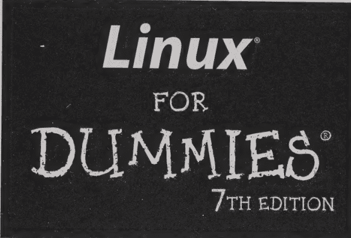

作者：Dee-Ann LeBlanc


TB/QU/QV/QN

# 关于作者

Dee-Ann LeBlanc 是 RHCE（红帽认证工程师），她也是一名作家、课程开发人员、记者和培训师，精通 Linux。虽然这些不同的职业听起来很分散，但它们实际上相互相成，因为这让她能够观察到人们在现实世界中如何使用 Linux，以及他们在何种方面需要帮助。她是《Linux Journal》的游戏编辑，《LinuxToday.com》的桌面版编辑，并撰写了许多关于 Linux 和其他计算机主题的书籍。在过去的两年里，Dee-Ann 一直担任《Computer Power User》杂志的常驻撰稿人，负责编写该刊的 Linux 内容。

当 Dee-Ann 没有在教学、开发课程材料、撰写技术非虚构类或奇幻小说、采访有趣的人、在网上或会议上聊 Linux 主题，或者正尝试以各种方式拯救世界时，她会和她的狗一起远足，并用新食谱让她的丈夫 Rob 实验。请访问 www.Dee-AnnLeBlanc.com 查看 Dee-Ann 的最新动态，并加入 http://dee-ann.blog-city.com/ 她的读者邮件列表。（请通过 dee@renaisoft.com 联系 Dee-Ann。）

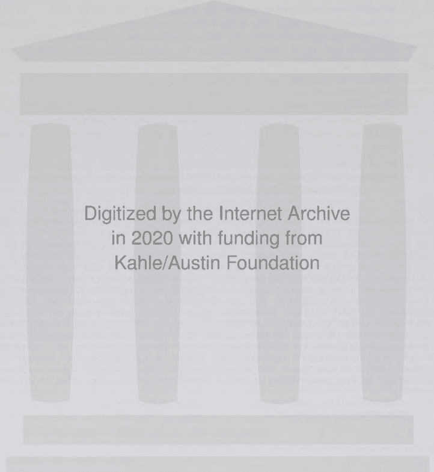

https://archive.org/details/linuxfordummies0000lebl_j6m8

## 献辞

我继续将这本书献给我的丈夫，当我进度落后时，他总是得听我那些压力下的抱怨；同时也献给我的狗们，它们真的希望妈妈偶尔能停下对那个发光盒子的注视。

## 作者致谢

一如既往，我有很多人想要感谢。首先，要感谢那些如果不是他们，这本书的早期版本根本不会存在的人。其中之一，要感谢 John "maddog" Hall，他给了我接手这本书演进的机会。他当时太忙于领导 Compaq 的 UNIX 软件组、担任 Linux International 的执行董事，以及担任 Sair Linux/GNU 认证的顾问委员会成员，无法继续处理这个项目。还要感谢 LANWrights 的同事们付出的努力，以及 Melanie Hoag 和 Evan Blomquist 的大力支持。最后，当然，要感谢 Wiley 出版公司的编辑和员工。没有他们他们的指导，这本书就不会存在，更无法随着时间的推移而不断改进。

最重要的是，我想感谢那些联系我提出问题、建议和疑虑的读者。对于那些迷失在海量邮件中没有得到回复的人，我深表歉意，但请相信，至少当我三个月后从堆积中翻出你的邮件时，我会将其归为下一版中考虑的更多事项之一。正是读者的参与让这样的书籍多年来不断完善，我的目标是继续精炼《Linux For Dummies》（Linux 傻瓜指南），使其成为最好的桌面 Linux。

## 出版商致谢

我们对这本书感到自豪；请通过我们位于 www.dummies.com/register/ 的在线注册表单向我们提供意见。

帮助这本书上市的人员包括：


## 目录

- 第 2 章：为你的电脑准备 Linux...............................................................19
- 第 4 章：安装其他 Linux 发行版...............................................................57
- 第 6 章：查看桌面...........................................................................101
- * 第二部分：现在上网！...............................................................................136
- 第 9 章：使用互联网...........................................................................153
- 第 10 章：操作文件和目录................................................................181
- 第 12 章：为 Linux 添加软件..................................................219
- 第 14 章：在没有图形界面的情况下工作...............................................................265
- * 第四部分：完成任务.......................................................................................293
- 第 17 章：使用 OpenOffice.org 进行文字处理等.......................................303
- 第 19 章：仅限 Windows 的媒体格式和程序...............................................357
- 第 20 章：十个故障排除技巧.........................................................................367
- * 第六部分：附录 ................................................................383
- 附录 B：关于 DVD-ROM ................................................395
- 磁盘分区.................................................................. 27
- 使用 Linspire 享受奢华生活 ................................................................. 58
- 尽情享受 Mandriva 的乐趣 ................................................ 64
- 利用 Ubuntu .............................................................. 77
- 各种不同版本的 Ubuntu 介绍 ................................ 82
- 各种不同版本的 Xandros 介绍 ......................... 88
- 定位安全资源.................................................................................. 263
- 快速查看 Kate...................................................................... 301
- 如果你遇到了问题（DVD-ROM 类）........................................................... 399

## 引言

欢迎来到 Linux 这一迷人的开源软件世界。在书中，我将向你介绍 Linux 操作系统的魅力，它最初是 Linus Torvalds 在 20 世纪 90 年代初作为热爱之作创造的。我的目标是通过重写操作系统市场中的规则，带你进入快速增长的 Linux 用户和爱好者的行列。

如果你曾考虑过切换到 Linux，但觉得这个前景太遥不可及，那么你可以放松了。只要你会烧开水或设定闹钟，你也能成为 Linux 用户。（可不是开玩笑的！）

当这本书的第一版出版时，Linux 还是一个新兴的现象——既不为人知，也不被理解。在这一版中——针对新一代 Linux 用户——可用材料非常多，因此我将此书侧重于 Linux，并教你如何在桌面上充分利用它。为此，这些页面包含了各种在线资源、技巧和窍门，以及更通用的指令。如果你正在寻找关于服务器的资料，*Linux All-in-One Desk Reference For Dummies*（Wiley Publishing, Inc.）可以满足你的需求。

我尽可能减少了技术术语的使用，并坚持使用通俗英语。除了关于 Linux 安装、启动、配置和软件的直白讲解外，我还包含了许多示例，以及大量详细的指令，帮助你以最少的压力或困惑设置并使用你自己的 Linux 机器。

书中还附带了一张实用的 DVD-ROM，其中包含了 Fedora 5 和 Knopix，以及 Linspin、Mandriva、SuSE 和 Xandros 的 CD-ROM 镜像（你可以用于刻录自制 CD 的文件）。（要查看 DVD-ROM 中具体包含的内容，请参见附录 B）。Ubuntu 也涵盖在内，但 DVD 上的空间不足，因此在第 4 章中包含了关于如何自行下载该发行版的说明。如果你不知道我在说什么，别担心。你很快就会明白的！

## 关于这本书

把这本书看作一本亲切、易于上手的指南，用于处理术语以及 Linux 工具集、实用程序和小组件。虽然 Linux 并不是很难搞懂，但它确实包含了大量的细节、参数和行政杂事（Unix 术语中的行政琐事）。在安装、配置、管理和排排除基于 Linux 的电脑时，你需要将这些内容梳理顺绪。你在书中找到的一些示例主题包括：

- 理解 Linux 的何而来以及它能为你做什么
- 安装 Linux 操作系统
- 在 Linux 系统中管理文件和添加软件
- 设置网络访问并浏览网页
- 自定义你的 Linux 系统
- 管理 Linux 系统安全和资源

尽管初看之下，使用 Linux 需要多年的实战经验、大量的尝试和错误、高级计算机科学训练以及高度的投入，但请宽心！事实如此。如果你能告诉别人如何找到你的办公室，你完全可以构建一个实现你所需求的 Linux 系统。这本书的目的不是让你变成彻头彻尾的 Linux 极客（当然，那是 Linux 启的终极境界），而是向你展示为了构建运行顺畅的 Linux 系统而需要掌握的里外，并给你使用它所需的知识和信心。

## 如何使用这本书

这本书将告诉你如何安装、配置和自定义 Linux 桌面系统。虽然现在在 Linux 中你可以通过指向和点击完成大部分工作，但你可能仍然想尝试在命令行提示符下使用 Linux——在那里你输入详细的指令来加载或配置软件、访问文件并执行其他任务。在书中，输入将以如下等宽字体显示：

```
rmdir /etc/bin/devone
```

当你输入 Linux 命令或其他相关信息时，请务必按照你在书中看到的内容精确复制，包括大写和小写字母，因为这是让 Linux 正常运行的魔法部分之一。

未能完全遵循指令可能会导致各种不幸、表面上或意料之外的副作用。

书的页边距无法提供与电脑屏幕相同的空间；因此，在书中某些 URL 和命令行提示符的长度可能会换到下一行。记住，你的电脑将这些折行视为一组单一指令或单一 URL —— 所以，如果你正在输入一段文本，请让它保持在单行内。如果你看到这些折行中的一个，不要插入硬换行符。我会通过在斜杠处或自然的单词分词处断行（暗示“等一下——还有后面！”）并对溢出的部分进行略微缩进，来提示你这应该是一整行，如下面的愚蠢示例所示：

请注意，在通过这本书——以及你可能遇到的其他 Linux 幽默、智慧和灵感来源——进行探索时，你可能会发现某些术语是可以通用的。例如，你可能会看到同一款软件被称为程序、命令、实用程序、脚本、应用程序或工具，这取决于来源、语境以及你查阅的信息作者。在很大程度上，你可以将这些视为互换的，而当需要在它们之间做出重要区分时，我一定会指出。同样，当你处理各种命令或配置控制时，你可能还会遇到如 flag（标志）、switch（开关）、option（选项）或 parameter（参数）等不常通用的术语。在情况下，所有这些术语指的是它们的工作方式。

## 冒昧的假设

他们说我对读者——你做了几个假设：


- 你可以开启电脑电源
- 你知道如何使用鼠标和键盘
- 你想安装、配置或使用 Linux

你不需要成为逻辑大师或编程巫来使用这本书，也不需要计算机科学博士学位。如果你有丰富的想象力和解决基础问题的能力，那就好了——剩下的就是细节和耐心。

## 本书的结构

这本书包含六大部分部分，按顺序带你从 Linux 安装配置到保持其运行。每当你需要帮助或信息时，可以拿起这本书从任何地方开始，或使用目录查找特定主题。

以下是书中六部分的详细介绍，以及每个部分包含的内容。

### 第一部分：入门

这一部分奠定了基础，并对使 Linux 成为软件猛王的术语、技术和软件组件进行了概述和介绍。具体来说，我从一个 Linux 概述开始，解释 Linux 是什么、起源何以及如何工作。接下来，我处理在 PC 上安装 Linux 前所需的各种任务和活动。如果你不是 Fedora 的死忠粉丝，我也涵盖了安装 Linux、Mandriva、SUSE、Ubuntu 和 Xandros 所需的内容，但不是非常详细（否则这本书将像百科全书一样大）。之后，我将告诉你如何启动 Linux —— 不是为了舍弃它，而是为了让你的新系统达到计算狂喜的巅峰（至少对我来说是这样）。最后，我将帮助你探索标准的 Linux 工具和界面，管理账户，并获取有关发行版 Linux 工具的内幕。如果你不想安装但想尝试 Linux，我还提供了使用所谓的 LiveCD 或可启动发行版的选项。Knoppix 是其中最流行的，因此在这里也有介绍。

### 第十一部分：现在上网！

在这一部分，你将探索连接 Linux 系统到互联网的问题，包括配置调制解调器、管理互联网服务提供商（ISP）的拨号连接，以及配置使互联网连接工作的各种互联网协议。你还将了解配置和使用浏览器以及设置使用电子邮件客户端的详细信息。

Linux 包含了许多功能和能力，因此在完成安装和配置之后，你可能想要使用你的系统来做些事情。这正是实操开始的地方！在本书的这一部分，你可以读到关于 Linux 文件系统以及如何处理文件、目录和相关的访问权限——在 Linux 中称为权限（permissions）。你将发现如何在 GNOME 和 KDE 之间切换，这是 Linux 中两个主要的图形用户界面（GUI）。此外，我还深入探讨了 Linux 命令行提示环境，也称为 shell（壳）。第三部分还包含了重要的安全信息，以及如何向系统添加软件并保持其更新。

在本书的这一部分，你将发现如何使用 Linux 中提供的各种软件。从纯文本编辑器到全功能办公套件无一不包，还有非常酷炫的多媒体工具以及基于 Microsoft Windows 的文件格式和媒体。更棒的是，你知道你可以在 Linux 下运行许多 Windows 程序吗？我将在这一部分为你展示如何实现。

在本书的高潮部分，我总结并提炼了你现在对 Linux 及其内部机制所了解的精髓。在这里，你有机会回顾一些针对 Linux 系统的关键故障排除技巧和技巧，并学习 Knoppix 的两个酷炫用法。

## 从现在开始去哪里

现在是你选择一个方向并出发了！《自从傻学 Linux》第 7 版就像《一千一夜》一样，因为你从哪里开始几乎并不重要。在准备构建自己的 Linux 系统时，你会看到许多不同的场景和故事。虽然每个故事都有独特的角色和情节，但整体绝对令人惊叹。别担心——你能够应对。谁在乎别人是否觉得你是在胡闹？我知道你正准备好过人生中最精彩的时光。

祝过得愉快！

Rich Tennant 著《第 5 波》


### 熟悉 Linux

### 本章内容

- 深入研究 Linux 的起源和特征
- 依赖 GNU 和 GPL

> 福特，你变成一只企鹅了。住手！

> 作者注：显然，那个可爱的引言来自匿名从未去过 Linux 大会！

在进一步研究 Linux 之前，我需要先解决一些术语。

Linux 优秀源于许多原因，包括这些从零开始构建它的人们就希望它成为：

- 多平台（Multplatform）：Linux 目前运行在 24 个平台（硬件类型）上，包括基于 Intel 的 PC、Digital/Compaq Alpha、基于 PowerPC 的 Apple Macintosh、Sun SPARC、Amiga 以及基于 StrongARM 的计算机。
- 可扩展（Scalable）：随着你的需求增长，你可以依靠 Linux 随你增长。同样的 Linux 操作系统可以运行在桌面电脑上，也可以运行在大型工业级服务器上。
- 灵活（Flexible）：你可以将 Linux 操作系统配置为网络主机、路由器、图形工作站、办公生产 PC、家庭娱乐电脑、文件服务器、Web 服务器、集群，或你能想到的任何其他计算设备。

许多人指出，如果开源中违反了版权，很容易发现的。看看新闻，注意大公司经常被指控窃取他人代码并将其整合到自己的工作中。如果最终产品是开源的，任何人都可以查看并确保没有被盗取的内容。正如你可能想象的，在闭源方案中追踪此类违规行为要困难得多。


www.debian.com

www.ubuntu.org

www.mandrivalinux.com

www.redhat.com

www.slack.com

www.opensuse.org

- 在同一台电脑上同时使用 Linux 和 Windows
- 了解（并找到）你的硬件信息

如果你不知道要去哪里，你可能无法到达那里。


- 打开管理工具文件夹并双击计算机管理图标。

## 第 2 章：为 Linux 准备计算机

### 23

图 2-1：Windows XP 计算机管理工具中的磁盘管理信息。

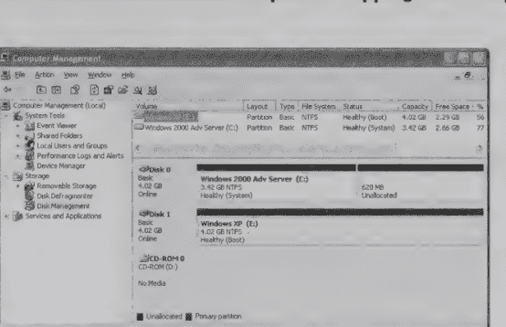

### 在 Windows 98 中查看你的分区

如果你必须让 Windows 和 Linux 共享同一块硬盘，那么在你继续操作之前，我想让你先做一些侦查工作。以下是情况：Windows 98 并没有提供像“计算机管理”那样的图形化工具来显示硬盘上的分区。若要在 Windows 98 中查找计算机硬盘的详细信息，请按照以下步骤操作：


在 `FDISK` 中操作时要小心，如果你对其进行任何更改，都可能会抹除数据。当你退出程序时，如果它询问是否保存任何更改，请务必不要保存：

- 1. 选择`开始>程序>MS-DOS 提示符`打开 `MS-DOS 提示符`窗口。
- 3. 如果你看到大磁盘提示，在此处选择 Y 然后按回车。

出现 `FDISK` 菜单选项。

## 第一部分：初入门

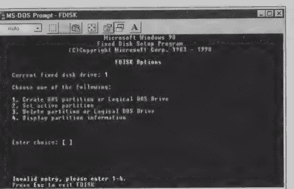

图 2-2：`FDISK` 菜单选项。


### 显示当前的驱动器-分区信息。

如果你的计算机中有一个以上的硬盘，`FDISK` 会显示第五个菜单选项，以便你可以在磁盘之间切换。

以下是使用第五个菜单选项切换到另一个磁盘的方法：

- **a. 输入 5 并按回车。**

`FDISK` 屏幕显示系统中的所有硬盘。

- **b. 输入你想使用的磁盘编号然后按回车。**

`FDISK` 菜单屏幕顶部显示 `FDISK` 正在操作的驱动器编号。

要显示所选磁盘编号的分区信息，输入并按回车。

5. 要显示所选磁盘编号的分区信息，输入并按回车。

图 2-3 显示了 `FDISK` 中“显示分区信息”屏幕的示例。


图 2-3 表明驱动器上没有空闲的未分配磁盘空间。如果硬盘有未分区的空间，`FDISK` 将显示可用空间的大小。

然而，在图 2-3 中，你看到磁盘空间的一部分被配置为扩展 EXT DOS。扩展分区可以包含所谓的“逻辑分区”，因此扩展分区内部可能存在空闲空间，你可以用它来安装另一个操作系统（如 Linux）或另一种类型的 Windows。

将主分区想象成你放入数据的空盒子。扩展分区是那些烦人的盒子，它们旁边堆叠了一组更小的盒子。你只有在扩展分区中才能向这些小盒子里放入数据。这些小盒子就是逻辑分区。

## 第 2 章：为 Linux 准备计算机

### 25

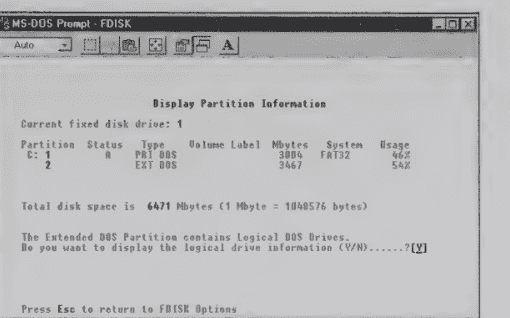

图 2-3：

`FDISK` 中的分区信息。

遗憾的是，`FDISK` 不会告诉你关于这个扩展分区内部的任何信息。你必须深入挖掘。

6. 要查看扩展分区内的逻辑分区，请选择 EXT DOS 项并按回车。


图 2-4 是逻辑分区设置的示例。在这种情况下，扩展分区内的所有空间目前已分配。你可以通过查看驱动器的使用百分比来判断是否有空闲空间。这决定了你接下来的操作：

- 如果总计为 100%，则没有可用空间。如果是如此（或你的可用空间小于 10GB），请保持此工具打开并进入下一节“腾出空间”。
- 如果你有 10GB 或更多的可用空间，请跳到下一节“腾出空间”。

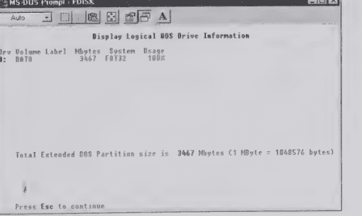

图 2-4：
FDISK 中的逻辑驱动器信息。
扩展 EXT DOS 分区总大小为 3467 Mbytes (1 Mbyte = 1048576 bytes)
按 `Esc` 继续

## 第一部分：初入门

### 腾出空间

你可能有未分区的空间，可能完全没有。无论何种，你都必须调整大小。如果你正在进行双系统安装，请跳到“检查硬件”章节。


请记住，如果你下载大量多媒体文件，你可能需要超过 10GB 的空间。


结果显示你有空闲空间，或者没有。如果你发现你的驱动器都满了，可能是时候将某些文件刻录到光盘上从硬盘中删除了。

## 第 2 章：为 Linux 准备计算机

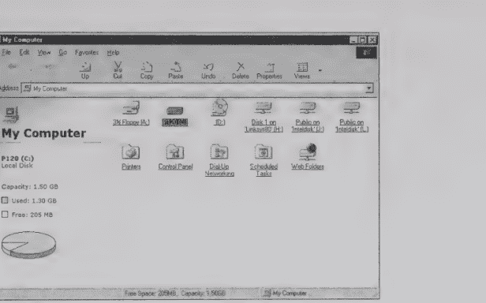

图 2-5：该 Windows 98 用户 C 盘上有多少可用磁盘空间。

当你决定要调整哪个分区时，请记下它位于哪个硬盘上以及是哪个分区（第一个、第三个、第二个等此类推）。在需要告诉安装程序放置位置时，你会需要这些信息。

商业工具（如 `Partition Magic`）提供了一种轻松调整和处理硬盘上分区的方法。你可以从计算机网站 `www.powerquest.com` 查找有关 `Partition Magic` 的信息，在下一节“处理分区”中，你还将了解到如何使用免费替代方案 `qtparted`。

### 处理分区

在“准备使用 Linux 和 Microsoft Windows”章节（在本章开头）中，我讨论了为什么在已经在运行 Windows 的计算机上可能为 Linux 留出磁盘空间。这里涵盖的技术假设你已经在调整分区后找到了可以分给 Linux 的空闲空间。如果你是在全新的额外的硬盘上安装、正在抹除整个硬盘以交给 Linux，或者已经有一块大于 10GB 的未分配/空闲空间，请跳到本章后部分的“检查兼容性”章节。

### 选择分区工具

也许调整现有分区的简单方法是使用如 `Partition Magic` 这样的商业程序。`Partition Magic` 允许你查看硬盘的分区信息。你还可以使用此实用程序调整分区大小、移动和添加分区。然而，如果你只想调整分区大小，不必为了完成任务而特意购买软件。相反，你可以下载一个免费工具来为你完成工作（见下一节如何操作）。

没有哪个工具是完美的。在继续操作之前，请对你 Windows 安装中任何不想丢失的内容进行备份！在分区的各个步骤中，即使在 Windows 上使用 Windows 工具，也可能出现问题。

如果你使用 `Partition Magic`（在调整 Windows 分区大小后）创建了一个开放分区，请记住它是哪个驱动器和分区（第一个、第二个等）。当你告诉安装程序将 Linux 放置在何处时，你需要这些信息。

### 使用 qtparted 获取并调整分区大小

你可以使用的一个免费调整大小程序叫做 `qtparted`。该实用程序可以与 VFAT 和 NTFS 分区配合，因此它可以处理你在 Windows 中设置机器时可能使用的两种文件系统。该程序随 `Knoppix` 一带，这是一个 Live CD —— 另一种可启动发行版 —— 意味着你可以将其放入 CD-ROM 驱动器并启动电脑，它将带你进入一个无需安装的完整版 Linux。`Knoppix` 对于展示 Linux 非常方便，但更重要的是（对我我的目的而言），它对于救援无法启动或调整分区的机器非常有用。

`Knoppix` 包含在本本书的 DVD 中，这非常方便。如果你由于某种原因无法使用 DVD，请参阅第 4 章如何通过 CD 获取 `Knoppix`。在继续之前，双重检查你已在操作前备份了所有重要数据。然后，取出你在在本章“准备共同使用 Linux 和 Microsoft Windows”节中可能做的任何笔记——特别是你想要更改的哪个分区——然后执行以下操作：

- 将你的 `Knoppix` CD 或 DVD，或随书附带的 DVD 插入 CD 或 DVD-ROM 驱动器并重启电脑。

如果你正在使用书籍的 DVD，会出现一个菜单，询问你是否想使用 Fedora 还是 `Knoppix`。选择 `Knoppix`，你将被带到 Linux 欢迎界面如果你使用的是普通的 `Knoppix` CD 或 DVD，你的电脑将直接启动到 `Knoppix` 欢迎


## 第 2 章：为 Linux 准备你的电脑

2. 在 `boot:` 提示符处，按 `Enter` 键。

大量文本滚动而，`Knoppix` 正在确定你系统上的所有硬件。在许多机器上，`Knoppix` 完全启动可能需要一分钟；它完全从 CD- 或 DVD-ROM 运行。在它运行后，你会看到 `Knoppix` 桌面（见图 2-6）。

如果在 `Knoppix` 启动过程中发生任何问题，请按 `Ctrl+Alt+Del` 或电脑上的重置按钮重启。当你到达 `boot:` 提示符时，按 `F2` 和 `F3` 查看你可以添加的启动选项，以尝试让 `Knoppix` 运行。

3. 从 K（主）菜单，选择 `System: QTParted`。

`QTParted` 工具打开了（见图 2-7）。

4. 在左侧，选择你想要操作的驱动器。

如有必要，请参考你的笔记（本章前面的“准备共同使用 Linux 和 Microsoft Windows”节）以查看它是你的硬盘中的第一个、第二个、第三个还是等等。如果你同时有 IDE 和 SCSI 驱动器——大多数家庭用户使用 IDE 驱动器，你通常需要费力才能获得 SCSI，后者更昂贵——你可以通过列表中以 "`hd`" 开头的 IDE 名称和以 "`sd`" 开头的 SCSI 名称来区分它们。它们在机器上的安装顺序是按字母顺序排列的。例如，`hda` 是第一个 IDE 硬盘，`hdb` 是第二个，以此此类推。（SCSI 也是如此，`sda` 和 `sdb`。）

在你做出选择后，驱动器的分区和其他信息将出现在窗口的底部和右侧（见图 2-8）。


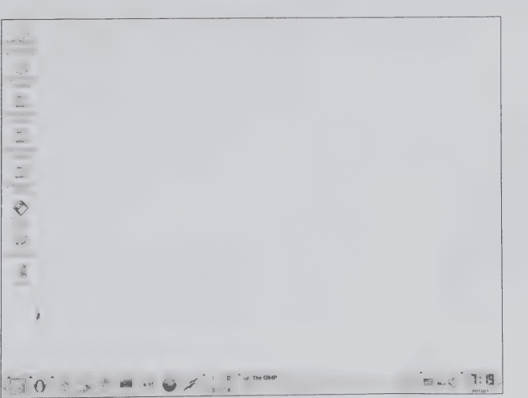

图 2-6：关闭了帮助浏览器的初始 `Knoppix` 桌面。

## 第一部分：入门尝试

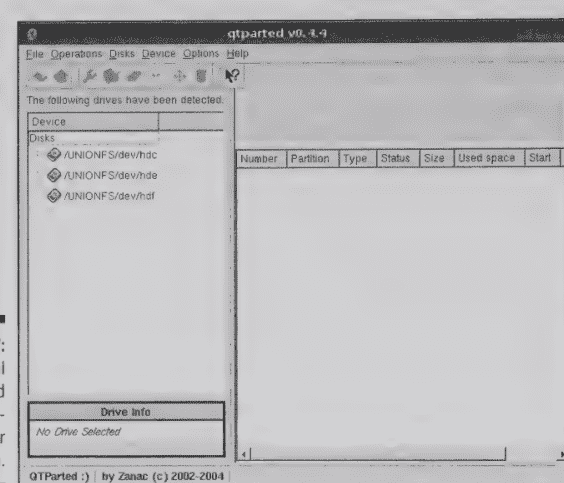

**图 2-7：** 初始的 `QTParted` 分区屏幕。

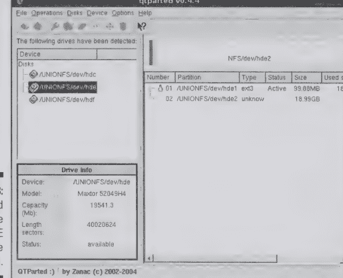

**图 2-8：** 选择第二个 IDE 驱动器的 `QTParted`。

## 第 2 章：为 Linux 准备你的电脑

5. 在右侧，选择你想要调整大小的分区。

如果你在窗口中看到想要更改的分区（如图 2-8），请参考你的笔记（在本章前面的“准备共同使用 Linux 和 Microsoft Windows”节）。

6. 选择 `Operations...` 打开对话框（见图 2-9）。


7. 执行你的更改。

在 `QTParted` 中选中了第二个 IDE 驱动器。

8. 点击 `OK` 保存更改。

现在你的更改已生效！

9. 点击 `Commit` 完成更改。

如果你还没有安装 Linux，请查看第 10。

## 第二部分：入门尝试

10. 选择 `File` 退出 `parteded`。

11. 双重检查你已备份了所有重要数据。

如果还有问题，请查看 Free Space。

12. 选择 `File` 退出。

你已经完成了分区操作。

13. 从 `Knoppix` 主菜单，选择 `Log Out`。

14. 从 Session 对话框，选择 `Restart`。

15. 点击 `OK` 重启电脑。

当电脑关闭时，这是正常的。当你重启后，你将进入 Windows。如果发生了任何问题，请使用 recovery DVD。

1. 对你的 Windows 安装中任何不想丢失的内容进行备份。

## 第一部分：入门尝试

针对 Linux。例如，你可以搜索 "`Invisision DX700T Linux`" 来查找其他人对这一特定品牌和型号的硬件的使用情况。（当然，这处并不意味着对所提到的任何硬件表示认可或背书。）


# 第 2 章：为 Linux 准备电脑

## 厂商网站
许多硬件厂商会在其网站上提供有关他们对 Linux 支持程度的信息。然而，尽管这些硬件在 Linux 上运行良好，但许多厂商完全没有提及 Linux。你可能也可以在厂商网站上找到可以下载的驱动程序。只有在没有其他方法可以获取适用于你发行版的驱动程序时才这样做。这将是获取驱动程序最笨拙的方法。

如果情况最糟糕，你可能会发现某件硬件没有列出支持。尽管如此也请尝试一下；它在某些微小的限制下可能运行良好。例如，你可能无法使用最新一代显卡的最新功能，但你至少可以将其作为通用的 SVGA 使用。此外，有些旧硬件虽然没有列在列表中，但仍然受到支持。

## 令人畏惧的手书
如果可能，请随手保留你的电脑手册（特别是针对显卡和显示器的），以备你需要它们回答安装程序提出的问题——大多数人不需要处理这种情况，但确实有人需要。

如果安装程序无法检测到你特定的显卡，那么你需要确切知道它是什么以及它的规格——或者直接选择“通用”（Generic）选项。（当你在第 3 章或第 4 章安装 Linux 时，我必须这样做，具体取决于你的发行版。）如果你下心要清楚你的机器里到底有什么——或者因为需要进行额外的研究而想弄清楚——你有以下选项：

### 使用现有的操作系统来记录你的硬件
如果你的电脑已经在运行 Windows，你可以从 Windows 环境中收集大量信息。根据你的系统，使用以下方法之一：

- 在 Windows 2000 中：选择“开始-控制面板-系统-设备管理器”来访问机器上安装的硬件列表，如图 2-12 所示。
- 在 Windows XP 中：选择“开始-控制面板-打印机和其他其它硬件”。在这里，你可以从“查看已安装设备”下的对话框中选择其中一个项目，或者查看“硬件”部分并选择“系统”。从那里选择“硬件-设备管理器”来访问机器上安装的硬件列表（如图 2-13 所示）。


# 第 2 章：为 Linux 准备电脑 35

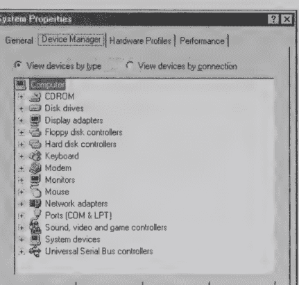

图 2-11：在 Windows 98 中，设备管理器为你提供有关已安装硬件的信息。

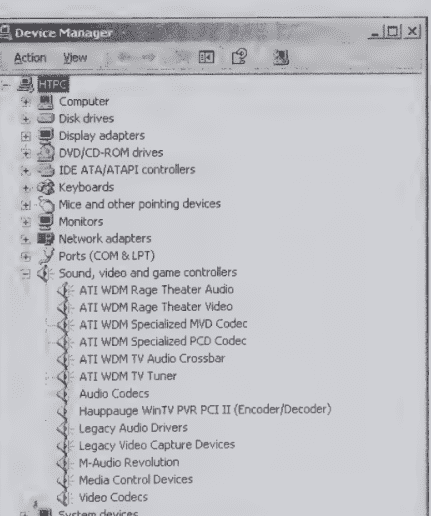

图 2-12：Windows 2000 设备管理器。

# 36 第一部分：入门尝试

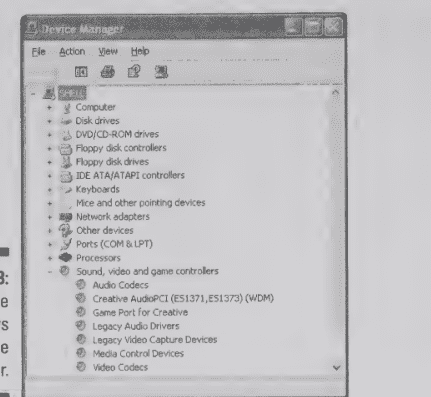

图 2-13：Windows XP 管理器。双击设备管理器中的每个项目以显示相应的详细信息。

### 下载 PC 硬件检测工具
如果你没有任何诊断工具，并且有一个版本较新的 DOS，你可以从互联网上下载各种硬件检测工具，例如 `PC-CONFIG`。`PC-CONFIG` 工具包含多个信息屏幕和菜单，用于选择硬件设备和选项，并可以从 Linux 网站 (`www.linux.org`) 获取使用信息。

### 通过阅读电脑启动时的屏幕内容来收集信息
如果你的系统没有包含任何操作系统，且你没有任何系统文档，你可以求助于读取电脑启动时的屏幕内容。在某些系统上，视频信息会在电脑启动时显示。如果显示速度太快，你可能需要重启几次。此外，某些系统在系统启动时会显示 PCI 组件及其设置。再次，你可能需要重启几次来收集所有信息。你可以尝试按下电脑上的 `Pause-Break` 键（它应该在 `Scroll Lock` 键附近）来冻结启动过程。当你读完后，通过按下任意键即可取消冻结。

### 访问基本输入/输出系统 (BIOS) 信息
由于这些信息存储在内存的一个小区域中，并由电池保持，它有时被称为 CMOS（互补金属氧化半导体），这表示可以存储和保留信息的计算机芯片类型。存储在 BIOS 中的信息量从极少到很多不等。一些较新的系统可能会显示关于电脑硬件的多个信息屏幕。

# 第 2 章：为 Linux 准备电脑

如果你选择访问 BIOS，请确保在操作系统加载之前进行。大多数制造商会在系统启动时在屏幕上显示进入 BIOS（或 Setup）的键盘键（或序列）——例如，按 `Del` 进入 Setup。如果你找不到按键序列，请检查制造商的网站。进入 BIOS 后，你通常可以使用方向键、`Tab` 键或回车键进行导航。某些 BIOS 环境还使用功能键；在屏幕顶部或底部寻找功能选项列表。

特别注意标签上的标记。如果你下心要清楚你的机器里到底有什么——或者因为需要进行额外的研究而想弄清楚——你有以下选项：如果你下心要清楚你的机器里到底有什么——或者因为需要进行额外的研究而想弄清楚——你有以下选项：如果你必须修改你的 BIOS，请确保在退出前保存它们。最后，在修改你的 BIOS 之前（在 Linux Linux ）


# 最后，在你开始之前

在继续之前，我还有一件事想让你做：找到你发行版的文档。这些手册可以帮助你克服困难，并在安装完成后提供有用信息。如果你购买了发行版，它可能附带纸质手册。否则，对于包含的发行版，你可以在这里找到帮助论坛和界面：

- Fedora：Fedora Documentation Project (`http://fedora.redhat.com/docs`) 还是全新的，但其集合会随着时间增长。此外，还有 Fedora Forum (`www.fedapro.org`)、`Fedora News` (`www.fedoranews.org`) 以及非官方 Fedora FAQ (`www.fedoraq.org`)。
- Inspire：官方 Inspire 支持页面为 `http://support.inspire.com`。务必检查所有链接，因为包含了大量的提示。
- Mandriva：Mandriva 官方文档页面为 `www.mandriva.com/en/fdoc.php`，你可以访问另一个帮助网站 MandrivaExpert.com。
- Ubuntu：Ubuntu 支持页面位于 `www.ubuntu.com/support`。
- SuSE：SuSE 官方支持页面为 `www.suse.com/us/private/support/`，OpenSUSE 的页面为 `www.opensuse.org/Documentation`。

当你浏览网页时，如果不断看到 wiki 这个词，不要惊讶。wiki 是一个集体维护的网页（或网页集合），任何人都可以对其进行更改（取决于 wiki 的设置，可能是一组指定的人）。wiki 在生成社区化支持网站方面变得越来越流行，因为任何愿意贡献的人都可以以最小的参与其中。另一个寻求帮助的热点是 `linuxquestions.org`。如果你准备好安装了，请阅读第 3 章了解 Fedora，阅读第 4 章了解 Inspire、Mandriva、SuSE、Ubuntu、Xandros 等。

只要你的电脑是常见的品牌，它与 Linux 的运行应该良好。39

# 第 3 章

# 安装 Fedora Core

### 本章内容
- 考虑安装前的最后一些问题
- 将 Fedora 安装为个人桌面系统
- 首次启动 Fedora

> 要么做，要么不做。没有所谓的“试一试”。 —— 尤达，《帝国终击战》

安装 Linux 不再需要那些奥秘的符号和复杂的魔法师咒语了。现在的图形化安装执行起来非常简单，对于来自微软 Windows（Microsoft Windows）等其他图形操作系统的用户来说，会感到非常熟悉。本章将提供相关细节。

如果你正在安装 Linux、Mandriva、SuSE、Ubuntu 或 Xandros，请参阅第 4 章——如果你想在不安装任何软件的情况下使用 Knoppix，也执行相同的操作。即使你没有使用 Fedora，仍然可以在本章中发现很多内容——所有 Linux 发行版都有许多共同元素。

## 开始安装前需要考虑的事项

你可以通过以下方式安装 Fedora Core：

- 使用书中附带的 DVD-ROM 启动，并在初始菜单中选择 Fedora。
- 使用 Fedora Core 安装 CD 启动。如果你是通过书末附带的优惠券订购了 CD 组，那么这就是第 1 号 CD；或者从 Fedora 项目网站上列出的第三方供应商处购买：

```
http://fedora.redhat.com/download/vendors.html
```

要从 DVD-ROM 或 CD-ROM 开始安装，你必须先更改系统，使其从 DVD-ROM 或 CD-ROM 启动。在第 2 章中，我涵盖了如何配置计算机从这些设备启动。

我重点关注 Fedora Core 5 及其安装主要有两个原因：

- Fedora Core 5 包含在书中附带的 DVD 中，以及你可以通过优惠券订购的 CD 中。
- 涵盖现有的所有 Linux 发行版的安装会让这本书变成一套百科全书。

我假设你想安装一个桌面系统。市上有大量专注于服务器的书；我的目标是让《Linux傻 Linux》（Linux for Dummies）完全专注于那些想要将 Linux 作为实际桌面机器的用户。此外，在如此规模的书中，无法以令人满意的深度同时涵盖桌面和服务器功能。


请注意，如果你安装的是 Red Hat Enterprise Linux 或不同的 Linux 发行版，你的界面将与书中显示的内容不同（对于 Linspire、Mandriva、SuSE、Ubuntu 和 Xandros，请参阅第 4 章）。每个 Linux 的安装程序都涵盖了基本任务，但具体操作可能会以不同的顺序呈现，或者在屏幕上显示为不同的外观。例如，一个发行版可能会在网络配置之前创建账户，而另一个发行版则可能反过来。


对于 Fedora，在到达“准备安装”（About To Install，即 GUI 安装）界面之前，你可以直接退出安装而不更改系统上的任何内容。在到达“准备安装”界面之前你所做的任何配置选项都不会保存到磁盘中。当你越过“准备安装”界面继续操作后，数据将写入磁盘，你的系统也会发生变化。

## 安装过程

在本节中，我将遵循图形化安装。如果由于某些原因无法使用图形化安装程序（例如，Linux 不支持你的显卡），请改用文本模式安装。步骤是相同的，只是没那么美观，而且你无法获得点点点击版本中提供的所有选项。

由于书中附带的 DVD 包含多个发行版，因此启动屏幕与你直接从 DVD 或 CD 安装 Fedora Core 5 的默认屏幕不同。如果由于某些原因你使用的是只包含 Fedora Core 5 的 DVD 或 CD，请按照说明操作，但在到达启动提示符时只需按回车键即可。使用书中附带 DVD 的应执行以下操作：

1. 如果你想从书中附带的 Fedora DVD-ROM 启动并安装，将 DVD 放入 DVD-ROM 驱动器，重启系统，输入 `linux` 并按回车键。

有很多启动选项，如图 3-1 所示，并在列表中进行了描述：


图 3-1：《Linux 傻 Linux》初始安装界面。

- **图形模式下安装或升级（Install Or Upgrade in Graphical Mode）：** 图形界面中的第一个选项用于首次安装 Fedora Core 或升级现有的 Fedora Linux 版本。此安装将探测并检测你的系统硬件。图形界面设计用于使用鼠标选择选项。如果你没有鼠标，可以使用键盘在屏幕间导航。在许多地方，Tab 键或方向键可以带你进入下一个选项；空格键切换选项的开启和关闭；Enter 键接受选择并进入下一个屏幕。在某些屏幕上，如果你想更改之前的设置，可以使用“返回”（Back）按钮导航到早前的选择屏幕。图形安装屏幕的左侧面板还包含帮助信息。内容会发生变化以反映当前配置屏幕的信息。

- **文本模式下安装或升级（Install Or Upgrade in Text Mode）：** 第二个选项允许你使用文本菜单界面安装或升级 Fedora Core。所有选项都以文本菜单的形式在屏幕上，你使用方向键或 Tab 键移动到你想要的选择。在某些区域，你使用空格键切换选项的开启和关闭。要使用文本界面安装，在提示符处输入 `linux`。

- **使用功能键（Use Function Keys）：** 最后一项列出了底部显示的功能键。

- F1 功能键：显示初始启动界面，提供通用说明、启动提示符以及指向 F2 到 F5 功能键的提示。

- F2 功能键：包含与附带 Knoppix Live 相关的选项。有关 Knoppix 和现场发行版的更多信息请参阅第 4 章。

- F3 功能键：提供 Knoppix 的更多选项。

- F4 功能键：提供 Fedora 选项，包括安装期间禁用硬件检测（你必须事先了解硬件详情）；启用救援模式；使用未包含安装介质中的驱动盘、CD 或 DVD；以及测试系统内存。

- F5 功能键：解释 DVD 可用内容。

如果你不选择任何选项直接按回车，Knoppix 图形化安装将加载。如果你输入 `linux` 并按回车，Fedora 图形化过程将开始。我假设你选择了后者。

2. 按回车键开始图形化安装。

# 第 3 章：安装 Fedora Core

由于随书提供的 DVD 不仅包含完整版的 Fedora Core 5（不包含源代码；参见附录 B），还包含其他发行版的文件，我不建议在此设备上尝试介质检查，因此对此 DVD 选择“跳过”（Skip）。即使 DVD 本身良好，它也很可能失败。

无论你是否检查介质，初始的 Fedora Core 安装屏幕最终都会出现。如果你需要，可以点击“发行说明”（Release Notes）按钮打开包含此版本信息的文件。这可能有点极客，但你可能会发现一些有趣或有用的内容。

- 3. 当你准备好后，点击“下一步”（Next）。

初始屏幕消失，被语言选择屏幕取代，如图 3-2 所示。Linux 支持许多不同的语言。

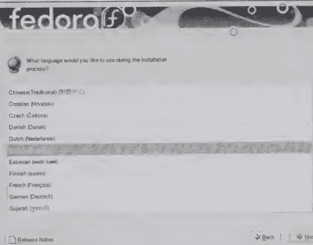

- 4. 使用鼠标或 ↑ 或 ↓ 键选择你的语言并点击“下一步”。

出现键盘配置屏幕，如图 3-3 所示。不同语言在键盘上的按键布局不同；你可能想为你的键盘选择匹配的语言。（默认是美式英语。）

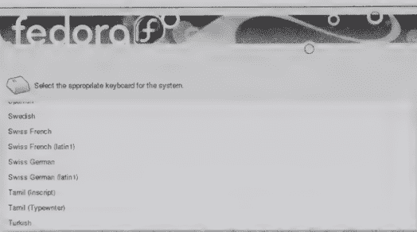

图 3-3: 键盘配置屏幕。

- 5. 选择你的键盘配置并点击“下一步”。

出现分区屏幕，如图 3-4 所示。你将四个选项：

- 移除选定驱动器上的所有分区并创建默认布局：擦除在此选项下方复选框中选择硬盘上的所有内容。

- 移除选定驱动器上的 Linux 分区并创建默认布局：如果你已经在该选项下方所示复选框标记的硬盘上安装了版本的 Linux，安装程序将找到之前的实例并覆盖它，从而擦除旧的。

- 使用选定驱动器上的空闲空间并创建默认布局：找到可用空闲空间并安装在其中。

- 创建自定义布局：手动定义安装位置。如果你选择此路径，请参阅附近的侧边栏“手动定义分区”。

作为一个选择合适硬盘的提示，你计算机中的第一块硬盘通常是 `hda`，第二块是 `hdb`，第三块是 `hdc`。对于某些硬盘技术，第一块硬盘将是 `hde`，第二块 `hdf`，以此此类推——只需从低到高计数）。如果你有 SCSI 驱动器，请查看 `sda`、`sdb` 和 `sdc`。

如果你很紧张且技术水平足以理解硬盘术语，点击“检查并修改分区布局”复选框。如果你这样做，将出现一个布局屏幕。那些确实想这样做并删除现有分区的人，在实际删除任何内容之前，应该参考你的笔记进行双检。

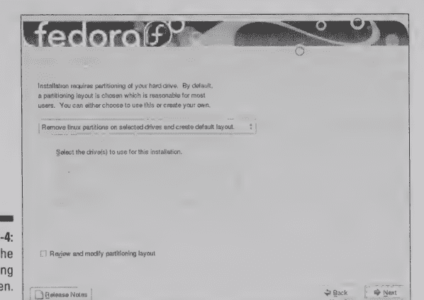

图 3-4: 分区屏幕。

- [ ] 检查并修改分区布局

- [ ] 发行说明

小心——当你选择移除分区时，将丢失现有分区中的所有数据。然而，它们不会立即被更改——直到最后的安装屏幕。

### 手动定义分区

如果你选择手动定义分区，你将使用 Red Hat 的磁盘钻取（Disk Drill）。磁盘钻取允许你删除现有分区并添加新分区。如果你不知道如何使用磁盘钻取，我建议你不要继续。点击“上退”返回自动分区屏幕；然后选择查看磁盘钻取建议的从头开始的自动设置。

对于你的文件系统，即*根目录*（*root directory*），它显示为 `/`。你需要一个挂载为 `/` 的分区，如果你不创建很多分区，你将希望它越大越好。你还想要一个挂载为 `/boot/` 的分区，但那个可以很小，大约 150MB。最后，你想要一个大约是计算机内存两倍大小的分区。（交换分区没有显示点数，你只需要选择一种文件系统类型的交换。否则，当涉及到 Fedora 时，你将一直使用 `ext3` 作为你的文件系统类型，因为它是默认的。）

如果网络使用 DHCP，让计算机自动获取设置。如果你使用的是静态网络并决定要更改设置，你需要知道这些信息：*挂载点*（*mount point*）是你的 IDE 硬盘上的第一个分区（可能是 `/dev/sda1`），挂载在文件系统内。

- 6. 选择相应的选项并点击“下一步”。

出现网络配置屏幕，如图 3-5 所示。

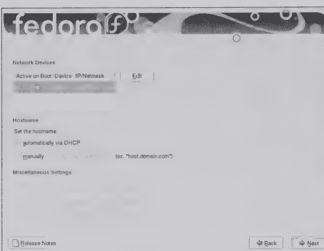

图 3-5: 网络配置屏幕。

如果你使用调制解调器且没有以太网，你不会看到此屏幕，请跳到第 8 步。

- 7. 配置你的网络。如果你使用的是静态网络，你需要：

- a. 点击 `eth0` 的“编辑”按钮。

- b. 取消勾选使用 DHCP 框。

- c. 输入给你的 IP 地址。

- d. 输入给你的子网掩码。

- e. 输入给你的主机名。

- f. 输入给你的网关和 DNS 地址。

- 8. 设置好后，点击“下一步”。

出现时区选择屏幕，如图 3-6 所示。

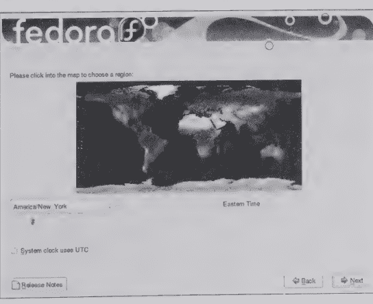

- 9. 选择你的 Linux 系统所在的地理区域。如果你旅行，将其设置为你所在地。你可以在任何需要时更改此设置。

- 10. 选择你的城市，或者如果你在列表中没有，选择同一时区内具有相同选项（例如夏令时）的其他城市。


- 11. 如果必要，点击系统时钟使用 UTC（协调世界时）——大多数人不需要此选项。如果你的计算机是（或不是）使用 UTC 而你选错了，你可以在安装计算机后更改此值，所以不要太担心这个设置。

- 12. 点击“下一步”继续安装的下一步。

- 13. 在根密码屏幕上，将根（管理员）账户密码输入到“根密码”字段中，然后在“确认”字段中输入相同的密码。

在你输入时看不到看不到密码——只有一个代表字符的星号。（星号防止未经授权的人看到密码。）如果你在其中一个框中输入了错误，当你尝试移动到安装的下一步时会收到警告，并有机会重新输入值。

不要忘记你的根密码！你在 Linux 机器上执行任何管理任务都需要它。

- 14. 两次输入根密码后，点击“下一步”。

出现应用程序类型屏幕，如图 3-7 所示。

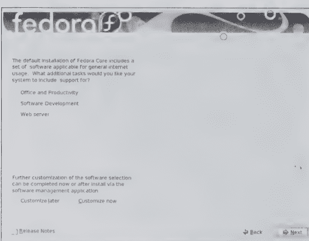

# 第3章：安装 Fedora Core

## 15. 添加或删除包类型以定制你的系统。

要添加一种类型，需要在其复选框中勾选。要删除一种，框框必须为空。你可以通过点击框框来添加或取消检查。

可用的组有：

- 办公与生产力（Office and Productivity）：我假设你正在设置桌面系统，所以你可能希望勾选此项。
- 软件开发（Software Development）：如果你是程序员，你可能想要添加此组。否则，你可以不使用它。
- Web 服务器（Web server）：如果你想在该系统上运行 Web 服务器，或者只是想实验 Apache Web 服务器，请添加此项。否则，你不需要它。

请记住，最后三个选项超出了本书的范围。

## 16. 在屏幕底部，选择“立即自定义”（Customize Now），然后点击继续。

出现软件包选择界面，如图 3-8 所示。

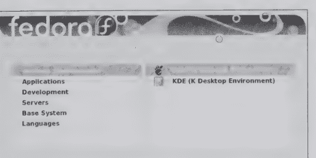

图 3-8：软件包选择界面。

## 17. 如果你想在系统上安装两种最强大的图形化界面，请点击 KDE (K Desktop Environment)。

我将在第 6 章和第 15 章中详细介绍这些界面。

## 18. 点击“应用程序”（Applications）。

该类别下可用的包类型显示在右侧。你可以从任何想的地方开始，但我想这一部分可能是一个很好的例子。

## 19. 滚动右侧的列表。确保你需要的组的复选框已勾选，而不需要的组未勾选。

你可以点击组的名称以在下方查看其描述。

## 20. 如果你想查看该组的可选软件包（程序），则在选中它的状态下，点击“可选软件包”（Optional Packages）按钮。

此操作将打开该项的“软件包”（Packages）对话框。阅读描述并从复选框中添加/删除勾或取消勾选，直到你对自己的选择感到满意，然后点击“关闭”（Close）关闭对话框。如果该组尚未标记为安装，此按钮将不可用。

## 21. 当你完成为每个组选择可选软件包后，选择左侧的下一个类别（例如，基础系统），然后返回第 19 步。

## 22. 当你完成所有考虑——稍后可以更改安装内容——点击“下一步”（Next）。

首先，会出现一个对话框告诉你安装程序正在检查你选的软件列表。如果它发现你依赖的软件，它会为你提供添加这些软件的机会（点“是”！）。完成后，会出现安装界面。

如果你想停止 Linux 的安装，安装界面是你可以在不更改硬盘上任何内容的情况下停止的最后一个地方。要停止安装，请按下 `Ctrl+Alt+Del`，系统将重启。如果你这样做了，且不打算重新启动安装，请务必取出 DVD 或 CD。

## 23. 当你准备好进行安装时，点击“下一步”。

如果你从 CD 安装，可能会出现“所需安装介质”（Required Install Media）对话框，准确告诉你安装所需的哪些 CD。如果你使用 CD，根据你请求的软件，你可能不需要所有的 CD。

之后，会出现软件包安装界面。系统首先为安装做准备，然后开始安装。在系统安装时，你会看到每个正在安装的软件包的进度条，以及总安装的进度条。

软件包安装完成后，你到达最终安装界面，界面上有文字显示“恭喜，安装已完成”。CD 或 DVD 会自动弹出（如果没有，请手动弹出）；如果你使用了软盘，也请将其移除。在移除所有安装介质后，点击“重启”（Reboot）重启你的机器并进入本章的下一节，“首次启动”。


# 首次启动

当你的 Fedora Core 系统首次启动时，你将第一次机会看到你的启动菜单。在进入默认启动之前的几秒钟是一个蓝色屏幕。如果你将 Linux 设置为默认，按任意键进入菜单，选择 Linux 条目并按回车——或者操作系统安装完成后，静等机器自行启动。如果由于任何原因你的电脑未能启动，请参见第 5 章。

电脑首次启动时，你会看到第一个“欢迎”（Welcome）屏幕。按照以下步骤完成机器初始设置：

1. 点击“下一步”继续设置。出现“许可协议”（License Agreement）界面。

2. 阅读这段文字，选择“同意许可协议”（Agree To License Agreement），然后点击“下一步”。出现“防火墙”（Firewall）界面，如图 3-9 所示。

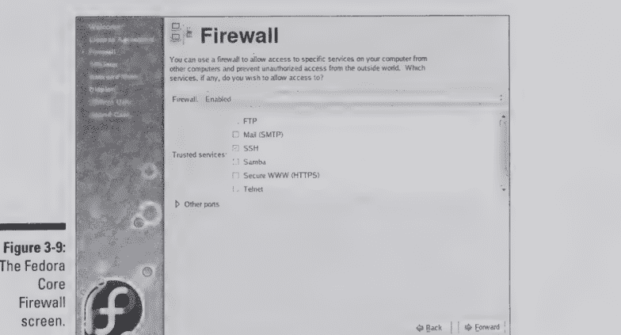

防火墙保护你的系统免受未经授权的访问和发现。当你以高速连接到互联网时，你的电脑就成了万分之一。我希望告诉你没有大量的人和程序试图入侵你的电脑，但我做不到；不幸的是，有其他项目可能会通过本应该关闭的门进入；更多信息请参见侧边栏“防火墙与你”（Firewalls and you）。

3. 除非你百分之百确定电脑对于互联网以及家庭或办公室网络机器是安全的，否则将防火墙设置为“已启用”（Enabled）。值得记住，在病毒之前，大多数入侵发生在内部而非外部。如果你坚持关闭防火墙，请选择“禁用”（Disabled）。祝你好运！

4. 决定你想让哪些可用服务通过防火墙。我建议保留 SSH，以便你可以使用第 12 章讨论的技术远程访问这台电脑。虽然我没有涵盖运行自己的 Web 服务器，但你可以在这台电脑上运行——如果是这样，你还需要启用 WWW (HTTP) 和安全 WWW (HTTPS) 条目（如果你只想浏览网页，则不需要启用这些）。FTP（方便移动文件）和 Mail (SMTP) 也是如此——如果你打算运行 FTP 服务器或邮件服务器 (SMTP)，则需要启用这些服务。

5. 在你想启用的每个项目旁边，点击框框使其显示勾号；准备好后点击“下一步”。对于我的桌面机器，我倾向于勾选 SSH 和 FTP 条目。关于以后如何使用 FTP 客户端从此机器获取文件，请参见第 8 章。当你点击“下一步”时，可能会出现警告框。


## 防火墙与你

任何连接到互联网的人（特别是使用宽带的，关于更多连接类型请参见第 7 章），都应该有某种防火墙。你可以购买防火墙设备（一种用于连接互联网并连接到你其他电脑的小盒子），或者让 Linux 盒子自己为自己进行防火墙管理——即使对于你的家庭或业务网络。虽然这是一个可以轻松写一本书的大的话题，但我在第 7 章介绍了一些基础知识。同时，请至少为这台机器配备自己的防火墙。

6. 如果看到警告对话框，点击“是”（Yes）将防火墙配置设置为你选择的内容。

出现 SELinux 界面。

7. 除非你确定想尝试 SELinux（也称为安全增强 Linux），否则选择“许可模式”（Permissive）。

SELinux 在此处有详细的解释：

```
http://fedora.redhat.com/docs/selinux-fq/
```

这层额外的安全是一个相当高级的话题，远超本书的范围。事实上，它新到即使是老 Linux 管理员仍在试图理解它。

8. 点击“下一步”继续后后配置。

出现“日期和时间”（Date And Time）界面。

9. 如果你处于当前连接到互联网的计算机网络（或你的网络管理员让你使用时间服务器），点击“网络时间协议”（Network Time Protocol）选项卡。否则，跳到第 12 步。

让时间服务器控制你的日期和时间可以确保你的电脑获得关于真实日期和时间的定期输入。否则，随着时间的推移，电脑的时钟实际上会漂移。

10. 点击“启用网络时间协议”（Enable Network Time Protocol）复选框以启用此功能。

11. 如果你的网络管理员让你添加特定的时间服务器，点击“添加”（Add）然后输入该服务器的地址。否则跳到第 14 步。

12. 如果你打算手动控制机器上的日期和时间，请验证日期时间是否准确；如果不正确，在内部修复这些设置。

13. 完成调整和/或网络时间服务器后，点击“下一步”继续。

如果你告诉系统使用网络时间协议 (NTP)，系统可能需要一段时间来联系你选择的服务器。几秒后，出现“显示”（Display）对话框，如图 3-10 所示。


14. 查看“配置”（Configure）按钮。如果你没有正确列出显示器，点击“配置”按钮，在显示器对话框中选择合适的显示器，然后点击“确定”关闭对话框。否则继续到第 15 步。

如果你在列表中找不到你的显示器，选择顶部最合适的“通用”（Generic）选项。

# 第一部分：入门尝试

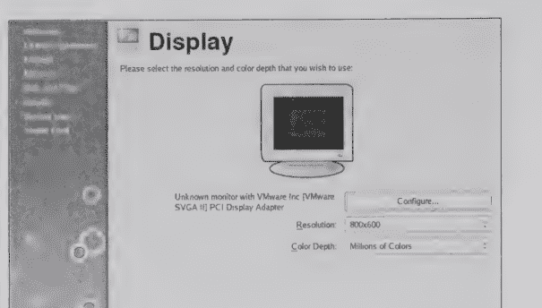

**图 3-10：** Fedora Core 系统的首次启动屏幕。

- 15. **在“分辨率”（Resolution）下拉列表框中，选择你想要使用的视频分辨率。**

安装程序只会为你提供它认为你的显示器和显卡能够支持的分辨率。如果你发现提供的范围不全，请继续选择你能获得的最佳选项；你稍后可以更改视频设置。（一个常用的设置是 1024 x 768。）

- 16. **在“色深”（Color Depth）下拉列表框中，选择你想要使用的颜色数量。**

同样，安装程序提供的是它认为你的系统所支持的选项。你可能想要选择“万色模式”（Millions Of Colors）。

- 17. **点击“前进”（Forward）继续你的首次启动机器设置。**

出现“系统用户”（System User）屏幕。

- 18. **在“用户名”（Username）文本框中输入你想为个人账户设置名称，然后在“全名”（Full Name）文本框中输入你的名字。**

例如，在用户名处输入 `zorro`，全名处输入 `Zorro the Dog`。

- 19. **在“密码”（Password）和“确认密码”（Confirm Password）文本框中输入你的账户密码。**

此密码是你个人账户的密码，与你的 root（管理员）账户无关。可以随意使用与 root 账户不同的密码。事实上，这样做是一个好主意。如果你不小心两次输入的密码不一致，系统会在第 20 步警告你，并返回到此步骤。

- 20. 点击“前进”（Forward）按钮继续。

出现“声音”（Sound）屏幕。

- 21. 确保你的扬声器或耳机已打开，并点击“播放”（Play）箭头按钮。

你应该能从右声道、左声道以及同时听到两个声音。如果你想再次播放但希望声音更大或更小，请使用音量滑块进行调整，然后再次点击“播放”箭头。

- 22. 当询问你是否正常听到了声音时，如果你听到了所有三个声音，点击“是”，如果没听到则点击“否”。

如果你没有正常听到声音，请参阅第 18 章获取有关稍后让声音工作的帮助。音频硬件发烧友可能想要修改底部的可选项目。否则，请保持默认设置不变。

- 23. 点击“完成”（Finish）启动你的新安装程序。

就这些了！你刚刚度过了第二个 Linux“炼礼”！你的电脑现在将带你进入图形化登录提示。有关如何继续，请参阅第 5 章。

# 第 4 章：安装其他 Linux 发行版

## 本章内容

- 使用 Knoppix 启动 Linux
- 爱 Linspire
- 揭开 Mandriva 的迷纱
- 了解 SuSE
- 利用 Ubuntu
- 使用 Xandros 冲击你的大脑
- 利用 LiveCDS 和 LiveDVDs
- 发现更多 Linux！

快速阅读本书中的任何一个章节，都应该让你明白 Linux 不仅仅是某种新奇的计算机程序。Linux 是一个功能完备的软件工具和构建材料工作坊，你可以用它构建各种计算解决方案。开发一个杀手级的 Linux 发行版一直是 Linux 社区的圣杯。这种终极 Linux 发行版将为为幼儿、火箭科学家、家庭主妇以及固执的老计算机科学教授所需的所有支持和能力，以驾驭 Linux 的力量。

然而，要让每个人都完全满意几乎是不可能的。在本章中，我调研了五个最流行（且最容易安装）的发行版。其中一些是商业产品，所以如果你考虑获取其中之一，我希望这一章能帮助你决定哪一个（如果不是 Fedora）符合你的需求。我没有涵盖商业产品的每一个方面（例如你能获得多大的支持）；欲需更多信息，请参阅各发行版的各自网站。

在本章中，我偶尔会提到到 CD-ROM 或 DVD-ROM 上的“ISO 镜像”（ISO image）——镜像是一个以 `.iso` 结尾的文件，它存储了 CD 或 DVD 的内容。当提到这个主题时，请参考侧边栏*刻录 ISO 镜像*（Burning the ISOs）获取技巧。

## 使用 Knoppix 快速启动 Linux

在第 2 章中，我解释了 Knoppix 包含在随书附光的 DVD-ROM 中。你可以用书中的 DVD-ROM 引导，并在启动提示处只需按回车键，即可跳过在电脑上安装任何内容的需要（Linux 直接从 DVD 运行）。如果你担心通过安装会搞乱电脑上的某些东西，请给 Knoppix 一个机会。


如果你无法使用书中附的 DVD-ROM，可以访问 `www.knoppix.net/get_php` 下载 CD-ROM 镜像并刻录到你自己的 CD 上。如果你想刻录更大的版本，可以选择 DVD 版本来获取适合 DVD 的镜像，但请记住，下载 CD 镜像需要更长的时间，因为它是一个大得多的文件。你的下载客户端会根据你的连接情况告知下载需要多久。

## 使用 Linspire 享受生活

`Linspire` (`www.linspire.com`) —— 以前名为 Windows —— 专为从 Windows 转到 Linux 的人员设计。这种商业发行版提供了我在书中“识别某些 Linspire 功能”和“各种 Linspire 版本”部分描述的额外服务。`Linspire` 的设计初衷是便于安装和添加新软件，并包含了许多帮助人们使用系统的教程。然而，它并不是专门为音频发烧友设计的。


如果你对 `Linspire` 感兴趣，你很幸运 —— `Linspire` 的完整版本包含在随书 DVD-ROM 中！在第 12 章中，你可以了解如何注册 `Linspire` 的免费试用版，以便你自行决定是否值得付费。

要安装 `Linspire` 五-0：

- 在线购买并立即下载。
- 购买盒装版。
- 购买预装 `Linspire` 的电脑。

### 刻录你的 ISO 镜像

如果你最终必须使用来自 DVD-ROM 或下载的 ISO 文件，我有一些实用技巧可以让这个过程变得简单。

获取一些良好的刻录软件，例如流行的 `Nero` 程序或免费的 `FreeCD`。

准备刻录 CD 或 DVD 时，确保你的软件理解你想刻录的是 ISO 而不仅仅是一个文件。如果你刻录了 CD 或 DVD，将其插入驱动器打开后只看到一个文件，那么你刻录错误了。ISO 应该在 CD 或 DVD 上解压为一系列文件和目录。

最后，最好以速度4 或更慢刻录这些 CD 和 DVD。你可以减少引入错误的概率。

可能的话，使用 `CD-RW`，因为它们是可重写的，你可以反复下载并刻录。


`Linspire` 在刻录 CD 上提供了很好的 FAQ：`http://info.linspace.com/installhelp/`。无论你是从随书 DVD-ROM 刻录还是直接从 Linspace 获取，这些信息都是用的。

### 安装 Linspire

`Linspire` 主要是一种商业发行版，你可以通过随书 DVD-ROM 包含的 ISO 镜像获取它。我涵盖了这个 `Linspire` 五-0 版本。与其他版本的差异将在在本章稍后的“各种 Linspire 版本”部分进行讨论。

- 1. 将 CD 放入你的 CD-ROM
- 2. 启动机器。

如果机器忽略了你的 CD-ROM 并尝试正常启动，请参阅第 2 章了解如何对 BIOS 进行必要的更改。

## 第一部分：入门指南

3. 在初始界面上，选择在此台计算机的硬盘上安装（`INSTALL`）或更新（`UPDATE`）`Linspire`，并按回车键。

`Linspire` 开始执行所有标准的预安装任务，例如扫描你的计算机硬件并启动安装程序。进度条会显示安装的进度。进度条填满后，你的屏幕会变黑。（不要惊慌！这是正常现象！）最终，你将进入欢迎界面。如果你想作为 Live CD 运行 `Linspire` 而不是立即安装，请选择“直接从 CD 运行 Linspire”（`LiveLive`）。

4. 在欢迎界面上，点击“下一步”（`Next`）。

出现键盘布局界面，如图 4-1 所示。

5. 如果你正在使用 Dvorak 键盘布局（或英语以外的其他支持语言），请选择你的键盘布局所需的语言。

6. 点击“下一步”（`Next`）。

出现安装或更新界面，如图 4-2 所示。取决于你是否已经安装了 `Linspire`，你可能会看到或不会看到检测到之前的安装的提示。

7. 除非你的系统中已经有了 `Linspire` 并且想要更新到五-0 版本，否则请选择“安装”（`Install`），然后点击“下一步”（`Next`）。

出现安装方法界面，如图 4-3 所示。


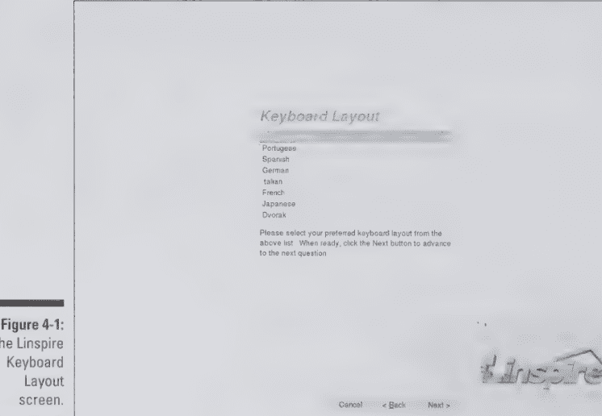

## 第4章：安装其他 Linux 发行版

### 安装还是更新？

我们检测到你的计算机上已经安装了 Linux，因此你可以选择保留现有数据或执行全新的安装。请选择以下选项之一：

- **安装 (Install)**

  在安装新版本的 Linux 之前，将删除硬盘或分区上的所有数据。

- **更新 (Update)**

  删除你计算机上存在的所有系统文件和应用程序，并从已插入的 CD 安装新版本的 Linux。数据文件不会被覆盖；你之前安装的应用程序可以使用 CNR 快速重新安装。

无论你选择哪种选项，在安装前请务必备份你的重要数据。

请从上述选项中选择你偏好的安装方法。准备好后，点击“下一步”（Next）按钮进入下一个安装问题。


< 上一步 下一步 >

图 4-2：Linspire 安装或更新界面。

### 安装方法

选择你想要在计算机上安装 Linspire 时使用的以下某种方法之一：

- **接管整块硬盘 (Take over an entire hard disk)**

  此方法将覆盖并在整个硬盘上安装 Linspire。

- **高级级安装 (Advanced install)**

  此方法适用于高级用户，允许你在驱动器或指定的、预配置的分区上安装或修改副本。

  点击此处获取更多信息

选择上述方法之一后，点击“下一步”（Next）按钮进入下一页。


< 上一步 下一步 >

图 4-3：Linspire 安装方法界面。

### 安装步骤

8. 如果你是在单台计算机上安装 Linspire，或者让它拥有整块硬盘，请选择“接管整块硬盘”（Take Over An Entire Hard Disk）。否则，如果 Linspire 必须与另一个操作系统共享硬盘，请选择“高级安装”（Advanced Install）。

由于第二个选项更为复杂，我将介绍那一个。如果你选择第一个选项，下一步将询问你想要让 Linspire 使用哪块硬盘。使用 Windows 看到的顺序，第一块是 C 盘；第二块是 D 盘；以此类推。如果有必要，你可以查看 BIOS 中的大小和其他信息来确定哪块是第一、第二或第三。

如果你选择“高级安装”，在继续之前最好检查你系统现有的可用空间；否则安装程序将不会让你进入分区选择屏幕。有关如何释放空间，请参见第 2 章。

9. 完成选择后，点击“下一步”（Next）继续。

出现高级安装对话框，如图 4-4 所示。

10. 从列表中选择你想要安装 Linspire 的硬盘（如果你想安装在整个驱动器上）或分区（如果你想安装在特定的空分区上），然后点击“下一步”（Next）。

出现计算机名称和密码对话框，如图 4-5 所示。


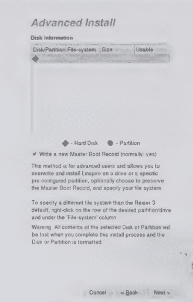

### 计算机名称

计算机名称（Name for this Computer）：

你必须给你的计算机起一个名称。例如：jondoe, jsmith。

### 密码

管理员（Administrator）：

确认（Confirm）：

虽然不是强制要求的，但为了保护计算机免受未经授权的访问，建议使用密码。

图 4-5：Linspire 计算机名称和密码对话框。

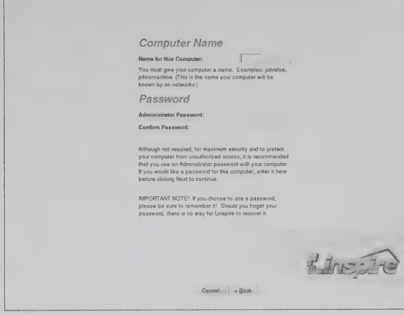

11. 在名称框中输入你想要的计算机名称。

12. 在两个密码框中输入你的密码并点击“下一步”（Next）。

13. 阅读对话框中的指定值并点击“完成”（Finish）。

14. 安装完成后，点击“确定”（OK）。

15. 从驱动器中取出 CD 并按回车键重启（或让它自动重启）。

## 认识 Linspire 的某些特殊功能

Linspire 最酷的功能之一是它的 CNR（点击即运行）商店。这个在线商店允许你浏览数千个程序，只需几点击即可下载并安装。更棒的是，如果你订阅了 CNR 服务，商店中的许多项目都是免费的（一旦获得，就不需要更新会员即可继续使用）。我将在第 11 章介绍如何通过该服务添加软件。

Linspire 部分版本的另一个亮点是音视频教程。安装完成后，教程将立即启动并引导你如何使用系统。你可以随时停止并在以后重新查看。

### 关于各种 Linspire 版本

Linspire 的人员在组合方案方面非常有创意。在“尽情享受 Linspire”（本章前面的部分）中，我讨论了购买此发行版的各种方式。在本节中，我查看了 Linspire 的各种盒装和下载打包方式。我不会介绍所有的插件（如果对每个发行版都那样做，这本书就会变成百科全书了！）相反，我查看了写作时可见的主要版本：

- Linspire 五-O：Linspire 主产品。该版本包含大量软件以及支持。

- Linspire 五-O CNR：此版本与上一个相同，但捆带了当年的 CNR 订阅（见第 12 章）。

## 在 Mandriva 中尽享乐趣

### 安装 Mandriva

在本节中，我将重点介绍 Mandriva 2006 的免费版本——尽管商业版本具有相同的安装程序。安装此发行版所需的三个 ISO 文件已包含在随书附的 DVD-ROM 中，因此只需将它们刻录到三张 CD-ROM 上即可开始——有关这些文件的位置请参见附录 B。如果你无法使用 DVD-ROM，也可以免费下载此发行版（从 www.mandrivinux.com），或者，你也可以从 Mandriva 在线商店（www.mandrivastore.com）购买包含手册和更多内容的盒装版。

在第 2 章中，我提到过 Mandriva 可以重新调整你现有的 Windows 分区大小；无需提前完成此任务。


在您在 CD-ROM 或 DVD 上刻录或购买 Mandriva 后，请按照以下步骤进行安装：

- 1. 将 CD I 或 DVD 放入您的 CD-ROM 或 DVD-ROM 驱动器并重启电脑。

出现初始安装屏幕。如果电脑忽略了您的 CD-ROM 并尝试正常启动，请参阅第 2 章了解如何对您的 BIOS 进行必要的更改。

- 2. 或者按 F1 查看更多选项（当您知道必须使用特定选项时），或按回车键开始安装。

我假设您按了回车键。进度条让您知道程序正在运行，然后您到达语言对话框，如图 4-6 所示。


- 3. 如果你想使用英语（美国）以外的语言作为默认语言，请在列表中选择相应的语言，然后点击下一步（Next）。

如果你希望支持多种语言，可以通过点击多语言（Multi Languages）按钮进行设置。当你点击“下一步”时，会出现许可屏幕。阅读许可，选择“接受”（Accept），然后点击“下一步”。出现安全屏幕。

- 4. 将您的安全级别保持在“标准”（Standard），除非你想尝试“高”（High）。

高于“高”可能会导致你在使用电脑（作为客户端）时忍不住完全关闭安全，这违背了初衷！尽管如此，有些人还是喜欢玩真正的“偏执”（paranoid）级别。这取决于你。我假设你保持在“标准”。

- 5. 如果你想让系统上的特定 root 用户（或电子邮件地址）接收所有安全相关的通知（推荐），请在安全管理员（Security Administrator）文本框中输入为该用户创建的登录账户（或要使用的电子邮件地址）；否则跳到第 6 步。

任何减少你以 root 身份登录的好事，只要它不会降低你的安全性。我倾向于为此文本框选择一个电子邮件地址。


- 6. 点击下一步（Next）

出现磁盘分区屏幕。你在这里看到的选项取决于分区程序（DrakX）在你的硬盘上发现的内容，因此你看到的可能与我看到的有所不同。

- 7. 选择你想使用的分区选项。

- 不要选择“使用现有分区”（Using Partitions）——即使该选项可用——除非你想提前设置好机器的分区。通常，你想要的是其他选项之一。


- 如果你的 Linux 安装必须与另一个操作系统共享硬盘（或你知道你想以某种方式设置分区），则选择“自定义分区”（`Custom Partitioning`）——或者如果你有空闲空间，选择“空闲空间”（`Free Space`）。

- 还可能出现其他选项，取决于系统中当前的内容。例如，你可能会看到“擦除整个硬盘”（`Erase Entire Disk`），这允许用 Mandriva 替换硬盘上的任何内容。如果你选择“擦除整个硬盘”，接受默认分区并跳到第 10 步。

- 8. 点击下一步（`Next`）。

出现分区屏幕。你可以通过点击图形列表中的分区来选择现有分区。每个分区都已连接了建议的挂载点（挂载点的更多信息请参见第 3 章）。你可以通过点击分区图形下相应的按钮来删除或调整特定分区的大小。如果你已经有很多空闲未分配空间，可以点击“自动分配”（`Auto Allocate`）按钮，让 Mandriva 为你建议一组分区。要创建一个新的，点击空白空间然后点击“创建”（`Create`）。你可以在图 4-7 中看到布局示例。

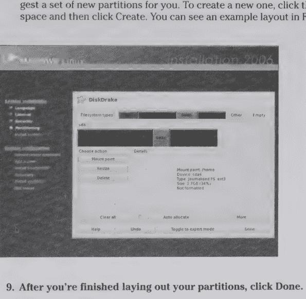

图 4-7：带有示例磁盘布局的 Mandriva 2006 自定义分区对话框。

- 9. 完成分区布局后，点击完成（`Done`）。

如出现的警告所示，当你点击“完成”时，更改将应用于你的硬盘——当你点击此按钮时，更改将立即生效，你将无法恢复之前的磁盘状态。格式化完成后，安装程序将扫描其软件列表。然后出现安装媒体屏幕。

- 10. 在安装 CD 或 DVD 列表下方，如果你的硬盘空间远大于最小所需的硬盘要求，点击“复制整个 CD”（`Copy Whole CDs`）复选框进行勾选，然后点击下一步（`Next`）。

这样做会将 CD 或 DVD 的所有内容复制到电脑，这样你就不需要频繁更换介质（除非你选择了此选项）。出现补充安装媒体屏幕。

- 11. 除非你有特定的在线或额外的 CD 要使用，否则点击确定（`OK`）。

当你选择复制介质时，复制开始。在需要时，会被要求插入相应的 CD 或 DVD。对于这些每一个，插入介质然后点击确定（`OK`）。出现软件包选择屏幕（见图 4-8）。

图 4-8：软件包选择对话框。

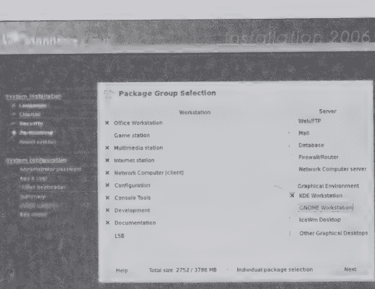

- 12. 选择你想安装的组。

- 13. 选择所需的软件包。

- 14. 点击下一步（`Next`）。

- 15. 选择你需要的软件包。

- 16. 在做出选择后，点击安装（`install`）。

安装开始。系统可能会询问你是否真的要安装此软件。它会给你一个预计所需的时间。请记住，如果没有按照第 10 步将内容复制到硬盘，你会在需要 CD 时才知道，所以不要离开以为它就会完成。你可以点击“详情”（`Details`）按钮查看每个包的进度。

对于大多数 Linux 发行版，Mandriva 在主安装之后、启动系统之前还有一些需要处理的任务。以下是概述：

- 1. 在主文件放置到系统之后（重启之前），系统要求你设置诸如 root（管理员）密码。第 3 章解释了如何选择强力的 root（管理员）密码——以及为什么要这样做。

- 2. 在选择完 root 密码后，系统要求你创建一个普通用户账户。创建时，点击图标图像并为你的用户账户选择一张图片。

说到用户，除非没有其他人可能访问该机器，否则不要配置自动登录任何账户。自动登录不是一种安全的做法，而且是一个给自己带来麻烦工作的好方法。

- 3. 当你到达摘要（`Summary`）屏幕时——它并不完全摘要，因为它可以让你配置尚未查看过的项目——确保所有内容都设置正确。

特别是，图形用户界面条目指的是你的显示器和显卡。如果这些设备没有配置，你将绝对需要更改。在安全部分，点击防火墙（`Firewall`）旁边的配置（`Configuration`），取消勾选“全部”（`Everything`）复选框，并仅勾选

# 70 第一部分：入门

你将在这台计算机上运行的服务。例如，你可能想要检查 SSH、FTP 和 Echo (ping)。

4. 最后，当你获得下载更新包的机会时，如果你已经连接到互联网的网络，请选择“是”。否则，你也可以稍后进行。

在完成此部分的配置过程后，系统会要求你重启。此时，你可能会获得一个执行一些最终配置任务的机会。

## Mandriva 的各种版本

Mandriva 同时提供服务器和桌面解决方案，但我在这里重点关注桌面版——许多人认为这才是 Mandriva 的真实实力所在。你可以通过访问 [www.mandriva.com/products/](http://www.mandriva.com/products/) 查看 Mandriva 的全商业产品，并按照本章较早章节“通过 Mandriva 尽情享受乐趣”中提供的说明查看全系列的下载选项。（一如既往，我只关注包含桌面环境的项目，而不涵盖附加组件）。

在编写此书时，你可以通过以下版本购买和/或下载桌面版 Mandriva：

- MandrivaMove：Mandriva 的 LiveCD 版本，允许你将 CD-ROM 插入任何 PC，用该 CD-ROM 启动 PC，并进入一个功能完整的 Mandriva 环境，而无需安装任何内容。

- Mandriva Discovery/Lx：针对 Linux 新手入门者的商业软件包。该包包含了 MandrivaMove。

- Mandriva 2006 PowerPack：商业级桌面高级使用包。

- Mandriva 10.1 PowerPack+：包含桌面（PowerPack 版）和额外服务器产品的商业机型。

Mandriva 还针对多种硬件架构（如 AMD64、PowerPC 和 SPARC）提供商业版和/或免费版。此外，如果你是一个追求前沿的人（我们以此来称那些“大多数人尚未开始使用的最新、最强大的功能”），你可能也会喜欢在 [www.mandrivalinux.com/en/cookerdevel.php3](http://www.mandrivalinux.com/en/cookerdevel.php3) 下载 Mandriva Cooker。

这是开发版（或测试版）。大多数人最好留在 Mandriva 的主版本上；通常情况下，测试版更有可能充满 Bug——而且运气好的话，会有修复——软件测试（即发现——软件漏洞的探测和调整）。

# 第 4 章：安装其他 Linux 发行版

## 从 SuSE 开始

SuSE（读音为“SOO-za”，[www.suse.com](http://www.suse.com））公司和 Linux 发行版成立于 1992 年，于 2004 年被 Novell（[www.novell.com](http://www.novell.com））收购。该发行版以德语缩写 Softwareentwicklung（软件与系统开发）命名。SuSE 的名之处之一是它的国际支持。大多数主流发行版为全球用户提供不同程度的支持，但某些在特定语言集成方面优于其他；可以理解，SuSE 在德国和西欧地区表现出色。

在本节中，我重点介绍免费版 OpenSuSE 10。然而，并不是安装五个 ISO 文件来安装此发行版，随书附的 DVD-ROM 包含一个 SuSE 10 的 LiveDVD 镜像。不需要安装，你只需将 ISO 刻到 DVD-ROM，放入驱动器并启动机器体验这个版本的 SuSE Linux——这些文件的位置请参见附录 B。如果你无法使用 DVD-ROM，也可以从 [www.opensuse.org/Download](http://www.opensuse.org/Download) 免费下载此发行版，或者从 Novell（[www.novell.com/linux/suse](http://www.novell.com/linux/suse））购买带说明书的盒装。

在书中，由于 GNOME 是 SuSE 中新的桌面环境，我假设你正在使用 GNOME。然而，LiveDVD 默认提供 KDE，这可能会让人困惑。你可以通过注销 LiveDVD 并在登录界面选择“会话类型：GNOME”来切换到 GNOME。


## 安装 SuSE

使用书中 DVD-ROM 包含的 SuSE 版本的用户可以跳过本节。它面向那些选择下载并安装 OpenSuSE 10 的用户——然而，这里讨论的安装路径与商业版 SuSE 产品相同。在第 2 章中，我提到 SuSE 可以调整你现有的 Windows 分区大小。OpenSuSE 也可以。

要安装此发行版，请遵循以下步骤：

- 1. 将 CD 1 或 DVD 1（左侧的）放入你的 CD-ROM 或 DVD 驱动器。

- 2. 重启你的机器。

- 3. 从菜单选择“安装 (Installation)”并按回车键。

出现欢迎屏幕，随后是安装程序的菜单。

安装程序开始检查你使用的硬件类型。（这个过程可能有点慢，所以）最后出现了欢迎来到 YaST2（系统的安装和管理程序）屏幕。


4. 选择你想在这台计算机上使用的首选语言，然后点击“下一步 (`Next`)”继续。


如果你是通过下载 ISO 文件并自行刻制 CD 或 DVD 获取 SuSE 版本，可能会出现“媒体检查 (Media Check)”屏幕。如果是这样，你可能想使用此功能——点击“开始 (Start)”检查磁盘——尽管如果你通过 BitTorrent 下载了镜像，可能就不需要，因为它会自动验证文件。在检查媒体后跳过或继续此屏幕。

随后会出现“许可协议 (License Agreement)”屏幕。

5. 阅读许可协议并点击“同意 (Yes)”，完成完成后点击“下一步 (Next)”。

计算机正在扫描，随后出现“安装模式 (Installation Mode)”屏幕。

6. 选择“新安装 (New Installation)”并点击“下一步”。

出现“时钟时区 (Clock and Time Zone)”屏幕。

7. 如果你的时间设置不正确，进行相应的更改并点击“下一步”。

选择左侧的区域，然后进入右侧的“桌面选择 (Desktop Selection)”屏幕。

8. 选择 GNOME 或 KDE 作为你的桌面，并点击“下一步”。

出现“安装设置 (Installation Settings)”屏幕（见图 4-9）。系统完成自动检测程序可能需要几分钟，填充所有。

9. 在“分区 (Partitioning)”部分，如果你对提供的方案不满意，点击“分区”链接。否则跳到步骤 14。

点击链接将你带到“建议分区 (Suggested Partitioning)”屏幕。

10. 如果只想进行一些调整，点击“基础分区设置 (Base Partition Setup)”单选按钮。如果你想完全更改建议的分区设置，选择“自定义分区设置 (Create Custom Partition Setup)”单选按钮。

由于后者适合更高级的用户，我假设你选择了“基础分区设置”来调整已分配的内容。

11. 点击“下一步”进行你的更改。

打开“专家分区 (Expert Partitioner)”屏幕（见图 4-10）。


**图 4-10:** OpenSUSE 10 专家分区屏幕。

12. 进行你的更改。

你可以通过点击列表中的分区（忽略整个硬盘项，如 `/dev/hda`；而关注分区，如 `/dev/hda1`）并点击“编辑 (Edit)”按钮来打开“编辑现有分区”对话框。如果你想调整某个 NTFS 或 FAT32 分区的大小，可以在列表中点击该分区并点击“调整大小 (Resize)”按钮完成操作。

13. 完成更改后，点击“完成 (Finish)”返回“安装设置”对话框。

# 74 第一部分：上手阶段

## 14. 点击“软件 (Software)”链接。

你很可能想要自己选择安装哪些程序！此操作将带你进入软件选择界面（见图 4-11）。

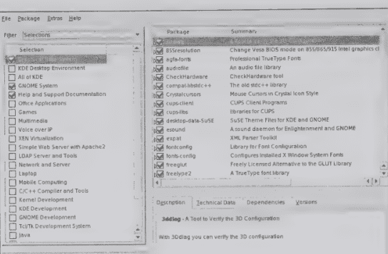

图 4-11：OpenSUSE 10 个人软件选择界面。

## 15. 花费需要的时间浏览选项并将其添加到列表中。

- 对于初次使用者，这里有一个处理此对话框的推荐技巧。首先查看左侧的“选择 (Selection)”下方，并选择你想要使用的组。作为桌面用户，你可能想要添加 KDE 桌面环境、所有 KDE 和 GNOME 系统，这样你就可以同时拥有这两个环境（第 8 步已经选择了其中一个）、游戏、Office 应用程序、多媒体、Java 和 VoIP（Voice over IP）。选择这些组会向你的列表添加大量程序。你可以查看左下角，你的所有选择占用了多少磁盘空间。
- 如果你想确保使用某些类型的软件，点击“过滤器 (Filter)”下拉列表并选择“软件包组 (Package Groups)”。此操作会将左侧的列表更改为软件类型。你可以点击加号展开列表，点击减号收起列表。然后，在右侧，你可以查看左侧已选定组中的单个程序，然后勾选它们将其添加到安装列表，或取消勾选以将其移除。

## 16. 当你对软件选择感到满意时，点击“接受 (Accept)”。

你可能会发现为了解决依赖关系添加了额外的包。如果发生这种情况，请点击“继续 (Continue)”。

# 第 4 章：安装其他 Linux 发行版

17. 如果你想让默认语言不是美式英语，请点击“语言 (Language)”项并进行更改。

18. 如果你是更高级的用户（或只是很喜欢冒险），请点击“专家 (Expert)”选项页并研究其他可能的设置；否则点击“接受 (Accept)”继续。

在此时，你可能会被要求接受诸如 Macromedia Flash Player 等包的许可。阅读这些许可，并（如果你想要这些包）点击“我同意 (I agree)”继续。当该进入实际安装时，会出现“确认安装 (Confirm Installation)”对话框。

19. 如果你确定要继续，点击“安装 (install)”。如果你改变了主意，点击“否 (No)”返回“设置 (Settings)”对话框。

如果你点击了安装，就让安装开始。安装程序会显示它需要的光盘、从光盘中需要的多少材料，以及安装过程中每个光盘的进度条。但注意，它会在过程中间重启。你只需让它运行，并在启动时选择它的默认值，它将返回安装程序——如果你离开了，这一切将自动发生。但是，如果你使用的是 CD，你需要在现场更换 CD，所以不要离开。

安装完成后，SuSE 将继续进行其安装后设置。由于我书中的空间不是无限，我将对如何完成这个初始设置程序提供一些简要说明（请记住，你以后可以更改这些任何项的配置）。操作方法如下：

- 1. 为 root（管理员）用户选择一个强密码。提示请参阅第 3 章。
- 2. 在“网络配置 (Network Configuration)”部分，首先检查你的互联网是否已正确检测。如果已检测到，查看相应部分下方的模型。如果没有，查看“未检测到 (Not Detected)”。你以后可以更改这些设置。
- 3. 如果没有检测到互联网，点击该部分的链接进入其配置。要这样做，请点击“添加 (Add)”，完成设置（使用第 8 章作为指南），并在完成后点击“完成 (Finish)”。
- 你可能需要来自互联网服务提供商 (ISP) 的信息。如果过程变得难以应付，只需点击“返回 (Back)”直到你回到主“网络配置”部分，选择“跳过 (Skip)”按钮，并在以后使用第 8 章进行设置。

 还建议你查看网络配置中的防火墙 (Firewall) 部分——特别是以 SSH 开头的行——然后点击“禁用 (disabled)”。这将该词变为“启用 (enabled)”。你可以在第 13 章了解更多关于 SSH 的信息。

- 4. 到“测试连接 (Test Connection)”时，如果你在线并且可以立即访问互联网，选择“是 (Yes)”。然后点击“下一步 (Next)”。如果尝试失败，不要因为现在必须放弃并继续而灰馁。你以后可以再次尝试。
- 5. 当被问及是否获取在线更新时，选择“是 (Yes)”（如果你现在可以访问互联网）。这样你将从一个完全更新的系统开始。在“安装 (Installation)”下拉列表中，选择地理位置离你最近的站点。
- 6. 点击“手动选择补丁 (Manually Select Patches)”使其为空。这告诉 SUSE 自动更新一切，并避免每几秒钟问一次问题。这种自动更新可能需要一段时间，即使如此有时也会提问。如果它说遇到错误，请一直告诉它重试。通常错误在五次内会自动修正，或者如果你尝试了十次或更多仍然无法通过，就告诉它跳过。你以后可以使用第 12 章再次更新。（如果内核——操作系统的核心——已更新，系统将在你之前重启。）
- 7. 为 root（管理员）用户选择一个强密码。提示请参阅第 3 章。
- 8. 在“添加新用户 (Add New User)”界面，在“登录 (Login)”框定义你的用户名。你的登录账户是你大部分时间使用的账户。在“用户身份验证方法 (User Authentication)”处，选择“本地 (Local)”。在“用户全名 (User's Full Name)”处填写你的全名，以便显示在你的邮件头部中。
- 如果你创建的账户属于 NIS、LDAP 或 Samba 网络，在“接收邮件 (Receive Mail)”框中勾选。
- 我建议不要勾选“自动登录 (Auto Login)”。你应该实际登录系统，以便看到这些功能。

## 77 提示

**提示**

阅读“发布说明 (Release Notes)”是值得的，看看是否有适用于你的小问题以及你可能会发现技巧。

## 9. 配置你的硬件。

“硬件配置 (Hardware Configuration)”部分与其他部分类似。如果你想调整某些内容，点击相应的链接，你以后也可以保持原样。我以后会专门处理声音（参阅第 18 章）和打印（参阅第 7 章）。

在完成所有设置后，你将进入登录界面。尽管开始探索吧！只需确保在此时你的安装光盘已不在驱动器中，以免重启时产生阻碍。

## 关于各种 SuSE 版本


SuSE 提供了从服务器到桌面的产品，从家庭用户到企业级。一如既常，我关注桌面。你可以在其网站探索完整的 SuSE 产品：`www.novell.com/products/suselin/`

SuSE 提供的桌面版本包括：

- SuSE LiveEval：随书附带的 SuSE LiveDVD。如有必要，你可以从 `www.novell.com/products/suselinux/downloads/suse_linux/` 下载此版本——只需将其刻录到 DVD 并启动即可无需安装进入 SuSE 环境。
- OpenSUSE 10：从 `opensuse.org` 提供的 SUSE Linux 免费下载。它是五个光的内容，即使你有高速连接，下载也可能需要几个小时。
- SuSE Linux 10：你可以购买的盒装版，包含了 OpenSUSE 无法包含（出于许可原因）的额外软件，以及一套厚手册。

## 使用 Ubuntu

Ubuntu Linux (`www.ubuntulinux.org`) 与本文讨论的其他发行版相比是一个新成员。大多数新发行版需要长时间才能获得广泛的支持，但 Ubuntu 人气急剧上升。这又是一个基于 Debian 的发行版，尽管它的安装过程不像其他版本那样专门针对初学者。

遗憾的是，我们随书提供的 DVD 遇到了空间问题，不得不将 Ubuntu 从 DVD 中移除。不过，选择 Ubuntu 的原因之一你可以：

- 从网站下载。如需，点击主页上的 `Download` 链接，找到标记为 `Download Sites` 的部分。在下方，点击地理位置上离你最近的位置，系统将为你提供下载文件。该发行版只有一张 CD，因此它是最容易在线获取的版本之一，只需访问网站、点击 `Download` 并按照说明操作即可。
- 在下一个版本发布时申请免费邮寄一套 CD 给你。如需，点击主页上的 `Spitit - Free CDs` 链接。创建一个新账户，创建好你的账户，登录，并完成剩余的磁盘请求过程。

### 安装 Ubuntu

Ubuntu 有两个版本：LiveCD（不需要安装）和 Install CD（需要安装）。安装版本是随书 DVD-ROM 中包含的那个，我将在这里重点介绍此版本的安装。我想重申的是，这可能是书中涵盖的所有发行版中最困难的安装。如果你对双系统启动等问题感到不适，强烈建议将此发行版安装在一台可以独用的电脑上。

要安装 Ubuntu，请按照以下步骤操作：

- 1. 将 CD-ROM 放入 CD-ROM 驱动器。
- 2. 重启你的电脑。

如果你的电脑忽略了 CD，你需要更改 BIOS，让它在查找硬盘之前检查 CD-ROM 驱动器。（更多信息请参见第 2 和第 3 章）。Ubuntu 安装界面出现。
- 3. 按 Enter 开始安装。

文本快速闪过，然后出现选择语言（Choose Language）屏幕。
- 4. 如果不想使用英语，请选择一种语言。准备好后，按 Enter。

出现选择位置（Choose Your Location）屏幕。

## 第 4 章：安装其他 Linux 发行版

- 5. 如果你不在美国，选择相应的国家并按 Enter。

出现选择键盘布局（Select A Keyboard Layout）屏幕。
- 6. 如果你有多个选项，请选择最合适的一个。准备好后按 Enter 继续。

安装程序定位你的 CD-ROM 驱动器——如果在扫描时看起来像冻住了，请等待一分钟左右，它可能会恢复——然后自动检测更多硬件。最后出现配置网络（Network）屏幕。
- 7. 如果机器还没有名称，请为它输入一个名称并按 Enter。

如果已经填写，请忽略。你的 ISP（互联网服务提供商）或网络管理员可能要求你使用特定名称，以防线路为空。（如果你没主意，可以留空或胡编一个。）按下 Enter 后，将进行更多自动检测，最终出现磁盘分区（Partition Disks）屏幕（见图 4-12）。

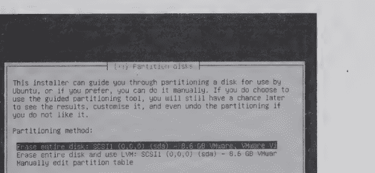

图 4-12：Ubuntu 5.10 分区屏幕。
- 8. 参考你在第 2 章的笔记，选择你想使用的分区选项，然后按 Enter。

三个主要选项是：删除整个磁盘（Erase Entire Disk）、删除整个磁盘并使用 LVM（Erase Entire Disk and Use LVM），或手动编辑分区表（Manually Edit Partition Table）。如果你要删除整个磁盘，我建议尽可能选择 LVM 选项。由于你选择了手动编辑分区表选项，你可能实际上需要自己编辑分区表，因为这是困难的。

如果你选择此选项，将出现：
- 9. 如果你有足够的空间，请选择你想要删除，并按 Enter。
- 10. 如果你有足够的空间，请选择你想要删除的磁盘分区。
- 11. 如果你有足够的空间，请选择你想要。
- 12. 如果你有足够的空间，请选择你想要删除的磁盘。
- 13. 如果你有足够的空间，请选择你想要删除。
- 14. 如果你有足够的空间，请选择你想要删除的- 分区，并按 Enter。
- 15. 如果你有足够的空间，请选择你想要。
- 16. 如果你有足够的空间，请选择你想要。
- 17. 如果你有足够的空间，请选择你想要删除的- 磁盘的 分区，并按 Enter。
- 18. 如果你有足够的空间，请选择你想要。
- 19. 如果你有足够的空间，请选择你想要。
- 25. 选择完成分区并写入磁盘（Finish Partitioning and Write Changes To Disk）并按 Enter。

出现一个警告。
- 26. 仔细检查你的选择，如果满意选择 Yes，如果想返回更改则选择 No。然后按 Enter。

系统设置分区、安装 Linux，然后带你时区配置（Time Zone Configuration）屏幕。
- 27. 选择你的位置并按 Enter。

出现设置用户密码（Set Up Users And Passwords）屏幕。

### 第一部分：入门阶段

28. 输入你希望主账户拥有的真实姓名或昵称（不是管理员账户），然后按回车。

出现“设置用户和密码”（Set Up Users And Passwords）屏幕。
29. 输入你想要使用的登录账号，然后按回车。

出现“设置用户和密码”（Set Up Users And Passwords）屏幕。
30. 在你的登录密码处，按回车，然后在第二个屏幕上重复此过程。

有关如何创建强密码，请参阅第 3 章。两次完成后，安装程序会在后台进行一些设置并弹出光盘。
- 31. 将 CD-ROM 光盘从驱动器中取出并按回车，允许安装程序重启机器。

机器重启后，它将尽可能地安装软件。如果你连接了互联网，它将下载并添加相关内容。当此过程完成后，你将看到 Ubuntu 登录界面。使用你在安装过程中创建的账户登录。

## 关于不同的 Ubuntu 版本

Ubuntu 有三个版本：

- 安装版：本书的版本可以安装在你的机器上。
- LiveCD 版：有关这些是什么以及如何使用的更多信息，请参阅本章稍后部分的“使用 LiveCD 和 LiveDVD”章节。
- 组合 DVD：这些 DVD 实际上是为那些在许多不同类型的硬件上安装 Ubuntu 的人准备的。如果你只想在 PC 上安装，不需要 DVD。

## 使用 Xandros 消除挫败

Xandros (`www.xandros.com`) 是另一个商业发行版，专门为从 Windows 世界转向 Linux 的人员设计；特别是，它设计用于能与工作场所现有的 Windows 网络良好集成。它是另一个基于 Debian 的发行版，并不是为那些想要成为 Linux 极客设计的。相反，它专注于只想完成工作的人。

Xandros 还特别设计用于让从 Windows 到 Linux 的过渡尽可能简单。因此，它提供了与 Windows XP 类似的布局和功能。Xandros 引入的一个方便工具是 Xandros Networks 工具，你可以通过双击桌面访问它。Xandros Networks 让你查看 Xandros 的最新新闻，并浏览软件在线商店（某些软件对注册用户免费）。通过 Xandros Networks 下载和安装仅需几次点击。

随书附带 DVD-ROM 包含的 Xandros 版本是开放发行版（Open Circulation Edition）。你可以将此磁盘映像刻录到 CD-ROM，然后使用下一节中的说明进行安装。

如果你决定购买 Xandros，你有几个选择：

- 购买一个并让其将实体盒寄给你。
- 在商店购买盒装。你可以通过访问 `www.xandros.com/partners/channel-partners.html` 找到销售 Xandros 的地点列表。
- 购买预装了 Xandros 的电脑 (`www.xandros.com/partners/oempcs.html`)。

## 安装 Xandros

要安装 Xandros 3 的开放发行版，请按照以下步骤操作：


## 1. 将安装磁盘放入你的 CD-ROM 驱动器中。

## 2. 重启你的电脑。如果你的电脑从光盘启动，那么你必须更改 BIOS 设置，让它在检查硬盘之前检查 CD-ROM 驱动器。（更多信息请参阅第 2 章和第 3 章。）预计安装程序启动需要三分钟左右。

## 3. 当你到达“欢迎”（Welcome）对话框时，点击“下一步”（Next）。出现“最终用户许可协议”（End User License Agreement）。

## 4. 阅读协议，点击“我接受此协议”（I Accept This Agreement）并点击“下一步”（Next）。出现“安装选择”（Installation Selection）屏幕。

## 5. 选择“快速安装”（Express）或“自定义安装”（Custom），然后点击“下一步”。我假设你选择了“自定义”，因为它是更复杂的选项。如果是，当你点击“下一步”时，会出现“软件选择”（Software Selection）屏幕（见图 4-13）。

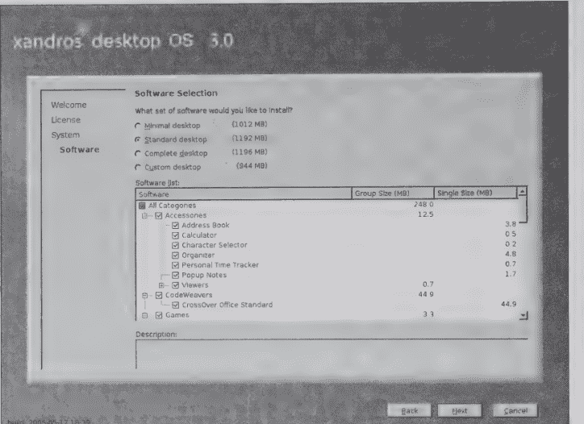

图 4-13：Xandros 3 选择屏幕。

## 6. 选择你想安装的软件组。

除非你的空间不足，否则你可能会喜欢选择“完整桌面”（Complete Desktop），因为它提供了所有软件。如果你想走这条路，先选择“完整”（Complete），然后通过点击勾选标记来移除项目。或者你可以选择“自定义”（Custom）然后开始添加内容。当你点击下方列表中的项目时，你会在屏幕底部看到描述。

如果你确实选择了“完整”，请查看“服务器”（Servers）部分并从列表中移除 Apache（Web 服务器）以及 FTP 服务器 —— 除非你确实打算使用 FTP 服务器让人们获取文件。

## 7. 完成软件选择后，点击“下一步”（Next）。

出现“磁盘配置”（Disk Configuration）屏幕。

## 8. 选择最能代表你操作意图的磁盘配置选项。

方便的是，你可以调整 Windows 分区——即使是 NTFS 分区。为了与本章的其他章节区分，我假设你有一个可用的硬盘（具有足够的可用空间），你想用于 Linux —— 并且你选择了“接管磁盘或分区”（Take Over Disk Or Partition）。

## 9. 当你准备好继续时，点击“下一步”（Next）。

出现“磁盘配置”（Disk Configuration）屏幕，如图 4-14 所示。


图 4-14：Xandros 3 选择框。

# 第 4 章：安装其他 Linux 发行版


图 4-13：Xandros 3 选择屏幕。

## 10. 如果你想给 Xandros 分配分区，请点击该分区。对于整个硬盘，你会看到它们列为 IDE1、IDE2 等（或者 SCSI1、SCSI2 等）。

## 11. 查看磁盘配置摘要，如果有误点击“返回”（Back），或者准备好继续时点击“下一步”（Next）。

## 12. 选择你想使用的网络设备。通常桌面机器只有网卡、调制调器或无线网卡。

## 13. 如果你应该使用 DHCP，直接点击“下一步”（Next）。

## 14. 点击“编辑”（Edit）。如果你使用的是拨号调制调器，选择“不配置接口”（Not Configure Interface），点击“确定”（OK），并跳到第 18 步。

## 15. 否则，如果你有一个 IP 地址，选择“静态地址”（Static Address）。对话框打开。

## 16. 按照 ISP 提供的填写 IP 地址和子网掩码字段，然后点击“确定”（OK）。

## 17. 点击“下一步”（Next）继续。

## 18. 在两个密码框中输入你的管理员（root）密码。有关安全使用 root 账户，请参见第 3 章。

## 19. 如果你的电脑需要与 Windows 网络集成，在“计算机名称”框中输入其网络名称。你在这里输入的是 NETBIOS 名称（如果你熟悉）。传统的 NETBIOS 名称为全大写。

## 20. 勾选“用户文件夹私有”（Make User Folders Private）框框。此功能不仅让每个用户更容易保持数据隐私，还能帮助布局符合红帽的使用习惯，使本书的内容更容易理解。

## 21. 点击“下一步”（Next）继续。出现“账户配置”（User Account Configuration）屏幕。

## 22. 点击“添加”（Add）按钮创建一个普通用户账户。出现“添加/编辑用户账户”（Add/Edit User Account）对话框（见图 4-15）。由于你想尽可能避免使用管理员（root）账户（参阅第 3 章），这个普通账户是你最常用的账户。


图 4-15：Xandros 3 选择框。

| 用户账户配置 |
|---|---|
| 欢迎 | 为了维护电脑的安全和个人偏好，Xandros 建议为你以及其他使用这台电脑的人创建一个账户。点击“添加”创建账户。 |
| 许可证 | |
| 用户账户 | |
| 软件 | 添加/编辑用户账户 |
| 磁盘 | |
| 网络 | 请输入用户名和密码。用户名仅包含小写字母、数字和连字符。 |
| 管理 | 用户名：[ Xandros Desktop OS User ] 密码：[ ] 确认密码：[ ] [确定] [取消] [添加] |

# 第 4 章：安装其他 Linux 发行版 87

## 23. 在“用户名”（User Name）文本框中输入您的登录名。

您的登录名可能是像 bob 这样的。

## 24. 在“全名”（Full Name）文本框中输入您的姓名。

这个名字在您的系统中有很多用途；例如，它会出现在您电子邮件的“全名”字段中。

## 25. 在两个密码文本框中均输入密码，并点击“确定”创建账户。

## 26. 点击“下一步”（Next）继续。

出现“安装摘要”对话框。

## 27. 检查摘要。如果一切正常，点击“完成”（Finish）。否则，点击“返回”（Back）进行修复——修复完成后后再次向后操作回到此步骤。

在此之前，您的电脑没有发生任何更改。当您点击“完成”时，安装将正式开始。完成后，会出现“安装完成”对话框。

## 28. 当您准备好重启电脑进入 Xandros 时，点击“退出”（Exit）。

## 29. 根据提示弹出 CD 盘并按回车键重启。

当出现 Xandros 启动屏幕时，您可以选择 Xandros 选项并按回车键，或者等待它自动启动。

与本书中介绍的其他某些发行版一样，Xandros 会引导您完成操作过程。当您到达登录提示符时，使用您的普通用户账户（该账户应会被自动选中）。输入密码并点击“登录”（或按回车键）进入账户并启动“首次向导”。以下是完成此过程的一些注意事项：

- 在“区域设置”（Regional Settings）下，“语言区域”（Locale）仅用于解决语言问题。它并不会确定您是否要在“字符集”（Character set）中使用某个特定项目，除非您直接使用分配给您的。它是根据您的语言选择的，因为字符集字面上就是您可供输入的字符。键盘布局也是如此。

- 您现在不需要设置打印机，如果以后需要，可以在“打印机”（Printers）对话框中设置。（我在第 7 章会详细介绍打印机。）

- 在“系统行为”（System Behavior）下，您正在选择一组外观元素组合；它看起来会像 Microsoft Windows、MacOS、Linux（此处称为 KDE 而非 Linux，您可以在第 6 章了解更多关于 KDE 的信息）还是 UNIX？系统的实际行为又是怎样的（本书对 Xandros 的介绍除非另有说明，否则遵循 Xandros 默认设置，但欢迎尝试自己的设置！）

# 88 第一部分：入门

- 在“注册”（Registration）下，是否立即注册取决于您。您可以以后再注册；但您确实需要获得技术支持，这里有一句智者之言：在遇到麻烦之前注册。注册还可以让您免费下载 Xandros Networks 提供的一些程序！

- 当您到达“完成”屏幕时，如果您处于已连接互联网的网络中，点击 Xandros Networks 图标以更新您的系统。此操作可确保您拥有所有最新的安全和错误修复。更新程序是自动的。

## 关于不同的 Xandros 版本

Xandros 专注于桌面，并为家庭和商业用户提供产品。Xandros 的免费版和商业版包括（撰稿时）：

- Xandros 3 开放版（Open Circulation Edition）：一个免费版本，与主商业版略有不同。这是本书包含的 Xandros 版本。由于某些原因需要下载此版本，请访问 Xandros 网站：`www.xandros.com/products/home/desktop/disk_oc_download.html`。


- Xandros Desktop OS 版本 3 标准版（Standard Edition）：Xandros 桌面主要的家庭用途。
- Xandros Desktop OS 版本 3 豪华版（Deluxe Edition）：包含与 Windows 软件互操作的额外软件，以及比标准版更大的手册。
- Xandros SurfSide Linux 版（Linux Edition）：针对热衷于互联网的用户，使用 USB 耳机进行 Skype 对 Skype 通话。
- Xandros Desktop 版本 3 商业版（Business Edition）：在豪华版的基础上包含额外软件，允许 Xandros 在 Windows 网络上更好地作为桌面进行集成，并集成了 Sun 的 `StarOffice`（这是第 17 章介绍的 `OpenOffice` 套件背后的商业产品）。

## 使用 LiveCD 和 LiveDVD

正如我在本章（以及本书）中反复提到的那样，`LiveCD` 和 `LiveDVD`（也称为可启动发行版）是 Linux 的版本，您可以通过重启电脑并使用 CD-ROM（或 DVD-ROM）直接启动——无需安装。从 Linux 新手的角度来看，这些版本的优美之处在于，您可以尝试某些功能，而无需在在系统中实际安装任何东西。老手们也喜欢 `LiveCD`。如果系统被破坏，使用 `LiveCD` 重启是一种为自己提供一个“已知良好”（未受损）系统的方法，以便在修复电脑本身损坏的同时进行。此外，许多可启动发行版为特定任务提供了高度专业化的环境……但我有点说得快了。

`LiveCD` 和 `LiveDVD` 的速度通常比传统的安装系统要慢。这是因为一切都必须直接从 CD 或 DVD-ROM 运行。

同时，请确保您在需要时可以保存内容。许多流行的 `LiveCD` 都包含保存内容的方法。如果您在寻找 `LiveCD`，请前往 `www.frozentech.com/content/livecd.php`。

如果您不想下载并刻录这些东西——而且恰好认识任何热行的 Linux 大神——您可能想查找当地的 Linux 用户组（LUG）。您可以在 GLUE（全球 Linux 用户组）网站：`www.ssc.com:8080/glue/groups` 上找到按地理区域划分的世界范围 LUG 列表。这些人总是乐于帮助技术上欠缺的人。这些用户组还定期赞助名为“演示日”（demo days）或“安装节”（install-fests）的活动，您可以带上电脑获得所需的所有帮助。这些活动对于计算机爱好者来说通常非常有趣——有不完的热咖啡和冷咖啡，以及足够的知识可以用电脑做几乎任何事情。

# 第 5 章 Linux 的启动与停止

本章内容

- 了解开启 Linux 机器时发生了什么
- 识别并隔离启动问题
- 安全关机
- 从你的机器上卸载 Linux

我喜欢工作；它令我着迷。我可以静静坐着看几个小时。

> - 杰洛·K·杰洛 (`Jerome K. Jerome`)

如果你是从第 3 章或第 4 章过来的，你可能刚刚熬过了 Linux 世界的洗礼：安装操作系统。我希望第一次启动成功了。如果成功了，而且你觉得本章的大部分内容对你没意义，至少跳到本章末尾附近的章节，“不要只是关掉机器！”。否则，如果你想了解你的机器在启动时做了些什么（这一章的内容可能会非常奇异！），请继续读下去。

你的 Linux 安装无法正常启动并不意味着就是紧急情况。本章的大部分内容旨在为了帮助你处理可能遇到的任何问题。在埋怨 Linux 之前，请记住安装操作系统并不是一项易事——而且，由于安装涉及许多技术变量，许多计算机制造商坚持在工厂完成这项任务。（你上一次自己安装 Windows 是什么时候？）惠普（Hewlett-Packard）、戴尔（Dell）和沃尔玛（信不由你）等公司一直提供预装 Linux 的机器，所以如果你现在感到太沮丧，或者因为在读后面的内容太紧张而不敢尝试，你可以使用 `Knoppix`（参见第 4 章如何在无需安装的情况下使用 `Knoppix`），或从供应商或本地电脑组装商购买预装机器。

要解开无法启动的 Linux 系统的谜团，需要了解你的计算机如何启动。至少，能够告诉维修人员问题似乎在哪里，可以让你感到不那么畏惧——甚至可以帮你省钱，因为这加快了他们的故障排除速度。

## 让 Linux 启动

面对现实吧：尽管盯着一台休眠的电脑很有趣，但真正的乐趣是从开启电脑时开始的。和任何电子设备一样，打开电子洪闸是乐趣的第一步。计算机要做的事情比你的烤面包箱要多得多。你的计算机不需要加热一个简单的加热元件，而是必须检查你（或制造商）插入计算机主板的所有设备小装置。在初始上电后，计算机会执行一些硬件测试（称为 `POST`，即上电自检），以确定这些组件是否工作正常。

检查你所有的硬件只是开始。从你开启电脑到显示器上发光的磷光提示你输入登录名称之间，计算机正在建立一个帝国。如果你仔细倾听和观察，你的计算机和显示器会通过哔哔声、嗡嗡声、电机旋转声、咔哒声、显示器上的信息和闪烁的灯光显示出启动过程的迹象。

尽管你听过那句陈词调“罗马不是一一日建成的”，但启动过程其实非常快。这非常惊人，考虑到操作系统的架构让罗马就像一叠纸箱箱；每当你启动计算机时，它都必须在内存中构建它的整个操作系统。（记住，操作系统是让你的计算机运行的核心软件。）这个过程可以分为四个主要步骤，我将在后面的章节中讨论。

### 第一步：上电自检 `POST` 进入 `BIOS`

`POST` 过程与操作系统完全无关。无论你运行的是 Linux 还是其他操作系统（如 Windows XP），计算机都会执行这一步。

`POST` 失败的一些症状包括：

- 一系列异常的长短哔哔声
- 显示器上没有显示任何内容
- 除了电源上的风扇旋转声外，没有明显的活动
- 电脑箱里散出一缕烟或电器元件烧焦的刺鼻味
- 显示器上显示的指示硬件故障的错误信息

如果你遇到这些任何问题，说明你的硬件出了故障，在继续之前需要解决它们。如果你的计算机在开始安装 Linux 之前运行正常，那么你的计算机应该能够顺利通过 `POST`——`POST` 问题通常不是由安装新操作系统引起的；它们更多是计算机本身的基础问题。

尽管有这些错误，现在是时候质问你的侄子莫蒂默尔（`Mortimer`）了，上次看到他正拿着螺丝刀在你的电脑旁徘徊。（或者把你的电脑带到电脑维修店！）如果你看到指示硬件故障的错误信息，你可能在 `BIOS` 中修复问题的机会。当 `POST` 运行并结束时，它会短时间显示（通常在屏幕底部）如何进入“设置”（setup）的指令。通常，这些指令会提到按下 `DEL` 键或像 `F1` 这样的功能键。当你这样做时（如果一切顺利的话），你将看到一个带有黑白文字的蓝色屏幕。从这里开始，如果你熟悉你的硬件，可以尝试查明并解决问题。然而，许多人宁愿去做根不打麻醉的根管治疗也不愿碰这些东西，所以你可能想找最近的青少年或电脑店魔术师，恳请他们看看。

好消息是，如果你进入进入了 `BIOS`，问题可能比计算机在到达 `BIOS` 之前就故障的情况更容易处理。

### 第二步：`BIOS` 将接棒交给启动加载程序

在 `BIOS` 将接棒交给启动加载程序之后（`POST`成功之后），`BIOS` 定位硬盘并读取磁盘的第一扇区，这通常被称为 `MBR`（主引导记录）。启动加载程序是一个名为 `LILO` 或 `GRUB` 的小型程序。

现在的许多 Linux 发行版在内核加载期间会显示图形。如果你想看发生了什么，通常可以点击图标或按下某个键。（并不是所有发行版都提供此功能，所以如果找不到，不要慌。）

| 发行版 | 启动加载程序 |
| :--- | :--- |
| Fedora | `GRUB` |
| Linspire | `GRUB` |
| Mandriva | `LILO` |
| SU | `GRUB` |
| Xandros | `LILO` |
| Ubuntu | `GRUB` |

启动加载程序将控制权交给内核。当内核开始加载时，你会看到这样的文字：

```
Uncompressing Linux... OK, booting the kernel.
audit(10925662, 337:0): initialized
```

从内核加载失败中恢复（除了上一节描述的找不到操作系统的情况）是 Linux 中更具挑战性的问题之一。遗憾的是，这项任务不适合心细脆弱的人。另一方面，失败的内核可能是更新后的版本；如果你在启动菜单中有多个 Linux 选项，查看每个选项的数字并选择次新的。这样做可以进入最后一个正常的内核，并（至少）拥有一个正常的系统。然后你可以打开 `www.google.com` 并搜索特定的错误信息，或者等下次更新发布后暂时忽略那个坏内核。

如果是你的原始安装无法正常启动，遗憾的是你没有回退内核选项。如果这是你的问题，我建议联系你发行版的支持地址（如果你购买的是商业产品）或加入初学者帮助列表（如果你下载的是免费产品）。请参阅第 2 章以查找书中讨论的每个发行版的获取帮助位置。或者你可以直接重新安装，这在全新安装时是更容易的。有时在初始安装期间会发生一些奇怪的事情，重新安装就能解决问题。


# 第 4 步：控制权移交给 `init`


在内核加载完成后，它会将系统初始化过程交给一个名为 `init` 的程序。`init` 程序负责启动所有服务和程序。当你向上滚动屏幕时，你会看到显示器右侧显示 [OK]（成功）或 [FAILED]（失败），这些进程正在启动。如果你看到了这些行，就说明你的内核已完成加载。

你在使用 `init` 时可能遇到的主要问题是服务（在后台运行的程序）无法正常启动，这会在启动过程中通过 [FAILED] 状态显示出来。服务失败通常是因为配置错误或不支持的硬件驱动程序。有时，一个有问题的服务需要很长时间才能启动，因此在等待时你可能需要一些耐心。

对于许多此类服务，启动失败可能会导致你无法登录和使用系统。机器启动后，如果某个服务让你很麻烦，你可以使用第 13 节描述的技术来关闭该服务。如果机器因为该服务无法启动，你需要访问你发行版的救援模式（`rescue mode`）来关闭该服务——救援模式将在下一节中介绍。


## 进入救援模式

重型系统修复通常在救援模式下进行——这是一个特殊的启动选项，通过设置所谓的 RAM 磁盘（内存磁盘）来模拟你的硬盘，将文件完全保存在内存中。此选项的优点是，即使你安装的系统已经彻底崩溃，你也可以进行必要的系统“手术”。缺点是这是一个纯命令行界面——你真的必须精通相关知识才能找到路。

附录 A 包含了一份 Linux 命令列表，可以尝试解决你的困境。第 20 节涉及其他内容：如何从这里开始修复引导程序（如果你的问题出在引导程序），以及如何追踪内核可能留下的错误信息。你可能还可以通过查看你发行版的文档和在线帮助论坛找到有用的提示。


Knoppix 因系统救援非常受欢迎，因为它是一个存储在 CD 或 DVD 完整发行版。（有关更多 Knoppix 以及实时 CD/DVD 的信息，请参见第 4 节。）查看第 21 节可以使用 Knoppix 进行系统修复的两种方法。

第 5 节：启动和停止 Linux

几乎每个 Linux 发行版都包含救援模式。Fedora 是我唯一有空间分步骤详细介绍的救援模式（在本章稍靠后的位置），但起码，这里有一个关于如何在书中介绍的发行版中找到救援模式的快速参考：

### 进入救援模式（快速指南）

- Linuxspine：CD 包含一个救援模式，如果你能进入那一步，引导程序菜单中也有一个可用的救援模式。对于 CD，当安装程序启动时，使用方向键选择 ADVANCED OPTIONS（高级选项），按回车键，并使用方向键导航到 RUN Diagnostics（运行诊断），按回车键继续。如果你能进入引导程序菜单，使用方向键选择 Diagnostics（诊断），然后按回车键。
- Fedora：随书附的 DVD、你下载的 DVD 或第一张安装 CD 包含一个救援模式，你可以在安装程序的启动提示符处输入 `rescue` 进入。
- Mandriva：第一张 CD 或 DVD 包含一个救援模式。当安装程序启动时，按 F1 进入命令提示符，输入 `rescue`，然后按回车键。
- SuSE：如果你获取了 OpenSUSE 或购买了完整版 DVD 或第一个安装 CD，其中包含 Rescue System（救援系统）菜单选项。使用方向键高亮此选项，然后按回车键。
- Ubuntu：CD 包含一个救援模式。当安装程序启动时，按 F1 进入命令提示符，输入 `rescue`，然后按回车键。
- Ubuntu：CD 包含一个救援模式。当安装程序启动时，按 F1 进入命令提示符。

进入救援模式（快速指南）

- 许多发行版在 CD 中包含救援模式。
- Fedora：随书附的 DVD、你下载的 DVD 或第一张安装 CD 包含一个救援模式，你可以在安装程序的启动提示符处输入 `rescue` 进入。
- 启动模式的 Fedora：随书附的 DVD、你下载的 DVD 或第一张安装 CD 包含一个救援模式，你可以在安装程序的启动提示符处输入 `rescue` 进入。
- 机器启动后，如果某个服务让你很麻烦，你可以使用第 13 节描述的技术来关闭该服务。如果机器因为该服务无法启动，你需要访问你发行版的救援模式（`rescue mode`）来关闭该服务——救援模式将在下一节中介绍。

### 使用救援模式（步骤说明）

- 1. 机器启动后，如果某个服务让你很麻烦，你可以使用第 13 节描述的技术来关闭该服务。
- 2. 在启动提示符处输入救援模式。
- 3. 机器启动后，如果某个服务让你很麻烦，你可以使用第 13 节描述的技术来关闭该服务。
- 4. 在启动提示符处输入救援模式。
- 5. 
- 6. 在启动提示符处输入救援模式。
- 7. 机器启动后，如果某个服务让你很麻烦，你可以使用第 13 节描述的技术来关闭该服务。

# 100 第一部分：入门

如果你安装了 UPS（不间断电源），你可能需要面对的不便就是听着它发出哔哔声抱怨。电压浪涌不会对你的电脑产生任何影响！

## 从系统中移除 Linux

尽管我不希望看到你离开 Linux 的世界，但也不希望看到在你不想使用它时却被困在 Linux 中！最简单地移除 Linux 的方法取决于你想做什么：

- 如果你想用 Windows 替换 Linux，只需在机器上安装 Windows 即可。它将覆盖所有的 Linux 内容，包括启动菜单。
- 如果你想从双启动设置中移除 Linux，请启动进入 Windows，访问命令提示符并输入 `fdisk /mbr`。此操作会移除 Linux 引导器。它不会擦除 Linux，但随后你可以为 Windows 格式化 Linux 驱动器或分区。

Windows XP 和 Xandros 用户可以使用一个特殊的命令来移除该发行版。通过将 Windows XP CD-ROM 放入恢复台中启动机器。切换到 Windows 目录，在命令提示符输入 `fixmbr`，然后（哦对了）按下回车。


# 第 6 章

## 了解这些桌面

本章

- 选择合适的界面
- 利用命令行
- 进入 GNOME 基础
- 考虑 KDE 基础
- 在 GNOME 和 KDE 之间切换

> 公交站在是汽车停止的地方。
> 火车站是火车停止的地方。
> 在我的桌子上，有一台工作站 . . . Steven Wright

很多像你这样的人将 Linux 描述为类 DOS 的环境，你所做的只是在这个感觉古老的世界里操作，你必须输入大量晦涩的内容，而没有任何精美的图片。然而，Linux 桌面为你提供了一个良好的工作环境，正如你在本章中所看到的。酷的一点是，大部分内容都是可配置的。那些喜欢自定义系统的人可以在各种更改中玩得非常开心。

## 决定使用哪种界面

Linux 有两种界面类型：命令行界面 (`CLI`) 和图形用户界面 (`GUI`)。如果你使用其他计算机系统（如 Windows 或 Macintosh），你已经熟悉了 GUI，它有可以查看和点击的图片。大多数 Linux 发行版都包含了 Linux 世界中两种主要 GUI 之一（`GNOME` 和 `KDE`）的不同版本。

# 102 第一部分：入门

如果你使用计算机已经很久，你可能也熟悉命令行界面，它通常由一个仅显示平行排列白色文本的黑色屏幕组成。Linux 的初始发布和早期开发完全是面向命令行的；GUI 随后像蛋糕上的奶油层一样生长出来，使得对于那些倾向于点点点击而不是打字的人来说，它变得更加丰富且更容易使用。

在选择命令行和 GUI 之间做出选择时，你需要考虑许多因素。对许多人来说，这个决定是非常理而行之的。也就是说，他们没有打算放弃 GUI。但至少，你可能想要熟悉一下底层的原理。某一天，你的 GUI 可能会崩溃，让你面对那个令人畏惧的登录提示符！

在选择命令行界面和 GUI 之间进行选择时，速度是需要考虑的重要因素之一。请记住，如果你是一个需要编译程序的程序员（或是一个需要运行高强度计算软件的科学家），GUI 会减慢你的系统。此外，通常在将 Linux 作为服务器使用时，必须关闭 GUI，因为所有这些过程大部分都是浪费 RAM 和处理速度——毕竟，大多数情况下，服务器只是在无人看管的情况下运行。

在选择 GUI 和命令提示符之间做出选择时，可读性也可能是一个大问题。如果你很难在 GUI 的那些小提示窗口中阅读文本（第 14 章和第 20 章涵盖了各种切换方法），你可以让窗口和字体变大，或者直接在 GUI 外部与命令提示符操作。然而，在一个用于文字处理或图像编辑的桌面上，你需要一个点点点击的环境。（这种设置是我关注的类型，但无论如何我都会给你介绍命令行，以防万一）

你还可以从两个主要的 GUI 版本中选择：`GNOME` 和 `KDE`。有些人偏好其中一个，另一些人偏好另一个；我不告诉你该用哪一个。如果你坚持使用你发行版的细节，那么你用的是：

- Fedora: `GNOME`
- Knoppix: `KDE`
- Linspin: `KDE`
- Mandriva: `KDE`
- SuSE: `GNOME`
- Ubuntu: `GNOME`


- Xanders: KDE

大多数发行版都带有 KDE 和 GNOME，因此大多数用户简单地选择他们喜欢的桌面——Linspin、Knoppix、Ubuntu 和 Xanders

# 第 6 章：了解这些桌面

它们仅附带默认的 GUI。Gnome 和 KDE 都是拥有强大粉丝群的优秀桌面。这取决于个人喜好，因此鼓励你安装并尝试两者——看看你更喜欢哪一个。当你问人们为什么选择其中一个而不是另一个时，他们真的给不出什么像样的答案，除了“我一直都是用这个”。当你试图说服别人时，请记住这一点。

# 第 6 章：查看桌面

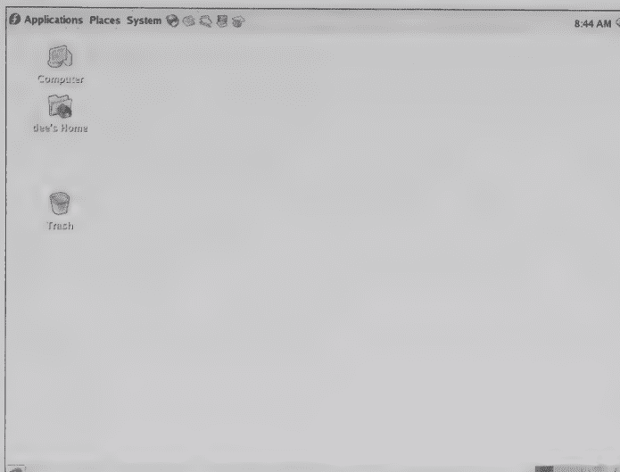

图 6-1：Fedora Core 5 中的默认 GNOME 桌面。

## 菜单

GNOME 有三个主菜单，它们都在顶部面板上可见。从左到右依次是：

- 应用程序 (Applications)：通过 GUI 可用的所有程序。（Fedora 和 Ubuntu 请见表 6-1。）
- 位置 (Places)：硬盘上各种位置的快捷方式。（Fedora、SuSE 和 Ubuntu 请见表 6-2。）第 10 章和第 11 章将更详细介绍此菜单及其用途。
- 系统或桌面 (System or Desktop)：个人和系统设置，以及更多通用的系统命令。该名称可以是 System 或 Desktop。（Fedora 请见表 6-3。）

右侧带有箭头的菜单项提供子菜单，你可以通过将鼠标悬停在该菜单选项上来打开它。通常子菜单内部还有自己的子菜单，提供更多的程序。

SuSE 和 Ubuntu 的菜单包含略有不同的选项列表，但大部分提供相同的内容。

| 表 6-1 Fedora 和 Ubuntu：应用程序菜单内容，按出现顺序列表 |
| 菜单选项 | 您可以发现 |
| :--- | :--- |
| 附件 (Accessories) | 小型、特定功能的 GNOME 和 X 程序。包含计算器、字符映射、字典、PalmPilot 工具、文本编辑器等 |
| 游戏 (Games) | 游戏集合 |
| 图形 (Graphics) | 各种图形程序，包括 GIMP |
| 互联网 (Internet) | 几个网络工具，如 Evolution（电子邮件和日历程序）、Gaim（即时消息）和 Firefox（网络浏览器） |
| 办公 (Office) | OpenOffice.org 应用程序套件（文字处理、绘图等） |
| 声音与视频 (Sound & Video) | 程序，如 CD 播放器和录音器，用于处理电脑的多媒体硬件 |
| 系统工具 (System Tools) | 许多管理和更新系统的工具，如文件浏览器和软件更新程序 |
| 添加/删除软件或应用程序 (Add/Remove Software or Or Applications) | （仅限 Fedora 和 Ubuntu。）打开应用程序安装和删除工具 |

| 表 6-2 Fedora、SuSE 和 Ubuntu：位置菜单内容，按出现顺序列表 |
| 菜单选项 | 您可以发现 |
| :--- | :--- |
| 目录 (Home Folder) | 用户主目录的内容，如第 10 章和第 11 章所述的 |
| 桌面 (Desktop) | 用户桌面目录的内容，其中包含应该出现在你桌面上的文件和文件夹 |
| 计算机 (Computer) | 系统可用的硬盘和临时介质 |
| 软盘 (Floppy) | （仅限 SuSE）插入电脑软盘驱动器的软盘的快捷方式 |
| CD/DVD 创建器 (CD/DVD Creator) | （仅限 Fedora）一个 GNOME 特殊文件夹，用于提取你想要刻录到 CD 或 DVD 的文件 |

| 表 6-3 Fedora：系统菜单内容，按出现顺序列表 |
| 菜单选项 | 您可以发现 |
| :--- | :--- |
| 偏好 (Preferences) | 您的个人设置。 |
| 系统设置或管理 (System Settings or Administration) | 全局设置。 |
| 帮助 (Help) | GNOME 帮助工具。 |
| 关于 GNOME (About GNOME) | 关于 GNOME 的信息 |
| 关于 Fedora (About Fedora) | 关于 Fedora Core 的信息。 |
| 锁定屏幕 (Lock Screen) | 设置机器使无需输入密码即可使用你的 GNOME 登录的功能。 |
| 注销用户 (Log Out user) | （仅限 Fedora，在其他发行版中此菜单选项可能类似于下面的关闭选择。）离开当前的登录会话。 |
| 关 (Shut Down) | 挂起（进入睡眠/休眠模式）、重启或关机（关闭）机器。 |

## 锁定工具

如果你开启了屏幕保护并从主菜单中选择“锁定”选项，你的屏幕保护将出现或淡入黑色。如果有人移动鼠标或使用键盘，会弹出一个对话框，其中包含你的登录和密码字段。你可以输入密码返回工作。在此之前，你可以放心地知道，没有人可以操作你的电脑并假冒成你给老板发搞笑幽默邮件。请注意，如果你以 root 用户身份登录，“锁定”选项将不起作用。

此功能在 Fedora 中默认开启。在默认使用 GNOME 的发行版中更改其或其行为：

- Fedora：选择 系统-偏好-屏幕保护程序。
- SUSE：选择 桌面-GNOME 控制中心-屏幕保护程序。
- Ubuntu：选择 系统-偏好-屏幕保护程序。

进入同一个菜单可以关闭此功能，或更改它在自动锁定屏幕之前等待的时间。

我在这里指的是 GUI，而不是整台机器。知道如何避开 GNOME 的人（我在第 14 章中讨论过这一点）可以启动虚拟会话并做他们想做的事。如果你自己登录了其中一个虚拟终端，你就可以顺利地进行操作。

## 注销工具

取决于你的发行版，请使用以下项：


当你看到一个大空间时，可以添加新图标。从左到右，你会找到：

- 日期和时间小组件：在这里你可以看到日期时间和，取决于小组件的配置。
- 主控制小组件：点击此打开主控制。

现在是底部面板。从左到右，你在 Fedora 和 Ubuntu 的面板上找到：

- 最小化/恢复桌面应用程序 (Minimize/Restore Desktop Applications)：此按钮可以立即最小化所有运行的程序。
- 任务栏 (Taskbar)：在这个空间内，你会找到桌上每个程序的条目。可以通过以下方式更改程序状态：
    - 如果程序被最小化，点击其面板任务框可以打开窗口。
    - 如果程序最大化并被另一个程序覆盖，点击其任务框将其带到最前面。
    - 如果程序最大化并位于上方，点击其任务框可以将其最小化。
- 工作空间切换器 (Workplace Switcher)：允许在单个会中使用四个桌面环境。每个桌面环境都有相同的菜单、面板和背景，但你可以在每个环境中运行不同的程序。保持有序的简单方法。试试看。它就像有四个显示器！
- 垃圾桶 (Trash Can)：桌面垃圾桶的快捷方式。

SuSE 和 Ubuntu 的布局非常相似，尽管图标略有不同。

想将程序从一个工作空间移动到另一个？点击程序左上角的小箭头或图标并选择以下选项之一：

- 始终在可见工作空间 (Always On Visible Workplace)：使窗口在四个空间上都显示。
- 移动到右侧工作空间 (Move To Workplace Right)：窗口向右水平滑动进入“相邻”工作空间。
- 移动到另一个工作空间 (Move To Another Workplace)：你可以指定工作空间 1（最左）、2（左起第二个）、3（左起第三个）或 4（最右）。

# 第 6 章：检查桌面

通过查看工作区切换器（Workplace Switcher）并识别与桌面布局匹配的小窗口，你可以查看打开的窗口处于哪个工作区。

## 更改你的面板

现在是时候如何更改面板的外观和感受了。你可以通过在要操作的面板上找到空白区域，然后右键点击调出面板上下文菜单，通过面板菜单单独自定义你的顶部和底部面板。（有关此菜单项的列表，请参见表 6-4。）

如果你打开了许多程序且它们占据了整个底部面板的宽度，你可能没有可以右键点击的空白空间。尝试精确移动鼠标寻找某个位置。如果找不到，你可能需要关闭一两个程序来腾出空间。


| 表 6-4 | GNOME 面板菜单内容 |
|---|---|
| 菜单选项 | 你能找到的内容 |
| 添加到面板 (Add To Panel) | 允许向主面板添加应用插件、菜单和其他对象的对话框 |
| 属性 (Properties) | 设置此面板行为的选项 |
| 删除此面板 (Delete This Panel) | 删除辅助面板但不能删除主图标面板的能力 |
| 新面板 (New Panel) | 在屏幕不同部分创建新面板的选项 |


| 帮助 (Help) | 用于 GNOME 的帮助浏览器 |
| 关于面板 (About Panels) | 包含一些基本面板信息的对话框 |

## 添加到面板对话框

“添加到面板”对话框（见图 6-2）可以通过面板菜单访问（见上一节）。该对话框包含插件（applets）列表——这些是小型、专门的程序，你可以用它们为面板添加特定功能。要将其中一个插件添加到你的面板，请打开对话框，选择你想要使用的插件，然后点击“添加”。插件将出现在你的面板上。如果你右键点击该插件并选择“移动”，你就可以沿着面板滑动插件，直到将其置于你想要的位置，然后点击释放它。

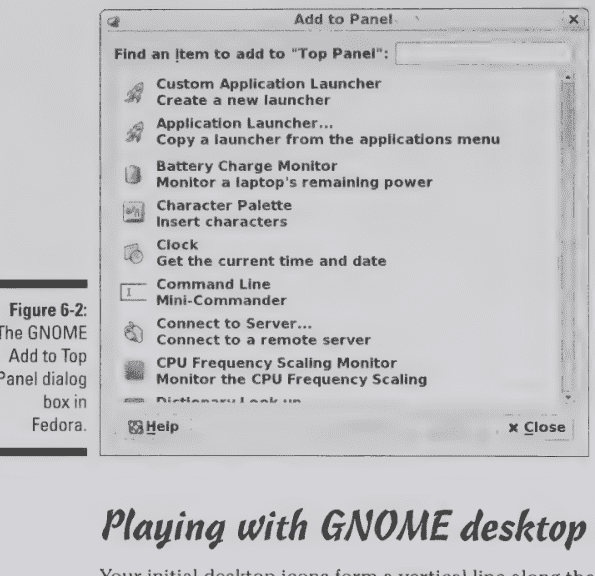

图 6-2：Fedora 中的 GNOME 添加到顶部面板对话框。

## 玩转 GNOME 桌面图标

你的初始桌面图标会在屏幕左上方排成一条垂直线（参考图 6-1），但 Ubuntu 默认没有图标。在 Fedora 和 openSUSE 中，从上到下的显示顺序如下：

- *计算机 (Computers)*：打开 `Nautilus` 文件管理器（参见第 10 章），并列出你的 CD 驱动器、硬盘等列表。
- *主目录 (Home)*：打开 `Nautilus` 浏览器（第 10 章），并显示你的主目录内容。
- *软盘 (Floppy)*：（仅限 SuSE）如果你插入了软盘，则打开软盘内容。
- *网络服务器 (Network Servers)*：（仅限 SuSE）打开 `Nautilus` 文件管理器（第 10 章），列出你可以通过本地网络访问的计算机列表。
- *垃圾箱 (Trash)*：一个 GNOME 快捷方式，用于打开 `Nautilus` 文件管理器中的垃圾箱文件夹，该文件夹包含了你拖入其中但因为你不确定是否要删除的文件。

要使用垃圾箱，请将任何想要删除的文件拖入其中。稍后，如果你确定要丢弃它们，可以通过三种方式之一清空垃圾箱：

- 右键点击垃圾箱图标并从上下文菜单中选择“清空垃圾箱”以清空所有内容。在请求确认时，点击“清空”。
- 双击图标打开垃圾箱。然后通过选择“文件 (File) > 清空垃圾箱 (Empty Trash)”删除垃圾箱的所有内容。
- 双击图标打开垃圾箱。要从垃圾箱中删除单个项目，右键点击它调出垃圾箱上下文菜单，并在弹出菜单中选择“删除垃圾箱 (Delete Trash)”。当询问你确定时，点击“删除”按钮完成任务。

你可以通过按住 `Ctrl` 键来选择多个项目，即使它们不相邻也可以逐个选择；通过按住 `Shift` 键来选择一个范围内的项目；或者通过左键点击并拖动来收集位于同一个方框内的所有项目。

- 另一种从垃圾箱中移除项目的方法是手动从 `~/.Trash` 目录删除它们。


## KDE 基础

K Desktop Environment（K桌面环境）是 Knoppix、Linuxspin、Mandriva 和 Xandros 的默认桌面。Fedora 和 SU 也包含了它，它们的 KDE 布局与其它系统相似。由于你可以直接从随书附带的 DVD 启动 Knoppix 系统，因此 KDE 部分重点关注 Knoppix，并指出其他发行版中不同之处。


要了解更多关于 KDE 的信息，请访问 KDE 主站 `www.kde.org`。

K 桌面环境基本上分为三个部分：

- 面板
- 菜单
- 图标

# 第 6 章：检查这些桌面 117

## 更改你的面板

你可以通过面板菜单自定义你的面板。在任务栏上找到空白区域，右键点击即可调出面板的上下文菜单。此菜单提供：

- *添加到面板 (Add to Panel)*：你可以添加到面板的项目
- *从面板移除 (Remove from Panel)*：从面板中移除项目的选项
- *配置面板 (Configure Panel)*：更改面板的当前设置
- *帮助 (Help)*：打开关于 KDE 面板的帮助文件

KDE 添加到面板菜单包含以下部分：

- *小部件 (Applet)*：你可以附加到面板的各种小部件（微程序）
- *应用程序 (Application)*：主菜单中已有的应用程序启动器
- *面板 (Panel)*：创建新面板
- *特殊按钮 (Special Button)*：添加特殊按钮


## 玩玩 KDE 桌面图标

你的初始桌面图标在屏幕左上角排成一条垂直线（参见图 6-3）。Knoppix 的布局与大多数系统不同，其顶部的图标对应系统的每个 CD-ROM 和 DVD-ROM 驱动器，其下方是你的系统中每个硬盘分区的图标，然后是软磁盘驱动器图标，接着是 Knoppix 的帮助图标以及垃圾桶。大多数发行版都有标准的布局，与你在在本章早些部分“玩玩 GNOME 桌面图标”中看到的类似。

要使用垃圾桶，将其拖入任何你想要删除的文件中。稍后，如果你确定要丢弃它们，可以右键点击垃圾桶图标并在上下文菜单中选择“清空垃圾桶”来清空所有内容。你可以点击垃圾桶，右键点击想要放回的文件并选择“还原”，将其放回原始位置。

## 在 GNOME 和 KDE 之间切换

当某个发行版为你提供桌面选择，且你安装了这两个桌面时，你通常可以在登录时选择使用哪一个。在 Fedora、Mandriva 和 SuSE 中，你在登录界面上有此选项：

- *Fedora Core*：点击登录界面底部的会话图标，弹出的对话框，你可以在其中选择想要使用的 GUI。
- *Mandriva*：点击会话类型图标，并在会话类型上下文菜单中选择想要使用的 GUI。
- *SuSE*：点击会话图标，并在出现的对话框中选择想要使用的 GUI。选择好后后，点击 OK。

# 第 7 章

## 配置 Linux

### 本章内容

- 创建用户账户
- 设置系统打印功能
- 寻找酷的配置工具

> 医生可以掩埋他的错误，但建筑师只能建议客户种植葡萄蔓。
> — 弗兰克·劳德·赖特 (1869–1959)

与建筑师和医生不同，计算机用户并不受限于配置错误。你可以不断调整和更改，直到你对其满意为止！因为许多人拿到新系统后想的第一件事就是让它运行得恰好，我想在本章中花时间介绍核心知识，帮助你实现这一点。你首先将了解到更多关于账户的信息，以及为什么我（在第 3 和第 4 章中）如此坚持让你创建一个供自己个人使用的特殊账户。然后你将学习如何设置你的机器与打印机通信。我还会向你展示你的发行版酷的配置工具在哪里，以便你进行一些深入的自定义。

## 大账户与小账户

Linux 是一个多用户操作系统。它允许每个用户拥有唯一的账户，并允许多个用户同时登录。通常情况下，即使你是系统上的唯一用户，你也需要一个不属于 `root` 用户的自己的账户（我将在下一节解释原因）。此外，拥有多个账户对于尝试不同的用户设置来说非常有趣。这样你就可以创建一个更加谨慎的主账户，以及一个可以完全折腾的“胡闹账户”。

## 避免使用 root

`root` 用户，也被称为超级用户（superuser）或直接叫 `root`，可以访问你机器上的任何和所有东西。没有任何阻止 `root` 访问目录、文件、命令或设备——许多 Linux 初学者认为，既然 `root` 这么方便，他们不妨一直使用 `root` 账户。

简而言之，不要。出于许多原因，你不应该在日常使用中使用 `root` 账户：

- *大过其实 (Overkill)*：对于平庸的任务，你并不总是需要 `root` 权限。
- *root 权限既是祝福也是诅咒*：如果你以普通用户身份搞砸，你只会弄坏账户里的东西。如果你以 `root` 用户身份搞砸，你可以抹掉一切——你 Linux 系统上的所有文件！
- *root 会让你看起来像个无知的吹牛者*：如果除了处理严肃的行政事务，你以 `root` 身份发送电子邮件或发布新闻帖子，人们会认为你不知道自己在做什么，或者你在炫耀。
- *root 带有太大的诱惑*：超级用户可以读取他人的邮件和文件，这引入了一些“微小”的问题。

## 创建用户账户

大多数 Linux 发行版都包含创建用户账户的图形界面。以下是你找到你发行版对应应用程序的方法：

- *Fedora Core*：选择 `System->Administration->Users And Groups`。
- *Knoppix*：从主菜单选择 `System->KUser`。
- *Linspire*：选择 `Launch->Settings->Additional Options->User Manager`。
- *Mandriva*：从主菜单选择 `System->Configuration->Other->User Administration`。


- *SuSE*：选择 `Desktop->YaST` 或 `YaST`。（有关 YaST 的更多信息请参见后文 SuSE 工具章节）。在左侧，选择 `Security and Users`。在右侧选择 `User Management`。

- *Ubuntu*：选择 `System->Administration->Users and Groups`。

- *Xandros*：选择 `Launch->Control Center`。从这里，点击 `System` 旁的加号展开菜单，然后点击 `User Manager`。

虽然这些工具在不同发行版之间并不完全相同，但它们都非常简单——而且工作方式基本一致。毕竟，每个应用程序创建用户账户的步骤都非常标准。我带你演示如何在 Fedora Core 中创建用户账户，大部分步骤同样适用于其他地方。

要在 Fedora Core 中创建新用户账户，请遵循以下步骤：

1. 选择 `System->Administration->Users And Groups`。

由于你（可能）使用的是普通用户账户，会出现 root 密码对话框。

2. 输入 root 密码并点击 `OK`。

用户管理器打开，如图 7-1 所示。当应用程序打开时，安装时创建的用户账户已经显示在其中了。

# 第一部分：入门指南

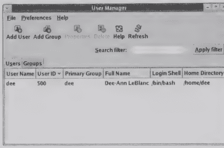

图 7-1：Fedora Core 5 中的用户管理器应用程序。

3. 点击“添加用户”（`Add User`）按钮。

打开“创建新用户”对话框，如图 7-2 所示。

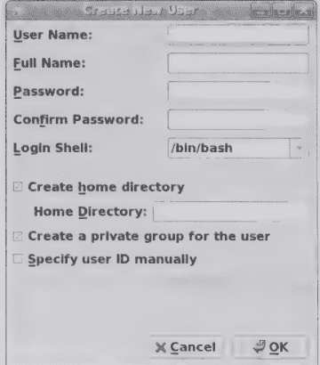

图 7-2：Fedora Core 5 管理器中的创建新用户对话框。

4. 在“用户名”（`User Name`）字段中为新用户输入名称。

在 Linux 中，用户账户的大小写很重要，因此在输入信息时请注意大小写。通常人们使用全小写，这样就不需要一直记忆。

5. 在“全名”（`Full Name`）字段中填写用户的全名（例如你希望在电子邮件发件人表头中显示的名称）或昵称。

# 第 7 章：配置 Linux

## 创建良好的密码

良好的密码由以下部分组成：

- 数字、字母，甚至是标点符号的组合
- 大写和小写字母
- 不使用字典中的单词
- 六个或更多字符
- 不要包含家人或宠物的名字、朋友的名字、生日、纪念日或其他他人容易猜到的你的信息。

6. 在两个“密码”（`Password`）字段中输入密码。其余项目较为高级，你现在可以先忽略它们。

7. 点击 `OK` 保存新账户。

8. 如果你想创建另一个账户，请重复步骤 3 到 7；如果已完成，选择 `File:Quit` 关闭用户创建程序。

## 在 Linux 中打印

除非你生活在无纸环境中，否则你可能经常需要打印某些东西（如信件、数码照片或发票）。因此，你的 Linux 系统必须能够打印；这里就是你设置的地方。在继续之前，了解你的打印机品牌、型号以及它是如何连接到计算机会有帮助：

- 是本地打印机，意味着它通过并行、串口或 USB 端口直接连接到计算机吗？
- 是网络打印机，意味着它不需要连接到任何单一计算机，而是作为自己的（通常是共享的）机器位于网络上吗？
- 是远程打印机但不是网络打印机，意味着它连接到网络上的另一台计算机吗？如果是，这是 Windows、Linux 还是 OS 计算机？

你可以通过以下方法找到打印机配置工具：

- Fedora：选择 `系统（System） -> 管理（Administration） -> 打印（Printing）` 打开打印机配置工具。
- **Knoppix：**从主菜单选择 `Knoppix -> 配置（Configuration） -> 打印机（Printer(s)）` 打开配置打印机工具。
- **Linspire：**双击桌面上的“打印机”图标打开配置-打印机工具，然后点击“添加打印机/类”（`Add+Add Printer/Class`）按钮打开添加打印机向导。
- **Mandriva：**从主菜单选择 `系统（System） -> 配置（Configuration） -> 配置你的计算机（Configure your Computer）` 打开 Mandriva Linux 控制中心。在对话框中，点击 `硬件（Hardware）`，然后点击 `设置打印机（Set The Printer(s)）` 开始打印。
- **SuSE：**选择 `桌面（Desktop） -> YaST`，在“SuSE tools”空间打开本章讨论的 YaST 工具。在这里，选择左侧的 `硬件（Hardware）`，然后选择右侧的 `打印机（Printer）`，打开打印机配置工具。
- **Ubuntu：**选择 `系统（System） -> 管理（Administration） -> 打印（Printing）` 打开打印机对话框，然后选择 `打印机（Printer） -> 添加打印机（Add Printer）`。
- **Xandros：**你在首次启动时曾有过添加打印机的选项——当然，你也可以没问题地跳过。如果你跳过了打印机设置，选择 `启动（Launch） -> 控制中心（Control Center）` 打开 Xandros 控制中心。点击 `外设（Peripheral Devices）` 旁的加号展开菜单，然后选择 `打印机（Printers）`。点击 `添加（Add）` 打开添加打印机向导对话框。

在本节中，我将描述如何设置打印机——由于空间限制，仅介绍 Fedora。虽然每个应用程序都不同，但它们都涉及相同的相同配置步骤，即使这些步骤的顺序可能不同或表述略有不同。请按照 Fedora 的步骤操作（如果你使用的是其他发行版，请阅读此处并利用你发现的信息通过适当的工具设置打印）：

1. 要访问打印设置工具，选择 `系统（System） -> 管理（Administration） -> 打印（Printing）`。

出现打印机配置窗口，如图 7-3 所示。如果你没有以 root 身份登录，将提示你输入 root 密码。

| 打印机配置 - localhost | |
| :--- | :--- |
| 新建 (`New`) | |
| 队列名称 - 共享默认描述 |

2. 要开始设置打印机，点击“新建”（`New`）按钮。

出现“添加新打印队列”窗口。点击“前进”（`Forward`）按钮进入下一步。

3. 在“队列名称”（`Queue Name`）窗口中，输入你想分配给此特定打印机的名称。

如果你有多个打印机，在“描述”（`Description`）框中输入一些内容以帮助区分它们。

4. 完成后，点击“前进”（`Forward`）按钮。

出现“队列类型”（`Queue Type`）对话框，如图 7-4 所示。

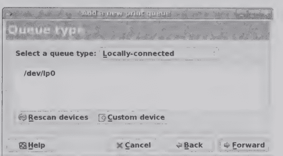

5. 使用下拉列表选择你类型。

选择取决于你选择了以下哪些项目之一：

- 本地 (`Locally`)
- `IPP`
- `LPD`
- `SMB`
- `NCP`
- `JetDirect`
- `CUPS`

6. 输入特定选择所需的附加信息。

7. 点击“前进”（`Forward`）。

出现“打印机型号”（`Printer Model`）对话框。

8. 从列表中选择制造商。

9. 选择你的打印机型号并点击“前进”（`Forward`）。

出现“完成并新建队列”（`Finish And Create The New Queue`）对话框。

10. 在“完成并新建队列”对话框中，点击 `Finish` 启用你的新打印机。

你有打印测试页的机会。

11. 点击“是”（`Yes`）打印测试页。

如果此页打印不正常，请确保为打印机设置了正确的品牌和型号。如果测试页效果完美，在询问是否看起来正常时点击“是”（`Yes`）；如果完全没有打印出来或显示乱码，点击“否”（`No`）。

如果你回答了“否”，你将看到尝试打印时写入日志文件的所有数据。滚动到最后几行以寻找有关问题的提示。如果你遇到问题，请返回此过程的开头，确保你的所有选择都是正确的。

如果你的测试页正常且你点击了“是”，主打印机配置窗口出现，你的新打印机列在列表中。

13. 选择 `操作：退出（Quit）；保存（Save）` 以关闭打印机配置工具。

## 禅与 Linux 配置艺术

让每个发行版脱颖而出的特点之一是其配置工具集。工具越易用，Linux 新手就越倾向于向该发行版靠拢。请记住，老手们也不反意使用方便的工具，特别是当他们在不同发行版之间切换时。这可以节省他们重新学习每个发行版配置存放位置的精力。

在本节中，我将介绍书中涵盖的每个 Linux 版本中提供的配置工具。需要注意的一点是，每个 KDE 默认发行版（Knoppix, Mandriva, Linspire, Xandros）中的控制面板看起来（以及工作方式）非常相似，因为它们都是基于主 KDE 控制面板的。

## Fedora Core 和 Red Hat 工具


Red Hat 的 Fedora 社区项目包含了许多 Red Hat 为其商业产品开发的工具，以及由社区构建的各种工具，例如 GNOME 项目的工具。在自定义桌面时，你可以通过选择“系统偏好”（SystemPreferences）找到你需要的一切。GNOME 没有采用大型控制中心模式，而是将配置工具拆分为较小的、独立的程序。你在其他 GNOME 安装中也能发现这种布局。

延续更小、更专用的工具的主题，你可以通过选择“系统管理”（SystemAdministration）来获取各种系统级配置选项。

## Knoppix 工具

Knoppix 带有许多工具，让你让你在菜单间穿梭时很容易感到迷失和无所适从。在该发行版中，找到配置工具的主要地方是通过主菜单中的 Knoppix（左下角的字母 K）。此菜单内有一组子菜单，其中一些提供了以下选项：

- 配置（Configure）：设置电脑声卡、打印机、在多次使用此发行版启动系统之间保持持久的真实主目录（持久性 Knoppix 磁盘镜像）等的选项。
- 网络/互联网（Network/Internet）：从调制解调器到 ISDN 等所有内容的互联网连接程序（见第 8 章）。
- 服务（Services）：启动桌面上实用的各种服务器的选项，例如 SSH（见第 13 章）、用于通过网络向 Windows 机器提供 Linux 文件的 Samba，以及防火墙。

除了此位置，你还可以通过从主菜单选择“设置”（Settings）来找到一些配置程序：

- 配置面板（Configure The Panel）：此程序让你自定义面板——移动到别处、隐藏它、更改其外观等。
- 桌面设置向导（Desktop Settings Wizard）：此选项会打开 KDE 设置向导。
- 菜单编辑器（Menu Editor）：此选项会打开 KDE 菜单编辑器，你可以在其中自定义主菜单的内容。
- 菜单更新工具（Menu Updating Tool）：此选项会在你的系统中搜索特定程序，如果它们不存在，则将其添加到菜单中。
- 打印管理器（Printing Manager）：此程序（见图 7-5）打开一个实用的打印管理器，可以帮助你执行打印到 PDF、发送到传真机等操作。

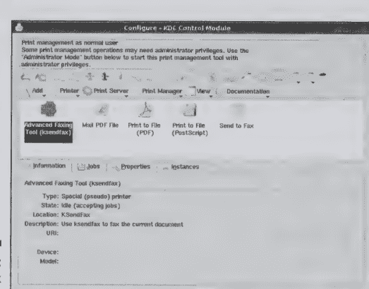

图 7-5：

Knoppix 3.6 打印管理器。

## Linspire 工具

第一次运行 Linspire 时，会出现“首次设置”（First Time Setup）对话框，在你不勾选“我同意许可”（I Agree To License）复选框之前，它会一直出现。在这个工具中，你可以选择运行系统配置过程，设置如时区、日期、时间、重置主密码、更改屏幕分辨率、创建新用户账户以及重命名机器等。点击“完成”（Finish）将关闭工具并启动 Linspire 音频辅助教程。在离开之前，请尽情倾听（并观看）这些内容！

如果你想立即退出音频辅助教程，请点击右上角的 X 关闭教程。

要找到剩余的配置工具，请选择“启动>设置”（Launch>Settings），然后选择以下其中之一：

- 更多选项>更改密码（Additional Options>Change Password）：更改你当前正在使用的账户密码。
- 更多选项>自动启动的程序（Additional Options>Programs To Autostart）：包含你要在登录时自动启动的程序快捷方式。要向此文件夹添加项目（当它打开时）：
  1. 打开主菜单。
  2. 浏览并找到你想在 Linspire 启动时运行的程序。
  3. 将程序拖入自动启动窗口。
  4. 当弹出上下文菜单时，选择“复制到此处”（Copy Here）。
  你的新自动启动快捷方式就会出现。
- 更多选项>重命名计算机（Additional Options>Rename Computer）：更改分配给这台电脑的名称。
- 更多选项>用户管理器（Additional Options>User Manager）：创建和删除用户账户。
- 控制中心（Control Center）：Linspire 控制中心（见图 7-6）是配置该发行版除添加和更新软件之外一切内容的中心点。你将在第 12 章中学习如何使用此面板。

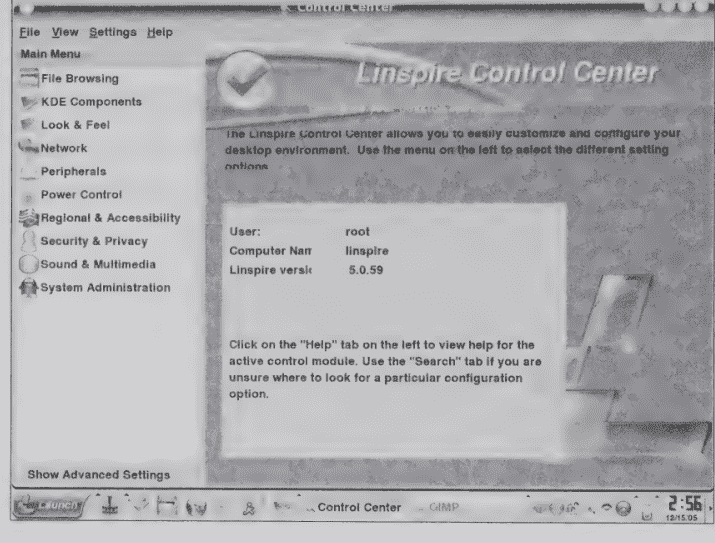

图 7-6：Linsire 5 控制面板。

## Mandriva 工具

Mandriva 包含了许多配置工具，尽管其中一些是重复的——你通常可以选择运行大型工具或一个小型组件。你可以通过进入主菜单并选择“系统>配置”（System>Configuration）找到其中许多工具。它包含：

- 配置你的桌面（Configure Your Desktop）：KDE 控制中心包含许多关于桌面的选项。
- KDE：每个选项都映射到你个人的偏好。
- 硬件（Hardware）：这里有许多硬件相关的设置。
- 软件包（Packaging）：这可能是你常用的选项之一（更多信息请见第 12 章）。
- 其他（Other）：控制中心中分散的工具。
- 配置你的电脑（Configure Your Computer）：控制中心（见图 7-7）仅供系统管理员（root）使用，用于更改系统设置。

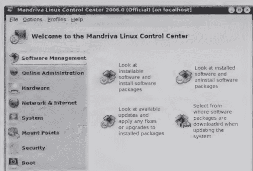

图 7-7：Mandriva 控制中心。

SuSE 提供了两个配置系统的主要地方。其中一个是 GNOME 控制中心，通过“桌面>GNOME 控制中心”访问。另一个是 YaST，你会在书中听到它。你可以通过“桌面>YaST”访问此工具（见图 7-8）。

你可以在命令行提示符运行本文讨论的许多工具，但不是所有。YaST 实际上有一个全命令行界面，以防你未使用 GUI。

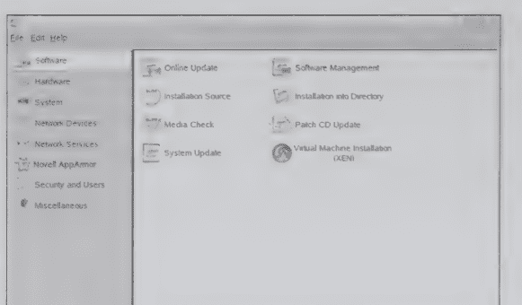

图 7-8：SuSE 10 的界面。

## Xandros 工具

Xandros 提供了一个定制版的 KDE 控制中心，称为 Xandros 控制中心，通过选择“启动>控制中心”（见图 7-9）访问。你的系统级设置和个人外观设置都可以在此工具中进行。

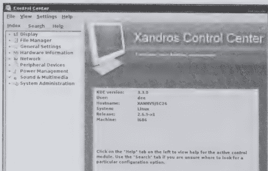

图 7-9：Xandros 3 中的 Xandros 控制中心。

## Ubuntu 工具

Ubuntu 可能是书中包含的发行版中最花哨的。原因之一是 Ubuntu 是最新的；它的开发者还没有时间创建这么多工具。然而，另一个原因是，相对于其他包含 GNOME 的发行版（Fedora, Mandriva 和 SuSE），Ubuntu 更像是一个“原生”GNOME 发行版。

你可以在“系统”菜单下找到 Ubuntu 的大部分设置，位于“系统>偏好”（System->Preferences）和“系统>管理”（System->Administration）。

正如你所见，学习一个 Linux 发行版的酷之处在于，你正在掌握可以帮助你生存*另一个*版本的 Linux 有用技能。记住，所有发行版都是亲戚，就像堂兄弟姐妹一样。现在去尝试吧，在调整你的系统时尽情享受吧！

## 第二部分

## 现在的网络！

《第五次浪潮》，作者 Rich Tennant 著


> “这直到我们重新连接网络为止。”

在本部分中，你将进行必要的心理和物理连接，将你的 Linux 机器接入互联网，包括配置电话拨号到互联网服务提供商（ISP）。你还将发现如何进行一些基础的网络故障排除，以防万一一切并不完美。接下来，你将设置 Web 浏览器、电子邮件客户端和即时消息软件，以便你可以浏览网页、发送和接收电子邮件以及访问新闻组。通过在本部分中安装的实用程序，你将能够随心所欲地扩展和自定义你的 Linux 系统。你还将发现如何在互联网的电子高速公路和小径上穿行以完成任务！

## 第8 章

## 连接互联网

### 本章内容

- 理解常见的互联网连接方法
- 设置你的互联网连接
- 连接到互联网服务提供商（ISP）
- 足够的 TCP/IP 知识以达到“危险”水平

> 通信的每一次改进都让无聊变得更加糟糕。

Frank Moore Colby

如果你在一个连接到局域网（LAN）的机器上，并且在安装期间配置了网络，那么你可能已经连接了互联网。要测试你是否已连接，打开 Web 浏览器并尝试访问外部网站（如 www.gnu.org）。如果成功，说明你连接好了！不需要看这一章。否则，请继续阅读。

## 互联网连接 101

在我开始之前，有必要对宽带选项（DSL 和电缆）说几句话。“宽带”一词有一个技术定义，但我只是用它来指代高速互联网接入。虽然双工调制调器通常可以以每秒 56 kb（千比特）的速度传输信息，但宽带连接可以达到该数的 50 倍。如今，网页包含大量的图像和多媒体元素，通过 56 Kbps 的拨号调制调器享受这些功能，就像在口渴得要命时喝冷水。


不要让高速服务商让你气馁于使用他们的服务配合 Linux。仅仅因为他们直接不支持 Linux，并不意味着这项技术无法在 Linux 上运行。`TCP/IP`（互联网的流量规则集）是为 Unix 操作系统开发的，而 Linux 正源于 Unix。

如果你是双启动到 Windows，你的 ISP 可以帮助你安装宽带连接，然后你可以在有时间和有兴趣时尝试让 Linux 连接。在列表中，我向你推荐了一些网站，当你查看可用类型时，这些网站可以帮助你配置宽带连接：

- 电缆调制调器：许多电缆电视公司已扩大了其产品线，通过其电缆基础设施提供互联网接入。当你订阅电缆服务时，安装技术人员通常会提供一个特殊设备——电缆调制调器，以及一个标准网络适配器（如以太网卡）。人员会将网络适配器安装到你的电脑中并将电缆调制调器连接到上面。至于速度，你需要咨询你的电缆供应商。以下网页提供了一份包含有关电缆提供商和 Linux 有用信息的文档：

`www.tldp.org/HOWTO/Cable-Modem`

- 数字用户线路（DSL）：DSL 以数字格式将数据传输到你的电话插座。DSL 之流行是因为它提供了比 ISDN 更快的连接，且安装和服务成本更低，并利用了你电话公司提供的现有铜线布线。你甚至可以使用同一条线路作为普通电话线！DSL 连接需要额外的通信硬件，你的互联网服务提供商（ISP）应该提供这些硬件。

注意 DSL 有几种变体：

- ISDN（综合业务数字网络）数字用户线路 (ISDL) —— 参见本节后文关于 ISDN 的定义

- 对称数字用户线路 (SDSL)

- 非对称数字用户线路 (ADSL)

- 通用 DSL (XDSL)

你可以从你的 ISP 处了解你的 DSL 连接有多快，因为因地而异。关于 DSL 和 Linux 的概述，请访问以下网页：

```
www.tldp.org/HOWTO/DSL-HOWTO/
```

- 卫星调制调器：居住在部分偏远或低基础设施地区的人可能会选择卫星调制调器路线（`www.tldp.org/HOWTO/Sat-HOWTO.html`）。你可以从许多方面认为此服务与电缆等同，因为它通常通过获取为你提供卫星信号的相同提供商来实现。

然而，卫星也有一些缺点。如果你的卫星电视不可靠，你的互联网服务也将面临同样的命运。上传和下载速度也可能发生巨大变化。

- 拨号调制调器：在既没有宽带也负担不起的地方，拨号调制调器仍被广泛使用。它将计算机的数字信号转换为从墙插座传输到电话公司所需的模拟信号。因为调制调器利用语音电话服务，你不需要为订阅 ISP 进行任何特殊设置。你不能同时在同一条电话线上进行拨号和通话。如果你使用 Linux，请查看侧栏“桌面之外：伪装成调制调器”以获取更多连接方式。

- 无线：今天的无线领域可能带给你（选择）。存在四种主要类型：802.11a、802.11b、802.11g 和 802.11n（通常称为 WiFi 或蓝牙）。我在这里提供的最好的建议是搜索你的无线卡的品牌和型号，并确保它们是新的。一些实用的链接包括：

- 总体调制调器 HOWTO：`www.tldp.org/HOWTO/Modem-HOWTO`

- 综合业务数字网络 (ISDN)：不久以前，ISDN 并不是唯一的住宅高速选项。当人们只能从连接到电话公司的铜线中挤出 28 Kbps（今天拨号调制调器速度的一半）时，它出现了。只要你距离电话办公室 3.4 英里，ISDN 就能提供 128 Kbps。使用 ISDN 需要两个特殊设备：一个调制调器（通常由 ISP 提供）和一个网络适配器（有时是以太网卡）。由于 ISDN 使用得并不多，没有多少专门针对它的网站。调制调器 HOWTO 包含了最新 ISDN 信息的提示，同时也很有趣。

小心伪装成调制调器的设备

我试图减少一些挫折——并让你的电脑免受锤伤害。许多 Linux 新手因无法与他们的内部调制调器通信而苦恼。“毕竟，”新手推理道，“当我运行 Microsoft Windows 时，同样的硬件是可以工作的。”标签具有误导性，因为某些制造商只是懒得列出其他操作系统，尽管它们的硬件可以在那些操作系统上运行。

嗯，情况是这样的：年前，硬件制造商开发了一种被称为软件调制调器的设备，以降低硬件成本。这个想法是将部分责任从调制调器转移出来，并将这些任务交给操作系统。结果是了一种廉价的调制调器，它将信号路由到仅在 Microsoft Windows 上运行的专有软件。简而言之，这些所谓的调制调器（称为 `Winmodems`）并不是真正的调制调器，而是 Windows 的电话电缆接口。

设备型号前面带有 `HCF-`、`HSP-` 或 `HSF-`。

# 第 8 章：连接互联网

## 硬件设置

在你打算椅子上坐舒服之前，你必须物理地检查一些物品。这可能需要你进行一些低级操作（例如爬到桌子下面）：

- 电缆调制解器、DSL 调制解器或任何高级设备：如果你拥有这些小设备之一，你需要确保：

  - 一根以太网线（类似于电话线，但连接器更宽）已插入电脑的以太网卡并插入你的 ISP 安装的特殊电缆、DSL、卫星或 ISDN 调制解器中。

  - 该高级调制解器已开机。（这些设备通常有独立的电源。）

- 外置调制解器：如果你有一个外置调制解器（独立于电脑机箱的），你需要验证：

  - 线缆已从调制解器固地连接到电脑上的正确端口。

  - 调制解器已开机。（外置调制解器有自己的电源。）

  - 电话线的一端插在墙插座上，另一端插在调制解器上。

- 内置调制解器：如果你有一个内置调制解器，你需要验证：

  - 该调制解器不是软件调制解器。如果不确定什么是调制解器或你是否有，请查看侧边栏“小心伪装成调制解器的设备”。

  - 电话线的一端插在墙插座上，另一端插在电脑背面的电话接口上。

- 无线网卡：如果你有一个无线网卡，你还需要一个无线路由器来收集并引导电脑之间的流量，或者通过桥接器让你的无线网卡与以太网通信。无线路由器或桥接器距离网卡的远近以及穿过什么（墙、地板等）取决于你使用的技术。关于无线硬件和设置的一些实用入门指南包括：

  - WiFi 如何工作：`http://computer.howstuffworks.com/wireless-network.htm`

  - 创建无线网络：`www.wi-fi.org/OpenSection/design.asp?TID=2`

好了，现在你可以回到椅子上了。

142 第二部分：现在上网！

## 选择互联网服务提供商 (ISP)

由于 Linux 普及率的上升，许多 ISP 正在培训其支持人员学习 Linux 相关知识。如果你已经有了拨号服务，可以给他们其中一个打个电话，让他们知道你对 Linux 的追求。很有可能，那个人已经拥有关于 Linux 订阅者的信息，并可以为你提供这些信息。如果你正在寻找新的 ISP，本节提供了一些实用的选择建议。

某些 ISP 提供它们自己的专有软件，你必须将其安装在 PC 上以连接互联网。它们提供的软件可能运行在 Windows 上。由于这一事实，几个免费拨号服务无法与 Linux 工作。这些专有软件会干预操作系统，以确保横幅广告不被隐藏，或者确保你只在指定的时间内保持在线。

如果你在物比 ISP，请考虑以下问题：

- 你可以在全国范围内乃至世界各地获得本地拨号号码吗？如果你经常旅行并需要在不同的城市访问互联网，这项服务可以帮你省下不少钱（和省去很多烦恼）。

- 它是否为 Linux 提供技术支持？如果你计划运行 Linux，这一考虑非常重要。不过，这不必是决定性的因素。

- 你能获得推荐吗？问问你的朋友。ISP 最好的朋友就是满意客户的背书。

- 你需要拨号接入吗？虽然 7:1 的用户与线路比例（每条线路平均 7 个或更少订阅者）并不是衡量遇到忙音信号频率的完全准确的标准，但它对消费者来说是最易的衡量标准。这主要是拨号用户关心的问题。

## 从 ISP 获取你所需的信息

大多数良好的 ISP 在你注册其服务后会为你提供一份客户信息表。该表单至少应包含以下信息：

- 调制解器用户的本地电话拨号号码

- 用户登录名

- 用户登录密码

- 电子邮件地址

- 电子邮件出站主机或简单邮件传输协议 (SMTP) 服务器

- 电子邮件入站主机或邮局协议 (POP) 服务器

- 新闻主机将为

- **静态**：你始终拥有相同的 IP 地址。静态地址对于服务器来说比桌面电脑更常见。如果你使用静态地址，你的 ISP 需要为你提供名称服务器 IP 地址、网关地址、网络地址和子网掩码。这些信息都在客户信息表上。

- **动态**：你的 IP 地址在每次连接时都会更改，或者按固定间隔更改。在大多数桌面电脑上，你并不总是需要相同的地址，这让像笔记本电脑这样经常在不同网络间移动的设备变得更加轻松。如果你使用动态地址，会被告知需要使用 `DHCP` 连接。

有了这些信息，你可以使用 Linux 系统建立互联网连接。

## 连接

幸运的是，Linux 供应商提供了工具，减少了在 Linux 上连接的复杂性。这并不是网络本身发生了变化，而是它的许多细节被隐藏了，使得你只需要点击这里并按下一个键。不久前，在 Linux 机器上配置（特别是）拨号网络无异于调试一个故障的路由金约。

发行版中可用的互联网连接配置工具有：


## 各发行版网络设置入口

- Knoppix：点击面板上的企鹅图标并选择 Network/Internet。此菜单包含你可以根据所使用的硬件使用的各种工具。
- Linspire：选择 Launcher/Run Programs/Internet/Connection Tools，然后选择适合你 ISP 的工具。
- Fedora：选择 System/Network。
- Mandriva：从主菜单选择 System►Configuration►Configure Your Computer 打开 Mandriva 控制中心。输入密码。选择 Network & Internet►Set Up A New Interface (LAN, ISDN, ADSL) 进入向导并选择你要连接。
- SUSE：从主菜单选择 Applications►System►YaST 打开 YaST 配置工具。输入密码。在左侧选择 Network Devices。在右侧选择你的硬件类型。
- Ubuntu：选择 System►Administration►Networking 打开网络设置窗口。输入密码。选择 Ethernet Connection 或 Modem Connection，然后点击 Properties。要设置此连接，点击 Enable Connection 并填写信息。
- Xandros：选择 Launch►Control Center 打开并展开 Network Center。点击 Network 旁的加号选择互联网连接——你可能需要点击 Administrator 按钮输入 root 密码以启动向导。


有时选择并不像你想的那么明显。例如，可能由于 DSL 连接是通过你的以太网卡进行的，你的系统将其识别为 LAN/以太网连接。如果你无法让连接工作，请尝试这些因素。

再次说明，由于空间有限，我通过 Fedora 演示设置过程。许多决策和所需信息在不同发行版之间是相同的，如果你使用的不是 Fedora，请阅读本节并根据你发现的内容在你自己的电脑上进行操作。

## 配置你的连接

手里拿着 ISP 的信息，面前是闪烁的显示器，按照以下步骤在 Fedora 中配置你的拨号互联网连接：

1. 从 GUI 桌面，选择 System►Administration►Network。
2. 如果必要，在对话框中输入你的 root 密码。

如果你以普通用户（而非 root）登录，会提示输入 root 密码。

网络配置对话框打开（见图 8-1）。

### 第 8 章：连接互联网

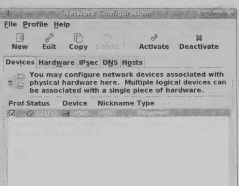

图 8-1：Fedora Core 5 中的网络配置对话框。

活动配置：Common

3. 在网络配置对话框中，点击“新建”（New）按钮。

出现“选择类型”（Select Type）对话框，如图 8-2 所示。因为我无法涵盖所有的网络连接类型，而且拨号调制调器是最复杂的，所以我从这里开始遵循拨号（调制调器连接）选项。为自己选择适合的硬件类型并继续。

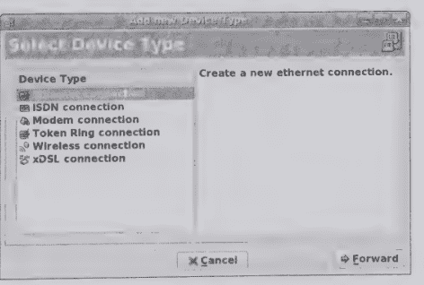

图 8-2：Fedora Core 5 网络配置工具中的“选择设备”（Select Device）对话框。

4. 要设置拨号调制调器，从“设备类型”（Device Type）列表框选择“调制调器连接”（Modem connection），然后点击“向前”（Forward）按钮。

点击“向前”后，工具会探测你的调制调器。如果找不到你的调制调器（再次强调，我遵循了最困难的选项），将出现“选择调制调器”（Select Modem）对话框，如图 8-3 所示。我假设你正盯着这个对话框看。如果它没有出现，请重新进行你的配置。

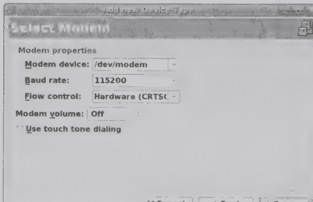

图 8-3：网络配置工具中的“选择调制调器”（Select Modem）框。

5. 从“调制调器设备”（Modem Device）下拉列表中选择合适的设备。

如果你知道你的调制调器在 Windows 中是 COM1 或 COM2，那么将这些技术术语翻译成 Linux 并不难：你只需要减去 1 即可。所以，COM1 对应 `ttyS`，COM2 对应 `ttyS1`。如果你使用的是 USB 鼠标（它有一个扁平的连接器），你的调制调器可能在 COM1。如果你没有使用 USB 鼠标，你的调制调器可能在 COM2。

6. 从“波特率”（Baud Rate）下拉列表中选择你调制调器的速度。

如果你被要求使用特定速度，在此处选择该速度。否则，选择最大的数值。关键是尝试最高设置，如果不起作用，就选择更低的速度，直到能够建立连接。

保持“流控制”（Flow Control）设置不变。只有当你连接调制调器时遇到困难，或者你的 ISP 明确告诉你需要选择“流控制”或“无（None）流控制”时，才更改此设置。


7. 打开调制调器的音量，这样你在测试时就能听到它在做什么。

稍后你会把它关掉。（好吧，大多数人这样做；在连接时保持它开启。56.6 Kbps 听起来像外星人的乒乓游戏。）只要你能听到它，声音设置得多大由你决定。

除非你所在的地区只支持拨号电话（Tone Dialing），否则保持开启状态。

8. 点击“向前”（Forward）继续。

出现“选择供应商”（Select Provider）对话框，如图 8-4 所示。

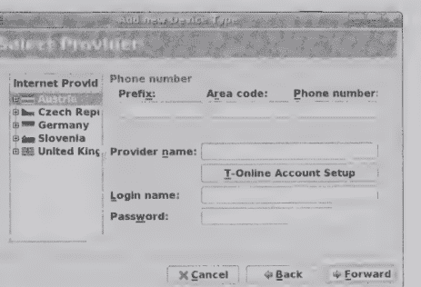

图 8-4：Fedora Core 5 网络工具中的“选择供应商”（Select Provider）对话框。

| 互联网供应商 | 电话号码 | 区码 | 密码 |
| :--- | :--- | :--- | :--- |
| 捷克： | | | |
| 德国 | | | |
| 斯洛文尼亚 | | | |
| 联合账户设置 | 登录名称： | | |

9. 输入你的 ISP 信息并点击“向前”（Forward）。

ISP 可能来自的国家列表非常有限。如果你住在这些地区之一，选择你的国家，然后 ISP 会为你你完成拨号条目——此时直接跳到第 16 步。否则，继续下一步。

10. 在“前缀”（Prefix）文本框中，输入拨号到实际电话号码所需的任何前缀。

这个前缀可能是长途代码，例如北美地区的 `1`，拨出大楼的 `9`，在你拨打长途时的 `91`。如果你不需要前缀，请将此框留。

11. 在“区码”（Area Code）文本框中，输入你的调制调器需要的区码。

在某些地方，即使拨打本地号码也需要拨区码。如果不需要使用区码，请将此框留。

12. 在“电话号码”（Phone Number）文本框中，输入调制调器需要拨打的电话号码（去掉前缀和区码）。

不需要连字符。

13. 在“供应商名称”（Provider Name）文本框中，输入你的 ISP 名称。

只需将此名称作为拨号条目的描述。

14. 在“登录名称”（Login name）文本框中，输入你的登录名称。

15. 在“密码”（Password）文本框中，输入你的登录密码。

16. 点击“向前”（Forward）。

出现“IP 设置”（IP Settings）对话框，如图 8-5 所示。

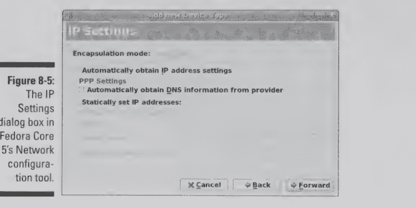

17. 在“IP 设置”对话框中，选择单选按钮：你的调制调器需要从 ISP 获取信息（DHCP），还是需要你告诉它 IP。

18. 如果你选择了 DHCP，将 DNS 设置留空。否则取消勾选。

19. 如果你选择了静态（static），请填写 ISP 提供的地址（Address）、子网掩码（Subnet Mask）和默认网关地址（Default Gateway Address）。

你现在网络工具中有一个调制调器条目（查看“类型”列）。

### 第 8 章：连接（及断开）互联网

通过网络配置对话框连接互联网，选中你刚刚创建的调制调器条目并点击“激活”（Activate）按钮。如果运气好，你的调制调器会随着一些哔哔声和嗡声启动，并弹出一个显示正在连接的对话框。连接成功后，会出现网络配置对话框；此时，“状态”（Status）列显示为“活动”（Active）。恭喜——你现在连接到互联网了！

要断开连接，点击网络配置对话框中的“激活”（Activate）按钮。下次想连接时，只需打开此对话框并点击“激活”。使用其他发行版的读者应该使用该发行版的连接工具。你可能会发现双击浏览器图标并尝试访问某个网站就会激活你的连接。

## 在出现无法工作之前，一切都是好玩的


在一个完美的世界里里，前一节中的拨号配置步骤应该 100% 有效。Linux 供应商确实隐藏了传统上围绕网络的所有神秘色彩。遗憾的是，在很多情况下（主要与调制调器和硬件有关），简单的配置并不起作用。如果在按照这些步骤后仍无法连接互联网，一个非常好的查找网站是 LinuxQuestions.org (www.linuxquestions.org)。嗯，我知道——你必须使用一台已经接入互联网的计算机来获取这种帮助（这不就是左右为境吗？）。预判人们可能遇到的各种问题是不可能的，Linux 社区是你的最佳选择；该网站以其热心的社区成员而闻名。

此外，去你喜欢的搜索引擎搜索从系统获取的错误信息——或者如果只搜索错误信息不起用，加上网络硬件的品牌、型号以及你所用发行版的名称也无妨。当你试图弄清楚网络连接出了问题时——或者试图收集可以帮助的信息


# 150 第二部分：现在的互联网！

帮助他人排查哪里出了问题——你可以使用一个酷炫的工具：别手的命令行程序 `ping`。

某些防火墙会阻止 `ping` 发送的种类的流量，因此即使在连接良好，这些命令并不总是如预期那样工作。

`ping` 命令类似于潜艇使用声纳探测海洋中的其他物体。雷达发送出一个 ping 信号，该信号会在硬表面上反射。通过测量发送 ping 到 ping 返回之间的时间，潜艇工程师可以判断那里是否存在物体，以及该物体距离潜艇有多远。

Linux 中的 `ping` 命令提供的信息与声纳提供的类似——它是如此有用，以至于你既把它当作 Linux 命令使用，也当作一个悠老的词汇。如果你将互联网视为你的海洋，你可以通过 `ping` 来确定存在哪些网络计算机——以及你的 `ping` 命令返回需要多长时间。你使用的格式是 `ping hostname` 或 `ping ipaddress`，例如 `ping bob.example.com` 或 `ping 192.168.1.5`。如果你无法 ping 家或办公室内的另一台计算机（假设你都通过以太网连接且不是在独立的拨号连接上），那么你发出 ping 的那台机器出了问题。另一方面，如果你可以 ping 家或办公室的另一台机器，但无法 ping 互联网其他地方机器，那么你与 ISP（互联网服务提供商）的连接可能有问题。

延迟，或信号在互联网上传输所需的时间，与物理距离有关。相反，网络流量、带宽和网络硬件等因素共同导致了低延迟。这些因素决定了 ping 邻居计算机的命令是否比 ping 南极的一个主机需要更长时间。

例如，尝试通过打开命令提示符（见第 14 章）并输入以下命令来测试 Yahoo!：

```
```

```

按下 `Ctrl-C` 停止 ping；否则你的计算机将继续 ping 目标。

图 8-6 所示的输出提供了关于 `ping` 正在做什么的信息。如果 `ping` 无法到达主机，你将收到一条主机不可达的消息（注：原文此处逻辑可能有误，通常应为“如果无法到达则收到不可达”）。如果 `ping` 可以到达主机，你将收到反馈，提供信号从你的计算机到目标计算机再返回需要多长时间——以毫秒（ms）为单位——数字越低越好。对于通过以太网连接的计算机，1 ms 到 3 ms 的 ping 时间是可以接受的响应时间。对于拨号连接，预计在 150 ms 左右。当你看到 ping 时间攀升到 900 ms 或更高时，网络可能正处于高负载状态（或者你的电缆出了问题）。

## 第 8 章：连接到互联网

```
PING yahoo.com (56 bytes of data)

64 bytes from wi1.yahoo.com (68.218.71.198): icmp

64 bytes from wi1.yahoo.com (68.218.71.198): icmp_seq1 ttl=64 time=60.2 ms

64 bytes from wi1.yahoo.com (68.218.71.198): icmp_seq2 ttl=64 time=61.3 ms

64 bytes from wi1.yahoo.com (68.218.71.198): icmp_seq3 ttl=64 time=103.5 ms

64 bytes from wi1.yahoo.com (68.218.71.198): icmp_seq4 ttl=64 time=146.5 ms

64 bytes from wi1.yahoo.com (68.218.71.198): icmp_seq5 ttl=64 time=81.7 ms

64 bytes from wi1.yahoo.com (68.218.71.198): icmp_seq6 ttl=64 time=63.7 ms

64 bytes from wi1.yahoo.com (68.218.71.198): icmp_seq7 ttl=64 time=72.7 ms

64 bytes from wi1.yahoo.com (68.218.71.198): icmp_seq8 ttl=64 time=83.2 ms
```

图 8-6：`ping` 命令的示例示例。

```
--- yahoo statistics ---

packets transmitted, 8 received, 0% packet loss, time 3027ms

rtt/min/avg/max/mdev = 60.2/60.2/79.1/146.5/20.82 ms
```


## 连接之后

连接上之后，你可能想直接跳到第 9 章，学习如何使用供你使用的各种互联网程序。在此期间，让我提供一些你可能在需要帮助、有疑问或其他想进一步探索 Linux 世界时发现有用的网站——其中一些非常“极客”（geek），但你会逐渐适应的！你还可能想要更新你的机器（见第 12 章）、添加新软件（也是第 12 章），并额外考虑系统安全（见第 13 章），以保护自己免受坏人和各种问题的侵害。

### 有用的网站

- `linuxsecurity.com`: 一个有点极客（但很有用）的
- `kernel-track.org`: 关于内核的信息。
- `linuxquestions.org`: 用于问答。
- `http://linux-newbie.com`: 面向初者的网站。

# 第 9 章：使用互联网 155

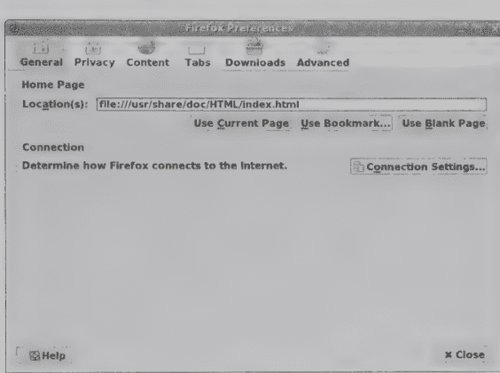

图 9-1：Fedora Core 5 中的 Firefox 偏好窗口。

- 3. 足够多点击偏好窗口顶部的图标，以访问不同的偏好类别。某些类别足够复杂，会为各种子类别提供标签页。这些标签页也值得探索。
- 4. 如果你看腻了阅读菜单，只需点击“关闭 (Close)”关闭偏好对话框并回到浏览。

## 通用偏好

选择“常规 (General)”选项——如图 9-1 所示——允许你决定 Firefox 在运行时时的外观和行为。此对话框由两个独立部分组成：

- *首页 (Home Page)*：此部分允许你选择 Firefox 在启动时立即显示的内容。你可以直接在“位置 (Location(s))”框中输入 URL，或点击以下按钮之一：
    * 使用当前页面 (Use Current Page)：导航到你想要作为默认 Web 页面的页面，并点击此按钮。该页面的 URL 将出现在“位置”框中。
    * 书签 (Bookmark)：点击此按钮打开“设置首页 (Set Home Page)”对话框，其中包含你所有的书签。选择你想要使用的书签，然后点击“确定”将该页面的 URL 添加到“位置”框中。
    * 使用空白页 (Use Blank Page)：点击此按钮让 Firefox 只打开一个空窗口。
- 连接 (Connection)：点击“连接设置 (Connections Settings)”按钮打开“连接设置”对话框。只有当你的网络管理员告诉你必须使用代理服务器访问在线内容时，你才需要执行此操作。

## 隐私偏好

每当你发送电子邮件或点击网站时，你都在跨网络交换信息。虽然你不需要为此失眠，但你应该意识到你发出的每个请求，检查“隐私 (Privacy)”收集标签页（见图 9-2）并确定是否有任何想要更改的内容：

- *历史 (History)*：历史标签页允许你指定浏览器记住你去过地方的天数。你可以点击“立即清除浏览 (Clear Browsing Now)”按钮随时手动清除历史记录（如果你在图书馆或其他可能在你之后使用浏览器的场所，这样做是明明的）。点击“设置 (Settings)”标记在清除浏览历史时哪些信息应该被保存，哪些应该被删除——无论你在哪个标签页，“设置”始终可见。
- *保存的表单 (Saved Forms)*：Firefox 包含一个实用的功能，它可以记住你在表单中输入的内容和字段名称。当你以后填写表单时，它会提议填写你之前使用的相同内容。Firefox 还记得你在屏幕右上部分搜索栏中输入的内容。如果你想让 Firefox 停止保存，请选择此标签页并取消勾选“我在表单和搜索栏中输入的信息 (Save Information I Enter In Forms And The Search Bar)”框。你也可以通过点击“立即清除保存的表单数据 (Clear Saved Form Data Now)”按钮清空浏览器的表单和搜索内存。

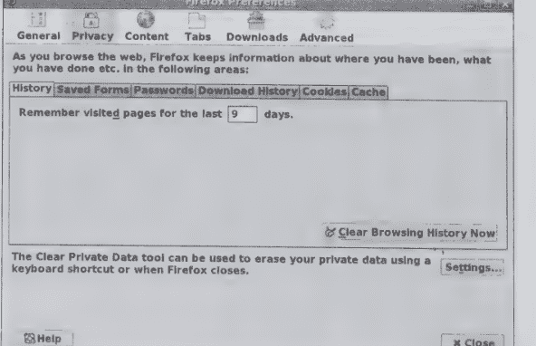

图 9-2：Fedora Core 5 中的 Firefox 隐私偏好窗口。

“清除私人数据 (Clear Private Data)”工具可以使用快捷键或在 Firefox 关闭时来擦除你的私人数据。

- *密码 (Passwords)*：当你通过 Web 登录某些内容并输入用户名密码时，Firefox 会提议保存该信息。如果你想关闭该功能，展开此部分并取消勾选“记住密码 (Remember Passwords)”框。如果你想查看已保存的密码或你告诉 Firefox 永远不保存的密码，点击“查看保存的密码 (View Saved Passwords)”按钮打开密码管理器窗口。在“已保存密码 (Pass Saved)”标签页中，你将看到网站和名称的列表，你可以点击“显示密码 (Show Pass)”按钮将密码添加到此列表中——当有其他人可能在你的肩膀看时不要这样做。在“从未保存 (Pass Never Saved)”标签页中，你将看到另一个列表。在任何一个标签页中，你都可以选择一个项目并点击“从 Firefox 中删除 (Remove from Firefox)”来忘记该条目，或者点击“全部删除 (Remove All)”忘记该类别中的所有内容（或者你可以完全点击对话框并仅点击“清除 (Clear)”按钮）。你还可以点击“主密码 (Master Password)”确保没人能查看你的密码列表。如果你设置了主密码，别忘记它！
- *下载历史 (Download History)*：当你下载文件时，Firefox 在“下载管理器”窗口中跟踪它们。要立即清空，点击“清除 (Clear)”你还可以通过“从下载管理器删除文件 (Remove Files From The Download Manager)”下拉列表告诉 Firefox 如何自动处理，通过选择：
    - 手动 (Manually)：仅在你告诉它时才清空列表。
    - 下载成功后 (Upon Successful Download)：完成下载后从列表中删除项目。
    - Firefox 退出时 (When Firefox Exits)：每当你关闭 Firefox 时清除列表。
- *Cookies*：这是让某些人疯狂的术语之一。Cookies 是网站存储在你的机器上的一些位信息，以便在你返回时可以访问这些数据。有些人不在乎 Cookie 是如何创建的，也不希望系统中有任何 Cookie。为了防止存储 Cookie，请取消勾选“允许设置 Cookie (Allow To Set Cookies)”框。你还可以只允许网站为自己设置 Cookie，而不是为合作伙伴设置，只需通过勾选“源网站 (For The Originating Web Site)”框来实现。此功能更智能，你可以勾选“除非我删除 (Unless I Have Removed By)”或仅“允许会话 (Allow for Session)”意味着允许现在但不永久允许。你可以通过点击“异常 (Exceptions)”按钮查看你当前拥有的每个 Cookie，并管理查看什么和不查看什么。对于帮助选择：
    - 直到过期 (Until they expire)：大多数 Cookie 有有效期。如果你想让 Cookie 决定何时删除，请选择此选项。
    - 直到我关闭 Firefox (Until I close Firefox)：如果你在使用图书馆或其他机器，选择此选项。
    - 每次都询问 (Ask me every time)：如果你对 Cookie 极其敏感或想知道它们实际使用的频率，选择此选项。

## 内容偏好

选择“内容 (Content)”带你进入偏好对话框的内容部分。此部分允许你控制 Firefox 对各种类型内容的反应。顶部部分指的是允许或不允许的项目——注意每个项目右侧都有一个按钮可以提供额外的控制：

- *阻止弹出窗口 (Block Popup Windows)*：告诉 Firefox 阻止你未请求的新窗口——这是一个深受喜爱的特性，许多人将其迁移到 Microsoft Windows。某些网站的功能需要打开（例如）登录窗口，因此你可以点击“允许列表 (Allowed Sites)”按钮为它们创建例外。如果你不配置此功能，它仍然有效。每当弹出窗口被拦截时，浏览器中会出现黄色条，允许在该处访问设置。
- *当网站尝试安装扩展或主题时询问 (Warn me when sites try to install extensions or themes)*：强烈建议你开启此项。此设置防止网站自动更改你的 Firefox 配置。再次，有一个“异常 (Exceptions)”按钮供你允许的网站执行此操作。
- *加载图像 (Load Images)*：允许你阻止所有图像。对于视障碍人士或试图通过忽略图片来加快浏览的人非常有用。“仅限源网站 (For The Origin Web Site Only)”是一种阻止广告的方法，许多广告是从其他网站加载并在你查看的页面上的，但也可以阻止合法的图形。“异常 (Exceptions)”按钮帮助你管理查看什么和不查看。
- *启用 Java (Enable Java)*：如果你安装了 Java 并启用了此选项，Firefox 将运行它找到的 Java 代码
- *启用 JavaScript (Enable JavaScript)*：一些人出于安全考虑关闭它。许多人没有。点击“高级 (Advanced)”按钮会打开 JavaScript 设置对话框，你可以在其中选择使用此脚本语言做什么。如果你发现某个网站执行诸如缩放窗口等烦人的操作，转到此对话框禁用它。

# 第 9 章：使用互联网

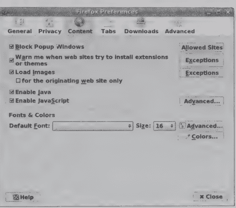

图 9-3：Fedora Core 5 中的 Firefox 偏好窗口。

下部分是“字体与颜色（Fonts & Colors）”。这些功能包括：

- **默认字体（Default Font）：** 点击此下拉列表框选择您想要使用的字体。
- **大小（Size）：** 点击此下拉列表框选择您想要使用的字体大小。
- **高级（Advanced）：** 点击此按钮打开字体对话框，允许您为各种字体类型选择使用的默认字体和大小，以及其他视觉设置。在这里，您还可以设置页面可以使用它们自己的字体，而不是您的覆盖设置。
- **颜色（Colors）：** 点击此按钮打开颜色对话框，更改分配给文本、背景和链接的默认颜色。

在浏览时，如果您对字体大小不满意，可以按住 `Ctrl+` 键增大字体，按住 `Ctrl-`（减号）键缩小字体。`+` 和 `-` 是数字小键盘上的版本，而不是主键盘上的。

## 额外偏好

仍然有三个设置部分：

- **标签页（Tabs）：** Firefox 提供了“标签页浏览”，在同一个窗口中通过标签页打开新页面，而不是在新窗口中打开——您甚至可以使用此功能一次性签签一组标记过的标签页。此部分允许您配置此功能。

- **下载（Downloads）：** 使用此部分告诉 Firefox 默认下载文件的位置、下载管理器窗口应如何运行，以及下载时应如何自动处理各种文件类型。
- **高级（Advanced）：** 此部分提供三个选项卡：常规（General）、更新（Update）和安全（Security）。常规选项卡允许您设置针对行动不便的功能、额外的浏览器控制功能以及您按偏好顺序阅读的语言。更新选项卡告诉 Firefox 如何处理各种内容的更新检查。安全决定了您的安全设置；通常情况下您不需要动此选项卡。

## 该死的浏览器插件

您是否曾经对那些要求您必须下载插件或额外软件才能查看的网站感到恼火？插件和外部程序的区别在于：插件在浏览器中显示结果，而外部程序在浏览器之外运行。虽然当您只是寻找某些基本信息时，这些插件很烦人，但它们可以提供非常酷的东西，例如通过您的网络浏览器流视频和音乐。

第 12 章解释了如何为书中介绍的每个发行版将流行的插件（如 Macromedia 的 Flash 插件）添加到您的系统中。当您下载特定类型的文件时，Firefox 会给您机会让它在以后自动处理这些类型的文件。要小心让浏览器自动运行程序，您可能会让自己面临安全问题。

Firefox 还支持“扩展（extensions）”概念，指的是未包含在主浏览器中的功能，因为许多人可能不想麻烦它们。选择 工具（Tools） > 扩展（Extensions）来打开扩展对话框（见图 9-4）。

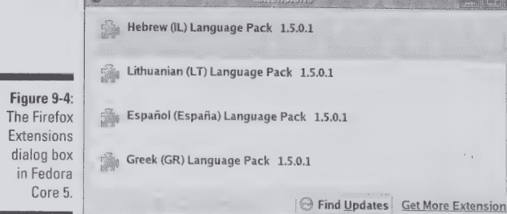

点击“获取更多扩展（Get More Extensions）”链接（如果您已连接互联网）打开一个网页，从中浏览可用的扩展。如果您发现想要尝试的扩展，点击描述下方的“安装（Install）”链接，如果您的 Firefox 版本不在列出的支持范围内，请点击“立即安装（Install Now）”（选择 帮助？关于 Mozilla Firefox 来查找）。不幸的是，某些扩展可能会给您带来错误，并可能导致不稳定。

## 浏览网页

Firefox 是您通往精彩万维网的窗口。Firefox 的主要目的是根据您的指令获取网页，将您所有的图形和相关文件下载到计算机内存中，并最后渲染页面以供您交互式视觉体验。

如果您习惯使用 Internet Explorer 或 Netscape，那么使用 Firefox 应该轻而易举。所有熟悉的导航工具，如地址栏；后退、前进、重新加载和停止按钮；以及存储您喜好网站链接（书签）的功能。

Firefox 和 Netscape 一样，也有历史记录侧栏功能——按 `Ctrl-H` 显示或隐藏它（见图 9-5）——您可以用它访问最近访问的网页。

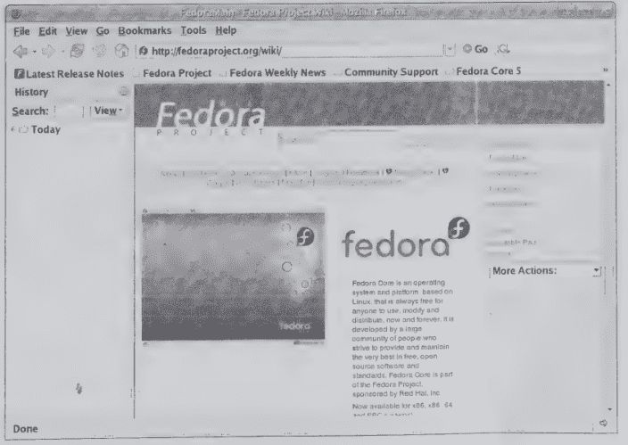

图 9-5：Fedora Core 5 中打开了历史记录侧栏的 Firefox。

## 演变为电子邮件

虽然大多数人在提到互联网时想到的是网页，但电子邮件实际上可能是互联网应用中最频繁使用和最喜爱的。Linux 用户有许多电子邮件程序可用。书中讨论的各种发行版的默认程序可以在您的发行版的互联网菜单中找到。

- **Knoppix：** KMail (`http://kmail.kde.org/`)，尽管包含了 Mozilla Mail 和 Thunderbird (`www.mozilla.org/products/thunderbird`)。您可以在主菜单中找到所有：
- **Fedora：** Novell Evolution (`www.novell.com/products/evolution`)，可选 KMail 和 Thunderbird。
- **Mandriva：** Novell Evolution (`www.novell.com/products/evolution`)，可选 KMail 和 Thunderbird。
- **SuSE：** Novell Evolution (`www.novell.com/products/evolution`)，可选 KMail 和 Thunderbird。
- **Ubuntu：** Novell Evolution (`www.novell.com/products/evolution`)，可选 KMail 和 Thunderbird。
- **Xfce：** Novell Evolution (`www.novell.com/products/evolution`)，可选 KMail 和 Thunderbird。

## 设置 Evolution

第一次启动 Evolution 时，设置向导会启动。

点击“前进（Forward）”通过欢迎屏幕，随后打开身份框（见图 9-6）。要填写此对话框，请完成以下步骤：

- 1. 如果需要，更改“全名（Full Name）”字段。有些人不想使用真实姓名而选择使用昵称。
- 2. 如果“电子邮件地址（E-Mail Address）”字段与 ISP 提供的地址不匹配，请更改。
- 3. 如果您将此特定账户作为默认邮件账户，请勾选“设置为默认账户（Make This Default Account）”复选框。否则，确保其未勾选。
- 4. 点击“前进（Forward）”继续。
打开接收邮件（Receiving Mail）对话框。
5. 在“服务器类型（Server Type）”列表中，选择您的 ISP 使用的邮件服务器类型。

如果您不想在此计算机上接收电子邮件，请保持原样——如果您只想发送或仅使用日历和任务管理功能，此设置非常有用。根据您选择的项，对话框会请求适当的信息。我们假设您正在使用 POP 服务器接收邮件，因此当您选择 POP 时，会在图 9-7 中显示。如果您没有使用 POP，则完成您看到的对话框然后继续到第 17 步。

图 9-7：Fedora Core 5 中的 Evolution 接收邮件对话框，已选择 POP。

# 第 9 章：使用互联网

最新版本的 Evolution 已支持用 Microsoft Exchange 服务器。如果你需要此功能，你的发行版中可能已经安装，也可能没有。对于 Fedora，请参考第 12 章中的信息向系统添加“evolution-connector”软件包，然后重新启动 Evolution 设置过程。


- 6. **在服务器（Server）文本框中输入你 POP 服务器的完整全名。**

该名称可能类似于 `pop.example.com`。

- 7. **在用户名（Username）框中输入你检查邮件的登录名称。**

如果你的电子邮件地址是 `jane@example.com`，那么用户名就是 jane。

- 8. **如果你被告知使用 SSL 来确保安全，请在安全连接 (SSL) [Secure Connection (SSL)]下拉列表中选择“始终”（Always）或“尽可能”（Whenever Possible），取决于你的互联网服务提供商（ISP）的规定。**

- 9. **在身份验证类型（Authentication Type）下，选择适当的身份验证选项。**

如果你不知道你的邮件服务器提供什么类型的身份验证，请点击“检查支持类型”（Check For Supported Types）按钮。通常，只需要密码（Password）。

- 10. **勾选“记住密码”（Remember Password）复选框，这样你每次检查邮件就不必输入电子邮件密码。**

如果你要离开电脑可能有人访问，请前往主菜单（Main Menu）并选择“锁定屏幕”（Lock Screen），以保护自己免受发出的恶意作剧邮件。这样做可以确保在你输入登录密码之前没有人可以使用你的图形界面（GUI）。

你必须开启屏幕保护此功能才能生效。屏幕保护默认开启开启。


- 11. **点击“前进”（Forward）进入次级接收选项（Receiving Options）对话框（见图 9-8）。**

此对话框是否存在取决于你使用的入站邮件服务器类型。如果你没有使用 POP 但出现了次级对话框，它可能与此处显示的并不匹配，尽管它共享了一些此处显示的选项。

- 12. **如果你想自动检查新邮件，请勾选“自动检查新邮件”（Automatically Check For New Mail）复选框。**

如果你没有持续的互联网连接，可能更喜欢手动检查邮件。如果是这样，请不要勾选该框并跳到第 14 步。

- 13. **在分钟（Minutes）文本框中，设置你想自动检查新邮件的频率。**


图 9-8：Fedora Core 5 中 POP 邮件用户的 Evolution 接收选项框。

- 14. 如果你在多台电脑上检查邮件，可能想要勾选“在服务器上保留”（Leave Messages On Server）复选框，以便你从所有机器上访问相同的邮件。

如果你选择了此选项，你将在多个机器上获得消息副本，但也意味着无论你在何处检查，都可以访问你的电子邮件。请记住，偶尔你需要取消勾选此框并检查邮件，以清除邮件在服务器上占用的所有空间。你不希望空间耗尽。

- 15. 如果你的 ISP 告诉不要使用 POP3 扩展，请勾选“禁用对所有 POP3 扩展的支持”（Disable Support For All POP3 Extensions）框框。

- 16. 点击“前进”（Forward）继续。

你现在完成了入站邮件的设置。在图 9-9 所示的发送邮件（Sending Email）对话框中，执行以下操作：

- 17. 如果你的服务器不是 SMTP，请更改服务器类型（Server Type）输入。

我假设你正在使用 SMTP 发送电子邮件。


图 9-9：Fedora Core 5 中的 Evolution 发送邮件对话框。

- 18. 在主机（Host）框中输入 SMTP 邮件服务器的完整全名。

名称可能类似于 `smtp.example.com`。

- 19. 如果你被告知使用 SSL 来确保安全，请在“使用安全连接 (SSL)”[Use Secure Connection (SSL)]下拉列表中选择“始终”（Always）或“尽可能”（Whenever Possible），取决于你的互联网服务提供商（ISP）的规定。

- 20. 如果你被告知发送邮件需要额外的身份验证，请勾选“服务器需要身份验证”（Server Requires Authentication）复选框。

通常，这里不需要什么。如果不勾选此框，请跳到下组指令。否则，请继续下一步。

- 21. 在身份验证（Authentication）下，按照 ISP 的指示选择适当的类型（Type）。

如果你不确定，点击“检查支持类型”（Check For Supported Types）。

- 22. 在用户名（Username）下，输入你用于向出站邮件服务器验证的登录名称。

此名称可能与你用于入站邮件的名称不同。

- 23. 勾选“记住密码”（Remember Password）复选框，这样你每次发送邮件就不必输入密码。

再次只需确保注销或使用“锁定屏幕”（Lock Screen）。

- 24. 点击“前进”（Forward）继续。

## 发送和邮件

以下步骤概述了如何创建并发送消息：

- 1. **点击“新建”（New）。**

打开一个窗口，如图 9-9 所示。

- 2. **在收件人（To）框中输入对方的电子邮件地址。**

- 3. **如果你需要添加抄送（CC）或密密（BCC）收件人，打开邮件菜单并选择相应的字段然后输入地址。**

- 4. **在主题（Subject）框中输入你邮件的主题。**

- 5. **在下方窗口中输入你的邮件正文。**

如果你想“美化”你的邮件，可以使用方便的格式按钮和格式（Format）菜单。如果你想使用格式按钮，请先将格式设置为 HTML。


图 9-11：Fedora 中的 Evolution 窗口。

- 6. 如果你想在邮件底部添加签名，点击签名（Signature）旁边的下拉列表选择“自动生成”（Autogenerated）。

要创建自定义签名，前往 Evolution 主窗口并选择编辑 -> 偏好（Edit -> Preferences）打开 Evolution 设置对话框（见图 9-12）。选择你想创建签名的账户，然后点击“编辑”（Edit）按钮打开 Evolution 账户编辑器。在此对话框中，在身份（Identity）选项卡下，点击“新建 -> 签名”（Add New -> Signature）。在这里你可以创建并格式化你的新签名，点击“保存并关闭”按钮后，你可以在身份选项卡的签名下拉列表中选择哪个签名作为默认。

- 7. 当你输入消息后，点击“发送”（Send）按钮。

邮件现在已添加到你的发送箱（Outbox）中，如果你需要，可以在那里编辑。

- 8. 点击“发送/接收”（Send/Receive）按钮。你的你的邮件将发出，Evolution 将检查新的入站邮件。

花些时间真正探索 Evolution。正如本章插图所示，此程序具有许多功能，包括过滤垃圾邮件的能力。


## 利用即时消息

人与人之间的即时消息（IM）就像使用电话——区别在于你是通过输入而不是语音来交流。此外，你可以同时进行多个即时消息对话，而无需额外的互联网连接。美国在线（AOL）提供了一项流行的即时消息服务，名为 AOL Instant Messenger，或 AIM。其他的还有 ICQ、MSN、Yahoo 和 Google。包括 Linux 在内的各种计算机系统都支持这些各种服务（事实上，GAIM 不仅运行在 Linux 上）。

本书涵盖的发行版默认都使用以下即时消息程序：

- Fedora: GAIM (`http://gaim.sourceforge.net/`)
- Knoppix: GAIM
- Linspire: GAIM
- Mandriva: Kopete (`http://kopete.kde.org/`) 和 GAIM
- SuSE: GAIM 和 Kapote
- Xanders: Kopete
- Ubuntu: GAIM

由于 GAIM 是 Fedora 的默认程序，因此我将详细介绍它。Kopete 的用法应该大同相同。

## 使用 GAIM 即时消息工具

你通过以下菜单选择启动 GAIM：

- Fedora: 选择 Applications（应用程序）-Internet（互联网）-Internet Messenger（消息传递）
- Knoppix: 从 Main Menu（主菜单）选择 Internet（互联网）-GAIM Instant Messenger
- Linspire: Launch（启动）-Run Programs（运行程序）-Internet（互联网）-Instant Messenger（消息传递）
- Mandriva: 从 Main Menu（主菜单）选择 Internet（互联网）-Instant Messaging:GAIM
- SuSE: Applications（应用程序）-Internet（互联网）-Chat（聊天）-GAIM Instant Messenger
- Ubuntu: Applications（应用程序）-Internet（互联网）-GAIM Instant Messenger

应用程序首次启动后（见图 9-13），其主界面和账户管理对话框都会出现。要告诉 GAIM 你的一个 IM 账户：

1. 点击 Accounts（账户）对话框中的 Add（添加）按钮。
   出现图 9-13 中的 Add Account（添加账户）对话框。
2. 在 Protocol（协议）下拉列表中选择你想要使用的 IM 网络。
   你的选项有 AIM/ICQ（如果你需要使用 AIM 或 ICQ，请选择此选项）、Gadu-Gadu、GroupWise、IRC、Jabber、MSN、Napster、SILC、Yahoo 和 Zephyr。
   如果你想使用 Google Instant Messenger，请参考 `www.google.com/support/talk/bin/answer.py?answer=24073` 中的说明。
3. 在 Screen Name（显示名称）文本框中输入你的 IM 账户登录名。
   如果你使用的是 ICQ，请使用你的会员号。
4. 在 Password（密码）文本框中输入该账户的 IM 密码。
5. 在 Alias（别名）文本框中输入在别人 IM 客户端中显示的名称，除非你想使用显示名称。
6. 点击 Remember Password（记住密码）复选框并勾选，这样你每次连接到 IM 服务时就不需要输入密码。
   离开电脑时记得注销（log out）或使用 Lock Screen（锁定屏幕）选项，以防有人想戏弄你并使用你的 IM 客户端向别人发送消息。
7. 如果你希望启动 GAIM 时自动登录此账户，请勾选 Auto-Login（自动登录）框。


图 9-13:
在 Fedora 5 中打开的 GAIM IM 客户端及其主对话框、Accounts 和 Add Account 对话框。


8. 如果通过此服务接收电子邮件并想知道新邮件何时到达，勾选 New Mail Notifications（新邮件通知）复选框。
9. 如果你想用一张小图片作为好友图标（你自己、你的狗或任何你想使用的图片），点击 Buddy Icon（好友图标）标签旁的 Open（打开）按钮，然后导航到你想使用的图片。
10. 如果你想访问此 IM 服务的高级选项，点击 Show More Options（显示更多选项）箭头以展开 Add Account 对话框。
11. 完成信息输入后点击 Save（保存）将此 IM 账户添加到账户列表。

对每个想要使用 GAIM 的账户都执行此过程。然后，在主对话框中，点击 Sign On（登录）以登录所有选择了 Auto-Login 的账户。你也可以通过点击主对话框中的 Accounts（账户），然后点击账户旁各个复选框来逐一登录。连接后，你可以通过选择 Tools（工具）-Preferences（选项）在 Buddy List（好友列表）对话框中更改偏好。再次，GAIM 的功能不仅于此，绝对值得尝试一下。

## 排除 IM 连接的故障

如果你已经在其他操作系统中使用大部分这些 IM 客户端，在你的 Linux 系统成功连接到 IM 服务后，你现有的好友列表会自动导入。如果你从未用过 AIM 或 MSN，现在可以设置好友列表了。好友列表包含你想要通过即时消息服务通信的人员名。好友列表让你知道你的“好友”何时在线并可以接收即时消息。

有时，你的 Linux 系统无法正常连接到 IM 服务。当此问题发生时，屏幕上会弹出错误消息并指示：

- 你的防火墙是否阻止了连接。
- 你是否处于代理之后。
- IM 服务器是否宕机。

## 电话聊天

最近的新热潮是通过互联网进行电话聊天。无论你只是想尝试一下还是一个忠实的追趸，Linux

# 176 第二部分：现在就开始使用互联网！

提供了你参与所需的软件。将互联网电话网络类比为即时通讯网络。为了这个目的，最流行的网络之一是 Skype (`www.skype.com`)，因此我在这里的重点是它，以及 SIP（会话发起协议），这是一种流行的默认协议，你可以配合更广泛的程序使用。你首先需要适当的硬件，无论是一个可以实际插入电脑的电话（例如 SIP 电话），还只是耳机和麦克风的组合——最好不要用最低端的型号，这样你可以获得最佳音质。当你准备好硬件后，就是时候获取软件的时候了：

- *Fedora*：默认客户端（Ekiga，`www.ekiga.org`）可以通过“应用程序：互联网：电话、VoIP 和视频会议”获取。仓库中还包含两个 SIP 客户端（如第 12 节讨论过的），分别是 Kphone (`www.wirlab.net/kphone`) 和 Linphone (`www.linphone.org`)。它不包含 Skype，但你可以从 `www.skype.com` 下载 Linux 版本的客户端。

- *Koppnix*：不包含。

- *Linspire*：如第 12 节所述，进入 CNR 的互联网部分并安装 Skype。还有一个嵌入 SIP 电话的 PhoneGain (GAIM) (`www.phonegain.com`) 用于其他类型的互联网通话。

- *Mandriva*：在 Mandriva 的商业版中，你可以从主菜单中选择：互联网：即时消息：Skype。免费版用户可以尝试主菜单：互联网：Gnome Meeting (`www.gnomeemeeting.org`)，这是一个视频/音频结合的客户端。该程序也适用于其他发行版，包括 Fedora。

- *SuSE*：选择“应用程序：互联网：电话”，然后选择你想要使用的程序。选项包括 GnomeMeeting、Kphone 和 Linphone。

- *Ubuntu*：尽管默认提供了“应用程序：互联网：GnomeMeeting”。你可以使用第 12 节讨论的工具安装 Linphone 以进行 SIP 通话。

- *Xanders*：取决于你拥有哪个版本的 Xanders，选择“启动：应用程序：互联网：VoIP 电话或 Skype Calling”。你可以通过第 12 节讨论的技术来添加额外选项。

要在 Fedora 中安装 Skype，请执行以下操作：

- 1. 将你的 浏览器指向 `www.skype.com`。

- 2. 点击“下载 Skype”。

你将被带到 Skype 下载页面。

- 3. 点击企鹅图标或“Linux”字样。

你将被带到 Linux Skype 下载页面。

- 4. 右键点击“下载公钥”链接，并在上下文菜单中选择“链接另存为”。

出现“另存为”对话框。

- 5. 点击“保存”将文件保存到你的下载目录（默认是你的桌面）。

对话框关闭，文件出现在你的桌面上。

- 6. 选择“应用程序-附件-终端”。

出现一个终端窗口，如第 14 节所述。

- 7. 输入 `su -` 以临时变为 root 用户。

- 8. 输入 `rpm --import /home/user/Desktop/rpm-public-key.asc`，其中 `user` 是你的用户账户，如果是 `/home/dee/Desktop/rpm-public-key.asc`，则输入 `/home/dee/Desktop/rpm-public-key.asc`。

我假设你的下载目录是桌面。如果不是，请相应调整文件路径。

- 9. 点击终端窗口右上角的“X”关闭它。

- 10. 如果不是针对 Fedora 5 的，点击“RPM for Fedora”项。

注意，你也可以在这里获取 SuSE 和 Mandriva 的 Skype。出现一个打开对话框，标题中显示文件的完整名称。

- 11. 保持选中“安装软件”状态，并点击“确定”。

下载期间会打开下载窗口，下载完成后，会出现“root 密码”对话框。

- 12. 输入你的 root（管理员）密码并点击“确定”。

出现“安装”对话框。

- 13. 点击“应用”。

软件安装程序会将软件添加到你的系统中。当安装完成后，会出现一个“信息”对话框。

- 14. 点击“确定”关闭对话框，点击下载窗口右上角的“X”。

- 15. 如果 Skype（图 9-16）没有出现在你的“应用程序-互联网”菜单中，请注销并重新登录（不需要重启）。之后它应该就会显示了。

在能够通话之前，你需要选择“工具-添加联系人”——你也可以选择“工具-搜索 Skype 用户”。然后（当然，你的硬件必须设置好），你就可以点击列表中的名字并点击“电话”按钮给他们打电话！

# 178 第二部分：现在就开始使用互联网！


图 9-16：Skype 互联网电话客户端。

## 使用其他互联网工具

根据你的需求，你可能想探索各种其他工具。本节涵盖了一些入门提示，因此如果你去第 12 章并想添加适当的软件（或者发现自己正在翻阅菜单并好奇该程序可能叫什么名字），你不会完全迷失方向。

- *FTP*：虽然许多人发现处理文件时在命令行下操作更简单，在本章中，我同时涵盖了输入型命令和图形化工具。

- *IRC*：倾向于留在图形界面的人喜欢使用 Linux 提供的 GUI 文件管理器，而不是访问命令行提示符来处理文件。

- *文件共享*：通常情况下，如果你不确定使用什么工具，请搜索该类型的内容。

- *RSS 阅读器*：Firefox 有许多扩展。通常情况下，如果你不确定使用什么工具，请搜索该类型的内容。

# 第三部分
# 快速上手 Linux

## 第五次浪潮，作者：Rich Tennant


> “这叫扑克。每个人都能看到其他人的手牌，一切都是疯狂的，除了比尔·盖茨，大家都赢了，他的脸脸现在鬼牌上。”

## 在这一部分

在书的范围内，我扩展了对 Linux 的涵盖范围，包含了操作系统核心部分之外的许多功能和能力。这些组件对于使 Linux 成为生产力怪物至关重要。

在这里你将学习文件系统以及如何管理目录，以及控制哪些用户或组可以访问这些资源。你还可以学习使用命令行环境（即 shell），以及任何精明用户都应该具备的关键功能。

此外，你将了解到如何保持系统更新以及安装新软件。你还将获得关于专家们总是论论的安全问题的内幕。那些喜欢在没有网络的情况下工作的人可以尝试命令行，而那些不想打字的人可以直接跳到自定义 GUI 外观的乐趣。

# 第 10 章：操作文件和目录

### 本章内容
- 操作文件内容
- 理解文件系统机制

> 你不需要做任何家务。过了四年后，脏东西也不会变得更糟。—— Quentin Crisp

这是不可避免的。在某个时刻，你必须处理系统中的文件和目录。幸运的是，当你熟悉了规则和命令后，你会感到更加从容（即使你偶尔会想起在老旧 MS-DOS 中工作）。因为许多人发现处理文件时在命令行下操作更简单，在本章中，我同时涵盖了输入型命令和你可以使用的图形化工具。

# 倾向于留在图形界面的人喜欢使用 Linux 提供的 GUI 文件管理器，而不是访问命令行提示符来处理文件。文件管理器是一种程序（如 Windows 资源管理器），允许你通过鼠标（有时只需少打几个字）浏览并操作你的文件和目录。在本节中，我将带你浏览流行的 Linux 发行版自带的文件管理器。

# 第三部分：快速上手 Linux

## 在 Nautilus 中航行

在 GNOME 桌面环境中（如果你使用的是发行版的默认设置，则包括 Fedora Core、SuSE 和 Ubuntu），文件管理器是 Nautilus。在 Nautilus 中浏览文件系统涉及几种不同的技能。首先，你需要知道想从哪里开始。这个决定并没有听起来有那么困难。如果你不想从主目录开始，可以使用第 6 章详细介绍的“位置”（Places）菜单，或者执行以下操作：

- Fedora：双击桌面上的“计算机”或“主目录”图标，从“位置”菜单中选择任意项，或者选择“应用程序：系统工具：文件浏览器”，这样就可以像你在其他操作系统中习惯的那样，左侧显示树结构，右侧显示文件夹内容。

- SuSE：双击桌面上的“计算机”或“主目录”图标，或从“位置”菜单中选择任意项。要像通常预期的那样在左侧显示树视图，请选择“视图：侧边栏”（View:Side Pane）。

- Ubuntu：选择“位置”中的任意位置或“应用程序：文件浏览器”。默认启用两个窗格。图 10-1 显示了在示例主目录中打开 Nautilus 时看到的内容。


图 10-1：在 Fedora Core 5 中显示 Dee 主目录的 Nautilus。

# 第 10 章：操作文件和目录

如果你使用的发行版桌面上上有“主目录”图标，请双击该项。

当你打开了想要开始操作的窗口后，你需要找到如何导航。要使用文件，只需双击它，并参阅本章节后关于“打开文件和运行程序”的部分。你也可以双击文件夹来打开它们并访问其内容。当你打开一个文件夹且不是当前视图时，会打开一个新窗口，而你之前操作的窗口将保持打开。如果你愿意，可以通过“文件：关闭”（File:Close）或点击窗口右上角的 X 来关闭原始窗口。

如果你发现打开了太多的目录，请选择以下命令之一：

- 文件：关闭父文件夹（File:Close Parent Folder）：关闭所有到达此目录的文件夹。
- 文件：关闭所有文件夹（File:Close All Folders）：关闭你已打开的所有文件文件夹。
- 文件：关闭（File:Close）：仅关闭此文件夹。

如果你需要，也可以轻松返回之前访问过的文件夹。（例如，你可能在 `/home/jane/documents/invoices` 中，想回到 `/jane` 而无需反复打开和关闭多个文件夹。）这样做，请查看窗口左下角以找到你所在的子目录名称（如 invoices）。点击该名称，你将打开一个包含所有父目录以及当前目录的列表。对于你的示例，该列表可能如下：


# home
## jane
### documents
#### invoices


要上上，你可以选择目录树中你想要移动到的位置（例如，选择 `jane` 以进入 `/home/jane`）。

# 设置在文件夹中显示的内容

你获取关于每个文件的信息是太多了还是太少了？尝试使用“视图”（View）菜单。“视图”菜单下主要的列出选项包括以下命令：

- 以图标形式查看（View As Icons）：此默认选项将所有文件显示为图标，并在下方带有名称，请参阅图 10-1。
- 以列表形式查看（View As List）：此命令为你提供有关文件的信息列表，以及它的图标和名称（见图 10-2）。注意，列表左侧仍有小图标可用。


图 10-2：在 Fedora Core 5 中以“列表形式查看”显示 `dee` 目录的 Nautilus。

除了这些视图命令，你还可以使用：

- 视图：刷新（View:Reload）：如果你刚刚创建了一个文件但在文件夹中没有看到，请选择此选项。
- 视图：显示隐藏文件（View:Show Hidden Files）：Linux 中所有以点开头的文件（例如 `.profile`）都是隐藏文件，这意味着你必须明确告诉 Linux 去显示它们。

除了这些命令，如果你需要更改文件夹内容的视觉大小，可以选择视图菜单中的“放大”（Zoom In）、“缩小”（Zoom Out）和“标准大小”（Normal Size）选项。

## 创建文件和文件夹

在 Nautilus 中创建新文件或文件夹：

1. 浏览到你想创建项的文件夹。
你需要打开该文件夹的窗口并在该窗口内进行操作。
2. 在文件夹内部的空白处点击右键。
确保你没有在文件夹中选中任何内容。会出现一个上下文菜单。
3. 根据你想实现的目标，选择“创建文件夹”（Create Folder）或“创建文档”（Create Document）。
- “创建文件夹”命令在此目录中创建一个新文件夹。
- “创建文档”命令将打开子菜单，让你选择从“模板”（顶部区域，如果你已创建了模板）创建文档或创建一个“空文件”。
文件夹或文件将出现，并处于选中状态。
4. 输入你想要的名称。

# 打开文件和程序

要打开文件或运行程序，请双击它。如果你想使用其他选项，请右键点击文件并从以下项中选择：

- 打开（Open）：用默认应用程序打开文件。
- 打开方式打开（Open With）：这允许你选择特定的应用程序来打开文件。
- 属性（Properties）：显示文件或文件夹的信息。

## 复制和移动文件

你可以使用两种方法复制和移动项目。第一种是拖放法。点击并按住文件或文件夹，将其拖到另一个位置。这里是一些提示：

- 拖动时按住 `Ctrl` 键可以复制文件而不是移动它。
- 拖动时按住 `Shift` 键可以移动文件。

另一种复制和移动的方法涉及上下文菜单。右键点击文件或文件夹并从以下项中选择：

- 复制（Copy）：创建该文件或文件夹的副本。
- 剪切（Cut）：移动文件或文件夹。

# 删除文件和文件夹

要使用 Nautilus 从文件系统中删除文件或目录，请遵循以下步骤：

1. 浏览到文件或目录的位置。
2. 通过执行以下操作之一来选择文件或文件夹：
- 点击文件项或文件夹项以将其高亮。
- 点击第一个项，按住 `Shift` 键，然后点击组中的最后一项以选择所有。（这些项目必须排列对齐）。
- 点击第一个项，按住 `Ctrl` 键，然后点击你想选的单个项目。
- 点击并拖动鼠标按钮，画出一个包含你所有想要选中的项目框。
3. 按 `Delete` 键或右键点击并选择“移动到垃圾箱”（Move to Trash）。

## 第10章：操作文件和目录

这些被删除的项目实际上存放在“回收箱”中，因此它们并没有真正从你的硬盘上删除。如果你需要，可以将这些文件从回收箱移出并返回你的文件系统。

## 清倒垃圾箱

你可以按照以下步骤永久删除回收箱文件夹中的内容：

- 1. 右键点击回收箱图标。
此操作将打开一个列有相应选项的快捷菜单。
- 2. 从快捷文件夹中选择“清空回收箱”。
会弹出一个确认对话框。
- 3. 在确认对话框中点击“清空”以删除回收箱文件夹中的内容。
Linux 会永久删除回收箱文件夹中的项目。你可以通过观察垃圾桶图标来判断回收箱是否为空。如果它是空的，则它不包含任何文件。如果你看到里面有纸张，则里面有垃圾。

## 查看和更改权限

Linux（以及其他形式的 Unix）中的每个文件都有一组权限，用于规定是否允许查看、运行、删除等等。这些权限用于确保人们无法弄乱系统文件或他人的文件，因此它们非常重要。在本节中，我重点介绍如何在图形用户界面中操作文件。请参见本章后后的“权限入门”部分，以了解文件权限工作原理的详细说明。

要在 Nautilus 中查看和更改文件或目录的权限，你需要遵循以下步骤：

- 1. 浏览到文件或目录的位置。
打开包含该项目的文件夹窗口即可。
- 2. 右键点击该文件或目录。
出现一个上下文菜单。
- 3. 从上下文菜单中选择“属性”。
出现“属性”对话框，并打开“基本”选项卡。
- 4. 点击“权限”选项卡。
显示“属性”对话框的权限部分，如图 10-3 所示。


图 10-3：Fedora Core 5 中显示“权限”选项卡的 Nautilus 文件管理器对话框。
- 5. 设置新的权限和所有者。
参见本章后后的“权限入门”部分，以了解这些内容的含义的详细说明。
- 6. 点击“关闭”关闭对话框。
文件的权限现在已更改。

## 在 Konqueror 中运行

在 KDE（以及如果你保持默认设置的 KNOPPIX、Linspire、Mandriva 和 Xandros）中，默认的文件管理器是 Konqueror，如图 10-4 所示。你可以通过以下方法在这些发行版中访问此程序：

- KNOPPIX：点击屏幕底部面板上的“主页”图标，或双击桌上指向文件系统或介质各个部分的快捷图标之一。
- Linspire：双击桌面上的“我的电脑”图标或面板上的“文件管理器”图标。
- Mandriva：双击“主页”或“设备”图标。
- Xandros：它有自己的自定义文件管理器，请参见本章后后的“使用 Xandros 文件管理器进行挖掘”部分。

图 10-4：KNOPPIX 4.0 中的 Konqueror 文件管理器打开到 KNOPPIX 的主目录。


请记住，Konqueror 在不同发行版之间看起来略有不同，可能也有不同的默认设置。

## 导航你的文件系统

在 Konqueror 中遍历文件系统主要涉及熟悉顶部菜单下方的主行图标。这些图标从左到右依次是：

- 左箭头：返回你访问的上一个目录。
- 右箭头：如果你之前返回过，它将带你回到你*返回之前*的目录。
- 上箭头：向上移动一个目录。例如，从 `/usr/bin` 到 `/usr/`。
- 主页：显示你的主目录内容。
- 重新加载：重新加载当前目录的内容。
- 停止加载：停止正在尝试加载的内容。
- 打印：打印选定的文档。
- 放大：放大图标。
- 缩小：缩小图标。
- 查看菜单：请参见下一节“设置在文件夹中看到的内容”，了解对该行中最后三个图标的讨论。

Linspire 的布局略有不同；它的 Konqueror 版本可以使用标签页同时打开多个位置，因此有打开和关闭标签页的图标，它的“前往”菜单也略有不同。

要在 Konqueror 中打开目录，在列表中找到它并点击（在 KNOPPIX 中）或双击，取决于你的系统的行为设置。窗口将更改以显示该文件夹的内容。

## 设置在文件夹中看到的内容

如果你想查看关于每个文件的更多或更少的信息，可以尝试选择视图模式（或在“查看”图标右侧、菜单下方找到图标）。取决于你使用的 Konqueror 版本，视图模式下的主要列表选项可能包括：

- 图标视图：将所有文件以图标形式显示，并在下方带有名称（参见图 10-4）。这是默认选项。
- 列视图：将你的图标按列而不是行排列。
- 树视图：显示关于文件的信息列表，以及它的图标和名称（参见图 10-5）。你可以通过点击其旁边的加号来展开列表中的每个文件夹；要折叠列表，点击其旁边的减号。
- 信息视图：以小列表格式显示图标和名称。
- 详细列表视图：工作类似于树视图，但缺乏展开和折叠目录的功能。
- 文本视图：类似于详细列表视图，但没有图标。
- 图像视图：让你在文件浏览器中使用图像浏览器（图 10-6）。如果你选择此选项，请使用左侧的标签页点击“主页”图标并浏览到你想查看的文件夹。
- 照片视图：与图像视图类似但布局略有不同。
- 文件大小视图：显示你文件系统的图形表示（图 10-7），其中目录为蓝色，文件为棕色，你可以运行的程序为绿色。此功能在本书涵盖的所有发行版中并不可用，因为该功能是新的。当你添加新文件时。
- 重新加载：如果你刚刚创建了文件但在文件夹中没有看到，请选择此选项。
- 显示隐藏文件：Linux 中所有以点开头的文件（例如 `.profile`）都是隐藏文件，这意味着你必须显式地告诉 Linux 你想看到它们。
- 替换：打开对话框。
- 搜索：打开对话框。


## 第10章：操作文件和目录 193

## 复制和移动文件

你可以使用 Konqueror 中的两种不同方法来复制和移动项目。第一种是你可能已经熟悉的普通方法——点击并按住文件或文件夹，将其拖动到你想去的地方。树形视图（Tree View）对于这种方法非常方便，因为你可以打开文件夹，直到找到想要复制的文件夹，然后点击并将文件或文件夹拖入其中。当你这样做时，会弹出一个小型上下文菜单，询问你是想移动该文件、复制它、链接它（参见“理解格式文件列表”章节以获取更多关于链接的信息；它们本质上是快捷方式），还是取消且都不做。

复制和移动文件及目录的另一种方法涉及以下步骤：

- 1. 右键点击你想复制或移动的文件或目录。
- 2. 在出现的上下文菜单中，如果你想复制文件，请选择“复制”（Copy），如果你想移动它，请选择“剪切”（Cut）。
- 3. 选择你想将文件移动到的文件夹。
- 4. 在文件夹的空白处右键点击并选择“粘贴”（Paste）。

### 删除文件和文件夹

要使用 Konqueror 从文件系统中删除文件或目录，请按照以下步骤操作：

- 1. 浏览到文件或目录的位置。
- 2. 选择你想删除的文件或文件夹。你可以通过以下方式操作：
- 按住 `Shift` 键，然后点击你想选择的行或列的末尾。（这些项目必须排成直线。）
- 按住 `Ctrl` 键不放，然后点击你想选择的每个单独项目。
- 点击并拖动鼠标按钮，画出一个包含所有你想选择的项目的框框。
- 3. 删除你的文件或文件夹。

执行此操作可以：

- 按下 `Delete`（删除）键，并确认确认你想将这些项目移动到垃圾桶。
- 右键点击项目，并选择“删除”（Delete）以永久删除文件，或选择“移动到垃圾桶”（Move To Trash），让你获得以后备份并将其从垃圾桶中取回的选项。

## 194 第三部分：快速上手 Linux

## 清理垃圾箱

你可以按照以下步骤永久删除垃圾桶文件夹的内容：

- 1. 右键点击垃圾桶图标。此操作将打开快捷菜单。
- 2. 选择“清空垃圾桶”（Empty Trash Bin）。Linux 会永久删除垃圾桶文件夹中的项目。你可以通过观察来判断垃圾桶是否已空。如果里面什么都没有，就是空的；如果你看到纸张，说明垃圾桶里有文件。

### 查看和更改权限

Linux（以及其他 Unix 形式）中的每个文件都有一组权限，规定了谁被允许访问、运行、删除它等。这些权限用于确保人们无法乱改系统文件或他人的文件，它们非常重要。关于文件权限的通用分类介绍，请参阅本章后半部分的“权限入门”章节。我在这里将重点介绍如何在 GUI 中操作这些权限。

要在 Konqueror 中查看和更改文件或目录的权限，你需要遵循以下步骤：

- 1. 浏览到文件或目录的位置。只需打开包含该项的文件夹即可。
- 2. 右键点击文件或目录。出现一个上下文菜单。
- 3. 从上下文菜单中选择“属性”（Properties）。属性对话框打开并默认处于“常规”（General）选项卡。
- 4. 点击“权限”（Permissions）选项卡。属性对话框的权限部分会出现，如图 10-8 所示。
- 5. 设置新的权限和所有者。如果你想知道 Linux 中的文件访问权限如何工作，请参阅本章后半部分的“权限入门”章节。
- 6. 点击确定（OK）关闭对话框。文件的权限现在已更改。

## 第10章：操作文件和目录 195


图 10-8：KNOPPIX 4.0 中显示了“权限”选项卡的 Konqueror 属性对话框。

## 使用 Xandros 文件管理器进行挖掘

Xandros 提供了一个自定义的文件管理器（见图 10-9），它看起来基于 Konqueror 的。访问此文件管理器的一种方法是双击桌面上的“主”目录。该文件管理器的工作方式与本章中的其他文件管理器类似。由于空间限制，我就在此此结束，提醒你 Xandros 特别是为 Windows 用户设计的，因此你可以预期其文件管理器的布局和功能类似于 Windows 资源管理器。


图 10-9：Xandros 3 中的 Xandros 文件管理器。

## 196 第三部分：快速上手 Linux

### 理解文件系统机制

第 11 章重点关注于文件系统的布局，但本章涵盖了底层发生的情况，以便理解你在文件系统列表中所看到的内容。这些特性在不同的 Linux 发行版中是相同的，操作 Linux 的基础至少保持一致。

### 理解文件系统机制

记得那些长格式的列表吗？


```
total 20

drw------ dee 4096 Jul 29 07:48 .

drwxr-xr-x 5 root 4096 Jul 27 11:57 ..

-rw-r--r-- 1 dee dee 24 Jul 27 06:50 .bash_logout

-rw-r--r-- 1 dee dee 230 Jul 27 06:50 .bash_profile

-rw-r--r-- 1 dee dee 124 Jul 27 06:50 .bashrc

-rw-r--r-- 1 dee dee 0 Jul 29 07:48 lsfile
```

权限集中的第一个字符指的是文件类型。对于目录，该字符是 `d`，如你在上面列表的前两个项目所示；文件则用横线 `-` 表示。每个文件或目录的权限集由九个字符组成——也就是说，是在第一个字符之后的九个字符（总共十个）。但这九个字符实际上是三个一组的三个，如图 10-10 所示。

# 第 10 章：操作文件和目录

## 权限入门

| R | W | X | R | W | X | R | W | X |
|---|---|---|---|---|---|---|---|---|
| 用户 | | | 组 | | | 其他 | | |

图 10-10：九个权限字符的拆解。

图例：
`R`=读 `Read`
`W`=写 `Write`
`X`=执行 `Execute`

三个三元组的读取方式如下：

- 第一个三元组由长格式文件列表中的第二、第三和第四字符组成。该三元组为文件的*用户*或*所有者*设置权限。（所有将在将在章后面的“注意所有者”部分讨论。）
- 第二个三元组由长格式文件列表中的第五、第六和第七字符组成。该三元组为分配给文件的*组*设置权限。（将在本章后面的“群组闲逛”部分讨论。）
- 第三个三元组由长格式文件列表中的第八、第九和第十字符组成。该三元组为*其他*（即所有不是文件所有者也不是所属组成员的人）设置权限。

尽管每个三元组都不相同，但它们的内部结构构造方式是相同的。在查看整个三元组之前，专门关注如何读取其中一个三元组。每个三元组包含三个字符：

- 第一个字符是 `r` 或横杠 `-`。`r` 代表读权限。如果设置了 `r`，该三元组允许其所代表的实体（用户、组或其他人员）查看目录或文件的内容。
- 第二个字符是 `w` 或横杠 `-`。`w` 代表写权限。如果设置了 `w`，该三元组允许其所代表的实体在该目录或文件中添加、删除或编辑项目。
- 第三个字符是 `x` 或横杠 `-`。`x` 代表执行权限。如果设置了 `x`，该三元组允许其所代表的实体访问目录中包含的文件，或运行该文件中的特定程序。

在所有情况下，横杠 `-` 都取代了 `r`、`w` 或 `x`，意味着该三元组不允许实体拥有读、写或执行权限。

接下来的章节将更详细地介绍所有者和组。

## 注意所有者

你可能已经注意到，我在 Linux 中讨论了大量的所有者（用户）和组。每个文件和目录都有这两个组件：一个来自 `/etc/passwd` 文件并分配为所有者的用户，以及一个来自 `/etc/group` 并分配为组的组。

尽管普通用户可能不需要更改文件所有权，但 `root` 用户经常会这样做。例如，当你以 `SUPERUSER`（管理员的另一个术，即拥有 `root` 账户的人）身份登录时，向 `/home/tom` 添加文件注释，那么 `root` 就拥有该文件。除非你设置了三元组权限，允许其他人（既不是文件所有者也不是指定组的成员）读取和写入该文件，否则该用户无法更改任何内容。但这种方法处理起来非常粗放，因为权限的核心思想是减少访问，而不是赋予所有人权限。相反，请记住将文件的所有者改为用户 `tom`。你可以通过 `chown`（更改所有者）命令来实现此。例如，通过输入 `chown comments`，`root` 将所有权交给了 `tom`。然后 `tom` 就可以处理此文件，甚至将其权限更改为他喜欢的设置。

## 在组中闲逛

组的操作比所有者更有趣。你使用组允许 `root` 用户赋予多个用户共享某些文件系统区域的能力。在许多 Linux 版本中，所有用户都被添加到一个名为 `users` 的组中（例如 SuSE 就是这样做）。这时，你看到的可能不是本章之前展示的长格式文件列表，而是以下内容：

```
total 20

drwx------ 2 dee users 4096 Jul 29 07:48 .

drwxr-xr-x 5 root 4096 Jul 27 11:57 .

-rw-r--r-- 1 dee users 24 Jul 27 06:50 .bash_logout

-rw-r--r-- 1 dee users 230 Jul 27 06:50 .bash_profile

-rw-r--r-- 1 dee users 124 Jul 27 06:50 .bashrc

-rw-r--r-- 1 dee users 0 Jul 27 07:48 1file
```


进入`/path/to/xxx`目录，找到`xxx.json`。

在其他发行版（如 Fedora）中，为每个用户都会创建一个唯一的组，这就是为什么之前的列表显示所有者和组项是相同的（dee dee）。


# 200 第三部分：快速上手 Linux

## 理解文件类型

任何长格式文件列表中的第一个字母都会告诉你处理的是什么类型的文件。在表 10-1 中，我列出了你可能会遇到的类型。

| 标签 | 类型 | 描述 |
| --- | --- | --- |
| - | 普通文件 | 文件包含数据，如文本或程序。 |
| b | 块设备 | 可以按块读取的设备，如硬盘。 |
| c | 字符设备 | 可以以字符流形式读取的设备，如键盘。 |
| d | 目录 | 其他文件和子目录的容器。 |

（注：由于原始 OCR 文本存在重复和乱码，此处已根据标准 Linux 知识进行了清理和修正。）

## 第11 章：检查 Linux 文件系统 203

| 目录 | 包含 |
|---|---|
| `/mnt` | 一个你添加额外文件系统组件的地方，例如网络驱动器、你没有永久添加到文件系统、但又像 CD-ROM 和软盘那样是临时性的项目。 |
| `/opt` | 某些人决定使用（以及某些程序想要使用）来安装新软件包的位置，例如文字处理器和办公套件。 |
| `/proc` | 你的内核（操作系统）的当前设置* |
| `/root` | 超用户（root 用户）的家目录 |
| `/sbin` | 系统管理员需要访问的命令 |
| `/srv` | 你系统服务的数据（在后台运行的程序）* |
| `/sys` | 关于你硬件的内核信息 |
| `/tmp` | 所有人存储临时文件的地方 |
| `/usr` | 一个包含大量额外程序和文件的复杂层级结构 |
| `/var` | 经常变化的数据，例如日志文件和你的邮件 |

这些目录中的某些还具有同样重要的子目录，我将在接下来的章节中介绍它们。

## 认识 /etc 子目录

虽然 `/etc` 中存在的具体子目录可能会随发行版的不同而变化，但以下两个是非常标准的：

- `/etc/X11` 目录包含 X Window 系统 (X) 的配置细节，该系统运行你的图形用户界面 (GUI)。有关 GUI 的更多信息，请参见第 14 章。
- 如果你决定使用 `/opt`，那么 `/etc/opt` 目录就包含 `/opt` 目录中程序的配置文件。

## 204 第三部分：快速上手 Linux

Fedora 中另一个重要的位置是 `/etc/sysconfig`，它包含了启动时启动的服务的配置信息，包括你的网络设置等内容。每个发行版倾向于有其自己的处理网络信息的方法。

## 认识 /mnt 和 /media 子目录

默认情况下，你在 `/media` 或 `/mnt` 中可能存在或不存在子目录（你可能不会同时拥有这两个目录）。但通常，你可以寻找以下内容：

- `/mnt/floppy` 或 `/media/floppy` 用于将软盘添加到你的文件系统——而不是单词 floppy，你可能会看到 `fd0` 或 `floppy0`。
- `/mnt/cdrom` 或 `/media/cdrom` 或 `/media/dvd`、`/media/cdrecorder` 等，取决于你拥有的硬件类型，该目录用于将 CD-ROM、DVD-ROM、CD 刻录机等添加到你的系统。

## 认识 /usr 子目录

`/usr` 目录通常被称为它自己的微型文件系统层级结构。该目录有很多重要或有趣的子目录，如表 11-2 所示。描述末尾的星号 (*) 表示除非你有充分的理由去动它，否则应该放过它。

| 表 11-2 | 标准 /usr 子目录 |
| 子目录 | 内容 |
| `/usr/X11R6` | 管理 X Window 系统的文件（你 GUI 底层的骨架）* |
| `/usr/bin` | 对用户并非必不可但很有用的命令* |

## 第11 章：检查 Linux 文件 205

| 子目录 | 内容 |
|---|---|
| `/usr/games` | 你安装在系统上的游戏，但除了那些你可以选择放置在 `/opt` 中的游戏外 |
| `/usr/include` | 系统及其程序所需的 C 语言语言所需的文件* |
| `/usr/lib` | 此 /usr 子层级结构中许多程序使用的共享代码* |
| `/usr/local` | 你想要本地保留的程序和其他项目，即使你共享了 /usr 中的其他所有内容 |
| `/usr/sbin` | 对管理员并非必不可但很有用的命令* |
| `/usr/share` | 你可以在任何 Linux 机器上使用的信息，即使它运行的硬件与此机器运行的完全不同* |
| `/usr/src` | 你用于在系统上构建程序的源代码 |

## 在你的 GUI 中查找 CD 及其他

第 10 章涵盖了如何使用所涵盖发行版附带的文件管理器——Nautilus 和 Conqueror。

## 在 Fedora 中导航文件系统

如果你使用的是 GNOME 默认设置，Fedora 的文件系统导航完全通过 Nautilus 处理。

- 当你插入数据 CD-ROM 或 DVD-ROM 时，桌面左侧会出现一个图标。

## 在 Knoppix 中导航文件系统

Knoppix 是另一个让一切变得尽可能方便的发行版。

- 要重要的是，由于 Knoppix 是一个可启动发行版，你的驱动器里已经有一张 CD-ROM 了！
- 要使用软盘，将磁盘插入软盘驱动器，然后点击软盘图标访问其内容。
- 要访问网络上的驱动器，点击面板上的“首页”图标，然后选择“进入网络文件夹”。
- 要访问你的 Linux 文件系统，你可以点击桌面上的驱动器图标。
- 要访问机器上不是 Linux 安装一部分的分区和驱动器，点击各种硬盘分区图标。

## 分区与目录

关于 Linux 文件系统，一个非常重要（且极客）的理解是：它可能并不在单个硬盘或硬盘分区上。

如果你是自己对硬盘进行分区，你就知道需要为每个分区指定一个挂载点（mount point）。

## 第 11 章：查看 Linux 文件系统

### 表 11-4 常见驱动器标识

| 标识 | 说明 |
| :--- | :--- |
| `/dev/cdrom` | CD-ROM 驱动器；如果你有多个，则可能有 `/dev/cdrom1` 等 |
| `/dev/fd0` | 软盘驱动器 1 |
| `/dev/fd1` | 软盘驱动器 2 |
| `/dev/hda` | 第一块 IDE 硬盘 |
| `/dev/hda1` | 第一块 IDE 硬盘，第一个主分区或扩展分区 |
| `/dev/sda` | 第一块 SCSI 硬盘 |
| `/dev/sda1` | 第一块 SCSI 硬盘，第一个主分区或扩展分区 |

## 第 12 章：在 Linux 中添加软件

### 本章

- 识别 tarball、RPM 和压缩文件
- 创建 tarball 和归档
- 压缩文件
- 安装和删除 RPM

## 下载的文件

Linux 和 Unix 世界充满了术语和缩写。例如，如果有人空口谈论 tarball，你可能会觉得很困惑。

| 表 12-1 下载文件的潜在格式 | 扩展名 | 含义 | 涉及程序 |
| :--- | :--- | :--- | :--- |
| `.bz` | `.bz2` 的旧形式 | bzip, bunzip | |
| `.bz2` | 对某些类型较慢但高效 | bzip2, bunzip | |
| `.deb` | 不是可打开的文件 | apt | |
| `.gz` | Linux 典型的压缩文件 | gzip, unzip | |
| `.iso` | CD-ROM 或 DVD-ROM 镜像 | 参见第 18 章。 | |
| `.rpm` | 不是可打开的文件 | rpm | |
| `.tar` | 包并的一组文件 | tar | |
| `.tar.bz2` | tarball | tar, bunzip | |
| `.tar.gz` | 传统的 tarball | tar, gunzip, gzip | |
| `.tgz` | 传统的 tarball | tar, gunzip, gzip | |
| `.zip` | Windows ZIP 文件 | zip, unzip | |

## 更新 Fedora

要更新你的 Fedora Core 系统：

1. 选择 应用程序：系统工具：软件更新器。
2. 如果你想获取任何某个单独更新的信息，请点击列表中的项目，然后点击“更新详情”。
3. 点击“应用更新”继续。

## 更新 SuSE

1. 点击 SuSE Watcher 图标。
2. 点击开始在线更新。
3. 在“安装源”下拉列表中，选择距离你最近的更新服务器。

## 使用 Fedora 包管理器

Fedora 提供了一个图形化的软件安装和删除工具。

1. 选择 应用程序：系统工具：添加/删除软件。
2. 选择可用软件包。

## 添加软件库

要借助 Fedora FAQ 官方维护者添加一些酷的软件库，请执行以下操作：

1. 打开终端窗口。
2. 输入 `su -` 并按回车成为 root 用户。
3. 输入 `cd /etc` 并按回车。
4. 输入 `mv -f yum.conf yum.conf.bak` 并按回车。
5. 输入 `wget http://www.fedorafaq.org/samples/yum.conf` 并按回车。
6. 输入 `rpm -Uvh http://www.fedorafaq.org/yum` 并按回车。

## 第13 章 安全的 Linux 系统是快乐的

本章：

- 实现强密码
- 保持系统更新
- 修复安全漏洞
- 使用系统日志查看器

选择强密码

- 不要使用你名字的任何部分。
- 不要使用字典中的单词。
- 确保你的密码至少包含八个字符。

# 250 第三部分：快速上手 Linux

如果密码很弱，你可能会遇到一些麻烦。

## 更新软件

大多数 Linux 应用和其他 Linux 软件程序通过互联网发布。

## 网络漏洞

在 Linux 服务器或工作站上，你都不应该运行任何你不打算使用的网络服务。

要打开你发行版的网络服务管理程序：

- Fedora：选择 System-Administration-Settings-Services
- Mandriva：从菜单选择 System➔Configuration➔Configure Your Computer

## 控制和调整你的防火墙

比起关闭不必要的服务，更好的是确保你部署了防火墙。

```text


可能有某个活跃的家伙正使用他的计算机敲击网络上每台计算机的门，看看从哪里可以进入。

你可能在安装期间已经完成了一些基础设置。如果你以后想进行更改，请执行以下操作（过程中可能会被要求输入 root 密码）：

- Fedora: 选择 System-Administration-Security Level and Firewall（见图 13-2）。
- Knoppix: 从主菜单（Main Menu）选择 Knoppix-Services-Knoppix Firewall。
- Linux: 如第 12 节所述，点击桌面或任务栏上的 `CNR`。当 `CNR` 工具打开时，选择 Utilities-System Utilities-Firestarter。该工具可以帮助设置防火墙，并安装在 Launch Programs-Utilities 中。
- Mandriva: 从主菜单（Main Menu）选择 System-Configuration-Configure Your Computer-Security-Set Up A Personal Firewall In To Protect The Computer AND The Network。
- SUSE: 选择 Launch-Applications-System-Security and Users-Firewall。
- Xandros: 选择 Launch-Applications-Internet-Firewall Wizard。相同的菜单就是防火墙控制界面。
- Ubuntu: 默认没有安装防火墙控制工具。相反，选择 Applications-Add Applications。在 Add Applications 对话框中，使用左下角的文本框输入 firewall 并点击 Search 进行搜索。点击 Firststarter 旁边的框，系统可能会提示你该程序无法安装，除非你激活了 universe 仓库——如果发生这种情况，点击 Add，当列表刷新后，再次运行搜索并选择 Firststarter。点击 Apply 告诉系统你已准备好安装软件，然后在 Changes 对话框中点击 Apply。Ubuntu 会为你安装该工具。选择 Applications-System Tools-Firststarter 来启动防火墙。

你的选项通常类似于 Enable Firewall（启用防火墙）和 Disable Firewall（禁用防火墙）。如果你的计算机直接连接到互联网——大多数计算机都是这样——请确保使用 Enable Firewall。你不你不应该启用此防火墙的唯一情况是你的机器已经处于一个强力防火墙之后，或者你有一个否则无法运行的关键应用程序。但是，仅仅为了一个应用程序就这样做风险太高了！你可以改为如何在防火墙中为该特定程序开启正确的“门”。

# 第 13 章：安全的 Linux 盒子就是快乐的盒子


图 13-2 Fedora 安全级别配置对话框。

## 其他端口

你可能会发现有用的防火墙术语包括：

- `eth0`: 你的第一个以太网（网络）卡。
- `ppp0`: 你的第一个调制器。
- `HTTP` 和 `HTTPS`: Web 相关内容；只有在你运行 Web 服务器时才需要。
- `FTP` 和 `FTPs`: FTP 服务器内容；如果你不运行 FTP 服务器，则不需要它。
- `SSH`: 选择此项保持开启。我将在下一节中解释。

Linspire 提供的额外“安全”产品包括（在 Services 下 Click And Run Warehouse 中）：SurfSafe 家长控制和 VirusSafe 杀病毒软件。

## Secure Shell 游戏 (SSH)

Linux 的一个酷炫功能是，只要你有正确的软件（并且你连接的机器没有被某些拦截软件拦截），你就可以命令行从任何地方连接到你的账户。有些人会建议你使用 telnet 程序来实现，但我恳求你不要这样做。不要在安全工具中打开 Telnet 端口，也不要使用 telnet 程序。它以原始明文形式在互联网上传输信息，任何人都可以窃听。

首先，你需要确保已安装了 SSH，你正在运行一个 SSH 服务器，并且在防火墙中启用了 SSH。（参见本章前面的“控制和调整你的防火墙”章节来处理第三个问题）。某些发行版已经为前两个用户准备好了软件。其他版本默认不提供。这里只讨论那些没有自动提供其中功能的发行版：

- Knoppix: 从主菜单选择 Knoppix-Services-Start SSH Server 以允许人们 SSH 进入这台机器。
- Linspire: 你可以从这台机器 SSH 出，但没有服务器可以 SSH 进入。
- Mandriva: 使用软件安装程序（见第 12 节）添加 `openssh-server` 程序。然后，使用服务控制界面（参见本章前面的“控制你的服务”章节）激活 `ssh`。
- Xandros: 执行以下操作允许人们 SSH 进入这台机器：
  1. 选择 Control Center-System Administration-Services。
  2. 点击 Administrator 按钮并输入你的 root（管理员）密码。
  3. 在列表中选择 `ssh`。
  4. 点击 Properties。
  5. 在 Start Mode 中，选择 System Startup。
  6. 点击 OK。
  7. 如果 Status 列中的 `ssh` 行没有显示 Running，点击 Start 启动服务器。
  8. 选择 File-Quit。
- Ubuntu: 允许你 SSH 出去，但没有软件可以 SSH 进入。

## 安装 Windows SSH 程序

如果你想从 Windows 计算机连接到启用了 SSH 的 Linux 盒子——或者实际上，连接到任何设置为接受 SSH 连接的计算机，而不只是 Linux ——请访问 www.siliconcirc.com/penguinet/ 并获取 theNet 客户端。提供 30 天试用版，如果你喜欢，完整版仅需 $25。

在下载 `setup.exe` 后在 Windows 下安装 PenguinNet，只需遵循以下步骤：

1. 打开你的文件管理器（如 Windows 资源管理器），浏览到保存下载内容的位置，双击 `setup.exe`。此操作将打开 PenguinNet 安装向导。如果弹出 Open File - Security Warning，点击 Run 以向你的机器确认你想运行此程序。
2. 点击 Next 继续。
3. 打开 License Agreement 对话框。在阅读协议后（你一直应该做的事），点击 Accept 然后点击 Next。
4. 打开 Select Destination 对话框。我通常保持默认设置。
5. 显示 Start Menu Folder 对话框。选择合适的文件夹后，点击 Next。
6. 显示 Select Additional Tasks 对话框。如果你想创建桌面图标或快速启动按钮，请勾选相应的复选框。
7. 选择好额外任务后，点击 Next。
8. 显示 Ready To Install 对话框。点击 Install 开始你的 PenguinNet 安装。
9. 我建议至少勾选 Run PenguinNet。如果你喜欢通过阅读手册来熟悉程序，可能还想选择 View The Documentation。
10. 点击 Finish。

`PenguinNet` 窗口出现（如果你勾选了 Run PenguinNet），如图 13-3 所示。


图 13-3：Windows 下 PenguinNet 连接程序。

## 在 Windows 中设置并建立你的 SSH 连接

你已经安装并打开了 PenguinNet，或者你现在从桌面快捷方式或开始菜单打开它。完成后，请遵循以下步骤：

- 选择 Session: Connection Profiles。Connection Profiles 对话框打开，如图 13-4 所示。
- 点击 Add 打开新配置文件。
- 在 Profile Name 文本框中为配置文件命名。
- 在 Host 文本框中输入你的 Linux 盒子的 IP 地址或全名（例如 computer.example.com）。
- 在 Terminal Type 下拉列表中选择 Linux。
- 在 Username 文本框中输入你的 Linux 登录名。你不能在这里使用 root 账户。这样做对安全非常不利。
- 在 Password 文本框中输入你的 Linux 登录密码。


# 第 13 章：安全的 Linux 才是快乐的 Linux


8. 点击“连接”（Connect）建立与你的 Linux 机器的连接。

第一次以此方式连接时会“未找到主机密钥”（Host Key Not Found）对话框。点击“连接”（Connect）并保存主机密钥。你不需要在此 Windows 机器上再次执行此步骤。查看图 13-5 可以看到 Windows 机器上的 Linux 命令行窗口！（我不确定为什么这个默认字体看起来这么像“手写”；你可以通过选择格式（Format）>更改字体（Change Font）来更改所有会话，或者在首选项（Preferences）菜单的连接配置文件（Connection Profile）中选择配置文件并点击外观（Appearance）选项卡。）


# 第三部分：快速上手 Linux

完成后，在命令行输入 `exit`，连接就会关闭。

## 使用 SSH 从另一个 Linux 盒子连接到你的 Linux Box

是的，你也可以从另一个 Linux 盒子连接。这个任务稍微简单一点。打开终端窗口（见第 14 章）并按照以下步骤操作：

- 1. 输入 `ssh username@ipaddress` 或 `ssh username@machinefull` 来建立连接。

例如，输入 `ssh dee@192.168.1.6` 或 `ssh dee@computer.example`。执行此步骤后，会出现以下文本：

> 无法建立 '192.168.1.6' (192.168.1.6) 的真实性。
RSA 密钥指纹为：
SHA256:68:0fe3:78:56:c9:b3:d6:e2:25:86:77:52:a7:6
确定要继续连接吗 (yes/no)?

- 2. 输入 `yes` 并按回车键。

你现在看到这几行：

> 警告：已将 '192.168.1.6' (RSA) 添加到已知主机列表。
dee@192.168.1.6 的密码：

- 3. 输入你的登录密码并按回车键。现在你进入了！

通过注销账户（输入 `logout`）来关闭连接。

## 使用 SSH 从运行 OS X 的 Macintosh 连接到你的 Linux Box

在 Macintosh 上的操作过程与 Linux 下类似。前往“应用程序：实用工具：`Terminal.app`”，这将为你打开一个命令行窗口。然后输入

```
ssh IPAddress
```

以访问远程机器上的同一个用户账户（再次，你可以使用计算机全名而不是 IP 地址），或者输入

```
ssh login@IPAddress
```


如果你想访问登录账户而不是你在 Mac 上正在使用的同一个账户。

# 第 13 章：安全的 Linux Box 才是快乐的 Linux Box 261

## 软件漏洞

当有人进入你的系统时——无论他们是否被允许留在那里——你都有额外的安全问题需要考虑。其中之一就涉及机器上安装的软件。信不信由，每一件软件都是一个潜在的安全漏洞。如果有人能以正确的方式让程序崩溃，他们就能获得比本应拥有的更高的系统访问权限。这非常糟糕！
关闭软件漏洞的一种方法是删除所有不需要的程序。如果有必要，你以后随时添加它们。具体如何执行此任务取决于你发行版所运行的包管理方案：
- Fedora：你可以使用“添加/删除软件”`Add/Remove Software`工具（见第 12 章）。
- Knappix：从光盘运行，所以很难删除任何东西！
- Linspire：打开`CNR`客户端（第 12 章），点击“我的产品”`My Products`选项卡，从列表中选择要删除的程序，然后点击“卸载已选”`Uninstall Selected`。
- Mandriva：从主菜单选择“系统配置-软件包-删除软件”`System-Configuration-Packaging-Remove Software`。在对话框中勾选你想删除的程序。如果你准备好继续，点击“删除”`Remove`。
- SuSE：选择“应用程序-YaST-软件-软件管理”。找到你想删除的程序（见第 12 章）。已安装的软件旁边有一个复选标记。点击该标记直到它变成一个垃圾桶，然后点击“接受”`Accept`。
- Xando：按第 12 章讨论的方法打开 Xandros Networks 客户端。选择“已安装应用程序”`Installed Applications`，浏览到你想删除的程序，点击程序描述中的“删除”`Remove`链接。
- Ubuntu：选择“应用程序-添加应用程序”`Applications-Add Applications`。导航找到你想删除的软件——所有已安装的软件旁边都有一个勾框——点击该框取消勾选。然后点击“应用”`Apply`。你可能会被告知无法删除某个程序，因为其他程序依赖它。
结果由于导致导致失去了你想保留的软件，请确保取消删除。

## 使用系统日志查看监控日志文件

另一个你可能考虑的安全问题是日志文件。你的网络程序、内核和其他程序都包含了系统上发生过事情的记录。你可能会对其数量之感到惊讶。要找到日志：
- Fedora：选择“系统管理”`System-Administration`。
- Knappix：无。
- Linux：打开`CNR`客户端。
- Mandriva：选择“系统配置”`System-Configuration`。
- SuSE：选择“应用程序-YaST”`Applications-YaST`。
- Xando：选择“已安装应用程序”`Installed Applications`。
- Ubuntu：选择“应用程序-添加应用程序”`Applications-Add Applications`。


# 第 13 章：安全的 Linux Box 才是快乐的 Linux Box 263


## 安全资源

你可以在网上找到大量信息。由于可用信息量巨大，我列出了一些我喜欢的网站：
- `www.sans.org`：主要的安全相关网站之一。
- `www.grc.com`：提供一些有趣的工具，例如测试哪些端口已打开的工具。此外，该网站还有许多处理安全的优秀文章。
- `www.tldp.org/HOWTO/Security-HOWTO/index.html`：Linux 安全 HOWTO
- `www.linuxsecurity.com/`：提供了来自 LinuxSecurity.com 的大量信息。
- `www.securityspace.com/`：拥有关于不同操作系统安全问题和工具的大量信息

# 第 14 章

# 无图形界面工作

本章内容
- 理解用户 shell 环境
- 自定义 bash 环境
- 使用命令
- 利用通配符扩展
- 使用长命令
- 玩转变量
- 使用重定向和管道

> 计算机想要毁灭的人，必须先让他们疯狂。
> — 匿名

许多计算老兵对命令行深有怀念。而通过指向点击开发技能的人将命令行视为老古董使用的过时工具。事实是，大多数熟练的计算专业人士认可图形界面`GUI`和命令行界面`CLI`的优点。如果你曾经观察过熟练 Linux 极客的肩膀，你会发现他在登录后没多久就开始在命令行上敲击指令了。
在本章中，我们将探索提供`CLI`的 Linux 程序，即`bash` shell。虽然 Linux 有许多 shell 可用，但`bash`是最常用的，这很有道理。基本上，`bash`的创建者将其他 shell 的许多优秀功能整合在一个极佳软件包中。我将从解释什么是 shell 开始，当你理解了它，就准备好操作`bash`了。我们将专门介绍`bash` shell 的一些最佳功能。然后我们将在命令行提示符处工作，并进行`bash` shell 的内部装饰。

# 266 部分：快速上手 Linux

Shell（外壳）配备了执行某些功能的能力。这些功能中的大部分已经随着时间的推移而演变，以帮助命令行高手处理各种任务。尽管我在这里仅触及皮角，但我鼓励你去阅读`bash`的`man`页面（帮助文档），因为它可能是现存最完整、可读性最高的页面之一。你可以在本章后半部分的“帮助！”部分详细了解如何使用`man`页面（Linux 中的在线帮助系统）。

## 玩 Shell 游戏（Playing the Shell Game）

你需要一种方法告诉计算机你想让它做什么。在 Linux 中，与计算机通信的方法之一是通过一种被称为`shell`的东西。`shell`不是图形化的东西；它是你用来执行任务的所有命令和语法的总和。
按照图形化桌面的标准，`shell`环境相当单调且无味。当你启动它时，看到的只是一个短短的提示符（如`$`），后面跟着一个闪烁的光标等待你的键盘输入。（在本节的后半部分，我将向你展示几种访问`shell`的方法。）
Linux 使用的默认`shell`是`bash`。这个工作环境基于原始的 Unix `shell`，它被称为 Bourne `shell`，也简称为`sh`。`bash`的名称代表 Bourne again `shell`。`bash` `shell`随大多数 Linux 发行版一起提供。
如果你安装 Linux 发行版是为了登录图形化桌面（例如`GNOME`或`KDE`环境），你可能并没有看到`shell`提示符。相反，你通过鼠标与计算机交互。你可以启动一个`bash`会话：
- Fedora：选择`Applications` > `Accessories` > `Terminal`。
- Knoppix：点击面板上的`Konsole`图标（看起来像一台显示器）。
- Linspire：选择`Launch` > `Run Programs` > `Utilities` > `Terminal Program`。
- Mandriva：点击面板上的图标。（看起来像一台显示器。）
- SuSE：选择`Applications` > `System` > `Gnome Terminal`或`Console`，两者皆。
- Ubuntu：选择`Applications` > `Accessories` > `Terminal`。
- Xandros：选择`Launch` > `Applications` > `System` > `Console`。
通常，你的`shell`提示符包含有用信息。例如，如果你在 Fedora Core 5 的机器`catherine`上以`dee`的身份登录，你的提示符看起来如下：

```bash
[dee@catherine ~]$
```


注意此提示符与你在 GUI 桌面后留下的打开窗口之间的相似之处。这两个提示符都表示你开启了一个 `bash` 会话。请注意，虽然说它们都是使用 `bash` shell 的结果是准确的，但它们是同一个程序的不同且独立的实例。换句话说，你在这里工作的环境与你在 GUI 终端窗口中打开的 `bash` 环境是互斥的。

你是否在想你的 GUI 桌面去哪儿了？为了平复你的心情，试着来回跳转。GUI 桌面默认位于虚拟终端（VT）编号 `7`。你现在打开了 VT-2。摆好你弹弹钢琴的手指，按下 `Ctrl-Alt-F7`（如果不起作用，尝试 `Ctrl+F7`）。在二两秒钟内，你的屏幕会闪烁并返回你的图形化桌面。很酷，对吧？猜猜怎么着？你在 VT-2 上留下的 `bash` 会话仍然在那里；你从未注销过。再次按下 `Ctrl+Alt+F2` 回去。瞧！就在你上次离开的地方。随意来回跳转几次，并尝试其他 VT（`F1` 到 `F6`）。哇！这个虚拟终端可以滚屏。

好了，当你对这个小技巧感到厌倦和无聊时，退出（字面上输入 `exit`）以注销你打开的每个 VT 并返回图形桌面和你的 `bash` 提示符。然后你就可以探索这个 shell 小玩意儿到底是怎么回事了。

## 理解 bash 命令语法和结构

许多人在不理解 `bash` shell 中命令基础知识的情况下，就乐乐游哉地跳过了他们的 Linux 使用过程。请注意，这种方法会让你错失 `bash` 中可用的一些酷功能。你对这个 shell “语言”的工作原理了解得越多，你就能做越有趣的事。

在命令行提示符下使用 `bash` 的基础通常涉及输入命令及其任何标志（`flags`）和值。例如，你使用 `ls -la` 命令来查看主目录下所有文件的长格式列表，包括以点（`.`）开头的文件，这些是隐藏文件。那另一个神秘的波浪线字符在技术上被称为波号（tilde）。波浪号是一个 `bash` 快捷字符，指向用户的家目录。我只是列出了我家目录的内容。

你可以将命令拆分为三个不同的组件：

- 命令名
- 选项或标志
- 参数

考虑这个例子：

```bash
du
```

这很棒，但它可能引发一些问题。另一个很好的求助点是 `--help` 选项，许多命令都可用。请注意，`--help` 会显示选项列表，但如果你已经知道某个选项但不记得具体是哪一个了，它非常方便快捷。通过输入以下命令来尝试一下：

```bash
du --help
```

很酷，对吧？

## 从 Shell 启动程序

`shell` 最显而易见但可能并不明显的用途是启动其他程序。你在 Linux 中使用的多数工具都是相互独立的的可执行程序。用户需要一种方法来启动这些程序。在 GUI 中，你可以将图标与特定程序关联，而图形环境包含了启动该程序的智能。请注意，程序通常需要从环境变量中提取信息，而环境变量是 `shell` 的一部分。我将在本章后半部分的“处理变量”章节更详细地讨论环境变量。因此，GUI 通常通过 `bash` shell 调用预期的程序。

例如，在 GUI 界面打开终端窗口后，在提示符处输入以下命令：

```
mahjong
```

几秒钟后，将显示麻将游戏。如果你知道底层程序的名称，你就可以从命令行提示符启动任何你可以在 GNOME 菜单中点击的程序。请注意，如果你是在虚拟终端（按 `Alt-F1`）而不是 GUI 界面中，你可能会看到错误信息。有些程序需要图形化环境才能运行，而基于字符的终端显然不具备这种环境。

## 善用通配符扩展

如果你必须在多个文件上重复相同的命令，那么计算工作将变得非常枯燥。毕竟，通配符扩展是指一个命令可以针对多个文件执行的能力。星号（`*`）和问号（`?`）是两个通配符字符，用于匹配任何文件名或文件名的一部分。例如，你可以使用以下命令查看详细的目录列表，其中仅包含以 `.doc` 文件扩展名结尾的文件：

```bash
ls -l *.doc
```

列出的文件可能包括 `resume.doc`、`cover_letter.doc` 和 `to_editor.doc` 等。

## 处理长命令

当你习惯了命令行后，你应该寻找一些快捷键来减轻打字负担。在本节中，我将展示一些 `bash` shell 的特性，旨在让你的命令行生活尽可能愉快。这些特性包括命令行自动补全、编辑以及使用之前输入命令的历史。

### 让 Linux 为你完成命令或文件名

考虑到你在命令行上输入的字数比通常在 GUI 环境中多得多，因此一个能够尽可能提供打字快捷键的功能是非常棒的。命令补全是 `shell` 的一个补全文件名和系统命令的功能。

### 第 14 章：无 GUI 的工作

Linux 文件系统能够处理几乎不受限制的文件名，这意味着许多文件名可能会变得非常巨大。输入这些长文件名可能会非常麻烦。幸运的是，通过命令补全，输入命令或长文件名轻而易举。

你可能在两种情况下想要使用命令补全：输入命令或补全文件名。

#### 补全命令

假设你想输入一个命令，但只记得它以字母 "`up`" 开头，并且应该返回系统重启以来经过的时间。在命令提示符处输入 `up` 然后按 `Tab` 键：

```bash
$catherine_dee]$ up[TAB]
```

会发生两种情况之一：

- 如果搜索路径中只有一个匹配的命令（搜索程序的目录位置；输入 `echo $PATH` 来查看你的路径），命令行将用该命令补全，系统会等待你按回车键执行该命令。
- 如果你听到了哔哔的一声，意味着有多个命令以 `up` 开头。只需再次按一次 `Tab` 键，就会显示所有可能的结果。在列表中找到该命令并继续输入，直到前几个字母是唯一的，此时你就可以按 `Tab` 键补全命令。

#### 补全文件名

命令行补全不仅用于命令；如果你在命令行上输入文件名，只需要输入前几个字符然后按 `Tab` 键。`shell` 通常会在当前工作目录中搜索与你输入的内容匹配的文件名，随后在命令行上补全该文件名。该功能的行为与命令补全功能相同，即如果多个文件包含你输入的字母，你会听到哔哔的一声，并需要再次按 `Tab` 键查看选项列表。

这需要一点时间适应，但在你掌握了 `Tab` 键和 `shell` 命令行补全功能后，你可能会奇怪自己以前没有它是怎么过来的。

### 访问你的命令历史

`shell` 能记住你做过的事情（无论好坏）是非常好的。让 `shell` 跟踪你输入的命令可以让你轻松地回到你之前敲过的那些长得要死的命令——即使是几天前！让我给你举个例子。假设昨天你成功执行了一个命令来查找系统中所有的核心转储文件（`core dump files`，转储文件是包含只有专家程序员或你的计算机才能理解的数据的大型文件）并将其删除。该命令看起来如下：

```bash
find /name core -exec rm {} \;
```

要重新执行该命令，你只需要从 `shell` 历史记录中提取并重新运行它。最简单的方法（如果你重复使用上一次使用的完全相同的命令，在这种情况下是 `find` 命令）是输入 `!find` 并按回车。这样做会告诉系统查看历史并重新运行列表中最后一次出现的 `find`。

另一方面，如果你运行了多次 `find` 命令并想确保你重新执行的是正确的版本，你需要阅读你的命令历史。你可以反复按方向键，直到找到你想要重新执行的命令。然后只需按回车键运行该命令。

当你在提示符输入 `history` 命令时，它会列出你最后 20 条命令（默认情况下），以你对它们是什么好奇。

## 处理变量

如果你必须在多个文件上重复相同的命令，变量操作将变得很枯燥。毕竟，通配符扩展是指一个命令可以针对多个文件执行的能力。星号（`*`）和问号（`?`）是两个通配符字符，用于匹配任何文件名或文件名的一部分。例如，你可以使用以下命令查看详细的目录列表，其中仅包含以 `.doc` 文件扩展名结尾的文件：

```bash
ls -l *.doc
```

列出的文件可能包括 `resume.doc`、`cover_letter.doc` 和 `to_editor.doc` 等。


# 第14章：无 GUI 的工作

Linux 文件系统能够处理几乎不受限制的文件名，这意味着许多文件名可能会变得非常巨大。输入这些长文件名可能会非常麻烦。幸运的是，通过命令补全，输入命令或长文件名轻而易举。

你可能在两种情况下想要使用命令补全：输入命令或补全文件名。

## 补全命令

假设你想输入一个命令，但只记得它以字母 `up` 开头，并且应该返回系统重启以来经过的时间。在命令提示符处输入 `up` 然后按 `Tab` 键：

```
$catherine_dee]$ up[TAB]
```

会发生两种情况之一：

- 如果搜索路径中只有一个匹配的命令（搜索程序的目录位置；输入 `echo $PATH` 来查看你的路径），命令行将用该命令补全，系统会等待你按回车键执行该命令。
- 如果你听到了哔哔的一声，意味着有多个命令以 `up` 开头。只需再次按一次 `Tab` 键，就会显示所有可能的结果。在列表中找到该命令并继续输入，直到前几个字母是唯一的，此时你就可以按 `Tab` 键补全命令。

## 补全文件名

命令行补全不仅用于命令；如果你在命令行上输入文件名，只需要输入前几个字符然后按 `Tab` 键。shell 通常会在当前工作目录中搜索与你输入的内容匹配的文件名，随后在命令行上补全该文件名。该功能的行为与命令补全功能相同，即如果多个文件包含你输入的字母，你会听到哔哔的一声，并需要再次按 `Tab` 键查看列表。

这需要一点时间适应，但在你掌握了 `Tab` 键和 shell 命令行补全功能后，你可能会奇怪自己以前没有它是怎么过来的。

## 访问你的命令历史

shell 能记住你做过的事情（无论好坏）是非常好的。让 shell 跟踪你输入的命令可以让你轻松地回到你之前敲过的那些长得要死的命令——即使是几天前！让我给你举个例子。假设昨天你成功执行了一个命令来查找系统中所有的核心转储文件（`core dump files`，转储文件是包含只有专家程序员或你的计算机才能理解的数据的大型文件）并将其删除。该命令看起来如下：

```bash
find /name core -exec rm {} \;
```

要重新执行该命令，你只需要从 shell 历史记录中提取并重新运行它。最简单的方法（如果你重复使用上一次使用的完全相同的命令，在这种情况下是 `find` 命令）是输入 `!find` 并按回车。这样做会告诉系统查看历史并重新运行列表中最后一次出现的 `find`。

另一方面，如果你运行了多次 `find` 命令并想确保你重新执行的是正确的版本，你需要阅读你的命令历史。你可以反复按方向键，直到找到你想要重新执行的命令。然后只需按回车键运行该命令。

当你在提示符输入 `history` 命令时，它会列出你最后 20 条命令（默认情况下），以你对它们是什么好奇。

## 处理变量

如果你必须在多个文件上重复相同的命令，变量操作将变得很枯燥。毕竟，通配符扩展是指一个命令可以针对多个文件执行的能力。星号（`*`）和问号（`?`）是两个通配符字符，用于匹配任何文件名或文件名的一部分。例如，你可以使用以下命令查看详细的目录列表，其中仅包含以 `.doc` 文件扩展名结尾的文件：

```bash
ls -l *.doc
```

列出的文件可能包括 `resume.doc`、`cover_letter.doc` 和 `to_editor.doc` 等。

## 变量与环境变量

我首先需要明确的是，shell 有两类变量：

- 变量：它们是局部的，仅对当前会话有效。
- 环境变量：这些是由系统建立的，并且对程序可用。

### 检查环境变量

| 环境变量 | 目的 | 值 |
| :--- | :--- | :--- |
| `HISTSIZE` | 决定保留历史记录的行数。 | 命令数量 |
| `HOME` | 设置你的主目录位置。 | 你的主目录路径 |
| `MAILCHECK` | 设置 shell 检查新邮件的频率。 | 检查间隔秒数 |
| `PATH` | 设置 bash 查找的目录。 | 冒号分隔的目录 |
| `PS1` | 设置你的命令提示符。 | 用于形成提示符的命令和格式字符 |

### 提示符格式

| 组件 | 结果 |
| --- | --- |
| `\t` | 打印 24 小时格式的时间。 |
| `\u` | 打印你的用户名。 |
| `\w` | 打印当前目录的最低深度。 |
| `\W` | 打印整个当前目录。 |

好了，来看示例：要将你的 shell 提示符更改为更有趣的内容，请输入以下行：

```bash
PS1='Hello \u, what can I do for you? -> '
```

注意单引号。在按下回车键后，你会发现你的提示符已经变成了一个更具吸引力的内容。如果你倾向于将 `PS1` 中存储的值重新分配给原始提示符，或者简单地注销并重新登录，你就回到了熟悉的领域。

你是否在好奇系统还为你准备了哪些其他变量？你可以通过输入 `env` 一次查看所有的环境变量。请注意，作为 Linux 的普通用户，你可能没有在命令行上访问变量的理由。然而，在你变得更熟练之后，你可能想要探索 `bash` 的 shell 编程能力，在这种情况下，变量存储就像在任何计算机编程语言中一样方便。

那些单引号是怎么回事？在更改环境变量时，你必须注意一些细节。如果你只是给一个数字赋值，你可以直接使用，例如 `HISTSIZE=250`。但是，如果你想使用包含空格的内容，你就需要使用引号。使用哪种引号取决于你还想做什么。

如果你想精确显示你指定的内容，请使用单引号创建一个字面量字符串。例如，在命令提示符处输入以下行：

```bash
echo 'Hello, my name is $USER'
```

有点傻，对吧？看看另一种 shell 解释方式不同的字符串：插值字符串。插值是指 shell 在处理该值之前会解释特殊字符的值。这次你不再使用单引号，而是对相同的示例使用了双引号：

```bash
echo "Hello, my name is $USER"
```


# 276 第三部分：快速上手 Linux

注意输出结果是这样的。shell 并没有显示你提供的精确文本，而是将用美元符号 `$` 指定的变量名替换为存储在该变量中的实际值。

为什么我在 `PS1` 示例中使用单引号呢？带有反斜杠 (`\`) 的项会被以一种或另一种方式解释。然而，如果你在 `PS1` 中使用双引号，它们只会被解释一次，所以你所在的目录列表只会在第一次时发生变化。使用单引号时，每次你操作时变量都会被解释。双引号的示例显示的是类似于 `Hello, my name is bob` 的内容。然而，单引号显示的是 `Hello, my name is $USER`。


如果你打算玩玩环境变量，我建议你从我在这节中讨论的方法开始。当你决定对所做的任何更改都熟悉后，可以通过打开 `~/.bash_profile` 文件并添加相同的文本来使你的更改永久化。下次登录时，更改将生效。你也可以在 `/etc/profile` 中为所有用户的配置进行更改。

如果你对这些文件进行大量实验，创建一个单独的用户账户，这样你就可以随心所欲而不弄乱自己的登录。这个建议特别适用于 `/etc/profile`。这一个文件就能破坏所有人的登录！要创建一个单独的 `/etc/profile`，你可以通过输入 `cp /etc/profile /etc/profile.original` 来备份。然后编辑 `/etc/profile`，同时知道你随时可以使用 `rm` 命令删除它，并使用 `mv` 命令将 `/etc/profile.original` 重命名为 `/etc/profile`。


要从头创建一个环境变量，你通常会用全大字母命名，然后你必须将其“导出”(`export`)。例如：

```bash
CUSTOMVAR="new variable"

export CUSTOMVAR
```

如果你现在还不理解这些变量内容，不要气馁。随着你对 Linux 变得越来越熟练，你应该探索脚本。shell 脚本是仅用 shell 创建计算机程序的艺术。大多数 Linux 和 Unix 管理员说 shell 语言就像说母语一样。

## 使用重定向和管道

重定向和管道促进了信息的流动。管道（pipe）正如其名：它将一个程序的输出重定向到另一个程序的输入。一个管道可能由通过管道连接在一起的几个工具组成。在这条管道的每个端，可选地有一个重定向。

几乎所有需要输入输出的 Linux 工具都连接了以下常用接口：`stdin`（标准输入）、`stdout`（标准输出）和 `stderr`（标准错误）。通过用共同的方法向程序提供输入或从程序的输出中读取数据，你可以将工具组合成复杂的解决方案。

## 重定向命令输出

我在这里讨论重定向命令输出，是因为它是信息转向最常见的形式。输出重定向的一个示例是告诉命令将其结果发送到文件而不是屏幕（正如你可能已经习惯的那样）。从熟悉的领域开始，输入 `ls -la` 并：

```
total 20

drwx------ 2 users 4096
```


# 第 14 章：在没有 GUI 的工作 279

## “帮助！”

帮助页（man page）系统是 Linux 的电子版手册（*man* 是 manual 的缩写），旨在为用户提供关于所有详细命令信息的便捷参考。这些信息包括命令提示符选项、文件格式以及程序功能用法。

绘制帮助页的语法是 `man <command name>`。

不知道你正在寻找的命令是什么，或者你需要使用帮助页系统获取基础信息？只需输入 `man` 即可开始。读完帮助页后，按 `Q` 退出，这不会删除任何文件或更改任何设置——它只是为了清理界面，让你能够重新向屏幕上输出新内容。

## 清除屏幕

在 shell 中工作时，知道 `clear` 和 `reset` 命令非常有用。`clear` 命令只是简单地清空 bash 屏幕。别担心；它不会删除任何文件或更改任何设置——它只是为了清理界面，让你能够重新向屏幕上输出新内容。

`reset` 命令就稍微有趣一点了。假设你尝试用 `cat` 命令将二进制文件列到屏幕上。在计算机执行完对二进制文件的 `cat` 命令并“吐出”结果后，你可能运气，仍然可以用无特殊意义的框字符读取你的提示符，而且在键盘上输入会得到更多的内容。要恢复正常，只需输入 `reset` 并按回车。注意，看起来你并没有在输入 "reset" 这个单词，但请放心，计算机能理解这一系列字符，几秒钟后，它会将你的 shell 环境恢复到你的原生语言。

# 第 15 章

## 让 GUI 变得生动

**本章内容**

- 向面板添加小工具（applets）
- 向桌面添加程序
- 下载并设置主题
- 配置 X Window 系统

X 窗口系统（或 X）开启了一个充满可能的世界。通常情况下，X 是一组共同工作以提供图形界面的应用程序。将这些应用程序想象成你 GUI 下方的骨架，而 GNOME 和 KDE（见第 6 章）则提供了精美的纸壳涂层。这些应用程序中，有些是窗口，有些管理外观和感受，另一些则为你处理图形世界的各个方面。它们全部都是可配置的，甚至是不可替代的，这已经足以让普通用户因为选项太多而眼花缭乱！

GNOME 和 KDE 完全是追求便利的产物，它们提供了集成的窗口装饰，这样你就不需要去挑选组件。在本章中，你有机会更改 KDE 和 GNOME 的行为以适应你自己的需求。例如，如果你在 GUI 的这些较小的命令提示符窗口中阅读文字困难，你可以让窗口及其字体都变大。你可以更改许多其他内容，以此此类推，去尝试一看吧。

如果 GUI 中发生了非常糟糕的错误且你需要快速退出，请按 `Ctrl+Alt+Backspace`。这个组合键会执行两件事之一：如果你启动的是 GUI，它会崩溃你的 GUI 会话并带你回到 GUI 登录提示符。然而，如果你启动的是命令行，这个组合会立即崩溃 GUI，将你带回命令行。


仅在紧急情况下才按 `Ctrl+Alt+Backspace`。这个组合键会干干净净停止涉及的程序。你最终会在系统中留下各种程序的碎屑、文件和其他垃圾。

# 第三部分：快速上手 Linux

## 更改 GNOME 的外观和感受

变化是不可避免的，自动贩卖机除外。

——匿名

GNOME 桌面环境有一系列惊人的功能供你探索。这些自定义功能中有些非常棒且实用，另一些则纯粹好玩。我尝试将这些更改类型分为相关主题，以便你轻松查阅。在基于 GNOME 的发行版（Fedora、SuSE 和 Ubuntu）中，你可以通过进入“系统”或“桌面”菜单，然后进入“偏好”子菜单找到所有的 GNOME 配置选项。

## 你喜欢这些小工具吗？

小工具是微程序的集合，可以执行从显示时间到显示状态的任何操作——如果你使用的是笔记本电脑，它们甚至可以显示电池电量耗尽的沮人滴漏。当然，这些微程序有些比其他的更有用。但话说回来，每个人也需要一点娱乐，对吧？

## 向面板添加小工具图标

你可以通过筛选来查看有哪些可用的小工具。要查看你的选项并可能向面板添加小工具（记住面板是屏幕顶部和/或底部的条），请遵循以下步骤：

1. 在顶部或底部面板的任何空白处右键点击，并选择“添加到面板”（Add To Panel）。

出现“添加到面板”对话框，如图 15-1 所示。虽然对话框在 Ubuntu 中看起来会有不同，但工作原理相同。

如果你没有看到“添加到面板”命令，你可能没看到它，或者你没有右点击空白处。如果你想从面板添加小工具，可以在面板的任何地方右键点击。

2. 浏览可用的小工具。

3. 选择你想要添加的小工具，点击“添加”。小工具现在就在面板上了。

第 15 章：让 GUI 变得生动 283


图 15-1：添加到面板对话框。

如果你想移动这个小工具，右键点击它并选择“移动”。底部部分始终是：“移除面板”、“锁定面板”。你可以把它拖到你想放置的地方。

## 配置小工具

在你将小工具放置并运行后，你可能可以配置它。有些选项可以更改显示的内容。

要查看小工具的配置选项，请遵循以下步骤：

1. 右键点击小工具并选择“偏好”（Preferences）。

并不是每个小工具都有“偏好”对话框。如果有，选择此选项后会打开对话框，并显示该小工具具有的功能。在“偏好”对话框中更改选择以自定义你的小工具。现在你可以尽情尝试。随着你做出更改，面板上会出现变化。每个小工具都有自己的一套功能，所以我无法进行通用的介绍。只需记住你以后可以回来更改设置或从面板移除小工具。

4. 点击“关闭”保存你的更改并关闭对话框。

### 丢弃小工具

小工具的空间有限的。而且，如果你和我一样，你可能不希望每个空隙都被图标占据。要从面板移除小工具，只需右键点击你想移除的小工具，并在快捷菜单中选择“从面板移除”。无声无息地，小工具从面板上消失了。

## 不要忘记程序

你可能正看着面板，思考是否可以对那里列出的程序进行任何更改，就像对小工具那样。好消息是，你可以更改面板上的程序！它们占据与小工具相同的空间。你也可以将程序添加到桌面本身，如果你想的话。

## 将程序添加到面板或桌面

如果你经常使用某个程序，可以通过以下步骤将其添加到面板：

1. 选择“应用程序”并找到你想添加到工具栏的程序。

2. 不要打开程序。只需用鼠标指针指向该菜单项。

3. 右键点击程序，并选择“将此启动器添加到面板”添加到面板，或选择“将此启动器添加到桌面”添加到桌面。

该程序的图标出现在你的面板或桌面上。如果你将其添加到了桌面，双击图标即可。

## 第 15 章：玩转图形用户界面

如果你对桌面图标的位置不满意，可以点击并将其拖动到新位置。对于面板条目，右键点击它并选择“菜单”（Menu）。此选项允许你将图标拖动到你想要的地方。点击即可将其固定到位。

你还可以为面板添加一个抽屉（菜单按钮）来包含整个菜单。操作步骤如下：

- 1. 点击“应用程序”（Applications）并浏览到你想添加的子菜单。
- 2. 进入该子菜单。

例如，如果你想为面板添加一个“图形”（Graphics）菜单的按钮，请将鼠标移动到“图形”菜单上，然后向右移动到“图形”菜单的内容区域。

- 3. 右键点击打开上下文菜单。
- 4. 选择“整个菜单”（Entire Menu），然后选择“将此作为抽屉添加到面板”或“将此作为菜单添加到面板”。

抽屉仅以图标形式显示内容，而菜单看起来则更像主菜单中的实际子菜单。

## 从桌面或面板移除程序

若要删除桌面上的图标，右键点击该图标，并在弹出的快捷菜单中选择“移动到垃圾箱”（Move To Trash）。

如果你想移除面板上的程序之一，只需右键点击想要移除的图标，并在弹出的快捷菜单中选择“从面板移除”（Remove From Panel）。图标将从面板上消失。就如此！

## 定制 KDE

KDE 用户们不用担心：你们也拥有很多选择。你可以通过多种方式自定义你的 KDE 设置，从趣味到实用应有各种，让你真正享受使用它。事实上，在 GNOME 中，你可以选择的功能远比本章涵盖的要多，所以如果你喜欢调整 GUI 的外观和感受，请自己去尝试探索吧！

## 小程序（Applets）

小程序是执行各种任务的微型程序。小程序可以显示时间、系统状态，甚至是一个无聊的小游戏。在广大的计算机编程世界里有各种小程序。你的默认安装中带了一些小程序，尽管其中一些比其他的更有用。

## 向面板添加小程序图标

KDE 提供了一些有趣的小程序组合，你可以根据需要轻松从 KDE 面板中添加或移除这些小宝石。要在 KDE 中向面板添加小程序（记住面板是屏幕底部的横条），请遵循以下步骤：

- 1. 右键点击面板上的空白处。打开面板菜单。
- 2. 选择“添加到面板：小程序”（Add To Panel:Applet）。你会发现自己正在查看小程序子菜单的内容。
- 3. 选择你想添加到面板的小程序。

在部分较拥挤的面板条上，你可能需要使用面板两端的左右箭头栏来查看小程序。事实上，你可能需要从面板中删除任何你不使用的项目，以确保所有内容都能显示出来。（参见本章后面的“移除小程序”章节。）

## 配置小程序

某些小程序具有允许你自定义其行为的选项。另一些则无聊得多，无论你的偏好都执行相同的操作。要检查你的程序可用哪些配置和其他选项，请遵循以下步骤：

- 1. 右键点击程序并检查弹出的快捷菜单。此快捷菜单因程序而异。事实上，菜单选项似乎并没有任何真正的统一性！（而且并不是每个程序都有快捷菜单或配置选项）。寻找如“偏好”（Preferences）、设置”（Settings）或“配置”（Configure）等条目。
- 2. 从快捷菜单中选择合适的命令。如果你看到“配置”或“偏好”对话框，请进行更改并点击“应用”，以在不关闭对话框的情况下查看更改如何影响你的程序。你可能会看到多个配置对话框或子菜单，例如 KNewsTicker 小程序就是如此。
- 3. 修改对话框中的选择以定制此小程序的行为。尽情尝试。只需记住，你可以随时返回更改设置，或稍后从面板中移除该程序。
- 4. 关闭对话框。在“偏好”对话框中，点击“确定”关闭窗口。设置对话框通常有一个命名恰当的“默认值”（Defaults）按钮，允许你恢复默认设置。

## 为小程序留出空间

面板的空间是有限。而且，如果你像我一样，可能不希望每一处空闲空间都被图标占据。要从面板中移除小程序，请遵循以下步骤：

- 1. 在空白处右键点击面板。
- 2. 选择“从面板移除：小程序”（Remove From Panel-Applet）。打开一系列子菜单，你终于看到了现在面板上已有的程序列表。
- 3. 选择你想从面板移除的小程序。该程序不再出现在你的面板上。

## 向面板添加程序

你也可以向 KDE 面板添加程序。操作步骤如下：

- 1. 右键点击面板上的空白处。
- 2. 从快捷菜单中选择“添加到面板：应用程序按钮”（Add To Panel-Application Button）。
- 3. 从“应用程序按钮”子菜单中，浏览到你想添加的程序并选择它。程序将出现在面板的左侧或右侧，取决于你的位置。

## 让桌面杂乱

KDE 允许你更改哪些小程序和程序出现在面板或桌面上。了解其工作原理后，管理这些快捷方式是一项简单的操作。

## 向桌面添加程序

面板的空间有限。也许你更喜欢像 Windows 那样将快捷方式排列在桌面上。要添加这些快捷方式之一，请遵循以下步骤：

- 1. 点击主菜单。
- 2. 打开包含你想创建快捷方式程序的子菜单。例如，要添加 GIMP，打开“图形”（Graphics）。
- 3. 选择你想创建快捷方式的程序。不要打开程序。
- 4. 将程序拖到桌面。一个小图标会跟随你的鼠标指针，直到你松开鼠标按钮，此时会询问你是想将快捷方式添加到桌面但不从菜单移除（复制），还是添加到桌面并从菜单移除（移动），或者创建一个像 Windows 快捷方式那样的快捷方式（链接）。通常你会选择这里。

## 使用主题美化桌面

你可能熟悉在 Microsoft Windows 下安装桌面主题的功能。主题指的是应用于桌面所有部分的颜色方案、图像和声音——窗口边框、字体、图标、音效等——作为一个单一的整体实体。许多人高兴地发现 Linux 世界也有主题。

许多发行版提供了可以下载或已包含的背景。第 12 章包含了下载链接，你通常可以通过右键点击桌面并选择“更改桌面背景”来找到已安装的。

## 为 GNOME 添加主题

互联网上有大量适用于 GNOME 桌面的主题。要找到并获取这些主题供自己使用，请遵循以下步骤：

# 第 15 章：通过 GUI 让你的网页浏览器美化

- 1. 将你的网络浏览器指向 http://themes.freshmeat.net。

你会被带到 Themes 网站，那里提供了许多 GUI 定制项目。

如果你非常热衷于玩定制化，也可以查看 http://art.gnome.org。

- 2. 在 Freshmeat 上，点击 GTK，它是 GNOME 桌面环境的一部分。

此操作将你带到相应的区域，以确保你选择的是与你的系统兼容的 GTK 主题。

- 3. 选择 GTK 2.X Themes（主题）区域。

现在你进入了 GNOME 最新版本的区域。

- 4. 浏览并选择你想要尝试的主题。

如果你创建一个账户并登录，可以使用排序顺序（Sort Order）下拉列表框更改项目的显示顺序。在查看主题信息时，请注意与主题相关的配置要求（有时称为“依赖项”）。某些主题需要额外的“引擎”（在后台运行的软件），如果你在现阶段对查找和添加软件感到不适，那么你就要避免这种情况。如果你寻找的是 GTK 主题，那就是安全的。

- 5. 选择好主题后，点击其名称进入主题特定页面。

在那里，你可以找到别人对该主题的任何评论。

- 6. 如必要，向下滚动并点击 Tar/GZ 或 Tar/BZ2 下的链接，然后在询问如何处理该文件时点击“保存到磁盘”（Save To Disk）。

- 7. 选择 System:Preferences Theme（系统：偏好主题）。

此操作将打开 GNOME 主题偏好对话框，如图 15-2 所示。

- 8. 双击桌面上的用户主图标。

文件管理器打开。

- 9. 浏览到你存储主题的位置。

如果你没有更改 Firefox 的默认设置，它会在你的桌面（Desktop）目录中。

- 10. 确保主题文件是 .tar.gz 文件。

如果不是，你需要查看第 12 章如何将此文件转换为此格式。


图 15-2：GNOME 主题对话框。

- 11. 选择主题文件并将其拖入主题偏好对话框的左侧（安装器）面板。
打开一个安装对话框。

- 12. 点击安装（Install）。
你的新主题被添加到主题列表中。当信息对话框通知你安装完成时，点击 OK。

- 13. 在列表中选择你的新主题。
你的桌面将改变以匹配该主题。如果你在列表中没有看到你的主题，选择“自定义主题”（Custom Theme）然后点击“主题详情”（Theme Details）。你可能会在那里找到该主题。

- 14. 当你对桌面的外观满意时，关闭桌面和主题偏好对话框。

# 为 KDE 添加主题

与 GNOME 一样，KDE 桌面也有许多可用主题。本书中介绍的大多数发行版使用的是 KDE 3.4 版本，因此我将关注这个版本。

要查找并添加 KDE 主题：

- 1. 将你的网络浏览器指向 www.kde-look.org。

- 2. 点击 Themes/Styles（主题/样式），然后选择 KDE 3.2 - 3.5：
不确定你运行的是哪个版本的 KDE？打开“配置桌面/控制中心”（Configure Your Desktop/Control Center）工具，你会看到显示的版本号。

- 3. 在顶部的标签页中，点击按你喜欢的方法排序的选项。

例如，你可以点击“最高评分”（Highest Rated）来查看人们最喜欢的主题。

- 4. 浏览并点击你想要尝试的主题名称。

此操作将你带到主题页面。在这里，你可以找到关于主题的信息，可能是如何安装它的说明（幸运的是，这里似乎并没有很多统一），以及更多内容。如果你很紧张或在安装主题时遇到过麻烦，请确保寻找专门列出 KDE 3.4 的主题。更有冒险精神的人可能会选择 3.3 系列的一个。阅读用户评论也可以帮助判断该主题是安装容易还是困难。

- 5. 滚动到下载（Download）链接并点击它。

此链接通常位于初始描述信息的底部。当你点击时，会出现一个文件浏览器对话框。

- 6. 浏览到你想保存文件的位置并点击保存（Save）。

文件将保存到你选择的位置。

- 7. 如果文件以 .gz、.zip、.tar.gz 或 .tar.bz2 结尾，请解压缩文件。

（如果你不知道如何解压缩文件，请跳过第 12 章。）

文件可能以 .kth 或 .theme 结尾。在这种情况下，你不需要打开它，直接跳到第 11 步。

- 8. 打开：从主菜单选择控制中心（Control Center）。在控制中心内部，选择外观与主题（Appearance & Themes）-主题管理器（Theme Manager）。

- 9. 选择 System:Preferences Theme（系统：偏好主题）。

此操作将打开 GNOME 主题偏好对话框，如图 15-2 所示。

- 10. 确保主题文件是 .tar.gz 文件。

如果不是，你需要查看第 12 章如何将此文件转换为此格式。

- 11. 选择主题文件并将其拖入主题偏好对话框的左侧（安装器）面板。
打开一个安装对话框。

- 12. 点击安装（Install）。
你的新主题被添加到主题列表中。当信息对话框通知你安装完成时，点击 OK。

- 13. 在列表中选择你的新主题。
你的桌面将改变以匹配该主题。如果你在列表中没有看到你的主题，选择“自定义主题”（Custom Theme）然后点击“主题详情”（Theme Details）。你可能会在那里找到该主题。

- 14. 当你对桌面的外观满意时，关闭桌面和主题偏好对话框。

# 调整 GUI 的内部结构

GNOME 和 KDE 背后隐藏着 X 窗口系统，或“X”。X 提供了骨架结构和功能。当你配置硬件或其他基础功能（如分辨率）时，文件 `/etc/X11/xorg.conf` 包含了你的配置。尽管这个文件只是普通的文本文件，但格式很复杂。与其让你手动处理这个文件，各种 Linux 发行版提供了许多工具。（参见第 20 章）。

如果你喜欢尝试 GUI 并摆弄它们，你可以做很多事情。去 www.linuxdoc.org 阅读各种与窗口系统和 XFree86 相关的 HOWTO 文件。有些非常有技术性，但有些则更友好，你可能会对自己能调整这么多 Linux GUI 感到惊讶。你也可以找到 www.gnome.org 和 www.kde.org，以及那里几十个实用的网站。


# 第四部分：完成任务（Getting Things Done）

Rich Tennant 著《第五波》（5th Wave）

> 我们正在寻找在特别开放的分布式网络上运行良好的应用程序。


# 在这一部分……

对于很多人来说，这部分是最有趣的！你将学会如何在命令行和 GUI 中编辑文件，包括深入使用 OpenOffice.org，这套席卷 Linux（以及 Windows 和 OS X）世界的免费办公套件。你还会疯狂地玩于多媒体、CD、DVD、音频文件、电影、网络电台……制作你的 Linux 多媒体中心方面是没有限制的。

最后，对于那些无法离开 Windows 专用软件和文件格式的人，我介绍了如何为这些中的许多项提供支持。我不声称 Linux 下支持所有 Windows 程序，但你可能会发现使用你的 Windows “东西”的方法如此简单而感到惊讶。

## 第 16 章：让文本动起来（Putting the X in Text）

本章内容

- 查看文本文件内容
- 在 nano 中操作文本文件
- 使用 Kate 编辑文本文件
- 在 gedit 中处理文本文件

从文本编辑器到文字处理器，Linux 为文字处理提供了多种选择。在本章中，我将介绍在非 GUI 和 GUI 环境下，如何使用一些简单的文本编辑器查看文本文件内容的不同方法。在第 17 章中，我将介绍适用于更倾向于使用文字处理软件的办公套件。

## 查看文本文件的内容

Linux 中几乎所有的配置文件都是文本文件。此外，许多伪程序（称为*shell 脚本*）、所有的 HTML 文档以及系统中的许多其他项目都是文本文件。幸运的是，如果你只想查看文本文件的内容而不想对其内容进行任何操作，你就不需要使用编辑器或文字处理器。你可以使用三个命令行来查看文本文件：*cat*、*less* 和 *more*。我打赌你很快会爱它们。

是的，第一个命令是 *cat*，它源于单词 *concatenate*（连接），意为将……连接在一起并在末尾——你可以对多个文本文件使用 *cat* 命令，将它们的文本合并，一个文件的内容紧接另一个文件的内容。在 Linux 世界中，你通常以 `cat filename` 的格式使用此命令，文件 `filename` 的将显示在屏幕上。例如，如果你创建一个短文本文件 `greetings`，然后输入 `cat greetings`，你会看到如下：

```


`$ cat greetings`

are the contents of the greetings file.

Meow!

`$`


当然，如果文件包含的信息超过一个屏幕，*cat* 会像喷出一个大毛球一样一次性全部吐出来，除了最后一屏文本外，所有的内容都会滚出屏幕。好在你还有其他选择。你可能会选择的是 *less*，它一次显示一整屏的内容。然后你可以按空格键继续到下一屏。如果你愿意，也可以使用方向键一次向上或向下移动。

*less* 的替代方案是 *more*。两者之间的主要区别是，使用 *more* 时，你只能向前移动文件，并且一次只能看到一屏的信息。你不能后回。

使用 *less* 或 *more* 的格式与使用 *cat* 命令的格式相似：`less filename` 或 `more filename`。当你读完文档后，按 Q 退出。

## 使用 nano 编辑文本文件

如果你没有使用（或无法使用）GUI，那么你有许多文本编辑器可用。其中最强大的是 *vi* 和 *emacs*，你会听到很多人在用它们。然而，这两个程序都需要学习曲线。对于只想快速编辑完该死文件就走完人人的初学者，我推荐 *nano* 和 *pico*。这两个编辑器非常相似，另一个通常包含在大多数 Linux 发行版中（但遗憾的是，并非所有版本都有）。书中讨论的发行版中包含的“友好型”文本编辑器：

- Fedora: nano
- Knopp: 仅 DVD 版本中包含 nano - CD 版本中包含 joe
- Linspire: 无；请参第 12 章通过 CNR 添加 nano
- Mandriva: 无；请参第 12 章添加一个（jed 和 joe 均可用）
- SuSE: pico
- Ubuntu: nano 和 pico
- Xandros: editor，它在屏幕底部有一个功能键菜单

要在 nano 中打开文件，输入 `nano filename`，例如 `nano file1`。此操作将在 nano 编辑器中打开文件，如图 16-1 所示。

你可以根据需要在该文件中进行编辑或输入。


图 16-1：在 Fedora Core 的 nano 编辑器中打开的 file1。

### 在操作过程中保存工作

要在不关闭文件的情况下保存文件内容（以便继续工作）：

1. 按 Ctrl-O 写入输出（Write Out）。

屏幕底部会出现一个提示，询问文件名，并提供当前名称作为默认选项。
2. 如果你想使用相同的名称，按 Enter。如果你想更改名称，进行部分修改然后按 Enter。
屏幕下半部分现在显示它已写入（保存）了若干行。
3. 回到工作吧！

### 保存并继续你的生活

要保存文件内容并关闭它（因为你已经完成了目前的工作）——或者关闭文件但不保存更改——请执行以下操作：

1. 按 Ctrl-X 退出（Exit）。

屏幕底部会出现一个提示，询问是否保存修改后的缓冲区。这个问题其实是在问你是否想保存更改。

2. 按 Y 保存更改，或按 N 不保存。

如果你按 Y，系统会要求文件名并提供当前名称作为默认选项。如果你按 N，文件将在不保存的情况下被关闭。
3. 如果你想使用相同的名称，按 Enter。如果你想更改名称，进行部分修改然后按 Enter。
编辑器关闭，你的文件已保存。

### 使用 gedit

这个特定的文本编辑器真正有趣的地方在于它的插件（plug-ins）。要使用这些功能，你需要遵循以下步骤：

1. 在 gedit 中选择编辑：偏好（Edit:Preferences）。
此操作将打开设置对话框。
2. 点击“插件”（Plugins）选项卡。
插件选项卡的内容会显示。
3. 点击插件选项卡中你感兴趣的项目。
4. 点击“关于插件”（About Plugin）按钮获取更多信息。
信息包含在弹出的小窗口中。
5. 若要取消插件，点击其复选框。
如果复选框中出现钩，则表示插件已激活。
6. 如果你刚刚选择的插件“配置插件”（Configure Plugin）按钮变为可用状态，点击该按钮打开该工具的插件配置对话框。
此对话框将根据你使用的插件而不同。

### 在 gedit 中输入和编辑文本

gedit 严格来说是一个文本编辑器，即用它生成原始文本，而文字处理器创建的是只有文字处理器才能打开标记文本。如果你想为文档添加加粗、斜体、下划线或任何特殊功能，请阅读第 17 章。


图 16-2：Fedora Core 中的空白文件 gedit 窗口。

要在 gedit 中输入文本只需只需空白区域并打字。你可以访问标准的编辑工具，如剪切、粘贴和复制。要使用这些工具，请选择要处理的文本，然后点击 gedit 工具栏上的相应按钮（或右键点击并从上下文菜单中选择相应命令）。

# 300 第四部分：完成工作

- 8. 当你完成单个插件的配置后，可以 OK 回到“首选项”（Preferences）对话框。
- 9. 如果你想查看更多插件，请返回步骤 3。
- 10. 完成选择插件后，点击“关闭”（Close）以关闭“首选项”对话框。

你现在可以从 gedit 菜单中访问插件了。每个插件都放置在相应的位置：例如，“更改大小写”（Change Case）出现在“编辑”（Edit）菜单中。

## 保存你的工作

对于大多数程序，你有两种保存工作的方法。你可以保存工作并继续，也可以保存后关闭程序。只需保存文件并继续，请按照以下步骤操作：

- 1. 点击“保存”（Save）按钮。

此按钮看起来像一个软磁盘。如果你从未保存过此文件，点击它将打开“另存为”（Save As）对话框。

- 2. 在“保存到文件夹”（Save In Folder）下拉列表中选择其中一个文件夹来保存你的文件，或者点击“浏览其他文件夹”（Browse Other Folders）旁边的箭头以打开文件浏览区域。

对话框会展开，允许你浏览到想要使用的位置。

- 3. 如果必要，浏览左侧或右侧面板中的目录，直到你进入想要保存文件的目录。

双击目录名称进入该目录，或双击左侧面板中的条目先跳转到该位置。

- 4. 在“文件名”（Name）文本框中输入文件名。

- 5. 点击“保存”（Save）保存文件。

对话框将关闭。

要关闭 gedit，请按照以下步骤操作：

- 1. 选择“文件：退出”（File:Quit）。

如果你自上次更改此文件以来没有保存过它，则会弹出“问题”（Question）对话框。

## 第 16 章：在文本中加入 X 301

- 2. 如果看到该对话框，点击“保存”（Save）保存你的工作，或点击“不保存关闭”（Close Without Saving）放弃它。

程序将关闭，除非你打开了多个文件，在这种情况下你将为每个已修改但未保存的文件看到“问题”对话框。

## 快速查看 Kate

Kate（见图 16-3）是 KDE 中的默认编辑器，其工作方式与 edit 非常相似。然而，Kate 实际上比 edit 更高级，提供了许多功能，如导出为 HTML（选择“文件->导出”）、过滤各种类型的标记和代码以帮助发现错误（选择“工具->高亮”）等。


## 第 17 章

## 使用 OpenOffice.org 进行文字处理及更多

### 本章内容

- 安装 OpenOffice.org 套件
- 使用 OpenOffice.org Writer 进行文字处理
- 使用 OpenOffice.org Calc 电子表格
- 使用 OpenOffice.org Impress 进行演示
- 使用 OpenOffice.org Draw 绘图
- 使用 OpenOffice.org Base 管理数据
- 使用 OpenOffice.org Math 公式
- 为 OpenOffice.org 套件配置打印

写作依旧。

如今，几乎每个拥有电脑的人指尖至少有一套办公套件。如果他们是 Microsoft Windows 用户，这套软件可能是 Microsoft Office，尽管它可能是另一个值得考虑的竞争者，例如 Corel WordPerfect。在 Linux 中，这套软件是 OpenOffice.org。该套件带有 Base（数据库）、Calc（电子表格）、Draw（图表和图形）、Impress（用于演示文稿）、Math（用于编写数学公式的文字处理器）和 Writer（用于文字处理）。

当你学会了如何使用该套件中的某一个程序后，你可能会高兴地发现其他程序的设计和工作方式非常相似。如果你需要，你甚至可以打开并保存 Microsoft Office 格式的文件

## 304 第四部分：完成工作

以便与使用该软件的人分享——你也可以编辑发送给你的 Office 文件。

关于 OpenOffice.Org 就说这些了。在本章中，你实际上可以使用它！

Linux 用户可用的其他办公套件还有商业版的 OpenOffice 兄弟 StarOffice (www.sun.com/staroffice)、Applizware Software (www.vistasource.com/products)、KOOffice (www.koffice.org) 和 Gnome Office (www.gnome.org/gnome-office/)。


## 使用 OpenOffice.Org Writer 进行文字处理

文字处理器在如今几乎是必不可少的设备。孩子们用它们给祖父母写信。祖父母用它们给孙子辈写信。无论你是在写一部伟大的美国小说，还是学校作业报告，OpenOffice.Org Writer 都拥有你今天在任何文字处理器中预期找到的所有最佳功能。

## 启动它

要在本书涵盖的发行版中启动 OpenOffice.Org Writer，请执行以下操作：

- Fedora Core: 选择“应用程序✎办公室✎文字处理器”。或者你也可以点击顶部面板上的“文字处理器”按钮。
- Knoppix: 从“主菜单”选择“办公室✎Open.org Writer”。
- Linux: 从“主菜单”选择“办公室✎Processor”。
- Mandriva: 从“主菜单”选择“办公室✎Writer”。
- SuSE: 从“主菜单”选择“办公室✎Processor”。
- Xandros: 选择“启动✎Office.org Writer”。
- Ubuntu: 选择“应用程序✎Office.org Writer”。

## 第 17 章：使用 OpenOffice.org 进行文字处理及更多 305

额外的字体、模板以及更多。可以通过邮件发送文档的应用程序。更多信息请参见第 19 章。

## 游览 OpenOffice.org Writer

在继续之前，请查看图 17-1 所示的布局。


图 17-1：OpenOffice.org 布局

## 菜单栏

窗口顶部是菜单栏，如果你通常在 Microsoft 中工作，可以使用它。OpenOffice.org Writer 的功能很多，无法详述，因此为你提供每个主要菜单的非详尽总结：

- 文件: 常见的打开、保存、另存为、打印和打印预览（位于“页面”下），以及一系列向导，以及通过电子邮件发送文档、创建模板、创建网页
- 编辑: 常见的全选和查找命令，以及修订跟踪、文档合并和文档比较。
- 视图: 常见的缩放功能和工具栏，以及显示/隐藏格式字符、查看文档网页预览效果的功能。
- 插入: 常见的分页符和特殊字符，以及索引、表格、书签、页脚和交叉引用。
- 格式: 常见的字符、段落和页面设置，以及样式、自动跟随功能和列
- 表格: 常见的表格控制选项，包括插入、删除和选择单元格、表格与文本之间的转换等。
- 工具: 常见的拼写检查和词典查询，此外连字符、自动修正、图像库和参考文献数据库

这些菜单的功能比这里列出的多。去看看吧，你可能会发现新的喜爱。

## 标准工具栏

菜单栏下方是标准工具栏。此系列中的每个图标代表不同的功能，详见表 17-1。

| 表 17-1 | OpenOffice.org Writer 标准工具栏，从左到右 |
|---|---|
| 按钮或项目 | 你可以执行 |
| 新建 | 创建新文档。点击向下箭头从任何 OO 类型中选择特定类型的文档。 |
| 打开 | 打开现有文件进行读取和编辑。 |
| 保存 | 保存当前文档。如果你从未保存过此文档，将打开“另存为”对话框。 |
| 文档作为邮件 | 在偏好的电子邮件程序中打开撰写邮件窗口，并自动添加此文档。 |
| 编辑文件 | 编辑显示的网页。 |

## 第 17 章：使用 OpenOffice.org 进行文字处理及更多

| 按钮或项目 | 你可以执行的操作 |
|---|---|
| 直接导出为 PDF | 打开“另存为”对话框，并将 PDF 选择为文件类型。 |
| 直接打印文件 | 将文件发送到默认打印机。 |
| 页面预览 | 显示当前页面打印后的效果。要返回预览模式，请点击“关闭预览”。 |
| 拼写检查 | 对整个文档或选定的文本运行拼写检查。 |
| 自动拼写开启/关闭 | 激活或关闭自动拼写检查功能。 |
| 剪切 | 从文档中删除选定的文本并保存到内存中。 |
| 复制 | 复制选定的文档并保存到内存中。 |
| 粘贴 | 将内存中的文本放置在光标当前位置。点击向下箭头查看文本粘贴选项。 |
| 格式刷子 | 获取你点击的第一个文本的格式，并将其应用于你点击的第二个文本。 |
| 撤销 | 撤销你对文档所做的最后更改。点击向下箭头选择想要撤销的步数。 |
| 重做 | 在使用撤销取消更改后，恢复文档的最后一次更改。点击向下箭头选择想要重做的步数。 |
| 超链接 | 打开或关闭可用于创建复杂超链接的对话框。 |
| 表格 | 插入新表格。点击向下箭头选择表格应有的行和列数。 |
| 显示绘图功能 | 访问许多 OpenOffice.org 绘图工具。 |
| 查找和替换 | 打开或关闭查找替换对话框。 |
| 导航器 | 打开或关闭导航窗口，允许你跳转到文档中的特定功能。 |

## 308 第四部分：完成任务

| 表 17-1（续） |
| 按钮或项目 | 你可以执行的操作 |
|--- | --- |
| 图库 | 打开或关闭文档顶部的面板，提供剪贴画的访问。再次点击此按钮可关闭面板。 |
| 非打印字符开启/关闭 | 显示所有的空格、段落末的回车符以及你在文档中通常看不到的其他字符。 |
| 缩放 | 更改文档在屏幕上的显示大小。 |
| 帮助 | 打开 OpenOffice.org 帮助对话框。 |

## 格式工具栏

在默认的 OpenOffice.org 设置中，格式工具栏位于标准工具栏下方——尽管并非所有发行版本都是如此。如往常，你可以通过“视图”菜单随时移除格式栏。这一系列图标允许你点击按钮并展开下拉列表框，这些框代表文字处理功能，例如样式、字体、字号和格式指令。此栏上的大多数功能与你在大多数现代文字处理器中看到的相同。段落背景格式按钮是唯一一个特别寻常的。


此工具栏实际上会根据你的操作而变化。例如，如果光标在表格内，则对象栏将包含处理表格的有用按钮。

## 标尺

在默认的 OpenOffice.org 设置中，标尺位于格式工具栏正下方。所有现代文字处理器都提供此项目，可以在你选择的测量系统中标记文档的页边距和制表位等。要更改使用的系统，右键点击标尺以打开“测量”弹出对话框。

## 你的文档

噢，是的——那个占据窗口大部分区域的大块白色空白区域。那是你编写文档的地方！只需点击那里并开始输入字。你也可以通过在文档区域点击右键来访问格式快捷菜单。

## 第 17 章：使用 OpenOffice.org 进行文字处理及更多

OpenOffice.org Writer 支持以下文件格式（及更多）：它自己的 OpenDocument (.ODT）格式、StarWriter 格式 (.SXW)、Microsoft Word 95, 6.0, 97, 2000 以及 XP (.DOC)、富文本格式 (.RTF)、纯文本 (.TXT)、网页文件 (.HTML)、DocBook (.XML) 以及 Microsoft Word 2003 XML (.XML)。

## 使用 OpenOffice 电子表格

OpenOffice.org Writer 支持以下文件格式（及更多）：它自己的 OpenDocument (.ODT）格式、StarWriter 格式 (.SXW)、Microsoft Word 95, 6.0, 97, 2000 以及 XP (.DOC)、富文本格式 (.RTF)、纯文本 (.TXT)、网页文件 (.HTML)、DocBook (.XML) 以及 Microsoft Word 2003 XML (.XML)。

有些人喜欢平衡他们的电子表格。你在 OpenOffice.org 中看到的很多内容看起来很熟悉。请查看以下内容：

- 启动 OpenOffice
- OpenOffice 概览
- 菜单栏

# 312 第四部分：完成任务

| 表格 17-2（续） |
| 按钮或项目 | 你可以执行的操作 |
| :--- | :--- |
| 复制 | 为选定的文档文本创建副本并保存到内存中。 |
| 粘贴 | 将内存中的文本放置在文档光标当前位置。点击向下箭头查看文本粘贴的选项。 |
| 格式 | 提取你点击的第一个文本的格式，并将其应用于你点击的第二个文本上。 |
| 画笔 | 撤销你对文档进行的最后一次更改。点击向下箭头选择你想要回退的程度。 |
| 重做 | 在使用“撤销”取消更改后，恢复文档的最后一次更改。点击向下箭头选择你想要重做的程度。 |
| 超链接 | 打开或关闭对话框，你可以用它构建复杂的超链接。 |
| 升序排序 | 按升序重新排列选定的数据。 |
| 降序排序 | 按降序重新排列选定的数据。 |
| 插入图表 | 根据选定的数据创建图表。 |
| 显示绘图功能 | 访问 OpenOffice.org 绘图工具。 |
| 查找和替换 | 打开或关闭查找和替换对话框。 |
| 导航 | 打开或关闭导航窗口，允许你跳转到文档内的特定功能。 |
| 画库 | 打开或关闭提供剪贴画访问的对话框。 |
| 缩放 | 更改文档在屏幕上的显示大小。 |
| 帮助 | 打开 OpenOffice.org 帮助对话框。 |

## 格式栏

在默认的 OpenOffice.org 设置中，对象栏位于功能栏正下方。和往常一样，你可以通过“视图”菜单随时移除对象栏。这一系列图标允许你点击按钮和展开列表框，它们代表了标准的电子表格功能，以及样式、字体、大小和数字格式指令。此栏上的大多数功能与你在大多数现代电子表格中看到的完全相同。

# 第 17 章：使用 OpenOffice.org 进行文字处理及更多 313

# 公式栏

在默认的 OpenOffice.Calc 设置中，公式栏位于对象栏正下方。表格 17-3 列出了你在这一简短条目集中找到的内容。此栏实际上会根据你正在操作的内容发生变化，为你提供特定任务的按钮，所以如果你在这里看到的内容和表格与你自己的公式栏不匹配，请不要惊慌。

| 表格 17-3 OpenOffice.Calc 公式栏，从左到右 |
| 按钮或项目 | 你可以执行的操作 |
| :--- | :--- |
| 函数向导 | 点击打开函数对话框，并浏览你寻找的特定电子表格函数。 |
| 求和 | 点击在输入行中开始 SUM（相加）函数。 |
| 函数 | 点击在输入行中放置 `=`，表示你即将输入一个函数。 |
| 输入行 | 分配值或输入函数以填充电子表格单元格。 |

## 你的文档

文档区域是你编写电子表格的地方。只需选择一个单元格并开始打字即可。你也可以通过点击文档区域来访问格式快捷菜单。

OpenOffice.Calc 支持以下文件格式（以及更多）：它自己的 OpenDocument 电子表格格式 (.ods)、StarOffice Calc 格式 (.XSC)；数据交换格式 (.DIF)；dBase (.DBF)；Microsoft Excel 95、5.0、97、2000 和 XP (.XLS)；基于文本的逗号分隔值 (CSV)、符号链接 (SYLK)；网页 (.HTML) 和 Microsoft XML 2003 (.xml)。

# 使用 OpenOffice.Org 演示文稿

# Impress

大多数人宁愿吃玻璃也不愿在小组面前演讲。尽管如此，如果你不得不这样做，最好使用一些酷炫的演示文稿软件来提供支持。这就是我在会议上演讲时使用的程序。（当我的客户希望我以 Microsoft PowerPoint 格式发送演示稿时，我会用它。嘘！别告诉他们——他们并不区别！）给 OpenOffice.org Impress 一个让你大惊艳的机会。

# 314 第四部分：完成任务

# 启动

要在本书涵盖的发行版中启动 OpenOffice.org Impress，请执行以下操作：

- Fedora Core：选择“应用程序 > 办公 > 演示文稿”。或者，你可以点击顶部面板上的“演示文稿”按钮。
- Knoppix：从“主菜单”中，选择“办公室✎OpenOffice.org Impress”。
- Linspire：选择“启动程序 > 商务与财务 > OpenOffice > OpenOffice 演示”。
- Mandriva：从“主菜单”中，选择“OpenOffice.org Impress”。
- SuSE：选择“应用程序 > 办公 > 演示文稿 > OpenOffice.org Impress”。
- Xandros：选择“启动 > 应用程序 > OpenOffice.org > 演示文稿”。
- Ubuntu：选择“应用程序 > 办公 > OpenOffice.org Impress”。

## 使用演示文稿向导

当你打开 OpenOffice.org impress 时，首先启动的是演示文稿向导（见图 17-3），你也可以以后通过选择“文件 > 向导 > 演示文稿”手动打开它。如果你希望下次打开 OpenOffice.org impress 时不再显示此向导，请点击“不再显示此对话框”。


# 第 17 章：使用 OpenOffice.org 进行文字处理及更多 315

要使用此向导，请遵循以下步骤：

1. 保持选中“空演示文稿”选项，点击“下一步”。
   对话框出现。
2. 如果你想选择 OpenOffice.org 自带的默认背景，可以通过“选择幻灯片设计”下拉框、选择“背景”，然后查看对话框右侧的选项。
   默认情况下，背景并不多。这是 Sun 提供额外价值的地方。
3. 如果你想选择专为你所选对话框设计的布局，可以通过“选择幻灯片设计”下拉框、选择“演示文稿”，然后选择你想要的演示类型。
   再次，默认情况下这里的选项有限。
4. 如果你想让你的演示文稿最终显示在屏幕以外，请调整“选择输出媒介”。
   你的选项有屏幕、投影仪和纸张。
5. 点击“下一步”。
   对话框 出现。
6. 在“幻灯片切换”下，尝试“效果”和“速度”下拉框中的各种选项，以缩小幻灯片之间切换的方式。
   只要勾选“预览”框，软件就会动画这些切换。
7. 如果你想在演示期间手动切换下一张幻灯片（默认选项），请跳到第 10 步。如果你想让演示文稿自动播放，请点击“自动”选项。
8. 在“页面持续时间”中，设置你希望每张幻灯片停留的时间。
9. 在“暂停持续时间”中，设置幻灯片之间的间隔。
   如果你勾选了“显示标志”，OpenOffice.org 标志将在暂停期间出现。

# 316 第四部分：完成任务

10. 在完成设置后，点击“创建”。

OpenOffice.org Impress 打开了，如图 17-4 所示。你可能会发现点击“幻灯片”面板右上角的 X 来清理窗口很有用。


图 17-4：Fedora Core 5 中 OpenOffice.org Impress 的默认界面。

浏览 OpenOffice.org Impress

在继续之前，查看图 17-4 所示的 GUI 布局。左侧的幻灯片视图和右侧的任务视图对某些人来说可能是杂乱；如果你不需要，只需点击每个面板右上角的 X 即可。你可以随时通过选择“视图 > 幻灯片面板”和/或“视图 > 任务面板”找回它们。

# 菜单栏

窗口顶部是菜单栏。OpenOffice.org Impress 具有现代演示文稿软件包所要求的许多功能。菜单选项太多，无法深入介绍，因此我为你提供每个菜单中内容的（非详尽）总结：

## 第 17 章：使用 OpenOffice.org 进行文字处理及更多操作 317

- 文件：常用的“打开”、“保存”、“另存为”和“打印”命令，以及一组“向导”（Wizards），此外具有通过电子邮件发送文档和创建模板的能力。
- 编辑：常用的“全选”和“查找”命令，以及快速复制幻灯片的能力。
- 视图：常用的“缩放”功能和工具栏，以及选择只查看幻灯片、备注或另一个章节的能力。
- 插入：常用的“新建幻灯片”，以及图表、框架、图形和电子表格。
- 格式：常用的文本格式功能，以及布局、图形和样式格式设置。
- 工具：常用的“拼写检查”功能，此外还有连字符、自动纠正和图像库。
- 幻灯片播放：常用的幻灯片播放控制菜单。

这些菜单的功能比这里列出的要多。别忘了自己去探索一下。

## 标准工具栏

在窗口顶部是标准工具栏，你可以随时通过选择“视图 > 工具栏 > 标准”来移除它。该系列中的每个图标都代表不同的功能，并在表 17-4 中描述。

| 表 17-4 | OpenOffice.org Impress 标准工具栏（从左到右） |
| 按钮或项目 | 你可以的操作 |
| 新建 | 打开各种类型的新文档。点击向下箭头可以从任何 Ooo 类型中选择要创建的特定类型文档。 |
| 打开 | 打开现有的文件进行读取或编辑。 |
| 保存 | 保存当前文档。如果你之前没有保存过此文档，将打开“另存为”对话框。 |
| 作为电子邮件发送文档 | 在你偏好的电子邮件程序中打开“撰写邮件”窗口，并自动附加此文档。 |
| 编辑文件 | 编辑显示的文件。 |


（续上）

## 318 第四部分：完成任务

## 表 17-4（续上）

| 按钮或项目 | 你可以的操作 |
|---|---|
| 直接导出为 PDF | 打开一个以 PDF 为文件类型的“另存为”对话框。 |
| 直接打印文件 | 将文件发送到默认打印机。 |
| 拼写检查 | 对整个文档或所选文本运行拼写检查。 |
| 自动拼写检查 | 激活或关闭自动拼写检查功能。 |
| 剪切 | 从文档中删除所选文本并保存到内存中。 |
| 复制 | 复制所选文档文本并保存到内存中。 |
| 粘贴 | 将内存中的文本放置在光标标当前位置。点击向下箭头可以查看粘贴文本的选项。 |
| 格式刷 | 拾取你点击的第一个文本的格式，并将其应用于你点击的第二个文本上。 |
| 撤销 | 撤销你对文档进行的最后更改。点击向下箭头选择你想回退多少步。 |
| 恢复 | 在使用“撤销”取消更改后，恢复文档的最后一次更改。点击向下箭头选择你想重做多少步。 |
| 图表 | 使用所选数据在演示文稿中插入图表。 |
| 电子表格 | 在演示文稿中插入电子表格。 |
| 超链接 | 打开或关闭一个用于构建复杂超链接的对话框。 |
| 显示网格 | 在幻灯片上显示或移除对齐网格。 |
| 导航 | 打开或关闭导航窗口，允许你跳转到文档中的特定功能。 |
| 缩放 | 更改文档在屏幕上的显示大小。 |
| 帮助 | 打开 OpenOffice.org 帮助对话框。 |
| 幻灯片 | 在当前幻灯片之后插入新幻灯片。 |

## 第 17 章：使用 OpenOffice.org 进行文字处理及更多操作 319

| 按钮或项目 | OpenOffice.org Impress 可用视图 |
|---|---|
| 设计 | 打开“设计”对话框。 |
| 幻灯片播放 | 开始幻灯片播放。 |

## 使用 OpenOffice.org 进行艺术

以下是：
- Fedora Core：在 Fedora Core 中没有直接菜单访问。相反，打开其他 OpenOffice.org 工具。
- Knoppix：从主菜单选择 Office > OpenOffice.org > OpenOffice.org Draw。
- Linspice：选择启动 > 运行程序 > 业务与财务 > OpenOffice > OpenOffice Drawings。
- Mandriva：从主菜单选择 Office-OpenOffice.org。
- SuSE：选择应用程序 > 图形 > 矢量绘制 > OpenOffice.org Draw。
- Xandros：选择启动 > 应用程序 > OpenOffice.org > 工具 > 编辑器。
- Ubuntu：选择应用程序 > 办公 > OpenOffice.org Draw。

## 启动它

要在我涵盖的发行版中启动 OpenOffice.org，请执行以下操作：

## 游览 OpenOffice.org Draw

在继续之前，请查看图 17-5 所示的 GUI 布局。如果你觉得左侧的页面窗格太占空间，点击右上角的 X 将其移除。你可以随时通过选择“视图 > 页面窗格”将其回来。

## 菜单栏

窗口顶部是常用的菜单栏。OpenOffice.org Draw 是一个典型的“矢量”图形程序，这意味着它依赖于线条而不是点或其他技术。请参第 18 章关于编辑照片和其他高细节工作软件的讨论。

# 322 第四部分：完成工作

OpenOffice.org Draw 的菜单选项太多，无法详尽介绍，因此我将对每个菜单中可以找到的内容进行一个（非详尽的）总结：

- 文件（File）：常规的打开、保存、另存为、打印和导出命令，以及一组向导（在“AutoPilot”术语下），以及通过电子邮件发送文档和创建模板的功能。
- 编辑（Edit）：常用的查找、替换和其他命令，以及不常用的图像映射（Image Map）。
- 查看（View）：常用的缩放功能和工具栏，以及选择显示质量的能力。
- 插入（Insert）：常用的图表、框架、图形和表格，以及扫描功能。
- 格式（Format）：常用的行和图形格式，以及图层和样式格式。
- 工具（Tools）：常用的拼写检查、连字符、自动更、图像库以及用于提取颜色的吸管。
- 修改（Modify）：更改对象外观的各种选项。

这些菜单中还列出了更多功能。请过一遍并查看；你可能会在其中某个发现一个新喜爱的功能。

# 标准工具栏

菜单栏下方是标准工具栏，你可以随时通过选择“查看>工具栏>标准”来移除它。此系列中的每个图标代表不同的功能，如表 17-6 所示。如你所见，主工具栏更类似于 OpenOffice.org Impress 中的而不是 OpenOffice.org Writer 中的。

| 表 17-6 | OpenOffice.org Draw 主工具栏，从左到右 |
| 按钮或项目 | 你可以执行的操作 |
|---|---|
| 新建 | 打开各种类型的新文档。点击向下箭头从任何 OOOO 类型中选择要创建的特定类型文档。 |
| 打开 | 打开现有文件进行读取或编辑。 |
| 保存 | 保存当前文档。如果你之前没有保存过此文档，将打开“另存为”对话框。 |
| 文档作为电子邮件 | 在你偏好的电子邮件程序中打开“编写邮件”窗口，并自动附加此文档。 |


# 第 17 章：使用 OpenOffice 323 进行文字处理及更多

| 按钮或项目 | 你可以执行的操作 |
|---|---|
| 编辑文件 | 编辑文档。 |
| 直接导出为 PDF | 打开一个以 PDF 选择为文件类型的“另存为”对话框。 |
| 直接打印文件 | 将文件发送到默认打印机。 |
| 拼写检查 | 对你的整个文档或选定的文本运行拼写检查。 |
| 自动拼写检查 | 激活或关闭自动拼写检查功能。 |
| 剪切 | 从文档中删除选定的文本并将其保存到内存中。 |
| 复制 | 创建选定文档的副本并保存到内存中。 |
| 粘贴 | 将内存中的文本放置在文档的光标当前位置。点击向下箭头查看文本粘贴的选项。 |
| 格式刷 | 获取你点击的第一个项目的格式，并将其应用于你点击的第二个项目。 |
| 撤销 | 撤销你对文档进行的最后更改。点击向下箭头选择你想回退到多少。 |
| 恢复 | 在使用“撤销”取消更改后，重新应用文档的最后更改。点击向下箭头选择你想重做多少。 |
| 图表 | 使用选定的数据插入图表。 |
| 超链接 | 打开或关闭你可以用于构建复杂超链接的对话框。 |
| 导航 | 打开或关闭导航器窗口，允许你跳转到文档中的特定功能。 |
| 缩放 | 更改文档在屏幕上的显示大小。 |
| 帮助 | 打开 OpenOffice.org 帮助对话框。 |

## 行和填充栏

行填充栏位于标准栏正下方。在默认设置下，你可以随时通过选择“查看>工具栏”来移除它。

# 尺

在OpenOffice.org 默认设置下，行填充栏正下方的是尺。这些项目允许你选择哪些功能，例如页边距、制表等。

# 文档

在OpenOffice.org 默认设置下，行填充栏正下方的是尺。通过右键点击菜单可以访问其他 (.ODG) 格式。

# 绘图

OpenOffice.org 默认设置下，绘图工具栏允许你选择线条、形状和更多以满足你的绘图需求。此系列中的图标具有指向下的箭头，允许你查看它们提供的完整范围。

# 使用 Base 管理数据

那些习惯于 Microsoft Access 或与许多数据库交互的人，过去对如何处理感到头疼。基本方法包括从头开始创建数据库、使用现有文件以及在网络上使用数据库。由于方法很多且我的空间有限，我将关注最常见的两种：创建新数据库和打开现有文件。

当你从文件菜单打开任何内容时，遇到的第一个界面是数据库向导。

# 第 17 章：文字处理：文字处理及更多

## 启动

在我涵盖的发行版中启动 OpenOffice.org Base 请执行以下操作：

- Fedora Core：默认未安装 OpenOffice. Base。使用 Office/办公软件部分。
- Knoppix：从主菜单选择 Office/数据库。
- SUSE：选择 Office/数据库。
- Ubuntu：选择 Office/数据库。

## 在数据库向导中创建数据库文件

在数据库向导对话框中，执行以下操作创建一个新的数据库文件：

- 选择 创建新数据库单选按钮。
- 点击下一步。

出现“保存数据库后的后续操作”对话框，如图 17-7 所示。

如果你想将此数据库注册为 OpenOffice.org 的数据源，请保留 选择 是，为我注册数据库；否则，选择 否，不注册数据库单选按钮。注册的数据库可以被你所有的 OpenOffice.org 应用程序访问，而不仅仅是 OpenOffice.org Base。

如果你想立即打开此文件进行编辑，请勾选 用于编辑数据库复选框；否则，点击此选项取消勾选。

- 点击完成。

保存对话框打开。

# 第 17 章：使用 OpenOffice 进行文字处理及更多

7. 在“名称”文本框中输入文档名称。

8. 在“保存到文件夹”下拉列表框中选择您想要保存文档的目录，或者点击“浏览其他文件夹”旁边的右向箭头，导航到您想要保存文档的位置。

9. 点击“保存”按钮。

你指定的任何操作，程序都会如实执行。如果你选择立即打开数据库，你将看到类似于图 17-8 的界面。


图 17-8：
在 OpenOffice.org Base 中打开数据库。

# 在数据库向导中打开现有文件

如果您有一个已存在的 Microsoft Access 文件并要在 OpenOffice.org Base 中打开它，请在初始的“数据库向导”对话框中执行以下操作：

- 1. 选择“打开现有文件”。
- 2. 如果文件在“最近使用”下拉列表框中，请选择该文件。否则，点击“打开”按钮。

如果你点击了“打开”按钮，将出现“打开”对话框。那些从“最近使用”中选择项目的用户点击“完成”即可完成文件打开。

- 3. 导航到您想要打开的文件并选择该文件。
- 4. 点击“打开”。

文件将打开在类似于图 17-8 所示的窗口中。

# 概览 OpenOffice.org Base

在继续之前，请参考图 17-8 所示的布局。这是您在打开数据库进行工作后的 OpenOffice.org Base 主窗口。让我们来看看在里面可以找到什么。

# 菜单栏

窗口顶部是菜单栏。OpenOffice.org Base 为您提供了许多您可能在数据库界面中预料到的各种功能：

- 文件 (File)：常用的打开、保存和另存为命令，以及一组向导，以及通过电子邮件发送文档的能力。
- 编辑 (Edit)：常用的复制和粘贴命令，以及访问数据库属性、高级设置以及表单和报告向导的权限。
- 视图 (View)：访问工具栏和数据库对象，以及预览和排序功能。
- 插入 (Insert)：创建表单、查询等更多功能。
- 工具 (Tools)：在表之间分配关系、过滤表、运行 SQL 查询、创建宏等更多功能。

## 标准工具栏
菜单栏下方是标准工具栏，您可以通过选择“视图>工具栏”随时将其移除。此系列中的每个图标都代表不同的功能，如表 17-7 所示。如您所见，主工具栏与 OpenOffice.org Impress 中的工具栏比 OpenOffice.org Writer 中的相似。

| 表 17-7 | OpenOffice.org Base 标准工具栏（从左到右） |
| 按钮或项目 | 您可以的操作 |
|---|---|
| 新建 (New) | 打开各种类型的新建文档。点击向下箭头从任何 OOO 类型中选择要创建的特定类型文档。 |
| 打开 (Open) | 打开现有文件进行读取或编辑。 |

# 第 17 章：使用 OpenOffice.org 进行文字处理及更多 329

| 按钮或项目 | 您可以的操作 |
|---|---|
| 保存 (Save) | 保存当前文档。如果您之前没有保存过此文档，则将弹出“另存为”对话框。 |
| 复制 (Copy) | 复制选中的文档文本并保存到内存中。 |
| 粘贴 (Paste) | 将内存中的文本放置在文档的光标当前位置。点击向下箭头查看文本粘贴的选项。 |
| 升序 (Sort Ascending) | 按字母顺序对右下面板中的项目进行排序。 |
| 降序 (Sort Descending) | 按字母反序对右下面板中的项目进行排序。 |
| 表单 (Form) | 创建表单。 |
| 帮助 (Help) | 打开 OpenOffice.org 帮助对话框。 |
| 打开数据库对象 (Open Database Object) | 打开右下面板中的选中项目。 |
| 编辑 (Edit) | 打开右下面板中选中项目的设计视图。 |
| 删除 (Delete) | 删除右下面板中的选中项目。 |
| 重命名 (Rename) | 重命名右下面板中的选中项目。 |

# 数据库面板

主窗口左侧是数据库面板。在此面板中您可以看到四个图标：表、查询和报告。选择这些图标可以确定最右侧两个面板中显示的内容——例如，要处理您的表，请选择“表”图标。查询允许您对数据库提出复杂的问题。

# 任务面板

右上侧面板是任务面板。在此处，您可以看到针对数据库面板中特定选择项可以执行的操作类型。

# 表/查询/表单/报告面板

右下面板显示已存在的表、查询或报告。您可以通过在此面板中双击这些项目的任何一项来打开并进行工作。


# 使用 OpenOffice. Math 的布局

没有什么比尝试输入数学公式，或者必须使用多行来显示方程（这看起来永远都不对！）或手写公式更糟糕了。OpenOffice.org Math 是解决此问题的佳方案。您可以在此程序中布局公式及更多内容。无论您是中学学生还是专业工程师，OpenOffice.org Math 都可能让您惊喜。许多 OpenOffice.org Math 函数与您习惯的不同。

# 开始 OpenOffice.org Math

要启动 OpenOffice.org Math，请执行以下操作：

- Fedora：选择“文件>新建”。
- Noppix：从主菜单选择“文件>新建”。
- Linux：选择“文件>新建”。
- Mandriva：选择“文件>新建”。
- SuSE：选择“文件>新建”。
- Xandros：选择“应用>公式”。
- 软件：选择“应用>公式编辑器”。
- Ubuntu：选择“应用>公式”。

# 概览 OpenOffice.org Base

在继续之前，请参考图 17-9 所示的布局。


图 17-9：Base 布局。

点击窗口右上角的“X”关闭选择对话框以保持界面整洁。您可以通过选择“视图>工具栏”随时恢复它。

## 第 17 章：使用 OpenOffice 进行文字处理及更多

| 按钮或项目 | 您可以执行的操作 |
|---|---|
| 撤销 (Undo) | 撤销您对文档的最后更改。点击向下箭头选择您想要回溯的程度。 |
| 恢复 (Restore) | 在使用“撤销”取消更改后，恢复文档的最后一次更改。点击向下箭头选择您想要重做的程度。 |
| 帮助 (Help) | 打开 OpenOffice.Help 对话框。 |
| 更新 (Update) | 更新窗口中显示的公式。 |
| 公式光标 (Formula Cursor) | 开启或关闭公式光标。 |
| 目录 (Catalog) | 打开符号对话框。 |

## 文档区域

如果你从未用过公式编辑软件，这里有些操作可能会比较棘手。在 OpenOffice.org Math 中，你无法在主（上方）文档窗口输入任何内容。相反，你需要在命令（下方）窗口中输入。在命令窗口中点击右键可以打开一个快捷菜单。为了帮助你习惯操作公式，我建议你尝试玩一下这个工具。例如，如果你从未使用过此类软件，可以按照以下步骤：

1. 在命令窗口中点击右键。
2. 选择一个子菜单并打开。
3. 在此子菜单中选择一个公式组件。

我是一个极客，生动地记得上过过关于矩阵的课，所以我选择了矩阵 [...] 作为示例。立即，向公式中添加矩阵所需的代码就出现在命令对话框中。过了一会儿，因为我在操作时让命令刷新屏幕的其他部分，我看到了矩阵在文档窗口中的样子。这种组合如图 17-10 所示。

4. 将每个 <?> 条目替换为适用于你公式的字母和数字。

当我将 `matrix{#?> # ## <?> # <?>}` 改为 `matrix{A # B ## C # D}` 时，我看到结果如图 17-11 所示。


图 17-10：在 OpenOffice.org Math 中开始添加矩阵。


`matrix(< # <?> # # <?>)`


图 17-11：OpenOffice.org Math 中的 4x4 矩阵。

`matrix(A # B # # C # D)`

## 第 17 章：使用 OpenOffice.org 进行文字处理

5. 继续为公式添加组件直到完成。

假设你想将矩阵乘以 3。要找到这一点，按 Enter 键进入命令窗口的下一行（作为“草稿纸”），右键显示弹出菜单，并选择单元/二元运算符。此选择会在矩阵代码下方添加“`times`”词。现在你知道如何格式化乘法了，所以删掉这个词，并作为指南将你的公式改为：

```
3 times matrix(A # B ## C # D)
```


如图 17-12 所示的结果行。我可以继续下去，但我希望到现在你已经渴望开始你的探索了！


图 17-12：OpenOffice.org Math 中的完整公式。

OpenOffice.org Math 支持（包括）它自己的 OpenDocument 格式 `.ODF`、等效 StarOffice 格式 `.sx` 以及 MathML 1.0 `.mml`，后者不是一个程序。MathML 是一个标准，类似于用于处理工作的 HTML。为了让你习惯操作公式，参考 `www.w3.org/Math/`。MathML 1.0 是一个特定版本。如果你需要在 Web 上使用这些功能，请查看 `www.w3.org/TR/`

## 配置 OpenOffice 打印

在从 OpenOffice 打印之前，你可能需要设置打印机。为了让你的打印机工作，请查看以下内容。如果你已经设置了打印机，可以查看以下内容进行打印测试：

- Fedora：管理：打印
- Mandriva、SuSE：桌面：设置
- Ubuntu：系统：偏好：声音
- Knoppix：启动：配置设备
- Xandros：启动：应用程序

然后执行以下操作：

1. 点击新建打印机。出现选择类型对话框。
2. 确保选中了驱动程序并点击下一步。出现选择对话框。
3. 浏览此屏幕，找到你的型号并选择通用打印机。
4. 选择后，点击下一步。出现选择对话框。
5. 点击下一步跳过此项。出现选择名称对话框。
6. 如果需要，设置此打印机。
7. 如果你想将打印机设为默认，点击使用默认。
8. 点击完成将打印机添加到列表，然后关闭。 关闭工具之前，你可能想点击测试页面。

## 第 18 章：多媒体万岁！

在本章
- 听音乐
- 使用、录制和提取 CD
- 使用 GIMP 创建和修改图形
- 看电影

自由的代价是责任，但这种买卖是无价的。

在如今的计算时代，除非你能让你的 Linux 桌面唱歌跳舞，否则从听 CD 到看 QuickTime 电影，你可以做任何事情。有时需要一些精力才能让它工作。

去开启狂野之旅吧，让你的 Linux 动起来。

由于许多多媒体程序在像这样的国家存在法律纠纷，某些 Linux 发行版删除了这些功能。但是，如果你知道在哪里寻找，这些功能仍然可用，如果你对专利法感兴趣。第 12 章将教你如何使用本章提到的许多功能。

### 检查你的声卡

在听音乐之前，你必须确保你的声卡工作正常。在处理配置问题后，你可以继续进行有趣的操作，如听 CD、网络广播和下载音乐。

许多发行版在安装或安装后的后续过程中要求你测试声音。万你跳过了这一步，首要任务是找到声音测试程序（如果有的话）以查看是否工作正常：

- Fedora：选择系统>管理>声卡检测，查看是否正确检测并播放测试声音。
- Knoppix：从主菜单选择 KNOPPIX>配置>声卡配置以启动声音配置工具。
- Linspire：选择启动>设置>控制中心>系统管理>信息，查看是否正确检测。如果你是一个大胆且精明的人，可以通过主控制中心面板开始选择声音和多媒体>JACK 声音服务器>高级设置进行更改。
- SuSE：选择桌面>YaST>硬件>信息>声音，然后点击特定声卡以确保它已正确列出。
- Xandros：选择系统>控制中心>硬件信息查看操作系统发现了什么声卡（你可能在额外的系统菜单下找到）。要进行更改，请遵循 Linspire 的相同说明。
- Ubuntu：选择系统>偏好>声音，确保你的声卡被正确找到。

### 调查棘手的声音问题

如果你的声音无法工作，可能是你的显卡不受支持。以下策略可以帮助你找到潜在的解决方案：

- 转到制造商网站，找到你拥有的特定显卡的页面。该页面有技术支持、驱动程序（`drivers`）和下载（`downloads`）的链接。如果有，请点击这些链接，查看 Linux 下是否有适用于你显卡的驱动程序（告诉操作系统如何与每个硬件部分通信的软件）。如果驱动程序按内核版本（你正在使用的 Linux 核心版本）列出——请输入 `uname -r` 查看你的版本号，然后选择最接近的驱动程序。如果该网站没有针对特定硬件的页面，你可能还需要尝试该网站的中央技术支持页面。
- 在 `www.google.com` 上搜索你的显卡品牌和型号，加上单词 Linux。例如，我可能会搜索：
  - Yamaha YMF-744B Linux

你可能足够幸运，为你的问题找到一个简单的解决方案。或者，你可能会发现一个需要你拥有极客语（Geekspeak）学位才能理解的方法。如果是，请查看第 1 章中提到的网站以寻求你能听懂的帮助。
- Linux 中两个与声音相关的特殊项目也能为你提供帮助。一个是高级 Linux 架构（ALSA），你可以在 `www.alsa-project.org` 找到。另一个是 `www.opensound.com` 上的开放声音系统（OSS）。在 `http://linux-sound.org/` 还有 Linux & MIDI 网站。

### 听 CD 盘

大多数发行版会在你将 CD 盘插入驱动器时自动打开 CD 播放器。当然，如果你愿意，你也可以手动打开 CD 播放器：

- Fedora：Fedora 默认的 CD 播放器实际上是 Totem Player，但有一个更简单且功能丰富的工具用于此目的，所以我重点关注它。选择应用程序（Applications）音频与视频（Sound & Video）CD 播放器（CD Player）（见图 18-1）启动 GNOME CD 播放器。
- Knoppix：从主菜单（Main Menu）选择多媒体（Multimedia）CD 播放器（CD Player），但有一个是你需要第二个驱动器才能使用它，因为主驱动器里有 Knoppix。
- Linspire：选择启动（Launch）运行程序（Run Programs）音频与 MP3 歌曲（Audio & MP3-Songs）（见图 18-2）。
- Mandriva：从主菜单（Main Menu）选择多媒体（Multimedia）声音（Sound）KsCD（见图 18-3）。

图 18-1：各种 My Romance / Helena

| 界面 | 无盘 |
| :--- | :--- |
| Jane | Various |
| CD 播放器 | Big Tunes 10 |
| 在 Fedora 中 | |
| 正在播放 CD 时。 |


图 18-2：Linspire 中插入 CD 的歌曲。

图 18-3：Mandriva 中正在播放 CD 的 KsCD。


- SuSE：选择应用程序（Applications）多媒体（Multimedia）CD 播放器（CD Player）或 KsCD。
- Xandros：选择启动（Launch）多媒体（Multimedia）CD 播放器（CD Player）。
- Ubuntu：选择应用程序（Applications）音频与视频（Sound & Video）CD 播放器（CD Player）。

如果 CDDB 不识别你的 CD，你可以通过以下方法将其添加到数据库：

- Fedora, Knoppix, SuSE 和 Ubuntu：在底部上方的一行，点击轨道编辑器（Track Editor）按钮在右侧打开 CDDB 轨道编辑器（见图 18-4），输入相关信息，然后点击保存（Save）。你可以点击向右的箭头展开此对话框获取更多信息。
- Mandriva 和 Xandros：点击 CDDB 按钮，输入相关信息，然后点击上传（Upload）。


图 18-4：Fedora 中 CD 播放器的 CDDB 轨道对话框。

### 收听网络广播

在 Linux 中听网络电台并不总是那么简单，取决于你的发行版。由于各种法律、专利和许可问题，像 MP3 这样的格式并不总是支持。现在设置的最好方法是直接尝试听。当你确定声音设置好后，可以使用默认浏览器尝试许多网站。

- Shoutcast：寻找成千上万在线电台的链接，访问 `www.shoutcast.com`
- Radio-Locator：寻找在线版本的“常规”电台，访问 `www.radio-locator.com`


在 Linspire 的歌曲中，Shoutcast 电台是默认可用的。

当你找到想要听的电台时：

1. 点击“调谐”（Tune In!）按钮。

如果你已经设置好了软件，你可以自动收听。但如果你以前没听过网络广播，可能还没有。如果你以前从未听过该程序的格式，系统会询问你使用哪个程序来打开内容。

2. 如果建议了程序，点击 OK 继续。否则，你将浏览文件系统来手动选择程序。

如果你从未使用过此程序，它可能有一个你希望在继续之前运行的设置程序。

3. 如果需要，按照程序设置程序进行操作。

### 听下载的音乐

从网上下载音乐是一项趣味性活动。很多人喜欢假装这完全合法且符合伦理，但事实上，取决于你从哪里获取音乐，这通常是偷窃。将这个伦理问题留给你和你自己的信仰系统处理吧，但由于我的伦理认为这是偷窃，所以我将重点向你展示，欢迎你下载——以合法且符合伦理的方式！看一看寻找此类音乐的策略，以及如何听它们。

寻找此类材料的一个地方是乐队自己的网站。如今许多小组意识到，提供作品的免费下载是一项极好的公关举措——如果人们喜欢采样曲目，他们更有可能出去购买专辑。例如，我使用我最喜欢的乐队之一：Evanescence (`www.evanescence.com`)。

Evanescence 像许多其他乐队一样，它的页面大部分是使用 Macromedia 的 Flash 工具制作的（请看第 12 章了解如何为你的发行版添加此功能）。对于通用的音乐文件播放，我个人推荐 Amarok（再次，你也可以使用第 12 章中讨论的工具来解决——参见本章稍后的“使用 Amarok”部分），但这里是每个发行版的默认设置：

- Fedora：选择应用程序 (Applications)►声音与视频 (Sound & Video)►Rhythmbox 音乐播放器。
- Knappix：从主菜单中，选择多媒体 (Multimedia)►声音 (Sound)►XMMS。
- Linspire：选择启动 (Launch)►运行程序 (Run Programs)►音频与 MP3 (Audio & MP3)►Lsongs。
- Mandriva：从主菜单中，选择多媒体 (Multimedia)声音 (Sound)-Amarok。参见本章稍后的“使用 Amarok”部分获取更多信息。
- SuSE：选择应用程序 (Applications)多媒体 (Multimedia)音频播放器 (Audio Player)-Amarok。
- Xandros：选择启动 (Launch)应用程序 (Applications)多媒体 (Multimedia)媒体播放器 (Media Player)。
- Ubuntu：选择应用程序 (Applications)声音与视频 (Sound & Video)-Rhythbox 音乐播放播放器。

#### 使用 Amarok

Amarok (`http://amarok.kde.org/`) 可能是 Linux 上现最好的音乐播放器。这个功能丰富且外观专业的工具让 Linux 桌面用户感觉自己确实处于现代社会。我没有空间详尽地介绍每一个选项，但我至少会带你进行一个演示。

首先，如果 Amarok 尚未安装，你需要尽可能将其添加到你的发行版中。请看第 12 章了解如何操作。如果你已经安装了该程序或它已经在那里，可以通过以下路径启动它：

- Fedora：应用程序 声音与视频Amarok
- Linspire：启动 程序的 音频与 MP3 音频播放器 (amarok)
- Mandriva：从主菜单中，选择多媒体声音-Amarok
- SuSE：应用程序多媒体 音频播放器-amarok
- Ubuntu：应用程序 声音与视频Amarok

### 从 CD 中刻录音乐曲目

这是另一个如果不至少承认伦理和法律问题，就无法涵盖的话题。我不会为了自己使用而去抢刻录（复制）自己 CD 里的音乐。如果我想从购买的 CD 中提取我喜欢的歌曲，并把它们设置好以便我可以在电脑硬盘的随机播放列表中一起听它们，我不认为这有什么问题。然而，在我看来，这样做之后把 CD 取回退款就是盗窃行为。

尽管如此，Linux 中有许多音乐刻录程序可用：

- Fedora：选择应用程序 > 音频与视频 > Sound Juicer CD 提取器（见图 18-7）。
- Knopix：无，尽管你反正还需要第二个 CD 驱动器！

### 刻录数据 CD 和 DVD

CD 和 DVD 刻录机是制作数据备份的好方法（特别是如果它是可重写的），用于保存和共享你的

### 创建 GIMP 和修改图形


GIMP 是一个在很多方面被认为等于 Photoshop 的图形程序。制作数据备份的好方法（特别是如果它是可重写的），用于保存和共享你的
许多人认为 GIMP 是世界上最友好的程序，但至少，它的功能足够让你忙碌几周。要打开 GIMP：

- Fedora：选择应用程序 > 图形 > GIMP。
- Knopix：从主菜单，选择系统 > 图形 > GIMP 编辑器。

### 观看电影

如今，你可以在电脑上观看各种电影。无论是 Flash 动画、DVD 还是电影预告片，所需的工具都触手可及（或只需点击一下）。你可能在尝试访问其他多媒体功能时已经安装了一些。以下是一些业内工具。

如果你居住在美国，在 Linux 下观看 DVD 是一场法律困境。《数字千年版权法》（DMCA）和其他问题使得任何开源程序在面对以各种方式编码或保护的电影时，难以在许可迷宫中导航。然而，并非所有的 DVD 都开启了此类反措施：美国人可以毫无问题地在 Linux 下观看 DVD。（注意，我说的是观看，而不是复制或盗版。）


有关 DMCA 及其引起问题的更多信息，请参见 anti-dmca.org。

## 第 19 章：Windows 专有的媒体格式和程序

### 商业软件

越来越多的市用工具允许你在 Linux 下处理从 Microsoft Office 到你的 Windows 游戏在内的任何程序。但请记住，Linux 用户的最终目标是不使用这些任何额外层——但在期间，不受到困扰也是件好事。我审查过或至少使用过这些产品中的每一个（多年来通常使用多次），我不仅仅是根据他们的网站。


### CodeWeavers

CodeWeavers (`www.codewavers.com`) 提供了一个我经常使用的优秀产品：CrossOver Office。该程序允许你直接在 Linux 下使用 Microsoft Office（以及日益增多的办公应用程序）。它还带有大量的插件（参见图 19-1），在进行网页浏览时你可能会想它们。

### Win4Lin

另一个选项是 Win4Lin (`www.win4lin.com`)。Win4Lin 实际上为你提供了一个平台，你在上面安装 Microsoft Windows（这样你就有 CD 可用了），然后在其上运行程序。在编写本文时，Win4Lin 支持 Windows 95, 98, ME, 2000 和 XP（参见图 19-2）。

### Cedega

对游戏比办公工具更感兴趣？还有 TransGaming 的 Cedega (`www.transgaming.com`)，它曾被称为 WineX。这个免费 Wine 项目的版本（参见接下来的章节“安装和使用 Wine”）专门设计用于支持 Direct X，Direct X 在 Windows 中被用于让多媒体和游戏编程变得更容易。

### VMware

如果你绝对需要在 Windows 下做某些事情 (`vmware.com`)，它也很流行。因为不像其他那样友好，最好等到它变得太复杂。它是运行 Windows 程序的非常强大的方法。然而，由于，它运行在单个窗口中。

## 安装和 Wine

还有 Wine (`www.winehq.org`)，这是一个非常流行的免费项目。它是一个允许你在 Linux 上运行 Windows 程序的兼容层。因为它不是模拟器，所以它比其他方法快得多。然而，它并不完美，并不是所有的程序都能运行。要使用 Wine，你首先需要安装它。一旦安装，你可以通过双击它们或使用命令行运行 Windows 程序。

路径指向该程序。我可以通过查看 `~/.wine` 目录来找到它。在这种情况下，程序被安装在了 `/home/dee/.wine/fake_windows/Program Files/HOUSE`。`house.exe` 文件看起来就像启动程序的程序。

如果你正尝试在图形界面中查找 `.wine` 目录但看不到，你可能需要进入“视图”（View）菜单并选择“显示隐藏文件”（Show Hidden Files）。因此，要运行该程序，双击它，当询问用什么程序运行时，输入 `wine` 即可（见图 19-5）。现在拿出那些旧的 Windows 95 和 98 CD 试一下吧！并不是所有的都能运行，但可能有些可以。很酷的一点是，随着新版本 Wine 的推出，你可以不断尝试它们。


图 19-5：WINE 运行一个旧的 Windows 98 房屋设计程序。

## 第 20 章：故障排除技巧

**本章内容**

- 处理安装进程
- 更改你的启动环境
- 当你看到黑白屏幕时如何恢复！
- 退出卡死的 GUI
- 使用多分辨率

故障排除就像读推理小说。你拥有一些事实、症状和细节，但你并不知道凶手是谁。你必须利用手头有的任何信息，处理这些数据，权衡各种可能性，并将它们缩小到同一个嫌疑人。最后，你需要测试你的理论并证明你的嫌疑人是罪魁祸首。

Linux（或任何操作系统）中的故障排除涵盖许多硬件和软件问题。无论问题出在操作系统、硬件还是服务上，你都可以使用一些基本的故障排除技术来开始调查：

- 记录问题。写下系统显示的所有任何症状，包括你可以做和不能做的操作。不要记录你在错误消息中看到的任何信息。
- 检查 Linux 日志文件。你可以在 `/var/log` 目录下找到大多数此类文件。寻找“error”一词。
- 将你的问题系统与运行相同发行版和版本的正常系统进行比较。有时，比较配置文件和设置可能会发现问题或缩小范围。
- 检查连接。确保所有硬件都正确连接并通电。验证所有电缆和连接是否已妥善连接。总会在某个地方不小心把墙插座上的电缆踢掉。

### Linux 安装程序卡死

当你安装 Linux 时，安装可能会直接卡死。如果是这样，请等一下，确保安装程序真的卡住了。（有时，软件只是需要一点时间处理信息。）如果软件看起来像卡死了，重启电脑并重新开始也没有害。如果安装仍在相同位置卡死，请前往发行版的支持页面，那里会向你介绍已知问题并告诉你如何获得更多帮助。

### 针对 Core 用户

在安装 Red Hat Linux 7.3 或更高版本时（Fedora Core 5 被视为“更高版本”），对于遇到完全无法解释的问题（例如安装程序冻结）的人，有一个特殊的解决方案。该解决方案不适用于随书提供的 DVD，因为它包含不仅是 Fedora 的软件，因此只有当你自己下载了 DVD 或从第三方购买，或者获取了 Fedora CD 时，才继续本节。

如果你的安装在 Anaconda（Red Hat 安装程序）将包放置到硬盘时持续崩溃，请按照以下步骤尝试修复：

- 将 DVD-ROM 或第一张 Fedora Core CD-ROM 放入驱动器。
- 重启机器。

3. 等到你到达通常按 Enter 键开始安装的黑白界面。

4. 在提示符处，输入 `linux mediacheck` 然后按 Enter 键。

5. 按 Tab 键移动到 OK 按钮并按 Enter 键进行媒体检查。

6. 如果你想测试第一张 CD-ROM 或 DVD-ROM，按 Tab 键移动到 Test 按钮并按 Enter。如果你想测试另一张安装 CD-ROM，按 Tab 键移动到 Edit CD 按钮并按 Enter。

7. 按 Enter 键开始媒体检查。

8. 查看后面的文本，结果如下：

如果结果是 PASS（通过），说明 DVD-ROM 或 CD-ROM 本身没有问题。你的安装故障是由其他原因引起的。返回本章前面的“Linux 安装程序冻结”章节。

如果结果是 FAIL（失败），说明你测试的 DVD-ROM 或 CD-ROM 有缺陷。

### 我让安装程序测试了显卡，但测试失败了

安装程序可能误判了你的硬件。请尽可能双击设置。如果设置看起来正确，尝试选择较低的分率并再次测试；如果失败，尝试较少的颜色数并再次测试。在机器完全安装并更新后，你可以尝试将它们设置回你想要的状态，那时可能已经修复了任何问题。

### 安装程序测试显卡正常，但我的 GUI 无法启动

如果你的 Linux 安装程序显示 GUI 测试界面，说明你已准备好继续剩余的安装，你可能预期 GUI 会顺利启动。遗憾的是，情况并不总是如此。

每个发行版都有自己的图形配置工具。如果你第一次启动机器，在尝试自动进入 GUI 或输入 `startx` 手动启动 GUI 时看到错误信息，请使用以下工具修复问题：

- 在 Fedora Core 中，使用 `system-config-display`。
- 在 Knoppix 中，你不需要安装。使用启动时的可用选项来告知它关于显示器的特定信息。
- 在 Linsphere 中，使用 `xorgconfig`。
- 在 Mandriva 中，使用 `drakconf` 并选择 Monitor。
- 在 SuSE 中，使用 `sax2`。
- 在 Ubuntu 中，没有包含这些工具。
- 在 Xandros 中，使用 `xorgconfig`。
- 你的最后手段是 `xorgconfig`。大多数发行版都应该提供这个文本工具。

### “我觉得我在 Linux 里，但我不知道该怎么办！”

两个场景往往会让 Linux 新手感到恐慌。第一个场景（如图 20-1 所示）实际上是你成功安装了软件并启动了机器。恭喜！你只是进入了命令行环境而不是 GUI 环境。如果你看到图 20-2 所示的屏幕，计算机要求你使用安装过程中创建的用户名和密码登录。


图 20-1：命令行提示符。

如果你只创建了 root 账户，你可以以 root 身份登录。输入用户名和密码后，发现自己处于图 20-2 所示的屏幕，这正是人们担心的地方。如果你看到这个屏幕，说明你不仅正确启动了 Linux，而且已经登录！给自己鼓个掌。


图 20-2：在命令行登录。

在这里你可以做什么？翻阅本书查找你想运行的命令。输入 `startx` 来启动 GUI。如果你没有安装任何 GUI（这意味着你选择了图形界面选项，但实际上取消了），你可能需要重新安装，或者手动添加所有工具（这可不是省事！）

### “永久”更改你的启动环境

标题中的“永久”一词加了引号，是因为你当然可以以后回来设置。永久是指在你做出更改后，每次启动系统时它都会自动进入首选环境，直到你更改它。

你不能在 Linsphere、Ubuntu 或 Xandros 中进行此更改，除非你想进入单用户模式（single-user mode），这基本上是“安全模式”且不太实用。好吧，你可以，但你需要技术人员为你配置。Linsphere 和 Xandros 假设你不想这样做。在 Knoppix 中也不能这样做，因为它是 LiveCD，你不会对其进行任何永久性更改。

要在 Fedora、Mandriva 或 SuSE 中进行此更改，你需要编辑所谓的级别（runlevel）。幸运的是，这三个发行版使用相同的级别，因此指令适用于它们：

1. 在 GUI 中，打开命令行终端。（如果你不知道如何操作，请参见第 14 章。如果你不在 GUI 中且已经登录，输入 `su` 成为 root 用户。）
2. 输入 `cp /etc/initstab /etc/initstab.old` 进行备份。现在，如果在编辑 `initstab` 文件时发生意外，你可以使用旧版本重启。
3. 使用你偏好的文本编辑器打开 `initstab` 文件。某些 Linux 编辑器在第 16 章中有介绍。
4. 向滚动直到找到类似 `id:initdefault:` 的行。此行出现在文件顶部。你感兴趣的是数字。在大多数 Linux 发行版中，数字 5 告诉 Linux 进入 GUI，数字 3 告诉 Linux 进入命令行。但在前面的示例中，我是进入 GUI 的。
5. 修改此行中的数字。如果是 5，就将其改为 3，反之亦然。确保所有冒号和其他项目都正确留在原位，否则你的机器在启动加载器时会出现问题。
6. 保存并退出文件。更改将在下次重启系统时生效。

### 仅现在更改你的启动环境

你可以随时让你的 Linux 设备在全命令行模式和全 GUI 模式之间切换。我提供的指令假设你使用的是 Fedora、Mandriva 或 SuSE。（Knoppix、Linsphere、Ubuntu 和 Xandros 不提供此选项。）

要切换模式，请执行以下操作：

- 从 GUI 登录切换到命令行登录，打开终端窗口并以 root 身份输入 `init 3`。
- 从命令行登录切换到 GUI 登录，以 root 身份输入 `init 5`。

### 我想更改屏幕分辨率

你是否想要或需要在图形用户界面（GUI）中即时切换分辨率？假设你想使用 1024 x 768，但你正在处理网页，并希望能够看到它们在 800 x 600 甚至 640 x 480 浏览器下的显示效果。你的机器可能已经设置好了此功能，你只需要知道如何操作即可！

如果你的机器已设置好，可以通过按下组合键 `Ctrl+Alt+Plus` 来更改分辨率，其中 `Plus` 是数字键盘上的大加号 (`+`) —— 你不能使用主键盘上的加号进行此操作。

### 我的 GUI 卡住了，该怎么办！

解决这个问题的快速方法是组合键 `Ctrl+Alt+Backspace`。如果这不起，说明你的系统状态非常糟糕！尝试使用 `Ctrl+Alt+F5` 切换到虚拟终端。如果这个组合键也不起，你需要重启机器。

### 救命，我的机器在启动时卡住了！

在配置 Linux 机器时，可能会遇到 `/etc/grub.conf` 文件的问题。该文件指示你的系统可以启动的操作系统或系统，而且该文件还包含 Linux 启动设置。Linux 可以从你的任何硬盘启动——而不仅仅是主 IDE 通道上的主 IDE 驱动器。如果 `/etc/grub.conf` 文件带来麻烦，请考虑以下潜在解决方案：

- 如果你修改或添加了硬盘，你可能需要更改 `/etc/grub.conf` 文件中的启动行。
- 如果你没有进行硬件更改，请检查确保你的 `/etc/grub.conf` 文件指向 Linux 镜像的正确位置。（运行时加载和执行的程序代码位于 `/boot` 目录。）
- 如果 `/boot` 目录下的位置或根条目（root entry）的设备不正确，你的系统将无法启动 Linux。在这种情况下，救援磁盘或应急磁盘会有帮助。请参阅第 5 章关于使用救援磁盘的说明。

### “啊！我忘记了 root 密码！我该怎么办？”

不要担心。你有办法可以解决这个问题！你需要进入单用户模式（single user mode），你可以通过重启机器并执行以下操作来实现：

- Fedora: 当你看到带有“按任意键进入菜单（Press any key to enter the menu）”字的蓝色屏幕时，按任意键。在 GRUB 启动屏幕上，按 `E`，这将进入一个配置文件。使用方向键移动到以 `kernel` 开头的行，再次按 `E` 编辑该行。在行末尾添加单词 `single`，按回车键应用更改，然后按 `B` 启动机器。

无论你使用哪种发行版，现在都是将 root 密码更改为你记得密码的机会。输入 `passwd` 然后按照指示输入两次新密码。完成后，输入 `exit` 然后正常启动机器。

## 第 21 章：Knoppix 十步法

### 从死掉的机器上救援文件

要从无法启动的机器上救援文件，最好的方法是使用 Knoppix LiveCD。将 Knoppix 光盘插入光驱驱动器并启动电脑。进入 Knoppix 后，你需要挂载目标硬盘的分区。

1. 打开终端。
2. 建立一个挂载点，例如 `mkdir /mnt/rescue`。
3. 如果你的终端没反应，请尝试使用组合键 `Ctrl+Alt+F5` 切换到虚拟终端。如果这个组合键也不起作用，你需要重启机器。
4. 准备一个 USB 驱动器来保存救援的文件。
5. 挂载你的 USB 驱动器。
6. 在终端中输入 `lsblk` 查看磁盘分区。
7. 找到你想要的文件的文件。
8. 将其挂载到 USB 驱动器。
9. 使用 `cp` 命令复制文件。
10. 卸载并拔出 USB 驱动器。

### 使用 Knoppix 恢复丢失的 root 密码

如果你使用的是 SuSE, Linspire, Xandros 或其他即使进入单用户模式也需要 root 密码的发行版，你需要工具来在你忘记 root 密码时帮助你。这是系统管理员保留 Knoppix 的另一个原因。要恢复你的 root 密码，请执行以下操作：

1. 将 Knoppix 光盘插入光驱驱动器并重启电脑。电脑成功进入 Knoppix 后，确定哪个分区指向你的主 Linux 安装。如果你没有在任何地方打开该分区的浏览器窗口（参见第 11 章关于分区讨论），点击分区图标打开浏览器。你正在寻找根（/）分区。第 11 章详细介绍了如果有帮助你会发现的内容。基本上，打开桌面上的每个分区图标并确定哪一个是你的文件系统部分。例如，如果根分区是 `/dev/hda3`，点击磁盘分区 `sda3` 图标。
2. 点击面板上的终端程序，然后输入 `su -` 来访问 root 账户。确保关闭正在访问根分区的文件浏览器窗口，然后输入 `mount -o remount,rw /mnt/partition` 以移除分区并将其读取为全读写文件系统。切换到 root 时不会提示密码。关于你要输入内容的示例，如果你的根分区是 `/dev/hda3`，你输入 `cd /mnt/hda3`。
3. 输入 `cd /mnt/partition/etc` 以切换到挂载根分区根目录下的 `/etc` 目录。
4. 输入 `cp passwd passwd-orig` 为你的主用户和密码文件创建一个备份副本，然后输入 `joe passwd` 用 joe 文本编辑器打开 /etc/passwd 文件。

不要跳过复制步骤。这能让你在弄错某些内容时恢复到原始文件！在 joe 内部时，你可以随时按 Ctrl-K 然后按 H 键，在屏幕顶部显示帮助菜单。要消掉该菜单，再次按下相同的按键组合即可。

5. 寻找类似于 `root:x:0:0:root:/bin/bash` 的行，并删除前两个冒号之间的 x（或任何其他内容），使该行看起来如下所示：


`root::0:0:root:/bin/bash`

### 6.
按 `Ctrl-K` 然后按保存文件并退出程序的键。当询问要保存的文件名时，直接按 `Enter` 键接受默认值。

### 7.
输入 `reboot` 重启机器。当 CD-ROM 弹出时，将其从驱动器中取出并按 `Enter` 键继续重启。

### 8.
重启进入系统后，登录普通用户账户。打开终端窗口，在按 `Enter` 键之前输入 `su -` 变为 root 用户。

当你删除第 5 步中的 `x` 时，你实际上删除了 root 用户的任何密码。如果提示密码，直接按 `Enter` 而不输入任何内容。

### 9.
用你偏好的文本编辑器打开 `/etc/passwd` 文件。找到你之前编辑过的过的行，并将 `x` 加回两个冒号之间。

它最初看起来应该像这样：

```
root:x:0:0:root:/root:/bin/bash
```

记住，你添加的是一个小写的 `x`。完成后，它应该看起来如下：

```
root:x:0:0:root:/root:/bin/bash
```


10. 保存并退出文件。然后输入 `passwd` 并按 Enter。
系统会提示你输入新的 root 密码。

问题修复！

## 第六部分

## 附录

## Rich Tennant 著《第五波》


> “当我们创立公司时，并不打算叫它 Red Hat（红帽）。但最终我们认为它听起来比 Beard of Bees Linux 更好。”

## 在本部分中 ...

本部分为本书的其他内容提供了一些额外的支持材料。从广受欢迎且实用的附录 A 开始，你会发现一个相当详尽且友好的常用 Linux 命令汇编，可以作为桌面参考使用。附录 B 提供了书中附带 DVD 的概述和相关信息（以及如果你没有 DVD-ROM 驱动器，如何获取一套 CD），包括安装 Fedora Core Linux 时的基本启动说明以及 DVD 内容的列表。

## 附录 A

## 常用 Linux 命令

**在本附录中**

- 归档与压缩命令
- 通信命令
- 文件命令
- 系统控制命令

计算机新手往往对 Linux 专家表演的“键盘舞蹈”感到惊奇。诚然，这些专家了解鼠标和图形界面等现代进步，但这些键盘音乐家更倾向于使用主键盘区，并发现这样工作速度更快。达到这种熟练程度需要时间，但每位专家都曾是新手，而任何新手通过大量练习都能成为专家。

在本附录中，你将根据命令实际能为你做什么，按主题列出命令。

所以，继续读下去——用你精湛的命令行技巧惊艳你的朋友吧。当他们问你如何以及在哪里找到所有这些命令时，只需微笑并关于脑子中的声音——当然，通过参考帮助页（man pages）和其他帮助信息（例如在线网站和参考书）或查看本书的索引以获取更多覆盖来进一步挖掘。

## 按功能分类的 Linux 命令

## 386 第六部分：附录

要访问帮助页，在命令提示符处输入 `man command`。例如，`man ls` 将为你显示文件列表命令的帮助信息。

## 获取帮助

当你正在寻找某个命令的帮助时，可以调用一系列有趣的 shell 命令来协助，如表 A-1 所示。

| 表 A-1 | Shell 帮助命令 |
| 命令 | 目的 |
| apropos | 在命令的手动帮助页（man page）描述中查找包含关键词的命令。 |
| info | 寻找帮助信息的一种方法。你可以在 www.gnu.org/software/texinfo/manual/info/ 找到该工具的说明，也可以通过启动 info 工具并在内部按 H 键来使用内置教程。 |
| man | Linux 和 Unix 中获取帮助的主要方法。 |
| whatis | 获取命令的单行描述。 |

定位有关命令命令行选项的细节是一项无休止的追求。帮助页系统在你指尖提供了一些实用的指南，以便快速找到这些详细信息。

## 归档与压缩

尽管磁盘空间有限，但有很多方法压缩文件以节省空间。这些工具见表 A-2。

| 表 A-2 | 归档与压缩工具 |
| 命令 | 目的 |
| bzip2 | 将文件压缩为 .bz2。 |
| gunzip | 解压 .gz。 |
| gzip | 将文件压缩为 .gz。 |
| tar | 打包（tar xvf）。 |
| uncompress | 解压 .z。 |
| unzip | 解压 .zip。 |
| zip | 将文件压缩为 .zip。 |

## 内命令

某些命令内置在 shell 中，不需要单独的可执行文件。它们列在表 A-3 中。

| 表 A-3 | Shell 命令 |
| 命令 | 目的 |
| alias | 创建或列出命令快捷方式。 |
| env | 列出你的环境变量及其设置。 |
| export | 每当你被设置环境变量时，创建变量并使用此命令以便该变量被记住。 |
| history | 列出你输入的最后 1000 条命令。 |
| unalias | 命令快捷方式。 |

## 文件与文件系统

无论使用什么操作系统，如果不能浏览和处理文件系统，就很难完成任何事情。以下工具帮助你找到路：

## 文件组织

要查看这些某些命令的帮助页（输入 `man bash`）。要搜索本手册，按斜杠（`/`）键打开搜索，然后输入你想搜索的命令名称。按 Enter 开始搜索。界面会在发现术语的地方停止。如果你想再次尝试，按 N 键跳转到下一个出现处。

我经常在系统中移动文件。以下命令帮助你移动文件：

| 表 A-4 | 文件组织工具 |
| 命令 | 目的 |
| cd | 切换目录。 |
| cp | 复制文件。 |
| df | 显示分区及其空间。 |
| du | 显示当前目录及其子目录占用的磁盘空间。 |
| ln | 创建快捷方式。 |

# 附录 A：常用 Linux 命令

| 命令 | 用途 |
| --- | --- |
| ls | 列出目录内容或文件信息。 |
| mkdir | 创建目录。 |
| mv | 移动或重命名文件。 |
| pwd | 显示当前所在目录的路径。 |
| rm | 删除文件。 |
| rmdir | 删除空目录。 |

# 文件属性

文件就像糖果棒。包装纸提供了关于成分、尺寸和包装日期的信息——这些都是对内部美味糖块的描述。（也许包装纸甚至显得幼稚。）文件将所有这些包装信息存储在 `inode`（节点）中。除了具有更改文件 `inode` 信息的能力外，这些命令还可以返回有关文件内容的数据，如表 A-5 所示。

| 表 A-5 文件属性命令 |
| 命令 | 用途 |
| chgrp | 更改与文件关联的组。 |
| chmod | 更改文件的权限（所有者、组、和其他）。 |
| chown | 更改文件的所有者。 |
| file | 显示你正在处理的文件类型。 |
| stat | 显示有关文件的一些统计信息。 |
| touch | 创建一个同名的空文件。 |
| wc | 显示文件中的单词数、行数等。 |

# 文件定位器

我的文件在哪里，哦，我的文件在哪里呢？表 A-6 所示的命令可以帮助你在 Linux 巨大的树形结构文件系统中定位文件：

| 表 A-6 文件定位器命令 |
| 命令 | 用途 |
| find | 强硬级文件系统搜索工具。 |
| locate | 轻量级文件系统搜索工具。 |
| which | 告诉如果你输入此命令将运行的程序路径。 |

### 文件查看器
浏览文本文件是许多系统用户的喜爱爱好。这些工具提供了各种实用程序，用于查看各种大小的可读文本文件的内容。与使用全屏编辑器不同，使用表 A-7 所示的这些命令，不会损坏文件内容，它们只是查看器，而不是编辑器：

| 表 A-7 文件查看器 |
| 命令 | 用途 |
| cat | 将文件内容转储到屏幕。 |
| head | 显示文件的前十行。 |
| less | 每次显示一屏文件。 |
| more | 每次显示一屏文件。 |
| tail | 显示文件的最后十行。 |

### 文件系统命令
表 A-8 所示的命令提供了关于整个文件系统的信息或执行操作，从创建、调优到修复和恢复。这些命令中的一些只返回数据，而另一些则为你提供了进行深度文件系统黑客操作的手术器：

| 表 A-8 文件系统命令 |
| 命令 | 用途 |
| badblocks | 搜索分区中的坏块。 |
| e2fsck | 检查并修复 ext2 或 ext3 文件系统。 |
| e2label |为 ext2 或 ext3 分区应用文件系统标签。 |

| 命令 | 用途 |
| --- | --- |
| eject | 弹出 CD 或 DVD。 |
| fsck | 可以检查并修复许多类型的文件系统。 |
| mkfs | 创建文件系统（格式化分区）。 |
| mount | 将分区加载到文件系统中。 |
| sync | 将缓冲区中的所有信息保存到磁盘。 |
| tune2fs | 调整 ext2 和 ext3 文件系统参数。 |
| unmount | 从文件系统中移除分区。 |

# 系统控制

这些命令提供了全系统范围的信息和控制。普通用户可以运行许多命令来获取系统信息；然而，需要积极更改系统配置的命令需要在以 root 身份登录时运行——或者利用 `su` 命令临时变为超级用户。

# mtools 工具套提供了一种将信息传输给你的微软朋友的好方法。虽然 Linux 对 Windows 和 DOS 文件系统具有原生支持，但你的微软同事们无法访问 Linux (ext2 和 ext3) 文件系统。为了让大家开心，你可以购买预先格式化的 MS-DOS 磁盘并配合 mtools 命令使用（见表 A-9），这样你就可以与使用 Windows 的朋友交换磁盘：

| 表 A-9 mTools 命令 |
| 命令 | 用途 |
| mcd | 在 DOS 磁盘上以 DOS 格式更改目录。 |
| mcopy | 在 Linux 之间相互拷贝 DOS 文件。 |
| mdel | 删除 DOS 文件。 |
| mdeltree | 删除 DOS 目录及其内容。 |
| mdir | 列出 DOS 目录的内容。 |
| mdu | 显示 DOS 分区的已用和可用空间。 |
| mformat | 为 DOS 格式化分区。 |
| mlabel | 应用 DOS 卷标签。 |
| mmd | 创建 DOS 目录。 |
| mmount | 挂载 DOS 磁盘或分区。 |
| mmove | 移动或重命名 DOS 文件或目录。 |

# 系统控制

这些命令提供了全局信息和控制。普通用户可以运行许多命令来获取系统信息；然而，需要积极更改系统配置的命令需要在以 root 身份登录时运行——或者利用 `su` 命令临时变为超级用户。

# 管理

表 A-10 所示的某些管理命令并不属于某一类：

| 表 A-10 管理命令 |
| 命令 | 用途 |
| passwd | 更改用户的密码。任何用户都可以更改自己的密码。只有 root 才能更改别人的密码。 |
| su | 切换到另一个用户账户。通常用于切换到 root。 |

# 内核模块处理

你可能需要添加内核支持，表 A-11 所示的命令允许你在系统运行时进行。如果这种需要，你不需要重新编译整个内核：

| 表 A-11 内核支持命令 |
| 命令 | 用途 |
| depmod | 重新生成模块依赖。 |
| insmod | 手动加载模块。 |
| lsmod | 列出已加载的模块。 |
| modprobe | 手动加载模块及其依赖项。 |
| rmmod | 卸载模块。 |

# 进程

大多数系统活动都需要进程。即使系统看起来空闲，许多进程（程序）也在后台运行。表 A-12 所示的命令允许你检查底层：

| 表 A-12 进程 |
| 命令 | 用途 |
| crontab | 设置定期运行的命令。 |
| kill | 按数字杀死进程。对于杀不掉的东西通常用 `kill -9`。 |
| killall | 按名称杀死进程。 |
| nice | 为进程分配优先级。 |
| pidof | 获取程序的 ID。 |
| ps | 获取大量进程，通常用 `ps aux`。 |
| ptree | 显示进程之间的关系。 |
| renice | 更改进程的优先级。 |
| top | 显示时间资源使用情况。 |

# 附录 B：关于 DVD-ROM

随书提供的 DVD-ROM 包含了安装和运行 Fedora Core 5 所需的所有内容。这相当于你需要从 Fedora 项目网站下载的四个 CD-ROM，包含了以下内容：

- Fedora Core 5：Red Hat 赞助的最新版本 Linux 的完整副本。如果你对源代码感兴趣，可以直接从 Red Hat 网站 http://fedora.redhat.com 下载。我们认为你可能不介意将原本用于多个 CD 源码的空间用来包含大量的其他软件！
- RPM (Red Hat Package Manager)：Red Hat 软件发行和安装管理环境，Linux 更新和新功能在此打包安装到你的 Linux 上。
- KDE (K Desktop Environment) 和 GNOME (GNU Object Model Environment)：两种领先的图形界面。你可以选择你最喜欢的。
- Mozilla Firefox：适用于 Linux 的顶级浏览器以及 Samba：集成 Linux 服务器与 Windows 用户的最佳方法。Samba 让你的 Linux 伪装成 Windows 服务器，以便 Windows 用户轻松地获取文件和打印文档。
- Apache Web Server：世界上最流行（或至少是最常用）的服务器软件。
- Games!:大量的游戏；足够你拖延几周！
- OpenOffice.org：功能全且流行的办公套件。

如果你没有 DVD-ROM 驱动器，请将书后的优惠券寄给 Wiley Publishing, Inc. 以接收完整的 CD 组。（详情见优惠券。）

# 396 第六部分：附录

- 流行的 Knoppix 4.02 LiveCD
- Linspire Five-0 的完整版，你通常需要购买
- 流行的 SuSE Linux 10 发行版的 LiveDVD 版本（关于 LiveDVD 的解释见第 4 章）
- Xandros 3 的“开放流通”（免费）版
- Mandriva 2006 的免费免费；另一个流行的发行版

（关于这些发行版的更多信息，请参阅第 1 和第 4 章。）

Xandros 和 Mandriva 的 ISO 镜像都是压缩过的，这意味着它们是以 .zip 结尾的文件。Zip 文件是压缩文件，你可以在 Windows 中通过双击并使用内置压缩工具打开它们，或者下载 WinZip (www.winzip.com) 来替你完成工作。一旦解压了这些文件，你就可以像处理其他文件一样处理它们。

对于 Fedora 和 Knoppix，你可以直接从 DVD-ROM 使用。其他版本可以使用你自己的 CD 刻录软件，并在（合法的情况下）使用它将 ISO 写入 CD 中。虽然本书涵盖了 Ubuntu，但 DVD-ROM 上没有空间存放它。第 4 章解释了在哪里下载该发行版。


确保你告诉 CD 刻录机你正在处理 ISO 镜像（也选择“image”选项）。如果你刻录了 CD 并发现它只包含一个大文件（ISO 文件），那么它将无法工作。ISO 镜像实际上包含了 CD 上应有的所有文件，所以如果你插入 CD 发现它包含许多文件，说明 CD 创建得正确。

## 系统要求

请确保你的计算机符合以下最低系统要求。如果你的计算机不符合这些大部分要求，你在使用 DVD-ROM 的内容时可能会遇到问题：

- 一台带有 Intel 兼容的奔腾级处理器的 PC：我建议使用 400 MHz 的奔腾 IV 或更好的处理器来运行图形模式，尽管对于高强度使用的桌面系统，“越多越好”。
- 至少 256MB 内存：图形模式至少需要 192MB 内存。（Linux 可以处理你放入典型 PC 中的任何内存，而且内存通常总是比少要好。）

## 附录 B：关于 DVD-ROM

- 至少 1GB 硬盘空间：如果你想安装 DVD-ROM 中的所有软件，我建议留出 10GB。如果你不安装每个程序，需要的空间会更少，但你应该预留 10GB 空间，为自己提供更多选择和文件存储空间。再次，越多越好。
- DVD-ROM 驱动器速度 (2x) 或更快：DVD-ROM 驱动器越快，你的安装体验就越快。如果你需要订购 CD 来替换 DVD，书中提供了一个优惠券。
- 几乎任何 VGA 显示器：几乎任何显示器都能用，但你想要一个能够显示至少 256 色或灰度模式的显示器。
- 键盘和鼠标：你需要这两项物品，以便你与 Linux 系统进行通信并告诉它该做什么！
- 某种网络连接：互联网连接越快，将安装更新到最新版本所需的时间就越短。我使用电缆调制解调器上网，在处理在线众多多样的 Linux 软件源和更新时，我喜欢速度的提升。有关连接互联网的各种方法，请查看第 8 章。

如果你需要更多关于 PC 基础的信息，请查看 Dan Gookin 编写的《PC Forummies》（Wiley Publishing, Inc. 出版）。

## 使用 DVD-ROM

你可以采取两种基本方法来使用 Fedora Core 安装 DVD-ROM。我将在不同的步骤列表中详细介绍每种方法。在本节中，我将告诉你如何选择遵循哪一组说明。使用此 DVD-ROM 的两种方式所示：

- 如果你可以从 DVD-ROM 驱动器启动（这可能意味着你有一台较新的 PC），请按照后续章节说明操作。
- 如果你无法从 DVD-ROM 驱动器启动（由于任何原因），你可能想使用书中提供的优惠券获取 CD-ROM，或者如第 3 和第 4 章所述，自己下载并刻录 CD-ROM。

## 从 DVD-ROM 启动

要将 DVD-ROM 中的项目安装到硬盘上，请遵循以下步骤：

- 1. 将 DVD-ROM 插入计算机的 DVD-ROM 驱动器。
- 2. 重启你的 PC。

只要你的 PC 配置为从 DVD-ROM 启动，此步骤就会自动为你启动 Linux 安装过程。
- 3. 输入 `fedora` 并回车，或者在无需安装任何东西的情况下进入 Knoppix，只需按回车。

恭喜！Linux 安装过程现在已经。关于这项趣味任务的其余细节，请咨询第 3 章。如果你必须订购 CD-ROM，那么用第一张 CD 启动的效果与用 DVD 启动相同。

有些人说安装 Linux 很难！还有比这更简单的吗？如果你只是想研究 DVD-ROM 以确保对你的电脑是安全的。

## 你在 Fedora 中发现了什么

DVD 的内容适用于 Fedora 5。目录结构如下：

```


`/media/cdrom`

`--base`

`--images`

`--isolux`

`--repodata`

`--readme`

`--release`

`--release-notes`

`--rpms`

`--gpg-key`


两张 CD 都包含 GPG 签名，允许安装程序根据存储的安全数据对文件进行检查，以确保它们没有发生变化（假设所有的变化都是变坏的，例如木马或病毒）。因此，签名提供了一种确保一切完无缺的方法！

## 如果你遇到了问题（关于 DVD-ROM）

我尽力寻找在符合最低系统要求的多数计算机上运行的程序。遗憾的是，你的计算机可能有所不同，某些程序可能无法正常运行。

最简单的问题是你没有足够的内存（RAM）来运行你想使用的程序，或者你有其他程序正在运行影响了安装或程序的运行。如果你看到类似 `Not enough memory` 或 `Setup cannot continue` 的错误信息，请尝试以下一种或多种方法：

- 关闭所有运行中的程序。留给其他程序的可用内存就越少。安装程序还会更新文件和程序；如果你一直运行其他程序，安装可能无法正常工作。
- 在 Linux 中，关闭你的 GUI 环境并直接从命令行运行演示或安装。界面本身会占用系统内存，甚至与某些交互式演示冲突。使用命令提示符浏览 DVD-ROM 文件并启动安装程序或演示。
- 让你的本地电脑商店为你的电脑增加内存。这一步承认是巨大的且可能昂贵的，取决于当时内存的价格。然而，如果你有一台内存少于 64MB 的现代 PC，增加内存确实可以提高计算机运行速度并允许更多程序同时运行。

如果你在 DVD-ROM 上仍然遇到问题，请拨打 Wiley 技术支持电话 1-800-762-2974。在美国境外，请拨打 317-572-3994。你也可以通过互联网联系 Wiley 技术支持：www.wiley.com/techsupport。Wiley 出版仅对安装和其他通用质量控制提供技术支持；对于应用程序本身的技术支持，请咨询程序供应商或作者。

如需下单或索取有关其他 Wiley 产品的信息，请拨打 1-800-225-5945。

# 目录

## 符号

- `$` (shell 提示符), 274
- `\d` (shell 提示符), 274
- `$` (美元符号), 274
- `=` (等号), 274
- `/` (斜杠), 388
- `\h` (shell 提示符), 274
- `\n` (shell 提示符), 274
- `\s` (shell 提示符), 274
- `\!` (shell 提示符), 274
- `#` (shell 引用), 275–276 (单引号)
- `\t` (shell 提示符), 275
- `\u` (shell 提示符), 275
- `\w` (shell 提示符), 275
- `\W` (shell 提示符), 275

## A

- Mandriva,更新, 226–227
- 在工作区窗口间移动, 110–111
- 操作系统，升级, 248
- 安全，更新, 250–251
- SuSE, 74, 228–230, 243–245
- Ubuntu, 235–246
- Xandros, 231–232, 246–247
- `apropos` 命令, 386
- 归档和压缩命令, 386–387
- 音频播放器
    - Fedora Core,添加, 235
    - 启动, 345
    - Mandriva,添加, 239
    - Ubuntu,添加, 246
    - 使用, 343

## B

- 反斜杠特殊字符，bash 提示符, 274–275
- `badblocks` 命令, 390
- 基础目录, 202
- Base (OpenOffice.org) 数据库
    - 数据库面板, 229
    - 描述, 324
    - 绘制栏, 324
    - 现有数据库文件，使用数据库向导打开, 327–328
    - 菜单栏, 328
    - 新数据库文件，使用数据库向导创建, 326–328
    - 尺子, 324
    - 标准工具栏, 328–329
    - 启动, 325
- bash (Bourne Shell)
    - 命令语法和结构, 268–269
    - 列出的命令, 387–388
    - 会话，启动, 266
- 基本输入输出系统 (BIOS)
    - 信息, 36–38
    - 过程, 93–94
- 贝尔电话实验室, 12
- 仁慈独裁者, 15
- `/bin` 目录, 202
- BitTorrent 文件共享, 174–175
- 块设备类型, 200
- `/boot` 目录, 202
- 启动
    - 从书中 DVD-ROM 启动, 397–398
    - 基本输入输出系统, 93–94
    - 可启动发行版, 88–89
    - 环境，更改, 373–374
    - Fedora Core 安装, 39–40
    - Linux LOader 或 GRand Unified Boot loader, 94–95
    - 机器挂机, 375–376
    - Mandriva, 65
    - 开机自检, 92–93
    - 重启失败, 215–217
    - 救援模式, 96–98
    - 系统初始化过程 (init), 96

# 406 Linux 入门，第7版

## Fedora Core 安装
- 启动方法, 39–40
- 从光盘 DVD-ROM 启动, 41–43
  + `FDISK` 分区工具, 23–25

## Fedora Core
- 账户，创建, 121–123
- Amarok 音乐播放器，启动, 345
- 存档, 222
- bash 会话, 266
- 刻录 CD 和 DVD, 351
- CD 音乐轨道，复制, 348
- 配置, 127
- 桌面，切换之间, 118
- DVD-ROM，随书附, 41–43, 395, 398
- 电子邮件, 162
- 文件系统，导航至, 205–207
- 软磁盘，格式化, 215
- 图形程序，添加, 353
- 硬件兼容性, 33
- 帮助论坛和界面, 38
- 互联网连接配置, 144
- 混音器，查找, 339
- 电影，在 DVD 上观看, 355
- 音乐 CD，收听, 340, 341
- 音乐文件，收听, 344
- Nautilus 文件管理器, 182
- OpenOffice.org Base，启动, 325
- OpenOffice.org Calc，启动, 309
- OpenOffice.org Draw，启动, 320
- OpenOffice.org Impress，启动, 314
- OpenOffice.org Math，启动, 330
- OpenOffice.org Writer，启动, 304
- 打印机配置, 124, 126–148
- 在 OpenOffice.org 中打印, 336
- 驱动器，分区, 44–46
- 火墙, 51–53
- 首次启动, 51
- 键盘配置, 43–44
- 网络配置, 46–48, 53–54
- 包，选择, 49–50
- 个人账户和密码, 54–55
- root 密码, 48–49
- 视频分辨率, 54
- Fedora Core 软件包管理器, 232–237
- Fedora 发行版, 17
- `file` 命令, 389

## 文件系统
- 命令, 388–391
- 目录，列出目录内容 (`du` 命令), 268–269
- 磁盘空间，耗尽, 218
- `/etc` 子目录, 202–204
- Fedora Core，导航至, 205–207
- 文件类型, 206
- Knoppix，导航至, 208
- Linspire，导航至, 208–209
- 位置, 201–202
- 长格式文件列表, 196–197
- Mandriva，导航至, 209–210
- `/mnt` 和 `/media` 子目录, 203, 204
- 分区，手动划分, 45
- 权限, 197–199
- 重启失败, 215–217
- root 目录, 202–203
- SuSE，导航至, 210
- Ubuntu，导航至, 211
- `/usr` 子目录, 203, 204
- Xandros，导航至, 211–212
- `find` 命令, 390

## 索引 417

- 链接，文件格式, 196–197
- Linsp, 账户，创建, 121
- Amarok 音乐播放器，启动, 345
- 存档，创建, 222
- 音视频教程, 64
- bash 会话，启动, 266
- 刻录 CD 和 DVD, 351
- CD 音乐轨道, 复制, 349
- Click and Run Warehouse, 64
- 配置工具, 129–130
- 描述, 58–64
- 电子邮件, 162
- 文件系统, 导航, 208–209
- 软盘, 格式化, 215
- 图形程序，添加, 353
- GUI 文本编辑器, 298
- 硬件兼容性, 33
- 帮助论坛和接口, 38
- 安装, 59–63
- 互联网连接配置, 143
- ISOs，刻录, 59
- Konqueror 文件管理器, 188, 189
- 调音器，查找, 339
- 电影，在 DVD 上观看, 355
- 音乐 CD，收听, 340
- 音乐文件，收听, 344
- OpenOffice.org Calc，启动, 309
- OpenOffice.org Impress，启动, 314
- OpenOffice.org Math，启动, 330
- OpenOffice.org Writer，启动, 304
- 打印机配置, 124
- 在 OpenOffice 中打印, 336
- 购买, 58
- 救援模式, 97
- root 用户, 120
- 屏幕分辨率，更改, 375
- 单用户模式，启动, 377
- 声卡，检查, 338
- 文本编辑器, 298
- 故障排除, 369–370
- 更新, 223–224
- WINE, 安装, 363

## Linux
- 优势, 11–12
- CD，获取, 37
- 发行版，查找额外的, 89–90
- 自由软件，本质, 9–10
- Gnu's Not Unix, 13–14
- 硬件兼容性, 33–37
- 历史, 10–11, 12
- 安装考虑因素, 19–20
- 笔记本电脑, 37
- 领导者, 15
- 与 Microsoft Windows 的, 20–27
- 开源社区, 15
- 资源, 38

## GNU 通用公共许可证

版本 2，1991年6月
版权所有 (C) 1989, 1991 Free Software Foundation, Inc.

## 前言

大多数软件的许可证旨在剥夺您分享和更改它的自由。相比之下，GNU 通用公共许可证旨在保证您分享和更改自由软件的自由——确保软件对所有用户都是自由的。

## 复制、分发和修改的条款

- 0. 本许可证适用于所有程序以及基于该程序的衍生作品。
- 1. 您可以在任何媒介上复制并分发程序的逐字副本，前提是必须包含适当的版权声明、更改列表和免责声明以及本许可证副本。
- 2. 您可以根据第 1 和第 2 条以目标代码或可执行形式复制并分发程序。

# 无保证

11. 由于程序是免费许可的，在适用法律范围内，对程序不提供任何保证，除非另有书面说明。

# 职业与个人财务

另有：
- 财务会计入门 (Accounting For Dummies) 0745-5314-3
- 商业计划入门 (Business Plans For Dummies) 0745-5315-8

# 家庭与电脑

另有：
- ACT! 6 入 (0745-2645-6)
- 全能桌面指南 (Life-in-One Desk Reference For Dummies) 0745-7347-0

# 傻瓜 Linux

Dee-Ann LeBlanc

此 DVD-ROM 包含受 GNU/GPL 及其他许可协议涵盖的材料。版权所有权可以在主目录或文件中找到。未经许可复制或分发 DVD-ROM 和软件 (2006) Wiley Publishing, Inc. 保留所有权利。

# 使用光盘进行无需安装的采样

# 选择一个版本，看看这个稳定、经济高效的操作系统能做什么！

如果你曾好奇过 Linux 企鹅是否知道某些你应该知道的事情，这里就是寻找答案的地方。

# 发现如何：

- 准备电脑并安装 Linux
- 选择并设置软件
- 连接网络
- 探索 Skype® 电话服务
- 使用 GNOME™ 和 KDE™ 桌面
- 使用多媒体工具

完整的 Fedora™ Core 和 Knoppix 发行版
