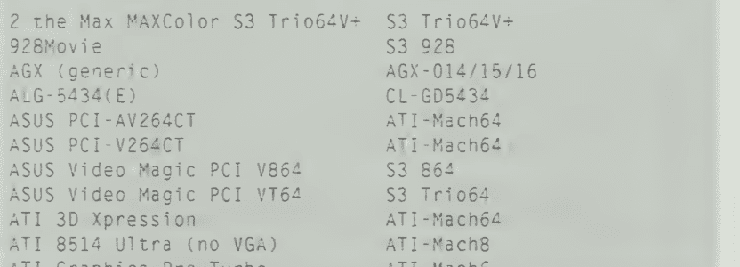
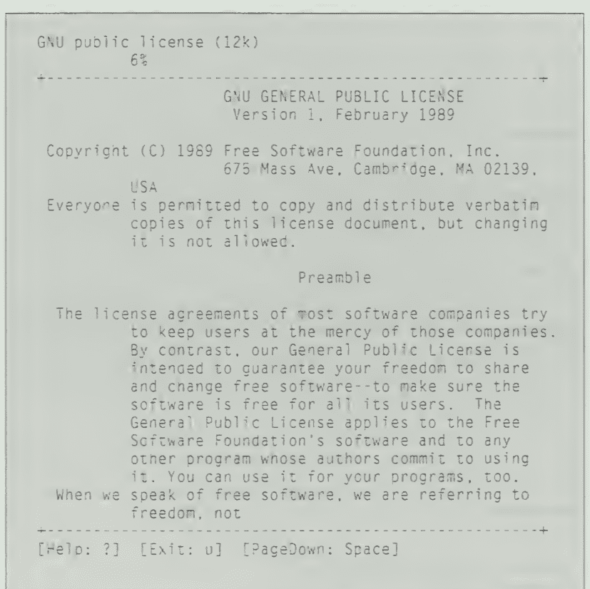
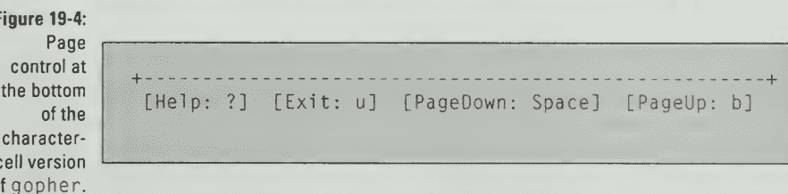
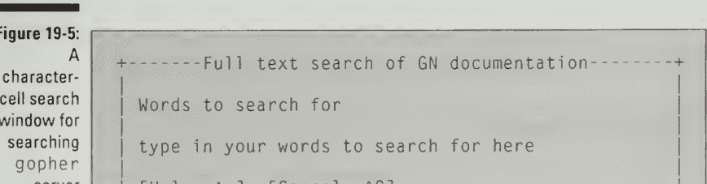
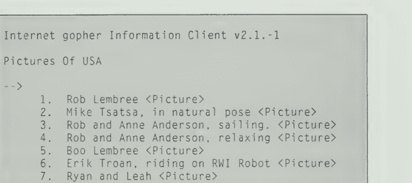
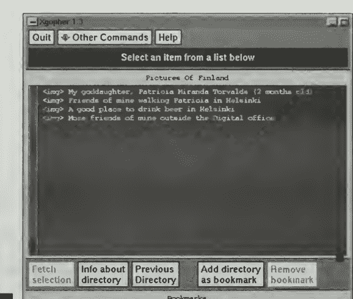
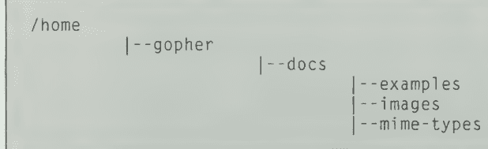
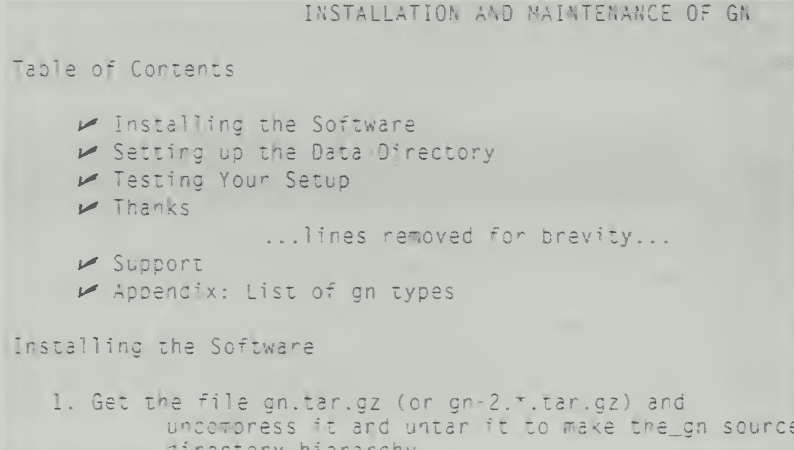

# 傻瓜的 Linux 第一版

## LINUX® For Dummies® 速查表

### Linux 相关新闻组

| 分组 | 描述 |
| :--- | :--- |
| `comp.os.Linux.advocacy` | 一个非审核新闻组，用于讨论 Linux 与其他操作系统相比的优势。 |
| `comp.os.Linux.announce` | 一个审核新闻组，旨在发布所有与 Linux 社区相关的公告。相关主题包括 Linux 的新软件（全新的或新版本）、新文档、关于 Bug 和安全漏洞的警告，以及用户组会议的通知。 |
| `comp.os.Linux.answers` | 一个审核新闻组，用于发布 Linux FAQ、How-Tos、README 以及其他解答 Linux 问题的文档。 |
| `comp.os.Linux.development.apps` | 一个非审核新闻组，用于关于为 Linux 编写应用程序以及将应用程序移植到 Linux 的问题和讨论。 |
| `comp.os.Linux.hardware` | 一个非审核新闻组，用于针对特定硬件设备的问题和讨论。 |
| `comp.os.Linux.m68k` | 一个非审核新闻组，旨在进一步推动 Linux 操作系统向 Motorola 680x0 架构移植的兴趣和部署。 |
| `comp.os.Linux.networking` | 一个非审核新闻组，用于与网络或通信相关的问题和讨论，包括以太网卡、串口通信和 SLIP。 |
| `comp.os.Linux.x` | 一个非审核新闻组，用于与在 Linux 下运行的 X Window System 第 11 版兼容软件（包括服务器、客户端、库和字体）相关的问题和讨论。 |
| `comp.os.Linux.development` | 一个非审核新闻组，用于关于 Linux 操作系统本身的开发问题和讨论。 |
| `comp.os.Linux.setup` | 一个非审核新闻组，用于与 Linux 安装和系统管理相关的问题和讨论。 |
| `comp.os.Linux.misc` | 一个非审核新闻组，用于与 Linux 相关但未被更具体的新闻组覆盖的问题和讨论。 |

### Linux 软件存档

以下站点维护着广泛的 Linux 软件和文档存档。

| 站点 | FTP 地址 |
| :--- | :--- |
| 北卡罗来纳大学教堂山分校 | `sunsite.unc.edu` |
| 麻省理工学院 | `ftp://tsx-11.mit.edu/pub/Linux` |
| 芬兰大学与研究网络 | `ftp://ftp.funet.fi/pub/Linux` |
| 佐治亚理工学院计算学院 | `ftp://ftp.cc.gatech.edu/pub/Linux` |

## LINUX® For Dummies® 速查表（续）

### Linux 关键硬件

- **硬盘驱动器：** 您有多少个？容量是多少？如果您有多个硬盘，哪个是第一个，第二个，第三个，以此类推？
- **CD-ROM：** 接口类型是什么？是 IDE 还是 SCSI 驱动器，或者是其他类型？如果您的 CD-ROM 驱动器不是 IDE (ATAPI) 或 SCSI，其品牌和型号是多少？
- **RAM 内存：** 您的计算机安装了多少内存？
- **SCSI 适配器：** 如果您的机器中安装了一个，其品牌和型号是多少？
- **网络接口卡 (NIC)：** 如果您有网络连接，您的网卡品牌和型号是多少？
- **指针设备（鼠标）：** 您使用的是什么类型的鼠标——总线鼠标、PS/2 鼠标还是串口鼠标？它有几个按钮？如果您使用的是串口鼠标，它连接到哪个 Com 端口？请记录鼠标使用的协议（例如 Microsoft 或 Logitech），以防您在安装过程中必须选择其中一个。
- **显示器：** 如果您需要 X Window System，您将使用的显示器品牌和型号是什么？显示器的垂直和水平刷新率是多少？
- **显卡：** 您的显卡或视频芯片组的品牌和型号是多少？它有多少显存？

### FTP 命令

| 命令 | 动作 |
|---|---|
| `ascii` | 选择 ASCII 传输模式 |
| `binary` | 选择二进制传输模式 |
| `cd` | 更改 FTP 服务器上的目录 |
| `close` | 终止连接 |
| `del` | 删除服务器上的文件 |
| `dir` | 显示服务器的目录 |
| `get` | 从服务器下载文件 |
| `hash` | 使用井号显示每个数据块的传输进度 |
| `help` | 帮助 |
| `lcd` | 更改客户端机器上的目录 |
| `mget` | 允许您从服务器“获取”多个文件 |
| `mput` | 一次将多个文件传输到服务器 |
| `open` | 连接到服务器 |
| `put` | 将文件上传到服务器 |
| `pwd` | 显示当前服务器目录 |
| `quote` | 直接发送 FTP 命令 |
| `quit` | 终止 FTP 会话 |

### Linux 网络基础知识

如果您的工作站连接到网络，您需要相关网络信息。请确保您知道您的：

- 互联网协议 (IP) 地址
- 子网掩码 (Netmask)
- 网关 IP 地址
- 域名服务器 (Name server) IP 地址
- 主机名和域名

...For Dummies：面向初学者的第一电脑书系列

## 为我们其余的人提供的参考指南！®

### 来自 IDG 的计算机图书系列

您是否被计算机吓到了，感到困惑？您是否发现传统的手册充斥着您永远用不到的技术细节？您的朋友和家人是否总是打电话让您帮他们修复 PC 上的简单问题？那么，来自 IDG Books Worldwide 的 ...For Dummies® 计算机图书系列正是为您准备的。

...For Dummies 系列书籍是为那些感到沮丧的计算机用户而写的，他们知道自己并不真的笨，但发现 PC 硬件、软件，以及计算机领域独特的词汇让他们感到无助。...For Dummies 系列采用了轻松的方式、接地气的风格，甚至使用了漫画和幽默的图标来化解计算机新手的恐惧并建立他们的信心。这些书在轻松之余并不轻率，是任何被迫使用计算机的人的完美生存指南。

> “我很喜欢我的那本，所以我告诉了朋友们；现在他们也买了。”
> **Irene C.，俄亥俄州，奥威尔**

> “快速、简洁、非技术化且幽默。”
> **Jay A.，伊利诺伊州，埃尔本**

> “谢谢，我正需要这本书。现在我晚上能睡个好觉了。”
> **Robin F，加拿大，不列颠哥伦比亚省**

数百万满意的读者已经对此表示赞同。他们使 ...For Dummies 书籍成为了排名第一的入门级计算机图书系列，并写信要求出版更多内容。因此，如果您正在寻找最有趣且最简单地学习计算机的方法，请寻求 ...For Dummies 书籍的帮助。

有关在课堂上使用 IDG Books Worldwide 书籍或申请样书的信息，请联系我们的教育销售部门：800-434-2086 或传真 317-251-8714。

有关媒体评论副本、作者采访或其他宣传信息，请联系我们的公共关系部门：415-655-3200 或传真 415-655-3281。

有关企业、个人或教育用途的复印授权，请联系版权清除中心 (Copyright Clearance Center), 222 Rosewood Drive, Overlees, MN 01293，或传真 508-750-4470。

#### 关于作者

**Craig Witherspoon** 和 **Coletta Witherspoon** 是 *Optimizing Client/Server Networks*、《*Netscape Navigator 60分钟指南*》系列以及其他多本为 IDG Books 编写的关于互联网软件和应用程序书籍的合著者。除了撰写关于计算和网络的书籍外，他们还通过 Clare Stanley Productions 为客户提供咨询服务并撰写文章。

**Jon Hall** 是 Linux International 的执行董事。他在计算机行业从业超过四分之一个世纪，其中 17 年专注于 UNIX。目前，他在 Digital Equipment Corporation 的 Digital UNIX 营销团队工作。此前，Jon 曾任 Hartford State Technical College 的计算机科学系主任，在那里，他的学生们亲切地（他希望如此）给了他一个绰号 *maddog*。

## 关于 IDG BOOKS WORLDWIDE

欢迎来到 IDG Books Worldwide 的世界。

IDG Books Worldwide, Inc. 是 International Data Group 的子公司，后者是全球最大的计算机相关信息出版商，也是全球领先的信息技术信息服务提供商。IDG 成立于 25 年前，目前在全球拥有 8,500 多名员工。IDG 在 75 多个国家出版 275 多种计算机刊物（见下方列表）。每月有超过 6,000 万人阅读一种或多种 IDG 刊物。

IDG Books Worldwide 成立于 1990 年，如今是美国最畅销计算机书籍的顶级出版商之一。我们很荣幸获得了计算机出版社协会（Computer Press Association）颁发的八项编辑卓越奖，以及《Computer Currents》首届年度读者选择奖的三项奖项。我们最畅销的“For Dummies”系列印数超过 3,000 万册，并被翻译成 30 种语言。IDG Books Worldwide 通过与 IDG 的北京高新公司（Hi-Tech Beijing）合资，成为第一家在中华人民共和国出版计算机书籍的美国出版商。近年来，IDG Books Worldwide 已成为数百万希望高效使用计算机或学习如何更好地管理生活的学习者的首选。

我们的使命很简单。我们的每一本书旨在为读者带来额外的价值和技能提升指导。我们的书由理解并关心读者的专家编写。我们的编辑团队的知识储备源于在出版、教育和新闻业多年的经验——我们将这些经验用于创作适应 90 年代需求的书籍。简而言之，我们热爱书籍，因此我们吸引了最优秀的人才。我们特别关注受众、内页设计、图标使用和插图等细节。由于我们采用了高效的生产流程，我们可以降低出版成本。这意味着，反过来，我们可以投入更多时间确保优质的内容，而减少在书籍制作技术细节上花费的时间。

您可以信赖我们致力于以具有竞争力的价格，为您提供您想阅读的高质量主题书籍。在 IDG Books Worldwide，我们延续了 IDG 25 年多来提供优质产品的传统。您将找不到比 IDG Books Worldwide 出版的主题书更好的书籍。

IDG Books 在 75 多个国家出版刊物。（以下是 IDG 刊物出版或可在图书馆和书店获取的国家列表：阿根廷、澳大利亚、奥地利、比利时、巴西、加拿大、智利、哥伦比亚、丹麦、芬兰、法国、德国、香港、印度、印度尼西亚、爱尔兰、以色列、意大利、日本、韩国、马来西亚、墨西哥、荷兰、挪威、新西兰、菲律宾、波兰、新加坡、南非、西班牙、瑞典、瑞士、台湾、泰国、英国、美国、越南……）

## 献词

献给 Mom&Pop™，他们对电子产品的厌恶是众所周知的 —— md

这本书献给我的妻子 Coletta —— Craig Witherspoon

## 致谢

Witherspoon 夫妇感谢 Bill Roman 帮助安装了我们的第一个 Linux 系统，并播下了编写 Linux 书籍的种子。衷心感谢 Jeanne Borowski 为我们提供了一个干燥的工作环境，并在艰苦的写作过程中偶尔提供新鲜捕捉的鱼来维持我们的体力。

我们还想特别感谢 Caldera 和 RedHat 的工作人员，他们为我们提供了软件并回答了我们的许多问题。我们要感谢整个互联网社区提供的资源，以及在极其需要帮助时作为依托之所，这使得本书的问世成为可能。

最后，我们要感谢 IDG Books 的每一个人，感谢他们在推动本书进入生产阶段并推向书店过程中付出的所有辛勤工作和巨大的帮助。

Craig Witherspoon

Coletta Witherspoon

在感谢这么多人的努力时，该从哪里开始？Witherspoon 夫妇和 IDG Books 在构思一本如此简单以至于“笨蛋”也能使用 Linux 操作系统的书籍时所做的工作肯定值得称赞，但如果没有大量致力于 Linux OS（以及自由软件基金会项目和 XFree86）的程序员，这本书就没有任何存在的必要。如果没有关于 Linux 操作系统的杂志和各种 Linux 发行版的创建者，我认为 Linux 的渗透率会更低，触及的人数也会更少。感谢我在旅途中遇到的所有 Linux 爱好者，很高兴认识你们。我期待着认识更多的人。还要感谢亲爱的读者，你们首先选择了学习 Linux 操作系统，这展现了极高的智慧，并且通过购买本书迈出了第一步。

最后，我必须感谢一个优秀的年轻人，他美丽且充满爱心的妻子，以及他们迷人的女儿（我的第一个也是唯一的教子）。谁能想到 1994 年 5 月的一次短暂河船之旅，会开启这段疯狂而美妙的旅程？Linus, Tove 和 Patricia Miranda，感谢你们给予我的爱与信任。

Jon "maddog" Hall

美国新罕布什尔州安默斯特

## 出版社致谢

我们为这本书感到自豪：请通过我们的 IDG Books Worldwide 在线注册表 `http://myidgents.dunnef.com` 提交您的评论。

帮助将本书推向市场的部分人员包括：

### 征稿、开发与编辑

- 项目编辑：Pat O'Brien
- 征稿编辑：Jill Pisoni
- 媒体开发经理：Joyce Pepple
- 助理版权编辑：Heather H. Dismore
- 文字编辑：Jill Brummett
- 技术编辑：Stephen Pedrick
- 编辑经理：Mary C. Corder

### 制作

- 项目协调员：Sherry Gomoll
- 排版与图形：Steve Arany, Cameron Booker, Lou Boudreau, Angela Bush-Sisson, Elizabeth Cárdenas-Nelson, Maridee V. Ennis, Angela F. Hunckler, Todd Klemm, Anna Rohrer, Brent Savage, Janet Seib, M. Anne Sipahimalani, Kate Snell
- 校对员：Melissa D. Buddendeck, Joel K. Draper, Rachel Garvey, Nancy Price, Rebecca Senninger, Robert Springer, Janet M. Withers
- 索引员：Sharon Hilgerdon

### 综合与行政

- IDG Books Worldwide, Inc.：John Kilculien (CEO); Steven Berkowitz (总裁兼出版人)
- IDG Books 技术出版：Brenda McLaughlin (高级副总裁兼集团出版人)
- Dummies 技术出版社与 Dummies 编辑部：Diane Graves Steele (副总裁兼助理出版人); Mary Bednarek (征稿与产品开发总监); Kristin A. Cocks (编辑总监)
- Dummies 商业出版社：Kathleen A. Welton (副总裁兼出版人); Kevin Thornton (征稿经理); Maureen F. Kelly (编辑协调员)
- IDG Books 为 Dummies 出版社提供的制作服务：Beth Jenkins (制作总监); Cindy L. Phipps (项目协调、制作校对与索引经理); Kathie S. Schutte (页面排版主管); Shelley Lee (图形与设计主管); Debbie J. Gates (制作系统专家); Robert Springer (校对主管); Debbie Staley (特别项目协调员); Tony Augsburger (重印与蓝图主管); Leslie Popplewell (媒体档案协调员)
- Dummies 包装与书籍设计：Patti Crane (包装专家); Lance Kayser (包装助理); Kavish - Kavish (封面设计)

> 出版社想特别感谢 Patrick J. McGovern，没有他，这本书是不可能实现的。

## 插图概览

作者：Rich Tennant


第 259 页


第 55 页


第 209 页


第 117 页


第 285 页


第 5 页

传真：508-546-7747 • 电子邮件：`the5wave@tiac.net`

# 第三部分：让我们看看她能做什么

## 第 IV 部分：准备上线

#### 目录

xix

### 简介

我们知道关于 Linux 的书有很多，你可以选择其中的任何一本，但我们认为你会很高兴选择了 *LINUX For Dummies*。很多其他的 Linux 书籍包含大量面向 UNIX 系统管理员的迷人信息，以及长长的一串难以发音且选项令人困惑的命令。本书并非如此；我们的命令是易于发音的，而且我们的描述和指示均采用简单的英语。

我们在书中放入了关于如何开始使用 Linux 以及在需要时如何寻找帮助的信息。我们讨论了你可以用 Linux 做什么，以及如何定制 Linux 以满足你的需求。

## 关于本书


本书旨在作为一本辅助参考手册。当你 fruitless 地输入了两个小时的`xstart`并两次重新加载 X Windows 之后，你的五岁孩子告诉你“x”应该放在单词末尾时，这本书为你提供了一个寻求帮助和慰藉的地方。这不是那种你坐下来从头到尾通读的书；你只需按照自己的方式继续使用 Linux 即可。毕竟，除了出问题的时候，一切都会运行良好。而那时，你就知道需要深入查阅本书了。因此，如果你在使用 Linux 时遇到问题且它不理会你，只需在此寻找解决方案。

我们投入了巨大努力，将你需要了解的内容填入书中：

- 安装与配置
- 命令与实用工具
- 文件与目录
- 编辑器与应用程序
- 故障排除与帮助（HELP）

## 如何使用本书

将本书作为一本有趣且信息丰富的 Linux 参考书。或者买一整叠，用它们来压花（你仍然可以使用最上面的一本作为 Linux 参考书）。*LINUX For Dummies* 易于使用。你可以在目录或索引中查找主题和命令，直接跳转到书中包含所需信息的章节。

## 本书适合你吗？

我们为这种刻板分类感到抱歉，但为了在与读者交流时有一个起点，我们对你做了一些假设：

- 你拥有一个 Linux 操作系统（本书随附的 CD 中有一个）。
- 你拥有一台计算机（这就是你对操作系统感兴趣的原因）。
- 你想将它们结合起来开展工作（这是购买本书的绝佳理由）。
- 你不需要成为一名 Linux 专家（因为你可以将本书作为速查表）。

## 本书的组织结构

像所有优秀的 *For Dummies* 系列书籍一样，本书被组织成多个独立的篇章。你可以选择任何一个部分开始阅读，而无需阅读前面的部分。以下章节列出了书中的各个部分及其包含内容的简要描述。

## 第一部分：Linux，准备就绪

这一部分告诉你如何开始使用 Linux。它涵盖了确定硬件和软件以及将其全部运行起来。你会了解到为了增强功能可能想要添加哪些额外组件，以及在哪里可以获得它们。

## 第二部分：啊，使用 Linux 的乐趣

这里是你学习如何使用 Linux 完成一些操作的地方。在这一部分中，你可以找到关于命令、实用工具以及文件系统如何工作的信息。你将获得一些关于管理硬件、软件故障排除和升级的建议。最后但同样重要的是，你将了解到关于 shell 的一些知识。

## 第三部分：看看它能做什么

GUI 是图形用户界面，一种让与 Linux 程序和操作系统的交互变得舒适且直观的方式。在这一部分中，你可以找到关于使用 Linux 和一些商业应用程序的信息。你还将看到一些在 GUI 框架内运行并提供整套办公软件工具的应用程序，例如 Applixware。

## 第四部分：你要上网了

在这一部分中，你将了解如何设置互联网连接并参与其中，甚至如果你愿意，还可以向他人提供互联网服务。你将全面了解 Web 服务器（包括安装和配置），以及如何使用它们参与网络。这里也是你了解 gopher 和其他奇怪互联网现象的地方。

## 第五部分：帮助，一个全能的 man

Linux 没有保修，但它附带一套“酷”的指南。Linux 用户手册或 man 页面能为你提供比你想象中更多的关于 Linux 和 Linux 命令的信息。我们建议你经常参考它。有一些优秀的应用程序和实用工具（如 GNU emacs）自带在线帮助和教程来帮助你上手。bash shell 程序有 Help 引导你度过难关，当然，像 Applixware 办公套件这样的商业应用程序拥有广泛的在线帮助和教程，旨在训练你高效且轻松地使用它们。

## 第六部分：十条原则部分

在这里，你可以找到数十条（大量！）关于 Linux 的极其有用的信息。

## 本书中的图标

本书中的某些段落非常重要，或者非常高级，或者非常有帮助。只需寻找段落旁的小图标。

- 特别极客的、技术性的信息。你可以跳过。
- 精巧的小技巧和节省时间的方法。
- 不要让这种情况发生在你身上！
- 当你看到手指上的绳结时，你应该记住。

## 下一步

现在你可以开始了。如果你遇到困难，请在本书中查找快速解决方案（或相关参考）。使用 Linux 很有趣。虽然它不像 DOS、Windows 或 Macintosh，但学习起来并不太困难，你一定会享受这个过程。在刚开始时，不必因为需要多次查找同一件事而感到尴尬。

## 第一部分：Linux，准备就绪

### 第五波

作者：Rich Tennant

## 在本部分中……

你已经决定尝试，现在准备好开始使用你的新操作系统了。第一部分告诉你如何开始使用 Linux。你可以在本部分中找到信息，帮助你选择一套适合你需求的硬件/软件组合，并发现更多关于增强功能可能想要添加的额外组件及其获取途径。

第一部分完全是关于确定硬件和软件并使其运行。很可能你的某个技术朋友大肆赞美免费拥有 UNIX 系统的好处，而你上钩了。也许他们甚至留下来帮你把 Linux 安装到电脑上并启动。但是，如果你记得的只有在你被撇下之前五分钟的混乱建议，你会很高兴地发现，你可以在本部分中直接找到启动所需的信息。

## 第一章：Linux 与你

### 本章内容

- 什么是 Linux？
- 你可以如何使用 Linux？
- 为什么 Linux 的性能优于其他系统？

1991 年，赫尔辛基大学的本科生 Torvalds 获得了一台全新的 IBM 386 PC。他对硬件自带的操作系统不满意，他决定运行一个版本的 UNIX 操作系统。

然而，他查看的所有 UNIX 版本都非常昂贵。久而久之，他决定为自己的机器编写一个新版本的 UNIX，于是他通过互联网发送消息寻找程序员帮他。一些人给予了回应，他们组成了一个才华横溢的程序员团队来处理这项巨大的任务。

随着时间的推移，越来越多的程序员加入，最终他们创建了一个名为 Linux 的核心操作系统（也称为内核）。Linus Torvalds 在 Linux 内核早期做出的最重要决定之一就是让所有代码都可以自由分发。虽然代码作者控制其自身代码的权利，但所有作者都决定免费提供他们所创造的东西，以便他人可以在此基础上进行构建。这是由自由软件基金会（Free Software Foundation）创造的一个概念。

通过应用自由软件基金会提供的海量可自由分发的软件，几位程序员在 Linux 内核的基础上进行了扩展，创建了将软件安装到计算机上的方法，并创建了发行版。有时这些发行版仅通过互联网提供。其他时候，软件发行商将发行版放入 CD-ROM 中并收取分发费用。有时，作者会添加其他有用的程序并对这些程序收费。但在任何情况下，基础的 Linux 内核和其他可自由分发的代码必须被明确标识且免费分发。

### 不仅仅是目标代码

根据 GNU 通用公共许可证（用户在处理 Linux 时必须接受的协议），必须提供源代码。源代码不需要随操作系统一起分发，但必须能够获取。如果你修改了源代码，你必须在发布新程序的同时分发修改后的源代码，或者至少使其可获取。

### 快速增长的社区

Linux 内核的开发始于 1991 年。到 1994 年初春，第一个真正的 Linux 版本（V1.0）正式向公众开放。即便在当时，它也是一个令人惊叹的操作系统，能够在极小（少于 2MB）的 RAM 中以惊人的速度运行。这个免费系统包含了许多每用户成本数百美元的操作系统才具备的功能：

- 多任务处理（同时运行多个作业）。
- 多用户同时在线。
- 请求分页虚拟内存系统，可以运行远大于 RAM 容量 RAM 的程序。

当时，活跃用户数估计为 125,000 人。（由于不对个人用户发放许可证，很难统计出究竟有多少个系统。）

三年后的 1997 年，Linux 的估计用户数达到了 3,000,000 人，并且在快速增长：

该操作系统已从 32 位 Intel 复杂指令集计算机（CISC）移植到了名为 Alpha 的 64 位精简指令集计算机（RISC）。此外，该操作系统还被移植到了 PowerPC、MIPS、SPARC、Motorola、StrongARM 和 HP/PA。它现在支持对称多处理（SMP，即每个系统箱拥有一个以上的 CPU 或数学逻辑编程单元）。目前还有一些旨在提供高级处理能力的项目，例如：

- 高可用性（使计算机能够始终可靠地运行）。
- 可扩展性（通过增加系统箱而非提高 CPU 速度来增加计算能力）。

随着过去几年中 Linux 新增的所有特性和功能，以及用户数量的增加，不同类型的用户现在都在享受 Linux。

### 你如何使用 Linux？

Linux 是一个多功能的操作系统。它曾经是计算机科学专业学生的专属领域，但现在企业和政府也开始使用 Linux 来降低成本并提高性能。

#### 个人工作站

过去，用户根据操作系统和昂贵工作站的性能，将基于 Microsoft Windows 的 PC 与基于 UNIX 的工作站区分开来。Microsoft 的操作系统并没有试图去压制性能较低的 Intel 芯片（例如从 8088 时期到 286 AT 计算机的芯片）。但随着 386 型计算机的出现，性能增长如此之快，以至于 Microsoft 的操作系统无法充分利用其全部能力。

如果拥有像 Linux 这样的操作系统，Intel 处理器将更具吸引力。你可以同时运行许多程序，使用高质量的图形，甚至能同时满足多个用户的需求。诚然，Microsoft 有一个名为 *Windows NT* 的操作系统，但该系统设计较新，Microsoft 仍在摸索之中。Linux 开发者可以吸取这些想法中的精华，加入其他好的创意，并快速实现它们。

Linux 可以处理极大尺寸的文件和程序。当与 64 位 Digital Alpha 处理器配合使用时，它可以处理 TB 级别（数千 GB 容量）的文件。它拥有一个复杂的窗口系统 *X Window System*，并且不仅能与大多数 UNIX 系统共享文件，还能与 Microsoft Windows、OS/2 和其他操作系统共享。Linux 的特性包括：

- Web 浏览
- TCP/IP
- 编译器
- 免费软件程序（如邮件阅读器、图像编辑器、电路设计程序、文本格式化工具等）

如果你觉得移植到 Linux 的免费软件数量不够，商业应用程序也在被移植到 Linux 上，包括数据库、数据处理程序、办公软件等。我们每天都使用 Linux 工作；事实上，我们就是在 Linux 系统上编写这本书的。有了 Linux，我们可以在桌面工作站、笔记本电脑和大型服务器系统上拥有完全相同的环境。

#### 文件和打印服务器

管理一组小型 Microsoft Windows PC 的难点之一就是如何轻松地管理它们。各种商业程序在做这件事，主要是为了让 Windows PC 在网络上共享文件和打印机。每年在这一领域投入了大量资金，但成功率参差不齐。由于具备多任务处理、虚拟内存和强大的文件系统，Linux 作为 Microsoft Windows 系统的文件和打印共享设施运行得非常好。一款名为 SAMBA 的软件允许 PC 与连接在 Linux 机器上的文件系统和打印机通信。另一个通信能力 AppleTalk 则允许 Apple 计算机进行同样的文件和打印机共享。当然，Linux 也可以与 UNIX 系统共享文件和打印机。人们通过使用 Linux 来完成这项工作节省了大量资金；因为操作系统和提供服务的分层软件都是免费提供的。

#### 互联网/内联网服务提供商

如今你经常听到关于互联网（企业外部）和内联网（企业内部）能力的讨论，特别是由于 HTML 和万维网（World Wide Web）的发明。UNIX 系统处于这些发展的最前沿，而 Linux 继承了该遗产的大部分（如果不是全部）优势。互联网和内联网需要很多类似类型的服务：

- 防火墙（将坏人拒之门外）
- FTP（允许好人获取文件和软件）
- telnet（允许人们远程登录并使用你的机器）
- Web 服务器（允许人们查看你的网页）

Linux 发行版通常自带创建互联网站点所需的所有软件，许多互联网服务提供商（ISP）正使用 Linux 向客户提供这些服务。他们这样做不仅是因为 Linux 免费，还因为他们拥有整个操作系统及其所有所需程序的源代码。当问题出现时，他们可以迅速修复。否则，他们必须等待商业软件供应商修复问题并发送程序的新副本。

为了说明这一点有多关键，1997 年 TCP/IP 发现了一个影响全球几乎每个 UNIX 系统的问题。它被称为 ping 问题，一旦被发现，它将允许坏人关闭他人的 UNIX 系统。全世界需要一个修复方案，而且要快！在问题被确定后的四个小时内，互联网上就出现了 Linux 的修复方案，需要修复的人可以轻松获取并应用到他们的系统中。而各种商业 UNIX 供应商则花了几周时间才开发出修复方案并发送给客户。

#### 三层客户端/服务器架构

哇！对于一本……*For Dummies*（傻瓜书）来说，这是一个相当复杂概念，但它的意思是大多数计算机问题可以分解为三个独立的问题：

- 信息（通常称为数据）的存储和检索
- 数据处理
- 数据展示

通过将其分解为这三个层次，不仅通常使问题更容易解决，而且在以后需要更改时也更容易修改。直到最近，数据展示层大多被认为是运行在桌面上的 Microsoft Windows 系统（可能使用 Visual Basic 开发界面），而另外两层则是通过网络通信的 UNIX 或旧系统。然而，随着万维网和 Web 浏览器的出现，以及 Java（一种可移植的应用环境）的进一步发明，桌面层可以是一个运行着免费分发的 Web 浏览器和/或免费分发数据库系统的 Linux 系统（两者均已存在）。这将节省数千美元的操作系统成本，同时仍然提供 Linux 所具备的安全性和操作系统稳健性。

Linux 拥有一些非常强大的数据处理工具，就像大多数 UNIX 系统一样。因此，它非常适合作为第二层系统，从多个数据库中提取信息，将它们组合在一起，然后进行足够的数据处理，最后传递到桌面的展示层。

最后，Linux 具备作为优秀数据库平台的设施。已经有几个商业数据库软件包在 Linux 上运行，更多地在路上。即使你负担不起商业数据库软件包，也有免费可用的方案（包括一个名为 Postgres 的非常强大的数据库），甚至还有构建块让你创建自己的数据库（好吧，也许在进一步学习之后）。

如果你愿意，这三层功能实际上可以驻留在同一台计算机上。其核心概念是在逻辑上划分工作，但一旦完成划分，你可以将所有三项功能都放在一台计算机上。

### turn-key 系统（交付即用系统）

Turnkey 系统是指任何由开发者一次性构建完成后，随后在数百个甚至数千个地点进行复制的系统集。典型的 Turnkey 系统的典型例子包括信息查询机、酒店预订系统、医生和律师事务所系统、汽车诊断系统等。Linux 非常适合这类工作，因为它能提供所需的安全性、保护力和稳定性，而且用户无需持续支付操作系统的费用。我知道的一个应用需要 4,000 台系统；如果企业必须为操作系统支付费用（假设每台 500 美元），那么仅操作系统的支出就会给项目增加 2,000,000 美元的额外成本。这笔节省下来的费用可以转嫁给最终客户，或者用于增加项目的利润。

### 哪个 Linux 发行版最好？

这是一个每个人都会问的问题。诚实的回答是：*我不知道：这取决于你的需求*。

一些 Linux 发行版采用较旧的内核，因为它们有时间变得成熟；而另一些则追求最新、最强的版本。有些是极小的发行版，除了操作系统外几乎没有其他程序。而另一些则自带大量好用的实用工具。

Linux 发行版非常便宜，因此只要你对 Linux 有一点兴趣，你可能会买两三个版本来看看它们分别是什么样的。当你第二次、第三次或第四次安装 Linux 时，你就会变得相当精通。大多数 Linux 发行版允许你在多台计算机上安装。因此，在你自己的电脑上安装好之后，你可以按原价把这个发行版卖给朋友。或者，你可以以略低于原价的价格卖给别人（因为它是二手产品）。你甚至可以以*高于*原价的价格卖给别人，因为他们会向你请教问题，而你可以提供帮助。

不直接回答这个问题的另一个原因是，在某种程度上这个问题没有实际意义。要么你在买这本书之前已经买了一个发行版，所以你已经拥有一个了；要么你之前没有，但现在有了，因为这本书的背面附带了一个发行版。对于“哪个是最好的 Linux 发行版？”这个问题的答案是：*就是你现在拥有的那一个*。

## 第 2 章：准备你的硬件

### 本章内容

- Linux 需要什么资源？
- 我如何知道 Linux 支持哪些硬件？
- 我如何知道我拥有什么样的硬件？
- 我如何将 Linux 安装到我的硬件上？

在开始本章之前，我们希望让你知道，本章的唯一功能就是帮助初学者完成安装并运行起来。如果你的 Linux 系统已经安装并运行，那么请庆幸自己运气好，直接跳到第 3 章。如果还没有，你可能会在本章中发现很多有用的信息，这会对你之后有所帮助。

我们还想打破一个关于 Linux 难以安装的迷思。我们认为，安装 Linux 并不比安装任何其他操作系统更难。我们曾多次尝试从头开始安装 Windows 95，结果在“Plug and Pray”（即插即祈祷，讽刺 Plug and Play 即插即用）以及永远在*另一张磁盘*上的驱动程序（无论我手里拿的是哪张盘）面前感到非常沮丧。

事实是，Windows 看起来容易安装，是因为：

- Windows 预装在大多数硬件上。
- 大多数用户仅更新 Windows。
- 真正安装 Windows 的人员拥有所有需要的硬件文档。

实际上，你可以购买预装了 Linux 的计算机。大多数销售硬件且专营 Linux 销售的公司会为你安装好 Linux。你唯一需要做的就是打开电源。就像 Windows 一样！

其次最简单的步骤是购买装在硬盘上的 Linux。将硬盘连接到你的系统中，启动它，就完成了。

### Linux 需要什么资源？

但 Linux 用户（Linuxites）是一群坚韧的人。大多数 Linux 用户：

- 已经拥有计算机系统。
- 使用现有的硬盘。
- 在系统中保留 MSDOS 和 Windows。

这才是具有挑战性的安装。以下是我们实现的方法。

通常，Linux 可以在任何 386 或更新的 Intel 处理器，以及各种 Digital Alpha、Sun SPARC、Motorola、MIPS、PowerPC 和 HP/PA 平台上运行。


《Linux For Dummies》侧重于 Intel 处理器的 PC，因为它们占据了系统的绝大部分。其他系统并没有太大区别；如果你使用的是其他系统，不必绝望。

Linux 还支持对称多处理（SMP），这意味着每台机器可以拥有多个 CPU。事实上，它支持每台系统机箱安装多个处理器。（如果你拥有这种类型的系统，愿意和我交换吗？不，我想你不会的……）

对于 Intel 处理器，你至少需要 4MB 的 RAM（或主）内存。在没有图形界面的情况下，Linux 在如此小的内存量下也能运行（呃，勉强运行）。

大多数计算机系统（包括 Linux）在内存更多时运行得更好。即使没有图形界面，8MB 的 RAM 也会好得多；如果有图形界面，你至少应该有 8MB。16MB 的主内存能让 Linux “飞起来”，图形效果也会好很多。有了 32MB，Linux 运行速度极快，图形界面能实现真正有趣的功能。一些 Linux 开发者在系统中配置了 128MB 的主内存。我写这本书的系统有 16MB，虽然如果我有 24MB 启动某些程序可能会更快，但程序启动后，系统运行良好。

Linux 安装需要 40MB 的磁盘空间，但对于图形部分，你需要大约 120MB。而当你安装完所有实用工具后，你可能安装了超过 400MB 的计算机程序、数据、游戏以及 CD-ROM 上自带或从互联网下载的所有其他内容。幸运的是，现在你可以花大约 300 美元买到一块 4GB 的硬盘（4,000,000,000 字节，是容纳一个优秀的 Linux 发行版所需空间的十倍），而且磁盘空间在增加，价格在一天天下降。当我刚开始接触计算机时，能买到的最大硬盘是 10MB，而且要花费数千美元。

Linux 通常从 CD-ROM 安装，尽管有些发行版允许你通过软盘安装，或者坚持要求你制作软盘并从中安装。如果你通过软盘安装，通常可以预见到需要大量软盘，安装 Linux 和图形界面大约需要 150 张或更多。如果你想要实用工具，需要的软盘会更多。购买这些软盘的成本可能远高于买一张单速 CD-ROM 的成本，所以如果你还没有 CD-ROM，最好去买一个。Linux 支持 IDE/ATAPI 和 SCSI CD-ROM。早期的一些 CD-ROM 驱动器并非总是 IDE 接口，而是直接连接到声卡或其他奇怪的设备上。大多数 Linux 发行版都会告诉你如何检测并使用它们。

Linux 还支持各种网卡，在制作一两张软盘后，你可以通过网络拉取文件来安装 Linux。这是一种在局域网（LAN）上安装 Linux 的可行方式，通常用于大学或大型企业；或者如果你有一个朋友拥有 Linux 系统、CD-ROM 以及与你相同类型的网卡，也可以采用这种方式。然而，如果你的网络速度不快（也就是说，不能快速拉取大量数据），请相信我们，最简单的完整安装方式仍然是使用连接在你自己系统上的 CD-ROM 驱动器。

Linux 还支持笔记本电脑的许多 PCMCIA 卡。早期的笔记本没有内置 CD-ROM，在 Linux 获得 PCMCIA 支持之前，我必须使用软盘安装 Linux。我还记得我拿到新笔记本（同时）获得支持 PCMCIA 的 Linux 新版本的那一天。那天晚上我赶紧跑出去买了一个 PCMCIA SCSI 控制器，这样我就可以使用我的 SCSI CD-ROM 进行安装了，从那以后我的生活变得美好多了。坦率地说，在用软盘给各种笔记本安装了七次 Linux 之后，那个 PCMCIA 卡的制造商即便开十倍的价格，我也不在乎——我一定会买。现在，大多数新笔记本要么内置 CD-ROM，要么在扩展坞中内置一个。或者，你可以使用 PCMCIA 以太网控制器进行网络安装，前提是网络上的另一台 Linux 系统已安装了 CD-ROM。

除了键盘和鼠标（Linux 支持大多数产品）之外，你还需要一张显卡。目前，Linux 支持广泛的显卡，并且支持更多标准的 VGA、SVGA 和其他图形硬件标准。通常，只要显卡上市一段时间，它就会得到支持。

Linux 还支持各种声卡、串行线卡（用于将大量串行打印机或调制解调器连接到系统）以及广泛的其他外围设备。

### 第一步：了解你拥有的硬件并记录下来

我们假设你并不是为了安装 Linux 而专门购买一套新系统。如果是的话，最简单的方法就是直接在万维网上或某些 Linux 杂志上寻找硬件供应商，并要求供应商为你组装一套系统。或者，你可以从网络上或发行版随附的 CD-ROM 中的 Hardware HOWTO 中获取支持的硬件列表，然后将其交给你的 PC 供应商。确保你 PC 的所有部件都受到 Linux 的支持。尝试运行一个启动盘（通常随发行版提供），如果它能正常工作（我们将在本章后面讨论如何制作启动盘以及它的作用），那么在硬件兼容性方面，你可能已经完成了 99.99% 的准备工作（可能除了 Linux 的图形部分之外的所有内容）。如果你是购买新系统，这一切都很简单。

但极有可能的情况是，你面前正放着一台电脑，要么是别人买的，要么是你早在掌握计算机技能之初就买的，而你并不真正清楚里面装了什么。

### 获取 PC 硬件信息的渠道

一个信息来源是随 PC 附带的手册。有时，手册中包含你所需的所有信息。但大多数时候，你甚至没有手册，因为：

- 你把它们扔了。
- 你把它们弄丢了。
- 你从一个已经把手册扔掉或弄丢的人那里买了二手电脑。
- 你买的 PC 预装了 Windows。

最后一个原因实际上是最阴险的，因为为你组装 PC 的人并没有费心为每个部件购买文档。因为那样会增加更多费用。相反，他们使用了原始设备制造商（OEM）的部件（这意味着没有文档），而他们购买的唯一一份文档是给他们自己的。毕竟，如果已经安装了 Windows，你（最终用户）为什么还需要关于系统的文档呢？所以你得到的只是一个光鲜的营销宣传册，在你买完系统之后还试图继续向你推销这套系统（唉）。

但在某些情况下，你的手册中可能确实有一些有用信息，所以请保留它们。

另一个信息来源是你的经销商，假设他们还在营业。经销商可能会记得他们卖给了你什么，或者如果你把机器带过去，他们可能只需看一眼就能很容易地告诉你所有需要的信息。而且他们可能还保留着你本该得到的文档。也许你可以说服他们复印一份，甚至卖给你一份。

另一个信息来源是你系统中磁盘驱动器顶部的标签。大多数现代驱动器上都贴有安装 Linux 所需的信息。如果你能看到标签，就可以读取这些信息。

另一个信息来源是万维网。现在许多厂商将关于磁盘驱动器、显示器、键盘、鼠标、显卡等技术数据发布在网上，你只需要找到它即可。因此，你需要知道设备的品牌和型号。

### 硬件秘密揭晓！

另一个信息来源是 MS-DOS、Windows 3.1 和 Windows 95，假设你的系统中仍然安装了它们。

#### 使用 MS-DOS 或 Windows 3.1

如果你运行的是 MS-DOS 或 Windows 3.1，系统中有一个名为 Microsoft Diagnostics 或 MSD 的程序。你应该在 DOS 或 DOS 模式下运行它。如果你在 DOS 或 DOS 模式下，只需输入 `msd` 即可启动。

当主屏幕出现时，你会看到诸如 `computer` 和 `memory` 等类别。其中只有部分内容是你真正感兴趣的，你应该准备一些纸来记录这些有趣的部分。

首先按下 `p`，查看你使用的是什么类型的处理器（通常是 386、486 或其他类型的 Intel 芯片）。然后按 `Enter` 返回主屏幕。

接着按下 `v` 进入视频屏幕，查找视频适配器类型（Video Adapter Type，通常是 VGA、XGA、SVGA、SVGA color 或类似类型）。同时查看显示类型（Display Type，通常是 VGA Color、SVGA Color 等）、制造商（Manufacturer）和视频 BIOS 版本（Video BIOS Version）。特别注意视频 BIOS 版本，因为它可能会列出用于制作显卡的实际计算机芯片组。例如，我的显示为 WD90C26，代表 Western Digital 90C26。这在稍后启动图形窗口系统时可能会很有用。返回主屏幕。

接下来按下 `n` 查看网络。你的系统可能没有网络能力，或者 MSD 无法识别，因此你可能会在主屏幕的网络框旁边看到一条信息，提示没有网络。如果是这样，就不用费心寻找了。但如果显示有网络，请尝试记录所有相关信息。

按下 `u` 查看鼠标，查找鼠标硬件（Mouse Hardware）、驱动程序制造商（Driver Manufacturer）、DOS 驱动类型（DOS Driver Type）和鼠标按钮数量（Number of Mouse Buttons）。如果你观察你的鼠标，最后一项应该是显而易见的，但我们讨论的是软件和计算机……现在返回主屏幕。

现在按下 `d` 查看磁盘驱动器。这里才是真正有趣的地方。你应该记录下软盘驱动器的容量及其柱面数（对于 3.5 英寸磁盘，通常分别为 1.44MB 和 80 柱面）。然后查看你的硬盘驱动器，通常被指定为 C:、D:、E: 等。每一个应该都有一行显示总大小（Total Size），下方有一个标题和一个数字，如 120M，代表 120MB。还应该有一行名为 CMOS Fixed Disk Parameters，后面跟着类似 `731 Cylinders, 13 heads, 26 sectors/track` 的内容。把所有这些都记录下来，因为在为 Linux 设置磁盘时非常有用。返回主屏幕。

按下 `l` 查看并行端口。它应该显示一两行，如 `LPT1:` 和 `LPT2:`。通常 Linux 会自动发现这些，但以防万一，请记录下端口地址（通常是一个像 `0378h` 的数字）。返回主屏幕。

按下 `C` 查看 COM 端口。这些是你的串行端口，通常用于调制解调器、串行打印机和其他有趣的设备。你可能想记录下端口地址（Port Address）、波特率（Baud Rate，即速度）、校验位（Parity）、数据位（Data Bits）、停止位（Stop Bits）和所使用的 UART 芯片（UART Chip Used）。通常，Linux 不需要这些信息：但既然你在收集信息，就把它记录下来。返回主屏幕。

按下 `Q` 查看 IRQ 列表。IRQ 代表中断请求（Interrupt Request），被不同的硬件部件用来向主 CPU 发出信号，告知有必须处理的任务。确保没有两个设备使用相同的 IRQ 非常重要，因此记录所有 16 个 IRQ (0-15) 的列信息对于后期的精神健康很重要：IRQ、描述（Description）、检测到（Detected）。相信我们。完成后，返回主屏幕，按下 F3 结束 MSD 程序。

#### 使用 Windows 95

如果你使用的是 Windows 95，请进入“我的电脑”图标，然后按下“控制面板”图标，点击“系统”图标，最后选择“设备管理器”菜单项。确保“按类型查看设备”按钮已设置，然后点击窗口左上角的“计算机”图标。窗口将变为显示四个按钮。选择“中断请求 (IRQ)”按钮。点击后，你将在“设置”下看到所有中断请求的列表，以及在“使用该设置的硬件”下看到它处理的内容。请注意，没有两个设备可以使用相同的 IRQ。你应该记录这些数字和使用它们的设备。现在点击屏幕顶部的“直接内存访问 (DMA)”按钮，记录该窗口告诉你的信息，尤其是如果你有声卡，因为你以后可能需要这些信息。点击窗口顶部的“输入/输出 (I/O)”按钮，查找关于声卡和并行端口 (LPT) 的条目。记录这些条目。现在点击“取消”返回“系统属性”窗口。

在“系统属性”中，点击“磁盘驱动器”图标。它应该展开显示系统中的磁盘驱动器。记录下你拥有的磁盘驱动器类型。它通常显示为类似 `Generic IDE DISK TYPE97` 的内容。不必点击磁盘图标，因为之后的详细信息没有用处。接下来点击“显示适配器”。你应该看到类似 `Cirrus Logic 754X 2.10a (Cirrus)` 的内容，但也可能是其他类型。同样，不必点击图形控制器名称旁边的那个小显示器，因为下面的信息对你没有用处。点击“硬盘控制器”图标。你可能会看到 `Standard IDE /ESDI Hard Disk Controller`，但你也可能会看到 `SCSI 控制器`。无论如何，你应该点击磁盘控制器的图标，下降一级到资源菜单，以找出控制器的第一个输入/输出范围，特别是如果是 SCSI 的话。点击“取消”回到上一级，然后点击键盘，记录下出现在键盘图标旁边的内容。点击显示器图标并记录其内容；然后对鼠标和端口 (COM 和 LPT) 执行相同操作。在声音、视频和游戏控制器下，如果你有声卡，你可能想点击你的声卡进入下一级。你需要查看资源菜单并记录下输入/输出范围、DMA 编号和中断请求编号（除非你之前已经记录过了）。

关闭设备管理器窗口并返回控制面板窗口后，你可能想点击“显示”图标，然后选择“设置”菜单。这会向你显示显示器当前的设置，你需要记录颜色面板的信息（通常是 16 色、256 色或高色彩 16 位）以及桌面区域设置的像素数（通常是 640 x 480, 800 x 600, 1024 x 768 或更高数值）。

回到“设备面板”窗口，点击“日期/时间”并进入“时区”菜单项。在顶部，你会看到一行文字，指示你当前所处的时区，通常还会告诉你与格林威治标准时间（GMT，全球通用标准时间）的时差。记录下时区以及与 GMT 的时差。这在 Linux 中设置时钟时非常有用。

最后，回到“我的电脑”窗口，点击打印机图标。依次点击每个打印机图标，然后进入“打印机”菜单，选择“属性”，在打印机的属性窗口中查看详细信息。这将告诉你打印机的品牌、型号以及它连接的通信端口。请将这些信息记录下来。

最后，在退出 Windows 95 之前，你可能应该进入“控制面板”并点击你拥有的每个硬盘，记录磁盘的大小及其剩余的可用空间。如果你选择在同一个磁盘上同时安装 Linux 和 Windows，这将告诉你可以将 Linux 分区设置得有多大。

### 使用 Linux 本身

如果你没有任何关于系统的文献，如果你的系统中没有 Windows 3.1 或 Windows 95（也许你想运行一个纯净的系统），而且如果你住在远离友善经销商的沙漠中，也不要放弃希望。Linux 本身非常擅长探测硬件并告诉你它是什么。

### 你真正需要了解的部分

要了解 Linux，你需要了解你的计算机。这不是因为硬件会阻碍你使用 Linux，而是因为 Linux 需要了解这些信息。

#### 磁盘控制器 —— 什么类型，多少个？

磁盘主要有两种类型：IDE 和 SCSI。每种类型的磁盘都有对应的控制器。IDE 在 PC 中更常见，通常较新的 PC 有两个 IDE 控制器，而较旧的 PC 只有一个。每个 IDE 控制器最多只能连接两个硬盘，一个主盘（master）和一个从盘（slave）。高端 PC 可能会内置 SCSI 控制器（特别是在主板上），或者在系统中安装一个独立的 SCSI 控制器卡。SCSI 控制器最多可连接六个设备，编号为 0–6。（是的，我知道这应该是七个设备，但 CPU 总是被计作一个设备。）

如果你一直在使用 MS-DOS 或任何类型的 Microsoft Windows，你的 C 盘很可能是第一个控制器上的第一个磁盘（即第一个 IDE 控制器上的主盘，或第一个 SCSI 总线上的第一个磁盘）。

你应该决定是将 Linux 安装在与 MS-DOS 和 Windows 分开的独立磁盘上，还是让两个操作系统共享一个磁盘。我们强烈建议你将 Linux 安装在独立磁盘上。要将 MS-DOS 和 Windows 压缩到足够小，以便让 Linux 在现有磁盘上完整地运行，这即使在最理想的情况下也非常困难；而且你不太可能发现空间充足到能让微软操作系统和 Linux 同时存在于同一块磁盘上（记得 400MB 的要求吗？）。虽然确实可以将 Linux 发行版分拆到多个磁盘上（部分放在一个盘，部分放在另一个盘），但这会给未来的发行版更新带来困难。

因此，我们建议购买另一块磁盘，将其作为第一个 IDE 控制器的第二个磁盘，或作为 SCSI 控制器的 1 号磁盘。这是一个硬件操作，但如果你把电脑拿到你最喜欢的商店购买磁盘并安装，我们相信店员知道如何操作。同时，店员还可以帮你确认系统的其他所有部件。

#### 磁盘驱动器 —— 什么类型，多少个，多大，以及磁头数、磁道数和扇区数

#### 留下“面包屑”

接下来的这一步非常重要……备份你的系统！并不是说我们所做的任何操作一定会擦除你系统上的所有文件，但计划赶不上变化。所以请确定你需要备份的内容（你创建的文件、接收的邮件等等），并按照系统的指南制作备份磁盘，包括你的主引导记录（MBR）。

#### 现在，坐下来，拿上你最喜欢的饮料，然后……

打开你的发行版。每种类型的发行版略有不同，所以如果你使用的版本与书后介绍的不同，我们只能为你提供概括性的帮助，但即使你使用的是不同版本，以下也是你需要执行的操作类型。（别担心，我们会详细讲解每一个步骤。）

- 决定使用哪种介质（CD-ROM、网络或软盘）。
- 制作一两张启动软盘（除非你的电脑可以从 CD-ROM 或网络启动）。
- 使用你刚刚制作的软盘启动。
- 注意你使用的是哪个国家的键盘布局。
- 确定你的发行版来源（CD-ROM、软盘、网络）。
- 选择完整安装或更新。
- 告诉 Linux 磁盘上的各项内容存放位置。
- 选择你需要安装的 Linux 组件。
- 等待 CD-ROM 完成安装（或者开始向电脑喂入软盘，或者观察它通过网络传输）。
- 提供关于图形硬件的信息。
- 连接打印机。
- 设置时钟。
- 决定你的标准启动方式。
- 设置系统管理员密码（通常称为超级用户密码或 root 密码）。

此时，大部分安装工作已完成。某些安装程序会继续要求你提供：

- 网络信息（系统名称以及你的互联网服务提供商或网络管理员可以提供的其他网络信息）。如果你没有连接到网络，请忽略此项。
- 用户登录账户。

## 第 3 章：安装 Linux

### 本章内容

- 简化 Linux 安装
- 创建分区，或者说硬盘何时变成两块硬盘？
- 创建文件系统及其他操作
- 启动系统

UNIX 是一个“穿着正装”的操作系统 —— 一个为通用汽车和壳牌石油这类公司运行网络的操作系统。而 Linux 则是一个“卷起袖子”的替代品。它是没有了刻板气息的 UNIX。Linux 能满足你自身的小规模网络需求，而不需要计算机科学博士学位。


本章涵盖在你的计算机上安装和配置 Linux。你可能对在计算机上设置操作系统一窍不通，没关系。Linux 很智能且相当合理。你可以从简单开始，以你能够接受的节奏，逐步提升到更复杂的水平。

## 为 Linux 腾出空间

Red Hat Software 的人员为你铺好了通往 Linux 的道路。其软件包安装系统中的提示、建议和优质资源将帮助你做出正确选择。安装 Linux 并根据你的计算机和需求进行定制实际上非常简单。只需在旅途中仔细阅读路标即可。

### 命名部件：`hda0` 是电影频道吗？

成功安装 Linux 最重要的步骤之一是在操作过程中做好笔记。如果你不得不重新开始，这将非常有帮助。从一开始就准备好笔和笔记本是个好主意。在安装过程中，你需要记录关于系统的几个事实。

以下是关于硬件需要记录的一些事项。大部分信息可以在随机附带的文档中找到，或者从设备供应商或制造商那里获得。

- 硬盘：你有多少块？容量是多少？如果你有多块硬盘，哪块是第一块，哪块是第二块，依此类推？
- CD-ROM：接口类型是什么？是 IDE 还是 SCSI 驱动器，或者其他类型？如果你的 CD-ROM 驱动器不是 IDE (ATAPI) 或 SCSI，它的品牌和型号是多少？
- RAM 内存：你的计算机安装了多少内存？
- SCSI 适配器：如果你的机器中安装了该适配器，其品牌和型号是多少？
- 网络接口卡 (NIC)：如果你有网络连接，你的网卡品牌和型号是多少？
- 指点设备（鼠标）：你使用什么类型的鼠标（总线鼠标、PS/2 鼠标还是串口鼠标）？它有多少个按钮？如果你使用串口鼠标，它连接到哪个 COM 端口？记录鼠标使用的协议（如 Microsoft 或 Logitech），以防你在安装过程中必须选择一个。
- 显示器：如果你需要 X Window 系统，你将使用的显示器品牌和型号是什么？显示器的垂直和水平刷新率是多少？
- 显卡：你的显卡或视频芯片组的品牌和型号是多少？它有多少显存？

如果你的工作站将连接到网络，你需要网络相关的信息。请确保你知道你的：

- 互联网协议 (IP) 地址
- 子网掩码 (Netmask)
- 网关 IP 地址
- 名称服务器 (DNS) IP 地址
- 主机名和域名

如果你需要这些数值的信息，请联系你的网络管理员。

# 第 3 章：安装 Linux

提示：如果 Red Hat Linux/Intel 要与 OS/2 共存于您的机器上，请记得使用 OS/2 的分区软件。否则，OS/2 可能无法识别磁盘分区。在安装过程中，不要创建任何新分区。在提示时，请使用 Linux FDISK 为您的 Linux 分区设置分区类型。

如果您将使用 LILO（Linux 引导加载程序）来启动系统，请参阅本章后面关于 LILO 的章节。您可能需要对分区进行更改以适应 LILO 的安装。

注意：在开始安装之前，请确保完整阅读用户手册中的安装指南。这样做将减少困惑和意外，并有助于您在整个安装过程中保持方向感。

## 选择安装方法

有几种基本的 Linux 安装方法。根据您选择的安装方法，您需要一张或两张格式化的高密度（1.44MB）3.5 英寸软盘。其中一张用于启动盘，另一张用于某些安装所需的辅助盘。安装方法的描述会告诉您安装时是需要启动盘和辅助盘，还是仅需要启动盘。启动盘和辅助盘通常随 Red Hat 发行版中的 CD-ROM 一起提供，您大概可以直接使用它们。如果您随 Linux CD 没有收到启动盘和辅助盘，则必须从 CD 中创建它们。

关于 CD：您可以按照说明制作与《LINUX For Dummies》CD-ROM 配套的启动盘。请参阅附录 B，“关于 CD-ROM”。

以下是您可以选择的安装方法：

- **CD-ROM**：这是推荐的安装源。通过 CD-ROM 安装是迄今为止最简单、最快捷的方法。此方法仅需要 Red Hat Linux CD-ROM 和一张启动盘，或者您的机器上有一个可运行的 MS-DOS 安装环境以运行安装实用程序。
- **网络文件系统 (NFS)**：如果您通过网络安装，需要将 Red Hat CD-ROM 挂载在一台支持带有 Rock Ridge 扩展的 ISO9660 文件系统并支持 NFS（网络文件系统）的机器上。如果您没有配置名称服务，则需要知道 NFS 服务器的 IP 地址以及导出 CD 的路径。
- **文件传输协议 (FTP)**：通过 FTP 安装需要启动盘和辅助盘。同样，您需要配置有效的名称服务器，或者知道您所使用的 FTP 服务器的 IP 地址以及 FTP 站点上 Red Hat Linux 目录的路径。
- **PCMCIA**：如果您的 CD-ROM、本地硬盘或以太网卡连接到 PCMCIA 适配器，您将需要一个支持的 PCMCIA 控制器和一个支持的以太网卡或 SCSI 适配器。PCMCIA 安装需要启动盘和辅助盘。
- **硬盘**：要从硬盘安装，您需要启动盘和辅助盘。您将在启动目录树的顶层创建一个目录，然后将所有 Linux 文件安装在那里。创建目录的方法：
  - 复制 `Base` 子目录。
  - 将您想要安装的软件包复制到另一个子目录 `RPMS` 中。

## 在 MS-DOS 中制作安装盘

`RAWWRITE.EXE` 是本书配套 CD-ROM 中的一个程序，也可以从大多数 Linux 网站下载。我们在下面提供了一个关于如何使用它的简短示例：

1. 找到 `RAWWRITE.EXE`。

   切换到 CD 驱动器或存储 `RAWWRITE.EXE` 的其他硬盘驱动器的目录。您可以使用以下命令：

   ```
   (drive:)\> cd (directory with RAWWRITE.EXE)
   (drive:)\(directory with_etc..)> rawrite
   ```

2. 执行 `RAWWRITE 1.3` — 将磁盘文件写入原始软盘。
3. 输入源文件名 `d:\images\boot.img`，然后按 Enter。
4. 输入目标驱动器 A，然后按 Enter。

屏幕上会出现一条消息：

```
Please insert a formatted diskette into drive A: and
    press Enter
```

5. 按 Enter。

出现另一条消息：

```
Writing image to drive A: Press ^C to abort.
```

过程完成后，出现此消息：

```
Track: 33  Head: 0  Sector: 10
```

`RAWRITE` 已将文件仔细地复制到软盘中。您可以再次使用该程序将辅助镜像复制到另一张软盘中。

1. 找到 `RAWRITE.EXE`。

   切换到 CD 驱动器或存储 `RAWWRITE.EXE` 的其他硬盘驱动器的目录。您可以使用以下命令：

   ```
   (drive:)\> cd (directory with RAWRITE.EXE)
   (drive:)\(directory with..etc..\> rawrite
   ```

2. 执行 `RAWWRITE 1.3` — 将磁盘文件写入原始软盘。
3. 输入源文件名 `d:\images\supp.img`，然后按 Enter。
4. 输入目标驱动器 A，然后按 Enter。

屏幕上会出现一条消息：

```
Please insert a formatted diskette into drive A: and
    press Enter.
```

5. 按 Enter。

出现另一条消息：

```
Writing image to drive A: Press ^C to abort.
```

6. `Track: 29 Head: 0 Sector: 4`

过程已完成。

### 在 Linux 中制作安装盘

要在 Linux 中制作启动盘和辅助盘，您必须以具有向 3.5 英寸软盘驱动器（Linux 称为 `/dev/fd0`）写入权限的用户登录。制作启动盘的步骤：

1. 在软盘驱动器中放入一张空白的格式化软盘（但不要挂载它）。
2. 挂载 Linux CD-ROM。
3. 切换到 `images` 目录。
4. 输入此命令：

   ```bash
   dd if=boot.img of=/dev/fd0 bs=1440k
   ```

要制作辅助软盘，请将一张空白软盘放入 `/dev/fd0`（软盘驱动器），然后输入此命令：

```bash
dd if=supp.img of=/dev/fd0 bs=1440k
```

注意：如果您是在一台已经安装了可运行 MS-DOS 的机器上通过本地 CD-ROM 驱动器安装，您可以直接从 CD 启动系统，而无需使用软盘。

## 分区物理学：硬盘数字详解

在您的系统上安装 Linux 意味着您需要为 Linux 在硬盘上找个地方存放。如果您有一台专门用于 Linux 的备用电脑，或者在常规机器上有一个可以单独安装 Linux 的备用硬盘，那是最好的。如果 Linux 必须与 Windows 或 DOS 共存，您必须为它们分配共存空间。

Linux 必须有自己的文件存放空间。这个空间必须与您安装的任何其他操作系统分开：

- MS-DOS
- OS/2
- Windows NT
- Windows 95

对硬盘进行分区可以为 Linux 和其他操作系统创建所需的独立空间。如何分区取决于存在哪些其他操作系统。

如今，MS-DOS 系统通常带有一个大的 DOS 分区，需要将其缩小以添加 Linux。释放的空间可以用来安装 Linux。实现这一目标的两种方法是：

- 破坏性重新分区，这将擦除硬盘上的所有数据。
- 非破坏性重新分区，原则上不会擦除硬盘上的所有数据。

注意：如果您决定在硬盘上为 DOS 保留空间，请确保 DOS 位于原始分区中。但是，如果您使用 Linux 引导加载程序 LILO，则可以忽略这一点。LILO 可以配置为指定从哪个分区启动。

## 非破坏性重新分区

FIPS 是一个 MS-DOS FDISK 的克隆实用程序。FIPS 可以非破坏性地调整 DOS 分区的大小。FIPS 包含在本书后面的 CD-ROM 中，以及大多数 Linux 发行版中。

注意：现代计算机配备的驱动器通常大于传统的 DOS 和 Windows 2GB 限制。较新版本的 Windows 95 具有 32 位文件分配表 (FAT) 和驱动器管理，支持大于 2GB 的单盘配置。早期版本的 Windows 95 使用 16 位 FAT。为了能够使用超过 2GB 的空间，驱动器必须被分区为 2GB 或更小的逻辑驱动器。现代计算机经常配备超过之前 2GB 限制的驱动器。当驱动器被重新分区时会出现问题。对大驱动器进行分区会禁用大驱动器管理系统，DOS/Windows 分区将再次被限制在 2GB。FIPS 实用程序将驱动器分为两个分区。第一个分区是 DOS 分区。第二个分区从 DOS/Windows 软件使用空间的末尾开始，涵盖驱动器的其余空间，是非 DOS 分区，Linux 就加载在这里。如果您想使用 FIPS 实用程序对驱动器进行分区，请记住，您的新 DOS 分区中必须包含 2GB 或更少的软件才能使其工作。

提示：不要拿硬盘上不可替代的数据冒险。请务必备份任何您不想丢失的数据。

## 破坏性重新分区

如果非破坏性重新分区不适用于您，则必须进行破坏性重新分区。您可以通过使用 MS-DOS FDISK 实用程序来实现这一点。

奇怪的是，MS-DOS 版本的 FDISK 实用程序比 Linux FDISK 实用程序更好且更可靠。使用方法如下：

1. 对您的系统进行完整备份。

   如果您希望能够重新安装 DOS/Windows 数据，请按照您的 Windows 备份实用程序的说明操作。至少，将您自己的所有文件从计算机中复制出来，例如文字处理文档、电子表格、数据库和图形——任何无法从原始程序盘重新安装的内容。

2. 在 DOS 中创建 MS-DOS 可启动软盘备份盘。

   输入 `FORMAT /s A:`，然后按 Enter 即可完成。

3. 将 `FDISK.EXE`、`FORMAT.COM` 以及您可能需要的任何其他实用程序复制到软盘中。

   其他文件可能包括文本编辑器、您的 `RESTORE` 程序等等。

4. 使用您刚刚创建的软盘引导您的 PC。

   将磁盘放入 A: 驱动器，然后重启计算机。

5. 从软盘运行 MS-DOS 版本的 `FDISK`。
6. 使用 `FDISK` 菜单选项删除您想要更改的分区，并为 DOS 和 Linux 创建新分区。
7. 重新分区后，使用 DOS `FORMAT` 实用程序格式化新的 DOS 分区。
8. 将您的 DOS/Window 备份文件重新加载到新分区中。

分区完成后，您可以按照下一节所述，使用 Red Hat 安装系统为您的 Linux 系统创建分区。

## 创建 Linux 文件系统

Red Hat 安装系统非常易于使用。它会通过一系列提供安装选项的面板快速推进。一旦您完成了所有分区工作，如果您是从《Linux For Dummies》CD-ROM 安装，您只需将 CD 放入 CD-ROM 驱动器，将引导软盘放入软盘驱动器，然后重启机器即可。

当出现引导提示时，只需按 Enter 键，然后观察 Linux 启动时的屏幕消息，以确保您的硬件被 Linux 内核检测到。如果硬件未被检测到，您可能需要重启，然后在启动时添加一些选项。例如，如果系统没有检测到您的 CD-ROM 驱动器，请输入：

```
Boot: Linux hdc-cdrom
```

由于 Red Hat Linux 安装在许多不同的硬件配置上，初始内核并没有包含每一个支持设备的驱动程序。这些驱动程序以模块形式提供，并在安装过程中根据您在配置程序和实用程序中输入的数据，根据需要加载。

注意：Red Hat Linux 安装系统使用对话框让您选择选项，您可以在对话框内进行导航以做出选择。然而，该安装系统的功能不仅限于此：系统在运行时会显示诊断消息、来自系统的消息日志、来自安装程序的消息以及来自其他程序的消息。所有这些都显示在实时虚拟屏幕上，您只需按下快捷键即可切换。其中一个虚拟控制台允许您从 shell 提示符输入命令。表 3-1 描述了虚拟控制台的内容以及在它们及其内容之间来回切换的快捷键命令。表 3-2 涵盖了控制台命令的导航操作。

### 表 3-1 使用虚拟控制台

| 控制台 | 键盘命令 | 描述 |
|---|---|---|
| 1 | `Alt+F1` | 安装对话框 |
| 2 | `Alt+F2` | Shell 提示符 |
| 3 | `Alt+F3` | 安装日志 |
| 4 | `Alt+F4` | 系统日志 |
| 5 | `Alt+F5` | 程序输出 |

### 表 3-2 安装屏幕导航

| 键盘命令 | 描述 |
|---|---|
| 左方向键 | 将光标或高亮项在选项列表中向后移动 |
| 右方向键 | 将光标或高亮项在选项列表中向前移动 |
| 上方向键 | 将光标或高亮项在选项列表中向上移动 |
| 下方向键 | 将光标或高亮项在选项列表中向下移动 |
| Tab | 将光标或高亮项移动到屏幕中的下一个部分 |
| `Alt+Tab` | 将光标或高亮项移动到屏幕中的上一个部分 |
| 空格键 | 从选项列表中选择一项 |
| Enter | 选择当前高亮项 |
| F12 | 接受屏幕中输入的值，然后进入下一个屏幕 |

要开始安装，请按 Enter。系统启动后会显示欢迎消息，安装程序首先会询问您是否拥有彩色显示器。如果您看不到光标或高亮项，请按一次 Tab，然后按 Enter 继续。YES 是默认答案。整个安装过程中的对话框提供了默认选择和许多其他有用的提示，以帮助您配置 Linux。

注意：如果您想中止安装过程，只需现在弹出引导软盘，从 CD-ROM 中取出 CD，然后重启您的机器。

随着安装过程的继续，系统会向您展示所有检测到的硬盘驱动器列表。随后，一个对话框会提示您为 Linux 预留至少一个磁盘分区。如果您需要为 Linux 创建一个或多个分区，请选择您想要分区的驱动器，然后按 Enter。此时，安装程序将启动 Linux FDISK 实用程序。

如果您想将 Linux 安装在一个单一的大分区中，Red Hat 建议包含以下内容：

- **根分区 (A root partition)：** 挂载为 `/`（根目录），存放启动系统所需的内容和系统配置文件。此分区仅需 30MB 到 50MB。
- **交换分区 (A swap partition)：** 允许 Linux 利用虚拟内存。如果您的机器内存为 16MB 或更少，您需要一个交换分区。规则是，即使您的机器内存高于此值，您实际上也应该拥有一个交换分区。交换分区的大小应与计算机安装的内存大小相同。例如，如果您在计算机上安装了 32MB 的 RAM，那么您的交换文件大小应为 32MB，这样 Linux 将有 64MB 的虚拟内存可运行。
- **`/usr` 分区：** Linux 系统上的大多数软件都存放在这里。根据您安装的软件包，此分区应在 150MB 到 350MB 之间。
- **`/home` 分区：** 这里是存放用户主目录的地方。此分区的大小将受您计划在系统中设置的用户数量的影响。
- **`/tmp` 分区：** 这是一个额外的分区，对于较大的多用户系统和网络文件服务器，您可能希望将其用于存放临时文件。
- **`/usr/src` 分区：** 大部分 Linux 源代码存储在这里。
- **`/usr/local` 分区：** 此分区用于存储您希望与 Red Hat Linux 其余软件分开存放的内容。这些可能是无法通过 RPM 包获取的软件。

Linux FDISK 包含一些简短但有用的帮助，引导您完成分区过程。这里有一些实用技巧：

- `p` 命令列出当前的分区表。
- 当 Linux FDISK 创建分区时，默认创建 Linux 原生分区。在创建交换分区时，记得使用 `t` 命令将其更改为交换分区。

### 命名约定

- 一个磁盘上最多可以有四个分区。如果您需要更多，那么四个分区中的一个可以被设为扩展分区，然后进一步细分为更小的逻辑分区。


请记得在创建每个文件系统（如`/usr`或`/tmp`）时，记录下所使用的分区（如`/dev/hda2`和`/dev/sdb3`）。

注意：您可以使用`q`命令随时退出`FDISK`而不保存更改。在您保存之前，您所做的任何更改都不会生效。

Linux 与 UNIX 一样，将所有内容都视为文件。例如，硬盘等设备的名称就是其驱动程序的文件地址。以下是一些示例：

```
/dev/hda 是第一个 IDE 硬盘
/dev/sdb 是第二个 SCSI 硬盘
```

字母指的是分区所在的设备。如果您使用 IDE 硬盘，它们被命名为`hd`（hard drive）`a`、`hd b`、`hd c`、`hd d`等。SCSI 驱动器则被命名为`sd`（SCSI drive）`a`、`sd b`、`sd c`、`sd d`等。

数字表示分区。请记住，Linux 仅支持四个主分区，但其中一个可以是扩展分区，扩展分区可以进一步细分为更多逻辑分区。数字`1`到`4`表示主分区或扩展分区，逻辑分区从数字`5`开始。换句话说，`/dev/hdb3`是第二个 IDE 硬盘上的第三个主分区或扩展分区的名称。在 SCSI 环境中，`/dev/sdc6`是第三个 SCSI 硬盘上的第二个逻辑分区的名称。

### 创建完美的文件系统

完成硬盘分区后，按下`DONE`。如果您通过添加或删除分区更改了分区表，可能会看到一条消息，提示系统需要重启。这是正常现象。按下`OK`，系统将重启。系统重启后，您只需按照开始时的相同步骤操作，直到出现“partitioning disks”的消息。然后再次按下`DONE`。

在为 Linux 创建分区后，安装程序会查找您的交换分区（swap partitions），并询问您是否要对其进行初始化。如果您按照之前的说明将分区类型设置为 swap，Linux 就会找到该交换分区，并将其作为“初始化交换分区”对话框中的默认选项。

> 注意：如果安装程序找不到您的交换分区，可能是因为您没有将分区类型设置为 Linux swap。

在第一个面板询问您是否使用彩色显示器，并且您选择`YES`（默认）或`NO`之后，安装程序将显示欢迎消息。按下`Enter`键即可开始安装。

### PCMCIA 支持

安装开始后出现的第一个面板会询问您是否需要 PCMCIA 支持。如果您使用 PCMCIA 设备安装 Linux（例如通过 NFS 安装时使用以太网卡，或通过硬盘安装时使用 PCMCIA SCSI 卡），请选择`YES`。随后系统会提示您插入补充磁盘。请等待直到下一个对话框提示您插入 PCMCIA 卡。

### 安装方法

正如我之前所描述的，您有四种安装方法可供选择。您需要在此选择一种使用的方法。如果您使用的是《Linux For Dummies》CD-ROM，请选择`CD-ROM`。

选择安装方法后，安装程序会提示您进行“安装（install）”或“升级（upgrade）”。如果您是首次安装，请选择`install`。如果您是从之前的 Red Hat Linux 版本（版本 2.0、2.0.1、3.0.3 或 4.0）升级，请选择`upgrade`。

### SCSI，有人需要吗？

在您选择了升级或完整安装后，会出现一条消息询问您是否有任何 SCSI 适配器。如果您回答`yes`，您将看到一个驱动程序列表。请选择与您的适配器最相似的驱动程序。随后，安装程序会为您提供一组选项以配置该驱动程序。不过，大多数 SCSI 驱动程序都可以自动检测您的硬件。

### 选择文件系统，任何文件系统

Linux 可以安装在多个分区中，因此您需要选择哪些磁盘分区用于每个文件系统。第一个对话框会询问您希望哪个分区作为*根分区（root partition）*，这里存储了启动 Linux 程序所需的所有文件。系统启动时，它被挂载在根目录下。如果您按照建议的方法配置了分区，默认选项（第一个 Linux 分区）将显示在框中。选择它并按下`Enter`。

### 分配分区

在下一个对话框中，您将看到硬盘上剩余分区的列表（包括 MS-DOS 等）。对话框要求您将这些分区分配给文件系统的其他部分。您分配的分区将在系统启动时自动挂载。选择您想要分配的每个分区并点击`EDIT`。进入`EDIT`模式后，输入该分区的挂载点——例如`/usr`、`/tmp`等。这时，您会庆幸自己按照我的建议记录了关于这些分区的信息。

### 格式化

完成分配后，下一个对话框会提示您选择要格式化的分区。如果分区是新创建的，您可能想要格式化所有分区。如果您在`/home`或`/usr/local`中有想要保留的内容，则不需要格式化这些分区。有一个选项可以在格式化期间检查坏道。除非您确定没有坏道，否则您可能希望在操作时执行此项检查。

### 选择 Linux 软件包

分区分配并格式化准备就绪后，您需要选择要安装到分区中的软件包。安装程序为您提供了几种选择。如果您将 Linux 用于特定工作，可以选择系统组件。这样做会将软件包按功能分组。您的选择示例包括：

- C Development
- Web Server
- Networked Workstation

在列表中向下浏览，选择您想要的组件并按下`SPACE`。如果您的磁盘空间充足，可以滚动到列表底部并选择`Everything`。这样做将安装 Red Hat Linux 包含的所有软件包。

如果您想选择或取消选择单个软件包，请选择“select individual packages”。您可以从已选择的组件中选择或取消选择单个软件包。安装程序将为您提供一个可供选择的软件包组列表。要查看其中一个，请选择一个组并按下`Enter`。您可以通过按下`Space`来选择或取消选择。按下`F1`可查看软件包的详细描述。

### 软件包依赖关系

某些软件在正常工作之前依赖于其他软件包的存在。每当您安装或卸载软件包时，安装程序都会检查依赖关系。如果发现任何未解决的依赖问题，软件会提醒您并给您机会修复该问题。事实上，您只需要按下`OK`，安装程序就会为您解决这些问题。

所有依赖问题解决后，安装程序将安装软件包。该程序会将所有安装内容的列表保存在 Linux 系统的`/root/install.log`中。对话框还会显示正在安装的软件包名称及其内容的简要描述，以及预计的安装完成时间。根据您的系统情况，安装时间可能从几分钟到几小时不等。

### 键盘与鼠标

所有软件包安装完成后，程序会显示一个可用键盘映射（keymaps）的列表。选择您想要使用的键盘映射后，系统会立即安装。

鼠标配置对话框提供了一个可供选择的鼠标类型列表。向下滚动列表，选择与您的鼠标最匹配的鼠标类型，然后按下`Enter`。如果您使用的是两键鼠标并希望其模拟三键鼠标，请选择`Emulate 3 Buttons`。这三个按钮分别是：

- Left（左键）
- Left and right（中键）
- Right（右键）

注意：如果您的鼠标连接到 PS/2 鼠标端口，无论它是哪种类型的鼠标，请选择`PS/2 Mouse`。

如果您想在启动 Linux 系统后更改鼠标配置，请使用`/usr/sbin/mouseconfig`命令。

### 配置 X 服务器

如果您安装了 X-Windows 软件包，下一个对话框将为您提供配置 X 服务器的机会。由于使用 X 的应用程序非常多，您可能需要配置您的 X 服务器。此时您有两个选项：

- 如果您是从官方 Red Hat Linux/Intel CD 安装，您可以安装一份 MetroLink 的 Metro-X 服务器。这是一个高质量的 Linux 商业 X 服务器。
- 如果您想配置 Metro-X，可以使用配置实用程序`configX`。安装程序会为您启动`configX`，您可以跟随对话框将其配置到您的机器上。

如果因为某些原因（例如 Metro-X 不支持您的显卡）您想使用 XFree86，安装程序将启动 XFree86 的配置实用程序`Xconfigurator`。`Xconfigurator`程序在第 X 章中有详细描述。

### 网络

如果您是通过本地 CD-ROM 设置 Linux 的，安装程序现在为您提供配置或重新配置网络的机会。如果您在对话框中选择`NO`，您的机器将成为一个独立工作站。如果您要连接到网络，请在对话框中选择`YES`，并按照对话面板配置您的网络。在这里，您将输入在开始安装前收集的关于网卡、互联网协议（IP）地址等信息。

### 设置系统时钟

您可以通过在对话框中选择`Hardware clock set to GMT`将系统时钟设置为格林威治标准时间（GMT）。这样做能让您的 Linux 系统正确处理夏令时。

您可以随时使用`/usr/sbin/timeconfig`命令更改系统时钟设置。

### 决定 root 密码

设置系统时钟后，安装程序会提示您选择一个用于首次登录 Linux 系统的密码。该密码用于`root`用户（超级用户）。此用户拥有整个系统的访问权限。您仅在进行系统维护或管理任务时才以`root`用户登录。`root`用户是唯一有权访问关键系统文件的用户。为了避免进行不必要的更改或删除，请为自己添加另一个用户。

密码长度必须至少为六个字符。为了尽可能提高密码的破解难度，您可能需要结合使用大写字母、小写字母和数字。因此，您的姓名、您宠狗的名字、`123456`以及`passsud`都是糟糕的选择。选定密码后，请务必将其记录在某处，以免丢失。

### 引导 Linux 启动

Linux 拥有一个名为`LILO`（Linux loader 的缩写）的引导加载程序，它可以启动您的 Linux 系统。安装程序会为您在三个位置之一配置并安装`LILO`。您可以配置`LILO`来启动任何您已加载的操作系统。`LILO`还可以配置为等待指定的时间（默认为五秒，但您可以更改），然后启动默认的操作系统。以下是您可以安装`LILO`的三个位置：

- 主引导记录（MBR）：除非您在此处加载了其他操作系统加载程序（如 System Commander 或 OS/2 Boot Manager），否则这是安装`LILO`的推荐位置。如果`LILO`安装在 MBR 上，当机器启动且 BIOS 完成初始化后，`LILO`就会启动并显示`boot:`提示符。
- 根分区的第一个扇区：如果您系统中已经使用了另一个引导加载程序，那么这是安装`LILO`的推荐位置。您将该加载程序设置为启动`LILO`，然后再由`LILO`启动您的系统。
- 软盘的第一个扇区：此选项允许您通过将软盘放入软盘驱动器并重启机器来启动`LILO`。

### 限制条件

某些 PC BIOS 对`LILO`的安装位置有所限制。基本上，这些限制是关于根分区必须存放的位置。如果您打算将`LILO`安装在硬盘上，必须考虑以下事项：

- 如果您有两个 IDE（EIDE）驱动器，根分区必须位于其中之一。如果硬盘和 CD-ROM 都在主控制器上，则根分区必须在硬盘上。
- 如果您有一个 IDE 驱动器和任何 SCSI 驱动器，根分区必须位于 IDE 驱动器或 ID 为 0 的 SCSI 驱动器上。其他 SCSI ID 将无法工作。

### LILO 的替代方案

- **LOADLIN**：该程序可以从 MS-DOS 分区加载 Linux。安装`LOADLIN`要求您通过其他手段启动 Linux（例如通过软盘上的`LILO`），然后将内核（以及如果您有 SCSI 适配器则包括初始 ramdisk）复制到 MS-DOS 分区。可以通过`ftp://sunsite.unc.edu/system/Linux-boot/`或 Sunsite 的镜像站点获取。
- **SYSLINUX**：这是另一个类似于`LOADLIN`的 MS-DOS 程序，同样可以在 Sunsite 网站上找到。
- **System Commander 或 Boot Manager**：这些程序可能能够加载 Linux，但可能要求将`LILO`安装在 Linux 根分区中。

### 开启关键

完成`LILO`安装后，安装程序将重启。


在系统重启之前，请务必从驱动器中取出软盘和/或 CD。否则，您将需要重新执行整个安装过程。

系统重启后，您会看到`boot:`提示符。按下`Enter`键，观察您的 Linux 系统启动。当登录提示出现时，输入`root`并按`Enter`键。在密码提示处，输入您为`root`密码设置的密码。

### 退出系统

现在您已成功安装 Linux 并在系统中运行，您可以开始进行安装后的配置并加载应用程序包。首先，我想告诉您另一件事。Linux 与所有 UNIX 系统一样（与 DOS 系统不同），不能直接拔掉电源，否则会有损坏文件和扰乱操作系统内容的风险。要退出 Linux，请输入以下两个命令之一：

- `shutdown -r now`：这将重启机器，您可以在`LILO`的`boot:`提示符处选择另一个操作系统，如 Windows 95 或 OS/2。
- `shutdown -h now`：这将停止系统，随后您可以关闭机器。

在您发出关机命令后，系统会终止所有层级的所有进程。在此过程中，您可以观察屏幕上显示的提示信息。

## 第 4 章：初识 Linux

### 本章内容

- 调整驾驶座和后视镜
- 授予额外驱动权限
- 启动、停止与停靠

Linux 安装完成后即可完全运行。然而，仍需进行一些额外的配置和调整。您可能希望根据自己的需求和偏好进行其他设置。在本章中，我们将探讨额外的系统配置选项。了解如何量身定制 Linux 以充分利用您的硬件组件，并使 Linux 更加安全且易于访问。

### 运行中

启动 Linux 时，您以*root*（也称为*超级用户*）身份登录。这个登录账户拥有最高权限。整个系统中所有内容对以*root*身份登录的人员都是开放的。此人可以更改或删除系统中的任何内容，包括那些在极特殊情况之外不应被触碰的内容。由于对 Linux 和硬件存在潜在风险，请仅将*root*登录用于系统管理或维护任务。考虑到这一点，首要任务是为您自己以及任何其他使用您 Linux 系统的人员添加用户。

#### 您掌控全局

在过去（以 Linux 的时间线来看——可能就在几个月前），您必须记住大量令人困惑的配置文件格式和一堆笨拙且复杂的命令行选项来配置您的 Linux 系统。控制面板为您提供了多个非常有用的系统配置工具的启动平台，可以让您的生活变得简单得多。

### 第一部分：启动 Linux

要启动控制面板，请通过输入`startx`以`root`身份启动 X Window 系统。因为您现在可能只能以`root`身份登录，所以这相当简单且不易混淆。X 系统启动并运行后，观察屏幕（特别是如果您配置的虚拟屏幕大于实际屏幕显示区域），查看控制面板是否已经出现。如果已经出现，您可以跳过下一段的步骤（尽管为了以后参考您应该阅读它），并立即开始使用控制面板。

如果控制面板没有出现在 X Window 屏幕上，请在 xterm 中输入`control-panel`。您需要以`root`身份登录才能成功运行控制面板工具。如果由于某种奇怪的情况您没有以`root`身份登录，请输入`su -c`，并在提示时输入`root`密码。您也可以输入该命令的变体以获得`root` shell，从而以`root`身份执行更多任务。输入`su -`，在提示时输入`root`密码，然后输入`DISPLAY=:0 control-panel &`。

上述指令适用于 Bourne shell 及其兼容版本（如 bash），但如果您使用 tcsh 作为 shell，命令为：

```
setenv DISPLAY :0; control-panel & .
```

> 注意：本质上，shell 是 Linux 的用户界面，增加了基本系统命令未涵盖的命令和功能。而 bash 是免费分发（且经过改进）的 Bourne shell 版本的 UNIX 式名称。其名称取自“bourne again shell”。

> 注意：在输入 Linux 命令时，空格与字母和数字一样重要。请确保在需要的地方包含空格。

控制面板包含以下工具：

- 用户和组配置
- 软件包管理
- 内核守护进程配置
- 网络配置
- 打印机配置
- 调制解调器配置
- 文件系统配置
- 时间和日期

控制面板顶部的菜单包括用于常规文件管理任务的`FILE`、工具下拉菜单`MODULES`以及`HELP`。要访问某个工具，请双击控制面板上的图标或从`MODULES`菜单中选择。

#### 你是谁？

Linux 需要通过登录来识别尝试访问操作系统的用户，并且仅允许有效用户访问。在接下来的章节中，你将学习如何使用控制面板（Control Panel）工具和 bash 中的`adduser`实用程序向系统中添加和删除用户。

#### 自我介绍

Linux 登录程序会产生你在启动 Linux 时首先看到的`Login:`提示符。然后它接收你的用户 ID 并提示你输入密码。随后，登录程序会验证你的密码，要么显示一条阻止你访问的消息，要么体贴地将你引导至启动 Linux 会话的下一个程序。

用户 ID（也称为*登录名*）在每个系统上都是唯一的。通常每个用户 ID 都会分配一个密码。每个用户 ID 在系统内通常拥有不同的权限（称为*登录权限*），这些权限由 Linux 控制。最容易想到的例子就是你已经熟悉的*root*登录。该用户 ID 拥有对整个 Linux 系统的完全访问权限。

用户 ID 通常反映一个人的真实姓名。在拥有许多用户的大型系统中，可能会有两个用户姓名相同。你可以在其中一个用户的姓名中增加或删除一个字母，例如将*Joe*改为*Joey*，这样 Linux 就能区分这两个用户。

一个用户也可以拥有多个用户 ID。作为*root*用户，你至少需要另外一个用户 ID，因为你只希望在进行系统维护时才以*root*身份登录。

现在你已经了解了用户 ID，可以为自己创建一个新 ID。如果你加载并配置了 X Windows 并按照之前的指示操作，控制面板目前应该显示在你的屏幕上。要开始创建新的用户 ID，双击“用户和组”（Users and Groups）图标，或从“模块”（MODULES）下拉菜单中选择“用户和组”。然后，只需按照引导面板完成添加或删除组和用户 ID 的操作即可。


你可以同时运行同一个工具的两个版本。然而，这是一种非常糟糕的做法，因为你可能会在两个地方错误地编辑同一个文件，最终覆盖你的更改。如果你不小心打开了两次同一个工具，请立即关闭其中一个版本。此外，请注意在控制面板工具运行时，不要编辑任何由其管理的文件，也不要运行任何可能修改这些文件的其他程序。

## 介绍你的朋友

如果你没有配置 X Windows —— 无论是因为不想配置、无法配置，还是因为下雨了 —— 你就无法使用控制面板。不过不要绝望：正如我在本章开头所解释的，在旧时代你必须用困难的方式来操作。Linux 提供了一个现代解决方案：`adduser` —— 一个名称朗朗上口且易于使用的配置实用程序，可用于添加用户。

以下是使用 `adduser` 实用程序添加新用户的方法：

1. **以 root 身份登录（到目前为止很简单，对吧？），输入 `bash` 然后按 Enter。**

我们保证，这样做不会改变系统中的任何内容。你现在处于 bash shell 中。

2. **在提示符处，输入 `adduser`。**

你在提示符处看到的界面类似于：

```
Adding a new user. The username should not exceed 8
    characters in length, or you may run into prob-
    lems later.

Enter login name for new account (^C to quit):
```

3. **输入你想要使用的登录名。**

你可能想全部使用小写字母以避免混淆，但如果你愿意，也可以输入大写字母、小写字母甚至数字的组合。登录名有 8 个字符的限制。

```
Enter login name for new account (^C to quit): Ragnarak
Editing information for the new user (Ragnarak)
Full name:
```

`adduser` 实用程序会询问关于新用户以及用户登录时应呈现何种环境的一系列问题。这些信息不是强制性的，但它允许系统执行其他任务。

4. **像平时写字一样，使用大写字母、小写字母和空格输入信息。**

例如：

```
Full name: Joe Ragnarak Smith
GID [100]:
```

系统要求你为用户输入组 ID（GID）。括号中的 `100` 是默认值。按 Enter 接受默认值，或输入另一个数字。对于新用户，默认组 ID 通常就足够了。

在运行这个 `adduser` 脚本以及 Linux 中的许多其他程序期间，你会看到默认选项。稍后在 `adduser` 脚本和其他脚本中，你会看到 `y` 代表 yes（是），`n` 代表 no（否），由 `/` 或 `|` 符号分隔。大写字母是默认选项。同样，按下 Enter 键将选择默认值。如果你想要另一个选项，则需要手动输入。

```
GID [100]:
Group 'users', GID 100
First unused uid is 501
UID [501]:
```

5. **要选择默认值，请按 Enter。**

在选择 GID 和 UID 之后，`adduser` 实用程序会提供另外两个提示：

```
Home Directory [/home/Ragnarak]:
Shell [/bin/bash]:
```

6. **选择默认值。**

默认值对大多数用户 ID 来说都非常合适。在流程的最后一步，`adduser` 实用程序会要求输入该用户的密码：

```
Password [Ragnarak]:
```

7. **如果除了你以外还有其他人可能使用该系统，请添加密码。**

这一步很重要。即使是一个简单的密码也比没有好。在你输入密码（或按 Return 强制 Linux 将登录字符串作为密码，我们不建议这样做）之后，`adduser` 实用程序会验证你输入的内容。

```
Password [Ragnarak]:
Information for new user [Ragnarak]:
Home Directory: [/home/Ragnarak] Shell: [/bin/bash]
uid: [501] gid: [100]
Is this correct? [y|N]:
```

这里的默认选择是 `no`。如果你按下 Enter 并接受默认值，你就必须从头开始重新执行整个过程！


8. **如果一切正确，输入 `y` 表示 yes。**

`adduser` 程序将完成工作，创建新的用户目录，并将信息添加到系统中。在此过程中，你的屏幕上会显示以下内容：

```
Adding login [Rak] and making directory [/home/Rak]
Adding the files from the /etc/skel directory:
  . /.kermrc -> /home/Rak/.kermrc
  . /.lessrc -> /home/Rak/.lessrc
  . /.lessrc -> /home/Rak/.lessrc
  . /.term -> /home/Rak/.term
  . /.term/termrc -> /home/Rak/.term/termrc
```

当实用程序结束时，你会再次看到 Linux 提示符。现在是你尝试使用新登录账号来探索 Linux 的时候了。为此，请输入 `logout`。提示符会出现，然后你可以以刚刚添加的新用户身份登录。（你也可以继续以 root 身份登录。）

> `adduser` 实用程序不会在屏幕上显示你的 GID 选择，在习惯之前这可能会让你感到不安。不过你会发现大多数 Linux 命令都不会将输入回显到屏幕上，所以现在是开始习惯它的好时机。用户 ID 是系统用来引用你所做操作的标识，因为用户名太长，而唯一数字对 Linux 来说更容易处理。默认情况下，500 以下的用户 ID 号保留给特殊的系统 ID（root 的 UID 是 0），普通用户的 ID 从 501 开始。


## 不要过度使用 root 权限

有时，你必须使用 root 登录。如果你没有以 root 身份登录 Linux 系统，某些操作是无法完成的。但你不应该将其作为常规登录账号 —— 尤其是当你处于探索 Linux 并尝试那些你可能并不完全熟悉的命令时。root 或超级用户（super user）就代表了系统本身。如果你以 root 身份登录，你就是飞行员 —— 而你也可能直接将飞机撞向地面。

Linux 是一个多用户、多任务系统，这意味着许多人可以同时使用系统执行不同的任务。（除非你有足够的终端，否则并非所有用户都能同时在系统中。）然而，Linux 可以一次执行多项任务，并在保持系统安全的同时，防止一个用户的任务干扰另一个用户的任务。

Linux 在一定程度上通过维持对用户权限的控制，并将所有内容置于 GID 和 UID 访问控制之下来实现这一点。root 登录没有任何限制，因此在以 root 身份登录时，简单的好奇心可能会让你陷入麻烦。

## 离开正轨

当你第一次安装 Linux 时，你会选择 Linux 如何启动。系统可能会自动启动，或者你可能需要输入某些内容（例如 `Linux`）来启动系统。

系统启动时，许多消息会非常快速地在屏幕上滚动（在某些机器上快如闪电）。这些消息会告知你正在发生什么，因为 Linux 正在初始化各种硬件和驱动程序、检查文件系统等等。当 Linux 启动完成后，你会看到登录提示符。如果你能到达这一步，说明你已经知道如何启动 Linux —— 这意味着你现在需要知道如何停止 Linux 了！

与许多 UNIX 系统一样，你不能简单地通过关闭机器来关闭 Linux。这种关机方式可能会对 Linux 系统造成严重损坏。以下是几种安全关闭 Linux 的方法：

- 按 `Ctrl+Alt+Del`：三指礼（快捷键）。
- 输入 `shutdown -r now`：这会在 Linux 将所有内容妥善处理后*重启*你的机器。
- 输入 `shutdown -h now`：这会*停止*系统。之后你可以直接关闭机器。

# 第 5 章：自动还是手动？

## 本章内容

- 掌控全局
- 下达指令
- 熟悉道路
- 留在驾驶座上

想象一下，你现在是精灵王或精灵女王。你的臣民是神奇的小生物，他们服从你的每一个心血来潮，并为你提供你经常需要的无数项服务。你控制下的精灵们经过高度训练，但分工极其专业。你只需叫出他们的名字并指出你想要的技巧，就可以命令他们执行专门的任务。

这个场景可能看起来有点过于简化，事实也确实如此。要治理你的王国，你必须克服一些问题。请记住，你的精灵臣民仅限于执行专门的任务，不知道如何执行其他精灵的任务。这意味着你必须叫出正确精灵的名字，才能在特定工作中找到你需要的人。有时你必须给那个精灵提供方向，比如在哪里获取需要处理的物品，以及如何处理结果。虽然每个精灵的能力范围可能有限，但他们仍然经过高度训练以胜任其工作。事实上，其中许多人对自己的工作如此熟悉，以至于在执行过程中可以与你互动。

精灵的名字通常就是他们专业能力的指示。你通常可以通过选择你想要完成的特定工作部分，给你的精灵更多方向。因此，在叫出他们的名字并等待一会儿后，你可以告诉他们“快跑”去做其他事情。然而，精灵不擅长阅读，所以你会希望将这些额外的命令补充缩写为 `-a` 或 `-b` 等。而且你必须始终记得在召唤他们与告诉他们额外事项之间留一点空间。否则，他们无法正确理解。

好了，回到现实世界。你的 Linux 系统的大多数命令都是灵活的，可以通过添加*命令选项*和*命令重定向*来修改，以执行专门的任务。一旦你发现了这两者是如何工作的，你就可以使用任何 Linux（以及 UNIX）命令。UNIX 和 Linux 命令的基本原理是相同的，虽然 UNIX 可能已经脱离了基础，但其原理是可靠的，并且仍然构成了所有基于 UNIX 系统的基础。因此，这些系统基本上是协调且一致的。

> 当你开始在 Linux 命令行输入内容时，如果你在输入时犯了错，或者改变了主意，你需要知道如何从命令行删除内容。`CTRL-U` 会删除你在命令行上输入的所有内容，直到你按下 Enter 键为止。Linux 命令行上的某些条目可能太长，无法覆盖输入。还存在其他你可以用来修改内容的选项。Backspace 键对于大多数 Linux 用户来说几乎是一种反射动作，因为它一次擦除一个字符。然而，大多数键盘上最方便的键是方向键。左和右方向键让你在不破坏字符行的情况下沿线移动，然后你可以使用 Backspace 键来消除错误并输入更改。上和下方向键使你能够在最后几个命令之间前后跳转，就像 DOS 中的 `DOSKEY` 工具一样。

## 随心所欲

正如我在本章前面模糊提到的，你可以使用命令选项来微调 Linux 命令的动作。当默认选项不能完全实现你想要的功能时，你可以修改它们的行为。

这里有一个具有许多选项的命令好例子：`ls` 命令。`ls` 命令用于列出内容。它列出内容的方式由你可以添加到命令中的许多选项控制。

以下是使用该命令的方法：在 Linux 提示符下输入 `ls`。

```
(Your system name): $ ls
(Your system name): $
```

这没什么作用，对吧？你需要一个选项。输入带有选项 `-a` 的 `ls`，看看会发生什么。记得完全按照这里的写法输入，命令和选项之间有一个空格，而短横线和字母 a 之间没有空格：

```
(Your system):-$ ls -a
(Your system):-$
./			.bash_history	.less	.term/
../			.kernrc		.lessrc
```

注意，列出的文件名称前有一个点。通过添加 `-a` 选项，你修改了 `ls` 执行的动作。`ls` 命令默认不列出以点开头的文件。这些是由 Linux 为你创建并放入系统的文件。如果你刚安装 Linux 系统，你拥有的所有文件都以点开头。基本命令不列出任何内容，你必须使用 `-a` 选项才能让 Linux 列出所有文件。

`ls` 命令还有更多选项，并且你可以一次使用多个选项。通过向 `-a` 选项添加一个 `l` 来修改它。命令变为：

```
(Your system):-$ ls -al
total 10
drwxr-xr-x  3 (username)  users  (filesize) Jan 10 14:33 ./
drwxr-xr-x  6 root        root    (filesize) Jan 04 22:15 ../
-rw-r--r--  1 (username)  users  (filesize) Jun 18 11:30 .bash_history
-rw-r--r--  1 (username)  users  (filesize) Apr 13 17:40 .kernrc
-rw-r--r--  1 (username)  users  (filesize) Mar 11 07:16 .less
-rw-r--r--  1 (username)  users  (filesize) Jan 20 18:15 .lessrc
drwxr-xr-x  2 (username)  users  (filesize) Jan 22 19:44 .term
```

你会得到一个关于文件的详细得多的列表以及相关信息。你将在第 6 章了解所有这些内容的含义，在那里我会讨论 Linux 文件系统。如果长文件名无法在单行内显示（有时会发生），Linux 只会将它们换到下一行。

注意：短横线 (`-`) 并非命令选项的严格必需部分。换句话说，只要命令和选项之间有空格，`ls -a` 的效果就和 `ls a` 一样。不过，空格必须存在。短横线 (`-`) 告诉 Linux 接下来的字母是一个命令选项。你可以在短横线之后使用多个命令选项，就像我们刚才使用 `ls -al` 那样。Linux 不在意选项出现的顺序，因此 `ls -al` 和 `ls -la` 对 Linux 来说是一样的。并非所有命令都提供这种多选项选择，且它们仅适用于使用单个字母指定选项的命令。

通常 Linux 的 `ls` 命令默认按字母顺序排列文件，但通过指定选项，你可以根据自己的口味定制输出：`ls -t` 告诉 Linux 按时间和日期顺序显示文件，最新的在前，而 `ls -tr` 则反转该顺序。

## 大圆航线（快捷路径）

Linux 命令经常允许你指定命令执行工作的位置。你可以在最后一个命令选项之后的空格后面指定一个文件或目录，例如：

```
ls -al /usr
```

该命令列出 `/usr` 目录中的所有文件（那里有很多文件）。你可以输入这个命令，然后看着信息滚过屏幕，速度快到你根本读不完。有一种方法可以解决这个问题。

通过使用一个称为“管道（piping）”的过程，你可以让 Linux 将一个命令的输出作为另一个命令的输入。你可以将无法在屏幕上完整显示的海量信息放入一个能够将信息分成屏幕大小片段的程序中。然后，这些片段将逐屏显示。为此，你使用 `more` 命令，对于这个“老精灵”来说，这个名字非常贴切。具体操作是将列表命令的输出管道传输给 `more` 命令。你通过使用键盘上的 `|` 字符来实现。命令如下所示：

```
ls -al /usr | more
```

Linux 并不真正关心 `|` 字符周围是否有空格，但你可能仍然想使用它们 —— 为了清晰起见，并且因为空格在其他时候非常重要。

当你按下 Enter 键时，信息会逐屏显示在屏幕上，除最后一屏外，每屏底部都会出现 `--More--`（告诉你后面还有内容）。要移动到下一屏，请按空格键。当你看完最后一屏时，`more` 命令会将你带回 Linux 提示符。

`more` 命令还能做更多事情。要返回之前的屏幕，请输入 `b`。如果你想在看完所有屏幕之前退出 `more` 命令，请输入 `q`。`more` 命令包含一个帮助系统。要查看 `more` 命令中所有可用命令的列表，请输入 `h`。

Linux 有时会使用一个名为 `less` 的命令，它是 `more` 命令的替代品。最初，`less` 命令被设计为比 `more` 命令更强大，但后来 `more` 命令也跟上了。现在，两者大致相同。Linux 使用 `less` 命令而不是大多数 UNIX 程序使用的 `more` 命令来显示文本。这两个命令之间一个明显的区别是，即使你已经到了最后一页的末尾，`less` 命令仍需要输入 `q` 命令才能返回到 Linux 提示符。

你可以将输出重定向到文件中。这样做可能是为了检查你使用过的某个命令的输出，或者该命令运行时间较长。`>` 字符（大于号）可实现此操作，它位于键盘上的句号键上方。同样，空格是可选的，但它们能使内容更具可读性。将 `ls` 命令的输出发送到名为 `text` 的文件的命令如下所示：

```
ls -al /usr > text
```

你在主目录下创建了一个名为 `text` 的文件，并将目录中的完整列表放入其中。现在你可以通过输入 `more text` 使用 `more` 命令来查看该文件的内容。`more` 命令在讨论 shell 的第 8 章中也有讨论。

## 标记路径

Linux 在后台保留一些信息在后台，以便系统稍后可以使用。这些被称为 *环境变量 (environment variables)*，它们通常具有能让你联想到其主题的助记名称。

这些变量中最重要的一是 `PATH` 变量。这里保存了你的搜索路径信息。Linux 会沿着该路径的所有地方搜索你的命令。`set` 命令会显示一个很长的变量列表。

## 无需 Shriners 的约定

以下列表是对 Linux 命令语法的简要概述。

- 如果文本没有被 `[ ]`、`( )` 或 `< >` 包围，则必须完全按照所示内容输入。
- 方括号 `[ ]` 内的文本是可选的。
- 尖括号 `< >` 内的文本必须替换为适当的文本。
- 花括号 `{ }` 内的文本表示你必须在由 `|` 符号分隔的值中选择一个。
- 省略号 `(...)` 表示 *以此类推*。


### 通配符与单眼杰克（Wildcards and one-eyed jacks）

就像在扑克游戏中通配符可以替代你选择的任何一张牌一样，Linux 通配符可以替代文件和目录名，非常像 DOS 的通配符。两种最常用的通配符是星号（`*`）和问号（`?`）。星号代表任何字符的任意组合，而较少使用的问号只能代表一个字符。

在使用可能删除或覆盖文件的危险命令搭配通配符时要小心。在你准备使用通配符运算符的目录上运行`ls`命令，确保你没有犯任何不可挽回的错误。

# 第二部分：啊，使用 Linux 的乐趣

## 第五波

作者：Rich Tennant

## 在本部分中……

本部分关于基础知识。在这里你将了解如何使用 Linux 完成一些事情。在第二部分中，你会找到关于命令、实用程序以及文件系统如何工作的信息。我们在这里还包含了一些关于修改设置的指南。你将获得一些关于管理硬件和软件以及进行附加组件和升级的提示。

在第二部分中，你将了解到 shell，以及你如何通过 BASH 和其他 shell 与 Linux 内核进行交互。你还将接触到 shell 编程的介绍。

# 第 6 章：Linux 文件系统：引擎盖下有什么？

## 在本章中

- 了解文件和目录
- 在邻里间穿梭
- 发现权限与禁令

可以很肯定的是，你已经知道什么是文件。但你可能对 Linux 文件了解不多。它们在细节上略有不同，但与 DOS、Windows 和 Macintosh 文件非常相似。（Linux 文件与 UNIX 文件*非常*相似。）所以请跟随跳动的提示符，看我如何快速处理冗长的文件。

## 文件 101

文件是一个*独特的*信息集合，具有由*文件名*和一个存放该文件的位置（称为*目录*）组成的*独特*标识。

Linux 可以在同一个目录中存储许多文件，也可以存储同名文件，但不能在同一个目录中。换句话说，如果你突然产生了一个绝妙的创意并决定将其保存在名为`/wonderful`的目录中，你可以将该文件命名为`/wonderful/idea`。然而，如果你处于灵感迸发的一天，灯泡再次亮起，你可以给第二个创意文件起一个不同的名字。如果你打算将其保存在`/wonderful`目录中，可以将其命名为`/wonderful/idea2`。

不过，你也可以选择将其保存在另一个位置——也许是在一个名为`/bizarre`的目录中。如果你决定将第二个创意保存在`/bizarre`中，你仍然可以将其命名为`idea`，那么文件名就变成了`/bizarre/idea`。为了进一步说明“`/位置/名称`等于*文件名*”的概念，你可以在`/bizarre`目录中存储原创创意的另一个副本并使用原名（`idea`），文件名将是`/bizarre/idea`。

Linux 会将此文件与`/wonderful`目录中的另一个创意文件副本视为完全不同的文件。当然，如果你这样做，你会覆盖`/bizarre`中任何名为`idea`的文件，因为一个目录只能包含一个同名文件。

## 注意典型事项

长文件名在 Linux 中很常见。文件名最长可达 256 个字符。它们可以包含大写和小写字母、数字以及特殊字符，如下划线（`_`）、点（`.`）和连字符（`-`）。它们不能包含保留的元字符，如星号（`*`）和问号（`?`），这些你在第 5 章中作为通配符已经遇到过了。它们也不能包含空格或其他对 shell 具有含义的字符。你可以在本书稍后讨论 shell 的部分中查看其他元字符。

## 你拥有哪些文件？

Linux 文件可以包含各种信息。三种涵盖特定信息类别的文件将是你最熟悉的：用户数据文件、系统数据文件和可执行文件。

- **用户数据文件**：包含你创建的信息的文件。这些通常是最简单的数据，由纯文本和数字组成。更复杂的用户数据文件需要程序来解释和使用，例如图形或电子表格文件。这些文件看起来像长串的字符和符号，如果用文本编辑器查看则无法阅读。
- **系统数据文件**：系统用于执行操作的文件，例如跟踪系统上的用户、登录、密码等。作为系统管理员，你可能需要查看或编辑这些文件。作为普通用户，你完全不需要关心系统数据文件，除非可能是你的私人启动文件。
- **可执行文件**：包含计算机执行指令的文件（通常称为*程序*）。当你告诉计算机执行其中一项操作时，你是在告诉它执行这些指令。在你的看来，可执行文件看起来像是一堆乱码，其中掺杂着一些可爱的小字符。不过 Linux 没有眼睛，所以这显然不是问题。

## 目录、父级、子级——嵌套？

你可以将 Linux 文件系统想象成一个巨大的文件文件夹，其中包含文件，以及包含文件的其他文件文件夹，以及包含文件的其他文件文件夹，依此类推。事实上，Linux 文件系统通常就是这样组织的。一个大目录包含文件，而所有其他目录则依次包含文件和目录。

### 目录与子目录

包含（也称为*嵌套*）在另一个目录中的目录称为*子目录*。例如，名为`/mother`的目录可能包含一个名为`/child`的子目录。这两者之间的关系可以被称为父/子关系，因此该目录的全名是`/mother/child`，这将是一个存放包含家庭团聚信息文件的绝佳位置。它可以被命名为`/mother/child/reunion`。

## 根目录

在 Linux、DOS、UNIX 以及除 Macintosh 以外的绝大多数树状目录结构中，位于树底部的、所有其他目录的父级的大目录被称为根目录（root directory）。从根目录开始，整个目录结构像苹果树一样生长，目录和子目录像树枝一样分叉。

## 名字里有什么？

目录的命名方式与文件相同，它们可以包含相同的字符、符号、数字等。几乎唯一能让你区分该名称是文件还是目录的方法，就是斜杠字符（`/`）被用来表示目录被嵌套或包含在其他目录中的方式。例如，`usr/local`意味着`local`位于`usr`目录中。你知道`usr`是一个目录，因为斜杠字符告诉你了，但你不知道`local`是文件还是目录。`ls`程序在目录末尾显示一个斜杠字符，如`local/`，这样你就知道`local`是一个目录。

根目录简单地显示为斜杠字符（`/`），而不带`root`这个词。区分斜杠字符是被用来分隔事物还是用来表示根目录的简单方法，就是看斜杠字符之前是否有内容。如果没有，那么它就是根目录。例如，你知道`/usr`是一个子目录，因为它前面有斜杠字符，表明它被包含在根目录中。

## 回到家

Linux 用户有一个名为`/home`的目录，他们可以在其中存储文件、创建更多子目录，并拥有完全的控制权来移动、删除和修改这些内容。不属于其他用户的文件或 Linux 系统文件不会保存在用户的`/home`目录中。Linux 决定`/home`目录的位置，用户不能更改。Linux 这样做是为了保持秩序并掌控安全性。

然而，你的`/home`目录并不安全，可能会被他人窥视。为了确保你的隐私得到维护，请锁定你的目录（将在稍后的“文件权限和所有权”章节中讨论）。即使你锁定了目录，任何以 root 身份登录的用户仍然可以看到你的`/home`目录中的内容。

## 无地图导航

无地图导航非常简单！你只需要学习两个命令就可以在 Linux 文件系统中进行导航。其中一个命令完全不需要学习任何选项或参数。

### `pwd`：“我在哪里？”命令

在命令提示符下输入`pwd`会指令 Linux 告知你在文件系统中的位置：

```text
(system name):- $ pwd
/home/Ragnarak
(system name): $
```

这告诉你你以 Ragnarak 的身份登录，并且处于你的`/home`目录中。如果你以其他用户的身份登录，你的`/home`目录将是该用户名，而不是 Ragnarak。

`pwd`命令代表*print working directory*（打印工作目录）。你的工作目录是 Linux 命令执行操作的默认目录。如果你输入`ls`，列出的文件就在你的工作目录中。你执行的任何文件操作都是在你的工作目录中完成的。


通过输入如下命令来指定你想要操作的文件：

```text
more reunion
```

在这种情况下，你可以读取`reunion`文件，但前提是它必须在你的当前目录或工作目录中——否则 Linux 找不到它。如果你想指定一个不在工作目录中的文件，你必须提供包含该文件的目录名以及文件名。

如果你想读取的文件在当前目录的子目录中，你可以通过输入相对文件名来访问它。相对文件名指定文件相对于你当前位置的位置。你输入的命令如下所示：

```text
more mother/child/reunion
```

这表明`reunion`文件位于`/child`子目录中，而`/child`又位于`/mother`目录中，`/mother`则是你当前所在的`/home/Ragnarak/`的一个子目录。

如果你更改了工作目录，相对文件名将不再起作用。

在任何地方都有效的文件名被称为绝对文件名。这些文件名始终以斜杠字符（`/`）开头，表示根目录。在这种情况下，引导你找到文件的文件规范是`more`命令。绝对文件名是：

```text
more /home/Ragnarak/mother/child/reunion
```

对于目录，有一个简单易记且易于使用的快捷约定：

- 一个点（`.`）始终代表你的当前目录。
- 两个点（`..`）指定你当前所在目录的父目录。
- 所有包含（`.`）或（`..`）的文件名都是相对文件名。

### `cd`命令：斯科蒂，把我传送到那里！

`cd`命令用于更改你的工作目录。你可以将使用此命令想象为前往另一个目录。要从当前工作目录更改到`/usr`目录，请使用此命令：

```text
cd /usr
```

可以使用*相对*路径规范来调用`cd`，例如：

```text
cd ..
```

输入此命令将带你进入名为`/home`的`/Ragnarak`父目录。

> **注意：** 当你输入目录的绝对名称时，无论你输入命令时身在何处，都会直接跳转到该目录。如果你使用（`.`）或（`..`）相对文件名约定，你的起点决定了你的终点。

### 回家

如果你单独输入`cd`而不带任何目录名，你将被返回到你的主目录（home directory）。在刚开始学习时，知道自己可以轻松回到熟悉的地盘会给你一种舒适感。这里还有一个技巧：如果你输入`cd ~username`，你可以前往该用户的主目录。在大型系统中，这个命令非常有用，因为它让你不需要记住并输入冗长的目录规范。

## 更改内容与调用 Cat

`cat`这个名字代表*concatenate*，意思是*连接（添加到末尾）*。除了 Linux 中重定向输出的能力外，这个命令本身不会非常有用。有时你可能想更改文件中间的内容，这时你必须使用文本编辑器。`cat`只能将内容添加到文件的末尾。

Linux 有许多创建、更改和删除文件的方法。其中一些方法使用起来如此简单，以至于你需要格外小心：与其他某些未具名的操作系统不同，Linux 不会告诉你即将覆盖一个文件——它会直接覆盖！

在阅读以下章节时，请确保你**没有**以 root 身份登录。在你完全熟悉这里要进行的操作之前，请不要尝试在 root 登录状态下执行它们——Linux 没有*撤销（undo）*功能。

首先，在提示符下输入`cd`回到`/home`目录，然后输入`pwd`，以确保你处于`/home`。

第 5 章将展示如何通过将命令的输出重定向到文件中来创建文件。如果目标文件不存在，Linux 会自动创建它。但如果你只是想在文件中输入一些内容怎么办？

`cat`命令简单易用，是 Linux 中最实用的命令之一。`cat`命令接收它获得的所有输入（主要来自键盘）并将其输出到屏幕上。为了了解它是如何工作的，请在命令行输入`cat`。

```bash
(system name):$ cat
```

光标移动到下一行，但没有其他事情发生，因为`cat`正在等待你输入内容。输入**Hi**。

```text
Hi
Hi.
What?
What?
Hey! How do I get out of this?
Hey! How do I get out of this?
```

只要你按下回车键，你输入的一切内容都会在屏幕上重复显示。我稍后会解释为什么这很有用。首先，回答“我怎么退出这个？”的问题：要退出`cat`命令，请按`Ctrl-D`。如果你不在行的开头，请按两次`Ctrl-D`。原因在于`Ctrl-D`对 Linux 来说意味着*文件结束*（EOF）。当`cat`命令看到`Ctrl-D`时，它认为该文件已处理完毕，然后移动到下一行的下一个文件。如果`Ctrl-D`独自位于空行上，`cat`命令没有其他文件可以移动，因此退出。

要使用`cat`命令创建文件，你可以将`cat`命令的输出重定向到你想要的文件名，如下所示：

```text
(system name):-$ cat > thatfile
Hi again
Text text text text
```

现在屏幕上不再重复显示内容了。内容被写入到名为`thatfile`的文件中，该文件由 Linux 为你创建（如果它之前不存在）。现在你可以尽情输入了。完成后，只需在空行上按下`Ctrl-D`。你将立即回到 Linux 提示符。

输入完成后，你可能想查看文件，看看`cat`命令是否实现了你的意图。当然，可以使用`more`或`less`来实现，但你也可以简单地在提示符下输入`cat`和文件名：

```text
(system name):-$ cat thatfile
Hi again
Text text text text
(system name):-$
```

如果你想到了其他要添加到文件中的内容，可以使用`append`命令（`>>`）配合文件名。你输入的所有内容都将被添加到文件名的末尾。`append`命令与其他命令的运作方式相同。完成后，请务必使用`Ctrl-D`（文件结束）字符结束会话。

### 创建目录

在 Linux 中创建新目录，请使用`mkdir`命令（就像 DOS 一样）。命令如下所示：

```text
(system name):-$ mkdir newdirectory
```

这将在你的当前目录或工作目录下创建一个子目录。如果你想在另一个目录下创建子目录，请先切换到该目录，然后创建新目录。

### 移动与复制命令

Linux 中用于移动和复制目录及文件的命令分别是`mv`（移动）和`cp`（复制）。这两个命令的语法相同：

```text
mv <source> <destination>
cp <source> <destination>
```

### 删除文件

删除文件的命令是`rm`：

```text
(system name):-$ rm thisfile
```

这个示例命令从当前目录中删除`thisfile`文件。要删除此文件或另一个目录中的文件，请提供绝对文件名：

```text
(system name):-$ rm /tmp/thisfile
```


可以使用通配符配合`rm`来执行操作，但请小心！在 Linux 中，文件一旦被删除就会立即消失，无法恢复。

此命令将删除当前目录中的所有内容：

```text
(system name):-$ rm *
```

### 删除目录

你可以使用`rmdir`命令删除目录。该命令的语法为：

```text
(system name):-$ rmdir <directory>
```

目录必须为空才能被删除。如果你尝试删除包含文件的目录，系统将显示消息：

```text
rmdir <directory> Directory not empty
```

这条消息已经是 Linux 能提供的最接近“警告消息”或“安全特性”的功能了。

## 文件室规：权限、得体性与禁止项

Linux 中的文件和目录拥有所有者以及分配给它们的权限列表。正是这套所有权和权限系统构成了限制和允许访问文件的基础。文件权限还可以用来确定一个文件是否可以作为命令执行，以及谁可以使用该文件或命令。使用带有`-l`选项的`ls`命令会产生如下列表：

```text
-rw-r--r-- users 1024 Oct 31 16:00 partytime
```

`-rw-r--r--`是`partytime`文件的权限；所有者是你，组是`users`。

你自动成为你创建的文件的所有者。因此，你可以更改文件权限，甚至更改其所有权（如果你更改了文件所有权，你将失去所有者特权）。

要更改文件或目录的所有权，请使用`chown`命令。`chown`的使用方法如下：

```text
(system name):$ chown root partytime
```

这将把`partytime`文件的所有权更改为 root。如果你想将其改回，可以使用`chown`命令，但你必须以 root 身份执行。

文件和用户都属于组。在前面的示例中，组是`users`。设置组可以让大量用户（但并非所有用户）拥有对文件的访问权限。这对于确保特殊项目或工作组成员能够访问整个组所需的文件非常方便。要更改文件所属的组，请使用`chgrp`命令。其语法与`chown`命令相同。

### 制定你自己的室规

你可以为以下每类对象指定读取、写入和执行的文件权限：所有者、组以及其他所有人：

- **读取权限**：你可以读取该文件。对于目录，这意味着你可以使用`ls`命令列出目录内容。
- **写入权限**：你有权修改或删除该文件。
- **执行权限**：你可以输入文件名并执行它。对于目录，这意味着你可以`cd`进入其中。

有两种方式指定文件权限：常规方式和数字方式。我在接下来的两个章节中详细探讨。

### 常规方式

文件权限的第一位如果是文件则是短横线（`-`），如果是目录则是`d`。其他九位分为三组，每组包含读取、写入和执行位置，分别对应三类用户：所有者、组和其他人。在`partytime`文件的示例中，权限为：


`-rw-r--r--`

第一位的短横线（`-`）表示它是一个文件，接下来的三位（`rw-`）是所有者的权限。所有者可以读取和写入文件，但不能执行它。接下来的三位（`r--`）是组权限。在这种情况下，组对该文件具有只读访问权限。其他人的权限同样是`r--`，即只读——与组权限相同。

#### 数字方式

文件权限也可以用一个由以下比例推导出的三位数字表示：

- 读取权限：`4`
- 写入权限：`2`
- 执行权限：`1`

第一位数字编码所有者的权限，第二位数字编码组的权限，最后一位数字编码其他人的权限。该数字是通过将每个人的权限分值相加而得。在`partytime`文件的示例中：

- 所有者具有读取和写入权限，但没有执行权限：`4+2+0 = 6`
- 组具有读取权限，但没有写入或执行权限：`4+0+0 = 4`
- 其他人具有读取权限，但没有写入或执行权限：`4+0+0 = 4`

那么该文件的权限就表示为`644`。

#### 更改文件和目录权限

用于更改权限的命令是`chmod`。该命令的语法为：

```bash
chmod <specification> filename
```

关于`chmod`命令使用方法的详细信息可以在`chmod`的 man 手册页中找到。

## 第 7 章：文件系统管理：重新整理行李箱

### 本章内容

Linux 文件系统及其组件的管理是维护和更新 Linux 系统最重要的工作之一。你有责任搭建 Linux 文件系统，并确保用户（即使你的是唯一用户）能够访问安全、未损坏的数据。

与文件系统管理相关的任务包括：

- 诊断硬件故障
- 防止文件损坏
- 屏蔽用户错误
- 连接并配置新硬件
- 管理磁盘资源

其中一些任务由系统自动为你执行，而其他任务则在需要时由你手动完成。本章将使 Linux 文件系统的管理变得简单。

### 挂载与卸载

文件对 Linux 和其他类 UNIX 操作系统的重要性与 DOS、Windows 和 Macintosh 操作系统不同。在 Linux 中，所有内容（甚至包括命令）都存储在目录结构中可预测位置的文件中。与其他现代操作系统一样，Linux 拥有一种名为文件系统的树状分层目录组织结构。

所有用户可用的磁盘空间都被合并到一个单一的目录树中。该系统的基础是根目录（`/`）。文件系统的内容通过将文件系统“挂载”到系统目录中，从而使 Linux 能够访问。文件系统可以被挂载（`mount`）或卸载（`dismount`），这意味着文件系统可以连接或断开与目录树的联系。根文件系统是一个例外，它在系统运行时始终挂载在根目录上，且不能被卸载。其他文件系统可以根据需要挂载，例如包含在另一个硬盘、软盘或 CD-ROM 中的文件系统。

#### 挂载和卸载很简单，但是……

手动挂载文件系统的命令格式如下：

```bash
mount block-special-file mount_point
```

`block-special-file`是文件系统源驱动器（如硬盘或 CD-ROM）的设备驱动文件，而`mount_point`是挂载文件系统的目录。

在以下案例中，`mount`命令将第一个软盘驱动器（`/dev/fd0`）分配给`mnt`目录：

```bash
mount /dev/fd0 /mnt
```

在任何给定时间，一个文件系统只能挂载在一个位置。

在执行`mount`命令之前，要挂载文件系统的目录（`mount_point`）必须已经存在。如果你需要创建该目录，请像这样使用`mkdir`命令：

```bash
mkdir /mnt/info
mount /dev/fd0 /mnt/info
```

上述命令创建了一个新目录`/mnt/info`，并将软盘驱动器`/dev/fd0`中的磁盘文件系统挂载到该新目录下。

当你使用完挂载在`/mnt/info`上的文件系统后，可以使用`umount`命令将其卸载。`umount`命令的语法是：

```
umount name
```

其中`name`既可以是`block-special-file`的名称（`/dev/fd0`），也可以是作为`mount-point`的目录名称（`/mnt/info`）。

#### 现在我们有了 fuser！

由于 Linux 是一个多用户操作系统，可能会出现多个用户同时使用的情况。这意味着可能有多个挂载的文件系统正在被使用。`umount`命令仅对非活动文件系统有效。如果其中的某个文件被打开，或者该文件系统是当前目录，则会显示设备繁忙的错误消息。

你可以使用`fuser`命令来找出文件系统中的哪些文件正在被使用。该命令会返回大量信息；它能识别哪些进程正在运行以及哪个用户正在使用它们。如果你在`fuser`后面跟一个文件名，它将仅返回该文件的信息。如果你调用`fuser`并提供块设备特殊文件名，`fuser`将报告该文件系统中的所有文件。

在使用`fuser`时，你可能想要使用以下两个选项：

- `-u` 同时显示用户 ID 和 PID（进程 ID）
- `-m` 允许你通过名称指定文件系统

#### 在配置文件系统时参考 fstab

文件系统配置文件包含了关于系统文件系统的信息。手动挂载所有文件系统很快就会变得令人厌烦，为了避免这种情况，你可以让所需的挂载命令在启动时自动执行。

标准的 UNIX（和 Linux）文件系统配置文件是`/etc/fstab`。文件中的条目通常遵循以下格式：

| block-special-file | mount-loc | type | opts | dump-freq | pass-number |
| :--- | :--- | :--- | :--- | :--- | :--- |

- `block-special-file`是文件系统所在特殊文件的名称，例如第一个软盘驱动器的块设备名称为`/dev/fd0`。
- `mount-loc`是文件系统将要挂载的目录。如果该目录位于用于交换的分区上，则为此项使用`swap`。
- `type`是分区的类型。对于 Linux 来说，这是`ext2`。
- `opts`是用于列出选项的字段。选项由逗号分隔，可能包括以下任何一项：
  - `rw` 读写
  - `ro` 只读
  - `suid` 允许 suid 访问模式（默认值）
  - `nosuid` 不允许 suid 访问模式
  - `noauto` 不要自动挂载此文件系统
  - `usrquota` 可启用用户配额
  - `grquota` 可启用组配额
- `dump-freq`是文件系统被`dump`工具备份的频率（并非所有系统都使用此项）。
- `pass-number`是指定文件系统检查工具`fsck`检查文件系统顺序的十进制数。`pass-number 1 (one)`表示该文件系统应首先被检查。这是分配给根目录的次序号。所有其他文件系统应具有更高的数字。位于不同驱动器上的两个文件系统可以并行检查以提高速度，但同一驱动器上的文件系统应具有不同的次序号。对于交换设备，此字段应为`0 (zero)`，这将禁用`fsck`检查。

以下是一些典型的`/etc/fstab`条目示例：

| 设备 | 挂载点 | 类型 | 选项 | dump | fsck |
|---|---|---|---|---|---|
| /dev/hda1 | / | ext2 | defaults | 1 | 1 |
| /dev/hdb3 | none | swap | sw | 0 | 0 |
| /dev/hda2 | /tmp | nsdos | noauto | 1 | 2 |

在`/etc/fstab`配置文件设置完成后，文件系统可以自动挂载。在这种情况下，`mount`和`umount`命令仅需要`mount-point`（挂载点）或`special-file (device)-name`（特殊文件/设备名称）作为参数。

### 使用 fsck 工具

文件系统可能会因为从“驱动程序错误”到硬件崩溃的任何原因而损坏。`fsck`工具可以检查文件系统的一致性，报告错误并进行一些修复。

## 第 7 章：文件系统管理：整理后备箱

修复仅限于文件系统及其数据组件的*结构性*修复：如果你在结构完整的文件中拥有损坏的数据，它无法提供帮助。你还应该记住，除了*根*文件系统外，`fsck`仅在*未挂载*的文件系统上运行。在对*根*文件系统执行`fsck`之前，必须确保系统处于单用户模式。

`fsck`命令的语法如下：

```
fsck (options) filesystem
```

其中*filesystem*指定文件系统所在的块设备名称（即*block-special-file*）。如果省略*filesystem*，则`fsck`工具将检查`/etc/fstab`配置文件中列出的所有文件系统。如果发现任何错误，`fsck`工具会提示你输入如何处理这些错误。

`fsck`命令具有以下选项：

- `-p` 预检查（Preen）文件系统。执行不改变文件内容的自动修复。
- `-n` 对所有提示回答*no*且仅列出问题；不进行修复。
- `-y` 对所有提示回答*yes*，无论损坏程度如何均进行修复。
- `-f` 强制进行文件系统检查。

如果运行`fsck`时带有`-p`选项，某些步骤将为你自动执行。例如，丢失的文件会被放置在`lost&found`目录中，长度为零的文件会被删除，缺失的块会被恢复到空闲列表中。

`fsck`运行后，会报告它是否修改了任何文件系统。如果在*启动*过程中修改了文件系统，则会自动触发*重启*或*重新挂载*。

### 如何将磁盘创建为文件系统

磁盘分区是 Linux 的基本文件存储单元。首先在磁盘分区上创建文件系统，然后将它们组合形成单一的目录树结构。目录树结构可以全部位于一个磁盘上，也可以分布在多个磁盘上。

#### 分区

磁盘分区可以在添加新磁盘的过程中定义。在大多数情况下，这由 Linux 使用默认设置完成，就像你最初安装 Linux 时那样。磁盘可以被分为一个、两个或四个分区，每个分区可以包含一个文件系统或用于交换。

#### 类型

为了使用任何磁盘分区，必须构建一个文件系统。这些文件系统占用一个具有唯一*block-special-file*（设备）名称的单一设备。无论数据是存储在物理磁盘的全部或部分，还是分布在多个物理磁盘上，或者是由多个物理磁盘聚合而成，都可以通过这个唯一名称访问文件系统。

Linux 支持以下文件系统类型：

- 本地`ext2`
- NFS`nfs`
- CD-ROM`iso9660`
- 交换`swap`
- DOS`msdos`
- proc`proc`
- 其他`sysv and minix`

#### 添加磁盘

要向系统添加磁盘（无论设备类型如何）并使其可被用户访问，需要完成以下步骤：

- 你必须将磁盘物理连接到计算机系统。
- Linux 中必须有适用于磁盘控制器的设备驱动程序。
- 磁盘必须经过格式化（低级格式化通常由制造商完成）。
- 必须定义至少一个分区。
- 必须创建分区的*block-special-files*。
- 在任何用于用户文件的分区上必须创建 Linux 文件系统。
- 对新文件系统执行`fsck`。
- 必须将新文件系统录入`/etc/fstab`配置文件。
- 挂载文件系统（你可能需要为挂载点创建目录）。

以下章节将引导你完成安装和配置硬盘、CD-ROM 和软驱的过程。

### 硬盘

向微机 Linux 系统添加硬盘的任务比较复杂，因为磁盘可能会被微机上截然不同的操作系统共享。你可能会有多个操作系统共享同一个磁盘，例如 DOS、Linux 和 SCO UNIX。

**注意：** 为了完成安装和配置新磁盘所需的所有步骤，你必须随手准备好一些关于磁盘的信息。你必须了解诸如总格式化驱动器容量以及磁头数和柱面数等细节。这些信息通常可以通过打印文档或制造商获得。

如果你的驱动器要在 DOS 和 Linux 之间划分，第一步是决定在这两者之间分配多少空间。可以使用 DOS 的`fdisk`工具创建 DOS 分区，使用 Linux 的`fdisk`为 Linux 创建磁盘分区。

一直有一种普遍观点认为，你应该为每种分区类型使用原生的`fdisk`（例如 DOS 用 DOS 的，Linux 用 Linux 的），但从实际角度来看，使用另一种通常也可以应付。这通常运行良好，除非在某些特定情况下失效。

在操作过程中，请做好记录。你需要记录从每个版本的`fdisk`显示的分区表中获取的数据，例如：

- 分区号
- 类型
- 大小
- 起始和结束块

如果分区表损坏，你需要这些信息来重建表并恢复数据。

#### 安装 SCSI 硬盘

驱动器连接到系统后，应该在启动时被识别。要了解运行情况，你可以使用`dmesg`命令显示启动消息，或者如果你使用的是`sysvinit`，可以检查`/etc/boot.log`。

如果你有大量磁盘，可能需要为设备创建`block-special-file`，如下所示：

```bash
cd /dev; mknodes dev sdg
```

这为 SCSI 磁盘 7 创建了特殊文件。

**注意：** 因为磁盘排序发生在启动时，当你添加另一个 ID 号低于现有磁盘的 SCSI 磁盘时，特殊文件会被重新分配。

#### 使用 fdisk 和 cfdisk

现在我们的特殊文件都已经准备就绪，我们可以使用`fdisk`或另一个面向屏幕的版本`cfdisk`来对驱动器进行分区。调用这些工具的命令是：

```bash
fdisk /dev/sda
cfdisk /dev/sda
```

要使用该工具，请参考表 7-1 中的子命令。

**表 7-1 分区命令**

| 操作 | fdisk 命令 | cfdisk 命令 |
| :--- | :--- | :--- |
| 创建分区 | n | n |
| 更改分区类型 | t | t |
| 将分区设置为活动（可启动） | a | b |
| 将分区表写入磁盘 | w | W |
| 更改大小单位 | u | u |
| 显示分区表 | p | 始终可见 |

由于`cfdisk`工具始终显示分区表，且子命令始终作用于高亮显示的分区，因此它比`fdisk`更容易使用。要使用`cfdisk`，只需将高亮光标移动到代表空闲空间的地方并输入`n`，`cfdisk`就会提示你输入所需的分区信息：

```text
Primary or Logical [p1]: p
Size (in MB): 1000
```

以同样的方式创建第二个分区，然后使用子命令`b`激活第一个分区。使用`t`子命令更改分区类型代码。最常用的类型代码是`6`（用于 DOS 分区）、`82`（用于 Linux 交换分区）和`83`（用于常规 Linux 分区）。

### 使用 mkfs

Linux 版本的`mkfs`已经得到了很好的精简，几乎不需要任何输入。要在 Linux 分区（`sda1`）上创建文件系统，请输入以下命令：

```bash
mkfs -t ext2 /dev/sda1
```

表 7-2 中的选项允许您自定义`mkfs`的输出。

**表 7-2：mkfs 输出选项**

| 命令选项 | 操作 |
| :--- | :--- |
| -b | 设置以字节为单位的块大小（默认值为 1024） |
| -f | 设置以字节为单位的文件系统碎片大小（默认值为 1024） |
| -c | 在创建文件系统之前检查磁盘分区是否存在坏块 |
| -i | 指定字节/inode 值（默认值 4096 可能绰绰有余） |
| -m | 指定为 root 保留的文件系统百分比（默认值为 5%） |

### 运行 fsck

在使用`mkfs`构建文件系统后，请运行`fsck`。应运行以下命令和选项：

```bash
fsck -f -y /dev/sda1
```

`-f`选项强制对新文件系统进行检查，`-y`选项对所有提示回答“是”，并在文件系统损坏时尝试修复。如果文件系统检查通过，您现在可以挂载它并将其录入`/etc/fstab`。

`tune2fs`命令用于列出和更改`ext2`文件系统超级块中的字段；即使在文件系统干净的情况下，您也可以控制`fsck`何时检查文件系统。`tune2fs -i`选项指定检查之间的时间间隔（以天为单位），`-c`选项指定检查之间的挂载次数。`tune2fs -m`选项设置保留的文件系统空间百分比。

### 软盘

Linux 文件系统可以在软盘上创建，引导磁盘就是一个例子。然而，以其他方式使用软盘实际上更有优势：

- 软盘可以作为 DOS 文件系统挂载，随后可以使用`cp`和`ls`等标准 Linux 工具进行访问。
- 软盘可以使用`tar`和`cpio`等命令作为原始设备。
- 软盘允许使用能够读写 DOS 磁盘的专用工具。

在 Linux 系统上，第一个软盘驱动器的*块设备特殊文件*（block-special-file）是`/dev/fd0`。默认*密度*（density）为 1440 KB，但可以通过添加`H720`或`H2880`等后缀来强制执行其他密度。

以下命令用于格式化软盘并将 DOS 文件写入其中：

```bash
fdformat /dev/fd0
mkfs -t msdos /dev/fd0
mount /dev/fd0 /mnt
cp dos_file.txt /mnt
umount /mnt
```

系统中安装的 mtools 软件包允许您访问 DOS 磁盘和文件。表 7-3 中的命令对于 DOS 用户来说非常熟悉：

**表 7-3：Mtools 工具**

| 命令 | 操作 |
| :--- | :--- |
| mformat | 以 DOS 格式格式化磁盘 |
| mlabel | 给 DOS 磁盘贴标签 |
| mcd | 更改 DOS 磁盘上的当前目录位置 |
| mdir | 列出 DOS 磁盘上的目录内容 |
| mtype | 显示 DOS 文件的内容 |
| mcopy | 在 DOS 磁盘和 Linux 之间复制文件 |


| 命令 | 功能 |
|---|---|
| `mdel` | 删除 DOS 磁盘上的文件 |
| `mren` | 重命名 DOS 磁盘上的文件 |
| `mmd` | 在 DOS 磁盘上创建子目录 |
| `mrd` | 从 DOS 磁盘中删除目录 |
| `mattrib` | 更改 DOS 文件属性 |

#### CD-ROM

CD-ROM 驱动器的处理方式与磁盘类似。Linux 中 CD-ROM 的*块设备特殊文件*通常是`/dev/cdrom`、`/dev/hdc`、`/dev/hdd`或`/dev/sr0`，具体取决于 CD 类型、CD-ROM 与控制器的连接方式以及驱动器编号等因素。最常见的 CD-ROM 类型称为 ATAPI，Linux 通常在启动时即可识别。在 Linux 系统上挂载 CD 的命令是：

```bash
mount -r -t iso9660 /dev/cdrom /mnt
```

如果将以下命令添加到系统配置文件中，每当系统启动时，它会自动将 yggdrasil Linux 发行版 CD 挂载到 Linux 系统上：

```bash
/dev/cdrom /system_cd iso9660 ro
```

# 第 8 章：避免 Shell 冲击

## 本章内容

- 基础 Shell 使用
- 作业控制（以及为什么 UNIX 在这方面完胜 DOS）
- 命令行编辑
- Shell 游戏的更多内容

当 Ken Thompson 和 Dennis Ritchie 最初开始编写 UNIX 时，他们希望研究许多关于计算机使用的新想法。其中一个探索的想法是使计算机的人机界面可更改且能适应应用程序的具体需求。

这种人机界面（更具体地说，是人类最常交互的部分）通常被称为*命令解释器*（command interpreter），因为它会查看输入的每个命令，并将其转换为计算机可以作为指令执行的内容。当时大多数计算机系统的命令解释器都内置在操作系统中，因此用户无法更改。UNIX 的开发者希望将命令解释器与操作系统的其余部分分离。因为这个程序既是命令解释器又是完整的环境，所以它被称作*壳*（shell）。UNIX 的第一个命令解释器被称为 Bourne shell，通常简写为`sh`。

后来，当 UNIX 从贝尔实验室转移到加州大学伯克利分校时，开发者决定扩展 shell。他们使其更像一种编程语言，并加入了一些 C 语言中的特性。由此产生的 shell 是 C shell，简写为`csh`。

Bourne shell 和 C shell 都存在了多年。Bourne shell 版本在 System V 和基于 Berkeley 的系统中均可用。C shell 仅在 Berkeley 系统中使用——AT&T 对其系统上由长发大学生使用的 shell 感到疑虑。贝尔实验室的研究人员争取加入 C shell，最终它也被移植到了 System V。

GNU 项目决定他们需要一个没有版权限制的 shell。不幸的是，在他们启动 GNU 项目时，C shell 仍受到 AT&T 的限制。因此，GNU 的成员决定创建他们自己的免版税、遵循 GPL 协议的 shell。他们的新 shell 将兼容 Bourne shell，融合一些 C shell 的想法，并具备一些有趣的新特性。他们将其命名为`bash`，意为 *Bourne Again Shell*。

与此同时，AT&T 内部也在进行创新。那里的研究人员之一 David Korn 将 Bourne shell、C shell 以及他能找到的任何其他 shell 的优点结合在一起，然后通过实现几个编程特性，使其在编程方面变得更好。最显著的增加是函数（这有助于将大型 shell 划分为更小、更易于维护的部分）。他的 shell 被命名为 Korn shell（简写为`ksh`）。最终，这个 shell 也开发出了图形界面功能，并被开放软件基金会（OSF）的人员采纳为其公共桌面环境（CDE）的一部分（`dtksh`）。

随着计算机价格的下降，以及可通过互联网传播的 UNIX 免费分发版本（netBSD、FreeBSD 和 Linux）的普及，新的 shell 从旧的 shell 中演化而来。其他新的 shell 也开始出现：

- `tcsh`：具有文件名补全和命令行编辑功能的 C shell
- `ash`：类似于 System V 的 shell
- `zsh`：类似于 `ksh`，但除了其他实用功能外，还内置了命令行补全的拼写纠错
- `pdksh`：Korn shell 的公有领域重新实现
- `perl`：实用提取和报告语言（Practical Extraction and Report Language）
- `Tcl/Tk`：一种带有图形界面工具包的面向字符串的语言
- `python`：一种内置图形界面的强大脚本语言

那么，为什么需要这么多 shell（以及类 shell 语言）？它们证明了将命令界面与操作系统本身分离如何能让语言成长和进步。它们也是专业语言如何与其他 shell 和程序结合以完成强大工作的示例。

你应该从哪个 shell 开始？我推荐`bash`，因为它被广泛使用，具有相当多的功能，而且对于最终用户来说可能已经绰绰有余。如果你打算成为一名程序员，或者你非常喜欢研究 shell，我知道很多人喜欢`zsh`，甚至更多的人喜欢 Tcl/Tk 和 python 的图形界面。

## BASH 进阶！

你首先应该做的是确保你使用的是 BASH shell。如果你在没有 X11 的 Linux 环境下登录，那么你可能正处于一个`shell prompt`（shell 提示符）状态。如果你使用 X11，你必须登录并使用窗口管理器启动一个终端模拟器窗口，其中通常包含一个 shell 提示符。你的 shell 提示符应该是`#`（意味着你是 root 或超级用户），或者是像这样的：

```text
[username@hostname loginname]$
```

最重要的元素是行尾的`$`。这被称为 *the prompt*（提示符），它是 shell 用来告知：“好了，上一个任务已完成，请给我更多指令”的一种方式。然而，目前尚不确定它是否真的是 “BASH” shell，所以*为了保险起见*（是的，我有些强迫症），你可以输入`bash`然后按下回车键：

```text
[username@hostname loginname]$ bash
```

Linux 会给出两种响应之一，要么是：

```text
command not found
```

（如果安装 Linux 系统的人没有正确安装`bash`），或者是：

```text
[username@hostname loginname]$
```

前一行看起来 Linux 没做什么。相信我，它做了很多工作。

你现在绝对处于`bash` shell 中了。你准备好见证这个 shell 究竟有多强大了。

> 如果你以`superuser`（超级用户）或`root`身份登录，请切换到一个`nonsuper`（非超级）账户。这里的所有操作都不需要超级用户权限，而且（因为你是在实验 shell）限制潜在的破坏范围可能会更好。记住，他们称其为`superuser`是有原因的。

现在让我们看看当你输入 Linux 命令`ls -l *`时到底发生了什么：

```text
bash looked at the line "ls -l *"
```

- 它将`*`展开以匹配该特定目录下的所有文件名。
- 它在 PATH 环境变量中搜索名为`ls`的程序。
- 它为执行`ls`命令创建了一个新环境，并将*standard input*（标准输入）和*standard output*（标准输出）附加到其中。
- 它在该新环境中执行`ls`，并将参数`-l`和所有文件名传递给它。
- 在`ls`运行结束后，它返回当前环境，丢弃新环境中可能产生的所有副作用。

这相当复杂，不是吗？现在来看一个更复杂的例子：`ls -l * | more ...`

除了上述步骤外，BASH shell 还执行了：

- 创建另一个新环境来运行`more`命令。
- 将`ls`命令的标准输出附加到`more`命令的标准输入上。
- 将`ls`的输出发送到`more`的输入。

`more`的标准输出被附加到原始 BASH shell 的标准输出上。这个原始 shell 是*parent*（父进程），而那两个新环境是*children*（子进程）。

## 关于历史记录（如果你以前不喜欢它）

BASH 最有用的功能之一就是*command-line editing or history*（命令行编辑或历史记录）。假设你在之前的命令中实际上打算使用`less`而不是`more`。如果`ls -l * | more`刚刚执行完毕，那么输入`more^Lless`会将该命令重新提交给 BASH，并将单词`more`更改为`less`：

```text
[username@hostname loginname]$ ls -l * | more

... [输出了一些内容。也许你必须用 ctrl-d 终止 more 命令]

[username@hostname loginname]$^Lmore^Lless
ls -l * | less
```

……[输出了一些内容。也许你必须用 q 终止`less`命令]

```text
[username@hostname loginname]$
```

请注意，shell 首先会重新打印修改后的命令，然后再次执行该命令。这利用了 shell 的一个名为“历史记录”的功能。BASH 会记住你输入的所有（在一定范围内）命令，并允许你编辑并重新提交它们。太棒了。

### Bang-bang，他把我射死了！

简单的重新提交命令用感叹号表示。在计算机术语中，感叹号被称为 bang（因此两个感叹号就是 bang-bang）。

感叹号有两个关键选项：

- `!`：重新执行上一个命令
- `!<partial command name>`：重新执行以该`<partial command name>`（部分命令名）开头的命令

这里有一个例子。在命令行输入`!cat`：

```text
[username@hostname loginname]$ !cat
```

它会在本次会话中之前执行过的命令中搜索第一个以字母`cat`开头的命令行。找到该命令后，它将被重新执行。

对此感到有点担心？（我也一样。）在行尾附加`:p`以查看历史记录找到了什么。之前的命令看起来像这样：

```text
[username@hostname loginname]$ !cat:p
cat /etc/passwd
```

要运行`!cat:p`找到的命令，输入 bang-bang，像这样：

```text
[username@hostname loginname]$ !!
```

### 回到未来

Linux 提供了一个便捷的工具来重新运行你已经输入过的长命令。`<CTRL>p`可以滚动浏览你输入过的命令历史。当所需的命令再次出现在屏幕上时，只需按 Enter 键即可运行。

### 做我想做的，而不是我说的！

命令补全（Command completion）是一个极其有用的工具。你可能记得`/etc`目录下有一个包含密码的文件，但你不记得它是`/etc/passwd`、`/etc/password`还是别的什么。你可以先对`/etc`执行`ls`：

```text
[username@localhost name]$ ls /etc/pass*
/etc/passwd
```

然后在输入文件名后执行`cat`命令，但在此时使用 BASH 会是一个快捷方式。在你认为已经有唯一匹配项后，按下 Tab 键：

```text
[maddog@localhost maddog]$ more /etc/pass<TAB>
```

shell 会自动将文件名展开为`/etc/passwd`，然后停顿一下，看你是否接受该命令：

```text
[maddog@localhost maddog]$ more /etc/passwd
```

然后你就可以按 Enter 键来执行命令。

但等等！如果存在两个文件，一个是`/etc/passwd`，另一个是`/etc/password`会发生什么？如果发生这种情况，当你按下 Tab 键时，系统会发出警报声（ring the bell），且名称不会展开。如果你第二次按下 Tab 键，BASH 会向你显示该参数所有可能的展开结果。有时如果展开结果数量巨大，它会向你发出警告。

```text
[maddog@localhost gifs]$ ls pc<TAB><TAB>
There are 255 possibilities. Do you really
wish to see them all? (y or n)
```

顺便说一句，这是一个获取 PATH 中所有可用可执行命令完整列表的有趣方法，因为命令补全不仅适用于文件名参数，也适用于命令本身。例如：

```text
[username@localhost loginname]$ lp<TAB><TAB>
lpq lp 1pr lptest
lpqall.faces lprm lpunlock

或者，作为另一个例子：
[username@localhost loginname]$ <TAB><TAB>
There are 1455 possibilities. Do you really
wish to see them all? (y or n) y
....STAND BACK!!!!....
```

另一个非常实用的命令补全是对波浪号（`~`）的使用，博士生们称之为“波浪线玩意儿”。这个符号在命令行中使用时，含义与你的登录目录相同。想象一下你位于`/etc`目录中，想在自己的登录目录中创建`passwd`文件的副本。你可以输入到你目录的完整路径，或者只需输入：

```text
[username@localhost /etc]$ cp passwd ~
```

如果你是 root，想把它放入别人的目录，你可以输入：

```text
[root@localhost /etc]$ cp passwd ~maddog
```

这样`passwd`的副本就会进入`maddog`的登录目录（假设`maddog`是一个有效的登录名且具有有效的主目录）。

### 你的愿望就是我的命令

到目前为止，命令都集中在*interactive shell functions*（交互式 shell 功能）上；你输入内容，计算机立即执行。一段时间后，你可能会注意到你一直在输入一系列命令，如果能将它们放入一个文件中并一次性执行，那就太好了。

也许你感兴趣于定期生成一份关于系统中所有登录名实际归属的报告。你可以简单地打印`/etc/passwd`文件，但其中包含的信息比你需要的要多，而且你希望它的格式比密码文件的格式更美观。你决定使用的两个命令是`cut`和`sed`。首先，看看`passwd`文件中的一条记录：

```text
maddog:eymrtwur:500:500:Red Hat Linux User...: /home/
maddog: /bin/bash
```

每组字符被称为一个*field*（字段）。`cut`命令的*man*手册显示，获取第一个和第五个字段（即你想要的字段）的命令是：

```bash
cut -f 1,5 -d : /etc/passwd
```

这会产生如下格式的输出行：

```text
maddog:Red Hat Linux User,...
```

也许你更喜欢用破折号代替冒号。在这种情况下，流编辑器`sed`就是要使用的命令。你可以通过创建如下命令行，让`cut`的输出直接发送给`sed`：

```bash
cut -f 1,5 -d : /etc/passwd | sed -e 's/:/ - /'
```

> **TIP** 注意`'s/:/ - /'`周围的单引号。这使得 shell 将这整串字符视为*one thing*（一个整体），并将该字符串作为`-e`需要处理的内容呈现给`sed`编辑器。（如果没有单引号，shell 会看到字符串中的空格，并得出结论认为该字符串中有三个不同的项：`s/:/`、`-`和`/`。在 shell 语句中，未加引号的空白字符被视为不同项的分隔符。）

继续我们的报告，你可能想要某种包含日期和报告内容的页眉，因此你需要`date`命令和`echo`命令（用于页眉）：

## 第 8 章：避免 Shell 冲击

```bash
echo Report of login names and users on the Linux system
date
echo ========================================================
cut -f 1,5 -d: /etc/passwd | sed -e 's/:/ - /'
```

虽然一旦习惯了，这四行代码并不难输入，但你每次都必须记住它们并手动输入，而且可能还会出错。噢，抱歉。我忘了，只有我才会犯错。不过，输入它们仍然需要时间，而没有人有多余的时间……所以，你可以使用你最喜欢的文本编辑器创建一个包含这些命令的文件（记得我提醒过你需要一个编辑器）。

请注意，我使用的是`vi`。如果你知道另一种更简单的编辑器，*请尽管使用*，但请务必将文件命名为`quagmire`，以便后续的示例能够正常运行。

```bash
[maddog@localhost maddog]$ vi quagmire
```

现在，你必须告诉 Linux 执行该文件是没有问题的。你可以通过将其权限更改为可执行来实现：

```bash
chmod ugo+x,ugo+r quagmire
```

当你创建文件时，所有者（u）、组（g）和*世界其他用户（o）*的权限可能至少被设置为可读（r），如果不是可读写（w）的话。这个 Shell 文件（称为*Shell 脚本*）应该能被我们自己、组内成员以及世界其他用户读取和执行。仅仅因为一个 Shell 文件可读，并不意味着它可以被执行。你必须明确地告诉系统执行它是没问题的。

现在，输入：

```bash
./quagmire
```

你就能看到报告在眼前运行了！输入：

```bash
./quagmire | more
```


你会发现你的 `quagmire` 程序就像其他程序一样，允许通过管道传输到其他程序，甚至可能传送到打印机（如果你系统中可用的话）：

```bash
./quagmire | lpr
```

但你会注意到，对于你的程序，你必须在前面输入 `./`。如果你省略了 `./`，你会收到：

```bash
bash: quagmire: command not found
```

这条消息。这是因为你当前的目录（即 `quagmire` Shell 脚本所在的目录）没有被列在 `PATH` 变量包含的目录列表中。如果你输入：

```bash
echo $PATH
```

你可能会看到一行看起来像这样的内容：

```text
/usr/Local/bin:/bin:/usr/bin:/usr/sbin:/usr/X11R6/bin:/usr/bin:/bin:/home/maddog/bin
```

每个目录路径由冒号分隔，因此搜索有效命令的目录（按顺序）依次是 `/usr/Local/bin`、`/bin`、`/usr/bin`、`/usr/sbin` 等。对你来说最有趣的部分可能在行尾。它应该是类似 `/home/your_user_name/bin` 的内容。同样，你的登录目录中应该有一个 `bin` 目录。如果没有，现在就创建一个：

```bash
[maddog@localhost maddog]$ mkdir ~/bin
```

然后将你的 `quagmire` 文件移动到登录账户的 `bin` 目录中：

```bash
[maddog@localhost maddog]$ mv quagmire ~/bin
```

现在，你可以像执行任何其他程序一样执行 `quagmire` 程序了：

```text
[maddog@localhost maddog]$ quagmire
Report of login names and users on the Linux system
Sun Jul 6 08:57:01 EDT 1997
====================================================
root    - root
bin     - bin
daemon  - daemon
edm     - edm
lp      - lp
sync    - sync
shutdown - shutdown
halt    - halt
mail    - mail
news    - news
uucp    - uucp
operator - operator
games   - games
gopher  - gopher
ftp     - FTP User
nobody  - Nobody
maddog  - Red Hat Linux User,...
```

……可能还有几十行，也许几百行，甚至几千行……

```text
[maddog@localhost maddog]$
```

### 我刚刚写了一个程序吗？

是的，你写了一个。你刚刚写了一个程序。虽然是一个简单的程序，但就 UNIX 和 Linux 而言，它与任何其他程序一样都是一个程序。

这些是 Shell 程序或 Shell 脚本，在很多情况下，它们比编写数百行 C 或 Fortran 程序更高效。它们编写起来相当简单，修改起来也相当容易，甚至经验丰富的 C 和 Fortran 程序员每天都会使用它们，而不是用那些语言编写更复杂的程序。如果没有像 Shell 这样的脚本语言，系统管理员将无法生存。

Shell 编程在很大程度上依赖于大多数 UNIX 系统自带的数百个专业程序。在这些程序中，可能只有 20 或 30 个用于日常脚本编写，但其他的则是以防万一而存在的，而且其中大多数（如果不是全部的话）都在 `man` 页的第一节中记录。我仍然记得我开始对 UNIX 感到得心应手的那一天（在 Linux 出现之前……很久之前）。当时我尝试用我所知的 20-30 个命令做一个 Shell 脚本。最后我突然想到，既然我在做这件事，我敢肯定 UNIX 中一定有我需要的命令，而且概率极大！于是我开始翻阅手册页，寻找可能有所帮助的命令，果不其然，找到了一个。从那天起，尽管我每天都在继续学习 UNIX，但我开始觉得它很顺手。即使 19 年后，我时不时地还会逐页翻阅手册的参考页，既是为了了解系统中新增的命令，也是为了温习旧的命令。

这些命令中的每一个通常都能把一件事做得非常好，你可以通过管道和 Shell 脚本将它们组合在一起，以解决更大的问题。熟悉这些命令需要时间和实践，但一旦掌握，将使你的能力提升千倍。

### 多任务处理

你写了一个程序，但它总是处理同一个文件，而该文件被硬编码在脚本中。

假设你想每月保留一份 `passwd` 文件的副本，并查看它们之间的差异。

首先，你可能想写一个程序，将 `passwd` 文件的副本保存到一个目录中。因此，使用你的文本编辑器在 `~/bin` 目录中创建一个名为 `genreport` 的文件。这个脚本很简单，它将 `/etc/passwd` 文件 `cat` 到标准输出，然后通过重定向符号将其放入一个文件中。对于文件名，以 `passwd` 开头，但将年份和月份附加在后面。例如，1997 年 7 月的 `passwd` 文件将是 `passwd199707`，1997 年 8 月的将是 `passwd199708`。你可以通过在 Shell 脚本行内执行 `date` 命令，并将其输出追加到单词 `passwd` 来实现。日期命令周围的反引号（称为 grave accent）允许日期命令生成数字 `199707` 并追加到字符串 `passwd` 之后。当你在 `bin` 目录中创建此文件时，不要忘记更改其权限使其可执行。

```bash
[maddog@localhost bin]$ cat genreport
cat /etc/passwd > passwd`date +%Y%m`
[maddog@localhost bin]$ cd
[maddog@localhost maddog]$ mkdir reports ; cd reports ; genreport
[maddog@localhost reports]$ ls
passwd199707
[maddog@localhost reports]$
```

> **提示** 未由管道符号分隔的单个命令（即不需要将其标准输出喂给下一个命令的标准输入）可以放在同一行并用分号（`;`）分隔。这在交互模式下很有用，可以免于按下 Enter 键并等待响应，但在脚本中很少能节省时间。在脚本中，通常最好将命令放在单独的行中，以便将来更容易修改。

如果你在几个月的时间里，每月的第一天运行该程序，你将积累多个 `passwd` 文件的副本，随着登录账户的增加或删除，其中可能会有多次更改。

最终，`reports` 目录看起来大致如下：

```text
[maddog@localhost reports]$ ls
passwd199707 passwd199709 passwd199711 passwd199801
passwd199708 passwd199710 passwd199712 passwd199802
[maddog@localhost reports]$
```

为了模拟这种情况，创建一个名为 `reports` 的目录，在其中执行一次该程序，然后通过将新文件名更改为不同的日期来创建几个不同月份的报告文件副本（例如：`cp passwd199707 passwd199708`；`cp passwd199707 passwd199709`）。重复此操作，直到你创建了一系列练习文件。

现在你想写一个 Shell 脚本，向你展示每月增加或删除的账户。一种方法是创建一个程序，允许你提供两个文件的名称，以查看是否有账户被增加或删除。第二种方法是进一步自动化，检查所有文件，看看是否有任何账户被增加或删除。

### 向你的 Shell 传递信息

Shell 程序可以从你输入用于调用它的那行命令中获取几项信息。为了说明这一点，让我们用文本编辑器创建一个小型且简单的 Shell（记得更改其模式）：

```bash
echo The zeroth argument $0
echo The first argument $1
echo The second argument $2
echo The third argument $3
echo The fourth argument $4
echo $#
```

放入 Shell 中的行数应该足够了。请注意，每行的末尾要么是一个数字，要么是字符 `#`。这些是 Shell 内部的特殊名称，其取值取决于在命令行中调用它时使用了什么。现在将这个 Shell 脚本命名为 `stuff` 并将其放入 `~/bin` 目录。如果你然后输入：

```bash
[maddog@localhost maddog]$ cd ~/reports
[maddog@localhost reports]$ stuff
The zeroth argument /home/maddog/bin/stuff
The first argument
The second argument
```

## 94 第二部分：啊，使用 Linux 的乐趣

（接上页）

第三个参数

第四个参数

展开后的参数数量 0

```text
[maddog@localhost reports]$
```

请注意，第零个参数（称为 `$0`）是所执行 Shell 命令的完整路径名。当在行中单独执行该命令时，这是唯一接收到信息的参数。

当在 Shell 命令行中提供通配符时，Shell 会将其展开，以包含所有匹配的文件。由于请求的参数只有四个，因此仅打印出四个文件名，但参数 `$#` 报告命令行上有八个参数（不包括命令名）：

```text
[maddog@localhost reports]$ stuff *
The zeroth argument /home/maddog/bin/stuff
The first argument passwd199707
The second argument passwd199708
The third argument passwd199709
The fourth argument passwd199710
The number of expanded arguments 8
[maddog@localhost reports]$
```

现在，使用正确的正则表达式来覆盖所有名为 `passwd1997xx` 的文件；看，这里有六个。我们的四个参数 `$1` 到 `$4` 中仅返回四个文件，因为这是请求的所有内容。

```text
[maddog@localhost reports]$ stuff *1997*
The zeroth argument /home/maddog/bin/stuff
The first argument passwd199707
The second argument passwd199708
The third argument passwd199709
The fourth argument passwd199710
The number of expanded arguments 6
[maddog@localhost reports]$
```

最后一步是对 `1998` 年份进行通配符展开，这填充了两个参数，而另外两个则为空白。请注意，这次 `$#` 参数报告只有两个文件被展开并放置在命令行上。

```text
[maddog@localhost reports]$ stuff *1998*
The zeroth argument /home/maddog/bin/stuff
The first argument passwd199801
The second argument passwd199802
The third argument
The fourth argument
The number of expanded arguments 2
[maddog@localhost reports]$
```

### 首先是一些条件

有一系列命令仅在 Shell 内部用于做出决策。这些通常被称为流控制（flow control）或条件语句（conditional statements），在许多计算机语言中都以不同的形式存在。在 `bash` Shell 语言中最简单的是 `if`，通常写成：

```bash
if list
then
list
[elif list
then
list] ...
[elif list
then
list]
[else list]
fi
```

看起来很丑，不是吗？但实际上并不太糟糕。请注意，它整体以 `if` 开始，以 `fi` 结束，`fi` 正是 `if` 的反向拼写。谁说计算机程序员没有幽默感？语句中称为 `list` 的区域实际上是其他的 Shell 命令、语句等，它们要么被测试以检查其结果是真还是假（第一个、第三个和第五个），要么被执行（第二个、第四个、第六个和第七个）。让我们从顶端来看……执行 `list1`，如果其退出状态为零，则执行 `list2` 并完成命令。然而，如果 `list1` 的退出状态非零，则执行第一个 `elif`（如果存在）的列表，且如果该列表的退出状态为零，则执行 `elif` 之后的列表，随后整个命令终止。如果没有 `elif` 测试为真（状态为零），且存在 `final else`，则执行与 `else` 相关联的列表，整个语句最终以执行的任何列表的退出状态结束。如果没有列表被执行，则退出状态为零。

那么，`list` 的一些例子是什么呢？这个 `if` 是用来测试文件是否存在。在这种情况下，内置函数 `test -e` 检查文件名是否存在；如果存在，`echo` 会将其打印出来。你实际上可以在命令行上尝试这个操作，而无需将其放入 Shell 脚本中。确保每个左方括号 `[` 和右方括号 `]` 的前后都有空格。你还会看到第一行之后出现一个小的 `>` 符号，这表明 Shell 正在等待输入更多内容。

```text
[maddog@localhost reports]$ if [ -e /etc/passwd ]
> then
> echo file exists
> else
> echo file does not exist
> fi
file exists
[maddog@localhost reports]$
```

现在，让我们故意写错文件名来进行测试（当然它不存在）：

```text
[maddog@localhost reports]$ if [ -e /etc/password ]
> then
> echo file exists
> else
> echo file does not exist
> fi
file does not exist
[maddog@localhost reports]$
```

你还可以进行其他简单的测试，例如：

- `-f` 用于检查文件是否存在且为普通文件。
- `-d` 用于检查文件是否存在且为目录。
- `-r` 用于检查文件是否存在且可读。

以及许多其他测试。稍后你可以在手册页（manual pages）中阅读其他内容。你甚至可以将它们组合起来，一次测试多个条件。

### 将一些想法结合起来

现在，将第一个 Shell 脚本的概念与第二个 Shell 脚本的概念结合起来。结果是一个选择两个不同月份的 `passwd` 文件并对其进行比较的程序。程序首先测试确保命令行上的所有文件名都输入正确，然后从文件中提取信息，进行比较，并打印差异（如果有）。


```bash
# shell 注释以行首的井号 (#) 开始
# # 之后的所有内容都会被 shell 忽略，
# 仅供人类理解脚本中发生了什么。
# 请大量使用它们。
#
if [ $# != 2 ]
# 如果参数数量不等于 2
then
# 那么
echo Usage: passdiff file1 file2
# 输出使用信息并退出
exit 9
# 错误代码为 9
fi
if [ ! -f $1 ]
# 如果第一个参数不是一个文件
then
# 那么输出第一个参数不是文件的消息
echo $1 is not a file
# 并且以错误代码退出
exit 9
# 错误代码
fi
if [ ! -f $2 ]
# 以同样的方式测试第二个参数
then
echo $2 is not a file
exit 9
fi
# 现在使用之前用过的两个语句 cut 和 sed
# 来创建之前的登录名/描述，
# 但将内容存储在名为 /usr/tmp/quagmire.?.$$ 的文件中
# 其中 ? 匹配任何数字，$$ 假设 shell 的进程号
# 以创建唯一的文件名。因此在 /usr/tmp 中
# 将临时生成两个具有唯一文件名的文件：
# quagmire.1.<进程号>
# quagmire.2.<进程号>
cut -f 1.5 -d: $1 | sed -e '/s:/+/-' >/usr/tmp/quagmire.1.$$
cut -f 1.5 -d: $2 | sed -e '/s:/+/-' >/usr/tmp/quagmire.2.$$
# 使用 diff 命令比较生成的两个文件。
# diff 创建的输出行中，"<" 符号指向
# 来自第一个文件的多余行，">" 符号指向
# 来自第二个文件的多余行。结果被
# 放置在第三个临时文件中，
# 同样利用进程号创建。
diff /usr/tmp/quagmire.1.$$ /usr/tmp/quagmire.2.$$ >/usr/tmp/quagmire.3.$$
# 现在我们回显是否存在多余的登录名
echo password file $1 had these extra login names:
# 如果第一个文件中有任何多余的登录名，将其打印到标准输出
grep "<" /usr/tmp/quagmire.3.$$
# 现在我们回显是否存在多余的登录名
echo password file $2 had these extra login names:
# 如果第二个文件中有任何多余的登录名，将其打印到标准输出
grep ">" /usr/tmp/quagmire.3.$$
# 从 /usr/tmp 中删除所有临时文件。? 匹配所有三位数字。
rm /usr/tmp/quagmire.?.$$
# 以成功的错误代码退出。
exit 0
```

为了进行测试，请将 reports 目录中的一些文件改为不同。在`passwd199708`中添加一行：

```
baddog::502:502:A BAD Red Hat Linux User,...:/home/baddog:/bin/bash
```

并在`passwd199710`文件中添加一行：

```
bulldog::501:501:Yet Another Red Hat Linux User....:/home/bulldog:/bin/bash
```

现在，测试它！

```
[maddog@localhost reports]$ passdiff
Usage: passdiff file1 file2
[maddog@localhost reports]$
[maddog@localhost reports]$ passdiff passwd199708 pass19910
pass19910 is not a file
[maddog@localhost reports]$
[maddog@localhost reports]$ passdiff passwd199708 passwd19710
password file passwd199708 had these extra login names:
< baddog - A BAD Red Hat Linux User...
```

### 作业控制

在 UNIX 和 Linux 系统上执行程序时，最棒的事情之一就是能够利用多任务处理能力；也就是说，同时运行多个程序。这个过程被称为`作业控制 (job control)`。虽然 Windows NT 也能做到，Windows 95 似乎也能做到，但 UNIX 系统已经这样做了很多年。

不过，这在很大程度上取决于 shell 启动后台作业并对其进行管理的能力。

例如，你可能有一个需要运行很长时间且几乎不需要人工输入的任务。当你启动该任务时，只需在行尾加上一个`&（和号）符号`，该作业就会在后台开始运行。例如，当启动`ical`（一个非常出色的图形化日历程序）时，你可能希望它运行较长时间，但同时又想输入其他命令。因此，你可以这样启动`ical`：

```
[maddog@localhost maddog]$ ical&
[1] 2449
[maddog@localhost maddog]$
```

请注意方括号中的数字，这是`作业号 (job number)`，随后的另一个数字是`进程 ID 号 (process ID number)`。作业号是 shell 分配给它的，用于跟踪该作业；而进程 ID 号则是整个操作系统用来跟踪该程序的编号。

为了找出在该 shell 下运行的所有程序，我可以使用`jobs` shell 命令：

```
[maddog@localhost maddog]$ jobs
[1]+ Running              ical &
[maddog@localhost maddog]$
```

这告诉我 ical 是 1 号作业，且运行良好（感谢），没有等待控制台的任何输入，正处于运行状态。另一方面，我可能有另一个作业（比如`largejob`），我将其暂时放入了后台，当我在这个 shell 上执行`jobs`时，我会看到`largejob`因为等待输入或其他原因而停止。

```
[maddog@localhost maddog]$ jobs
[1]- Running  foal &
[2]+ Stopped (tty output)  largejob
[maddog@localhost maddog]$
```

此时，我可以输入`fg %2`将`largejob`调回前台，给它一些输入，然后通过输入`<CTRL>Z`，再输入`bg`并按回车键，将`largejob`重新放回后台。

```
[maddog@localhost maddog]$ fg %2
largejob
MADDOG IS GREAT
<CTRL>Z
[2]+ Stopped  largejob
[maddog@localhost maddog]$ bg
[2]+ largejob &
[maddog@localhost maddog]$
```

`largejob`之所以需要等待接收如此宝贵且及时的输入，是因为潜在的后台进程数量可能很多。如果所有进程同时从键盘接收数据，你怎么知道哪个程序正在接收数据呢？

### 但等等，还有更多

UNIX 和 Linux 以其`晦涩 (cryptic)`的命令名称、错误消息和文档而闻名。

我更倾向于将这些命令名称认为是`简洁 (terse)`的——在极小的空间内包含大量含义。然而，关于 BASH 的 man 手册长达 60 多页，没有示例，也没有轻松愉快的对话来娱乐你，所以你大概能推断出，shell 编程的内容远比我在这短短几页中能告诉你的要多得多。但我在这里展示的大部分内容能帮助你编写一些简单的脚本，让你的生活更轻松并学习 Linux。

# 第 9 章：X Window 系统：这就是 GUI

## 本章内容

- 它是如何工作的？
- 安装 X Window 系统
- 窗口样式
- 值得了解的应用程序

1984 年，MIT 的 Athena 项目试图开发一套可以通过网络连接成千上万台计算机的计算机系统。Bob Scheifler（来自 MIT）和 Jim Gettys（来自 Digital Equipment Corporation）在 Brian Reid 和 Paul Ascente（同样来自 Digital Equipment Corporation）在斯坦福大学开展的早期工作基础上进行了开发。Brian 和 Paul 的工作被称为 W，因此 Bob 和 Jim 自然将他们的工作命名为 X。

## 惊人的 X Window 系统

X Window 系统（以下简称为 X）实际上由两个主要部分组成：

- 一个图形服务器 (graphics server)
- 一组图形库 (graphics libraries)

图形服务器是一个与系统上的图形设备进行通信的程序。它接收来自集成在程序中的图形库的命令。有时这些程序直接在图形设备所在的同一系统上执行，但有时它们通过某种网络与另一个图形设备通信。为了实现这一点，程序给图形设备的命令必须相当通用，以便图形设备能尽力绘制程序请求的所有内容。这通常被称为`设备无关性 (device independence)`和`网络透明性 (network transparency)`，这是 X 的两个主要目标。服务器程序（通常称为`X-Server`）并不像在某些其他操作系统中那样是操作系统的一部分。相反，它是一个`用户级程序`，尽管是一个非常特殊且相对复杂的程序。使用 X Window 系统，你的程序可以在世界的一个地方运行，而另一个人可以通过互联网在世界的另一个地方看到它的输出。太酷了。

使用 X11 的程序主要有三种类型：

- 窗口管理器 (window managers)
- 终端模拟器 (terminal emulators)
- 通用应用程序 (general applications)

## 但我不“玩”窗口！

窗口管理器是通过鼠标点击和终端按键接收用户命令，并将这些命令传递给前述图形库的程序。然后，图形库与服务器通信，以操纵图形设备上的窗口。典型的图形操纵类型包括：

- 在屏幕上移动窗口
- 放大或缩小窗口
- 将一个窗口覆盖在另一个窗口之上
- 将被覆盖的窗口提升到完全可见（称为提升窗口）
- 将窗口降低可见度（称为降低窗口）
- 将窗口缩小到极小但仍可访问（称为图标化窗口）

窗口管理器还可以维护一个图标栏，使图标易于查找和管理，以及提供其他功能。但关于 X Window 系统中窗口管理器最重要的一点是：它们只是像任何其他程序一样的用户级程序。它们不是系统的一部分，你可以选择具有不同功能的窗口管理器。

## 有这么智能，如果我装傻怎么办？

X11 下的第二大类程序是终端模拟器，这是一种专门用来模拟简单的字符单元终端 (dumb character-cell terminals) 的程序。

你可能会问自己，既然花了大钱买了一个精致的图形显示管，为什么还要模拟一个简单、便宜的终端——难道每个程序不应该是图形化的吗？

在 X 的早期，图形程序并不多。大多数程序是为在字符单元终端上运行而编写的，不包含在 X 服务器上创建图形程序的魔幻库。因此，必须编写模拟简单终端的程序，以允许现有程序运行。Linux 上实现此功能的主要程序称为`xterm`，它模拟了 Digital VT102 和 Tektronix 4014 终端。这些在当时都是热门终端，其中 VT102 是一系列功能不断增强的终端中的一个。大多数字符单元程序都是为了驱动这些终端而编写的，而且许多终端具有`VT102 兼容模式`，这促使更多程序为其编写。无论如何，如果你启动一个`xterm`程序，它通常会执行一个 shell 并给你一个命令行提示符。你输入命令，或者它运行一个字符单元程序，然后将字符输出到包含 xterm 的窗口中。

## 现在进入正题！

第三类主要程序是`通用应用程序`，其范围涵盖从像`xedit`这样的文本编辑器（它们看起来很像终端模拟器，但实际上截然不同），到操纵图像的`xfig`和允许你绘制对象的`xpaint`等应用程序，再到像 Doom 这样的游戏。这些程序在字符单元终端上是不可能运行的（或者至少非常非常困难）。

## 如何启动 X Window 系统？

在实际启动 X Window 系统之前，你需要了解你的显卡、显示器和鼠标。

你应该知道显卡的型号以及它有多少显存。通常这可以在计算机随附的文档中找到。如果信息缺失，最好的办法是运行大多数 Linux 版本自带的`SuperProbe`程序。它可以识别你的显卡，告知显存大小，以及所谓的时钟设置和`RAMDAC`。

你不一定需要知道这些是什么，但 SuperProbe 告诉你的任何关于系统的信息，你都应该记录下来并保存在安全的地方。SuperProbe 可能什么都不会告诉你，事实上它甚至可能导致你的系统挂起（别担心，你只需要重启系统即可），但它也可能告诉你关于控制器的所有必要信息。

接下来，你需要了解你的鼠标。它是哪个品牌？是 PS/2 总线鼠标还是串行鼠标？同样，你的系统文档应该会告诉你。

PS/2 鼠标的尾端通常有圆形的连接器；串行鼠标的连接器则呈长圆形，有九个触线孔。对于 Linux 来说，PS/2 总线鼠标（busmice?）看起来都一样，但不同的串行鼠标具有不同的特性；你必须知道自己使用的是哪种鼠标。

三键鼠标在 Linux 上效果最好，但使用两键鼠标也能应付。你可以要求 X11 通过同时按住两个按钮来模拟三键鼠标。

最后，你需要了解你的显示器。通常，显示器手册的背面有一个表格，包含水平同步范围（例如 30–80KHz）、垂直同步范围（例如 50-90KHz）和分辨率（例如 640 x 480, 800 x 600, 1024 x 768, 1280 x 1024）等信息。你还应该寻找 Multisync 这个词，这意味着你的显示器可以在几种不同的分辨率率下运行。

水平和垂直同步范围的数值有助于`X-server`确定如何在屏幕上放置像素点。分辨率数值则告诉`X-server`屏幕水平和垂直方向可以容纳多少个像素点。在正常使用中，640 x 480 通常被认为是最低的，而 1280 x 1024 通常被认为是最好的，尽管有些人正在追求更高的数值。

记住，更高的视频分辨率：

- 占用更多的视频内存
- 在给定视频内存量的情况下，屏幕可显示的颜色较少
- 缩小屏幕上的文本

你应该争取将 800 x 600 分辨率作为最低标准；对于大多数系统来说，1024 x 768 是理想选择。

## 配置大乱斗

现在你已经掌握了关于视频硬件的所有信息，是时候开始配置 X11 了。我假设你还没有运行起 X11，因为这就是你阅读本章的原因。如果你已经运行起 X11，那么可以直接跳到关于定制（tailoring）的部分。

所以我假设你已经启动了系统，正在运行，但基本上处于命令行模式。

以`root`身份登录，并将目录更改为`/usr/bin/X11`。执行该目录下名为`SuperProbe`的程序：

```
[root@localhost X11]# ./SuperProbe
```

程序会喷出大量信息，随后是一条相当吓人的消息：

> WARNING - THIS SOFTWARE COULD HANG YOUR MACHINE.
>
> READ the SuperProbe.1 MANUAL PAGE BEFORE
>
> RUNNING THIS PROGRAM.
>
> INTERRUPT WITHIN FIVE SECONDS TO ABORT!
>
> （警告 - 此软件可能会导致你的机器挂起。在运行此程序前请阅读 SuperProbe.1 手册页。在五秒内中断以终止运行！）

虽然 SuperProbe 确实可能会导致机器挂起，但大多数时候它不会，而且即使发生了，你只需要按下机器上的复位按钮（或将电源开关关掉再开启）并重启即可。另一方面，如果 SuperProbe 顺利完成工作且没有导致机器挂起，它可能会返回类似这样的信息：

```
First video: Super-VGA
Chipset: S3 86C928PCI (PCI Probed)
Memory: 2048 Kbytes
RAMDAC: AT&T 20C491 15/16/24-bit DAC with gamma correction
(with 6-bit wide lookup tables (or in 6-bit mode))
(programmable for 6/8-bit wide lookup tables)
```

太棒了。这告诉你你的显卡是由 S3 芯片组（很多显卡都是）组成的，型号为 86C928，并安装在 PCI 总线上。它拥有 2048 Kb 的视频内存（现在看来不算多，但在当时是非常惊人的……）并使用了 AT&T 制造的 RAMDAC。事实证明，最后这条信息在配合其他配置程序使用时并不是那么有用，但你还是应该把它记录下来……

接下来你想运行一个名为`Xconfigurator`的程序。在同一个目录 (`/usr/bin/X11`) 中，输入：

```
[root@localhost X11]# ./Xconfigurator
```

并按照屏幕上的指示操作。在经过一两个信息界面后，你可能会看到如下界面：



这个界面是用来选择你的图形控制器的。使用方向键在列表中移动以选择你拥有的显卡。如果你找不到完全匹配的选项，可以尝试使用`Generic VGA compatible`作为替代方案，直到你了解更多关于显卡的信息，或者你可以使用列表底部的`unlisted card`（未列出的显卡），随后它会询问你是否想要基于不同芯片组的不同类型的服务器。

> 如果你选择 unlisted card，对于大多数显卡来说，VGA16 或 SVGA 是不错的猜测。

选择显卡后，选择显示器。同样，从显示器品牌和型号中选择。如果你的品牌或型号不在列表中，请选择 Generic Monitor、Generic Multisync 或 Custom。


如果你选择 `Custom`，那么你必须选择与你的显示器相匹配的最佳水平和垂直同步率。同样，为了让 X11 运行起来，选择较低的同步率和较低的分辨率是更好的选择，你以后可以通过返回并重新执行 `Xconfigurator` 来尝试不同的设置。

随后你会被询问拥有多少内存。如果你不知道，那么为了让 X11 运行起来，少比多好。你告诉 X11 的内存越少，在屏幕上的任何给定分辨率下，你可以使用的颜色就越少。

接着你会被询问使用哪个 RAMDAC。大多数时候你不需要指定任何选项，`Xconfigurator` 实际上会提示你 `No RAMDAC Setting (recommended)`（无 RAMDAC 设置（推荐））。你可能会被要求输入 `clockship setting`，同样，这可能需要也可能不需要。此外，如果建议不选择 RAMDAC，`Xconfigurator` 程序会告诉你。

此时 `Xconfigurator` 会询问你是否想要探测（probe）X-server。因为我们已经使用 `SuperProbe` 确定了可以探测到的信息，我建议此时不要探测，因为这可能会导致系统挂起并丢失你目前为止所做的所有工作。

然后，你将被要求指定在不同视频模式下想要的分辨率。最低的（4-bit）模式仅允许屏幕上同时显示 16 种颜色。大多数视频控制器允许更多颜色，你可能会看到 8-bit 模式作为首选，它允许屏幕上同时显示 256 种颜色。16 bit 允许 32,767 种颜色，24 bit 则允许超过 1600 万种颜色，即所谓的“真彩色”。通常你会在 8-bit 级别看到低分辨率和高分辨率选项，但除非你有大量的视频 RAM，否则在较高的 24-bit 模式下你只能看到低分辨率选项。使用 `<TAB>` 键和方向键在不同分辨率之间选择，使用空格键选择或取消选择条目。如果你在任何一个模式下选择了多个分辨率，在启动 X-server 后，可以通过同时按下 `<CTRL>-<ALT>-+` 键在它们之间切换。如果你在任何一个模式下仅选择了一个分辨率，按下 `<CTRL>-<ALT>-+` 将没有效果。

### 启动引擎

现在可以尝试运行 X11 了。为此，只需输入 `startx`：

```
[root@localhost X11]# startx
```

你会看到屏幕变黑、闪烁，出现粗花呢图案（tweed pattern），屏幕中心可能有一个 X，（如果一切顺利）最终屏幕将变成某种漂亮的颜色或图案，甚至屏幕底部会出现一个小工具栏。

或者可能没成功，如果失败了，你将返回到字符单元界面，并看到各种关于出错原因的消息。可能是 X11 不完全支持你指定的显卡，或者你填错了某个答案。如果出现这种情况，你可以尝试以下几种方法：

- 尝试使用 DOS 或 Windows 95（如果可用）获取关于显卡更详细的信息

- 尝试寻找更新版本的 XFree86 代码

- 尝试寻找一名经验丰富的 Linux 玩家来帮助你

- 买一个现成的解决方案

### 使用 DOS 和 Windows 95 挖掘信息

如果你的系统上有 DOS（或 Windows 3.1），有一个在 DOS 下运行的程序叫 `msd`（Microsoft Diagnostics）。它可以告诉你很多关于系统的信息。在启动 `msd` 运行后，查看 `Video Adapter Type`、`Display Type` 和 `Video Bios Version`。`Video Adapter Type` 是 DOS 从通用意义上认为你的显卡类型。`Display Type` 是它认为你的显示器类型（以及它运行的模式）。`VIDEO BIOS Version` 有时包含更先进的信息，例如你的显卡使用的芯片组。

在运行 `msd` 时，你还应该检查 DOS 认为你使用的是哪种类型的鼠标。

如果你有 Windows 95，你可以进入“我的电脑”图标，然后进入“控制面板”图标，再进入“系统”图标（快到了！）。当“系统属性”窗口弹出时，查看“设备管理器”，然后双击“显示适配器”。你可能会看到类似这样的内容：

```
Cirrus Logic 754X 2.10a (Cirrus)
```

旁边有一个小显示器图标。双击该显示器，就会弹出该设备的“属性”窗口。这可能会提供更多有用的信息，也可能没有，但到此时你可能已经拥有了选择视频控制器所需的所有信息。既然你已经在“系统属性”窗口中，不妨双击你的鼠标和键盘，看看 Windows 95 认为它们的设置应该是怎样的。

### 有时最新的并不一定是最好的

XFree86 程序员团队尝试在新的显卡控制器推出时及时提供支持。不幸的是，由于以下几个原因，这通常非常困难：

- 他们与显卡控制器制造商没有关系。

- 显卡控制器制造商认为编程接口是私有的。

- 显卡被集成在更大的系统主板中。

- 硬件实在是太新了。

### 尝试找一位经验丰富的 Linux 用户来帮您

信不信由你，在过去的两三年里，情况已经好转了很多，但在你的系统上运行 X11 可能会是你使用 Linux 过程中遇到的最困难的一件事。话虽如此，那些安装过程顺利的人现在可能会说“当然，当然……”但那些没成功的人可能会同意我的观点。一个很好的证明就是我花了这么多时间试图告诉你们如何让它运行起来。

如果你仍然无法运行 X11，请在当地的大学、高中寻找 Linux 用户组，或者寻找你所在地区的计算机专业人士寻求帮助。如果你联系当地大学的计算机科学系，他们可能会帮你找到一名已经在用 Linux、曾在多种不同机器上安装过 Linux 的学生或工作人员，他们能帮你分析为什么你的图形系统无法工作，或者帮你获取一个可能支持你显卡的更新版本的 XFree86。

如果你觉得去找这些人寻求帮助很奇怪，请理解他们曾经也是 Linux 新手，而且他们当年在安装 XFree86 时可能经历过更艰难的奋斗——支持的显卡更少，界面和文档更不友好，而且没有人可以请教。他们会同情你的需求，如果他们有时间，一定会帮你的。但当你去找他们时，请带上你已经收集到的所有关于系统的信息。这将为他们，并最终为你自己节省时间和精力。

最后，如果你的硬件太新、是私有的，或者你使用的是笔记本电脑且实在无法使其运行，你可能想购买市面上由 Metrolink 或 X-Inside 提供的商业 X-server。这些开发人员全职从事这项工作，有时他们拥有能适配新硬件的 X-server，或者他们与硬件制造商签署了协议，约定不向任何人透露硬件的工作原理。有时在 XFree86 无法工作的情况下，他们的代码可以运行。购买 X-server 还有其他原因——其中最重要的一点就是，当你无法安装时，你可以打电话给某人寻求支持。

## 第一次（好吧，也许是第二次……）就成功了！

我真心祝贺你成功运行 X11。坦率地说，如果你了解与 PC 视频硬件打交道的所有问题，那么 XFree86 的开发人员能让它运行起来就已经很了不起了。尽管 XFree86 是免费分发的，但你可能想向他们的开发基金捐款，网址见 `www.xfree86.org`。

现在我建议你退出 root 账户，再次登录你的用户账户。为此，你必须停止 X11 的运行，最简单的方法是同时按下 `<CTRL><ALT><Backspace>` 键。X-server 将停止工作，然后你就可以退出 root 账户并进入你自己的账户。之后你应该像之前一样输入 `startx`，X-server 应该会在几秒钟内为你启动。

左上角的部分看起来非常像另一个流行操作系统的窗口管理器。如果你点击开始按钮，会出现一个包含各种可用程序类别的菜单。将鼠标在菜单上向上移动，每当你经过一个带有向右箭头图标的菜单项时，就会出现另一个菜单。这些被称为*级联菜单*，考虑到屏幕尺寸和分辨率的限制，它们允许你拥有比单个巨大菜单多得多的菜单条目。

如果你点击开始按钮，弹出第一个菜单，然后将鼠标向上移动到菜单顶部的 *New Shell* 项并点击，你将获得一个新的终端模拟器窗口副本，其中（极有可能）包含一个新启动的 `bash`。但这并不是你运行 X 的目的，你可能想看到更多图形程序运行，所以请在菜单中寻找 *X applications*，并尝试点击其中一个，例如 `xfig` 或 `xpaint`。

并非所有的 x 程序都列在这里。如果你从开始按钮回到第一个菜单，进入 Utilities 下的级联菜单，你会看到 Manual Pages。如果你点击菜单中的 Manual Pages 条目，就会弹出 `xman` 工具，这是一种阅读帮助手册页的绝佳方式。或者你可以使用 X Applications 菜单下的 `xedit` 功能，它比使用 `vi` 或 `emacs`（Linux 和 Unix 操作系统中其他流行的编辑器）更容易创建文本文件。

### 移山（管理窗口）

现在你可以在屏幕上打开很多窗口了，那么如何关闭它们呢？首先，大多数程序都有退出或结束按钮或功能，当你使用该功能且程序停止执行时，窗口就会消失。或者你可以使用 Fwvwm95 窗口管理器建议程序终止。

让我们来看看围绕在窗口周围的装饰，特别是我们之前讨论的 `xman` 页面浏览器的装饰。在这里，我们可以看到程序拥有一个所谓的标题栏，其中包含程序的名称。这实际上不是由程序本身提供的，而是由 Fwvwm95 窗口管理器提供的。在标题栏的左侧有一个带有连字符的小方块，当你用鼠标点击它时，会出现一个包含几个功能的下拉菜单：

- Move（移动）

- Size（调整大小）

- Minimize（最小化）

- Maximize（最大化）

- Close（关闭）

- Kill（强制结束）

如果你点击 Move，你会注意到光标形状发生了变化。如果你再次点击 `xman` 窗口，你可以按住鼠标左键将窗口在屏幕上拖动，然后在将窗口移动到新位置时松开。你也可以简单地将鼠标放在标题栏中心，按下并按住鼠标左键，将窗口移动到适当位置。

### 评估问题（调整大小）

如果你在菜单中点击 Size 而不是 Move，你的光标将再次改变，但当你将光标沿边缘或角落拖动时，形状会尝试调整为你想要的大小。完成后，再次点击鼠标左键即可。如果你只想向一个方向调整大小，请确保先将光标移向边缘的中心。如果你想一次操作两个边，请在角落附近移动。

你还可以直接使用 Fwvwm95 窗口管理器，通过鼠标抓取窗口边界或边缘并拖动，从而将窗口调整为你想要的大小。

### 化山为丘（最小化）

如果你想让窗口暂时消失而不停止程序，请回到菜单并将其 Minimize。它将从屏幕上消失，但仍在运行，并被图标化。该图标位于屏幕底部的细条中，要找回你的程序，你应该点击代表它的图标名称。这会执行两件事：使其再次变大，并恢复焦点（我们将在后续章节中讨论）。

由于 UNIX 和 Linux 系统倾向于用多种方式实现同一件事，点击程序标题栏右侧第二个小方块（看起来像下划线字符）同样可以最小化或图标化程序。

### 制造更大的山（最大化）

要最大化你的窗口，你可以双击标题栏。这将使窗口占据整个屏幕（取决于内容，有时结果会令人惊叹）。点击窗口标题栏右上角的图标（那个看起来像方块内有一个小页面的图标）可将窗口恢复为正常大小。

### 你必须关注

屏幕上有很多窗口，许多程序同时运行，有时很难确定此时应该将哪个程序绑定到键盘以接收输入。在计算机行业中，当一个窗口被激活以接收你的键盘输入或鼠标移动时，我们称该窗口*具有焦点（has focus）*。在使用 Fwvwm95 窗口管理器时，要将焦点置于某个窗口，你可以点击底部图标栏中的该窗口名称，点击窗口本身（这通常还会自动将其提升到最表层以便你看到），或者点击标题栏。

### 虚拟桌面近乎无限

在屏幕左下角图标栏上方有两个小方块。其中一个看起来像一系列在窗口中行进的山峰。这实际上是 CPU 工作量的图形化表示，当你运行越来越大的程序时，观察它会很有趣。其右侧的另一个窗口更为重要，它控制你当前处于哪个虚拟桌面空间。你可能会注意到，最左上角的方块似乎被填充了颜色，或者内部有一些小方块。这就是你当前所在的虚拟桌面。如果你点击其他方块中的一个，所有窗口似乎都消失了。别担心，它们依然在那里，只是你被带到了一个新的虚拟屏幕，这允许你打开更多的窗口。试一下吧。点击另一个方块，通过启动菜单启动几个程序来打开几个窗口，注意到你最初点击的方块先是变暗，然后根据你打开窗口的数量而略有变化。点击这组方块中左上角的方块，你将看到原始屏幕，所有窗口依然打开，等待你继续工作。

另一种在虚拟桌面之间切换的方法是将鼠标移动到屏幕的边缘、顶部或底部。几秒钟后，屏幕会消失，你将看到一个新的虚拟桌面。你会看到虚拟桌面管理器中的另一个方块根据你移动到的虚拟桌面而变暗。

有时，虚拟桌面环境会导致一些困惑，因为你可能会不小心将鼠标移动到距离屏幕边缘太近的地方，导致所有工作内容消失。一两秒钟后，你会意识到发生了什么，然后点击代表你虚拟屏幕的方块，或者将鼠标向相反方向移动，使屏幕切换回来。

另一个令人困惑的情况是你启动一个程序，但屏幕上只显示了它的一半。极有可能是其余部分在相邻的虚拟桌面上，所以你只需前往另一个虚拟桌面，用鼠标抓住窗口底部，将其拖到下一个窗口，并在过程中调整其大小。

### 虚拟，虚拟，我告诉你……

设置 X11 的另一个有趣之处在于，它除了具有虚拟桌面的能力外，还具有虚拟屏幕的功能。当你的图形显卡有足够的显存来表示屏幕上的许多像素，但你的显示器无法驱动到该分辨率时，虚拟屏幕就非常有用。这允许你创建一个比显示器屏幕更大的*虚拟屏幕（virtual screen）*。你只需将鼠标移动到屏幕的一侧或另一侧即可在虚拟屏幕中导航。同时使用虚拟屏幕和虚拟桌面的问题在于它们会相互影响，有时很难让两者协同工作。因此，我建议在变得熟练之前，仅使用虚拟桌面，并将虚拟屏幕的大小设置为与真实屏幕一致。即便如此，拥有一个分辨率与显卡相匹配的显示器，（在我看来）也比使用虚拟屏幕要理想得多。

### 杀死程序

时不时会有程序失控，而你只想让它消失。在 X11 中，有两种简单的方法可以实现这一点。第一种方法是查看你想要消除的窗口左上角的文件管理器菜单。如果你将其拉下，会发现一个 kill（杀死）菜单项。点击它，你会注意到光标变成了骷髅和交叉骨头（非常贴切）。移动到想要消除的窗口并再次点击。该窗口可能会随之消失。

你也可以点击屏幕底部的开始按钮，选择“窗口操作（Window Operations）”，然后选择“杀死（Kill）”。光标将再次改变，随后按照之前的步骤操作。

当所有方法都失效时，杀死 X-server 将杀死所有使用它的程序，但记得检查其他虚拟桌面中是否仍有运行的程序，以免出现不愉快地惊喜。

### 滚动条、菜单、按钮及其他

X Window 系统随着时间的推移经历了许多变化。最初的目标是使其形式无关，以便它可以创建窗口、图案、绘制线条等等，但不对滚动条如何工作或菜单如何外观制定任何策略。一段时间后，这意味着每个人的滚动条看起来和感觉起来*几乎*一样，但并不完全一样。更糟糕的是，在 X Window 系统中编程非常困难，因为菜单的每一行和每个字符都必须由程序员完成。

最终，X Window 系统社区开发了一套名为 *Motif* 的工业标准库例程，由开放软件基金会（OSF）标准化。这使得不同供应商的 Unix 和工作站软件能够拥有*统一的外观和感觉（common look and feel）*。如果你使用 OSF 的示例代码来实现软件产品，你必须向他们支付版税；但如果你仅参考标准文档自行实现，则无需支付版税。由于自由分发软件社区希望随代码一起分发所有源码，而 OSF 的 Motif 不允许这样做，因此在很长一段时间内，他们使用了其他编程接口来替代 Motif。随后，一群程序员聚集在一起，决定创建一个 Motif 的自由分发版本，它具有相同的编程接口和同样的外观感觉。他们将此软件称为 *lesstif*（又是程序员的幽默）。

这一切的结果是，在 Linux 领域中，滚动条、菜单和其他类型的图形控件时而有所不同。总的来说，你能够通过直觉地掌握大多数机制，但滚动条需要特别提及，因为操纵它们最简单的方法是用鼠标的中键抓住滚动条并拖动。除此之外，用另外两个鼠标按钮点击滚动条的上方和下方，可以让你大致了解它的工作方式。

# 第三部分：让我们看看它能做什么

## 第五波

作者：Rich Tennant

> “这提醒了我——我上周在我的 386 机器上安装了 Windows 95。”

## 在本部分中……

在第三部分中，我们将为你介绍 GUI。GUI 即图形用户界面，一种让与 Linux 程序和操作系统交互变得舒适且直观的方式。你将了解 X Windows、X11R6 和 XFree86。在本部分中，我们将向你提供关于使用 X Windows 以及在 Linux 上运行的窗口管理器的信息。

本部分还将让你了解一些 Linux 商业应用，例如 Applixware，它们在 X Windows GUI 框架内运行，提供一整套办公套件工具。

# 第 10 章：性能选项

### 本章内容

- 使用编辑器

- 文本格式化

每个编写 Linux 书籍的人都需要一个好的编辑器，但我们在本章中讨论的是文本编辑器。这些编辑器不像那些为了我的书而苦苦挣扎、穿着粗花呢外套、疲惫不堪的出版专业人士。文本编辑器处理文本文件，使你能够添加、删除、搜索和移动文本——从数千行文本到单个字符。

文本编辑器是使用 Linux 的核心工具。它使你能够创建和修改一系列文本文件，例如：

- 用户文件（如 `login` 文件）

- 系统配置文件（如 `/etc/fstab`、`/etc/inittab`、`/etc/lilo.conf` 等）

- C 或 C++ 程序

- Shell 程序

- 邮件消息

- Perl 和 Tcl/Tk 脚本

所有 UNIX 系统（包括 Linux）都自带两个文本编辑器：`ed` 和 `vi`。第一个 `ed` 是行导向的文本编辑器，系统启动后即可使用。第二个 `vi` 是全屏编辑器，它还支持早期编辑器 `ex` 的命令集。

> **注意：** 在 Linux 中，`vi` 和 `ex` 是由另一个名为 `elvis` 的文本编辑器模拟的，但调用 `vi` 的命令在 `elvis` 中同样有效，非常感谢。

### 使用 ed

花时间学习这些编辑器的基础知识非常重要。在某些情况下，你可能只能使用这些编辑器。此外，在未来的 Linux “压力测试”中，你可能必须使用 `ed` 来编辑系统文件，因为它足够小，可以放入用于启动的软盘中。基础命令并不难学，学习这些编辑器绝对是值得的。


Linux 有许多文本编辑器。它们具有不同的界面，有些还具有不同的功能。我们将详细讨论其中三个 —— `ed`、`vi` 和 `emacs`。选择编辑器可能更多是出于个人口味，而不是基于功能对比的选择反而次之。所有编辑器都支持以下标准功能：读取和写入文件、搜索文本、插入或删除，以及复制和移动文本。

*缓冲区（buffer）* 是编辑程序内存中的一个区域，文件实际上在此处进行操作。当你处理文件的文本时，你正在操作的文本被保存在缓冲区中，直到你保存并退出之前，文件不会被做出任何更改。在需要将一段文本移入内存进行处理（如剪切和粘贴操作）的情况下，你也可以使用缓冲区。某些编辑器允许你同时利用和管理多个缓冲区。

本书没有足够的空间详细介绍编辑器的所有选项。但请考虑这个实用的建议：在你参与某些需要占用所有可用空间等极其庞大的编辑项目之前，请查看该编辑器的 `man` 手册页。你可能会感到惊讶，因为可能有一种比你预想的更简单的方法来完成工作。

我们将从最小的编辑器开始，循序渐进。如果你像使用启动软盘那样启动一个精简版的 Linux，那么你必须使用 `ed` 编辑器。在精简配置中，系统不支持全屏模式。要调用 `ed`，请使用以下命令语法（方括号内的命令参数是可选的）：

```text
ed [ - ] [-G] [ -s ] [ -Prompt-string ] [ filename ]
```

以下是命令选项的功能：

- `- [blank]`：抑制诊断消息和字符数打印
- `-G`：强制向后兼容
- `-s`：含义与上面的单个连字符相同
- `-P prompt-string`：设置提示字符串（默认无提示）
- `filename`：你想要编辑的文件名

### 编辑模式

在使用 `ed` 时，你处于两种操作模式之一：

- 命令模式（Command mode）是默认模式。在命令模式下，你输入的所有内容都是给 `ed` 的命令。`ed` 的命令集非常简单，命令由单个字符表示。
- 文本输入模式（Text-input mode）是通过命令将文本输入到缓冲区的模式：`a` 表示追加（append），`c` 表示更改（change），或 `i` 表示插入（insert）。要退出文本输入模式，请在单独的一行中输入一个句点 `.`。

`ed` 应用命令的那一行被称为*当前行（current line）*。每一行都有一个行号，充当地址。`p` 命令显示当前行；它可以被修改以显示一系列行，因此要查看文件的前五行，你会使用命令：

```text
1,5p
```

句点 `.` 指代当前行，`$` 指代最后一行，逗号 `,` 表示 `ed` 应该将随后的命令应用于缓冲区中的所有行。因此，以下命令将显示文件中从当前行到最后一行的所有行：

```text
.,$p
```

以下是如何调用 `ed` 来编辑 `/etc/lilo.conf` 文件的示例：

```text
ed -P> /etc/lilo.conf
```

上述命令将提示符设置为 `>` 并打开 `/etc/lilo.conf` 文件进行编辑。设置提示字符是个好主意，因为如果没有提示符，很难分辨 `ed` 处于命令模式还是文本输入模式。你可以选择任何想要的提示符，但也许因为其他文本编辑器使用冒号 `:`，将其作为提示符可能是一个不错的选择，以防止与 `$`、`%`、`#` 等 shell 提示符及 shell 命令产生混淆。

### 常用命令

下表列出了最常用的 `ed` 命令。

| 命令 | 操作 |
| --- | --- |
| `! command` | 执行 shell 命令 |
| `$` | 跳转到缓冲区的最后一行 |
| `%` | 将随后的命令应用于缓冲区中的所有行 |
| `+` | 跳转到下一行 |
| `+N` | 跳转到接下来的第 N 行（N 为数字） |
| `.` | 指代缓冲区中的当前行 |
| `-` | 跳转到前一行 |
| `-N` | 跳转到之前的第 N 行（N 为数字） |
| `/regex/` | 向前搜索指定的正则表达式 |
| `:` | 指代一系列行，从当前行到缓冲区的最后一行 |
| `=` | 打印行号 |
| `?regex?` | 向后搜索指定的正则表达式 |
| `^` | 跳转到前一行；另见 `-` 命令 |
| `^N` | 跳转到之前的第 N 行（N 为数字），另见 `-N` 命令 |
| `a` | 在当前行之后追加 |
| `c` | 更改指定行 |
| `d` | 删除指定行 |
| `e file` | 编辑文件 |
| `f file` | 更改默认文件名 |
| `h` | 显示最后一次错误的解释 |
| `H` | 开启详细模式错误报告 |
| `i` | 在当前行之前插入文本 |
| `j` | 合并连续行 |
| `kx` | 用字母 x 标记该行（以后可以用 `'x` 指代该行） |
| `l` | 打印（显示）行 |
| `m` | 移动行 |
| `N` | 跳转到行号 N（N 为数字） |
| Newline（回车） | 显示下一行并将其设为当前行 |
| `p` | 切换提示模式的开启或关闭 |
| `q` | 退出编辑器 |
| `Q` | 不保存更改直接退出编辑器 |
| `r file` | 读取文件内容并将其插入到当前行之后 |
| `s/old/new/` | 将旧字符串替换为新字符串 |
| `Space N` | 空格后跟 N；跳转到接下来的第 N 行（N 为数字） |
| `u` | 撤销上一个命令 |
| `W file` | 将缓冲区的内容追加到指定文件的末尾 |
| `w file` | 将缓冲区保存到指定文件中（如果未命名文件，则保存到默认文件 —— 即 `ed` 当前正在编辑的文件） |

## 介绍 vi

几乎每个 UNIX 系统都安装了 `vi` 编辑器。因此，很多人将其视为默认的 UNIX 文本编辑器。既然它处处可见，学习如何使用它可能是一个好主意。它像 `ed` 一样有两种操作模式，并且拥有类似的单字母命令。

如前所述，你 Linux 系统上的 `vi` 编辑器实际上是 `elvis`，但你可以通过使用 `vi` 来调用它，因为 `vi` 和 `elvis` 之间存在符号链接。但是，如果你想查看该编辑器的 man 手册页，必须输入它的真实名称，如下所示：

```text
man elvis
```

启动 `vi` 时，你只需要在命令行输入 `vi`，屏幕将清空，最左侧的一列是波浪号 `~`。你看到的是一个空的未命名文件，你可以在其中输入文本作为缓冲区，直到将其保存到命名文件中。

编辑器可以通过多种不同选项的方式启动，但最常见的方式是以文件名作为唯一参数启动 `vi`，如下所示：

```text
vi /etc/fstab
```

你也可以用文件名列表来启动 `vi`：

```text
vi filename filename filename filename
```

另一种常用的启动编辑器的命令是：

```text
vi +n filename
```

其中 `n` 代表你希望在文件 `filename` 中开始阅读的行号。

### 操作模式

`vi` 有三种操作模式：*视觉命令模式（visual command mode）*、*冒号命令模式（colon command mode）* 和 *文本模式（text mode）*。

当你使用文件名调用 `vi` 时，编辑器屏幕会出现，左下角有一行内容如下：

```text
"filename" [new file] 1 line 1char
```

这个状态行告诉你在编辑器正在做什么。在这种情况下，它在告知你它已经打开了一个缓冲区；光标位于第一行第一个字符，保存并退出选项将把缓冲区的内容保存到文件 `filename` 中。

### 第 10 章：性能选项

当你第一次调用 `vi` 时，你处于视觉命令模式（visual command mode），这是默认模式。屏幕底部的状态栏上有四个特殊命令，它们分别是：

- `/`：向前搜索
- `?`：向后搜索
- `:`：`ex` 命令（`ex` 是 `vi` 中包含的行编辑器）
- `!`：shell 命令

要使用状态栏命令，请在命令行输入该字符，然后按下 ENTER。对于其他类型的 `vi` 命令，则无需按下 ENTER。

当你处于命令模式时，你输入的任何字符都被 `vi` 解释为命令。那么我们如何进入文本模式呢？很简单。输入一个在文本模式下执行某些操作的命令，`vi` 就会带我们进入该模式。以下是一些可以用来说明如何从命令模式切换到文本模式的命令：

- `i`：在光标前插入文本。
- `a`：在光标后插入文本。
- `I`：在当前行的开头插入文本。
- `A`：在当前行的末尾插入文本。

一旦你输入其中任何一个命令，你就会进入文本输入模式。输入命令后无需按下 ENTER。你在输入命令后输入的任何文本都会被放入缓冲区并回显到屏幕上。

你可能会问自己（因为说明书太简陋，或者没有别人可以请教），“我该如何退出文本模式并返回命令模式？”答案同样简单。如果你想返回，只需按下退出键（`Esc`），你就会立即被带回命令模式。这相当简单，不是吗？

如果你不确定是否处于命令模式，只需按下几次 `Esc` 即可；按下 `Esc` 的次数并不重要。事实上，每当你对刚刚输入的命令不确定时，请按下 `Esc` 然后重新输入。

### 使用 vi

既然你已经知道如何在 `vi` 中打开文件，那么了解如何在其中移动光标会很有帮助。以下命令可用于移动光标：

| 命令 | 操作 |
| --- | --- |
| `j` | 向下移动一行 |
| `k` | 向上移动一行 |
| `h` | 向左移动一个字符 |
| `l` | 向右移动一个字符 |

一次移动多个字符也是可能的。相应的命令为：

| 命令 | 操作 |
| --- | --- |
| `w` | 光标向前移动一个单词 |
| `b` | 光标向后移动一个单词 |
| `Ctrl-D` | 光标向下移动半屏 |
| `Ctrl-U` | 光标向上移动半屏 |
| `Ctrl-F` | 向下滚动一整屏 |
| `Ctrl-B` | 向上滚动一整屏 |

如果你想转到特定的行号，可以使用冒号（`:`）命令。输入冒号（`:`），它会出现在屏幕底部，然后输入你想要跳转的行号，像这样：

```text
:12
```

按下 ENTER，光标将移动到第 12 行的开头。

#### 文本操作

既然你已经知道如何在 `vi` 中输入文本，接下来你需要知道如何在编辑器中处理文本。因此，让我们讨论一下删除文本、移动文本以及在其中搜索你想要的内容等操作。

##### 删除文本

`vi` 编辑器有几个用于删除的命令。你可以删除字符、单词或行。删除单词的命令是 `dw`；这将删除光标右侧的单词。通过在 `dw` 命令前加上你想要从光标位置开始删除的单词数量，可以一次删除更多单词。例如，命令 `6dw` 将删除光标后的接下来的六个单词。此外，还可以使用以下删除命令：

| 命令 | 操作 |
| --- | --- |
| `dd` | 删除当前行（`3dd` 将删除当前行及其随后的两行） |
| `dG` | 从当前行删除到文件末尾 |
| `d^` | 从光标向后删除到当前行的开头 |
| `d$` | 从光标删除到当前行的末尾 |
| `x` | 删除光标下的字符（`4x`、`5x` 等） |
| `X` | 删除光标左侧的字符（`4X`、`5X` 等） |

一个非常实用且值得记住的命令是 `u`；它是“撤销”命令，在极少数情况下如果你犯了错，可以用它立即撤销编辑。

##### 移动和复制文本

在文件中移动文本通常需要三个步骤：

1. **将文本抓取（Yank）到缓冲区。**
2. **将光标移动到你想要插入文本的位置。**
3. **将文本放置在目标位置。**

抓取（Yanking）是指将文本复制到*命名缓冲区*或*未命名缓冲区*中。*未命名缓冲区*的内容会被下一个抓取到其中的文件覆盖；而*命名缓冲区*在 `vi` 中共有 26 个，由字母表字母指定，可以通过适当的命令将内容添加到当前内容中。

要将当前行抓取到*未命名缓冲区*，命令是 `yy` 或 `Y`。这些命令也可以像上面的删除命令一样使用数字进行修改。

如果你使用 `:$` 命令将光标移动到文件末尾，可以使用 `p` 命令将未命名缓冲区的内容附加（粘贴）到文件末尾光标的右侧。`P` 命令则粘贴到光标的左侧。你也可以像这样指定命名缓冲区：

```text
ap
```

要将当前行抓取到*命名缓冲区 a*，命令为：

```text
"ayy
```

（上述命令之前的双引号告诉抓取命令覆盖*命名缓冲区 a*中的任何内容。如果你使用大写 `A` 而不是小写 `a`，缓冲区的内容将自动附加到文件末尾。）

你可以使用命令 `yw` 来抓取单词，该命令同样可以使用命名缓冲区和数字修饰符。

#### 配置 vi

你可以通过设置选项来控制 `vi` 中的编辑环境。使用 `:set` 命令即可。下表显示了一些常用的 `:set` 命令选项。

| 命令 | 操作 |
| --- | --- |
| `all` | 显示所有 `:set` 命令及其状态列表 |
| `errorbells` | 发生错误时响终端铃声 |
| `ignorecase` | 使搜索不区分大小写 |
| `number` | 在屏幕最左侧列显示行号 |
| `showmode` | 在屏幕右下方显示一个指示符，表明你处于哪种模式：输入模式、更改模式、替换模式等 |

*注意：*设置命令选项可以通过在命令前加上 `no` 来关闭，例如：

```text
:set nonumber
```

这将关闭行号显示。

不幸的是，你在一个 `vi` 会话中使用的设置在 `vi` 退出时都会丢失。不过，有一种方法可以避免不断地重新设置。在你的主目录下有一个名为 `.exrc` 的文件，`vi` 在会话启动时会搜索该文件。如果找不到该文件，它将使用 `vi` 的默认设置。`.exrc` 文件的内容类似于：

```text
set number
set showmode
set ignorecase
```

（如你所见，`.exrc` 文件中的 `set` 命令不需要冒号。）

#### 常用命令

以下列表汇总了常用的 `vi` 命令及其功能。

| 命令 | 操作 |
| --- | --- |
| **插入文本** | |
| `a` | 在光标后插入文本 |
| `A` | 在当前行的末尾插入文本 |
| `I` | 在当前行的开头插入文本 |
| `i` | 在光标前插入文本 |
| `o` | 在当前行下方打开新行 |
| `O` | 在当前行上方打开新行 |
| `Ctrl-v` | 在输入模式下插入任何特殊字符 |
| **删除文本** | |
| `D` | 删除至当前行末尾 |
| `dd` | 删除当前行 |
| `dw` | 从光标删除至下一个单词末尾 |
| `x` | 删除光标所在的字符 |

##### 更改文本

| 按键 | 操作 |
| --- | --- |
| `C` | 更改至当前行末尾 |
| `cc` | 更改当前行 |
| `cw` | 更改单词 |
| `J` | 将当前行与下一行合并 |
| `rx` | 将光标下的字符替换为 x（x 可以是任何字符） |
| `~` | 将光标下的字符改为相反的大小写 |
| `$` | 移动到当前行末尾 |
| `:` | 重复上一次 `f` 或 `F` 命令 |
| `^` | 移动到当前行开头 |
| `e` | 移动到当前单词末尾 |
| `fx` | 将光标移动到当前行中字符 x 第一次出现的位置 |
| `Fx` | 将光标移动到当前行中字符 x 最后一次出现的位置 |
| `H` | 将光标移动到屏幕顶部 |
| `h` | 向左移动一个字符 |
| `j` | 向下移动一行 |

##### 移动光标

| 按键 | 操作 |
| --- | --- |
| `k` | 向上移动一行 |
| `L` | 将光标移动到屏幕末尾 |
| `l` | 向右移动一个字符 |
| `M` | 将光标移动到屏幕中间 |
| `N\|` | 将光标移动到当前行的第 N 列 |
| `NG` | 将光标置于第 N 行 |
| `w` | 移动到下一个单词的开头 |

#### 标记位置

| 命令 | 操作 |
| --- | --- |
| `x` | 将光标移动到包含标记 x 的行首 |
| `'x` | 将光标移动到标记 x 处 |
| `mx` | 用字母 x 标记当前位置 |

#### 滚动文本

| 命令 | 操作 |
| --- | --- |
| `Ctrl-b` | 向后滚动一整屏 |
| `Ctrl-d` | 向前滚动半屏 |
| `Ctrl-f` | 向前滚动一整屏 |
| `Ctrl-u` | 向后滚动半屏 |

#### 刷新屏幕

| 命令 | 操作 |
| --- | --- |
| `Ctrl-l` | 重绘屏幕 |

#### 剪切和粘贴文本

| 命令 | 操作 |
| --- | --- |
| `xNdd` | 删除 N 行并将其移动到缓冲区 x（x 为任意单个字符） |
| `Xnyy` | 与“xNyy”相同，但 yank 的行将追加到缓冲区 x |
| `xNyy` | 将 N（一个数字）行 yank 到缓冲区 x（x 为任意单个字符） |
| `xp` | 将缓冲区 x 中 yank 的行放在当前行之后 |
| `P` | 将 yank 的行放在当前行之上 |
| `p` | 将 yank 的行放在当前行之下 |
| `yy` | 将当前行 yank（复制）到未命名缓冲区 |

#### 冒号命令

- `:!command`：执行 shell 命令
- `:e filename`：编辑文件
- `:f`：显示文件名和当前行号
- `:N`：移动到第 N 行（N 为数字）
- `:q`：退出编辑器
- `:q!`：不保存任何更改直接退出编辑器
- `:r filename`：读取文件并在当前行之后插入
- `:w filename`：将缓冲区写入文件
- `:wq`：保存更改并退出编辑器

#### 搜索文本


- `/string` 向前搜索字符串
- `?string` 向后搜索字符串
- `n` 查找下一个字符串

#### 查看文件信息
- `Ctrl-g` 显示文件名、大小和当前行号

### 杂项
- `u` 撤销上一次命令
- `Esc` 结束输入模式并进入可视命令模式

### 那 emacs 怎么样？
很多 Linux（以及 UNIX）黑客会很快告诉你，学习 `vi` 最好的理由可能是你有一天运气足够差，坐在一台没有加载 `emacs` 的 Linux 机器前。GNU `emacs` 如此受欢迎的原因是可以理解的。首先，它可以运行在 X Windows 下，以及几乎所有周围的计算机系统，包括 MS-DOS PC 和 UNIX 工作站。对于程序员来说，`emacs` 可以配置为格式化多种语言的源代码，如 C、C++ 和 Lisp。对于我们普通人来说，它拥有在线帮助设施、教程、带有下拉菜单的友好 GUI 界面，而且尽管其编辑命令集要丰富得多，但实际上它比 `vi` 更容易学习。

可以通过在 Linux 控制台输入 `emacs` 来启动 `emacs`，或者在 X 的 xterm 窗口内输入 `emacs &` 启动，也可以通过菜单选择启动（如 fwm2 X Windows 管理器的应用程序菜单）。无论你以何种方式启动，`emacs` 都会打开一个名为 `scratch` 的缓冲区，并显示自由软件基金会（Free Software Foundation）的版权声明以及关于如何开始使用 `emacs` 的一些说明。

#### 操作模式
`emacs` 在两个模式类别中运行：主模式（major modes）和次模式（minor modes）。

#### 主模式
主模式分为三组：`Lisp mode`（及其变体）、`C mode`、`Fortran mode` 等（针对特定编程语言），以及 `Text mode`、`Nroff mode`、`TeX mode` 和 `Outline mode`（用于编辑英文文本）。其余的主模式并非用于用户文件，而是用于 `emacs` 为特定目的创建的缓冲区。基础模式（Fundamental mode）是最不专业的主模式，在这种模式下，`emacs` 命令以最通用方式运行，所有选项均处于默认状态。如果你想编辑任何特定类型的文本，应该切换到相应的主模式，例如 Lisp 模式或文本模式。

#### 次模式
次模式是可以开关的可选功能。所有次模式彼此独立，且独立于所选的主模式。要查找开启或关闭该模式的命令，请在次模式名称后加上 `-mode`。这些命令通过 `M-x` 调用；不过，你也可以将它们绑定到按键。如果没有命令参数，该函数将开启或关闭该模式。

- **Auto Fill mode**：允许你输入填充文本而无需手动换行。`emacs` 会根据需要自动插入新行。
- **Outline minor mode**：提供与主模式 Outline mode 相同的功能，但因为它是一个次模式，因此可以与任何主模式结合使用。

| 次模式 | 描述 |
| :--- | :--- |
| `Overwrite mode` | 普通打印字符替换现有文本，而不是将其向后推。 |
| `Auto Save mode` | 定期保存缓冲区的内容，从而减少系统崩溃时可能丢失的数据量。 |
| `Abbrev mode` | 你可以定义缩写，在你输入时会自动展开。 |
| `Line Number mode` | 连续显示光标（point）所在的行号。 |
| `Scroll Bar mode` | 每个窗口获得一个滚动条。 |
| `Menu Bar mode` | 每个框架（frame）获得一个菜单栏。 |

### 使用 GNU emacs
在文本终端上，`emacs` 显示占用整个屏幕。在 X Windows 系统上，`emacs` 会创建自己的 X 窗口使用。`Frames`（框架）是指由 `emacs` 使用的整个纯文本屏幕或整个 X 窗口。`emacs` 同时使用这两者来显示你的文件和编辑内容。`emacs` 启动时只有一个框架，但如果你使用 XWindows，可以创建额外的框架。

当屏幕打开时，框架中的最后一行是唯一没有用于编辑文件的空间。最后一行是一个屏幕回显区域，称为 minibuffer，用于命令行提示和响应。上方较大的区域被称为 `window`（窗口）。窗口可以进一步细分为较小的窗口，在其中可以显示和编辑不同的文件。持有光标的窗口是活动窗口。`emacs` 命令大多应用于活动窗口。

每个窗口的最后一行是模式行（mode line），描述该窗口中正在发生的情况。它显示当前缓冲区的名称、哪些主模式和次模式处于活动状态，以及窗口是否包含未保存的更改。

#### 基础编辑命令
`emacs` 是一个庞大且复杂的工具，具有多种用途以及大量的优化和细微差别，这远远超出了本书的范围；事实上，市面上有很多专门讲述 `emacs` 的优秀书籍。如果你打算大量使用 emacs 并希望更深入地了解它，我建议你购买一本关于 `emacs` 的书籍进行深造。了解如何使用 `emacs` 的最佳信息源之一是程序本身的在线帮助。`emacs` 有一个在线教程，能为你提供良好的入门指导。

与此同时，这里介绍一些让你初步上手所需的命令：

- **插入文本**：直接输入即可。要在编辑的文本中插入可打印字符，只需输入它们。这将把你输入的字符插入到光标（即 point；见 Point）所在的缓冲区。光标向前移动，光标后的任何文本也随之向前移动。如果缓冲区中的文本是 “FOOBAR”，光标在 “B” 之前，那么如果你输入 `XX`，你会得到 “FOOXXBAR”，光标仍然在 “B” 之前。
- **删除文本**：使用 `DEL`。`DEL` 删除光标之前的字符（而不是光标所在位置或下方的字符；即光标之后的字符）。光标及其后的所有字符向后移动。因此，如果你输入一个可打印字符然后按下 `DEL`，它们会相互抵消。
- **结束一行**：按下 `RETURN`。这在缓冲区中插入一个换行符。如果 point 在行中间，`RETURN` 会将该行拆分。当光标在行首按下 `DEL` 时，会删除前一个换行符，从而将该行与前一行合并。
- **移动 Point**：如何将光标移动到你想要修改的地方。为了实现除插入字符之外的操作，你必须知道如何移动 point（见 Point）。最简单的方法是使用方向键或鼠标左键。
- **光标移动**：还有用于光标移动的控制字符（control characters）和元字符（meta characters）。其中一些与方向键等效（这些可以追溯到终端还没有方向键的年代）。另一些则能实现更复杂的功能。

| 命令 | 说明 |
|---|---|
| `C-a` | 移动到行首 (beginning-of-line)。 |
| `C-e` | 移动到行尾 (end-of-line)。 |
| `C-f` | 向前移动一个字符 (forward-char)。 |
| `C-b` | 向后移动一个字符 (backward-char)。 |
| `M-f` | 向前移动一个单词 (forward-word)。 |
| `M-b` | 向后移动一个单词 (backward-word)。 |
| `C-n` | 向下移动一行；在垂直方向上，若在文本最后一行则创建新行并移动至该行。 |
| `C-p` | 垂直向上移动一行 (previous-line)。 |
| `M-r` | 将光标移动到左页边距。 |
| `M-<` | 移动到缓冲区顶部 (beginning-of-buffer)。 |
| `M->` | 移动到缓冲区底部 (end-of-buffer)。 |
| `M-x goto-char` | 读取数字 (x) 并将光标移动到第 (x) 个字符。 |
| `M-x goto-line` | 读取数字 (x) 并将光标移动到第 (x) 行。 |
| `DEL` | 删除光标之前的字符 (delete-backward-char)。 |
| `C-d` | 删除光标之后的字符 (delete-char)。 |
| `C-k` | 删除至行尾 (kill-line)。 |
| `M-d` | 向前删除至下一个单词末尾 (kill-word)。 |
| `M-DEL` | 向后删除至上一个单词开头 (backward-kill-word)。 |

#### 基础文件
永久保存文本意味着你必须将其保存在文件中。操作系统以某种方式存储文件，以便可以通过名称检索。你必须知道文件的名称才能查看它、在其中永久存储文本，甚至使用 emacs 编辑它。要操作任何文件，你必须知道文件名。

#### 基础帮助
emacs 提供了广泛的帮助，全部可以通过单个字符 `C-h` 访问。要获取所有可用帮助功能的描述，请连续输入三次 `C-h`。`C-h` 是前缀键；在 `C-h` 之后输入的字符是帮助选项。

`C-h C-h` 会打印出所有可能的帮助选项列表，然后要求你输入选项。它会显示以下字符串：

```
a b c f i k l m n p s t v w C-c C-d C-n C-w. Type C-h for
  more help:
```

然后你应该输入其中一个字符选项。

输入第三个 `C-h` 将显示这些选项含义的描述。

帮助命令汇总：

| 命令 | 操作 |
|---|---|
| `C-h a regexp RETURN` | 显示名称匹配 regexp 的命令 (command-apropos)。 |
| `C-h b` | 以如下形式显示当前生效的按键绑定表：次要模式绑定、主要模式绑定和全局绑定。 |
| `C-h f function RETURN` | 显示名为 function 的 Lisp 函数的文档。 |
| `C-h I` | 运行浏览器程序以浏览文档文件 (Info)。顺便提一下，完整的 emacs 手册都在 Info 中在线提供。 |
| `C-h k key` | 显示该按键运行的命令名称及其文档。 |
| `C-h l` | 显示你输入的最后 100 个字符的描述。 |
| `C-h m` | 显示当前主要模式的文档。 |
| `C-h n` | 显示 emacs 文档的更改，最近的在前。 |

# 第三部分：让我们看看它能做什么

| 命令 | 操作 |
| :--- | :--- |
| `C-h p` | 通过主题关键字查找软件包。 |
| `C-h s` | 显示当前语法表的内容并解释其含义。 |
| `C-h t` | 进入 `emacs` 交互式教程。 |
| `C-h v var RETURN` | 显示 `var` 的文档。 |
| `C-h w command RETURN` | 打印运行名为 `command` 的命令的按键。 |
| `C-h C-f function RETURN` | 进入 `Info` 并跳转到记录 emacs 函数 `function` 的节点。 |
| `C-h C-k key` | 进入 `Info` 并跳转到记录按键序列 `key` 的节点。 |

以下是一些用于插入和删除空行的特殊命令和技巧。

| 命令 | 操作 |
| :--- | :--- |
| `C-o` | 在光标后插入一个或多个空行 (open-line)。 |
| `C-x C-o` | 将多个连续的空行删除，仅保留一个 (delete-blank-lines)。 |
| `Insert text` | 输入新行文本然后按 RETURN。不过，如果先创建空行再将所需文本插入其中，可能更容易观察操作过程。 |
| `Continuation Lines` | 续行也称为自动换行。当行长超过屏幕宽度且没有 RETURN 时，在右页边距放置一个 `\` 字符，表示下一行是屏幕换行而非文本中的实际换行。 |

#### 位置信息
光标在哪个页面、哪一行、哪一列？以下是一些用于获取缓冲区部分大小和位置信息以及计算行数的命令。

| 命令 | 操作 |
| :--- | :--- |
| `M-x what-page` | 打印页码、`光标` 编号以及页内行号。 |
| `M-x what-line` | 打印 `光标` 在缓冲区中的行号。 |
| `M-x line-number-mode` | 自动显示当前行号的开关。 |
| `M-=` | 打印当前区域的行数。 |
| `C-x =` | 打印 `光标` 后字符的字符代码、`光标` 的字符位置以及 `光标` 的列号。 |

#### 参数
数字参数用于重复命令。任何 `emacs` 命令都可以给定一个数字（前缀）参数。某些命令将此数字参数解释为重复次数。负数参数会告诉大多数此类命令向相反方向移动或操作。如果你的终端键盘有 META 键，请在按住 META 键的同时输入数字和/或负号。例如，

```
`M-4 C-n`
```

向下移动四行。

#### 文件处理
文件是 Linux 中存储数据的基本单位。如果你在 `emacs` 中编辑文件，必须首先告诉 `emacs` 是哪个文件，以便 `emacs` 检查文件并将文件文本的副本放入缓冲区。这被称为*访问* (visiting) 文件。

当你编辑文件时，更改是在缓冲区的文件上进行的。当你退出并保存更改时，磁盘上的文件将被 `emacs` 缓冲区中的文件替换。

除了*访问*和*保存文件*，`emacs` 还可以*删除、复制、重命名*以及*追加*文件；保留多个版本；并对文件目录进行操作。

### 文件名
大多数操作文件的 `emacs` 命令都需要你指定文件名。（保存和还原是例外；缓冲区知道为此使用哪个文件名。）你通过使用小缓冲区 (minibuffer) 输入文件名。支持补全，以便更轻松地指定长文件名。

对于大多数操作，如果你只按 RETURN 输入空参数，则会使用默认文件名。通常，默认文件名是当前缓冲区中访问的文件名；这使得使用任何 `emacs` 文件命令操作该文件变得非常简单。

#### 访问
访问文件为 `emacs` 编辑该文件做准备。以下列表列出了访问命令。

| 命令 | 操作 |
| :--- | :--- |
| `C-x C-f` | 访问文件 (`find-file`)。 |
| `C-x C-r` | 以只读方式访问文件，不允许修改 (`find-file-read-only`)。 |
| `C-x C-v` | 访问一个不同的文件，而不是上一次访问的文件 (`find-alternate-file`)。 |
| `C-x 4 C-f` | 在另一个窗口中访问文件 (`find-file-other-window`)。不改变当前选定窗口。 |
| `C-x 5 C-f` | 在一个新框架中访问文件 (`find-file-other-frame`)。不改变当前选定框架。 |

##### 保存
在 `emacs` 中保存缓冲区意味着将其内容写回在缓冲区中访问的文件。

| 命令 | 操作 |
| :--- | :--- |
| `C-x C-s` | 将当前缓冲区保存到其访问的文件中 (`save-buffer`)。 |
| `C-x s` | 将任何或所有缓冲区保存到其访问的文件中 (`save-some-buffers`)。 |
| `M-~` | 忘记当前缓冲区已被更改 (not-modified)。 |
| `C-x C-w` | 将当前缓冲区保存到指定文件中 (write-file)。 |
| `M-x set-visited-file-name` | 更改当前缓冲区将被保存的文件名。 |

要保存文件并使更改永久生效，可以输入 `C-x C-s` (save-buffer)。如果缓冲区未被修改（你没有更改任何内容），则不会真正执行保存，并且 `C-x C-s` 将在回显区打印一条消息。命令 `C-x s` (save-some-buffers) 将保存任何或所有被修改的缓冲区。它会提示你如何处理每个缓冲区：

- `y`: 保存此缓冲区并询问其余缓冲区。
- `n`: 不保存此缓冲区，但询问其余缓冲区。
- `!`: 保存此缓冲区及所有其余缓冲区，不再询问。
- `ESC`: 终止 `save-some-buffers` 且不再保存。
- `.`: 保存此缓冲区，然后退出 `save-some-buffers`，不再询问其他缓冲区。
- `C-r`: 查看当前被询问的缓冲区。退出查看模式后，回到 `save-some-buffers` 重新询问。
- `C-h`: 显示关于这些选项的帮助消息。

##### 还原
取消所有未保存的更改。如果你对文件进行了大量更改然后改变主意，可以通过读取文件的前一个版本来消除这些更改。为此，请使用 `M-x revert-buffer`，它作用于当前缓冲区。由于这是一个非常危险的操作，你必须输入 yes 来确认。

#### 自动保存
自动保存（Auto Save）会定期将您的数据保存到磁盘。它是防止数据丢失的保险策略。`emacs` 会在无需询问的情况下保存已访问的文件，这被称为自动保存。它确保在系统崩溃时，您的损失能被最小化到不超过有限的工作量。

#### 文件别名
一些创造性地在 `emacs` 中使用符号链接和硬链接的方法，使得多个文件名可以指向同一个文件。

#### 使用 emacs 发送邮件
要在 `emacs` 中发送消息，请输入 `C-x m` 来选择并初始化 `mail` 缓冲区。您在此缓冲区中编辑消息，随后使用命令 `C-c C-c` 将其发送。`C-x m` 命令有一些选项：

| 命令 | 动作 |
| --- | --- |
| `C-x m` | 撰写消息（打开邮件缓冲区）。 |
| `C-x 4 m` | 在另一个窗口中显示消息（创建一个新窗口以打开邮件缓冲区）。 |
| `C-x 5 m` | 创建一个新框架（frame），以便在此打开邮件缓冲区。 |
| `C-c C-c` | 在邮件模式下，发送消息后切换到另一个缓冲区。 |

`mail` 缓冲区实际上就是一个普通的 `emacs` 缓冲区；您可以根据需要随时在它与其他缓冲区之间切换，即使是在撰写消息时也是如此。如果您敢于尝试，可以一次撰写多条消息。为此，您需要使用 `M-x rename-uniquely` 命令为每个邮件缓冲区（消息）命名一个唯一的名称。然后，您可以使用 `C-x m` 命令创建新的 `mail` 缓冲区。之后，您可以独立地处理每个缓冲区。


`revert-buffer` 将 `point`（光标位置）保持在距离文件开头相同的字符距离。这样一来，如果文件只被轻微编辑，那么恢复（reverting）会将光标置于文本中非常接近编辑发生的位置。当然，如果您做了重大更改，旧文件中的同一个 `point` 现在可能对应一段完全不同的文本。`Reverting`（恢复）用于将缓冲区标记为“未修改”，直到下一次更改发生。

**邮件格式。** 一条消息包含描述谁发送的、何时发送的、发送给谁、发送原因以及许多其他重要信息的页眉字段。其中一些页眉字段在消息发送后自动创建，但有些必须由您提供。收件人的姓名和地址就是必须提供的重要信息的典型例子。

**邮件页眉。** 以下描述了您在邮件页眉中可能用到的每个字段所包含的信息。

| 字段 | 功能 |
| :--- | :--- |
| To | 此字段包含邮寄地址和收件人姓名。 |
| Subject | 这是一个描述消息主题的简短文本。这有助于大多数邮件阅读程序显示未读邮件的摘要及其主题。 |
| CC | 此字段包含需要发送消息副本的邮寄地址（抄送）。 |
| BCC | 此字段包含发送消息的邮寄地址，但这些地址不会出现在页眉中。这些是密送地址。 |
| FCC | 此字段包含文件名，在消息发送时，消息的副本应附加到该文件中。 |
| From | 如果您使用的发送邮件账户不是您自己的，那么您真实身份是谁？这里应该是一个有效的邮寄地址。 |
| Reply-to | 此字段可用于将回复定向到另一个地址。 |
| In-reply-to | 如果您在 Rmail 中回复消息，此字段通常由 Rmail 填写。 |
| Mail Aliases | 这些对于缩写和分组邮件地址非常有用。您可以在`~/.mailrc`中定义邮件别名，使用代表邮件地址或地址组的简短助记符。如果这些别名出现在 "To"、"CC" 或 "BCC" 字段中，emacs 将对其进行展开。 |

要在`~/.mailrc`中定义别名，请按以下格式编写一行：

```
alias shortaddress fulladdress
```

除了别名定义外，emacs 会忽略`~/.mailrc`文件中的所有内容。

在 emacs 内部定义邮件别名的另一种方法是使用`define-mail-alias`命令。它同样会提示输入`short address`（短地址）和`full address`（全地址）。

**邮件模式。** *邮件缓冲区* 中使用的主模式是 Mail 模式。以下特殊命令使用`C-c`前缀运行：

| 命令 | 动作 |
| :--- | :--- |
| `C-c C-s` | 发送并保持选择 "*mail*" 缓冲区 (mail-send)。 |
| `C-c C-c` | 发送并选择另一个缓冲区 (mail-send-and-exit)。 |
| `C-c C-f C-t` | 移动到 "To" 页眉字段。 |
| `C-c C-f C-s` | 移动到 "Subject" 页眉字段。 |
| `C-c C-f C-c` | 移动到 "CC" 页眉字段。 |
| `C-c C-w` | 在文本末尾插入文件`~/.signature`。 |
| `C-c C-y` | 从 Rmail 中提取（Yank）当前消息。 |
| `C-c C-q` | 填充所有提取的旧消息段落。 |

消息可以通过以下两种方式之一发送：

- `C-c C-s` 发送消息并将邮件缓冲区标记为“未修改”，这样您可以自由地更改消息内容或收件人并再次发送。
- `C-c C-c` 发送消息并删除窗口或切换缓冲区，这是发送消息的常用方式。

## 第 11 章：Linux 定制

### 本章内容

- 调优您的 Linux 系统
- 培训与支持
- 用户手册
- 办公套件概览

您的 Linux 系统是硬件、软件和选择的混合体。环境反映了这三个要素。那么，您该如何逐步完成设置？请参考本章。

> 调优操作系统可能会变成一项耗费生命的任务。如果您痴迷于压榨硬件的每一分性能，您将没有时间做其他任何事情。利用本章中的技巧，然后深呼吸，继续享受您的生活。

### 调优您的 Linux 系统

大多数类 UNIX 系统并没有太多可以更改的“花哨功能”或旋钮来使它们运行得更快或更好。Linux 中有一些特殊的特性，您可以对其进行微调以获得更好的性能。更重要的是，遵循一些指导原则将有助于您的 Linux 系统发挥最佳性能。

#### 内存永远不够

好吧，您可以拥有比能用到的更多的内存。但更常见的情况是，用户内存不足。

内存规格不足是由于曾经每兆字节内存高达 16,000 美元的时代遗留下的习惯。在我花 2,000 美元买一辆卡车的时候，我为 4 kb (.004MB) 的主内存支付了 400 美元。

现在内存如此便宜，以至于内存不足实际上是在损害您自己的利益。

#### 真实内存与虚拟内存

当我谈到真实内存时，我指的是机器中的半导体 RAM（随机存取存储器）。您的机器中可能只有 4MB，或者有 32MB 甚至更多内存。

如果这种真实的半导体 RAM 是您拥有的唯一内存类型，那么 Linux 及其下运行的所有程序都必须适应在那个 RAM 内存中。32MB 听起来很多，但很快就会被填满。

视频和音频文件尤其庞大。

虚拟内存利用硬盘空间（比 RAM 便宜）来让 Linux 认为您拥有更多 RAM。虚拟内存提供了两大好处：

- 更多程序和文件可以同时运行。
- 更大的程序和文件可以超过实际 RAM 的大小。

模拟真实内存的驱动器空间称为交换空间（swap space）。安装 Linux 时，您可能被要求设置一个交换空间。交换空间的运作方式如下：

- 当 Linux 需要更多 RAM 来启动新应用程序或允许打开的应用程序增长时，部分磁盘空间可以替代必要的 RAM 内存。RAM 中的一个现有部分会被复制到交换空间中。这为新数据释放了 RAM 内存。
- 当 Linux 需要来自交换空间的信息时，必须在 RAM 中腾出空间。因此，Linux 可能会在调用此数据之前将另一个程序的数据写入交换空间。这被称为请求分页（demand-paging），因为只有在有需求时，数据才会存在于 RAM 内存中。否则，数据倾向于保留在磁盘的交换区。
- 当计算机没有足够的 RAM 内存来高效地执行正常任务时，计算机就处于内存绑定（memory bound）状态；CPU 必须在虚拟内存部分被接回 RAM 时等待。如果这种情况频繁发生，那么计算机就在发生颠簸（thrashing）；您的计算机会变得非常缓慢。

在颠簸的极端情况下，一个在 RAM 中通常只需三分钟运行的程序，在计算机颠簸时需要运行十个小时。

#### 我如何判断 RAM 内存是否足够？

几个命令可以帮助确定 RAM 内存是否足够：`free`、`procinfo` 和 `vmstat`。

### vmstat 及其含义

以下代码演示了`vmstat`命令的输出结果。

```
[maddog@puddle maddog]$ vmstat
procs            memory swap        io  system              cpu
 r  b  w   swpd  free  buff  cache si  so bi  bo  in  cs  us  sy  id
 1  0  0      0  2100  2372 13248   0   0   4   1 123 52  3   2  95
```

- `r` (*run*) 数值表示能够运行但正在等待 CPU 处理的程序数量。此项数值越高，系统运行越慢。
- `b` (*block*) 数值表示正在等待某种事件发生（通常是某种 I/O 操作）的程序数量。即使有空闲 CPU，这些程序也无法运行。

> 阻塞数（block number）过多意味着你可能遇到了 I/O 瓶颈。你应该使用其他命令来调查磁盘发生了什么。

- `w` 数值是 *被交换出*（swapped out）的进程数量。

> 较大的`w`值可能表明内存不足。长时间不活跃的进程（例如等待 I/O 的进程）可能会被交换出，以节省真实的内存空间和其他系统资源。

- `swpd` 是已使用的虚拟内存总量，单位为 KB。
- `free` 是空闲内存总量，单位为 KB。
- `buff` 是 I/O 缓冲区占用的内存量，单位为 KB。
- `cache` 是 I/O 缓存，单位为 KB。
- `si` (*swapped in*) 和`so` (*swapped out*) 用于监控程序页面的换入和换出情况。

在一个负载沉重且受内存限制的系统中，你会看到这里出现高数值。

- `bi` (*blocks in*) 和`bo` (*blocks out*) 表示磁盘上的 I/O 活动。
- `in` 报告每秒的中断次数（包括时钟中断）。
- `cs` 报告每秒的上下文切换次数。

> 通常，中断次数在单用户系统上处于几百次（其中大部分由系统时钟引起），在繁忙的服务器系统上则在几千次左右。

> 如果某个设备出现异常，每秒中断次数将非常有用。例如，一个接线不正确的串行线可能会每秒产生数千次中断，从而消耗大量 CPU 时间。


`us`、`sy` 和`id` CPU 数值（用户、系统和空闲）分别是 CPU 运行你的程序、执行某种系统服务（可能是你的程序请求的）或处于空闲状态的时间百分比。请注意，空闲时间较多的系统不一定是最优调优的；CPU 可能是因为程序在等待 I/O 而处于空闲状态。

`vmstat` 可以在 Linux 运行时自动输出单行摘要。输入以下形式的命令（将 x 替换为以秒为单位的时间间隔）：

```
vmstat x
```

你看到的程序数量是系统内部的程序，减去`vmstat`自身的活动（虽然运行`vmstat`仍会有轻微影响）。

### procinfo

`procinfo` 是另一个用于衡量系统性能的程序。在很多方面，它比`vmstat`更易用，尽管两者各有用途。`procinfo -a` 会列出所有信息，而直接输入`procinfo`则列出简略版本。

图 11-1 是`procinfo`输出的示例。

图 11-1 顶部的内存统计数据与`vmstat`基本相同。

启动（Bootup）部分简单地记录了系统上次启动的时间。作为一项安全检查，你可能会发现有人在你不经意间重启了你的系统。

平均负载（Load average）是运行中的程序平均数，随后是可运行进程的平均数以及运行的总进程数。

显式值报告了系统在用户、系统和空闲模式下花费的总时间（以及时间百分比），以及一个新参数，显示在 niced（或降低了优先级）的用户级程序上花费的时间。

以较低优先级运行命令（尤其是后台运行）是一种很好的习惯，能使系统对交互式任务响应更迅速。

`uptime` 告诉你系统自上次重启以来处于活动状态的时间。一些 Linux 系统（特别是用于 Internet 服务的系统）在重启之间可能已经运行了数年。


```
[maddog@puddle maddog]$ procinfo -a

Memory:  Total  Used  Free  Shared Buffers Cached
Mem:     38968 37652  1316  32988   2900  13316
Swap:    48380     0  48380

Bootup: Sun Aug 24 18:54:27 1997
Load average: 0.05 0.10 0.05 3/61 7965

user  :0:06:52.61   3.1% page in:46480 disk 1:13846r 12085w
nice  :0:00:00.29   0.0% page out:14760
system:0:03:40.75   1.7% swap in:      1
idle  :3:28:10.95  95.2% swap out:      0
uptime:3:38:44.59              context:746218

irq 0: 1312460    timer    irq 8:      0
irq 1:   26727   keyboard  irq 9:      0
irq 2:       0     cascade  irq 10:     0
irq 3:       0              irq 11:     0 182365
irq 4:       0              irq 12: 167558 PS/2 Mouse
irq 5:       0              irq 13:     1 math error
irq 6:       2              irq 14: 122455 + ide0
irq 7:       0              irq 15:     0

Kernel Command Line:
BOOT_IMAGE=linux ro root=302

Modules:
u 16 appletlk  8 ds 12 i282365 2 28 *pcmcia_core u 12 ipx

Character Devices:            Block Devices:
1 mem           5 cua         1 ramdisk
2 pty           7 vcs         2 fd
3 ttyp         10 misc        3 ide0
4 ttyp        127 pcmcia     9 md

File Systems:
ext2            msdos          [proc]
```

图 11-1：`procinfo` 输出示例。

IRQs 表示设备（如磁盘、磁带或键盘）何时有输入输出需要处理。

内核命令行（kernel command line）显示了启动时传递给内核的信息。在前面的示例中，`BOOT_IMAGE` 是 linux（意料之中），磁盘是 302，即设备 3 的第 2 部分。

```
If you do an ls -l /dev/hda, you will see that /dev/hda is device 3:

brw-rw---- 1 root disk 3. 0 Sep 8 1994 /dev/hda
```

内核命令行进一步说明，在文件系统检查（即`fsck`）完成并重新挂载为 *读写*（read-write）之前，它 *应该被挂载为只读* (`ro`)。

*Modules*（模块）是指直到真正需要时才包含在 Linux 中的代码片段。在图 11-2 中，Appletalk 控制未初始化，大小为 16 KB，但没有占用任何主内存，因为此时它尚未被 Linux 加载并挂载到内核。你可以通过模块名称旁边的`u`来辨别。

设备被依次列出，每个设备及其主设备号（注意 IDE 磁盘的主设备号是 `three`，与启动镜像行中的一致）。

最后列出的是文件系统。请注意，唯一不需要挂载设备的文件系统是`/proc`，这由其名称周围的方括号`[]`表示。

在所有这些数字和数据中，我们真正关注的实际内存使用情况是 *page in* 和 *page out* 数值，以及 *swap in* 和 *swap out* 数值。虽然这些数值（特别是 *page in* 和 *page out*）永远不会为零，但如果它们变成巨大的数字或以极快的速度增长，就不是好事。这意味着你的系统 *内存匮乏*，CPU 必须等待虚拟内存被带入真实内存后才能继续处理。这会让计算机慢到什么程度？在最糟糕的情况下，我见过内存短缺导致一个原本只需 3 分钟运行的程序运行了 10 个小时（尽管这种情况极其罕见）。

总的来说，如果你的系统运行非常缓慢，请检查分页（paging）和交换（swapping）数值，看看是否在频繁进行页交换。增加主内存可以改善这种情况。

### I/O 阻塞

一旦你拥有了 *足够* 的主内存，你可能想看看磁盘的性能如何。Linux（像许多 UNIX 操作系统一样）是非常依赖磁盘的。Linux 用户执行的许多程序都来自磁盘，运行一小段时间（在磁盘上创建交换空间，然后释放），然后终止。特别是当在 shell 编程中创建长流水线时，命令行末尾的几个程序可能永远不会真正执行任何工作，因为它们依赖于流入的数据才能开始运行。如果没有数据到达，它们就无法执行任何操作，随后将终止。

### “sync” 还是沉没（sync or swim）

Linux 使用的是所谓的动态缓冲区缓存（dynamic buffer cache）。主内存中会预留一定量空间，用于存放从磁盘传输到 CPU 以及从 CPU 传输到磁盘的数据。当从磁盘读取数据时，数据首先进入这个动态缓冲区缓存，通常读取的数据量比最初请求的要多（这被称为“预读”）；当需要更多信息时，CPU 通常可以直接从缓冲区缓存中快速获取，而无需等待磁盘响应。当数据写入磁盘时，它通常仅到达缓冲区缓存。数据会驻留在其中，直到再次被需要，或者缓冲区缓存被指令将其写入磁盘。


同步（syncing）文件系统的操作是一个请求，由最终用户或 Linux 中的某个程序发起，目的是将所有动态缓冲区缓存中的数据写入磁盘（也称为非易失性存储器）以确保安全，而不是将其留在 RAM（也称为易失性存储器）中。如果从未进行同步，某些数据很有可能会永远留在 RAM 中，而从未被写入磁盘。如果发生这种情况，当系统崩溃（当然是因为电力故障）时，你永远无法确定你写入的哪些数据真正进入了磁盘。通过执行`sync`命令，你请求系统写出所有这些数据，除非出现严重的故障，否则大多数或所有数据将在接下来的几秒钟内被写出。随后，缓冲区缓存基本上会被清空，并在必要时重新开始填充。

在 Linux 中，刷新动态缓冲区缓存的过程交给了一个名为`bdflush`的守护进程，它大约每三十秒刷新一次数据。较小且更关键的数据块则每五秒刷新一次。这就是为什么即使你没有对系统进行任何操作，几乎每隔几秒钟都能听到 Linux 系统在对磁盘进行操作的原因。如果没有对缓冲区缓存进行`bdflush`操作，当 Linux 系统崩溃时，可能会丢失大量宝贵数据。有了`bdflush`，除非磁盘损坏，否则你可能永远不会丢失重要数据，因为它在不断地将数据刷新到磁盘。`bdflush`通常在 Linux 系统启动时自动启动。

动态缓冲区缓存由 RAM 内存组成，并与虚拟内存子系统（通常缩写为 VM）共享内存。随着 VM 变得更加活跃且需要更多实际内存以提高效率，你的动态缓冲区缓存倾向于变小，将其内存让给 VM 子系统。当系统空闲且 VM 有更多空闲 RAM 内存时，内存会自动返还给动态缓冲区缓存。随着缓冲区缓存变小，磁盘的 I/O 负载往往会变得更重。系统中的每个磁盘可能会有更多的 I/O 操作，但分布可能不均匀。

如果你的非网络系统只有一个磁盘，你就没有选择。系统中所有的 I/O（包括分页和交换）都将由该磁盘承担。如果你有两个磁盘，那么你可以将部分 I/O 负载分给一个磁盘，另一部分分给另一个磁盘。虽然流向每个磁盘的数据比例可能会随时间变化，但如果一半数据流向一个磁盘，另一半流向另一个磁盘，那将是最理想的。为了尝试实现这一点，一些系统管理员将不同的文件系统放在磁盘的不同部分，并将它们分布在不同的磁盘驱动器上。例如，如果你将磁盘拆分为具有独立文件系统的目录：`/usr`、`/tmp`、`/usr/tmp`（以及除`/usr/tmp`之外的所有下级目录）、`/home`以及（减去这些已命名的目录结构后的）其余部分，你可能会发现，在正常负载下，每个文件系统接收到的写入数据量大致相同。将交换区（swap area）分离到另一个磁盘意味着更多的负载得到了均匀分布。把它想象成有一整座山一样的背包要搬运：你可以把它们全部放在一头可怜的、毫无防备的驮骡身上，看着它在重压下腿部打颤；或者你可以将它们分散给几头驮骡（但当你沿着小路蹒跚前行时，必须管理好所有的骡子）。

将数据拆分为独立文件系统的另一个原因是*磁头竞争（head contention）*。磁盘具有被称为*磁盘磁头（disk heads）*的移动部件，非常像录音机的磁头。数据必须经过磁头下方才能被读取或写入。与录音带不同，磁头并不接触磁盘；它们漂浮在磁盘表面上方一个极其微小的距离。在计算机的时间尺度上，将这些磁头从一个位置移动到另一个位置以读取数据是一个相对缓慢的过程，大多数人都希望避免不必要的移动。如果所有数据都在一个磁盘上，每个程序都会与其他程序竞争，以将磁头移动到该程序所需的位置。通过分离数据，你更有可能发现所需的数据与之前请求的数据非常接近，而不是在磁盘的另一端。

`procinfo`会告诉你每个磁盘进行了多少次读写。关注这些数字可以让你知道磁盘的负载情况。如何确定磁盘读写数据的峰值潜力？这取决于磁盘速度以及你写入数据的量和方式。

你的磁盘制造商可能会在随盘附带的文献中告知你以下几点：

- 磁头从一个*柱面（cylinder）*移动到另一个*柱面*的时间。
- 在整个磁盘表面进行全寻道的时间。
- 平均寻道时间（平均值介于柱面间寻道和磁头跨越整个磁盘移动之间）。
- 一次旋转的时间。此次旋转的一半被称为平均旋转延迟。

通常在计算磁盘负载能力时，你会取一个平均旋转延迟，然后加上平均寻道时间。接着再加上允许数据在磁盘磁头下被读取的旋转延迟。根据你读取的数据量，这可能长达一次完整的旋转延迟。如果你需要读取更多数据，则必须再次移动磁盘磁头并重新启动读取，这可能意味着在磁头再次与数据对齐之前，需要等待另一个平均旋转延迟。平均而言，每次读取只需取二分之一的旋转延迟和一个平均寻道时间。这将是你的平均访问时间。假设这是 100 毫秒，即十分之一秒。这意味着平均每秒你可以对磁盘进行十次读写，或每分钟进行 600 次读写。如果你查看连续几次`procinfo`的信息，你可以感觉到系统当前的磁盘 I/O 量与最大可能 I/O 量的对比。请记住，`procinfo`报告的数字是随时间计算的平均值。由此可见，如果`procinfo`报告的数字非常接近最大值，那么你可能会遇到磁盘驱动器试图响应每一个请求，但被海量的 I/O 操作压垮的时期。底线就是，你将不得不等待磁盘响应。

无论如何，尝试分散任何单个磁盘的 I/O 数量是非常重要的，有时在不升级 CPU 的情况下，这就能帮助缓解系统缓慢的问题。

## 多个交换分区（Multiple swap partitions）

如果你的系统正在进行大量的分页（paging）和交换（swapping），而你又无法负担更多的内存，那么请尝试创建多个交换分区而不是仅使用一个，并将它们分布在不同的磁盘驱动器上。这将有助于减轻磁盘竞争，因为你的程序将被交换和分页到多个磁盘而非单个磁盘。Linux 每个交换分区的限制为 128MB，每个系统最多支持 16 个交换分区。

### 内核构建（Kernel Building）

导致系统变慢的因素之一可能是内核没有根据你的硬件或需求进行定制。这有两个主要缺点：

#### 内核是为并非你所拥有的处理器编译的

- 你的内核中包含的指令和数据比实际需要的要多。
- 你的内核可能是为一款你并不拥有的处理器编译的。

许多 Linux 发行版的内核在编译时是为了能够安装在最广泛的系统上。因此，它们被编译为能在特定架构（如 Intel、Alpha 等）中最慢的处理器上运行，因为厂商总是会推出*向上兼容*的新处理器，能够良好地运行旧的操作系统镜像，但这意味着内核无法利用新处理器中增加的新指令和特性。在 Intel 阵营中，这通常意味着安装内核（即你从 CD-ROM 安装的，或在启动软盘上的那个）是为 Intel 386 而设计的，而不是 Pentium Pro。为了（在很大程度上）利用 Pentium Pro 的性能，你至少需要重新构建 Linux 的内核部分，并指定你所拥有的处理器。为此，请切换到 root 用户，执行`cd /usr/src/linux`，然后根据你是否安装了 X11，输入`make menuconfig`或`make xconfig`。如果你输入`make menuconfig`，其界面将如图 11-2 所示。

```
Linux Kernel V2.0.30 Configuration

                Main Menu
 x Arrow Keys navigate the menu.
 x <Enter> selects submenu ->
 x Highlighted letters are hotkeys. Pressing <Y> includes, x
 x <N> excludes, <M> modularizes features.
 x Press <esc><Esc> to exit, <?> for help.
 x Legends: [*] outfit=yes [ ] excluded <M> module
 x < > module capable

 x Code maturity level options ->
 x Loadable module support ->
 x General setup ->
 x Floppy, IDE, and other block devices ->
 x Networking options ->
 x SCSI support ->
 x Network device support ->
 x ISDN subsystem ->
 x CD-ROM drivers/inot for SCSI or IDE/ATAPI drives) ->
 x Filesystems ->

                  < Select >  < Exit >  < Help >
```

图 11-2：用于重新定制内核的`menuconfig`的第一个菜单。

通过使用方向键，你可以上下移动菜单项，直到到达 General setup，然后按回车键选择该项。接下来的屏幕看起来非常像图 11-3：

```
Linux Kernel v2.0.30 Configuration

  +---------------- General setup ----------------+
 x Arrow keys navigate the menu.                          x
 x <Enter> selects submenus ->.                           x
 x Highlighted letters are hotkeys.                       x
 x Pressing <Y> includes, <N> excludes.                  x
 x <M> modularizes. Press <Esc><Esc> to exit.             x
   <?> for Help.
 x Legend: [*] built-in  [ ] excluded  <M> module          x
 x < > module capable                                     x
 x                                                        x
 x  (-)                                                   x
 x  [*] Networking support                                 x
 x  [ ] Limit memory to low 16MB                          x
 x  [*] PCI bios support                                   x
 x  [ ] PCI bridge optimization (experimental)             x
 x  [*] System V IPC                                       x
 x  < > Kernel support for a.out binaries                  x
 x  < > Kernel support for ELF binaries                  x
 x  < > Kernel support for JAVA binaries                  x
 x  [*] Compile kernel as ELF - if your GCC is ELF-GCC x
 x  (Pentium) Processor type                               x

 x       <Select>  < Exit >  < Help >                     x
```

图 11-3：General Setup 菜单。

同样地，通过使用方向键在菜单中上下移动，你可以选择 processor type 项，然后按回车键选择它。

随后你会看到一个包含所有支持的 Pentium 处理器的菜单，你可以使用方向键上下移动光标。当光标位于与你拥有的处理器相匹配的项旁边时，按下空格键以选择你想要的处理器并取消选择之前选中的处理器。然后按下一次 Tab 键将光标移动到 exit，再按下一次回车键选择该项，返回到第一个菜单列表。此时你可以按下 Tab，然后再次按回车来选择整个菜单。告知系统保存你的新内核配置文件。

现在你会看到一条消息：“Linux 内核现在有望已针对你的配置完成配置。请检查顶层 Makefile 以进行额外配置，如果你想确保所有文件都被正确重新制作，请执行`make dep ; make clean`。请通过输入`make dep; make clean.`来确认此消息。”最后，为了制作新内核，输入`make vmlinux`。

#### 不需要的指令和数据

虽然重新制作内核并仅更改处理器类型通常会通过利用 CPU 架构中的新指令来提高系统速度，但它不会改变内核的大小——由于请求了许多你并不使用的支持，内核可能会变得非常大。它也不会为安装内核中未列出的功能或设备提供支持。例如，在你的发行版中，声卡支持可能是关闭的（声卡比较棘手，因为很多声卡在软件看来几乎是一样的）。因此，你可能希望制作一个开启声卡支持的新内核。幸运的是，许多针对不同内核功能和设备驱动的支持是以模块化形式提供的，既可以通过可加载内核模块实现，也可以通过长期存在的可加载设备驱动设备实现。由于这两个特性，直接从发行版获取的 Linux 内核无需重新构建即可处理大量设备和功能。然而，如果某个特定功能似乎无法工作，那么查看内核配置可能是必要的。

像之前那样，以 root 身份切换到`/usr/src/linux`目录并输入`make menuconfig`来调用`menuconfig`。你会看到如图 11-3 所示的屏幕。像之前一样选择`General Setup`。观察图 11-4 中的元素，你可以看到前面带有方括号`[]`的项在通过移动光标选择时有两个可能的值。一个可能的值是空白（表示未选中），另一个可能的值是`[*]`（表示已选中）。如果你在将光标移至某个特定选项后输入`?`，配置程序将尝试告诉你该选项的含义、重要性以及每个选项的缺陷和优点。它还会就是否将其作为模块包含，甚至是否根本需要包含它给出建议。

在你浏览完所有菜单项并选择好想要包含的内容后，像上面那样退出——执行`make dep; make clean; make vmlinux`来重新构建内核。

#### 完成内核的重新构建

在内核按照你的要求重新构建后，你可能还需要重新制作任何你希望使用的模块。这些是在内核中被指定为`loadable`（可加载）的模块，最简单的做法是在基础内核构建完成后，直接输入`make modules`和`make modules_install`。

除了按照你的意愿制作内核外，你还必须告诉系统你希望将新版本放在哪里。一种方法是通过`/etc/lilo.conf`，这是 LILO 启动加载程序的配置文件。如果你编辑`/etc/lilo.conf`，你会看到一个类似这样的文件：

```
boot=/dev/hda
map=/boot/map
install=/boot/boot.b
prompt
timeout=50
other=/dev/hda
    label=dos
    table=/dev/hda
image=/boot/vmlinuz
    label=linux
    root=/dev/hda2
    read-only
```

第一个`boot=/dev/hda`意味着主引导块位于设备`/dev/hda`上。如果你想在软盘上创建 LILO 引导文件，你会将这一行改为`boot=/dev/fd0`。第二行指定了一个显示 Linux 在内核内部如何分布的文件。第三行显示了从哪里获取引导块。这些内容目前你可能都不需要去动。`prompt`行意味着你希望在多重引导操作时获得提示（使用 LILO 引导多个操作系统），并且你希望它在引导默认操作系统（在本例中为`dos`）之前至少等待 50 秒。`dos`加载在`/dev/hda`的第一个分区上，当第一个引导提示出现后你按下 Tab 键，你会看到`dos`作为可选操作系统的标签之一。而`linux`作为另一个选项，在以`image=/boot/vmlinuz`开始的下一节中描述。这意味着镜像位于`/boot/vmlinuz`。你可能希望将其更改为`/vmlinuz`，这在 Linux 系统中更标准，也是`make vmlinuz`命令放置新内核的地方。最后两项告诉 LILO 你的根文件系统是`/dev/hda2`，并且它应该以只读方式挂载，直到有机会由`fsck`检查为止。

当你准备好所有这些信息，并且在`vmlinuz`处有了新的内核副本（你可能需要检查该文件的日期/时间戳以确保它是最新的），你可以输入`lilo`命令并更新主引导记录（MBR）。下次启动时，你将运行重新构建的内核。

### 培训与支持

到目前为止，你可能在想，运行一个 Linux（或 UNIX）系统所需的信息和知识量是否有一个尽头。答案是肯定的。要良好地运行一个系统，所需的知识量是有尽头的；但如果你想了解事物是如何运作的以及它们如何相互影响，那么你可以积累的知识量确实是没有尽头的。为此，我建议通过几种方式为你的 Linux 系统获取额外的培训和支持。

#### 众多的书籍


如今的情况与我三十年前开始接触计算机时略有不同。那时，关于计算机的书籍放在一个书架上就满了，而且大多是关于硬件本身的电子学。你在大众出版社的书店里几乎看不到计算机书籍。而今天，有数以千计的计算机书籍，其中大多数描述软件及其与硬件的交互，而硬件则退居其次。

也许在你买这本书之前看过其中的一些，但被它们使用的技术术语吓到了。或者你认为它们对于你想做的事情来说太通用了，而你想要一些更面向任务的内容。无论出于什么原因你忽略了它们，一段时间后你可能想再次翻阅，因为你的知识水平已经提高了。

TCP/IP 网络、编译器设计、操作系统理论、形式语言理论、计算机图形学和系统管理培训都是你可以深入研究的主题。此外，还有许多针对 UNIX 或特定操作系统的书籍，它们部分或全部适用于 Linux。

例如，有几本关于 Perl 编程的书。Perl 是一个由 Larry Wall 及其他奇人编写的解释器，它功能非常全面且在许多系统上都可用。通过购买其中一本（或多本）书并坐在你的 Linux 系统前，你可以学习 Perl，从而在获得一个工作新工具的同时，对一种非常完整的编程语言产生新的认识。如果你想看看 Perl 是如何编写的，源码就在那里供你查看。

#### 回到学校

最后，不要忘记 Linux HOWTOs，它们既在本书随附的 CD-ROM 中，也分布在互联网的各个站点上。这些是优秀的 Linux 指南，受 Linux 文档项目（Linux Documentation Project）版权保护，这意味着你可以将它们打印出来阅读（或在阅读时进行增减）。

你可以将 Linux 作为计算机科学概念的示例实现，并查看其源代码以了解具体是如何实现的。

另一种获取信息的途径是通过正式的课程，比如在当地的社区学院。许多学院开设了 UNIX 课程，或使用 UNIX 来教授其他课程，而 Linux 允许你在家中的系统上完成大量作业，甚至（就像我现在在纽西兰奥克兰的一家酒店里输入这段文字一样）在笔记本电脑上随时随地完成。

如果我在大学期间能坐在舒适的自己的酒吧……呃，啊，房间里完成计算机学院的项目，我会愿意付出多少代价……。相反，我必须坐在一个摆满了打孔卡机器的房间里……好吧，没关系。我只想说，如果 Linux 系统在 1968 年就存在，而且我能负担得起硬件，我会感觉舒适得多，效率也会更高。

#### 新闻与体育

额外的信息也可以从互联网上获取。有一种叫做“网络新闻（netnews）”的设施，它（截至最后一次统计）拥有数万个新闻组，每个新闻组都围绕一个特定主题。有 20 多个专门讨论 Linux 主题的新闻组。

阅读网络新闻通常是由 ISP（互联网服务提供商）提供的一项服务，你可以使用新闻阅读器（如 `trn`、`tin` 或 `pine`）或几种 Web 浏览器之一来阅读。

最后，还有用户组。这些组织正在全国各地涌现。有些比其他组更活跃，但大多数每月至少举行一次会议。有时该组仅限 Linux，有时它们附属于某个更大的计算机组织，无论是 UNIX 还是更通用的用户协会。

用户组很好，因为通常当你有一个问题时，你可能犹豫是否要在互联网上剖析内心去提问；但向一个你实际上可能会面对面见到的人提问则简单得多。此外，用户组倾向于激发想法和做事的方法。

如果你真的想学习 Linux，请考虑加入一个用户组。你可以通过咨询 GLUE（Groups of Linux Users Everywhere）来了解你所在地区是否有用户组，该服务由 SSC（`Linux Journal` 的出版商）运行。GLUE 是一个用户组的自动化地图，可以在 `http://www.ssc.com` 的 Resources 下找到。

进入你所在的地理区域，查看离你最近的用户组是否以及在哪里开会。你所在的地区没有用户组？那么留个便条说你想创建一个，也许你所在地区的其他人们会加入你。

害怕尝试创建用户组？你会发现大多数用户组的领导者可能不是技术知识最丰富的，而仅仅是优秀的策划者。他们组织会议场地，催促（呃，啊）寻找演讲者，发送会议通知，寻找赞助商，安排啤酒（呃，点心）和其他组织事务。

有时这看起来像是一项吃力不讨好的工作，但当一次会议运行得非常出色时，一切就都值了。所以，作为一个 Linux 新手，你可能分不清 `grep` 和 `awk`，但如果你不介意组织工作，你仍然可以成为该组一名非常出色的主席。

#### 引入援军

有些人希望能够雇人来管理他们的系统，或者明确告知他们如何修复系统。这就是商业计算机世界所称的支持（support）。

很多时候，支持是由你购买计算机的人提供的，无论是一家商店、一个增值经销商（VAR）还是计算机系统的制造商。这给这些人提供了使用计算机系统所需的那种额外的安全感。

人们经常批评 Linux 没有这种级别的支持，虽然提供支持的硬件供应商数量确实很少，但越来越多精通 Linux 的人愿意提供某种级别的支持，无论是通过电子邮件、电话支持还是现场服务。

提供支持的第一类人是发行版制作商。例如 Yggdrasil Computing, Inc.、Red Hat Software, Inc. 和 Caldera, Inc. 等公司，他们为自己的 Linux 发行版销售支持合同。这些服务范围从电子邮件到电话支持不等。

提供支持的第二类人是 Linux 系统的经销商。这些人通常选择一个或多个版本的 Linux，并将其安装在从这些公司购买的硬件上。当你的系统崩溃时，他们会修复它，并帮助你解决棘手的问题（当然，都要付费）。

最后一类提供支持的人是学习了 Linux 的独立顾问，他们现在从事为该系统提供支持的业务。

一份优秀的顾问名单可以在名为“Consultants HOWTO”的文档中找到，可通过 Web 访问：

`http://www.cyrius.com/tbm/Consultants-HOWTO`

本书随附的 CD-ROM 中也有一个副本，但出于必要，它可能比互联网上的版本陈旧，因此我建议你访问互联网，而不是仅仅依赖 CD-ROM 上的版本。

#### 商业应用

既然我们在讨论商业支持，我应该提到一些关于商业应用的事情。很多 Linux 用户非常节俭（我更喜欢用这个词而不是 `cheap` [吝啬]，就像我描述 UNIX 命令时更喜欢用 `terse` [简洁] 而不是 `cryptic` [晦涩] 一样），并且经常希望（或需要）仅使用可自由分发的软件。在许多情况下，可自由分发的软件非常出色，且正好能满足你的需求。

即使你非常节俭，通常某些应用程序也仅以商业形式提供。很多使用 Linux 的人购买了最新最强的硬件，并希望在 Linux 上拥有与他们在其他操作系统上相同的商业应用，无论价格如何（特别是由于他们已经为其他操作系统购买了这些软件）。

对于可能正在阅读此文的各处商业应用供应商，我必须强调，你应该将 Linux 视为任何其他操作系统一样，将其视为向一个懂得欣赏的市场销售应用的额外场所，但这个市场出于各种原因，认为其操作系统应该是开放的。

让我们举一个商业世界提供的功能示例：Applix, Inc. 的 `Applixware`。它包含一个文字处理器、一个电子表格、一个演示文稿包、一个邮件前端、一个 HTML 创作程序、一个用于绘制图片的图形程序（通常用于包含在你的演示文稿或论文中）、一个允许你使用图形前端工具和其他现有工具构建应用程序的应用构建程序，以及一个允许你将这些程序与其他程序绑定在一起的脚本语言。

我写这本书的所有部分都是在 `Applixware Words` 上完成的。我选择使用 `Words` 而不是 Microsoft Word，是因为我很容易从 Linux 系统的屏幕上剪切代码示例并将其粘贴到书的文本中。

然后我可以将这些演示文稿带到我在工作中使用的 Digital UNIX 系统，如果需要，我可以将它们读入我安装在那里的 Applixware 套件中。在我完成一个章节后，我会将其导出为 Microsoft Word 6.0 格式，并通过电子邮件发送给我的编辑。

**提示**

同样地，我使用 `Applixware Presentation Editor` 在 Linux 上制作关于 Linux 的演示文稿。当我在展会或会议上讲解 Linux 时，我可以一边在屏幕上显示演示幻灯片，一边通过 X11 演示我所讲述的内容。

如果我使用 Microsoft Powerpoint，我就必须将系统重启进入 Linux 才能进行演示——这在最好的情况下也非常尴尬。Applixware 拥有许多与 MS 产品相同的功能，但有时我会使用 Powerpoint 而不是 Applixware，那就是当我预计要将幻灯片分发给将 Powerpoint 作为主要演示工具的观众时。

在这种情况下，我通常使用 WABI（在第 2 章中也提到过）作为工具，在 Linux 之上为我提供一个 Microsoft Windows 3.1 环境，然后我在 Linux 上使用 Powerpoint 4.0 创建幻灯片。希望不久之后，Applixware 能够读取和创建 Powerpoint 输出，这样我就能让我的系统真正实现无 FAT（FAT-free）运行。

## 第 12 章：TCP/IP 究竟是什么？

### 本章内容

- 协议
- 网络
- 通信

为使计算机能够交换信息的服务提供通信支持和管理的是一组被称为协议族（protocol suite）的网络协议。传输控制协议/网际协议（TCP/IP）就是一个协议族。

TCP/IP 及其其他相关应用最初是在 20 世纪 70 和 80 年代为美国国防部开发的。TCP/IP 专门设计用于允许不同类型的计算机通过网络相互通信和交换信息。TCP/IP 目前仍被规定为美国国防部的官方协议，并且在 UNIX（及 Linux）社区中得到了广泛使用。

TCP/IP 是一种开放的网络协议，这意味着该协议的所有技术细节都已公布，任何人都可以实现。TCP/IP 非常流行，以至于几乎任何现有的软件和硬件平台都有可用的版本。

Linux 提供了 TCP/IP 的完整实现。要将计算机连接到网络，你只需要一块网卡或调制解调器、一个网络，以及对 Linux 随附文件的修改。无论网络是房间里的两台机器，还是在线上的数千台机器，连接过程都是相同的。

### 既然你问到了

网络业务的底层是计算机网络的最初目的：通信。使计算机能够相互交谈的技术是在 60 年代初通过分组交换（packet-switching）开发的。

最初，分组交换被设计为军事用途的防毁通信技术，以便在核战争发生时使用。分组交换是一种将消息分解为相同大小数据包的系统。每个数据包的消息数据之前是关于以下内容的寻址信息：

- 数据包的来源
- 数据包的目的地
- 结束时它与哪些数据包合并

分布在网络中的计算机能够读取数据包的寻址信息并对其进行路由（这些计算机被称为路由器），将数据包引导至目的地。巧妙之处在于，这些计算机能够以相同的方式相互通信，可以告知彼此网络的状态，并在必要时通过替代路径路由数据包。

接收计算机也会读取数据包中的信息，并向网络中的其他计算机查询丢失的数据包。这种完全去中心化的通信系统即使在某些路由计算机损毁的情况下也能继续运行。

分组交换技术具有诸多优势。数据包是构建无中央控制通信系统的基石。当每个数据包以及整个路由器网络都知道自己要去哪里时，中央控制就变得不再必要。

在当今的数字化信息传输世界中，这些数据包更经常被征用来携带人类能想象、机器能处理的几乎任何内容：

- 声音
- 高分辨率图形
- 全动态视频
- 语音通信
- 文档
- 数据
- 计算机程序
- 电子邮件

### 准时到达

除了在工作中我们可能会连接到局域网（LAN）和其他复杂的专用网络外，大多数人可能会将互联网（Internet）列为最常用的网络连接。我们通过电话线，使用我们拥有的最快调制解调器接入，并抱怨由于工作站连接的是光纤 100 Mbps 线路，导致一切速度都显得太慢。

网络电缆连接和拨号电话线之间确实存在巨大的差异。令人惊讶的是，即使是 100/100 以太网卡能力中仅 10 的部分，也比连接到互联网服务提供商（ISP）的拨号连接快约 400 倍，然而，相当数量的信息仍能通过电话线合理地发送。

### 选项

标准电话线连接有可用的选项，可以大大增加可用带宽，并允许你获得更快的传输速度。这些选项是用于数字化数据传输，而不是调制解调器使用的模拟方法。

#### ISDN

只需拨打电话，你就可以获得快速、灵活、非常可靠且数字清晰的连接。基于综合业务数字网络（ISDN）技术的新通信服务使这成为可能。

通过 ISDN，你可以将语音、图像、视频或数据的任何组合发送到城市各处或全球各地。ISDN 基于国际通信标准，它可以提供对当今公共电话网络更多功能的访问。

ISDN 单线服务使用先进的数字技术，其数据传输速度显著高于标准电话线。与标准电话线不同，它允许在单条线路上同时进行多次通信。因此，你的通信速度大幅提高，最高可达 128 Kbps（而标准电话连接约为 3 Kbps），使你更容易进行在线业务。

#### DSL

数字用户线路（DSL）服务将新兴的 xDSL 技术与桥接和路由功能相结合，并配合新一代互连设备和高带宽骨干网，以提供高速且安全的远程局域网访问和互联网访问。DSL 服务可以提供以下能力：

- 远程办公：高速访问公司网络
- 互联网访问：直接高速访问互联网

#### CATV

互联网和外联网媒体业务中最新出现的一员其实已经存在一段时间了：有线电视（CATV）。CATV 的带宽潜力使许多其他选项显得微不足道。

CATV 缆线已被用于一些网络骨干应用中。CATV 系统是一种运行在 75 欧姆电缆上的宽带技术，通过增加信号管理设备，可以将其修改为携带计算机网络流量（通常携带在 50 欧姆电缆上）。

与 CATV 相关的信号管理设备大多是为广播电视设计的，比局域网的基带设备成本更高。这在过去阻碍了 CATV 作为网络承载者的快速增长。然而，加拿大人最近已开始使用 CATV 连接到互联网服务提供商（ISP），并预计到 1997 年底在加拿大全境通过 CATV 运行互联网。

### 绕过交通拥堵

传输控制协议/网际协议（TCP/IP）不是单一的协议，而是一组十几个协议的集合。路由功能（将信息从一个网络转发到另一个网络）需要 TCP/IP 家族中的硬件和特殊协议来完成数据寻址并确定最佳传输路线。

网际协议（IP）负责数据的实际传输。网际控制消息协议（ICMP）负责处理 IP 的状态消息以及可能影响路由的错误和状态消息。路由信息协议（RIP）是确定最佳路径的几种协议之一。

一种替代这些确定路由协议的选择被称为开放最短路径优先（OSPF）。这个名字本身似乎就是一个很好的建议。

- **桌面视频会议**：基于 H.323 分组视频应用
- **计算机-电话集成**：具有 POTS 和 IP 能力的 DSL 技术将是实现许多 CTI 应用的关键
- **远程学习**：同样基于新兴的 H.323 分组视频应用
- **持续在线或推送应用**：基于 DSL 的分组（而非电路交换）连接允许用户“在线”。这将促进更多推送（也称为滴流式）应用。这类应用允许用户构建兴趣概况，并在事件发生时从网络近乎实时地接收所选主题的更新。

路由设备用于促进两个网络之间的连接。该设备就像一个面向两条街道的摆动门，每一侧都有一个地址。事实上，路由设备通常被称为网关。

通过在 PC 中安装两块网络接口卡（NIC）和相应的软件，就可以构建一个简单的网关，即使这台 PC 正在用于其他目的。最佳方案且能获得最高数据包传输速率的是专门用于路由的专用设备——称为路由器。

### 地址分配

网络上的路由器以路由表的形式交换信息，从而使每个路由器都拥有一幅网络地图。协议族中的一个成员——称为内部网关协议（IGP），负责处理这种信息交换。常用的 IGP 之一是之前提到的路由信息协议（RIP）。

### 用户服务：辅助细节处理

用户服务是用户访问的 TCP/IP 应用程序。它们包括：

- **文件传输协议（FTP）：** 一种使用 TCP 在两台机器之间传输文件且开销最小的方法。
- **`telnet`：** 一种通过远程登录连接到另一台计算机的方法。通过 `telnet`，用户可以连接到远程机器，并拥有与坐在远程机器前的人相同的全部功能。

### 网关协议：绕过超级公路上的收费站

这些协议组处理路由和网络状态信息的通信，以及本地网络的数据。

- **内部网关协议（IGP）：** 传输内部网络的路由信息。
- **外部网关协议（EGP）：** 传输外部网络的路由信息。
- **网关间协议（GGP）：** 处理互联网网关之间的路由信息传输。

### 硬件（及人工）

配置 Linux 的 TCP/IP 并不一定需要网络卡甚至网络。使用一种称为回环（loopback）的技术，你可以让 TCP/IP 的一个部分与另一个部分通信，而无需离开你的机器。回环经常用于测试 TCP/IP 设置。某些软件需要回环机制就位才能正常运行。

出于测试目的，这没问题，但在实际运行中，你需要一块网络接口卡（NIC）和一个网络。

Linux 能够使用与以下列表中任何网卡兼容的任何以太网卡：

- 3COM 3C505
- 3COM 3C503/16
- Novell NE1000
- Novell NE2000
- Western Digital WD8003
- Western Digital WD8013
- Hewlett Packard HP27245
- Hewlett Packard HP27247
- Hewlett Packard HP27250

好消息是，几乎所有以太网卡都与此列表中的某块网卡兼容。不过，你最好的选择是在购买网卡之前阅读其文档，以确保避免兼容性问题。

### 调制解调器：像大家一样使用电话线

如果你通过拨号连接和电话线进行组网，你需要一个与你想要使用的服务兼容的调制解调器。例如，串行线路接口协议（SLIP）至少需要一个支持 V.32bis 速度的 14.4 Kbps 调制解调器。对于调制解调器来说，速度越快越好，因此请考虑 28.8 Kbps 或更快的调制解调器。

可以使用 `mknod` 命令将调制解调器添加到你的 Linux 系统中。首先，决定你想将调制解调器连接到哪个串行端口。Linux 中的串行端口是 `/dev/ttyS0`（对应 COM1）和 `/dev/ttyS1`（对应 COM2）等。

Linux 在调制解调器兼容性方面非常简单：所有连接到串行端口的调制解调器都受支持。当然，你可能会遇到一些古怪的问题。例如，我在一台 Compaq 台式机上有一个与声卡捆绑在一起的 33.6 Kbps 调制解调器。Linux 能找到声卡，但找不到调制解调器。


显然存在一些注意事项：传真调制解调器需要传真软件才能运行，`PCMCIA` 调制解调器需要 `PCMCIA` 软件。由于管理软件的处理方式，某些调制解调器甚至可能需要一点黑客手段（`hacking`）。如果你不确定你的调制解调器，请检查 `Linux` 硬件兼容性 `How-To` 列表：`http://uwsg.ucs.indiana.edu/Linux/mdw/HOWTO/Hardware-HOWTO.html`。

## 不要担心 —— 配置几个文件很简单！

为了避免混淆，我假设你拥有一个购买了经销商选项的标准底特律制造 `PC` 机箱 —— 并且它配备了前述列表中的一块以太网卡。我还假设你能够勤勉地遵循指示。在你安装 `Linux` 时，你已经安装了网络软件，配置了内核，并按照指示对其进行了重新编译。

这看起来可能过于简化，事实上有点轻描淡写。除非你的软件和系统有特殊要求（因为添加了太多的经销商赠品，或者在不同的日子清理烟灰缸的奇怪需求），否则以下部分将作为配置通用指南为你提供良好帮助。

在你处理完网络接口卡（网络术语中的 `NIC`）之后，你将了解如何使用串行端口和调制解调器通过电话线连接。在开始修改系统文件之前，你需要准备几样东西。请务必将这些记录下来，以避免以后出现混淆和重大麻烦，以免你在两个文件中为同一项输入了不同的值。

### IP 地址分配

你首先需要的是为你电脑准备的一个网络地址。每台计算机都需要自己的网络地址，以便网络能够向其发送电子邮件。`TCP/IP` 网络为网络及其上的所有机器使用一个 `32` 位的唯一数字地址。这些地址被称为互联网地址或互联网协议（`IP`）地址，其构建方式如下：`32` 位被分为四组，每组 `8` 位，由点号分隔。每组的有效数字范围是 `0` 到 `255`，因此它们看起来像这样：`255.255.255.0` 或 `186.16.34.11`。

为了方便起见，`IP` 地址实际上是两个地址：网络地址（或网络号），以及该网络上机器的数字地址。这种地址允许不同网络上的设备拥有相同的数字，但由于网络号不同，每个设备仍然拥有唯一的地址。

网络地址根据大小分为三个类：`A` 类、`B` 类和 `C` 类。（大多数网络是 `B` 类和 `C` 类。）`32` 位的 `IP` 地址被划分为不同大小的网络地址部分和机器地址部分。以下是这三类地址的详细情况：

- `A` 类地址：使用第一个字节作为网络地址，其余三个字节作为机器地址。这允许网络拥有超过 `1600` 万个设备。

- `B` 类地址：使用前 `16` 位作为网络地址，后 `16` 位作为机器地址。两个字节足以容纳 `65,000` 多个设备，因此很少有企业网络会耗尽 `B` 类的机器地址。

- `C` 类地址：使用前三个字节作为网络地址，最后一个字节作为网络上的机器地址。这意味着一个网络上只能有大约 `250` 台机器，但你可以拥有数百万个网络。

在本章前面我提到，通过使用回环驱动程序，你可以在没有网络连接或网络硬件的情况下设置 `TCP/IP`。用于设置回环驱动程序的地址值是 `127.0.0.1`。

### 网络掩码

网络掩码有助于确保数据被发送到正确的位置，这是绝对必要的。网络掩码有点像你在给汽车喷漆时为了防止油漆弄到挡风玻璃上而使用的遮蔽胶带。在这种情况下，掩码用于屏蔽网络，以便路由器能将数据包流精确地聚焦在正确的网络设备上。网络掩码是将地址的网络部分设置为 `255`。对于 `A` 类网络，掩码是 `255.0.0.0`，对于 `B` 类是 `255.255.0.0`，对于 `C` 类是 `255.255.255.0`。一旦选定了网络地址，这实际上非常简单。

如果你正在配置回环驱动程序，网络掩码与 `A` 类相同：`255.0.0.0`。然而，如果你仅使用回环驱动程序，则不需要网络掩码。

### 接口配置

某些应用程序要求 `TCP/IP` 在激活并拥有互联网协议 (`IP`) 地址后才能正常工作。一些文字处理器和桌面出版排版工具需要有效的 `IP` 地址才能运行。如果你通过网络接口卡 (`NIC`) 连接到网络，你将拥有一个 `IP` 地址 —— 这样就没问题。

如果你仅通过调制解调器 `SLIP` 或 `PPP` 连接到网络，那么你就遇到了问题。当你未连接到网络时，你不再拥有 `IP` 地址；那些需要该地址的应用程序将无法运行。

解决这一困境的方法是欺骗应用程序，让它认为你拥有一个 `IP` 地址。这种欺骗是通过设置一个*虚拟接口* (*dummy interface*，请不要拿“虚拟/笨蛋”开玩笑) 来实现的。现在，就 `TCP/IP` 而言，你拥有了一个有效的 `IP` 地址 —— 尽管它的唯一用途就是欺骗应用程序。

设置虚拟接口简单得令人惊讶。如果你的机器已经分配了 `IP` 地址，你可以在 `/etc/hosts` 文件中找到它。如果你的机器没有，就随便编一个并将其放入 `/etc/hosts` 文件中。

现在你设置接口并为其创建路由，可以通过以下命令完成：

```bash
ifconfig dummy machine_name
route add machine_name
```

*machine_name* 是你本地机器的名称。

### 配置文件

正如我们在本章开头所说，为 `Linux` 配置 `TCP/IP` 其实并不困难。只需要配置少量文件。你在其中添加 `IP` 地址等信息。使用任何能保存为 `ASCII` 格式的编辑器都可以轻松完成此配置。请务必备份你要修改的文件。`Linux` 启动时读取的首批文件中包括 `rc` (run command) 文件。这些文件用于启动由 `init` 程序启动的进程，如电子邮件、打印机、`cron` 和 `TCP/IP`。你可以在名为 `/etc/rc.d` 的目录中找到 `rc` 文件。你只需要关注两个文件：`rc.inet1` 和 `rc.inet2`。第一个文件 `rc.inet1` 设置网络参数。第二个文件 `rc.inet2` 启动 `TCP/IP` 使用的守护进程。这些文件在开头通常有很有帮助的配置注释。在为 `TCP/IP` 配置时，请注意存在一些注释行（这些行以 `#` 符号开头，以防止 `Linux` 运行它们）。这些注释行看起来可能像这样：

```bash
#ipaddr=
#Netmask=
#Network=
#Netway=
#Gateway=
```

这些行对应于我之前讨论的 `IP` 地址业务。你所要做的就是取消这些行的注释（去掉 `#` 符号），并输入你机器的相关信息。任何你没有信息的行，都可以直接保留为注释行。

在 `rc.inet1` 文件的开头附近，你可以看到我在名为“接口配置”部分中向你展示的两行代码。这段代码是配置虚拟接口所必需的。请确保这些行没有被注释掉。系统中必须存在环回驱动程序 (loopback driver) 才能使 `TCP/IP` 正常工作，因此它们需要被识别。

`/etc/hosts` 文件只是一个 `IP` 地址及其指向的主机名列表。该文件用于检查本地主机（环回驱动程序）和你的机器名是否拥有地址。如果你仅使用环回驱动程序，文件中的唯一一行应该是本地主机的 `IP` 地址 `127.0.0.1`，后面跟着你的机器名称。

## 可能不需要的故障排除

你可以通过重启机器并阅读显示的提示信息来确定 `Linux` 传输控制协议/互联网协议 (`TCP/IP`) 是否已正确配置。寻找错误消息；它们可能会引导你发现现有的问题。如果一切正常，你会看到 `TCP/IP` 守护进程一个接一个地加载。

查看 `TCP/IP` 性能的最佳方法是使用 `netstat` 命令来收集关于 `TCP/IP` 的信息。此命令返回最详细且最全面的信息，管理员用它来快速缩小 `TCP/IP` 故障的范围。

# 第 13 章：廉价、简便的 Linux 网络

## 本章内容

- UNIX 到 UNIX 复制 (`UUCP`)

- 为 `Linux` 配置 `UUCP`

- 使用 `UUCP` 网络

很久以前，在 `UNIX` 刚起步的早期，需要一种通过电话拨号线在两台 `UNIX` 计算机之间发送邮件、新闻以及传输文件的方法。为了满足这一需求，一个名为 UNIX 到 UNIX 复制 (`UUCP`) 的程序被创建了出来。在今天的网络世界中，`UUCP` 可能相当于 `DOS` 世界中的 `ZMODEM` 协议。现在已有许多新型且复杂的网络系统。因此，`UUCP` 可能会被完全忽视，除非它是几乎所有现存 `UNIX` 系统自带的。`Linux` 系统中也分发了一个或多个版本的 `UUCP`。

如今，`UUCP` 网络的主要用途是传输新闻网 (newsnet) 新闻和电子邮件。`UUCP` 可用于通过调制解调器和电话线将电子邮件传输到不需要专用连接的非网络机器。它还可以用于传输文件（将文件从一台机器复制到另一台机器）。然而，`UUCP` 是有限的，不能用于远程系统访问，比如文件传输协议 (`FTP`) 或 `telnet`。`UUCP` 也不能用于远程登录，因为其协议不支持这种类型的交互。虽然它有限制，但 `UUCP` 确实提供了一种可行且廉价的方式来连接两台运行 `UUCP` 的机器，以传输邮件和新闻并复制文件。

`UUCP` 存在几种变体。最常见的两种是 `Taylor UUCP` 和 `HoneyDanBer` (`HDB`) `UUCP`。`Taylor UUCP` 似乎是 `Linux` 用户的最爱，而较新的 `HDB UUCP` 则是许多 `UNIX` 用户的选择。大多数版本的 `UUCP` 彼此兼容，`Linux` 也可以运行它们。在本章中，我将探讨 `Taylor` 和 `HDB UUCP` 的配置步骤，然后看看如何使用它们。

## 配置 UUCP

配置 `Taylor` 和 `HDB UUCP` 的步骤完全不同，因此我将逐一介绍。不过，不必担心连接的远程端配置的是哪个版本。只要配置文件设置正确，UNIX 到 UNIX 复制 (`UUCP`) 就可以地与 `UUCP` 通信，而无需考虑版本。

`UUCP` 使用的一些文件需要管理员（你）进行修改才能正确设置 `UUCP`。你在以 *root* 身份登录时编辑这些文件。虽然配置 `Linux` 及其组件的整个过程看起来可能很可怕，但不要太紧张。设置 `UUCP` 只需要修改少量文件，且更改的内容在每个文件中不超过一两项。

> 注意：某些 `Linux` 发行版具有某种自动化的脚本来配置 `UUCP`。如果你使用的是这些发行版，请使用该脚本。这可能会为你节省时间和精力。不过，事后请务必手动检查文件。

在进行配置过程中，请务必按照示例中所示的格式输入信息。确保不要混淆 `Taylor UUCP` 和 `HDB UUCP` 的信息。在接下来的配置场景中，我使用 *george* 作为主机名，使用 *martha* 作为我想连接的远程 `Linux/系统`名称。配置在 `/usr/lib/uucp` 目录中进行。

### 配置 Taylor UUCP

以下文件涉及配置 `Taylor UUCP` 系统。请查看这些文件及其功能：

- `/usr/lib/uucp/config`：指定本地机器名称

- `/usr/lib/uucp/sys`：定义远程系统以及如何调用它们

- `/usr/lib/uucp/port`：描述用于外呼的端口及其参数

- `/usr/lib/uucp/dial`：指定用于外呼的拨号器

- `/usr/lib/uucp/dialcodes`：包含符号拨号代码的扩展，很少使用

- `/usr/lib/uucp/call`：可包含远程系统的登录名和密码，很少使用

- `/usr/lib/uucp/passwd`：可包含远程系统登录你的系统所需的登录名和密码，很少使用

#### 第一个文件

列表中的第一个文件 `/usr/lib/uucp/config` 是用于为您的系统名称（`george`）添加一行条目：

```bash
nodename george
```

关键字 `nodename` 位于行首，随后是空白字符（制表符或空格），然后是系统名称。如果您在安装系统时配置了名称，该条目可能已经存在，但您仍然应该检查一遍以确保正确，因为如果系统名称设置不正确，连接将无法工作。

**注意：** 您的系统必须有一个名称，且长度需在七个字符或以下，以兼容大多数 `UUCP` 版本。目前不存在像 `TCP/IP` 命名约定那样严格的系统命名规范，但如果您使用其他网络协议（如 `TCP/IP`）进行互联网访问，系统名称必须保持一致。如果您有一个像 `george.wash.com` 这样的域名，请使用域名的第一部分作为您的 `UUCP` 名称。在本例中，`UUCP` 名称为 `george`。

#### 第二个文件

第二个文件 `/usr/lib/uucp/sys` 用于存放关于远程系统的信息。文件中包含了一些示例，您可以复制并修改它们来创建自己的条目。条目格式如下：

```bash
# system: martha (Coletta's Linux system)
system martha
time any
phone 555-1212
port com1
speed 33,600
chat login: george password: asecret
```

第一行是*注释行*。它以井号 (`#`) 或双斜杠 (`//`) 开头——这两者都会告诉 `Linux` 忽略该行。添加注释行来阐明模糊的引用含义以及描述已完成的操作是一个好主意。请确保在使用这些预设示例条目时，删除了*注释符号* (`#`, `//`)，否则 `Linux` 将忽略该条目。针对上述列表的详细说明如下：

- 第一行是注释行。

- 第二行是远程系统名称 (`martha`)。

- 第三行是接受呼叫的时间。`any` 表示没有限制。

- 第四行是要拨打的电话号码。电话号码应包含任何区号或其他需要拨打的特殊数字。

- 第五行是通过哪个端口连接（在本例中为 `com1`）。端口名称不必与 `Linux` 系统上的任何设备匹配，因为 `Linux` 在下一个文件中查找该信息。

- 第六行是连接速度（在前例中为 `33,600` 波特）。

- 第七行是登录过程的脚本或 `chat` 脚本。在本例中，`Linux` 被告知等待 `login:` 提示符，发送 `george`，等待 `password:` 提示符，然后发送 `asecret`。

注意：大多数 `chat` 登录脚本要求将登录名和密码放入配置文件中。必须放入配置文件，因为 `UUCP` 不允许交互。

#### 第三个文件

第三个文件 `/usr/lib/uucp/port` 需要为 `33,600` 波特率的调制解调器添加如下条目：

```bash
# com1 device port
port com1
type modem
device /dev/modem
speed 33,600
dialer hayes
```

以下是该条目的逐行说明：

- 第一行是注释行。

- 第二行是在 `/usr/lib/uucp/sys` 文件中命名的端口。

- 第三行是要使用的连接类型（在本例中为调制解调器 `modem`）。

- 第四行是执行实际连接的 `Linux` 设备。这以 `Linux` 设备名称表示（在 `Linux` 中一切皆文件），它链接到串行端口的设备驱动程序。

- 第五行是调制解调器的最大速度（在本例中为 `33,600` 波特）。

- 第六行是一个过时之物（回溯），遗留自调制解调器无法自行拨号、必须依赖名为 `dialer` 的设备来进行拨号的时代。

#### 第四个文件

第四个文件 `/usr/lib/uucp/dial` 包含一个与 `/usr/lib/uucp/port` 文件第六行中命名的 `dialer` 相匹配的条目，并告诉调制解调器如何拨打电话号码。条目如下：

```bash
# Hayes modem
dialer Hayes
chat "-- ATZ OK ATDT\ T CONNECT
```

这是系统用于与调制解调器通信的脚本。`chat` 脚本命令行中的 `\T` 将被替换为要拨打的电话号码。

在某些 `Linux` 系统中，当您将 `/usr/lib/uucp/port` 和 `/usr/lib/uucp/dial` 两个文件提供的信息合并到 `/usr/lib/uucp/sys` 文件的一个条目中并直接指定调制解调器文件时，整个过程会简化一些。

远程机器（本例中的 `martha`）需要在这些文件中为 `george` 创建相应的条目，电话号码、设备名称和 `chat` 脚本可能会有所不同。当两台机器都配置正确后，您就可以在两台机器之间建立连接。

### 为远程系统添加可执行命令

默认情况下，`Taylor UUCP` 仅允许登录到您系统的远程系统执行少量命令。通常，这些命令是 `rmail` 和 `rnews`，用于传输电子邮件和新闻。如果您希望执行更多命令，可以在 `/usr/lib/uucp/sys` 文件中添加条目。该条目必须指定登录的远程系统可以执行的所有命令。示例如下：

```bash
system      martha
....
commands    rmail rnews rsmtp rdataupdate
```

该条目意味着系统 `martha` 可以执行 `commands` 关键字之后的任何命令。

#### 传输文件

为了能够在两台机器之间传输文件，您必须首先修改配置文件。每当远程系统向您的机器发送文件时，文件需要存储在一个接收目录中，以确保它不会覆盖您的系统文件。通常的安排是将文件存储在 `/usr/spool/uucpublic`（在某些系统上可以使用 `/var/spool/uucpublic`）以确保文件安全。大多数 `UUCP` 系统使用 `/usr/spool/uucpublic` 或 `/usr/spool/uucp/system`（其中 `system` 是远程系统的名称）作为其传输目录。

您在 `/usr/lib/uucp/sys` 文件中指定接收和传输目录。以下是为远程系统 `chrytri` 指定特定目录的条目：

```bash
system      chrytri
...
local-send      -/send
local-receive   -/receive
```

本地用户可以传输 `UUCP` `/send` 目录中的任何文件。来自远程机器的任何文件都存储在 `UUCP` `/receive` 目录中。从多个位置启动传输是可能的。如果您想能够从主目录发送文件，条目为：

```bash
local-send      -/send /usr
```

该条目允许您从 `UUCP` `/send` 目录以及 `/usr` 下的任何目录发送文件。您可以添加比这更多的起始位置，但请确保用空格将它们隔开。

之前的条目处理的是从您的机器发送或请求的文件传输。要允许远程机器请求传输，请添加这两行：

```bash
remote-send     /usr/lib/uuccppublic
remote-request  /usr/lib/uuccppublic
```


一个称为“跳跃”（hopping）的过程允许您通过其他机器转发文件。如果您想向系统`adams`发送邮件，但只能通过系统`clay`到达，您需要告诉您的系统可以通过`clay`到达`adams`。为此，请在`/usr/lib/uucp/sys`文件中添加一个`forward`命令：

```
system      clay
...
forward     adams
```

接下来，您需要添加一个条目，告诉`adams`机器任何给您的邮件都通过`clay`返回。条目如下：

```
system      adams
...
forward to  george
```

如果没有`forward-to`条目，`adams`返回的任何文件都会被 UUCP 丢弃，因为被认为不可路由。

> **提示**

> 在一个拥有多个用户的系统上启用转发并不是一个好主意，因为被滥用的可能性很高。作为默认设置，Taylor UUCP 不允许转发。

## 配置 HDB UUCP

作为更近期的 UUCP 版本，HoneyDanBer (HDB) UUCP 的配置文件不仅与 Taylor UUCP 文件不同，而且更容易操作。（事实上，一旦您了解它们的功能，这两者操作起来都没有那么困难。）

### `/usr/lib/uucp/Systems` 文件

第一个区别是系统名称不在配置文件中设置，而是通过 Linux 的`hostname`命令设置。

远程系统的名称保存在`/usr/lib/uucp/Systems`文件中。您连接的每个系统在文件中占用一行，格式如下：

```
sitename schedule device-type speed phone login-script
```

以下是这些项的定义：

- **sitename**: 远程机器的名称。在我的示例中，我使用`martha`。

- **schedule**: 描述何时可以呼叫远程机器。`Any`表示没有限制。

- **device-type**: 用于呼叫远程系统的设备。在`/usr/lib/uucp/Devices`文件中定义的自动呼叫单元 (ACU) 适用于此处。

- **speed**: 传输速率（在本例中为 33,600 波特）。

- **phone**: 电话号码（到目前为止还不难吧？）。

- **login-script**: 与 Taylor 的`chat`脚本相同。

要呼叫远程系统`martha`，`/usr/lib/uucp/Systems`文件中的行如下所示：

```
martha Any ACU 33,600 555-1212 login: uucp password: asecret
```

### `/usr/lib/lib/uucp/Devices` 文件

该文件包含有关可用于呼叫远程系统设备的信息。`/usr/lib/uucp/Devices`文件中的行格式如下：

```
devicetype    ttyline    dialerline    speed dialer
```

以下是该条目的详细说明：

- **devicetype**：设备名称，需与`/usr/lib/uucp/Systems`文件中的设备名称相匹配

- **ttyline**：用于连接端口的设备驱动程序，例如`/dev/modem`

- **dialerline**：一个已废弃的条目，保留为连字符（`-`）

- **speed**：设备的最低和最高速度

- **dialer**：保存关于如何使用该设备之指令的文件名称

一个通过第一个串口连接的 Hayes 33,600 波特率调制解调器的示例条目如下：

```
ACU tty1 - 33,600 dialHA336
```

此条目表示 ACU 是一个通过拨号`/dev/tty1`（第一个串口 com1）建立的 33,600 波特率连接，并且调制解调器的设置和拨号由名为`dialHA336`的程序完成。通常，大多数调制解调器参数由调制解调器自带的程序自动设置，Linux 不参与该过程。

### `/usr/lib/uucp/Dialers` 文件

如果您没有能够自动设置调制解调器参数的程序，则需要在此文件中创建条目。

条目格式如下：

```
dialer    translation    expect    send    ...
```

- **dialer**：`/usr/lib/uucp/Devices`文件中的拨号器名称

- **translation**：用于将数字和字符转换为蜂鸣声、暂停等的转换表名称

- **expect**：用于设置调制解调器的脚本

- **send**：用于设置调制解调器的脚本

以下是拨号器文件中的一行示例：

```
hayes 33.600 .-.. "" AT\r\c OK\r\c \EATDT\T\r\c Connect
```

### 文件传输

HDB UUCP 的文件传输权限比 Taylor UUCP 更复杂，因为 HDB UUCP 拥有许多专门处理文件的功能。关于该主题的完整论述可能会超过一百页，因此我仅向您提供基础知识，以便您进行正确设置。若需了解更多细节，请参阅 UUCP 专项书籍。

`/usr/lib/uucp/Permissions`文件用于处理远程系统访问和文件传输权限。该文件中的条目如下所示：

```
MACHINE=remotename LOGNAME=uucp \
    COMMANDS=rmail:rnews:uucp \
    READ=/usr/spool/uuccpublic:/usr/tmp \
    WRITE=/usr/spool/uuccpublic:/usr/tmp \
    SENDFILES=yes REQUEST=no
```

以下是该条目的详细拆解：

- **MACHINE**：远程系统名称

- **LOGNAME**：您在远程系统上使用的登录名

- **COMMANDS**：远程系统可以在您的系统上执行的命令

- **READ**：远程系统可以在您的系统上读取的文件

- **WRITE**：远程系统可以在您的系统上写入的文件

- **SENDFILES**：表示它们是否可以向您的系统发送文件（选项为`yes`或`no`）

- **REQUEST**：表示它们是否可以从您的系统请求文件（选项为`yes`或`no`）

注意：前四行以斜杠（`\`）结尾。这是典型的 UNIX 惯例，用于将单行长文本分行，使其更具可读性。

以下是远程系统`martha`的示例条目：

```
MACHINE=martha LOGNAME=uucpl \
    COMMANDS=rmail:rnews:uucp \
    READ=/usr/spool/uuccpublic:/usr/tmp \
    WRITE=/usr/spool/uuccpublic:/usr/tmp \
    SENDFILES=yes REQUEST=yes
```

## 连接方式

使用 UNIX to UNIX Copy (UUCP) 进行网络连接有两种基本方法：通过电话线使用调制解调器，或在机器之间建立直接连接。在可以直连两台运行 UUCP 机器的小型办公室中，这是一种简单且廉价的文件传输方法。

### UUCP 连接

UUCP 使用一个名为 UUCP Call In/Call Out (`uucico`) 的命令来控制连接和信息传输。您可以通过输入`uucico`命令及其后的远程系统名称来启动 UUCP 会话：

```
uucico -s martha
```

`uucico`命令首先检查 Taylor UUCP 中的`/usr/lib/uucp/sys`文件，或 HDB UUCP 中的`/usr/lib/uucp/System`文件，以查看您输入的远程系统名称是否存在。找到正确名称后，`uucico`命令会读取该条目中的其余信息。然后，它使用 Taylor 的`/usr/lib/uucp/port`和`/usr/lib/uucp/dial`文件，或 HDB 的`/usr/lib/uucp/Devices`和`/usr/lib/uucp/Dialers`文件中的信息来启动调制解调器连接。

> 注意：这里假设您使用的是调制解调器连接，但稍后您会发现情况并非总是如此。

在调制解调器被占用期间，`uucico`进程会对设备加锁，以便其他应用程序无法使用。一旦与另一台系统建立连接，`uucico`命令将运行 Taylor 的`/usr/lib/uucp/sys`文件或 HDB 的`/usr/lib/uucp/System`文件中的脚本进行登录。

登录完成后，远程系统启动其自身的`uucico`副本，两个`uucico`进程进行握手协商。握手完成后，`uucico`执行所有待处理的传输。

传输完成后，本地机器检查远程机器是否还有其他操作。如果没有，`uucico`命令将关闭连接并自行终止。

### 直接连接

两台机器可以通过串口直接连接，无需通过调制解调器。机器连接后，您可以使用 UUCP 作为网络协议来传输文件。要使用 UUCP，您需要在两个配置文件`/usr/lib/uucp/sys`和`/usr/lib/uucp/port`中进行修改，以指定不同的端口。

对于`/usr/lib/uucp/sys`文件，条目如下：

```
Port    directl
```

`/usr/lib/uucp/port`文件的条目应与之匹配，如下所示：

| 键 | 值 |

| :--- | :--- |

| Port | directl |

| Type | direct |

| Speed | 38400 |

| Device | /dev/ttyl |

在`/usr/lib/uucp/System`和`/usr/lib/uucp/Devices`文件中创建类似的条目，对 HDB UUCP 同样有效。

## 安全性：防患于未然

为了使系统按预期运行，必须仔细设置 UUCP 的权限。权限同时为系统提供了安全性。`uucp`用户组拥有所有相关文件，您可以在`/etc/group`文件中找到该组。您可以在以`uucp`身份登录时设置文件所有权，或者以`root`身份登录进行更改，然后进入`/usr/lib/uucp`目录并执行以下条目：

```
chown  uucp  *
chgrp  uucp  *
```

如果您的系统上出现了`uucp`登录账户，请为其设置一个强密码。某些 Linux 系统的默认设置是不设置密码，这将导致任何以`uucp`身份登录的人都能访问系统！

## 实际使用 UUCP

配置好 UUCP 后，您可以使用它传输文件和电子邮件。您唯一需要了解的是寻址语法，格式如下：

```
machine ! target
```

`machine`是远程机器的名称，`target`是您尝试联系的文件或用户名称。如果您想给系统`martha`上的用户`Coletta`发送电子邮件，命令为：

```
mail martha ! Coletta
```

正如我在本章前面讨论的，UUCP 可以在通过一台或多台机器跳转时传递电子邮件。事实上，它可以经过许多台机器传递。在通过所有这些机器转发之前，您必须拥有相应的权限。换句话说，您可以通过系统`clay`将电子邮件发送给系统`adams`上的用户`John`，命令为：

```
Mail clay!adams!John
```

如果您能记住所有系统名称，这条命令行允许您构建一个相当复杂的网络。命令行中分隔名称的感叹号读作*bang*，因此该行读作 clay-bang-adams-bang-John。

### 发送电子邮件

像电子邮件软件包这样的应用程序能够识别 UUCP 地址，因此无需担心邮件是否能到达正确的目的地。在 Linux 下运行的应用程序可能不需要任何更改即可理解 UUCP 寻址格式。大多数适用于 Linux 的电子邮件软件包都能完美支持 UUCP 以及互联网地址，但在安装新软件包前，您仍需仔细检查。

### 文件传输

UUCP 最常用的用途是文件传输，您可以使用`uucp`命令来实现。`uucp`命令的格式如下：

```
uucp [options] source destination
```

大多数版本的 UUCP 支持以下选项：

- `-c`：告知 UUCP 在发送前不要将文件复制到 spool 目录。默认操作是复制。

- `-f`：告知 UUCP 不要在远程主机上创建目录。默认操作是创建。

- `-m`: 在作业完成后，向发出`uucp`命令的用户发送电子邮件。

- `-n user`: 在作业完成后，向远程用户发送电子邮件。

您可以使用`uustat`命令检查尚未完成的传输状态。您还可以使用该命令及其选项来取消作业，但除非您以超级用户身份登录，否则只能取消自己的作业。在这种情况下，您可以取消任何您想要的作业。

## 第 14 章

网络安全

### 本章内容

- 在没有围栏的世界中使用网关

- 在家中实施安全措施

- 使用防火墙防止火灾（保护系统）

当我最初在贝尔实验室学习 UNIX 时，我对系统的开放程度感到惊讶。UNIX 用户鼓励其他用户共享信息，因此大多数文件和目录都是开放可见的。很少有用户设置目录权限来防止他人搜索或查看其文件。他们认为其他人不会滥用或破坏数据。这种态度或许源于小型工作组，或者是“花朵儿童”（flower children）时代的遗留产物。

随着 UNIX 系统的规模扩大——同一系统上的用户增加，UNIX 从研究社区扩展到商业社区，且网络将全世界（而不仅仅是您的办公室同事）地带到了您的文件触及范围内，安全性变成了一个更为重要的问题。

您可能认为安全只是为了保护有价值的文件。而今天，您必须防范恶意破坏、设施滥用、他人冒充您的身份（例如通过互联网发送邮件订购商品）以及许多在系统规模较小且网络原始时期无需过多担心的其他问题。

您可能不希望某些人获取那些通常看起来无害的数据。例如，您 Web 浏览器中的网页偏好设置（在不诚实的人手中）可能会显示出可用于向您投放精准广告的偏好。

现在您知道为什么优秀的系统管理员如此值钱了。除了管理系统、帮助保持您所需的计算机资源的可用性和平衡之外，他们还是对抗系统和网络攻击的前线战士。

### 安全始于家中

互联网安全实际上意味着从您办公桌上或旁边的安全系统开始。

#### 分发密码

在第 4 章中，您了解了密码以及如何使用它们登录系统。关于密码存在一些规则，而且这些规则应该是您践行的。最关键的规则是让您的密码难以被猜到。原因是您的密码和`root`密码是您与邪恶势力之间的主要屏障。如果人们发现了这些密码，他们就能轻易获取您的信息。不幸的是，目前存在许多编写程序来寻找易猜密码的方法。什么样的密码容易被猜到？您的姓名、生日、绰号，或任何与您相关的事物。

例如，如果拿破仑想要一个密码，在这个地球上他最不该使用的最后两个词就是 Elba 和 Waterloo。如果他真的想使用这些密码，可以将它们合并为一个：ElbaWaterloo。为了让它们更难被猜到，他可以将部分字母设为大写，部分设为小写，例如 ElbAwateRloo。为了真正让破解密码的人感到沮丧，他可以加入一个特殊字符，比如`%`符号或`$`符号，使其变成 Elba%Waterloo。

大多数现代 UNIX 系统（包括 Linux）使用更复杂的密码生成程序。这些程序不允许您使用过短的密码、词典中的单词，或者重复使用相同字符的密码，例如`tjljljljljljljltjtj`。这些简单的规则几乎淘汰了我在贝尔实验室时使用的所有密码。

请不要将您的密码写在纸上，然后将其贴在键盘底部。那是我会寻找您密码的第二个地方（第一个地方是贴在显示器上的便利贴）。创建一个您能记住的密码，但不要让它简单到可以让程序轻易破解。

最后，这里有一位从事计算机安全行业的好友曾经告诉我的话：

> “唯一安全的系统是不连接网络、保存在锁着的房间里且处于关机状态的系统。”

不幸的是，安全是那些需要永恒警觉、需要（不断）留意自身操作的课题之一，其乐趣就像是被一只豪猪按摩一样。

#### 密码加密并不简单

密码程序实际上在加密您的密码方面做得很好，但随后大多数 UNIX 和 Linux 系统做了一件非常奇怪的事情：它们将加密后的密码以明文形式保存在`/etc/passwd`文件中。图 14-1 展示了`/etc/passwd`文件中的几个条目。

图 14-1：`/etc/passwd`文件的一个片段。

```
root:r..RvJau73bHds:0:0:root:/root:/bin/bash
bin:*:1:1:bin:/bin:
daemon:*:2:2:daemon:/sbin:
adm:*:3:4:adm:/var/adm:
lp:*:4:7:lp:/var/spool/lpd:
```

`/etc/passwd`文件由几个字段组成，由全冒号（`:`）分隔。第一个字段是登录名。第二个字段是密码字段，即存储加密密码的地方。第三和第四个字段是第 4 章中描述的 UID 和 GID 字段，但当时并非从安全角度描述。第五个字段是 GCOS 字段，包含关于用户的通用信息。第六个字段通常是登录目录，第七个字段是该用户的默认 shell。

在 UNIX 早期，人们认为密码加密算法非常出色，以至于没有人能解密您使用的密码。因此，您可以将密码文件公开，以便人们和程序能够读取文件中的信息。这个理论基本上是正确的，但有一个缺陷：如果人们选择词典中的单词、常用姓名、登录名或其他容易猜到的重复词汇，其他人可以将所有这些猜测进行加密，将加密后的猜测进行排序，然后将其与系统上的每个密码进行比对。糟糕。这样一个简单的程序编写起来非常容易，以至于《编程 101》的学生每年都会写一遍。事实上，您可以从互联网上下载一个非常出色的名为 CRACK 的版本，并用它来检查您自己系统的密码文件。

另一个可以用来避免记忆密码的技巧是永远使用同一个密码。这是个坏主意。如果你十年没改密码会怎样？如果你曾经借给秘书一次让她帮你做报告，而这个秘书后来被你解雇了会怎样？如果她现在为你的竞争对手工作，并且（顺便提一句）开着保时捷会怎样？赶紧改密码！

#### Shadow 掩码诡计


一些现代 UNIX 系统（包括 Linux）允许您拥有一个影子密码文件（shadowed password file，真正的密码保存在只有 root 才能访问的文件中）。这些系统还提供了非常严格的密码测试，并自动执行密码策略。例如，这些系统强制您定期更改密码。“啊哈！”您可能会想，“我把它改成另一个密码，然后立刻改回来！”错了。系统强制您使用新密码足够长的时间，直到您习惯它——比如四五天。然后（因为您可能很懒），您可能直到被强制要求时才会再次更改。

既然您现在知道如何选择好的密码，您可能想检查您的密码文件并重置某些账户的密码。您可以在以 root 身份登录时执行此操作。使用 `passwd` 程序并带上您想要更改的账户名作为参数。例如：

```bash
[root@puddle ~]# passwd maddog
```

这会更改名为 maddog 的账户密码，就像直接输入 `passwd` 而不带参数会更改当前账户的密码一样。一个区别是，当您以 root 身份登录并更改他人的账户时，系统不会要求您输入旧密码。因为您是以 root 身份登录的，如果您愿意，您可以直接将其抹除，所以为什么要为了旧密码这种琐事来烦您呢？同样，作为 root，密码检查算法仅具有建议性。如果超级用户想要一个愚蠢的密码，他们可以随心所欲地选择。

## 特殊密码

密码文件第二个字段中的几个密码具有特殊含义。星号（`*`）阻止任何人使用该名称登录。密码字段中没有任何字符意味着任何人都可以无需密码登录该账户。这种设置有时用于贸易展会或访客账户——但应仅在受控环境中使用。最后，一些管理员使用 `No Login` 或 `Null` 之类的词条。这些不是密码，但它们能有效地防止用户登录该账户。该字段包含的是加密字符串。要找到能生成 `No Login` 加密字符串的正确输入字符组合可能需要非常非常长的时间（如果能找到的话）。

### 密码有时并不存在

至少有一种机制可以消除在网络另一端的一台系统上登录账户时对密码的需求。在登录目录中使用 `.rhosts` 文件就是这种机制。`.rhosts` 文件包含了一个系统名称和登录名称的列表，允许这些用户在不使用密码的情况下登录该账户。这实际上并不像看起来那么安全，因为可以通过某些机制来检查客户端服务器的名称和传输控制协议（TCP）地址。使用 `.rhosts` 还可以避免用户密码以明文形式在网络上传输。一个问题是管理员很容易设置它，并且经常用它来允许朋友或同事访问他们的账户——然后，他们就忘记清理了。直到前同事因工业间谍活动被解雇数月后，账户持有者才会想到检查前同事的名字是否仍在 `.rhosts` 文件中，以及对方是否仍然拥有该账户的访问权限。

### 他们给了你一个数字，却夺走了你的名字

UID 字段（以及在较小程度上，GID 字段）提供了你在登录后系统上的所有安全性。因此，确保没有两个账户拥有相同的 UID 至关重要。`newuser` 程序，或者大多数 Linux 发行版提供的用于添加用户的程序，通常会处理这个问题。它为每个新账户分配不同的 UID。你必须特别小心 UID 为零（0）的情况，因为它会向登录名赋予 root 权限。

GID 编号允许不同的登录名以组的形式协同工作。通过利用文件和目录上的组权限，即使所有权由一个人（UID）维持，这些文件和目录也可以被搜索和访问。组在 `/etc/group` 文件中定义（你以为是 `/etc/yonkers` 吗？），其形式如图 14-2 所示的片段。

每个条目的第一个字段包含组名。第二个字段用于加密的组密码。第三个字段是组 ID 编号（GID），用于标识该组。第四个字段是属于该组的用户列表。在这里你可以看到 root 处于一个独立的组中，但同时也属于 bin、daemon、sys 和 adm 组（如果组权限开启，他们通常可以共享文件）。

```bash
root::0:root
bin:1:root,bin,daemon
daemon::2:root,bin,daemon
sys::3:root,bin,adm
adm:4:root,adm,daemon
tty:5:
disk::6:root
lp:7:daemon,lp
mem::8:
kmem::9:
wheel::10:root,maddog

...more entries purposely left out...

dip::40:
ftp::50:
nobody::99:
users::100:maddog,openface
maddog::500:maddog
openface:501:openface
```

图 14-2：`/etc/group` 文件的一个片段。

名为 wheel 的组是一个特殊组，它允许某些用户在登录账户后获得成为 root 或超级用户的能力。这一点非常重要，尤其是对于网络安全而言，你稍后会看到。最后，你会发现每增加一个用户，他们都会被分配到两个组中。一个是他们自己的组编号（对于 maddog 和 openface，这些组编号分别是 500 和 501），另一个是属于 users 的组编号 100。因此，每个人都有一个可以属于并维护权限的私有组，以及一个总体的公共组。最后，你的机器系统管理员（也许就是你）可以编辑 `/etc/group` 文件，为任何需要在一组人之间共享文件和程序的项目创建新组。

对于需要频繁更新共享文件的项目，建议使用源代码控制系统，例如 `rcs`（通过组权限机制共享文件的用户可能会同时编辑同一个文件，导致结果不可预测）。对于共享文件大多为只读，或者只有一个人更新而多个用户读取文件的项目，使用源代码控制系统就大材小用了。

### 权限要么全部，要么没有

UNIX 和 Linux 系统具有两级权限结构。你要么是 root（另一个术语 *superuser* 已经说明了一切），要么拥有普通权限。如果你是自己系统的系统管理员，你可能会倾向于在 root 级别而不是作为普通用户执行所有工作，这基于几个原因是非常糟糕的。第一个原因是你在文件操作中犯的任何错误都可能是致命的。例如，如果你想删除特定目录中的所有文件，你可以输入 `rm -rf *`。你太晚才意识到你不在你认为的地方，而是在 `/usr/bin` 目录中，那里存放着许多程序。如果你是以普通用户身份操作，文件权限和所有权会保护它们免受该命令影响，并在尝试删除无法删除的文件时向你返回几个警告。这允许你迅速按下 Ctrl-C 来终止 `rm` 命令。如果你是以 root 身份登录，你的下一步就是去找备份文件，并 *尝试* 尽可能多地恢复。

### 特洛伊的陷落

你应该尽可能少地在 root 身份下工作，另一个原因更多是出于安全性考虑。因为人们入侵你的账户或系统的一个主要方式是利用所谓的 *Trojan Horses*（特洛伊木马：看起来执行一项功能，实际上执行另一项功能的程序），它们有时依赖于超级用户执行它们这一事实，并利用 root 账户拥有的权限覆盖系统的正常保护方案。

例如，假设有人写了一个名为 `ls` 的程序，并将其放在他们的目录或 `/usr/tmp` 目录中。当你进入该目录并执行该程序时，它可能会捕获各种数据，并更改各种文件的权限。然后它可能会模拟由真正的 `ls` 或 shell 给出的错误消息，然后删除自身。你可能会耸耸肩，重新执行 `ls`，而意识不到已经被入侵。通过尽可能缩短以 root 身份运行的时间，你可以降低执行特洛伊木马程序的可能性。

另一种对抗方法是永远不要在 root 的 shell PATH 变量中放入点（`.`）（对任何其他用户也是如此）。PATH 变量中的点告诉 shell，除了在所有其他目录中寻找要执行的命令名外，还应该在当前目录中寻找。这曾是一个快捷方式，以便程序开发人员可以直接输入命令名，而不用输入 `./command name`（后者强制系统在当前目录中查找命令名）。

你可以将点放在 PATH 的末尾，这样至少会强制 shell 先检查所有其他指定的目录。如果没有找到匹配项，shell 才会检查当前目录。你也可以将点放在 PATH 的开头，这实际上是告诉 shell 先在当前目录中查找，如果在那里找到了命令，就忽略其他地方发现的同名命令。这样做简直是在自找麻烦。不要在 PATH 中放入点，而应选择较长的 `./command-name` 路径，或者将你想为自己使用的新命令放在自己账户的 bin 目录下。

另一种特洛伊木马技术依赖于程序上的 set UID（SUID）和 set GID（SGID）位。SUID 和 SGID 位显示为 s，取代了所有者或组权限上的执行权限位：

```bash
-rwsr-sr-x 1 root mail mail 286060 Apr 1 14:29 /usr/sbin/sendmail
```

当 SUID 位被设置时，无论谁执行该程序，程序在运行时都可以获得超级用户权限。同样，当 SGID 位被设置时，程序可以将组 ID 切换为其所属组的 ID，并拥有该组的所有权限和能力。如你所见，SUID 和 SGID 权限非常强大，应该只授予经过非常仔细编写和维护的程序。如果你的系统攻击者能够编写一个特洛伊木马程序并设置其 SUID 和 SGID 位，那么每次该程序执行时，它都可以轻松获得调用者的权限或其需要的任何其他权限。

防止 SUID 或 SGID 权限问题的最佳方法是定期查看是否添加了设置有 SUID 或 SGID 权限位的新文件。虽然在没有极端知识和工作量的情况下不存在万无一失的方法，但你可以采取一种近乎万无一失的方法，即依赖于你的 Linux 发行版创建者为你分发的系统中没有依赖 SUID 或 SGID 位的特洛伊木马。如果你愿意相信这一点，你可以假设所有分发的文件中设置 SUID 或 SGID 位的文件确实需要它们，而任何更改 SUID 或 SGID 位的文件可能是伪造的，或者至少高度可疑。在安装新版本 Linux 后，请在 root 身份登录状态下执行此命令：

```bash
[root@puddle /]# find / -type f -perm +6000 -exec ls -l {} \; | sort > /root/master.uid
```

该命令会遍历整个 Linux 结构，寻找设置了 SUID 或 SGID 位的文件，并创建一个这些文件的列表。

然后定期地——也许是每晚或每周末，具体取决于网络连接情况、系统的活跃程度或你个人的谨慎程度——再次执行此命令，并将输出发送到一个临时文件中：

```bash
[root@puddle /root]# find / -type f -perm +6000 -exec ls -l { } \; |sort> /tmp/periodic
```

然后对这两个文件执行 `diff`，以查看是否有程序被添加或删除：

```bash
[root@puddle /root]# diff /root/master.uid /tmp/periodic
```

如果没有变化，`diff` 不会报告任何内容。如果某个文件被添加、删除或更改，`diff` 将显示该变更。

### 系统管理员的工作永无止境

你还需要关注的文件包括 `/var/run/utmp`、`/var/log/wtmp` 和 `/var/log/btmp`。`utmp` 文件显示当前谁在使用系统。`wtmp` 文件显示谁成功登录了系统，以及系统何时关闭、重启、变更等。`btmp` 文件显示失败的登录尝试。这些文件都不应允许普通用户写入，否则其完整性将受到破坏。此外，这些文件都采用了 `cat` 或 `more` 无法读取的格式，因此我们必须使用 `last` 和 `lastb` 程序来读取它们。`last` 命令显示所有成功的登录以及系统启动时间等。`lastb` 命令仅显示错误的登录尝试。`who` 命令查看 `/var/run/utmp` 文件，并确定当前谁已登录。

你的系统可能还有一个 `/var/log/secure` 文件，这是一个 ASCII 文件，列出了所有失败的登录以及来自各种守护进程（timed、gopherd 守护进程等）的连接。最后，`/var/log/messages` 文件包含各种类型的海量消息。请确保经常查看这些文件，以确保你的系统运行状况良好。从安全角度来看，迹象表明情况不正常的情况包括：大量不成功的登录尝试，或大量尝试成为超级用户的行为。

Linux 的另一个特性是你登录账户时收到的最后一次登录消息。如果这条消息报告你在不合理的时间登录，或者在你当时在做其他事情的时间登录，那么你的密码可能已经泄露。如果你是一个拥有除你之外其他用户的 Linux 系统管理员，请培训用户至少扫一眼这条消息，因为你可能会发现入侵者。

### 加密：最后的前沿？

到目前为止，我讨论的保护措施都依赖于存储数据的文件和目录的权限和可访问性。唯一遇到加密的地方是在密码文件中。那是我们所说的单向加密，其中你提供给 `passwd` 程序的密码和你提供给登录程序的密码都以相同的方式加密，然后检查加密后的密码是否相同。此过程不涉及解密。

多年前，UNIX 系统自带了一些简单的命令，允许对文件进行简单的加密和解密，使用的是一种基于二战德国 Enigma 密码机的简单技术。这允许用户加密和解密其账户中的文件，然后以某种安全的方式将其发送给其他用户。然而，美国国务院发现了这种情况。由于美国政府不允许将加密软件出口到美国以外（除非在极其严格的控制下，且仅限于极少数国家），因此该软件被移除。

讽刺的是，到那时，该软件已经出口到美国境外很多年了，所以美国政府担心获取该软件的大多数人其实已经拥有它了。即便如此，这仍然是一个无谓的举动：因为加密数据太容易被解密，以至于美国政府不希望他们使用该软件的人无论如何也不会使用它。到那时，他们已经有了更好的软件来加密和解密其秘密数据。美国政府的行为产生了另一个副作用：它促使人们更积极地寻求更好且更自由获取的加密软件。

Pretty Good Privacy（PGP）软件被创建为保护存储在机器上或通过互联网发送的文件的一种极佳方式。不幸的是，这种软件通常不直接随 Linux 系统分发，而是从网络下载或从 CD-ROM 获取。通过这种方式，分发者可以确定你是否是美国公民。这段代码也逃离了美国，而且从国外 FTP 站点比从美国站点更容易获取。事实上，目前许多技术改进都来自美国境外并被引入，这是合法的。

加密和自由获取的加密程序对于电子商务的使用至关重要。在互联网上发送敏感信息或将其以明文存储在文件系统中，会让不法分子获取诸如信用卡号、社会保障信息、健康记录等信息。良好的加密（如 PGP）允许人们安全地存储和发送这些信息。

### 网络化系统：现在乐趣开始了

到目前为止，我讨论的所有技术都面向独立系统或未联网的系统。即使是单用户系统，其安全性也可能被同事或其他不法之徒破坏。虽然你可能至少认识一起工作的人，并与他们建立了某种信任，但将你的系统开放给互联网就取消了这种信任，使其面向全世界。

人们想要潜入你的系统可能有几个原因。一个原因可能是为了从你这里窃取信息。另一个可能是为了借用 CPU 周期或磁盘空间。还有的可能是为了向你证明你的系统有多不安全，或者对你的系统造成破坏性损害。我经历过所有这些。可能存在的原因比我陈述的还要多。无论你是否认同他们潜入的理由，你的系统迟早会被攻击，这种可能性很大。原因很简单：计算能力。

有许多方法可以发现互联网上新的和现有的系统。入侵者使用他们的计算机寻找新的攻击目标，然后使用编程方法对一个系统尝试数十次甚至数百次攻击——然后再转向下一个。这种攻击在很大程度上可以自动化，因此他们甚至在睡觉时也能进行攻击。许多攻击者利用他们已经攻破的其他机器来发起这些攻击，以利用更高的 CPU 和更高的网络带宽，并在被发现时维持一定的匿名性。世界上有数以亿计的机器，其中数百万台实际连接到互联网，即使只有 0.1% 的人口有这种恶念，也会有 1000 多人坐在电脑后面尝试潜入他人的机器。而凭你的运气，你的电脑可能是他们尝试攻击的第一台。

#### 网络服务：安全的基石

理解网络安全的第一步是简单了解互联网是如何运作的。

通常，在互联网上运行的应用程序有两个主要部分：客户端部分和服务器部分。客户端部分留在你的计算机上，并根据所谓的*协议*生成消息，通过网络与另一台计算机系统的特定端口（通常称为*知名端口*）通信。你可以将这些消息和协议想象成两个非常有礼貌的人第一次在电话中自我介绍。一个人拨打另一个人的电话，此时他知道电话号码（知名端口）。一旦对方接起电话并说你好（确认呼叫），第一个人就会介绍自己（身份验证）并请求执行特定的服务。

> 注意：服务器部分有时也被称为网络守护进程（daemon）。从这个绰号开始，那个穿着运动鞋、作为 Berkeley UNIX 象征的可爱小恶魔就出现了。如果你对恶魔感到不安，我不会告诉你关于 UNIX 僵尸（zombies）的事，它们是已经死亡且没有父进程等待的子进程。因此，它们将永远存在，直到有人等待它们，或者直到系统下次启动。不，我不是恶魔崇拜者。所以请不要费心给我寄卡片和信件。

许多网络服务由 Linux 提供或请求。这些服务通常列在一个名为（还能叫什么呢？）`/etc/services` 的文件中，其一部分列在图 14-3 中。本书讨论的许多设施，如 gopher、FTP 和 finger 均包含在内。第一列是服务的名称，第二列是端口号，后面跟着一个 `/` 和用于与其通信的协议（通常是 TCP 或 UDP，这是两种略有不同的互联网通信方式）。最后一列可能是该服务的别名，甚至是系列别名。最后，`#` 符号表示注释的开始。请注意，某些服务有两个具有相同端口号的条目，一个 TCP 和一个 UDP。有时这是因为该服务可以使用其中任何一个或两个协议，但也可能是因为互联网号码分配局（IANA，负责分配这些号码的机构）为其分配了两个协议。1024 以下的数字是只有 root 才能绑定的端口，因此在由负责任的管理员运行的任何机器上，你可以信任该服务（如果有的话）绑定在该端口上。

为了让服务绑定到端口，必须发生两种情况之一：要么服务器在系统启动过程中启动，要么由另一个名为 `inetd` 的守护进程启动。在 UNIX 的早期，网络服务或守护进程不多，习惯是在启动过程开始时启动一个守护进程，并让它永久运行。该守护进程会坐在那里，监听其端口，等待连接建立（等待电话响起）。随着时间的推移，更多的守护进程被创建，人们意识到这些守护进程在为可能永远不会到来的消息消耗计算机资源（就像一个讨厌的男孩坐在电话旁等待舞会皇后打电话一样）。因此，人们创建了一个守护进程来为所有人接电话，确定启动哪个服务，并启动该特定守护进程。

## 第 14 章：网络安全

| 服务 | 端口 | 描述 |

| :--- | :--- | :--- |


| 服务 | 端口 | 说明 |
|---|---|---|
| `ftp` | `21/tcp` | |
| `telnet` | `23/tcp` | |
| `smtp` | `25/tcp` | 邮件 |
| `time` | `37/tcp` | 时间服务器时间 |
| `time` | `37/udp` | 服务器时间 |
| `rlp` | `39/udp` | 资源定位协议 |
| `name` | `42/udp` | 名称服务器 |
| `whois` | `43/tcp` | nicname @ 通常用于 sri-nic |
| `domain` | `53/tcp` | |
| `domain` | `53/udp` | |
| `mtp` | `57/tcp` | @ 已废弃 |
| `bootps` | `67/udp` | @ bootp 服务器 |
| `bootpc` | `68/udp` | @ bootp 客户端 |
| `tftp` | `69/udp` | |
| `gopher` | `70/tcp` | @ gopher 服务器 |
| `rje` | `77/tcp` | |
| `finger` | `79/tcp` | |
| `http` | `80/tcp` | @ www 被一些损坏的程序使用，http 更正确 |
| `www` | `80/tcp` | |
| `link` | `87/tcp` | ttylink |
| `kerberos` | `88/udp` | kdc @ Kerberos 认证--udp |
| `kerberos` | `88/tcp` | kdc @ Kerberos 认证--tcp |

**图 14-3：**`/etc/services`文件的一部分。

如果你查看`/etc/inetd.conf`文件，可能会看到如图 14-4 所示的条目。这些条目显示了服务名称、服务使用的套接字类型、协议类型、数据报服务应该在请求被处理后才等待还是继续发送数据包、该服务应在哪个用户名下运行，以及服务名称和参数。

图 14-4：`/etc/inetd.conf`文件。

在图 14-4 中，使用了一种相对较新的技术来增强安全性：`tcpd`程序允许或禁止来自各种主机的服务访问。`/usr/bin/tcpd`程序的参数是实际的服务守护进程本身，为了增加安全性，该进程可能已被移动到另一个目录。

为了提供网络安全，你可以从`/etc/services`文件或`/etc/inetd.conf`文件中注释掉所有你不想在系统中提供的服务。通过不提供这些服务，你将不会让自己暴露在这些服务中存在的漏洞或后门面前。并非所有服务都由`inetd`守护进程启动，因此你可能还希望在`/etc/services`文件中将它们注释掉。此外，大多数这些服务已经在运行，或者`inetd`守护进程已经在运行。因此，清除旧服务和守护进程并加载新服务的最简单方法（但不是唯一方法）是重启系统。

有时服务的实用价值会随时间消失。我们在本书中介绍了一些服务，是以防它们安装在你的系统中，或者你被要求使用它们。通常，`gopher`和`UUCP`被认为是过时技术，由于 Web 的出现，如今已不再广泛使用。除非你已经启动了`gopher`或`UUCP`服务，否则你可能希望放弃这两个服务，而选择功能更强大的 Web、SMTP、FTP 以及其他更现代的信息和文件传输服务。

其他你可能希望远离的服务还包括`bootps`（主要用于启动无盘工作站）、`tftp`（类似于 FTP，但不需要登录或身份验证，因此如果设置不正确会有点危险）和`rexec`（我从未见过有人使用）。你只需要在`/etc/services`文件中将它们注释掉即可。如果有人向你证明了保留这些服务的理由，你可以通过取消注释该行来重新启动它们。

### 服务包装（Wrapping up services）

另一种限制外部系统访问服务的方法是对 TCP 守护进程使用包装器（wrappers）。一个很好的包装守护进程叫做`tcpd`，在之前关于`/etc/inetd.conf`文件的讨论中已经提到过。当请求服务时，这个包装器会执行几件事：

- 将相应的消息记录到日志文件中。
- 检查请求系统和用户是否被允许使用该服务。
- 检查调用系统是否确实是其声称的身份（在合理范围内）。

在接收到初始请求并向日志文件记录消息后，`tcpd`守护进程会检查两个文件：`/etc/hosts.allow`和`/etc/hosts.deny`文件。如果这些文件不存在，则访问控制关闭。如果守护进程和客户端对在`/etc/hosts.allow`文件中匹配，则允许访问该守护进程。如果守护进程和客户端对在`/etc/hosts.deny`文件中匹配，则禁止访问该守护进程。如果在两个文件中都没有匹配项，则允许访问。要查看其工作原理，请在`/etc/hosts.deny`文件中输入：

```
ALL: ALL
```

这段代码会阻止所有站点（行中的第二个`ALL`）访问所有服务（行中的第一个`ALL`）。这样做会让你的系统*非常*安全，甚至可能*过于*安全。你可能希望在`/etc/hosts.allow`文件中放宽这种安全性：

```
ALL: LOCAL, @maddog.org
```

这段代码允许任何域名中不包含点号（`.`）的主机（处于非常简单的内部网络中的主机），以及`maddog.org`域名中的任何主机。

此外，你可能想在`/etc/hosts.allow`中添加如下条目：

```
ALL EXCEPT in.fingerd : .unh.edu EXCEPT hopper.unh.edu
```

这允许`.unh.edu`域内的所有主机使用所有服务，但`finger`守护进程除外；而对于`hopper.unh.edu`这台机器上的用户，仍然禁止访问所有服务。

使用这个包装器软件包还有其他允许和禁止服务的方法。为了了解更多信息，我建议你阅读`hosts_access`的 man 手册页。

### 特殊服务，特殊问题

网络文件系统（NFS）由 Sun Microsystems 开发，目前被全球的 UNIX 和 Linux 系统使用。NFS 允许网络上的多个系统透明地共享文件和目录。为了让客户端系统挂载服务器上的远程文件系统，文件系统的名称必须包含在名为`/etc/exports`的文件中。该文件的每个条目将包含一个不同的文件系统，随后是能够访问它的系统和/或域名的列表、授予这些系统的文件系统权限（读写或仅读取），以及可选的一系列其他较为冷门的指令。

不幸的是，为了提高效率，NFS 仅在文件系统挂载时进行一次身份验证（检查它正在与谁通信）。之后，NFS 协议依靠一个像密钥一样的句柄（handle）来工作。一名优秀的系统程序员可以伪造该句柄，或者让与服务器通信的系统看起来像是一台与实际通信系统不同的机器。你可能不希望允许 NFS 连接超出你的本地网络结构。NFS 旨在运行在响应时间和速度远高于大多数互联网连接的网络上，因此这样做并无实质损失。不要让`/etc/exports`文件中的任何条目在你的本地设施之外通过互联网传输。

#### 网络信息服务

Sun Microsystems 开发了网络信息服务（NIS 或 NIS+），此前被称为 Yellow Pages，直到英国电信（British Telecommunications）提到其商标。这些服务的开发是为了帮助在整个网络中保持一致的信息映射。由于 NFS 仍然依赖 UID 来保护文件访问，因此特定登录用户的 UID 在每个系统上应该是相同的。如果你只有一两个系统，这并不困难。对于 10 或 12 个系统，你可能也能应付，但当你面对数百个系统时，事情就开始变得棘手，这就是发明 NIS 的原因。

NIS 将许多关于不同系统的信息从服务器（或多个服务器）传递给客户端，例如：

- 密码文件：在所有系统上基本相同。
- 主机文件：包含所有系统的名称和互联网地址。
- 别名文件：包含你用于命名事物的所有别名名称。
- 组文件：显示有趣的项目组名称。
- 服务文件：显示所有有趣的服务及其分配的端口号。

简而言之，NIS 向你展示了任何优秀的系统攻击者需要知道的一切。过去，只要知道你的 NIS 域名就可以访问 NIS，而域名相对容易被查到。通过使用“服务包装”章节中提到的 TCP 包装器（内置于现代版本（对于`ypserv`），你可以使用与大多数其他服务相同的机制来控制谁可以访问你的 NIS 信息。为了确保你的`ypserv`守护进程使用了 TCP wrappers，请在以 root 用户登录时，尝试执行`ypserv`并带上`-version`参数。在任何情况下，都没有理由允许 NIS 信息流向本地网络之外或进入互联网。

#### X Windows 系统

X Windows 系统是我最喜欢的服务之一，但它同样是一个安全风险——或者说可能成为风险。人们经常喜欢将 X Windows 系统作为客户端/服务器对来运行。你可能会发现，在一个系统上运行客户端并在另一个系统的显示器上显示相对容易。然而，如果没有安全保护，恶意客户端可以连接到你的 X Windows 服务器，窃取击键信息（从而发现你的密码），或注入击键（模拟在键盘上输入命令（当这些命令被发送到具有 root 权限的终端模拟器窗口时，后果将非常严重），或者通过获取屏幕转储来收集你显示器上的信息。

虽然 X Windows 系统有几种安全机制（一种称为 magic cookies，另一种称为 xhosts），但其中一些使用起来相当繁琐。许多人没有正确使用这些控制措施，无法获得最大程度的保护。

最简单的使用方式是将`xdm`或常见的桌面环境作为你的登录屏幕和启动系统。两者都使用 magic cookie 技术来确保单系统的安全性，且在操作便捷性上对用户几乎是透明的。要启动`xdm`，请在系统首次启动并在字符单元（字符界面）模式下运行且以 root 身份登录。输入`xdm`。你将被登出系统。随后`xdm`启动 X 服务器，并出现登录屏幕。现在你可以像往常一样登录并开始使用 X Windows 系统。

### 阻断火风暴的防火墙

保持系统安全是一项艰巨的任务。如果你不是一名全职的系统管理员，除了检查文件的权限是否正确，或是否有人试图入侵你的系统之外，你还有其他任务要处理。因为如今网络似乎就是计算机本身，一个安全漏洞、一台开放的系统，就可能导致整个网络面临风险。正是出于这个原因，防火墙的概念被发明了出来。

防火墙是一个充当互联网与本地网络之间网关的系统。它通常使用几种不同的技术来保护本地网络的其余部分免受外部攻击，有时甚至能防止内部产生的破坏。通过将自身设置为服务的网关，这意味着只有一个系统需要承担超级安全地检查每个服务请求的代价。本地网络上的其余系统可以稍微放松警惕，但不能完全放松。

防火墙的工作原理是：

- 仅允许某些服务建立连接。
- 仅允许某些服务执行某些操作，这些服务通常被称为*代理（proxies）*。
- 将所有其他系统和服务保持在最低限度，以避免特洛伊木马和其他攻击。

我谈到的许多网络安全技术都应用于防火墙机器（有时也称为*堡垒机（bastion）*）。由于防火墙机器的功能仅限于验证并向提供服务的机器转发服务请求，因此防火墙机器通常被剥离所有其他功能和程序。通常，防火墙机器不允许任何登录账户（除了维护机器所需的账户），并且完全不允许通过网络进行登录连接。维护工作在防火墙机器的控制台上本地完成。

### 责任在此终结

在本章前面的几个章节中，我多次提到 Linux 上存在一些在本地网络范围之外没有实际用途的服务。防火墙机器是阻止这些服务进一步扩散的绝佳场所。这通常通过所谓的*代理（proxy）*服务器来实现。

防火墙机器通常有两个网络控制器：一个连接到内部网络，另一个连接到外部网络。通常，防火墙机器被设置为一台路由器，接收发往互联网的网络请求并将其转发。该路由器还接收来自互联网且发往本地网络机器的请求，并将其传递给内部网络。

通过进行少量的验证和测试，防火墙机器可以禁止服务请求单向或双向流动。执行此类测试和转发的程序通常被称为*代理服务（proxy services）*。对于客户端系统，它们看起来像服务器；对于服务器系统，它们看起来像客户端，但实际上它们正在进行各种检查，以确保服务请求是有效的。目前有许多防火墙代理工具包库可用，其中几个包括：

- TIS Internet Firewalls Toolkit（TIS FWTK）：`ftp://ftp.tis.com/pub/firewalls/toolkit`；这是最著名的工具包，由 Trusted Information Systems, Inc. 提供的一系列例程。虽然教你如何使用它超出了本书的范围，但请记住，在大型环境中，存在能够为你提供所需安全级别的工具。
- SOCKS toolkit：`http://coast.cs.purdue.edu/pub/tools/unix/socks`；用于基于 TCP 的服务。
- UDP Packet Relayer：`http://coast.cs.edu/pub/tools/unix/udprelay-0.2.tar.gz`；处理基于 UDP 的服务。

### 作为进步障碍的防火墙

虽然防火墙可以帮助保护内部网络免受外部攻击，但它们也可能给工作带来相当大的不便。例如，一些公司禁止员工将文件通过 FTP 从公司内部发送到外部站点，担心有人泄露公司机密。其他公司则禁止人们将文件通过 FTP 从公司外部发送到内部，担心被程序病毒（旨在攻击其他系统的程序）污染，从而绕过部分防火墙服务。

一些公司完全不允许`telnet`会话穿透防火墙，而另一些公司则没有提供足够的代理能力来允许高效访问合法服务。其他公司则允许通过一套复杂的密码和验证机制通过防火墙访问。

其中一些方法使用自动生成的密钥，这些密钥仅在短时间内有效，并由一个黑盒密钥生成系统生成，通常由尝试登录的人员随身携带。或者，他们使用一种称为隧道（tunneling）的技术，对来自外部系统的所有数据进行加密，然后穿过防火墙隧道到达内部系统。通常，用户在互联网上可能使用的每个系统（例如，你尝试从客户现场访问自己的系统）可能并不存在客户端程序，且客户的计算机上也没有客户端程序。这类问题让我希望针对计算机劫持者的法律能像针对飞机劫持者的法律那样严厉。

### 遭受攻击时该怎么做

在我很久以前上小学的时候，我们学生经常被带到走廊里演习空袭期间如何行动。我们被告知要背靠墙坐，低头，双手抱在颈后，以保护自己免受坠落碎片的伤害。据说，炸弹随时可能落下，而我们的工作就是收拾残局。这种情况有点像你的系统被入侵，只不过通常没有空袭警报告诉你事情正在发生，而且清理工作通常更加混乱。

#### 没有空袭警报

首先，你必须识别攻击。攻击往往是很隐蔽的，并可能以多种形式出现：

- 出现了新账户——是你从未创建过的账户。
- 账户变得活跃，即使正常用户正在度假。
- 用户账户或系统目录中开始出现不熟悉的文件。
- 系统性能开始下降（入侵者使用了你的资源）。
- 系统有时莫名其妙地崩溃，可能是入侵者故意为之，也可能是他们在掩盖痕迹时意外导致。
- 日志文件丢失，或有大段的时间缺失（同样，是因为入侵者试图掩盖路径）。
- 收到来自其他站点的投诉（你的站点在攻击他们，因为入侵者正利用你的系统攻击他们）。

所有这些迹象，有时甚至是更微妙的迹象，都是发生入侵时的指标。有时，入侵者极其隐蔽，如果你不采取主动行动就无法检测到。例如，你可能需要检查你的日志文件（本章前面提到过）以寻找可疑活动。

#### 采取果断措施

你可以从互联网上获取几个有助于安全的程序。这些程序既可以被试图入侵你系统的人使用，也可以由你使用——用来将他们拒之门外。

- `CRACK`是一个用于破解密码文件的程序。它会尝试数百个知名密码——来自字典、其他名称列表或密码文件的 GCOS 字段。这就是普通密码破解程序会尝试的方法。如果任何密码被破解，`CRACK`会告诉你谁被破解了以及密码是什么。走到一个用户面前告诉他们他们的密码是什么，会让人觉得相当震撼。该程序可以在`ftp.cert.org/pub/tools/crack`找到。
- `COPS`是由 Dan Farmer 编写的一个程序，用于检查目录和各种文件的权限，并报告可疑的安全风险。
- 由 Dan 和 Wietse Venema（编写 TCP wrapper 程序的同一个人）编写的一个名为 `SATAN` 的程序，它像入侵者一样从网络外部攻击系统。与入侵者不同的是，它会告诉你它发现了哪些漏洞以及如何修复它们。
- `tcpdump`可以打印出网络事务的内容，让你看到在你的系统中以及通过你的系统发生了什么。

你可以从互联网上免费获取许多其他程序，或者购买用于检测安全漏洞和缺陷的程序。*在被攻击之前*，请通过匿名 FTP 从`info.cert.org`下载 CERT-CC FAQ。你也可以访问 FIRST 网页`http://www.first.org/first/`。这些文档不仅告诉你要如何更好地保护你的系统，还告诉你如果遭到攻击该怎么办。它们还会向你介绍两个致力于提高网络和计算机安全的优秀组织。

你可能还想关注两个新闻组：

- `comp.security.unix`：这里关于 UNIX 安全的讨论非常活跃。
- `comp.security.announce`：这里发布关于新安全问题（包括补丁和 CERT 建议）的公告。

#### 你该向谁求助？

你的系统遭到了攻击，对此你感到非常糟糕。你想给那个人一点身体上的教训，但他们物理距离上离你很远。你如何才能阻止这个人攻击你，或攻击其他人（或者更糟的是，回来再次攻击你）？

第一步可能是阻止他们进入你的系统。你可以查看他们正在使用哪个账户，并且——至少——更改该账户的密码。你还可以检查该账户目录中的`.rhosts`文件，因为他们可能已经将其设置为无需密码检查即可登录。你还可以检查他们是否在目录中或账户的`bin`目录中留下了任何特洛伊木马程序。尝试通过查看网络日志来查出他们来自哪个系统名称。然后通过杀死他们的登录 shell 将其强制踢出。

如果他们依然能登录，你可能不得不关闭网络，直到你能查出他们是如何进入你的系统的。如果你不知道如何通过 Linux 命令执行此操作（或者你知道，但因为太心烦而想不起来），直接从机器上拔掉物理网络连接即可。这非常有效。不幸的是，这也会让你所有的其他网络连接全部消失。


如果你的网络仍然畅通，或者你可以访问另一台联网机器，请尝试对入侵者的互联网名称和地址执行 `finger` 操作（`finger maddog@puddle.ll.org`）。这可能会或不会告诉你任何信息，因为入侵者可能使用他人的账户攻击你的系统，但你可能会走运，真正获得他们的姓名和联系信息。至少，你可以打电话给被占用账户的人，让他们知道该账户已被侵犯。或者你可以发送邮件到 `root@that.system.name`，让该系统管理员知道发生了什么。

你还可以执行此命令：

```
$ whois -h rs.internic.net domain.name.of.the.invader
```

这个命令可能会告诉你域名维护者的联系姓名。如果你有了这个姓名，你可以打电话给他们，或发送邮件让他们知道，他们控制的其中一个系统正被用于攻击其他系统。通常，系统管理员非常反感攻击行为，如果攻击者确实是该用户，他们可能会至少暂停其服务；或者暂停那个将账户敞开导致被入侵者攻击和利用的人的服务。

如果你是一个大型组织的一部分，你可能还有其他同样容易遭受攻击的系统或网络。请联系你的首席管理员并告知他们发生了什么，以便他们能够监控并保护他们的系统。

最后，你可能想要联系 CERT 或 FIRST，这两个团队致力于帮助开发保护系统的方法。

# 第 IV 部分：准备上网

**第五波**

**作者：Rich Tennant**

> “是的，我平时体型更大且更令人敬畏，但这仅仅是一个 4MB 的系统！”

## 在本部分中 . . .

Linux 特别适合网络化，Linux 机器作为公司内部网服务器以及全球互联网服务器的普及率正在提高。在本部分中，你可以找到准备登上信息高速公路所需的一切，包括为你 Linux 战车准备的防盗系统。

## 第 15 章：在互联网上安家

### 本章内容

- 在社区服务站连接
- 寻找你想要的服务
- 选择一个好的停靠点

Linux 是连接互联网和使用互联网服务的绝佳选择。使用 Linux，你不仅可以作为用户参与到互联网和万维网中，还可以亲自提供一些互联网服务。通过发行版中包含的组件软件，你拥有将机器设置为提供文件传输协议 (FTP)、Web 和 Gopher 服务所需的一切。你还可以限制使用你服务的人数，或许只允许你的朋友访问。

### 获取连接

无论你如何使用互联网及其资源，你都可以直接或间接地连接到它。你希望能够以最令你受益的方式在互联网上使用 Linux。本节包含了当你准备好使用 Linux 连接互联网时需要考虑的细节。

#### 连接选项

你的需求和使用习惯是决定你如何连接到互联网的指导因素。如今，随处可见提供互联网服务或接入的公司。他们都声称自己的特定服务和产品有某种特别之处，如果你试图去伪存真——并决定如何操作，这可能会让人有点不知所措。为了理清思路，请记住只有四种方式可以连接到互联网。你的选择如下：

- 使用连接到互联网骨干网的专用机器（网关）直接连接到互联网：这提供了最快且最好的所有互联网服务访问，但价格昂贵且需要安装和维护。
- 通过他人的网关连接：这涉及获得使用他人机器及其骨干网连接的许可，以获取互联网服务的访问权限。
- 直接服务提供商（也称为互联网服务提供商）：互联网服务提供商 (ISP) 是一家通过其网关机器提供专业连接服务的公司。这使你的机器能够访问他们的机器，并获得有限或完全的互联网服务访问权限。这些公司通常通过调制解调器或专用电话线提供拨号服务。因为他们仅提供一个开放的互联网网关，所以价格便宜，是家庭互联网用户的最佳替代方案。
- 间接服务提供商：是指像 America Online (AOL) 或 Delphi 这样的公司，它们提供自己的在线服务以及对互联网的全部或部分访问。这些公司适合使用量非常低的人。这个选项无法利用任何 Linux 的能力。

在决定使用哪一种时，请记住以下几点：

- 如果你的组织互联网使用量大且有人员维护系统，建立自己的网关可能是完美的解决方案。请务必将建立自己网关的成本与其他连接选项的成本进行权衡。成本可能使这个选项不适合个人用户。
- 对于 Linux 用户来说，由于访问受限，通过 AOL 或其他此类在线服务连接是不合适的。
- 如果你不愿意分担成本，那么通过他人的网关连接（即借用访问权限）可能是不现实的。
- 在美国各地，通过 ISP 提供的无限制互联网访问费用为每月 19.95 美元。你可以使用专用电话线或拨号 SLIP 或 PPP 连接。你还可以完全访问所有服务，并申请一个自己的域名。

### 互联网服务

你可能已经熟悉电子邮件 (e-mail)。如果电子邮件是你唯一需要的服务，那么四种连接选项中的任何一种都可行（尽管其中一些会导致电子邮件成本异常昂贵）。以下是你可以使用的互联网服务：

### 评估 ISP

- **Web 访问**：用于基于超文本的世界宽网信息服务
- **电子邮件**：用于在互联网上往返发送电子消息
- **Usenet 新闻组**：涵盖几乎所有主题的用户对话公告板
- **FTP**：使您能够在互联网上的计算机之间传输文件
- **互联网中继聊天 (IRC)**：互联网上的 CB 无线电
- **telnet**：使您能够远程登录到互联网上的另一台机器
- **Gopher**：互联网的一种搜索和检索系统
- **WAIS**：一种基于菜单的信息搜索和检索系统
- **Archie**：用于查找可通过 FTP（在互联网计算机之间传输）获取文件的工具

如果您通过网关（无论是您自己的还是他人的，例如 ISP 的）连接到互联网，只要您的访问不受限制，就可以访问上述列表中的所有服务。连接类型之间最大的区别是*带宽*（速度）。拨号连接比您自己的网关慢得多。同时请记住，某些供应商可能会出于政策原因限制您对新闻组和其他服务的访问，因此您可能需要货比三家。

现在您对需要什么样的互联网服务有了初步了解，就可以开始查看不同的供应商了。并非所有供应商都具备服务您的互联网需求所需的专业知识和设备。您需要的是一个能够提供快速、可靠的服务以及良好技术支持的互联网服务提供商 (ISP)。本节将为您提供一些指南，这样您就不会受到有限的互联网访问、拥挤的服务器和无人响应的帮助台的困扰。

在挑选 ISP 时，首先应该对候选者进行一般的商业评估。您需要寻找一家已经经营了几年的公司，这能让您了解他们下个月是否还会存在。此外，请查看该 ISP 的客户群，评估他们保留老客户和获取新客户的能力。另外——这一点很重要——了解该 ISP 在客户群增长时是否增加了新设备，以及他们是否保持设备升级。如果 ISP 没有做这些工作，您通常会发现很难建立连接。

#### 他们的客户像您这样的人吗？

在评估 ISP 的客户群时，寻找那些使用与您所需相同的互联网服务的客户。如果可能的话，与使用该 ISP 的其他人交谈。了解 ISP 客户的一种方法是访问该 ISP 的网站。大多数 ISP 都有一个页面，列出了在其服务器上发布了网页的客户。花些时间查看这些页面。当您发现有些客户的配置与您计划的相似时，请与他们联系，了解他们对所接收服务的感受。以下是一些重要的问题：

- ISP 是否回应客户的问题？
- 客户在访问 ISP 服务器时是否有问题？
- 客户是否存在计费问题（例如隐藏费用）？
- ISP 帮助台的响应速度如何，专业知识是否丰富？

查看 ISP 客户群的另一个原因是了解是否是由少数几个大客户支撑着 ISP 的业务。要警惕那些依赖两三个大客户的 ISP：如果其中任何一个客户更换供应商，对该 ISP 来说可能是毁灭性的。

关于 ISP 客户群，您需要了解的最后一件事是 ISP 是否允许客户在其账户中添加新服务，以及操作是否简便。如果您是从最低级别的服务开始并计划在未来扩展，请了解这种扩展的成本。如果这是一个昂贵且耗时的方案，您可能需要考虑其他供应商。

#### 他们属于哪些专业协会？

ISP 可以加入许多专业协会。这些专业协会可以帮助 ISP 提升客户服务、紧跟新技术并提供管理协助。列出 ISP 所属的专业协会，然后查看这些协会的网站。这样做可以让您深入了解 ISP 为在行业中保持领先而采取的措施，同时也能了解 ISP 必须遵守的规则和条例，以及为了保护您而采取的保障措施。

#### 网络结构是怎样的？

了解 ISP 的网络是如何组织及其能处理多少数据流量，可以为您提供关于该 ISP 网络实际效率的线索。以下是您可能想询问关于 ISP 网络的问题：

- ISP 拥有多少台服务器？
- ISP 安装的调制解调器基数是多少？
- ISP 的调制解调器支持多快的数据传输速度？
- ISP 拥有多少条电话线？
- ISP 的用户与电话线的比例是多少？
- ISP 是否能够支持大数据传输？

如果一家 ISP 不能或不愿提供这些信息，请小心。大多数 ISP 愿意提供这些信息，所以如果有一家不提供——赶紧离开！

#### 他们是否有足够的骨干网络来支持您？

ISP 的*骨干网络 (backbone)* 是所有计算机、网络、路由器、网关和其他设备连接的主通信线路。大多数 ISP 的骨干网络至少有一条 T1 链路。更理想的是拥有 T3 链路的 ISP。*T1 链路*的传输速率为每秒 1.54 兆比特；*T3 链路*的传输速率为每秒 45 兆比特。这种数据传输速率也被称为*带宽*。带宽越高，您下载数据、发送消息、连接网站以及在互联网上执行其他操作的速度就越快。此外，带宽越高，在发送和接收信息时遇到的瓶颈就越少。

# 第 16 章：在 Web 上建立您的站点

### 本章内容

- Web 服务器软件 —— 现在就获取！
- 安装您的 Web 服务器
- 让您的 Web 服务器运行起来

在这个星球上，想找一个没听说过万维网 (World Wide Web) 的人变得越来越难了。Web 目前是最受欢迎的互联网活动；几乎每个人都在冲浪。在本章中，我们将研究如何配置您的 Linux 系统使其成为一台 Web 服务器。您将看到如何在 Linux 系统上设置一个 Web 服务器，用于服务您的朋友、您的内网或整个互联网。

虽然有许多适用于不同操作系统的商业软件包可以提供 Web 服务器功能，但 Linux 拥有提供 Web 服务器所需的所有软件。事实上，您不需要任何花哨的软件；您只需要输入正确的配置信息并花费一点时间即可。这就是我们在本章中要讨论的内容。

### 获取免费服务器软件

有几个版本的 Web 服务器软件可以在 Linux 下运行。最适合您安装的版本取决于您打算让服务器执行的任务。如果您是通过 CD 获取的 Linux 发行版，CD 中可能已经包含了 Web 服务器软件（例如 Apache）。如果您还没有服务器软件，或者想尝试另一个，Apache、CERN、NCSA 和 Plexus 的 Web 服务器软件包都可以从以下地址免费下载：

APACHE: `http://www.apache.com`

CERN: `ftp://ftp.w3.org/pub/httpd` (FTP)

NCSA: `ftp.ncsa.uiuc.edu/web/httpd/unix/ncsa_httpd` (FTP) 或 `http://hoohoo.ncsa.uiuc.edu` (WWW)

Plexus: `ftp://austin.pbsdi.com/plexus/2.21/dist/Plexus-2.2.1.tar.Z` (WWW)

此外，还有几种其他适用于 Linux 的 Web 服务器：Jigsaw 是一个用 Java 编写的较新的服务器，此外还有 WNW Web 服务器。

### 安装

在本节中，我们将探讨获取 NCSA Web 服务器并将其安装在 Linux 系统上的过程。选择 NCSA 服务器有几个原因：

- 它是一个小型、快速的服务器，在 Linux 下运行良好。
- 下载文件仅略大于 1 MB。
- 存在“一键式”选项用于下载定制服务器。
- NCSA 为配置服务器提供了教程。

NCSA 服务器软件提供源代码版本或编译版本。显然，除非您纯粹是为了找活干，否则您会想要更简单的编译版本。如果可以，“一键式”选项绝对是最佳选择。此外，您运气好的话，软件可能已经在 CD-ROM 中准备就绪。但如果您拥有的是压缩文件，请按照安装文件或 readme 说明将文件放置在正确的位置。

将压缩文件移动到正确的目录后，使用如下命令解压文件：

```
zcat httpd_1.5.2a-export_linux2.0.tar.Z | tar xvf -
```

上述命令用于解压本书编写时可用的 Linux 发行版。如果安装说明也被压缩了，可以使用以下命令解压：

```
zcat Install.tar.Z
```

注意：在下载服务器时，我们能够下载 HTML 格式的说明文档。

### 配置

现在你已经完成了所有文件的解压、针对平台的编译以及在正确目录中的安装，我们可以开始配置系统了。

当你解压 HTTPd 时，会有一个 `/conf` 目录。该目录包含三个服务器配置、资源配置和访问控制三个服务器配置文件。随分发版一同提供的文件包括 `conf/httpd.conf-dist`、`conf/srm.conf-dist` 和 `conf/access.conf-dist`。它们是服务器配置文件的模板。我们建议你仅将这些文件作为参考，并编辑 `conf/httpd.conf`、`conf/srm.conf` 和 `conf/access.conf` 作为你的服务器配置文件。

你应该查看并修改这些文件，使其适用于你的服务器。

### 服务器配置

以下是 `httpd.conf-dist` 能够识别的部分指令列表，包含使用信息和默认值。

**ServerType:** `ServerType` 指令设置系统执行服务器的方式。Linux 可以使用两种类型的服务器：一种是通过系统进程 `inetd` 运行，另一种是从命令行启动的 `standalone`（独立）服务器。由于配置文件中仅允许出现一个 `ServerType` 指令，我们推荐使用 Standalone（默认值）。

> 注意：为什么要运行 `standalone` 服务器而不是通过 `inetd` 运行？如果你通过 `inetd` 运行服务器，每当有请求进入时，`inetd` 必须首先 fork 一个新进程并加载 HTTPd 二进制文件。在二进制文件加载后，HTTPd 必须加载并解析其所有自身的配置文件。相比之下，当 HTTPd 以 `standalone` 模式运行并接收到请求时，它使用共享文本页（无需加载二进制文件）创建自身的副本，然后由该副本处理请求。所有的配置文件在启动时就已经加载，因此无需每次重新加载。事实上，如果已经有额外的服务器进程在运行，HTTPd 甚至不需要创建另一个副本，父进程可以直接将请求传递给子进程。

**Port:** `Port` 指令设置 HTTPd 监听客户端的端口。语法为 `Port num`，其中 `num` 是 0-65535 之间的数字。除了 80 端口外，1024 以下的大多数端口由系统保留。因此，如果你想使用 1024 以下的端口（例如标准 HTTP 端口 80），且你的 `ServerType` 为 standalone，则在启动 HTTPd 时需要以 root 身份运行。配置文件中仅允许一个 `Port` 指令。默认端口为 80。

**User:** `User` 指令设置服务器在响应请求时所承担的 *用户 ID*。该指令仅在 `ServerType` 为 `standalone` 时适用。为了使用此指令，`standalone` 服务器进程必须最初以 `root` 身份启动。*用户 ID* 是一个名称后跟一个用户编号。配置文件中仅允许一个 `User` 指令。默认值为 `User # -1`。

**Group:** `Group` 指令设置服务器在响应请求时使用的组 ID。为了使用此指令，standalone 服务器必须最初以 root 身份运行。该指令并不意味着原始守护进程将以给定组运行；它意味着处理请求的子进程将以给定组运行。该指令仅在 `ServerType` 为 `standalone` 时适用。语法是一个名称后跟一个组编号，例如默认的 `Group # 1`。

> 注意：某些系统要求此 ID 必须是 `/etc/group` 中存在的有效组，否则会出现运行时服务器错误。HPUX 系统不能使用 `nobody` 作为有效组。

**ServerAdmin:** `ServerAdmin` 指令为服务器提供你的电子邮件地址。这样服务器可以将你的地址提供给用户，以便他们报告错误情况并发送感谢信。

**ServerRoot:** `ServerRoot` 指令设置 `httpd` 所在的目录。启动时，httpd 会在 `ServerRoot` 目录中寻找 `conf/httpd.conf` 服务器配置文件。语法为 `ServerRoot dir`，其中 `dir` 是你机器上某个目录的绝对路径。服务器配置文件中仅允许一个 `ServerRoot` 指令。默认值为 `/usr/local/etc/httpd`。

**StartServers:** `StartServers` 指令设置 NCSA httpd 在运行时启动的子进程数量。NCSA httpd 将继续启动子进程直到达到 `MaxServers`。语法为 `StartServers num`，如果没有提供 `num`，则默认值为 5 个子进程。

**MaxServers:** `MaxServers` 指令设置 NCSA httpd 为处理增加的负载而启动的子进程最大数量（在 `StartServers` 运行启动的数量基础上）。语法为 `MaxServers num`。如果没有指定数字，服务器将使用 10。

**TimeOut:** `TimeOut` 指令设置服务器在连接时等待客户端发送查询的时间量，或者服务器等待客户端接受信息的最大时间量。语法为 `TimeOut time`。该时间单位为秒。配置文件中仅允许一个 `TimeOut` 指令。默认值为 1200（20 分钟）。

**AccessConfig**: `AccessConfig` 指令向 HTTPd 提供全局访问配置文件的位置。语法为 `AccessConfig file`，其中 `file` 是全局访问配置文件的名称。它可以是完整路径，也可以是相对于 `ServerRoot` 的部分路径。配置文件中仅允许一个 `AccessConfig` 指令。默认值为 `AccessConfig conf/access.conf`。


**`ResourceConfig`**：`ResourceConfig`指令向 HTTPd 提供资源配置文件的位置。语法为`ResourceConfig file`，其中`file`是资源配置文件的名称。它可以是完整路径，也可以是相对于`ServerRoot`的部分路径。默认值为`ResourceConfig conf/srm.conf`。

**`TypesConfig`**：`TypesConfig`指令向 HTTPd 提供类型配置文件的位置。HTTPd 使用该文件将文件名扩展名映射为 MIME 类型，以便返回给 HTTP/1.0 客户端。你通常不需要编辑它。配置文件中仅允许一个`TypesConfig`指令。默认值为`TypesConfig conf/mime.types`。

**`IdentityCheck`**：此指令为运行 identd 或类似服务的站点启用符合 RFC931 标准的远程用户名日志记录。此信息记录在`access_log`中。除基础的使用情况跟踪外，不应以任何方式信任此信息。如果你不打算使用此信息，请将此指令设置为`off`。配置文件中应只出现一个`IdentityCheck`指令。默认值为`IdentityCheck off`。

**`BindAddress`**：这是提供虚拟主机支持的第二种方法。它允许在每个主机的特定配置中拥有更大的灵活性，但也会更浪费资源。该方法通过告诉服务器仅监听单个地址来工作。这意味着你需要为每个虚拟主机地址运行一个单独的服务器副本。语法为`BindAddress servername`，其中`servername`是映射到单个 IP 地址的 DNS 名称或一个 IP 地址。默认值为`INADDR_ANY`，意味着监听所有地址。

### 资源配置

此配置文件用于设置服务器资源映射。在`/conf`目录下有一个名为`/conf/srm.conf.dist`的文件。这是资源配置文件的模板。我们建议你仅将此文件作为参考，并编辑`/conf/srm.conf`作为你的资源配置文件。

以下是`/conf/srm.conf.dist`能够识别的部分指令及其使用信息和默认值。

**`DocumentRoot`**：`DocumentRoot`指令设置 HTTPd 用于提供文件的目录。如果你需要提供此目录之外的文件，可以使用`Alias`指令或创建符号链接。此指令影响你访问服务器文件的方式。语法为`DocumentRoot dir`，其中`dir`是你希望提供文档的目录的绝对路径。服务器配置文件中仅允许一个`DocumentRoot`指令。默认值为`DocumentRoot /usr/local/etc/httpd/htdocs`。

**`UserDir`**：`UserDir`指令设置用户主目录中的真实目录，以便在收到来自用户支持目录的请求时对其进行索引。语法为`UserDir dir`，其中`dir`是相对于用户主目录（如`/etc/passwd`中给定）的部分路径。服务器使用此信息创建路径，并在生成的完整路径中寻找用户的文档。服务器配置文件中仅允许一个`UserDir`指令。默认值为`UserDir public_html`。（关键字`DISABLED`将禁用用户支持目录功能。）

**`AccessFileName`**：在向客户端返回文档时，服务器会在文档所在的目录及其父目录中寻找访问控制文件。此指令设置 HTTPd 寻找访问控制文件时应查找的文件名称。语法为`AccessFileName file`，其中`file`是文件名。服务器配置文件中仅允许一个`AccessFileName`指令。默认值为`AccessFileName .htaccess`。

**`Redirect`**：`Redirect`指令在你的服务器上创建虚拟文档，任何对其的访问都将被重定向到新的 URL。语法为`Redirect virtual URL`，其中`virtual URL`是触发重定向的翻译位置，`URL`是新文档的 URL。

**`Alias`**：`Alias`指令在你的服务器上创建虚拟文档（或目录）。任何对其的访问都由不同的文件或目录来满足。语法为`Alias virtual path`，其中`virtual`是文件/目录的翻译位置，`path`是用于满足请求的文件或目录的完整路径名。配置文件中可以出现多个`Alias`指令。

**`ScriptAlias`**：`ScriptAlias`指令在你的服务器上创建虚拟目录。任何对此虚拟目录的访问都通过返回该目录中 CGI 服务器脚本的输出内容来满足。语法为`ScriptAlias virtual path`，其中`virtual`是脚本目录的翻译位置，`path`是包含将满足请求的服务器脚本的目录的完整路径名。配置文件中可以出现多个`ScriptAlias`指令。

## 第 16 章：构建您的网站

**`AddType`**：允许您向服务器的默认类型信息中添加条目，使某种扩展名被定义为特定类型。这些指令将覆盖`TypesConfig`文件中任何冲突的条目。语法为`AddType type/subtype extension`，其中`type/subtype`是文档的类 MIME 类型，`extension`是映射到此类型的文件名扩展名。它可以是文件名扩展名、完整路径名或文件名。您可以根据需要使用任意数量的`AddType`指令。

**`AddEncoding`**：允许您为具有给定文件名扩展名的文档指定编码类型。然而，为了向客户端提供这些内容，客户端必须支持该编码方法和 HTTPD 编码扩展。语法为`AddEncoding type extension`，其中`type`是文档的编码类型，`extension`是映射到此编码的文件名扩展名。您可以根据需要使用任意数量的`AddEncoding`指令。

**`DefaultType`**：如果 HTTPd 无法通过常规手段确定文件的类型，它将将其类型定义为`DefaultType`。语法为`DefaultType type/subtype`，其中`type/subtype`是类 MIME 类型。配置文件中应仅出现一个`DefaultType`指令。默认值为`DefaultType text/html`。

**`Indexing Options`**：这些是索引选项的开关，例如`DirectoryIndex`、`FancyIndexing`、`DefaultIcon`、`ReadmeName`、`HeaderName`、`AddDescription`等。

**`ErrorDocument`**：`ErrorDocument`指令将服务器指向一个文件，用于替代内置的错误消息。语法为`ErrorDocument type filename`，其中`type`是下方列出的类型之一，`filename`是一个 CGI 脚本或 text/html 文件，且具有从文档根目录开始的完整路径。默认情况下，如果省略此指令，则使用编译好的错误消息。

| 错误代码 | 描述 |
| :--- | :--- |
| 302 | 重定向 (REDIRECT) |
| 400 | 错误请求 (BAD_REQUEST) |
| 401 | 需要认证 (AUTH_REQUIRED) |
| 403 | 禁止访问 (FORBIDDEN) |
| 404 | 未找到 (NOT_FOUND) |
| 500 | 服务器错误 (SERVER_ERROR) |
| 501 | 未实现 (NOT_IMPLEMENTED) |

### 访问控制

除了适用于所有 NCSA HTTPd 配置文件的通用信息外，访问控制文件还支持“分段指令”（sectioning directives）的概念。以下是您在编写 ACF（访问控制文件）时可以使用的一些指令和分段指令列表。

此配置文件用于设置用户访问控制。在`/conf`目录下有一个名为`/conf/access.conf-dist`的文件。这是您的资源配置文件模板。我们建议您仅将此文件用于参考，并编辑`/conf/access.conf`文件作为您的访问控制配置文件。

以下是`/conf/access.conf-dist`识别的部分指令列表及其用法信息和默认值。

**注意：** 某些访问控制指令要求特定信息适用于给定分段中的所有指令。这些指令被称为分段指令。这些指令的格式类似于 HTML 标签。对于每个分段指令，必须包含两个组件：一个开始指令和一个结束指令。

例如，对于带有一个参数`data`的分段指令`Ace`，其开始指令为：

```
<Ace data>
```

结束指令为：

```
</Ace>
```

在开始指令中提供的信息将影响开始和结束分段指令之间的所有其他指令。

**`Directory`**：`Directory`是一个分段指令，用于控制访问控制指令适用的目录。此指令仅适用于全局 ACF。全局 ACF 中的所有指令必须包含在`Directory`分段中。语法为：

开始指令：

```
<Directory dir>
```

其中`dir`是您要保护的目录的绝对路径名。如果您使用的是 NCSA HTTPd 1.2 或更高版本，这也可以是您要保护的一组目录的通配符表达式。

结束指令：

```
</Directory>
```

**`Options`**：`Options`指令控制在给定目录中可用的服务器功能。语法为`Options opt1 opt2 ... optn`，其中每个`opt`是以下选项之一：

- **`None`**：该目录不启用任何功能。
- **`All`**：该目录启用所有功能。
- **`FollowSymLinks`**：服务器将跟随此目录中的符号链接。
- **`SymLinksIfOwnerMatch`**：服务器仅在目标文件/目录的所有者与同一用户 ID 时才跟随符号链接。
- **`ExecCGI`**：允许在此目录中执行 CGI 脚本。
- **`Includes`**：在此目录中启用服务器端包含文件（SSI）。
- **`Indexes`**：服务器允许用户请求此目录的索引。禁用此选项*仅*禁用服务器生成的索引。服务器仍然可以发送其在其中找到的任何预编译索引文件（名称取决于`DirectoryIndex`）。
- **`IncludesNoExec`**：在此目录中启用服务器端包含，但禁用执行功能。默认值为`Options All`。

**`AuthName`**：`AuthName`指令设置此目录授权域的名称。此域是提供给用户的名称，以便他们知道发送哪个用户名和密码。为了使用户认证正常工作，此指令必须配合`AuthType`、`AuthUserFile`和`AuthGroupFile`指令一起使用。语法为`AuthName name`，其中`name`是描述此授权域的简短名称，可以包含空格。

**`AuthType`**：`AuthType`指令设置此目录使用的认证类型。为了使用户认证正常工作，此指令必须配合`AuthName`、`AuthUserFile`和`AuthGroupFile`指令一起使用。语法为`AuthType type`，其中`type`是此目录要使用的认证类型。目前仅实现了`Basic`。

**`AuthUserFile`**：`AuthUserFile`指令设置用于用户认证的用户和密码列表文件。为了使用户认证正常工作，此指令必须配合`AuthName`、`AuthType`和`AuthGroupFile`指令一起使用。语法为`AuthUserFile path`，其中`path`是使用`htpasswd`支持程序创建的用户文件的绝对路径。

**`AuthGroupFile`**：`AuthGroupFile`指令设置用于用户认证的用户组列表文件。为了使用户认证正常工作，此指令必须配合`AuthName`、`AuthType`和`AuthUserFile`指令一起使用。语法为`AuthGroupFile path`，其中`path`是此目录中要使用的组文件的绝对路径。

**`Limit`**：`Limit`是一个分段指令，用于控制哪些客户端可以访问目录。语法为：

开始指令：

```
<Limit meth1 meth2 ... methn>
```

每个`meth`是以下方法之一：

- `GET`：允许客户端检索文档并执行脚本
- `PUT`：尚未实现
- `POST`：尚未完全实现。目前允许客户端使用 POST 脚本

结束指令：

```
</Limit>
```

服务器还支持每个目录的配置文件，主要用于访问控制。这些文件的名称是通过资源配置文件`/conf/srm.conf-dist`中的`AccessFileName`指令设置的（如前一节所述）。更多信息请参阅访问配置文档。

### 启动

在配置好服务器（Server）、资源（Resource）和访问（Access）文件后，就可以尝试运行了。在解压服务器软件并安装时，您有机会选择服务器是以守护进程（独立模式 Standalone）运行，还是由 inetd 进程运行。

#### 开始

如果您采纳了我们的建议并选择了 Standalone，那么您只需输入命令：

```
httpd &
```

如果您没有采纳我们的建议，事情会稍微复杂一点。如果您通过 inetd 启动 Web 服务器，则需要对几个文件进行更改。首先，在`/etc/services`文件中，您需要包含一行如下内容：

```
http port/tcp 0
```

接下来，您需要在`/etc/inetd.conf`文件中进行更改，并放入 Web 服务器软件的启动命令，例如：

```
httpd stream tcp nobody /usr/web/httpd
```

其中`/usr/web/httpd`替换为您 Web 软件的实际路径。

也可以将启动命令添加到相应的 rc 启动文件中，条目如下：

```bash
# start httpd
if [ -x /usr/web/httpd ]
then
/usr/web/httpd
fi
```

请确保替换为 httpd 二进制文件的正确路径。

#### 测试

要使用任何浏览器测试服务器的安装情况，请输入 URL：

```
http://machinename
```

其中`machinename`是您的 Web 服务器名称。如果您能看到 HTML 索引文件的内容或 Web 根目录，则说明一切正常。

### 运行您的站点

在拥有某些内容之前，拥有 Web 服务器并没有太大意义。因此，您需要设置一些想要在网络上分享的信息。这从 URL（统一资源定位符）开始，它们是文件的位置地址。您可能想要一个首页，因为许多用户期望看到首页，但这并不是必须的。如果您没有首页，用户将直接看到根目录的`index.html`文件。

#### 内容选择

HTML 语言超出了本书的讨论范围，但您放在网站上的页面将用 HTML 编写，您可能需要一个工具来完成此工作。许多在 DOS 或 Windows 下运行的文字处理器现在都内置了 HTML 编辑器；如果您运行的是双系统，可以在 Windows 中制作页面，然后将其以 HTML 格式导入 Linux。此外，Applixware 自带的文字处理器 ApplixWord 也可以输出 HTML 页面。

另一种流行的解决方案是使用过滤器。HTML 过滤器是能够将任何编辑器的输出转换为 HTML 的程序。对于具有私有格式的编辑器（如 Microsoft Word）来说，这些过滤器极其有用。Linux 平台上有许多可用的文档过滤器类型。

### 站点维护

在你编写好 HTML 文档并将其及其链接发布到 Web 上供全世界浏览之后，你的工作才刚刚开始。你的文档不太可能只是一个简单的文本文件，因此你可能嵌入了指向其他服务器上其他文档或页面的链接。这些链接会“老化”，这意味着它们链接到的位置发生了迁移，或者该处的信息不再可用或不再是最新的。请意识到，许多变更可能会通过链接间接地影响你的文档。因此，你有必要定期检查链接并验证其中的信息，以查看其是否仍然与你的文档相关。此外，你还需要经常检查 Web 页面的完整性，以确保从主页到这些页面的文档流向是正确的。

有一些免费软件可以使追踪链接和在 Web 上扫描合适链接位置的工作变得更加轻松。它们被称为 Web 蜘蛛（Web spiders）、机器人（Robots）或蠕虫（Worms）。它们不仅能为你追踪链接，还能在 Web 上进行搜索并将信息以有序的呈现方式返回给你。这些程序是研究的宝贵工具，也非常适合寻找新的 Web 冲浪机会。

这些程序中最古老且最著名的之一叫做 World Wide Web Worm。它可以让你进行关键字搜索和布尔搜索，还可以进行标题、文档和其他类型的搜索。Webcrawler 与之类似，不同之处在于它可以针对关键字进行整个文档的搜索，然后按“最接近匹配”到“最不可能性匹配”的顺序显示结果。

超链接分析器是一个检查超链接连接完整性并验证链接内容的工具。`HTML_ANALYZER`是一个流行的超链接分析器，它实际上检查三个方面：

- 验证超链接所指向文档的可用性
- 超链接内容数据库的完整性
- 超链接与其内容之间的一致性

任何与最后一次检查不符的偏差都会列给用户。对于新手用户来说，它可能不是一个好工具，因为它需要一些预使用设置，并且在之后需要对一些不明显的东西进行清理。

## 第 17 章：匿名 FTP：隐名访问？

### 本章内容

- 它是什么？
- 它是如何工作的？
- 使用它可以安全地做些什么？

它不会让你进入另一台机器来执行程序，但 FTP（文件传输协议）非常适合文件和目录的操作。每个版本的 Linux（以及 UNIX）都自带 FTP 软件。

FTP 几乎不需要任何努力就能开启一个信息世界。它允许你像在本地一样传输远程机器上的文件并管理目录。当然，这只有在你和远程机器都运行提供 FTP 服务的相同程序时才有效。

作为客户端，你的机器调用服务器并建立握手，然后系统会要求你登录。在某些系统上，这意味着你必须拥有有效的用户 ID 和密码才能进入。然而，在许多服务器上，这一要求可能会造成不可能的情况——特别是那些拥有大量按需信息和免费访问权限的服务器。在很多情况下，免费访问是通过“匿名 FTP”提供的。用户以`anonymous`身份登录，如果需要密码，则使用用户的本地电子邮件地址。


也许你对系统上 FTP 的唯一需求就是连接到另一台机器并下载文件。如果这是你的目标，你可以轻松实现。我们首先介绍常规 FTP 客户端的使用。如果你想使用 Linux 来托管 FTP 站点，这里也有你设置匿名 FTP 站点所需的所有信息。

## 使用 FTP

使用 FTP 非常简单。只需启动 FTP 客户端软件，然后输入你想通过 Internet 或局域网（LAN）连接的远程系统名称。例如，如果你想连接到一台名为 `martha.com` 的机器，命令可能如下所示：

```
ftp martha.com
```

这会指示你的 FTP 客户端尝试与远程机器 `martha.com` 建立 FTP 连接。如果连接成功且机器 `martha.com` 允许 FTP 登录，系统将提示你输入用户 ID。

当你登录到许多系统时，第一个显示的是一条包含下载说明、文件位置信息或针对 ftp 用户的限制信息的消息。在这条消息显示之后，你将看到提示符：

```
ftp>
```

这意味着远程系统已准备好接受命令。

在成功登录远程系统后，你可以使用常规的 Linux 命令（如 `ls` 和 `cd`）来显示文件并在目录中移动。一些系统也使用等效的 DOS 命令，例如用 `dir` 代替 `ls`。

注意：FTP 没有提供键盘快捷键，因此你必须正确且完整地输入文件名和目录名。如果你输入错误，将看到错误消息并必须重新开始。不过，如果你通过 X Window 使用 FTP，你可以回溯并剪切粘贴之前输入过的行，从而节省时间并减轻紧张情绪。

### 传输文件

FTP 的全部目的就是将文件从一台计算机传输到另一台计算机。在你的情况下，就是从你的计算机传输到别人的计算机，或者从别人的计算机传输到你的计算机。

## FTP 命令

这些命令非常直观。如果你想从远程计算机获取文件，请使用 `get` 命令，后跟你想要的文件名：

```
get "instructions.txt"
```

这将把文件 `instructions.txt` 从远程机器传输到你机器上的当前目录。`get` 命令将促使远程机器将数据传输到你的机器，并在完成后通知你。

由于没有进度或状态指示器，所以耐心是一种美德。

如果你在远程机器的文件系统中具有写权限，你可能想把文件放在那里的某个位置。为此，你将使用 `put` 命令以及你想上传到远程机器的文件名：

```
put "display_driver"
```

此命令将文件 `display_driver` 从你机器上的当前目录传输到远程机器上的当前目录。你可以指定路径名。通过指定路径名，你可以将文件放在任何你想要的目录中。

在大多数 FTP 程序中，上述命令中的引号是可选的，但为了避免可能的 shell 冲突，最好养成使用引号的习惯。

### 通配符！

一般来说，FTP 程序一次 `get`（下载）或 `put`（上传）一个文件，但有些 FTP 程序允许使用 `mget` 和 `mput` 命令，这允许你使用通配符一次操作多个文件。例如，要下载目录中的所有 .txt 文件，你可以执行命令：

```
mget *.txt
```

并非所有 FTP 版本都支持 `mget` 和 `mput`，因此你应该在自己的 FTP 程序上尝试这些命令，看看它们是否有效。

## 传输选项

FTP 为文件传输提供了几种正式选项。Linux 和大多数系统仅使用两种模式：

- **ASCII**：仅文本文件传输，使用 ASCII 字符集以及回车符和换行符。这不适用于除文本传输之外的任何内容；如果可执行文件等以 ASCII 格式传输，将无法正常工作。

- **BINARY**：不进行转换或格式化的文件传输。BINARY 用于可执行文件、文字处理文件、电子表格文件以及其他包含嵌入十进制文件的文件。它比 ASCII 更快，且除极少数例外，以 BINARY 模式传输的 ASCII 文件不会出现问题。

> 由于使用 ASCII 下载二进制文件可能会出现潜在问题，而反之则不存在，我们建议你将默认设置设为 BINARY。

## 其他常用 FTP 命令

这张 FTP 命令简表（表 17-1）可以帮助你应对使用 FTP 传输文件时可能遇到的大多数情况。

**表 17-1：FTP 命令**

| 命令 | 动作 |
| :--- | :--- |
| `ascii` | 选择 ASCII 传输模式 |
| `binary` | 选择二进制传输模式 |
| `cd` | 更改 FTP 服务器上的目录 |
| `close` | 终止连接 |
| `del` | 删除服务器上的文件 |
| `dir` | 显示服务器的目录 |
| `get` | 从服务器下载文件 |
| `hash` | 用井号表示每个数据块的传输进度 |
| `help` | 帮助 |
| `lcd` | 更改客户端机器上的目录 |
| `mget` | 从服务器获取多个文件 |
| `mput` | 一次将多个文件传输到服务器 |
| `open` | 连接到服务器 |
| `put` | 将文件上传到服务器 |
| `pwd` | 显示当前服务器目录 |
| `quote` | 直接发送 FTP 命令 |
| `quit` | 终止 FTP 会话 |

## 配置您的 FTP 站点

无论您是提供匿名 FTP 站点还是仅使用 FTP 访问站点，都需要进行一些基础配置。您需要启动并运行 FTP 守护进程 (`ftpd`)，并正确设置文件系统权限，以确保用户不会访问到错误的文件。

首先选择一个站点名称。虽然使用 FTP 并不一定需要站点名称，但如果您提供匿名 FTP 访问，站点名称会让其他人更容易找到您的站点。站点名称的格式如下：

`ftp.domain_name.domain_type`

在上述格式中，`domain_name` 指的是服务器的域名（或别名），`domain_type` 指的是 DNS 扩展名（如 `.com`、`.net` 等）。

当建立 FTP 连接时，每次连接都遵循定义的五个步骤：

1. 登录 —— 接收并验证用户名和密码
2. 定义目录 —— 确定起始目录
3. 定义传输模式 —— 定义要使用的文件传输模式
4. 开始数据传输 —— 允许用户命令
5. 停止数据传输 —— 关闭连接

为了让我们的 FTP 服务器能够管理这些任务，我们需要设置并配置 FTP 守护进程 `ftpd`。

FTP 守护进程 `ftpd` 必须在 FTP 服务器上启动。这通常由 `inetd` 处理，仅在有人请求 FTP 时才启动它。`inetd` 监听 TCP 命令端口（21 端口），等待请求连接的到达数据包，并在收到请求时生成 `ftpd` 进程。

为了确保您的 `ftpd` 守护进程能被 `inetd` 启动，请在 `inetd` 配置文件 `/etc/inetd.config` 或 `/etc/inetd.conf` 中查找类似以下的一行：

`ftp stream tcp nowait root /usr/etc/inetd ftpd -l`

如果文件中没有这一行，则应将其添加进去。大多数 Linux 发行版中通常已包含此行，但它可能被注释掉了（行首有 # 符号）。如果是这种情况，只需删除井号即可。在上述示例中，如果您愿意，可以忽略 `-l` 选项（它仅用于调用日志记录），但您需要确保将 `/usr/etc/inetd` 路径替换为您 `ftpd` 的实际路径。

### 登录

可以将一些类似于 `-l` 的命令选项添加到 `inetd` 命令行中，以修改 `ftpd` 的行为。`-l` 选项（日志记录）可以量身定制，用于记录关于 FTP 服务器活动的各种信息。如果您指定一次 `-l` 选项，您将获得会话日志。如果您指定两次 `-l`，您还将获得所有命令的日志。如果您指定三次，您还可以获得所有 `put` 和 `get` 传输的大小。

首先，为了先处理好基础设置，如果您正在搭建一个常规的基于用户的 FTP 系统（每个用户都有有效的用户名和密码），那么您需要在 `/etc/passwd` 文件中为每个用户创建条目。如果您不打算允许匿名访问，请不要创建任何任何人都可以使用的通用或访客登录账户。

如果您打算提供匿名登录连接，则必须为匿名用户 ID 创建登录账户。可能已经存在一个，因此您需要查看 `/etc/passwd` 文件确认。典型的条目如下所示：

`ftp:x:400:51:Anonymous FTP access:/usr/ftp:/bin/false`

这为匿名用户设置了登录名为 FTP，用户编号为 400，组 ID 编号以及一个登录目录。建议通过编辑 `/etc/group` 文件创建一个新组，将匿名登录用户分配到一个单独的组中。然后您可以将 FTP 用户设置为该组。这样，如果所有匿名 FTP 用户都被分配到该组，设置权限和限制系统访问就会容易得多。

### 目录

只要有可能，您应该让匿名用户子目录成为一个独立的文件系统，使得匿名用户无法进入除您指定的匿名用户子目录之外的任何地方。因此，您需要为匿名 FTP 用户创建一个微型文件系统。以下是设置所需目录的方法：

1. 创建 `/bin` 目录（例如 `/usr/ftp/bin`），并将 `ls` 命令复制到其中。
2. 创建 `/etc` 目录，并将您的 `/etc/passwd` 和 `/etc/group` 文件复制到其中。
3. 创建 `/lib` 目录，并将 `/lib/ld.so` 和 `/lib/ac.so.xx` 文件复制到其中。

注意：大多数 Linux 版本不需要此操作，但您的 `ls` 命令可能需要。

4. 创建 `/pub` 目录（例如 `/usr/ftp/pub`）用于存放可访问的文件。
5. 如果您的 `ls` 命令具有上述依赖项，请创建 `/dev` 目录并使用 `mknod` 命令复制 `/dev/zero` 文件。

复制到 `/ftp/etc` 目录中的 `/etc/passwd` 和 `/etc/group` 副本需要进行编辑，将所有密码替换为星号。为了维持良好的安全性，您应该删除 `/etc/passwd` 和 `/etc/group` 中除了与匿名 FTP 登录相关之外的所有条目。

`/ftp/pub` 目录可用于存储您希望匿名用户访问的文件。该目录可根据需要划分为子目录，只需将您希望匿名用户获取的文件复制进去即可。

### 安全提示

您可以通过多种方式保护系统免受外部不必要的入侵。一种方法是使用 `chroot` 命令，使根目录看起来像是一个而非真实的 `/` 目录。如果通过 `chroot` 将根目录设置为 `/usr/ftp/`，用户将被限制在 `/ftp` 目录结构内，无法访问系统的其他部分。换句话说，用户输入 `cd /bin` 将会切换到 `/ftp/bin` 目录而不是 `/bin` 目录。

建议创建一个具有`写权限`的上传区域，这样用户就可以向您上传文件，而无法访问除 `/ftp` 目录系统之外的任何内容。记得为该区域设置`无读权限`，以防止其他用户下载存放在这里的文件。

将 `/ftp` 下的目录结构权限设置为具有读和执行权限，以便用户可以获取目录列表。使用以下命令操作：

```bash
chmod 555 dir_name
```

这将权限设置为仅`读取 – 执行`。

### 测试

现在是时候测试您的 FTP 系统是否存在漏洞了。最好的方法就是亲自登录系统，尝试访问不属于您的目录，或者尝试向不应具有写权限的文件和目录写入内容。尝试所有您能想到的可能性，以确保您的系统封锁严密。您可能会自己发现某个漏洞，从而防止他人利用。

### 更安全的方法

以下是一系列可以帮助您的匿名 FTP 站点运行得更好且不会带来巨大安全风险的操作建议：

1. 在您的系统上创建一个名为 `ftp` 的用户账户。
2. 为 `ftp` 用户设置主目录 (`/home/ftp`)。
3. 使用 `chown root /usr/ftp` 将 FTP 主目录的所有者设为 `root`。
4. 使用命令 `chmod ugo -w /usr/ftp` 使 FTP 主目录对任何人均不可写。
5. 在 `/ftp` 主目录下创建 `/bin` 目录，并使用上述 `chown` 和 `chmod` 命令使其不可写且所有者为 `root`。
6. 创建 `/etc` 目录，并使其不可写且所有者为 `root`。
7. 将 `/etc/passwd` 和 `/etc/group` 文件放入 `ftp/etc` 目录，并编辑它们，删除除 ftp 用户和组之外的所有内容。
8. 创建 `/ftp/pub/incoming` 目录，使其对任何人可写且所有者为 `root`。

# 第 18 章：维护您的 WAIS

## 本章内容

- 获取免费的广域信息服务 (WAIS)
- 将 freeWAIS 安装到您的计算机中
- 使用 freeWAIS 实现实用功能

WAIS 是最实用的网络应用程序之一。该缩写代表 *Wide Area Information Service*（广域信息服务）。该应用程序最初由 Thinking Machines 公司与 Apple Computer、KPMG Peat Marwick LLP 以及 Dow Jones 合作开发。WAIS 是一种在网络上搜索分布式数据库的工具，是万维网搜索的绝佳选择。WAIS 采用客户端/服务器技术，与其相关的应用程序包有三个：索引器 (indexer)、数据库服务器 (database server) 和客户端程序 (client program，用于访问服务器)。搜索可以在本地计算机的源文件（数据库文件）中进行，也可以跨网络进行。

WAIS 通过搜索文档来匹配查询中的关键字。然后，WAIS 对结果进行匹配和排序。随后，索引器根据匹配数量（也称为*命中数 hits*）对文档进行排名。相关性是通过一种搜索算法确定的，该算法会比较文档大小、匹配词在文档中出现的位置以及单词在整个集合中的出现频率等标准。

## 获取 freeWAIS 软件

1991 年，Thinking Machines 将原始版本的 WAIS 作为免费软件在互联网上发布。为了不让它被浪费，一个由美国国家科学基金会 (NSF) 资助的政府机构——网络信息发现与检索结算中心 (CNIDR) 接管了软件的维护和分发工作，并将名称改为 `freeWAIS`。大多数 Linux 系统上使用的 WAIS 即为 freeWAIS。商业版本可从 WAIS, Inc. 公司获得，该公司由在 Thinking Machines 开发 WAIS 的 Brewster Kahle 创立。

在本章中，我将讨论的是 freeWAIS 版本，并向您介绍如何在 Linux 机器上设置 freeWAIS 服务器。该软件包含在大多数通过 CD-ROM 分发的完整 Linux 软件包中，也可以通过互联网上的许多文件传输协议（FTP）站点获取。获取最新发行版的最佳途径是：`ftp.cnidr.org/pub/NIDR/tools/freewais/freewais-0.5-Linux.tar.gz`。

## 安装与配置

freeWAIS 下载包中包含了在您的系统中安装 freeWAIS 所需的所有源代码和配置文件。它还包含一个用于在您的系统中编译 freeWAIS 的 **makefile**。该文件必须放置在您安装 freeWAIS 的目录下。如果您打算自行编译 freeWAIS 源码，请确保 makefile 中设置了正确的变量。该软件包已经预先安排了一段时间，因此这几乎是一个不必要的步骤 —— 除非您正在为需要特殊字符识别的特定用途配置 freeWAIS，或者您想启用布尔*运算符* 而不扩展搜索功能。即使您不打算更改任何设置，花一点时间进行评估总是一个好主意。

关于在编译源码时用于指定编译器标志的 CFLAGS 选项，在随附的源代码文档中都有详细说明。在 Linux 系统中，大多数选项可以保持为默认值，但这里有几个您在运行 makefile 配置时可能想要调整的标志：

- **DBIO**：如果您正在对生物学文档建立索引，并且希望针对生物学术语和符号建立索引。
- **DBOOLEANS**：如果您希望能够使用布尔运算符 *and* 而不扩展您的搜索能力。这些布尔运算符会一起查找词组，而不仅仅是将它们分开计数。

> 注意：WAIS 会将 *red* 和 *hat* 视为两个单词进行搜索，并根据它们分别返回分数。如果您使用布尔运算符 *and*，WAIS 将将这两个词作为一个整体搜索，且仅匹配 *red hat* 这个两词组合。用布尔术语来说，这两个词被“与”（anded）在了一起。

以下是一些影响系统行为的其他选项：

- **DBIGINDEX**：用于超大型索引（数千份文档）。
- **DLITERAL**：允许您对字符串进行字面搜索，而不仅仅是命中字符串的组成单词。
- **DPARTIALWORD**：允许使用通配符 (*) 进行搜索。
- **DRELEVANCE_FEEDBACK**：建议将其设置为**开启**（on），因为它允许客户端将之前的搜索结果作为新搜索的标准。

freeWAIS 下载包中的目录结构很常见，且大多不言自明。freeWAIS 的默认配置会产生以下目录结构：

- **bin**：二进制文件存放处
- **config.c**：用于配置的 C 源代码
- **doc**：文档文件、帮助文件和常见问题解答 (FAQs)
- **include**：编译器使用的头文件
- **lib**：库文件
- **man**：帮助手册页
- **Srcfree**：WAIS 源代码
- **wais—Sources**：互联网服务器目录
- **wais—Test**：示例索引器和服务脚本

现在您已经调优好了配置文件，可以编译 freeWAIS 源代码了。命令如下：

```
make Linux
```

**注意：** freeWAIS make 工具的默认设置会编译两个名为 `swais` 和 `waisq` 的文本客户端。`swais` 客户端基于字符，运行在兼容 VT100 的终端上。如果您想编译 X 版本以支持从 X 终端或控制台访问，可以通过**取消注释** makefile 中以 *makex* 结尾的行来实现。这将编译 `xwais` 及其配套的 `xwaisq`。

## freeWAIS 设置


现在您已经安装并配置好了 `freeWAIS` 组件，可以开始为系统中的文档设置索引文件了。首先，在 `root` 下创建一个名为 `/wsindex` 的索引目录。这样可以方便地找到索引文件。您可能希望将所有 WAIS 相关内容放在一起 —— 有些人可能会将这些内容放在类似 `/usr/wais/wsindex` 的路径中。

接下来的部分非常简单。当我安装 `freeWAIS` 时，它创建的目录之一是 `wais-test`。在该目录下有一个名为 `test.waisindex` 的脚本，它可以自动为您创建四个索引文件。您可以使用这些索引文件来测试 `freeWAIS` 的功能，并学习如何使用 `freeWAIS` 的搜索和索引能力。这些索引文件分别是：

- `test-BOOL`：包含三份演示布尔能力的文档。

- `test-Comp`：演示对压缩源文件的处理。

- `test-Docs`：`doc` 目录的索引，展示了递归目录搜索。

- `test-Multi`：多文档能力和 GIF 图像文件的索引。

  *注意：只有图形浏览器（通常基于 X）才能处理 Multi 文档，但任何浏览器都可以处理其他三种格式。*

既然您已经知道 `freeWAIS` 索引系统可以正常工作，现在可以为您系统中的文档构建索引文件了。命令如下：

```
waisindex
```

该命令有两种构建索引文件的方式，由 `-t` 选项及其后跟的以下关键字控制：

- `one_line`：对文档的每一行建立索引，以显示匹配发生的准确位置。

- `text`：对整个文档建立索引，从而 *不* 显示匹配发生的准确位置。这是默认方法。

您可以使用其他选项标志配合 `waisindex` 来告诉程序索引目标文件是什么（`-d` 后面跟文件名），以及要索引的目录名称。要将名为 `/mother/child/reunion` 的目录索引到名为 `relatives` 的目标文件中，请使用此命令：

```
Waisindex -d relatives -t /mother/child/reunion
```

由于没有为索引文件 `relatives` 指定路径，因此它被存储在当前目录下。此外，由于没有指定索引类型，因此它是一个文本类型索引（默认值）。

现在您可能还想做其他事情。例如，如果您希望您的 `freeWAIS` 系统可以通过 Web 浏览器（Mosaic, Netscape, Internet Explorer 等）访问，请输入此命令：

```
Waisindex -d WWW -t HTML -contents -export /path/to your HTML files/*html
```

将 `/path/to your HTML files/*` 替换为您文件的实际路径。

如果您希望您的 `freeWAIS` 系统能被互联网用户访问，请输入此命令：

```
Waisindex -export -register (name of your index file)
```

这样您就会在 `cnidr.org` 和 `quake.think.com` 的服务器目录中注册。这些地址可以通过 `-register` 选项自动访问。

只有在您希望所有互联网用户都能访问您的 WAIS 服务器时，才输入此命令。

### 启动 WAIS

您可以通过多种方式启动 `freeWAIS`。您可以设置 `freeWAIS` 在系统启动时自动启动，从命令行启动，或者让 `inetd` 在收到服务请求时启动它。

如果您想从命令行运行 `freeWAIS`，需要指定若干选项，命令如下所示：

```
waisserver -u username -p 210 -l 10 -d /usr/wais wais_index
```

- `-u` 告诉服务器以用户 `username` 的身份运行。这必须是 `/etc/passwd` 中的有效用户。

- `-p` 告诉系统使用哪个端口。默认值为 `210`。

- `-d` 后面跟 WAIS 索引的默认位置。

- `-e` 后面跟日志文件的路径，用于记录会话（如果您需要）。

请以普通用户而非 `root` 身份运行 `waisserver`。这样做可以防止 WAIS 系统的漏洞让您轻易成为黑客的猎物。

如果端口设置为 `210`（默认值），则该设置符合互联网访问标准。如果您愿意，可以将端口设置为另一个数字，然后将系统配置为仅限本地网络访问。如果您将端口设置为 `1023` 以下的数字，服务器需要由 `root` 运行。如果您使用 `1023` 以上的数字，任何用户都可以启动和管理系统。如果您打算使用 `210` 端口，不必在命令行上指定该数字，但仍必须加上 `-p`。

若要让 `inetd` 执行 `waisserver` 的启动，文件 `/etc/services` 必须包含 WAIS 的条目。文件中的该行内容如下：

```
z3950 210/tcp #wais
```

必须在 `inetd.conf` 文件中添加另一个条目，以告知 `inetd` 每当收到端口 `210` 的服务请求时启动 `waisserver`：

```
z3950 stream tcp nowait root/usr/local/bin
	waisserver/waisserver.d -u
	username -d /usr/wais/wais_index
```

在 `inetd` 启动模式下，启动的是守护进程 `waisserverd` 而非 `waisserver`。此外，还可以使用 `-e` 选项来记录会话日志。

### 为 WAIS 构建索引

现在你的 `freeWAIS` 服务器已准备就绪且运行正常，你可以开始为系统提供内容了。通常这意味着文档文件，但实际上任何类型的文件都可以被索引。现在关键的一步是使用 `waisindex` 为系统中的信息构建索引文件。

`waisindex` 使搜索工作变得快得多，因为所有的关键词都已经提前提取出来了。但这可能涵盖源文件中的所有单词，导致索引文件的大小与源文件一样大！考虑到这一点，请确保为 `freeWAIS` 的运行预留足够的空间。

### 索引文件

`waisindex` 程序通过检查所有你想创建索引的文件中的数据来执行其工作。根据内容和你的命令输入，`waisindex` 程序会创建七个索引文件。每个文件中都包含文档中唯一单词的列表。随后，这些文件被合并成一个数据库或 WAIS 源。

系统用户通常无法直接读取索引文件。创建的七个文件具有相同的根名称（`index`），但文件扩展名不同。以下是每个文件的简要说明。

- `index.doc`：这是一个文档文件，其中包含一个存储文档信息和内容的表格。信息包括文件名、文档创建的日期和时间、每个条目第一个和最后一个字符的位置以及行数。

- `index.dct`：此文件是文件中每个唯一单词的词典。它与倒排文件（inverted file）相互索引。

### 实用技巧

这里有几个简单的增强方法，可以提升 WAIS 用户的体验。第一个是将多媒体与特定主题关联的方法。例如，如果你有一个包含夏威夷信息的站点，且想为用户体验增添一些风味，你可以在文本呈现中添加声音、视频和图形。如果你的主文档名为 `hawaii.txt`，你可以在 WAIS 目录中放置一些多媒体文件以增加趣味性。这些文件必须具有相同的根名称（`hawaii`），但扩展名不同：

- `hawaii.text`：关于夏威夷的文档

- `hawaii.mpeg`：一段冲浪者的视频

- `hawaii.gif`：一张漂亮 wahine 的照片

- `hawaii.midi`：“夏威夷婚礼之歌”

以下命令将所有这些文件与 `hawaii` 关联起来：

```
waisindex -d hawaii -M TEXT, MPEG, GIF, MIDI
           -export /usr/waisdata/hawaii/*
```

另一个不错的功能是能够为搜索词指定同义词。一个可能比较牵强的例子是在尤皮克语（Upik，爱斯基摩语）中，有 11 个表示 *雪* 的单词。一个更接地气的例子是表示“泥土”的词汇量。指定同义词的方法是将单词及其同义词添加到搜索引擎工作时读取的 `source.syn` 文件中。语法如下：

| 单词 | 同义词 | 同义词 | 同义词 |
|---|---|---|---|

人们确实会对同一件事使用不同的术语，因此这是一种保持搜索更准确的非常有效的方法。

现在你可以开始构建索引并让其他人访问你的 WAIS 了。管理 `freeWAIS` 非常简单，使用 `freeWAIS` 是让他人访问你系统上文档的一种绝佳方式。

# 第 19 章：想要信息？用 Gopher 搜一下吧

### 本章内容

- 探索 gopher

- 使用 gopher

- 设置你自己的 gopher 设施

### 什么是 gopher？

`gopher` 最初被开发为一个帮助人们浏览互联网并寻找有趣信息的程序。`gopher` 这个名字源自明尼苏达大学（University of Minnesota），那里是它的发源地。该大学的吉祥物是“金色地鼠”（Golden Gophers）。由于该软件包的主要功能就是去寻找（go for）信息并检索，因此这个名字沿用了下来。它的优点包括：

- 信息以描述性标题列出（而不是晦涩的文件名）

- 具有一个用户友好且一致的界面，用于导航和寻找信息

- 能够自动检索信息并将其转换为显示格式

`gopher` 存在多个不同的版本。该软件最初作为免费软件分发。一段时间后，大学对其功能进行了授权，在保持现有 `gopher` 功能免费分发的同时，创建了一项名为 `gopher+` 的功能。如果你想使用 `gopher+`，需要为服务器软件支付相对适度的费用，尤其是用于商业用途时。

另一个 `gopher` 版本被称为 `gn`。`gn` 8.0 版本由西北大学（Northwestern University）数学系的 John Franks 编写，并得到了其他人的贡献。它在 GNU 通用公共许可证（GPL）下分发。我们将描述的是这个版本，尽管其他版本也非常相似。

### 天生为服务而生

`gopher` 像许多互联网程序一样，由客户端和服务端两部分组成。`gopher` 的客户端部分始终运行在你的系统上。它负责构建窗口并在屏幕上绘制信息。客户端软件通常直接被称为 `gopher`，但适用于 X Window 系统的版本被称为 `xgopher`。

`gopher` 的服务端部分可以运行在你的系统上、另一个系统上，或者两者同时运行。事实上，互联网上存在数以千计的 `gopher` 服务器。如果该服务器是由明尼苏达大学创建的，软件被称为 `gopherd`；如果是西北大学创建的，则被称为 `gn` (8)。

许多此类 `gopher` 服务器被连接在一个巨大的 `gopher` 网络中，其核心维护在 `gopher.uuc.edu`。当你启动 `gopher` 客户端时，你会访问该网站开始搜索，除非你设置了不同的起始位置，或者你的组织系统管理员在安装系统时限制了搜索范围。

你组织的系统管理员通常会设置你的 `gopher` 服务器。你运行的部分（客户端程序）会在一个特定的位置开始寻找信息。针对许多不同的系统存在许多不同的 `gopher` 客户端，包括大多数 UNIX 系统、Macintosh、Windows、VAX/VMS 和 Linux。

### 客户端准备就绪

废话不多说，下面是一个 `gopher` 会话的示例。我可以直接在提示符下输入 `gopher` 来启动，但我更想查看本地系统而非远程系统的信息。因此，我输入了 `gopher localhost`，其中 `localhost` 是你当前所在系统的通用名称。图 19-1 的屏幕截图显示了 `gopher` 的字符单元版本。

这段代码告诉你客户端的版本号，以及它正在查看哪个 `gopher` 服务器（`localhost`）。然后它列出了一系列不同的条目。这些条目大致对应于你系统中 `gn` server 8.0 版本所控制的文件和目录。箭头指向第一个条目。通过使用键盘上的方向键，你可以上下移动列表。事实上，如果你习惯于 `vi` 或 `emacs` 文本编辑器（这些编辑器常用于 UNIX 和 Linux），你会发现这些编辑器中许多相同的移动键在 `gopher` 中同样适用。例如，如果你像我一样是一个 `vi` 老手，按 `j` 通常会向下移动条目列表，而 `k` 则向上移动。

```
[maddog@localhost maddog]$ gopher localhost
Internet gopher Information Client v2.1.-1

Home gopher server: localhost
-->
  1. Full text search of GN documentation <?>
  2. Installation and User's Guide (complete)
  3. Installation and User's Guide (by section)/
  4. Search Installation and User's Guide <>
  5. Security Guide
  6. Change History
  7. Waisgn user's guide
  8. Gn.8 (Gn server man page)
  9. Mkcache.1 (Mkcache man page)
 10. Uncache.1 (Uncache man page)
 11. Structured files
 12. Clickable Images (by Judy Birmingham)
 13. Technical Notes
 14. Mime Types file/
 15. GNU public license
 16. Sample of menu file (The menu file for
      this directory)
 17. Examples of forms and scripts/

Press ? for Help, q to Quit
Page: 1/1
```

*图 19-1：gopher 的字符单元版本 —— 主屏幕示例。*

当箭头指向某个特定对象时，按下 Enter 键即可选择该项。

此外，如果你开始输入项目编号（例如编号 15），先输入 1，底部会弹出一个小窗口，如图 19-2 所示。

```
View item number: 1
```

*图 19-2：通过编号指定条目的弹出窗口。*

如果你接着输入 `5` 然后按下回车键，就会选中项目 `13`，屏幕将如图 19-3 所示。

在页面顶部，你可以看到条目的标题、条目的大小（以字符为单位），以及一个指示，说明你当前在屏幕上仅看到了文档的 6%。果然，如果你滚动到文档底部，会看到一个提示，要求按下空格键以执行 PageDown（向下翻页）。你可以按下空格键来查看下一屏的信息，底部的窗口将变为图 19-4 中所示的内容。



图 19-3：检索字符单元文本的示例。

## 第 19 章：想要信息？直接 gopher 它



你可以按下字母 `b` 键对文件进行 PageUp（向上翻页）。在此界面中，你可以对该文档执行多种操作，例如将其发送邮件给他人（包括你自己）、在文档中搜索特定的文本字符字符串、将文档保存为文件以及打印文档。要查看所有选项，请在此窗口中输入 `?`。然后输入 `u` 回到主屏幕。

### 搜索我

在主屏幕（即我最初向你展示的屏幕）上，有几行以斜杠 (/) 结尾，有些以 `<?>` 结尾。斜杠条目实际上是一个单一文档，`gopher` 服务器会在其中搜索章节，然后创建一个虚拟目录，并将每个子标题行列为文件的另一个条目。通过这个功能，只要稍微提前规划，你就可以将整个文档视作一个大文件查看，或者视作一个带有自动列出目录的文档。要选择你想要的文件子章节，只需将其视为第一个屏幕，不断操作直到找到你想查看的章节。

以 `<?>` 结尾的条目会显示一个搜索窗口，类似于图 19-5。



### 一图胜千言

能够被 `gopher`（搜索）的不只有文本。只要你的系统拥有相应的查看器，各种格式的图片（如 GIF 和 TIFF）以及电影文件（如 QuickTime 和 Movie）都可以被下载并在你的系统上显示。同样，假设你的系统具备音频能力，音频文件和程序也可以被下载并播放。超文本标记语言 (HTML) 文件也可以由 `gopher` 提供服务，因此即使是 Web 浏览器也可以利用你的数据结构。图 19-6 是一个字符单元接口的示例，其中列出了待下载和查看的图片。



图 19-6：gopher 字符单元版本中的图片列表。

图片列表与文本列表非常相似。当你选择其中一个时，查看器程序会启动，信息将被传递给查看器程序，从而让你看到图片。

到目前为止，我向你展示的是字符单元版本的 `gopher` 客户端。正如我在本章前面提到的，还存在一个 X Windows 系统版本，名为（还能叫什么呢？）`xgopher` 1.0 版。要启动它，请输入 `xgopher`。如果你没有连接到网络，并希望从本地服务器获取信息，请输入 `xgopher localhost`。随后会出现一个如图 19-7 所示的窗口。

### 书签

`gopher` 和 `xgopher` 都具有书签功能，允许你快速返回到某个主题或图片。在 `gopher` 1.0 版中，你将 `->` 移至条目旁边，然后输入 `a` 将书签添加到列表中。要查看书签，输入 `v`。要从列表中删除书签，将 `->` 移至条目旁边，然后输入 `d`。



**图 19-7：** 尽显风采的 `xgopher`。

在使用 `xgopher` 时，选择你想要标记为书目的项目，然后点击“Add Selection As Bookmark”（将选择添加为书签）按钮。要取消书签，请前往书签部分，选择要删除的书签，然后点击“Remove Bookmark”（删除书签）按钮。

### 创建你自己的 gopher 服务


你可能并不想创建一个`gopher`服务，但这样做相当简单，而且很有趣。你不需要学习像HTML这样的语言——只需学习如何创建几个文件即可。

## 创建 gopher 数据库

在你的系统中，可能有一个名为`/home/gopher`的目录，或者另一个作为你`gopher`数据库的目录。在我系统上的那个目录创建了我在图19-1中向你展示的第一个`gopher`列表。来自`/home/gopher/docs`的菜单文件如图19-8所示。



目录`/home/gopher`是gopher目录结构的实际根基，所有gopher的文件路径名都从那里开始指定。

在这种情况下，`docs`目录是该信息的基础。`docs`目录包含一个名为`menu`的文件。该文件基本上由几个多行条目组成，这些条目描述了该目录中的文件，并允许`gn`（gopher服务器）遍历该目录。

你在文件中首先看到的是几行注释。这些行以`#`字符开头，使`gn` gopher服务器忽略该行的其余部分。

如果你将图19-1的屏幕截图与图19-9的菜单进行对比，你会发现屏幕截图中列出的某些项目正是菜单文件中`Name=`对应的字符行。并非每个条目名称都出现在这里，但这里有足够的示例来阐明不同的条目。

第一个条目如下所示：

```
Name=Full text search of GN documentation
Path=7g/docs
Type=7
```

它有一个`Name=`标签，告诉`gn`将其列在菜单行中，作为选择该文件时使用的标题。条目`Path=`描述了文件相对于gopher数据树顶端的位置。在这种情况下，搜索路径从`docs`目录开始并向下延伸。路径前面的`7g`告知`gn`这是一个搜索（`7`），且要搜索的是文件本身——而不仅仅是放置在菜单文件中的标题（`g`）。如果你只想搜索菜单的标题，可以用`c`代替`g`。第三行`Type=7`在这种情况下几乎是冗余的，因为它代表要返回搜索结果，而这已经在`PATH`变量中指明了。

下一个条目稍微容易理解一些：它只是一个需要显示文本文件：

```
# This is a sample menu file for the gn server.
# All lines starting with # are comments

Name=Full text search of GN documentation
Path=7g/docs
Type=7

Name=Installation and User's Guide (complete)
Path=0h/docs/Install
Type=0

Name=Installation and User's Guide (by section)
Path=1m/docs/Install
Type=1

Name=Search Installation and User's Guide
Path=7m/docs/Install
Separator=^[A-Z]
Section=^
Type=7

Name=Structured files
Path=0/docs/structure
```

图19-9：gopher菜单文件示例。

```
Name=Installation and User's Guide (complete)
Path=0h/docs/Install
Type=0
```

`Name=`字段是要在菜单中显示的条目，而`Path=`字段开头有一个`0`，表示这是一个纯文本文件。`gn` gopher服务器可以同时处理gopher和Web请求。在这个例子中，有两个需要显示的文件：一个是`docs/Install`，另一个是`docs/Install.html`。`0`之后的`h`告诉`gn`有两个文件，一个文本格式，一个HTML格式。客户端在请求文件时会收到相应的文件。同样，`Type`字段在某种程度上是冗余的。

以下是MIME类型目录的条目，该目录反过来又包含更多文件，或许还有更多目录和一个菜单文件。

```
Name=Mime Types file
Path=1/docs/mime_types
```

路径以`1`开头。该条目的`Type=`也是`1`，但此条目是冗余的，因此甚至没有列出。

```
Name=Installation and User's Guide (by section)
Path=1m/docs/Install
Type=1
```

通常路径字符串开头的`1`表示这是一个目录，但这里紧随其后的是一个`m`，这意味着`Install`文件是结构化的（被选中时，该文件显示为被分解为多个文件——每个文件是文本的一个章节）。通常，`Separator=`字段指定如何确定章节，而`Section=`字段告诉我们gopher索引中要列出什么，如下例所示。接下来的条目同样将同一文档作为结构化文档使用——但仅用于搜索——并为分节查看该文件创建缓存文件。

```
Name=Search Installation and User's Guide
Path=7m/docs/Install
Separator="[A-Z][a-z ]"+$
Section=^
Type=1
```

`docs/Install`文件看起来像这样：



这份文档的大部分文本都至少缩进了一个字符，而章节标题全部大写且从第一列开始。这样，正则表达式`"^[A-Z][a-z ]"`就可以匹配那些在第一列以大写字母开头的行。`Section=^`这行告诉`gn`将从行首开始的所有内容作为要列出的索引条目。

## 第19章：想要信息？用Gopher搞定

系统会创建一个名为`Install_.cache`的文件，以便gn服务器知道每个部分的起始和结束位置，以及对应的菜单项。例如，`Install_.cache`的前几行如下：

```
O Table of Contents R128-720-1m/docs/Install localhost 70 text/plain
O Installing the Software R720-5017-1m/docs/Install localhost 70 text/plain
```

这些条目遵循缓存格式，用于提高gn服务器在运行时的速度。目录（Table of Contents）的条目以`0`开头，表示它是一个普通文件。第二个字段是索引条目名称，第三个字段告诉服务器该部分从文件`im/docs/Install`的第128个字符开始，一直持续到第720个字符。该文件存在于`localhost`上，你可以通过70端口访问它（这是gopher服务器监听传入请求的端口）。下一行`text/plain`告诉服务器这不是一个多媒体或二进制文件，而是一个纯文本文件。`Install`文件的下一个部分是“安装软件（Installing the Software）”，它从第720个字符开始，到第5017个字符结束。

我向你展示的这个菜单中的最后一个条目很简单，只是指向一个文本文件。同样，`docs/structure`文件前面的`0`仅表明它是一个纯文本文件。

```
Name=Structured files
Path=0/docs/structure
```

gopher目录层级中的每个目录都需要一个包含此类条目的菜单文件，既用于定义目录中的文件，又用于指向路径下方的子目录。这些条目允许gopher创建其所需的各种文件层级。

菜单文件中还可以存在其他几个字段。第一个非空白且非注释的行可以是该菜单维护者的可选行：

```
Maintainer=mailto:gnperson@host.edu
```

这允许使用客户端的人员在发现损坏的链接或有其他沟通需求时，向该目录的维护者发送电子邮件。我建议使用一个专门为维护gopher账户而设立的邮件别名地址，而不是该人员的通用邮箱名称。

## 远程访问

有时你寻找的文件存在于另一台机器上。也许你听说过某个`gopher`服务器拥有对你有用的信息，但你不想在自己的机器上复制该环境。通过添加主机字段，并明确写出外部主机（而不是让其默认指向你的机器），你可以创建指向远程`gopher`服务器的链接。

有时人们想在自己的机器上拥有一个私有的`gopher`服务。通过让`gopher`服务启动在70端口（常用端口）以外的端口上，`gopher`服务可以相对于常规预期保持私密。当你启动`gopher`客户端首次连接此服务时，你需要指定非标准端口号以及主机名。

```
Name=This is a remote link
  Path=0/myfile/path
  Type=0
  Host=MyHost.MyUniv.edu
  Port=456
```

我想涵盖的最后几个菜单项是图片文件，例如GIF和TIFF。请参考图19-6查看图片文件的几个索引列表。以下是创建它们的菜单文件：

```
Name=Rob Lembree
  Type=I
  Path=I/USA/pictures/lembree.gif

Name=Mike Tsatsa, in natural pose
  Type=I
  Path=I/USA/pictures/tsatsa.jpg

Name=Rob and Anne Anderson, sailing.
  Type=I
  Path=I/USA/pictures/rob_a.jpg
```

这些文件的格式与其他标准文件基本相同，不同之处在于它们的类型为`I`，且路径以字母`I`开头。

## 兼容所有类型

让文件的扩展名与MIME类型之一相对应是非常重要的。在下面的列表中，第二列包含了每种文件类型首选的扩展名。

| 类型 | 扩展名 | MIME类型 |
| :--- | :--- | :--- |
| 0 | html | text/html |
| 0 | htm | text/html |
| 0 | cgi | text/html |
| 0 | txt | text/plain |
| 0 | ps | application/postscript |
| 0 | eps | application/postscript |
| 0 | xbm | image/x-xbitmap |
| 0 | tex | text/plain |
| 0 | txt | text/plain |
| 0 | xbm | image/x-xbitmap |
| 5 | exe | application/octet-stream |
| 9 | ai | application/postscript |
| 9 | bin | application/octet-stream |
| 9 | dvi | application/x-dvi |
| 9 | eps | application/postscript |
| 9 | ps | application/postscript |
| 9 | pdf | application/pdf |
| I | avi | video/x-msvideo |
| I | gif | image/gif |
| I | ief | image/ief |
| I | xbm | image/x-xbitmap |
| I | jpeg | image/jpeg |
| I | jpg | image/jpeg |
| I | jpe | image/jpeg |
| I | mov | video/quicktime |
| I | movie | video/sgi-movie |
| I | mpe | video/mpeg |
| I | mpeg | video/mpeg |
| I | mpg | video/mpeg |
| I | qt | video/quicktime |
| I | xbm | image/x-xbitmap |
| I | xwd | image/x-windowdump |
| S | au | audio/basic |
| S | snd | audio/basic |
| S | aif | audio/x-aiff |
| S | aifc | audio/x-aiff |
| S | aiff | audio/x-aiff |
| S | wav | audio/x-wav |

## 想要制作一个小缓存吗？

当你根据前述的文件名扩展名在目录中构建文件时，`mkcache`能更轻松地正确识别每种文件类型。

在构建目录结构并确保每个目录中都有菜单文件后，进入最顶层目录，在以root用户登录的情况下，执行此命令：

```
[root gopher]# mkcache -r -h hostname.domain
```

该命令会遍历目录结构并创建`.cache`文件。随着程序在树状结构中移动，你可以看到每个被列出的目录。程序运行结束后，你就可以启动`gopher`服务器。

## 启动Gopher服务器

你可以通过两种方式启动`gopher`服务器：作为独立程序（可能在系统启动脚本中启动），或者作为Internet守护进程`inetd` 8.0版本的功能。

如果你想将`gopher`服务器作为独立程序启动，请执行此行命令，用端口号（通常是70）替换`port`单词，并指定`gopher`数据库树顶端的路径。

```
sgn -p port [other GN options] /path/to/gnroot &
```

如果你想将`gopher`服务器作为Internet守护进程`inetd` 8.0版本的功能启动，请在`/etc/services`文件中添加此项：

```
gn 70/tcp
```

然后在`/etc/inetd.conf`文件中添加此项：

```
gn stream tcp nowait nobody /full/path/for/gn-program gn
```

你可以在行尾最后一个`gn`之后指定任何你希望`gn`使用的选项。

# 第五部分：救命，一个适用于所有情况的man！

### 第五波

作者：Rich Tennant

“没错，宾加曼女士，他在向地球上的每个人收取版权费，而我们对此无能为力。”

## 在本部分中...

我们在本部分讨论的内容将帮助你为在Internet上建立自己的存在并参与其中做好准备。如果你愿意，我们甚至会告诉你如何向他人提供Internet服务。你可以了解关于Web服务器的一切，包括如何安装和配置，以及如何利用它们参与网络活动。

在本部分中，你将接触到gopher和其他可以被你掌控的奇异Internet“动物”。你可以了解TCP/IP和WAIS，学习如何使用Internet服务提供商（ISP）以及获取免费软件。

## 第20章：系统帮助（先别惊慌）

### 本章内容

- `man`命令
- 如何阅读man手册页

这与性别无关。`man`代表“manual”（手册），就像“reference manual”（参考手册）一样，在一段时间内，它是UNIX系统附带的唯一文档。在某个地方，我还保存着我作为初次使用UNIX的用户和系统管理员时获得的那本（非常）薄的书。书中只有man手册页，而我被要求仅凭这些就安装一个UNIX系统。很多年过去了，我仍然习惯先查找man手册页，以便快速了解命令的作用、命令行应使用哪些参数，或者为X11命令设置什么值才能使其工作。

为了开始尝试，假设你的Linux系统已经启动并运行，请尝试以用户身份（普通用户或root）登录，并输入命令`man`。系统应该会返回并询问你想要哪个手册页。这是因为`man`的语法（就像许多其他命令一样）至少需要一个参数。现在你可以通过输入`man man`来提供参数，其中第一个“man”是命令名称，第二个“man”是告诉它你想获取关于手册程序本身的信息。系统可能会提示你稍等片刻，因为它正在为你屏幕格式化页面，然后它将打印出`man`命令的参考页。它可能会在打印到一半时停止，并在底部出现一个全角冒号。这是因为你的系统中设置了分页器（pager），如果没有设置，`man`命令就会不停地喷出文字，直接冲出屏幕顶端。如果出现了全角冒号，只需按空格键查看下一页，或使用方向键在页面间移动。要退出程序，请按`q`。

### man手册的分区

man页通常分布在系统中的几个不同目录下：

- `/usr/man`
- `/usr/local/man`
- `/usr/X11/man`
- `/usr/lib/perl5/man`

这些目录中的每一个都被划分为代表手册分区的子目录。某些目录可能不包含所有分区，但必须包含一个以上。

- man1 - 用户命令
- man2 - 系统调用
- man3 - 库函数
- man4 - 特殊文件
- man5 - 文件格式
- man6 - 游戏（哇，看大家都往那个分区跑！）
- man7 - 杂项
- man8 - 系统管理命令
- man9 - nroff/troff/groff（以及现在的tk）宏

这些分区对应于UNIX编写者认为信息应当存放的位置。在超过四分之一个世纪后，他们仍然在使用相同的格式，仅有细微的变动。

两个不同的分区可能会有同名命令的条目。例如，分区1中有一个“open”命令，而分区2中有一个“open”系统调用。如果我想确保看到的是正确的那一个，我可以在man命令后面像这样指定：

```bash
[maddog@localhost maddog]$ man 2 open
```

然后man就会为我找到正确的页面。

### man分区的布局


man 数据库（因为它基本上就是一个数据库）的大多数分区都有两个一致的部分：

- 一个由名为 `intro.n` 的文件表示的介绍页，其中 `n` 是与分区号相对应的数字。
- 所有其他命令/调用/库/文件名，由名为 `command.n` 的文件表示，其中 `n` 是分区号名称。如果你 `cd` 到目录 `/usr/man/man1` 并执行 `ls`，你会看到像 `cat.1` 和 `grep.1` 这样的文件。奇怪的是，你找不到名为 `cd.1` 的文件，因为 `cd` 命令实际上是内置在不同 shell 中的，其文档包含在 `bash.1` 或 `csh.1` 文件中。

如果你使用 bash 作为 shell，你还可以通过在提示符处输入 `help` 来获取关于其余“内置命令”的信息：

```bash
[maddog@localhost maddog]$ help
```

```text
GNU bash, version 1.14.7
Shell commands that are defined internally. Type "help" to
see this list.

Type "help name" to find out more about the function "name".
Use "info bash" to find out more about the shell in general.

A star (*) next to a name means that the command is disabled.

[%DIGITS | WORDS] [&] . filename
: [ arg... ]
alias [ name[=value] ... ] bg [job_spec]
bind [-lvd] [-m keymap] [-f filena break [n]
builtin [shell-builtin [arg ...]] case WORD in [PATTERN
[ | PATTERN].

cd [dir] command [-PVw] [command [arg ...]]
continue [n] declare [-fxri] name[=value ...]
dirs [-l] echo [-ne] [arg ...]
enable [-n] [name ...] eval [arg ...]
exec [ -f ] file [redirection ...] exit [n]
export [-n] [-f] [name ...] or exp fc [-e ename] [-nlr]
[first] [last]
fg [job_spec] for NAME [in WORDS ... :] do COMMA
```

### man 页的布局

每个 man 页由几个部分组成。这些部分通常包含以下主题中的几个（但可能不是全部），顺序可能不同，甚至可能有更多主题。我认为在你学习如何阅读 man 页的过程中，以下部分是最重要的。

#### NAME（名称）

名称通常是命令名，后面跟着一个连字符，然后是对命令功能的简短一行描述。如果你执行 `man -k` 命令或 `apropos` 命令，通常也会看到这个内容。这两个命令在后面跟一个词时，会尝试列出每个包含该词的手册页的名称字段。尝试输入：

```bash
[maddog@localhost maddog]$ apropos cat
```

注意：你的 `apropos` 命令可能不会产生很多命令，甚至一个都没有。这可能是因为由命令名称和描述组成的数据库尚未生成。要生成它，你或你的系统管理员必须成为超级用户或 root 并执行以下命令行：

```bash
/usr/sbin/makewhatis
```

#### SYNOPSIS（概要）

概要是一种简写方式，用于描述命令在参数列表方面需要什么。例如：

```text
lpr [-l] [-Printer] [job # ...] [user ...]
```

这是 `lpq` 命令（用于查找打印队列中是否有内容）的概要。首先是命令名（`lpq`），然后是一系列带括号的参数。如果一个参数被方括号括起来，这意味着它是可选的，命令在没有它时也能工作。因此，实际上 `lpq` 命令不需要任何参数，如果你输入：

```bash
[maddog@localhost maddog]$ lpq
```

你可能会收到一条 `no entries` 消息，这意味着没有等待打印的内容，或者你会看到一个在默认打印机上等待打印的用户任务列表。如果你想查看另一个打印机上等待打印的内容，你会使用可选参数 `-P` 并在其后加上打印机名称，例如：

```bash
[maddog@localhost maddog]$ lpq -Pzklpsa
```

现在如果你完全那样输入，你可能会收到一条类似 `lpq: zklpsa: unknown printer` 的消息，表明你的系统不知道名为 `zklpsa` 的打印机。如果你得到了其他结果，请告诉我，因为这可能解释了我的打印任务都去哪了……不，不，开个玩笑。

无论如何，这一节不是为了向你展示 `lpq` 命令的所有功能，而是为了展示概要部分是关于命令应该如何使用、哪些参数是可选的、哪些不是的简写。

另一个你可能会看到的令人困惑的符号是 `...` 表示法。回顾 `lpq` 命令的概要，你会看到它出现了两次，一次在 `job #` 参数之后，一次在 `user` 参数之后。这个符号告诉你可以用空格分隔，在这一行中列出任意数量的任务编号和任意数量的用户名。

有时你会看到以破折号 `-` 甚至两个破折号 `--` 开头的命令参数。这些在技术上被称为*选项*（options），而 `lpq` 命令的 `job #` 和 `user` 则是*参数*（arguments）。它们之间的区别在于，选项是关于命令如何处理参数的指令。你可能会看到如下形式的选项行：

```text
cat [-benstuV AET]
```

甚至：

```text
ls [-abcdfglklmnpqrstuxABCFGLNQRSUX1]
```

不要害怕：如果你一个一个地尝试，你就会明白命令是如何工作的：但对于这些命令，你可以在连字符之后一次列出一个或多个选项。而且大多数时候，大多数人只使用其中的一两个。

事实上，如果你执行 `man ls` 命令，你会发现 `ls` 实际上有非常非常多的选项。`ls` 被描述为“一个出于好意而走极端的命令”。

#### DESCRIPTION（描述）

对命令功能的相当简短的介绍，随后由选项所指定的命令执行操作进行展开。man 自身的帮助页就是一个很好的例子。

#### OPTIONS（选项）

正如在 SYNOPSIS 部分所述，OPTIONS 部分告知命令如何处理参数中的数据。每个选项都会修改命令的行为，有时是剧烈的，有时是微妙的。选项还可以向命令传递关于在哪里查找文件的信息。选项分为三种类型：

- 无参数
- 附加参数
- 位置参数

“无参数”意味着选项由一个连字符后跟一个或多个单字符选项，例如：

```bash
[maddog@localhost maddog]$ ps -ax
```

`a` 和 `x` 没有其他需要查看的值，而在命令：

```bash
[maddog@localhost maddog]$ lpq -Pzklpsa
```

中，`-P` 选项必须看到 `zklpsa`。

#### ENVIRONMENT VARIABLES（环境变量）

有时，为了减少你必须提供给命令的信息，会设置一个*环境变量*。每个 shell（或命令解释器）都有一个在其运行的*环境*。这个环境包含某些已打开的文件、部分内存，以及几乎总是包含一些环境变量。在你的系统中，使用 bash shell，输入：

```bash
[maddog@localhost maddog]$ printenv
```

你应该会看到类似这样的内容：

```text
USERNAME=
ENV=/home/maddog/.bashrc
HISTSIZE=1000
HOSTNAME=localhost.localdomain
LOGNAME=maddog
HISTFILESIZE=1000
MAIL=/var/spool/mail/maddog
TERM=xterm|vs100|xterm emulator (X11R6 Window
TERMCAP=xterm|vs100|xterm emulator (X11R6 Window
System):dm|xn:xo#co#80:li#8:li#24:AL=
System):dm|xn:xo#co#80:li#8:li#24:AL=
\E[dL=DC\E[dP=DL\E[dM=D\E[dO=D\E[dB=B:iC=
\E[d@=L\E[dE=E\E[dP=P:L\E[dC=C:UP=U\E[dA=A:0=A:l=
\E[dN=N: la=l:O=O:u=u:o=o:p=p:\E[dI=I\E[dE=E\E[dJ=J:cm=
\E[d1%d:dh=D:ch=C:m=M:cs=C\E[1%d:dr=C:dt=C\E[3k=D:cm=
\E[dP=P:d1%d:D=D:u=u:^=u:e=e:H=H:i=I:c=C:t=T:f=F:m=
\E[dE=E:r=R\E[m=M\E[e=E\E[h=H\E[e=E\E[1%d:l=L\E[1%d:k=K
\E[4h:is=I\E[r=R\E[12:k=K\E[13:k=K\E[14:k=K\E[15:k=K
\E[11:k=K\E[12:k=K\E[13:k=K\E[14:k=K\E[15:k=K
\E[17:k=K\E[18:k=K\E[19:k=K\E[20:k=K\E[2:k=K\E[2:k=K
\E[06:k=K\E[05:k=K\E[04:k=K\E[03:k=K\E[02:k=K\E[01:k=K
\E[06:k=K\E[05:k=K\E[04:k=K\E[03:k=K\E[02:k=K\E[01:k=K
\E[0D:k=K\E[0C:k=K\E[0B:k=K\E[0A:k=K\E[0H:k=K\E[0P:k=K
\E[0D:km=r\E[0C:ks=S\E[0B:k=S\E[0A:k=S\E[0H:k=H\E[0P:k=P
\E[m:mr=\E[m:zr=\E[m:sr=\E[C:rc=R\E[S:se=S\E[m:sf=f\E[m:so=S
\E[m:rn=\E[m:tr=\E[m:te=T\E[2J\E[24:t=T\E[8i=T\E[47h:u=u
\E[m:up=\E[uA:u=S\E[4m:u=S
```

```text
TERM=xterm
HOTTYPE=1386
PATH=/usr/local/bin:/bin:/usr/bin:/usr/X11R6/bin:/usr/bin/
/home/maddog/bin
HOME=/home/maddog/bash
SHELL=/bin/bash
USER=maddog
HOSTDISPLAY=localhost.localdomain:0.0
DISPLAY=:0.0
OSTYPE=Linux
WINDOWID=25165837
SHLVL=3
_=/usr/bin/printenv
```

我不逐一解释所有变量，但其中有几个重要的环境变量：

- `PATH`，告诉 shell 在哪些地方查找命令
- `HOME`，在你不提供任何参数时，告诉 `cd` 命令该去哪里
- `OSTYPE`，告诉 shell 和程序它们运行在什么操作系统上

在不同的 shell 下，你有多种方法来设置这些变量（以及创建和设置其他变量），以指示命令该如何执行。请注意，变量“未被设置为某个值”（我们称之为 null）与“不存在”（unset）是有区别的，而且这些含义的区别在不同命令之间也各不相同。例如，第一个变量 `USERNAME` 被设置为 `NULL`。它存在这一事实本身就很重要。而它被设置为 NULL 而非其他值，对于各种程序来说同样具有重要意义。

#### 诊断（DIAGNOSTICS）

这些是错误消息或退出代码，用于指示程序或 shell 中出现了问题。通常 UNIX 的错误消息非常简练，倾向于不说话，而不是说它“出错了”。有时事情看起来像出错了，但实际上它是正确的。例如，大多数 UNIX 新用户认为，当他们在空目录中执行 `ls` 时，应该收到一个错误消息，比如“目录为空”或“文件未找到”。

问题在于？`ls` 命令本身可以按任意顺序输出文件名（与之相对的是 `ls -v`，它按字母顺序输出文件）。因此，如果你有一个包含三个文件（名为 `file`、`not_1` 和 `found`）的目录，且恰好按照你想要的顺序排列，你将无法判断该目录是否为空。诚然，这是一个相当牵强的例子，但 UNIX 的开发人员始终认为“少比多好”（注意，我在这里谈论的是哲学，而不是 `less` 和 `more` 这两个命令），并且“沉默是金”（如果你听过很多年前那种嘈杂的硬拷贝终端，这句话会有新的含义）。

大多数程序会输出一个退出代码，通常除非它是非零代码（意味着程序运行失败），否则你看不到它。如果你是一名程序员，你可以对此进行测试；如果你从事编程或 shell 脚本编写，我鼓励你设置并测试退出代码。

#### Bug/缺陷（BUGS/DEFICIENCIES）

是的，所有程序（好吧，99.999999% 的程序）都有 bug，而大多数 UNIX 开发者在修复这些 bug 方面做得很好。但也有一些 bug 极其冷门，百万分之一的人才会遇到，尝试修复它们可能意味着要重新设计整个程序。因此，这样的 bug 被视为一种缺陷或限制，并列在 man 手册页中。

1981 年，我注意到 `split` 命令的一个“缺陷”。我拿到了源代码，对其进行了修改以修复该问题（当然不是一个完美的修复，但足够用了，因为我当时时间紧迫），然后将其交给 AT&T 的 UNIX 支持小组。我还给整个程序写了注释，因为我注意到没有注释告诉程序员程序是如何编写的。我收到一个简短的回复，说他们会在下一个版本中合并我的更改。

在操作系统的下一个版本中，我发现我的更改确实被纳入了，但在发布说明中注明该“修复”非常糟糕，且“将在下一个版本中完全重写”，而且代码中的注释被删除了。在我于贝尔实验室度过的接下来的三年里，UNIX 又发布了两个版本，而我的代码依然在里面。可能直到今天还在。我想，我的修复最终看来其实并没有那么糟糕。

#### 兼容性问题（COMPATIBILITY ISSUES）

随着程序新版本的推出，可能会决定使其工作方式与旧程序略有不同。这可能会导致与为了使用旧命令而编写的 shell 脚本产生兼容性问题。如果程序作者认为会出现问题，应该在这里记录。

#### 注意事项（CAVEATS）

这些是程序员想要给程序用户提供的警告：在执行程序之前需要思考的事情，例如安全问题，或者在大规模应用中它将占用多少文件系统空间等等。

#### 免责声明（DISCLAIMERS）

这些通常是作者在雇主或雇主律师的坚持下加入的法律声明，告诉你在使用该程序并给他人造成某种损害时，不要回头找他们。所有操作系统中的所有程序在某个地方都有这个。有时它被整合在随软件附带的那些极其枯燥的“保修”文档中。

这实际上和 30 秒汽车广告最后 5 秒里含糊不清地念的内容是一样的，原因也一样。律师强迫他们这么做的。

#### 作者（AUTHORS）

编写程序的人。通常，这里会说明如何报告 bug，或者讨论你希望看到的新功能。

#### 致谢（ACKNOWLEDGEMENTS）

这实际上比免责声明要愉快得多。它是对投入到程序中的前人工作的认可，而作者正是基于这些工作构建的。这就是 Linux 和 GNU 通用公共许可证（GPL）的精髓：允许甚至鼓励人们在他人工作的基础上进行构建。

#### 调试选项（DEBUGGING OPTIONS）

有时程序内置了帮助进行问题自诊断的功能。像 `sendmail` 等程序就具有这些调试选项。如果手册页中存在此部分，它将告诉你如何设置和使用这些选项来调试程序。

#### 配置文件（CONFIGURATION FILES）

除了选项和环境变量，另一种告知程序如何工作的方式是通过*配置文件*，有时也被称为*启动文件*。这些文件可能存在于你的家目录中，存在于系统级目录中，或者存在于站点级目录中。通常它们按特定顺序被查找，站点级文件的影响最强，系统级和本地用户（你的启动文件）文件的影响力分别排在第二和第三。这样做的目的是为了允许在公司和系统范围内设置策略，同时仍给你机会根据自己的需求或愿望定制程序。

启动文件的一个例子是 `.bashrc` 文件（可能存在于你的家目录中）和存在于 `/etc` 目录中的 `/etc/bashrc` 文件。注意，家目录中的文件是以点号（`.`）开头的。你应该将这类文件称为*隐藏文件*或*dot 文件*。它们的特殊之处在于，除非你执行 `ls -a` 或 `ls .*`（在 `ls` 语句的星号前直接加一个点），否则在列出目录时通常看不到这些文件。这两种操作都会告诉 `ls` 列出 dot 文件。

#### 版权（COPYRIGHTS）

人们认为 Linux 代码或其他免费软件代码没有版权。这通常是不正确的，代码作者通常非常小心地为他们的代码申请版权。这是因为他们希望自己的工作获得认可。

#### 复制权限/分发策略（COPYING PERMISSIONS/DISTRIBUTION POLICY）

大多数 Linux 代码随后由版权持有者通过 GNU 通用公共许可证（GNU Public License），即通常所说的*copyleft*（左版/版权共享）“赠送”出去。这规定了持有该代码副本的人可以为了任何目的使用该代码，只要他们将代码免费提供给任何想要的人。如果他们修改了代码，他们必须将修改后的代码（包括源代码）免费提供给需要的人。

然而，有时程序会关联其他复制和分发政策，有时这些政策中包括允许使用但不得重新分发代码的权限。通常情况下，有些权限允许使用但没有提供源代码，或者允许分发和使用（如共享软件，持续使用需支付费用）。又或者，权限仅限于有限用途，例如教育或个人（非商业）用途。或者是允许在一台机器上使用，而不得复制并在另一台机器上使用。


如果你是从 CD-ROM 供应商处购买的操作系统或分层产品分发版，通常其整体分发政策是 CD 上最严格的（也就是说，由于其许可软件的限制，你被限制只能将其安装在一台机器上），因此只要你遵守其整体许可协议，就无需担心。

## POSIX 兼容性/标准一致性

在计算机科学的黑暗时代，每个供应商都开发自己的操作系统，拥有自己的一套命令和编程接口。这在计算机用户和程序员之间造成了“巴别塔”现象（不要将其与益智游戏“汉诺塔”混淆）。当 UNIX 系统开始出现时，人们意识到 UNIX 在不同类型的硬件之间具有可移植性，无论你是在 Digital Equipment Corporation 系统、Sun Microsystems 计算机、IBM 还是其他系统上编程，都可以拥有相同的操作系统、命令和编程接口。不幸的是，这种情况在 UNIX 的生命周期中仅维持了大约十分钟，因为当 UNIX 从贝尔实验室逃到加州大学伯克利分校后，*砰*的一声！出现了两种不同的 UNIX 系统！

不久之后，供应商们开始推出他们自己的 UNIX 版本，一些以 System V 为基础，另一些则使用 BSD（伯克利版本的称呼）。一些供应商（如 Sun Microsystems）起初使用 BSD，后来又切换到了 System V（这让他们的用户非常沮丧）。

1988 年，IEEE 决定制定一项操作系统标准，称为 POSIX（计算环境可移植操作系统接口），其中 IX 承认这些接口取自现有的 System V 和伯克利版本的 UNIX。IEEE 是一个伟大的组织，但他们做过最伟大的事情可能就是*没有*从零开始制定这份规范，而是基于 UNIX 已有的成果进行构建。创建这个标准是一项艰巨的任务（就像用茶匙挖掘巴拿马运河一样），但 IEEE 坚持了下来，最终 POSIX 涵盖了广泛的接口，并定义了操作系统所需的大部分内容。因此，如果一个操作系统声称兼容 POSIX，且一个程序是按照 POSIX 标准编写的，那么该程序应该能够在该操作系统上毫无问题地运行，用户在从上一个 POSIX 操作系统迁移时，几乎不需要或完全不需要重新培训即可使用该操作系统……

好吧，没有什么是个完美的，尽管在定义 POSIX 是什么以及供应商实现 POSIX 方面仍有大量工作要做，但 POSIX 的合规性和认证仍然是一个非常值得追求的目标。

还有其他应该审查并满足的标准——网络通信标准、CD-ROM 数据存放方式标准等等。而且既有正式标准，也有非正式的*事实（de facto）*标准，所有这些都能帮助你的系统与下一个系统更好地协同工作。

许多 Linux 用户在标准机构中非常活跃，Linux 社区通常支持向标准化迈进的趋势。

## 文件

除了之前提到的启动或配置文件外，有时程序会使用系统中的其他文件，甚至是用于保存中间工作的临时文件。这些文件在此列出。如果一个命令无法运行，可能是其中一个文件丢失、文件权限错误（或其所在目录权限错误）、所有者错误或数据损坏。

### 未来工作

程序作者的计划，告诉人们他们将把程序带向何方，通常是为了引起他人的兴趣并获得帮助。

### 参见/相关软件

与本程序相关的其他程序。通常，几个程序共同构成一个执行特定任务的程序“系统”。有些程序具有类似的功能，但并不完全相同；有些程序则是你正在查看的程序的对立面（例如，剪切与粘贴）。“参见”部分通常能极大地帮助你了解一个程序预期要完成的整体图景，或引导你找到完成该工作的正确程序。

## 那么我该如何阅读 man 页？

如果你一次性地看一个 man 页，可能会觉得有点令人生畏，尤其是概要（synopsis）部分，对于某些命令来说相当令人困惑。首先，如果你不知道自己在寻找哪个命令，请尝试使用`apropos`命令。通过输入`apropos`及其后你感兴趣的一个单词，`apropos`将搜索所有 man 页寻找该词，并列出所有包含该词的 man 命令名称以及简短的一行描述。你可能想将此结果通过管道传递给`more`或`less`命令，大致如此：

```
[maddog@localhost maddog]$ apropos print | more
```

请注意，`apropos`匹配的是部分单词（称为字符串），这就是为什么我建议使用`print`而不是`printer`。你的关键词越短，找到的匹配项就越多。

一旦你找到了想要查看的页面，然后对每一个执行`man`命令。先看那行简短描述，你大概就能据此判断大多数命令是否符合你的需求。之后，查看描述（description）字段。从那里，你应该能更好地了解该命令是否真的能实现你想要的功能。如果你仍然不确定命令的基本功能，简要查看“参见”部分，看看是否有其他你熟悉的命令。也许这个命令属于相同的类别。之后，跳过概要部分——这实际上只是给那些已经知道该命令的人的一个输入提醒——直接进入选项（options）部分。阅读选项部分，尝试将这些选项应用到命令的基本描述中。在你阅读了几个 man 页之后，你会注意到某些选项在类似命令中会不断出现。

所有这些都是被动的工作（好吧，大致是被动的），要真正学习一个命令的作用，你可能需要尝试运行它。使用编辑器创建一个小的测试文件，或者使用现有文件（如`/etc/passwd`文件）作为输入。

不要以`root`身份执行此操作。你可能会在不经意间擦除一部分操作系统。最好是以非特权普通用户身份进行此类实验。

你可以使用 shell 中的历史机制，不断修改命令的选项并重新执行，以查看更改的结果。当你让它恰好实现你所需的功能时，记录下命令名称和使用的选项，或许可以将它们捕获在一个 shell 文件中。

我时不时地通读一遍系统中的所有 man 页，主要集中在命令的描述上。我这样做是因为偶尔会有新命令添加，我想熟悉它们，而且（坦白说）我的记忆力不如从前了。因为系统中大约有 1,200 个通用用户命令（是的，我说的是 1,200 个！）以及大约 260 个系统管理命令，所以温习记忆是值得的。我并不自称知道如何使用每个命令的每个选项，甚至有些命令我一次都没用过（其中一些非常晦涩，或者专注于特定的需求），但我仍然记得第一天我觉得自己掌握了 UNIX 的情景。那时我深夜坐在贝尔实验室里，尝试编写一系列命令将一个文件转换为另一种类型。当时我已经沮丧得想拔头发了，就在那时我想， “我需要一个命令来做一个简单的...

事情……我不确定 UNIX 中是否有命令可以做到这一点，但我敢打赌一定有！”然后我开始通过查阅手册来“浪费时间”，而不是在键盘上盲目敲击（当时`apropos`命令还不存在），在翻了几页之后，我找到了我需要的命令。UNIX 就是这种类型的操作系统。学习它需要一段时间，但投入的时间绝对是值得的。

## 其他寻求帮助的地方

系统中还有其他几个可以寻求帮助的地方。其中之一是`/usr/doc`目录。

注意：为了节省磁盘空间，一些系统管理员在他们的系统中不加载`/usr/doc`。在磁盘便宜的今天，这是一种错误的节俭：像`/usr/doc`中那样文档可以通过网络文件系统（NFS）的魔力放在一台系统上，然后提供给所有人使用。告诉你的系统管理员这样做。如果你就是你自己的系统管理员，请进到壁橱里给自己来一次深刻的教育！

## 如何（几乎）完成所有事情

有些命令（或任务）非常复杂，简单的 man 页面无法告诉你运行它或达成目标的所有细节。针对这些任务编写了教程，在 Linux 世界中通常被称为 HOWTO。这些文档通常存储在`/usr/doc/HOWTO`中，也可以通过几个网站在 Web 上获取。Linux 世界中较新的是被称为 mini-HOWTO 的文档。这些是较小的、“自由形式”的 HOWTO，由对特定主题感兴趣的人贡献和维护。

如果你是从本书背面的 CD-ROM 安装的 Linux 系统，你可能还会注意到在`/usr/doc`目录中，有许多其他目录看起来像某些命令名称，但后面带有数字和连字符。这些目录与使用名为 RPM 的打包系统安装的命令包的包名相对应。名称的第一部分是命令或程序的名称。然后你会看到一个连字符，名称的第二部分是该命令的版本号。接着是另一个连字符和一个数字，表示该特定版本命令的发行号。如果你进入这些目录，通常可以找到关于这些命令的额外信息，例如最新代码的发行说明、安装说明（你通常不需要）以及包括常见问题解答（FAQ）文件在内的附加文档。

## 仅限 FAQ，女士

常见问题解答（FAQ）文件正是如此——它们是发送给程序作者，或出现在互联网新闻组或邮件列表中的常见问题的汇编。通常新闻组或邮件列表有一个版主，他意识到同一个问题不断出现，于是捕捉（或制定）一个好的答案，这个答案可能是由一些最佳答案组合而成的。然后他们将这个问题和答案添加到文件中，这就成了“FAQ”的基础。

## 商业可用文档

市场上有很多关于 Linux 的书。其中一些像本书一样，作者尝试在如何学习和使用 Linux 操作系统方面投入思考和引导。有些则仅仅是电子版 CD-ROM 中文件的重新印刷，或者可以通过网络复制。我发现每隔一段时间买一本这样的印刷汇编很有用，因为我倾向于在印刷页面上阅读长文档，而不是在计算机显示器上，而且在池塘边的吊床里平衡一本书，比在那里平衡我的笔记本电脑要容易得多。此外，在长途飞行在 35,000 英尺高空时，如果电池没电了，我仍然可以阅读印刷书。最后，如果你打算打印大量文档（而文档量很大），购买（装订好的）书绝对比用打印机打印（有时仅单面）并尝试将所有页面保持在一起更便宜、更方便。

## Linux 用户组

每天都有越来越多的 Linux 用户组（LUGs）成立。它们有时始于学院或大学，但也可以围绕高中计算机俱乐部或商业公司成立。他们定期会面，通常在万维网（WWW）站点或通过邮件列表宣传他们的会议。邮件列表通常也被成员用来询问如何处理特定主题的问题，通常成员会相对较快地从其他成员那里得到答复。如果答案太长或太复杂，无法通过电子邮件讨论，他们会在会议上讨论。用户组经常还会举办“安装节”，经验丰富的成员会帮助“新手”（newbies）安装并运行他们的 Linux 系统。LUG 的规模通常在地理上相当有限，以便人们能在合理的时间内开车参加会议。我的小组——大新罕布什尔 Linux 用户组或 GNHLUG（发音就像你嘴里含了一口自酿啤酒一样），在有特别优秀的演讲者时，甚至会有来自远至新泽西州的访客。

如果你可以访问 Web，寻找当地 LUG 最简单的方法是使用 SSC 公司（`http://www.ssc.com`）提供的设施。在其主页的 “Linux Resources” 下，你应该能找到一个名为 “GLUE”（代表 “Groups of Linux Users Everywhere”）的类别。在那里，你可以定位一个 Linux 用户组，或者留一条消息表示你想建立一个。访问该站点的其他人们会看到你的消息，或许你可以成为一个新用户组的核心。记住，人多力量大，即使两个新手互相帮助也比一个新手孤军奋战要好。而且，即使你觉得在技术帮助方面没有太多贡献，在当地用户组中，有时一个优秀的组织者才是最需要的。

如果你无法访问 Web，那么请致电当地学院或大学的计算机科学系，了解他们是否有 Linux 俱乐部或对 Linux 感兴趣的学生。如果这些人比你年轻 15、20（甚至更多）岁，或者比你年长 10 岁，不要感到局促。

Linux 用户（作为一个群体）是我见过的最友好、最善良的人，只要能帮上忙，大多数人都会帮助你。

如果你找不到 Linux 用户组，也找不到想要建立一个的人，尝试在当地寻找 UNIX 用户组。虽然从技术上讲 Linux 不是 UNIX，但这两个操作系统之间的相似性使得你在其中一个中学到的知识可以迁移到另一个。

在学院和大学开设的 UNIX 课程通常直接适用于 Linux，许多大学正在将计算机科学课程中的 UNIX 教学转向 Linux，因为硬件成本通常低于商业 UNIX 系统，软件（和源代码）成本几乎为零，而且学生喜欢在宿舍自己的机器上使用 Linux，而不是必须在学校的“玻璃鱼缸”机房里使用机器。

在大众出版物中，还有大量以 UNIX 为基础的 UNIX 书籍和网络书籍。在你当地的书店、技术书店和大学书店的“操作系统”分类下寻找。

## 第 21 章：应用程序帮助

**在本章中**

- 定制桌面

- 连接到互联网

- 播放音频 CD

操作系统需要帮助，你也一样。本章包含一些非常有用的 Linux 应用程序的帮助和信息。

## The Linux Explorer

Linux Explorer 是一个为 Linux/X11 界面编写的 X 文件管理器，它克隆了 Microsoft Windows 95 的 Explorer。虽然我同意可能有一些合理的理由不安装一个让 Linux 看起来和感觉像 Windows 95 的文件管理器，但是，我在两者之间往返工作，我已经习惯了 Windows 95 Explorer 的便利。我真的认为这个 Linux 版本非常酷（kewl）。Linux Explorer 的主页位于 `http://jungfrau.ptf.hro.nl/explorer/`。

运行 Linux Explorer 和一些其他可选的小工具还需要 Qt。Qt 的主页位于`http://www.troll.no/qtinfo.html`。如果你下载以下文件，可以一次性获得所有内容：

- `ftp://jungfrau.ptf.hro.nl/pub/qt/qt-1.2.tgz` — Qt 库

- `http://jungfrau.ptf.hro.nl/explorer/download/ld.so-1.8.10.tar.gz` — `libdl.so`

- `ftp://ftp.luna.nl/pub/unix/explorer/explorer-0.72.tar.gz` — Linux Explorer

- `http://jungfrau.ptf.hro.nl/explorer/download/ms_icons.tar.gz` — 图标

## Qt

在获取`qt_1.2.tgz`文件后，将其复制到`/usr/local/`目录下，并在以`root`用户登录的状态下将其解压。请确保使用`mv`命令将它在`/usr/local`目录下创建的所有目录都移动到 qt 目录中。然后将工作目录更改为 qt。进入 qt 目录后，输入`make linux-gcc-shared`以启动脚本构建 Qt 库。

首先将`ld.so-1.8.tar.gz`解压到你选择的目录中，然后以`root`身份运行`sh instldso.sh`。为了在库文件构建完成后进行组织，你需要运行`ldconfig`。

## Linux Explorer

以下是安装 Linux Explorer 的方法。

解压归档文件后，以`root`身份运行`./configure, make, 然后执行 make install`。完成`make install`运行后，二进制文件将被放置在正确的目录中，你可以从`xterm`窗口运行它，或者将其添加到窗口管理器的菜单中。

### 图标

Linux Explorer 提供了额外的图标，你可以使用它们让 Explorer 看起来更像 Windows 95。执行此操作需要以`root`身份登录。可以使用图标归档文件`ms_icons.tar.gz`来替换 Linux Explorer 自带的旧图标。你需要使用以下命令备份旧图标（请在单行输入命令）：

```bash
tar -czvf /usr/local/share/icons-old.tar.gz /usr/local/share/icons/*
```

现在将`ms_icons.tar.gz`解压到任何你想要的地方，然后以`root`身份输入以下命令复制该解压目录的内容：

```bash
cp -f /ms-icons/* /usr/local/share/icons
```

现在 Linux Explorer 应该具有 Windows Explorer 的外观和感觉了。

## 设置互联网连接

这将帮助你处理设置互联网连接这一棘手的问题。首先，我们将研究如何设置`minicom`和`pppd`，然后我们将尝试使用`chatscript`。这两种方法都可以让你连接到互联网，因此请选择最方便的一种。为了确保你完成了所有必要步骤，以下事项需要重点考虑：

- 确保`/etc/resolv.conf`中正确指定了名称服务器（`nameserver`）。

- 你的 ISP 可能会使用点对点协议 (PPP)。

### 使用 Minicom 和 PPPd

首先配置`minicom`。你需要以`root`身份登录并输入：

```bash
minicom -s
```

按照向导完成配置文件设置。完成`minicom`配置设置后，选择 “Save as dfl”（将其设为默认）。完成后，输入：

```bash
emacs /etc/resolv.conf
```

如果你愿意，可以用你喜欢的编辑器替换`emacs`，并插入以下行的对应版本：

```text
search local.net
nameserver 205.136.28.2
```

名称服务器是一台由大多数供应商设置的机器，用于将互联网主机的名称翻译为它们的 IP 地址。你的 ISP 可能拥有次要名称服务器；你可以使用其中任何一个。只需在`/etc/resolv.conf`中为该名称服务器添加一行并完成其余部分即可。你可以打电话给你的 ISP 询问名称服务器的 IP 地址。当然，如果你已经知道 ISP 的名称服务器 IP 地址，那么关于名称服务器的信息可能就不那么有用了。

你可以通过输入此命令来编辑`/etc/ppp/options`：

```bash
emacs /etc/ppp/options
```

该文件在启动点对点协议时非常重要。如果你未能在这里填写详细信息，每次连接时都必须指定选项。在文件中放入以下行：

```text
0.0.0.0:0:
/dev/cual
lock
crtscts
defaultroute
asyncmap 0
mtu 552
mru 552
```

PPP 选项文件中的`0.0.0.0:0`是用于动态 IP 地址分配的。动态 IP 地址是每次连接时由 ISP 分配给你的地址。由于是随机分配的，每次连接到互联网供应商时的动态 IP 地址通常不同。静态 IP 地址在每次连接时保持不变。


你可能还需要编辑告知 Linux 使用哪个设备进行 PPP 的设备条目。你需要知道调制解调器使用的 COM 端口，一旦知道，就可以使用`/dev/modem`来引用该设备，并从`/dev/cua(n)`（`n`代表你的端口号）创建到`/dev/modem`的符号链接。以`root`身份输入以下命令：

```bash
ln -s /dev/cua(n) /dev/modem
```

使用你喜欢的文本编辑器（`emacs`, `vi`, `joe`, `PICO`, `jed`等）将`cua(n)`替换为你使用的设备。完成后，确保你以`root`身份登录，输入`minicom`然后输入`pppd`。任何人都可以执行`Minicom`，但点对点协议守护进程（`pppd`）需要`superuser`或`root`登录。

注意：如果你更改了`pppd`可执行文件`/usr/sbin/pppd`的权限并想将其改回，请以`root`身份登录并在`/usr/sbin`目录下输入以下命令：

```bash
chmod 0755 pppd
```

## 拨号连接

要开始建立拨号连接，请运行`minicom`。当它加载并“在文本字符串末尾显示光标”时，按下`Enter`键，它会显示 “OK”。然后输入：

```text
ATDT (phone number)
```

`(phone number)`是要拨打的电话号码。当对方应答时，它很可能会提示你输入登录名和密码。在某些情况下，它会询问你是否要使用 PPP。回答 yes。然后它将向你显示以下 PPP 数据：

```text
*&*&!*!%#$!%$!%@@#&*#&!*!$%
```

按下并松开`Ctrl-A`，然后按`q`，对 “Exit without reset?” 回答 yes，你将回到提示符处，此时输入：

```bash
pppd
```

你的拨号连接现在应该已经启动并运行了。

## 使用 Chatscript

Chatscripts 提供了连接互联网最简单且最佳的方法之一。如果你设置了一个 chatscript 来连接你的 ISP，你可以通过单个命令提示符进行连接，从而极大地简化操作。

让我们直接开始制作 chatscript。执行此操作需要以`root`身份登录。

创建一个将用作 chatscript 的文件。你可以给它起一个恰当的名字。我将我的文件命名为`hawaianonline.chat`。当然，你可以随意命名。Chatscripts 是告知你的聊天程序如何与调制解调器通信的文本文件。要编辑你的新 chatscript，请输入：

```bash
emacs hawaianonline.chat
```

现在将以下行放入`hawaianonline.chat`中：

```text
""AT&D2 (the rest of your modem's initialization string)
OK ATDT (number to call)
38400 \n (or the speed of your modem)
(password): (response)
(2nd password): (2nd response)
```

你可能希望除了`root`以外的所有人都不能读取你的 chatscript 以防止泄露 ISP 密码，因此你应该更改文件的权限，使其仅`root`可读、可写或可执行。为此，请输入：

```bash
chmod a-rwx hawaianonline.chat
```

然后输入：

```bash
chmod u+rwx hawaiionline.chat
```

好了，现在是时候移动到`/usr/sbin`目录（以`root`身份）来制作另一个脚本了。这次它将是一个普通脚本。将其命名为`hawaiionline`。同样，你可以将其命名为其他名称。要编辑该文件，请输入：

```bash
emacs hawaiionline
```

放入以下行：`pppd connect 'chat -f /usr/sbin/ hawaiionline.chat' /dev/modem 38400 0.0.0.0:0: asyncmap 0 crtscts defaultroute &`

要使文件可执行，请输入：

```bash
chmod +x hawaiionline.chat
```

要连接，请以`root`身份登录并输入你刚刚创建的 Chatscript 文件名。

## 编译一个新的 IRC 客户端

Linux 安装包包含了一些 IRC 客户端，但如果你厌倦了 Linux 提供的原版客户端，还有其他选择。这也是一个下载压缩文件并进行编译的绝佳练习。所以去下载一个新的 IRC 客户端，比如最新版本的 ircii EPIC，可以从`ftp3.undernet.org`或`ftp.neato.org`获取。

将压缩归档文件下载到`/usr/src/`或`/usr/local/src`目录中——我拥有的文件是`ircii2_8_2-EPIC4pre_001.tar.gz`——我们将使用命令`tar -zxvf ircii2_8_2-EPIC4pre_001.tar.gz`在`/usr/src/src/`中解压该归档文件。

现在你已经拥有了新 IRC 客户端所需的所有目录和文件。当它开始列出文件时，你会看到它正在解压文件。你可以使用这种方法安装大多数下载的归档文件。当你回到命令提示符后，使用`cd`命令进入`ircii-2.8.2-EPIC4pre`目录（或以你下载的客户端命名的目录）。阅读`INSTALL`文件总是个好主意，并且你应该按顺序运行这些程序。请耐心等待每个命令完成其任务。

```bash
./configure
make
make install
make clean
```

请确保在`/usr/src/directory`或`/usr/local/src/directory`目录下执行此操作，其中`directory`是你从 tar 和 gzip 压缩存档文件中解压解出的目录。编译完成后，你可以通过输入`irc`来执行该文件。

## 播放音频 CD

每个人都需要一点音乐，对吧？所以让我们来看看在 Linux 上设置音乐 CD 播放有多么简单。首先我们要确保当你运行 CD 播放程序`cdplay`或`cdp`时，Linux 能识别出 CD-ROM 驱动器。当然，所有这些内容都在`man`手册页中，但为了省去查询的时间，请尝试输入：

```bash
cd /dev
ln -sf (device directory) cdrom
```

其中`(device directory)`代表 Linux 文件系统中存放 CD-ROM 驱动器的位置。在我的例子中，应该是：

```bash
cd /dev
ln -s hdc cdrom
```

上述命令创建了一个从`/dev`中的`hdc`到`/dev`中`cdrom`的链接。非常简单：这就是你需要做的全部。现在你只需要运行`cdplay`或`cdp`。`cdplay`程序仅能启动 CD，但还有其他命令可以控制其行为，例如以下两个：

```bash
cdplay play (number of track)
cdplay stop
```

`cdplay`程序的一个扩展版本名为`cdp`，它采用了更面向用户的 GUI 界面。通过`cdp`，你可以切换曲目、停止 CD 或弹出光盘。要使用以下命令，请确保开启了 **Num Lock**。

## Linux 提示与技巧

输入`df`将显示你的硬盘或挂载的软驱还剩多少磁盘空间。

在连接断开时，不要因为沮丧而立即退出 FTP。如果你用相同的 IP 地址重新登录，你将能够继续下载。

你只需输入以下命令即可在系统中找到任何文件：

```bash
find / -name (name)
```

`/`是默认路径。`(name)`是你想要查找的文件名。

祝你拥有美好的一天！你可以编辑`/etc/motd`文件，以便用户在登录时看到一条“当日消息”。你必须以`root`身份编辑该文件。这很简单：你只需要输入想要显示的纯文本即可。

以`root`身份使用 IRC 是个糟糕的主意。除了面临被他人黑入系统的风险外，你还会被自动屏蔽在许多技术帮助频道和服务器之外。

要在 FTP 中继续下载一个未完成的文件，请在登录 FTP 服务器后使用`reget (filename)`。

# 第六部分

# 十大系列

# 第五波

# 作者：Rich Tennant

“我无法在我的 PC 上运行这个‘职业技能’程序，所以我更换了主板，升级了 BIOS，并写了一个将其链接到我个人数据库的程序。结果它告诉我我没有技术倾向，应该追求销售职业。”

## 在本部分中 . . .

本部分是你寻求帮助的地方。在这里你可以了解到在何处为 Linux 及其应用程序寻找帮助。有些应用程序和实用工具（如 GNU `emacs`）自带在线帮助和教程，以帮助你上手。我们将向你介绍 BASH shell 程序中可用的帮助，当然，我们还会讨论像 Applixware 这样拥有广泛在线帮助和集成教程的商业应用程序，以训练你高效且轻松地使用它们。

## 第 22 章：修复十个非常常见的 Linux 错误

**本章内容**

- 使用 RAM

- 摆脱 LILO

- 寻找你的 CD-ROM

- 加速 Linux 启动

- 定位 SyQuest 驱动器

- 设置彩色显示器

- 连接到 Windows

- 获取超过 256 种颜色

- 启动 LILO

- 控制登录过程

这里有十个用户容易陷入的错误。你可能会犯一些自己的错误，但你可以避免这些。

### 使用 RAM

为什么我的 Linux 内核看不到超过 16MB 的 RAM？内存就在那里！如果 DOS 能找到它，为什么 Linux 不能？

如果你拥有超过 16MB 的 RAM，但内核看不到，首先请确保你在编译内核时支持了更多 RAM。在旧的 386 机器上，DMA 控制器只能处理 16MB 的 RAM。在许多机器上，这将解决你的问题。

### 摆脱 LILO

我尝试摆脱 LILO，但我没法让它消失！

摆脱 LILO 的最佳方法是以`root`身份执行`lilo -u`命令。LILO 将被移除，并从`/boot`目录中主引导记录 (MBR) 的备份中恢复系统。

另一种处理 LILO 的方法是插入一个带有 FDISK 的 DOS 启动盘，从 DOS 盘启动，然后输入`FDISK /MBR`。这将用 DOS 版本替换 LILO 的主引导记录。

> 提示：这也可以清除一些 DOS 病毒。

如果 LILO 仍然存在，说明你将其安装在硬盘主分区的引导扇区中，而不是在主引导记录中。你可以在以`root`登录时使用 Linux FDISK 移除该分区的 *active*（激活）标志，从而禁用 LILO。

### 寻找你的 CD-ROM

我已经安装了所有东西，但 Linux 仍然无法识别我的声卡、CD-ROM 或磁带驱动器。

不要惊慌。如果 Linux 支持你的硬件，你可能只需要重新编译内核。有关编译 Linux 内核的更多信息，请参阅第 6 章。

### 加速 Linux 启动

> 我在其中一个串口上连接了一个哑终端，并且经常在 Linux 中使用它。不过我在一段时间前把它拆了，结果我的系统重启需要花很长时间。

在重启机器后（这可能需要一段时间，但最终你会看到登录提示），以`root`身份登录，然后删除`/dev/console`。现在，重新启动。你的问题可能会被解决。

没用？原因可能是：在某个时间点，当哑终端连接时，你通过它运行了 shutdown。`/dev/console`变成了一个指向`/dev/ttyS1`（或你终端所在的任何串口）的链接。这意味着在启动后的某个时间点，所有输出都通过`/dev/console`链接发送到控制台，通过串口流向“广阔的未知地带”——而你看不见它。如果你删除`/dev/console`，Linux 在启动时会重新创建指向`/dev/`的链接，从而解决你的问题。

### 定位 SyQuest 驱动器

如何让 Linux 识别我的并行口 SyQuest EZ135？

这个问题的答案逐字引用自`comp.os.Linux.hardware`：

目前一个针对并行口版本的 SyQuest EZ135 可卸载介质驱动器的 Linux 驱动程序已可用于 beta 测试。该驱动程序支持 4 位和 8 位端口（无论是否有中断）。它不支持 EPP 或 ECP 端口。

请访问`www.torque.net/ez135.html`获取信息并下载源文件`ez.c`。或者，你可以通过 ftp 从`gear.torque.net`的`/pub/ez.c`获取。

文件中的注释解释了如何编译该模块并在`/dev`中创建所需的条目。这在大多数最近的内核中都能运行。

### 设置彩色显示器

有时当我运行 X Windows 设置程序`xf86config`时，X 仍然能运行，但仅处于单色或 VGA 模式。

首先检查`xf86config`是否正确创建了指向 X 服务器的符号链接。检查以下各项：

- `/usr/X11R6/bin`中是否有相应的 X 服务器？

- X 服务器的模式是否设置为 4755？

- X 服务器是否由`root`所有？

- X 服务器是否在 bin 组中？

- 是否有一个名为 X 的符号链接在 bin 组中，并指向`/var/X11R6/bin/X`？

如有必要，前往`/var/X11R6/bin`，并将那里的符号链接更改为指向正确的 X 服务器。

例如，如果我的电脑中有一块基于 S3 的显卡，我在`/usr/X11R6/bin`中安装`XF86_S3`（X 服务器），然后以`root`身份登录并输入以下命令：

```bash
cd /usr/X11R6/bin
chown root.bin XF86_S3
chmod 4755 XF86_S3
ln -sf XF86_S3 X
cd /var/X11R6/bin
ln -sf /usr/X11R6/bin/X X
```

如果这仍然没有解决问题，你可能选择了错误的 X 服务器（令人惊讶的是 X 居然还能运行），或者你可能需要编辑`/var/X11R6/lib/XF86Config`。

**注意：** 如果你的主目录中有一个 XF86Config 文件，该文件的优先级高于`/var/X11R6/lib`中的默认文件。

### 连接到 Windows

我该如何将 Linux 连接到 Windows 95、Windows for Workgroups 和 Windows NT 计算机？

Microsoft Windows 95、Windows for Workgroups 和 Windows NT 使用被称为 *shares*（共享）的导出文件系统。你也可以导出打印机。Linux 通过 Samba 来访问这些资源，Samba 是一个工作方式类似于文件传输协议（FTP）的软件包。SMB 文件系统支持在 2.0.x 内核中可用，并且你必须拥有一个编译好的 Samba 软件包（可从 Sunsite 获取）。该软件包包含了编译、安装和配置 Samba 所需的守护进程，以及使用 SMB 共享所需的客户端程序。

Sunsite 还提供另一个软件包，允许你将 SMB 共享直接挂载到 Linux 文件系统中。它被称为 *ksmbfs*。`ksmbfs`软件包包含了将 SMB 共享挂载到 Linux 文件系统所需的所有实用程序源代码文件。

### 获取超过 256 色

> 我的 *加速 X 服务器无法在高色彩模式（每像素 16 位和 32 位）下运行*。

在你的主目录下创建一个名为`.xserverrc`的文件，并加入以下行：

```bash
exec X -bpp 16
```

这将以 16 位色彩运行 X。如果你将 16 替换为 8 或 32，X 将分别以 8 位或 32 位模式运行。

### 引导 LILO

> 我 *似乎无法让 LILO 从我的第三块硬盘引导。出了什么问题？*

这不是你的操作问题。目前，这还无法可靠地实现。在兼容 Intel 的 PC 上，你只能从基本输入输出系统（BIOS）识别到的前两块硬盘引导。这意味着，如果你的计算机中有两块或更多增强型集成设备电子（EIDE）硬盘，你只能从`/dev/hda`（主盘主设备）或`/dev/hdb`（主盘从设备）引导。只有在`/dev/hdb`不存在的情况下，你才能从`/dev/hdc`（次盘主设备）引导。

如果你有一块 EIDE 硬盘和两块小型计算机系统接口（SCSI）硬盘（`/dev/sda`和`/dev/sdb`），你可以从`/dev/hda`（IDE 驱动器）或`/dev/sda`（第一块 SCSI 驱动器）引导。你永远无法从`/dev/sdb`引导。

如果你尝试以这种方式设置系统，LILO 会向你发出警告，但不会阻止你这样做。这意味着，如果你尝试从前两块以外的任何硬盘引导，你需要一个引导磁盘来带你回到根文件系统。

### 控制登录过程

*我该如何控制登录过程中发生的事情？*

`http://cs.centre.edu/~huffman/Linux/xdm.html`为此提供了一个极佳的帮助页面。它简洁地解释了`xdm`运行时会发生什么，并告诉你需要修改哪些脚本来控制登录步骤。该帮助页面还提供了很好的示例。

## 第 23 章：获取优秀 Linux 资源的十个去处

### 本章内容

- 寻找世间万物

- 寻找 Linux 零部件

- 与 Linux 高手交流

- 加入 Linux 俱乐部

世界上有大量资源可以让你的 Linux 体验变得充实、丰富且轻松。我编译了一份名单，你可以在其中获取免费和商业软件及实用工具、采购硬件、寻找其他 Linux 用户、参与讨论以及为你遇到的问题寻求帮助。如果遗漏了任何人，我深表歉意，因为 Linux 世界每天都在增长，支持 Linux 及其开发的人员和组织名单非常之长且在不断增加。在本章中，你可以了解一些优秀的 Linux 资源公司。

### Sunsite FTP 存档


Sunsite 存档可以在 `ftp://sunsite.unc.edu/pub/Linux` 找到。Sunsite 存档是典型的 Linux 图书馆。由于 Sunsite 可能是一个非常繁忙的站点，你还可以找到一个镜像站点列表，也可以去那里获取 Linux 软件。表 23-1 列出了你在 Sunsite 网站上会发现的目录及其简要描述。

#### 表 23-1 Sunsite 目录

*（注：OCR 源中未提供表格内容）*

### 硬件资源

Apache Digital Corporation 出售高性能的 ALPHA、SPARC、Pentium 和 Pentium Pro 系统。你可以在网页 `www.apache.com` 找到它们。

VA Research 构建并交付预配置的 Linux 工作站。你可以在网页 `www.varesearch.com` 找到它们。

### Linux 资源

Linux Software Review 是一个讨论适用于 Linux 的各种软件程序和软件包的论坛。它可以为你节省在下载、编译和测试可能根本用不到的程序时浪费的宝贵时间。你可以加入该论坛，阅读他人的评论，并对讨论的程序发表自己的看法。你也可以添加新的程序或类别主题进行讨论。但在这样做之前，请检查是否已经存在关于该程序或主题的讨论。你可以在 `http://karlsberg.usask.ca/~slg/lsr/lsr.html` 找到 Linux Software Review。

Linux Applications and Utilities Page 提供了适用于 Linux 的商业软件、共享软件、免费软件应用，以及实用程序和服务器。你可以在网页 `www.xnet.com/~blatura/linapps.shtml` 找到它们。

Linux Commercial Vendor Index 是一个索引，旨在帮助人们寻找原生的 Linux 商业应用。你可以在网页 `www.uk.Linux.org/LxCommercial.html` 找到它们。

Linux Beginner’s Resources 站点为初学者收集了关于 Linux 的信息。你可以在网页 `www.clare.com/Linux.html` 找到它们。

Linux Applications and Utilities Page 是一个商业、共享和免费应用、实用程序及服务器的集合，它们拥有各自的网页主页。所有这些程序要么提供 Linux 原生二进制文件，要么提供已成功编译并在 Linux 下运行的源代码。所有程序目前均可使用，尽管有些处于 beta 甚至 alpha 发布阶段。你可以在网页 `www.chariott.com/linapps.html` 找到它们。

The Linux Gazette 是 Linux 文档项目（Linux Documentation Project）的成员。The Linux Gazette 是一本在线网页出版物，致力于让 Linux 变得更有趣，并分享想法和发现。这两个概念背后的基本想法是，Linux 是一个很酷的操作系统，而进入这个世界的“门票”就是愿意阅读、学习、琢磨（也称为 hack!）然后分享你的经验。The Linux Gazette 可以在网页 `www.ssc.com/lg/index.html` 找到。

The Linux Journal 是 Linux 社区的杂志。它由 SSC 出版，该公司自 1983 年以来一直为 UNIX 市场出版口袋参考书和其他资料。The Linux Journal 可以在网页 `www.ssc.com/lj/` 找到。

### Linux 新闻组

Linux 最佳的信息源和支持始终是 Linux 用户。表 23-2 列出了专门支持 Linux 和 Linux 用户的新闻组。

#### 表 23-2 Linux 相关新闻组

| 分组 | 描述 |
| :--- | :--- |
| `comp.os.Linux.advocacy` | 一个非审核新闻组，用于讨论 Linux 与其他操作系统相比的优势。 |
| `comp.os.Linux.announce` | 一个审核新闻组，旨在发布所有与 Linux 社区相关的公告。相关话题包括 Linux 可用的新软件（全新的或新版本）、新文档、关于 Bug 和安全漏洞的警告，以及用户组会议的通知。 |
| `comp.os.Linux.answers` | 一个审核新闻组，用于发布 Linux FAQ、How-Tos、README 以及其他解答 Linux 问题的文档。 |
| `comp.os.linux.development.apps` | 一个非审核新闻组，用于关于编写 Linux 应用程序和将应用程序移植到 Linux 的问题与讨论。 |
| `comp.os.Linux.hardware` | 一个非审核新闻组，用于针对特定硬件设备的问题与讨论。 |
| `comp.os.Linux.m68k` | 一个非审核新闻组，旨在进一步推动 Linux 操作系统向 Motorola 680 x 0 架构移植的兴趣与开发。 |
| `comp.os.Linux.networking` | 一个非审核新闻组，用于与网络或通信相关的问题与讨论，包括以太网卡、串口通信和 SLIP。 |
| `comp.os.Linux.x` | 一个非审核新闻组，用于与在 Linux 下运行的 X Windows System Version 11 兼容软件（包括服务器、客户端、库和字体）相关的问题与讨论。 |
| `comp.os.Linux.development.system` | 一个非审核新闻组，用于关于 Linux 操作系统本身的开发问题与讨论。 |

## 第 23 章：获取 Linux 实用资源的十个去处

| 分组 | 描述 |
|---|---|
| `comp.os.Linux.setup` | 一个非审核的新闻组，用于关于 Linux 安装和系统管理的提问与讨论。 |
| `comp.os.Linux.misc` | 一个非审核的新闻组，用于关于 Linux 但不被更具体的新闻组涵盖的提问与讨论。 |

### Linux 发行版

许多公司和组织提供最新 Linux 发行版的副本，可免费下载和分发。这些软件包通常附带一组相当不错的实用程序、各类赠品以及文档。它们还会为你提供一套安装指令，但帮助有限。现在一些公司提供商业 Linux 发行版和应用程序包——并且它们提供技术支持。

### 免费 Linux 软件

表 23-3 中列出的公司提供可通过匿名 FTP 下载且可免费分发的 Linux 系统。

**表 23-3 免费 Linux 发行版**

| 发行版名称 | FTP 站点 |
|---|---|
| RedHat | `ftp.redhat.com/pub` |
| Slackware | `ftp.cdrom.com/pub/Linux/slackware` |
| Debian | `ftp.debian.org/debian` |
| MkLinux | `ftp.mkLinux.apple.com/pub/` |

### 商业 Linux 发行版供应商

虽然前一节列出的公司和组织提供了可提供全套免费下载的 Linux 发行版，但你可能会发现购买 CD-ROM 版的 Linux 更加方便。如果你认为后者更合适，可以联系表 23-4 中列出的供应商之一。

**表 23-4 商业 Linux 发行版**

| 供应商 | 产品 | 网址 |
| :--- | :--- | :--- |
| Caldera | Caldera Network Desktop | `www.caldera.com/` |
| Craftwork Solutions | Craftworks Linux 及其他 Linux 产品 | `www.craftwork.com/products/csprod.html` |
| Delix DLD | 一款德国发行版 | `www.delix.de/Linux/linux.html` |
| iConnect | 互联网服务提供商及 Debian Linux 供应商 | `www.i-connect.net/` |
| Infomagic | Linux 开发者资源 6-CD 套装和 Unifix Linux 2.0（一款经过 POSIX 认证的 Linux） | `www.infomagic.com/` |
| Lasermoon | Linux FT，一个经过 POSIX 认证的 Linux 版本 | `www.lasermoon.co.uk/` |
| LST | 来自 Linux System Technologies 的德国发行版 | `www.lst.de/` |
| Metro Link | X Window 系统软件的第三方提供商 | `www.metrolink.com` |
| Pacific HiTech | CD-ROM 上的 Linux 发行版和软件 | `www.pht.com/Linux/` |
| S.u.S.E. Linux | 德国发行版 | `www.suse.de/` |
| S.u.S.E. Linux | 英文发行版 | `www.suse.com/` |
| Trans-Ameritech Systems | Linux Plus 系列 CD-ROM | `www.zoom.com/tae` |
| Walnut Creek | FreeBSD 和 Slackware96 | `www.cdrom.com/titles/os/os.htm` |
| Work Group Solutions/Linux Pro | Linux Pro 和 Linux 百科全书 | `www.wgs.com/` |
| Yggdrasil | 即插即用 (Plug & Play) Linux | `www.yggdrasil.com/` |

### Linux 软件存档

表 23-5 中显示的站点维护着广泛的 Linux 软件和文档存档。

**表 23-5 Linux 软件存档**

| 站点 | FTP 地址 |
| :--- | :--- |
| 北卡罗来纳大学教堂山分校 | `sunsite.unc.edu` |
| 麻省理工学院 | `ftp://tsx-11.mit.edu/pub/Linux` |
| 芬兰大学和研究网络 | `ftp://ftp.funet.fi/pub/Linux` |
| 佐治亚理工学院计算学院 | `ftp://ftp.cc.gatech.edu/pub/Linux` |

### 全球 Linux 用户组 (GLUE)

全球 Linux 用户组 (GLUE) 是一个你可以找到当地 Linux 用户组，并了解如何建立此类小组的站点。你可以在 Web 上的 `www.ssc.com/glue/` 找到 GLUE 的成员。

## 附录 A：词汇表

**绝对路径 (absolute pathname)。** 包括从根目录开始到文件的完整路径的路径名。

**访问权限 (access permissions)。** 与每个文件和目录相关联的一组权限，决定了谁可以读取、写入或执行它。只有文件的所有者（或超级用户）可以更改这些权限。

**匿名 FTP (anonymous FTP)。** 一种允许没有账户的用户可以复制放在预定位置的软件的访问方法。匿名 FTP 是获取 Linux 软件的主要方法之一。

**应用程序 (application)。** 执行特定任务的软件。

**文件存档 (archiving files)。** 将文件放入存储中以防止丢失，从而使其中包含的信息在预定时间内保持可访问状态。

**后台进程 (background process)。** 不需要任何用户交互的任务。后台进程不从终端接收输入。当一个任务在后台运行时，你可以自由地在前台运行其他程序。

**备份 (backup)。** 定期存储信息以防止丢失的过程。备份程序由硬件（磁带驱动器和磁带）、软件（磁带存档实用程序 - `tar`）、通信（网络）和人员（系统管理员，由文员辅助）组成。备份由自动进程运行，所有用户文件都存储在磁带上。

**BASH。** Bourne Again SHell，GNU 为 UNIX 开发的命令解释器。BASH 是一个 Posix 兼容的 Shell，具有完整的 Bourne shell 语法，并内置了一些 C shell 命令。Bourne Again Shell 支持 Emacs 风格的命令行编辑、作业控制、函数和在线帮助。

**/bin 目录。** 包含可执行程序和脚本的目录。例如，`/usr/bin` 目录包含非特权用户可以运行的程序，而 `/sbin` 目录包含只有特权用户才能运行的程序。

**引导/根/磁盘 (boot/root/disk)。** 一种可以独立于硬盘引导以运行完整 Linux 系统的软盘。引导/根磁盘包含根文件系统、必要的实用程序和 LILO 以及一个可引导的内核。

**Bourne shell。** 由 S.R. Bourne 开发的标准 UNIX shell 程序。通常显示 `$` 作为其 shell 提示符。

**广播地址 (broadcast address)。** 向子网上的每台机器广播数据包。如果子网上的机器主机号由 IP 地址的最后一个字节给出，那么你的广播地址就是你的网络地址。

**C-shell。** UNIX shell 的一个变体，在加州大学伯克利分校开发，通常用于伯克利版本的 UNIX。

**当前工作目录 (current working directory)。** 可以将当前工作目录视为你目前所在的目录。通常，当你登录时，你的工作目录是你的家目录。当你引用一个文件时，你是相对于当前工作目录来引用它的。你不需要指定文件的完整路径名。

**守护进程 (daemon)。** 在后台等待的进程，通常不被察觉，直到某些触发条件使其行动。例如，更新守护进程定期启动以刷新缓冲缓存，而 `sendmail` 守护进程在有人发送邮件时启动。

**数据库服务器 (database server)。** 为相关信息提供集中存储位置。用户可以访问数据库服务器并查询其内容以检索数据。

**设备驱动程序 (device drivers)。** 访问系统设备和资源，如磁盘驱动器、调制解调器和内存。

**发行版 (distribution)。** 构成整个系统的的一组预打包软件。

**动态 IP 地址 (dynamic IP address)。** 一些 ISP 在建立拨号连接时分配 IP 地址，因此每次连接你都会获得一个不同的 IP 地址。

**加密 (encryption)。** 密码学中使用的一种程序，用于将明文转换为密文，以防止除预定接收者以外的任何人读取该数据。数据加密有很多类型，它们是网络安全的基础。常见类型包括数据加密标准 (DES) 和公钥加密。

**文件权限 (file permissions)。** 一种保护用户文件不被网络上其他用户篡改的方法。创建文件的用户拥有这些文件和目录。文件可以与网络上的其他用户共享，但文件的控制权仍留在文件所有者手中。

**文件服务器 (file server)。** 一台维护文件并允许所有连接到网络上的其他计算机（只要它们拥有权限）访问这些文件的计算机。

**文件系统 (filesystem)。** 操作系统用于跟踪磁盘或分区上文件的方法和数据结构。该系统组织并管理磁盘或分区上的文件。

**前台进程 (foreground process)。** 你当前正在与之交互的任务。前台进程从键盘接收输入并将输出发送到屏幕。

**自由软件基金会 (Free Software Foundation)。** 一个由资助支持的 MIT 团体，开发并分发用于 UNIX 操作系统的自由软件。自由软件基金会开发了 X Windows、C++ 编译器和 `glib++` 库等产品。

**FTP。** 文件传输协议 (File Transfer Protocol)。一种关于在网络上发送和接收文件时数据排列的标准定义。

**完整路径名 (full pathname)。** 文件或程序在文件系统中的准确位置。

**网关 (gateway)。** 存在于两个不同网络中的计算机，在不同子网上拥有 IP 地址，并在两个网络之间路由数据包。

## 附录 A：词汇表

**gateway address（网关地址）。** 作为您通往外部世界（不在您子网上的机器）的网关的机器地址。网关机器具有与您相同的 IP 地址，但其主机地址为 `.1`。

**GhostScript。** 是 GNU Postscript 模拟器。

**GhostView。** 是 GNU postscript 查看器。

**GNU。** 自由软件基金会（Free Software Foundation）旨在提供一个可自由分发的 UNIX 替代方案的项目。其中最受欢迎的工具包括 GNU C 和 C++ 编译器以及 GNU EMACS 编辑器。

**grep。** 用于搜索文本的 shell 命令。它使用正则表达式，尽管初学者可能需要一些时间来掌握。它可以用于区分大小写和不区分大小写的搜索，并且支持通配符。

**gzip。** 一个来自 GNU 的免费压缩工具，生成的文件后缀为 `*.gz`。这些文件类型使用 `gunzip` 程序进行解压缩。

**home directory（主目录）。** 用户存储文件的目录。

**incremental backup（增量备份）。** 对自特定日期以来发生变化的文件创建副本。

**inode number（inode 号）。** 与每个文件名相关联的唯一编号。该编号用于在 inode 表中查找条目，该条目提供了关于文件类型、大小、位置以及文件所有者用户 ID 的信息。

**interrupted process（中断进程）。** 在进程运行期间按下中断键。该进程将被终止。一旦任务被终止，它就无法恢复。某些程序会捕获中断信号，任务不会被立即终止，这允许程序在退出前执行必要的清理例程。

**kernel（内核）。** Linux 操作系统的中心。一段负责 Linux 文件系统和操作系统时序活动的软件。操作系统实用程序使用内核函数来执行工作。当系统更改需要时，内核会偶尔被重新编译。

**kill。** 使用 `kill` 命令中止一个进程。

**LILO。** 一个驻留在硬盘引导扇区中的程序。当系统从硬盘启动时，LILO 执行并自动从存储在硬盘上的内核镜像启动 Linux。


**linking loader（链接加载器）。** 一个单一的程序，用于加载、重定位并链接已编译和汇编的程序、例程和子例程，以创建可执行文件。也称为`link loader`或`linker loader`。

**login name（登录名）。** 在系统中标识您的名称。

**manual pages（手册页）。** 也称为*man pages*。包含所有各种系统命令、资源、配置文件和附件的在线文档页面。用于访问手册页的命令是`man`。

**master boot record（主引导记录）。** 用于引导系统。

**mount（挂载）。** 您执行的操作，旨在使物理存储设备（如 CD-ROM 驱动器）成为 Linux 文件系统的一部分。

**mount-point（挂载点）。** 您挂载文件系统的目录。

**multiprocessor（多处理器）。** 一个具有两个或更多处理器并共享公共物理内存的系统。

**multitasking（多任务）。** 同时执行两个或多个进程。

**Network File System（网络文件系统）。** 一台计算机通过网络访问另一台计算机文件的标准方法。

**network mask（网络掩码）。** 也称为`netmask`。一种位模式，当叠加到您网络上的地址时，可以告诉您该地址位于哪个子网。这对于路由至关重要。如果您可以与网络外部的人通信，但不能与网络内部的某些人通信，则可能是指定了错误的掩码。

**operating system（操作系统）。** 在用户及其运行的应用程序之间共享计算机系统资源（如处理器、内存、磁盘空间和网络带宽）的软件。

**parent directory（父目录）。** 比当前目录高一级的目录。

**partition（分区）。** 磁盘的一个物理部分。磁盘被分为若干分区，然后分配用于存放各种文件系统。根文件系统通常在第一个分区（名为`a`）上，而`/usr`文件系统在另一个分区上。使用分区提供了磁盘使用上的灵活性和控制力，但其限制在于它不允许单个文件无限制地使用给定磁盘上的所有可用空间。

**partition table（分区表）。** 包含关于分区位置和大小的信息。

**password（密码）。** 您登录账户的个人密钥。

**pathname（路径名）。** 以引导至该文件的目录序列给出的文件名。路径名可以是绝对路径名或相对路径名。

**pipe（管道）。** 一种连接两个命令的方法，使得一个命令的标准输出成为下一个命令的标准输入。在 shell 语言中用竖线字符（`|`）表示。

**pipelining（管道传输）。** shell 的一项功能，允许您在管道中连接一系列命令，其中第一个命令的`stdout`直接发送到第二个命令的`stdin`。

**read permission（读取权限）。** 文件的一种特性：对于文件，它授予读取文件的特权；对于目录，它授予搜索目录的特权。读取权限分别应用于文件的所有者、所有者组的成员和其他用户。文件的所有者可以使用`chmod`命令更改其读取权限。

**rebuild the kernel（重新构建内核）。** 为 Linux 操作系统核心创建新的二进制文件。

**relative pathname（相对路径名）。** 相对于当前工作目录引用文件的路径名。该路径名写为一个或多个由斜杠分隔的文件名。

**root（根）。** 所有其他子目录从中衍生出的基础目录。

**shell。** 一个接收用户输入（如您输入的命令）并将其翻译成指令的程序。

**shell script（shell 脚本）。** 存储在文件中的一组 shell 命令。

**static IP address（静态 IP 地址）。** 一个不改变的 IP 地址，通常用于具有永久 Internet 连接的用户，如银行或报社。

**superuser（超级用户）。** 每个工作站上的一个特殊账户，具有读取和写入系统中任何文件的权限。超级用户账户由 Linux 系统管理员用于安装软件、修复问题和提供备份。

**suspended process（暂停进程）。** 一个当前未运行的任务；它被暂时停止。暂停的任务可以恢复，并且可以在前台或后台运行。恢复暂停的任务不会改变该任务；它会从停止的地方继续运行。

**swap（交换）。** 将进程从物理内存中移除并用另一个进程替换的过程。当您运行的进程的内存需求超过工作站的物理内存时，系统会自动执行此操作。

**system call（系统调用）。** 内核向应用程序提供的服务及其被调用方式。

**system program（系统程序）。** 实现不直接依赖于硬件的任务的程序。系统程序有时需要特殊权限才能运行，例如发送电子邮件的情况。系统程序通常被认为是系统的一部分，就像编译器一样。

**tar program（`tar`程序）。** 一个用于创建文件便携副本以进行存档或传输到另一个系统的程序。默认情况下，`tar`程序将其存档文件写入系统的主要磁带单元。

**text editor（文本编辑器）。** 用于编辑包含文本的文件（如信函、C 程序或系统配置文件）的程序。

**unmount（卸载）。** 告知系统之前挂载在指定目录上的文件系统将被移除。只有挂载该特定文件系统的人或超级用户才能卸载它。使用`unmount`命令卸载文件系统。

**username（用户名）。** 要使用工作站，您必须拥有由系统管理员创建的用户名，该用户名授权您在特定工作站上使用。用户名通常看起来像您的姓名，也是您在邮件消息中被认知的名称。

**video chipset（视频芯片组）。** 控制显示器并使显示器显示输出的集成电路。

**virtual console（虚拟控制台）。** 允许您在文本模式下的系统控制台中在多个登录会话之间切换。

**virtual memory（虚拟内存）。** 使用计算机硬盘驱动器的部分作为物理内存的扩展。当计算机物理内存不足时，它会将处理当前任务不需要的内存内容取出，并将该信息放在硬盘的虚拟内存中。如果处理任务需要在物理内存中获取虚拟内存中的信息，操作系统需要将某些内容从物理内存移出并放入虚拟内存。

**window.** 窗口。应用程序在屏幕上运行的矩形区域。屏幕上可以同时存在多个窗口。可以通过简单的鼠标命令对窗口进行移动、调整大小、关闭（更改为图标）和打开。

**window manager.** 窗口管理器。一个 X Windows 程序，用于管理其他 X Windows 程序显示其输出的窗口。

**window system.** 窗口系统。组织监视器屏幕上的信息，并执行文本和图形绘制功能。

**X client.** X 客户端。为了显示输出而与 X 服务器通信的应用程序。

**X protocol.** X 协议。X 服务器与 X 客户端之间的通信方法。

**X server.** X 服务器。运行在配备有监视器、键盘和鼠标的计算机上的软件程序。

**X Windows System.** X 窗口系统。由麻省理工学院开发的一种基于网络的窗口界面。

**xterm.** X 终端。一个直接连接到以太网并作为 X 服务器运行的智能终端。不要将其与作为 X 客户端的程序`xterm`混淆。

## 附录 B

### 关于 CD

《Linux For Dummies》CD-ROM 包含 Red Hat Linux 5.0 的完整免费软件发行版。

### 系统要求

请确保您的计算机满足下面列出的最低系统要求。如果您的计算机不符合大部分这些要求，您在运行 CD 内容时可能会遇到问题。

- 配备 486 或更快速处理器的 PC。
- 计算机上安装了至少 4MB 的总 RAM。为了获得最佳性能，我们建议希望使用 X Windows 系统的人员至少拥有 8MB 的主内存，最好是 16MB 的主内存。
- 至少有 500MB 的硬盘空间可用，以便安装此 CD 中的所有软件。（如果您不安装每个程序，则需要的空间会更少。）
- 一个 CD-ROM 驱动器
- 一个能够显示至少 256 色或灰度级的监视器。
- 一个 IDE 或 SCSI 磁盘
- 一个键盘和鼠标

附录 C 详细讨论了硬件要求。

### 如何使用 CD

此 CD 的安装说明包含在本书的第 3 章中。

安装软件后，请将其小心地放回书的塑料封套中以妥善保存。

### 您将发现什么

此 CD 包含 Red Hat Linux 操作系统的可自由分发部分。

此外，此 CD 上还有许多文档，可以通过 Netscape 等 HTML 查看器（或此 CD 中包含的查看器之一）查看，或者打印出来。大多数此类文档也可以从 DOS、Windows 和 UNIX 等其他操作系统中查看。我强烈建议您查看包含在以下路径中的 Red Hat 手册：

`[Your CD-ROM Drive Number]:\doc\rhmanual\`

该手册以 HTML 格式提供，因此通常可以使用 Web 浏览器查看。

因为这是一个 Linux 操作系统的完整实现，很难列出此 CD 中包含的所有工具和实用程序。简而言之，它包含了您访问 Internet 所需的大部分软件；使用几种不同计算机语言编写程序；创建和处理图像；以及创建、处理和播放声音（如果您的计算机中有声卡）。还有几种不同类型的游戏、用于电子设计的程序以及许多其他应用程序。总之，您拥有一个非常强大且灵活的操作系统。当然，所有源代码均已提供。

### 如果您遇到问题（关于 CD 的问题）

我尽力测试了满足最低系统要求的各种计算机。遗憾的是，您的计算机可能有所不同，Linux 可能无法按照所述方式安装或运行。

最可能的两个问题是：您没有足够的内存（RAM）来运行想要使用的程序，或者您拥有 Linux 不支持的某些硬件。后一个问题发生的频率日益降低（因为 Linux 支持的硬件越来越多），但它仍然可能存在。

您可能还拥有使用 Linux 不支持的控制器的 SCSI 磁盘，或者控制器太新，以至于 Linux 开发团队在压制此 CD 时尚未提供适当的支持。

## 附录 C

### Red Hat Linux 5.0 硬件兼容性

注意：本附录改编自 Red Hat Software 在出版时发布的内容。

Linux 操作系统支持许多 IBM 兼容 PC，但某些 PC 和组件不支持。本附录包含针对 IBM 兼容 PC 的建议指南。在尝试从《Linux For Dummies》CD-ROM 安装 Linux 之前，请审阅本附录。

Linux 操作系统及其应用程序是由全球独立用户社区合作开发的产品。IDG Books Worldwide, Inc. 不保证 Linux 操作系统、Linux 应用程序或《Linux For Dummies》CD-ROM 对任何计算机系统或用途的适用性。IDG Books Worldwide, Inc. 不为 Linux 操作系统、Linux 应用程序或《Linux For Dummies》CD-ROM 提供额外的安装支持或技术支持。完整信息请参阅《Linux For Dummies》最终用户许可协议。

Red Hat Software 的网站是

`www.redhat.com`

### 简介

本文档描述了已知与 Red Hat Linux/Intel 兼容或不兼容的各种硬件，并解释了“受支持（supported）”、“不受支持（unsupported）”、“兼容（compatible）”和“不兼容（incompatible）”硬件之间的区别。

注意：如果未列出，则表示不受支持。

这是一个已知与 Intel 平台上的 Red Hat Linux 5.0 兼容（或不兼容）的各种硬件列表。由于“兼容”与“受支持”（以及“不兼容”与“不受支持”）之间的区别有些模糊，以下是详细解释。

### 受支持的硬件

受支持的硬件是指：

- **兼容（Compatible）**：硬件与 Red Hat Linux 随附的 Linux 内核版本兼容。
- **受支持（Supported）**：Red Hat Software 为在该硬件上安装 Red Hat Linux 提供免费支持。

### 部分支持的硬件

部分支持的硬件是指：

- **大部分兼容（Mostly Compatible）**：该硬件理应与 Red Hat Linux 随附的 Linux 内核版本兼容；然而，已知该硬件的某些版本会导致问题或完全无法在 Red Hat Linux 上运行。
- **部分支持（Partially Supported）**：Red Hat Software 为在该硬件上安装 Red Hat Linux 提供免费支持，但支持仅限于：
  - 提供关于使用哪个驱动程序、安装时的驱动程序选项等信息。
  - 确定 Linux 是否识别该硬件。
- 由于已知该硬件可能无法正常工作，Red Hat 无法提供任何其他支持以使其运行。

### 兼容但不受支持的硬件

不受支持的硬件是指：

- **兼容（Compatible）**：硬件与 Red Hat Linux 随附的 Linux 内核版本兼容，或者声称兼容。
- **不受支持（Not Supported）**：由于各种原因，Red Hat Software 不为在该硬件上安装 Red Hat Linux 提供免费支持。通常这是因为该硬件的驱动程序处于实验性质，或者您需要构建自定义内核才能启用该硬件的驱动程序。

### 不兼容的硬件

不兼容的硬件：

- **不兼容（Not Compatible）**：已知该硬件**不能**与 Red Hat Linux 随附的 Linux 内核版本一起工作。
- **不受支持（Not Supported）**：因为 Red Hat Software 知道它无法工作，所以 Red Hat Software 不提供使其工作支持。

### 如果没列出怎么办？

通常，任何未列为*受支持（supported）*的硬件都不受支持，即使它没有被列为“不受支持（unsupported）”。

困惑吗？这里有一个简单的记忆方法：

> 未列出 = 不受支持

### 即插即用

即插即用（PNP）硬件在开箱状态下与 Red Hat Linux 不兼容。但这有例外：

1. 通常 Linux 目前尚未以稳定、可行的方式支持 PNP；但是，Creative Labs 的即插即用声卡将被`sndconfig`（声音配置实用程序）检测到。其他 PNP 卡可以使用`isapnptools`检测，但这并非由 Red Hat 正式支持。
2. PNP 外设通常不与 Red Hat Linux 协作。这些外设具有跳线或 BIOS 设置，可以“关闭”其 PNP 支持，并简单地使用其配置的 IRQ 和端口设置。建议为您想要在 Red Hat Linux 中使用的每个 PNP 外设以这种方式关闭 PNP 支持。
3. 一些 PNP 外设没有跳线或 BIOS 设置，无法关闭 PNP；除非您使用其他解决方法（例如在 MS-DOS 中设置外设，然后热启动进入 Linux，或配置`isapnptools`），否则这些外设完全无法在 Red Hat Linux 中工作。

### CPU、主板、总线、RAM

#### CPU

##### 兼容的 CPU

`80386`, `80486`, Intel Pentium, Pentium Pro, Pentium II 以及完全兼容的处理器。对于较旧的主板，如果您没有数学协处理器，Linux 具有内置的 FPU 模拟功能。

##### 注意事项

**Pentium II：** Red Hat Software 目前尚未发现与 Intel 新型 Pentium II 存在任何不兼容的情况；然而，正如所有*前沿*技术一样，可能会出现人们尚未意识到且直到以后才会出现的问题。

对称多处理器（SMP）机器可以工作，但在使用“开箱即用”的内核时，仅第一个处理器会被使用；您需要构建自定义内核才能利用多个处理器。请参阅下文的“不支持的 CPU”部分。

**克隆处理器：** 一些用户报告了各种克隆处理器存在的问题：

- Cyrix 686sx：该芯片组应该可以工作，但如果不行，可以在 `www.linuxhq.com` 的“Unofficial Kernel Patches”部分找到适用于 Cyrix 686sx 处理器的非官方内核补丁。Red Hat 不支持此补丁。
- AMD K6：一些 AMD K6 系统在安装时会死机。目前没有可用的补丁。BIOS 升级对某些主板的用户有所帮助；而另一些主板似乎与 K6 不兼容。
- AMD K5：自 2.0.25 版本起（Red Hat Linux 5.0 包含 2.0.30），内核中已包含 AMD K5 的修复程序；在 Red Hat Linux 4.0 中遇到 K5 问题的用户在 5.0 版本中可能会遇到较少的问题。

用户在安装 Red Hat Linux/Intel 到配备此类处理器的系统时可能会遇到困难。

##### 兼容但不支持的 CPU

要在 SMP（对称多处理器）机器上利用一个以上的处理器，您需要构建自定义内核：这是因为 SMP 支持在 Linux 2.0.x 内核中仍处于实验性质，但它们应该能够正常编译和运行。

#### 主板

##### 兼容的主板

除了在“不兼容主板”部分列出的设备外，Red Hat Software 尚未发现 Red Hat Linux 5.0 无法运行的主板芯片组。如果您好奇的话，TX/VX 主板是受支持的。

##### 不兼容的主板

一些 Supermicro 主板在与键盘配合使用时似乎存在问题。一名用户报告 Supermicro 有一个可修复此问题的更新版 BIOS。

#### 总线

##### 兼容的总线

ISA, EISA, PCI, VESA 局部总线（VLB）

##### 不兼容的总线

MicroChannel（MCA）总线。

#### RAM（内存）

最低 8MB（需要交换分区）。建议 16MB 或更多以获得更好的性能。

### 磁盘驱动器、控制器、CD-ROM、SCSI 适配器等

#### 磁盘空间

交换分区至少 16MB。基础安装（不含 X，开发工具或 TeX）需要 50MB。安装全部内容最高需要 550MB。3.5 英寸高密度“A:”驱动器（`/dev/fd0`）。

#### IDE 控制器

##### 兼容的控制器


几乎所有 IDE 和 EIDE 控制器。支持最多四个 IDE 接口（8 个 IDE 设备）。然而，请注意，系统仅自动探测两个接口；要使用第三个和第四个接口，您需要在`boot:`提示符处向 Linux 提供特殊的命令行参数。以下是随 Linux 内核提供的文档（`/usr/src/linux/Documentation/ide.txt`）的摘录：

> `ide.c`自动探测主接口和次接口，以及连接到这些接口的驱动器/几何结构，以及接口所使用的 IRQ 编号（通常为 IRQ14 和 IRQ15）。

前两个接口之外的接口通常不会被探测，但可以使用两个内核“命令行”选项来指定。例如：

```
ide3=0x168,0x36e,10 /* ioports 0x168-0x16f,0x36e, irq 10 */
```

> 通常不需要指定 irq 编号，因为 `ide.c` 会对其进行探测：

```
ide3=0x168,0x36e   /* ioports 0x168-0x16f,0x36e */
```

> 标准的端口和 irq 值为：

```
ide0=0x1f0,0x3f6,14
ide1=0x170,0x376,15
ide2=0x1e8,0x3ee,11
ide3=0x168,0x36e,10
```

### 兼容但不支持的控制器

据报告，Red Hat Linux 支持 Ultra 控制器卡。

### 不兼容的控制器

Promise 系列的 *Ultra ATA* 控制器（以及其他 *Ultra ATA, Ultra DMA* 或 *ATA 33* 控制器）似乎与 Linux 不兼容。

## IDE 驱动器

### 兼容但不支持的 IDE 驱动器

据报告，Iomega 内部 IDE Zip 驱动器可以工作，但它们不受支持，且可能需要一些微调才能运行。注意：这不包括受支持的外部并行端口 Iomega 驱动器。

### 不兼容的 IDE 驱动器

所有其他可移动介质 IDE 驱动器与 Red Hat Linux 不兼容；这包括 Syquest 的可移动 IDE 驱动器。

## CD-ROM

### 受支持的 CD-ROM

支持以下类型的 CD-ROM：

- 所有符合 ATAPI 标准的 IDE CD-ROM
- 符合 ATAPI 标准的多盘 CD-ROM（CD 换盘机或 jukebox）
- 在受支持的 SCSI 适配器上的所有 SCSI CD-ROM
- BackPack 并行端口 CD-ROM（注意：仅限支持 Version 2 协议的设备）
- 专用 CD-ROM：
  - Aztec (AZTCD)
  - Aztech CDA268-01A
  - Orchid CDS-3110
  - Okano/Wearnes CDD-110
  - Conrad TXC
  - CyCDROM CR520ie/CR540ie/CR940ie
  - GoldStar R420 (GSCD)
  - Mitsumi (MCD/MCDX)
    - CR DC LU05S
    - FX001D/F
  - Optics (OPTCD)
    - Lasermate CR328A
    - Optics Storage Dolphin 8000AT
  - Sound Blaster
    - Creative Labs CD-200(F) (SBPCD)
    - Funai E2550UA/MK4015
    - IBM External ISA
    - Kotobuki
    - Longshine LCS-7260
    - Matsushita/Panasonic CR-521/522/523/562/563
    - Teac CD-55A SuperQuad
  - NEC CDR-260 (IDE)
  - Sanyo H94A (SJCD)
  - Sony CDU-31A, CDU-33A, CDU-510, CDU-515, CDU-535, CDU-531
  - LMS/Philips CM 206 (CM206)（但请参阅下文的“不支持的 CD-ROM”部分）

### 兼容但不支持的 CD-ROM

为了使用以下 CD-ROM，您必须构建自定义内核；它们不受支持：

- 基于 SCSI 的多盘 CD-ROM 驱动器；这些通常需要 SCSI CD-ROM 驱动程序探测多个 LUN（逻辑单元号）
- 不符合 ATAPI 标准的 GoldStar CD-ROM

### 不兼容的 CD-ROM

以下 CD-ROM 与 Red Hat Linux 不兼容：

- 并行端口 CD-ROM 驱动器（BackPack 除外）

## SCSI 适配器

### 受支持的 SCSI 适配器

支持以下 SCSI 适配器：

- Adaptec AHA-152x（但请参阅下文的“不兼容适配器”部分）, AHA-154x, AHA-174x, AHA-274x, AHA-284x。
- Advansys
- Always IN2000
- BusLogic (又名 Mylex) MultiMaster 和 (现在也包括) FlashPoint 适配器。另请参阅 Red Hat Linux/Intel 5.0 包含的驱动程序中的 `README.BusLogic`，以及 `http://www.buslogic.com/`。
- DPT PM2011, PM2012, PM2021, PM2022, PM2024, PM2041, PM2042, PM2044, PM2122, PM2124, PM2144, PM2322, PM3021, PM3122, PM3222, PM3322, PM3332 (PM3334 为 EATA-DMA 驱动程序)
- Future Domain TMC-1800, TMC-18C50, TMC-18C30, TMC-36C70, TMC-1650, TMC-1660, TMC-1670, TMC-1680, TMC-1610M/MER/MEX, TMC-3260 (PCI); Future Domain TMC-885, TMC-950 (使用 Seagate 驱动程序)
- NCR 5380, 53C400, 53C400A, 53C7x0, 53C8x0, 53C825
- Pro Audio Spectrum 16
- Qlogic FASxxx, IQ-PCI(10/D)
- Seagate ST-01, ST-02
- Trantor T128, T128F, T228
- Western Digital WD7000-FASST

### 部分支持的 SCSI 适配器

以下 SCSI 适配器得到部分支持：

- Adaptec AHA-294x(W/UW/D/WD), AHA-394x(W), AHA-398x(W); Adaptec AIC-777x, AIC-785x, AIC-787x, AIC-788x, AHA-2920 (使用 Future Domain 驱动程序)。

遗憾的是，Adaptec 并没有积极支持 AHA-2940 SCSI 适配器和 AIC7xxx SCSI 芯片组驱动程序的开发。具体来说，Adaptec 在发布新 BIOS 时，并未向 Linux 驱动程序的作者提供相关规格。因此，一些 AHA-2940 适配器在 Linux 上运行良好，因为它们拥有兼容的 BIOS，而其他 AHA-2940 拥有不兼容的 BIOS，在 Linux 上运行不佳。在 Linux 驱动程序作者能够使驱动程序与不兼容的 AHA-2940 BIOS 协同工作之前，Red Hat Software 建议在 Red Hat Linux 中使用不同的 SCSI 适配器。

### 兼容但不支持的 SCSI 适配器

以下 SCSI 适配器与 Red Hat Linux 兼容，但不受支持：

- UltraStor 14F, 24F, 34F
- Adaptec 1520B, 1522B
- 基于 NCR 53c875 的适配器

## SCSI 驱动器

### 受支持的 SCSI 驱动器

所有运行在受支持控制器上的 SCSI 驱动器。这包括 Iomega 的 Zip 和 Jaz 驱动器（包括使用 ppa SCSI 驱动程序的并行端口 Zip 驱动器），以及 Syquest 的基于 SCSI 的可移动驱动器。SCSI 接口设计之初就是为了处理可移动驱动器，因此其他基于 SCSI 的可移动驱动器同样可以工作。

## 磁带驱动器

### 支持的磁带驱动器

大多数 SCSI 磁带驱动器（连接到支持的 SCSI 适配器）。

### 兼容但不支持的磁带驱动器

以下类型的磁带驱动器与 Red Hat Linux 兼容，但不受官方支持。无需构建自定义内核即可使用这些设备（驱动模块已包含在`kernel-modules`软件包中）：

- 软盘控制器磁带驱动器
- IDE 磁带驱动器

### 不兼容的磁带驱动器

以下类型的磁带驱动器与 Red Hat Linux 不兼容：

- 并口磁带驱动器

## 视频

官方 Red Hat Linux 同时内置了 MetroLink 提供的 Metro-X 商业 X 服务器和 XFree86 项目提供的 XFree86 服务器。

### Metro-X

Metro-X 支持的视频硬件列表由 MetroLink 在 `www.metrolink.com/products/metrox/cardlist410.html` 维护。任何未在其中列出的显卡在 Red Hat Linux 上的 Metro-X 中均不受支持。

### XFree86

#### 支持的视频适配器

以下是 Red Hat Linux 上 XFree86-3.3.1 支持的显卡和芯片组列表。

注意：如果在此列表中找不到特定的显卡，您可能需要查明您的显卡使用了哪个具体的芯片组。该信息通常可以通过随卡或随系统提供的文档、供应商或制造商，或通过视觉检查获得。

- AGX AGX-014/15/16
- Boca Vortex
- Hercules Graphite HG210
- Hercules Graphite Pro
- Hercules Graphite Power
- Orchid Celsius
- Spider Black Widow
- Spider Black Widow Plus
- XGA-I
- XGA-2
- Alliance AP6422 (又名 ProMotion 6442), AT24
- Ark Logic ARK1000PV, ARK1000VL, ARK2000PV, ARK2000MT
- Diamond Stealth64 Graphics
- Diamond Stealth64 Graphics 2001
- Hercules Stingray Pro
- Hercules Stingray 64
- Hercules Stingray 64/V
- Ocean (octek) VL-VGA-1000
- ATI 18800, 18800-1, 28800-2, 28800-4, 28800-5, 28800-6, 68800-3, 68800-6, 68800AX, 68800LX, 88800GX-C, 88800GX-D, 88800GX-E, 88800GX-F, 88800CX, 264CT, 264ET, 264VT, 264VT2, 264GT
- 3D Rage
- 3D Rage II
- 3D Rage II+
- 3D Xpression
- 3D Xpression+
- All in Wonder
- ASUS PCI
- Graphics Pro
- Graphics Pro Turbo
- Graphics Xpression
- Graphics Ultra Pro
- Graphics Ultra
- Mach8
- Mach32
- Mach64 CT
- Mach64 VT
- Video Xpression
- Win Boost
- Win Turbo
- Avance Logic ALG2101, ALG2228, ALG2301, ALG2302, ALG2308, ALG2401
- Hercules Stingray
- SPEA/V7 Mirage VEGA Plus
- Chips & Technologies 64200, 64300, 65300, 65520, 65525, 65530, 65535, 65540, 65545, 65546, 65548, 65550, 65555, 68554
- Actix ProStar
- Acumos AVGA3
- ALG-5434
- Creative Labs Graphics Blaster MA201/MA202/MA302/MA334/91
- DFI-WG1000
- Diamond SpeedStar 64
- Diamond SpeedStar 64 Graphics 2000/2200
- Diamond SpeedStar Pro
- Diamond SpeedStar Pro SE
- Diamond SpeedStar Pro 1100
- Genoa 8500VL
- Intel 5430
- Jaton Video-58P
- Jaton Video-70P
- Orchid Kelvin 64 VLB Rev A/B
- Orchid Kelvin 64
- Spider VLB Plus
- STB Nitro
- STB Nitro 64 Video
- STB Horizon
- STB Horizon Video
- Techworks Ultimate 3D
- VI720
- VideoLogic GrafixStar 550
- Compaq AVGA
- Genoa GVGA
- IIT AGX-014, AGX-015, AGX-016
- Matrox VGA2064W Millenium, Millenium II, Mystique
- MX MX68000, MX680010
- NCR 77C22, 77C22E, 77C22E+
- NVidia NV1 / SGS-Thomson STG2000, Diamond Edge 3D
- Number Nine Imagine 128, Imagine 128 Series II
- Oak Technologies OTI067, OTI077, OTI087, Paradise Accelerator Value
- RealTek RTG2106
- S3 863C25, 863C75, 863C385, 86C732, 86C764, 86C775, 86C801, 86C805, 86C805i, 86C864, 86C868, 86C911, 86C924, 86C928, 86C964, 86C968, 86C988, 86CM65, Trio32, Trio64, Trio64V+, ViRGE/DX, ViRGE/GX, ViRGE/VX
- 928Movie
- Actix GE32
- Actix GE32+
- Actix GE64
- Actix Ultra
- Cardex Trio64
- Cardex Trio64 Pro
- Canopus Co. Power Window 3DV
- DataExpert DSV3325
- Dell S3
- Diamond Stealth Pro
- Diamond Stealth 24
- Diamond Stealth64
- Diamond Stealth64 VRAM
- Diamond Stealth64 Video VRAM
- Diamond Stealth64 Graphics 2xx0 series
- Diamond Stealth64 Video 2001 series
- Diamond Stealth64 Video 3200
- Diamond Stealth64 Video 3240/3400
- Diamond Stealth 3D 2000
- Diamond Stealth 3D 2000 PRO
- Diamond Multimedia Stealth 3D 2000
- Diamond Multimedia Stealth 3D 2000 PRO
- Diamond Stealth 3D 3000
- DSV3325
- ELSA Winner 1000 Pro
- ELSA Winner 1000 Pro/X
- ELSA Winner 1000 ISA
- ELSA Winner 1000 AVI
- ELSA Winner 1000TRI
- ELSA Winner 1000TRIO/V
- ELSA Winner 1000VL
- ELSA Winner 1000TwinBus
- ELSA Winner 2000
- ELSA Winner 2000PRO-2
- ELSA Winner 2000PRO-4
- ELSA Winner 2000PRO/X-2
- ELSA Winner 2000PRO/X-4
- ELSA Winner 2000PRO/X-8
- ELSA Winner 2000AVI/3D
- ELSA Winner 3000
- ELSA Winner 3000-S
- ELSA Winner 3000-M-22
- ELSA Winner 3000-L-42
- ELSA Gloria-4
- ELSA Gloria-S
- ELSA Victory 3D
- ELSA Victory 3DX
- ExpertColor DSV3325
- Genoa Phantom 64i


# Genoa VideoBlitz III

# Hercules Graphite Terminator 64

# Hercules Graphite Terminator 64/DRAM

# Hercules Graphite Terminator Pro 64

# Hercules Terminator 64/Video

# Hercules Terminator 64/3D

# Hercules Terminator 3D/DX

# JAX 8241

# LeadTek WinFast S430/S510

# LeadTek WinFast 3D S600

# MELCO WGP-VG4S

# MELCO WGP-VX8

# Miro Crystal 8S/10SD

# Miro Crystal 12SD/20SD/22SD (VLB and PCI)

# Miro Crystal 20/40/80 SV

# Miro Video 20SV

# Miro Media 3D

# Orchid Fahrenheit VA

# Orchid Fahrenheit 1280

# Number Nine GXE64

# Number Nine FX Vision 330/Motion 331

# Number Nine FX Motion 332

# Number Nine FX Motion 531

# Number Nine FX Motion 771

# Number Nine GXE Level 14/16

# Number Nine Visual 9FX Reality 332

# Spider Tarantula 64

# Number Nine GXE Level 10/11/12

# SPEA Mirage

# SPEA/V7 Mirage P64

# SPEA Mercury 64

# SPEA/V7 Mercury

# STB Velocity 64 Video

# STB Powergraph 64 Video

# STB Powergraph 64

# STB Pegasus

# STB Systems Powergraph 3D

# STB Nitro 3D

# STB Systems Velocity 3D

# VideoLogic GrafixStar 700

# VL-41

# SIS 86C201, 86C202 (视为 86C201), 86C205 (视为 86C201)

# Trident TVGA8800CS, TVGA8900B, TVGA8900C, TVGA8900CL, TVGA9000, TVGA9000i (视为 9000), TVGA9100B (视为 8900CL), TVGA9200CXR, TVGA93920, TVGA9400CXI, TVGA9420, TGUI9420DGI, TGUI9430DGI, TGUI9440AGI, TGUI9660XGI, TGUI9680, ProVidia 9682, ProVidia 9685, ProVidia 9692, Cyber 9382, Cyber 9385, Cyber 9385-I

# Tseng ET3000, ET4000AX, ET4000/W32, ET4000/W32i, ET4000/W32p, ET6000

# 2-the-Max MAXColor 6000

# ATrend ATC-2165A

# Binar Graphics AnyView

# Cardex Cobra

# Cardex Challenger (Pro)

# Colorgraphic Dual Lightning

# Dell onboard ET4000

# DFI-WG5000

# Diamond SpeedStar (Plus)

# Diamond SpeedStar HiColor

# Diamond SpeedStar 24

# Diamond Stealth 32

# Genoa 5400

# Genoa 8900 Phantom 32i

# Gainward Challenger EV

# Hercules Dynamite

# Hercules Dynamite Power

# Hercules Dynamite Pro

# Hercules Dynamite 128/Video

# Integral FlashPoint

# Interay PMC Viper

# Jazz Multimedia G-Force 128

# KouTech KeyVision 128 EV

# LeadTek WinFast S200

# MachSpeed VGA

# Matrox Comet

# Matrox Marvel II

# MediaVision Proaxcel 128

# Mirage Z-128

# Miro MiroVideo 20TD

# Sigma Concorde

# Sigma Legend

# SPEA/V7 ShowTime Plus

# STB LightSpeed

# STB LightSpeed 128

# STB MVP-2

# STB MVP-2 PC

# STB MVP-2X

# STB MVP-4 PCI

# STB MVP-4X

# SNI PC5H W32

# SNI Scenic W32

# TechWorks Thunderbolt

# VideoLogic GrafixStar 600

# ViewTop PCI

# Video 7/Headland Technologies HT216-32

# Weitek P9000, Diamond Viper VLB, Diamond Viper PCI, Orchid 9000

# Western Digital PVGA1 (又名 Paradise), WD90C00, WD90C10, WD90C11, WD90C24, WD90C24A, WD90C30, WD90C31, WD90C33, DFI WG6000, Diamond Speedpad 24X

## 备注

这些备注来自 `XFree86-3.3` 的随附发行说明。

- 现在支持 I128 Series II rev 2 芯片。
- `Mach64` 服务器现在能正确识别一些较新的 ATI 芯片修订版本，包括 Rage II, Rage Pro 和 VT3。如果您在用 3.3 版本时需要 `ChipIds`/`ChipRev` 权宜之计，升级到 3.3.1 时应从 `XF86Config` 文件中删除这些行。
- Chips and Technologies 65555 和 68554 现在可由 `chips` 驱动程序检测到。
- `MGA` 驱动程序现在能够识别较新的 220MHz Mystique 芯片。
- `MGA` 驱动程序对 Millennium II 提供了实验性支持。这非常新，且在很大程度上未经测试。目前已知存在问题（详情请参阅 `README.MGA`）。
- 作为 R6.3 更新的一部分，LBX 扩展已包含在所有 X 服务器中。
- Compaq AVGA 驱动程序（SVGA 服务器）：Compaq AVGA 驱动程序已恢复。导致其在之前某些版本中无法工作的 Bug 已被修复。

某些显卡的效果可能会有所不同。关于每个芯片组的详细信息位于 `/usr/X11R6/X11lib/X11/doc/`。

### 兼容但不支持的视频适配器

任何支持 VGA 的视频适配器都可以使用 XFree86 的 VGA-16-color 或 VGA-Monochrome 服务器；然而，可用分辨率和/或颜色数量可能会受限，且其在 Red Hat Linux 下不受支持。

## 网络

### 以太网

#### 支持的以太网适配器

以下以太网适配器获得支持：

- 3Com 3c503, 3c509/3c509B, 3c579 (使用 `3c509` 驱动), 3c59x; 3c900, 3c905 (使用 `3c59x` 驱动)
- Allied Telesis AT1700 (使用 `Lance` 驱动), LA100PCI-T
- AMD Lance
- Apricot Xen-II
- Ansel Communications AC3200 EISA
- AT&T GIS WaveLAN
- Cabletron E21xx
- Cogent EM110
- D-Link DE600 便携式适配器
- Danpex EN-9400
- Digital DE425, DE434, DE435, DE450, DE500 (使用 `DE4x5` 驱动); 大多数 2104x, 2114x "Tulip" 芯片卡 (使用 `DE4x5` 或 `Tulip` 驱动); DEPCA, DE100, DE101, DE200 Turbo, DE201 Turbo, DE202 Turbo, DE210, DE220 (使用 `DEPCA` 驱动); DE203 Turbo, DE204 Turbo, DE205 Turbo (使用 `EtherWorks3` 驱动), EtherWorks 3, Qzilver's (`Tulip` 驱动)
- Fujitsu FMV-181/182/183/184
- HP AnyLAN, PC-LAN (27245B 和 27xxx 系列), PC-LAN Plus (27247B 和 27252A), 10/100VG PCLAN (J2577, J2573, 27248B, J2585)
- ICL Etherteam 16/32 EISA
- Intel EtherExpress, EtherExpress Pro/10
- NE1000/2000/2100 及其兼容产品 (部分克隆版无法工作)
- New Media Ethernet
- PureData PDUC8028
- RealTek (AT-LAN-Tec) 便携式适配器
- SEEQ 8005
- SMC Ultra / EtherEZ (ISA), SMC 9000 系列, SMC PCI EtherPower (使用 `Tulip` 驱动)
- Schneider and Koch G16
- Western Digital WD8003, WD8013
- Zenith Z-Note/IBM ThinkPad 内置适配器
- Zynx 312 etherarray (使用 `Tulip` 驱动)

#### 兼容但不支持的以太网适配器

以下以太网适配器与 Red Hat Linux 兼容，但不支持；无需构建自定义内核：

- PureData PDUC8028
- Intel EtherExpress Pro/100B

#### 不兼容的以太网适配器

以下以太网适配器与 Red Hat Linux 不兼容：

- Xircon 以太网适配器

### 令牌环 (Token Ring)

#### 支持的令牌环适配器

- 任何不使用 DMA 的 IBM 令牌环网卡
- IBM Tropic 芯片组网卡

### 其他网络

#### 支持项

- PLIP (通过并行端口运行 IP)。需要合适的电缆和并行端口。

## 杂项

### 鼠标

#### 支持的鼠标

以下鼠标在 Red Hat Linux 和 X Window 系统下获得支持：

- PS/2 鼠标：
    - 任何连接到 PS/2 端口的鼠标
- 串口鼠标：
    - Logitech 串口鼠标
    - Logitech MouseMan 串口鼠标
    - Microsoft 串口鼠标
    - Mouse Systems 串口鼠标
- 总线鼠标：
    - ATI XL Inport 总线鼠标
    - Logitech 总线鼠标
    - Microsoft 总线鼠标

上述所有鼠标在 Red Hat Linux 的文本模式下同样获得支持 (使用 `gpm`)。

许多串口鼠标“支持” Microsoft 鼠标协议或 Mouse Systems 鼠标协议，其工作方式就像 Microsoft 或 Mouse Systems 串口鼠标一样。

轨迹球和触摸板 (例如 ALPS GlidePoint) 如果连接到 PS/2 端口，或连接到串口并支持 Microsoft 或 Mouse Systems 协议，则可以工作。

#### 兼容但不支持的鼠标

Microsoft IntelliMouse (在两个按钮之间带有蓝色“滚动轮”的那款) 与 `XFree86-3.3` 兼容；可以通过某些 X11 应用程序中提供的 `Translations` 资源启用滚动轮功能。Red Hat 不提供配置 IntelliMouse 的支持。

### 调制解调器/传真调制解调器

#### 支持的调制解调器

大多数调制解调器均获得支持，除非被列为不兼容。并非所有功能都一定得到支持 (例如语音信箱功能等)。

#### 不支持的调制解调器

IBM 的 Mwave 调制解调器/声卡不支持。其调制解调器部分似乎具有常规的 UART 且应当可以工作；然而，其声音功能与 Linux 声音驱动不兼容。

#### 不兼容的调制解调器

以下调制解调器与 Red Hat Linux 不兼容：

- 即插即用 (PNP) 调制解调器
- 需要软件驱动程序来实现压缩、纠错、高速运行等的调制解调器。例如：
    - Multiwave Innovation CommWave V.34
    - US Robotics WinModem 系列
    - US Robotics Sportster Voice/Fax 调制解调器 (X2 型号 1785 内部 PNP)
    - Boca 调制解调器 (型号 M336I)
    - Boca Research 28.8 内部调制解调器 (型号 MV34AI)
    - Zoltrix 33.6 Win HSP Voice/Speaker Phone 调制解调器
    - Motorola ModemSURFR 内部 56K
    - DSVD 调制解调器
    - Compaq 192 PCMCIA 调制解调器/串口卡
    - New Media Winsurfer PCMCIA 调制解调器/串口卡

### ISDN 适配器

#### 兼容但不支持的 ISDN 适配器

- SpellCaster's Datacomute/BRI, Telecomute/BRI (ISA)
- 任何连接到串口并模拟常规调制解调器的外部 ISDN 适配器应当可以像常规调制解调器一样在 Red Hat Linux 上工作。

### 电缆调制解调器

#### 兼容但不支持的电缆调制解调器

- 任何连接到常规以太网接口的电缆调制解调器都可以与 Red Hat Linux 配合工作，除非电缆网络需要 Microsoft 客户端。

## 打印机

### 兼容的打印机

Red Hat Linux 通常使用 PostScript 打印；对于某些非 PostScript 打印机，Red Hat Linux 使用 *打印过滤器*，通过 `ghostscript` 解释器将 PostScript 转换为打印机能够理解的图形命令。

Red Hat Linux 5.0 提供以下打印机驱动程序：

- Canon BJ-100/200/210/240
- Canon BJ-10e
- Canon BJC-600 和 BJC-4000
- Epson Color Dot Matrix, 24 pin
- Epson Color Dot Matrix, 9 pin
- Epson Dot Matrix, 24 pin
- Epson Dot Matrix, 9 pin
- Epson Dot Matrix, 9 pin, hi-res
- Epson Dot Matrix, 9 pin, med-res
- HP DesignJet 650C
- HP Deskjet 400/500C/520/540C
- HP DeskJet 500
- HP Deskjet 550C/560C/6xxC 系列
- HP DeskJet/DeskJet Plus
- HP LaserJet
- HP LaserJet 4/5/6 系列
- HP LaserJet III* (带 Delta Row 压缩)
- HP LaserJet III* (带双面打印功能)
- HP LaserJet IId/IIp/III* (带 TIFF 压缩)
- HP PaintJet
- HP PaintJet XL
- HP PaintJet XL300 和 DeskJet 1200C
- IBM 3853 JetPrinter
- Mitsubishi CP50
- PostScript 打印机
- 纯文本打印机

大多数与上述列出的打印机兼容的打印机应能使用相应的驱动程序工作。

**纯文本打印机**驱动程序仅打印 ASCII 文本，不支持图形或 PostScript。任何非 PostScript 打印机都可以使用纯文本驱动程序打印。Red Hat Linux 5.0 支持在远程打印机 (如 JetDirect 卡) 上使用打印过滤器。

> 注意：Red Hat Linux 5.0 随附的是 `ghostscript` 3.33-6 版本：您可以通过使用 Red Hat FTP 站点 `contrib` 部分中较新版本的 `ghostscript` 软件包来获得更好的打印机支持。由于许可问题，Red Hat Software 不被允许发布该版本：一名 Red Hat Linux 用户自愿构建了该软件包并提供下载。请记住，Red Hat 不提供安装该软件包或使其正常工作的支持。

### 扫描仪和其他外设

#### 兼容但不支持

- Red Hat Software 不提供对扫描仪、照相机及类似外设的支持。

### 声卡

#### 兼容的声卡

使用 Red Hat Linux 中的 `sndconfig` 工具，您可以配置并使用以下 Creative Labs 声卡 (非克隆卡)：


# Sound Blaster

- `Sound Blaster`
- `Sound Blaster Pro`
- `Sound Blaster 16`
- `Sound Blaster 16 PNP`
- `Sound Blaster 32 AWE`
- `Sound Blaster 64 AWE`

> **注意**：声称是 16 位的 `Sound Blaster Wave FX PNP` 卡实际上只有 8 位，其 16 位模式是由 Windows 95 设备驱动程序实现的。该卡可以在 8 位模式下工作，但无法在 16 位模式下工作。

## 兼容但不支持的声卡

目前，为了在 Red Hat Linux 下获得非 `Sound Blaster` 声卡的驱动支持，您需要构建一个自定义内核，其中包含声音驱动程序以及针对您特定声卡的正确 IRQ 和 IO 端口设置。Red Hat Software 不提供对此操作的支持。

## PCMCIA

### 支持的卡

以下是 Red Hat Linux/ Intel 5.0 支持的 PCMCIA 硬件列表；该列表取自 Red Hat Linux 随附的 `pcmcia-cs` 软件包中的 `SUPPORTED.CARDS` 列表，由 David Hinds 维护。

`SUPPORTED.CARDS` 文件指出：

> 以下卡片已知在至少一台实际系统中可以工作。其他卡片可能也可以工作 —— 如果您能让一张不在本列表中的卡工作，请告诉我。就我所知，此列表已尽可能完整。

#### 以太网卡

- `3Com 3c589`, `3c589B`, `3c589C`, `3c589D`
- `Accton EN2212`, `EN2216 EtherCard`
- `Allied Telesis CentreCOM CE6001`, `LA-PCM`
- `Asante FriendlyNet`
- `AST 1082 Ethernet`
- `CeLAN EPCMCIA`
- `CNet CN30BC`, `CN40BC Ethernet`
- `Compex/ReadyLINK Ethernet Combo`
- `Connectware LANdingGear Adapter`
- `CONTEC C-NET(PC)C`
- `Danpex EN-6200P2 Ethernet`
- `Datatrek NetCard`
- `Dayna Communications CommuniCard E`
- `Digital DEPCM-AA Ethernet`
- `Digital EtherWORKS Turbo Ethernet`
- `D-Link DE-650`
- `Eagle NE200 Ethernet`
- `Edimax Technology Ethernet Combo`
- `EFA InfoExpress 205`, `207 Combo`
- `Eiger Labs EPX-ET10T2 Combo`
- `ELECOM Laneed LD-CDWA`, `LD-CDX`, `LD-CDNIA`
- `EP-210 Ethernet`
- `Epson Ethernet`
- `EtherPRIME Ethernet`
- `Explorer NE-10000 Ethernet`
- `EZLink 4109 Ethernet`
- `Farallon Etherwave`
- `Fiberline FL-4680`
- `Fujitsu FMV-J181`, `FMV-J182`, `FMV-J182A`
- `Fujitsu Towa LA501`
- `Gateway 2000 Ethernet`
- `Genius ME3000II Ethernet`
- `Grey Cell Ethernet`
- `GVC NIC-2000P Ethernet Combo`
- `Hitachi HT-4840-11 EtherCard`
- `Hypertec HyperENet`
- `IBM CreditCard Ethernet Adapter`
- `IC-Card Ethernet`
- `Infotel IN650ct Ethernet`
- `I-O Data PCLA/T`
- `Katron PE-520 Ethernet`
- `Kingston KNE-PCM/M`, `KNE-PC2`
- `LANEED Ethernet`
- `LanPro EP4000A`
- `Lantech Ethernet`
- `Linksys EtherCard`
- `Logitec LPM-LN10T`, `LPM-LN10BA Ethernet`
- `Longshine Ethernet`
- `Macnica ME-1 Ethernet`
- `Maxtech PCN2000 Ethernet`
- `Megahertz XJ10BT`, `CC10BT Ethernet`
- `Melco LPC-TJ`, `LPC-TS`
- `Micronet EtherFast Adapter`
- `NDC Instant-Link`
- `Network General "Sniffer"`
- `New Media Ethernet`
- `New Media LiveWire` [ 不是 `LiveWire+` ]
- `New Media BASICS Ethernet`
- `NextCom NC5310`
- `Novell/National NE4100 InfoMover`
- `Ositech Four of Diamonds`
- `Panasonic CF-2EL211P-B`
- `Planet SmartCOM 2000`, `3500`
- `PreMax PE-200 Ethernet`
- `Proteon Ethernet`
- `RATOC REX-9582`, `REX-5588A/W`
- `Relia RE2408T Ethernet`
- `RPTI EP400 Ethernet`
- `SCM Ethernet` (注意：`SCM` 与 `SMC` 不同)
- `SMC 8020BT EtherEZ` (但不是 `EliteCard`)
- `Socket Communications Socket EA LAN Adapter`
- `SuperSocket RE450T`
- `Surecom Ethernet`
- `SVEC PN605C`
- `TDK LAC-CD02x`, `LAK-CD021`, `LAK-CD022A`, `LAK-CD021AX Ethernet`
- `Thomas-Conrad Ethernet`
- `Trust Ethernet Combo`
- `Volktek NPL-402CT Ethernet`
- `Xircom CreditCard CE2`

**注**：`SMC`、`Megahertz` 和 `Ositech` 网卡使用 `smc91c92_cs` 驱动程序。`3Com` 和 `Farallon` 网卡使用 `3c589_cs` 驱动程序。`Fujitsu`、`TDK`、`RATOC`、`CONTEC` 和 `NextCom` 网卡使用 `fmvj18x_cs` 驱动程序。所有其他网卡使用 `pcnet_cs` 驱动程序。其他不在本列表中的 NE2000 兼容网卡也很可能可以使用 `pcnet_cs`。

#### 快速以太网 (10/100baseT) 适配器

- `Linksys EtherFast 10/100`
- `Xircom CreditCard CE3`

#### Token-Ring 适配器

- `IBM Token Ring Adapter`
- `3Com 3689 TokenLink III`

#### 无线网络适配器

- `AT&T GIS / NCR WaveLAN Version 2.0`
- `DEC RoamAbout/DS`
- `Xircom CreditCard Netwave`

#### 调制解调器和串口卡

几乎所有的调制解调器卡、简单串口卡和数字蜂窝调制解调器都应该可以工作。唯一已知的例外是 `Compaq 192`、`New Media WinSurfer` 以及其他需要特殊 Windows 驱动程序的调制解调器。模拟标准 UART 的 ISDN 调制解调器也受支持。以下双串口卡受支持：

- `Advantech COMPad-32/85` 双串口
- `Quatech/IOtech` 双 `RS-232` 卡
- `Quatech` 四路 `RS-232` 卡
- `Socket Communications` 双 `RS-232` 卡

#### 存储卡

- `Intel Series 2` 和 `Series 2- Flash`
- `Maxtor MobileMax 16MB Flash`
- `IBM 8MB Flash`
- `TDK Flash Memory SFM20W/C 20MB`

**注**：所有 SRAM 卡都应该可以工作。不支持的 Flash 卡可以读取但不能写入。

#### SCSI 适配器

- `Adaptec APA-1460`, `APA-1460A SlimSCSI`
- `Digital SCSI II` 适配器
- `Eiger Labs SCSI`
- `Future Domain SCSI2GO`
- `IBM SCSI`
- `Iomega ZIP Card`
- `IO-DATA PCSC-II`, `PCSC-II-L`
- `IO-DATA CDG-PX44/PCSC CD-ROM`
- `Logitec LPM-SCSI2`
- `Logitec LCD-601 CD-ROM`
- `MACNICA mPS110`, `mPS110-LP SCSI`
- `Melco IFC-SC2`, `IFC-DC`
- `NEC PC-9801N-J03R`
- `New Media Bus Toaster SCSI`
- `New Media Toast 'n Jam` [ 仅限 SCSI ]
- `Panasonic KXL-D740`, `KXL-DN740A`, `KXL-DN740A-NB` 4X CD-ROM
- `Pioneer PCP-PR1W CD-ROM`
- `Qlogic FastSCSI`
- `Raven CD-Note 4X`
- `RATOC REX-9530` SCSI-2
- `Simple Technologies SCSI`
- `Sony CD-ROM Discman PRD-250`
- `Taxan ICD-400PN`
- `Toshiba NWB0107ABK`, `CSC200B`

#### ATA/IDE CD-ROM 适配器

- `Argosy EIDE CD-ROM`
- `Caravelle CD-36N`
- `Creative Technology CD-ROM`
- `Digital Mobile Media CD-ROM`

#### 多功能卡

- `3Com 3c562`, `3c562B`, `3c563B`, `3c563C`, `3c562C`, `3c563C`
- `IBM Home and Away Card`
- `Linksys LANmodem 28.8`, `33.6`
- `Megahertz EM1144`, `EM3288`, `EM3336`
- `Motorola Mariner`
- `Motorola Marquis`
- `Ositech Jack of Diamonds`
- `Xircom CreditCard CEM28`, `CEM33`, `CEM56`

#### ATA/IDE 卡驱动器

支持 `Flash-ATA` 卡和旋转介质卡。

#### 其他杂项卡

- `Trimble Mobile GPS` (使用串口/调制解调器驱动程序)

#### 不兼容的卡

以下卡与 Red Hat Linux 不兼容。

- `Adaptec/Trantor APA-460 SlimSCSI`
- `Canon/Compaq PCMCIA` 软驱
- `New Media .WAVjammer` 以及所有其他声卡
- 所有 `100baseT` 以太网适配器
- `Panasonic KXL-D720`, `KXL-D745`
- `SMC 8016 EliteCard`
- `Telxon/Aironet` 无线适配器
- `Xircom CE II Ethernet/Modem`
- `Xircom CE-10BT Ethernet`
- 任何需要 MS-Windows 特殊驱动程序的 PCMCIA 调制解调器。

### 笔记本电脑和便携式计算机

由于笔记本电脑和便携式计算机（及其内部组件）的更新速度快得惊人，因此很难提供关于哪些型号与 Red Hat Linux 兼容的具体信息。拥有此类机器的用户实际上是关于哪些能运行、哪些不能运行的最佳信息来源。

一个由用户驱动的关于 Linux 在笔记本电脑和便携式机器上运行的参考资料是 Linux Laptop Pages，该页面在 Red Hat 的网站上有镜像。

您也可以在 Red Hat Linux 用户邮件列表中找到所需信息；您可以浏览或搜索邮件列表存档，或订阅邮件列表。

您可能需要向供应商或制造商查询您的具体笔记本型号包含哪些组件。

### 支持的 Alpha 硬件

Red Hat Linux/Alpha 支持各种基于 Alpha 处理器和 PCI 总线的硬件。已知此版本可运行的平台包括：

- `AlphaPC64` (`Cabriolet`, `Aspen Telluride`)
- `AxpPCI133` (`Noname`)
- `EB64+` (`Aspen Alpine`)
- `EB66` (`NekoTech Mach 1`)
- `EB66-`
- `Jensen` (`DEC 150`, `200 model 300`, `Cullean`)
- `Universal Desktop Box` (`UDB`, 有时称为 `Multia`)。这只是一个无品牌主板，在本文档的其余部分也将如此对待。
- `AlphaStation 200`, `250`, `255`, `400` (`Avanti` 机器)
- `EB164` (`Aspen Avalanche`, `Timberline`, `Summit`: `Microway Screamer`)
- `Kinetics` 的 `Platform 2000` 机器
- `PC164` 机器 (`Durango`, `Durango-II`, `Blackhawk`)
- `Alcor` 类型机器 (`AlphaStation 500`, `600`: `Maverick`, `Brett`)
- `Alpha-XL`
- `Alpha-XLT` (`XL 300`, `XL 366`)
- `Mikasa` 类型机器 (不支持 `AlphaServer 1000`, `1000A`)

除 `Jensen` 外，上述所有平台均包含 `NCR 810` SCSI 控制器，尽管 `BusLogic` PCI SCSI 控制器（除 `FlashPoint` 外）、`Adaptec AHA-2940` SCSI 控制器和 `Qlogic 1020` ISP 控制器也受支持。

`Jensen` 设计使用 `AHA-1740` SCSI 控制器且受支持。

支持 `NE2000`, `DE422` 和 `DE4x5` (PCI) 以太网卡。这包括 `UDB` 的内部以太网硬件。

内核中也包含 Token ring 支持。

X Window 系统应能在任何带有基于 S3 显卡的机器上工作，但 `Jensen` 机器除外。`ftp://ftp.azstarnet.com/pub/linux/axp/jensen` 为 S3 卡提供了可用的服务器。TGA 服务器（例如可在 `UDB` 上运行）可在 Red Hat Linux/Alpha CD 的 X11 目录中找到。大多数来自 `Orchid` 和 `Number 9` 的卡都能工作。大多数 `Diamond Stealth` 卡也受支持。Digital TGA 卡（基于 `DC21030` 芯片）在 8 位模式下受支持，且还提供了适用于 `Mach64` 卡的 X 服务器。

关于 Alpha 平台上的 Linux 信息，可从 Red Hat 网站 Linux/Alpha 页面的“Linux-Info”部分获取。

此外，还有一个针对 Red Hat Linux/Alpha 用户的邮件列表；请参阅 Red Hat 邮件列表。

# 索引

## 数字与符号

- `4` 位色, `107`
- `8` 位色, `107`
- `16` 位色, `107`
- `24` 位色, `107`
- `64` 位 RISC (精简指令集计算机), `8`

## A

- 中止 Linux 安装, `32`
- 绝对目录名, `61`
- 绝对文件名, `61`
- 删除文件, `64`
- 访问路径名, `301`
- 接受/输入值，下一屏幕 (F12) 键盘命令, `31`
- 访问权限, `301`
- 地址, `301`
- `adduser` 工具, `44-46`
- 和符号 (`&`), `99`
- 匿名 FTP, `301`
- 站点锁定, `236`
- `Apache`, `218`
- `Apache Digital Corporation`, `294`
- 追加 (`>>`) 命令, `63`
- Apple 计算机, `10`
- 应用程序
- 应用程序帮助
- `cdp`, `283`
- `cdplay`, `283`
- 编译新的 IRC 客户端, `282`
- `df`, `284`
- `/etc/motd` 文件, `284`
- `find` 命令, `284`
- 查找文件, `284`
- FTP 断开连接, `284`
- `irpc` shell, `282-283`
- Linux Explorer, `277-278`
- Linux 工具磁盘, `284`
- 当日消息, `284`
- `minicom`, `279`
- 播放音频 CD, `283`
- `regret` 命令, `284`
- 设置互联网连接, `279-282`
- 应用程序, `301`
- `AppliXware`, `161-162`
- `AppliXware Presentation Editor`, `162`
- `AppliXWord`, `161-162`
- HTML, `227`
- `approximate` 命令, `264`, `272-273`
- 归档文件, `301`
- 方向键以及在音频 CD 中移动, `283`
- `Ascend`
- 应用程序, `101`
- `ash` shell, `82`
- 星号 (`*`) 通配符, `54`, `58`
- ATAPI CD-ROM 驱动器, `79`
- 音频 CD, `283`

## B

- 后台进程, `301`
- 备份硬盘, `21`, `29`
- 备份, `301`
- 选项列表后退 (左箭头) 键盘命令, `31`
- 带宽, `213`
- ISP (互联网服务提供商), `215`
- 感叹号 (`!`), `85`
- 双感叹号 (`!!`), `85`


- 基础子目录和硬盘, 26
- `BASH`（`Bourne Again Shell`）, 82, 83-86, 301
- 命令行编辑, 84-85
- 主部分布局, 263-264
- 以 `root` 身份登录, 82
- 作为非 `root` 命令, 83-84
- 确保您处于该环境下, 83
- 命令可能性, 87
- 重新提交命令, 88
- `ssk`
- `bdflush` 守护进程, 151-152
- `/bin` 目录, 234, 301
- 块设备特殊文件, 75
- `CD-ROM` 驱动器, 79
- 软盘, 78
- 书籍, 158-159
- 引导, 289
- 引导磁盘, 25
- `FTP`（文件传输协议）, 260

## C

- `Caldera Network Desktop`, 298
- `cat` 命令, 62-63
- `CATV`（有线电视）, 166
- `C`（`sysv`）`shell`, 81
- `cd` 命令, 61, 62
- 相对指定, 61
- `cdp`, 283
- `cdplay`, 283
- `CD-ROM` 驱动器, 15
- `ATAPI`, 79
- `IDE/ATAPI`, 15
- 相关信息, 14
- 笔记本计算机, 15
- `SCSI`, 15
- `CD-ROM` 文件系统, 74
- `CD-ROM` 安装, 25
- `cd --username` 命令, 61
- `cd /usr/src/linux` 命令, 154
- `CERN` Web 服务器软件, 218
- `CERT CERT FAQ`, 207
- `cdfaq` 命令
- 子命令, 76
- 字符单元程序, 103
- 将字符字符串视为一个整体, 88
- `chmod` 命令, 67, 236, 280
- `chmod u+x -v userf` 命令, 89
- `chown` 命令, 65, 236
- `chroot` 命令, 233
- Linux 上的课程, 159

## 索引

- `CIDR`（网络信息发现和检索中心）, 237
- 网站, 238
- 命令完整选项, 56–87
- 命令接口，与操作系统的分离, 82
- 命令解释器, 51
- 命令行, 50
- 命令行编辑, 54–555
- 命令
    - 检查输出, 53
    - 破折号（— 选项）, 51
    - 从文件执行, 51
    - 灵活性, 50
    - 交互式 `shell` 函数, 88
    - Linux `shell`, 50
    - `man` 页, 88
    - 修改行为, 50
    - 不回显到屏幕, 46
    - 选项顺序, 51
    - 选项, 51
    - 屏幕显示输出
        - 每次一屏, 52
        - 管道, 52
    - 重定向, 50, 52
    - 重新提交, 55–86
    - 以较低优先级运行, 148
    - 滚动查看命令历史, 88
    - 搜索路径信息, 53
    - 文件中的空格, 42
    - 为其指定目录或文件, 52–53
    - 语法, 53–54
    - 测试, 237
    - `UNIX`, 50
- 注释行, 172–172, 175
- 商业应用
    - `Applicware`, 161–162
    - `Applicware Presentation Editor`, 162
    - `Applicware Words`, 161–162
    - `WABI`, 162
- 商业发行版, 297–298
- 商业可用文档, 275
- 常见 Linux 启动套件
    - 可启动 `CD`（`Linux Loader`）, 291–292
    - 连接到 `Windows 95`, 290–291
    - 构建登录过程, 292
    - 摆脱 `LILO`（`Windows Loader`）, 288
    - 高色彩模式, 291
    - 定位 `SyQuest` 驱动器, 289
    - 设置彩色显示器, 290
    - 加速 Linux 启动, 289
    - 无法找到 Linux 启动, 289
    - 无法找到已安装的 `RAM`（随机存取存储器）, 287–288
- 概览/纲要, 89
- 编译新的 `IRC` 客户端, 282
- 组件，选择安装在分区中, 35–36
- `COM` 端口
    - `MS-DOS` 或 `Windows 3.1`, 18
    - `Windows 95`, 19
- `comp.os.linux.Advocacy` 新闻组, 296
- `comp.os.linux.announce` 新闻组, 296
- `comp.os.linux.answers` 新闻组, 296
- `comp.os.linux.development.apps` 新闻组, 296
- `comp.os.linux.development system` 新闻组, 296
- `comp.os.linux.hardware` 新闻组, 296
- `comp.os.linux.misc` 新闻组, 296
- `comp.os.linux.m68k` 新闻组, 296
- `comp.os.linux.networking` 新闻组, 296
- `comp.os.linux.setup` 新闻组, 296
- `comp.os.linux.x` 新闻组, 296
- `comp.security.announce` 新闻组, 207
- `comp.security.unix` 新闻组, 207
- 级联文件名, 62–63
- 条件语句, 95–96
- 配置工具, 41–42
- 配置
    - `TCP/IP` 文件, 169–172, 175
    - 文件系统, 71–72
    - `freeWALIS`, 235–239
    - `FTP` 站点, 235
    - `HDB`（`HomeDanBer`）`UUCP`, 179–181
    - `LILO`（`Linux Loader`）, 35, 8
    - `Metro-X` 服务器, 37
    - 鼠标, 86
    - `NCSA` Web 服务器软件, 219–226
    - 网络, 37
    - `UUCP`（`UNIX to UNIX Copy`）, 174–182
    - `vi`, 128–129
    - `Xfree86` 服务器, 37
    - `X` 服务器, 37
- 配置 Linux, 41–47
    - 添加用户, 44–46
    - 配置工具, 41–42
    - 控制面板, 41–42
    - 登录, 43
    - 用于系统管理和维护任务的 `root` 登录, 41
    - `root` 用户, 41
- 配置 X Window 系统, 105–107
    - `clockshop` 设置, 107
    - 命令行模式, 105
    - 内存, 107
    - 显示器, 106
    - `RAMDAC` 数量, 107
    - 选择图形控制器卡, 106
    - `SuperProbe`, 105–106
    - `/usr/bin/X11` 目录, 105
    - 显卡, 105–106
    - 视频分辨率, 107
    - `Xconfigurator`, 106–107
- `configX` 工具, 37
- `Consultants HOWTO` 网站, 161
- 控制面板, 41–42
    - 文件（`FILE`）菜单, 42
    - 帮助（`HELP`）菜单, 42
    - 以 `root` 身份登录, 42
    - 模块（`MODULES`）菜单, 42, 43
    - 运行多个版本的工具, 43
    - 新用户 `ID`, 43
    - 启动, 42
    - 工具, 42
    - 用户和组图标, 43
    - `X Windows` 配置及, 44
- `control-panel xterm`, 42
- `COPS`, 207
- 复制
    - 文件和目录, 64
    - `DOS` 软盘与 `Linux` 之间的文件, 78
- `C` 或 `C++` 程序, 119
- `cp` 命令, 64, 78
- `cpio` 命令, 78
- `CRAX`, 189, 208
- `Craftworks Linux`, 298
- `C-shell`, 302
- `<CTRL+p>` 命令, 86
- 当前目录（`.`）快捷约定, 81
- 当前工作目录, 302
- 定制 Linux
    - `I/O` 阻塞, 150–151
    - 内核构建, 153–158
    - 内存, 145–146
    - 多个交换分区, 153
    - `procinfo` 命令, 148–150
    - 同步文件系统, 151–153
    - 培训与支持, 158–162
    - `vncme` 命令, 147–148
    - `vcut` 命令, 88

## D

- 守护进程（`daemon`）, 302
- 屏幕上每次显示一个场景的数据, 34
- 数据库, 11
    - 搜索, 237
- 数据库安全器, 302
- 数据操纵层
    - 数据操纵层问题, 11
    - 数据呈现层, 11
- 数据存储和检索层
    - 带有 88
- `date` 命令, 88–89
- 反单引号（'）
    - 围绕, 92
- 日期
- `d` 内置函数测试, 96
- `Debian Linux`, 297, 298
- 删除
    - 目录, 64
    - `DOS` 软盘上的目录, 78
    - 文件, 64
    - `DOS` 软盘上的文件, 78
- `Delix Linux`, 298
- 脱模文档（`desmolding-documentation`）
- 指定证明通信, 164
- 破坏性分区, 18
- 备份硬盘, 29
- `DDISK.EXE` 文件, 29
- `FORMAT.COM` 文件, 30
- 格式化 `DOS` 分区, 30
- `MS-DOS` 格式的软盘备份盘, 29
- `MS-DOS FDISK` 工具, 29–30
    - `/dev/console` 文件, 29
    - `/dev/hda` 文件, 29–35
    - `/dev/hda2` 文件系统文件, 17
- 设备驱动程序, 302
- 设备独立性, 101
- 设备，每秒中断数, 147
- `df`, 284
- `diff` 命令, 195
- `Digital VT102` 终端
    - 仿真, 103
- 目录, 58–60
    - 绝对名称, 61
    - 在 `DOS` 软盘上更改位置, 64
    - 更改所有权, 65
    - 包含文件并
        - 移除, 64
        - 复制, 64
    - 当前（`.`）快捷约定, 61
    - 使用 `ls` 显示
        - 命令, 59
        - 空目录, 64
    - 文件系统组织, 70
    - `/home`, 59–60
    - 在站点中保留文件, 15
    - 在站点中列出文件, 52
    - 匹配站点中的所有文件名, 84
    - 移动, 64
    - 命名, 59
    - 排序
        - 新建, 63, 70
        - 所有者, 65
    - 父/子关系, 59
    - 父级（`..`）快捷约定, 61
    - 权限, 65, 66, 67
    - 移除, 64
    - 从 `DOS` 软盘中移除, 78
    - 根目录, 59, 70
    - 快捷约定, 61
    - 斜杠字符（`/`）用于
        - 嵌套, 59
    - 为命令指定目录, 52–53
    - 子目录, 59
    - 文件名通配符, 54
    - 将输出导向文件系统, 70
- 磁盘命名约定, 33
- 显示适配器及
    - `Windows 3.1`, 19
- `MS-DOS` 或 `Windows 3.1` 中的显示制造商, 17
- `MS-DOS` 或 `Windows 3.1` 中的显示类型, 17
- 发行版标记, 160
- 发行版, 6, 297–298, 302
    - 配置 `UUP` 的自动化脚本, 174
    - `beat`, 12
    - `best`, 12
    - 商业, 297–298
    - 互联网站点创建, 10
    - 安装步骤, 22
- `dmesg` 命令, 75
- `DOS`
    - 显示器, 108
    - 鼠标类型, 108
    - 显卡, 108
    - `MS-DOS` 或 `Windows 3.1` 中的 `DOS` 驱动类型, 18
- `DOS` 文件系统, 74
- `DOS` 软盘, 78
- 选项列表下移（下方向键）键盘
    - 命令, 31
- 绘制对象, 103
- `DSL`（数字用户线路）, 165–166
- 哑终端仿真, 102–103
- 虚拟接口, 171
- `dump` 工具, 72
- 动态缓冲区缓存, 151–152
- 动态 `IP` 地址, 280, 302

## E

- `e` 内置函数测试, 95
- `echo` 命令, 88–89
- `ed`, 119, 120
    - 追加文本, 121
    - 逗号（`,`）将命令应用于所有行, 121
    - 命令模式, 121
    - 命令选项, 120–121
    - 常用命令, 122–123
    - 当前行, 121
    - 美元符号（`$`）（最后一行）, 121
    - 编辑 `/etc/fstab.conf` 文件, 121
    - 编辑模式, 121
    - 将文本输入缓冲区, 121
    - 插入文本, 120
    - 调用, 120
    - 行号, 121
    - 修改文本, 121
    - 提示命令, 121
    - 句点（`.`）（当前行）, 121
    - 提示字符, 121
    - 文本输入模式, 121
- `EGP`（外部网关协议）, 167
- `elvis`, 119
    - 与 `vi` 的符号链接, 124
- `emacs`
    - 缩写模式, 134
    - 活动窗口, 133
    - 自动填充模式, 133
    - 自动保存模式, 134, 142
    - 基本编辑命令, 134–139
    - 空行命令, 138
    - `C-c` 命令, 134
    - `C-h` 命令, 137
    - `C` 模式, 133
    - 命令参数, 139

## `LINUX For Dummies`（傻瓜 Linux 指南）

### `emacs`（继续）

- 光标移动键, 135
- `Cx-m` 命令, 142, 143
- 定义别名, 143-144
- `DEL` 命令, 135
- 删除文本, 135
- 编辑行, 135
- 行尾, 135
- 文件别名, 142
- 文件处理, 139
- 文件名, 140
- 文件, 140
- `Fortran` 模式, 133
- 框架（`frames`）, 134
- 硬链接, 142
- 帮助, 137-138
- 键盘命令, 137-138
- 插入文本, 135
- 行号模式（`Line Number mode`）, 134
- `Lisp` 模式, 138
- 邮件缓冲区, 142
- 邮件格式, 143-144
- 邮件头字段, 143
- 邮件模式命令, 144
- 主模式（`major modes`）, 133
- 菜单栏模式（`Menu Bar mode`）, 134
- 元字符, 135
- `META` 键, 139
- 次要模式（`minor modes`）, 134
- 次要模式, 133-134
- 模式行, 134
- 移动光标, 135
- `x-mode`（`menu-unique`）命令, 142-143
- 换行模式（`Newline mode`）, 143
- `Nroff` 模式, 133
- 操作模式, 133-134
- 大纲次要模式（`Outline minor mode`）, 133
- 大纲模式（`Outline mode`）, 133
- 覆盖模式（`Overwrite mode`）, 134
- 普及度, 132-133
- 位置信息命令, 138-139
- 重复命令, 139
- 保存缓冲区内容, 138-145
- 滚动条模式（`Scroll Bar mode`）, 142
- 发送电子邮件, 142-144
- 发送消息, 144
- 启动 `emacs`, 135
- 符号链接, 142
- `TeX` 模式, 133
- 文本模式, 133
- 访问命令, 140
- 访问文件, 139
- 窗口, 134
- `X Window` 系统, 134

### `e-mail`（电子邮件）

- 使用 `emacs` 发送, 142-144
- 使用 `UUCP`（`UNIX to UNIX Copy`）传输, 173
- `UUCP`（`UNIX to UNIX Copy`）, 184

### 加密密码, 189

- 加密密钥, 189, 202
- 单向环, 196
- `passwd` 程序, 196
- `PGP`（`Pretty Good Privacy`）套件, 196

### 文件结束符（`EOF`）（`Ctrl-D`）

- 键盘命令, 62-63
- 环境变量, 62
- `man` 手册页, 265-266

### 擦除字符（`Backspace`/后退键）

- 键盘命令, 50
- `/etc/host.conf` 日志文件, 75
- `/etc/hosts` 文件, 71-72
- `/etc/exports` 文件, 202
- `/etc/slab` 配置文件, 71-72


- `/etc/passwd` 文件，119
- `/etc/group` 文件，183, 191-192, 234, 235
- `/etc/shadow` 文件，201
- `/etc/hosts.allow` 文件，201
- `/etc/hosts.deny` 文件，199, 238, 258
- `/etc/hosts` 文件，171, 172
- `/etc/inetd.conf` 配置文件，233
- `/etc/inittab` 文件，119
- 编辑，157
- 使用 `ed` 编辑，121
- `/etc/motd` 文件，284
- `/etc/passwd` 文件，189, 234, 235
- `/etc/opps` 权限文件，279-280
- `/etc/rc.d` 目录，171
- `/etc/services` 文件，198, 200
- 以太网卡，168

## E

- 感叹号 (`!`)，85
- 可执行文件，58
- 执行权限，65-66
- 执行文件，65-66
- 退出文件，62-63
- Linux，39-40
- 扩展分区，33

## F

- Farmer, Dan, 207
- 传真调制解调器，169
- `-f` 内置函数测试，96

### FDISK

- DOS 版本，73
- Linux 版本，32-33, 75
- 原生 Linux 分区，32
- `p` 命令，32
- 交换分区，32
- `t` 命令，32

### FDISK, 命令

- Linux 版本，29
- MS-DOS 版本，29-30
- `ISDisk` 命令，76
- `FDISK.EXE` 文件，79
- `FDISK /MBR` 命令，288

### 文件名，57

- 绝对路径，61
- 长文件名，58
- 将 `cat` 输出重定向至 ()，63
- 相对路径，60-61
- 相对 () 或 () 快捷方式约定，61
- 保留元字符，58
- 包含空格，58
- 任何位置均有效，61

### 文件权限，302

### 文件

- 添加内容，62, 63
- 按字母顺序列表，52
- 基础知识，57-58
- 修改 DOS 软盘上的属性，78
- 更改所有权，65
- 注释行，171-172, 175
- 连接（concatenating），62-63
- 复制，64
- 在 DOS 软盘与 Linux 之间复制，78
- 日期和时间列表，32
- 定义，57
- 删除，64
- 在 DOS 软盘上删除，78
- 详细列表，51
- 在 DOS 软盘上显示内容，78
- `emacs`，138, 139
- 可执行文件，58
- 执行，65-66
- 退出，62-63
- 文件名，57
- 检查是否正在被使用，71
- FTP 传输，230-232
- 用户组，65
- 重要性，139
- 大文件，9
- 列出所有文件，51
- 按用户目录列出，52
- 列出工作目录，60
- 长文件名，58
- 移动，64
- 命名约定，33
- 新建，63
- 所有者，65
- 权限，65, 66, 67
- 将输出通过管道传输至文件，53
- 读取，65–66
- 在 DOS 软盘上重命名，78
- 反转日期和时间列表顺序，52
- 同名但不同目录，57
- 共享，57
- 为命令指定文件，52–53
- 指定另一目录中的文件，60
- 指定工作目录中的文件，60
- 系统数据，58
- 临时文件，151
- 测试是否存在，95–96
- 在计算机之间传输（使用 UNIX to UNIX Copy），173
- 文件类型，173
- 用户数据，58
- UUCP (UNIX to UNIX Copy) 传输，184–185
- 查看目录，139
- 访问，139
- 文件名通配符，54
- 写入，65–66
- `serif` 文件，10, 302

### 文件系统，69–79

- 向其添加硬盘，77–79
- 分配分区，35
- CD-ROM，78
- 检查新文件系统，77
- 损坏，72–73
- 在分区上创建，77
- 源盘的设备驱动文件，75
- 用于挂载的目录，70
- 要挂载到的目录，72
- DOS，72
- 文件，70
- 查找所在位置，69
- 软盘，78
- `dump` 实用程序备份频率，72
- 列出并更改超级块（superblock）中的字段，77
- 本地，71
- 丢失的文件，73
- 将硬盘制作成文件系统，73–74
- `minix`，74
- 挂载点，70
- 挂载文件系统，70–71
- 多个交换分区，153
- 命名约定，33
- 导航，60–61
- NFS，74
- 选项，72
- `fsdk` 实用程序应检查的顺序，72
- 分区类型，72
- `/proc`，74
- 残余，72
- 根目录，70
- 根分区，35
- 为其选择分区，35
- 分离交换区域，152
- 通过名称指定，71
- 交换（swap），74
- 同步（syncing），151–153
- `sysv`，74
- 类型，74
- 卸载文件系统，70–71
- 记录分区名称，33
- `find` 命令，284
- `finger` 守护进程，201, 27
- 芬兰大学和研究网络（Finnish University and Research Network）存档，299
- `ftp` 目录，29
- `FIPS` 实用程序以非破坏性方式调整 DOS 分区大小，29
- 防火墙，10, 203–205
- `impexits`，204
- 代理，204
- 代理服务器，204
- 代理服务，204
- SOCKS 套接字，203
- 支持互联网服务，204
- TIS Fw Toolkit (Internet Firewalls Toolkit)，205
- 特洛伊木马，204
- 隧道（tunneling），205
- UDP 数据包转发器，207
- 第一个新闻组，207

### 软盘

- 块设备特殊文件，78
- 首次 Sector LILO (Linux Loader) 安装，38
- MS-DOS 或 Windows 3.1，18
- Windows 95，18
- 流程控制语句，95–96
- 刷新动态缓冲区缓存，151–152
- 前台进程，302
- `FORMAT.COM` 文件，30
- 格式化分区，35
- 格式化驱动器，88–91
- 选项列表向前（右箭头）键盘命令，31
- 框架（frames），153
- Franks, John, 245
- FreeBSD，298
- `free` 命令，146
- 自由软件基金会（Free Software Foundation），7, 302

### freeWAIS

- 将多媒体与文件关联，243
- 编译器标志，238–239
- 编译代码，239
- 配置，238–239
- 目录结构，239
- 下载，238
- `/etc/services` 文件，241
- `.gif` 文件，243
- `index.dct` 文件，242
- `index.dex` 文件，242
- 索引文件，239–240, 242–243
- `index.fn` 文件，243
- `index.hl` 文件，243
- `index.inv` 文件，243
- `index.str` 文件，243
- `index.status` 文件，243
- `inetd.conf` 文件，241
- 安装，238
- 互联网可访问性，240–241
- `makefile`，238
- `make` 实用程序，239
- `.midi` 文件，243
- `.mpeg` 文件，243
- 获取，237–238
- 设置端口，241
- 设置，241
- 启动，241–242
- `swais` 客户端，239
- 搜索词的同义词，243–244
- `test.BOXI` 索引文件，240
- `test.Comp` 索引文件，240
- `test.Muds` 索引文件，240
- `test.Multi` 索引文件，240
- `test.wais` 索引脚本，240
- 测试文件，243
- `/usr/wais/waisindex` 目录，239
- `waisindex` 命令，240, 242, 243
- `waisq` 客户端，239
- `waisserver` 命令，241
- `wais-test` 目录，239
- Web 浏览器可访问性，240
- `/xsindex` 目录，239
- `xwais` 客户端，239
- `xwaisq` 客户端，239
- 免费软件程序，9
- `/sbin` 命令，77
- `/sbin -l` 命令，73, 77
- `/sbin -n` 命令，73
- `/sbin -p` 命令，73
- `/sbin -u` 命令，73
- `lrget` 实用程序，72-73
- `/sbin -y` 命令，73, 77
- `ftpd` 守护进程，233-234

### FTP (文件传输协议)，10, 167, 229, 302

- 匿名安全性，236
- ASCII 模式，232
- `bin` 目录，234, 236
- BINARY 模式，232
- 引导软盘，26
- 更改相对于根的根目录，235
- `chmod` 命令，236
- `chown` 命令，236
- `chroot` 命令，235
- 命令列表，232
- 配置，233-235
- 配置 FTP 站点，233-235
- 连接到远程系统，230
- 连接设置步骤，233
- `/dev` 目录，235
- 目录，234-235
- 断开连接行为，234
- DOS 命令，230
- `/etc` 目录，234, 236
- `/etc/group` 文件，234, 236
- `/etc/passwd` 文件，234, 236
- `/ftp-runner` 命令，231
- `/ftp` 目录等，236
- `/ftp-pub incoming/` 目录，236
- `ftp` 用户账户，236
- `ftpd` 守护进程，233-234
- `get` 命令，231
- `/home/ftp` 目录，236
- `inet` 命令，233, 234
- 安装 Linux，26
- 键盘快捷键，230
- `/lib` 目录，234
- Linux 命令，230
- 登录，231
- `man` 手册，231
- `mget` 命令，231
- `mput` 命令，231
- 命名，233
- Red Hat Linux 目录路径，26
- 权限，233
- `/pub` 目录，235
- `put` 命令，231
- 引号 (`"`) 与命令，231
- `remget` 命令，284
- 安全技巧，235
- 测试，235
- 传输选项，232
- 传输文件，230-232
- 上传区域，235
- `/usr/ftp` 目录，236
- UUCP (Unix to UNIX Copy) 及其关系，173
- 通配符，231
- X Window 系统及其关系，230
- 完整路径名，302
- `fuser -i` 命令，71
- `fuser -m` 命令，71
- `fuser -u` 命令，71
- `Fvm95` 窗口管理器，111-113

## G

- 网关协议，167
- 网关，167, 302
- 地址，303
- 通用应用程序，103
- 通用设置菜单，154
- `genreport` 壳脚本，92-93
- 佐治亚理工学院计算学院（Georgia Tech College of Computing）存档，229
- `Gettys.lin`, 101
- GGP (网关间协议)，167
- Ghostscript，303
- Gnumeric，303
- GLUE (全球 Linux 用户组)，159-160
- 帮助站点，299
- `gn`, 245
- `gn(8)`, 245
- GNHLUG (大新罕布什尔 Linux 用户组)，5
- Suse, 276
- GNU, 303
- GNU 通用公共许可证，8

### gopher

- 优势，245
- 音频文件，250
- 书签，250
- 客户端，246
- 客户端版本，246
- 数据库创建，251-255
- `docs/install` 文件，254
- 条目大小，248
- 条目文件，248
- `/etc/gopher.conf` 文件，258
- `/etc/services` 文件，258
- 由服务器控制的文件和目录，246
- `gopher localhost` 命令，246
- `/home/gopher` 目录，251, 252
- `/home/gopher/doc` 目录，251, 252
- HTML (超文本标记语言) 文件，250
- 安装与用户指南，253
- `Install_cache` 文件，255
- 键盘控制，246
- `mcache` 命令，257-258
- `lm docs/install` 文件，255
- 菜单文件，252-253, 255
- MIME 类型，256-257
- MIME 类型目录，253
- 电影文件，253
- 本地主机名，246
- 图片文件，256
- 图片，256
- 程序，250
- 滚动文件，249
- 搜索文件，249
- 搜索窗口，249
- 选择项目，247-248
- 服务器，246
- 会话示例，246-249
- 启动，246
- 启动服务器，258
- 目录，249
- 版本，245
- `xgopher` 命令，250
- `gopher-s`, 245
- `gopher(8)`, 245

### 图形

- 磁盘空间要求，14
- 库，101-102
- 操作，103
- RAM (随机存取存储器) 要求，14
- 调整形状大小，112
- 服务器，101
- 大于 (`+`) 符号，53
- `grep`, 303

### 用户组，65

- 更改，65
- `/etc/group` 文件，191-192
- 权限，66
- `gzip`, 303

## H

### 硬盘

- 添加至系统，74-77
- 平均旋转延迟，153
- 平均寻道时间，153
- 备份，21, 29
- Base 子目录，26
- 块设备特殊文件，75
- 引导软盘, 26
- 将系统拆分在多个分区上, 152
- 破坏性重新分区, 28, 29–30
- 目录树顶层目录, 26
- 磁盘分区, 12
- 磁盘空间要求, 14
- DOS 分区方块, 29
- 动态虚拟缓存文件, 151
- 扩展分区, 33
- 全寻道时间, 152
- 磁头争用, 152, 153
- 磁头, 21
- 人机接口, 81
- IDE 控制器, 20–21
- 相关信息, 24
- 安装 Linux, 26
- 安装 SCSI, 75–76
- I/O, 152
- I/O 阻塞, 150–151
- 将 MS-DOS 保留在原分区中, 28
- 内核寻道柱面, 1023, 39
- 标签, 17
- 超过 2GB 的 Windows 分区, 31
- 逻辑分区, 33
- Microsoft Windows, 21
- 磁头柱面移动, 152
- MS-DOS, 21
- MS-DOS 3.1 版本, 18
- 非破坏性重新分区, 28, 29
- 非 DOS 分区, 29
- 分区数量，操作系统共享, 75
- 分区, 28–30, 32, 33, 73, 75
- 性能, 150–151
- 预装 Linux, 13
- 根分区, 32
- 根分区存放限制, 38–39
- RPMs 目录, 27
- 扇区, 21
- 为 Linux 分配独立分区, 21
- 大小, 21
- 补充软盘, 26
- 交换分区, 32
- 交换空间, 146
- `/tmp` 分区, 32
- 磁道, 21
- 类型, 21
- `/usr/local` 分区, 32
- `/usr` 分区, 32
- `/usr/src` 分区, 32
- Windows 95, 19
- 写入动态虚拟缓存至, 151

### 硬件 (hardware)

- CD-ROM 驱动器, 24
- 经销商作为信息源, 17
- 磁盘控制器, 20–21
- 硬盘, 21, 24
    - Linux 相关信息, 24
    - 磁盘驱动器上的标签, 26
- PC 组件清单, 16
- 手册作为信息源, 17
- 显示器, 24
- 鼠标, 24
- MS-DOS 或 Windows 3.1 的清单, 17–18
- 网卡 (NIC), 24
- 随机存取存储器 (RAM), 24
- 要求, 14–15
- 资源, 294
- SCSI 适配器, 24
- 相关信息来源, 16–17
- TCP/IP, 168
- 无法找到, 28
- 显卡, 24
- Windows 95 清单, 19–20
- 万维网 (World Wide Web) 作为信息源, 17
- HDB (HomeNumber) UUCP, 173
- 配置, 179–180

### 远程设备 (remote devices)

- 信息, 180

### 远程系统 (remote systems), 179

- 设置调制解调器参数, 180–181
- 文件传输, 181
- `/usr/lib/Setup/Devices/Devices`, 180, 182, 183
- `/usr/lib/uucp/Dialers/Devices`, 180–181
- `/usr/lib/uucp/Permissions` 文件, 181
- `/usr/lib/uucp/System` 文件, 179, 182, 183
- 磁头争用, 152
- 高可用性, 8
- 聘请专家, 160–161
- 历史, 84–85
- `/home` 目录, 59–61, 152, 303


### HOME 环境变量 (HOME environment variable), 268

- `/home/gopher` 目录, 251, 252

- `/home/gopher/docs` 目录, 251, 252

- `/home` 分区, 32

- 跳跃 (hopping), 178

- `hosts_access` 手册页, 201

- `HTML_ANALYZER`, 228

- 人机接口, 81

- `ical`, 99

### 图标化 (iconifying)

- 窗口, 102

- `xman(1)` 工具, 112

- IDE/ATAPI CD-ROM 驱动器, 15

- IDE 控制器, 20–21

- IDE 硬盘, 33

- `if` 条件语句, 95–96

- IGP (互联网网关协议), 167

- `images` 目录, 27

- 增量备份, 303

- 独立顾问, 160–161

- `inetd` 守护进程, 198, 200, 233–234

- 信息传递至 shell, 93–95

- 初始化交换分区对话框, 34

- `inode` 编号, 303

- 输入，输出至屏幕, 62

### 安装对话框 (Installation dialog) (Alt-F1)

- 键盘命令, 31

- 安装程序，参见 安装 Linux

- 安装界面

    - 导航, 31

- 安装磁盘

    - Linux, 27–28

    - MS-DOS, 26–27

- 安装 Linux, 23–40

    - 中止, 32

    - 分配分区, 35

    - 发行版的基本步骤, 22

    - 引导软盘, 25

    - 引导管理器 (Boot Manager), 39

    - CD-ROM, 15, 25

    - 选择安装方法, 25–29

    - 配置或重新配置网络, 37

    - 配置 X server, 37

    - 驱动模块, 38

    - 安装便捷性, 13

    - 软盘, 15

    - 格式化分区, 35

    - FTP (文件传输协议), 26

    - 软件包分组, 35-36

    - 硬盘分区, 32

    - 硬盘, 26

    - 硬件检测, 30

    - 硬件信息, 24

    - `home` 分区, 32

    - 初始化交换分区对话框, 34

    - 安装指南, 25

    - 键盘映射 (keymaps), 36

    - `LILO` (Linux Loader) 安装, 38

    - Linux 引导顺序, 30-38

    - Linux 安装磁盘, 27-28

    - `LOADLIN`, 39

    - Metro 服务器, 37

    - `muse` 配置对话框, 36

    - MS-DOS 安装磁盘, 26-27

    - 安装界面导航, 31

    - 网络信息, 24

    - NFS (网络文件系统) 方法, 25

    - 通过网络安装, 18

    - 软件包依赖, 36

    - 分区磁盘消息, 33

    - 硬盘分区, 28-30

    - PCMCIA 控制器, 28

    - PCMCIA 支持, 34

    - 预安装, 13

    - 分区后重启, 33

    - 根分区, 32

    - root 密码, 37-38

    - SCSI 适配器, 34

    - 选择方法, 34

    - 在分区中选择要安装的软件包, 35-36

    - 为文件系统选择分区, 35

    - 设置系统时钟, 37

    - 补充软盘, 25

    - 交换分区, 32

    - `SYSLINUX`, 39

    - System Commander, 39

    - 做笔记, 24-28

    - `tmp` 分区, 32

    - 升级或新安装, 34

    - `usr local` 分区, 32

    - `usr` 分区, 32

    - `usr/src` 分区, 32

    - 虚拟控制台, 31

    - Xfree86 服务器, 37

- 安装日志 (Install Log) (Alt-F3) 键盘命令, 31

- Intel 处理器, 9, 14

### 互联网 (Internet), 165

- 带宽, 213

- 聊天脚本 (chatscripts), 281-282

- 客户端, 209-210

- 连接至, 211-213

- 连接选项, 211-212

- 直接通过服务器提供商连接, 212

- 断开连接通知, 200 或电子邮件, 212-213

- 防火墙, 10

- FTP (文件传输协议), 10

- 网关连接, 212

- 间接通过服务器提供商连接, 212

- ISP (互联网服务提供商), 159

- 网络新闻 (netnews), 159

- 网络守护进程 (network demon), 159

- 新闻阅读器, 159

- 协议, 159

- 安全, 197

- 可用的安全程序, 158-206

- 服务器, 197-198

- 服务提供商, 10-11

- 服务类型, 211-212

- 设置连接应用程序, 279-282

- 通过他人的网关连接, 212

- `telnet`, 159

- 培训与支持, 159-160

- 理解 Unix 上的服务, 197-200

- 用户组, 158-160

- Web 浏览器, 159

- Web 服务器, 10

- 知名端口, 197

- 中断进程, 303

- 入侵警报, 197

- `lo` 块/区域, 151-160

### IP 地址 (IP addressing)

- 类, 170

- 动态, 280

- IP (互联网协议) 163

- IETF RFC 2821-293

### IRQ (中断请求) (IRQs)

- MS-DOS, 18

- Windows 3.1, 18

- Windows 95, 19

- ISDN (综合业务数字网络), 165

- ISO9660 文件系统, 25

### ISP (互联网服务提供商) (ISPs), 159

- 骨干网, 215

- 带宽, 215

- 客户群, 214

- 评估, 212-215

- 通过其进行互联网连接, 212

- Linux 与 ISP, 10

- 专业协会隶属关系, 214

- 关于其网络的问题, 215

- T1 链路, 215

- T3 链路, 215

## J

- 作业控制, 99-100

- 作业编号, 99

- 进程 ID 编号, 99

## K

- Kahle, Brewster, 1937

- 内核 (kernel), 7, 303

    - 低于硬盘柱面 (0-1023), 39

    - 为你没有的处理器编译, 154-156

    - 未针对硬件或用户需求进行设置, 153-154

    - 处理器向上兼容, 154

    - 声卡, 156

- 内核构建, 153-158

    - 常规设置菜单, 154, 156

    - 你不使用的项目, 156

    - 为你没有的处理器编译的内核, 154-156

    - 新内核版本, 157

    - 减小体积, 156

    - 重新制作模块, 157

    - 为新处理器更新, 154-159

- 键盘与 Windows 95, 19

### 键盘命令 (keyboard commands)

- Alt-F1 (安装对话框), 31

- Alt-F3 (安装日志), 31

- Alt-F5 (程序输出), 31

- Alt-F2 (Shell 提示符), 31

- Alt-F4 (系统日志), 31

- Alt-Tab (屏幕前一节), 31

- Backspace (删除字符), 50

- Ctrl+Alt+Backspace (停止 X Window 系统), 110

- Ctrl+Alt+Del (热启动), 47

- Ctrl+D (文件结束 (EOF)), 62

- Ctrl+U (撤销输入), 50

- 下方向键 (选项列表向下), 31

- Enter (选择高亮项), 31

- F12 (接受屏幕数值，下一页), 31

- 左方向键 (选项列表向后), 31

- 右方向键 (选项列表向前), 31

- 空格键 (从选项列表中选择项), 31

- Tab (屏幕下一节), 31

- 上方向键 (选项列表向上), 31

- 键盘, 30

- 键盘映射 (keymaps), 36

- `kill`, 303

- Korn, David, 82

- Korn (ksh) shell, 82

- `ksmbd`, 291

- 链接加载器, 303

### Linux

- 源代码的可获得性, 8

- 32位 Intel CISC (复杂指令集计算机), 8

- 引导软盘制作, 27

- 启动, 39, 47

- 32位到64位的变化, 8

- 兼容性, 8

- 配置, 参见 配置 Linux

- Linux 定制, 参见 定制 Linux

- Linux 发行版, 7

- 安装便捷性, 13

- 退出, 39-40

- 特性, 8

- GNU 通用公共许可证, 8

- 增长, 8

- 硬件信息, 20

- 高可用性, 8

- 历史, 1

- 安装, 23-40

- 从 MS-DOS 分区加载, 33

- 预安装, 13

- 可扩展性, 8

- 为 `/var` 使用独立硬盘, 21

- 与其他操作系统的隔离, 28

- 源代码存储, 32

- 加速启动, 289

- 补充软盘制作, 28

- 对称多处理 (SMP), 8

- 用途, 9-12

- Linux 文档与实用工具, 295

- Linux 初学者资源站点, 295

- Linux 商业供应商索引, 295

- Linux 开发者资源, 298

- Linux 百科全书, 298

- Linux Ettercap, 277-278

- Linux-CD (安装者 CD-ROM 内容, 308

    - 使用指南, 307

    - 相关问题, 308

    - 系统要求, 307

- Linux FT, 298

- The Linux Gazette, 295

- Linux 硬件兼容性 How-To 列表网站, 169

- Linux HOWTOs, 159

- Linux Journal, 159, 295

- “The Linux kernel is now hopefully configured for your setup” 消息, 156

- Linux 新闻组, 295-297

- Linux Plus CD-ROMs, 298

- Linux Pro, 298

- Linux 经销商, 160

- Linux Software Review, 294-295

- 列出文件, 50-53

- 列表，测试是否存在, 95-96

- 本地文件系统, 74

- 登录, 43

- 登录控制, 292

- 登录目录, 87

- 登录文件, 113

- 登录名称, 303 (另见 用户 ID)

    - 字符限制, 44

- 登录权限, 43

- 登录程序, 43

- 回环 (loopback), 168

- 回环驱动, 172

- `lost&found` 目录, 73

- 最小化窗口, 102

- `lpq` 命令, 123

- LPT 端口, 19

- `ls` 命令, 50, 78, 234

    - `-a` 命令, 50, 51

    - `-al` 命令, 52

    - `-altr` 命令, 51

    - `-al /usr` 命令, 52

    - `-al /usr / more` 命令, 52

    - `-al /usr > text` 命令, 53

    - 将标准输入输出附加至, 54

    - 显示目录, 59

    - 在新环境中执行, 84

    - 运行以检查新环境副作用, 84

    - 在使用通配符前运行, 54

    - 工作目录列表, 60

- `ls -i` 命令, 65

- `ls -i "- "` 命令, 83-84

- `ls -i " less` 命令, 84

- `ls -i # | more` 命令, 84

- LST Linux, 298

- LUGs (Linux 用户组), 275-276

- 在后台运行的大型作业, 99-100

- 最大尺寸的文件和程序, 99

- `ldconfig` 命令, 277

- `lsod-la` 命令, 87, 272-273

- `fish` 命令, 53, 272-273

- `fill` 命令, 31

- `lilo` 命令, 158

### LILO (Linux Loader), 25, 38-40, 303

- 替代方案, 39

- 配置, 38

- 编辑配置文件, 157

- 第一扇区软盘安装, 38

- 根分区第一节安装, 38

- 移除, 288

- 安装限制, 38-39

- MBR (主引导记录) 安装, 38

- 引导问题, 291-292

- 安装后重启系统, 39

- 指定引导分区, 28

- `lilo -u` 命令, 288

## M

- 邮件消息 (mail messages), 119

- 维护与 root 登录, 41

- `make dep`；`make clean`；`make vmlinuz` 命令, 156

- `makevmlinuz` 命令, 154, 156

- `make` 工具, 239

- `make vmlinuz` 命令, 157

- `make-install` 命令, 157

- 创建文件系统管理器, 59

    - 配置文件系统, 61–79

    - 损坏处理, 72–73

    - 在磁盘上查找文件, 71

    - 修复, 72–73

- `man` 命令, 261, 273

    - man 中的编号, 262

- 图像处理, 103

- `man` 命令, 264

- man 手册页 (man pages), 88, 261, 303

    - 致谢, 270

    - `apropos` 命令, 272–273

    - 作者, 269

    - 缺陷/不足, 268–269

    - 注意事项, 269

    - `cdp`, 283

    - 命令参数, 265

    - 命令描述, 266

    - 命令名称, 264

    - 命令选项, 265–266

    - 命令概要, 265–266

    - 兼容性问题, 269

    - 配置文件, 270

    - 复制许可/分发策略, 270–271

    - 版权, 270

    - 调试选项, 270

    - 诊断, 268

    - 免责声明, 269

    - 编写专用程序文档, 91

    - 环境变量, 268

    - 文件, 263, 272

    - 未来工作, 272

    - `hosts_extras.conf`, 201

    - 简介页 (intro page), 263, 264

    - 布局章节, 263–264

    - `less` 命令, 272–273

    - `lpq` 命令, 265

    - `man` 命令, 273

    - 匹配, 273

    - `more` 命令, 272–273

    - man 命令中的数字, 262

    - 页面布局, 264–272

    - POSIX 兼容性/标准符合性, 271–272

    - 阅读, 272

    - 查看相关软件, 272

    - 章节, 262

    - 测试来自 `/mnt/usr/lib/pel5/man` 目录的命令, 262

    - `/usr/local/man` 目录, 262

    - `/usr/man` 目录, 262

- 麻省理工学院 (MIT) 流程, 299

- `matrib` 命令, 78

- MBR (主引导记录), 33

    - 备份, 21

    - 在其上安装 LILO (LILO 加载器), 38

- `mcd` 命令, 78

- `mcopy` 命令, 78

- `mdir` 命令, 78

- 测量系统性能, 147–150

- 内存

    - 配置 X Window 系统, 107

    - 动态缓冲缓存, 151

    - nonvoice 的提议, 151

    - 内存不足, 145–146

    - RAM (随机存取存储器), 146

    - 实际内存与虚拟内存, 146

    - 易失性, 151

    - 内存受限 (memory bound), 146

    - 内存匮乏 (memory starved), 150

- 菜单文件 552–253

- 元字符, 58

- Metro-X 服务器, 37

- `minformat` 命令, 78

- Microsoft Windows

    - 与 Linux 机器通信, 10

    - 硬盘, 21

    - 安装, 11, 13

    - 管理系统, 10

    - 文件共享, 10

    - 与其共享文件, 9

- `minicom`, 279

    - 配置, 279

    - 拨号连接, 280–281

    - `/etc/ppc/options` 文件, 279–280

    - `/etc/resolv.conf` 文件, 279

    - 名称服务器, 279

    - 启动, 280

- minix 文件系统, 74

- `mkdir` 命令, 63, 70


- `mkfs`命令，77
- MkLinux，297
- `mixed`命令，168，235
- `mlabel`命令，78
- `mmd`命令，78
- 调制解调器 (modems)
  - `/dev/ttyS0`串口，168
  - `/dev/ttyS1`串口，168
  - 传真，169
  - PCMCIA，169
  - 端口连接，168–169
  - SLIP (串行线路接口协议)，168
  - Taylor UUCP，176
  - 拨号指令，177
- 模块，150
  - 重新构建，157
- 显示器
  - 屏幕彩色显示，107
  - 配置X Window系统，106
  - DOS 或 Windows 3.1，108
  - 水平同步范围，104
  - 相关信息，24
  - 多同步 (multisync)，104
  - 无颜色显示，290
  - 过载驱动，105
  - 分辨率，104
  - 垂直同步范围，104
  - VGA，105
  - Windows 95，109，18
  - X Window系统，103，104
- `more`命令，52，84，272–273
  - `-b`命令，52
  - `-more filename`命令，60
  - `-more h`命令，52
  - `-more q`命令，52
- Motif，115
- `mount`命令，70，79，303
- 挂载
  - CD-ROM，79
  - 文件系统，70–71
  - 挂载点，304
- 鼠标，15–103，104
  - 按键，30
  - MS-DOS 或 Windows 3.1 中的按键，18
  - 更改配置，36
  - 配置，36
  - DOS 或 Windows 3.1，108
  - MS-DOS 或 Windows 3.1 中的驱动制造商，18
  - MS-DOS 或 Windows 3.1 中的硬件，18
  - 相关信息，24
  - 制造，104
  - PS/2，104
  - PS/2 端口和接口，36
  - 串口，104
  - 两键与三键之分，104
  - 类型，104
  - Windows 95，19，108，109
  - X Window系统，103—104
- 鼠标配置对话框
  - 鼠标配置，36
- 移动
  - 文件和目录，64
  - 屏幕尺寸上的窗口，102
- `mrd`命令，78
- MSD (Microsoft Diagnostics)，17—18，108
- MS
  - 可启动软盘备份盘，29—30
  - 启动盘创建，26，27
  - `FDISK.EXE`文件，29
  - `FDISK`工具，36—37
  - `FORMAT.COM`工具，30
  - `FORMAT /s`命令，29，31
  - 硬盘，21
  - 硬件信息，17—18
  - 安装盘，26—27
  - 保留在原始分区中，28
  - 从分区加载，39
  - MSD (Microsoft Diagnostics)，17—18，108
  - 辅助工具盘，26，37
- `ms_icons.tar.gz`文件，278
- `mtype`命令，78
- 多 CPU，14
- 运行中的多处理系统，99—100
- 多处理器，304
- 多同步显示器，104
- 多任务，10，46，92—93，304
- `mv`命令，64

## N

### NCSA Web服务器软件，218

- 访问控制，223—226
  - `/conf/access.conf`文件，224
  - `/conf`目录，221，224
  - `conf/httpd.conf`服务器配置文件，220
  - 配置，219—221
  - `/conf/srm.conf`文件，221
  - `/etc/group`文件，220
  - `/etc/inetd.conf`文件，227
  - `/etc/services`文件，226
  - `httpd &`命令，226
  - `Httpd.conf-dist`文件指令，219—221
  - `inetd`守护进程，219
  - 安装，218
  - `Resource.conf`文件，221
  - `srm-conf.dist`文件，221—222
  - 独立协议，220
  - start命令，227
  - 启动，226—227
  - 测试，227
  - 虚拟 URL，222—223
- `access.conf-dist`文件，222—224
- `AccessConfig`文件，221
- 嵌套目录，59
- 嵌套，304
- 网络，159
- `netsit`命令，172
- 网络守护进程 (network demon)，198
- 网络文件系统 (Network File System)，304
- 网卡，15
- 网络掩码，304
- 网络拓扑图，170
- 网络
  - 地址分配，167
  - CATV 电缆，176
  - 配置，37
  - 配置网络文件，169—172
  - 防破坏通信，164
  - DSL (数字用户线路)，165—166
  - EGP (外部网关协议)，167
  - 以太网卡，168
  - FTP (文件传输协议)，167
  - 网关协议，167
  - 网关，167
  - GGP (网关间协议)，167
  - ICMP (互联网控制消息协议)，166
  - IGP (内部网关协议)，167
  - 相关信息，24
  - 通过网络安装Linux，15
  - 与程序接口交互，171
  - 互联网，165
  - IP 地址分配，169—170
  - IP (互联网协议)，166
  - ISDN (综合业务数字网络)，165
  - 回环 (loopback)，168
  - 调制解调器，168—169
  - MS-DOS 或 Windows 3.1，18
  - 网络拓扑图，170
  - NIC (网络接口卡)，168
  - OSPF (开放最短路径优先)，166
  - 数据包地址信息，164
  - 分组交换，164
  - 推送应用，166
  - RIP (路由信息协议)，166，167
  - 路由器，164，167
  - 路由设备，167
  - 在网络上搜索分布式数据库，237
  - 安全，197
  - 标准电话线连接，165—166
  - TCP/IP 硬件，168
  - `telnet`，167
  - UDP (UNIX 到 UNIX 复制)，173
- 网络安全，187—188
  - 密码中的星号 (*) 屏蔽，189
  - CERT-CC FAQ，202
  - 更改密码，189，190
  - 使用常用词作为密码，189
  - `comp.security.announce`新闻组，207
  - `comp.security.unix`新闻组，207
  - COPS，205，207
  - CRACK，206
  - `diff`命令，195
  - 舍弃互联网服务，200
  - 尽可能少地在 root 级别执行操作，193
  - 密码中的加密字符串字段，189
  - 密码加密，189
  - 加密，196
  - `/etc/exports`文件，202
  - `/etc/group`文件，191—192
  - `/etc/hosts.allow`文件，201
  - `/etc/hosts.deny`文件，201
  - `/etc/passwd`文件，189
  - `/etc/services`文件，198，200
  - 守护进程的登录和连接失败，195
  - finger 守护进程，201，207
  - finger 协议，203–205
  - FIRST 新闻组，207
  - 识别入侵者，207–208
  - 互联网，197
  - 登录时的最后登录消息，195
  - 将入侵者锁定在系统之外，207
  - 无密码登录，190
  - 网络化系统，197
  - 绝不在 `PATH` 环境变量中放入点 (.)，194，197，198
  - `newsuser`程序，191
  - NFS (网络文件系统)，201–202
  - NFS (网络信息服务)，202–203
  - 访问无需密码，191
  - 密码，188–192
  - 权限，193
  - PGP (Pretty Good Privacy) 软件，196
  - 可从互联网获取的程序，206–207
  - rcs，192
  - 识别攻击，206
  - `rsyhosts`文件，197，201
  - SATAN，207
  - 影子密码文件 (shadowed password file)，190
  - 关闭网络，207
  - 存储密码，189
  - SUID (设置用户 ID) 和 SGID (设置组 ID) 权限，194–195
  - `tcpd`守护进程，200–205
  - `tcpdp`程序，200
  - `tcpdump`，207
  - 特洛伊木马，193–195
  - 理解互联网服务，197–200
  - 密码中唯一的 UID 编号，191–192
  - 登录尝试失败，195
  - `/var/log/btmp`文件，195
  - `/var/log/messages`文件，195
  - `/var/log/secure`文件，195
  - `/var/log/utmp`文件，195
  - `/var/run/utmp`文件，195
  - 被入侵后该怎么做，205–208
  - 当前谁已登录，195
  - 当前谁在使用系统，195
  - 谁成功登录，195
  - TCP 守护进程的包装器 (wrappers)，200–207
  - X Window系统，203
  - `ypserv`守护进程，203
- 网络透明度，101
- 新目录，63
- 新组，198
- 新闻组，199
  - 使用 UUCP (UNIX 到 UNIX 复制) 传输 usenet 新闻，198–200
  - 新闻阅读器，199
  - `newsuser`，191
- `newuser`，191
- 茎表中的下一节 (可作为命令使用)，31
- NFS 文件系统，74
- NFS (网络文件系统) 安装Linux，25
- NFS (网络文件系统) 服务端，201–202
- NFS (网络文件系统) IP 地址，25
- NIC (网络接口卡)，148
- NIC (网络接口卡) 硬件，148
- NFS (网络信息服务)，202–203
- 非破坏性重新分区，28，29
- 非易失性内存，151
- 笔记本电脑，15
- NSF (美国国家科学基金会)，237
- 命名约定，33
- 目录命名，59
- 导航
  - 文件系统，60—61
  - 安装界面，31

## O

- 对象绘制，103
- 单向加密，196
- 开放网络协议，163
- 操作系统，304
  - 将命令接口与系统分离，304
  - 功能分离，28
  - 与其共享文件，79
  - 共享硬盘，75
  - 切换，40
- OS/2
  - Red Hat Linux 与之的关系，25
  - 与其共享文件，9
- OSP (开放软件平台)，115
- OSPF (开放最短路径优先)，166
- `OSTYPE`环境变量，268
- 屏幕一次显示一页输出，52
- 重叠窗口，102
- 文件和目录的所有权，65

## P

- 软件包，35–36
- 分组交换，164
- MS-DOS 或 Windows 3.1 中的并行端口，18
- 父/子目录关系，59
- 父目录，304
  - (..) 快捷约定，61
- 分区，304
- 硬盘分区，75
  - 破坏性重新分区，28，29–30
  - 扩展分区，33
  - `/home`分区，32
  - 逻辑分区，33
  - 命名约定，33
  - 非破坏性重新分区，28，29
  - 数量限制，33
  - 分区后重启，33
  - root 分区，32
  - 交换分区 (swap partition)，32
  - `/tmp`分区，32
  - `/usr`分区，32
  - `/usr/local`分区，32
  - `/usr/src`分区，32
  - 记录名称，33
- 分区表，304
  - 列出分区，32
- `passwd`文件
  - 每月备份副本，92–93
  - 选择两个并进行比较，96–99
- `passwd`程序，196
- 密码，188–192，304
  - 添加，45
  - 星号 (*) 屏蔽，190
  - 更改，189，190
  - 使用常用词，189
  - 难以猜测，188
  - 加密字符串字段，190
  - 加密，189
  - `/etc/passwd`文件，189
  - 留在他人可找到的地方，188
  - 无密码登录，190
  - `login`程序，43
  - 访问无需密码，191
  - 影子密码文件，190
  - 唯一的 UID 编号，191
- `PATH`环境变量，53，90，268
  - 绝不要将点 (.) 放入其中，193—194
  - 在路径中搜索程序，304
- 路径，90
- PCMCIA 卡，15
  - 支持，34
- PCMCIA 控制器，26
- PCMCIA 调制解调器，169
- PC，16-117
- pdksh shell，82
- perl 与 Practical Extraction 及脚本，119
- 权限，65—66
  - 修改目录权限，67
  - 执行，65—66
  - FTP 站点，235
  - 用户组，66
  - 网络安全，193
  - 权限的数值修改，66
  - 读取，65—66
  - 权限的常规修改，66
  - 系统管理员，193
  - UNIX (System V，UNIX Copy)，183
  - 写入，65—66
- 个人工作站，9
- GPU (Good Privacy) 软件，196
- PID (进程 ID) 显示
- ping 程序，10—11
- 管道问题，10—11
- 管道，304
- 管道化，304
- 管道传输，52—53
- 平台，8，14
- 可播放 CD，283
- Plexus，218
- Plug & Play Linux (即插即用 Linux)，298
- 指点设备，24
- POSIX 计算环境可移植操作系统接口，271—272
- pppd，28
- 预安装 Linux，13
- Screen 中的前一节
  - (Alt-Tab) 键盘命令，31
- 打印机
  - Apple 计算机共享，10
  - Microsoft Windows 共享，10
  - Windows 95，10
  - 打印机，10
- 打印工作目录，60
- 进程 ID 号，99
- 处理器，14
  - MS-DOS 或 Windows 3.1，17
  - 向上兼容，154
- `/proc`文件系统，74
- `procinfo`命令，146，149
  - 内存统计，148
  - 每个磁盘的读写次数，152，153
  - 输出，149
- 程序输出 (Alt-F5) 键盘命令，31
- 程序，58
  - AppleTalk，10
  - 字符集，134
  - 破解 (CRACKING)，189
  - TCP/IP 接口，171


- 大型程序, 95
- MS-DOS (Microsoft Diagnostics), 17—18
- 移植到 Linux, 9
- `RAWRITE.EXE`, 26—27
- 在后台运行, 99—100
- 同时运行多个程序, 99—100
- SAMBA, 10
- Superliner, 103—104
- 用户数据文件, 58
- `/usr` 分区, 32
- Xconsolefigurator, 106—107
  - 系统en, 107
- 协议族, 163
- 代理, 204
- 代理服务器, 204
- 代理服务, 204
- SFS 服务器, 104
- `/pub` 目录, 235
- `pwd` 命令, 60, 62
- python, 82

## Q
- qt, 278
- `qt.1.2gze.tfr` 文件, 278
- quagmire shell 脚本, 89—90
- 问号 (?) 通配符, 54, 58

## R
- 提升窗口, 102
- RAM (随机存取存储器) 容量充足, 146
  - 相关信息, 24
  - 要求, 14
  - 无法找到已安装的内存, 287—288
  - 与虚拟内存的对比, 146
- `RAWRITE.EXE`, 26—27
- r 内置函数测试, 96
- `rc.inet1` 文件, 171, 172
- `rc.inet2` 文件, 171
- rc (运行命令) 文件, 171
- rcs, 192
- 预读 (read-ahead), 151
- 从文件读取, 65—66
- 读取权限, 65—66, 304
- 重启机器, 40, 47
- 重新构建内核, 304
- Red Hat Linux, 297
  - 使用其安装的所有软件包, 35
  - alpha 硬件, 339—340
  - ATA/IDE 卡驱动器, 338
  - ATA/IDE CD-ROM 适配器, 337—338
  - 引导软盘, 25
  - 总线, 313
  - 电缆调制解调器, 330
  - CD-ROM 安装, 25
  - CD-ROM, 315—316
  - 兼容但不受支持的硬件, 310
  - CPU, 312
  - 安装对话框, 30
  - 驱动模块, 30
  - 以太网, 327—328
  - 以太网卡, 333—336
  - 最后几款以太网卡, 336
  - lispadocs 子目录, 29
  - 硬盘空间, 313
  - 硬件兼容性, 309
  - 硬件检测, 30
  - IDE 控制器, 314
  - IDE 驱动器, 314—315
  - 不兼容硬件, 311
  - ISDN 适配器, 330
  - ISO9660 文件系统, 25
  - 笔记本电脑, 339
  - Linux 文件系统创建, 30—38
  - 内存卡, 336
  - MetroX, 318
  - Metro-X 服务器, 37
  - 鼠标, 328—329
  - modern 和 saram 卡, 336
  - 调制解调器和传真调制解调器, 329—330
  - 多功能卡, 338
  - 网络, 327—328
  - NFS (网络文件系统), 25
  - NFS 服务器 IP 地址, 25
  - 未列出的硬件, 311
  - 与 OS/2 共存, 25
  - 部分支持的硬件, 310
  - PCMCIA 卡, 333—334
  - PNP (即插即用) 硬件, 311
  - 打印机, 331-332
  - RAM (随机存取存储器), 313
  - 建议分区, 32
  - Rock Ridge 扩展, 25
  - 扫描仪, 334
  - SCSI 适配器, 316-317, 337
  - SCSI 驱动器, 317
  - 声卡, 332-333
  - 补充软盘, 25
  - 支持的硬件, 310
  - 磁带驱动器, 310
  - Token Ring (令牌环), 326
  - 令牌环适配器, 336
  - 视频, 310-326
  - 虚拟控制台, 30-31
  - 无线网络适配器, 336
  - xFree86, 313-326
- 重定向命令输出, 52
- Reid, Brian, 101
- 相对文件名, 60-61
- 相对路径, 304
- 重新制作模块, 157
- 报告
  - 从中执行格式化文件, 88-91
  - 格式化, 88-91
  - genreport shell 脚本, 92-93
  - reports 目录, 93
- 调整元字符大小, 58
- 调整大小
  - 形状, 112
  - 虚拟桌面, 114
  - 窗口, 102-103
- 资源, 294-295
- 重新提交命令, 55-56
- `.rhosts` 文件, 207
- RIP (路由信息协议), 166, 167
- Ritchie, Dennis, 81
- `rm` 命令, 64
- `rmdir` 命令, 64
- root
  - root shell, 39
  - 根目录, 32, 70, 59
  - root 登录, 43
    - 可能存在的问题, 46-47
    - 系统管理和维护任务, 41
  - root 分区, 32, 38-39
  - root 密码, 22, 37-38
  - root 用户, 31
    - 管理任务, 37
    - root 密码, 37-38
    - 系统维护, 37
- 路由器, 164, 167
- 路由, 166
- 路由表, 167
- RPMS 子目录, 26
- `-rv -f -rr` 权限, 65

## S
- SAMBA, 10, 291
- SATAN, 207
- 可扩展性, 8
- Schebler, Bob, 101
- 屏幕, 58
  - 向后翻页, 52
  - 每次输出一屏, 52
  - 输出至, 62
- SCSI 适配器
  - 驱动程序, 34
  - 相关信息, 24
- SCSI CD-ROM 驱动器, 15
- SCSI 控制器, 33
- SCSI 硬盘
  - 在分区上创建文件系统, 32
  - 格式化, 33
  - 较低的 ID 号, 76
  - 命名约定, 33
  - 分区, 76
  - 搜索路径信息, 53
  - 设置 SCSI ID, 33
- 从选项列表中选择 (空格键) 命令, 31
- 选择最后一项 (回车键) 键盘命令, 31
- 串口线卡, 15
- 串口鼠标, 104
- 设置控制台, 23
- 阴影密码文件, 190
- shell Haring, 9-10
- shell, 305
- shell 程序, 参见所有 shell 脚本
- shell 提示符, 83
- shell 提示符 (Alt-F2) 键盘命令, 31
- shells, 39
- shutdown (关机/重启)
  - 命令补全, 86-87
  - 条件语句, 95-96
  - 查找文件, 86-87
  - 流程控制语句, 93-96
  - 导入, 95
  - 向其传递信息, 93-95
  - 未加引号的空格, 88
  - 命令行上的通配符, 94
- shell 脚本, 89, 91, 119, 305
  - 以分号 (;) 分隔的命令, 92
  - 数据从未到达, 150
  - 格式化报告, 88
  - 目录路径, 90
  - 选择两个 passwd 文件并进行比较, 96-99
- `shutdown -h now` 命令, 40, 47
- `shutdown -r now` 命令, 40, 47
- 关机, 40, 47
- Slackware96, 298
- Slackware Linux, 297
- 斜杠字符 (/) 用于嵌套目录, 59
- SLIP (串行线路接口协议) 调制解调器, 168
- 声卡, 15
  - 内核, 156
  - Windows 95, 19
- 源代码
  - 用户可用性, 8
  - 存储, 32
- `split` 命令, 269
- SSC, 159
- 网站, 160, 276
- `startx` 命令, 42, 110
- 静态 IP 地址, 305
- 停止 X Window 系统 (Ctrl-Alt-Backspace) 组合键命令, 110
- 流编辑器和 `sed` 命令, 88
- 将字符串视为一个整体, 88
- 子目录, 59
  - DOS 软盘, 78
  - 新建, 63
  - 指定其中的文件, 60-61
- `su` 命令, 42
- SunOS 存档, 293-294
- SunOS 网站, 39
- SuperProbe, 103-106
- 超级用户, 41, 305
  - 密码, 22
  - root 密码, 37-38
- 补充软盘, 25
  - FTP (文件传输协议), 26
  - 硬盘, 28
  - Linux 创建, 28
  - MS-DOS 创建, 27
  - PCMCIA 控制器, 26
  - Red Hat Linux, 25
- S.u.S.e. Linux, 298
- 挂起进程, 305
- swap (交换), 305
- 交换区域，在（文件系统）上分离, 152
- 交换文件系统, 74
- 交换分区, 32, 146
  - 初始化, 34
  - 乘数, 153
  - 大小, 32
- 对称多处理 (SMP), 8, 14
- `sync` 命令, 151
- 同步文件系统, 151–153
- SyQuest 驱动器, 289
- SYSLINUX, 39
- 系统管理员
  - 尽量少在 root 级别操作, 193
  - 权限, 193
  - root 登录, 41
- 系统配置文件, 58
- 系统调用, 305
- 系统时钟, 37
- system Commander, 39
- 系统配置文件, 119
- 系统日期, 58
- 系统帮助
  - 商业可用文档, 275
  - FAQ (常见问题解答) 文件, 275
  - HOWTOs, 274
  - LUGs (Linux 用户组), 275–276
  - man 手册页, 261–274
  - UNIX Enterprise’s User Group, 275
  - `/usr/doc/HOWTO` 目录, 274
  - `/usr/log` 目录, 274
- 系统日志 (Alt+F4) 键盘命令, 31
- 系统时间
  - 测量, 147–150
- 系统程序, 305
- System V, 272
- sys 文件系统, 74
- 关于远程系统的信息, 175–176
  - 邮件转发, 179
  - 调制解调器, 176
  - 接收和传输目录, 178
  - 告诉调制解调器如何拨号, 177
  - 传输文件, 177–179
  - `/usr/lib/uucp/call` 文件, 174
  - `/usr/lib/uucp/config` 文件, 174, 175
  - `/usr/lib/uucp/dialcopies` 文件, 174
  - `/usr/lib/uucp/passwd` 文件, 174, 177, 182
  - `/usr/lib/uucp/port` 文件, 174, 176, 182, 183
  - `/usr/lib/uucp/sys` 文件, 174, 175–176, 178, 182, 183
- tcl/tk, 86
  - 脚本, 119
- tcpdump, 200–201, 207
- TCP/IP (传输控制协议/因特网协议), 9, 163
  - 编址, 167
  - 旁路/防火墙, 旁路/交通灯, 166–171
  - 注释行, 171–172
  - 配置相关文件, 169–172
  - 虚拟接口 (dummy interface), 171
  - EGP (外部网关协议), 167
  - 以太网卡, 168
  - FTP (文件传输协议), 167
  - 网关协议, 167
  - 网关, 167
  - GGP (网关到网关协议), 167
  - 硬件, 168
  - ICMP (因特网控制消息协议), 166
  - IGP (内部网关协议), 167
  - 与程序的接口, 170
  - IP 编址, 169–170
  - 回环 (loopback), 168
  - 回环驱动程序, 170, 172
  - 调制解调器, 168–169
  - 网络掩码, 170
  - NIC (网络接口卡), 168
  - 开放网络协议, 163
  - ping 问题, 10–11
  - `rc.inet1` 文件, 171, 172
  - `rc.inet2` 文件, 171
  - 路由器, 167
  - 路由, 166
  - 路由设备, 167
  - RIP (路由信息协议), 166, 167
  - telnet, 167
  - 故障排除, 172
  - 用户服务, 167
- tcsh shell, 82
  - 以 root 身份登录, 42
- Tektronix 4014 终端仿真, 103
- telnet, 10, 167
- UUCP (UNIX 到 UNIX 复制) 与, 171
- 临时文件, 32, 151
- 终端显示, 102–103
- 文本，用其代替 `more` 命令显示, 53
- 文本编辑器, 119, 305
  - 基础知识, 120
  - C 或 C++ 程序, 119
  - ed, 119–120, 123
  - elvis, 119
  - emacs, 134–142
  - 行导向, 119
  - 登录文件, 119
  - 邮件消息, 119
  - perl 和 tcl/tk 脚本, 119
  - shell 脚本, 119
  - 标准特性, 120
  - 系统配置文件, 119
  - 文本文件, 119
  - 用户文件, 119
  - vi, 89, 119, 123–132
  - xedvi, 103
- 文本文件, 119
  - 将 `list` 命令的输出发送至, 53
- X Window 系统, 111
- Thompson, Ken, 81
- 颠簸 (thrashing), 146
- 三层客户端/服务器, 111
- 波浪号 (~) 代表登录目录, 87
- 时间, 52
- TIS FWTK (TIS 因特网防火墙工具包), 205
- T1 链路, 215
- T3 链路, 215
- `/tmp` 文件, 152
- `/tmp/install.log` 文件, 36
- `/tmp` 分区, 32
- Torque 网站, 289
- Torvalds, Linus, 7
- `tar` 命令, 78
- `tar` 程序, 305
- Taylor UUCP, 173
  - 添加主机名, 175
  - 配置, 174–179
  - 远程系统的可执行命令, 177
  - 跳跃 (hopping), 178
- 培训与支持
  - 书籍, 158—159
  - Linux 课程, 159
  - 商业应用, 161—162
  - 发行版制作者, 160
  - 聘请专家, 160—161
  - 独立顾问, 160—161
  - 互联网, 158—160
  - Linuxfinders, 160
- 文件传输, 230—232
- trickle-in 应用程序, 166
- 特洛伊木马, 193—195
  - 防火墙, 204
  - 永远不要信任 PATH 环境变量中的 ( ), 193—194
  - SUID (设置 UID) 和 SGID (设置 GID) 权限, 194—195
- 真彩色, 107
- `tune2fs` 命令, 77
- 隧道技术, 205
- turksyn 系统, 12
- 密码, 45
  - 密码分配, 43
  - 真实姓名与密码, 43
  - root 登录, 43
  - 测试, 46
  - 唯一性, 43
- 用户级程序, 101
- 用户名,
- 用户,
  - 地址, 44—46
  - 组 ID, 45
  - 用户组, 65
  - 家目录, 32
  - `/home` 目录, 56—60
  - `/usr/sbin/chroot` 目录, 280
  - `/usr/bin` 目录, 282
  - `/usr/bin/X11` 目录, 105
  - `/usr` 目录, 52
  - `/usr/bin/find` 文件, 233
  - `/usr` 文件, 152
  - `/usr/lib/uucp/call` 文件, 174
  - `/usr/lib/uucp/config` 文件, 174
  - `/usr/lib/uucp/sys` 文件, 174
  - `/usr/lib/uucp/Devices` 文件, 182, 183
  - `/usr/lib/uucp/dialers` 文件, 180—181, 182
  - `/usr/lib/uucp/dial` 文件, 174, 177, 178


- `/usr/lib/uucp`目录, 174, 183

- `/usr/lib/uucp/passwd`文件, 174

- `/usr/lib/uucp/permissions`文件, 181

- `/usr/lib/uucp/port`文件, 174, 176, 183

- `/usr/lib/uucp/sys`文件, 174, 175—176, 178, 182, 183

- `/usr/lib/uucp/sys`系统的可执行命令, 177

- `/usr/lib/uucp/sysen`, 182, 183

- `/usr/local`目录, 278

- `/usr/local/bin`目录, 262

- `/usr/local`分区, 32

- `/usr/local/src`目录, 282

- `/usr/man`目录, 262

- `/usr`分区, 32

- `/usr/sbin/chroot`命令, 36

- `/usr/sbin/timeconfig`命令, 37

- `/usr/sbin/uucp`可打印文件, 177

- `/usr/src`目录, 282

- `/usr/src`分区, 32

- `/usr/tmp`文件, 152

- `/usr/X11/man`目录, 262

- `/usr/X11R6/bin`目录, 290

- `ustat`命令, 183

- 实用工具, 45

- `uucico` (UUCP 呼入/呼出) 命令, 182—183

- `uucp`命令, 183

- uucp 组, 183

- uucp 程序, 183

- UUCP (Unix to Unix Copy) PTS,

  - 地址语法, 183—184

  - 用于配置的自动化脚本, 174

  - 配置, 174—182

  - 直接连接, 183

  - `/etc/group`文件, 183

  - FTP (文件传输协议) 与 UUCP, 173

  - HDB (HoneyDanBer) UUCP, 173

  - 跳接 (hopping), 174, 184

  - 权限, 183

  - 远程登录, 173

  - 发送电子邮件, 184

  - Taylor UUCP, 173

  - taylor UUCP 配置, 174—179

  - telnet 与 UUCP, 173

  - 文件传输, 173, 183—184

  - 传输 newsnet 新闻, 173

  - `/usr/lib/uucp`目录, 183

  - `/usr/spool/uucp/publicfile`, 177

  - `/usr/spool/uucp/system`文件, 177

  - `ustat`命令, 185

  - `uucp`命令, 184—185

  - UUCP 连接, 182—183

  - uucp 组, 183

  - `/var/spool/uucp/publicfile`, 177

  - 版本兼容性, 174

## U

- MS-DOS 或 Windows 3.1 中的 UART 芯片, 18

- UDP 数据包转发器, 205

- `unmount`命令, 77

- 撤销输入 (Ctrl-U 键盘命令), 50

- Unifix Linux, 298

- 北卡罗来纳大学教堂山分校存档, 299

- UNIX,

  - 存档, 299

  - 命令, 50

  - 历史, 71

  - 文件共享, 10

  - 版本, 271

  - 僵尸进程, 198

- UNIX 用户组, 276

- `unmount`

- 卸载文件系统, 70—71

- 列表向上选项 (Opts 视图) 命令, 31

- `/usr/share/HOWTO`目录, 274

- 用户数据文件, 58

- 用户文件, 119

- 用户组, 159—160

- 用户 ID,

  - 添加 44—46

  - 使用显示更改 (PID 进程 ID), 71

  - 登录权限, 43

  - 登录程序, 43

  - 编号系统, 46

## V

- VA Research, 294

- `/var/log/btmp`文件, 195

- `/var/log/messages`文件, 195

- `/var/log/secure`文件, 195

- `/var/log/wtmp`文件, 195

- `/var/run/utmp`文件, 195

- `/var/X11R6/bin`目录, 290

- `/var/X11R6/lib/XFbConfig`文件, 290

- Venema, Dan, 207

- Venema, Wietse, 207

- VGA 显示器, 105

- v. 89, 119

  - 将命名文本追加到文件末尾, 128

  - 将未命名文本追加到文件末尾, 128

  - 更改文本命令, 130

  - 冒号 ( : ) 命令, 126

  - 冒号命令模式, 124

  - 冒号 ( : ) 命令, 132

  - s-冒号 ( : ) 命令, 126

  - 删除文本的命令, 127

  - 常用命令, 129—132

  - 继续, 128—129

  - 将文本复制到命名或未命名缓冲区, 127

  - 光标移动命令, 125, 127

  - 剪切和粘贴文本命令, 131

  - 删除文本, 126—127

  - 删除文本命令, 129

  - 双击 P3 预览命令, 128

  - `dw`命令, 126—127

  - Esc 键, 125

  - exrc 键, 129

  - 文件名作为参数, 124

  - 插入文本命令, 129

  - 在其中保留 set 选项, 129

  - 命令列表, 124

  - 操作文本, 126

  - 标记位置命令, 131

  - 杂项命令, 132

  - 移动和复制文本, 127—129

  - 移动光标, 130

  - 将光标移动到文件末尾, 128

  - 多字符移动命令, 126

  - 命名缓冲区, 127

  - 操作模式, 124—125

  - set 命令的选项, 128

  - 覆盖命名缓冲区, 128

  - `p`命令, 128

  - 刷新屏幕命令, 131

  - 滚动文本命令, 131

  - 搜索文本命令, 132

  - `set`命令, 128

  - 状态栏上的特殊命令, 125

  - 特定行号, 126

  - 起始行, 124

  - 状态栏, 124

  - 切换到命令模式, 125

  - 切换到文本模式, 125

  - 与 elvis 的符号链接, 124

  - 文本模式, 124

  - `u`命令, 127

  - 撤销操作, 127

  - 未命名缓冲区, 127

  - 查看文件信息命令, 132

  - 可视化命令模式, 124, 125

  - yank (抓取), 127

  - yank 单词, 128

  - y-命令, 127

  - `yy`命令, 128, 127

- MS-DOS 或 Windows 中的视频适配器, 102

- MS-DOS 或 Windows 3.1 上的视频 BIOS 版本, 17—18

- 显卡, 15

  - 时钟设置, 103

  - 配置 Windows 系统, 105—106

  - DOS/Windows 3.1, 108

  - 相关信息, 24

  - 型号, 103

  - RAMDAC, 103

  - 显存 (video RAM), 103

  - Windows 95, 108

  - Windows 系统, 103—104

- 视频芯片组, 305

- 视频控制器与 XFree86, 109—110

- 虚拟屏幕, 50—31, 305

- 虚拟桌面, 113—114

- 虚拟内存, 10, 32, 305

  - 益处, 146

  - 请求分页, 146

  - 与真实内存的对比, 146

  - 共享动态缓冲区缓存内存, 151—152

  - 交换空间, 146

- 虚拟屏幕, 114

- 访问文件, 139

- `/vmlinux`文件, 157

- `vmstat`命令, 146—148

- 易失性内存, 151

## W

- WABI, 162

- WASI (广域信息服务), 237

  - 命中数, 237

- Wall, 189

- 热启动 (Ctrl+Alt+Del) 键盘命令, 47

- Web 浏览器, 139

- Web 浏览, 19

- Web 服务器, 10

- Web 服务器软件, 217—227

  - Apache, 218

  - CERN, 218

  - NCSA, 218—227

  - Plexus, 218

- 网站

  - 内容, 227—228

  - HTML 过滤器, 228

  - HTML 语言, 227

  - 超链接分析器, 228

  - 链接, 228

  - 维护, 228

  - URL (统一资源定位符), 227

- 知名端口, 197

- 通配符, 54

  - `rm`命令与 gd, 94

- 窗口管理器, 102, 110, 306

- 窗口, 306

  - emacs, 134

  - 获得焦点, 113

  - 图标化, 102

  - 置底, 102

  - 在图形设备上操作, 102

  - 在屏幕上移动, 102

  - 重叠, 102

  - 置顶, 102

  - 调整大小, 102

- Windows 3.1

  - 硬件信息, 17—18

  - 显示器, 108

  - 鼠标类型, 108

  - MSD (Microsoft Diagnostics), 7—18, 108

  - 显卡, 108

- Windows 95

  - 16 位 FAT (文件分配表), 29

  - 32 位 FAT (文件分配表), 29

  - 计算机图标, 19

  - 控制面板图标, 19, 108

  - 日期/时间按钮, 20

  - 设备管理器, 19, 108

  - 设备与 IRQ (中断请求), 19

  - 直接内存访问 (DMA) 按钮, 19

  - 磁盘驱动器图标, 19

  - 显示适配器, 108

  - 显示适配器按钮, 19

  - 游戏控制器, 19

  - 硬件信息, 19—20

  - 中断请求 (IRQ) 按钮, 19

  - 键盘图标, 19

  - 显示器, 108

  - 显示器图标, 19

  - 鼠标, 108

  - 我的电脑图标, 19, 108

  - 我的电脑窗口, 20

  - 端口图标, 19

  - 打印机图标, 20

  - 连接问题, 290–291

  - 声卡, 19

  - 系统图标, 19, 108

  - 系统属性窗口, 19, 108

  - 显卡, 108

  - 视频控制器, 19

  - 按类型查看设备按钮, 19

- Windows NT, 9

  - 连接问题, 290–291

- 窗口系统, 306

- 工作目录, 60–61

- 工作站, 9

- 万维网 (World Wide Web)

  - 机器人 (Robots), 228

  - 服务器软件, 217–227

  - 作为硬件信息源, 17

  - WAIS (广域信息服务) 与 web, 237

  - Web 蜘蛛, 228

  - 蠕虫, 228

  - 万维网蠕虫, 228

- 写权限, 65–66

- 写入文件, 65–66

## X

- X 协议, 306

- `.xserverrc`文件, 291

- X 服务器, 306

  - 配置, 37

  - 用户级程序, 101

- X-servers

  - 适用于较新硬件的服务器, 110

- `xterm`, 306

- X Window System, 9, 306

  - 层叠菜单, 110

  - 关闭窗口, 111

  - 配置与控制面板, 44

  - 配置, 105

  - 设备独立性, 101

  - 绘制对象, 103

  - 电子邮件, 134

  - 模拟三键鼠标, 104

  - 专家帮助, 109

  - 文件菜单与菜单文件, 134

  - 框架, 134

  - Fvwm 窗口管理器, 111

  - 通用应用程序, 102, 103

  - 图形库, 101

  - 图形服务器, 101

  - 高色彩模式, 291

  - Kill 命令, 114

  - 杀死程序, 114

  - jesutif, 115

  - Linux 用户组, 109

  - 图像操作, 103

  - Manual Pages 菜单项, 111

  - MetroX 服务器, 103

  - 显示器, 103, 104

  - Motif, 115

  - 挂载图标, 113

  - 鼠标, 103, 104

  - 网络安全, 203

  - 网络透明性, 101

  - New Shell 菜单项, 110

  - 启动问题, 108

  - 滚动条、菜单、按钮和图形控件, 115

  - shell 提示符, 83

  - 软件, 298

  - 开始按钮, 114

  - 启动, 103–105

  - 以 root 身份启动, 42

  - 启动 emacs, 133

  - 启动 gopher, 250

  - `startx`命令, 107

  - 终端模拟器, 102–103

  - 终端模拟器窗口

    - 运行 bash, 110

  - 终止程序, 111

  - 文本编辑器, 102

  - 文本文件, 111

  - 使用该系统的程序类型, 102

    - `/usr/X11R6/bin`目录, 290

    - `/usr/X11R6/lib`目录, 290

    - `/var/X11R6/lib/X86RFConfig`配置文件, 290

  - 显卡, 103–104

  - 虚拟桌面, 113

  - 虚拟屏幕, 114

  - 窗口管理器, 110

  - windows 管理器, 102

  - 窗口操作

    - 命令, 114

    - CPU 工作方式, 113

  - X Applications 菜单项, 110

  - `xedit`实用工具, 111

  - `x86config`文件, 290

  - XFree86 服务器, 37

  - `xghost`, 246

  - `xgopher`, 246

  - `xman(1)`实用工具, 111

  - `xmin`, 203

  - X-Server, 101

  - X 服务器配置, 37

    - `.xserverrc`文件, 291

    - 适用于较新硬件的 X-servers, 110

- X 客户端, 306

- `Xconfigurator`, 37, 106–107

- `xedit`, 103

- `x86config`文件, 290

- `xfig`, 103

- Xfree86 服务器

  - 视频控制器, 109

- XFree86 服务器

  - 配置, 37

- XFree86 网站, 110

- `xgopher`, 246

  - 书签, 251

- `xman(1)`实用工具, 111–112

- `xmin`, 203

- `xpaint`, 103

## Y

- `ypserv`守护进程, 201

## Z

- 僵尸进程, 198

- `zsh` shell, 82

## IDG Books Worldwide, Inc. 最终用户许可协议

**注意：** 本协议不适用于 CD-ROM 上的单个程序。

**请阅读。** 在打开本书（“本书”）随附的软件安装包之前，您应仔细阅读这些条款和条件。这是您与 IDG Books Worldwide, Inc.（“IDGB”）之间签署的许可协议（“协议”）。通过打开随附的软件安装包，即表示您承认已阅读并接受以下条款和条件。如果您不同意且不想受此类条款和条件的约束，请立即将本书及未开封的软件安装包退回给出版商。


## 1. 许可授予

IDGB 授予您（无论是个人还是实体）一项非独占许可，允许您仅出于个人或商业目的，在单台计算机（无论是标准计算机还是多任务网络的工作站组件）上使用一份随附的软件程序（统称为“软件”）的副本。当软件被加载到临时内存（`RAM`）或安装到永久内存（硬盘、`CD-ROM` 或其他存储设备）时，即视为软件正在计算机上使用。IDGB 保留所有未在此明确授予的权利。

## 2. 所有权

IDGB 是记录在磁盘或 `CD-ROM`（“软件介质”）上的软件汇编的所有权利、所有权和利益（包括版权）的所有者。记录在软件介质上的单个程序的版权由每个程序的作者或其他授权版权所有者所有。软件的所有权及其所有相关专有权利仍归 IDGB 及其许可方所有。

## 3. 使用和传输限制

(a) 您仅可以 (i) 为备份或存档目的制作一份软件副本，或 (ii) 将软件传输到单块硬盘，前提是您保留原件用于备份或存档。您不得 (i) 出租或租赁软件，(ii) 通过局域网 (`LAN`) 或其他网络系统，或通过任何计算机订阅系统或公告板系统复制或再现软件，或 (iii) 基于软件修改、改编或创建衍生作品。

(b) 您不得对软件进行逆向工程、反编译或反汇编。您可以永久性地传输软件和用户文档，前提是接收方同意接受本协议的条款和条件，且您不再保留任何副本。如果软件是更新版本或已更新，任何传输必须包含最新的更新和所有先前版本。

## 4. 单个程序的使用限制

您必须遵守本书“关于 `CD-ROM`”部分中为每个单个程序详细列出的具体要求和限制。这些限制也包含在记录在软件介质上的个人许可协议中。这些限制可能包括一项要求，即在运行程序指定时间后，用户必须支付注册费或停止使用。通过打开软件安装包，即表示您同意遵守“关于 `CD-ROM`”部分和软件介质中详细列出的这些单个程序的许可和限制。本软件介质上或本书中列出的任何材料均不得以原样或修改后的形式为了商业目的而重新分发。

## 5. 有限质保

(a) IDGB 保证，在正常使用情况下，软件和软件介质在购买本书之日起六十 (60) 天内无材料和工艺缺陷。如果在质保期内收到材料或工艺缺陷的通知，IDGB 将更换有缺陷的软件介质。

(b) IDGB 及本书作者对所有其他明示或暗示的保证均不承担责任，包括但不限于对适销性和特定用途适用性的暗示保证。关于软件、其中的程序、其中包含的源代码及/或本书中描述的技术，IDGB 不保证软件中包含的功能将满足您的要求，也不保证软件的运行没有错误。

(c) 本有限质保赋予您特定的法律权利，您可能还拥有因管辖区而异的其他权利。

## 6. 补救措施

(a) 对于材料和工艺缺陷，IDGB 的全部责任和您的唯一补救措施应限于更换软件介质。您可以将软件介质连同收据副本寄回至以下地址：`Software Media Fulfillment Department, Attn.: LINUX For Dummies, IDGB Works Worldwide, Inc., 7260 Shadeland Station, Ste. 100, Indianapolis, IN 46256`，或致电 `800-762-297-2974`。请预留三到四周的交付时间。如果软件或软件介质因事故、滥用或误用而损坏，则本有限质保失效。任何更换的软件介质将在原质保期的剩余时间内或三十 (30) 天内（以较长者为准）获得质保。

(b) 在任何情况下，IDGB 或作者均不对因使用或无法使用本书或软件而引起的任何损害（包括但不限于营业利润损失、业务中断、商业信息丢失或任何其他金钱损失）承担任何责任，即使 IDGB 已被告知发生此类损害的可能性。

(c) 由于某些管辖区不允许排除或限制后果性或偶然性损害的责任，上述限制或排除可能不适用于您。

## 7. 美国政府限制权利

美国政府对软件的使用、复制或披露受 `DFARS 252.227-7013` 中“技术数据和计算机软件权利”条款第 (c)(1)(ii) 段的限制，以及 `FAR 52.227-19` 中“商业计算机-限制权利”条款第 (a) 至 (d) 小段的限制，以及在适用时受 `NASA FAR` 补充协议中类似条款的限制。

## 8. 一般条款

本协议构成双方的完整理解，并撤销并取代双方之前所有的口头或书面协议，除非由双方签署并明确提及本协议的书面文件，否则不得对其进行修改或修订。本协议应优先于任何与之冲突的其他文件。如果本协议中的任何一项或多项条款被任何法院或法庭认定为无效、非法或无法强制执行，则所有其他条款应继续完全有效。

## IDG BOOKS WORLDWIDE 图书注册

### 我们期待听到您的声音！

请访问 `http://my2cents.dummies.com` 注册本书并告诉我们您的感受！

- 参加我们的每月奖品抽奖。
- 为本书提供反馈 —— 告诉我们您最喜欢什么，最不喜欢什么，或者您想让作者和我们做出哪些修改！
- 让我们知道您感兴趣的其他 `...For Dummies®` 主题。

您的反馈有助于我们决定出版哪些书籍，告诉我们在修订书籍时应增加哪些内容，并让我们知道我们是否满足了您作为 `...For Dummies` 读者的需求。您是我们最宝贵的资源，您的意见对我们至关重要！

还没有上网？您可以很容易地通过在当地零售店购买 `Dummies 101®: The Internet For Windows® 95` 或 `The Internet For Dummies®`（第 4 版）来入门。

或者通过向以下地址寄信来告诉我们您的想法：

`...For Dummies Book Registration`

`Dummies Press`

`7260 Shadeland Station, Suite 100`

`Indianapolis, IN 46256-3945`

`Fax 317-596-5498`

## 使用 LINUX For Dummies CD-ROM

`LINUX For Dummies` `CD-ROM` 包含 `Red Hat Linux 5.0`。

### 关于使用 Linux 的重要信息

Linux 操作系统支持许多 `IBM` 兼容 `PC`，但某些 `PC` 和组件不受支持。附录 C 包含了在 `IBM` 兼容 `PC` 上使用 `Red Hat Linux` 的建议指南。在尝试从 `LINUX For Dummies` `CD-ROM` 安装 Linux 之前，请查阅附录 C。

Linux 操作系统及其应用程序是由全球独立用户社区共同开发的产物。`IDG Books Worldwide, Inc.` 不保证 Linux 操作系统、Linux 应用程序或 `LINUX For Dummies` `CD-ROM` 适用于任何计算机系统或目的。`IDG Books Worldwide, Inc.` 不为 Linux 操作系统、Linux 应用程序或 `LINUX For Dummies` `CD-ROM` 提供额外的安装支持或技术支持。完整信息请参阅 `LINUX For Dummies` 最终用户许可协议。

`LINUX For Dummies` 的第 3 章描述了 `Red Hat Linux` 的安装过程。

通过撕开此磁盘组的密封条，即表示您接受本书中所包含的 `IDG Books Worldwide` 许可协议条款。

`CD-ROM` 及软件汇编版权所有 © 1997 `IDG Books Worldwide, Inc.` 保留所有权利。各独立程序的版权归其各自所有者所有，并可能需要单独的许可。未经 `IDG Books Worldwide, Inc.` 事先书面许可，不得分发此 `CD-ROM`。

有关安装说明，请参阅本书最后一页。

如需了解更多关于 `IDG Books Worldwide` 出版书籍的信息，请致电 `1-800-762-2974`

## 为大众准备的软件！®

## LINUX® For Dummies™（傻瓜上手 LINUX）

作者：`Erin W. Witherspoon, Collette Witherspoon,` 和 `Jon Hall`

部件号 # `R480`

### 内含免费 LINUX “速查表”！

## 最大化 LINUX 的优势 —— 为您的 PC 提供低成本、全功能的操作系统！

LINUX 是一款流畅、快速、易于使用的操作系统，类似于 `UNIX`，但没有那些繁琐、麻烦和复杂之处。《`LINUX® For Dummies®`》将使您能够自信地掌控计算机的功能，而不需要您拥有计算机科学博士学位。您可能只有很少甚至没有研究 LINUX 操作系统的经验，但这没关系 —— 有了这本书，您很快就能像专业人士一样处理重大任务。

### 在书内，您可以找到关于如何进行以下操作的实用建议：

- 理解 LINUX 命令系统并使其为您服务
- 通过实用的配置实用工具将 LINUX 的强大功能应用于您的桌面
- 选择您喜欢的 `shell` 程序并根据您的需求量身定制
- 构建文件系统并填充定制的实用工具和应用程序
- 为网络连接组织您的 LINUX 系统
- 根据您的个人和商业计算需求定制 LINUX 解决方案
- 比较应用程序包
- 寻找额外的 LINUX 信息来源
- 在您的计算机上安装和配置操作系统

技术审核

`Stephen Pedrick`

`PC-PC, Inc.`

### 让这些图标引导您！

- 指引您通过快捷方式和见解来节省时间和直觉
- 警告您潜在的问题
- 突出显示您可以根据意愿跳过的极客技术讨论

### 关于作者

`Craig` 和 `Colette Witherspoon` 是《`The 60 Minute Guide to Netscape Navigator® 3`》以及 `IDG Books Worldwide` 出版的其他互联网软件和应用书籍的合著者。除了撰写关于计算和网络的书籍外，他们还通过 `Clare Stanley Productions` 为客户提供咨询和写作服务。

`Jon Hall` 是 `Linux International` 的执行董事。他在计算机行业工作了超过四分之一世纪 —— 其中 17 年从事 `UNIX` 相关工作。他目前就职于 `Digital Equipment Corporation` 的 `Digital UNIX` 营销组。

极具价值的赠送 `CD` 包含：

适用于 `Intel x86 PC` 的 `Red Hat Linux® 5.0` 安装软件：一款来自 `Red Hat Software, Inc.` 的强大操作系统。

共享软件是功能齐全的，但属于受版权保护程序的试用版本。如果您购买特定程序，您将以名义费用获得作者的许可，并获得经过许可的增强版本以及技术支持。该赠送 `CD` 包含多个受版权保护的游戏、应用程序和实用工具。您可以根据需要免费复制这些内容，并将其分发给您的朋友和同事。

系统要求：带有硬盘的 LINUX 兼容计算机；`CD-ROM` 驱动器和 `3 1/2"` 磁盘驱动器。有关在 LINUX 操作系统中使用 `IDG` 兼容 `PC` 的重要信息，请参阅本书前几页。

LINUX 是 `Linus Torvalds` 在美国和其他国家的注册商标。其他商标归其各自所有者所有。`Word Logo` 和 “`For Dummies`” `Logo` 是商标，`Dummies Man`、`For Dummies` 和 `For Dummies` 是 `IDG Books Worldwide, Inc.` 的商标，或由 `IDG Books Worldwide, Inc.` 或 `International Data Group, Inc.` 许可。美国印刷。
