# Linux 入门指南

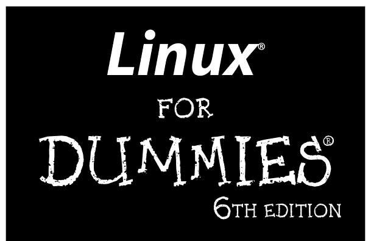


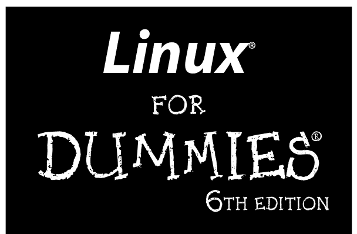


# 关于作者

Dee-Ann LeBlanc，RHCE（红帽认证工程师），是一位专注于 Linux 的作家、课程开发人员、讲师和培训师。她是 *LinuxWorld* 杂志的游戏行业编辑，也是多本关于 Linux 和其他计算机主题书籍的作者。Dee-Ann 还是 *Computer Power User* 杂志和专注于 Linux 桌面面的新杂志 *Tux* 的定期撰稿人。当 Dee-Ann 没有面对面或在线教学、开发课程材料、编写技术非虚构或奇幻小说、在在线或会议上讨论 Linux、或者尝试以各种方式拯救世界时，她会和她的狗一起徒步，并用新菜谱对她丈夫 Rob 进行实验。访问 www.Dee-AnnBlanc.com 查看 Dee-Ann 的动态并加入她的读者邮件列表。（联系 Dee-Ann：dee@renaissoft.com。）

# 献辞

我将这本书献给我的丈夫，当我运行 Linux 时，他总是得听听我压力大大的抱怨。

# 作者致谢

一如既常，我必须感谢那些帮助这本书诞生的人。首先，我想感谢我的丈夫，当我运行 Linux 时，他总是得听听我压力大大的抱怨。其次，我想感谢 Dee-Ann LeBlanc 让我有机会创作这本书。感谢 Wiley Publishing, Inc. 的团队，没有他们，这本书就不会存在。感谢 Wiley Publishing, Inc. 的支持。感谢 Wiley Publishing, Inc. 的建议和关注。感谢 Wiley Publishing, Inc. 的辛苦工作。感谢 Wiley Publishing, Inc. 的耐心。感谢 Wiley Publishing, Inc. 的创造力。感谢 Wiley Wiley Publishing, Inc. 的愿景。感谢 Wiley Publishing, Inc. 的专业知识。感谢 Wiley Publishing, Inc. 的友谊。感谢 Wiley Publishing, Inc. 的热情。感谢 Wiley Publishing, Inc. 的幽默。感谢 Wiley Publishing, Inc. 的活力。感谢 Wiley Publishing, Inc. 的激情。感谢 Wiley Publishing, Inc. 的信任。感谢 Wiley Publishing, Inc. 的喜悦。感谢 Wiley Publishing, Inc. 的鼓励。感谢 Wiley Publishing, Inc. 的反馈。感谢 Wiley Publishing, Inc. 的帮助。感谢 Wiley Publishing, Inc. 的贡献。感谢所有参与这本书创作的人。

* 第六部分：附录 ................................................................................ 5

## 第 12 章：向 Linux 中添加软件 ...................................233

- 打开下载的文件 ........................................233
- 安装新软件 .......................................................247
- 使用 Fedora 的 yum 搞定 ................................247
- 启动程序 ....................................................................................... 337
- 听 CD ..................................................................................... 348
- 听网络广播 ................................................................... 349
- 听下载的音乐 ........................................................ 351
- CodeWeavers ..................................................................................................................... 360
- “针对 Fedora Core 用户” ....................................................................................... 371
- “啊！我忘记了 Root 密码！该怎么办？” ........................................ 378
- mtools ................................................................400

# 引言

欢迎来到 Linux 这一迷人的开源软件世界。在书中，我将向你介绍 Linux 操作系统的奇之处，它最初是 Linus Torvalds 在 20 世纪 90 年代初作为心血之作创造的。我的目标让你加入快速增长的 Linux 用户和爱好者行列，他们正忙碌于改写操作系统的市场规则。

如果你考虑过切换到 Linux 但觉得这个前景太令人望而却畏，那么可以放松了。只要你会烧水或设定闹钟，你也能成为 Linux 用户。（没开玩笑的！）

当这本书的第一版出版时，Linux 还是一个新兴的现象，既不为人知，也不被深入理解。对于新一代 Linux 用户来说——可用材料太多，以至于我将此书的重点放在了 Linux 是什么以及你如何在桌面上充分利用它上。为此，书末的页面包含了在线资源、提示和技巧，以及更通用的性说明。如果你正在寻找关于服务器的资料，许多其他书籍可以满足你的需求。

我将技术术语的数量减少到最低，并尽可能使用通俗英语。除了对 Linux 安装、启动、配置和调优的直白讲解外，我还包含了许多示例，以及大量的详细指令，帮助你以最少的压力或困惑构建和管理自己的 Linux 机器。

我还随书附带了一张实用的 DVD-ROM，其中包含 Fedora Core 3 和 Knoppix，以及 Linsphere、Mandra、SuSE 和 Xandros 的 CD-ROM 镜像（你用于刻录自己 CD 的文件）。要了解 DVD-ROM 中具体包含什么，请参见附录 B。）如果你不知道这些项目是什么，别担心。你很快就会知道的！

## 关于这本书

将这本书看作一本亲切、易于上手的指南，用于处理术语以及 Linux 工具、实用程序和组件集合。虽然 Linux 并不是很难理解，但它确实包含了大量的细节、参数和行政琐事（Unix 术语中称为 *administratrivia*）。在安装、配置、管理和排错基于 Linux 的计算机时，你需要将这些细节理得顺顺。你在书中找到的一些示例主题包括：

- 理解 Linux 的来源以及它能为你做什么
- 安装 Linux 操作系统
- 运行 Linux 系统以管理文件和添加软件
- 设置网络访问并上网
- 自定义你的 Linux 系统
- 管理 Linux 系统安全和资源

虽然乍一看，使用 Linux 可能需要多年的实践经验、反复尝试、高级的计算机科学训练和高度的投入，但不要灰心！事实并非如此！如果你能找到你的办公室，你完全可以构建一个满足你要求的 Linux 系统。这本书的目的不是为了让你变成一个彻底的 Linux 极客（当然，那是 Linux 启的终极境界），而是向你展示为了构建一个运行顺畅的 Linux 系统而需要掌握的里里外外，并给你使用它的知识和信心。

## 如何使用这本书

这本书将告诉你如何安装、配置和自定义 Linux 桌面系统。虽然现在在 Linux 中你可以通过指向和点击来完成大多数操作，但你可能仍然想在命令行提示符中尝试 Linux——在那里你通过输入详细指令来加载或配置软件、访问文件和其他任务。在书中，输入内容以等宽字体显示，如：

```
rmdir /etc/bin/devone
```

输入 Linux 命令或其他相关信息时，请务必完全按照你在书中看到的内容复制这些信息，包括大和小字母，因为这是让 Linux 正常运行的魔法之处。

未能完全遵循指令可能会导致各种不幸、不体面或意外之外的副作用。

书的页边距没有你的电脑屏幕那么大；因此，在书中某些 URL 和命令行提示符中的长命令可能会折行到下一行。记住，你的计算机将这些折行视为一组单一指令或单个 URL——如果你正在输入一段文本，请将其保持在单行内。如果你看到这些折行之一，请不要插入硬回车。我通过在斜杠处或自然断点处断行（暗示“等一下——还有后面！”）并对用法部分进行轻微缩进，来向你暗示这本该是完整的一行，如下面这个愚蠢的示例所示：

```
www.infocadabra.transylvania.com/plexus/lexus/praxis/oxy/this/is/a/make-believe/URL/but/some/real/ones/are/SERIOUSLY.long!
```

注意，当你深入阅读这本书——以及你可能会遇到的其他 Linux 智慧和灵感来源时——可能会发现某些术语是互换使用的。例如，你可能会发现同一个软件被称为程序、命令、实用程序、脚本、应用程序或工具，这取决于你咨询的信息源、语境和作者。在很大程度上，你可以将这些视为是互换的，而且当需要在它们之间做出重要区分时，我一定会指出。同样，当你处理各种命令或配置控制时时，你可能会遇到 flag（标志）、switch（开关）、option（选项）或 parameter（参数）等互换使用的术语。在这种情况下，所有这些术语指的是你控制、精炼或修改基本命令或程序的方法，使其成为你所需要的。再次，

# 引言

接入互联网服务提供商（或 ISP），并配置相关的各种互联网协议以使你的互联网连接可用。你还将涉及配置和使用 Web 浏览器的细节，以及设置和使用电子邮件客户端和新闻阅读器的细节。

# 第三部分：快速上手 Linux

Linux 包含了许多功能和能力，因此在完成最初的安装和配置后，你可能想要使用你的系统来做些事情。这正是实操开始的地方！在本书的这一部分，你可以读到关于 Linux 系统以及如何处理文件、目录和工具——在 Linux 中被称为“权限”。你将学习如何在 GNOME 和 KDE（Linux 中的两个图形用户界面，GUI）中移动和操作。此外，我还包含了对 Linux 命令行环境（也称为 shell 壳）的深入探索。第三部分还包含了重要的安全信息，以及如何向系统添加软件并保持其更新。

# 第四部分：实战任务

在本书的这一部分，你将发现如何使用 Linux 中提供的各种软件。从纯文本编辑器到全办公套件，所有内容都涵盖在内，还有强大的多媒体工具以及基于 Microsoft Windows 的文件格式和媒体。更棒的是，你知不知道你可以在 Linux 下运行许多 Windows 程序？我将在这一部分向你展示方法。

# 第五部分：十项总结

# 从何处开始

这里就是你选择方向并上路的地方！《傻呆学 Linux》第 6 版就像《一千一夜谭故事一样，因为你从哪里开始几乎并不重要。在你准备好构建自己的 Linux 系统时，请观察不同的场景和故事。虽然每个故事都有自己独特的角色和情节，但整体无疑是令人叹为观止的。别担心——你能行的。谁在乎别人是否觉得你只是在胡搞乱闹？我知道你正准备好过人生中最美好的时光。

## 第一部分：初试水

> “难道我不能直接给你钱财或之类的吗？”

## 在这一部分 . . .

这一部分介绍了 Linux 操作系统的开发和能力。我还涵盖了让 Linux 成为如今的方法和工具，以及关于准备电脑以运行 Linux 以及在你的 PC 上安装 Linux 的详细步骤说明。对于那些对 Fedora Core 3（随书提供）之外的 Linux 发行版感兴趣的人，我还涵盖了安装其他四个流行发行版所涉及的内容——即 Linspire、Mandrake、SuSE 和 Xandros。我甚至解释了如何配置这个奇妙的操作系统来实现你的需求，以及如何启动你崭新出生的系统成为一个计算巨兽——更不用说如何正确关闭它以防丢失任何数据。之后，你将发现使用标准 Linux 工具、点点式 GUI、账户和打印机涉及的内容，并快速浏览与你的发行版相关的 Linux 工具。

## 第一章

## 熟悉 Linux

## 本章内容

- 描述 Linux
- 将 Linux 与操作系统包中的其他部分区分开来
- 依赖 GNU 和 GPL
- 对 Linux 公司（或其不存在性）感到惊叹
- 查看流行的 Linux 发行版

> 弗德，你正在变成一只企鹅。住手！
> — 亚瑟·丹特

欢迎来到 Linux 世界，这是一个由全球数千人开发的操作系统！在本章中，你将了解到 Linux 本身——它是什么，源自哪里，以及为什么它在今天的新中获得如此关注。准备好让你对软件必须如何开发和销售的假设受到挑战，并让你的思维开启新的可能性。

## “免费”真的是免费的吗？

理解 Linux 需要对你获取和使用计算机的方式进行彻底的思维转变。（注意：我所说的“彻底”是指触及问题的本质，而不是流于表面。）你转变心态的第一步是改变你对“免费”（free）的通用内涵，使其代表“自由”（freedom）。没错；你可以通过收费来出售“免费” . . . 只要你向每个软件的接收者传递同样的自由即可。

## 10 第一部分：初试水

别拼命挠头了；这些概念起初很难理解，尤其是考虑到你受到的商业软件行业营销部门的影响。

## 第一章：认识 Linux

在近期的技术史上，Linux 已经从茶水间的技术极客闲谈演变为企业级稳如磐石的解决方案。这种曾经被视为叛逆之物的软件，现在正被 IBM、惠尔士、摩托罗拉达和英特尔等行业领导者采纳和推广。这些计算机制造商都以某种方式认为，Linux 为他们的客户（以及他们自己）创造了价值。在这些公司中，唯一公开指责 Linux 的微软。请注意，人们无需远看就能结论，微软仅仅是害怕 Linux 对其个人操作系统垄断地位构成的威胁。

Linux 被指责为“仅仅是另一个操作系统”。从表面上看，它也许是如此，但如果你深入观察，你会发现事实并非如此。Linux 项目是当前计算行业向开源和免费（指自由，而非免费的啤酒）软件趋势的旗舰。由于其底层模型是开发（并持续开发）的稳如磐石的操作系统，Linux 代表了软件开发中许多美好而纯粹的特性。

两个根本性的区别将 Linux 与其他操作系统区分开来：

- Linux 采用独特且天才的 GNU 通用许可证（GNU General Public License）授权，你可以在下一节中阅读它。
- Linux 由一个全球志愿者程序员团队开发和维护，他们在互联网上共同工作。
- Linux 优秀有很多许多原因，包括那些从零开始构建它的人们想要它：
- 多用户：真正的抢占式多任务使操作系统能够高效地同时处理多个程序。这对于在单台计算机上提供多种服务至关重要。
- 多平台：Linux 目前运行在 24 个平台（硬件类型）上，包括基于 Intel 的 PC、Digital/Compq Alpha、基于 PowerPC 的 Apple Macintosh，以及基于 SPARC、Amiga 和 StrongARM 的计算机。
- 互操作性：Linux 与大多数协议（语言）和操作系统都能良好协作，允许你与运行 Microsoft Windows、Unix、Novell、Mac OS 9 以及 OS X 开始的这一代系统以及更多小众群体的用户和计算机进行交互。
- 可扩展性：随着你计算需求的增长，你可以依靠 Linux 与你一同成长。同样的 Linux 操作系统可以运行在桌面电脑上，也可以运行在大型工业级服务器系统上。
- **可移植性**：Linux 主要用 C 语言语言编写。C 语言是一种专门为编写操作系统级软件而创建的语言，可以很容易地移植（翻译）到新的计算机硬件上运行。
- **灵活性**：你可以将 Linux 操作系统配置为网络主机、路由器、图形工作站、办公生产力 PC、家庭娱乐电脑、文件服务器、Web 服务器、集群，或你能想到的任何其他计算设备。
- **稳定性**：Linux 内核（操作系统本身）已经达到了让大多数软件开发者羡慕的成熟水平。听到 Linux 服务器运行多年而不崩溃的报告并不常见罕见。
- **高效性**：Linux 的模块化设计允许你仅包含运行所需服务时的组件。即使是较旧的奔腾处理器计算机也可以利用 Linux 并重新变得有用。
- **免费性**：对大多数人来说，Linux 最引人注目的方面是它通常是免费的。（资本主义者低语道）在没有金激励的情况下，任何人能造出更好的捕鼠器呢？

## 那么，Linux 从哪里来？

要理解 Linux，你需要了解它的渊源。尽管 Linux 核心编程始于 1991 年，但其设计概念基于经过时间考验的 Unix 操作系统。

1991 年，Linux Torvalds（Linux·瓦尔兹）是芬兰赫尔辛基大学的一名计算机科学学生。他希望有一个像他在大学喜欢的 Unix 系统那样的操作系统，但 Unix 和硬件都贵得离谱。一个名为 Minix 的 Unix 版本免费提供，但它不能满足他的需求。因此，作为一名计算机科学学生，瓦尔兹研究了 Minix 并开始为自己写一个新版本。用他自己的话（在互联网上记录后世：“这是在线聊天室的一个早期版本”），这只是一个爱好，不会像 gcc 那样大而强大。）

Unix 是 20 世纪 60 年代初在贝尔实验室开发的。Unix 的原始架构师在操作系统很少的时代创建了它，目标是希望有一个高效且安全的共享数据存储器——这在当时是无法实现的。从那里开始，Unix 演变成了许多版本，它现在的家族如此复杂，看起来就像藤蔓蔓延一样！


编写一个操作系统不是一项易事。在经过六个月的艰苦工作后，瓦尔兹在系统通用性方面的进展非常小。他将代码发布到互联网，发现许多人对他有同样的兴趣和好奇心。很快，世界各地一些最杰出的大脑就开始通过增加增强或修复 *bugs*（代码中的错误）为 Linux 项目做出贡献。

在本章中，我打算为你回答最后一个问题。我并希望描绘出创建 Linux 的开源软件开发模型。

# 开源软件项目的解剖结构

> Linux 不是一个产品。Linux 是软件生态系统的一个有机部分。 — Michael Robinson, Netrinsics

对于偶然的观察者（以及一些企业 IT 决策者）来说，Linux 似乎是一个异常变异——一个由无政府状态随机生成的叛逆生物。毕竟，像计算机操作系统这样复杂且依赖纪律的东西，真的能由一个来自世界各地、松散的志愿者极客团体开发出来吗？

由于科学不断尝试分类和解释存在的一切事物，技术评论员仍在试图理解这种开源模型如何创建出优越的软件。通常，原因在很大程度上与用解决方案满足需求的通常愿望有关。当程序员为了满足某种需求而编写一个通常可以语言的包时，Linux 实际上是基于需求创建的软件集合。

## GNU 是谁？

想象一个基于 Unix 概念框架构建的操作系统，但最终是出于需求而非利润创建的软件。Linux 可能可能还没有意识到，广泛且可访问的源代码对于成功的软件开发至关重要。源代码是程序员与计算机通信的可读文本（与不可读的二进制代码或“执行文件”的零和形成相对）的术语。

编写二进制程序是一项极其艰巨的任务。这种自由软件的先驱和倡导者是理查德·斯奇曼。马萨诸塞理工学院（MIT）长期以来一直拥有顶尖人才的声誉。1984 年，斯奇曼作为 MIT 的一名天才学生和程序员，面临着一个困境：是将才华卖给公司换取一笔巨款，还是将其赠给世界。

斯奇曼开启了一段旅程，创建一个完全自由的操作系统，并将将其赠给世界。他理解并继续实践原始的黑客精神，这种精神宣布“信息是自由的”。这一概念在那个时代并不新鲜。在计算行业的早期，许多进步是通过自由共享想法和代码实现的。制造商赞助的小组将优秀人才聚集在一起解决复杂问题。这种精神，斯奇曼认为，在公司开始将软件视为自己的知识产权时丧失了。

# 第一章：认识 Linux

除了版权所有者以外的任何人。当软件根据 `GPL` 协议获得许可时，接收者受版权法约束，必须尊重他人以他们所选择的方式使用软件的自由。受 `GPL` 许可的软件也被称为“反版权”（copyleft）软件。记住 `GPL` 的另一种方法是看它的终极含义：终身保证公共（Guaranteed Public for Life）。

## 到底是谁在管理 Linux？

随着开源项目的演进，各种人物会逐渐成为领导者。这种领导者通常被称为项目的“仁慈独裁者”（benevolent dictator）。成为仁慈独裁者的人在特定问题上花费了比任何人都多的时间，并且通常具有独特的见解。通常情况下，“民主”和“独裁”这两个词永远不会出现在同一个句子中，但开源模型是一个非常民主的过程，它认可了仁慈独裁者的自由。

林斯·托瓦尔斯（Linus Torvalds）仍然被认为是 Linux 内核（操作系统的核心）的仁慈独裁者。他决定哪些功能被添加到内核，哪些不。社区信任他的愿景和判断力。万他对项目失去了兴趣，或者社区认为他已经老糊涂了，与他工作的非常有才干的人中将会出现新的领导者。

### 爱因斯坦也是一名志愿者

志愿者或为项目捐献时间的人并不意味着他们提供的是二流的努力，或者在周末和假日工作。事实上，任何人力资源专家都会告诉你，自愿选择做某项工作的人将产生最高质量的产品。

为开源项目贡献的志愿者通常是他们领域的领导者，他们依靠社区协作来完成有用的工作。开源概念对于科学界并不陌生。开源项目培养的公正的同行评审过程，对于验证某事在技术上是正确的至关重要。

那些将开源社区描绘成版权侵权者和小偷子的人往往误解或激化了这些重要问题。源代码程序员对自己的工作非常自豪，也非常关注自己的版权，不希望自己的工作被他人盗窃——这就是像 `GPL` 这样的许可证。这种关注营造了一种对版权极其尊重的氛围。那些在偷取他人劳动成果时声称自己只是在“开源”的人，是在严重滥用这个术语来安慰自己的良心。

# 第一部分：入门

许多人还指出，如果开源中违反了版权，很容易发现的。看看新闻，注意大型软件公司经常被定罪盗窃他人的代码并将其整合到自己的工作中。在闭源方案中，追踪此类版权违反行为是非常困难的。

## 打包 Linux：发行版

人们所说的 Linux 发行版实际上是 GNU 项目工具、Linux 内核以及以此方式兴起的许多开源（及闭源）软件项目的结晶。

红帽（Red Hat）创始人兼现任主席罗伯特·杨（Robert Young）创造了一个将 Linux 比作番茄的类比。本质上，名为 Linux 的操作系统，带有 GNU 工具、Linux 内核和其他软件，是一种免费获取的商品，就像番茄一样，不同的发行商可以在不同的容器中对其包装并贴标签。鼓励任何人去包装和营销这些东西，尽管成分从根本上是相同的。

Linux 是一个复杂、可塑的操作系统，因此可以呈现出许多形态。近年来 Linux 最大的进展是让它的安装变得更简单。毕竟，那些让普通 PC 用户能够安装 Linux 的工具最初是不可用的的。像红帽这样的公司认为这是一个为现有产品增加价值的机会，这个概念像黑帮一样火遍了。

再次引用番茄的类比，各种版本的 Linux 发行版略有不同的味道或质地；你的发行版偏好可能是辣的、温和的、浓的或稀的。然而，你可以放心，以下任何发行版都有相同的 Linux 和 GNU 核心灵魂。每个描述都包含一个 Web 地址，你可以在那里找到有关每个项目的更多信息：

- **Debian GNU/Linux**：该发行版是最古老的版本之一，是高级技术圈公认的最爱。从历史角度看，它安装相对困难。Debian 团队与 GNU 项目紧密合作，被认为是 Linux 发行版中最“开放”的。基于 Debian 的 Xandros 和 Linsphere（以前称为 Windows）提供了更易安装（和使用）的发行版。

  - `www.debian.org`

  - `www.xandros.com`

  - `www.linsphere.com`

- **Mandrake**：该发行版展示了 `GPL` 的力量，允许这家竞争公司站在巨人的肩膀上。Mandrake 最初基于红帽 Linux，这在闭源环境中是不可能发生的，但从以后已成为它一个出色的解决方案。

  - `www.mandrakelinux.com`

- **红帽和 Fedora**：红帽声称成功大规模营销 Linux 操作系统的荣誉。红帽通过将 GNU 和 Linux 工具封装在熟悉的发行方式（缩膜包装）中验证了 Linux，并向其产品添加了增值功能，例如电话支持、培训和咨询服务。

  - `www.redhat.com`

  - `http://fedora.redhat.com/`

- **Slackware**：在所有最著名的存续 Linux 发行版中，Slackware 存在最久。事实上，直到大约一年前，界面仍然保持不变。Slackware 有非常忠诚的追随者，但并不知名。在精神上与 Debian 相似，Slack 群在 Linux 圈备受尊重，因为这些经验丰富的老兵会分享随身携带装满磁盘的鞋盒的故事。

  - `www.slackware.com`

- **SuSE**：（发音为 soo-za）该发行版来自德国，在那里有非常忠诚的追随者。SuSE 与 XFree6 项目紧密合作。SuSE 有一个名为 Sax 的强大图形工具。

  - `www.suse.com`

- **安装程序**：每个发行版都开发了自己的安装程序来帮助你实现运行系统。有些是为普通用户设计的（隐藏技术细节），而另一些则是为资深管理员设计的。

- **软件版本**：不同的发行版可能使用不同版本的内核和其他软件包。开源项目是动态的，并定期发布新版本，而传统软件的周期通常缓慢。

- **软件包管理器**：虽然一个程序应该可以在任何发行版上运行，但软件包管理器的工具跟踪系统上的软件并确保你拥有所有支持软件。发行版通常依赖于特定的软件包管理器。

每一个可能的 Linux 发版的安装都是可能的。好吧，也许不可能，但如果我这样做，你需要一辆叉车才能把你的 Linux入门书从书店运回来。因此，我尝试将安装任何发行所需的概念总结在书中，细节足以让你通过。

我选择 `Fedora Core` 作为示例发行版是因为红帽已成为公认的 Linux 标准，而它的 `Fedora Core` 项目专门针对负担不起或无法购买高级产品的家庭和小企业用户。此外，如果你在办公室或组织中使用红帽企业 Linux (`RHEL`)，`Fedora Core` 是那些将进入 `RHEL` 的技术的试验场。

除了红帽的介绍，我还包含了其他针对初者的流行发行版的信息：Linspire、SuSE 和 Xandros。我绝不想轻视 Slackware 和 Debian，这些是非常强大的发行版，最好留到完成 Linux 入门之后再尝试。包含的 Knoppix 是一张 Live CD，你可以通过它启动电脑进入完整的桌面而无需安装！

事实上，随书的 DVD 不仅包含 Fedora。查看附录 B 可了解 DVD 上的内容。

# 第 2 章

## 为 Linux 准备电脑

**本章内容**

- 采取基础预安装步骤

- 在同一台电脑上同时使用 Linux 和 Windows

- 在安装前自定义磁盘分区

- 了解（并查找）你的硬件信息

- 为光盘或软盘安装做准备

大多数 Linux 发行版会自动检测你的硬件并引导你完成安装过程。事实上，有些人只是会直接上手开始安装。然而，如果你正在设置一台既运行 Linux 又运行 Windows 的机器（尽管不是同时运行），在没有急于动手之前，请务必先阅读本章后半部分的“准备共同使用 Linux 和 Microsoft Windows”一节。你需要确保有足够的空间来安装 Linux，并且不会意外擦掉你的 Windows 安装。

另一些人倾向于更加谨慎地开始。通过熟悉你的电脑硬件，你可以避免许多潜在的头疼问题——或者让排除技术故障变得更加容易。

在准备安装 Linux 时，你应该注意几个问题。在本章中，我将介绍一些为 Linux 安装过程做准备的任务，例如设置系统以便直接从 DVD 或 CD 安装 Linux，或者在万一需要时使用安装软盘安装。

## 安装注意事项

如果你不知道要去哪里，就必须小心，因为你可能无法到达。

> — 优·贝拉 (Yogi Berra)

如果你有一台只运行 Linux 而不运行其他内容的空闲机器，那太幸运了！你可以跳过整个“准备共同使用 Linux 和 Microsoft Windows”章节。事实上，如果你觉得自己很有胆，可能想直接跳到第 3 章或第 4 章（取决于你使用的是哪种发行版）并开始安装。第 20 章也有相关的故障排除信息。

如果你计划在同一台电脑上运行 Linux 和 Windows —— 这种情况被称为“双引导”，在没有阅读“准备共同使用 Linux 和 Microsoft Windows”一节之前，**切勿进入第 3 章**。抱歉我大吼了，但如果不采取预防措施，可能会可能会你的整个 Windows 安装！

## 准备共同使用 Linux 和 Microsoft Windows

如果你计划在同一台机器上运行 Linux 和 Microsoft Windows，那么你很已经安装了 Windows 并已经使用了一段时间。由于我甚至能从加拿大的西部听到来自痛苦的尖叫声，请花点时间评估一下你拥有的和需要的。

万一你实际上还没有安装 Windows，你可能需要在安装 Linux 之前先安装它。否则，在安装期间，Windows 将覆盖掉 Linux 引导菜单所在的硬盘分区。这会导致你以后想切换回 Linux 时出现一些混乱！那些先安装 Windows 的人可以跳到“处理磁盘分区”一节，了解如何设置你的 Windows 安装，以便在日后需要添加 Linux 时能产生最少的麻烦。

然而，你们中的大多数人是想进行双引导，即你已经有一台运行 Windows 的机器了。如果你有一个空无一物的新硬盘可以使用，请跳到我刚才提到的“处理磁盘分区”一节。你不需要对 Windows 正在使用的硬盘做任何操作。但是，如果你需要 Linux 和 Windows 共享同一块硬盘，并且你已经安装了 Windows，那么如果你使用的是 `Fedora Core`（本书的默认选择）、Linuxpire 或 Xanders，你将需要一些额外的工作；SE 和 Mandrake 可以为你调整大小，所以你不需要为它们留出空间。本节的其余部分将侧重于帮助你解决这些麻烦。

即使你使用的是可以为你调整大小的 SE 或 Mandrake，你也想查看本章后文中适用于你 Windows 版本的“查看你有多少可用空空间”章节，以便在安装程序询问你时，决定想把 Linux 分区做得多大。

## 第 2 章：为 Linux 准备电脑

## 可拆卸硬盘

处理多个操作系统的一种方法是使用可拆卸架式硬盘。安装会将一个特殊的支架放入你电脑的硬盘位中。这种设置可以由经验丰富的人士或合格的技术人员安装在大多数电脑中。

安装好此组件后，你可以将单个硬盘放入支架中，像使用 CD-ROM 一样将其拉入——尽管你不想在电脑上执行某些操作的中途直接拔出一个！使用可拆卸驱动设置允许你将 Windows 和 Linux 硬盘分开。当你使用 Windows 并切换到 Linux 时，关闭 Windows 并拔出硬盘。然后将其更换为 Linux 硬盘并启动，就像 Linux 硬盘一直都在那里一样。

对于机器中的第二块硬盘，可拆卸硬盘是一个很好的替代方案。你需要确保你现有的硬盘和新硬盘都能放入架中，而且购买多个托架（用于将硬盘滑入架中）是明智之举，这样当硬盘不在机器中时，你可以将其留在托架里。

更多信息，请参阅 Robert Bruce Thompson 和 Barbara Stratton Thompson 编写的、O'Reilly & Associates 出版的《电脑硬件详解》(PC Hardware in a Nutshell)。

如果你需要配置硬件，我强烈建议你寻求帮助或让技术人员安装额外的硬盘或可拆卸架设置。组件的当不当可能会损坏你的电脑。此外，在处理电气组件时，你必须考虑到安全。

如果你对管理操作系统感到紧张，并且没有空间来……当你在已安装 Windows 的系统上安装 Linux 时，你一次只能运行一个操作系统。换句话说，如果你正在使用 Windows 并想运行 Linux，你需要关闭 Windows，允许电脑重启，然后启动 Linux。然而，通过额外的软件，你可以在 Linux 内部运行 Windows！更多信息请参阅第 19 章。

## 双引导从零开始分区

如果你计划使用一个新硬盘并在上面安装 Windows 和 Linux，请务必先安装 Linux。在安装 Windows 的过程中，会被要求对硬盘进行分区。你的硬盘可以有三个主分区和一个扩展分区。在该扩展分区内部，你可以拥有多达 12 个逻辑分区。

无论你为 Linux 使用什么类型的分区，请确保为它留至少 3GB 空间。通常情况下，你需要的更多，因为你可能会下载媒体文件等大文件。

## 从 Windows 查看你的分区

在我实际更改任何内容之前，收集有关你当前设置的信息很重要。在开始添加 Linux 之前，你需要了解硬盘的两种主要数据。第一个是你的硬盘上是否还有任何未分区的空间，如果有，有多少空间。如果你有 3GB 的未分区空间，那么你可以跳到本章后面的“收集机器信息”章节。（如果你想要一个没有任何图形界面的极简安装，你不需要 3GB。）

## 在 Windows 2000 和 Windows XP 中查看你的分区

- 1. 通过选择开始>设置>控制面板打开控制面板。

- 2. 打开管理工具文件夹并双击计算机管理图标。

- 3. 在计算机管理应用程序的左侧格中，点击磁盘管理文件夹图标。

几秒钟后，右侧格将显示你电脑上存储设备的当前状态，例如硬盘、CD 驱动器，

## 第2章：为 Linux 准备计算机

DVD/CD 驱动器等。图 2-1 是 Windows XP 磁盘管理显示示例，图 2-2 显示了 Windows 2000 磁盘管理界面。

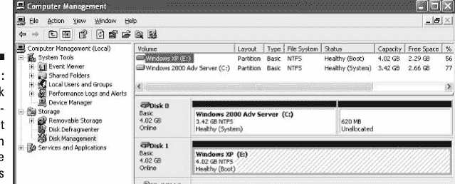

图 2-1：Windows 计算机管理工具中的磁盘管理信息。

图 2-2 反映了一台有一个硬盘和一个 DVD/CD 驱动器的计算机。这里需要寻找的重点是中间磁盘列表中的“未分配”（Unallocated）一词——此图中显示了一个示例。未分配分区没有分配给任何操作系统，可以自由地用于你的 Linux 安装。

如果你像在图 2-1 和图 2-2 所示的那样有一个未分配分区，那么它的大小应该是 3GB 或更大（参见上一节）。请记住这是哪一个分区（它是什么，以及在磁盘的哪个分区上），并直接跳到“同时运行 Windows 和 Linux”章节。例如，在图 2-1 中，分区位于 1 上，它是分区 2。

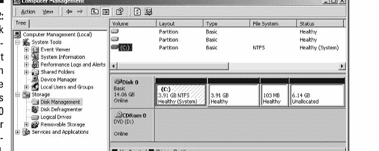

## 24 第一部分：入门指南

如果你没有任何（足够的）未分配空间，请保持此窗口打开，并查看本章节稍后的“创建空间”部分，以了解后续操作的策略。

## 在 Windows 98 中检查你的分区

如果你需要 Windows 和 Linux 共享同一个硬盘，在我继续介绍之前，我需要你做一些侦查工作。Windows 98 不提供像计算机管理那样的图形化工具。相反，它使用 `FDISK`，这是一个显示硬盘上分区的命令行工具。若要在 Windows 98 中查找你计算机硬盘的详情，请按照以下步骤操作：

- 1. 打开 `MS-DOS` 提示符窗口，选择开始>程序>`MS-DOS` 提示符。

- 2. 输入 `FDISK` 并按回车。在 Windows 中，你可以大写、小写或任何混合大小输入 `FDISK`，只要你拼写正确即可！根据硬盘的大小，系统可能会提示你显示大磁盘信息。如果你没有看到提示，`FDISK` 选项将与图 2-3 所示类似。

- 3. 如果你看到了大磁盘提示，在此提示处选择 `Y` 然后按回车。出现 `FDISK` 菜单选项。

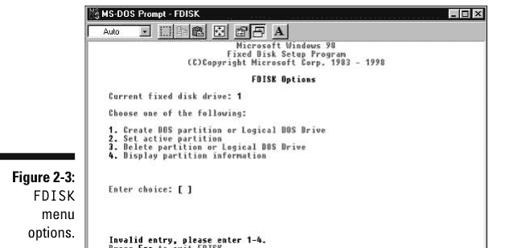


# 第二章：为 Linux 准备你的电脑

人们使用 Linux，但更重要的是对我的目的来说，它对于救援无法启动的机器和调整分区非常有用。

Knoppix 随附在本书的 DVD 中，这非常方便。如果由于某种原因无法使用 DVD，请参阅第 4 章了解如何通过 CD 获取 Knoppix。在继续之前，请双重检查你是否已经备份了重要数据。然后，拿出你之前在本章前面的“准备共同使用 Linux 和 Microsoft Windows”章节中所记录的笔记——关于你想要更改哪些分区——然后执行以下操作：

## 使用 Knoppix 调整分区

- 1. 将你的 Knoppix DVD 或随书附的 DVD 放入 CD- 或 DVD-ROM 驱动器并重启电脑。

如果你使用的是书中的 DVD，将会出现一个启动菜单——如果你是从 DVD 启动 Knoppix，请参阅附录 B。只需按回车键启动 Knoppix，最终会显示 Knoppix 欢迎界面。如果你使用的是普通的 Knoppix CD，电脑将直接启动到 Knoppix 欢迎界面。

- 2. 在启动提示符处，按回车键。

大量文本滚动而，Knoppix 正在识别你系统上的硬件。Knoppix 从 CD-ROM 完全启动可能需要一分钟。一旦运行，你就能看到 Knoppix 桌面（见图 2-7）。

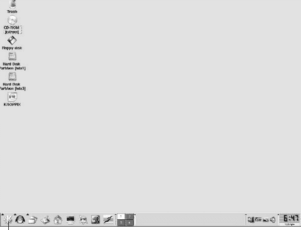

图 2-7：关闭了帮助浏览器的初始 KNOPPIX 桌面。

主菜单

如果在 KNOPPIX 启动过程中出现任何问题，按 `Ctrl-Alt-Del` 重启，并尝试添加通过 `F2` 和 `F3` 显示的可能的启动选项。

- 3. 从主菜单中选择 `System->QTParted`。

`QTParted` 工具将打开（见图 2-8）。

- 4. 在左侧，选择你想要操作的驱动器。

如有必要，参考你的笔记（参见本章前面的“准备共同使用 Linux 和 Microsoft Windows”章节），以查看它是第一块、第二块、第三块硬盘还是你的硬盘之一。如果你同时有 IDE 和 SCSI 硬盘，可以通过以“hd”开头的 IDE 名称和以“sd”开头的 SCSI 名称来区分。它们在机器上的安装顺序按字母顺序指示的。例如，`hda` 是第一块 IDE 驱动器，`hdb` 是第二块，依此类推。（SCSI 的 `sda` 和 `sdb` 也是如此）。

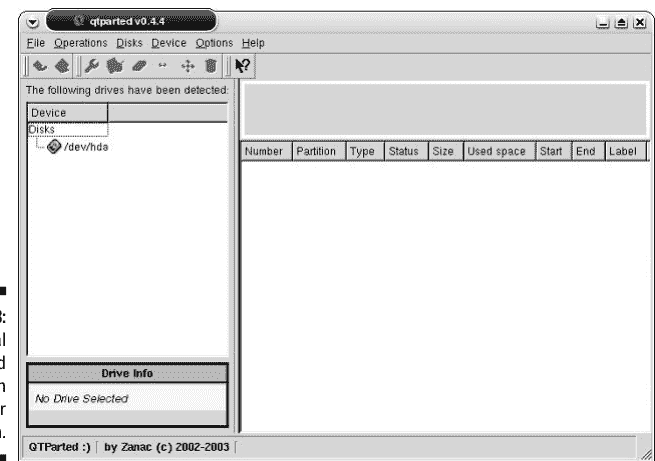

图 2-8：初始 QTParted 分区编辑器。

第一部分：上手

一旦你完成了选择，驱动器的分区和其他信息将出现在窗口底部和右侧（见图 2-9）。

- 5. 在右侧，选择你想要调整大小的分区。

再次参考你在本章前面的“准备共同使用 Linux 和 Microsoft Windows”章节中的笔记，查看你想更改哪个分区。

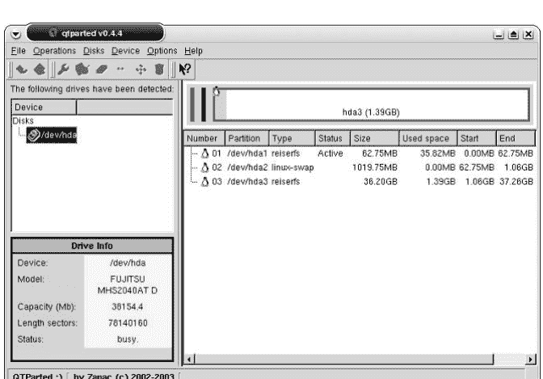

**图 2-9：** 选择了第一块 IDE 驱动器的 QTParted。

作者 Zanac (c) 2002-2003

- 6. 选择 `Operations: Resize Partition` 进入“调整分区”对话框（图 2-10）。

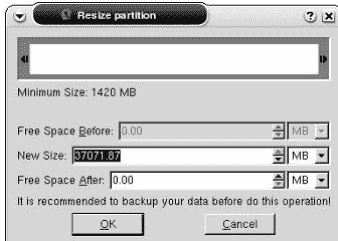

**图 2-10：** QTParted 的调整分区对话框。

- 7. 进行尺寸更改。

注意这里这里有多个选项。你可以更改“之前的空空间”`Free Space Before`、大小 `New Size` 和“之后的空空间”`Free Space After`。如果你在分区中散布着较小的空白空间，可以从将“之前的空空间”项更改为零开始，通过移动所有空空间到驱动器末端来更有效地挤压空间。这个概念可能用图片更好地说明，因此请看图 2-11。

图 2-11：压缩低效的分区布局，将 2GB 和 3GB 的空闲分区合并为 5GB。

| 之前 | 之后 |
| --- | --- |
| 3GB 8GB 16GB | 3GB 8GB 16GB 5GB |
| 2GB | 3GB |
| 空 | |

- 8. 点击 `OK` 保存分区的更改。

你的硬盘尚未发生永久性更改。

- 9. 如果还有更多想要更改的分区，返回第 5 步。否则，继续到第 11 步。

- 10. 选择 `File::Commit` 使更改生效。

现在你的硬盘真正被改变了！

- 11. 双检查你给出的尺寸是否正确。

第一部分：上手

- 12. 选择 `File::Quit` 退出。

如果你已完成。

- 13. 从主菜单中选择 `Exit`。

如果没有完成。

- 14. 从对话框中选择 `Restart`。

如果没有完成。

- 15. 点击 `OK` 重启。

如果没有完成。

当过程完成后，关机。

## 收集机器信息

如果涉及到这个问题，它可能会运行良好，但有一些限制。例如，你可能需要你的电脑手册（特别是关于显卡的），以防安装程序时需要它们。大多数情况下，旧硬件不在列表中但仍被支持。（由于人们需要处理这些问题）；如果你想知道机器上确切有什么，或者因为需要进行某些研究，你有以下选项：

- 使用操作系统管理你的硬件。如果你的电脑已经在运行 Windows，你可以从 Windows 环境中收集大量信息。使用以下方法：

* 在 Windows 98，开始→设置→控制面板→系统→设备管理器访问图 2-12 所示的对话框。

* 在 Windows 2000，开始→控制面板→系统→硬件→设备管理器访问图 2-13 所示的硬件列表。

- Fedora：官方列表位于 `http://redhat.com/hcl/`

- Linspire：访问 `www.linspire.com/`

- Mandrake：访问 `www.mandrake.com/en/`

- SUSE：起点是 `www.suse.com/`

- Xandros：访问 `http://support.xandros.com/`

如果你是电脑新手，可以在互联网上找到很多信息。一个很好的网站是 tomshardware。

- 在 Windows 98 中，设备管理器提供你安装了哪些硬件的信息。


图 2-12：在 Windows 98 中，设备管理器提供你安装了哪些硬件的信息。

| 按类型查看设备 | 按连接查看设备 |
| --- | --- |
| CD-ROM | |
| 磁盘 | |
| 软盘适配器 | |
| 软盘控制器 | |
| 硬盘控制器 | |
| 键盘 | |
| 鼠标 | |
| 显示器 | |
| 网络适配器 | |
| PCI | |
| 端口 COM (LP) | |
| 声、视频和游戏控制器 | |
| 系统设备 | |
| 通用总线控制器 | |

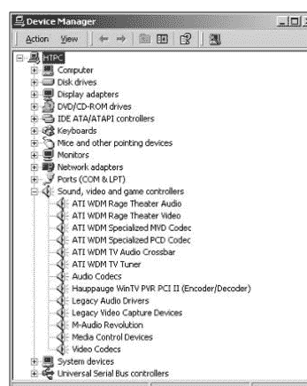

图 2-13：Windows 2000 设备管理器。

在 Windows 中，选择“开始”>“控制面板”>“打印和其他硬件”。在这里，你可以从“选择控制图标”对话框中选择项目中的某一个，也可以查看“另类”部分并选择“系统”。从那里选择“硬件”：“设备管理器”（图 2-14）。

你可以双击设备管理器中的每个项目以显示它们的详细信息。

- **下载 PC 硬件检测工具。** 如果你没有诊断工具，且拥有一个相对较新版本的 DOS，你可以从网上下载 PC 硬件检测工具，例如 `PC-CONFIG`。`PC-CONFIG` 工具包含多个屏幕的信息、硬件区域和选项。该工具为共享软件，但可以从 Holin Dataentech 网站 `www.holin.com` 获取免费信息。

- **通过阅读计算机启动时的屏幕内容来收集信息。** 如果你的系统没有包含任何操作系统，且你没有系统的任何文档，你可以采取在计算机启动时读取屏幕内容的方法。在某些系统上，视频信息会在计算机启动时显示。如果信息滚动太快，你可能需要重启几次才能读取这些信息。此外，某些系统在系统启动时会显示 PCI 组件及其设置。同样，你可能需要重启几次才能收集到所有信息。

# 36 页 第一部分：初学者

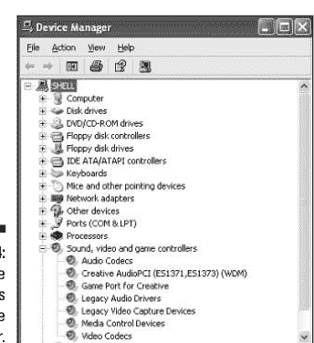

## 第一部分：入门指南

如果你没有任何（足够的）未分配空间，请保持此窗口打开，并查看本章节稍后的“创建空间”部分，以了解后续操作的策略。

如果你需要 Windows 和 Linux 共享同一个硬盘，在我继续介绍之前，我需要你做一些侦查工作。Windows 98 不提供像计算机管理那样的图形化工具。相反，它使用 `FDISK`，这是一个显示硬盘上分区的命令行工具。若要在 Windows 98 中查找你计算机硬盘的详情，请按照以下步骤操作：

- 1. 打开 MS-DOS 提示符窗口，选择开始>程序>MS-DOS 提示符。

- 2. 输入 `FDISK` 并按回车。在 Windows 中，你可以大写、小写或任何混合大小输入 `FDISK`，只要你拼写正确即可！根据硬盘的大小，系统可能会提示你显示大磁盘信息。如果你没有看到提示，`FDISK` 选项将与图 2-3 所示类似。

- 3. 如果你看到了大磁盘提示，在此提示处选择 `Y` 然后按回车。出现 `FDISK` 菜单选项。


- 4. 显示当前驱动器分区信息。如果你的计算机中有多个硬盘，`FDISK` 会显示第五个菜单以便在磁盘间切换。要切换到另一个磁盘，输入 `5` 并按回车。`FDISK` 屏幕显示系统中的所有硬盘。输入你想要的磁盘编号并按回车。`FDISK` 菜单屏幕顶部显示 `FDISK` 正在操作的驱动器编号。

- 5. 要显示所显磁盘编号的分区信息，输入 `4` 并按回车。

图 2-4 显示了“显示分区信息”屏幕的示例。

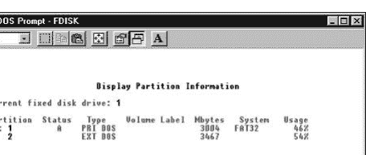

图 2-4：`FDISK` 中的分区信息。

| 分区状态 | 卷标 | Mbytes | 系统 | 使用率 |
|---|---|---|---|---|
| C: 1 | B: DOS | 800 | FAT32 | 420 |
| | EXT DOS | 2467 | | 542 |

总磁盘空间为 647 Mbytes (1 Mbyte = 1,048,576 字节)

扩展 DOS 分区包含逻辑 DOS 驱动器。可能想要查看逻辑驱动器 (9/10)……

按回车返回 `FDISK` 选项

> 图 2-4 表明驱动器上没有空闲的未分配磁盘空间。如果磁盘有未分区的空间，`FDISK` 将显示可用空间的大小。

在图 2-4 中，你看到磁盘空间的一部分被配置为扩展分区 `EXT DOS`。扩展分区可以包含逻辑分区，扩展分区内部可能有空闲空间，你可以利用它来安装另一个操作系统（如 Linux），甚至是另一种类型的 Windows。

将主分区想象成你放入数据的空盒子。扩展分区是那些烦人的盒子，里面堆叠着一堆小盒子。只有在扩展分区中，你才将数据放入小盒子。这些较小的盒子就是逻辑分区。


遗憾的是，`FDISK` 没有告诉你任何关于此扩展分区内部的信息。你必须深入求索。

- 6. 要查看扩展分区内的逻辑分区，选择 `EXT DOS` 条目并按回车。

图 2-5 是逻辑分区设置的示例。在这种情况下，扩展分区内的所有空间均已分配。你可以通过总加驱动器的使用率百分比来判断是否有空闲空间。如果总和达到 100%，则没有可用空间。（留到此处）

## 26 第一部分：入门指南

- 4. 显示当前驱动器分区信息。如果你的计算机中有多个硬盘，`FDISK` 会显示第五个菜单以便在磁盘间切换。要切换到另一个磁盘，输入 `5` 并按回车。`FDISK` 屏幕显示系统中的所有硬盘。输入你想要的磁盘编号并按回车。`FDISK` 菜单屏幕顶部显示 `FDISK` 正在操作的驱动器编号。

- 5. 要显示所显磁盘编号的分区信息，输入 `4` 并按回车。


图 2-14：Windows XP 设备管理器。


你可以尝试使用电脑上的 `Pause-Break` 键（它应该在滚动 `Lock Lock` 键附近）让它在启动过程中冻结。然后通过按下任意键来取消冻结。

- 访问基本输入输出系统 (BIOS)。它存储在内存的一个小区域中，并由电池维持，有时被称为 CMOS（互补金属氧化半导体），这表示可以存储和保留信息的计算机芯片类型。BIOS 中存储的信息量可以

## 笔记本电脑考量

当前的 Linux 发行版在较新的笔记本和台式电脑上运行良好。（参阅 www.linux-laptop.net，这是一个关于 Linux 如何适配各种机型的极佳研究网站。）如果你的笔记本电脑是常见品牌，安装 Linux 时不会遇到任何问题。然而，笔记本电脑通常带有 WinModems 品牌（标记带有 Win 前缀的硬件用于 Windows，而不是 Linux）。如果笔记本电脑的内置或默认硬件带有 Win 标签，或者你在研究该机器时发现它包含一个 Win 硬件（即使它没有被正确地标上标签），你可能可以将该有问题的硬件更换为 PC 卡（或 PCMCIA 卡）。大多数笔记本电脑至少包含一个 PC 卡插槽，以便你插入 PC 卡调制调器、网卡或调制调器-网卡组合卡。只要你坚持使用常见的 PC 卡，它就应该能与 Linux 良好工作。

如果你计划购买用于 Linux 的笔记本电脑，请检查调制调器和其他硬件（如网卡），以确保它们不是 Win 类的。某些较新的系统可能会显示关于计算机硬件的几屏幕信息。

要访问 BIOS，你需要在任何操作系统加载之前进行操作。大多数制造商会在系统启动时在屏幕上指示进入 BIOS 或设置（Setup）的键盘或按键序列——例如，“按 Del 进入设置”。如果你找不到按键序列，请检查制造商网站。进入 BIOS 后，你通常可以使用方向键、`Tab` 键或回车键进行导航。在某些 BIOS 环境中，还会使用功能键。查看屏幕顶部或底部的功能键列表。


你特别需要注意硬件盒和网站上包含“Win”（如 Windows）术语的标签。这些组件（如 Win 调制调器）并不包含硬件所需的所有配置和软件——更糟糕的是，包装上可能没有任何提示暗示这种局限性。这些组件被设计用于处理部分负载。你找到硬件的 Linux 驱动程序的概率微乎其微。如果你找到了，请将其拷贝到安装 Linux 的软盘中。如果你找不到驱动程序且需要使用调制调器，请花点钱买一个得到良好支持的调制调器。关于 WinModems 的更多信息，见第 8 章。

## 最后，在开始之前

无论你选择哪种 Linux 发行版，它可能都带有一个可启动的第一张 CD（CD 组中的一张）或 DVD——Fedora（本 BIOS 附带的发行版）采用在可启动 DVD 上，如果你使用优惠券获取 CD，那么第一张 CD 是可启动的。盒装版也可能包含一些软盘。你可能不需要软盘，但有些人需要。如果你曾经从 CD 启动过系统，那么你将没有问题。现在，在你继续操作之前，还有一件事你想做：在 BIOS 中定位你的存储设备。安装完成后。如果你购买了发行版，它可能附带纸质手册。

### 38 页 第一部分：初学者

用于安装完成后。如果你购买了发行版，可以在此处找到各种帮助论坛和界面：

- Fedora: 文档项目 (`http://fedora.redhat.com/docs`) 尚处于初期，但会随时间增长。此外，还有 Fedora 论坛 (`www.fedoraforum.org`)、`Fedora` 新闻 (`www.fedorews.org`) 以及非官方 FAQ (`www.fedoraaq.org`)。

- Linspire: 官方 Linspire 支持页面为 `http://support.linspire.com`。务必查看所有链接，因为它们包含了大量的提示。

- Mandrake: 官方 Mandrake 文档页面为 `www.mandrakux.com/en/fdoc.php`，你也可以访问 `MandrakeExpert.com`。

- SuSE: 官方 SuSE 支持页面为 `www.suse.com/us/`

- Xandros: 官方 Xandros 支持页面为 `http://support.xandros.com/`

总来说，另一个寻求帮助的热点是 `linuxquestions.org`。如果你准备好安装，请前往第 3 章安装 Fedora，第 4 章安装 Linspire、Mandrake、SuSE、Xandros 等。

## 第3章

## 安装 Fedora Core

本章内容

- 安装前考虑的一些最后问题
- 创建安装启动盘
- 作为个人桌面安装 Fedora
- 首次启动 Fedora

> 要做，或者不做。没有“尝试”。
> ——尤达，《星球大战对击》

安装 Linux 不再需要奥秘的符号和复杂的魔法咒。图形化安装现在非常易于执行，对于来自其他图形化操作系统（如微软 Windows）的用户来说非常熟悉。本章将提供细节。

如果你正在安装 Linux、Mandrake、SuSE 或 Xandros，请前往第 4 章——如果你想在不安装任何内容的情况下使用 Knopix，也执行上述操作。如果你使用的不是 Fedora，然而，你仍然可以在本章中获得大量信息，因为所有 Linux 发行版都共享共同元素。

### 安装前需要考虑的事项

你可以通过以下方式安装 Fedora Core：

- 使用书中附带的 DVD-ROM 启动，并在看到启动菜单时输入 `linux` 并按回车。如果由于某种原因你没有看到启动菜单，请参见附录 B。
- 使用 Fedora Core 安装 CD 启动，如果你订购了 CDset，这就是第 1 张 CD。
- 使用安装软盘启动，并让剩余的安装文件从 DVD-ROM 或 CD-ROM 中读取。

若要从 DVD-ROM 或 CD-ROM 开始安装，你必须先更改系统设置，使其从 DVD-ROM 或 CD-ROM 启动（或引导）。在第 2 章中，我将介绍如何配置计算机从这些设备启动。

如果你想制作安装软盘并访问 Windows 系统，请按照下一节“制作引导软盘（如有需要）（Making a Boot Floppy (If Needed).）”中的步骤来创建安装软盘。

在制作软盘的章节之后，指令将告诉你是如何进行 Fedora Core 3 的安装流程。我重点关注 Fedora Core 3 及其安装主要有两个原因：

- Fedora Core 3 包含在随书的 DVD 中，以及你通过优惠券订购的 CD 中。
- 涵盖存在的每一个 Linux 发行版的安装将使这本书变成一套百科全书。

我介绍了“个人桌面（Personal Desktop）”安装，因为它很少或不需要准备硬盘，而且不像其他安装方式那样使用未使用的分区。此外，个人桌面安装安装了桌面和笔记本系统上常用的趣味性点点击功能。服务器或服务类型的应用程序（例如 Apache Web 服务器和 FTP 服务器）不会通过个人桌面选项进行安装，书中也没有对其进行任何详细介绍。不过，如果你想使用它们，可以在安装过程的后期将它们添加到你的个人桌面包选择中。

请注意，如果你正在安装红帽企业级 Linux（Red Hat Enterprise Linux）、不同版本的 Fedora Core 或其他 Linux 发行版，你的安装界面将与书中所示不同（对于 Linsphere、Mandrake、SuSE 和 Xandros，请参阅第 4 章）。每个 Linux 的安装程序都涵盖了基本任务，但每个操作都可能会以不同的顺序呈现，或者在屏幕上被定制为不同的外观。例如，一个发行版可能会在网络配置之前呈现账户创建，而另一个发行版可能会将这两个任务顺序反过来。


对于 Fedora，在到达到达“即将安装（About To Install (GUI))”屏幕之前，你可以退出安装而不对你的系统进行任何更改。你在“即将安装”屏幕之前所做出的任何配置选项都不会保存到磁盘中。如果你继续通过“即将安装”屏幕，数据将被写入磁盘，你的系统将发生改变。

### 制作引导软盘（如有需要）

如果你在从 DVD 或 CD 启动时遇到困难，可以从软盘开始安装。然而，由于 Fedora 没有提供盒装磁盘，你必须自己制作这块磁盘。你可以在 `/images` 目录下的 DVD 或第一张 CD 中找到磁盘镜像文件——这是对软盘内容的的一种高级称呼。然而，你不能简单地将此镜像拷贝到软盘上。你必须使用一个特殊的程序来确保镜像的任何部分都能完全准确地写入。假设你现在正在使用 Windows，我使用的程序是 `RAWWRITE`，你可以从 `http://uranus.it.swin.edu.au/~jn/linux/rawwrite` 下载它。

要在 Windows 系统上使用随书的 Fedora Core 3（或 CD）制作引导盘，请遵循以下步骤（我重点针对 Windows XP，并对使用其他版本的 Windows 说明）：

- 1. 将网络浏览器指向 `http://uranus.it.swin.edu.au/~jn/linux/rawwrite.htm`。
- 2. 点击最新的二进制发布版本（在编写时它是页面上的第一个链接，`rawwwritewin-0.7.zip`）进行下载。
- 3. 当询问对该文件进行什么时，点击“保存”。
- 4. 当“另存为”对话框出现时，导航到你想保存文件的位置并点击“保存”下载文件。

这是一个很小的程序，所以对于拨号用户来说，不应该花费一整天时间！

- 5. 一旦程序保存到你的机器上，打开软盘并导航到你保存它的位置。

如果你使用的是 Windows XP，它在 `My Documents\Downloads` 文件夹中。

- 6. 如果你正在使用 Windows XP 或安装了 WinZip（`http://www.winzip.com/`）等程序的其他 Windows 版本，双击 `rawwrite` 文件以打开压缩包。

如果你没有可以打开此文件的程序，请下载 WinZip 并将其安装在你的机器上。然后你可以返回步骤 6。

- 7. 如果你使用 WinZip，将文件提取到相同文件夹或新文件夹中，并跳到步骤 9。如果你正在使用 XP，点击文件夹左侧的“提取所有文件”。

此操作将打开“解压缩向导”。

- 8. 按照简短的向导操作，告诉它在何提取文件。

完成后，你将进入一个包含提取文件的文件夹。

- 9. 将随书的 DVD 插入 DVD 驱动器，并记下对应于 DVD 驱动器的驱动器号。

如果你使用的是 CD Set，插入第一张 CD。

- 10. 要创建引导盘，双击文件夹中的 `rawrite` 企鹅图标。

`RawWrite` 窗口出现（见图 3-1）。

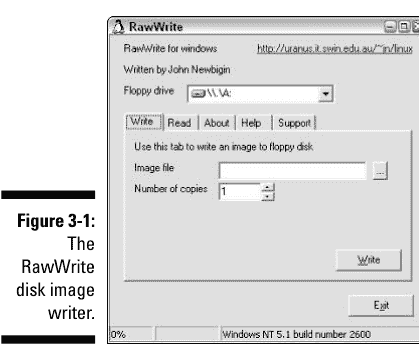

11. 在“镜像文件”文本框旁，点击“...”以打开浏览器。

- 12. 取决于你使用的是 DVD-ROM 或 CD-ROM，导航到你的 DVD-ROM 或 CD-ROM 驱动器。对于许多人，这是 `D:` 盘。
- 13. 双击 `.img` 文件并点击“打开”。

对话框关闭。

- 14. 将 1.44MB 软盘插入驱动器。
- 15. 点击“写入”按钮开始将镜像写入软盘。

此过程可能需要几分钟。

镜像写入后，会出现“镜像写入成功”对话框。

- 16. 点击“确定”，然后点击“退出”按钮关闭程序。

### 42 第一部分：入门指南

### 第 3 章：安装 Fedora

在你制作好软盘后，你需要配置或验证你的系统设置为从软盘启动。实现此点的最简单方法是插入软盘，确保没有其他驱动驱动器中有介质（例如 DVD-ROM 中的 DVD），然后重启你的系统。如果它从软盘启动，你就好了。然后你可以拔出软盘并重启到 Windows。

如果你的计算机在启动时忽略了软盘驱动器，请检查你的系统 BIOS（参阅第 2 章）。确保软盘排在第一位。在退出 BIOS 之前保存你的更改；否则，设置的项目不会生效。


安装过程

在本章中，我遵循图形化安装。如果你无法使用图形界面安装程序（例如 Linux 不支持你的显卡），请改用文本安装。步骤是相同的，界面同样漂亮，只是你无法获得点击版本中提供的所有选项。

要安装 Fedora Core 3，请遵循以下步骤：

- 1. 如果你想从随书的 Fedora DVD-ROM 启动并安装，将 DVD 插入 DVD-ROM 驱动器并重启系统。

否则：

* 如果你订购或刻录了自己的 CD Set，将其插入 CD-ROM 驱动器并重启计算机。
* 将安装软盘（详情请参见“制作引导软盘（如有需要）”章节）插入软盘驱动器，将 DVD 或 CD 1 插入 DVD-ROM 或 CD-ROM，并重启系统。

无论你从软盘、CD-ROM 还是 DVD-ROM 开始安装，第一个安装屏幕（如图 3-2 所示，尽管随书 DVD-ROM 的屏幕与 Fedora CD-ROM 的屏幕略有不同）。无论你使用哪种，此屏幕都包含几个选项，每个选项在下列表中描述：

- 在图形模式下安装或升级：图形界面中的第一个选项用于首次安装 Core 或升级现有的 Linux 版本。此安装程序会探测以检测你的系统硬件。图形界面设计用于使用鼠标选择选项。如果你没有

### 44 第一部分：入门

在使用鼠标时，你可以使用键盘在屏幕上导航。在大多数地方，`Tab` 键或方向键将带你移动到下一个选项；空格键切换选项的开启和关闭；回车键接受选择并移动到下一个屏幕。在大多数屏幕上，如果你想更改之前的设置，可以使用“后退”（Back）按钮返回到早前的选择屏幕。图形化安装界面的左侧面板还包含帮助信息。这些更改将反映有关当前配置屏幕的信息。要使用图形界面进行安装（这是大多数人的做法），请在启动提示符处输入 `linux` 并按回车键。

图 3-2：初始 Fedora Core 安装界面。从 Fedora CD-ROM 安装，此界面与你在随书附带 DVD-ROM 中看到的界面略有不同：

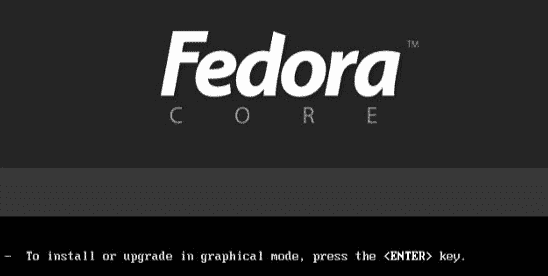

- 若要在图形模式下安装或升级，请按`<ENTER>`键。
- 若要在文本模式下安装或升级，请输入：`linux <ENTER>`。
- 使用下方列出的功能键获取更多信息：

  `[F1-主] [F2-选项] [F3-通用] [F4-内核] [F5-救援]`

- 在文本模式下安装或升级：第二个选项允许你使用文本菜单界面安装或升级 Fedora Core。该界面在文本菜单中呈现选项，你使用方向键或 `Tab` 键移动到选择区域。在某些区域中，空格键用于切换选项的开启和关闭。要使用文本界面进行安装，请在启动提示符处输入 `linux text` 并按回车键。

- 使用功能键：最后列出的项目指出了初始安装屏幕底部显示的功能键。

`F1` 功能键显示初始安装屏幕，允许你通过图形模式安装或升级、通过文本模式安装或升级，或使用标记为 `F2` 到 `F5` 的功能键。

### 第 3 章：安装 Fedora

`F2` 功能键包含以下选项：在安装期间禁用硬件检测（在继续之前你必须了解硬件的细节）；在继续之前测试安装介质（如果你从 Red Hat 的项目网站下载了 Fedora 发行版并将其刻录到 CD 或 DVD 上，这是一个很好的选项）；启用救援模式（这也不包含在 `F5` 键的功能中）；使用驱动器磁盘、CD 或 DVD 关闭 Linux 安装介质；以及更新你的 Linux 安装。

`F3` 功能键允许你设置视频选项。如果你在通过图形界面安装 Fedora 3 时遇到过问题，你可能想要尝试较低的分率。Linux 允许在启动提示符处使用较低的图形分辨率来安装 Linux。`linux lowres nofb` 命令允许你解决某些显卡的问题。

`F4` 键标记为“Kernel”（内核），允许你在安装 Linux 时输入参数。例如，某些帮助文件会要求你执行诸如“关闭 PCI 硬件的自动探测”之类的操作。你可以在这里找到你需要做的内容。

`F5` 键有两个不同的功能，取决于你使用的是随书附带的 DVD-ROM 还是 Fedora CD-ROM 套件。对于 DVD-ROM，`F5` 向你显示有关 DVD-ROM 中包含的其他发行版的 ISO 文件的信息（第 4 章）。使用 CD-ROM 套件时，按下 `F5` 即可找到救援模式的说明。救援模式（第 5 章）包含许多实用的程序，可以将你的系统恢复到工作状态。要启动救援模式，请在启动提示符处输入 `linux rescue` 并按回车键。

- 2. 如果你还没有这样做并想通过良好的点击式操作进行常规 Fedora 安装，请输入 `linux` 并按回车键开始安装。

当安装程序启动时，会有大量信息滚动。在此期间，将安装一个精简版的 Linux。

如果你下载了 Fedora Core 的完整版本并将其刻录到 CD 或 DVD 上，将出现“找到介质”（CD Found / mediache）屏幕。这允许你检查用于安装 Linux 的介质的完整性。如果是此类情况，我建议花时间对所有 CD 或 DVD 执行此操作。现在就知道其中某一个是否损坏或不完整是最好的。

由于 DVD 不仅包含 Fedora Core 3 的完整版（不包括源代码；见附录 B），还包含许多其他发行版的文件，我不建议在此设备上尝试进行介质检查。即使 DVD 可能是完好的，检查也极可能失败。


### 46 第一部分：入门

无论你是否检查介质，你都准备好继续了，CD Found 图像消失，额外的文本在屏幕上滚动。几行代码加载图形引擎，出现一个中间带有小 X 的灰色屏幕，然后出现“欢迎来到 Fedora”（Welcome To Fedora）屏幕。屏幕左侧是一组说明，解释了如何通过此安装程序。

- 3. 当你完成“欢迎来到 Fedora”屏幕上的内容后，点击“下一步”（Next）。


欢迎屏幕消失，并被“语言选择”屏幕取代，如图 3-3 所示。Linux 支持许多不同的语言。

- 4. 使用鼠标或 ↑ 或 ↓ 键选择你的语言并点击“下一步”。

出现“键盘配置”屏幕，如图 3-4 所示。不同语言在键盘上的按键布局不同；你可能想为你的键盘选择匹配的语言。（默认是美国英语。）

- 5. 选择你的键盘配置并点击“下一步”。

出现“安装类型”屏幕，如图 3-5 所示。

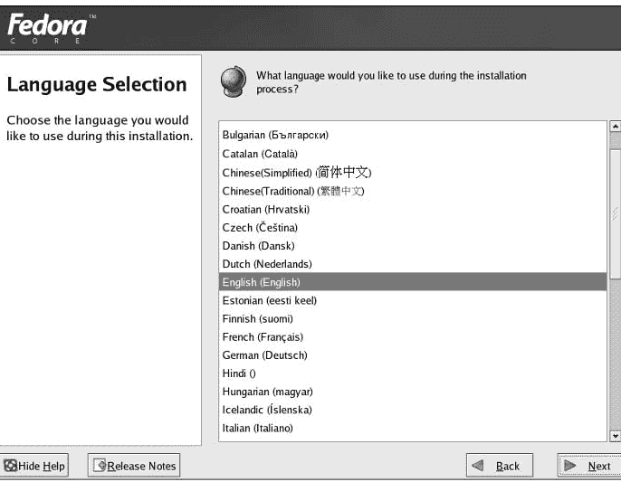

图 3-3：语言选择屏幕。

# 第 3 章：安装 Fedora Core

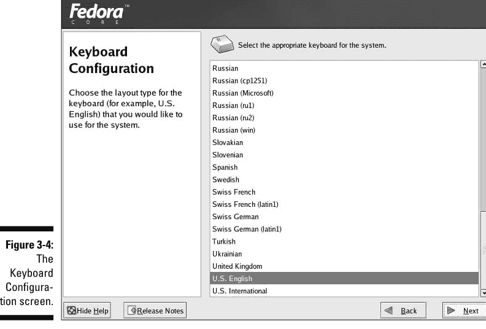

### 键盘配置

选择你想为系统使用的键盘布局类型（例如，美国英语）。

- 为系统选择合适的键盘。

- 俄语 (`cp1251`)

- 俄语 (Microsoft)

- 俄语 (8)

- 俄语 (bz2)

- 俄语 (win)

- 斯洛伐克语

- 斯洛文尼亚语

- 西西班牙语

- 瑞典语

- 瑞士法语

- 瑞士法语 (latin1)

- 瑞士德语

- 瑞士德语 (latin1)

- 土耳其语

- 乌克兰语

- 英国英语

- 美国英语

- 国际英语

图 3-4：键盘配置屏幕。

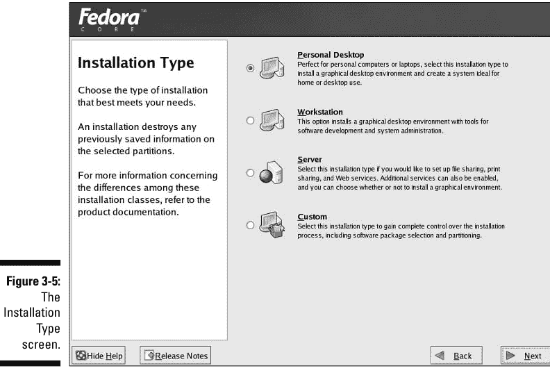

### 安装类型

选择最符合你需求的安装类型。

安装将破坏所选分区上之前保存的任何信息。

有关这些安装类别之间的更多信息，请参阅产品文档。

- 个人桌面 (Personal Desktop)：对于个人电脑或笔记本电脑，使用此安装类型。此安装类型安装图形界面，适用于家庭或桌面使用。

- 工作站 (Workstation)：此安装类型安装图形桌面环境，适用于软件开发和系统管理。

- 服务器 (Server)：如果你想设置文件共享、打印和 Web 服务，请选择此安装类型。你还可以启用其他服务，并选择是否安装图形环境。

- 自定义 (Custom)：选择此安装类型以对安装过程进行控制，包括软件包选择和分区。

图 3-5：安装类型屏幕。

## 第一部分：入门

### 处理损坏的 CD 或 DVD

如果你的 CD 或 DVD 看起来有故障，你该怎么办？如果你是从这里购买的，联系 Wiley Care 800-762-2974 进行换货。不要联系 Red Hat 的技术支持来更换。

另一方面，如果你是自己刻录的 CD 或 DVD，你可能遇到了两个问题。尝试以较慢的速度运行介质。如果这些介质仍然失败，请重新下载镜像。

你有四个选项：

- 个人桌面：此选项执行个人桌面使用的安装并安装图形界面。如果你的系统已包含 Linux，个人桌面安装的默认设置是删除任何 Linux 相关分区并使用所有剩余的未分区磁盘空间。如果你选择此默认，非 Linux 分区（如 DOS/Windows）将不受影响。

- 工作站：此选项安装图形界面和桌面管理器，类似于个人桌面安装，但包含了软件开发人员和系统管理员的工具。

- 服务器：此选项用于基础 Linux 服务器，提供文件和打印 Web 服务。你还可以启用其他服务并选择安装图形环境。当你选择此选项时，默认分区方案是删除所有硬盘上的所有分区。这意味着所有类型的操作系统（Linux 以及其他）都将被删除，且所有驱动器都将被擦除。

- 自定义：此选项提供了保留现有操作系统和配置选项的最大灵活性。你可以选择想要安装的软件包/角色、磁盘分区的大小以及系统如何启动。

出于演示目的，我在本书书中涵盖了个人桌面安装，你可以选择任何直接相关的你系统的选项。如果你选择了其他选项，请记住我提供的说明可能与你的安装体验有所不同。

**点击“个人桌面”安装选项以选择它；然后点击“下一步”。**

出现磁盘分区设置屏幕，如图 3-6 所示。你有权接受自动分区策略，或者...


## 第 3 章：安装 Fedora

你可以手动定义自己的分区（区）。你的硬盘必须至少包含一个 Linux 分区才能继续安装。我决定在书中重点介绍自动分区的设置。如果你真的想手动分区，请查看旁边的侧边栏“定义分区”。

## 7. 选择自动分区；然后点击下一步

出现自动分区界面，如图 3-7 所示。你可以移除系统上所有的 Linux 分区、移除系统上所有的分区，或者保留现有分区并使用空空间。你还可以选择要操作的硬盘。正如我在第 2 章中建议的那样，务必确定你想操作哪块硬盘！作为一个提示，第一块硬盘通常是 `hdb`，第三块是 `hdc`。（对于某些类型的硬件，第一块硬盘将是 `hde`，第二是 `hdf`，以此此类推——仅从低到高。）如果你有 SCSI 驱动器，则使用 `sda`、`sdb` 和 `sdc` 代替。

注意，当你选择删除分区时，将丢失现有分区中的所有数据。不过，它们不会立即被更改——直到最后的安装界面。

## 8. 选择“删除此系统上的所有分区”选项；然后点击下一步

出现一个警告对话框，询问你是否想要删除分区（区）。


Fedora

磁盘分区设置

新用户在 Linux 安装过程中最大的障碍之一就是分区。提供自动分区使这一过程变得简单。

通过选择自动，你不需要使用分区工具来分配挂载点、创建分区或为安装分配空间。

要进行手动分区，请选择 Disk Drill 分区工具。

使用返回以选择

自动分区根据选择的安装类型设置分区。一旦创建了分区，你就可以对其进行自定义。

手动磁盘分区工具 Disk Drill 允许你在交互式环境中创建分区。你可以设置文件系统、挂载点、分区大小等。

- 自动分区

- 使用 Disk Drill 手动分区

隐藏 帮助 更新说明 返回 下一步

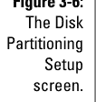

50 第一部分：入门


## 自动分区

自动分区允许你无需担心系统中删除了哪些数据（如果有的话）。

要仅删除 Linux 分区（从之前的安装创建的分区），请选择**删除此系统上的 Linux 分区**。

要删除你所有的硬盘（包括由 Windows 95/98/NT/2000 等操作系统创建的分区），请选择**删除此系统上的所有分区**。

图 3：自动分区界面

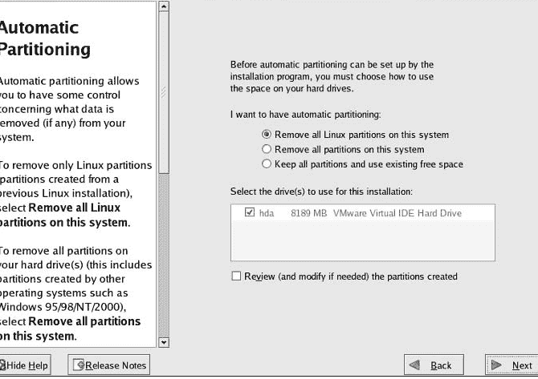

在安装程序设置自动分区之前，你必须选择如何使用硬盘上的空间。

我想自动分区：

- 删除此系统上的所有 Linux 分区

- 删除此系统上的所有分区

- 保留所有分区并使用空空间

选择用于本次安装的硬盘：

```
hda 8189 MB Virtual IDE Hard Drive
```

- 检查（并在需要时修改）创建的分区

### 9. 点击下一步。

如果你真的很紧张，请勾选“检查”复选框，以便在安装程序更改任何内容之前双检分区分配。

出现引导加载程序安装界面，如图 3-8 所示。

第一个选项允许你在安装程序更改任何内容之前双检分区分配。

第二个选项允许你从 GRUB 更改为 LILO 或选择无加载器。

第三个选项允许你启动其他操作系统。

默认。

最后一个选项允许你选择高级加载程序选项。

在你的选项列表中（Fedora、Windows 等），确保在安装程序更改任何内容之前勾选你想启动的项目旁的复选框。

第 3 章：安装 Fedora

51

Fedora

## 引导加载程序配置

默认情况下，GRUB 引导加载程序安装在系统上。如果你不想安装 GRUB 作为你的加载器，请选择更改加载器。

你还可以选择哪个操作系统（如果有多个）作为默认。选择默认操作系统。你可以添加、编辑和删除引导加载程序条目。

引导加载程序将安装在 `/dev/hda`。更改引导加载程序

你可以配置引导加载程序以启动其他操作系统。如果没有自动检测到，请点击“添加”。要更改默认操作系统，请选择检测到的“默认”。

| 默认 | 设备 | |

|---|---|---|

| [x] Fedora | `/dev/Val0/LogV0` | 添加 |

| | | 删除 |

引导加载程序密码防止用户更改内核选项。为了更高的安全，建议你设置密码。

- 使用引导加载程序密码

- 配置高级加载程序选项

图 3-8：引导加载程序配置界面。

隐藏 帮助

更新说明

返回

下一步

## 手动定义分区

如果你手动分区，将使用 Red Hat Disk Wizard。编辑允许你的现有分区并添加新分区。如果你不想使用编辑，我建议不要继续。返回自动分区界面并查看从头开始的设置。

文件系统的起点是“根目录”，显示为 `/`。你需要一个挂载为 `/` 的分区，如果你不创建很多分区，希望它尽可能大。你可能还需要一个挂载为 `/boot` 的分区，但它可以很小，大约是内存的两倍；分配交换文件系统类型的内存将作为你的虚拟内存。（交换不需要分区，只需文件系统类型）。否则，对于 Fedora，使用 `ext3` 作为你的文件系统类型。

52 第一部分：入门

- 10. 在对引导加载程序设置进行任何选择后，点击下一步。

出现网络配置界面，如图 3-9 所示。

- 11. 如果你使用调制解调器且系统中没有以太网卡，你将看不到此界面，直接跳到 13。

- 12. 在完成所有选择并输入数据后，点击下一步。

出现防火墙配置界面，如图 3-10 所示。

## 第 3 章：安装 Fedora

## 网络配置

系统上的任何设备都会被安装程序自动检测，并显示在**网络设备**（Network Devices）列表中。

要配置网络设备，请选择该设备并点击**编辑**（Edit）。在**编辑接口**（Edit Interface）中，您可以选择通过 DHCP 配置 IP 和子网掩码信息，或者手动输入。您可以选择在系统启动时激活该设备。

如果您没有 DHCP 访问权限或无法


图 3-9：网络配置屏幕。


## 防火墙配置

防火墙可以帮助防止外部世界未经授权访问您的计算机。您想启用防火墙吗？

防火墙位于您的计算机和网络之间，决定了远程用户可以访问哪些资源。配置适当的防火墙可以极大地提高系统的安全性。

有了防火墙，您可能希望允许从其他计算机访问特定服务。允许访问哪些服务？

为您的系统选择安全级别。

**无防火墙**（No Firewall）——无防火墙提供对系统的完全访问，且不提供安全检查。安全检查是禁用某些服务的访问。只有当您才应选择此项。增强型 Linux (SELinux) 比传统 Linux 系统提供的安全控制更细粒度的安全控制。它可以被设置为禁用状态、仅对将被拒绝的操作发出警告的状态，或完全激活的状态。

图 3-10：防火墙配置屏幕。

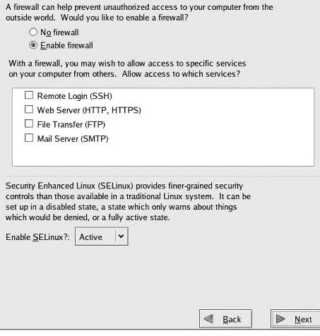

防火墙保护您的系统不受未经授权的访问和发现。当您使用高速连接到互联网时，您的计算机表现为互联网上成千上万其他系统之一。我真希望告诉您没有大量糟糕的人和程序试图入侵您的计算机，但遗憾的是，它们多得多。防火墙是您防御网络黑客、病毒、蠕虫以及许多试图从本该关闭的门溜入的其他程序的第一道（但不是唯一的）屏障；更多信息请参见侧边栏“防火墙”。

- 13. 除非您 100% 确定这台计算机不受互联网以及您家里或办公室网络上的其他机器的威胁（记住，在病毒和蠕虫之前，大多数计算机入侵都是发生在内部而非外部），否则请保持启用防火墙作为您的防火墙设置。

如果您确定要关闭防火墙，请选择“无防火墙”。祝您好运！

- 14. 确定您想让哪些可用服务通过您的防火墙。

我建议使用远程登录 (`SSH`)，这样您就可以使用第 12 章中讨论的技术远程访问这台计算机。虽然我没有介绍如何运行 Web 服务器，但如果您打算在这台计算机上运行一个，您还将想要启用 Web 服务器 (`HTTP`, `HTTPS`) 条目；如果您只想浏览网页，则不需要启用此项；仅当您想在这台计算机上运行自己的服务器。FTP（对于移动文件非常方便）和 SMTP 也是如此。如果您打算运行您的 FTP 服务器或邮件服务器 (`SMTP`)，那么您将需要启用这些。

- 15. 在您想要启用的每个项目旁边，点击带有复选框的框。

对于我的台式机，我打算勾选 SSH 和 FTP 条目。有关以后如何使用 FTP 客户端从此机器获取文件，请参阅第 8 章。

- 16. 确定您是否想使用 SELinux。

SELinux（也称为增强型 Linux）今天在 http://people.redhat.com/kwade/selinux-faq-en/ 上有非常详细的解释。对于那些没有兴趣读到眼睛发花的人，我在侧边栏“介绍 SELinux”中为您提供了一个总结。请记住，如果您从未用过 Linux 或其他形式的 Unix，您可能会发现学习通过通常的组和所有者权限系统来控制文件和目录访问已经足够困难了。如果您决定是时候了解它了，可以稍后开启 SELinux（我将在第 12 章更深入地介绍 SELinux）。

## 防火墙与您

任何连接到互联网的人，特别是使用宽带的人（更多关于不同连接类型请参阅第 7 章；宽带通常是 DSL 和电缆），都真的应该拥有某种防火墙设备。您可以购买防火墙设备（一个用于连接互联网然后连接到您的其他计算机的特殊小盒子），或者让一台 Linux 盒子仅为您自己甚至为您的家庭或业务网络执行防火墙。虽然这是一个非常广泛的话题，可以轻松写一本书，但我在第 7 章涵盖了一些基础知识。在此期间，至少用它自己的防火墙保护这台机器。

- 17. 如果您使用 SELinux，确定您是想实际激活它还是将其处于警告状态；否则，启用 SELinux，选择“禁用”并跳到第 19 步。

我强烈建议如果您打算玩玩 SELinux，现在将其设置为“警告”（Warn）。这样，您就可以在不产生问题的情况下看到它的作用。

- 18. 如果您打算禁用 SELinux，请选择“禁用”（Disabled）。

- 19. 点击“下一步”进入安装的下一个阶段。

语言支持屏幕如图 3-11 所示。您的系统可以支持多种语言。如果您想使用多种语言，请选择特定的语言。

- 20. 选择您的 Linux 时区并点击继续。

时区选择屏幕如图 3-12 所示。如果发现您的计算机不是 UTC 且您选择了错误的区域，您可以在安装后更改此值，所以不必太担心这个设置。您还可以点击屏幕顶部的 UTC（协调世界时），这允许您的系统正确处理夏令时。

- 21. 选择您的 Linux 系统所在的时区。

如果旅行，请将其设置为您现在的所在地。您在需要时可以更改此设置。

## 语言支持


选择一种语言作为默认语言。安装完成后，系统将使用默认语言。如果您选择安装其他语言，可以在安装后更改默认语言。

安装程序可以包含并支持多种语言。要在您的系统上使用多一种语言，请选择要安装的语言，或者选择系统上的所有语言。

图 3-1：附加语言选择屏幕。

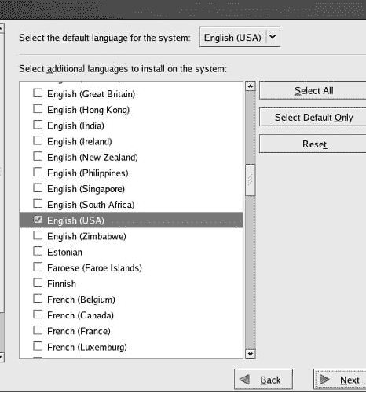


## 时区选择

通过选择您的计算机的物理位置来设置时区。

在交互式地图上，点击标记有点的特定城市，会出现红色的 X 表示您的选择。

您也可以滚动位置列表来选择您的时区。

您还可以选择系统时钟使用 UTC（协调世界时），这允许您的系统正确处理夏令时。

图 3-2：时区选择屏幕。

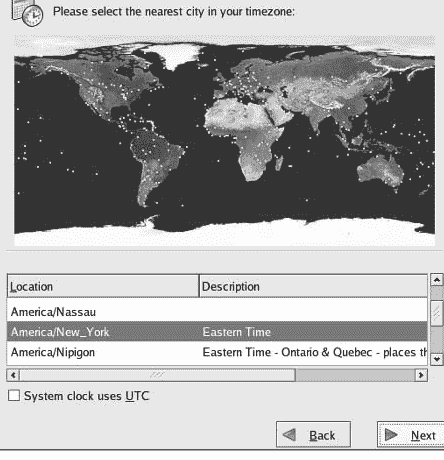

## 第 3 章：安装 Fedora

## 介绍 SELinux

增强型 Linux (`SELinux`) 是由美国国家安全局（NSA，www.nsa.gov/selinux/）开发的。与 Linux 世界中默认使用的标准用户、组和所有者权限相比，它能让你对系统上发生的所有事情提供更细粒度的控制。SELinux 不仅限于 Fedora Core；它作为一种扩展程序，在越来越多的 Linux 发行版中均可用。通常情况下，稳固的安全策略涉及只给人员提供其严格所需的访问权限，因此对于那些由于运行任务关键型服务器或运行在需要严格安全措施的领域，而有强烈需求限制人员和软件行为的人来说，他们会发现 SELinux 让他们对在系统上的操作拥有了更多的控制权。对于普通家庭或小型企业用户的桌面系统来说，SELinux 可能有些大材小用，但如果你想尝试这项技术，并为了简历或其他目的而熟悉它，那么你的家庭桌面可以是实现此类目的的理想平台。由于 SELinux 内容非常详尽，我只会在第 12 章中提到它，但我确实为你提供了足够的的入门信息。

- 22. 点击“下一步”继续执行安装的下一步。

出现“设置 Root 密码”屏幕。

- 23. 在“Root 密码”屏幕中，将 root（管理员）账户密码输入到“Root 密码”字段中，然后在“确认”字段中输入相同的密码。

在你输入密码时，不会显示密码——每个字符只显示一个星号。星号可以防止未经授权的个人员看到密码。如果你在其中一个框中输错了内容，当你在你尝试移动到安装的下一步时，会收到警告，并有机会重新输入这些值。

别忘记你的 root 密码！你需要在 Linux 机器上执行任何管理任务时都需要它。

- 24. 在你输入两次 root 密码后，点击“下一步”。

出现“软件包安装默认设置”屏幕。你可以选择安装当前的默认软件包列表，也可以选择自定义软件包集。

- 25. 选择“安装默认软件包”或“自定义要安装的软件包”。

我建议选择“自定义”选项，这样你就可以对安装到系统中的内容拥有更多控制权。我假设你选择了这个选项。


- 26. 点击“下一步”继续安装过程中的下一个项目。


出现“软件包组选择”屏幕……在 Fedora Core（以及许多其他 Linux 发行版）安装程序中，选择程序有两种不同方式：按组选择或单独选择。你从选择组开始。例如，第一组是 X Window，你可以将其看作你的点点点击界面的骨架。第二个是 GNOME 桌面，它是纸塑的一种形式，可以放置在 X Window 系统之上，以保持一致的外观和感受。第三个是 KDE（K 桌面环境），它是另一种版本的纸塑（关于这些及其差异的更多信息请参阅第 6 章）。如果你想访问这两个环境，请务必点击 KDE 旁边的选框将其勾选。

在你标记了勾选（或默认选定）的每个组旁边，你会看到带有下划线的“详情”（Details）字样。如果你点击“详情”，会弹出一个对话框，包含两个软件包列表：基础（Base）和可选（Optional）。当你选择这组软件时，基础项始终会被安装。

如果你想在第一次尝试所有可用内容，可以滚动到底部并选择“全部”（实际上它并没有安装所有内容，而是大部分）。否则，可以随意尝试并挑选。如果你发现漏掉了某些内容，可以添加更多软件（见第 12 章）。

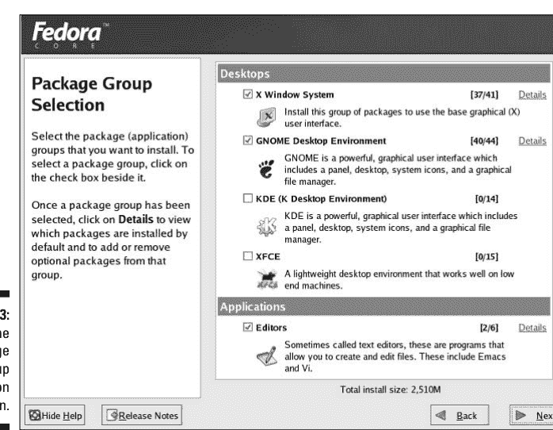

| | | |
|---|---|---|
| ☐ X Window 系统 | [37/41] 详情 | |
| 安装此组软件包以使用基础图形 (X) 用户界面。 | | |
| ☐ GNOME 桌面 | [04/44] 详情 | |
| GNOME 是一个强大的图形化用户界面，包含面板、桌面、图标和图形文件管理器。 | | |
| ☐ KDE 环境 | [09/14] 详情 | |
| KDE 是一个强大的图形化用户界面，包含面板、桌面、图标和图形文件管理器。 | | |
| ☐ XFCE | [06/15] | |
| 一种在低端机器上运行良好的轻量级桌面环境。 | | |
| ☐ 编辑器 | [2/26] 详情 | |
| 有时被称为文本编辑器，这些是允许你创建和编辑文件的程序。这些包括 Emacs 和 Vi。 | | |
| 总安装大小：2,510M | | |

**图 3-13：软件包组选择屏幕。**

- 27. 当你选择了所有想要安装的软件包和软件包组后，点击“下一步”。

出现一个对话框告诉你是安装程序正在检查你的可选软件列表。如果它发现你漏掉了你依赖的程序，它会提供添加这些程序的机会。点“是”！完成后，将出现“即将安装”屏幕。

如果你担心你的机器运行太慢，无法运行普通桌面，请确保勾选“桌面”下的 XFCE 选框。这样一来，如果你发现运行 GNOME 或 KDE 太慢，可以使用 XFCE。


出现一个对话框，告诉你安装程序正在检查你选定的软件列表。如果它发现你漏掉了你依赖的程序，它会提供添加这些程序的机会。点“是”！完成后，将出现“即将安装”屏幕。

如果你担心你的机器运行太慢，无法运行普通桌面，请确保勾选“桌面”下的 XFCE 选框。这样一来，如果你发现运行 GNOME 或 KDE 太慢，可以使用 XFCE。

- 28. 在你取出安装介质后，点击“下一步”。

出现“所需安装介质”对话框。该对话框告诉你是安装所需的 DVD（如果你使用的是 DVD，则只有一个）或 CD。如果你使用的是 CD，你可能需要全部四张，取决于你选择的软件。

- 29. 当你准备好继续时，点击“下一步”。

出现“正在安装软件包”屏幕。系统准备安装并开始安装。在系统安装时，可以看到每个软件包的安装进度条和总安装进度。你还会获得一个大致准确的“剩余时间”值。显然，如果你花了五分钟才注意到安装程序请求另一张 CD，这将增加你的总时间。

安装完成后，你将最后的安装屏幕，文字开头为“恭喜，安装已完成”。CD 或 DVD 会自动弹出（如果没有，请手动弹出）；如果你使用了软盘，也请取出。在移除介质后，点击“重启”重启机器并进入下一节。

## 你的首次启动

当你的 Fedora Core 系统首次启动时，你有机会看到你新的启动菜单。选择 Linux 条并按回车键，或者让它自动启动。如果由于任何原因你的电脑无法启动，请参阅第 5 章。当你的电脑首次启动时，你会看到第一个启动屏幕，如图 3-14 所示。

- 1. 点击“下一步”进入设置程序。

出现“许可协议”屏幕，如图 3-15 所示。

2. 阅读此文本，选择“我同意许可协议”并点击“下一步”。出现“日期和时间”屏幕。

- 3. 如果你位于当前连接到互联网且通常连接到互联网的网络（或者你的网络管理员让你使用时间服务器），点击“网络时间协议”选项卡。否则，跳到第 7 步。

让时间服务器控制你的日期和时间可以确保你的计算机获得关于当前日期和时间的定期输入。否则，你电脑的时钟实际上会漂移。

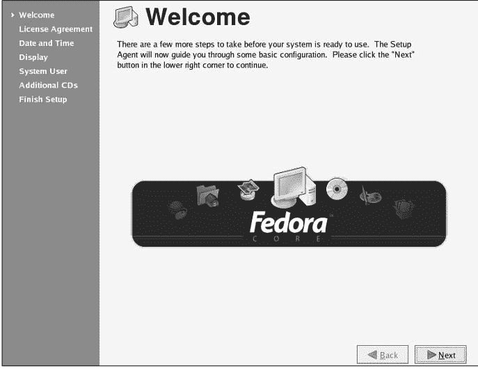

**图 3-14：** Fedora 首次启动欢迎屏幕。

# 第 3 章：安装 Fedora

- 欢迎
- 许可协议
- 日期和时间
- 系统用户
- 额外的 CD
- 完成设置

## 许可协议

许可协议

FEDORA/MTM CORE 3

本协议适用于软件（下文定义）的下载、安装或使用，以及对软件的任何更新，无论交付机制如何。本软件是根据《美国版权法》的一项集体作品。在遵守以下条款的前提下，Fedora 项目授予您根据 GNU 通用许可协议（GNU General Public License）使用此集体作品的许可。通过下载或使用本软件，您表示同意本协议的条款。

1. **软件**。Fedora Core（简称“软件”）是一个由数百个组件组成的 Linux 操作系统。每个组件的许可协议位于该组件的源代码中。除下文节确定的某些镜像外，组件的许可条款允许用户以源代码和二进制代码的形式使用、修改和重新分发该组件。根据这些条款，用户权利将优于任何特定组件的许可条款。

2. **知识产权**。软件及其每个组件包括：

- 是的，我同意许可协议
- 不，我不同意

图 15：

Fedora Core 许可协议。

4. 选“启用网络协议检查”复选框以启用此功能，点击“本地时间源”框以禁用本地时间控制。

5. 在“服务器”下拉列表中，点击一个可用的时间服务器，或输入网络管理员为您提供的时间服务器地址。

6. 点击“添加”选择此服务器。

7. 如果您想手动控制机器上的日期和时间，请确认日期和时间是否准确；如果不正确，请现在修复这些设置。

8. 完成日期和/时间服务器的调整后，点击“下一步”继续。

如果您选择系统使用网络时间协议 (NTP)，系统可能需要一些时间连接到您选择的服务器。几秒钟后将出现“显示”对话框，如图 3-16 所示。

9. 在“分辨率”下拉列表中，选择您想要使用的视频分辨率。

系统仅提供您的显示器和显卡支持的分辨率。如果您发现没有提供完整范围，请选择您能获得的最佳分辨率，稍后可以更改视频设置。一个常用的设置是 1024 x 768。

## 欢迎

- 许可协议
- 日期和时间
- 显示
- 系统用户
- 额外的 CD
- 完成设置

## 显示

请选择您想要使用的分辨率和色彩深度：

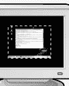

| 带 VMware 的 1024x768 显示器 | 配置... |
| :--- | :--- |
| 分辨率：1024x768 | |
| 色彩深度：百万色 | |

图 3-16：

显示首次启动屏幕。


上一步 下一步

如果看起来您的图形能力被判断错误，或者此对话框第一个按钮旁边没有出现特定的显示器，请点击“配置”按钮，这将允许您打开一组对话框让您选择显卡和显示器。

10. 在“色彩深度”下拉框中，选择您想要使用的颜色数量。

再次说明，系统提供的是安装程序认为您的系统支持的内容。

您可能想要“百万色”。

11. 点击“下一步”继续您的首次启动机器设置。

出现“系统用户”屏幕，如图 3-17 所示。

12. 在“用户名”文本框中输入您想要为个人账户设置名称。

例如，`zorro`。

13. 在“全名”文本框中输入您的姓名。

例如，Zorro the Dog。

14. 在“密码”和“确认”文本框中输入您的账户密码。

## 系统用户

| 许可协议 |
| :--- |
| 日期和时间 |
| 显示 |
| 系统用户 |
| 额外的 CD |
| 完成设置 |

建议您为普通（非管理员）使用创建一个个人用户账户。要创建个人账户，请提供要求的信息。

用户名：

| 全名： |
| 密码： |
| 确认密码： |

如果您需要使用如 Kerberos 或 NIS 等网络身份验证，请点击“使用网络登录”按钮。

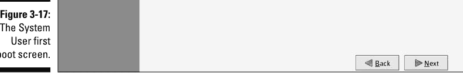

此密码是您的个人账户密码，与您的 root（管理员）账户无关。可以尽管与 root 不同的密码。事实上，这是一个好主意。如果您不小心两次输入的密码不同，您将在第 14 步中收到警告并返回此步骤。

15. 点击“下一步”按钮继续。

出现“声卡”屏幕。

16. 确保您的扬声器或耳机已打开，点击“播放测试声音”按钮。

您应该能从右声道、左声道，然后同时听到声音。

17. 当问您是否正确听听到声音时，如果听到了三个声音请点击“是”，如果没有听听到请点击“否”。

如果您没有正确听到声音，请查看第 18 章解决声音问题。

18. 点击“下一步”继续。

出现“额外的 CD”屏幕。您可能没有 CD。如果有，点击“下一步”。

19. 完成 CD 后，点击“下一步”。

如果您选择系统使用网络时间协议 (NTP)，系统可能需要一些时间连接到您选择的服务器。几秒钟后将出现“显示”对话框，如图 3-16 所示。

## 第一部分：上手

## 第 4 章：安装其他发行版

- 获取方法
- 揭秘 Mandrake
- 发现 SuSE

## 刻录 ISO

如果您最终需要在 DVD 上刻录 ISO，我有一些提示可以让这变得更简单。首先，您需要刻录软件，例如 Nero 程序 (`nero.com`)。有了刻录工具后，查看您需要刻录的 ISO 文件大小。大多数 ISO 可以刻录到 650MB/74 分钟的 CD-R 或 CD-RW 上，有些需要 700MB/80 分钟。Knoppix 就是一个需要较大 CD-RW 的。

但是，您的刻录机必须支持重写。查看正面以判断是 CD-R（不可重写）还是 CD-RW（可重写）。

在准备刻录 CD 或 DVD 之前，确保您的软件理解您想要刻录 ISO（**要寻找的词是 image**）而不仅仅是一个文件。如果您刻录了 CD 或 DVD，放入驱动器并打开它，如果只看到一个文件，说明您刻录错误了。ISO 应该被解压到 CD 或 DVD 上，形成一系列文件和目录。

最后，建议以 4 倍以下的速度刻录这些 CD 和 DVD。这样可以减少引入错误的概率。

可能的情况下，请使用 CD-RW，因为它们是可重写的，您以后还可以下载并刻录其他发行版。CD-RW 是避免的很好的方法。

## 使用 Knoppix 启动 Linux

在第 2 章中，我解释了 Knoppix 包含在随书籍 DVD-ROM 中。您可以从书籍的 DVD-ROM 启动，并在主菜单中按回车即可启动 Knoppix Linux，无需在计算机上安装任何内容。

> 如果随书的 DVD-ROM 无法工作，请查看附录 B。如果您没有 DVD 驱动器，可以下载 CD-ROM 镜像刻录到自己的设备上，访问 `www.knopp.net/get.php`。

## 第 4 章：安装其他 Linux 发行版

我在“关于不同的 Linspire 版本”和“识别某些特殊的 Linspire 特性”章节中描述了这些内容。Linspire 的设计旨在便于安装并方便添加新软件，并包含了许多帮助人们熟悉系统的教程。然而，Linspire 并不是专门为有抱负的 Linux 极客设计的。


Linspire 的构建是比更高级但受欢迎的 Debian (`www.debian.org`) 发行版更友好的版本。

如果你非常谨慎，那么你走好运了——随书附带的 DVD-ROM 中包含了一个用于创建你自己的 Linspire 完整版 CD-ROM 的 ISO 文件（在 DVD-ROM 的 `dist` 文件夹中）。在第 12 章中，你可以注册 Click And Run Warehouse 的免费试用，以获取和安装软件，这样你就可以在之后决定是否值得购买会员资格。

如果你决定购买 Linspire，你有多种选择：

- 在线购买并立即从 Linspire 网站下载。
- 在线购买并邮送物理盒装。
- 在商店购买盒装 (`www.linspire.com/windows_feature_reseller.php`)。
- 购买预装了 Linspire 的电脑 (`www.linspire.com/windows_feature_preinstall.php`)。


Linspire 在 `http://info.linspire.com/installhelp/` 提供了一个关于刻录 CD 的新常见问题解答（FAQ）。无论你是从书附带的 DVD-ROM 刻录，还是直接从 Linspire 获取刻录，这些信息都有帮助。

## 安装 Linspire

Linspire 是一个主要的商业发行版，你可以通过随书附带的 DVD-ROM 中包含的 ISO 镜像访问它。我复制了这份完整的 Linspire 4.5 版本。它与其他版本之间的差异在“关于不同的 Linspire 版本”章节中进行了说明。

要安装 Linspire 4.5：

1. 将 CD 放入 CD-ROM 驱动器。
2. 启动机器。

如果机器忽略了你的 CD-ROM 并尝试正常启动，请参阅第 2 章了解如何对你的 BIOS 进行必要的更改。

## 68 第一部分：入门

3. 在初始屏幕上，点击“安装和预安装任务”，例如扫描你的电脑硬件并启动安装程序。

Linspire 开始执行所有标准的预安装任务并启动安装程序。过了一会儿，进度条填充。之后，你的屏幕变黑。（不要恐慌！这是正常的！）你最终到达“安装方法”对话框，如图 4-1 所示。

4. 如果你是在单台电脑上安装 Linspire 或让它拥有整个硬盘，请选择“接管整个硬盘”（Take Over An Entire Hard Disk）。否则，如果 Linspire 必须与其他操作系统共享硬盘，请选择“高级安装”（Advanced Install）。

由于第二个选项更复杂，如果你选择第一个选项，下一步将询问你想使用哪个硬盘。请使用 Windows 看到的顺序，因此第一个驱动器是 C:，第二个是 D:，以此此类推。如果有必要，你可以在 BIOS 中查看大小和其他信息，以判断哪个是第一个、第二个或第三。

在继续之前，你需要空空间；否则，安装程序将让你进入分区选择屏幕。请参阅第 2 章了解如何释放空间。

5. 一旦你做出选择，点击“下一步”（Next）继续。

出现“高级安装”对话框，如图 4-2 所示。


图 4-1：Linspire 安装方法对话框。

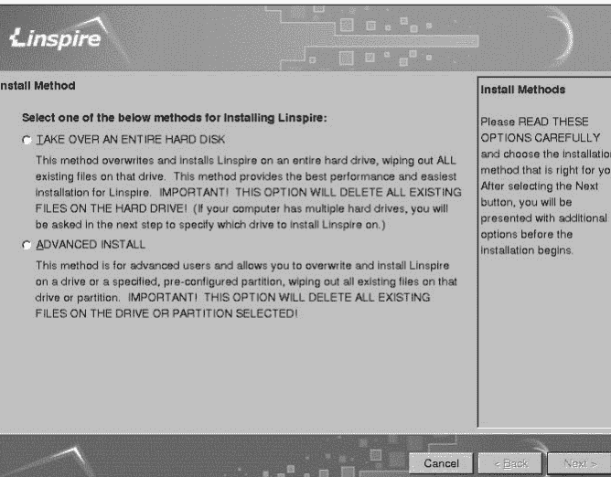

## 第 4 章：安装其他 Linux 发行版

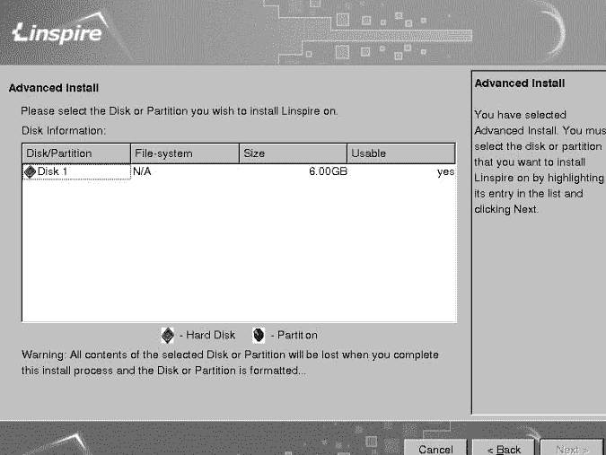

图 4-2：Linsphere 高级对话框。

6. 从列表中选择你想安装 Linsphere 的硬盘（如果你想安装在整个硬盘上）或分区（如果你想安装在特定分区中），然后点击“下一步”（Next）。

出现“计算机名称和密码”（Computer Name And Password）对话框，如图 4-3 所示。

7. 在“计算机名称”文本框输入你想要的名称。

例如，也许你想把你的电脑命名为 Fred。

8. 在两个“密码”（Password）文本框中输入你的管理员密码，然后按回车。

出现“设置确认”（Setup Confirmation）对话框。

9. 读取对话框中指定的数值，并在准备好开始安装时点击“完成”（Finish）。

是的，就是这样！你的安装现在开始。你可能会被要求确认你是否想要接管硬盘或分区；如果是的话，请双检信息。

## 70 第一部分：入门

| Linspire | 计算机名称 |
| :--- | :--- |
| --- | --- |
| 计算机：（必需） | Linspire |
| 名称： | Linspire |
| 安全： | Linspire |
| 确认： | Linspire |


Linspire 最受关注的特性之一是它的密码。如果你忘记了密码，请务必记住。

10. 安装完成后，点击 OK。

机器将带你进入一个卸载界面。

11. 提示时，从驱动器移除 CD。

## 识别某些特殊的 Linspire 特性

Linspire 最受关注的特性之一是它的 Click And Run。这个商店允许你浏览数千个程序。更好，如果你订阅了 CNR，可以获得免费会员。我在第 11 章中介绍了这一点。

## 35

## 第 4 章：安装其他 Linux 发行版

## 关于不同的 Linspire 版本

Lin大气 的员工在组合方面非常有创意。在本章节中，我查看了 Lin大气 的各种包装方式。我不会涵盖每一个发行版（那样这本书就会变成百科全书了！）。相反，看看写作时提供的主要版本：

## 玩转 Mandrake


Mandrake (`www.mandrake-linux.com`) 拥有庞大的爱好者粉丝群。该发行版设计于 1998 年，目标是为所有人创建一个简单直观的安装，专注于服务器和家庭/办公室安装的易用性。为了实现这一目标，Mandrake 的创建者专注于让从 Windows 或 Mac 技能轻松过渡到 Linux。

在本小节中，我关注 Mandrake 版本 10.1。安装此发行版所需的 ISO 文件包含在随书 DVD-ROM 的 `distros` 文件夹中，因此你需要将它们刻录到 CD-ROM 中才能开始。如果你无法使用 DVD-ROM，也可以从（`www.mandrake-linux.com`）免费下载此发行版，或者从 Mandrake 在线 (`www.mandrakesoft.com`) 购买带有手册和更多内容的盒装。下载 Mandrake：

## 第一部分：入门尝试

### 72

2. 点击“Download”（下载）链接。

你将被带到 Mandrakelin 下载页面。在该页面，系统会询问你是否想加入其用户俱乐部（每月支付费用后，即可访问各种额外内容和早期下载），或者你是否已经是成员或正考虑加入。如果你成为一名 Mandrake 的忠实粉丝，加入俱乐部绝对是你想要考虑的事项！

3. 如果你还没有准备好加入俱乐部，请点击“我已经是俱乐部成员或即将注册，请向我发送下载（[此处）”页面旁边的“Now”（现在）按钮。否则，请继续注册俱乐部，然后返回到第 1 步。

此操作将带你进入主下载页面。

4. 点击“Mandrakelin 10.1 Official ISO/i586”链接。

此操作将跳转到下载页面的“Mandrakelin 10.1 Official ISO Images For I586 And Higher”部分。

5. 浏览国家列表，并点击物理距离你最近的下载位置。

6. 下载三个 `Mandrakelin10.1-Official-Download` 文件。

这些文件中的每一个都相当于一张完整 CD 的 Mandrake 素材，因此如果你使用的是拨号上网或有带宽限制，你可能会发现从 Mandrake 或第三方（通过 `www.cheapytes.com`）购买 CD 更方便。如果你自己下载，请参阅第 2 章关于如何将 ISO 文件正确刻录到 CD-ROM 的建议。

在第 2 章中，我提到 Mandrake 可以调整你现有的 Windows 分区大小，因此你不需要提前这样做。

## 安装 Mandrake

在 CD-ROM 或 DVD 上刻录或购买 Mandrake 后，按照以下步骤安装：

- 1. 将 CD 1 或 DVD 插入 CD-ROM 或 DVD-ROM 驱动器并重启计算机。

如果电脑忽略了 CD-ROM 并尝试正常启动，请查看第 2 章了解如何对 BIOS 进行必要的更改。出现安装程序初始界面。

- 2. 按 `F1` 显示更多选项（通常在你需要使用特殊选项时），或按 `Enter` 键开始安装。

我假设你按了 `Enter`。大量文本滚动而。屏幕变为黑蓝调界面，随着设备的检测，出现了蓝色的对话框，最后你到达了语言选择对话框，如图 4-4 所示。

## 第四章：安装其他 Linux 发行版

图 4-4 Mandrakelin 10.1 语言选择对话框。

3. 如果你想使用美国英语以外的语言作为默认语言，请在列表中选择相应的语言并点击“Next”（下一步）。出现许可界面。阅读许可，选择“Accept”（接受），然后点击“Next”。出现安全界面。

- 4. 将将你的安全级别保持在“Standard”（标准），除非你想尝试“High”（高）。

比“High”更高的级别可能会在你使用电脑作为客户端付费时，你会被诱惑完全关闭安全性，这违背了初衷！尽管如此，有些人仍然喜欢玩玩那个非常糟糕的节点级别。这取决于你。我假设你留在“Standard”。

- 5. 如果你想让系统上的某个特定非 root 用户（或电子邮件）接收所有与安全相关的通知（推荐），在“Security Administrator”（安全管理员）文本框中输入你为该用户创建的登录帐户或使用的电子邮件；否则，跳到第 . 步。

记住，任何减少你以 root 身份登录次数的操作都是好事，只要它不会降低你的安全性。我倾向于为此文本框选择一个电子邮件地址。

- 6. 点击“Next”（下一步）。

出现初始磁盘分区界面。你在这里看到的选项取决于分区程序（DrakX）在你的硬盘上发现的内容，因此你看到的可能与我看到的不同。

- 7. 选择你想使用的分区“Partitions”（分区）。

不要选择“Using Partitions”（使用现有分区）——除非你想并预先设置好机器的分区。如果你要将整个硬盘迁移到 Linux，请选择其他选项之一。全[此处]“Entire Disk”（整个硬盘）。如果你想让你的 Linux 安装与另一个操作系统共享硬盘（或者你想以任何方式设置分区），则选择“Custom Disk Partitioning”（自定义磁盘分区）或在有可用空闲空间的情况下选择“Use Free Space”（使用空闲空间）。取决于你的系统，还可能出现其他选项。你可能会看到“Else Entire Disk”（否则为整个硬盘），这允许你擦除 Windows 安装。如果你选择“Else Entire Disk”，请接受默认分区并跳到第 10 步。

- 8. 点击“Next”（下一步）。

出现分区界面。你可以通过点击图形列表中的分区来选择现有分区。每个分区都已连接了建议的挂载点（更多挂载点请参见第 3 章）。你可以点击分区图形下方的相应按钮删除或调整分区大小。如果你已经有一个空闲未分配空间，可以点击“Auto Allocate”（自动分配）按钮让 Mandrake 为你设置一组新分区。要创建一个新的，点击空空间然后点击“Create”（创建）。你可以在图 4-5 中看到示例布局。

- 9. 完成分区布局后，点击“Done”（完成）。

正如警告所说，当你点击“Done”时，更改将应用到你的硬盘。格式化完成后，安装程序将扫描其软件列表。然后出现安装介质对话框。

- 10. 只有三个 CD ISO 可供下载，如果你下载了那三个，请忽略列表中的通用 CD 4 和 5，然后点击“OK”。如果你有 CD，只需点击“OK”。出现软件包组选择界面（如图 4-6）。

- 11. 选择你想要安装的软件包组。

- 12. 如果你想进入每个组并进行选择，请选择“Individual Package Selection”（单个软件包选择）框。

我假设你点击了此选项。

- 13. 点击“Next”（下一步）。出现“Choose Packages You Want To Install”（选择你想安装的软件包）对话框。

- 14. 根据需要选择和移除软件包。

在左列，你可以点击向右箭头展开类别并查看其中的所有组，或者点击向下箭头压缩类别并清理列表。组上的勾选意味着你选择了该组，类别上的勾选意味着你选择了整个类别。

- 15. 当你准备好继续时，点击“Install”（安装）。

安装开始。系统将给出一个预计所需的时间。记住，如果你需要更换 CD，在下次提示之前你是不知道的，不要离开并期望回来时已经完成。你可以点击“Details”（详情）按钮查看每个软件包的进度。

对于大多数主流 Linux 发行版，Mandrake 有任务可以处理主安装，在你开始使用系统之前。在主文件放置到你的系统之后（重启之前），你会被要求执行一些操作，例如输入你的 root（管理员）密码。（关于如何选择强 root（管理员）密码以及为什么要这样做，请参阅第 3 章。）

在你选择 root 密码后，系统会要求创建一个普通用户帐户。创建时，点击图标并为你的用户帐户选择[此处]外观。说到用户，除非没有其他人可能访问机器，否则不要配置计算机为自动登录任何帐户。这不是一个非常安全的做法，也是一个招致许多无恶趣味作剧的好方法。

当你到达“Summary”（摘要）界面时——它并不是摘要，因为它配置了你尚未查看过的项目——请确保一切都设置正确。特别是“Graphical Interface”（图形界面）项指的是你的显示器和显卡。在安全部分，点击“Firewall”（防火墙）旁边的“Configuration”（配置），取消勾选“Everything”（全部）复选框，并添加

# 第 4 章：安装其他 Linux 发行版

仅检查你将在这台计算机上运行的服务旁项。例如，你可能想要勾选 SSH、FTP 和 Echo (ping)。

最后，当有机会下载更新包时，如果你已经连接到网络，请选择“是（Yes）”。否则你可以稍后进行。

在完成这部分的配置过程后，系统会要求你重启。然后，信不由你，还有几个配置任务需要处理。首先，你需要进行一项用户调查。如果你想填写，请填写，否则点击“下一步（Next）”跳过。在“选择桌面（Choose Desktop）”对话框中，点击下拉列表并尝试各种桌面和主题。选择一个你想要的外观。此之后，你可以注册 Mandrake 俱乐部（`www.mandrakeclub.com`），最后你就大功告成可以使用这台机器了！

## 在各种 Mandrake 版本之后

Mandrake 同时提供了服务器和桌面版解决方案，但我在这里重点介绍桌面版——这被许多人认为是 Mandrake 的真正实力所在。你可以通过访问 `www.mandrakesoft.com/products` 查看 Mandrake 的全系列商业产品，并按照前面的章节提供的说明查看所有的下载选项。“使用 Mandrake 尽情享受。”我像既往一样，也关注包含桌面本身以及涵盖附加组件的项。

在编写本文时，你可以通过以下版本购买/或下载桌面版 Mandrake：

- `Mandrake 10.1`：本教程附带的完整下载版本。你可以将它用于桌面、服务器以及介于两者之间的场景。

- `MandrakeMove`：Mandrake 的 LiveCD 版本，允许你将 CD-ROM 插入 PC，用此 CD-ROM 启动 PC，发现自己处于一个功能完备的 Mandrake 环境中无需安装任何东西。

- `Mandrake 10.1 Discovery`：面向 Linux 新手的商业软件包。该包包含了 `MandrakeMove`。

- `Mandrake 10.1 PowerPack`：“常规”全功能商业桌面软件包包。

- `Mandrake 10.1 PowerPack-*`：面向高级用户的商业桌面版产品。

Mandrake 还有针对其他硬件架构（如 AMD64、PowerPC 和 SPARC）的商业版和/或免费版。此外，如果你是一个前沿人士——这指的是“大多数人尚未开始使用的最新、最强大的东西”——你可能会喜欢下载 `Mandrake Cooker`（`www.mandrakelin.com/en/cookdevel.php3`）。

## 从 SuSE 开始

SuSE ("OO-za", `www.suse.com`) 公司和 Linux 发行版成立于 1992 年，并于 2004 年被 Novell（`www.novell.com`）收购。该发行版以 Software and Systementwicklung（软件与系统开发）的德语缩写命名。SuSE 的成名之处之一是国际化支持（大多数发行版为全球用户提供某种程度的支持，但某些对特定群体的语言集成优于其他版本；SuSE 在德语和西欧地区表现出色）。

SuSE 主要是一个商业发行版，尽管它有一个有限的选项，我在“关于各种 SuSE 版本”章节中讨论过。我并没有与其他人的完整版对比免费版，而是带你了解安装完整版的 SuSE Professional 9.2。虽然大多数发行版都有一个或多个集成配置设置，但 SuSE 的 YaST 特别详尽，而且同样不具有那种不幸的稀有性。随盒版附带的手册精美且厚实，可以本书的补充，还有在线帮助、用户论坛等。

一个带有 KDE 的 Live CD SuSE 9.2 以 ISO 文件的形式包含随书 DVD-ROM 中的 `distros` 文件夹中。无需安装，你只需将 ISO 刻录到 CD-ROM，将 CD 插入驱动器，并启动机器来体验这个版本的 SuSE Linux。

## 安装 SuSE

SuSE Linux 9.2 Professional 盒装包含两本手册、五张 CD 和 DVD（供那些想从 DVD 安装的人使用）。在第 2 章中，我提到 SuSE 可以调整你的 Windows 分区，因此你不需要预先执行这一步。如果你使用的是本教程附带的 SuSE 版本，则无需执行此安装程序。我为那些购买了 SuSE 完整版的人涵盖了这一点。

要安装此发行版：

1. 将 CD 1 或 DVD 1（左侧的）放入你的 CD-ROM 或 DVDROM 驱动器。如果你使用 DVD，请确保 A 面朝上。

2. 重启你的机器。出现欢迎屏幕，随后是安装程序的菜单。

3. 从菜单中选择“安装（Installation）”并按回车（Enter）。

4. 安装程序启动时会出现进度条。之后会出现硬件初始化屏幕。确定计算机上硬件的过程可能有点慢，请保持耐心。

最后，出现“欢迎使用 YaST2（系统的安装和管理程序）”。

4. 选择你想要在这台计算机上使用的主语言，然后点击“接受（Accept）”继续。

出现“安装设置（Installation Settings）”屏幕（见图 4-7）。系统完成自动检测程序并填写所有项目可能需要一分钟左右。

5. 查看系统（System）项的值并判断（根据你所知）它们是否正确。如果不是，点击“系统（System）”链接并等待 SUSE 自动检测所有硬件。

6. 在“选择桌面（Choose Desktop）”对话框中，点击下拉列表框并尝试各种桌面和主题。选择一个你想要的外观。此之后，你可以注册 Mandrake 俱乐部（`www.mandrakeclub.com`），最后你就大功告成可以使用这台机器了！

## 82 第一部分：入门

从这里开始，为了方便自己，点击“过滤器”（Filter）下拉列表框并选择“软件包组”（Package Groups）。此操作会将左侧的列表更改软件类型。你可以点击标记来展开列表，点击 [–] 标记来收叠它们。然后，在右侧，你可以查看左侧所选组中的各个程序，然后勾选它们添加到你的安装列表，或取消勾选以将其移除。

16. 当你认为已完成时，点击屏幕底部并选择“检查依赖”（Check Dependencies）。

17. 如果响应为“所有软件包依赖正常”（All Package Dependencies Are OK），则点击“确定”并继续第 18 步。否则，说明你需要某些内容来解决依赖问题，在你解决好之后，即可继续第 18 步。

18. 当你准备好软件选择时，点击“接受”（Accept）。

你会收到已已添加额外的软件包以修复依赖，即使你之前被告知依赖是正常的。如果发生这种情况，请点击“继续”（Continue）。

19. 如果你不想直接启动到 Linux 启动菜单，可以选择要启动的操作系统和版本，点击“启动”（Booting）链接。大多数人希望保持启动加载程序的设置，如果你不想更改这些值，请进入第 20 步。

如果你进入了“启动”选项，将看到引导加载程序设置屏幕。要更改特定条目，点击它然后点击“编辑”（Edit）打开相应的对话框。感兴趣的项目包括：

- 启动位置（Boot Location）：如果你想使用不同的启动菜单生成器，你必须将启动位置更改到不同的分区（一个不错的地方是 `/boot` 分区，所以如果你将 `/boot` 放在 `/dev/hda1`，就选择该项）。但是，你必须确保告诉你的启动菜单程序找到 Linux 加载器！

- 默认部分（Default Section）：这是你最可能更改的项。点击此项并选择“编辑”，即可看到一个屏幕，如果你在引导加载程序超时并自动启动之前没有选择，你可以告诉 SuSE 你想启动到哪个选项。

- 可用部分（Available Sections）：如果你想添加新的启动菜单选项，点击此项，选择“编辑”，然后从“引导加载程序设置 – 部分管理”屏幕上点击“添加”（Add）。

如果你选择进行更改，一旦准备好继续，点击“完成”（Finish）返回主安装设置屏幕。

## 第 4 章：安装其他 Linux 发行版

20. 如果你的时区未设置正确，点击“时区”（Time zone）项并进行更改。

在左侧选择你的区域，然后在右侧选择时区。

21. 如果你想让默认语言不是美式英语，请点击“语言”（Language）项并进行你的更改。

22. 如果你想让你的机器启动到命令行模式，点击“默认运行级别”（Default Runlevel）并选择“带网络的全多用户”（Full Multiuser With Network）。

23. 最后，点击“接受”打开“确认软件包许可：flash-player”（Confirm Package License: flash-player）对话框。

24. 阅读许可然后点击“我同意”（I agree）进入“确认安装”对话框。

25. 如果你确定要继续，点击“安装”（Install）。如果你改变了主意，点击“否”（No）返回安装设置对话框。

让安装开始吧！SuSE 安装程序向你显示它需要哪些磁盘、从这些磁盘中需要多少材料，以及安装过程中的进度条。

安装完成后，移除 CD 或 DVD 并重启。SuSE 将继续其安装后设置。酷的一点是，如果你忘记弹出 CD 或 DVD，系统仍然正常启动——只需在再次重启之前移除 CD 或 DVD 即可以防万一！

由于我书中的空间不是无限，我为你提供一些关于如何完成此初始设置程序的简要说明。（请记住，如果需要，稍后可以更改这些任何项的配置。）

- 参见第 3 章如何为 root（管理员）用户选择密码。

- 在“网络配置”（Network Configuration）部分，首先检查你的以太网卡（网络适配器）、DSL、调制调器、ISDN 适配器、拨号调制调器或你正在使用的任何设备是否已正确检测。如果是，查看卡的品牌和型号。如果不是，查看“未检测”（Not Detected）。如果未检测到，点击该链接进入其配置部分，并在“选择其他（未检测）”（Select Other (Not Detected））选项下，点击“配置”（Configure）打开配置界面。在那里，你可能需要更多来自你的 ISP 或硬件文档的信息来完成。（参见第 7 章有关设置网络时会遇到的技术和问题的介绍。）如果过程让你感到难以承受，只需一直点击“返回”（Back），直到回到主网络配置部分并选择“跳过配置”（Skip Configuration）单选按钮，这样你就可以去第 7 章设置。


我还建议在网络配置中将 `ssh` 设置为启用（`enabled`）。你可以在第 13 章中找到更多关于此选项的信息。

- 当到达“测试 Internet 连接”（`Test Internet Connection`）时
- 当询问是否要获取在线更新时，说“是”（`Yes`）（如果你现在可以访问互联网）。这样你就从一个完全更新的系统开始。在“安装源”（`Installation Source`）下拉列表框中，选择距离你物理最近的站点。然后，点击“强制选择补丁”（`Mandatory Select Patches`）框使其为空。此更新可能需要一段时间，有时它需要询问。（等一下，让我重新读一遍流程）。

*基于 OCR 文字流的修正：*

这样，你就从一个完全更新的系统开始。在“安装源”下拉列表框中，选择距离你物理最近的站点。然后，点击“强制选择补丁”框使其为空。此更新可能需要一段时间，有时它需要询问。

（注：由于原文中存在大量 OCR 错误和重复，以下翻译已根据逻辑进行了清理和去重，以确保内容的连贯性。）

## 86 第一部分：入门指南

如果你决定购买 Xandros，你有多种选择：

- 在线购买并接收实体光盘盒。
- 在商店购买盒装版。你可以访问 `www.xandros.com/partners/channelpartners.html` 查找销售 Xandros 的地点列表。
- 购买预装了 Xandros 的电脑 (`www.xandros.com/partners/oemps.html`)。

你也可以选择免费的选项。如需了解更多信息，请参阅“关于不同的 Xandros 版本”章节。Xandros 还经过特别设计，旨在让从 Windows 到 Linux 的过渡尽可能简单。因此，你可以发现其布局和其他问题与 Windows XP 相似。在此基础上，Xandros 引入的一项方便工具是 Xandros Networks 工具，你可以从桌面上的图标双击进入它。Xandros Networks 让你查看 Xandros 的最新新闻，浏览软件在线商店（其中某些软件对注册用户是免费的）。通过 Xandros Networks 下载和安装只需点击几次。

你可以通过 Xandros Networks 购买高级会员，以获得折扣、软件早期访问权限等优惠。

## 安装 Xandros

再次，由于我涵盖了所有的完整版本，在这里我介绍完整的 Deluxe Xandros 桌面操作系统版本 2.5 安装。要安装此版本：

1. 将 CD-ROM 放入 CD-ROM 驱动器。
2. 重启电脑。如果电脑忽略了 CD，则你需要更改 BIOS，使其在查看硬盘之前查看 CD-ROM 驱动器。（更多信息请参见第 2 章和第 3 章）。如果电脑看到了 CD 但启动程序时似乎出现问题，重启并在 Xandros 屏幕出现时按下 Shift 键以查看故障排除选项。
3. 当到达欢迎对话框时，点击“下一步”。显示用户许可许可协议。
4. 阅读协议，点击“我接受此协议”，然后点击“下一步”。出现安装选择界面。
5. 选择“快速安装”（`Express`）或“自定义安装”（`Custom`），然后点击“下一步”。

我假设你选择了“自定义”，因为它是一个复杂的选项。当你点击“下一步”时，会出现软件选择界面（见图 4-10）。

图 4-10：Xandros 2.5 选择界面。

6. 选择你想要安装的软件组。

除非你的空间紧张，否则你可能喜欢选择“完整桌面”（`Complete Desktop`），因为它提供了所有软件——如果你愿意，可以先选择“完整”开始，然后通过取消勾选来移除项目。选择“自定义”并开始添加项目。当你点击下方列表中的项目时，你会在屏幕底部看到描述。

如果你选择了“完整”，请务必查看“服务器”（`Servers`）部分并从列表中删除 Apache（Web 服务器）以及 FTP 服务器——除非你确定你打算使用 FTP 服务器让人们获取文件。

7. 在完成软件选择后，点击“下一步”。出现磁盘配置界面。
8. 选择代表你需要执行的磁盘配置选项。方便的是，在某些版本中，你可以调整 Windows 分区的大小，即使是 NTFS 分区。我假设你有一个想要用于 Linux 的空闲硬盘，为了与本章的其他章节有所区别，因此我假设你选择了“接管磁盘”（`Take Over Disk`）或“分区”（`Partition`）。
9. 当你准备好继续时，点击“下一步”。出现磁盘配置对话框，如图 4-11 所示。

图 4-11：Xandros 2.5 磁盘配置对话框。

10. 如果你想将某个分区分配给 Xandros，则点击列表中的该分区。对于整个硬盘，它们被列为 IDE2、IDE2 等（SCSI1、SCSI2 等）。
11. 点击“下一步”继续。出现磁盘配置摘要对话框。
12. 检查摘要，如果有错误，点击“返回”；如果准备好继续，则点击“下一步”。出现网络连接配置对话框。
13. 选择你想要使用的网络设备。通常，台式电脑只有一个以太网卡、调制解器或无线卡。
14. 如果你应该使用 DHCP，只需点击“下一步”并跳转到第 18 步。否则，点击“编辑”。打开编辑接口对话框。
15. 如果你使用拨号调制解器，选择“不配置网络接口”，点击“确定”，并跳转到第 17 步。否则，如果你被告知要使用的 IP 地址，请选择“静态地址”。调制解器设置将在第 8 章介绍。
16. 按照 ISP 提供的信息填写 IP 地址和子网掩码字段，然后点击“确定”。
17. 点击“下一步”继续安装。出现管理配置对话框。
18. 在两个密码文本框中输入你的管理员（`root`）密码。关于安全使用 `root` 账户的讨论请参见第 3 章。
19. 在你的情况下，电脑需要与 Windows 网络集成，请在“计算机名称”文本框中为其输入一个名称。如果你熟悉它，你输入的是 NETBIOS 名称。遵循该对话框该部分指定的规则。传统上，NETBIOS 名称为全大写字母。
20. 勾选“创建用户主目录”（`Make User Home Folders`）。此功能不仅让每个用户更容易保持数据私密性，还能帮助布局符合 Red Hat 在 Fedora 中使用的习惯，使你更容易理解。
21. 点击“下一步”继续。出现用户账户配置界面。
22. 点击“添加/编辑”按钮创建一个普通用户账户。出现“添加/编辑用户”对话框（见图 4-12）。由于你想尽可能添加管理员（`root`）账户（参见第 3 章），这个普通账户是……
23. 在“用户名”框中输入你的登录名。
24. 在“全名”字段中输入你的全名。
25. 在两个文本框中输入你的密码并点击“确定”。
26. 点击“下一步”继续。出现安装摘要对话框。
27. 检查摘要。如果一切正常，点击“完成”。否则，根据需要点击“返回”以修复问题并重新进行到此步。
28. 如果你想创建启动盘（推荐），则将软盘插入驱动器并点击“创建”。否则，跳转到第 29 步。
29. 当你准备好重启进入 Xandros 时，退出 CD。
30. 当启动界面出现时弹出 CD 并按回车键。

# 第4 章：安装其他 Linux 发行版

- 在“注册”（`Registration`）部分，取决于你是否想立即注册。你随时可以以后再注册。为了获得技术支持，你需要注册，因此你可能想在遇到问题之前进行注册。注册还让你免费下载 Xandros Networks 提供的某些程序（参见“识别某些 Xandros 特色功能”章节）。
- 当你到达“完成”（`Finish`）屏幕时，如果你所在的网络已经连接到 `string`，Xandros Networks 图标将提示你更新系统。此操作可确保你拥有所有最新的安全补丁和错误修复。该更新是原子的（`atomic`）。

当更新完成后，前台将显示 Xandros 屏幕，背景中则留有“首次运行向导”（`First Run Wizard`）。点击下方的面板上的“首次运行向导”图标将此对话框调到前台，然后点击“完成”（`Finish`）以完成你的首次运行过程。你可能会收到一条桌面已重启的消息。点击“是”（`Yes`），这将让你退出账户并重启 GUI，带你回到登录提示界面。

## 关于各种 Xandros 版本

Xandros 专注于桌面，并为家庭和商业用户提供产品。Xandros 提供的免费和商业版本包括（截至本书时）：

- Xandros 2.5 开放流通版（`Open Circulation Edition`）：一个与主商业版本略有不同的版本，通过比特 提供，这是一种在合法软件分发商中流行的 P2P 文件共享网络，用于快速向你的用户分发 CD 和 DVD 镜像。请查看 `www.xandros.com/products/desktop/dsk_oc_download_windows.html` 查看。
- Xandros Desktop OS 2.5 标准版（`Standard Edition`）：Xandros 桌面的主要家庭使用版本。
- Xandros Desktop OS 2.5 豪华版（`Deluxe Edition`）：包含了与 Windows 及 Windows 软件互操作的额外软件，包括调整 NTFS 分区大小的能力。
- Xandros Desktop Version 2.5 商业版（`Business Edition`）：在豪华版的基础上包含额外的软件，允许 Xandros 更好地集成到 Windows 网络中的桌面中，并带有 Sun 的 StarOffice（这是第 17 章介绍的 OpenOffice.org 套件背后的商业产品）。然而，在你购买这本书时，Xandros 3 可能已经发布了。如果是这样，非常值得查看一下。

92 第一部分：入门指南

## 使用 LiveCD

正如我在本章（以及整本书）中提到的，LiveCD（或可启动发行版）是 Linux 的某些版本，你可以通过使用 CD-ROM（或 DVD-ROM）重启电脑来直接启动它们。从 Linux 新手的角度来看，这些版本的精妙之处在于，你可以在无需在系统上安装任何东西的情况下尝试某些功能。老手们也喜欢 LiveCD。如果系统崩溃了，使用 LiveCD 重启系统是为自己提供一个“已知良好”（未受损）的系统，以便在修复计算机本身损坏的同时进行。此外，许多发行版为特定任务提供了高度专门化的环境……但我说得太快了。

你还需要记住，LiveCD 的速度通常比传统安装的系统要慢。毕竟，一切都直接从 CD 或 DVD-ROM 运行。

同样，请确保你在需要时能够保存内容。这可能需要一些规划，或者至少需要一点思考——请参见第 21 章了解如何通过向我发送邮件附件来实现这一点。当所有其他方法都失败时，我会快速配置邮件客户端，直接将那些 NTFS 调整大小镜像（参见第 2 章）从 Knoix 拷贝到我的 Fedora 机器！你也可以从启动发行版访问真实的硬盘空间，尽管它支持 NTFS 或取决于版本。Knopp 支持 NTFS，但最好将其只读。

另一种流行的是使用 USB 密钥等便携式存储设备。这样，你可以随身携带钥匙和启动发行版，同时访问你的环境和数据。关于 USB 存储需要的重要一点是，Linux 将这些项目视为 SCSI 驱动器，因此如果你手动访问它们（参见第 11 章），你将作为 SCSI 分区访问它们。例如，如果你将 USB 密钥插在第一个 SCSI 插槽中，它可能是 `/dev/sda1`。

最后，并不是所有的 LiveCD 都适用于所有 PC。酷的地方在于，如果一个不能与你的电脑配合，你只需要耸耸肩并下载另一个即可！

## 寻找更多 Linux

如今有 200 多种不同的 Linux 发行版，每年都有新版本产生，而其他版本由于最初的热情消退或发现其价值降低而消失。这些发行版中的许多是通用的，或者至少用途相似（全桌面、服务器等），因此它们提供的基础软件和周围工具与彼此相似，但配置、文档、GUI 陷阱、安装程序和其他花哨不同。尽管如此，通用发行版对某些市场的服务比其他市场更好。例如，TurboLinux 在日本很流行，红旗 Linux（`Red Flag Linux`）是中国的官方选择，Connecta 在西班牙语国家流行。也存在特殊用途的发行版。LiveCD 属于这一类，但即使它们也分为类别，其中一些（如 Knnix）服务于通用领域，另一些服务于多媒体、系统救援环境和其他酷炫的专家玩具。要挖掘众多的发行版，请查看 DistroWatch (`www.distrowwatch.com`) 并让鼠标悬停在数百个发行版上。如果你在这里没有找到足够的选择，前往该网站的“相关链接”（`Related Links`）部分可以找到更多。

## 第一部分：入门之旅

## 启动 Linux

让我们面对现实吧：尽管盯着一台闲置设备也很有趣，但真正的乐趣从开启电脑的那一刻开始。与任何电子设备一样，打开电子洪闸是通往乐趣的第一步。然而，计算机要做的任务比你的烤箱箱要多得多。计算机不是一个简单的加热元件，它必须检查你（或制造商）插入电脑主板的所有奇技妙巧。在初始上电后，计算机会执行一些简单的硬件测试（称为 POST，即电源开机自检），以确定这些组件是否工作正常。

检查所有硬件只是刚开始。从你开启电脑到显示器上闪烁的磷光屏提示你输入登录名之间的这段时间内，计算机正在建立自己的帝国。如果你仔细倾听和观察，你的电脑和显示器会通过哔哔声、嗡嗡声、电机旋转声、咔哒声、显示器上的信息以及闪烁的灯光显示出启动过程的迹象。

尽管你听过“罗马不是一天建成的”，但启动过程其实非常快。考虑到操作系统的架构让罗马看起来就像一堆纸板箱，而你每次启动电脑时，它都必须在内存中构建整个操作系统。（请记住，操作系统是让你的电脑运行的核心软件。）这个过程可以分为四个主要步骤，我将在接下来的章节中讨论。

### 第 1 步：电源开机自检 (POST) 引导 BIOS

POST 过程与操作系统完全无关。无论你运行的是 Linux 还是 Windows XP 等其他操作系统，计算机都会执行这一步。

POST 失败的一些症状包括：

- 一系列不寻的长短交替的哔哔声。
- 显示器上没有显示任何内容。
- 除了电源风扇的旋转声外，没有其他明显的活动。
- 电脑机箱里冒出一缕烟或散出电子元件烧焦的刺鼻味。
- 显示器上显示错误信息，指示硬件故障。

如果你遇到这些任何一个问题，说明你的硬件出了故障，在继续操作之前需要解决它们。很有可能，如果你的电脑在开始安装 Linux 之前运行正常，那么你的电脑应该能顺利通过 POST —— POST 问题通常不是由安装新操作系统引起的；它们更多是由于计算机本身。

好消息是，如果你能进入了 BIOS，那么问题可能比电脑在进入 BIOS 之前就崩溃要更容易修复。

### 第 2 步：BIOS 将接棒交给引导加载程序

在 BIOS 成功通过 POST 并给出“没问题”信号后，BIOS 定位系统中的第一个驱动器并读取磁盘的扇区，这通常被称为 MBR（主引导记录）。在磁盘的第一个区域上有一个名为引导加载程序（`boot loader`）的小程序。引导加载程序几乎什么都不知道，除了如何启动你的操作系统。

有两个引导加载程序知道如何加载 Linux 操作系统：LILO (`Linux LOader`) 和 GRUB (`GRand Unified Boot loader`)。自从 Linux 成为极客心中的闪光以来，LILO 一直是一个可靠的引导加载程序。而 GRUB 是一个比 LILO 新得多且复杂得引导加载程序。许多发行版允许你选择自己的引导加载程序。通常，大多数人只使用默认设置，对于本文讨论的五个发行版，默认设置如下：

#### 发行版

| 发行版 | 默认引导加载程序 |
| :--- | :--- |
| Fedora Core | GRUB |
| Linspin | LILO，在其上方有特殊的例程 |
| Mandrake | LILO |
| SuSE | GRUB |
| Xandros | LILO，在其上方有特殊的例程 |

许多 Linux 发行版在内核加载和系统初始化阶段（内核加载完成后，启动过程结束时）实际上会显示一个 GUI 进度界面。如果你想看到发生了什么，通常可以点击图标或按某个键。只需寻找如何“查看详情”的说明即可。

此列表显示了系统内核缺失、错误或损坏的一些症状 —— 所有这些都会发生在你做出选择并按下回车键，或者直接让引导加载程序自动运行而不进行任何选择之后：

- 冻冻结。
- 显示器顶部出现几个点，然后系统冻结。
- 屏幕上出现几条信息，最后一条信息显示 `panic`（恐慌）。
- 系统自动重启。

你知道内核正在加载，因为你开始看到类似疯狂的文本：

```
Uncompress Linux... Ok, booting the kernel.
audit(109256612,337:0): initialized
```

从内核加载失败中恢复（“未找到操作系统”除外——见上一节）是 Linux 中更有挑战性的问题之一。遗憾的是，这不适合心细的人。另一方面，失败的内核可能是一个过时的版本。如果你在启动菜单中有多个 Linux 选项，查看每个选项的版本号并选择第二个。这样做可以让你进入上一个正常工作的内核并拥有一个正常的系统。你可以打开 `www.google.com` 搜索错误信息，或者等待下一次内核更新并暂时忽略那个坏掉的。

在原始安装无法正常启动的情况下，请查看你所在发行版的帮助。请参阅第 2 章获取更多关于如何为本文讨论的发行版查找帮助的信息。

### 第 4 步：控制权移交给 init

一旦内核完成加载，它就会将系统初始化交给 `init`。`init` 程序负责启动所有服务。如果你看到这些行，你就知道内核已经完成加载。

你在启动服务（在后台运行的程序）时可能遇到的问题，通常会通过启动过程中显示的状态来指示。服务的启动需要很长时间，因此你可能需要耐心。如果机器没有该服务无法启动，你将需要访问发行版的救援模式（`rescue mode`）。救援模式是一种特殊的启动选项，它在内存磁盘（RAM disk）中模拟硬盘，将文件完全存储在内存中。这样做的好处是，你不需要安装系统中的工具即可进行必要的“手术”。缺点是这是一个命令行界面，你必须具备相关知识才能在那里找到路。

附录 A 包含 Linux 命令列表。第 20 章讨论了其他内容，如果你的问题出在引导加载程序上，该如何修复它们，以及如何追踪内核可能留下的错误信息。你也可以通过查阅发行版的文档和帮助论坛找到有用的提示。

## 第 5 章：Linux 的启动与停止

- SuSE：DVD 或第一张安装 CD 包含一个救援系统（`Rescue System`）菜单选项。使用方向键高亮此选项并按回车。


进入`/path/to/xxx`目录，找到`xxx.json`。

在表达式`cvar = avar + bvar`中，加法运算符（`+`）将`avar`与`bvar`相加，得到它们的和`cvar`

在`List.of(arg0, arg1, arg2)`中，`List`接口的工厂方法`of()`接受一系列的元素，返回包含它们的只读列表。

之后我们这样调用`cmd`命令：`cmd arg0 arg1 arg2`。

```
if (condVar > someVal) {console.log("xxx")}
```

- Xandros：CD 包含一个救援模式。当安装程序启动时，按下 Shift 键。此操作将打开一个菜单选项列表。使用方向键选择救援控制台（Rescue Console），然后按回车。

要在 Fedora Core 中进入救援模式，将 DVD 或第一张 CD 放入 DVD-ROM 或 CD-ROM 驱动器并启动机器。按照以下步骤操作：

1. 当磁盘首次加载时，在启动提示符处输入 `linux rescue`。

此操作将开始进入系统的维护模式。

2. 选择你的语言并按回车。

3. 选择你的键盘类型并按回车。

救援系统会运行一段时间，对于较慢的系统，可能需要一两分钟。

4. 当询问是否要启动网络接口时，除非你需要下载某些内容，否则回答 No（否）。

5. 在救援界面，选择提供的三个选项之一并按回车。

你的三个选项是：

- Continue（继续）：救援界面会为你追踪已安装的 Fedora Core 系统。

- 如果你选择此选项（或下一个）且失败了，你可能需要重启并重新启动救援系统。重启后，选择 Skip（跳过）。

- Read-Only（只读）：与 Continue 相同，但你无法对硬盘安装进行任何更改。

- Skip（跳过）：不要费力寻找文件系统，直接给我一个提示符！

我假设你选择了 Continue。如果是的话，将出现一个 shell 提示符（命令行界面），你现在可以访问救援界面了。

6. 如果救援过程能够加载你的 Fedora 安装，输入 `chroot /mnt/sysimage` 即可使用你的系统，而无需在每个命令前都输入 `/mnt/sysimage`。

## 不要直接关掉机器！

即使在你没有敲键盘或点击按钮时，Linux 仍在后台运行并执行许多清理家务。这些家务中的某些可能涉及将缓存数据与固定磁盘之间交换——这是一种极客的说法，意味着在确保数据已经在 RAM 中记住了之后，它实际上正在将其写入你的硬盘。当你突然切断电源时，计算机记得但尚未写入的任何内容都会丢失，就像你或我在为明天列待办事项之前睡着了一样。

如果你习惯了 Windows 98，你需要改变完成后就关掉电源的习惯。其一，许多 Linux 用户在不使用电脑时会离开它；他们只是注销账户，这样可以可以乱东西，并关闭显示器（显示器消耗大量电力）。当你决定由于任何原因关闭 Linux 机器时，你必须以有序的方式关闭计算机。

你可以使用以下方法之一来正常关闭 Linux：

- 如果你在 GUI 中，使用主菜单的“Log Out”（注销）退出你的账户，然后点击那个很奇怪地写着“Shut Down”（关机）的显示管理器选项。

- 如果你有命令行提示符，输入 `halt` 命令后输入 root 密码，Linux 就会自动关闭并告诉你可以关掉机器了。

- 如果你有命令行提示符，输入 `reboot` 命令，Linux 将执行自关机动作并立即重启机器。

- 如果你有命令行提示符，输入 `shutdown -f` 现在是传统上最广泛接受的方法。`shutdown` 命令允许你向登录的用户发送消息，并确定关机所需的时间。另一种方法是 `poweroff` 命令，它与之前提到的 `halt` 命令一样。

如果你不小心切断了 Linux 设备的电源，别灰心；一切还未失。很多时候，你可以重启电脑并从离开的地方继续。然而，你可能需要为你的错误付出代价，在快速文件系统检查期间等待，因为机器正在确保没有东西被损坏。这个过程与 Windows 中的过程类似，如果你没有正确关机，操作系统可能需要扫描其硬盘以确保一切正常。

如果你一直饱受短暂断电或电压浪涌导致电脑重启的困扰，请考虑为你的电脑买一个 UPS（不间电源）。这些沉重的充电电池不仅可以保护电脑免受损坏——阅读包装以查看特定 UPS 提供的功能——还能提供额外的五分钟或更多电力，让你在停电时有机会关闭文件并关闭机器。此外，对于那些非常短暂的浪涌，如果你有了 UPS，你唯一需要的不便就是听它的哔啾声。你的计算机完全不会受到浪涌的影响！

## 从系统中移除 Linux

虽然我不想看到你离开，但如果你不想使用 Linux，我也不希望看到你困在里面！如何轻松移除它取决于你想做什么：

- 如果你想要 GUI，直接移除它。

- 如果你想要命令行，直接移除它。

- 如果你想完全移除 Linux，你需要处理引导加载程序（boot loader）。

## 介绍界面

Linux 有两种类型的界面：命令行界面和图形用户界面（GUI）。如果你使用其他计算机系统（如 Windows 或 Macintosh），你已经熟悉 GUI 了。命令行通常由一个带有白色文字的黑屏幕组成。Linux 的初始发布和早期开发完全是面向命令行的；GUI 随后像锦上添花一样出现，使其变得色彩丰富，并对于那些更喜欢点击的人来说更容易使用。

## 决定使用哪种界面

在命令行界面和 GUI 之间选择时，速度是一个重要因素。记住，如果你是一个需要编译程序的程序员，或者需要运行计算软件的科学家，GUI 会减慢你的系统。当你将 Linux 作为服务器时，也需要关闭 GUI，因为大部分浪费内存和处理速度——通常情况下，服务器在无人观看的情况下运行。

在 GUI 和命令行之间选择时，可读性也是一个大问题。如果你在 GUI 内部较小的命令行窗口中阅读困难（第 14 章和第 20 章介绍了各种切换方法），你可以调大窗口和字体，或者直接在 GUI 之外使用命令行提示符。然而，对于你想要用于文字处理或编辑图像的桌面，你会想要一个点点点击的环境。

# 第 6 章：查看这些桌面环境 107

大多数发行版都同时带有 KDE 和 GNOME，因此大多数用户只需选择他们偏好的桌面即可。虽然从这里上看 KDE 似乎比 GNOME 更受欢迎，但事实并不一定如此。两者都是拥有强大粉丝群的优秀桌面环境。这很大程度上取决于个人喜好，我鼓励你安装并尝试这两者，看看你更喜欢哪一个。酷酷的一点是，你可以在 GNOME 下运行 KDE 程序，反之亦然。这种能力对于让 Linux 社区的开发者（以及用户）工作起来更方便至关重要。当你问人们为什么选择一个而不是另一个时，他们真的给不出什么像样的回答，除了“那是我一直一直在用的”之外。当人们试图说服你其中某一个是完美无缺的极品时，请记住这一点。

我将在本章稍后的“在 GNOME 和 KDE 之间切换” 节中介绍如何在 KDE 和 GNOME 之间进行切换。

# 充分利用命令行

Linux 命令行界面提供了一种输入命令和执行操作的快速方便的方法。即使你是一个典型的“GUI 爱好者”，在习惯了使用命令行后，你也会发现通过命令行执行某些任务比在 GUI 环境中使用鼠标要快。然而，如果你倾向于使用 GUI 界面作为你的工作环境，你可以轻松地打开一个*终端窗口*（这是一个命令提示符窗口）来执行你的命令驱动任务，而无需完全离开点点点击的环境（见第 14 章）。

关于使用命令行界面，你可能会发现一些有趣的知识。Linux 命令行与其他命令行（如 Windows 的 MS-DOS 提示符）的区别之一是，Linux 命令是敏感的。输入 `LS` 与 `ls` 不同，实际上它会给你一个错误，因为有 `ls` 命令但没有 LS 命令。Linux 命令行还具有自动补全功能。如果你知道命令或文件名的前几个字符，可以按 Tab 键自动完成剩余部分。例如，如果你正尝试使用 `less` 命令查看文件 `/home/bob/grocery_list` 的内容，你可以输入 `less /home/bob/gro` 并按 Tab 键来补全文件名。如果你处于子目录（文件夹）下，你会听到“哔”的一声。你可以再次按下 Tab 键，就像双击鼠标一样，以查看输出：

```
grocery_list group_projects
```

这里酷的一点是，这些项目下面的命令提示符仍然保留了文本 `less`，所以你不需要重新输入！你可以看到输入一个 `c` 就很清楚你指的是 grocery 而不是 group，所以只需添加一个 `c` 变成 `less groc` 然后再次按 Tab 键完成自动补全。这种技术可以节省大量的打字时间，特别是对于长文件名来说！

大多数 Linux 发行版还会保留最近使用命令的历史记录。要使用此列表，请按键盘上的向上箭头键。此操作会调出你输入的上命令。当你继续按向上箭头键时，你将从新到旧顺序遍历最近输入的命令。如果你不小心按过了你想要的，使用向下箭头键返回。当命令出现在命令提示符上时，按回车执行该命令，或者编辑它后再按回车。

在第 14 章中，我将更详细地介绍命令行环境。

当你安装 Linux 时，默认添加了图形化登录。（这对于书中讨论的所有版本都适用。）某些版本的 Linux 提供了选择图形化登录或命令行登录的选项，这可能会给不小心选择命令行选项的人带来很多困扰。如果你这样做了（或认为自己这样做了）并且在机器启动后发现迷路了，请查看第 19 章。


# GNOME 基础

> 这个扩展告诉了你很多信息！简单来说，GNOME 是一个完整的图形化环境。我在这里专注于 Fedora，因此它是我涵盖的唯一默认使用 GNOME 的发行版。图 6-1 显示了你登录系统并在 GUI 完成启动后会看到的内容。

要了解更多关于 GNOME 的信息，请访问 GNOME 网站：www.gnome.org。

请记住，你拥有的程序取决于你选择的安装类型以及你做的自定义；如果你看到的与描述或图表中的不同，请不要惊慌！

GNOME 桌面环境本质上分为四个独立部分：

- 菜单
- 屏幕顶部的菜单和图标面板
- 屏幕底部的桌面面板
- 桌面上的图标


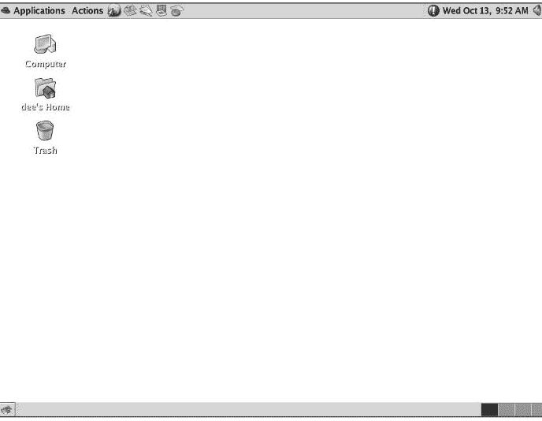

## 菜单

GNOME 和 Fedora Core 3 中有两个主要菜单。其中一个可以通过顶部面板上的“应用程序”（Applications）按钮访问，另一个可以通过点击旁边的“操作”（Actions）获取。“应用程序”菜单包含表 6-1 所示的选项，“操作”菜单的内容如表 6-2 所示。

菜单项右侧有一个箭头，提供子菜单，你可以通过将鼠标悬停在菜单上来打开子菜单。这些子菜单提供更多程序。

| 表 6-1 | Fedora 应用程序菜单内容，按顺序排列 |
|---|---|
| 菜单选择 | 你找到的内容 |
| --- | --- |
| 辅助工具 | 计算器、字符映射、字典、文件归档、文本编辑器。 |
| 游戏 | 游戏集合。 |
| 图形 | 各种图形程序，包括 GIMP。 |
| 互联网 | 一些互联网工具，如 Evolution（电子邮件和日历）、各种（即时消息）、Mozilla（网络浏览器）。 |
| 办公 | OpenOffice.org 软件套（文字处理、绘图）。 |
| 偏好 | 控制 GNOME 外观感觉的程序。 |
| 声音和视频 | 如 CD 播放器和录音器。 |
| 系统设置 | 配置系统的工具，如显示设置和软件包。 |
| 系统工具 | 管理、监控和更新系统的工具，如网络配置向导。 |
| 文件浏览器 | Nautilus 文件管理器，默认进入主目录。 |
| 帮助 | 用于浏览发行版电子文档的帮助浏览器。 |
| 网络 | Nautilus 文件管理器，默认进入网络。 |

| 表 6-2 | 操作菜单内容，按顺序排列 |
|---|---|
| 菜单选择 | 你找到的内容 |
| --- | --- |
| 运行应用程序 | 你可以在不打开虚拟终端的情况下运行特定程序的对话框。 |
| 搜索文件 | 在系统中查找文件的搜索工具。 |
| 最近文档 | 你从文件管理器打开的最近文件。 |
| 截图 | 截取桌面 PNG 格式图像。 |
| 第 6 章：查看这些桌面环境 111 |  |
|---|---|
| 屏幕 | 你找到的内容 |
| 锁定屏幕 | 设置机器让其他人在不输入密码的情况下无法使用你的 GNOME 登录。如果你需要离开电脑（但不想注销账户）且周围有其他人，这是一个很好的功能。 |
| 注销 | 退出 GNOME 会话、关机或重启电脑——如果你知道 root 账户密码。 |

# 运行应用程序工具

在主菜单上选择“运行应用程序”工具后，会出现“运行应用程序”对话框，如图 6-2 所示。

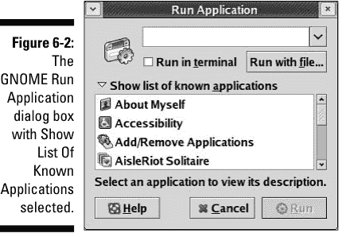

使用此对话框运行程序：

1. **从已知应用程序列表中选择应用程序或手动输入其完整路径。**

   例如，你可能会输入 `/usr/bin/gimp.`。

2. **如果你想让此程序处理特定文件，请点击“带文件运行”按钮。否则，跳到第 5 步。**

   会出现“选择要附加到此命令的文件”对话框（见图 6-3）。

# 112 第一部分：初学者之旅

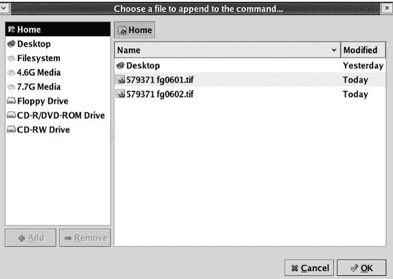

图 6-3：

GNOME

选择一个

文件

追加到

此

命令框。

- 3. 如果文件在你的用户主目录下，请导航到该目录。如果文件在系统的其他地方，双击“文件系统”按钮并导航到那里。

- 4. 选择好文件后，点击“确定”。

- 5. 点击“运行”按钮来执行程序。

此操作将你带回主对话框。

## 锁屏工具

如果你开启了屏幕保护程序（从主菜单中，选择“首选项::屏幕保护程序”进行此设置），并从主菜单中选择“锁定屏幕”选项，你的屏幕将变黑；或者如果屏幕出现，只要任何人移动鼠标或使用你的键盘，就会弹出一个包含你的登录名称和密码字段的对话框。你可以通过输入密码返回。在此之前，你可以放心地知道没有其他人可以窥探你的电脑，并冒充你给老板发送一封玩笑邮件。如果你以 root 用户身份登录，“锁定屏幕”选项将不起作用。

在这里我指的是 GUI，而不是整台机器。知道如何绕过 GNOME 的人（我将在第 14 和第 20 章中讨论）可以启动虚拟终端会话并随心所欲。如果你将自己锁定在其中一个虚拟终端中，他们就可以毫无问题地做些什么。


## 第 6 章：检查那些桌面 113

不要认为这个功能是完全保护了你电脑的！如果你要离开，最好的办法是检查所有的虚拟终端，并确保你没有登录到其中任何一个。然后你可以注销 GUI，或者直接使用“锁定屏幕”选项。

## 注销工具

在主菜单上并选择“注销”选项后，屏幕会变暗并打开“确定要注销吗？”对话框。要使用此对话框，请按照以下步骤操作：

- 1. 如果你想让 GNOME 记住你打开了哪些项目并在重新登录后恢复当前状态，请确保你勾选了“保存当前设置”框。

此功能并不适用于所有程序，有些（大部分实际上是 GNOME 的）。

- 2. 点击“注销”、“关机”或“重启计算机”来启动相应的操作，或者如果你不想执行任何一项操作，则点击“取消”。

这些选项执行以下操作：

* 注销：关闭 GNOME 并返回登录提示。

* 关机：关闭机器并电源。

* 重启计算机：关闭机器然后重新启动。

- 3. 点击“确定”以执行你的选择，如果改变了主意则点击“取消”。

## 面板

在你的 GNOME 桌面的顶部和底部有一对面板。由于这些栏被整齐地分成若干区域，请从左到右查看每个区域的内容，从顶部面板开始。顶部面板的最左侧是之前在“菜单”章节中讨论过的“应用程序”按钮。它的右侧是“操作”按钮，同样在同一章节中讨论过。

当你继续向右移动时，你会遇到一套标准的 Fedora 工具（参考图 6-1）。你可以通过主菜单访问所有项目，但它们被放置在面板上，以便你快速方便地找到它们。

# 114 第一部分：初学者之旅

- Firefox：带有鼠标指针的“世界之”图标打开 Firefox Web 浏览器。更多信息请参阅第 9 章。

- Evolution：就在 Web 浏览器按钮右侧；启动电子邮件和日历程序。更多信息请参阅第 9 章。

- OpenOffice.org Writer：像两张纸（一支笔），打开 OpenOffice.org 文字处理程序。更多信息请参阅第 17 章。

- OpenOffice.org Impress：打开 OpenOffice.org Impress 演示程序。更多信息请参阅第 17 章。

- OpenOffice.org Calc：打开 OpenOffice.org 表格程序。更多信息请参阅第 17 章。

现在你看到一个大空白空间，可以在那里添加新图标。在空白空间之后，你从左到右发现：

- 更新小组件：此图标会提醒系统有可用更新。（更多信息请参阅第 12 章。）

- 日期和时间小组件：在这里你可以看到日期和时间。

- 主音量控制小组件：点击此打开主音量控制。

现在看底部面板。从左到右，你在此面板上发现：

- 隐藏/恢复桌面应用程序：此按钮让你立即最小化所有正在运行的程序，然后只需点击即可重新打开它们。

- 任务栏：在这个较大的空间内，你找到桌面上运行的每个程序的条目。你可以按照指示使用框来更改程序状态：

- 如果程序被最小化，你可以点击它的任务面板框来打开它的窗口。

- 如果程序已最大化但埋在另一个程序下面，点击它的任务面板框。

- 任务栏：在这个较大的空间内，你找到桌面上运行的每个程序的条目。你可以按照指示使用框来更改程序状态：

- 如果程序被最小化，你可以点击它的任务面板框来打开它的窗口。

- 如果程序已最大化但埋在另一个程序下面，点击它的任务面板框。

- 任务栏：在这个较大的空间内，你找到桌面上运行的每个程序的条目。你可以按照指示使用框来更改程序状态：

- 如果程序被最小化，你可以点击它的任务面板框来打开它的窗口。

- 如果程序已最大化但埋在另一个程序下面，点击它的任务面板框。

- 任务栏：在这个较大的空间内，你找到桌面上运行的每个程序的条目。你可以按照指示使用框来更改程序状态：

- 如果程序被最小化，你可以点击它的任务面板框来打开它的窗口。

- 如果程序已最大化但埋在另一个程序下面，点击它的任务面板框。

- 工作区切换器：允许切换不同的环境。

## 第 6 章：检查那些桌面 132

想将窗口从一个工作区移动到另一个吗？右键点击窗口并选择以下项：

- 置于所有工作区：让窗口显示在所有——。

- 移动到工作区：将窗口滑动到右。

- 移动到另一个工作区：让你指定哪一个。


## 面板菜单

现在来看看更改面板的外观。你可以通过面板菜单单独自定义面板。有关此菜单提供的列表，请查看表格 6-3。

如果你打开了许多程序，可能没有空间可以右键。

| 表格 6-3 GNOME 面板菜单内容 |
| 菜单选项 | 查找内容 |
|---|---|
| 添加到面板 | 你可以添加到面板的小组件、菜单和其他对象 |
| 删除面板 | 删除二级面板的能力但不能删除主—— |
| 属性 | 设置面板行为的选项 |
| 新建面板 | 创建位于屏幕其他部分的新面板的选项 |
| 帮助 | GNOME 的帮助浏览器 |

# 116 第一部分：初学者之旅

| 表格 6-3 (续) |
| 菜单选项 | 查找内容 |
|---|---|
| 关于面板 | 包含基础面板信息的对话框 |
| 关于 GNOME | 包含基础 GNOME 信息的对话框 |

## 添加到面板菜单选项

“添加到面板”对话框（见图 6-4）可以通过菜单（见上一节）访问。此对话框包含一个小组件列表——你可以使用它们为面板添加特定功能的小程序。打开对话框，选择你想要的小组件，然后点击“添加”。该小组件现在出现在你的面板上。如果你右键点击小组件并选择“移动”，你就可以沿着面板滑动小组件，直到到达你想要的位置，然后点击释放它。

- 选择要添加到底部面板的项目：
  * 应用程序启动器...（启动已在 GNOME 菜单中的程序）
  * 电池监控（监控笔记本剩余电）
  * CD 播放器（播放音频 CD 的面板小组件）
  * 字符面板（插入字符）
  * 时钟（获取当前时间和日期）
  * 命令行（微命令行）
  * 自定义应用程序启动器（创建新的启动器）

## 玩桌面图标

你的初始桌面图标在屏幕左上角形成一条垂直线（参考图 6-1）。从上到下的顺序为：

## 第 6 章：检查这些桌面 117

- 计算机：打开 `Nautilus` 文件管理器（参见第 10 章），并列出你的 CD-ROM 驱动器、硬盘等列表。
- 首页（Home）：打开 `Nautilus` 浏览器（第 10 章），并显示你的主目录内容。
- 垃圾桶：这是一个 GNOME 快捷方式，它会打开 `Nautilus` 管理器进入垃圾桶文件夹，该文件夹包含了你因为不确定是否要删除某些文件而将其拖入的文件。

若要删除垃圾桶，请将其拖入任何你想要删除的文件中。稍后，如果你确定要丢弃这些文件，可以通过三种方法之一清空垃圾桶：

- 右键点击垃圾桶图标并从右键菜单中选择“清空垃圾桶”来清空所有内容。在提示确认时，点击“清空”。
- 双击图标打开垃圾桶。然后通过选择“清空垃圾桶”来删除垃圾桶内的全部内容。
- 双击图标打开垃圾桶。如需从垃圾桶中删除单个项目，右键点击调出垃圾桶右键菜单，从弹出菜单中选择“从垃圾桶删除”。确认后，点击“删除”按钮完成操作。

- 你可以通过按住 `Ctrl` 键来单独选择一个项目（如果它们不相邻）；按住 `Shift` 键来选择范围内的项目；或者左键点击并拖动来收集同一个框内的所有项目。
- 从垃圾桶中移除项目的另一种方法是从 `~/.Trash` 手动删除它们。

## KDE 基础

`KDE3` 是此处介绍的发行版中的默认版本。因此，我为每个发行版都分划分了章节，以便你找到差异并熟悉操作。我跳过了 Fedora，是因为我只涵盖默认桌面（Fedora、Mandrake 和 SUSE 在你安装了两个系统的情况下都提供在 GNOME 和 KDE 之间选择的选择），转而关注 Knoppix、Linux、Mandrake、SUSE 和 Xandros。

所有发行版都有相似之处，但每种发行版的组织方式都是独特的，这是其特定供应商或项目组认为最符合你用户群习惯的方式。

要了解更多关于 KDE 的信息，请访问 KDE 主站：`www.kde.org`。

## 118 第一部分：初入门

### Knoppix KDE

默认的 Knoppix 桌面如图 6-5 所示。从上到下，你看到的桌面图标（根据你机器上的驱动器有所变化）包括

- 垃圾桶：将你尚不确定是否删除的文件放在这里。
- CD-ROM：如果你有 CD-ROM 或 DVD-ROM 驱动器，它可能紧接着出现。你可以点击此图标打开 `Konqueror` 文件管理器（参见第 10 章）查看你的 CD-ROM 内容。
- 软盘：如果你没有软盘驱动器，会出现此图标。你可以点击此图标打开 `Konqueror` 文件管理器（参见第 10 章）查看软盘内容。
- 硬盘分区 `[hda1]`：你的系统中会有一个这样的硬盘分区图标。第 11 章将更清楚地解释如何区分它们。
- `KNOPPIX`：点击打开 `Konqueror` 查看关于 Knoppix 的信息。

屏幕底部是你的面板——如果你读过本章前面的“GNOME 基础”，请注意与 GNOME 的两个面板相比，KDE 只有一个面板。表 6-4 详细列出了 Knoppix 面板的内容。

图 6-5：默认的 Knoppix 3.6 KDE 桌面。

## 第 6 章：检查这些桌面 119

| 表 6-4 | 图标 | 打开的内容 |
| --- | --- | --- |
| 主菜单 | Knoppix 菜单。 |
| Knoppix 菜单 | 一个仅包含 Knoppix 特有项目的菜单，包含与主菜单相同的项目：KNOPIX 菜单。 |
| 窗口列表 | 弹出帮助你组织窗口的菜单。 |
| 显示桌面 | 最小化或最大化所有程序。 |
| 个人文件 | 打开 `Konqueror` 浏览器进入你的主目录内容。 |
| 终端程序 | 打开命令行窗口。 |
| 浏览器 | 打开 `Konqueror` 程序。 |
| Mozilla 浏览器 | 打开 Mozilla 浏览器。 |
| Open Office | 打开 OpenOffice.org 处理器。 |
| 工作空间切换器 | 允许你在不同的工作空间运行不同的程序。通过点击左上角的箭头将程序从一个工作空间移动到另一个。 |
| 任务栏 | 包含当前打开的每个程序。 |
| 笔记本图标 | 如果你使用的是笔记本电脑，显示电池电量。 |
| 语言图标 | 显示你的语言。 |
| 显示器图标 | 允许你更改分辨率。 |
| KMix 图标 | 启动混合器。 |
| 时间和日期 | 显示时间和日期。 |

面板允许你访问时间和日期、混合器、显示器、语言、笔记本图标和任务栏图标。

## 137

## 120 第一部分：初入门

当你打开 Knoppix 主菜单时，你会看到

- 开发
- 编辑器
- 娱乐 (Edainment)
- 模拟器
- 游戏
- 图形
- 帮助
- 互联网
- KNOPPIX
- 多媒体
- 办公
- 设置
- 系统
- 玩具
- 工具
- 最近使用
- 快速浏览器
- 运行命令
- 锁定屏幕
- 退出

## 第 6 章：检查这些桌面 121

### Linspire KDE

默认的 Linspire 桌面如图 6-6 所示。从上到下，你在默认安装中看到的桌面图标如 6-5 所示。其中某些图标与你在 Knoppix KDE 中找到的相似或相同，另一些取决于你的硬件设备。

| 表 6-5 | Linspire 4.5 桌面图标 | 图标名称 | 打开的内容 |
| --- | --- | --- |
| 我的电脑 | 打开 `Konqueror` 文件管理器，列出计算机中的位置，包括桌面、文档、程序、网络共享和系统（计算机文件系统的根目录）。 |
| 我的文档 | 打开 `Konqueror` 文件管理器进入你的文档目录。 |
| 网络浏览器 | 如果有网络共享，则打开它们。 |
| CD-RW/DVD-ROM | 打开 `Konqueror` 文件管理器查看你的 CD-ROM、DVD-ROM 或任何插入的介质内容；否则图标显示为空。 |
| 软盘 | 如果插入了软盘，则打开 `Konqueror` 文件管理器查看内容；否则图标显示为空。 |
| 打印机 | KDE 打印控制台。（更多信息参见相关。） |
| 垃圾桶 | KDE 垃圾桶。工作原理与 GNOME 垃圾桶类似，我在之前的“操作桌面图标”部分介绍过。 |
| 互联网连接工具 | 打开 `Konqueror` 文件管理器进入各种连接工具集。（更多细节请参见第 8 章）。 |
| 邮件 | 打开 Linspire 互联网套件中的电子邮件程序（参见第 9 章）。 |

## 122 第一部分：入门

| 表格 6-5（续） |
| 图标名称 | 启动的内容 |
|---|---|
| Web 浏览器 | 打开 Linspire 互联网套件的 Web 浏览器（参见第 8 章）。 |
| CNR | 打开浏览器进入 Click N Run 仓库（参见第 12 章）。 |

观察 Linspire 面板，你可以从左到右看到：

- Linspire 主菜单。
- Linspire 帮助菜单，其中有许多可用帮助选项。
- Conqueror 文件管理器（参见第 10 章）。
- Click N Run 仓库、Web 浏览器和电子邮件（参见表格 6-5）。
- GAIM 即时通讯工具（参见第 9 章）。
- 桌面图标，可瞬间最小化所有窗口。
- 任务栏区域（参见前面的章节“面板”）。
- 图 CNR 图标。

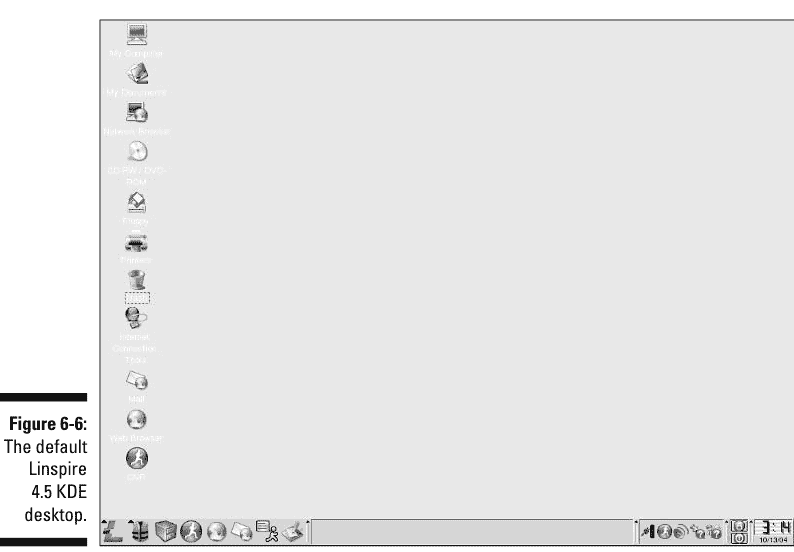

## 第 6 章：检查这些桌面

- VirusSafe 图标（参见第 13 章）。
- SurfSafe 图标（参见第 13 章）。
- 音量控制按钮。
- 如果使用的是笔记本电脑，则有电量指示器。
- 上下一对图标。上方是锁屏工具（参考表格 6-1）。下方是结束 Linspire 会话工具，你可以在其中选择注销、关机或重启。快速重启（Quick Restart）是一个自动注销，可以让你立即回到系统。
- 时钟和日历应用。
- 一个向右的箭头，可以让你收起面板，从而为屏幕留出更多空间。

当你点击主菜单图标（面板左侧花哨的 L 字）时，你会看到表格 6-6 所示的菜单项。

| 表格 6-6 | Linspire 4.5 主菜单 |
|---|---|
| 条目 | 你能找到的内容 |
| 程序 | 系统上所有的应用程序。 |
| 我的文档 | 你的默认文档保存目录。 |
| 设置 | 你的系统设置。 |
| 搜索 | 搜索文件的工具。 |
| LindowsHelpAndSupport | 所有的 Linspire 帮助选项，与点击面板上的帮助图标看到的内容相同。 |
| 最近文档 | 你最近通过文件管理器打开的文档。 |
| 运行命令 | 运行命令对话框，与“运行应用程序工具”章节中的介绍类似。 |
| 配置面板 | 面板配置选项（参见第 15 章）。 |
| 终止应用程序 | 一个很酷的程序，可以发现并停止挂死并卡在那里的程序。 |
| 锁屏 | 与表格 6-1 中讨论的锁屏菜单项相同。 |
| 注销/快速重启 | Linspire 面板中相同的注销工具。 |

## 124 第一部分：入门

### Mandrake KDE

默认的 Mandrake 桌面如图 6-7 所示。从上到下，你在默认安装中可能会看到的桌面图标有：

- 主目录（Home）：Conqueror 文件浏览器，显示账户家目录的内容。
- 欢迎（Welcome）：Welcome To Mandrake Linux 工具。
- 软盘（Floppy）：Conqueror 文件浏览器，如果你的软驱驱动器里插了软盘，则显示其内容。
- 垃圾桶（Trash）：KDE 垃圾桶。它的工作原理与 GNOME 垃圾桶类似。（参见前面的章节“玩桌面图标”）。

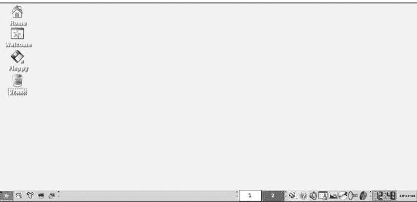

图 6-7：默认的 Mandrake KDE 10.1 桌面。

面板的内容从左到右分别是：

- 主菜单星形图标。
- 瞬间最小化或最大化桌面上的每个窗口。
- Emacs 终端。
- 命令行终端。
- 系统配置程序。

系统配置右侧的小箭头可以打开任务栏，让你能够滑动面板中显示已程序图标的部分，以便为更多面板快捷方式腾出空间。接下来是任务栏本身，你可以看到每个打开的程序都有一个框。任务栏出现后，再次从左到右，你有：

- 工作空间切换器。（参见前面的章节“面板”）。分页器（Pager）左右的小箭头可以调出分页器上下文菜单，你可以用它来移动和配置此工具。
- 网络连接状态。
- MandrakeOnline 启动器，用于保持系统最新（参见第 12）。
- Mandrake 音量控制，启动 KDE 音频混合器（参见第 18 章）。
- KDE Organizer 日历工具。
- 屏幕调整工具。
- KDE CD 播放器（参见第 18 章）。
- amarOK 音频播放器（参见第 18 章）。
- Kaffine 媒体播放器（参见第 18 章）。
- 时钟插件，旁边也有小箭头允许调出它的配置。

Mandrake 的主菜单在表格 6-7 中详细列出。其中许多都是熟悉的。

| 表格 6-7 | Mandrake 10.1 主菜单 |
|---|---|
| 条目 | 你能找到的内容 |
| 程序 | 系统上所有的应用程序。 |
| 文档 | 你的默认文档保存目录。 |
| 设置 | 你的系统设置。 |
| 搜索 | 搜索文件的工具。 |
| 帮助 | 所有的帮助选项，与点击面板上的帮助图标看到的内容相同。 |
| 最近文档 | 你最近通过文件管理器打开的文档。 |
| 运行命令 | 运行命令对话框，与“运行应用程序工具”章节中的介绍类似。 |
| 配置面板 | 面板配置选项（参见第 15 章）。 |
| 终止应用程序 | 一个很酷的程序，可以发现并停止挂死并卡在那里的程序。 |
| 锁屏 | 与表格 6-1 中讨论的锁屏菜单项相同。 |
| 注销/快速重启 | Linspire 面板中相同的注销工具。 |

## 第 6 章：检查这些桌面

面板的内容从左到右：

- 主菜单星形图标。
- 瞬间最小化或最大化桌面上的每个窗口。
- Emacs 终端。
- 命令行终端。
- 系统配置程序。

系统配置右侧的小箭头可以打开任务栏，让你能够滑动面板中显示已程序图标的部分，以便为更多面板快捷方式腾出空间。接下来是任务栏本身，你可以看到每个打开的程序都有一个框。任务栏出现后，再次从左到右，你看到：

- 工作空间切换器。（参见前面的章节“面板”）。分页器（Pager）左右的小箭头可以调出分页器上下文菜单，你可以用它来移动和配置此工具。
- 网络连接状态。
- MandrakeOnline 启动器，用于保持系统最新（参见第 12）。
- Mandrake 音量控制，启动 KDE 音频混合器（参见第 18 章）。
- KDE Organizer 日历工具。
- 屏幕调整工具。
- KDE CD 播放器（参见第 18 章）。
- amarOK 音频播放器（参见第 18 章）。
- Kaffine 媒体播放器（参见第 18 章）。
- 时钟插件，旁边也有小箭头允许调出它的配置。

Mandrake 的主菜单在表格 6-7 中详细列出。其中许多都是熟悉的。

## 126 第一部分：入门

### SuSE KDE

图 6-8 显示了 SuSE 桌面。通过 noppix，SuSE 已经为你配置好了。

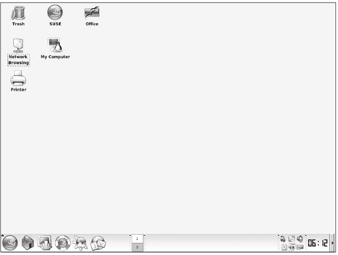

图 6-8：SuSE 9.2 桌面。

## 第一部分：上手入门

| 表 6-8 SuSE 9.2 主菜单内容 | |
| --- | --- |
| 条目 | 您能找到的内容 |
| 游戏 | 游戏 |
| 图形处理 | 绘图工具、图像编辑器等。 |
| 互联网 | 与互联网相关的工具。 |
| 多媒体 | CD、DVD、点唱机、电视及其他多媒体工具。 |
| 办公 | 与工作相关的办公工具。 |
| 系统 | 管理您系统的工具。 |
| 工具 | 方便的小工具。 |
| 控制中心 | KDE 控制中心，这是一个自定义系统的极佳中心位置。 |
| 查找文件 | 文件系统搜索工具。 |
| 主页 | 打开到您主目录内容的 Conqueror 文件浏览器。 |
| SuSE 帮助中心 | SuSE 帮助信息。 |
| 书签 | 您的 Web 浏览器书签。 |
| 运行命令 | 运行对话框，与 GNOME 章节中“运行应用程序工具”所介绍的类似。 |
| 切换用户 | 与 Mandrake 的“开启新会话”选项相同。 |
| 锁定会话 | 与大家的锁定会话功能相同。 |
| 注销 | 与 Mandrake 的注销选项相同。 |

## Xandros KDE

图 6-9 显示了默认的 Xandros 桌面。如您所示，Xandros 提供了另一个另一个自定义版本。

桌面左侧有一列垂直的图标。这些图标从上到下分别是：

- 垃圾桶：KDE 垃圾桶，工作原理与 GNOME 垃圾桶类似。（参见前面的章节“玩转桌面图标”）。
- 主页：Xandros 文件管理器（见第 10 章），打开到您主目录的内容。 |

## 第 6 章：查看这些桌面

129

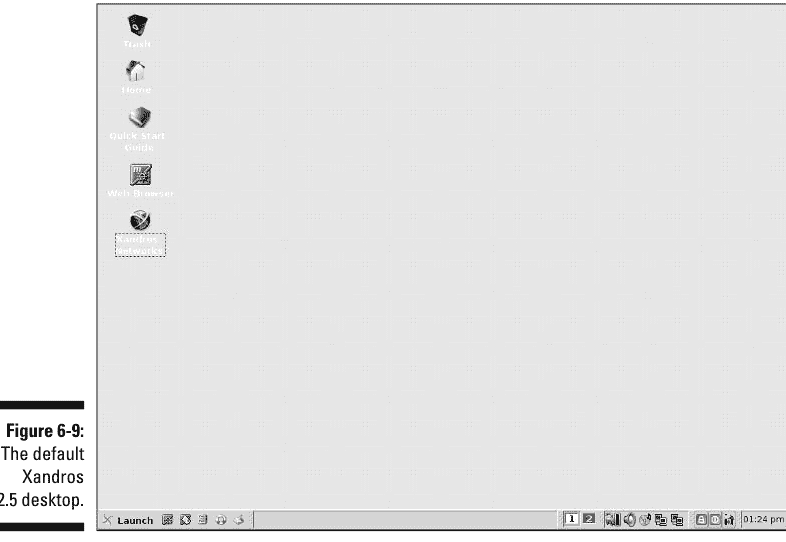

- 快速启动指南：启动 Xandros 快速启动帮助指南。
- Web 浏览器：启动 Mozilla Web 浏览器（见第 9 章）。
- Xandros 网络：启动软件更新和添加工具（见第 12 章）。

您的 Xandros 面板从左到右启动：

- 主菜单。
- Mozilla Web 浏览器。
- Mozilla 电子邮件客户端。
- 进入您主目录的 Xandros 文件管理器。
- Xandros 桌面帮助。
- 桌面清除工具，让您一次性最小化桌面上的所有内容。
- 任务栏，您运行的程序在此处显示。
- 工作区切换器，在本章前面的“面板”部分中讨论过。
- 桌面锁定工具。

130 第一部分：上手入门

- 注销、重启或关机工具。
- 切换用户工具，如“Mandrake KDE”部分中讨论的。
- 钟和日历。
- 面板收起箭头。

表 6-9 详细列出了 Xandros 主菜单。

| 表 6-9 | Xandros 2.5 主菜单 |
| --- | --- |


| 菜单条目 | 您能找到的内容 |
|---|---|
| 应用 | 您所有的程序。 |
| 查找 | 两个搜索工具，一个用于搜索文件系统，另一个用于在大型网络上搜索特定的计算机。 |
| 控制中心 | Xandros/KDE 控制中心，非常适合自定义您的系统。 |
| Xandros 文件管理器 | 文件管理器，打开到您主目录。 |
| Xandros 网络 | 系统更新器和软件安装界面。 |
| 帮助 | Xandros 桌面帮助中心。 |
| 最近文档 | 打开您最近使用文件管理器打开文档的菜单。 |
| 运行命令 | 运行对话框，与之前的章节“运行应用程序工具”所介绍的类似。 |
| 切换用户 | 与“切换用户”选项相同。 |
| 注销 | 与“注销”选项相同。 |

# 在 GNOME 和 KDE 之间切换

当发行版提供多个桌面时，您在登录时可以选择想要使用的界面。以下是某些发行版的设置：

- **Fedora**：在登录屏幕上，点击图标，以选择您想要使用的桌面环境。
- **Mandrake**：输入用户名后，点击下拉菜单。
- **SuSE**：在登录之前，通过在登录界面选择会话。

# 第 7 章：配置 Linux

**本章内容**

- 创建用户账户
- 设置您的 Linux
- 查找工具

> 与建筑师不同，建筑师也会犯错。—— 弗兰克·劳埃德·莱特（Frank Lloyd Wright，1869–1959）

在这一章中，我将介绍如何创建用户账户，如何设置您的 Linux，以及如何查找工具。与建筑师不同，即使您在自己的账户中犯错也是可以修复的。在接下来的章节中，我将教您如何创建新账户，这样您就不需要使用 root —— 或者让借用您电脑上网的人在 root 下进行操作。

## 账户的好处

Linux 是一个多用户操作系统。它允许每个人都有自己的账户。通常，即使只有一个用户，您也需要一个账户（我将在下一节中解释）。此外，拥有多个账户对于实验非常有帮助。

## 避免 root

`root` 用户（也称为超级用户或简单的 `root`）对机器上的所有内容都有访问权限。没有任何目录、文件或设备限制 `root`。由于这个因素，许多 Linux 初学者认为他们一直使用 `root` 账户是因为这样非常方便。

然而，出于许多原因，您不应该在日常使用 `root` 账户：

- 您并不总是需要 `root` 权限。作为普通用户，如果您在操作时出错，您只会损坏自己账户中的东西。如果您以 `root` 身份出错，可能会删除整个 Linux 系统的所有文件！这就是为什么像 SuSE 这样的发行版在您以 `root` 登录时会给出显眼的红色背景作为警告。SuSE 甚至没有提供 `root` 的图形界面选项，但您可以在用户名框中输入它。
- 别以为您可以删掉一切？许多 Linux 管理员都讲述过他们由于一个致命的拼写错误或没有注意自己在做什么而完全摧毁了安装的故事。
- 如果您以 `root` 身份发送除行政事务以外的电子邮件或帖子，人们会认为您不知道自己在做什么，或者在显摆。
- `root` 带来了太大的诱惑。超级用户可以阅读他人的邮件和文件，这引入了一些“微小”的伦理问题。

## 创建用户账户

- Knoppix：从主菜单中，选择 `System`-`User` 打开 KDE 用户管理器。
- Linspike：从主菜单中，选择 `Settings`-`User Manager` 打开 KDE 用户管理器。
- Mandrake：从主菜单中，选择 `System`-`Configuration`-`Other`-`User Administration` 打开 Drak 工具。
- SUSE：从主菜单中，选择 `System`-`YaST` 打开 YaST。在左侧，选择 `Security and Users`。然后在右侧，选择 `Edit And Create Users` 以打开用户和组组管理对话框。
- Xandros：选择 `Launch`-`Control Center` 打开 Xandros 控制中心。在这里，点击 `System Administration` 旁边的加号展开它，然后点击 `User Manager` 打开 KDE 用户管理器。

虽然这些工具在不同的发行版之间并不相同，但它们非常相似，且工作原理基本一致。毕竟，每个应用程序创建用户账户时都有非常标准的步骤。我将引导你如何在 Fedora Core 中创建用户账户，大多数相同的步骤也适用于其他地方。

### 在 Fedora 中创建新用户账户

1. 选择 `Applications`-`System Settings`-`Users And Groups`。
2. 因为你（希望）正在使用普通用户账户，会弹出 `root` 账户对话框。
3. 输入 `root` 密码并点击 OK。

`User Manager` 窗口打开，如图 7-1 所示。当应用程序打开时，会显示你在安装期间创建的用户账户。

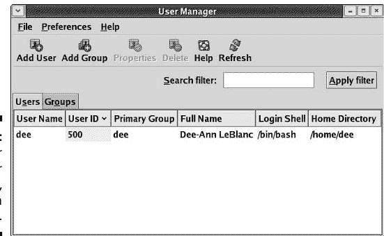

图 7-1：Fedora Core 3 中的用户管理器。

3. 点击 `Add User` 按钮。

`Create New User` 对话框打开，如图 7-2 所示。

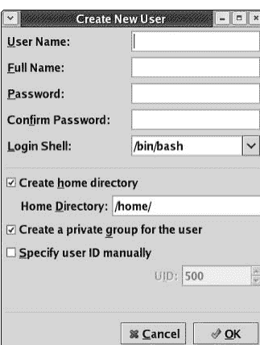

图 7-2：Fedora Core 3 用户管理器应用程序中的创建新用户对话框。

4. 在 `User Name` 字段中为你的新用户输入名称。

在 Linux 中，用户账户的大小写是非常重要的，因此在输入信息时请注意大小写。通常，人们使用全小写，这样就不需要刻意记忆。

5. 在 `Full Name` 字段中填写用户的全名（例如，你希望在邮件发件人头部中显示的名称）或 `nickname`。
6. 在两个 `Password` 字段中都输入密码。

#### 创建良好的密码

- 良好的密码包含以下内容：
  - 六个或更多字符
  - 数字、字母、甚至是标点符号的组合
  - 不要包含家人或宠物的名字、朋友的名字、生日、纪念日或其他他人容易猜到的关于你的个人信息
  - 大写字母和小写字母
  - 不要使用字典中的单词

剩余的项目更为高级，你暂时可以忽略它们。

7. 点击 OK 保存新账户。
8. 如果你想再创建一个另一个账户，请重复步骤 3 到 7；如果已完成，选择 `File: Quit` 关闭用户创建程序。

## 打印

除非你生活无纸化环境中，否则你可能经常需要打印某些东西（如信、数码相机拍摄的照片或发票）。因此，你需要设置你的 Linux 系统进行打印。在继续之前，了解你的打印机品牌、型号以及它是如何连接到计算机会有帮助：

- 是否是本地打印机，意味着它通过并行、串口或 USB 端口直接连接到你的计算机？
- 是否是网络打印机，意味着它不需要连接到计算机，而是作为一台独立的机器位于网络上？
- 是否是远程打印机而非网络打印机，意味着它连接到你网络上的另一台计算机？如果是，它是 Windows、Linux 还是 OS X 计算机？

你可以通过以下方法找到打印机配置工具：

- Fedora：选择 `Applications:System Settings:Printing` 以打开打印机配置工具。
- Knopix：从主菜单中，选择 `KNOPPIX:Configure:Configure Printer(s)` 打开配置-打印机工具。
- Linscape：双击 `Printers` 图打开 KDE 控制模块，然后点击 `Add Printer/Class` 按钮（顶行左侧的图标）打开添加打印机向导。
- Mandrake：从主菜单中，选择 `System:Configuration:Configure Your Computer` 项目打开 Mandrake 控制中心。在对话框中，点击 `Hardware` 然后点击 Mandrake 启动 `Printerderf`。
- SuSE：从主菜单中，选择 `System:YaST` 打开本章后面“SuSE 工具”部分中讨论的 YaST 工具。在这里，在左侧选择 `Hardware`，然后在右侧选择 `Printer` 以打开打印机配置工具。
- Xandros：在第一次运行时，你有通过首次运行向导添加打印机的选项。

在本节中，我将描述如何设置你的打印机。这些选项中的每一个都解释了它需要你提供的信息。要配置你的打印机：

`Printer Configuration` 窗口出现，如图 7-3 所示。

1. 输入::::。

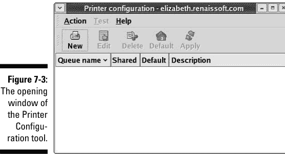

| | | | | |
|---|---|---|---|---|
| : | | | | |
| Printer configuration - | | | | |
| Action | Test | Help | | |
|---|---|---|---|---|
| New | Edit | Delete | Apply | |
| Queue name | Shared | Default | | |

2. 点击 `New` 按钮开始设置你的打印机。

`Add New Queue` 窗口出现。

3. 在 `Queue name` 中，输入你想为此打印机分配的名字。

如果你有多台打印机，在 Short 文本框中添加内容。

4. 输入信息后，点击 `Forward`。

`Queue` 对话框出现，如图 7-4 所示。

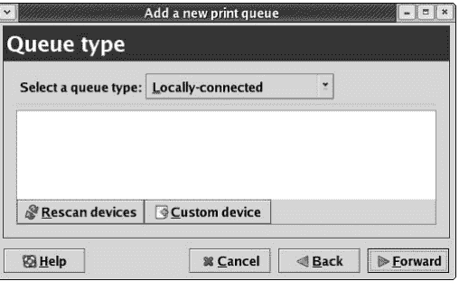

图 7-4：打印配置工具中的队列对话框。

5. 使用下拉列表选择所需的队列类型。

队列类型对应打印机的连接方式：

- 如果打印机直接连接到你的 Linux 系统，选择 `Local Printer`。
- 如果你的网络打印机支持互联网打印协议 `IPP`，或通过网络连接到另一台 Unix（包括 Linux 和 OS X）机器，请选择 `Networked CUPS (IPP)`。
- 如果你的打印机连接到另一台使用 `LPD` 的 Unix 机器，请选择 `Networked UNIX (LPD)`。
- 如果打印机连接到网络上的 Windows 机器，请选择 `Networked Windows (SMB)`。
- 如果打印机连接到网络上的 Novell 机器，请选择 `Networked Novell (NCP)`。
- 如果打印机具有 HP JetDirect 网络技术，则选择 `Networked JetDirect`。

对话框会根据你选择的项目改变格式顺序。

6. 输入你选择所需的额外信息。

例如，如果你选择 `Networked CUPS (IPP)`，你需要填写打印服务器的名称（或 IP 地址）。你可以忽略 Path 文本框并保持默认值。

# 140 第一部分：上手入门

- 8. 点击“通用（Generic）”栏打开列表框，允许你选择打印机制造商，然后向下滚动到相应的选项。

型号的选择会根据你制造商的列表而变化。

选择正确的打印机品牌和型号非常重要，因为 Linux 会加载并关联与你提供的信息相特定打印机驱动程序。如果指定的错误的打印机品牌和型号，当你尝试打印时，错误的打印机驱动程序（操作系统用于与打印机通信）通常会产生乱码字符和符号。


- 9. 选择你的打印机型号，然后点击下一步（`Forward`）。
出现“完成并创建新打印队列”对话框。

你获得打印测试页的机会。

- 10. 在“完成并创建新打印队列”对话框中，点击“完成（Finish)”启用你的打印机。
- 11. 点击“是（Yes)”打印测试页。

如果此页面没有正常打印，请确保你使用了正确的打印机品牌和型号。某些制造商为不同的打印机分配相似的型号数字，很容易混淆。

- 12. 如果测试页打印良好，当被询问看起来是否正常时，点击“是”；如果完全没有打印或看起来是乱码，点击“否”。

如果你回答“否”，将看到你尝试打印时发送到日志文件的所有数据副本。滚动到最后几行以寻找关于问题所在处的提示。这种情况在我身上发生过一次，结果发现是网络问题，而不是打印机问题！如果你遇到问题，请回到此过程的开头，确保所有的选择都是正确的。

如果你的测试页正常且你点击了“是”，将出现主“打印机配置”界面，你的新打印机将列在工具列表中。

- 13. 选择操作：退出（Quit）或保存（Save）以关闭打印机配置

# Linux 配置的禅意

让一个发行版与其他发行版脱颖出的特点之一是它的配置工具集。工具越易用，Linux 新手就越倾向于选择该发行版。注意，老手在从一个发行版切换到另一个发行版时也不介意周围有简单的工具。这节省了他们无需重新学习每个发行版存放配置文件的时间。

# 第 7 章：配置 Linux

在本节中，我将介绍书中涵盖的每个 Linux 版本中提供的配置工具。需要注意的一个重要点是，每个 KDE 默认发行版（除 Fedora 以外的所有版本）中的控制面板外观和工作方式都非常相似，因为它们都基于主 KDE 控制面板。

## Knoppix 工具

Knoppix 附带许多工具，让你在菜单间穿梭时很容易迷失，感到不知所措。在该发行版中找到配置工具的主要地方是从主菜单中选择 `KNOPPIX`（左下角的 K）。该菜单内部包含一组子菜单，其中包含其他配置选项：

- **配置（Configure）：** 设置你的电视卡、打印机、在多次启动发行版的时间之间保持保留的真实主目录（见第 21 章）等更多选项。
- **网络/互联网（Network/Internet）：** 用于从 ISDN 等所有内容的网连接连接程序（见第 8 章）。
- **服务（Services）：** 自己启动在桌面上很有用的服务器的选项，例如 SSH（见第 13 章）和用于通过网络向你的 Windows 提供 Linux 文件的 Samba。

除了此位置，你还可以通过从主菜单选择“设置（Settings）”找到配置程序：

- **更改密码（Change Password）：** 此程序为你当前登录的账户设置密码。然而，它不接受空密码，且 `knopp` 登录（常规 `knoppix` 账户和 `root`）的默认都是空密码。你需要打开虚拟终端（见第 14 章）并输入 `passwd` 以在使用 GUI 工具之前设置初始密码。
- **配置面板（Configure Panel）：** 此程序允许你管理面板——将其移动到其他地方、隐藏它、更改其外观等。
- **控制中心（Control Center）：** 此选项打开 KDE 控制中心。
- **桌面设置向导（Desktop Settings Wizard）：** 此选项打开 KDE 设置向导。
- **菜单编辑器（Menu Editor）：** 此选项打开 KDE 菜单编辑器，你可以在其中自定义菜单内容。
- **菜单更新工具（Menu Updating Tool）：** 此选项在系统中搜索特定程序，如果它们不在那里，则将其添加到菜单中。
- **打印管理器（Printing Manager）：** 此程序（见图 7-5）打开了一个方便的打印管理器，可以帮助你执行打印到 PDF、发送传真机等操作。

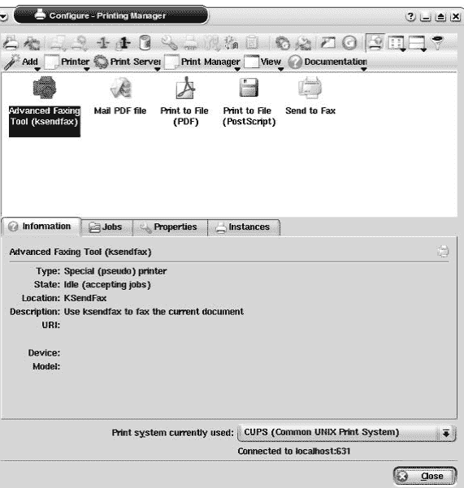

图 7-5：Konqueror 3.6 打印管理器。

## Linspire 工具

第一次运行 Linspire 时，会出现“首次设置（First Time Setup）”对话框，在你勾选“我同意许可（I Agree To License）”复选框之前它会一直出现。在这个工具中，你有引导系统配置过程的选择，设置时区、日期、时间、重置主密码、更改系统分辨率、创建新用户账户等值。

# 142 第一部分：上手入门


*(注：此处由于原文文本存在重复和错乱，翻译时已按要求根据原文逻辑进行了处理。)*

## 第 7 章：配置 Linux

### Red Hat 和 Fedora 工具

Red Hat 的 Fedora 社区项目包含了许多 Red Hat 为其商业产品开发的工具，以及社区构建的各种工具，例如 GNOME 项目的工具。在自定义桌面时，你可以通过选择应用程序（Applications）▸偏好（Preferences）找到你需要的大部分内容。GNOME 没有选择一个巨大的中心，而是选择将配置工具拆分为较小的、独立的程序。你在其他 GNOME 安装中也能发现这种布局。

延续更小、更专业工具的主题，你的系统配置选项可以通过选择应用程序（Applications）▸系统设置（System Settings）来实现。

### SuSE 工具

与 Mandrake 一样，SuSE 提供了两个配置系统的主要位置。其中一个是（再次）KDE 控制中心，通过点击左下角的蜥（极客）头部图标（主菜单）并选择控制中心来访问。此版本的 KDE 控制中心与标准版本略有不同，因为它支持 YaST（另一个设置工具）模块——YaST 内部的每一个独立配置程序。然而，若要直接使用 YaST，你可以进入主菜单并选择系统▸YaST（见图 7-8）。

**图 7-8：** SuSE 9.2 中的 YaST 界面。

你可以在命令行提示符中使用本章讨论的许多工具，但并非全部。YaST 实际上有一个完整的命令行版本，以防你没有使用图形界面！

最后，你还可以查看另一个地方。从主菜单中，选择系统配置（System-Configuration）：

- OpenOffice.org 打印机管理：更多信息请参阅第 17 章。
- SaX2：基础 GUI 配置工具。
- YaST：系统配置工具。

### Xandros 工具

Xandros 提供了 KDE 控制中心的定制版本，称为 Xandros 控制中心，通过选择“启动控制中心”（Launch Control Center）（见图 7-9）访问。在该工具中可以进行系统级和个人化的外观设置。

图 7-9：2.5 版本中的 Xandros 控制中心。


如你所见，学习一个 Linux 发行版的酷之处在于，你正在学习有用的知识，帮助你掌握另一个 Linux 版本。记住，所有这些发行版都是亲戚，就像兄弟姐妹一样。去调优你的系统吧！

## 在这一部分

在这一部分中，你将建立必要的心理和物理连接将你的 Linux 机器接入互联网，包括配置电话拨号接入互联网服务提供商（ISP）。你还将发现如何进行一些基础的网络故障排除，以防情况不尽完美。接下来，你将设置 Web 浏览器、电子邮件客户端和新闻阅读软件，以便你能够浏览网页、发送和接收电子邮件以及访问新闻组。通过在本部分中安装的设施，你将能够心尽所欲地扩展和自定义你的 Linux 系统。你还将学习如何在互联网的电子公路和小径上穿梭以完成任务！

# 第 8 章

## 连接互联网

本章内容

- 理解常见的互联网连接方法
- 设置你的互联网连接
- 连接到你的互联网服务提供商（ISP）
- 足够的 TCP/IP 知识以操作

> 通信的每一步改进都让无聊变得更加糟糕。
> — Frank Moore Colby

如果你在一台连接到局域网（LAN）并在安装期间配置了网络的机器上，你可能已经连接了互联网。要测试你是否有连接，打开 Web 浏览器并尝试访问外部网站（如 `www.tinuxworld.com`）。如果可以正常，说明你成功了！不需要读这一章。否则，请继续阅读。

### 互联网连接入门

在进入第 I 节之前，有必要对宽带选项（DSL 和电缆）进行简单说明。“宽带”一词有一个技术定义，但我只是用它来表示高速互联网访问。虽然拨号调制器通常能以每秒 56 千比特（千位）的速度传输信息，但宽带连接可以达到该速度的 50 倍。如今，网页包含大量的图像和多媒体元素，通过 56 kbps 的拨号调制器享受这些功能就像在渴死时用滴管喝一杯冷水一样。

不要让高速服务提供商阻止你使用他们的服务配合 Linux。仅仅因为他们不支持支持 Linux，并不意味着该技术无法与 Linux 工作。TCP/IP（互联网流量规则）是为 Unix 操作系统开发的，而 Linux 正源于 Unix。

如果你有双启动 Windows 的机会，你的 ISP 可以帮助你安装宽带连接，然后你可以对其进行调试。至于宽带，有几种类型：

- 电缆（Cable）：许多 ISP 使用电缆电视提供宽带。当你使用电缆时，你需要一个电缆调制器将来自电缆线的信号转换为计算机的数字信号。这很常见。
- DSL：这使用现有的电话线提供宽带。因为它使用的频率比语音通话高，所以你可以同时使用电话和互联网。DSL 有几种变体：
    - ISDN：集成业务数字业务
    - ADSL：非对称数字线路
    - SDSL：对称数字线路
    - GDSL：通用数字线路
- 无线（Wireless）：这通过无线波提供宽带。你需要一个无线适配器（或网卡）来连接。
- 卫星（Satellite）：用于没有电缆或 DSL 的地区。它使用卫星天线接收卫星的信号，然后将其转换为数字信号。你需要卫星调制器。
- 拨号（Dial-up）：这使用现有的电话线提供互联网。它是所有选项中最慢的，并且需要调制器来转换信号。

互联网是一个巨大且复杂的世界，但一旦你连接，就会发现许多可能性。在本章中，我们将学习如何连接以及如何使用各种工具。

# 第二部分：现在是互联网！

## 警惕伪装成调制调器的设备

我试图让你免受一些挫败感 —— 也让你的电脑免受羊圆锤的伤害。许多 Linux 新手因为无法与模拟调制解调器通信而感到恼火。“毕竟，”新手这样想道，“当我运行微软 Windows 时，这块硬件是可以正常工作的。”

这些标签具有误导性，因为有些制造商根本不懒于列出其他操作系统，尽管他们的硬件可以在这些操作系统上运行。

好了，故事是这样的：年前，硬件制造商开发了一种被称为“软件调制调器”的设备，试图降低硬件成本。其想法是减少操作系统的负担。结果是产生了一种仅在微软 Windows 下运行的廉价调制调器。简而言之，这些所谓的调制调器（也称为 WinModems）并不是真正的调制调器，而是 Windows 的电缆接口。

Windows 能识别你的调制解调器，但 Linux 不能。

简而言之，如果你有一个软件调制解调器，Linux 无法与其工作。对于冒险型用户，LinMod 项目 (`linmodems.org`) 成功编写了可以与这些软件调制调器协同工作的 Linux 驱动程序。如果你有兴趣，我鼓励你参与这类项目。这些探索者驱动着自由软件的美妙世界，而 Linux 是其中一个重要组成部分。

以下列表显示了你可以用来判断自己是否拥有软件调制调器的方法：

- 型号前面带有 `HCF-`、`HSP-` 或 `NSF-`。
- 包装将该设备称为 WinModem，或指定其仅适用于 Windows（有时

这一切中令人遗憾的是，虽然通过购买带有软件调制调器的机器节省了几块钱，但你可能需要一个真正的调制调器来配合 Linux（除非你幸运地有一个 LinModem）。你最好的办法是购买一个真正的调制调器代替之，并将外部调制调器专门用于 Linux（或你以后可能想移动它的任何其他电脑）。

## 设置硬件

在你坐在椅子上感到太舒服之前，你必须物理检查一些可能需要你执行某些底层操作的项目（如爬到桌子下面）：

- 调制缆调制调器、DSL 调制调器或任何花花连接：如果你拥有这些设备之一，你需要确保：
  - 一根以网线（类似于电话线）已插入电脑的以太网卡，并插入 ISP 安装的特殊电缆、DSL、卫星或 ISDN 调制调器。

# 第 8 章：连接互联网

- 花哨的调制调器已接电源。（这些装置通常有自己的电源。）

**外部调制调器：** 如果你有一个外部调制调器（独立于你的电脑机箱），你需要验证：

- 一根电缆已牢固地连接从调制解调器到电脑的正确端口。
- 调制解调器已开启。（外部调制调器有自己的电源。）
- 电话线的一端插入墙上的插座，另一端插入调制解调器。

**内部调制调器：** 如果你有一个内部调制调器，你需要验证：

- 调制解调器*不是*软件调制调器。如果你不确定什么是软件调制调器，或者你是否有一个，请查看侧边栏“警惕伪装成调制调器的设备”。
- 电话线的一端插入墙上的插座，另一端插入电脑背后的电话接口。

**无线网卡：** 如果你有无线网卡，你还需要一个无线路由器来收集和引导电脑之间的无线流量，或者通过桥接让你的无线网卡与你的以太网网络通信。无线路由器或桥接距离卡的距离以及穿过什么（墙、地板……）取决于你正在使用的技术。关于无线硬件和设置的一些实用指南：

- WiFi 如何工作：`http://computer.howstuffworks.com/wireless-network.htm`
- 创建无线网络：`www.wi-fi.org/OpenSection/design.asp?ID=2`

好了，现在你回到椅子上。

## 选择互联网服务提供商 (ISP)

由于 Linux 流行度的突飞上升，许多 ISP 正在训练他们的支持人员学习 Linux 相关。如果你已经有了拨号服务，给他们其中一个打个电话让他们知道你的追求。很有可能，那个人已经拥有有关 Linux 订阅者的信息，并为你提供这些信息。如果你正在寻找新的 ISP，本节提供了一些实用的选择建议。

# 第二部分：现在是互联网！

有些 ISP 提供自己的专有软件，你必须将其安装在 PC 上才能连接到互联网。他们提供的软件可能只运行在 Windows 上。由于这一事实，几个免费的拨号服务无法与 Linux 工作。专有软件会干预操作系统，以确保横幅广告不被隐藏，或确保在你拨号期间

如果你在到处寻找 ISP，请考虑以下问题：

- 你能否在全国乃至世界范围内获得本地拨号号码？如果你经常需要并从不同的城市访问，这项服务将是一个方便的省钱（省心）选择。
- 它是否为 Linux 提供技术支持？如果你计划运行 Linux，这个考虑很重要。不过，这不必是决定性因素。
- 你能获得推荐吗？问问朋友。ISP 最好的朋友是满意客户的背书。
- 你拨号会遇到麻烦吗？虽然用户与线路比例为 7:1（平均每 7 人或更少）会导致经常遇到空号信号，但这对消费者来说可能是最简单的。

## 从你的 ISP 获取你需要的信息

大多数信良好的 ISP 在你注册后会为你提供客户信息单。此表单应包含以下内容：

- 本地拨号号码
- 用户登录名
- 用户登录密码
- 电子邮件地址
- 电子邮件出站主机或简单传输协议 (SMTP) 服务器
- 电子邮件入站主机或邮局协议 (POP) 服务器
- 新闻主机
- 静态：你始终有相同的 IP 地址。静态地址对于服务器更为常见。如果你使用静态地址，你的 ISP 需要给你提供名称服务器地址、网关地址、网络地址和子网掩码。这些信息都应该在客户单上。
- 动态：你的 IP 地址在每次连接时都会变化，或以固定间隔变化。在大多数桌面电脑上，你并不总是需要相同的地址，这让经常在不同网络间移动的笔记本电脑生活变得更轻松。如果你使用动态地址，会被告知需要使用 DHCP 进行连接。

有了这些信息，你可以通过 Linux 系统建立互联网连接。

## Setup

幸运的是，Linux 供应商提供了可以简化 Linux 连接复杂性的工具。并不是网络发生了变化，而是它的许多细节被隐藏了，因此你只需点击这里并按下一个键。在很久以前，在 Linux 机器上配置拨号网络（特别是）简直就像调试一个故障的鲁黄金堡装置。

书中涵盖的发行版提供的互联网连接配置工具包括：

- Linspire：双击桌面上的“连接工具”图标打开连接工具文件夹。从那里双击相应的图标。
- Fedora：选择应用程序 -> 系统设置 -> 网络来打开网络配置对话框。点击“新建”启动配置向导。
- Mandrake：从主菜单选择系统 -> 配置 -> 配置你的电脑打开 Mandrake 控制中心。选择网络与互联网 -> 新连接以访问连接创建向导。
- SUSE：从主菜单选择系统 -> YaST 配置工具。在左侧选择网络设备。在右侧选择你拥有的硬件类型以开始设置。
- Xandros：从主菜单选择控制中心打开 Xandros 控制中心。点击“网络”链接展开该菜单，然后选择“互联网连接”打开你的连接列表 —— 你可能需要点击管理员按钮并输入 root 密码。点击“新建”启动连接向导。

# 第二部分：现在的互联网！

有时候，选择并不像你想的那样显而易见。例如，你可能使用的是 DSL，因为 DSL 连接是通过你的以太网卡进行的，系统将其识别为局域网/以太网连接。所以，如果你无法让连接工作，请尝试调整这些因素。

再次，我的空间有限，我将使用 Fedora 来演示设置过程。许多决策和所需信息在不同的发行版之间是相同的。再次强调，如果你没有使用 Fedora，请通读本节内容，并根据你在这里发现的信息来在你的电脑上进行操作。

## 配置你的连接

在拥有 ISP（互联网服务提供商）的信息并在面前有一台闪光的显示器的情况下，请按照以下步骤在 Fedora 中配置你的拨号上网连接：

- 1. 从 GUI 桌面，选择应用程序（Applications）：系统设置（System Settings）：网络（Network）。
- 2. 如必要，在对话框中输入 root 密码。

如果你是以普通用户（而非 root）身份登录的，系统会提示输入 root 密码。

网络配置对话框打开（图 8-1）。

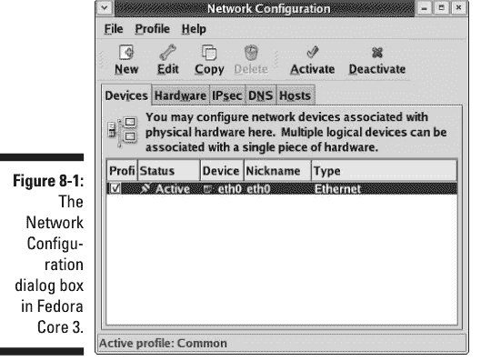

- 3. 在网络配置对话框中，点击“新建”（New）按钮。

## 第8 章：连接互联网

出现“选择设备类型”（Select Device Type）对话框，如图 8-2 所示。由于我无法涵盖所有的网络连接类型，且拨号调制调器是最复杂的，我从这里开始遵循拨号选项。选择适合你自己的硬件类型并继续。

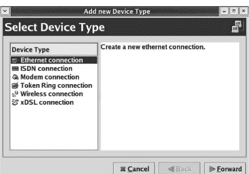

图 8-2：Fedora Core 3 网络配置中的选择设备类型对话框。

- 4. 要设置拨号调制调器，请从设备类型列表中选择“调制调器”（Modem），然后点击“下一步”（Forward）按钮。

点击“下一步”后，工具会探测你的调制调器。如果找不到你的调制调器（再次，我遵循的是最困难的选项），将出现“选择”（Select）对话框，如图 8-3 所示。我假设你面对的是这个对话框。如果它没有出现，请继续你的配置，直到它再次匹配这些步骤。

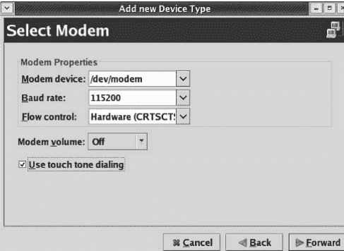

图 8-3：网络配置中的选择调制调器对话框。

- 5. 从“调制调器设备”（Modem Device）下拉列表中选择正确的设备。

如果你知道你的调制调器在 Windows 中是 COM1 或 COM2，那么将这种技术链接到 Linux 并不困难：你只需要减 1。所以，COM1 对应 `ttyS0`，COM2 对应 `ttyS1`。如果你没有使用 USB 调制调器（它有一个扁平的矩形连接器），那么你的调制调器可能在 COM2 上。如果你使用的是 USB 调制调器，你的调制调器可能在 COM1 上。

- 6. 从“波特率”（Baud Rate）下拉列表中选择调制调器的速度。

如果你被告知使用特定速度，请在此处选择该速度。否则，选择可用的最高数字。关键是尝试最高设置，如果不起作用，就从越来越慢的速度开始尝试，直到能够建立连接为止。

保持“流控制”（Flow Control）设置不变。只有当你发现让调制调器连接非常困难，或者你的 ISP 告知你特别需要选择“软件流控制”（Software Flow Control）或“无（无）流控制”（No (None））时，才更改此设置。

- 7. 开启调制调器的音量，这样你在测试时就能听到它的运作。

你稍后会回来关闭声音。（大多数人都会这样做；有些人喜欢一直开启。我觉得 56.6kbps 的调制调器在连接时听起来像外星信号）。这取决于你想把声音调多大，只要你能听到即可。

保持启用“触摸拨号”（Touch Dialing），除非你住在只支持旋转电话的地区。

- 8. 点击“下一步”（Forward）继续。

出现“提供者”（Provider）对话框，如图 8-4 所示。

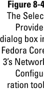

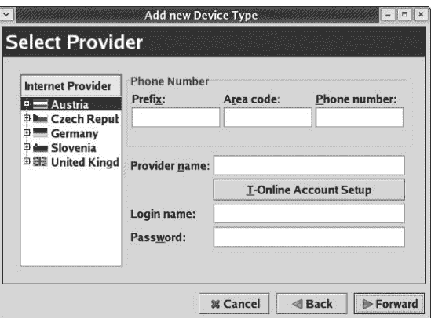

- 9. 输入你的 ISP 信息，然后点击“下一步”（Forward）。

你的 ISP 可能所属的国家默认列表有限。如果你住在这些地区之一，选择你的国家，然后选择 ISP —— 此时拨号条目已为你完成 —— 并跳转到第 16 步。否则，继续下一步。

- 10. 在“前缀”（Prefix）文本框中，输入实际电话号码之前需要拨的任何拨号前缀。

此前缀可能是长途项目，例如北美长途电话的 1，或者如果你在拨打长途电话时拨 9 来出楼。如果你不需要前缀，请留空此框。

- 11. 在“区号”（Area Code）框中，输入你的调制调器需要拨号的区号。在某些地方，你必须拨打区号。如果你不需要区号，请留空此框。

- 12. 在“电话号码”（Phone Number）框中，输入你的调制调器需要拨打的号码。

- 13. 在“提供者”（Provider）框中，输入 ISP。

- 14. 在“登录名”（Login Name）框中，输入你的用户名。

- 15. 在“密码”（Password）框中，输入你的密码。

- 16. 点击“下一步”（Forward）。

出现“设置”（Settings）对话框。

- 17. 在“设置”（Settings）对话框中，勾选“自动获取”（Automatically）。如果不需要使用自动获取，请取消勾选它，并手动输入 DNS 地址。如果你住在这些地区之一，选择你的国家，然后选择 ISP —— 此时拨号条目已完成。

- 18. 在“设置”（Settings）对话框中，勾选“静态”（Static）。如果不需要使用静态，请取消勾选它。

- 19. 在“子网掩码”（Subnet Mask）框中，输入子网掩码。

- 20. 在“默认网关”（Default Gateway）框中，输入默认网关。

点击“下一步”（Forward）。

出现“摘要”（Summary）对话框，如图 8-5 所示。

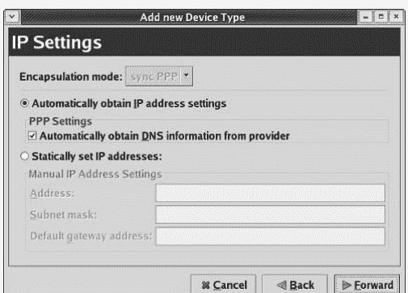

图 8-5：Fedora Core 3 网络配置中的摘要对话框。

点击“应用”（Apply）。

# 第二部分：现在是互联网时代！

另一方面，如果你可以 ping 你家里或办公室内的另一台机器，但无法 ping 互联网上其他地方的机器，那么你与 ISP（互联网服务提供商）的连接可能出了问题。

延迟，即信号在互联网上传输所需的时间，与物理距离关系不大。相反，网络流量、带宽和网络硬件等因素都会导致延迟缓慢。这些因素决定了 ping 你的邻居电脑所需的时间是否比 ping 南极还要长。

例如，尝试通过打开命令提示符（参见第 14 章节）并输入以下命令来测试 Yahoo!：

```
ping www.yahoo.com
```

按 Ctrl-C 停止 ping；否则，你的计算机将继续 ping 目标。

图 8-6 所示的输出提供了 ping 正在操作的信息。如果 ping 可以到达主机，你将收到一条主机不可达的消息。如果 ping 无法到达主机，你将收到反馈，显示信号从你的计算机到目标计算机并返回需要多长时间——毫秒（ms）——数字越小越好。对于通过以太网连接的计算机，1 ms 到 3 ms 的响应时间是可以接受的。对于拨号连接，预计在 150 ms 左右。当你开始看到 ping 时间爬升到 900 ms 或更高时，网络可能处于高负载状态（或者你的电缆出了问题）。

# 使用 traceroute 追踪你的流量轨迹

另一个有趣的命令是 `traceroute`，它允许你看到数据在通往目的地的途中经过的所有计算机。只需输入命令 `traceroute 主名`，例如 `traceroute bob.example.com` 或 `traceroute 192.168.1.5`。几刻之后，你将收到一份你与指定主机之间所有计算机的列表，以及数据传输到每台计算机所需的时间，如图 8-7 所示。


再次以 Yahoo! 为例。打开命令提示符（参见第 14 章节），输入 `traceroute` 主名 并按回车。数据开始填充可能需要一点时间，但 `traceroute` 结果的每一行都代表一个“跳”（hop）。每个跳都代表你的数据为了到达目的地必须经过的一台物理机器。通过注意列表中的较大数字，你可以识别出严重的网络拥堵和其他问题。


# 第 8 章：连接互联网

# 163

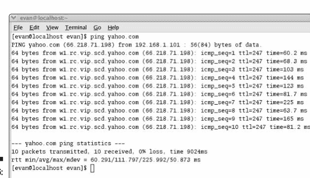

**图 8-6：** `ping` 命令的示例结果。

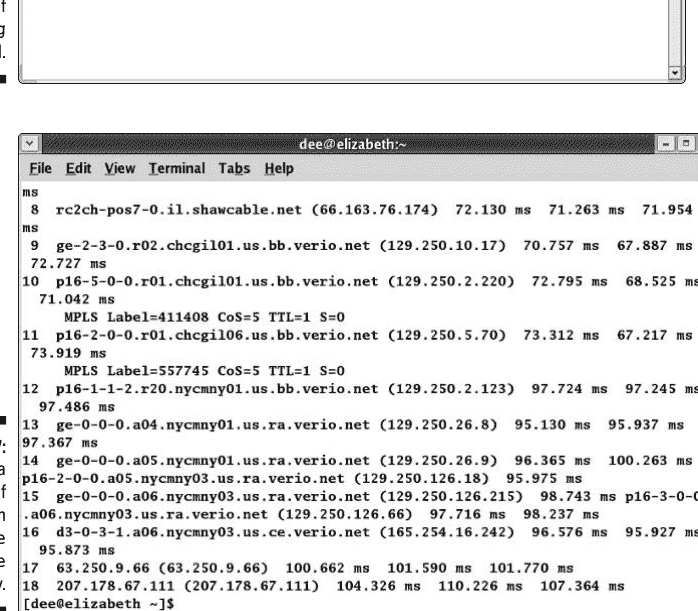

**图 8-7：** `trace route` 工具结果集的结尾。

# 164 第二部分：现在是互联网时代！

有时，尤其是当你正在排查无法访问目标网站的原因时，你执行的 `traceroute` 在沿途某处超时了。这种情况通常表示信息超级公路上某处发生了“交通事故”。等几分钟然后重试。如果你持续遇到这个问题，可能意味着某个站点已宕机，或者防火墙正在拦截流量。

# 在连接之后

连接成功后，你可能想直接跳到第 9 章，学习如何使用可以使用你提供的各种互联网程序。在此期间，让我为你提供一些当你需要帮助、有疑问或其他方面想要探索 Linux 世界时可能会觉得有用的网站——其中有些非常“极客”（geek），但你会逐渐适应的！你可能还会更新你的机器（参见第 12 章节），添加新软件（同样在第 12 章节），并额外关注安全（参见第 13 章节），以保护自己免受恶意人和程序的侵害。

## 有用的引用

- www.linuxsecurity.com: 一个相当极客但实用的地方，你可以在这里跟踪 Linux 安全世界的动态。

- www.kerneltraffic.org: 你从未想知道关于 Linux 内核正在发生的一切，但又不敢问。如果你对前沿硬件等感兴趣，或者只是想“了解内情”，这个地方非常适合跟踪新特性的添加。

- www.linuxquestions.org: 我在书的其他地方提到过它，但它值得一提。这个网站是有问题要问以及喜欢帮助他们的人的热门聚集地。

- http://linux-newbie.sunsite.de/:《Linux 新手管理员指南》是一系列你可能会发现非常有用的信息集合。

- www.tuxfiles.org: 针对感兴趣主题的短帮助文件集。

- www.tld.org: 包含许多为不同用户级别编写的帮助文档。

- www.slashdot.org: 极极客聚集地（不幸的是，文化有些敌对），有许多指向在线文章的链接。最好用于在线查看文章。

# 182

# 第 9 章

# 使用互联网

- 浏览网页

- 阅读新闻组

- 发送电子邮件

- 发送消息

互联网是一个遍布全球的巨大网络。在本章中，我将介绍你可以使用的工具，如访问网站、使用电子邮件和即时消息。

# 183

# 166 第二部分：现在是互联网时代！

Linux 有许多图形化浏览器可用。每个发行版自带的：

- Fedora: Firefox ([www.mozilla.org/products/firefox](https://www.mozilla.org/products/firefox))，基于 Mozilla

- Knoppix: Conqueror ([www.conqueror.org](https://www.conqueror.org))，尽管默认自带 Mozilla

- Linspire: Conqueror

- Mandrake: Conqueror，尽管默认自带 Mozilla 和 Epiphany ([www.gnome.org/projects/epiphany](https://www.gnome.org/projects/epiphany))

- SuSE: Conqueror

- Xandros: Mozilla

许多浏览器都是基于 Mozilla 的，不是吗？而且 Mozilla 是 Netscape 的分支。由于 Mozilla 包含在许多发行版中（可以轻松添加），我在这里重点介绍它。Mozilla 实际上比它的“孩子” Epiphany 和 Firefox 要复杂得多，而你可以轻松找到其他选项。事实上，Firefox 在其偏好对话框中并没有像 Mozilla 那样有大量的配置程序。

Mozilla、Firefox 和 Opera 在 Windows 和 OS 上同样可用！


## 配置 Mozilla

你现在就可以开始浏览，如果你愿意的话。你不需要自定义浏览器。但是，你可能想花点时间告诉 Mozilla 你的偏好，例如默认启动时显示的网页、默认使用的尺寸、默认颜色以及许多其他选项。

以下步骤将介绍偏好设置窗口，所有的 Mozilla 配置参数都存储在那里：

- 1. 启动 Mozilla。

如何启动 Mozilla 取决于你使用的发行版。通常，它是你的面板（Knoppix、Linspire 和 Xandros）上的快捷方式，或者位于你主菜单的互联网部分。请耐心；Mozilla 是一个大程序，通常需要几秒钟才能启动。

# 第 9 章：使用互联网

## 2. 选择编辑：偏好。

偏好窗口出现，如图 9-1 所示。虽然此对话框在不同的发行版中可能看起来不同，但我检查了所有选项的设置，并指出了任何未设置的地方。

请注意，有很多配置选项可用。在本章的其余部分中，我将引导你配置一些基础的设置。此外，我也鼓励你在在此过程中探索许多其他可用选项！

## 3. 使用偏好窗口的左窗格访问各种类别。

你可以通过点击主类别右侧的小加号 (+) 或右箭头来展开任何一个主类别，并通过点击减号 (-) 或向下箭头再次将其折叠。每个类别都有主菜单和子菜单，所以不要忘记同时也点击类别名称和子类别。

## 4. 如果你读完菜单看累了，可以随时点击“确定”（如果你作了想要保留的更改）或“取消”（如果你未进行任何更改或想保留当前更改）来关闭偏好对话框并返回网页浏览。

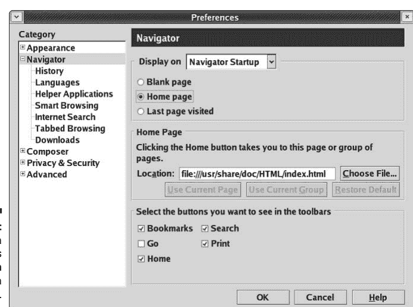

图 9-1: Fedora Core 3 中的 Mozilla 偏好窗口。

### 外观偏好

选择外观主菜单选项 —— 图 9-2 —— 允许你决定 Mozilla 在加载时的外观和行为。它的基本设置由三个独立部分控制：当 Mozilla/互联网启动时，打开；显示工具栏方式为；以及底部的杂项部分。第一部分决定了在启动浏览器时应该启动 Mozilla 的哪些部分。这里的选项有：

- 导航器 (Navigator)：浏览器本身。默认此此。

- 组合器 (Composer)：Mozilla 的网页创建部分。

- 邮件与新闻组 (Mail & Newsgroups)：Mozilla 的电子邮件和新闻组部分。（此项默认仅在某些发行版中可用。）

你可以同时选择多个项，并且当你打开浏览器时，所有选中的项都会启动。或者，你可以选择通过“窗口”菜单在需要时单独启动这些部分。

第二部分允许你设置希望如何查看工具栏：

- 图片和文本：在你的 Mozilla 工具栏上显示按钮和随附的文本。

- 仅文本：不要显示图片。

- 仅图片：不要显示文本。

| 类别 | 外观 |

| :--- | :--- |

| 当 Mozilla 启动时打开 | 导航器 |

| | 组合器 |

| 显示工具栏方式为 | 图片和文本 |

| | 仅图片 |

| | 仅文本 |

| 提示 | 网站图标 |

| | 平滑滚动 |

| | 调整大图像以适应窗口 |

图 9-2: Fedora Core 3 中的 Mozilla 偏好窗口。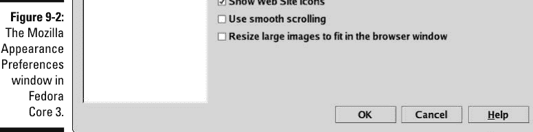

最后，对话框的底部部分允许你进行一些微调：

- 显示工具提示：当你将鼠标指针悬停在选项上时，会弹出一个小提示。

- 显示网站图标：获取并使用 URL 旁边的微型图标，将其显示在书签中。

- 平滑滚动：确保你在滚动时是平滑的。在 Fedora Core 3 中可用，但在 intros 中不可用。

- 调整图像以适应窗口：不会强迫你滚动查看大图像以一次性看到全部，而是将其适应窗口。

在“外观”下，其余条目为：

- 字体：允许你设置偏好的字体类型。对于 1024 x 768 的分辨率，我建议立即放大字体大小。否则，请熟悉使用 `Ctrl+` 让所有字体变大，使用 `Ctrl-` 让它们变小。

- 颜色：设置你的颜色以及你是否想要覆盖网页。此设置对于色盲人士很重要。

- 主题：允许你为 Mozilla 加上自定义涂装。

- 语言/内容：允许你将浏览器的侧边栏设置为特定的区域。


如果你不确定如何使用特定设置，点击“帮助”按钮打开 Mozilla 帮助界面。

### 导航器偏好

导航器类别（见图 9-1）允许你设置浏览器首次启动时的行为。这些设置分为三个部分：显示、主页以及选择你在工具栏中要看到的按钮。在第一部分，你首先要做是通过选择单选按钮上方列表中的以下内容来确定你正在设置 Mozilla 的哪个方面：

- 导航器启动 (Navigator Startup)：指定主浏览器窗口打开时要执行。

- 新窗口 (New Window)：指定如果你点击启动新窗口的链接或选择“文件-新窗口”时要执行。

- 新标签页 (New Tab)：指定如果你将浏览器导航器设置为使用标签页浏览，并打开新标签页或选择“文件：新标签页”时要执行。标签页浏览反映了 Web 浏览器功能的最新热潮，特别是对于那些桌面上堆满窗口的人来说。它允许在一个窗口中拥有多个目的地，并通过点击标签页在它们之间切换。请查看本节稍后部分以获取有关标签页浏览的更多信息。

在你选择了要配置的项后，你可以为它的默认行为选择以下项之一：

- 空白页 (Blank Page)：启动时不打开任何页面。

- 主页 (Home Page)：打开你的主页。

- 最后访问页面 (Last Page Visited)：打开你最后访问的页面。

在“主页”部分，你可以指定在你想要加载主页时指定的主页。你有以下选项：

- 在文本框中输入你想使用的 URL。

- 选择你想要作为主页的计算机文件，然后点击“使用”将其添加到文本框。

- 选择你所在的标签页并点击“使用当前页面”将其添加到文本框。

- 在打开多个标签页时，根据你的设置打开这些标签页。（在文本框中实际显示“设置主页”。）

- 点击“恢复默认”将主页改为原来的设置。对于它，默认是 Fedora 项目页面。

最后，在底部部分，你可以选择顶部两个工具栏中显示哪些按钮，来自书签（下工具栏）、前往（上工具栏）、首页（下工具栏）、搜索（上工具栏）和打印（上工具栏）。


你可以通过选择书签：管理书签并更改你找到的内容，非常详细地控制下工具栏的内容。

在“导航器”下，你还可以检查：

- 历史记录 (History)：文本框允许你指定浏览器希望记住你去过的多少天。你可以随时点击“清除历史记录”来清除。

- 语言 (Languages)：不，此选项不会自动将网页内容翻译成首选语言。相反，某些网页提供多种语言。如果是选项的话，这仅用于决定语言偏好。

- 辅助应用程序 (Helper Applications)：在此表中，你指定解释特殊文件类型的应用程序。例如是 pdf 文件，它需要 Adobe Acrobat Reader 来查看。你可以指定应用程序以及传递给程序的可选参数。

- 智能浏览 (Smart Browsing)：通过此选项，你可以设置“相关”标签页的特征，该标签页位于侧边栏。“相关”标签页有一个下拉菜单，列出与显示网站可能相关的网站。

- 互联网搜索 (Internet Search)：搜索引擎已成为 Web 浏览不可或缺的一部分。为了适应搜索，Mozilla 可以将你喜欢的搜索引擎集成到浏览器中。你可以点击默认搜索引擎下方的下拉按钮并选择你的偏好。

- 标签页浏览 (Tabbed Browsing)：如果你喜欢，可以自定义你的标签页浏览功能。

## 172 第二部分：现在上网！

- 隐私与安全：网络安全对于每个连接到互联网的人来说已经变成了一个非常大的问题。尽管通常非技术性的媒体会夸大这一问题，但对于所有互联网用户来说，安全仍然应该是一个考虑因素。每当你发送电子邮件或点击网站时，你都在跨越网络交换信息。虽然你不需要为此彻夜不安，但你应该对在互联网上进行的每一次请求保持意识。尽管完全保护你的信息是不可能的，但由于 Mozilla 提供的默认选项，你可以放心地交换互联网信息是安全的。请特别查看弹出窗口，了解如何防止这些干扰项占用你的屏幕！

- 高级：此类别提供了影响整个 Mozilla 用户环境的选项。选项包括你想要启用 Java applets 或 XSLT 页面。这里你还可以清除缓存——即浏览器对你所做的事情和去过的地方的记忆（但不包括你的书签）——并在“缓存和代理”子菜单中建立代理设置。（如果你从未被告知过使用代理，那么你不需要。）

## 该死的浏览器插件

你是否曾对那些网站感到恼火？为了查看这些网站，你必须下载一个插件或额外的软件？插件和外部程序的区别在于：插件在浏览器中显示结果，而外部程序在浏览器之外运行。虽然当你只是寻找某些基本信息时，这些插件很烦人，但它们可以提供一些很酷的东西，例如通过浏览器流传输视频和音乐。

插件提供了浏览器功能扩展，这些是与浏览器交互以提供标准功能（如声音和视频）的程序。数字时代仍处于婴儿阶段，因此该行业尚未将这些多媒体作为标准。反，开发者选择不向 Mozilla 浏览器中构建支持。相反，这种架构允许软件开发者进行创新，而不需要支持的浏览器知道如何处理新涌的媒体格式。

第 12 章解释了如何在本书涵盖的每个发行版中为你的系统添加流行的插件（如 Macromedia 的 Flash 插件）。你可能还会对“辅助应用程序”（Mozilla 启动以处理特定类型内容的程序，如 PDF 查看器）感兴趣，你可以通过打开导航菜单并选择“辅助应用程序”，在“首选项”对话框中进行配置。本节让你告诉 Mozilla

## 第 9 章：使用互联网

启动程序以打开特定类型的文件，如果你发现自己经常需要手动执行某些操作，可以进入此对话框，自动访问你经常使用的文件类型。

## 浪游 Web

Mozilla 是你通往奇妙 Web 的窗口。Mozilla 的主要目的是根据你的命令获取 Web 页面，将你所有的图形和相关文件下载到计算机内存中，并最后渲染页面供你交互式浏览。

如果你正在使用 Internet Explorer 或 Netscape，Mozilla 应该会得手就来。它具有所有熟悉的导航工具，例如地址栏；后退、前进、重新加载和停止按钮；以及一个存储你喜爱的网站链接（书签）的功能。

Mozilla 与 Netscape 一样，还有一个侧边栏功能——按 F9 隐藏它（见图 9-3）——你可以用它查找与你访问的网站相关的网站、在互联网上搜索单词或短语、访问标记的网页，或访问最近访问过的网页（通过“历史记录”选项）。

图 9-3：在 Fedora Core 3 中打开侧边栏的 Mozilla。

## 浏览新闻组

虽然电子邮件通常针对个人，但你可以将新闻组想象成公共消息公告板，有相似兴趣的人聚集在一起讨论某个话题。新闻组（如 Web 论坛）也是寻找技术支持的好地方。

> **提示：** Firefox 不包含新闻组支持，但你可以使用第 12 章的信息来安装 Thunderbird（www.mozilla.org/products/thunderbird，一个基于 Mozilla 的电子邮件和新闻组阅读器，因此它与本书的内容类似）或 Pan，这是另一个流行的选择。

## 配置 Mozilla 读取新闻组

使用 ISP（互联网服务提供商）提供的新闻组服务器信息，按照以下步骤访问世界最大的留言板：

1. **选择窗口：** 邮件与新闻组（Fedora 用户请选择窗口：创建器）。

当你第一次打开此菜单选项时，你会立即看到图 9-4 所示的帐户向导。设置好新闻组后，选择此选项将带你进入（邮件和新闻）消息中心，并默认选中收件箱。

2. **选择“新闻组账户”单选按钮并点击“下一步”。**

图 9-4：Knoppix 3.6 中的 Mozilla 帐户向导。

## 第 9 章：使用互联网

3. **选择“新闻组账户”单选按钮并点击“下一步”。**

4. **在“姓名”中输入全名。**

5. **在“电子邮件地址”中输入电子邮件地址。**

6. **在“服务器”中输入新闻组服务器。**

7. **在“帐户名称”中输入描述性名称。**

8. **点击“完成”。**

图 9-5：Kppix 3.6 中的 Mozilla。

## 174 第二部分：现在上网！

## 订阅新闻组

要阅读新闻组，你必须先订阅：

1. 从“邮件与新闻组”对话框或“管理组订阅”对话框中，点击你想要的新闻组。

2. 如果被问及下载多少个主题，选择“所有主题”或指定下载的主题数量。

3. 如果你不想看到其他内容（当你刚开始进入某个组时这不是个坏主意，否则你永远看不到新内容），请点击“标记剩余主题为已读”。

4. 点击“确定”。

图 9-6：Kppix 3.6 中的 Mozilla 设置。

## 阅读新闻

在你为此目的配置好 Mozilla 后，要阅读新闻：

1. 从“邮件与新闻组”对话框或“管理组订阅”对话框中，点击你想要的新闻组。

2. 在所有新闻组标题加载后，滚动查看列表。

# 178 第二部分：现在上网！

Linux 用户有许多电子邮件程序可供选择。本书讨论的各种发行版中的默认程序也包含在：

- Knoppix: KMail (http://kmail.kde.org/)，尽管也包含了 Mozilla Mail

- Evolution (www.novell.com/products/evolution)


- Linspire: Mozilla Mail

- Mandrake: KMail，同时也安装了 Contact 和 Evolution

- SuSE: Contact (www.contact.org)

- Xandros: MailEvolution 和 Contact 都会让你想起 Outlook，因此如果你喜欢能够整合日历、联系人簿、任务管理器和电子邮件，你应该会喜欢这些程序。Mozilla Mail 和 KMail 更多是单一用途的。Evolution 是本书附带发行版（Fedora 3）中的默认客户端，我将在本章中详细详细介绍该程序。由于该程序很受欢迎，在大多数发行版中也应该很方便地添加（参见第 12 章）。

另一个流行的邮件程序是 Thunderbird (www.mozilla.org/products/thunderbird)，它是 Mozilla Mail 的衍生版本。

## 设置 Evolution

当你第一次打开 Evolution 时，程序会引导你完成设置过程，因此请确保手头有以下信息：

- 你的分配的电子邮件地址，格式为 `username@example.org`。

- 用于接收邮件的邮件服务器类型：例如，POP。

- 用于接收邮件的邮件服务器名称，格式为 `servername.example.org`。

- 用于发送邮件的邮件服务器类型：例如，SMTP。

- 用于发送邮件的邮件服务器名称，格式为 `servername.example.org`。此名称可能与接收邮件服务器相同。

- 收发邮件时所需的任何特殊类型身份验证。这种验证通常只需要接收邮件的密码，发送邮件可能不需要。

首次启动 Evolution 后，会启动 Evolution 设置向导（Evolution Setup Assistant）。

# 第 9 章：使用互联网

点击前进（Forward）继续通过欢迎界面，随后将打开对话框（见图 9-7）。要填写此对话框，请完成以下步骤：

1. 如果需要，请更改全名（Full Name）。有些人不想使用真实姓名，而是选择使用昵称。取决于你在机器上配置了程序，可能会或没有默认值。

2. 如果电子邮件地址与你的 ISP 给出的地址不匹配（可能不匹配），请更改电子邮件地址。

3. 如果你想让此特定账户成为你的默认邮件账户，请勾选“设此账户为默认”（Make This Default Account）复选框。否则，请确保未勾选。

4. 点击前进继续。打开接收邮件（Receiving Mail）框。

5. 在服务器类型（Server Type）列表中，选择你的 ISP 使用的入站邮件服务器类型。

图 9-7：Fedora Core 3 中的身份对话框。

# 180 第二部分：现在上网！

如果你不在该电脑上接收电子邮件，请将其保持为“无”（None）——如果你只想发送或只想使用 Evolution 中的日历和任务管理功能，此设置非常有用。根据你选择的项目，对话框会变化并请求适当的信息。我假设你正在使用 POP 邮件服务器接收邮件，因此选择 POP 时看到的内容如图 9-8 所示。如果你没有使用 POP，请完成对话框并跳转到第 17 步。

最新版本的 Evolution 支持 Microsoft Exchange 服务器。如果你需要它，你的发行版中可能已经安装或尚未安装。对于 Fedora，请使用第 12 章中的信息向系统添加“evolution-connector”包并重启 Evolution 设置过程。

6. 在主机（Host）框中输入你的 POP 邮件服务器全名。该名称可能是 `pop.example.com`。

7. 在用户名（Username）框中输入你的检查邮件登录名。如果你的电子邮件地址是 `jane@example.com`，你的用户名就是 `jane`。

8. 如果你想使用 SSL，在安全连接（Secure Connection (SSL））下拉列表中，选择“始终”（Always）或“尽可能”（Whenever Possible），取决于你的 ISP 的规定。

图 9-8：Fedora Core 3 中的 Evolution 接收邮件对话框，已选择 POP。

# 第 9 章：使用互联网

9. 在身份验证类型（Authentication Type）下，选择合适的身份验证选项。

如果你不知道邮件服务器使用什么种身份验证，点击“检查支持类型”（Check For Supported Types）按钮。通常，只需要密码（Password）。

10. 勾选“记住此密码”（Remember This Password）选框，这样你每次检查邮件时就不需要输入电子邮件密码。

如果你要离开电脑而其他人可能会访问，请进入主菜单并选择“锁定屏幕”（Lock Screen），以防止受到恶作邮件骚扰。这样做后，在你输入密码之前，没有人可以使用你的 GUI。

你必须开启屏幕保护程序此功能才能生效。屏幕保护程序默认是开启的。

11. 点击前进进入次级接收邮件对话框（见图 9-9）。

此对话框是否存在取决于你正在使用的入站邮件服务器类型。如果你没有使用 POP 但得到了次级对话框，它可能与所示的不符，尽管它包含显示的一些选项。

12. 如果你想自动检查新邮件，勾选“自动检查新邮件”（Automatically Check For New Mail）选框。

图 9-9：Fedora Core 3 中 POP 邮件用户的二级接收邮件对话框。

# 182 第二部分：现在上网！

如果你没有持续的互联网连接，可能更喜欢手动检查邮件。如果是这样，请取消勾选该框并跳到第 14 步。

13. 在分钟（Minutes）文本框中，设置你自动检查邮件的频率。

14. 如果你从多台电脑检查邮件，你可能想要勾选“在服务器上保留邮件”（Leave Messages On Server）选框，以便你可以从所有机器上访问相同的消息。

如果你选择此选项，你将在多台机器上都拥有消息副本，但也意味着无论你从哪里检查，都可以访问你的电子邮件。请记住，偶尔你需要取消勾选此框并检查邮件，仅仅是为了清理邮件在服务器上占用的空间。你不希望空间耗尽。

15. 如果你的 ISP 告诉不要使用 POP3 扩展，请勾选“禁用 POP3 扩展”（Disable POP3 Extensions）选框。

16. 点击前进继续。你现在完成了入站邮件的设置。在图 9-10 所示的发送（Sending）框中，执行：

图 9-10：Fedora Core 3 中的发送对话框。

# 第 9 章：使用互联网

17. 如果服务器类型不是 SMTP，请更改。我假设你正在使用 SMTP 发送电子邮件。

18. 在主机（Host）框中输入 SMTP 邮件服务器的全名。该名称可能是 `smtp.example.com`。

19. 如果你使用 SSL 进行安全，在安全连接（Secure Connection (SSL））下拉列表中，选择“始终”（Always）或“尽可能”（Whenever Possible），取决于你的 ISP 的规定。

20. 如果发送邮件时需要额外的身份验证，请勾选“服务器需要身份验证”（Server Requires Authentication）选框。通常不需要。如果你没有勾选此框，请跳过后续指令。否则，继续执行下一步。

21. 在身份验证（Authentication）下，按照你的 ISP 的指示选择合适的类型。如果你不确定，点击“检查支持类型”（Check For Supported Types）。

22. 在用户名（Username）下，输入你应该用于与出站邮件服务器身份验证的登录名。此名称可能与你接收邮件时使用的名称不同。

23. 勾选“记住密码”（Remember Password）框，这样你每次发送邮件时都不需要输入密码。只需确保注销或使用“锁定屏幕”（Lock Screen），这样没人能针对你开玩笑邮件！

24. 点击前进继续。你到达了极其简单的账户管理（Account Management）对话框。

25. 保持名称（Name）条目不变（你的电子邮件地址），或将其更改为描述性名称，以便在有账户列表时区分你正在查看哪个账户。你的电子邮件地址在这个最终框中经常显示为类似 `jane@computer5.example.com` 的内容。如果你身上发生了这种情况，你需要编辑此条目以匹配你的真实电子邮件地址，对于 Jane 来说就是 `Jane@example.com`。

26. 点击前进进入完成（Done）对话框。

27. 点击你所在时区的城市，或使用下拉列表选择你的位置或时区。

28. 点击前进进入完成（Done）对话框。在这里你只看到一条说你已完成的消息。

29. 点击“应用”（Apply）保存你的设置。

Evolution 程序打开，如图 9-11 所示。

## 184 第二部分：网络时代！

## 第 9 章：使用互联网

### 发送和检查电子邮件

以下步骤概述了如何创建并发送新的电子邮件消息：

- 1. 点击“新建”（New）。

- 打开“撰写消息”（Compose A Message）窗口，如图 9-12 所示。如果您想打开另一个新项目（例如新的联系人列表条目或新的日历安排），点击“新建”旁边的箭头打开选项列表进行选择。

- 2. 在“收件人”（To）框输入电子邮件地址（例如 `bob@example.net`）或用逗号分隔的地址列表（例如 `bob@example.net, tom@example.org`）。

- 3. 如果您需要在收件人列表中添加抄送（CC）或密密（BCC），打开邮件消息的“视图”（View）菜单，选择要显示的相应字段，然后在这些字段中输入相应的地址。

- 4. 在“主题”（Subject）文本框中输入您的邮件主题。

图 9-12：Fedora Core 3 中的 Evolution 撰写消息窗口。

- 显示附件栏（在此处拖放附件）

- 5. 在下方窗口中输入您的邮件正文。

如果您想“美化”您的邮件，可以使用方便的格式化按钮和“格式”（Format）菜单。如果您想使用格式化按钮，请先将“格式”类型设置为 HTML。

- 6. 如果您想在邮件底部添加签名，点击“签名”（Signature）旁边的下拉列表框并选择“自动生成”（Autogenerated）。

要创建自定义签名，请进入主窗口并选择“工具:>设置”（Tools:>Settings）以打开 Evolution 设置对话框（图 9-3）。选择您想要创建的账户，然后点击“编辑”（Edit）按钮打开 Evolution 账户编辑器。在此对话框中，点击“身份”（Identity）和“新签名”（New Signature）。在这里，您可以创建并格式化新签名，点击“保存并关闭”按钮后，您可以在“身份”选项卡的签名下拉列表框中选择哪个签名作为默认签名。点击每个对话框上的“确定”或“关闭”来移除额外的对话框。

- 7. 完成消息后，点击“发送”（Send）按钮。

电子邮件将添加到您的“发送箱”（Outbox），如果您需要，可以在那里对其进行编辑。

- 8. 点击“发送/接收”（Send/Receive）按钮。

您的电子邮件将发出，Evolution 将检查是否有新的来邮件。

花些时间真正探索 Evolution。正如本章中的插图所示，该程序有很多功能，包括过滤垃圾邮件的功能。

## 186 第二部分：网络时代！

| Evolution 设置 | | |

|---|---|---|

| 已启用账户名称 | 协议 | + 添加 |

| ☑ scruffy@example.net [默认] pop | | 编辑 |

| 邮件账户 | | - 移除 |

| 自动补全 | | 默认 |

| 邮件偏好 | | 启用 |

| 撰稿器偏好 | | |

| 日历和任务 | | |

| 证书 | | x 关闭 |

图 9-13：Fedora Core 3 中的 Evolution 设置对话框。

### 利用即时消息

人与人之间的即时消息就像使用电话——区别在于您是打字交流而不是说话。此外，您不需要额外的互联网连接即可同时进行即时消息对话。美国在线（AOL）提供了一种名为 AOL 即时消息（AIM）的流行即时消息服务。其他的还有 ICQ 和 MSN。包括 Linux 在内的多种计算机操作系统都支持这些各种服务（事实上，GAIM 不仅运行于 Linux）。

本书涵盖的发行版默认使用以下即时消息程序：

- Fedora: Gaim (http://gaim.sourceforge.net/)

- Knoppix: Gaim

- Linspire: Gaim

- Mandrake: Kopete (http://kopete.kde.org/)

- SuSE: Kopete

- Xandros: Kopete (http://kopete.kde.org/)

由于 Gaim 是 Fedora 的默认程序，因此我将详细介绍它。

#### 使用 Gaim 即时消息软件

您可以通过以下菜单选择启动 Gaim：

- Fedora：选择 应用程序*互联网*IM (GAIM Internet Messenger)。

- Knoppix：从主菜单选择 互联网*Gaim 即时消息。

- Linspire：从主菜单选择  程序*互联网*即时消息。

在应用程序首次启动后（见图 9-14），其主界面和账户管理对话框都会出现。要告诉 Gaim 您的 IM 账户：

- 1. 点击账户对话框中的“添加”（Add）按钮。

出现“添加账户”对话框，如图 9-15 所示。

图 9-14：Fedora Core 3 中打开的 GAIM IM 客户端主对话框及账户对话框。

图 9-15：Fedora Core 3 中的 GAIM 添加账户对话框。

- 2. 在“协议”下拉列表框中选择您想要使用的 IM 网络。

您的选项有 AIM/ICQ（如果您需要使用 AIM 或 ICQ，请选择此选项）、Gadu-Gadu、Groupwise、JRC、Viber、MSN、Napster、SILC、Yahoo 和 Zephyr。

- 3. 在“屏幕名称”（Screen Name）文本框中输入您的 IM 账户登录名。

如果您使用 ICQ，请使用您的会员号。

- 4. 在“密码”（Password）文本框中输入该账户的 IM 密码。

- 5. 在“别名”（Alias）文本框中输入您实际希望在人们的 IM 中显示的名称。

- 6. 如果您想在 IM 中显示别名，请在 IM 客户端中使用屏幕名称。勾选“记住密码”（Remember Password）复选框，这样您每次连接时不需要输入密码。

离开电脑时请使用“锁定屏幕”（Lock Screen）选项，以防他人使用 IM 客户端给您发送消息。

- 7. 勾选“自动登录”（Auto-Login）框，可以让 GAIM 在启动时登录此账户。

- 8. 如果您通过此服务接收电子邮件并想在来邮件到达时通知，请勾选“新邮件通知”（New Mail Notifications）框。

- 9. 如果您想使用小图片作为好友图标（自己、您的狗或任何您喜欢的图片），点击好友图标旁边的打开按钮并浏览到要使用的图片。

- 10. 如果您想访问此 IM 服务的更多高级选项，点击“显示更多选项”（Show More Options）箭头展开添加账户对话框。

- 11. 输入信息后，点击“保存”（Save）将此 IM 账户添加到您的账户列表。

对您想要用 GAIM 使用的每个账户执行此过程。在主界面中，点击“登录”（Sign On）以登录所有已标记为自动登录的账户。您也可以通过点击主界面面的“账户”，然后点击每个账户旁边的独立复选框来逐一登录。连接后，您可以通过“工具>偏好”在好友列表对话框中更改设置。再次，GAIM 还有更多功能，非常值得尝试。

#### 故障排除 IM 连接问题

如果您已经在其他操作系统中使用大部分 IM 客户端，在您的 Linux 系统成功连接到 IM 服务后，如果您从未用过 AIM 或 MSN，现在可以设置好友列表。好友列表包含您想通过即时消息服务交流的人的用户名。好友列表让您知道好友在线并可以接收快速消息。

有时，您的 Linux 系统无法连接到 IM 服务。当此问题发生时，屏幕上会弹出错误消息并指示连接失败。您无法连接到 IM 服务可能有多种原因：

- 您可能输入了错误的 IM 账户密码，或者选择了错误的 IM 账户名。

- 您的计算机可能没有连接互联网。尝试打开网络浏览器查看是否可以访问网站，这可以判断您是否连接到了互联网。

# 190 第二部分：现在的网络！

- 如果你可以打开网站，但无法让即时消息（IM）正常工作，则 IM 系统可能不可用。此问题有时是因为 IM 服务的维护，或者互联网或 IM 服务的流量过大导致的。

- 如果你尝试在工作地的计算机上访问 IM 服务，你的公司或组织可能出于安全或工作效率考虑阻止了 IM 服务。在工作中使用 IM 是允许的，请咨询你的网络管理员，看看他是否能为你提供帮助。

- 许多公司在公司网络和互联网之间使用防火墙，以防止不希望的的流量进入公司网络。如果防火墙被配置为拦截 IM 流量，你将无法通过互联网使用 IM。

### 使用其他网络工具

根据你的需求，你可能想要探索各种类型的工具。本节涵盖了一些帮助你入门的提示，这样如果你去第 12 章并想添加适当的软件（或者发现自己正在翻阅各种方法并疑惑该程序可能叫什么名字），你就会完全不知所从了。

- FTP 程序：如果你想使用 FTP，Linux 世界中常用的一个程序是 GFTP。该程序适用于书中提到的所有五个发行版，尽管它只在 Mandrake 中默认安装。KDE 的对应程序是 KBear。

- IRC 程序：虽然现在的 IM 客户端支持 IRC，但你可能更倾向于使用专门用于 IRC 的程序。适用于你目的的常用程序有 X-Chat 和 KIRC。

- 文件共享：如果你想使用 Gnutella 网络，LimeWire 是一个流行的选择。

- RSS 阅读器：Firefox 有许多专为它设计的 RSS 扩展。此外，Straw 也是一个流行的 RSS 程序。

通常情况下，如果你不确定使用哪些程序，可以针对你想做的事情类型（如 RSS）和“Linux”一词进行网络搜索。因此，为了找到所有基于 Linux 的处理 BitTorrent（一种用于分发 Linux 发行版拷贝等内容的流行网络）的文件共享程序，你可以搜索：

```
file sharing bittorrent linux
```

# 第三部分

快速上手 Linux

Rich Tennant 著《第五波浪》


> “我们对这次升级比以前准备得充分得多。我们正在为用户提供额外的培训、更好的手册以及吗啡滴。”

# 在这一部分中……

在书的这一部分，我将 Linux 的涵盖范围扩展到了操作系统之外，包含了它的许多其他设施和功能。这些组件对于使 Linux 成为一个构建良好、配置适当的系统所代表的生产力猛兽至关重要。

在这里你将读到 Linux 文件系统以及如何控制允许哪些用户或组访问这些重要的系统资源。你还可以读到如何使用 Linux 命令行环境（称为 `shell`），以及任何精通 Linux 用户的标准技能库中都应该包含的关键功能。

此外，你将了解到如何保持系统固新以及安装新软件。你还将获得计算机专家们总是谈论的那些安全问题的内部内幕。喜欢在没有网络连接的情况下工作的人可以尝试使用命令行，而那些不想（哈！）任何打字的人则可以直接跳到自定义你的 GUI（图形用户界面）外观和感受的乐趣中。

# 第 10 章

## 操作文件和目录

**本章内容**

- 接触 Linux 文件类型
- 管理 Linux 文件权限
- 在文件系统内容之间移动
- 文件系统内容操作
- 使用通配符同时引用多个文件

> 完全不需要做任何作业。四年之后，情况不会变得更糟。—— Quentin Crisp

这是不可避免的。在某个时刻，你必须处理系统中的文件和目录。坦率地说，在你熟悉了规则和命令后，你会感到更加自在（即使你偶尔会想起在老旧的 MS-DOS 中工作的日子）。因为许多人发现处理文件时在命令行操作更容易，所以在在本章中，我将涵盖你可以使用的键入式命令和图形化工具。

## 在 GUI 中处理文件

倾向于留在图形界面上的人喜欢使用 Linux 提供的 GUI 文件管理器，而不是通过访问命令行来处理文件。文件管理器是一个程序（例如 Windows 资源管理器），它允许你通过鼠标有时只需输入少量字符来查找和操作你的文件和目录。在本节中，我将带你参观流行的 Linux 发行版默认带的文件管理器。

### 使用 Nautilus

在 GNOME 桌面环境中（如果你使用的是发行版的默认设置，则在 Fedora Core 中），文件管理器是 `Nautilus`。要找到这个程序，点击桌面上的主目录图标。图 10-1 显示了在示例目录中打开 `Nautilus` 时你可以看到的内容。

如果你想玩玩更高级版本的 `Nautilus`，请选择“应用程序 > 浏览器”。

### 寻找路径

在 `Nautilus` 中穿过文件系统涉及一些技巧。首先，你需要知道从哪里开始，这听起来并不难。在“位置”菜单中，你会找到以下：

- 计算机：硬盘、软磁盘、CD 和 DVD 驱动器以及其他可移动设备。
- 模板：模板。
- 垃圾箱：垃圾桶。

# 190 第二部分：现在的网络！

- 如果你可以打开网站，但无法让即时消息（IM）正常工作，则 IM 系统可能不可用。此问题有时是因为 IM 服务的维护，或者互联网或 IM 服务的流量过大导致的。
- 如果你尝试在工作地的计算机上访问 IM 服务，你的公司或组织可能出于安全或工作效率考虑阻止了 IM 服务。在工作中使用 IM 是允许的，请咨询你的网络管理员，看看他是否能为你提供帮助。
- 许多公司在公司网络和互联网之间使用防火墙，以防止不希望的流量进入公司网络。如果防火墙被配置为拦截 IM 流量，你将无法通过互联网使用 IM。

## 使用其他网络工具

根据你的需求，你可能想要探索各种类型的工具。本节涵盖了一些帮助你入门的提示，这样如果你去第 12 章并想添加适当的软件（或者发现自己正在翻阅各种方法并疑惑该程序可能叫什么名字），你就会完全不知所从了。

- FTP 程序：如果你想使用 FTP，Linux 世界中常用的一个程序是 `GFTP`。该程序适用于书中提到的所有五个发行版，尽管它只在 Mandrake 中默认安装。KDE 的对应程序是 `KBear`。
- IRC 程序：虽然现在的 IM 客户端支持 IRC，但你可能更倾向于使用专门用于 IRC 的程序。适用于你目的的常用程序有 `X-Chat` 和 `KIRC`。
- 文件共享：如果你想使用 Gnutella 网络，`LimeWire` 是一个流行的选择。
- RSS 阅读器：`Firefox` 有许多专为它设计的 RSS 扩展。此外，`Straw` 也是一个流行的 RSS 程序。

通常情况下，如果你不确定使用哪些程序，可以针对你想做的事情类型（如 RSS）和“Linux”一词进行网络搜索。因此，为了找到所有基于 Linux 的处理 BitTorrent（一种用于分发 Linux 发行版拷贝等内容的流行网络）的文件程序，你可以搜索：

```
file sharing bittorrent linux
```

# 第三部分

快速上手 Linux

Rich Tennant 著《第五波浪》

> “我们对这次升级比以前准备得充分得多。我们正在为用户提供额外的培训、更好的手册以及吗啡滴。”

# 在这一部分中……

在书的这一部分，我将 Linux 的涵盖范围扩展到了操作系统之外，包含了它的许多其他设施和功能。这些组件对于使 Linux 成为一个构建良好、配置适当的系统所代表的生产力猛兽至关重要。

在这里你将读到 Linux 文件系统以及如何控制允许哪些用户或组访问这些重要的系统资源。你还可以读到如何使用 Linux 命令行环境（称为 `shell`），以及任何精通 Linux 用户的标准技能库中都应该包含的关键功能。此外，你将了解到如何保持系统更新以及安装新软件。你还将获得计算机专家们总是谈论的那些安全问题的内部内幕。喜欢在没有网络连接的情况下工作的人可以尝试使用命令行，而那些不想（哈！）任何打字的人则可以直接跳到自定义你的 GUI（图形用户界面）外观和感受的乐趣中。

# 第 10 章

## 操作文件和目录

**本章内容**

- 接触 Linux 文件类型
- 管理 Linux 文件权限
- 在文件系统内容之间移动
- 文件系统内容操作
- 使用通配符同时引用多个文件

> 完全不需要做任何作业。四年之后，情况不会变得更糟。—— Quentin Crisp

这是不可避免的。在某个时刻，你必须处理系统中的文件和目录。坦率地说，在你熟悉了规则和命令后，你会感到更加自在（即使你偶尔会想起在老旧的 MS-DOS 中工作的日子）。因为许多人发现处理文件时在命令行操作更容易，在本章中，我将涵盖你可以使用的键入式命令和图形化工具。

## 在 GUI 中处理文件

倾向于留在图形界面上的人喜欢使用 Linux 提供的文件管理器，而不是通过访问命令行来处理文件。文件管理器是一个程序（例如 Windows 资源管理器），它允许你通过鼠标有时只需输入少量字符来查找和操作你的文件和目录。在本节中，我将带你参观流行的 Linux 发行版默认带的文件管理器。

### 使用 Nautilus

在 GNOME 桌面环境中（如果你使用的是发行版的默认设置，则在 Fedora Core 中），文件管理器是 `Nautilus`。要找到这个程序，点击桌面上的主目录图标。图 10-1 显示了在示例目录中打开 `Nautilus` 时你可以看到的内容。

如果你想玩玩更高级版本的 `Nautilus`，请选择“应用程序 > 浏览器”。

### 寻找路径

在 `Nautilus` 中穿过文件系统涉及一些技巧。首先，你需要知道从哪里开始，这听起来并不难。在“位置”菜单中，你会找到以下：

- 计算机：硬盘、软磁盘、CD 和 DVD 驱动器以及其他可移动设备。
- 模板：模板。
- 垃圾箱：垃圾桶。

## 第 10 章：操作文件和目录

| 名称 | 大小 | 类型 | 修改日期 |
| --- | --- | --- | --- |
| Desktop | 0 个项目 (文件夹) | 文件夹 | 2000年10月12日 周二 |
| fg0601.tif | 2.3 MB | TIFF | 2000年10月13日 周三 |
| fg0602.tif | 355.2 KB | TIFF | 2000年10月13日 周三 |
| fg0603.tif | 1.2 MB | TIFF | 2000年10月13日 周三 |
| fg0604.tif | 870.3 KB | TIFF | 2000年10月13日 周三 |
| fg0701.tif | 856.7 KB | TIFF | 2000年10月13日 周三 |
| fg0702.tif | 541.1 KB | TIFF | 2000年10月13日 周三 |
| fg0703.tif | 526.8 KB | TIFF | 2000年10月13日 周三 |
| fg0704.tif | 603.4 KB | TIFF | 2000年10月14日 周四 |
| fg0705.tif | 763.3 KB | TIFF | 2000年10月14日 周四 |
| fg0706.tif | 782.7 KB | TIFF | 2000年10月14日 周四 |
| fg0804.tif | 852.9 KB | TIFF | 2000年10月14日 周四 |
| fg0805.tif | 852.9 KB | TIFF | 2000年10月14日 周四 |
| fg0007.tif | 1.3 MB | TIFF | 2000年10月14日 周四 |
| fg0902.tif | 1.3 MB | TIFF | 2000年10月15日 周五 |

## 打开文件和程序

在 `Nautilus` 中，双击文件或程序即可打开或运行它。你也可以右键点击以打开上下文菜单，并选择以下选项之一：

- **用程序打开 (Open with program):** 如果文件与特定程序关联，选择此选项等同于双击该文件。
- **用其他应用程序打开 (Open with Other Application):** 如果系统知道你安装了多个可以执行此任务的程序，此选项将打开一个包含可以处理该情况的已安装程序列表。你可以选择这些程序之一，或选择“用其他应用程序打开”来打开对话框。在此对话框中，你可以：
    - 输入程序的完整路径（完整目录路径，如 `/usr/bin/konquer`）。
    - 点击“浏览 (Browse)”按钮打开文件浏览器并搜索你想要使用的程序。

当你选择了要打开文件的程序后，点击“打开 (Open)”继续。

## 复制和移动文件

你可以在 `Nautilus` 中使用两种不同的方法复制和移动项目。第一种是使用你可能熟悉的 Windows 或 Mac 的方法：点击并按住文件或文件夹，将其拖到你想去的地方。你可以在文件夹窗口之间拖动，也可以拖入文件夹。以下是一些实用的技巧：

- 拖动文件时按住 `Ctrl` 键，可以进行复制而不仅仅是移动文件。
- 如果你想将文件拖入文件夹图标，请确保在释放鼠标之前该文件夹图标已处于高亮状态。
- 如果你想将文件拖入文件夹窗口而不是某个文件夹图标，请确保在释放鼠标之前文件夹图标没有处于高亮状态。

另一种复制和移动文件及目录的方法方法涉及以下步骤：

1. 右键点击你想复制或移动的文件或目录。
2. 从弹出的上下文菜单中，如果你想移动文件，选择“剪切文件 (Cut File)”；如果你想复制它，选择“复制文件 (Copy File)”。
3. 选择你想将文件移动到的文件夹并点击它。
4. 执行以下操作之一：
    - 如果你想将文件移动或复制到文件夹窗口，在该窗口内右键点击（确保没有高亮任何内容），然后选择“粘贴文件 (Paste Files)”。如果你是在尝试移动文件，在选择后文件不会消失。
    - 如果你想将文件移动或复制到文件夹图标，右键点击该图标，然后选择“粘贴到文件夹 (Paste Into Folder)”。

## 创建文件和文件夹

在 `Nautilus` 中创建新文件或文件夹：

1. 浏览到你想创建项目的目的文件夹。你需要打开该文件夹的窗口并在其中进行操作。
2. 在该文件夹的空白处右键点击。确保你没有在文件夹中高亮任何内容。此时会弹出一个上下文菜单。
3. 根据你想实现的目标，选择“创建文件夹 (Create Folder)”或“文档 (Document)”。“创建文件夹”命令会在该目录下创建一个新文件夹。““创建文档”命令会打开一个子菜单，让你选择从“模板 (Template)”创建文档（如果你已经创建了模板，则在顶部区域）或创建一个“空文件 (Empty File)”。文件夹或文件将出现并处于高亮状态。
4. 输入你想赋予此文件夹或文件的名称并按回车键。该名称将分配给该文件夹或文件。

### 删除文件和文件夹

使用 `Nautilus` 从文件系统中删除文件或目录，请遵循以下步骤：

1. 浏览到文件或目录的位置。
2. 选择文件或文件夹。你可以通过执行以下操作来选择文件或文件夹：
    - 点击项目以高亮其名称。
    - 按住 `Shift` 键并点击你想选择的行或列末尾。（这些项目必须对齐。）
    - 按住 `Ctrl` 键点击你想选择的每个项目。
3. 右键点击选择并并“移动到垃圾箱 (Move to Trash)”。这将项目移动到垃圾箱。要永久删除它们，你需要进入垃圾箱并将其清空。

## 查看

通过这些命令，你还可以查看菜单：

- **刷新 (Reload):** 如果你创建了一个文件但在文件夹中看不到，选择此选项。
- **显示隐藏文件 (Show Hidden Files):** 所有以点开头的文件（例如 `.profile`）都是隐藏文件，这意味着你必须显式告诉 Linux 显示它们。
- **列 (Columns):** 打开文件夹列对话框，你可以用它来选择在使用“列表”模式时显示的信息及其顺序。
- **放大 (Zoom In) / 缩小 (Zoom Out):** 当你需要更改文件夹内容大时的正常尺寸选项。

### 清空垃圾箱

要永久删除垃圾箱的内容，请遵循以下步骤：

1. 右键点击垃圾箱图标。这是一个快捷菜单。
2. 从快捷菜单中选择“清空垃圾箱 (Empty Trash)”。
3. 会弹出一个确认对话框。点击“清空 (Empty)”删除项目。

这些项目将从系统中永久移除。

### 使用 Konqueror

在 KDE 中（如 Linspur, Mandrake 和 SuSE），默认文件管理器是 `Konqueror`，如图 10-5 所示。你可以通过以下方式在这些发行版中访问该程序：

- Linspur：双击“我的文档”图标。
- Mandrake：双击“主目录”图标。
- SuSE：单击击“我的电脑”图标。

## 202 第三部分：快速上手 Linux


图 10-5：在 SuSE 9.2 中打开到“我的电脑”的 `Konqueror` 文件管理器。

## 浏览文件系统

在 `Konqueror` 中在文件系统之间移动主要涉及顶部菜单下方的一行主图标。这些图标从左到右依次是：

- 上箭头：进入上一级目录。例如，从 `/usr/bin` 回到 `/usr`。
- 左箭头：返回到上一次访问的目录。
- 右箭头：如果你之前返回过，它将带你回到之前退出的目录。
- 主目录（Home）：显示你的主目录内容。

某些发行版（如 SuSE）在“前往”（Go）菜单中提供了额外的快捷方式。

要在 `Konqueror` 中打开目录，请在列表中找到它并进行单击或双击，这取决于你系统的设置行为。（在 Linuxspare 和 Mandrake 中是双击，而在 SuSE 中只需单击。）窗口将切换到该文件夹的内容。

## 查看文件夹中的详细信息

如果你想查看更多关于每个文件的内容或信息，可以尝试选择“视图（View）：视图模式（View Mode）”（或者在菜单下方、`Konqueror` 图标栏右侧找到图标）。“视图：视图模式”中的主要列表选项可能包括（取决于你使用的 `Konqueror` 版本）：

- 图标视图：将所有文件以图标形式显示，下方带有名称（参见图 10-5）。这是默认选项。
- 多列视图：将图标按列而不是按行排列。


## 第 10 章：操作文件和目录

- 树状视图：显示新文件的信息列表，以及其图标和名称（参见图 10-6）。你可以通过点击旁边的加号来展开列表中的每个文件夹；点击其旁边的减号来折叠列表。
- 信息列表视图：以小列表格式显示图标和名称。
- 详细列表视图：工作方式类似于树状视图，但缺乏展开和折叠目录的能力。
- 视图：工作方式类似于详细列表视图，但没有漂亮的图标。
- GwenView 图像浏览器视图：让你使用嵌入在文件浏览器中的图像浏览器（图 10-7）。如果你选择此选项，使用左侧标签点击“主目录”图标并浏览到你想查看的文件夹。
- 文件大小视图：显示文件系统的奇特图形表示（图 10-8），其中目录为蓝色，文件和你可以运行的程序为绿色。这在本书涵盖的所有发行版中并不可用，因为这很新。当你添加文件时，除非你选择“视图：重新加载（Reload）”或点击重新加载图标，否则它们不会显示。


通过这些视图设置，还可以使用：

- 重新加载：如果你创建了一个文件但在文件夹中没有看到，请选择此选项。
- 显示隐藏文件：Linux 中所有以点开头的的文件（例如 `.profile`）都是隐藏文件，这意味着你必须明确告诉 Unix 才能看到它们。
- 特殊菜单：每种视图类型在“视图”菜单底部都有额外的配置菜单。

## 204 第三部分：快速上手 Linux


10-7：SuSE 9.2 中 dee 的主目录下开启了 GwenView 图像浏览器选项的 `Konqueror`。


10-8：SuSE 9.2 中 `dee` 的主目录下开启了 FSViewPart 的 Konqueror。

## 第 10 章：操作文件和目录

### 打开文件和运行程序

在 Konqueror 中打开文件或运行程序，可以单击或双击，取决于你使用的发行版以及如何设置。不过，并不完全如此，Konqueror 本身可能不支持该文件格式。你也可以右键点击文件打开右键菜单并选择“打开方式（Open With）”。从那里，你可以从右键子菜单中选择建议选项之一，或者选择“其他”来访问“打开方式”对话框（图 10-9）。要使用此对话框：

1. 在浏览器部分浏览以选择你想用哪个程序打开此文件，或者在文本框中输入程序的完整路径（完整目录路径为 `/usr/bin/konqueror`）。
   如果你需要浏览文件系统，点击文本框右侧的文件夹图标打开浏览器。
2. 如果你想对该类型始终使用此应用程序，请勾选关联。
3. 点击确定完成。


### 复制和移动文件

你可以使用两种方法复制和移动项目。第一种是使用通常的方法：高亮你想移动的项目。树状视图这种方法非常方便，因为你可以浏览文件夹直到找到它。另一种复制和移动的方法涉及以下步骤：

1. 浏览到你想操作的文件夹。
2. 右键点击内部。
3. 如果你想复制，则选择“复制到”，如果你想移动，则选择“移动到”。

### 创建文件和文件夹

在 Konqueror 中创建新文件或文件夹：

1. 浏览到你想创建的文件夹。
2. 右键点击内部。
3. 选择“新建（New）”。
4. 根据你想完成的操作，选择文件夹或文件。
   - 文件夹：创建一个新文件夹。
   - 文件：快捷方式（链接）、位置链接（链接）或文本文件。
5. 在查询对话框中输入你要创建的名称。
6. 点击确定。

### 删除文件和文件夹

要使用 Konqueror 从文件系统中删除文件或目录，请遵循以下步骤：

1. 浏览到文件或目录的位置。
2. 选择你想删除的文件或文件夹。你可以通过以下方式：
   - 按住 `Shift` 键并点击你想选择的行或列的末尾。
   - 按住 `Ctrl` 键并点击你想选择的项目。
   - 点击并拖动鼠标按钮，创建一个包含所有你想选择项目的框。
3. 删除你的文件或文件夹。要删除，你可以：
   - 按 `Delete` 键并确认你想将此项目或这些项目移动到垃圾桶。
   - 右键点击项目并选择“删除”以永久删除，或“移动到垃圾桶”。

### 清倒垃圾桶

你可以通过以下步骤永久删除垃圾桶中的内容：

1. 右键点击垃圾桶图标。
2. 选择“清空垃圾桶”。Linux 会永久删除垃圾桶中的项目。

### 查看和更改权限

Linux（以及其他 Unix 形式）中的每个文件都有一组权限，规定谁可以访问、运行、删除它等。这些权限用于确保人们不会干扰系统文件，或彼此的文件，它们非常重要。请参见本章稍后的“权限入门”部分以了解通用权限的总体介绍。这里我们侧重于如何在 GUI 中操作它们。

在 Konqueror 中查看和更改文件或目录的权限，你需要遵循以下步骤：

1. 浏览到文件或目录所在的位置。打开包含此项的文件夹即可。
2. 右键点击文件或目录。会出现一个上下文菜单。
3. 从上下文菜单中选择“属性 (Properties)”。属性对话框将打开并默认显示“常规 (General)”选项卡。
4. 点击“权限 (Permissions)”选项卡。属性对话框中会出现权限部分，如图 10-10 所示。

5. 设置新的权限和所有者。如果你想知道 Linux 文件访问权限是如何工作的，请参阅本章节后面的“权限入门”部分。
6. 点击“确定 (OK)”关闭对话框。文件的权限现在已更改。

## 使用 Xandros 文件管理器进行挖掘

Xandros 提供了一个自定义的文件管理器（见图 10-11），它看起来基于 Konqueror。访问此文件管理器的一种方法是双击桌面上的“主目录 (Home)”。此文件管理器的工作原理与其他章中的其他文件管理器类似。由于篇幅限制，我就到此结束，提醒一下，Xandros 特别为 Windows 用户设计，因此你可以预期它的文件管理器布局和功能类似于 Windows 资源管理器。


**图 10-11：** Xandros 2.5 中的 Xandros 管理器。

### 文件系统机制

第 11 章重点关注文件系统布局的底层原理，但本章涵盖了如何理解文件系统列表中显示的内容。这些特性在不同的 Linux 发行版中是相同的，因为无论你使用哪个版本的 Linux，操作 Linux 的基础至少保持一致。

### 理解长格式文件列表

还记得文件管理器中那些详细的列表视图吗？它们通常包含类似于此处 `ls -la` 输出的信息（Linux 常用命令列表请参见附录 A）：

```
drwx------ 2 dee 4096 Jul 29 07:48 .  permission set assigned
drwxr-xr-x 5 root root 4096 Jul 27 11:57 .
--r-r--r-- 1 dee 24 Jul 06:50 .bash_logout
--r-r--r-- 1 dee 230 Jul 06:50 .bash_profile
--r-r--r-- 1 dee 124 Jul 27 06:50 .bashrc
```

你可能会发现这种格式的某些部分更容易理解。一眼看去，列表中的第一项（第一行中带有链接和划线的部分——例如第一行中的 `drwx`）是分配给该项的权限集。简单来说，权限定义了谁可以读取文件、更改文件，或者在它是程序时运行它。你可以在本章中阅读更多关于权限的内容。“权限入门。”第一行的第二项（在此情况下为 2）是指向该项的链接数。

链接是指指向另一个文件的列表项，类似于快捷方式。在 Linux 和 Unix 中使用两种链接：


- 软链接 (Soft link)：这种链接类似于 Windows 快捷方式，因为链接指向原始文件，你对链接进行的任何操作都会作用于原始文件。如果删除原始文件，链接仍然存在，但由于没有原始文件，它将无法使用。
- 硬链接 (Hard link)：这种链接在 Windows 世界中没有对应物。硬链接不仅仅是一个快捷方式；它是文件本身的另一个实例。文件中的数据只保存在一个地方，你可以编辑原始文件或链接，编辑结果会保存到文件的两个实例中。删除原始文件，只要链接还在，文件就存在。它就像通往同一个房间的门！

第三项（`dee`）是文件的所有者，取决于你使用的 Linux 版本，这些项可能相同也可能不同。你可以在本章的“权限入门”中进一步了解这两者。第五项是文件以字节为的大小。所有目录都显示为 4,096 字节。其他所有都有自己的大小。你可以通过 0 字节的大小判断这是一个空文件。

第六、第七和第八条目与文件最后修改的时间有关：月份（Jul）、日期（29）和 24 小时格式的时间（07:48）。最后，第九项是文件名（例如第三行中的 `bash logout`）。

### 权限入门

如果你发现自己在查看列表时感到困惑，请不要担心。本章的“权限入门”部分将告诉你如何读取、更改或运行一个程序。第一行的第二项（在此情况下为 2）是指向该项的链接数。

一个链接是指指向另一个文件的列表项，是一种快捷方式。在 Linux 和 Unix 中使用两种链接：

- 软链接：这种链接类似于 Windows 快捷方式，因为链接指向原始文件，你对链接进行的任何操作都会作用于原始文件。如果删除原始文件，链接仍然存在，但由于没有原始文件，它将无法使用。
- 硬链接：这种链接在 Windows 世界中没有对应物。硬链接不仅仅是一个快捷方式；它是文件本身的另一个实例。文件中的数据只保存在一个地方，你可以编辑原始文件或链接，编辑结果会保存到文件的两个实例中。删除原始文件，只要链接还在，文件就存在。它就像通往同一个房间的门！

第三项（`dee`）是文件的所有者，取决于你使用的 Linux 版本，这些项可能相同也可能不同。你可以在本章的“权限入门”中进一步了解这两者。第五项是文件以字节为的大小。所有目录都显示为 4,096 字节。其他所有都有自己的大小。你可以通过 0 字节的大小判断这是一个空文件。

第六、第七和第八条目与文件最后修改的时间有关：月份（Jul）、日期（29）和 24 小时格式的时间（07:48）。最后，第九项是文件名（例如第三行的 `bash logout`）。

### 检查权限组（Triads）

三组权限读取如下：

```
drwx------ 2 dee 4096 Jul 29 07:48 .  permission set assigned
drwxr-xr-x 5 root root 4096 Jul 27 11:57 .
--r-r--r-- 1 dee 24 Jul 06:50 .bash_logout
--r-r--r-- 1 dee 230 Jul 06:50 .bash_profile
--r-r--r-- 1 dee 124 Jul 27 06:50 .bashrc
```

每组权限通常与其他组不同，但其构成方式是相同的。在查看设置之前，请特别关注如何读取三组权限。每组包含三个字符：

- 第一个字符是 `r` 或 `-`。`r` 代表读取权限。如果设置了 `r`，该组允许实体（用户、组或其他人员）查看目录或文件的内容。
- 第二个字符是 `w` 或 `-`。`w` 代表写入权限。如果设置了 `w`，该组允许实体在该目录或文件中添加或编辑条目。
- 第三个字符是 `x` 或 `-`。`x` 代表执行权限。如果设置了 `x`，该组允许实体运行该目录中的程序或运行特定程序。


| R | W | E | R | W | E | R | W | E |
|---|---|---|---|---|---|---|---|---|
| Users | | | | | Others | | | |

图：

R=读

W=写

E=执行

三组权限读取如下：

- 第一组由长格式列表中的第二、第三和第四个字符组成。该组设置用户或所有者的权限（所有者见本章后面的“注意所有者”部分）。
- 第二组由长格式列表中的第五、第六和第七个字符组成。该组设置分配给文件的权限（组见本章后面的“在组中闲逛”部分）。
- 第三组由列表中的第八、第九和第十个字符组成。该组设置其他（即非所有组的所有）的权限。

尽管每组权限通常与其他组不同，但其构成方式是相同的。每组包含三个字符：

- 第一个字符是 `r` 或 `-`。`r` 代表读取权限。如果设置了 `r`，该组允许实体（用户、组或其他人员）查看目录或文件的内容。
- 第二个字符是 `w` 或 `-`。`w` 代表写入权限。如果设置了 `w`，该组允许实体在该目录或文件中添加或编辑条目。
- 第三个字符是 `x` 或 `-`。`x` 代表执行权限。如果设置了 `x`，该组允许实体运行该目录中的程序或运行特定程序。


在所有情况下，如果用 `-` 替换 `r`、`w` 或 `x`，该组都不允许实体读取、写入或执行。

### 注意所有者

你可能已经注意到我大量提到 Linux 中的所有者（用户）和组。每个文件和目录都有这两个组件：来自 `/etc/passwd` 文件的被分配为所有者的用户，以及来自 `/etc/group` 文件的被分配为组的组。

尽管普通用户可能不需要更改文件所有权，但 root 用户经常需要这样做。例如，当你以超级用户（管理员的另一个术语）登录时，向 `/home/tom` 添加文件注释，除非你设置了最后的，root 所有者可以对其进行任何操作。

`triad` 权限允许其他人员（那些既不是文件所有者也不在指定组的用户）对文件进行读取和写入。但这种方法处理起来相当粗糙，因为权限的核心思想是减少访问，而不是赋予每个人访问权限。相反，请记住将文件的所有者更改为用户 `tom`。你可以使用 `chown`（更改所有者）命令来实现此。例如，通过输入 `chown tom comments`，root 就可以将所有权转移给 `tom`。然后 `tom` 就可以修改此文件，甚至将其权限更改为他喜欢的设置。

### 组管理

组的操作比所有者更有趣。你使用组来允许 root 用户分配多个用户共享文件系统区域的能力。例如，在许多 Linux 版本中，所有用户都被添加到一个名为 `users` 的组中（例如 SuSE 就是这样做的），然后，你看到的不是像前面的章节显示的那种长文件列表，而是以下内容：

```
total 20
drwx-------- 2 dee users 4096 Jul 29 11:57 --
drwxr-xr-x 5 root 4096 Jul 27 06:50 --
-rw-r--r-- 1 dee users 24 Jul 27 06:50 .bash_logout
-rw-r--r-- 1 dee users 230 Jul 27 06:50 .bash_profile
-rw-r--r-- 1 dee users 124 Jul 27 06:50 .bashrc
-rw-rw--r-- 1 dee users 0 Jul 29 07:48 lsfile
```

在其他发行版（如 Fedora）中，会为每个用户创建一个唯一的组，这就是为什么之前的列表显示所有者和组项是相同的（`dee dee`）。

### 理解文件类型

在任何长文件列表中，第一个字母都会告诉你正在处理的是什么种类型的文件。在表 10-1 中，我列出了你可能会遇到的类型。

| 表 10-1 | Linux 文件类型 |
|---|---|
| 标签 | 类型 | 描述 |
| - | 普通文件 | 该项是一个日常文件，例如文本文件或程序。 |
| b | 块设备 | 该项是存储介质的驱动程序（控制程序），例如硬盘或 CD-ROM 驱动器。 |
| c | 字符设备 | 该项是传输数据的硬件的驱动程序（控制程序），例如调制解器。 |
| d | 目录 | 该项是文件的容器，在某些操作系统的术语中也被称为文件夹。 |

除了这些，你会在 Linux 世界中发现更多不同类型的文件。我所指的“类型”不是指像 `.exe` 或 `.doc` 这样的扩展名。Linux 将其文件系统内的所有内容——甚至是目录和像显示器这样的硬件——都视为“文件”。因此，为文件分配类型仅仅是 Linux 机器跟踪各种文件身份的方式。

特别是 Windows 用户在迁移到 Linux 时最想知道的是如何识别程序。与其与其寻找具有特定扩展名（如 `.exe`）的文件，程序拥有（或需要拥有）执行权限，以便系统知道它们被允许运行。你可以通过进入 Nautilus 或 Konqueror 部分并查找方法来查看或设置文件的此权限。

## 第11 章：检查 Linux 文件系统

**本章内容**

- 发现根目录和子目录
- 区分分区和目录
- 将可移动介质添加到文件系统
- 维护你的文件系统
- 在 Windows 计算机上访问共享文件

> 我有一张生存地图。上面到处写着“你在这里”。
> — Steven Wright

学习新操作系统最令人沮丧的事情之一就是弄清楚它将文件存放在哪里。Linux 并没有将所有重要的系统文件放在单个目录中（例如 Microsoft Windows 中的 `C:\Windows` 目录），而是遵循了它的 Unix 兄弟版本的做法，将它们分散得分散一些。尽管 Linux 和 Windows 的设置涉及不同的方法，但它们都是符合逻辑的，尽管在你理解该去哪里看之前，你可能感觉并不如此。

你遇到的另一个问题是将新介质——硬盘、软盘、CD-ROM、DVD-ROM、zip 磁盘等——添加到现有的文件系统中。在本章中，我将重点介绍文件系统是如何组织的，以及其他方便的话题，例如如何访问软盘上的数据。（在第 10 章中，你可以在查看文件管理器时找到如何操作的提示。）

### 介绍 Linux 文件系统

Linux 可能在你的硬盘上独立存在，或者它可能正与另一个操作系统（如 Microsoft Windows）共享硬盘。你在安装过程中为 Linux 分配的所有硬盘空间都是你 Linux 文件系统的大部分。由于你运行的是自己的 Linux 机器，你需要熟悉它是如何组合的——特别是那些不要乱动的部分！

### 认识根目录

Linux 文件系统中的一切都是相对于根目录的，根目录被称为 `/`，它是文件系统的基础，是进入你所有文件的入口——不要将其与系统管理员 `root` 目录混淆。根目录包含一组大多可预测的子目录。每个发行版略有不同，但存在它们都遵循的某些标准。这些标准让我们都保持理智。


如果你对这些标准感兴趣，请访问 [linux-fhs.org/](https://linux-fhs.org/)。

与其一次性向你灌输所有信息，我将从基础目录开始介绍，即 `/` 下的项。表 11-1 列出了你在该位置可能发现的内容。描述末尾的星号（*）表示你不应该动这个目录（尽管列表可能随发行版而异）。

| 目录 | 标准 |
|---|---|
| `/bin` | 所有人需要的基本命令 |
| `/boot` | 启动机器的信息，包括内核* |
| `/dev` | 系统与硬件交互所需的设备驱动 |
| `/etc` | 系统的配置文件 |
| `/home` | 每个用户的家目录 |
| `/lib` | 许多程序（以及内核）使用的库* |


| `/media` | 添加临时介质的地方，如软盘和 CD-ROM；并非所有发行版都有此目录 |
| `/mnt` | 另一个添加临时介质的地方，如软盘和 CD-ROM，以及网络驱动器和其他项 |
| `/opt` | 某些决定使用（某些程序想要使用）安装新软件包的位置，例如文字处理器和办公套件 |
| `/root` | 超用户（root 用户）的家目录 |
| `/srv` | 系统服务（后台运行的程序）的数据 |
| `/tmp` | 所有人和存放临时文件的地方 |
| `/usr` | 其他程序和文件的复杂层级结构 |
| `/var` | 经常变化的数据，如日志文件和邮件 |

这些目录中的某些也有重要的子目录，我将在接下来的章节中介绍。

## 认识 `/mnt` 和 `/media` 子目录

你可能在 `/media` 或 `/mnt` 中拥有子目录（而且你可能不会同时拥有这两个目录）。通常，你有以下内容：

- `/mnt/floppy` 或 `/media/floppy` 目录用于将软盘添加到你的文件系统——与其使用 floppy 这个词，你可能会看到 `fd0` 代替它。

## 第三部分：快速上手 Linux

在某些发行版中，`/mnt/cdrom` 目录用于将 CD-ROM 添加到文件系统中，而另一些发行版使用 `/media/cdrom`（或 `/media/dvd`、`/media/cdrecorder` 等，取决于硬件类型）。

在本章后面的“将媒体添加到文件系统”部分中，我将向你展示如何为每个发行版添加这些项目。

## 认识 `/usr` 子目录

`/usr` 目录通常被视为独立的微型文件系统层次结构。它包含许多有趣的子目录，如表 11-2 所示。描述末后的星号（*）表示，除非你有充分理由对其进行操作，否则请不要动它——除非你积累了 Linux 经验并确切知道需要进行哪些更改——这样你就不会意外修改系统导致无法正常运行。关于文件系统的这部分，需要记住重要的一点是，许多高级 Linux 用户经常使用 `/usr` 来存储可以与其他机器共享的程序。

| 表 11-2 | 标准 `/usr` 子目录 |
| :--- | :--- |
| `/usr/X11R` | 运行 X Window系统的文件（你 GUI 的数据帧）* |
| `/usr/bin` | 对用户并非必少但很有用的命令* |
| `/usr/games` | 你安装在系统上的游戏，除了你选择放置在 `/opt` 中的那些 |
| `/usr/include` | 系统及其程序运行 C 语言时所需的文件* |
| `/usr/lib` | 此 `/usr` 子层次结构中许多程序所使用的代码* |
| `/usr/local` | 你想要保留在本地的程序和其他项目，即使你共享了 `/usr` 中的其他所有内容 |
| `/usr/sbin` | 对管理员并非必少但很有用的命令* |

## 第 11 章：检查 Linux 文件系统

| 子目录 | 内容 |
| :--- | :--- |
| `/usr/share` | 你可以在任何 Linux 机器上使用的信息，即使该机器运行的硬件与此台机器完全不同* |
| `/usr/src` | 你用于构建系统上程序的源代码 |

## 在 GUI 中查找光盘及其他内容

第 10 章涵盖了如何使用本书涵盖的发行版（以及大多数基于桌面桌面的 Linux 发行版）自带的文件管理器——Nautilus 和 Konqueror。在本节中，我将查看如何使用这些工具在文件系统中穿行。某些工具让这个过程比其他工具更直观，这主要是因为有许多方便的快捷键，意味着你不需要了解底层发生了什么——这对于桌面用户来说是非常实用的功能。

## 在 Fedora 中导航文件系统

Fedora 的默认 GUI 是 GNOME（见第 6 章），它与书中讨论的所有其他发行版不同，你使用 Nautilus（见第 10 章）来寻找路径。有些事情变得非常简单：

- 当你插入 CD-ROM 或 DVD-ROM 时，桌面上可能会出现一个一个图标。如果没有出现，双击“计算机”，然后在 Nautilus 窗口点击驱动器图标，以访问 CD-ROM 或 DVD-ROM 的内容并在桌面上添加图标。稍后可以通过右键点击并在快捷菜单中选择“弹出”来移除这些项目。
- 当你将 USB 存储设备作为钥匙插入时，Fedora 会自动在桌面上为该项目添加图标，你可以双击打开。完成对 USB 设备的操作后，关闭所有使用它的窗口，右键点击桌面上的图标，并选择“卸载”。现在可以安全移除钥匙了。
- 当你插入音乐 CD 时，Fedora 会打开音乐播放器并开始播放。
- 当你插入音乐 CD 时，Fedora 会打开音乐播放器并开始播放。

## 第三部分：快速上手 Linux

它会在你的桌面左侧为找到的每个驱动器和分区显示图标。为了帮助你熟悉环境：


- 这一点很重要：因为 Knoppix 是一个可启动发行版，所以驱动器里已经有一张 CD-ROM 了！如果你只有一个 CD/DVD-ROM 驱动器，你就被难住了。你无法弹出 Knoppix，因为这张 CD 正在充当你的硬盘使用，包含了你所有的程序。这时便携驱动器就能派上用场了。
- 要使用软盘，将其放入软盘驱动器并点击软盘图标以访问其内容。（如果你使用的是没有软盘驱动器的机器，Knoppix 也会欺骗你并在桌面上放置一个软盘图标！）你可以右键点击软盘并选择“操作↘ 卸载”，以便在从驱动器中移除之前保存所有内容。
- 要访问网络上的驱动器：
  1. 点击面板上的显示器图标打开命令行终端窗口。
  2. 在终端中输入 `su -`
  3. 输入 `/etc/init.d/lisa start.`
- 要访问你的 Linux 文件系统：
  1. 点击机器上的任何一个驱动器图标。Konqueror 文件浏览器将打开。
  2. 查看 Konqueror 窗口左侧的图标面板，点击底部图标上方的图标（根目录）。根目录的内容将显示。
  3. 随心导航吧！
- 要访问机器上不属于 Linux 安装部分的分区和驱动器（例如 Windows 驱动器），请点击各种硬盘分区图标，直到找到你正在寻找的那一个。

### 在 Linsphere 中导航文件系统

由于 Linsphere 是为完全的初学者设计的，我们期望它的文件系统导航是点点鼠标即可完成的，事实上，他们确实让操作变得非常简单。要在此系统中导航文件系统：

- 当你插入数据 CD、CD-ROM、DVD 或 DVD-ROM 时，Linsphere 会打开一个带有项目内容的文件浏览窗口。要从系统中移除该项目，请右键点击桌面上的图标并选择“弹出”。
- 当你插入音乐 CD 时，CD 播放器将启动并加载 CD。
- 当你插入视频 DVD 时，如果你没有安装（商用的）DVD，Linsphere 会打开一个 CNR 窗口，你可以在那里购买播放器。如果你是 CNR 会员，价格小于 5 美元！
- 当你插入空白 CD 或 DVD 重写光时，Linsphere 不会自动执行任何操作。有关如何刻录 CD 和 DVD，请参第 18 章。
- 当你插入软盘时，双击软盘图标访问其内容——即使你没有软盘驱动器，这个图标也会存在。完成软盘操作后，在移除磁盘之前右键点击图标并选择“卸载”。在驱动器灯熄灭之前不要移除磁盘，这样你就可以确保所有数据都已安全地正确保存。
- 要访问网络上的内容，双击网络图标并进行浏览。另一个选项是双击“我的电脑”图标，然后双击“网络共享”。
- 要访问 Linux 文件系统中的内容，双击“我的电脑”图标，然后点击“系统”图标。
- 要访问你其他分区之一上的内容（可能是 Windows 分区），双击“我的电脑”图标，然后点击相应的驱动器。

### 在 Mandrake 中导航文件系统

Mandrake 没有像其他系统那样提供许多明显的快捷方式。要熟悉环境：

- 当你插入数据 CD、CD-ROM、DVD 或 DVD-ROM 时，Mandrake 会在桌面上添加一个图标。你可以双击该图标来访问项目内容。要从驱动器移除该项目，右键点击图标并选择“弹出”。
- 当你插入音乐 CD 时，CD 播放器将启动并加载 CD。
- 当你插入视频 DVD 时，什么都不会发生。有关更多多媒体信息，请参阅第 18 章。
- 当你插入空白 CD 或可写/可重写 DVD 时，刻录软件将打开。详情请参阅第 18 章。
- 当你插入软盘时，你需要双击软盘图标——桌面上的两个文件系统图标之一——来访问内容。要移除它，右键点击图标并选择“卸载”。

访问网络上的文件稍微复杂一些：

1. 打开 Mandrake 软件安装程序（见第 12 章）。
2. 在搜索框中输入 `lisa` 然后点击搜索。安装程序向你显示所有名称中包含 "lisa" 文本的包。
3. 点击 lisa 复选框并安装 CD。程序会提示你放入相应的 CD。
4. 将 CD 放入驱动器，关闭驱动器，并点击 OK。安装程序会将 lisa 程序添加到你的系统。
5. 关闭安装程序。
6. 点击面板上的显示器图标打开命令行终端窗口。
7. 在终端中，输入 `su -`
8. 输入 `/etc/init.d/lisa start.`
9. 这就是启动网络文件共享服务的方式。
10. 如果你更倾向于图形用户界面（GUI），可以使用文件浏览器。
11. 在文件浏览器中寻找网络图标。
12. 双击图标查看可用共享。
13. 你现在可以像访问本地文件一样浏览它们。

## 第三部分：快速上手 Linux

Mandrake 没有像其他系统那样提供许多明显的快捷方式。要熟悉环境：

- 当你插入数据 CD、CD-ROM、DVD 或 DVD-ROM 时，Mandrake 会在桌面上添加一个图标。你可以双击该图标来访问项目内容。要从驱动器移除该项目，右键点击图标并选择“弹出”。
- 当你插入音乐 CD 时，CD 播放器将启动并加载 CD。
- 当你插入视频 DVD 时，什么都不会发生。有关更多多媒体，请参阅第 18 章。
- 当你插入空白 CD 或可写/可重写 DVD 时，刻录软件将打开。详情请参阅第 18 章。
- 当你插入软盘时，你需要双击软盘图标——桌面上的两个文件系统图标之一——来访问内容。要移除它，右键点击图标并选择“卸载”。

访问网络上的文件稍微复杂：

1. 打开 Mandrake 软件安装程序（见第 12 章）。
2. 在搜索框中输入 `lisa` 然后点击搜索。安装程序向你显示所有名称中包含 "lisa" 文本的包。
3. 点击 lisa 复选框并安装 CD。程序会提示你放入相应的 CD。
4. 将 CD 放入驱动器，关闭驱动器，并点击 OK。安装程序会将 lisa 程序添加到你的系统。
5. 关闭安装程序。
6. 点击面板上的显示器图标打开命令行终端窗口。
7. 在终端中，输入 `su -`
8. 输入 `/etc/init.d/lisa start.`
9. 这就是启动文件共享服务的方式。
10. 如果你更倾向于 GUI，可以使用文件浏览器。
11. 在文件浏览器中寻找网络图标。
12. 双击图标查看可用共享。
13. 你现在可以像访问本地文件一样浏览它们。

## 第11 章：检查 Linux 文件系统

- 要访问机器上不属于 Linux 安装部分的分区和驱动器（例如 Windows 驱动器），点击各种硬盘分区图标，直到找到你正在寻找的那一个。

### 在 Linsphere 中导航文件系统

由于 Linsphere 是为完全的初学者设计的，我们期望它的文件系统导航是点点鼠标即可完成的，事实上，他们确实让操作变得非常简单。要在此系统中导航文件系统：

- 当你插入数据 CD、CD-ROM、DVD 或 DVD-ROM 时，Linsphere 会打开一个带有项目内容的文件浏览窗口。要从系统中移除该项目，请右键点击桌面上的图标并选择“弹出”。
- 当你插入音乐 CD 时，CD 播放器将启动并加载 CD。
- 当你插入视频 DVD 时，如果你没有安装（商用的）DVD，Linsphere 会打开一个 CNR 窗口，你可以在那里购买播放器。如果你是 CNR 会员，价格小于 5 美元！
- 当你插入空白 CD 或 DVD 重写时，Linsphere 不会自动执行任何操作。有关如何刻录 CD 和 DVD，请参第 18 章。
- 当你插入软盘时，双击软盘图标访问其内容——即使你没有软盘驱动器，这个图标也会存在。完成软盘操作后，在移除磁盘之前右键点击图标并选择“卸载”。在驱动器灯熄灭之前不要移除磁盘，这样你就可以确保所有数据都已安全地正确保存。
- 要访问网络上的内容，双击网络图标并进行浏览。另一个选项是双击“我的电脑”图标，然后双击“网络共享”。
- 要访问 Linux 文件系统中的内容，双击“我的电脑”图标，然后点击“系统”图标。
- 要访问你其他分区之一上的内容（可能是 Windows 分区），双击“我的电脑”图标，然后点击相应的驱动器。

### 在 Mandrake 中导航文件系统

Mandrake 没有像其他系统那样提供许多明显的快捷方式。要熟悉环境：

- 当你插入数据 CD、CD-ROM、DVD 或 DVD-ROM 时，Mandrake 会在桌面上添加一个图标。你可以双击该图标来访问项目内容。要从驱动器移除该项目，右键点击图标并选择“弹出”。
- 当你插入音乐 CD 时，CD 播放器将启动并加载 CD。
- 当你插入视频 DVD 时，什么都不会发生。有关更多多媒体信息，请参阅第 18 章。
- 当你插入空白 CD 或可写/可重写 DVD 时，刻录软件将打开。详情请参阅第 18 章。
- 当你插入软盘时，你需要双击软盘图标——桌面上的两个文件系统图标之一——来访问内容。要移除它，右键点击图标并选择“卸载”。

访问网络上的文件稍微复杂一些：

1. 打开 Mandrake 软件安装程序（见第 12 章）。
2. 在搜索框中输入 `lisa` 然后点击搜索。安装程序向你显示所有名称中包含 "lisa" 文本的包。
3. 点击 lisa 复选框并安装 CD。程序会提示你放入相应的 CD。
4. 将 CD 放入驱动器，关闭驱动器，并点击 OK。安装程序会将 lisa 程序添加到你的系统。
5. 关闭安装程序。
6. 点击面板上的显示器图标打开命令行终端窗口。
7. 在终端中，输入 `su -`
8. 输入 `/etc/init.d/lisa start.`
9. 这就是启动网络文件共享服务的方式。
10. 如果你更倾向于 GUI，可以使用文件浏览器。
11. 在文件浏览器中寻找网络图标。
12. 双击图标查看可用共享。
13. 你现在可以像访问本地文件一样浏览它们。

### 在 Suse 中导航文件系统

Suse 是另一个非常流行的发行版。要熟悉环境：

- 当你插入数据 CD、CD-ROM、DVD 或 DVD-ROM 时，Suse 会在桌面上添加一个图标。你可以双击该图标来访问项目内容。要从驱动器移除该项目，右键点击图标并选择“弹出”。
- 当你插入音乐 CD 时，CD 播放器将启动并加载 CD。
- 当你插入视频 DVD 时，什么都不会发生。有关更多多媒体信息，请参阅第 18 章。
- 当你插入空白 CD 或可写/可重写 DVD 时，刻录软件将打开。详情请参阅第 18 章。
- 当你插入软盘时，你需要双击软盘图标——桌面上的两个文件系统图标之一——来访问内容。要移除它，右键点击图标并选择“卸载”。

访问网络上的文件稍微复杂一些：

1. 打开 Suse 软件安装程序（见第 12 章）。
2. 在搜索框中输入 `lisa` 然后点击搜索。安装程序向你显示所有名称中包含 "lisa" 文本的包。
3. 点击 lisa 复选框并安装 CD。程序会提示你放入相应的 CD。
4. 将 CD 放入驱动器，关闭驱动器，并点击 OK。安装程序会将 lisa 程序添加到你的系统。
5. 关闭安装程序。
6. 点击面板上的显示器图标打开命令行终端窗口。
7. 在终端中，输入 `su -`
8. 输入 `/etc/init.d/lisa start.`
9. 这就是启动网络文件共享服务的方式。
10. 如果你更倾向于 GUI，可以使用文件浏览器。
11. 在文件浏览器中寻找网络图标。
12. 双击图标查看可用共享。
13. 你现在可以像访问本地文件一样浏览它们。

## 分区与目录

理解 Linux 文件系统的一个重要的一点是，它可能不在单一硬盘或硬盘分区上，然而你不需要像在其他操作系统中那样跟踪它属于哪个驱动器或分区。在微软 Windows 的世界里，如果你使用独立的驱动器或分区，每个分区都有一个特定的字母标记。主硬盘是 C，下一个是 D，以此此类推。在 Linux 下，所有这些驱动器和分区都静静地融合在一起。

## 第11 章：深入了解 Linux 文件系统

如果你是自己对硬盘进行分区，你就知道为每个分区指定一个挂载点（mount point）——这就像拼图中的空槽，外部分区或介质可以插入到文件系统的其余部分。对于文件系统的一部分且在启动时使用的硬盘分区，挂载点并不在文件系统的 `/mnt/media` 部分。它是根目录下的一个项目——可能是 `/boot/` 或 `/usr`——位于你目录层次结构中的任何位置（如 `/usr/share`）。之后，当你在使用电脑时，不需要知道或关心目录或文件是在同一块硬盘上还是在多个硬盘上。你只需要专心做工作即可。

你确实需要知道 Linux 如何看待硬件的时候，通常是在尝试添加新硬盘、在不使用自动分区的情况下安装机器或访问临时介质时。表 11-4 列出了常见硬件名称的分类。请注意，这些名称不在 `/mnt` 或 `/media` 中，而是在 `/dev` 中。它们是实际设备驱动程序的快捷方式——指向真实的驱动程序。这些名称通常是为了方便起见，让你不需要记住确切的名称。

| 名称 | 描述 |
|---|---|
| `/dev/cdrom` | CD-ROM 驱动器；如果你有多个，你可能有 `/dev/cdrom` 等，你还可能看到 `/dev/cdwriter`、`/dev/dvd` 甚至作为 `/dev/hda` 的硬盘名称 |
| `/dev/fd0` | 软盘驱动器 1 |
| `/dev/fd1` | 软盘驱动器 2 |
| `/dev/hda` | 第一块 IDE 硬盘 |


| `/dev/hda1` | 第一块 IDE 硬盘，第一个主分区或扩展分区 |

| `/dev/hda2` | 第一块 IDE 硬盘，第二个主分区或扩展分区 |

| `/dev/hdb` | 第二块 IDE 硬盘 |

| `/dev/db1` | 第二块 IDE 硬盘，第一个主分区或扩展分区（注：原文此处应为db1，通常应为hdb1） |

| `/dev/sda` | 第一块 SCSI 硬盘 |

| `/dev/sda1` | 第一块 SCSI 硬盘，第一个主分区或扩展分区，也可以是一个如缩略图/钥匙存储设备的小型 USB 驱动器 |

## 第三部分：跟上 Linux 的节奏

你现在可能发现了一种模式。硬盘有一个三个字母的名称：

- IDE 驱动器的名称以 `/dev/hd` 开头，第一个类型的硬盘是 `a`，第二个是 `b`，以此类推。第三块 IDE 硬盘看起来像这样：`/dev/hdc`。如果你正在使用类似于跳过主 IDE 控制器的 Promise 控制器（我知道，这是技术性内容），那么你的第一块 IDE 硬盘实际上会显示为 `/dev/hde`。我是从一次经历中知道的！

- SCSI 驱动器的名称以 `/dev/sd` 开头，第一个类型的硬盘是 `a`，第二个是 `b`，以此类推。第四块 SCSI 硬盘看起来像这样：`/dev/sdd`。USB 驱动器也被视为 SCSI 设备。如果没有连接任何 SCSI 硬盘，像 USB 这样的小物品通常会被视为 `/dev/sda`。

三个字母名称后面的名称代表你所指的分区。在第 11 章中，我详细解释了这个概念，希望让它变得更容易理解。在这种情况下，用户为 Linux 创建了三个分区。第一块 IDE 硬盘是一个单分区，分配给根目录（root）。第二块 IDE 硬盘被分为两个分区。第一个分配给 `/usr`；第二个分配给 `/var`。如果你移动了文件系统，系统（不需要知道这些目录在在哪个硬盘上），用于移动文件系统的命令（见附录 A）并不关心底层的硬盘或多个硬盘。图 11-1：Linux 与 Windows 在处理分区和硬盘方面的对比。

| Windows | Linux |

|---|---|

| A: 软盘 | `/mnt/floppy` 软盘 |

| B: CDROM | `/mnt/cdrom` CD-ROM |

| 第一块 IDE 硬盘 | `/dev/hda1` 第一块 IDE 硬盘 |

| C: | `/dev/hdb1` `/usr` `/dev/hdb2` 第二块 IDE 硬盘 |

| D: E: | 第一个分区 第一个分区 第二个分区 |

### 格式化磁盘

软盘、USB 钥匙扣和其他其他小型存储设备通常以空白盘的形式提供，或者已经为 Macintosh 格式化（现在大多数是为 Windows 格式化的）。如果该条目是空白的，电脑可以使用它做任何事情。你实际上可以在 Windows 中毫无问题地使用它，或者更改它的基础设置——为了 Linux 使用。要格式化软盘，请将软盘插入驱动器并执行以下操作：

- Fedora：选择应用程序(Applications)-系统工具(System Tools)-格式化器(Formatter)-软盘(Floppy)。

- Knopix：右键点击桌面上的图标并选择操作(Actions)-格式化(Format)-软盘(Floppy)。

- Linsp：从主菜单选择程序(Programs)-实用程序(Utilities)-软盘(Floppy)。

- Mandrake：从主菜单选择系统配置(System-Configuration)-硬件(Hardware)-软盘(Floppy)。

- Su：从主菜单选择系统(System)-文件系统管理器(Filesystem Manager)-软盘(Floppy)。

- Xandros：打开文件管理器，右键点击左侧的软盘条目，选择格式化(Format)。你可能需要先打开内容才能进行格式化。

通常，选择默认值即可。如果你想为 Linux 格式化磁盘，请使用原生（ext2）格式。要与 Windows 共享磁盘，使用 DOS (FAT)。另一个设置可能需要选择“彻底”（Thorough）而不是“快速”（Quick）。

### 文件系统的维护与保养

无论你使用哪种操作系统，你都需要保持你的文件系统健康。你运行机器和完成工作（或玩游戏）所需的一切都存在于该文件系统中。保持它的良好状态，它一定会报答你。坦率地说，Linux 会自动为你完成其中的一些工作。

### 如果你的机器无法重启

如果你的机器没有正常关闭（“正常”意味着它崩溃了或你在没有正确通知机器关闭的情况下切断了电源，如第 5 章所述），系统会在启动时检查必要性，从而省去你手动操作的烦恼。然而，如果发生了某些问题，你会收到这个令人不安的提示，要求你输入密码或按 Ctrl-D 继续。如果出现此提示，输入你的 root 密码，按回车，并按照以下步骤操作。别担心，大多数情况下，你实际上可以解决这个问题：

由于确定哪个分区可能损坏有点门艺术，我将引导你通过一个过程，检查最可能导致你进入这种状态的分区，然后顺序处理其余。

1. **输入 `df -h` 查看所有分区。**

   `df` 命令列出了挂载的分区以及关于它们的一些统计数据。你可能会看到类似的内容：

| 文件系统 | 大小 | 可用 | 使用率 |

|---|---|---|---|

| `/dev/hde2` | 54G | 27G | 54% | / |

| `/dev/hde1` | 99M | 6.0M | 88% | /boot |

| none | 506M | 0 | 0% | /dev/shm |

| `/dev/hdf3` | 54G | 39G | 136% | /mnt |

2. **在右列查找带有 /boot 的项目。**

   如果找到一行，继续执行第 3 步。否则，跳到第 10 步。

3. **在该行上，查看左列以 boot 在哪个分区上。**

   在示例中，boot 在 `/dev/hde1` 上。

4. **输入 `mount`。**

   此命令提供了更晦涩的信息。它可能是：

```
`/dev/hde2` on type ext3 (rw)
none on /proc proc (rw)
none on /sys type sysfs (rw)
none on /dev/pts devpts (rw,gid=5,mode=620)
subdevfs on /proc/bus/usb subdevfs (rw)
/dev/hde1 on /boot type ext3 (rw)
none on /dev/sh type tmpfs (rw)
/dev/hdf3 on /mnt/h1 type ext3 (rw)
sunprpc on /var/lib/nfs/rpc_pipefs type rpc_pipefs (rw)
```

5. **找到带有 /boot on /dev/hde1 的行，查看使用的是什么“类型”。**

   在这种情况下，`/dev/hde1`  boot 被格式化为 ext3。记住这一点。你将在第 8 步中使用此信息。

6. **输入 `umount /boot`。**

   此命令应该释放该分区。

## 第 11 章：检查 Linux 文件系统

## 231


千万、千万、千万、千万、千万在你正在使用的分区上运行我即将要使用的命令，否则你会搞得一团糟！

+ 7. **再次输入 `df -h` 以确保该分区不再出现在列表中。**

在示例中，你现在应该看到：

| 文件系统 | 大小 | 可用 | 使用率 | 挂载点 |

| :--- | :--- | :--- | :--- | :--- |

| `/dev/hde2` | 54G | 27G | 54% | |

| none | 506M | 0 | 506M | 0% | /dev/shm |

| `/dev/hdf3` | 54G | 39G | 13% | 76%/mnt/FC1 |

看，没有 /boot 分区！

+ 8. **你输入的内容取决于文件系统设置/引导类型：**

+ - **ext2 或 ext3:** 输入 `e2fsck -fy partition`，例如 `e2fsck -fy /dev/hde1`

- **reiserfs:** 输入 `reiserfs --fixable partition`，例如 `reiserfs --fixable /dev/hde1`，如果遇到更多错误，接着运行 `reiserfs --rebuild-tree partition`，例如 `reiserfs --rebuild-tree /dev/hde1`

+ 9. **退出并让机器尝试重启。**

如果机器可以重启，你就完成了；如果没有，返回第 6 步并重新运行该过程。有时你实际上需要尝试不止一次。如果你在最后重启时仍然失败，请继续。

+ 10. **重复步骤 1 和 4，但这次要查找 / 目录。**

在我的示例中，i 是挂载自 `/dev/hde2` 的，并使用 ext3.03 格式化。遗憾的是，你无法删除 / 文件系统，因为它包含了你所有的命令！但是，有一种安全的方法可以做到。

+ 11. **重复 `mount -o remount, /..`**

此命令重新加载根 (/) 分区然后再次添加它，这次作为只读模式，这样在你处理它时它不会发生变化。这让你即将要的操作变得安全。

+ 12. **对 / 分区重复步骤 8。**

所以，对于我的示例，分区是 `/dev/hde2`，你将从 `e2fsck -fy /dev/hde2` 或 `reiserfsck --fix-fixable /dev/hde2` 开始。

+ 13. **重复步骤 9。**

再次，如果重启失败，重复步骤 10 到 12 看看是否能解决问题。

遗憾的是，此时如果问题仍然发生，可能是许多很多原因导致的。现在是去你当地的 Linux 用户组（参见第 4 章）或在线帮助网站的好时机。

## 232 第三部分：快速上手 Linux

## 不要让空间耗尽！

所有计算机用户偶尔都会遇到的最隐蔽的问题之一就是磁盘空间不足。这个问题的范围实际上取决于许多因素。主要问题是，如果你的根分区达到 99 或 100%，你需要使用紧急救援技术（参见第 5 章）来启动机器并进行清理。这可不好玩，对吧？

在刚开始，你可能不必担心填满驱动，除非你最初就只剩下足够的空间来安装 Linux。然而，你可能会忘记关注驱动的剩余空间。即使是经验丰富的管理员也会遇到这个问题，所以你即使没做到也完全是可以被原谅的！

务必尝试养成以下习惯：

+ 1. 打开命令提示符窗口（参见第 14 章）。

+ 2. 输入 `df -h`。

就这些！正如你在本章节“如果你的机器无法重启”部分之前看到的（尽管你当时忽略了它），这些列的内容包括：

- Size (大小): 分区有多大。

- Used (已用): 分区已经使用了多少。

- Avail (可用): 剩余多少。

- Use%: 这样我们就不需要心算，分区已使用的百分比。

当你开始达到 90% 时，是时候开始进行大扫除工作了！

## 第 12 章

## 在 Linux 中添加软件

## 本章内容

- 识别 tarball、RPM 和压缩文件

- 创建 tarball 和归档文件

- 压缩文件

- 打开 tarball、归档和压缩文件

- 安装和移除 RPM

> 我将取你的首级。

> — 丽莎白女王

当你开始使用一个新的操作系统时，最让人沮丧的事情之一就是试图弄懂所有奇怪的扩展名。Windows 世界有 `.exe` 和 `.zip`。Macintosh 世界有 `.bin` 和 `.hqx`。Linux 世界呢？它确实有很多古怪的扩展名，但说真的，在了解了生成它们的程序后，它们其实非常有意义。在本章中，将介绍 `.tar`、`.tar.gz`、`.tgz`、`.bz2` 和 `.rpm`。

当你开始使用一个新的操作系统时，最让人沮丧的事情之一就是试图弄懂所有奇怪的扩展名。Windows 世界有 `.exe` 和 `.zip`。Macintosh 世界有 `.bin` 和 `.hqx`。Linux 世界呢？它确实有很多古怪的扩展名，但说真的，在了解了生成它们的程序后，它们其实非常有意义。在本章中，将介绍 `.tar`、`.tar.gz`、`.tgz`、`.bz2` 和 `.rpm`。

## 打开类型的文件

Linux 和 Unix 世界充满了奇怪的术语。例如，一旦你弄懂了它们，你很快很快地发现。

## 234 第三部分：快速上手 Linux

| 扩展名 | 含义 | 程序 |

| :--- | :--- | :--- |

| `.tar` | tarball | |

| `.tar.gz` | gzipped tarball | |

| `.tgz` | gzipped tarball | |

| `.bz2` | bzipped tarball | |

| `.rpm` | Red Hat 包 | |

| `.exe` | Windows 可执行文件 | |

| `.zip` | zip 归档 | |

| `.bin` | Macintosh 二进制文件 | |

| `.hqx` | Macintosh 压缩 | |

| `.bz` | 压缩 | |

| `.bz2` | bzipped tarball | |

| `.deb` | Debian 包 | |

| `.gz` | gzipped | |

| `.iso` | ISO 镜像 | |

| `.rpm` | Red Hat 包 | |

| `.Z` | 压缩 | |

| `.zip` | zip 归档 | |

## 压缩和打包文件

生活并不全是“拿走、拿走、拿走”（至少我希望如此！）有时你只需要给予。为他人创建包涉及学习如何告诉 Nautilus（GNOME 用户）或 Konqueror（KDE 用户）你想这样做。但由于整个过程非常相似，我没有将这些步骤分开介绍。

要为他人打包并压缩文件，导航到你存储文件的地方——方法见第 10 章——然后：

+ 1. **确定你想压缩或打包单个文件、一组文件还是整个文件夹。**

+ 2. **选择要打包的项目。** 第 10 章解释了如何操作。如果你想选择整个文件夹，请进入它的父目录并选择文件夹图标而不是进入它。

+ 3. **在项目上点击右键（如果你使用 Nautilus，也可以选择编辑菜单）。**

+ 4. **创建你的归档文件。**

如何创建归档取决于你使用的发行版：

- **Fedora:** 在右键菜单或编辑菜单中选择 Create Archive。两种情况下都会弹出 Create Archive 对话框，建议 tarball（见表 12-1）。如果这就是你需要的，就保持原样，或者如表所示更改文件扩展名以匹配你的需求。然后点击 Create，你就完成了这些步骤。

- **Koppix 和 Mandrake:** 在右键菜单中选择 Create Archive 选项，使用 gzipped zip Archive 意味着制作 `.tar.gz` 或 `.tgz` 文件；Create bzipped zip Archive 意味着制作 `.tar.bz2` 或 `.tb2` 文件；Create zip Archive 意味着制作 `.zip` 文件。

- **Linspire:** 你无法在 Linpire 4.5 的文件浏览器中创建归档。相反，你必须去主菜单——程序——

## 236 第三部分：快速上手 Linux

实用程序：归档工具，用于打开 Ark 程序（此处列出的大多数发行版也带有该程序）。

- SuSE：在右键菜单中，选择“压缩为”（Compress As）。请参考表 12-1 以帮助你确定想要使用的格式。

- Xandros：如果你与 Windows 用户共享，请在右键菜单中选择“ZIP 归档”（ZIP Archive），或者选择“创建 TGZ 归档”（Create TGZ Archive）来制作 tar 包，如表 12-1 所示。

- 5. 如果你想重命名文件或文件在文件中的位置，请执行。

保持 `.tar.gz` 或 `.gz` 不变。只需更改第一部分。例如，如果你正在压缩 Files 文件夹，建议名为 `Files.tar.gz`。如果你想用 `Files100305.tar.gz` 作为实际名称，只需在现有名称中添加日期即可。

- 6. 点击确定。

归档文件已创建。

## 更新你的软件

> **提示**

> 在过去的几年里，在 Linux 中更新操作系统和软件变得越来越容易。每个 Linux 发行版都有其自己的处理更新的方法，因此我在每个章节中介绍了如何更新它们。酷的一点在于，你实际上是同时更新了你的操作系统及其软件。尝试更新时，请确保已连接到互联网！

我不知道如何更新 Knopping，因为如果你正在使用 Knopping，你根本没有安装任何需要更新的内容！如果你对安装和更新 Knopping 感兴趣，请参见第 21 章。

## 更新 Fedora

如果你查看 Fedora 面板的右侧，你会看到一个带有白色感叹号的大红色圆圈，或者一个带有勾选标记的蓝色圆圈。这就是你的更新程序，一旦你配置了它，红圈就会警告你有尚未适用的可用更新。点击此图标，将弹出红帽网络（RHN）警报通知工具框（见图 12-1）。你可以在主选项卡（可用更新）中查看可用的更新，你可以在那里决定是否启动更新程序。

使用 RHN 警报通知工具更新你的系统：

- 1. 点击启动 up2date。

## 第 12 章：为 Linux 添加软件

## 237

图 12-1：红帽网络通知对话框选项卡。


此操作将打开红帽网络配置对话框（如图 12-2 所示）或红帽更新代理（Red Update Agent），取决于你是否已经配置了此工具——无论哪种，你都可能被要求输入 root（管理员密码）。如果你看到配置对话框，请继续第 2 步。如果你看到更新代理，请跳到第 10 步。

- 2. 如果你的 ISP 或雇主要求你使用 Web 代理，请点击“启用 HTTP 代理”（Enable HTTP Proxy）框进行勾选；否则，跳到第 6 步。

- 3. 在相关的文本框中输入你的代理地址。

- 4. 如果你的代理需要身份验证，点击“使用身份验证”（Use Authentication）框。如果没有，请跳到第 6 步。


- 5. 在用户名和密码框中输入你的代理登录名和密码。

图 12-2：红帽网络配置对话框的常规选项卡。


# 第三部分：快速上手 Linux

我将跳过“检索/安装”（Retrieval/Installation）选项卡，因为你都会保持所有默认设置。如果你想进一步了解该选项卡中的可用内容，请将浏览器指向 `www.redhat.com/docs/manuals/RHNetwork/ref-guide/3.4` 并点击第 2.4.1 ，“使用红帽更新代理配置工具”。

- 6. 点击“包异常”（Package Exceptions）移动到对话框的此部分（见图 12-3）。


图 12-3：红帽网络对话框的包异常选项卡。

- 7. 点击 `kernel`（内核），然后点击“删除”（Remove）。

你现在可以自动更新你的操作系统以及你的软件了。

- 8. 点击确定继续。

弹出一个问题对话框。它会询问你关于创建一个 GPG (`www.gnupg.org`) 安全密钥。

- 9. 点击“是”。

你现在可以让你的更新程序验证发送给你的更新确实来自红帽，而不是来自某个糟糕的地方！现在出现了“欢迎使用红帽更新代理”对话框。

- 10. 点击“向前”继续。

出现图 12-4所示所示的通道”（Channels）对话框。

- 11. 点击“向前”继续。

出现一个进度窗口，当更新程序检查可用内容时，会显示一个滑动条。一旦记录了可用更新，就会出现“可用包更新”（Available Package Updates）对话框。

## 第 12 章：为 Linux 添加软件

## 239

| 描述 | 通道 |
| :--- | :--- |
| `fedora-core-3` | `fedora-core-3` |
| `updates-released-3` | `updates-released-3` |
| `https://redhat.com/docs/manuals/RHNetwork/ref-guide/3.4` | `fedora-core-3` |
| `yum.redhat.com/download/` | `fedora-core-3` |

- 12. 点击“全选”。
- 13. 点击“下一步”、“下一步”。
- 14. 点击“向前”。
- 15. 点击“完成”。
- 16. 点击“完成”。

## 240 第三部分：快速上手 Linux

有时这可能会缓慢、卡死或崩溃。

### 更新 Linspire

这就是获取 CNR 的地方！使用 CNR 更新你的系统：

- 1. 双击左下角的 CNR 图标，或单击面板上的图标。当你激活它时，会变成一个带有向上箭头的绿色图标。
- 2. 如果你使用的是 Linspire 的免费版本，点击“获取会员”（Get Membership）然后点击“开始试用”（Start Trial）进行注册。如果你使用的是购买的版本，选择“设置：登录/注销”（Settings:Login/Logout）。
- 3. 在电子邮件地址框中输入你的电子邮件。
- 4. 如果你还没有设置 CNR 账户，请点击“不，我需要创建一个账户”（No, I Need To Create A New Account）。否则，点击“是，我有账户密码”（Yes, I Have An Account Password）并在文本框中输入该密码。
- 5. 点击转。
- 6. 点击“我的产品”（My Products）选项卡。
- 7. “可用更新”（Available Updates）查看有哪些软件更新。
- 8. 选择你想要应用的更新。

# 242 第三部分：快速上手 Linux

- 9. 点击“安装/更新已选项目”开始更新。

会弹出“安装/更新产品 — CNR 客户端”对话框，告知这些项目已添加到你的下载队列。如果你不想接收此通知，请勾选“不再显示此消息”复选框。

10. 点击右上角的 X 关闭 CNR 客户端。

### 如何更新 Mandrake

要更新你的 Mandrake 系统，请执行以下操作：

- 1. 选择 `System::Configuration::Packaging:: Mandrakelinux Update`。

系统可能会要求你输入 root（管理员）密码。会出现 `rpm-drake` 对话框，询问你是否确定要更新系统。

2. 当被询问是否继续时，点击“是”。会弹出另一个问题对话框，询问你是否已连接到互联网。

3. 当确认互联网连接已开启后，点击“是”继续。

在 `rpmdrake` 找到镜像列表（你可以用于更新的站点）后，会弹出“选择所需的镜像”对话框。

4. 选择离你最近的地点，然后点击“确定”。

一旦连接到更新服务器，将弹出“软件包更新”对话框（见图 12-7）。

图 12-7：Mandrake 10.1 中的软件包对话框。


# 第 12 章：在 Linux 中添加软件 243

- 5. 点击“错误修复”和“常规更新”，将这两个更新组添加到你的选择中。
- 6. 点击“全部”以选择所有可以更新的内容。

你可能会收到某些软件包由于依赖问题无法更新。这没关系；先留着它们即可。

- 7. 点击“安装”继续。

进度对话框将显示每个已选软件包的进度。

- 8. 更新完成后，点击“确定”关闭通知对话框，然后点击“退出”关闭更新器。


取决于同时尝试进行此操作的人数，这个过程可能会很慢、卡死或非常麻烦。如果你遇到问题，请取消更新并重启（尽管应先等几分钟看看程序是否会自动恢复）。如果你某个特定源持续出现问题，可能需要尝试不同的更新源，甚至是另一个国家的源。如果更新未成功，从第 1 步重新开始时将获得再次选择的机会。

### 如何更新 SuSE

如果你查看 SuSE 面板并向右看，你会发现一排微小图标。其中一个图标可能是一个带有白色感叹号的蓝色圆圈。这就是 SuSE Watcher（SuSE 视器），它是处理系统更新的好伙伴。

- 1. 点击 SuSE Watcher 图标。

弹出一个问题对话框，询问你是否要激活更新服务。

- 2. 点击“是”。

出现图 12-8 所示的 `suwatcher` 对话框。

- 3. 点击“开始在线更新”。

可能会要求你输入 root（管理员）密码，如果是，请输入并点击确定。之后，将出现图 12-9 所示的 YaST 在线更新对话框。

- 4. 在“安装源”下拉列表中，选择离你最近的更新服务器。
- 5. 点击“手动选择补丁”以取消框中的 X。

否则，你必须不断对更新器的各种更新点击“是”。

# 244 第三部分：快速上手 Linux


**图 12-8：** `suwatcher` 系统更新器对话框。

- 6. 如果你想让 SUSE 设置为自动更新（如果你一直连接互联网，建议这样做），请点击“配置全自动更新”按钮；否则，跳到第 11 步。

出现 YaST2 自动模式设置对话框。


**图 12-9** SUSE 的 YaST2 服务器在线更新对话框。

# 第 12 章：在 Linux 中添加软件

- 7. 点击“启用自动更新”在框框中打上 X。

对话框的其他设置将变为可用。

- 8. 将小时数（24 小时制）更改为你希望运行此更新的每天某个时段。

在不使用电脑的深夜运行更新是非常方便的。

- 9. 如果你不希望更新器安装更新，只下载由你手动添加的更新，请点击“仅下载补丁”。
- 10. 点击“确定”关闭自动更新模式设置对话框。
- 11. 点击“下一步”检查更新。

由于许多原因，即使实际上没有在运行，此过程也可能失败。如果失败，请确保你已连接到互联网。如果是，请重试。如果连续失败五或十次，选择另一个更新源再次尝试。失败实际上会让你留在正确的对话框中以便立即更改，这样你就不用费心。更换服务器可以解决你的问题。

一旦检查开始，“获取新更新信息”对话框将显示进度条。在收集所有信息后，会出现“补丁下载与安装”对话框。你会看到两个进度条，一个标记为正在应用的特定更新的补丁进度（描述在对话框的上部分），另一个为总进度，让你查看剩余时间。

如果你希望 SuSE 在更新过程中删除中间项，请点击“更新后删除源软件包”。

更新完成后，“完成”按钮将可用。

- 12. 点击“完成”进入“写入系统配置”对话框。

在这里 SuSE 确保它知道所有内容的位置。进程完成后，YaST 在线更新对话框关闭。你可以点击“关闭”关闭 SuSE Watcher 对话框。

从现在起，如果你自动化了更新，就不需要手动操作。如果你选择手动操作，请留意那个小图标（更新后它会变成一个带有脸的绿色圆圈）。


# 248 第三部分：快速上手 Linux

由于某些原因（有些是法律层面的），大多数人做的第一件事就是向列表中添加大量的仓库。要添加一些酷的仓库，请执行以下操作：

- 1. 将网络浏览器指向 `www.fedoratacker.org`。
- 2. 点击 Repositories（仓库）。

出现仓库搜索页面。

- 3. 在 For Fedora Version（适用于 Fedora 版本）下拉列表中，选择 Release 3。
- 4. 在 Show Results As（显示结果格式为）下拉列表中，选择 Apt/Yum Config Files。
- 5. 点击 Submit Query（提交查询）。

跟踪器将搜索它知道的所有关于 Fedora Core 3 的仓库。

向下滚动经过 Global Options（全局选项）和 Fedora Core Repositories（Fedora Core 仓库）部分。你已经拥有全局选项（如需了解更多信息，请访问命令行提示符——如果不确定如何操作，请参阅第 14 章——并输入 `yum.conf`）。

我建议至少使用 fedora.us 和 rpm.livna（注意美国站内的警告），以及 Macromedia 的网站，后者不会出现在跟踪器中。对于 Macromedia 的 Flash 插件，请保留你在第 12 步找到以下信息：

```
[macromedia]
name=Macromedia Flash
gpgcheck=0
baseurl=http://sluglug.ucsc.edu/macromedia/apt/fedora/$release/
```


你可以忽略缩进；缩进的项目实际上是上方行内容的一部分。

你可能也想尝试其他仓库。

- 8. 打开命令行终端。

如果不确定，请参阅第 14 章。

- 9. 输入 `su -` 以临时获得 root 权限，并在提示时输入密码，或以 root 身份登录 GUI。
- 10. 使用你偏好的文本编辑器打开 `/etc/yum.conf` 文件。

如果你需要帮助，第 16 章涵盖了文本编辑器。

- 11. 转到文件底部，位于所有现有文本下方。
- 12. 添加你从跟踪站点选择的仓库所需的文本。

# 第 12 章：向 Linux 添加软件

例如，你可能会添加：

```
[livna-stable]
name=Livna.org Fedora Compatible Packages (stable)
baseurl=http://rpm.livna.org/fedora/$releasever/$baseurl/yum/stable

[fedora-us]
name=Fedora.us The Non Red Hat Fedora packages (stable)
baseurl=http://download.fedora.us/fedora/$releasever/$baseurl/RPMS.
stable

[fedora-updates]
name=Fedora.us Updates
baseurl=http://download.fedora.us/fedora/$releasever/$baseurl/RPMS.
updates/

[macromedia]
name=Macromedia Flash
baseurl=http://sluglug.ucsc.edu/macromedia/apt/fedora/$releasever/
```

# 13. 保存并退出文件。

你可以获得海量的软件！


除非将它们也添加到配置中，否则你无法通过讨论的图形化更新器更新这些程序。要这样做，你需要编辑 `/etc/sysconfig/rh/sources` 文件并遵循文件中的指令。然而，你可以使用下一节讨论的程序 `gyum` 来更新这些程序，如果你不想错过编辑更多文件，不用担心。如果你想更新系统——变为 root 用户并输入 `yum -y update`。

### 使用 Gyum 获取新软件

如果你已经安装了 Gyum，就可以准备好玩一玩了。要使用 Gyum 添加新程序，请执行以下操作：

- 1. 打开命令行终端。

如果不确定如何操作，请检查第 14 章。

- 2. 输入 `su` 以临时获得 root 权限，并在提示时输入密码或以 root 身份登录 GUI。

第 6 章涵盖了如何创建自己的桌面图标和启动器，这样你就不必总是经历这些打字操作。

- 3. 输入 `gyum`。

出现 Gyum 工具（见图 12-11）。预计此工具需要很长时间来加载初始软件列表！我保证，在第一次之后它会变快。

# 250 第三部分：快速上手 Linux

| 安装 (1454) | 删除 (763) | 更新 (0) |
|---|---|---|
| 包 | 版本 | 架构 |
| Canna | 3.7p1-6 | i386 |
| Canna-devel | 3.7p1-6 | i386 |
| Canna-libs | 2.3.0-06f4-2 | i386 |
| Coin2 | 2.3.0-06f4-2 | i386 |
| Coin2-devel | 2.2.2.171 | i386 |
| ElectricFence | 1.11-42 | i386 |
| FreeWmn | 1.11-42 | i386 |
| FreeWmn-common | | |

**图 12-11：Fedora Core 3 中的 Gym 工具。** 用于输入日语字符的界面。支持平假名（Namacs）、汉字和假名。所有这些使用简单的自定义文件、罗马到假名的转换规则和字典，以及优雅的输入，GYUM 已就绪...

- 4. 滚动查看 Install 部分找到你寻找的内容，或在 Search 框中输入关键词并点击 Search 缩小范围。
- 5. 点击你正在考虑的项目。

包的描述出现在对话框的左下面板。

- 6. 如果你想安装此包，点击框以添加复选框。
- 7. 返回第 4 步，逐一处理你想添加的每个包。
- 8. 当你准备好安装选择的项目时，点击 Install 按钮。

对话框底部出现 Resolving Dependencies（正在解决依赖）消息。这意味着你正在确保没有问题。

- 9. 如果你想安装此包，点击框以添加复选框。

对话框底部出现 Resolving Dependencies 消息。这意味着你正在确保没有问题。

# 254 第三部分：快速上手 Linux


12-12:

Java (IBM) 的 CNR 列表。

信不信由，就是这样。如果你遵循了这些指令，你可能只是安装了一个程序！当然，如果你选择了某些需要购买的内容，那么过程会稍微复杂一点，但并不难。

实际上，你可以使用“程序（Programs）”菜单及其子菜单来添加内容。例如，如果你知道自己正在寻找某个多媒体（Multimedia）应用程序，请选择“程序：多媒体与设计：CNR 更多”。然后，你只需选择想要添加的应用程序，CNR 工具就会直接打开到该程序的页面，点击 CNR 按钮即可安装。

### 添加本书中介绍的软件

你可以通过 CNR 仓库（CNR Warehouse）为 Linsphere 添加更多软件。要找到此书中讨论的软件包并添加它们，请打开你的客户端，点击“CNR 会员服务（CNR Membership Services）”选项卡，并在以下 CNR 部分中查找：

- *Macromedia Flash 支持：选择“多媒体与设计：动画：Flash 7 插件”。*
- Java 支持：选择“互联网：浏览器：Java (IBM)”。
- 邮箱进化（Xianian Evolution）：选择“互联网：电子邮件：邮箱”。
- Kmail：选择“互联网：电子邮件：Kmail”。

# 第 12 章：为 Linux 添加软件

要添加 Firefox 或 Thunderbird，请访问 `www.mozilla.org` 并按照那里的指令操作。

### 使用 Mandrake 实现

如果你在章的前的前部分读了关于 Fedora 的章节，你已经熟悉寻找软件仓库的概念，这些仓库包含了方便的预装软件包，等待着被添加到你的计算机。Mandrake 同样存在这样的仓库，这增加了该发行版的易用性。首先，你必须找到这些仓库，将它们添加到系统中以便系统知道去哪里查找，最后你就可以寻找你感兴趣的任何软件。

### 寻找 Mandrake 仓库

要向 Mandrake 添加仓库，你需要找到你最感兴趣的：


进入 `/path/to/xxx` 目录，找到 `xxx.json`。

在表达式 `cvar = avar + bvar` 中，加法运算符（`+`）将 `avar` 与 `bvar` 相加，得到它们的和 `cvar`

在 `List.of(arg0, arg1, arg2)` 中，`List` 接口的工厂方法 `of()` 接受一系列的元素，返回包含它们的只读列表。

之后我们这样调用 `cmd` 命令：`cmd arg0 arg1 arg2`。

```
if (condVar > someVal) {console.log("xxx")}
```


## 2. 选择 Install CNR Warehouse Utilities:Security & Encryption:Secure Shell。

在其他某些发行版中，你需要执行以下操作让人们 `ssh` 登录机器（此处提及的发行版默认已设置）：

- `Knoppix`：从主菜单选择 `KNPIX:Services:Start SSH Server`。
- `Mandrake`：使用软件安装程序（参见第 12 章）添加 `openssh-server` 程序。然后，使用服务控制界面（参见本章前面的“控制你的服务”章节）来激活 `sshd`。
- `Xanders`：执行以下操作：
  1. 选择 `Control Center:Services`。
  2. 点击 `Administrator` 按钮并输入 `root`（管理员）密码。
  3. 选择列表中的 `ssh`。
  4. 点击 `Properties`。
  5. 在启动模式下，选择“系统启动”（System Startup）。
  6. 点击确定。
  7. 如果在“状态”（Status）列中，`ssh` 行没有显示“正在运行”（Running），点击“启动”启动服务器。
  8. 选择 `文件::退出`（File::Quit）。

# 270 第三部分：快速上手 Linux

# 在 Windows 上安装 SSH 程序

如果你想从 Windows 连接到启用 SSH 的 Linux 机器——或者实际上，是任何设置为接受 SSH 连接的电脑，而不只是 Linux Linux——请前往 `www.siliconcircus.com/penguin/` 并获取 Windows 版的 `PenguinNet` telnet 和 SSH 客户端（请不要将其用于 telnet，仅用于 SSH）。提供 30 天试用版，如果你喜欢它，该版本大约仅需 25 美元。

在下载 `PN2setup.exe` 后，在 Windows 上安装 PenguinNet，请按照以下步骤操作：

- 1. 打开你的文件管理器（如 Windows 资源管理器），浏览到保存下载内容的位置，双击 `PN2setup.exe` 程序。

此操作将打开 PenguinNet 安装向导。

- 2. 点击“下一步”继续。

打开许可协议对话框。

- 3. 在阅读协议后（这是你应该一直做的事），点击“我接受此协议”，然后点击“下一步”继续。

打开“选择目录”对话框。我通常直接使用默认设置。

- 4. 在选择安装 PenguinNet 的目录后，点击“下一步”。

出现“开始菜单文件夹”对话框。

- 5. 在选择合适的文件夹后，点击“下一步”。

打开“其他任务”对话框。如果你想创建桌面图标或快速启动按钮，请选择相应的复选框。

- 6. 在选择完其他任务后，点击“下一步”。

出现“准备好安装”对话框。

- 7. 点击“安装”开始 PenguinNet 的安装。

打开安装进度对话框。当安装完成后，将出现最终安装界面。

- 8. 选择一个或两个最终完成项。

我建议你至少勾选“运行 PenguinNet”。如果你喜欢通过阅读程序手册来熟悉程序，可能还想选择“查看 PenguinNet 文档”。

- 9. 点击“完成”。

出现 PenguinNet 窗口（如果你勾选了运行 PenguinNet），如图 13-3 所示。


图 13-3：Windows 中的 PenguinNet 连接程序。

# 在 Windows 中设置并建立 SSH 连接

你可能已经安装并打开了 PenguinNet，或者你需要从桌面快捷方式或开始菜单打开它。完成后，请按照以下步骤操作：

- 1. 选择 `会话::连接配置文件`（Session:: Connection Profiles）。

打开“连接配置文件”对话框，如图 13-4 所示。

图 13-4：PenguinNet 连接配置文件对话框。


# 272 第三部分：快速上手 Linux

- 2. 点击“添加”以打开新配置。
  3. 在“配置文件名称”文本框中输入此配置的名称。
  4. 在“主机”（Host）文本框中输入你的 Linux 机器的 IP 地址。
  5. 在“用户名”（Username）文本框中输入你的 Linux 登录名。
  6. 在“密码”（Password）文本框中输入你的 Linux 密码。
  7. 点击“连接”建立到你的 Linux 机器的连接。

在这里不能使用 `root` 账户。这样做安全非常不利。

第一次以此方式连接时会打开“未找到主机密钥”（Host Key Not Found）对话框。点击“连接”并保存主机密钥。你不需要在此 Windows 机器上再次执行此步骤。查看图 13-5 查看 Windows 机器上的 Linux 命令行界面窗口！（我不确定为什么默认字体是“手写体”，你可以通过选择“格式->更改字体”为所有会话更改字体，或者在“偏好”菜单中选择配置文件并点击“外观”选项卡为每个连接配置更改字体。）


完成后，在命令行输入 `logout`，连接就会关闭。

# 第 13 章：安全的 Linux 机器就是快乐的 Linux 机器

# 使用 SSH 从另一台 Linux 机器连接到你的 Linux 机器

是的，你可以从另一台 Linux 机器连接。这个任务稍微简单。打开终端窗口（见第 14 章）并按照以下步骤操作：

- 1. 输入 `ssh username@ipaddress` 打开连接。

例如，输入 `ssh dee@192.168.1.6`。执行此步骤后，将出现以下文本：

```
The authenticity of host '192.168.1.6 (192.168.1.6)
can't be established.
RSA key fingerprint is
ed:68:0f:e3:78:56:c9:d3:6e:25:86:77:a7:66.
Are you sure you want to continue connecting (yes/no)?
```

- 2. 输入 `yes` 并按回车。

你现在看到以下行：

```
Warning: Permanently added '192.168.1.6' (RSA) to the list of known hosts.
dee@192.168.1.6
```

- 3. 输入密码并按回车。

完成后，在命令行输入 `logout`，连接就会关闭。

# 276 第三部分：快速上手 Linux

## 定位安全资源

你可以在互联网上找到关于桌面、网络和 Linux 安全的大量信息。由于可用信息量巨大，我列出了一些我喜欢的用于安全问题的网站：

- `sans.org`: 互联网上主要的安全相关网站之一。
- `http://grc.com/intro.htm`: 提供了一些有趣的工具，例如测试系统开启了哪些端口的工具。此外，该网站还包含许多处理系统和网络安全的优秀文章。
- `http://sefried.org/lasg/`: 包含《Linux 管理员指南》。
- `linux-firewall-tools.com/linux/`: 提供 Linux 系统的防火墙和安全提示。
- `linuxsecurity.com/`: 展示了来自 Linux Security.com 的大量信息。
- `securityyspace.com/sspace`: 拥有许多关于不同操作系统的安全问题和工具

# 第 14 章

## 无没有 GUI 的工作

本章内容

- 理解用户 shell 环境
- 自定义 bash 环境
- 使用命令
- 捣弄变量
- 使用重定向和管道
- 使用更多通配符
- 使用各种命令

> 计算机要毁灭某些人，必须先让他们发疯。
> — 匿名

许多计算机老兵都会怀念地谈论命令行。其他通过指向和点击来开发技能的人则将命令行称为老古老兵使用的过时工具。事实是，大多数熟练的计算专业人员都认可图形用户界面 `GUI` 和命令行界面 `CLI` 的优点。你必须理解，命令行为你操作计算机提供了一个强力的杠杆。如果你曾观察过 Linux 极客的肩膀，你会发现，他登录后并没花多长时间就开始在命令行上输入那些看似晦涩的指令了。

在本章中，我将探索提供 CLI 的 Linux 程序，它被称为 `bash` shell。虽然 Linux 有许多 shell 可用，但 `bash` 是最常用的，这有其它的理由。基本上，`bash` 的创建者们将其他 shell 的许多优秀功能整合到了一个极佳的软件包中。

每个 shell 都有其自己的处理命令的方法和自己的一套额外工具。我将从解释 shell 到底是什么开始，当你理解了这一点，就准备好开始深入 bash 了。我将专门介绍你利用 bash shell 的一些最棒的功能可以做什么。然后，我将继续在命令行提示符下工作，并进入 bash 的内部装饰。

# 第三部分：快速上手 Linux

`shell` 配备了执行某些功能。这些功能中的大部分已随着时间推演变，以帮助命令行高手完成无数任务。尽管我只是浅尝辄止，但我鼓励你阅读 `bash` 的 `man page`（帮助手册），因为它可能是存在的最完整、最易读的 `man pages` 之一。你可以在本章的“帮助！”部分读到关于如何使用 `man pages`（Linux 中的在线帮助系统）。

## 玩 shell 游戏

你需要一种方法告诉计算机你想让它做什么。在 Linux 中，与计算机通信的方法之一被称为 `shell`。`shell` 不是图形化的东西；它是你为了工作可用命令和语法的总和。

`shell` 环境按照图形标准来看相当单调无味。当你启动 `shell` 时，你看到的只是一个短的提示符，例如一个 `$`，后面跟着一个闪烁的光标等待你的键盘输入。（稍后，我将使用几种方法访问 shell）

Linux 使用的默认 shell 是 `bash` shell。这个工作环境基于原始的 Unix shell，它被称为 Bourne shell，而 `sh` 代表 Bourne again shell。`bash` shell 随大多数 Linux 发行版一起提供。

如果你安装的 Linux 发行版是为了登录到图形桌面（如 `GNOME` 或 `KDE` 环境），你可能没有看到 shell 提示符。相反，你通过鼠标与计算机交互。你可以通过几种方式从 GUI 桌面启动 bash 会话。

激活 bash 会话最快的方法是：

- `Fedora`: 在桌面上右键点击，从弹出的上下文菜单中选择打开终端（Open Terminal）。
- `Mandrake`: 点击面板上的终端程序（Terminal Program）图标。（它看起来像一台电脑显示器）。
- `SuSE`: 点击面板上的终端程序（Terminal Program）图标。（它看起来是一个带有 shell 的电脑显示器——懂了吗？）

注意，并非这里涵盖的所有发行版都在面板或桌面上提供快捷方式。除非另有说明，你也可以从每个程序的主菜单中选择命令：

- `Linuxpire`: 选择 `Programs ▸ Utilities ▸ Console`。
- `Fedora`: 选择 `Applications ▸ System Tools ▸ Terminal`。
- `Mandrake`: 选择 `System::Terminals:::Konsole`。
- `SUSE`: 选择 `System::Terminal:::Console`。
- `Xandros`: 选择 `Applications::System:::Console`。

# 第 14 章：无没有 GUI 的工作

通常，你的 shell 提示符包含有用的信息。例如，如果你在 Fedora Core 3 的 `deepthink` 机器上 `evan` 身份登录，你的提示符看起来这样：

```
[evan@deepthink_evan]$
```

在调查 shell 的一些功能之前，我需要告诉你们另一种启动 shell 会话的方法。首先，注意你的 shell 提示符仅仅是你的 GUI 桌面上的一个窗口。假设你想在纯字符或文本环境中启动 shell 会话。

要切换到文本环境，请按 `Ctrl+Alt+F2`。当你熟悉的桌面消失时，不要惊慌。它仍在后台运行，你稍后就能回到离开的地方。但首先，对你看到的这些枯燥文本说几句（我希望）。

默认情况下，你看到的是这样的终端界面：

```
deepthink login:
```

继续输入你的用户名和密码，你会看到 bash 提示符：

```
[evan@deepthink_evan]$
```

注意，尽管这两个提示符都是使用 bash 的结果，它们是独立的实例。你拥有 GUI 桌面。你是否好奇 GUI 桌面去哪里了？为了平复你的神经，去跳一下（虚拟终端）。你可以通过 `Ctrl+Alt+F2` 回到那里。来回跳几次并尝试其他的 VT（F1 到 F6）。哇！这些虚拟终端的东西太酷了。

# 280 第三部分：快速上手 Linux

好了，当你对这个小技巧感到厌倦和无聊时，退出（字面上输入 `exit`）以从你可能拥有的 VT 中注销并返回图形桌面。然后你可以探索这一切到底是怎么回事了。

## 理解 bash 命令语法和结构

许多人在使用 Linux 时愉快地跳过了对 bash shell 命令基础的理解。注意，这种方法让你错失了 bash 中提供的一些酷功能。你越了解这个 shell “语言”是如何工作的，就越能用它做有趣的事。

在命令行提示符下使用 bash 基本通常涉及输入命令以及任何标志和值。例如，你输入 `ls -la` 命令来查看家目录下所有文件的详细列表，包括以点 `.` 开头的隐藏文件。另一个神秘的字符技术上被称为波浪号 `~`）。波浪号是指向用户主目录的 bash 快捷字符。对于这个示例，我仅仅列出了我的家目录内容。

你可以将一个命令分解为三个不同的部分：

- 命令名称
- 选项或标志
- 参数

考虑这个例子。

从一个简单的命令开始。`du` 命令列出你所在目录的内容及其子目录，以及每个项目占据的硬盘空间，最后给出一个总和。尝试单独输入 `du` 命令：

```
du
```

那是，但它提出的问题可能比回答的要多。输出给你了一份长数据列表，但数据是什么？那些数字是字节、千字节，还是来自外太空的消息？为了澄清，给你的命令尝试一个简单的选项：

```
du -h
```

## 第 14 章：脱离 GUI 工作

你仍然在执行相同的命令，但现在你对想要显示的内容提供了额外的指令。`-h` 选项告诉 `du` 以人类更易读的方式显示信息。大多数 MB、KB 和 GB 会出现在数字旁边，这样你就能看出这些数值到底有多大。但是，等一下——还有。如果你只想知道某个目录及其子目录占用的磁盘空间总和呢？

调用 `-s` 标志：

```
du -s
```

如果你想查看另一个目录的统计结果呢？或者只是其中一个子目录呢？在我的情况下，我有一个 `Music` 子目录，用于存放我从 CD 复制并转换为 Ogg 格式的条目（见第 18 章）。我可以输入以下命令，以人类可读的方式查看它占用了多少硬盘空间，而不是去数零：

```
du ~/Music
```

在这个示例中，`du` 是命令名称，`-sh` 表示标志（选项），而 `~/Music` 是参数。`-sh` 标志可以伴随许多标志，这些标志为该命令提供了各种可用选项。

你是否在想哪里可以找到特定命令的所有可用选项和参数？大多数命令都提供 man 页面（帮助手册），我们在本章稍后的“帮助”部分会讨论。另一个很好的查找途径是许多命令提供的 `--help` 选项。注意，`--help` 会显示选项列表，如果你已经知道某个选项但记不起具体是哪一个，使用这个功能非常方便快捷。尝试输入以下内容来试一下：

```
--help
```

很酷对吧？

## 从 Shell 启动程序

Shell 最明显但可能并不显而易见的功能是启动其他程序。你在 Linux 中使用的大多数工具都是独立且不同的可执行程序。用户需要一种启动这些程序的方法。在 GUI 中，你可以将图标与特定程序关联，图形环境包含了启动该程序的智能功能。注意，程序需要来自环境变量的数据支持，而环境变量是 shell 环境的一部分。（我将在本章稍后的“使用变量”部分更详细地讨论环境变量。）因此，GUI 往往无法通过 bash shell 启动预期的程序。所以你看，GUI 发现了这种必要性——尽管 GUI 尽力向用户隐藏这一细节。

# 第三部分：快速上手 Linux

例如，在 GUI 中打开终端窗口后，在提示符处输入以下命令：

```
mahjongg
```

几秒钟后麻将游戏就会显示出来。如果你知道底层程序的名称，你可以在命令行提示符启动任何可以在 GNOME 菜单中点击的程序。注意，如果你是在虚拟终端（Alt+F7）而不是 GUI 中，你可能会看到错误信息。某些程序需要图形环境才能运行，而字符终端显然不具备该环境。

## 善用通配符扩展

如果你必须重复相同的命令，那么计算生活将变得枯燥。通配符扩展是指匹配文件的能力。星号 `*` 和问号 `?` 是用于匹配文件名任何部分的字符。例如，如果你想列出所有以 `.txt` 结尾的文件，可以输入：

```
ls *.txt
```

如果你想列出所有名称中包含 "test" 的文件，可以输入：

```
ls *test*
```

星号 `*` 是字符序列的通配符，而问号 `?` 是单个字符的通配符。这些工具对于在 Linux 中查找和操作文件极其有用。

## 使用命令

如果你想列出所有以 "a" 开头的文件，可以输入：

```
ls a*
```

如果你想列出所有名称恰好为三个字符的文件，可以输入：

```
ls ???
```

在命令行工作时，这些简单的通配符可以节省你大量的时间和精力。

## 第 14 章：在没有 GUI 的情况下工作

在 bash 中，你通常一眼就能变量和环境变量之间的区别。通常的约定是本地变量使用全小写字母或大小写字母。然而，环境变量通常始终使用大写字母。


## 检查常用的环境变量

`bash` shell 有许多环境变量。你可能会对这些变量所存储的内容范围感到惊讶。方便的一点是，如果某些内容存储在变量中，你可以根据自己的需要对其进行更改！在表 14-1 中，我列出了你最可能用到的环境变量。


# 第三部分：快速上手 Linux

大多数环境变量是由系统管理员或 shell 本身为你建立的。这些变量大多由程序读取以收集信息，你不需要更改它们的值。但是，你可能想要更改某些环境变量的值。例如，在表 14-1 中，第一条目 `HISTSIZE` 决定了在本章早期关于重新执行昨天命令的讨论中，你可能拥有的命令行历史数量。（如果不是，请参考“访问你的命令历史”部分）。通过为 `HISTSIZE` 设置更大的数字，你可以保存更长的之前执行过的命令列表。

## 存储和检索变量值

要给变量赋值，你使用变量名，后面紧跟一个等号 `=`，然后是你想要存储的值：

```
VariableName=MyValue
```

要检索该变量表示的值，你需要在变量名前加上一个美元符号 `$`。查看一个由 shell 创建的、决定你的提示符外观的变量。这个变量名为 `PS1`。

首先，查看 `PS1` 持有的值：

```
echo $PS1
```

你可能会看到类似下面的内容：

```
[\u@\ \W]
```

每个由反斜杠前面的字符都代表一个特殊的 shell 指令，在 shell 提示符显示时返回特定信息。见表 14-2 用于自定义提示符时使用的特殊反斜杠字符示例。

## 第 14 章：在没有 GUI 的情况下工作

在 bash 中，你通常一眼就能看出变量和环境变量之间的区别。通常的约定是本地变量使用全小写字母或大小写字母。然而，环境变量通常始终使用大写字母。

## 检查常用的环境变量

bash shell 有许多环境变量。你可能会对这些变量所存储的内容范围感到惊讶。方便的一点是，如果某些内容存储在变量中，你可以根据自己的需要对其进行更改！在表 14-1 中，我列出了你最可能用到的环境变量。

| 表 14-1 常用的 bash 环境变量 |
| 环境变量 | 用途 | 值 |
|---|---|---|
| `HISTSIZE` | 决定存储的之前输入过的命令数量。 | 命令数量 |
| `HOME` | 设置你的家目录位置。 | 家目录的路径 |
| `MAILCHECK` | 设置 bash 检查信箱中新邮件的频率。如果有邮件到达，当你下次在命令行提示符处操作时，你会看到类似“You have new mail”的消息。 | 检查之间等待的秒数 |
| `PATH` | 设置 bash 查找的目录以及在命令行提示符处输入程序名时查找目录的顺序。 | 冒号分隔的目录 |
| `PS1` | 设置你的命令提示符。 | 用于形成提示符的命令和格式字符 |

## 存储和检索变量值

要给变量赋值，你使用变量名，后面紧跟一个等号 `=`，然后是你想要存储的值：

```
VariableName=MyValue
```

要检索该变量表示的值，你需要在变量名前加上一个美元符号 `$`。查看一个由 shell 创建的、决定你的提示符外观的变量。这个变量名为 `PS1`。

首先，查看 `PS1` 持有的值：

```
echo $PS1
```

你可能会看到类似下面的内容：

```
[\u@\ \W]
```

每个由反斜杠前面的字符都代表一个特殊的 shell 指令，在 shell 提示符显示时返回特定信息。见表 14-2 用于自定义提示符时使用的特殊反斜杠字符示例。

| 表 14-2 | PS1 的碎片 |
| 组件 | 结果 |
| --- | --- |
| `\!` | 打印命令在历史列表中的位置。 |
| `\#` | 打印你在当前 shell 会话期间使用的命令数。 |
| `\$` | 用户账户打印 `$` 或为超级用户打印 `#`。 |
| `\d` | 按以下格式打印日期：日、月、期。 |
| `\h` | 打印你登录的机器名称。 |
| `\n` | 移动到下一行。 |
| `\s` | 为 bash shell 打印 bash。 |
| `\t` | 打印 24 小时格式的时间。 |
| `\u` | 打印你的用户名。 |
| `\w` | 打印当前目录的深度。 |
| `\W` | 打印整个当前目录。 |

好了，继续示例：将你的 shell 提示符改为更有趣的内容，输入以下行：

```
PS1='Hello \u, what can I do for you? => '
```

注意单引号。在按下回车键后，你会发现你的提示符已经变成了更具吸引力的东西。如果你想要原来的提示符，不用担心：你可以将 `PS1` 中存储的值重新赋给原始提示符，或者简单地注销并登录，你就回到熟悉的领域了。

你是否好奇系统为你准备了哪些变量？你可以随时通过输入 `env` 查看环境变量。注意，作为 Linux 的普通用户，你可能没有理由在命令行访问变量。但是，当你变得更精通后，你可能想要探索 bash 的 shell 编程功能，在这种情况下变量存储是非常严格的，就像任何计算机语言中一样。

那些单引号是怎么回事？更改环境变量时需要注意一些细节。如果你只是给数字赋值，你可以直接使用，例如 `HISTSIZE=250`。然而，如果你想使用包含空格的内容，你需要使用引号。你使用哪种引号取决于你还想做什么。

如果你想准确显示你指定的内容，请使用单引号创建一个字面量字符串。例如，在命令行提示符处输入以下行：

```
echo 'Hello, my name is $USER'
```

# 第 15 章

# 玩转 GUI

**本章内容**

- 向面板添加小组件
- 向桌面添加程序
- 下载并设置主题
- 配置 X Window 系统

X Window 系统（或 X）开启了一个无限可能。X 通常来说是一组共同工作以提供图形界面的应用程序。将这些应用程序想象成你底下的骨架结构，而 GNOME 和 KDE 提供了精美的外壳。

## 使用管道

bash shell 的另一个功能允许你连接命令，使得上一个命令的输出变成下一个命令的输入。这种功能被称为“管道”。

要将输出管道到 `more`，请输入 `ls -la directory_path | more`，其中 `directory_path` 是你想要列表内容的目录。`|` 符号告诉 bash 你想使用管道。

## 帮助

帮助页系统是 Linux 的电子手册，`man` 是 manual 的缩写。

绘制帮助页的语法是 `man <command name>`。

不知道你正在寻找的命令？只需输入 `man man` 即可开始。读完帮助页后，按 `Q` 退出。

## 清除屏幕

`clear` 和 `reset` 命令在 shell 中工作时非常有用。`clear` 命令简单地清空 bash 屏幕。

`reset` 命令稍微有趣一点。假设你尝试用 `cat` 命令将二进制文件列到屏幕上。要恢复正常，只需输入 `reset` 并回车。

# 第三部分：快速上手 Linux

## GNOME 的外观与感受

GNOME 环境有各种功能供你探索。

## 你觉得小组件怎么样？

小组件是一组程序，它们可以执行从显示时间到显示状态的任何操作。

## 向面板添加小组件

你可以通过筛选来查看可用的小组件。要将小组件添加到面板，请遵循以下步骤：

- 在面板的任何空间上右键点击并选择“添加到面板”。对话框会出现。
- 浏览可用的小组件。
- 选择你想添加到面板的小组件后，点击“添加”。该小组件现在就在你的面板上了。

## 配置小组件

要检查你的小组件可用哪些配置和其他选项，请遵循以下步骤：

- 右键点击小组件并查看出现的快捷菜单。
- 从快捷菜单中选择“首选项”。如果有该，当你选择此选项时会打开对话框。
- 修改首选项对话框中的选择以自定义此小组件的行为。

## 移除小组件

要从面板中移除小组件，只需右键点击你想要移除的小组件，从弹出的快捷菜单中选择“从面板移除”。小组件就会从面板上消失了。

## 将程序添加到面板

如果你有一个经常使用的程序，可以按照以下步骤将其添加到面板：

- 在 Fedora 中点击“应用程序”，并找到你想要添加到工具栏的程序。
- 右键点击该程序，并选择“将此启动器添加到面板”。
- 你的面板上会出现一个该程序的图标。


## 右键点击打开菜单

- 3. 右键点击打开菜单。

- 4. 选择“整个菜单 (Entire Menu)”。

## 第15章：玩转 GUI 297

- 5. 选择“将此作为抽屉添加到面板 (This As Drawer To Panel)”或“将此作为菜单添加到面板 (Add This As Menu To Panel)”。

抽屉仅以图标显示其内容，而菜单看起来则更像主菜单中的实际子菜单。

## 从面板移除程序

如果你想移除面板上的某一个程序，右键点击你想要移除的图标，从弹出的快捷菜单中选择“从面板移除 (Remove From Panel)”。图标会从面板上消失。就这样！

## 将程序添加到桌面

面板的空间有限。也许你希望像在 Windows 中那样，将程序快捷方式排列在桌面上。要将程序添加到桌面，请遵循以下步骤：

- 1. 点击“主菜单”按钮打开 GNOME 主菜单。

- 2. 找到包含你想要添加到桌面的程序的子菜单。

- 3. 选择想要添加到桌面的程序。

不要打开程序——只需将鼠标指针指向它即可。例如，要添加 GIMP，你将鼠标移动到“The GIMP”字样上使其高亮。

- 4. 点击并按住程序名称上的鼠标键，将其拖到桌面（不要通过菜单向上移动）。然后松开按键。

确保将此项目拖到鼠标指针指向的侧面纸张图形上，直到松开鼠标键。完成后，你的快捷方式就会被添加到桌面。

如果你对桌面图标的位置不满意，点击它并将其拖动到新位置。

![img/22f96dae18f408076ba0d3209536be6c_314_0. 要删除桌面上的图标，右键点击该图标，并从弹出的快捷菜单中选择“移动到垃圾箱 (Move To Trash)”。

## 自定义 KDE

KDE 用户们请不要担心：你们也有很多选择。你可以通过许多方式自定义你的 KDE 设置，从趣味性到实用性应有尽，让你真正享受其中。事实上，作为 GNOME 用户，你可以选择的功能比我本章能涵盖的还要多，所以如果你喜欢调整 GUI 的外观和感受，尽管自己去探索探索吧！

# 第三部分：快速上手 Linux

## 小组件总是掉在我头上

小组件（Applets）是能执行各种功能的微程序。小组件可以显示时间、显示状态，甚至提供一点无聊的乐趣。在计算机编程的广阔世界里，有各种小组件。你默认的 KDE 安装程序包含了许多小组件，尽管其中一些比其他的更有用。

## 向面板添加小组件

KDE 提供了许多有趣的小组件组合，你可以根据需要轻松地从 KDE 面板中添加或移除这些宝石。要在 KDE 中向面板添加小组件（记住面板是屏幕底部的横条），请遵循以下步骤：

- 1. 右键点击面板上的空白处。

面板菜单将打开。

- 2. 选择“添加：小组件 (Add: Applet)”。

你会发现自己正在查看小组件子菜单的内容。

- 3. 选择你想要添加到面板的小组件。

在特别拥挤的面板条上，你可能需要使用面板两端的左右箭头来适应你的需求。你可能需要删除事实上，任何你不需要的项。![img/22f96dae18f408076ba0d3209536be6c_315_0. 指针会变成双箭头。你可以拖动这些来扩展或收缩面板。你还可以拖动这些来自定义面板上的组件。

## 配置小组件

小组件有很多选项让你自定义其行为。要检查小组件的可用选项，请遵循以下步骤：

- 1. 右键点击小组件并查看快捷菜单。

此快捷菜单与。

## 316

第15章：玩转 GUI

- 2. 从快捷菜单中选择相应的命令。

如果你看到“配置”或“设置”对话框，做出你的更改并点击“应用”以查看更改对小组件的影响，而无需关闭对话框。你可能会看到多个配置对话框，正如 NewsTicker 组件所示。

- 3. 修改对话框中的选择以自定义你的小组件。

尽管尝试。只需记住你随时可以回来更改设置或移除组件。

- 4. 选择对话框。

在“设置”对话框中，点击“确定”关闭窗口。设置对话框通常有一个名为“默认值”的按钮，可以让你恢复默认设置。

## 移除小组件

你的面板能容纳的。可能并不希望每一处空闲被挤满图标。要从面板中移除小组件，请遵循以下步骤：

- 1. 右键点击面板上的空白处。

- 2. 选择“移除小组件 (RemoveApplet)”。

子菜单系列打开，你现在看到了你面板上的所有小组件列表。

- 3. 选择你想要从面板移除的小组件。

该小组件不再位于面板上。

## 向面板添加程序

你也可以向 KDE 面板添加程序。操作方法如下：

- 1. 右键点击面板上的空白处。

- 2. 从快捷菜单中选择“添加应用程序按钮 (AddApplication Button)”。

- 3. 从“应用程序按钮”子菜单浏览到你想要添加的程序并选择它。

程序出现在面板的左侧或右侧，取决于你哪里有空间。（从面板移除程序的方法与移除小组件的方法相同。）

# 317

![img/22f96dae18f408076ba0d3209536be6c_317_0.png 你可能熟悉在 Microsoft Windows 下安装桌面主题的能力。桌面世界中的主题指的是配色方案、图像和

## 第 15 章：玩转 GUI 301

这些设置被应用于桌面的所有部分——窗口边框、字体、图标、音效等——并被作为一个单一的、中心化的实体存在。许多人发现 Linux 世界中也有主题可用，并感到非常高兴。

许多发行版都提供了背景集合，你可以下载这些背景，或者它们已经包含在其中了。第 12 章包含了可下载内容的链接，你通常可以通过在桌面上点击右键并选择类似于“更改桌面背景”的选项来找到已安装的背景。


## 为 GNOME 添加主题

互联网上有大量适用于 GNOME 桌面环境的主题。是时候寻找并获取这些主题供自己使用了了，请按照以下步骤操作：

- 1. **将你的浏览器指向 http://themes.freshmeat.net。**

你会被带到 Themes 网站，那里提供了各种 GUI 自定义项目。

如果你痴迷于各种自定义，也可以查看 http://art.gnome.org。

- 2. **获取 GTK，它是 GNOME 桌面环境的一部分。**

此操作将带你进入相应区域，以确保选择的主题与你的系统兼容。

- 3. **选择 GTK 2.X 区域。**

现在你处于最新版本 GNOME 的区域。

- 4. **浏览并选择你想尝试的主题。**

你可以使用“排序顺序”下拉列表更改项目的显示顺序。注意留意随主题一起提供的要求（有时称为“依赖项”）。某些主题需要额外的“引擎”（在后台运行的软件），如果你对此时寻找和添加软件感到不适，那么最好避开它们。如果你正在寻找 GTK 主题且它提到了 Metacity，那是安全的——因为那是 Fedora Core GNOMEset的一部分。

- 5. **在你选好主题后，点击它的名称进入该主题的特定页面。**

在那里，你可以找到别人对该主题的任何评论。

- 6. **如有必要向下滚动并点击 Tar/GZ 或 Tar/BZ2 下方的链接。**


## 302 第三部分：快速上手 Linux

你的浏览器会询问你想要将文件放在什么具体位置。如果你只想为自己使用此主题，请将其放在你的家目录或家目录下的子目录中。如果你想与他人共享主题，请将其放在所有人都可以访问的目录——你可能需要创建一个目录并适当设置其权限。

- 7. **从主菜单中选择“偏好... 主题”。**

此操作将打开 GNOME 主题偏好对话框，如图 15-2 所示。

- 8. **双击桌面上的用户主目录图标。**

文件管理器将打开。

- 9. **浏览到你存储主题的地方。**

- 10. **确保主题文件是 .tar.gz 文件。**

如果不是，你需要查看第 12 章了解如何将此文件转换为该格式。

- 11. **选择主题并将其拖入主题偏好对话框的左侧（安装程序）窗格。**

将打开安装程序对话框。

- 12. **点击“安装”。**

你的新主题已添加到主题列表中。


图 15-2：GNOME 主题偏好对话框。

## 第 15 章：玩转 GUI 303

- 13. 在列表中选择你的新主题。

你的桌面将改变以匹配该主题。

- 14. 完成后点击“关闭”，主题偏好对话框将关闭。

## 为 KDE 添加主题

与 GNOME 一样，KDE 桌面也有许多可用主题。书中介绍的大多数发行版都是 KDE 3.3 版本，因此我将重点介绍此版本。如果你是 Xandros 2.5 或 Linsphere 4.5 用户，你使用的是 KDE 3.1。Mandrake 10.1 的用户正在使用 KDE 3.2。然而，在本书出版时，Linsphere 将更新到版本 3，并在之后持续更新。此外，Linsphere 通过他们的 Click and Run Warehouse 提供了大量主题，请参阅第 12 章了解如何添加它们。如果你按照第 12 章讨论的方法更新了 Mandrake 系统，你可能也在使用 KDE 3.3。

查找并添加适用于 KDE 3.3 的主题：

- 1. 将网络浏览器指向 www.kde-look.org。

- 2. 在 Themes/Styles 下，点击 KDE>3.2。

- 3. 在顶部的标签中，点击按你喜欢的方法排序主题的选项。

例如，你可能会点击“最高评分”（Highest Rated）来查看人们最喜欢的主题。

- 4. 浏览并点击你想尝试的主题名称。

此操作将带你进入主题页面。在这里，你可以找到关于该主题的信息，也许还有如何安装它的说明（不幸的是，这似乎并不太一致，等等）。如果你感到紧张或在安装主题时遇到困难，请确保寻找专门列出 KDE 3.3 的主题。感觉更有冒险精神的人可能会选择一个 3.2 系列的。阅读用户评论也可以帮助你判断该主题安装起来容易还是困难。

- 5. 滚动到“下载”（Download）链接并点击它。

该链接通常位于初始描述信息的底部。当你点击时，会出现一个文件浏览器对话框。

- 6. 浏览到你想保存文件的地方并点击“保存”。

文件将保存到你选择的位置。

## 304 第三部分：快速上手 Linux

- 7. 如果文件以 .gz、.zip、.tar.gz、.tar.bz2 结尾，请解压缩文件。

（如果你不知道如何解压缩文件，请查看第 12 章。）

文件可能以 .kth 或 .theme 结尾。在这种情况下，你不需要打开它。

- 8. 如果你解压缩了文件，请打开终端。

文件可能以 .kth 或 .theme 结尾。

- 9. 使用 `cd` 命令进入该目录。

文件可能以 .kth 或 .theme 结尾，你不需要打开它。

- 10. 如果你已经下载了主题，请跳过。

文件可能以 .kth 或 .theme 结尾。

- 11. 打开你的控制中心（Control Center）。

文件可能以 .kth 或 .theme 结尾。

- 12. 将文件拖入对话框。

文件可能以 .kth 或 .theme 结尾。

- 13. 你的主题现在应该出现了。

文件可能以 .kth 或 .theme 结尾。

- 14. 选择它并尽情享受吧！

文件可能以 .kth 或 .theme 结尾。

| 发行版 | 菜单路径 |  |
| :--- | :--- | :--- |
| Fedora | 主菜单 | Control Center>Appearances |
| Linsphere | 主菜单 | Settings>Configuration |
| Mandrake | 主菜单 | System>Configure Your Desktop |
| SUSE | 主菜单 | Control Center>Appearances |
| Xanders | 主菜单 | Control Center>Display>Background |

主题。如果你的主题管理器在底部有一个自定义部分（如 Fedora），你可能需要点击其中的每一项来找到你的新主题。

## 调整 GUI 内部

在 GNOME 和 KDE 之后隐藏着 X 窗口系统，或“X”。X 提供了 GUI 的骨架结构和功能；GNOME 和 KDE 利用这个骨架为你提供愉悦的 GUI 环境。每当你配置硬件或其他基本功能时，你实际上是在操作 X，而不是 GNOME 或 KDE。在本节中，我向你介绍 X 的关键组件并指向一些实用的 X 配置工具。

`/etc/X11/F86Config`、`/etc/X11/F86Config-4` 或 `/etc/X11/xorg conf` 文件包含了你的 X 配置。（三个文件看起来一样。）尽管这个文件只是普通的文本文件，但格式复杂且混乱。为了不让你手动处理此文件，各种发行版提供了许多工具。（查看第 20 章了解哪个发行版带有什么工具）


如果你非常喜欢尝试和调整 GUI，你可以做很多。访问 www.linuxdoc.org 并阅读各种 X 窗口系统和 XFree86 相关的 HOWTO 文件。有些非常有技术性，但有些更友好一些，你可能会发现自己可以对 Linux GUI 进行很多调整。你还可以找到 www.gnome.org 和 www.kde.org，以及许多其他实用的网站。

## 第四部分

## 搞定一切

Rich Tennant 著，《第五波浪》

> >> 你在开玩笑吧！！真正的交互内容？！我等不及了，拉下杠杆，打开屏幕！


## 在这一部分中……

对很多人来说，这部分是最有趣的部分！你将发现如何在命令行和图形界面（GUI）中编辑文件，包括深入使用 OpenOffice.org——这是一款风靡了 Linux（以及 Windows 和 OS X）世界的免费办公套件。你可能还会沉迷于玩转多媒体、CD、DVD、音频文件、电影、网络电台……在让你的 Linux 机器变成多媒体中心方面，这几乎是无限制的。

最后，对于那些无法放弃 Windows 专有软件和文件格式的人，我将介绍如何为其中许多项目添加支持。我并不是声称 Linux 下支持所有 Windows 程序，但你可能会惊讶于找到方法来使用你的 Windows “东西”（你知道，这是一个高层技术术语）竟然如此简单。

## 第 16 章

## 为文本注入灵魂

**本章内容**

- 查看文本文件内容

- 在 nano 中操作文本文件

- 使用 Kate 编辑文本文件

- 在 gedit 中处理文本文件

从文本编辑器到文字处理器，Linux 为文字处理提供了多种选择。在本章中，我将介绍如何在非 GUI 和 GUI 环境下使用一些简单的文本编辑器查看文本文件的内容的不同方法。在第 17 章中，我将为那些更倾向于处理的用户介绍办公套件！

## 查看文本文件的内容

是的，第一个命令是 `cat`，它源自单词“concatenate”（连接），意为“聚集到末尾”——你只需要对多个文本文件使用 `cat` 命令，就可以它们的文本合并，一个文件的内容紧接着另一个文件。在 Linux 世界中，你通常以格式 `filename` 使用此命令，`filename` 的内容将显示在屏幕上。例如，如果你创建一个名为 `greetings` 的短文本文件并输入 `cat greetings`，你会看到：

```
$ cat greetings
These are the contents of the greetings file.
Meow!
$
```

当然，如果文件包含的信息超过一个屏幕的内容，`cat` 会像一个大毛球一样一次性全部喷出来，除了最后一屏文本外所有的都会滚掉。幸好你还有其他选择。你可能选择的是 `less`，它一次显示一整屏的内容。然后使用空格键继续到下一屏。如果你愿意，也可以使用方向键一次向上或向下。

`less` 的替代方案是 `more`。两者之间的主要区别是，使用 `more` 时，你只能向前移动文件，并且一次只能看到一屏信息。你无法后退。

使用 `less` 或 `more` 的格式与 `text` 命令格式类似：`nano filename` 或 `more filename`。当你完成文档后，按 `Q` 退出。

## 使用 nano 编辑文本文件

如果你没有使用（或无法使用）GUI，你有许多文本编辑器可用。其中最强大的是 `vi` 和 `emacs`，你会听到很多人提到它们。然而，这些程序需要学习曲线。对于想要快速编辑并继续完正事的初学者来说，我推荐 `nano` 和 `pico`。这两个编辑器非常相似，大多数 Linux 发行版通常都会包含其中一个（但遗憾的是，并非所有）。发行版包含的“友好型”文本编辑器有：

- Fedora: nano

- Knoppix: 无。

- Linsp: 无；参见第 12 章如何添加。

- Mandrake: 无；参见第 12 章如何添加（`jed` 和 `joe` 均可用）。

- Su: pico

- Xandros: editor，在屏幕底部有一个功能键菜单。

要在 nano 中打开文件，输入 `nano filename` 或 `nano file1`。此操作将将在 nano 编辑器中打开文件，如图 16-1 所示。

然后，你可以根据需要在该文件中进行尽可能的编辑或输入。

## 第 16 章：为文本注入灵魂

dee@elizabeth:~

图 16-1:

在 Fedora Core 3 中用 nano 编辑器打开的 file1。

## 在操作过程中保存工作内容

要在不关闭文件的情况下保存其内容（以便你可以继续处理它）：

1. 按 `Ctrl-O` 写入（Write Out）。

屏幕底部会出现一个提示，询问文件名，并提供当前名称作为默认选项。

2. 如果你想使用相同的名称，按回车。如果你想更改名称，进行修改后按回车。

屏幕下部现在显示已写入（保存）了若干行。

3. 回到工作！

## 保存并继续你的生活

要保存文件内容并关闭它（因为你现在已经处理完了）——或者关闭文件且不保存：


## 按 `Ctrl-X`。

### 第四部分：搞定一切

屏幕底部会出现一个提示，询问文件名，并提供当前名称作为默认选项。

如果你想使用相同的名称，按回车。如果你想更改名称，进行修改后按回车。

屏幕下部现在显示已写入（保存）了若干行。

回到工作！

## 使用 gedit

你不局限于基于命令的文本编辑器。有很多图形化选项：在本节中，我将介绍 `gedit`，因为它是默认的。

- Fedora: 使用 `gedit`（见图 16-2）。
- Knoppix: 选择 Kate 使用 Kwrite。
- Linspire: 选择 Kate 使用 Kwrite。
- Mandrake: 选择 Kate 使用 Kwrite。
- SUSE: 选择 Editor 使用 Editor。
- Xandros: 选择 Editor 使用 Kwrite（与 `gedit` 非常相似）。

## 在 gedit 中输入和编辑文本

`gedit` 严格来说是一个文本编辑器，你用它生成的原始文本只能由文字处理器打开。如果你想为你的文档添加粗体、斜体、下划线或其他特殊功能，请继续下一章。

## 第 16 章：为文本注入灵魂


图 16-2:

空白文件的 `gedit` 窗口。

要在 `gedit` 中输入文本，只需点击空白区域并开始输入。你可以访问标准的编辑工具，如剪切、粘贴和复制。使用这些工具选择要处理的文本，然后点击 `gedit` 工具栏上的相应按钮（或右键点击从上下文菜单选择相应命令）。

这个文本编辑器特别有趣的地方在于它的插件。要使用这些功能，你需要遵循以下步骤：

1. 在 `gedit` 中选择编辑：选项：
   此操作将打开选项对话框。
2. 点击插件（Plug-Ins）选项卡。
   插件选项卡的内容出现。
3. 在插件选项卡内点击你感兴趣的项目。
4. 点击“关于插件”（About Plugin）按钮以获取更多信息。
   信息包含在弹出的关于窗口中。
5. 点击“关闭”（Close）以关闭关于窗口。
6. 如果你想使用此插件，点击其复选框。
   如果复选框中出现勾选，则插件已激活。

### 第四部分：完成工作

7. 如果你刚刚选择的插件其“配置插件”（Configure Plug-In）按钮变为激活状态，点击该按钮打开工具的插件配置对话框。
   此对话框将根据你使用的插件而不同。
8. 当你完成单个插件的配置后，点击“确定”（OK）返回首选项（Preferences）对话框。
9. 如果你想查看更多插件，请返回第 3 步。
10. 完成插件选择后，点击“关闭”（Close）关闭首选项对话框。

现在，你可以从编辑菜单中访问插件了。每个插件都放置在相应的位置：例如，“更改大小写”（Change Case）出现在“编辑”菜单中。

## 保存你的工作

与其他程序一样，你有两种选择来保存工作。你可以保存工作并继续，也可以保存后关闭程序。如果只需保存文件并继续操作，请遵循以下步骤：

1. 点击“保存”（Save）按钮。
   此按钮看起来像一张软磁盘。如果你从未保存过此文件，点击它将打开“另存为”（Save As）对话框。
2. 点击左下角的向右的箭头。
   文件系统浏览器将打开。
3. 在左侧或右侧窗格中浏览目录，直到进入想要保存文件的目录。
   双击目录名称进入该目录，或点击左侧面板列表中的 `. .` 以在目录树中向上移动一级。
4. 在“选择”（Selection）文本框中输入文件名。
5. 点击“确定”（OK）保存文件。
   对话框将关闭。

要关闭编辑器（edit），请遵循以下步骤：

1. 选择“文件”（File）: 退出”（Quit）。
   如果你自上次更改此文件以来未保存过它，则会弹出“提问”（Question）对话框。
2. 如果看到该对话框，点击“保存”（Save）保存你的工作，或点击“不保存”（Don't Save）放弃它。

程序将关闭，除非你打开了多个文件，在这种情况下，你将为每个已修改但未保存的文件看到“提问”对话框。

## 快速查看 Kate

`Kate`（见图 16-3）是 KDE 中的默认编辑器，其工作方式与 `gedit` 类似。然而，`Kate` 实际上比 `gedit` 更高级一些，提供了诸如导出为 HTML（选择“文件:导出”）、过滤各种类型的标记和代码以帮助发现错误（选择“工具:高亮模式”）等功能。


图 16-3 SuSE 9.2 中的 Kate 编辑器。

# 第 17 章

## 使用 OpenOffice.org 进行文字处理及更多功能

### 本章内容

- 安装 OpenOffice.org 办公件
- 使用 OpenOffice.org Writer 进行文字处理
- 使用 OpenOffice.org Calc 使用“表格”
- 使用 OpenOffice.org Impress 进行演示
- 使用 OpenOffice.org Draw 进行绘图
- 使用 OpenOffice.org Math 编写公式
- 为 OpenOffice.org 办公件配置打印

> 言语易逝，字迹长存。
> — 西班牙谚语，摘自 Delfin Carbonell Basset 编写的《谚语字典》

如今，几乎每个拥有电脑的人手头至少有一套软件。如果他们是 Microsoft Windows 用户，这可能是 Microsoft Office，尽管它也可能是另一个值得考虑的竞争者，例如 Core WordPerfect。在 Linux 中，通常套件是 OpenOffice.org。该套件包含 Calc（电子表格）、Draw（图表和插图）、Impress（用于演示）、Math（用于编写数学公式的程序）以及 Writer（用于文字处理）。

当你学会了如何使用该套件中的某一个程序后，你可能会高兴地发现其他程序的设计和工作方式非常相似。如果你需要与使用 Microsoft Office 的人共享，你甚至打开并保存 Microsoft Office 格式的文件——你也可以编辑别人发送给你的 OpenOffice 文件。

关于 OpenOffice.org 的介绍就到此。在本章中，你将实际上可以使用它！

### 第四部分：完成工作

Linux 用户可用的其他办公件包括 OpenOffice.org 的相关版本 StarOffice（www.sun.com/staroffice）、Applivare Office（www.vistource.com/products）、KOOffice（www.koffice.org）以及 Gnome Office（http://www.gnome.org/gnome-office/）。

## 使用 OpenOffice.Org Writer 进行文字处理

如今，文字处理器几乎是必备设备。孩子们用它们来给祖父母写信。祖父母用它们来给孙子辈写信。无论你是在写一部伟大的美国小说，还是在写一份学校作业报告，OpenOffice.org Writer 都拥有你现今在文字处理器中能找到的所有最佳功能。

### 启动

要在本书涵盖的发行版中启动 OpenOffice.org Writer，请参考以下内容：

- Fedora Core：选择“应用程序(Applications)-办公(Office)-OpenOffice.org Writer”。或者你可以点击顶部面板上的 OpenOffice.org Writer 按钮。
- Knopix：从主菜单中选择“办公(Office)-OpenOffice.org Writer”。
- Linspire：从主菜单中选择“办公(Office)-程序(Programs)-业务与财务(Business & Finance)-OpenOffice.org 1.1-OpenOffice”。
- Mandrake：从主菜单中选择“办公(Office)-OpenOffice.org Writer”。
- SuSE：选择“应用程序(Applications)-OpenOffice.org Writer”。
- Xandros：选择“应用程序(Applications)-OpenOffice.org”。
- StarOffice：如果你安装的是 StarOffice 而不是 OpenOffice，请使用相同的命令：“显示（Show）工具栏”。

当你第一次使用 OpenOffice.org 时，可能会看到一个工具栏。点击 X 关闭此框。

## OpenOffice.org 概览

在继续之前，查看图 17-1 所示的界面。

### 第 17 章：文字处理及更多功能


OpenOffice Writer 布局

主工具栏

位于窗口左侧的是主工具栏。该系列中的每个图标代表一个不同的功能。如果某个按钮是扩展的（带有小箭头），你可以点击它打开一个对话框，见图 17-2。如果你确定要移除此工具栏，选择“视图(View):工具栏(Toolbars):主”。

图 17-2：主工具栏上的显示功能按钮，处于展开状态。


| 按钮 | 功能描述 | 是否扩展 |
| --- | --- | --- |
| 插入 (Insert) | 在光标处放置元素（例如表格、另一个文档或图片）。 | 是 |
| 插入字段 (Insert Fields) | 在光标处放置文本元素（例如日期、主题或作者姓名）。 | 是 |
| 插入对象 (Insert Object) | 在光标处放置对象（例如图表、数学公式或应用程序）。 | 是 |
| 显示绘图功能 (Show Draw Functions) | 访问许多 OpenOffice 绘图工具。 |  |
| 显示表单功能 (Show Form Functions) | 构建具有相应功能的表单（文本框、单选按钮等）。 |  |
| 编辑自动文本 (Edit AutoText) | 调整常用短的设置以便调用。 |  |
| 直接光标 (Direct Cursor) | 添加或删除根据你点击页面的位置自动格式文本和对象的特殊功能（点击中间会使项目居中）。 |  |
| 拼写检查 (Spellcheck) | 对整个文档或选定文本运行拼写检查。 |  |
| 自动拼写检查 (AutoSpellcheck On/Off) | 激活或关闭自动拼写检查。 |  |
| 查找 (Find On/Off) | 打开或关闭查找替换对话框。 |  |
| 数据源 (Data Sources) | 打开或关闭数据源对话框，通过选择“工具:数据源”访问之前指定的数据库。 |  |
| 非打印字符 (Nonprinting Characters On/Off) | 显示所有位置、段落结束的回车以及你在文档中通常看不到的字符。 |  |
| 图形 (Graphics On/Off) | 显示嵌入图像，或仅放置占位符以便在看到它们的位置而不看到图像。 |  |
| 在线布局 (Online Layout) | 让 OpenOffice.org Writer 将你的文档显示为网页。 |  |

### 第 17 章：使用 OpenOffice.org 进行文字处理及更多

## 菜单栏

窗口顶部是菜单栏，如果你通常在 Microsoft Windows 下工作，对它应该很熟悉。OpenOffice.org Writer 具备了你对现代文字处理器预期的所有功能。它的菜单选项非常多，无法详尽介绍，因此我为你列出了每个主要菜单中可以找到的（非穷尽的）概述：

- * 文件*：包含常用的打开、保存、另存为和打印预览（在“预览”术下）命令，以及一组向导（在“自动向导”术下），此外电子邮件发送文档、创建模板和创建网页的能力。
- * 编辑*：常用的全选和查找命令，以及修订修订、文档合并和文档比较。
- * 视图*：常用的缩放功能和工具栏，具有显示或隐藏格式字符、查看文档在网页中的显示效果以及访问数据库信息的能力。
- * 插入*：常用的分页符和特殊字符，以及索引、书签、页眉、页脚和交叉引用。
- * 格式*：常用的字符、段落和页面设置，带有样式、自动格式能力和分栏。
- * 工具*：常用的拼写检查和词典查询，此外还有连字符、自动更正、图像库和参考文献数据库。

这些菜单的功能比这里列出的要多。请过一遍并看看；你可能会在其中发现某个你喜欢的新功能。

## 功能栏

在默认设置下，功能栏直接位于菜单栏正下方，你可以通过“视图”菜单随时移除它。这一系列图标允许你通过单击访问最常用的“文件”和“编辑”功能等内容。表 17-2 从左到右列出了默认功能栏中的内容。可扩展项目均可以打开，以显示另一组选项。

| 表格 17-2 | OpenOffice.org Writer 功能栏（从左到右） |
| :--- | :--- | :--- |
| 按钮或项目 | 你可以的操作 | 可扩展？ |
| 新建 | 打开各种类型的新文档。 | 是 |
| 打开文件 | 打开现有文件进行读取或编辑。 | 否 |
| 保存文档 | 保存当前文档。如果之前没有保存过此文档，将打开“另存为”对话框。 | 否 |
| 编辑文件 | 编辑当前显示的网页。 | 否 |
| 直接导出为 PDF | 打开一个预选了 PDF 文件类型的“另存为”对话框。 | 否 |
| 直接打印文件 | 将文件发送到默认打印机。 | 否 |
| 剪切 | 从文档中删除选中的文本并保存到内存中。 | 否 |
| 复制 | 复制选中的文档文本并保存到内存中。 | 否 |
| 粘贴 | 将内存中的文本放在文档光标当前位置。 | 否 |
| 撤销 | 撤销你对文档进行的最后一次更改。 | 是 |
| 重做 | 在使用撤销取消更改后，重新恢复文档的最后一次更改。 | 是 |
| 导航器开启/关闭 | 打开或关闭导航器窗口，允许你跳转到文档内的特定功能。 | 否 |
| 样式开启/关闭 | 打开或关闭段落样式窗口，允许你选择要应用于选定文本的特定样式。 | 否 |
| 超链接对话框 | 打开或关闭你可以用于构建复杂超链接的对话框。 | 否 |
| 画廊 | 打开或关闭提供剪贴画的对话框。 | 否 |
| 缩放 | 更改文档在屏幕上的显示大小。 | 否 |

# 对象栏

在默认的 OpenOffice.org 设置下，对象栏直接位于功能栏下方。按照惯例，你可以通过“视图”菜单随时移除对象栏。这一系列图标允许你点击按钮并展开下拉列表，代表标准的文字处理功能，如样式、字体大小和格式指令。此栏上的大多数功能与你在大多数文字处理器中看到的相同。段落背景格式按钮是唯一一个特别寻常的。

此工具栏实际上会根据你正在的操作而变化。例如，如果光标在表格内部，对象栏将包含处理表格的有用按钮。

## 标尺

在默认的 OpenOffice.org 设置下，标尺位于对象栏下方。所有现代文字处理器都提供此项，它根据你选择的测量系统标记文档的边距和制位符。要更改使用的系统，右键点击标尺打开弹出对话框。

## 你的文档

噢，对了——那大块空白区域占据了窗口的大部分。那里是你处理文档的地方！只需点击那里并开始输入即可。你也可以通过在文档区域点击右键来访问格式快捷菜单。

OpenOffice.org Writer 支持以下文件格式（更多）：它与 StarWriter 通用的“文本”格式 (.SXW)、Microsoft Word (95, 6.0, 97, 2000) 和 XP (.DOC)、富文本格式 (.RTF)、文本 (.TXT) 以及网页 (.HTML)。

### 第四部分：完成任务

- **编辑**：常用的全选和查找命令，以及修订跟踪、页眉和页脚，以及插件加载。
- **视图**：常用的缩放功能和工具栏，以及显示或隐藏列标题、行标题和访问数据库信息的选项。
- **插入**：常用的分页符和特殊字符，以及单元格、行、函数和外部数据。
- **格式**：常用的单元格和行格式、单元格合并和页面设置，以及条件格式。
- **工具**：常用的拼写检查和词典条目，此外还有连字符、自动更正功能、图像库和参考文献数据库。
- **数据**：在一个方便的集中中提供常用的数据选择、排序和分组例程，以便快速访问。

这些菜单的功能比这里列出的要多。仔细检查一下；你可能会在其中某个地方发现新的喜爱的功能。

## 功能栏

在默认设置下，菜单栏正下方是功能栏，你可以通过“视图”菜单随时将其移除。这一系列图标允许你单击即可访问最常用的“文件”和“编辑”功能等。OpenOffice.org Calc 中的功能栏与表 17-2 所示的 OpenOffice.org Writer 功能栏完全相同。

# 对象栏

在默认的 OpenOffice.org 设置中，对象栏直接位于功能栏下方。照常，你可以通过“视图”菜单随时移除对象栏。这一系列图标允许你点击按钮并展开下拉列表，这些列表代表标准的电子表格函数，以及样式、字体、大小和数字格式指令。此栏上的大多数功能与你在大多数现代电子表格中看到的完全相同。

# 公式栏

在默认的 OpenOffice.org Calc 设置中，对象栏正下方是公式栏。表 17-4 列出了你在这一简短条目集中找到的内容。此栏实际上会根据你正在操作的内容发生变化，为你提供特定任务的按钮，所以如果你查看这里时发现此表格与你自己的公式栏不匹配，请不要惊慌。

### 第 17 章：使用 OpenOffice.org 进行文字处理及其他 327

| 表 17-4 OpenOffice.org Calc 公式栏（从左到右） |
| 按钮 | 你可以的操作 |
|---|---|
| 工作表区域 | 显示你所在的行和列。输入坐标并按回车键跳转到单元格。 |
| 自动向导：函数 | 点击打开 AutoPilot 函数对话框，并浏览查找你寻找的特定电子表格函数。 |
| 求和 (Sum) | 点击在输入行中开始一个 SUM（加法）函数。 |
| 函数 (Function) | 点击在输入行中放置 `=` 表示你即将输入函数。 |
| 输入行 | 分配值或输入函数以填充电子表格。 |

**你的文档**


文档是你处理电子表格的区域。只需选择一个单元格并输入即可。你也可以通过在文档区域点击右键来访问格式快捷菜单。

OpenOffice.org Calc 支持以下文件格式（以及更多）：自己的电子表格格式（`.SXC`）；数据交换格式（`.DIF`）；dBase（`DBF`）；Microsoft Excel 5, 0, 97, 2000 和 XP（`.DOC`）；基于文本的逗号分隔值（`.CSV`）、符号链接（`SYLK`）和网页（`.HTML`）。

# 使用 OpenOffice.Org 演示文稿

## Impress

人们宁愿吃草也不愿站在众人面前。尽管如此，如果你必须这样做，最好有一个酷炫的演示文稿软件作为支持。当我的客户想要以 Microsoft PowerPoint 格式发送演示稿时，我使用的这个程序。嘘！别告诉——他们并不知道区别！给 OpenOffice.org Impress 一个机会让你大为惊艳。

### 启动

要在本书涵盖的发行版中启动 OpenOffice.org Impress，请执行以下操作：

- **Fedora Core**：选择 `应用程序`；`Office`；`OpenOffice.org Impress`。或者，你可以点击下部面板上的 `OpenOffice.org Impress` 按钮。
- **Knoppix**：从主菜单，选择 `Office-OpenOffice.org-OpenOffice.org Impress`。
- **Linspire**：从主菜单，选择 `应用程序-业务与财务-OpenOffice.org 1.1.0-OpenOffice Impress`。
- **Mandrake**：从主菜单，选择 `Office-演示文稿-OpenOffice.org Impress`。
- **SUSE**：从主菜单，选择 `Office-Presentation`。
- **Xandros**：选择 `启动-应用程序-OpenOffice.org-演示文稿`。

### 使用 AutoPilot 演示向导

当你打开 OpenOffice.org Impress 时，首先启动的是 AutoPilot 演示向导（见图 17-4），你稍后也可以通过选择`文件-AutoPilot`手动打开它。如果你希望下次打开 OpenOffice.org Impress 时不再显示此向导，请点击“不再显示此对话框”。

要使用此向导，请遵循以下步骤：

1. 保持“空白演示文稿”选项被选中（除非你有需要使用的模板），并点击“下一步”。
   出现对话框 2。
2. 如果你想选择背景，可以通过“幻灯片设计”下拉框，选择“背景”，然后选择你需要的类型。
   同样，选项是有限。
3. 如果你想选择模板，可以通过“幻灯片设计”下拉框，选择“模板”，然后选择你需要的布局。
   这里它提供了额外价值。
4. 如果你想让你的演示文稿出现在屏幕以外的地方，请调整“输出方法”下拉框。
   你的选择有屏幕、幻灯片和纸张。
5. 点击“下一步”。
   出现对话框 3。
6. 在“幻灯片切换”下，尝试“效果”和“速度”下拉框，以缩小你想如何从一张幻灯片移动到另一张。
7. 如果你在演示时手动切换下一张幻灯片（默认选项），请跳到第 10 步。如果你希望它自动切换，点击“自动”选项。
8. 在“页面持续”中，设置每张幻灯片停留的时间。
9. 在“暂停持续”中，设置幻灯片之间的间隔时间。
   如果你勾选了“显示标志”，OpenOffice.org 标志将在暂停期间出现。
10. 设置好选项后，点击“创建”。

OpenOffice.org Impress 打开了，如图 17-5 所示。

图 17-4：Open Office.org AutoPilot 演示向导。


# 第 17 章：使用 OpenOffice.org 进行文字处理及其他

# 330 第四部分：完成任务


图 17-5：Open Office.org 默认外观。

## 浏览 OpenOffice.org Impress

在继续之前，查看图 17-5 所示的 GUI 布局。这个小的演示对话框对某些人来说可能是杂乱，但我个人认为它在创建和编辑演示文稿时很有帮助。如果你不需要它，只需点击对话框右上角的 X 将其移除。你可以随时通过选择`视图>工具栏>演示文稿`将其找回。

### 主工具栏

窗口左侧是主工具栏，你可以通过`视图>工具栏>主工具栏`随时将其移除。这一系列中的每个图标代表一个不同的功能。如果按钮是可扩展的（带有一个小箭头），你可以点击它打开对话框并查看包含的选项。每个图标在表 17-5 中都有描述。如你所见，此主工具栏与其他 OpenOffice.org 程序有显著不同，因为你在此语境下的需求不同。

### 第 17 章：使用 OpenOffice 进行文字处理及更多

| 表 17-5 | OpenOffice.org Impress 主工具栏（从上到下） |
|---|---|
| 按钮 | 您可以执行的操作 | 是否可扩展 |
| 选择 | 设置鼠标指针以选择幻灯片的特定元素或区域。 | 否 |
| 缩放 | 使用一组选项来放大或缩小灯片。 | 是 |
| 文本 | 使用多种方法在灯片上输入文本。 | 是 |
| 矩形 | 轻松绘制各种形状的矩形。 | 是 |
| 椭圆 | 轻松绘制各种形状的椭圆。 | 是 |
| 3D 对象 | 轻松绘制球体等。 | 是 |
| 曲线 | 轻松绘制曲线甚至自由手图形。 | 是 |
| 线条和箭头 | 使用一组连接线和箭头。 | 是 |
| 连接器 | 使用另一组连接符号和线条。 | 是 |
| 旋转 | 在特定轴上旋转选定对象。 | 否 |
| 对齐 | 将选定对象移动到页面上的特定对齐位置。 | 是 |
| Arrange | 将对象在堆栈中向上或向下移动。 | 是 |
| 插入 | 插入项目，例如图表。 | 是 |

### 菜单栏

窗口顶部是菜单栏。OpenOffice.org Impress 具有现代演示文稿包预期的许多功能。菜单太多，无法详细介绍，因此我为您提供每个菜单中包含内容的（非详尽式）总结：

- 文件：常用的打开、保存、另存为、打印和打印预览命令，以及一组向导（在“自动”术语下），以及通过电子邮件发送文档和创建模板的能力。
- 编辑：常用的全选和查找命令，以及快速克隆幻灯片的能力。
- 视图：常用的缩放功能和工具栏，以及选择仅查看幻灯片、备注或其他部分的功能。
- 插入：常用的新建幻灯片，以及图表、框架、图形和电子表格。
- 格式：常用的文本格式设置功能，以及布局、图形和样式格式。
- 工具：常用的拼写检查功能，此外还有连字符、自动更正、图像库和书目数据库。
- 幻灯片播放：常用的幻灯片控制菜单。

这些菜单的功能比这里列出的更多。别忘了探索您自己的功能。

## 第 332 第四部分：完成工作

### 功能栏

在默认设置下，菜单正下方是功能栏，您可以通过“视图”菜单随时移除它。这一系列图标允许您一键访问最常用的“文件”和“编辑”功能等。OpenOffice.org Impress 中的功能栏与表 17-2 所示的 OpenOffice.org Writer 中的相同。

# 对象栏

在默认的 OpenOffice.org 设置中，对象栏位于功能栏正下方。您可以通过“视图”菜单随时移除对象栏。这一系列图标允许您点击按钮和下拉列表框，这些项代表标准的演示软件功能，例如箭头样式、颜色、线条样式和其他格式选项。此栏上的大多数功能与您在现代演示程序中看到的相同。

## 视图切换

在右侧滚动条的顶部以及底部滚动条的左侧，您会找到一系列小按钮。每个按钮都代表 OpenOffice.org Impress 中提供的不同视图，可以使用这些按钮在各种视图之间轻松切换。表 17-6 概述了可用视图及其包含的内容。

| 表 17-6 | 可用的 OpenOffice.org Impress 视图 |
|---|---|
| 视图 | 您看到的内容 |
| 绘制 | 单幻灯片视图，您可以在幻灯片上添加艺术。 |
| 投影 | 每页四张幻灯片，正如您打印讲义一样。 |
| 层 | 允许您在不同的幻灯片层之间切换。默认情况下，您的选项是默认（顶部）层和背景对象层，您可以在其中不更改幻灯片内容的情况下创建和编辑背景。 |
| 母版 | 单幻灯片视图，您可以应用适用于所有幻灯片的母格式。 |
| 备注 | 单幻灯片视图，您可以看到幻灯片的小版本以及您关于该幻灯片的备注。 |
| 大纲 | 所有幻灯片视图，幻灯片顺序列出以便于浏览。在侧边，当您导航时，幻灯片会在单独窗口中以缩略图模式显示。 |
| 幻灯片 | 右列：所有幻灯片视图，在列和行中尽可能密集排列幻灯片。 |
| 底部 | 允许您使用右侧的视图。 |

## 第 17 章：使用 OpenOffice.org 进行文字处理及更多 333

### 直尺

对象栏正下方（主工具栏右侧）是您的两个直尺。这些项目标记了边距和制表符。要更改测量系统，右键点击相应的直尺并选择您想要使用的类型。

### 您的文档

噢，是的——大空白区域占据了窗口大部分。那是您制作幻灯片的地方！只需点击那里开始输入。您还可以通过右键点击文档区域并选择`幻灯片：页面设置`访问格式快捷菜单。

OpenOffice.org Impress 支持以下格式（以及更多）：其演示格式（`.SBI`）以及 Microsoft PowerPoint 97、2000 和 XP（`.PPT` 或 `.PPS`）。

## 使用 OpenOffice.org 进行艺术

无论您是渴望成为艺术家，还是只需要一个可以绘制图形的工具，OpenOffice.org Draw 都提供了许多功能。

### 启动它

要启动 OpenOffice.org Draw，请执行以下操作：

# 336 第四部分：完成工作

...等点号或其他技术。请参阅第 18 章关于软件编辑照片和其他其他高细节工作的讨论。

OpenOffice.org Draw 有许多菜单选项需要深入介绍，因此我改为对每个菜单中的内容进行（非详尽的）总结：

- 文件（File）：常用的打开、保存、另存为、打印和导出命令，以及一组向导（在“AutoPilot”术语下），此外通过电子邮件发送文档和创建模板的能力。
- 编辑（Edit）：常用的查找和替换、图像映射以及此类编辑命令。
- 视图（View）：常用的缩放功能和工具栏，以及选择显示质量和将程序置于预览模式扫描的功能。
- 插入（Insert）：常用的图表、框架、图形和电子表格，以及样式格式。
- 工具（Tools）：常用的拼写检查，以及连字符、自动更正、图像库和用于提取颜色的吸管器。
- 修改（Modify）：更改对象外观的各种选项。

这些菜单中列出的功能更多。请过一遍并看看；你可能会在某处发现一个新的喜爱的功能。

### 功能栏

在默认设置下，菜单正下方是功能栏，你可以随时通过“视图”菜单将其移除。这一系列图标允许单击即可访问最常用的“文件”和“编辑”功能等。OpenOffice.org 应用程序的功能栏（参见表 17-2）。

# 对象栏

在默认的 OpenOffice.org 设置中，对象栏直接位于功能栏下方。你可以随时通过“视图”菜单移除对象栏。这一系列图标允许你点击代表标准演示文稿软件功能的按钮和下拉框，例如箭头样式、颜色、线条样式和其他格式指令。这与你在 OpenOffice.org Impress 中找到的那个是完全一样的。

## 尺标

在默认的 OpenOffice.org 设置中，对象栏正下方（主工具栏的右侧）是尺标。这些项目将在你选择的测量系统中标记出文档的页边距和制表符等。要更改你想使用的系统，右键点击尺标并将“测量”（Measurements）更改为你的偏好。

# 第 17 章：使用 OpenOffice 文字处理及更多功能 337

### 你的文档

点击那个巨大的空白区域并开始涂鸦。你也可以通过在文档区域右键点击来访问格式弹出菜单。

OpenOffice.org Draw 初看起来似乎在用“另存为”对话框时对保存的文件类型支持有限，但实际上，它支持广泛的图形格式。你可以通过选择`文件-导出`将图像保存为 OpenOffice.org Draw 格式（`.SDXD`）以外 Format。

支持的图形格式有 `BMP`, `EMF`, `EPS`, `GIF`, `JPEG`, `MET`, `PBM`, `PCT`, `PGM`, `PNG`, `PPM`, `RAS`, `SVG`, `SWF` (Flash), `TIFF`, `WWE` 和 `XPM`。

## 使用 OpenOffice.org Math 进行布局

没有什么比尝试撰写一份数学或科学报告，却不得不使用多行来显示你的方程（这看起来总是不对！）或者手写它们更糟糕了。OpenOffice.org Math 是解决这个问题的绝佳方案。你可以在此程序中布局方程和其他内容，并将其插入到任何 OpenOffice.org 文档中。无论你是中学生还是专业工程师，OpenOffice.org Math 都可能让你感到兴奋。

如果你看过所有其他 OpenOffice.org 程序，许多 OpenOffice.org Math 的功能与你习惯的有所不同。然而，在许多方面，由于其特殊用途的性质，这个程序没有那么复杂。记住，它不是一个计算程序。它是用于在纸上或屏幕上布局复杂的公式。

### 启动

在我本书涵盖的发行版中，要启动 OpenOffice.org Math 请执行以下操作：

- Fedora Core：选择 `Applications-Office-OpenOffice.org Math`。
- Knoppix：从主菜单，选择 `Office-OpenOffice.org-OpenOffice.org Math`。
- Linscape：从主菜单，选择 `Programs-Business-Finance-OpenOffice.org 1.1.0-OpenOffice.Math`。
- Mandrake：从主菜单，选择 `Office-Workprocessors-OpenOffice.org Math`。
- SUSE：从主菜单，选择 `Office-Suite`。当“模板和文档-新文档”窗口出现时，选择“新文档：公式”，然后点击“打开”。你也可以从任何 OpenOffice.org 工具打开任何类型的文档。
- Xandros：选择 `Launch-Applications-OpenOffice.org:Formula Editor`。

## 游览 OpenOffice.org Math

在继续之前，请看图 17-7 所示的 GUI 布局。现在点击窗口右上角的小 X 关闭“选择”对话框，以保持界面尽可能整洁。你可以随时通过选择`视图-选择`将其找回。

### 主工具栏

窗口左侧是主工具栏，你可以随时通过`视图-工具栏-主工具栏`将其移除。这一系列中的每个图标都代表一个不同的功能。你可能会发现这个主工具栏与其他 OpenOffice.org 程序中的工具栏大不相同。大多数情况下，它只是更小。每个图标的描述见表 17-8。

# 338 第四部分：完成工作

# 第 17 章：使用 OpenOffice 文字处理及更多功能 339

| 表 17-8 | 按钮 | 你可以做什么 |
|---|---|---|
| 菜单栏 | 无论你使用什么系统，窗口顶部都是菜单栏。 |
| 功能栏 | 在默认设置下，菜单正下方是功能栏，你可以随时通过“视图”菜单将其移除。 |
| 主工具栏 | 窗口左侧是主工具栏，你可以随时通过选择“视图-工具栏-主工具栏”将其移除。 |
| 对象栏 | 在默认的 OpenOffice.org 设置中，对象栏直接位于功能栏下方。 |
| 尺标 | 在默认的 OpenOffice.org 设置下，对象栏正下方（主工具栏的右侧）是尺标。 |
| 放大 | 放大文档内容。 |
| 缩小 | 缩小文档内容。 |
| 100% | 调整为大小。 |
| 全屏 | 调整以适应。 |
| 刷新 | 让程序在我工作时刷新屏幕的其余部分。 |
| 公式 | 打开公式编辑器。 |
| 标标 | 在公式内移动。 |
| 符号 | 打开符号对话框。 |

(图 17-7：OpenOffice.org 布局)

### 文档区域

如果你从未用过公式编辑软件，事情会变得复杂。你不能在 OpenOffice.org Math 的主（上方）文档窗口中输入任何内容。相反，你在命令（下方）窗口中输入。在命令窗口中右键点击会打开一个快捷菜单。为了帮助你习惯处理公式，我建议你尝试这个工具。例如，如果你从未用过此类软件，你可以遵循以下步骤：

- 1. 在命令窗口中右键点击。主快捷菜单打开。
- 2. 选择一个子菜单以打开。例如，“格式”。
- 3. 在此子菜单内选择一个公式组件。

我是一个极客，我怀念地记得上过关于矩阵的课，所以我选择了矩阵作为示例。立即，添加我的公式所需的代码出现在命令对话框中。片刻后，因为我让程序在我工作时刷新屏幕的其余部分，我看到了矩阵在文档窗口中的样子。这种组合如图 17-8 所示。

(图 17-8：在 OpenOffice.org Math 中开始添加矩阵。)

## 第 17 章：使用 OpenOffice.org 处理文字及更多功能

4. 将每个 `<?>` 项替换为适用于公式的字母和数字。

当我将 `matrix(<?> # <?> ## <?> # <?>)` 改为 `matrix[A # B ## C # D]` 时，我在图 17-9 中看到了结果。

5. 继续向公式中添加组件，直到完成。

假设你想将矩阵乘以 3。要找到结果：

```
3 times(A # B ## C # D)
```

这一行给出了图 17-20 所示的结果。我继续下去了，但希望你已经渴望开始自己的探索了！


图 17-9：OpenOffice.org Math 中的 4 x 4 矩阵。

# 342 第四部分：完成任务


**图 17-10：OpenOffice.org Math 中的完整公式。**


OpenOffice.org Math 支持（包括）它自己的格式（`.SXM`）和 MathML 1.01（`.MML`），后者并不是一个程序。MathML 是一种标准，类似于用于 Web 的 HTML，而 1.01 是该标准的特定版本。对于这个特定的 MathML 版本，请参见 `www.w3.org/TR/REC-MathML/`。主标准打印程序可以在 `www.w3.org/Math/` 获取。如果你需要在网页上添加公式，这个网站会非常耐读！

## 配置 OpenOffice.org 的打印

在从 OpenOffice.org 打印之前，你可能需要为该套件设置打印。如果你已经在第 7 章设置了打印，请尝试从任何 OpenOffice.org 应用打印一个页面看看是否有效。对于那些无法从 OpenOffice.org 打印但从其他应用程序打印的用户，打开 OpenOffice.org 打印工具：

- Fedora：与主打印管理器集成，你不需要进行任何操作。
- Knoppix：从主菜单中，选择 `Office:OpenOffice.org:OpenOffice.org Printer Administration`。
- Linspire：从主菜单中，选择 `Programs-Business & Finance-OpenOffice.org 1.1.0-OpenOffice Printer Administration`。
- Mandrake：与主打印管理器集成，所以你不需要进行任何操作。
- SuSE：与主打印管理器集成，所以你不需要进行任何操作。
- Xandros：选择 `Launch-Applications-OpenOffice.org-Printer Administration`。

然后执行以下操作：

- 1. 点击“新建打印机”（`New Printer`）。
出现“选择设备类型”（`Choose A Device Type`）对话框。
- 2. 确保选中了“添加打印机”（`Add A Printer`），然后点击“下一步”（`Next`）。
出现“选择驱动程序”（`Choose A Driver`）对话框。
- 3. 滚动此屏幕找到你的打印机的品牌和型号，或选择“通用打印机”（`Generic Printer`）。
- 4. 选择好后，点击“下一步”。
出现“选择命令行”（`Choose A Command Line`）对话框。
- 5. 点击“下一步”跳过此项。
出现“选择名称”（`Choose A Name`）对话框。
- 6. 如果你想，可以更改此打印机的名称。
- 7. 如果你想将此打印机作为默认打印机，点击“用作默认打印机”（`Use As Default Printer`）框。
- 8. 点击“完成”（`Finish`）将此打印机添加到列表中，然后点击“关闭”（`Close`）退出打印工具。

在关闭工具之前，你可能想点击“测试页面”（`Test Page`）看看你是否可以打印测试页面。


# 第四部分：完成任务

## 第 18 章

## 多媒体太棒了！

**本章内容**

- 听音乐
- 使用、录制到 CD 以及刻录 CD
- 使用 GIMP 创建和修改强大的图形
- 看电影

> 自由的代价是责任，但这是一笔划算的交易，因为自由是无价的。
> — 休格·唐斯 (Hugh Downs)

在如今这个喧杂的彩色计算时代，如果你不能让电脑唱歌跳舞，感觉它就不像是一台电脑。这曾是 Linux 的一个弱点，但现在在我的 Linux 桌面机器上几乎没有什么是我做不到的。从听 CD 到看 QuickTime 电影，你可以做任何事情。有时只需要费一点力水就能让事情运行起来。

是时候尝试一下狂野之旅，让你的 Linux 盒子跳起 Macarena 舞了。

由于美国等国家的许多多媒体程序及其使用存在法律复杂，某些多媒体功能不得不从某些 Linux 发行版中移除。然而，如果你知道如何寻找——而且你处于允许在专利法和 DMCA 下收听 MP3、观看 DVD 或其他敏感话题的司法管辖区，那么这些功能仍然可用。第 12 章将向你展示如何添加本章讨论的许多功能。


### 检查你的声音

在听音调之前，你必须确保你的声卡也是好的。许多发行版在面板上有一个小音量图标。如果一切看起来正常但没有声音，点击它并确保它没有被拉到最底部。

如果你的声音不起作用，你的显卡可能不支持。以下策略可以帮助你追踪潜在的解决方案：

- 前往制造商网站并找到你所拥有的特定卡的页面。该页面通常有指向技术支持、驱动程序和下载的链接。如果有，请遵循这些链接并查看是否有适用于你显卡的 Linux 驱动程序（告诉操作系统如何与每个硬件通信的软件）。如果驱动程序是按内核版本（你正在使用的 Linux 核心版本）列出的，请查看你的版本号并选择最接近的驱动程序。如果网站上没有针对相关硬件的专用页面，你可能还需要尝试该网站的中央技术支持页面。
- 在 `www.google.com` 上搜索你的卡的品牌和型号，加上单词 Linux：例如，我可能会搜索 `Yamaha YMF-744B Linux`

### 查看你的调音器

如果显卡看起来正常，那么查看调音器是下一步。某些发行版允许你测试声音：

- Fedora：选择“声音与视频”（`Sound & Video`）。
- Knoppix：从主菜单中，选择“多媒体-KMix”（`Multimedia-KMix`）。
- Linspire：从主菜单中，选择“音频与 MP3-音量”（`Audio & MP3-Volume`）。
- Xandros：选择

感兴趣的调音器术语包括：

- 锁定（`Lock`）：当一个设置出现两个滑块时，此选项可确保它们始终保持一致。
- 静音（`Mute`）：此部分没有声音输出。
- PCM：控制音频文件的音量，而不是 CD。
- 音量（`Volume`）：控制整体音量。

你可能很幸运为你的问题找到一个漂亮、简单的解决方案。或者，你可能会发现一个需要你拥有极客语学位才能解决的方案，因此，请查看第 1 章中提到的网站以获取你所理解的信息。

## 第四部分：完成任务

- Linux 中两个与声音相关的特殊项目也对你有所帮助。一个是高级 Linux 声音架构 (`ALSA`)，你可以在 `www.alsa-project.org/` 找到它。另一个是开放声音系统 (`OSS`)，位于 `www.opensound.com/`。此外还有 Linux & MIDI 网站，地址为 `http://linux-sound.org/`

## 听听 CD

大多数发行版在你将音乐 CD 放入驱动器时，会自动打开 CD 播放器。当然，如果你愿意，也可以从这里手动打开 CD 播放器：

- Fedora：选择“应用程序 -> 声音与视频 CD Player”（参见 18-1）
- Knoppix：从主菜单选择“Multimedia -> KsCD”，但需要注意的是，你需要第二个 CD 驱动器才能使用它，因为主 CD 里运行的是 Knoppix！
- Linspire：从主菜单选择“Programs -> Audio & MP3 CD Player”。
- SuSE：从主菜单选择“Multimedia -> KsCD CD Player”（参见 18-2）。
- Xandros：选择“Multimedia -> CD Player”。在某些情况下，如果目标 CD 已注册在 CD 数据库 (`CDDB`) 中，标题和歌曲名称将会加载，这样你就能看到正在听的是什么。CD 数据库是告知媒体播放器 CD 名称及其包含哪些歌曲的服务之一；你可以在 `www.gracenote.com/` 了解更多信息。

如果 `CDDB` 无法识别你的 CD，你可以通过以下方式将其添加到数据库：

- Fedora：在底部下方的一行点击“Track Editor”（轨道编辑器）按钮打开 CD 轨道编辑器（参见 18-3），输入相关信息，然后点击“Save”（保存）。你可以点击右箭头展开此对话框以输入更多信息。
图 18-3：Fedora 中 CD 播放器的 CDDB 轨道编辑器对话框。
- Knoppix, Mandrake 和 SuSE：点击“CDDB”按钮，输入相关信息，然后点击“Upload”（上传）。
- Linspire 和 Xandros：在底部上方的一行，点击“freedb”对话框图标，输入相关信息，然后点击“Upload”。

这些播放器还有其他菜单可用。花点时间探索并设置它们的默认行为，以符合你的喜好。

## 收听网络广播

在 Linux 中收听电台并不总是世界上最简单的事，这取决于你的发行版。由于各种法律、专利和许可问题，像 MP3 这样的格式并不总是开箱即用的。查看你目前支持哪些格式的最佳方法是直接尝试收听。在你确认声音已正确设置好后，可以使用默认浏览器尝试许多网站。

- SHOUTcast：用于查找数千个在线电台的链接，`www.shoutcast.com/`
- Radio-Locator：用于查找提供在线版本的“常规”电台，位于 `www.radio-locator.com/`

第一个尝试的地方是 SHUTCast。当你找到想听的电台时：

1. **点击 Tune In!（播放）按钮。**
如果你已经启动了软件，可以自动收听。但如果你以前没有收听过网络广播，可能无法这样做。如果你从未听过此程序支持的格式，系统会询问你用什么程序打开内容。
2. 如果建议了某个程序，点击 OK 继续。否则，你需要在文件系统中导航来手动选择程序。
如果你从未使用过此程序，在继续之前，它可能有一个需要你完成的设置流程。
3. 如果需要，按照程序的设置流程进行操作。
即使经过了这一切，你可能仍被告知文件格式不支持。幸运的是，这里会告知你支持什么格式（例如 mpeg）。
4. 如果你的软件不支持该文件格式，请安装支持该格式的程序。

对于 mpeg 和 VFS，请查看第 12 章查找如何添加 RealPlayer。对于 ASX 和 ASF（Windows Media Player 格式），请使用第 12 章安装 mpeg-plugin 或 Kaffeine，或者使用第 19 章关于在 Linux 下运行 Windows 软件的产品。

你在尝试网络广播时可能会遇到软件包括

- Amarok：一个全功能的音频播放器，具有一些很酷的功能，例如加载专辑封面图片的能力。
- Rhythmbox：这只是 Fedora 中的音乐播放器。在“收听下载的音乐”章节查看如何为此程序添加 MP3 支持。它可以播放 CD、网络（流媒体）广播和下载的音乐。
- RealPlayer：其他操作系统中非常熟悉的程序。
- HelixPlayer：其他操作系统中非常熟悉的程序。
- MPPlayer：其他操作系统中非常熟悉的程序。
- XMMS：其他操作系统中非常熟悉的程序。
- Kaaffeine：其他操作系统中非常熟悉的程序。
- Xine：其他操作系统中非常熟悉的程序。
- Winamp：其他操作系统中非常熟悉的程序。
- RealPlayer：一个可以播放 CD、网络（流媒体）广播和下载音乐的版本。
- Amarok：一个全功能的音频播放器，具有一些很酷的功能

## 第 18 章：多媒体太棒！

## 提取音乐轨道 (Ripping Music Tracks)

如果不承认伦理和法律问题，这是一个无法涵盖的话题。我不会涉及法律细节，但我个人的伦理是：为了自己使用从 CD 上刻录（复制）音乐是可以的。如果我想从购买的 CD 中提取喜欢的歌曲，并设置它们在电脑硬盘的随机播放列表中一起播放，我不认为这有什么问题。然而，在我看来，这样做然后把 CD 退款是盗窃行为。

尽管如此，Linux 中有很多音乐刻录程序可用：

- Fedora：选择“应用程序 -> 声音与视频 -> Sound Juicer CD Ri”（参见图 18-4）。
- Knoppix: 无，尽管你至少需要第二个光驱驱动器！
- Linspire: 从主菜单，选择程序(Programs)：音频 & MP3：CNR G-Rip，并添加此程序，该程序随后会保留在音频 & MP3 菜单中。
- Mandrake: 从主菜单，选择多媒体(Multimedia)：声音(Sound)：CD 刻录器 (KACreator)。
- SuSE: 从主菜单，选择多媒体/DVD 工具(MultimediaDVD Tools)。
- Xandros: 无，但你可以使用 Xandros 文件管理器来刻录 CD。（参见本章稍后的“刻录 CD 和 DVD”章节。）

要使用 Sound Juicer 从已插入的 CD 中刻录（rip）歌曲：

1. 对于每首不想刻录的歌曲，取消勾选歌曲旁的“提取 (Extract)”复选框。对于不想数字化的每首歌，该勾选标记都会消失。
2. 选择编辑(Edit)：首选项(Preferences)。
弹出首选项对话框，如图 18-5 所示。

图 18-5：Sound Juicer 对话框。
3. 选择你偏好的格式。强烈建议使用 Ogg Vorbis，因为这种格式在 Linux 机器上很容易处理，没有固有的法律问题，而且在等音质下比 MP3 压缩更好。
4. 使用“浏览 (Browse)”按钮选择你想保存音频文件的位置。
5. 在“输出名称 (Output Name)”部分，选择你希望 Sound Juicer 如何命名以及在子目录中安排文件。
6. 进行你想做的任何其他更改。
7. 完成更改后，点击“关闭 (Close)”。对话框关闭。
8. 点击“提取 (Extract)”。弹出进度对话框，显示你处于哪条轨道，以及在该轨道内部的进度。
9. 选择 CD：弹出(Eject)。CD 托槽会打开。
10. 移除 CD 并关闭托槽。
11. 关闭 Sound Juicer。

## 刻录 CD 和 DVD

CD 刻录机是制作数据备份的极佳方法（特别是可擦写的话）、保存和分享你的数字照片、制作多媒体纪念剪贴簿等。有许多工具可以允许你在 Linux 下刻录 CD：

- Fedora: 如果你安装了 KDE，选择应用程序(Applications)：声音与视频(Sound & Video)：K3b，或者添加 grid（第 12 章）。
- Knoppix: 从主菜单，选择多媒体(Multimedia)：K3b。
- Linspire: 从主菜单，选择程序(Programs)：音频 & MP3：CD Buffer。
- Mandrake: 默认未安装。参考第 12 章，寻找 arson、xcdload 和 rhythmmbox 程序。
- SuSE: 从主菜单，选择多媒体(Multimedia)：CD/DVD 刻录(CD/DVD Burning)。
- Xandros: 选择启动器(Launcher)：应用程序(Applications)：多媒体(Multimedia)：CD 刻录机(CD Writer)。

## 创建和修改图形

GIMP 是一种在许多方面被认为等于 Adobe Photoshop 的图形程序。许多人认为 GIMP 是地球上最友好的程序，但它至少拥有足够的功能，让你忙于实验好几周！要打开 GIMP：

GIMP 可能尚未安装。特别是在 Linspire 和 Xandros 中，你可能需要使用你在第 12 章中学到的知识来添加此软件才能使用它。

- 选择应用程序(Applications)：图形(Graphics)：GIMP 图像编辑器。
- Knoppix: 从主菜单，选择图形(Graphics)：GIMP 图像编辑器。
- Linspire: 从主菜单，选择程序(Programs)：多媒体与设计(Multimedia & Design)：更多(More)：GIMP，它安装在多媒体与设计下。
- Mandrake: 从主菜单，选择图形(Graphics)：The GIMP v2。
- SuSE: 从主菜单，选择图形(Graphics)：图像编辑(Image Editing)。
- Xandros: 选择应用程序(Applications)：图形(Graphics)：GIMP 图像编辑器。

当你第一次启动 GIMP 时，你必须完成它的用户设置例程。幸运的是，你只需要每次点击“继续 (Continue)” 即可，除非你是一个有特殊理由以不同方式处理事务的图形大师。在你点击完这些对话框后，会弹出一个或多个包含 GIMP 主对话框（见图 18-6）以及额外工具对话框的集合。我建议现在关闭主对话框以外的所有窗口，以保持你的屏幕和大脑整洁。


图 18-6：Mandrake 10.1 中的 GIMP 主对话框。

GIMP 是一个极其复杂的程序，为那些真正深度使用它的人编写了整整书籍。使用 GIMP 的极佳入门链接有：

- GIMP 教程索引页：`http://emprean.lib.ndsu.nodak.edu/~nem/gimp/tuts`


- RRU GIMP 教程：http://www.rrru.com/~meo/gimp/tutorials

- GIMP.org 官方教程页面：http://www.gimp.org/tutorials/

- GIMP Savvy 网站（提供整本书籍供在线阅读）：http://gimp-savvy.com/

## 观看电影

如今，你可以在电脑上观看各种电影。无论是 Flash 动画、DVD 还是电影预告片，你需要的工具触手可及（或只需点击一下）。你可能在尝试访问其他多媒体功能时已经安装了一些。这里是一些常用工具。

如果你居住在美国，在 Linux 上观看 DVD 是一场法律困境。《数字千年版权法》(DMCA) 和其他问题使得任何开源程序在处理以各种方式编码或保护的电影时都变得复杂。然而，并非所有 DVD 都有此类反制措施：美国人可以在 Linux 下无问题地观看 DVD。（注意我说的是*观看*，而不是复制或盗版）。


关于 DMCA 及其引起的问题，请参见 anti-dmca.org。要在 Linux 下观看 DVD，首先检查当你直接将 DVD 插入驱动器时你的发行版会发生什么。

- Fedora: 默认不带。使用第 12 章添加 Caffeine 或 Mplayer。

- Knoppix: 从主菜单，选择多媒体(Multimedia)：Xine。

- Linspire: 从主菜单，选择程序(Programs)：多媒体与设计(Multimedia & Design)：更多(More)：DVD 播放器。

- Mandrake: 从主菜单，选择多媒体(Multimedia)：Kaffine。

- SuSE: 从主菜单，选择多媒体(Multimedia)：视频播放器(Video Player)。

- Xandros: 选择启动器(Launcher)：应用程序(Applications)：多媒体(Multimedia)：视频播放器(Video Player)。


图 18-7：Linscape 4.5 中的 Linscape DVD 播放器。

## 第四部分：完成工作 (Getting Things Done)

## 商业软件

越来越多的商业可用工具让你能够在 Linux 下运行从 Microsoft Office 到 Windows 游戏等任何程序。请注意，Linux 用户的最终目标并不是使用这些额外的层——但在此期间，不受到不便之扰是一件好事。我亲自审查并至少使用过这些产品中的一种（多年来通常用不止一次），我不仅仅是根据它们的网站来判断的。

许多供应商提供桌面产品外，还提供其他产品。我重点关注桌面版。有关关于他们服务器端产品的更多信息，请查看他们的网站。

### CodeWeavers

CodeWeavers (www.codewavers.com) 提供了一款我偶尔会用到的优秀产品：CrossOver Office。该程序允许你直接在 Linux 下使用 Microsoft Office（以及日益增办公应用程序）。它还附带了大量的插件（见图 19-1），当你在浏览网页时可能会缺少这些功能。起初，在 Linux 下运行 Microsoft Word 和 Windows Media Player 可能会有些格不入——因为没有原生的（无需特殊软件）方法可以做到这一点——但确实非常方便。你甚至可以通过 CrossOver 使用 iPod 的 iTunes。

## 第 19 章：仅限 Windows 的格式和程序

我最欣赏 CodeWeavers（以及实际上所有的这些公司）的一点是它们对于哪些运行得良好、哪些除了少数功能外运行良好以及哪些效果不好非常透明。你只需要查看他们的网站即可。对于那些看到 Linux 就会大喊“盗版”的人，你实际上需要拥有想要运行的程序（例如 Microsoft Office），并通过 CrossOver 从你的原始 CD 或 DVD 安装它们。然而，你不需要拥有软件所运行的 Microsoft Windows 版本。CodeWeavers 已经在底层构建了必要的 Windows 功能的重新实现。

你是 iPod 和 iTunes 的狂热爱好者吗？目前没有 Linux 版本的 iTunes，但 CrossOver Office 让你可以在 Linux 下运行。

CodeWeavers CrossOver Office 的优点是应用程序在独立窗口中运行，就像你机器上的其他程序一样。缺点是并不是所有的 Windows 软件都支持，因为每种软件都需要在底层构建钩子（hooks）。

CrossOver Office 带有 Xandros Deluxe 桌面（可以通过 Xandros Networks 安装，见第 12 章），并可在 Xandros Networks 商店供其他 Xandros 用户购买。

### Win4Lin

另一个选项是 NetTraverse 的 Win4Lin (www.nettraverse.com/)。Win4Lin 实际上为你提供了一个平台，你在其中安装 Microsoft Windows（所以准备好那些 CD），然后在它之上运行程序。到本文写作时，Win4Lin 支持 Windows 95、98（见图 19-2）和 ME。很快还将支持更高版本的 Windows。

Win4Lin 的优点是它支持全系列的 Windows 软件。缺点是它在自己的窗口中运行，因此它的应用程序没有集成到你桌面的其他部分。你还必须实际保留 Microsoft Windows 操作系统，因为你需要将操作系统安装到 Win4Lin 中——尽管你在完成安装后可以将其存储。你还需要一个特殊的内核（启动会话）来运行 Win4Lin 5.0，所以如果你讨厌重启，这个程序可能不是你的你的解决方案——尽管你也可以直接将其设为默认启动选项。

Linspire 用户可以通过他们的 Click And Run Warehouse 购买 Win4Lin；从主菜单中选择 Programs:Utilities:CNR More:Win4Lin。

图 19-2：在 SuSE 9.1 窗口下通过 Win4Lin 安装 Windows 98。

### Cedex

对游戏比办公工具更感兴趣？这里还有 TransGaming 的 Cedex (transgaming.com)，它曾被称为 WineX。这个免费 Wine 项目的版本（见接下来的章节“安装和使用 Wine”）专门设计用于支持 Direct X，Direct X 用于 Windows 以便为多媒体和游戏的编程变得更容易。订阅者可以定期更新，允许他们使用他们喜欢的游戏，并将他们喜欢的任何游戏加入系统正在测试的不断游戏列表中。

访问 transgaming.com/search.php，滚动到屏幕底部并点击链接。所有游戏的顺序列表，让你能够找到哪些游戏在什么水平上受到支持。一个实用的新功能是 Point2Play 安装程序（见图 19-3），你可以用它来准备你的电脑以体验 Cedex。

Cedeq 的优点再次是，你不需要保留那些 Windows CD。然而，它对单个游戏的支持可能是不稳定的，因此在投资此产品之前，务必检查网站。此外，务必使用帮助论坛！

| 元素 | 配置 | 工具 | 帮助 |

|---|---|---|---|

| 主页 | 系统测试 | 版本 | 语言 |

图 19-3：Cedeq Point2Play 安装程序。

- 获取最新版本

- 获取其他版本

- 下载功能

- 设置账户

### VMware

如果你绝对*必须*在 Windows 下执行某些操作，但只有一台电脑且它运行的是 Linux（反之亦然），有 VMware (vmware.com)。这是技术支持领域的一种流行工具，人们需要访问许多不同类型的机器来测试事物。它对作者也很流行，因为它允许我们获取启动过程和安装程序界面的棘手截图。

在 VMware 中，你运行另一个系统的完整会话。VMware 的缺点是它需要大量的资源，但它的优点是，它可以让你在 Linux 下运行 Windows。图 19-4：在 VMware 中运行 Windows。

### 安装和使用 Wine

而且还有 Wine (winehq.org)，它是 Linux 下运行 Windows 程序的重构，在许多方面都是去除了花哨的。许多 Linux 发行版提供 Wine 的打包方案。对于涵盖的 Linux 发行版，你可以直接安装它。

# 366 第四部分：搞定一切

如果你正尝试在 GUI 中查找 `.wine` 目录但没有看到，你可能需要进入“视图”（View）菜单并选择“显示隐藏文件”。所以，为了运行该程序，我双击它，当被询问用什么程序运行它时，输入 `wine` 即可（见图 19-5）。现在翻出旧的 Windows 95 和 98 光盘来试一试吧！并不是所有的都能运行，但可能有些可以。酷酷的地方在于，随着 Wine 新版本的发布，你可以随着时间不断开启或关闭它们。


图 19-5：WINE 运行一个旧的 Windows 98 设计程序。

## 第五部分

十之篇

### Rich Tennant 著《第五波》


> “这被称为 Linux 老扑。每个人都能看到对方的牌，完全是疯狂，你可以根据对手的手牌进行下注，除了比尔·盖茨每个人都赢了，他的脸出现在大王牌上。”

## 本部分 . . . .

在本书的这一部分，我涵盖了关于 Linux 最常见的问题。我解释了一些关键的 Linux 安装和设置要点，并分享了更多常规的故障排除技巧和技巧。我还讨论了最流行的启动发行版：Knoppix。我不像其他发行版那样仅仅告诉你如何使用 Knoppix（我想你希望拥有一台安装好的机器以便享受它，而不仅仅是 LiveCD），你将发现了一些利用 Knoppix 拯救故障电脑的酷炫方法，包括 Windows 机器。我只希望你阅读这部分时像我编写它一样喜欢！

## 第 20 章

## 十故障排除技巧

## 本章内容

- 处理卡死的安装

- 更改启动环境

- 当你看到黑白文字屏幕时恢复！

- 逃离挂死的 GUI

- 使用多分辨率

故障排除就像读侦探小说。你拥有一些事实、症状和细节，但你不知道凶手是谁。你必须利用已有的任何信息，根据这些数据权衡各种可能性，然后将其缩小到单一嫌疑人。最后，你需要测试你的理论并证明你的嫌疑人是罪犯。

Linux（或任何操作系统）中的问题故障排除可能涵盖许多硬件和软件问题。无论问题出在操作系统、硬件还是某个服务让你头疼，你都可以使用一些基本的故障排除技术来加强你的调查：

- 记录问题。写下系统显示的任何所有症状，包括你可以做和不能做的操作。记录你在错误信息中看到的信息。

- 检查 Linux 日志文件。你可以在 `/var/log` 目录中找到大多数此类文件。寻找“error”一词。

- 将你的问题系统与运行相同发行版和版本的正常系统进行比较。有时比较配置和设置可能会发现或缩小可能性。

- 检查连接。确保所有硬件都正确连接并通电。验证所有电缆和连接是否已正确连接。总有人在某处把电缆从墙接口上拔掉了。

- 移除新硬件。移除你最近更改或添加（问题发生之前）的任何硬件，看看问题是否消失。如果是这样，你可以结论新或或硬件（或驱动程序）是元凶，并开始研究解决方案。

## 370 第五部分：十之篇

- 减少活动程序的数量。停止运行与当前问题无关的必要服务和应用程序。如果其他服务和应用程序不阻碍，你可以很容易判断发生了什么。

- 检查问题是否可重现。相同的事件序列是否会产生该问题？假设当你尝试打印到彩色打印机时，什么都没有发生。如果每次尝试打印时都没有发生，那么问题是可以重现的。相反，如果有时你的信息打印了而有时没有，那么问题不是同一个且不可重现——或者它是由比点击按钮更复杂的事情引起的。不幸的是，不可重现的问题难以解决，因为似乎没有事件模式能重新创建这些问题。

在你想出解决方案后，花几分钟记录这种情况。记录问题的症状、原因以及你实施的解决方案。下次当你遇到相同的问题时，你可以参考你的笔记获取解决方案，而不是重复造轮。


如果你（还没有）任何需要排除的问题，在发生之前记录你的环境。备份 `/etc` 目录和 `/boot` 目录是一个很好的开始。

## “Linux 安装程序冻死”

如果你（还没有）任何需要排除的问题，在发生之前记录你的环境。备份 `/etc` 目录和 `/boot` 目录是一个很好的开始。

## “Linux 安装程序冻死”

在安装 Red Hat Linux 7.3 或更高版本（Fedora Core 3 被认为是“更高版本”）时，对于遇到似乎没有解释的问题（例如安装程序冻结）的人，有一个特殊的解决方案。

该解决方案不适用于书中提供的 DVD，因为它包含的不仅仅 Fedora 软件，所以只有当你下载了 DVD 或从第三方购买，或者你通过 fetch 下载或获取了它时，才继续本节。

如果在 Anaconda（Red Hat 安装程序）将包放置在硬盘硬盘时，你的安装持续崩溃，请按照以下步骤修复它：

1. 将 DVD-ROM 或第一个 Fedora Core CD-ROM 放入你的驱动器。

2. 重启机器。

3. 等到你到达通常按回车键开始安装的启动屏幕。

如果你进入了图形安装屏幕，你错过了正在寻找的启动屏幕。你需要重启，重复此步骤，然后继续。

4. 在提示符处，输入 `linux medicheck` 并按回车。

文本滚动，然后你看到一个亮蓝色背景的屏幕。然后出现了 CD Found 对话框。

## 第20 章：十故障排除技巧

- 处理卡死的安装

- 更改启动环境

- 当你看到黑白文字屏幕时恢复！

- 逃离挂死的 GUI

- 使用多分辨率故障排除就像读侦探小说。你拥有一些事实、症状和细节，但你不知道凶手是谁。你必须利用已有的任何信息，根据这些数据权衡各种可能性，然后将其缩小到单一嫌疑人。最后，你需要测试你的理论并证明你的嫌疑人是罪犯。Linux（或任何操作系统）中的问题故障排除可能涵盖许多硬件和软件问题。无论问题出在操作系统、硬件还是某个服务让你头疼，你可以使用一些基本的故障排除技术来加强你的调查：

- 记录问题。写下系统显示的任何所有症状，包括你可以做和不能做的操作。记录你在错误信息中看到的信息。

- 检查 Linux 日志文件。你可以在 `/var/log` 目录中找到大多数此类文件。寻找“error”一词。

- 将你的问题系统与运行相同发行版和版本的正常系统进行比较。有时比较配置和设置可能会发现或缩小可能性。

- 检查连接。确保所有硬件都正确连接并通电。验证所有电缆和连接是否已正确连接。总有人在某处把电缆从墙接口上拔掉了。

- 移除新硬件。移除你最近更改或添加（问题发生之前）的任何硬件，看看问题是否消失。如果是这样，你可以结论新或或硬件（或驱动程序）是元凶，并开始研究解决方案。

- 减少活动程序的数量。停止运行与当前问题无关的必要服务和应用程序。如果其他服务和应用程序不阻碍，你可以很容易判断发生了什么。

- 检查问题是否可重现相同的相同的序列是否会产生该问题？假设当你尝试打印到彩色打印机时，什么都没有发生。如果每次尝试打印时都没有发生，那么问题是可以重现的。相反，如果有时你的信息打印了而有时没有，那么问题不是同一个且不可重现——或者它是由比点击按钮更复杂的事情引起的。不幸的是，不可重现的问题难以解决，因为似乎没有事件模式能重新创建这些问题。在你想出解决方案后，花几分钟记录这种情况。记录问题的症状、原因以及你实施的解决方案。下次当你遇到相同的问题时，你可以参考你的笔记获取解决方案，而不是重复造轮。如果你（还没有）任何需要排除的问题，在发生之前记录你的环境。备份 `/etc` 目录和 `/boot` 目录是一个很好的开始。

## 第五部分：关键部分

- 5. 按 Tab 键切换到 OK 按钮并按 Enter 键进入媒体检查。

此步骤将打开媒体检查（Media Check）对话框。如果你改变主意并想开始安装，可以使用 Tab 或方向键切换到 Skip（跳过）并按 Enter。

- 6. 如果你想测试第一个 CD-ROM 或 DVD-ROM，按 Tab 切换到 Test（测试）按钮并按 Enter。如果你想测试另一张安装 CD-ROM，按 Tab 切换到 Eject CD（弹出）按钮并按 Enter。

如果你选择了第二个选项，请从 CD-ROM 驱动器取出第一张 CD-ROM，并替换为你想测试的那个 CD-ROM。关闭驱动器并确保选中了 Test。

- 按 Enter 开始媒体检查。

媒体检查状态框将显示分配给 DVD-ROM 或 CD-ROM 的名称以及当前的进度。检查完成后，将打开媒体检查对话框。

- 查看测试情况及结果。

如果结果为 PASS（通过），说明 DVD-ROM 或 CD-ROM 本身没有问题。你的安装故障是由其他原因引起的。请返回本章前面的“Linux 安装程序”部分。

如果结果为 FAIL（失败），说明你刚刚测试的 DVD-ROM 或 CD-ROM 有缺陷。如果你购买了这张 CD-ROM 或 DVD-ROM，你需要联系购买公司确认是否可以更换。另一方面，如果你是自己刻的 DVD-ROM 或 CD-ROM，我建议采取以下措施：

- 重新刻录 DVD-ROM 或 CD-ROM，速度设置为 4x 或更低。

- 使用带有 BurnProof 技术（www.burn-proof.com）或类似技术的新设备重新刻录 DVD-ROM 或 CD-ROM。

如果随盘附的 DVD-ROM 有缺陷，请联系书中列出的技术支持地址，而不是 Red Hat。但请记住，媒体检查程序并没有对该特定的 DVD-ROM 提供可靠的 PASS 或 FAIL 结论。

## “我让安装程序测试我的图形，但失败了”

安装程序可能误判了你的硬件。请尽力检查设置。如果看起来看起来正确，尝试选择较低的分辨率再次测试；如果仍然失败，尝试降低颜色数并再次测试。在机器完全完全安装并更新后，你可以尝试将设置改回你想要的状态，那时程序可能已经修复了任何可能存在的问题。


## “安装程序测试我的图形正常，但我的 GUI 无法启动”

如果你的 Linux 安装程序向你显示 GUI 测试通过并提示你可以继续剩余的安装，你可能预期 GUI 会无故障启动。遗憾的是，情况并不总是如此。

每个发行版都有自己的图形配置工具。如果你第一次启动机器，并在尝试自动进入 GUI 或输入 `startx` 手动启动 GUI 时看到信息，请使用以下工具修复问题：

- 在 Fedora Core 中，使用 `system-config-display`。
- 在 Knoppix 中，不需要安装。在启动时使用选项来告知显示器的细节。
- 在 Linspire 中，使用 `xf86config`。
- 在 Mandrake 中，使用 `drakconf` 并选择 Display 选项。
- 在 SuSE 中，使用 `sax2`。
- 在 Xandros 中，使用 `xf86config`。
- 最后的选择是 `xf86config`。这个完全基于文本的工具在大多数发行版中都可用。它可能被称为 `xf86config4`。

## “我觉得我在 Linux 了，但我不知道该做什么！”

两个不同的屏幕往往会让 Linux 新手感到恐慌。图 20-1 所示的第一个屏幕实际上是你已成功安装软件并成功启动机器的标志。跳跃吧！你只是进入了命令行环境，而不是 GUI 环境。如果你看到与图 20-1 相似的屏幕，计算机正在要求你使用安装过程中创建的账户用户名和密码登录。

```
Fedora Core release 2.91 (FC3 Test 2)
Kernel 2.6.0-1.541 on an i86
localhost login: _
```

图 20-1：Linux 命令行登录提示符。

如果你只创建了 root 账户，你可以以 root 身份登录。

输入用户名和密码后，你会发现处于图 20-2 所示的屏幕，这恰好是人们担心的第二个地方。如果你看到这个屏幕，说明你还没有正常进入 Linux，但你已经登录了！给自己点赞吧。

```
Fedora Core release 2.91 (FC3 Test 2)
Kernel 2.6.0-1.541 on an i86
localhost login:
password:
Last login: Fri Oct 1 04:05 on tty1
id@localhost ~
```

图 20-2：已登录 Linux 命令行。

从这里你可以做什么？任何你想做的事。翻阅书籍查找所需的命令。输入 `startx` 启动 GUI。如果你没有安装任何 GUI（这意味着你选择了不带图形界面的最小安装选项），你可能需要重新安装，或者你必须手动添加所有工具（这可不是很快的工作！）。

## “我不想进入这个界面！”

你想使用 GUI 时却进入了命令行环境吗？或者你发现自己已经进入了 GUI，但更愿意进入那个漂亮的黑白色的命令行屏幕？你并没有被困在任何一个选项中。你可以随时更改它们。

你可以随时按 Ctrl-Alt-F7 从 GUI 切换到命令行终端，然后按 Alt-F7 或 Alt-F8 切换回来。

### “永久地”更改你的启动环境

标题中的“**永久地**”加了引号，是因为你以后可以回来更改此设置。*永久地*是指你已经做了此项更改，每当你启动系统时，它都会进入你偏好的环境，直到你想更改为止。

在 Linspire 或 Xandros 中无法进行此更改，除非你想进入单用户模式（这基本上是“安全模式”，没太大用处）。嗯，好吧，你可以这样做，但你需要一个技术型的朋友来为你设置一系列东西。Linspire 和 Xandros 假设你不想这样做。在 Knoppix 中你无法这样做，但因为是 Live CD，所以你并没有进行任何操作。

要在 Fedora、Mandra 或 SuSE 中进行此更改，你需要编辑所谓的 *runlevel*（运行级别）。坦率地说，这三个发行版使用相同的运行级别设置，因此指令适用于所有它们：

- 1. 在 GUI 中，打开命令行终端。如果你不确定如何操作，请参第 14 章。如果你不在 GUI 中且已登录，输入 `su` 成为 root 用户。
- 2. 输入 `cp /etc/inittab /etc/inittab.old` 进行备份。现在如果在编辑 inittab 文件时发生任何情况，你始终可以使用旧版本重新启动。
- 3. 使用你偏好的文本编辑器打开 inittab 文件。某些 Linux 文本编辑器在第 16 章中有介绍。
- 4. 向下滚动直到找到类似下面的一行：

```
id:5:initdefault:
```

该行出现在文件顶部附近。你感兴趣的是数字。在大多数主流 发发行版中，数字 5 表示进入 GUI，数字 3 表示进入命令行。在前面的示例中，我进入 GUI。
- 5. 修改该行中的数字。如果是 5，请将其改为 3，反之亦然。确保所有的冒号和其他项目都就位，否则以后将会出现问题。
- 6. 保存并退出文件。

更改将在下次重启系统时生效。

> 如果你最终遇到启动系统的问题，在许多当前的 Linux 发行版（包括包含本书的）中，你的安装盘可以作为应急盘。如果你使用的不是 Red Hat 10，请检查你发行版的文档。

### 临时更改启动环境

你可以随时让你的 Linux 在全命令行模式和全 GUI 模式之间切换。这里提供的指令假设你使用的是 Fedora、Mandra 或 SuSE。（Knoppix、Linspire 和 Xandros 提供了此选项。）

要切换模式，请执行以下操作：

- 要将 GUI 登录切换到命令行登录，打开终端窗口并（以 root）输入 `init 3`。
- 要将命令行登录切换到 GUI 登录，（以 root）输入 `init 5`。

## 我想更改屏幕分辨率

你是否想或需要在 GUI 中即时切换分辨率？假设你想使用 1024 x 768，但你处理网页，并希望能在浏览器中看到 800 x 600 或 640 x 480 的效果。你的机器很已经设置好了这一点，你只需要知道如何操作！

如果你的机器已为此设置，你可以通过按下组合键 Ctrl-Alt-Plus 来更改分辨率，其中 Plus 是数字键盘上的加号 (+) —— 你不能使用主键盘上的加号来执行此操作。

## 第 20 章：十个故障排除技巧

如果你使用的是没有数字键盘的键盘——如果你在使用笔记本电脑就会这样——或者你的机器没有设置为即时更改，你需要通过显示配置程序来更改分辨率。你可以在此处找到此选项：

- Fedora：选择 Applications::System::Display。
- Knoppix：从主菜单，选择 Settings::Control Center::Peripherals::Display。
- Linspire：从主菜单，选择 Settings::Control Panel::Look & Feel!
- Mandrake：从主菜单，选择 System::Configuration::Configure Desktop::Peripherals::Display。
- SUSE：从主菜单，选择 Control Center::Display。
- Xandros：选择 Launch::Control Center::Display::Settings。

## 我的 GUI 卡死了，我卡住了！

解决这个问题的办法之一是组合键 Ctrl+Alt+Backspace。如果这不起作用，说明你的系统状态非常糟糕！尝试使用 Ctrl+Alt+F5 切换到虚拟机。如果这个组合键也无效，你需要重启机器。

## 救命，我的机器在启动过程中卡住了！

在配置 Linux 机器时，你可能会遇到 `/etc/grub.conf` 文件的问题。该文件指示你的系统可以启动的操作系统或系统，并且该文件包含了 Linux 启动设置。Linux 可以从你的任何硬盘启动——而不只是主 IDE 通道上的主 IDE 驱动器。如果 `/etc/grub.conf` 文件出现问题，请考虑以下潜在解决方案：

- 如果你删除或添加了硬盘，你可能需要更改 `/etc/grub.conf` 文件中的启动行。
- 如果你没有进行硬件更改，请检查你的 `/etc/grub.conf` 文件是否指向 Linux 镜像的正确位置。运行时加载并执行程序代码位于 `/boot` 目录。
- 如果 `/boot` 目录下的位置或根条目的设备错误，你的系统将无法启动到 Linux。在这种情况下，救援磁盘或紧急磁盘会有帮助。请参阅第 5 章关于使用救援磁盘的说明。
- 如果你正在使用 `/etc/multiboot` 操作系统环境，请确保你的 `/etc/grub.conf` 文件包含每个操作系统的条目。每个操作系统或 Linux 安装都需要位于单独的条目中。
- 如果你查看条目来切换到高分辨率显示但遇到了启动问题，尝试将视频设置降低为 VGA。

Linux 允许你在文件名中使用空格和其他字符，这些字符在其他操作系统的文件名中你可能不可用。然而，某些 Linux 应用在遇到包含空格的文件或目录名时可能会出错。通常，稳妥的做法是坚持使用字母数字，并避免空格和特殊字符（如问号和感叹号）。

## 啊！我忘记了 Root 密码！我该怎么办？

不要害怕。你有办法解决这个问题！你需要进入单用户模式，你可以通过重启机器并执行以下操作来实现这一点：

- Fedora：如果你看到一个带有“Press any key to enter the menu”字样的蓝屏，按任意键。在 GRUB 启动界面上，按 E 进入配置文件。使用方向键移动到带有 kernel 的那行，按 E 编辑该行。在行末尾添加单词 `single`，按 Enter 确认更改，然后按 B 启动机器。
- Knopix：你不需要这样做，因为你只需要重启机器并重新开始。
- Linsphere 和 SuSE：查看第 21 章如何恢复你的 root 密码。在单用户/安全模式下，你需要这些发行版的 root 密码。
- Mandrake：重启电脑，在启动界面上选择 Configure (Expert)。当到达 Root Password For Maintenance 提示时，输入你的密码。
- Xandros：在 Xandros 启动界面上，选择 Configure (Expert)。当到达 Root Password For Maintenance 提示时，输入你的密码。

无论你正在使用哪种发行版，现在都是将 root 密码更改为你能记住的密码的机会。输入 `passwd` 然后按照指示输入两次新密码。完成后，输入 `exit` 然后正常启动机器。

## 第 21 章

## Knoppix 的十个酷炫用法

**本章内容**

- 从死掉的机器上救援文件
- 测试，测试！
- 随身携带便携式 Linux 桌面
- 安装 Knoppix

> 除非你穿上别人的鞋子走一段路，否则你无法那种味道。
> — 罗伯特·拜恩 (Robert Byrne)

LiveCD 是实验 Linux 通用或特定 Linux 发行版的极佳方法，因为其中许多版本都提供下载或购买的实时版本。由于本书推荐 Knoppix 作为用于预安装任务的 LiveCD，我想应该确保给你提供一些你可以用这张光盘做的趣玩的事，这样你就不会觉得浪费了时间刻录它了！我甚至听了我丈夫的建议，让十个条目中的其中一个是将磁盘用作垫子，因为我……

## 从无法启动的机器上救援文件

Knoppix 的一个酷炫用法是恢复无法启动的重要文件。你可以使用 Linux 将文件通过邮件给自己。（注意：这里的 OCR 文本似乎是碎片化的，根据可用逻辑流进行了合并）。

## 第五部分：十之法

- 1. 确保分区为读写。
- 2. 点击终端图标。
- 3. 找到根分区。
- 4. 打开文件浏览器。
- 5. 挂载 USB 设备。
- 6. 使用终端。
- 7. 使用 `cd` 切换到目录。
- 8. 使用 `ls` 查看内容。
- 9. 使用 `cp` 复制文件。
- 10. 右键点击 USB 设备并选择“卸载”以确保数据保存。

# 382 第五部分：十部

- 9. 输入 `cd /mnt/partition` 切换到根分区的基目录。
- 10. 输入 `cd etc` 进入 `/etc` 目录，相对于它挂载在你当前设置的位置。
- 11. 输入 `cp passwd passwd-orig` 为你的主用户和密码文件创建一个备份副本。

不要跳过这一步。这让你在搞砸某些内容时恢复到原始文件！

- 12. 输入 `joe` 在 joe 编辑器中打开 `/etc/passwd` 文件。

你可以按 `Ctrl-K` 然后按 `H` 键在屏幕顶部再次显示帮助菜单。要消除它，再次按下相同的组合键即可。

- 13. 寻找类似于 `root:x:0:0:root:/bin/bash` 的行。
- 14. 删除两个冒号之间的 `x`（或任何内容），使该行看起来如下：

```
root:0:0:root:/bin/bash
```

- 15. 按 `Ctrl-K` 和 `X` 键保存文件并退出程序。
- 16. 当询问保存的文件名时，直接按 `Enter` 接受默认值。
- 17. 输入 `reboot` 重启机器。
- 18. 当 CD-ROM 弹出时，将其从驱动器中取出并按 `Enter` 继续重启。
- 19. 重启进入系统后，登录普通用户账户。
- 20. 打开一个终端窗口。

如果你不确定如何操作，请参阅第 14 章。

- 21. 输入 `su -` 并按 `Enter` 成为 root 用户。

当你在第 14 步删除内容时，你实际上删除了 root 用户的任何密码。如果提示输入密码，直接按 `Enter` 而不输入任何内容。

- 22. 使用你喜欢的文本编辑器打开 `/etc/passwd` 文件。
- 23. 找到你之前编辑过的行。

它看起来应该像这样：

```
root:0:0:root:/bin/bash
```

- 24. 将 `x` 加回两个冒号之间。

记住，这是一个小写的 `x`。现在它应该看起来如下：

```
root:0:0:root:/bin/bash
```

- 8. 记录下被告知的家目录在哪里，以及你在启动提示符中输入什么。

# 384 第五部分：十部

例如，`home=/dev/sda`。每当你将 Knoppix CD 插入此台机器并启动时，你在启动提示符处以 `knopix home=/dev/sda` 的格式输入该信息。此命令告诉 Knoppix 去查找并找到你的目录。

- 9. 顺便，从主菜单选择 `KNOOPPIX: Configure Save KNOOPPIX Configuration`。

现在你可以根据自己的喜好进行配置并使其持久化。会弹出一个对话框。

- 10. 配置文件的类型保持默认值并点击 `OK`。

弹出另一个对话框。

- 11. 选择新的家目录保存位置并点击 `OK`。

记录最后一个对话框中的信息。现在你将在启动提示符处输入 `knopix home=/dev/sda myconfig=/dev/sda`。

# 安装 Knoppix

虽然 Knoppix 主要是一个 LiveCD，但你实际上可以安装此发行版。如果你决定这样做，你可能想在开始安装之前先查看第 2 章，了解在你的机器上可能需要进行的更改。例如，你可能希望已经预先创建了想要放置 Knoppix 的分区。幸运的是，你可以使用 Knoppix 来创建该分区！（再次参见第 2 章）。你也可以不从接下来的步骤中的第 5 步开始，而是选择 `Partition` 菜单选项在安装期间进行分区，然后在分区完成后返回第 5 步。

另一个注意事项是，Knoppix 没有一种方便的方法来设置双启动的引导菜单。一种（漫长的）解决方法是先安装 Fedora 或 DVD-ROM 中包含的其他 Linux 版本，然后查看文件 `/boot/grub/menu.list`。你会找到一个类似于下方的条目：

```
title Windows XP
root (hd0,0)
makeactive
chainloader +1
```

（此处省略）。在你安装完 Knoppix 后，可以去编辑 `/boot/grub/menu.list` 文件，添加你在其他发行版中找到的那四行以便重启。此操作为 Windows 添加了一个引导条目。（重要的是，不要复制你的 `hd0,0` 部分，除非你的 Windows 安装确实在第一块硬盘的第一个分区上。）

# 第 21 章：Knoppix 的十种酷用法

一旦你准备好继续，将随书的 DVD（或 Knoppix CD-ROM）放入你的 DVD-ROM 或 CD-ROM 驱动器并重启机器。如果你只是使用随书的 DVD，请在启动提示符处按 `Enter`。如果你没看到启动提示符，请参阅附录 B。

在你完全进入 Knoppix 桌面后，完成以下步骤。

如果你使用的是比书中附带的更新版本的 Knoppix，

## 第 21 章：Knoppix 的十种酷炫用法

已经处理好了。在完成安装并使用其中一个账户登录 Knoppix 后，连接到。然后：

- 1. **选择 System:: KPackage (软件包管理器)。**

  KPackage 软件包管理器将打开。
- 2. **在 KPackage 中，选择 Special:: Apt: Debian:: Update。**

  会出现一个独立的 KPackage 窗口。
- 3. **当询问 root 密码时，输入密码并按 Enter。**

  在辅助窗口中，你可以观察过程。一旦看到文本 RESULT=#（其中 # 代表任何数字），更新即完成。你还会看到上方有 Done 字样。
- 4. **点击 Cancel（取消）关闭窗口。**

  KPackage 需要大约分钟来处理它刚刚下载的包列表。
- 5. **在 KPackage 中，选择 Special:: Apt: Debian:: Upgrade。**

  Update 选择刚刚获取了最新的可用软件包列表。现在选择 Upgrade 将获取所有更新的软件并进行安装。会出现一个辅助窗口，你可以观察正在发生的情况。首先，KPackage 会确定哪些软件需要更新。
- 6. **当询问是否继续时，输入 Y 并按 Enter。**


现在，KPackage 开始积极获取更新并安装。第一次执行时，这个过程可能需要一段时间（一小时或更长），取决于你的 Knoppix 版本已发布多久。你可以通过观察窗口左下角的百分比标记来判断还需要多久。一旦下载完成，KPackage 开始配置软件包以进行安装。

### 7. 如果被问及如何配置软件包的问题，请尽所能回答并在回答后按 Enter。

遗憾的是，这个过程可能感觉有些晦涩。如果以后需要，你以后可以回来更改。系统会提供默认选项，如果你不确定该做什么，直接按 Enter 即可。回答所有问题后，更新将开始。下载时间越长，更新就越久，所以再次要做好等待。途中你可能被问更多的配置问题，确保至少定期查看屏幕。

更新完成后，辅助窗口会自动关闭。现在你可以关闭 KPackage 了。

## 388 第五部分：十的部分

### 在 LiveCD Knoppix 中安装新软件

在 Knoppix 中安装新软件有两种方法：

- 1. 从主菜单，选择 `KNOPPIX::System:: Install`（当从 CD 运行时）。

  出现 Disclaimer（免责声明）对话框。

- 2. 读取对话框内容并点击 OK。

  出现 Choose Software（选择软件）对话框。在这里，你找到选项相对有限。

- 3. 选择你想要添加的程序并点击 OK。

  出现安装详情对话框。

- 4. 读取对话框内容并点击 OK。

  软件将被下载并添加。完成后，出现 Success（成功）对话框。

- 5. 点击 OK 移除对话框。

### 在已安装的 Knoppix 系统上安装新软件

如果你安装了 Knoppix，可以通过确保连接到互联网并执行以下操作来向系统添加软件：

- 1. 从主菜单，选择 `System::KPackage` (软件包管理器)。

  KPackage 软件包管理程序将打开。

- 2. 点击 New（新建）标签页查看你尚未安装的软件列表。

- 3. 点击程序名称查看右侧的描述。一旦你选择了想要安装的程序，点击其右侧的点将其替换为勾选标记。

- 4. 继续选择程序，直到你标记了所有想要安装的程序。

- 5. 当你准备好添加所有标记的内容后，点击 Install（安装）。

  与更新一样，选择添加越多，下载和添加软件的时间就越长。途中你可能会被问配置问题。KPackage 会引导你完成剩余过程。

### 添加更多软件存储库

你安装了 Knoppix，但找不到所有想要添加的程序吗？因为 Knoppix 是 Debian 发行版（www.debian.org）的变体，任何可以添加到 Debian 的东西都可以添加到 Knoppix。所以，诀窍是找到合适的 Debian 软件存储库并添加到你的系统，这样 KPackage 就知道去哪里寻找它们。

本节描述的技能对于使用 Linsp 和 Xandros 的用户同样有用，因为这两个发行版都是基于 Debian 的。

方法如下：

- 1. 点击面板上的终端图标打开终端窗口。

- 2. 输入 `cat /etc/debian_version` 来找出你的 Knoppix 版本对应哪个版本的 Debian。

  随书附带的 DVD-ROM 上的 Knoppix 是 Knoppix 3.6，它与 Debian 3.1 相关。访问 Debian 网站，看到此版本被称为 "sarge" (www.debian.org/releases/sarge)—在 Debian 中知道这个名称可能是重要的；有时它的使用比数字更频繁。

- 3. 点击 Debian 网站，看到此版本被称为 "sarge" (www.debian.org/releases/sarge)—在 Debian 中知道这个名称可能是重要的；有时它的使用比数字更频繁。

- 4. 一旦下载完成，KPackage 开始配置软件包以进行安装。

# 第六部分

# 附录

Rich Tennant 著《第五次浪》


> “当我们创立公司时，并没有打算叫它‘红帽’（Red Hat）。但最终我们觉得听起来比‘蜜蜂胡 Linux’要好听。”

> 在这一部分……

本部分添加了一些额外材料以支持本书的其他内容。从广受欢迎且实用的附录 A 开始，你会发现一份相当全面且友好的常用 Linux 命令汇编，可以作为桌面参考手册。附录 B 提供了 DVD 的概述和相关信息（如果你没有 DVD-ROM 驱动器，如何获取一套 CD），包括安装红帽 Linux 时的基础启动说明以及 DVD 内容的列表。

# 附录 A

# 常用 Linux 命令

在本附录中

- 归档与压缩命令

- 通信命令

- 文件命令

- 系统控制命令

计算机新手往往对 Linux 专家通常进行的“键盘舞蹈”感到惊叹。诚然，这些专家知道鼠标和图形界面等现代先进技术，但这些键盘音乐家更偏于使用主键盘，并发现使用键盘工作更快。达到这种熟练程度需要一些时间，但每位专家都曾是新手，而任何新手通过深入研究命令并进行大量练习，都能成为专家。

在本附录中，你将根据命令的实际用途，按主题列出这些命令。

所以，继续读下去——用你精湛的命令行操作让朋友们大开眼界吧。当他们问你如何知道所有这些命令时，只需微笑并含糊地提一下你脑海中的声音——当然，把这个序列折起书角，放在你电脑触手可及的地方。

# 按功能分类的 Linux 命令

由于每个命令都有特定的用途，因此根据其各个功能将这些工具分类分组并不困难。如果你知道需要做什么，但不知道哪个命令可以完成任务，可以翻阅此处开始搜索。从这里开始，你可以通过参考页面和其他帮助信息（例如在线网站和参考书）或查看本书的索引以获取更多范围来进一步挖掘。

要访问 man 页（帮助手册），在命令行提示符处输入 `man 命令`。例如，`man ls` 会向你显示文件列表命令的帮助信息。

# 396 第六部分：附录

## 归档与压缩

虽然磁盘空间不再像那样昂贵，但带宽和备份介质依然如此。因此，本组提供了一系列用于压缩和组织存储数据的工具，如表 A-1 所示。

| 表 A-1 | 归档与压缩工具 |
| --- | --- |
| `bzip2` | 将文件压缩为 .bz2 格式。主要用于极其巨大的文本文件（实际上就是源码）。 |
| `compress` | 将文件压缩为 .Z 格式。非常老旧，在 Linux 世界不经常使用。 |
| `gunzip` | 解压 .gz 文件和 .tgz 文件。 |
| `gzip` | 将文件压缩为 .gz 格式。 |
| `tar` | 将一组文件打包。 |
| `uncompress` | 解压 .Z 格式的文件。 |
| `unzip` | 解压 .zip 格式的文件。 |
| `zip` | 将文件压缩为 .zip 格式。 |

## 内置 bash 命令

如果你尝试在 man 页中查找某些命令的帮助信息，这些命令似乎并不存在，而且这些命令也不会显示为系统文件。记住，当你在提示符处输入命令时，你正在与一种名为 shell（壳）的程序通信。（在我的情况下，它是 `bash`，Linux 的默认 shell）。shell 有一组命令（包含在下列表中），你可以用它们与之通信，如表 A-2 所示。

| 表 A-2 | Shell 命令 |
| --- | --- |
| `alias` | 创建命令快捷方式。 |
| `env` | 列出你当前的环境变量及其设置。 |
| `export` | 每当你被要求设置环境变量时，先使用此命令，以便变量能被正确记录。 |

# 附录 A：常用 Linux 命令 397

| 命令 | 目的 |
| --- | --- |
| `history` | 列出你最后输入的 1,000 条命令。 |
| `alias` | 移除命令快捷方式。 |

如果你尝试查看其中某些命令的 man 页条目，你会发现加载的是 BASH BUILTINS（Bash 内置）的帮助信息。要在这个庞大的手册中搜索，按正斜杠（`/`）键打开 man 搜索界面，然后输入你想搜索的命令名称。按回车键开始搜索。界面会停在找到术语的第一个位置。如果你想再次尝试，按 N 键进入该单词的下一个出现处。

例如，你可能正在阅读巨大的 bash man 页（输入 `man bash` 访问此页），但你可能只对与提示符相关的项目感兴趣，即在文本窗口中光标左侧出现的文本。一个提示符示例：

```
@catherine dee$
```

所以，你可能会输入 `/prompt` 并按回车键跳转到该词的第一次出现。如果单词周围的文本没有反映你寻找的内容，你只需按 N 键跳转到下一个。

## 获取帮助

当你寻找帮助时，这些命令可以提供协助，如表 A-3 所示。

| Shell 帮助 |
| --- |
| `apropos` | 查找包含关键词的命令。 |
| `info` | 获取帮助的一种方式。 |
| `man` | 获取帮助的主要方式。 |
| `whatis` | 获取命令的一行描述。 |

## 文件组织

无论你使用哪种系统，以下工具都能帮助你移动文件，如表 A-4 所示。

| 命令 | 目的 |
| --- | --- |
| `cd` | 目录。 |
| `cp` | 复制文件。 |
| `df` | 显示分区及其拥用的空间。 |
| `du` | 显示磁盘使用情况。 |
| `ln` | 创建快捷方式。 |
| `ls` | 列出目录内容或文件信息。 |
| `mkdir` | 创建目录。 |
| `mv` | 移动或重命名文件。 |
| `pwd` | 显示当前目录的路径。 |
| `rm` | 删除文件。 |
| `rmdir` | 删除空目录。 |

## 文件属性

文件将所有此类信息存储在 *inode*（节点）中。除了更改文件信息的能力，这些命令还可以返回文件数据，如表 A-5 所示。

# 附录 A：常用 Linux 命令 399

| 表 A-5 | 属性命令 |
| --- | --- |
| `chgrp` | 修改文件关联的组。 |
| `chmod` | 修改文件的权限。 |
| `chown` | 修改文件的所有者。 |
| `file` | 显示你正在处理的文件类型。 |
| `stat` | 显示关于文件的统计信息。 |
| `touch` | 创建此命名的空文件。 |
| `wc` | 显示文件的单词数、行数等。 |
| 表 A-6 | 定位命令 |
| --- | --- |
| `find` | 强大的文件系统搜索工具。 |
| `locate` | 轻量级文件系统搜索工具。 |
| `which` | 告诉你输入该命令时将运行的程序路径。 |
| 表 A-7 | 查看 |
| --- | --- |
| `cat` | 将文件内容倾倒到屏幕。 |
| `head` | 显示文件的前十行。 |

# 400 第 VI 部分：附录

| 表 A-7（续） |
| 命令 | 用途 |
| --- | --- |
| `less` | 一次显示一次文件屏幕。 |
| `more` | 一次显示一次文件屏幕。 |
| `tail` | 显示文件的最后十。 |

## 文件系统命令

表 A-8 列出的这些命令提供了整个文件系统的信息或执行操作，涵盖了从创建、调整到修复和恢复。其中某些命令仅返回数据，而另一些命令还为你提供了进行深度文件系统黑客操作的精密手术器：

| 表 A-8 文件系统命令 |
| 命令 | 用途 |
| --- | --- |
| `badblocks` | 搜索分区中的坏块。 |
| `e2fsck` | 检查并修复 ext2 或 ext3 文件系统。 |
| `e2label` | 为 ext2 或 ext3 分区应用文件系统标签。 |
| `eject` | 弹出 CD 或 DVD。 |
| `fsck` | 可以检查并修复许多类型的文件系统。 |
| `mkfs` | 创建文件系统（格式化分区）。 |
| `mount` | 将分区加载到你的文件系统中。 |
| `sync` | 将所有信息从缓冲区保存到磁盘。 |
| `tune2fs` | 调整 ext2 和 ext3 文件系统参数。 |
| `umount` | 从文件系统中移除分区。 |

## mtools

mtools 工具套件提供了一种向你的微软朋友传输信息的良好方法。虽然 Linux 对 Windows 和 DOS 文件系统的原生支持，但你的微软同事无法访问 Linux (ext2 和 ext3) 文件系统。为了让大家开心，你可以购买预先格式化的 MS-DOS 磁盘并配合 mtools 命令（见表 A-9）使用，这样你就可以和使用 Windows 的朋友来回磁盘：

| 表 A-9 | mTools 命令 |
| 命令 | 用途 |
| --- | --- |
| `mcd` | 在 DOS 磁盘上以 DOS 格式更改目录。 |
| `mcopy` | 在 Linux 和 DOS 之间拷贝文件。 |
| `mdel` | 删除 DOS 文件。 |
| `mdeltree` | 删除 DOS 目录及其内容。 |
| `mdir` | 列出 DOS 目录的内容。 |
| `mdu` | 显示 DOS 分区的已用空间和可用空间。 |
| `mformat` | 为 DOS 格式化分区。 |
| `mlabel` | 应用 DOS 卷标签。 |
| `mmd` | 创建 DOS 目录。 |
| `mmount` | 挂载 DOS 磁盘或分区。 |
| `mmove` | 移动或重命名 DOS 文件或目录。 |

## 系统控制

这些命令提供了系统范围的信息和控制。普通用户可以运行许多命令来获取系统信息；然而，主动更改系统配置的命令需要在以 root 时运行时——或者使用 `su` 命令临时变为超级用户。

## 管理

表 A-10 显示的某些管理命令并没有明确的归类。

# 402 第 VI 部分：附录

| 表 A-10 管理命令 |
| 命令 | 用途 |
| --- | --- |
| `passwd` | 修改特定用户的密码。任何用户都可以运行此命令更改自己的密码。只有 root 可以用来更改别人的。 |
| `su` | 在不注销当前的情况下切换到另一个用户账户。 |

### 内核模块处理

你有时需要为额外的设备（软件或硬件）添加内核支持。如果出现这种情况，你的选择有限：你可以选择重新编译内核，或者安装可加载的内核模块。虽然重新编译内核并不确切需要核科学博士学位，但请将其视为一种最好避免的耗时烦事。表 A-11 中的命令允许你在系统运行时包含所需的内核支持，而无需从头开始重新构建整个：

| 表 A-11 内核支持命令 |
| 命令 | 用途 |
| --- | --- |
| `depmod` | 重新生成模块依赖关系。 |
| `insmod` | 手动加载模块。 |
| `lmod` | 列出内核已加载的模块。 |
| `modprobe` | 手动加载模块及其依赖项。 |
| `rmod` | 手动卸载模块。 |

### 进程

你大部分的系统活动都需要进程。即使你的系统看起来是空闲的，后台也有十几个进程在运行。表 A-12 显示的这些命令允许你检查内部情况，确保所有需要运行的程序都在运行，并且你没有过热或过度占用资源：

| 表 A-12 进程命令 |
| 命令 | 用途 |
| --- | --- |
| `at` | 在指定时间运行命令。 |
| `atq` | 与 at 队列配合。 |
| `crontab` | 设置定期间隔运行的命令。 |
| `kill` | 通过进程号停止进程。通常用 `-9` 强制杀死某些杀不掉的进程。 |
| `killall` | 通过名称而非进程号停止进程。 |
| `nice` | 为进程分配 CPU 优先级。 |
| `pidof` | 获取程序的 ID 号。 |
| `ps` | 获取许多程序的 ID 号，通常用作 `ps aux`。 |
| `pstree` | 显示程序之间的关系。 |
| `renice` | 更改程序的 CPU 优先级。 |
| `top` | 显示随时间变化的资源使用。 |

# 401 附录 A：常用 Linux 命令

## 附录 B

### 关于 DVD-ROM

DVD-ROM 包含了安装和运行所需的所有内容，但某些内容你可以直接从 DVD 上使用。DVD-ROM 包含：

- Fedora: 最流行的发行版。

- Knoix: 一个 LiveCD 版本。

- Linspire: 完整版。

- Mandrake: 另一个流行的发行版。

- SuSE: 带有 KDE 桌面的发行版。

- Xandros: 开源版本。

如果由于某种原因你无法使用 DVD，你可以从以下地址下载：

- Fedora: http://fedora.redhat.com

- Knoix: www.knoix.net

- Linspire: www.linspire.com

- Mandrake: www.mandrake-linux.com

- SuSE: www.suse.com

- Xandros: www.xandros.com

获取所有这些内容（Fedora 除外）在第 4 章中有更详细的介绍。

当需要刻录 CD-ROM 或 DVD-ROM 时，请确保告诉你的 CD 刻录机正在处理 ISO 镜像（通常该选项与“image”一词有关）。如果你刻了 CD 发现它只包含一个大文件（ISO 文件），那么它将无法工作。ISO 镜像包含了 CD 上的所有文件，所以如果你插入 CD 并发现它包含许多文件，说明 CD 创建是正确的。

此外，如果你希望那些只有 ISO 镜像的发行版（Xandros、SuSE 和 Mandrake）的源码发送给你，请在 www.dummies.com/go/linuxsourcecoupon 完成在线优惠。

# 406 第 VI 部分：附录

## 系统要求

确保你的计算机符合最低系统要求。如果你的计算机不符合这些大部分要求，你在使用 DVD-ROM 内容时可能会遇到问题：

## 附录 B：关于 DVD-ROM 407

- 配有 Intel 兼容的 Pentium 级处理器的 PC：我建议在使用图形模式时使用 400MHz 的 Pentium II 或更高版本的处理器，尽管对于重型桌面系统来说，“越多越好”。

- 至少 256MB 内存：使用图形模式至少需要 192MB 内存。（Linux 可以处理你放入典型 PC 的任何内存，而且多总比比少好。）


- 至少 650MB（最佳最低要求）硬盘空间：我建议预留 2.5GB，如果你想从 DVD-ROM 安装软件，建议预留多达 5GB。如果你不安装每个程序，你确实需要空间，但你还是应该干脆预留出 5GB 空间，为自己提供更多选择。

- 一个 DVD-ROM 驱动器——双倍速 (2x) 或更快：DVD-rom 速度越快，安装速度越快。如果你需要订购 CD 来替换 DVD，书中提供了一个优惠券。

- 几乎任何 VGA 显示器：几乎任何显示器都能胜任，但你要知道它能够显示 256 色或灰度模式。

- 键盘和鼠标：你需要这两项物品，以便你能够与你的 Linux 系统通信并告诉它该做什么！

- 3½ 英寸软盘驱动器很方便，虽然并非绝对必要：你可能需要用软盘启动安装，尽管大多数人不需要。

- 某种类型的网络连接：同样，你的互联网连接越快，将安装更新到最新版本所需的时间就越短。我使用电缆调制调器连接互联网，在处理网上众多多样的 Linux 软件和更新时，我喜欢这种速度提升。参见第 8 章连接互联网的各种方法。

如果你需要更多关于 PC 基础知识的信息，请查看 Dan Gookin 编写的 PCs For Dummies（Wiley Publishing, Inc. 出版

## 使用 DVD-ROM

你可以采取两种基本方法来使用 Fedora Core 安装 DVD-ROM。我将在单独的逐步列表中详细介绍每种方法。在本节中，我将告诉你如何选择遵循哪一组指令。使用此 DVD-ROM 的两种方式如下：

- 如果你可以从 DVD-ROM 驱动器启动（这可能意味着你有一台较新的 PC），请按照下一节中的说明操作。

- 如果由于某种原因无法从 DVD-ROM 驱动器启动，请按照后续章节“从 Linux 软盘启动”中的说明操作。选择此选项意味着你从 Linux 软盘启动，而随书附带的 DVD 已经插入你的 DVD-ROM 驱动器中。（要创建启用此方法的 Linux 软盘，请查看第 2 章中的说明）。软盘处理过程的开始，然后将剩下的安装工作交给 DVD-ROM。

## 从 DVD-ROM 启动

要将 DVD-ROM 中的项目安装到硬盘上，请按照以下步骤操作：

1. 将 DVD-ROM 插入电脑的 DVD-ROM 驱动器。

2. 重启你的 PC。

3. 如果你想安装 Fedora，在启动提示符处输入 `linux`。如果你想在不安装任何东西的情况下进入 Knoppix，只需按 Enter。

只要你的 PC 配置为从 DVD-ROM 启动，就会自动为你启动 Linux 安装过程。

恭喜！Linux 安装现在正在进行，或者你即将开始使用 Linux 而无需安装任何东西。关于安装 Fedora 这一迷任务的更多细节，请参阅第 3 章。如果你订购了 CD-ROM，那么用第一张 CD 启动的效果与用 DVD 启动相同。

## 从 Linux 软盘启动

要使用启动盘（我将在第 2 章中向你展示如何制作它）将 DVD-ROM 中的项目安装到硬盘上，请按照以下步骤操作：

| 如果你在从 DVD 安装时遇到问题 |
| :--- |
| 在某些 PC 上，从伴随 DVD 启动后，Knoppix 和 Fedora Core 安装可能运行。如果你在 DVD 上遇到此类问题，可以从 www.knoppix.net 下载 Knoppix 并从那里刻制自己的 CDROM。对于 Fedora Core，请访问 www.dummies.com/go/linuxsource 获取优惠获取 CD 套装。注意，此问题不会影响 DVD 中 distros 目录下其他发行版的 ISO 镜像 |

## 附录 B：关于 DVD-ROM

1. 将 DVD-ROM 插入电脑的 DVD-ROM 驱动器，并将一张可启动的 Linux 软盘插入电脑的软盘驱动器。

请查看第 2 章中关于创建可启动软盘的说明。

2. 重启你的 PC。

此步骤将自动为你启动 Linux 安装过程。

恭喜！Linux 安装过程现在正在进行。关于这一迷人任务的更多细节，请参阅第 3 章。

有些人说安装 Linux 是困难的！还有什么比这更简单的吗？另一方面，如果你只是想研究 Linux 安装 DVD-ROM 的内容，只需将其插入机器的 CD-ROM 驱动器即可。之后，你可以直接在 Windows 中浏览 DVD-ROM 的内容。内容将在下一节中描述。

## 在 DVD 上发现的内容

DVD-ROM 的内容按目录组织。以下是你将发现的内容摘要：

| 目录 | 描述 |
| :--- | :--- |
| base | 包含核心文件系统文件。 |
| binary | 包含二进制包。 |
| distros | 包含不同发行版的 ISO 镜像。 |
| current | 包含当前版本的软件。 |
| docs | 包含文档和 readme。 |
| isolinux | 包含 DVD 的引导加载文件。 |
| kernel | 包含 Linux 内核和模块。 |
| KNOPPIX | 包含 knppix 特有的文件。 |
| RPMS | 包含 RPM 包文件。 |
| source | 包含各种程序的源码。 |
| RELEASE | 包含发布信息。 |
| RELEASE-NOTES | 包含发布的重要说明。 |
| GPG-KEY | 包含验证包的 GPG 签名。 |

```
E:
- base
- binary
- distros
- current
- docs
- isolinux
- kernel
- KNOPPIX
- RPMS
- source
- RELEASE
- RELEASE-NOTES
- GPG-KEY
```

## 在 DVD 上发现的内容

DVD-ROM 的内容按目录组织。以下是你将发现的内容摘要：

- base: 包含核心文件系统。

- binary: 包含各种架构的二进制包。

- distros: 包含不同发行版的 ISO 镜像。

- current: 包含当前版本的软件。

- docs: 包含文档和 readme 文件。

- isolinux: 包含 DVD 的引导加载文件。

- kernel: 包含 Linux 内核和模块。

- KNOPPIX: 包含 knppix 特有的文件。

- RPMS: 包含 RPM 包文件。

- source: 包含各种程序的源码。

- RELEASE: 包含发布信息。

- RELEASE-NOTES: 包含发布的重要说明。

- GPG-KEY: 包含验证包的 GPG 签名。

如果你遇到了问题（DVD-ROM 类）

我尽力寻找可以在大多数符合最低系统要求的电脑上运行的程序，就像红帽对其操作系统做的那样。遗憾的是，你的电脑可能不同，某些程序可能由于原因无法运行。

两种可能的问题是：你要使用的程序没有足够的内存（RAM），或者你有其他正在运行的程序影响了安装或运行。如果你看到如“内存不足”或“设置无法继续”之类的错误信息，请尝试以下方法之一：

- 关闭所有运行的程序。运行的程序越多，给其他程序的内存就越少。安装程序通常还会更新文件和程序；如果你保持其他程序运行，安装可能无法正常工作。

- 在 Linux 中，使用你的 GUI 环境或直接从命令行运行演示。界面可能会占用系统内存，甚至与某些类型的交互演示冲突。使用提示符浏览 DVD-ROM 文件并启动安装程序或演示。

- 让你的电脑商店增加更多 RAM。这确实是一个巨大的且可能昂贵的步骤，取决于当时内存的价格。然而，如果你有一台内存小于 64MB 的现代 PC，增加内存确实可以帮助你的电脑并允许更多程序同时运行。

如果你在使用 DVD-ROM 时遇到问题，请拨打 Wiley 产品支持电话 1-800-572-3994。在美国境外，你还可以通过互联网 www.wiley.com/techsupport 联系 Wiley 技术支持。Wiley Publishing 对安装和其他通用质量控制项目提供支持；对于应用程序本身的技术支持，请咨询您的供应商或作者。

要下额外订单或请求有关其他 Wiley 产品的信息，请拨打 1-800-225-5945。

# 索引

## 符号

- * (星号), 282

- . (点), 280

- = (等号), 286

- !(感叹号)

  - 蓝色圆圈内, 243

  - 红色圆圈内, 236

- ? (问号), 282

- ¹ (单引号), 278–288

- – (波浪号), 280

## 启动

- Linscript 中的程序, 143

- 视频或音频磁盘, 219–220

## B

- 背景, 301

- 基础目录, 216–219

- bash (Bourne again shell)

  - 激活, 277–280

  - 命令历史, 283–284

  - 命令和文件名的自动补全, 282–283

  - 描述, 277–278

  - GUI 桌面，从 279–290

  - Linux 命令, 396–397

  - 程序，启动, 281–282

  - 重定向和管道, 288–291

  - 屏幕, 291

  - 语法和结构, 280–281

  - 变量, 284–288

  - 通配符扩展, 282

## A

- 附件, 109

- 账户。参见 root 账户；用户账户

- 地址。参见 IP 地址

- 管理工具，SuSE, 259–260

- 管理员账户。参见 root 账户

- Amaro 软件, 350

- Anaconda Red Hat 安装程序, 351

- 模拟信号，拨号调制解调器, 151

- Apache Web 服务器, 463

- 外观，Mozilla 浏览器, 168–169

- 应用程序 (applets)

  - GNOME, 216–296

  - 图标，隐藏到面板, 294–295

  - KDE, 298–299

  - , 296

  - piance, 55

  - 规范。参见程序

- 归档文件, 396

- 星号 (*), 282

- 音频 CD

  - 自动启动, 219–220

  - 离开, 225, 348–349

  - 问题, 347–348

  - 提取音乐音轨，从 352–354

- 验证，e, 178, 181

- 自动补全

  - 命令, 107

  - 电子表格格式, 325

  - 电子表格函数, 327

  - 文本，OpenOffice.Org Writer, 320

- AutoFlat 演示文向导, 328–330

- 基本输入输出系统。参见 BIOS

- 到引导加载程序, 97–98

- 更改, 37

- 软驱，检查顺序, 43

- 信息，访问, 36

- 分区，查看, 68

- 黑屏

  - Linscript 插入, 68

  - POST, 96

- 蓝色圆圈内带感叹号

  - (), 243

- 蓝牙无线网络, 151

- /boot 目录

  - 备份, 370

  - 描述, 216–375

- 启动软盘，创建, 41–43

- 启动挂起, 377–378

- 引导加载程序 (boot loader)。

  - BIOS 到 97–98

  - Fedora Core 密码，配置, 50–52

  - 选择 Suse, 82

- 可启动发行版, 28–29

- 启动

  - 从启动 DVD-ROM 背部, 407–408

  - BIOS 到引导加载程序, 97

  - 自定义发行版, 98

  - 描述, 95

  - 查看, 39–40, 63–64

  - Fedora，有意地, 35

- 冻结计算机，有意地, 35

- 将 GRUB 或 LILO 系统内核导入内存, 98–99

- init，控制进程到 99–101

- Knopix 矩阵, 390–391

- 来自 Linux 软盘, 408

- POST 到 BIOS, 97–96

- Bourne again shell. *参见 bash*

- 无线桥接, 153

- 宽带网络连接

  - 防火墙和, 55

  - Linux 兼容性, 149

- 浏览器。参见 Web 浏览器

- 伙伴 (buddy), Im, 189

- 配置 Mozilla 以读取, 174–175

- 阅读新闻, 177

- 订阅新闻, 166–177

- 烧毁电子元件, 96

- 按钮

  - 可扩展的, 319, 324–335

  - 菜单，添加, 296

- 区分大小写，命令行接口, 107

- cat 命令, 309–310

- CD

  - 刻录, 354, 406

  - 损坏，处理, 48

  - 目录, 216, 218, 227

  - 文件，保存到 194

  - ISO, 66

  - 监听, 348–349

  - 提取音乐音轨，从 352–354

  - 查看, 222, 223

  - 单元格，插入电子表格, 325

  - 邮件, 184–186

  - clear 命令, 291

- Click and Run Warehouse

  - 保存文本文件 (nano), 311–312

  - 不保存文本文件, 311

- CNR (Click and Run Warehouse)

  - 优势, 70

  - DVD 播放器，购买, 356

  - 打开, 222

  - 程序，查找, 275

  - 更新系统, 240–242

- CodeWeavers Office

  - 软件, 360–361

  - 颜色，然而, 169

  - 列，查看, 202

  - 命令行接口

    - 区分大小写, 107

    - 描述, 105, 106

    - 自动完成，bash shell, 282–283

    - 必要的, 216

    - 最近使用命令的历史, 107–108, 283–284

    - 输出重定向, 289–290

    - 设置, 171

- Composer Web 页面生成器

  - 线缆媒介, 150

  - 缓存数据，交换, 102

- Calc (OpenOffice.Org)

  - 文档区域, 327

  - 公式栏, 326–327

  - 功能栏, 326

  - 主工具栏, 324

  - 菜单栏, 325–326

  - 对象栏, 326

  - 启动, 114, 323–324

  - 压缩文件

  - 描述, 233

  - 准备，共享, 396

- 计算机制造商, 11

- 配置工具, 160

- 内容

  - 目录，列出, 280–281

  - 删除, 207

  - 自定义启动磁盘, 98

  - 删除文件和文件夹, 199–200, 207

  - Linux, 103

  - 程序, 274, 297

  - 次级面板, 115

  - 垃圾桶内容, 200, 207

- Debian/Linux, 16，参见 Kppix

- 发行版；Linscape 发行版

  - 删除应用程序, 296, 299

  - Linscape, 141–142

  - Red Hat 和 Fedora, 145

  - SuSE, 146

  - Xandros, 146

- 演示日, 93

- 桌面，GNOME; KDE

- DHCP 动态主机配置协议, 52, 159

- 拨号调制解调器

  - 描述, 151

  - 设置, 157–160

- 数字用户线路 (DSL)

  - 描述, 150

  - 调制解调器，设置, 152–153

- 目录

  - 命令，查找, 285

  - 内容, 280–281

  - 复制和移动, 198–199, 206

  - 浏览, 202

  - Nautilus 中, 195

  - 打印, 287

  - 搜索路径, 283

- 断开网络连接, 160

- 磁盘驱动分区工具, 51

- 磁盘。CD； DVD； 软驱；硬盘

- 发行版。参见各个发行版

- 文档区域

  - 绘制, 327, 337

  - 数学函数程序, 340–342

  - 演示程序, 333

  - 文字处理程序, 323

- 文档

  - 分发, 37

  - SiSE 的优势, 78

- Wine, 365

- 文档

  - 绘制, 320, 325

  - 字段，插入, 320

  - Linscape, 121, 123


# 索引 415

- Mandrake, 125
- GNOME 中的最近列表, 110
- 模板, 194
- Xandros, 130
- dot., 280
- 下载的程序，打开, 233–234
- 数据源
  - 文档, 320
  - 电子表格, 325
- 日期时间
  - 文件，查看, 210
  - 时间，启用, 60
- E
  - 编辑文本文件
    - 命令行编辑器 (`nano`), 310–312
    - GUI 编辑器 (`gedit`), 312–314
  - 效率, 114
  - 设置可执行权限, 214
  - 执行权限, 212
  - 扩展分区, 21, 25
  - 可扩展按钮, 319, 324–335
  - 外部媒介, 153
- DVD
  - 自动启动, 219–220
  - 刻录, 354, 406
  - 损坏，处理, 48
  - 查看, 222, 223, 224, 226
  - DVD-ROM，书后附
  - 从启动, 407–408
  - Fedora Core 3, 45, 408–409
  - ISO , 406
  - 软件, 405
  - 系统要求, 406–407
  - 故障排除, 410
- F
  - FAQ（常见问题）页面，新闻组, 177
  - `f86config` 配置工具, 373
  - 硬盘分区指示器, 24–25
  - Fedora Core 发行版
    - `bash` 会话，激活, 278
    - 引导加载程序，默认, 97
    - 首次启动, 60–64
- 描述, 17
- 文档, 37
- DVD-ROM, 书后附, 405
- 文件系统, 导航, 219–221
- 防火墙 控制与调整, 267
- 格式化磁盘, 229
- GNOME 和 KDE, 切换, 131
- 图形配置, 373
- GUI, 默认, 106
- 硬件兼容性, 32–33
- 安装在, 245–257
- 网络连接, 配置, 156–160
- KDE 控制中心, 打开, 304
- 网络配置, 166–172
- 救援工具, 100
- 屏幕分辨率, 更改, 377
- SelLinux, 274
- 单用户模式, 启动, 378
- 声卡, 检查, 346
- 系统日志查看器, 275, 276
- 故障排除, 371–372
- 用户账户, 创建, 134–137
- 网页浏览器, 默认, 166

## Fedora Core 发行版安装

- 启动软盘, 创建, 41–43
- 引导加载程序密码, 配置, 50–52
- 启动, 30–43
- DVD-ROM, 书后附, 408–409
- 防火墙配置, 52–57
- 功能键, 44–45
- 图形界面, 43–46
- 键盘配置, 46–47
- 语言, 选择, 46
- 网络配置, 52–55
- 选项, 列表出, 48, 49–50
- 个人桌面 (Personal Desktop), 48–49
- root 密码, 57
- 软件包, 57–59
- 文本界面, 44
- 时区, 55–56
- 降级更新, 236–240

## Fedora Core 发行版，使用的程序

- 归档, 235
- CD 音乐轨道, 抓取, 352
- CD 和 DVD, 刻录, 354
- 听 CD, 348, 349
- 删除不需要程序, 274
- 下载的音乐, 听听, 351
- DVD, 打印, 356
- 邮件工具, 默认, 178
- 图形编辑器, 355
- 即时消息传递, 186, 187
- 网络连接工具, 155
- 混音器, 346
- 网络服务管理器, 打开, 265
- OpenOffice.Org Calc, 打开, 323
- OpenOffice.Org Draw, 打开, 334
- OpenOffice.Org Impress, 打开, 327
- OpenOffice.Org Math, 打开, 337
- OpenOffice.Org Writer, 打开, 318
- 打印, 137–138–142
- 编辑器, 310, 312
- Wine, 365
- 字段, 插入文档, 320
- 属性, 帮助命令, 398–399
- GNOME, 查找, 110
- 从机器重启崩溃中救援, 370–380
- 查看器, 399–400
- 文件浏览器, 110
- 文件格式, 在 OpenOffice.Org 中支持, 323
- 文件管理器
  - 描述, 193–194
  - Konqueror, 201–208
  - Nautilus, 194–205
  - Xandros, 209
- 文件共享程序, 190
- 文件传输协议 (FTP) 程序, 190, 269
- 文件名, 自动补全, 282–283
- 文件系统
  - 磁盘空间不足, 232
  - `/etc` 子目录, 216
  - Fedora, 219–221
  - 格式化磁盘, 229
  - 帮助命令, 400
  - Knoppix, 221–223
  - 长格式文件列出, 210
  - Mandrake, 223–225
  - `/mnt` 和 `media` 子目录, 217–218
  - 分区目录, 226–228
  - 权限, 211–231
  - 重启, 失败, 229–231
  - root 目录, 216–217
  - 搜索, 123, 128
  - 类型, 215–216
  - `/usr` 子目录, 218–219
  - Xandros, 226

# 416 Linux 教程，第6版

- 查找与替换
- 在电子表格中, 325
- 在文字处理文档中, 320
- 查找
  - CNR 仓库程序, 275
  - `directory` 命令, 285
  - 文档, 37
  - Linspire 死锁程序, 123
  - Mandrake 仓库, 255
  - Nautilus 文件管理器, 110
  - OpenOffice.org 使用, 110
  - root 分区, 31
  - 安全资源, 276
  - 软件, 261–262
  - 内内核声卡驱动, 347

## Firefox 网页浏览器

- 添加, 258, 260
- 打开, 114
- RSS, 190

## 防火墙

- 控制与调整, 267–269
- Fedora 配置, 52–55,
- 溢出, 161
- `ping` 和 `traceroute` 命令, 服务, 266
- Flash 插件, 248, 254, 260
- 灵活性, 12
- 软盘启动, 创建, 41–43
- 内容, 查看, 121, 124
- 自定义启动, 98, 目录, 216, 安装, 30
- Knoppix, 查看, 222
- Konquer 文件管理器, 202–204
- Nautilus 文件管理器, 196–197
- 之前访问, 195–196
- 格式化表单, 构建, 320, 325
- 自由栏, 电子表格, 326–327
- 免费软件, 9–10, 12
- 软件基金会 (FSF), 14
- 表单绘制, 335
- 冻结启动, 377–388 过程, 355
- 常见问题 (FAQ) 页面, 177
- 冻结的 GUI, 377
- 组程序, 在 Linspire 中查找, 123
- FSF (自由软件基金会), 14
- FTP (文件传输协议) 程序, 190, 269
- 数学公式, 339
- 演示程序, 332
- 电子表格程序, 326
- Fedora Core, 安装, 44–45
- 冻结的电脑, 检查, 371
- 功能, 电子表格, 327
- Gaim 即时消息, 187–189
- GNOME, 109
- Cedega, 362–363
- 麻将, 282
- DVD-ROM, 405
- SuSE, 128
- 通用公共许可证 (GPL), 10, 14–15
- GIMP 图形编辑程序, 110, 355–356
- GLUE (用户环境组), 93
- GNOME (GNU 网络模型)
  - 小组件, 294–296
  - 桌面图标, 108–109, 116–117
  - KDE, 切换, 130–131
  - 锁屏工具, 112
  - 退出工具, 113
  - 菜单, 109–111
  - 面板菜单, 115–116
  - 程序, 296–297
  - 运行应用程序工具, 111–112
  - 主题, 301–303

# 417 GNU (GNU's Unix)

- GPL, 10–14
- Linux 与, 11–13
- GPL (通用公共许可证), 10–15
- 统一引导加载程序 (GRUB), 97–99
- 图形界面. *另阅 GUI*
- 创建与修改, 110, 355–356
- 嵌入, 在 OpenOffice 中显示, 320
- 调整浏览器窗口, 169
- SUSE, 128
- 测试, 安装程序, 372–373
- 组成员, 211–213
- 全球 Linux 用户组 (GLUE), 93
- GRUB (统一引导加载程序), 97–99
- GUI (图形界面). *另阅*

## GNOME: KDE

- `bash` shell, 返回到, 279–280
- 目录位置, 217
- 结束命令行, 293
- Fedora Core, 安装, 43–46
- 未启动, 373
- 可读性, 106
- 关机, 102
- SUSE, 安装, 81–82
- sys 系统与, 106
- 文本编辑器, (312)–315
- 版本, 检查, 106–127

## GNU Fedora 软件安装

- 描述, 247
- Java 支持, 添加, 251–252
- RealPlayer 支持, 添加, 252–253
- 仓库, 添加, 247–249
- 软件, 获取, 249–251
- `gzip` 工具, 233

## 硬盘, 分区

- Fedora Core, 49–51
- Knoppix, 118
- Linspire, 68
- Mandrake, 74
- 调整, 26–27
- SUSE, 80
- Windows 双启动, 22–28
- nXandros, 88

## 硬盘分区

- 访问其他, 226
- 目录对比, 226–228
- 列出, 230
- root, 查找, 381
- 兼容性, 在 Windows 双启动中, 36
- 冻结的电脑, 在 Fedora 中, 44–45
- 功能, 电子表格, 327
- Gaim 即时消息, 187–189
- GNOME, 109
- Cedega, 362–363
- 麻将, 282
- DVD-ROM, 405
- SuSE, 128
- 通用公共许可证 (GPL), 10, 14–15
- GIMP 图形编辑程序, 110, 355–356
- GLUE (用户环境组), 93
- GNOME (GNU 网络模型)
  - 小组件, 294–296
  - 桌面图标, 108–109, 116–117
  - KDE, 切换, 130–131
  - 锁屏工具, 112
  - 退出工具, 113
  - 菜单, 109–111
  - 面板菜单, 115–116
  - 程序, 296–297
  - 运行应用程序工具, 111–112
  - 主题, 301–303

# 418 Linux 教程，第6版

- 冻结的电脑, 377–388 过程, 355
- 常见问题 (FAQ) 页面, 177
- 冻结的 GUI, 377
- 组程序, 在 Linspire 中查找, 123
- FSF (自由软件基金会), 14
- FTP (文件传输协议) 程序, 190, 269
- 数学公式, 339
- 演示程序, 332
- 电子表格程序, 326
- Fedora Core, 安装, 44–45
- 冻结的电脑, 检查, 371
- 功能, 电子表格, 327
- Gaim 即时消息, 187–189
- GNOME, 109
- Cedega, 362–363
- 麻将, 282
- DVD-ROM, 405
- SuSE, 128
- 通用公共许可证 (GPL), 10, 14–15
- GIMP 图形编辑程序, 110, 355–356
- GLUE (用户环境组), 93
- GNOME (GNU 网络模型)
  - 小组件, 294–296
  - 桌面图标, 108–109, 116–117
  - KDE, 切换, 130–131
  - 锁屏工具, 112
  - 退出工具, 113
  - 菜单, 109–111
  - 面板菜单, 115–116
  - 程序, 296–297
  - 运行应用程序工具, 111–112
  - 主题, 301–303

# 419 GNU (GNU's Unix)

- GPL, 10–14
- Linux 与, 11–13
- GPL (通用公共许可证), 10–15
- 统一引导加载程序 (GRUB), 97–99
- 图形界面. *另阅 GUI*
- 创建与修改, 110, 355–356
- 嵌入, 在 OpenOffice 中显示, 320
- 调整浏览器窗口, 169
- SUSE, 128
- 测试, 安装程序, 372–373
- 组成员, 211–213
- 全球 Linux 用户组 (GLUE), 93
- GRUB (统一引导加载程序), 97–99
- GUI (图形界面). *另阅*

## GNOME: KDE

- `bash` shell, 返回到, 279–280
- 目录位置, 217
- 结束命令行, 293
- Fedora Core, 安装, 43–46
- 未启动, 373
- 可读性, 106
- 关机, 102
- SUSE, 安装, 81–82
- sys 系统与, 106
- 文本编辑器, (312)–315
- 版本, 检查, 106–127

## GNU Fedora 软件安装

- 描述, 247
- Java 支持, 添加, 251–252
- RealPlayer 支持, 添加, 252–253
- 仓库, 添加, 247–249
- 软件, 获取, 249–251
- `gzip` 工具, 233

## 硬盘, 分区

- Fedora Core, 49–51
- Knoppix, 118
- Linspire, 68
- Mandrake, 74
- 调整, 26–27
- SUSE, 80
- Windows 双启动, 22–28
- nXandros, 88

## 硬盘分区

- 访问其他, 226
- 目录对比, 226–228
- 列出, 230
- root, 查找, 381
- 兼容性, 在 Windows 双启动中, 36
- 冻结的电脑, 在 Fedora 中, 44–45

# 目录

## 419

## • J•

- Java, 添加对 CNR Warehouse 支持, 254
- Fedora 软件安装, 251–252
- Mozilla 浏览器设置, 172
- SuSE, 260

## • K•

- K Desktop Environment. 参见 KDE
- Kaffeine/视频播放器, 351
- Kate 文本编辑器, 315
- applets, 配置, 298–299
- 控制中心, 128, 145, 146
- Fedora Core, 选择, 58
- GNOME 和, 切换, 130–131
- 图标, 添加到桌面, 300
- Knoppix, 118
- 启动, 119
- Linspire, 121
- Mandrake., 124–126, 144
- 面板, 添加元素, 299
- 程序, 添加, 300
- Red Hat 包管理器, 示例, 405
- 主题, 添加, 303–305
- SuSE, 126–128
- 网站, 117
- 向导, 添加, 141
- Xandros, 128–130
- 内核仁慈独裁者, 15
- 库, 216
- Linux 稳定性, 12
- 载入到内存, 98–99
- 模块, 处理, 402
- 参数, 在 Fedora Core 安装中切换, 45
- 声卡驱动, 查找, 347
- 键盘配置
  - Fedora Core, 46–47
  - SuSE, 79–80
- KLaptop April, 114, 119
- Kmail, 254
- Knoppix 发行版


- 存档, 235
- 配置工具, 141–142
- 默认 GUI, 106
- 描述, 66
- 文件, 救援未启动的机器
- fsystem, 导航, 221–223
- 格式化磁盘, 229
- 图形配置工具, 373
- 安装, 384–386, 388–399
- KDE, 118–120
- 机器, 启动, 390–391
- 使用分区进行, 28–32
- 尽可能作为桌面, 384
- 屏幕分辨率, 更改, 377
- 声卡, 检查, 346
- SSH, 启用, 169
- 系统资源, 100
- 更新, 386–387

- Knoppix 发行版, 使用程序
    - CD 音乐轨道, 抓取, 352
    - CDs 和 DVDs, 刻录, 354
    - CDs, 听, 348, 399
    - 下载的音乐, 听, 351
    - DVDs, 播放, 356
    - 邮件工具, 默认, 178
    - 图形编辑程序, 355
    - 即时消息器程序, 186, 187
    - 混合器, 查找, 346
    - 网络服务管理器, 打开, 265
    - OpenOffice.Org Calc, 添加, 323
    - OpenOffice.Org Draw, 添加, 334
    - OpenOffice.Org Impress, 添加, 328
    - OpenOffice.Org Math, 添加, 357
    - OpenOffice.Org Writer, 添加, 318
    - 打印, 137, 342
    - 仓库, 添加, 389–390
    - root 密码, 恢复, 378–381
    - 文本编辑器, 312
    - 浏览器, 默认, 166
    - Wine, 365

- Konqueror 文件管理器
    - 复制和移动文件, 205–206
    - 创建文件和文件夹, 206
    - 删除文件和文件夹, 207
    - 清空垃圾箱, 207
    - 导航, 202
    - 打开文件和运行程序, 205
    - 打开不同的发行版, 118, 121, 125, 201–202
    - 权限, 查看和更改, 207–208
    - 查看文件夹, 202–204
    - kudzu 服务, 266

* Asterisk

## 420 Linux Dummies, 第 6 版

## • L •

- 语言
    - 浏览器, 设置, 169
    - Fedora Core, 选择, 46, 55
    - Knoppix, 查看, 119
    - Mandrake, 选择, 73

- 笔记本电脑
    - 电池监控服务, 266
    - 硬件问题, 36
    - 分辨率, 更改, 377
    - 延迟, 162
    - 层, 表现层, 332
    - 铺设, 290
    - 多媒体法律问题, 345
    - `command`, 310
    - Levy, (黑客) 13

- 库, 216

- 许可问题
    - Fedora Core 协议, 61
    - GPT, 10
    - LILO (Linux 加 Loader), 97–99
    - Windows. 参见 Linspire 发行版

- link, 文件列表, 210

- Linspire 发行版
    - 优势, 66–67
    - 存档, 创建, 235–236
    - bash 会话, 激活, 278
    - 启动环境, 更改, 375
    - 配置工具, 142–143
    - 默认引导加载程序, 97
    - 默认 GUI, 106
    - 文档, 37
    - 文件系统, 229
    - 防火墙和调整, 267
    - 字典格式化, 229
    - 图形配置工具, 373
    - 安装, 67–70
    - 互联网连接工具, 155
    - KDE, 121–124
    - 救援, 100
    - root 密码, 忘记, 378
    - 屏幕分辨率, 更改, 377
    - SELinux, 275
    - 软件, 添加, 253–255
    - 书后附软件, 240–242
    - VRAM, 406
    - 声卡, 检查, 346
    - 特殊功能, 70
    - 系统日志查看器, 275
    - 用户账户, 创建, 135
    - 版本, 71
    - 浏览器, 默认, 166

- Linspire 发行版, 使用程序
    - 参见 CNR Warehouse
    - CD 音乐轨道, 抓取, 352
    - CDs 和 DVDs, 刻录, 354
    - CDs, 听, 348, 399
    - 下载的音乐, 听, 351
    - DVDs, 播放, 356
    - 邮件工具, 默认, 178
    - 图形编辑程序, 355
    - 即时消息器程序, 186, 187
    - 混合器, 查找, 346
    - 网络服务管理器, 打开, 265
    - OpenOffice.Org Calc, 添加, 323
    - OpenOffice.Org Draw, 添加, 334
    - OpenOffice.Org Impress, 添加, 328
    - OpenOffice.Org Math, 添加, 357
    - OpenOffice.Org Writer, 添加, 318
    - 打印, 137, 342
    - 仓库, 添加, 389–390
    - root 密码, 恢复, 378–381
    - 文本编辑器, 312
    - 浏览器, 默认, 166
    - Wine, 365

- Linux. 参见个体发行版
    - 优势, 11–13
    - 发行版, 比较, 16–18
    - GNU, 13–15
    - 历史, 122
    - 软盘, 启动自, 408
    - 安装程序, 冻结, 370–371
    - 社区, 15–16
    - 独立安装, 19–20
    - 网站, 164

- Linux 命令
    - 归档和压缩文件, 396
    - bash shell, 396–397
    - 帮助, 397–400
    - 内核模块处理, 402
    - 手页, 引用 (man), 395
    - 工具箱, 300
    - 进程, 402–403
    - 系统管理, 401–402

- Linux 加 loader (LILO), 97–99

- Linux 用户组 (LUG), 93
    - 目录内容, 280–281
    - 文档, 110
    - 驱动器, 117
    - 已知应用, 111
    - 分区, 230
    - 字符串, 287

- Live (可启动发行版)
    - 优缺点, 92
    - 本地打印机, 137
    - 锁屏, 112–113
    - Lock Section, Mandrake, 128
    - 日志文件, 故障排除, 369
    - 使用系统日志器, 275–276

- 登录
    - 逻辑分区, 21, 25
    - 长格式列表, 210
    - 主工具栏, 338–339
    - 数学公式程序, 339
    - 演示程序, 330–331
    - 电子表格程序, 324–325
    - 文字处理程序, 319–320

- Mandrake 发行版
    - 优势, 71
    - 存档, 创建, 235–236
    - bash 会话, 激活, 278, 279
    - 配置工具, 144
    - 默认引导加载程序, 97
    - 默认 GUI, 106
    - 文档, 37
    - 下载, 71–72
    - 文件系统, 223–225
    - 防火墙和调整, 268
    - 字典格式化, 229
    - 图形配置工具, 373
    - 安装, 67–70
    - 互联网连接工具, 155
    - KDE, 121–124
    - 救援, 100
    - root 密码, 忘记, 378
    - 屏幕分辨率, 更改, 377
    - SELinux, 275
    - 软件, 添加, 253–255
    - 书后附软件, 240–242
    - VRAM, 406
    - 声卡, 检查, 346
    - 特殊功能, 70
    - 系统日志查看器, 275
    - 用户账户, 创建, 135
    - 版本, 77–78
    - 浏览器, 默认, 166

## • M•

- Macintosh 电脑, 连接到 Linux, 273

- Macromedia Flash 插件, 248, 258, 260

- 游戏, 282

- 邮件和新闻组, Mozilla 描述, 168

- 偏好, 171

- 阅读新闻组, 174–177

- Mandrake 发行版, 使用程序
    - CD 音乐轨道, 抓取, 352
    - CDs 和 DVDs, 刻录, 354
    - CDs, 听, 349
    - 删除不需要音乐, 听, 274
    - 下载的音乐, 听, 352
    - DVDs, 播放, 356
    - 邮件工具, 默认, 178
    - 图形编辑程序, 355
    - 安装, 257–258

## 422 Linux For Dummies, 第 6 版

- (续)
    - 即时消息程序, 186
    - 互联网连接, 155
    - 混合器, 347
    - OpenOffice.Org Calc, 打开, 323
    - OpenOffice.Org Draw, 打开, 334
    - OpenOffice.Org Impress, 打开, 328
    - OpenOffice.Org Math, 打开, 337
    - OpenOffice.Org Writer, 打开, 318
    - 仓库, 添加, 255–257
    - 仓库, 查找, 255
    - 救援工具, 100
    - 文本编辑器, 312
    - 浏览器, 默认, 166
    - Wine, 365

- 手页, 引用 (man)
    - bash 命令, 281
    - Linux 命令, 395

- 形象, 190

- 麻省理工学院 (MIT), 14

- 数学 (OpenOffice.Org)
    - 文档章节, 340–342
    - 功能栏, 339
    - 主工具栏, 338–339
    - 菜单栏, 339
    - 启动, 337–338
    - 数学函数, 准备.参见 OpenOffice.Org Math

- MBR (主引导记录), 97

- DNS 服务, 266

- Responder 服务, 276

- 媒体格式, 358

- `/media` 子目录, 217–218

- 按钮, 添加, 296

- GNOME, 109–114

- Knoppix 工具, 141

- Nautilus 文件管理器, 194–195

- 菜单栏
    - 绘图程序, 336
    - 数学公式程序, 339
    - 演示程序, 331–332
    - 电子表格程序, 324–325
    - 文字处理程序, 321–320

- microsoft 框, 与 Microsoft Office 通, 360–361

- Microsoft Windows
    - 宽带连接, 149–150
    - 免费调整大小工具 (qtparted)
    - 硬盘, 共享, 20
    - 硬件, 检查, 32–36
    - 从...分区, 21
    - 分区工具, 28
    - 调整分区大小, 26–27
    - 查看模式, 22–26

- Microsoft Windows 软件
    - CodeWeavers, 使用与 362–363
    - 使用 SSH 阻塞, 270–271
    - 截图, 抓取 (VMware), 363–364

- Wine for Windows 8 功能, 364–366

- Win4Linux 引擎, 361–362

## 索引 423

- 互联网广播，收听，349–351

- 法律问题，345

- Mandrake 工具，125

- 混合器，346–347

- 电影，观看，356–357

- 音乐，下载，351–352

- 音乐，从 CD 抓取音轨，352–354

- RealPlayer 支持，252–253

- 声卡及，346

- 声音问题，解决，347–348

- SuSE，128

- 多用户环境，11

- CDs，收听，348–349
    - 下载，351–352
    - 从 CD 抓取音轨，352–354

- 网络打印机，137, 139

- 网络服务
    - 加载失败，100
    - 防墙，控制与调整，267–269
    - 管理，265–267

- 网络时间协议 (NTP)，61

- 新闻组 (newssgroups)
    - Mozilla，配置，174–175
    - 读取输入，177
    - 订阅，176–177

- 非打印字符，显示，320

- 笔记，大纲演示，333

- Novell Netware 打印机，连接，139

- NSA（国家安全局），57

- NTFS 分区，221

- NTP（网络时间协议），61

## N

## O

- 国家安全局 (NSA)，57

- Nautilus 文件管理器
    - 复制并合并文件，198–199
    - 创建文件及，199
    - 删除文件及，199–200
    - 查找，110
    - 文件夹视图，196–197
    - 驱动器列表，117
    - 菜单，194–195
    - 导航，195–196
    - 打开文件并运行程序，197–198
    - 权限，查看与更改，200–201
    - 垃圾箱内容，删除，200

- 导航
    - Conqueror 文件管理器，202
    - Nautilus 文件管理器，195–196

- Navigator 浏览器
    - 描述，168
    - 偏好，设置，169–171

- NetWeWin4Lin 模拟器，361–362

- Netscape。请参 Mozilla 浏览器

- 网络配置
    - Fedora Core，安装，52–53
    - Linux 互操作性，11
    - SuSE，安装，88
    - Xandros，88

- 驱动器，访问
    - 在 Fedora 中，220
    - 在 Knoppix 中，222
    - 在 Mandrake 中，224–225

- 对象栏
    - 绘图程序，336
    - 演示，332
    - 电子表格程序，326
    - 文字处理程序，322–323

- 办公站点。请参 OpenOffice.Org

- 办公实用
    - Mandrake，125
    - SuSE，128

- Ogg Vorbis 声音格式，354

- 开源社区，15–16

- 打开文件
    - ed 文本，310–311
    - Conqueror 文件管理器，205
    - Nautilus 文件管理器，197–198

- OpenOffice.Org
    - 查找，110
    - 打印，342–343
    - 书后软件
    - DVD-OM，405

- OpenOffice.Calc
    - 文档区域，327
    - 公式栏，326–327
    - 功能栏，326
    - 主工具栏，324–325
    - 菜单栏，325–326
    - 对象栏，326
    - 启动，114, 323–324

- OpenOffice Impress
    - AutoPilot 演示向导，328–330
    - 文档区域，333
    - 功能栏，333
    - OpenOffice.Org 工具栏（续）
    - 主工具栏，330–331
    - 菜单栏，331–332
    - 对象栏，332
    - 标尺，333
    - 启动，114, 327–328
    - 视图，332–333

- OpenOffice.Org Math
    - 文档章节，340–342
    - 功能栏，339
    - 主工具栏，338–339
    - 菜单栏，338
    - 启动，337–338

- OpenOffice.Org Writer
    - 文档区域，323
    - 功能栏，312–322
    - 布局，318–319
    - 主工具栏，319–320
    - 菜单栏，321
    - 对象栏，322–323
    - 标尺，323


- 启动，114, 318

- 文字处理，318–323

- 操作系统

    - 描述，10

    - 初始化阶段，98

    - Linux 其他系统的优势，11

    - Linux 命令，401–402

    - Mandrake 工具，125

    - "not found" 错误消息，98

    - Xandros 控制，130

    - `/opt`：目录，217

    - OS，升级，262

    - 其他文件权限，212

    - 大纲视图，演示，333

    - 输出重定向，289

    - 所有者，文件，210

    - 所有权，文件，212–213

- 分区

    - Partition Magic 工具，27, 28

    - Fedora Core，49–50, 51

    - Knoppix，118

    - Mandrake，74

    - 调整大小，26

    - SUSE，81

    - Windows 双引导，22–28

    - Xandros，88

- 分区

    - 访问其他，226

    - 目录视图，226–228

    - 列出，230–231

    - 根，查找，381

    - 密码

    - 选择，263–264

    - 电子邮件，181

    - 好的，创建，136

    - IM，188, 189

    - Knoppix，141

    - Linscape，143

    - 个人账户，62

    - PC 硬件工具，35

    - PC Hardware in Nutshell，21

    - PCMC 卡支持，267

    - Windows SSH 客户端，270–271

    - 权限，文件，213

    - 所有者，212–213

    - 查看与更改，200–201, 207–208

    - 个人账户。请参用户

    - Personal Desktop, Fedora Core 优势，40

    - 安装，48–49

    - `ping` 覆盖地址，161–162, 163

- 管道

    - 描述，288–289

    - 布局，290

- 插件

    - 音频软件，350

    - 浏览器，172–173

    - 可移植性，12

    - 便携式桌面，Knoppix，383–384

    - POST（上电自），96–97

    - 停电，102–103

- 软件包

    - 软件包管理器，17–18

    - Mandrake，74–76, 144

    - 准备，235–236

- 面板

    - 添加程序，296–297

    - 小部件图标，添加，298

    - GNOME，113–116

- 移除程序，297

- 抢占多任务，11

- 偏好，GNOME，110

- 主分区区，21

- 打印

    - 命令，286–287

    - 描述，137–140

    - 来自 OpenOffice.Org 站点，342–343

    - 命令，402–403

- 程序

    - 激活，减少数量，370

    - 添加到桌面，297

    - 添加到面板，296

- 自动启动，140

## 索引 427

- 榨汁软件（Juicer），353–354

- 源代码，14

- spamassassin 服务，267

- 垃圾邮件发送者，217

- 拼写检查

- 电子表格，325

- 文字处理文档，320

- 电子表格程序。参见 OpenOffice.Org Calc

- `/srv` 目录，17

- SSH (安全外壳) 

  - 在 Windows 中连接入入，271–272

  - 启用，269

  - Linux 机器，连接，273

  - Macintosh 连接到 Linux 机器，273

  - 在 Fedora 中启用远程登录，54

  - 安全性，269–273

  - 包括 Windows 程序，270–271

- SSL (安全套接层) 电子邮件

  - 配置，180

  - 稳定性，12

- 理查德·斯曼（自由软件）

  - 先驱和倡导者，13

- 启动

  - 来自书籍附带 DVD-ROM，407–408

  - 从 BIOS 到引导加载程序，97

  - 自定义启动盘，98

  - 描述，96

  - Fedora Core，39–40, 43, 60–64

  - 自由计算，131

  - GRUB 或 LILO 加载系统内核

  - 内存，88–99

  - init，传递给，99–101

  - Knoppix 映射器，390–391

  - 从软盘启动，

  - POST 到 BIOS，96–97

  - 静态 IP 地址，154–155

  - 订阅新闻组，176–177

  - 用户：参见 root 账户；root 密码

- SuSE (软件和系统)发行版

  - 管理工具，259–260

  - 优势，78

  - 归档，创建，236

  - 激活 bash 会话，278, 279

  - 配置工具，145–146

  - 默认引导加载程序，97

  - 默认 GUI，106

  - 描述，17, 258–259

  - 文档，37

  - 文件系统，导航，225–226

  - 防火墙，控制和调整，268

  - 格式化日，229

  - 切换 GNOME 和 KDE，131

  - 图形配置工具，373

  - 硬件兼容性，33

  - 停顿，78

  - KDE，126–128, 304

  - 访问 Konqueror 程序，201

  - 网络服务管理器，操作，265

  - 分区，26

  - 打印，137, 342

  - 救援，101

  - root 账户，后台索引，134

  - root 密码，忘记，378

  - 屏幕分辨率，更改，377

  - SELinux，275

  - 书籍附带 DVD-ROM 软件，406

  - 声卡，检查，346

  - 系统日志查看，275

  - 更新，243–245

  - 用户账户，创建，135

  - 版本，88

- SuSE (软件和系统)发行版，使用程序：

  - 提取 CD 音乐轨道，352

  - 刻录 CD 和 DVD，354

  - 听： CD，349

  - 删除不必要的程序，274

  - 听：下载的音乐，352

  - 播放 DVD，356

  - 默认电子邮件工具，178

  - 图形编辑程序，355

  - 即时消息工具程序，186

  - 混合器，347

  - 打开 OpenOffice.Org Calc，323

  - 打开 OpenOffice.Org Draw，334

  - 打开 OpenOffice.Org Imp，328

  - 打开 OpenOffice.Org Math，337–338

  - 打开 OpenOffice.Org Writer，318

  - 包，创建，260

  - 文本编辑器，310, 312

  - 默认 浏览器，166

  - Wine，365

  - bash shell 语法和结构，280–281

  - 系统，10

  - 初始化阶段，98

  - Linux 相比其他系统的优势，11

## 索引 428 Linux Dummies, 第 6 版

- 系统（续）

  - Linux 命令，401–402

  - Mandrake 工具，125

  - “未找到”错误消息，98

  - Xandros 控制，130

  - 系统管理员账户

    - 避免，134

    - 警告不要使用，134

    - 文件所有权，212–213

  - Mandrake Center，144

  - 密码，577

  - 系统管理员密码

    - 安装 Fedora Core，57

    - 忘记，378

- Thunderbird，255, 258

- 波浪线 (~)，280

- 时间和日期

  - 文件更改，查看，210

  - 时间服务器，启用，60–61

  - 查看，114, 119

  - 时间服务器，60

  - 时区

    - 安装 Fedora Core，55–56

    - 安装 SuSE，83

  - 工具栏

    - Mozilla，查看，168

    - 设置 Navigator 浏览器，170

    - 提示符，169

  - 托瓦瓦尔斯，林纳斯 (Linux 创建者)，10, 12, 15

  - 互联网连接 traceroute，162–164

  - 切换，幻片，329

  - 垃圾桶内容

    - 删除，200, 207

    - 查看，117, 121

    - 更改时区，当，55–56

    - 树状视图，文件，203

    - 文件权限，211–212

  - 故障排除

    - 总体技巧，369–370

    - 启动环境，更改，375–376

    - 启动挂起，377–380

    - 命令行视图，373–374

    - 附带 DVD-ROM，409–410

    - Fedora Core，371–372

    - 图形，安装，372–373

    - 挂起的 GUI 未启动，373

    - 即时消息连接，189–190

    - Linux 安装程序，冻结，270–37

    - root 密码，忘记，378

    - 屏幕分辨率，376–377

    -  自动更新模式，245

    - 优势，70

    - 失败，142

    - 教程，The GIMP，356

    - 重启 GNOME，111

    - 恢复，381–382

    - Xandros，安装，89

    - 书籍附带，406–407

    - 速度，桌面，59

    - GUI，106

    - 工具，110

    - tarball，233–234, 262

    - 任务栏，114, 119

    - 文档，194

    - 演示，329

    - 终端窗口，107

    - 虚拟，279–280

    - 文本文件，209–310

    - 编辑 (nano)，310–312

    - GUI 编辑器 (edit)，312–315

    - bash 会话，279

    - 安装 Fedora Core，44

    - 文本菜单，44

    - 浏览器，设置，169

    - 主题，300–303

    - GNOME，303–305

    - KDE，Thompson (PC in a Nutshell)，21

    - Thompson，Robert (PC in a Nutshell)，21

    - 不断电源 (UPS)，103

    - 通用总线。参见 USB 设备

- 协调世界时 (UTC)，85

## 索引 429 Unix

- 历史，12

- 更新，现有 Linux 版本，43

- Knopix，386–387

- 不断电源 (UPS)，103

- USB (通用总线) 设备

  - 格式化，229

  - 救援离线启动机器，379–380

  - 便携式桌面，383–384

  - 识别，219

- 用户账户

  - 创建，76, 89–90, 134–137

  - 密码，62–63

  - 切换，130

- `/usr`

  - 目录，217

  - 更新，子目录，218–219

- 协调世界时 (UTC)，55

## 索引 430 W

- Web 浏览器

  - 扩展，172

  - 默认包含发行版，166

  - 打开 Linspire，122

  - 配置 Mozilla，166–172

  - 打开，114

  - 插头，172–173

  - 窗口，调整自适应，169

- Web 网站

  - 图标，查看，169

  - 浏览，173

- WiFi 无线网络，151, 153

- 通配符扩展，bash shell，282

- Windows 98 (Microsoft)，24–26, 364–366

- Windows 2000 (Microsoft)，22–24

- Windows (Microsoft)

  - 复制 Fedora 启动，41–43

  - 硬件，获取信息，33–55

  - 媒体格式和程序，359

  - 打印机，连接，139

- Windows (Microsoft) 双启动

  - 宽带连接，149–150

  - 免费缩放工具 (qtpared)，28–32

  - 硬盘，共享，20

  - 硬件，326

  - 从头开始分区，21–22

  - 分区工具，28

  - 缩放分区，26–27

  - 查看分区，22–26

- Windows (Microsoft) 软件

  - 使用 CodeWeavers 使用 Microsoft Office，360–361

  - 使用 Cedex 游戏，362–363

  - 使用 SSH 安装，270–271

  - 媒体格式和程序，359

  - 截取屏幕，364–366

- Windows XP (Microsoft)，22–24

- Windows (VM)，361–364

## 索引 V

- `/var` 目录，217

- 变量

  - bash shell，284–288

  - 环境，284–288

  - Linux，284–288

  - SuSE，284–288

  - 视频，284–288

  - 卷，284–288

  - 数值，284–288

  - 存储，284–288

  - 接收，284–288

  - 选项，284–288

  - 选项，284–288

  - 网络，284–288

  - 管理器，284–288

  - 布局，284–288

  - 函数，284–288

  - 文件，284–288

  - 空的，284–288

  - 发行版，284–288

  - 描述，284–288

  - 删除，284–288

  - 创建，284–288

  - CDs，284–288

  - 刻录，284–288

  - CDs，284–288

  - CD 音乐轨道，284–288

  - 轨道，284–288

  - 轨道，284–288

  - 切换，284–288

  - 切换，284–288

  - 软件，284–288

  - 软件，284–288

  - 声音，284–288

  - 声音，284–288

  - 屏幕，284–288

  - 屏幕，284–288

  - 分辨率，284–288

  - 分辨率，284–288

  - root，284–288

  - root，284–288

  - 密码，284–288

  - 密码，284–288

  - 打开，284–288

  - 打开，284–288

  - Office，284–288

  - Office，284–288

  - 程序，284–288

  - 程序，284–288

  - 内存，284–288

  - 内存，284–288

  - Linux，284–288

  - Linux，284–288

  - 内核，284–288

  - 内核，284–288

  - KDE，284–288

  - KDE，284–288

  - KDE，284–288

  - KDE，284–288

  - GNOME，284–288

  - GNOME，284–288

  - Fedora，284–288

  - Fedora，284–288

  - Fedora，284–288

  - Fedora，284–288

  - 发行版，284–288

  - 发行版，284–288

  - 发行版，284–288

  - 发行版，284–288

  - 磁盘，284–288

  - 磁盘，284–288

  - 描述，284–288

  - 描述，284–288

  - 删除，284–288

  - 删除，284–288

  - 创建，284–288

  - 创建，284–288

  - CDs，284–288

  - CDs，284–288

  - CDs，284–288

  - CDs，284–288

  - CD，284–288

  - CD，284–288

  - CD，284–288

  - CD，284–288

  - 配置，284–288

  - 配置，284–288

  - 配置，284–288

  - 配置，284–288

  - 工具，284–288

  - 工具，284–288

  - 工具，284–288

  - 工具，284–288

  - bash，284–288

  - bash，284–288

  - bash，284–288

  - bash，284–288

  - 归档，284–288

  - 归档，284–288

  - 归档，284–288

  - 归档，284–288

  - 优势，284–288

  - 优势，284–288

  - 管理，284–288

  - 管理，284–288

  - 工具，284–288

  - 工具，284–288

  - 工具，284–288

  - 工具，284–288

  - 系统，284–288

  - 系统，284–288

  - 系统，284–288

  - 系统，284–288

  - 软件，284–288

  - 软件，284–288

  - 源码，284–288

  - 源码，284–288

  - 源码，284–288


- 源码，284–288
- 服务，284–288
- 服务，284–288
- shell，284–288
- shell，284–288
- root，284–288
- root，284–288
- root，284–288
- root，284–288
- 密码，284–288
- 密码，284–288
- 密码，284–288
- 密码，284–288
- passes，284–288
- passes，284–288
- 内存，284–288
- 内存，284–288
- 内核，284–288
- 内核，284–288
- KDE，284–288
- KDE，284–288
- KDE，284–288
- KDE，284–288
- GNOME，284–288
- GNOME，284–288
- Fedora，284–288
- Fedora，284–288
- Fedora，284–288
- Fedora，284–288
- 发行版，284–288
- 发行版，284–288
- 发行版，284–288
- 发行版，284–288
- 磁盘，284–288
- 磁盘，284–288
- 描述，284–288
- 描述，284–288
- 删除，284–288
- 删除，284–288
- 创建，284–288
- 创建，284–288
- CDs，284–288
- CDs，284–288
- CDs，284–288
- CDs，284–288
- CD，284–288
- CD，284–288
- CD，284–288
- CD，284–288
- 配置，284–288
- 配置，284–288
- 配置，284–288
- 配置，284–288
- 工具，284–288
- 工具，284–288
- 工具，284–288
- 工具，284–288
- bash，284–288
- bash，284–288
- bash，284–288
- bash，284–288
- 归档，284–288
- 归档，284–288
- 归档，284–288
- 归档，284–288
- 优势，284–288
- 优势，284–288
- 管理，284–288
- 管理，284–288
- 工具，284–288
- 工具，284–288
- 工具，284–288
- 工具，284–288
- 系统，284–288
- 系统，284–288
- 系统，284–288
- 系统，284–288
- 软件，284–288
- 软件，284–288
- 源码，284–288
- 源码，284–288
- 源码，284–288
- 源码，284–288
- 服务，284–288
- 服务，284–288
- shell，284–288
- shell，284–288
- root，284–288
- root，284–288
- root，284–288
- root，284–288
- 密码，284–288
- 密码，284–288
- 密码，284–288
- 密码，284–288
- passes，284–288
- passes，284–288
- 内存，284–288
- 内存，284–288
- 内核，284–288
- 内核，284–288
- KDE，284–288
- KDE，284–288
- KDE，284–288
- KDE，284–288
- GNOME，284–288
- GNOME，284–288
- Fedora，284–288
- Fedora，284–288
- Fedora，284–288
- Fedora，284–288
- 发行版，284–288
- 发行版，284–288
- 发行版，284–288
- 发行版，284–288
- 磁盘，284–288
- 磁盘，284–288
- 描述，284–288
- 描述，284–288
- 删除，284–288
- 删除，284–288
- 创建，284–288
- 创建，284–288
- CDs，284–288
- CDs，284–288
- CDs，284–288
- CDs，284–288
- CD，284–288
- CD，284–288
- CD，284–288
- CD，284–288
- 配置，284–288
- 配置，284–288
- 配置，284–288
- 配置，284–288
- 工具，284–288
- 工具，284–288
- 工具，284–288
- 工具，284–288
- bash，284–288
- bash，284–288
- bash，284–288
- bash，284–288
- 归档，284–288
- 归档，284–288
- 归档，284–288
- 归档，284–288
- 优势，284–288
- 优势，284–288
- 管理，284–288
- 管理，284–288
- 工具，284–288
- 工具，284–288
- 工具，284–288
- 工具，284–288
- 系统，284–288
- 系统，284–288
- 系统，284–288
- 系统，284–288
- 软件，284–288
- 软件，284–288
- 源码，284–288
- 源码，284–288
- 源码，284–288
- 源码，284–288
- 服务，284–288
- 服务，284–288
- shell，284–288
- shell，284–288
- root，284–288
- root，284–288
- root，284–288
- root，284–288
- 密码，284–288
- 密码，284–288
- 密码，284–288
- 密码，284–288
- passes，284–288
- passes，284–288
- 内存，284–288
- 内存，284–288
- 内核，284–288
- 内核，284–288
- KDE，284–288
- KDE，284–288
- KDE，284–288
- KDE，284–288
- GNOME，284–288
- GNOME，284–288
- Fedora，284–288
- Fedora，284–288
- Fedora，284–288
- Fedora，284–288
- 发行版，284–288
- 发行版，284–288
- 发行版，284–288
- 发行版，284–288
- 磁盘，284–288
- 磁盘，284–288
- 描述，284–288
- 描述，284–288
- 删除，284–288
- 删除，284–288
- 创建，284–288
- 创建，284–288
- CDs，284–288
- CDs，284–288
- CDs，284–288
- CDs，284–288
- CD，284–288
- CD，284–288
- CD，284–288
- CD，284–288
- 配置，284–288
- 配置，284–288
- 配置，284–288
- 配置，284–288
- 工具，284–288
- 工具，284–288
- 工具，284–288
- 工具，284–288
- bash，284–288
- bash，284–288
- bash，284–288
- bash，284–288
- 归档，284–288
- 归档，284–288
- 归档，284–288
- 归档，284–288
- 优势，284–288
- 优势，284–288
- 管理，284–288
- 管理，284–288
- 工具，284–288
- 工具，284–288
- 工具，284–288
- 工具，284–288
- 系统，284–288
- 系统，284–288
- 系统，284–288
- 系统，284–288
- 软件，284–288
- 软件，284–288

# Wiley Publishing, Inc.

最终用户许可协议

**请仔细阅读。** 在打开随本书“本书”附带的软件包之前，您应该仔细阅读这些条款和条件。本许可协议是您与 `Wiley Publishing, Inc.`（以下简称“`WPI`”）之间的许可协议（以下简称“本协议”）。通过打开随附的软件包，即表示您已阅读并接受以下条款和条件。如果您不同意并希望受此类条款和条件的约束，请立即将本书及未打开的软件包退还给出版商。

- 1. **许可授予。** `WPI` 授予您（个人或实体）一项非独占性许可，允许您将随附的一份软件程序（统称为“软件”）仅用于在在单台计算机（无论是标准计算机还是多用户网络的工作站）上供您个人的或业务目的使用。当软件被加载到临时内存（`RAM`）或安装到永久内存（硬盘、`CD-ROM` 或其他存储设备）时，该软件即在计算机上运行。`WPI` 保留所有未明确授予的权利。
- 2. **所有权。** `WPI` 拥有记录在磁盘或 `CD-ROM`“软件介质”上的软件编译物的所有权利、所有权和利益，包括版权。记录在软件介质上的各个程序的版权归每个每个程序的作者或授权的版权所有者所有。软件的所有权以及与 `WPI` 及其许可方相关的所有专有权利。
- 3. **使用和转让的限制。**
  - (a) 您仅可以为了归档目的制作一份软件副本，或 (ii) 将软件传输到单个硬盘上，前提是您必须保留原始版本用于备份或归档目的。您不得租用或租赁该软件，(ii) 通过局域网（`LAN`）或其他网络系统或通过任何计算机订阅者或公告板系统复制或复制软件，或 (iii) 修改、调整或基于软件创建衍生作品。
  - (b) 您不得对软件进行反向工程、反编译或反汇编。您可以永久地转让软件，前提是受让人同意接受本协议的条款和条件且不保留任何副本。如果软件是更新版本或已更新，任何转让都必须包含最新的更新以及所有之前的版本。
- 4. **单个程序使用的限制。** 您必须遵循本书 `CD-ROM` 附录中针对每个单个程序的详细要求和限制。这些限制也包含在软件介质上记录的各个许可协议中。这些限制可能包括要求：在使用程序运行一段时间后，用户必须支付注册费或停止使用。通过打开软件，即表示您同意受“关于 `CD-ROM` 附录”中详细说明的这些单个程序的许可和限制的约束。本软件介质上的或本书中列出的任何材料均不得为了商业目的以原始形式或修改后的形式重新分发。

# 5. 有限保修。

(a) `WPI` 保证，从购买本书之日起六十 (60) 日内，正常使用下的软件和介质无材料和工艺缺陷。如果 `WPI` 在保期内收到关于材料或工艺缺陷的通知，`WPI` 将更换缺陷的软件介质。

(b) `WPI` 和本书作者对软件、其中包含的解决方案和/或书中描述的技术，不承担任何其他明示或暗示的保证，包括但不限于对畅销性和特定用途适用性的有限保修。`WPI` 不保证软件中包含的功能将满足您的需求，也不保证软件的运行将没有错误。

(c) 此项有限保修赋予您特定的法律权利，您可能还有根据司法管辖区的不同而不同的权利。

# 6. 补救措施。

(b) 在任何情况下，`WPI` 或作者均不对任何损害（包括但不限于业务利润损失、业务中断、业务信息丢失或任何其他金钱损失）因使用或无法使用本书或软件而产生的损害负责，即使 `WPI` 已被告知可能发生此类损害。

(c) 由于于某些司法管辖区不允许排除或限制合同责任，上述限制或排除可能不受适用于您。

# 7. 美国政府限制权利。

为美国或代表美国、其机构和/或附属机构（以下简称“美国政府”）使用、复制或披露软件，受 `DARS 252.227-7013`《技术数据和计算机软件权利》条款第 (c)(1)(i) 段所述的限制，或 `FAR 52.227-19`《商业计算机软件 - 受限权利》条款第 (c) 和 (1) 以及 (2) 小节的限制，以及适用同类的限制。

# 8. 通用。

本协议构成了双方之间的完整理解，并撤销和取代了他们之间之前的所有口头或书面协议，除非经双方签署的特别引用本协议的书面文件对其进行修改或修订。如果本协议包含的任何一个或多个条款被任何法院或法庭判定为无效、非法或其他不可执行，其他每一个条款均应保持完全有效。

## GNU 通用公共许可证

版本 2，1991年6月

版权 © 1989, 1991 Free Software Foundation, Inc.

59 Temple Place - Suite 330, Boston, MA 02111-1307

## 前言

本许可适用于任何包含版权所有者声明可根据通用公共许可证条款分发的通知的程序或其他工作。

大多数软件的许可设计是为了剥夺您分享和修改的自由。相比之下，通用公共许可证旨在确保您有分享和修改自由软件的自由。当我们谈论自由软件时，指的是自由而不是价格。我们的通用公共许可证旨在确保如果您愿意、如果您能获得源代码或可以获取，就可以分享并修改它。

为了保护您的权利，我们制定了限制，禁止任何人剥夺这些权利或要求您放弃权利。例如，如果您分发此类程序（无论是免费还是付费），您必须赋予接收者程序的所有权利。

我们通过两个步骤保护您的权利：(1) 对软件进行版权保护，(2) 提供此许可允许复制、分发和/或修改软件。

此外，为了保护作者，我们必须确保每个人理解该软件没有保证。如果软件被他人修改并传播，我们会通知接收者他们获得的不是原始版本，这样他人引入的问题就不会影响作者的声誉。

最后，任何自由软件都不断受到软件专利的威胁。我们希望避免自由软件分发者通过单独获得专利许可来将其专用的危险。为了防止这种情况，我们已明确任何专利必须授予所有人使用许可，或者完全不予许可。

复制、分发和修改的精确条款如下。

**0.** 本许可适用于任何包含版权所有者声明可根据通用公共许可证条款分发的通知的程序或其他工作。这里的“程序”指的是任何程序或其他工作，而“基于程序的作品”指的是程序本身或任何根据版权法产生的衍生作品；即包含程序或其部分的的作品，无论是原始形式还是修改后的形式和/或翻译成另一种语言（此处，“修改”不包含限制内）。被许可者被称为“您”。

复制分发和修改以外的活动不受本许可涵盖；它们超出了本许可的范围。运行程序的行为不受限制，程序的输出仅在当其内容构成基于程序的作品时（无论是否通过运行程序而产生）才受本许可涵盖。这是否真实取决于程序的功能。

- 您可以在任何媒介上按您收到的原样复制并分发程序的源代码，前提是您必须在每份副本上自愿且恰当地发布适当的版权声明和保证免责声明；保留所有引用本许可以及不提供任何保证的声明；并向程序的任何其他接收者提供本许可的副本以及程序。
- 您可以对您的程序副本或其任何部分进行修改，形成一个基于此程序的作品，并根据上述第 1 节的条款复制并分发此类修改或作品，前提是您还满足以下所有条件：
  - (a) 您可以修改文件以载入显著通知，说明您更改了文件以及更改日期。
  - (b) 您所分发或发布的任何整体或部分包含或源自程序或其任何部分的作品，必须根据本许可的条款作为一个整体或不作为整体向所有方进行许可。
  - (c) 如果修改后的程序在您运行时通常进行交互式读取，则您必须使其在以最普通的方式启动此类交互时，打印或显示一条包含适当版权声明以及关于您不提供保证（或说明您提供的保证）的公告，并告知用户可以在这些条件下重新分发该程序，并告诉用户如何查看本许可的副本。（例外情况：如果程序是交互式的但通常不打印公告，则您基于此程序的作品不需要打印公告。）

这些要求适用于作为作品的修改后程序。如果作品中可识别的部分并非源自程序，并且其本身可以被合理地认为是独立的作品，那么当您将它们作为独立作品分发时，本许可及其条款不适用于这些部分。但当您将相同部分作为基于此程序的作品的一部分进行分发时，整体的分发必须遵循本许可的条款，本许可对其他被许可者的许可延伸到整个整体以及每一个部分，无论其由谁编写。

因此，本节的意图并不是主张或控制您对完全由您工作的权利；其意图是行使控制基于程序的衍生作品或集体作品分发的权利。

此外，仅仅将另一个作品聚合在存储或分发介质上并将其与程序（或基于此程序的作品）结合，不会将该作品引入本许可的范围。

- 3. 您可以在上述第 1 节和第 2 节的条款下以目标代码或可执行格式复制并分发程序（或根据第 2 节基于它的作品），前提是您还必须执行以下操作：
  - (a) 附带完整的对应的机器可读源代码，该源代码必须根据上述第 1 节和第 2 节的条款在通常用于软件交换的介质上分发；或
  - (b) 带有一份有效期至少三年的书面承诺，允许任何第三方收取不超过您物理执行源代码分发成本的费用，提供相应的完整机器可读副本，该副本应根据上述第 1 节和第 2 节的条款在通常用于软件交换的介质上分发；或
  - (c) 以您收到的关于分发相应源代码的要约的信息进行说明。（此替代方案仅在您以目标代码或可执行格式收到带有此类要约的程序，并符合上述 b 条的情况下才允许）。

作品的源代码意味着对该作品进行修改的首选形式。对于可执行作品，完整的源代码意味着其所包含的所有源代码，加上任何相关的定义文件，以及用于控制可执行文件编译和安装的脚本。然而，作为一个特殊例外，源代码不包括通常与运行可执行程序的操作系统主要组件（编译器、内核等）一起分发的任何内容（源形式或二进制形式），除非它们随可执行文件一同提供。

如果分发可执行代码或目标代码是通过提供从指定位置复制的访问，那么提供从相同位置复制源代码的等效访问被视为源代码的分发，尽管第三方并不被强制与目标代码一起复制源代码。

- 4. 除非本许可明确规定，否则您不得复制、修改、分许可或分发程序。任何尝试复制、修改、分许可或分发程序的尝试都是无效的，并将终止您在本许可下的权利。然而，从本许可获得副本或权利的方，只要其保持符合规定，其许可就不会被终止。


- 5. 您不需要接受本许可，除非您签署了它。然而，没有其他其他授予了修改或分发程序或其衍生作品的许可。如果您不接受本许可，这些行为受法律禁止。因此，通过修改或分发程序（或基于此程序的任何作品），您表示您接受本许可进行此类操作，以及复制、分发或修改程序或基于它的作品的所有条款条件。

- 6. 每当重新分发程序（或基于此程序的任何作品）时，接收者自动获得来自原始许可者的复制、分发或修改程序的许可。为了维持上述，您必须保留所有的原始版权声明、本许可副本以及程序源代码中包含的任何自由声明。

如果您修改了文件，您必须载入显著通知，说明您更改了文件以及更改日期。

这些要求适用于作为作品的修改后程序。如果作品中可识别的部分并非源自程序，并且其本身可以被合理地认为是独立的作品，那么当您将它们作为独立作品分发时，本许可及其条款不适用于这些部分。但当您将相同部分作为基于此程序的作品的一部分进行分发时，整体的分发必须遵循本许可的条款，本许可对其他被许可者的许可延伸到整个整体以及每一个部分，无论其由谁编写。

因此，本节的意图并不是主张或控制您对完全由您工作的权利；其意图是行使控制基于程序的衍生作品或集体作品分发的权利。

此外，仅仅将另一个作品聚合在存储或分发介质上并与程序（或基于此程序的作品）结合，不会将该作品引入本许可的范围。

- 3. 您可以在上述第 1 节和第 2 节的条款下以目标代码或可执行格式复制并分发程序（或根据第 2 节基于它的作品），前提是您还必须执行以下操作：

- (a) 附带完整的对应的机器可读源代码，该源代码必须根据上述第 1 节和第 2 节的条款在通常用于软件交换的介质上分发；或

- (b) 带有一份有效期至少三年的书面承诺，允许任何第三方收取不超过您物理执行源代码分发成本的费用，提供相应的完整机器可读副本，该副本应根据上述第 1 节和第 2 节的条款在通常用于软件交换的介质上分发；或

- (c) 以您收到的关于分发相应源代码的要约的信息进行说明。（此替代方案仅在您以目标代码或可执行格式收到带有此类要约的程序，并符合上述 b 条的情况下才允许）。

作品的源代码意味着对该作品进行修改的首选形式。对于可执行作品，完整的源代码意味着其所包含的所有源代码，加上任何相关的定义文件，以及用于控制可执行文件编译和安装的脚本。然而，作为一个特殊例外，源代码不包括通常与运行可执行程序的操作系统主要组件（编译器、内核等）一起分发的任何内容（源形式或二进制形式），除非它们随可执行文件一同。

如果分发可执行代码或目标代码是通过提供从指定位置复制的访问，那么提供从相同位置复制源代码的等效访问被视为源代码的分发，尽管第三方并不被强制与目标代码一起复制源代码。

- 4. 除非本许可明确规定，您不得复制、修改、分许可或分发程序。任何尝试复制、修改、分许可或分发程序的尝试都是无效的，并将终止您在本许可下的权利。然而，从本许可获得副本或权利的方，只要其保持符合规定，其许可就不会被终止。

## 7
如果程序分发在某些国家因专利或其他原因受到限制，本节的目的并不是诱导您侵犯任何专利或其他财产主张，或使所有衍生品处于自由状态。

## 8
如果本许可的任何条款被法院判定无效或不可执行，本许可的其他条款继续有效。

## 9
自由软件基金可能会随时发布修订的或新的通用许可。新版本在精神上与之前的版本相似，但在细节上可能会解决新问题或关注。除非程序指定了适用于它的版本以及“任何后续版本”，否则您可以遵循该版本或自由软件基金发布的任何后续版本的条款。

## 10
如果您希望将程序的某些整合到分发条件不同的自由程序中，您可以写信作者寻求许可。对于自由软件基金版权的软件；我们有时会对此破例。我们的决定将遵循两个目标：保持所有衍生品的自由状态以及促进软件的共享和发布。

# 无保证

## 11
由于程序是免费许可的，在适用法律允许的范围内，程序不提供任何保证，除非另有说明。版权持有者或其他方“按现状”提供程序，不承担任何形式的保证，无论是明示的还是暗示的，包括对销销性和特定用途适用性的暗示保证。对程序性能的全部风险由您承担。如果程序有缺陷，您承担所有必要的维修、修理或纠正的费用。

## 12
在任何情况下，法律均不要求版权持有者或任何根据上述许可可能修改和/或分发程序的其他方对您承担任何赔偿责任，包括因使用或无法使用程序而产生的任何一般性、特殊、偶然或后果性损害（但不限于数据变得不准确导致您或他方遭受损失，或程序无法与其他程序运行），即使该持有者或其他方已被告知此类损害的可能性。

## 商业、职业与个人财务

### 更多可用：
- 傻呆会计入门 (Accounting For Dummies)
- 0765-5314-3
- 傻呆商业计划包 (Business Plans Kit Dummies)
- 0765-5365-8
- 傻呆求职信入门 (Cover Letters For Dummies)
- 0765-5224-4
- 傻呆节约生活 (Frugal Living For Dummies)
- 0765-5403-4
- 傻呆领导力入门 (Leadership For Dummies)
- 0765-5170-6
- 傻呆管理入门 (Managing For Dummies)
- 0765-1771-6
- 傻呆营销入门 (Marketing For Dummies)
- 0765-5600-2
- 傻呆个人财务入门 (Personal Finance For Dummies) *
- 0765-2590-5
- 傻呆项目管理入门 (Project Management Dummies)
- 0765-5283-X
- 傻呆简历入门 (Resume For Dummies) †
- 0765-5471-9
- 傻呆销售入门 (Selling For Dummies)
- 0765-5363-1
- 傻呆小企业工具包 (Small Business Kit Dummies) *
- 0765-5093-4

给我们普通人的参考书！

0765-5307-0

0765-5331-3*

## 家庭与电脑基础

### 更多可用：
- 傻呆微软钱包 2004 (Microsoft Money 2004 For Dummies)
- 0765-4199-1
- 傻呆 Office 2003 全合一办公桌面参考指南 (Office 2003 All-in-One Desk Reference For Dummies)
- 0765-3383-7
- 傻呆 Outlook 2003 入门 (Outlook 2003 For Dummies)
- 0765-3759-8
- 傻呆电脑入门 (PCs For Dummies)
- 0765-4072-4
- 傻呆 Mac OS Panther 节aver技巧 (Mac OS Panther Timeaver Techniques For Dummies)
- 0765-5812-9
- 傻呆 Mac 入门 (Mac For Dummies)
- 0765-5656-8
- 傻呆 ITV 入门 (ITV For Dummies)
- 0765-5436-4
- 傻呆电脑升级与维修 (Upgrading and Fixing PCs Dummies)
- 0765-1665-5
- 傻呆 Windows XP 技巧 (Windows XP Techniques For Dummies)
- 0765-3748-2

给我们普通人的参考书！

0765-4074-2

0765-3758-X

## 食品、园艺、爱好、音乐与宠物

### 更多可用：
- 2007 贝斯吉他 (Bass Guitar For 2007)
- 0765-2487-9
- 傻呆糖尿病食谱 (Diabetes Cookbook For Dummies)
- 0765-5230-3
- 傻呆园艺入门 (Garden For Dummies) *
- 0765-5130-2
- 傻呆吉他入门 (Guitar For Dummies)
- 0765-5106-X
- 傻呆节日装饰入门 (Holiday Decorating For Dummies)
- 0765-5710-0
- 傻呆家居改进全合一 (Home Improvement All-in-One For Dummies)
- 0765-5680-0
- 傻呆针织入门 (Knitting For Dummies)
- 0765-5395-X
- 傻呆钢琴入门 (Piano For Dummies)
- 0765-5105-1
- 傻呆幼犬入门 (Puppies For Dummies)
- 0765-5465-4
- 傻呆剪贴簿入门 (Scrapbooking For Dummies)
- 0765-7208-3
- 傻呆老年犬入门 (Senior Dog Dummies)
- 0765-5810-8
- 傻呆唱歌入门 (Singing For Dummies)
- 0765-2475-5
- 傻呆快速餐入门 (Minute Meals For Dummies)
- 0765-2589-1

给我们普通人的参考书！

0765-5295-3

0765-5232-5

## 互联网与数字媒体

### 更多可用：
- 傻呆2005 线购物目录 (2005 Online Shopping Directory For Dummies)
- 0765-7495-7
- 傻呆 CD 与录音入门 (CD & Recording For Dummies)
- 0765-5956-7
- 傻呆 eBay 入门 (eBay For Dummies)
- 0765-5654-1
- 傻呆反垃圾邮件入门 (Fighting Spam For Dummies)
- 0765-7046-6
- 傻呆在线家谱入门 (Genealogy Online Dummies)
- 0765-5964-8
- 傻呆 Google 入门 (Google For Dummies)
- 0765-4420-9
- 傻呆家庭食谱入门 (Home Recipe For Dummies)
- 0765-1634-5
- 傻呆互联网入门 (The Internet For Dummies)
- 0765-7150-9
- 傻呆 iPod 及其使用入门 (iPod & It For Dummies)
- 0765-7777-2
- 傻呆防止身份盗窃入门 (Preventing Identity Theft For Dummies)
- 0765-5714-9
- 傻呆单桌参考指南 (One-Desk Reference For Dummies)
- 0765-7131-1
- 傻呆视频媒体创作者 (Video Media Creator For Dummies)
- 0765-6924-4

给我们普通人的参考书！

给我们普通人的参考书！

0765-1664-7

0765-6924-4

另提供加拿大版

另提供美国版

获取更多信息及直接订购请访问 www.customers.com 或拨打 1-800-24300。客户服务访问 www.customers.com 或拨打 1-877-2793。

## 运动健身、育儿、宗教与灵性

### 更多可用：
- 傻呆领养入门 (Adoption For Dummies)
- 0765-5488
- 傻呆预算编制 (Budgeting For Dummies)
- 0765-5248
- 傻呆圣经入门 (The Bible For Dummies)
- 0765-5296
- 傻呆佛教入门 (Buddhism For Dummies)
- 0765-5399
- 傻呆天主教入门 (Catholic For Dummies)
- 0765-5391
- 傻呆冰球球入门 (Hockey For Dummies)
- 0765-5228
- 傻呆犹太教入门 (Judaism For Dummies)
- 0765-5299
- 傻呆武术入门 (Martial Arts For Dummies)
- 0765-5265
- 傻呆普拉提入门 (Pilates For Dummies)
- 0765-5397
- 傻呆宗教入门 (Religion For Dummies)
- 0765-5264
- 傻呆教识字 (Teaching to Read For Dummies)
- 0765-4032
- 傻呆重量训练入门 (Weight Training For Dummies)
- 0765-5168
- 傻呆瑜伽入门 (Yoga For Dummies)
- 0765-5117

## 旅行

### 更多可用：
- 傻呆阿拉斯加 (Alaska For Dummies)
- 0765-1761
- 傻呆亚利桑那州 (Arizona For Dummies)
- 0765-6938
- 傻呆坎昆与尤卡坦岛 (Cancun and the Yucatan Dummies)
- 0765-2437
- 傻呆邮轮旅行 (Cruise For Dummies)
- 0765-6941
- 傻呆欧洲之旅 (Europe For Dummies)
- 0765-5456
- 傻呆爱尔兰 (Ireland For Dummies)
- 0765-5457
- 傻呆拉斯维加斯 (Las Vegas For Dummies)
- 0765-5457（注：原文为0765-5457重复，此处按逻辑翻译，原文应为0765-5457）
- 0765-5457
- 傻呆伦敦入门 (London For Dummies)
- 0765-4227
- 傻呆纽约之旅 (New York For Dummies)
- 0765-6945
- 傻呆巴黎之旅 (Paris For Dummies)
- 0765-5494
- 傻呆房车旅行 (RV For Dummies)
- 0765-551


- 傻呆迪士尼世界之旅 (Walt Disney For Dummies)
- 0765-6943

## 图形、设计与网页开发

### 更多可用：

- 傻呆 Adobe Acrobat (Adobe Acrobat For Dummies)
- 0765-3760
- 傻呆网站建设 (Building a Site For Dummies)
- 0765-7144
- 傻呆 Dreamweaver 2004 (Dreamweaver 2004 For Dummies)
- 0765-3842
- 傻呆 FrontPage 2003 (FrontPage 2003 For Dummies)
- 0765-3882
- 傻呆 HTML 入门 (HTML For Dummies)
- 0765-1995
- 傻呆 Illustrator 入门 (Illustrator For Dummies)
- 0765-4084
- 傻呆 Flash 2004 (Flash 2004 For Dummies)
- 0765-5758
- 傻呆 Photoshop 技巧 (Photoshop Techniques For Dummies)
- 0765-5761
- 傻呆 PowerPoint 2003 (PowerPoint 2003 For Dummies)
- 0765-2222
- 傻呆 PHP 入门 (PHP For Dummies)
- 0765-3166

## 网络、安全与编程

### 更多可用：

- 傻呆 A+ 认证 (A+ Certification For Dummies)
- 0765-2590
- 傻呆 Access 2004 (Access 2004 For Dummies)
- 0765-3987
- 傻呆新手编程 (Beginner Programming For Dummies)
- 0765-4997
- 傻呆 C 语言 (C For Dummies)
- 0765-7068
- 傻呆 C++ 语言 (C++ For Dummies)
- 0765-5279
- 傻呆 Java (Java For Dummies)
- 0765-1160
- 傻呆 Java 编程 (Java Programming For Dummies)
- 0765-1779
- 傻呆 Linux 入门 (Linux For Dummies)
- 0765-1888
- 傻呆 网络基础 (Networking For Dummies)
- 0765-2797
- 傻呆 网络安全 (Security For Dummies)
- 0765-3010
- 傻呆 TCP/IP (TCP/IP For Dummies)
- 0765-7495
- 傻呆 VBA (VBA For Dummies)
- 0765-1679
