# Linux 入门指南

在 dummies.com 获取免费电子贴士

Dee-Ann LeBlanc

Linux 讲师


## 获取帮助

| 命令 | 说明 |
|---|---|
| `apropos [keyword]` | 在数据库中搜索包含关键词的命令。 |
| `info [command]` | 以另一种格式显示文件的帮助信息。 |
| `man [command]` | 显示文件的帮助信息。 |
| `whatis [command]` | 显示命令的简短描述。 |

## 常用命令

| 命令 | 说明 |
|---|---|
| `cat [filename]` | 将文件内容显示到标准输出设备（通常是你的显示器）。 |
| `cd [/directory]` | 切换目录。 |
| `chmod [options] mode filename` | 更改文件的权限。 |
| `chown [options] filename` | 更改文件的所有者。 |
| `cp [options] source destination` | 复制文件和目录。 |
| `date [options]` | 显示或设置系统日期和时间。 |
| `df [options]` | 显示已用和磁盘空间。 |
| `du [options]` | 显示每个文件的空间。 |
| `file [filename]` | 确定文件中数据的类型。 |
| `find [pathname] [expression]` | 搜索匹配模式的文件。 |
| `grep [options] pattern [filename]` | 在文件或输出中搜索特定模式。 |
| `kill [options] pid` | 停止进程。如果进程拒绝停止，请使用 `kill -9 pid`。 |
| `less [filename]` | 逐页查看文件内容。 |
| `ln [options] source [destination]` | 创建快捷方式。 |
| `lpr [options]` | 发送打印作业。 |
| `ls [options]` | 列出目录内容。 |
| `mkdir [options]` | 创建新目录。 |
| `mv [options] source destination` | 重命名或移动文件或目录。 |
| `passwd [name] [password]` | 更改密码或允许（系统管理员）更改任何密码。 |
| `ps [options]` | 显示当前运行进程的快照。 |
| `pwd` | 显示当前目录的路径。 |
| `rm [options] directory` | （删除）文件和或目录。 |
| `rmdir [options] directory` | 删除空目录。 |
| `su [options] [user [arguments]]` | 切换到另一个用户。 |
| `tail [options] [filename]` | 显示文件的最后 n 行（默认为 10）。 |
| `tar [options] filename` | 从 tar 文件 (`*.tar`) 或存档 (`*tar.gz` 或 `.tgz`) 中存储和提取文件。 |
| `who [options]` | 显示登录用户。 |

### CD-ROM 操作

| 发行版 | 命令/操作 |
|---|---|
| Red Hat 和 Mandrake | **访问**：如果你处于 GUI 环境，红帽应该在插入 CD 时自动看到它。如果你在命令提示符处，执行 `mount /mnt/cdrom`。 |
| | **移除**：如果你处于 GUI 环境，右键点击桌面上的 CD 图标，然后选择“弹出”。如果你在命令行，利用 `umount /mnt/cdrom` 将 CD 从你的文件系统中移除，然后手动弹出它。 |
| SuSe | **访问**：你可能需要尝试几种方法来确定在 SuSE 中具体该使用什么。在命令行中，从尝试 `/media/cdrom` 开始。如果这不起作用，最简单的方法是尝试 `mount -t iso9660 /dev/device /media/cdrom`，其中 device 是 `hda`、`hdb`、`hdc` 等，直到成功为止——记录下结果以便以后再次使用。如果你到 `hdg` 仍然不起作用，那么说明还有其他问题。如果你不在 GUI 环境中，请在弹出 CD 之前输入 `umount /media/cdrom`。 |

## vi 编辑器

| 键位 | 初始光标位置 | 结果 |
|---|---|---|
| `A` | 在你想添加文本的地方前留一个空格 | vi 在光标位置后直接进入插入模式。 |
| `dd` | 在你想剪切的（第一）行任意位置 | vi 剪切整行。 |
| `d` | 直接位于你想删除的（第一）字符上方 | vi 删除指定的字符。 |
| `dd` | 在你想删除的（第一）行任意位置 | vi 删除整行。 |
| `P` | 直接位于你想让文本出现的地方 | vi 将缓冲区中的文本复制到文档。 |
| `u` | 在文件任意位置 | vi 撤销你上一次的操作。 |
| `x` | 直接位于你想剪切的（第一）字符上方 | vi 删除指定的字符。 |
| `yy` | 在行任意位置 | vi 复制该行（几行）。 |

> *(注：上述 vi 表格中的某些 OCR 痕迹已修正为标准的 vi 命令：`d`、`dd`、`x`、`yy`。)*

# 作者致谢

Dee-Ann 像往常一样，有许多想要感谢的人。首先，感谢 John "maddog" Hall 让她有机会接手这本书的演进。他当时正忙于领导 Compaq 的 UNIX 软件组、担任 Linux International 的执行董事，并担任 Cair Linux/GNU 认证第五版的顾问委员会成员，分身乏术。

其次，感谢 LANrights 的同事们在之前的两个版本中所付出的所有努力。第三，感谢 Melanie Hoag 和 Evan Blomquist，他们在最近的两个版本中也付出了巨大的努力。最后，当然要感谢 Wiley Publishing, Inc. 的编辑和员工。没有他们的指导，这本书将无法存在，更无法随着时间的推移而不断完善。

最重要的是，我想感谢那些向我提出问题、建议和疑虑的读者。对于任何迷失在海量电子邮件中而没有得到答复的人，我深表歉意；但请相信，至少当我三个月后从那堆邮件中找出你的邮件时，我已经将其归类为下一版本中需要考虑的事项之一。正是读者的参与让这样的书籍多年来不断改进，我的目标是继续完善《Linux 傻瓜指南》（Linux For Dummies），使其成为最好的桌面 Linux 教程。

> — Dee-Ann LeBlanc

# 出版致谢

我们对这本书感到自豪；请通过位于 `www.dummies.com/register/` 的在线注册表向我们提交您的意见。

帮助这本书上市的人员包括：

## 策划、编辑与媒体开发

- **项目编辑**：Christopher Morris（上一版本：Kala Schrager）
- **策划编辑**：Theresa Varveris
- **校对编辑**：Rebecca Whitney
- **技术编辑**：Dave Taylor
- **编辑经理**：Kevin Kirschner
- **权限编辑**：Laura Moss
- **媒体开发专家**：Travis Silvers
- **媒体开发经理**：Laura VanWinkle
- **媒体开发主管**：Richard Graves
- **编辑助理**：Amanda Foxworth
- **漫画**：Rich Tennant (`www.the5thwave.com`)

## 制作

- **项目协调员**：Courtney Macintyre
- **排版与图形**：Michael Kruzil, Lynsey Osborn, Heather Ryan, Jacque Schneider, Shae Lynn Wilson
- **校对员**：Laura Albert, Andy Hollandbeck, Carl Pierce, TECHBOOKS Production Services
- **索引员**：TECHBOOKS Production Services
- **特别协助**：Andrea Dahl

## 《技术傻瓜》系列出版与编辑

- **Richard Swadley**，副总裁兼执行集团出版经理
- **Andy Cummings**，副总裁兼出版经理
- **Mary C. Corder**，编辑总监

## 《消费者傻瓜》系列出版

- **Diane Graves Steele**，副总裁兼出版经理
- **Joyce Pepple**，策划总监

## 制作服务

- **Gerry Fahey**，制作服务副总裁
- **Debbie Stailey**，制作服务总监

## 目录摘录

- 第 18 章：安全的 Linux 环境 ................................................ 313
- GNU 是什么？ ................................................................................ 13
- 到底是谁在管理 Linux？ ................................................. 15
- 爱因斯坦也是个志愿者 ........................................................................ 15
- Linux 打包：发行版 ................................... 16
- 在 Windows 2000 和 Windows XP 中查看磁盘空间 ................................................................................ 21
- 在 Windows 98 中检查磁盘空间 ................................ 23
- 处理磁盘分区 ............................................................ 26
- 选择分区工具 ............................................................ 26
- 从零开始双系统分区 ................................... 27
- 使用 FIPS 安全地调整分区 ........................................ 27
- 运行 Windows 和 Linux ................................... 30
- 评估你的电脑 ............................................................ 31
- 最后，为你的安装做准备 ................... 34
- 启用从 CD- 或 DVD-ROM 启动 ................................ 36
- 准备从软盘安装盘启动 ................ 37
- 发行版版图 ................................................................................................ 64


# 目录

## 寻找各种发行版

## 视角下的 Linux 发行版

## Mandrake

### 安装 Mandrake

### 识别某些 Mandrake 的特殊功能

## SuSE

### 安装 SuSE

### 使用 SuSE 评估版

### 关于 SuSE 9.0 专业版

### 步骤 4：将控制权移交给它

### 启动故障排除

#### “我的系统从未正常启动过？”

#### “我发誓在启动时看到了错误”

#### 不要关闭机器！

## 第三部分：快速上手 Linux

### 与 Nautilus 航行

### 与 Konqueror 驰骋

## 第13章：为文本加入 X

### 使用 vi 回到史古时代

#### 保存文件

#### 保存你的工作

## 第14章：使用 OpenOffice.org 进行处理及更多

### 安装 OpenOffice.org

#### 获取软件

#### 安装软件

### 使用 OpenOffice.org Writer 进行文字处理

#### 启动它

#### 游览 OpenOffice.org Writer

### 使用 OpenOffice.org Calc 电子表格

#### 启动它

#### 游览 OpenOffice.org Calc

### 使用 OpenOffice.org Impress 演示文稿

#### 启动它

#### 游览 OpenOffice.org Impress

### 使用自动驾驶演示文稿向

### 使用 OpenOffice.org Draw 进行艺术创作

#### 启动它

#### 游览 OpenOffice.org Draw

### 使用 OpenOffice.org Math 进行计算

#### 启动它

#### 游览 OpenOffice.org Math

### 准备工作

#### 检查你的声卡

#### 测试和配置你的音频

#### 收听 CD

#### 收听网络电台

#### 收听下载的音乐

#### 从 CD 提取音轨

#### 刻录 CD

### 使用 GIMP 创建和修改图形

### 观看电影

### 处理仅限 Windows 的媒体格式和程序

### 可用软件

#### CodeWeavers

#### Win4Lin

#### WineX

#### VMware

### 安装和使用 Wine

## 第 17 章：向 Linux 中添加软件

### 陷入困境 (Tarred and Feathered)

### 惊雷与 tar 时代 (Thunder and tar-nation)

### 使用 gzip 压缩

### 运转起来

### bzip2：gzip 的替代方案

### 提升你的 RPM 速度

### 手动操作 RPM

### 软件包点点点击

### 更新你的机器

### 寻找新软件

## 第 18 章：安全的 Linux 才是快乐的 Linux 系统

### 选择安全的密码

### 更新软件

### 堵住安全漏洞

### 网络漏洞

### 安全外壳游戏 (SSH)

### 软件漏洞

### 使用系统日志查看器监控你的日志文件

### 加固你的系统

## 第五部分：十之系列

### 针对 Fedora Core 用户

#### “我的显卡未通过安装测试”

#### “安装程序测试了我的显卡，但 GUI 无法启动”

#### “我觉得我进了 Linux 世界，但我不知道该怎么办！”

#### “我不想启动到这个系统！”

#### “永久”更改你的启动环境

#### 仅临时更改你的启动环境

#### “我想使用多个屏幕分辨率”

#### “我的 GUI 卡死了，我卡住了！”

#### “救命，我的机器在启动过程中挂机了！”

#### “我如何停止脚本导致的错误？”

#### “啊！我忘记了 Root 密码！我该怎么办？”

## 第 20 章：十个优质的 Linux 信息源

### 史上最好的 Linux 资源

### 将坏人拒之门外

### 内核位于 Linux 总部

### Everything Linux

### 寻找 Linux 应用？

### 终身学习包含 Linux

### 在线无与伦比的 Linux 出版物

### 在线支持 Linux

### Slashdot：极客之魂


- 更多 Linux 冰山小技巧 ............................................................................. 344
- 网站 ...................................................................................................... 345
- 新闻组 .................................................................................................. 345
- 保持你的 Fedora Core 系统为最新 ........................................................... 346

按功能分类 Linux 命令 ............................................................................... 349

归档与压缩 ............................................................................. 350
内置 bash 命令 ................................................................................. 350
通信 ............................................................................................... 350
文件和文件系统 ........................................................................................ 351
杂项 ............................................................................................... 352
mtools ......................................................................................................... 352
打印 ........................................................................................................ 353
系统控制 ............................................................................................. 353
用户和组 .......................................................................................... 354

# 附录 B：关于 DVD-ROM ........................................................ 355

系统要求 ................................................................................. 355
使用 DVD-ROM ......................................................................................... 356
从 DVD-ROM 启动 ................................................................................. 357
从 Linux 软盘启动 .................................................................... 357
你在 Fedora Core 1 中可以发现什么 ................................................. 358
如果你遇到了问题（DVD-ROM 类型的问题） ............................................. 358

# 索引 .......................................................................................... 361

# 引言

欢迎来到 Linux 迷人的开源软件世界。在本书中，我将向你介绍 Linux 操作系统的魅力，它最初是由 Linus Torvalds 在 20 世纪 90 年代初作为心血之作创造的。我的目标是通过重写操作系统市场的规则，引导你加入这个快速增长的 Linux 用户和爱好者群体。

如果你考虑过切换到 Linux，但觉得这个前景太令人敬畏，那么你可以放松了。如果你会烧开水或设定闹钟，你也可以成为 Linux 用户。（没开玩笑的！）

当本书第一版出版时，Linux 是一种既不为人知也不被理解的边缘现象。在这一版中——针对新一代 Linux 用户——可用资源如此丰富，我将重点放在了 Linux 是什么以及你如何在桌面上充分利用它上。为此，这些页面包含了各种在线资源、技巧和技巧，以及通用的指导。

我尽量减少技术术语，并尽可能使用简单的英语。除了关于 Linux 安装、启动、配置和调优的直白描述外，我还包含了大量的示例以及详细说明，帮助你以最小的压力或混乱构建并管理你自己的 Linux 机器。

我还附书中带有 Fedora Core 1 的 DVD-ROM。

# 关于本书

Red Hat 将其消费者级 Linux 产品重命名为 Fedora 项目。在本书中，我尽力将消费者级产品称为 Fedora Core，将必须购买的商业版本称为 Red Hat Enterprise Linux。你可能会在新闻、网页和其他地方看到该产品被称为 Fedora 项目，但请放心，书中使用的不同术语指的都是同一个产品。

# Linux Dummies，第 5 版

将这本书看作一本亲切、易上手的指南，帮助你应对术语以及 Linux 系列的工具、实用程序和组件。虽然 Linux 并不是非常难以理解，但它包含了大量的细节、参数和管理性知识（管理杂项，即 Linux 术语）。在安装、配置、管理和排除基于 Linux 的计算机时，你需要将这些细节打理就绪。你在书中可以找到的一些示例主题包括：

- 了解 Linux 的来源以及它能为你做什么
- 安装 Linux 操作系统
- 在 Linux 系统中管理文件和添加软件
- 设置网络访问和浏览网页
- 自定义你的 Linux 系统
- 管理 Linux 安全系统和资源

尽管初看之下，这似乎需要多年的实战经验、大量的尝试与错误、高级计算机科学训练以及高度的投入，但请宽心！事实并非如此！如果你能找到自己的办公室，你一定能构建出一个你愿的 Linux 系统。本书的目的不是让你变成一个彻头彻尾的 Linux 极客（当然，那是 Linux 启的终极境界），而是向你展示为了构建运行顺畅的 Linux 系统而需要掌握的来里外，并给你使用它的知识和信心。

# 如何使用本书

这本书将告诉你如何安装、配置和自定义 Linux 系统。虽然在今天，你可以通过点击鼠标在 Linux 中完成大部分操作，但你可能仍然想尝试在命令行提示符下使用 Linux——在那里，你输入详细的指令来加载或配置软件、访问文件以及其他任务。在书中，输入内容将以如下等宽字体显示：

```
rmdir /etc/bin/devone
```

当你输入 Linux 命令或其他相关信息时，请务必按照你在书中看到的完全复制这些信息，包括大写和小写字母，因为这是让 Linux 正常运行的魔法技巧的一部分。

未能遵循指令可能会导致各种不幸、不体面或意料之外的影响。如果你不清楚自己在命令行提示符中具体在做什么，请不要为了探索而进行实验——你可能会后悔自己随意脱离我的指令的行为！

# 引言

书的页边提供的空间与你的计算机屏幕并不相等；因此，在书中某些 URL 和命令行提示符中的长命令可能会换行到下一行。请记住，你的计算机将这些换行的行视为一组指令或单个 URL ——如果你正在输入一段文本，请让它保持在单行。如果你看到这些换行的行，请不要插入硬回车。我会通过用斜杠标记断行（意为“等一下——还有更多”）并对内容略微缩进来提示你这本应是整行，如下方的空白处所示：

```
www.infocadabra.transylvania.com/nexus/plexus/lexus/
prax/oxy/this/is/a/make-
believe/URL/but/some/real/ones/
long.html
```

请注意，当你深入阅读并读完这本书——以及你可能会遇到的其他关于 Linux、智慧和灵感的来源时——你可能会发现某些术语的用法是互换的。例如，你可能会看到同一段软件被称为程序、命令、实用程序、脚本、应用程序或工具，这取决于你查阅的信息来源或作者。在很大程度上，你可以将这些视为是互换的，而当它们之间需要做出重要区分时，我一定会指出出来。同样，当你使用各种命令或配置控制项时，你可能也会将标志（flag）、开关（switch）、选项（option）或参数（parameter）等术语在不同程度上互换使用。在这种情况下，所有术语指的你控制、精炼或修改基本命令或程序以实现你所要求的方法。再次强调，当需要做出区分时，我会指明的。

# 假设

他们说做假设会让做出假设的人显得愚蠢，也会让对这些假设的人显得愚蠢。（而且，这些假设到底是谁的呢？）尽管如此，实用性要求我做出以下假设：

- 你知道如何开启和关闭
- 你知道如何使用鼠标
- 你不需要是逻辑学家或巫师
- 你不需要计算机科学博士

这一部分奠定了基础，并概述了 Linux 是什么、它是如何运作的。接下来，我将处理准备和安装 Linux 涉及的问题。之后，我将教你如何让机器运行起来。Linux 包含许多功能和能力，在你完成初始安装和配置后，你可能需要。

在这本书中，你将深入 Linux 文件系统、根目录 (`/`) 及其子目录，我将教你如何让它们井井有序。你还将发现如何轻松地使用系统上的可移动质媒体。此外，我还介绍了向 Linux 添加软件、使用红帽包管理器 (RPM) 以及为你的系统寻找新软件。

在书中，你可以阅读关于文件、目录以及相关的权限（称为 permissions）。你发现了如何在 GNOME 和 KDE 这两个主要的图形界面 (GUI) 中移动。此外，我还包含了对命令行环境（也称为 shell）的深入探索。第三部分以 Linux 可用的文本编辑器、办公软件软件和电子表格程序以及如何使用多媒体工具让你的电脑运转而结束。

在这一部分，你将探索将系统连接到互联网的问题，包括配置调制解调器、管理互联网服务提供商 (ISP)，以及配置各种协议以及使用浏览器和电子邮件客户端。

在书中最后一部分，我总结并提炼了你现在对 Linux 及其内部机制的精华。在这里，你有机会阅读有关 Linux 的常见问题的解答，访问 Linux 系统的关键故障排除技巧，并识别和定位一些酷的 Linux 信息和资源，无论是在线还是纸质。

本书以一组附录结束，旨在总结并进一步扩展本书的内容。附录 A 提供了一份详尽的 Linux 命令列表，附带语法和解释，并根据功能进行分组。附录 B 列出了《Linux 傻瓜指南，第 5 版》DVD 上的详细信息。正如我在附录中所指出的，DVD 上的材料包含了 Fedora Core 1 发行版。

## 本书中使用的图标

- **TIP（提示）**：提示图标标记了有用信息，让你的 Linux 系统生活变得比你想象的要简单得多。
- **REMINDER（提醒）**：我有时使用此图标来指出你不应该忽略的信息——不要忽视这些温和的提醒。（你省下的生命、理智或页面可能就是你自己的。）
- **CAUTION（警告）**：看到此图标时请务必小心——它在警告你不应该做的事情。炸弹图标旨在强调，忽视这些智慧建议可能会导致严重后果。
- **TECHNICAL（技术）**：此图标标志着具有信息量且有趣的技术细节，但对于理解和使用 Linux 并不至关重要。如果你愿意，可以跳过它们（但请以后回来阅读）。

这里就是你选择方向并出发的地方！《傻瓜学 Linux》第 5 版就像《千夜一夜》，因为你从哪里开始几乎并不重要。在准备构建你自己的 Linux 系统时，你会看到许多不同的场景和故事。虽然每个故事都有自己独特的角色和情节，但整体无疑是令人惊叹的。别担心——你能应对。谁在乎别人是否觉得你只是在胡闹呢？我知道你正准备好过人生中最美好的时光。

# 第一部分：初尝试水

Rich Tennant 著《第五波》

> “把我们的关系想象成对红帽 Linux 的厌恶吧——我不会在你生活的分支上共享目录。”

## 在这一部分...

这一部分包含了对 Linux 系统的历史、发展和能力的介绍。我还涵盖了让 Linux 成为今日的术语和工具，并详细说明了为你的电脑准备 Linux 以及在你自己的 PC 上安装 Linux 的步骤。对于那些对红帽 Linux 以外的其他 Linux 发行版（书中包含了红帽）感兴趣的读者，我还涵盖了安装另外两个流行发行版——即 Mandrake 和 SuSE——所需的内容。我甚至解释了如何配置这个神奇的操作系统来实现你想要的功能，以及如何启动你那崭新出生的系统，使其成为一个强大且高效的计算巨兽。之后，你将了解到使用标准 Linux 工具和接口、处理账户以及与发行版相关的 Linux 工具等各个方面的内容。

## 第 1 章：熟悉 Linux

**本章内容**

- 从其他操作系统软件包之外的角度来描述 Linux
- 讲述依赖 GNU 和 GPL 的 Linux
- 惊叹 Linux 公司（或其不存在）
- 查看流行的 Linux 发行版

> “福特，你正在变成一只企鹅。住手！”
>
> — 亚瑟·丹特 (Arthur Dent)

别用力抓头了；这些概念起初很难理解，尤其是考虑到你从商业软件行业营销部门接受的长期训练。也许你并不知道，当你购买大多数专有的、缩膜包装软件时，你并不真正拥有该软件；你只是被许可在许可方规定的界范围内使用该软件。

Linux 也有许可证，但该许可证的动机和目的与大多数商业软件大不相同。与其使用许可证来保护软件的所有权，Linux 所采用的 GNU 通用公共许可证 (GPL) 确保了软件将对任何人开放。

# 第一部分：初尝试水

没有任何公司可以永远拥有或规定你使用或修改 Linux 的方式——尽管他们可以对它的各种品牌（如红帽）拥有自己的个人版权和商标。从本质上说，你已经拥有了 Linux，你可以用它做任何你想做的事，只要你将 GPL 的自由传递给软件的任何后续接收者。

## Linux：革命还是又一个操作系统？

与大众认知相反，企鹅并不是现代技术的救救星。它们也不会为城市无产阶级举办派对。

> — 匿名

作者注：真可爱……显然匿名人士从没去过 Linux 大会！

在继续之前，我需要先解释一些术语。

Tux 是代表 Linux 的吉祥物企鹅的正式名称。据传 Linux 的创造者 Linus Torvalds 非常喜欢这些打扮整齐的南极居民。

操作系统是运行你电脑的软件，它处理你与硬件之间所有的交互。无论你是在电脑上写信、计算预算，还是管理你的食谱，操作系统提供了你电脑呼吸必需的氧气。此外，操作系统不仅仅是一个程序；它由成百个更小的程序和实用程序组成，使我们人类可以使用计算机来做有用的事情。然后你在操作系统之上运行其他程序（如文字处理器）来完成所有工作。

在近期的技术史中，Linux 已经从茶水间的技术闲谈演变成了企业级稳如磐石的解决方案。曾经被视为叛逆的相同软件，现在正被 IBM、惠普、摩托罗拉和英特尔等行业领导者采用和推广。这些计算机制造商都以某种方式认定 Linux 为他们的客户（以及他们自己的运营）提供了价值。唯一公开反对 Linux 的可行公司是微软。请注意，不必看远就能得出微软正因 Linux 对其个人电脑操作系统垄断的威胁感到恐惧。

## 那么，Linux 从哪里来？

要理解 Linux，你需要回顾一下它丰富的遗产。虽然 Linux 核心编程始于 1991 年，但其设计概念基于经过考验的 Unix 系统。

1991 年，Torvalds 是芬兰赫尔辛基大学的一名计算机学生。他想要一个像他喜欢的 Unix 那样的操作系统，但 Unix 以及运行它的硬件都非常昂贵。一个名为 Minix 的 Unix 版本可以免费获得，但不能满足他的需求。因此，作为一名计算机学生，Torvalds 研究了 Minix 并决定自己编写一个新版本。用他的话（记录在互联网供后人参考），这项工作“只是一个爱好，不会像 GNU 那样庞大和专业”。

Unix 是 20 世纪 70 年代由贝尔实验室开发的。Unix 的原始架构创建于操作系统很少的年代，其目标是能够高效且安全地共享数据、程序和资源——这在当时是无法实现的。从那里开始，Unix 演变成了许多不同的版本，它现在的家族谱复杂到看起来就像是藤蔓蔓延一样！

编写操作系统不是一桩易事。即使经过六个月的艰苦工作，Torvalds 在系统通用性方面的进展也微其微。他将成果发布到网上，发现许多人对他有着同样的兴趣和好奇心。很快，世界各地最顶尖的人才开始通过增加功能或修复漏洞来为 Linux 项目贡献力量。

# 第一部分：入门

Linux 之所以优秀有许多原因，包括那些从零开始构建它的人们就希望它具备以下特性：

- **多用户（Multuser）**：一次时间允许超过一个用户登录到同一台计算机上。
- **多进程（Multiprocess）**：真正的抢占式多任务处理允许操作系统内核高效地调度同时运行的多个程序。这对于在一台计算机上提供多种服务至关重要。
- **多形态（Multiform）**：Linux 目前运行在 24 个平台（硬件类型）上，包括基于 Intel 的 PC、Digital/Compaq Amiga、基于 PowerPC 的 Apple Macintosh、Sun SPARC、Amiga 以及基于 StrongARM。


- 互操作性：Linux 与大多数网络协议和操作系统都能良好协作，允许你与运行 Microsoft Windows、Unix、Novell、Mac OS 9 和 OS X 以及其他特定群体的用户和计算机交互。

- 可扩展性：随着你计算需求的增长，你可以依靠 Linux 随你一起成长。同一个操作系统可以运行在桌面计算机上，也可以运行在大型工业级服务器系统上。

- 可移植性：Linux 大部分用 C 语言编写。C 是一种专门为编写操作系统级软件创建的语言，可以很容易地移植（翻译）到新的硬件上运行。

- 灵活性：你可以将 Linux 操作系统配置为网络主机、路由器、图形工作站、办公生产 PC、家庭娱乐电脑、文件服务器、Web 服务器、集群，或你想象的任何其他计算设备。

- 稳定性：Linux 内核（操作系统本身）已经达到了让大多数软件开发者都羡慕的成熟程度。听闻 Linux 服务器运行多年而不崩溃的报告也并不罕见。

- 高效性：Linux 的模块化设计允许你仅包含运行所需服务的组件。即使是旧的 Pentium 电脑也可以利用 Linux 并再次变得有用。

- 免费！：对大多数人来说，Linux 最引入迷的方面是它通常是免费的。（资本主义者们低声嘀咕道）在没有直接金钱回报激励的情况下，怎么能造出更棒的捕鼠器呢？

在本章中，我打算为你回答最后一个问题。我也希望描绘出创建 Linux 的开源软件开发模型。

## 开源软件项目剖析

> Linux 不是一个产品。Linux 是软件生态系统的一个有机部分。
>
> —Michael Robinson, Netrinsics—

对于普通观察者（以及一些企业 IT 决策者）来说，Linux 看起来像是一个奇特的变异——一个由无政府主义随机生成的叛逆生物。然而，毕竟，像计算机操作系统这样复杂且依赖纪律的东西，真的能由一群来自全球、松散的志愿者计算机极客团体开发出来吗？

正如科学不断尝试分类和解释存在的所有万物一样，技术评论员仍在试图理解这种开源模型如何能创造出卓越的软件。通常，其原因与人类用解决方案来满足需求的普遍欲望大关。当 Linux 世界的程序员需要一个工具时，他们简单地写一个，或者和其他同样想要类似包的人聚在一起一起编写。

## GNU 是谁的？

想象一下——出于需求而非预期利润而创建的软件。尽管 Unix 最终变成了昂贵的专有软件，但其创建的想法和动机最初是基于需求的。人们通常以单数形式称的 *Linux 操作系统* 实际上是一系列软件工具，这些工具的创建目的明确是为了解决特定的计算问题。

如果没有一个人的愿景，Linux 也不可能存在。Steven Levy（《黑客》一书作者）将其称为“最后一位伟大的 MIT AI 实验室黑客”。这位*自由* 软件的先驱和倡导者是 Richard Stallman。

马萨诸塞理工学院（MIT）长期以来以培养技术领域最的大脑而闻名。1984 年，作为 MIT 天赋横溢的学生和优秀的程序员，Stallman 面临困境——是将才华卖给一家公司换取一笔钱，还是将自己的礼物送给世界。他做了我们都会做的事……对吧？

# 第一部分：入门

Stallman 开启了一段旅程创建一个完全免费的操作系统并捐给世界。他理解并继续遵循最初的黑客伦理，该伦理宣称“信息是自由的”。这在他时代并不是新概念。在计算机行业的早期，许多进步是通过自由共享想法和编程代码实现的。制造商赞助的用户组将最优秀的人聚集在一起解决复杂问题。Stallman 觉得，当公司开始以利润为目的将软件据为自己的知识产权时，这种伦理就消失了。

你到这里可能已经发现，广泛且易于获取的源代码对于成功的软件开发至关重要。源代码是人类可读的文本（区别于不可读的二进制代码或“执行文件”中的零一），程序员通过输入它向计算机传达指令。

用二进制编写计算机程序是一项极其艰巨的任务。现代计算机软件通常用人类友好的语言编写，然后编译，或者编译成计算机的原生指令集。要修改此软件，程序员需要访问程序的源代码。大多数专有软件只提供预编译版本，而软件开发者将这些程序的源代码锁在保险箱里。

在确定他的操作系统将围绕 Unix 的概念框架构建后，Stallman 希望该项目能让他的系统与 Unix 区分开。因此，他选择了递归缩写 GNU（读作 ga-new），意思是“GNU's Not Unix”（GNU 不是 Unix）。

为了给 GNU 项目筹资金，Stallman 组织了自由软件基金会（FSF），通过销售软件来养活从事持续开发的程序员。（记住，我们谈论的是言论自由。）尽管这个组织和创建目标是为了保护这一新事物免受大企业的侵害，但版权法对任何人都是可以执行的。

GNU 通用许可证（GPL）是一种独特且创新的许可，它利用版权法保护任何人的自由。当软件在 GPL 下许可时，接收者受版权约束以他们选择的任何方式使用它。使用 GPL 许可的软件也被称为左拷贝（copyleft）。记住 GPL 的另一种方法是“保证公共生命”（Guaranteed Public Life）。

## 到底是谁在负责 Linux？

随着开源项目的演进，各种人物会成为领导者。领导者通常被称为项目的“仁慈独裁者”。成为仁慈独裁者的人在某个问题上花费了比任何人都多的时间，并且通常具有某些独特的见解。通常，“民主”和“独裁者”这两个词永远不会出现在同一个句子中，但开源模型是一个非常民主的过程，它认可了 Torvalds 的统治。

Linus Torvalds 仍然被认为是 Linux 内核（系统的核心）的仁慈独裁者。他最终决定哪些功能被添加到内核中，哪些不会。社区信任他的愿景和裁量权。万一他对项目失去了兴趣，或者社区认为他老糊了，新的领导将从与他一起工作的精英中脱颖而出。

# 爱因斯坦是一个志愿者

某人是志愿者或向项目捐献时间，并不意味着提供的是二流努力或在周末和假日工作。事实上，任何人力资源专家都会告诉你，选择自己做工作的人会产生最高质量的产品。

贡献开源项目的志愿者通常是他们所在领域的领导者，他们依靠社区协作来完成有用的工作。开源概念对于科学界并不陌生。开源项目所培养的公正同行评审过程对于验证技术上的正确性至关重要。

那些将开源社区描绘成版权侵侵者的人往往误解或完全忽视了这些关键问题。开源程序员对自己的工作非常自豪，也非常关注自己的版权，不希望工作被他人盗用——因此有了 GPL 等许可证。这种关注创造了一种极度尊重版权的氛围。

人们所说的 *Linux 发行版*实际上是 GNU 项目工具、Linux 内核以及在此过程中涌出的许多其他开源（以及闭源）软件项目的结晶。

红帽公司的联合创始人兼现任主席罗伯特·杨（Robert Young）提出了一个将 Linux 比作番茄酱的类比。本质上，名为 Linux 的操作系统（带有 GNU 工具、Linux 内核和其他软件）是一种免费获取的商品，就像番茄酱一样，不同的发行商可以在不同的容器中进行包装和贴标签。我们鼓励任何人对这些进行包装和营销，尽管它们的成分本质上是相同的。

Linux 是一个复杂且具有延塑性的操作系统，因此它可以呈现出许多面貌。近年来 Linux 最大的进展是让它的安装变得更加简单。毕竟，那些让普通 PC 用户能够安装 Linux 的工具最初是不可用的。像红帽这样的公司认为这是一个为现有产品增加价值的机会，这一概念便像黑手党一样火了起来。

借用番茄酱的类比，不同的 Linux 发行版具有略有不同的味道或质地；你对发行版的偏好可能是辣的、温和的、浓稠的或粘稠的。然而，你可以放心，以下任何发行版都拥有相同的 Linux 和 GNU 灵魂。每个简短描述都包含一个 Web 地址，你可以在那里找到每个项目的更多信息：

- **Debian GNU/Linux**：该发行版是最老的发行版之一，也是高级技术圈公认的喜爱。从历史角度看，它的安装相对困难。Debian 团队与 GNU 项目紧密合作，被认为是 Linux 发行版中最“开放”的。Xandros 是一个基于 Debian 且易于安装（和使用）的发行版。

```
www.debian.org
www.xandros.com
```

- **Mandrake（曼德拉）**：该发行版展示了 GPL 的力量，允许这家竞争性公司站在巨人的肩膀上。Mandrake 最初基于红帽 Linux，这在闭源环境中是不可能发生的，但从此以后它成为了一项出色的解决方案。

```
www.mandrakelinux.com
```

- **Red Hat（红帽）和 Fedora**：红帽因成功地对 Linux 进行大规模营销而获得了赞誉。红帽通过以熟悉的发行方式（缩膜包装）封装 GNU 和 Linux 工具验证了 Linux 的价值，并在其产品中加入了增值功能，如电话支持、培训和咨询服务。

```
www.redhat.com
http://fedora.redhat.com/
```

我在书中的所有示例都基于 Fedora Core 1，它是红帽发行版的免费版本。Fedora Core 1 包含在随书的 DVD-ROM 中。我将在第 3 章向你展示如何安装 Fedora Linux。然而，我尝试在书中涵盖通用的 Linux。

- **Slackware（斯莱克）**：在所有广为人知的现存发行版中，Slack 是历史最悠久的之一。事实上，直到大约一年前，它的安装界面保持不变。Slack 有着非常忠实的追随者，但并不广为人知。在精神上与 Debian 相似，Slack 群在 Linux 圈被尊为经验的老兵，他们分享着随身携带一盒盒软盘的故事。

```
www.slackware.com
```

- **SuSE（苏SE）**：（读作 soo-za）该发行版源自德国，在那里拥有非常忠实的追随者。SuSE 与 XFree86 项目（所有 Linux 发行版的 X 图形服务器组件）密切合作。因此，SuSE 有一个非常强大的图形化配置工具 SaX。

```
www.suse.com
```

你可以看到，许多路径（发行版的形式）通向 Linux。需要注意的是，无论你选择哪种发行版，你使用的都是相同的基础成分：GNU 工具和 Linux 内核。你在发行版之间会遇到的主要区别是：

- **安装程序**：每个发行版都开发了自己的安装程序来帮助你实现运行的系统。有些程序是为普通用户设计的（隐藏了技术细节），而另一些程序则是为经验丰富的管理员设计的。一些较简单的程序为那些想要从一开始就拥有更多控制权的人提供了“专家模式”。

- **软件版本**：不同的发行版可能使用不同版本的内核（操作系统的核心）和其他软件包。开源项目是动态的，并定期发布新版本，这与传统软件通常缓慢的开发周期形成对比。

- **包管理器**：尽管一个 Linux 程序应该能够在任何发行版上运行，但被称为包管理器的工具会跟踪你系统上的软件，并确保你也拥有所有所需的支持软件。发行版通常依赖于特定的包管理器。第 15 章提供了关于包管理器的更多信息。

解释每一个 Linux 发行版的每一种安装是不可能的。好吧，也许不是不可能，但如果我真的做了，你需要一辆叉车才能把你的《Linux傻手教程》（Linux For Dummies）从书店带回家。因此，我尝试将安装任何 Linux 发行版所需的概念总结在这一本书中，而不详细介绍每一种。你可以想象的，这是一个不小的挑战！

我选择 Fedora Core 1 作为示例发行版，是因为红帽已成为公认的 Linux 标准，它的 Fedora Core 项目专门针对负担不起或没有需要购买更高级产品的家庭和小型企业用户。更好的是，如果你在办公室或组织中使用红帽企业 Linux (RHEL)，Fedora Core 是那些将进入 RHEL 技术的试验场。

除了红帽的介绍外，我还包含了关于另外两个流行发行版的信息：特别是 Mandrake 和 SuSE。我当然不想忽视 Slack 和 Debian，因为它们是非常强大的发行版。我只是觉得它们比其他版本更高级，留给后面。

- 基础准备步骤
- 在同一台电脑上使用 Linux 和 Windows
- 在安装前自定义分区
- 了解（并查找）你的硬件
- 准备磁盘安装

大多数 Linux 发行版会自动检测你的硬件并引导你完成安装。事实上，有些人喜欢更谨慎一点。通过熟悉你的硬件，你可以避免潜在的头疼问题或让故障排除更容易。在本章中，我介绍了准备安装 Linux 的任务，例如从 DVD 或 CD 安装，或者通过安装软磁盘（如果你需要的话）。

> 如果你不知道自己在哪里，就得小心，因为你可能无法到达。
>
> —尤吉·贝拉

如果你有一台只运行 Linux 的空闲机器，你就太幸运了！你可以跳过后面所有的“共同使用 Linux 和 Windows”章节。事实上，如果你觉得勇敢，你可能想直接跳到第 3 章开始安装。第 19 章也有故障排除信息。

抱歉大大叫，但如果不采取预防措施，你可能会破坏掉整个安装！

### 共同使用 Linux 和 Windows

如果你计划在同一台机器上运行 Linux 和 Microsoft Windows，那么你可能已经安装了 Windows 并已经使用了一段时间。因为我不喜欢听到从加拿大的西部传来的痛苦尖叫，请花时间评估你拥有的和需要做的。

万一你还没有安装 Windows，你希望在安装 Linux 之前安装它。否则，在安装期间，Windows 会覆盖 Linux 用于存储启动菜单的硬盘部分。

处理多个操作系统的一种方法是使用可拆卸架式硬盘。安装过程包括将一个特殊的支架放入计算机的一个硬盘位中。经验丰富的个人或合格的技术人员可以在大多数计算机上安装这种设置。

安装好此组件后，你可以将单个硬盘放入支架中，并像插拔 CD-ROM 一样将其插入或取出（当然，你不想在电脑正在执行某项操作时直接拔掉它！）。使用拆卸式硬盘设置允许你拥有独立的 Windows 硬盘和 Linux 硬盘。当你使用 Windows 并准备切换到 Linux 时，关闭 Windows 并拔出硬盘。然后将其更换为 Linux 硬盘并启动，就好像 Linux 硬盘一直在那里一样。

如果你对管理多个操作系统感到紧张，并且计算机内没有空间安装第二个硬盘，那么这是一个极好的替代方案。你需要确保现有的硬盘以及新的硬盘都能放入机架中，而且购买多个加载托架（用于将硬盘滑入机架）是明智的，这样当硬盘不在电脑里时，你可以将其留在托架中。

更多信息，请参考 O'Reilly & Associates 出版的《PC Hardware in Nutshell》。

如果你需要计算机硬件，我强烈建议你寻求帮助或让技术人员安装额外的硬盘或拆卸架式设置。不妥当处理计算机组件可能会损坏你的计算机。此外，在处理电气组件时必须牢记安全第一。

## 在 Windows 2000 和 Windows XP 中查看磁盘空间

如果你需要 Windows 和 Linux 共享同一个硬盘，并且在我们继续之前，你需要查看磁盘空间。Windows 2000 和 XP 操作系统使用账户来控制和保护文件及文件夹。要获取计算机磁盘空间使用信息，你需要以管理员身份或具有管理权限的账户登录系统。在 Windows 2000/XP 中，你使用“管理工具”中的“计算机管理”应用程序来查找计算机硬盘的使用详情。请按照以下步骤操作：

1. 选择 `开始 > 设置 > 控制面板` 来打开控制面板。
2. 打开“管理工具”文件夹并双击“计算机管理”图标。
3. 在“计算机管理”应用程序的左侧窗中，点击“磁盘管理”文件夹图标。

几秒钟后，右侧窗显示计算机上存储设备的当前状态，例如硬盘、CD 驱动器、DVD/CD 驱动器等。图 2-1 是 Windows XP 磁盘管理的示例，图 2-2 显示了 Windows 2000 的磁盘管理界面。

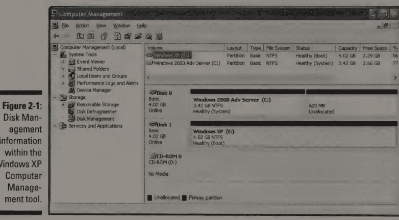

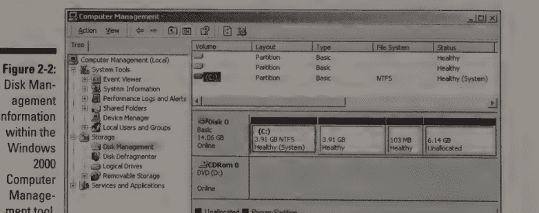

图 2-2 反映了一个有一个硬盘和一个 DVD/CD 驱动器的计算机。硬盘被划分（分区）为四个部分。在这四个部分中，三个正在在使用，有一个分区是空闲的。在磁盘管理工具中，标记为“主”（Primary）或“扩展”（Extended）的分区已分配给操作系统（如 Windows）的硬盘区域。在图 2-2 中，标识为“已分配”（Allocated）的部分未分配给任何操作系统，是空闲的。这个“未分配”（Unallocated）部分可以用于安装 Linux，因为此分区大于 3GB（你需要为程序和文件留出足够的空间，对吧？）且未分配给另一个操作系统。


记住哪个分区被标记为“未分配”。你以后将需要这些信息。此外，如果你看到分区类型列为 NTFS（NT 文件系统），也请记住。

## 在 Windows 98 中检查磁盘空间

如果你需要 Windows 和 Linux 共享同一个硬盘，在我继续之前，需要你做一些侦查工作。Windows 98 不提供像“计算机管理”那样的图形工具。相反，它使用 FDISK，这是一个显示硬盘上分区的命令行工具。要在 Windows 98 中查找计算机硬盘的详情，请按照以下步骤操作：

1. 选择 `开始 > 程序 > MS-DOS 提示符` 打开 MS-DOS 提示符窗口。
2. 输入 `FDISK` 并按回车。

在 Windows 中，你可以输入大写、小写或任何混合大小写的 `FDISK`，只要你拼写正确即可！

根据硬盘的大小，可能会提示你显示大磁盘信息。FDISK 菜单选项看起来类似于图 2-3 所示。

3. 如果你看到大磁盘提示，在此提示处选择 Y 然后按回车。

出现 FDISK 菜单选项。

4. 显示当前驱动器分区信息。

如果你的计算机中有多个硬盘，FDISK 会显示第五个菜单用于在硬盘之间选择。要切换到另一个硬盘，输入 5 并按回车。FDISK 屏幕显示系统中的所有硬盘。输入你想要的硬盘编号并按回车。FDISK 菜单屏幕的顶部显示系统中的所有硬盘。

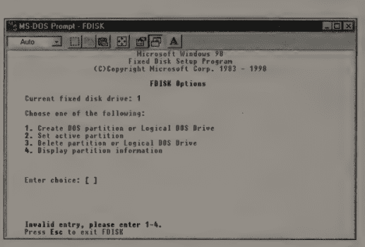

图 2-3：FDISK 菜单选项。

5. 要显示所选硬盘的分区信息，输入 4 并按回车。

图 2-4 显示了“显示”屏幕的示例。

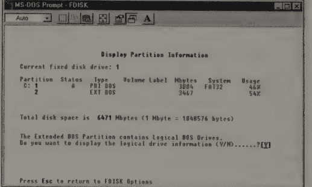

图 2-4：FDISK 中的分区信息。


# 第 2 章：为 Linux 准备计算机

## 磁盘分区基础

将主分区想象成你放入数据的空盒子。扩展分区是那些内部堆叠着一堆较小盒子的大盒子。这些较小的盒子就是逻辑分区。

遗憾的是，`FDISK` 不会告诉你关于此扩展分区内部的任何信息。你必须进一步深挖。

- 6. 要查看扩展分区内的逻辑分区，选择 `EXT DOS` 项并按回车。

图 2-5 是逻辑分区设置的示例。在这种情况下，扩展分区内的所有空间均已分配。如果有空闲空间，`FDISK` 会告诉你很多信息。如果空间是 3GB 或更多，那么安装 Linux 将轻而易举。

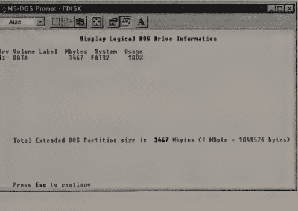

图 2-5：`FDISK` 中的逻辑驱动器信息。

| 总扩展 DOS 分区大小 |
| :--- |
| 3467 Bytes (1 Mbyte = 1048576 bytes) |

## 处理磁盘分区

在本章开头的“准备共同使用 Linux 和 Microsoft Windows”节中，我讨论了在已经在运行 Windows 的计算机上为 Linux 留出磁盘空间。我所涵盖的技术假设你的系统硬盘包含尚未被分配给 Windows 的空间，或者有足够的空闲空间来重新组织并将其分配给 Linux。

## 选择分区工具

如果你在驱动器上已经安装了现有的操作系统（例如 Windows），并且想保留它们，那么在安装 Linux 之前，你将需要对这些分区进行大小调整。（那些拥有大量未分配空间或独立空闲硬盘的用户，可以跳过到本章后半部分的“评估你的计算机”节。）

> 正如我之前所说，只要你有 3GB 或更多的可用磁盘空间，或者你现有的 Windows 安装可以腾出 3GB 的磁盘空间，你就没问题了。如果没有，请认真考虑为你的 Linux 安装一个廉价的硬盘。

遗憾的是，这是最棘手的部分。如果 Windows 占据了你所有的硬盘空间，你可能无法留出备份空间。在继续操作之前，请对 Windows 安装中任何不想丢失的物品进行备份！在这一过程的各个步骤中，即使使用 Windows 上的工具，也可能出现问题。

调整现有分区的最简单、最安全的方法是使用商业程序，例如 `Partition Magic`。`Partition Magic` 允许你查看硬盘或驱动器的分区信息。该实用程序还包括调整大小、移动和添加分区的功能。

你也可以使用随书附带 DVD 上的免费工具：`FIPS`。更多信息，请参阅本章后半部分的“使用 FIPS 安全地调整分区”节。

如果你使用 `Partition Magic` 创建了一个开放分区，在调整 Windows 分区大小后，请记住该分区的名称。你稍后会需要它。

### 从头开始为双系统进行分区

如果你计划使用一个全新的硬盘并在其上安装 Windows 和 Linux，请务必先安装 Windows。在安装过程中，系统会要求对驱动器进行分区。你的硬盘可以有三个主分区和一个扩展分区。在该扩展分区内部，你最多可以拥有 12 个逻辑分区。

请确保你为 Linux 留出一个至少 3GB 的完整扩展分区，或者留出一个至少包含两个逻辑分区的扩展分区部分，且总大小至少为 3GB。

记下你留下的开放分区。你稍后会需要这些信息。


### 使用 FIPS 安全地调整分区

市面上常用的免费磁盘分区修改程序可能是 `FIPS`（首次非破坏性交互式分区分割程序）。大多数 Linux 安装介质包含此程序，你的 DVD 也不例外。

在 `Fedora Core 1` DVD 或随附的第一张 CD 上，`FIPS` 位于 `/dosutils` 目录。在该目录下，你会找到两个用于 `FIPS` 的子目录——`/fips15` 和 `/fips20`。`/fips20` 目录包含 `FIPS` 的最新版本及其文档。


如名所示，`FIPS` 允许你修改磁盘分区而不破坏现有的数据或操作系统。再次强调，在使用 `FIPS` 之前请务必备份你现有的文件和重要数据！

> 我强烈建议你在尝试使用 `FIPS` 之前通读完 DVD（或 CD）上的文档。你可以在 `/dosutils/fipsdocs/fips.faq` 文件中找到它。

`FIPS` 不支持 `NTFS` 分区。如果你使用了 `NTFS`，你将需要购买 `Partition Magic` 来调整这些分区的大小，或者使用一个可以让你从 Linux 从头开始的独立硬盘。


如果可能，在继续之前面前准备 `FIPS` 文档。设置和使用 `FIPS` 请遵循以下步骤：

1. 将一张 DOS 启动软盘插入磁盘驱动器。
2. 在运行 DOS 的系统或 Windows 98 的 MS-DOS/命令窗口中，在提示符处输入 `format a: /s` 并回车。在 Windows 2000/XP 系统上，跳过格式化命令，从根目录（例如 `C:\`）将 `boot.ini`、`ntldlr` 和 `nddetect.com` 文件拷贝到软盘。此外，如果你在 Windows 2000/XP 系统上看到 `bootsect.sys` 或 `ntbootdd.sys` 文件，也将这些文件拷贝到软盘。

在 `FORMAT` 命令中，`a:` 指的是驱动器的器号——如果你的系统不是 `a:`，请输入你系统上相应的驱动器号。`/s` 将必要的文件拷贝到软盘以使其启动。

3. 从 `/fips20` 目录将以下文件拷贝到软盘：
   - `restorb.exe`
   - `fips.exe`
   - `errors.txt`

如果你使用的是 Windows，可以使用 Windows 资源管理器将文件拷贝到软盘。对于 DOS 或 MS-DOS/命令窗口：

4. 磁盘整理你的硬盘。在使用 `FIPS` 之前，你必须整理你的硬盘。Windows 包含整理工具，执行以下步骤进行整理：
   a. 选择开始。
   b. 输入 `defrag`。
   c. 选择你的驱动器

   

   根据硬盘的大小，整理可能需要一些时间。

5. 使用软盘重启你的机器。
6. 系统重启到 DOS 后，在提示符处输入 `FIPS` 并回车。
7. 输入想要修改的驱动器数字。
8. 在屏幕底部，输入想要分割的分区数字。
9. 将一个格式化的空白磁盘插入磁盘驱动器并按 `Y`。
10. 使用键盘上的方向键调整两个分区的大小，然后回车。

   

   | 文件 设置 设备 帮助 |
   | :--- |
   | 不要要在 Windows、OS/2、Novell 管理器或 Linux 模拟器等多环境下运行 FIPS：先从磁盘启动。 |
   | 如果你使用 OS/2 或磁盘压缩，请阅读 FIPS.DOC 中的相关章节。 |
   | FIPS 没有任何保证，详情请见 COPYING 文件。这是一个免费软件，你可以在某些条件下重新分发：详情请见 COPYING 文件。 |
   | 按任意键 |
   | 分区表： |
   | 部分.:启动:磁道 扇区:系统:磁道 扇区:起始扇区:扇区数:MB |
   | 1 | 是 | 0 | 08h: 63 | 57 | 63: | 2048193|1000 |
   | 2 | 否 | 0 | 08h: 63 | 61 | 63: | 20480256 |2172864|68 |
   | 3 | 否 | 0 | 05h: 63 | 82 | 63: | 25563820 |1564416|73 |
   | 4 | 否 | 0 | 00h: 00 | 0 | 0 | 0: 8 |
   | 检查根扇区 ... OK |
   | 想要分割哪个分区 (1/2/3)? |

11. 如果你对更改感到满意，输入 `C`。

在屏幕底部，应用程序会询问你是否想将分区信息写入磁盘。

12. 若要应用更改并退出应用程序，输入 `Y`；若要忽略更改并退出应用程序，输入 `N`。

请记住你创建的特定分区。你以后将需要这些信息。

## 共同运行 Windows 和 Linux

当你在已经安装了 Windows 的系统上安装 Linux 时，你一次只能运行一个操作系统。换句话说，如果你正在使用 Windows 并想运行 Linux，你需要关闭 Windows，允许电脑重启，然后启动 Linux。图 2-7 显示了安装了 Linux 和 Windows 的系统的启动环境。

然而，通过使用额外的软件，你可以在 Windows 运行的同时同时运行 Linux。你还可以在 Linux 内部运行 Windows 软件！更多信息请参见第 15 章。

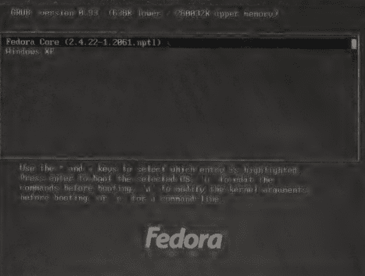

图 2-7：安装了 `Fedora Core 1` 和 `Windows XP` 的系统的双启动启动界面。

## 评估你的电脑

如今大多数硬件与 Linux 运行得非常良好。有时，如果你拥有最先进的显卡或其他花哨的新电子产品，可能会遇到问题，所以如果你是那种“尝鲜者”，你可能需要查看你发行版的硬件兼容列表，确保你的硬件在支持范围内。`Fedora Core` 的列表可以在 `http://hardware-redhat.com/hcl/` 获取。硬件不需要列为“已认证”（Certified），显示为“已支持”（Supported）即可。


如果你是计算机初学者，或者不熟悉硬件定义和细节，你可以在互联网上找到很多信息。（一个很好的网站是 `www.tomhardware.com`）

如果你的硬件没有被列在列表中，不要惊慌。你可能无法使用最新一代的显卡，但至少你可以将其作为通用 SVGA 使用。一切并非不可挽回。事实上，有时旧硬件虽然不在列表中，但仍然受到支持。通常情况下，使用比最新最强硬件稍旧一点的硬件更好。如果你找不到你的硬件列表，可以对硬件品牌、型号加上“linux”一词进行网络搜索。

有时你会发现在该特定 Linux 版本发布之后，为你的硬件发布了驱动程序。确保在安装 Linux 之前已获取了这些驱动程序，无论你是下载它们并保存到软盘中，还是通过硬件自带的软盘或 CD 获取的。

此外，尽量将你的电脑手册（特别是显卡和显示器的手册）放在手边，以防你需要它们来回答安装程序提出的问题——大多数人根本不需要处理这种情况，但有些人需要。至少，请确保你清楚你的电脑里具体是什么显卡。你可以在发票上找到这些信息，或者通过智能利用现有的 Windows 安装来查找。稍后我会向你演示方法。


如果你现在不想处理这些，请跳到本章后面的“最后，准备你的安装”部分。然后，如果安装程序以后需要你提供额外信息，你可以在互联网上找到所需内容，或者重启进入 Windows，在重新开始安装前完成你的侦查工作。

如果你无法轻松找到关于电脑配置的信息，你有以下选项：

- 使用现有的操作系统来记录你的硬件。如果你的电脑已经在运行 Windows，你可以从 Windows 环境中收集大量信息。根据你的系统，使用以下方法之一：
  - 在 `Windows 98` 中，选择“开始→控制面板→系统→设备管理器”访问图 2-8 所示的对话框。
  - 在 `Windows 2000` 中，选择“开始→控制面板→系统→硬件管理器”访问机器上安装的硬件列表，如图 2-9 所示。
  - 在 `Windows XP` 中，选择“开始→控制面板→打印机和其他硬件”。在这里，你可以从“选择控制面板图标”对话框下选择一个项目，或者查看“另另”部分并选择“系统”（如果有“硬件设备管理器”，图 2-10）。

如果你现在不想处理这些，请跳到本章后面的“最后，准备你的安装”部分。然后，如果安装程序以后需要你提供额外信息，你可以在互联网上找到所需内容，或者重启进入 Windows，在重新开始安装前完成你的侦查工作。

设备管理器中的每个项目都可以双击以显示相应的细节。


| 系统属性 | |
| :--- | :--- |
| 设备管理器 | 硬件 |
| 性能 | 连接 |
| CD 光驱 | 类型 |
| 软盘 | 适配器 |
| 硬盘 | 键盘 |
| 调制解调器 | 适配器 |
| 显示器 | 鼠标 |
| 网络适配器 | 端口 (COM & LPT) |
| 视频 | 游戏控制器 |
| 通用总线 | 移除 |
| 刷新 | 开始 |

## 第 2 章：为 Linux 准备你的电脑

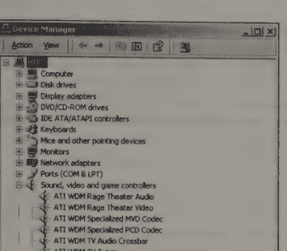

图 2-9：`Windows 2000` 设备管理器。

**下载硬件工具。** 如果找不到按键序列，请检查制造商网站。如果你进入了 BIOS，通常使用方向键、Tab 或回车键进行导航。在某些 BIOS 环境中也会使用功能键。查看屏幕顶部或底部的选项列表。

**通过阅读屏幕收集信息。** 你应该特别注意硬件盒和网站上带有“Win”（代表 Windows）字样的标签。这些组件在电脑启动时可能会显示多个屏幕信息。

**访问基本输出系统 (BIOS)。** 要访问 BIOS，你需要在操作系统加载之前进行。大多数制造商会在系统启动时指示键盘键或序列，例如“按 Del 设置”。

**CMOS。** 存储在小内存区域并由电池保持，有时被称为互金属氧化半导体（CMOS）。BIOS 中存储的信息量从少到多不等。某些新系统可能会显示多个屏幕信息。

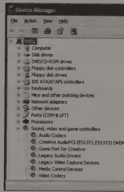

图 2-10：`XP` 设备管理器。

## 最后，准备你的安装

是的，这些准备工作很多，但值得的。现在你终于可以查看实际的安装程序了。你需要做的第一工作是确定你将使用哪种方法来安装 Linux。这实际上并不听起来那么困难。你有三个选择：

- **DVD 或 CD**：如果你的电脑可以从 DVD 或 CD 启动，并且你的 Linux 发行版 CD 或 DVD 是可启动的，你可以直接从 CD 或 DVD 开始安装。大多数 Linux 发行版都提供可启动的 CD 或 DVD，而且大多数现代计算机都能从 CD 和 DVD 启动。书中附带的发行包含一张可启动的 DVD，如果你使用优惠券获取 CD，第一张 CD 也是可启动的。
- **软盘**：如果你无法从 DVD 或 CD 启动，你也可以从软盘开始安装。从软盘启动后，安装程序将使用 DVD 或 CD 继续安装。
- **网络源**：这种方法允许你通过网络安装 Linux。在此过程中，你启动电脑，与 Linux 安装文件所在的位置建立网络连接，然后通过访问网络文件来完成安装。

本章重点介绍如何准备从 DVD（也包括 CD 的说明）或通过软盘安装 Linux。如果你已经决定了使用其中哪一种，你需要做出的第二个决策是你想让 Linux 驻留在目标硬盘的哪个位置。如果你有一个全新的空闲硬盘，那是你的最佳选择。在继续之前，请记住是哪一个驱动器。正如本章前面提到的，你也可以安装在已经在运行 Windows 的硬盘分区内。在进入第 3 章之前，请确保你已经确定了要把哪几个分区分配给 Linux。

## 笔记本电脑考虑因素

目前的 Linux 发行版在较新的笔记本和笔记本电脑上运行良好（请访问 `www.linux-net`，这是一个研究 Linux 与各种型号兼容情况的优秀网站）。如果你的笔记本电脑是常见品牌，安装 Linux 时应该不会遇到任何问题。然而，笔记本电脑通常包含 Windows（调制解调器已在本章其他地方提到，带有 Win 前缀的硬件用于 Windows 而非 Linux）网卡，请确保它们不是 Win 品牌的。如果笔记本的内置或默认硬件标记为 Win，或者你在研究该机器时发现它在没有正确标记的情况下包含一个 Win 产品，你可能可以将该问题的硬件更换为 PC (PCMCIA) 卡。大多数现代笔记本电脑至少包含一个 PC 卡槽，你可以插入 PC 卡调制解调器、网卡或调制解调器-网卡合一卡。只要你坚持使用常见的 PC 卡，它应该能够与 Linux 良好工作。

如果你计划购买用于 Linux 的笔记本电脑，在进一步操作之前，请检查调制解调器和其他硬件，例如。现在还有一件事我想让你做：找到你 Linux 发行版的文档。这些手册可以帮助你克服安装中的障碍，并包含大量安装完成后的有用信息。

找到这些文档取决于你获取发行版的方式：

- 许多盒装版附有打印版手册。
- 下载的材料（以及盒装版）可能在发行版的 CD 或 DVD 上附带文档。遗憾的是，书中附带的媒体并非如此。

你也可以（通常）在发行版的网站上找到 Web 版本的帮助文件和完整手册，如果你想要纸质版，甚至可以单独购买手册。

如果文档没有涵盖你的问题怎么办？查看许多 Linux 参考网站，特别是：

- 通用网站和出版物：`www.linux.com`、`www.everythinglinux.org`、`www.linuxgazette.com`、`www.linuxjournal.com`、`www.linxtoday.com`、`www.linuxworld.com`、`www.lwn.net`、`www.linuxcare.com`、`www.slashdot.org`、`www.freshmeat.net` 以及 `www.linuxdoc.org`。


- 安全网站：`www.linuxsecurity.com`、`security.ucdavis.edu/sysadmin/linux.html` 以及 `www.portalux.com/system/security`。
- 内核和软件网站：`www.linuxhq.com` 和 `www.linuxapps.com`。

## 从 CD- 或 DVD-ROM 启动

一个非常好的安装选项是你可以从 CD- 或 DVD-ROM 安装 Linux。如今许多系统被设置为从驱动器中的 CD 或 DVD 启动，但买家可能尚未对此进行配置。如果有的话，只需插入安装 DVD（或 CD）并尝试即可！如果尝试从 DVD（或 CD）启动不起作用：

1. 确定你的 Linux 安装 CD 或 DVD 是否是可启动的。

   几乎所有现代 Linux 发行版的 CD 和 DVD —— 书中附的 DVD（以及你可以通过优惠券订购的 CD 套中的第一张 CD）——都可以用于进入安装程序。

   然而，如果你选择了书中未涵盖的发行版，你的 DVD 或 CD 可能需要启动盘。发行版的文档会告诉你这是否可行。按照文档的说明制作启动盘。

2. 确定你的系统是否能够从 DVD 或 CD 启动。

   如果你从 CD 或 DVD 启动了系统，那么从 Linux 安装 CD 启动就不会有问题。你可以在 BIOS 中找到此信息，它位于允许机器在启动时检查哪些存储设备（驱动器）的部分。如果 CD-DVD-ROM... [等待，根据 OCR 流程重新对齐]

正如本章前面提到的，你也可以安装在已经在运行 Windows 的硬盘分区内。在进入第 3 章之前，请确保你已经确定了要把哪几个分区分配给 Linux。

## 第 3 章

## 安装 Fedora Core

### 本章内容

- 介绍一些实用的功能和安装改进
- 使用图形界面将 Linux 安装为个人桌面

> 要么做，要么不做。没有所谓的“尝试”。
>
> — 尤达，《帝国终击战》

Linux 已经从仅限极客的领域脱颖而出，进入了普通用户的视野。安装 Linux 不再需要奥秘的符号和复杂的魔法师咒语。正因如此，Linux 的图形化安装现在变得非常容易操作，对于来自 Microsoft Windows 等其他图形操作系统的用户来说会非常熟悉。本章将提供详细细节。

如果你正在安装 SuSE 或 Mandrake Linux，请跳转到第 4 章。在本章中有很多你需要学习的内容，但你也可以先查看针对你特定发行版的说明。

## 开始安装前需要考虑的事项

你可以通过以下方式安装 Fedora Core：

- 使用 Fedora Core DVD-ROM 启动。
- 使用 Fedora Core 安装 CD 启动（如果你订购了 CD Set，这就是第 1 号 CD）。
- 使用安装软盘启动，并从 DVD-ROM 或 CD 读取剩余的安装文件。

要从 DVD-ROM 或 CD-ROM 开始安装，你必须先更改系统从 DVD-ROM 或 CD-ROM 启动。在第 2 章中，我介绍了如何配置计算机从这些设备启动。

如果你想或需要制作安装软盘并能够访问 Windows 系统，请执行第 2 章涵盖的创建安装软盘的步骤。由于某些原因，安装软盘（或 CD/DVD-ROM 的安装程序）在你的系统上无法工作，你可能需要下载新版本的安装分区镜像。

你可以从“Security & Errata”页面（`http://www.redhat.com/apps/support/errata/`）获取更新的安装镜像。点击 Fedora Core 1 的链接并搜索“boot”、“image”和“anaconda”等关键词。如果有新的启动磁盘镜像，就能通过这种方式找到它。它会解释你之后需要做什么。

这个所谓的“镜像”（image）到底是什么？镜像是一个必须精确放置在存储介质（如软盘或可写的 CD- 或 DVD-ROM）中的文件。你不能直接复制它。我在第 2 章中介绍了 `RAWWRITE` 工具。

本章的指令将告诉你如何遵循 Fedora Core 1 的安装流程。我重点关注 Fedora Core 1 及其安装主要有两个原因：

- Fedora Core 1 包含在随书的 DVD 中，以及你可以使用优惠券订购的 CD 中。
- 涵盖每一个 Linux 发行版的安装将这本书变成一套百科全书。

我介绍了个人桌面安装，因为它几乎或完全不需要准备硬盘，而且不像其他安装那样使用启动分区。此外，个人桌面选项会安装 X Windows 系统（图形界面）以及桌面和笔记本系统常用的应用程序。服务器或服务类型的应用程序（如 Apache Web 服务器和 FTP 服务器）不会通过个人桌面选项安装。但是，你可以在实际开始安装之前，将这些程序添加到你的个人桌面包选择中。

请注意，如果你正在安装 Red Hat Enterprise Linux、Fedora Core 的不同版本或不同的 Linux 发行版，你的屏幕将与书中显示的有所不同。每个 Linux 发行版的安装都涵盖相同的基本任务，但每个操作的呈现顺序可能有所不同。例如，某个发行版可能在网络配置之前显示创建账户，而另一个发行版可能将这两个主题的顺序反倒。

在到达“准备安装”（GUI 安装）屏幕之前，你可以退出安装而不改变系统上的任何内容。在“准备安装”屏幕之前你做的任何配置选项都不会保存到磁盘上。一旦你继续通过“准备安装”屏幕，数据就会写入磁盘，你的系统也会发生变化。

如果你拥有非常新的硬件和旧版本的 Linux，安装软件和过程可能无法与新硬件“兼容”。如果你在安装过程中遇到困难并怀疑可能是此类情况，我建议检查 Linux 发行版的网站以获取新的安装软盘镜像。Linux 社区通常会很快解决不同 Linux 发行版和版本的硬件适配问题。然而，如果你尝试在新硬件上安装超过两年的 Linux 版本，你可能无法找到更新的软盘镜像。

## 安装过程

在本章中，我将遵循图形化安装流程。如果由于原因你无法使用图形化安装（例如 Linux 不支持你的显卡），请改用基于文本的安装。步骤是相同的，只是没那么好看。你可以在 Red Hat 网站上的手册中找到关于文本安装的更详细介绍，我也会偶尔包含一些文本安装程序的图片。

| 处理损坏的 CD |
| :--- |
| 如果你的介质检查失败，接下来的操作取决于你从哪里获取的介质。如果 DVD 是随书附带的，请联系 Wiley（电话：800-762-2974）更换。如果你是自己刻的 CD，请尝试以较慢的速度再次运行。可能在传输过程中损坏了。 |

要安装 Fedora Core 1，请遵循以下步骤：

1. 如果你想从 Red Hat DVD-ROM 启动并安装，请将随书附带的 DVD 放入 DVD-ROM 并重启系统。
2. 否则，将安装软盘（详请见第 2 章）放入软盘驱动器，将 DVD 放入 DVD-ROM，然后重启系统。
3. 如果使用 CD，将第一个 CD 放入 CD-ROM 启动安装。

无论从软盘、CD-ROM 还是 DVD-ROM 开始，都会出现初始安装屏幕。屏幕包含几个选项（如图 3-1 所示），每个选项描述如下：

- **以图形模式安装或升级**。图形界面中的第一个选项用于首次安装 Fedora Core 或升级现有的 Linux 版本。此安装程序会检测系统硬件。图形界面设计为使用鼠标选择选项。如果你没有鼠标，可以使用键盘在屏幕间导航。在大多数地方，使用 `Tab` 键或方向键开启或关闭选项；使用 `Enter` 键接受选择并进入下一个屏幕。在大多数屏幕中，如果你想更改之前的设置，可以使用“返回”（Back）按钮回到之前的选择屏幕。图形化安装屏幕还在左侧面板提供帮助信息。内容会根据当前配置屏幕的信息进行变化。

- **以文本模式安装或升级**。第二个选项允许你使用文本菜单界面安装或升级 Fedora Core。该界面以文本菜单呈现选项，你使用方向键或 `Tab` 键移动选择区域。在某些区域，使用空格键开启或关闭选项。要使用文本界面进行安装，请在启动提示符处输入 `linux` 并按 Enter。

- **使用功能键**。最后一项列出了初始安装屏幕底部显示的功能键。

`F1` 功能键显示初始安装屏幕，允许你通过图形模式安装或升级、通过文本模式安装或升级，或使用标记 `F2` 到 `F5` 的功能键。

`F2` 功能键包含以下选项：安装期间禁用硬件检测（在继续之前您必须了解硬件硬件详情）；在继续之前测试安装介质（如果您从红帽的 Fedora 项目官方网站 (`http://fedora.redhat.com`) 下载了 Fedora 发行版并将软件刻录到 CD 或 DVD，则可以使用此良好选项）；使用未包含在 Linux 安装介质中的驱动器磁盘、CD 或 DVD 启用救援模式；以及更新您的 Linux 安装。

`F3` 功能键允许您设置视频选项。如果您在通过图形界面安装 Fedora Core 1 时遇到过问题，您可能想尝试较低的分辨率。在启动提示符处输入 `linux lowres` 以使用较低的图形分辨率来安装 Linux。`linux lowres nofb` 命令允许您关闭帧缓冲（frame buffering），这可能会导致某些显卡出现问题。

`F4` 功能键标记为 Kernel（内核），允许您在安装时输入参数。例如，某些文件会要求您执行操作，如“关闭 PCI 硬件总线的自动探测”。您可以在这里找到需要输入的内容。

`F5` 功能键允许在 Linux 系统无法正常启动时进入救援模式。救援模式包含了许多实用的工具，可以将您的系统恢复到可用状态。要启动救援模式，在启动提示符处输入 `linux rescue` 并按回车。


图 3-1：初始 Fedora Core 安装界面。

44 第一部分：入门指南

如果您不选择任何选项并直接按回车，图形化安装过程将开始。红帽 Linux 的默认安装模式是图形化的。其他 Linux 发行版（如 SuSE 和 Mandrake）也具有图形安装选项。尽管其他发行版的安装界面与 Fedora Core 不同，但它们都遵循相同的步骤步骤。

2. 按回车开始图形化安装。

安装开始后，会有许多行信息滚动过。在此期间，一个微型 Linux 正在加载。如果您下载了 Fedora Core 的完整版并自己将其刻录到 CD 或 DVD，则会出现“CD Found (mediacheck)”屏幕。这允许您检查正在用于安装 Linux 的介质的完整性。如果是这种情况，我建议花时间对所有 CD 或 DVD 进行此测试。最好确认它们中是否有任何损坏或不完整。


随书附的 DVD 是 Fedora Core 1 的完整版，因此与您可以购买或下载的版本相同。与盒装版一样，此版本的介质检查默认情况下不会运行。您可以在初始安装界面上按 `F2` 键，并在提示符处输入 `linux mediacheck` 来执行相同的功能。

3. 根据您是否想要测试介质，执行以下操作：

   - 如果您看到“CD Found”窗口，或手动按 `Tab` 键直到“OK”按钮启用。请依次测试每个 CD 或 DVD。如果其中任何一个收到“Fail（失败）”通知，请查看“处理损坏的 CD”侧栏。完成测试后，按 `Tab` 键到“Continue（继续）”按钮并按回车进入下一个安装步骤。
   - 如果您不想检查 DVD 或 CD，请按 `Tab` 键直到“Skip（跳过）”按钮启用。按回车键进入下一个安装步骤。

无论哪种，您都准备好继续了，“CD Found”图像消失，额外的文本在屏幕上滚动。最后几行加载图形引擎，出现一个中间带有小 X 的灰色屏幕，然后出现带有红帽标志的屏幕。

片刻后，出现“Welcome to Fedora Core”屏幕，指示了您可以在哪里阅读或获取红帽手册。信息建议在第一次操作之前阅读安装文档，请务必这样做！

4. 在完成“Welcome to Red Hat Linux”屏幕上的内容后，点击“Next（下一步）”。

欢迎界面自动消失，并被“语言选择”界面取代，如图 3-2 所示。Linux 支持许多不同的语言。

## 第 3 章：安装 Fedora Core

45

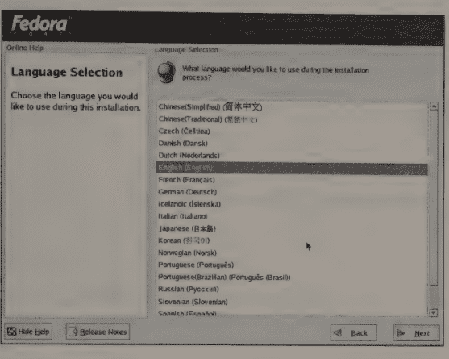

**图 3-2：**语言选择界面。

5. 使用鼠标或 `↑` 或 `↓` 键选择您的语言并点击“Next”。

出现“键盘配置”界面，如图 3-3 所示。不同的语言在键盘上的按键布局不同；您可能想为您的键盘选择匹配的语言（默认为美国英语）。

6. 选择您的键盘配置并点击“Next”。

出现“鼠标配置”界面，如图 3-4 所示。注意，此界面还包含一个“Back（后退）”按钮，允许您在需要进行更改时返回上一个配置界面。

7. 配置您的鼠标。

在安装的这个阶段，您可能已经在使用鼠标进行选择了。“鼠标配置”界面允许您选择鼠标的模型和功能。如果您不熟悉鼠标硬件，需要理解的重要区别是串口鼠标、PS/2 鼠标和 USB 鼠标。串口鼠标具有宽矩形连接器，末端有引脚并插入电脑。PS/2 鼠标具有圆形连接器，而 USB 鼠标具有小型矩形连接器，比连接器小得多。如果您不熟悉鼠标硬件，需要理解的重要区别是串口鼠标、PS/2 鼠标和 USB 鼠标。如果您使用的是双键鼠标，您也可以通过同时按下两个键来模拟此功能。

46 第一部分：入门指南

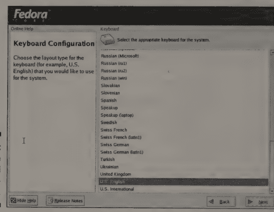

**图 3-3：**键盘配置界面。

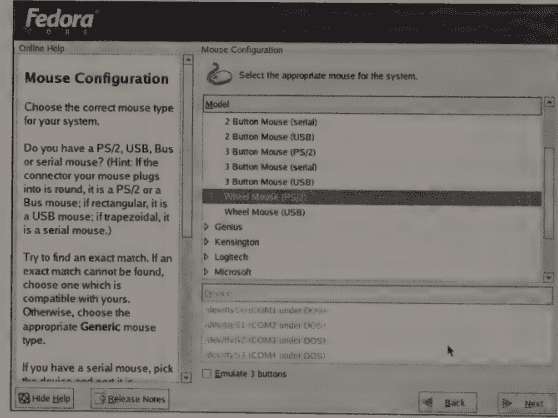

**图 3-4：**鼠标配置界面。

8. 在对鼠标进行任何调整后，点击“Next”。出现“显示器配置”界面，如图 3-5 所示。

## 第 3 章：安装 Fedora Core

## 在线帮助

## 显示器配置安装程序无法正确检测您的显示器。您可以 own选择最匹配您显示器的设置。您也可以输入显示器的水平垂直同步范围。这些值可以在显示器的文档中找到。在许多情况下，显示器可以自动检测。如果检测到的设置不对，请选择正确的设置。

| |
|---|
| MAG DK149 |
| MAG DK15F |
| MAG DK17S |
| MAG DK17P |
| MAG DK20AY |
| MAG DK20DT |
| MAG DK71T |
| MAG DK73IS |
| MAG Invision DK25B |
| MAG Invision DK26 |
| MAG Invision DK27 |
| MAG Invision MX14KL |
| | | |
|---|---|---|
| 水平同步: | 30.0 | 75 |
| 垂直同步: | 50.0 | 78 |


恢复默认值帮助 备注 图 3-5：显示器配置界面。


9. 如果显示器信息对您的硬件正确，点击“Next”；如果信息不正确，滚动列表并点击供应商旁边的三角形以展开或折叠。在展开列表中，选择您的显示器品牌和型号（或与您的硬件匹配的），并点击“Next”。

如果您完全找不到您的显示器，您有三个选择。您可以简单选择“未探测显示器”（Unprobed Monitor），并保留您的显示器文档以回答有关硬件的问题。您也可以选择通用 LCD 显示（对于笔记本电脑）或通用 CRT 显示（对于桌面显示器），然后选择您的显示器能够支持的分辨率。再次强调，如果可能，手头有显示器文档是最好的。如果没有实体文档，通常可以在制造商的网站上找到需要的信息，或者对品牌和型号进行网络搜索。

必须确保不要让您的视频硬件超出其设计范围。这种方法可能会损坏您的硬件。如果您不确定，请选择使用较低的分辨率或刷新率。

10. 在对显示器设置进行任何调整后，出现“安装类型”界面，如图 3-6 所示。

# 48 第一部分：开始接触 Fedora

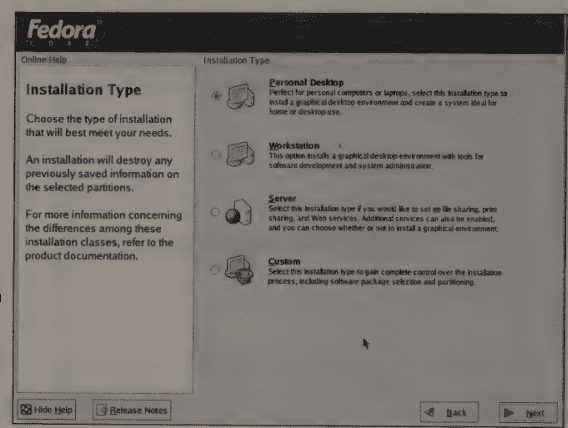

图 3-6：安装类型屏幕。

“安装类型”下有四个选项：

- **个人桌面（Personal Desktop）**：此选项为个人桌面或笔记本电脑执行安装，并安装图形化界面。如果你的系统已经包含 Linux 版本，个人桌面安装的默认设置是移除任何现有的 Linux 相关分区，并使用所有剩余的空未分区磁盘空间。如果你选择此默认设置，任何非 Linux 分区（如 OS/Windows）将保持不变。安装完成后，你可以启动到 Linux 以及你其他现有的操作系统或系统。

- **工作站（Workstation）**：此选项将安装图形化界面（X Window 系统）以及你选择的桌面管理器，这与个人桌面安装类似，但还包含了供软件开发人员和系统管理员使用的工具。

- **服务器（Server）**：此选项专用于文件和打印共享以及 Web 服务的基础 Linux 服务器设计。你还可以启用其他服务并选择安装图形环境。当你选择此选项时，默认的磁盘分区方案是移除所有硬盘上的**所有**分区。这意味着任何类型（Linux 及其他）的所有分区和操作系统都将被移除，且所有驱动器都将被擦除。

- **自定义（Custom）**：此选项提供了灵活性，允许你保留现有的操作系统和配置选项。此选项允许你选择想要安装的软件包或应用程序/角色、自定义磁盘分区的大小，以及你希望系统启动的方式。

## 第 3 章：安装 Fedora Core


为了演示目的，我在书中讲解了“个人桌面”安装，但你也可以选择与你系统相关的任何其他选项。如果你选择了其他选项，请记住我在此处包含的说明可能与你的安装体验有所不同。

11. 点击“个人桌面”安装选项进行选择；然后点击“下一步”。

出现“磁盘分区设置”屏幕，如图 3-7 所示。你可以选择接受自动分区策略，也可以手动定义你自己的分区。你的硬盘必须至少包含一个 Linux 分区才能继续安装。我选择在书中讲解自动分区。如果你读到这里并真的想手动分区，请查看旁边的侧边栏“手动定义分区”。


- 12. 选择“自动分区”；然后点击“下一步”。

出现“自动分区”屏幕，如图 3-8 所示。你可以选择移除系统上的所有 Linux 分区、保留系统上的所有现有分区，或使用空闲空间。你还可以标记特定的硬盘进行操作。正如第 2 章所建议的那样，请务必确定你想操作哪块硬盘！作为一个提示，你电脑中的第一块硬盘是 `hda`，第二个是 `hdb`，第三个是 `hdc`。如果你有 SCSI 驱动器，则使用 `sda`、`sdb` 和 `sdc` 索引。

如果你真的很紧张，请勾选“审核”框，以便在安装程序更改任何内容之前双重检查分区分配情况。

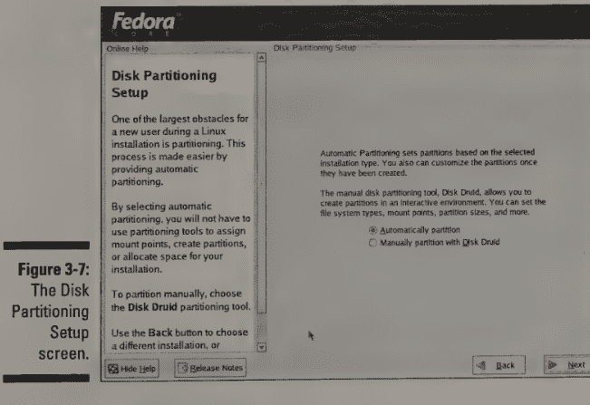

# 第一部分：开始接触

## Fedora

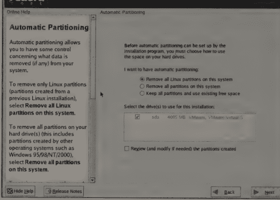

自动分区允许你控制从系统内核移除哪些数据（如果有的话）。

要仅移除 Linux 分区（由之前的 Linux 安装创建的分区），请选择此系统上的所有分区。

要移除硬盘上的所有分区（这包括由其他操作系统如 Windows 95/98/2000 创建的分区），请选择此系统上的所有分区。

在安装程序设置自动分区之前，你必须选择如何使用硬盘上的空间。

我想使用自动分区：

- 移除此系统上的所有 Linux 分区
- 移除此系统上的所有分区
- 保留所有分区并使用空闲空间

选择用于本次安装的设备：


小心——当你选择“移除此系统上的所有 Linux 分区”时，你会丢失现有分区中的**所有数据**；然后点击“下一步”。

- 13. 选择“移除此系统上的所有 Linux 分区”。

出现一个警告对话框，询问你是否想要移除这些分区。点击“是”。出现“引导加载程序配置”屏幕，如图 3-9 所示。

第一个选项允许将引导加载程序从默认的 GRUB 改为 LILO，或选择不使用引导加载程序。

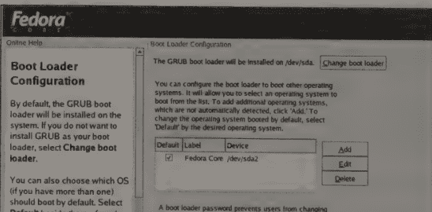

**图 3-9：引导加载程序配置屏幕。**

默认情况下，引导加载程序将安装在系统中。如果你不需要，请选择“更改引导加载程序”。

你还可以选择哪种操作系统（如果有多个）作为默认启动。

“默认”选择首选的分区作为你的默认操作系统。除非选择默认启动镜像，否则你无法在安装期间更改分区。

你还可以添加和删除启动项。

第二个选项允许你启动到 Linux 的其他操作系统。如果你在非 Linux 分区上安装了其他操作系统（如 Windows），可以选择。

第三个选项允许你配置安全的引导加载程序密码。

最后一个选项允许你选择高级引导选项。

- 14. 在对引导加载配置做出任何选择后，点击“下一步”。

出现“网络配置”屏幕，如图 3-10 所示。

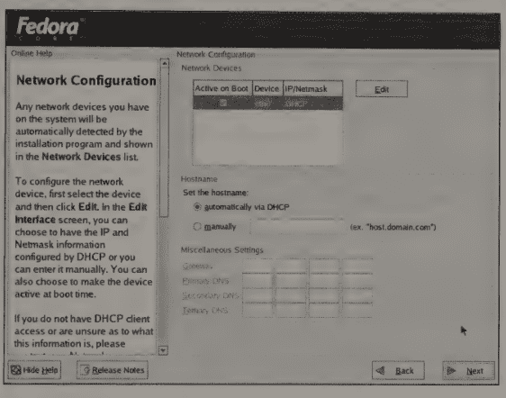

图 3-10：网络配置屏幕。

- 15. 如果你在网络上使用动态主机配置协议 (DHCP) 设置主机名，请选择“通过 DHCP ”。如果不使用 DHCP 定义主机名，请选择“手动”并输入主机名。

首先，确保勾选 `eth0`，以便你的机器在启动时激活网络。然后，如果你使用 DHCP，此设置将为电脑设置所有网络参数，使其能够在网络上网通信。如果你连接到高速互联网服务（如 DSL），你的电脑可能配置为通过 DHCP 获取除主机名以外的所有设置，主机名将为机器提供身份标识。

请咨询网络管理员或 IT 部门获取正确的设置。

# 52 第一部分：开始接触

要设置 Linux 系统的主机名，请确保未勾选“自动 DHCP”，然后配置以下内容：

- 在“手动”标签右侧的字段中为你的机器输入名称。我建议机器名称仅使用字母和数字。有时，使用其他字符可能会干扰应用程序并导致从网络访问你的机器。

- 如果其他网络设置不使用 DHCP，点击网络设备列表右侧的“编辑”按钮。在“编辑接口 eth0”窗口中，取消勾选“使用 DHCP”。输入 IP 地址和子网掩码值并点击“确定”。输入这两个值后，“杂项设置”标签下的其余字段将可用。如果你不知道你的 IP 地址或掩码应该是多少，请询问管理员。

我将在第 7 章更详细地介绍 DHCP 和其他 IP 相关信息。

## 第 3 章：安装 Fedora 53

防火墙保护你的系统免受未经授权的访问和发现。当你通过高速连接到互联网时，你的计算机就像互联网上成千上万个其他系统之一。首先，你可能希望选择“中等”（Medium）级别。如果你处于公司或私有网络中，请向网络管理员或 IT 部门咨询的防火墙设置。你的互联网连接硬件可能包含防火墙，请联系你的互联网连接硬件供应商获取有关其防火墙功能的信息。

17. 完成所有选择并输入数据后，点击“下一步”（Next）。

出现“附加语言支持”屏幕，如图 3-12 所示。你的 Linux 系统可以同时支持多种语言。如果你添加了语言，请确保选择你想要作为默认的语言。

18. 选择 Linux 安装所需的语言并点击“下一步”按钮继续。

出现“时区选择”屏幕，如图 3-13 所示。如果你没有找到所在城市的准确名称，请选择你所在时区内另一个支持相同夏令时的城市。你也可以点击屏幕顶部的 UTC（世界协调时）标签页，选择你与 UTC 时间的偏移量以及你是否使用夏令时。如果你的计算机使用 UTC，你也可以选择此选项。

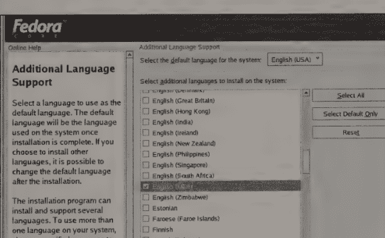

图 3-13：时区选择屏幕。

19. 选择 Linux 系统所在的时区并点击“下一步”。

出现“设置 Root 密码”屏幕，如图 3-14 所示。

20. 在“Root 密码”屏幕中，在“Root 密码”字段中输入 root 密码，然后在“确认”字段中输入相同的密码。

输入密码时不会显示密码——每个字符仅显示一个星号。这可以防止未经授权的人看到密码。

当两个字段中的值一致后，位于“确认”字段下方的“密码不匹配”（Root Passwords Do Not Match）短语会被“密码已接受”（Root Password Accepted）消息取代。

不要忘记你的 root 密码！你在 Linux 上执行任何管理任务时都需要它。

21. 输入两次 root 密码后，点击“下一步”。

安装系统会暂停并显示几秒进度对话框，此时它正在读取包（软件程序）选项。完成后，将“软件包默认设置”屏幕。你可以选择安装当前的默认软件包列表，或选择自定义软件包集（如图 3-15 所示）。

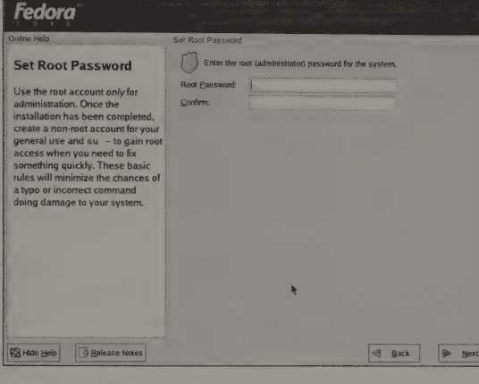

图 3-14：设置 Root 密码屏幕。

仅将 root 账户用于管理。一旦安装完成，请创建一个非 root 账户供日常使用，并在需要时获取 root 权限。这些基本规则将最大限度地减少输入错误或错误命令对系统造成损害的机会。

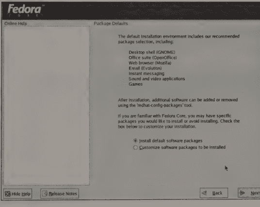

图 3-15：软件包默认设置屏幕。

默认安装环境包含推荐的软件包选择，包括：

- 桌面环境 (GNOME)
- 办公套件 (LibOffice)
- Web 浏览器 (Firefox)
- 电子邮件 (Evolution)
- 即时消息
- 音频和视频应用程序
- 游戏

安装后，可以使用“安装/删除”软件包添加或移除软件。

如果你对默认设置不满意，或者有想要安装或避免的特定软件包，请勾选下框以自定义安装。

- 安装软件包
- 自定义要安装的软件包

22. 选择“安装默认软件包”选项或“自定义要安装的软件包”选项。

在这个示例中，我想在默认的 GNOME 桌面之外安装 KDE 桌面。选择“自定义”选项并点击“下一步”按钮，屏幕将切换显示软件包类别的内容，如图 3-16 所示。

在“桌面”类别中选择“KDE 桌面环境”。如果你计划让你的 Linux 计算机访问网络上的其他计算机，请在“系统”类别中选择“系统工具”。如果你计划在你的 Linux 环境中开发软件，请在“开发”类别中选择适当的选项。你甚至可以滚动到“杂项”部分的底部并选择“全部”（Everything）！

记住，在安装 Linux 之后，你随时可以回来添加其他软件包。

- 如果你想选择组中的单个软件包，请点击每个软件包组名称右侧的“详情”（Details）链接。在“详情”窗口中，在软件包组名称下的每个项目左侧打钩，以选择组内的单个项目。

- 当你选了所有想要安装的软件包后，点击“下一步”。

出现“即将安装”屏幕。

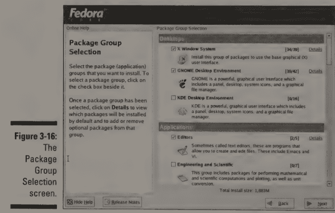

25. 当准备好提交时，点击“即将安装”屏幕中的“下一步”。

出现“所需的安装介质”对话框，如图 3-17 所示。

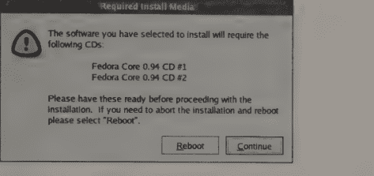

26. 安装介质完成后，点击“下一步”。

出现“正在安装”屏幕。系统安装时，查看进度条。完成后，出现“软件包默认设置”屏幕。你可以选择安装当前的默认软件包列表，或选择自定义软件包集（如图 3-15 所示）。

27. 如果不想创建启动盘，选择“否，不想创建启动盘”（No, Do Not Want to Create a Boot Disk）选项并点击“下一步”。

创建启动盘后，你将到达最终安装屏幕。恭喜，你已经完成了安装！移除介质并点击“退出”（Exit）重启。

## 第 3 章：安装 Fedora Core

正确的时间。在你勾选此框框后（有时设置过程需要一些时间，但完成后就没问题了），从服务器下拉列表框选择一个服务器。

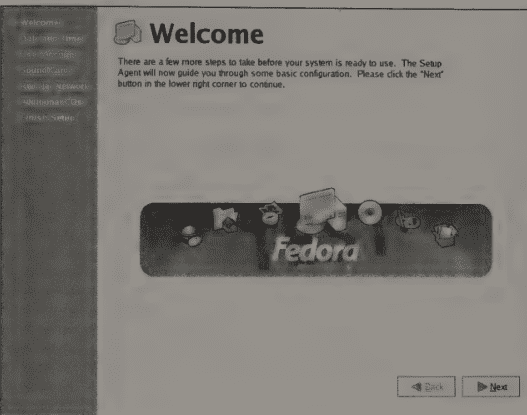

图 3-18：Fedora Core 首次启动欢迎界面。

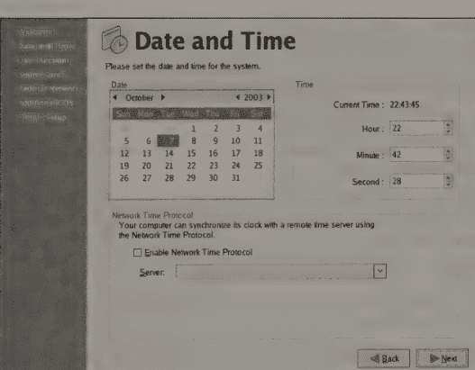

图 3-19：Fedora Core 首次启动日期和时间界面。

3. 完成日期调整后，点击 Next（下一步）继续。

出现用户账户界面，如图 3-20 所示。

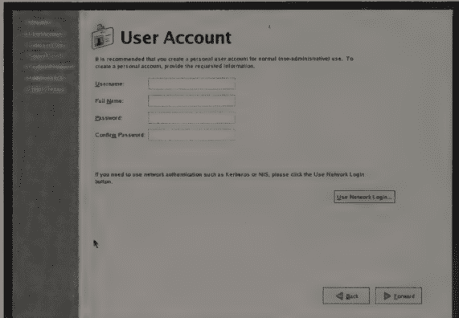

图 3-20：用户账户首次启动界面。

4. 在 Username（用户名）文本框中输入你想要为个人账户设置名称。

例如，我会输入 dee。

5. 在 Full Name（全名）文本框中输入你的姓名。

例如，我会输入 Dee-Ann LeBlanc。

6. 在 Password（密码）和 Confirm（确认密码）文本框中输入你的账户密码。

这是你个人账户的密码，与你的 root 账户无关。可以随意使用不同的密码。事实上，这样做是个好主意。

7. 点击 Forward（向前）按钮继续。

如果你的机器有声卡，将会出现 Sound（声音）界面。如果没有，请跳到第 9 步。

8. 点击 Play Test Sound（测试声音）以确保你的声卡设置正确。

你（希望如此）会听到右侧扬声器发出声音，然后是左侧，最后是两个都有。声音播放后，会弹出一个对话框询问你是否正常听到了声音。如果你什么都没听到，点击 No（否），你将收到无法自动检测卡的提示。这是以后需要修复的问题。如果你听到了声音，点击 Yes（是）。如果声音不起，请参考 http://www.tildep.org/HOWTO/Sound-HOWTO/ 寻求帮助。

9. **点击 Forward 继续。**

出现 Additional CDs（额外 CD）界面。如果你有列出的其中任何 CD 并想从它们中添加软件，现在可以尽管这样做。如果你没有这些 CD 但又想要，以后在拥有适当硬件的情况下下载它们并刻录到 CD 中。关于多媒体的更多信息请参阅第 15 章。

10. **完成额外 CD 后，点击 Forward 继续。**

就这些了！点击 Finish Setup（完成安装）。你刚刚挺过了第二个 Linux 炼狱！你的机器现在将带你进入图形化登录提示。请跳转到第 5 章查看后续操作的说明。

## 第 4 章

## 安装其他发行版

### 本章内容

- 游览 Linux 发行版
- 揭开 Mandrake 的神秘纱
- 了解 SuSE

Linux 发行版指的是将每个人都必须了解的名为 Linux 的免费操作系统封装起来的“软件包”。所有发行版的核心都是相同的组件：Linux 内核和 GNU 工具。正如许多其他商品以不同的方式封装和交付，以适应不同的接收者和应用程序一样，Linux 也以不同的方式封装，以满足各种目标用户。

在我们之前的讨论之后，你应该理解 Linux 不仅仅是某些新奇程序。Linux 是一个功能完备的软件工具和材料工作坊，可以用于构建任何广泛的计算解决方案。开发杀手级的 Linux 发行版一直是 Linux 社区的圣杯。这种终极发行版将为幼儿、家庭主妇和古板的老计算机科学教授提供他们驾驭 GNU/Linux 提供的可利用的力量时可能需要的所有支持和能力。尽管创建完美发行版的竞争仍在继续，但你不需要做研究就能决定哪种发行版适合你的需求。

在本章中，我介绍了另外两个最流行且最容易安装的发行版。虽然我没有空间详细介绍每一种安装过程，但我希望指出这些发行版所提供的一些“闪光点”——或者说值得关注的特征。

## 发行版地理

现在有 200 多种不同的 Linux 发行版可用。此外，每年还有十几个新发行版被创建并迅速消失，可能是是因为缺乏宣传，也许是因为其创新功能还不足以吸引忠实的随随者。

尽管所有发行版都提供相同的软件并最终可以产生相同的配置，但看到不同的国家倾向于选择某一个发行版而非另一个是很有趣的。例如，SUSE 来自德国，在欧洲有大量支持者；TurboLinux 在日本很流行；红旗 Linux（Red Flag Linux）在中国很受欢迎；Connectiva 在西班牙语国家很好；而 Red Hat 凭借新的 Fedora Core 在美国保持着高关注度。

无论你的选择和好奇心如何，大多数 Linux 发行版已经成熟到让你确信安装将会成功的程度。

## 寻找各种发行版

每个主要的发行版都有自己的网站。去那里后，寻找下载链接即可。当然，大多数发行 Linux 的公司都是免费提供的。

## 第 4 章：安装其他发行版

然而，我想强调的是，高速互联网连接是必要的，因为 CD 镜像通常在 650MB 左右。想象一下 DVD 镜像会有多大！

如果你还没有接触过宽带，不要绝望。你仍然可以在 CD 上获得评估版发行版，你甚至可以在线下购买 CD 和 DVD。问问 Linux 极客吧：现在的 Linux 极客到处都是，他们通常会给你一两个 CD——他们只是为另一个计算机用户看到了真理而感到高兴。

如果你不认识任何 Linux 极客，你可能想查找当地的 Linux 用户小组（LUG）。你可以在 GLUE 网站上找到按地理区域列出的全球 LUG 列表这些小组小组赞助活动、演示日或安装节，你可以带上电脑并获得你所需的所有帮助。


## 从视角角度看 Linux 发行版

为了让你知道我没有使用任何特殊的障眼法，这里是我评估这些发行版时使用的系统描述：

- Intel Pentium III 450MHz 处理器（如今已不再是战斗机了——甚至不是客机）
- 256MB 内存
- 6GB IDE 硬盘
- ATI 128RT 视频适配器
- PS2 鼠标和键盘

在我调查的两个系统（Mandrake 和 SuSE）中，我都选择了使用整个磁盘设置，并选择安装推荐的软件，而不是在软件选择上大搞花样。基本上，我追求的是用最少的击键、鼠标点击和脑力消耗来让 Linux 在我的系统上运行。

# 第一部分：初上手

## Mandrake

- 标号：人人上手
- 网站：www.mandrakelinux.com
- 调查版本：Mandrake 9.2

Mandrake 发行版开创了简单安装的艺术。通过 Mandrake，你终于获得了一个可以调整你现有 Windows 分区以启动而无需你付出任何努力的发行版。没错！你不再需要进行任何预安装前的分区缩放动作了；Mandrake 会自动地为你完成所有工作。

Mandrake 创建于 1998 年，目标是为所有人提供一种简单且直观的安装，它专注于服务器和家庭/办公室安装的易用性。为了实现这一目标，Mandrake 的创建者专注于实现从你的 Microsoft Windows 或 Mac 世界平滑过渡到 Linux。拥有一个与你习惯的工作环境类似的系统，可以极大地缩短你的 Linux 曲线。

如果你喜欢强大的用户社区，Mandrake 有许多忠实粉丝。查看一下 [Mandrake 用户俱乐部](www.mandrakelinux.com/en/club)。只需支付少量的费用，即可获得各种额外内容和机会。

## 安装 Mandrake

安装界面让你随时了解安装状态（示例见图 4-1）。通过屏幕左侧的进度列表，你可以看到哪些任务已成功完成，哪些任务尚待执行。

完成安装所需取决于你选择安装的包数量。对于分区，你有三个选项：

- 使用现有分区。
- 擦除整个磁盘。
- 使用自定义磁盘分区。

我选择了“擦除整个磁盘”选项。然后我使用了包选择默认设置，并添加了其余的工作站选项，包括所有有趣的包：游戏和多媒体内容。包安装运行了大约 20 分钟，总安装耗时大约半小时。只需不要忘记在完成安装之前检查“摘要”页面中提供的各项项目！否则，你系统的一半将无法完成配置。在完成安装之前，还要利用机会测试你的 X 配置。

与大多数流行发行版一样，在安装过程中，你会因有关支持服务的广告、实用的网站以及充分利用 Linux 电脑的技巧和窍门而感到有趣。你被要求接受许可协议（这本质上是重申了 GPL 的条款），你会看到提醒，要求注意可能适用于发行版中包含的其他软件的许可变体。

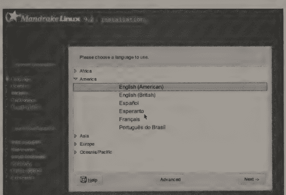

图 4-1：Mandrake 安装界面。

## 识别某些 Mandrake 特性


## 一个独特的选项

一个独特的选项（在 Mandrake 询问你 root 密码和其他用户信息后）是你是否希望计算机在启动时自动登录到一个特定的用户。如果你是这台电脑的唯一使用者且不需要提供用户授权，这个功能非常方便——尽管这不一定是个好主意，因为它会让任何人访问你所有的个人信息。请注意，即使你不需要用户名或密码即可查看桌面，你仍受用户配置文件中安全设置的限制。程序并没有绕过任何类型的安全；它只是在为你自动化登录过程。

## 安装检查清单

安装检查清单上的最后一项非常方便，只要你有一个良好的 Internet 连接。如果你选择允许，安装程序将连接到授权的 Mandrake 下载镜像站点，并为你现有的 Mandrake 版本获取所有适当的更新。考虑到从产品打包到你安装它之间任何发布活动都存在时间差，此功能对于维护具有最新软件更新的安全性系统非常重要。

## 首次启动

第一次启动时，系统会提示你注册联系信息，这些信息可能会自动传递给 Mandrake，以便公司向你提供最新的安全信息及更多内容。首次登录也需要一些时间来建立桌面的初始设置，请保持耐心。

## 关于 Mandrake 的备注

以下是关于 Mandrake 的一些备注：

- 成为 Mandrake 俱乐部员可以访问超过 50,000 个应用程序，并能够在人们购买之前免费下载最新版本的 Mandrake。
- 零售盒装套装的价格为 39 美元及更高。
- MandrakeUpdate 通过网络提供简单的更新。
- 提供基于以下架构的计算机版本：Pentium (i586 及更高)、Alpha AXP、IA64、PPC 和 Sparc。

## SuSE

- 标号：Linux 专家
- 网站：www.suse.com
- 调查版本：8.2 Live Evaluation

SuSE（发音为 "SOO-za"）公司和 Linux 发行版成立于 1992 年。该发行版以德语缩写 `Software und Systementwicklung`（软件与系统开发）命名。SuSE 的成名之处之一在于它的国际支持（大多数发行版为全球用户提供某种程度的支持，但某些发行版在特定群体的语言整合方面优于其他；SuSE 理然在德语及其他欧洲地区表现出色，包括以下七种语言的发行版：

- 巴西葡萄牙语
- 荷兰语
- 英语
- 法语
- 德语
- 意大利语
- 葡萄牙语
- 西班牙语

与其他广泛使用的发行版相比，SuSE 在全球设有和服务支持办公室及员工，帮助企业和行业支持其 Linux 解决方案。

## 安装 SuSE

在所有声称比其他更好的最新发行版中，SuSE 在提供真正简单的体验方面取得了最大的跨越。你可以从网站（www.suse.com/download/）下载 Live 版本并将其刻录到 CD 中。在允许的情况下，安装程序将连接到授权的 SuSE 下载镜像站点，并为你的现有版本获取所有适当更新。从此 CD 启动后，你会收到典型问题，例如你使用的是什么类型的键盘和视频。注意省略了一个重要的步骤：如何分区和格式化你的磁盘。省略这一步骤似乎很奇怪，不是吗？好吧，SuSE 的人员并没有忘记这一步；而是以一种巧妙的方式包含在内。从此 CD 初始加载时，你会看到一条消息，说明 CD 并未将 Linux 安装到你的硬盘。

## 使用 SuSE 评估版本

另一个不改变硬盘任何内容的发行版是 Knoppix (www.knoppix.org)。

如果你在计算机上有一个操作系统，SuSE 评估版本会检测文件系统并借用一些空间写入文件。存储在这些文件中信息包括用户名、密码和硬件信息。通过建立虚拟系统，你无需对分区和磁盘格式化做出可能最终破坏你现有系统的关键性决策。

在执行此虚拟安装后，你只需将 SuSE 8.2 评估 CD 放入盒，并在你想运行 Linux 时启动它。请注意，你不希望使用此评估 CD 进行任何严肃工作。相反，你应该在硬盘上进行完整且永久的安装。你会很快发现你的 SuSE 评估版运行缓慢，访问 CD-ROM 驱动器比普通硬盘慢得多。鼠标点击和击键感觉迟钝。只需记住它仅用于评估目的。优点是该发行版是非常出色的，并且可能通过最少的计算机知识让你看到全图形工作站的运行。

SuSE 创建了一个强大的中央安装和配置工具：YaST2（YaST 的后代，YaST 是“又一个设置工具”的缩写）。在遵循几个提示和鼠标点击后，SuSE 评估 CD 在 15 分钟内即可完成安装（见图 4-2）。

在评估版启动并运行后，你会看到几个菜单选项，包括 SuSE 导览、指向 SuSE 主页的浏览器链接、免费安装支持链接以及几个为好奇者提供额外信息的链接。在不创建自己的文件系统来存储信息的情况下，SuSE 需要一个地方来存储你的设置和用户账户。它在现有文件系统中创建四个文件，以维护你在 SuSE 评估版中更改的所有信息：

- `uselve.800`：SuSE 版本 8.2 评估 CD 数据
- `uselve.swp`：交换文件
- `uselve.usr`：用户目录
- `uselve.txt`：这些文件的描述

要从你的系统中删除 SuSE，你只需要从当前文件系统的根目录下删除这些文件即可。对于 Windows，它们位于 `C:\`；对于已有的 Linux 安装，它们位于根挂载点（`/`）。这些文件占用大约 120MB 的磁盘空间，可不是小数字。

## 关于 SuSE 的额外说明

以下是关于 SuSE 的一些额外说明：

- 你仍然可以向硬盘进行永久的 SuSE 安装，但你需要访问 SuSE 网站（www.suse.com）或镜像站来下载用于进行完整安装的适当文件和说明。分区选项与 Red Hat Linux 提供的类似。
- SuSE 和该公司的零售商提供多种盒装套装。这些套装的价格从 39.95 美元（美国）起。

## 关于 SuSE 9.0 Professional

如果你想坚持默认设置，那么 SuSE 9.0 Professional 的初始安装是一个非常简单的操作。你只需要回答几个快速问题，浏览摘要屏幕以确保所有设置都符合你的意愿，然后开始安装。随后，在大多数软件包被放置到你的计算机之后，你就可以对所有一切进行微调。

这种两部分的做法在现代 Linux 发行版中变得越来越常见，因为这意味着第一阶段安装有更大的概率在没有任何问题的情况下运行，使得经验丰富的用户在第二部分安装和设置过程失败时，更容易进去进行修复。


此版本不仅具有简单的安装过程，而且通过 SuSE 9.0 Professional，你可以在 CD 和 DVD 上获得超过 2,000 个应用程序，这免去了你花费大量时间去寻找和下载额外的程序。

# 第 5 章

# 启动与停止 Linux

## 本章内容

- 理解当你开启 Linux 机器时发生了什么
- 识别并隔离启动问题
- 安全关机

> 我喜欢工作；它让我着迷。我可以静静地坐着看它好几个小时。
>
> ——Jerome K. Jerome

如果你是从第 3 章或第 4 章来到这里的，你可能刚刚幸存了 Linux 世界的第一场“考验”：安装操作系统。我希望第一次启动运行良好。如果顺利了，且你认为本章的大部分内容不适合你，至少可以跳到本章的最后一节，“不要关闭机器！”否则，如果你对了解你的机器在启动时在做什么感兴趣，请继续阅读。

如果你的 Linux 安装没有正常启动，不要恐慌。本章的大部分内容旨在帮助你处理遇到的任何问题。在你诅咒 Linux 之前，请记住，安装操作系统并不是一项小任务，而且由于与此类安装相关的许多技术变量，许多计算机制造商坚持在工厂执行此任务。

在本章中，我将通过带你逐步了解启动过程，揭开 Linux 系统启动的谜团。尽管在启动过程中你可能会遇到各种潜在问题，但识别罪魁祸首通常是解决方案中最重要的部分。寻找启动错误来源的答案就像破案。发现众多线索中的第一条总是能引导霍尔姆斯先生通向一个基础性的解决方案。

## 让 Linux 启动

所以，拿起你巨大的放大镜，转转你的帽子，这样就可以开始侦查了。

面对现实吧：尽管盯着休眠的电脑是一种很享受的体验，真正的乐趣从你打开电脑时开始。和任何电子设备一样，打开电子洪闸是乐趣的第一步。然而，计算机要执行的事情比你的烤箱要多得多，例如。你的计算机不是作为一个简单的加热元件，它必须检查所有你（或制造商）插入计算机主板的所有小设备。在初始上电后，计算机执行一些简单的硬件测试，以确定这些各种组件是否工作正常。

检查你所有的硬件只是开始。从你打开电脑到显示器上发光的磷光提示你输入登录名称之间，计算机正在构建它自己的帝国。如果你仔细倾听和观察，你的计算机和显示器会通过哔哔声、嗡嗡声、电机旋转声、点击声、显示器上的信息和闪烁的灯光显示启动过程的迹象。在本节中，我将帮助你识别启动过程的每个阶段。

尽管你听过“罗马不是一蹴而就的”，但启动过程相当快。这非常惊人，考虑到操作系统的架构让罗马看起来像一堆纸箱，而且每当你电源启动计算机时，它必须在内存中构建它的整个操作系统。（记住，操作系统是存在于你的程序和计算机硬件中的软件。）当然，电子以光速移动，这赋予了计算机优于罗马人的优势——但这些废话已经够了。

确保此操作系统安装正确并运行正常是启动过程的目的。这个过程可以分为四个主要步骤，我将在后面的章节中讨论它们。

## 第 1 步：上电自检 (POST)

POST 过程与操作系统完全无关。无论你运行 Linux 还是其他操作系统，你的计算机都会执行这一步。你的计算机内部有一个芯片，包含一个执行 POST 过程程序。该程序

- 检查你的计算机以确保基本组件工作正常。
- 计数并测试内存。
- 验证当前适配器和设置不存在资源冲突，类似于交警。
- 执行某些基本测试，以验证每个系统组件是否工作正常（决定这些组件如何通信的规则集被称为 BIOS）。

POST 失败的一些症状包括：

- 一系列异常的长短哔哔声。
- 显示器上无显示。
- 除了电源上的风扇外没有任何活动。
- 计算机机箱通风口传出刺鼻的烟味。
- 显示器上显示错误信息，指示硬件故障。

如果你遇到这些任何问题，说明你有硬件问题。如果你的计算机在你开始安装操作系统之前运行正常，那么它应该能顺利通过 POST。否则，就需要解决问题。

## 第 2 步：BIOS 将接棒交给启动加载程序

在 POST 成功后，BIOS 定位到第一个驱动器并读取第一个扇区。在那个第一个扇区上有一个被称为启动加载程序的小程序。启动加载程序对任何事情都不了解，除了如何加载你的操作系统。

有两个程序理解如何加载操作系统：`LILO`（Linux Loader）和 `GRUB`（Grand Unified Boot）。`LILO` 长期以来一直是经受考验的加载器。`GRUB` 是一个更新且更复杂的程序。目前的 Fedora 版本允许你选择启动加载程序，但默认使用 `GRUB`。

我建议你坚持使用默认的。这种启动加载程序与发行版的软件支持最好。

启动加载程序丢失或损坏 Common 症状是显示找不到操作系统。要让启动加载程序重新工作，请重新安装启动加载程序到第一个驱动器的引导区。我将在本章稍后解释如何重新加载启动加载程序。如果磁盘几何发生了变化，你也会看到此消息。

## 第 3 步：启动加载程序 (GRUB 或 LILO) 将系统内核加载到内存

启动加载程序是一个理解如何将系统内核加载到内存的程序。内核是任何操作系统的核心软件并直接与硬件通信。第一部分：入门

加载的内核像指挥家一样协调计算机的所有组件，并以逻辑合作的方式分配资源。启动加载程序是指挥家进入的红毯。

你知道内核正在加载，因为几屏内核信息在你的显示器上滚动。此列表显示了系统内核缺失、错误或损坏的一些症状：

- 系统在启动加载程序继续后冻结。
- 显示器顶部出现几个点点，然后系统冻结。
- 屏幕上出现几条信息，最后一条信息是 kernel panic（内核恐慌）。
- 系统在内核启动后自动重启。

确保组件之间具有兼容性可能是一项挑战——尤其是对于非常老旧或非常新的硬件。内核对这类硬件的支持可能非常少或根本不存在。

解决内核缺失问题的补救方法是正确地告诉引导程序应该去哪里找到它。虽然使用 `GRUB` 完成这项任务相对容易，但使用 `LILO` 则需要一个撬子和一个救援磁盘。虽然这项任务的描述超出了本书的范围，但你可以查看第 2 章以获取其他 Linux 来源。

在计算机上安装 Linux 的关键步骤之一是配置引导程序。如果安装成功，你再也不需要考虑这个组件了。它每次在你启动机器时都会静默运行。然而，某些情况需要你与引导程序进行交互。你可能想以默认以外的模式启动 Linux，或者你可能需要就你安装的新调节器传递特殊信息。

调用引导程序的方法取决于你的 Linux 发行版。开机后显示器上显示的文本通常会为你提供指令。如果你加载了 `GRUB` 引导程序，可以按 `A` 进入活动提示符。

`GRUB` 手册可以在 www.gnu.org/manual/grub-0.92/grub.html 在线查看。

## 第 4 步：控制权交给 init

在启动过程到此为止，只有后台运行的组件被加载了。名为 `init` 的程序是系统运行期间所有其他程序共有的。`init` 程序负责启动所有和服务程序。你可以看到这些进程在屏幕上向上滚动，并在显示器右侧显示 [OK] 或 [FAILED]。如果你看到这些行，你就知道你的内核已经加载了。

你与 `init` 可能遇到的唯一问题是加载失败的服务，如 [FAILED] 状态所示。许多此类服务不会阻止你登录和使用系统。服务失败通常是因为配置错误或不支持的硬件驱动程序。

## 启动故障排除

你为系统创建的紧急启动磁盘和救援磁盘有细微的区别。启动磁盘仍然需要访问你硬盘上 Linux 安装系统的能力，而救援磁盘不需要。救援启动磁盘在所谓的 RAM disk（内存磁盘）中模拟你的硬盘，将文件完全存储在内存中。这种磁盘的益处是，你不需要安装系统中的工具就可以执行必要的系统手术；你需要的一切都在救援磁盘中。

你 Fedora Core 发行版中的 DVD（或第一张 CD）兼作救援磁盘。进入救援模式：

1. 当第一个磁盘加载时，在启动提示符处输入 `linux rescue`。
   此操作将开始进入维护模式启动。
2. 选择你的语言并按 Enter。
3. 选择你的键盘类型并按 Enter。
   救援系统会运行一段时间，在慢速系统上可能需要一两分钟。
4. 当被问及是否启动网络接口时，除非你知道有需要下载的内容，否则回答 No。
5. 在救援屏幕上，选择提供的三个选项之一，然后按 Enter。
   你的三个选项是：
   - **Continue（继续）**：救援界面将为你查找已安装的 Fedora Core 系统。请记下它说将挂载文件的位置，这样你就知道哪些目录包含这些文件了。
   - **Read-Only（只读）**：与 Continue 相同，但你将无法对硬盘上的安装内容进行任何更改。
   - **Skip（跳过）**：不要费力寻找文件系统了，直接给我一个提示符！
   我将假设你选择了 Continue。
6. 在下一个屏幕中，记下救援界面提供的命令以帮助你更容易进行文件导航，然后按 Enter。
   你现在可以访问救援界面了。这是一个命令行设置，所以如果你还没有深入研究过命令行 Linux，现在是时候尝试一下了！如果你想找一个良好的起点，附录 A 提供了一份可以用于各种用途的命令方便参考。

## 第 5 章：启动和停止 Linux

如果你在引导程序上遇到问题，`GRUB` 配置文件是 `/etc/grub.conf`。请记住，`GRUB` 手册可以在 www.gnu.org/manual/grub-0.92/grub.html 在线查看。

上面的过程听起来有点痛苦吗？尽管救援模式很有用，但它并不能取代对启动磁盘的需求。如果你的引导程序搞乱了，你可以改用特殊的软磁盘启动。这有多方便啊？

你在安装期间有机会创建过一个。如果你已经创建了自定义的启动磁盘，那么你就准备好了。清楚地标记好它，并将其存放在方便的地方，以防机器出现问题。如果你是保守派，可能还想在异地保留另一个版本。

## 不要直接关掉电源！

即使你没有在键盘上输入任何内容或点击任何按钮，Linux 仍在后台运行并进行着大量的清理工作。这些工作中的某些可能涉及将缓存和内存数据与固定磁盘之间进行交换。当你突然切断电脑的电源时，它可能无法完成正在进行的事务。

你可能需要纠正来自旧版本 Windows 的坏习惯（例如，在完成后关闭电脑）。Linux 计算机在用后不需要关闭；只需注销账户并可能关闭显示器即可。当你下次想使用电脑时，你并不希望再次经历那艰辛的启动过程。

然而，有时你可能确实想要关闭 Linux 机器。也许你需要添加新硬件，电力公司要切断你家里的电源，或者你要去度假几周，只是想省点电费。无论原因如何，你都必须以有序的方式关闭 Linux。

你可以使用以下方法之一来正确关闭 Linux：

- 如果你在图形界面（GUI）中，请使用主菜单的“注销”（Log Out）选项注销账户，然后点击那个奇怪地显示为“关机”（Shut Down）的显示管理器选项。
- 如果你打开了命令行提示符，在 shell 提示符（`#`）处输入 `halt` 命令，然后输入 root 密码，Linux 就会自行关闭并并在你何时可以安全关机。
- 如果你打开了命令行提示符，输入 `reboot` 命令，Linux 将执行自关机动作并立即重启机器。
- 如果你打开了命令行提示符，输入 `shutdown -r now` 是最传统的接受方法。`shutdown` 命令可选地允许你向登录的用户发送消息，并确定距离关机发生还有多长时间。另一种方法是 `poweroff` 命令，它是之前提到的 `halt` 命令的别名。

如果你不小心切断了 Linux 盒子的电源，不要灰心；一切还未挽回。很有可能你可以重启电脑并从上次离开的地方继续操作。然而，你可能需要为你的错误付出代价，在机器进行快速文件系统检查时等待，以确保没有内容被损坏。这个过程与 Windows 中的操作类似，在 Windows 中，如果你错误关机，操作系统会执行磁盘扫描（Scandisk operation）。

# 第 6 章

# 尝试一下

## 本章内容

- 认识 Linux 的面貌
- 何时使用以及何时不要使用 root
- 设置打印
- 选用的配置工具

> 公车站是汽车停靠的地方。
>
> 火车站是火车停靠的地方。
>
> 在我的桌子上，我有一个工作站……
>
> —— 史蒂芬·莱特

Linux 的伟大之处之一是，你可以自定义环境来适应你的需求和风格。你可以选择使用“标准的、开箱即用”的外观，也可以独一无帜。无论你选择哪种方式，你都可以返回原始设置或选择不同的外观。


一个基础或典型的 Linux 安装程序为你提供了一个优雅且功能强大的系统，它无疑为你提供了工作或娱乐所需的所有必要元素。然而，你可能想要探索各种配置选项和工具，将 Linux 塑造成符合你个人偏好和需求。

在本章中，我提供了常用配置选项的概述——从系统级配置到自定义单个用户环境。模块化设计是 Linux 的伟大优势之一，它允许你以任何想要的方式和针对任何计算需求自定义你的系统。在旅途中，我将指向文件系统的黑暗角落，那里配置文件就潜伏在那里。我还会向你介绍实用的配置工具，这样你就不必亲手处理这些通常晦涩的文件了。

# 第一部分：初试水

在我深入 Linux 配置的内部之前，我将简要游览各种 Linux 界面。无论你选择什么 Linux 配置或使用什么应用程序，你都会发现自己几乎可以做任何事情，无论 Linux “看起来”是什么样。在我花时间讨论了 Linux 的面貌之后，我会简要介绍用户账户和 root 账户。你将明白为什么应该为你以及为使用你 Linux 系统的其他人创建一个用户账户。

## 界面

Linux 有两种类型的界面：命令行界面（`CLI`）和图形用户界面（`GUI`）。如果你使用其他计算机系统，如 `Windows` 或 `Macintosh`，你已经对 `GUI` 界面了熟悉了。大多数 Linux 发行版都包含不同版本的 `GUI`，你可以配置图形界面的各个方面。

如果你已经使用了多年电脑，你可能也熟悉命令行界面。Linux 的最初发布和早期开发完全是面向命令的；`GUI` 界面在 Linux 上才变得流行和强大。在命令行界面和 `GUI` 之间做出选择时，一个重要因素是速度。如果你计划编译程序或执行会导致机器变慢的其它处理器密集型任务，运行 `GUI` 会加剧速度问题，特别是当你没有快速电脑时。然而，如果你有一台拥有数千赫兹（`GHz`）算力、大量内存和大硬盘的新电脑，速度就不是问题了。

记住，即使拥有海量的性能和速度，同时运行的应用程序或服务越多，任何正在运行程序的整体速度就越慢。

在选择 `GUI` 和命令行提示符之间，可读性也可能是一个大问题。如果你很难在 `GUI` 内部那些微小的命令行提示符窗口中阅读文本，你可以放大窗口和字体，或者直接在 `GUI` 之外使用命令行提示符工作。在这种情况下，你可能想不想关闭 `GUI`。

Linux 的两个最大 竞争者是 `GNOME` 和 `KDE`。因为 `Fedora Core 1` 带有这个，而此其他发行版由红帽（`Red Hat`）支持——红帽有它自己的 `GNOME` 和 `KDE` 版本，被称为 `Bluecurve`——因此每个 Linux 发行版在某种程度上都自定义了界面。我会尽可能明确地指出，你看到的内容何时是红帽特有的（`Bluecurve GNOME`），何时又不是（仅仅是 `GNOME`）。

## 命令行

Linux 命令行界面提供了一种快速输入命令和执行操作的快捷方式。即使你主要是一个“`GUI` 派”，在习惯了使用命令行后，你会发现在命令行执行某些任务比在 `GUI` 环境中使用鼠标要快。然而，如果你倾向于将 `GUI` 界面作为你的工作环境，你可以轻松打开一个终端窗口（命令行提示符窗口）来执行命令驱动的任务。

当你安装 `Fedora 1` 时，它默认为你提供图形化登录。其他版本可能会提供选择图形登录或命令行登录的选项。如果你没有图形登录，启动时你的屏幕大部分是黑色的，只有几行文本显示 Linux 发行版、你的机器名称和一条闪烁的光。要在命令行提示符处登录 Linux，请遵循以下步骤：

- 输入你的账户名并按回车。

系统响应并提示输入提示。

- 在提示符处输入你的密码并按回车发送密码。

出于安全考虑，密码不会显示在屏幕上。成功登录 Linux 后，命令行提示符将指向你的默认位置，即你的主目录。

大多数 Linux 发行版都有非常灵活的命令行界面，允许你使用方向键移动光标，使用退格键和删除键删除文本。Linux 命令行与其他界面命令行的一个区别是（在 `Windows` 中也是），Linux 命令是区分大小写的。Linux 命令行对命令具有自动补全功能。如果你输入命令的前几个字符，输入部分并按 `Tab` 键即可完成命令剩余部分。如果你按 `Tab` 时听到哔哔声，说明有多个以相同序列开头的命令。要查看匹配命令列表，再输入几个字符并按 `Tab` 键。要补全你想要的命令，再输入几个字符并按 `Tab` 键。

使用 `Tab` 键进行自动补全的技巧是输入足够的命令字符，使得这些字符对于该命令是唯一的。

大多数 Linux 发行版还会保留最近使用的命令的运行历史。要访问历史列表，按下键盘上的上方向键。当你继续按上方向键时，你将按时间倒序遍历最近输入的命令。如果你在命令历史中回溯得太远，可以使用向下箭头键在历史列表中反向移动。当你想要的命令显示在命令提示符上时，按回车键执行该命令。

你可以修改 Linux 命令提示符和整个命令行界面。在第 11 章中，我将介绍一些自定义命令行界面以及命令行环境其他方面的技巧。

## GNOME 基础

图 6-1 所示的 `Bluecurve GNOME` 界面是 GNU 网络对象环境（`Network Object Model Environment`）。我明白——全称并不能告诉你它有多么厉害，对吧？这是一个完整的桌面环境，这意味着它为你提供了 `GUI` 所需的一切一站式软件包。如果你习惯了 `Windows` 或 `Macintosh` 系统，可能会觉得讨论这个话题很奇怪，因为对于这些系统来说，情况一直都是这样。但在 Linux 下，情况就不同了。如果你愿意，可以将许多不同的 `GUI` 组件像拼接弗兰肯斯坦怪物一样缝合在一起。

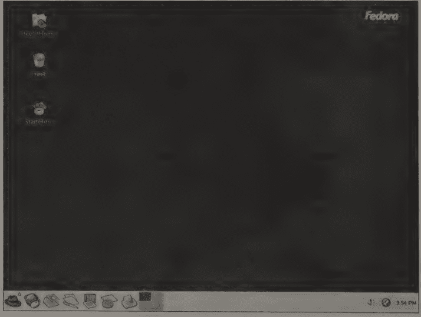

## 第 6 章：尝试一下

要了解更多关于 `GNOME` 的信息，请访问 `GNOME` 网站：`www.gnome.org`。

很多人发现 `GNOME` 的布局非常直观。浏览一下菜单，看看环境中提供了哪些功能。请记住，你在菜单上使用的工具可能取决于你选择的安装类型；如果你拥有的与描述或插图中看到的不同，不要惊慌。

`GNOME` 桌面环境本质上分为三个独立部分：

- 菜单
- 屏幕底部的面板（`Panel`）
- 背景顶部（即所谓的桌面）上的图标

### 菜单

`GNOME` 菜单通常可以通过面板左下角像大脚印印的按钮访问，但 `Fedora Core` 在 `Bluecurve` 中使用的是一个带有红色费德拉帽（帽子）的按钮——这是红帽的标志。无论哪种方式，此按钮被称为主菜单按钮。点击主菜单按钮后打开的主菜单如图 6-2 所示。

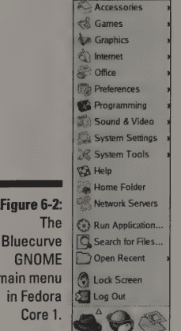

| 应用程序 (`Accessories`) |
| 游戏 (`Games`) |
| 图形 (`Graphics`) |
| 互联网 (`Internet`) |
| 办公 (`Office`) |
| 选项 (`Preferences`) |
| 编程 (`Programming`) |
| 音频与视频 (`Sound & Video`) |
| 系统设置 (`System Settings`) |
| 系统工具 (`System Tools`) |
| 帮助 (`Help`) |
| 主目录 (`Home Folder`) |
| 网络服务器 (`Network Servers`) |
| 运行应用程序... (`Run Application...`) |
| 搜索文件... (`Search for Files...`) |
| 打开最近 (`Open Recent`) |
| 锁定屏幕 (`Lock Screen`) |
| 注销 (`Log Out`) |

此以及许多子菜单的内容略有不同，取决于你具体安装了哪些程序。通常，子菜单内部还有自己的子菜单，提供更多程序。

我在表 6-1 中描述了主菜单上子菜单的内容。

| 表 6-1 | `Bluecurve GNOME` 主菜单内容，按出现顺序排列 |
|---|---|
| 菜单选项 | 你能发现的内容 |
| 应用程序 | 小型型、特定功能的 `GNOME` 和 `X` 程序。包含计算器、字符映射、字典、文件归档器、`Pilot/Handspring` 工具和文本编辑器。 |
| 游戏 | 游戏集合。 |
| 图形 | 多种图形程序，包括 `GIMP`。 |
| 互联网 | 几个互联网工具，如 `Evolution`（电子邮件和日历程序）、`Gain`（即时消息传递）和 `Mozilla`（网络浏览器）。 |
| 办公 | `OpenOffice.org` 应用程序套（文字处理、绘图等）。 |
| 选项 | 访问控制 `GNOME` 和 Linux 图形界面外观和感觉的程序。 |
| 编程 | 编程中使用的应用程序和工具。只有在安装 Linux 时选择了与编程相关的包之一，此菜单才会出现。 |
| 音频与视频 | 程序，如 `CD` 播放器和录音机，用于处理计算机的多媒体硬件。 |
| 系统设置 | 许多用于处理计算机硬件的工具，例如显示设置以及查看和配置系统上安装的软件包的包。 |
| 系统工具 | 许多用于管理、监控和更新系统的工具，例如网络向向、红帽网络和系统日志查看器。 |
| 帮助 | 帮助浏览器，用于探索 Linux 发行版包含的电子文档。 |
| 主目录 | `Nautilus` 文件管理器，默认显示你的主目录内容。 |
| 运行应用程序 | 你可以使用其在不打开虚拟终端的情况下运行特定程序的对话框。 |
| 搜索文件 | 搜索工具窗口，用于在文件系统中定位文件。 |
| 打开最近 | 从文件管理器中打开的最近文件选择。 |
| 锁定屏幕 | 设置你的机器，使人在不输入密码的情况下无法使用你的 `GNOME` 登录。如果你需要离开电脑一段时间（但不想注销账户）且周围有其他人，这个功能非常好。 |
| 注销 | 退出 `GNOME` 会话、关机或重启机器的能力——如果你知道 `root` 账户密码。 |

#### 运行程序工具

在你在主菜单上选择“运行程序”选项后，会弹出“运行程序”对话框，如图 6-3 所示。要使用此对话框运行程序，从“已知应用程序”列表中选择应用程序并点击“运行”按钮。

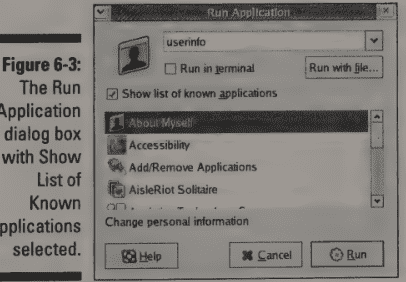

#### 锁定屏幕工具

如果你不是 `root` 用户并在主菜单上选择“锁定屏幕”选项，屏幕将变黑或出现屏幕保护程序。如果你移动鼠标或使用键盘，会弹出一个带有登录名密码字段的对话框。注意，如果你是以 `root` 用户登录的，此功能无效。

注意我使用 `GUI` 会话（我将在第 12 章中讨论）。

#### 还有注销！

当你在主菜单上选择“注销”选项后，屏幕会变暗，并弹出“确定要注销吗？”对话框。使用此对话框，请遵循以下步骤：

1. 如果让 `GNOME` 记住你打开的项目并在下次登录后恢复当前状态，请确保勾选“保存当前设置”复框。
2. 点击“注销”、“关机”或“重启计算机”执行相应的操作，或者在不想执行任何操作时点击“取消”。
3. 点击“确定”执行你的选择，或在改变主意时点击取消。这些这些操作的作用：
   - 注销：退出 `GNOME` 并返回命令提示符。
   - 关机：关闭计算机并电源。你必须输入 `root` 密码（`root` 用户的密码）才能使用此选项。
   - 重启计算机：关闭计算机并重新启动。只有在你知道 `root` 密码时才能此选项。

### 面板

在你的 `GNOME` 桌面底部有一条带有图标的长条。它是面板。因为此条被整齐地分为几个部分，请查看每个部分的内容。面板最左侧是 `GNOME` 主菜单按钮（参见图 6-1），它会打开相应的菜单。

当你继续向右移动时，你会遇到一组标准的 `Bluecurve GNOME` 工具（参见图 6-1）。你可以通过主菜单访问所有项目，但它们被放置在面板上，以便你快速方便地找到：

- `Mozilla`：带有鼠标的地球仪图标。如果你使用的是红帽 Linux，它会启动 `Mozilla` 网络浏览器；否则，它是一个红色的恐龙。
- `Evolution`：位于 `Mozilla` 按钮右侧；启动电子邮件和日历程序。
- `OpenOffice.org Writer`：看起来像两张纸；打开 `OpenOffice.org Writer` 文字处理程序。
- `OpenOffice.org Imp`：打开 `OpenOffice.org` 演示文创建程序。
- `OpenOffice.org Calc`：打开 `OpenOffice.org` 表格程序。
- 打印管理器 (`Print Manager`)：点击此按钮打开打印管理器，允许你检查并查看哪些文档正在等待打印。
- 工作空间切换器小部件：允许你在单个登录会话中在四个不同的桌面环境中工作。每个环境都具有相同的菜单、面板（`Panel`）和背景，但你可以在任何一个环境中运行不同的程序。这是在运行多个程序时保持条理清晰的简单方法。

你在图标右侧区域看到的内容取决于你运行的程序。你打开的每个程序在面板的这一部分都有一个专门属于它的任务框，被称为状态部分或任务部分。关于你可能看到的示例，请查看图 6-4。

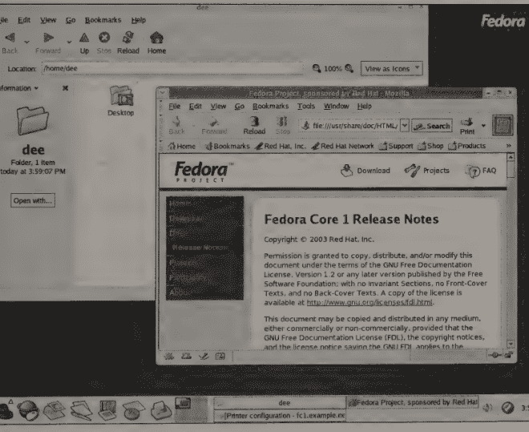

图 6-4 `Bluecurve GNOME` 面板上的任务示例集。

你可以通过图 6-4 所示的框以三种不同的方式更改程序状态：

- 如果任务框中的文字带有阴影，导致其他框难以查看，则该程序处于最小化状态。你可以点击该框来打开窗口。
- 如果任务框中的文字没有阴影，但程序的窗口被另一个程序隐藏，你可以点击隐藏程序的框以将该程序置于顶层。
- 如果任务框中的文字没有阴影，且对应的窗口是你正在使用的程序，你可以通过双击未阴影的任务框来将程序最小化。

任务部分的右侧是显示小部件的区域。你可以出于各种原因向面板添加小型程序，我将在第 12 章中描述如何操作。请注意，时钟小部件默认出现在小部件区域。

#### 面板菜单

你可以通过从面板菜单选择选项来更改面板的外观，例如添加或删除小部件。要打开面板菜单，请右键点击面板上的任何空白区域。有关此菜单项提供的列表，请参阅表 6-2。

| 表 6-2 | `GNOME` 面板菜单内容 |
|---|---|
| 菜单选项 | 你能找到的内容 |
| 添加到面板 | 你可以添加到主面板的小部件、菜单和其他对象 |
| 删除此面板 | 删除二级面板的能力，但不能删除主图标面板 |
| 属性 | 设置面板行为的选项 |
| 新面板 | 创建位于屏幕不同部分的新面板的选项 |
| 帮助 | 用于 `GNOME` 的帮助浏览器 |
| 关于面板 | 包含一些基本面板信息的对话框 |
| 关于 `GNOME` | 包含一些基本 `GNOME` 信息的对话框 |

有关使用面板菜单项的详细信息，请参阅第 12 章。

#### “添加到面板”菜单

“添加到面板”菜单可以从面板菜单（右键点击面板上的任何空白区域）进行访问。我将在第 12 章向你展示如何添加和删除小部件。在表 6-3 中，我描述了你可能在“添加到面板”菜单中发现的微小惊喜。

| 表 6-3 | `GNOME` 添加到面板菜单内容 |
|---|---|
| 菜单选项 | 你能找到的内容 |
| 工具箱 | 如时钟和天气预报等项目 |
| 操作 | 用于以各种方式注销账户的项目 |
| 娱乐 | 可以留在面板上的游戏和其他趣味内容 |
| 互联网 | 收件箱监控器和调制解调器指示灯程序 |
| 多媒体 | 简单的音频工具 |
| 工具 | 不易放入其他菜单的杂项小部件，例如键盘布局切换器和窗口列表 |
| 启动器 | 允许你创建应用程序快捷方式的功能 |
| 从菜单启动器 | 允许你创建菜单快捷方式的选项 |
| 主菜单 | 向面板中添加主 `Footprint`（或 `Red Hat fedora`）图标的能力 |
| 菜单栏 | 与主菜单相同，但格式不同 |
| 抽屉 | 面板的扩展，提供不同于主菜单的增长方向 |

### 玩玩桌面图标

你在桌面（主 `GNOME` 屏幕）上看到的内容可能随发行版而异。在 `Fedora 1` 设置下，屏幕顶部有一行水平线。第一个图标（参考图 6-1）是主目录图标，它打开 `Nautilus` 浏览器并显示你的主目录内容。下一个图标是 `GNOME` 快捷方式，用于打开“在此处”窗口，而垃圾桶图标则打开 `~/.Trash`。对于在 Linux 中不小心删除文件并需要恢复它们的用户来说，垃圾桶是一个令人欢迎的景象！

要使用垃圾桶，请将其拖入任何你想删除的文件中。稍后，如果你确定要丢弃它们，可以通过三种方式之一清空垃圾桶：

- 双击图标打开垃圾桶。然后通过选择 `文件->清空垃圾桶`来删除垃圾桶的所有内容。
- 双击图标打开垃圾桶。然后通过右键点击项目（或多个项目）进行删除。
- 双击图标打开垃圾桶。然后通过右键点击项目（或多个项目）进行删除。

## KDE 基础

## KDE 外观

## KDE 菜单

## 账户不分小


Linux 是一个多用户操作系统。它允许每个人拥有自己的账户，并允许多个用户同时登录。即使你是该系统的唯一用户，你也需要一个属于自己的、而不是 `root` 用户的账户。拥有多个账户在尝试不同的配置时会特别有趣。

# 第 6 章：浅尝辄止

## 避免使用 root

`root` 用户（也称为超级用户或简称 `root`）拥有对机器上任何内容和所有内容的访问权限。无论你如何设置，都无法将 `root` 账户排除在任何区域之外。`root` 用户还可以访问所有命令和设备。许多 Linux 初学者认为，既然 `root` 账户如此方便，何不直接使用呢。

然而，出于充分的考虑，你不应该在日常工作中使用 `root` 账户：

- 你并不总是需要 `root` 级别的权限。
- `root` 级别的权限既是祝福也是诅咒。如果你以用户身份操作出错，你只会弄乱自己账户里的东西。如果你以 `root` 用户身份操作出错，可能会抹掉一切——整个 Linux 系统上的所有文件！
- 别认为这种事不会发生在你身上？许多资深的 Linux 管理员都讲述过自己在以 `root` 身份登录时，犯下致命拼写错误，或者没有注意自己在做什么的故事。
- 如果你除了严重的管理事务之外，还以 `root` 身份发送电子邮件或发布帖子，人们会认为你不知道自己在做什么，或者在炫耀。
- `root` 带有太多的诱惑。超级用户可以读取他人的邮件和文件，这会引入一些微小的伦理问题。许多 Linux 发行版在你进入 `root` 账户时会给你显示一个醒目的红色背景，提醒你不要忘记。

## 创建用户账户

Fedora Core 1 和大多数其他现代 Linux 发行版都允许你在安装和设置过程中创建一个或多个用户账户，因此你可能已经添加了一些账户。不过，在你的 Linux 机器运行后，你可以随时执行此任务。

### GUI 方式

大多数 Linux 发行版都包含一个用于创建和管理用户账户的图形界面应用程序。例如，我进入主菜单并选择“系统设置-用户和组”。由于我使用的是普通用户账户，系统要求我在进入之前先输入 `root` 密码，这对安全性很有好处，然后打开 Red Hat 用户管理器窗口。当应用程序打开时，Linux 系统中已有的用户账户就会显示。

大多数图形化 Linux 账户管理程序都按这种方式工作。要创建一个新用户账户，请遵循以下步骤：

1. 点击“添加用户”按钮。
   打开“创建新用户”对话框。

2. 在“用户名”字段中为你的用户输入名称。
   在 Linux 中，用户账户的大小写是非常重要的，因此在输入信息时请注意大小写。字段（如登录 Shell 和主目录）的默认值对于典型用户来说应该完全没问题。你可能想填写“全名”字段以完善账户信息。

   新账户需要设置初始密码。要为新账户分配密码，请遵循以下步骤：

3. 在“密码”字段中输入密码，并在“确认密码”字段中重新输入相同的密码。

4. 点击 OK 关闭“新用户”窗口，然后点击 Red Hat 用户管理器窗口右上角的 X 关闭应用程序。

> **密码是区分大小写的！**

请参阅本章后面的 Mandrake 和 SuSE 配置部分，了解在这些发行版中如何找到它们。

### 命令行方式

要在任何发行版中通过命令行创建用户账户，请执行 `useradd` 命令。虽然并不是所有的 Linux 发行版具有相同的 `useradd` 功能，但它们都拥有该命令。通用版本的 `useradd` 工作非常简单。步骤如下：

1. 输入 `su - root` 并在提示时输入密码。这样做可以让你临时访问 `root` 账户。

2. 要创建账户，输入 `useradd accountname`，其中 `accountname` 是新账户的名称。
   例如，为名为 `test` 的用户创建一个账户，输入 `useradd test`。

现在你需要为此账户创建一个密码；否则你无法登录！遵循以下步骤：

1. 输入 `passwd accountname`，其中 `accountname` 是需要新密码的账户名称。
   例如，为名为 `test` 的用户创建密码，输入 `passwd test`。然后你会看到以下文本：

```
Changing password for user test
New password:
```

2. 输入该用户的密码。
   如果这不是你自己的账户之一，你应该使用一组随机数字和字母，例如 `5A2gIAG`，并告诉账户用户在登录时将密码改为其他内容。

   良好的密码包含以下内容：
   - 数字、字母甚至标点符号的组合
   - 大小写字母
   - 无字典单词
   - 六个或更多字符
   - 无家人或宠物名称

3. 如果你选择了弱密码，你会看到以下行：
   `BAD: 密码太简单`
   `输入新密码：`

4. 重新输入密码并按回车。
   当密码设置好后，屏幕上会显示以下行：
   `passwd: 验证令牌已更新。`

5. 输入 `exit` 离开。

## 打印

打印可能是工作中最常见的任务之一。在本节中，我描述了如何设置打印机。遵循以下步骤：

1. 要访问打印机，打开主菜单并选择“系统设置-打印机”。Red Hat 打印配置窗口打开。

2. 要开始设置打印机，点击“新建”按钮。打开“添加打印队列”窗口。点击“下一步”进入下一步。

3. 在“队列名称”窗口中，输入你想分配给打印机的名称。如果你有多个打印机，在“短描述”中添加内容以帮助区分。完成后，点击“下一步”进入下一步。出现“队列类型”窗口。

4. 在“队列类型”窗口中，选择所需的队列类型。队列类型对应打印机的连接方式。如果打印机直接连接到 Linux 系统，选择“本地打印机”选项。如果打印机连接到其他计算机，选择相应的操作系统，例如“网络 Windows (SMB)”。如果打印机直接连接到网络，选择“网络 CUPS (IPP)”。根据你的选择，可能需要填写更多信息。例如，如果你像我一样选择了 CUPS，你需要在服务器文本框中输入分配给网络打印机的 IP 地址。

5. 输入信息后，点击“下一步”。出现“打印机型号”窗口。

6. 在下一个窗口（打印机型号）中，点击“通用（点击选择制造商）”按钮选择你的打印机制造商。下方的模型选择将根据制造商列表进行更改。

7. 选择你的打印机型号并点击“下一步”。出现“完成并创建新打印队列”对话框。
   选择正确的打印机型号很重要，因为 Linux 会加载并关联与你提供的信息特定的打印机驱动程序。如果指定的型号错误，就会使用错误的驱动程序（操作系统与打印机通信的软件）。当你尝试打印时，结果通常是乱码的字符和符号。

8. 在“完成并创建新打印队列”窗口中，点击“完成”以启用你的打印机。系统将提供打印测试页的机会。点击“是”。如果此页面打印正常，请确保你已设置了打印机的品牌和型号。

9. 如果测试页效果良好，当询问你看起来是否正常时，点击“是”。如果完全没有打印出来或者看起来是乱码，点击“否”。
   如果你回答了“否”，系统将向你显示尝试打印时写入日志文件的所有数据副本。滚动到最后几行，寻找关于问题所在处的提示。这种情况发生在我身上过一次，结果发现是我的网络问题，而不是打印机的问题！

10. 弹出 Red Hat 打印机配置窗口，你的新打印机已列在工具列表中。
    点击右上角的“X”关闭打印机工具。从现在起，每当你想要处理打印机或打印任务时，都可以使用面板上的“打印管理器”图标。

请参阅本章节后面的配置部分“Mandrake 工具”和“SuSE 工具”，了解在这些发行版中如何找到它们。

# Linux 配置的禅宗与艺术

任何人都可以使用 Linux，但要成为真正的 Linux 大师，需要对系统的内部机制了如指掌的了解。考虑到 Linux 是许多不同软件子系统的总和，而每个系统都是由具有不同背景和解决问题观念的程序员编写的，这项任务可能看起来令人望而畏。幸运的是，软件开发者也遵循几条通用的真理。

这些真理之一是，凡人必须能够配置程序。你可以将计算机程序定义为一组指令，这些指令指导计算机执行特定任务。你无法更改硬编码在程序中的任何指令（除非当然，你对源代码进行了必要的更改并重新编译了程序）。正如你可以想象的，程序使用中任何微小的差异都需要熟练程序员的亲手操作。

# 第一部分：初试水

## 文件类型

大多数 Linux 子系统至少包含以下类型的文件：

- **可执行文件：** 这很可能是一个二进制文件，只使用计算机的语言交流，类似于 Windows 中的 `.exe` 文件。
- **配置文件：** 这是一个简单的文本文件，你可以用最喜欢的文本编辑器查看和修改它。

`可执行文件`通过从配置文件中读取指令来知道如何运行。因为可执行文件必须理解配置文件中的指令，因此在对配置文件进行任何繁重操作之前，你必须 RTFM（仔细阅读详细手册）。

关于配置文件本身的详细信息超出了本书的范围。相反，我将介绍一些你可能更倾向于每天使用而非文本编辑器的实用工具。

## 配置工具

Linux 在命令行和 GUI 环境中都有许多配置工具。在接下来的章节中，我将介绍本书涵盖的三大发行版附带的工具。如果你想了解更多信息，请参阅你所在发行版的文档。

### 红帽和 Fedora 工具

Fedora Core 发行版 Linux 在图形和命令行环境中包含许多配置工具。在命令行中，红帽确保了为了方便，所有的专用工具名称都以 `redhat-config` 文字开头。例如，`redhat-config-network` 让你可以处理网络设置。

你可以通过在命令行输入以下行来利用红帽包管理程序 (`rpm`) 找出你安装了哪些配置工具：

```
rpm -qa | grep redhat-config
```

并不是所有这些工具都具有命令行组件。有些在你输入名称后会尝试打开 GUI 窗口，如果它们无法这样做，它们就无法工作。

在图形环境中，你可以通过“主菜单-系统设置”找到大部分 GUI 配置工具。图形工具通常提供与命令行工具相同的选项，但带有 GUI 界面。其余可以通过“主菜单-系统工具”获取。

对于大多数配置工具（命令行和 GUI），出于安全考虑，你需要 `root` 密码。

如果你浏览菜单，还会发现额外的工具。Linux 中有很多有趣的小部件。去探索吧！

### Mandrake 工具

Mandrake 包含了许多工具（如 Mandrake 控制中心、HardDrake 和 PrinterDrake）来配置硬件。HardDrake 设计用于设置硬盘和分区，PrinterDrake 设计用于配置打印环境。要找到这些工具，选择“主菜单-配置”。你可以浏览菜单打开整个 Mandrake 控制中心或单个工具。

### SuSE 工具

YaST2（又一个设置工具）是 SuSE Linux 主配置工具的名称。YaST2 包含了配置和操作鼠标、键盘、显卡、显示器和桌面的工具。在这种情况下，桌面指的是你选择用于 SuSE Linux 的图形界面的外观和感受。SaX2 是 SuSE 系统上的另一个配置工具，用于配置底层 GUI，例如显示的颜色数量。

要找到这两个工具之一，请选择 SuSE 主菜单（在 KDE 或 GNOME 中通过浏览菜单查看 SaX2）。

# 第二部分：进入网络

## 网络连接 101

每个互联网冲浪者都在寻找开放的车道。电话、电缆和卫星电视公司现在正在争夺战略位置，以满足你未来的互联网连接需求。在接下来的章节中，你将设置你的浏览器、电子邮件客户端和新闻阅读器，这样你就可以浏览网页、收发电子邮件并访问新闻组了。有了在本部分安装的设施，你将能够按照意愿扩展和自定义你的 Linux 系统。你还学习了如何在电子高速公路和旁路上旅行以完成任务！

# 第 7 章：连接到互联网

### 本章内容

- 常见的互联网连接方法
- 设置你的互联网连接
- 连接到你的互联网提供商 (ISP)
- 理解足够的 TCP/IP 以供操作

如果你位于连接到局域网的并在安装期间配置了网络，你可能已经连接到了互联网。要测试这一点，打开一个 Web 浏览器并尝试访问外部网站（如 `www.redhat.com`）。如果成功了，你就上线了！不需要看本章。

## 常见的互联网连接方法

在下列表中，我简要检查了几个你可能可以流行的 Linux 友好选项：

- **电缆调制解调器：** 许多电缆电视公司已扩展其产品线，通过其电缆基础设施提供互联网接入。当你订阅电缆互联网服务时，安装技术人员会提供一个特殊设备，称为电缆调制解调器，以及一个标准网络适配器。然后技术人员会将网络适配器安装到你的电脑中并连接电缆调制解调器。如果你所在的地区可以使用电缆连接，它提供了最高的带宽效益。换句话说，这种服务的费用可能比拨号连接贵；电缆连接的速度可以达到 56 Kbps 调制解调器拨号账户的 50 倍，而费用通常只有两倍。
  你可能需要自己配置 Linux 机器以使用电缆互联网服务。大多数电缆公司不为 Linux 提供技术支持。以下 Web 页面提供了一份介绍所有细节的文档：
  `www.linuxdoc.org/HOWTO/Cable-Modem/index.html`

- **综合业务数字网络 (ISDN)：** 就在不久前，ISDN 还是唯一民用高速选项之一。当 28 Kbps 已经是你从连接电话到电话公司的铜线中能榨取的全部带宽时，它就出现了。ISDN 仍然可用，并承诺提供 128 Kbps 的速度——只要你距离电话公司的市局在 3.4 英里以内。使用 ISDN 需要两个特殊设备：终端适配器（一个 ISDN 调制解调器）和一个网络适配器。红帽网络配置工具包含了对 ISDN 设置的支持。

- **数字用户线路 (DSL)：** DSL 的工作方式与 ISDN 类似，它以数字格式将数据传输到你的电话插口。DSL 之流行是因为它提供了比 ISDN 更快的连接以及更低的安装和服务成本，并且它利用了电话公司提供的现有铜线布线。DSL 连接需要额外的硬件，这应该由你的互联网服务供应商 (ISP) 提供。红帽网络配置工具包含了对 DSL 的支持。
  注意，DSL 有多种变体：
  - IDSL（通过 ISDN 线路）
  - 对称数字用户线路 (SDSL)
  - 非对称数字用户线路 (ADSL)
  - 通用 DSL (XDSL)
  典型的民用连接服务范围从 128 Kbps 到 1.0 Mbps 不等。
  DSL 的示例请访问以下 Web 页面：
  `www.linuxdoc.org/HOWTO/DSL-HOWTO/index.html`

- **拨号调制解调器：** 拨号调制解调器仍然被广泛使用。它将电脑的数字信号转换为从墙壁插座到电话传输所需的模拟信号。因为调制解调器利用了电话业务之外的现有语音通道，所以除了订阅 ISP 之外，不需要任何特殊设置。红帽包含了对调制解调器设置的支持。

由于大多数没有通过网络连接了 DSL 或拨号调制解调器的人，我必须决定涵盖哪一个。在本章的剩余部分中，我将引导你一步步设置你的 Linux 工作站以使用拨号调制解调器连接到互联网。就像任何穿过深邃黑暗森林的优秀指南一样，我会在过程中指出小路中湿滑的部分。如果你使用的是 DSL，过程也是类似的。

## 创建你的互联网自动发生器

> Sara，你能帮我接一下加油站的 Goober 吗？
>
> ——安迪·格里菲斯

如果真那么简单就好了。幸运的是，红帽的好心人们提供了一些工具，减少了 Linux 网络化的复杂性。并不是网络变了，而是它的许多细节被抽象化了，使得你只需要在这里点击，在那里按下一个键。在不久前，在 Linux 机器上配置拨号网络无异于调试一个有故障的黄金骨牌装置。

## 宽带时代

在我重点关注拨号调制解调器配置之前，有必要先关于宽带选项（DSL 和电缆）说几句话。“宽带”一词有一个技术定义，但我只是用它来表示高速互联网接入。尽管高速拨号调制解调器通常能以每秒高达 56 千比特（千位）的速度传输信息，但宽带连接更快。如今，Web 包含了大量的图像和多媒体元素，通过拨号线路和 56 kbps 调制解调器享受这些功能，就像在渴得要命时用滴管喝冷水一样。

## 警惕装成调制解调器的设备

我试图让你免受一些挫败感——并让你的电脑免受你圆头锤的伤害。许多 Linux 新手因无法与他们的内部调制解调器通信而感到恼火。“毕竟，”新手推断道，“当我运行微软 Windows 时，同样的硬件是可以正常工作的。”

嗯，情况是这样的：几年前，硬件制造商开发了一种名为“软调制解调器”的设备，目的是为了降低硬件成本。此举的想法是从调制解调器中剥离一些责任，通过操作系统将这些任务下交给 CPU。结果是一块廉价的接口卡，它将信号路由到仅在微软 Windows 下运行的专有软件中。简而言之，这些软调制解调器（也称为 WinModems）并不是真正的调制解调器，而是连接 Windows 的电话电缆接口。

- 包装将该设备称为 Win Modem，或指定它仅与 Windows 工作。
- Windows 识别你的调制解调器，但 Linux 不识别。


- 型号显示你
- 型号前面带有 `HCF`、`HSP-` 或 `HSF-`。

以下列表显示了你可以用来判断是否拥有软调制调制解调器的方法：

简而言之，如果你确定你拥有软调制调制解调器，这个项目（linmodems.org）提供了关于 Linux 的信息。我建议你，尽管通过购买软调制调制解调器省了点钱，你可能需要一个真正的调制解调器来使用 Linux。

不要让高速提供商阻碍你使用 Linux。仅仅因为他们不支持 Linux，并不意味着技术无效。`TCP/IP`（互联网的一套规则）是为 Windows 开发的，后来才加入。如果你有双系统启动的奢侈，你的 ISP 可以帮你安装，然后你可以尝试 Linux。

## 第7章：连接互联网

## 连接硬件

在你舒服地坐在椅子上之前，你必须物理检查一些需要你去桌子下的项目：

- **外部调制解调器：** 如果你有一个外部调制解调器（独立于机箱），你需要验证：
  - 电缆已安全地从调制解调器连接到串口
  - 调制解调器已开启。（外部调制解调器有自己的电源。）
  - 电话线的一端插入墙壁插座，另一端插入调制解调器。

- **内部调制解调器：** 如果你有一个内部调制解调器，你需要验证：
  - 调制解调器**不是**软调制解调器。如果你不知道什么是软调制解调器或你是否有一个，请查看侧栏“警惕装成调制解调器的设备”。
  - 电话线的一端插入墙壁插座，另一端插入电脑背后的电话插口。

现在，你可以爬回椅子了。

如果你确定你的调制解调器实际上是软调制解调器，我建议你买一个外部调制解调器。你不需要碰现有的内部调制解调器（Linux 方便地忽略它）；只需将外部调制解调器插入可用串口，并按照本节的外部调制解调器清单操作。如果你仍然不确定内部调制解调器的身份，尽管尝试配置并碰碰运气吧。如果有效，太好了！如果无效，也没有损失，你可以开始寻找一个良好的外部调制解调器。

## 选择互联网服务供应商 (ISP)

由于 Linux 近期的迅速流行，许多 ISP 正在培训他们的支持人员学习 Linux。如果你已经有了拨号服务，给他们打个电话，让他们知道你的 Linux 追求。那个人可能已经拥有 Linux 订阅者的信息，并为你提供这些信息。如果你正在寻找新的 ISP，请阅读以下实用的选择建议。

某些 ISP（互联网服务提供商）会提供自己的专有软件，你必须在 PC 上安装这些软件才能连接到互联网。他们提供的软件可能仅运行在 Windows 上。由于这一事实，某些免费拨号服务无法在 Linux 上运行。这些专有软件会干扰操作系统，以确保横幅广告不会被隐藏，或者你的拨号时间仅限于指定的时长。

如果你正在寻找 ISP，请考虑以下问题：

- 你是否可以在全国范围内获得本地拨号号码？如果你经常旅行并需要在不同城市访问网络，这项服务将是一个非常方便的省心工具。
- 它是否为 Linux 提供技术支持？如果你计划运行 Linux，这个考虑因素非常重要。
- 你能获得推荐吗？问问你的朋友。ISP 的好朋友就是满意客户的背书。
- 你拨接入时会遇到麻烦吗？虽然 7:1 的用户线路比例（每条线路平均 7 个或更少的用户）并不是完全准确的衡量标准，但它应该帮助你避免忙音信号。嘿，问问也没有坏处。

## 你需要从 ISP 获取的信息

大多数信誉良好的 ISP 在你注册服务后会为你提供一份客户信息表。此表至少应包含以下信息：

- 本地拨号号码
- 用户登录名
- 用户登录密码
- 电子邮件地址
- 电子邮件出站主机或简单邮件传输协议 (`SMTP`) 服务器
- 电子邮件入站主机或邮局协议 (`POP`) 服务器
- 新闻主机

有了这些信息，你就可以使用 Linux 系统建立互联网连接。

## 第 7 章：连接到互联网

### 配置你的拨号服务

如果你还没有这样做，请启动计算机并登录到 GUI 桌面。你不应该以 `root` 用户身份登录，但你确实需要 `root` 密码。

手里有了 ISP 信息，面前是闪光的显示器，请按照以下步骤配置你的互联网拨号连接：

1. **从 GUI 桌面，点击面板上的主菜单按钮，然后选择系统设置：网络（System Settings: Network）。**

在默认的 GNOME 和 KDE 设置中，左下角的主菜单按钮在 GNOME 中是一个脚印，在 KDE 中是一个大字母 K。如果你安装了 Fedora Core 1，主菜单按钮在 GNOME 和 KDE 中都是红帽的 fedora 图标。

2. **必要时，在对话框中输入你的 `root` 密码。**

如果你是以普通用户（而非 `root`）登录，系统会提示输入 `root` 密码。

网络配置对话框应该打开（参考第 6 章的图 6-12）。对话框中列出的项目取决于你在安装期间是否已建立了现有网络适配器。其余步骤假设你现在没有显示调制解调器项。

3. **在网络配置对话框中，点击新建（New）按钮。**

出现选择设备类型（Select Device Type）对话框，如图 7-1 所示。

4. **从设备列表中选择调制解调器连接（Modem Connection）并点击下一步（Forward）按钮。**

花点时间记住列出的其他选项。该区域也是你进行 ISDN、xDSL 或以太网连接配置的地方。每个网络选项都需要不同的配置参数，你的 ISP 应该提供这些参数。

点击下一步后，工具将探测你的调制解调器。如果找不到你的调制解调器，可能会出现选择调制解调器（Select Modem）对话框，如图 7-2 所示。如果你遇到此对话框，请做出选择然后再次选择下一步。

如果你知道你的调制解调器在 Windows 中是 `COM1` 或 `COM2`，将其翻译为 Linux 并不难：你只需要减 1。因此，`COM1` 是 `ttyS0`，`COM2` 是 `ttyS1`。

图 7-1：网络配置工具中的选择设备类型对话框。

图 7-2：网络配置工具中的选择调制解调器对话框。

5. **输入你的 ISP 信息，然后点击下一步。**

在图 7-3 所示的选择提供者（Select Provider）对话框中，你的 ISP 可能来自的国家默认列表有限。除非你住在这些地区之一，否则你可以安全地忽略此列表。当你选择其中一个国家时，拨号项目将为你完成。如果你没有选择这些国家之一，请输入你的 ISP 提供的信息。确保添加你获取外线可能需要的任何拨号前缀。（例如，如果你有一个带有 `9` 前缀的 PBX 系统，请务必输入 `9`。）完成后点击下一步按钮。

点击下一步后，出现 IP 设置（IP Settings）对话框，如图 7-4 所示。

在 IP 设置对话框中，指定你的调制解调器是需要从 ISP 获取 IP 地址信息，还是需要你告诉它它的 IP 数据是什么，然后点击下一步继续。

你的 ISP 应该已经告知你需要其中哪一个。如果你必须手动输入数据，请现在执行。点击下一步后，出现创建拨号连接（Create Dialup Connection）对话框。

图 7-3：网络配置工具中的选择提供者对话框。

图 7-4：网络配置工具中的 IP 设置对话框。

6. **点击应用（Apply）按钮确认你的选择。**

到此时，你的调制解调器和拨号连接就已完成。你从 ISP 获得的信息可能比你刚刚输入的要多得多（用户名、密码和连接电话号码）。电子邮件和新闻服务器等设置应用于相关的各种应用程序中，例如 Mozilla。

查看网络配置对话框。它现在应该列出一个名为 `ppp0` 的设备（`PPP` 代表点对点协议），状态为未激活（Inactive）。

7. **要连接，只需高亮 `ppp0` 并点击激活（Activate）。**

运气不错的话，连接已建立，此时 `ppp0` 状态变为激活。要断开连接，只需在网络配置对话框中点击停用（Deactivate）按钮。

## TCP/IP 网络上的每台计算机都需要一个唯一的 IP 号

你可以使用两种方法之一——静态或动态——来将此数字分配给你的计算机：

- **静态：** 你在配置机器时分配一个静态 IP，在你更改它之前，该数字将保持不变。需要持续提供服务的服务器和其他计算机通常具有静态 IP 号。（资深网络专业人员通常管理静态 IP。）

- **动态：** 通常，拨号上网的用户或未持续登录网络的工作站使用动态 IP 号。如果你的计算机配置为动态获取 IP 号，则该计算机将向另一台网络主机请求 IP 号，该主机被配置为*动态主机配置协议 (`DHCP`)* 服务器，它对可以分配给受信任计算机的 IP 号段范围具有权威权限。`DHCP` 服务器还提供其他实用的服务，例如分发 `DNS`、网关和路由信息，否则你将需要知道这些信息，并将所有这些信息缝合到那些晦涩且有时难以捉摸的配置文件中。

你可以感谢随你的 Red Hat 发行版提供的拨号网络工具、你的互联网服务提供商（ISP）提供的服务，它们会透明地为你执行这些极客功能。

IP 号在你的计算机看起来像这样（记住计算机以 `1` 和 `0` 的形式存储信息）：

```
11010011001010111101010100100
```

哎呀——你的眼睛疼吗？这样好受点吗？

```
1101001.1001010.11110101.011000100
```

几乎没有。那这样呢？

```
209.148.245.100
```

最后一个例子是第一个二进制示例的进制表示。它被称为 IP 号，互联网上的每台计算机都需要一个唯一的 IP 号。

*IP 号*是你的信息包的邮寄地址。诚然，业余的网络爱好者不会保留朋友的 IP 号列表。相反，

## 第 7 章：连接到互联网

使用更熟悉的名称。互联网使用一种名为域名系统 (`DNS`) 的巧妙方法将名称解析为 IP 号。

域名注册商是一家为 `.com`、`.org` 和 `.net` 等流行的顶级域名提供权限的公司。通过在这些指定组织之一注册唯一的域名，你就可以成为你自己的网络域名的权威机构。Linux 还附带了一个名为 `BIND` 的免费软件包，它提供了你成为域名系统组成部分所需的工具。

## 让 IP 在你的网络上工作起来

`ping` 命令类似于潜艇使用声呐探测海洋中的其他物体。声呐发送一个 `ping` 信号，该信号会在硬表面反射。通过测量从发送 `ping` 到 `ping` 返回之间的时间量，潜艇工程师可以确定那里是否存在物体，以及该物体距离潜艇有多远。

Linux 中的 `ping` 命令提供了与声呐提供的类似的信息。如果你将互联网连接作为你的海洋，你可以通过 `ping` 确定存在哪些其他网络计算机，以及你的 `ping` 返回需要多长时间。

另一个有趣的命令是 `traceroute`，它允许你看到数据包在通往目的地途中经过的所有路由点。只需输入命令 `traceroute hostname` 即可。`hostname` 可以是网络上某个有效 `DNS` 名称，也可以是计算机的 IP 地址。几刻之后，你将收到你与指定主机名之间所有计算机的列表。

`ping` 和 `traceroute` 工具用于确定你的网络连接是否正常。`ping` 揭示了另一个网络主机是否可用，而 `traceroute` 提供了指向该主机的路径。例如，如果你的 Web 浏览器似乎找不到特定站点，你可以跳到 shell 提示符并对该站点运行 `traceroute` 命令，以确定在哪里阻塞了。

延迟，或信号传输所需的时间，与物理距离关系不大。相反，网络流量、带宽等因素决定了延迟。这些因素决定了网络状况。`ping` 揭示了另一个网络主机是否可用，而 `traceroute` 提供了指向该主机的路径。例如，如果你的 Web 浏览器似乎找不到特定站点，你可以跳到 shell 提示符并对该站点运行 `traceroute` 命令，以确定在哪里阻塞了。

## 第 8 章：浏览网页与管理电子邮件

**本章内容**

- 配置 Mozilla
- 设置文件关联
- 测试 Mozilla 的网页浏览功能
- 订阅新闻组
- 安装并配置 Evolution
- 检查和发送电子邮件

> 授人以鱼，使之饱用一日；授人以网，则他可以不打扰你几周。
>
> — 匿名

假设你的互联网连接已经配置好（我将在第 7 章中讨论这一点），你现在可以在互联网上做一些有趣的事情了。在本章中，我将向你介绍几种通信工具，它们为你提供了互联网生存所需的工具。

许多人将互联网的爆炸式增长归功于图形化网页浏览器。互联网的出现比浏览器的发明早得多。只是在互联网上进行的大部分工作都是旧式的纯文本，这对于我们这些对空间更敏感的人来说（也就是说，我们小时候更喜欢图片）几乎没有吸引力。

Linux 提供了多种图形化网页浏览器。其中最流行的是 Mozilla，它的功能远不止显示网页。你还可以用 Mozilla 管理你的电子邮件和新闻组订阅。Mozilla 也是 Fedora Core 1 附带的浏览器，而该系统包含在随书的 CD 中。

Linux 用户有大量的电子邮件程序可用。Fedora Core 1 在其发行版中包含了 Ximian Evolution 作为默认程序，你可能同意 Evolution 是一个值得的选择。

## 配置 Mozilla

如果你愿意，现在就可以开始浏览了。不过，你可能想花一点时间通过偏好来自定义 Mozilla，例如设置主页、字体大小、颜色以及许多其他选项。

Mozilla 提供了一整套帮助文档菜单。要访问在线帮助选项，请点击 Mozilla 顶部菜单栏上的“帮助”（Help）菜单。

以下步骤将向你介绍“偏好”（Preferences）对话框，所有的 Mozilla 配置参数都存储在此处：

1. **点击面板（Panel）上的行星或恐龙图标启动 Mozilla。** Mozilla 会在片刻后启动。请耐心；Mozilla 是一个大型程序，通常需要几秒钟从磁盘加载到内存中。
2. **选择“编辑（Edit）:偏好（Preferences）”。** 偏好窗口将出现，如图 8-1 所示。

注意，这里有很多配置选项。在本章的剩余部分中，我将引导你配置一些基本设置。我鼓励你在过程中探索许多选项。

使用偏好窗口的左窗格来访问不同的偏好类别。你可以点击每个主要类别旁的小加号 (`+`) 来展开任何类别，并通过点击小减号 (`-`) 再次将其收起。每个类别都有自己的菜单，所以不要忘记查看它们。如果你看腻了这些菜单，可以随时点击“确定（OK）”或“取消（Cancel）”来关闭偏好对话框并返回浏览。

图 8-1：Mozilla 偏好窗口。

### 外观偏好

选择“外观（Appearance）”选项 —— 图 8-2 —— 允许你决定 Mozilla 在加载时如何启动。默认选中“导航器”（Navigator，即浏览器部分）。如果你用 Mozilla 处理电子邮件，你可能想选择“撰稿”（Composer）复选框。请记住，你仍然可以通过“窗口”（Window）菜单访问浏览器和新闻组。选择你的启动偏好是一个速度和便利的问题。

图 8-2：Mozilla 偏好窗口。（注：此处原文可能误写为偏好窗口，根据语境应为外观设置窗口）

“外观”选项窗口中的其他复选框项目允许你决定工具栏的外观，例如显示工具提示（`ToolTips`，那些小弹出帮助文本）或网站图标的位置。左侧类别面板中的选项类别列所示：

- **字体（Fonts）：** 允许你设置首选字体类型。对于 `1024 x 768` 及更高的桌面分辨率，我建议立即增大字体大小。（否则，请熟悉快捷键组合 `Ctrl+-` 使浏览器中的所有字体变大，`Ctrl++` 使它们变小。请使用数字键盘上的 `+` 和 `-`，而不是主键盘。）
- **颜色（Colors）：** 设置你的文本颜色以及是否想要覆盖显式的网页设置。这个设置对于色盲人士来说非常重要。
- **主题（Themes）：** 允许你为你的 Mozilla 安装添加自定义的涂装。
- **语言/内容（Languages/Content）：** 允许你将浏览器侧边栏偏好设置为特定地区的语言。

### 导航器偏好

“导航器”（Navigator）类别允许你选择浏览器首次启动时的行为。你可以选择不显示任何内容、显示指定的主页（输入“位置”文本框中），或显示上次会话期间访问的最后一个网站。注意，“位置”文本框存储了每当你点击浏览器上的“主页”按钮时跳转到的网站。以下选项允许你通过一些额外的个人偏好来个性化你的浏览器：

- **历史记录（History）：** “历史记录”文本框允许你指定浏览器记住你去过什么地方的天数。你可以随时点击“清除历史记录”按钮手动清除历史。
- **语言（Languages）：** 不，此选项不会将内容自动翻译成你的首选语言。相反，某些网页作者会提供多种语言的网页。
- **辅助应用程序（Helper Applications）：** 在此表中，你指定用哪些应用程序打开特殊文件类型。例如 `.pdf` 文件，需要 Adobe Acrobat Reader 才能查看。你指定需要传递给程序的应用程序和可选参数。
- **智能浏览（Smart Browsing）：** 通过此选项，你可以设置“相关内容”（What's Related）标签页（位于侧边栏）的特性。“相关内容”标签页提供下拉菜单，列出可能与显示的网页相关的站点。
- **互联网搜索（Internet Search）：** 搜索引擎是网页浏览不可或缺的一部分。为了适应这一点，Mozilla 可以将你喜欢的搜索引擎集成到浏览器中。你可以点击“默认搜索”下的下拉按钮并选择你的。
- **标签页浏览（Tabbed Browsing）：** 这反映了浏览器功能的最新潮流。它允许你在一个窗口中拥有多个目的地，并通过点击标签页进行切换。
- **下载（Downloads）：** Mozilla 为你提供实用的下载管理器，让你在单个窗口中查看多个文件的进度。你甚至可以查看最后下载的项目。

### 电子邮件和新闻组偏好

“撰稿”（Composer）类别（图 8-3）允许你在撰写电子邮件时设置编辑器的偏好，“邮件与新闻组”（Mail & Newsgroups）类别（图 8-4）是你提供外观偏好的地方——尽管如果你使用的是从随书 DVD 或 CD 提供的 Core 1，请查看 Evolution 章节以了解如何配置该电子邮件客户端。

之前的 Mozilla 版本曾允许你配置电子邮件服务器和身份，但此功能已移动到电子邮件子系统。我将在本章稍后在“演变为电子邮件”部分讨论这个主题。

以下列表显示了你电子邮件偏好的一些可选视觉装饰：

- **字体：** 你可以选择如何格式化用于处理的窗口。
- **消息显示（Message Display）：** 你可以选择字体类型和固定或等比例宽度，以及你想要如何显示表情符号，例如 🙂
- **通知：** 当新消息到达时，你想播放吗？如果是，想接收哪些消息？


- **撰写：** 你是想附加转发的消息还是直接剪切粘贴到正文中？

- **发送格式：** 你可以决定以纯文本、HTML 还是两种格式发送消息。

- **地址解析：** 当你编写一封新的电子邮件时，Mozilla 会搜索你的本地地址簿或公共目录服务器（如果你位于网络中并共享了公共联系人目录）。

- **标签：** 你可以用颜色为消息标记标签。此功能是识别消息的一种非常方便的方法。

- **回执：** 你可以请求*回执*来告知你某人是否打开了你的邮件，还可以设置当别人向你请求回执时如何处理这些回执。

## 其他偏好

在开始使用 Mozilla 之前，你可能想要检查的其他偏好设置包括：

- **隐私与安全：** 网络安全对于每个连接到互联网的人来说已经变成了一个非常大的问题。尽管非技术类媒体往往会夸大渲染这个问题，但对于所有互联网用户来说，安全仍然应该是一个考虑因素。每当你发送电子邮件或点击网站时，你都在跨网络交换信息。虽然你不需要为此彻夜难眠，但你应该对你在互联网上发出的每一个请求保持意识。尽管完全保护你的信息是不可能的，但得于 Mozilla 提供的默认选项，你可以相当放心地认为你交换的互联网信息是安全的。弹出窗口部分（图 8-5）将介绍如何防止这些骚扰弄乱你的屏幕。

- **高级：** 此类别提供了影响整个 Mozilla 用户环境的选项。选项包括你是否想要启用 Java applet 或 XSL Web 页面。此区域也是你可以刷新缓存并建立代理设置的地方：

- **缓存：** 访问网站意味着与该网站建立网络连接，并下载 Web 文档及包含图像以便在浏览器中查看。浏览器*缓存*（存储）会将这些内容存储在你的本地硬盘上。通过这样做，你的浏览器就不必为你经常访问的网站反复从互联网获取相同的信息。此选项允许你对此本地存储空间设置限制。你也可以在这里手动清除缓存。

## 第 8 章：浏览网页和管理电子邮件

**代理服务器：** 如果你属于一个连接到互联网的局域网（LAN），你可能连接到了代理服务器。你的系统管理员会提供这些信息。如果你使用的是拨号账户，可以安全地忽略此选项。

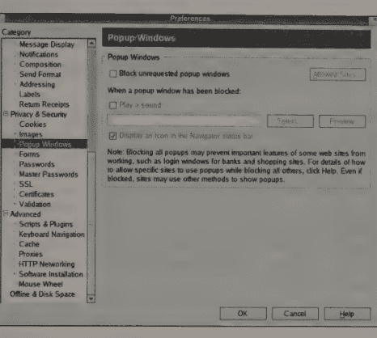

图 8-5：Mozilla 弹出窗口设置。

## The-Gum 浏览器插件

你是否曾经对那些坚持要求你下载插件（或其他额外软件）才能查看的网站感到恼怒？插件和外部程序之间的区别在于：插件在浏览器中显示结果，而外部程序在浏览器之外运行。尽管当你只是寻找某些基本信息时，这些插件很烦人，但它们可以提供一些非常酷的功能，例如通过你的 Web 浏览器流传输视频和音乐。

插件提供了浏览器功能扩展，它们与浏览器界面以提供非标准功能，如声音和视频。数字时代仍处于婴儿阶段，因此行业尚未将这些多媒体格式采用为标准。相应，开发者选择不在 Mozilla 浏览器中内置支持。相反，插件架构允许开发者进行创新，而不需要支持的浏览器知道如何处理新出现的媒体格式。

# 第二部分：现在的网络

每个插件可能需要手动设置步骤，而且 Linux 尚未支持 Mozilla 的所有可用插件。（Apple QuickTime 就是一个很好的例子，尽管你应该查看第 15 章以获得绕过此问题的方法）。你的 Mozilla 安装包含一些插件。要查看安装了哪些插件，选择“帮助”->“关于插件”。

安装插件的通用规则是将所需的文件（通常具有 `.so` 扩展名）移动到位于 Mozilla 安装目录下的插件目录。默认 Fedora Core 1 安装的可能位置是 `/usr/lib/mozilla-1.4.1/plugins`。

要将文件与程序或插件关联，请选择“编辑”->“偏好设置”打开偏好窗口，并在“导航”类别中点击“助手应用程序”。将出现“文件类型”面板，如图 8-6 所示。

此窗口为你提供了一种简单的方法，将特定文件类型与特殊程序或插件关联。例如，带有 `.ram` 扩展的文件表示 Real Media 格式的文件，它可能包含音频或视频演示。播放此文件需要一个针对 Real Media 的特殊（程序）插件。此窗口允许你将文件类型与所需的程序进行匹配。

幸运的是，Mozilla 预配置了许多常见的多媒体文件类型。任何新插件都需要下载，并附带用于 Linux 和 Mozilla 配置插件的说明。

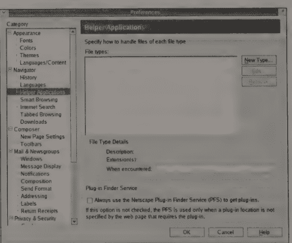

图 8-6：Mozilla 中的助手应用程序窗口。

# 第 8 章：浏览网页与管理电子邮件 133

## 让 Mozilla 进入工作状态

在你调优你的互联网工具后，你可以使用它了。

## 操纵网页

Mozilla 的主要目的是获取页面。当你第一次打开此菜单时，你会立即看到图 8-7。然而，从现在起，你必须选择“编辑”->“邮件新闻组帐户设置”才能返回此对话框。

## 浏览新闻组

新闻组也是寻找技术支持的好地方。根据你的 ISP 提供的新闻组服务器信息，按照以下步骤访问：

1. 选择“窗口”->“邮件新闻组”。

2. 选择“新闻组帐户”单选按钮并点击“下一步”。

3. 通过回答向你提出的问题继续你的新闻组服务器配置。注意你的 ISP 可能在你注册服务时提供了这些信息。配置完成后，你返回“收件箱”窗口。

4. 右键点击选中的新闻组服务器并选择“订阅”。

当你第一次这样做时，你需要等待一段时间，因为有成千上万的新闻组标题，尽管浏览器只下载新闻组名称，该过程仍需要一些时间。对话框底部的状态栏显示进度。

当所有新闻组标题加载到你的浏览器后，你可以浏览列表查找感兴趣的话题。要订阅新闻组，突出显示组名称并点击右侧的“订阅”按钮。订阅新闻组以查看此过程是如何运作的。别担心，通过订阅不会被邮件淹没，也不会向世界宣布你是该组的成员。相反，订阅仅仅是告诉你的浏览器记住这个组。按照以下步骤订阅新闻组：

# 134 第二部分：现在的网络

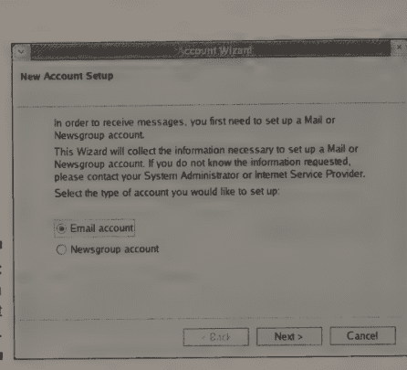

图 8-7：Mozilla 帐户向导。

## 第 8 章：浏览网页与管理电子邮件

1. 在新闻组（Newsgroup）文本框中，输入你想要订阅的新闻组名称。例如，如果你想订阅 Linux 告新增组，请输入 `comp.os.linux.announce`。该组将被高亮。

2. 点击“订阅”（Subscribe）按钮。

在你想要订阅的选定新闻组旁边会出现一个勾选。

3. 点击“确定”（OK）。

你现在回到了消息中心（Message Center），并在你的新闻服务器下看到了一个额外项目，标记为 `comp.os.linux.announce`。

4. 在消息中心双击该新闻组项目。

“邮件与新闻组”（Mail & Newsgroups）窗口弹出，显示一条消息正在加载该组的消息头。如果这是一个繁忙的新闻组，系统可能会提示你想要下载的消息头数量。

在消息头加载后，你可以滚动查看已读消息，并为该新闻组贡献内容。看到世界各地的同行正在做什么是非常有益的学习的！


你需要了解新闻组礼仪的成文和不成文规则，这些规则在小组之间差异巨大。我建议你在发布问题和评论之前，先阅读该新闻组的常见问题（FAQ）页面并潜水一段时间。

## 演进到电子邮件

尽管你可以利用 Mozilla 处理电子邮件，但 Fedora Core 1（本书包含的发行版）中的默认邮件客户端是 Ximian Evolution。如果你的发行版没有自带此产品，你可以在 www.ximian.com 找到它，尽管现在它几乎在所有的 Linux 版本中自带。

## 设置 Evolution

第一次打开 Evolution 时，程序将引导你完成设置过程，因此请确保准备好以下信息：

- 你分配的电子邮件地址，格式为 `username@example.org`。

- 用于接收邮件的邮件服务器类型：例如，POP。

- 用于接收邮件的邮件服务器名称，格式为 `servername.example.org`。

- 用于发送邮件的邮件服务器类型：例如，SMTP。

- 用于发送邮件的邮件服务器名称，格式为 `servername.example.org`。此名称可能与接收邮件服务器相同。

- 邮件进入和发送所需的任何特殊类型身份验证。这种身份验证通常接收时只需要密码，而发送时可能不需要。

首次启动 Evolution 后，请按照以下步骤操作：

1. 点击“前进”（Forward）通过欢迎界面。打开“身份”（Identity）对话框（图 8-8）。

2. 如果需要，更改“全名”（Full 'Name'）字段，如果“电子邮件地址”字段与你的 ISP 给予给你的地址不符，也请更改该字段。然后点击“前进”继续。打开“接收邮件”（Receiving Mail）对话框，如图 8-9 所示。

3. 在服务器列表框中选择 ISP 使用的邮件服务器类型。如果你不想在此机器上接收电子邮件，请将其留为“无”（None）。根据你选择的项目，对话框会发生变化并请求适当的信息。我假设你正在使用 POP 邮件服务器接收邮件。

4. 在“主机”（Host）文本框中输入 POP 邮件服务器的全名。名称可能类似于 `pop.example.com`。

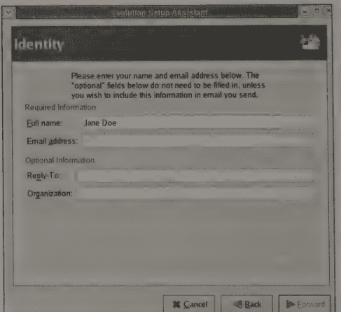

图 8-8：Ximian Evolution 身份对话框。

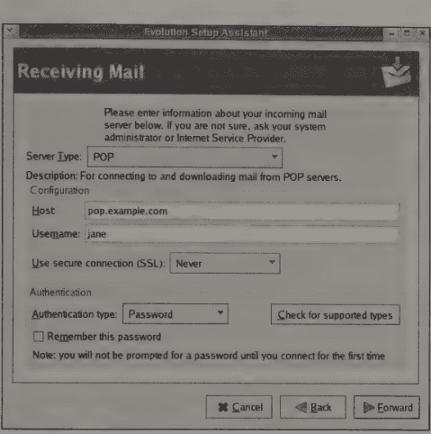

**图 8-3：** Ximian Evolution 接收邮件对话框。

5. **在“用户名”（Username）框中输入检查邮件的登录名称。** 如果你的电子邮件地址是 `jane@example.com`，你的用户名就是 pat。

6. **如果你被告知使用 SSL 进行安全，请勾选“使用安全连接 (SSL)”复选框。** 如果你不知道邮件服务器使用哪种身份验证，请点击“检查支持类型”（Check for Supported Types）按钮。

7. **选择合适的身份验证选项。** 通常是“密码”（Password）。

8. **如果你不在意在你离开时别人使用你的登录会话，勾选“记住此密码”（Remember This Password）复选框。否则，请勾选。**

9. **点击“前进”进入第二个“接收邮件”对话框（图 8-10）。**

10. **如果你想设置自动检查新邮件的频率，请设置。** 如果你没有持续的互联网连接，可能更倾向于手动检查邮件。

11. **如果你从多台机器检查邮件，你可能想要勾选“在服务器上保留消息”（Leave messages on Server）复选框，以便你从所有机器上访问相同的消息。** 点击“前进”进入“发送邮件”（Sending E-Mail）对话框，如图 8-11 所示。

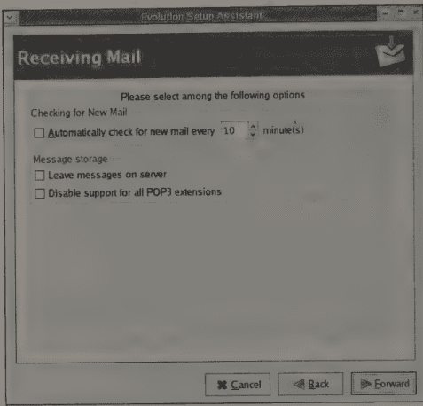

**图 8-10：第二个 Ximian Evolution 接收邮件对话框。**

12. 如果你的不是 SMTP，请更改“服务器类型”（Server Type）条目。假设你正在使用 SMTP 发送邮件。

13. 在“主机”文本框中输入 SMTP 邮件服务器的全名。名称可能是 `smtp.example.com`。

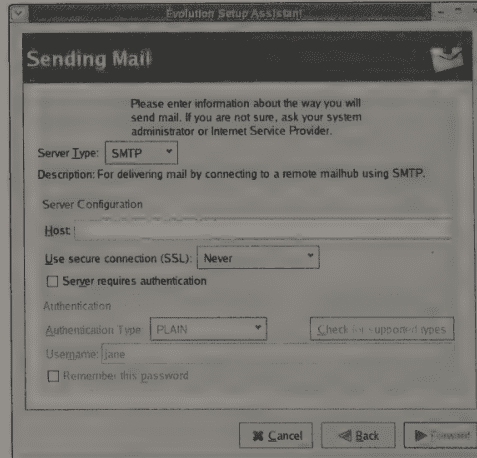

**图 8-11：发送邮件对话框。**

14. 如果被告知发送邮件使用 SSL 进行安全，勾选“使用安全连接 (SSL)”复选框。

15. 如果被告知发送邮件需要身份验证，勾选“服务器需要”（Server Requires）框。

16. 点击“前进”进入“账户管理”（Account Management）部分，如图 8-12。如果你设置的账户不是默认账户，取消勾选“设为默认”（Make Default）框。

17. 点击“前进”进入“时区”（Time Zone）框。

18. 在下拉列表中手动选择你的时区。

19. 点击“前进”进入“完成”（Done）框。

20. 点击“应用”（Apply）。

就是这样！Evolution 打开了，如图 8-13 所示。


图 8-13：Evolution 窗口。

## 发送与检查电子邮件

以下步骤概述了如何创建电子邮件并发送给美国总统：

- 点击“收件箱”（Inbox）。收件箱窗口弹出，如图 8-14 所示。

- 点击“新消息”（New Message）按钮。弹出“编写”（Compose）窗口，其中包含创建电子邮件的工作区域。

- 完成邮件，如图 8-15 所示。

- 写完消息后，点击“发送”（Send）按钮。留意黑衣人（MIBs）出现把你带走。开玩笑的！这个电子邮件地址每天收到数百万封邮件。几分钟后，你的收件箱就有邮件在等着。不，美国总统并不是一直在阅读和回复每个人的邮件。一个名为自动回复的程序在负责总统邮件的计算机上运行。当收到消息时，自动回复程序向发件人的电子邮件地址返回一封格式信。

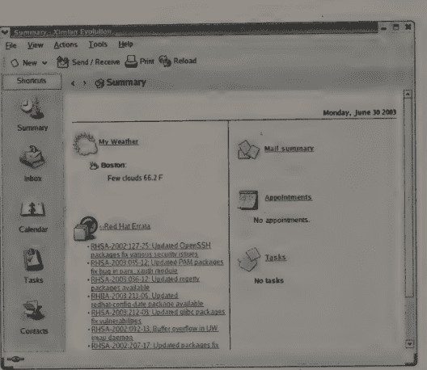

图 8-14：Evolution 收件箱窗口。

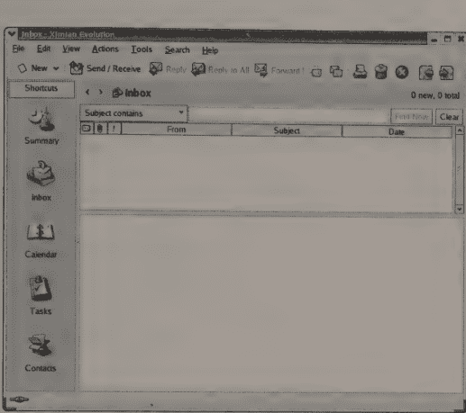

图 8-15：发给美国总统的电子邮件。

5. 点击“发送/接收”（Send/Receive）按钮。

你的电子邮件发出了。等一分钟左右再次点击该按钮。你应该有一封来自美国总统的邮件在等着。

花些时间真正探索 Evolution。正如你从本章的插图中看到的，这个程序有很多值得发现的内容。

## 酷的网络工具

## **本章内容**

- 瞬时发送消息

- 使用其他 Web 浏览器浏览

- 邮件、邮件以及更多邮件

- 使用 FTP 快速交换文件

> 以防你没听说，互联网并不是一条超级高速公路。
>
> —Bill Washburn，《网络世界》杂志

互联网是一个遍布全球的庞大计算机网络。许多不同类型的计算机和操作系统共同工作，使你能够访问整个互联网上的信息。Linux 及其相关的 Unix 操作系统长期以来支持并与互联网协作工作。互联网上几乎所有可用的不同服务，你都可以从你的 Linux 桌面访问到这些服务。

当你使用“个人桌面（Personal Desktop）”选项安装 Fedora Core 1 时，你的 Linux 系统中将安装了几个 Web 浏览器、邮件程序和即时消息工具。在本章中，我将向你介绍一些可以使用它们访问互联网上不同服务的工具，例如访问 网站、使用电子邮件、调查新闻组以及利用 FTP。

你的 Linux 系统除了我在这里提到的应用程序外，还有其他工具，我建议你花时间探索这些工具。你可能会发现某个我没有介绍的应用程序更适合你。此外，如果你不喜欢 Linux 系统中的任何与互联网相关的工具，你始终可以在互联网上找到更多并将它们安装到你的 Linux 系统中。但那是第 17 章和第 19 章的话题。

## 即时消息

人与人之间的即时消息就像使用电话——除非你是打字对话而不是说话。此外，你可以同时进行多个即时消息对话，而无需额外连接到互联网。美国在线（AOL）提供了一种受欢迎的即时消息服务，名为 AOL Instant Messenger，简称 AIM。其他的还有 ICQ 和 MSN。包括 Linux 在内的各种计算机操作系统都支持这些各种服务。Kit 和 Gaim 是两个在你选择“个人桌面”安装选项时，默认安装在你的 Fedora Core 1 系统上的即时消息软件包。由于 Gaim 支持的不仅仅是单一的即时消息（IM），我将详细介绍它。它仅支持 AIM。

在其他发行版中，如果你在安装期间选择了 GNOME 桌面，则会安装 Gaim。如果你在安装期间选择了 KDE，系统将安装 Kit。如果你同时选择了 GNOME 和 KDE，Gaim 和 Kit 都会被安装。但在 Fedora Core 中，两者默认都会安装，尽管 Gaim 是主要选项。

## Gaim

你可以通过选择主菜单<互联网<即时消息来启动 Gaim，打开图 9-1 所示的应用程序。应用程序启动后，你需要输入你当前的 IM 账户或显示名称，或者创建一个新的显示名称。Gaim 支持 AIM、ICQ、MSN 甚至更多服务。

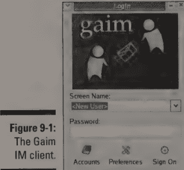

为了快速开始，如果你现在是 AIM 用户，输入你的显示名称和密码并点击登录（Sign On）按钮。在使用 AIM 服务之前，请确保你的互联网连接已经建立。

如果你使用的是 AIM 以外的类型消息服务，或者其他用户想要使用同一个 Gaim 实例，你需要使用账户编辑器（Account Editor）进行设置（除非你给他们自己的登录账号，这是最佳解决方案）：

1. 点击 Gaim 主窗口中的账户（Accounts）按钮。

将显示一个包含当前账户的窗口，如图 9-2 所示。

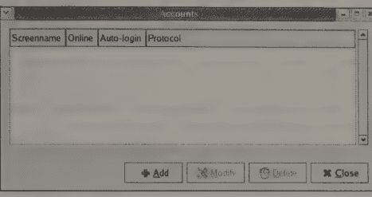

图 9-2：Gaim 账户窗口。

2. 要添加 IM 显示名称或账户类型，点击添加（Add）按钮。

出现添加账户窗口，如图 9-3 所示。

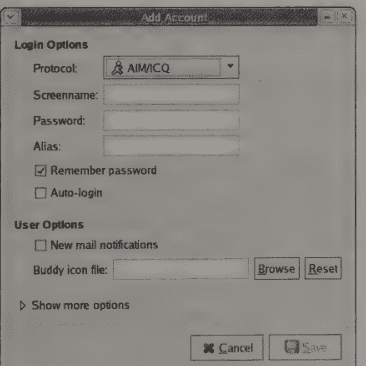

图 9-3：Gaim 账户编辑器“添加账户”窗口。

3. 在协议（Protocol）下拉列表中选择 IM 服务类型。

你可以选择 AIM/ICQ（这些使用相同的网络，所以如果你想添加其中任一类型的账户，请选择这一个）、TOC（如果你使用 AIM 聊天时需要的 AIM 另一个方面）、Yahoo!、MSN、ICQ、Jabber、Napster、Zephyr、Gadu-Gadu。

4. 在显示名称（Screenname）框中输入你的 IM 名称。

5. 在密码（Password）文本框中输入你的 IM 密码。

6. 如果你想在你的 IM 名称旁使用昵称，请在别名（Alias）文本框中输入。


## 7. 记住密码

如果你是使用此账户的唯一人员（毕竟这是 Linux —— 如果其他人想用 IM，请给他们他们自己的登录账号并让他们自己设置 Gaim！），选择**记住密码**复选框。

如果其他人有权访问此账户，请不要勾选此框。否则，有人可能会无意或蓄意地拿你的 IM 开个玩笑。

## 8. 自动登录

如果你想让 Gaim 在你启动程序时自动登录此账户，请勾选**自动登录**复选框。

还有更多设置，但这些是基础。继续并点击**显示选项**旁边的三角形查看更多。如果你不想让 Gaim 自动登录，请按照剩余步骤手动将 Gaim 连接到 IM。

## 9. 返回账户编辑器

点击**确定**按钮返回账户编辑器窗口。

## 10. 创建多个账户

如果你想创建另一个 IM 账户，请返回第 2 步。你可以使用 Gaim 同时登录多个 IM 账户。

## 11. 连接账户

在创建完所有账户后，回到账户编辑器窗口，为你想要连接的每个账户勾选**在线**复选框。

Gaim 会尝试连接到你指定的账户。

## 排除你的 IM 连接

如果你在其他操作系统上使用 AIM 或 MSN，当你的 Linux 系统成功连接到 IM 服务后，你可以看到好友列表。如果你从未用过 AIM 或 MSN，现在可以设置好友列表。好友列表让你知道好友在线并可以接收消息。

如果你使用的是 ICQ，你的好友列表存储在本地。

有时，你的 Linux 系统无法正确连接到 IM 服务。当这种情况发生时，屏幕上会弹出一个错误消息指示连接失败。你无法连接到 IM 服务可能有以下原因：

- 你可能输了错误的 IM 密码或选择了错误的账号。
- 你的计算机可能没有连接互联网。尝试打开 Mozilla 或其他 Web 浏览器查看是否可以访问网站。
- 如果你可以打开网站但无法使用 IM，可能是 IM 服务不可用。这种情况有时是因为 IM 服务的维护或互联网或 IM 服务上的流量过大。
- 如果你在工作场所尝试访问 IM 服务，你的公司或组织可能出于安全或效率考虑阻止 IM 服务。如果你在工作期间允许 IM，请咨询你的网络管理员看他是否可以提供帮助。
- 通常，公司在公司网络和互联网之间使用防火墙来防止不受欢迎流量进入公司网络。如果防火墙被配置为阻止 IM 流量，你就无法跨网络使用。

## 值得考虑的其他浏览器

> 这个世界上有三种死法。心脏死亡，脑死亡，以及离开网络。
>
> —— Guy Almes

在第 8 章中，你可以探索一个名为 Mozilla 的 Web 浏览器，它包含许多访问网站、使用电子邮件和执行其他服务的功能。除了 Mozilla，Linux 还有其他图形化 Web 浏览器。另一个流行的 Web 浏览器 Konqueror 也包含在随书附的 Fedora Core 1 DVD 中，以及你可以购买的 CD 中。除了浏览网页，你还可以使用 Konqueror 管理你的电子邮件和新闻组订阅。

## Konqueror

某些 Linux 系统（包括 Fedora Core 1）带有一个名为 Konqueror 的 Web 浏览器。你可以通过选择**主菜单 > 互联网 > 更多互联网应用程序 > Konqueror Web 浏览器**来启动 Konqueror，打开图 9-4 所示的工具。

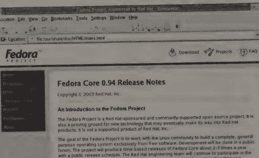

要设置 Konqueror 偏好，请选择**设置 > 配置 Konqueror**。图 9-5 显示的设置窗口包含许多选项，其中某些与 Mozilla 偏好相似。你可以通过点击设置窗口左侧窗格中的图标来探索每个配置区域。

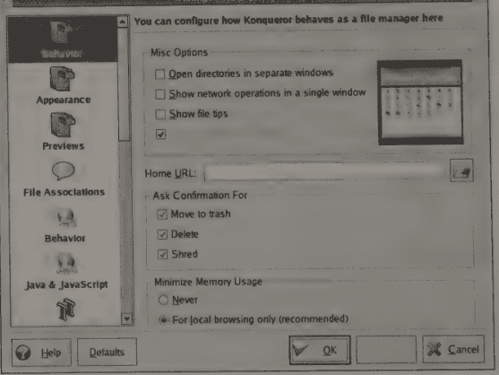

## 电子邮件客户端：KMail

大多数 Web 浏览器都提供电子邮件支持，以便你可以读取和向他人发送电子邮件。此外，还有几种用于处理电子邮件的电子邮件应用程序（或电子邮件客户端）可用。例如，我来看了名为 KMail 的电子邮件应用程序，它是 KDE 的一部分。

KMail 是一个简单的电子邮件程序，可在许多 Linux 发行版中使用，包括 Fedora Core 1。（如果默认没有安装 KMail，请参考第 17 章有关向 Linux 添加软件的信息）。你可以通过从主菜单选择**主菜单 > 互联网 > 更多互联网应用程序 > KMail** 来启动 KMail。第一次启动 KMail 时，你必须设置你的电子邮件环境：

1. 选择**设置 > 配置 KMail**。

配置窗口如图 9-6 所示出现。它允许你设置姓名、电子邮件签名、电子邮件存储位置，以及简单邮件传输协议（`SMTP`）服务器的名称和端口号。如果你不知道 `SMTP` 服务器的设置，请咨询你的互联网服务提供商（`ISP`），或者如果你在上班，请咨询网络管理员。

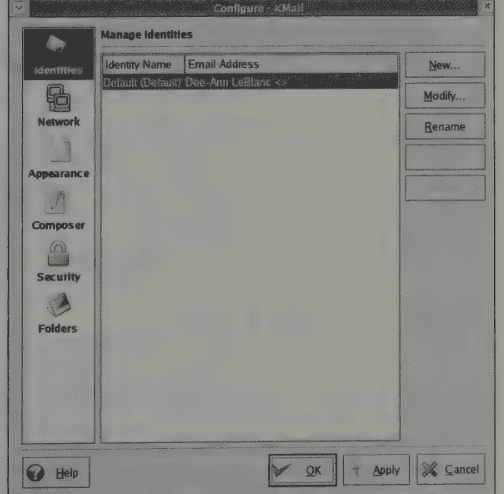

2. 在完成所有所需的设置后，点击**确定**。

你将返回 KDE 电子邮件客户端窗口。

KDE 电子邮件客户端应用程序窗口在窗口顶部有一系列标记按钮（如图 9-7 所示）。要创建新消息，选择**新消息**按钮，编辑器就会出现。在窗口中输入收件人的电子邮件地址、主题行和消息正文。当你完成消息后，点击**发送**按钮让消息发出去。

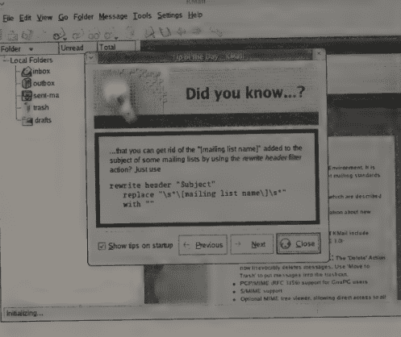

在发送消息之前，你还可以使用**附加文件**按钮附加文件（例如图片）。**附加文件**按钮会显示一个微型文件系统导航器，你可以从中浏览并找到要附加到电子邮件中的文件。你可以在发送前通过编辑编辑器窗口中的**拼写检查**对消息进行拼写检查。

## 使用 FTP 传输文件

为网络设计的服务类型之一是文件服务。人们需要一种快速、可靠地在服务器之间传输文件的方法。文件传输协议（`FTP`）的设计旨在提供这种服务。`FTP` 已经存在多年，仍然是与网络系统之间传输文件的最佳方式之一。此外，大多数当前的 Web 浏览器都支持通过 `FTP` 下载，因此如果你不需要上传文件，就不再需要记忆传输文件的命令了。有时，当你将浏览器指向某个网站并下载软件包更新时，你正在通过 `FTP` 接收文件。诸如 gFTP 等应用程序提供了一个良好的图形界面，方便进行 `FTP` 文件传输，而无需使用浏览器。

## 使用 Web 浏览器进行 FTP

要使用 Web 浏览器访问 `FTP` 服务，请打开你的 Web 浏览器，并在地址栏中输入 `ftp` 后跟 FTP 地点的地址。例如，如果 `ftp.redhat.com` 是 FTP 服务的名称，请在 Web 浏览器的地址栏中输入 `ftp://ftp.redhat.com`。

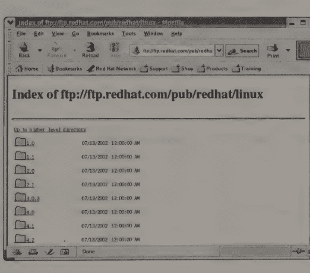

在 FTP 视图中，你可以点击目录来在文件结构中导航。如果你点击一个文件，将获得打开文件或下载并保存到文件夹的选项。

## 查看 gFTP

Fedora Core 1 包含一个名为 gFTP 的图形化 FTP 应用程序。

要访问该应用程序，请遵循以下步骤：

1. 在面板上，点击左侧的**主菜单**按钮打开主菜单。
2. 选择 **互联网 > 更多互联网应用程序 > gFTP**。

gFTP 应用程序窗口如图 9-9 所示出现。

3. 在左上角的**主机**字段中，输入 FTP 服务器的地址或 URL。

例如，输入 `http://ftp.redhat.com`。

4. 在中间的**用户**字段中输入名称。

如果你是匿名用户，输入 `anonymous`。

5. 在右上角的**密码**字段中输入密码。
6. 点击左下角的按钮进行连接。

连接建立后，左侧窗格显示系统。你可以在 FTP 服务器周围导航。右侧窗格显示系统。

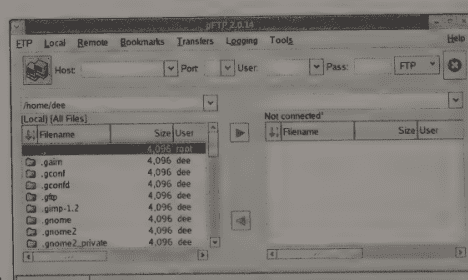

# 第 10 章：操作文件和目录

## 列出目录内容

任何计算机用户所需的最基本技能之一就是查看其文件系统中哪些内容位于什么位置。在 Linux 中，你使用 `ls`（list 的缩写）命令来实现此操作，它本身不带任何选项——选项是那些允许你控制命令行为的特殊额外参数——命令只会列出你指定目录中有哪些文件和目录。

假设你处于 Fedora Core 目录树的底部（称为根目录，即 `/`）。`ls` 默认列出当前目录的内容。因此，如果你在根目录的提示符下输入 `ls`，你会看到以下输出，列出了根目录下的所有子目录：

```
bin dev home lib misc opt root tmp var
boot etc initrd lost+found mnt proc sbin usr
```

但这仅仅是 `ls` 命令的冰山一角。`ls` 命令有一系列选项可以组合使用，以获得你需要的结果。我在表 10-1 中列出了这些选项中最有趣的几个。记住：Linux 是区分大小写的；当某个项以大写字母显示时，必须使用大写，反之亦然。

| 选项 | 说明 |
| :--- | :--- |
| `-a` | 显示所有文件，包括隐藏文件（以点符号开头的文件） |
| `-c` | 显示文件最后修改的时间 |
| `--color` | 按类型对项进行颜色编码 |
| `-1` | 以单列格式显示文件列表 |
| `-R` | 显示该目录下所有目录的内容 |
| `-S` | 按大小列出文件 |
| `-t` | 按修改时间长短列出文件 |
| `-u` | 按访问时间长短列出文件 |

表中，`-a` 和 `-l` 是最常用的选项。如果你在一个全新的家目录中并输入 `ls`，你什么也看不见。然而，如果你输入 `ls -a`，由于隐藏文件（那些以点开头的），你可能会看到类似下面的内容：

```
. .. .bash_logout .bash_profile .bashrc
```

前两个项目是什么？第一个项目——单点 `.` 始终指代“这里”。它指向你所在的目录。（如果这些内容目前对你来说没有意义，请不要担心。随着你操作其他命令并越来越熟悉 Linux，它们就会变得有意义。）行的第二部分（两个点 `..`）指代父目录，即你所在位置上一层级的目录。对于几乎所有的用户家目录（例如 `/home/dee`），父目录都是 `/home`。我将在本章后面的“操作文件系统”部分更详细地讨论文件系统结构。

如果你在同一个全新的家目录中输入 `ls -l`，你什么也得不到，就像你输入 `ls` 时一样。

输入最常用的组合之一，你就能获得更多信息。例如，如果你输入 `ls -la`，你会看到类似下面的内容：

```
drwx------ 22 dee 4096 Jul 29 07:48 .
drwxr-xr-x 5 root 4096 Jul 27 11:57 ..
-rw-r--r-- 1 dee 24 Jul 27 06:50 .bash_logout
-rw-r--r-- 1 dee 230 Jul 27 06:50 .bash_profile
-rw-r--r-- 1 dee 124 Jul 27 06:50 .bashrc
```

你可能会发现这种格式的某些部分比其他部分更容易一目了然。每个列表中的第一个项目（带有横线的部分，例如第一行中的 `drwx------`）是分配给该项的权限集。简而言，权限定义了谁可以读取文件、修改文件或将其作为程序运行。你可以在本章后面的“处理权限”中阅读更多关于权限的知识。第一行的第二个项目（在本例中为 `22`）是指向该项的链接数。

链接是指向另一个文件的文件列表，相当于一种快捷方式。在 Linux 和 Unix 中使用两种类型的链接：

- **软链接**：这种链接类似于 Windows 快捷方式，链接指向回原始文件，你对链接进行的任何操作都会作用于原始文件。删除原始文件后，链接仍然存在，但它将无法使用。如果没有原始文件，链接就会损坏。
- **硬链接**：这种链接在 Windows 世界中没有对应物。硬链接不仅仅是一个快捷方式；它是文件本身的另一个实例。文件中的数据只存在一个地方，但你可以编辑原始文件或链接，编辑结果将同时保存到文件的两个实例中。删除原始文件，只要链接存在，文件就一直存在。就像通往同一个房间的两扇门！

第三个项目（`dee`）是文件的所有者，第四个项目（`dee`）是组。第五个项目（`4096`）是字节大小。第六个项目（`Jul`）是月份，第七个项目（`29`）是日期，第八个项目（`07:48`）是时间。最后，第九个项目是名称。

## 获取特定文件的信息

Linux 还有额外的命令可以提供比原始列表更容易理解的信息。这些命令中的第一个是 `file`，它直接告诉你你处理的是哪种文件。例如，如果你输入 `file /home`，你会看到：

```
/home: directory
```

`file` 命令甚至可以为你追踪链接！你可以通过两种不同的方式使用它：

- 如果只使用 `file` 命令和文件名或目录，它会报告关于你列出的精确项。例如，如果你输入 `file /usr/src/linux`（取决于你的 Linux 发行版是否安装了特定软件包或其他问题），你可能会看到这一行：
  - `/usr/src/linux: symbolic link to /usr/src/linux-2.4.8`
- 当你配合 `-L` 标志（与选项相同）时，它会追踪回原始文件并根据原始文件给出答案。例如，如果你输入 `file -L /usr/src/linux`，你会看到这一行：
  - `/usr/src/linux: directory`

| 类型标识 | 文件类型 | 说明 |
| :--- | :--- | :--- |
| `-` | 普通文件 | 该项是日常文件，例如文本文件。 |
| `b` | 块设备 | 该项是存储介质驱动（控制程序），例如硬盘或 CD 驱动器。 |
| `c` | 字符设备 | 该项是传输数据的硬件驱动（控制程序），例如调制解调器。 |
| `d` | 目录 | 该项是文件的容器，在某些术语中称为文件夹。 |
| `l` | 链接 | 该项是软链接。 |

## 操作文件系统

> 这是一个意外，Phyllis。
>
> 噢，你知道的，切尔诺贝也是意外。
>
> ——引用自电影《快速变化》

你需要在目录结构中移动，了解自己所处的位置，以及如何添加和删除内容。我建议登录用户账户，对在本章剩余部分中读的内容进行实验。不要使用 `root`。你不想删除或移动重要的东西！

## 在文件系统中穿行

Linux 有两个你可能会发现在文件系统中移动时非常有用的命令。其中第一个可以让你确切看到自己所处的位置。你可能认为，除非你的位置显而易见，否则你不需要这样的命令？然而，许多 Linux 发行版习惯于给你提供如下所示的提示符：

```bash
[dee@myhost dee]$
```

这个提示符告诉你，你的登录名是 dee，你所处的机器是 myhost。然而，你所在的目录是 `/home/dee`，而不仅仅是 dee。Linux 这种使用这种格式是因为完整路径可能会变得非常大：显示路径的提示符可能会占据一行的长度。要确切查看你所处的位置，请输入 `pwd`。

你可以使用 `cd`（切换目录）命令在文件系统中移动。如果你在 `/home/dee` 目录下并想去临时目录（`/tmp`），你输入 `cd /tmp`。

另一个你需要注意的——这可以节省你大量的打字时间——是你可以通过两种方式更改文件系统位置：

- **输入完整路径。** 如果你在 `/home/dee` 并且想切换到子目录 `files`，你可以输入 `cd /home/dee/files`。不过你还有另一种方法。
- **输入相对位置。** 如果你知道自己在哪里，并想相对于当前位置进行移动，你可以使用*相对*位置而不是输入整个路径。例如，从 `/home/dee` 内部切换到 `files` 子目录，你只需要输入 `cd files` 即可。`cd` 命令能理解你已经在 `/home/dee` 中，所以它会在其内部寻找 `files` 目录。

也许你正以 root 身份登录并检查几个不同的目录。你在 `/home/dee` 中，想去 `/home/raph`。你可以输入 `cd /home/raph` 或 `cd ../raph`。记住，`..` 始终指向你当前所在目录的上一级目录。使用 `../raph` 告诉 `cd` 命令向后退一个目录（进入 `/home`），然后移动到 `raph`。

只想回到你自己的家目录吗？输入 `cd ~` 即可到达那里！事实上，如果你想的话，可以只输入 `cd` 而不带任何其他内容。如果你想切换到自己的文本子目录（可能是 `/home/raph/text`），你可以输入 `~/text`。

## 创建文件和目录

当你操作 Linux 机器时，你可能想立即做的两件事是：

- **创建你自己的文件：** 如果你使用 Linux 机器进行正式工作，你可能会出于各种原因创建文件。你可能有一个个人日记要记录，或者想创建一个表格记录实验期间发现的内容。
- **创建目录：** 最终，文件会越来越多！目录是为了组织目的。

## 创建文件

在 Linux 中，你本质上有三种创建文件的方法。一种是直观的 `touch` 命令，我在这里详细介绍。其他方法则稍微复杂一些，涉及到在你继续探索时会遇到的内容。

你可以随时使用 `touch` 命令创建一个空文件。因为文件不包含任何内容（它只是一个名称），你以 `touch filename` 的格式进行操作，其中 `filename` 是你想创建的文件名。例如，如果你在 `/home/dee`，你输入 `touch today`。或者，如果你在 `/home/dee` 并想在 `/home/raph` 中创建一个文件，你输入 `touch ../raph/today`。

当你读到本章的“处理权限”部分时，`touch` 命令会创建你稍后可以操作的文件。


其他创建的方法取决于你想制作什么类型的文件。如果你想创建一个文本文件，可以使用许多文本编辑器之一。文本编辑器是一个处理文本的小型程序，例如 Windows 中的记事本。在第 13 章中，我将介绍所有 Linux 发行版默认自带的文本编辑器，并指向其他的编辑器。

最后，接下来的文件是像具有格式的文档之类的项目、图像文件（如 GIF）以及更多内容。你通过使用适用于它们的相应程序来创建这些文件。要创建一个文字处理文件，你需要使用文字处理程序，例如 WordPerfect 或 OpenOffice（见第 14 章）。

## 创建新目录

随着你向家目录及其他地方添加越来越多的文件，你会意识到在自己被完全淹没且无法快速找到任何东西之前，你必须对它们进行组织。目录是满足这一需求的完美工具。同样，你可以在 Linux 中使用 `mkdir` 命令创建新目录，并以多一种方式使用它。如果你在 `/home/mike` 中并想创建目录 `/home/mike/pictures`，你可以输入 `mkdir pictures`。如果你需要在家目录之外创建一个目录以与他人共享，你输入 `mkdir /tmp/pictures`。这是硬链接和软链接的完美用例，因为你想在自己的家目录中保留这些文件的副本。你的 `/tmp` 目录的内容会被定期删除！

## 移动、重命名和删除文件及目录

生活事实之一是事物在变化。假设你某天创建了一个名为 `text` 的文件。第二天，你有一堆文本文件，并需要为它们创建一个新目录。你创建了新目录并将文件移动进去。或者，假设你把文件名起得太通用，无法一眼看出文本和笔记之间的区别。你可能需要重命名它们。幸运的是，Linux 有命令可以轻松完成所有这些事情。

## 移动和重命名

如果你使用 root 账户，需要小心。重命名、移动或删除系统文件可能会造成灾难！这就是人们倾向于不使用 root 的原因之一。

你使用 `mv` 命令同时进行移动和重命名。要将文件从一个位置移动到另一个位置，输入 `mv originlocation newlocation`，其中 `originlocation` 是文件所在的目录，`newlocation` 是你想移动去的地方。

假设你想将 `/home/mike/text` 移动到 `/home/mike/textfiles`。你在 `/home/mike` 内部输入 `mv text textfiles`。如果目标名称与现有目录同名，`mv` 命令假设你想将文件放入该目录中。

重命名文件非常相似。如果你想将 `/home/mike/text` 重命名为 `/home/mike/noteslist`，你在 `/home/mike` 中输入 `mv text noteslist`。

> **提示：** 你可以同时移动并重命名。你可以将 `/home/mike/text` 移动到 `/home/mike/textfiles` 同时将其重命名为 `noteslist`，都在 `/home/mike` 下完成。

## 清理垃圾

在任何操作系统中，清理文件都是好主意。如果你不，你就会面临没有可用空间，这绝对不好趣。Linux 有两个不同的删除命令。一种是 `rm`（remove 的缩写）。如果你单独使用此命令，它会删除文件。例如，如果你输入 `rm ~/test.tif`，`test.tif` 文件可能会在不询问的情况下被删除，或者取决于你的发行版如何设置 `rm` 命令，你可能会看到以下行：

```
rm: remove 'test.tif?'
```

按下 N 或回车取消操作。否则，按下 Y 删除文件。Linux 包含许多选项，如表 10-3 所示，你可以使用这些选项让 `rm` 命令按照你的偏好运行。默认偏好在你的 root 账户和用户账户之间可能不同。

假设你有一系列想要删除的子目录。

可能你有一个 `/home/sally/files`，而 `files` 目录下包含 `text/images/programs` 等多个子目录。你可以在 `/home/sally` 目录下输入 `rm -r files` 来删除所有它们。不过，在删除过程中你可能会频繁收到提示，此时可以输入 `rm -rf files`。


`rm -rf` 命令是你可以在 Linux 或 Unix 系统上输入的最危险的命令，特别是当你以 root 身份登录时（`rm -rf *` 是最糟糕的命令，因为它是意外删除整个系统的极佳方法）。如果你是以 root 身份登录，务必四倍确认你在正确的地方输入了该命令，并且确实想删除子目录中的所有内容。很多人无意中在根目录下输入了 `rm -rf`，结果听着驱动器转动并删除所有文件时感到如酷冰。你可以按下 `Ctrl+C` 取消该命令，但无法找回已经删除的文件。

删除目录另一种方法是使用 `rmdir` 命令。该程序用于删除空目录。许多人倾向于先删除文件，然后使用 `rmdir` 目录，以确保不会把事情搞得一团糟。你使用的格式是 `rmdir 目录`。假设你有一个想要删除的临时目录 `/tmp/mikesfiles`。在在该目录下对每个文件执行 `rm -r` 或 `rm -rf` 后，你输入 `cd ..` 回到 `/tmp`（如果你不在该目录内，就无法删除它），然后输入 `rmdir mikesfiles`。

## 权限的博弈

在目录内输入 `-l` 查看你机器上的一些格式化文件列表。如果你发现自己一头雾水，别担心。本章前面的“理解文件类型”部分让你对每行的首字母字母有个大致的认识，但在进入下一列之前，该项目后面还附了九个字符。这九个字符就是文件或目录的权限集（也称为权限组）。Linux、Unix 和 Mac OS X 使用权限作为提供文件和目录安全手段，让你能够精确指定谁可以查看你的文件、谁可以修改它们，甚至谁可以运行你的程序。当同一台连接到世界的机器上有很多许多不同的用户时，你需要这种能力。

## 查看三元组

每个权限集由三个三元组组成。每个三元组具有相同的基本结构，但控制你可以使用的不同方面。考虑以下代码中 `/home/dee` 的长格式列表：

```
total 20
drwx------ 2 dee 4096 Jul 29 07:48 -
drwxr-xr-x 5 root root 4096 Jul 27 11:57 .-
-rw-r-- 1 dee dee 24 Jul 27 06:50 .bash_logout
-rw-r-- 1 dee dee 230 Jul 27 06:50 .bash_profile
-rw-r-- 1 dee dee 124 Jul 27 06:50 .bashrc
-rw-r-- 1 dee dee 0 Jul 29 07:48 lsfile
```

权限集中的第一个字符指的是文件类型。对于目录，该字符显示为 `d`，正如你在前面的列表中第一个项看到的那样；文件用横线 (`-`) 代替。每个文件或目录的权限由九个字符组成——即紧第一个字符之后的九个字符（总共十个）。但这九个字符实际上是三组三个一组的，如图 10-1 所示。

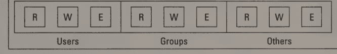

**图 10-1：** 九个权限字符的拆解。

| R | W | E | R | W | E | R | W | E |
|---|---|---|---|---|---|---|---|---|
| Users | | | Groups | | | Others | | |

图例：

- R=读 (Read)
- W=写 (Write)
- E=执行 (Execute)

这三个三元组的读法如下：

- 第一个三元组由长格式文件列表中的第二、第三和第四字符组成。该三元组设置文件的*用户*或*所有者*的权限。（所有者将在本章稍后的“注意所有者”部分进行讨论）。
- 第二个三元组由长格式文件列表中的第五、六和第七字符组成。该三元组设置分配给文件的*组*的权限。（组将在本章稍后的“在组中闲逛”部分进行讨论）。
- 第三个三元组由长格式文件列表中的第八、第九和第十字符组成。该三元组设置*其他*（即任何不是文件所有者也不是所属组成员的人）的权限。

虽然每个三元组与其他不同，但每个三元组的内部结构是以相同方式构建的。在查看整个三元组之前，专门关注如何读取一个三元组。每个三元组包含三个字符：

- 第一个字符是 `r` 或横线。`r` 代表读权限。如果 `r` 被设置，该三元组允许实体（用户、组或其他人员）查看目录或文件内容。
- 第二个字符是 `w` 或横线。`w` 代表写权限。如果 `w` 被设置，该三元组允许实体向此目录或文件添加或编辑项目。
- 第三个字符是 `x` 或横线。`x` 代表执行权限。如果 `x` 被设置，该三元组允许实体运行此目录或文件中的特定程序。

在所有情况下，如果 `-` 占据了 `r`、`w` 或 `x` 的位置，三元组就不允许读取、写入或执行。

后续章节将详细描述所有者和组。

## 注意所有者

## 通过字母设置权限

告诉 Linux 你想如何更改一组权限的一种方法是使用字母。在这里，你有两组字符可以使用。第一组包括：

- `u` 代表用户（user）
- `g` 代表用户组（group）
- `o` 代表其他用户（other），或所有人
- `a` 代表所有（或者使用 `uago` 效果相同）

第二组则由 Linux 用于权限三元组的熟悉字符组成：`r`、`w`、和 `x`。（参见本章前面的“查看三元组”部分。）接下来，你还有一些操作符，这些字符用于告诉 `chmod` 相对于你所指的三元组该如何执行何操作：

- `+` 添加权限
- `-` 移除权限
- `=` 将权限设为确切的值

现在你已经拥有了所有组件，可以开始将它们组合在一起了。从示例 `chmod newpermissions lsfile` 开始。你的目标是不允许任何除你自己或你的小组组成员以外的用户查看 `lsfile` 的内容。根据这个线索，你知道你指的是第三组三元组（the `o`）。决定人们是否可以查看文件或目录内容的权限是 `r` 位置，而用于取消权限的操作符是横号（`-`）。因此，你执行 `chmod o-r lsfile`。搞定了：`o`（其他）组中的任何用户都无法查看 `lsfile` 的内容。真的这么简单！

你可以通过几种不同的方法同时更改多个三元组。例如，如果你想更改 `lsfile` 使得只有所有者（dee）可以读取其内容，你输入 `chmod go-r lsfile` 来同时更改组和其他用户的设置。更复杂的是，如果你想确保只有文件的所有者可以读取、写入或运行该文件，你输入 `chmod go-rwx lsfile`。

从技术上讲，如果你愿意，甚至可以输入权限集。如果你想让所有者组读取 `lsfile`，但只有所有者可以写入，你可以执行 `chmod rw-r----- lsfile`。

## 通过数字设置权限

Linux 用户常用的更改权限的另一种方法是数字。因为这种格式在 Linux 文档中无处可见，从书籍、课程到手册（man pages）和在线参考，我真的认为应该在这里为你提供这些信息——尽管它有点技术性。

简单来说，权限数字允许你直接处理原始八进制数——八进制是一种 8 进制计数系统，意味着你只使用 0 到 7 的数字，而不是更熟悉的十进制系统（0 到 9）。很棒的一点是，为了使用这种方法，你不需要对八进制有更多的了解。

查看以下权限集：

```
-rw-rw-r--
```

在下面的列表中，上一行代码被拆分为它的三元组：

- 三元组 1: `rw-`
- 三元组 2: `rw-`
- 三元组 3: `r--`

在每个三元组的每个位置上，需要注意的是那里是字母还是横号。每个可能项的数值为：

- 每个 `r` 值为 4
- 每个 `w` 值为 2
- 每个 `x` 值为 1
- 每个 `-` 值为 0

每个三元组保留其自己的总和。你只需要将这些值相加即可。因此，在示例权限集的情况下，结果如表 10-4 所示：

| 表 10-4 | 示例权限集的结果 |
| :--- | :--- |
| 三元组 | 转换为数字 |
| `rw-` | 4+2+0=6 |
| `rw-` | 4+2+0=6 |
| `r--` | 4+0+0=4 |

数字权限集的设置方式基本上是：第一个三元组的值是第一个数字，第二个值是第二个数字，第三个三元组是第三个数字。权限集 `rw-rw-r--` 对应于 664。

如果你确切知道想将权限更改为什么，就可以使用 `chmod permissions file` 格式，其中权限用数字表示。例如，将 `lsfile` 的权限更改为 `rw-------`，输入 `chmod 600 lsfile`。

## 读取长格式文件列表

在掌握了其中的每个元素后，长格式文件列表（`ls -l`）就非常容易读了。我将在接下来的章节逐行分析以下示例：

```
total 20
drwx-xr-- 2 dee dee 4096 Jul 29 07:48 .
drwxr-xr-x 5 root root 4096 Jul 27 11:57 .
-rw-r--r-- 1 dee dee 24 Jul 27 06:50 .bash_logout
-rw-r--r-- 1 dee dee 230 Jul 27 06:50 .bash_profile
-rw-r--r-- 1 dee dee 124 Jul 27 06:50 .
```

### 第一行

```
total 20
```

`total` 行表示目录中文件所使用的文件块总数。

### 第二行

```
drwx-xr-- 2 dee dee 4096 Jul 29 07:48 .
drwxr-xr-x 5 root root 4096 Jul 27 11:57 .
```

`d` 前缀表示目录。接下来的九个字符是权限。数字是硬链接计数，后面是所有者名称、组名、以字节为单位的大小以及最后修改的日期时间。

### 第三行

```
-rw-r--r-- 1 dee dee 24 Jul 27 06:50 .bash_logout
-rw-r--r-- 1 dee dee 230 Jul 27 06:50 .bash_profile
```

`-` 前缀表示普通文件。这些行显示了文件及其详细信息。

### 第四行

```
-rw-r--r-- 1 dee dee 124 Jul 27 06:50 .
```

### 第五行

```
-rw-r--r- 1 dee dee 0 Jul 29 07:48 lsfile
```

## 通配符，或合法的作弊

在命令行提示符下工作意味着大量的输入。如果你想处理一组文件而必须逐个输入它们的名称，这一点会变得异常痛苦。幸运的是，你不必这样做。你有通配符可以使用。

通配符是代表一个或多个字符的字符。表 10-5 列出了你在处理文件和目录时可以使用的通配符。

| 表 10-5 用于文件和目录操作的通配符 |
| :--- | :--- | :--- |
| 字符 | 字符名称 | 目的 |
| `?` | 问号 | 代表单个缺失字符 |
| `*` | 星号 | 代表一组字符 |
| `[]` | 方括号 | 允许你指定一个字符范围或组 |

假设你有一个包含以下短文件列表的目录：

afile cfile filefile file2 filefile

bfile file1 file2 file3 filebfile

表 10-6 显示了如何使用通配符来访问这些文件：

| 表 10-6 使用通配符访问文件 |
| :--- | :--- |
| 如果你输入... | 则你将得到 |
| `ls ?file` | afile, bfile, cfile. |
| `ls file?` | file1, file2 和 file3. |
| `ls file*` | file1file, file2file, leafile, file1, file2, file3 和 filefile. |
| `ls *file` | afile, cfile, filefile, file2file, leafile, bfile 和 filefile. |
| `ls file[1-3]` | file1, file2 和 file3. |
| `ls file[1-3]*` | file1, file2, file3, file1file 和 file2file. |
| `ls file[1,a]*` | file1, filefile 和 leafile. |

你可能还会发现文件名补全和命令补全非常有用。bash shell（Linux 的默认 shell，详见第 11 节）具有一个可以为你补全文件名的功能。如果你在命令行提示符下输入长文件名，按 Tab 键即可完成剩余工作。你也可以通过按 Tab 键来补全命令。然而，你可能需要输入足够的字母使该项目成为唯一的，这样在补全过程中就不会出现其他匹配项。


## 文件管理器

厌倦了在命令行提示符下输入内容？如果你愿意，GUI 包含许多文件管理器供你使用。文件管理器是一个程序（例如 Windows 资源管理器），允许你通过鼠标而不是命令行来浏览和操作你的文件和目录。在本节中，我将带你浏览流行的 Linux 发行版中自带的文件管理器。


在 GNOME 和 KDE 中，文件管理器的功能不仅仅是处理文件。尽情享受并尝试本节中涵盖的程序吧！


## 在 Nautilus 中航行

在 GNOME 桌面环境中（以及 Fedora Core 1 中），默认的文件管理器是 Nautilus。你可以通过双击桌面上的“主”图标找到它。图 10-2 显示了在默认 Fedora Core 1 GNOME 设置下使用 Nautilus 可以看到的示例。

这个文件管理器的工作原理似乎与你在其他操作系统中熟悉的相似。如果你喜欢在左侧面板中显示完整的文件系统树，可以按照以下步骤更改默认设置：

1. 选择“信息”下拉列表框。

列表框展开，显示出你的选项。


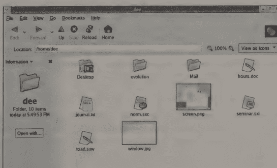

2. 选择“树状”。

Nautilus 现在为你提供了与你在 Microsoft Windows 资源管理器中看到的相同的双面板布局以及点击拖拽功能。

> **提示**：默认的 Nautilus 设置根据你使用的 Linux 发行版而异。在某些发行版中，此树形面板是默认开启。

## 浏览你的文件

在 Nautilus 中，打开树视图后，在文件系统中移动非常简单，它可以让你进行很多拖放操作。你需要记住的主要点是你的目录在左侧（如果你激活了侧边栏并同时激活且选择了“树状”选项卡），而你的文件在右侧。你可以在 Nautilus 中执行以下文件管理任务：

- **打开左侧的目录**：要打开左侧面板中的目录，请在列表中找到它并点击其旁边的右向箭头。箭头将指向向下，如果存在子目录，它们现在将列在当前目录下方。
- **打开右侧的目录**：要打开右侧面板中的目录，请在窗口中找到它并双击。Linux 会自动显示该目录中的文件。
- **查看目录内容**：要查看目录中的文件，点击左侧面板中的目录图标或名称，其内容将出现在右侧面板中。
- **查看文件和运行程序**：要查看文件内容或运行程序，双击列表中的项目。

> **提示**：你得到的关于每个文件的信息是太多还是太少？尝试调整“视图”设置。

## 复制和移动文件

你可以使用两种方法复制和移动文件。第一种是拖放，你可能很熟悉。第二种是使用上下文菜单。要复制文件或文件夹，右键点击项目并选择“复制”。要移动文件或文件夹，右键点击项目并选择“剪切”。你也可以通过将文件从一个位置拖到另一个位置来移动它。

## 删除文件

要删除文件或文件夹，你首先将其移动到垃圾箱。这允许你在出错时恢复文件。要永久删除文件或文件夹，你必须进入垃圾箱并将其清空。

要从垃圾箱中删除文件或文件夹，请遵循以下步骤：

1. 右键点击图标。
2. 从快捷菜单中选择“清空垃圾箱”。
3. 点击对话框中的“清空垃圾箱”。

## 查看和更改权限

要查看和更改文件或目录的权限，你需要遵循以下步骤：

1. 浏览到文件或目录的位置。
2. 选择该文件或目录。
3. 右键点击项目并在快捷菜单中选择“属性”。
4. 点击“权限”选项卡。
5. 设置新的权限和所有者。
6. 关闭对话框。

## 在 Konqueror 中统治

在 KDE 中，默认的文件管理器是 Konqueror。你可以在 Fedora 中通过选择主菜单 → 互联网 → 更多应用程序 → Konqueror 浏览器来找到这个程序。打开它后，点击按钮进入你的主目录。

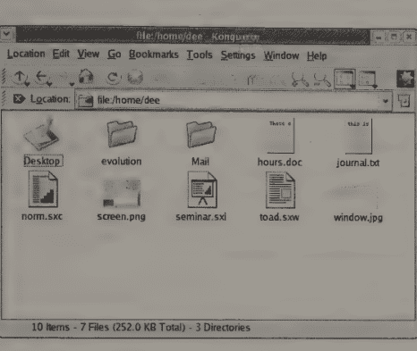

> 图 10-4：KDE Konqueror 文件管理器，正在显示主目录。

此文件管理器的工作原理似乎与其他操作系统的原理相似。在点击“窗口-显示导航面板”打开左侧的目录树后，你就拥有了可能在 Windows 资源管理器或 Mac OS 中已经习惯过的双面板设置。从这里开始，你可以移动并利用通常的拖放功能。

## 浏览你的文件

Konqueror 允许你轻松地在文件系统中穿行。你需要记住的主要点是，你的目录在左侧（如果你打开了左侧的目录树），而你的文件和子目录在右侧。你可以在 Konqueror 中完成的文件管理任务列如下：

- **使用左侧窗格打开目录**：要使用左侧窗格打开目录，请在列表中找到它并点击其旁边的加号（`+`）符号。图形将变为减号（`-`）；如果该目录有子目录，它们现在将列在当前目录下方。
- **使用右侧窗格打开目录**：要使用右侧窗格打开目录，请在窗口中找到并点击它。Linux 会自动显示此目录中的文件。
- **查看目录内容**：要使用左侧查看目录中的文件，请点击目录的文件夹图标或名称。
- **查看文件和运行程序**：要查看文件内容或运行程序，请点击列表中的项目。如果系统不确定应该使用哪个程序来打开文件，它会为你提供“打开方式”对话框，以便你选择合适的应用程序。

如果你双击一个文件来打开它，但得到了意料之外且无用的结果，请点击返回（向左的）箭头，然后右键点击你想要打开的文件。会弹出一个快捷菜单。点击“打开方式”，并在弹出的子菜单中，选择你想要用于此文件的程序。

## 更改文件视图

你得到的关于每个文件的信息是太多还是太少？Konqueror 有一套设置，可以让你调整文件信息的呈现方式。当你查看目录内容时，图标视图和树状视图按钮出现在第一行图标的右侧。这些按钮具有以下功能：

- 要从通用图标视图切换到更详细的文件列表，请点击“图标视图”和“树状视图”按钮。
- 要选择图标视图中所需的图标布局，点击并按住“图标视图”，直到出现包含图标视图和多列的下拉菜单。点击你想使用的选项。
- 要选择树状视图中所需的详情组合，点击并按住“树状视图”按钮，直到出现包含树状视图、列表视图、详细列表视图和文本视图的下拉菜单。然后点击你想使用的选项。

花些时间实验这些选项组合，看看你最喜欢哪一个。你最后选择的布局将作为默认设置，直到你关闭 Konqueror。

设置菜单包含许多项目，允许你自定义 Konqueror，使其记住你的偏好。

## 复制文件

在某些版本的 KDE 和 Konqueror 中，你只需单击文件即可打开它。你可能认为，当只需点击项目就能打开时，拖放就很困难。然而，你仍然可以使用此功能！只需不要点击并释放你想要移动的项目。你必须点击它并按住鼠标键进行拖动。

要使用拖放进行复制和粘贴，请遵循以下步骤：

1. 右键点击项目并从出现的快捷菜单中选择“复制”。你的计算机会将项目复制到内存中。
2. 导航到目标位置。
3. 右键点击项目并从出现的快捷菜单中选择“粘贴”。

## 移动和删除

在某些版本的 KDE 和 Konqueror 中，你只需单击文件即可打开它。你可能认为，当只需点击项目就能打开时，拖放就很困难。然而，你仍然可以使用此功能！移动或删除的操作与复制非常相似：

1. 右键点击项目并从出现的快捷菜单中选择“剪切”。你的计算机会将项目移动到内存中。
2. 导航到目标位置。
3. 右键点击项目并从出现的快捷菜单中选择“粘贴”。你的计算机会将项目移动到。

## 删除文件

在某些版本的 KDE 和 Konqueror 中，你只需单击文件即可打开它。你可能认为，当只需点击项目就能打开时，拖放就很困难。然而，你仍然可以使用此功能！移动或删除的操作与复制非常相似：

1. 右键点击项目并从出现的快捷菜单中选择“移动到垃圾桶”。你的计算机会将项目移动到。
2. 导航到目标位置。
3. 右键点击项目并从出现的快捷菜单中选择“粘贴”。你的计算机会将项目移动。

删除文件在 Konqueror 中非常简单：

1. 右键点击项目并从出现的快捷菜单中选择“移动到垃圾桶”。你的计算机会将项目移动到。
2. 导航到目标位置。
3. 右键点击项目并从出现的快捷菜单中选择“粘贴”。你的计算机会将项目。

要删除删除，可以执行以下操作：

1. 右键点击项目并从出现的快捷菜单中选择“移动到垃圾桶”。你的计算机会将项目移动到。
2. 导航到目标位置。
3. 右键点击项目并从出现的快捷菜单中选择“粘贴”。你的计算机会将项目。

## 查看和更改权限

在 Konqueror 中查看权限与在 Nautilus 中几乎相同。要查看权限，可以执行以下步骤：

1. 目录的属性对话框将打开，如图 10-5 所示。


> 图 10-5：KDE Konqueror 文件管理器的属性对话框中的权限选项卡。

2. 设置新的权限。如你所见，Konqueror 提供了一些实用的工具，让你以你想要的方式设置权限，无需记忆哪些数字对应字母。你也可以在这里更改所有者和组信息。
3. 点击 OK 关闭对话框。

## 第 11 章：无界面工作

**本章内容**

- 理解用户环境
- 自定义 bash 环境
- 使用命令
- 使用变量
- 使用重定向和管道
- 使用更多通配符
- 使用各种命令

> 计算机毁灭的人必须先让他们发疯。
>
> ——匿名

Shell 具备执行某些功能。这些功能中的大部分都随着时间的推移而演进，以帮助命令行高手完成各种任务。尽管我在这里只是浅尝一域，但我鼓励你去阅读 bash 的 man 页面（帮助手册），因为它可能是现存最完整、阅读率最高的 man 页面之一。你可以在在本章后半部分的“帮助！”部分通读介绍如何使用 man 页面（Linux 中的在线帮助系统）。

## 玩转 Shell 游戏

你需要一种方法告诉计算机你想让它做什么。在 Linux 中，与计算机通信的方式之一被称为 shell。shell 不是图形化的东西；它是你执行工作时可用的命令和语法的总和。

按照图形桌面的标准，shell 环境显得相当单调无味。当你启动 shell 时，你看到的只是一个短短的提示符（如 `$`），后面跟着一个闪烁的光标，等待你的键盘输入。稍后，我将向你展示访问 shell 的几种方法。

Linux 默认 shell 是 bash。这个工作环境基于原始的 Unix shell，它被称为 Bourne shell，也称为 sh。bash 一词代表 Bourne again shell。bash 随大多数 Linux 发行版一起提供。

如果你安装 Linux 发行版是为了登录图形桌面（如 GNOME 或 KDE 环境），你可能并没有看到 shell 提示符。你通过鼠标与计算机交互。你可以通过几种方式从 GUI 桌面启动 bash 会话。

激活 bash 会话最快的方法是点击位于屏幕底部 GNOME 面板上的计算机图标；或者在 Fedora Core 中，选择“主菜单 > 系统工具 > 终端”。如果成功，你应该看到一个与图 11-1 类似的屏幕。

提示符可能包含一些有用信息。例如，如果你在 Fedora Core 1 的 deepthink 机器上以 evan 身份登录，你的提示符看起来像这样：

```
[evan@deepthink evan]$
```

在介绍一些 shell 的功能之前，我需要告诉你另外一种启动 shell 会话的方法。首先，注意你的 shell 提示符仅仅位于你 GUI 桌面的一个窗口内。假设你想在纯字符或文本环境中启动 shell 会话。


> 图 11-1：打开了 bash 实例的 Fedora Core 1 GNOME 桌面。

要切换到文本环境，按下 `Ctrl+Alt+F2`。当你熟悉的图形桌面环境消失时，不要惊讶。它仍在后台运行，稍后你就可以回到离开的地方。但在之前，先聊聊你现在看到的这个无聊的文本屏幕（我希望是这样）。

你看到的是一个虚拟终端，它是你默认安装提供的多个可用终端之一。你可能会看到类似这样的内容：

```
deepthink login:
```

继续输入提示你输入的用户名和密码。你会看到一条指示你上次登录日期的消息，随后是 bash 提示符：

```
[evan@evan$]
```

注意这个提示符与你在 GUI 桌面中留下的打开窗口之间的相似之处。这两个提示符都表示你有一个 bash 会话。请注意，虽然说它们是使用 bash shell 的结果是准确的，但它们是同一个程序的不同且分离的实例。换句话说，你在这里工作的环境与你在 GUI 终端窗口中仍然开启的 bash 环境是互斥的。

## 我在哪个登录中？

Linux shell 最令人困惑的概念之一是你不断地进出它们。你每次登录时都会打开一个 shell 实例——一个带有特定设置的特定 shell。因此，如果你在两个不同的虚拟终端上登录两次，你就有两个 shell 正在运行。如果你更改了其中一个的设置，这些设置不会应用于另一个。但是，如果你将更改永久化，你打开的任何新 shell 都可能具有新设置。

你是在好奇你的 GUI 桌面去哪儿了吗？只需冷静一下，到处跳跳。GUI 桌面默认位于虚拟终端 (VT) 数字 7。现在你打开了 VT-2。摆好你弹钢琴的手指，按下 `Ctrl+Alt+F7` 键。在一两秒内，你的屏幕应该会闪烁并返回图形桌面，而你带有 bash 提示符的终端窗口应该仍在那里等待你的命令。很酷对吧？而且怎么着？你在 VT-1 上留下的 bash 会话仍然在那里；你从未注销。再次按下 `Ctrl+Alt+F2` 回去。瞧！——就在你上次离开的地方。试着来回跳转几次，并尝试其他 VT（F1 到 F6）。哇！这个虚拟终端很自然。

好了，当你对打开的这些 VT 感到疲劳和无聊时，可以返回图形桌面和你的 bash 提示符。然后你就可以探索你那 shell 小玩意儿到底是怎么回事了。

## 理解 bash 命令语法和结构

许多人在不理解 bash shell 中命令基础知识的情况下，就很快乐地跳过了他们的 Linux 使用过程。请注意，这种方法会让你错失 bash 中可用的一些酷功能。你对这个 shell 的“语言”了解越多，你能做的事情就越多。

一个命令通常由三部分组成：

- **命令名**：你想运行的程序名称。
- **选项**：修改程序的行为。
- **参数**：程序处理的数据。

例如，如果你想列出目录的文件，输入 `ls`。如果你想以长格式查看文件，输入 `ls -l`。在这里 `-l` 是选项。如果你想列出特定目录的文件，输入 `ls /home/user`。在这里 `/home/user` 是参数。

`du` 命令用于估计磁盘占用。默认情况下，它显示每个子目录的大小。要以人类读格式显示，使用 `-h` 标志：

```
du -h
```

要查看当前目录的总大小，使用 `-s` 标志：

```
du -sh
```

`df` 命令用于报告文件系统使用情况。要以人类读格式显示，使用 `-h` 标志：

```
df -h
```

`grep` 命令用于在文件中搜索模式。例如，要在文件中搜索“error”，输入：

```bash
grep "error" myfile.log
```

`find` 命令用于在目录查找文件。例如，要在当前目录下查找所有以 `.txt` 结尾的文件，输入：

```bash
find . -name "*.txt"
```

这些只是可用工具的一部分。你学得越多，shell 就越强大。

## 从 Shell 启动程序

shell 最明显也可能不那么明显的用法是启动程序。你在 Linux 中使用的大多数工具都是独立的可执行程序。用户需要一种启动这些程序的方法。在 GUI 中，可以将图标与特定程序关联，图形环境包含了启动程序的智能。注意，程序通常需要从环境变量提取信息，环境变量是 shell 环境的一部分。（我将在本章晚些部分详细讨论环境变量。）因此，GUI 经常通过 shell 调用目标程序。

例如，当你打开了一个终端窗口后，在提示符输入以下命令：

```
mahjongg
```

几秒钟后，将显示麻将游戏。如果你知道底层程序名称，可以从 GNOME 菜单中点击来启动任何程序。注意，如果你在虚拟终端中（按下 Alt+FT），你可能会看到错误消息。某些程序需要在图形环境环境中运行，而字符终端显然没有。

## 善用通配符扩展

如果你必须对多个文件重复相同的命令，计算生活将变得非常乏味。毕竟，重复性任务不是计算机设计用来完成的吗？通配符扩展是指一个命令作用于多个文件的能力。星号（`*`）和问号（`?`）是两种通配符字符，可用于匹配任何文件名，或文件名的一部分。

星号匹配任何字符序列。例如，`ls *.txt` 将列出所有以 .txt 结尾的文件。问号匹配任何单个字符。例如，`ls file?.txt` 将匹配 `file1.txt` 和 `fileA.txt`，但不会匹配 `file10.txt`。

例如，你可以使用以下命令查看长目录列表，其中仅包含以 .doc 文件扩展结尾的文件：

```
ls -1 *.doc
```

列出的文件可能包括 resume.doc、cover_letter.doc 和 to_editor.doc 等。（关于通配符的更多信息，请参阅第 10 章。）


如果你习惯 Microsoft Windows，请注意，在 Linux 中，文件扩展名（如 `.doc`、`.exe` 和 `.txt`）并没有被赋予特殊含义。例如，在 Linux 文件名中，`.doc` 扩展名中的点字符被视为文件名中的任何其他字符。然而，`.extension` 这种约定非常方便且被广泛使用，可以轻松地识别文件类型；只需记住，与 Windows 文件系统不同，Linux 文件系统并不要求任何人遵守这一约定。

## 使用长命令

当你习惯了命令行界面后，应该学习一些快捷键来减轻你的打字负担。在本节中，我将向你展示 `bash` shell 的一些功能，这些功能旨在让你的命令行生活尽可能愉快。这些功能包括命令行补全、编辑以及使用之前输入过的命令历史记录。

### 让 Linux 为你补全命令或文件名

考虑到你在命令行上输入的内容比通常在 GUI 环境中输入的多得多，因此一个尽可能提供打字快捷键的功能是非常棒的。命令补全是 shell 的一项功能，用于补全文件名和系统命令。

Linux 文件系统处理几乎无限长度文件名的能力可能会变得非常庞大。这些长文件名可能会变得非常繁琐。幸运的是，通过命令补全，输入命令或长文件名变得轻而易举的工作。

你可能在两种情况下想要使用命令补全：输入命令或补全文件名。

#### 补全命令

假设你想输入一个命令，但只记得它以字母 `up` 开头，并且应该返回自系统重启以来已通过的时间长度。在命令提示符处输入 `up`，然后按 `Tab` 键：

```
[evan]@deepthink evan]$ up[TAB]
```

通常会发生两种情况之一：

- 如果搜索路径（搜索程序的目录位置）中只有一个匹配的命令，你的命令行将补全为该命令，系统将等待你按 `Enter` 键来执行该命令。
- 如果你听到“哔”的一声，意味着有多个命令以 `up` 开头。只需再次按 `Tab` 键，就会显示所有可能性。在列表中找到该命令并继续输入，直到前几个字母是唯一的，此时你就可以按 `Tab` 键补全命令。

#### 补全文件名

命令行补全不仅用于命令；如果你在命令行上输入文件名，你只需要输入前几个字符然后按 `Tab` 键。shell 通常会在当前目录中搜索与你输入的内容匹配的文件名，随后在命令行上补全该文件名。该功能的行为与命令补全功能相同，即如果有多个文件包含你输入的字母，你会听到“哔”的一声，并需要再次按 `Tab` 键来查看选项列表。

这需要一点时间来适应，但当你掌握了 `Tab` 键和 shell 命令行补全功能后，你可能会怀疑自己以前没有它是怎么生存下来的。

### 访问你的命令历史记录

shell 能记住你做过的事情（无论好坏）是件很好的事。让 shell 跟踪你输入的命令，可以让你轻松地回到你不久前敲过的那些该死的冗长命令——即使是几天前的命令！让我给你举个例子。假设昨天你设法找到了一个命令，用来查找系统中所有的核心转储文件（core dump 文件是包含调试数据的巨大文件，任何专家程序员或你的计算机都能理解），并删除了它们。命令看起来像这样：

```
find / -name core -exec rm \;
```

要重新执行该命令，你只需要从 shell 历史记录中将其提取并重新运行。按行读取命令历史记录最简单的方法是反复按下向上方向键，直到找到想要重新执行的命令。然后只需按 `Enter` 键再次运行命令。就如此！

你可以通过两种方式访问你的命令历史记录：

- **按向上方向键：** 这种技术是访问历史记录最简单的方法。你一按下向上方向键，就能看到之前所有的命令在命令行上亮起。当你找到要找的内容时，只需按 `Enter` 即可。
- **输入 `history` 命令：** 当你在提示符处输入 `history` 命令时，它会列出你最后 20 条命令（默认情况下）。

### 为命令创建别名

暂时假设你是那些喜欢使用命令的（例如使用 `dir` 显示目录列表）的老牌 DOS 用户之一。你可以使用 `bash` 的别名功能创建与你过去使用的命令相似的新命令。例如，为了创建一个类似于你所习惯的长目录列表的别名，你可以输入这一行：

```
$evan@deepthink evan$ alias dir='ls -l'
```

然后，每当你输入 `dir` 时，你都会看到一个长目录列表。

你还可以使用别名功能为非常长的命令创建快捷方式。要查看 Red Hat 贴心地提供了哪些默认别名，只需输入 `alias` 命令。该列表包含了几个预装的别名，以及你刚刚创建的下一个。

注意，当你注销或创建一个额外的 shell 时，你创建的别名将会消失。我稍后会为你展示如何将这些别名和其他命令放入 `bash` 启动文件中，该文件会在每次启动新会话时运行。

## 使用变量

**变量** 在 `bash` 中是用于表示数据的单词或文本字符串。使用变量的一个例子是将变量 `fruit` 设置为 `apple`。许多变量包含账户和环境设置的信息。

### 变量与环境变量

我首先需要明确的是 `bash` shell 有两类变量：

- **变量**：可以在程序或会话中引用，但它仅对该会话或程序可见并可用。
- **环境变量**：也可以被 shell 或程序引用。但它具有额外的行为，即其值会被复制到从其环境创建的任何其他程序或 shell 中。

你通常一眼看出变量和环境变量的区别。通常约定是将局部变量命名为全小写或大小写混合。然而，环境变量通常全大写字母。

### 查看常用的环境变量

`bash` shell 有许多环境变量。你可能会对这些变量存储的项目范围感到惊讶。方便的是，如果某些内容存储在变量中，你可以根据需要对其更改！在表 11-1 中，我列出了你最可能使用的环境变量。

| 环境变量 | 目的 | 值 |
| --- | --- | --- |
| `HISTSIZE` | 决定存储的以前输入命令的数量 | 命令数量 |
| `HOME` | 设置主目录的位置 | 主目录的路径 |
| `MAILCHECK` | 设置 `bash` shell 检查邮箱中新邮件的频率。如果有邮件到达，当你下次在命令提示符处执行任何操作时都会看到类似 "You have new mail" 的消息 | 两次检查之间的等待秒数 |
| `PATH` | 设置 `bash` 查找的目录，以及在查找命令行提示符输入的程序名时查找的顺序。 | 用冒号分隔的目录 |
| `PS1` | 设置你的命令提示符。 | 用于形成提示符的命令和格式字符 |

大多数环境变量由系统管理员或 shell 本身为你建立。这些变量大部分情况下由程序读取，你不需要更改这些变量的值。不过，你可能想要更改某些环境变量的值。例如，在表 11-1 中，第一条目 `HISTSIZE` 决定了保留在文件中的命令行历史行数。你可能还记得在本章早些时候讨论过重新执行昨天的命令（请参考本章早些的“访问你的命令历史”部分）。通过为 `HISTSIZE` 设置一个更大的数字，你可以保存更长的以前执行过的命令列表。

### 存储和检索变量值

要给变量赋值，只需使用变量名，后跟一个等号 (`=`)，然后是要存储的值：

```
VariableName=Value
```

要检索该变量表示的值，需要在变量名前面加一个美元符号 (`$`)。看一个由 shell 创建的、决定你的提示符外观的变量。这个变量名为 `PS1`。首先，你查看 `PS1` 持有的值：

```
echo $PS1
```

你可能会看到类似下面的行：

```
\[u@\ \W\$
```

每个以反斜杠 (`\`) 开头的字符都代表一个 shell 的特殊指令，在引用 shell 时返回特定信息。有关可以在自定义提示符时使用的特殊斜杠字符示例，见表 11-2。

| 组件 | 结果 |
| --- | --- |
| `\!` | 打印命令在历史列表中的位置。 |
| `\#` | 打印你在当前 shell 会话期间使用的命令数。 |
| `\$` | 为用户账户打印 `$`，为超级用户打印 `#`。 |
| `\d` | 按以下格式打印日期：日 月。 |
| `\h` | 打印你所登录的机器名称。 |
| `\n` | 移动到下一行。 |
| `\s` | 对于 `bash` shell 打印 `bash`。 |
| `\t` | 以 24 小时格式打印时间。 |
| `\u` | 打印你的用户名。 |
| `\w` | 打印当前目录深度。 |
| `\W` | 打印整个当前目录。 |

好了，继续示例；要将你的 shell 提示符改为更有趣的内容，输入以下行：

```
PS1='Hello \u, what can I do for you? => '
```

注意单引号。（在本章稍后你会学到获取这些）。在按下回车键后，你会发现你的提示符已经变成了更具吸引力的内容。如果你更喜欢原始提示符，也不用担心：你可以将存储在 `PS1` 中的值重新赋值回去，或者简单地注销并重新登录，你就回到熟悉的领域了。

你是否好奇你的系统还为你准备了哪些变量？你可以通过输入 `env` 一次查看所有环境变量。注意，作为 Linux 的普通用户，你可能没有理由在命令行访问变量。然而，在你变得更精通之后，你可能想要探索 `bash` 的编程功能，在这种情况下，变量存储非常有用，就像在任何编程语言中一样。

#### 这些单引号是怎么回事？

在更改环境变量时你必须注意某些细节。如果你只是给一个数字赋值，可以使用例如 `HISTSIZE=250`。但是，如果你想使用包含空格的内容，你就需要引号。你使用哪种引号取决于你还想做什么。

如果你想精确显示你指定的内容，请使用单引号创建一个字面量字符串。例如，在命令行提示符处输入以下行：

```
echo 'Hello, my name is $USER'
```

有点傻，对吧？看看另一种 shell 解释方式不同的字符串：插值字符串。插值值是指 shell 在处理该值之前解释特殊字符的值。这次你没有使用单引号，而是使用相同的示例但使用了双引号：

```
echo "Hello, my name is $USER"
```

注意输出是这样的。shell 并没有显示提供的精确文本，而是将用美元符号指定的变量名替换为该变量中存储的实际值。

为什么我在 `PS1` 示例中使用单引号？带有反斜杠 (`\`) 的项目会以一种或另一种方式被解释。然而，如果你在 `PS1` 中使用双引号，它们只会被解释一次，因此该项目列出的目录更改只会在第一次发生。使用单引号时，每当你做某事时变量都会被解释。

如果你打算玩玩环境变量，我建议你从我在本节描述的方法开始。在你决定对任何更改都很熟悉后，可以使它们永久化。

## 使用重定向和管道

重定向和管道促进了信息的流动。管道正如其名：将一个程序的输出重定向到另一个程序的输入。一个管道可能由多个实用程序组成。在此流水线的每个末端，可选地有一个重定向。大多数需要输入输出的程序都有三个常用接口：`stdin`（标准输入）、`stdout`（标准输出）和 `stderr`（标准错误）。

### 重定向输出

我在这里讨论重定向输出，是因为它是最常见的输出形式。一个示例是让命令将其结果发送到文件而不是屏幕。通过输入 `ls -la` 并按回车进入熟悉的领域，产生如下内容：

```
total 20 2 users 4096 Oct 30 07:48
drwx-xr-x 5 root 4096 Oct 30 11:57
-rw-r-- 1 sue users 24 Oct 30 06:50 .bash_logout
-rw-r-- 1 sue users 230 Oct 30 06:50 .bash_profile
-rw-r-- 1 sue users 124 Oct 24 06:50 .bashrc
-rw-rw-r 1 sue users 0 Jan 2 07:48 wishlist
```

想把这些信息发送到文件吗？可以使用 `>` 重定向运算符告诉 `bash` 将数据发送到文件而不是屏幕。输入以下命令将信息发送到名为 `listing` 的文件：

```
ls -la ~ > listing
```

注意屏幕上什么都没有显示，正如你预期的那样。那是因为 shell 将输出重定向到了名为 `listing` 的文件。要验证目录列表是否存在，输入以下命令：

```
cat listing
```

`cat` 命令显示 `listing` 文件的内容。

注意如果你输入 `ls -la ~ > listing`，数据会被覆盖，这意味着文件的内容会被清除并替换为新输出。你可以通过使用 `>>` 作为重定向运算符来避免这种情况，它告诉 `bash` 将命令输出追加到指定文件的末尾。如果你在进行更改后在相同目录下输入 `ls -la >> listing`，`listing` 的内容如下：

```
total 20
drwx--- 2 sue users 4096 Oct 30 07:48
drwx-xr-x 5 root 4096 Oct 30 11:57 .
-rw-r-- 1 sue users 24 Oct 30 06:50 .bash_logout
-rw-r-- 1 sue users 23 Oct 30 06:50 .bash_profile
-rw-r--x 1 sue users 124 Oct 30 06:50 .bashrc
-rw-rw--x 1 sue users 0 Jan 2 07:48 wishlist
total 20
drwx--- 2 sue users 4096 Oct 30 07:48
drwx-xr-x 5 root 4096 Oct 30 11:57 .
-rw-r---- 1 sue users 24 Oct 30 06:50 .bash_logout
-rw-r---- 1 sue users 23 Oct 30 06:50 .bash_profile
-rw-r--x 1 sue users 124 Oct 30 06:50 .bashrc
-rw-rw--x 1 sue users 0 Jan 2 07:48 wishlist
```

### 管道

另一个 `bash` shell 的功能允许你连接命令，使得一个命令的输出成为下一个命令的输入。这种功能被称为**管道**。假设你想以长列表格式查看 `/etc` 目录下所有文件的详细信息。如果你输入 `ls -la /etc` 来执行操作，会出现一个巨大的列表，很多信息会从你面前掠过。虽然你可以通过 `Shift+PageUp` 来向上回溯，但你可能无法看到所有内容。

要查看这些信息，你可以采取两种方法之一：

- 通过重定向将数据发送到文件，例如输入 `ls -la /etc > ~/etclisting`，然后用你最喜欢的编辑器查看 `~/etclisting` 的内容。
- 将输出管道到 `more` 命令。该命令确保文本一次显示的内容不会超过一个屏幕。它会等待你按下空格键后再显示下一页。许多 Linux 用户发现这个命令非常有用。

要将输出管道到 `more`，输入 `ls -la directory_path | more`，其中 `directory_path` 是你想要列出内容的目录。`|` 符号（在键盘上看起来像两个堆叠在一起的竖线，而不是单一的实线）告诉 `bash` 你想使用管道。

`more` 实用程序是一个**分页器**。还有另一个程序的行为与 `more` 类似，但具有额外的功能和能力。猜猜它叫什么？它被称为 `less`。`less` 工具允许你向前和向后滚动信息并搜索关键词。因此，`less` 可以代替 `more`。至少在这个例子中，`less` 比 `more` 更好。

## 修改 Shell 环境

你可以通过更改几个配置文件来改变你的 `bash` 环境。以下每个文件都是文本文件，可以使用任何可用编辑器编辑。你只需在这些文件中修改或添加你需要的设置：

- `/etc/profile`：系统级设置。当任何用户登录 `bash` 会话时，都会首先读取此文件。
- `.bash_profile`：用户特定的登录设置，在评估 `/etc/profile` 文件后运行。
- `.bashrc`：子 shell 配置文件，每次创建子 shell 实例时都会读取它。每当执行一个新程序时，都会调用子 shell。此文件仅为该事件提供另一层 shell 配置。
- `.bash_logout`：当用户退出 `bash` 会话时评估的文件。此文件对于删除临时工作文件或在结束一天工作后可能想要进行的其他清理工作非常方便。

注意，最后三个文件保留在用户的家目录中并且是隐藏的，文件名开头的点表示了这一点。

如果你想尝试这些文件，请创建一个单独的用户账户，这样你就可以随心所欲而不会搞乱你的登录。这个建议适用于 `/etc/profile`。修改它可能会损坏所有人的登录！要创建一个独立的 `/etc/profile`，你可以通过输入 `cp /etc/profile /etc/profile.original` 来备份。然后编辑 `/etc/profile`，并知道你随时可以使用 `rm` 命令删除它，并使用 `mv` 命令将 `/etc/profile.original` 重命名为 `/etc/profile`。

## 你的得手命令工具箱

现在你对命令行提示符及其功能多了一份尊重，已经准备好查看一些常用的工具了。

### “我迷路了”

想知道上次是以什么身份登录的吗？或者，也许你偶然发现了一个没有用户的终端。几个关键命令可以给你关于你是谁以及你在何处的信息：

- `whoami`：通过输入 `whoami`，你可以发现你是谁。
- `who`：通过输入 `who`，你可以看到谁当前登录了系统。
- `uname`：通过输入 `uname`，你可以找到内核版本。
- `pwd`：通过输入 `pwd`，你可以找到你当前的工作目录。

### 帮助！

如果你不确定某个命令如何工作，可以使用帮助系统。手册页（通常缩写为 "man"）是主要资源。要查看特定命令的手册，输入 `man` 后跟命令名。默认情况下，这将显示命令的用法、选项和描述。

### 内存与空间

如果你需要知道使用了多少磁盘空间，可以使用以下命令：

- `df`：该命令显示文件系统的可用和使用空间。
- `du`：该命令估计目录和文件的空间占用。
- `free`：该命令显示系统的空闲和使用内存。

### 清除屏幕


`clear` 和 `reset` 命令在操作 shell 时非常有用。`clear` 命令只是清空屏幕。`reset` 命令则更有趣。假设你尝试将二进制文件列到屏幕，你可能运气好还能读取你的提示符。更有可能的是你的提示符变成了无意义的框字符，输入键盘得到同样的结果。要恢复正常，只需输入 `reset` 并按回车。注意，计算机会理解这些字符，并在几秒后将你的 shell 环境恢复到原生语言。

# 第 12 章 玩转 GUI

## 本章内容

- 向面板添加应用程序
- 向桌面添加程序
- 下载并设置主题
- 配置 X 窗口系统

X 窗口系统（或 X）开启了一个无限可能。通常情况下，X 是一系列共同工作以提供图形界面的应用程序。某些应用程序绘制窗口，某些管理界面的外观和感受，另一些则为你处理图形世界的其他方面。在 Linux 世界中，你可以配置所有这些方面，这正是许多人感到无从下手的地方。

在第 6 章中，我介绍了 Linux GUI 市场的两个主要参与者：GNOME 和 KDE。在本章中，你将有机会修改 GUI 的行为以适应你自己的需求。例如，如果你很难在 GUI 中那些微小的命令行窗口中阅读文字，你可以让窗口及其字体都变大。还有许多内容可以更改，所以请继续读下去观察一下。

> 如果 GUI 发生了极其糟糕的错误且你需要快速退出，请按下 `Ctrl+Alt+Backspace`。这个组合键可以起到一种作用：如果你启动的是 GUI，它会关闭你的 GUI 会话并带你回到 GUI 登录提示界面。但是，如果你启动的是命令行，这个组合键会立即关闭 GUI 并带你回到命令行。

然而，仅在紧急情况下才按下 `Ctrl+Alt+Backspace`。这个组合键并不能干净地停止相关的程序。你最终会在系统中留下各种程序碎片、文件等等内容。

## 更改 GNOME 的外观和感受

> 变化变化是不可避免的，除非来自自动贩卖机。
>
> —— 匿名

GNOME 桌面环境有一系列惊人的功能供你探索，包括许多更改 GUI 外观和感受的方法。这些自定义功能中有些非常实用，有些则纯粹是为了好玩。我尝试将这些更改类型分为若干相关主题，以便你轻松浏览。

### 你觉得应用程序（Applets）怎么样？

应用程序——一组微程序，可以执行从显示时间到显示系统状态的任何操作——在计算机编程的世界里无处不在。很多人专门编写了一些应用程序，供 Linux 下的 GNOME 桌面环境使用。因此，这些应用程序包含在你的 GNOME 安装中。某些微程序比其他的更有用。不过说回来，每个人都需要一点娱乐，对吧？

如果你在使用 Red Hat Enterprise Linux 或 Fedora Core，GNOME 是你的默认环境。

### 向面板添加应用程序图标

你可以尽情筛选，看看你可用的种种应用程序。要浏览你的选项并可能将应用程序添加到面板（记住面板是屏幕底部的条），请按照以下步骤操作：

1. 右键点击面板上的任何空白处，并选择“添加到面板”（Add to Panel）。
   “添加到面板”子菜单将打开。
2. 浏览以下子菜单：附件（Accessories）、娱乐（Amusements）、互联网（Internet）、多媒体（Multimedia）和工具（Utility）。
   每个子菜单都包含一组你可以添加到面板的应用程序。
3. 要安装应用程序，在子菜单中点击它。
   该应用程序现在就出现在你的面板上了。

### 配置应用程序

在你放置并运行应用程序后，你可能可以尝试它的配置选项。其中某些选项允许你更改显示的信息。另一些则有各种外观感受设置。

要检查你的应用程序可用哪些配置和其他选项，请按照以下步骤操作：

1. 右键点击应用程序并检查出现的快捷菜单。
   此快捷菜单因应用程序的不同而不同。底部部分是相同的：“从面板移除”（Remove from Panel）和“移动”（Move）。顶部常见项目有“帮助”（Help）和“关于”（About）。其余项目或是配置选项（参见步骤 2），或是特殊的应用程序功能，例如从时钟应用中复制日期。
2. 从快捷菜单中选择“偏好”（Preferences）。
   并不是每个应用程序都有“偏好”对话框。如果有，当你选择此选项时，对话框会打开并显示该应用程序具有的所有配置。
3. 修改“偏好”对话框中的选择以自定义你的应用程序的行为。
   现在你可以玩玩了。通过更改来改变这个应用程序的功能。每个应用程序都有自己的一套功能，所以我无法在这里进行通用的介绍。记住，你随时可以回来更改设置或稍后从面板中移除应用程序。
4. 点击“关闭”（Close）使你的更改生效并关闭对话框。
   所有应用程序通用的选项是从快捷菜单底部选择“移动”（Move）。此操作允许你将应用程序移动到面板上的另一个位置。

### 丢弃应用程序

你的空间是有限的。而且，如果你像我一样，你不需要让每个空隙都用图标填满。要从面板中移除应用程序，只需右键点击你想移除的应用程序，并在出现的快捷菜单中选择“从面板移除”。应用程序会无声无息地从面板上消失。

### 不要忘记程序

你可能正看着面板，疑惑是否可以像处理应用程序一样对列出的程序进行任何更改。好消息是，你可以更改条上的程序！它们占据与应用程序相同的空白空间。如果你愿意，也可以将程序添加到桌面。

### 向面板添加程序

如果你经常使用某个程序，可以按照以下步骤将其添加到面板：

1. 点击主菜单（Main Menu）按钮并浏览你想添加到条上的程序。
   不要打开程序。只需用鼠标指针指向该菜单项。
2. 右键点击程序并选择“将此启动器添加到面板”（Add This Launcher to Panel）。
   你的面板上会出现该程序的图标。

在面板有了程序后，可以通过点击其图标来运行。

### 从面板移除程序

如果你想从面板中移除其中一个程序，右键点击它并在出现的快捷菜单中选择“从面板移除”。

### 向桌面添加程序

面板的空间有限。也许你更喜欢在桌面上放置快捷方式。要将程序添加到桌面，请按照以下步骤操作：

1. 点击主菜单按钮并浏览你想添加到条上的程序。
2. 浏览包含你想添加的程序的子菜单。
3. 选择你想添加到桌面的程序。
4. 点击程序名称并拖动到桌面。

这样做后，你的新快捷方式就会被添加到桌面。如果你对图标的位置不满意，点击它将其拖动到新位置。

### 从桌面移除程序

要丢掉桌面上的图标，右键点击它并在快捷菜单中选择“移动到回收篓”（Move to Trash）。

## 配置应用程序插件（applet）

某些插件具有允许你自定义行为的选项。其他插件则无趣得多，无论你的偏好如何，它们都只执行相同的操作。要检查你的插件可以使用哪些配置和其他选项，请按照以下步骤操作：

1. 右键点击插件并检查快捷菜单。这种快捷菜单在不同插件之间是不同的。事实上，菜单选项似乎并没有真正的统一一致性！（而且并不是每个插件都有快捷菜单）。寻找如“Preferences”（偏好）、“Settings”（设置）以及 `Configure`（配置）等字条目。
2. 从快捷菜单中选择相应的项目。如果你使用了“Configure”或“Preferences”对话框，请进行更改并点击“Apply”（应用），以查看其在不关闭对话框的情况下如何影响你的插件。你可能会看到多个配置对话框或子菜单，例如 KNewsTicker 就是这种情况。
3. 修改对话框中的选择以自定义此插件的行为。尽管尽情尝试吧。只需记住，你随时可以返回并更改设置，或稍后从面板中移除该插件。
4. 关闭对话框。在“Preferences”对话框中，点击 OK 关闭窗口。“Settings”对话框通常有一个命名恰当的“Defaults”（默认值）的按钮，它可以允许你恢复到默认设置。

## 移除插件

面板的空间是有限的。而且，如果你像我一样，可能不希望每一处空闲空间都被图标填满。要从面板中移除插件，请按照以下步骤操作：

1. 在空闲槽上右键点击面板。
2. 选择 Remove...（移除...）。将打开一系列子菜单，你最终将看到目前面板上拥有的插件列表。
3. 选择你想从面板中移除的插件。该插件将不再出现在你的面板上。

## 在桌面上堆满图标

KDE 允许你更改出现在面板和桌面上的插件及程序。在理解其工作原理后，管理这些快捷方式是一项简单的操作。

## 将程序添加到桌面

面板的空间有限。也许你更喜欢像在 Windows 中那样，让程序快捷方式排列在桌面上。要添加这些快捷方式之一，请按照以下步骤操作：

1. 点击 Main Menu（主菜单）按钮打开 KDE 主菜单。
2. 打开包含你想创建快捷方式的程序的子菜单。
3. 选择你想创建快捷方式的程序。
4. 将程序拖到桌面。

例如，如果你想添加 The GIMP，请打开 Graphics（图形）子菜单。

不要打开程序。例如，要添加 The GIMP，将鼠标移动到程序上，点击并按住鼠标键。

一个小纸张的图形会跟随你的鼠标指针，直到你松开鼠标键，此时系统会询问你是想将快捷方式添加到桌面但不从菜单中移除（Copy Here，复制到此处）；将快捷方式添加到桌面并从菜单中移除（Move Here，移动到此处）；或者创建一个看起来更像 Windows 快捷方式的明显快捷方式（Link Here，链接到此处）。做出选择后，你的新快捷方式将添加到桌面。


如果你对桌面图标的放置位置不满意，点击它然后将其拖到新位置。

## 从桌面移除程序

如果你想从桌面移除其中一个程序，只需右键点击你想移除的图标并选择 Delete（删除）。该图标将从面板或桌面上消失。就此完成！

## 美化你的桌面

你可能熟悉在 Microsoft Windows 下安装桌面主题的能力。在桌面世界中，主题指的是应用于桌面所有部分的颜色方案、图像和声音——窗口边框、字体、图标、音效等——它们都是一个单一、中心化实体的一部分。许多人发现 Linux 世界也有主题可用，感到非常高兴。

## 下载主题

互联网上有大量适用于 GNOME 和 KDE 的主题。要找到并获取这些主题以供自己使用，请按照以下步骤操作：

1. 将网络浏览器指向 `http://themes.freshmeat.net`。你将被带到 Themes 网站，那里提供了大量的 GUI 定制项目。
2. 如果尚未选择 Section（区域）下拉列表框，请选择它并选择 Themes。你将被带到该网站的主题区域。
3. 对于 GNOME 主题，点击 GTK；对于 KDE 主题，点击 KDE。此操作将你带到相应的区域，确保你选择与系统兼容的主题。
4. 对于 GNOME，选择 GTK 2.X 区域；对于 KDE，选择 KDE 3.X。现在你处于 GNOME 或 KDE 最新版本的对应区域。
5. 浏览并选择主题。浏览并选择你想要的主题。查看 Preview（预览）窗以查看组件的样子。预览窗显示了应用主题后的外观。
6. 一旦你选择了主题，点击 Apply（应用）。如果你想返回，需要点击你偏好的主题。如果你想分享此主题，请将其放在共享目录。如果你想自己使用，请将其放在主目录。
7. 如果你下载了主题，将其添加到主题对话框中。双击桌面上的用户主目录图标以打开文件管理器，然后找到你存储主题的位置。选择主题文件（尽管它是 `.tar.gz` 文件），将其拖到主题对话框的左侧 Installer（安装）面板。如果你的主题完全兼容，将打开安装对话框。点击 Install，你的新主题将添加到列表中。
8. 在控制中心，点击 Add（添加）。弹出添加对话框。
9. 选择你想要的主题。如果主题完全兼容，它将添加到列表中。
10. 继续预览主题直到看中某一个。
11. 点击 Apply（应用）按钮查看此主题如何影响你的桌面。此过程可能需要一段时间。
12. 点击右上角的 X 关闭控制中心。


图 12-2：带有不同主题的 KDE 中心。

## 在 GNOME 中设置主题

大多数 Linux 发行版在安装时都预装了一系列主题。在 Red Hat Linux（本书使用的发行版）中，你可以按照以下步骤浏览可用的主题并选择一个：

1. 点击主菜单按钮。打开相应的主菜单。
2. 选择 Preferences Theme（偏好主题）。此操作将打开 GNOME 主题偏好对话框，如图 12-3 所示。
3. 如果你下载了主题，将其添加到主题偏好对话框中。双击桌面上的用户主目录图标以打开文件管理器，然后找到你存储主题的位置。选择主题文件（尽管它是 `.tar.gz` 文件），将其拖到主题偏好对话框的左侧 Installer（安装）面板。如果你的主题完全兼容，将打开安装对话框。点击 Install，你的新主题将添加到列表中。

主题偏好对话框允许你在即使主题与你的 GUI 不兼容的情况下安装它！这很糟糕，该主题*无法工作*。一旦你添加了主题，如果它没有出现在第 4 步的列表中，说明该主题是不兼容的。


图 12-3：选择了主题的 GNOME 偏好对话框。

4. 如果你安装了新主题，点击“详情”（Details）打开“主题详情”对话框，点击你想要预览的主题，然后点击“关闭”（Close）返回主对话框。

如果你喜欢这个主题并想将其保留在列表中，点击“保存主题”（Save Theme）。系统会要求你为主题命名，然后它就会出现在“主题偏好”（Theme Preferences）对话框中。

5. 点击你想要预览的主题。

你的桌面项目将改变以匹配该主题。这是多么方便的预览方式啊！

6. 继续预览主题，直到找到你喜欢的主题。

在这个阶段你还没有提交更改，所以不用担心。只有当你关闭对话框时才算最终提交，即使如此，你也可以随时回来更改。

7. 完成后点击“关闭”（Close），“主题偏好”对话框就会关闭。

## 调整 GUI 的内部结构

在 GNOME 和 KDE 背后是 X 窗口系统，简称“X”。X 提供了 GUI 的骨架结构和功能。GNOME 和 KDE 利用这个骨架为你提供愉快的 GUI 环境。每当你配置硬件或基础 GUI 功能（如分辨率）时，你实际上是在操作 X，而不是 GNOME 或 KDE。在本节中，我将向你介绍 X 的关键组件，并介绍一些实用的 X 配置工具。

`/etc/init/XF86Config` 文件包含了你的 X 配置。虽然这个文件只是一个普通的文本文件，但格式复杂且令人困惑。与其让你手动处理这个文件，各种 Linux 发行版提供了许多工具。下表可以帮助你识别用于更改不同发行版 X 配置的工具或多个工具：

| Linux 发行版 | 工具 |
|---|---|
| Red Hat | Xconfigurator and redhat-config-xfree88 |
| SuSE | sax and sax2 |
| Mandrake | drax |

X 窗口系统会在几个地方搜索 XF86Config，并读取找到的第一个。在存在该文件的发行版中，文件名 `XF86Config-4` 的优先级高于 `XF86Config`，所以如果你两个都找到了，请使用 `XF86Config-4`。

每个 Linux 发行版都带有额外的 X 配置工具。它们没有上面列出的那些那么容易使用，但如果你需要它们，它们在这里：

- `XF86Setup`：一个流行的图形化 X 窗口系统设置工具。它使用简单的 GUI，因此可以运行在任何 VGA 设置上，并为配置 X 提供实用的图形界面。注意，VGA 只是一个旧的图形标准，功能比今天大多数个人电脑中常用的 SVGA 卡少。
- `xf86config`：一个基于文本的 X 配置工具。

如果你非常喜欢尝试 GUI 并对其进行调整，你可以做很多事情。访问 `www.linHuxdoc.org` 阅读各种与 X 窗口系统和 XFree86 相关的 HOWTO 文件。有些技术性很强，但有些要友好得多，你可能会惊讶于自己能对 Linux GUI 进行如此多深度定制。你还可以找到 `www.gnome.org` 和 `www.kde.org`，以及其他几十个实用的网站。

# 第 13 章 用文本处理 X

## 本章内容

- 查看文本文件的内容
- 在 vi 中操作文本文件
- 在 gedit 中操作文本文件

从文本编辑器到文字处理器，Linux 为文字处理提供了多种选择。在本章中，我将通过在非 GUI 和 GUI 环境中使用一些简单的文本编辑器，介绍查看文本文件内容的不同方法。在第 14 章中，我将为更倾向于文字处理的人介绍办公套件！

## 查看文本文件的内容

Linux 中几乎所有的配置文件都是文本文件。此外，许多伪图形（称为 脚本）、所有的 HTML 文档以及系统中的许多项目都是文本文件。幸运的是，如果你只想看看文本文件中包含什么，而不想对其内容做任何操作，你不必编辑器或文字处理器。你可以使用三个命令来查看文本文件：`cat`、`less` 和 `more`。我打赌你将越来越喜欢它们的。

是的，第一个命令是 `cat`，它源自单词 `concatenate`（连接），意为“首尾相接地结合”——你可以在多个文本文件可以使用 `cat` 命令将它们的文本合并，让一个文件的内容紧接着另一个文件的内容。通常，在 Linux 世界中，你以 `filename` 的格式使用此命令，文件名的内容将显示在屏幕上。例如，如果你创建一个短文本文件 `greetings`，然后输入 `cat greetings`，你会看到以下内容：

```bash
$ cat greetings
These are the contents of the greetings file.
Meow!
$
```


当然，如果文件包含的信息超过一屏幕的内容，`cat` 会像吐出一个大毛球一样一次性全部吐出来，导致最后一屏文本会滚出屏幕。幸好你有 `less` 或 `more` 来导航。

## 开始使用 vi

人们对 `vi` 往往有一种爱恨交织的关系。有些人认为 `vi` 是一个奇妙、快速的工具；另一些人认为它晦涩混乱。无论你爱还是讨厌，请花时间熟悉它，并找出你最喜欢哪一种。

## 打开文件

由于 `vi` 是一个基于文本的编辑器，打开文件非常简单。你只需要输入 `vi` 加上你想打开的文件，文件就会打开。如果文件内容已存在，你可以看到它；否则，你会得到一个空白屏幕。

寻找菜单？你找不到。`vi` 编辑器有帮助信息，但没有菜单。相反，`vi` 有三种基本模式：

- **命令模式（Command mode）：** `vi` 假设你输入的一切都是 `vi` 命令。
- **插入模式（Insert mode）：** `vi` 将你在此模式下输入的一切都解释为进入文件的文本。
- **ex 模式（ex mode）：** 如果你用过旧的 ex 编辑器，你可以在此模式下使用那些 ex 命令。你在各种资源中看到以冒号（`:`）开头的内容时，就可以识别 ex 命令。

## 输入文本

要在 `vi` 中输入文本，你需要进入插入模式。要进入插入模式，请遵循以下步骤：

1. 从你可能处于的任何模式按下 `Esc` 进入命令模式。
2. 从命令模式按下 `i` 进入插入模式。

从现在开始，你只需输入文本直到完成。

## 编辑文本

在 vi 编辑器中，你有多种方法可以编辑文本。你可以采用老办法：进入插入模式，并使用键盘上的 Delete 键、Insert 键等等来操作文本。然而，vi 还提供了更高级的选项。要使用这些选项，请遵循以下步骤：

1. 按 `Esc` 键从你可能所在的任何模式进入命令模式。
2. 使用方向键将光标置于正确的位置，以便选项生效。
3. 按下按键或按键序列告诉 vi 你想做什么。

表 13-1 显示了你可能需要使用一组命令。

| 按键 | 初始光标位置 | 结果 |
|---|---|---|
| `A` | 在想要添加的地方前一个空格 | vi 直接在光标位置后进入插入模式。 |
| `P` | 直接在你想要让文本出现的位置 | vi 在文档中放置之前复制文本的副本。 |
| `#o` | 直接在你想要新行出现的地方正上方 | vi 在光标位置下方添加一个空行，然后进入插入模式，光标位于该空行内。 |
| `#r` | 直接在你想要替换的（第一个）字符上 | 如果跟的是 r，则 vi 替换当前字符（其中 `_` 是要替换项目的字符），或者将包括当前字符在内的 `#` 个字符替换为 `_`。 |
| `#yl` | 直接在你想要复制的（第一个）字符上 | vi 将指定的字符复制到缓冲区。 |
| `#yy` | 在你想要复制的（第一）行内的任何位置 | vi 将指定的行复制到缓冲区。 |
| `u` | 文件中的任何位置 | vi 撤销你上一次的操作。 |

井号 (`#`) 表示可以包含一个数字，以便该命令作用于多行、多个单词或多个字符。如果你不包含数字，vi 会假设数字为 1。每当你看到下划线 (`_`) 时，你都需要为命令指定一个字符使其生效。例如，要将当前字符及其随后的五个字符替换为连字符，你需要输入 `5r-`。

请记住，当你在插入模式插入选项时，你需要返回命令模式才能再次使用编辑命令。

## 删除文本

vi 编辑器拥有一系列删除文本的有用命令。你当然可以使用 Backspace 或 Delete 键，但也有许多其他选项。要使用 vi 的删除功能，请遵循以下步骤：

1. 按 `Esc` 键从你现在所在的任何模式进入命令模式。
2. 使用方向键将光标置于正确的位置，以便选项生效。
3. 按下执行你想执行的按键或按键序列。

表 13-2 显示了一些可能需要的命令。

| 按键 | 初始光标位置 |
|---|---|
| `#dd` | 在想要删除的（第一）行内的任何位置 |
| `#dw` | 在想要删除的（第一）单词内的任何位置 |
| `p` | 在你想要粘贴通过 `#y` “剪切”（复制）的行的任何位置内 |
| `#x` | 直接在（第一个）字符上 |
| `#y` | 在你想要“剪切”（复制）指定行数到 vi “剪贴板”（称为缓冲区）的行内的任何位置内，然后删除它们（其中 `#` 在两次中是相同的数字） |

一个 `#` 表示如果你包含一个数字，该命令将作用于多个项目。

> **记住**
>
> 不要忘记，当某个选项将你带入插入模式时，你需要返回命令模式才能使用删除命令。

## 保存文件

几乎每个文本和文档编辑器都有两种不同的保存文件方法。第一种方法涉及保存并关闭文档。在 vi 中，通过遵循以下步骤保存并关闭文档：

1. 按 `Esc` 键从你现在所在的任何模式进入命令模式。
2. 输入 `ZZ` 来保存并关闭文件。

文件关闭，你返回命令行提示符。

保存文件的第二种方法是保存但不关闭。要在 vi 中保存文件并继续工作，请遵循以下步骤：

1. 按 `Esc` 键从你现在所在的任何模式进入命令模式。
2. 输入 `:`（冒号）进入 Ex 模式。
3. 输入 `w` 然后按 Enter。

`w` 代表 write（写入或保存）。你现在返回了。

> **记住**
>
> 不要忘记，当某个选项将你带入插入模式时，你需要返回命令模式才能使用删除命令。

## 使用 gedit

## 启动 gedit

## 输入和编辑文本

# 第三部分：快速上手 Linux

这个特定的文本编辑器非常有趣的地方在于它的插件。要启用此功能，你需要遵循以下步骤：

1. 在 gedit 中选择编辑：选项。
2. 在左侧面板找到插件（Plugins）部分。
3. 点击插件下的“管理器”（Manager）。
4. 点击插件列表框中的每一项，并阅读下方部分的描述。
5. 点击你想使用的插件的复选框。
6. 如果你选择的插件“配置插件”按钮变为可用状态，点击该按钮打开工具的插件配置对话框。
7. 当你完成每个独立的插件配置后，点击确定返回选项对话框。
8. 当你完成插件选择后，点击关闭关闭选项对话框。

## 保存你的工作

与大多数程序一样，你有两种保存工作的选择。你可以保存工作并继续，也可以保存并关闭程序。如果只需保存文件并继续，请遵循以下步骤：

1. 点击保存按钮。
2. 浏览左面板中的目录，直到进入你想保存文件的目录。
3. 在选择文本框中输入文件名。
4. 点击确定保存文件。

若要关闭 gedit，请遵循以下步骤：

1. 选择 文件：退出。
2. 如果你看到该对话框，点击“保存”以保存你的工作，或点击“不保存”将其放弃。

## 第 14 章：使用 OpenOffice.org 进行文字处理及更多操作

**本章内容**

- 安装 OpenOffice.org 套件
- 使用 OpenOffice.org Writer 进行文字处理
- 使用 OpenOffice.org Calc 使用“电子表格”
- 使用 OpenOffice.org Impress 进行演示
- 使用 OpenOffice.org Draw 进行绘图
- 使用 OpenOffice.org Math 编写公式

> 言语飞逝，文字留存。
>
> — 西班牙谚语，摘自 Delfín Carbonell Basset 著的《谚语词典》

如今，几乎每个拥有电脑的人手头至少有一套办公套件。如果你是 Microsoft Windows 用户，这个套件可能是 Microsoft Office，尽管它也可能是另一个值得竞争的对手，如 Corel WordPerfect Office。无疑，每个人都告诉过你 Linux 最大问题是缺少软件：例如：“它没有好的办公套件”。

我有一个好消息要告诉你。他们错了。目前有很多办公套件可用（请看下文的“提示”），但我介绍的是那个吞噬市场份额无人能及的套件：OpenOffice.org。该套件带有 Calc（电子表格）、Draw（图表和图形）、Impress（用于演示）、Math（用于编写数学公式的文字处理器）和 Writer（用于文字处理）。

在弄清楚如何使用该套件中的一个程序后，你可能会发现发现其他程序的设计方式相同。菜单和功能在每个程序中都是通用的。如果你需要与使用该软件的人共享，甚至可以将文件保存为 Microsoft 格式——你也可以编辑发送给你的文件。

Linux 用户可用的其他套件包括 OpenOffice.org 的亲戚 StarOffice (www.sun.com/staroffice)、Anywhere Office (www.vistource.com/products)、KOOffice (www.koffice.org) 和 GNOME Office (http://www.gnome.org/gnome-office/)。

## 安装 OpenOffice.org

许多发行版默认安装了此办公套件，但并不意味着它已经存在于你的系统中。在不必要地开始巨大的下载之前，请检查是否已经安装了 OpenOffice.org：

- 在 Fedora Core 1 中：查看你的面板。如果第 6 章中讨论的 OpenOffice.org Writer、Impress 和 Calc 图标不在那里，说明你没有安装 OpenOffice.org。
- 在 Mandrake Linux 9.2 中：选择主菜单 Office->Wordprocessors，查看是否列出了任何 OpenOffice.org 项目。如果没有，说明你已经安装了。
- 在 SuSE Linux Professional 9.0 中：选择主菜单 Office，查看是否列出了 Office Suite。如果没有，说明没有安装 OpenOffice.org。

如果你没有安装 OpenOffice.org，可以使用你发行版的包管理工具进行安装（参见第 17 章）。如果你无法忍受没有最新版本的想法，可以启动任何 OpenOffice.org 应用程序（例如 OpenOffice.org Writer）并选择 帮助->关于 OpenOffice.org 来查看你拥有哪个版本。然后，将你的网络浏览器指向 www.openoffice.org。首页上提到了最新版本。如果此版本不是你想要的且你想要最新版本，请阅读以下章节以了解如何操作。

## 获取软件

若要从网上获取 OpenOffice.org，请遵循以下步骤：

1. 打开你喜欢的网络浏览器。
2. 访问 URL `www.openoffice.org`。
3. 点击“下载”打开 OpenOffice.org 下载页面。
4. 点击“软件与信息”链接跳转到“新软件项目”部分。
5. 点击“OpenOffice.org 版本选择”。
6. 找到标记为“应用程序”的子部分。
7. 点击“Linux”。
8. 在表格中查找你所在的国家。
9. 点击为你所在国家或附近国家提供的下载服务器选项之一。
10. 当“下载”对话框打开时，选择你想让文件去的位置，然后点击“保存”。

下载完成后，请继续下一节。

## 安装软件

在下载完 OpenOffice.org 后，你需要解包软件并运行自动化安装程序，如下步骤所示：

1. 打开 File Roller（归档管理器）。
2. 点击“归档”，然后浏览到包含你刚刚下载的软件的目录。
3. 选择你想解压缩的文件，然后点击“确定”访问包的内容。
4. 点击“提取”，然后浏览到你想解压内容的目录。
5. 点击“确定”以提取文件内容。
6. 关闭 Roller。
7. 打开“运行程序”对话框，并选择“主菜单-运行程序”。
8. 点击“附加文件”，然后浏览到我们下载文件所在的目录。
9. 选择 Setup 并点击“确定”。
10. 勾选“运行程序”对话框中的“在终端中运行”复选框，然后点击“运行”开始安装。
11. 点击“下一步”继续查看 OpenOffice.org 的信息。
12. 在阅读完这些信息后，点击“下一步”进入许可协议。
13. 在阅读协议后，点击“接受”进入“用户数据”对话框。
14. 在你对填写表单满意后，点击“下一步”进入“选择安装类型”对话框。
15. 选择“标准安装”并点击“下一步”进入“安装目录”对话框。
16. 如果需要，可以在“安装目录”文本框中更改目录（或进行浏览）。
17. 点击“下一步”，系统会询问是否要创建新目录。然后点击“是”来创建目录。
18. 点击“安装”开始；你可能会遇到关于 Java 和 JavaScript 的提示。如果你不确定它们是什么或是否需要它们，只需将其留为“不支持”。如果你知道自己安装了它们，请使用“浏览”按钮选择它们并点击“确定”继续。然后，安装开始。
19. 当出现“安装完成”对话框时，点击“完成”。安装就此结束！

## 使用 OpenOffice.org Writer 进行文字处理

如今，文字处理器几乎是必不可少的设备。孩子们用它们给祖父母写信，祖父母用它们给孙辈写信。无论是在写一部伟大的美国小说，还是学校的报告，OpenOffice.org Writer 都拥有你过去在使用其他文字处理软件包时会找到的所有最佳功能。

## 启动

在本章介绍的发行版中，请执行以下操作启动 OpenOffice.org Calc：

- 在 Fedora Core 1 中：选择“主菜单-Office-OpenOffice.org Writer”。或者，你也可以点击面板上的 OpenOffice.org Writer 按钮。
- 在 Mandrake Linux 9.2 中：选择“主菜单-Office-Wordprocessor-OpenOffice.org Writer”。
- 在 SuSE Linux 9.0 中：选择“主菜单-Office-Word processor”。


第一次打开 OpenOffice.org Writer 时，你会看到“数据源自动向导”对话框。现在点击“取消”。还会弹出一个“段落样式”（通过“格式+样式”列表）对话框。点击右上角的“X”关闭此框。在进行这些导览的某个时刻，你还会看到一个“注册”对话框。你现在有了注册软件的选项。选择一个适合你和你心情的选项——毕竟，也许你确实计划注册，但更想就在此时此刻完成。

关闭对话框后，你就获得了一个整洁的界面，可以熟悉该程序。

## 导览 OpenOffice.org Writer

在继续之前，请查看图 14-1 所示的 GUI 布局。


图 14-1：OpenOffice.org 布局。

## 主工具栏

窗口左侧是主工具栏。该系列中的每个图标代表一个不同的功能。如果按钮是可扩展的（它带有一个小绿色箭头），你可以点击它打开一个包含其中选项的微型对话框。每个图标在表 14-1 中都有描述；例如，点击并按住鼠标按钮在扩展按钮上时看到的内容，请参见图 14-2。如果你决定要移除此工具栏，选择“查看>主工具栏”。

提示：你可以通过点击对话框右上角的“X”来关闭小对话框。

图 14-2：主工具栏上 OpenOffice Writer 的“插入对象”按钮，已展开。


| 表 14-1 OpenOffice.org Writer 主工具栏，从上到下 |
|---|---|---|
| 按钮 | 你可以做什么 | 可扩展？ |
| 插入 (Insert) | 在光标当前位置放置元素（例如，表格、另一个文档或图片）。 | 是 |
| 插入字段 (Insert Fields) | 在光标当前位置放置文本元素（例如，当前日期、主题或作者名）。 | 是 |
| 插入对象 (Insert Objects) | 在当前位置放置对象（例如图表、数学公式或苹果）。 | 是 |
| 显示绘图功能 (Show Draw Functions) | 使用许多 OpenOffice.org 绘图工具。 | 是 |
| 表单 (Form) | 构建带有特殊功能的表单（文本框、单选按钮等）。 | 是 |
| 编辑自动文本 (Edit AutoText) | 调整常用短语的各种设置，以便点击按钮即可召回。 | 是 |
| 直接光标开启/关闭 (Direct Cursor On/Off) | 添加或删除特殊功能，根据你在页面上点击的位置自动格式化文本和对象（例如，点击中间会使项目居中）。 | 否 |
| 检查写 (SpellCheck) | 对整个文档或选定文本运行检查检查。 | 否 |
| 自动检查开启/关闭 (AutoSpellcheck On/Off) | 激活或关闭自动检查功能。 | 否 |
| 查找开启/关闭 (Find On/Off) | 打开或关闭查找替换对话框。 | 否 |
| 数据源 (Data Sources) | 打开或关闭数据源对话框，通过“工具”访问对话框访问之前指定的数据库。 | 否 |
| 非打印字符开启/关闭 (Nonprinting Characters On/Off) | 显示所有空格、段落末的回车符以及你在文档中通常看不到字符。 | 否 |
| 显示开启/关闭 (Graphics On/Off) | 显示嵌入图像，或仅显示占位符以便你可以看到它们的位置而无需看到图像。 | 否 |
| 在线布局 (Online Layout) | 让 OpenOffice.Writer 将你的文档显示为 Web 页面。 | 否 |

## 菜单栏

窗口顶部是菜单栏，如果你习惯在 Windows 下工作，应该使用它。OpenOffice.Writer 拥有你对现代文字处理器预期的所有功能。菜单选项太多，无法详细介绍，因此我为你提供了每个菜单的非详尽总结：

- **文件 (File)**：常见的打开、保存、另存为、打印和打印预览命令，以及一组向导（自动向导），以及通过电子邮件发送文档、创建模板和创建 Web 页的能力。
- **编辑 (Edit)**：常见的全选和查找命令，以及修订跟踪、文档合并和文档比较。
- **视图 (View)**：常见的缩放功能和工具栏，以及显示或隐藏格式字符、查看文档如何像 Web 页面以及访问你的数据库信息的能力。
- **插入 (Insert)**：常见的分页符和特殊字符，以及索引、表格、书签、页眉、页脚交叉引用。
- **格式 (Format)**：常见的字符、段落和页面设置，以及样式、自动填充能力和列。
- **工具 (Tools)**：常见的拼写检查和词典条目，此外还有连字符、自动校正、图像库和书目数据库。

这些菜单的功能比这里列出的要多。去过看看，你可能会在某处发现一个新的喜爱的功能。

## 功能栏

在默认设置下，菜单栏正下方是功能栏，你可以随时通过“视图”菜单将其移除。此系列图标允许通过单点击访问最常用的文件和编辑功能等其他功能。表 14-2 从左到右列出了默认功能栏上的内容。可扩展项目可以展开以显示更多选项。

| 表 14-2 | 你可以执行的操作 | 可扩展？ |
|---|---|---|
| 直接打印文件 | 将文件发送到默认打印机。 | 否 |
| 剪切 | 从文档中删除选定的文本并保存到内存中。 | 否 |
| 复制 | 复制选定的文档文本并保存到内存中。 | 否 |
| 粘贴 | 将内存中的文本插入光标位置。 | 否 |
| 撤销 | 撤销你对文档进行的最后更改。 | 是 |
| 重做 | 重新执行上一次撤销的文档更改。 | 是 |
| 导航器开启/关闭 | 打开或关闭导航器窗口，允许你跳转到文档中的特定功能。 | 否 |
| 样式开启/关闭 | 打开或关闭段落样式窗口，允许你选择应用于选定文本的特定样式。 | 否 |
| 超链接对话框 | 打开或关闭你可以用于构建复杂超链接的对话框。 | 否 |
| 画廊 | 打开或关闭一个提供分隔符、项目符号类型等内容访问的对话框。 | 否 |

## 对象栏

在默认的 OpenOffice.org 设置中，该栏位于功能栏下方。像往常一样，你可以随时通过“视图”菜单移除对象栏。这一系列图标允许你点击按钮并展开下拉列表框，这些框代表了标准的文字处理器功能，如样式、字体、字号和格式指令。此栏上的大多数功能与你在大多数现代文字处理器中看到的完全相同。只有段落背景格式按钮是特别寻常的。

此工具栏实际上会根据你正在进行的操作发生变化。例如，如果你的光标在表格内，对象栏将包含处理表格的有用按钮。

## 标尺

在默认的 OpenOffice.org 设置中，标尺直接位于对象栏下方。所有现代文字处理器都提供此项，它可以在你选择的测量系统中标记文档的边距和制表位等。要更改想要使用的系统，右键点击标尺以打开“测量”弹出对话框。

## 你的文档

噢，是的——那大块空白白色区域占据了窗口的大部分。那里就是你编写文档的地方！只需点击那里并开始打字。你也可以通过在文档区域右键点击访问格式弹出菜单。

OpenOffice.org Writer 支持以下格式（以及更多）：它自己的“文本”格式 (.SXW)、Microsoft Word 95、6.0、97、2000 和 XP (.DOC)、富文本格式 (.RTF)、纯文本 (.TXT) 和网页 (.HTML)。

# 使用 OpenOffice.org Calc 电子表格

有些人喜欢手动核对支票账。当我第一次从大学毕业时，我决定是时候掌握我的财务状况了，而电子表格就是实现这一点的方法。如今，我使用电子表格在进行咨询或合同工作时记录我的“时间卡”，帮助我管理项目团队和其他任务。我相信你也有自己最喜欢的电子表格用途。让我们来看看 OpenOffice.org Calc，这样你就可以开始工作了。

## 启动

在本章涵盖的发行版中，要启动 OpenOffice.org Calc，请执行以下操作：

- 在 Fedora Core 1 中：选择主菜单 -> OpenOffice.org Calc。或者，你可以点击下方面板中的 OpenOffice.org Calc 按钮。
- 在 Mandrake Linux 9.2 中：选择主菜单 -> 电子表格。
- 在 SuSE Linux 9.0 中：选择主菜单 -> 电子表格。

| 表 14-3 OpenOffice.org Calc 主工具栏，从上到下 |
|---|---|---|
| 按钮 | 你可以执行的操作 | 可扩展？ |
| 插入 | 在光标当前位置插入元素（例如表格、另一个文档或图片）。 | 是 |
| 插入单元格 | 在光标当前位置插入单元格（或列或行）。 | 是 |
| 插入对象 | 在光标当前位置插入对象（例如图表、数学公式或应用程序）。 | 是 |
| 显示绘图功能 | 访问许多 OpenOffice.org 绘图工具。 | 是 |
| 显示表单功能 | 构建具有相应功能（文本框、单选按钮等）的表单。 | 是 |
| 自动格式 | 以多种方式之一快速格式化单元格集。 | 否 |
| 选择主题 | 为表格快速分配协调的外观。 | 否 |
| 检查写 | 对整个文档或选定文本运行拼写检查。 | 否 |
| 自动检查写开启/关闭 | 激活或关闭自动检查写功能。 | 否 |
| 查找开启/关闭 | 打开或关闭查找和替换对话框。 | 否 |
| 数据源 | 打开或关闭数据源对话框，该对话框与“工具”菜单中的对话框相同。 | 否 |
| 自动格式开启/关闭 | 以多种方式之一快速格式化单元格集。 | 否 |
| 升序 | 快速对单元格集排序。 | 否 |
| 降序 | 快速对单元格集排序。 | 否 |
| 插入组 | 在文档中插入一个组。 | 是 |
| 取消组合 | 移除组。 | 否 |

## 对象栏

在默认的 OpenOffice.org 设置中，该栏位于功能栏下方。像往常一样，你可以随时通过“视图”菜单移除对象栏。这一系列图标允许你点击按钮并展开下拉列表框，这些框代表了标准的文字处理器功能，如样式、字体、字号和格式指令。此栏上的大多数功能与你在大多数现代文字处理器中看到的完全相同。只有段落背景格式按钮是特别寻常的。此工具栏实际上会根据你正在进行的操作发生变化。例如，如果你的光标在表格内，对象栏将包含处理表格的有用按钮。

## 你的文档

这里是你处理电子表格的地方；只需选择一个单元格并开始输入。你也可以通过在文档区域点击右键来访问格式弹出菜单。

OpenOffice.org Calc 支持以下文件格式（以及更多）：它自己的电子表格格式 (.SXC)；数据交换格式 (.DIF)；(.DBF)；Microsoft Excel 95, 5.0, 97, 2000 和 XP (.DOC)；基于文本的逗号分隔值 (.CSV) 以及网页 (.HTML)。

# 使用 OpenOffice.org Impress 进行演示

大多数人宁愿吃玻璃也不愿在群人面前演讲。尽管如此，如果你必须这样做，最好还是有一些酷炫的演示软件作为你的后盾。这就是我在会议上时使用的程序。（当我的客户要求我以 Microsoft PowerPoint 格式发送演示文稿时，我会用它。嘘，别告诉他们——他们并不知道其中的区别！）给 OpenOffice.org Impress 一个让你大惊艳的机会。

## 启动程序

在本章介绍的发行版中启动 OpenOffice.org Impress，请执行以下操作：

- 在 Fedora Core 1 中，选择：选择主菜单-Office-OpenOffice.org Impress。或者，你也可以点击面板上的 OpenOffice.org impress 按钮。
- 在 Mandrake Linux 9.2 中，进入：选择主菜单-Office-Presentations-OpenOffice.org Impress。
- 在 SuSE Linux 9.0 中，进入：选择主菜单-Office-Presentation。

## 漫览 OpenOffice.org Impress

在继续之前，请查看图 14-4 中的 GUI 布局。那个小的“演示”对话框对某些人来说可能看起来很乱，但我个人认为在创建和编辑演示文稿时它很有帮助。如果你不需要它，只需点击对话框右上角的 X 即可。你可以随时通过视图-工具栏-演示将其找回。


图 14-4：OpenOffice.org 默认布局。

## 主工具栏

窗口左侧是主工具栏，你可以通过选择视图>主工具栏来随时将其移除。该系列中的每个图标代表一个不同的功能。如果某个按钮是可扩展的（带有一个小绿色箭头），你可以点击并按住鼠标按钮查看包含的选项。每个图标都在表 14-5 中进行了描述。如你所见，主工具栏与其他 OpenOffice.org 程序有显著不同。

| 表 14-5 OpenOffice.org Impress 主工具栏（从上到下） |
|---|---|---|
| 按钮 | 你可以执行的操作 | 可扩展？ |
| 选择 | 将鼠标指针设置为选择幻灯片的特定元素或区域。 | 否 |
| 缩放 | 使用一组选项让你对幻灯片放大或缩小。 | 是 |
| 文本 | 使用多种方法在幻灯片上输入文本。 | 是 |
| 矩形 | 方便绘制各种形状的矩形。 | 是 |
| 椭圆 | 方便绘制各种形状的椭圆。 | 是 |
| 3D 对象 | 方便绘制球体、立方体等。 | 是 |


| 曲线 | 方便绘制曲线，即使是高速公路。 | 是 |
| 线条和箭头 | 使用一组连接线和箭头。 | 是 |
| 连接符 | 使用另一组连接符号和线条。 | 是 |
| 旋转 | 在特定轴上旋转选中的对象。 | 否 |
| 对齐 | 将选中的对象移动到页面特定的对齐位置。 | 是 |
| 排序 | 将对象在堆栈中向上或向下移动。 | 是 |
| 插入 | 插入项目，例如图表。 | 是 |
| 效果 | 打开特殊效果对话框。 | 是 |
| 交互 | 设置点击鼠标时应发生的情况。 | 否 |
| 3D 控制器 | 打开 3D 效果对话框。 | 否 |
| 幻灯片 | 使用现有幻灯片开始幻灯播放。 | 否 |

## 菜单栏

窗口顶部是菜单栏，无论你使用何种操作系统，它都是 GUI 的标准。`OpenOffice.org Impress` 包含了你对现代演示套件所预期的所有功能。它的菜单选项太多，无法详述，因此我为你提供了每个菜单中内容的（非详尽）摘要：

- **文件：** 常用的打开、保存、另存为、打印和预览命令，以及一组向导（术语为 `AutoPilot`），以及通过电子邮件发送文档和创建模板的能力。
- **编辑：** 常用的全选和查找命令，以及快速复制幻灯片的能力。
- **视图：** 常用的缩放功能和工具栏，还可以选择查看的是幻灯片、备注还是其他部分。
- **插入：** 常用的幻灯片，以及图表、框架、图形和电子表格。
- **格式：** 常用的格式功能，以及布局、图形和样式格式。
- **工具：** 常用的检查写功能，此外还有连字符、自动纠错、图像库和参考文献数据库。

这些菜单的功能比这里列出的多得多。过一遍；你可能会在其中某个地方发现一个新的心喜功能。

## 功能栏

在默认设置下，菜单栏正下方是功能栏，你可以通过`视图`菜单随时将其移除。这一系列图标允许你一键访问常用的文件和编辑功能等。表 14-6 从左到右列出了默认功能栏上的内容。可扩展项目可以展开以显示进一步的选项。

| 按钮或项目 | 你可以执行的操作 | 可扩展？ |
|---|---|---|
| URL 输入下拉列表 | 输入完整 URL 后（包括 `http://`），打开新窗口显示网页内容。 | 否 |
| 停止加载 | 告诉 `OpenOffice.org` 停止尝试加载网页。 | 否 |
| 编辑文件 | 编辑显示的网页。 | 否 |
| 新建 | 打开各种类型的文档。 | 是 |
| 打开文件 | 打开现有文件进行读取或编辑。 | 否 |
| 保存文档 | 保存当前文档，如果从未保存则使用另存为，或者覆盖上次保存的版本。 | 否 |
| 编辑文件 | 将文件设为只读或读写。 | 否 |
| 直接导出为 PDF | 打开一个选择了 PDF 文件格式的另存为对话框。 | 否 |
| 直接打印 | 将文件发送到默认打印机。 | 否 |
| 剪切 | 从文档中删除选中的文本并存入内存。 | 否 |
| 复制 | 复制选中的文档文本并存入内存。 | 否 |
| 粘贴 | 将内存中的文本放置在文档光标当前位置。 | 否 |
| 撤销 | 撤销你对文档做的最后更改。 | 是 |
| 重做 | 还原最后撤销的更改。 | 是 |
| 导航开启/关闭 | 打开或关闭导航器窗口，允许跳转到文档内的特定功能。 | 否 |
| 样式开启/关闭 | 打开或关闭段落样式窗口，允许选择应用于所选文本的特定样式。 | 否 |
| 超链接对话框 | 打开或关闭用于构建复杂超链接的对话框。 | 否 |
| 画廊 | 打开或关闭对话框，提供分隔线、项目符号类型等的访问。 | 否 |

# 第 14 章：使用 OpenOffice.org 进行文字处理及更多功能

## 使用 AutoPilot 演示向导

对 `OpenOffice.org Impress` 的这段讨论为向你们介绍 `AutoPilot` 提供了一个很好的机会。在 `OpenOffice.org` 中处理任何文档时，你都可以打开此菜单并选择任何可用选项——从名片到演示文稿。在这种情况下，选择后者以进入图 14-5 所示的 `AutoPilot` 演示对话框。

要使用此向导，请按照以下步骤操作：

1. 保持选中“空演示”（`Empty Presentation`）选项（除非你有需要的模板），点击“下一步”。出现“选择幻片设计”对话框。
2. 如果你希望演示文稿最终显示在电脑屏幕以外，将“选择输出”（`Select an Output`）选项调整为 `Medium`。你的选择有屏幕（`Screen`）、投影片（`Overhead Sheet`）、幻片（`Slide`）和纸张（`Paper`）。
3. 选择完成后，点击“下一步”继续。使用“幻片切换”（`Slide Transition`）和“演示类型”（`Presentation Type`）下拉列表来尝试不同的切换效果。
4. 使用“效果”（`Effect`）下拉列表来尝试各种切换效果。只要勾选了“预览”（`Preview`）框，`Impress` 就会为你制作这些切换动画。
5. 选择一种效果后，使用“速度”（`Speed`）下拉列表尝试不同的切换速度。`OpenOffice.org Impress` 将按照请求的速度再次制作切换动画。
6. 选择速度后，选择你是想手动移动到下一张幻片（默认 `Default` 选项）还是让演示文稿自动播放（自动 `Automatic` 选项）。

   如果你选择了“默认”，请继续第 7 步。如果你选择了“自动”，请选择“页面时长”（`Duration of Page`，每张幻片应停留多久）和“暂停时长”（`Duration of Pause`，`OpenOffice.org Impress` 在显示幻片之间暂停的时间）选项。
7. 设置好后，点击“创建”（`Create`）即可生成。

`OpenOffice.org Impress` 以默认布局打开，如图 14-4 所示。

## 使用 OpenOffice.org Draw 进行艺术创作

无论你是一个有梦想的平面艺术家，还是只需要一个工具来生成简单的图形用于自己、演示文稿或其他地方，`OpenOffice.org Draw` 都提供了大量的绘图功能。退一步说，玩玩它也很有趣！生活中的并不是所有事情都必须是实用的。

## 启动程序

在本章介绍的发行版中启动 `OpenOffice.org Draw`，请执行以下操作：

- 在 Fedora Core 1 中，选择：主菜单 → Office → `OpenOffice.org Draw`。
- 在 Mandrake Linux 9.2 中，进入：主菜单 → Office → 图形 → `OpenOffice.org Draw`。
- 在 SuSE Linux 9.0 中，进入：主菜单 → 图形 → 矢量绘图（`Vector Drawing`）。

## 浏览 OpenOffice.org Draw

在继续之前，请看图 14-6 所示的 GUI 布局。


图 14-6：OpenOffice.org 布局。

## 主工具栏

窗口左侧是主工具栏，你可以通过选择 `查看` ▷ `主工具栏`（`View` ▷ `Main Toolbar`）随时将其移除。该系列中的每个图标都代表不同的功能。如果按钮是可扩展的（带有一个小绿色箭头），你可以点击并按住鼠标按钮查看包含的选项。每个图标的描述均见表 14-7。如你所见，主工具栏与其他 `OpenOffice.org` 程序有显著不同。

| 表 14-7 | OpenOffice.org Draw 主工具栏（从上到下） |
|---|---|---|
| 按钮 | 你可以的操作 | 是否可扩展？ |
| 选择 (`Select`) | 设置鼠标指针以选择幻片的特定元素或部分。 | 否 |
| 缩放 (`Zoom`) | 使用一组选项让你放大或缩小幻片。 | 是 |
| 文本 (`Text`) | 使用多种方法在幻片上输入文本。 | 是 |
| 矩形 (`Rectangle`) | 轻松绘制各种形状的矩形。 | 是 |
| 椭圆 (`Ellipse`) | 轻松绘制各种形状的椭圆。 | 是 |
| 3D 对象 (`3D Objects`) | 轻松绘制球体、立方体等。 | 是 |
| 曲线 (`Curve`) | 轻松绘制曲线，甚至是自由形状。 | 是 |
| 线段和箭头 (`Lines and Arrows`) | 使用一组连接线和箭头。 | 是 |
| 连接符 (`Connector`) | 使用另一组连接符号和线条。 | 是 |
| 效果 (`Effects`) | 打开特殊效果对话框。 | 是 |
| 对齐 (`Alignment`) | 将选中的对象移动到页面上的特定对齐位置。 | 是 |
| 排序 (`Arrange`) | 将对象在堆栈中向上或向下移动。 | 是 |
| 插入 (`Insert`) | 插入项目，如图表。 | 是 |
| 3D 控制器 (`3D Controller`) | 打开 3D 效果对话框。 | 否 |

## 菜单栏

窗口顶部是菜单栏，无论你使用哪种操作系统，它都是 GUI 世界的标准。`OpenOffice.org Draw` 包含了你所需的所有功能：

- **文件 (`File`)：** 常用的新建、打开、保存、另存为、打印、导出
- **编辑 (`Edit`)：** 常用的查找、替换、剪切、复制、粘贴、撤销、重做
- **插入 (`Insert`)：** 常用的图表、图像、页面
- **格式 (`Format`)：** 常用的对齐、排序、效果、样式
- **视图 (`View`)：** 常用的缩放、全屏、状态栏
- **工具 (`Tools`)：** 常用的检查写、自动更、语言
- **窗口 (`Window`)：** 常用的新建、关闭、排列、平铺
- **帮助 (`Help`)：** 常用的帮助索引

## 功能栏

（注：由于原文 OCR 存在大量重复和碎片，此处已根据文档逻辑进行了清理和整合，确保内容连贯）

# 使用 OpenOffice.org Math 进行计算

在编写数学或科学报告时，如果不得不用多行来显示公式或者手写公式，那没有什么比这更糟糕了。`OpenOffice.org Math` 是解决这一问题的绝佳方案。你可以在其中创建公式及更多内容，并将其插入到任何 `OpenOffice.org` 文档中。无论你是初中学生还是专业工程师，`OpenOffice.org Math` 都可能让你大惊喜。

如果你查看过所有其他 `OpenOffice.org` 程序，你会发现许多 `OpenOffice.org Math` 的函数与你习惯的不同。然而，由于其特殊用途的性质，在许多方面，这个程序比某些程序要简单。请记住，它不是一个计算程序，它是用于在纸上排版复杂的公式的。不过，你可以将这些公式插入到 `OpenOffice.org Calc` 中进行一些有趣的跨程序工作。

## 启动程序

在本章涵盖的发行版中，要启动 `OpenOffice.org Math`，请执行以下操作：

- 在 Fedora Core 1 中，选择：主菜单 ➣ Office ➣ `OpenOffice.org Math`。
- 在 Mandrake Linux 9.2 中，转到：主菜单 ➣ Office ➣ `OpenOffice.org Math`。
- 在 SuSE Linux 9.0 中，转到：主菜单 ➣ Office ➣ `OpenOffice Suite`。当“模板和文档 – 新文档”窗口出现时，双击“公式”以打开一个新的 `OpenOffice.org Math` 文档，或者浏览到你想要编辑的文件。

# 浏览 OpenOffice.org Math

在继续之前，请查看图 14-7 所示的 GUI 布局。

点击窗口右上角的小 X 关闭“选择”对话框。尽量保持界面整洁。你可以随时通过选择 `视图` ➣ `选择.主工具栏` 来找回它。

# 第三部分：熟悉 Linux


图 14-7：OpenOffice.org Math 布局。

窗口左侧是主工具栏，你可以通过选择 `视图` > `工具栏` > `主工具栏` 随时将其移除。该系列图标中的每个图标都代表不同的功能。你可能会发现这个主工具栏与其他 `OpenOffice.org` 程序中的工具栏非常不同。主要是，它——更小了。每个图标的描述见表 14-9。

| 表 14-9 OpenOffice.org Math 主工具栏，从上到下 |
|---|---|
| 按钮 | 你可以的操作 |
| 放大 | 增大文档区域的内容。 |
| 缩小 | 缩小文档区域的内容。 |
| 缩放 100% | 缩小或放大内容的原始大小。 |
| 整个公式 | 放大或缩小公式以适应全屏。 |
| 刷新 | 如果你启用了 `视图=自动更新显示`，则更新文档区域以匹配命令区域。 |
| 公式光标 | 在文档视图的公式内点击，使你的光标自动移动到命令区域的对应位置。 |
| 符号 | 打开“符号”对话框，其中包含希腊字母和其他用途的数学符号。 |

# 第 14 章：使用 OpenOffice.org 进行文字处理及更多

## 菜单栏

窗口顶部是菜单栏，无论你使用哪种操作系统，这都是 GUI 世界的标准。`OpenOffice.org` 的 GUI 可能和你已经用过的任何程序都不同，所以我不会对你可能在其中发现的内容做任何说明。我只是对每个菜单中的内容提供一个（非详尽的）总结：

- **文件：** 你在大多数 GUI 程序中看到的常见的“打开”、“保存”、“另存为”和“打印”命令，以及一组向导（在“自动驾驶”术语下），以及通过电子邮件发送文档、创建模板和创建网页的能力。
- **编辑：** 常见的“全选”和“查找”命令，以及用于在公式内移动的特种命令。
- **视图：** 常见的“缩放”功能和工具栏，以及屏幕更新功能等。
- **格式：** 常见的字体类型、字体大小、间距和对齐功能。
- **工具：** 用于自定义程序状态和行为的常见的“配置”和“选项”条目，此外还有公式导入和对符号库库的访问。

## 功能栏

在默认设置下，菜单栏正下方是功能栏，你可以随时使用 `视图` 菜单将其移除。这一系列图标允许你单击访问最常用的“文件”和“编辑”功能等。表 14-10 从左到右列出了默认功能栏中的内容。如果按钮是可扩展的（带有绿色箭头），你可以点击并按住鼠标按钮查看其中包含的选项。

| 表 14-10 OpenOffice.org Math 功能栏，从左到右 |
|---|---|---|
| 项目 | 你可以的操作 | 是否可扩展？ |
| URL 输入下拉列表框 | 在你输入完整 URL（包括开头的 `http://`）后，打开一个显示页面内容的新窗口。 | 否 |
| 停止加载 | 告诉 `OpenOffice.org` 停止尝试加载指定的网页。 | 否 |
| 编辑文件 | 编辑显示的网页。 | 否 |
| 新建 | 打开新文档。 | 是 |
| 打开文件 | 打开现有文件。 | 否 |
| 保存 | 保存文档。 | 否 |
| 另存为 | 以其他格式保存。 | 是 |
| 导出为 PDF | 导出为 PDF 格式。 | 否 |
| 打印文件 | 发送到打印机。 | 否 |
| 剪切 | 从文档中剪切选中内容。 | 否 |
| 复制 | 复制内容。 | 否 |
| 粘贴 | 在光标处粘贴内存中的内容。 | 否 |
| 撤销 | 撤销上次更改。 | 是 |
| 重做 | 重做已撤销的更改。 | 是 |
| 导航器打开/关闭 | 打开或关闭导航器窗口，允许跳转到特定的。 | 否 |
| 样式打开/关闭 | 打开或关闭样式窗口，允许选择特定的样式。 | 否 |
| 超链接 | 打开或关闭一个用于构建超链接的对话框。 | 否 |
| 图标库 | 打开或关闭提供分隔符、项目符号等的库。 | 否 |

## 文档区域

如果你从未用过公式软件，事情会变得复杂。你无法在 `OpenOffice` 的主文档窗口中输入任何内容。相反，你需要在命令窗口中输入。右键单击窗口打开一个弹出菜单。为了帮助你习惯操作公式，我建议你尝试这个菜单。例如，如果你从未用过此类软件，可以遵循以下步骤：

1. 打开右键弹出菜单。

你可以在图 14-8 中看到此菜单。

图 14-8：OpenOffice.org Math 弹出菜单。

| 单元元运算符 |
| 关系 |
| 运算 |
| 函数 |
| 运算符 |
| 属性 |
| 括号 |


| 强制 |
| 其他 |
| ^ |
| lsup x |
| lsup x |
| csup x |
| csyb x |
| 新行 |
| 小 Cop |
| Cop |
| atom x y |
| stack (...) |
| matrix (...) |
| align x |
| alignnc x |
| align x |

# 2. 选择一个子菜单进行打开

我选择了“格式”，你可以在图 14-9 中看到。

图 14-9：Math 弹出菜单中的格式子菜单。

| 单元元运算符 |
| 关系 |
| 运算 |
| 函数 |
| 运算符 |
| 属性 |
| 括号 |
| 强制 |
| 其他 |

# 3. 在此子菜单内选择一个公式组件

我是一个极客，很记得上过关于矩阵的课，所以我选择了“矩阵 (...)”。立即，向公式中添加矩阵所需的代码出现在命令对话框中。片刻，由于我让程序在工作时刷新屏幕的其他部分，我在文档窗口中看到了公式的样子。这种组合在图 14-10 中所示。

## 254 第三部分：快速上手 Linux

**图 14-10：** OpenOffice Math 中的基本矩阵语法。

4. 将每个 `<?>` 条目替换为你公式中的字母和数字。

当我将 `matrix[<?> # <?> ## <?> # <?>]` 更改为 `matrix(A # B ## C # D)` 时，我看到了图 14-11 所示的结果。

5. 继续向公式中添加组件，直到完成。

假设你想将矩阵乘以 3。你按下回车键进入下一行，右键点击显示弹出菜单，并选择“一元/二元运算符 < 乘以 b ”。此选择会在矩阵代码下方添加 `<?> times <?>` 短语。如果你删掉这个短语并将其作为指南，你将得到：

```
3 times matrix(A # B ## C D)
```

这一行给出了图 14-12 所示的结果。我本可以继续下去，但现在你已经等不及要开始自己的探索了！

OpenOffice.org Math 支持（包括）它自己的格式 (.SXM) 和 MathML 1.01 (.MathML)，后者并不是一个程序。`MathML` 是一种标准，类似于用于 Web 端的 HTML，而 1.01 是该标准的特定版本。对于这个特定的 MathML 版本，请参见 `www.w3.org/TR/REC-MathML/`。主标准页面位于 `http://www.w3.org/Math/`。如果你需要向网页中添加公式，这个网站非常值得阅读！

## 第 14 章：使用 OpenOffice.org 进行文字处理及更多 255

图 14-11：OpenOffice Math 中的 4x4 矩阵。

图 14-12：OpenOffice Math 中的完整公式。

## 第 15 章：多媒体太棒了！

本章

- 听音乐
- 使用、录制到 CD 以及从 CD 刻录数据
- 使用 GIMP 创建和修改强大的图形
- 看电影
- 使用 Windows 工具和格式

自由的代价是责任，但这是一笔划算的交易，因为自由是无价的。在如今的计算时代，如果你不能让电脑唱歌跳舞，它感觉就不像一台电脑。这曾经是 Linux 的弱点，但现如今几乎没有我做不到的。有时需要一点“润滑剂”让事情运行起来。是时候去尝试一下，让你的 Linux 机器动起来了。

### 准备工作

由于许多多媒体程序在美国等国家的使用情况复杂，Red Hat 必须移除某些功能。然而，如果你知道在哪里寻找，并且你处于允许听 MP3、看 DVD 或其他专利主题的司法管辖区，这些功能仍然可用。

如果你位于合法使用这些技术和开源技术的区域，你需要启用必要的功能。首先使用命令变为 root 用户（输入 `root`）。然后，使用第 13 章讨论过的你喜欢的文本编辑器打开 `/etc/yum.sources` 文件进行编辑。转到文件末尾添加以下内容（确保所有内容在同一行），包含存档。此操作仅使更新已安装的内容成为可能。你还想添加尚未安装的项目，所以现在打开 `/etc/yum.conf` 文件进行编辑。在底部添加以下行，其中 URL 应在同一行内（而不是如显示的那样断开）：

```
[yumstable]
```

保存此文件后，你就可以继续阅读本章的剩余部分了。

### 检查声卡

在听那些曲子之前，你必须确保你的声卡工作正常。处理完配置问题后，就可以转向有趣的内容了。如今，有些人不买音响，因为他们可以从电脑听 CD。Linux 对此有充分的支持。无论你使用什么操作系统，网络电台和下载歌曲都很流行。继续阅读了解更多信息！

### 测试和配置声音

当你第一次启动 Fedora Core 时，系统要求你听测试音。如果你回答了是，那么 Linux 和你的声卡运行良好。如果你不记得这一步，或者第一次没有通过，我将向你如何再次进行测试以确保无误。然后我会告诉你在哪里找到音频调节器。

#### 测试你的声音并使其工作

针对你的声音，请选择适用于你发行版的相应工具：

- 在 Fedora Core 1 中：选择主菜单-系统设置-声卡检测。
- 在 Mandrake Linux 9.2 中：选择主菜单-配置-硬件-硬盘。等待向导检测你的硬件，然后选择声卡项下的条目。
- 在 SuSE Linux 9.0 中：选择 SuSE 菜单，然后选择系统-配置-YaST-硬件-。

对于 Fedora Core，在你输入 root 密码后，会打开音频设备对话框（见图 15-1）。点击“播放测试”按钮，你应该听到一系列吉弦声。如果你什么都没听到，点击“否”；如果你听到了声音，点击“是”。

**图 15-1：Fedora Core 音频设备框。**

如果你的声音不起工作，你的显卡可能不受支持。以下策略可以帮助你找到潜在的解决方案：

- 访问制造商网站并找到你特定显卡的页面。该页面通常有技术支持、驱动程序和下载的链接。如果有，遵循这些链接，并查看你的显卡在 Linux 中是否有对应的`驱动程序`（告诉操作系统如何与每个硬件通信的软件）。如果驱动程序按内核版本（你正在使用的 Linux 核心版本）列出——输入 `uname -r` 查看你的版本号，然后选择最接近的驱动。如果该网站没有针对相关硬件的专用页面，你可能还需要尝试该网站的中央支持页面。
- 在 www.google.com 上搜索你的显卡品牌、型号以及“Linux”一词。例如，我可能会搜索 `Yamaha YMF-744 Linux`。

你可能足够幸运，找到一个解决问题的简单方案。或者，你可能会发现一个需要你有“极客语”学位才能理解的方案。如果是这样，请查看我在章节中提到的网站以寻求你能听懂的帮助。

- Linux 中的两个声音相关项目也能帮助到你。一个是高级 Linux 声音架构 (ALSA)，你可以在 www.alsa-project.org/ 找到它。另一个是开放声音系统 (OSS)，位于 www.opensound.com/。还有 Linux Sound & MIDI 网站 http://linux-sound.org/。

#### 寻找你的音频调节器

在声音工作正常后，你可能想调整基础音量或调节器设置，就像在 Microsoft Windows 中一样。可以通过以下获取工具：

- Mandrake Linux 9.2：选择主菜单-多媒体-KMix。
- Fedora Core 1：选择主菜单，然后选择声音-音量控制查看调节器。
- SuSE Linux 8.2：选择 SuSE（闪电）菜单，然后选择管理-YaST2 模块-硬件-声音。然后点击音量按钮。

## 听 CD

在 Red Hat Linux 中，如果你处于 GUI 界面，当你将 CD 插入驱动器时，许多音乐 CD 会自动启动。如果该 CD 已经在 CDDataBase (CDDB) 中注册，标题和歌名就会加载，让你看到你正在听什么内容。（CDDataBase 是一个告知你的媒体播放器 CD 名称及包含哪些歌曲的服务之一；更多信息可以在 www.gracenote.com/ 上找到。）你看到的与图 15-3 类似。

图 15-3：已加载并播放专辑的 Red Hat Linux CD 播放器。


如果你在点击“停止”（Stop）按钮之前关闭此应用程序，CD 将会继续播放。你可以再次打开程序并点击“停止”来停止它。

如果 CDDB 不识别你的 CD，你可以点击“打开轨道编辑器”（Open Track Editor）按钮（位于 CD 显示区域下方左侧）打开图 15-4 所示的 CDDB 轨道编辑器对话框，将其添加到数据库中。

图 15-4：GNOME CD 播放器的 CDDB 轨道编辑器对话框。


注意指向右侧的白色三角形，指向“显示高级光片选项”（Show Advanced Disc Options）和“显示高级轨道选项”（Show Advanced Track Options）。你可以点击这些选项来扩展对话框中显示的信息。在完成 CD 信息的输入后，点击“保存”（Save）存储数据。

轨道编辑器右边的按钮是“打开首选项”（Open Preferences）。点击此将弹出图 15-5 所示的对话框。在这里，你可以告诉 CD 播放器在你启动和结束程序时如何运行。做出更改后，点击“应用更改”（Apply Change）然后点击“关闭”（Close）。


## 收听网络电台

在 Linux 中收听电台并不总是世界上最简单的事情，但幸运的是，如今它不像以前那么困难了。由于各种法律、专利和许可问题，某些格式（如 MP3）并不总是开箱即支持的。查看你目前支持哪些格式的最佳方法是直接尝试收听。在你确认音效已正确设置后，可以尝试使用 Mozilla 浏览器许多网站。

- **SHOUTCast**：用于查找数以万计在线电台的链接，地址为 www.shoutcast.com/
- **Radio-Locator**：用于查找提供在线版本的“常规”电台，地址为 www.radio-locator.com/

第一个要尝试的地方是 SHOUTCast。该网站最有可能与 Linux 系统兼容。当你找到一个想收听的电台时，点击“调谐！”（Tune In!）按钮。因为这可能是你第一次这样做，你会收到一个与图 15-6 所示相似的对话框。

图 15-6：Mandrake 9.2 寻找 Mozilla 的打开对话框。


“用...打开它”（Open It With）单选按钮。Mozilla 下载管理器对话框打开。只需将其最小化即可：如果你关闭它，你就会丢失该电台。接下来，XMMS（X 多媒体系统）本身打开（如图 15-7 所示）。该工具加载电台并立即开始播放（如果支持该文件类型！）。

图 15-7：Fedora Core 1 中的 XMMS。


如果文件类型基于 MP3（这是一种专利文件格式），那么你将收到来自 Red Hat 的对话框，告知你由于法律问题已移除了 MP3 支持。然而，如果你所在的地区允许使用 MP3 功能，你可以添加此功能。首先按照上一节“一些先备工作”（Some Preliminaries）中的说明进行操作，然后返回此处：

```bash
yum install xmms-mp3
```

你可能会看到大量信息在屏幕上滚动。这只是 yum 工具正在从你的 yum 配置文件中列出的存储库提供的各种文件中获取它所需的数据。当你看到“正在解析依赖”（Resolving Dependencies）字样时，意味着该工具准备开始工作了。在安装开始，系统会询问你想要安装所需的软件包——你需要任何建议的依赖项。按“y”然后按回车键。

现在尝试一个更复杂的，比如 Radio-Locator。该网站不仅提供了在 Linux 下可能无法运行的格式电台，而且有点混乱。我建议你执行以下操作：

1. 在“搜索”（Search）部分，选择你如何筛选到你想要的电台。
2. 在“可用格式”（available formats）下，选择类型。
3. 如果文件类型基于 MP3（这是一种专利文件格式），你将收到来自 Red Hat 的对话框，告知你由于法律问题已移除了 MP3 支持。例如，我使用我最喜欢的乐队之一 Evanescence (www.evanescence.com/)。
4. 如果插件没有加载，选择不依赖于特定插件的网站版本（如果有的话）。
5. 如果你的机器不支持它，你需要添加。
6. 点击 Fedora Core 1 旁边的链接。


## 下载音乐

从互联网下载音乐是一项有趣的活动。很多人喜欢这样，他们更有可能去买专辑。寻找此类材料的一个场所是乐队自己的网站。

现在，要查看在这里可以收听什么音乐，点击“音乐”（Music）链接。歌曲位于左侧的 Flash 窗口中。你可以选择点击 real 使用 RealPlayer，点击 windows 使用 Windows Media Player，或者点击 lyrics（歌词）来查看这首歌的歌词。

# 第三部分：快速上手 Linux

## 从 CD 中刻录音乐轨道

这是另一个如果不至少承认涉及道德和法律问题，就无法涵盖的话题。我在这里不会深入探讨法律问题，但我个人的伦理准则是：为了自己使用，从我自己的 CD 中刻录（复制）音乐是可以接受的。如果我想从我购买的 CD 中提取我喜欢的歌曲，并对它们进行设置，以便可以在随机播放列表中一起听，我并不认为这有什么问题。然而，这样做之后又把 CD 退去退款就是盗窃。

因此，Linux 中有许多音乐刻录程序可供。我将介绍 Sound Juicer，它被包含在任何安装了 GNOME 的机器中。你通过选择主菜单→更多音频视频应用程序→Sound Juicer 刻录器来打开 Sound Juicer。图 15-8 显示了此工具。


### 从已插入的 CD 中刻录歌曲

1. 对于每首不想刻录的歌曲，取消歌曲旁边的提取（Extract）复选框。想要数字化的歌曲，其勾选标记将消失。
2. 选择编辑→偏好。

出现偏好对话框，如图 15-9 所示。


图 15-9：Sound Juicer 偏好对话框。

3. 选择你偏好的音频格式。我强烈建议 Ogg Vorbis，因为这种格式在 Linux 机器上很容易处理，没有任何固有的法律问题，而且在同等音质下比 MP3 压缩得更好。
4. 使用浏览（Browse）按钮选择你想保存音频文件的地方。
5. 在输出名称部分，选择你希望 Sound Juicer 如何命名并排列子目录中的文件。
6. 做出任何你想要做的其他配置更改。
7. 完成更改后，点击关闭。对话框关闭。
8. 点击提取（Extract）。出现进度对话框，显示你正在处理哪条轨道以及在该轨道内进行了什么进度。
9. 选择 CD:弹出（Eject）。CD 托盘打开。
10. 移除 CD 并关闭托盘。
11. 关闭 Sound Juicer。

想听听刚刻录的内容吗？

1. 选择主菜单-音频视频音频播放器。

XMMS 媒体播放器打开如图 15-10 所示。


图 15-10：XMMS 媒体播放器。

2. 点击 PL。此按钮打开播放列表对话框（见图 15-11）。


图 15-11：XMMS 播放列表对话框。

3. 点击添加（Add）。此按钮打开加载文件（Load File(s)）对话框。
4. 导航到存储新 OGG 文件的目录。
5. 点击目录中所有文件（Add All Files in Directory）。这个实用的技巧一次性将该目录中的每个文件添加到播放列表。
6. 点击关闭。加载文件对话框关闭。
7. 关闭播放列表对话框。
8. 点击 XMMS 中的播放按钮。这不酷吗？！

## 刻录 CD

CD 刻录机是制作数据备份极极方法（特别是如果是可重写的）、保存和分享你的数字照片、制作多媒体纪念剪贴簿等。Linux 下有许多工具可以允许你刻录 CD。我用过与 Fedora Core 1 附带的工具，它是 xdroast。

此工具可能默认没有安装。它在你的 DVD（或 Fedora Core 1 组合中的 CD 2）上。请参考第 17 章了解如何安装新软件。

要启动此程序，使用系统工具-CD 刻录机。会打开许多混乱的窗口。最好的建议是扫一眼它们并一直点击，直到工具本身打开。然后，点击设置（Setup）按钮；在结果窗口中，你应该能在硬件列表中看到你的 CD 刻录机。点击 CD 设置（CD Settings）选项卡将带你进入 CD 刻录高手可能想要编辑的项目之一（图 15-12）。

然后，点击 HD 设置（HD Settings）选项卡带你进入你实际上需要编辑的项目之一（查看图 15-13）。在路径（Path）框中输入 `/tmp`。然后在临时存储选项列表中点击添加到此目录（Add to this directory）。除非你是 CD 刻录高手并且有大量想要配置的内容，否则点击保存配置（Save Configuration）。如果你知道还想做什么，请慢慢来！完成所有设置任务后，如果你做了任何更改，再次点击保存配置按钮，然后点击确定。


图 15-12：X CD Roast 在其 CD 设置对话框中。


X CD Roast 提供两个选项。你可以复制现有的 CD 或从头创建一个。这两个选择都为你提供了一个简洁的界面，用于读取 CD 内容、根据需要对其进行编辑，然后将结果写入另一张 CD。

图 15-13：X CD Roast 在其 HD 设置对话框中。

> 提示：该网站有一个专门用于获取 Linux 多媒体工具的完整部分。

## 使用 GIMP 创建和修改图形

GIMP 是一个在许多方面被认为等同于 Photoshop 的图形程序。当你第一次启动 GIMP 时，将通过其设置程序：

1. 在欢迎对话框中，点击继续（Continue）。GIMP 目录对话框打开。
2. 在 GIMP 目录对话框中，点击继续。在继续之前，如果你好奇，可以点击在设置期间创建的各种子目录和文件。
3. 在用户安装日志框中，点击继续。性能调整（Performance Tuning）对话框打开。
4. 修改缓存大小（Cache size）框中的值，以设置 GIMP 占用的内存。如果你系统中有大量内存（128MB 或更多），你可以这样做。另一方面，如果你确实处理较小项目，可以降低该值。
5. 如果你的主目录位于没有约 500MB 空闲空间的驱动器（安全的保守值），将交换目录（Swap Directory）文本框中的值更改为位置，例如 `/tmp/username`。
6. 点击图标打开允许你浏览到另一个位置的窗口。再次，大多数人不需要任何更改。如果你不确定有多少空间，点击底部的终端（Terminal）按钮打开终端窗口（或点击主菜单按钮并选择系统工具-终端），并输入 `df -h` 查看你的每个分区有多少空间。
7. 点击继续。监视器分辨率（Monitor Resolution）对话框打开。
8. 选择从窗口系统获取分辨率（Get Resolution from Windowing System）复选框。这允许 GIMP 自动确定你的设置，而不是迫你手动操作。


图 15-14：GIMP 启动包含一系列对话框及更多。

## 第 15 章：多媒体震撼！

从现在起，每当你启动 GIMP 时，除非你关闭某些对话框，否则你都会看到界面——而 GIMP 会贴心地记住你在下次打开时关闭了它们。GIMP 是一个极其复杂的程序，甚至为那些真正想要深度使用它的人编写了整本书。学习 GIMP 的绝佳入门工具有：

- GIMP 教程索引页：http://empyrean.lib.ndsu.nodak.edu/-nem/gimp/tuts/
- RRU GIMP 教程：www.rru.com/~meo/gimp/Tutorial/
- GIMP.org 官方网站的教程页面：www.gimp.org/tutorials.html
- GIMP Savvy 网站（包含可在线阅读的全书）：http://gimp-savvy.com/

## 观看电影

如今，你可以在电脑上观看各种类型的电影。无论是 Flash 动画、DVD 还是电影预告片，所需的工具都触手可及（或只需点击一下）。在尝试访问其他多媒体功能时，你可能已经安装了一些工具。以下是一些行业工具。

在 Linux 下观看 DVD 对美国人来说有点像是一个法律困境。《数字千年版权法》（DMCA）及其他问题使得任何开源程序在面对以各种方式编码或保护的电影时，难以在许可迷宫中找到出路。然而，并非所有 DVD 都开启了此类反措施：美国人可以毫无问题地在 Linux 下观看某些 DVD。（注意，我说的是“观看”，而不是“复制盗版”。）

有关 DMCA 及其引起问题的更多信息，请参阅 anti-dmca.org。

对于 Linux 社区来说，最好的媒体播放器可能是 mplayer。你可以通过执行前面的章节“一些准备工作”中描述的设置，然后在命令行输入（以 root 身份）来获取该工具的最新版本：

```bash
yum install mplayer
```


安装好 mplayer 后，你可能还想添加一些额外功能。输入：

```bash
yum install mplayer-gui
```

安装完成后，进入主菜单->声音和视频->电影播放器来运行你的新多媒体播放器（见图 15-15）。

该程序为你提供了丰富的体验，包括加载字幕等功能！不仅如此，当你想要观看网络上的许多动画和电影时，它也会非常好用。


图 15-15：MPlayer 多媒体工具。

## 处理仅限 Windows 的多媒体格式和程序

对于 Linux 用户来说，没有比发现某项多媒体文件、文档类型或程序功能在 Linux 下没有可用工具更让人抓狂了，而你知道这些功能在 Windows 中是可用的。别担心，你并没有死路！

要做第一是访问 linuxshop.ru/linuxbegin/win-linux-soft-en/ 查看是否真的有 Linux 工具可以完成这项工作。你可能会感到惊讶。之后，你有两个选择：可以使用商用软件包来帮助你在 Linux 下访问这些文档和功能，或者你可以设法让 Wine 运行，它是所有这些工具的免费基础。

## 可用软件

越来越多的商业工具让你能够处理从 Microsoft Office 到 Windows 游戏的任何内容。归根底，Linux 用户的目标不是使用任何这些额外的程序层来实现我们想要做的事情——在此期间，不受到极大的不便也是好的。我评审或至少查看了这些产品中的每一个，而不仅仅是看它们的网站。

## CodeWeavers

CodeWeavers (www.codeweavers.com) 提供了两款优秀的产品，你偶尔会用到：CrossOver Office 和 CrossOver Plugin。Office 软件包允许你直接在 Linux 下使用 Microsoft Office（以及越来越多的应用程序），而 Plugin 工具则帮助你跨越那些可能阻碍你访问网络各种内容的少量障碍（获取图 15-16 所示的 Plugin 工具可能会让你非常沮丧）。在 Linux 下首次直接运行 Microsoft Word 和 QuickTime 有点突兀——因为对于这两者来说，都没有原生方法可以实现这一点——但这确实很华丽。

CrossOver Office 支持 Office XP、2000 和 97 产品。请查看 CodeWeavers 网站上的支持应用程序列表。CrossOver Plugin 支持主要的 Windows 多媒体客户端，以及 Trillian 客户端和其他某些人必不可少的项目。


图 15-16：CrossOver Plugin 对话框，你可以在此处选择安装多少插件。

CrossOver 安装向导将引导你完成向系统安装软件的过程。首先，选择你想要的应用程序并点击“下一步”。标记为 * 的软件已安装。

| 应用程序 | 版本 |
| :--- | :--- |
| Microsoft Word | 97/2000 * |
| Microsoft Excel | 97/2000 * |
| Microsoft PowerPoint | 97/2000 * |
| QuickTime | 6 * |
| Windows Media Player | 6.4 * |
| RealPlayer | 6.5 * |
| Flash | 6 * |
| Adobe Reader | 8 * |

## Win4Lin

另一个选项是 NetTraverse 的 Win4Lin (www.nettraverse.com/)。尽管 CrossOver Office 主要侧重于办公工具，但 Win4Lin 通过支持更多的 Macromedia 和 Adobe 产品进一步扩展到了多媒体开发。Win4Lin 支持 Windows 95、98（见图 15-17）和 ME。它还需要你手头有 Windows 光盘。

图 15-17：Windows 98 在 Linux 中几乎安装 Win4Lin

图 15-18：技术数据库。

## WineX

对游戏比办公工具感兴趣？还有 TransGaming 的 WineX (www.transgaming.com)。这个版本的 Wine 专门为支持 DirectX 而设计，DirectX 在 Windows 中用于让多媒体编程变得更容易。订阅者可以获得定期更新，允许他们使用自己喜爱的游戏并将喜欢的任何游戏添加到不断增加的列表中。选择 Games 链接，然后选择结果页面的底部，就可以看到支持的游戏完整列表以及它们的支持程度。图 15-18 显示了一个示例。

## VMware

最后，如果你绝对必须在 Windows 下做某些事情，但只有一台运行着 Linux（或者反之亦然），那么就有 VMware (www.vmware.com)。这是技术支持领域的一种常用工具，人们需要访问各种机器来进行测试。它也对作者（比如我）很受欢迎，因为它允许我们获取那些棘手的启动过程截图和安装程序界面截图。在 VMware 中，你可以在桌面上运行另一个操作系统（甚至是同一个）的完整会——见图 15-19。如果你的机器足够强大，你可以让五个不同的系统在单台电脑的各个窗口中运行。所有这些工具都需要你的系统投入额外的精力。查看它们的要求，然后尽可能尝试去操作。每个工具都有一个良好的图形化安装程序引导你完成整个过程，而且通常情况下，如果你无法放弃 Windows 世界的某些东西，它们会让你的生活变得非常美好。


## 安装和使用 Wine

还有 Wine (www.winehq.org)，它是对 Windows 98 功能的完整重构，在 Linux 下运行。Wine 在许多方面包含了前一节中的所有内容。然而它是一个免费且非常复杂的项目，不像商用版本那样友好。它有点像其他那些，但去掉了所有的化妆和发胶水。

某些 Linux 发行版直接在安装光盘上提供 Wine RPM 包。如果你的发行版没有，你可以从 http://sourceforge.net/project/showfiles.php?group_id=6241 获取一个 RPM，通过遵循 Wine 下载链接可以找到它。在列表中找到你的发行版，然后获取该发行版的最新 RPM。下载完成可能需要一段时间。毕竟这是对整个 Microsoft Windows 的重新实现！

下载好文件后，访问命令行终端并使用 `su` 命令切换到 root 用户。然后输入 `rpm -ivh wine[TAB]`（此处 `[TAB]` 表示按下 Tab 键）来安装程序。

你可能发现很快就会返回这个网站：www.winehq.org/site/docs/wine-user/index。这是 Wine 文档所在地。

在使用 Wine 之前，你必须做的第一件事当然是配置它。幸运的是，有图形化工具可以帮助你。在下载主包的同一页面上，找到 winesetup RPM。下载并以 root 安装安装。然后输入 exit 返回普通用户并输入 winesetup 启动工具（见图 15-20）。

一直使用默认设置直到到达“外观和感觉”部分。那时你可能会选择 Windows 98，这样你就感觉没有完全回到了石器时代！点击完成，该工具将执行它的工作，设置好 Wine 完成工作所需的一切。

现在是有趣的部分——尝试运行你旧的 Windows 软件。你并不是真的运行 Wine，而是先安装你想运行的 Windows 软件，然后在需要使用 Windows 世界的任何东西时调用 Wine。要为 Wine 安装 Windows 程序，将光盘或软盘插入相应的驱动器。你的发行版可能会打开


## 280 第三部分：快速上手 Linux

（它会自动）为你打开文件管理器，或者你可能需要手动打开文件管理器。无论如何，你的目标是运行安装程序，该程序通常是 `SETUP.EXE`。你可以在文件管理器中双击此图标，当系统询问你想用什么程序来打开此文件时，回答 `winelauncher`。

图 15-20：Wine-Setup Wine 配置工具。

在我写这些时，我正尝试用几年前买的一套《国家地理》光盘来测试这些指令。因为很难描述标准的 Wine 会话，我想带你走过一遍我是如何操作的。

安装程序加载一切正常，尽管在过程中我遇到了一个必须关闭的简短错误消息。我保持默认设置（因为 Wine 仍然处于开发阶段，最好不要通过弄得新奇哨来招惹它），然后等待安装程序将所有文件添加到 Mandrake 系统。一段时间后，我最小化了安装程序的后台看看发生了什么，噢哟！有些对话框被卡在了它后面。注意这一点。

每隔一段时间，安装似乎就结束了，但其实并没有。屏幕左下角出现了一个计算机图标，而安装程序仍在运行，下方显示着 `Setup`。这让视野变得更清晰，尤其是当所有内容安装完成后它会消失。哎哟，现在出现了一个大蓝屏，写着“QuickTime 4 Setup”，而且再也去不了。我按下 `Ctrl+Alt+Esc` 并把它关掉。

## 第 15 章：多媒体太棒了！

主程序应该安装顺利了。要运行 Wine 程序，我首先需要知道该程序的路径。可以通过查看 `~/.wine` 目录找到它。在这种情况下，程序被安装在 `/home/dee/.wine/fake_windows/Program Files/The Complete National Geographic`。`NMAG2.exe` 文件看起来就是启动程序的那个。

Wine 将 `fake_windows` 目录视为主 Windows 硬盘。这意味着我需要输入以下内容来启动我的程序：

```
wine "c:\Program Files\The Complete National Geographic\NMAG2.exe"
```

信不信由，它运行成功（见图 15-21！！）我现在可以访问几年前买的全部《国家地理》历史了，那时 Windows 95 和 98 还是标准。拿出那些旧 CD 试一下吧！

图 15-21：Mandrake Linux 92 中的《国家地理》收藏。

## 第四部分：深入学习 Linux

我并不是说我迷信什么。我只知道自从它运行得更快了。这部分是你跳出操作系统的限制接触 Linux，以便更深入地了解它的内核。我将向你介绍 Linux 文件系统，从它的低级布局和分区方案开始，然后添加媒体和格式化磁盘，继续介绍管理文件系统和共享文件的细节。接下来，你将发现如何在处理归档的同时向 Linux 添加软件，使用红帽包管理器 (RPM)，以及为你的系统寻找并使用新软件。最后，是时候要拆解 Linux 的“舱门”了，去探索安全防护方面涉及的内容。在这里，我涵盖了从选择安全密码到更新系统，以及保持系统免受安全威胁和入侵的必要操作等一切内容。

## 第 16 章：检查 Linux 文件系统

### 本章内容

- 发现根目录和子目录
- 区分分区与目录
- 向文件系统添加可移动媒体
- 维护你的文件系统
- 访问计算机上的共享文件

我有一张地图。上面到处写着“你在这里”。学习新操作系统最令人沮丧的事情之一就是弄清楚它文件存在哪里。Linux 没有像 Microsoft Windows 那样将所有系统文件放在单个目录中（如 `C:\Windows` 目录），而是遵循了它的 Unix 亲戚的做法，分布得更分散。虽然 Linux 和 Windows 的设置涉及的方法不同，但它们都要求你理解去哪里寻找。

你遇到的另一个问题是向现有的文件系统添加新媒体——硬盘、软盘、CD-ROM、DVD-ROM、USB 闪存器和 U 盘等。在本章中，我将关注文件系统是如何组织的以及其他实用的话题，例如如何访问软盘上的数据。

### 介绍 Linux 文件系统

Linux 可能独占你的硬盘，也可能它可能它正与另一个操作系统（如 Microsoft Windows）共享你的硬盘。在安装过程中为 Linux 分配的所有硬盘空间都是你的 Linux 文件系统。由于你运行的是自己的 Linux 机器，你必须熟悉它是如何构建的——尤其是那些动了会出问题的区域！

Linux 文件系统是深层结构的；它由目录和子目录列表组成。就像 Windows 一样，操作系统中的大多数内部信息都隐藏在 Windows 目录中。但在 Linux 中，这些信息的分布得更广，而且这很有道理：因为涉及的文件太多！然而，一旦你理解了 Linux，你就会发现它在存放文件方面保持着一种逻辑顺序。

### 认识根目录

Linux 文件系统中的一切都是相对于根目录的，根目录被称为 `/`，它是文件系统的基础，是通往你所有文件的门。根目录包含一组很大程度上可预测的子目录。每个发行版略有不同，但存在着它们都遵循遵循的标准。这些标准让我们大家都保持理智。

我不会一次性向你倾倒所有内容，而是从讨论那些真正不常的项开始。表 16-1 列出了标准以及一些常见的额外内容。描述末尾的星号（*）表示除非你有特定原因，否则不要动这个目录，因为它包含了对你的系统运行非常重要的文件。

| 表 16-1 Linux 标准 / 内容 |
| :--- | :--- |
| 目录 | 内容 |
| /bin | 所有人任何时候需要的命令* |
| /boot | 启动机器的信息，包括你的内核* |
| /dev | 系统与硬件交互所需的所有设备驱动* |
| /etc | 系统及其许多软件软件包使用的配置文件* |
| /home | 每个用户的家目录 |
| /lib | 许多程序（以及内核）使用的代码* |
| /mnt | 你添加临时媒体（如软盘和 CD-ROM）的地方 |
| /opt | 许多人决定用于安装新软件包（如字处理处理器和办公套件）的位置 |
| /root | 超用户（root 用户）的家目录 |
| /sbin | 系统管理员需要访问的命令* |


| /tmp | 每个人存储临时文件的地方 |
| /usr | 机器之间可以共享的程序 |
| /var | 经常变化的数据，例如日志文件和你的邮件 |

## 第四部分：深入探索 Linux 的世界

## 认识 /usr 子目录

`/usr` 目录通常被视为一个独立的微型文件系统层次结构。该目录包含许多重要或有趣的子目录，如表 16-2 所示。描述末尾的星号（*）表示，除非你有充分理由进行更改，否则你不需要改动该目录——这是在你积累了大量的 Linux 经验，并确切知道需要哪些更改之后——这样你就不会为了运行系统而意外导致系统无法正常运行。关于文件系统的这部分，需要记住的一个重要点是，许多 Linux 用户经常使用 `/usr` 来存储可以与其他机器共享的程序。

### 表 16-2 标准 /usr 子目录

| 子目录 | 内容 |
| :--- | :--- |
| `/usr/X11R` | 运行 X 窗口系统的文件* |
| `/usr/bin` | 对用户来说并非必少但非常有用的命令* |
| `/usr/games` | 你安装在系统上的游戏，但不包括选择放置在 `/opt` 中的游戏 |
| `/usr/include` | 系统及其程序所需的 C 语言文件* |
| `/usr/lib` | 此 `/usr` 子层次结构中许多程序使用的代码* |
| `/usr/local` | 你想保留在本地的程序和其他项目，即使你正在共享 `/usr` 中的其他所有内容 |
| `/usr/sbin` | 对管理员来说并非必少但非常有用的命令* |
| `/usr/share` | 你可以在任何 Linux 机器上使用的信息，即使该机器运行的硬件与此机器完全不同* |
| `/usr/src` | 你用于构建系统上程序的源代码 |

## 分区与目录

关于 Linux 文件系统，你必须理解的一点非常重要的点是：它可能并不都在同一个硬盘或同一个硬盘分区上。如果你在安装过程中处理过这一点，你可能已经知道它了。但你可能通过使用某种能够自动为你完成这些操作的安装方法而避开了这个问题。

真正容易让人感到困惑的是，分区和目录倾向于混合在一起。在微软 Windows 世界中，如果你使用单独驱动器或分区，每个分区都有一个特定的字母代号。主硬盘是 C，下一个是 D，以此类推。在 Linux 下，这些驱动器和分区都静静地融合在了一起。

如果你是自己划分硬盘区的，你就知道需要为每个分区指定一个挂载点（`mount point`）——这就像拼图中的一个空位，外部分区或介质可以插入到文件系统的其余部分。对于硬盘分区来说，挂载点不在文件系统的 `/mnt` 部分。它在根目录下——可能是 `/boot` 或 `/usr`。你从字面上将永久性项目（如硬盘和分区）直接附加到文件系统中。Linux 并不想知道或在乎目录或文件是在一个驱动器上，还是在多个驱动器上。它只想做它自己的事情。别担心：在硬件方案中，你确实有与 3 相关的可靠代号，你可以从中找到你的驱动器。参见表 16-3 的常用代号的分类说明。

### 表 16-3 常用设备代号

| 代号 | 描述 |
| :--- | :--- |
| `/dev/cdrom` | CD-ROM 驱动器 |
| `/dev/fd0` | 软磁盘 1 |
| `/dev/fd1` | 软磁盘 2 |
| `/dev/hda` | 第一块 IDE 硬盘 |
| `/dev/hda1` | 第一块 IDE 硬盘，第一个主分区或扩展分区 |
| `/dev/hda2` | 第一块 IDE 硬盘，第二个主分区或扩展分区 |
| `/dev/hdb` | 第二块 IDE 硬盘 |
| `/dev/hdb1` | 第二块 IDE 硬盘，第一个主分区或扩展分区 |
| `/dev/hdb2` | 第二块 IDE 硬盘，第二个主分区或扩展分区 |
| `/dev/sda` | 第一块 SCSI 硬盘 |
| `/dev/sda1` | 第一块 SCSI 硬盘，第一个主分区或扩展分区 |

Linux 将 USB 设备视为 SCSI 设备。在你插入 USB 钥匙或 U 盘后，你可以通过 `/dev/sda1` 的代号将其添加到文件系统中。

到目前为止你可能已经发现了一个规律。硬盘有一个三个字母的代号：

- IDE 驱动器的代号以 `/dev/hd` 开头，你类型的第一个驱动器是 a，第二个是 b，以此类推。第三块 IDE 驱动器看起来像这样：`/dev/hdc`。
- SCSI 驱动器的代号以 `/dev/sd` 开头，你类型的第一个驱动器也是 a，第二个是 b，以此类推。第三块 SCSI 驱动器看起来像这样：`/dev/sdc`。

位于三个字母代号后面的数字代表你的分区。我在第 2 章中介绍了硬盘分区。

在图 16-1 中，我拆解了这个概念，希望让它更容易易懂。在这种情况下，用户为 Linux 创建了三个分区。第一块 IDE 硬盘是一个单分区，分配给根分区。第二块 IDE 硬盘被分为两个分区。第一个被分配了 `/usr`；第二个分配了 `/var`。

| | Linux |
| :--- | :--- |
| A: 软磁盘 | `/mnt/floppy` 软磁盘 |
| B: CDROM | `/mnt/cdrom` CDROM |
| 第一块 IDE 硬盘 | C: | `/dev/hda1` 第一块 IDE 硬盘 |
| 第二块 IDE 硬盘 | D: E: | `/dev/hdb1` `/usr` | `/dev/hdb2` `/var` | 第二块 IDE 硬盘 |
| 第一个分区 | 第二个分区 | 第二个分区 |

**图 16-1：Linux 与 Windows**

Linux 并不在乎目录或文件是在一个驱动器上还是在多个驱动器上。它只想做它自己的事情。别担心：在硬件方案中，你确实有与 3 相关的可靠代号，你可以从中找到你的驱动器。参见表 16-3 的常用代号的分类说明。

分区和目录倾向于混合在一起。在微软 Windows 世界中，如果你使用单独驱动器或分区，每个分区都有一个特定的字母代号。主硬盘是 C，下一个是 D，以此类推。在 Linux 下，这些驱动器和分区都静静地融合在了一起。

### 将介质添加到文件系统

在 `/mnt` 下，对于 USB 钥匙和 U 盘，可移除的介质（如 `/mnt/floppy` 和 `/mnt/cdrom`）通常都预格式化为 vfat。`fd0` 是 Linux 引用软磁盘的方式，就像 Windows 将软磁盘称为 A:

#### 表 16-4 软磁盘可以包含的文件系统类型

| 类型 | 描述 |
| :--- | :--- |
| ext2 | Linux |
| mdsos | Windows 3.11 或更早 |
| vfat | Windows 95 或更晚 |
| hfs | Macintosh |

如果你是自己划分硬盘区的，你就知道需要为每个分区指定一个挂载点（`mount point`）——这就像拼图中的一个空位，外部分区或介质可以插入到文件系统的其余部分。对于硬盘分区来说，挂载点不在文件系统的 `/mnt` 部分。它在根目录下——可能是 `/boot` 或 `/usr`。你从字面上将永久性项目（如硬盘和分区）直接附加到文件系统中。Linux 并不想知道或在乎目录或文件是在一个驱动器上，还是在多个驱动器上。它只想做它自己的事情。

### 临时挂载介质

你需要将斜体单词替换为具体信息。例如，要挂载 Windows 下的软磁盘，使用以下命令：

```
mount -t vfat /dev/fd0 /mnt/floppy
```

其中 `vfat` 是类型，`fd0` 是设备

1. 如果是软磁盘，请注意它所在的操作系统系统。
2. 如果介质是软磁盘，输入 `ls /mnt/location`
3. 如果目录不存在，你需要创建它：`mkdir /mnt/location`
4. 如果是 CD-ROM，请按照以下格式输入命令：

```
mount -t type /device /mnt/location
```


要从文件系统中移除磁盘，输入此行：

```
umount /mnt/location
```

不要在没有正确卸载的情况下移除软磁盘，否则可能会导致数据丢失！虽然 CD-ROM 不需要担心丢失数据，但你通常在卸载之前无法移除磁盘。而且，如果你已经处于某个目录中，就无法卸载它，因此在尝试挂载介质之前，请确保你不在任何目录下。

如果你在计算机上同时安装了 Windows 和 Linux 并且可以从任一操作系统启动（双启动设置），你可以在运行 Linux 时挂载你的 Windows 分区！这种技术是来回传输文件的好方法，如果你需要的话。关于挂载 Windows 分区的信息，请参阅你所在发行版的文档。

## 第 16 章：检查 Linux 系统

### 格式化磁盘

软盘通常以空白盘的形式提供，或者已经针对 Windows 或 Macintosh 进行了格式化。如果磁盘是空白的，那么任何计算机都无法对其进行任何操作。运行任何操作系统的计算机都无法在空白软盘上存储数据。磁盘必须具备一个文件系统，以便在该文件系统的格式内存储信息。这就是格式化磁盘的意义：构建一个文件系统。你可以从命令行提示符格式化磁盘，也可以使用 GUI 工具来完成。在这里我涵盖了这两种方法，以防你没有使用 GNOME、KDE 或图形环境。

#### 命令行提示符格式化

要在命令行提示符格式化软盘以便 Linux 将其识别为 Linux 磁盘，请按照以下步骤操作：

1. 将软盘插入驱动器。
2. 输入此行：

```
mkfs.ext2 /dev/fd0
```

写入磁盘的技术信息会滚动显示。当软盘驱动器上的灯熄灭后，你可以弹出磁盘或将其挂载到文件系统（正如我在本章前面的“临时添加媒体”节中讨论的那样）并使用它。

#### 在 GNOME 中格式化

要在 GNOME 中格式化软盘以便 Linux 将其识别为 Linux 磁盘，请按照以下步骤操作：

1. 在图标栏上，点击主菜单按钮。在默认的 GNOME 和 KDE 设置中，左下角的主菜单按钮在 GNOME 中是一个脚印，在 KDE 中是一个大字母 K。如果你安装了 Fedora Core 1，GNOME 和 KDE 中的主菜单按钮都是红帽 fedora 图标。
2. 选择系统工具：软盘格式化（System Tools: Floppy Formatter）。

打开软盘格式化对话框，如图 16-2 所示。

3. 将软盘插入软盘驱动器。
4. 确保文件系统类型（File System Type）下拉列表框设置为 Linux 原生 (ext2)。（参考图 16-2）。
5. 确保软盘密度（Floppy Density）下拉列表框设置为高密度 3.5 (1.44 MB)。（参考图 16-2。）


图 16-2：GNOME 中的软盘格式化工具。

6. 如果你不确定磁盘是否有错误，请确保取消勾选“快速”（Quick）单选按钮。

取消勾选此选项会让格式化时间变长。可能需要一分钟左右完成。

7. 点击格式化（Format）按钮格式化磁盘。

打开带有进度条的格式化进度（Format Progress）对话框。当此行填充完成后，格式化即完成。然后打开软盘格式化成功（Floppy Formatted Successfully）对话框。

8. 点击确定关闭软盘格式化成功对话框。

此对话框和格式化进度对话框都会关闭。现在打开格式化另一个（Format Another）对话框。

9. 如果已完成，点击否；如果你想格式化另一块软盘并从第 3 步重新开始过程，点击是。

如果你点击否，格式化软盘对话框将与格式化另一个磁盘对话框一起关闭。

### 文件系统的维护与管理

无论你使用哪种操作系统，你都需要保持文件系统的健康和良好。你运行机器和进行工作（或玩）所需的一切都存在于该文件系统中。保持它的良好状态，它一定会给你好报。幸运的是，Linux 会为你自动完成部分工作。

### 检查文件系统

每当你关闭机器时，可以使用 `-f` 选项来跳过机器启动后的文件系统检查。即使你每次都这样做，Linux 也允许你跳过若干次，然后它会接管并强制进行检查。然而，我不建议使用 `-f`，因为你不知道故障何时会发生。检查文件系统会在启动时间上额外花费一分钟左右，尽管它可以避免日后在尝试恢复损坏的机器时恐慌的几个小时。

你还可以通过 `e2fsck` 命令手动检查文件系统：

1. **输入 `df` 查看你想要检查的项目是否已挂载。**

`df` 命令列出分区和媒体，以及关于它们的一些统计信息。例如，你可以看到图 16-3 所示的内容。


| 文件系统 | 容量 | 已用 | 可用 | 使用率 | 挂载点 |
| :--- | :--- | :--- | :--- | :--- | :--- |
| `/dev/sda1` | root | 2037948 | 1551600 | 27% | |
| `/dev/sda1` | 101082 | 6222 | 95048 | 7% | `/boot` |
| root[localhost root] | 13070 | 0 | 13070 | | |

2. **如果项目未挂载（例如 CD），输入 `e2fsck`**
3. **输入 `e2fsck [options]`**
4. **输入 `e2fsck [options]`**

`df` 命令列出分区和媒体，以及关于它们的一些统计信息。例如，你可以看到图 16-3 所示的内容。

## 第四部分：深入学习 Linux

## NFS 共享目录

首先，你需要告诉 NFS 共享包含你音乐库的目录。根据你实际拥有的用户数量以及预计他们使用的空间，你可能希望将其作为一个单独的分区，甚至是一块独立的硬盘。我假设音乐库位于 `/home/bob/Music`。请根据你的需求相应调整目录。


红帽 Linux 提供了一个 GUI 版 NFS 服务器配置工具。请参阅第 17 章了解如何使用软件管理系统来添加它。

要设置共享目录，请按照以下步骤操作：

1. 以 root 身份登录带有音乐库的机器。
2. 使用你喜欢的文本编辑器打开 `/etc/exports` 文件。
3. 输入以下内容作为一行：

```
/home/bob/Music networkaddress(rw,root_squash)
```

这是网络文件系统 (NFS) 的中心配置文件。默认情况下，它是空的。

此行确保了 `/home/bob/Music` 目录及其所有子目录在 `networkaddress` 中的所有计算机之间共享的。如果外部计算机访问此共享，它们可以对这些目录进行读取和写入。

`networkaddress` 的格式在这里非常重要。它可以是以下任意一种：

- 单个完整的 IP 地址：如果你想允许，可以为每台单独机器准备此行的副本，而不是将它们合并为一行。
- 单台机器的全名和域名信息：格式为 `host.domain.extension`。
- 某个域内的所有机器：格式为 `*.domain.extension`。
- 整个网络 IP 信息：格式为 `network/netmask`。

在括号内，你设置了访问规则。在这种情况下，`rw` 指读写访问，这样他们都可以播放目录中的音乐，并将他们自己的音乐文件保存到其中。`root_squash` 部分意味着 root 不能使用此共享目录。虽然你可以删除此项，但你应该对其保持原样。root 账户拥有许多高级权限，你希望尽可能限制它在不同机器之间移动的能力。

4. 保存并退出 `/etc/exports` 文件。

## 第 16 章：检查 Linux 文件系统

退出的具体方法取决于你正在使用的文本编辑器。

5. 重启机器。

你有其他方法来应用 `/etc/exports` 文件中的更改，但初学者（以及某些懒惰的高级用户）通常认为重启是最简单的。这样做会加载你刚刚进行的所有配置。

## 永久挂载远程 NFS 目录

在前面的节中，我告诉了如何设置其中一台 Linux 机器，以便你的其他 Linux 机器可以通过 NFS 访问目录。在本节中，你需要告诉从机器去哪里共享目录。

每台 Linux 机器都有一个中心文件，告诉它在启动时在文件系统中挂载什么。该文件还包含系统中可能用于输入内容的快捷方式，例如使用 `mount /mnt/cdrom` 而不是 `mount -t iso9660 /dev/cdrom /mnt/cdrom`。在该文件中，你可以告诉机器自动挂载远程 `/home/bob/Music` 目录。要完成此任务，请在每台从机器上依次执行以下步骤：

1. 以 root 身份登录。
2. 使用你喜欢的文本编辑器打开 `/etc/fstab` 文件。

该文件看起来可能像图 16-5 所示。不要被它吓到，除非你真的理解它的作用，否则不要更改任何内容。

3. 在文件末尾开始一个新的空白行。


# /etc/fstab 示例

```
/etc/fstab
| File | Mount point | Type | options | pass | dump |
| :--- | :--- | :--- | :--- | :--- | :--- |
| / | / | ext4 | defaults | 1 | 1 |
| /boot | /boot | ext4 | defaults | 1 | 2 |
| /dev/sdb1 | /dev/sdb1 | ext4 | defaults,rw=820 | 0 | 0 |
| /proc | /proc | procfs | defaults | 0 | 0 |
| /swap | /swap | swap | defaults | 0 | 0 |
| /dev/cdrom | /mnt/cdrom | iso9660 | ro,auto,user | 0 | 0 |
| /dev/td0 | /mnt/floppy | auto | boot,nodev,floppy | 0 | 0 |
| | /floppy | auto,boot,floppy | 0 | 0 |
```

图 16-5：v1 中 `/etc/fstab` 文件的示例

4. 以以下格式添加新行（并根据你的音乐文件存储位置进行调整）：

```
host:/home/bob/Music /Music nfs defaults 0 #
```

此行告诉 Linux 使用 NFS 访问机器 `host`（名称或 IP 地址），并将其 `/home/bob/Music` 目录挂载为该机器的 `/Music` 目录，设置与所有驱动器相同。`#` 表示在挂载顺序中挂载该驱动器的位置。查看最后一列（文件中使用了填充空格，条目看起来是按列最大的数字并使用其大一的）。在图 16-5 中，最大的数字是 2。

5. 保存并退出 `/etc/exports` 文件。

6. 输入 `-a` 激活你的 fstab 文件。

# 在 Windows 上访问共享文件

如果你的计算机连接了网络，Windows 用户应该能够访问你的共享目录。要继续操作，请遵循以下步骤：

1. 选择 **主菜单 > 系统设置**。
2. 如果找不到名为 **Samba Server** 的项，你需要参阅第 6 章。
3. 选择 **Samba Server**。
4. 点击 **添加**。

图 16-6：Samba 服务器工具的创建共享对话框


5. 浏览你想共享的目录，选择后点击 **确定**。
6. 如果你希望 Windows 用户修改此目录，选择 **读取/写 (Read/Write)** 选项。
7. 点击 **确定** 关闭此对话框。
8. 选择 **偏好: Samba 用户**。
9. 点击 **添加**。

图 16-7：创建新用户对话框


10. 在 **Unix 用户** 下拉列表中，选择你要授予访问权限的登录名。
11. 在 **Windows 用户** 文本框中，输入该用户登录电脑时使用的登录名。如果没有，请留空此文本框。
12. 在 **Samba 密码** 框和 **确认 Samba 密码** 框中，输入你希望此用户访问目录时使用的密码。
13. 完成后点击 **确定**。
14. 如果你想添加另一个用户，返回步骤 9。
15. 否则，点击 **确定**。创建新用户对话框关闭。
16. 点击右上角的交叉 “X” 关闭 Samba 配置对话框。

# 第 17 章：在 Linux 中添加软件

## 本章内容

- 识别 tar 包、RPM 包和压缩文件
- 创建 tar 包和归档
- 压缩文件
- 打开 tar 包、归档和压缩文件
- 安装和移除 RPM 包

> 我将取你的首级。
>
> — 埃丽莎白女王

当你开始使用一个新的操作系统时，最令人沮丧的事情之一就是试图弄懂所有那些奇怪的文件扩展名。Windows 世界有 `.exe` 和 `.zip`。Macintosh 世界有 `.bin` 和 `.hqx`。Linux 世界又是呢？它确实有很多古怪的扩展名；但说真的，在了解了生成它们的程序后，它们就非常有意义。在本章中，你将了解到所有关于 `.tar`、`.gz`、`.tar.gz`、`.tgz`、`.bz2` 和 `.rpm` 的知识。有人想玩一场基于这些“字母汤”的游戏吗？

## 被“tar”并裹上羽毛

Linux 和 Unix 世界充满了奇怪的术语。如果有人突然找你并开始谈论 tar 包，你脑海中可能会浮现出粘稠、发臭的焦油球，可能还裹着羽毛。然而，tar 包是你 Linux 世界中经常遇到的东西，尤其是当你正在寻找软件或需要节省空间时。tar 包是将一组文件（可能还包括目录）封装在一个 tar 文件中，然后使用 `gzip` 工具进行压缩的包。

## 雷鸣与 tar 军国

很久以前，在遥遥远的星系中，大多数数据备份是在磁带上完成的。大型安装仍然使用磁带，但这种做法在家庭用户中变得越来越稀少，因为用户的需求没有公司环境那么复杂。`tar`（Tape ARArchive）程序的作用是获取一组目录并保留关于它们的所有信息，包括它们的权限、它们在文件系统中的位置等。

如今你有许多更多的备份选择，但使用 `tar` 的理由仍然存在。尝试在 CD 上备份你的主目录吗？想要一个包含你所有文字处理文档的单个压缩文件吗？每当你想要将一组文件和目录组合到一个文件中时，你就使用 `tar`。

通常情况下，你需要 `tar` 命令来打开下载的以 `.tar` 扩展结尾的文件。要打开归档，请使用格式为 `tar -xvf filename` 的命令。例如，也许你创建了文件 `mydocs.tar` 并将其保存到另一个驱动器，以便清空主目录。要将这些项目恢复到主目录，你必须先输入 `cd ~`（`~` 是主目录的有用快捷方式），然后输入 `tar -xvf mydocs.tar` 查看如下输出：

```
.docs/doc1.txt
.docs/doc2.txt
.docs/doc3
```

然后，当你列出目录时，你会发现现在多了一个名为 `~/docs` 的子目录，其中包含文件 `doc1.txt`、`doc2.txt` 和 `doc3`。处理现有 tar 文件时 `tar` 的一些有用选项如表 17-1 所示。

### 表 17-1：tar 提取选项

| 选项 | 目的 |
| :--- | :--- |
| `-f` | 对特定的归档文件进行操作。 |
| `-k` | 对于相同位置已存在的文件，不归档中的相同文件名替换它。 |
| `-t` | 列出归档中的内容。 |
| `-v` | 冗长输出，意味着你可以看到正在发生的一切。 |
| `-w` | 在提取每个文件之前请求确认。 |
| `-x` | 从归档中提取文件。 |

虽然你主要需要打开 tar 包和 tar 文件，但有时你也想创建一个 tar 包或 tar 文件。通常，在这种情况下你使用的格式是 `tar -cvf filename.tar list_of_items`，其中 `filename` 是你想创建的归档名称，`list_of_items` 是你想打包的文件和目录的空格分隔的列表。例如，如果你只想归档主目录的一部分，可以输入 `tar -cvf homefiles.tar docs scripts`，其中 `docs` (`~/docs`)、`data` (`~/data`) 和 `scripts` (`~/scripts`) 都是名称。因为你包含了 `-v` 以进行冗长输出，你会得到一个每个正在添加的文件的长列表。（我有点偏执，喜欢确保我添加的是我真的想添加的内容！）请查看表 17-2 有用的归档创建选项列表。

### 表 17-2：tar 创建选项

| 选项 | 目的 |
| :--- | :--- |
| `-f` | 对特定的归档文件进行操作。 |
| `-k` | 如果你正在添加较新版本，则不覆盖旧版本。 |
| `-p` | 不仅存储相对路径名（例如，`~/docs`）；还存储绝对路径名（例如，`/home/dee/`）。 |
| `-r` | 将文件添加到现有归档中。 |
| `-u` | 仅当文件比归档中已之前的版本新时，将其添加到现有归档文件中；删除之前的版本。 |
| `-v` | 冗长输出，意味着你想看到正在发生的一切。 |
| `-w` | 在添加每个文件之前请求确认。 |
| `-z` | 自动 gzip 归档以创建 tar 包。 |


在你的主目录下有 `etcbackup.tgz`，解压后你会得到一个目录 `~/etc`，包含了归包的所有内容。

如果你不确定文件的内部结构，可以通过输入 `tar tvf filename.tar | more` 来检查。


你也可以使用快捷命令 `tar -xvfz etcbackup.tgz` 来跳过使用 `gunzip`。

## bzip2，gzip 的替代方案

在 Linux 文件压缩领域，出现了一个新面孔。这个新成员是 `bzip2`。你使用这个程序的方法与使用 `gzip` 完全相同，不同的是它的文件扩展名是 `.bz2`。要使用这个（通常）更高效的程序压缩 `mysong.mp3`，你输入 `bzip2 mysong.mp3` 并得到文件 `mysong.mp3.bz2`。要解压它，你使用 `bunzip2`，因此你输入 `bunzip2 mysong.mp3.bz2`。

你也可以将此命令与 `tar` 结合创建 `.tar.bz2` 文件。我还没有见过扩展名为 `.tbz2` 的“B-Balls”，但我认为这只是时间问题。

## 运转你的 RPM

在很长一段时间里，跟踪 Linux 机器上安装了什么是一场噩梦。特别是在需要安装新软件时，问题层出而出。如果一个程序依赖于另一个工具的特定版本才能运行，而因为你没有该工具导致无法运行，你可能花费大量时间来弄清楚问题出在哪里。

### 红帽的救场

Red Hat Linux 的人员编写了 Red Hat Package Manager (RPM)，现在许多其他 Linux 发行版也包含了此工具。你可以从它的 `.rpm` 扩展名看出它是为了配合包管理器设计的。是什么让 RPM 如此特别呢？一个 `.rpm` 文件包含的不仅仅包本身：这种类型的文件还包含了关于该包的信息、它依赖于哪些其他包等。

当你安装一个 RPM（或当安装程序在安装过程中添加它）时，额外的包信息会被添加到中央 RPM 数据库中。你的系统确切知道你拥有哪些软件，哪些包依赖于哪些其他包，以及其他信息。

## 手动操作 RPM

在命令行操作 RPM 起初看起来可能令人望而畏，尤其是当你输入 `man rpm` 查看帮助材料时。有太多的选项了！别担心；你只需要了解可用选项中的一小部分。剩下的选项是你以后可以尝试的——在你觉得已经掌握了基础知识之后。

### 手动安装 RPM

最常见的 RPM 任务是安装新包，你通过输入 `rpm -ivh packageName` 来完成（其中 `i` 代表 Install 安装，`v` 代表 Verbose 详细模式，`h` 代表 Hash 哈希，用于用 `#` 字符显示进度）。如果你的系统没有该程序正常运行所需的项目，你将看到一条错误消息，指出你需要的包或文件名。重要的通常是版本号。文件 `gnome-linuxconf-0.65-1.i6386` 指的是程序 `gnome-linuxconf`，版本为 65-1 或 `.65.1`，适用于个人电脑。

如果你输入 `rpm -ivh gnome-linuxconf-0.65-1.i6386`，它可能运行良好（在这种情况下，你会看到一行哈希标记 (`#`)，然后返回命令提示符），或者你可能会看到错误消息：

> Error: failed linuxconf > 1.17 is needed by gnome-linuxconf-0.65-1

这条错误消息告诉了以下信息：

- 软件包 `gnome-linuxconf` 要求在安装 `linuxconf` 包之前才能正常安装。
- 需要安装的 `linuxconf` 版本是 `linuxconf-1.17` 或更高版本。


安装你已有的 RPM 新版本？你改用 `rpm -Uvh`。`U` 代表 Update 更新，`vh` 部分与 `ivh` 相同。

### 手动检查你的 RPM

有时，你需要一些信息。获取已安装和未安装 RPM 数据的命令存在类似的用法。主要的区别是选项 `-p`——是的，`p`，代表 package（包）。这样想：如果你还没有安装 RPM，你就必须打开它的软件包。如果你已经安装了它，就不需要处理任何软件包。

要读取你尚未安装的 RPM 的信息块，你需要了解另一个 RPM 选项 `-i`。该选项允许你读取存储在 RPM 中的“关于”相关信息。如果你想查看尚未安装的包的这些信息，可以在包含文件的目录内输入 `rpm -qip full_package_name`。例如，你可能输入 `rpm -qip gnome-linuxconf-0.65-1.i6386.rpm`。要获取已安装包的信息，你输入 `rpm -qi full_package_name`。

# 第四部分：深入探索 Linux 大世界

通常情况下，更新包含了对漏洞或安全问题的修复。如果你想保持你的 Linux 系统的安全，强烈建议你探索这个工具。

## 寻找新软件

新安装系统的一个趣点之一就是寻找要添加到系统中的软件。通常，最好的起点就在你的发行版介质上（通常是 DVD）。你知道那上面的所有内容都与你的系统兼容。从那里开始，明智之举是访问发行版的网站，例如 `www.redhat.com`、`www.suse.com` 或 `www.mandrake.com`。在这些地方，你可以找到你已拥有的优质软件的更新版本、安全补丁、错误修复等。

正在寻找某个特定的软件吗？快速进行 Web 搜索，看看它是否有主页。这是最稳妥的方法，而且你获得的是最新版本。

当你进入这个庞大而危险的世界后，你需要变得更加小心。虽然病毒、蠕虫和其他恶性软件在 Linux 世界并不像在 Windows 世界中那样流行，但你仍然不想掉以大意。如果你不小心，可能会下载到一个被篡改过的程序版本，然后你可能会陷入痛苦深渊！我为你整理了一份寻找新软件时可以开始的地方：

- `www.rpmfind.net`
- `linux.tucows.com`
- `www.zdnet.com`

当你开始挖掘后，发现这个列表并没有你想象的那么短。还可以查看第 2 章以获取更多选项。祝愉快！

# 第 18 章：安全的 Linux 系统就是快乐的 Linux 系统

## 本章内容

- 实施强密码
- 保持系统更新
- 堵住安全漏洞
- 使用系统日志查看器
- 使用最佳实践保护系统安全

> 我是克劳索督察，我正在执行官方警察任务。
>
> — 克劳索督察

安全是一个你无法逃避的热词。无论你在哪里读到关于互联网的内容，都会看到入侵报告、新病毒的威胁，以及关于你的系统安全性的严厉警告。在某些方面，这种炒作是必要的，可以让人们保持警惕。你遇到的最大的安全问题——无论是在家里、公司，还是在某处的电脑上——都发生在你偷懒的时候。

你上班时不会把家里的大门敞着吧？那么关上门并锁好，但留几扇大窗户开着呢？问题是，许多人每天对他们的电脑都这样做，而且他们甚至不知道！在本章中，我将看看你敞开的门窗户在哪里，以及你可以做什么来保护它们。

每个用户的操作都会影响你的整体系统安全。如果你的家庭成员或室友需要访问你的 Linux 机器，请花时间坐下来向他们解释安全生活的实实。然后他们就可以将这些信息应用到他们使用的其他电脑上，因为这些问题并不是 Linux 特有的。

## 选择安全密码

防范入侵者的第一道防线是系统中使用的密码集合。对于你在系统上设置的每个账户，密码必须足够强大且难以被猜到。即使其中一个账户使用了弱密码，你也可能遇到麻烦。令人惊讶的是，在未经授权的人员访问系统的案例中，有 70% 的情况下账户密码就是“password”这个单词本身！在选择好密码时，请遵循以下规则：

- 不要使用你名字的任何部分。
- 不要使用朋友、爱人或宠物的名字。
- 不要使用生日、纪念日或其他容易猜到的日期。
- 不要使用字典里的单词。
- 不要把你的密码写在电脑附近，除非它被埋在其他内容中，例如将其写在一个地址栏里。
- 不要告诉任何人你的密码。如果有人需要访问特定文件，给那个人一个账户并正确设置权限和组，这样他们就可以了。
- 要使用小写字母、大写字母和数字的混合。
- 确保你的密码至少包含八个字符。
- 要使用由句子组成的缩写词，例如使用密码 `M8ydnit` 代表 “My eight year old dog's name is Tabby”（我八岁的狗的名字叫 Tabby）。

你系统上的每个人都需要遵循这些规则，包括你！考虑在机器旁边放一张写有这些规则的纸。

我怎么强调这个建议都不为过：永远不要泄露你的密码。确保使用你机器的人理解这一点。你总是可以找到其他方法完成任务，而无需泄露密码。如果有人想用你的机器，为那个人创建一个账户。这样他们就有自己的密码了！


## 更新软件

所有用户都可以下载并安装新软件。当然，他们安装的程序受限于用户自身的权限。在这里需要注意的是——对于任何操作系统——你不要获得一个被篡改过的程序版本，甚至是一个完全虚假的、试图骗人们安装它的程序。

大多数 Linux 应用和其他 Linux 软件都是通过互联网分发的。事实上，新 Linux 软件（及其更新）的开发周期围绕着互联网进行文件交换、电子邮件和新闻组讨论。确保你和你 Linux 系统的其他用户使用的网站是可靠的且不具有误导性的。作为一个起点，你可以信任我访问过的书中引用的所有网站。如果你或 Linux 系统的用户不确定是否可以信任某个特定的网站，请进行研究。

## 堵住安全漏洞

作为负责人，你的任务是确保系统是安全的。无论你运行哪个操作系统，你必须确保它没有漏洞。许多 Linux 发行版提供修复方法。当你发现某个漏洞时，可以查看修复方法。红帽（Red Hat）中的这些漏洞是你无法逃避的。

当你发现某些漏洞时，Mandrake 和 SuSE 也提供了邮件列表和软件工具。查看他们的网站。当你关于某个软件的漏洞时，请记住以下问题：

- **你是否在使用某个特定的软件？** 快速搜索一下是最稳妥的方法，而且你获得的是最新版本。

- **你是否进入了那个大而坏的世界？** 当你进入这个世界后，你需要变得更加小心。虽然病毒、蠕虫和其他恶性软件在 Linux 世界并不像在 Windows 世界中那样流行，但你仍然不想掉以大意。如果你不小心，可能会下载到一个被篡改过的程序版本，然后你可能会陷入痛苦深渊！我为你整理了一份寻找新软件时可以开始的地方：

## 第 18 章：安全的 Linux 机器是快乐的 Linux 机器

Linux 以两种方式管理传入的连接。一种涉及单个程序。你可以使用在本章后面“软件漏洞”章节中描述的工具来控制这些程序。然而，第二种管理传入连接的方法涉及一个监控许多端口的中心程序。当网络客户端（可能是 FTP 客户端）敲门时，该程序会应门并启动处理该服务的程序。

Red Hat、Mandrake 和 SuSE Linux 都带了你可以在安装前后调整的安全性设置。在 Red Hat Linux 10 中，你可以通过选择 `菜单>System Settings>+Security Level` 来打开图 18-1 所示的工具。


你的选项有“启用防火墙”（Enable Firewall）和“禁用防火墙”（Disable Firewall）。如果你的计算机直接连接到互联网——大多数计算机都是如此——请确保使用“启用防火墙”。只有你不启用此防火墙的情况是：你的机器已经处于一个强防火墙之后，或者你有一个否则就无法运行的关键应用程序。仅仅为了一个应用程序，那风险太高了！

这些策略适用于任何防火墙，包括 Mandrake 和 SuSE 中提供的防火墙。

要在防火墙上“开洞”，你需要操作对话框底部的两个部分。完成这些操作后，你就可以访问两个带有选项的不同框。不要将你连接到互联网的硬件选择为受信任设备！如果你这样做了，那还没必要使用防火墙了！另一方面，如果你有一个调制调制器连接到互联网，并通过以太网卡连接到家里其他机器，如果你信任家里的人，你可以选择以太网卡并将其标记为“信任”（Trusted）。

然而，如果那些人内部机器的安全性很松散，你可能也不想让他们被视为信任。

更好的方法是使用“允许传入”（Allow Incoming）复选框。如果你在你的机器上设置了 Web 服务器并想让人们访问，请选择 WWW (HTTP) 旁的复选框。如果你设置了 FTP 服务器（在这种情况下，你需要选择 FTP 复选框），或者你正尝试让别人通过 SSH 安全连接（选择 SSH 复选框）到你的计算机，同样的建议也适用。我稍后会详细介绍 SSH。如果你想接收电子邮件，你绝对需要选择 Mail (SMTP) 复选框来允许它。

当你调优完安全选项后，点击 OK 激活并关闭对话框。

## 安全外壳游戏 (SSH)

Linux 的酷点之一是，你可以从任何地方连接到你的账户，只要你拥有正确的软件（并且你连接的机器不在某种防火墙之后）。大多数人会建议你使用 `telnet` 程序来这样做，但我求你不要这样做。不要在安全设置中打开 `telnet` 端口。它会以原始文本形式在互联网上传输信息，任何人都可以窃听。

在可以使用 SSH 连接或外部连接之前，你必须设置**密钥**（keys）。这些密钥是基于短语的复杂加密组合包。把它们想象成你每个账户门上的额外死锁，而普通密码是普通锁。首先你安装死锁（类比创建你的 SSH 密钥），然后使用它（类比使用 SSH 登录）。

酷的地方在于 Fedora Core 已经设置好为你完成这一切，所以你不需要担心。在 Fedora Core 1 中，要启用 ssh 连接你的 Linux 机器，你只需要阅读本章前面的“网络主机”（Network hosts）章节，并选择 SSH 复选框。这会使防火墙打开它一直阻碍 SSH 所需使用的*网络* 端口访问的钢门。做出更改就搞定了！

为了从外部 SSH 连接到这台机器，你需要知道它的名称或 IP 地址。获取 IP 地址非常快。打开命令行窗口并输入 `/sbin/ifconfig`。忽略标记为 lo 的部分；这指的是你自己的机器，仅用于内部网络目的。在那个部分中，找到 `inet` addr 条目。后面跟着的是标记为 eth0 的部分。你要寻找的是机器的 IP 地址，格式为 xxx.xxx.xxx.xxx；例如 192.168.1.90。


## 安装 Windows SSH 程序

如果你想从 Windows 计算机连接到启用了 SSH 的 Linux 机器——或者将来连接到任何计算机建立 SSH 连接，而不只是 Linux ——请访问 http://www.silicircus.com/penguinet/ 并获取适用于 Windows 的 PenguiNet telnet 和 SSH 客户端。提供 30 天试用版，如果你喜欢，完整版仅需 $25。

在下载 `PN2setup.exe` 后在 Windows 下安装 PenguiNet，只需按照以下步骤操作：

1. 打开你的文件管理器（如 Windows 资源管理器），双击 `PN2setup.exe` 程序。
2. 点击 Next（下一步）。
3. 阅读协议，点击 Next。
4. 选择目录，点击 Next。
5. 选择附加任务，点击 Next。
6. 点击 Next。
7. 点击 Install（安装）开始安装。
8. 点击 Finish（完成）。

## 在 Windows 中设置并建立连接

你要么安装了 PenguinNet，要么现在从桌面打开它。完成这些后，按照以下步骤操作：

1. 选择 Session（会话）：Connection Profiles（配置文件）。
2. 点击 Add（添加）新建配置文件。
3. 为此配置文件命名。
4. 输入你的 Linux 机器的 IP 地址。
5. 输入你的登录名。
6. 输入你的登录密码。
7. 点击 Connect（连接）建立连接。


完成后，在命令行输入 `logout`，连接关闭。

## 使用 SSH 从另一台 Linux 机器连接到你的 Linux 机器

是的，也可以从另一台 Linux 机器连接。这个任务稍微简单，除非 ssh 程序尚未安装（如果这是另一台 Red Hat Linux 10 机器，则已经安装了）。按照以下步骤操作：

1. 输入 `ssh ipaddress username` 打开连接。
   例如，输入 `ssh 192.168.1.6 user`。执行此步骤后，出现如下：

```
无法确认 192.168.1.6 (192.168.1.6) 的真实性。
RSA 密钥指纹为 ed:68:0f:e3:78:56:c9:b3:d6:6e:25:87:72:a7:66。
你确定要继续连接吗？(yes/no)
```

2. 输入 `yes` 并按回车。

你会看到以下几行：

```
Warning: Permanently added '192.168.1.6' (RSA) to the list of known hosts.
dee@192.168.1.6's password:
```

3. 输入你的登录密码并按回车。现在你进来了！

通过注销账户（输入 `logout`）关闭连接。

### 从 Macintosh 连接到你的 Linux 机器

运行带有 SSH 的 OS X

在 Macintosh 上的过程与在 Linux 下相似。进入 `应用程序>实用工具>Terminal.app`，它会为你打开一个命令行窗口。然后输入

```bash
ssh IPAddress
```

访问远程机器上的同一个用户账户，或者输入

```bash
ssh login@IPAddress
```

如果你想访问 login 账户而不是你正在 Mac 上使用的相同账户。

## 软件漏洞

当有人已经进入你的系统时——无论你是否被允许待在那里——你都需要考虑额外的安全顾量。其中之一就涉及你机器上安装的软件。信不由你，每一件软件都是一个潜在的安全漏洞。如果有人能以正确的方式让程序崩溃，他们就能获得比本应拥有的更高的访问权限。这是一个非常糟糕的事情！

关闭软件漏洞的一种方法是删除所有不需要的程序。如果有需要，你可以以后再添加。此任务的具体取决于你的发行版运行的包管理方案。以下步骤在 Red Hat 以及所有其他使用 RPM 的发行版的命令行提示符下有效。

要删除所有不需要的程序，请遵循以下步骤：

1. 输入 `rpm -qa | more` 来逐屏查看查看你已安装的所有包。

出现的列表可能令人生畏！我建议你不要尝试一次性检查并删除它们。可以处理一组包，或者明天再处理另一组。列表开头可能像这样：

```
mailcap-2.1.11-1
basesystem-7.0-5
chkconfig-1.3.6-2
```

你也可以使用 GUI 软件包管理器。输入 `rpm -qi packename`（更多信息请参阅第 17 章。）

2. 在另一个虚拟控制台上，针对你想调查的包输入 `rpm -qi packename`，不需要版本号。

将显示有关此包的详细信息。例如，参见图 18-5 以查看 glibc-2.1.91-18 的数据。我是通过输入 `rpm -qi glibc` 获取到这些信息的。


图 18-5 关于 glibc RPM 的信息。

3. 读取包信息并判断你是否需要这个程序。

我知道——有时候，这说做起来容易。你可能想对列表检查几次。先去掉不需要的程序。之后，在你更了解系统后再次检查并删除更多。记住，如果发现需要，你可以把程序放回来。

4. 如果不需要这个包，输入 `rpm -e packename` 来将其删除，只需指定不带版本号的包名。

虽然你可能不想删除 glibc（运行某些程序需要它），但请继续这个例子。输入 `rpm -e glibc` 来删除该包。

如果你看到错误消息提示此包被用于满足依赖关系，这意味着其他包正在使用此包来运行。在尝试删除原始包之前，你必须决定是否想要删除所有需要该包的包。

我知道这是一个复杂的过程。然而，在这个过程中你会对你的系统有所了解，了解得越多就越好。

## 使用系统日志查看器监控你的日志文件

幸运的是，有一些工具可以帮助我们这些凡人从麦子中筛选出寻找漏洞和入侵者的杂质。我在这一节中关注的是系统日志查看器，它包含在 Red Hat Linux 10 中并默认安装。

要使用系统日志查看器，请遵循以下步骤：

1. 以 root 身份登录。

这一步让你访问最多的日志文件。如果你使用另一个登录账户，权限会更少。

2. 从主工具栏，点击主菜单（Main Menu）按钮。

打开 Red Hat Linux 菜单。

3. 选择 系统工具（System Tools）>系统日志（System Logs）。

打开系统日志查看器，如图 18-6 所示。

4. 滚动查看启动日志的内容以检查系统的正常运行，然后从左侧列表中选择下一项，重复此技术直到你查看完所有。


图 18-6 一个 GNOME 系统查看器示例。

给自己一个理由去习惯这个过程。如果你仔细观察图 18-6，你会注意到 Red Hat Linux 菜单。系统工具>系统日志。系统日志查看器打开，如图 18-6 所示。（注：原文在此处存在大量重复的 OCR 错误，已根据逻辑进行了清理）

## 保护你的系统

你可以在互联网上找到很多资源，以及安全相关的：

- sans.org/
- www.linux-firewall-tools.com/
- http://grc.com/intro.htm
- sefried.org/
- firewalls.com/
- linuxsecurity.com/
- linuxsecurityspace.com/

# 第五部分

作者 Rich Tennant


> “我们对这次升级做好了充分准备。我们正在为用户提供额外的培训、更好的手册以及”

## 在这一部分……

在书的这一部分，我涵盖了关于 Linux 的常见问题。我解释了一些关键的 Linux 安装和设置，并分享了常规的故障排除技巧。Linux 的许多优点之一是它的社区，那些互相帮助的人，因此我也告诉你在线和纸质书籍上可以找到好资源。我希望你喜欢阅读这部分就像我喜欢写它一样！

## 第 19 章：十一条故障排除技巧

在本章中

- 处理冻结的安装
- 更改你的启动环境
- 当看到黑白文本屏幕时恢复
- 退出卡死的 GUI
- 使用多分辨率

故障排除就像读侦探小说。你拥有一些事实、症状和细节，但你不知道具体是哪个。你必须利用已有的任何信息，根据这些数据进行分析，权衡各种可能性，然后缩小范围到一个嫌疑对象。最后，你需要测试你的理论并证明你的嫌疑对象是有罪之的。

排除 Linux（或任何操作系统）的问题可能涉及许多硬件和软件问题。无论是操作系统、硬件还是服务出现故障，你都可以使用一些基础故障排除技术来开始调查：

- 记录问题。写下系统显示的所有症状，包括可以执行和不能执行的操作。记录你在错误消息中看到的任何信息。
- 检查 Linux 日志文件。大多数日志位于 `/var/log` 目录下。寻找“error”。
- 将你的问题系统与正常系统进行比较。有时，对比配置文件和设置可以发现问题或缩小范围。
- 检查连接。确保所有硬件已正确连接并通电。验证所有电缆和连接均到位且符合规格。
- **移除新硬件。** 移除你最近更改或添加的任何硬件（在问题发生之前），看看问题是否消失。如果是这样，你可能得出结论：新硬件或更改过的硬件是罪魁祸首。
- **减少运行中的程序数量。** 停止运行与当前问题无关的必要和服务应用程序。如果没有其他服务和应用程序的干扰，你可以很容易地发现发生了什么。
- **检查问题是否可以重现。** 当你尝试打印到彩色打印机时，是否发生了相同的事件序列？没有任何反应。如果你每次尝试打印时都没有反应，那么问题是可重现的。反之，如果你的信息有时能打印，有时不能打印，那么问题的模式是不相同的，也是不可重现的——或者它的原因比仅仅点击一个按钮要复杂得多。遗憾的是，不可重现的问题难以解决，因为没有一组特定的模式可以重新创建这些问题。

在你想出一个解决方案后，花几分钟记录下情况。记下问题的症状、原因以及你实施的解决方案。下次当你遇到相同的问题时，你可以查阅笔记获取解决方案，而不是重复造轮。

如果你还没有任何需要排除的问题（目前），在出现问题之前记录你的环境。你可能需要打印其中的一些信息，因为未来的问题可能会让你无法访问文件。关于要记录的列表，请参阅本章后半部分的“攻克配置问题”章节。你还应该定期备份数据文件（无论如何！），如果有的话，请将系统文件备份到磁带或可移动介质。

在本章中，我涵盖了当你遇到 Linux 问题时可以考虑的点和可以尝试的技巧。

## Linux 安装程序卡死

当你安装 Linux 时，安装可能会直接卡死。如果是这样，请等一下，确保安装程序真的卡住了。（有时，软件需要一段时间来处理信息。）如果软件看起来像卡住了，重启电脑并重新开始也没有坏——就像安装任何其他操作系统一样。有时，你重启后就再也不会出现该问题。其他时候，问题可能会连续发生两次，然后在第三次变正常了。在放弃之前，务必尝试几次。


## 第 19 章：十一个故障排除技巧

如果安装仍然卡死，请访问发行版的网站，并在技术支持区域检查 Bug 和勘误页面（发行版列出的问题及其解决方案的集合网页）。这些页面可能会提到一些可以帮助你的已知问题和解决方案。否则，诊断问题可能是困难的，而且看起来更像巫术而不是科学。这里是一些技巧：

- 如果这个问题反复在完全相同的地方发生，你可能有一个坏掉的安装磁盘。如果你是 Fedora Core 用户，请参见接下来的章节“针对 Fedora Core 用户”。如果你没有使用 Fedora Core 或 Red Hat Enterprise Linux 版本，如果可能，在另一台机器上尝试该磁盘，看看安装是否仍然在相同的地方失败。如果你随 Linux 发行版购买了此光盘，请联系发行版的技术支持团队。如果你是随书获得的光盘，请联系出版社的技术支持团队。如果你是自己刻的光盘，请尝试用较慢的速度重新刻一个副本。

- 如果问题反复在完全相同的地方发生，且你没有坏的安装磁盘，那么问题可能出在你机器的某个硬件组件上。如果可以，尝试交叉测试机器硬件。如果不行，你可能需要选择不同的机器来安装 Linux，或者尝试另一个发行版。

- 如果问题似乎是随机发生的，你特定的发行版可能与特定的机器不兼容。同样，你可以尝试更换硬件、在另一台机器上安装 Linux 或使用另一个发行版。

如果你不确定安装程序是否卡死，尝试按下各种 `Alt+#` 组合，其中 `#` 对应功能键之一。如果在尝试这种技术时看到不同的屏幕，说明安装程序没有完全卡死。如果按下这些键时没有任何变化，说明安装程序确实卡死了。

### 针对 Fedora Core 用户

安装 Red Hat Linux 7.3 或更高版本时（Fedora Core 1 被视为“更高版本”）：

1. 将 DVD-ROM 或第一个 Fedora Core CD-ROM 放入你的驱动器。
2. 重启机器。
3. 等待你到达黑白界面，选择使用哪个安装程序。

该屏幕为黑色背景，带有白色和彩色文本。如果你进入了图形化安装界面，说明你错过了屏幕。你需要重启并重复此步骤，然后继续。

4. 在提示符处，输入 `linux mediacheck` 然后按回车。

文本滚动，然后你会看到一个亮蓝色背景的屏幕。接着出现“CD Found”对话框。

5. 选择 OK 并按回车继续介质检查。

此步骤会打开“Media Check”（介质检查）对话框。如果你改变主意只想开始安装，请使用 Tab 键或方向键进行选择。

6. 如果你想测试 DVD-ROM，选择 Test（测试）。
7. 如果你想测试 CD-ROM，选择 Skip（跳过）。
8. 按回车开始介质检查。

Media Check 状态窗口会打开并显示进度。检查结束后，会打开“Media Check Result”结果框。

9. 查看结果。

如果结果是 PASS（通过），说明 DVD-ROM 或 CD-ROM 没有问题。如果结果是 FAIL（失败），说明你测试的 DVD-ROM 或 CD-ROM 有缺陷。如果你购买了此光盘，请联系购买方看看是否可以更换。另一方面，如果你是自己刻的 DVD-ROM，我建议执行以下操作：

- 以 4x 或更低的速度重新刻 DVD-ROM。
- 使用具有 BurnProof（www.burnproof.com）或类似技术的刻 CD-ROM 再次重新刻 CD-ROM。

### 我的显卡导致安装失败

你需要安装正确的服务器软件，因为安装程序没有为你完成这一点。以下是在网上可以找到有关此问题的有用帮助：

- www.linuxnewbie.org/nhf/
- www.tld.org/HOWTO/HOWTO-INDEX/apps.html#GUIXWIN

### 安装程序通过了显卡测试，但 GUI 无法启动

如果你的 Linux 安装程序显示测试通过并可以继续剩余安装，你可能认为 GUI 会无问题启动。遗憾的是，情况并非总是如此。

当你第一次启动机器或手动输入 `startx` 时看到错误消息时，每个发行版都有自己的显卡配置工具。你可以使用以下工具来修复问题：

- 对于任何 Linux 发行版，都有一个名为 `XF86Setup` 的工具。它可能没有默认安装，但如果你找不到更高级的工具（如列表中的后四项），它是一个不错的选择。
- 在 Fedora Core 中使用 `Xconfigurator` 或 `redhat-config-free86`。
- 在 Mandatory Linux 中使用 `Xf`。
- 在 SuSE Linux 中使用 `sax2` 或 `sax`。
- 你的最后手段是 `xf86config`。这个完全基于文本的工具在所有发行版中都可用。它可能被称为 `xf86config4`。

你可能需要从原始发行版磁盘中安装这些工具，才能在命令行中运行它们。

### “我觉得我在 Linux 里面，但我不知道该怎么办！”

对于 Linux 新手来说，看到两个不同的屏幕往往会让他们感到恐慌。这些屏幕中的第一个（如图 19-1 所示）实际上是你已经安装了软件并成功启动了机器的标志！高兴跳跃吧！只是你进入的是命令行环境，而不是图形界面（GUI）环境。如果你看到与图 19-1 所示类似的屏幕，电脑正在要求你使用在安装过程中创建的账户用户名和密码进行登录。


图 19-1：Linux 命令行登录提示符。

提示提示：如果你只创建了 root 账户，你可以以 root 身份登录。输入用户名和密码后，你会发现自己处于图 19-2 所示的屏幕上，这恰好是人们感到担心的第二个地方。如果你看到这个屏幕，说明你不仅进入了 Linux，而且已经登录并正在使用这台机器！给自己点个掌吧。


图 19-2：已登录的 Linux 命令行。

从这里开始你可以做什么？随你喜欢。翻阅这本书查找你想运行的命令。输入 `startx` 来启动图形界面。

#### 我不想进入这个界面！

你是在只想用 GUI 时却进入了命令行环境吗？或者，你发现自己已经进入了命令行环境，但你希望进入 GUI？如果你看到这个屏幕，说明你不仅进入了 Linux，而且已经登录并正在使用这台机器！给自己点个掌吧。

##### 永久地更改启动环境

“永久地”这个词是指当你每次启动系统时，该更改都会生效。要完成此更改，请执行以下操作：

1. 以 root 身份登录。
2. 打开文件。
3. 输入 `cp /etc/inittab /etc/inittab.bak`。
4. 编辑 `/etc/inittab`。
5. 找到类似下面的行：

```
init: 5
```

将 `5` 改为 `3`。

6. 保存并退出。
7. 重启系统。

如果你重启后看到命令行界面，说明你成功了。如果你想改回 GUI，只需编辑 `/etc/inittab` 文件并将 `3` 改回 `5` 即可。

##### 更改启动环境

你是在只想用 GUI 时却进入了命令行环境吗？或者，你发现自己已经进入了命令行环境，但你希望进入 GUI？如果你看到这个屏幕，说明你不仅进入了 Linux...（略）

### 我想使用多种分辨率

你想要使用 1024x768、800x600 或 640x480？在配置 Linux 机器时，可能会遇到 `/etc/grub.conf` 文件的问题。该文件指示了系统可以启动的操作系统或系统，该文件还包含了 Linux 的启动设置。Linux 可以从任何硬盘启动，而不仅仅是主 IDE 通道上的硬盘。如果 `/etc/grub.conf` 文件出现问题，请参考以下可能的解决方案：

- 如果你修改或添加了硬盘，可能需要更改 `/etc/grub.conf` 文件中的行。
- 如果没有进行硬件更改，请确保 `/etc/grub.conf` 文件指向正确的位置。

1. 退出 GUI。
2. 以 root 身份登录。
3. 进入该文件所在的目录。
4. 为该文件创建一个副本。
5. 在你喜欢的编辑器中打开文件。使用任何文本编辑器打开 `/etc/inittab`。
6. 滚动到文件的末尾。
7. 找到“Screen”标题下的。
8. 找到“Display”标题下的。
9. 找到类似下面的行：

```
Modes "1024x768" "800x600" "640x480"
```

在该行中添加你想要的模式，使用以下示例。确保不要超过你显示器的能力。

11. 完成后，保存并关闭文件。

现在你可以退出 root，回到你通常使用的账户，然后输入以下命令之一：`startx`。

### GRUB 与 LILO 故障排除

图像（在运行时加载并执行且位于 `/boot` 目录下的程序代码）。

- 如果 `/boot` 目录下的位置或根条目的设备错误，你的系统将无法启动到 Linux。在这种情况下，救援磁盘或紧急磁盘会有帮助。有关使用救援磁盘的说明，请参阅第 5 章。
- 如果你正在多系统启动操作系统环境中工作，请确保你的 `/etc/grub.conf` 文件包含每个操作系统的条目。每个操作系统或 Linux 安装都需要位于独立的条目中。
- 如果你的文件中包含切换到高分辨率显示器的条目，且你遇到了启动问题，请将视频设置降低为简单的 VGA。


Linux 允许你在文件名中使用空格和其他字符，而这些字符在其他操作系统的文件名中可以使用或不可用。然而，Linux 应用在遇到包含空格的文件或目录名称时可能会遇到障碍。通常，安全的做法是坚持使用字母数字，避免空格和特殊字符（如问号和感叹号）。

### 如何防止脚本出错？

脚本包含一系列用于执行任务（通常是重复执行）的命令，以节省你手动在提示符中逐行输入所有命令的时间。如果你在脚本上遇到问题，请遵循以下建议：

- 确保不是拼写错误或语法错误导致了问题。记住，Linux 中的大多数内容对大小写敏感，因此 Shift 键的一个简单失误都可能导致整个脚本变得非参数化。
- 如果一个脚本包含多个执行不同任务的部分，请尝试注释掉除一个任务以外的所有行。如果脚本针对特定任务运行正常，则一次取消注释一行，并在每次编辑之间运行脚本。当你遇到第一个错误时，你可能已经很清楚错误发生在哪里以及如何进行适当的纠正。
- 从头开始编写任何脚本时，从基础开始。在开始做花哨操作之前，确保脚本能够正常工作。如果最近添加的内容导致脚本失败，你就知道问题所在了。
- 对脚本可能依赖的任何值进行验证。脚本中的 `echo` 语句会显示你使用的任何变量的内容。你可能需要在脚本的多个地方使用 `echo`，以便观察这些变量值的变化。（有关变量的更多信息，请参阅第 11 章。）

### 找回 root 密码

不要害怕。你有解决这个问题的方法！首先，你需要重启机器。在重启时，它会进入引导加载程序，无论是图形引导加载程序还是命令行引导加载程序。这个加载程序是 GRUB 或 LILO。如果你使用的是随本书附的 DVD-ROM，它是 GRUB（除非你在安装过程中特意选择了 LILO）。

如果你不确定，不要担心。先尝试 GRUB 选项，然后尝试 LILO：

- **GRUB**：在 GRUB 启动界面上，按 `E`，这会将你带到配置文件。使用方向键移动到以 `kernel` 开头的行，再次按 `E` 编辑该行。在行末尾添加单词 `single`，按回车键使更改生效，然后按 `B` 启动机器。
- **LILO**：在 LILO 启动提示符处，输入 `linux single`。

在在这两种情况下，机器都会启动到提示符。如果它要求你登录，输入 `root` 并按回车键。它不会向你索要密码。现在是你将根密码更改为你记得的密码的机会了。输入 `passwd`，然后按照指示输入两次新密码。完成后，输入 `reboot` 并正常启动机器。

## 第 20 章：十个优质 Linux 信息来源

本章内容

- 在 www.linux.com 寻找顶中之优
- 充分利用 Linux 安全
- 定位 Linux 应用
- 从在线大师那里学习
- 浏览无与伦比的 Linux 出版物
- 从 Linuxcare 获取支持
- 在 Slashdot 上痴技术
- 露出冰山一角——在这些来源之后还有更多内容……

Linux 不仅仅是一个网络现象（事实上，它是你可以从互联网免费下载的少数几个主要操作系统之一）；它还是互联网基础设施的基础。因此，网上提供的关于 Linux 的优质信息比你能够吸收的要多得多，即使你多活一两辈子也是如此。这并不奇怪。这就是为什么我在为本章寻找最佳 Linux 资源时费了很大心。这也是为什么我“作弊”了——最后部分是一个大杂烩，包含了我在前九个条目无法涵盖的更多优质网络资源！

### 史上 Linux 资源

要只挑选 Linux 资源很困难，但如果我必须选一个，那就是 www.linux.com。该网站是任何 Linux 相关研究的理想起点，它包含一个很棒的搜索引擎，以及广泛的实用 Linux 信息、下载、链接和文档。例如，当我寻找 Linux 发行版时，我很快发现，通过 www.linux.com（通过同一网站的 software.linux.com）来获取访问每个供应商或组织的所有关键站点要容易得多！

### 留住“坏蛋”

尽管网上有许多与安全相关的信息，但我最初很难找到一个安全汇总中心，这里有一些关于安全相关信息的提示：

- 系统管理资源：http://ucdavis.edu/sysadmin
- Linux 中心：www.security.com
- Linux 总部：www.linuxhq.com
- Linux 世界：much.com
- 所有 Linux：www.everything.org

### 寻找 Linux 应用？

Linuxapps 网站链接了所有 Linux 软件，并有 30 多个类别，从 Audio/Sound 到 X Window。点击任何类别都可以看到从几个到一百多个应用供你下载。当你安装了 Linux 并寻找可以做的事情时，去 www.linuxapps.com 看看我是什么意思。

### 终身学习包括 Linux

互联网上充斥着大量的 Linux 教程和信息，正等待你挖掘。虽然我还没有找到定位 Linux 培训的汇总中心，但这里有一些获取从基础 Linux 命令和操作到内核破解的策略：

- 访问你喜欢的搜索引擎并搜索 Linux 教程。
- 访问专注于 Linux 的网站并在网站内搜索教程。我在 www.linux.com 获得了很好的结果，我的搜索产生了近 300 个响应，许多非常有趣。
- 关于学习 Linux 的终极目录位于 www.linux.org/vendors/training.html。

### 在线无与伦比的 Linux 出版物

就像 Linux 的其他一切事物一样，你会发现大量的在线简报、杂志和其他期刊。这里是我为你挑选的精选列表，完全是为了你的利益！

- 《Linux Gazette》（www.linuxgazette.com）：这本每月专注于 Linux 的出版物也是 Linux 文档项目 (LDP) 的一部分。该杂志包含了许多及时实用的信息和大量的在线 Linux 信息提示。
- 《Linux Journal》（www.linuxjournal.com）：这本月刊既有纸质版也有在线版。由 SSC (Specialized System Consultants, Inc.) 出版，该杂志包含了关于 Linux 发行版、产品评论、行业新闻和其他酷的内容。
- 《LinuxWorld》（www.linuxworld.com）：行业新闻和技术覆盖完善了该出版物。我该多说一点，但我有偏见——我是其中的编辑之一。
- Linux Weekly News (www.lnw.net)：这是一份面向 Linux 的周刊新闻和信息出版，涵盖了广泛的主题。它可能是我提到的所有期刊（包括纸质期刊）中最时效性的一个。
- LinuxToday (www.linuxtoday.com)：LinuxToday 拥有来自多个姐妹站的良性内容，包括 LinuxPlanet (www.linux-planet.com)，内容围绕 Linux 的许多方面。

### 在线 Linux 支持

Linuxcare 是一家致力于 Linux 培训、技术支持和信息共享的专业营利组织。如果你需要认专业的 Linux 帮助，你需要 Linuxcare。除了付费信息和服务外，你还可以在此网站找到大量免费的白皮书和其他优质资源。请访问位于 www.linuxcare.com 的这家优秀机构。

你也可以访问 AnswerSquad (www.answersquad.com)，在那里你可以支付月费加入讨论邮件列表。在那里，你可以尽情提问任何你想问的计算机问题，一个由计算机书籍作者组成的团队——他们懂得如何向普通人解释事情——将为你提供帮助。这里的话题也不局限于 Linux。你甚至可能从作者名单中认出 AnswerSquad 成员的名字！

### Slashdot：极客之魂

该网站的副标题“极客新闻（News for Nerds）”说明了一切：Slashdot 是一个由 Linux 信徒编写、为 Linux 信徒服务的网站，涉及各种深度技术主题，尽管有些与 Linux 相关更多，但都极其引人入胜。我必须将这个网站包含在我的列表中，但我解释不了为什么。如果你想出一个合理的、不可反驳的理由，请告诉我。（我的电子邮件地址列在本书前言部分的作者简介中！）访问 www.slashdot.orgget Slashdot 网站。

### Linux 冰山的其他技巧

在仅筛选十个在线 Linux 资源时我费了很大劲。这就是为什么我“作弊”，将最后部分变成了一个包含额外网站、新闻组，甚至是一些关于更新 Fedora 的信息的杂烩（否则，我可能会忽略这本《傻瓜》系列中的儿子——Fedora Core 1）。

### 网站


以下列表描述了不符合本章其他任何章节的网站，尽管它们丰富且实用的内容值得关注。在探索 Linux 信息时务必访问这些网站：

- **www.tldp.org**: Linux 文档项目（Linux Documentation Project）是你浏览器的一个很好的书签。你可能会经常回到这里寻找特定的答案，甚至只是浏览感兴趣的话题。LDP 包含了多种文档，包括完整书籍、HOWTO 文档、常见问题解答等更多内容。

- **www.redhat.com/apps/support/resources/**: 这是 Red Hat 支持中心，你可以在这里找到丰富的 Linux 信息，尽管带有浓 Red Hat 风格。除了 Red Hat 特定版本的错误说明和更新信息外，你还能找到教程，帮助你在 Red Hat Linux 计算机上配置服务。

- **freshmeat.net**: 当你的哥们在谈论最新的 Linux 软件或最新版本发布时，你感到被冷落了吗？现在你可以每天获取大量的漏洞修复程序、新软件发布、公告、评论以及所有已知 Linux 软件的综合索引。Freshmeat 是开源社区中盛行的“早发布、常更新”（release early, release often）黑客们的常备。

- **fedora.redhat.com**: Fedora Core 发行版网站。

## 新闻组

新闻组是在线讨论小组，人们在特定主题上互相阅读和发布消息。互联网现在托管着超过 80,000 个新闻组，每天都有新的引入。

Google Groups (groups.google.com) 提供对 Usenet 发布和存档的访问，是互联网上最新的讨论存档。你可以通过简单的搜索界面搜索和浏览 Usenet（新闻组）讨论和其他公共在线论坛。该网站是寻找技术支持或定位反映你兴趣的在线小组绝佳地点。

从以下列表中，看看你否选出一个广泛吸引各地 Linux 爱好者、但与 Linux 本身无关的新闻组。（提示：“Thanks ya. Thanks ya curry much”）

- **comp.os.linux.advocacy**: 向你更新关于哪些新型且有趣的产品和服务的信息。

- **comp.os.linux.hardware**: 让你了解 Linux 硬件和计算机的动态。

- **comp.os.linux.misc**: 让你了解各种杂项 Linux 主题。

- **comp.os.linux.networking**: 告诉你 Linux 网络精彩世界里发生了什么。

- **alt.elvis.sighting**: 让你关注那个“火热之恋”的当前和过去活动。

# 保持你的 Fedora Core 系统更新

名为 `Red Hat Update Agent` 的 Fedora Core 1 工具允许你在新软件包发布时直接从 Red Hat 网站进行安装。它还允许你使用最新的改进和漏洞修复刷新已安装的软件。要运行 `Red Hat Update Agent`，请点击主菜单并选择 `System Tools -> Network`。你必须连接互联网才能成功运行 Update Agent。

当你在 `http://rhn.redhat.com/` 注册你的 Red Hat 安装时，你会获得一个用户名和密码，你必须使用它们来配置 `Red Hat Update Agent`。

## 附录 A：常用命令

以下列表提供了常用命令概述，按类型分类：

- 存档与压缩
- 通信
- 文件命令
- 系统控制

## 附录 B：实用工具

以下列表提供了实用工具，分类如下：

- 存档与压缩
- 内置 bash 命令
- 新闻组

## 附录 C：按功能分类的命令

以下列表提供了实用工具，分类如下：

- 存档与压缩
- 通信
- 文件命令
- 系统控制

## 附录 D：信息来源

以下列表提供了实用工具，分类如下：

- 存档与压缩
- 通信
- 文件命令
- 系统控制

## 附录 E：参考资料

以下列表提供了实用工具，分类如下：

- 存档与压缩
- 通信
- 文件命令
- 系统控制

## 附录 F：高级主题

以下列表提供了实用工具，分类如下：

- 存档与压缩
- 通信
- 文件命令
- 系统控制

## 文件与文件系统

无论你使用哪种操作系统，如果无法找到并操作文件系统，那么任何事情都将难以进行。以下工具可以帮助你找到路径：

## 文件组织

装箱、打包、分类、发货——我总是在系统里四处移动文件。文件组织命令提供了移动文件和文件系统单元的工具：

```
cp, dir, ln, mkdir, mv, pwd, rename, rm, rmdir, shred
```

## 文件属性

文件就像糖果。包装纸提供了关于成分、尺寸和包装日期的信息——这些都是对内部美味糖块的描述。（也许包装纸甚至是防儿童开启的。）文件将所有包装信息存储在 `inode`（节点）中。除了更改文件节点信息的能力外，这些命令还可以返回有关文件内容的数据：

```
chage, chattr, chgrp, chmod, chown, file, stat, sum, touch, wc
```

## 文件过滤器

文件过滤器允许你更改一个文件的内容并对其进行处理以获得新结果。例如，要按字母顺序对密码文件的内容排序，你可以输入命令 `/etc/passwd`。以下是一些可将数据转换为有意义信息的工具：

```
cmp, colrm, column, comm, csplit, cut, iff, diff3, expand, fmt, fold, join, look, merge, paste, rev, sort, split, strings, tr, expend, uniq, uuencode, uodecode
```

## 文件定位器

我的文件在哪里，到底在哪里呢？这些命令帮助你在 Linux 像怪物般的树形结构文件系统中定位文件：

```
find, locate, which
```

## 值得单独分类的文件工具

尽管有些人可能认为这些工具只是命令，但另一些人可以反驳说，西斯廷教堂的天花板*仅仅是一幅画*。这些命令名称简短，尽管它们没有任何地方是简单或无力的。

## 第六部分：附录

这些命令是工业级的数据处理工具。你只需要几分钟就能掌握基础，但需要一生才能精通这些工具。如果你能够驾驭这些宝贝，你就获得了受尊敬的极客地位：

```
convert, gawk, grep, sed
```

## 文件查看器

浏览文件是许多系统用户的爱好。这些工具提供了各种程序，用于查看各种大小的可读文件的内容。与使用全屏编辑器不同，你无法使用这些命令损坏文件内容，因为它们是只读工具：

```
cat, head, less, more, tail
```

## 杂项文件命令

这些命令似乎不属于任何类别：

```
basename, dircolors, hexdump, newer, nl, od, patch, test, xxd
```

## 批量文件系统命令

这些命令对整个文件系统提供信息或执行操作，从创建、调优到修复和恢复。其中一些命令仅返回数据，而另一些则还为你提供了用于文件系统黑客行为的手术：

```
badblocks, debugfs, dumpe2fs, e2fsck, e2label, fformat, fsk, mkfs, df, ls, l1attr, mount, quota, quotacheck, quotaon, resize2fs, sync, tune2fs, umount
```

## 杂项

剩余的内容在这一组——我无法在其他任何地方分类这些命令：

```
bc, cal, clear, date, dc, echo, expr, oclock, openvt, resize, script, tee, toe, unbuffer
```

## mtools

mtools 工具套提供了一种向你的微软朋友传输信息的良好方法。虽然 Linux 对微软 Windows 和 DOS 文件具有原生支持，但你的微软同事们无法访问 Linux (ext2 和 ext3) 文件系统。为了让大家开心，你可以使用预格式化的 MS-DOS 磁盘，并配合 mtools 命令使用它们，你可以与使用 Windows 的朋友来回切换：

```
mcat, mcd, mcopy, mdel, mdeltree, mdir, mdu, mformat, mlabel, mmd, mmount, mmove
```

## 打印

打印系统是处理数据从你到打印机路由的程序组合。这些命令允许你从队列中添加、验证和删除打印作业：

```
cancel, lp, lpq, lpr, lprrm, lpstat, ltest
```

## 系统控制

这些命令提供了系统范围的信息和控制。普通用户可以运行许多命令来获取系统信息；然而，主动更改系统配置的命令需要在你以 root 身份登录时运行，或者已使用 `su` 命令临时变为超级用户。

## 内核模块处理

你有时可能为额外的设备（软件或硬件）添加内核支持。如果出现这种需要，你有有限的选择：你可以重新编译内核或安装可加载的内核模块。虽然重新编译内核并不真的需要核科学博士，但请将其考虑为一种耗时的、最好避免的麻烦事。以下命令允许你在系统运行时包含所需的内核支持，而无需从头开始重新构建整个：

```
depmod, insmod, lsmod, modprobe, rmodmod
```

## 进程

你大部分的系统活动都需要进程。即使你的系统看起来很空闲，也有十几个进程在后台运行。这些命令允许你检查内部情况，以确保一切运行如常：

```
at, atq, batch, crontab, env, fuser, kill, killall, nice, pid, ps, pstree, sleep
```

## 第六部分：附录

系统操作命令提供了控制主机的工具。与其获取或设置主机需要的信息，不如这些命令：

```
dhc, halt, kbd, logger, mesg, mkboot, poweroff, reboot, sash, setterm, shutdown, stty
```

## 系统信息

系统信息命令用于设置和检查你的配置。这几个工具探测你的系统自启动以来运行了多久：

```
arch, date, fgconsole, free, hostid, hostname, hdpar, hwclock, ifconfig, kernelversion, netstat, printenv, route, runlevel, tty, uname, uptime, vmstat
```

## 用户与组

你的社区里是谁，他们在做什么？这些命令允许你更改配置文件并提供有关系统的特定信息：

```
checkaliases, cfhn, chsh, faillog, gpasswd, groups, id, last, lastlog, listaliases, mkpasswd, mktemp, newalias, newwaliases, newgrp, passwd, su, users, uuidgen, w, who, whoami
```

## 附录 B 关于 DVD-ROM

随书附的 DVD-ROM 包含了安装和运行 Fedora Core 1 需要的所有内容。这相当于从 Red Hat 项目网站下载的六盘，包含：

- Fedora Core 1：最新最强大的 Red Hat Linux 用户版本，满足你的计算需求。

- RPM (Red Hat Package Manager)：Red Hat 软件发行和管理环境，其中 Linux 更新和新功能被封装，以便在你的 Linux 机器上轻松安装。

- KDE (K Desktop Environment)：两种领先的图形界面。你可以选择你最喜欢的！

- Mozilla：你 Linux 机器最好的浏览器，正等待你的冲浪。

- Samba：集成 Linux 服务器与 Windows用户的最佳方法。Samba 让你的 Linux 机器伪装成 Windows 服务器，以便 Windows 用户无忧获取文件和打印文档。

- Apache Web Server：世界上最流行的（或最少使用的）Web 服务器软件。

- Games!：大量的游戏；足够你拖延几周！

- OpenOffice.org：一个功能齐全且流行的办公套件。

如果你没有 DVD-ROM 驱动器，请发送书后的优惠券以接收光盘套装。（详情见优惠券。）

# 356 第六部分：附录

- 带有 Intel 兼容奔腾级处理器的 PC：使用图形模式建议使用 400MHz 的奔腾 II 或更高型号，使用文本模式建议使用 133MHz 的奔腾处理器或更高型号。

- MS-DOS 6.02 或 Microsoft Windows 3.1 或更高版本：这些系统可以方便地帮助你设置系统，但如果你愿意，也可以从 Linux 启动软盘进行安装，而无需 DOS 或 Windows。

- 文本模式电脑上至少安装了 64MB 总内存：文本模式需要至少 64MB 内存，而图形模式建议至少 128MB。（Linux 可以处理任何 PC 能够容纳的内存，而且在大多数情况下内存越大越好。）

- 至少 650MB 硬盘空间（最低限度）：我建议预留 2.5GB 空间，如果你想安装 DVD-ROM 上的所有软件，请预留 5GB。如果你不安装每个程序，需要的空间会更少，但你还是应该预留 5GB 空间，以便给自己提供更多选择。

- DVD-ROM 光驱——双速（2x）或更快：DVD-ROM 光驱速度越快，你的安装体验越快。

- 几乎任何 VGA 显示器：几乎任何显示器都可以，但你需要一个能够显示至少 256 色或灰度色的显示器。

- 键盘和鼠标：你需要这两项物品，以便与你的 Linux 系统通信并告诉它做什么！

- 3½ 英软盘驱动器：你必须为你的 Linux 系统创建一个紧急启动盘。（尽管我希望你永远不需要它，但如果你真的需要了，你会感谢老天保佑你有它。）有了这个工具，如果需要，你的 PC 也可以用它从软盘启动。

- 速度至少为 55,000 bps 的调制调器（可选）：同样，你的互联网连接越快，将安装更新到最新版本的时间就越短。我使用电缆调制调器连接互联网，在处理在线上的多种 Linux 软件和更新时，这种速度提升非常有帮助。

如果你需要更多关于 PC 基础知识的信息，请参阅 Dan Gookin 编写的《傻瓜电脑》第9版（由 Wiley Publishing, Inc. 出版）。

# 使用 DVD-ROM

你可以采取两种基本方法之一使用 Fedora Core 安装 DVD-ROM。我将在单独的逐步操作列表中介绍每种方法。在本节中，我将告诉你如何选择遵循哪一组说明。使用此 DVD-ROM 的两种方式所示如下：

## 附录 B：关于 DVD-ROM

- 如果你能够从 DVD-ROM 光驱启动（这可能意味着你有一台较新的 PC），请遵循后续章节中的说明。

- 如果由于某种原因无法从 DVD-ROM 光驱启动，请遵循本稍后“从 Linux 软盘启动”章节中的说明。选择此选项意味着你从 Linux 启动软盘启动，而书中附带的 DVD 已插入你的 DVD-ROM 光驱中。（要启用此方法，请查看第2章中的说明。）软盘处理过程的开头，然后将安装工作交给 DVD-ROM。

## 从 DVD-ROM 启动

要将 DVD-ROM 中的项目安装到硬盘，请按照以下步骤操作：

1. 将 DVD-ROM 插入电脑的 DVD-ROM 光驱中。

2. 重启你的 PC。

只要你的 PC 配置为从 DVD-ROM 启动，此步骤就会自动为你启动 Linux 安装过程。

恭喜！Linux 安装过程现在已经开始。有关这项迷人任务的更多细节，请参阅第3章。如果你必须订购 CD-ROM，那么使用第一张 CD 启动的效果与使用 DVD 启动是相同的。

## 从 Linux 软盘启动

要使用启动盘将 DVD-ROM 中的项目安装到硬盘（我将在第2章中向你演示如何制作它），请按照以下步骤操作：

1. 将 DVD-ROM 插入电脑的 DVD-ROM 光驱中，并将可启动的 Linux 软盘插入电脑的软盘驱动器中。创建可启动的 Linux 软盘请参阅第2章中的说明。

2. 重启你的 PC。

此步骤会自动为你启动 Linux 安装过程。

恭喜！Linux 安装过程现在已经开始。有关这项迷人任务的更多细节，请参阅第3章。

有些人说安装 Linux 很难！还有什么比这更简单的吗？另一方面，如果你只是想研究 Linux 安装 DVD-ROM 的内容，只需将其插入机器的 CD-ROM 光驱中。之后，你就可以直接在 Windows 中浏览 DVD-ROM 的内容。内容将在下一节中描述。

## 在 Fedora Core 1 中你会发现什么

这里是 DVD-ROM 软件摘要，按目录结构排列。如果你使用 Windows，DVD-ROM 界面可以帮助你轻松导航；只有在你已经安装了 Linux 的情况下，你才能使用它的大部分内容。

DVD 的内容包含了 Core 1 的全部六张 CD-ROM 材料。并不是所有软件都已安装。此外，DVD 还包含你在第3章中发现的有用工具：

| 目录 | 描述 |
| :--- | :--- |
| /mnt/redhat | 二进制包 |
| /base | GUI |
| /dosutils | 启动工具 |
| /isolux | 启动文件 |
| /images | 磁盘 |
| /README | 说明文件 |
| /RELEASE-NOTES | 关于第10 版本的信息 |
| /RPM | 源代码 |
| /GPG-KEY | GPG 签名 |

两张 CD 都包含 GPG 签名，允许安装程序对存储的文件进行检查，以确保它们没有被更改（假设所有更改都是坏的，例如木马程序或病毒）。因此，签名提供了一种确保文件对你的电脑安全健康的方法！

## 如果你遇到问题（关于 DVD-ROM）

我尽力寻找适用于大多数电脑的程序，但你的电脑可能由于某些原因有所不同。最可能的问题是你运行程序的内存（RAM）不足，或者你运行的其他程序影响了安装。如果你看到“内存不足”或“设置无法继续”的错误信息，请尝试以下一种或多种方法然后重试软件：

- 关闭所有运行中的程序。运行的程序越多，可用内存越少。安装程序还会更新文件和程序；如果你运行其他程序，安装可能无法正常工作。


- 在 Linux 中，关闭 GUI 环境并直接从 shell 运行演示或安装。界面本身会占用系统内存，甚至与某些交互式演示冲突。使用命令行浏览 DVD-ROM 上的文件并启动安装程序。

- 让你的本地电脑增加内存。诚然这是一个巨大且可能昂贵的步骤（取决于内存的价格）。如果你拥有一台小于 64MB 内存的现代 PC，增加内存可以提高运行速度并允许同时运行更多程序。

如果你在使用 DVD-ROM 时仍然遇到问题，请拨打 Wiley 技术支持电话：(800)762-2974。在美国境外，请拨打 1(317)572-3994。你也可以通过互联网联系 Wiley 技术支持：http://www.wiley.com/techsupport。Wiley 仅对安装和其他质量控制提供技术支持；有关应用程序本身的技术支持，请咨询程序供应商或作者。

如需额外订购或查询 Wiley 其他产品的信息，请拨打 (800)225-5945。

# 索引

## 符号与数字

- `*` (星号)字符, 172, 186–187
- `\` (反斜杠)字符, 191–192, 193
- `$` (美元符号)字符, 182, 191–192
- `..` (双点)字符, 160
- `=` (等号)字符, 191
- `>` (大于号)字符, 194–195
- `#` (井号)字符, 216, 216, 217
- `-` (减号)字符, 127
- `|` (线)符号, 80
- `+` (加号)字符, 217
- `?` (问号)字符, 172, 186
- `'` (单引号)字符, 192–193
- `[]` (方括号), 172
- `~` (波浪号)符号, 93, 185
- 附加语言支持屏幕, 53
- 管理工具文件夹 (Windows XP/2000), 21–23
- Adobe 产品，Linux 支持, 276
- 高级 Linux 音效架构 (ALSA), 260
- 别名 (`alias`), 用于, 188–189
- 对齐按钮 (OpenOffice.org)
    - 绘制 (Draw), 246
    - 演示 (Impress), 240
- 允许传入选择框, 318
- ALSA (高级 Linux 音效架构), 260
- 娱乐应用程序 (GNOME), 93
- 外观偏好窗口 (Mozilla), 127
- 应用程序 (`applets`)
    - 动作 (Actions), 93
    - 添加到桌面, 200, 203–204
    - 娱乐 (Amusements), 92
        - 闹钟 (`clock`), 92
        - 配置, 200–201, 204
        - 拨号器 (`Dialer`), 118
        - Java，启用, 130
        - 启动器 (`Launcher`), 93
        - 调制解调器指示灯 (`Modem Lights`), 118–119
        - 移除, 201, 204
        - 查看, 92
        - 工作区切换器 (`Workspace Switcher`), 91
- 应用程序菜单 (GNOME), 93
- 。参见程序、软件
- 软件归档文件, 350
- 参数 (`arguments`), 用于命令, 186
- 排列按钮 (OpenOffice.org)
    - 绘制 (Draw), 246
    - 演示 (Impress), 240
- `_` (下划线)字符, 217
- 3D 控制器按钮 (OpenOffice.org)
    - 绘制 (Draw), 246
    - 演示 (Impress), 240
- 3D 对象 (OpenOffice.org)
    - 绘制 (Draw), 246
    - 演示 (Impress), 239
- 4 x 4 矩阵 (OpenOffice.org Math), 255
- A 命令 (`vi` 编辑器), 216
- 访问权限, 217
- 辅助应用程序 (GNOME), 93
- 辅助菜单 (桌面), 88, 96
- 账户向导 (Mozilla), 133–135
- 账户，用户。参见用户账户
- 账户窗口 (Gaim), 145
- 动作应用程序 (GNOME), 93
- 添加账户窗口 (Gaim), 145–146

# Linux 傻瓜指南，第 5 版

- 方向键，配合文本命令, 85–88
- 星号 (`*`) 字符, 172, 186–187
- 电子邮件附件, 150
- 文件属性，访问, 351
- 音频和音频文件
    - 混音器 (`mixer`), 260
    - 从 CD 刻录轨道, 266–268
    - 声卡, 60–61
- `/bin` 目录, 286
- BIOS (基本输入/输出系统), 33, 38
- Bluecurve 桌面。参见 GNOME
- `/boot` 目录, 286, 289
- 启动磁盘
    - 创建, 37–38, 57
    - 紧急启动磁盘, 79
    - 启动环境设置, 335–336
- 启动信息目录, 286
- 启动加载程序, 50–51, 75–76
- `/prompt` (提示符), 42
- 启动 (过程)
    - 音频设备对话, 259
    - 自动过滤 (`Filter`), 85–86
    - 自动过滤开启/关闭按钮, 235
    - 自动格式化 (`AutoFormat`), 235
    - 自动分区, 49–50
    - 自动拼写检查开启/关闭按钮, 230, 235
- `b` 文件类型, 158
- 反斜杠 (`\`) 字符, 191–192, 193
- `bash` shell
    - 激活, 182
    - 更改 shell 环境, 196
    - 自动补全功能, 172, 172–188
    - 反斜杠 (`\`) 字符, 191–193
    - 内置命令, 350
    - 清理屏幕, 298
    - 命令别名 (`aliases`), 189
    - 命令历史, 188–189
    - 命令结构, 184–186
    - 自定义文件设置, 196
    - 文档, 182
    - 美元符号 (`$`) 提示符, 182–183
    - 特性, 185
    - 标志和参数, 185
    - 处理故障程序, 198
    - 登录提示符, 183–184
    - `pwd` 命令, 197
    - 输出重定向, 194–195
    - 恢复, 198
    - 启动程序, 186
    - 系统快照, 198
    - `name` 命令, 197
    - 变量, 189–193
    - `who`, `whoami` 命令, 196
    - 表格媒体, 35
    - 从 CD 或 DVD-ROM 启动, 36–357
    - 首次设置屏幕, 58–61
    - 从软磁盘启动, 37, 350
    - 加载程序, 77
    - 加载内核, 66–77
    - POST (上电自检), 74–75
    - 救援模式启动, 43, 78–80
    - 故障排除, 32, 338–339
- 宽带，默认, 111
- 浏览器。参见 Mozilla:
- 浏览文件
    - 在文件管理器中, 174, 177–178
    - 在共享 Windows 文件夹中, 300–302
    - 刻录 CD, 269–270
    - 按钮，可扩展, 234
- 发行版，优缺点, 64
- `zip` 工具, 107
- `c` 文件类型, 158
- 线缆介质, 110
- 缓存设置 (Mozilla), 130–131
- `Calc` (OpenOffice.org) 表格程序, 91, 234–238
- 命令的大小写敏感, 85
- `cat` 命令, 194, 213
- `cd` 命令, 160
- CD 播放器, 88, 261–262
- CD 设置对话框 (X), 270
- CDDB 轨道 (GNOME), 261
- CD-ROM
    - 启动, 35–37
    - 刻录, 269–270
    - 配置文件, 287
    - 损坏，识别, 41, 44
    - 安装 Fedora, 39–40
    - 监听, 261–262
    - 挂载，挂载, 291–292
    - 刻录轨道, 266–268
- `chmod` (更改模式) 命令, 167–169
- 选择主题按钮 (OpenOffice Calc), 235
- 显示 (更改所有者命令), 166
- `clear` 命令, 198
- CMOS (互补金属半导体), 33
- CodeWeavers 程序, 275
- COM 1/2 连接, 115
- 命令补全功能 (`bash` shell), 172
- 命令模式 (`vi` 编辑器), 215
- 命令行接口
    - 访问接口, 38, 85
    - 访问文本编辑器, 214
    - 添加用户, 99–100
    - 优点、缺点, 84, 181
    - 自动补全功能, 85–86
    - `bash` 命令结构, 184–186
    - 启动进入, 334
    - 检查文件系统, 295
    - 格式化磁盘, 293–294
    - 历史列表, 85, 188–189
    - 登录, 334
    - 导航工具, 85
- 命令。参见命令行接口；特定实用
    - 别名用于, 188
    - 大小写敏感, 85
    - 标志和参数用于, 185
    - 长补全, 187–188
    - 包含线 (`|`) 符号, 80
    - 最近使用，查看, 85
- 命令菜单 (OpenOffice.org) Math, 253
- 逗号分隔值文件 (`.CSV`)，Linux 支持, 238
- 通信工具, 350
- Composer 偏好窗口 (Mozilla), 128–129
- 压缩文件, 303–350
- 计算机管理工具 (Windows XP/2000), 21–23
- 配置文件，工具, 88, 104, 210–213
- 配置应用程序, 200–201, 204
- 拨号连接, 115–119
- KMail 电子邮件客户端, 149–150
- Conquerer 浏览器, 147–148

# 索引 365

## 磁盘空间 (`disk space`)

- 在 Windows 中检查，21–25
- Linux 安装所需，23, 26
- 查看信息，296–297
- 磁盘使用情况查看，197
- 磁盘格式化，293–294

## 桌面显示 (`displays, desktop`)

- 分辨率，337–338
- 主题，205–210

## 发行版 (`distributions`)

- 初级与高级，18
- 购买，64
- 核心组件，63
- Debian/Linux，16
- 定义，63
- 安装程序，17–18
- Knoppix，70
- Mandrake，16, 66–68
- 数量，64
- 包管理器，17
- Red Hat/Fedora Core，16
- 之间的相似性，17
- Slackware，17
- 软件版本，17, 68–72
- SuSE，17
- Xandros，16

## DMCA（数字千年版权法案），273

## `dmes | less` 命令，80

## `dmesg` 命令，80

## DNS（域名解析系统），120–121

## DOC 文件格式，Linux 的支持，233, 238, 242

## 文档部分 (OpenOffice.org)

- `Calc`，238
- `Draw`，248
- `Impress`，242
- `Math`，252–255
- `Writer`，233

## 文档 (`documentation`)。另请参见帮助 (`help`) 和支持 (`support`)

## FIPS 分区调整大小工具，27

- 阅读的重要性，31
- 安装期间使用，36

## 美元符号 (`$`) 字符 (`bash`)，182, 191–192

## 域名解析系统 (`DNS`)，120–121

- 域名注册商，121

## `/disutils` 目录，37–38

## 双点 (`.`) 字符，160

## 下载 (`downloading`)

- 桌面主题，206
- 发行版，65
- 文档，36
- `mplayer` 媒体播放器，274
- 来自的音乐，264–265
- OpenOffice.org 办公套，224–225
- Linux 版 Real Audio，264–265
- 安全风险，316–318
- `Wine`，279–281

## `drakx` 配置工具 (Mandrake)，210

## `Draw` (OpenOffice.org) 绘图程序，248

## `Drawer` 小组件 (GNOME)，93

## 驱动程序 (`drivers`)，定位，31

## 驱动器列表，289

## DSL (数字用户用户线路)，连接到，110–111

## `du` (磁盘使用情况) 命令，197

## 双启动系统

- 创建分区，用于 27
- 挂载 Windows 分区，292
- 准备电脑，用于 20
- 启动屏幕，30

## DVD-ROM

- 从启动，35–37
- 识别损坏的磁盘，44
- 安装 Fedora Core，39–40, 65

## 动态主机配置协议 (`DHCP`)，51–120

## 编辑自动 AutoText 按钮 (OpenOffice.org Writer)，230

## 编辑文件按钮 (OpenOffice.org)

- `Calc`，236
- `Draw`，247
- `Impress`，241
- `Math`，251
- `Writer`，231

## 编辑菜单 (Mozilla)，126

## 编辑菜单 (OpenOffice.org)

- `Calc`，236
- `Draw`，246
- `Impress`，240

## 编辑文本 (`vi` 文本编辑器)，216–218

## 效果按钮 (OpenOffice.org) `Draw`，246

## Linux 的效率，12

## `e2fsck` (文件系统检查) 命令，295

## 椭圆按钮 (OpenOffice.org) `Draw`，245

- `Impress`，239

## 电子邮件 (`e-mail`)

- 附件文件，150
- 配置，128–130
- `Evolution` 邮件管理器，135–139
- `KMail` 客户端，149
- 发送和接收邮件，97–141

## 清空垃圾桶按钮，175

## 公式按钮 (OpenOffice.org `Math`)，250

## `env` 命令，192

## 环境变量，190–191

## 等号 (`=`) 字符，191

## 勘页 (`errata pages`)，定义，331

## 错误信息 (`error messages`)。另请参见故障排除 (`troubleshooting`)

- BAD PASSWORD，100
- `[FAILED]` 状态，77
- 未找到操作系统系统，76

## `rpm` 安装，308

- 查看日志，80
- 移除包时，224

## `/etc` 目录

- 内容，286
- `/exports` 子目录，298–299
- `/fstab` 子目录，299–300
- `/grub.conf` 文件，79, 338
- `/opt` 子目录，287
- `/profile` 文件，196
- `/services` 文件，316
- `/X11` 子目录，287
- `/X11/config` 文件，210–211

## 伦理问题 (`ethical issues`)

- `root` 访问，97
- 软件知识产权，14

## Everything Linux 网站，342

- `Evolution` 邮件 (`Xian`)

- 访问，88, 125
- 启动，90
- 发送和接收邮件，140–141
- 设置，135–139

## `.exe` (可执行) 文件，104

## 执行权限 (`execute`)，166

## 扩展，186–187

## `Ext` 模式 (`vi` 文本编辑器)，287

## `ext2` 文件系统类型，292

## 可扩展按钮，234

## 外部模型，113

## `FAILED` (`init` 程序)，77

## Fedora Core 1发行版

- 访问，98
- 桌面环境，84–96
- 配置工具，104–105
- 错误日志位置，80
- 音频调音器，259

## FIPS 分区调整大小，27

## FirstBoot 屏幕，58–61

- 安装选项，39–41

## KMail 邮件客户端，149–150

## Konquer 浏览器，147–148

## OpenOffice.org 办公套，224–225

- 桌面安装，40
- Red Hat 屏幕，61
- 安全工具，317
- 启动会话，183–183
- 声卡，258
- 故障排除，41, 333
- 更新，346
- RHEL 中的 Fedora Core，40–41
- 查看内容，358

## `Evolution` 邮件程序，125

- 文件，150–151

## `file` 命令，159

## `filter` 命令，351

## 文件信息，长格式，164–167, 170–171

## `file locator` 命令，351

## 文件管理器，173–180

## `file` 菜单 (OpenOffice.org)，93–94

- `Calc`，236
- `Draw`，246
- `Impress`，240
- `Math`，251
- `Writer`，230

## 文件组织命令，351


# 索引

## Roller 工具，225–227, 306

## 文件服务，150–151

## 文件共享工具，166–167

## 文件系统

- 添加临时媒体，291–292
- 更改权限，167–169
- 启动过程中检查，81
- 命令，351–352
- 创建新文件，161–162
- 目录，160, 286–287
- 磁盘空间，296–297
- Linux 结构，290
- root (`/`) 目录，286–287
- 查看，295–296

## 文件传输协议 (FTP) 服务，150–152

## 文件类型

- 定义，104, 151–152
- 总结，158–159, 292

## 文件名自动补全，172, 188

## 文件

- 访问，172
- 命令，351–352
- 压缩，303
- 拷贝，174–175, 178
- 删除，175, 179
- 移动，162, 174–179
- 新建，161–162
- 打开，177–178
- 所有者和组，158
- 权限权限集，157
- 移除，163–164
- 重命名，162
- 输出到，194–195
- 共享，297–302
- 解压缩，解 zip，308
- 查看文件信息，158–159, 177–178
- 封装器，351

## `find` 命令，188

## Find Files 菜单 (KDE)，96

## Find On/Off 按钮

- Calc 主工具栏，235
- Writer 主工具栏，230

## FIPS 分区调整大小工具，27–30

## 防火墙

- 配置，52–53
- 对 `traceroute` 命令的影响，124
- 启用/禁用，317–318

## FirstBoot 屏幕，58–61

## `e2fsck` 命令，295

## `file` 命令，159

## `ls` 命令，156

## `rm` 命令，163

## `tar` 命令，304

- 使用，185
- 查看，186

## Flash Player (Macromedia) 插件，265

## Linux 的灵活性，12

## 软盘

- 从启动，35, 37–38
- 配置文件，287
- 目录，289
- 格式化，293–294
- 挂载，291–292

## Floppy Formatter (GNOME)，294

## Format 菜单 (OpenOffice.org)

- Calc，236
- Draw，246
- Impress，240
- Math，251
- Writer，231

## 格式化 Mozilla 显示，127

## 公式栏 (OpenOffice.org)，237

## 公式光标 (OpenOffice.org Math)，250

## 公式 (OpenOffice.org Math)，255

## 4x4 矩阵 (OpenOffice.org Math)，255

## 框架，启用/禁用，43

## 计算机，80

## 自由软件基金会 (FSF)，14

## 自由软件，13–14

## 系统冻结，76

## Fresh 网站，345

## FTP (文件传输协议) 服务，150–152

## GUI (图形用户界面)

- 访问，84
- 启动会话，182–183
- 小组件，200–201
- 桌面，86
- 桌面窗口，86
- 拨号小组件，118
- 格式化，293–294
- 图标，93
- 移除，309–311
- 桌面，56
- Lock 屏幕，89
- 退出，90
- 主菜单，87
- 菜单，86–90
- Nautilus 文件管理器，173–180
- 桌面，93–94
- 启动会话，183
- 桌面，88–94

## GUI (图形用户界面)

- 使用效率，84
- `gedit` 文本编辑器，218–221
- 获取 FTP，147–148
- 安装界面，41
- 登录，335–336
- 可读性，84
- 故障排除，333, 338
- 用户帐户设置，97

## X Window 系统，199

## GUI 会话，对比虚拟会话，89

## `gunzip` 命令，306

## `.gz` 文件格式，305–306

## `gzip` 工具，305–306

## 黑客伦理，14

## 黑客 (Levy)，13

## `halt` 命令，81

## 硬盘

- 目录，289–290
- 分区，用于双系统，27
- 可移动的，安装在 Linux 上，21

## 硬链接，155–158

## 硬件需求，31–33

## `h` 标记 (`#`) 字符，81, 216, 217

## HD 设置对话框 (X CD Roast)，269–270

## 帮助和支持。另请参见网站 (Web sites)

- 从 `bash shell` 访问，186
- 从桌面访问，88, 96
- `-help` 选项，197
- Linux 参考网站，36
- man 页面，182, 197
- 用于 Mozilla 浏览器
- 在 `vi` 编辑器中，215

## 辅助应用程序窗口 (Mozilla)，132

## 惠普，对 Linux 的支持，10

## `hfs` 文件系统类型，292

## `history` 命令，188

## Linux 历史，11

## 历史列表 (命令行界面)，85

## `HISTSIZE` 环境变量，190

## 漏洞，安全

- 网络漏洞，316–318
- 风险来自，315–316
- 软件漏洞，322–324

# Linux 入门教程，第5版

- Holin Datentechnik 网站, 32
- `/home` 目录, 160, 286
- `HOME` 环境变量, 190
- 主页菜单 (GNOME), 88
- 主页菜单 (KDE), 96
- hops（跳转次数）, 122–124
- `.HTML` (网页) 文件格式, 233, 238
- 超链接对话框按钮 (OpenOffice.org)
    - Calc, 237
    - Draw, 248
    - Impress, 241
    - Math, 252
    - Writer, 232
- 插入菜单 (OpenOffice.org)
    - Calc, 236
    - Draw, 246
    - Impress, 240
    - Writer, 231
- 插入模式 (`vi` 编辑器), 215
- 插入对象按钮 (OpenOffice.org)
    - Calc, 235
    - Writer, 229
- 安装程序的差异, 17
- 安装屏幕选项, 42–45
- 安装类型屏幕, 47–49
- 安装 Fedora Core 1
    - 附加语言支持屏幕, 53
    - 自动权限分配, 187
    - 引导加载程序配置屏幕, 59–63
    - 从 CD- 或 DVD-ROM, 39–40
    - 创建启动盘, 57
    - 磁盘分区设置屏幕, 49–50
    - 防火墙配置屏幕, 52–53
    - 停止安装, 41, 57
- 安装类型屏幕, 47–49
- 键盘配置屏幕, 45–46
- 语言选择屏幕, 44–45
- 显示器配置屏幕, 46–47
- 鼠标配置屏幕, 45–46
- 网络配置屏幕, 51–52
    - 选项, 42–43
- 软件包默认值屏幕, 54–56
- 软件包组选择屏幕, 55–57
- 个人桌面安装, 40
- Root 密码屏幕, 54–55
- 文本模式安装, 41, 42
- 时区选择屏幕, 53–54
- 排除安装问题, 41, 330–331
- 欢迎屏幕, 44
- IBM Linux 支持, 10
- 图标视图 (Konquerer), 178
    - 添加, 移除, 93–94, 202–205
    - 在面板中, 90–91
- IDE 硬盘目录, 289–290
- IM (即时通讯), 88, 14–17
- 图像, 安装与更新, 40
- Impress (OpenOffice.org) 演示程序, 91, 238–244
- 收件箱窗口 (Evolution), 140–141
- `it` 命令, 77, 336, 338
- inode (索引节点) 信息, 351
- 插入按钮 (OpenOffice.org)
    - Calc, 234
    - Draw, 246
    - Impress, 240
    - Writer, 229
- 插入单元按钮 (OpenOffice.org)
    - Calc, 234
- 插入字段按钮 (OpenOffice.org)
    - Writer, 229
- 插入组按钮 (OpenOffice.org)
    - Calc, 235

## 索引 371

- 安装 Linux
    - 安装媒体选项, 35
    - 安装准备工作, 19–20, 31
    - 阅读文档, 36
    - 在可移动硬盘上, 21
    - 需的磁盘空间, 23, 26
    - 在安装了 Windows 的系统上, 21
    - 安装 Mandrake, 66–67
    - 安装 OpenOffice.org 站点, 224–227
    - 安装 SuSE, 69–70
- 即时通讯。参见 IM (即时通讯)
- 综合业务数字网络 (ISDN), 110
- 知识产权, 14
- 交互按钮 (OpenOffice.org)
- 接口, 194。另另命令行界面；GUI (图形用户界面)
- 内部介质, 113
- 浏览器小程序 (GNOME), 93
- 互联网浏览器。参见 Web 浏览器
- 互联网连接, 65, 110–119
- 互联网菜单 (桌面), 88, 96
- 互联网电台, 262–264
- Linux 的互操作性, 12
- 插值值, 193
- IP 地址, 120, 122
- IP 设置对话框 (网络配置工具), 117
- ISDN (综合业务数字网络), 110
- ISP (互联网服务提供商), 113–114
- KDE (内核桌面环境, 203–204)
    - 在其中自定义设置, 203
    - 桌面窗口, 94
    - 特性, 84
    - 安装, 56
    - 安装、移除包, 309–311
- Konquerer 文件管理器, 176–180
    - 程序管理, 205
    - 终端, 207–208
    - Linux 内核
    - 稳定性, 12
    - 故障排除, 66, 77
    - 在发行版中使用, 17, 64
    - 内核恐慌消息 (kernel panic), 76
- 键盘配置屏幕, 45, 46
- 快捷键 (SSH), 设置, 318
- 访问 BIOS 键序列, 33
- `killall` 命令, 198
- KMail 邮件客户端, 149–150
- Knoix 发行版, 70
- Konquerer 文件管理器 (KDE 桌面), 148–180, 文件类型
- Java 小程序, 130
- LAN (局域网) 服务器, 131
- 语言选择屏幕, 44–45
- 笔记本电脑上安装 Linux, 35
- 延迟, 221
- 启动小程序 (GNOME), 93
- `less` 命令, 80, 214
- Levy, Steven (黑客), 13
- 许可, 9–10, 14
- Linux 引导加载程序 (Linux Loader), 75, 340
- 箭头按钮, 240, 245
- 使用 `file` 命令追踪, 159
- Linux 项目, 112
- Linux 中心网站, 342
- Linux 文档项目, 119, 345
- Linux 发行版。参见发行版
- Linux 内核。参见 Linux 引导加载程序, 75, 340
- Linux 操作系统。另另优点, 12, 应用程序, 查找, 343
- 双启动系统, 30, 278
- 历史, 11
- 主网站, 341
- 图像, 39–40
- 链接, 157–158
- 分区和硬盘, 290
- 关机、注销, 81
- 工具, 13
- 与其他系统相比, 118
- Linux Sound & MIDI 网站, 260
- Linux 用户组 (LUGs) 网站, 65
- Linux 网站, 344
- 字面字符串, 193
- 局域网 (LAN) 服务器, 131
- 锁屏命令 (桌面), 89, 96
- 日志文件, 查看, 324–325
- 登录, 333–356
- 注销, 81, 90, 96
- 登录提示符 (`bash shell`), 183–184
- 长格式文件列表, 170–171
- 低分辨率命令, 43
- `ls` 命令, 156–158
- 逻辑驱动器信息, `move` (`mv`) 命令, 162–163
- 移动文件和目录, 163, 174–175
- 外观设置, 127
- 缓存设置, 130
- 启用 Java 小程序 XSLT, 130
- 步骤, 135–139
- FTP 服务, 151
- 互联网电台服务, 262
- 从面板启动, 90
- 新组, 133–135
- 插件, 131–132
- 弹出窗口拦截, 132, 270
- 隐私和安全设置, 130
- 侧边功能, 133
- 发送和接收电子邮件, 140–141
- 访问 MS-DOS 窗口, 38
- 多媒体音频混合器, 259
- 刻录 CD, 269–270
- 电影文件, 273–274
- 音乐下载, 264–265
- 播放 CD, 261–262
- 从 CD 刻录音频轨道, 266–268
- 声卡, 258–259
- 访问工具, 270
- 媒体小程序 (GNOME), 93
- 启动多个桌面, 91, 95
- 多条即时消息, 143–144
- 多平台, 12
- 多用户创建账户, 96–100
- 多进程处理, Linux 的支持, 12
- 音乐刻录程序, 266–268
- `mv` (移动) 命令, 162–163
- Linux 相关列表, 345–346
- NFS (网络文件系统), 297–300
- NTFS 分区，调整大小, 27
- 数字符号 (`#`) 字符。另参见井号标记
- 数字权限集, 169
- Nautilus 文件管理器 (GNOME), 88, 173–176
- 导航命令行界面, 85
- 文件系统, 160
- Navigator 开启/关闭按钮 (OpenOffice.org)
    - Calc, 237
    - Draw, 248
    - Impress, 241
    - Math, 252
    - Writer, 232
- 网络配置屏幕, 51–52, 115–119
- 网络服务, 316
- 网络启动, 35
- 网络工具, 104, 105
- `mount` 命令, 291–292
- 挂载点, 58, 289
- 挂载 NFS 目录, 299–300
- 鼠标配置屏幕, 45–46
- `move` (`mv`) 命令, 162–163
- 电影文件, 273–274
- Mozilla 浏览器，安装, 88, 128–130
- Mozilla Web 浏览器, 127, 128, 133
- `mplayer` 媒体播放器, 273–274

# 索引 375

- Impress 程序, 91, 238–244
- 安装, 224–227
- Math 程序, 249–255
- 更新, 224–225
- Writer 程序, 228–233
- 开源软件, 9–10
- 未找到操作系统：消息, 76
- 操作系统, 10, 278。另见：双启动系统；Linux 操作系统；Windows 操作系统
- `/opt` 目录, 287
- 选项。另见 flags（命令行选项）
- O'Reilly & Associates (PC Hardware in a Nutshell), 21
- OSS (开源系统), 260
- 其他用户，权限设置, 165–166, 168
- 输出重定向, 194–195
- 所有权
    - 文件的, 158, 165–166, 179–180
    - 会话的, 196
- 父目录, 157
- Partition Magic (PowerQuest), 25, 26
- 分区
    - 手动创建, 58
    - 双启动系统的, 27
    - 挂载，查看, 197
    - 调整大小, 25–30
    - 与目录的区别, 288
    - 在 Windows XP/2000 中查看, 22–23
- `password` 命令, 99
- 密码
    - 分配, 98–100
    - 选择指南, 314
    - root，更改, 340
- 粘贴按钮 (OpenOffice.org)
    - Calc, 237
    - Draw, 247
    - Impress, 241
    - Math, 252
    - Writer, 232
- `PATH` 环境变量, 191
- PC Hardware in a Nutshell (O'Reilly & Associates), 21
- PC-CONFIGFIG 硬件检测工具, 32
- 企鹅吉祥物, 10
- 性能, 84
- 权限，权限集
    - 自动分配, 167
    - 更改, 167–169, 175–176, 179–180
    - 定义, 157


# 索引

## 数值表示
- 169

## 读取
- 164–167, 170–171

## 个人桌面安装
- 40, 48–50

## ping 命令
- 121–122

## 管道 ( `|` ) 符号
- 80

## 管道，流水线
- 193, 195

## 多平台，对 Linux 的支持
- 12

## 播放列表对话框 (XMMS)
- 268–269

## 插件
- CrossOver (CodeWeavers): 275–276
- 插件目录: 132
- 文本编辑器: 220
- Macromedia Flash Player: 265–266
- 用于 浏览器: 131–132

## P 命令 (vi 文本编辑器)
- 216

## 软件包默认屏幕
- 55–56

## 软件包组选择屏幕
- 55–57

## 软件包管理工具
- 309–310

## 软件包管理器
- 17

## 软件包
- 安装后添加: 56
- 选择: 55–66
- 安装，移除: 308–311
- 无需要的，移除: 322–324

## 分页器用户
- 195

## 面板 Panel (GNOME 桌面)
- 访问主菜单: 90
- 添加小组件: 93, 200–201
- 自定义显示: 92
- 启动 Mozilla 安装: 126
- 面板菜单内容: 92
- 状态/任务区域: 91
- 工具和程序图标: 90–91

## 加号 (`+`) 符号，减号 (`-`) 字符
- 126

## 点对点协议
- 118

## 弹出广告，拦截
- 131–132, 270

## 弹出窗口 偏好窗口 (Mozilla)
- 131–132

## POST (开机自检)
- 74–75

## 关机命令
- 81

## 开机自检 (POST)
- 74–75

## PowerPoint (Microsoft)，对 Linux 的支持
- 242

## Quest Partition Magic 程序
- 25

## pppo 设备
- 118

## 引用菜单
- gedit 插件: 220
- GNOME 桌面: 88
- DE 桌面: 96
- 演示软件。另见 Imp (OpenOffice.org) 演示文程序

## 直接打印文件按钮 (OpenOffice.org)
- Calc: 237
- Draw: 247
- Impress: 241
- Math: 252
- Writer: 232

## 打印
- 命令: 353
- 配置设置: 101–103

## 打印制作工具
- 91

## 隐私工具 (Mozilla)
- 130

## 程序状态，更改
- 92

## 编程菜单 (桌面)
- 88, 96

## 软件
- 添加/移除: 201–203, 205
- 代码目录: 286
- 定义: 103
- 故障，关闭: 198
- 开源，对比商业: 9–10
- 打开的，查看: 91
- 软件包，tar 包: 303
- 移除: 309–310, 323–324
- 复用编程组件: 12
- 从 bash shell 运行: 186
- 从桌面运行: 88, 89, 96
- 从文件管理器运行: 174, 177
- 安全风险: 322–324
- 版本之间: 17
- Windows，在 Linux 上运行: 278
- 协议，TCP/IP 网络: 119

## 代理设置 (Mozilla)
- 131

## ps 命令
- 198

## PSI 环境变量
- 191

## q 命令
- 215

## 问号 (`?`)
- 172, 186

## 引号 (`''`)
- 192–193

## r (读取) 权限
- 166

## radio-Locator (Internet)
- 264

## ram (Real Audio) 文件
- 265

## Linux 版 Real Audio
- 265

## 工具
- 37–40

## 重启命令
- 81

## 接收邮件
- 140–141

## 矩形按钮
- 239

## CD 播放器
- 261–262

## 配置工具
- 104–105

## Disk Druid
- 58

## File Roller 工具
- 306

## 网络工具
- 111–120–121

## 打印机配置工具
- 101–103

## Red Hat Enterprise Linux
- 18, 40–41

## 安全级别
- 317

## 支持中心
- 345

## 用户管理器
- 98–100

## X Window 系统
- 210

## Red Hat
- 访问系统菜单: 88
- 注册 Fedora Core: 61
- 安全更新: 315–316
- 更新 Fedora Core: 346

## Red Hat 软件包管理器 (RPM)
- 手动安装软件包: 308
- 安装 Wine: 279–280
- 移除应用程序: 309
- 使用: 307–308
- 查看配置工具: 104

## redhat-config-network 工具
- 104, 105

## redhat-config-free 工具
- 210, 333

## 方向
- 193–195

## 撤销按钮 (OpenOffice.org)
- Calc: 237
- Draw: 247
- Impress: 241
- Math: 252
- Writer: 232

## 刷新按钮 (OpenOffice.org)
- Math: 250

## 注册 Fedora Core
- 61, 346

## OpenOffice.org
- 228

## 普通文件类型
- 158

## 相对位置
- 160

## 降级目录
- 299

## 可移动式硬盘
- 21

## 移除小组件
- 201, 204

## 文件和目录
- 163–164

## 程序图标
- 203, 205, 309

## 临时媒体
- 291–292

## 不需要的软件
- 322–324

## 需安装媒体对话框
- 57

## 救援模式，进入
- 43, 78–80

## 重置命令
- 198

## 调整分区大小
- 25–30

## 分辨率
- 43, 337–338

## 重启电脑
- 90

## RHEL (Red Hat Enterprise Linux)
- 另见 Red Hat Linux

## 提取音频轨道
- 166–169

## rm (移除) 命令
- 163–164

## rmdir (移除目录) 命令
- 164

## /root 目录
- 156, 286–287

## root
- 定义: 97
- 目录: 276
- 锁屏选项: 89
- 所有权更改: 166
- 责任: 97
- 用户账户: 97

## 旋转按钮 (OpenOffice.org)
- 240

## 路由器
- 119–124

## RPM (Red Hat 软件包管理器)
- 安装: 264, 308–309
- 移除应用程序: 309
- 使用: 307–308

## `rm-qa | grep redhat-config` 命令
- 104

## GNU GIMP 教程网站
- 273

## .RTF (富文本格式)，Linux 支持
- 233

## 尺子 (OpenOffice.org)
- 233, 242, 248

## runlevel 命令
- 335–336

## 运行程序
- 从 bash shell: 186
- 从 GNOME 桌面: 88, 89
- 从 KDE 桌面: 96
- 从 Konquer 文件管理器: 177
- 从 Nautilus 文件管理器: 174

## Samba 服务器
- 300–301

## 保存文档按钮 (OpenOffice.org)
- Calc: 237
- Draw: 247
- Impress: 241
- Math: 252
- Writer: 231

## 保存文件
- 218–220–221

## sax (SuSE)
- 210, 333

## /sbin 目录
- 287

## Linux 的可扩展性
- 12

## 屏幕分辨率
- 43

## 切换
- 337–338

## 脚本，排错
- 36

## 硬盘目录
- 288

## 搜索文件 (GNOME)
- 89

## 安全管理
- 资源网站: 342

## 安全下载，软件
- 314

## 关于的在线信息
- 36

## 软件主机
- 322–334

## Telnet 端口
- 318

## 未使用的网络设置
- 316–317

## 关于的网站
- 325–326

## 允许传入复选框 (Mozilla)
- 130

## 密码
- 98–100, 314

## Red Hat 网络安全
- 315

## 关闭 Linux
- 81, 90

## 侧边栏功能 (Mozilla)
- 133

## 单引号 (`''`)
- 192–193

## Slackware 发行版
- 16

## Slashdot 网站
- 344

## 幻灯片按钮 (OpenOffice.org)
- Impress: 240

## 创建幻灯片
- 243–244

## . 文件扩展名
- 132

## 软链接
- 157

## 软件。微程序，软件

## 媒介 (Winmods)
- 112, 113

## 升序/降序按钮 (Calc 工具栏)
- 325

## 声卡，测试和配置
- 60–61, 259–260

## Sound Juicer (CD) 刻录器
- 266–268

## 声器
- 260

## 音频视频菜单
- 88, 96

## 源代码目录
- 288

## 拼写检查
- 150, 230, 235

## 电子表格程序
- 另见 Calc (OpenOffice.org) 电子表格程序

## 方括号 (`[]`)
- 172

## SSH (安全外)
- 启用，使用: 318
- Linux 到 Linux 连接: 321–322
- Linux 到 Windows 连接: 319–321

## Linux 的稳定性
- 12

## Stallman, Richard (GNU 项目)
- 13–14

## 启动屏幕，双启动系统
- 30

## 启动命令
- 218, 335, 337–338

## 静态 IP 号
- 120

## 程序状态，更改
- 92

## 状态/任务选择 (GNOME 面板)
- 91

## stderr (标准错误)，stdin (标准输入)，stdout (标准输出) 方法
- 194

## 停止加载按钮 (OpenOffice.org)
- Calc: 236
- Draw: 247
- Impress: 241
- Math: 251
- Writer: 231

## 停止安装
- 41, 57

## 存储设备（驱动器），查看
- 37

## 字符串，插值值
- 193

## 样式开启/关闭按钮 (OpenOffice.org)
- Calc: 237
- Draw: 248
- Impress: 241
- Math: 252
- Writer: 232

## su 命令
- 99, 265

## sub.
- 288。另见

## 系统工具菜单
- 配置工具: 105
- GNOME 桌面: 88
- KDE 桌面: 96

## Tab 键，配合命令使用
- 85, 188

## tar (归档) 工具
- 303–307

## tar 包 (tarballs)
- 306

## TCP/IP 网络
- 119–124

## Telnet 端口，安全风险
- 318

## 临时文件
- 162, 287

## 临时介质
- 291–292

## 终端窗口，打开
- 85

## 文本按钮 (OpenOffice.org)
- Draw 主工具栏: 245
- Impress 主工具栏: 239

## 文本编辑器
- 特定目录

## 订阅新闻群组
- 133–134

## 超级用户 (superuser)，定义
- 97

## 支持的硬件列表
- 31

## SuSE 发行版
- 音频混合器: 260
- 配置工具: 105–306
- 自定义启动盘工具: 79
- 错误日志: 60
- 评估版: 70–71
- 特性: 16, 68–69
- 安装: 69–70
- 9.0 专业版: 71–72
- 安全工具: 317
- 软件更新工具: 316
- 测试声卡: 258
- X Window 配置工具: 210

## 在 Linux 中定义交换分区 (swap)
- 58

## SXC 文件格式
- 238

## SXD 文件格式
- 248

## SXI 文件格式
- 242

## XM 文件格式
- 254

## SXW 符号 (OpenOffice.org)
- Math: 250

## 系统控制工具
- 353–354

## 系统信息，访问
- 32–34, 197

## 系统日志查看器
- 324–325

## 系统要求
- 65

## 系统资源分配
- 197–198

## 系统设置菜单
- 配置拨号上网服务: 115–119
- GNOME 桌面: 88
- KDE 桌面: 96, 97

## 创建文件，使用
- 161

## gedit 文本编辑器
- 219

## vi 文本编辑器
- 214–218

## 与文字处理器对比
- 219

## 文本文件
- 213–243

## 文本字符串，字面量字符串
- 193

## 基于文本的 Linux 安装
- 41, 58

## 主题（桌面显示）
- 205–210

## 3D 控制按钮 (OpenOffice.org)
- Draw: 246
- Impress: 240

## 3D 对象按钮 (OpenOffice.org)
- Draw: 246
- Impress: 239

## 波浪号 (`~`)
- 93, 185

## 时区选择屏幕
- 53–54

## /tmp 目录
- 162

## Tom’s hardware 信息网站
- 311

## 菜单 (OpenOffice.org)
- Calc: 236
- Draw: 246
- Impress: 240
- Math: 251
- Writer: 231

## top 命令
- 197–198

## 顶级域名
- 121

## Torvalds, Linus (Linus 的创造者)
- 10-11, 15

## touch 命令
- 161

## traceroute 工具
- 121, 122-124

## TransGaming Wine
- 276-277

## 传输控制协议/网协议
- 另见 TCP/IP 网络

## 垃圾桶
- 93-94, 175, 179

## 树状视图 (Konquerer)
- 76

## 故障排除
- 音频问题: 61
- bash 相关问题: 78-80, 338-339
- 损坏的引导加载程序: 76
- 损坏的系统内核: 26
- 拨号连接问题: 119
- GUI 挂起: 333
- 安装问题: 41, 330-333, 352-359
- 即时消息问题: 146-147
- 网络连接: 121–124
- 丢失 root 密码: 340
- 挂起: 338–339
- 软件包安装问题: 308
- 软件包删除问题: 324
- 脚本相关问题: 339
- 技巧: 329-330
- 未列出的设备: 47
- 可信设备: 317-318
- tty50/tty51 连接: 115
- Tucows 下载网站: 270
- 关闭电脑: 81
- Tux（企鹅）: 10
- .TXT 文件格式，Linux 支持: 233

## 撤销按钮 (OpenOffice.org)
- Calc: 237
- Draw: 247
- Impress: 241
- Math: 252
- Writer: 232

## 分组按钮 (OpenOffice.org)
- Calc: 235
- Draw: 247
- Impress: 241
- Math: 251
- Writer: 232

## 通用时间 (UTC)
- 53

## Unix 操作系统
- Bourne shell: 182
- Linux 的创建: 11, 157–158

## 卸载临时介质
- 291–292

## 解压 .tar 文件
- 306–307

## up 命令
- 188

## 输入框 (OpenOffice.org)
- Calc: 236
- Draw: 246
- Impress: 240
- Math: 251
- Writer: 231

## 用户帐户
- 另见 users
- 在 Samba 中添加: 301
- 97–100, 145–146

## 用户目录
- 286

## 用户界面（图形化）

## 用户命令
- 99

## 用户和组对话框
- 97–98

## 系统命令
- 354

## 权限设置
- 165–166, 168

## /usr 目录，子目录
- 263, 287–288

## unmount 命令
- 292, 295

## 未分配分区
- 22–25

## uname 命令
- 197

## 下划线 (`_`)字符
- 217


- 实用程序 (GNOME)，93
- UTC (协调世界)，53
- `/var` 目录，内容，28
- `/log` 子目录，80
- 变量 (bash shell)，189–193
- vfat 文件系统类型，292
- vi 文本编辑器，214–218
- 菜单 (OpenOffice.org)
    - Calc, 236
    - Draw, 246
    - Impress, 240
    - Math, 251
    - Writer, 231
- 查看（浏览器）
- 虚拟终端 (VT) 会话，89, 184
- VMware 网站，278
- 志愿者工作质量，155
- GRUB 手册，77
- 帮助资源，333
- KDE 桌面环境，95
- LinModem 项目，112
- Linux 中心，342
- Linux 文档项目，119, 345
- Linux 下载，64, 312
- 笔记本电脑 Linux，35
- Linux 首页，16–17, 341
- Linux 内内核信息，342
- Linux 出版，343–344
- Linux 参考网站，36
- Linux 商店，275
- Linux Sound & MIDI，260
- Linux 用户组 (LUGs)，65
- Linuxcare，344
- Mandrake 发行版，66
- MathML 标准，254
- Mplayer 媒体，273–274
- 在线教程，343
- OpenOffice.org，224
- 开源系统，260
- 分区 Magic (PowerQuest)，25
- PC-CFIG 硬件检测工具，32
- Radio-Locator，262
- Linux 版 Real Audio，263–264
- Red Hat 支持中心，345
- 安全管理资源，342
- 安全工具，325–362
- SHOUTcast 网站，262
- Slashdot，344
- SUSE 发行版，269
- Tom's hardware 信息，31
- TransGaming 程序，276–277
- Tucows 下载网站，270
- VMware，278
- Wiley 产品技术支持，359
- Win4Lin (NetTraverse)，276
- X Window 系统工具，211
- `who`, `whoami` 命令，196–197
- 通配符字符，172, 186–187
- w (写) 权限，166
- Web 浏览器。另见 Mozilla

## Web 浏览器

- 访问 FTP 服务，151
- 缓存，130
- 图形化的影响，125
- 在 Konquerer 中，147–148
- 插件，用于131–132

## 网站

- 高级 Linux 音频架构项目，260
- 反 DMCA 网站，273
- 音频相关，61
- CodeWeaver 程序，275
- 连接 Linux 到电缆调制解调器，110
- 数字线路 (DSL)，110–111
- Everything Linux，342
- Fedora Core 发行版，345
- Fedora 支持的硬件，381
- Freshmart，345
- GIMP 教程，273

## 复制、分发和修改的条款

0. 本许可协议适用于任何包含版权所有者声明的通知，即该程序可以根据本通用公共许可协议的条款进行分发的程序或其他工作。下文的“程序”是指任何此类程序或工作，“基于‘程序’的作品”是指该程序本身，或根据版权法产生的任何衍生作品；也就是说，包含该程序或其部分的作品，无论是逐字地包含还是经过修改和/或翻译成其他语言。（此处“修改”一词包含在“修改”术语中不受限制，并统称为“你”。）

复制、分发和修改之外的行为不受本许可协议限制；它们在本许可协议的范围之外。运行程序的行为受到限制，而程序的输出仅当其内容构成基于程序的作品时（无论是否由程序产生）才受本许可协议涵盖。这取决于程序的功能。

1. 你可以按照接收到的形式以任何媒介复制并分发程序的源代码副本，前提是在每份副本上显著且适当地发布适当的通知和免责声明；保留所有引用本许可协议及无任何保证的通知；在向程序的其他接收者提供程序的同时，一并提供本许可协议的副本。

2. 你可以对传输副本的物理行为收取费用，并根据你的选择收取费用以提供保证保护。

你可以修改你的程序或副本或程序的任何部分，形成基于程序的作品，并根据上述第 1 条的条款分发此类修改或作品，前提是你还符合以下所有条件：

- a) 你必须使修改后的文件带有显著通知，说明你修改了这些文件以及修改的日期。
- b) 你必须使你分发或发布的任何全部或部分包含或源自程序及其任何部分的作品，根据本许可协议的条款作为一个整体向所有第三方免费许可。
- c) 如果程序在你运行时通常会以交互式方式读取命令，则在启动进行此类交互式使用时，必须以最普通的方式打印或显示适当的版权声明以及关于不提供任何保证的通知（或者，说明你提供了保证），并告知用户可以在这些条件下重新分发程序，同时告知用户如何查看本许可协议的副本。（例外：如果程序本身是交互式的但通常不打印公告，则你基于程序的作品不需要打印公告。）

这些要求适用于你所拥有的修改后的作品。如果该作品中可识别的部分并非源自程序，并且本身可以被合理地被视为独立且分离的作品，那么当你将这些部分作为独立作品分发时，本许可协议及其条款不适用于这些部分。但当你将这些相同部分作为基于程序的作品的整体的一部分进行分发时，整体的分发必须遵守本许可协议的条款，该协议对其他被许可者的权限延伸到整体，因此延伸到每一个部分，无论由谁编写。

因此，本节的意图并不是主张权利或质疑你对完全由你编写的作品的权利；其意图是行使控制基于程序的衍生作品或集体作品分发的权利。

此外，仅仅将并非基于程序的其他工作与程序（或基于程序的作品）在存储或分发介质上进行简单聚合，不会将另一项工作纳入本许可协议的范围。

3. 你可以在第 1 条和第 2 条的条款下以目标代码或可执行格式复制并分发程序（或根据第 2 条基于其产生的作品），前提是你还必须采取以下操作之一：

- a) 提供完整的相应的机器可读源代码，该源代码必须根据上述第 1 条和第 2 条的条款，在通常用于软件交换的介质上分发；或者，
- b) 提供一份书面承诺，至少持续三年，向任何方以不超过你执行源代码分发成本的费用提供一份完整的机器可读源代码副本，该源代码将根据第 1 条和第 2 条的条款，在通常用于软件交换的介质上分发；或者；
- c) 提供你收到的信息作为分发相应源代码的承诺。（这种替代方案仅适用于非商业分发，且在你以目标代码或可执行格式收到带有此类承诺的程序时，或关于第 b 条有效。）

作品的源代码是指对该作品进行修改以便的优选形式。对于可执行文件，源代码意味着其包含的所有模块的所有源代码，加上任何接口定义文件、用于控制可执行文件编译和安装的脚本。但是，作为一个特殊例外，所需代码不得包含任何通常与运行该可执行文件的操作系统主要组件（编译器、内核等）随同（以源代码或二进制形式）分发的内容，除非该内容本身与可执行文件一同附带。

如果通过提供与源代码相同位置的源代码副本访问来分发可执行代码或目标代码，即使第三方未被强制随目标代码一起复制源代码，也视为分发。

4. 你不能在在本许可协议明确规定的范围内复制、修改、分许可或分发程序。任何尝试复制、修改、分许可或分发程序的尝试都是无效的，并将自动终止你在本许可协议下的权利。从你处接收程序副本或权利的方，只要这些权利保持完全符合规定，其许可将被终止。

5. 你不要求接受本许可协议，因为你没有签署它。但是，没有其他东西授予你修改或分发程序的许可。如果你分发或修改程序，则你接受本许可协议。（如果你不接受本许可协议，请不要分发或修改程序。）

6. 你不能对接收程序的人行本许可授予的权利施加任何进一步限制。

7. 如果由于法院判决或专利指控对你施加了条件，满足这些条件和本许可协议的唯一方法是不分发程序。

如果本节的任何部分在特定情况下被判定无效或不可执行，本节的平衡部分适用且整个节在其他情况下均适用。

本节的目的是明确被认为是本许可协议其他部分的后果。

8. 如果由于专利或版权接口，程序的分发和使用在某些国家受到限制，根据本许可放置程序的原始版权所有者可以增加明确的地理区域限制以排除这些国家。在这种情况下，本许可协议将该限制写入正文。

9. 自由软件基金可能会修订和/发布新版本的通用公共许可。这些新版本在精神上与旧版本相似，但在细节上可能为了解决问题或担忧而不同。

每个版本都有不同的版本号。如果程序指定了适用于它的许可版本或或任何后续版本”，则你可以选择遵循该版本或自由软件基金发布的任何后续版本的后续条款和条件。如果程序未指定本许可协议的版本号，你可以选择自由软件基金发布的任何版本。

10. 如果你希望在分发条件不同的其他自由软件中整合程序的部分，请写信作者请求许可。对于由自由软件作者版权的软件，请写信自由软件基金；我们有时会为此提供例外。我们的决定将受两个目标的指导：维护我们自由软件的所有衍生品的自由状态，以及促进软件的的共享和重用。

## 免责声明

11. 由于本程序是免费许可的，在适用法律允许范围内，本程序不提供任何保证。除非另有书面说明，版权所有者和/或其他方均按“原样”提供程序，不提供任何形式的保证，无论是明确还是暗示的，包括但不限于对商品销性和特定用途适用性的暗示性保证。有关程序质量和性能的所有风险均由您承担。如果程序证明有缺陷，您将承担所有必要的服务、维修或纠正费用。

12. 在任何情况下，除非适用法律要求或经书面同意，任何版权所有者或根据上述许可修改和/或重新分发程序的其他方，均不对您可能损害承担责任，包括因使用或无法使用本程序而引起的任何一般、特殊、偶然、间接性损害（包括但不限于数据丢失、数据变得不准确、您或第三方遭受的损失，或程序无法与其他任何程序共同运行），即使该等所有者或其他方已被告知发生此类损害的可能性。

## 条款与条件结束

## Wiley Publishing, Inc.

### Linux CD 邮寄券

如果您无法使用带有 DVD 驱动器的电脑，我们提供低廉运费和材料费的完整 CD-ROM 组合。如果您希望将 CD 寄给您，请：

1. 填写优惠券。
2. 注明您购买书籍的地点和日期。
3. 对于美国境内订单，请附上 12 美元（美元）支票或汇票；对于境外订单，请附上 20 美元（美元）。
4. 将其寄至优惠券底部列出的地址。

| 姓名 | |
| :--- | :--- |
| 公司 | |
| 地址 | |
| 城市 | 州 | 邮政编码 |
| 国家 | |
| 电子邮件 | |
| 电话 | |

请将此优惠券连同适当的美国资金寄至：

```
Attn: Media Development
Linux For Dummies 0764543105 Fulfillment
Wiley Publishing, Inc.
10475 Crosspoint Blvd.
Indianapolis, IN 46256
```

条款：在法律禁止或限制的情况下无效。请留出 2-4 周的交付时间。Wiley 对丢失、被盗、延迟或非法订单不负责。有关此履行提议的疑问，请通过 `MediaDev@wiley.com` 与我们联系。

### 有限保证

(a) WPI 保证软件和软件介质在购买本书之日起六十（60）天内的正常使用下没有材料和工艺缺陷。如果 WPI 在保修期内收到材料或工艺缺陷的通知，WPI 将更换有缺陷的软件介质。(b) WPI 和书籍作者否认所有其他明确或暗示的保证，包括但不限于对软件、程序、其中包含的课程代码和/或书中描述的技术的商品销性和特定用途适用性的暗示性保证。WPI 不保证软件中包含的功能将满足您的需求，或软件的运行将没有错误。(c) 本有限保证赋予了您特定的法律权利，您可能还拥有随司法管辖区异的其他权利。

### 无 DVD 备份

### 无需经验即可搭建出 Linux 系统

### 比较发行版，使用 Linux 多媒体工具并查看 OpenOffice.org

准备好探索奇妙的 Linux 世界了吗？这里就是起点！只需遵循本实用指南中的建议，您很快就能安装并配置好个性化的 Linux 系统，熟悉 GNOME 和 KDE 界面，连接互联网并开始给朋友们留下印象。

Dee-Ann LeBlanc 在线和课堂开发并教授有关 Linux、Unix 以及其他计算机相关主题的课程。她是一位获奖作家，也是经常参加会议的演讲。

使用流行的 Linux 发行版工作：Fedora、Red Hat 的 SuSE 以及 Mandrake™

- 选择 ISP 并配置拨号警报服务
- 理解 bash 命令语法
- 全并使用 OpenOffice.org
- 管理 Linux 文件系统

### 完整的 Fedora Core 发行版，包含源代码的 DVD

系统要求：至少需要配备 64MB RAM 和 128MB 空闲硬盘空间的 Pentium 级电脑。建议使用运行速度为 400MHz 或更高的 Pentium II 级电脑（128MB RAM 和 2.1GB 空闲磁盘空间——详情和完整系统要求请参见“关于 DVD”附录）。

### 变聪明！@www.dummies.com

- 查找我们所有书籍的列表
- 从许多不同的主题中选择
- 在 `etips.dummies.com` 注册 eTips
