# 嵌入式与实时应用 Linux（第四版）


- 出版商：Mara Conner
- 采购编辑：Tim Pitts
- 编辑项目主管：Naomi Robertson
- 制作项目主管：Kinthuka Govindaraju
- 封面设计师：Mark Rogers

由印度金奈的 MPS Limited 排版

## 献词

在个人层面上，这本书献给两个对我生命中最重要的两个人：

- **致 Susan**，我最好的朋友，我的灵魂伴侣。感谢你与我分享人生旅程。
- **致 Brian**，戏剧灯光设计师、演员、音乐家、未来的飞行员，一个全面发展的优秀孩子。感谢你让我保持一颗年轻的心。

> 永远不要怀疑一小群致力于公民可以改变世界。事实上，这是唯一曾做到的事情。
>
> Margaret Mead

在专业层面上，本书献给那些使这一切成为可能的人：世界各地的开源程序员，特别是那一小群开源先驱，他们关于为社区利益提供自由软件以及仅仅为了乐趣的激进理念确实改变了世界。


## 前言

微软卖给你的是 Windows，Linux 给你的是整栋房子
未知

自本书第三版于 2013 年出版以来，Linux 世界发生了许多变化，而这当然也是推出新版本的动力所在。内核仍在不断演进和改进。以 Arduino、BeagleBoard 和 Raspberry PI 为代表的开源硬件正在普及。旨在简化嵌入式开发流程并提高生产力的项目，例如 Linaro 和 Yocto，已经达到了真正有用的成熟度。

Linux 在桌面计算领域尚未取得太大突破，但在我工作的嵌入式领域却取得了显著成功。2015 年 3 月 VDC Research 的一项研究表明，“开源、免费和/或公开可用”的 Linux 在嵌入式设备出货量中的份额将从 2012 年的 56.2% 增长到 2017 年的 64.7%。“物联网”现象正在推动这一增长。

我在第一版的前言中曾承认，我从来不太喜欢 Unix，认为它刻意晦涩且难以使用。起初，Linux 并没有改变这一印象，我至今对它还保持着一种爱恨交织的关系。

Linux 确实复杂，除非你已经是 Unix 专家，否则学习曲线相当陡峭。相关信息在网上都有，但往往既不易查找也不易阅读。目前市面上可能有数百本关于 Linux 的书籍，涵盖了从初学者指南到内核内部工作原理的各个方面。如今，甚至已经有一些书籍讨论 Linux 在嵌入式和实时领域的应用。

我决定攀登 Linux 学习曲线，部分原因是我将其视为一个新兴的市场机会，部分原因是我被开源开发模式所吸引。全世界各地的程序员仅仅为了乐趣而参与到一个高度复杂的操作系统开发中，这一想法真是令人叹为观止。拥有完整的源代码不仅允许你随心所欲地修改它，还允许你（至少在原则上）理解代码是如何工作的。

开源有潜力成为我们社会开展业务方式的一次重大范式转变，因为它表明，在解决问题时，合作可以像竞争一样有用。虽然我不认为有人靠 Linux 变得富可敌国，但许多公司已证明围绕 Linux 构建可行的商业模式是可能的。

### 目标读者与先决条件

我写这本书的动机是创建一种我刚开始接触 Linux 时希望拥有的书。鉴于此，本书面向两个不同的受众：

- 主要受众是需要嵌入式领域 Linux 入门指导的嵌入式程序员。这是我起步的地方，也是我接触 Linux 的途径，因此似乎是一种合理的书籍结构方式。
- 另一个受众是需要嵌入式和实时编程概念入门指导的 Linux 程序员。

因此，每个群体很可能会看到一些复习内容，尽管它们可能会以新的视角呈现。

本书并非初学者指南。我假设你已成功安装 Linux 系统，并且至少进行过一些探索。你知道如何登录，已经尝试过一些命令实用程序，并且可能已经启动了图形用户界面（GUI）桌面。尽管如此，第 2 章“安装 Linux”将带你走一遍安装过程，第 3 章“介绍 Linux”则简要介绍了 Linux 中一些受嵌入式和实时程序员关注的特性和特征。

本书大致分为三部分：第一部分主要是介绍性的，为第二部分奠定基础，第二部分讨论了交叉开发环境中的应用编程。第三部分更详细地探讨了一些前面介绍的组件和工具。不言而喻，仅靠读书是学不会编程的，你必须动手实践。这就是为什么本书被设计为一份实用的动手操作指南。你将在 Linux 工作站上安装一些开源软件包，并且在本书的网站上有示例代码可用，https://www.elsevier.com/books-and-journals/book-companion/9780128112779。

嵌入式编程通常意味着目标机器与工作站的开发机器是独立且截然不同的。我们在本书中将主要处理的目标环境是 BeagleBone Black，这是一款在第 6 章介绍的基于 ARM 的单板计算机（SBC），以及 Eclipse 集成开发环境。这是一款开源、广泛可用、相对便宜的设备，具有典型现实世界嵌入式产品的功能。

### 本版本的新增内容

- BeagleBone Black 取代 Mini2440 作为目标单板计算机。
- 所有软件均从主要来源下载，不再使用 DVD。
- 我们将更仔细地查看使 Linux 内核具有实时性的两种方法。

### 个人偏见

像大多数计算机用户一样，无论好坏，我花了多年时间面对 Windows 屏幕，说实话，我日常计算仍在使用 Windows。但在那之前，我完全习惯于 DOS，甚至在那之前，我还在敲打着 RT-11、RSX-11 和 VMS。所以并不是说我看不懂命令行编程。事实上，在 Windows 95 之前的那个时代，我可能过了好几年才终于在 `AUTOEXEC.BAT` 文件中添加了 WIN。

另一方面，硬核 Unix 程序员认为图形用户界面（GUI）是软弱的表现。他们自豪地通过命令行完成所有事情。不管你说什么，我喜欢 GUI。是的，命令行仍有其位置，特别是对于 shell 脚本和 makefile，但对于在文件层次结构中移动以及执行诸如移动、复制、删除、重命名等简单文件操作，拖放操作远胜那些晦涩难懂的 Unix shell 命令。我也拒绝使用基于文本的编辑器，如 `vi` 和 `emacs`，尽管最近我能够容忍 `vim` 了。当然，如果你记得所有这些晦涩的命令，它们确实功能强大。我每天都更喜欢所见即所得（WYSIWYG）编辑器。

我最喜欢的 GUI 是 KDE 桌面环境。它具有所有必要的附加功能，包括一个非常棒的语法着色编辑器，更不用说完整的办公和个人生产力工具套件了。顺便说一下，KDE 是“K Desktop Environment”（K 桌面环境）的首字母缩写，它包含在大多数商业 Linux 发行版中。显然，你尽管使用你最熟悉的环境来运行书中的示例。但如果你是 Linux 新手，我推荐 KDE，这也是我在书中演示的环境。

### 组织结构

本书围绕三个主要部分组织。

第一部分是第 1 章“嵌入式和实时领域”到第 6 章。它是入门和起步指南。如果你还没有 Linux，你将安装它。有一个


Linux 本身的介绍，面向那些对 Unix/Linux 系统不熟悉的读者。你将设置并连接一块目标板，该目标板将在第 2 部分中用于研究跨平台应用开发。最后，你将安装并熟悉各种交叉开发工具，包括 Eclipse，即开源集成开发环境。

第 2 部分，从第 7 章“访问硬件”到第 12 章“配置和构建 Linux 内核”，探索跨平台环境下的应用程序编程。我们将查看如何从用户空间访问硬件、调试技术，以及用于初步调试的高层仿真。我们将介绍 Posix 线程、网络编程和 Android，并简要查看内核级编程和设备驱动程序。

第 3 部分继续探讨嵌入式 Linux 程序员工具包中的各种组件和工具。我们将查看 u-boot 引导加载程序、BusyBox、Buildroot 和 OpenEmbedded 等。最后，我们将以探索 Linux 的实时增强作为结束。

好的，让我们开始吧。和我一起踏上这段通过嵌入式 Linux 这个激动人心世界的过山车之旅，这段旅程充满刺激，有时颠簸，但最终既有趣又富有回报。

## 简介


## 嵌入式与实时领域

- 章节大纲
    - 什么是嵌入式？ 3
    - 什么是实时？ 4
    - Linux 如何及为何融入其中？ 5
    - 开源 6
    - 可移植性与可扩展性 7
    - Linux 嵌入在哪里？ 8
    - 开源许可 9
        - 法律问题 11
    - Linux 的替代方案 11
        - FreeRTOS 12
        - MicroC/OS 13
    - 资源 14

> 如果你想环游世界并被邀请在许多不同的地方演讲，只需编写一个 Unix 操作系统。
> — 林纳斯·托瓦兹（Linus Torvalds）

### 什么是嵌入式？

当我在 2002 年写这本书的第一版时，嵌入式计算设备的概念尚未被广泛理解。那时，许多家庭至少拥有一台 VCR（录像机）和/或 DVD 播放器，也许还有一台 Tivo，所有这些都至少包含一个嵌入式处理器。那个时代的大多数其他电器基本上仍然是机电式的。

如今，几乎所有电器中都有一个嵌入式计算机。人们更习惯于数字用户界面，虽然他们可能仍未完全理解嵌入式计算的本质，但至少隐约意识到他们 24/7 都被计算机包围着。

当我不得不解释我的职业时，我通常会说，嵌入式系统是一个内部有计算机的设备，但该设备用户不一定知道，也不关心计算机的存在。它是隐藏的。我通常给出的例子是你车里的发动机控制计算机。因为发动机恰好由计算机控制，你并不会因此以不同的方式驾驶汽车。哦，还有一台计算机控制防抱死刹车，另一台决定何时展开安全气囊，还有许多额外的计算机在你坐在早高峰的拥堵交通中时为你提供娱乐和信息。

我继续指出，世界上嵌入式的计算机比 PC 多得多。实际上，最近的市场数据显示，PC 仅占每年销售的微处理器芯片的 2% 左右。即使没有 PC，平均每户家庭也至少包含几十台计算机。

Android 智能手机是嵌入式系统吗？它小巧、自包含，并且具有有限的输入/输出能力。尽管如此，你可以个性化设置并下载“应用程序”到满足你的程度。从这个意义上说，它更像是一个通用计算设备。所以我会说，不，Android 手机不是嵌入式系统。

从编程的观点来看，嵌入式系统与传统的“桌面”应用程序有一些显著的差异。例如，大多数桌面应用程序处理相对可预测的一组 I/O 设备——磁盘、图形显示器、键盘、鼠标、声卡和网络接口。并且这些设备通常得到操作系统的良好支持。应用程序程序员不需要过多关注它们。

另一方面，嵌入式系统通常比典型的桌面计算机包含更广泛的输入/输出（I/O）设备。一个典型的系统可能包括开关、按钮和各种类型的显示器（通常辅以触摸屏）形式的用户 I/O。它可能具有一个或多个通信通道，异步串行、USB 和/或网络端口。它可能以模数（A/D）和数模（D/A）转换器的形式实现数据采集和控制。这些设备很少有应用程序程序员所习惯的操作系统支持。因此，嵌入式系统程序员通常必须直接处理硬件。

嵌入式设备通常资源受限。典型的 PC 现在拥有 8 GB 或更多的 RAM，可能还有 1 TB 的磁盘，而嵌入式设备通常依靠几 MB 的 RAM 和非易失性存储就能运行。这同样要求程序员富有创造力。

### 什么是实时？

实时更难解释。实时的基本思想是，我们期望计算机能够及时响应其环境。但“及时”是什么意思？许多人认为实时意味着非常快。并非如此。实时只是指在系统运行的上下文中*足够快*。如果我们谈论的是运行汽车发动机的计算机，那就是快！该计算机必须在发动机每旋转一次时做出关于燃油流量和点火时机的决定。

另一方面，考虑一个由一台或多台计算机控制的化工厂。计算机系统负责控制过程并检测潜在破坏性的故障。但化学过程的时间常数至少是秒级到分钟级。因此，我们假设计算机系统应该能够在足够时间内响应任何故障，以避免灾难。

但如果计算机在发生故障时正在打印关于上周生产的详尽报告，或正在运行工资计算，它需要多久才能响应潜在的紧急情况？

实时计算的本质不仅是计算机响应环境足够快，而且是*可靠地*足够快。发动机控制计算机必须能够在发动机每次转动时调整燃油流量和点火时机。如果晚了，发动机就无法正常运行。化工厂的控制器必须能够在足够时间内检测并响应异常情况，以避免灾难。如果没有做到，它就失败了。

我认为这句引言最好地说明了这一点：

> 实时系统是指计算的正确性不仅取决于逻辑计算的正确性，还取决于结果产生的时间。如果系统的时间约束得不到满足，则被认为发生了系统故障。
>
> *Donald Gillies《实时计算 FAQ》*

因此，实时编程的艺术是在随机异步事件不断发生的情况下，设计能够可靠满足时间约束的系统。不出所料，说起来容易做起来难，并且有大量的文献和开发工作致力于实时系统的理论。

### Linux 如何及为何融入其中？

Linux 是作为通用操作系统开发的，它模拟 Unix 的基本架构，而 Unix 是通用操作系统的典范。没有人会建议 Unix 适合作为嵌入式或实时操作系统。它庞大，它是资源消耗大户，并且其调度器基于“公平性”而非优先级。简而言之，它是嵌入式操作系统的完全对立面。


## 第 1 章

但 Linux 拥有几个早期 Unix 版本所缺乏的优势。它是“免费”的，而且你能获得源代码。有一个庞大且热情的 Linux 开发者和用户社区。很有可能其他人在处理或已经处理过你所面临的相同问题。这一切都在网上，关键在于找到它。

#### 开源

Linux 是在开源软件的哲学指导下开发的，该哲学源于由理查德·斯托曼（Richard Stallman）开创的自由软件运动，他于 1985 年创立了自由软件基金会（FSF）。随后在 1997 年，埃里克·雷蒙（Eric Raymond）发表了一篇论文，后来成为一本书，名为《大教堂与集市》（*The Cathedral and the Bazaar*），他在书中提出软件开发存在两种模型：大教堂——本质上是自上而下的；集市——自下而上的。在大教堂模型中，源代码（如果有发布的话）仅在软件本身发布时才发布。在两次发布之间开发的代码仅限于一个排他的软件开发人员群体，即所谓的“工匠大师”。集市模型中的代码是通过互联网开发的，并完全向公众开放。正如雷蒙所说，“只要有足够多的眼睛，所有 bug 都是浅显的。”也就是说，源代码越广泛地向公众开放以供测试、审查和实验，各种形式的 bug 就越快被发现。

简单来说，开源基于这样一个理念：软件应当是自由可用的：用于使用、用于修改、用于复制。这个想法在构建互联网和万维网的技术文化中已经存在了大约 20 年，并在近年来传播到了商业世界。

关于开源软件的本质，存在许多误解。解释它是什么的最好方法，或许是从谈论它不是什么开始。

- 开源不是共享软件。使用共享软件的前提是你向版权持有人支付费用。共享软件通常以免费形式分发，但要么有时间限制，要么有功能限制。要获得完整的软件包，你必须付费。相比之下，开源代码是免费可用的，并且没有付费的义务。
- 开源不是公有领域。公有领域代码，就定义而言，不受版权保护。开源代码受其作者版权保护，作者根据开源软件许可证的条款发布了它。因此，版权所有者赋予你使用该代码的权利，前提是你遵守许可证的条款。但如果你不遵守许可证的条款，版权所有者可以要求你停止使用该代码。

林纳斯·托瓦兹（Linus Torvalds）曾说过：“软件就像性。免费时更好。”伙计们，我们都知道性从来不是免费的，软件也不是。无论如何，你都要为它付费。

http://www.catb.org/~est/writings/cathedral-bazaar/

- 开源不一定是免费的。虽然说过使用开源软件没有付费的义务，但这并不排除你对打包和分发它收取费用。许多公司专门从事销售打包好的 Linux“发行版”业务。

你为什么要为某些可以免费获得的东西付费？大概是因为所有东西都集中在一个地方，你可以从供应商那里获得一些支持。当然，支持的质量很大程度上取决于供应商。

因此，“免费”指的是使用代码的自由，而不仅仅是零成本。想想“言论自由”，而不是“免费啤酒”。

开源代码是：

- 受开源许可证条款的约束，在许多情况下是 GNU 通用公共许可证（见下文）。
- 受严格的同行审查。作为一名开源程序员，你的代码在那里供所有人查看，而开源社区往往是一个非常挑剔的群体。开源代码经过广泛的测试和同行审查。这是一个达尔文主义的过程，只有最好的代码才能生存。“最好”当然是一个主观的术语。它可能是最佳的*技术*解决方案，但也可能完全不可读。
- 高度互动的。开源运动颠覆了主导范式，该范式认为软件等知识产权必须被严密保护，以便你可以从中赚取大量利润。相比之下，开源哲学认为软件应自由提供给所有人，以实现社会的最大利益。如果你能从中赚取一些钱，那很好，但这不是主要动机。FSF 的创始人理查德·斯托曼特别积极主张软件不应有所有者（参见附录 B）。

许多主要的开源软件供应商给予其程序员和工程师公司时间，让他们为开源社区做出贡献。而且这不仅仅是慈善，它是好的商业！甚至微软也在跳上开源的班车，尽管可能有些勉强。在其他举措中，该公司在 *github.com* 上托管了若干项目，虽然我怀疑其中大多数都是为了与其商业、专有产品配合使用而设计的。

#### 可移植且可扩展

Linux 最初是为 Intel x86 处理器系列开发的，并且目前大部分正在进行的内核开发工作仍在 x86 上进行。尽管如此，Linux 内核的设计明确区分了处理器依赖代码（必须为每种不同的架构进行修改）和可以通过重新编译即可移植到新处理器的代码。因此，Linux 已被移植到广泛的 32 位，以及更近几年的 64 位处理器架构，包括：

- Motorola 68k 及其许多变体
- Alpha
- Power PC
- ARM
- Sparc
- MIPS

以上仅列举了一些较流行的架构。因此，无论你为嵌入式项目考虑的是哪种 32 位，甚至是 64 位架构，很可能都有可用的 Linux 移植版本，以及支持它的一群开发者。

典型的桌面 Linux 安装占用了 10 到 20 千兆字节的磁盘空间，并且需要 1 吉字节的 RAM 才能良好地运行。相比之下，嵌入式目标通常限制在 64 Mbytes 或更少的 RAM，以及可能 256 Mbytes 的闪存用于存储。幸运的是，Linux 高度模块化。那 10 千兆字节中的很大一部分代表了文档、桌面工具和游戏等选项，这些在嵌入式目标中根本不需要。产生一个功能完整但受限的、占用不超过 2 Mbytes 闪存空间的 Linux 系统并不难。

内核本身是高度可配置的，并包含相当用户友好的工具，允许你移除你的应用程序中不需要的内核功能。

#### 嵌入式 Linux 在哪里？

几乎无处不在。VDC Research 的一份 2015 年报告声称，2012 年 Linux 驱动了全球嵌入式设备出货量的 56.2%。预计到 2017 年这一比例将增长到 64.7%。集成 Linux 的产品范围从手机、个人数字助理（PDA）和其他手持设备，到路由器和网关、瘦客户端、多媒体设备和电视机顶盒，再到机器人，甚至适合军事指挥和控制应用的加固型 VME 机箱。

嵌入 Linux 的最早且可能最著名的家用娱乐设备之一是 TiVo 个人视频录像机，它在 2000 年首次推出时在电视观看方面引发了一场革命。TiVo 基于 Power PC 处理器，并运行一个“自制”的嵌入式 Linux 移植版本，该版本使用图形渲染芯片来生成视频。

拥有运行 Linux 的设备的一半乐趣在于让它做比原始制造商意图更多或不同的事情。有许多网站和书籍专门致力于破解 TiVo。增加存储容量可能是最明显的破解方式。其他流行的破解方法包括显示天气、体育比分或股票报价，以及设置网络服务器。

嵌入式 Linux 的应用不仅限于消费产品。它被用于销售点终端、视频监控系统、机器人，甚至在外太空。NASA 的戈达德太空飞行中心开发了一个名为 FlightLinux 的 Linux 版本，以解决航天器上计算机的独特问题。在国际空间站上，基于 Linux 的设备控制着名为自动转移飞行器（Automatic Transfer Vehicles）的无人服务航天器的交会和对接操作。

从历史上看，电信运营商和服务提供商一直依靠专门的专有平台来满足电信网络在可用性、可靠性、性能和服务响应时间方面的要求。如今，运营商和服务提供商正在拥抱“开放架构”，并转向 COTS（商用现货）硬件和软件，以努力降低成本，同时保持运营商级性能。

Linux 在向开放、基于标准的网络基础设施转变中发挥着重要作用。2002 年，开源开发实验室（OSDL）成立了一个工作组，以定义“运营商级 Linux”（CGL），以满足电信行业对更高可用性、可维护性和可扩展性的要求。CGL 的目标是实现被称为“五个九”的可靠性水平，意味着系统 99.999% 的时间都在运行。这意味着一年的停机时间不超过大约 5 分钟。

#### 开源许可

大多数软件最终用户许可协议专门设计用于限制你被允许使用许可证所涵盖的软件进行的操作。典型的限制阻止你复制或重新分发它。你经常被告知不要试图对软件进行“反向工程”。

相比之下，开源许可证旨在保证你尽可能多地使用、修改和复制相关软件的权利。权利伴随着义务。如果你修改并随后分发受开源许可证保护的软件，你有义务在相同条款下公开修改后的源代码。这些变更成为“衍生作品”，同样受许可证条款的约束。这使得其他用户能够更好地理解软件，并在他们希望时进行进一步更改。

开源许可证被称为“copyleft”许可证，这是对“copyright”一词的双关，旨在传达这样一种理念：使用版权法作为一种增强软件等知识产权访问权的方式，而不是限制它。版权通常被作者用来防止他人复制、改编或分发作品，而 copyleft


明确允许此类改编和再分发，前提是结果作品须以相同的许可条款发布。因此，Copyleft（保留原作者权利）允许你从他人的工作中受益，但你所做的任何修改都必须以类似条款发布。

可以说，最著名且使用最广泛的开源许可协议是1989年由自由软件基金会（FSF）首次发布的 GNU 通用公共许可证（GPL）。Linux 内核即采用 GPL 许可。但 GPL 存在一个问题，使其在许多商业场景中不可行。任何使用或依赖在 GPL 下发布的其他软件的软件，甚至仅仅是链接到一个库，都被视为“衍生作品”，因此必须遵守 GPL 条款，并必须以源代码形式提供。

为了规避这一问题并从而促进开源库的开发，FSF 提出了“库 GPL”（LGPL）。其区别在于，链接到受 LGPL 保护的库的程序不被视为衍生作品，因此没有义务分发源代码，尽管你仍须向该库本身提供源代码。

随后，LGPL 被称为“较弱 GPL”（Lesser GPL），因为它为用户提供的自由较少。因此，虽然 LGPL 使得使用开源软件开发专有产品成为可能，但 FSF 仍鼓励开发者出于最大化开放性的考虑，将其库置于 GPL 之下。

在光谱的另一端是伯克利软件发行版（BSD）许可证，它比 GPL 早了大约 12 年。它“建议”但并未强制要求将源代码修改返还给开发者社区，并明确允许衍生产品使用其他许可协议，包括专有许可协议。

其他许可协议——数量相当多——介于这两个极端之间。例如，1998 年网景（Netscape）将其浏览器开源时开发的 Mozilla 公共许可证，对衍生作品的要求比 BSD 许可更多，但比 GPL 或 LGPL 少。开源促进会（OSI）是一个认证符合其开源定义的许可证的非营利组织，截至 2016 年 10 月，其网站上列出了 89 个经过认证的许可证。

大多数在 GPL 下发布的软件，包括 Linux 内核，都受该许可证第 2 版（1991 年发布）的保护，巧合的是，那一年也是 Linux 诞生的年份。FSF 于 2007 年 6 月发布了 GPL 第 3 版。第 3 版的一个动机是解决“Tivo化”问题，这是理查德·斯托曼（Richard Stallman）创造的术语。事实证明，Tivo 只会运行带有授权数字签名的代码。因此，即使 Tivo 遵守 GPL 提供了源代码，对代码的修改也无法运行。

斯托曼认为这是规避 GPL 精神的行为。其他开发者，包括林纳斯·托瓦兹（Linus Torvalds），视数字签名为有用的安全工具，并不希望全面禁止它们。争论仍在继续。无论如何，内核本身短期内不太可能升级到第 3 版，因为这需要成千上万名开发者的同意。

### 法律问题

关于开源的法律影响，尤其是鉴于 SCO 声称 Linux 内核被其专有 Unix 代码“污染”，已引发大量的恐惧、不确定和怀疑（FUD）³。SCO 集团（原圣克鲁斯运营公司 Santa Cruz Operations）于 1996 年从 Novell 处获得了 Unix System V 源代码的版权，尽管关于 SCO 究竟从 Novell 购买了什么存在一些争议。无论如何，SCO 声称 IBM 将 SCO 受版权保护的专有 Unix 代码片段引入了 Linux 内核，并因此向 Linux 用户索取许可证费用。

最终，SCO 的诉讼败诉，该公司于 2007 年申请了第 11 章破产保护。但突然间，在开源许可问题上进行斗争能带来可观的经济利益。结果是，嵌入式开发者必须意识到围绕开源软件和专有软件的许可问题。由于必要性，嵌入式软件通常与操作系统紧密相连，并包含从其他来源衍生或获取的元素。虽然没人指望嵌入式工程师成为知识产权律师，但理解你所使用和创建的软件的许可条款至关重要，以确保所有元素能够“友好地”协同工作。

而且问题是双向的。也有努力在识别 GPL 的违规行为。这里的意图不是为了赚钱，而是通过向违规者施压以使其合规，从而捍卫 GPL 的完整性。特别是，GPL 违规项目（GPL Violations Project）已经“曝光”了大约十几家嵌入式 Linux 供应商，这些供应商似乎对 GPL 条款采取了松散的态度。据 GPL 违规项目创始人哈拉尔德·韦尔（Harald Welte）称，最常见的违规者是路由器等网络设备，其次是机顶盒和车辆导航系统。

开源许可专家布鲁斯·佩伦斯（Bruce Perens）指出，嵌入式开发者似乎有一种心态，即“这是嵌入式系统，没人能修改源代码——所以 GPL 实际上不适用于我们。”但事实恰恰相反，GPL 确实适用。

### Linux 的替代方案

Linux 并非万灵药。有许多设备由于资源受限根本无法运行 Linux。预计连接到物联网的 5 万 亿台设备中，大多数可能因体积太小而无法运行 Linux。尽管如此，这些设备仍可以从运行操作系统中受益。Linux 是一个完整的操作系统，拥有内核、设备驱动程序模型、文件系统、网络协议栈和大量实用程序，而许多替代方案实际上只是处理调度、同步和中断的内核，或许还管理内存。

市面上有很多操作系统，既有开源的也有专有的，但在我看来，有两个特别值得讨论。

### FreeRTOS

FreeRTOS 是一个旨在小巧且简单的开源项目。它最初由理查德·巴里（Richard Barry）编写，他随后成立了 Real Time Engineers Ltd. 公司提供商业支持。它已移植到 35 种微控制器。FreeRTOS 依据带有例外和限制的 GPL 第 2 版分发。该例外允许你保留应用程序代码为专有，即使它链接到了 FreeRTOS 内核。限制条款规定：“未经 Real Time Engineers Ltd. 明确许可，FreeRTOS 不得用于任何竞争或比较目的，包括发布任何形式的运行时或编译时指标。”声称这是“行业常态，旨在确保信息准确性”。

FreeRTOS 也可在称为 OpenRTOS 的商业许可下获得，并具备额外功能：

- 保修。开源版本没有保修。
- 专业技术支持。开源版本由志愿者在线社区支持。
- 知识产权侵权保护。Real Time Engineers Ltd. 将代表商业许可证持有者应对专利或版权侵权指控。
- 无需开源你对 RTOS 内核所做的更改。

另一款商业产品 SafeRTOS 将 FreeRTOS 扩展到关键安全系统领域，并已通过多项国际安全标准认证。SafeRTOS 已获准用于医疗设备。OpenRTOS 和 SafeRTOS 均由 WITTENSTEIN High Integrity Systems 与 Real Time Engineers Ltd. 合作开发。

FreeRTOS 本身只是内核。在其之上，是一个名为 FreeRTOS + 的完整软件包生态系统。这些软件包中，有些是开源的，有些是专有的，支持以下功能：

- FAT 文件系统
- UDP/IP
- TCP/IP
- SSL 和 TLS
- 文件和设备 I/O
- 板级支持包

内核本身仅由 3 或 4 个 C 文件组成，占用存储空间最少可至 6 KB。它支持抢占式和非抢占式（协作式）多任务处理。同步机制包括信号量、互斥锁和消息队列。对于低功耗应用，提供“无滴”（tickless）运行模式。

许多芯片供应商提供他们自己的基于 Windows 的 FreeRTOS 开发环境，大多源自 Eclipse。我恰好熟悉的是来自 NXP 半导体的 LPCExpresso。

### MicroC/OS

MicroC/OS 是微控制器操作系统（Micro-Controller Operating System）的缩写。它最初于 1991 年⁴由 Jean Labrosse 开发，他随后在《嵌入式系统编程》杂志上发表了一系列关于它的文章，以及一本书《μc/OS 实时内核》。MicroC/OS 不是一个开源项目，尽管它可以免费用于非商业项目。Labrosse 随后成立了一家名为 Micrium, Inc. 的公司，以商业化 MicroC/OS。

与 FreeRTOS 类似，MicroC/OS 本身也只是内核，其大小根据启用的功能不同，在 6 KB 到 24 KB 之间变化。额外的软件包支持各种形式的网络、文件系统、性能分析和跟踪。同步机制包括信号量、互斥锁、消息队列和事件标志。

目前支持两个版本：MicroC/OS II 和 MicroC/OS III。它们主要区别在于调度器的实现。MicroC/OS II 使用一种巧妙且非常高效的调度算法，将任务数量限制在 255 个以内，每个任务在 0 到 255 的范围内具有唯一的优先级。由于每个任务具有唯一优先级，因此不存在轮询调度的概念。

相比之下，MicroC/OS III 允许任务数量无限，仅受目标系统内存限制，并且优先级范围无限。它还支持在优先级相等的任务之间进行轮询调度。

个人笔记。我第一次接触到 MicroC/OS，那时它还叫 μc/OS，是在 Jean 在《嵌入式系统编程》杂志上的三部曲中。下载并试用之后，我印象如此深刻，决定将其作为一门实时编程课程的基础。

> ⁴ 有趣的是，那正是林纳斯发布第一个 Linux 内核的同一年。


我发现源代码是我见过的最完整、可读性最强的 C 代码。每个函数都有详尽的头部注释，描述了该函数的功能、参数以及返回值。符号名称长度适中，包含足够的元音，即使单词没有完全拼写出来，也能让人轻松理解。这就是代码应有的编写方式！

现在，既然我们对嵌入式和实时领域有了一定了解，知道 Linux 如何融入其中，以及可能有哪些替代方案，那么第 2 章《安装 Linux》将描述在工作站上安装 Linux 的过程。

### 资源

网络上的 Linux 资源非常丰富。以下是一些对嵌入式开发人员特别感兴趣的网站列表。

- [linuxfoundation.org](http://linuxfoundation.org) – 成立于 2000 年，Linux 基金会是一个致力于促进 Linux 发展的非营利联盟。其活动包括在全球各地举办会议，并提供全方位的培训课程。
- [embedded.com](http://embedded.com) – 原《嵌入式系统设计》（Embedded Systems Design）杂志的网站。该网站并非专门针对 Linux，但作为一般性的嵌入式系统问题信息工具非常有用。
- [fsf.org](http://fsf.org) – 自由软件基金会。虽然起初它并未被称为“开源”，但这确实是这一切真正开始的地方。
- [kernel.org](http://kernel.org) – Linux 内核存档。在这里，你可以下载最新的核心版本，以及几乎任何旧版本。
- [opensauce.org](http://opensauce.org) – 开源促进会（OSI），一家非营利公司，“致力于管理和推广开源定义，造福社区”。OSI 认证符合其开源定义的软件许可证。
- [osdl.org](http://osdl.org) – 开源开发实验室（OSDL），一个专注于加速 Linux 在企业及近期嵌入式领域增长和采用的非营利联盟。2005 年 9 月，OSDL 接管了嵌入式 Linux 联盟的工作，该联盟曾为嵌入式 Linux 开发“平台规范”。
- [gpl-violations.org](http://gpl-violations.org) – GPL 违规项目旨在“提高人们对过去和当前通用公共许可证（GPL）违规行为的认识”。根据网站介绍，这“仍几乎是一个人的努力”。
- [sourceforge.net](http://sourceforge.net) – “世界上最大的开源开发网站”。为开源开发者提供免费服务，包括项目托管和管理、版本控制、错误和问题跟踪、备份和归档，以及沟通和协作资源。
- [uclinux.org](http://uclinux.org) – Linux/微控制器项目是将 Linux 移植到没有内存管理单元（MMU）的系统。
- [free-electronics.com](http://free-electronics.com) – 一家嵌入式 Linux 咨询和培训公司，拥有大量免费培训材料。
- [linux.org](http://linux.org) – 这是一个非常详尽的维基（wiki），包含大量指向其他资源的链接。
- [slashdot.org](http://slashdot.org) – “极客的新闻，重要的内容。” 这是一个非常流行的新闻和论坛网站，主要关注通用的开源软件，特别是 Linux。

### Linux 的替代方案

- [freertos.org](http://freertos.org) – FreeRTOS 的网站
- [micrium.com](http://micrium.com) – MicroC/OS 的网站

# 第 2 章：安装 Linux

**章节大纲**

- **发行版**
    - Linux Mint
    - Debian GNU/Linux
    - Ubuntu
    - Red Hat Enterprise Linux
    - Fedora
    - CentOS
    - SUSE
- **硬件要求**
- **安装场景**
    - 独立安装
    - 双系统启动
    - 虚拟化
        - 安装 VirtualBox
- **DVD 还是 Live CD？**
- **安装过程**
- **资源**

> *如果比尔·盖茨每有一次 Windows 崩溃都能获得一枚镍币……哦，等等，他确实有。*
> 在 Slashdot.org 上看到的

虽然可以在 Windows 下进行嵌入式 Linux 开发，但这并不容易。基础版 Windows 缺乏许多促进嵌入式开发的工具和功能。而且，你为什么要这么做呢？因此，我们将坚定地关注 Linux，而不深入探讨设置 Windows 开发系统的过程。

尽管这本书不是 Linux 入门指南，但花点时间回顾安装过程和替代配置还是很有价值的。如果你已经拥有一套让你满意的 Linux 安装环境，除非你想了解虚拟化或双启动，否则你可以跳过这一章。

本章中的说明和步骤主要针对 CentOS，但一般概念适用于几乎任何 Linux 安装。

## 发行版

多年来，Linux 安装体验有了显著改进，现在已经是一个相当直接、几乎无痛的过程。最简单，也是唯一明智的安装 Linux 方式是通过*发行版*（简称“distro”）。网上有几百个发行版，其中许多针对特定细分市场，例如嵌入式领域。

一个发行版包含你在 Linux 安装中几乎需要的一切，包括内核、实用程序、图形桌面环境、开发工具、游戏、媒体播放器等等。大多数（并非全部）发行版使用*包管理器*，这是一种将各个组件组合成易于管理的包件的软件。Fedora 和 Red Hat 发行版使用*RPM*（Red Hat 包管理器）。Debian 及其衍生版本如 Ubuntu 使用*dpkg*。一个包包含组件的软件，即可执行文件、库等，以及用于安装和卸载该组件的脚本，还有显示该包需要哪些其他包的依赖信息。

典型的发行版可能包含数千个包。事实上，这成为了 Linux 各个项目和分销商之间的市场营销游戏。“我的发行版比你的发行版有更多的包。”以下是一些更受欢迎且用户友好的发行版，它们都适合嵌入式开发。网页位置见本章末尾的*资源*部分：

### Linux Mint

根据其网站，“Linux Mint 是最受欢迎的桌面 Linux 发行版，也是仅次于 Microsoft Windows 和 Apple OS 的第三大家用操作系统。” 著名开源博客作者 Steven J Vaughan-Nichols 在 2016 年 7 月 ZDNet 的一篇文章中声称，Linux Mint 是“所有 Linux 桌面中最好的”。“它不仅是最棒的 Linux 桌面，也是最棒的桌面操作系统——*毫无疑问*。”[1] *techmint.com* 声称 Mint 是 2015 年最受欢迎的发行版。

Mint 基于 Debian 和 Ubuntu。Mint 团队明确的目标是“生产一个现代、优雅且舒适的操作系统，既强大又易于使用”。它似乎专注于消费级桌面，并提供广泛的多媒体支持。最新版本是 18（Sarah），于 2016 年 8 月发布。

### Debian GNU/Linux

Debian 项目是一个由全球约 1000 名活跃开发人员组成的全志愿者努力，完全依靠捐款支持。Distrowatch.com 网站将 Debian 的每日页面浏览量排名第二。排名第一的是一个名为 mint 的发行版。Debian 是最古老的发行版之一，最初发布于 1993 年。

Debian 以其“丰富的选项”而闻名。当前的稳定版本 8.5（Jessie）可以访问在线存储库，其中包含超过 40,000 个包，支持 10 种计算机架构，包括常见的 Intel/AMD 32 位和 64 位处理器，以及 ARM 和 IBM eServer zSeries 大型机。Debian 声称是第一个使用稳健包管理系统的发行版之一，这与 RPM 不同。Debian 包的文件扩展名为 .deb。

Debian 的主版本发布周期往往比许多其他流行发行版更长，且可能不太一致，通常主版本之间间隔 2 年。

### Ubuntu

根据其网站，Ubuntu 是一个古老的非洲词汇，意为“对他人的博爱”。它的意思也是“我是因为我所在群体而成为现在的我。” 它是 Debian 代码库的一个分支，最早于 2004 年发布，旨在创建一个易于使用的 Linux 版本。它有两种版本：桌面版和服务器版。

每个版本都有一个由发布年月组成的版本号，例如，16.04 版本于 2016 年 4 月发布。发布遵循可预测的 6 个月计划，每第四个版本提供长期支持（LTS）。LTS 版本的桌面版支持期为 3 年，服务器版支持期为 5 年。随着 12.04 版本（注：此处原文逻辑似有误，通常指未来新版本或特定语境，按原文翻译）的待发布，桌面版支持期将延长至 5 年。

历史上，Ubuntu 像大多数其他 Linux 发行版一样，同时支持 GNOME 和 KDE 图形桌面环境。2011 年春季的 11.04 版本引入了一个名为 Unity 的新桌面环境，它是 GNOME 的“外壳界面”。其意图是在笔记本电脑和平板有限的屏幕尺寸上更有效地利用空间。一些用户批评新界面“与 GNOME 差异过大且功能较弱”，而另一些人则觉得这种极简主义方式比旧范式更具吸引力。

虽然 Ubuntu 强调易用性，但开发人员通过消除许多支持设置和配置的图形对话框（例如在 Fedora 中支持的），使基本系统配置变得更加困难。此外，root 用户账户被“锁定”，因此无法直接以 root 身份登录。你必须使用 sudo 命令。这显然


这是有意为之，遵循 Windows 的传统，旨在阻止“普通用户”乱改系统。

配置难度将在第 4 章中成为一个问题，届时我们需要修改一些网络参数，设置宿主机开发环境。除非 Ubuntu 是你最喜欢的发行版并且你非常熟悉它，否则我不推荐 Ubuntu。

Ubuntu 在 2015 年是第三受欢迎的发行版。

## 红帽企业 Linux

红帽企业 Linux (RHEL) 专门面向商业市场，包括大型机。有适用于 x86、x86-64、Itanium、PowerPC 和 IBM System z 的服务器版本，以及适用于 x86 和 x86-64 的桌面版本。虽然 RHEL 从 Fedora 衍生了许多特性，但它采用更保守的发布计划，主要版本大约每 2 年发布一次。截至 2016 年底，最新的稳定版本是 7.2。

尽管 RHEL 是商业产品，但它完全基于开源代码。因此，红帽提供了完整的源代码库供下载。多个组织利用这一点重建了他们自己版本的 RHEL。其中最著名的是 CentOS，截至 2015 年底，它据称是第八受欢迎的发行版。这些重构版本移除了对红帽商标的任何引用，并将更新系统指向非红帽服务器。除此之外，它们在功能上是完全相同的。

虽然重构版本是免费的，但当然，它们不符合红帽任何形式的支持资格。

## Fedora

Fedora 项目始于 2003 年底，当时红帽停止了其零售 Linux 发行版系列，以专注于企业软件。最初的 Fedora 版本基于红帽 Linux 9。红帽继续支持 Fedora 项目，该项目充当 RHEL 发布的起点。

Fedora 以处于开源软件开发的最前沿而自豪，因此，它具有相对激进的发布计划，大约每 6 个月发布一次。截至 2016 年 7 月，当前版本是 24。由于起步于红帽，Fedora 是我截至 17 版之前最喜欢的 Linux 发行版。我倾向于落后于最前沿一到两个主要版本，并且大约每两到三个版本才更新一次。我不必拥有绝对最新和最好的版本。嘿，如果它管用，就坚持用它。

> 2 顺便说一句，你也不需要。基本功能从一个版本到下一个版本的变化并不大。其中很大一部分是表面上的。如果你刚开始学习，选择一个相当近期的版本并坚持使用它一段时间。

Fedora 仅在 Intel/AMD 平台上运行。

我对新版本有两个基本的抱怨。这可能也适用于 Fedora 以外的发行版：

- 功能往往会“四处移动”。我可能对此比较敏感，因为我倾向于使用图形对话框进行配置和设置。似乎每个新发布版本中，通往这些对话框的路径都会改变。
- 每个连续的新版本似乎都变得更“类 Windows”。也就是说，更多菜单变成了可爱的图标，而不是简单、直接的文本选择。这无疑反映了希望吸引更“消费者”受众的愿望，但作为一名计算机专业人士，我觉得这令人反感。幸运的是，至少目前，有办法恢复到经典的菜单样式。

我坚持使用 Fedora 17 直到它正式过时的很长一段时间之后，因为我在后续版本中遇到了我无法充分解决的问题。随后我转用 CentOS。

## CentOS

CentOS 是 Community Enterprise Operating System（社区企业操作系统）的缩写。它是 RHEL 的免费开源版本。它源自与 RHEL 相同的开源代码，但更改了红帽的品牌和标志。

2014 年 1 月，红帽宣布将赞助 CentOS 项目，“帮助建立一个适合开源开发人员需求、能够集成操作系统周围技术的平台”。由于这些变更，CentOS 商标的所有权转移给了红帽，红帽现在雇用了大多数 CentOS 核心开发人员；然而，他们作为红帽开源和标准团队的一部分工作，该团队独立于 RHEL 团队运营。

最新发布版本是 7.2-1511，发布于 2015 年 12 月。自 7.0 版本起，CentOS 仅正式支持 x86-64 架构。其他架构的非官方移植版可用。7 版将提供 10 年的支持，直至 2024 年。

2010 年 7 月，根据 w3techs.com 的数据，CentOS 超越 Debian 成为最受欢迎的 Linux 网络服务器发行版，几乎 30% 的 Linux 网络服务器使用它。Debian 随后在 2012 年 1 月重新领先。

虽然本书中几乎所有内容都是“发行版无关”的，但发行版往往存在差异的一个领域是设置和配置。我们将在第 4 章《宿主机开发环境》中面对这个问题，届时我们需要对网络进行一些更改。那里的描述将侧重于 CentOS。考虑到这一点，如果你还没有确定最喜欢的 Linux 发行版，我建议你使用 CentOS，至少在你阅读本书期间如此。

## SUSE

SuSE 最初在德国开发，1994 年的首次发行使其成为现存最古老的商业发行版。这个名字是德语缩写，代表 Software und System Entwicklung（软件和系统开发）。该名称随后改为 SUSE，不再被视为缩写。

Novell 于 2003 年收购了 SUSE Linux AG，并于 2005 年宣布了 openSUSE 项目，以允许外部开发人员参与。SUSE Linux 有两种形式：由 openSUSE 项目驱动的 openSUSE；以及商业版本的 SUSE Linux Enterprise。与 Fedora 类似，openSUSE 处于 Linux 开发的“最尖端”，具有激进的发布计划，而 SUSE Linux Enterprise 则遵循更保守的计划。

## 硬件要求

选择了发行版之后，你需要有一个运行它的设备。任何现代 PC 作为开发主机都能运行良好。最低要求是：Pentium 级处理器，图形操作需 1 GB RAM，以及至少 20 Gbytes 磁盘用于“工作站”级 Linux 安装。当然，更多的 RAM 和磁盘总是更好。

虽然你可以用 20 GB 磁盘“勉强应付”，但我们稍后构建 Yocto 项目时，需要大约 50 GB。我大部分 Linux 工作都在一台“虚拟”机器上进行（稍后会有更多介绍），它运行在 HP 笔记本电脑上的 Windows 7 之下。虚拟机分配 1 GB RAM，拥有 65 GB 磁盘。我目前运行 CentOS 7。

你至少需要一个异步串行端口。USB 转串口转换器应该可以正常工作。你还需要一个网络接口。我们将使用串口和网络端口的组合与目标通信，以及调试目标代码。

## 安装场景

下一个决定是你想要如何安装 Linux。基本上有三种安装场景。

### 独立安装

如果你可以将一台机器专门用于 Linux，这是显而易见的选择。你将让安装过程格式化整个磁盘。

### 双启动

不过，在许多情况下，你可能希望在一台已经运行某种 Windows 变体的机器上安装 Linux。有几种方法可以做到这一点。本节描述双启动，下一节描述虚拟化。

在双启动场景中，你在启动时选择要启动哪个操作系统。该操作系统将获得对机器的完全控制。Linux 安装将用 GRUB（GRand Unified Bootloader，GNU 通用引导加载器）替换标准的 Windows 启动加载器。然后 GRUB 提供选择启动操作系统的选项，如图 2.1 所示。

虽然从历史上看，双启动是普通用户最流行的安装场景，但它也是最复杂的，因为它要求重新配置你的硬盘。最常见的情况是，机器上已经安装了某个版本的 Windows，而你希望添加 Linux。

此时 Windows 可能占据了整个磁盘，因此你必须为 Linux 腾出空间。从根本上说，这需要缩小持有 Windows 的磁盘分区大小，以便创建未分配的空间用于 Linux。记住，你需要大约 20 GB 的磁盘空间用于 Linux，所以你的磁盘必须至少有那么多空间

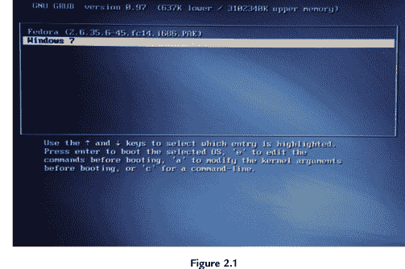

图 2.1 GRUB 启动菜单。


# 22 第2章

大量连续的空闲空间。你可以使用 Windows 磁盘碎片整理工具将所有空闲空间移动到磁盘的“末尾”。

Windows 7 拥有一个精美的磁盘管理工具，用于处理分区。从“开始”菜单中，选择“控制面板 > 管理工具 > 计算机管理”。在“计算机管理”对话框中，选择“存储 > 磁盘管理”。这将显示如图 2.2 所示的菜单。这显示了五个分区，其中最大的一个被标识为 C: 驱动器。

这里有必要简要介绍一下磁盘分区的背景知识。在 DOS/Windows/PC 领域中，一个磁盘最多可以有四个主分区。其中任何一个主分区都可以被指定为扩展分区，而扩展分区内部又可以包含多个逻辑分区。扩展分区可以容纳的逻辑分区数量没有固定的上限，但由于 Linux 访问分区的方式，单个磁盘驱动器的实际上限是 12 个。

看一下图 2.2 中的分区列表，并将其与在同一磁盘上通过 Linux `fdisk` 命令生成的列表 2.1 进行对比。这台特定的机器已经配置为双启动。注意，`fdisk` 报告了六个分区，而 Windows 磁盘管理器只显示了五个。`/dev/sda4` 被标识为扩展分区。

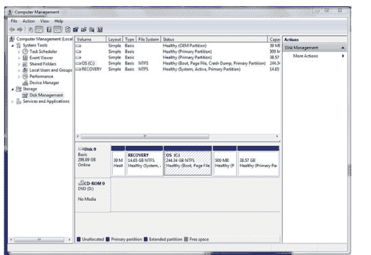

**图 2.2**
Windows 7 磁盘管理器。

| 设备 | 启动 | 起始扇区 | 结束扇区 | 块数 | Id | 系统 |
|---|---|---|---|---|---|---|
| /dev/sda1 | | 63 | 80324 | 40131 | de | Dell Utility |
| /dev/sda2 | * | 81920 | 30801919 | 15360000 | 7 | HPFS/NTFS |
| /dev/sda3 | | 30801920 | 543220399 | 256209240 | 7 | HPFS/NTFS |
| /dev/sda4 | | 543221760 | 623141759 | 40960000 | 5 | 扩展 |
| /dev/sda5 | | 543223808 | 544247807 | 512000 | 83 | Linux |
| /dev/sda6 | | 544249856 | 625141759 | 40445952 | 8e | Linux LVM |

# 列表 2.1

`fdisk` 的输出结果。

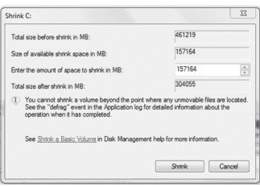

# 图 2.3

缩减卷。

`sda5/` 和 `sda6/` 是 `sda4/` 内的逻辑分区。磁盘管理器没有显示扩展分区。

奇怪的是，磁盘管理器将全部五个分区都识别为主分区，但 `fdisk` 显示图表表示中右侧的两个实际上是扩展分区内的逻辑分区。

有了这些背景知识，是时候为 Linux 创建一些空闲空间了。但首先，在对磁盘驱动器进行任何更改之前，**务必备份你的数据**。即使这些工具应该能正常工作，意外情况也时有发生。所以要有所准备。右键点击 OS (C:) 分区，选择 *缩减卷...* 顺便提一下，Windows 倾向于将分区称为卷。磁盘管理器会查询该分区，查看它可以被缩小到多大。在大型磁盘上这可能需要一段时间。最后，**图 2.3** 中的对话框会出现。虽然标签有点令人困惑，但它告诉我们可以从 C: 分区中移除 113 MB。显然，你希望在 C: 驱动器上保留一些空闲空间，所以你不希望拿走全部 113 MB。

随后，Linux 安装程序只会格式化将被 Linux 使用的分区。

# 虚拟化

但如今计算机领域的一个热门术语是虚拟化，即在一个操作系统之上运行另一个操作系统的过程。基础或原生操作系统被称为*宿主*。它运行一个*虚拟机管理器*（VMM），后者进而运行一个或多个称为*客户机*的虚拟机。与双启动场景中其中一个操作系统独占运行的情况不同，在虚拟化中，宿主和客户机是同时运行的。你甚至可以在它们之间无缝地移动文件和数据。

有两种流行的 VMM——VMware 和 VirtualBox。VMware 是一家同名公司的商业产品。他们提供了一个免费的版本，称为 VMware Player，它可以在 Windows 和 Linux 宿主上运行。

VirtualBox 是一个由 Oracle（原 Sun Microsystems）赞助的开源软件包。它也适用于 Windows 和 Linux 宿主，但还支持 Mac OS X 和 Solaris。

这两个软件包在安装和操作上非常相似。安装软件后（参见资源部分中的下载页面），你创建一个或多个客户机并为其分配资源，如磁盘和 RAM。“向导”会指导你完成创建新机器 的过程。客户机中的磁盘由宿主中的一个非常大的文件表示。然后，你在客户机上安装操作系统，方式与原生安装非常相似。

我恰好使用的是 VirtualBox。

# 安装 VirtualBox

安装 VirtualBox 与安装任何 Windows 软件类似。你下载并运行安装可执行文件。默认配置即可。系统会询问你是否要安装扩展包。是的，你需要安装。

接下来，需要创建一个虚拟“客户机”并在其上安装 Linux。启动 VirtualBox 管理器，点击左上角的“新建”图标。给机器起个名字。VirtualBox 通常会根据名字推断类型和版本。确保它们是正确的。分配 RAM。我的笔记本电脑有 8 GB 内存，我给客户机分配 2 GB。我发现给客户机分配超过 2 GB 会导致 Windows 变慢。

创建一个虚拟硬盘。保持默认的磁盘文件类型，VirtualBox 磁盘镜像 (.vdi)。我对磁盘文件使用动态分配存储。这是你的选择。默认情况下，磁盘文件名与机器名称相同。设置大小。我建议设置为 65 GB，以便有足够空间舒适地构建 Yocto 项目。当你点击 **创建** 按钮时，机器就创建完成了。

还有一些设置你希望在客户机本身进行修改。

- 在 `常规 > 高级` 中，将 `共享剪贴板` 和 `拖放` 设置为 `双向`。
- 在 `网络` 中，将 `连接至：` 更改为 `桥接网卡`。确保选择了正确的网卡。如果你的工作站同时具有有线和无线连接，你可能希望启用第二个网卡。这样就可以通过以太网端口将目标板直接连接到工作站，并使用无线端口进行互联网访问。注意，VirtualBox 使所有网络适配器在客户机中看起来都像 Intel PRO/1000。
- 如果你使用的是 USB 转串口转换器，请将其插入。然后在 `USB` 中，点击右侧的 `添加 USB 过滤器` 图标，并选择你的转换器。这将允许它一旦插入就自动连接到客户机。
- 在 `共享文件夹` 中，你可能需要设置一个共享文件夹，以便轻松地在宿主和客户机之间移动文件。点击右侧的 `添加新的共享文件夹` 图标。浏览到你要共享的文件夹并给它起个名字。这个名字将成为你在 Linux 客户机中挂载的设备名称。
- 当你准备好启动新的客户机并安装 Linux 时，转到 `存储`，点击 `控制器：IDE` 下方的光盘图标。然后点击最右侧的光盘图标，选择你的发行版的 ISO 文件，或者如果你使用的是实体 DVD，请选择物理驱动器。

安装并启动 Linux 后，你会发现基本的 VirtualBox 中显示器和鼠标存在一些限制。显示大小有限制，而且鼠标只能在宿主或客户机中工作，无法同时工作。通过安装 VirtualBox 增强功能（Guest Additions）可以克服这些限制。

如果你是 Linux 新手，在阅读完第 3 章“介绍 Linux”之前，本节的说明可能不太容易理解。你需要安装 GCC 编译器软件包（我们在后续过程中也会用到它）以及你正在运行的内核版本的内核头文件软件包。内核头文件软件包应该作为初始安装的一部分进行安装。

点击 VirtualBox 的 `设备` 菜单，选择 `插入增强功能光盘映像`。作为 root 用户，挂载该光盘映像。在一个 shell 窗口中，`cd` 到刚挂载的映像目录并执行：

```
sh ./VBoxLinuxAdditions.run
```

此脚本会构建几个内核模块。脚本完成后重启客户机。现在你可以将客户机显示设置为全屏（如果需要），并且鼠标可以在宿主和客户机之间无缝工作。


## DVD 还是 Live CD？

大多数 Linux 发行版至少提供三种形式：DVD、CD 合集（最多约六张双面盘）或 **Live CD**。Live CD 是一个最小化的可启动 Linux 系统，它让你有机会在不实际安装的情况下体验新的发行版。当然，你无法保存数据或修改配置。每次启动时，它都会恢复到默认配置。

Live CD 提供的选项之一是安装该发行版。当你选择此选项时，它会运行与使用 DVD 或完整 CD 集基本上相同的安装过程。区别在于，要安装的包是从网络拉取的，而不是从物理介质获取的。

## 安装过程

无论你选择哪种安装介质，安装过程大体相同。本节描述 CentOS 的安装，但其他发行版的过程也非常相似：

- 下载发行版介质（参见资源部分）。这将是一个 .iso 文件，即 DVD 或 Live CD 的精确映像。
- 将 .iso 烧录到相应的物理介质上。你需要一个光盘烧录程序将 .iso 文件传输到物理介质上。在虚拟机环境中，你可以直接将 .iso 文件挂载，就好像它是 CD 或 DVD 一样。
- 从安装介质启动计算机，或从 Live CD 点击安装图标。你可能需要配置计算机的 BIOS 以从光介质启动。
- 按照说明操作。

安装过程本身相当简单。在 CentOS 中，你首先选择一种语言，默认是美国英语。点击“继续”会弹出如图 2.4 所示的 `INSTALLATION SUMMARY` 对话框。

在 `SOFTWARE SELECTION`（软件选择）下，我建议将 `KDE Plasma Workspaces` 选为基础环境。这只是因为我碰巧更喜欢 KDE 图形桌面环境而不是 GNOME，并且就本书中其余部分的图形桌面图像而言，它们将是 KDE。我碰巧更喜欢 KDE 的呈现方式。它更“像 Windows”。事实是，我大部分日常计算工作都在 Windows 中进行（嘿，我正在用 Word 写这本书）。如果你职业生涯的大部分时间都在 Windows 屏幕前度过，我想你会发现 KDE 更合你的口味。但如果你强烈偏好 GNOME，那就请选择它或 `Development and Creative Workstation`。至少，你应该在 `Add-Ons` 下选择 `Development Tools`。如果你使用 KDE Plasma Workspace，可能还希望选择 `KDE Applications`。

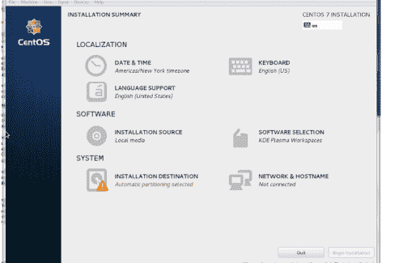

图 2.4
主设置菜单。

在 `NETWORK & HOST NAME`（网络与主机名）下，选择可能是唯一的网络接口。我的叫 Ethernet (enp0s3)。开启它，然后点击 Configure...。在 General 选项卡中，选择“当该网络可用时自动连接到此网络”是个好主意。

最后，选择 `INSTALLATION DESTINATION`（安装目的地）。选择可能可见的唯一磁盘驱动器，然后点击 Done。

点击 Begin Installation，你将被要求设置 root 密码并创建一个普通用户。root 用户可以执行任何操作。如果你设置的密码被 CentOS 认为太弱，你必须点击两次 Done。我知道这是不好的实践，但我对 root 和普通用户使用相同的密码。我的 Linux 机器上没有敏感信息。

走完创建用户对话框。如果你选择，甚至可以创建一个没有密码的普通用户。这取决于你。在你做这些的同时，安装一直在进行。当安装完成时，移除光盘介质并点击 Reboot。当 CentOS 启动时，你将被告知接受许可证。作为 EULA 来说，这相当简单。

在 CentOS 最终让你登录并启动图形桌面之前，还有一个步骤。你会被要求启用并配置 Kdump，这是一种内核崩溃转储机制。由你决定。我从未使用过它，但我保持它启用状态。

之后，你将拥有一个功能完整的 Linux 安装。准备好进入下一章时，重启它，我们将在其中回顾 Linux 的许多有用功能。

### 资源

[iso.linuxquestions.org](http://iso.linuxquestions.org) – 该网站提供接近 500 个 Linux 发行版的可下载 ISO 映像文件。

**特定发行版网站**

- [linuxmint.com](http://linuxmint.com)
- [debian.org](http://debian.org)
- [ubuntu.com](http://ubuntu.com)
- [redhat.com](http://redhat.com)
- [fedoraproject.org](http://fedoraproject.org)
- [centos.org](http://centos.org)
- [opensuse.org](http://opensuse.org)

**其他资源**

- [vmware.com](http://vmware.com) – 关于 VMware 虚拟机管理程序的信息。在此下载 VMware Player。
- [virtualbox.org](http://virtualbox.org) – VirtualBox VMM 的网站。

# 认识 Linux

- **章节大纲**
- **运行 Linux—KDE** 30
  - 文件管理器 31
  - Shell 窗口 32
- **Linux 特性** 32
- **保护模式架构** 34
  - 实模式 35
  - 保护模式 35
  - “平坦”与分段内存模型 37
  - 分页 37
  - 64 位分页 38
- **Linux 进程模型** 39
  - Fork() 函数 40
  - Execve() 函数 40
- **Linux 文件系统** 41
  - 文件权限 42
  - “Root” 用户 43
  - /Proc 文件系统 44
  - 文件系统层级标准 46
  - “挂载”文件系统 48
- **系统配置** 49
- **Shell** 50
- **获取帮助** 53
- **资源** 54

> *伯克利出现了两种主要产品：LSD 和 Unix。我们认为这绝非巧合*
> Jeremy S. Anderson

对于可能不熟悉 Unix 风格操作系统的读者，本章介绍了 Linux 的一些显著特性，特别是嵌入式开发人员感兴趣的那些特性。这绝不是一个详尽的介绍，市面上有许多书籍深入探讨这些主题。

如果你觉得对 Unix 和 Linux 概念已经很熟悉，可以自由地浏览或完全跳过本章。

### 运行 Linux—KDE

启动你的 Linux 机器并登录为普通用户。如果你在 CentOS 7 上运行 K 桌面环境 (KDE)，你将看到图 3.1 所示的屏幕。除非你正在运行 VirtualBox 或 VMware，否则你看不到顶部两行和最底部的菜单行。如果你运行的是其他版本的 Linux，你的屏幕可能看起来不同，但应该具有大多数相同的特性。

左下角是一个菜单图标，即 CentOS 标志。它的作用与 Windows 中的“开始”菜单相同。KDE 称其为“应用程序启动器菜单”。最初，点击此图标会弹出一组我认为个人难以使用的可爱图标菜单。幸运的是，你可以将其更改为旧版列表样式。右键点击应用程序启动器，选择“切换到经典菜单样式”。当然，认识到这纯粹是个人品味问题。


初始 KDE 屏幕。

### 文件管理器

我想对新系统做的第一件事就是打开文件管理器，以便查看系统上有什么。点击 **Application Launcher** 并选择 *Home*。文件管理器最初显示你的 *home directory*（主目录）的内容，这是你存放所有自己文件的地方。请注意，默认情况下，KDE 使用单击来激活项目。你可以通过从 *Application Launcher* 中选择 `Settings>System Settings` 将其更改为双击。向下滚动到 `Hardware`，然后选择 `Input Devices>Mouse`。

近期 Red Hat 基础发行版中的默认文件管理器名为 *Dolphin*，再次强调，这不是我的菜。我觉得旧版文件管理器 *Konqueror* 更容易使用，提供更实用的呈现方式。你可以通过右键点击 *Application Launcher* 并选择 `Edit Applications...` 来更改文件管理器。在 KDE 菜单编辑器中，选择 *Home* 并输入 **图 3.2** 中所示的 *Command*。

**图 3.3** 显示了我配置好的 Konqueror。不出所料，初始看起来并非如此。要在左侧获取导航面板，请点击最左侧红色的“Root folder”图标。Konqueror 有很多选项，所以请尽情尝试，以使其完全符合你的喜好。

你的主目录初始可能看不到什么。部分原因是许多条目是“隐藏的”，即对文件管理器不可见。按照惯例，任何以点开头的文件或目录都被视为隐藏文件。在 `View menu` 中有一个 `Show hidden files` 的选项。

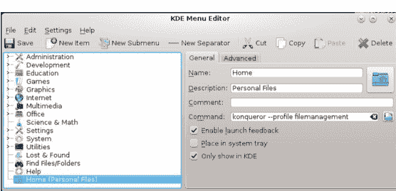

**图 3.2**
KDE 菜单编辑器。


## Shell 窗口

您将大量使用的另一个窗口是命令 Shell（命令行界面），我们将在本章的后面部分对其进行描述。从应用程序启动器菜单中，选择 **System > Konsle (Terminal)**（系统 > 控制台（终端））。图 3.4 展示了我配置的 Shell 窗口。同样，有大量配置选项可以通过从“设置”菜单中选择“Configure Profiles...”（配置配置档案...）来访问。我恰好喜欢白底黑字，并将尺寸设置为 80 × 25，因为这与我在刚开始从事这个行业时使用的旧式串行 CRT 终端相匹配。

文件菜单提供了打开新 Shell 窗口以及在一个 Shell 窗口内创建多个选项卡的选项。同时打开两到三个 Shell 窗口，并且在这些窗口中的任何一个里拥有两到三个选项卡，这种情况并不罕见。

## Linux 特性

以下是 Linux 以及一些重要的特性，以及 Unix 风格操作系统的通用特性。

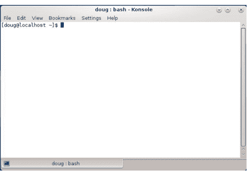

**图 3.4**
命令 Shell 窗口。

- 多任务。Linux 调度器实现了真正的抢占式多任务处理，其含义是，当异步事件发生时，就绪的高优先级进程将抢占当前正在运行的进程。但尽管它是可抢占的¹，内核中存在相对较大的延迟，使其通常不适合硬实时应用，尽管近年来这一情况已大大改善，我们稍后将会详细介绍。此外，默认调度器实现了一种“公平性”策略，赋予所有进程运行的机会。

- 多用户。Unix 是作为一种分时系统发展而来的，它允许多个用户共享一台昂贵的（至少在那个时代如此）计算机。因此，有许多功能支持隐私和数据保护。Linux 保留了这一传统，并在服务器环境中将其得到有效利用。²

> ¹ 是“preemptible”还是“preemptable”？Word 2010 的拼写检查器认为两者都是错误的。我能找到的唯一关于此争论的在线参考是 2008 年 Yahoo Answers 上的一个帖子，该帖支持 preemptible。我想我就沿用 preemptible 吧。
> ² 尽管我在嵌入式领域的经验表明，保护功能，特别是文件权限，可能是一个真正的麻烦。一些程序，例如 Firefox 浏览器，没有礼貌地告诉你没有文件写入权限，它们只是坐在那里什么也不做。

- 多处理。Linux 提供了对真正的对称多处理（SMP）的广泛支持，其中多个处理器通过共享内存总线紧密耦合。在多核处理器时代，这一点变得尤为重要。

- 保护内存。每个 Linux 进程都在其自己的私有内存空间中运行，并且不允许直接访问其他进程的内存空间。这防止了一个进程中的错误指针损坏另一个进程的内存空间。错误的访问会被处理器的内存保护硬件捕获，进程将被终止并发出适当的通知。

- 分层文件系统。是的，所有现代操作系统——甚至 DOS——都有分层文件系统。但 Linux/Unix 模型在我们习惯的传统 PC 操作系统基础上增加了一些不错的特性：

- 链接。链接只是一个指向另一个文件而不是文件本身的文件系统条目。链接可以作为一种有用的抽象机制，也是多个用户之间共享文件的一种方式。它们还广泛用于配置场景，以在多个可选文件中选择一个。

- 设备无关 I/O。同样，这并非新鲜事物，但 Linux 将这一概念推向了逻辑极致，将每个外围设备都视为文件系统中的一个条目。从应用程序的角度来看，向文件写入和向例如打印机写入之间没有任何区别。

## 保护模式架构

在深入 Linux 的细节之前，让我们短暂偏离主题，介绍一下保护模式架构。当代 Intel 处理器中保护模式内存的实现最早出现在 80386 中。它利用完整的 32 位地址，可寻址范围为 4 GB。访问控制使得内存块可以是：可执行、只读，或可读/写。当前的 Intel 64 位处理器实现了 48 位地址空间。

处理器可以处于四个*特权级别*之一。运行在最高特权级别（级别 0）的程序可以做任何事情——执行 I/O 指令，启用和禁用中断，修改描述符表。较低的特权级别阻止程序执行可能“危险”的操作。例如，文字处理应用程序可能不应该去干扰中断标志。那是操作系统的工作。

因此，应用程序代码通常在最低级别运行，而操作系统在最高级别运行。设备驱动程序和其他服务可能在中间级别运行。然而在实际中，Linux 和大多数用于 Intel 处理器的其他操作系统只使用级别 0 和级别 3。在 Linux 中，级别 0 被称为“内核空间”，而级别 3 被称为“用户空间”。

### 实模式

为了开始讨论 x86 中的保护模式编程，回顾一下“实”地址模式是如何工作的会有帮助。

回到 20 世纪 70 年代后期，当 Intel 设计 8086 时，设计者面临着如何用仅 16 位访问一兆字节地址空间的困境。当时，一兆字节被认为是一笔巨大的内存。他们找到的解决方案，无论好坏，都是由两个称为段（Segment）和偏移量（Offset）的 16 位数构建出一个 20 位（1 兆字节）地址。将段地址向左移动四位并加上偏移量，就形成了 20 位的线性地址（见图 3.5）。

x86 处理器在实模式下有四个段寄存器。对内存的每个引用都从这些寄存器之一获取其段值。默认情况下，指令执行是相对于代码段（CS）的，大多数数据引用（例如 MOV）是相对于数据段（DS）的，而引用堆栈的指令是相对于堆栈段（SS）的。附加段（Extra Segment）用于字符串移动指令，并且可以在需要额外的 DS 时使用。默认段选择可以通过段前缀指令覆盖。

一个段最长可以是 64 Kbytes，并且对齐到 16 字节边界。小于 64 Kbytes 的程序本质上是位置无关的，可以轻松重定位到 1 Mbyte 地址空间中的任何地方。代码或数据大于 64 Kbytes 的程序需要多个段，并且必须显式操纵段寄存器。

### 保护模式

保护模式仍然使用段寄存器，但段寄存器中的值（现在称为*选择子*）不再直接提供地址的一部分，而是成为*段描述符*表中的索引。段描述符完整描述了一块内存，包括（除其他事项外）其基址和界限（见图 3.6）。物理内存中的线性地址通过将由逻辑地址中的偏移量加到描述符中包含的基址来计算。如果结果地址大于描述符中指定的界限，处理器将信号发出内存保护故障。


**图 3.5**
实模式寻址。

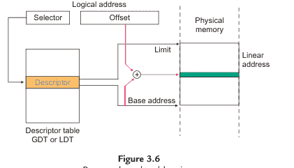

描述符是一个 8 字节对象，它告诉我们需要了解关于一块内存的所有信息。

- **基地址[31:0]：** 此块/段的起始地址。
- **界限[19:0]：** 此段的长度。这可能是以字节为单位的长度（最多 1 Mbyte），或者是以 4 Kbyte 页为单位的长度。解释方式由粒度位（Granularity bit）定义。
- **类型：** 一个 4 位字段，定义此段描述的内存类型。S 0 = 此描述符描述一个“系统”段。1 = 此描述符描述一个代码或数据段。
- **DPL：** 描述符特权级别：一个 2 位字段，定义访问此段所需的最低特权级别。
- **P：** 存在（Present）：1 = 此描述符表示的内存块存在于内存中。用于分页。
- **G：** 粒度：0 = 将界限解释为字节。1 = 将界限解释为 4 Kbyte 页。

注意，当粒度位设置为 1 时，单个段描述符可以代表整个 4 Gbyte 地址空间。

普通描述符（S 位 = 1）描述代表数据或代码的内存块。类型字段是四位，其中最高位区分代码段和数据段。代码段是可执行的，数据段则不可。CS（代码段）可能也可能可读。数据段可能是可写的。任何试图访问超出


Type 字段的作用范围——例如，尝试执行数据段——会导致内存保护故障。

## “平坦”内存模型与分段内存模型

由于单个描述符可以引用完整的 4 GB 地址空间，因此可以基于单个描述符来构建系统。这被称为“平坦”模型寻址，实际上，它是大多数 8 位微控制器中寻址模型的 32 位等价物，也是 DOS “tiny”（小）内存模型。所有内存都是同等可访问的，且没有保护机制。

Linux 实际上执行了类似的操作。它为操作系统和每个进程使用独立的描述符，从而强制实施保护，但将每个描述符的基地址设置为零。因此，偏移量与虚拟地址相同。实际上，这取消了分段机制。

## 分页

分页是一种允许每个任务假装拥有一个非常大的平坦地址空间的机制。然后，该空间被划分为 4 KB 的页面。只有当前正在访问的页面保留在主内存中。其他页面驻留在磁盘上。

如图 3.7 所示，分页增加了一个额外的间接层。由选择器和偏移量导出的 32 位线性地址被分为三个字段。高 10 位用作页目录（Page Directory）的索引。页目录项指向一个页表（Page Table）。线性地址中的下一个 10 位提供该页表的索引。页表项（PTE）提供物理内存中 4 KB 页面的基地址，该页面称为页框（Page Frame）。原始线性地址的低 12 位提供页框内的偏移量。每个任务都有由处理器控制寄存器 CR3 指向的独立页目录。

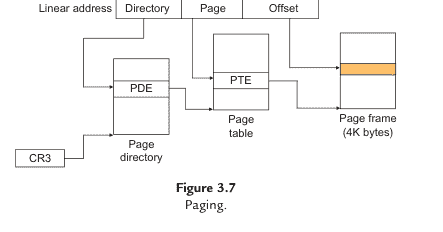

在此查找过程的任一阶段，可能会发现页表或页框未驻留在物理内存中。这会导致*页面错误（Page Fault）*，进而促使操作系统在磁盘上找到对应的页面并将其加载到内存中的可用页框中。这可能还需要将当前占据该内存的页面“换出（swapping out）”。

分页的一个额外优点是，它允许多个任务或进程通过简单地将其独立地址空间中的适当部分映射到相同的物理页面，轻松共享代码和数据。

分页是可选的；你不必使用它，尽管 Linux 使用了。分页由处理器寄存器 CR0 中的位控制。

页目录项和页表项各为 4 字节长，因此页目录和页表最大为 4 KB，这也恰好是页框的大小。高 20 位指向页表或页框的基地址。第 9 到 11 位可供操作系统自行使用。除其他用途外，这些位可用于指示页面应被“锁定”在内存中，即不可换出。

在剩余的控制位中，最感兴趣的是：

- **P Present（存在位）**：1 = 该页面在内存中。如果该位为 0，引用此页目录项或 PTE 会导致页面错误。请注意，当 $P = 0$ 时，该条目的其余部分不相关。
- **A Accessed（访问位）**：1 = 该页面已被读取或写入。由处理器设置，由操作系统清除。通过定期清除访问位，操作系统可以确定哪些页面长时间未被引用，因此可能被换出。
- **D Dirty（脏位）**：1 = 该页面已被写入。由处理器设置，由操作系统清除。如果页面未被写入，则当需要换出时，无需将其写回磁盘。

## 64 位分页

迄今为止描述的分页模型适用于 32 位 x86 处理器。它被称为 10-10-12 模型，因为 32 位线性地址被分为三个字段，分别为 10 位、10 位和 12 位。在 64 位机器中，页目录和页表中的项为 8 字节，因此一个 4 KB 页面容纳 512 个项，即 9 位。当前的 64 位处理器仅实现 48 位物理寻址，最大支持 256 TB 内存。增加了两个额外的地址转换层，从而形成了 9-9-9-9-12 模型。

## Linux 进程模型

好的，回到 Linux。Linux 的基本结构元素是进程，由可执行代码和一组资源（如数据、文件描述符等）组成。这些资源受到完全保护，使得一个进程不能直接访问另一个进程的资源。为了使两个进程相互通信，它们必须使用 Linux 定义的进程间通信机制，例如共享内存区域或管道。

这很好，因为它在系统中建立了高度的保护。一个出错的过程很可能会在损坏其他进程之前被系统检测到并终止（见图 3.8）。但这样做需要付出代价，即创建进程和使用进程间通信机制会产生过多的开销。

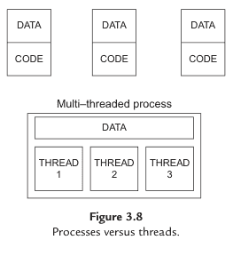

另一方面，线程仅包含代码。线程仅存在于进程的上下文中，且同一进程中的所有线程共享该进程的资源。因此，所有线程对数据内存和文件描述符具有同等的访问权限。这种模型有时被称为轻量级多任务，以区别于 Unix/Linux 进程模型。

轻量级任务的优势在于线程间通信更高效。当然，缺点在于任何线程都可能破坏其他线程的数据。从历史上看，大多数实时操作系统都是围绕轻量级模型构建的。近年来，当然，内存保护硬件的成本急剧下降。作为回应，许多 RTOS 供应商现在提供其系统的保护模式版本，这些版本看起来像 Linux 进程模型。

## Fork() 函数

Linux 以一个进程开始其生命周期，即 `init` 进程，在引导时创建。系统中的其他所有进程都是调用 `fork()` 创建的。调用 `fork()` 的进程被称为*父进程*，新创建的进程被称为*子进程*。因此，每个进程都有祖先，并且根据谁创建了谁，可能有后代。

如果你习惯了通过调用任务创建服务从函数中创建任务的多任务操作系统，fork 过程可能显得非常古怪。`fork()` 创建*父进程的副本*——代码、数据、文件描述符以及父进程当前持有的任何其他资源。这可能意味着要复制数兆字节的空间。为了避免复制大量最终可能被覆盖的内容，Linux 采用*写时复制（copy-on-write）*策略。

`fork()` 首先复制进程数据结构，并为子进程分配一个新的进程标识符（PID）。然后它创建页目录和页表的新副本。最初，页表项都指向与父进程相同的物理页面。两个进程的所有页面都被设置为只读。当其中一个进程尝试写入时，会导致页面错误，进而促使 Linux 为该进程分配一个新页面，并将现有页面的内容复制过去。

由于两个进程都在执行相同的代码，它们都从 `fork()` 返回处继续执行（这就是如此古怪的地方！）。为了区分父进程和子进程，`fork()` 向子进程返回函数值 0，但向父进程返回子进程的 PID。列表 3.1 是 fork 调用的一个简单示例。

## Execve() 函数

当然，99% 的情况下实际发生的是子进程通过调用 `execve()` 加载磁盘上的可执行映像文件来调用新程序。列表 3.2 以骨架形式展示了一个简单的命令行解释器。它从 `stdin` 读取一行文本，解析它，并调用 `fork()` 创建新进程。然后子进程调用 `execve()` 加载文件并执行刚输入的的命令。`execve()` 会覆盖调用进程的代码、数据和 **SSS**。

如果这是一个正常的“前台”命令，命令解释器必须等待命令完成。这通过 `waitpid()` 实现，该函数阻塞调用进程，直到与 pid 参数匹配的进程完成。顺便注意，大多数多任务操作系统不具备阻塞一个进程或任务直到另一个进程完成的能力。


## 清单 3.1
# fork 的简单示例。

```c
#include <unistd.h>
#include <stdio.h>

pid_t pid;

void do_child_thing(void)
{
    printf("I am the child. My PID is %d\n", pid);
}

void do_parent_thing(void)
{
    printf("I am the parent. My child's PID is %d\n", pid);
}

void main(void)
{
    switch (pid = fork())
    {
        case -1:
            printf("fork failed\n");
            break;
        case 0:
            do_child_thing();
            break;
        default:
            do_parent_thing();
    }
    
    exit(0);
}
```

如果 `execve()` 成功，它不会返回。相反，控制权会转移给新加载的程序。

# Linux 文件系统

Linux 文件系统在许多方面与你在 Windows 个人电脑或 Macintosh 上看到的文件系统类似。它是一个分层系统，允许你在由“/”标识的*根目录*下创建任意数量的子目录。与 Windows 类似，文件名可以非常长。然而，在 Linux 中，就像大多数类 Unix 系统一样，文件名的“扩展名”（即文件名中“.”之后的部分）的意义远小于 Windows 中的扩展名。例如，虽然 Windows 可执行文件总是具有“.exe”扩展名，但 Linux 可执行文件通常根本没有扩展名。总体而言，文件的内容是通过文件头来标识的，而不是通过特定的扩展名标识符。尽管如此，许多应用程序（例如 C 编译器）确实支持默认文件扩展名。

# 清单 3.2
# 命令行解释器。

```c
#include <unistd.h>
#include <stdio.h>

void main (void)
{
    char *argv[10], *filename;
    char text[80];
    char foreground;
    pid_t pid;
    int status;
    while (1)
    {
        gets (text);
        // Parse the command line to derive filename and
        // arguments. Decide if it's a foreground command.
        switch (pid = fork())
        {
            case -1:
                printf ("fork failed \n");
                break;
            case 0: // child process
                if (execve (filename, argv, NULL) < 0)
                    printf("command failed \n");
                break;
            default: // parent process
                if (foreground)
                    waitpid (&status, pid);
        }
    }
}
```

与 Windows 不同，Linux 中的文件名是*大小写敏感*的。`FooBar` 与 `foobar` 是不同的文件，且与 `fooBar` 也不同。排序也是大小写敏感的。以大写字母开头的文件名在按名称排序的目录列表中会显示在以小写字母开头的文件名之前。以“.”开头的文件名被视为“隐藏”文件，除非你明确要求显示，否则不会出现在目录列表中。

此外，Linux 文件系统还具有许多超越典型 Windows 系统的功能。让我们来看看一些嵌入式程序员可能感兴趣的功能。

# 文件权限

由于 Linux 是多用户系统，每个文件都关联有一组*权限*，用于指定不同类别的用户允许对该文件执行哪些操作。在命令 shell 窗口中输入命令 `ls -l`，或者使用桌面文件管理器，获取某个 Linux 目录的详细列表。每个文件条目的部分是一组 10 个标志和一对名称，看起来像这样：

```
-rw-r-r-- Andy physics
```

在此示例中，Andy 是该文件的*所有者*，而该文件属于一个名为 physics 的用户*组*，可能是某大学的物理系。通常情况下，但不总是，所有者是创建该文件的人。

10 个标志中的第一个标识文件类型。普通文件在这里显示为一个短划线。目录由“d”标识，链接由“l”标识，等等。当我们后续讨论设备驱动程序时，会看到这个标志的其他条目。剩余的九个标志分为三组，每组三个标志。所有组的标志都是相同的，分别代表读取文件的权限“r”；写入文件的权限“w”；如果文件是可执行文件，则代表执行文件的权限“x”。写权限也允许删除文件。

这三个组分别代表授予不同类别用户的权限。第一组标识授予文件所有者的权限，几乎总是允许读取和写入。第二组标志赋予同一用户组中其他成员的权限。在此情况下，physics 组对该文件有读取访问权限，但没有写入访问权限。最后一组标志赋予“world”，即所有用户的权限。

“x”权限值得再看一下。在 Windows 中，具有 `.exe` 扩展名的文件*被假定*为可执行文件。在 Linux 中，由于我们没有显式的文件扩展名来标识可执行文件，因此二进制可执行文件由“x”权限标识。此外，只有“x”权限被设置的类别的用户才被允许调用执行该文件。因此，如果我登录为普通用户，我不被允许调用可能改变整体系统状态的程序，例如更改网络地址。

“x”的另一个有趣特性是它也适用于 shell 脚本，我们将在本章稍后部分讨论。对于 DOS 爱好者来说，shell 脚本与 `.bat` 文件是相同的东西。它是一个包含作为程序执行的命令的文本文件。但是，除非设置了其“x”位，否则 shell 不会执行该脚本。

# “Root” 用户

每个 Linux 系统中都有一个非常特殊的用户，名为“root”。root 可以无视权限标志，对任何文件做任何事情。Root 主要用于系统管理目的，不建议日常使用。显然，如果你不谨慎，会遇到很多麻烦，并且 root 权限构成了潜在的安全威胁。尽管如此，嵌入式和实时开发者在系统中执行的操作通常需要对由 root 拥有的文件具有写入或执行访问权限，因此要求你登录为 root 用户。

过去，我大多数时候都只是以 root 身份登录，因为这样省事。这一做法的一个后果是我创建的每个文件都归 root 所有，普通用户在不更改权限的情况下无法写入。这变成了一个恶性循环。我作为 root 登录的次数越多，我就越需要登录为 root 才能做任何有用的事情。我后来采用了更审慎的做法，即登录为普通用户，仅在必要时切换为 root。

如果你登录为普通用户，可以使用 `su`（替代用户）或 `sudo` 命令切换到 root。不带参数的 `su` 命令会启动一个具有 root 权限的 shell，前提是你输入了正确的 root 密码。要返回普通用户状态，通过输入 `^d` 或 `exit` 终止 shell。

`sudo` 命令允许你以 root 身份执行命令，前提是你已在“sudoers 文件”（`/etc/sudoers`）中正确授权。当然，sudoers 文件归 root 所有，因此只有 root 用户可以授权 sudoers。一旦通过输入你自己的密码完成身份验证，你可以在短时间内（默认 5 分钟）继续使用 `sudo` 而无需重新输入密码。

例如，如果我想更改 `/dev` 目录中某个文件的权限，我可以执行：

```
    sudo chmod o +rw /dev/tty50
```

系统会提示我输入密码，如果输入成功，命令将会执行。然后我可以在 5 分钟内继续执行 `sudo` 命令而无需重新输入密码。请注意，`sudo` 比 `su` 提供更好的安全性，因为 root 用户必须授权 sudoers，且不需要公开 root 密码。

# /proc 文件系统

`/proc` 文件系统是 Linux 的一个有趣特性。它的作用与普通文件系统完全相同。你可以列出 `/proc` 目录中的文件，可以读写这些文件，但它们并不真正存在。`/proc` 文件中的信息是在读取文件时即时生成的。注册了特定 `/proc` 文件的内核模块包含生成读取数据和接受写入数据的函数。

`/proc` 文件是查看内核的一个窗口。它们提供了一种易于用户级任务和 shell 访问的方式来提供关于系统状态的动态信息。在图 3.9 的简化目录列表中，带有数字标签的目录代表进程。每个进程在 `/proc` 下都有一个目录，其中包含多个描述进程状态的目录和文件。


# **动手试一试**

查看 Linux 启动时究竟派生了多少进程，这是一个有趣的话题。请重启你的系统，打开命令 shell 并执行以下命令：

```
ps -A | wc
```

`ps` 命令列出系统中正在运行的进程。`ps` 的输出每个进程占一行。`wc` 命令统计输入的行数、单词数和字符数。行数基本上就是正在运行的进程数。在我的 CentOS 7 系统中，有 188 个进程在运行。

现在请尝试：

```
ps -A | more
```

这条命令让你可以分页查看 `ps` 的输出。请注意，`ps` 命令的信息来源于 `/proc` 文件系统。

这里还有另一个命令，突出了 `/proc` 数据的实时特性。执行：

```
cat /proc/interrupts
```

`interrupts` 文件列出了系统中所有的中断源、自系统启动以来每个中断触发的次数，以及注册到该中断的驱动程序。现在再次执行该命令：

```
cat /proc/interrupts
```

你会发现许多数字都增加了，从而证明数据是动态生成的。

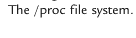

# **文件系统层次结构标准**

一个 Linux 系统通常包含大量的文件。例如，典型的 CentOS 安装可能包含多达 30,000 个文件，占用数 GB 的磁盘空间。显然，必须按照某种一致且连贯的方式来组织这些文件。这正是文件系统层次结构标准（FHS）的动机所在。该标准允许用户和软件开发者“预测已安装文件和目录的位置”⁴。FHS 并不专门针对 Linux。它适用于一般的类 Unix 操作系统。

Linux 文件系统的目录结构始终始于*根*，标识为“/”。FHS 规定了直接隶属于根的几个目录及其内容。这在**图 3.10**中有说明。FHS 首先沿两个独立的轴对文件进行特征描述：

- 可共享与不可共享。网络化系统可能能够通过网络文件系统挂载某些目录，从而使多个用户共享可执行文件。另一方面，某些信息特定于某台计算机，因此不可共享。
- 静态与动态。Linux 系统中的许多文件是不变的可执行文件，它们是静态的。但用户创建或获取的文件（例如通过下载或电子邮件）是动态的。这两类文件应该被清晰地分开。

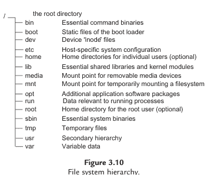

以下是 FHS 定义的目录描述：

- /bin 包含用户和系统管理员使用的命令的二进制可执行文件。FHS 规定了 /bin 必须包含哪些文件。其中包括命令 shell 和基本文件实用程序。/bin 中的文件是静态且可共享的。
- /boot 包含启动过程所需的一切，除了配置文件和映射安装程序。除了内核可执行映像外，/boot 还包含在内核开始执行用户模式程序之前使用的数据。/boot 中的文件是静态且不可共享的。
- /etc 包含特定于主机的配置文件和目录。除包含文件系统动态信息的 mtab 外，/etc 中的文件是静态的。FHS 识别了 /etc 的三个可选子目录：
  - /opt 包含 /opt 中附加应用程序包的配置文件。
  - /sgml SGML 和 XML 的配置文件
  - /X11 X 窗口的配置文件。
  - 实际上，大多数 Linux 发行版都有 /etc 的更多子目录，代表可选的启动和配置要求。
- /home （可选）包含用户主目录。每个用户在 home 下都有一个与其用户名相同的子目录。虽然 FHS 称此为可选，但实际上它在 Unix 系统中几乎是通用的。/home 下子目录的内容当然是动态的。
- /lib 包含启动系统和运行根文件系统中的命令（即 /bin 和 /sbin 中的二进制文件）所需的共享库映像。在 Linux 系统中，/lib 有一个子目录 /modules，其中包含内核可加载模块。
- /media 可移动介质的挂载点。当可移动介质被自动挂载时，挂载点通常就是卷的名称。
- /mnt 提供临时挂载文件系统的便利位置。
- /opt 包含可选的附加软件包。每个包在 /opt 下都有自己的子目录。
- /run 与运行进程相关的数据。
- /root root 用户的主目录⁵。这不是 FHS 的要求，但通常是公认的做法且强烈建议采用。
  > ⁵ 请注意这里的混淆可能。目录层次结构中既有根“/”，又有 root 目录“/root”，即 root 用户的主目录。
- /sbin 包含系统管理所需的实用程序二进制文件，如启动、恢复、还原或修复系统。这些实用程序通常仅由系统管理员使用，普通用户的路径中不需要 /sbin。
- /tmp 临时文件。
- /usr 次要层次结构，见下文。
- /var 可变数据。包括 spool 目录和文件、管理和日志数据，以及瞬态和临时文件。基本上是在操作过程中变化的系统范围数据。/var 下有多个子目录。

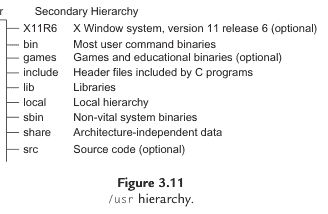

## /usr 层次结构

/usr 是一个包含面向用户文件的次要层次结构。图 3.11 显示了 /usr 下的子目录。其中几个子目录镜像了根目录的功能。/usr 中也许最有意思的子目录是用于源代码的 /src。这是 Linux 源代码通常安装的位置。你实际上可能在 /src 下安装了多个 Linux 内核的源代码，它们位于形式为以下命名的子目录中：

```
linux-<version number>-ext
```

然后你会拥有一个名为 linux 的逻辑链接，指向你当前正在使用的内核版本。

## “挂载”文件系统

Windows 和 Linux 文件系统之间的一个主要区别在于如何将结构化文件的设备（硬盘、软盘驱动器、CDROM 等）映射到系统的目录或层次结构。Windows 文件系统明确显示设备，使用字母-冒号组合来标识它们，例如"C:"。另一方面，Linux 强调统一文件系统，物理设备在其中被有效地渲染为不可见。

将物理设备映射到文件系统目录结构的机制称为“挂载”$^{6}$。CD-ROM 驱动器等可移动介质设备是这一特性的最明显体现。在你读取 CD-ROM 之前，必须使用 mount 命令将驱动器挂载到目录结构中的现有节点上，如下所示：

```
mount /media/cdrom
```

此命令之所以有效，是因为文件 /etc/fstab 包含了通常在 /media/cdrom 处挂载什么设备以及该设备包含什么类型的文件系统（在本例中为 iso9660）的信息。

与文件权限类似，如果你只是想从 CD 上读取几个文件，mount 有时可能会带来不便。但 mount 范式的真正价值在于，它不仅限于直接连接到计算机的物理设备，也不仅理解原生 Linux 文件系统。正如我们稍后将看到的，我们可以挂载连接到网络的远程计算机文件系统的部分，使它们的文件在本地机器上可访问。也有可能挂载包含 DOS FAT 或 VFAT 文件系统的设备。如果你构建了一个可以启动 Windows 或 Linux 的“双启动”系统，这将特别有用。文件可以轻松地在这两个系统之间共享。或者，如果你的嵌入式设备有 SD 或 micro SD 插槽，甚至 USB，读取 VFAT 文件系统的能力就极其有用。

$^{6}$ 这个术语可能源自过去盘式磁带机时代，那时必须物理地“挂载”磁带盘。

## 系统配置

上面关于 FHS 的部分提到了 /etc 目录。这是 Unix 系统相对于 Windows 真正表现出色的地方之一。好吧，Unix 可能在很多方面比 Windows 高明。无论如何，/etc 目录基本上以纯文本文件的形式包含了内核和应用程序所需的所有配置信息。这些文件的语法和语义并不总是显而易见的，但至少你可以阅读它们。许多内核配置文件的格式记录在 man 手册页中（见下文关于帮助的部分）。

相比之下，Windows 系统特意将配置信息隐藏在一个被称为“注册表”的神秘地方（伴随不祥的音乐响起）。普通用户常常被警告远离注册表，因为不适当的更改可能导致系统无法启动。事实上，注册表只能通过一个名为 regedit 的特殊程序更改，而且直到几年前我才终于弄清楚注册表物理驻留在哪里。

如果你曾鼓起勇气运行 regedit 并实际查看注册表，你无疑会注意到条目是相当晦涩的符号，而数值则更加晦涩。我确信这是有意为之


微软那部分。他们不希望愚蠢的消费者胡乱摆弄自己的电脑，甚至可能导致电脑彻底报废。另一方面，Linux 用户知道自己在做什么（此处是言外之意），并且有权查看和修改配置数据，随心所适。

### Shell

Linux 系统启动时发生的最后几件事之一，就是调用被称为 shell 的命令解释器程序。它的主要任务是解析你在控制台中输入的命令，并执行相应的程序。但 shell 远不止是一个简单的命令解释器。它自身包含一种强大且富有表现力的解释型编程语言。通过结合 shell 脚本语言和现有的实用程序，完全有可能在不编写一行 C 代码的情况下，创建非常复杂的应用程序。事实上，这正是 Unix 编程的普遍哲学。从一组只做一件事且做得很好的简单实用程序开始，然后通过 shell 脚本语言将它们连接起来。

Shell 脚本语言包含了循环、测试、函数等常见的编程结构。但也许 shell 中最巧妙的小技巧是“管道”的概念。这是一种将数据从一个程序流式传输到另一个程序的机制。这个隐喻非常贴切。一个程序将字节倒入管道的一端，而第二个程序则从管道的另一端取出字节。

大多数 Linux/Unix 实用程序从一个名为 "stdin" 的默认设备接收输入。同样，它们将输出写入名为 "stdout" 的设备。任何错误消息都写入 "stderr"。通常，stdin 是键盘，而 stdout 和 stderr 是显示器。但我们可以同样容易地将 stdin 和 stdout 视为管道的两端。

stdin 和 stdout 可以被重定向，以便我们可以将输出发送到（例如）文件，或从文件接收输入。在 shell 窗口中，尝试仅输入命令 `cat`，不带任何参数。`cat` 可能是所有 Unix 实用程序中最简单的一个。它所做的只是逐行将 stdin 复制到 stdout。当您不带参数输入该命令时，它会在 stdin 处耐心等待键盘输入。输入一行文本，它会将其发送到 stdout，即显示器上。按 Ctrl-C 退出程序。

现在试试这个：

```
cat > textfile
```

输入一行文本。这次您看不到该行重复出现，因为 ">" 运算符已将 stdout 重定向到文件 `textfile`。输入几行，然后按 Ctrl-C 退出。

此练习的最后一步是：

```
cat < textfile
```

看！您通过上一个命令创建的文件现在出现在屏幕上，因为 "<" 运算符将 stdin 重定向到了 `textfile`。`cat` 实际上实现了一种快捷方式，因此如果将文件名作为命令行参数输入，而不带 < 运算符，它会将其作为输入文件。即：

```
cat textfile
```

然而，管道的真正威力在于 "|" 运算符，它将一个程序的 stdout 作为另一个程序的 stdin 输入。当我做上述练习时，我创建了一个包含以下内容 textfile：

```
this is a file
of text from the keyboard
```

现在如果执行：

```
cat textfile | grep this
```

我将得到：

```
this is a file
```

正如您可能猜测的，grep 是一个过滤器。它试图将其命令行参数与输入流 stdin 进行匹配。包含参数文本的行会被传递到 stdout。其他行则被简单忽略。这里发生的情况是 cat 的输出变成了 grep 的输入。

以典型的 Unix 风格，grep 代表 Get Regular Expression "something"。我忘了 "p" 代表什么。正则表达式实际上是一种强大的机制，可以说是一种用于搜索文本的脚本语言。grep 体现了正则表达式的语法。

Shell 脚本和 Makefile 大量使用了重定向和管道。

还有一些其他 shell 功能值得简要提及，因为它们可以节省大量打字工作。Shell 维护了一个命令历史记录，您可以使用向上箭头键访问。这允许您重复任何之前的命令，或对其进行轻微编辑以创建新的类似命令。有一个 history 命令，可以输出系统的累积命令历史记录或其子集。历史记录保存在主目录中的 `.bash_history` 文件中。

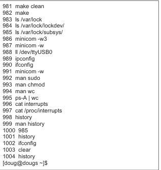

**图 3.12**

`history` 命令。

图 3.12 显示了我系统中 `history` 命令的最后几行。要重新执行列表中的任何命令，只需输入“!”后跟历史记录列表中的命令编号，例如：

```
!1998
```

以重新执行 `history`。

另一个非常酷的功能是自动补全，它尝试为您补全文件名参数。假设我想执行：

`cat verylongtextfilename`

我可以尝试输入：

`cat verylong<tab>`

只要文件名的剩余部分在当前目录中是唯一的，shell 就会自动补全，省去了输入整个文件名的麻烦。如果 shell 找不到唯一匹配，它会发出蜂鸣声。然后您只需要多输入一点，直到剩余部分变得唯一。

最后，“~” 字符代表您的主目录。因此，您可以从文件系统中的任何位置执行 `cd ~` 来回到您的主目录。

事实上，有几个常用的 shell 程序。它们都服务于相同的基本目的，但在语法和功能的细节上有所不同。最受欢迎的是：

- **Bash (Bourne Again Shell)** — `bash`。`bash` 是 Bourne shell、`sh` 的“转世”，最初由 Stephen Bourne 编写，并随 Unix 版本 7 分发。它是大多数 Linux 发行版的默认选项，除非您有充分理由或强烈偏好使用其他 shell，否则您可能应该使用它。
- **Korn Shell** — `ksh`。由 David Korn 在 20 世纪 80 年代初在 AT&T 贝尔实验室开发。它比 `bash` 具有更高级的编程功能，但尽管如此仍保持向后兼容性。
- **Tenex C Shell** — `tcsh`。C shell、`csh` 的后继者，而 `csh` 本身又是 Bourne shell 的前身。Tenex 是一个操作系统，启发了 `tcsh` 的一些功能。
- **Z Shell** — `zsh`。被描述为扩展的 Bourne shell，包含大量改进，包括 `bash`、`ksh` 和 `tcsh` 中一些最有用的功能。

Shell 编程主题本身足以写成一本书，而且确实有很多。当我在 *Amazon.com* 上搜索“linux shell programming”时，得到了 248 个结果。

### 获取帮助

Unix/Linux 系统的官方文档是一组称为“man pages”的文件，man 是 manual（手册）的缩写。man pages 通过 shell 命令 `man` 访问，例如：

```
man cp
```

以获取关于 shell 复制命令的帮助。试一试。在 shell 提示符下输入 `man man` 以了解关于 man 命令的更多信息。man 一次显示一页，底部有“:” 提示符。要移动到下一屏，按 <Space>。要在到达页面末尾前退出 man，输入“q”。您还可以向上和向下翻页浏览 man 页面。有趣的是，您在 man man 页面中找不到这些信息。man pages 的写作风格相当简洁；它们是参考资料性质，而非教程。信息通常限于命令的作用、其参数以及它所接受选项。

为了更容易找到特定主题，man pages 按以下章节组织：

| 章节 | 描述 |
| :--- | :--- |
| 1 | 在 shell 提示符下输入的用户命令。 |
| 2 | 内核 API 函数。 |
| 3 | C 库函数。 |
| 4 | 设备。特定外围设备的信息。 |

**脚注：**

7 “Bricking” 指的是将计算机的配置搞得一团糟，导致其无法再启动，从而使其变成一块砖头（毫无用处）。该术语在嵌入式领域使用频繁。对于台式机，更贴切的术语可能是“变成船锚”。

8 是 concatenate（连接）的缩写。难道你不喜欢 Unix 命令名称吗？


第 5 节：文件格式。描述 /etc 目录下许多文件的语法和语义。
第 6 节：游戏。
第 7 节：杂项
第 8 节：系统管理。主要供系统管理员使用的 Shell 命令。

另一个有用的信息来源是“info 页面”。info 页面通常更详尽，提供有关某个主题的详细信息。使用 info 命令可以访问 info 页面。试试这个：

```
info gcc
```

以了解更多关于 GCC 编译器包的信息。

在图形桌面环境 KDE 和 GNOME 中，你还可以通过图形界面访问 man 手册页和 info 页面。我觉得这对于查找 info 页面中有哪些内容特别有用。

最后，任何关于获取 Linux 帮助的讨论如果不提到 Google 都是不完整的。当你被 Linux 中某些奇怪的行为弄得不知所措时，Google 是你的朋友。我常遇到的一种沮丧是错误信息，因为它们很少能给你提供任何关于究竟哪里出错的洞察。所以，将错误信息的一部分输入 Google 搜索框。你很可能会得到至少十几个处理该错误的论坛帖子，其中很可能会有些有用的内容。

在具备了良好的 Linux 基础知识后，我们的下一个任务是配置开发工作站并安装能够让我们开发目标应用程序的软件。

### 资源

Sobell, Mark G., *Linux 实用指南*。自从我开始攀登那条陡峭的 Linux 学习曲线以来，这本书一直是我的圣经和忠实的伴侣。它是一本关于 Linux 以及通常类 Unix 系统的优秀入门指南，尽管由于它出版于 1997 年，现在有点过时且难以找到。它已被……所取代

Sobell, Mark G., *Linux 命令、编辑器和 Shell 编程实用指南*

`tlp.org`— Linux 文档项目。顾名思义，这是 Linux 文档的来源。你会在这里找到操作指南、深入指南、常见问题解答（FAQ）、man 手册页，甚至是一本在线杂志 *Linux Gazette*。这些材料通常写得很好且很有用。

# 第 4 章

## 宿主开发环境

**章节大纲**
**交叉开发工具：GNU 工具链** 56
  Gnu 编译器集合 56
  Make 57
  Gnu 调试器 57
**获取和安装软件** 58
  安装交叉工具链 58
**终端模拟器 *minicom*** 59
**网络** 61
  网络地址 61
  无线呢？ 63
  网络文件系统 63
  简单文件传输协议 65
**资源** 66

> 当你说“我写了一个让 Windows 崩溃的程序”时，人们只是空洞地盯着你看，然后说“嘿，我随系统就获得了那些，*免费的*”。
> Linus Torvalds

在本章中，我们将配置宿主工作站环境，为下一章配置目标板做准备。涉及的步骤包括：

- 从你将从 Elsevier 网站下载的 ISO 镜像中安装一些软件。其中包括：
  - 交叉工具链；
  - 一些示例代码；
- 配置工作站；
- 配置工作站的网络。

本章我们有很多要做的事情。但在深入其中之前，让我们先看一下通用的交叉开发环境。

## 交叉开发工具：GNU 工具链

目标计算机不仅资源有限，而且其处理器架构可能与你（可能）基于 x86 的开发工作站完全不同。因此，我们需要一个在 PC 上运行但可能需要为不同处理器生成代码的交叉开发工具链。我们还需要一个工具来帮助调试运行在该（可能不同的）目标上的代码。

### Gnu 编译器集合

在 Linux 世界中，使用最广泛的编译器是 GCC，即 Gnu 编译器集合。它最初被称为 Gnu C 编译器，但名称后来更改以反映其对 C 语言之外的更多语言的支持。GCC 拥有 C、C++、Objective C、Fortran、Java 和 Ada 的语言前端，以及这些语言的运行时库。

除了 x86 之外，GCC 还支持一系列目标架构。支持的目标包括：

- Alpha
- ARM
- M68000
- MIPS
- PowerPC
- SPARC
- 以及其他。事实上，维基百科关于 GCC 的文章列出了由自由软件基金会版本的 GCC 支持的 43 种处理器和处理器家族。

GCC 可以在多种操作系统环境中运行，包括 Linux 和其他 Unix 变体。甚至有在 DOS 和 Windows 下运行的版本。

GCC 可以构建为在一种架构上运行（例如 PC），同时为另一种架构（例如 ARM）生成代码。这就是交叉开发的本质。

GCC 是编译器、汇编器和链接器的结合体。单独的语言前端将源代码翻译成中间汇编语言格式，然后由特定于处理器的汇编器进行汇编，并最终链接成可执行文件。对于一个由单个 C 源文件组成的程序，构建可执行文件的命令可以简单如：

```
gcc myprogram.c
```

默认情况下，这会创建一个名为 `a.out` 的可执行文件。`-o` 选项可以让你做显而易见的事情，即重命名可执行文件，如下所示：

```
gcc -o myprogram myprogram.c
```

如果你的项目由多个源文件组成，-c 选项指示 GCC 仅进行编译。

```
gcc -c myprogram.c
```

生成可重定位目标文件 *myprogram.o*。之后，可以使用另一个 GCC 命令将其与其他 .o 文件链接以生成可执行文件。

不过，通常你不会直接调用 GCC。你会使用 *makefile*（制作文件）代替。

### Make

实际项目由几十到成千上万个源文件组成。这些文件之间存在依赖关系，例如，如果你更改了一个文件（例如头文件），另一个文件（一个 C 源文件）就需要重新编译，最终整个项目需要重新构建。跟踪这些依赖关系，并在任何给定时间确定哪些文件需要重新构建，是一个名为 Make 实用程序的强大工具的工作。

响应 shell 命令 *make*，Make 实用程序从当前目录中名为 *Makefile* 或 *makefile* 的文件获取指令。该文件由*依赖关系行*组成，指定*目标文件*如何依赖于一个或多个*先决条件文件*。如果任何先决条件文件比目标文件更新，*make* 使用跟随依赖关系行之后的一条或多条*构建命令*更新目标。基本语法是：

```
target : prerequisite-list
<tab> construction commands
```

在编写 makefiles 时需要警惕的一个常见错误是用空格代替构建命令前导的制表符。它*必须*是制表符。

不要让这个简单的例子欺骗你。*make* 语法中存在大量的复杂性和细微差别，它看起来有点像 shell 脚本语言。本章稍后你将下载的示例代码中有一些 makefile 的简单示例。在后面的章节中，你将配置和构建 Linux 内核，它有一个巨大的、非常复杂的 makefile。

通常，为一个新的项目创建 makefile 的最好方法是参考一个现有的类似项目的 makefile。

### Gnu DeBugger

GDB 代表“Gnu DeBugger”。这是一个强大的源代码级调试包，让你可以看到程序内部发生了什么。你可以单步执行代码、设置断点、检查和修改变量等。与大多数 Linux 工具一样，GDB 本身是由命令行驱动的，使用起来相当繁琐。有几个用于 GDB 的图形前端，将 GUI 命令转换为 GDB 文本命令。Eclipse（你在下一章会遇到它）拥有一个出色的 GDB 图形前端。

可以设置 GDB 在宿主工作站上运行，同时调试另一台目标机器上的代码。这两台机器可以通过串行端口或网络端口连接，你也可以使用在片仿真器（ICE）。许多 ICE 供应商为其产品提供了 GDB 后端。

一些处理器芯片中还内置了专门的调试端口。这些端口被称为联合测试行动组（JTAG）和后台调试模式（BDM）。这些端口提供了对硬件断点寄存器等调试功能的访问。这些端口也存在 GDB 后端。

## 获取和安装软件

书中示例推荐的 target 板是 BeagleBone Black，这是一个开源项目，或者用网站的话说，是一个“社区支持”的项目。资源部分提供了订购和其他资源的链接。第 6 章，硬件 包含有关该板的更多细节。

贯穿全书，我们将安装来自不同网络源头的软件。现在，请导航至书籍在 Elsevier 网站上的主页，如资源部分所列。下载文件 EmbeddedLinux4.iso。.iso 文件是光盘（CD 或 DVD）的镜像。该名称源自 ISO 9660，这是光盘文件系统的标准。

该文件可能位于 $HOME/Downloads。要访问 .iso 文件，你需要像它实际上是磁盘一样挂载它。

- 作为 root 用户，在 /mnt 下创建一个名为 iso/ 的目录。
- mount -t iso9660 $HOME/Downloads/EmbeddedLinux4.iso /mnt/iso.

### 安装交叉工具链

网络上可以找到交叉工具链。特别是，Linaro 项目提供了 ARM GCC 工具链的 6.3 版本。但有一个问题。内核无法在 6.x 版本的编译器中构建。推荐版本是 4.9。我找不到任何预编译的 gcc 4.9，所以我被迫使用名为 Crosstools-NG 的工具自行构建。我会省去你构建工具链的麻烦，但如果你感兴趣，请访问资源部分列出的 Crosstools-NG 网站。


以 root 用户身份，将 `/mnt/iso/arm-gcc-4.9.4.tar.bz2` 复制到 `/usr/local`，并按如下所示解包：

```
cp /mnt/iso/arm-gcc-4.9.4.tar.bz2 /usr/local
cd /usr/local
tar -xf arm-gcc-4.9.4.tar.bz2
```

在本书中，你会进行大量“解包”操作，即上面列表中的第三个命令。因此，当你看到解包特定文件的说明时，这就是你要使用的命令。

工具链安装在 `arm-unknown-linux-gnueabif` 中。你需要将 `/usr/local/arm-unknown-linux-gnueabif/bin` 添加到你的 PATH（shell 搜索可执行文件的目录列表）中。在 CentOS 中，定义 PATH 的文件是 `.bash_profile`。在 Ubuntu/Debian 安装环境中，它只是 `.profile`。从这里开始，我们将进行大量的编辑。如果你有喜欢的 Linux 编辑器，尽管使用它。就个人而言，我拒绝使用 vi 或 emacs。² 我最喜欢的 K 桌面环境（KDE）编辑器是 Kwrite。在文件管理器窗口中双击文本文件，它会自动在 Kwrite 中打开。

在 `.bash_profile`（或 `.profile`）中，你会找到一行以 `PATH=$PATH:` 开头的行；后面通常跟着 `$HOME/bin`。在那一行的末尾添加 `:/usr/local/arm-unknown-linux-gnueabif/bin`。保存文件并关闭编辑器。新的路径在你注销并重新登录之前不会生效。不用着急。距离我们开始构建程序还有一段时间。

### 终端仿真器 minicom

minicom 是一个相当简单的 Linux 应用程序，它通过串行端口模拟一个笨拙的 RS-232 终端。这就是我们将用来与目标板通信的工具。

最近的 Linux 发行版默认不安装 minicom。安装它很容易。

以 root 用户身份（再次，使用 `su` 或 `sudo`）执行：

```
yum install minicom        在 CentOS 中
apt-get install minicom    在 Ubuntu 或 Debian 中
```

这两个命令基本上做的是同样的事情。它们会去互联网上查找指定的软件包，解决依赖项，下载软件包，并安装它们。

一旦 minicom 安装完毕，我们需要更改一些配置选项以方便与目标板通信。

² 虽然我被迫尝试过 vim，但它也不坏。

在 shell 窗口中，再次以 root 用户身份，输入命令 `minicom -s`。如果你第一次运行 minicom，你可能会看到以下警告消息：

```
WARNING: Configuration file not found. Using defaults
```

你将看到一个配置菜单。选择 **Serial port setup**（图 4.1）。默认情况下，minicom 通过调制解调器设备 `/dev/modem` 通信。我们需要将其更改为直接通过串行端口通信。我们的目标板在其 USB 接口上模拟了一个串行端口。输入 “A” 并将 “modem” 一词替换为 “/ttyACM0。”

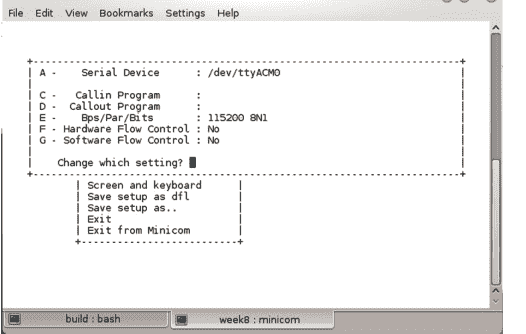

图 4.1 Minicom 串行端口设置菜单。

输入 “E” 然后输入 “T” 以选择 115200 波特率。确保硬件和软件流控制都设置为 “no”。这些是切换开关。输入 “F” 或 “G” 会将相应的值在 “yes” 和 “no” 之间切换。图 4.1 显示了最终的串行端口配置。

按 <Enter> 退出 Serial port setup，然后选择 **Modem and dialing**。在这里，我们要删除调制解调器的 Init string 和 Reset string，因为它们在直接串行连接中只是碍事。输入 “A” 并退格删除整个 Init string。输入 “B”，并对 Reset string 执行相同操作。此菜单中的其他字符串无关紧要，因为它们永远不会被调用。

按 <Enter> 退出 Modem and dialing，然后选择 **Screen and keyboard**。输入一次 “B” 将 Backspace 键从 BS 更改为 DEL。

按 <Enter> 退出 Screen and keyboard。选择 **Save setup as dfl (default)**。然后选择 **Exit**。

此时，`/dev/ttyACM0` 尚不存在，因为你还没有给目标板供电。但如果它存在，你会发现只有所有者和组对该设备有访问权限。为了获得对该端口的访问权限，你必须成为 dialout 组的成员。

过去有一个漂亮的图形对话框，可以从开始菜单下的 Administration > Users and Groups 访问，使这个过程非常简单。现在没有那种对话框了。现在你必须编辑 `/etc` 下的相应文件，在这种情况下是 `group`。以 root 用户身份，在编辑器中打开 `/etc/group`。找到以 “dialout:” 开头的行，并在该行末尾添加 “:<your_user_name>”。保存文件并关闭编辑器。

### 网络

主机网络配置需要做一些更改。

#### 网络地址

你的工作站很可能配置为通过 DHCP（动态主机配置协议）获取网络地址。但在这种情况下，为了简化问题，我们将为工作站和目标指定固定的 IP 地址。

CentOS 用于更改网络参数的图形菜单通过 Settings -> System Settings 访问。³ 选择 Network Settings 以及 Wired 或 Wireless 选项卡，具体取决于你的网络连接类型。对于虚拟机，即使是无线接口在客户端操作系统中看起来也像有线接口。

选择网络接口并单击 Edit... 你的网络接口可能命名为类似 `enp0s8` 的名称，这意味着它是一个连接到 PCI 总线段 0 的插槽 8 上的以太网设备 (en)。将 Method 从 DHCP 更改为 Manual。现在输入固定的 IP 地址。网络地址 `192.168.1` 是一个很好的选择，因为它是为局域网保留的一组网络地址之一。为你的工作站选择节点 `2`。子网掩码会自动填充。图 4.2 显示了最终结果。如果你连接到互联网，可能还想设置默认网关地址和 DNS 节点。

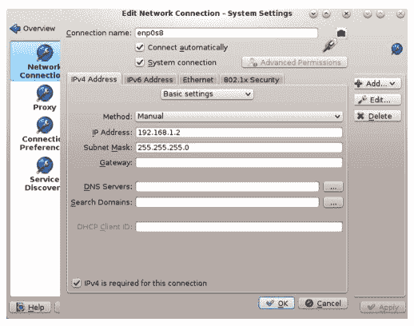

图 4.2 编辑网络设备对话框。

当你退出 *Edit Network Connections* 对话框时，会出现一个关于 KDE Wallet 系统的对话框，要求你选择一种加密方法。说实话，我从未理解 KDE Wallet 系统是怎么回事，也从未使用过它，所以我只需在此处单击 Cancel。

或者，你可以直接进入并直接编辑网络设备参数文件。网络配置参数位于 `/etc/sysconfig/network-scripts/` 中，在那里你应该找到一个名为类似 `ifcfg-enpo8` 的文件，其中包含网络适配器 `enpo8` 的参数。你可能想复制一份此文件并将其命名为类似 `dhcp-ifcfg-enpo8` 的名称。这样，如果需要，你将拥有一个用于未来使用的 DHCP 配置文件。现在，以 root 用户身份使用编辑器打开原始文件。它应该看起来像清单 4.1A 中的样子。此处显示的各行的顺序可能不同，并且可能与其他行穿插。

将行 `BOOTPROTO=dhcp` 更改为 `BOOTPROTO=none`，并添加清单 4.1B 中显示的两个新行。删除关于 PEERDNS 和 PEERROUTES 的行。

| TYPE=Ethernet
BOOTPROTO=dhcp
DEFROUTE=yes
IPV4_FAILURE_FATAL=yes
IPV6INIT=no
NAME=enp0s8
UUID=27db13eb-6a1d-41e5-88bc-de3a6aa0895
ONBOOT=yes
PEERDNS=yes
PEERROUTES=yes |

| TYPE=Ethernet
BOOTPROTO=none
DEFROUTE=yes
IPV4_FAILURE_FATAL=yes
IPV6INIT=no
NAME=enp0s8
UUID=27db13eb-6a1d-41e5-88bc-de3a6aa0895
ONBOOT=yes
IPADDR=192.168.1.2
PREFIX=24 |

清单 4.1: (A) ifcfg-eth0; (B) 修订后的 ifcfg-eth0。

### 无线网如何？

就个人而言，我在 Linux 中直接配置无线网络端口时从未成功过。但无线端口在虚拟机环境中工作正常，因为虚拟机管理器虚拟化网络接口，使其在客户机中看起来像其他东西。例如，VirtualBox 将任何物理网络接口转换为 Intel 82540EM 千兆以太网接口。

拥有两个接口可能非常有用。例如，你可以让无线端口保持连接到你的网络并通过 DHCP 获取 IP 地址，然后按照上述方法重新配置以太网端口，以便专门用于与目标板的连接。例如，我的网络是 `192.168.1`。我将目标板插入交换机。路由器中的 DHCP 服务器分配节点地址，范围从 100 到 199。我笔记本电脑上的 Windows 主机操作系统从 DHCP 获取其 IP 地址。Linux 客户机的地址由此处描述的过程固定，一切都运行良好。

### 网络文件系统

我们使用 NFS（网络文件系统）来挂载目标板的根文件系统。⁴ 这样做的原因在我们从第 7 章“访问硬件”开始开发应用程序时将变得明显。这意味着我们必须“导出”工作站上的一个或多个目录，以便它们在网络上可见。

⁴ Ubuntu 发行版默认未安装 NFS。执行 `sudo apt-get install nfs-kernel-server` 来安装它。


导出的目录在文件 `/etc/exports` 中指定。该文件可能已经存在，但此时内容为空。以 root 用户身份打开该文件，添加以下行：

```bash
/home/<your_home_name>*(rw,no_root_squash,sync,no_subtree_check)
```

用你的主目录名称替换 `<your_home_name>`。这将使你的主目录在网络上可见，其他节点可以将其部分挂载到本地文件系统中。“*” 代表被允许挂载此目录的客户端。在这种情况下，该目录对网络上的任何机器都可见。你可以使用 DNS 名称或 IP 地址（例如 machine1.intellimatrix.us，或 192.168.1.50）来指定特定的机器。你还可以通过提供网络地址和网络掩码来指定给定网络上的所有机器，例如 192.168.1.0/255.255.255.0。

括号内的选项描述了客户端机器如何访问该目录。此处显示的选项有：

- **rw：** 允许读写访问。或者，你可以指定 `ro` 为只读。
- **no_root_squash：** 默认情况下，客户端机器上 root 用户发出的文件请求在服务器上被视为来自用户 `nobody`。如果指定了 `no_root_squash`，客户端上的 root 用户将拥有与服务器 root 用户相同的访问级别。这可能带来安全隐患，但在某些情况下是必需的。
- **sync：** 通常，文件写入是异步的，这意味着当 NFS 将请求移交给文件系统时，客户端会被告知写入已完成，但此时数据尚未实际到达最终目的地。`sync` 选项会等待操作真正完成。
- **no_subtree_check：** 如果仅导出了卷的一部分，一个名为子树检查（subtree checking）的例程会验证请求的文件是否位于导出的部分中。如果导出整个卷，或者你不关心此检查，禁用子树检查会提高传输速度。

NFS 对文件的格式比较挑剔。最后一行必须以换行符结尾，括号内不允许有空格。

配置好 exports 文件后，我们需要确保 NFS 实际上正在运行。在 CentOS 中，我们使用 `systemctl` shell 命令来做到这一点，如 Fig. 4.3 所示，该图显示了 NFS 服务器正在运行时的结果。完整命令是：

```bash
systemctl status nfs-server
```

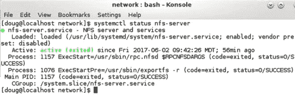


**图 4.3** Systemctl 命令。

`systemctl` 是 systemd 系统和守护程序管理器的用户界面。`systemctl` 的参数是一个命令和一个服务的名称，该服务由 `/usr/lib/systemd/system` 中的一个脚本文件表示。如果 NFS 服务器未运行，你可以使用此命令启动它：

```bash
systemctl start nfs-server
```

要停止它，请执行：

```bash
systemctl stop nfs-server
```

例如，如果你对 `/etc/exports` 进行了修改，你需要重启 NFS 以使更改生效：

```bash
systemctl restart nfs-server
```

查看 `/usr/lib/systemd/system` 目录，你会发现一个名为 `nfs-server.service` 的脚本文件。查看该文件以了解其工作原理。

## Trivial File Transfer Protocol（简单文件传输协议）

本章的最后一项工作是安装（如果需要）并启用 TFTP，即 Trivial File Transfer Protocol（简单文件传输协议）。我们在构建新的 Linux 内核时会用到它。

顾名思义，TFTP 是一种简单的文件传输协议，可以用相对少量的内存实现。因此，它适用于启动没有本地大容量存储的设备等场景。它使用 UDP 数据报，因此提供自身的简化会话和传输机制。它不提供身份验证或加密机制，因此在安全性至关重要的情况下不应使用。

工作站将作为我们的 TFTP 服务器，正如它提供 NFS 服务器功能一样。一些发行版默认不安装 TFTP 服务器，因此你需要自行安装。就像我们之前对 `minicom` 所做的那样，CentOS 用户可以执行 `yum install tftp-server`，而 Ubuntu 和 Debian 用户可以执行 `apt-get install tftp-server`。

TFTP 是由 `xinetd`（eXtended InterNET Daemon，扩展网络守护程序）管理的多种网络协议之一。`xinetd` 具有访问控制机制，如 TCP Wrapper ACL、广泛的日志记录功能，以及基于时间使服务可用的能力。它可以限制系统可以启动的服务器数量，并具备可部署的防御机制来保护系统免受端口扫描器等的攻击。

安装完成后，需要启用 TFTP。我们通过编辑文件 `/etc/xinetd/tftp` 来实现这一点。你需要具有 root 用户权限才能保存任何更改。找到以“disable =”开头的行，并将“yes”更改为“no。”

在查看此文件时，还请注意以 `server_args = .` 开头的行。此行的参数是 TFTP 传输的默认目录。在当前的 CentOS 中，它是 `/var/lib/tftpboot`。你需要通过 TFTP 下载到目标板上的任何文件都需要复制到该目录中。但此目录属于 root，且不可被所有用户写入。因此，你需要以 root 用户身份执行以下命令使其可被所有人写入：

```bash
chmod 777 /var/lib/tftpboot
```

我们现在几乎已经拥有了用于嵌入式开发的主工作站所需的所有内容。在下一章中，我们将深入探讨开源集成开发环境 Eclipse，这将大大提高应用开发的效率。之后，我们将设置目标硬件。

## Resources（资源）

- https://www.elsevier.com/books-and-journals/book-companion/9780128112779 — Elsevier 网站上的书籍主页
- crossstool-ng.org — Crosstool-NG 工具链构建器的网站。
- beagleboard.org — BeagleBoard 整个产品系列的网站。除此之外，这里还有 BeagleBone Black 分销商的链接。
- Mecklenburg, Robert, *Managing Projects with GNU Make*（*使用 GNU Make 管理项目*），第 3 版，O’Reilly，2005 年。当你准备充分理解并挖掘 `make` 的强大功能时，这是必看的圣经级著作。

# CHAPTER 5（第 5 章）

## Eclipse 集成开发环境¹

- **本章大纲**
    - **概述** 68
        - 插件 70
        - 工作台 71
    - **安装** 72
    - **使用 Eclipse** 73
    - **C 开发环境 (CDT)** 73
        - 创建新项目 74
        - 向项目添加源代码 76
        - 内容辅助 76
        - 代码模板 76
        - 自动闭合 77
    - **该程序** 78
    - **构建项目** 78
    - **使用 CDT 进行调试** 79
        - 调试视图 81
        - 变量视图 82
        - 断点视图 82
        - 内存视图 83
    - **完成调试** 84
    - **附加插件** 84
    - **总结** 85
    - **资源** 86

你可以花整整一天时间来定制标题栏。相信我。我是深有体会。

Matt Welsh

¹ 本章部分内容改编自 *Eclipse Platform Technical Overview*（《Eclipse 平台技术概览》），© IBM Corporation 和 The Eclipse Foundation，2001, 2003, 2006，并根据 Eclipse 公共许可证 (EPL) 发布。完整文档可在此处获取：https://eclipse.org/articles/Whitepaper-Platform-3.1/eclipse-platform-whitepaper.html。

集成开发环境 (IDE) 是提高生产力的绝佳工具。桌面开发者多年来一直在使用它们。最常见的例子之一是 Microsoft 的 Visual Studio 环境。过去，许多嵌入式工具供应商都构建了专有的 IDE。

在开源世界中，当今首选的 IDE 是 Eclipse，也被称为 Eclipse 平台，有时简称为 Platform。该项目由 Object Technology International 发起，该公司后来被 IBM 收购。2001 年底，IBM 和几家合作伙伴成立了一个协会，以推广和开发 Eclipse 作为开源项目。现在，它由 Eclipse 基金会维护，该基金会是一个由软件行业供应商组成的非营利联合体。几家领先的嵌入式 Linux 供应商，如 Monta Vista、TimeSys、LinuxWorks 和 Wind River Systems，已采纳 Eclipse 作为其未来 IDE 开发的基础。

我甚至可以说，Eclipse 是最专业、管理最有序的开源项目。每年 6 月中旬，该基金会都会发布平台及大多数相关项目的主要新版本，持续了 10 多年，代码量达到 2000 万到 3000 万行。直到 2011 年，这些发布版都以木星卫星的字母顺序命名。2010 年的发布版名为 Helios。2011 年的发布版打破了这一传统，名为 Indigo。

需要注意的是，Eclipse 并不局限于在 Linux 下运行。它在各种 Windows 操作系统下同样运行良好。

## 概述

“Eclipse 是一种通用工具平台——一个开放的、可扩展的 IDE，适用于任何事物，也不特别专注于某事。根据平台自身的在线概述，它提供了一个功能丰富的开发环境，使开发人员能够高效地创建无缝集成到 Eclipse 平台中的工具。” 技术上讲，Eclipse 本身并不是一个 IDE，而是一个用于开发 IDE 和富客户应用程序的开放平台。

Fig. 5.1 展示了基本的 Eclipse 工作台。它包含几个视图，包括：

- 导航器（Navigator） – 显示用户工作区中的文件；
- 文本编辑器（Text Editor） – 显示文件的内容；
- 任务（Tasks） – “待办事项”列表；
- 大纲（Outline） – 正在编辑的大纲文件。大纲视图的内容是特定于内容的。

尽管 Eclipse 内置了许多功能，但其中大部分功能都非常通用。需要额外的工具来扩展平台，以处理新的内容类型，对现有内容类型执行新的操作，并将通用功能聚焦于特定事物。


# 图 5.1
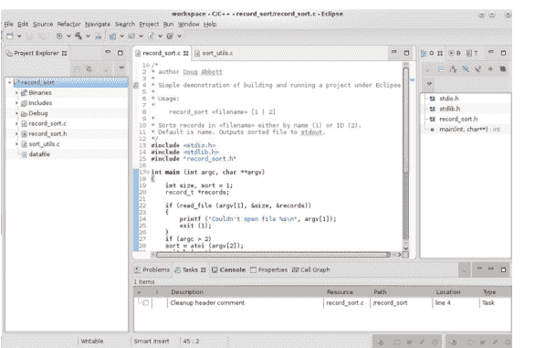

Eclipse 平台建立在一种发现、集成和运行模块的机制之上，这些模块被称为 *plug-in*（插件）。工具提供商将工具编写为独立的插件，该插件对工作区中的文件进行操作，并在工作台中展示其特定的用户界面。当你启动 Eclipse 时，它会呈现一个由可用插件集合组成的 IDE。

Eclipse 平台主要由 Java 编写，实际上最初是作为 Java 开发工具设计的。图 5.2 展示了平台的主要组件和应用程序编程接口（API）。平台的主要角色是为工具开发人员提供用于创建无缝集成工具的机制和必须遵循的规则。这些机制通过定义明确的 API 接口、类和方法来暴露。平台还提供了有用的构建块和框架，以简化新工具的开发。

Eclipse 的设计和构建旨在满足以下要求：

- 支持构建各种用于应用程序开发的工具。
- 支持不受限制的工具有提供商集合，包括独立软件供应商。
- 支持操作任意内容类型的工具，例如 HTML、Java、C、JSP、EJB、XML 和 GIF。
- 促进不同内容类型和工具提供商之间工具的无缝集成。
- 支持基于 GUI 和非 GUI 的应用程序开发环境。
- 在广泛的操作系统上运行，包括 Windows 和 Linux。
- 利用 Java 编程语言在编写工具中的普及性。

## 图 5.2
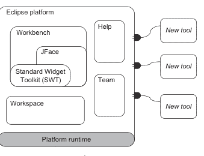

Eclipse 平台。

### 插件

*Plug-in*（插件）是可以单独开发和交付的 Eclipse 功能的最小单位。一个小型工具通常被编写为单个插件，而一个复杂的工具的功能可能会分布在多个插件中。除了一个称为平台运行时的小型内核外，Eclipse 平台的所有功能都位于插件中。

插件用 Java 编码。一个典型的插件由 JAR 库中的 Java 代码、一些只读文件以及其他资源（如图像、Web 模板、消息目录、本地代码库等）组成。有些插件根本不包含代码。例如，一个以 HTML 页面形式提供在线帮助的插件。单个插件的代码库和只读内容位于文件系统的同一个目录中，或者位于服务器上的基础 URL。

每个插件的配置由一对文件描述。*manifest*（清单）文件 `manifest.mf` 声明了关于插件的基本信息，包括 *name*（名称）、*version*（版本）以及对其他插件的依赖关系。第二个可选文件 `plugin.xml` 声明了插件与其他插件之间的互连。互连模型很简单：插件声明任意数量的命名 *extension points*（扩展点），以及对其他插件中一个或多个扩展点的任意数量的 *extensions*（扩展）。

扩展点可以由其他插件扩展。例如，工作台插件声明了一个用于用户首选项的扩展点。任何插件都可以通过定义对此扩展点的扩展来贡献自己的用户首选项。

### 工作台

Eclipse *workbench*（工作台）API、用户界面（UI）和实现由两个工具包构建：

- 标准小部件工具包（SWT）– 一个与本地窗口系统集成的小部件集和图形库，但具有操作系统无关的 API。
- JFace – 一个使用 SWT 实现的 UI 工具包，简化了常见的 UI 编程任务。

与 SWT 和 JFace 这两种通用的 UI 工具包不同，工作台提供了 Eclipse 平台的 UI 个性，并提供了工具与用户交互的结构。由于这种核心和定义性的角色，工作台与整个 Eclipse 平台 UI 是同义的，也与您看到平台运行时的主窗口同义（参见图 5.1）。工作台 API 依赖于 SWT API，在较小程度上依赖于 JFace API。

Eclipse 平台 UI 范式基于编辑器、视图和视角。从用户的角度来看，工作台窗口在视觉上由视图和编辑器组成。视角体现在屏幕上可见的编辑器和视图的选择和排列上。

*编辑器* 允许你打开、编辑和保存对象。它们遵循打开-保存-关闭的生命周期，很像基于文件系统的工具，但更紧密地集成到工作台中。当激活时，编辑器可以向工作台菜单和工具栏贡献操作。平台为文本资源提供了标准编辑器；其他插件提供更具体的编辑器。

*视图* 提供关于你正在处理的某些对象的信息。视图可以通过提供正在编辑的文档的信息来辅助编辑器。例如，标准内容大纲视图显示活动编辑器内容的结构化大纲（如果可用）。视图可以通过提供当前选中对象的信息来增强其他视图。例如，标准属性视图展示在另一个视图中选中的对象的属性。平台提供了几个标准视图；更多的视图由其他插件提供。

工作台窗口可以拥有几个不同的 *视角*，但在任何给定时刻只有一个可见。每个视角都有自己排列（平铺、堆叠或分离）以在屏幕上呈现的视图和编辑器，尽管有些可能是隐藏的。在一个视角中，可以同时打开几种不同类型的视图和编辑器。视角控制初始视图可见性、布局和操作可见性。你可以快速切换视角以处理不同的任务，并可以轻松重新排列和自定义视角以更好地适应特定任务。平台为常规资源导航、在线帮助和团队支持任务提供了标准视角。其他插件提供额外的视角。

插件工具可以增强现有的编辑器、视图和视角以：

- 向现有视图的本地菜单和工具栏添加新操作。
- 当现有编辑器变为活动时，向工作台菜单和工具栏添加新操作。
- 向现有视图或编辑器的弹出内容菜单添加新操作。
- 向现有视角添加新视图、操作集和快捷键。

### 安装

Eclipse 有两部分：Eclipse 本身和 Java 运行时引擎（JRE）。从 eclipse.org 下载 Eclipse。有几个版本可供选择。由于我们感兴趣的是 C 开发，请获取 Eclipse IDE for C/C++ Developers（Eclipse C/C++ 开发者 IDE）。

你可以将 Eclipse 放在任何你喜欢的地方。我选择将其安装在 /usr/local。解压后，你会发现一个新子目录，不出所料，名为 eclipse/。

由于 Eclipse 主要由 Java 编写，你需要一个 JRE 来支持它。大多数现代 Linux 发行版默认安装 JRE，但它可能不与 Eclipse 兼容。CentOS 7 提供的版本工作正常。如有必要，从 Oracle（前身为 Sun Microsystems）下载最新版本。下载可用二进制可执行文件或 RPM 包。将其复制到你喜欢的任何位置并执行它。/usr/local 是一个好地方。你会被要求阅读并接受 Java SE 运行时环境（JRE）版本 6 的二进制代码许可协议。你需要将新安装的 JRE 的 bin/ 目录添加到你的 PATH。

就是这样！Eclipse 已安装并准备就绪。在 shell 窗口中，cd 到 eclipse/ 目录并执行 ./eclipse。从其他任何地方，输入 eclipse 可执行文件的完整路径。或者，只需在 K 桌面环境文件管理器窗口中双击它。

或者，更好的一点是，在目录 `/usr/bin` 中创建一个名为 **eclipse** 的脚本文件。它包含以下内容：

```bash
#!/bin/bash
/usr/local/eclipse/eclipse &
```

第一行将此文件标识为 shell 脚本。第二行执行 Eclipse。“&”表示在后台运行此程序并返回 shell 提示符。由于 `/usr/bin` 在你的路径中，你只需要输入 **eclipse**。

### 使用 Eclipse

每次 Eclipse 启动时，它都会要求你选择一个 *workspace*（工作区），这是存放你项目文件的地方。默认值是主目录下的一个名为 *workspace*/ 的目录。在 *workspace*/ 下是每个项目的子目录。在工作区对话框之后，如果你第一次执行 Eclipse，你会看到欢迎屏幕。在随后的运行中，Eclipse 直接在工作台中打开，但你始终可以通过帮助菜单上的第一项，欢迎，访问此窗口。

欢迎屏幕上的教程图标引导你进入一个非常好且非常详尽的使用 Eclipse 的介绍。如果你对 Eclipse 环境不熟悉，我强烈建议你过一遍。在这里重复它没有意义。去吧，我会等待。

好的，现在你对通用 Eclipse 操作有了相当好的理解。是时候更具体一点，并将我们所学到的应用到嵌入式系统的 C 软件开发中。由于你正在运行 CDT 版本的 Eclipse，你将最初看到 **C/C++** 视角。

### C 开发环境（CDT）

在 Eclipse.org 的持续项目中包括工具项目。其一个子项目是 **C/C++ Development Tools (CDT)**（C/C++ 开发工具）项目，该项目为 Eclipse 平台构建了一个功能完整的 C 和 C++ IDE。Linux 下的 CDT 基于 GNU 工具，并包括：

- **C/C++** 编辑器，带有语法着色；
- **C/C++** 调试器，使用 GDB；
- **C/C++** 启动器，用于外部应用程序；
- 解析器；
- 搜索引擎；
- 内容助手提供程序；
- Makefile 生成器。


## 创建新项目

在我们关于创建 C/C++ 项目的初步练习中，我们将创建一个相当简单的记录排序应用程序。待排序的记录由姓名和 ID 号组成。为了简化代码，我们将用下划线替换姓名字段中的空格。该程序将按升序排序一个记录文件，可以按照姓名或 ID 号排序，具体方式由命令行指定如下：

```
record_sort <datafile> [ 1 | 2 ]
```

其中 1 表示按姓名排序，2 表示按 ID 排序。如果未提供排序参数，则默认按姓名排序。

在 Eclipse C/C++ 视角中，选择 `File>New>C Project`。这将打开如图 5.4 所示的新项目向导。将其命名为 "record_sort"。项目类型为 `Executable>Empty Project`。工具链为 `Linux GCC`，我们将使用默认的工作区位置。点击 `Next` 会打开选择配置（Select Configurations）对话框，你可以在其中选择调试（Debug）和发布（Release）配置中的一种或两种。稍后你可以选择构建这些配置中的任意一个。它们之间的主要区别在于，Debug 配置在构建时开启了编译器的调试标志 "-g"，以便向 GDB 提供符号信息。而 Release 配置则不包含调试标志（图 5.4）。

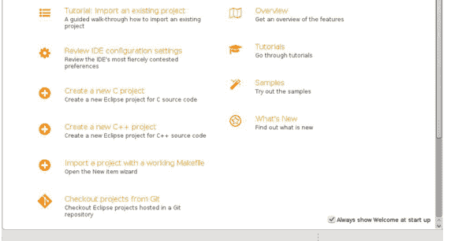

**图 5.3**  
Eclipse 欢迎屏幕。

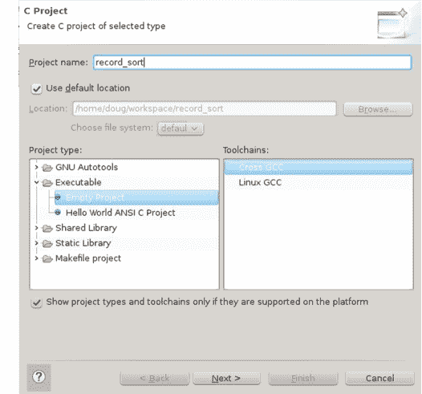

**图 5.4**  
新项目向导。

当你在“新项目向导”中点击 *Finish* 时，你会在“项目资源管理器”（Project Explorer）视图中找到一个条目。在 *record_sort* 项目下唯一的项是 *Includes*，它是一个用于搜索头文件的路径列表。

在此时，查看目录 *workspace/record_sort/* 会很有帮助。其中仅包含两个文件：*.cproject* 和 *.project*，这两个都是描述项目的 XML 代码。`.project` 为 Base Eclipse 平台提供配置信息，而内容更丰富的 `.cproject` 文件则为 CDT 提供信息。无需理解这些文件的内容，但了解它们的存在是有用的。

### 向项目添加源代码

基本上有两种方法可以向 C 项目添加源代码。当然，你可以在编辑器窗口中创建一个新文件，或者可以*导入现有文件*到项目中。执行 `File > Import...` 以打开导入选择对话框。展开 General 类别，并选择 File System。点击 *Next*，然后点击 *Browse*，导航至 `samples/record_sort` 并点击 *OK*。

这将打开导入对话框。选中全部三个文件并点击 *Finish*。这些文件现在会显示在“项目资源管理器”视图中。请注意，没有 `record_sort.c` 文件。这是因为你要自己输入它，以练习使用 CDT 编辑器。

点击工具栏左侧 New 图标旁边的向下箭头，并从下拉菜单中选择 *Source File*。将其命名为 "record_sort.c"。一个编辑器窗口将打开，其中包含一个初步的头注释。`record_sort.c` 的内容如图 5.5 所示，但在阅读下一节之前请勿开始输入。

### 内容辅助

CDT 编辑器具有多种功能，可以简化你的编码生活。这些功能统称为*内容辅助*（Content Assist）。内容辅助的基本思想是，基于当前上下文、作用域和前缀预测你可能输入的内容，从而减少你需要输入的按键次数。通过输入 `Ctrl + Space` 即可调用内容辅助，当你在 `struct` 或 `class` 名称后输入 "."、"->" 或 ":" 时，它也会自动激活。

### 代码模板

*代码模板*是内容辅助的一个组成部分，它提供了常用代码段的起始点。当你输入字母组合后按 `Ctrl + Space` 时，将显示以该字母组合开头的代码模板列表。选择一个模板后，它会自动插入到文件当前光标所在的位置。

试一试：在输入完图 5.5 中的 `#include` 行后，输入 "ma" 然后按 `Ctrl + Space`。这将调出 `main()` 函数的模板。你可以在 `Window > Preferences > C/C++ > Editor > Templates` 中编辑模板。内容辅助的其他方面也可以在偏好设置（Preferences）中进行自定义。

```c
/**
 * author Doug Abbott
 *
 * Simple demonstration of building and running a project under
 * Eclipse.
 *
 * Usage:
 *     record_sort <filename> [1 | 2]
 *
 * Sorts records in <filename> either by name (1) or ID (2).
 * Default is name.  Outputs sorted file to stdout.
 */
#include <stdio.h>
#include <stdlib.h>

#include "record_sort.h"

int main (int argc, char **argv)
{
    int size, sort = 1;
    record_t *records;

    if (read_file (argv[1], &size, &records))
    {
        printf ("Couldn't open file %s\n", argv[1]);
        exit (1);
    }
    if (argc > 2)
        sort = atoi (argv[2]);

    switch (sort)
    {
        case 1: sort_name (size, records);
        break;

        case 2: sort_ID (size, records);
        break;

        default:
        printf ("Invalid sort argument\n");
        return_records (size, records);
        exit (2);
    }

    write_sorted (size, records);
    return_records (size, records);
    return 0;
}
```

**图 5.5**  
record_sort.c.

### 自动闭合

当你输入时，请注意，每当你输入一个开引号（''）、括号（()）、方括号（[]）或尖括号（<>）、或大括号（{}），编辑器会自动添加对应的闭合字符，并将光标定位在两者之间。在括号内输入所需的内容，然后按 *Enter*。这将把光标定位在闭合字符之后。

但是，如果你将光标移出括号包围的空间，例如为了复制和粘贴一些文本，`Enter` 键将恢复其正常行为，即开始新行。

对于左大括号，右大括号的位置将根据当前选定的编码风格进行调整，并且光标会正确缩进。

最后，请注意，随着你的输入，大纲（Outline）视图中会出现相应的条目，标识头文件、函数以及（如果有的话）全局变量。

### 程序

在继续进行项目的构建和运行之前，让我们仔细看看程序实际上做了什么。`main()` 本身相当简单。它只是一组对声明在 `sort_utils.c` 中执行实际工作的函数的调用。

函数 `read_file()` 读取一个数据文件，假设该文件组织为每行一个记录，其中记录包含文本姓名和数字 ID。它为记录数组分配内存，并为每个姓名字段进行单独分配。

有两个排序函数——一个按姓名字段排序，另一个按 ID 字段排序。这两个都实现了 Shell 排序算法，该算法以其发明者 Donald Shell 命名。Shell 排序通过比较间隔几个位置的元素，相比简单的插入排序提高了性能。

在记录数组排序完成后，`write_sorted()` 将其写入 `stdout`。当然，这可以重定向到文件。

最后一步是在函数 `return_records()` 中释放所有已分配的内存。

该程序几乎没有任何“合理性检查”，如果你愿意，可以自行构建一些。此外，错误检查也非常少。

### 构建项目

一旦你完成并保存了 `record_sort.c` 文件，下一步就是构建项目。在项目内创建或导入的所有文件都自动成为其一部分，并会被构建和链接到最终的可执行文件中。

在“项目资源管理器”视图中，选择顶级的 `record_sort` 条目。然后执行 `Project > Build Project` 或右键选择 `Build Configurations > Build > All`。在前一种情况下，将构建 `Active Configuration`（活动配置）。默认情况下这是 Debug 配置。可以通过执行 `Project > Build Configurations > Set Active` 来更改活动配置。


在后一种情况下，将同时构建调试（Debug）和发布（Release）配置。无论哪种情况，在项目资源管理器（Project Explorer）视图中，`record_sort` 下都会出现一到两个新条目。这些条目分别代表名为 `Debug` 和 `Release` 的子目录，它们分别保存对应构建配置的对象文件和可执行文件。每个目录中还包含一个 makefile 和一些 Eclipse 专用文件。

最初，构建将失败，因为 `sort_utils.c` 中内置了一些编译时错误和警告。打开“问题”（Problems）视图，展开“错误”（Errors）条目，右键单击显示“`record_t` has no member named ‘id’.”的条目。选择“转到”（Go To）以打开 `sort_utils.c`（如果尚未打开），并突出显示出现错误的行。修正方法应该相当明显。

Eclipse CDT 通过多种不同的方式识别构建问题。在项目资源管理器视图中，存在错误的项目和源文件会被标记为红色 X 图标，而表示警告的则是一个带有“!”的黄色盾牌图标。当在编辑器中打开包含错误或警告的源文件时，标签页会显示相同的符号。随后，大纲（Outline）视图使用相同的图标来指示文件中哪些函数存在错误或警告。

编辑器窗口使用相同的图标来标识每个错误或警告发生的行。你可以滚动源文件，单击显示警告或错误图标的行，“问题”视图将跳转到相应的条目。如果将光标悬停在被标识为错误或警告的行上，对应的错误消息会弹出显示。

修正这些问题并再次构建项目。顺便提一下，默认情况下 Eclipse *不会* 在构建前自动保存已修改的文件。你必须手动保存它们。此行为可以在首选项中更改。保存 `sort_utils.c` 并再次运行构建。这次它应该成功，你会看到可执行文件出现在项目资源管理器视图中的调试（Debug）树中。

在继续讨论调试之前，你可能希望在编辑器中开启行号显示，因为我们在后续过程中会引用行号。在编辑器窗口中，在左侧称为标记栏（marker bar）的垂直栏中右键单击。其中一个选项是“显示行号”（Show Line Numbers）。点击它。这是一个全局参数。它适用于当前在编辑器中打开的任何文件，以及随后打开的文件。

## 使用 CDT 进行调试

CDT 与 Gnu 调试器 GDB 集成得非常完美。像大多数 Unix 工具一样，GDB 本身是面向命令行的。Eclipse 围绕原生接口提供了一个非常精美的图形包装器，因此你不需要记住所有这些命令。

在我们开始调试之前，必须创建一个*调试启动配置*。执行“运行”（Run）> “调试配置...”（Debug Configurations ...）。选择 C/C++ 应用程序，并点击左上角的“新建”（New）按钮。

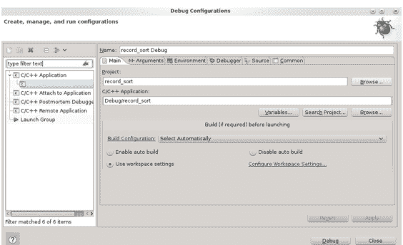

**图 5.6**  
调试配置对话框。

这将弹出图 5.6 中所示的调试配置对话框。所有内容已经正确填写。我们只需要添加一项。选择“参数”（Arguments）选项卡，并在“程序参数：”（Program arguments:）窗口中输入“\-datafile”。*datafile* 是一组用于排序的示例数据记录。它已随 `sort_utils.c` 和 `record_sort.h` 一起导入到项目中。

点击 **应用**（Apply），然后点击 **调试**（Debug）。系统会询问你是否打开调试透视图（Debug perspective）。是的，你需要打开。你最好勾选“记住我的决定”（Remember my decision）复选框，这样就不会再被此消息打扰了。

图 5.7 展示了初始的调试透视图。底部有一个控制台（Console）窗口，终端 I/O 在此处进行。编辑器窗口显示 `record_sort.c`，其中 `main()` 的第一行被突出显示。右侧的大纲（Outline）选项卡列出了 `record_sort.c` 包含的所有头文件，以及文件中声明的所有全局和外部符号，包括变量、常量和函数。

右上角有一组选项卡，提供一系列调试信息，包括局部变量、断点和寄存器。当然，最初所有局部变量都具有随机值，因为它们在栈上分配。左上角调试（Debug）选项卡下方是一组执行图标。点击“单步跳过”（Step Over）图标。编辑器窗口中的高亮行进到下一行，*Variable* 视图中 *sort* 显示其初始值 1。该值以黄色突出显示，因为自上次调试器挂起以来它发生了变化。你只需将光标悬停在任何变量上即可看到其当前值。试试看。

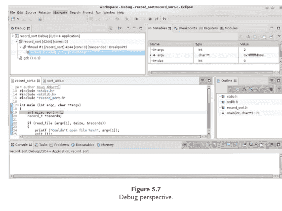

现在，请通过点击主工具栏中的“恢复”（Resume）图标让程序继续运行。嗯，我们得到的结果与预期不完全一致。*datafile* 有 12 条记录，但只有 1 条记录输出到控制台视图。这是因为程序中内置了一些运行时错误，以便提供一些使用调试器的练习机会。

## 调试视图

在调试（Debug）视图中，右键单击顶级项目条目并选择 *重新运行*（Relaunch）以开始另一次调试运行。如 *图 5.8* 所示，调试视图以层级形式显示程序状态。层级顶部是一个*启动实例*（launch instance），即由名称标识的启动配置的实例。其下是调试器实例，由调试器名称标识，在本例中为 *gdb*。调试器之下是受调试器控制的程序线程。对于 *record_sort*，只有一个线程。稍后我们将看到 gdb/Eclipse 如何处理多线程程序。

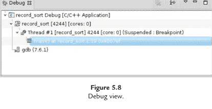

最后，在最底层是线程的栈帧（stack frames），由函数名、源代码行和程序计数器标识。目前，main() 只有一个栈帧，停在 record_sort.c 的第 22 行。

主工具栏有几个用于管理程序执行的按钮。将光标悬停在它们上面以查看标签。

点击一次“单步跳过”（Step Over），然后点击“单步进入”（Step Into）以进入 read_file() 函数。注意调试视图中出现了第二个栈帧，并且 sort_utils.c 在编辑器中打开。此时，值得仔细查看工作台右上角的四个选项卡视图。

## 变量视图

当在调试视图中选中一个栈帧时，变量视图显示该帧中的所有局部变量。现在你应该在 read_file() 函数中。可见的两个变量都是指针。单击名称左侧的白色箭头以解引用该指针，并显示对应的值。对于字符串变量，完整的字符串会显示在下方的窗口中。

在调试视图中选择 main() 栈帧，并注意变量视图更改为显示 main() 中的局部变量。如果选择了栈帧以外的任何内容，变量视图将变为空白。记住，你只需将光标悬停在变量上即可查看其值。

## 断点视图

要调试 record_sort 中的问题，你可能希望在程序中设置一个或多个断点并观察发生的情况。选择断点视图，目前它是空的，因为我们还没有设置任何断点。

让我们在 sort_utils.c 的第 34 行设置一个断点。这是 read_file() 中 if 语句的开头。在第 34 行的标记栏中右键单击，并选择“切换断点”（Toggle Breakpoint）。出现一个绿色圆圈，表示在此位置设置了一个启用的断点。对勾表示断点已成功安装。

断点视图中出现一个新条目，包含断点的完整路径。复选框显示断点已启用。单击复选框以禁用断点，并注意到标记栏中的圆圈变为白色。禁用的断点会被调试器忽略。再次单击复选框以重新启用它。

点击调试视图工具栏中的“恢复”（Resume），程序将执行到断点处。调试视图中的 [0] 线程条目表明线程已挂起，因为它遇到了断点。点击“单步跳过”（Step Over）以将第一条记录加载到 temp 中。选择变量视图并点击 temp 旁边的白色箭头。现在你可以看到 temp 中各字段的当前值。自上次线程挂起以来值发生变化的变量以黄色突出显示。

断点有一些我们将在后面探索的有趣属性。

## 内存视图

调试透视图底部选项卡窗口中默认还会显示另一个面向调试的视图。内存视图允许你监控和修改进程内存。内存组织为内存监视器列表，每个监视器代表由基地址指定的内存区域。每个内存监视器可以以一种或多种四种预定义格式（称为内存渲染）进行显示。预定义的渲染格式为十六进制（默认）、ASCII、有符号整数和无符号整数。

图 5.9 显示了在 read_file() 中第一次调用 fscanf( ) 后，刚为 temp 分配的区域的内存监视器。内存视图分为两个窗格，一个列出当前活动的监视器，另一个显示所选监视器的渲染


内存视图。


监视器。一个监视器可能启用了多个渲染视图，这些视图将在渲染窗格中以选项卡的形式显示。

前四个字节保存一个指向为名称分配的另一内存区域的指针。请记住，x86 架构是一种“小端序”机器。因此，当内存以此处所示的方式显示时，大多数条目看起来都是“反向”的。

每个窗格都有一组小巧且相当直观的按钮，用于管理该窗格。这些按钮允许你添加或删除监视器或渲染视图，对于监视器而言，还可以删除所有监视器。

## 完成调试

基于对 Eclipse 主要调试功能的了解，你应该能够找到在 `sort_utils.c` 中插入的两个运行时错误。祝你好运。

## 附加插件

有一些额外的插件，我们在目标系统上调试时稍后将会用到。

转到**帮助菜单**并选择 `安装新软件`。这将弹出如图 5.10 所示的对话框。在 `Work with` 下拉框中，选择对应于你的 Eclipse 版本的条目。以我的情况为例，是 `Neon - http://download.eclipse.org/releases/neon`。向下滚动到 `Mobile and Device Development` 并展开该条目。勾选以下复选框：

- * `C/C++ Remote Launch (Requires RSE Remote System Explorer)`
- * `Remote System Explorer End-user Runtime`
- * `Remote System Explorer User Actions`
- * `Target Management Terminal ( Core SDK )`
- * `TCF Remote System Explorer add-in`
- * `TCF Target Explorer`

如果这些选项没有出现在列表中，这意味着这些项目已经安装。展开 `Programming languages` 并勾选以下复选框：

- * `C/C++ Autotools Support`
- * `C/C++ Development Tools`

点击 `下一步` 查看将要安装的项目。再次点击 `下一步`，查看并接受许可证条款。点击 `完成`，安装开始。完成后，Eclipse 会提示你需要重启。

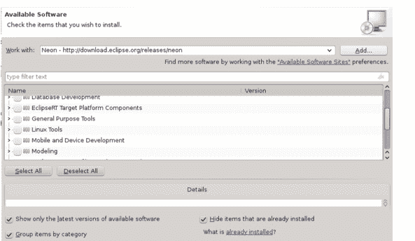

图 5.10
Eclipse 软件安装对话框。

## 总结

依我浅见，Eclipse 是我见过的执行得最专业、最严谨的开源项目。它构思周详，实现一丝不苟。虽然它拥有强大的功能和灵活性，但最常用的操作相对简单且直观。虽然其文档本质上是参考性质的而非教程性的，但仍然是可读的，并且在大部分情况下是准确的。遗憾的是，有太多开源项目无法做到这一点。

插件机制使 Eclipse 具有无限的可扩展性。这为开源和商业扩展提供了机会，以应对各种各样的应用。下面的“资源”部分列出了 Eclipse 插件的仓库。

与本书中的许多主题一样，我们真的只是略知皮毛，重点关注嵌入式开发人员特别感兴趣的领域。但希望这足以激发你进一步深入探索的兴趣。那里还有更多内容。放手去做吧！

我们现在已完全准备好为目标板进行一些真正的编程了。这是下一章的主题。

### 资源

- [www.eclipse.org](http://www.eclipse.org/)
    - Eclipse 基金会的官方网站。这里有很多内容，值得花时间去浏览。我特别推荐 C/C++ 开发者工具包页面。
- [http://marketplace.eclipse.org/](http://marketplace.eclipse.org/)
    - Eclipse 插件。此页面列出了 1000 多个插件，包括商业和开源插件。
- Abbott, Doug, *使用 Eclipse 进行嵌入式 Linux 开发*, Elsevier, 2008. 好吧，这本书有点老了，但它确实对使用 Eclipse 进行嵌入式开发有更详细的介绍。

# 硬件

# 章节大纲

- **ARM 架构** 87
- **开源硬件** 88
  - BeagleBoard 88
  - Gumstix 93
  - Raspberry Pi 95
- **设置 BeagleBone Black** 96
- **闪存与文件系统** 98
  - BeagleBone Black 内存配置 98
- **准备开发板** 98
  - 注意事项 98
  - 启动过程 99
  - 版本 7.4 与版本 8.7 之间的差异 101
  - 根文件系统镜像 101
  - 启动到 NFS 文件系统 103
  - 可能出错的地方？ 103
- **资源** 103

> *谨防携带电烙铁的程序员。*
> *匿名*

嵌入式计算涵盖了极其广泛的硬件范围，从（可能）驱动你自动咖啡机的 8 位处理器，到你手机或平板电脑中的（可能是多核心的）32 位或 64 位处理器，再到运行电信网络的 Massive 并行处理环境。在本章中，我们将开始着手处理嵌入式目标板，我们将在接下来的几章中使用它进行应用程序开发。

## ARM 架构

ARM 是由一家原名为 Advanced RISC Machines 的英国公司 ARM Holdings 开发的 32 位和 64 位精简指令集计算机（RISC）架构。据称，按生产数量计算，它是部署最广泛的 32 位架构。

根据维基百科，截至 2014 年，已生产了超过 50,000,000,000 个 ARM 处理器。

RISC 架构背后的基本思想是，更简单的指令集需要更少的晶体管，从而消耗更少的功率并占用更小的芯片面积。RISC 架构的相对简单性使 ARM 处理器适用于低功耗应用。因此，它们已经主导了移动设备和消费电子市场。大约 98% 的手机至少使用一个 ARM 处理器¹。

ARM Holdings 本身不制造芯片。相反，它将该架构授权给多家半导体制造商，包括 Applied Micro、Atmel、Freescale、Marvell（前身为 Intel）、Nvidia、ST-Ericsson、三星和德州仪器等。

## 开源硬件

开源软件已经存在至少 25 年了。最近，一些团体开始开发开源硬件，通常是基于 ARM 处理器芯片的小型单板计算机。

## BeagleBoard

BeagleBoard 基于 TI（德州仪器）OMAP3530 片上系统（SOC），该系统将 ARM Cortex-A8 CPU 与 TI TMS320C64x 数字信号处理器相结合。它最初由 TI 作为教育工具开发，设计在 Creative Commons 许可下发布。原始的 BeagleBoard 于 2008 年 7 月发布（图 6.1）。

### 规格（*Rev. C4*）

- • 处理器：TI OMAP3530 @ 720 MHz
  - ARM Cortex-A8
  - TMS320C64x + DSP
- • 256 MB RAM
- • 256 MB NAND 闪存
- • 外设连接：
  - 使用 HDMI 连接器的 DVI-D，最大分辨率 1280 × 1024
  - S-video
  - USB 2.0 HS OTG
  - RS-232
  - JTAG
  - SD/MMC 插槽
  - 立体声音频输入和输出
  - 电源：5 VDC，圆口连接器
- • 尺寸：75 mm（约 3 英寸）× 75 mm
- • 建议分销商价格：$125

仅需在 5 V 下消耗 2 W，该板也可以通过其 USB 端口供电。

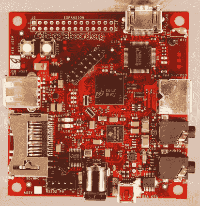

图 6.1
BeagleBoard。

多年来发布了几个版本的 BeagleBoard。这些包括：

**BeagleBoard-xM**

- 处理器：TI DM3730 @ 1 GHz（图 6-2）
  - ARM Cortex-A8
  - TMS320C64x + DSP
- 512 MB RAM
- 4 GB Micro SD 卡，带有 Angstrom Linux 发行版
- 外设连接：
  - 使用 HDMI 连接器的 DVI-D，最大分辨率 1280 × 1024
  - S-video
  - USB 2.0 HS OTG (mini AB)
  - 4 个 USB 端口
  - 以太网
  - RS-232
  - JTAG
  - SD/MMC 插槽
  - 立体声音频输入和输出
  - 相机端口
  - 扩展端口
  - 电源：5 VDC，圆口连接器
- 尺寸：82.5 mm（约 3.25 英寸）× 82.5 mm
- 建议分销商价格：$149

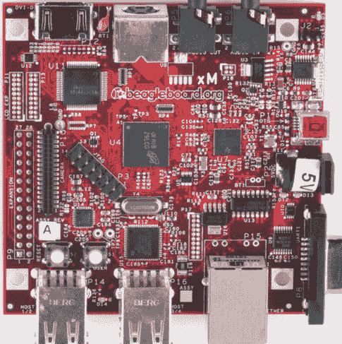

图 6.2
BeagleBoard-xM。

*BeagleBone*

一个“精简”版本（图 6.3）。BeagleBone 配有一对 46 针扩展连接器，可以插入称为“capes”的扩展板。一次最多可以堆叠四个 capes。有大量可用的 capes。请参阅资源部分中列出它们的页面的链接。

- 处理器：TI AM335x ARM Cortex-A8 @ 720 MHz
- 256 MB RAM
- 4 GB Micro SD 卡，带有 Angstrom Linux 发行版
- 外设连接：
  - USB 主机和客户端
  - 以太网
  - 10 针插头上的 RS-232 和 JTAG
  - Micro SD 插槽
  - 电源：5 VDC，圆口连接器
- 尺寸：86 mm（约 3.4 英寸）× 53 mm（约 2.1 英寸）
- 建议分销商价格：$89

*BeagleBone Black*

BeagleBone 的后续产品。Black 版本以更低的price提供更多功能。书中的硬件相关练习是针对 BeagleBone 或 BeagleBone Black（图 6.4）设计的。

- 处理器：TI AM335x ARM Cortex-A8 @ 1 GHz
- 512 MB RAM
- 2 GB（Rev. B）或 4 GB（Rev. C）eMMC 闪存。Rev. B 随 Angstrom 附带，Rev. C 随 Debian 附带
- 外设连接：
  - USB 主机和客户端
  - 以太网
  - Micro SD 插槽
  - Micro HDMI
  - 6 针插头上的 TTL 串行端口


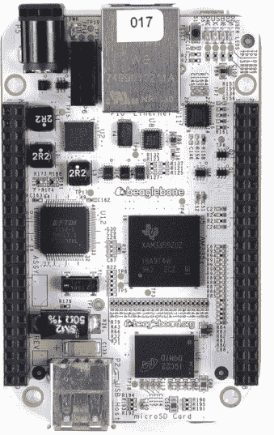

图 6.3
BeagleBone（毕格博恩板）。

- 20 针接头上的 JTAG（未装配）
- 电源：5 VDC、USB、圆口连接器或电池
- 尺寸：86 mm（约 3.4 英寸）× 53 mm（约 2.1 英寸）
- 建议经销商价格：$60

在本书其余大部分章节中，我们将使用 BeagleBone Black 来探索嵌入式 Linux。部分练习需要将电位器连接到模拟输入端。最简单的方法是使用原型扩展板，例如 Sparkfun 提供的那款（参见“资源”部分获取网址）。你还需要订购两个 46 针接头。

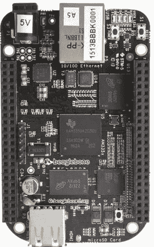

你可能需要的另一个配件是 USB 转串口 TTL 线缆。虽然 BeagleBone Black 在其 USB 客户端上模拟了一个串口，但这无法访问 u-boot 引导加载程序，而我们需要对其进行一些修改。此外，这条线缆也有多个来源，其中包括 Sparkfun。

## Gumstix

Gumstix 系列的单板计算机（SBC）由一家同名的公司生产。该名称来源于板子的尺寸，大约相当于一条口香糖的大小。目前有三条产品线：

- 基于 TI OMAP ARM Cortex A8 处理器的 Overo 系列
    - 512 MB RAM
    - 1 GB NAND 闪存
    - 11 种型号，价格从 $109 到 $179 不等
- 基于 TI OMAP4430 ARM Cortex A9 双核处理器的 DuoVero 系列
    - 1 GB RAM
    - 无内置闪存
    - 3 种型号，价格从 $169 到 $199 不等
- 基于 Marvell PXA270 Xscale 处理器的 Verdex Pro 系列
    - 128 MB RAM
    - 32 MB NOR 闪存
    - 3 种型号，价格从 $129 到 $169 不等

由于体积小巧，计算机主板本身没有任何标准 I/O 连接器。通过两个小型 70 针 AVX 连接器连接到主板，这些连接器与提供常规连接（见图 6.5）的扩展板配合使用。

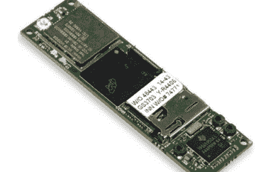

图 6.5
Gumstix Overo。

### 其他规格

- 部分型号支持蓝牙和 802.11 G 无线
- 板载 MicroSD 卡槽
- 尺寸：58 mm（约 2.3 英寸）× 17 mm（约 0.67 英寸）

提供多种扩展板，具有广泛的连接选项，包括以太网、USB、立体声音频输入和输出、相机接口以及 DVI 视频等。
扩展板的价格从 $27.50 到 $229 不等。

## Raspberry Pi（树莓派）

2012 年 3 月，ARM 架构单板计算机领域的热门话题是 Raspberry Pi（树莓派），这是一款售价 $35 的主板，可运行 Fedora 和 Debian 等标准 Linux 发行版。它由英国树莓派基金会开发，旨在提供一款低成本计算机，以激发学校中计算机科学的教学。

该设备于 2012 年 2 月 29 日发售，几乎立即首批 10,000 台的生产配额便售罄。

正如我们之前查看的所有开源板卡一样，RPi 也经历了显著的演变。最新版本被称为 Raspberry Pi 3 Model B，于 2016 年 2 月发布（图 6.6）。

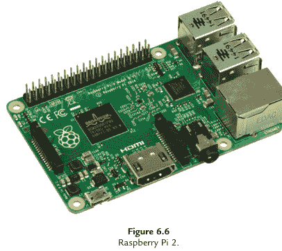

### 规格

- 处理器：四核 ARM Cortex-A53，Broadcom BCM2837，频率为 1.2 GHz
- 1 GB RAM
- 无闪存，从 SD 卡启动
- 外设连接
    - 以太网
    - WiFi
    - 蓝牙
    - USB 2.0
    - HDMI
    - RCA 视频
    - 立体声音频输出
    - 用于相机连接的接头引脚
- 通过 microUSB 接口供电
- 尺寸：85.6 mm（约 3.4 英寸）× 56.5 mm（约 2.2 英寸）

## 设置 BeagleBone Black

设置 BeagleBone Black 相当直接。随板提供的快速入门指南基本上是你开始所需的全部内容。因此，首先使用随附的 USB 线缆将板子连接到你的工作站。最初，四个蓝色用户 LED 灯会常亮。大约 10 秒后，它们将进入默认分配的功能：

- USR0 — 心跳
- USR1 — microSD 访问
- USR2 — CPU 活动。即内核处于非空闲状态
- USR3 — eMMC 活动

*图 6.7* 展示了板子的布局，并具体参考了连接器、开关和指示器。随板提供的唯一线缆是 USB 线缆。最简单的设置方法是

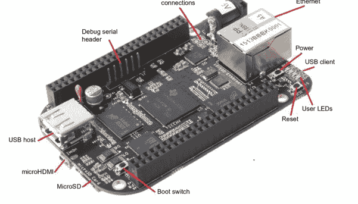

**图 6.7**
BeagleBone Black 布局。

简单地通过 USB 线缆将板子连接到工作站，该线缆可为板子提供高达 500 mA 的电力。

板子的 USB 从机端口是一个多功能设备，表现为：

- 启动时在 CentOS 7 的可移动设备正常路径（`/run/media/`your_user`）下显示的大容量存储设备
- 串口。设备名称为 `/dev/ttyACM0`
- IP 地址为 192.168.7.2 的网络设备。

挂载板子的大容量存储设备，并在 Firefox 中浏览 START.htm 页面。除其他事项外，它会指示你执行脚本文件 mkudevrule.sh。这是利用板子串口和网络端口的必要条件。在此之后重新引导你的工作站可能是个好主意，以确保更改已生效。

现在启动 minicom。你应该看到类似图 6.8 的屏幕。板子提供了一个普通用户密码，或者你可以以 root 身份登录且无需密码。尝试几条 shell 命令，以证明这确实是一个 Linux shell。执行 `uname -a` 来验证你确实正在与 BeagleBoard 通信。

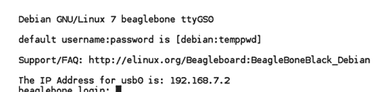

**图 6.8**
BeagleBoard 串口。

最后，在另一个 shell 窗口中，执行 `ssh -l debian@192.168.7.2`。系统会要求输入与 minicom shell 相同的密码。或者，再次说明，你可以以 root 身份登录且无需密码。

因此，你拥有两种获取目标板 shell 访问权限的选择：串口或通过网络进行 SSH。这两者都通过同一个 USB 接口运行。

你还希望将你的 BBB 通过以太网端口连接到你的网络，以便通过动态主机配置协议（DHCP）获取 IP 地址。

# 闪存和文件系统

## BeagleBone Black 内存配置

BeagleBone Black 具有多种形式的数据存储，包括易失性和非易失性内存，如图 6.9 所示。有两种形式的非易失性存储：一个 4 KB 的 EEPROM（电可擦除可编程只读存储器），用于存储有关板子本身的 ID 数据；以及一个 4 GB 的 eMMC（嵌入式多媒体卡）NAND 闪存，使用字节宽端口用于地址和数据。除了板载 NAND 闪格外，还有一个 microSD 卡插槽用于额外存储。最后，还有 512 MB 的 DDR3 RAM 作为工作内存。

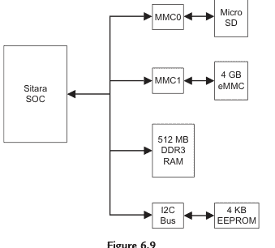

图 6.9
BeagleBone Black 内存配置。

eMMC 分为两个分区：一个 32 MB 的 VFAT 格式引导分区，其余部分格式化为 ext4 根文件系统。一旦板子启动，引导分区对于你的工作站而言就像一个 USB 驱动器可见。它也被挂载在 BBB 的文件系统中的 /boot/boot。

## 准备板子

### 注意

在本书的剩余部分，我将描述 2014 年发布的 Debian 版本 7.4。原因有两点：

1. 它安装在我当时购买的板子上；
2. 它运行正常。

我尝试过最新发布版本 Debian 8.7，但遇到了无法解决的问题，并且在网上找不到帮助。具体来说，我无法通过网络文件系统（NFS）挂载根文件系统，尽管所有文档都说应该运行良好。显然，在你读完本书后，你可以自由安装任何你喜欢的版本。但就目前而言，我们将坚持使用版本 7.4。

我们将对 BBB 的启动方式做一些更改。具体来说，不再从 eMMC 挂载根文件系统，而是通过网络文件系统（NFS）从工作站挂载。这需要修改引导过程。

### 引导过程

BBB 使用一个功能强大的开源引导加载程序，称为 u-boot，我们将在后续章节中详细介绍。U-boot 大量使用环境变量来控制引导过程。

按照随附说明连接你的串口线。将 `minicom` 的串口设备从 `ttyACM0` 更改为 `ttyUSB0`。重置板子，但这次请快速按下一个键。我通常按空格键。这会显示 u-boot 提示符，以及一些基本的板子信息，如图 6.10 所示。

输入命令 `printenv` 以查看环境变量。有很多这样的变量。环境变量可以通过 `setenv` 命令设置：

```text
setenv variable value
```

或者通过输入：

```text
variable=value
```

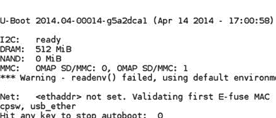


环境变量的值通过用 `{}` 包裹来引用。一个环境变量可以包含一个或多个由 `;` 分隔的 u-boot 命令。这样的变量可以通过 `run` 命令“执行”。变量也可以包含 `run` 命令，从而允许它执行其他变量。

U-boot 拥有非常广泛的命令集，其中大部分内容在附录 A 中有详细说明。目前，请输入 help 以查看完整列表。

注意以下信息：

```
*** Warning - readenv() failed, using default environment
```

U-boot 试图从安装在 BBB 上未连接的 NAND 闪存中读取其环境。由于失败，它使用了内置于 u-boot 本身的默认环境。这一后果之一是，如果不修改并重新构建 u-boot 本身，我们就无法永久性地修改默认环境。当然，我们可以每次启动时都修改变量。

但请注意变量 `bootenv = uEnv.txt`。当 u-boot 完成默认环境设置后，它会读取 `bootenv` 指定的文件以获取额外指令。该文件位于你的工作站中可见的 eMMC 启动分区中。

执行 `boot` 命令让 Linux 启动。挂载启动分区，并使用编辑器打开 `uEnv.txt`。有趣的部分在文件末尾，即变量 `uenvcmd`。这是 u-boot 执行的最后一个变量，因此它应该以某种方式启动内核。

在默认情况下，`uenvcmd` 从 eMMC 加载三个文件：内核、初始 RAM 磁盘映像（initrd）以及一种称为*扁平设备树*（fdt）的东西。`mmcargs` 设置 `bootargs` 变量，该变量在内核启动时传递给内核。`bootz` 命令将控制权转移给内核，并传递 initrd 和 fdt 的地址。因此，要修改根文件系统的挂载方式，我们需要修改 `uEnv.txt`，或者更好的方法是提供另一个文件。

在你的 samples/ 目录中，打开文件 `uEnvnet.txt` 并找到 `uenvcmd`。唯一的不同之处在于它运行的是 `netargs` 而不是 `mmcargs`。`netargs` 设置 `bootargs` 以将文件系统类型指定为 nfs，并提供服务器位置和文件系统目录的路径。在文件中上部有一组变量，用于定义服务器地址和根文件系统的路径，你可能需要更改这些。历史上，我一直为目标板定义固定的 IP 地址。出于某种原因，这在 BBB 上不起作用，因此你在 `netargs` 的末尾看到 `ip=dhcp`。

原则上，你应该能够直接从工作站写入启动分区，但我发现那样做不太可靠。我实际上做的是在 BBB 的 `/home` 下创建一个目录，然后通过 NFS 在那里挂载工作站的 home 目录。

但在这样做之前，你必须安装一个名为 `nfs-common` 的软件包。你的 BBB 必须连接到互联网。然后执行：

```bash
sudo apt-get update
sudo apt-get install nfs-common
cd /home
sudo mkdir doug
sudo mount -t nfs -o nolock 192.168.1.2:/home/doug doug
```

当然，如果你是以 root 身份登录的，可以去掉 sudo。你可能希望将 mount 命令放入 shell 脚本中，因为你可能会执行多次。现在你可以将 `uEnvnet.txt` 从工作站复制到 BBB 的 `/boot/uboot`：

```bash
cp doug/samples/uEnvnet.txt /boot/uboot
sync
```

在更改 `/boot/uboot` 目录后，始终执行 `sync`，否则你的更改可能在你重启之前未能到达闪存。我建议你暂时不要直接替换原始的 `uEnv.txt`，事实上，你可能想保留一份副本。

## 版本 7.4 与版本 8.7 之间的区别

既然我们理解了启动过程，我就可以谈谈 Debian 7.4 和最新发行版 8.7 之间的区别了。我看到的两者之间的主要区别在于启动代码的结构。如上所述，版本 7.4 将 eMMC 分为两个分区，一个用于启动，一个用于根文件系统。在版本 8.7 中，只有一个包含内核映像、initrd 和设备表文件的 ext4 根分区。u-boot 映像不可见。它显然在那里，但它是隐藏的。

默认的 u-boot 环境已经大幅扩展。在 7.4 中它是 4.6 KB，而在 8.7 中它是 20.5 KB。其目的是使编写 `uEnv.txt` 文件变得更加容易，这没什么问题，但它也使得默认环境本身更难理解。

## 根文件系统映像

即使我们将通过 NFS 挂载根文件系统，为了创建启动分区，你需要向 eMMC 加载一个 `image` 文件。但首先你需要将映像文件加载到 microSD 卡中。4 GB 的卡就足够了。你应该使用 USB 读卡器，因为有报告称某些笔记本电脑内置的读卡器在 Linux 下不可靠。该卡应显示为 `/dev/sdb`。如果没有，你可以执行：

```bash
dmesg | tail
```

刚插入卡时，应该显示刚刚识别出的设备。

浏览 `debian.beagleboard.org/images` 并下载 `BBB-eMMC-flasher-debian-7.4-2014-04-14-2gb.img.xz`。使用 `xz` 命令解压文件，如下所示：

```
xz -d BBB-eMMC-flasher-debian-7.4-2014-03-26-2gb.img.xz
```

这会生成一个文件，`BBB-eMMC-flasher-debian-7.4-2014-03-26-2gb.img`。使用 `dd` 命令将此文件写入 microSD 卡：

```
dd if=BBB-eMMC-flasher-debian-7.4-2014-03-26-2gb.img of=/dev/sdb
```

这将花费相当长的时间。完成后，`/dev/sdb` 上会有两个分区；一个名为 BEAGLEBONE 的可引导 FAT 分区，和一个名为 eMMC-flasher 的 ext4 分区。此映像专门用于刷写 eMMC。

将 microSD 插入未通电的 BBB。BBB 文档指出，要从 microSD 卡启动，必须在通电时按住启动按钮。在我的情况下，仅仅是存在 microSD 卡就会让板子从卡启动。给它通电。内核将正常启动，并显示登录提示。但 LED 的模式表明还有别的事情正在发生。那别的事情就是刷写 eMMC。当四个 LED 常亮时，刷写完成。关闭板子电源，移除 microSD 卡并重新给板子通电。它从 eMMC 启动 Debian 7.4。

最后，你需要将目标根文件系统获取到工作站的 home 目录下。你不想从 microSD 卡复制它，因为那个映像是专门用于刷写 eMMC 的。你可以做的是通过网络从 BBB 的 eMMC 复制到你的工作站。在你的 home 目录下创建一个子目录，以匹配你在 `uEnvnet.txt` 中为 `rootpath` 指定的路径。现在将整个目标文件系统复制到该目录中。我建议你分别复制每个顶层目录，而不是在一个大的 `cp -r` 命令中复制所有内容。顺便注意，有几个顶层目录是空的。对于这些目录，你只需执行 `mkdir` 命令即可。有几个目录需要特别注意：

- `/boot` — 不要复制 `/uboot` 目录。只需创建一个空目录。
- `/dev` — 你只需要 microSD 卡上的 `/dev` 部分。`/dev` 的其余部分由名为 `udev` 的程序填充。
- `/home` — 不要复制你通过 NFS 挂载的 home 目录。

你需要以 root 用户身份编辑 `/etc/fstab`。会有一行看起来像这样：

```
UUID=3bb11f04-4b37-49fd-a118-f1a71c14cf d7 / ext4 noatime,errors=remount-ro 0 1
```

你的 UUID 可能不同。这一行试图从磁盘驱动器挂载根文件系统，这显然会干扰通过 NFS 挂载。只需注释掉该行并保存文件即可。

## 启动到 NFS 文件系统

如果尚未在 u-boot 提示符处，请重置板子进入 u-boot 提示符。执行以下命令：

```
setenv bootenv uEnvnet.txt
boot
```

现在不直接覆盖 uEnv.txt 的原因是，你的 uEnv.txt 可能存在问题，在这种情况下你需要重新从 eMMC 文件系统启动。当你确信 uEnvnet.txt 工作正常后，你可以将其重命名为 uEnv.txt 并直接启动到 NFS 文件系统。

有趣的是，使用 NFS 文件系统的启动过程似乎比使用 eMMC 文件系统时更冗长。

作为最后一步，将 samples/ 目录移动到目标文件系统的 /home 下。

## 可能出现的问题？

在启动像 BeagleBone Black 这样的嵌入式目标板时遇到困难并不罕见，尽管设计者已尽最大努力使该过程尽可能无痛。最常见的问题分为两大类。第一个是串行端口。请确保波特率设置正确。这通常不是问题，因为 115 kbaud 似乎是 minicom 的默认值。更常见的问题是未关闭硬件流控制。

常见的网络问题包括启用了增强安全 Linux（SELinux）和/或防火墙开启。这会阻止目标通过 NFS 挂载其根文件系统。作为起点，请禁用 SELinux，并关闭防火墙。之后，你可以配置这些功能中的任何一个来允许 NFS 挂载，同时仍提供一定级别的保护。

确保 IP 地址正确。实际上，这不应该是一个问题，因为你会通过 DHCP 获取 IP 地址。

在目标板完全配置并连接到工作站后，我们可以将注意力转向编写应用程序的任务。这是下一章的主题。

### 资源

- beagleboard.org — BeagleBoard 系列板卡的网站
- debian.beagleboard.org/images — 针对 BeagleBoards 的根文件系统映像集合。


www.dropbox.com/s/d7w56b980pakkzq/BBB-eMMC-flasher-debian-7.4-2014-04-14-2gb.img.xz?dl=0 – 以防 Debian 网页上版本 7.4 的刷写镜像消失，这里也有一份。
groups.google.com/forum/#!forum/beagleboard – 专注于 BeagleBoard 的 Google 小组
linux.org/Beagleboard:BeagleBoneBlack_Debian – 嵌入式 Linux 维基页面上的一页
*其他开发板的网站*
Gumstix: gumstix.org, gumstix.com
树莓派: raspberryPi.org

# # 访问硬件

**章节大纲**

- **回顾** 107
- **ARM I/O 架构** 108
  - LED 109
- **从 Linux 访问 I/O：我们的第一个程序** 109
  - 创建项目 109
  - 目标执行环境 110
- **led 程序** 112
  - Makefile 114
- **数据采集示例** 115
  - 硬件设置 115
  - 访问模拟子系统 116
- **资源** 120

> *唯一需要从自由软件中感到恐惧的，是那些其产品价值甚至更低的人。*
> *David Emary*

## 回顾

这是一个很好的时机，让我们停下来，深呼吸，在继续深入应用开发之前，看看我们迄今为止走过的路程。

第 1 章，嵌入式与实时领域，为我们提供了嵌入式和实时领域的概览，以及 Linux 在其中扮演的角色。第 2 章，安装 Linux，介绍了如果你尚未拥有 Linux 工作站，安装 Linux 工作站的过程。对于 Linux 新手，第 3 章，介绍 Linux，提供了一个概览和入门介绍。在第 4 章，主机开发环境中，你配置了工作站和网络，并安装了一些我们从本章开始将需要的软件。在第 5 章，Eclipse 集成开发环境中，你学习并熟悉了 Eclipse 集成开发环境。第 6 章，硬件介绍了我们将在本书这部分内容中使用的目标单板计算机。

现在是时候将所有这些组合起来，在交叉开发环境中构建应用程序了。

## ARM I/O 架构

与大多数当代处理器架构一样，**ARM** 将外围设备放置在与内存相同的地址空间中。这意味着可以使用任何访问内存的指令来访问外围设备。程序不需要知道或关心它访问的是内存还是硬件设备。这与 x86 架构形成对比，在 x86 架构中，外围设备存在于通过独立的输入/输出指令访问的独立地址空间中。

在 x86 的情况下，不仅 *I/O* 位于独立的地址空间中，*I/O* 指令只能在特权级别 0（也称为“内核空间”）中执行。这需要使用内核空间设备驱动程序来访问外围设备。另一方面，**ARM** 允许我们从用户应用程序中直接访问外围设备。这并不意味着从应用程序直接访问外围设备是个好主意，但这是一个有用的起点。

表 7.1 以简略的方式展示了 **BBB** 的 Sitara 处理器的 32 位地址空间是如何分配的。表 7.1 仅显示了我们感兴趣的地址区域。要获取更详细的资料，请从德州仪器下载 *AM335x* 和 *AMIC110 Sitara 处理器技术参考手册*。参见资源部分获取网络地址。

**表 7.1：** Sitara SoC 内存映射

| 功能 | 起始地址 | 结束地址 | 大小 | 用途 |
| :---: | :---: | :---: | :---: | :---: |
| 外部 RAM | 0x8000_0000 | 0xBFFF_FFFF | 1 GB | |
| MMC0 | 0x4806_0000 | 0x4806_FFFF | 4 KB | 微型 SD 卡 |
| MMC1 | 0x481D_8000 | 0x481D_8FFF | 4 KB | eMMC (4 GB) |
| GPIO0 | 0x44E0_7000 | 0x44E0_7FFF | 4 KB | |
| GPIO1 | 0x44E0_C000 | 0x44E0_CFFF | 4 KB | |
| GPIO2 | 0x481A_C000 | 0x481A_CFFF | 4 KB | |
| GPIO3 | 0x481A_E000 | 0x481A_EFFF | 4 KB | |
| ADC | 0x44E0_D000 | 0x44E0_EFFF | 8 KB | |

关于此映射，有几点值得注意。首先，现代 **ARM SoC** 似乎倾向于将外围寄存器放在地址空间的“中间”，大约从 0x4400_0000 到 0x5700_0000。在我过去的经验中，外围寄存器通常占据地址空间的最后几页。地址空间被分为两个级别的互连总线，称为“L3”和“L4”。内存和高速外围设备连接到 L3，而低速外围设备连接到 L4。大部分地址空间被标记为“保留”。

### LED

四个用户 LED 使用基于地址 0x4804C000 的 GPIO1 的位 21 到 24。图 7.1 展示了 LED 如何映射到 GPIO1 数据寄存器中的位。


Sitara 的 GPIO 端口相当复杂，拥有大量寄存器。GPIO 端口中的 32 个位中的每一个都可以作为输入或输出、中断源，或去抖键盘输入。数据输出位可以直接写入 1 或 0，或者通过向相应的置位或清除寄存器写入 1 来单独设置或清除。表 7.2 列出了每个 GPIO 端口中包含的一些寄存器。这些是我们当前示例中最相关的寄存器。

**表 7.2：GPIO 寄存器偏移量**

| 偏移量 | 名称 | 描述 |
| :--- | :--- | :--- |
| 0x134 | GPIO_OE | 输入或输出，1 = 输入，0 = 输出 |
| 0x138 | GPIO_DATAIN | 输入数据寄存器。返回引脚的值。写入无效果 |
| 0x13C | GPIO_DATAOUT | 输出数据寄存器。引脚反映此处写入的内容 |
| 0x140 | GPIO_LEVELDETECT0 | 启用在低电平 (0) 检测时生成中断 |
| 0x144 | GPIO_LEVELDETECT1 | 启用在高电平 (1) 检测时生成中断 |
| 0x148 | GPIO_RISINGDETECT | 启用在上升沿（从 0 到 1 的转换）生成中断 |
| 0x14C | GPIO_FALLINGDETECT | 启用在下降沿（从 1 到 0 的转换）生成中断 |
| 0x150 | GPIO_DEBOUNCENABLE | 启用去抖功能 |
| 0x154 | GPIO_DEBOUNCINGTIME | 为此端口中启用去抖的任何位设置去抖时间。时间 = 值 * 31 微秒 |
| 0x190 | GPIO_CLEARDATAOUT | 写入 1 将数据输出位清零。写入 0 无效果 |
| 0x194 | GPIO_SETDATAOUT | 写入 1 将数据输出位置 1。写入 0 无效果 |

## 从 Linux 访问 I/O：我们的第一个程序

### 创建项目

在 Eclipse 中有两种创建项目的方式：标准项目，也称为 Makefile 项目，或托管项目，也称为可执行文件。托管项目会自动在工作区中创建一个项目目录、一个 C 源文件模板和一个 Makefile。在第 5 章，Eclipse 集成开发环境中，我们为 `record_sort` 程序创建了一个托管项目。

不过通常来说，你已经按“常规”方式组合了若干个项目，并希望将它们引入 Eclipse C 开发工具包 (CDT) 环境。书中大多数示例项目已经有 Makefile。因此，Makefile 项目的作用是将现有的 Makefile 及其构建的文件引入 CDT 环境。

在上一章中，你将 `samples.tar.gz` 解压到了你的主目录。现在将生成的 `samples/` 目录移动到你目标文件系统中的 /home。

对于我们的第一个项目，我们将使用目标文件系统中 /home/samples/src/led¹ 里的程序来阐明一些基本概念，并验证 CDT 是否正常工作，以及我们是否能在目标上运行新构建的程序。然后我们将更详细地查看 `led` 程序。

启动 Eclipse，选择 `文件` -> `新建` -> `C 项目`，像我们在第 5 章，Eclipse 集成开发环境中那样打开新建项目向导。输入项目名称“led”，并取消勾选`使用默认位置`复选框。现在浏览到 home > samples > src > led，并单击 OK 选择它。在`项目类型`窗口中展开`Makefile 项目`，并选择`空项目`。单击`完成`。项目向导将创建项目，然后该项目会出现在左侧的项目资源管理器窗口中。

在 /home/samples 而不是默认工作区下创建项目有一个非常具体的原因。最终的可执行文件必须对目标板可见，因此我们必须将其放置在目标通过网络文件系统 (NFS) 挂载的根文件系统中的某个位置。另一种选择是在根文件系统中创建一个工作区。

作为创建过程的一部分，项目应该会自动构建。如果没有，请在项目资源管理器视图中右键单击 led 条目，并选择`构建项目`。好吧，我们已构建了项目，现在如何运行它？

### 目标执行环境

在继续之前，让我们回顾一下我们的设置。目标板有一个从 eMMC 闪存启动的内核，以及一个通过网络从主机工作站挂载的根文件系统。目标上的 `stdin`、`stdout` 和 `stderr` 连接到 ttyO0，而 ttyO0 在物理上连接到主机上的 ttyS0 或 ttyUSB0。我们通过终端模拟程序 `minicom` 与运行在目标上的 shell 进行通信，见图 7.2。

> ¹ 从此处起，当用法不明确时，路径名称中将省略 /home/samples/。


## 通过 NFS 挂载根文件系统的一个后果

通过 NFS 挂载根文件系统的一个后果是，我们可以执行那些物理上位于主机文件系统上的目标程序文件。这使得我们无需将软件编程烧录到闪存中，就可以测试目标软件。当然，运行在目标上的程序也可以打开 NFS 挂载主机卷上的文件。

目标文件系统上的目录之一是 `/home`。在 `/home/samples/src/` 下有几个子目录，每个子目录代表本书后续描述的一个项目。

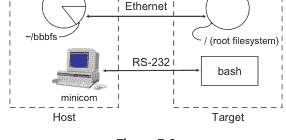

### 图 7.2 主机和目标。

在 shell 窗口中启动 `minicom`，并引导目标板。当引导完成后，以 root 身份登录，并在 `minicom` 窗口中执行 `ls /home/samples`。你会看到与你工作站上 `~/bbbfs/home/samples` 中相同的文件和子目录。

注意 USR0 已经在闪烁。如果你 `cat /sys/class/leds/beaglebone:green:usr0/trigger`（别忘了使用 TAB 自动补全），你会发现 USR0 正被用作“心跳”。如果你 `cat` 其他 LED 的触发器文件，你会发现它们也有特定的触发器。这些触发器会干扰我们的 LED 程序，因此我们需要关闭它们。

`/sys` 是另一个类似第 3 章“介绍 Linux”中描述的 `/proc` 的伪文件系统。与 `/proc` 类似，`/sys` 是用户空间与内核空间之间通信的机制。在这个特定实例中，我们可以控制系统外设。请查看脚本文件 `samples/src/leds/leds-off.sh`。它将字符串“none”写入所有四个 LED 的触发器文件。这意味着不触发任何 LED。

现在，要执行 LED 程序，请执行以下操作：

```bash
cd /home/samples/src/led
./led
```

该程序打印一条问候消息，然后依次闪烁四个 LED。顺便提一下，命令中的“./”表示当前目录。之所以这样写，是因为当前目录通常不是普通用户路径的一部分。这样做被视为安全风险。

请注意，如图 7.3 所示，Linux 改变了我们传统上进行嵌入式编程的方式。嵌入式系统几乎总是由 RAM 和非易失性存储器（ROM、PROM、EPROM 或闪存）的某种组合组成。构建嵌入式系统的传统方式是创建程序的可执行映像，包括所有静态链接的库函数，可能还包括多任务内核。然后，你将或“烧录”这个映像到一个或多个非易失性存储芯片中。当系统引导时，处理器直接开始从 ROM 执行此映像。

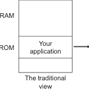

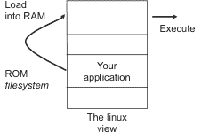

### 图 7.3 嵌入式编程的两种视图。

在 Linux 视图中，程序是必须在执行前加载到内存中的“文件”。因此，我们创建一个 ROM“文件系统”，其中包含系统需要运行的任何程序的文件映像。这可能包括用于网络等各种用途的工具和守护进程。这些程序随后由引导初始化过程加载到 RAM 中，或根据需要加载，并在那里执行。

通常，C 库不会静态链接到这些映像文件，而是动态链接，以便内存中特定时间内的任何程序都可以共享该库的单份副本。

Linux 方法的一个优点是我们不限于从 ROM 文件系统加载程序文件。正如刚刚演示的，我们也可以同样轻松地通过网络加载程序用于测试目的。

## `led` 程序

让我们仔细看看 `led` 程序，以此理解如何在 Linux 的用户空间中访问外设。使用 Eclipse 编辑器打开 `led.c`。你可能想要在编辑器中打开行号。在标记处右键单击并选择*显示行号*。

首先注意所有 `#include` 指令旁边的“??”符号。如果你将鼠标悬停在其中一个上，它会显示“未解决的包含”。这意味着 Eclipse 找不到头文件，因此它本身无法解析头文件中的符号。事实上，尽管 Eclipse 报告了所有由头文件定义的符号的错误，项目仍然会构建。此外，你无法从大纲视图中直接打开头文件。

这似乎是使用交叉编译器的 makefile 项目的副产品。托管的 **record_sort** 项目没有这个问题。这是修复方法：

1. 在 **项目资源管理器**视图中右键单击项目条目，然后选择上下文菜单底部的*属性*。
2. 在*属性*对话框中展开 *C/C++ 通用*条目，并选择**路径和符号**。
3. 确保选中了 **包含**选项卡。点击**添加...**并输入 `/usr/local/arm-unknown-linux-gnueabi/arm-unknown-linux-gnueabi/sysroot/usr/include`。勾选**添加到所有配置**和**添加到所有语言**。
4. 再次点击**添加...**，并输入 `../..//include`。这将拾取定义外设寄存器的本地头文件 `am3558-regs.h`。勾选**添加到所有配置**和**添加到所有语言**。
5. 点击**确定**。点击**应用**。你会被问及是否要重新构建索引。是的，你愿意。
6. 再点击一次**确定**。**图 7.4**展示了最终结果。

“?”符号会神奇地消失。注意，这是一个项目级别的设置。似乎没有全局设置，这可能是合理的。正如我们稍后将在本章中看到的那样，有一种方法可以将我们刚刚更改的设置导入到新项目中。

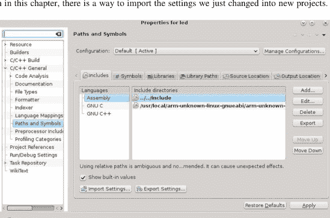

### 图 7.4 向项目添加包含路径。

回到程序。在 `main()` 大约第 37 行，GPIOp 被声明为 AM3358P_GPIO 类型。后者是指向 `am3358_regs.h` 中声明的结构的指针，该结构将地址空间中的 GPIO1 寄存器映射出来。

大约在第 42 行，程序打开设备 `/dev/mem`。`mem` 设备是从用户空间程序直接引用内存的一种方式。三行后，我们调用 `mmap()` 将始于 `0x4804C000`（GPIO1）的 GPIO1 寄存器部分映射到我们的进程上下文。允许对映射空间进行读和写访问，并且声明为共享，意味着其他进程可以同时映射到相同的空间。在你的 `minicom` 窗口中，执行 `ls -l /dev/mem`，并注意它仅对 root 可写。这就是为什么你需要以 root 身份登录 BBB 才能运行 `led` 程序。

如果 `mmap()` 成功，它将返回一个指针，一个虚拟地址，代表该进程上下文中的指定物理空间。通常，我们需要将代表 LED 的 GPIO1 位配置为输出，但系统已经为我们完成了这一操作。

另一个有用的程序是目录 `src/devmem/` 中的 `devmem.c`。它映射指定的内存区域，然后允许你以字节、字或长字为单位读取和写入该区域中的位置。请查看一下。代码相当自解释。

## Makefile

出于几个原因，值得查看一下项目的 makefile。在 Eclipse 编辑器中打开 makefile（列表 7.1）。首先要注意的是 `CC` 的定义。有几种相关的约定用于无歧义地命名 GNU 工具链。这里展示的是由以下三部分组成的约定：

`<处理器>-<操作系统>-<工具>`

```makefile
#
#
# Makefile for ARM/Linux user application
#
SHELL = /bin/sh
CC = arm-linux-gcc

all: led

led: led.c
	$$(CC)-L../..include -g-o $$@ $$<

clean:
	_rm- _f*.o
	_rm- _fled
```

### 列表 7.1 led 项目的 Makefile。

转到 `/usr/local/arm-unknown-linux-gnueabih/bin`，你会发现整套由这些三部分文件名组成的文件，它们是链接到对应的由以下五部分组成的文件名的：

```
<处理器>-<制造商>-<操作系统>-<可执行二进制格式>-<工具>
```

在这种情况下，这如今很常见，制造商标段被设置为“unknown”或“none”。我也见过一种包含 C 库版本号的格式。

## 一个数据获取示例

让我们进入一个稍微有趣一些的主题。Sitara SoC 包含一个 8 通道、12 位 A/D 转换器。这可以配置为八个通用模拟通道，或电阻式触摸屏输入和通用模拟的混合。我们将使用通道 0 作为简单数据获取示例的基础，该示例将贯穿本书这一节的其余部分。

### 设置硬件

是时候拿出老式的焊接铁了。在上一章中，我建议购买一个原型帽板和一对扩展接头。现在是时候将扩展接头安装到板上了。然后，你将添加一个电位器（pot），如图 7.5 的原理图所示。我选择 10 kohms 以最小化电流消耗。


模拟输入限制为 1.8 伏特，这是 P9 上 AD REF 引脚的值。因此，将电位器的正端连接到 P9-32。图 7.6 是我的原型帽板的照片。

为了将帽板插入 BBB，你必须移除调试串行端口。奇怪的是，我的 USB 串行端口不再工作，所以我使用 SSH 登录到板子。以 root 身份登录：

```bash
ssh root@192.168.1.114
```

替换为你板子的实际 IP 地址。


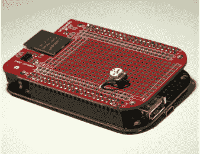

**图 7.6**
带有电位器的原型 cape。

## 访问模拟子系统

模拟子系统相当复杂，我们不会尝试直接从用户空间访问它。相反，我们将使用 `/sys` 文件系统，类似于我们之前用来关闭 LED 触发器的方法。资源部分引用了几个页面，这些页面可以说是设置了 `/sys` 文件以读取 ADC 的“配方”。这个完全反直觉的过程体现在脚本文件 `samples/src/adc_on.sh` 中。第一行基本上是安装 ADC 子系统并在 `/sys/devices/ocp.x/helper.x` 下创建一组名为 `AIN0` 到 `AIN7` 的文件。第二行展示了这些文件实际所在的位置。一旦你确定了 `x` 和 `y` 的值，就可以省略第二行。它们不会改变。

要读取模拟输入，只需打开相应的 `AIN` 文件并读取它。这些文件返回的值单位是毫伏，因此范围是 0 到大约 1800。在 `/sys/devices/ocp.x/44e0d000.tscadc/tiadc/io:device0` 中还有第二组文件，称为 `in_voltage0_raw` 到 `in_voltage7_raw`，它们返回原始的 12 位值。

良好的编程实践要求在硬件无关的代码和实际操纵 `I/O` 寄存器的代码之间有清晰的分离。至少，硬件相关代码应与纯粹的应用程序代码位于不同的模块中。在 LED 示例中，我们有点“作弊”，即硬件相关代码与主程序混合在一个源文件中。在这种情况下，这并没有太大关系，因为目标是说明硬件访问是如何工作的，而不引入任何类型的应用程序。

在这个例子中，我们将在硬件相关代码和主程序的算法之间做出明确的区分。在 `src/measure` 位置创建一个名为 `measure` 的新 Eclipse 标准 C Makefile 项目。打开源文件 `measure.c`。首先要注意的是，头文件旁边再次出现了那些烦人的“\?””符号。但与其费力地重新输入头文件的路径，这次我们将*导出*一些来自 `led` 项目的项目设置，并将它们*导入*到 `measure` 中。

请按照以下步骤操作：

- 1. 在 *项目资源管理器* 视图中选择 `led` 项目条目。右键单击并选择 *属性*。
- 2. 展开 `C/C++ General`，并选择 *Paths and Symbols*。点击 *Export Settings...* 按钮。
- 3. 确保选中了 `led` 项目，并取消勾选 *Symbols*。
- 4. 浏览到 `home/samples/src/`，并输入一个文件名。我使用了 `includes`。数据将保存为 XML 文件。
- 5. *图 7.7* 显示了最终的导出对话框。点击 Finish。

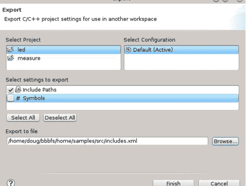

图 7.7
导出对话框。

接下来是将项目设置导入到 measure 项目的步骤：

- 1. 在项目资源管理器中右键单击 measure 项目条目，并选择 Properties。
- 2. 展开 C/C++ General 并选择 Paths and Symbols。点击 Import Settings… 按钮。
- 3. 浏览到 `home/samples/src/`，并选择 `includes.xml`。点击 OK。
- 4. 点击 Finish。
- 5. 打开 measure 项目属性，并验证包含路径是否存在。

该程序读取 A/D，并将值打印到标准输出。它接受一个命令行参数，即两次读取之间的秒数。默认值为 2。

这是我对我的示例程序做出一个观察的好时机。这些示例中几乎没有错误处理或“理智”检查。如果你输入了错误的内容，程序很可能会崩溃。在这个例子中这并不是大问题，但在需要更多输入的后续示例中可能成为一个问题。

我觉得添加大量的错误检查代码会妨碍传达示例试图说明的重点。如果你愿意，可以随意添加一些错误检查逻辑。

回到程序中，需要注意的关键点是，处理 A/D 转换器和数字 I/O 的大部分细节都被“隐藏”在 API（应用程序编程接口）之后，这些 API 以应用程序有用的形式呈现数据。应用程序无需担心设置外设的细节，它只需调用适当的“init”函数。然后它读写数据，直到用户终止程序。最后，它“关闭”外设设备。

文件 `trgrdive.c` 实现了“设备驱动程序”API。命名它为“trgrdive”的原因将在下一章中变得明显。有两个外设初始化函数：第 19 行的 `initAD()` 和第 54 行的 `initDigIO()`。

`initDigIO()` 为 `/sys/class/leds` 中的两个用户 LED 打开 `brightness` 文件。我们将在下一章中使用它们。

`initAD()` 通常是你期望打开到模拟输入文件连接的地方。但事实证明，`open()` 调用触发了 A/D 转换器。我本以为这发生在 `read()` 中，但实际上并不是。似乎存在通过 `/sys` 触发 A/D 的机制，但同样不明显。因此，暂时，`initAD()` 是一个空函数。

读取 A/D 转换器由通用命名的 `readAD()` 函数处理，位于第 30 行。它打开模拟通道文件，读取一个样本，关闭文件，并返回二进制值。

数字输出体现在三个函数中：`setDigOut()`、`clearDigOut()` 和 `writeDigOut()`。这些函数只是将适当的文本值“0”或“1”写入相应的 `brightness` 文件。

`closeAD()` 是一个空函数。`closeDigIO()` 只是关闭两个 `brightness` 文件。

measure 项目的 Makefile 有几个构建目标。默认情况下，如果存在 “all” 目标，Eclipse 只知道如何构建 “all” 目标。在 measure 项目的情况下，all 构建了一个叫做“simulation version”的东西。我们将在下一章讨论它。其他构建目标需要向 Eclipse 声明。在 C/C++ 视角的右侧，有一个通常标记为 Outline 的视图，显示当前在编辑器窗口中显示的内容大纲。该视图中还有另一个标记为 Make Targets 的标签，允许我们指定替代的 make 目标。选择该标签，在 measure 项目上右键单击，并点击 Add Target。

图 7.8 显示了 Add Target 弹出的对话框。在这种情况下，Target Name 是 measure。Make Target 也是 measure，所以我们不必重新输入。Eclipse 为目标名称和 make 目标相同的一般情况提供了快捷方式。点击 create 按钮。现在，在 Make Targets 视图中，在 measure 项目下，右键单击 measure 目标，并选择 Build Make Target。在视角左侧的项目资源管理器视图中，出现三个新文件：measure.o、trgdrive.o 和 measure。

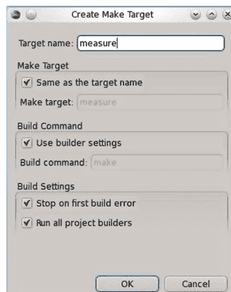

**图 7.8**  
创建 Make Target 对话框。

在目标上运行程序。取决于你选择打开哪个文件，ADC 返回 0 到 4095 范围内的 12 位原始数据，或 0 到 1800 范围内的毫伏数据。用小螺丝刀转动电位器，你应该看到报告的值相应地变化。

在本章中，我们学习了如何访问 BBB 目标板上的外设寄存器，以及如何通过 /sys 文件系统管理外设的一些知识。下一章将更深入地探讨调试的主题。

### 资源

- www.ti.com/lit/pdf/spruh73 - AM35xx 和 AMIC110 Sitara 处理器技术参考手册
- github.com/CircuitCo/BeagleBone-Black/blob/master/BBB_SRM.pdf - BBB 系统参考手册
- github.com/CircuitCo/BeagleBone-Black/blob/master/BBB_SCH.pdf - PDF 格式的 BBB 原理图
- beaglebone.cameon.net/home/reading-the-analog-inputs-adc - 关于访问 BBB ADC 的有用文章。
- https://www.linux.com/learn/how-get-analog-input-beaglebone-black - 关于 BBB ADC 的另一种见解
- 如果你想要更详细地调查 /sys 文件系统（你应该这么做），请查看以下资料：
  - beagle.s3.amazonaws.com/esc/sysfs-esc-chicago-2010.pdf
  - www.signal11.us/oss/udev/
  - www.kernel.org/pub/linux/kernel/people/mochel/doc/papers/ols-2005/mochel.pdf - 这篇论文有点旧了，但仍然值得一读。


# 调试嵌入式软件

## 章节大纲

- **使用 Eclipse 进行远程调试** 121
  - 远程调试启动配置 123
- **恒温器** 126
- **宿主工作站作为调试环境** 127
  - 高级断点功能 129
- **调试器服务框架** 132
  - 配置远程系统资源管理器 132
  - 使用远程系统资源管理器进行调试 135
- **资源** 137

> *如果调试是去除错误的过程，那么编程必然是引入错误的过程。*
> *Edsger W. Dijkstra*

在第 5 章《Eclipse 集成开发环境》中，你看到了 Eclipse 如何与 Gnu 调试器（GDB）良好集成。在本章中，我们将介绍 GDB 的额外功能，并探索如何在目标板上使用 GDB。我们还将考虑一种高级模拟的简单方法，这在开发初期会很有用。

## 使用 Eclipse 进行远程调试

在典型的桌面环境中，目标程序运行在调试器所在的同一台机器上。但在我们的嵌入式环境中，带有 GDB 的 Eclipse 运行在宿主工作站上，而被调试的程序运行在 ARM 目标板上。你可以认为 GDB 既有客户端又有服务器端，如图 8.1 所示。客户端是用户界面，服务器端则是与待测程序的实际交互。GDB 实现了一种串行协议，允许将服务器端和客户端分离，并通过 RS-232 链路或以太网进行通信。

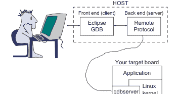

**图 8.1**
GDB 的客户端/服务器特性。

将目标连接到 *gdb* 串行协议有两种方法：

- **gdb 桩（gdb stubs）**。一组链接到目标程序中的函数。*gdb stubs* 是仅支持 RS-232 的解决方案。
- **gdbserver**。这是一个运行在目标上的独立程序，它进而运行待调试的程序。*gdbserver* 的优点是完全独立于目标程序。换句话说，无论是否进行远程调试，目标系统的构建方式都是相同的。*gdbserver* 的另一个优点是它可以通过以太网运行。最后，Eclipse 使用的是 *gdbserver*，这也是使用它的最佳理由。

*gdbserver* 是位于 `/usr/local/arm-unknown-linux-gnueabi` 的 ARM 交叉工具链的一部分。它也已经存在于 BBB 的根文件系统中的 `/usr/bin` 目录里。

要在 GDB 下运行 *measure* 程序，首先需要 `cd` 到 `src/measure` 目录，并以 root 用户身份执行：

```
gdbserver :10000 measure
```

*gdbserver* 的参数包括：

- 网络端口号，前面带有冒号。正常格式为“host:port”，其中“host”可以是主机名或点分四组格式的 IP 地址，但 *gdbserver* 会忽略主机部分。只要不与正在使用的其他端口号冲突，端口号可以是任意的。通常，1024 以下的端口号保留给已建立的网络协议（如 HTTP 使用 80 端口），因此最好选择 1023 以上的数字。端口号 10,000 恰好是 Eclipse 调试器的默认值。
- 目标程序名称。
- 目标程序的参数（如果有）。

gdbserver 会返回类似以下内容：

```
Process measure created; pid = 703
```

你的 pid 值可能不同。这表示 gdbserver 已加载程序，并正在指定的端口上等待调试会话开始。你必须是 root 用户，因为程序正在 /sys 中打开属于 root 的文件进行写入。

### 远程调试启动配置

我们需要一个用于远程调试的不同调试启动配置。在项目资源管理器视图中选中 measure 项目后，可以通过 Run > Debug Configurations... 调出调试配置对话框，或者点击可爱小虫子图标旁边的向下箭头并选择 Debug Configurations...。尽管有一个名为 C/C++ Remote Application 的类别，但我们将在 C/C++ Application 下创建这个新配置，就像我们为 record_sort 做的那样。

1. 选中 C/C++ Application 后，点击 New 按钮。这会弹出调试配置对话框，正如我们在第 5 章《Eclipse 集成开发环境》中所见，名称和项目条目已自动填充。
2. 我们需要填写 C/C++ Application 条目。点击 Search Project...。这会弹出一个对话框，列出项目中找到的所有可执行文件。选择 measure 并点击 OK。
3. 在对话框中间有一个标记为 Build (if required) before launching 的条目。我建议选择 Disable auto build。稍后会有这样的情况：自动构建试图构建 all 目标并失败。这种失败是无害的，但可能会让人不安。但请注意，即使你禁用了自动构建，Eclipse 仍可能试图构建 all 目标并输出以下消息：
   > Errors exit in the active configuration of project "measure". Proceed with launch?
   
   点击 Yes。调试会话将正常继续。
4. 在 Main 选项卡的底部有一个标记为 Using GDB Debugger Services Framework (DSF) Create Process Launcher 的条目，旁边有一个标记为 Select other... 的链接。点击该链接以调出图 8.2 中所示的对话框。
5. 勾选 Use configuration specific settings，并选择 Legacy Create Process Launcher。点击 OK。

这里的问题在于如何设置和控制远程调试会话。DSF 提供了一种更无缝、集成的“体验”，我们将在本章后面部分介绍。目前，我们将使用 Legacy Process Launcher 提供的更简单的方法。

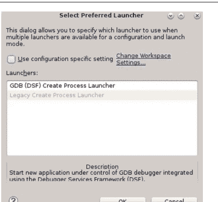

**图 8.2**
启动器首选项选择。

6. 现在选择 **Debugger** 选项卡（图 8.3）。由于我们要调试 **ARM** 代码，我们需要一个能理解 **ARM** 代码的 **GDB** 版本。并且我们必须告知它我们正在进行远程调试。
7. 在 **Debugger** 下拉菜单中，选择 `gdbserver`。
8. 确保勾选了 **Stop on startup at main**。
9. 在 **GDB Debugger** 字段中输入 `arm-linux-gdb`。
10. 选择 **Debugger Options** 下方的 **Connection** 选项卡（图 8.4）。对于 **Type** 下拉菜单，选择 **TCP**。
11. 在 **Host name or IP address** 中输入你 BBB 的 IP 地址。[^1] 然后，点击 **Apply**。
12. 如果 `gdbserver` 仍在目标板上耐心等待，请继续点击 **Debug**。否则，在点击 **Debug** 之前，请先按照上述说明启动 `gdbserver`。

Eclipse 会切换（或询问你是否要切换）到 **Debug** 透视图。即使你正在目标板上进行调试，一切看起来都和你在工作站上调试 `record_sort` 时差不多。

[^1]: 这里的“**Host**”（主机）有点误导性。它实际上指的是目标板。

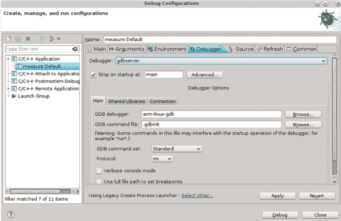

**图 8.3**
调试器选项卡。

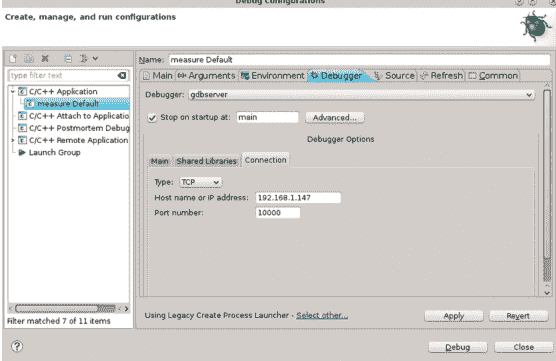

**图 8.4**
连接选项卡。

## 恒温器

让我们转向一些更有趣且可能更有用的东西。我们将通过把 measure 程序变成“恒温器”来增强它。我们还将看看如何使用宿主工作站作为初步测试环境。

我们的恒温器将在温度上升到给定设定值以上时激活“冷却器”，并在温度下降到设定值以下时关闭冷却器。在实际中，真正的恒温器包含滞后（hysteresis），以防止冷却器在温度恰好在设定值附近时快速开关。这通过“死区”（deadband）的形式实现，即当温度上升到设定值 + 死区时，冷却器开启；只有当温度下降到设定值 − 死区以下时，冷却器才关闭。此外，该程序还包括一个“警报”，当温度超过指定限制时，警报会闪烁。

两个 LED 将分别作为冷却器和警报。这些在 measure/ 目录下的 driver.h 中定义为 COOLER 和 ALARM。恒温器本身基本上是一个基于指示温度的简单状态机，具有三个状态：

- 正常（Normal）
- 高（High）
- 极限（Limit）

对于每个状态，采取的操作和下一状态如下：

| 当前状态 | 条件 | 操作 | 下一状态 |
| :--- | :--- | :--- | :--- |
| 正常 | 温度高于设定值 + 死区 | 开启 COOLER | 高 |
| 正常 | 温度高于极限 | 开启 ALARM | 极限 |
| 高 | 温度低于设定值 − 死区 | 关闭 COOLER | 正常 |
| 高 | 温度高于极限 | 开启 ALARM | 极限 |
| 极限 | 温度低于极限 | 关闭 ALARM | |


下一个状态 = 高  
温度低于设定值 - 死区  
关闭冷却器  
下一个状态 = 正常

状态机本质上只是针对状态变量的一个大型 `switch()` 语句。

现在是你进行实际编程的机会了。复制一份 `measure.c`，并将其命名为 `thermostat.c`。由于 `thermostat.c` 已经是 measure 的 Makefile 中的先决条件，因此要使其在 Eclipse 中可见，你只需在“项目资源管理器”视图中右键单击 measure，然后选择刷新即可。

在 `thermostat.c` 中实现状态机。将变量 `setpoint`、`limit` 和 `deadband` 声明为全局整数。建议将 `readAD()` 返回的值除以 10 到 20 之间的某个数，以获得一个合理的温度值，并便于调整电位器。选择一个合适的 `setpoint`，然后选择一个比该值高几“度”的 `limit`。加上或减去 1 个计数值的 `deadband`（死区）可能就足够了。

## 将主机工作站用作调试环境

尽管远程 GDB 为我们提供了一个观察目标板上程序行为的不错窗口，但有充分理由认为在主机开发机器上进行初步调试会很有用。首先，在项目启动时主机即可用，这通常远早于任何真实目标硬件可用或运行之前。在许多情况下，使用模拟来精确测试限制条件比使用真实硬件更容易。主机拥有一个文件系统，可用于创建测试脚本和记录测试结果。

当你描述大多数嵌入式系统软件的内容时，通常会发现大约 5%，甚至 10% 的代码直接与硬件交互。其余代码独立于硬件，因此，只要代码结构良好以隔离硬件依赖元素，就不需要硬件来测试它们。

这里的想法是构建一个简单的模拟来替代硬件 I/O 设备。然后，你可以通过键盘提供刺激来测试应用程序，并观察屏幕上的输出。在测试的后期阶段，你可能想用基于文件的“脚本驱动器”来替代屏幕和键盘，以创建可重复的测试用例。

看一下 `measure/` 目录中的 `simdrive.c`。此文件公开了与 `trgdrive.c` 相同的应用程序编程接口，但使用共享内存区域与另一个进程通信，该进程在屏幕上显示数字输出并通过键盘接收模拟输入值。此功能在 `devices.c` 中实现。共享内存区域由一个类型为 `shm_em_t`（定义在 `driver.h` 中）的数据结构组成，其中包含一个模拟输入字段和一组假设连接到 LED 的数字输出字段。它还包括一个进程 ID 字段（*pid_t*），设置为 *devices* 进程的 pid，允许 *thermostat* 进程在数字输出发生变化时发出信号。

*devices* 创建并初始化共享内存区域。在 *simdrive* 中，*initAd()* 附加到之前创建的共享内存区域。*readAD()* 简单返回共享内存中 *a2d* 字段的当前值。*setDigOut()* 和 *clearDigOut()* 函数相应地修改 *leds* 字段，然后向 *devices* 进程发出信号以更新屏幕显示。**图 8.5** 以图形方式说明了该进程。

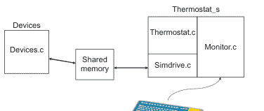

**图 8.5**  
恒温器模拟。

模拟版本的恒温器可执行文件称为 *thermostat_s*（_s_ 代表 simulation/模拟），它是项目 Makefile 中的默认目标。实际上，当你执行刷新操作将 *thermostat.c* 引入 Eclipse 时，它应该已经被自动构建了。在编辑 *thermostat.c* 后若要再次构建它，请选择 *项目* 菜单和 *构建全部*。

为了构建 *devices* 程序，我们需要向项目添加另一个目标。在 *项目资源管理器* 中右键单击 *measure*，并选择 *make 目标* *->* 创建。*目标名称* 为“devices”，*Make 目标* 也是如此。继续构建 *devices* 目标。

在一个 shell 窗口中运行 *devices*。要调试 *thermostat_s*，我们可以使用我们在第 5 章“Eclipse 集成开发环境”中为 *record_sort* 项目创建的相同调试启动配置：

1. 打开调试配置对话框，并选择用于 *record_sort* 项目的那个。
2. 将名称更改为“host”。我们将使用此配置进行所有模拟调试。
3. 将项目更改为“measure”，并为应用程序选择 *thermostat_s*。
4. 点击 *应用*，然后点击 *调试* 以带出调试透视图，程序在 *main()* 的第一条可执行语句处暂停。

## 高级断点功能

`thermostat_s` 程序为我们提供了一个探索断点一些高级功能的机会。在你的状态机的 `switch()` 语句顶部设置一个断点。然后转到调试透视图右上角的断点视图，右键单击你刚刚创建的断点条目。在上下文菜单的底部选择断点属性。这会弹出如图 8.6 所示的相当空白的对话框。

可以为断点附加*操作*，这样当断点被命中时，附加的操作将被执行。C 开发工具包提供五种预定义的操作类别：

- **播放声音** — 在断点被命中时播放选定的声音文件。也许断点每半小时才发生一次。你可以去做别的事，当听到相应的蜂鸣声时，你可以回来查看发生了什么。声音文件可以是 `.wav`、`.mid`、`.au` 或 `.aiff`。
- **记录消息** — 向控制台输出消息。要查看消息，必须在控制台视图中选择记录操作消息。
- **运行外部工具** — 执行已配置为外部工具的程序。例如，该程序可能在远程设备上运行。你可以配置断点向你的桌面发送电子邮件或短信。程序通过运行 > 外部工具 > 外部工具配置... 进行安装和配置。
- **恢复** — 在指定延迟后自动恢复程序。同样，如果程序在远程运行，这通常是断点后保持程序运行的唯一方式。
- **反向调试** — 这是一个新功能，未在 Eclipse 文档中描述。有三种可能的值：启用、禁用和切换。

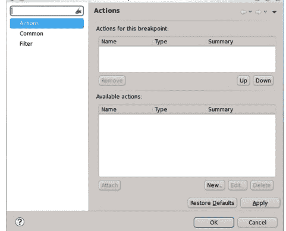

**图 8.6**  
断点属性。

让我们创建一个声音操作。在 CentOS 7 中，大多数声音文件（`.wav`）位于 `/usr/share/` 的子文件夹中。其中几个在 `sounds/alosa` 中。还有许多位于 `kde4/apps/korganizer/sounds/` 下。以下是我们操作的方法：

1. 在**操作**对话框中，点击**新建**。声音操作默认被选中。
2. 给它起个名字。比如“beep”（蜂鸣声）？
3. 浏览到包含 `.wav` 文件的文件夹之一，并选择一个。要听它听起来是什么样，点击**播放声音**。
4. 点击**确定**。

Beep 操作现在出现在可用操作列表中。以类似的方式，创建一个记录操作。让它打印消息“Hit the breakpoint at the switch statement.”（在 switch 语句处命中断点）。

选择可用操作列表中的每个条目，并点击**附加**。它们现在都出现在此断点的操作列表中。让程序运行。当它命中断点时，你应该能听到声音。在控制台视图中，找到控制台菜单右端附近的显示选定控制台下拉框。选择记录操作消息。要返回程序输出，选择 `[C/C++ Application]thermostat_s`。

再次打开断点属性对话框。在左侧列中选择常规以弹出如图 8.7 所示的对话框。这列出了有关断点的一些基本信息，例如它所在的文件和行号，以及其启用状态。它还提供了控制断点的几种方法。

条件允许我们指定一个布尔表达式，以控制是否命中断点。如果表达式求值为真，则命中断点。否则，它被忽略。表达式可以包含任何程序变量。例如，我们实际上只关心在预期状态改变时命中 `switch()` 语句上的断点。


## 图 8.7
常见断点属性。

在循环的每次通过中设置断点将非常繁琐且低效。因此，我们可以输入以下条件：

```
value>setpoint+deadband
```

当断点被触发时，我们可以单步执行代码，以确保状态已更改且冷却器已开启。然后我们可以将条件更改为：

```
value>limit
```

并观察在该转换点发生的情况。然后，当然，我们会逆转该过程，并观察状态如何恢复为正常。

“常规”对话框中的忽略计数是断点在被触发之前被忽略的次数。例如，如果我们输入 10，那么前 10 次遇到断点时将被忽略，最终会在第 11 次遇到时触发。这对于运行固定次数的 `for` 循环可能很有用，在这种情况下，我们可能只关心循环的第一次和最后一次通过。

使用这些高级断点功能，通过向设备程序输入不同的 A/D 输入值来调试你的恒温器程序，并观察恒温器状态机如何响应。

当觉得程序运行正确时，为目标板重新构建它。你需要另一个 make 目标。将其命名为，例如，`ARMthermo`。取消勾选*与目标相同*的名称，并为 Make 目标输入 `all`。取消勾选*使用构建器设置*，并为构建命令输入 `make TARGET=1`。在创建此目标之前，删除 `thermostat.o`。否则，它不会为 ARM 重新编译，链接器会抱怨无效的目标文件。

要在目标上调试 `thermostat_t`，你需要修改本章开始时为 measure 程序创建的调试启动配置。打开调试配置对话框，并选择 measure 配置。将名称更改为"target"，因为我们将在所有目标调试中使用此配置。将 C/C++ 应用程序中的文件名从 `measure` 更改为 `thermostat_t`。这些是唯一需要的更改。单击应用。

在目标板上，运行 `gdbserver:10000 thermostat_t`。然后回到 Eclipse，单击**调试**。现在你正在目标板上调试恒温器程序。

## 调试器服务框架

尽管功能强大，但我们迄今为止看到的远程调试过程有点繁琐。你需要通过 `minicom` shell 手动启动 `gdbserver`，而程序控制台就在那里。如果你点击**调试**时 `gdbserver` 能自动启动，并且在 Eclipse 控制台视图中显示程序 I/O，那岂不是更好吗？这就是 DSF 为我们所做的。

DSF 构建在远程系统资源管理器 (RSE) 之上，RSE 是一组允许你直接与远程系统上的文件和资源等工具交互。RSE 进而使用 SSH（安全外壳）与远程系统建立通信。

### 配置远程系统资源管理器

启动 Eclipse，并打开 RSE 透视。你会发现左侧的项目资源管理器视图已被标记为远程系统的视图所取代，而编辑器下的一组视图已被称为远程系统详情的东西所取代。目前，远程系统中列出的唯一项是本地，即你的工作站。展开该条目以显示本地文件和本地 Shell。展开本地文件以浏览文件系统（图 8.8）。

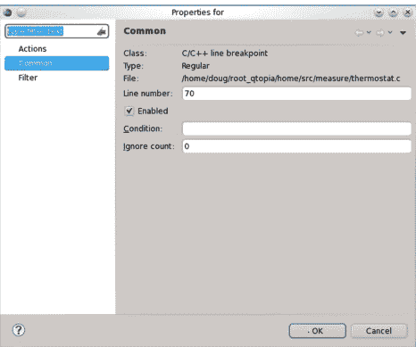

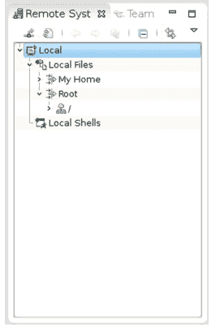

## 图 8.8
远程系统视图。

右键单击本地 Shell，并选择启动 Shell。这会在底部的选项卡窗口中打开一个远程 Shell 视图。命令在底部的小窗口中输入，结果在较大的窗口中显示。图 8.9 显示了我系统主目录中 `ls root_qtopia` 的最后几行。我觉得这个 Shell 的呈现有点笨拙

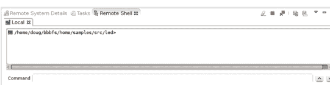

## 图 8.9
本地 Shell 视图。

并且难以使用。一旦设置好，远程 Shell 中就有更有用的 Shell 格式可用。
不用说，RSE 在连接到远程系统之前并不是很有趣，特别是 BBB 目标板。在远程系统视图中，单击左上角的定义连接图标，或者右键单击本地并选择新建 -> 连接。第一步是选择远程系统类型。在我们的案例中，它将是仅 SSH。

你可能会问，为什么不是 Linux 类型？它使用一种不同的、RSE 特定的通信协议，称为 dstore，它具有更多功能，但在服务器上需要更多资源。dstore 实际上是基于 Java 的，因此它需要在服务器上运行 Java 运行时引擎，而目前这看起来太麻烦了。

在单击下一步以打开图 8.10 中的对话框之前，请确保你的目标板已通电并进入 Linux。主机名默认为 LOCALHOST。将其更改为目标板的 IP 地址。注意，连接名称最初与主机名相同，


## **图 8.10**
设置 SSH 连接。

但你可以将其更改为任何你想要的名称，例如"BeagleBone"。同样，描述可以是任何内容。

单击**下一步**显示远程机器上可用的文件服务。这里没有任何需要更改的内容。再次单击**下一步**显示可用的 Shell 服务。同样，不需要更改。再单击一次**下一步**显示可用的终端服务。单击**完成**，新的连接将出现在远程系统视图中。

展开新连接以显示类似我们看到的本地条目的条目。当你展开 Sftp 文件下的我的主目录或根目录时，你需要输入有效的用户 ID（root）以及远程系统的可选密码，这将有效地让你登录到该系统。你现在可以使用复制和粘贴命令在本地主机和远程系统之间移动文件。你还可以通过双击在 Eclipse 编辑器中打开远程文本文件。

即使这在当前情况下也不是特别有用，因为目标的文件系统通过网络文件系统 (NFS) 从工作站挂载。我们从工作站直接访问文件系统。但如果目标确实是一台远程计算机，那肯定是有用的。

注意 BeagleBone 连接下的 SSH 终端条目。右键单击它，并选择启动终端。这会打开另一种形式的远程 Shell，如图 8.11 所示。这个看起来更像我们通过 *minicom* 使用的 Shell，我个人觉得它比本地连接可用的所谓 Shell 视图更容易使用。


## 使用远程系统资源管理器进行调试

我们现在可以设置一个使用到目标的 SSH 连接的调试配置。打开调试配置对话框，选择*C/C++ 远程应用程序*，并单击**新建**


## **图 8.12**
远程调试配置。

**启动配置**图标。图 8.12 显示了此配置的最终值。主标签的上半部分看起来像之前看到的，选择**应用程序**和**项目**。同样，最好选择**禁用自动构建**。

在**连接**下拉框中，选择你刚刚创建的远程连接。接下来，我们必须告诉 GDB 在哪里找到远程目标上的可执行文件。输入目标上 `thermostat_t` 的路径。在大多数情况下，RSE 必须"下载"可执行文件才能在远程机器上执行和调试它。在我们的情况下，当然，可执行文件已经在 NFS 挂载的文件系统中对目标可见，因此勾选**跳过下载到目标路径**。如果你确实选择让 RSE 下载可执行文件，不要使用当前位置，因为它会尝试覆盖自身并失败。尝试 /home/samples/src。**在应用程序执行前要执行的命令**条目可能是放置关闭 LED 触发器并使能 ADC 子系统的脚本的好地方。

转到**调试器**标签，并为**GDB 调试器**输入“arm-linux-gdb”。选择**Gdbserver 设置**标签，并将端口设置为 10,000。


点击**应用**，然后点击**调试**。经过短暂延迟后，调试透视图将出现，准备好在目标板上调试 `thermostat_t`。调试过程与之前相同，但现在程序输出将显示在 Eclipse 的控制台视图中。

在下一章中，我们将探讨多线程编程，作为“重量级” Linux 进程模型的替代方案。

### 资源

- [opensh.org](http://opensh.org) 了解更多关于 Secure Shell 及其开源版本的信息。
- [openssl.org](http://openssl.org) 了解 Secure Sockets Layer（安全套接字层）。

# **Posix 线程**

章节大纲

- 线程 141
- 线程属性 142
- 同步：互斥锁 143
- 互斥锁属性 145
- 资源共享问题的解决难题：优先级反转 146
- 通信：条件变量 148
- 条件变量属性 149
- 线程终止与取消 149
- 清理处理程序 151
- Pthreads 实现 152
- 升级恒温器 153
- Thermostat.c 中所需的更改 154
- 调试多线程程序 154
- 资源 155

> *只有当你的时间没有价值时，Linux 才是免费的。*
> Jamie Zawinski

我们在上一章中开发的恒温器实用性不强，因为操作参数**设定值**、**限值**和**死区**是硬编码在程序中的。任何实用的恒温器都会将这些参数设置为用户可调节。在这种情况下，我们可以发明一个简单的命令协议，通过控制台更改参数。

我们如何实现这样一个进程？在旧 DOS 时代，我们可能使用函数 **kbhit**() 来轮询键盘活动。但 Linux 是一个多任务系统。轮询显得很老土。我们需要的是一个独立的执行线程，它耐心地等待控制台上的文本行，解析该行并据此操作。

我们可以使用 **fork**() 创建新进程。列表 9.1 以伪代码形式展示了一种可能的实现。我们首先创建共享内存空间，然后使用 **fork**() 创建新的子进程。子进程监视 **stdin**，并将任何有效命令的结果发布到共享内存区域的相应条目中。父进程即我们已见过的 **恒温器** 程序。

```text
#include <unistd.h>
#include "measure.h"

int running = 1;
params_t *p;  /*pointer to shared memory */

int main(int argc, void **argv)
{
        create shared memory space;
        switch (fork())
        {
                case -1:
                        printf ("fork failed\n");
                        break;
                case 0:      /* child process */
                        attach to shared memory space;
                        while (running)
                        {
                                fgets();
                                parse command;
                                put result in shared memory;
                        }
                        break;
                default:     /* parent process */
                        attach to shared memory space;
                        while (running)
                        {
                                read A/D;
                                act on current state;
                        }
                        break;
        }
        exit (0);
}
```

## 列表 9.1

恒温器的 Fork 实现。

但可能有一种更高效的实现方式。回想第三章介绍 Linux 中的内容，Linux 进程可以拥有多个执行线程，所有这些线程共享进程的内存空间。那么，如果我们创建一个仅驻留在 *stdin* 上等待命令的线程会怎样？具体来说，在本章中，我们将探索 Posix 线程。

Posix，也写作 POSIX，是一个缩略词，意为可移植操作系统接口（Portable Operating System Interface），为了好听加了一个 X。POSIX 代表一组定义基于 UNIX 的可移植操作系统各个方面的标准。这些标准由电气电子工程师学会（IEEE）和国际标准化组织共同维护。这些文档通过 IEEE 和开放组（Open Group）的协作努力整合成了一个单一的标准（参见资源部分）。

一般来说，Linux 符合 Posix 标准。命令 shell、实用程序和系统接口多年来已升级以满足 Posix 要求。但就多线程而言，我们这里特别感兴趣的是被称为 1003.1c 的 Posix 线程接口。

原型化 Pthreads 应用程序编程接口（API）的头文件是 `pthread.h`，它位于库头文件的常规目录 `/usr/include` 中，或者在我们的交叉工具链情况下，位于 `/usr/local/arm-unknown-linux-gnueabi/arm-unknown-linux-gnueabi/sysroot/usr/include`。

### 线程

实时操作系统通常将线程称为任务。它们几乎是一回事。线程是体现为函数的独立执行流。线程拥有自己的栈，称为其*上下文*。

```text
int pthread_create (pthread_t *thread, pthread_attr_t *attr, void *(*) (start_routine) (void *), void *arg);

void pthread_exit (void *retval);

int pthread_join (pthread_t thread, void **thread_return);

pthread_t pthread_self (void);

int sched_yield (void);
```

线程通过调用 `pthread_create()` 创建，参数如下：

- `pthread_t` — 表示或标识线程的**线程对象**。`pthread_create()` 会按需初始化它。
- 指向线程*属性*对象的指针。通常它是 NULL。稍后会有更多说明。
- 指向*启动例程*的指针。启动例程接受一个指向 `void *` 的单个指针参数，并返回一个指向 void 的指针。
- 调用启动例程时传递给它的参数。

线程可以通过调用 `pthread_exit()` 或简单地从启动函数返回来终止。`pthread_exit()` 的参数是启动函数的返回值。

就像父进程可以通过调用 `waitpid()` 等待子进程完成一样，线程可以通过调用 `pthread_join()` 等待另一个线程完成。`pthread_join()` 的参数是要等待的线程对象，以及存储线程返回值的位置。调用线程将被阻塞，直到目标线程终止。线程之间没有像进程那样的父子关系，因此一个线程可以连接任何其它线程。

线程可以通过调用 `pthread_self()` 确定自己的 ID。最后，线程可以通过调用 `sched_yield()` 自愿放弃处理器。

请注意，上述大多数函数返回 int 值。这反映了 Pthreads 处理错误的方法。Pthreads 函数不是通过全局变量 `errno` 报告错误，而是通过返回值报告错误。

## 线程属性

POSIX 提供了一种通过*属性对象*扩展 API 的开放式机制。每种 Pthreads 对象都有相应的属性对象。该属性对象实际上是相关对象创建或初始化函数的扩展参数列表。指向属性对象的指针始终是创建函数的第二个参数。如果此参数为 NULL，创建函数将使用适当的默认值。这还使得创建函数保持相对简单，省略了许多通常采用默认值的参数。

一个重要的哲学观点是，所有 Pthreads 对象都被认为是“不透明的”。至少大多数是如此。我们很快就会看到一个例外。这意味着你永远不直接访问对象本身的成员。所有访问都是通过获取和设置对象成员参数的 API 函数进行的。这允许通过为 API 定义相应的获取和设置函数对，向 Pthreads 对象类型添加新参数。在简单实现中，获取和设置函数可能仅仅是一对访问属性数据结构相应成员的宏。

```text
int pthread_attr_init (pthread_attr_t *attr);
int pthread_attr_destroy (pthread_attr_t *attr);
int pthread_attr_getdetachstate (pthread_attr_t *attr, int *detachstate);
int pthread_attr_setdetachstate (pthread_attr_t *attr, int detachstate);
```

## 调度策略属性

```text
int pthread_attr_setschedparam (pthread_attr_t *attr, const struct sched_param *param);
int pthread_attr_getschedparam (const pthread_attr_t *attr, struct sched_param *param);
int pthread_attr_setschedpolicy (pthread_attr_t *attr, int policy);
int pthread_attr_getschedpolicy (const pthread_attr_t *attr, int *policy);
int pthread_attr_setinheritsched (pthread_attr_t *attr, int inherit);
int pthread_attr_getinheritsched (const pthread_attr_t *attr, int *inherit)
```


在属性对象能够被使用之前，它必须被初始化。然后，可以使用相应的函数来设置或获取为该对象定义的任何属性。这必须在将属性对象用于调用 `pthread_create()` 之前完成。如有必要，属性对象也可以被“销毁”。请注意，单个属性对象可以用于创建多个线程。

线程对象唯一必需的属性是“分离状态”。它决定了线程终止时是否可以被联接。默认的分离状态是 `PTHREAD_CREATE_JOINABLE`，意味着线程在终止时可以联接。另一种情况是 `PTHREAD_CREATE_DETACHED`，这意味着线程不能被联接。

如果需要获取线程的返回值，或者希望确保线程按特定顺序终止，那么联接（Joining）是有用的。否则，最好创建分离状态的线程。可联接线程的资源在另一个线程对其进行联接之前无法回收，而分离线程的资源在其终止后即可回收。

还有一些可选的调度策略属性。

## **同步：互斥量**

一旦引入第二个独立的执行线程，我们就创造了资源冲突的可能性。考虑一个稍显牵强的例子，如**图 9.1**所示，两个线程都希望通过单台共享打印机打印消息“I am Thread $n$”。在没有同步机制的情况下，结果可能是类似 “Il a mm TaTasskk 12” 的乱码。


```
Code in Thread n
`printf("I am thread %d\n", thread);`
```

**图 9.1**
资源冲突。


需要的是某种调节对打印机访问的方式，以便一次只有一个任务可以使用它。

*互斥量*（Mutex，是“mutual exclusion”即“互斥”的简称）像一把钥匙一样控制对资源的访问。只有持有钥匙的线程才能使用该资源。为了使用资源（在此例中是打印机），线程必须先通过调用适当的内核服务来*获取*钥匙（互斥量）（**图 9.2**）。如果钥匙可用，即资源（打印机）当前未被其他人使用，则允许线程继续执行。在使用完打印机后，线程释放互斥量，以便另一个线程可以使用它。

然而，如果打印机正在被使用，线程将被阻塞，直到当前持有互斥量的线程释放它。当互斥量被使用时，任意数量的线程都可以尝试获取该互斥量。所有这些线程都会被阻塞。等待的线程会被排队，要么按优先级排序，要么按调用 `pthread_mutex_lock()` 的顺序排队。线程在互斥量处排队的选择方式可能内置于内核中，也可能是创建互斥量时的一个配置选项。

```c
pthread_mutex_t mutex = PTHREAD_MUTEX_INITIALIZER;

int pthread_mutex_init (pthread_mutex_t *mutex, const pthread_mutexattr_t *mutex_attr);
int pthread_mutex_destroy (pthread_mutex_t *mutex);

int pthread_mutex_lock (pthread_mutex_t *mutex);
int pthread_mutex_unlock (pthread_mutex_t *mutex);
int pthread_mutex_trylock (pthread_mutex_t *mutex);
```

Pthreads 互斥量 API 遵循与线程 API 非常相似的模式。有一对函数用于初始化和销毁互斥量对象，以及一组用于操作互斥量对象的函数。上述代码还展示了初始化静态分配互斥量对象的另一种方式。`PTHREAD_MUTEX_INITIALIZER` 提供与 `pthread_mutex_init()` 相同的默认值。

对互斥量可以执行两种操作：加锁（lock）和解锁（unlock）。如果互斥量不可用，加锁操作会导致调用线程阻塞。还有一个名为 `trylock` 的函数，允许你在不阻塞的情况下测试互斥量的状态。如果互斥量可用，`trylock` 返回成功并锁定互斥量。如果互斥量不可用，它返回 `EBUSY`。

### 互斥量属性

互斥量属性遵循与线程属性相同的基本模式。有一对函数用于创建和销毁互斥量属性对象。我们将稍后再讨论 `pshared` 属性。还有一些其他属性我们很快就会讨论。

互斥量“属性”类型最初是 Linux 对 Pthreads 的非可移植扩展。Pthreads 标准明确允许非可移植扩展。唯一的要求是，任何非可移植符号的名称后面必须附加 “_np”。

互斥量类型随后被纳入 Pthreads 标准。

```c
int pthread_mutexattr_init (pthread_mutexattr_t *attr);
int pthread_mutexattr_destroy (pthread_mutexattr_t *attr);

int pthread_mutexattr_gettype (pthread_mutexattr_t *attr, int *type);
int pthread_mutexattr_settype (pthread_mutexattr_t *attr, int type);

type =  PTHREAD_MUTEX_NORMAL
        PTHREAD_MUTEX_ERRORCHECK
        PTHREAD_MUTEX_RECURSIVE
        PTHREAD_MUTEX_DEFAULT

int pthread_mutexattr_getprioceiling (const pthread_mutexattr_t *mutex_attr, int *prioceiling);
int pthread_mutexattr_setprioceiling (pthread_mutexattr_t *mutex_attr, int prioceiling);
```

```c
int pthread_mutexattr_getprotocol (pthread_mutexattr_t *mutex_attr, int *protocol);

int pthread_mutexattr_setprotocol (pthread_mutexattr_t *mutex_attr, int protocol);

int pthread_mutexattr_getprioceiling (const pthread_mutexattr_t *mutex_attr, int *prioceiling);

int pthread_mutexattr_setprioceiling (pthread_mutexattr_t *mutex_attr, int prioceiling);

protocol = PTHREAD_PRIO_NONE
           PTHREAD_PRIO_INHERIT
           PTHREAD_PRIO_PROTECT
```

如果一个线程试图锁定它已经锁定的互斥量会发生什么？通常，该线程会简单地挂起。“type” 属性改变了当线程尝试锁定其已锁定的互斥量时互斥量的行为。type 的可能值有：

- **Normal（普通）。** 如果线程尝试锁定它已经持有的互斥量，它将被阻塞，从而实际上导致死锁。普通互斥量不进行一致性或合理性检查。
- **Error checking（错误检查）。** 如果线程尝试递归锁定一个错误检查互斥量，锁定函数会立即返回错误代码 `EDEADLK`，意味着你无法这样做，因为你已经锁定了该互斥量。此外，如果解锁函数由非当前互斥量所有者的线程调用，它会返回一个错误。
- **Recursive（递归）。** 递归互斥量允许线程成功多次锁定同一个互斥量。它统计互斥量被锁定的次数，并要求进行相同次数的解锁函数调用，互斥量才会进入解锁状态。此类型还检查互斥量是否由锁定它的同一线程解锁。
- **Default（默认）。** 标准规定，如果尝试递归锁定，该类型将导致“未定义行为”。它还规定实现可以将 Default 映射为其他类型之一。

可选地，Pthreads 互斥量可以实现优先级继承或优先级上限协议，以避免优先级反转。互斥量属性 `protocol` 可以设置为“none”（无），“priority inheritance”（优先级继承）或“priority ceiling”（优先级上限），分别由符号 `PTHREAD_PRIO_PROTECT` 等表示（注：原文此处对应 `PTHREAD_PRIO_PROTECT`，通常对应 Priority Protection/Ceiling，而 Inherit 对应 `PTHREAD_PRIO_INHERIT`）。`prioceiling` 属性设置优先级上限的值。

## **解决资源共享问题的缺陷：优先级反转**

使用互斥量来解决资源冲突可能导致微妙的性能问题。考虑**图 9.3** 所示的场景。线程 1 和线程 2 都需要访问由互斥量保护的公共资源。线程 1 具有最高优先级，线程 2 具有最低优先级。线程 3 不需要该资源，但具有“中等”优先级。


**图 9.3**
优先级反转场景。

**图 9.4** 是该系统的执行时间线。假设线程 2 当前正在执行并等待（pend）互斥量。资源是空闲的，因此线程 2 获取了它。接下来，发生了一个中断，使线程 1 就绪。由于线程 1 具有更高的优先级，它抢占线程 2，并执行直到等待（pend）*资源* 互斥量。


**图 9.4**
执行时间线。

由于资源由线程 2 持有，线程 1 被阻塞，线程 2 重新获得控制权。到目前为止，一切都在按预期工作。尽管线程 1 具有更高的优先级，但它只能等待线程 2 使用完资源。

问题出现在线程 2 持有资源锁时，线程 3 变为就绪状态。线程 3 抢占线程 2。这种情况被称为*优先级反转*，因为一个低优先级线程（线程 3）实际上阻止了一个高优先级线程（线程 1）的执行。


解决此问题的一个常见方法是在线程 1 挂起在互斥锁上时，暂时将线程 2 的优先级提升到与线程 1 相同。此时，线程 2 不能被任何优先级低于线程 1 的任务抢占。这被称为优先级继承。

另一种方法称为优先级天花板，它在线程 2 获取互斥锁时，立即将线程 2 的优先级提升到一个指定的、高于任何可能挂起在该互斥锁上的任务的值。这被认为更高效，因为它消除了不必要的上下文切换。需要该资源的线程无法抢占当前持有该资源的线程。

Posix 线程提供了可选属性，用于将互斥锁的协议设置为优先级继承或优先级天花板，以及设置优先级天花板值。

## 通信：条件变量

在许多情况下，一个线程需要通知另一个线程某个由互斥锁保护的共享资源的状态变化。请考虑图 9.5 中的情况，其中两个线程共享访问一个队列。线程 1 读取队列，线程 2 写入队列。显然，每个线程都需要对队列进行独占访问，因此我们用互斥锁来保护它。


线程 1 将锁定互斥锁，然后检查队列是否有任何数据。如果有，线程 1 读取数据，并解锁互斥锁。然而，如果队列为空，线程 1 需要阻塞在某处，直到线程 2 写入一些数据。线程 1 在阻塞前必须解锁互斥锁，否则线程 2 将无法写入。但是，在线程 1 解锁互斥锁和阻塞之间有一个间隙。在此期间，线程 2 可能会执行，而未能认识到有人正在队列上阻塞。

条件变量通过在持有互斥锁的情况下等待（阻塞）来解决这个问题。内部地，条件等待函数会解锁互斥锁，允许线程 2 继续执行。当条件等待返回时，互斥锁再次被锁定。

```c
pthread_cond_t cond = PTHREAD_COND_INITIALIZER;

int pthread_cond_init (pthread_cond_t *cond, const pthread_condattr_t *cond_attr);
int pthread_cond_destroy (pthread_cond_t *cond);

int pthread_cond_wait (pthread_cond_t *cond, pthread_mutex_t *mutex);
int pthread_cond_timedwait (pthread_cond_t *cond, pthread_mutex_t *mutex, const struct timespec *abstime);
int pthread_cond_signal (pthread_cond_t *cond);
int pthread_cond_broadcast (pthread_cond_t *cond);
```

条件变量的基本操作是 *signal*（信号）和 *wait*（等待）。Signal 唤醒等待该条件的线程之一。线程唤醒的顺序取决于调度策略。线程还可以执行 *timed wait*（超时等待），这样如果指定的时间间隔在条件发出信号之前过期，等待将返回一个错误。线程还可以 *broadcast*（广播）一个条件。这会唤醒所有等待该条件的线程。

## 条件变量属性

Pthreads 没有定义条件变量的任何必需属性，尽管至少有一个可选属性。

## 线程终止与取消

线程可以被自愿或强制终止。线程通过简单返回或调用 `pthread_exit()` 来终止自身。在后一种情况下，在终止之前，线程通过调用 `pthread_cleanup_push()` 注册的所有 *cleanup handlers*（清理处理器）都会被调用。

大多数线程运行在无限循环中。只要系统通电，线程就在运行，执行其任务。有些线程启动，完成工作，然后结束。但也有允许一个线程强制终止另一个线程的有用情况。也许用户按下了 CANCEL 按钮以停止漫长的搜索操作。或者该线程是冗余数值算法的一部分，由于另一个线程已经解决了问题，它不再被需要。Pthreads 取消机制为不再需要的线程提供有序的关闭。

但取消必须谨慎进行。你不能任意地在线程执行的任何点停止线程。假设它持有一个互斥锁。如果你终止一个已锁定互斥锁的线程，它将永远无法被解锁。线程可能已分配了一个或多个动态内存块。如果线程被终止，这些内存如何归还？

Pthreads 允许每个线程管理自身的终止，使得线程可以在实际终止前释放和/或归还任何全局资源。因此，当你取消一个线程时，通常不是立即停止它，而是请求它一旦安全或方便就终止自身。

Pthreads 支持三种取消模式（图 9.6），编码为两个位，称为 *cancellation state*（取消状态）和 *cancellation type*（取消类型）。线程可以选择禁用取消，因为它正在执行必须完成的操作。默认模式是 Deferred（延迟），意味着取消只能发生在特定位置，称为 *cancellation points*（取消点），在这些点上程序测试线程是否被请求终止。大多数可以阻塞无限时间的函数，如等待条件变量或读写文件，都是取消点，并在 Posix 规范中如此定义。

| 模式 | 状态 | 类型 | 含义 |
| :--- | :--- | :--- | :--- |
| Off | Disabled | N/A | 取消保持待定直到启用 |
| Deferred | Enabled | Deferred | 取消在下一个取消点发生 |
| Asynchronous | Enabled | Asynchronous | 取消随时可能发生 |

**图 9.6**

取消模式。

虽然异步取消模式看起来可能是一个好主意，但很少是安全的。这是因为，根据定义，当线程收到取消请求时，你不知道它处于什么状态。它可能刚刚调用了 `pthread_mutex_lock()`。互斥锁被锁定了吗？不知道。因此，在异步取消模式生效期间，你无法安全地获取任何共享资源。

```c
int pthread_cancel (pthread_t thread);
int pthread_setcancelstate (int state, int *oldstate);
int pthread_setcanceltype (int type, int *oldtype);
void pthread_testcancel (void);
```

线程可以通过调用 `pthread_cancel()` 来取消另一个线程。`pthread_setcancelstate()` 和 `pthread_setcanceltype()` 允许线程设置其取消模式。请注意，这些函数分别返回状态和类型的先前值。函数 `pthread_testcancel()` 允许你创建自己的取消点。如果线程未被请求终止，它立即返回。否则，它不返回。

## 清理处理器

当线程被请求终止自身时，在线程可以安全终止之前，可能需要做一些“清理”工作。例如，它可能需要解锁互斥锁，或归还动态分配的内存缓冲区。这就是 *cleanup handlers*（清理处理器）的作用。每个线程概念上都有一个活跃的清理处理器栈。处理器通过 `pthread_cleanup_push()` 推入栈中，并在线程被取消或调用 `pthread_exit()` 时按相反顺序执行。清理处理器接受一个 `void *` 参数。

```c
void pthread_cleanup_push (void (*routine)(void *), void *arg);
void pthread_cleanup_pop (int execute);
```

最近推入的清理处理器可以在不再需要时通过 `pthread_cleanup_pop()` 从栈中弹出。通常，无论线程是否终止，都需要清理处理器的功能。execute 参数指定弹出时是否执行处理器。非零值意味着执行。还要注意，`pthread_cleanup_pop()` 只能从调用了 `pthread_cleanup_push()` 的同一函数中调用。除了是良好的编程实践外，这是必要的，因为 `pthread_cleanup_push()` 是一个宏，在许多实现中，它以左花括号 “{” 结束，引入一个代码块，而 `pthread_cleanup_pop()` 则有对应的右花括号。

*Listing 9.2* 展示了典型队列应用程序中带有清理处理器的读取线程（主函数）。我们假设默认的延迟取消模式。请注意，使用 `pthread_cleanup_pop()` 来解锁互斥锁，而不是普通的互斥锁解锁函数。

我们需要这里使用清理处理器的原因是 `pthread_cond_wait()` 是一个取消点，而我们在调用它时互斥锁是被锁定的。但是，在每次通过 while 循环时都推入和弹出清理处理器真的有必要吗？如果在互斥锁解锁部分的“对数据做某事”调用中有一个取消点，那么这是必须的。只有当线程持有互斥锁时，它才能调用清理处理器。如果在互斥锁未锁定期间没有取消点，那么将推送清理调用移出循环是安全的。在这种情况下，我们实际上不需要弹出清理。

我们将在下一章有机会使用清理处理器。


## 清单 9.2
/* 清理处理程序示例 */
#include <pthread.h>

typedef struct my_queue_tag {
    pthread_mutex_t  mutex;      /* 保护对队列的访问 */
    pthread_cond_t   cond;      /* 发出队列变更信号 */
    int              get, put;  /* 队列指针 */
    unsigned char    empty, full; /* 状态标志 */
    q[Q_SIZE];                  /* 队列本身 */
} my_queue_t;

my_queue_t data = {
    PTHREAD_MUTEX_INITIALIZER, PTHREAD_COND_INITIALIZER, 0, 0, 1, 0};

void cleanup_handler (void *arg)
/*
   解锁与队列关联的互斥锁
*/
{
    pthread_mutex_unlock ((mutex *) arg);
}

int main (int argc, char *argv[])
{
    while (1)
    {
        pthread_cleanup_push (cleanup_handler, (void *) &data.mutex);
        pthread_mutex_lock (&data.mutex);
        if (queue is empty)
        {
            data.empty = 1;
            pthread_cond_wait (&data.cond, &data.mutex);
        }
        /* 从队列读取数据 */
        pthread_cleanup_pop (1);
        /* 对数据执行某些操作 */
    }
}

## Pthreads 实现

在 2.6 版本内核之前，最流行的线程实现是 LinuxThreads。它大约自 1996 年起就已存在，到 2.5 内核开发启动时，人们普遍认为需要一种新方法来解决 LinuxThreads 的局限性。这些局限性包括，内核将每个线程表示为一个独立的进程，或*可调度实体*，并为其分配唯一的进程 ID，尽管许多线程存在于同一个进程实体中。这导致与其他线程实现存在兼容性问题。每个进程有 8192 个线程的硬编码限制，虽然这看似很多，但有些问题确实可以从运行数千个线程中受益。

这项新开发工作的成果是原生 POSIX 线程库，即 NPTL，它现在是 2.6 和 3.x 系列内核中的标准线程实现。它同样将每个线程视为独立的可调度实体，但利用了内核中专门旨在克服 LinuxThreads 局限性的改进。`clone()` 调用被扩展以优化线程创建。每个进程的线程数量不再受限，新的完全公平调度器（CFS）可以处理数千个线程而没有过多的开销。一种新的同步机制，即快速互斥锁或“futex”，无需内核调用即可处理无竞争的情况。

在 IA-32 架构上的测试中，据报道 NPTL 能够在两秒内启动 100,000 个线程。相比之下，在没有 NPTL 的内核下运行此测试大约需要 15 分钟。

## 升级恒温器

我们现在已具备足够的背景知识，可以为恒温器添加一个线程，以监视串行端口参数的变化。我们将使用一种非常简单的协议来设置参数，该协议由一个字母后跟一个空格，再后跟一个数字组成。“s”代表设定点（setpoint），“l”代表限值（limit），“d”代表死区（deadband）。因此，要改变设定点，您只需输入，例如：

```
s 65<Enter>
```

这将设定点设置为 65 度。

将当前位于 `src/measure/` 目录中的 `thermostat.c` 复制到 `src/posix/`。创建一个名为“posix”的新 Eclipse 项目，位于 `home/samples/src/posix/` 目录中。同样，请确保它是一个 makefile 项目，并导入包含路径的项目设置。打开 `monitor.c`。首先要注意的是 `#include <pthread.h>`。此头文件声明了 Pthreads API 的原型。注意 `paramMutex` 和 `monitor` 的声明。后者将成为我们的监视线程句柄。

由于参数 `setpoint`、`limit` 和 `deadband` 被两个线程——恒温器线程和监视线程——独立访问，我们需要一个互斥锁来保证只有一个线程独占访问。实际上，这个特定应用可能并不绝对需要互斥锁，因为共享资源是简单的整数，对它们的访问应该是原子的。但它确实起到了说明问题的作用。

顺便注意，`setpoint`、`limit` 和 `deadband` 在 `thermostat.h` 中被声明为 `extern`。假设这些变量在 `thermostat.c` 中分配。如果碰巧为您的参数使用了不同的名称，您需要更改以匹配。

查看 `monitor()` 函数。它只是一个简单的循环，从 `stdin` 获取并解析字符串。注意，在 `monitor()` 更改任何参数之前，它会锁定 `paramMutex`。在 switch 语句的末尾，它解锁 `paramMutex`。在您的恒温器状态机中，也需要采用这种相同的方法。

向下滚动到 `createThread()` 函数。它将从 `thermostat.c` 中的 `main()` 调用，以初始化 `paramMutex` 并创建监视线程。如果失败，`createThread()` 返回非零值。`terminateThread()` 确保在终止 `main()` 之前正确终止监视线程。它应该从 `main()` 中的 `closeAll()` 之前调用。

## Thermostat.c 中所需的更改

为了让 `thermostat.c` 能与监视器配合工作，所做的更改惊人地少。

- 包含 `pthread.h` 和 `thermostat.h`。
- 在 `main()` 顶部调用 `createThread()`，并测试返回值，
- 在状态变量的 switch 语句之前锁定 `paramMutex`，并在 switch 语句末尾解锁它。
- 在 `running` 循环之后立即调用 `terminateThread()`。

就是这样！makefile 支持目标构建和模拟构建，如上一章所述。两种构建的驱动程序都来自 `measure/` 目录，并假设它们已被构建。构建模拟版并试用一下。

## 调试多线程程序

多线程确实给调试过程带来了一些复杂性，但幸运的是，GDB 有相应的功能来处理这些问题。在 Eclipse 中调试 `thermostat_s`（确保 `devices` 正在运行），使用主机调试配置，并在 `main()` 中调用 `createThread()` 处设置断点。当它在断点处停止时，点击“Step into”（步入）进入 `createThread()` 函数。

步过 `pthread_mutex_init()` 调用和 `CHECK_ERROR`。现在，当步过对 `pthread_create()` 的调用时，调试视图中会出现第二个线程。这是监视线程，它已经位于 `fgets()` 调用内部。

在 `monitor()` 函数中 `fgets()` 调用之后设置一个断点。现在，在 `Console`（控制台）视图中输入一行文本。它是否有效并不重要。我们此时只想让程序在断点处停止。让程序继续，当它到达断点时，请注意现在挂起在断点处的是 `Thread [2]`。`Thread [1]` 很可能挂起在 `sleep()` 函数内部。

在 `main()` 和 `monitor()` 的各个地方尝试设置断点，以验证参数是否正确更新，以及恒温器是否正确响应新值。

当您满意于程序在模拟环境下运行后，为目标板重新构建它并在那里进行调试。您需要创建一个新的 make 目标，就像我们在上一章针对 measure 项目所做的那样。您还需要删除目标版本的 `monitor.o` 和 `thermostat.o`，以便正确构建。

启动调试器时，您可能会看到控制台视图中闪过一些警告消息。这些是无害的。

调试器如常停在 `main()` 的第一行。让程序执行到 `createThread()` 的断点。步过，调试视图显示两个线程，正如我们在模拟版本中看到的那样。从此处开始，目标调试过程与模拟模式基本上相同。

有了对线程的基本理解，我们就准备好着手处理网络，即下一章的主题。

### 资源

Open Group 已免费向私人用户开放整个 Posix（现称为 Single Unix）规范。请访问：`www.unix.org/online.html`

系统将要求您注册。别担心，过程简单且免费。一旦注册，您就可以在线阅读规范，或下载完整的 `html` 文件集以供本地访问。

本章只是对 Posix 线程的简要介绍。还有更多内容值得关注。更详尽的出色处理见于：

Butenhof, David R., *Programming with POSIX Threads*, Addison-Wesley, 1997.


## 第十章

## 嵌入式网络

**本章大纲**
- **套接字** 158
  - 服务器进程 158
  - 客户端进程 159
  - 套接字属性 160
- **一个简单的示例** 161
  - 服务器 161
  - 客户端 162
  - 动手试一试 162
- **远程恒温器** 163
  - 多个监控线程 164
- **嵌入式 Web 服务器** 166
  - HTTP 背景知识 166
  - 具备 Web 功能的恒温器 167
  - 动态 Web 内容 168
  - 表单与 POST 方法 169
  - 构建并测试 170
- **“真正的” Web 服务器** 171
  - Apache 171
  - Lighthttpd 171
- **资源** 172

> *授人以鱼，三餐温饱；授人以渔（这里指使用网络），他就可以好几个星期不打扰你了。*

一切都连接到了互联网，甚至连冰箱也不例外。¹ 当然，科技圈当下最热门的口号就是“物联网”（IoT）。因此，是时候将我们的注意力转向嵌入式领域的网络编程了。作为 Unix 的衍生系统，Linux 对网络支持非常广泛。

¹ http://www.engadget.com/2011/01/12/samsung-wifi-enabled-rf4289-fridge-cooks-eats-and-tweets-we-go/ 或者直接在 Google 上搜索“互联网冰箱”。我猜目前可能还没有联网的多士炉吧。

我们将首先查看基本的网络接口，即套接字（socket）。以此为基础，我们将进一步探讨常见的应用层网络协议如何应用于嵌入式设备。

### 套接字

首次引入于 Unix 的 Berkeley 版本的“套接字”接口，构成了 Unix 系统中大多数网络编程的基础。套接字是 Unix 文件访问机制的一种泛化，它提供通信的端点，无论是在网络之间还是在同一台计算机内部。套接字也可以被看作命名管道概念的扩展，它明确支持客户端/服务器模型，其中多个客户端可以连接到单个服务器。

文件描述符和套接字之间的主要区别在于，当应用程序调用 `open()` 时，文件描述符绑定到特定的文件或设备，而套接字可以在不绑定到特定目的地的情况下创建。应用程序可以选择在每次使用套接字时提供一个目标地址（例如发送数据报时），或者将目标地址绑定到套接字，以避免重复指定目标（例如在使用 TCP 时）。

客户端和服务器都可以存在于同一台机器上。这简化了构建客户端/服务器应用程序的过程。在将应用程序分发到网络之前，你可以在同一台机器上测试两端。按照惯例，网络地址 127.0.0.1 是“本地环回”设备。进程可以使用此地址，方式与使用其他网络地址完全相同。

> **动手试一试**
>
> 执行命令 `/sbin/ifconfig`。这将列出系统中网络设备的特性和当前状态。你应该至少看到两个条目：一个是以太网接口，另一个是 lo，即本地环回设备。
>
> 该命令在你的开发主机和目标设备上应该都能正常工作，且结果相似。`ifconfig` 配合适当的参数，也是用于设置网络接口属性的命令。

### 服务器进程

图 10.1 说明了服务器进程建立通信所经历的基本步骤。我们首先创建一个套接字，然后将其 `bind()`（绑定）到一个名称或目标地址。对于本地套接字，名称是一个文件系统条目，通常位于 `/tmp` 或 `/usr/tmp`。对于网络套接字，它是一个**服务标识符**，由一个“点分四组”互联网地址（例如 192.168.1.11）和一个协议端口号组成。客户端使用此名称来访问服务。


**图 10.1**
网络服务器。

接下来，服务器使用 **listen()** 服务创建一个连接队列，然后使用 **accept()** 服务等待客户端的连接请求。当成功收到连接请求时，**accept()** 返回一个新的套接字，该套接字随后用于此连接的数据传输。此时，服务器使用标准的 **read()** 和 **write()** 调用进行数据传输，这些调用像使用文件描述符一样使用套接字描述符。当交易完成后，新建的套接字被关闭。

服务器很可能生成一个新进程或线程来处理该连接，同时回到等待状态以接受额外的客户端请求。这使得服务器能够同时服务于多个客户端。每个客户端请求都会生成一个新的进程/线程，拥有自己的套接字。仔细想想，Web 服务器就是这样工作的。

### 客户端进程

图 10.2 显示了交易过程中的客户端一侧。客户端首先创建一个套接字，并将其命名为与服务器公开发布的名称匹配。接下来，它尝试 **connect()**（连接）到服务器。如果连接请求成功，客户端将继续使用带有套接字描述符的 **read()** 和 **write()** 调用来传输数据。当交易完成后，客户端关闭套接字。

如果服务器生成了一个新进程来服务这个客户端，那么当客户端关闭连接时，该进程应该终止。


**图 10.2**
网络客户端。

### 套接字属性

socket 系统调用创建一个套接字，并返回一个描述符，以便后续访问该套接字时使用。

```c
#include <sys/socket.h>
int socket (int domain, int type, int protocol);
```

套接字由三个属性特征，它们决定了通信的方式。*domain*（域）指定通信介质。最常用的域是用于本地文件系统套接字的 `PF_UNIX`，以及用于互联网连接的 `PF_INET`。这里的“pf”代表协议族（Protocol Family）。

域决定了套接字名称或地址的格式。对于 `PF_INET`，地址是 `AF_INET`，格式为点分四组形式。这里的“AF”代表地址族（Address Family）。通常，`AF_` 值与 `PF_` 值之间存在一一对应关系。一台网络计算机可能支持许多不同的网络服务。特定的服务由“端口号”标识。像 ftp、http 等建立的网络服务，其定义的端口号低于 1024。本地服务可以使用高于 1023 的端口号。

某些域（例如 `PF_INET`）提供替代的通信机制。`SOCK_STREAM` 是一个有序的、可靠的、基于连接的、双向字节流。这是 TCP 的基础，也是 `PF_INET` 域套接字的默认值。`SOCK_DGRAM` 是一种*数据报*服务。它用于发送相对较小的消息，不保证消息会被递送，也不保证消息不会被网络重新排序。这是 UDP 的基础。`SOCK_RAW` 允许进程直接访问 IP 协议。这对于在用户空间直接实现新协议可能很有用。

协议通常由套接字域决定，你没有选择余地。因此，protocol 参数通常为 0。

### 一个简单的示例

#### 服务器

是时候创建另一个 Eclipse 项目了。你很熟悉流程。叫它“network”。这是一个 Makefile 项目，位于 `home/samples/src/network`。导入包含路径的项目设置。

在编辑器中打开文件 `netserve.c`。首先我们创建一个使用流的 `server_socket`。接下来，我们需要将这个套接字绑定到特定的网络地址。这需要填写一个 `sockaddr_in` 结构体，`server_addr`。函数 `inet_aton()` 接收一个包含网络地址的字符串作为其第一个参数，将其转换为二进制数，并将其存储在第二个参数指定的位置，在本例中是 `server_addr` 的相应字段。如果成功，`inet_aton()` 返回零。在此示例中，网络地址通过编译时符号 `SERVER` 传入，以便我们可以构建服务器在本地通过环回设备运行，或在网络上运行。

端口号是 16 位，也是通过 Makefile 从编译时符号 `PORT` 传入的。函数 `htons()` 是一个小函数族（实际上是指宏）的一员，解决了在不同字节顺序策略的计算机架构之间传输二进制数据的问题。互联网确立了标准的“网络字节顺序”，恰好是大端序（Big Endian）。所有二进制数据在被发送到网络时，都被期望处于网络字节顺序。`htons()` 将一个短整数（16 位）从“主机字节顺序”（无论它是什么）转换为网络字节顺序。还有一个配套函数 `ntohs()`，它将网络字节顺序转换回主机顺序。然后还有一对相应的函数，对长整数（32 位）执行相同的转换。²

现在我们使用 `bind()` 函数将 `server_socket` **绑定**到 `server_addr`。最后，我们使用 `listen()` 函数为传入的连接请求创建一个队列。队列长度为 1

2 试着猜猜长整数函数们的名字。


在这种情况下应该就足够了，因为只有一个客户端会连接到这个服务器。

现在我们可以准备*接受*连接请求了。*accept*() 的参数是：

- 套接字描述符。
- 指向一个 *sockaddr* 结构体的指针，*accept*() 将填充该结构体。
- 指向一个整数的指针，该整数当前持有参数 2 中结构体的长度。如果客户端地址结构体的长度较短，*accept*() 会修改此值。

*accept*() 会阻塞，直到连接请求到达。返回值是一个套接字描述符，用于与该客户端进行数据收发。在这个示例中，服务器只是将从客户端接收到的文本字符串原样返回，直到收到的字符串以 “q” 开头为止。

### 客户端

现在来看 `netclient.c`。`netclient` 会在运行时确定它是连接到本地服务器还是通过网络连接。我们先像服务器那样创建一个套接字和一个地址结构体。然后我们通过调用 *connect*() 来*连接*到服务器。参数是：

- 套接字描述符。
- 指向包含我们想要连接的服务器地址的 *sockaddr* 结构体的指针。
- *sockaddr* 结构体的长度。

当 *connect*() 返回时，我们就准备好传输数据了。客户端提示输入一个文本字符串，将该字符串写入套接字，并等待读取响应。当输入字符串的第一个字符是 “q” 时，进程终止。

### 动手试一试

我们需要为服务器和客户端创建 make 目标。查看 makefile 以了解这些目标是如何指定的。该项目包含多个 make 目标。你可以现在就创建它们，或者等到需要时再创建。顺便注意，这里没有名为 “all” 的目标。同时构建客户端和本地服务器。设置主机调试配置以调试服务器，并启动调试会话。单步执行代码，直到执行完 *accept*() 调用为止，该调用会阻塞，直到客户端发起连接。

在一个 shell 窗口中，`cd` 到 `network/` 目录并执行 `./netclient`。输入几个字符串，观察发生的事情。要终止这两个进程，请输入一个以 “q” 开头的字符串（例如 “quit”）。

接下来，我们要在目标板上运行 `netserve`，同时在主机上运行 `netclient`。删除 `netserv.e.o`，并构建远程服务器的 make 目标。

在连接到目标板的终端窗口（即运行 `ssh` 的那个窗口）中，`cd` 到 `network/` 目录并执行 `./netserve`。回到原始窗口，执行 `./netclient remote`。

### 远程恒温器

继续看一个更实际的例子，我们的恒温器很可能最终部署在一个分布式工业环境中，当前温度必须报告给远程监控站，且设定点和限值需要能够远程设置。显然，我们希望通过网络实现这一点。

将 `monitor.c` 和 `thermostat.c` 从 `Posix/` 目录复制到 `network/`，然后对网络项目执行刷新操作，以便在 Eclipse 中导入这些文件。实际上，`thermostat.c` 不需要任何更改。以下是 `monitor.c` 所需的修改：

1. 将设置网络服务器和建立连接的过程隔离到一个单独的函数 `createServer()` 中，该函数大致由 `netserv.e.c` 中的第 18 行到第 55 行组成。这样做的好处很快就会显现出来。`createServer()` 不接受参数，并返回一个由 `accept()` 返回的套接字编号 `int`。如果任何操作失败，它应返回 `-1`。
2. 在 `while (1)` 循环之前立即从 `monitor()` 调用 `createServer()`，并检查返回值是否有错误。
3. 将 `fgets()` 替换为对 `createServer()` 返回的套接字上的 `read()` 调用。
4. 在 `switch` 语句中添加一个新命令 “?”，该命令通过网络返回当前温度。实际上，我们可能想查询恒温器的任何参数。思考一下如何扩展命令协议来实现这一目标。
5. `netclient` 期望对于发送到服务器的每个字符串都收到一个响应字符串。因此，对于每个有效的参数更改命令返回 `"OK"`，对于无效命令返回 `"???"`。

为恒温器的模拟版本和目标板版本创建 make 目标。构建模拟版本，并将主机调试配置指向 `network/thermostat_s`。你将需要两个 shell 窗口来测试恒温器；一个用于 `devices` 程序，另一个用于 `netclient`。

当你对模拟效果满意后，构建目标板版本，并在那里尝试运行。请记住在重新构建前删除 `thermostat.o` 和 `monitor.o`。还要记住执行 `netclient remote`，以便让客户端与目标板上的服务器通信。

> 应该有一种方法可以在 makefile 中自动完成这些操作，但我还没有找到办法。

## 多个监控线程

就目前的网络恒温器而言，一次只能有一个客户端连接。在实际应用中，很可能会有多个客户端希望同时连接到恒温器。请记住，根据我们对套接字的讨论，服务器进程可以选择在收到连接请求时生成一个新的进程或线程，以便立即返回去监听更多请求。

在我们的情况下，我们可以创建一个新的监控线程。这正是 `createServer()` 函数背后的思想。它可以转化为一个服务器线程，其职责是在收到连接请求时生成一个新的监控线程。所以试试看吧。

以下是将网络恒温器转换为服务多个客户端所需步骤的概括：

1. 将 `monitor.c` 复制为 `multimon.c` 并在该文件中操作。
2. 将 `createServer()` 重新编写为一个线程函数。
3. 在 `createThread()` 函数中，修改 `pthread_create()` 调用的参数，使其创建服务器线程而不是监控线程。
4. 向下找到 `createServer()` 中最后一行注释 “Accept a connection.” 之后的四行代码。用一个无限 while 循环将这些行括起来。
5. 在 `printf()` 语句之后，添加对 `pthread_create()` 的调用以创建监控线程。
6. 在监控线程的 switch 语句中添加一个 `case "q":`。“q” 表示客户端正在终止（退出）会话。这意味着监控线程应该退出。

现在，这里有一些棘手的地方。必须将 `client_socket` 传递给新创建的监控线程。每次调用 `pthread_create()` 时，线程对象从哪里来？一种简单的方法可能是估算想要访问恒温器的最大客户端数量，然后创建一个相应大小的 `pthread_t` 数组。另一种更通用的方法是使用动态内存分配，即 `malloc()` 函数。

但最大的问题是当监控线程终止时如何回收 `pthread_t` 对象？监控线程本身无法返回它，因为该对象仍然在作用域内，也就是说仍然在使用中。如果我们忽略这个问题，恒温器最终会变得无响应，要么是因为 `pthread_t` 数组的所有元素都已使用，要么是因为没有内存被归还给动态内存池，导致内存耗尽。

这里有一些思路。为每个 `pthread_t` 对象关联一个标志，无论它是分配在固定数组中还是动态分配的。该标志是包含 `pthread_t` 的数据结构的一部分，指示其关联的 `pthread_t` 是空闲、使用中还是“待定”（即可以释放）状态。服务器线程在创建监控线程时将此标志设置为“使用中”状态。该结构体可能还应包含套接字编号。这个“元” `pthread_t` 对象将被分配并传递给监控线程。

现在问题是，何时可以将标志设置为“空闲”状态？同样，监控线程不能这样做，因为 `pthread_t` 对象在线程实际退出之前一直在使用。这就是第三个状态，PENDING（待定），的作用所在。

监控线程在终止前立即将标志设置为 PENDING。然后我们创建一个单独的线程，可以称之为“资源”线程，该线程执行以下操作：

1. 定期唤醒并检查哪些监控线程已将其标志设置为 PENDING。
2. 连接（join）该线程。
3. 将元 pthread 对象标记为空闲。
4. 返回睡眠状态。

请记住，当一个线程连接另一个线程时，“连接者”（在此例中为资源线程）会被阻塞，直到“被连接者”（监控线程）终止。因此，当资源线程从 `pthread_join()` 调用继续执行时，刚刚终止的监控线程的 `pthread_t` 对象保证是空闲的。`pthread_join()` 的语义如下：

```c
int pthread_join (pthread_t thread, void **ret_value)
```

很可能在资源线程唤醒时，监控线程已经退出，在这种情况下，`pthread_join()` 会立即返回错误代码 `ESRCH`，表示 `thread` 不存在。

`createThread()` 函数现在需要创建服务器线程和资源线程。同样，`terminateThread()` 需要取消并连接这两个线程。当然，正在运行的任何监控线程也需要被取消。也就是说，当资源线程终止时，它需要遍历元 pthread 列表，检查是否有正在运行的监控线程。啊，但资源线程并不知道自己正在被取消。

这是一个使用清理处理程序的好场景。编写一个清理处理程序，遍历元 pthread 列表，查找处于 IN USE 状态的任何项。取消并连接相应的线程。在资源线程的主循环之前立即调用 `pthread_cleanup_push()`。在循环之后立即添加对 `pthread_cleanup_pop()` 的调用。虽然它永远不会被调用，但它闭合了由 `pthread_cleanup_push()` 打开的代码块。

如果你不想自己编写这部分代码，你可能已经注意到 `samples/working/` 目录下有一个 `multimon.c` 的实现。

有一个单独的 makefile 名为 `Makefile.multi`，用于构建 `netthermo` 的多客户端版本。Eclipse 目标的构建命令是：

```
make -f Makefile.multi
```


添加 `SERVER = REMOTE` 以构建目标版本。

那么，如何测试多个监视线程呢？很简单。只需创建多个 shell 窗口，并在每个窗口中启动 `netclient`。当你在调试器下运行 thermostat 时，你会注意到每次启动 `netclient` 时都会创建一个新线程。

## 嵌入式 Web 服务器

尽管直接在 socket 级别进行编程是学习网络编程的良好入门，并且无论如何都是有益的背景知识，但大多数实际的网络通信都是使用更高层的应用协议进行的。**HTTP**，万维网（World Wide Web）的协议，已成为在网络上传输信息的默认事实标准。这一点并不令人惊讶。毕竟，世界上几乎每台桌面计算机都有网络浏览器。以 HTTP 呈现的信息可以被这些计算机中的任意一台访问，无需额外软件。

## HTTP 背景

HTTP 是一个相对简单的同步请求/响应 ASCII 协议，运行在 TCP/IP 之上，如图 10.3 所示。客户端发送一个由头部（header）和可能的主体（body）组成的请求消息，两者之间以空行分隔。头部包含客户端想要的内容，以及一些关于其功能的可选信息。图 10.3 中显示的每个协议元素都是由 CR/LF 终止的一行文本。头部末尾的单个空行告诉服务器继续处理。


图 10.1 展示了一个典型的请求数据包。第一行以一个方法令牌开始，在本例中是 GET，它告诉服务器在满足此请求时使用什么“方法”。随后是方法作用的“资源”，在本例中是一个文件名。服务器将“/”替换为默认文件 index.html。第一行的其余部分说明客户端支持 HTTP 1.1 版本。

```
GET / HTTP/1.1
Host: 127.0.0.1
User-Agent: Mozilla/5.0 (X11; U; Linux i586; en-US; rv:1.2.1) Gecko/20030225
Accept: text/xml, application/xml, application/xhtml+xml,text/html;q=0.9,text/plain;q=0.8
Accept-Language: en-us, en;q=0.50
Accept-Encoding: gzip, deflate, compress;q=0.9
Accept-Charset: ISO-8859-1, utf-8;q=0.66, *;q=0.66
Keep-Alive: 300
Connection: keep-alive
<blank line>
```

### 图 10.1

Host: 头部指定请求的接收方，而 User-Agent: 头部标识请求的来源。接下来是几个头部，指定该客户端在媒体类型、语言、编码和字符集方面能理解哪些内容。Accept: 头部行实际上比这里显示的长得多。

Keep-Alive: 和 Connection: 头部是 HTTP 1.0 版本的产物，它们指定连接是“持久”的，还是在单次请求/响应交互后关闭。在 1.1 版本中，持久连接是默认行为。本示例仅展示了可用头部和参数的一小部分。对于我们相对简单的嵌入式服务器来说，实际上可以忽略其中大部分。

## 支持 Web 的恒温器

要通过 HTTP 使数据可用，你需要一个 web 服务器。为嵌入式设备创建 web 服务器并没有你想象得那么困难。这是因为所有的渲染，也就是最难的部分，都是由客户端，即 web 浏览器完成的。通常，服务器只需提供文件即可。

network/ 目录中包含一个名为 webserve.c 的简单示例。在 Eclipse 中打开它。它一开始与 netserve.c 非常相似，除了它监听的是 80 端口，即分配给 HTTP 的端口。一旦建立连接，服务器将从客户端读取请求消息并据此操作。对于我们要处理的有限目标来说，我们只处理两种方法：POST 和 GET。

在 GET 的情况下，位于第 183 行附近的函数 `doGetMethod()` 会打开指定的文件，并确定其内容类型。在“真正的”web 服务器（如 Apache）中，HTML 文件保存在特定目录中。在这种情况下，将文件与程序放在同一目录似乎更容易，因此 `doGetMethod()` 会剥离开头的“/”（如果存在），使路径相对于当前目录。

如果一切正常，我们调用 `responseHeader()` 来发送成功响应。响应头部指示文件的内容类型，并告诉服务器我们希望关闭连接，即使客户端要求保持连接存活。最后，我们发送文件本身。如果它是 HTML 文件，我们需要解析它以寻找动态内容标签。

## 动态 Web 内容

仅仅提供静态 HTML web 页面在嵌入式应用中并不是特别有趣，甚至没用。通常，设备需要报告一些信息，我们可能希望对它进行一定程度的控制。将动态内容融入 HTML 有很多方法，但由于本书不是关于 web 编程的，我们将采取一种“快速且粗糙”的方法。

现在快速回顾一下 HTML 是个好时机。查看 network/ 目录中的文件 `index.html`。

HTML 的一个优点是它易于扩展。你可以发明自己的标签。当然，客户端浏览器不理解的标签会直接被忽略。因此，如果我们发明一个标签，它必须在发送文件之前由服务器解释。我们将发明一个名为 <DATA> 的标签，它看起来像这样：

```
<DATA data_function>
```

`index.html` 中有一个数据标签。

服务器扫描 HTML 文本以寻找 <DATA> 标签。`data_function` 是一个返回字符串的函数。服务器用返回的字符串替换 <DATA> 标签。打开 `webvars.c`。在顶部附近有一个包含两个条目的表，每个条目由一个文本字符串和一个函数名组成。紧接其下的是函数 `cur_temp()`，它返回我们温度计的当前温度作为 ASCII 字符串。

现在回到 `webserver.c`，找到大约在第 124 行的函数 `parseHTML()`。它扫描输入文件中的 <DATA> 标签。当找到一个时，它将标签前的所有内容写入 socket。然后它调用 `web_var()`，传入相关数据函数的名称。`web_var()`，位于 `webvars.c` 中，查找并调用数据函数，并返回其字符串值。`web_var()` 的返回值随后被写入，扫描继续。

不用说，数据函数可以是我们要它成为的任何东西。这个特定示例碰巧返回当前温度。顺便提一下，`parseHTML()` 中有一个微妙的 bug。看看你能做什么。⁴

## 表单和 POST 方法

`<DATA>` 标签是我们从服务器向客户端发送动态数据的方式。HTML 包含一个简单的机制，用于从客户端向服务器发送数据。你在 web 浏览时无疑已经多次使用过它。它就是 `<FORM>` 标签。我们样本 `index.html` 文件中的那个看起来像这样：

```
<FORM ACTION="control" METHOD="POST">
    <INPUT TYPE=TEXT NAME="Setpoint" SIZE=10>Setpoint:
    <INPUT TYPE=TEXT NAME="Limit" SIZE=10>Limit:
    <INPUT TYPE=TEXT NAME="Deadband" SIZE=10>Deadband:
    <INPUT TYPE="submit" NAME="Go">
</FORM>
```

这告诉浏览器使用 POST 方法执行名为“control”的 ACTION，在用户按下“Go”按钮时发送三个文本变量。通常，ACTION 是一个 CGI 脚本。这超出了本讨论的范围，因此我们只是为“control”实现一个函数。

查看大约在第 165 行的 `doPOSTmethod()` 函数。它检索头部中的下一个令牌，即 ACTION 函数的名称。然后它调用 `web_var()`，即我们用于动态 <DATA> 标签的同一个函数。在这种情况下，我们需要传入另一个参数，即指向消息主体的指针，因为数据字符串就在那里。

在 `<DATA>` 标签的情况下，`web_var()` 成功返回一个字符串指针。在 POST 方法的情况下，不需要字符串指针，但 `web_var()` 仍需要返回非零值以表示成功。

HTTP POST 消息的主体包含由客户端浏览器返回的值，形式如下：

```
`<name1>=<value1>&<name2>=<value2>&<name3>=<value3>&Go=`
```

`webvars.c` 中的函数 `parseVariable()` 在消息主体中搜索变量名，并返回相应的值字符串。

> ⁴ 提示：如果 `<DATA>` 标签跨越缓冲区边界会发生什么？一种临时解决方法是一次读取和写入一个字符。但这会带来显著的性能损失，因为每次调用 `read()` 和 `write()` 都会导致切换到内核空间并带来相应的开销。因此，我们最好能读写更大的数据块。


## 构建并试用

为网页版恒温器创建必要的 make 目标，并进行测试。在你的工作站上运行调试器，以便观察网页浏览器访问它时发生的情况。你必须以 root 身份运行，以便绑定到 HTTP 端口 80。

在你喜欢的网页浏览器中输入：

http://127.0.0.1

到目标地址窗口中。一旦 *index.html* 文件完全处理完毕，你应该会看到类似图 10.4 的内容。


网页版恒温器。

当在目标板上运行网页版恒温器时，请将你的 BBB 的 IP 地址输入到网页浏览器中。

一旦你在工作站和目标板上都运行起来，这里有一个“额外加分”作业。在 *network/* 目录中有三个小型 GIF 文件，它们是圆形——一个是红色，一个是绿色，一个是空心圆。这些可以用于表示冷却器和警报的状态。所以尝试添加几个 `<DATA>` 标签，以便根据冷却器和警报的状态输出相应的圆形图像。

当然，我们还想做的另一件事是动态更新温度读数。动态网页内容涉及到 Java 小部件、CGI 以及其他超出本书范围的问题，但绝对值得深入探讨。搜索短语“嵌入式 Web 服务器”，你会发现大量的商业产品和开源项目，它们扩展了我们在这里所做的内容。

## “真正的” Web 服务器

虽然 `webserve.c` 是 HTTP 处理的一个有用介绍，但它相当有限。幸运的是，开源世界包含许多适合嵌入式应用的实用 Web 服务器。资源部分包含一个维基百科文章的链接，该文章提供了非常有用的 Web 服务器比较。其中许多是专门针对嵌入式用途设计的，而另一些则是作为概念验证开发的，以看看可以将 Web 服务器做得多小。

## Apache

Apache 是一个功能齐全的开源 Web 服务器，截至 2016 年 7 月，它运行着全球 46% 的活跃网站，以及前百万个网站中的 43%。[^5] 它恰好也安装在我们的 BBB 根文件系统中并正在运行。如果你将网页浏览器指向你的目标板 IP 地址，你会看到一个讨论 BoneScript 的网页。

[^5]: https://en.wikipedia.org/wiki/Apache_HTTP_Server

## Lighttpd

`lighttpd` 似乎是 BeagleBone 社区中流行的轻量级 Web 服务器。它确实很小。tar 文件仅 645 KB。`lighttpd` 遵循常见的构建模式：

```bash
./configure
make
su
make install
```

可执行文件 `lighttpd` 和 `lighttpd-angel` 最终会出现在你工作站的 `/usr/local/sbin` 中，而库文件在 `/usr/local/lib` 中。因此，请将所有内容移动到目标文件系统中的相同位置。我可能忽略了一些配置变量，这些变量本来可以让所有内容一开始就放在正确的位置。

不幸的是，当我运行 `lighttpd` 时，遇到了 glibc 版本的问题。

## Node.js

Node.js 本身并不是一个 Web 服务器，但据说你可以用它轻松构建 Web 服务器。Node.js 被描述为基于 Google Chrome 的 JavaScript 引擎（因此叫 js）构建的服务器端平台。它旨在轻松构建使用 JavaScript 编写的高速可扩展网络应用程序，并使用事件驱动、非阻塞 I/O 模型。

Node.js 自 2009 年以来就已经存在，显然在 Web 编程领域相当流行。BBB 包含 Node.js。然而，由于我对 JavaScript 几乎一无所知，我不会尝试描述它。BBB 提供的网页描述了一个名为 BoneScript 的 JavaScript 库，除了其他功能外，它还提供了一种访问硬件的另一种方式。演示程序可能是个不错的起点。

我们几乎完成了对应用程序级编程的巡礼。在下一章中，我们将深入内核空间，看看 Linux 内核本身。

### 资源

- *Linux Network Administrators’ Guide*，可从 Linux Documentation Project（www.ltnp.org）获得。这不仅仅面向管理员，这是一个关于广泛网络问题的非常完整且易读的教程。
- Jones, M. Tim. *TCP/IP Application Layer Protocols for Embedded Systems*，Charles River Media。2002。在 HTML 中添加 <DATA> 标签的想法来自这本书。它涵盖了在嵌入式场景中可能有用的各种应用层网络协议。
- Comer, Douglas. *Internetworking with TCP/IP, Vols. 1, 2, and 3*，Prentice-Hall。这是关于 TCP/IP 的经典参考书。第一卷目前已是第五版，出版于 2005 年。第二卷与 David L. Stevens 合著，是 1998 年的第三版，第三卷同样与 Stevens 合著，出版于 1997 年。如果你想了解 Internet 的内部工作原理，强烈推荐阅读。
- Internet 协议体现在一组被称为“RFC”（Request for Comment，征求评论）的文件中。RFC 现在由一个名为 RFC Editor 的小组维护。涵盖 Internet 30 多年历史的整个 RFC 集合可在 www.rfc-editor.org 获得。特别是，HTTP 描述在 RFC 2616 中，SMTP 描述在 RFC 821 中，POP3 描述在 RFC 1081 中。
- en.wikipedia.org/wiki/Comparison_of_web_server_software – 这篇文章特色展示了两个非常实用的表格，比较了十多个小型 Web 服务器实现。
- http.apache.org – Apache Web 服务器的主页。
- www.lighttpd.net – lighttpd 的主页。
- nodejs.org/en/ – node.js 的主页。

## 使用 QT 进行图形编程

### 章节大纲
- 获取和安装 QT 173
- QT 基础 174
- 信号和槽 175
- 一个简单的示例 176
- QT Designer 177
- 将 QT 移植到 ARM 182
- 构建目标库 182
- 为目标应用程序创建构建环境 184
- 图形恒温器 185
- 资源 185

> *我们每天使用 Linux 来提高我们的生产力 – 所以也提高你的吧！*
> *由 Joe Sloan 从 Pat Paulsen 处改编*

如今，许多嵌入式设备都有 GUI，图形用户界面，其中一些相当复杂。在本章中，我们将探索开发图形界面的一种方法，即 *QT* 库及相关工具。

*QT*（发音为“cute”，而非“cutee”）是一个跨平台的应用框架，用于开发可以在多种平台上运行且底层代码库几乎或完全不需要更改的应用程序。虽然它主要旨在开发图形应用程序，但它对于开发命令行工具和服务器控制台也很有用。QT 有开放源码版本，遵循 LGPL 2.1、LGPL 3.0 和 GPL 3.0 许可证，也有来自芬兰 QT 公司的商业版本。

### 获取和安装 QT

开放源码的 QT 库可从 CentOS 7 仓库获得。作为 root 用户，执行以下命令：

```bash
yum install qt
yum install qt-devel
```

`qt` 在 `/usr/lib64` 中安装大量库，以及 `/usr/lib64` 下的一个子文件夹 `qt4/`。除此之外，`qt-devel` 在 `/usr/bin` 中安装几个可执行文件：

```text
designer-qt4
release-qt4
moc-qt4
uic-qt4
linguist-qt4
lupdate-qt4
qmake-qt4
```

将 `/usr/lib64/qt4/bin` 添加到你的 `.bash_profile` 中的 `PATH` 前端。注销并重新登录以使新路径生效。

CentOS 提供的版本是 4.8.5。截至 2017 年 6 月，最新版本是 5.9。如果你想试试那个版本，请访问资源部分列出的下载页面。

### QT 基础

QT 是一组 C++ 类，实现了广泛的图形控件。QT 从标准的 C++ 对象模型开始，然后添加了几个支持 GUI 编程的重要功能：

- 一种称为信号和槽的无缝对象通信机制。
- 可查询和可设计的对象属性。
- 事件和事件过滤器。
- 用于国际化的上下文字符串翻译。
- 集成事件驱动 GUI 中许多任务的间隔驱动定时器。
- 组织对象所有权的层次化和可查询对象树。
- 受保护的指针（QPointer），当引用对象被销毁时自动设置为 0，这与普通 C++ 指针不同，普通 C++ 指针在对象被销毁时会变成悬空指针。
- 一种可以跨越库边界的动态转换。

这些功能中的许多是通过标准的 C++ 技术实现的，基于从 QObject 继承。其他，如对象通信机制和动态属性系统，需要 QT 自身的元对象编译器（moc）提供的元对象系统。总的来说，这些功能被称为 QT 对象模型。


## 信号和槽

在 GUI 编程中，当一个控件发生变化时（例如点击一个按钮），我们通常希望另一个控件得到通知。如果用户点击关闭按钮，我们很可能希望调用该窗口的 `close()` 函数。

旧的工具包通常使用*回调*（callbacks）来实现这种通信。回调是一个函数，当处理函数需要通知你某个事件发生时会被调用。这通常是通过向处理函数传递一个指向回调的指针来完成的。

QT 对回调的替代方案是信号和槽。当特定事件发生时，会发出一个*信号*（signal）。QT 的控件拥有许多预定义信号，但你始终可以子类化控件以添加自己的信号。*槽*（slot）是一个在响应特定信号时被调用的函数。控件有许多预定义的槽，但常见的做法是子类化控件并添加自己的槽，以便你可以处理你所感兴趣的信号。

信号和槽是松耦合的：发出信号的类既不知道也不关心哪个槽（如果有）接收了该信号。QT 的信号和槽机制确保了如果你将信号连接到槽，该槽将在正确的时间使用信号参数被调用。信号和槽可以接受任意数量和任意类型的参数。它们是完全类型安全的。

所有继承自 `QObject` 或其子类（例如 `QWidget`）的类都可以包含信号和槽。当对象的状态发生变化，且这种变化可能对其他对象感兴趣时，该对象就会发出信号。这是该对象用于通信的唯一方式。它不知道也不关心是否有任何内容正在接收它发出的信号。这是真正的信息封装，确保了对象可以作为软件组件使用。

槽可以用于接收信号，但它们也是普通的成员函数。正如对象不知道是否有任何内容接收其信号一样，槽也不知道是否有任何信号连接到它。这确保了可以使用 QT 创建真正独立的组件。

你可以将任意数量的信号连接到单个槽，并且一个信号可以连接到你需要数量的槽。甚至可以直接将一个信号连接到另一个信号。每当第一个信号发出时，这会立即发出第二个信号。图 11.1 说明了这一点。


**图 11.1**
信号和槽。

### 一个简单的示例

为了了解 QT 的工作方式，让我们从一个简单的文本编辑窗口示例开始。源代码如*清单 11.1*所示。每个 QT 类都有一个与该类同名的头文件。第 2 行的头文件 `QtGui` 引入了所有 GUI 类头文件。

第 6 行创建一个 `QApplication` 对象。该对象管理应用程序范围的资源，并且是运行任何具有 GUI 的 QT 程序所必需的。它需要 `argv` 和 `args`，因为 QT 接受一些命令行参数。第 8 行创建一个文本编辑控件，第 9 行创建一个带有文本“Quit”的按钮控件。然后，在第 11 行，我们将 `quitButton` 的 `clicked()` 信号连接到应用程序的 `quit()` 槽。`quit()` 函数终止程序。

第 13 行创建一个垂直框布局控件。控件可以包含其他控件。在这种情况下，第 14 和 15 行使 `textEdit` 和 `quitButton` 成为 `layout` 的子控件。布局控件在窗口中组织其子控件，在此例中是垂直排列。第 18 行将 `layout` 放入窗口，第 20 行显示窗口。最后，第 22 行使 `QApplication` 进入其事件循环。QT 应用程序是事件驱动的。事件生成并发送到应用程序的控件。事件的示例包括鼠标按下和按键输入。当你在文本编辑控件中输入文本时，它会接收到按键按下事件，并通过绘制输入的文本来响应。

```cpp
1  #include <QtGui>
2
3
4 int main(int argc, char *args)
5 {
6     QApplication app (argv, args);
7
8     QTextEdit *textEdit = new QTextEdit;
9     QPushButton *quitButton = new QPushButton ("&Quit");
10
11    QObject::connect (quitButton, SIGNAL(clicked()), qApp, SLOT(quit()));
12
13    QVBoxLayout *layout = new QVBoxLayout;
14    layout->addWidget (textEdit);
15    layout->addWidget (quitButton);
16
17    QWidget window;
18    window.setLayout (layout);
19
20    window.show();
21
22    return app.exec();
23
}
```

**清单 11.1**
文本编辑程序。

在你的主目录下创建一个子文件夹，并创建清单 11.1 中所示的程序。要构建该程序，请运行以下命令：

```bash
qmake-project
qmake
make
```

第一个命令创建一个扩展名为 .pro 的*项目*文件。其中包含一些关于项目的基本信息。第二个命令创建一个相当复杂的 makefile，最后一个命令构建目标。

### QT Designer

是的，你可以像刚才那样通过手动编程来构建复杂的 GUI，但还有更好的方法。*QT* 有一个名为 *Qt Designer* 的图形设计工具，允许你在所见即所得（WYSIWYG）环境中进行设计，并为你生成代码。

启动 Qt Designer 有几种方法。在命令 shell 中，输入 `designer -qt4`。在 CentOS 7 中，它也可以在*应用程序启动器*中的 开发 > Qt4 下找到。

*设计器。* 初始对话框提供四个选项：打开表单、打开最近编辑的表单、创建表单或关闭。此时，你希望创建一个表单。

这将调出主要设计器窗口，如图 11.2 所示。顶部是通常的菜单和工具栏。左侧是*控件*框，其中列出了你可以放入 GUI 的所有*控件*。中间是主要的图形编辑窗口。右侧有三个窗口：*对象检查器*是一个树状结构，显示 GUI 中所有对象之间的关系。在其下方是*属性编辑器*。在对象检查器中选择一个对象，该对象的属性就会显示在属性编辑器中，你可以对其进行编辑。

在其下方是一个带有三个选项卡的窗口：*信号/槽编辑器*、*操作编辑器*和*资源浏览器*。我们将稍后处理它们。


**图 11.2**
Qt Designer。

目前，我们只是想重现之前做的文本编辑示例，以了解 Qt Designer 的工作方式以及它创建的内容。目前我们的表单中有一个对象，一个 QWidget，它始终是表单上的顶级类。当前*对象名*（objectName）是“Form”，描述性不强。在属性编辑器中，将其更改为类似 `textEdit` 的合理名称。然后向下滚动找到 `windowTitle`，将其更改为类似“Edit Example”的内容。

要向表单添加控件，只需将它们从控件框拖到表单中。向下滚动找到文本编辑控件，并将其拖到表单中。再向上滚动找到按钮控件，并将其拖到表单中。注意，对象检查器显示这两个新控件是 QWidget 的子控件。

在对象检查器中选择按钮，并将 `objectName` 更改为“quitButton”。现在在属性编辑器中向下滚动找到 `text` 属性。将其更改为“Quit”。

我们将为这个示例添加一个更多功能：第二个按钮，用于清除文本编辑窗口。这将需要我们提供执行清除操作的槽函数。在表单上再拖一个按钮，将 `objectName` 更改为“clearButton”，并将 `text` 更改为“Clear”。

接下来，我们需要将控件放入垂直布局中。在选中 Clear 按钮的情况下，按住 Ctrl 键并选中另外两个控件。现在三个控件都已被选中。在“表单”菜单中，选择“垂直布局”。注意，这些控件现在是 QVBoxLayout 的子控件。

现在我们需要将 Quit 按钮的信号连接到文本编辑窗口的槽。在“编辑”菜单中，选择“编辑信号/槽”。选择 Quit 按钮，并向文本编辑窗口拖动。这将调出图 11.3 中所示的对话框。勾选*显示继承自 QWidget 的信号和槽*，并选择 `clicked()`。槽窗口现在变为活动状态。奇怪的是，`quit()` 不是选项之一。改为选择 `close()`，并单击确定。要查看最终表单的样子，选择 表单 > 预览...（图 11.4）。


信号/槽对话框。


## 图 11.4
UI 表单预览。

将新表单保存在一个新的子目录中。它被保存为一个 `.ui` 文件，即用户界面文件。用文本编辑器打开该文件，你会发现它是 XML 格式。为了在程序中使用这个 UI，必须通过 QT 的 `uic`（用户界面编译器）将其转换为 C++ 头文件。这一步由 `qmake` 生成的 makefile 处理。

最后，我们需要一个真正调用用户界面的 C++ 源文件。在这种情况下，我们需要创建一个继承自 `QWidget` 的新类，以便声明一个槽函数来响应 Clear 按钮的点击事件，从而清空文本窗口。清单 11.2 展示了声明该类原型所用的头文件。

```cpp
1  #ifndef MYQTAPP
2  #define MYQTAPP
3  #include "ui_TextEdit.h"
4  
5  class myQtApp : public QWidget, private Ui_editExample
6  {
7      Q_OBJECT
8      
9  public:
10     myQtApp(QWidget *parent = 0);
11     ~myQtApp ();
12     
13     public slots:
14     void clearText();
15  };
16  #endif
```

## 清单 11.2
myQtApp.h。

myQtApp.h 做的第一件事是在第 5 行包含用户界面头文件。然后我们在第 7 行声明类，`editExample` 是我给顶层 UI 对象起的名字。如果你给对象起了别的名字，请将那个名字放在这里并加上前缀 `UI_`。`Q_OBJECT` 是一个宏，它扩展为信号和槽所需的定义。在第 12 行和第 13 行，我们声明了构造函数和析构函数，最后我们声明了将要链接到 Clear 按钮的槽函数。

清单 11.3 展示了实现我们类和主程序的相应 C++ 文件。构造函数中的 `setupUI()` 完全如其名称所示，它设置但不显示用户界面。在第 7 行，我们将 Clear 按钮的 `clicked()` 信号连接到我们的槽函数，该函数将清空屏幕。析构函数什么都不做，但必须定义它，否则你很可能会遇到下面描述的非常晦涩的 C++ 链接器错误。

槽函数简单地调用 `textEdit` 控件的 `clear()` 成员。

```cpp
1
2 #include "myQtApp.h"
3
4 myQtApp::myQtApp (QWidget *parent)
5 {
6 setupUi(this); // this sets up GUI
7 connect (clearButton, SIGNAL(clicked())), this, SLOT(clearText()));
8 }
9 myQtApp::~myQtApp ()
10 {
11 }
12
13 void myQtApp::clearText ()
14 {
15 textEdit->clear();
16 }
17
18 int main (int argc, char *argv[])
19 {
20 Qapplication app (argc, argv);
21 myQtApp *dialog = new myQtApp;
22
23 dialog->show();
24 return app.exec();
25 }
```

## 清单 11.3
main.cpp。

`main()` 像我们之前的程序一样开始，通过创建 `Qapplication` 对象来管理应用程序资源。在第 21 行，我们实例化我们的类。第 23 行显示 UI，第 24 行进入应用程序的事件循环。

用于构建程序的三条命令与上面看到的相同，即：

```bash
make -project
gmake
make
```

除非你在项目文件夹中添加或删除文件，否则通常不需要重新运行 `gmake -project`。另一方面，每当你编辑任何源文件时，运行 `gmake` 和 `make` 都是个好主意。最终的可执行文件以项目目录命名，而不是 C++ 文件命名。

现在说说我前面提到的那个晦涩错误。这是一个相当简单的程序，因为只有一个源文件。所以在我看来，直接在源文件中声明和实现 `myQtApp` 类，并消除对头文件的需求，是合情合理的。但这样做会导致链接器发出以下错误：

```
undefined reference to `vtable for myQtApp`
```

这种情况显然经常发生，因为有很多论坛帖子讨论它。问题在于一个或多个非纯的虚方法未被定义。我尝试了几种方法来修复这个问题，直到我发现一个帖子实际上说你必须有一个头文件。所以如果你在某时某刻遇到该错误，请不要感到惊讶。

## 将 QT 移植到 ARM 上

本章到目前为止，我们的旅程是介绍 QT 的概念。这在工作站环境中更容易实现。现在是时候将我们的专业知识转移到 BeagleBone 目标板了。基本上涉及三个步骤：

- 1. 决定如何显示来自 BBB 的图形输出。你可以获得一个显示 cape。这基本上由你决定。有几种选择：显示直接集成在 cape 上的，以及通过电缆连接到 cape 的。在前一种情况下，你将失去访问为恒温器示例提供温度输入的电位器的能力。另一种选择是使用 VNC（虚拟网络计算）协议在工作站上显示输出。
- 2. 在 BBB 上构建并安装 QT 库。
- 3. 修改应用程序构建环境以针对目标构建应用程序。

### 构建目标库

首先获取开源版 Qt 的源代码。要获取源代码，请转到“资源”中列出的 QT 下载页面，并点击 **Get your open source package**（获取你的开源包）。假设你使用的是 CentOS 7 附带的 4.8.5 版本的 QT，向下滚动该页面，直到看到写着“Qt 5.8 以及所有旧版 Qt 都可以在存档中获取”的一行。点击该行中的链接，并选择 4.8 目录。然后选择 4.8.5 目录。将 `qt-everywhere-opensource-src-4.8.5.tar.gz` 下载到你主目录，或你喜欢的任何位置。

解包 `qt-everywhere-opensource-src-4.8.5.tar.gz`。不出所料，这将创建一个名为 `qt-everywhere-opensource-src-4.8.5` 的子目录。第一步是通过运行 configure 脚本来配置包。有几个必需选项和一些“可选”选项：

```bash
../configure -embedded arm-gnueab i-little-endian
```

你可能想添加的其他选项包括：

- `-qt-gfx-vnc`：构建 VNC 协议驱动
- `-qt-gfx-fb`：如果你有一个显示 cape，这将构建 framebuffer 驱动
- `-qt-mouse-tslib`：如果你的显示 cape 有触摸屏，这将启用触摸屏库
- `-prefix <path>`：安装 QT 的位置。默认是 `/usr/local/Trolltech/QtEmbedded-4.8.5-arm`
- `-no-qt3support`：除非你需要支持遗留应用程序，否则你可能不需要 QT 3 支持。

配置过程需要很长时间，其中大部分时间都在配置示例和演示。如果你不需要这些，可能也不需要文档，你可以添加这些选项：

```bash
-nomake examples -nomake demos -nomake docs
```

你可以使用以下命令获取完整的选项列表：

```bash
./configure -embedded -help
```

你可能希望将你的 configure 命令行放入 shell 脚本中，因为你可能需要构建不止一次。现在运行你的 configure 命令。系统将询问你是否要构建商业版还是开源版的 QT，然后要求你接受开源许可条款。

在我们实际构建 QT 之前还有一个步骤。交叉工具链名称的前缀与 QT 预期的不匹配。转到 `qt-everywhere-opensource-src-4.8.5/mkspecs/qws/linux-arm-gnueabi-g++` 并打开文件 `qmake-conf` 用编辑器。注意，有七行写着 `arm-none-linux-gnueabi` 和一个 GCC 工具的名称。将 `none` 更改为 `unknown` 并保存文件。

回到 `qt-everywhere-opensource-src-4.8.5` 目录，执行 `gmake`。完成后，执行 `gmake install`。这将最终产品放入你选定的目标目录中。如果安装目的地不在你的目标文件系统中，则需要将库复制到目标文件系统中。在 BBB 上添加一个环境变量 `QTLIB`，指向 QT 库。

如果你的显示 cape 有触摸屏，你可能还需要获取并构建 tslib，即触摸屏库。在你的主目录中执行以下命令从 github 获取 tslib：

```bash
git clone https://github.com/kherrigan/tslib.git tslib
```

cd 到新创建的 `tslib/` 并执行以下操作：

```bash
export CROSS_COMPILE=arm-unknown-linux-gnueabi-
export CC=arm-unknown-linux-gnueabi-gcc
export CXX=arm-unknown-linux-gnueabi-g++
./autogen.sh
./configure --host=arm-linux-gnueabi --prefix=~/tslib/tslib
make
make install
```

make 步骤中有一个错误。如果你读到本书的这一部分，你可能已经谷歌搜索过几个错误信息了。如果你还没这么做，现在是个好时候。解决方案相对晦涩，但实现起来相当简单。在 `make install` 完成后，将 `tslib/bin` 和 `tslib/lib` 目录复制到目标文件系统中的 `/usr`。将 `tslib/etc/ts.conf` 复制到目标文件系统中的 `/etc`。

### 为目标应用程序创建构建环境

要为 BBB 构建 QT 应用程序，必须使用我们为 ARM 构建的 QT 版本中的工具。将你的 PATH 变量更改为指向你安装 QT 的位置，而不是 `/usr/lib64/qt4/bin`。我使用了默认位置 `/usr/local/Trolltech/QtEmbedded-4.8.5-arm/bin`。

需要添加到项目文件中的三个变量是：

```bash
QMAKE_CC=arm-unknown-linux-gnueabi-gcc
QMAKE_CXX=arm-unknown-linux-gnueabi-g++
QMAKE_LINK=arm-unknown-linux-gnueabi-g++
```

请记住，每次创建项目文件时都要添加这些变量。应该有一种方法可以通过 qmake 的配置自动完成此操作，但我还没弄清楚。

尽管你现在使用的是 ARM 版本 QT 中的工具，但 Qt Designer 仍然是随 CentOS 版本附带的那个。


## 图形化恒温器

你大概能猜到这一切的走向。图 11.5 展示了我们恒温器的 QT 表单。它有五个组件：一个用于显示温度的 LCD 数字组件、两个用于指示高温和报警的 LED 组件，以及两个对应的标签组件。


你的恒温器程序需要向 LCD 数字组件的显示槽发送信号。有趣的是，LED 组件类 KLed 并未在 QT 文档中记录，因为它实际上是 KDE 的一部分。请搜索 "kled widget" 以找到适当的参考资料。

在你让基本显示功能运行起来之后，尝试添加一些输入组件来管理设定点、限制范围和死区。

这段关于使用 QT 进行图形化编程的介绍结束了本书关于嵌入式应用的第二部分。在下一章中，我们将开始探索支持嵌入式 Linux 开发的各种组件和工具，从配置和构建 Linux 内核本身开始。

### 资源

-   qt.io – QT 公司的主页。这里有一些文档，但我对它的组织结构印象一般。当然，结果可能因人而异。
-   info.qt.io/download-qt-for-application-development – 这是下载最新开源版本 QT 的页面。从这里你还可以访问 QT 存档，获取 4.8.5 版本的源代码。

# 组件和工具

## 第 12 章
## 配置和构建 Linux 内核

### 章节大纲

-   **入门** 190
    -   源码在哪里？上游内核与下游内核 190
    -   内核版本号 191
    -   额外工具 191
    -   获取和安装 BeagleBone 内核 192
-   **修补内核** 193
-   **内核源树** 194
-   **内核 Makefile** 196
-   **配置内核：make config, menuconfig, xconfig** 196
    -   Xconfig 选项 201
    -   .config 文件 201
-   **一个问题** 202
-   **构建内核** 203
    -   工作站离题 204
-   **启动新内核** 205
-   **幕后：真正发生了什么** 205
-   **资源** 206

*Hackito ergo sum*

*Anonymous*

Linux 最棒的事情之一是你拥有源代码。你可以自由地用它做任何你想做的事。我们大多数人既没有意图也没有必要去深入并直接修改内核源代码。但拥有源代码的访问权限意味着内核具有高度可配置性。也就是说，你可以构建一个精确匹配目标系统需求或限制的内核。

再次强调，如果你的角色是为 Linux 编写应用程序，正如我们在前几章中所做的那样，或者你是 Linux 系统管理员，你可能永远不需要接触内核。但是，作为一名嵌入式系统开发人员，你肯定需要构建新内核，可能不止一次，无论是在工作站还是目标环境中。幸运的是，配置和构建内核的过程相当简单直接。

我的经验是，构建一个新内核是一个建立信心的绝佳练习，尤其是如果你是 Linux 新手。

本章的其余部分详细介绍并解释了为目板配置和构建可执行内核映像所需的各个步骤。

## 入门

### 源码在哪里？上游内核与下游内核

Linux 内核的主线源代码位于 www.kernel.org，你可以在那里找到回溯到 1991 年 Linus 最初发布的所有内核版本的代码。源代码提供为压缩的 tar 格式 (.tgz)、稍小的 bzipped 格式 (.bz2) 以及较新的 xz 格式 (.xz)。

kernel.org 是所有内核开发进行的地方。存储在这里的代码被称为上游内核。kernel.org 上的开发是连续的，大约每 6 周到 2 个月会出现一个新版本的内核。截至 2017 年 5 月 16 日，最新的稳定版本是 4.11.1，发布于 5 月 14 日。

只要它支持你的硬件和环境的功能，使用来自 kernel.org 的上游内核是完全没问题的。然而，像 Red Hat 和 Ubuntu 这样的 Linux 发行商，以及支持嵌入式开发的团体（如 BeagleBoard），会获取上游内核并根据其特定目的进行修改。由此产生的内核被称为下游内核，通常作为针对特定上游内核的一组补丁分发。

这一过程在图 12.1 中展示，其中垂直箭头代表在 kernel.org 上上游内核的持续开发。在某个时间点，BeagleBoard 开发者选择了 3.8.13 版本，进行了必要的修改，并发布了他们的补丁集，我们稍后将使用它。同样，Red Hat 团队为 Red Hat Enterprise Linux 7 (CentOS 7) 选择了 3.10.0，并对该上游内核进行了修改。


上游内核和下游内核。

### 内核版本号

通常，Linux 源代码作为 `/usr/src/kernels` 的子目录安装。子目录通常具有以下形式的名称：

```
linux-<version_number>-<additional_features>
```

`<version_number>` 标识从 kernel.org 获取的内核基础版本，看起来像这样：3.8.13。第一个数字是“版本”，在这种情况下是 3。通常，只有当内核及其 API 发生真正重大的架构变更时，这个数字才会递增。从 1996 年到 2011 年中，版本号一直是 2，当时 Linus 为了纪念 Linux 20 周年而随意将版本改为 3。

第二个数字，例如 8，用于标识内核 API 可能存在差异但差异不足以支持完整版本变更的发布。新发布大约每 2 到 3 个月出现一次。

最后的数字，本例中为 13，代表不改变内核 API 的错误和安全修复。原则上，针对特定发布构建的应用程序应在任何安全级别上运行。

`<additional_features>` 是标识对上游内核所做的补丁以支持额外功能的一种方式。`<additional_features>` 字段也被内核开发人员用于标识被称为*候选版本*的开发源树。从一个稳定的内核版本开始，足够稳定的新代码会被合并到主线以成为下一个发布 -rc1。例如，3.8.13 会变成 3.9-rc1。随后是 6 到 10 周的测试和修补期，-rc 编号大约每周滚动一次。当新树被认为足够稳定时，-rcn 会被丢弃，过程重新开始。

鉴于你的文件系统中可能有多个内核源树，你当前正在处理的内核通常由 `/usr/src/kernels` 中名为 `linux` 的符号链接标识。

### 额外工具

在实际安装内核源树之前，我们需要安装一些额外工具（如果它们尚未在你的系统上）。当然，你需要以 root 用户身份执行这些步骤。

-   `yum install qt-devel` — 这是内核的 make xconfig 脚本使用的图形环境。
-   `yum install lzop` — 内核脚本使用的文件压缩程序。
-   `yum install sudo` — 这是另一种成为 root 用户的方法，如第 3 章《*介绍 Linux*》中所述。一些 BeagleBoard 脚本使用 `sudo`。

你需要编辑文件 `/etc/sudoers`（你仍然是 root 用户，对吧？），以允许你的普通用户使用 `sudo`。良好的实践表明，你应该只使用 `visudo` 来编辑 `/etc/sudoers`，这是 `vi` 的一个特殊版本，在保存之前会检查文件语法，因为错误地编辑该文件可能会搞乱你的系统。值得一提的是，我曾使用 `kwrite` 编辑 `/etc/sudoers` 并且没事发生。

找到如下的一行：

```
root ALL=(ALL) ALL
```

复制该行并将 `root` 更改为你的用户名。保存文件。

### 获取和安装 BeagleBone 内核

安装上游内核仅仅涉及下载并解压所需版本的归档文件。安装下游内核稍微复杂一些，因为除了下载上游源代码外，我们还必须应用适当的补丁。

我们将使用源代码控制工具 `git` 来获取和修补内核。我们将在后续章节中更详细地讨论 `git`。目前，只需遵循以下命令：

-   决定你想要安装源树的位置。虽然惯例是 `/usr/src/kernels`，但将其安装在你的主目录下也没问题。
-   `cd` 到所选目录。
-   `git clone git://github.com/beagleboard/kernel.git`
-   `cd kernel`
-   `git checkout 3.8`
-   `./patch.sh`

最后一步可能需要*很*长时间，具体取决于你的处理器速度和核心数量。完成后，你将拥有图 12.2 中所示的目录结构。对我们来说最重要的子目录是 `kernel/`，它包含实际的内核源树。


图 12.2
BeagleBone 内核结构。

最后，我们需要从其他来源获取电源管理固件文件：

- `wget http://arago-project.org/git/projects/?p=am33x-cm3.git;a=blob_plain;f=bin/am335x-pm-firmware.bin;hb=HEAD -O kernel/firmware/am335x-pm-firmware.bin`

## 修补内核（Patching the Kernel）

有序修改已发布源代码的机制是补丁工具（patch utility）。patch 的输入是由 diff 工具创建的一个文本文件，该工具比较两个文件并报告差异。因此，当开源程序员希望分发针对已发布源代码的升级时，她会在修改后的代码和原始代码之间执行 diff，并将 diff 的输出重定向到补丁文件中。类似如下操作：

```
diff -uNPR original_code new_code > file.patch
```

.patch 扩展名并非必需，但这是惯例。请参阅 diff 的手册页以了解各个选项的含义。

然后，要应用补丁，请复制补丁文件到包含原始代码的目录并执行：

```
patch -p1 < file.patch
```

请注意，patch diff 通常从标准输入（stdin）读取输入，因此我们必须将输入重定向到文件。-p1 标志告诉 patch 从要修补的文件名称中删除一个斜杠及其之前的所有内容。这识别出一种常见情况，即创建补丁的根目录与我们应用补丁的目录不同。删除路径中第一个斜杠之前的所有内容会使目录变为相对路径。

你可以让 diff 为整个内核源代码树创建一个巨大的补丁文件。BeagleBone 开发人员选择不这样做，而是选择为每个修改的文件创建单独的补丁。这导致 patches/ 子目录中有超过 1000 个文件。这样做的动机是，分发单个文件的更新可能更容易。

为了更好地理解补丁文件，请查看 patches/ 子目录下的一个或多个文件。例如，尝试查看 arm/0001-deb-pkg-Simplify-architecture-matching-for-cross-bui.patch。这恰好是一个针对 shell 脚本的补丁。

## 内核源代码树

不用说，内核包含大量文件——C 源代码、头文件、makefiles、脚本等。BeagleBone 版本 3.8.13 的内核有 48,683 个文件，占用 1.7 GB。因此，不出所料，存在一个标准的目录结构，以可管理的方式组织这些文件。图 12.3 展示了从 kernel/kernel/ 开始的内核源代码树。目录如下：

- `.git` — 这个隐藏文件夹不是内核源代码的一部分，而是与 git 有关。
- `Documentation` — 基本上不言自明。这是一系列描述内核各个方面、问题、“陷阱”等的文本文件集合。Documentation/ 下有许多子目录，用于需要更详细解释的主题。虽然这里的信息通常很有用，但也往往过时。也就是说，文档最初是在某个功能添加到内核时编写的，但随着功能的演变，并未得到持续更新。
- `arch` — 所有依赖于架构的代码都包含在 arch 的子目录中。内核支持的每种架构在 arch/ 下都有一个目录，具有自己的子目录结构。可执行的内核映像最终会位于 arch/<architecture>/boot。makefile 中的一个环境变量 ARCH 指向适当的目标架构目录。arch/ 是内核中两个最大的子树之一，包含略多于 15,000 个文件。
- `block` — 块层。这是优化与块存储设备传输的代码。
- `crypto` — 处理系统安全中加密方面的代码。
- `drivers` — 设备驱动程序代码。drivers 下有大量针对各种设备和设备类别的子目录。这是另一个主要的内核子树，包含超过 14,000 个文件。
- `firmware` — 用于在启动时加载固件的设备的二进制固件文件。最终这些文件将移至用户空间（User Space），因为它们在很大程度上是专有性质的，将它们与受 GPL 许可的内核代码混合是“有问题的”。
- `fs` — 文件系统。fs 下有一组目录，对应 Linux 支持的每种类型的文件系统。
- `include` — 头文件。include/ 中最重要的子目录是 linux/，其中包含内核 API 的头文件。
- `init` — 基本初始化代码。
- `ipc` — 支持 Unix System 5 进程间通信机制（如信号量、消息传递和共享内存）的代码。
- `kernel` — 这是核心所在。大多数基本的不依赖于架构且不属于其他任何类别的内核代码都在这里。其中包括调度器和基本中断处理等内容。
- `lib` — 收集到库中的多个实用函数。
- `mm` — 内存管理函数。
- `net` — 网络支持。net 下的子目录包含支持各种网络协议的代码。
- `samples` — 另一个相对较新的添加项，这里提供了示例代码，展示如何管理内核的一些内部数据结构。
- `scripts` — 支持配置和构建过程的文本文件和 shell 脚本。
- `security` — 为内核提供替代的安全模型。
- `sound` — 声卡和高级 Linux 声音架构（Advanced Linux Sound Architecture）的支持。
- `tools` — 内核的性能监视器。
- `usr` — 主要为设置初始 RAM 磁盘链接器段（linker segments）的汇编代码。
- `virt` — 内核的虚拟环境。


图 12.3
内核源代码树。

## 内核 Makefile

kernel/kernel 包含一个标准的 makefile，即 Makefile，其中有大量的 make 目标。默认情况下，内核是为运行 makefile 的架构进行构建的，这在绝大多数情况下是 x86 的某种变体。在我们的情况下，我们想要为 ARM 目标板交叉编译内核。

如上所述，有一个环境变量 ARCH，可以设置它来选择要构建的架构。可以在调用 make 的命令行上设置它，如下所示：

```
make ARCH=arm
```

或者，我更喜欢做的是编辑 makefile 永久设置 ARCH 的值。用你最喜欢的编辑器打开 kernel/kernel 中的 makefile，[1] 转到第 195 行，该行最初读作：

```
ARCH ?= $(SUBARCH)
```

将其改为读作：

```
ARCH ?= arm
```

下一行定义变量 CROSS_COMPILE。这通过指定要添加到工具名称前的前缀来标识交叉工具链。我们的 ARM 交叉工具链由前缀 arm-linux- 标识。你可以在此处输入，或者可选地将其作为配置过程的一部分指定。保存文件并退出编辑器。

现在执行 make help。你将在几个类别中看到非常长的 make 目标列表。我们目前特别感兴趣的是“Architecture specific targets (arm)”（架构特定目标）类别。在那下面有很多以“_defconfig”结尾的目标名称。这些为各种基于 ARM 的板创建了默认配置文件。在构建新内核时，从已知的良好配置开始始终是好习惯。有趣的是，BeagleBone 不在这个默认配置列表中。执行此命令：

```
cp ../configs/beaglebone_arm/configs/beaglebone_defconfig
```

现在执行 make beaglebone_defconfig。你可能会看到关于“recursive dependency detected!”（检测到递归依赖！）的许多“错误”。根据 beagleboard.org 论坛的说法，这些都是无害的。默认配置文件 .config 被创建。

## 配置内核：make config, menuconfig, xconfig

构建内核的过程始于调用执行配置过程的某个 make 目标。make config 启动一个基于文本的脚本，依次引导你

[1] 使用 Eclipse 来配置和构建内核并没有太大意义。我们不会编辑任何源文件，而且内核有自己的图形化配置工具。


通过每个配置选项。对于每个选项，你都有三种或四种选择。三种选择是：“y”（是）、“n”（否）和“?”（请求帮助）。默认选择以大写显示。

某些选项有第四种选择，“m”，意思是将该功能构建为可加载的内核模块，而不是将其构建到内核镜像中。内核模块是动态扩展内核的一种方式，对于设备驱动程序等事物特别有用。

图 12.4 展示了 `make config` 对话框的一个摘录。


### 图 12.4
Make config 对话框。

大多数选项包含确实“有帮助”的帮助文本（参见图 12.5）。


### 图 12.5
内核配置帮助文本。

`make config` 的问题在于它非常乏味。通常，你只会更改很少的几个选项，而其他选项保持默认状态不变。但 `make config` 强迫你逐个检查每一个选项，而现代内核拥有 2000 多个选项。就我个人而言，我从未使用过 `make config`，我真心想知道为什么它仍然在内核包中。

基于 `ncurses` 库的 `make menuconfig` 会弹出**图 12.6** 中所示的伪图形界面屏幕。在这里，配置选项被分组到不同的类别中，你只需访问需要更改的选项类别即可。该界面解释得很清楚，且相当直观。但由于它不是真正的图形程序，鼠标无法使用。与 `make config` 一样，相同的帮助文本也是可用的。当你退出主菜单时，你会被提供保存新配置的选项。


### 图 12.6
Make menuconfig。

虽然大多数真正的 Linux 黑客似乎更喜欢 `menuconfig`，但我认为在易用性方面最佳的选择是 `make xconfig`。这会弹出一个基于 X Windows 的菜单，如**图 12.7** 所示。现在你可以一次性看到所有选项类别，并使用鼠标进行导航。当然，要使用此选项，你必须正在运行 X Windows，并且必须安装 `g++`、Qt 图形库和 Qt 开发工具包。


### 图 12.7
Make xconfig。

在默认显示模式下，xconfig 在左侧显示配置类别树。选择其中一个类别会在右上角窗口中显示该类别的选项集。选择一个选项会在右下角窗口中显示该选项的帮助信息。图 12.7 从通用设置菜单开始。大多数选项以复选框形式呈现。点击复选框会在选中（已选）和未选中（未选）之间切换。这些被称为二元选项。可以构建为内核模块的选项有一个第三值，一个点，表示该功能将作为模块构建。这些被称为三态选项。总线支持就是这样的例子。点击 PC Card (PCMCIA/ CardBus) 支持旁边的复选框，它会变成一个点。再点一次，它会变成一个勾号。再点一次，复选框将保持未选中状态。

有些选项有一组允许的值，而不是“是”或“否”，它们由单选按钮表示。选择 Kernel features 可以看到几个这样的例子：Memory split 和 Preemption Model。有些选项接受数值。一个数值选项的例子是 General setup 下的 kernel log buffer size。如何更改数值并不直观。双击选项会在两个右侧窗口之间打开一个对话框。

由于某些其他选项未被选中而不可用的选项， simply 不会显示。同样，PC Card 选项是一个例子。当复选框未选中时，右上角窗口是空的。现在点击复选框，相应的选项就会显示在右上角。

### 试一试

熟悉内核配置选项的最佳方法是启动 xconfig 看看里面有什么。所以 . . .

```
cd kernel/kernel
make xconfig
```

经过一小段程序编译和文件构建后，图 12.7 中显示的菜单将出现。只需浏览子菜单及其各个子子菜单，即可感受 Linux 内核在功能灵活性和丰富性方面的特点。阅读帮助描述。

大多数关键的配置选项在默认的 `.config` 文件中应该已正确设置，但有一个选项尚未设置。在 General setup 下有一个名为 Cross-compiler tool prefix 的选项。这是一个字符串选项，必须设置为 "arm-linux-"。请确保在 Network File Systems 下选择了 NFS client support 和 Root file system on NFS。

默认配置启用了一些你真正不需要的选项，至少一开始不需要。BeagleBone Black 没有内置无线支持，因此 Bluetooth 和任何名为 "Wireless" 的项目都可以安全地移除。

暂时保持配置菜单打开，继续阅读下一节。

make xconfig 为保存配置提供了额外的灵活性。你不必总是将其保存到标准的 `.config` 文件，而是可以使用 `File->Save As` 选项将其保存到你选择的命名文件中，以后使用 `File->Load` 加载该文件进行进一步修改或将其作为新的默认配置。

### Xconfig 选项

`xconfig` 菜单在 **Option** 菜单中有几个有用的选项。**Show Name** 在右上角面板中添加一列，显示每个配置变量的名称。**Show Range** 显示二元和三态选项的范围及当前值。据我估计，这只有边际上的用处。另一个边际上有用的选项是 **Show Data**。对于二元和三态选项，它基本上重复了 **Show Range** 的内容。它对于数值和文本选项可能有帮助。

**Show All Options** 大多不言自明。它以灰色显示所有因某些条件未满足而无法选择的选项。假设你相当确定某个选项存在，但你找不到它。开启 **Show All Options**，然后使用 `Edit -> Find` 搜索名称。

有些选项你根本不允许更改。这些是基于你正在构建的架构预选的。这些选项缺少允许你编辑它们的“prompt”。开启 **Show All Options** 后，你会发现大多数这些选项位于菜单顶部。如果你选择 **Show Prompt Options**，你只会看到那些你可以更改的选项，前提条件满足时。

完成后，关闭 xconfig 菜单。系统会询问你要保存还是丢弃更改。

### .config 文件

也许值得提一下，真正的内核黑客倾向于更喜欢 `make menuconfig` 而不是 `make xconfig`。无论选择使用哪一种，配置过程的最终结果都是一个名为 `.config` 的文件，其中包含所有配置变量。列表 12.1 是一个摘录。首先要注意的是顶部的注释：

```
# Automatically generated file; DO NOT EDIT
```

手动编辑由工具创建的文件被认为是“不雅”的。你很可能会弄坏什么东西。

² 好吧，我手动编辑过配置文件。每个人都这样做。只是理解这样做意味着你正在承担风险。


未选中的选项仍保留在文件中，但处于“被注释掉”的状态。选中的选项会被赋予相应的值：“y”表示该功能将被构建到内核镜像中，“m”表示构建为模块，或者是一个数字或列表中的元素。`.config` 被包含在 Makefile 中，它控制着构建什么以及如何构建。在构建过程的早期阶段，`.config` 会被转换成一个 C 头文件 `include/linux/autoconf.h`，以便配置变量可用于控制条件编译。

```
#
# Automatically generated file; DO NOT EDIT.
# Linux/arm 3.8.13 Kernel Configuration
#
CONFIG_ARM=y
CONFIG_SYS_SUPPORTS_APM_EMULATION=y
CONFIG_GENERIC_GPIO=y
CONFIG_HAVE_PROC_CPU=y
CONFIG_STACKTRACE_SUPPORT=y
CONFIG_LOCKDEP_SUPPORT=y
CONFIG_TRACE_IRQFLAGS_SUPPORT=y
CONFIG_RWSEM_GENERIC_SPINLOCK=y
CONFIG_ARCH_HAS_CPUFREQ=y
CONFIG_GENERIC_HWEIGHT=y
CONFIG_GENERIC_CALIBRATE_DELAY=y
CONFIG_NEED_DMA_MAP_STATE=y
CONFIG_VECTORS_BASE=0xffff0000
CONFIG_ARM_PATCH_PHYS_VIRT=y
CONFIG_GENERIC_BUG=y
CONFIG_DEFCONFIG_LIST="lib/..modules/SUNAME_RELEASE/.config"
CONFIG_HAVE_IRQ_WORK=y
CONFIG_IRQ_WORK=y
CONFIG_BUILDTIME_EXTABLE_SORT=y
```

**列表 12.1**
`.config` 的摘录。

### 一个问题

事实证明，我们刚刚打补丁并配置好的内核无法构建。文件 `arch/arm/kernel/return_address.c` 无法编译，因为它包含的一个函数也在 `arch/arm/include/asm/ftrace.h` 中被定义为内联函数。网络搜索结果显示，问题在于该内核无法在 gcc 版本 6 下构建，解决方案是回退到 gcc 版本 4.9。

于是，我构建了一个 gcc 4.9 工具链，但遇到了完全相同的问题。如果你查看 `ftrace.h`，就能看出问题所在。那里有一个基于几个配置变量的条件判断，结果导致函数 `return_address()` 被声明为内联函数，而不是一个简单的原型。真正的问题在于，这些配置变量由 `depends`（依赖）和 `selects`（选择）控制，这使得使用 `make xconfig` 更改它们变得非常困难。

因此，我的解决方案是编辑 *ftrace.h*，通过注释掉整个条件判断来消除它，只保留函数原型。*列表 12.2* 高亮显示了我的编辑。被修改的加粗了。

```
// #if defined(CONFIG_FRAME_POINTER) && !defined(CONFIG_ARM_UNWIND)

/*
 * return_address uses walk_stackframe to do it's work. If both
 * CONFIG_FRAME_POINTER= y and CONFIG_ARM_UNWIND= y walk_stackframe uses unwind
 * information. For this to work in the function tracer many functions would
 * have to be marked with ____notrace. So for now just depend on
 * !CONFIG_ARM_UNWIND.
 */

void *return_address(unsigned int);

// #else

// static inline void *return_address(unsigned int level)
// {
//      return NULL;
// }

// #endif
```


我认为这是我第一次为了能够构建内核而不得不编辑内核源文件。我对此并不轻视，你们也不应该轻视。随意更改内核代码并不是明智之举，因为你的更改极有可能在未来引发其他问题。在这种情况下，它似乎能正常工作。

## 构建内核

实际上，构建内核的具体过程因构建目标的不同而略有差异。我们的主要目标是为目标板构建内核，因此我先描述这个过程。如果你愿意，随后我将描述为你的工作站构建新内核的替代过程。

以下前两个步骤可以以普通用户身份执行。

- `make clean`。删除由前一次构建创建的所有中间文件。这确保了 *所有* 内容都基于当前的配置选项进行构建。你会发现几乎所有的 Linux Makefile 都有一个 *clean* 目标。严格来说，如果你是第一次构建，没有中间文件需要清理，因此无需运行 *make clean*。

- `make`。这是核心所在。这会构建可执行的内核镜像以及所有内核模块。不出所料，这需要花费一些时间。生成的压缩内核镜像是 `arch/$(ARCH)/boot/zimage`。

以下步骤需要 root 用户权限。

- `make modules_install INSTALL_MOD_PATH=/export/rootfs`。将模块复制到 `$(INSTALL_MOD_PATH)/lib/modules/<kernel_version>`，其中 `<kernel_version>` 是标识你正在构建的具体内核的字符串。请注意，在为目标板构建时，必须显式指定根文件系统。否则，模块将被放入你工作站的文件系统 `/lib/modules` 中。严格来说，在这种情况下这一步并不是必需的，因为没有任何模块是启动内核所必需的。

就这样了。顺便提一下，构建过程是递归的。内核源代码树中的每个子目录都有自己的 Makefile 来处理该目录中的源文件。顶级 Makefile 会递归地调用所有子 Makefile。

为你的工作站构建内核的过程在几个细节上有所不同。执行不带 INSTALL_MOD_PATH 参数的 `make modules_install`，然后以 root 身份执行以下步骤：

- `make install`。这一步执行多个操作。它将内核可执行文件（在 x86 构建中称为 `vmlinuz`）连同 `System.map`（链接器映射文件）一起复制到 `/boot`。它在 `/boot/grub/grub.conf` 中添加一个新条目，以便 GRand Unified Bootloader（GRUB）可以将新内核作为启动选项提供。最后，它在 `/boot` 中创建初始 ramdisk（初始内存磁盘），即 `initrd`。

## 关于工作站的旁白

在我们继续加载和测试新内核之前，上述提到的最后两项内容值得稍作解释。如今大多数工作站安装都集成了名为 GRUB（GRand Unified Bootloader）的引导加载程序，用于选择具体的内核或备用操作系统以进行启动。拥有启动多个内核镜像的能力有很好的理由。假设你构建了一个新内核，但它无法正常启动。你总是可以返回并启动一个已知可用的镜像，然后尝试找出新内核中出了什么问题。如果你感兴趣，请查看你工作站上的 `/boot/grub2/grub.cfg` 文件。你需要以 root 用户身份才能进入 `grub2` 目录。

大多数 Linux 内核被设置为使用 `initrd`，这是 initial ramdisk（初始内存磁盘）的缩写。初始内存磁盘是一个非常小的 Linux 文件系统，由引导加载程序加载到 RAM 中，并在内核启动时挂载，此时主根文件系统尚未挂载。使用 `initrd` 的通常原因是某些内核模块需要在挂载根分区之前加载。通常，这些模块是用于支持根分区所使用的文件系统（例如 `ext3`），或者是硬盘所连接的控制器（如 SCSI 或 RAID）。

## 启动新内核

既然我们有了新内核，该如何测试它？当然，我们可以将新镜像加载到闪存中，无论是添加到现有内核镜像之外，还是替换现有的内核镜像。

另一种替代方案是使用 TFTP 通过网络启动新镜像。这在开发环境中特别有利，因为我们可以在不耗时烧录闪存的情况下快速测试新的内核镜像。

将 `arch/arm/boot/zImage` 移动到 `/var/lib/tftpboot`，或者你选择的 TFTP 目录。实现这一点最简单的方法通常是对 `uEnv.txt` 进行小改动。将 `uEnv.txt` 复制为 `uEnvnet.txt`，并用编辑器打开。注意靠近底部的以 `netboot=` 开头的行。此命令通过 TFTP 将内核镜像加载到内存中。这等同于当前用于从 eMMC 闪存加载内核镜像的 `loadkernel`。因此，在 `uenvcmd` 中，只需将 `loadkernel` 替换为 `netboot`。

正如我们在第 6 章“硬件”中为 BBB 启动所做的，将 `uEnvnet.txt` 保存到 eMMC 的引导分区。将板子启动到 u-boot 提示符，将 `bootenv` 更改为 `uEnvnet.txt`，并执行 `boot`。在内核启动后，执行命令 `uname -a`，并注意内核镜像有一个对应于你构建时间的时间戳。

恭喜！你可以自我嘉奖一下了。你现在是一位 Linux 黑客了。

## 幕后：实际发生了什么

本部分中的信息对于构建内核的过程并不是必需的，你现阶段可以忽略它。但当你达到开发设备驱动程序或其他内核增强功能（或者可能是修改内核本身）的阶段时，你将需要修改控制配置过程的文件。

配置菜单中的所有信息都是由一组名为 `Kconfig` 的文本文件提供的，这些文件分散在源代码树中。这些是用 *Config Language*（配置语言）编写的脚本文件，它看起来很像 Shell 脚本语言，但并不完全相同。主 `Kconfig` 文件位于 `linux/arch/${ARCH}` 中，其中 `ARCH` 是 `Makefile` 中用于标识基础架构的变量。

转到 `kernel/arch/arm` 并打开 `Kconfig`。找到大约在第 249 行附近的 `menu "System Type"`（菜单“系统类型”）一行。将该文件的结构与从 System Type 开始的配置菜单进行比较，模式应该变得相当清晰。每个配置选项都由关键字 `config` 及其选项的符号名称标识，例如 `config_FHMLI`。每个这些选项都会被转换为 `Makefile` 变量或宏，例如 `CONFIG_FHMLI`。然后 `Makefiles` 使用这些变量来确定将哪些组件包含在内核中，并将 `#define` 符号传递给源代码。


选项类型由以下关键字之一指定：

- `bool` — 选项有两个值，“y”或“n”。
- `tristate` — 选项有三个值，“y”、“n”和“m”。
- `choice` — 选项取列表中列出的值之一。
- `int` — 选项取整数值。

类型关键字通常包含一个 `prompt`，即配置菜单中显示的文本。或者，可以使用 `prompt` 关键字来指定提示。还有一些“hidden”（隐藏）选项没有可显示的提示。在 `Kconfig` 的顶部，有一组不会显示在菜单中的选项，因为没有指定提示。这些是当您在 `xconfig` 中选择 **Show All Options** 时看到的选项。

配置条目中的其他关键字包括 `help`（用于指定帮助文本）和 `depends`（意味着如果其所依赖的某个其他选项被选中，该选项才有效或可见）。此外还有 `select`，它表示如果选中了此选项，则必须开启某些其他选项。

在菜单“*System Type*”行的正上方是以下行：

```
source “kernel/Kconfig.freezer”
```

`source` 关键字是扩展配置菜单以合并额外模块化特性的方式。它实际上等同于 C 语言中的 `#include`。您会在主 `Kconfig` 文件中各处发现 `source` 行。

配置语言实际上比这个简单的示例所暗示的要广泛得多。如需更多细节，请查看 `linux/Documentation/kbuild/kconfig-language.txt`。

在下一章中，我们将探讨*集成构建环境*，这是旨在为您构建嵌入式 Linux 系统的一切提供支持的项目。

### 资源

有关配置和构建内核过程的更多详细信息，请查看 `/usr/src/arm-linux/Documentation/kbuild` 中的文件。此外，`www.tldp.org` 上的以下 HOW-TO（操作指南）可能也值得关注：

- `Config-HOWTO`
  - 该操作指南主要关注系统构建完成后如何进行配置。

- `Kernel-HOWTO`
  - 提供有关本章涵盖主题的附加信息。

- `www.linuxfromscratch.org/`
  - 这是一个提供逐步指导的项目，帮助您完全从源代码构建自己的定制 Linux 系统。其中有一个子项目涉及为嵌入式环境交叉构建 Linux。

- `lxr.linux.no`
  - 这可能是我最喜欢用于 Linux 内核的网络资源。它是内核源代码树的超链接和交叉引用版本。几乎每个版本的内核都可获取。您可以查找内核中的任何符号，查看其声明位置及使用情况。您可以跟踪函数调用层次结构，以了解实际发生的事情。它非常棒。

# 第 13 章
集成构建环境

## 章节概要

- 问题 207
- Buildroot 208
- Open Embedded 210
  - OE 元数据 213
  - 测试新镜像：快速仿真器 214
  - 个人观察 214
- Yocto Project 214
  - 使用 Yocto 进行应用开发：软件开发工具包和 Eclipse 215
  - 个人观察 217
- 资源 217

> *它不是嵌入式 Linux 发行版——它为您创建一个定制的发行版*
>
> *引自 Yocto Project 网站*

在本章中，我们将探讨嵌入式 Linux 开发中日益增长的趋势——使用集成构建环境来构建嵌入式 Linux 发行版的全部或部分。

# 问题

嵌入式开发环境中包含许多元素。这些包括但不限于：

- 交叉工具链
  - 编辑器
  - 编译器
  - 链接器
  - 调试器
  - 库
- Bootloader（引导加载程序）
- Linux 内核
- 根文件系统
- 应用程序

让所有这些部分“和谐协作”并非易事。更不用说许可证问题。正如我们在第 1 章“嵌入式和实时领域”中看到的那样，开源软件是在各种具有不同条款的许可下发布的。确保各种许可证之间也能良好协作至关重要。

所有这些部分来自哪里？归根结底，它们来自互联网上的各个角落。这本身很好，但您如何找到它们？

集成构建环境的承诺是将所有这一切汇聚在一个地方。其他人已经完成了在网络中寻找所有这些部件并验证它们是否协同工作的工作。然而，无论这些项目如何实现，它们都有一个共同的特点：一旦完成配置过程，它们都会去互联网下载所需的源代码并构建您指定的组件。由此产生的一个结果是，初始构建通常需要很长时间。后续修改通常不需要很长时间，因为只下载和重新编译少量代码。它们还共享的其他特性：它们使用与内核相同的配置工具，并且拥有用于 Eclipse 的插件。

我们将浏览三个不同的项目。这些项目的网站列在“资源”部分。您可以自由地在工作站上自行跟随步骤，也可以不这样做。

# Buildroot

Buildroot 可能是最简单的集成构建环境。它是一组 Makefile、脚本和补丁，可以构建上述嵌入式 Linux 系统的所有元素，或它们的任意组合。Buildroot 可以自动构建所需的交叉编译工具链，创建根文件系统，编译 Linux 内核镜像，并为目标嵌入式系统构建引导加载程序；或者，它可以执行这些步骤的任意独立组合。

与内核不同，buildroot 的 make help 并不列出它可以构建的默认配置。相反，有一个 make list-defconfigs 目标，并且确实存在针对 BeagleBone 的默认配置。因此，执行 make beaglebone_defconfig。接下来，执行 make xconfig。菜单如图 13.1 所示。


**图 13.1**
Buildroot xconfig 菜单。

Buildroot 提供了使用现有工具链而不是从源代码构建新工具链的选项。既然我们有工具链，这似乎是一个明智的选择。在 Toolchain（工具链）类别中，选择 Custom toolchain（自定义工具链）和 Pre-installed toolchain（预安装工具链）。您可以将 Toolchain path（工具链路径）设置为，因为工具链在您的 PATH 中。将 Toolchain prefix（工具链前缀）设置为 arm-unknown-linux-gnueabi。

External toolchain gcc version（外部工具链 gcc 版本）很可能是 4.9.x。在上一章中，我们构建了内核版本 3.8.13，因此您可能会选择 External toolchain kernel headers series（外部工具链内核头文件系列）的 3.8.x。然而事实证明，4.1.x 之前的大部分内容不再受支持，如果您选择它，构建将失败。因此，即使我们已经有 Linux 内核源代码树，如果您想使用 Buildroot，您将不得不选择他们的内核之一。

Buildroot 配置的大部分其余内容涉及选择在目标上安装哪些软件包。您在这里不需要选择太多，因为大多数实用程序将由 Busybox 提供，我们将在下一章详细介绍。

在菜单底部，您可以选择要生成的文件系统镜像类型以及使用何种压缩（如果有）。您还可以配置引导加载程序。我们将在后续章节中介绍 u-boot。完成后，保存配置，然后只需运行 *make*。构建完成后，内核、引导加载程序和文件系统镜像将显示在 *output/images* 中。

# Open Embedded

Open Embedded（简称 OE）可能是对真正的集成构建环境的首次尝试，但其原始实现（现称为 OpenEmbedded-Classic）已被彻底改革。该项目始于合并几个旨在支持运行 Linux 的个人数字助手的项目的努力，包括 OpenZaurus、Familiar Linux 和 OpenSIMPad。

OE 当前的形态称为 OpenEmbedded-Core，简称 OE-Core，它是与稍后我们要看到的 Yocto Project 合并的结果。尽管 OE-Core 仍然是一个活跃的项目，但大部分正在进行的工作是在 Yocto Project 的支持下进行的。特别是，最新的文档就在那里。

> 警告：OE-Core 占用大量磁盘空间。Yocto Project 建议您需要 50 GB 的空闲空间，这些空间当然必须全部位于一个分区中。因此，如果您打算使用 OE-Core 或 Yocto 实际构建某些东西，请确保您有足够的空闲空间。

OE-Core 基于一个用 Python 编写的名为 BitBake 的构建工具。BitBake 的操作可以图形化表示，如图 13.2 所示。它解释（或者如果您喜欢，也可以说是解析）*recipes*（配方）和*configuration files*（配置文件），以确定需要构建什么以及如何构建。然后，它通过网络*fetches*（获取）必要的源代码。输出是一组*packages*（软件包）和文件系统*images*（镜像）。


**图 13.2**
BitBake 操作。


## BitBake 现在是 Yocto Project 的一个子项目。

OE-Core 本身是一个由配方、类和关联文件组成的基础层，旨在为许多不同的基于 OpenEmbedded 的系统提供通用支持。

在 OE 网站的文档部分有一本*入门指南*。以下内容即源自该指南。请参阅该指南以获取更多详细信息。

第一步是确保你已安装所有必要的软件包。以下是在 CentOS 上安装时需要的所有软件包列表：

- bzip2
- chrpath
- cpp
- diffstat
- diffutils
- gawk
- gcc
- gcc-c++
- git
- glibc-devel
- gzip
- make
- patch
- perl
- python
- SDL-devel
- tar
- texinfo
- unzip
- wget
- xterm

其他发行版的列表类似。实际上，其中大多数软件包在最初安装 CentOS 时就已经安装了。以下是我不得不安装的软件包的命令（当然，请以 root 身份运行）：

```
yum install texinfo chrpath SDL-devel
```

事实证明，CentOS 仓库中的 python 版本对于 OE-Core 来说太旧了。结果是你必须下载并安装 python3。前往 python 网站，下载最新版本，并查阅 README 文件以了解安装说明。

要安装 OE-Core，请从你的主目录执行以下命令：

```
git clone git://git.openembedded.org/openembedded-core oe-core
cd oe-core
git clone git://git.openembedded.org/bitbake bitbake
git checkout pyro
cd bitbake
git checkout 1.34
cd ..
```

首先需要注意的是，OE-core 比 buildroot 大得多：约为 123 MB，而 buildroot 仅为 17 MB。下一步是通过执行 `oe-init-build-env` 脚本来初始化构建环境，方法如下：

```
source oe-init-build-env [build_dir]
```

通常，shell 每次执行命令或脚本时都会创建一个新进程。`source` 命令会导致脚本在当前 shell 环境中执行。可选参数是 `oe-core/` 的子目录，其中保存了构建期间创建的所有文件。默认值是 `build/`。此脚本会创建几个包含默认值的配置文件，创建并切换到 `build/` 目录，并在你的 `PATH` 环境变量中添加一些条目。执行 `echo $PATH`，并注意开头新增的三个条目。如果你打算真正使用 `OE-Core`，你可能希望将这些条目添加到 `~/.bash_profile` 文件中的 `PATH` 定义中。否则，每次你想对 OE-Core 进行操作时，都必须运行 `oe-init-build-env` 脚本。

刚刚创建的文件之一是 `build/conf/local.conf`。此文件为你构建的镜像提供通用配置。让我们看一下。该文件注释详尽，描述了每个变量。第一个是用于构建镜像的 `MACHINE`。所有可能性都列在注释中。有几种 QEMU 目标，以及一些特定的硬件目标。默认值是 `qemux86`，即在 QEMU（一个开源的多平台模拟器）下运行的 32 位 Intel 架构。

接下来，指定了一些目录。默认值是 `TOPDIR`（即 `build/` 目录）的子目录：

- `DL_DIR`—下载的源软件包存储位置
- `SSTATE_DIR`—*共享状态* 文件存储位置。这会加快后续构建的速度
- `TMPDIR`—构建输出存储位置

我们可以使用 `PACKAGE_CLASSES` 变量来指定使用的包管理格式。除非你正在为“Debian 风格”的发行版构建，否则你应该选择 rpm。

保存 `local.conf`，我们就准备好构建交叉工具链和一组镜像了。OE-Core 提供了一组预定义的目标，我们可以使用这些目标来构建自己的镜像。`oe-init-build-env` 列出了其中的几个。要查看完整的镜像目标列表，请执行：

```
ls .../meta/*-recipes*/images/*.bb
```

现在，要构建 `core-image-minimal` 镜像，我们只需执行：

```
bitbake core-image-minimal
```

## OE 元数据

当镜像正在“烘烤”时，这是一个探索 OE 元数据的机会。驱动 BitBake 的 `metadata` 由配方和配置文件组成。配方的文件扩展名为 `*.bb`，配置文件的扩展名为 `.conf`。所有这些元数据都位于子目录 `meta/` 中。虽然从 `meta/` 的布局中不明显，但配方分为四个层级的类别：

- 镜像 (Image)
- 任务 (Task)
- 软件包 (Package)
- 类 (Class)

层级组织的动机在于，低层级的配方可以轻松复用。

镜像是层级的顶层。镜像配方定义特定根文件系统镜像中包含的内容。它列出了构成该镜像的任务。查看 `meta/recipes-core/images/core-image-minimal.bb`。它安装一个任务 `packagegroup-core-boot`，以及 `CORE_IMAGE_EXTRA_INSTALL` 中定义的其他可能的任务。它还继承了一个名为 `core-image` 的类。类文件的扩展名为 `.bbclass`，位于 `meta/classes/` 中。

任务配方通常代表软件包的聚合。事实上，其中许多被命名为 `packagegroup-*`。例如，查看 `packagegroup-core-boot.bb`。它声称是“启动系统所需的最小软件包集”。除此之外，它还继承了一个名为 `packagegroup` 的类。

软件包配方管理单个软件包的具体需求。软件包配方的名称通常会附加一个版本号。`meta/recipes-core/sysvinit/sysvinit_2.88dsf.bb` 是一个典型的例子。它标识了软件包在网上的位置、许可条款、所需文件等。

类配方与其他配方之间是点对点的关系，而不是层级关系。它们用于提取公共的配方元素，然后通过继承命令进行复用。类的最常见用途是继承常用构建工具（如 GNU autotools）的功能或配方部分。查看 `meta/classes/core-image.bbclass`。它反过来又继承自 `image.bbclass`。

## 测试新镜像：快速模拟器 (QEMU)

我们如何测试我们新创建的镜像？OE-Core 包含一个名为 QEMU 的工具，它代表 Quick EMUlator。QEMU 是一个开源项目，可模拟几种不同的机器架构。我们刚刚构建的镜像是针对 QEMU 下运行的 x86 的，名为 qemu-x86。因此，要测试它，我们只需说：

```
runqemu qemu-x86
```

## 个人观察

个人而言，我不太喜欢 Open Embedded，或者我们接下来要看的 Yocto Project。它们只是太大、太复杂、太晦涩。学习曲线比 Linux 本身还要陡峭。引用资源中列出的介绍性文章：

> “它有一个相当陡峭的学习曲线，且构建错误的来源可能并不明显。对 OE 不熟悉开发团队应允许至少几周时间来获得中等程度的熟练度。”

如何修改 `meta/` 目录中 4000 多个文件中的任意一个，从而对根文件系统镜像产生有意义的改变，这一点一点也不明显。据我所知，没有图形配置工具。

## Yocto Project

Yocto Project 是 Linux 基金会的一项协作努力。其目标是生产工具和流程，以便为嵌入式软件创建 Linux 发行版，且独立于嵌入式软件本身的底层架构。该项目于 2010 年由 Linux 基金会宣布，并在 2011 年 3 月，该项目与 Open Embedded 结盟，创建了 OpenEmbedded-Core 项目。Yocto 的 OE-Core 参考实现称为 Poky（发音为 PAH-kee，而非 POH-kee）。

Yocto 似乎比 OE-Core 更综合一些。图 13.3 展示了 Yocto 的工作流程。

## 集成构建环境


图 13.3

Yocto Project 开发环境。

Poky 构建系统有两种形式可用：作为 git 仓库或作为单个 Bzip 文件。`cd` 到你的主目录并执行以下操作之一：

```
git clone -b pyro git://git.yoctoproject.org/poky.git
git checkout pyro
```

从 Yocto Project 下载页面下载 `poky-pyro-17.0.0.tar.bz2` 并解压缩。为简单起见，将目录 `poky-pyro-17.0.0` 重命名为 `poky`。

这次我们将为 BBB 构建一个镜像。这需要编辑 `poky/build/local.conf` 以更改目标机器。找到行 `#MACHINE ?= "beaglebone"` 并删除开头的井号。保存文件。

构建镜像的过程与 OE-Core 非常相似。我们首先必须初始化构建环境：

```
source oe-init-build-env
```

这次让我们构建一些稍微雄心勃勃一点的东西：

```
bitbake core-image-full-cmdline
```

## 使用 Yocto 进行应用程序开发：软件开发工具包 (SDK) 和 Eclipse

到目前为止，我们讨论了构建引导加载程序、内核、根文件系统和工具链，但还没有提及应用程序开发，这可能是


你的首要目标，对吧？Yocto 项目包含一个软件开发工具包（SDK），旨在简化应用程序开发。

SDK 的主要特性包括：
- 交叉工具链，包括编译器、调试器、QEMU 和其他辅助工具
- 库、头文件和符号
- Eclipse 插件

Yocto 支持的每种架构都有独立的 SDK。这些 SDK 以非常大的（约 200 MB）shell 脚本形式分发。前往 Yocto 下载页面，并导航到 `releases/yocto/yocto-2.3//toolchain`。**如果你的工作站是 32 位的，选择 `i686`；如果是 64 位的，则选择 `x86_64`。** 下载 `poky-glibc-x86_64-core-image-minimal-cortexaXhf-neon-toolchain-ext-2.3.sh`。你需要对该文件运行 `chmod +x` 才能执行它。

默认安装位置为 `/opt/poky/2.3`。你可以向脚本传递 `-d` 选项以指定不同的位置。我选择将其安装在 `~/poky/2.3` 下。与 Poky 本身一样，必须加载（source）一个配置脚本来设置环境。运行此命令：

```
source environment-setup-cortexaXhf-neon-poky-linux-gnueabi
```

Yocto Eclipse 插件仅适用于 Eclipse Neon 版本（注意脚本文件名中的 neon）。Neon 版本与之前版本的安装方式略有不同：
1. 前往 Eclipse 网站并下载“安装程序”tar 包
2. 解压它
3. `cd eclipse-installer`
4. 运行 `eclipse-inst`
5. 选择 `Eclipse for C/C++ Developers`
6. 指定 `Installation Folder`，并
7. 点击 `Install`。

一旦 Eclipse Neon 运行起来，在安装 Yocto 插件之前，我们需要安装几个 Eclipse 插件：
1. 从 Help 菜单中选择 `Install New Software` **from**
2. 在 `Work with` 下拉框中，选择 `Neon-http://download.eclipse.org/releases/neon`
3. 展开 `Linux tools`
4. **勾选** 以下两个条目的复选框：`C/C++ Remote (Over TCF/TE) Run/Debug Launcher` **and** `TM terminal`
5. 展开 `Mobile and Device Development` **and** **check** 以下内容：
   - `C/C++ Remote (Over TCF/TE) Run/Debug Launcher`
   - `Remote System Explorer User Actions`
   - `TCF Remote System Explorer add-in`
   - TCF Target Explorer
   - TM Terminal
6. 展开 *Programming Languages* 并选择 `C/C++ Development Tools SDK`
7. 点击 `Next` 两次，接受许可条款并点击 `Finish`。

系统会提示你重启 Eclipse 以使更改生效。暂时不要重启，因为现在我们要安装 Yocto 插件。回到 `Install New Software:`：
1. 在 `Work with` 区域点击 `Add...`
2. 在 `Location` 字段中输入 `http://downloads.yoctoproject.org/releases/eclipse-plugin/2.3/`，并在 `Name` 字段中提供有意义的名称。点击 `OK`
3. 勾选出现的所有条目，点击 `Next` 两次，接受许可并点击 `Finish`。有趣的是，弹出一个 `Security Warning`，指出该软件未签名且无法验证其真实性。直接点击 `OK` 即可。

现在你可以重启 Eclipse 了。你会发现一个新的菜单选项 `Yocto Project Tools`。此外，在 `Window` > `Preferences` 下还有一个 `Yocto Project SDK` 对话框。

[Yocto 项目软件开发工具包（SDK）开发者指南 2.3](https://hwn.net/Articles/682540/)，可从 Yocto 项目网站的文档页面获取，其中有一个关于使用 Eclipse 插件的优秀章节。该章节进而指向一个 wiki 条目，提供了关于设置插件的更多详细信息。

## 个人观察

Yocto 可能比 OE-Core 有所改进。至少它有一些图形化工具。然而，与 OE-Core 一样，它非常大，非常复杂，并且需要陡峭的学习曲线。如果你能投入时间真正掌握它，那么它可能很有用。

在下一章中，我们将探讨 Busybox，嵌入式 Linux 的“瑞士军刀”。

### 资源
- [www.buildroot.org](http://www.buildroot.org)— Buildroot 项目的网站。
- [www.openembedded.org](http://www.openembedded.org)— Open Embedded 项目的网站。
- [www.yoctoproject.org](http://www.yoctoproject.org)— Yocto 项目的网站。
- [http://downloads.yoctoproject.org](http://downloads.yoctoproject.org)— Yocto 项目的下载页面。
- [www.python.org](http://www.python.org)— Python 的网站。
- [www.embedded.com/design/prototyping-and-development/42184900/Open-Embedded--An-alternative-way-to-build-embedded-Linux-distributions](http://www.embedded.com/design/prototyping-and-development/42184900/Open-Embedded--An-alternative-way-to-build-embedded-Linux-distributions)— 关于 Open Embedded Core 的介绍性论文。它有点过时，但仍然有用。
- [https://hwn.net/Articles/682540/](https://hwn.net/Articles/682540/)— *在 Buildroot 和 Yocto 之间做出决定* 报道了 2016 年嵌入式 Linux 会议上对 Buildroot 和 Yocto 项目的比较和对比。

# BusyBox 与 Linux 初始化

**章节大纲**

**介绍 BusyBox** 220

**配置和安装 BusyBox** 220

BusyBox 设置 222

Applets 224

构建和安装 225

**使用 BusyBox** 226

**用户空间初始化** 226

阶段 1 引导加载程序 226

阶段 2 MLO 227

U-Boot 227

Linux 内核 227

Systemd 228

用户空间初始化，“传统方式” 230

**资源** 231

> *Linux：一个 GNU 世代的选择*

*ksh@cis.ufl.edu 在 1993 年将其印在 T 恤上*

在嵌入式环境中，最大的问题通常是资源的匮乏，特别是内存和存储空间。毫无疑问，无论是在阅读本书的过程中，还是通过其他经验，你都会发现 Linux 很大！内核本身通常占用 2 到 4 兆字节，此外还有包含实用程序和配置文件的根文件系统。尽管我们的 BBB 运行的是完整的 Debian 发行版，但我们的限制仍然是 4 GB 的 eMMC 或一张 microSD 卡。

在本章中，我们将探讨一种强大的工具，可以显著减少 Linux 的整体“足迹”，使其适应资源有限的嵌入式设备。本章要解决的另一个主题是用户空间初始化，特别是关于如何让我们的恒温器应用程序在启动时运行的问题。

## 介绍 BusyBox

即使你的嵌入式设备是“无头”的，即它没有通常用于用户交互的屏幕和/或键盘，你仍然需要一组最小化的命令行实用程序。你无疑需要 *mount*、*ifconfig* 以及可能其他几个工具来启动并运行系统。请记住，每个 shell 命令行实用程序都是一个独立的程序，拥有自己的可执行文件。

BusyBox 背后的想法简洁而巧妙。而不是让每个实用程序都成为带有其附加开销的独立程序，为什么不简单地编写一个实现 *所有* 实用程序？好吧，也许不是所有，但包含大量最常用的实用程序。大多数实用程序都需要相同的“辅助”功能，例如解析命令行和将 ASCII 转换为二进制。而不是在数百个文件中复制这些功能，BusyBox 只实现一次这些功能。

BusyBox 项目始于 1996 年，目标是将完整的 Linux 系统放在一张软盘上，作为 *救援盘* 或 Debian Linux 发行版的安装程序。救援盘用于修复无法启动的 Linux 系统。这意味着救援盘必须能够启动系统并挂载硬盘文件系统，并且必须提供足够的命令行工具使硬盘根文件系统恢复到可启动状态。

随后，嵌入式开发人员发现这是一种在资源受限的嵌入式环境中减少 Linux 足迹的明显方法。因此，该项目远远超出了其在 Debian 中的起源，如今 BusyBox 是几乎每一个商业嵌入式 Linux 产品的组成部分，并出现在广泛的基于 Linux 的产品中，包括许多路由器和媒体播放器。

BusyBox 自称为嵌入式 Linux 的“瑞士军刀”，因为像刀一样，它是一个通用工具。技术上，开发人员将其称为“多调用二进制文件”，意味着程序以多种方式调用以执行不同的命令。这是通过以各种实用程序命名的符号链接来实现的。这些链接都指向 BusyBox 可执行文件。

## 配置和安装 BusyBox

我的 BBB 上运行的 BusyBox 版本是 1.20.2。前往“资源”部分的网站下载该版本，或者任何匹配你的板子或你喜欢的版本。奇怪的是，尽管 BBB 包含 BusyBox，但似乎只有两个链接指向它。这可能是因为我们运行的是 Debian 发行版，而 Debian 本身不使用 BusyBox。


BusyBox 具有高度的模块化和可配置性。虽然它能够实现 300 多个 shell 命令，但你并不需要在系统中包含所有这些命令。配置过程允许你精确选择要包含在系统中的具体命令。表 14.1 列出了近期版本 BusyBox 中可用的完整命令列表。

### 表 14.1：BusyBox 命令

| | | | | | |
|---|---|---|---|---|---|
| acpid | dirname | hwclock | md5sum | resize | tac |
| addgroup | dmesg | id | md | rm | tail |
| adduser | dnsd | ifconfig | mesg | rmdir | tar |
| adjtimex | dnsdomainname | ifenslave | micromcom | rmmod | taskset |
| ar | dos2unix | ifplugd | mkdir | route | tcpdsvd |
| arp | dpkg | inetd | mkdosfs | rpm | tee |
| arping | dumpkmap | init | mkfs.minix | rcwaked | telnet |
| ash | dumpleases | echo | inotifyd | mknode | run-parts |
| awk | ed | insmod | mkpasswd | runlevel | tftp |
| basename | egrep | install | mkswap | runsv | tftp |
| beep | eject | ionice | mktemp | rx | time |
| blkid | env | ip | mdprobe | script | timeout |
| brctl | envdir | ipaddr | more | scriptreplay | top |
| bunzip2 | envuidgid | ipcalc | mount | sed | touch |
| bzcat | expand | ipcrm | mountpoint | sendmail | tr |
| bzip2 | expr | ipcs | mt | setarch | traceroute |
| cal | fakeidentd | ipink | mv | setarch | true |
| cat | false | iproute | nameif | setconsole | tty |
| chat | fbsplash | iprule | nc | setfont | tysize |
| chattr | fdflush | iptunnel | netstat | setkeycodes | udhcpc |
| chgrp | fdformat | kbd_mode | nice | setlogcons | udhcpd |
| chmod | fdisk | kill | nmeter | setstd | udpsvd |
| chown | find | killall | nohup | setuidgid | umount |
| chpasswd | findfs | killall5 | nsl lookup | sh | uname |
| chpst | flash_lock | klogd | last | openvt | uncompress |
| chroot | flash_unlock | length | passwd | sha1sum | unexpand |
| chvt | fold | less | path | sha256sum | uniq |
| ckmount | free | linux32 | pgetch | sha512sum | unixdos |
| clear | free | linux64 | pidof | showkey | unzip |
| cmp | fsk | linuxrc | ping | slattach | uudecode |
| comm | fsk_minix | ln | ping6 | sfdelim | uptime |
| cp | fsync | loadfont | pipe_progress | sort | usleepp |
| cpio | ftp | loadmap | pivot_root | splkit | uudecode |
| crond | ftpget | logger | stat | start-stop-daemon | uuencode |
| crontab | ftpput | login | string | vi | uconv |
| cryptpw | fuser | login | printenv | su | uconfig |
| cut | getty | lotsetup | ps | sulogin | watch |
| date | grep | lpd | pscan | sum | watchdog |
| dc | gunzip | lpq | pwd | sv | wc |
| dd | gzip | lpr | raidautorun | svlogd | wget |
| deallocvt | hd | ls | rdote | swapoff | which |
| delgroup | hdparm | lattr | rdev | swapon | who |
| deluser | head | lsmode | readlink | switch_root | whoami |
| depmod | hddump | lzmacat | readprofile | sync | xargs |
| devmem | hostid | lzop | reaptph | sysctl | yes |
| df | hostname | lzopcat | reformime | syslogd | zcat |
| dhcreplay | httpd | makernime | renice | | zip |
| diff | hush | man | reset | | |

BusyBox 支持 `xconfig` 和 `menuconfig` make 目标用于配置，就像内核一样。图 14.1 展示了 `xconfig` 菜单，而图 14.2 展示了顶级 `menuconfig` 菜单。同样，就像内核一样，还有一个 `make help` 目标，用于列出其他 make 目标。奇怪的是，`xconfig` 并不在该列表中显示。

只有少数几个 `*_defconfig` 目标用于创建默认配置，遗憾的是它们都不匹配 BeagleBone Black。我未能找到 BBB 的默认配置，因此我们有点无所适从。让我们看看如果直接创建一个新配置会发生什么。

## BusyBox 设置

尽管 xconfig 导航面板显示了多个选项类别，但实际上只有两个：配置、构建和安装 BusyBox 的选项，以及选择所需小工具的选项。在 `Build Options`（构建选项）中，你可以选择使用静态链接库或共享库来构建 BusyBox。静态链接的 BusyBox 可执行文件要大得多，但你不需要共享库。例如，使用共享库构建的 BusyBox 大小为 743 kb。静态链接版本为 1.5 MB。但是，存放共享库的 /lib 目录总共增加了 17 MB。因此问题变成了：你是否还需要这些共享库用于其他用途？

在构建选项（Build Options）中，你还可以设置交叉编译器前缀。将其设置为 `arm-linux`...

在 `Installation Options`（安装选项）中，你可以选择如何创建符号链接。它们可以是软链接、硬链接或脚本“包装器”。旁边的框解释了硬链接和软链接之间的区别。由于指向相同数据的硬链接共享同一个 inode，这在 inode 数量有限的系统上可能是一个有用的选项。软链接是默认设置，通常也是最佳选择。

## qconf


> **缓冲区分配策略**
>
> BusyBox 处理缓冲区分配有 3 种方式：
>
> - 使用 malloc。这会因调用 xmalloc 而增加代码大小。
> - 将其放在栈上。对于一些栈空间非常有限的微型机器，这可能是致命的。对大多数人来说，这样工作得很好。
> - 将其放在 BSS 中。对于拥有真实 MMU（和操作系统支持）的计算机，这工作得非常好，但对于 uClinux，它会浪费运行时 RAM。这种行为是 BusyBox 0.48 及更早版本唯一可用的行为。

### 图 14.1

BusyBox xconfig 菜单。


**安装前缀（Installation Prefix）** 是你安装 BusyBox 的根文件系统。默认值是 `../_install`。你可以在此处指定，也可以在 `make install` 步骤的命令行上通过添加 `CONFIG_PREFIX=/home/</your_home_directory>/<your_target_fs>` 来指定。

## 小工具（Applets）

300 多个 BusyBox 小工具被分为几个类别。这些类别与 BusyBox 目录树紧密对应。在许多情况下，BusyBox 版本的实用程序省略了一些较晦涩的选项。你可以将这些视为“精简版”。尽管如此，可用的选项将足以满足你在嵌入式系统中需要的几乎所有功能。

在某些情况下，你可以为某个命令选择所需的选项。例如，选择 Coreutils 类别并向下滚动到 `ls`。你会发现几个可选的 `ls` 选项。假设这样做的目的是为了减少代码大小，如果这对用户来说很重要的话。如果帮助能显示每个选项能节省多少空间，那就太好了。

浏览这些类别，感受其中有什么。你会发现有很多启用的功能是你可能不需要的，例如 `vi` 编辑器。

你真的需要在嵌入式设备上使用 `tar` 和 `gzip` 吗？看看 Shells（Shell）类别。默认 shell 是 `ash`，据称是 BusyBox 发行版中最完整且“语法严谨”的 shell。另外两个 shell，`hush` 和 `msh`，以较小的占用空间为代价提供较少的功能。

## 构建和安装

BusyBox 使用标准的 `make` 和 `make install` 命令模式来构建和安装包。执行 make 之后，你将在顶级 BusyBox 目录中找到几个以“busybox”开头的新文件。其中之一是实际的可执行文件 busybox。接下来，执行 `make install`，它将把 busybox 可执行文件和所有链接复制到你在配置期间指定的目标位置。就是这样——BusyBox 已准备就绪。


### 硬链接与软链接

led3.c 条目再次指向一个有效条目。

这个练习的重点在于，硬链接是相同数据的别名，或者可以说是指向相同数据的替代名称。它们都指向磁盘上的相同数据块。只要引用计数未归零，该数据就不能被删除。相比之下，软链接或符号链接指向的不是数据，而是文件名，而该文件名可能存在也可能不存在。

## 使用 BusyBox

BusyBox 可执行文件通常安装在 /bin 目录中，那里存放着大多数用户级命令行实用程序。然后，例如，我们在 /bin 中创建以下符号链接：

```bash
ln -s busybox ls
```

现在，当你从 shell 调用 ls 时，实际执行的是 BusyBox。该程序通过查看 main() 的第一个参数（即调用它的名称，即 ls）来确定它应该做什么。为 BusyBox 实现的每个命令都创建了类似的链接。

你也可以直接调用 BusyBox，将命令名称及其参数作为命令行传递，如下所示：

```bash
busybox ls -l
```

执行 busybox -help 或仅仅执行 busybox 本身会产生一条帮助消息，其中包含当前 BusyBox 实例内置的命令列表。

## 用户空间初始化

我们现在有了一个有用的恒温器应用程序。接下来我们需要做的是安排该应用程序在系统启动时自动启动。此外，我们可能在最终产品中不需要控制台 shell。

让我们从系统加电到 Linux 内核启动第一个用户空间进程期间的初始化过程开始检查。这个过程基本上有四个步骤。

### 阶段 1 引导加载程序

AM335x Sitara 拥有一个功能广泛的内置引导 ROM，具有多种引导选项。当施加电源并释放复位引脚时，执行从 Reset 异常开始


## 阶段 2 MLO

位于 0x20000 处的向量。这是一条跳转指令，指向 TI 所称的公共 ROM 代码。该代码执行非常低层次的初始化操作，例如时钟和看门狗定时器。然后，它根据 SYSBOOT 引脚的状态构建一个可启动设备列表。对于 SYSBOOT 引脚的每种状态，引导加载程序都会构建一个包含四个待测试可启动映像的设备的列表。每个设备依次进行检查，以确认是否存在可启动映像。对于 BBB（BeagleBone Black），根据按钮 S2 的状态，有两种选项。默认顺序是：

- 1. *eMMC*。如果 eMMC 中不包含可启动映像，则……
- 2. *microSD 卡*。如果没有 microSD 卡，或者其中没有可启动映像……
- 3. *调试串口*。如果那里什么都没有……
- 4. *USB 端口*。

如果在通电时按下 S2，顺序变为：

- 1. *SPI0*。这在 BBB 上总是会失败，所以……
- 2. *microSD 卡*。如果没有 microSD 卡，或者其中没有可启动映像……
- 3. *USB 端口*。
- 4. *调试串口*。如果那里什么都没有……

奇怪的是，仅存在 microSD 卡就会导致我的板子从卡启动。BeagleBoard 团队不支持通过 USB 或串口进行启动。你需要向 TI 寻求支持。

## U-Boot

u-boot 加载程序通过初始化其所需的外设（通常是串口、网络，可能还有 USB）来继续初始化过程。然后，如果自动启动序列未被中断，它通常会将内核从 Flash 复制到 RAM 并开始执行它。

## Linux 内核

如果内核是压缩映像，它会将自己解压到 RAM 中的适当位置。然后，它初始化所有内核子系统，例如内存管理和系统中所有外围设备的驱动程序。在一定程度上，这可能会重复 U-boot 所做的初始化，但当然内核并不知道 U-boot 做了什么，因此必须按照自己的需求初始化设备。在初始化过程中，内核会输出大量描述其操作的消息。接下来，它挂载根文件系统。至此，内核一直在内核空间运行。最后，它启动 init 进程，从而转换到用户空间。

## Systemd

内核启动所做的最后一件事是启动 PID 为 1 的进程。该进程随后成为系统中所有其他进程的终极父进程。直到不久前，这是一个相当简单的过程，涉及一个可执行文件 `/sbin/init`、一个配置文件 `inittab` 以及少数几个脚本。这就是 System V 初始化机制。

现在有一种“改进后”的初始化机制，称为 systemd，包含大约 900 个文件。目前，大多数主要的 Linux 发行版都已采用 systemd，但自 2011 年引入以来，这一直是一个极具争议的问题。支持者坚持认为 System V init 太慢，因为它串行地一次启动一个进程，而 systemd 将大部分活动并行化。反对者则说：“如果没坏，就别修。”

systemd 管理并作用于称为单元的对象。单元有许多类型，但最常见的类型是服务，由以 `.service` 结尾的文件表示。查看目标文件系统中的 `/lib/systemd/system`。你会看到许多 `.service` 文件。例如，打开 `bonescript.service`。`WorkingDirectory` 通常包含可执行文件的支持文件，该可执行文件由 `ExecStart` 标识。

你通过 `systemctl` 命令管理 systemd。`systemctl` 理解的最常见命令是：

| 命令 | 描述 |
| :--- | :--- |
| `start <unit>` | 启动指定的单元 |
| `stop <unit>` | 停止指定的单元 |
| `restart <unit>` | 重启指定的单元。如果未运行，则启动它们 |
| `reload <unit>` | 请求指定单元重新加载其配置文件 |
| `status <unit>` | 显示指定单元的状态 |
| `enable <unit>` | 创建符号链接，以便在启动时自动启动单元 |
| `disable <unit>` | 移除导致启动时启动单元的符号链接 |
| `daemon-reload` | 重新加载 systemd 管理器的配置。每次修改 systemd 文件后运行此命令。 |

作为对 systemd 的第一个实验，只需单独输入该命令，不带任何参数。你将得到 BBB 上所有可用服务的列表。systemctl 将其输出管道到 `more`（或者 `less`，我不知道），因此逐页呈现。有很多可用的服务。

## 配置恒温器服务

那么，我们的目标是让恒温器在设备启动时开始执行。我们将通过创建一个恒温器服务来实现这一点。记住，我们在 `/home/samples/src` 中有两个简单的脚本：`leds-off.sh` 用于关闭 LED 的触发器，`adc-on.sh` 用于启用 A/D 转换器。在 `src/network` 目录中创建脚本文件 `thermo.sh`，如清单 14.1 所示。此脚本调用上述两个脚本，然后启动 `thermostat_t`。这是我们服务的可执行文件。

```bash
#!/bin/bash
#
/home/samples/src/leds-off.sh
/home/samples/src/adc-on.sh
/home/samples/src/network/thermostat_t
```

**清单 14.1**  
thermo.sh.

制作一份 `bonescript.service` 的副本，命名为 `thermostat.service`。清单 14.2 显示了 `thermostat.service` 的最终版本，更改和添加部分已加下划线。

```ini
[Unit]
Description=Networked thermostat server

[Service]
WorkingDirectory=/home/samples/src/network
ExecStart=/home/samples/src/network/thermo.sh
StandardOutput=tty
SyslogIdentifier=thermo

[Install]
WantedBy=multi-user.target
```

**清单 14.2**  
thermostat.service.

将文件保存到 `/lib/systemd/system`。

现在执行这些 systemctl 命令：

```bash
systemctl daemon-reload
systemctl enable thermostat.service
systemctl start thermostat.service
```

`systemctl daemon-reload` 使 systemd 注意到你添加了 `thermostat.service`。`systemctl start` 命令使恒温器开始运行。`systemctl enable` 命令在 `/etc/systemd/system/multi-user.target` 中创建一个指向 `/lib/systemd/system/thermostat.service` 的链接。这就是恒温器在启动时开始运行的原因。重启板子，内核启动后恒温器应立即开始运行。要恢复命令 shell 操作，请移除指向 `/lib/systemd/system/thermostat.service` 的链接 `/etc/systemd/system/multi-user.wants/thermostat.service`。

## 用户空间初始化，“旧方法”

截至 7.4 版本，systemd 在 Debian 中仍被视为“实验性”功能。System V 初始化代码仍然存在。查看 `uEnvnet.txt`。在文件顶部，变量 `systemd` 被定义为将 `init` 重定向到 `systemd`。该变量用于 `netargs` 定义的末尾。要恢复 System V 初始化，只需从 `netargs` 定义中移除该变量即可。

`init` 可执行文件通常是 `/sbin/init`，尽管内核会搜索几个备用位置。`init` 从文件 `/etc/inittab` 获取指令。查看该文件。顶部的注释很好地解释了其中发生的情况。每个条目有四个字段，用冒号分隔：

```xml
<id>:<runlevel>:<action>:<process>
```

- `id` — 与进程相关的 ID。如果进程不使用控制台，则为 NULL。
- `runlevel` — Linux 可启动的七个运行级别之一或多个。此行将在指定的运行级别下执行。
- `action` — init 处理进程的八种方式之一。
- `process` — 要运行的程序，包括参数（如果有）。

允许的操作包括：

- `once` — 执行一次该进程。
- `wait` — 执行一次该进程。Init 等待进程终止。
- `askfirst` — 询问用户是否应运行此进程。
- `sysinit` — 这些进程在一切之前只执行一次。
- `respawn` — 每当进程终止时重新启动进程。
- `restart` — 类似于 respawn。
- `shutdown` — 当系统关机时执行这些进程。
- `ctrlaltdel` — 当 init 接收到 SIGINT 信号时执行此操作，意味着操作员输入了 CTRL-ALT-DEL。

注意，在这种情况下，`sysinit` 操作是执行 `rc5` 脚本。

启动我们的应用程序最简单的方法可能是通过 `inittab`。找到靠近底部的这一行：

```bash
T0:23:respawn:/sbin/getty -L tty00 115200 vt102
```


### 资源

- www.busybox.net—这是 BusyBox 的官方网站。
- access.redhat.com/documentation/en-US/Red_Hat_Enterprise_Linux/7/html/System_Administrators_Guide/sect-Managing_Services_with_systemd-Unit_Files.html—非常详细的 systemd 文档。
- www.linux.com/learn/understanding-and-using-systemd
- www.digitalocean.com/community/tutorials/systemd-essentials-working-with-services-units-and-the-journal
- 这里有两篇关于从零开始构建最小化 BeagleBone Black 系统的博客文章。
- gist.github.com/sergeev/2391575
- www.bootembedded.com/embedded-linux/building-embedded-linux-scratch-beaglebone-black

## U-Boot 引导加载程序及发货准备

### 章节大纲

- **U-Boot** 233
  - **背景** 233
    - 安装和配置 U-Boot 234
    - 测试新的 U-Boot 236
    - “Sandbox”（沙箱） 237
    - 设备树 238
- **将应用程序放入 eMMC 闪存** 240
- **资源** 241

> *盒子上写着“需要 Windows 95 或更高版本”。于是，我安装了 Linux。*

### U-Boot

正如我们在前一章中所见，引导加载程序（boot loader）是一个在加载和运行操作系统及其支持基础设施之前执行某些初始化工作的程序。从某种意义上说，引导加载程序就像台式 PC 或服务器中的 BIOS（基本输入/输出系统）。主要区别在于，引导加载程序在系统启动时执行一次，然后就消失了。BIOS 会保留下来以提供低级 I/O 服务。

#### 背景

桌面 Linux 系统除了 BIOS 之外还有一个引导加载程序。如今，这通常是 GRUB，即 GRand Unified Bootloader（大型统一引导加载程序），或 GRUB2。但由于 BIOS 完成了初始化硬件的大部分繁重工作，GRUB 本身除了加载并启动操作系统外，几乎不做其他事情。如果你正在构建基于传统 x86 PC 硬件的嵌入式系统，GRUB 可能是不错的选择。

另一方面，我们的 BBB 目标板使用了一个非常流行、功能强大、开源且跨平台的引导加载程序来启动系统。我们在第 6 章《硬件》中首次启动目标板时，简要了解了一些 u-boot 的特性。

U-boot 最初是一个名为 8xxROM 的 PowerPC 引导加载程序，由 Magnus Damm 编写。随后，Wolfgang Denk 将该项目移至 Source Forge，并将其重命名为 PPCBoot。源代码曾被 Sysgo GmbH 分支为一个名为 ARMBoot 的产品。当 ARMBoot 分支合并回 PPCBoot 代码树时，名称改为 u-boot。如今，u-boot 支持大约十种架构和超过 1000 种不同的板卡。

u-boot 的开发与 Linux 紧密相关，二者共享一些头文件。部分源代码源自内核源码树。

U-boot 支持一套广泛的命令集，不仅有助于引导，还能管理闪存、通过网络下载文件等。附录 I 详细介绍了该命令集。该命令集通过环境变量和脚本语言进行了增强。

#### 安装和配置 U-Boot

当前版本的 u-boot 可从以下 git 仓库获取：

```
git clone git://git.denx.de/u-boot.git
```

顶级目录中有一个非常详尽的 README 文件。doc/ 目录中还有额外的 README 文件，主要描述特定板卡的功能。

还有一个针对 BeagleBoard 主线代码的补丁。请将你的网络浏览器指向：

```
https://rcn-ee.com/repos/git/u-boot-patches/
```

并选择与你从 git 获取的 u-boot 版本对应的子文件夹。将 0001-am335x_evm-uEnv,t-txtdoottz-n-fixes.patch 下载到你的 u-boot 目录。然后执行：

```
patch -p1 < 0001-am335x_evm-uEnv,t-txtdoottz-n-fixes.patch
```

在我的案例中，八个文件中有两个补丁应用失败，但手动修补起来相当简单。

当前的 u-boot 实现支持与 Linux 内核和 BusyBox 相同的 Kconfig 配置机制。同样，我们必须从默认配置开始。我下载的 u-boot 版本拥有超过一千种板卡的 _defconfigs。在我们的情况下，它是：

```
make am335x_boneblack_defconfig
```

接着执行：

```
make xconfig
```

图 15.1 是 u-boot 的顶级 xconfig 菜单。这表明已选择 ARM（Advanced RISC Machines）架构以及 TI OMAP2 + 变体。除了包含哪些命令外，你可能不需要更改太多其他内容。


**图 15.1**

U-boot make xconfig。

你会注意到，xconfig 菜单中没有 `CROSS_COMPILE` 前缀，因此你必须编辑 `Makefile` 或在 make 命令中输入它。此外，我尚未找到 `Makefile` 中定义 `ARCH` 变量的位置，因此你必须在 make 命令行上指定它。你的 make 命令看起来如下：

```
make CROSS_COMPILE=arm-linux- ARCH=arm
```

我遇到了几个问题。我首次运行 make 时得到了此错误消息：

```
bad value (armv5) for -march = swit ch
```

谷歌没有为此找到什么有用的信息，至少不是关于 u-boot 的。在 `Makefiles` 中四处摸索后，我在 `arch/arm/Makefile` 中发现了这两行：

```
arch-$ (CONFIG_CPU_V7)          = $(call cc-option, -march=armv7-a, \
                                        $(call cc-option, -march=armv7, \
-march=armv5))
```

确实，`CONFIG_CPU_V7` 已设置，因此这些行会被添加到 gcc 命令行中。但为什么会有 `—march=armv5`？作为实验，我从第二行中移除了 “, -march=armv5”，make 成功执行。

另一个问题是你需要 python-devel 软件包。

make 步骤生成几个输出文件：

- `MLO`—次要程序加载器 (SPL)，用于将 u-boot 加载到 RAM 中
- `u-boot`—ELF 二进制格式的可执行文件。不清楚此文件的用途
- `u-boot.bin`—原始二进制映像，适合写入闪存
- `u-boot.nodtb.bin`—似乎与 `u-boot.bin` 相同
- `u-boot.img`—似乎是在 `u-boot.bin` 前面添加了 64 字节的 u-boot 头文件
- `u-boot.map`—链接器输出的映射文件
- `u-boot.cfg`—以 C 头文件形式表示的 `.config` 文件
- `u-boot.sym`—符号表
- `u-boot.srec`—Motorola S 记录格式的可执行文件

make 步骤还在 `tools/` 目录中构建了几个工具。

#### 测试新的 U-Boot

你最初希望在 RAM 中测试新的 u-boot，然后再将其烧录到闪存中。将 `u-boot.bin` 复制到 `/var/lib/tftpboot`。将 BBB 引导至 u-boot 并执行：

```
setenv ipaddr 192.168.1.50
setenv serverip 192.168.1.2
tftp 80800000 u-boot.bin
go 80800000
```

我们必须设置 `ipaddr` 和 `serverip`，因为这些通常不会在 u-boot 读取 `uenv.txt` 之前被设置。`go` 命令将控制权转移到指定的内存地址。除非你中断自动引导，否则新的引导加载程序应该开始执行并引导内核。

如果你碰巧有一个 JTAG（Joint Test Action Group）硬件调试器，也可以使用它。如果你进行了大量更改并确实需要测试新的 u-boot，这将很有用，因为这可能是在引导加载程序代码上使用断点的唯一方法。

#### “Sandbox”（沙箱）

如果你对 u-boot 的修改是架构无关的，有一种方法可以在你的工作站上进行测试。U-boot 提供了名为 “sandbox”（沙箱）的目标“板卡”，其理念源于我们在第 8 章《调试嵌入式软件》中探讨的模拟环境。沙箱将 u-boot 作为用户空间应用程序运行，允许你使用 Gnu DeBugger (GDB) 调试你的修改。要构建沙箱版本，你可能需要安装 `openssl-devel` 软件包。

默认情况下，沙箱需要一种名为 `libSDL` 的东西，SDL 代表 Simple DirectMedia Layer（简单直接媒体层）。u-boot 文档暗示这对于显示和键盘支持是必要的。据说该软件包名为 `libSDL-1.2-dev`，但我无法在 CentOS 存储库中找到它。通过在 make 命令中添加 `NO_SDL=1`，你可以在没有 SDL 支持的情况下构建沙箱。

但这还不是全部。你必须编辑 `include/configs/sandbox.h`。大约在第 104 行附近有这三行：

```
#define SANDBOX_NO_SDL
#define CONFIG_SANDBOX_SDL
#endif
```

将这些行注释掉。现在执行：

```
make NO_SDL=1
```

构建似乎成功了，但我在最后得到了以下消息：

```
./scripts/dtc-version.sh: line 17: dtc: command not found
./scripts/dtc-version.sh: line 18: dtc: command not found
*** Your dtc is too old, please upgrade to dtc 1.4 or newer
make: *** [checkdtc] Error 1
```


Dtc 指的是设备树编译器（Device Tree Compiler），我们稍后会详细介绍。不过，*u-boot* 可执行文件已经在那里，你可以从命令行 shell 中运行它。设备树编译器是 Linux 内核源代码树的一部分，同样，CentOS 仓库中似乎也没有对应的软件包。解决此问题的简单变通方法是复制 `linux/scripts/dtc/dtc` 到你的路径中，例如 `/usr/local/bin`。

## 设备树

将像 Linux 这样的操作系统移植到新平台时，最大的问题之一在于如何描述硬件。这是因为硬件描述散布在可能多达几十个设备驱动程序、内核以及引导加载程序中，仅举几例。最终结果是，这些软件组件变得对每个平台都是独特的，配置选项数量增多，并且每个板卡都需要一个唯一的内核镜像。

多年来，有许多方法试图解决这个问题。“板级支持包”（Board Support Package）或 BSP 的概念试图将所有依赖硬件的代码汇集在一个地方的少数几个文件中。可以说，Linux 内核源代码树中的整个 `arch/` 子树就是一个**巨大的板级支持包**。

看一下内核中 `arch/arm/` 子树。在那里你会找到大量形式为 `mach-*` 和 `plat-*` 的目录，分别代表“machine”（机器）和“platform”（平台）。这些目录中的大多数文件提供了针对 ARM 架构特定实现的配置信息。当然，每个实现都以其自己的方式描述配置。

如果有一种单一的语言，能够明确地描述计算机系统的硬件，那该多好啊？这就是设备树的前提和承诺。

系统中的外围设备可以从多个维度进行特征化。例如，有字符设备与块设备之分；有内存映射设备，也有通过 I2C 或 USB 等外部总线连接的设备。此外，还有*平台（platform）*设备和*可发现（discoverable）*设备。

可发现设备是指位于 PCI 和 USB 等外部总线上，能够告知系统其身份及配置方式的设备。也就是说，它们可以被内核“发现”。一旦识别出设备，加载相应的驱动程序就是一件相对简单的事情，该驱动程序会询问设备以确定其精确配置。

另一方面，平台设备缺乏任何识别自身身份的机制。片上系统（SoC）实现，如 Sitara，充斥着这些平台设备——系统时钟、中断控制器、GPIO、串行端口等。设备树机制对于管理平台设备特别有用。

设备树概念源于内核的 PowerPC 分支，并且似乎在那里使用得最多。事实上，现在所有 PowerPC 平台都要求在内核启动时向内核传递设备树。设备树的文本表示是一个扩展名为 .dts 的文件。这些 .dts 文件通常在内核源代码树的 `arch/${ARCH}/boot/dts` 路径下找到。

设备树是一个层次化的数据结构，用于描述计算机系统中设备集合及互连总线。它组织为以表示根节点的“/”开始的节点，就像根文件系统一样。每个节点都有一个名称，并由“属性”组成，这些属性是键值对。它还可以包含“子”节点。

列表 15.1 是来自 devicetree.org 网站的一个示例设备树。它除了说明结构外什么也没做。在这里，我们有两个分别名为 node1 和 node2 的节点。node1 有两个子节点，而 node2 有一个子节点。属性通过 名称 = 值 表示。值可以是字符串、字符串列表、由方括号包围的一个或多个数值，或者由尖括号包围的一个或多个“单元格”（cells）。如果属性通过其存在与否传达布尔值，那么值也可以是空的。

```
/{
node1 {
a-string-property = "A string";
a-string-list-property = "first string", "second string";
a-byte-data-property = [0x01 0x23 0x34 0x56];
child-node1 {
first-child-property;
second-child-property = <1>;
a-string-property = "Hello, world";
};
child-node2 {
};
};
node2 {
an-empty-property;
a-cell-property = <1 2 3 4>; /* each number (cell) is a uint32 */
child-node1 {
};
};
```

**列表 15.1** 示例设备树。

BBB 使用设备树来描述其硬件。设备树源文件（.dts）位于 `linux/arch/arm/boot/dt/`。BBB 对应的是 `am335x-boneblack.dts`。这个文件定义得不多，但它包含了其他几个文件（注意，包含的设备树文件扩展名为 .dtSi）。`am33xx.dtsi` 定义了相当多的系统内容。特别要注意，几乎所有节点都有一个 *compatible*（兼容）属性。这是将节点与其管理它的设备驱动程序关联起来的地方。

设备树源代码被编译成一种更紧凑的形式，称为**设备树 blob**（`.dtb`），也被称为**展平设备树**（flattened device tree，fdt）。如上所述，设备树编译器实际上是内核源代码树的一部分。生成的 `am335x-boneblack.dtb` 与 MLO 和 `u-boot.img` 存储在同一闪存分区中。默认的 u-boot 环境有一个变量 `loadfdt`，它将设备树 blob 加载到 RAM 中。然后，将控制权转移给内核的 `bootz` 命令有三个地址参数：内核的地址、初始 RAM 磁盘的地址以及设备树 blob 的地址。随着内核加载设备驱动程序，驱动程序会查询设备树以确定其各自设备的具体属性。

在 u-boot 中可以使用 `fdt` 命令查看设备树。输入 `help fdt` 查看命令。除了其他功能外，你可以列出 fdt、创建新的节点和属性，以及更改属性值。然后，一旦内核启动，设备树可以在 `/proc/device-tree` 处看到。此树是只读的。

## 将应用程序写入 eMMC 闪存

我们快完成了。我们已根据特定需求配置了内核和引导加载程序。我们设置了 systemd 和/或 init 进程，使其直接引导进入恒温器应用程序。在上一章结尾，我们最终得到一个直接引导进入网络化恒温器应用程序的文件系统。那么，最后一步是将该文件系统加载到目标板卡上的 eMMC 闪存中，以便板卡上电时恒温器启动。

这个过程实际上相当简单。你仍然有带着 eMMC 闪存镜像的 microSD 卡，就是我们在第 6 章“硬件”中使用的那张，对吧？以下是步骤：

- 将 microSD 卡插入你的工作站
- 挂载两个分区：BEAGLEBONE 和 eMMC-Flasher
- 将你网络化文件系统中的任何更改复制到 microSD 的 eMMC-Flasher 分区
- 将原始的 `uEnv.txt` 恢复到 BEAGLEBONE 分区，以便设备从 eMMC 启动
- 如有必要，将你新的 `u-boot.img` 和内核 `zImage` 文件复制到 BEAGLEBONE 分区
- 将 microSD 卡插入未通电的 BBB 并上电
- eMMC 被刷入你的“生产”文件系统
- 断电，移除 microSD 卡，然后上电。你的“产品”现在正在运行。

还有另外两种选项用于刷写 eMMC。DigiKey 的应用工程师 Robert Nelson 在 BeagleBone 和 BBB 方面做了大量工作。除了其他事情外，他创建了一组脚本用于构建 eMMC 闪存镜像，然后将其刷入 eMMC。例如，如果你想构建自己的最小根文件系统，这可能是一个有用的方法。他还有一个项目用于通过网络安装。资源部分提供了这两个项目的链接。

好的，恒温器应用程序现在已经烧录到闪存中，我们准备发货了。在下一章中，我们将把注意力转向源代码控制。

### 资源

- www.denx.de——这是 u-boot 主要开发者 Wolfgang Denk 的网站。这里有一份良好的用户手册、一个 wiki，当然还有位于以下地址的源代码：
- http://ftp.denx.de/pub/u-boot/——这里可以找到可追溯到 2002 年的 u-boot 版本。
- wiki.beyondlogic.org/index.php?title = BeagleBoneBlack_Upgrading_uBoot——该页面提醒我，u-boot 有一个 BeagleBone Black 的补丁。
- devicetree.org——设备树项目的主页。除了其他内容外，该网站记录了未由 Linux 内核或 eAPR（参见下一个参考）涵盖的绑定。此外，还有一个关于设备树使用的良好教程。
- *嵌入式电源架构™平台要求标准 ePAPR（Standard for Embedded Power Architecture™ Platform Requirements ePAPR）*——可在此处获取：[www.power.org/resources/downloads/Power_ePAPR_APPROVED_v1.0.pdf](http://www.power.org/resources/downloads/Power_ePAPR_APPROVED_v1.0.pdf)。这大概是设备树最完整的定义。
- github.com/RobertCNelson/omap-image-builder——用于构建 eMMC 闪存镜像并随后将其刷入的脚本集合。
- github.com/RobertCNelson/netinstall——用于通过网络安装 ARM 镜像的脚本集合。


# 第16章

## 源代码控制 — GIT

**本章大纲**
- 背景 243
- 引入 git 245
- 文件状态与生命周期 246
- 分支与合并 248
- 配置 git 250
- 图形化 git 251
- 创建新仓库 253
- 参考资料 255

> 然后你会意识到没有什么事物是完美的。GIT 只是比其它任何源代码控制管理系统（SCM）更接近完美。
> Linus Torvalds

## 背景

源代码控制（Source Code Control），也称为修订控制（Revision Control），指的是将项目的源代码文件及其他产物（如文档）存储在公共仓库中的实践，以便多个开发人员能够同时参与项目开发而互不干扰。源代码控制（SCC）软件会维护变更记录，并支持同时管理项目的多个版本。它还允许你在必要时回退并重建以前的版本。

目前广泛使用着许多 SCC 软件包，既有开源的也有专有的。其中大多数遵循集中式客户端/服务器模型，如图 16.1 所示，仓库驻留在中心服务器上。开发人员“检出”（check out）单个项目文件，对其进行处理，随后再将其签入（check back in）。大多数 SCC 允许多个开发人员同时编辑同一个文件。最先将更改签入中心仓库的开发人员总是能成功。许多系统都提供了自动合并后续更改的功能，前提是不发生冲突。


**图 16.1**
集中式版本控制。

一些较为知名的 SCC 系统包括：
- CVS
- BitKeeper
- Rational Clear Case
- Mercurial
- Perforce
- Subversion
- Visual Source Safe

直到 2002 年，内核开发社区还没有使用版本控制系统（VCS）。变更是以补丁文件和归档文件的形式非正式地传递的。2002 年，该社区开始使用 BitKeeper，这是一个专有分布式 VCS。随后，内核开发人员与 BitKeeper 公司之间的摩擦导致前者失去了对该软件包的免费使用权。

这促使 Linux 社区基于使用 BitKeeper 期间吸取的经验教训开发了自己的工具。由此产生的系统具有简洁的设计，运行速度极快，同时满足了以下目标：
- 速度
- 简洁设计
- 完全分布式
- 支持“非线性”开发
- 潜在支持数千个并行分支
- 高效处理内核这样的大型项目

那么名字“git”是如何来的呢？Git 是英式俚语，意指愚蠢或不讨人喜欢 的人。正如 Linus 解释的那样：“我是个自大的混蛋，我给自己命名的所有项目都是以我自己命名的。先是‘Linux’，现在是‘git’。”

## 引入 git

Git 是一个*分布式*版本控制系统，客户端不仅仅检出文件快照，而是完全镜像中心仓库。这在*图 16.2* 中有所说明。每个


检出都是完整备份。因此，如果中心服务器失效，可以几乎无损地从任何客户端恢复。Git 已安装在大多数现代 Linux 发行版的开发工具中。

*图 16.3* 展示了一系列典型的 *git* 命令。你首先使用 `git clone` 命令获取项目仓库的副本。这会从中心仓库当前活动分支创建一个完整的项目本地副本。`hello-world` 项目是数百个不同语言的 Hello World 程序版本。
然后你对项目进行修改。作为练习，`cd` 到 `c/` 目录并编辑 `c.c` 以添加头部注释。`git add` 将你做的更改添加到 *索引* 中，为下一次 *提交* 做准备。索引保存自上次 *提交* 以来已添加更改的快照。你可以在两次提交之间多次调用 `git add`。

```
$ git clone https://github.com/leachim6/hello-world.git
$ cd hello-world
$ git add (files)
$ git commit -m 'Explain what I changed'
$ git format-patch origin/master
$ git push
```

**图 16.3**
git 命令序列。

`git commit` 将索引及其描述更改内容的注释一起存储回本地仓库。-m 选项表示后面跟随一条消息。这对于相对简短的日志消息很合适。如果省略 -m 选项，git 会打开环境变量 $EDITOR，允许你创建更详细的日志消息。关键点在于 git 坚持要求你在每次提交时都提供一条注释。

提交是执行提交命令那一刻树上所有文件的快照。与上一次提交或快照之间的差异以压缩增量形式存储在 `.git/objects` 下（图 16.4）。

| 命令 | 描述 |
| :--- | :--- |
| `$ git init` | 在当前目录创建一个新的空仓库 |
| `$ git add *` | 将所有现有文件添加到索引 |
| `$ git commit -m 'initial project version'` | |
| `$ git push` | 推送到远程仓库 |

**图 16.4**
创建新仓库。

当你创建新仓库时，创建仓库的目录中会出现一个新子目录 `.git/`。`.git/` 包含了 git 需要了解有关该项目的所有信息。请尝试对 `network/` 项目进行此操作。

`.gitignore` 是你应该在创建的每个仓库中添加的文件。它包含一个不需要由 git 跟踪的文件列表。例如，你不需要跟踪目标文件（*.o）或备份文件（*~）。`hello-world/` 中包含了一个 `.gitignore` 文件的示例。

## 文件状态与生命周期

从 git 的角度来看，工作目录中的每个文件都存在于两种状态之一：已跟踪或未跟踪。已跟踪文件是 git 知道并“跟踪”的文件。已跟踪文件可能是未修改的、已修改的或已暂存的。当你克隆项目时，所有文件最初都是已跟踪且未修改的。你使用 `git status` 命令确定项目文件的状态。

请尝试这样做。向 `hello-world` 项目添加一个 `README` 文件，然后执行 `git status`。结果看起来可能像 *清单 16.1*。在这种情况下，还有一个已修改的文件已被

```
[dougg@dougds hello-world]$ git status
# On branch master
# Changes to be committed:
#	(use "git reset HEAD <file>..." to unstage)
#
#	modified: c.c
#
# Untracked files:
#	(use "git add <file>..." to include in what will be committed)
#
	README
```

- **清单 16.1**
- *git status*。

*暂存*（通过对其执行 `git add`），但尚未提交。状态输出指出，使用 `git add <file>` 来跟踪该文件并将其包含在下一次提交中。

执行 `git add README`。`README` 现在已*暂存*，即准备好提交，连同自上次提交以来已修改并添加的任何文件。

这引出了*图 16.5*中的状态图。这种对 `git` 的状态机视图的主要目的是说明大多数操作都是在本地、离线执行的。这有两个主要优点：


- **图 16.5**
- `git` 状态机视图。
- 速度更快。
- 你不需要在线即可工作。

我们已经见过 `git clone` 和 `git push`。`git fetch` 从远程仓库获取更新。`git pull` 执行获取（fetch）操作，随后执行合并（merge）操作，将更新集成到当前分支中。

## 分支与合并

也许 git 最出色的功能是其分支模型。其他 VCS 也支持分支，但 git 以一种特别优雅的方式做到了这一点。事实上，一些用户称分支模型是 git 的“杀手级功能”。

为了理解分支的工作原理，我们需要退后一步，仔细看看 git 如何存储提交。图 16.6 显示了单个提交的内容。它由一个提交


元数据对象组成，其中包含作者、提交者、提交注释等信息，此外还有一个指向树对象的指针，而该树对象又指向代表此次提交中已更改的各个对象的 *blob*（二进制大型对象）。树和 blob 构成了该提交所代表的*快照*。

图 16.7 显示了又进行两次提交后的情况。每个后续的提交对象都指向其 *父节点*，即创建它的提交。这就是我们如何能够重建项目的完整历史。此图中还有另外两个对象。Master 是当前 *分支*的名称，即你当前正在工作的分支。每个项目都从 master 分支开始。`HEAD` 指向当前活动的分支。`HEAD` 是 `.git/` 中的一个文件。


好的，让我们创建一个新的分支。也许你想测试一些想法，但不希望在彻底测试之前打扰生产代码。请在 `hello-world` 项目中尝试。执行 `git branch testing` 然后执行 `git checkout testing`。`branch` 命令创建一个名为 `testing` 的新分支，而 `checkout` 命令使 `HEAD` 指向指定的分支，如图 16.8 所示。


现在修改其中一个文件，然后执行 `git add` 和 `git commit`。检出主分支（master）并在那里进行更改。这将导致图 16.9 所示的情况。分支已经分叉。重要的是要意识到，每次你 `checkout` 不同分支时，`git` 都会将工作目录的状态恢复到该分支当前指向的`快照`。

最终你会到达想要将 `testing` 分支合并回主生产分支的阶段。在检出主分支的情况下，执行 `git merge testing`。


**图 16.9**
分支分叉。

Git 在两个分叉的分支和一个共同祖先之间执行三方合并，创建一个新的提交对象。见图 16.10。


**图 16.10**
合并分支。

此时你可能不再需要测试分支了。你可以使用 `git branch -d testing` 删除它。

## 配置 git

当你进行第一次提交时，你可能会注意到 git 建议了一个名称和电子邮件地址，它是从你的系统信息中获取的。用户名和信息是相当重要的数据，因为其他开发人员可能需要就你对项目的提交联系你。因此，用准确的基本信息配置你的 git 包是很重要的。

Git 在三个位置存储配置信息：

- `/etc/gitconfig` — 适用于所有用户的系统级参数。使用 `git config --system` 来读取或写入这些值。
- `~/.gitconfig` — 每个用户特有的参数。使用 `git config --global` 来访问这些。
- `.git/config` — 项目特有的参数，位于你当前正在使用的仓库中。

每一层都会覆盖前一层中的值，例如，`.git/config` 中的值优先于 `/etc/gitconfig` 中的值。这些文件当然是纯 ASCII 文本，你可以通过手动编辑文件并插入正确的语法来设置值，但通常运行 `git config` 命令更容易。

首先，设置你的用户信息：

```
$ git config --global user.name "Homer Simpson"
$ git config --global user.email homer@thesimpsons.com
```

这些命令暗示了配置文件的基本结构。所有配置变量都指定为 `section.variable`。在配置文件中，节名称被方括号包围。方括号也可以包含用引号括起来的子节名称。该语法变为 `section.subsection.variable`。

为了更好地理解这一切是如何结合在一起的，执行 `git config --list`，它会列出所有当前定义的配置变量。然后用编辑器打开 `hello-world/.git/config` 来查看这些值来自哪里。

Git 提供了一个帮助命令 `git help`，它列出了所有命令。如果你执行 `git help <command>`，你将获得 `<command>` 的 man 页面。执行 `git help config`，最终你会看到一个 git 识别的配置变量列表。

## 图形化 git

Eclipse 支持 git 这一点可能并不令人惊讶。启动 Eclipse 并切换到 Git 透视图。项目资源管理器视图已被 Git 仓库视图取代。该视图的菜单栏上有图标，用于：

- 在视图中添加本地仓库
- 在视图中克隆仓库
- 在视图中创建新的 git 仓库

既然我们已经有 `hello_world` 仓库，让我们将其添加到 Eclipse 中。单击添加图标以显示图 16.11 的对话框。从 `hello_world/` 目录或任何父目录开始，单击搜索按钮。Eclipse 应该能找到 `hello_world` 仓库。选择该条目并单击确定。该仓库将被添加到 Git 仓库视图。


将仓库添加到 Eclipse。

展开 Git 仓库视图中的 `hello_world` 条目和各种子条目，以显示类似图 16.12 的内容。此处显示的对象的上下文菜单大致是你所期望的。如果你右键单击分支，可以创建新分支。当前检出的分支由勾选标记标识。右键单击其他分支名称以将其检出。

为了在 Eclipse 的上下文中管理 `hello_world`，我们需要将其变成 Eclipse 项目。右键单击工作树条目并选择“复制路径到剪贴板”。严格来说，这不是一个 C/C++ 项目，所以我们将选择 文件 > 新建 > 项目，展开 General 并选择 Project。单击 Next 并给项目起个名字，“Hello World” 是个不错的选择。取消勾选 Use default location，在位置框中右键单击并选择粘贴。然后单击 Finish。


**图 16.12**
Git 仓库视图。

对一个或多个文件进行更改。只需双击工作目录下的文件条目即可在编辑器中打开它们。然后右键单击已更改的条目以将它们添加到暂存区域。现在右键单击 hello-world 条目并选择 Commit。这将显示图 16.13 的对话框。Author 和 Committer 字段已为你填写，并且编辑器已打开以输入提交消息。

修改的文件列在 Author 和 Committer 条目下方。状态中的勾选标记表示文件已暂存。工具栏中有一个勾选标记图标，可以选择所有文件。注意，由于我们创建了一个 Eclipse 项目，工作目录中现在有一个 .project 文件。单击 Finish，提交即被保存。

## 创建新仓库

最终，这一切的目的是将你自己的项目纳入 git 控制。作为一个例子，让我们用我们之前书中使用过的一个 Eclipse 项目创建一个新仓库。比如网络项目怎么样？


**图 16.13**
提交对话框。

要将现有的 Eclipse 项目放入 git 仓库，请在项目资源管理器中选择项目条目，右键单击并选择 Team > Share Project。这将显示图 16.14 的对话框。


**图 16.14**
配置 git 仓库对话框。

此时你很可能想创建一个新的仓库。问题是，放在哪里？你可以通过勾选“在项目父文件夹中创建或使用仓库”将仓库放在项目文件夹中。或者你可能想把它放在项目目录的父目录中，以便可以轻松地在同一个 git 仓库中管理所有项目。当你单击 Create 时，会出现一个对话框，要求输入路径和名称。名称最终将成为路径下的一个目录，该目录必须为空或不存在。`.git/` 目录就存储在那里。当你单击 Finish 时，你的项目会被移动到仓库目录中。

回到项目资源管理器视图，网络条目现在显示 "[my_projects NO-HEAD]"。这表明该项目现在由 my_projects 仓库管理，但尚未进行初始提交。如果你右键单击并选择 Team，其中一个选项是 Commit，这将显示我们在图 16.13 中看到的提交对话框。选择所有文件，输入提交消息，并单击 Commit。

你仍然可以从 C/C++ 透视图完成大部分工作。Git 对开发过程的干扰并不大。当您需要做“git 风格”的事情，例如管理分支时，您需要切换到 Git 透视图。

这结束了我们关于使用 git 进行源代码控制的探索。在下一章也是最后一章中，我们将看看 Linux 和实时系统。

### 资源

- [http://git-scm.com](http://git-scm.com) - git 主页
- [http://git-scm.com/book](http://git-scm.com/book) -- Scott Chacon 的 *Pro Git*。这是一本可读性很强且完整的 git 入门书。整本书都可以在 git-scm 网站上以 HTML 格式阅读，或者你可以下载 PDF 版本。
- [http://en.wikipedia.org/wiki/Comparison_of_revision_control_software](http://en.wikipedia.org/wiki/Comparison_of_revision_control_software) -- 对包括 git 在内的约 30 个版本控制系统的非常好比较。
- [https://github.com](https://github.com) - 一个声称托管来自近 200 万人的 300 多个仓库的 git 托管服务。它对开源项目免费。私有仓库需支付每月订阅费。
- [http://git-scm.com/docs](http://git-scm.com/docs) -- 除此之外，你还可以找到一份紧凑的、方便使用的“git 速查表”PDF。
- [gitious.org](http://gitious.org) - 另一个 git 托管服务。这个服务似乎比 github 更有社区感。


## 章节大纲

- 硬实时与软实时
- 为什么 Linux 不是实时的
- 测量延迟：Cyclctest
- 改进 Linux 延迟
- 两种方法
- 抢占改进
- 中断抽象
- 第三种方式：Xenomai
- 使用 PREEMPT_RT
- 总结
- 资源

> 你可以给推土机贴上赛车条纹，但它并不会因此跑得更快。
> 维克多·尤代坦（Victor Yodaiten）

我们在第 1 章“嵌入式与实时空间”中简要回顾过实时编程的概念。让我重复一下我在那里引用的那句话：

> 实时系统是指计算的正确性不仅取决于计算逻辑的正确性，还取决于结果产生的时间。如果系统的时序约束未得到满足，则认为发生了系统故障。
> 唐纳德·吉尔斯（Donald Gillies）在《实时计算常见问题解答》中所述

换句话说，迟到的答案就是错误的答案。请记住，实时并不意味着真实得快，而是指快得足够，但更重要的是，可靠地快得足够。在实践中，这意味着我们可以为系统响应事件所需的时间设定一个上限。这被称为延迟（Latency）。

### 硬实时与软实时

实时系统可以分为硬实时或软实时。它们之间的主要区别在于错过调度截止时间点的后果。在硬实时中，调度截止时间必须每次都得到满足。错过截止时间意味着系统失败，可能会导致灾难性的后果。

硬实时的一个好例子是线传飞行控制系统（fly-by-wire），其中计算机介入飞行员与发动机及控制面之间。控制算法依赖于对空速、高度、爬升或下降速率等精确计时的样本。如果这些样本延迟，算法可能会变得不稳定，导致飞机坠毁。

软实时可以容忍偶尔错过截止时间，前提是保持平均延迟。调度截止时间点更像一个目标，而不是绝对的界限。软实时的一个好例子是自动取款机（ATM）网络。“来吧，”我听到你说，“ATM 网络不是实时的。”哦，它确实是实时的，因为当你在机器上插入卡片时，你期望在几秒内得到响应。因此，ATM 网络的设计者设定了一个响应目标，比如说 5 秒。但如果偶尔多花几秒，他们也不会非常生气。毕竟，最坏会发生什么？你只会感到恼火。

### 为什么 Linux 不是实时的

Linux 是作为通用多用户操作系统被构思和构建的，其模型源自 Unix。多用户系统的目标通常与实时操作的目标相冲突。通用操作系统经过调优以最大化平均吞吐量，即使这会牺牲延迟，而实时操作系统则试图最小化延迟，并为延迟设置上限，有时甚至以牺牲平均吞吐量为代价。

标准 Linux 不被认为适合实时使用的原因有以下几个：

- “粗粒度同步”：这是一种花哨的说法，意思是内核系统调用不可抢占。一旦进程进入内核，在它准备退出内核之前就不能被抢占。实际上，情况已经不再如此。现在许多内核代码是可抢占的，而且抢占是一个内核配置选项。
- 分页：在虚拟内存中换入换出页面的过程，就实际目的而言，是无界的。我们无法知道从磁盘驱动器获取一个页面需要多长时间，因此我们根本无法为因缺页故障导致进程延迟的时间设定上限。
- 调度中的“公平性”：反映了其作为多用户分时系统的 Unix 传统，传统的 Linux 调度器尽力对所有进程保持公平。因此，即使有更高优先级的进程准备运行，调度器也可能将处理器分配给一个已经等待了很长时间的低优先级进程。不过值得注意的是，多年来调度器已得到极大改进，以至于标准 Linux 现在可以被认为具有软实时特性。
- 请求重排序：Linux 会对来自多个进程的 I/O 请求进行重排序，以更有效地利用硬件。例如，为了最小化磁盘头移动或提高错误恢复的可能性，来自较低优先级进程的硬盘块读取可能会优先于来自较高优先级进程的读取请求。
- “批处理”：Linux 会对操作进行批处理，以更有效地利用资源。例如，当内存紧张时，Linux 不会一次释放一个页面，而是遍历页面列表，尽可能多地清理页面，从而延迟所有进程的执行。

多年前，在使用 Linux 甚至 PC 上的 Windows 时，这些问题的后果是显而易见的。在那个时代，在执行像渲染复杂图形图像这样计算密集的功能时移动鼠标，会导致鼠标偶尔停止然后跳跃，因为计算密集型或 I/O 密集型进程锁定了 CPU。凭借当今高速多核处理器和极大改进的 Linux 调度器，这种影响已经不太明显了。

所有这些特性的综合影响是，我们无法为用户任务或进程可能遇到的延迟设定上限。根据定义，这不是实时的。

### 测量延迟：Cyclctest

有一个名为 `cyclictest` 的工具用于测量延迟。cyclictest 的基本操作相对简单，如列表 17.1 所示。该程序休眠一段时间，当它唤醒时，获取实际时间并计算与预期时间之间的差值，即延迟。它报告最小、实际、“平均”和最大延迟。

```
clock_gettime(&now)
next = now + interval

while (!shutdown)
{
    clock_nanosleep(&next);
    clock_gettime(&now);
    diff = calcdiff (now, next);
    # update stat-> min, max, total latency, cycles
    # update the histogram data
    next += interval;
}
```

列表 17.1 Cyclctest 算法。

`cyclictest` 的二进制文件很难找到，因此你需要从源代码构建它。请遵循以下步骤：

```
git clone git://git.kernel.org/pub/scm/linux/kernel/git/cirkh/lms/rt-tests.git
cd rt-tests
make NUMA=0
su
./cyclictest -S
```

默认情况下，`cyclictest` 需要一个名为 `libnuma-dev` 的包，其中 NUMA 代表非均匀内存访问（Non-Uniform Memory Access）。大多数 PC 不实现 NUMA，因此否则不需要该库。`NUMA=0` 允许 `cyclictest` 在没有该库的情况下构建。

`cyclictest` 的默认行为是在每个处理器核心上以最低优先级运行一个线程。这是我在我的双核笔记本上得到的结果，其中只有一个处理器专门用于运行 CentOS 7 的 Linux 虚拟机（内核版本 3.10.0-327.el7.x86_64）：

```
# /dev/cpu_dma_latency set to 0us
policy:/other:/other: loadavg: 0.24 0.06 0.2/316 6204
T: 0 ( 6204) P: 0 I: 1000 C: 10948 Min: 11 Act: 625 Avg: 304 Max: 18988
```

延迟以微秒为单位报告，因此我的系统报告最小延迟为 11 微秒，平均为 304，最大为接近 19 毫秒。

当然，系统当前负载相当轻。我们可以引入一个人工负载。在 `samples/src` 下有一个目录 `load50/`。看一下文件 `load50.c`。这是一个简单的程序，它 fork 出 50 个只是空转的进程。fork 出的进程数量是程序的参数，默认值为 50。

制作 `load50` 程序，在一个 shell 窗口中启动 `cyclictest`，然后在另一个 shell 中运行 `load50`。你应该会看到最大延迟急剧上升。在我负载为 20 的系统上，最大延迟升至 3.5 秒。我不太确定是否相信这一点。该程序可能存在一些问题。

### 改进 Linux 延迟

我们可以做一些事情来改进标准 Linux 的延迟。具体来说，我们可以更改 cyclictest 的内核“调度策略”和进程优先级，并且可以将进程的内存映像锁定在 RAM 中，使其不会被换出。

默认调度策略称为 `SCHED_OTHER`，它使用公平算法，并赋予使用此策略的所有进程优先级 0，即最低优先级。这对于“普通”进程来说没问题。替代的调度策略是 `SCHED_FIFO` 和 `SCHED_RR`。这些是为需要较低延迟的时间关键进程设计的。使用这些替代策略的进程...


调度策略的优先级必须大于 0。因此，当使用 SCHED_FIFO 或 SCHED_RR 调度的进程变为就绪状态时，它将抢占任何正在运行的普通进程。

SCHED_FIFO 进程会一直运行，直到它阻塞或让出 CPU。SCHED_RR 是 SCHED_FIFO 的一个微小变体，它增加了时间片机制。如果一个 SCHED_RR 进程超过了其时间片，它会被放置在优先级队列的末尾。

cyclictest 有锁定内存（-m）和赋予其线程更高优先级（-p n）的选项。在我的系统中，以优先级 90 和负载 20 运行 cyclictest 时，最大延迟保持在约 12 毫秒左右。

锁定内存并没有改善情况，这可能意味着系统中本就没有发生交换（swapping）。

## 两种方法

好吧，既然 Linux 不是实时的，我们该怎么办呢？嗯，至少有两种截然不同的方法来赋予 Linux 确定性的行为。

### 抢占性改进

一种方法是修改 Linux 内核本身，使其更具响应性。这主要涉及在内核中引入额外的抢占点以减少延迟。实现这一点的一种简单方法是利用内核中已存在的用于支持对称多处理（SMP）的“自旋锁”宏。在 SMP 环境中，自旋锁防止多个处理器同时执行共享内存上的代码临界区。在单处理器环境中，自旋锁仅仅锁定了调度器。

抢占性改进策略首先将自旋锁转换为优先级继承互斥锁。在内核中引入抢占点的工作自 2.4 系列开发的后期以来一直在进行。如今，主线内核实现了三种不同的抢占模型，其中一种在构建时作为配置参数被选择：

- **无强制抢占（服务器）：** 这是传统的 Linux 抢占模型，旨在最大化吞吐量。这是服务器应用的首选模型。系统调用返回和中断是唯一的抢占点。
- **自愿内核抢占（桌面）：** 此选项通过在内核代码中添加更多“显式抢占点”来降低内核延迟，代价是吞吐量略微降低。除了显式抢占点外，系统调用返回和中断返回仍然是隐式抢占点。
- **可抢占内核（低延迟桌面）：** 此选项通过使所有未在临界区执行的内核代码可被抢占，进一步降低内核延迟。在每个抢占禁用段之后都有一个隐式抢占点。

顺便提一下，当我们谈论内核抢占时，我们指的是进程延迟，而不是中断延迟。对于标准的单处理器 Linux 内核，中断延迟在 10 微秒或更少，当然这取决于处理器速度。如上所述，标准内核的最大进程延迟在几十毫秒。抢占性改进策略将其减少到一至两毫秒。

抢占性改进方法的优势在于，实时应用运行在用户空间，就像任何使用熟悉的 Linux/POSIX API 的 Linux 应用程序一样。实时进程与普通进程一样，受相同的内存保护规则约束。但它仍然不是硬实时。延迟虽然降低了，但内核中的执行路径太多了，无法对确定性进行全面的分析。

伴随着内核抢占的发展，进程调度器多年来也经历了几次重大改革。最初的调度器一直使用到 2.4 系列，表现出所谓的 O(n) 行为，这意味着调度下一个进程所需的时间与队列中就绪进程的数量成正比。也就是说，调度器遍历了整个队列来确定在此时刻哪个进程对处理器具有最高优先级。

所谓的“大 O”表示法是一种表示算法时间复杂度随输入数量变化函数的方式。许多算法表现出 O(n) 行为，而有些则更糟糕，如 O(n²) 或真的很糟糕的 O(n!)。大多数时候，最好的行为是 O(1)，意味着执行时间相对于输入数量是常数。但另一方面，如果常数是 3 小时，对于最可能的输入数量，查看一个实际上运行更快的 O(n) 算法可能更好。

在 2.6 系列中引入的调度器表现出 O(1) 行为，这意味着调度时间与就绪进程的数量无关。内核版本 2.6.23 引入了完全公平调度器（CFS），其中运行队列被替换为所谓的红黑树。这是一个 O(log n) 算法。选择下一个运行的任务是常数时间，但将被抢占的任务重新插入树中是 log n。CFS 还具有纳秒级的时间粒度。

我们应该快速看一下在 2.6 内核中出现的另一个配置选项。现在你有选项关闭虚拟内存。不再需要分页了！这解决了本章开头列出的 Linux 实时行为的第二大主要障碍。

关闭虚拟内存是没问题的，前提是你能够预估你的系统将需要的最大内存量。事实上，在嵌入式情况下，这通常是可能的。

你知道哪些应用程序将运行以及它们需要多少内存。因此，只需确保有足够多的 RAM 可用即可。

关闭虚拟内存的选项被称为“支持匿名内存分页”，并显示在配置菜单中的“通用设置”下。

与抢占性改进和调度器的工作并行进行的是另一个名为 PREEMPT_RT 补丁的项目。该项目的目标是在 Linux 内核中实现真正的硬实时行为。PREEMPT_RT 补丁的关键点是最小化不可抢占的内核代码数量，同时也最小化为了提供这种额外可抢占性而必须更改的代码量。

PREEMPT_RT 补丁的另一个显著特性是它如何处理中断。图 17.1 的上部 A 部分展示了中断是如何通常处理的。当中断发生时，中断处理程序必须抢占当前正在运行的任务以执行任何必要的中断服务。被中断的任务会被搁置，直到服务完成为止。在 PREEMPT_RT 内核中，中断处理程序所做的只是唤醒一个对应的中断内核线程，如图 17.1 的 B 部分所示。内核线程由调度器进行调度。当前正在运行的任务的优先级可能高于中断线程，因此在中断处理程序之后它会继续运行。原则上，这使我们对调度具有更好的控制。


我们将在本章后面更详细地研究 PREEMPT_RT 补丁。

## 中断抽象

主线内核中的改进虽然显著，但仍无法让我们达到确定性的实时性能。尽管默认调度器非常出色，它仍然试图保持“公平”。此外，还有块 I/O 系统为了最大化吞吐量而重新排序和合并 I/O 请求的问题。因此，我们需要绕过这些问题，至少对于应用程序中真正实时的部分是这样。

事实证明，在许多应用中，只有系统的一小部分真正需要硬实时确定性。控制高速 PID 回路或移动机械臂是硬实时要求的例子。但记录 PID 回路试图维持的温度，或以图形方式显示机械臂的当前位置，通常不是实时要求。

Linux 实时性能的另一种方法，有些人认为更便捷的方法，依赖于实时与非实时之间的这种区别。该技术是将 Linux 作为最低优先级的任务（即空闲任务）在一个小型实时内核下运行。实时功能由在该内核下运行的更高优先级任务处理。非实时的部分，如图形、文件管理和网络，这些 Linux 已经做得很好的部分，由 Linux 处理。

这种方法被称为“中断抽象”，因为实时内核接管了 Linux 的中断处理。Linux 内核“认为”它正在禁用中断，但实际上并不是。中断抽象的本质如图 17.2 所示。实时内核有效地拦截了硬件中断，使其在到达 Linux 内核之前就被截获。Linux 不再直接控制中断的启用和禁用。因此，当 Linux 说禁用中断时，RT 内核只是清除一个内部软件中断使能标志，但


**图 17.2**
RT Linux 架构。


保持中断处于启用状态。当发生硬件中断时，RT 内核首先确定该中断的目标：

- RT 任务：调度该任务
- Linux：检查软件中断标志。如果已启用，则调用相应的 Linux 中断处理程序。如果已禁用，则记录该中断的发生，并在 Linux 重新启用中断后再予交付。

在 RT 内核下，Linux 内核被视为优先级最低或空闲的任务，只有在没有就绪的实时任务运行时才会运行。

当然，有时 RT 内核必须禁用硬件中断以管理其自身的临界区，但这些禁用的持续时间比 Linux 中的临界区短得多。

实时任务可以以内核空间可加载模块或用户空间进程的形式运行。用户空间 RT 任务通过内核空间中的“伙伴任务”与 RT 内核通信。内核空间 RT 任务通常需要对文件访问、网络通信或用户界面等与用户空间进程进行通信。RT 内核提供了诸如 FIFO 和共享内存等机制，支持与用户空间进程的通信。

由于更小、更简单，实时操作系统适合执行时间分析，从而提供延迟的可靠上限。尽管这种方法也涉及修改内核，但修改的范围远小于抢占改进方法。

中断抽象 RTOS 引入了自己的 API，纯粹主义者坚持认为这不是“真正的” Linux。但随着中断抽象方法在过去几年中的演变，两个主要实现都围绕 POSIX 线程的本机 API 演化出了“包装器”。这在一定程度上缓解了纯粹主义者的反对意见。

中断抽象方法有两个主要实现：

- RTLinux：这是最初的中断抽象实现。它由新墨西哥矿业技术学院在 Victor Yodaiken 的指导下开发。尽管 RTLinux 作为开源项目开发，但 Victor 随后获得了在一个操作系统之上运行另一个操作系统的专利，并成立了一家公司 FSM Labs，将其商业化，并最终以专有版本售予 Wind River。开源版本继续存在了几年，但其网站现在重定向至 Wind River。
- RTAI：这是由米兰理工大学航空工程系（Dipartimento di Ingegneria Aerospaziale, Politecnico di Milano）在 Paolo Mantegazza 教授指导下对 RT Linux 的增强。这是一个非常活跃的开源项目，拥有许多贡献者。

### 第三种方式：Xenomai

Xenomai 是另一种中断抽象方法，它在一段时间内是 RTAI 项目的一部分。随后，它分离出来成为一个独立的项目。Xenomai 中的所有实时任务都在用户空间运行。Xenomai 的实时核心实现了一个与 RTAI 惊人相似的本机 API。此外，它还提供“皮肤”，为包括 Posix、VxWorks 和 $\mu$ITRON 在内的流行操作系统实现 API。显然导致 RTAI 和 Xenomai 分裂的原因是，前者似乎执迷于最小化延迟，而后者则旨在实现清晰的设计、可扩展性和可维护性。

Xenomai 实际上基于*实时驱动程序模型（RTDM）*实现了两种不同的中断抽象方法，该模型规定了具有实时约束的驱动程序的特性。传统的双内核方法如图 17.3 所示。实时内核被称为 Cobalt Core，在用户空间中由 `libcobalt` 表示。使用 Posix 线程 API 的应用程序直接与 `libcobalt` 通信。使用其他 RTOS API 的应用程序与其各自的“皮肤”通信，然后由该“皮肤”与 Cobalt 接口通信。


另一种较新的方法放弃了第二个内核，让 `glibc` 直接与原生 RTDM 规范通信（图 17.4）。所有调度都由标准的 Linux 内核完成。性能不如双内核方法，但被认为更简单。在大多数情况下，你很可能希望在内核中安装 PREEMPT_RT 补丁。单内核或双内核运行的选择是在构建时做出的。


# 使用 PREEMPT_RT

PREEMPT_RT 补丁托管在 kernel.org 上。导航至 kernel.org/pub/linux/kernel/projects/rt/。我的意图是使用 3.8.13 内核的 RT 补丁来修补并构建 BeagleBoard 的内核。进入 3.8/ 子文件夹。补丁以两种形式分发：

- ... patch... 是将所有补丁打包在一个大补丁文件中
- ... patches... 是单个补丁的集合

两种形式都可以选择 .gz 或 .xz 格式，其中 .xz 是更高效的算法。奇怪的是，CentOS 7 中的 tar 命令不识别 .xz 作为有效的压缩格式，但 KDE Ark 程序可以识别，并且可以毫不迟疑地解压它。

我对该页面上的补丁持怀疑态度，因为它适用于内核版本 3.8.13.14，这是我们没有的一个额外版本级别。所以我进入了 older/ 子文件夹，发现了一些适用于 3.8.13 内核的补丁。该选哪一个？好吧，我随意选择了 -rt9 补丁，将其解压并应用于我们在第 12 章“配置和构建 Linux 内核”中为 BeagleBone Black 打过补丁的内核。毫不令人惊讶的是，一些文件未能正确打补丁。嗯，只有 365 个已打补丁文件中的 6 个。实际上还不错。

我怀疑这些失败是因为我们对 BBB 的上游 3.8.13 内核所做的补丁造成的。当尝试应用 PREEMPT_RT 补丁时，这搞乱了 patch 命令。当 patch 失败时，它会提醒你，并将失败的部分写入 <file>.rej。然后你可以手动尝试修补文件。在失败的六个文件中，五个相对容易修复。第六个文件 drivers/net/ethernet/ti/cpsw.c 有 45 个“块”中的 8 个失败。这被证明是“致命伤”。我只能找到应用部分失败块的位置。内核 make 命令运行到这个文件之前都正常，然后因大量错误而失败。解决这些错误将不是一件容易的事，我也不会现在尝试去做。如果你需要在 BBB 上使用 PREEMPT_RT 补丁，那就试试看吧。

那么，替代方案是将 PREEMPT_RT 补丁集成到工作站内核中。我碰巧选择了内核版本 3.18.48，但请随意选择任何你喜欢的版本。相应的 PREEMPT_RT 补丁干净利落地应用了。

请记住，构建新内核时，拥有一个已知的良好 .config 文件总是一个好主意。你正在运行的桌面内核的配置在 /boot 目录中。将该文件复制到内核源代码树中的 .config 并运行 make oldconfig。内核的每个新版本都会引入新的配置选项，而这些选项尚未包含在你的 .config 文件中。make oldconfig 会引导你处理所有新选项，要求你为每个选项选择一个值。有一个默认值，通常是“否”。从 3.10 升级到 3.18 有很多新选项。我通常先阅读新选项的描述，但过一会儿后，我就开始按 Enter 键，直到命令行提示符返回。

运行 make xconfig。PREEMPT_RT 引入了几个自己的新选项。在“处理器类型和功能”下，Preemption Model 单选按钮有两个新选项，如图 17.5 所示。选择“完全可抢占内核”（Fully Preemptible Kernel）。


# 图 17.5
抢占模型选项。

保存配置并执行以下步骤：

```
make
su
make modules_install
make install
```

最后一步做了以下几件事：

- 1. 将内核可执行文件 vmlinuz 复制到 /boot
- 2. 创建一个初始 RAM 磁盘映像并将其复制到 /boot
- 3. 在 Grub 配置文件中为新的内核创建条目


重新启动并在 Grub 菜单中选择你新构建的内核。奇怪的是，在一个负载较轻的系统中（load50 未运行），我的系统上的最大延迟竟然上升到了 34.5 毫秒，而平均值则下降到了 284 微秒。启动 load50 20，然后使用 `-m` 和 `-p 90` 参数运行 cyclistest，结果最小值为：1，平均值：348，最大值：37086。这比原始内核在负载下的结果要好，但仍然不理想。我不确定是否相信这个最小值 1。一定有更微妙的情况在起作用。

## 总结

我们在这段穿越嵌入式 Linux 奇妙世界的漫漫长旅中已抵达终点。我希望你觉得这段旅程有价值，甚至乐趣无穷。这次冒险从关于嵌入式和实时系统性质的入门材料开始，并介绍了 Linux。在安装 Linux 之后，我们配置了工作站以支持针对基于 ARM 的单板机开发应用程序的交叉开发环境。

接下来，我们探索了 Eclipse 这款开源 IDE，并发现，除了其他功能外，它为 Gnu 调试器 GDB 提供了一个非常流畅的图形前端。然后，我们设置了目标板 BeagleBone Black，并开始针对该板进行应用程序编程，涉及使用 Posix 线程、网络以及使用 QT 的图形编程。

随后，我们查看了一些构成嵌入式 Linux 生态系统的组件和工具。我们配置并构建了一个 Linux 内核。我们回顾了嵌入式 Linux 集成构建环境的新兴趋势，这些环境几乎试图替你完成所有事情。我们查看了 BusyBox，即 Linux 的“瑞士军刀”，并看到了 Linux 如何初始化，目标是在启动时运行我们的应用程序。我们探索了 git，这款在开源界已成为事实标准的源代码控制工具。最后，在本章中，我们评估了为什么 Linux 不被视为实时系统，以及我们可以对此做些什么。

至此，你可能已经意识到嵌入式 Linux 是一个庞大的主题。我写这本书的目标是向你介绍在涉足嵌入式 Linux 时会遇到的众多问题中至少一部分。我们并未对其中任何一个问题进行极其详细的探讨。我鼓励你更彻底地探索那些吸引你兴趣的主题。

你可能已经注意到，我在开发本书中的示例时，相当坦率地描述了我遇到的困难。有些作者可能不愿承认这一点，觉得这会以某种方式削弱他们的可信度。我这样做是为了强调，Linux 这些东西*并不简单*！事实上，它确实非常困难。在搞了大约 15 年 Linux 之后，我仍然花不少时间在 Google 上搜索错误信息或最初毫无头绪的怪异行为。习惯它吧，伙计们。你会撞上一堵又一堵墙。但最终这是值得的。Linux 确实是一个开发嵌入式设备的绝佳工具。

但请记住，它并不一定是唯一的工具。在第 1 章“嵌入式和实时空间”中，我建议有些应用程序不需要 Linux 那样庞大的资源。如果你的应用程序属于此类，那么请务必要查看那里提供的替代方案。

无论你在嵌入式系统世界中的角色是什么，都要乐在其中。归根结底，这就是重点所在。尽管我与 Linux 爱恨交加，但我仍在乐在其中，因为我不断学习。所以，享受乐趣并打造出色的产品吧。

### 资源

-   [rt.wiki.kernel.org/index.php/Cyclictest](rt.wiki.kernel.org/index.php/Cyclictest) – 了解更多关于 cyclictest 的信息。
-   [wiki.linuxfoundation.org/realtime/start](wiki.linuxfoundation.org/realtime/start) – Linux 基金会现在是 PREEMPT_RT 补丁的社区资源。
-   [www.rtai.org](www.rtai.org) – 实时应用接口（Real-Time Application Interface）的首页。
-   [www.rtlmxfree.com](www.rtlmxfree.com) – 这里曾经是 RTLinux 开源版本的站点。现在它重定向到 Wind River。
-   [www.xenomai.org](www.xenomai.org) – Xenomai 项目的首页。
-   [www.gna.org/adeos](www.gna.org/adeos) – Adeos 是源自 RTAI 的另一个项目。它是一个中断管道，或称“微内核”，允许多个操作系统并行运行。它是 Xenomai Cobalt Core 的最底层。

# 附录 A：U-boot 命令

U-boot 支持一套广泛的命令集。本节描述了这些命令中最有用的部分。由于 u-boot 具有高度可配置性，并非所有命令都必然存在于某个特定实现中。某些命令的行为也取决于配置，并可能依赖于环境变量值。

所有 u-boot 命令都期望输入十六进制数字，带或不带前导 0x。在以下描述中，参数由 <> 括起来。可选参数进一步由 [] 括起来。命令名称通常可以缩写为最短的唯一字符串，在括号中显示。

## 信息命令

-   `bdinfo (bdi)` — 显示目标板的信息，如内存大小和位置、时钟频率、MAC 地址等。这些信息可供 Linux 内核使用。
-   `coninfo (conin)` — 显示可用控制台 I/O 设备的信息。它显示设备名称、标志和当前使用情况。
-   `iminfo <start addr> (imi)` — 显示镜像（如 Linux 内核或 ramdisk）的头部信息。它列出镜像名称、类型和大小，并验证 CRC32 校验和。`iminfo` 接受一个参数，即镜像的起始地址。`iminfo` 的行为受 `verify` 环境变量的影响。
-   `help [<command name>]` — 不言自明。如果没有参数，它会打印所有命令的简短描述。如果带有命令名称参数，它提供更详细的帮助。

## 内存命令

默认情况下，内存命令操作 32 位整数。通过在命令名称后添加“w”（用于 16 位）或“b”（用于 8 位），可以使它们操作 16 位字或 8 位字节。还有一个“.l”后缀，用于明确指定 32 位。示例：`cmp w 1000 2000 20` 比较位于地址 0x1000 和 0x2000 处的 32（十六进制 20）个字。

-   `base [offset>] {ba}` — 获取或设置一个基地址，用作所有其他内存命令的偏移量。如果没有参数，它显示当前基地址，默认为 0。数字参数将成为新的基地址。这对于对特定内存区域的重复访问非常有用。
-   `crc32 <start addr> <length> [<store addr>] [crc]` — 计算并显示从 `<start addr>` 开始、长度为 `<length>` 字节的 32 位校验和。可选的第三个参数指定存储校验和的位置。
-   `cmp <addr1> <addr2> <count>` — 比较两个内存区域。`<count>` 是*数据项*的数量，独立于指定的大小（字节、字或长整型）。
-   `cp <source> <dest> <count>` — 将一段内存复制到另一个位置。`<count>` 是复制的项目数量。
-   `md <addr> [<count>]` — 内存显示。以十六进制和 ASCII 形式显示一段内存。可选的 `<count>` 参数默认为 64 个项目。`md` 记住最近的 `<addr>` 和 `<count>`，因此如果在不带地址参数的情况下输入，它会从上次停止的地方继续。
-   `mm <start addr>` — 使用自动递增修改内存。显示项目地址和当前内容，并提示用户输入。有效的十六进制值将替换当前值，并且命令显示下一个项目。只要你输入有效的十六进制值，它就会一直持续下去。要终止命令，请输入一个非十六进制值。
-   `mtest <start addr> <end addr> [<pattern>]` — 简单的 RAM 读写测试。此测试会修改 RAM，如果触及 u-boot 使用的区域（如堆栈或堆），可能会导致系统崩溃。
-   `mw <addr> <value> [<count>]` — 将从 `<addr>` 开始的内存范围写入 `<value>`。可选的 `<count>` 默认为 1。
-   `nm <addr>` — 在恒定地址处修改内存（无自动递增）。交互式地向同一地址写入有效的十六进制数据。这对于访问 I/O 设备寄存器非常有用。通过输入非十六进制输入来终止命令。
-   `loop <addr> <count>` — 在紧密循环中读取内存。这对于示波器测试可能有用。此命令**永不终止**！唯一的方法是重置主板。

## NAND 闪存命令

NAND 闪存组织成任意大小的命名*分区*。所有 NAND 命令都以关键字 `nand` 为前缀。BeagleBone Black 的 u-boot 实现了 NAND 命令，尽管没有安装 NAND 设备。


### nand
- **nand info** — 显示可用的 NAND 设备。
- **mtdparts** — 列出 NAND 分区。
- **nand erase [.clean] [<offset> [<size>]]** — 从 `<offset>` 开始擦除 `<size>` 字节。如果未指定 `<offset>`，则擦除整个芯片。
- **nand scrub** — 真正擦除整个芯片，包括坏块。这被视为“不安全”操作。
- **nand createtbt** — 创建坏块表。
- **nand bad** — 列出坏块。
- **nand read [.raw] <address> <offset> | <partition> <size>** — 从闪存中读取 `<size>` 字节，可以从数值型 `<offset>` 或 `<partition>` 名称读取到 RAM 中的 `<address>`。`.raw` 修饰符绕过 ECC，直接以原始状态访问闪存。
- **nand write [.raw] <address> <offset> | <partition> <size>** — 将 RAM 中 `<address>` 处的 `<size>` 字节写入闪存，写入位置可以是数值型 `<offset>` 或 `<partition>` 名称。`.raw` 修饰符绕过 ECC，直接以原始状态访问闪存。

### 执行控制命令
- **boot** — 启动默认项，即运行 `bootcmd`。
- **bootd** — 启动默认项，即运行 `bootcmd`。
- **bootm <addr> [<param>...]** — 从内存启动操作系统等映像。映像头部（从 `<addr>` 开始）包含关于操作系统类型、压缩状态（如果有）、加载地址和入口点地址的必要信息。`<param>` 是一个或多个传递给操作系统的可选参数。操作系统映像会被复制到 RAM 并在必要时进行解压缩。然后控制权转移至入口点地址。对于 Linux，识别两个可选参数：initrd RAM 磁盘映像的地址和扁平设备树（FDT）BLOB 映像。若要启动带有 FDT 但没有 initrd 的内核，请将第二个参数传递为“”。
  
  顺便注意，可以从 RAM 启动映像，这些映像例如可以通过 TFTP 下载。在这种情况下，务必注意压缩映像不要覆盖未压缩映像所使用的内存区域。
- **bootz <addr> [<initrd> ; <size>] [<fdt>]** — 启动存储在内存 `<addr>` 处的 Linux zImage。`<initrd>` 是 `<size>` 字节的 initrd 映像的地址。`<fdt>` 是扁平设备树 BLOB 的地址。若要启动带有 FDT 但没有 initrd 的内核，请将第二个参数传递为“”。
- **go <addr>[<param>...]** — 将控制权转移至从 `<addr>` 开始的“独立”应用程序，并传递可选参数。这些是不需要操作系统复杂环境的程序。

### 下载命令
有三个命令可用于通过 TFTP 网络启动映像。其中两个在执行文件下载之前还会获取 IP 地址。

- **bootp <load_addr>[<filename>]** — 使用 bootp 协议获取 IP 地址，然后将 `<filename>` 下载到 `<load_addr>`。如果未提供 `<filename>`，则使用 `bootfile` 的值。
- **nfs <load_addr>[<filename>] [[hostIPAddr]:<filename>]** — 使用 NFS 协议通过网络启动映像。如果未提供 `hostIPAddr`，则使用 `serverip` 的值。如果未提供 `<filename>`，则使用 `bootfile` 的值。
- **tftpboot <load_addr><filename> (tftp)** — 仅下载文件。假设客户端已经拥有 IP 地址，无论是静态分配的还是通过 DHCP 获取的。
- **dhcp** — 使用 DHCP 获取 IP 地址。

也可以通过串行线下载文件。推荐用于串行映像下载的终端模拟器是 kermit，因为有些用户报告使用 minicom 进行映像下载时遇到问题。

- **load <offset>** — 通过串行端口接收二进制映像下载到地址 `<offset>`。在 u-boot 中启动此命令，然后在主机端发起传输。
- **loads <offset>** — 通过串行端口接收 S-record 文件下载到地址 `<offset>`。

### 环境变量命令
- **printenv [<name>...]** — 打印一个或多个环境变量的值。如果没有参数，`printenv` 将列出所有环境变量。否则，列出指定变量的值。
- **setenv <name> [<value>]** — 带一个参数时，`setenv` 从 u-boot 环境中删除指定的变量并回收存储。带两个参数时，它将变量 `<name>` 设置为 `<value>`。这些更改仅在 RAM 中发生。警告：在 `<name>` 和 `<value>` 之间使用空格，而不是“ = ”。后者将被字面解释，产生相当奇怪的结果。

当值包含对命令行解析器有特殊含义的字符时，例如用于变量替换的“$”和用于命令分隔的“;”，应用标准 shell 引号规则。这些字符通过反斜杠“\”进行“转义”。示例：

`tenv netboot tftp 2100000 uImage: bootm`

- **saveenv** — 将环境写入持久存储。
- **run <name>[...]** — 将环境变量 `<name>` 的值视为一个或多个 u-boot 命令并执行它们。如果指定了多个变量，则按顺序执行。
- **bootd (boot)** — `run bootcmd` 的同义词，用于执行默认启动命令。

## 环境变量

u-boot 环境存储在持久存储中，并在 u-boot 启动时复制到 RAM。它存储用于配置系统的环境变量。环境通过 CRC32 校验和保护。本节列出了 u-boot 识别的一些环境变量。

此处显示的变量在 u-boot 上下文中具有特定用途，在大多数情况下不会显式使用。当需要时，u-boot 环境变量在命令中显式使用，方式与在 shell 脚本和 makefiles 中类似，通过将其包含在 ${} 中实现。

- **autoload** — 如果设置为“no”，或以“n”开头的任何字符串，`tftp` 和 `bootp` 命令将仅获取配置信息，而不尝试使用 TFTP 下载映像。
- **autostart** — 如果设置为“yes”，使用 `tftp`、`bootp` 或 `tftp` 命令加载的映像将通过内部调用 `bootm` 命令自动启动。
- **baudrate** — 指定控制台串行端口位率的十进制数。仅提供预定义的波特率设置列表。在执行 `setenv baudrate <n>` 命令后，u-boot 期望在新速率下实际提交新速率之前接收换行符。如果失败，必须重置板子并恢复为旧的波特率。
- **bootargs** — 此变量的值作为启动参数传递给 Linux 内核，即“命令行”。
- **bootcmd** — 定义在初始倒计时未被中断时自动执行的命令字符串，但前提是变量 `bootdelay` 也定义为非负值。
- **bootdelay** — 在执行 `bootcmd` 变量的内容之前等待这么多秒。可以在 `bootcmd` 序列开始之前按任意键来中断延迟。
  **警告：**将 `bootdelay` 设置为 0 会立即执行 `bootcmd`，并实际上禁用与 u-boot 的任何交互。另一方面，将此变量设置为 -1 会禁用自动启动。
- **bootfile** — 由任何下载命令加载的默认映像的名称。
- **ethaddr** — 板上第一个或唯一的以太网接口的 MAC 地址，Linux 中称为 `eth0`。MAC 地址为 48 位，表示为用点分隔的六个十六进制数字对。
- **eth1addr**, **eth2addr** — 当存在时，第二个和第三个以太网接口的 MAC 地址。
- **ipaddr** — 为目标板设置 IP 地址用于 TFTP 下载。
- **loadaddr** — 类似 `tftpboot`、`loads` 和 `bootm` 命令在 RAM 中的默认缓冲区地址。注意：似乎代码中内置了默认加载地址 0x82000000，但并未看到文档记载。
- **serverip** — `tftpboot` 和 `nfs` 命令使用的 TFTP 或 NFS 服务器的 IP 地址。
- **serial#** — 包含硬件标识信息的字符串，例如类型、序列号等。此变量只能设置一次，通常是在板子制造期间设置。一旦设置，U-boot 拒绝删除或覆盖此变量。
- **verify** — 如果设置为 "n" 或 "no"，则在 `bootm` 命令中禁用对完整映像的校验和计算，以在启动过程中以速度换取安全性。头部校验和仍然会被验证。

以下环境变量可以由网络启动命令（`bootp`、`dhcp` 或 `tftp`）根据启动服务器提供的信息自动更新：

- `bootfile` — 参见上文
- `dnsip` — 您的域名服务器的 IP 地址
- `gatewayip` — 网关（路由器）的 IP 地址
- `hostname` — 目标主机名称
- `ipaddr` — 参见上文
- `netmask` — 子网掩码
- `rootpath` — NFS 服务器上根文件系统的路径
- `serverip` — 参见上文
- `filesize` — 使用最后一个 `bootp`、`nfs` 或 `tftp` 命令下载的文件大小（字节数，作为十六进制字符串）。


## 附录 B：为什么软件不应拥有所有者

数字信息技术通过让信息的复制和修改变得更加容易，为这个世界做出了贡献。计算机有望让所有人都能更轻松地做到这一点。

并非每个人都希望这个过程变得更简单。版权系统赋予软件程序“所有者”，其中大多数人旨在将软件潜在的益处从公众其余部分中保留下来。他们希望成为唯一能够复制和修改我们使用的软件的人。

版权体系随着印刷术——一种大规模复制的技术——而发展起来。版权与这一技术非常契合，因为它只限制了复制品的大规模生产商。它并没有剥夺书籍读者的自由。一个不拥有印刷机的普通读者，只能用笔和墨水来复制书籍，而且很少有读者因此而被起诉。

数字技术比印刷机更灵活：当信息以数字形式存在时，你可以轻松地复制它并与他人分享。这种灵活性本身与版权这样的体系并不相容。这正是目前用于执行软件版权的越来越严厉和残酷的措施的原因。考虑软件出版商协会（SPA）的以下四种做法：

- 大规模的宣传活动，声称帮助朋友违反所有者意愿是错误的。
- 招募告密者（线人）去揭发他们的同事和同僚。
- 在警察协助下突袭办公室和学校，让人们必须证明自己没有犯非法复制罪。
- 起诉（由美国政府应 SPA 要求）像 MIT 的 David LaMacchia 这样的人，并非因为他们复制了软件（他们未被指控复制任何软件），而是因为让他们未能保护复制设施免受未经审查的使用。

这四种做法都与前苏联使用的手段相似。在前苏联，每台复印机都有看守以防止禁止的复制，个人不得不秘密复制信息并像“地下出版”（samizdat）那样手手相传。当然，存在一个区别：苏联控制信息的动机是政治上的；而在美国，动机是利润。但影响我们的是行动，而非动机。任何阻止信息分享的行为，无论出于何种原因，都会导致相同的方法和同样的残酷性。

所有者为了获得控制我们使用信息方式的权力，提出了几种论证：

- 骂名。
  - 所有者使用诸如“盗版”和“盗窃”等抹黑词汇，以及诸如“知识产权”和“损害”等专业术语，向公众暗示某种思维方式——即在程序与实物之间建立一种简单的类比。
  - 我们对实物所有权的想法和直觉是关于从他人那里拿走物体是否正当。它们并不直接适用于复制某物。但所有者仍然要求我们这样应用这些概念。

- 夸大其词。
  - 所有者声称，当用户自行复制程序时，他们遭受“伤害”或“经济损失”。但复制行为对所有者没有直接影响，也不伤害任何人。只有在原本会从所有者那里购买副本的人制作了副本时，所有者才会受损。
  - 稍加思考就会发现，大多数人原本不会购买副本。然而，所有者在计算他们的“损失”时，却假设每一个人都会购买副本。这是一种夸大——说得客气点。

- 法律。
  - 所有者经常描述当前法律的状态，以及他们可以威胁我们的严厉惩罚。这种方法的隐含建议是，今天的法律反映了一种无可质疑的道德观点——与此同时，我们又被敦促将这些惩罚视为不可归咎于任何人的自然事实。
  - 这种劝说方式并非旨在经受批判性思维的检验；其目的是强化一种习惯性的心理路径。
  - 这是显而易见的：法律并不决定对错。每个美国人都应该知道，40 年前，在许多州，黑人坐在公交车前部是违法的；但只有种族主义者才会说坐在那里是错的。

- 自然权利。
  - 作者经常声称与他们编写的程序有特殊的联系，进而断言，因此，他们对程序的需求和利益简单地凌驾于其他人甚至全世界其余人的利益之上。（通常，持有软件版权的是公司而非作者，但我们被期望忽视这一差异。）

对于提出这一伦理公理的人——作者比你更重要——我只能说，作为一个知名的软件作者，我称之为废话。

但人们通常只对自然权利的主张产生两种共鸣的原因。

一个原因是与实物存在的过度延伸的类比。当我煮意大利面时，如果别人吃了它，我会反对，因为那样我就不能吃了。他的行为对我的伤害和对他的好处完全一样；我们中只能有一人吃意大利面，所以问题是：是谁？我们之间最小的区别就足以打破道德平衡。

但你运行或修改我编写的程序，直接受到影响的是你，而我只是间接受到影响。你将副本给朋友，这对你和你朋友的影响远大于对我的影响。我不应该有权力告诉你不要做这些事。任何人都不应该。

第二个原因是人们被告知，作者的自然权利是我们社会接受且未受质疑的传统。

从历史上看，事实恰恰相反。美国宪法起草时，作者自然权利的想法被提出并被明确否决。这就是为什么宪法只允许版权制度而不强制要求；即，为什么它规定版权必须是临时的。它还规定版权的目的是促进进步——而不是奖励作者。版权确实在某种程度上奖励了作者，更多地奖励了出版商，但这旨在作为修改其行为的一种手段。

我们社会真正的既定传统是，版权侵入了公众的自然权利——而这一行为只能以公众利益为理由进行辩护。

### 经济学

支持软件拥有所有者的最后一个论据是，这会导致生产更多的软件。

与其他论据不同，这一论据至少采取了合法的主题路径。它基于一个有效目标——满足软件用户的需求。并且从经验上看，如果人们因此获得丰厚的报酬，他们就会生产更多的东西。

但经济论证存在缺陷：它基于一个假设，即差异仅仅是关于我们必须支付多少钱的问题。它假设无论软件是否有所有者，“软件生产”都是我们想要的。

人们很容易接受这个假设，因为它符合我们对实物的经验。例如考虑一个三明治。你完全可能免费或以价格获得一个等价的三明治。如果是这样，你支付的金额就是唯一的区别。无论你是否需要购买它，三明治的味道相同，营养价值相同，在任何情况下你都只能吃一次。你是否从所有者那里获得三明治不能直接影响除了你之后拥有的金钱数量以外的任何东西。

这对任何类型的实物都是真实的——它是否有所有者并不直接影响它是什么，或者如果你获得了它，你可以用它做什么。

但如果一个程序有所有者，这极大地影响了它是什么，以及如果你购买副本，你可以用它做什么。差异不仅仅是金钱问题。软件所有者的体系鼓励软件所有者生产某样东西——但不是社会真正需要的东西。它还造成了无形的道德污染，影响我们所有人。

社会需要什么？它需要真正对公民可用的信息——例如，人们可以阅读、修复、适应和改进的程序，而不仅仅是操作。但软件所有者通常提供的是我们无法研究或改变的黑色盒子。

社会还需要自由。当一个程序有所有者时，用户失去了控制自己生活的一部分的自由。

最重要的是，社会需要鼓励其公民自愿合作的精神。当软件所有者告诉我们，以自然方式帮助邻居是“盗版”时，他们污染了我们社会的公民精神。

这就是为什么我们说自由软件是一个关于自由的问题，而不是价格问题。

支持所有者的经济论证是错误的，但经济问题是真实的。有些人为了写作的乐趣或为了获得赞赏和热爱而编写有用的软件；但如果我们需要比这些人编写的更多的软件，我们需要筹集资金。

在过去 10 年里，自由软件开发者尝试了各种寻找资金的方法，并取得了一些成功。没有必要让任何人变得富有；美国中位家庭收入，约 3.5 万美元，被证明对于许多不如编程令人满足的工作来说，是足够的激励。

多年来，直到获得奖学金使这变得不必要之前，我靠为我编写的自由软件进行定制增强来谋生。每个增强都被添加到标准发布版本中，因此最终对公众可用。客户付钱给我，让我去制作他们想要的增强功能，而不是我本来会认为优先级最高的功能。

自由软件基金会（FSF），一个旨在促进自由软件开发的免税慈善机构，通过销售 GNU CD-ROM、T 恤、手册和豪华发行版（用户均可自由复制和修改）以及接受捐赠来筹集资金。它现在有五名程序员，加上三名处理邮件订单的员工。

一些自由软件开发者通过销售支持服务赚钱。Cygnus Support（撰写本文时）约有 50 名员工，估计其员工活动的 15% 左右用于自由软件开发——这对一家软件公司来说是一个体面的比例。

包括 Intel、Motorola、Texas Instruments 和 Analog Devices 在内的公司已联合资助 C 语言免费 GNU 编译器的持续开发。


与此同时，GNU Ada 语言编译器由美国空军资助，该部门认为这是获得高质量编译器最具成本效益的方式。（空军资助早已结束；GNU Ada 编译器现已投入使用，其维护费用由商业渠道资助。）

所有这些示例规模都很小；自由软件运动仍然很小，也很年轻。但本国家（美国）听众支持广播电台的例子表明，即使不强迫每个用户付费，也可以支持一项大规模活动。

作为一名今天的计算机用户，你可能会发现自己正在使用专有程序。如果你的朋友要求制作一份副本，拒绝是错误的。合作比版权更重要。然而，地下的、闭门合作无法造就一个良好的社会。一个人应该追求公开、自豪地过上正直的生活，这意味着要对专有软件说“不”。

你有权与其他使用软件的人公开自由地合作。你有权了解软件是如何工作的，并以此教你的学生。你有权在你最喜欢你的程序员损坏时雇用它来修复它。

你有权使用自由软件。

版权所有 1994 Richard Stallman 本完整文章在保留此通知的前提下，允许在任何介质中逐字复制和分发。

更新日期：$Date: 2001/09/15 20:14:02 $ $Author: fsl $

## 索引

*注：* 后跟“f”和“t”的页码分别指代图表和表格。

- /bin, 47
- /boot, 47
- /etc, 39, 47
- /home, 47, 111
- /lib, 47
- /media, 47
- /mnt, 47
- /opt, 47
- /proc 文件系统, 44–45, 45f
- /root, 47
- /sbin, 48
- /sgml, 47
- /sys 文件系统, 116
- /tmp, 48
- /usr, 48
    - /usr 层次结构, 48, 48f
    - /usr/bin, 174
- /var, 48
- /X11, 47

**A**
- accept(), 159, 162
- 从用户空间访问 I/O, 109–112
    - 创建项目, 109–110
    - 目标执行环境, 110–112
    - 嵌入式编程, 112f
    - 宿主机和目标, 111f
- Ada, 56, 280–281
- Alpha, 8, 56
- AM335x ARM Cortex-A8, 91
- AM335x Sitara, 226–227f
- Android, 4
- Apache, 174
- 应用程序编程接口 (APIs), 69
- 架构, 194
    - 架构, 保护模式, 34–38
    - ARM, 8, 56
        - 架构, 87–88
        - 安装 QT, 182–184
    - ARM I/O 架构, 108–109
        - LED, 109, 109f
        - 内存映射, 108, 108f
- 自动运输车辆, 9

**B**
- 批处理, 259
- BeagleBoard, 88–93
- BeagleBoard-xM, 89–91
- BeagleBone, 91
    - BeagleBone Black, 91–93, 93f, 98
    - BeagleBone 内核, 192–193
- 伯克利软件分发 (BSD) 许可证, 10
- “大 O” 表示法, 262
- bind(), 158–159, 161–162
- BIOS, 233
- BitBake, 210–211, 210f
- BitKeeper, 244–245
- 块, 194
- 块设备, 238
- 板卡准备, 98–103
    - 引导过程, 99–101
    - 贪婪算法, 98–99
    - 常见问题, 103
    - NFS 文件系统, 103
    - 根文件系统
        - 映像, 101–102
        - 版本 7.4 与版本 8.7, 101
- 板级支持包 (BSP), 238
- BoneScrIpt, 172
- 引导加载程序, 226–227
- Bourne Again Shell (bash), 53
- 目标应用程序的构建环境, 184
- 构建内核, 203–204
- Buildroot, 208–210
    - xconfig 菜单, 209f
- BusyBox, 220
    - 应用, 224–225
    - 构建和安装, 225–226
    - 命令, 221f
    - 配置, 220–226
    - 菜单/config 菜单, 224f
    - 设置, 222–224
    - 使用, 226
    - xconfig 菜单, 223f

**C**
- C, 56
- C++, 56
- C 开发环境 (CDT), 73–78
    - 向项目添加源代码, 76
    - 附加插件, 84
    - 自动关闭, 77–78
    - 构建项目, 78–79
    - 代码模板, 76
    - 内容辅助, 76
    - 创建项目, 74–76, 75f
    - 调试, 79–84, 80f
        - 断点视图, 82–83
        - 调试视图, 81–82, 82f
        - 结束, 84
        - 内存视图, 83–84, 83f
        - 变量视图, 82
    - 程序, 78
- C 开发工具包, 129–130
- 回调, 175
- 运营商级 Linux (CGL), 9
- CentOS, 18–20, 61
- clear(), 181
- ClearDigOut(), 118
- 客户端, 162
- 客户端进程, 159–160, 160/closeAD(), 118
- 粗粒度同步, 258
- 代码段, 35
- 命令 Shell, 33f
- 提交, 246
- 完全公平调度器 (CFS), 262
- 条件变量, 148–149
- .config 文件, 201–202, 202f
- 配置语言, 205–206
- 配置内核, 196–202
- 版权, 9–10
- 写时复制策略, 40
- CreateServer(), 163
- CreateThread(), 154
- 加密, 194
- Cyclixtest, 259–260

**D**
- 数据获取示例, 115–120
    - 模拟子系统, 116–120
    - 导出对话框, 117f
    - Make 目标, 119f
- 数据段, 35
- Debian GNU/Linux, 17
- 调试器服务框架 (DSF), 132–137
- 调试多线程程序, 154–155
- 软件调试, 121
    - 主机作为调试环境, 127–132
    - 远程, 121–125
    - 恒温器, 126–127
- 设备驱动程序, 34
- 设备树, 238–240
- 设备无关 I/O, 34
- devmem.c, 114
- diff, 193
- 可发现设备, 238
- 文档, 194
- Dolphin, 31
- 下载命令, 274
- 下游内核, 190
- 驱动程序, 194
- dstore, 134
- 双启动, 21–24
- 动态主机配置协议 (DHCP), 61
- 动态 Web 内容, 168–169

**E**
- Eclipse, 67, 69f
    - CDT, 73–78
    - 安装, 72–73
    - 透视图, 71–72
    - 插件, 71
    - 使用, 73
    - 工作台, 69f, 71–72
    - 工作区, 73
- Eclipse 平台。参见 Eclipse
- eclispse/, 72
- 嵌入式, 3–4
    - 计算, 定义, 87
    - 网络, 157
    - 编程, 4
    - Web 服务器, 166–171
- 嵌入式开发
    - 环境, 207–208
- eMMC (嵌入式多媒体卡), 98, 102
- eMMC 闪存, 240–241
- 环境变量命令, 274–275
- 环境变量, 275–276
- errno, 142
- 执行控制命令, 273–274
- execve() 函数, 40–41, 42f

**F**
- fdisk, 22–23, 23f
- 特性, Linux, 32–34
- Fedora, 17–19
- 文件管理器, 31, 32f
- 文件权限, 42–43
- 文件系统, Linux, 41–49
- 文件系统层次标准 (FHS), 46–48, 46f
    - 可共享与不可共享, 46
    - 静态与可变, 47
- 固件, 194
- 闪存, 98
- 扁平设备树 (FDT), 273
- 扁平模型寻址, 37
- FlightLinux, 9
- 线传飞行控制系统, 258
- fork() 函数, 40, 41f, 139, 140f
- 表单和 POST 方法, 169
- Fortran, 56
- 自由软件基金会 (FSF), 6, 280
- FreeRTOS, 12–13
- fs, 194

**G**
- GDB, 57–58
    - 其客户端/服务器特性, 122f
    - gdb stabs, 122
    - gdbserver, 122
- .git, 194
- Git, 245–250
    - 添加分支, 249f
    - 分支和合并, 248–250
    - 命令, 246f
    - 提交对话框, 254f
    - 配置, 250–251
    - 分布式 VCS, 245f
    - 文件状态和生命周期, 246–248
    - 图形界面, 251–255
    - 多次提交, 249f
    - 新仓库, 创建, 246f, 253–255
    - 仓库视图, 253f
    - 暂存提交, 248f
    - 状态机视图, 247f
    - 状态, 247f
    - .gitignore, 246
- GNU 编译器集合 (GCC), 56–57
- GNU 调试器。参见 GDB
- GNU 通用公共许可证 (GPL), 10
- GNU 对象模型环境 (GNOME), 17
- GNU 工具链, 56–58
- GPIO 端口, 109
- GPL。参见 GNU 通用公共许可证 (GPL)
- 粒度位, 36
- 图形恒温器, 185
- GRUB (GRand Unified Bootloader), 21, 21f, 204
- 保护指针 (QPointer), 174
- Gumstix, 93–94

**H**
- 硬实时与软实时, 257–258
- 硬件, 87
- Helios, 68
- 分层文件系统, 34
- history 命令, 51–52, 52f
- 主机, 作为调试环境, 127–132
    - 高级断点功能, 129–132, 129f
        - 断点属性, 130, 131f
- 主机开发环境, 55
- HTML, 70, 168
- HTTP, 166–167, 166f

**I**
- ifconfig, 220
- 在系统仿真器 (ICE), 58
- include/, 194
- Indigo, 68
- Info 页面, 54
- 信息命令, 271
- init, 195
- init 进程, 230
- initAD(I), 118
- initDialog(), 118
- 集成构建环境, 207
    - buildtool, 208–210
    - Open Embedded, 210–214
    - 问题, 207–208
    - Yocto 项目, 214–217
- 集成开发环境 (IDE), 67–68
- Intel x86 处理器, 7–8
- 物联网 (IoT), 157
- 中断
    - 抽象, 264–266
    - 处理程序, 263, 263f
- 反转, 优先级, 146–148, 147f
- ipc, 195

**J**
- Java, 56
- Java 运行时引擎 (JRE), 72
- JavaScript, 172
- JFace, 71

**K**
- K 桌面环境 (KDE), 17, 30–31, 30f
    - 应用程序启动器菜单, 30
- kblit(), 139
- 内核, 195
    - 引导, 205
    - 构建, 203–204
    - 配置, 196–202, 197f
    - Makefile, 196
    - 打补丁, 193–194
    - 抢占模型, 261–262, 268f
    - 问题, 202–203
    - 源代码树, 194–195
    - 上游与下游内核, 190
    - 版本编号, 191
- 内核空间, 34, 108
- Konqueror, 31
- Korn Shell (ksh), 53
- kwrite, 59

**L**
- 延迟, 257
    - 改进, 260–261
    - 测量, 259–260
- Ld 程序, 112–115
- 法律问题, 11
- LGPL, 参见 库 GPL (LGPl)
- lib, 195
- 库 GPL (LGPl), 10
- 许可, 9–11
- LightStar, 171–172
- 轻量级多任务, 39
- 链接, 34
- Linux, 5–8
    - 替代方案, 11–14
    - 嵌入式, 8–9
    - 特性, 32–34
    - 文件系统, 41–49
    - 可移植性和可扩展性, 7–8
    - 进程模型, 39–41
    - 实时, 257
    - 系统配置, 49–50
- Linux 安装
    - 发行版, 16–20
    - DVD/启动光盘, 26
    - 硬件要求, 20
    - 过程, 26–28
    - 场景, 20–25
- Linux 内核, 227–228
- Linux Mint, 16
- 启动光盘, 26

**M**
- M68000, 56
- main(), 78, 181
- make config, 196–198, 197f, 198f, 199f
- Make 实用工具, 57
- Makefile, 205
    - 用于 Lcd 项目, 114–115, 114f
    - 标准, 109–110
- Man 页面, 53
- 托管项目, 109–110
- 内存
    - 命令, 271–272
    - 保护模式, 34
- 内存, 受保护, 34
- 内存模型, 扁平与分段, 37
- 内存监视器, 83
- 内存渲染, 83
- memconfig, 198, 198f
- Micro/OS, 13–14
- micront, 59–61, 60f
- Mint, 16
- MIPS, 8, 56
- mm, 195
- monitor(), 154
- monitor.c, 153, 163
- mount, 49
- 挂载文件系统, 48–49
- Mozilla 公共许可证, 10
- μCOS。参见 Micro/OS
- 多监视器线程, 164–166
- 多处理, 34
- 多任务, 33
- 多用户, 33
- 多用户系统, 258


## 索引

### M
- 互斥锁（Mutex），143–148
  - API，145
  - 属性，145–146
  - 互斥访问，144

### N
- NAND 闪存，98
  - 内存命令，272–273
- ncurses 库，198
- net，195
- 网络地址，61–62，图 62
  - ifcfg-eth0 及修改后的 ifcfg-eth0，62
  - interfaces 及修改后的 interfaces，63
- 网络设备，62
- 网络文件系统 (NFS)，63–65，103
- 网络，61–66
  - 嵌入式网络，157
  - no_root_squash，64
  - no_subtree_check，64
- Node.js，172

### O
- 对象检查器（Object Inspector），178
- 对象技术国际（OTI），68
- Objective C，56
- Open Embedded，210–214
  - OE 元数据，213–214
  - 个人观察，214
  - Quick EMulator，214
- 开源，6–7
  - 代码，7
  - 硬件，88–96
  - 计划（Initiative），10
  - 法律议题，11
  - 许可证，9–11
  - 软件，6
- open()，158
- OpenEmbedded-Core (OE-Core)，210–212
- OpenRTOS，12
- OpenSUSE，20

### P
- 包管理器，16
- 页目录（Page Directory），37–38
- 分页，37–38，图 37，258
  - 64 位分页，38
- 补丁，193
- 管道，50
- 平台设备，238–239
- 插件，69–71
  - 附加插件，84
- Poky 构建系统，215
- 可移植操作系统接口 (POSIX)，139–140
- Posix 线程。参见 Pthreads
- Power PC，8，56，239
- PREEMPT_RT 补丁，263，267–269，266
- 抢占改进，261–263
- 优先级天花板，146，148
- 优先级继承，146，148
- 优先级反转，146–148，图 147
- 特权级，34
- 进程模型，Linux，39–41
- 进程与线程，图 39
- 处理器，移植到 Linux 的处理器，7–8
- 属性编辑器（Propensity Editor），178
- 保护地址模式，35–37，图 36
- 保护内存，34
- 保护模式架构，34–38
- pthread_cleanup_pop()，151
- pthread_cleanup_push()，149，151
- pthread_create()，141，143
- pthread_exit()，141，149，151
- pthread_mutex_lock()，144–145，150
- Pthreads（POSIX 线程）
  - API，141，153
  - 实现，152–153

### Q
- QObjects，175
- QT
  - 基础，174–177
  - 示例，176–177
  - 获取和安装，173–174
  - 图形恒温器，185
  - 使用其进行图形编程，173
  - 在 ARM 上部署 QT，182–184
- Qt Designer，177–182，图 178
- 信号与槽（signals and slots），175，图 179
- QT 对象模型，174
- qt-devel，174
- Quick EMulator (QEMU)，214
- QWidget，175

### R
- 树莓派（Raspberry Pi），95–96
- read()（和 write()），159
- read_file()，78，82
- 实地址模式，35
- 实时驱动程序模型 (RTDM)，266
- “真实” Web 服务器，171–172
- 实时，4–5
  - 计算，5
  - 硬实时与软实时，257–258
  - Linux 与实时，257–261
  - 编程，5
- record_slop.t，76，图 77
- Red Hat 企业版 Linux (RHEL)，18–19
- Red Hat 包管理器 (RPM)，16
- 精简指令集计算机 (RISC)，101
- regexit，49–50
- 注册表，49
- 候选版本，191
- 远程调试，121–125
  - 连接选项卡，图 125
  - 调试器选项卡，图 125
  - 启动配置，123–125，图 124
- 远程系统资源管理器 (RSE)，132
  - 配置，132–135，图 133
  - 调试，135–137，图 136
- 远程缩略图，163–166
- 远程磁盘，220
- return_records()，78
- 修订控制。参见 源代码控制 (SCC)
- 根目录，41
- 根用户，43–44
- RT Linux 架构，图 264
- RTAI，265–266
- RTLAU，265
- rw，64

### S
- SafeRTOS，12
- 样本，195
- 沙盒，237–238
- 调度策略，260
- 脚本，195
- 安全外壳 (SSH)，132
- 安全性，195
- 段描述符，35–36
- 服务器，161–162
- 服务器进程，158–159，图 159
- setOutput()，118
- 共享内存，127–128
- Shell，Linux，50–53
- Shell 脚本，43
- Shell 窗口，32，图 33
- Sitara SoC，227
- 套接字，158–161
  - 属性，160–161
  - 接口，158
- 软实时，257–258
- 软件开发工具包 (SDK)，215–216
- 软件安装，58–59
  - 交叉工具链，58–59
- sort_utils.c，78
- 声音，195
- 源代码，189–190
- 源代码控制 (SCC)，243
- SPARC，8，56
- 第一阶段引导加载程序，226–227
- 第二阶段 MLO，227
- Stallman, Richard，6–7
- 独立式，20
- 标准小部件工具包 (SWT)，71
- stderr，50
- stdin，50
- stdout，50
- SuSE，20
- SuSE Linux 企业版，20
- 对称多处理 (SMP)，261
- sync，64
- 同步，13，143–148
- systemctl，228
- Systemd，228–230

### T
- Tenex CShell (tcsh)，53
- 终端模拟器，59–61
- terminateThread()，154，165
- 恒温器，126–127，图 128
  - 远程，163–166
  - 其目标版本，163
  - 上传，153–154
  - 支持 Web 的，157–168，图 170
- thermostat.c，127，154
- thermostat.s，128–129
- 线程，39，141–143
  - 属性，142–143
  - 取消，149–151，图 150
  - 清理处理器，151
  - 与进程相比，图 39
  - 终止，149–151
- TiVo 个人视频录像机，8
- 工具，195
- Torvalds, Linus，10–11
- 简单文件传输协议 (TFTP)，65–66

### U
- U-boot，99–100，227，233–240
  - 命令，271
  - 配置，234–236
  - 测试，236–237
- Ubuntu，17–18
- Unity，17
- 上游内核，190
- 用户空间，34
  - 初始化，226–231
- usr，195

### V
- 版本控制系统 (VCS)，244
- virt，195
- 虚拟机管理器 (VMMs)，24
- VirtualBox，24
  - 安装，24–25
- 虚拟化，24
- VMware，14

### W
- Web 服务器，嵌入式，166–171
- 支持 Web 的恒温器，167–168，图 170
- websurve.c，167，171
- 小部件盒，178
- Windows 7 磁盘管理器，22–23，图 22
- 无线，63
- 工作台，71–72
- 工作区，73
- workspace/record_sort，75–76
- 工作站，配置，61
- write_sorted()，78
- writeDebug()，118

### X
- xconfig，198，200–201，图 203
- Xenomai，266

### Y
- Yocto 项目，214–217
  - 使用其进行应用程序开发，215–217
  - eclipse 插件，216
  - 个人观察，217
  - 工作流，图 215
- yum install lzop，192
- yum install qt-devel，191
- yum install sudo，192

### Z
- Z Shell (zsh)，53

## 嵌入式和实时应用 Linux

提供嵌入式 Linux 的实践经验，包括使用 QT 进行图形编程，以及关于 BusyBox 和 U-Boot 等项目的最新和内容更新

*嵌入式和实时应用 Linux* 的新版为这个快速发展的技术提供了一门实用性入门课程，既涵盖了基础知识，也介绍了最新的进展。这本书非常适合那些刚开始在嵌入式环境中使用 Linux 的人，它采用动手实践的方法，涵盖了关键概念和特定应用。

- 如何设置和使用交叉开发环境
- 如何使用简单仿真进行初步的应用测试
- 关于许多 Linux 组件和工具的介绍
- 如何配置和构建 Linux 内核、BusyBox 和 U-Boot 引导加载程序
- 为什么 Linux 不是实时的以及你可以做些什么

### 主要特性：

- 为需要快速掌握嵌入式 Linux 及其运行方式和能力的工程师和软件开发人员提供动手实践的入门指导
- 涵盖了流行的开源目标板，BeagleBone 和 BeagleBone Black
- 包括专注于 BusyBox、U-Boot 引导加载程序以及使用 QT 进行图形编程的新增和更新内容

### 通过本书您将学到：

### 作者简介

Doug Abbot 是一位拥有 30 多年经验的计算机顾问。他专长于工业和科学数据采集以及嵌入式产品应用的硬件和软件。Doug 也是一位受欢迎的讲师和研讨会主持人，他为加利福尼亚大学圣地亚哥分校扩展课程（University of California San Diego Extension）等机构开设嵌入式 Linux 课程。他已向数百名专业工程师教授实时编程和多任务操作系统的技术。


