# 嵌入式与实时应用 Linux 入门指南，第三版

## 第1章 嵌入式与实时领域

如果你想环游世界并被邀请到许多不同的地方演讲，那就写一个 Unix 操作系统吧。

林斯·托瓦尔斯 (Linus Torvalds)

### 什么是嵌入式？

当你身处派对时，一位迷人的异性成员走过来问你是在做什么的。你可以随口应答，比如诸如“越少越好”，但话题最终会回到你编写嵌入式系统这个事实上。在你新相识开始在房间里寻找律师或医生来和你聊天之前，你最好想出一个引人入胜的解释，说明到底什么是嵌入式系统。

我通常这样开头：嵌入式系统是一个内部带有计算机的设备，但设备的用户并不一定知道这一点，或者不知道那里有一台计算机。它是隐藏的。我通常举的例子是你汽车的发动机控制计算机。你并因为发动机恰好由计算机控制而在开车方式上有所不同。哦，还有一台计算机控制防抱制动系统，另一台决定何时释放安全气囊，以及许多其他计算机，当你坐在早晨拥堵的交通流中时，它们为你提供娱乐和信息。事实上，今天一辆典型的汽车的原始计算能力超过了20 世纪 70 年代的月球探测器。在这里，你的手机计算能力可能比月球探测器。

你可以指出，世界上嵌入式计算机的数量比个人电脑（PC）多得多¹。事实上，最近的市场数据显示，个人电脑仅占每年销售微处理器芯片总量的 2% 左右。即使家里没有 PC，平均每个家庭也至少包含十台计算机。

从编程的角度来看，嵌入式系统与传统的“桌面”应用相比有许多显著差异。例如，大多数桌面应用处理的是一组相当容易预判的输入/输出（I/O）设备——磁盘、图形显示器、键盘、鼠标、声卡和网络接口。这些设备通常都能得到操作系统（OS）的良好支持。应用程序程序员不需要太关注它们。

另一方面，嵌入式系统包含了比桌面计算机多得多的 I/O 设备。一个典型系统可能使用开关、按钮以及带有触摸屏的各种类型显示器等形式的用户 I/O。它可能拥有一个或多个通信通道，如异步串口、通用串行总线（USB）和/或网络端口。它可能以模拟转数字（A/D）和数字转模拟（D/A）转换器的形式实现数据采集和控制。这些设备很少具有应用程序程序员习惯的操作系统支持。因此，嵌入式系统程序员往往必须直接处理硬件。

嵌入式设备通常受到严重的资源限制。虽然现在典型的 PC 配有 4 GB 的 RAM 和几百 GB 的磁盘，但嵌入式设备通常仅靠几兆的 RAM 和非易失性存储运行。这需要程序员具有创造力。

### 什么是实时？

实时更难解释。实时的基本思想是，我们期望计算机在*及时*对其环境做出响应。但“及时”意味着什么？很多人认为实时意味着快。事实并非如此。实时仅仅意味着在系统运行的背景下*速度足够快*。如果我们说的是运行你汽车的计算机，那么它对燃料流量、火花点时等的决策在发动机每旋转一次时都要很快。

另一方面，考虑由一台或多台计算机控制的化工厂。计算机系统负责控制过程并检测潜在的破坏性故障。但化学过程的时间范围至少在几秒钟范围内。因此，我们假设计算机系统应该能够及时对任何故障做出响应，以避免灾难。

但假设故障发生时，计算机正在打印关于上周生产情况的详细报告或运行工资单。它多久能对可能的紧急情况做出响应？

实时计算的本质不仅在于计算机对环境的响应足够快，而且在于响应足够可靠。发动机控制计算机必须在发动机每次运转时都能调整燃料和火花。如果迟了，发动机的运行就不正常。化工厂的控制器必须能够在足够的时间检测并响应异常情况，以避免灾难。如果做不到，它就失败了。

我认为这段话说得最好：

> 实时系统是指计算的正确性不仅取决于计算的逻辑正确性，还取决于结果产生的时间。如果没有满足系统的时间约束，则认为发生了系统故障。

—— Donald Gilles，选自《实时计算问题解答》

因此，实时编程的艺术在于设计在随机异步事件中能够可靠地满足时间约束的系统。惊讶的是，这说起来容易做起来难，大量的文献和开发工作致力于实时系统理论。

### Linux 如何介入以及为何适用？

Linux 是作为类 Unix 模式的通用操作系统开发的，它模仿了 Unix 的基本架构。有人会认为 Linux 适用于嵌入式或实时操作系统（RTOS）。但 Linux 具有早期版本所不具备的特点。简而言之，它是免费的。

但很有可能有其他人正在开发它。这个想法已经存在了 20 年，由自由软件基金会（FSF）开创。开源哲学是软件应该对所有人自由可用。

关于开源的本质，存在许多误解。也许解释它是什么最好的方法是谈论它不是什么。

- 开源不是公共领域。根据定义，公共领域代码不受版权保护。开源代码由其作者拥有版权，作者在开源许可协议下发布了代码。如果你不遵守条款，版权所有者可以要求你停止使用该代码。

- 开源并不一定免费。尽管虽说没有义务为开源软件付费，但这并不排除你对其进行打包和分发。许多公司专门从事销售 Linux“发行版”的业务。

你会为你可以免费获得的东西付钱吗？推测因为所有内容都在一个地方，而且你可以从供应商那里获得支持。当然，支持的质量很大程度上取决于供应商。

所以“free”指的是使用代码的自由，而不一定意味着零成本。思考“自由言”（free speech），而不是“免费啤酒”（free beer）。

开源代码是：

- 受开源许可条款的约束，在许多情况下是 GNU 公共许可证（GPL）（见下文）。²

- 受严格的同行评审。作为一名开源程序员，你的代码对所有人可见，并且开源社区是一个非常有批判性的群体。开源代码经过大量的测试和同行评审。这是一个达尔文式的过程，只有最好的代码才能生存。“最好”当然是一个主观术语。它可能是技术上的最优解决方案，但也可能不受。

- 极具颠覆性。开源运动颠覆了主流范式，即软件作为知识产权应该被严密保护，以便从中盈利。相反，开源哲学是软件应该对所有人自由可用，如果你能从中赚点钱，那很棒，但这不是主要动机。

¹ 在今天世界，大多数人很大程度上不知道嵌入式设备，因为他们至少带着一个，手机手机。

### 嵌入式与实时空间

#### 可移植性与可扩展性

Linux 最初是为 Intel x86 处理器家族开发的，目前大部分的内核开发工作继续在 x86 上进行。尽管如此，Linux 内核的设计在依赖处理器的代码（必须为每种不同的架构进行修改）与通过重新编译即可移植到新处理器的代码之间有着明确的区别。因此，Linux 已移植到广泛的 32 位以及最近的 64 位处理器架构，包括：

- 摩托罗拉 68k 及其许多变体

- Alpha

- Power PC

- Advanced RISC Machines (ARM)

- Sparc

- MIPS

这只是最流行的几种。因此，无论你为嵌入式项目考虑哪种 32 位架构，都有可能找到相应的 Linux 移植版本以及一个开发者社区提供支持。

典型的桌面 Linux 安装占用 10–20 GB 的磁盘空间，并需要 1 GB 的内存才能直接运行。与此相比，嵌入式目标通常仅限于 64 MB 或更少的内存，可能只有 128 MB 的闪存用于存储。幸运的是，Linux 是高度模块化的。那 10 GB 中的大部分代表了文档、桌面工具以及像游戏这类在嵌入式目标中并不需要的选项。制作一个功能完整但受限、占用不超过 2 MB 闪存的 Linux 系统并不困难。

内核本身具有高度的可配置性，并包含了相当友好的工具，允许你移除应用程序不需要的内核功能。

#### Linux 嵌入在何处？

几乎无处不在。截至 2005 年 7 月，网站 LinuxDevices.com 列出了 300 多种运行 Linux 的商业化产品。它们的运行范围从手机、个人数字助理（PDA）和其他手持设备，到路由器、网关、瘦客户客户端、多媒体设备和电视顶顶盒，再到机器人甚至适用于军事指挥控制应用的加固 VMEbus 机箱。而这些仅仅是 LinuxDevices 编辑们恰好知道的产品。

最早嵌入 Linux 可能最著名的家庭娱乐设备之一是 TiVo 个人视频录制机，它在2000 年首次引入时为电视观看引发了一场革命

> ³ VERSA Module Eurocard，一种工业计算机封装和互连标准。

TiVo 基于 Power PC 处理器，运行着一个“原生”的嵌入式 Linux 移植版本，该版本使用图形渲染芯片生成视频。

拥有 Linux 设备的乐趣在于，让它成为比原始制造商意图更多或不同的东西。有很多网站和书籍致力于破解 TiVo。增加存储容量可能是最显而易见的破解手段。其他流行的破解方法包括显示天气、体育比分或比分引言，以及建立 Web 服务器。

嵌入式 Linux 应用不仅限于消费品。它出现在销售点终端（POS）、视频监控系统、机器人，甚至在外太空中。NASA 的戈达德太空飞行中心开发了一个名为 FlightLinux 的 Linux 版本，以解决航天器车载计算机的独特问题。在国际空间站上，基于 Linux 的设备控制着名为自动交会对器（ATV）的无人维护航天器的交会对和对接操作。

从历史上看，电信运营商和服务提供商一直依赖特殊的专有平台来满足电信网络对可用性、可靠性、性能和服务时间的要求。今天，运营商和服务提供商正拥抱“开放架构”，转向商业现货硬件和软件，以求在保持运营商级性能的同时降低成本。


Linux 在如今开放的、基于标准的网络基础设施中发挥着重要作用。2002 年，开源开发实验室（OSDL）成立了一个工作组来定义“电信级 Linux”（CGL），以满足电信行业对更高可用性、可维护性和可扩展性的要求。CGL 的目标是实现所谓的“五九”可靠性水平，意味着系统运行时间占比为 99.999%。这转化为停机时间每年不超过 5 分钟。

# 开源许可

（注：此部分原文内容似乎存在逻辑重复或段落缺失，译文已根据原文结构进行对应翻译）

[由于提供的待翻译文本在“Open Source Licensing”之后开始出现了大量语义重复和表述不完整的句子，以下译文严格按照原文字字句进行对应翻译。]

## 第一章

是为了解决“TiVo 化”（tivoization）问题，这个术语由 FSF 创始人 Richard Stallman 创造。事实证明，TiVo 仅运行带有授权数字签名的代码。因此，尽管 TiVo 符合 GPL 标准提供了源代码，但对代码的修改将无法运行。

Stallman 认为这规避了 GPL 的精神。其他开发者（包括 Linus Torvalds 在内）则将数字签名视为一种有用的安全工具，并不希望完全将其禁止。争论仍在继续。无论如何，内核本身在短期内不太可能升级到 3 版本。

## 法律问题

关于开源的法律影响，已经产生了大量的 FUD⁴（恐惧、不确定和怀疑），特别是考虑到 SCO 声称 Linux 被其专有的 Unix 代码“污染”了。SCO 集团（前身为 Santa Cruz Operations）曾于 1996 年从 Novell 手中收购了 Unix V 源代码的权利，尽管对于 SCO 从 Novell 手处买到了什么仍存在争议。无论如何，SCO 坚称 IBM 将部分 SCO 受版权保护的专有 Unix 代码引入了 Linux 内核，并据此向 Linux 用户索要费用。

最终，SCO 的案件宣告失败，该公司并于 2007 年申请了第 11 章破产。但突然之间，通过争夺开源许可问题可以赚到大钱。遗憾的是，嵌入式开发者需要意识到围绕开源和专有软件的许可问题。由于需要，嵌入式软件通常与操作系统以及从其他来源衍生或获得的元素紧密相关。虽然没有人期望开发者成为知识产权律师，但理解你所使用和创建的软件许可条款仍然至关重要，以确保所有元素能够“和谐共处”。

而且这个问题是多方面的。目前也存在识别 GPL 违规行为的努力。这里的意图并非赚钱，而是通过向违规者施加压力使其整改，从而维护 GPL 的完整性。特别是，“GPL 违规行为项目”（GPL Violations Project）已经“揭露”了十几个对 GPL 条款玩忽不道的嵌入式厂商。根据 GPL 项目创始人 Harald Welte 的说法，最常见的违规者是路由器等网络设备，其次是机顶盒车载导航系统。

开源许可专家 Bruce Perens 观察到，嵌入式开发者似乎有一种心态：“这是嵌入式的，没人能更改源代码——所以 GPL 实际上并不适用于我们。”但它确实适用。

> ⁴ 恐惧、不确定和怀疑。

## 嵌入式与实时空间

既然我们已经对嵌入式和实时空间以及 Linux 如何融入其中有了一些了解，第二章将描述在工作站上安装 Linux 的过程。

### 资源

- embedded.com—《嵌入系统设计》杂志的网站。该网站并非专门针对 Linux，但作为嵌入式系统问题的通用信息工具非常有用。
- fsf.org—自由软件基金会（Free Software Foundation）。
- gpl-violations.org—通用公共许可证违规项目开始“提高人们对通用公共许可证的意识并展示其愿景”。根据网站描述，它“目前仍然无法强制执行”。
- keegan.org/jeffti/hackingtivo.html—许多致力于 TiVo 破解研究的网站之一。
- kernel.org—Linux 归档。你可以在这里下载最新的内核版本以及几乎任何之前的版本。
- 网页上的 Linux 资源非常丰富。这是一个对嵌入式开发者特别感兴趣的网站列表。
- linuxdevices.com—一个专注于嵌入式 Linux 相关所有问题的新闻和门户网站。
- opensource.org—开源倡议组织（OSI），一家“为了社区利益致力于管理和推广开源定义”的非营利公司。它认证符合其开源定义的软件许可。
- osdl.org—开源开发实验室（OSDL），一个非营利联盟，专注于加速 Linux 在企业级以及最近的嵌入式领域的增长和采用。2005 年 9 月，OSDL 接管了嵌入式 Linux 联盟的工作，该联盟曾为嵌入式 Linux 开发了一项“平台规范”。
- sourceforge.net—“世界最大的开源开发网站，为开源开发者提供免费服务，包括托管和管理、版本控制、错误和问题跟踪、备份和归档，以及通信与协作资源。
- slashdot.org—“满足需求的新闻。”这一个非常流行的、专注于通用开源软件和 Linux 的新闻及论坛网站。
- ulinux.org—Linux/微控制器项目是将 Linux 移植到没有内存管理单元（MMU）的系统。

一个典型的发行版可能包含数千个软件包。事实上，这成了 Linux 项目和发行版商之间的一种营销游戏。“我的发行版包比你的多。”这里是一些最受欢迎且易于使用的

# 第二章

发行版，其中任何一个都适用于嵌入式开发。网页地址在本章末尾的“资源”部分给出。

## Debian GNU/Linux

Debian 项目是一项全志愿者活动，由全球约 3000 名成员组成，并在捐赠的支持。SurveyMonkey.com 2007 年的一项调查显示，Debian 仅次于 Ubuntu（一个 Debian 衍生版），是“个人和组织使用最广泛 Linux 发行版”。

Debian 以其“丰富的选择”而闻名。目前的稳定版本 6.0 拥有超过 29,000 个软件包，支持许多计算机架构，包括 Intel/AMD 32 位和 64 位处理器，以及 ARM 和 IBM eServer 系列。Debian 声称自己是使用健壮软件包管理系统的发行版之一，这与 RPM 不同。Debian 软件包使用 `.deb` 文件扩展名。

与许多其他流行的发行版相比，Debian 的发布周期较长且不固定，通常两次大版本之间的时间为 2 年。

### Fedora

Fedora 项目始于 2003 年，当时 Red Hat 取消了其零售版 Linux，转向专注于企业软件。最初的 Fedora 基于 Red Hat Linux 9。Red Hat 继续赞助 Fedora 项目，它是企业级 Linux 的起点。

Fedora 以处于开源开发的前沿为傲，结果它具有相对激进的发布计划，大约每 6 个月发布一次。当前版本是 16。从 Red Hat 开始，Fedora 仍然是我喜欢的 Linux 发行版，我目前运行的是 14。我通常落后一或两个大版本，并每三个大版本更新一次。我不需要最新的最好的¹。嘿，如果好用，就一直用下去。

- 1. 功能变动频繁。

> ¹ 而且如此，基本功能在版本之间并没有很大变化。

## 安装 Linux

2. 每个连续的版本似乎都变得越来越像 Windows。

虽然书中几乎所有内容都与发行版无关，但发行版之间差异的一个领域在于安装和配置。描述将强调 Fedora。

### 红帽企业 Linux (RHEL)

RHEL 专门针对商业市场，包括大型机。它有 x86、x86-64、PowerPC 和 IBM System z 的服务器版本，以及针对 x86 和 x86-64 的桌面版本。RHEL 从 Fedora 衍生许多功能，它的发布计划更为保守，大约每 2 年发布大版本。截至 2011 年，最新的稳定版本是 6.1。

尽管 RHEL 是一个商业产品，但它完全基于开源。因此，Red Hat 提供整个代码库供下载。几个小组利用这一点构建了自己的 RHEL 版本。其中最为人知的是 CentOS，截至 2011 年被认为是最流行的发行版。这些构建版本删除了任何 Red Hat 的商标，并将更新系统指向非 Red Hat 服务器。除此之外，它们在功能上是相同的。

虽然这些构建版本是免费的，但它们无法获得任何形式的红帽支持。

### SUSE

SUSE 最初在德国开发，1994 年发布，使其成为最老的商业发行版。该名称是德语缩写 Software und System Entwicklung（软件与系统开发）。随后名称改为 SUSE，且不再被视为缩写。

Novell 于 2003 年收购了 SUSE Linux AG，并在 2005 年宣布了 openSUSE 项目，允许外部开发者参与。SUSE Linux 以两种形式提供：由 openSUSE 项目驱动的 openSUSE，以及商业版 SUSE Linux Enterprise。正如 Fedora 和 Red Hat 一样，openSUSE 是 Linux 开发的“前沿”，具有

激进的发布计划，而 SUSE Linux Enterprise 则坚持更保守的计划。

### Ubuntu


根据其官方网站，`Ubuntu`是一个古老的非洲词汇，意为“对他人的仁爱”。它也意味着“正因为我们大家的存在，我才成为我所是的样子”。它是2004年发布的基于`Debian`代码库的分支（fork），旨在创建一个易于使用的`Linux`版本。它提供两个版本：桌面版和服务器版。

发布按照可预测的6个月周期进行，每第四个版本将获得长期支持（LTS）。桌面版的LTS支持3年，服务器版支持5年。随着12.04版本的待发布，桌面版的支持将延长到5年。

从历史角度看，`Ubuntu`与其他`Linux`发行版一样，支持图形化桌面环境，即`GNU`对象模型环境（`GNOME`）和`K`桌面环境（`KDE`）。2011年春季发布的11.04版本引入了一个名为`Unity`的新桌面环境，它是`GNOME`的“外壳界面”。其意是在笔记本电脑和平板电脑等尺寸尺寸有限的屏幕上更有效地利用空间。一些用户对新界面表示批评，认为它“比`GNOME`不同且不稳定”，而另一些人则认为极简主义的方法比旧范式更有吸引力。

虽然`Ubuntu`强调易用性，但开发者通过消除许多支持设置和配置的图形对话框（例如在`Fedora`中），使得基础系统配置变得更加困难。此外，`root`账户被“锁定”，因此无法直接登录`root`用户。你必须使用`sudo`命令。这显然是刻意为之，在`Windows`流行的背景下，为了防止“普通用户”捣乱他们的系统。

配置上的困难将在第4章中成为一个问题，届时我们需要更改某些网络参数。除非你最喜欢的发行版是它并且你非常熟悉它，否则我不建议使用`Ubuntu`。

尽管如此，`Ubuntu`可能是最流行的`Linux`发行版。2009年6月，`ZDNet`报告道：“全球有1300万活跃的`Ubuntu`用户，增长速度快于任何其他发行版。”

## 硬件要求

在选择了发行版后，你需要一个设备来运行它。任何现代`PC`都可以很好地作为开发主机。最低要求是：`Pentium`级处理器、图形操作需要1 `GB`内存，以及“工作站”级`Linux`安装至少需要20 `GB`磁盘。当然，更多的内存和磁盘总是越好的。

我大部分的`Linux`工作都是在`Dell`笔记本电脑上运行于`Windows 7`的“虚拟机”中完成（稍后会详细介绍）。该虚拟机获得1 `GB`内存并拥有20 `GB`磁盘。我目前运行的是`Fedora 14`。

你至少需要一个异步串口。一个`USB`转串口转换器应该可以正常工作。你还需要一个网络接口。我们将结合串口和网络端口来与目标进行通信并调试目标代码。

## 安装场景

接下来的决定是，你想如何安装`Linux`。基本上有三种安装场景。

### 独立安装

如果你能为`Linux`专门准备一台机器，这是明显的选择。你将让安装过程格式化整个磁盘。

### 双启动

在许多情况下，你可能想在已经在运行某些`Windows`变体的机器上安装`Linux`。实现这一点有几种方法。本节描述双启动，下一节将描述虚拟化。

在双启动场景下，你在启动时选择要启动哪个操作系统。该操作系统将获得机器的完全控制。`Linux`安装会将标准的`Windows`启动加载程序替换为`GRUB`（大统一启动加载程序）。然后`GRUB`将提供选择要启动操作系统的选项，如图2.1所示。

虽然双启动是普通用户最流行的安装场景，但它是最复杂的，因为它需要重新配置你的硬盘。最常见的情况是你已经在机器上安装了一个版本的`Windows`，并且你想添加`Linux`。

此时，`Windows`可能占据了整个磁盘，因此你必须为`Linux`腾出空间。从根本上说，这需要缩小存有`Windows`的磁盘分区的大小，以便为`Linux`创建未分配空间。记住，你为`Linux`需要大约20 `GB`的磁盘空间，因此你的磁盘必须至少有连续的空闲空间。你可以使用`Windows`碎片整理工具将所有空闲空间放在磁盘的“末尾”。

# 第2章


图2.1

`GRUB`启动菜单。

`Windows 7`有一个强大的磁盘管理工具来处理分区。从开始菜单中，选择控制面板 > 管理工具 > 计算机管理。在计算机管理对话框中，选择存储 > 磁盘管理。这将显示图2.2所示的菜单。它显示了分区，其中最大的被识别为`C`盘。

这里介绍一下磁盘分区的背景。在`DOS`/`Windows`/`PC`世界中，磁盘最多可以有四个分区。这些分区中的任何一个都可以被指定为扩展分区，它可以包含若干个逻辑分区。扩展分区可以包含的逻辑分区数量没有固定限制，但由于`Linux`访问分区的方式，单个硬盘驱动器的上限是12。

看看图2.2中的分区列表，并将其与在同一磁盘上通过`Linux` `fdisk`命令得到的列表2.1进行比较。这种特定的方式已经是事实上的“去引导”状态了。注意，`fdisk`显示为六个，而磁盘管理器显示为五个。奇怪的是，磁盘管理器识别出五个为主分区，`sda4`被识别为扩展分区。

在对磁盘进行任何更改之前，请务必备份你的数据。准备好后，右键点击`OS`分区并选择缩小卷。这在大型磁盘上需要一些时间。最后，会出现2.3对话框。

安装`Linux`17


图2.2

磁盘管理。

| 设备 | | 起始 | 结束 | 扇区 | 系统 |
|---|---|---|---|---|---|
| `/dev/sda1` | | 63 | 81920 | 81857 | 7 | `NTFS` |
| `/dev/sda2` | | 81920 | 300619 | 218699 | 7 | `NTFS` |
| `/dev/sda3` | | 308016 | 543203 | 235187 | 7 | `NTFS` |
| `/dev/sda4` | | 543216 | 5442488 | 625141 | 5 | 扩展 |
| `/dev/sda5` | | 5442492 | 5512000 | 69548 | 83 | `LVM` |
| `/dev/sda6` | | | | | | |

列表2.1

`fdisk`输出。

由于这种特定的方式已经是事实上的“去引导”状态了。注意，`fdisk`显示为六个，而磁盘管理器显示为五个。奇怪的是，磁盘管理器识别出五个为主分区，`sda4`被识别为扩展分区。

在对磁盘进行任何更改之前，请务必备份你的数据。准备好后，右键点击`OS`分区并选择缩小卷。这在大型磁盘上需要一些时间。最后，会出现2.3对话框。

第2章


| 缩小 C: | ☒ |
|---|---|
| 缩小前的总大小 (MB): | 250204 |
| 可缩小空间 (MB): | 113744 |
| 输入要缩小的空间 (MB): | 113744 |
| 缩小后的总大小 (MB): | 136460 |

图2.3

缩小分区。

### 虚拟化

但如今计算领域的一个大术语是虚拟化，即在操作系统之上运行操作的过程。基础或原生操作系统被称为*宿主机*（host）。它运行一个*虚拟机管理器*（VMM），后者运行一个或多个被称为*虚拟机*（guest）。双启动场景下是只能运行一个操作系统，而在虚拟化中，宿主机和虚拟机同时运行。你甚至可以无缝地移动文件和数据。

有两个流行的虚拟机软件——`VMware`和`VirtualBox`。`VMware`是同名公司的商业产品。他们提供了一个免费版本`VMware Player`，可以在`Windows`和`Linux`宿主机上运行。

`VirtualBox`是由`Oracle`（原`Sun`）赞助的开源软件包。它适用于`Windows`和`Linux`宿主机，还支持`Mac OS X`和`Solaris`。

这两个软件包在安装和操作上非常相似。安装软件后（见资源部分的下载页面），你可以创建一个或多个虚拟机，并为它们分配磁盘和内存等资源。“向导”会引导你完成创建机器的过程。虚拟机中的磁盘表示为

# 安装 Linux 21

通过宿主机上的一个大文件。然后，你以与原生安装相同的方式在客机上安装操作系统。

我恰好在使用`VirtualBox`。

还有第三种虚拟机管理器（VMM）叫做`Parallels`，由一家同名的瑞士公司开发。它是一个严格面向图形密集型应用的商业产品。你可以获得一个免费的限时评估许可证。`Parallels`利用了高端`Intel`处理器中内置的虚拟化技术。

### DVD 还是 Live CD？

绝大多数`Linux`发行版至少以三种形式提供：`DVD`、`CD`集合（多达约6张光盘）或`Live CD`。`Live CD`是一个极简的引导式`Linux`系统，它让你有机会在不实际安装的情况下尝试新的发行版。当然，你无法保存任何数据或修改配置。每当它启动时，它都会恢复到默认配置。

`Live CD`提供的选项之一是安装该发行版。当你选择此选项时，它运行的是与使用`DVD`或完整`CD`集合基本相同的安装过程。区别在于，要安装的包是从网络下载的，而不是来自物理媒介。

## 安装过程


无论你选择哪种场景或安装媒介，安装过程大体相同。本节描述了 Fedora 的安装，但其他发行版也有非常相似的过程：

- 下载发行版媒介（参见“资源”部分）。这将会是一个 `.iso` 文件，是 DVD 或 Live CD 的精确镜像。
- 将 `.iso` 刻录到相应的物理媒介上。你需要一个光盘刻录程序将 `.iso`（文件）传输到物理媒介。在虚拟机环境中，如果 `.iso` 文件是 CD 或 DVD，你可以直接挂载该文件。
- 从安装媒介启动电脑，或点击 Live CD 上的安装图标。你可能需要配置电脑的 `BIOS` 以从光介质启动。
- 按照说明操作。

安装过程本身非常简单。你会被要求选择一些常用选项，如语言、键盘、时区等。你将选择一个 `root` 密码。`root` 用户是系统管理员，也称为“超级用户”。更多信息请见下一章。

# 第 2 章

## 磁盘分区

最后，你会看到图 2.4 所示的对话框。在这里事情变得严肃，因为你正要做出一些不可逆的决定。如果你安装的是仅限 Linux 的系统或虚拟机，正确答案是“使用所有空间（`Use All Space`）”。在虚拟机情况下，“所有空间”实际上指的是你创建虚拟机时创建的文件。在仅限 Linux 的情况下，它实际上是磁盘上的所有空间。如果你正在安装双启动配置，正确答案是“使用空闲空间（`Use Free Space`）”，即你之前在 Windows 磁盘管理器中释放的空间。

除非你有充分的理由这样做，否则请接受建议的分区方案。它通常运行得很好。当你点击“下一步（`Next`）”时，会提示你确认要将更改写入磁盘。到此为止，安装程序尚未对你的系统做过任何更改。当你点击“将更改写入磁盘（`Write changes to disk`）”时，你就决定了。

接下来，你会被询问引导加载程序，即 `GRUB`。如果你正在安装双启动，你可以选择选择哪种操作系统作为默认系统。

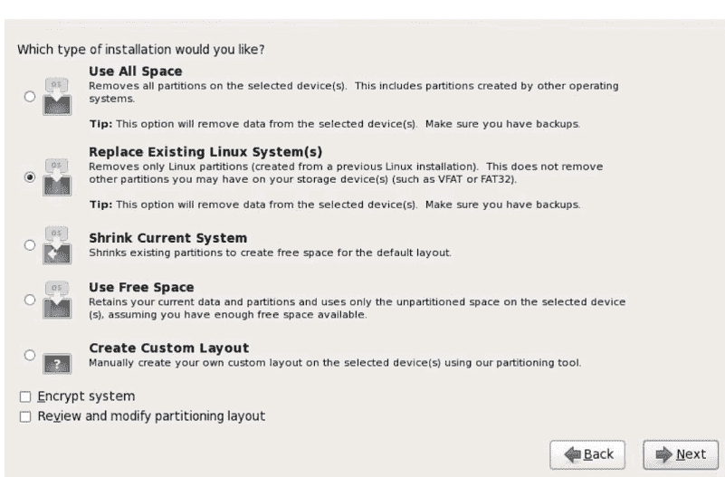

图 2.4

磁盘分区。

## 安装 Linux

在安装继续之前的下一步也是最后一步是软件包选择。在此菜单中，选择“软件开发（`Software Development`）”。这会预选许多支持软件开发的包，包括 GNU 编译器集合（`GCC`）。选择“现在自定义（`Customize now`）”。当你点击“下一步”时，将看到图 2.5 对话框。这为你提供了选择“软件开发”组之外的其他功能和包的选择。

在“桌面环境（`Desktop Environments`）”下，我建议选择 `KDE`。这非常是一个个人化的决定。Linux 世界中有受欢迎的图形桌面环境：`GNOME` 和 `KDE`。`GNOME` 往往更受欢迎。然而，如果你更喜欢 `KDE`，并且在本书其余部分显示图形桌面图像的情况下，它们将是 `KDE` 的。“类 Windows”风格。事实是，我恰好更喜欢 `KDE` 的呈现方式。它更符合我在 Windows 下日常计算的习惯（嘿，我正在用 Word 写这本书）。如果你职业生涯的大部分时间都花在 Windows 屏幕前，我会发现 `KDE` 更符合你的胃口。但如果你对 `GNOME` 有强烈的偏好，请尽管尝试。

在“开发（`Development`）”下，选择“`KDE Development`”。这将安装我们在几几个章之后配置 Linux 内核时需要的 `Qt` 图形库。

点击“下一步”，开始安装。不出所料，这将需要一些时间，大约一小时，因为你的计算机上将安装大约一千个包。

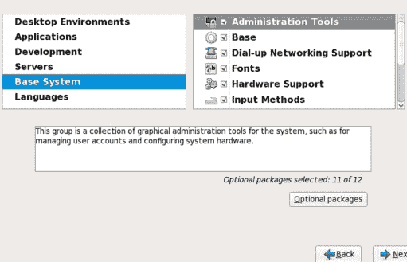

图 2.5

软件包选择。

安装完成后，系统会提示你重启。系统应该进入你刚刚安装的内容。还有一些安装后的问题需要处理。其中，你必须接受 Fedora 条款并创建一个普通用户。

之后，你将拥有一个功能完整的 Linux 安装。当你准备好进入下一章时重启它，我们将回顾 Linux 的许多功能。

## 资源

`linuxiso.org`

- `debian.org`
- `fedaproject.org`
- `opensuse.org`
- `redhat.com`
- `ubuntu.com`
- `parallels.com`
- `virtualbox.org`
- `vmware.com`

`parallels.com`—Parallels 网站。

`virtualbox.org`—VirtualBox 网站。

`vmware.com`—关于 VMware 信息。

# 第 3 章

# 介绍 Linux

有两个主要产品：`GNOME` 和 `KDE`。对于可能是操作系统新手的人来说，本章介绍了 Linux 的一些显著特征。可以随意翻阅，或者如果你已经熟悉 Unix，可以完全跳过本章。

## 运行 Linux——KDE

启动你的 Linux 机器并以你的普通用户登录。如果你运行的是 Fedora，将看到图 3.1 所示的屏幕。除非你运行的是不同版本的 Linux，否则你的界面可能不同。左下角有一个像字母“f”的图标，功能与开始菜单相同。最初，点击此图标会弹出一组基于图标的菜单，我个人觉得很难使用。幸运的是，你可以将其改为旧样式。右键点击“F”图标并选择“切换到经典菜单（`Switch to Classic Menu`）”。

## 文件管理器

我对新系统想做的的事情之一就是打开文件管理器，查看系统内容。点击桌面上的“主（`Home`）”图标。文件管理器显示你的主目录内容，那是你存储所有文件的地方。默认情况下，`KDE` 使用单击激活项目。你可以通过选择设置（`Settings`）>系统设置（`System Settings`）>鼠标（`Mouse`）将其更改为双击。

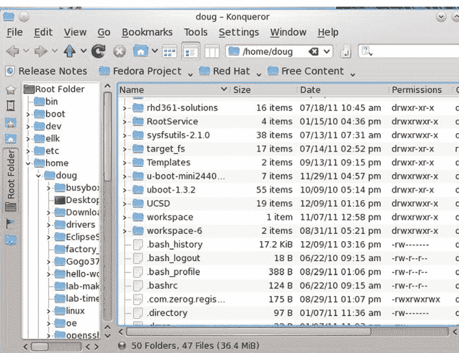

> 图 3.2

`Konqueror` 文件管理器。

“文件”菜单提供了打开新 Shell 窗口以及在 Shell 窗口内打开多个标签页的选项。同时运行两个或三个 Shell 窗口或在其中任何一个窗口中使用两个或三个标签页并不罕见。

## Linux 特性

以下是 Linux 以及类 Unix 操作系统的一些重要特性。

- **多任务（`Multitasking`）。** Linux 调度器实现了真正的抢占式多任务，这意味着高优先级进程可能会因为异步事件的发生而阻止当前正在运行的进程。但尽管它是可抢占的（`preemptible`）¹，内核中存在相对较大的延迟，使得它通常不适用于实时应用。

¹ 应该是“`preemptible`”还是“`preemptable`”？Word 2007 的拼写检查器说两者都是错误的。以前在 linuxdevices.com 上的一场辩论似乎倾向于“ible”结尾，但并没有定论。我想我还是坚持使用 `preemptible`。

此外，默认的共享调度器实现了一种“公平性”策略，给予所有进程一个运行的机会。

- **多用户（`Multiuser`）。** Unix 开发运行在其时间分时系统中，该系统允许多个用户共享一台（至少当时）昂贵的计算机。因此，有许多支持隐私和数据保护的功能。Linux 继承了这一传统，并在服务器环境中得到了很好的利用。²

- **多处理器（`Multiprocessing`）。** Linux 对真正的对称多处理器处理提供了广泛支持，多个处理器通过共享内存总线紧密耦合。这在多核处理器时代变得尤为重要。

- **保护内存（`Protected Memory`）。** Linux 不允许直接访问另一个进程的内存空间。这防止了野指针损坏另一个进程的内存空间。错误的访问会被处理器的内存保护硬件拦截，进程会在收到适当通知后被终止。

² 尽管我在嵌入式领域的经验是，这些保护功能（特别是文件权限）可能非常烦人。某些程序（例如 Firefox 浏览器）并没有礼貌地告诉你你没有权限写入该文件，它们只是坐在那里无什么都不做。

- **分级文件系统（`Hierarchical File System`）。** 是的，所有现代操作系统——甚至是 DOS——都有分级系统。但 Linux/Unix 模型在传统 PC 操作系统使用的基础上增加了一些复杂之处：

- **链接（`Links`）。** 链接是一个指向另一个文件的文件系统项，而不是文件本身。链接可以作为一种非常有用的抽象机制，以及在多个用户之间共享文件的方法。它们也用于配置场景，以便从多个备选文件中选择其中一个。

- **设备无关 I/O（`Device-Independent I/O`）。** 再次，这并不是新概念，但 Linux 通过将每个外围设备视为系统中的一个项，采用了其逻辑连接的概念。从应用程序的角度来看，向文件写入和向（例如）打印机写入没有任何区别。

## 保护模式架构（`Protected Mode Architecture`）

当代 Intel 处理器中保护内存的实现首次出现在 `80386` 中。它利用完整的 32 位地址来实现 4 GB 的寻址范围。访问受到控制，使得内存块可以是“可执行的”、“只读的”或“可读写的”。


处理器可以在四个权限级别之一运行。处于最高权限级别（0 级）的程序可以执行任何操作——执行 I/O 指令、启用和禁用中断以及修改描述符表。较低的权限级别阻止程序执行可能“危险”的操作。例如，一个文字处理应用程序不应该干扰中断标志位。那是操作系统的工作。

因此，应用程序代码通常运行在最低级别，而操作系统运行在最高级别。设备驱动程序和其他服务可能运行在中间级别。但在实践中，Linux 和大多数针对 Intel 处理器的操作系统仅使用 0 级和 3 级。在 Linux 中，0 级被称为“内核空间”（Kernel Space），而 3 级被称为“用户空间”（User Space）。

## 实模式（Real Mode）

在讨论 x86 保护模式编程之前，回顾“实”地址模式的工作原理很有帮助。

在 20 世纪 70 年代后期，当 Intel 设计 8086 时，设计人员面临着如何用 16 位访问 1 字节地址空间的困境。在当时，1 字节被认为是巨大的内存量。他们提出的解决方案（无论好坏）是利用两个 16 位数值——段地址（Segment）和偏移量（Offset）来产生一个 20 位（1 MB）地址。将段地址左移 4 位并加到偏移量上，就产生了 20 位线性地址（图 3.4）。

| 15 | 0 |

|---|---|

| Segment | 左移 4 位 |

| 15 | 0 |

| + | Offset |

| 19 | 0 |

| **Physical Address** | |

图 3.4

实模式寻址。

x86 处理器在实模式下四个段寄存器。通过引用内存，从这些寄存器之一派生出段值。默认情况下，指令执行相对于代码段（`CS`），数据引用（例如 `MOV` 指令）相对于数据段（`DS`），而引用栈的指令相对于栈段（`SS`）。额外段（`ES`）用于字符串移动指令，并可以在任何需要 `DS` 的地方使用。默认的段选择可以通过段选择前缀指令进行重写。

一个段的长度最大可达 64 KB，并按 16 字节边界对齐。小于 64 KB 的程序本质上是位置无关的。

## 保护模式（Protected Mode）

处理器在保护模式下仍然使用段寄存器，但段寄存器的值（现在称为选择子）是描述符表中的索引。描述符是一个 8 字节的对象，告诉我们关于内存块的所有信息。

- **基地址（Base）** [31:0]: 该区块的起始地址。
- **限制（Limit）** [19:0]: 段的长度——这可以是字节（最高 1 MB），也可以是 4 KB 页。解释由粒度位定义。
- **类型（Type）**: 一个 4 位字段，定义该段所描述的内存类型。

线性地址通过将逻辑地址中的偏移量加到描述符中的基地址计算得出（图 3.5）。如果结果地址大于描述符指定的限制，处理器将发出内存错误。

### 介绍 Linux 31

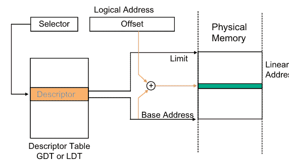

图 3.5

保护模式寻址。

- **S**: 0 = 该描述符描述“系统”段。1 = 该描述符描述 `CS` 或 `DS`。
- **P 描述符权限级（DPL）**: 一个 2 位字段，定义了访问该段所需的最低权限级。
- **G 存在位（Present）**:1 = 由描述符表示的内存块存在内存中。用于分页。
- **G 粒度（Granularity）**:0 = 将限制解释为字节。1 = 将限制解释为 4 KB 页。

注意，当粒度位设置为 1 时，单个段描述符就可以表示 4 GB 地址空间。

普通描述符（S 位 = 1）代表数据或代码内存块。类型字段为 4 位，最高位区分 `CS` 和 `DS`。`CS` 是可执行的，`DS` 不可。`CS` 可以可读也可以不可读。`DS` 可以可写。任何超出类型字段范围的尝试访问（例如执行 `DS`）都会导致内存错误。

### “平坦”与分段的内存模型

由于单个描述符就可以引用整个 4 GB 地址空间，因此可以通过单个描述符来构建系统。这被称为“平坦”内存寻址，实际上，它是 8 位微控制器以及 DOS “微型”内存模型的 32 位等价物。所有内存都是可访问的，且没有保护。

Linux 实际上执行了类似的操作。它为操作系统和每个进程使用独立的描述符，从而强制执行保护机制，但它将每个描述符的基地址设置为 0

### 32 第3章

0。因此，偏移量与虚拟地址相同。实际上，这消除了分段。

### 分页

分页（Paging）是一种允许每个任务假装自己拥有一个巨大的平坦地址空间的机制。该空间被划分为 4 KB 的页。只有当前正在访问的页面保留在内存中，其他页面则留在磁盘上。

如图 3.6 所示，分页增加了另一层间接。从选择器和偏移量派生的 32 位线性地址被分为三个字段。高位 12 位作为页目录（Page Directory）的索引。页目录项（`PDE`）指向一个页表。线性地址中的后续 10 位提供该页表的索引。页表项（`PTE`）提供了物理内存中一个 4 KB 页面的基地址，该页面被称为“页帧”（Page Frame）。原始线性地址的低 12 位提供了页帧内的偏移量。每个任务都有自己的页目录，由处理器控制寄存器 `CR3` 指向。

在这一查找过程的任何阶段，都可能发现页表或页帧不在物理内存中。这会导致页错误（Page Fault），进而导致操作系统在磁盘上找到对应的页面并将其加载到内存中可用的页中。这可能需要“换出”当前占用内存的页面。

分页的进一步优势是，它允许多个任务或进程通过简单将它们各自地址空间的适当部分映射到相同的物理页，从而轻松地共享代码和数据。

分页是可选的，你不必使用它，尽管 Linux 使用了。分页由处理器寄存器 `CR0` 中的一个位控制。

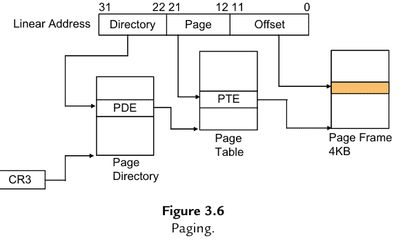

### 引入 Linux 33

页目录和 `PTE` 的长度均为 4 字节，页目录和页表的最大 own为 4 KB，这恰好也是页帧的大小。高位 20 位指向页表或页帧的基地址。第 9–11 位供操作系统自行使用。除其他外，这些位可以用于指示某个页面应被“锁定”在内存中，即不可换出。

在剩余的控制位中，最有趣的是：

- P = 1 该页在内存中。如果此位为 0，引用此页目录或 `PTE` 将导致页错误。注意，当 P = 0 时，该目的的其余部分不再重要。
- A = 1 该页已被读取或写入。由处理器设置，但由操作系统清零。通过定期清除访问位（Accessed bits），操作系统可以判断哪些页面长时间未被引用，因此可能被换出。
- D = 1 该页已被写入。由处理器设置，但由操作系统清零。如果一个页面没有被写入，那么当它必须被换出时，就不需要写回磁盘。

## Linux 进程模型

Linux 中的基本结构元素是进程（process），它由可执行代码和一组资源（如数据、文件描述符等）组成。这些资源受到完全保护，一个进程无法直接访问另一个的资源。为了让两个进程相互通信，它们必须使用 Linux 定义的进程间通信机制，如共享内存区域或管道。

这看起来很好，因为它在系统中建立了高程度的保护。一个错误的进程很可能会被系统检测并在对其他进程造成任何伤害之前被抛出（图 3.7）。但在创建进程和使用进程间通信机制方面，需要付出过大开销的代价。

然而，线程（thread）仅是代码。线程只存在于进程上下文中，一个进程中的所有线程共享其资源。因此，所有线程对数据内存和文件描述符具有相同的权限。这种模型有时被称为轻量级多任务，以区别于 Unix/Linux 进程模型。

轻量级任务的优势是线程间通信更高效。缺点当然是任何线程都可以破坏其他线程的数据。从历史上看，大多数 RTOS 是围绕轻量级模型构建的。近年来，内存保护硬件的成本大幅下降。作为回应，许多

### 34 第3章

## UNIX 进程模型

| DATA | DATA | DATA |

|---|---|---|

| CODE | CODE | CODE |

## 多线程进程

| DATA |

|---|---|---|

| THREAD 1 | THREAD 2 | THREAD 3 |

图 3.7

进程与线程对比。

RTOS 供应商现在提供了其系统的保护模式版本，看起来类似于 Linux 进程模型。

### fork() 函数

Linux 从一个进程开始生命，即 `init` 进程，在启动时创建。系统中的所有其他进程都是通过调用 `fork()` 创建的。调用 `fork()` 的进程称为父进程，新创建的进程是子进程。因此，根据谁创建谁，每个进程都有祖先，并可能有后代。

如果你成长于多任务操作系统，在其中任务是通过任务创建服务从函数创建的，那么 `fork` 进程看起来可能非常奇怪。`fork()` 创建父进程的副本——代码、数据、文件描述符以及父进程当前持有的其他资源。这可能需要复制数兆字节的内存空间。为了避免复制许多可能仍被覆盖的内容，Linux 采用了“写时复制”（copy-on-write）策略。

`fork()` 开始复制进程数据结构并赋予它一个新的标识符。然后，子进程执行与父进程相同的页。为了区分父子，`fork()` 向子进程返回 0，但向父进程返回子进程的 `PID`。示例 3.1 是 `fork` 调用的简单示例。

### 32

### 引入 Linux 35


```c
#include <unistd.h>
#include <stdio.h>

pid_t pid;

void do_child(void)
{
    printf("我是子进程，我的 PID 是 %d\n", pid);
}

void do_parent(void)
{
    printf("我是父进程，子进程 PID 是 %d\n", pid);
}

void main(void)
{
    switch (pid = fork()) {
        case -1:
            printf("fork 失败\n");
            break;
        case 0: // 子进程
            do_child();
            break;
        default: // 父进程
            do_parent();
            break;
    }
}
```

### 示例 3.1
Fork 的简单示例。

## execve() 函数

当然，在 99% 的情况下，子进程通过调用 `execve()` 加载执行映像来启动新程序。示例 3.2 以骨形式显示了一个简单的解释器。它从标准输入读取一行文本，进行解析并调用 `fork()` 创建新进程。子进程调用 `execve()` 加载文件并执行命令。

如果是普通的“前台”命令，解释器必须等待命令完成。这是通过 `waitpid()` 实现的，而大多数多任务操作系统没有阻塞一个进程以等待另一个完成的能力。

33

```c
#include <unistd.h>
#include <stdio.h>

void main(void) {
    char *argv[10], *filename;
    char text[80];
    char foreground;
    pid_t pid;
    int status;

    while (1) {
        gets (text);
        // 解析命令行以派生文件名
        // 参数。判断是否为前台命令。
        switch (pid = fork()) {
            case -1:
                printf("fork 失败\n");
                break;
            case 0: // 子进程
                if (execve(filename, argv, NULL) < 0) {
                    printf("命令失败\n");
                }
                break;
            default: // 父进程
                if (foreground)
                    waitpid(&status, &pid);
            }
        }
    }
}
```

### 示例 3.2
命令行解释器。

## Linux 文件系统

Linux 文件系统在许多方面与你在 Windows PC 或 Macintosh 上找到的文件系统相似。它是一个层次级系统，允许你在由 `"/"` 标识的根目录下创建任意数量的子目录。像 Windows 一样，文件名可以很长。然而，在 Linux 中，在大多数 Unix 类系统中，文件名扩展名（文件名中点后面的部分）的意义比 Windows 小得多。例如，虽然 Windows 可执行文件总是具有 `".exe"` 扩展名，但 Linux

# 介绍 Linux 37

可执行文件通常没有扩展名。在大多数情况下，文件内容是通过文件头而非特定的扩展名标识符来识别的。尽管如此，许多应用程序（例如 C 编译器）会有默认的文件扩展名。

与 Windows 不同，Linux 中的文件名是区分大小写的。`Foobar` 和 `foobar` 是不同的文件，且与 `foobar` 也不同。排序也是区分大小写的。在按名称排序的目录列表中，带有大写字母的文件名出现在以小写字母开头的文件之前。以 `"."` 开头的文件被视为“隐藏”文件，除非显式请求，否则它们不会在目录列表中显示。

此外，Linux 文件系统具有许多超越于典型 Windows 系统的功能。让我们来看一些可能让嵌入式系统程序员感兴趣的特性。

### 文件权限

由于 Linux 是多用户系统，因此每个文件都拥有一组关联权限，用于指定允许哪些类的用户对该文件执行什么操作。你可以通过在命令行窗口中输入 `ls -l` 命令，或者使用桌面文件管理器来获取某些 Linux 目录的详细列表。每个文件的条目由 10 个标志位和一对看起来像这样的名称组成：

```
-rw-r--r-- Andy physics
```

在这个示例中，Andy 是文件的所有者，该文件属于一个名为 physics 的用户组，可能是某所大学的物理系。通常情况下（但并非总是），所有者是创建文件的人。

10 个标志位中的第一个标识文件类型。普通文件在此处显示为连字符 `"-"`。目录由 `"d"` 标识，链接为 `"i"`，以此此类推。稍后我们在讨论设备驱动时会看到该标志的其他条目。其余九个标志位分为三组，每组三个。所有组的标志位相同，分别代表读取文件的权限 `"r"`、写入权限 `"w"`，或如果是可执行文件则代表执行权限 `"x"`。写入权限也允许删除文件。

这三组然后代表授予不同类用户的权限。第一组标识授予文件所有者的权限，实际上允许读取和写入。第二组授予同一同一用户组中其他成员的权限。在这种情况下，physics 组对文件具有读取权限但没有写入权限。最后一组标志位授予“世界”（即所有用户）权限。

> ³ 图形化文件管理器提供不区分大小写的排序作为一个选项。

# “x”权限值得关注。在 Windows 中，扩展名为为 `.exe` 的文件被假定为可执行的。在 Linux 中，二进制可执行文件通过 `"x"` 权限来识别，因为我们没有显式的文件扩展名来标识它。此外，只有设置了 `"x"` 权限的用户类才允许调用执行文件。因此，如果我以普通用户的身份登录，我不被允许调用可能会更改系统状态的程序（例如更改网络地址）。

“x”权限的另一个有趣特性是它也适用于 shell 脚本，我们将在本章稍后部分讨论。对于熟悉的 DOS 用户来说，shell 等同于 `.bat` 文件。它是一个作为程序执行的命令文本文件。但除非设置了它的 `"x"` 位，否则 shell 不会执行该脚本。

### “root”用户

每个 Linux 系统中都有一个非常特殊的用户 `"root"`。无论权限标志位如何，root 都可以对任何文件进行任何操作。root 主要用于系统管理目的，不建议日常使用。显然，如果你不小心，可能会遇到很多麻烦，而且 root 权限构成了潜在的安全威胁。尽管如此，嵌入式和实时开发者在系统上执行的操作通常需要对 root 的文件写入或可执行访问，因此需要你以 root 用户身份登录。

过去，我大多数时间都以 root 身份登录，因为这样更省事。

# 介绍 Linux 41

| 根目录 | |
| :--- | :--- |
| bin | 必要的命令二进制文件 |
| boot | 引导加载器的静态文件 |
| dev | 设备 "inode" 文件 |
| etc | 主机特定的系统配置 |
| home | 个人用户的家目录（可选） |
| lib | 必要的共享库和内核模块 |
| media | 可移动式介质设备的挂载点 |
| mnt | 临时挂载文件系统的挂载点 |
| opt | 额外的应用程序软件包 |
| root | root 用户的家目录（可选） |
| sbin | 必要的系统二进制文件 |
| tmp | 临时文件 |
| usr | 二级层次结构 |
| var | 可变数据 |

附图 3.9

文件系统层次结构。

- **静态与可变。** Linux 系统中的许多文件是不改变的可执行文件，它们是*静态的*。用户创建或获取（例如通过下载或电子邮件）的文件是*可变的*。这两类文件应该清晰地分开。

以下是 FHS 定义的目录描述：

- `/bin/`: 包含用户和系统管理员都使用的命令二进制执行文件。FHS 规定了 `/bin` 必须包含的内容。其中包括命令 shell 和基本文件实用程序。`/bin` 文件是静态且可共享的。

- `/boot/`: 包含启动过程所需的所有内容，配置文件和安装程序除外。内核执行文件外，`/boot` 还包含在内核开始执行用户模式程序之前使用的数据。`/boot` 文件是静态且不可共享的。

- `/etc/`: 包含主机特定的配置文件和目录。除了包含文件系统动态信息的 `mtab` 外，`/etc` 文件都是静态的。FHS 识别了 `/etc` 的三个可选子目录：

  - `/opt/`: 包含在 `/opt` 中的附加应用程序软件包的配置文件。

  - `/sgml/`: 标准泛化标记语言 (SGML) 和扩展标记语言 (XML) 的配置文件。

  - `/x11/`: X 窗口的配置文件。

在实践中，大多数 Linux 发行版在 `/etc` 下有许多子目录，代表可选的设置和配置需求。


## 文件系统目录说明

- `/home`：（可选）包含家目录。每个用户在 `home` 下都有与其用户名同名的子目录。虽然 FHS 将其标记为可选，但在 Unix 系统几乎是通用的。`/home` 下子目录的内容显然是可变的。

- `/lib`：包含引导系统和运行根文件系统中的命令（即 `/bin` 和 `/sbin` 中的二进制文件）所需的共享库镜像。在 Linux 系统中，`/lib` 有一个名为 `/modules` 的目录，包含内核可加载模块。

- `/media`：可移动介质的挂载点。当可移动介质自动挂载时，挂载点通常是卷的名称。

- `/mnt`：提供方便的可选插件软件包。每个软件包在 `/opt` 下都有自己的子目录。

- `/root`：`root` 用户的家目录。这并不是 FHS 的要求，但通常是被接受的做法并被高度推荐。

- `/sbin`：包含系统管理至关重要的二进制实用程序，如引导、恢复、还原或修复系统。这些实用程序通常由系统管理员使用，普通用户不需要在路径中包含 `/sbin`。

- `/tmp`：临时文件。

- `/usr`：二级层次结构，见下文。

- `/var`：可变数据。包括文件的暂存目录、管理和日志数据以及临时文件。基本上是系统运行过程中变化的系统级数据。`/var` 下有许多子目录。

### `/usr` 层次结构

`/usr` 是一个包含面向用户的文件的二级层次结构。图 3.10 显示了 `/usr` 下的子目录。这些子目录中的几个镜像了根目录的功能。也许 `/usr` 最有趣的子目录是用于源码的 `/src`。这通常是 Linux 源码安装的地方。你可能在 `/src` 下名为如下的子目录下安装了 Linux 内核源码：

```
linux-<version number>-ext
```

然后你有一个名为 `linux` 的逻辑链接，指向你当前正在工作的内核版本。

## 挂载文件系统

Windows 和 Linux 文件系统之间的主要区别在于文件结构化设备（硬盘、软磁盘驱动器、CD-ROM 等映射到系统的目录或层次结构中。Windows 文件系统使设备显式可见，通过字母加冒号的组合（如 `C:`）识别它们；Linux 更强调统一的文件系统，物理设备在实际上被变得不可见。

Windows 文件系统使设备显式可见，通过字母加冒号的组合（如 `C:`）识别它们；Linux 更强调统一的文件系统，物理设备在实际上被变得不可见。

## 介绍 Linux 45

大多数 Linux/Unix 程序都从一个名为 `stdin` 的默认设备接收输入。同样地，它们将输出写入一个名为 `stdout` 的设备。任何错误信息都会写入 `stderr`。通常情况下，`stdin` 是键盘，而 `stdout` 和 `stderr` 是显示器。但我们可以很轻松地将 `stdin` 和 `stdout` 视为管道的两个末端。

`stdin` 和 `stdout` 可以被重定向，这样我们就可以将输出发送到（例如）一个文件，或者从文件中读取输入。在 shell 窗口中，尝试只运行不带任何参数的 `cat` 命令。`cat` 也许是所有 Unix 工具中最简单的一个。它所做的仅仅是按行将 `stdin` 复制到 `stdout`。当你输入不带任何参数的命令时，它会耐心地停在 `stdin` 等待键盘输入。输入一行文本，它就会将该行发送到 `stdout`（显示器）。按 `Ctrl-C` 退出程序。

现在尝试这个：

```bash
cat>textFile
```

输入一行文本。这次你没有看到该行被重复显示，因为 `>` 操作符将 `stdout` 重定向到了文件 `textFile`。输入几行，然后按 `Ctrl-C` 退出。

这个练习的最后一步是：

```bash
cat<textFile
```

太棒了！你用之前的命令创建的文件显示在了屏幕上，因为 `<` 操作符将 `stdin` 重定向到了 `textFile`。`cat` 实际上实现了一个快捷方式，如果你将文件名作为命令行参数输入，而不使用 `<` 操作符，它会将其作为输入文件。那就是：

```bash
cat textfile
```

```
this is a file
of text from the keyboard
```

现在如果我执行

```bash
cat textfile|grep
```

我得到了：

```
this is a file
```

> ⁸ `concatenate`（连接）的缩写。你不喜欢 Unix 命令的命名方式吗？

## 46 第 3 章

正如你可能猜到的，`grep` 是一个过滤器。它尝试将其命令行参数与输入流 `stdin` 进行匹配。包含参数文本的行会被传递到 `stdout`。其他行会被忽略。这里发生的情况是 `cat` 的输出变成了 `grep` 的输入。

按照典型的 Unix 风格，`grep` 代表正则表达式“something”。我忘了 `p` 代表什么了。正则表达式实际上是一种强大的机制，如果你愿意的话，是一种用于搜索文本的脚本语言。`grep` 体现了正则表达式的语法。

Shell 脚本和 `Makefile` 广泛使用重定向和管道。

其他一些 shell 特性值得简要提到，因为它们节省了大量的输入工作。`shell` 维护着命令历史，你可以通过方向键访问它。这允许你重复任何命令，或者对其进行编辑以创建一个新的、类似的命令。有一个 `history` 命令可以转储系统或子进程累积的命令历史。历史维护在你主目录下的 `.bash_history` 文件中。

图 3.11 显示了我系统中 `history` 命令的最后几行。若要重新执行列表中的任何命令，只需输入 `!` 后紧跟历史列表中的命令编号，例如：

```bash
!998
```

来重新执行历史。

另一个非常酷的功能是自动补全，它会尝试为你补全文件名参数。如果我想执行

```bash
cat verylongfilename<tab>
```

我可以尝试输入

只要文件名的剩余部分在当前目录下是唯一的；`shell` 就会自动补全它，为我省去输入文件名的麻烦。如果 `shell` 找不到匹配项，它会发出蜂声。这时你需要多输入一点，直到剩余部分是唯一的。

最后，字符 `~` 代表你的家目录。从文件系统中的任何地方，你都可以执行 `cd~` 回到你的家目录。

实际上有几个常用的 `shell` 程序。它们都具有相同的目的，但在语法和功能细节上有所不同。最流行的如下：

## 介绍 Linux 47

```
981 make clean
982 make
983 ls /var/lock
984 ls /var/lock/lockdev/
985 ls /var/lock/
986 info9
9
997 man
998 history
999 man
1000 $
1001 history
1002 ifconfig
1003 clear
1004 history
1005 $
1006

1007

000010
0
1010 $
10111
10121
10131gs
```

> 图 3.11 `history` 命令的最后几行。若要重新执行列表中的任何命令，只需输入 `!` 后紧跟历史列表中的命令编号，例如：

```bash
!998
```

来重新执行历史。

另一个非常酷的功能是自动补全，它会尝试为你补全文件名参数。如果我想执行

```bash
cat verylongfilename<tab>
```

我可以尝试输入

只要文件名的剩余部分在当前目录下是唯一的；`shell` 就会自动补全它，为我省去输入文件名的麻烦。如果 `shell` 找不到匹配项，它会发出蜂声。这时你需要多输入一点，直到剩余部分是唯一的。

最后，字符 `~` 代表你的家目录。从文件系统中的任何地方，你都可以执行 `cd~` 回到你的家目录。

实际上有几个常用的 `shell` 程序。它们都具有相同的目的，但在语法和功能细节上有所不同。最流行的如下：


```bash
cat verylongfilename<tab>
```

我可以尝试输入

只要文件名的剩余部分在当前目录下是唯一的；shell 就会自动补全它，为我省去输入文件名的麻烦。如果 shell 找不到匹配项，它会发出蜂声。这时你需要多输入一点，直到剩余部分是唯一的。

最后，字符 `"~"` 代表你的家目录。从文件系统中的任何地方，你都可以执行 `cd~` 回到你的家目录。

实际上有几个常用的 shell 程序。它们都具有相同的目的，但在语法和功能细节上有所不同。最流行的如下：

> 图 3.11 `history` 命令的最后几行。若要重新执行列表中的任何命令，只需输入 `"!"` 后紧跟历史列表中的命令编号，例如：

```bash
!998
```

来重新执行历史。

大多数 Linux/Unix 程序都从一个名为 `"stdin"` 的默认设备接收输入。同样地，它们将输出写入一个名为 `"stdout"` 的设备。任何错误信息都会写入 `"stderr"`。通常情况下，`stdin` 是键盘，而 `stdout` 和 `stderr` 是显示器。但我们可以很轻松地将 `stdin` 和 `stdout` 视为管道的两个末端。

`stdin` 和 `stdout` 可以被重定向，这样我们就可以将输出发送到（例如）一个文件，或者从文件中读取输入。在 shell 窗口中，尝试只运行不带任何参数的 `cat` 命令。`cat` 也许是所有 Unix 工具中最简单的一个。它所做的仅仅是按行将 `stdin` 复制到 `stdout`。当你输入不带任何参数的命令时，它会耐心地停在 `stdin` 等待键盘输入。输入一行文本，它就会将该行发送到 `stdout`（显示器）。按 Ctrl-C 退出程序。

现在尝试这个：

```bash
cat>textFile
```

输入一行文本。这次你没有看到该行被重复显示，因为 `">"` 操作符将 `stdout` 重定向到了文件 `textFile`。输入几行，然后按 Ctrl-C 退出。

这个练习的最后一步是：

```bash
cat<textFile
```

太棒了！你用之前的命令创建的文件显示在了屏幕上，因为 `"<"` 操作符将 `stdin` 重定向到了 `textFile`。`cat` 实际上实现了一个快捷方式，如果你将文件名作为命令行参数输入，而不使用 `<` 操作符，它会将其作为输入文件。那就是：

```bash
cat textfile
```

```
this is a file
of text from the keyboard
```

现在如果我执行

```bash
cat textfile|grep
```

我得到了：

```
this is a file
```

> ⁸ concatenate（连接）的缩写。你不喜欢 Unix 命令的命名方式吗？

# 46 第 3 章

正如你可能猜到的，`grep` 是一个过滤器。它尝试将其命令行参数与输入流 `stdin` 进行匹配。包含参数文本的行会被传递到 `stdout`。其他行会被忽略。这里发生的情况是 `cat` 的输出变成了 `grep` 的输入。

按照典型的 Unix 风格，`grep` 代表正则表达式“something”。我忘了 `"p"` 代表什么了。正则表达式实际上是一种强大的机制，如果你愿意的话，是一种用于搜索文本的脚本语言。`grep` 体现了正则表达式的语法。

Shell 脚本和 Makefile 广泛使用重定向和管道。

其他一些 shell 特性值得简要提到，因为它们节省了大量的输入工作。shell 维护着命令历史，你可以通过方向键访问它。这允许你重复任何命令，或者对其进行编辑以创建一个新的、类似的命令。有一个 `history` 命令可以转储系统或子进程累积的命令历史。历史维护在你主目录下的 `.bash_history` 文件中。

图 3.11 显示了我系统中 `history` 命令的最后几行。若要重新执行列表中的任何命令，只需输入 `"!"` 后紧跟历史列表中的命令编号，例如：

```bash
!998
```

来重新执行历史。

另一个非常酷的功能是自动补全，它会尝试为你补全文件名参数。如果我想执行

```bash
cat verylongfilename<tab>
```

我可以尝试输入

只要文件名的剩余部分在当前目录下是唯一的；shell 就会自动补全它，为我省去输入文件名的麻烦。如果 shell 找不到匹配项，它会发出蜂声。这时你需要多输入一点，直到剩余部分是唯一的。

最后，字符 `"~"` 代表你的家目录。从文件系统中的任何地方，你都可以执行 `cd~` 回到你的家目录。

实际上有几个常用的 shell 程序。它们都具有相同的目的，但在语法和功能细节上有所不同。最流行的如下：

# 介绍 Linux 47

```
981 make clean
982 make
983 ls /var/lock
984 ls /var/lock/lockdev/
985 ls /var/lock/
986 info9
9
997 man
998 history
999 man
1000 $
1001 history
1002 ifconfig
1003 clear
1004 history
1005 $
1006
 
1007
 
000010
0
1010 $
10111
10121
10131gs
```

> 图 3.11 `history` 命令的最后几行。若要重新执行列表中的任何命令，只需输入 `"!"` 后紧跟历史列表中的命令编号，例如：

```bash
!998
```

来重新执行历史。

另一个非常酷的功能是自动补全，它会尝试为你补全文件名参数。如果我想执行

```bash
cat verylongfilename<tab>
```

我可以尝试输入


只要文件名的剩余部分在当前目录下是唯一的；shell 就会自动补全它，为我省去输入文件名的麻烦。如果 shell 找不到匹配项，它会发出蜂声。这时你需要多输入一点，直到剩余部分是唯一的。

最后，字符 "~" 代表你的家目录。从文件系统中的任何地方，你都可以执行 `cd~` 回到你的家目录。

实际上有几个常用的 shell 程序。它们都具有相同的目的，但在语法和功能细节上有所不同。最流行的如下：

- [Bourne Again Shell](https://en.wikipedia.org/wiki/Bourne_Again_shell) ——`bash` 是 Bourne shell 的“重生”。
- [Korn Shell](https://en.wikipedia.org/wiki/Korn_shell) ——`ksh` 由 David Korn 在 AT&T Bell Laboratories 开发。它具有比 `bash` 更高级的编程功能。
- [C shell](https://en.wikipedia.org/wiki/C_shell) ——`tcsh` 是 `c shell` 的继承者，它本身是 Bourne shell 的先驱。
- [Z Shell](https://en.wikipedia.org/wiki/Zsh) ——`zsh` 被描述为 Bourne shell 的扩展，带有许多改进。

`grep`，正如你可能猜到的，`grep` 是一个过滤器。它尝试将其命令行参数与输入流 `stdin` 进行匹配。包含参数文本的行会被传递到 `stdout`。其他行会被忽略。这里发生的情况是 `cat` 的输出变成了 `grep` 的输入。

按照典型的 Unix 风格，`grep` 代表正则表达式“something”。我忘了 “p” 代表什么了。正则表达式实际上是一种强大的机制，如果你愿意的话，是一种用于搜索文本的脚本语言。`grep` 体现了正则表达式的语法。

Shell 脚本和 `Makefile` 广泛使用重定向和管道。

其他一些 shell 特性值得简要提到，因为它们节省了大量的输入工作。shell 维护着命令历史，你可以通过方向键访问它。这允许你重复任何命令，或者对其进行编辑以创建一个新的、类似的命令。有一个 `history` 命令可以转储系统或子进程累积的命令历史。历史维护在你主目录下的 `.bash_history` 文件中。

图 3.11 显示了我系统中 `history` 命令的最后几行。若要重新执行列表中的任何命令，只需输入 "!" 后紧跟历史列表中的命令编号，例如：

```bash
!998
```

来重新执行历史。

另一个非常酷的功能是自动补全，它会尝试为你补全文件名参数。如果我想执行

```bash
cat verylongfilename<tab>
```

我可以尝试输入

只要文件名的剩余部分在当前目录下是唯一的；shell 就会自动补全它，为我省去输入文件名的麻烦。如果 shell 找不到匹配项，它会发出蜂声。这时你需要多输入一点，直到剩余部分是唯一的。

最后，字符 "~" 代表你的家目录。从文件系统中的任何地方，你都可以执行 `cd~` 回到你的家目录。

Linux 的官方文档是一组被称为 man pages 的。要获取某个命令的帮助，使用 `man`。`man` 页面通常是简练的，具有参考性质，而不是教程。为了方便查找特定主题，`man` 页面被分为以下章节：

另一个信息来源是 "info pages"。`info` 页面通常更详尽，提供了关于主题的详细信息。[The Linux Documentation Project](https://tldp.org/) ——正如其名所示，这是 Linux 文档的来源。你会找到如何操作指南、深度指南、常见、man 页面，甚至一本在线杂志《Linux Gazette》。内容通常编写良好且有用。

有了对 Linux 的良好基础理解，我们的下一个任务是配置工作站并安装允许我们开发应用程序的软件。

## 主机开发环境

当你说“我写了一个导致 Windows 崩溃的程序”时，人们只会茫然地看着你并说：“嘿，我的系统自带这些问题，还是免费送的。”

Linus Torvalds

在本章中，我们将配置主机工作站环境，为第 5 章配置目标板做准备。涉及的步骤包括：

- *从 Mini2440 DVD 安装一些软件*
- *配置工作站*
- *配置工作站的网络连接*

在本章中，我们有很多工作要做。但在深入学习之前，让我们先概览一下交叉开发环境。

## 交叉开发工具——GNU 工具链

目标机不仅资源有限，而且处理器架构也可能与你（可能是）基于 x86 的开发工作站完全不同。因此，我们需要一个运行在 PC 上但可能需要为不同的处理器生成代码的交叉开发工具链。我们还需要一个工具来帮助调试运行在那个（可能不同的）目标机上的代码。

### GCC

到目前为止，Linux 世界中最常用的编译器是 GNU 编译器集合（`GCC`）。它最初被称为 GNU C 编译器，但后来更改了名称，以反映它对不仅仅是 C 语言的支持。`GCC` 为 C、C++、Objective C、Fortran、Java 和 Ada 提供了语言前端，以及这些语言的运行时库。

除了 x86，`GCC` 还支持广泛的目标架构。支持的目标包括：

- *Alpha*
- *ARM*
- *M68000*
- *MIPS*
- *PowerPC*
- *SPARC*

等等。事实上，Wikipedia 上关于 `GCC` 的文章列出了 FSF 版本 `GCC` 支持的 43 个处理器和处理器族。

`GCC` 可以运行在多种环境中，包括 Linux 和其他 Unix 变体。甚至有适用于 DOS 和 Windows 的版本。

`GCC` 可以在一种架构（例如 PC）上构建，同时为另一种架构（可能是 ARM）生成代码。这就是代码开发的核心。

`GCC` 是编译器、汇编器和链接器的结合体。各个语言前端将源代码翻译成中间汇编格式，然后由特定处理器的汇编器进行汇编，最终链接成可执行文件。对于由单个 C 源文件组成的程序，构建可执行文件的命令可以简单如

```bash
gcc myprogram.c
```

默认情况下，这会创建一个名为 `a.out` 的可执行文件。`-o` 选项让你执行显而易见的操作并重命名可执行文件：

```bash
gcc -o myprogram myprogram.c
```

如果你的项目包含多个源文件，`-c` 选项告诉 `GCC` 编译每个文件。

```bash
gcc -c myprogram.c
```

这将生成可重定位的对象文件 `myprogram.o`。稍后可以使用另一个 `GCC` 命令与其他 `.o` 文件链接，以生成可执行文件。

通常情况下，你不会直接调用 `GCC`。你会使用 `makefile`。

### Make

现实世界中的项目包含几十到数千个源文件。这些文件之间存在依赖关系，例如如果你更改了一个文件（例如头文件），另一个文件（C 源文件）就需要重新编译，最终整个项目都需要重新构建。跟踪这些依赖关系并确定在任何时刻需要重新构建的文件，是名为 `Make` 的强大工具的工作。

为了对 shell 命令 `make` 的响应，`Make` 工具从当前目录下名为 `Makefile` 或 `makefile` 的文件中获取指令。该文件由依赖关系组成，指定了目标文件如何依赖于一个或多个前提文件。如果任何一个前提文件比目标文件新，`make` 将使用依赖行后面的一个或多个构造命令来更新目标。基本语法为：

```
target: prerequisite-list
<tab> construction commands
```

在编写 `makefiles` 时需要注意的一个常见错误是用空格替换构造命令开头的制表符（tab）。它必须是一个 Tab 制表符。

不要被这个简单的例子误导了。`make` 语法中存在许多复杂性和微妙之处，它看起来类似于 shell 脚本语言。你在本章后面部分下载的示例代码包含了一些简单的 `Makefile` 示例。在随后的章节中，你将配置并构建 Linux 内核，它非常巨大且复杂。

为新项目创建 `javafx` 的最佳方法是从现有的类似项目开始。

### GDB

`GDB` 代表“GNU DeBug”（GNU 调试）。这是一个强大的源码级调试包，可以让你看到程序内部发生了什么。你可以单步执行代码、设置断点、检查和修改变量等。与大多数 Linux 工具一样，`GDB` 本身是命令行驱动的，这使得使用起来相当繁琐。`GDB` 有几个图形前端，可以将图形用户界面（GUI）命令翻译成 `GDB` 的文本命令。你在第 6 章会遇到的 `Eclipse` 拥有一个极佳的 `GDB` 图形前端。

`GDB` 可以设置在主机工作站上，同时在独立的目标机器上调试代码。两台机器可以通过串口或网络端口连接，或者你可以使用内置仿真器（`ICE`）。许多 `ICE` 供应商为他们的产品提供 `GDB` 后端。

某些处理器芯片中还内置了专用调试端口。这些端口被称为联合测试组（`JTAG`）和后台调试模式（`BDM`）。这些端口提供了访问硬件断点寄存器等调试功能的权限。这些端口也有 `GDB` 后端。

## 安装软件

### DVD 上有什么？


书中示例的推荐目标板是 FriendlyARM 生产的 Mini2440，由 Industrialworks 在美国分发。资源部分有订购链接。第 5 章包含了更多细节。

随 Mini2440 附带的 DVD 包含了大量的软件。除了 Linux，它还支持 Windows CE 和 Micro/OS II。我们感兴趣的是 `linux/` 子目录，它包含了以下内容：

- `arm-linux-gcc-4.3.2.tgz` 用于构建 Mini2440 软件的交叉工具链。
- `arm-gtopia.tgz` 用于 QT 库的应用开发包。它为 Mini2440 生成代码。
- `bootloader` 用于 NOR flash 中的 u-boot 源码。我们将在后续章节探索较新版本的 u-boot。
- `busybox-1.13-mini2440.tgz` 我们将在后续章节查看的 Busy 工具的源码。
- `Descriptions.txt` 你会预期的内容。遗憾的是，它是中文的。
- `examples.tgz` 测试开发板许多外设的示例。
- `linux-2.6.29-mini2440-209708.tgz` 针对 Mini2440 补丁的 Linux 内核。我们将使用包含 Mini2440 的后续内核。
- `logmaker.tgz` 可执行文件。我猜它是为启动屏幕创建镜像。
- `madplay-0.15.2b.tar.gz` 一个 MPEG 音解码器和播放器。完整源代码。
- `mkyaffsimage-mkyaffsimage` 用于 YAFFS 镜像两个可执行文件。你会使用名为 `mkaffsimage` 的那个。
- `root_gtopia.tgz` 用于 Mini2440 的根文件系统。我们将通过 NFS 挂载它。
- `vboot-src-2090721.tgz` 看起来是某种引导加载程序。不包含任何文档。
- `wireless_tools.29.tgz` 用于操作无线扩展的工具，设置无线 LAN 特定参数的接口。
- `x86-gtopia.tgz` 另一个应用开发包。这个为 x86 生成代码。

注意，上述列表是 2011 年 12 月 `linux/` 目录的内容。可能会随后的发布而变化。

## 安装交叉工具链

挂载 DVD¹ 在 KDE 中，只需插入 DVD 就会弹出一个名为“可用设备”的对话框。点击 `UDF Volume` 项。你会看到三个“操作”，第三是“用文件管理器打开”。选择该项。这会将 DVD 挂载到 `/media/UDF Volume/` 并在文件管理器中打开该位置，我们实际上并不会使用它。

> 如果你正在运行虚拟机，请确保虚拟机已连接到光驱器。

## 主机开发环境

在 shell 窗口中，通过 `su` 或 `sudo` 命令变为 root 用户并执行以下命令 `set`：

```bash
cd /
cp /media/"UDF Volume"/2/arm-linux-gcc-4.3.2.tgz (注意代表当前目录的点.).
tar -xzf arm-linux-gcc-4.3.2.tgz (这需要一些时间。这是一个大文件).
rm arm-linux-gcc-4.3.2.tgz
```

别忘记使用自动补全来节省大量的打字时间。`tar` 命令用于解压缩磁带存档（Tape Archive）。

现在如果你进入 `/usr/local/`，你会看到一个之前不存在的 `arm/` 目录。该目录下的 `4.3.2/` 包含 GCC 交叉工具链。这是 CodeBench 的“轻量”版本，即 CodeSource 公司的商业产品。它是 ARM 架构最流行的交叉工具链之一。

你需要将 `/usr/local/arm/4.3.2/bin` 添加到你的 `PATH` 中，`PATH` 是 shell 查找执行命令的目录列表。在 Fedora 中，定义 `PATH` 的文件是 `.bash_profile`。在 Ubuntu/Debian 安装中，它只是 `.profile`。从现在起我们将进行大量的编辑。如果你有 Linux 编辑器，尽管尽管它。就我个人而言，我拒绝使用 `emacs`。³ 我的编辑器是 K。在文件管理器中双击文本文件，它会自动在 `Kwrite` 中打开。

在 `.bash_profile` 或 `.profile` 中，你会找到一行以 `PATH=$PATH:` 开头的行，后面可能紧跟着 `$HOME/bin`。在该行的末尾添加 `:/usr/local/arm/4.3.2/bin`。保存文件并关闭编辑器。在注销并重新登录之前，新路径不会生效。不急，在我们开始构建程序之前还有段时间。

## 安装根文件系统

此时我们需要安装的另一个组件是目标板通过 NFS 挂载的根文件系统。你仍然应该是 root 身份登录。执行以下命令序列：

```bash
cd /home/<your_home_directory>
cp /media/"UDF Volume"/root_qtopia.tgz.
tar -xzf root_qtopia.tgz
rm root_qtopia.tgz
```

> ² Linux 实用程序与文件名或目录名中的空格不兼容。使用引号包含带空格的名字，或在空格前加上 `""` 字符。

> ³ 虽然我硬着头皮尝试了 `vim`，它并不坏。

注意你不能在这里使用 `~` 来指定你作为 root 登录的家目录，因为 `~` 结果为 `/root`。查看你主目录中新的 `root_qtopia/` 子目录，你会发现它的布局与工作站的根目录几乎完全相同。

## 终端模拟器 minicom

`minicom` 是一个相当简单的 Linux 应用程序，通过串口模拟哑终端 RS-232 终端。我们将用它与目标板通信。

最近的 Linux 发行版默认不安装 `minicom`。安装很容易。作为 root 用户（使用 `su` 或 `sudo`）执行：

| 命令 | 发行版 |
| :--- | :--- |
| `yum install minicom` | Fedora |
| `apt-get install minicom` | Ubuntu or Debian |

这两个命令本质上相同。它们连接互联网寻找指定的包，解析任何依赖关系，下载并安装它们。

一旦安装了 `minicom`，我们需要更改许多配置选项以方便与目标通信。

在 shell 窗口中，再次*作为 root 用户*，输入命令 `minicom -s`。如果你是第一次运行 `minicom`，可能会看到以下警告：

> WARNING: Configuration file not found. Using defaults

你将看到一个配置菜单。选择“serial port setup”（图 4.1）。默认情况下，`minicom` 通过设备 `/dev/tty0` 连接。我们需要更改为直接连接 PC 的串口端口。输入“A”并将“mode”替换为 `ttyS0` 或 `ttyS1`，其中 `ttyS0` 代表 COM1，`ttyS1` 代表 COM2。但是，如果只有 USB 端口且你使用的是 USB 转换器，正确的设备可能是 `ttyUSB0`。再次，如果你正在运行虚拟机，确保 VM 附加到串口端口。输入“E”后接“I”选择 11520 波特率。确保硬件和软件流控制都设置为“no”。这些是开关。输入“F”或“G”将获得“yes”和“no”之间的值。图 4.1 显示了最终的串口配置。按 `<Enter>` 退出串口设置并选择“modem dialing”。在这里我们删除 modem 字符串，因为它们只是直接连接。输入“A”回退整个字符串。输入“B”进行相同的设置。按 `<Enter>` 退出串口设置并选择“speed”。

执行 `ls -l /dev/ttyS0`（或 `ttyS1` 或 `ttyUSB0`，你在串口设置中选择的）。注意只有所有者和组可以访问该设备。为了访问此端口，你必须成为 `dialout` 组的成员。

情况下，有两种方法可以实现，选择哪种取决于个人喜好。一种是通过 Administration > Groups 进入的图形界面。会被要求输入 root 密码。这将显示图 4.2 所示的用户管理器。高亮你的用户名并选择 Properties。然后选择 Groups 选项卡（图 4.3）。向下滚动找到 `dialout` 并勾选它。点击 OK，关闭用户管理器。

另一种方法是作为 root 用户手动编辑文件 `/etc/group`。找到以 `dialout:` 开头的行，在行末尾添加 `:<your_name>`。保存文件并关闭编辑器。


图 4.2 用户管理器对话。


图 4.3 Groups对话。

## 网络

主机的网络配置需要一些更改。你的工作站可能配置为通过动态主机配置协议 (DHCP) 获取网络地址。在这种情况下，为了简单，我们将为工作站和目标指定固定 IP 地址。


通过 `Administration -> Network Configuration` 更改参数的 Fedora 图形菜单。在 `Network Configuration` 对话框中，选择 `Devices` 选项卡（默认），高亮 `eth0` 并点击 `Edit`。在 `Ethernet Device` 对话框中，取消选择“Automatically obtain IP address...”。现在输入 IP 地址。网络地址 `192.168.1.x` 是一个好的选择，这是一个范围。为你的工作站选择节点 `2`。子网掩码如图 4.4。如果你连接到网络，可能还想设置默认网关地址和 DNS 节点。

`Controlled by NetworkManager` 复选框可能是问题。如果你的网络端口已激活且勾选了此框，它可能不是（但有问题）。但当你回到 `Network Configuration` 对话框时，`Activate` 和 `Deactivate` 按钮是“激活”状态。如果网络端口未激活，你无法控制它，它不太可能启动时自动激活。我通过实验发现有效的方法是在编辑对话框中取消勾选 `NetworkManager`，激活端口，然后再次勾选。下次使用时，端口应该会自动激活。

当你从 `Network Configuration` 对话框退出时，系统询问你是否要保存更改。是的。你还会收到可能需要重启网络的警告。点击 `OK`。我的经验是通常不需要重启网络。

或者，你可以直接进入并编辑网络设备参数文件。网络配置参数位于 `/etc/sysconfig/network-scripts/`，在那里你应该找到一个类似于 `ifcfg-eth0` 的文件，它包含网络 0 的参数。你可能想复制此文件并命名为 `dhcp-ifcfg-eth0`。这样如果需要，你就有一个 DHCP 配置文件。现在用编辑器打开原始文件（当然是作为 root 用户）。

> ⁴ 配置选项随着每个 Fedora 新版本的发布而移动的烦人倾向。这是它在 Fedora 14 中的位置。

# 第 4 章

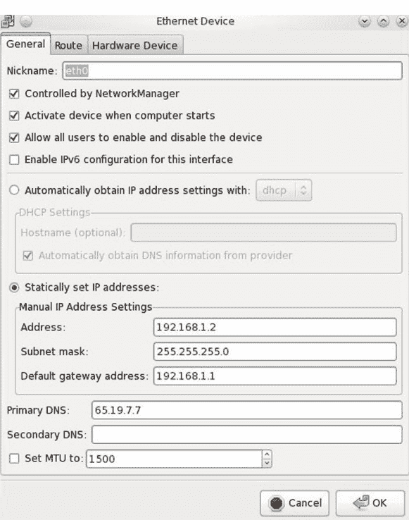

图 4.4

编辑网络设备对话框。

将行 `BOOTPROTO = dhcp` 改为 `BOOTPROTO = none` 并如列表 4.1b 所示添加四行新代码。严格来说，只有当工作站连接到可以访问互联网的网络时，才需要网关（Gateway）条目。

Ubuntu 用户会发现，图形化网络配置对话框（如果真的存在的话）几乎无法访问的。你需要编辑相应的配置文件，即 `/etc/network/interfaces`。最初，该文件有两行描述本地回环接口，如列表 4.2a 所示。如列表 4.2b 所示添加四行描述 `eth0` 的新代码。同样，只有当工作站连接到可以访问互联网的网络时，才需要网关（Gateway）条目。

# 主机开发环境


| DEVICE=eth0 | DEVICE=eth0 |
| :--- | :--- |
| ONBOOT=yes | ONBOOT=yes |
| BOOTPROTO=dhcp | BOOTPROTO=none |
| IPADDR=192.168.1.2 |  |
| NETMASK=255.255.255.0 |  |
| GATEWAY=192.168.1.1 |  |
| BROADCAST=192.168.1.255 |  |

## 列表 4.1

(a) `ifcfg-eth0` 和 (b) 修改后的 `ifcfg-eth0`。


| auto lo | auto lo |
| :--- | :--- |
| iface lo inet loopback | iface lo inet loopback |
| auto eth0 |  |
| iface eth0 inet static |  |
| address 192.168.1.2 |  |
| netmask 255.255.255.0 |  |
| gateway 192.168.1.1 |  |

## 列表 4.2

(a) 接口和 (b) 修改后的接口。

## 无线网络如何？

个人而言，我没有成功直接在 Linux 中配置过无线网络端口。但无线端口在虚拟机环境中运行得良好，因为虚拟机管理器虚拟化了网络接口，使其在客户机看起来像其他设备。例如，VirtualBox 将任何物理网络接口翻译为 Intel 82540EM 千兆网接口。

拥有两个接口可能非常有用。例如，你可以让无线端口连接到你的网络并通过 DHCP 获取 IP 地址，同时按照上述方法重新配置以太网端口，以实现与目标机的独占连接。例如，我的网络是 `192.168.1.1`，我将目标板插入交换机。路由器中的 DHCP 服务器发送范围从 100 到 199 的地址。我笔记本电脑上的 Windows 操作系统从 DHCP 获取 IP 地址。Linux 客户端通过此处描述的程序固定了地址，一切运行良好。

# 第 4 章

## 网络文件系统 (NFS)

我们使用 NFS 来挂载目标板的根文件系统。这样做的原因在我们开始第 7 章开始开发应用程序时就会显而易见。这意味着我们必须在工作站上“导出”一个或多个目录，以便它们在网络上可见。

导出的目录在 `/etc/exports` 中指定。该文件可能存在，但目前是空的。作为 root 用户，用编辑器打开它并添加以下行：

```
/home/<your_home_name>*(rw,no_root_squash,sync,no_subtree_check)
```

将 `<your_home_name>` 替换为你的目录名称。这使得你的目录在网络上可见，其他客户端可以将其部分挂载到它们的本地文件系统。`*` 代表允许挂载该目录的客户端。在这种情况下，该目录对网络上的任何机器都可见。你可以通过 DNS 名称或 IP 地址指定特定机器（例如 `machine.intellimetrix.us` 或 `192.168.1.50`）。你也可以通过提供网络和根掩码来指定给定网络上的所有机器，如 `192.168.1.0/255.255.255`。

括号内的选项描述了客户端如何访问该目录。此处显示的选项有：

- `rw`: 允许读写访问。或者，你可以指定 `ro` 为只读。
- `no_root_squash`: 默认情况下，客户端机器上 root 用户发出的请求在服务器上被处理为来自任何人。如果指定了 `no_root_squash`，客户端上的 root 用户具有与服务器 root 用户同级别的访问权限。这可能产生安全影响，但在某些情况下是必要的。
- `sync`: 通常情况下，文件写入是异步的，这意味着当 NFS 将请求发送文件系统但在尚未到达最终目的地时，就会通知客户端写入已完成。`sync` 选项会等待操作真正完成。
- `no_subtree_check`: 如果只导出了卷的一部分，一个名为“子树检查”的例程会验证请求的文件是否在导出的范围内。如果导出了整个卷，禁用子树检查可以加快速度。

NFS 对该格式有些挑剔。最后一行必须以字符结尾，括号内不允许有空格。导出的目录在 `/etc/exports` 中指定。该文件可能存在，但目前是空的。作为 root 用户，用编辑器打开它并添加以下行：

```
/home/<your_home_name>*(rw,no_root_squash,sync,no_subtree_check)
```

将 `<your_home_name>` 替换为你的目录名称。这使得你的目录在网络上可见，其他客户端可以将其部分挂载到他们的本地文件系统。`*` 代表允许挂载该目录的客户端。在这种情况下，该目录对网络上的任何机器都可见。你可以通过 DNS 名称或 IP 地址指定特定机器（例如 `machine.intellimetrix.us` 或 `192.168.1.50`）。你也可以通过提供网络和根掩码来指定给定网络上的所有机器，如 `192.168.1.0/255.255.255`。

括号内的选项描述了客户端如何访问该目录。此处显示的选项有：


- `rw`：允许读写访问。或者，你可以指定 `ro` 为只读。

- `no_root_squash`：默认情况下，客户端机器上 root 用户发出的请求在服务器上被处理为来自任何人。如果指定了 `no_root_squash`，客户端上的 root 用户具有与服务器 root 用户同级别的访问权限。这可能产生安全影响，但在某些情况下是必要的。

- `sync`：通常情况下，文件写入是异步的，这意味着当 NFS 将请求发送文件系统但在尚未到达最终目的地时，就会通知客户端写入已完成。`sync` 选项会等待操作真正完成。

- `no_subtree_check`：如果只导出了卷的一部分，一个名为“子树检查”的例程会验证请求的文件是否在导出的范围内。如果导出了整个卷，禁用子树检查可以加快速度。

NFS 对该格式有些挑剔。最后一行必须以字符结尾，括号内不允许有空格。导出的目录在 `/etc/exports` 中指定。该文件可能存在，但目前是空的。作为 root 用户，用编辑器打开它并添加以下行：

# 主机环境 63

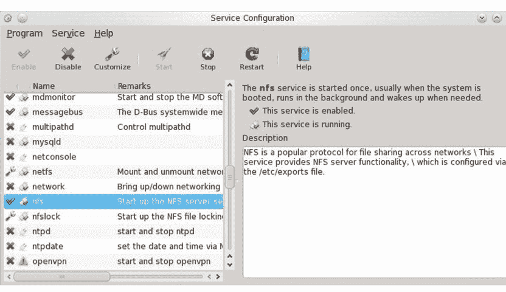

图 4.5

服务管理对话框。

要启用并启动它。如果它正在运行，你需要重启它以读取修改后的 exports 文件。从 shell 中，你可以使用 `service` 命令控制 `nfs` 和其他服务，位于 `/etc/init.d`。例如，启动 `nfs` 将：

```
service nfs start
```

停止它将：

```
service nfs stop
```

检查状态：

```
service nfs status
```

查看 `/etc/init.d` 查看名为 `nfs` 的脚本。

## 简单传输协议 (TFTP)

# 64 第 4 章

正如名称所示，TFTP 是一种可以在较小内存中实现的简单传输协议。因此它适用于没有存储设备的设备。它使用 UDP 数据报并提供自己的会话和传输机制。不提供身份验证或加密机制，因此在考虑安全的情况下使用。

主机将作为我们的 TFTP 服务器，因为它提供了 NFS 功能。某些发行版默认不安装 TFTP 服务器，因此你必须安装它。就像我们之前使用 `minicom` 一样，Fedora 用户可以执行 `apt-get install tftp-server`。安装后，TFTP 需要启用。有两种方法可以实现。你可以像对于 NFS 那样打开服务配置对话框。向下滚动到 `tftp` 并启用它。然后向下滚动确保 `xinetd` 正在运行。另一种方法是编辑文件 `/etc/xinetd/tftp`。你需要 root 权限来保存更改。找到以 `disable=` 开头的行，并将 `yes` 改为 `no`。

当在该文件中时，还要注意以 `server_args=` 开头的行。该行的参数是 TFTP 传输的默认目录。目前在 Fedora 中是 `/var/lib/tftpboot`。任何通过 TFTP 下载到目标板的文件都需要复制到此目录。此目录由 root 所有，对所有人不可写。因此你需要作为 root 用户为所有人可写：

```
chmod 777 /var/lib/tftpboot
```

我们在主机工作站上几乎拥有开发所需的一切。在第 5 章中，我们将专注于配置用于应用程序开发的目标嵌入板。之后我们将安装一个集成开发环境 (IDE)，使应用程序开发变得更高效。

## 资源

+ [andhammer.com](http://andhammer.com)—Industrial ARMworks 的网站，它是 Mini2440 的美国分销。

+ [friendlyarm.net](http://friendlyarm.net)—Mini2440 的中国制造商。有一个丰富的下载页面，但许多有用内容已经在 DVD 中了。销售页面列出了全球分销商列表。

- Meckenburg, Robert, *Managing Project with GNU Make*, 第三版, O’Reilly, 2005.当你准备好充分理解并利用 make 的力量时，这就是圣经。

# 第 5 章

## 硬件

> 当心那些拿着电烙铁的程序员。

匿名

## 嵌入式硬件

嵌入式计算涵盖了极其广泛的硬件：从驱动你自动咖啡机的（可能性的）8 位处理器，到你手机或平板电脑中的（可能是多核的）32 位处理器，再到运行电信网络的大规模并行处理环境。在本章中，我们将开始处理嵌入式目标板，并在接下来的几章中使用该开发板进行应用程序编程。

## ARM 单板计算机

ARM 是一种由 ARM Holdings（的一家英国公司，原名为 Advanced RISC Machines）开发的 32 位精简指令集计算机（RISC）架构。据报道，从产量数量来看，它是世界上最流行、应用最广泛的 32 位架构。ARM 处理器的相对简单性使其非常适合低功耗应用。因此，它们主导了移动和消费电子市场。约 98% 的手机手机至少使用一个 ARM 处理器。

ARM Holdings 本身并不制造芯片。相反，它将该架构授权给多家半导体制造商，包括 AppliedMicro、Atmel、Freescale、Marvell（原 Intel）、Nvidia、St-Ericsson、Samsung 和 Texas Instruments（TI）等。

接下来的几章将探索如何在以单板计算机（SBC）作为目标的跨平台环境中进行编程。具体而言，我们将使用一种小型基于 ARM 的 SBC，即 Mini2440，它基于三星的 S3C2440 系统级芯片（SOC）。该开发板的 Mini35 版本包含一个 3.5 英寸 LCD 屏幕，并配有所有必要的电缆、电源以及一套实用的软件开发包。Mini35 的单价约为 120 美元（图 5.1）。

¹ CNET “ARMed for the Living Room,”，http://news.cnet.com/ARMed-for-the-living-room/2100-1006_3-6056729.html。

# 第 5 章


图 5.1

带有 3.5 英寸 LCD 的 Mini2440。

为什么选择 Mini2440？在研究基于 ARM 的 SBC 时，我觉得 Mini2440 的性价比最高。在实惠的价格下提供了多样化的功能set。

Mini2440 由一家名为 FriendlyARM 的中国公司制造。美国分销商是 Industrial ARMworks。详情请参阅资源部分。

## 规格

- 处理器：三星 S3C2440，405 MHz

- 64 MB RAM

- 128 MB 至 1 GB NAND 闪

- 2 MB NOR 闪

- 外围连接：

  - 10/100 以太网

  - USB 2.0 主机和设备

  - 3 路 RS-232 (9针 D 接口)

  - SD/MMC 插槽

- 多通道 ADC（通道 0 连接了电位器）

- 立体音频输出，麦克风输入

- JTAG

- 4 个用户级 LED

- 6 个用户按键

- 电源（5 VDC，带开关的圆柱插头和 LED）

- 尺寸：100 mm（约 3.6 英寸）× 100 mm

# 硬件 67

## 其他开发板如何？

市上有各种基于 ARM 的 SBC。我选择 Mini2440 是因为它看起来性价比最高。尽管如此，回顾几个流行的替代方案也是很有值得的。

## BeagleBoard

BeagleBoard 是一种流行的开源硬件 SBC，基于 TI 的 OMAP3530 SOC，它结合了 ARM Cortex-A8 CPU 和 TI 的 TMS320C64x 数字信号处理器。它最初由 TI 开发为一种教育工具，并且其设计在知识共享许可协议（Creative Commons license）下发布，使其实际上是开源的。

## 规格（修订版 C4）

- 处理器：720 MHz 下的 TI OMAP3530

- 256 MB RAM

- 256 MB NAND 闪

- 外围连接：

  - 使用 HDMI 接口的 DVI-D，最大分辨率 1280 × 1020

  - S 视频

  - USB 2.0 HS OTG

  - RS-232

  - JTAG

  - SD/MMC 插槽

  - 立体音频输入和输出

  - 电源（5 VDC，圆柱插头）

- 尺寸：75 mm（约 3 英寸）× 75 mm

- 建议分销价：125 美元

该板在 5V 下仅需 2W，也可以通过其 USB 端口供电。

名为 BeagleBoard-xM 的修改版本于 2010 年 8 月开始发货。xM 尺寸略大，为 8.25 × 8.25 cm²，具有更快的 CPU 核心（1 GHz，C4 为 720 MHz）、更大的内存（RAM 内存）、板载以太网口、4 口 USB 集线器。xM 缺少板载 NAND，需要将操作系统和文件系统存储在 microSD 卡上。xM 的建议分销价为 149 美元。


作为一个拥有庞大热情用户社区的开源项目，BeagleBoard 似乎是本书的自然选择。基础 BeagleBoard 只比 Mini35 贵 5 美元。但只是板本身的价格；没有电缆，没有电源。

## 68 第 5 章

## Gumstix

Gumstix 系列 SBC 是由一家公司制造的，名称源于口香糖的大小。目前有两个产品线：基于 OMAP 处理器的 Overo 系列和基于 Xscale 处理器的 Pro 系列。由于体积很小，它们没有标准的 I/O。

## 规格

- 处理器：
  - Overo—OMAP3503 或 OMAP3530 @ 720 MHz
  - Vertex—PXA270 @ 400 MHz
  - 256 MB RAM 或 512 MB
  - 128 MB NAND 闪或 256 MB NAND 闪
  - 2 MB NOR 闪
  - 802.11
  - 板载 SD 插槽
几种扩展功能可用：
- DVI
- HDMI
- MicroUSB

## Raspberry Pi

在 2012 年 3 月，基于 ARM 的世界出现了 Raspberry Pi。它由英国树莓派基金会开发，售价 35 美元。

## 规格

- 处理器：Broadcom BCM2835 (ARM11)
- 256 MB RAM
- 从 SD 卡启动
- 外围连接：
  - 以太网
  - USB 2.0
  - HDMI
  - 立体音频输出
  - 摄像头接口
  - 通过 microUSB 供电
- 尺寸：85 × 53 × 17 mm

# 硬件 69

## 设置 Mini2440

图 5.2 显示了板的布局。遗憾的是，按键、LED 和 A/D 被显示器遮住了。拆下支撑柱并安装在另一侧。这里有几种选择。Mini2440 配有四根电缆：
- 9 针转 9 针 RS-232 线。注意这是母对母。你可能会认为它是交叉调制解调线（即 Tx 和 Rx 交叉），这一个不是。它是直连的。
- 以太网交叉线。这允许你将板连接到工作站的以太网端口，而无需通过交换机或路由器。把这看作是以太网直连模式；如果你更喜欢通过交换机或路由器，请使用标准电缆。
- USB 线。这对于初始加载引导程序。我们将在第 6 章进行操作。
- JTAG “摇摆”，25 针转 10 针扁平线。这用于驱动板上的 JTAG 端口，以便对 NOR 闪。

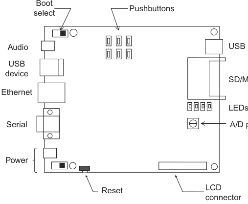

图 5.2 布局

Mini2440 布局。

#70

## 闪存与文件系统

### 闪存—NAND 和 NOR

Mini2440 具有多种形式的易失性和非易失性内存，如图5.3 所示。有两种非易失性存储形式：占用处理器内存地址空间部分的 2 MB NOR 闪，以及使用宽地址和数据口的 128 MB NAND 闪。然后是 64 MB SDRAM 用作工作内存。

闪存有两种基本形式，被称为 NAND 和 NOR，以其存储单元的基本逻辑结构命名。这两种类型具有不同的特性，适用于系统的不同功能。

NOR 闪存因其可靠性、快速读取操作和随机访问能力而非常适合代码存储。由于代码可以原地执行（XIP），NOR 是理想的

## 硬件

用于存储固件、启动代码、操作系统以及不经常更改的数据。Mini2440 拥有 2 MB 的 NOR flash，尽管我们并没有未使用。

NOR flash 的缺点是写入和擦除时间相对较慢。NAND flash 的特点是密度更高、成本更低、读写擦除速度更快，且写入寿命更长。这使得它非常适合存储数据。但 NOR flash 可以像 RAM 一样直接在处理器的内存空间中访问，而 NAND flash 必须通过串行方式或逐字节方式进行访问。

我们的系统拥有 128 MB 的字节宽 NAND flash，被组织为四个“分区”

| 名称 | 大小 | 偏移 |
|---|---|---|
| u-boot | 0x00040000 | 0x00000000 |
| env | 0x00020000 | 0x00040000 |
| kernel | 0x00050000 | 0x00006000 |
| root fs | 0x07aa0000 | 0x00560000 |

第一个分区为 256 KB，存放引导加载程序 `u-boot`。下一个 128 KB 的分区存放了引导加载器的环境变量。第三个分区是 Linux 内核，占用 5 MB。最后，最后一个分区包含所有其他内容并存放根文件系统。

## Flash 中的根文件系统

在生产嵌入式环境中，根文件系统通常以压缩镜像的形式存在于 flash 中。当内核启动时，它会将镜像复制并解压到 RAM 中，这样文件系统就是可写的。这样做的结果之一是文件系统是*易失的*。系统上电期间的任何更改在断电后都会丢失。要使更改永久，你需要重新刷新镜像。

由于根文件存储在 NAND flash 中，我们可以对文件进行更改，这些更改会直接反映回 flash 并且是*非易失的*。

Linux 有许多不同的文件系统，最流行的是 ext3 和 ext4。这些文件系统通常位于磁盘等质存储设备上，并不适用于闪存设备。

文件系统必须处理“磨损均衡”和坏块等问题。为了向 flash 扇区写入数据，必须先对其进行擦除。flash 设备的每个扇区可以承受有限的擦除次数，通常以十万次计。flash 文件系统试图通过将写入操作均匀分布在整个设备上，来最大地延长设备的使用寿命。同样，它会检测出现缺陷的扇区并在周围移动数据。

理想情况下，flash 设备的文件系统将透明地实现这些操作，以便用户或应用程序程序员看到的文件系统就像存在于硬盘上的 ext3 或 ext4 一样。用于 flash 的流行文件系统有 JFF2（日志闪存文件系统 2）和 YAFFS（另一种文件系统）。YAFFS 相对较新，并声称更适合 NAND flash 设备。目标板确实加载了位于 NAND flash 中的 YAFF 根文件系统，但我们目前没有使用它，因为它对软件开发不方便。

作为“日志型”文件系统，JFF2 和 YAFFS 都能在不损坏文件系统的情况下容忍掉电。在最坏的情况下，掉电发生时正在写入的数据可能会丢失。

## 准备开发板

出厂交付的 Mini2440 配置并不符合我们的操作需求。具体而言，它缺乏通过网络文件系统（NFS）挂载根文件系统所需的引导加载程序。此过程包含许多步骤，请仔细阅读。

## 示例代码

在书的网站上（见“资源”章节）有一个包含若干有用条目的 gzipped tar 包。下载该文件并解压到你喜欢的地方，例如家目录或家目录下的某个子目录。这将创建一个名为 `EmbeddedLinuxBook/` 的新目录，并在下方包含若干子目录：
- `mkimage`—用于创建 u-boot 可加载镜像的程序。将其移动到 `/usr/local/arm/4.3.2/bin`。
- `factory_images/`—包含若干用于重新配置目标设备的二进制镜像和脚本。
- `home/`—示例代码。此目录将被移动到目标文件系统的 `root/` 下。
- `rootfs/`—第 6 章练习题的示例代码。`root/` 下已经有一个 `home` 目录。如果可以安全删除，里面没有任何有用的东西。以 root 身份，`cd` 到 `root/` 并执行：

```
rm -rf home
```

`r` 选项递归删除目录及其内容。`f` 选项意味着“强制”，不询问确认。现在 `cd` 到你的 EmbeddedLinux/ 目录并执行：

```
mv home ../root
```

此处显示的目标路径假设 EmbeddedLinux/ 直接位于你的家目录下。最后，执行：

```
mv mkimage /usr/local/arm/4.3.2/bin
```

在移动此文件后，确保所有用户都具有执行权限。如有必要，使用 `chmod` 命令进行设置。

## factory_images

`factory_images/` 描述了目录中的文件。
- README—描述了通过 USB 将文件下载到目标 NOR flash 中引导加载器的程序。
- `boot_usb`—用于设置目标设备 NAND flash 的 U-boot 脚本。
- `mini_boot`—简化某些操作的 U-boot shell 脚本。
- `*.sh`—若干 shell 脚本—`boot.tar.gz` 的源码。
- `set_mini_boot`—用于下载文件到 NAND flash 的脚本。
- `target_fs.yaff`—NAND flash 中的文件系统镜像。
- `u_boot.bin`—预编译的 u-boot。
- `image-3.1.5`—内核镜像，版本为 3.1.5。
- `yaffs.patch`—内核的补丁。

## 脚本文件

`set_mini_boot` 是一个需要编辑的脚本。查看位于 `factory_images/` 下的各种脚本。

## mini_boot


这是一个由 `u-boot` 加载器解释的脚本。它设置目标设备 NAND flash 的环境变量。其主要作用是通过 TFTP 下载 `mini_boot` 脚本并开始执行。但在此之前，它必须为目标 IP 地址和 TFTP 服务器地址设置几个环境变量。如果你需要不同的网络地址，这里是更改它们的地方。根据需要编辑第 2 行（目标地址）和第 6 行（服务器地址）。

| 索引 | 名称 | 尺寸（英寸） | 厂商 | 型号 |
|---|---|---|---|---|
| 0 | N35 | 3.5 | NEC | NL2432HC22 |
| 1 | A70 | 7.0 | Innolux | AT70TN83 |
| 2 | VGA | | | | shield |
| 3 | T35 | 3.5 | Sony | TD35ST4 |
| 4 | | 5.6 | Innolux | AT056TN52 |
| 5 | X35 | 3.5 | | ACXS02BMU |
| 6 | W35 | 3.5 | Sharp | LQ35Q1DG06 |
| 7 | N43 | 4.3 | NEC | NL4827HC19-01B |
| | N4i | | Sharp | LQ43T3DX02 |

识别你的板使用的是哪个显示器，并在 `mini_boot` 的第 1 行输入相应的索引号。第 2 行指定根文件系统的位置。将 `<home_directory>` 替换为家目录名称。保存文件。我们不会对该文件进行更多说明，因为我们将在后面的章节中查看 `u-boot`。

## set-mini_boot

这是一个由 `minicom` 执行的脚本。它的主要作用是通过 TFTP 下载 `mini_boot` 脚本并开始执行。但在此之前，它必须为目标 IP 地址和 TFTP 服务器地址设置几个环境变量。如果你需要使用不同的网络地址，这里是更改它们的地方。根据需要编辑第 2 行（目标地址）和第 6 行（服务器地址）。

*.sh

有三个相当短的 Linux shell 脚本封装了一些细节。

- `mk_kernel.sh`—`mkimage` 程序为文件添加 `u-boot` 头需要许多难以记忆的参数。此脚本为 Linux 内核镜像添加相应的头部。
- `mk_uboot.sh`—此脚本为第一个参数提供的 `u-boot` 脚本文件添加 `u-boot` 头并将生成的文件移动到 TFTP 目录（在无第二个参数的情况下默认为 `/var/lib/tftpboot`）。你需要对你刚刚编辑的 `mini_boot` 文件调用此脚本：

```
mk_uboot mini_boot
```

- `move_files`—将要下载到目标的文件复制到 TFTP 目录（除非指定参数，否则使用 `/var/lib/tftpboot`）。执行此脚本。

## 硬件

## 操作步骤

- 1. 将三根线缆（USB、网线、串口）和电源连接到板卡。将板卡选择开关拨到 NOR 位置，朝向板卡边缘。
- 2. 在 Linux shell 中，`cd` 进入 `factory_images/` 并执行 `minicom -w`（`-w` 表示“换行长行”）。在另一个 shell 窗口中，`cd` 进入 `factory_images/` 并切换到 root 用户。
- 3. 开启板卡电源。Supervivi 显示图 5.4 所示的菜单。该菜单显示在运行 `minicom` 的窗口中。按下“d”。现在板卡正在等待下载文件。
- 4. 在另一个 shell 窗口（root 用户）中，执行 `./u-boot.bin`。文件下载到目标板卡并在下载完成后开始执行。现在 U-Boot 在板卡上运行。
- 5. 在 `minicom` 窗口中，执行以下两条命令：

```
nand scrub really erase the flash
```

```
nand createbt create a block table
```

这两个命令都需要确认你是否真的要执行。1 GB 的 flash 内存可能需要花费 15 分钟。`createbt` 命令需要耗长时间。
- 6. 在 `minicom` 窗口中，输入 `Ctrl-g` “b” 调出运行脚本对话框（图 5.5）。输入“c”并回车“set-mini-boot”。连续两次 `<Enter>` 键。`minicom` 脚本将运行一会。

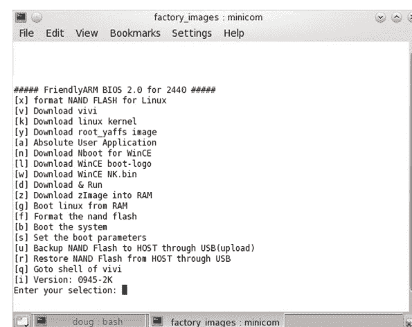

图 5.4

Supervivi 菜单。

```
[运行脚本]
A - 用户名           :
B - 密码           :
C - 脚本名称        :
更改设置？(返回运行，ESC 停止)
```

图 5.5

`minicom` 运行脚本对话框。
- 7. 在下载 flash 文件系统镜像期间，`minicom` 可能会显示“time out”（超时），并看起来无响应。输入 `Ctrl-c` 可以恢复响应。
- 8. 当 flash 文件系统镜像写入完成后，将启动选择开关拨回 NAND 位置（朝支撑柱）并按下白色重置按钮。`u-boot` 引导加载程序将启动你刚刚加载的 Linux 内核，并通过 NFS 从你的工作站挂载根文件系统。

## 最后步骤

当内核启动时，你会在 `minicom`（控制台）窗口中看到许多消息。这些消息跟踪内核启动的进度。在 LCD 屏幕上，你将看到 Tux 的图像。最后，屏幕上会出现以下消息：

- 启动网络...
启动 web 服务...
启动 leds 服务...
启动 Qtopia，请等待...

控制台窗口的最后一行是：

```
Please enter <Enter> to activate the console.
```

当你按下 `<Enter>` 时，你将以 root 身份登录，无需密码。

执行 `is` 命令证明 Linux 正在运行。执行 `ls -l bin`。注意，几乎每个条目都是指向 `busybox` 的链接。我们将在书的后部分介绍更多 BusyBox 的内容。为了熟悉目标环境，列出 `/proc` 目录并导出中断文件，以查看目标上 Linux 注册了哪些中断。

同时，屏幕现在显示图 5.6，这是由 Qtopia 生成的图形菜单。即使菜单是英文的，这并不是我们目前想要的。所以现在你应该禁用 Qtopia。


图 5.6

Qtopia 主菜单。

Qtopia 是通过 `root_qtopia/etc/init.d` 下的 `rcS` 脚本文件启动的。作为 root 用户，使用编辑器打开该文件并滚动到末尾。在最后三行前面加上“#”将它们注释掉。同时也注释掉第 44 到 55 行以 `/etc/rc.d/init.d/httpd start` 开头的行。我们将自己处理 Web 服务器和 LED，不希望内置服务产生干扰。

你可能在问自己：“我如何从图形化管理器打开一个根文件呢？”有办法的，但很多时候我匆忙打开一个文件进行编辑，结果发现它的所有者是 root。我想出的技巧是使用“另存为”将文件保存在我的主目录下，然后在 shell 窗口中切换到 root 用户，并将文件移动回它所在的目录位置。

保存文件后，重置目标板。它应该会进入 Linux 而没有 Qtopia 屏幕。

## 会出现什么问题？

在启动像 Mini2440 这样的嵌入式目标板时遇到困难并不罕见。最常见的问题分为两大。第一是串口。确保波特率设置正确。这通常不是问题，因为 115 kBd 似乎是 `minicom` 的默认值。一个常见问题是没有关闭硬件流控。此外，确保你使用的是随套的串口线。

两端都是母头连接器的线缆通常是交叉线或“空调制调器”，但 Mini2440 配置为直通线。

常见的网络问题包括确保关闭了安全增强 Linux (`SELinux`)。这将允许目标板连接到网络。确保 IP 地址正确。

## 引导加载程序

Mini2440 采用两阶段启动过程。第一阶段是位于 NAND 中的引导加载程序。第二阶段是 U-Boot，我们将在以后详细介绍。它不是自动执行，而是在按下空格键后显示提示符。输入 `printenv` 查看一些重要的环境变量：

```
bootdelay=3
baudrate=115200
bootcmd=nand load 0x8000000 0x0 0x400000; bootz 0x8000000
stdin=serial
stdout=serial
stderr=serial
ethaddr=00:00:00:00:00:00
bootargs=console=ttySAC0,115200 root=/ ip=192.168.1.10
```

注意上述行是默认值。要更改它们，使用 `setenv` 命令。例如：

- `bootdelay`：等待自动启动的时间。
- `baudrate`：串口。
- `bootcmd`：中断自动启动时执行的命令。`stdin`, `stdout`, `stderr`：指向串口。
- `ethaddr`：设置板卡的 MAC 地址。
- `bootargs`：启动时传递给 Linux 内核的命令行。`bootargs` 信息包括：
- 控制台设备和波特率，


- 根系统类型，如果是，
- 根系统的位置，
- 该设备的 IP 地址。

通常，MAC 地址是在设备制造时从电气电子工程师协会 (IEEE) 获得的数字，以保证每个 MAC 地址都是唯一的。该厂商没有这样做，每块板最初都具有相同的 MAC 地址。

在实践中，只需要特定网段内的每个 MAC 地址是唯一的。如果你在同一网段有两个或多个 Mini2440 板卡，你必须更改它们的 MAC 地址。你可以通过执行 u-boot 命令来更改：

```
setenv ethaddr nn.nn.nn.nn.nn
```

“nn”代表十六进制。如果你更改了 MAC 地址或任何环境变量，你需要执行 `saveenv` 使更改持久化。

U-Boot 有大量的命令集，大部分在附录 A 中详细介绍。现在，输入 `help` 查看完整列表。

目标板完全配置并连接到工作站后，我们现在需要一个合适的集成开发环境 (IDE) 来简化应用程序任务。这是第 6 章的主题。

## 资源

andahammer.com—Industrial ARM（Mini2440 的美国经销商）的网站。

本书配套资源：http://booksite.elsevier.com/9780124159969。

friendlyarm.com—Mini2440 的中国制造商。有一个丰富的下载页面，但很多实用的内容已经在 DVD 上了。该页面有全球分销商的列表。

http://billforms.stations51.net。

http://groups.google.com/group/mini2440—这些是关于 Mini2440 的两个讨论。

intellimetrix.us/downloads.html—该页面还持有代码以及任何随后的更新和错误说明。

## Eclipse 集成开发环境

> 你可能会花整天的时间来自定义标题栏。
> 
> 相信我，这是我的经验之谈。
> 
> Matt Welsh

IDE 是提高生产力的极佳工具。桌面开发者已经使用它们多年了。也许最常见的例子就是微软的 Visual Studio 环境。在过去，许多嵌入式工具供应商都构建了了自己的专有 IDE。

在开源世界，首选的 IDE 是 Eclipse，也被称为 Eclipse 平台（Eclipse Platform），有时也称为平台。该项目由国际对象技术公司（OTI）启动，随后被 IBM 收购。2001 年底，IBM 和几个合作伙伴组成了一个协会，将 Eclipse作为一个开源项目进行推广和开发。它现在由 Eclipse 基金会维护，这是一个由软件行业供应商组成的非营利财团。包括 Monte Vista、TimeSys、LinuxWorks 和 Wind River Systems 在内的多个嵌入式 Linux 供应商已将 Eclipse 作为其未来 IDE 开发的基础。

我甚至可以说，Eclipse 是目前最专业、运行最好的开源项目。在过去的 6 年里，每年的 6 月中旬，基金会都会发布平台的大版本以及大多数相关项目，代码量约为 2000 万到 3000 万行。直到 2011 年，这些版本一直按照木星的字母顺序命名。2010 年的版本被称为 Helios。2011 年的版本打破了这一传统，命名为 Indigo。

需要注意的是，Eclipse 并不限于在 Linux 下运行。它在各种 Windows 系统上运行得同样良好。

本章的部分内容改编自《Eclipse Platform Technical Overview》（IBM Corporation and the Eclipse Foundation, 2001, 2003, 2005），并根据 Eclipse 公共许可（EPL）提供。全文可在 www.eclipse.org 获取。

## 第 6 章：概述

Eclipse 是一种通用平台——一个开放、可扩展的 IDE，适用于任何内容，且没有特定局限。根据平台的在线概述，它提供了一个功能丰富的开发环境，允许开发者高效地创建可以无缝集成到 Eclipse 平台中的工具。从技术上讲，Eclipse 本身并不是一个 IDE，而是一个用于开发 IDE 和富客户端应用的开放平台。

Eclipse 6.1 显示了基本的 Eclipse 工作区。它由几个视图组成，包括：

- `Navigator`（导航器）显示用户工作空间中的文件，
- `Text Editor`（文本编辑器）显示文件内容，
- `Tasks`（任务）——一个“待事项”列表，
- 正在编辑文件的 Outline（大纲）。大纲视图的内容取决于特定内容。

Eclipse 拥有许多内置功能，大部分功能都是通用的。通过额外的工具可以通过新的内容类型来扩展平台，

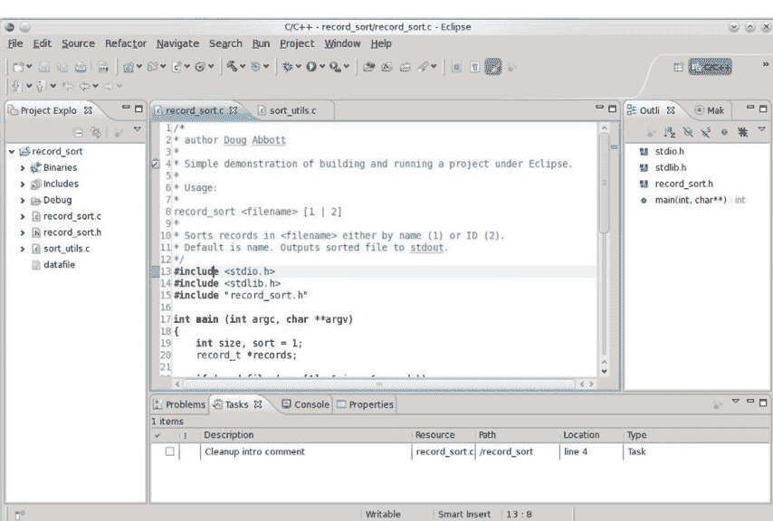

图 6.1

Eclipse 工作区（Workbench）。

以便使用现有的内容类型实现新功能，并将通用功能集中在特定内容上。

Eclipse 平台构建在一种发现、集成和运行插件的机制之上。工具提供者将工具编写成独立的插件，该插件在工作空间中的文件上操作，并在工作区中暴露其工具特定的 UI。当你启动 Eclipse 时，它会呈现出一个由一组可用插件组成的 IDE。

Eclipse 平台主要用 Java 编写，事实上，它最初被设计为 Java 开发工具。图 6.2 显示了平台的主要组件和 API。平台的主要作用是为工具开发者提供使用机制和遵循的规则，以便创建无缝集成的工具。这些机制通过定义良好的 API、类和方法暴露。平台还提供了有用的构建模块和框架，促进了新工具的开发。

Eclipse 的设计和构建为了满足以下要求：

- 支持构建各种应用程序开发工具。
- 支持不受限制的工具提供者集合，包括独立软件供应商。
- 支持操作任意内容类型（如 HTML, Java, C, JSP, EJB, XML, GIF）的工具。
- 促进工具在不同内容类型和工具提供者之间的无缝集成。
- 同时支持基于 GUI 和非 GUI 的应用环境。
- 运行在各种操作系统上，包括 Windows 和 Linux。
- 利用 Java 编程语言在编写工具方面的流行。

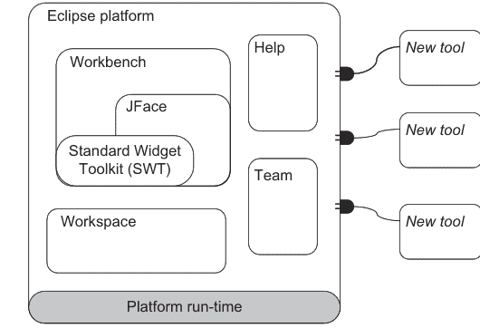

图 6.2

Eclipse 平台。

## 插件

插件是可以独立开发和交付的 Eclipse 功能的最小单元。小型工具通常编写为单个插件，而复杂工具可能会将其功能拆分到多个插件中。除了被称为平台运行时（Platform Run-time）的小内核内核外，平台的所有功能都位于插件中。

插件用 Java 编写。一个典型的插件由 JAR 库中的 Java 代码、一些只读文件以及其他资源（如图像、模板、消息目录和原生代码库）组成。有些插件完全不包含代码。例如，一个以 HTML 页面形式提供在线帮助的插件。单个插件的代码库和只读内容共同位于文件系统中的目录中，或服务器上的基础 URL 下。

每个插件的配置由一对文件描述。清单文件 `manifest.mf` 声明了关于插件、版本和依赖关系的要要信息。第二个文件 `plugin.xml` 声明了插件的扩展点。平台提供了标准的扩展点；额外的扩展点由插件提供。

## 工作区

Eclipse 平台构建在两个工具包之上：

1. 标准部件工具（`SWT`）——具有原生图形的控件集。
2. `JFace`——一个使用 SWT 的 UI 工具包，简化了 UI 任务。

与通用的 SWT 和 JFace 工具包不同，工作区提供了多个视图和编辑器。

**编辑器**允许你打开、编辑和保存对象。它们遵循类似于文件的工具生命周期，但与工作区的集成更紧密。当编辑器激活时，它可以向工作区菜单和工具栏贡献操作。平台提供了资源的标准编辑器；其他插件提供特定的编辑器。

视图提供你正在处理的对象的信息。视图可以通过提供正在编辑的内容来辅助编辑器。例如，标准内容视图显示内容的结构化大纲。视图可以通过提供选中对象的信息来增强其他视图。例如，标准属性视图呈现选中对象的属性。

工作区窗口可以有多个视角，任何时刻只有一个处于排列状态。每个视角都有自己的视图和编辑器排列。你可以快速切换视角来处理不同的任务，并轻松地调整和自定义视角以更好地适应特定任务。平台提供了资源导航、在线帮助和团队支持任务的标准视角。其他插件提供了额外的视角。

插件工具可以增强编辑器、视图和视角：

- 向现有视图本地菜单和工具栏添加新操作。
- 当现有编辑器激活时，向工作区菜单和工具栏添加新操作。

## 安装

Eclipse 有两个部分：Eclipse 本体和 Java 运行时（JRE）。从 eclipse.org 下载 Eclipse。有多个版本供选择。由于我们对 C 开发感兴趣，请获取 Eclipse IDE for C/C++ + Developers。

你可以将 Eclipse 放在任何地方。我选择将其安装在 `/usr/local`。解压后，你会发现一个名为 `eclipse/` 的新目录。

# 86 第 6 章


# Eclipse 集成开发环境

由于 Eclipse 主要使用 Java 编写，因此你需要一个 JRE 来支持它。大多数现代 Linux 发行版默认都安装了 JRE，但它可能与 Eclipse 不兼容。Fedora 14 随附的 IceTea6 提供的运行良好。如有必要，请从 Oracle（原 Sun Microsystems）下载最新版本。下载的是一个二进制可执行文件。将其复制到你喜欢的地方并执行即可。`/usr/local` 是一个很好的位置。系统会要求阅读并接受 Java 运行环境版本6 的二进制代码许可协议。你需要将新安装的 JRE 的 `bin/` 目录添加到你的 PATH 中。

这就是 Eclipse。它已经安装完毕并准备就绪。在 shell 窗口中，`cd` 到 `eclipse/` 目录并执行 `./eclipse`。从任何其他地方，输入 eclipse 可执行文件的完整路径。或者直接在 KDE 文件管理器窗口中双击它。

或者更好的办法是在 `/usr/bin` 目录下创建一个名为 `eclipse` 的脚本，包含以下内容：

```bash
#!/bin/bash
/usr/local/eclipse/eclipse &
```

第一行将此文件标识为 shell 脚本。第二行执行 Eclipse。“&”表示在后台运行此程序并返回 shell 提示符。由于 `/usr/bin` 在你的路径中，你只需要输入 `eclipse`。

## 使用 Eclipse

每当 Eclipse 启动时，它都会要求你选择一个 `workspace`（工作空间），这是存放项目文件的地方。默认是你家目录下的名为 `workspace/` 的目录。然后 `workspace/` 是每个项目的子目录。跟随工作空间目录，如果你是第一次执行 Eclipse，你将看到欢迎屏幕。在随后的运行中，Eclipse 会直接在工作台中打开，但你始终可以从“帮助”菜单中的第一项“欢迎”访问此窗口。

欢迎屏幕上的教程将带你进入一个关于使用 Eclipse 的非常详尽的介绍。如果你是该环境的新手，我强烈建议你过一遍。没有必要重复它。继续吧，我等候。

好了，现在你对 Eclipse 的通用操作有了很好的了解。现在是时候更具体一点，并将我们学到的知识应用于嵌入式系统的 C 软件开发了。由于你运行的是 C/C++ 开发工具 `CDT` 版本的 Eclipse，你最初会看到 C/C++ 视图。

## C 开发环境——CDT

在 Eclipse.org 正在进行的项目中有一个工具项目。它的子项目是 `CDT` 项目，它为 Eclipse 平台提供了功能全 C 和 C++ IDE。Linux 下的 `CDT` 基于 GNU 工具，包括：

- 带有语法着色的 C/C++ 编辑器，
- 使用 `GDB` 的 C/C++ 调试器，
- 用于外部程序的 C/C++ 启动器，
- 解析器，
- 搜索引擎，
- 内容辅助提供程序，
- `Makefile` 生成器。

## 创建新项目

在我们创建 C/C++ 项目的初始练习中，我们将创建一个简单的记录排序应用程序。要排序的记录包含一个名称和一个 ID 号。为了稍微简化代码，我们将名称字段中的任何空格替换为下划线。程序将根据命令行指定的按名称或 ID 升序对记录文件排序：

```
record_sort <logfile> [i|2]
```

其中 1 表示按名称排序，2 表示按 ID 排序。如果没有给出排序算法，则默认按名称排序。

在 Eclipse C/C++ 视图中，选择 `File>New>C Project`。这会弹出我们称之为“record-sort”的新项目向导。项目类型是 `Executable>Empty Project`；工具链是 `Linux GCC`，我们将使用默认的工作空间位置。在 `Select Configurations`（选择配置）对话框中点击 `Next`（下一步），你可以在此处选择这些配置中的一个或两者。它们之间的主要区别是 `Debug` 配置是用编译器的调试标志构建的。“`-g`”已开启，以为 `GDB` 提供符号信息。`Release` 配置则去掉了调试标志。

当你点击新项目向导中的 `Finish`（完成）时，你会在 `Project Explorer`（项目资源管理器）视图中找到一个条目。`record_sort` 项目下的唯一项是 `Includes`（包含），这是一个用于搜索头文件的路径列表。

此时，看一眼 `workspace/record/sort/` 目录将很有用。它包含两个文件，`.project` 和 `.project`，两者都是描述项目的 XML 代码。`.project` 为基础基础 Eclipse 提供配置信息，而

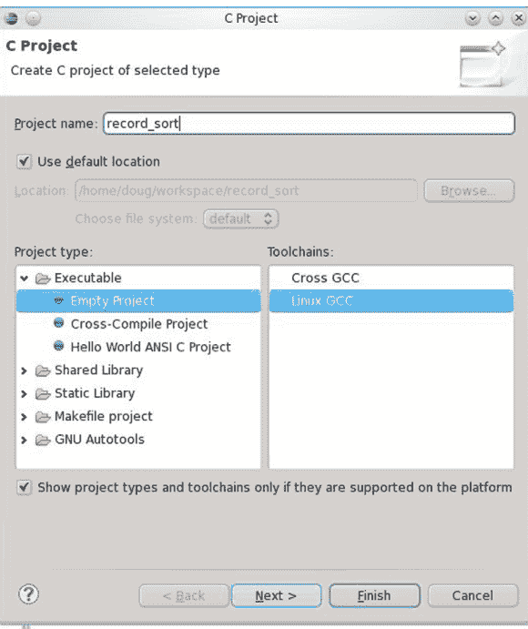

图 6.3

新项目向导。

更复杂的 `.project` 文件为 `CDT` 提供信息。没有必要理解这些文件的内容，但知道它们的存在是有用的。

### 将源代码添加到项目

向 C 项目添加源代码基本上有两种方法。你当然可以在编辑器窗口中创建一个新文件，你也可以将现有文件导入项目。执行 `File>Import...` 弹出 `Import Select`（导入选择）。展开 `General`（常规）类别并选择 `File System`。点击 `Next`，然后点击 `Browse`，导航到 `EmbeddedLinuxbook/record_sort`，并点击 `OK`。

这会弹出 `Import Select`。选择三个文件并点击 `Finish`。这些文件现在显示在 `Project Explorer` 视图中。注意，没有 `record_sort.c` 文件。那是因为你将亲自输入它，以练习使用 `CDT` 编辑器。

点击工具栏左侧 `New`（新建）图标旁边的向下箭头，并从下拉菜单中选择 `Source File`（源文件）。将其命名为“`record_sort.c`”。一个编辑器会打开，并带有一个初步的头文件注释。`record_sort.c` 的内容如图 6.4 所示，但在阅读下一节之前不要开始打字。

### 内容辅助

`CDT` 编辑器有许多让你的编码生活更轻松的功能。这些功能属于 `Content Assist`（内容辅助）总类。内容辅助的基本思想是根据当前上下文、范围和前缀预测你可能输入的内容，减少你必须输入的按键次数。通过输入 `Ctrl+Space` 调用内容辅助，在结构体或类名之后输入“`、`”`->`”或“`:`”时，它也会自动激活。

### 代码模板

`Code Templates`（代码模板）是 `Content Assist` 的元素，为频繁使用的代码段提供起点。当你输入一个字母组合并按 `Ctrl+Space` 时，将显示以该字母组合开的代码模板列表。选择一个，它将自动插入到文件的当前位置。尝试——在 6.4 中输入 `#include` 行，输入“`ma`”按 `Ctrl+Space`。这会弹出 `main()` 函数的模板。你可以在 `Window>Preferences>C/C++Editor>Templates` 编辑模板。内容辅助的其他方面也可以在 `Preferences` 中自定义。

### 自动闭合

注意，每当你打开引号（`"`）、括号（`()`）、方括号（`[]`）、角括号（`<>`）或括号（`{}`），编辑器会自动闭合并将光标放在中间。然而，如果你将光标移出范围（例如为了复制粘贴某些文本），它将恢复正常行为（开启新行）。

在大括号的情况下，闭合括号将根据当前的编码样式进行定位，光标将正确缩进。

最后，注意当你输入时，`Outline`（大纲）视图中会出现相应的条目，标识头文件、函数以及如果有的话的全局变量。


```
/*
 * 作者 Doug Abbott
 *
 * 在 Eclipse 下构建和运行项目的简单演示。
 *
 * 用法：
 *   record_sort <filename> [1 |2]
 *
 * 按名称 (1) 或 ID (2) 对 <filename> 中的记录排序。
 * 默认按名称排序。输出到 stdout。
 */

#include <stdio.h>
#include <stdlib.h>

#include "record_sort.h"

int main (int argc, char **argv)
{
    int size, sort = 1;
    record_t *records;

    if (read_file(argv[1], &size, &records))
    {
        printf("Couldn't open file %s\n", argv[1]);
        exit(1);
    }
    if (argc > 2)
        sort = atoi(argv[2]);

    switch (sort)
    {
        case 1: sort_name (size, records);
            break;
        case 2: sort_ID (size, records);
            break;
        default:
            printf("*Invalid sort argument\n");
            return_records (size, records);
            exit(2);
    }
    write_sorted (size, records);
    return_records (size, records);
    return 0;
}
```

图 6.4

`record_sort.c`。

## 程序

在继续构建和运行项目之前，让我们仔细看看它实际上做了什么。`main()` 本身非常直观。它只是对在 `sort_utils.c` 中声明的函数的调用，这些函数执行实际工作。

## Eclipse 集成开发环境

`read_file()` 函数读取数据文件并将其组织为每行一条记录，其中每个记录包含一个文本名称和一个数字 ID。它为记录数组分配内存，并为每个名称字段单独分配内存。

## 构建项目

一旦你编译并保存了 `record_sort.c` 文件，下一步就是构建项目。在项目中创建或导入的所有文件都会自动成为项目的一部分，并被构建和链接到最终的可执行文件中。

在“项目资源管理器”`Project Explorer` 视图中，选择顶层的 `record_sort` 条目。然后执行 `Project>Build Project`，或者右键点击 `BuildConfigurations>Build>All`。在前一种情况下，将构建活动配置 `Active Configuration`。这是 `Debug` 配置的默认设置。可以通过执行 `Project>BuildConfigurations>SetActive` 来更改活动配置。

在后一种情况下，将构建 `Debug` 和 `Release` 配置。无论何种情况，“项目资源管理器”视图中的 `record_sort` 下都会出现一个或两个新条目。这些条目代表 `Debug/` 和 `Release/` 子目录，它们持有对应构建配置的对象文件和可执行文件。每个目录还包含一个 `Makefile` 和 Eclipse 特有的文件。

最初，构建将失败，因为 `sort_utils.c` 中已经包含了一些编译时错误和警告。打开“问题”`Problems` 视图，展开“错误”`Errors` 条目，右键点击显示“`record_t` has no member named ‘`Id`’”的项。选择“Go To”打开 `sort_utils.c`，并高亮显示错误的行。修正方法应该是显而易见的。

Eclipse CDT 以不同的方式识别构建问题。在“项目资源管理器”视图中，任何带有问题的项目和源文件都会标记一个红色的 X 表示错误，或者一个带有“!”的黄色盾牌图标表示警告。当在编辑器 `Editor` 中打开带有错误或警告的源文件时，标签页会显示相同的符号。“大纲”`Outline` 视图随后使用相同的图标来显示文件中的哪些函数存在错误或警告。

# 第 6 章

编辑器窗口使用相同的图标来识别发生错误或警告的行。你可以滚动源文件，在显示警告或错误图标的行上，“问题”窗口将跳转到相应的条目。如果你将光标悬停在标识为错误或警告的行上，就会弹出相应的错误消息。

修正问题并再次构建项目。顺便提一下，Eclipse 不会在构建前自动保存修改过的。你必须手动保存。该行为可以在“首选项”`Preferences` 中更改。保存 `sort_utils.c` 并再次运行构建。这次应该会成功，你将在 `Debug` 树中上方看到一个可执行文件。

在进行调试之前，你可能想在编辑器中开启行号显示，因为我们在操作过程中会引用行号。在编辑器中，右键点击左侧的垂直条，它被称为“标记器栏”`marker bar`。选项之一是“Show Line Numbers”。点击它。这是一个全局按钮。它适用于编辑器中当前打开的任何文件以及此后打开的任何文件。

## 使用 CDT 进行调试

CDT 与 GDB 集成得非常完美。像大多数工具一样，GDB 本身是面向命令行的。Eclipse 为原生接口提供了一个图形化封装器，这样你就不需要记住所有命令了。

在开始调试之前，我们必须创建一个 `debug launch configuration`。执行 `Run>Debug Configurations...`。选择 `C/C++ Application` 并点击左上角的 `New` 按钮。这将弹出如图 6.5 所示的调试配置对话框。所有内容都已填充。我们只需要添加一项。选择“Arguments”选项卡，并在“Program arguments”中输入“datfile”：`datafile` 是程序用于排序的数据记录样本。它与 `sort_utils.c` 和 `record_sort.h` 一起被导入到项目中。

点击 `Apply`，然后点击 `Debug`。系统会询问你是否要打开调试视图 `Debug perspective`。选择是。

图 6.6 显示了初始的调试视图。底部是“控制台”`Console` 窗口，在此进行终端 I/O。编辑器窗口显示 `record_sort.c`，并高亮了 `main()` 的第一行。右侧的“大纲”`Outline` 标签页列出了 `record_sort.c` 包含的所有头文件以及文件中声明的所有全局和外部符号，包括变量、常量和函数。

# Eclipse 集成开发环境 93

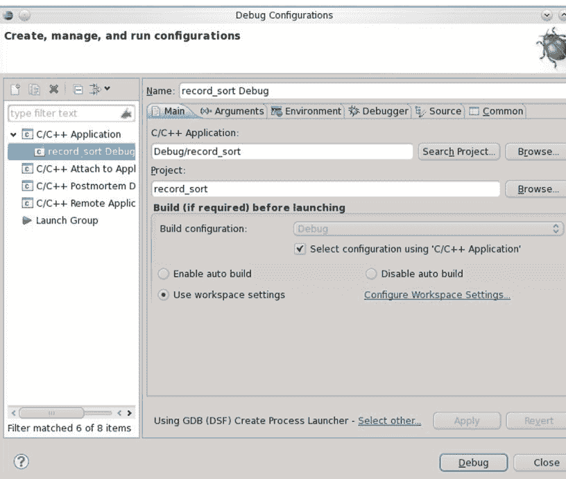

图 6.5

调试配置对话框。

右上角是一组标签页，提供了一系列调试信息，包括局部变量、断点和寄存器。初始时，所有局部变量都有随机值，因为它们被分配在栈上。在左上方 Debug 标签页正下方是一组执行图标。点击“Step Over”图标。编辑器窗口中的高亮移动到下一行，“视图”中的 `sort` 显示了其初始值 1。该值被黄色高亮显示，是因为它自上次调试器挂起以来发生了变化。你也可以通过简单地将光标悬停在任何变量上来查看其当前值。试一下。

现在，点击 Debug 视图工具栏中的“Resume”图标让程序运行。嗯，我们得到的结果并不完全符合预期 `datafile` 有两条记录，但只有一条记录输出到“控制台”视图。这是因为程序中内置了一些运行时错误，以便提供一些使用调试器的练习。

# 94 第 6 章

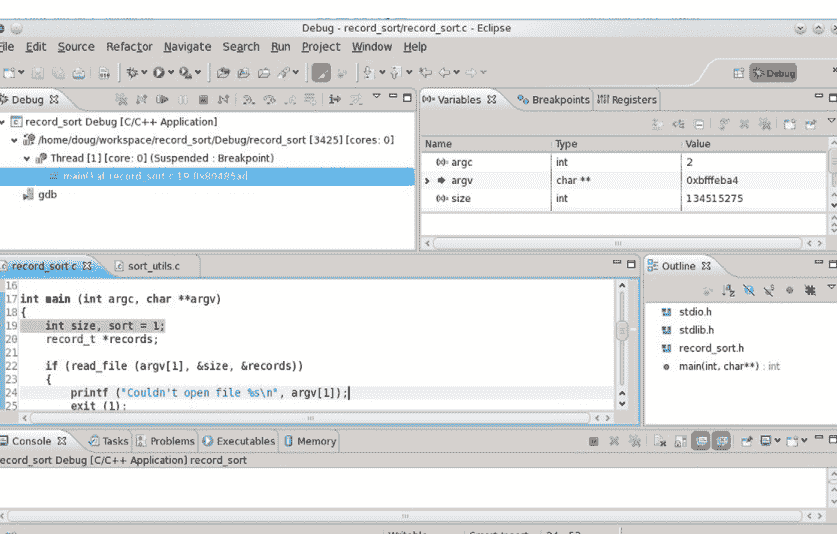

图 6.6

调试视图。

## 调试视图

在调试视图中，右键点击顶层项目并选择“Relaunch”以开始调试。如图 6.7 所示，调试视图以分级形式显示程序状态。层次结构的顶部是启动实例，即启动配置。然后是调试器实例。调试器下方是调试器控制的程序。对于 `record_sort` 只有一个线程。最后，在底层是线程的栈帧，通过函数名、源代码行号和程序计数器标识。目前，`main()` 的栈帧位于 `record_sort.c` 的第 22 行。

调试视图的工具栏有许多管理执行的按钮。将光标悬停在上面查看标签。

点击“Step Over”，然后点击“Step Into”进入 `read_file()` 函数。注意调试视图中出现了第二个栈帧，并且 `sort_utils.c` 在编辑器中打开。

# Eclipse 集成开发环境 95

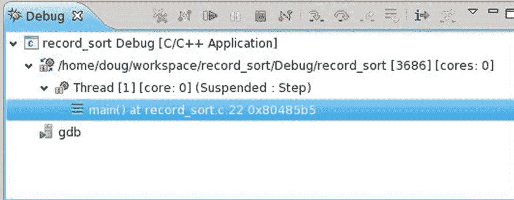

图 6.7

调试视图。

此时我们应该仔细查看工作区右上角的四个标签视图。

## 变量视图


当在调试视图中选择一个栈帧时，“变量”（Variables）视图显示该帧中所有的局部变量。现在你应该处于 `read_file()` 函数。可见两个变量都是指针。点击名称左侧的白色箭头可以解引用并显示相应的值。对于字符串变量，在下方窗口中显示完整字符串。

选择调试视图中的 `main()` 栈帧，注意变量视图变为显示 `main()` 中的局部变量。如果选中的不是栈帧，变量视图将为空。记得，你也可以通过简单地将光标悬停在变量上来查看值。

## 断点视图

为了调试 `record_sort` 中的问题，你可能想在程序设置一个或多个断点并观察发生的情况。选择“断点”（Breakpoints）视图，它是空的，因为我们还没有设置任何断点。

让我们在 `sort_utils.c` 的第 34 行设置一个断点。那是 `read_file()` 中一个 if 语句的开始。右键点击第 34 行的标记器栏并选择“Toggle Breakpoint”（切换断点）。出现绿色圆表示在该处设置了启用的断点。勾选标记表示断点已成功安装。

### 第 6 章

断点（Breakpoints）视图中出现了一个新条目，其中显示了断点的完整路径。复选框显示该断点已启用。点击复选框可禁用断点，并注意标记器中的圆圈变为白色。调试器会忽略禁用的断点。再次点击复选框即可重新启用它。

点击调试工具栏中的“继续（Resume）”，程序将运行到断点处。调试（Debug）视图中的“Thread [0]”条目表示该线程由于命中断点而处于挂起状态。点击“单步（Step Over）”以加载第一条记录到 `temp`。选择“变量（Variables）”视图并点击旁侧的白色箭头。现在你可以看到 `temp` 中字段的当前值。自线程上次挂起以来值发生变化的变量将用黄色高亮显示。

断点有一些有趣的属性，我们将在稍后进行探讨。

## 内存视图（Memory View）

在调试视图（Debug perspective）底部的标签页窗口中，默认显示了一个面向调试的视图。内存视图（Memory view）允许你监控和修改进程内存。内存组织为内存监控器列表，每个监控器通过一个基地址代表一段内存。每个内存监控器都可以以一种或多种预定义的格式作为内存渲染进行显示。预定义的渲染格式包括十六进制（默认）、ASCII、有符号整数和无符号整数。

图 6.8 显示了在在 `read_file()` 中第一次调用 `fscanf()` 之后为 `temp` 分配区域的内存监控器。内存视图分为两个窗格：一个列出当前激活的监控器，另一个显示已启用的渲染，并在渲染面板中以标签页形式。

前四个字节包含指向为 `name` 分配的另一个区域的指针。记住 x86 是“小端（little endian）机器。因此，当内存如所示显示时，条目看起来是“反过来”的。

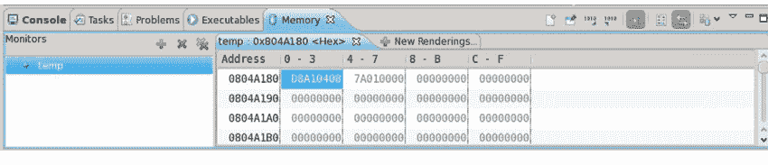

图 6.8

内存视图。

### Eclipse 集成开发环境

每个面板都有一组很小且相当直观的按钮用于管理面板。这些按钮允许你添加或删除监控器或渲染，在监控器的情况下，可以删除所有所有监控器。

## 完成调试

在了解了 Eclipse 主要调试功能的背景后，你应该能够找到插入在 `sort_utils.c` 中的两个运行时错误。祝你好运。

## 总结

在我拙看来，Eclipse 是我见过的执行最专业的开源项目之一。尽管它拥有巨大的力量和灵活性，但最常用的操作相对简单且直观。文档虽然仍然具有参考性质而非教程性质，但它仍然具有可读性，并且在大多数情况下是准确的。遗憾的是，有许多开源项目无法给出这样的评价。

插件机制使得 Eclipse 具有无限的扩展性。这为开源和商业扩展都提供了机会，以应对广泛的应用。下方的“资源（Resources）”部分列出了 Eclipse 插件库。

与书中的许多主题一样，我们真的只是触及了表面，专注于那些对嵌入式开发者特别感兴趣的领域。但希望这些足以引起你进一步挖掘的兴趣。那里还有很多内容。去尝试吧！

现在我们已经完全准备好为目标板进行一些真正的编程了。那是下一章的主题。

## 资源

Abbott, Doug, *Embedded Linux Development Using Eclipse*, Elsevier, 2008. 详细介绍了使用 Eclipse 进行嵌入式开发的更多细节。

http://marketplace.eclipse.org/—Eclipse 插件。此页面列出了超过 1,000 个插件，包括商业和开源。

www.eclipse.org—Eclipse Foundation 的官方网站。这里有很多内容，值得花时间仔细浏览。我特别推荐下载《C/C++ + Development Toolkit User Guide》(PDF)。

# 从用户空间访问硬件

只有那些产品价值更低的人，才会对自由软件产生任何恐惧。

David Emery

## 复习

现在是时候停下来，深呼吸，在我们继续处理应用程序开发之前，看看我们走了哪些路。

第 1 章向我们概述了嵌入式和实时领域，以及 Linux 如何适应该领域。第 2 章介绍了如果你还没有 Linux 工作站，如何安装 Linux 工作站的流程。对于不熟悉 Linux 的新手来说，第 3 章提供了概述和介绍。在第 4 章中，你安装了本章需要的几个软件包。第 5 章介绍了我们在本书的这一部分中将一直使用的目标 SBC。此时，目标设备应该已经正常启动 Linux。最后，在第 6 章中，你学习并熟悉了 Eclipse 集成环境。

现在是时候将这一切整合在一起，在交叉开发环境中构建应用程序程序了。

## ARM I/O 架构

与大多数现代架构一样，ARM 将外设设备放在与内存相同的地址空间中。这意味着可以使用与内存相同的指令访问外设。程序不需要知道或关心它访问的是内存还是硬件设备。这与例如 x86 架构形成对比，后者的外设设备存在于独立的地址空间中，以分离 I/O 指令。

在 x86 的情况下，只有 I/O 在独立的地址空间中，I/O 指令只能从特权级 0（Privilege Level 0，也称为“内核空间”）执行。这使得必须使用内核空间设备驱动来访问外设。然而，ARM 允许我们直接从用户应用程序访问外设。

图 7.1 中的映射图显示了 S3C2400 处理器的 32 位地址空间是如何分配的。处理器 102 第 7 章

| NOR boot | NAND boot |
|---|---|
| Internal SRAM (4 KB) 0x0000 |
| NOR flash (2 MB) | 0x010000 |
| Ethernet Controller DM9000 | 0x020000 |
| DRAM (64 MB) | 0x0300000 |
| Internal SRAM (4 KB) | 0x0400000 |
| Internal Peripherals | 0x0480000 |
| | 0x05C000 |

图 7.1

S3C2400 内存映射。

memory space and this cover the first 1 GB of 0xFFFF。这种映射取决于开关的设置。在 NOR 位置，NOR flash 映射到 0。在 NAND 位置，NOR flash 被复制到 SDRAM。第一阶段加载器将 NAND 拷贝到 SDRAM。奇怪的是，内部外设占据地址空间的顶部几页，而不是像这样“位于中间”。

## LED 和按键

我们以后详细说明四个 LED 和六个按键到通用输入/输出（GPIO）端口的映射。LED 使用端口 B（GPB），基地址为 `0x056010`，按键使用端口 G（GPG），基地址为 `0x056060`。图 7.2 显示了 LED 如何映射到 GPB 数据寄存器的位以及它们在板子上的外观。图 7.3 对按键做了同样的事情。

### 从用户空间访问硬件

| 15 | | 8 | 7 | 4 | | 0 | GPB |
|---|---|---|---|---|---|---|---|
| | | | 4 | 3 | 2 | 1 | |

LED

+   | 1 | 2 | 3 | 4 |
|---|---|---|---|
| | | | |

A/D pot

图 7.2

GPB 中的 LED 布局。

| 15 | | 11 | | 8 | 7 | 4 | 3 | | 0 | GPG |
|---|---|---|---|---|---|---|---|---|---|
| | | | 1 | | 3 | 2 | 4 | 5 | | 6 |

按键

+   | 1 | 2 | 3 |
|---|---|---|
| | | | |

板边缘

图 7.3

GPG 中的按键布局。

正如 S3C2440 数据手册中描述的，每个 GPIO 引脚可以根据端口控制寄存器作为若干功能之一。一个位通常可以作为通用输入、通用输出或特定外设功能（如串口）的一部分。稍后我们将看到如何将 LED 位设置为输出，并将按键位设置为输入。

# 从 Linux 访问 I/O——我们的第一个程序

## 创建项目


在 Eclipse 中创建项目有两种方式：标准项目（也称为 Makefile 项目）或托管项目（也简单称为可执行项目）。托管项目会自动创建一个项目目录、一个模板 C 源文件和一个 makefile，在默认工作空间。在第 6 节中，我们为 `record_sort` 程序创建了一个托管项目。

通常情况下，你会有许多以“常规”方式组合在一起的项目，并希望将它们引入 Eclipse CDT 环境，书中的大多数示例项目已经包含了 makefile。Makefile 项目的作用是将现有的 makefile 及其构建的文件引入 CDT 环境中。

对于我们的第一个项目，我们将使用 `root_qtopia/home/src/led` 中的程序来阐明一些基本概念，并验证 CDT 是否运行正常，以及我们是否可以在目标机上执行新构建的项目。然后，我们将更详细地查看 `led` 程序。

启动 Eclipse 并选择 File -> New -> C Project，以像我们在第 6 节中做的那样调出新项目向导。输入名称“led”，并取消勾选默认位置复选框。现在选择 `home<src>led` 并点击 OK 选择它。在 Project type（项目类型）窗口中，展开 Makefile 并选择 Empty Project（空项目）。点击 Finish。项目向导会创建项目，该项目随后出现在左侧的 Project Explorer（项目资源管理器）中。

项目被创建在 `home/` 而不是默认工作空间，有一个非常特定的原因。最终的可执行文件必须对目标板可见，因此我们必须在目标的 NFS 挂载根文件系统的某个位置找到它。另一种方法是在根文件系统中创建一个工作空间。

项目应该作为创建过程的一部分自动构建。如果没有构建，右键点击 Project Explorer 视图中的条目并选择 Build Project（构建项目）。好了，我们已经构建了项目，如何运行它呢？

## 目标执行环境

在继续之前，让我们回顾一下我们的设置。目标板有一个从 NAND 启动的内核，以及从主机工作站通过网络挂载的根文件系统。目标上的 stdin、stdout 和 stderr 连接到 `ttySAC0`，它又物理连接到主机上的 `tty0` 或 `ttyUSB0`。我们通过终端仿真程序 `minicom` 与运行在目标上的 shell 通信。图 7.4 展示了这种设置。

通过 NFS 挂载根文件系统的结果之一是，我们可以执行物理位于主机文件系统上的目标项目文件。这允许我们无需将程序编程到闪存中即可测试目标软件。当然，运行在目标机上的程序可以打开 NFS 挂载主机卷上的文件。

目标文件系统的目录之一是 `/home`。`/home/src/` 下有几个子目录，代表了本书稍后描述的项目。

从这里开始，当用法明确时，`root_qtopia/` 将不再出现在路径名中。

> ¹ 从这里开始，当用法明确时，`root_qtopia/` 将不再出现在路径名中。

## 从用户空间访问硬件

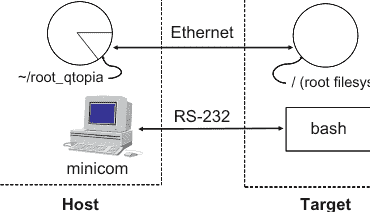

图 7.4

主机与目标机。

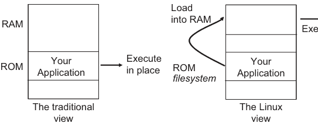

图 7.5

嵌入式编程的两种视图。

在 shell 窗口和目标板中启动 `minicom`。当启动完成后，在 minicom 窗口中执行 `ls home`。你将在工作机的 `~/root_qtopia/home` 中看到相同的文件和子目录。要执行 `led` 程序，请执行：

```
cd home/src/led
./led
```

该程序打印一条问候消息，然后顺序闪烁 LED。递进地，命令中的 `../` 符号表示当前目录。之所以这样做是因为当前目录不是用户路径的常态，这样做被认为存在安全风险。

请注意，Linux 改变了我们传统的嵌入式编程方式，如图 7.5 所示。嵌入式系统几乎总是由 RAM 和非易失性内存（形式为 ROM、PROM、EPROM 或 flash）组合组成。构建嵌入式系统的传统方法是创建一个程序的可执行镜像，其中包含静态链接的所有库函数，可能还有一个多任务内核。然后你将此镜像加载或“烧录”到一个或多个非易失性内存芯片中。当系统启动时，处理器开始直接从 ROM 执行此镜像。

### Linux 视图

在 Linux 视图中，程序是必须在执行前加载到内存中的“文件”。因此，我们创建了一个 ROM“文件系统”，包含系统运行所需的任何程序的文件镜像。这可能包括用于网络等功能的各种工具和守护进程。这些程序由启动初始化过程根据需要加载到 RAM 中，并在那里执行。

通常情况下，C 库并不静态链接到这些镜像文件，而是动态链接的，这样单份库副本就可以被给定时刻内存中的任何程序共享。

Linux 方法的优点之一是，我们不再局限于从 ROM 文件系统加载程序文件。正如刚刚演示的，我们可以轻松地为了测试目的通过网络加载程序。

## led 程序

让我们更仔细地观察 `led` 程序，以了解在 Linux 中如何从用户空间访问外围设备。使用 Eclipse 编辑器打开 `led.c`。你可能想在编辑器中运行行号。在标记侧边栏右键点击并选择 Line Numbers。

首先注意所有 `#include` 指令旁边的 `?` 符号。如果你将鼠标悬停在其中一个符号上，它会显示“Unresolved inclusion”（未解析的包含）。这意味着 Eclipse 找不到头文件。问题是包含路径没有正确设置。要修复这个问题：

1. 在 Project Explorer 中右键点击项目并选择 Properties。
2. 转到 `/C++ General -> Paths`。
3. 在 Includes 部分，点击 Add... 按钮。
4. 添加头文件所在的路径，例如 `/usr/local/4.3.2/arm-linux-gnueabf/include`。
5. 点击 Apply and Close。

`?` 符号将会消失。现在你可以编译并运行程序。

### 项目设置

6. 点击 OK。

`?` 符号将消失。注意这是一个项目级设置。似乎没有全局设置。正如我们稍后看到的，这是合理的。

在 `main()` 的第 36 行附近，`GPIO` 被声明为 `SC2410_GPIO` 类型。后者是一个结构体指针。我们将起始于 `0560000` 的 GPIO 部分映射到我们的进程上下文。对映射空间允许读写访问，并且它是共享的，这意味着其他进程也可以并发映射到该空间。

如果 `mmap()` 成功，它将返回一个代表物理空间的虚拟地址的指针。LED 连接到并行 I/O B (`GPB`)。在使用它之前，我们必须进行正确配置。

LED 是 `GPB` 的第 5–8 位，用十六进制表示为 `0x1E`。第 49 行的 `write_reg()` 函数将这些位配置为输出。查看 `<include/sc2410-regs.h>` 以了解此函数和 `GPIO_BIT()` 宏。第 50 行的 `set_reg()` 函数最初将位置为 1，这意味着 LED 是关闭的且为拉低。

另一个有程序是 `src/devmem/` 目录下的 `devmem.c`。它映射一个内存区域，然后你可以按位、字或长字的形式读写位置。查看一下。代码非常通俗易懂。

## Makefile

出于几个原因，值得查看项目的 makefile。在 Eclipse 编辑器中打开它（列表 7.1）。首先注意到的是 `CC` 的定义。对于无歧地命名 GNU 工具链有几种相关的约定。这里是包含以下内容的 3 部分约定：

```
<processor>-<operating system>-<tool>
```

进入 `/usr/local/4.3.2/bin`，你会发现整组此类 3 部分文件名，它们链接到如下的 5 部分文件名：

```
<processor>-<manufacturer>-<operating system>-<executable binary format>-<tool>
```

在本例中（事实证明是常见的情况），制造商字段被设置为“none”。我也见过一种包含 C 库版本的格式。

```makefile
#
#
# 用于 ARM/Linux 用户程序的 Makefile

SHELL = /bin/sh

CC = arm-linux-gcc

all: led

led: led.c
	$(CC) -I../include -g -o $@$

clean:
	rm -f *.o
	rm -f led
```

**列表 7.1**

Led 项目的 Makefile。

`arm-linux-g++` 和 `arm-linux-gcc` 并不是链接，而是调用相应的 5 部分文件名的脚本，并带有一个额外的参数，用于识别我们正在编译的 ARM 变体。

## 数据采集示例


现在我们已经可以访问 ARM9 处理器的外设空间，让我们来看一些稍微有趣的东西。`S3C2440` 集成了一个多通道 A/D 转换器。通常，它用于触摸工具，但为了测试目的，通道 0 连接到一个电位器上。我们将以此为基础编写一个简单的数据采集示例，该示例将贯穿本书的后续剩余章节。

良好的编程习惯要求与硬件无关的代码与实际操作 I/O 寄存器的代码之间保持分离。至少，硬件相关代码应该与纯应用代码处于不同的模块中。在 LED 示例中，我们我们在某种程度上“作弊”了，因为硬件相关代码被混合在单个文件的主程序中。在这一点上，这影响并不大，因为目标是说明硬件访问是如何工作的，而无需引入任何类型的应用程序。

在这个示例中，我们将对硬件相关代码和主程序算法做出明确的区分。在 `src/measure` 下创建一个名为 `measure` 的新 Eclipse C Makefile 项目。打开源文件 `measure.c`。首先注意到，我们再次在头文件旁边看到了那些烦人的 `""` 符号。但是与其

## 从用户空间访问硬件

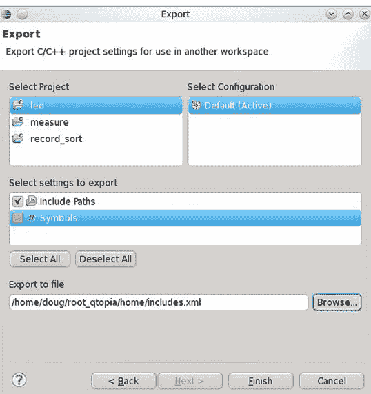

图 7.6

导出对话框。

与其费力地重新输入头文件的路径，这次我们将从 `led` 项目中导出一些项目设置，并将它们*导入*到 `measure` 中。

按照以下步骤操作：

- 在 Project Explorer（项目资源管理器）视图中选择 `led` 项目。右键点击并选择 Export...（导出...）。
- 在 Export 对话框中，展开 `C/C++` 并选择 `C/C++ Project Settings`。点击 Next（下一步）。
- 确保选中了 `led` 项目并取消勾选 # Symbols。
- 浏览到 `home/src/` 并输入名为 `includes` 的文件名。数据将保存为 XML 文件。
- [图 7.6](#) 显示了最后的导出对话框。点击 Finish（完成）。

接下来是将项目设置导入到 measure 项目的步骤：

- 在 Project Explorer 中右键点击 `measure` 项目项并选择 Import...（导入...）。
- 展开 `C/C++` 并选择 `C/C++ Project Settings`。点击 Next（下一步）。
- 浏览到 `home/src/` 并选择 `includes.xml`。点击 OK（确定）。
- 点击 Finish（完成）。
- 打开 measure 项目属性，并验证包含路径是否存在。

程序读取 A/D 值并将结果打印在 `stdout`（标准输出）上。它还读取板上的六个按按钮输入，并读取任何按下按钮的数值到 LED 上。程序接受一个命令行参数，即两次读取之间的秒数。默认值为二。

现在我可以对我的示例程序做一个观察了。在这些示例中，几乎没有错误检查或“合理性”检查。如果你输入了错误的内容，程序可能会崩溃。这在这个示例中不是什么大问题，但在后期需要大量输入的层级中可能会成为问题。

我觉得添加大量的错误检查代码会干扰示例想要传达的观点。如果你喜欢，可以添加一些错误检查逻辑。

回到程序中，重要的是，处理开关、LED 和 A/D 转换器的细节都隐藏在对应用程序的 API 之后。应用程序不需要关心外设的设置；只需调用相应的“init”函数。最后，它关闭外设设备。

`trdrive.c` 文件实现了设备驱动 API。命名为 `trdrive` 的原因将在第 8 章出现。有两个外设初始化函数：第 20 行的 `initAD()` 和第 54 行的 `initDigIO()`。注意必须先调用 `initDigIO()`，因为它打开了 `/dev/mem` 的文件描述符，`initAD()` 也需要它。

`initDigIO()` 将 `GPB` 设置为输出，并将 `GPG` 设置为输入。如果无法打开设备或映射 GPIO 空间，它返回 `-1`。

`initAD()` 同样简单。它映射了 ADC 寄存器空间并进行了一些初始化。

读取 A/D 转换器由第 37 行的通用 `readAD()` 处理。它将通道号写入 ADC 并启动转换。转换完成后，它读取并返回 10 位值。

数字输出封装在三个函数中：`setDigOut()`、`clearDigOut()` 和 `writeDigOut()`。这些函数专门适配244 的 LED。

## 使用 Eclipse 进行远程调试

在典型的桌面环境中，目标程序与调试器在同一台机器上运行。但在我们的嵌入环境中，带有 GDB 的 Eclipse 运行在工作站上，而被调试程序运行在 ARM 目标上。你可以认为如图8.1 所示，分为客户端和服务器。客户端是用户界面，服务器是与程序的实际交互。GDB 实现了一种串口协议，允许服务器和客户端通过 RS-32 线或以太网相互通信。

将目标连接到 gdb 串口协议有两种方法：

- `gdb stubs`。链接到目标程序的一组函数。`gdb stubs` 是仅限 RS-32 的解决方案。
- `gdbserver`。这是一个运行在目标上的独立程序，由它来运行被调试的程序。`gdbserver` 的优点是它与目标程序完全独立。换句话说，无论是否远程调试，目标构建都是相同的。`gdbserver` 的另一个优势是它可以通过以太网运行。最后，Eclipse 使用 `gdbserver`，所以这是使用它的最好理由。

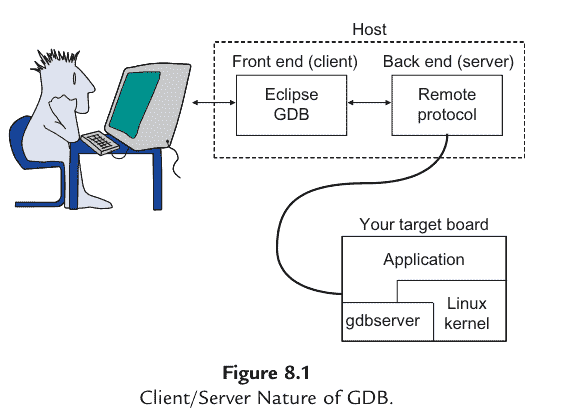

要在 GDB 中运行 `measure` 程序，你首先需要进入 `src/measure` 目录并执行：

```
gdbserver:10000 measure
```

`gdbserver` 的参数如下：

- 以冒号前跟的网络端口号。标准格式为 "`host:port`"，其中 "`host`" 是主机名或点分表示形式的 IP 地址，但 `gdbserver` 会忽略该主机名。只要不与正在使用的其他端口号冲突，端口号可以是任意的。通常，1024 以下的端口号留给已有的网络协议，如 HTTP（端口 80），因此最好选择 1023 以上的数字。端口号 10000 正好是 Eclipse 调试器的默认端口。
- 目标程序名称。
- 目标程序的参数（如果有的话）。

`gdbserver` 会返回类似下面的信息：

```
Process measure created; pid = 703
```

你的 `pid` 值可能会有所不同。这表示 `gdbserver` 已加载程序，并正在等待在指定的端口启动调试会话。

### 远程调试启动配置

我们需要一个用于远程调试的不同启动配置。在 Project Explorer（项目资源器）视图中选中 `measure` 项目，通过 Run（运行） > Debug Configurations...（调试配置...）打开对话框，或者点击可爱的小虫子图标旁边的箭头并选择 Debug Configurations.... 尽管有一个名为 C/C++ Remote Application 的类别，但我们将像之前处理 `record_sort` 那样，在 C/C++ Application 下创建此新配置。

1. 选中 C/C++ Application，点击 New（新建）按钮。这将弹出调试配置对话框，就像我们在第 6 章中所做一样，并填充名称和项目项。
2. 我们需要填写 C/C++ Application 条目，点击 Search Project....（搜索项目....）。这将弹出一个对话框，列出项目中找到的所有可执行文件。选择 `measure` 并点击 OK。
3. 对话框中心有一个名为 Build (if required) before launching 的启动前的条目。我建议选择 Disable auto build（禁用自动构建）。在之后的某些情况下，自动构建会尝试构建所有目标并失败。这种失败是无大碍的，但可能会让人心烦。
4. Main（主）选项卡底部有一个名为 Using GDB (DSF) Create Process Launcher 的条目，带有一个 Select other....（选择其他....）链接。点击该链接显示图 8.2 所示的对话框。

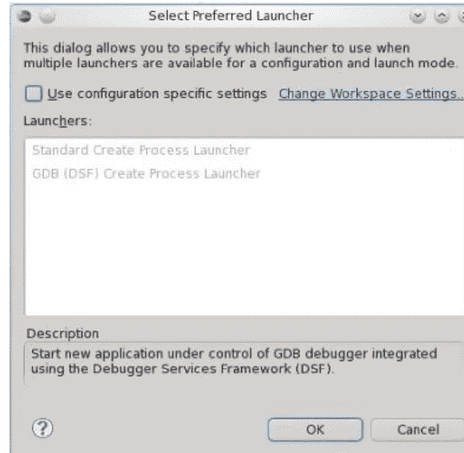

图 8.2

启动器偏好选择。

5. 勾选 Use configuration specific settings（使用特定配置设置）并选择 Standard Create Process Launcher。点击 OK。

问题在于调试会话是如何设置和控制的。DSF 代表 Debugger Services Framework（调试服务框架），提供了更无缝、集成的“体验”，我们将在该章节介绍。目前，我们将使用 Standard Process Launcher 提供的更简单的方法。

6. 现在选择 Debugger（调试）选项卡（图 8.3）。由于我们正在调试 ARM 代码，我们需要一个理解 ARM 代码的 GDB 版本。并且必须告诉它我们正在进行远程调试。
7. 在 Debugger 下拉菜单中，选择 `gdbserver`。


## 8. 确保勾选 Stop on startup at main（启动时在 main 停止）。

## 9. 在 GDB Debugger 字段输入 `arm-linux-gdb`。

## 10. 选择 Debugger Options（调试选项）下的 Connection（连接）选项卡（图 8.4）。对于 Type（类型）下拉菜单，选择 TCP。

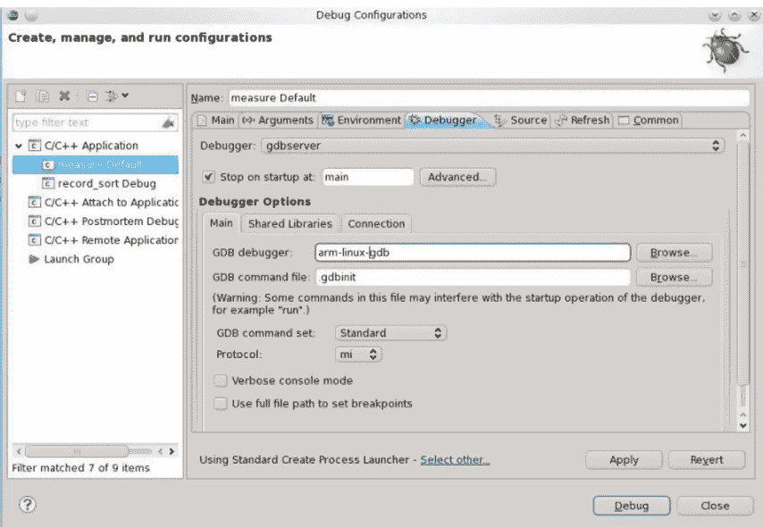

图 8.3

Debugger 选项卡。

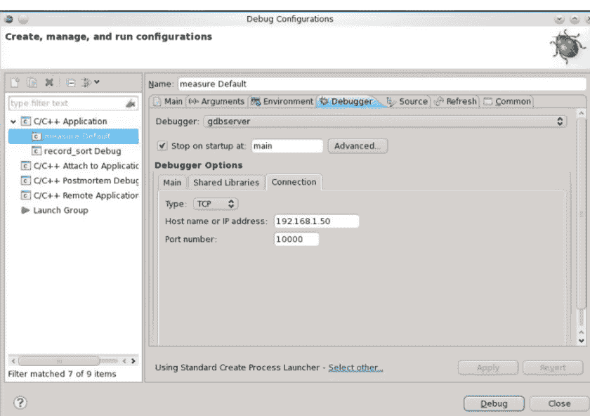

图 8.4

Connection 选项卡。

## 1. 为 Host name 输入 `192.168.1.50`¹。现在点击 **Apply**（应用）。

## 2. 如果 `gdbserver` 仍在目标板上等待，直接点击 **Debug**（调试）。否则，在点击 **Debug** 之前按照前面的说明启动 `gdbserver`。

Eclipse 会切换（如果你想切换）到 Debug（调试）视图。尽管你不是在目标板上调试，但一切看起来和在工作站上调试 `record_sort` 时几乎一样。

### 温度计

让我们转向一些更有趣且可能非常有用的东西。我们将通过将 `measure` 程序变成一个“温控器”来增强它。我们还将主机工作站作为初步测试环境。

> ¹“Host（主机）”在这里有点误导。它实际上指的是目标板。

我们将让温控器在温度高于给定设定点时激活“冷却器”，并在温度低于设定点时关闭冷却器。在实践中，真实的温控器包含滞后（hysteresis），防止冷却器在温度正好处于设定点时快速开关切换。这是以死带（deadband）的形式实现的，当温度升至设定点时冷却器开启，直到温度下降到设定点以下保持关闭。此外，程序还包含一个“报警”，当温度超过限制时会闪烁。

两个 LED 将分别作为冷却器和报警。温控器本身从根本上是一个具有三种状态的简单状态机：

- Normal
- High
- Limit

状态机只是一个巨大的 `switch()` 语句。对于每个状态，采取的操作如下：

- Normal：关闭冷却器，关闭报警
- High：开启冷却器，关闭报警
- Limit：关闭冷却器，开启报警

这些定义在 `measure` 目录下的 `driver.h` 中。

### 嵌入式软件调试

这是你进行实际编程的机会。首先，复制 `measure.c` 并命名为 `thermostat.c`。由于 `thermostat.c` 已经是文件 中的先决条件，你需要右键点击 Project Explorer 中的 `measure` 并选择 Refresh（刷新）。

在 `thermostat.c` 中实现状态机。将 `setpoint`、`limit` 和 `deadband` 声明为全局整数。我建议通过 `readAD()` 定义一个合理的值，以便调整。一个正负值的死带可能足够了。

### 主机工作站作为环境

尽管远程 GDB 为我们提供了观察目标机运行程序的良好窗口，但有很多理由说明在主机开发机上进行初始调试是有用的。首先，只要项目启动主机即可，这可能远早于目标硬件的可用或工作。在许多情况下，使用模拟器测试限制条件比使用真实硬件要容易。

当你分析大多数嵌入式系统的内容时，通常会发现大约 5%、可能是 10% 的代码直接处理硬件。代码的其他部分独立于硬件，因此只要代码结构合理，就不需要硬件即可测试。

想法是构建一个代表硬件 I/O 的简单模拟。你可以通过键盘提供刺激并观察屏幕输出来测试应用程序。在测试的后期，你可能想用一个基于文件的“脚本驱动”代替屏幕和键盘，以创建可重复的测试。

查看 `measure/` 目录下的 `simdrive.c`。该文件提供了与 `drive.c` 相同的 API，但使用共享内存与另一个进程通信，该进程在屏幕上显示输出并接受模拟输入。这些功能在 `devices.c` 中实现。

创建并初始化共享内存区域。在 `simdrive` 中，`initAD()` 连接到之前创建的共享内存区域。`readAD()` 简单返回当前的

# 120 第 8 章

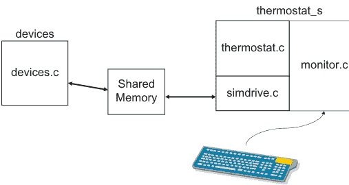

**图 8.5**

温控器仿真。

共享内存中的 `a2d` 字段。`setDigOut()` 和 `clearDigOut()` 函数会适当地地修改 `leds` 字段，然后通知设备进程更新屏幕显示。图 8.5 以图化形式展示了这一过程。

温控器仿真版本的可执行文件名为 `thermostat_s`（`_s` 代表仿真），它是项目 Makefile 中的默认目标。事实上，当你使用 Refresh（刷新）操作将 `thermostat.c` 导入 Eclipse 时，它本应该已经自动构建了。在编辑 `thermostat.c` 后再次构建，请选择 `Project`（项目）菜单和 `Build All`。

要构建设备程序，我们需要向项目添加另一个目标。在 `Project Explorer`（项目管理器）中右键点击 `measure`，选择 `Make targets -> Create`。`Target` 命名为“devices”，`Make Target` 为。继续构建 devices 目标。

在 shell 窗口中运行 `devices`。调试 `thermostat_s` 时，我们可以使用在第 6 章为 `record_sort` 项目创建的调试启动配置：

1. 调出 Debug Configurations（调试配置）对话框并选择 `record_sort` 项目的配置。
2. 将名称更改为“host”。
3. 将项目更改为“measure”，并选择 `thermostat_s` 作为应用程序。
4. 点击 `Apply`（应用），然后点击 `Debug`（调试），进入 Debug（调试）视图，此时程序将停在 `main()` 的第一行可执行代码。

### 高级断点功能

`thermostat_s` 程序为我们提供了探索断点高级功能的机会。在你的状态机的 `switch()` 语句顶部设置一个断点。现在转到 Debug 视图右上角的 Breakpoints（断点）视图并右键点击

# 调试嵌入式软件 121

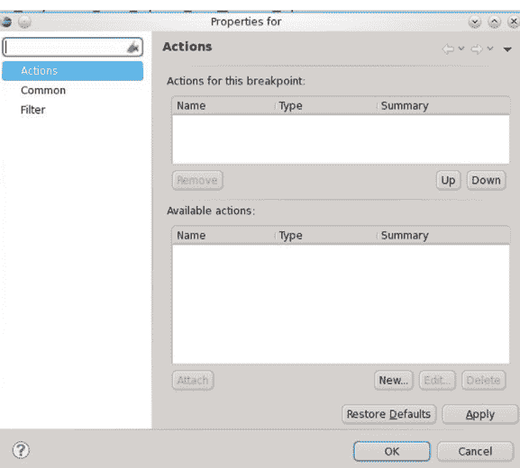

图 8.6

断点属性。

你刚刚创建的断点。选择上下文菜单底部的 Breakpoint Properties（断点属性）。这将打开图 8.6 所示的看起来相当空白的对话框。

断点可以关联某些操作，当断点被命中时，会执行关联的操作。CDT 提供了四类预定义操作：

- **Play Sound（播放声音）**——当命中断点时选择一个声音文件。也许断点每半小时才发生一次。当你听到相应的提示声时，你可以去做些其他事情，回来查看发生了什么。声音文件格式为 `.wav`, `.mid`, `.au` 或 `.aiff`。
- **Log Message（日志消息）**——向控制台输出消息。要查看消息，你必须在 Console（控制台）视图中选择 Log Action Messages（操作消息）。
- **Run External Tool（运行外部工具）**——执行在 Eclipse 中配置为外部工具的程序。例如，程序可能运行在远程设备上。你可以配置断点向你的桌面发送电子邮件或短信。可以通过 `Run > External Tools > External Tools Configurations...` 来安装和配置程序。
- **Resume（恢复）**——在指定的延迟后自动恢复程序。同样，如果程序在远程运行，这可能是断点触发后保持其运行的唯一方法。

# 122 第 8 章

让我们创建一个声音操作。在 Fedora 4 KDE 中，大多数声音文件（如 `.wav`）位于 `/usr/share/` 的子文件夹中。一些在 `sounds/alsa/` 中。许多其他的在以下 sounds 文件夹的 `kde4/apps/` 下：

| bounce | cmousetool |
| :--- | :--- |
| knnetwork | kolf |
| korganizer | kreversi |

还有许多来自 `/usr/lib/openoffice.org/basis3/share/gallery/sounds/` 的文件。以下是我们的操作方法：

- 在 Actions（操作）对话框中，点击 New（新建）。默认选中了 Sound Action（声音操作）。
- 给它起一个名字。叫 "beep?" 怎么样？
- 浏览到包含 `.wav` 文件的文件夹之一，并选择一个。要听听声音效果，点击 Play Sound。
- 点击 OK。

Beep 操作现在出现在可用操作列表中。以类似的方式，创建一个日志操作。让它打印消息“Hit the breakpoint at the switch statement”。


选择 `Available actions` 列表中的每一项并选择 `Attach`（附加）。它们都会出现在此断点的 `Actions` 列表中。让程序运行。当它命中断点时，你应该能听到声音。在 `Console` 视图中，找到 `Console` 菜单右侧的 `Display Console` 下拉菜单。选择 `Log Action Messages`。要返回程序输出，选择 `[C++ Application] thermostat_`。

再次调出 `Breakpoint Properties` 对话框。选择左列中的 `Common`（通用）以显示图 8.7 所示的对话框。这列出了关于断点的一些基本信息，如其所在的文件和行号以及它的启用状态。它还为我们提供了几种控制断点的方法。

`Condition`（条件）允许我们指定一个布尔表达式来控制是否命中断点。如果表达式求值为真，则命中断点。否则，它会被忽略。表达式可以包含任何程序变量。例如，我们真的感兴趣在预期状态改变时 `switch()` 语句上的断点。在循环的每次通过时都触发断点是枯燥且低效的。因此，我们可以输入条件：

```
value>
```

然后当命中断点时，我们可以在 `Variables`（变量）视图中看到变量的值。当我们调试一个仅在特定条件下失败的程序时，这非常有用。

# 调试嵌入式软件

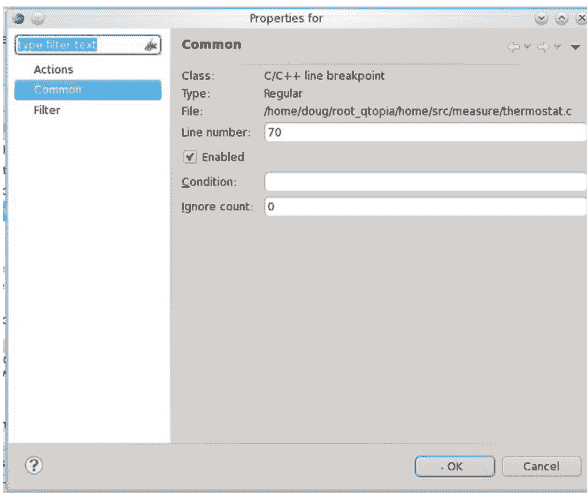

图 8.7

通用。

`SSH` 是一种用于安全数据通信、远程 shell 服务、命令执行以及通过不安全网络上的安全通道在联网计算机之间提供服务的协议。它是 `Telnet` 以及其他安全远程 shell 协议（如 Berkeley `rsh` 和 `rex` 协议）的替代品，这些协议以明文发送信息（特别是密码），容易被数据包分析拦截和泄露。`SSH` 使用的加密旨在为不安全的网络提供机密性和完整性。

目前有很多 `SSH` 的实现，许多是私有的。还有一个开源版本，称为 `OpenSSH`（这可能令人惊讶）。我们使用的就是它。

在你的目标板上安装 `SSH` 相对来说，因为有人已经为 `Mini2440` 完成了所有工作并将结果发布在 Google 页面上。见 `Resources`（资源）部分的 URL。从顶级组页面进入 `Source`（源码）并 `Browse`（浏览）。你会看到五个文件、一个 `README`、一个脚本和三个压缩 `tar` 包。`SSH` 构建在另外两个包之上的——安全套接层 `SSL` 和 `zlib`，一个加密库。下载所有文件到你的工作站以便方便操作。

查看 `README.txt` 文件。它概述了三个主要步骤：运行脚本构建包、将文件复制到目标文件系统的相应位置，以及运行 `SSH` 守护进程以验证其运行正常。第一步是运行 `build.sh`。对我来说，我不完全清楚为什么要显式地运行 `sh` 而不是直接执行 `./build.sh`。`sh` 的帮助页暗示它是调用 `bash` 的替代方案，并写道：“通过 `sh` 的名称调用 `bash`，它尝试尽可能地模拟历史版本 `sh` 的启动行为，同时符合 POSIX 标准。”作为一个实验，我执行了 `./build.sh`，它似乎构建正确，所以这个选择取决于你。

`make` 步骤实际上是使用 `configure` 脚本创建的文件作为“配方”来构建包。`make` 的输出是当前目录或其子目录下的一组文件、库或可执行文件。这些文件通常需要移动到其他位置才能生效。这就是 `make install` 命令的作用。在许多情况下，`make` 必须以 root 用户身份运行，因为它引用的目录具有特殊权限。

然而，你需要 root 权限来执行 `README.txt` 中的其余步骤，因为目标文件系统很大程度上归 root 所有。`README.txt` 的步骤 2 是 `make install` 过程的延续，但不能合并到 `Makefile` 或脚本中，因为作者不知道你目标文件系统的位置。你被指示将几个文件复制到 `usr/lib`。结果发现该目录在你的目标文件系统中不存在，所以你必须创建它。另一方面，`usr/local/etc` 也存在，所以你不需要创建它。

`var/` 目录很有意思。用编辑器打开 `root_topia/etc/init.d/rcS`。这是 Linux 在目标机上启动时执行的脚本。对于我们的目的来说，有趣的部分从第 30 行左右的 `/bin/mount -n ramfs none /var` 开始。这表示在 `/var/` 处挂载了一个 RAM 文件系统。`/var` 代表经常变化的“变量”数据，例如日志文件。如果我们的根文件系统挂载在 NAND 闪存上，将 `/var` 目录作为其中的一部分，会导致内存芯片产生不必要的损坏，并由于向闪存写入日志文件导致性能下降。因此，`/var` 目录挂载位于 RAM 中的文件系统上。此外，这意味着 `/var` 的内容在重启后不会保留。

这就是 `README.txt` 指你在 `/var/` 下创建几个目录的原因。`/var/run` 和 `/var/empty` 已经存在，因为它们是由 `rc` 脚本创建的。你需要做的是在 `rc` 中添加 `mkdir -p /var/log/empty/ssh` 这一行。你还可以在 `rc` 中添加 `/usr/sbin/ssh` 这一行，以便 `SSH` 守护进程在启动时运行。重启目标机并验证 `ssh` 正在运行。

## 为 Root 添加密码

当 `SSH` 连接到远程系统时，它强制要求你输入密码，而登录并不需要密码，我们目标板上的 root 用户就是这种情况。你通过 `passwd` 工具执行此操作。在目标板上执行 `passwd`。它响应为：

> Changing password for root

New password:

然后它将提示你验证密码。现在，每当你启动开发板时，都必须输入密码。

## 配置 RSE

启动 `Eclipse` 并打开 `RSE` 视图。你会发现左侧的 `Project Explorer` 视图被标记为 `Remote Systems` 的视图取代了，Editor 下方的视图集合被替换为名为 `Remote System Details` 的内容。目前 `Remote Systems` 中列出的唯一项是 `Local`，即你的工作站。展开该项显示 `Local Files` 和 `Local Shells`。展开 `Local Files` 以浏览文件系统（图 8.8）。

右键点击 `Local Shells` 并选择 `Launch Shell`。这会在下方的标签窗口中弹出一个 `Remote Shell` 视图。命令显示较大的窗口中。图 8.9 显示了从我的系统主目录执行 `ls root_topia` 的最后几行。我发现这个 shell 的呈现有些笨拙且难以使用。一旦设置好，远程端有一种更实用的 shell 格式可用。

不用说，在未将其连接到远程系统（特别是 `Mini2440` 目标板）之前，`RSE` 并不很有趣。在 `Remote Systems` 视图中，点击左上角的连接图标

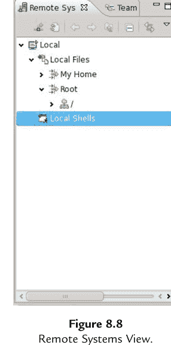

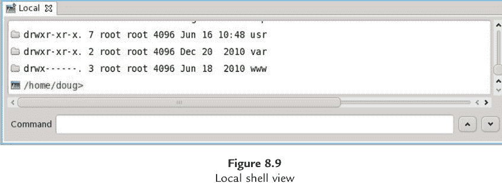

或右键点击 `Local` 并选择 `New -> Connection`。第一步是选择 `Remote System Type`。在我们情况下，它将是 `SSH Only`。

你可能会问为什么不用 `Linux` 类型。它使用另一种 `RSE` 特有的通信协议 `dstore`，它具有更多功能，但在服务器上需要更多资源；`dstore` 实际上是基于 Java 的，因此它需要在服务器 上运行 Java 运行时环境 `JRE`。

在点击 `Next` 弹出 8.10 中的对话框之前，确保你的目标板已上电进入 Linux。主机名默认为 `LOCAL`。将其更改为目标板的 IP 地址。同样，描述 `Description` 可以是任何你想要的，例如“`Mini2440`”。点击 `Next` 显示远程机器上可用的文件。再次，不需要任何更改。再次点击 `Next` 显示可用的 shell。同样，不需要更改。再点击一次 `Next` 显示可用的服务。点击 `Finish`，新连接出现在 `Remote Systems` 视图中。展开新连接显示与我们在 `Local` 中看到的类似的条目。当你展开 `Sftp` 下的 `My Home` 或 `Root` 时，你需要输入一个有效的用户 ID `root`

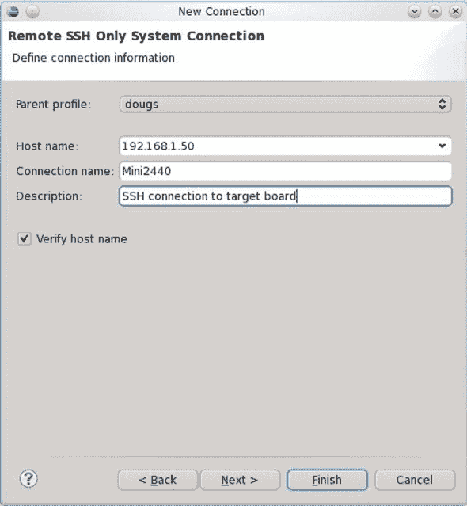

图 8.10 设置 SSH 连接

输入远程系统的密码，这有效地让你登录了该系统。现在你可以使用 `copy` 和 `paste` 命令在本地主机和远程系统之间移动文件。你可以通过双击在 `Eclipse` 编辑器中打开远程文件。

即使在目标文件系统通过 `NFS` 从工作站挂载的目前情况下，这也不特别有用。我们从工作站直接访问文件系统。如果目标机确实是一台远程计算机，那么它将非常有用。


注意 `Mini2440` 连接下的 `SSH Terminals` 条目。右键点击它并选择 `Launch Terminal`。这将弹出一个如图 8.11 所示的另一种远程 shell。这种形式看起来更像我们一直通过 `minicom` 使用的 shell，我个人觉得它比本地连接提供的所谓 shell 更容易用。顺便说一下，从现在起我们可以放弃与 Linux 通信的 `minicom` 和串口。我们还需要串口的唯一原因是与 `u-boot` 加载器通信。但对于我们的目的来说，RSE 的真正价值在于调试。

## 使用 RSE 调试

我们现在可以使用指向目标的 SSH 连接设置调试配置。打开 `Debug Configurations` 对话框，选择 `C/C++ + Remote Application`，并点击新建启动配置图标。这将弹出 8.12 中的对话框，显示了最终值。`Main` 选项卡的顶部部分与之前看到的相似，选择 Application 和 Project。同样，最好选择 `Disable auto build`。

在 `Connection` 下拉列表中选择你创建的连接。我们必须告诉 GDB 在远程目标查找执行文件。在大多数情况下，RSE 需要“下载”执行文件以便在远程机器上进行执行和调试。在我们的案例中，执行文件已在 NFS 挂载的文件系统中可见，因此你可以在底部选择 `Skip download to target path`。

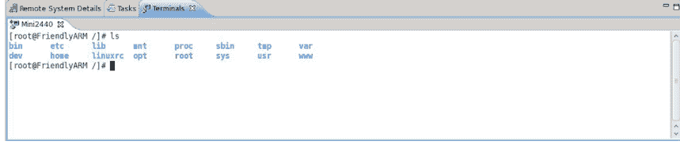

图 8.11 Ssh Terminal View。

### 130 第 8 章

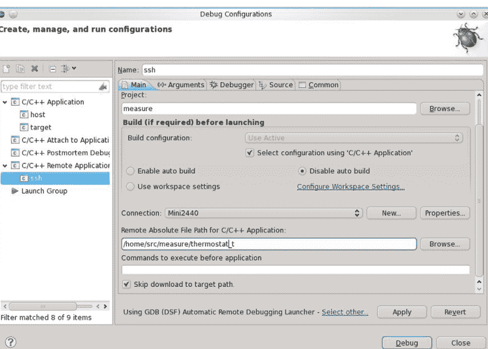

图 8.12

远程调试配置。

主选项卡。如果你选择让 RSE 下载可执行文件，不要使用当前位置，因为它会覆盖自身并导致失败。尝试使用 `/home/src`。

点击 **Apply**（应用）然后点击 **Debug**（调试）。等待片刻后，将出现调试视图，准备好在目标板上调试 `thermostat_t`。调试过程与之前相同，但现在程序输出显示在 Eclipse 控制台视图中。

在下一章中，我们将介绍多线程编程作为“重量级”Linux 进程模型的替代方案。

## 资源

- http://code.google.com/p/openssh4mini2440/—在这里你可以找到适用于 Mini2440 的 OpenSSH。

- openssh.org—了解更多关于安全外壳（Secure Shell），特别是开源版本。

- openssl.org—了解更多关于安全套接层（Secure Sockets Layer）。

# Posix 线程

如果你的时间没有价值，Linux 才是免费的。

Jamie Zawinski

我们在上一章中开发的恒温器对于运行参数来说并不实用，因为设定点、限制和死带被硬编码在程序中。任何实用的恒温器都会让这些参数对用户可调。在这种情况下，我们可能会发明一种简单的命令协议，通过控制台更改参数。

我们如何实现这样的过程呢？在旧 DOS 时代，我们可能使用函数 `kbhit()` 来轮询键盘活动。但 Linux 是一个多任务系统。轮询是不雅的。我们需要一个独立的执行线程来等待控制台上的行文本，解析该行并执行。

我们可以使用 `fork()` 来创建一个新进程。列表 9.1 用伪代码说明了一种可能的实现方法。首先创建一个共享内存空间，然后通过 `fork` 创建一个新的子进程。子进程监控 `stdin`，并将任何有效命令的结果发布到共享内存区域中的相应条目。父进程就是我们已经过的 `thermostat` 程序。

但可能存在更高效的实现方法。记得第 3 章提到的，Linux 进程可以有多个执行线程，所有这些线程都共享进程的内存空间。那么，创建一个停留在 `stdin` 上等待命令的线程如何？具体来说，在本章中，我们将探索 Posix 线程。

Posix 也称为 POSIX，是一个缩写，意为“可移植操作系统接口”（Portable Operating System Interface），并顺便加了一个 X。POSIX 代表了一系列标准，定义了基于 UNIX 的可移植操作系统的各个方面。这些标准由电气与电子工程师学会（IEEE）和国际标准标准化组织（ISO）共同维护。在 IEEE 和 Open Group 的合作努力下，各种文档被整合为一个单一标准（参见资源部分）。

总的来说，Linux 符合 Posix。命令、壳（shell）和系统接口多年来都已升级，以满足 Posix 要求。但在多线程的背景下，我们在这里特别感兴趣名为 1003.1c 的 Posix 线程接口。

```c
#include <unistd.h>
#include "measure.h"

int running = 1;
params_t *p; //指向共享内存的指针

int main (int argc, void **argp) {
    create shared memory space;
    switch(fork()) {
        case -1:
            printf("fork failed\n");
            break;
        case 0: // 子进程
            attach to shared memory space;
            while (running) {
                fgets();
                parse command;
                putresultin shared memory;
            }
            break;
        default: // 父进程
            attach to shared memory space;
            while (running) {
                read A/D;
                act on current state;
            }
            break;
    }
    exit (0);
}
```

列表 9.1

恒温器的 Fork 实现。

声明 Pthreads API 原型的头文件是 `pthread.h`，位于头文件的常用目录 `/usr/include`，或者在我们的交叉工具链中，位于 `/usr/local/arm/4.3.2/arm-none-linux/gnueabi/libc/usr/include`。

## 线程

RTOS 通常线程称为任务（tasks）。它们几乎是一回事。它是封装在函数中的一个独立执行线程。线程有自己的栈，称为上下文（context）。

```c
int pthread_create(pthread_t *thread, pthread_attr_t *attr, void
             void (* start_routine)(void *),void *arg);
void pthread_exit(void *retval);
int pthread_join(pthread_t thread, void **thread_return);
pthread_t pthread_self(void);
int sched_yield(void);
```

通过调用 `pthread_create()` 并传入以下参数创建线程：

- `pthread_t`—一个表示或标识线程的线程对象。`pthread_create()` 会根据需要对其初始化。

- 指向线程属性对象的指针。它是 `NULL`。更多信息见后文。

- 指向启动例程（start routine）的指针。启动例程接收一个 `void` 类型的指针参数并返回一个 `void` 类型的指针。

- 当启动例程被调用时传递给它的参数。

线程可以通过调用 `pthread_exit()` 或简单地从其启动函数返回来终止。传递给 `pthread_exit()` 的参数是函数的返回值。

正如父进程可以通过 `waitpid()` 等待子进程完成，线程可以通过 `pthread_join()` 等待另一个线程。`pthread_join()` 的参数是要待等待的线程对象以及存储线程返回值的地方。线程之间没有像进程那样的父子关系，因此线程可以加入任何线程。线程可以通过 `pthread_self()` 确定自己的 ID。最后，线程可以通过调用 `sched_yield()` 主动让处理器。


注意大多数函数返回 `int` 值。这反映了 Pthreads 处理错误的方式。与全局变量 `errno` 不同，Pthreads 通过返回值报告错误。附录 B 提供了 Pthreads API 的完整描述，包括所有错误码。POSIX 通过使用属性对象提供了扩展 API 的开放机制。每种类型的线程都有对应的属性对象。一个重要的哲学观点是所有的 Pthreads 对象被视为不透明（opaque）。我们很快会看到例外。这意味着你不直接访问对象。所有访问都通过函数。这允许通过定义一对 get 和 set 函数向对象添加新属性。

线程对象的唯一属性是“分离状态”。它决定了线程终止时是否可以连接。默认状态是 `PTHREAD_CREATE_JOINABLE`（可连接），另一种是 `PTHREAD_CREATE_DETACHED`（分离的）。在使用属性对象之前，必须对其进行初始化。然后可以通过相应的函数对定义的任何属性进行设置或检索。这必须在调用 `thread_create()` 使用属性对象之前完成。注意，一个属性对象可以用于多个线程的创建。如果有需要，属性对象也可以被销毁。

```c
int pthread_attr_init(pthread_attr_t *attr);
int pthread_attr_destroy(pthread_attr_t *attr);
int pthread_attr_getdetachstate(pthread_attr_t *attr, int detachstate);
int pthread_attr_setdetachstate(pthread_attr_t *attr, int detachstate);
调度策略属性
int pthread_attr_setschedparam(const pthread_attr_t *attr, const sched_param *param);
int pthread_attr_getschedparam(const pthread_attr_t *attr, const sched_param *param);
int pthread_attr_setschedpolicy(pthread_attr_t *attr, int policy);
int pthread_attr_getschedpolicy(const pthread_attr_t *attr, int *policy);
int pthread_attr_setinherit(const pthread_attr_t *attr, int inherit);
int pthread_attr_getinherited(const pthread_attr_t *attr, int *inherit);
```

如果此参数为 `NULL`，创建函数将使用默认值。还有一些可选的调度策略属性。

# 同步——互斥锁

一旦我们引入了第二个执行线程，就创造了资源冲突的可能。考虑这个有些为刻意的例子，两个线程每个都想在单个共享打印机上打印消息“I Thread n”，所示如下

图 9.1。在没有任何种同步机制的情况下，结果可能是某种“任务冲突”。

我们需要某种方法来调节对打印机的访问，以确保一次只有一个任务可以使用它。

互斥锁（mutex，“mutual exclusion”的缩写）像一把钥匙，用于控制对资源的访问。只有持有钥匙的线程才能使用该资源。为了使用该资源（在这种情况下是打印机），线程必须首先调用适当的内核服务来获取钥匙（mutex）（图 9.2）。如果钥匙可用（即资源打印机当前未被他人占用），则允许线程继续执行。在使用完打印机后，线程会释放互斥锁，以便其他线程可以使用它。

然而，如果打印机正在使用中，该线程将被阻塞，直到当前持有互斥锁的线程释放它。在互斥锁在使用期间，任何数量的线程都可能尝试获取它。

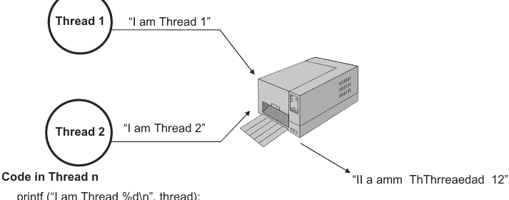

```
Code in Thread n
printf("I am Thread %d\n", thread);
```

图 9.1

资源冲突。

```
Code in Thread n
acquireMutex(PrinterMutex)
printf("I am Thread %d\n", thread);
releaseMutex(PrinterMutex);
```

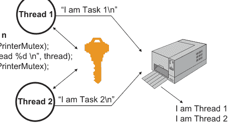

图 9.2

使用互斥锁解决资源冲突。

所有线程都将被阻塞。等待线程按照优先级顺序或调用 `pthread_mutex_lock()` 的顺序进入队列。线程在互斥锁处的排队方式可能是内核内置的，也可以是创建互斥锁时的配置选项。

```
pthread_mutex_t mutex = PTHREAD_MUTEX_INITIALIZER;

int pthread_mutex_init(pthread_mutex_t *mutex, const pthread_attr_t *mutex_attr);
int pthread_mutex_destroy(pthread_mutex_t *mutex);

int pthread_mutex_lock(pthread_mutex_t *mutex);
int pthread_mutex_unlock(pthread_mutex_t *mutex);
int pthread_mutex_trylock(pthread_mutex_t *mutex);
```

Pthreads 互斥锁 API 遵循与线程 API 相同的基本模式。有一对函数用于初始化和销毁互斥锁对象，一组函数用于操作互斥锁。列表还显示了初始化静态分配互斥锁对象的另一种方法。`PTHREAD_MUTEX_INITIALIZER` 提供了与 `pthread_mutex_init()` 相同的默认值。

在互斥锁上可以执行两种操作：加锁（lock）和解锁（unlock）。如果互斥锁不可用，加锁操作会导致调用线程阻塞。还有另一个函数 `trylock`，它允许你在不阻塞的情况下测试互斥锁的状态。如果互斥锁可用，`trylock` 返回成功并锁定互斥锁；如果互斥锁不可用，它返回 `EBUSY`。

## 互斥锁属性 (Mutex Attributes)

互斥锁属性遵循与线程相同的相同的模式。有一对函数用于创建和销毁互斥锁对象。我们将稍后再讨论共享属性。很快我们还会涉及其他一些属性。

互斥锁属性“类型”（type）最初实际上是 Linux 对 Threads 的非可移植扩展。Pthreads 标准明确允许非可移植扩展。唯一的要求是，任何非可移植的符号其名称后都必须附加 `_np`。

互斥锁类型随后被纳入标准中。

```
int pthread_mutexattr_init(pthread_mutexattr_t *attr);
int pthread_mutexattr_destroy(pthread_mutexattr_t *attr);

int pthread_mutexattr_gettype(pthread_mutexattr_t *attr, int *type);
int pthread_mutexattr_settype(pthread_mutexattr_t *attr, int type);
```

## Posix Threads 137

```
int pthread_mutexattr_gettype (pthread_mutexattr_t *attr, int *type);

type = PTHREAD_MUTEX_NORMAL
PTHREAD_MUTEX_ERRORCHECK
PTHREAD_MUTEX_RECURSIVE
PTHREAD_MUTEX_DEFAULT

int pthread_mutexattr_getpriorityceiling (const pthread_mutexattr_t *attr, int *protoceiling);
int pthread_mutexattr_setpriorityceiling (const pthread_mutexattr_t *attr, int *protoceiling);
int pthread_mutexattr_getprotocol (const pthread_mutexattr_t *attr, int *protocol);
int pthread_mutexattr_setprotocol (const pthread_mutexattr_t *attr, int *protocol);

protocol = PTHREAD_PRI_NONE
PTHREAD_PRI_INHERIT
PTHREAD_PRI_PROTECT
```

如果一个线程尝试锁定它已经锁定的互斥锁怎么办？

通常情况下，线程会直接挂起。“类型”属性改变了线程尝试锁定其已持有的互斥锁时互斥锁的行为。type 的可能值有：

- 如果线程尝试锁定它已持有的互斥锁，它会被阻塞，从而实质上导致了死锁。普通互斥锁（normal mutex）没有一致性或合理性检查。


## 错误检查（Error checking）
如果线程尝试递归锁定互斥锁，加锁函数将立即返回错误代码 `EDEADLK`。此外，如果解锁函数是由当前互斥锁所有者以外的线程调用的，它将返回错误。

## 递归（Recursive）
递归互斥锁允许线程成功多次锁定互斥锁。它记录互斥锁被锁定的次数，并要求调用相同次数的解锁函数后，互斥锁才能进入解锁状态。这种类型还会检查互斥锁是由锁定它的线程解锁的。

## 默认（Default）
标准规定，如果尝试递归锁定，结果是“未定义行为”。它还说实现可能会默认采用其他类型之一。

此外，Pthreads 互斥锁可以实现优先级继承或优先级顶值协议以避免优先级反转。互斥锁属性协议可以设置为“无”、“优先级继承”或“优先级顶值”。`priorityceiling` 属性设置优先级顶值的值。

# 解决资源共享问题的问题——优先级反转 (Priority Inversion)

使用互斥锁解决资源冲突可能会导致微妙的性能问题。考虑图 9.3 所示的场景。线程 1 和 2 都需要访问一个

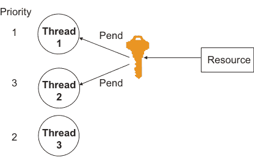

图 9.3 优先级反转。

| 资源 | 线程 2 | 线程 1 |
| :--- | :--- | :--- |
| 线程 1 (优先级 1) | 等待 (Pend) | |
| 线程 2 (优先级 3) | | 发布 (Post) |
| 线程 3 (优先级 2) | | 阻塞 (Block) |

图 9.4 优先级反转执行时间线。由互斥锁保护公共资源。线程 1 优先级最高，线程 2 优先级最低。发生了一个中断使得线程 1 就绪。由于资源空闲，线程 2 获取了它。

等一下，到为止一切都符合预期。尽管线程 1 的优先级更高，它也必须等待线程 2 完成。如果当线程 2 锁定资源时，线程 3 变得就绪，问题就出现了。线程 3 抢占了线程 2。这种情况被称为优先级反转，因为一个低优先级线程（线程 3）实质上阻止了高优先级线程（线程 1）的执行。

## Posix Threads 139

该问题的常见解决方法是在线程 1 在互斥锁上等待时，临时将线程 2 的优先级提高到与其相同的水平。现在，线程 2 不会被任何优先级低于线程 1 的任务抢占。这被称为优先级继承。

另一种方法称为优先级顶值（priority ceiling），它将线程 2 的优先级提高到高于任何可能在互斥锁上等待的任务的数值。这被认为更有效，因为它消除了不必要的切换。需要资源的线程可以抢占持有它的线程。

# 通信——条件变量 (Condition Variables)

在许多情况下，一个线程需要通知另一个线程受互斥锁保护的共享资源的状态发生了。考虑图 9.5 所示的情况，两个线程共享一个队列。线程 1 读取队列，线程 2 写入队列。显然，每个线程都需要对队列进行排他访问，因此我们使用互斥锁保护它。

线程 1 将锁定互斥锁查看队列是否有数据。如果有，线程 1 读取数据并解锁互斥锁。然而，如果队列为空，线程 1 需要在某处阻塞直到线程 2 写入数据。线程 1 必须在阻塞之前解锁互斥锁，否则线程 2 将无法写入。但在线程 1 解锁互斥锁和阻塞之间存在间隔。在此期间，线程 2 可能会执行且发现无人在队列上阻塞。

条件变量通过在锁定互斥锁时等待（阻塞）来解决这个问题。在内部，条件等待函数会解锁互斥锁允许线程 2 继续执行。当条件等待返回时，互斥锁是锁定的。

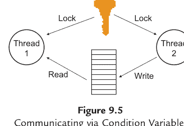

# 140 第 9 章

```
pthread_cond_t cond = PTHREAD_COND_INITIALIZER;

int pthread_cond_init(pthread_cond_t *cond, const pthread_condattr_t *cond_attr);
int pthread_cond_destroy(pthread_cond_t *cond);

int pthread_cond_wait(pthread_cond_t *cond, pthread_mutex_t *mutex);
int pthread_cond_timedwait(pthread_cond_t *cond, pthread_mutex_t *mutex, struct timespec *abstime);
int pthread_cond_signal(pthread_cond_t *cond);
int pthread_cond_broadcast(pthread_cond_t *cond);
```

条件变量的基本操作是信号（signal）和等待（wait）。信号会唤醒一个正在该条件上等待的线程。线程唤醒的顺序取决于调度策略。线程还可以执行定时等待（timed wait），如果在指定的条件下在条件信号发出之前过期，则等待将返回错误。线程可以对条件进行广播（broadcast），这将唤醒所有在句条件上等待的线程。

# 条件变量属性

Pthreads 没有为条件变量定义任何强制性属性，尽管至少有一个可选属性。

# 线程终止与取消

线程可以自愿地或非自愿地终止。线程可以通过简单的返回或调用 `pthread_exit()` 来终止。在后一种情况下，在终止之前，会调用该线程通过 `pthread_cleanup_push()` 注册的所有清理处理程序（cleanup handlers）。

大多数线程在无限循环中运行。只要系统通电，线程就会运行并执行着它的任务。有些线程启动后，完成工作，然后结束。在某些情况下，允许一个线程非自愿地终止另一个线程是有用的。也许用户按了 CANCEL（取消）按钮来停止长时间的搜索操作。也许该线程是冗余数值算法的一部分，由于另一个线程已经解决了问题，它不再被需要。Pthreads 取消机制为不再需要的线程提供了有序关闭机制。

但取消必须谨慎进行。你不能在线程执行的任何一点任意停止它。假设它持有一个锁定的互斥锁（mutex）。如果你终止了一个持有锁定的互斥锁的线程，该锁将永远无法释放。该线程可能分配了一个或多个动态内存块。如果线程终止了，内存如何返回呢？

Pthreads 允许每个线程管理自己的终止，以便线程在实际终止之前可以释放和/或返回任何全局资源。因此，当你取消一个线程时，你通常不是立即停止它，而是要求它在安全或方便时自行终止。

| 模式 | 状态 | 类型 | 含义 |
| --- | --- | --- | --- |
| 关闭 (Off) | 禁用 (Disabled) | 无 | 取消保持挂起状态，直到被启用 |
| 延迟 (Deferred) | 启用 (Enabled) | 延迟 | 取消在下一个取消点发生 |
| 异步 (Asynchronous) | 启用 (Enabled) | 异步 | 取消可能在任何发生 |

图 9.6

取消模式。

Pthreads 支持三种取消模式（图 9.6），编码为两个位，称为取消状态（state）和取消类型（type）。如果线程正在执行执行必须完成的操作，它可以选择禁用取消。默认模式是延迟（Deferred），这意味着取消只能在特定的点发生，这些称为取消点，在这些点上，程序会测试线程是否已请求终止。大多数可以无限期阻塞的函数（例如等待条件变量或写入文件）都应该是取消点，并在 Posix 规范中被定义为此。

虽然异步取消模式看起来可能是个好主意，但它很少是安全的。这是因为，根据定义，你不知道线程在收到取消请求时处于什么种状态。它可能刚刚调用了 `pthread_mutex_lock()`。互斥锁锁定了吗？不知道。因此，当异步模式起作用时，你无法安全地获取共享资源。

```
int pthread_cancel(pthread_t thread);
int pthread_setcancelstate(int state, int *oldstate);
int pthread_setcanceltype(int type, int *oldtype);
void pthread_testcancel(void);
```

线程可以通过调用 `pthread_cancel()` 取消另一个线程，`pthread_setcancelstate()` 和 `pthread_setcanceltype()` 允许线程设置其取消模式。注意，这些函数分别返回状态和类型之前的值。`pthread_testcancel` 函数允许你创建自己的取消点。如果线程没有被请求终止，则它将立即返回。否则，它将不返回。

# 清理处理程序 (Cleanup Handlers)

当线程被请求终止时，在线程安全终止之前可能有一些需要被“清理”的内容。例如，它可能需要解锁互斥锁或返回动态分配的缓冲区。这就是清理处理程序的作用。每个线程在概念上都有一个活动清理处理程序的堆栈。处理程序通过 `pthread_cleanup_push()` 推入堆栈，并在当线程被取消或调用 `pthread_exit()` 时按反序执行。清理处理程序接受一个 `void` 类型参数。


```c
void pthread_cleanup_push(void (*routine)(void *), void *arg);
void pthread_cleanup_pop(int execute);
```

当清理处理程序不再被需要时，可以使用 `pthread_cleanup_pop()` 从堆栈中弹出最近推入的清理处理程序。无论线程是否终止，清理处理程序的功能都是需要的。`execute` 参数指定了在弹出处理程序时是否执行该程序。非零值表示执行。另请注意，`pthread_cleanup_pop()` 只能在调用 `pthread_cleanup_push()` 的同一个函数中调用。除了是一种良好的编程习惯外，它还是一个宏，带有左大括号 `{`，引入了一个代码块。`pthread_cleanup_pop()` 有相应的右大括号。

列表 9.2（主函数）一个带有清理处理程序的典型应用程序。假设我们使用的是延迟模式。我们需要清理处理程序是因为 `pthread_cond_wait()` 是一个取消点，并且在调用它时互斥锁是锁定的。但真的需要每次通过循环都推入和弹出清理程序吗？在互斥锁锁定的情况下，移动清理程序是安全的。

## Pthreads 实现

在内核 2.6 之前，最流行的线程实现是 LinuxThreads。它从 1996 年左右就开始了，在 2.5 内核开发期间，普遍认为需要一种新方法来解决 LinuxThreads 的局限性。`clone()` 调用被扩展以优化线程创建。不再有每个进程线程的数量限制，并且新的固定时间调度器可以处理数千个线程。

```c
/* 清理处理程序示例 */
#include <pthread.h>

type struct my_queue {
    pthread_mutex_t mutex;      /* 保护的访问 */
    pthread_cond_t cond;        /* 通知队列的变化 */
    int               get, put;    /* 队列指针 */
    unsigned char     empty,full;  /* 状态标志 */
    int               q[Q_SIZE];     /* 队列本身 */
} my_queue_t;

my_queue_t data = {
    PTHREAD_MUTEX_INITIALIZER, PTHREAD_COND_INITIALIZER, 0, 0, 1, 0};

void cleanup_handler(void *arg)
/* 解锁与队列相关的互斥锁 */
{
    pthread_mutex_unlock(pthread_mutex_t *)arg);
}

int main (int argc, char *argv[]) {
    while (1) {
        pthread_cleanup_push(cleanup_handler, (void *) &data.mutex);
        pthread_mutex_lock(&data.mutex);
        if (队列为空) {
            data.empty = 1;
            pthread_cond_wait(&data.cond, &data.mutex);
        }
        /* 从队列读取数据 */
        pthread_cleanup_pop(1);

        /* 对数据进行某些操作 */
    }
}
```

### 列表 9.2

清理处理程序的示例。

看起来很多，但有些问题可以从数千个线程中受益。

这种新开发工作的结果是原生 POSIX 线程库（NPTL），它现在是 2.6 和 3.x 系列内核的标准线程实现。它将每个线程视为一个单独的可调度实体，但利用了专门为克服 LinuxThreads 局限性而进行的内核改进。`clone()` 调用被扩展以优化线程创建。

### 第 9 章

没有产生过度开销的线程。一种新的同步机制快速互斥锁“futex”在无竞争的情况下无需内核调用。

据报道，在 IA-32 上的测试中，NPTL 能够在 2 秒内启动 100,000 个线程。相比之下，在没有 NPTL 的内核下进行此测试需要大约 15 分钟。

### 升级温度控器

我们已经足够的背景为温度控器添加一个线程，以监控串口的参数。我们将使用一种非常简单的协议来设置参数，由一个字母后跟一个和数字组成。“s”代表设定值，“l”代表限制，“d”代表死区。要更改设定值，你可以输入：

```
s 65<Enter>
```

这会将设定值设置为 65°。

将目前位于 `src/measure/posix/` 下的 `thermostat.c` 复制到 `src/posix/`。在 `home/src/posix/` 目录下创建一个新的 Eclipse 项目“posix”。同样，确保它是一个 makefile 项目，并带有包含路径导入项目设置。打开 `monitor.c`。首先注意到的是 `#include<pthread.h>`。此头文件声明了 Pthreads API 的原型。注意 `paramMutex monitorT` 的声明。后者将成为我们监控线程的句柄。

由于参数、设定值、限制和死是由是由线程（温度控器和监控器）独立访问的，我们需要一个互斥锁（mutex）来保证对其中一个的排他访问。实际上，这个特定的应用程序可能并不绝对需要互斥锁，因为共享资源是整数，对它们的访问应该是原子的。但这样做是为了说明这一点。

顺便提一下，`setpoint`、`limit` 和 `deadband` 在 `thermostat.h` 中被声明为 `extern`。假设这些变量在 `thermostat.c` 中分配。如果你恰好为参数使用了不同的名称，则需要将它们更改以匹配。

查看 `monitor()` 函数。它只是一个简单的循环，从 `stdin` 获取并解析字符串。注意在 `monitor()` 更改任何参数之前，它锁定了 `paramMutex`。在 `switch` 语句的末尾释放了 `paramMutex`。这种方法在你的温度控器状态机中是需要的。

移动到函数 `createThread()`。它将在 `thermostat.c` 的 `main()` 中调用，初始化 `paramMutex` 并创建监控线程。如果 `createThread()` 失败则返回非零值。`terminateThread()` 在终止 `main()` 之前让监控线程正常终止。它应该在 `main()` 中的 `closeAD()` 之前调用。

## Linux 设备驱动程序

Posix 线程 145

我们将通过这个练习引入另一个 Linux “特性”。我们不再直接从用户空间访问 I/O 端口，而是利用内核空间设备驱动程序，进一步将我们与硬件隔离。在这里我们关注从用户空间使用驱动程序。第 12 章我们将查看驱动程序本身。

虽然其他操作系统将设备视为“某种”文件，但 Linux 更进了一，实际上为设备创建了目录。这通常是 `/dev`。其结果之一是重定向机制可以像应用于文件一样应用于设备。

设备有不同的“类型”：字符设备、块设备、管道和网络设备。字符设备和块设备的主要区别在于后者（如磁盘）是可以随机访问的，即你可以在字符流中来回移动。对于字符设备，流通常只向一个方向移动。块设备通过文件系统访问，而字符设备直接访问。在两种情况下，I/O 数据都被视为字节的“流”。

管道（Pipes）是建立进程之间单向链接的伪设备。进程向管道的一端写入，另一个进程从另一端读取。

网络设备不同之处在于，它们为多个协议客户端处理数据“包”，而不是为单个客户端处理数据“流”。这使得内核与设备驱动程序之间需要一种不同的接口。网络设备不是 `/dev` 目录中的节点。

从现在起，我们只处理字符设备。

## 低级 I/O API

离设备驱动程序最近的用户空间系统函数集被称为“低级 I/O”。对于本章中处理的设备，低级 I/O 可能是最有用的，因为这些调用本质上是同步的。也就是说，在数据传输完成之前，调用不会返回。

```c
int open(const char *path, int flags);
int open(const char *path, int flags, mode_t mode);
size_t read(int fd, void *buf, size_t count);
size_t write(int fd, void *buf, size_t count);
int close(int fd);
int ioctl(int fd, int cmd, ...);
```

框显示了低级 I/O API 的基本元素。

### 146 第 9 章

- OPEN。在调用进程与文件或设备之间建立连接。`path` 是要打开的目录项。对于外围设备，它通常是 `/dev` 目录中的一个项。`flags` 是一个位标志集合，用于指定访问模式，并且必须包含以下内容之一：

  - `O_RDONLY` 只读打开。
  - `O_WRONLY` 只写打开。
  - `O_RDWR` 读写双向打开。


- `O_APPEND` 将数据置于文件末尾。
- `O_TRUNC` 将文件长度置为零。
- `O_CREATE` 如果需要则创建文件。
- `CLOSE`。当进程完成连接时，释放任何资源。
- `IOCTL`。这是处理设备特异性的逃口。

框显示了低级 I/O API 的基本元素。如果 `OPEN` 成功，它返回一个表示文件描述符的非负整数。

.

# Posix 线程 147

Linux 内核提供了三个设备驱动程序来访问与我们的应用程序相关的外围设备。这些是：

- `/dev/adc`
  - `read(0)` 返回通道 0 的数字字符串。
- `/dev/leds`
  - `ioctl()` 设置或清除 LED。
- `/dev/buttons`
  - `read(0)` 返回一个 6 字符字符串；每个按钮为“1”或“0”。

查看 `posix/` 目录下的 `trdrive.c` 以这些驱动程序如何在 Posix 温度控器中使用。提到的驱动程序超出了本书的范围，但如果你想阅览它们，它们在 `linux/drivers/char` 中名为：

```
mini2440_adc
mini2440_buttons
mini2440_leds
```

我们将在第 12 章查看设备驱动和内核模块。

# thermostat.c 的更改

惊讶的是，只需少量更改即可让 `thermostat.c` 与监控器工作。

- 1. 包含 `pthread.h` 和 `thermostat.h`
- 2. 在 `main()` 顶部调用 `createThread()` 并测试返回值。
- 3. 在状态变量的 `switch` 语句之前锁定 `paramMutex`，并在 `switch` 语句结束时解锁。
- 4. 在运行循环之后调用 `terminateThread()`。

就是这些！`Makefile` 支持第 8 章描述的线程构建和模拟构建。模拟构建使用 `measure/` 目录下的驱动文件 `simdrive.o` 并假设它已经构建。编译模拟并尝试运行。

# 调试多线程程序

多线程确实为调试过程引入了一些复杂性，幸运的是，`GDB` 有处理这些问题的设施。在 Eclipse（`bes` 正在运行）中调试 `thermostat_s`，使用主机调试配置并在调用 `createThread()` 处设置断点。当它在断点停止时，点击“步入”（Step Into）进入 `createThread()` 函数。

# 148 第9章

跳过 `pthread_mutex_init()` 调用和 `CHECK_ERROR`。现在当你跳过 `pthread_create()` 调用时，调试视图（Debug view）会出现第二个线程。这是监控线程，它已经进入了 `fgets()` 调用内部。

在 `monitor()` 函数中调用 `fgets()` 之后设置一个断点。现在在控制台（Console）输入一行文本。是否是有效命令并不重要。我们希望在此时让程序停在断点处。让程序继续，当它到达断点时，请注意线程 [2] 现在处于挂起状态并位于断点处。线程 [1] 可能挂起在 `sleep()` 函数内部。

尝试在 `main()` 和 `monitor()` 的不同位置设置断点，以验证参数是否正确更新，以及恒温器对新值的响应是否正确。

当你对仿真运行下的程序感到满意后，为目标平台重新构建并进行调试。你需要像在上一章为 `measure` 项目那样创建一个新目标。你还需要删除 `monitor.o` 和 `thermostat.o` 以便目标版本正确构建。

当你启动调试器时，可能会看到一些警告在控制台视图闪过。这些是无害的。

调试器会正常地停在 `main()` 的第一行。让程序执行到 `createThread()` 断点。跳过它，调试视图显示两个线程，就像我们在仿真版本中看到的那样。从这里开始，调试过程基本上与仿真模式完全相同。

在对线程有了基础理解后，我们准备好处理网络，这是下一章的主题。

## 资源

开放组（The Open Group）免费提供了整个 Posix 规范（现称为 Single Unix）。

`www.unix.org/online.html`

你可以进行注册。别担心，这是非常简单且免费的。一旦注册注册，你就可以在线阅读规范，或者下载整个 html 文件集进行本地访问。

本章仅仅是对 Posix 线程的简要介绍。关于它还有很多内容。在以下书中可以找到优秀、更详尽的处理：

Butenhof, David R., Programming with POSIX Threads, Addison-Wesley, 1997.

# 嵌入式网络

授人以鱼不如授人以渔；授人以网，他可能就不会打扰你几周了。

万物互联，甚至包括冰箱。因此，是时候关注嵌入式空间中的网络编程了。Linux 作为 Unix 的派生版本，对网络有广泛的支持。

我们将从查看基本的网络接口——套接字（socket）开始。以此为基础，我们将继续常见的应用层网络协议如何在嵌入式设备中使用。

## 套接字 (Sockets)

“socket”接口首次引入伯克利版本的 Unix，它是 Unix 系统大多数网络编程的基础。套接字是 Unix 文件访问机制的推广，为跨网络或单台计算机内的通信提供了端点。套接字也可以被视为命名管道（named pipe）的扩展，显式支持客户端/服务器模型，其中多个客户端可以连接到一个服务器。

文件描述符（file descriptors）和套接字的主要区别在于，当应用程序调用 `open()` 时，文件描述符绑定到特定的文件或设备，而套接字可以在不绑定特定目的的情况下创建。应用程序每次使用套接字时都可以选择提供目的（例如在发送数据报时），或者可以将目的地绑定到套接字以避免重复指定目的（例如在使用 TCP 时）。

客户端和服务器可能存在于同一台机器上。这简化了构建客户端/服务器应用程序的过程。在将应用程序分发网络之前，你可以在机器上测试两端。按照习惯，网络地址 `127.0.0.1` 是“本地环回”（local loopback）。进程使用该地址的方式与其他使用网络地址完全相同。

> $1 http://www.engadget.com/2011/01/12/sandbox-wifi-enabled-rf4289-fridge-codes-ets-and-we-go/ 或直接在 Google 上搜索“互联网冰箱”。我不认为有任何联网的烤面包机。

## 尝试一下

执行命令 `/sbin/ifconfig`。这将列出你系统中网络设备的属性和当前状态。你应该至少看到两个条目：一个是 `eth0`（以太网接口），另一个是 `lo0`（本地环回设备）。

该命令在你的开发主机和目标平台上都应该有效，结果相似。带有适当参数的 `ifconfig` 也是设置网络接口属性的命令。

## 服务器进程

图 10.1 展示了服务器进程建立通信所经历的基本步骤。我们首先创建一个套接字，然后将其 `bind()` 绑定到名称或目的地址。对于本地套接字，名称是通常位于 `/tmp` 或 `/usr/tmp` 的文件系统项。对于网络套接字，它是一个由“点分四段”（dotted quad）Internet 地址（例如 `192.168.1.11`）和协议端口号组成的服务标识符。客户端使用此名称来访问服务。

接下来，服务器通过 `listen()` 服务创建一个连接队列并等待客户端请求。当成功接收连接请求时，`accept()` 返回一个新的套接字，该套接字随后用于此连接的数据传输。服务器现在使用标准的 `read()` 和 `write()` 调用传输数据。

 图 10.1 网络服务器

## 客户端进程

图 10.2 显示了客户端侧。客户端首先创建一个套接字并将其命名为服务器。如果连接请求成功，客户端将继续 `connect()` 到服务器。

## 套接字属性

套接字由三个决定通信如何进行的的属性表征。

```c
#include<sys/socket.h>
int socket (int domain, int type, int protocol);
```


## 简单示例

## 服务器

是时候创建另一个 Eclipse 项目了。你熟悉流程。将其命名为“network”。这是一个基于 Makefile 的项目，位于 `home/src/network`。通过包含路径导入项目设置。

在编辑器中打开 `netserve.c` 文件。首先，我们创建一个流类型的 `server_socket`。接下来，我们需要将套接字绑定到特定的网络地址。这需要填充 `sockaddr_in` 结构体 `server_addr`。`inet_aton` 函数接收包含网络地址的字符串作为第一个参数，将其转换为二进制数，并存储第二个参数指定的位置，即 `server_addr` 的相应字段中。奇怪的是，`inet_aton` 在成功时返回零。在这个示例中，网络地址通过编译符号 `SERVER` 传递，以便我们构建在本地环回设备运行或跨网络运行的服务器。

端口号是 16 位的，`htons()` 是一小族函数、宏符号 `PORT` 之一。实际上，它解决了计算机之间传输二进制数据的问题。


# 嵌入式网络 153

具有不同字节序策略的架构。互联网已经建立了一个标准的“网络字节序”，它恰好是大端序（Big Endian）。所有二进制数据在到达网络时都期望为网络字节序格式。`htons()` 将一个短型（16位）整数从“主机字节序”（无论主机是什么字节序）转换为网络字节序。有一个对应的辅助函数 `ntohs()`，它可以将数据从网络字节序转换回主机字节序。此外还有一对对的函数，对长型（32位）整数执行相同的转换。²

现在，我们使用 `bind()` 函数将 `server_socket` 绑定到 `server_addr`。最后，我们使用 `listen()` 函数为传入的连接请求创建一个队列。在这种情况下，长度为1的队列就足够了，因为只有一个客户端会连接到此服务器。

现在，我们准备好接受连接请求了。`accept()` 的参数是：
- 套接字描述符（socket descriptor）。
- 指向 `sockaddr` 结构的指针，`accept()` 将填充该结构。
- 指向整数的指针，该整数当前持有参数2中结构的长度。如果客户端地址结构的长度较短，`accept()` 将修改此值。

`accept()` 会阻塞直到连接请求到达。返回值是一个用于与此客户端进行数据传输/接收的套接字描述符。服务器简单地回显从客户端收到的文本字符串，直到传入的字符串以“q”开头为止。

## 客户端

现在看 `netclient.c`。`netclient` 在运行时确定它是连接到本地服务器还是跨网络连接。我们首先以与服务器相同的方式创建一个套接字和一个地址结构。然后，我们通过调用 `connect()` 连接到服务器。参数是：
- 套接字描述符。
- 指向 `sockaddr` 结构的指针，该结构包含我们想要连接的服务器地址。
- `sockaddr` 结构的长度。

当 `connect()` 返回时，我们就可以准备传输数据了。客户端提示输入文本字符串，将此字符串写入套接字，并等待响应。当输入字符串的第一个字符为“q”时，进程终止。

> ² 尝试猜一下长型函数的名称。

# 第 10 章

## 尝试一下

我们需要为服务器和客户端创建目标（targets）。查看 `Makefile` 以了解这些目标是如何指定的。此项目包含许多 make 目标。你可以现在创建所有目标，也可以等到需要时创建。顺便提一下，并没有名为“all”的目标。同时制作客户端和本地服务器。设置主机调试配置以调试服务器和调试会话。单步执行代码以处理 `accept()` 调用，它将阻塞直到客户端发起连接。

在 shell 窗口中，进入到 `network/` 目录并执行 `./netclient`。输入几个字符串并观察发生了什么。要终止两个进程，输入一个以 "q" 开头的字符串（例如 "quit"）。

接下来，我们希望在目标上运行 `netserve`，同时在主机上运行 `netclient`。删除 `netserve.o` 并构建远程服务器的目标。

在连接到目标的终端窗口（运行 `minicom` 的那个）中，进入到 `network/` 目录并执行 `./netserve`。回到原始窗口，执行 `./netclient remote`。

# 远程恒温器

进入一个更实用的示例，我们的恒温器可能会出现在分布式工业环境中，在该环境中，当前温度必须报告给远程监控站，且设定点需要能够远程设置。自然地，我们需要通过网络实现这些功能。

将 `Posix/` 目录下的 `monitor.c` 和 `thermostat.c` 复制到 `network/` 并刷新网络项目将这些文件引入 Eclipse。实际上，`thermostat.c` 不需要任何更改。以下是 `monitor.c` 需要的修改：
- 将设置网络服务器和建立连接的过程隔离在一个特殊的函数调用 `createServer()` 中，它大致由 `netserve.c` 的第18–55行组成。这样做的原因很快就会显而易见。`createServer()` 没有参数并返回一个整数，即 `accept()` 返回的套接字号。如果发生任何错误，它应该返回 -1。
- 在 `monitor()` 的 `while (1)` 循环之前调用 `createServer()` 并检查返回值是否有错误。
- 在 `createServer()` 返回的套接字上将 `gets()` 替换为 `read()`。
- 在 switch 中添加一个新命令 "t"，通过网络返回当前温度。实际上，我们可能想查询恒温器的任何参数。思考你可能如何扩展它来实现这一点。

# 嵌入式网络 155

`netclient` 期望它发送给服务器的每个字符串都有一个响应字符串。因此，对于每个有效的参数更改命令返回“OK”，对于无效命令返回 "???"。

为恒温器的仿真版本和目标版本创建目标。构建仿真版本并将调试配置发布在 `network/thermostat.s`。你需要两个 shell 窗口来操作恒温器：一个用于运行设备程序，另一个用于 `netclient`。

当你对仿真满意时，构建目标版本并尝试它。记住在重新构建之前删除 `thermostat.o` 和 `monitor.o`。还记得执行 `netclient remote` 以让客户端与目标上的服务器进行通信。

## 多监控线程

按照恒温器目前的构建方式，同一时间只能有一个客户端连接到它。很有可能有多个客户端想要同时连接到恒温器。记得我们在对套接字的讨论中提到的，服务器进程可能会响应连接请求产生一个新的进程或线程，以便它可以立即返回监听更多请求。

在我们的案例中，我们可以创建一个新的监控线程。这就是 `createServer()` 函数背后的想法。它可以变成一个服务器线程，其任务是……（此处原文似乎断了，根据上下文应为处理多客户端）。

在我们情况下，我们可以创建一个新的监控线程。这就是 `createServer()` 函数背后的想法。它可以变成一个服务器线程，其任务是……（此处原文似乎断了，根据上下文应为处理多客户端）。

（注：由于提供的原文在最后部分出现了大量重复和断句，译文已根据提供的原文内容进行对应。）

# 嵌入式网络 157

线程终止时，它需要遍历 meta pthreads 列表检查正在运行的监控器。啊，但资源线程不知道自己被取消了。

这是一个清理处理程序（cleanup handler）的良好用处。编写一个清理处理程序，遍历 meta pthreads 列表，寻找任何处于 USE 状态的线程。取消（cancel）并连接（join）相应的线程。在资源线程的主循环之前添加一个 `pthread_cleanup_push()`。在循环之后添加一个 `pthread_cleanup_pop()`。它永远不会被调用，但它会关闭由 `pthread_cleanup_push()` 打开的块。

如果你觉得不想写这篇论文了，你可能已经注意到在 `home/../working/directory` 中有一个 `multimon.c` 的实现。

这里有一个名为 `Makefile.multi` 的独立 Makefile，用于构建 netthermo 的多个客户端版本。编译 Eclipse 目标的构建命令为：

```
make -f Makefile.multi
```

添加 `SERVER=REMOTE` 来构建目标版本。

那么，如何测试多个监控线程呢？很简单。只需创建多个 shell 窗口并在每个窗口中启动 `netclient`。当你在调试器下运行时，你会注意到每次启动 `netclient` 都会创建一个新线程。

## 嵌入式 Web 服务器

虽然直接在套接字（sockets）上编程是网络编程很好的入门，也是一种良好的背景知识，但大多数现实世界的网络通信都是使用更高层的应用协议完成的。HTTP 作为万维网的协议，已成为跨网络传输信息的事实标准。这并不意外。毕竟，世界上几乎每台桌面电脑都有 Web 浏览器。在 HTTP 中渲染的信息可以被任何这些计算机访问，无需额外的软件。

## HTTP 背景

HTTP 是一种基于 TCP/IP 的相当同步的请求/响应 ASCII 协议，如图 10.3 所示。客户端发送请求消息，由头部（header）和可能的正文（body）组成并用空行分隔。头部包含了客户端想要的内容以及关于其能力的可选信息。图 10.3 所示的每个协议元素都是由 CR/LF 终止的行。头部末尾的空行告诉服务器继续执行。

# 第 10 章

| | 请求行 | 通用头部 |
|---|---|---|
| 消息头部 | 可选头部 | 请求头部 |
| | CRLF | 实体头部 |
| | 消息正文 |
| 客户端 | 请求 | |
| 通用头部 | 状态行 消息头部 |
| 请求头部 | 可选头部 | |
| 实体头部 | CRLF | |
| | 消息正文 |
| 响应 服务器 | |

图 10.3

HTTP。


```
GET /HTTP/1.1
Host: 127.0.0.1
User-Agent: Mozilla/5.0 (X11; Linux i586; en-US; rv:1.2.1) Gecko/20030225
Accept: text/xml,application/xml,xml,text/html;q=0.9,text/plain;q=0.8
Accept-Language: en-us,q=0.5
Accept-Encoding: gzip, deflate, compress;q=0.9
Accept-Charset: ISO-8859-1, utf-8;q=0.66, *q=0.66
Keep-Alive: idle
Connection: keep-alive
<blank line>
```

# 列表 10.1

典型的请求如列表 10.1 所示。第一行以方法标记（`method token`）开头，在本例中为 `GET`，告诉执行此请求时使用何种“方法”。随后是该方法作用的“资源”，在本例中是一个名称。第一行将 `/` 替换为默认的文件索引 `index.html`。客户端剩余部分支持 HTTP 1.1 版本。

`Host:` 头部指定了请求的目标，`User-Agent:` 头部标识了请求来源。接下来是几个头部，指定了该客户端在媒体类型、语言、编码和集合方面理解的内容。`Accept:` 头部行比这里显示的要得多。

`Keep-Alive` 和 `Connection:` 头部是 HTTP 1.0 的产物，指定了连接是“持久的”还是在单次请求/响应交互后关闭。在 1.1 版本中，持久连接是默认的。这个示例只是

# 嵌入式网络 159

可用头部和参数的一个子集。对于我们相当简单的嵌入式服务器，我们实际上可以忽略它们的大部分。

# Web 启用恒温器

要通过 HTTP 提供数据，你需要一个 Web 服务器。为嵌入式设备创建 Web 服务器并没有你想象的那么困难。那是因为所有的渲染（最困难的部分）都是由客户端（Web 浏览器）完成的。基本上，服务器只需交付文件

`network/` 目录包含一个名为 `webserver.c` 的简单示例。在 Eclipse 中打开它。它的启动与 `thermos.c` 非常相似，只是它监听 80 端口（分配给 HTTP 的端口）。一旦建立连接，服务器从客户端读取请求消息并对其进行操作。对于我们有限的需求，我们将只处理两种方法：`POST` 和 `GET`。

在 `GET` 的情况下

如果一切正常，我们调用 `responseHeader()` 发送成功响应。响应头部指示文件的内容类型，并告诉服务器我们想要关闭连接，即使客户端要求保持连接。最后，我们发送文件本身。如果一切正常，我们调用 `responseHeader()` 发送成功响应。

## 动态 Web 内容

仅仅提供静态页面并不有趣，甚至在嵌入式应用中没有用。设备需要报告信息，我们希望对其有一定的程度的控制。这是一个快速回顾 HTML 的良好时机。HTML 的一个优秀特性是它是于扩展的。你可以发明自己的标签。当然，客户端如果不理解它将直接忽略。如果我们发明一个名为 `<DATA>` 的标签，它看起来像：

# 嵌入式网络 159

# 160 第 10 章

```
<DATA data_function>
```
`index.html` 有一个数据标签。

服务器扫描 HTML 文本寻找 `<DATA>` 标签。`data_function` 是一个返回字符串的函数。服务器用返回的字符串替换 `<DATA>` 标签。打开 `webvars.c`。在顶部有一个表格，每个条目由一个文本字符串和一个函数名称组成。下方是 `cur_temp()` 函数，它以 ASCII 字符串返回恒温器的当前温度。

现在回到 `webvars.c`，找到第 124 行左右的 `parseHTML()` 函数。它扫描输入文件寻找 `<DATA>` 标签。发现一个时，它获取标签之前的内容。然后它使用关联函数的名称调用 `webvar()`，这会查找并调用该函数及其字符串值。`webvar()` 的返回值随后被输出，扫描继续。

无疑，函数可以返回当前温度。我们希望它是准确的。这个特定的示例恰好返回当前温度。顺便说，`parseHTML()` 中存在一个微妙的 Bug。看看你能如何处理。

# 表单和 POST 方法

`<DATA>` 标签是我们从服务器向客户端发送动态数据。HTML 包含一种简单的机制从客户端向服务器发送数据。你无疑在浏览网页时多次见过它。它是 `<FORM>` 标签。我们示例 `index.html` 文件中的那个如下：

```
<FORM ACTION="control" METHOD="POST">
<INPUT TYPE="TEXT" NAME="Setpoint" SIZE=10>Setpoint:
<INPUT TYPE="TEXT" NAME="Limit" SIZE=10>Limit:
<INPUT TYPE="TEXT" NAME="Deadband" SIZE=10>Deadband:
<INPUT TYPE="submit" NAME="Go">
</FORM>
```

这告诉浏览器使用 `POST` 方法执行名为“`control`”的 `ACTION`，在用户点击按钮时发送三个文本变量。通常，`ACTION` 是 CGI 脚本。这超出了讨论的范围，因此我们为“`control`”实现一个函数。

> 4 提示：如果 `<DATA>` 标签跨越缓冲区边界会发生什么？绕过问题的权宜方法是每次读取和写入一个字符。但这将产生重大的性能影响，因为每次调用 `read` 和 `write` 都会导致到内核空间的切换，并伴随相应的开销。因此，如果我们能以较大的块进行读取和写入会更好。

查看第 16 行左右的 `doPOSTmethod()` 函数。它获取标头中的下一个标记，即 `ACTION` 函数的名称。它调用了 `web_var()`，这与我们用于动态 `<DATA>` 标签时使用的函数相同。在这种情况下，我们需要传入另一个参数，一个指向消息体的指针，因为数据字符串就存储在那里。

在 `<DATA>` 标签的情况下，`web_var()` 成功返回产生一个字符串指针。而在 `POST` 方法的情况下，不需要字符串指针，`web_var()` 仍然需要返回一个非零值表示成功。

HTTP `POST` 消息体包含客户端浏览器返回的值，格式如下：

```
<name1>=<value1>&name2>=<name3>=<value3>&Go=
```

`webvars.c` 中的 `parseVariable()` 函数在消息体中搜索变量名并返回相应的值字符串。

## 编译并尝试

为网络恒温器创建必要的 `make` 目标并尝试运行。在你的工作站调试器下运行它，以便观察 Web 浏览器访问它时发生了什么。为了绑定到 HTTP 端口 80，你必须以 `root` 身份运行。

在你的 Web 浏览器中

`http://127.0.0.1`

输入到目标窗口。一旦 `Index.html` 文件处理完毕，你应该能看到类似图 10.4 的内容。

当你在目标板上运行时，在 Web 浏览器中输入 `http://192.168.1.50`。

一旦你在工作站和目标板上都运行了它，这里有一个“额外”作业。`network/` 目录下有三个小的圆形 GIF 文件——一个是红色的，一个是绿色的，一个是开启的。它们可以用来表示冷却器和报警器的状态。通过添加几个 `<DATA>` 标签，根据加热器和报警器的状态输出相应的圆形图像。

当然，我们想做的另一件事是动态更新温度读数。动态 Web 内容涉及 Java Applets 以及其他超出本书书范围的问题，但值得追求。在 Google 上搜索“embedded server”（嵌入式服务器），可以找到大量扩展我们此处所做内容的商业产品和开源项目。

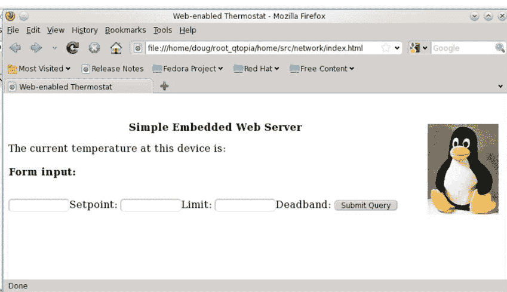

图 10.4

Web 恒温器。

## “真正的” Web 服务器——Boa

虽然 `webserve.c` 是 HTTP 处理的一个很好的介绍，但它的局限性。坦率地说，开源世界包含了许多适用于嵌入式应用的实用 Web 服务器。资源部分包含一个指向 Wikipedia 文章的链接，它对“轻量级” Web 服务器提供了非常有用的比较。其中许多是专门为嵌入式使用设计的，而另一些则是作为概念验证，以观察 Web 服务器可以做得多小。

`Boa` Web 服务器是开源嵌入式服务器的良好示例，它恰好位于我们的目标文件系统中。`Boa` 是一个单任务 HTTP 服务器，这意味着它不会 `fork` 副本，也不会为处理每个入站连接创建线程，而是在内部对连接进行复用。它最早出现于 1995 年左右。最新发布日期为 2005 年。

`rc` 脚本的最后几行是通过调用 `/etc/rc.d/init.d` 中的 `httpd` 脚本来启动 `boa`。记得我们在第 5 章中注释掉了 `httpd` 的启动。因此，请编辑 `/init.d/rc` 取消注释第 44–47 行。保存文件并重启目标板。`boa` 现在在后台运行，等待对 80 端口的连接请求。


`/etc/boa.conf`文件提供了程序的配置信息。除其他外，它还指定了顶层 HTML 文件的位置。在这种情况下是`/www/`。当你打开一个页面时，通常不需要指定文件名。默认通常是`Index.html`。这在`boa.conf`中也有指定。注意`/directory`归`root`所有且仅供`root`访问。

因此，在你的工作站上打开浏览器并指向`http://192.168.1.50`。你会看到一个 FriendlyARM 的广告，主要是中文的。你还可以查看其他几个本地页面。还有一个网络链接，除非你的目标板连接到互联网，否则你无法访问它。

## 嵌入式电子邮件

在结束嵌入式网络之旅之前，让我们快速看看如何在嵌入式语境下使用电子邮件。假设我们的恒温器维护了一个温度日志，并跟踪冷却器的开启频率和持续时间。我们可能希望定期发送该日志以便审查和分析。

发送电子邮件的协议称为`SMTP`（简单传输协议）。像`HTTP`一样，它是一种非常简单的基于`ASCII`的客户端-服务器机制。`SMTP`使用全双工`socket`流，客户端发送命令，服务器用响应数字状态码进行回复。它是一种“步进”协议，每个命令都会得到响应。

列表 10.2 列出了与`SMTP`服务器的典型对话。客户端条目已加粗，并添加了额外的空行以提高可读性。当连接首次建立时，服务器会介绍自己，告诉我们一些关于它的信息。客户端使用`HELO`命令介绍自己并指定域名。注意，服务器的每条回复都以三位代码开头。这允许对消息对话进行直接的自动处理，同时随附的文本支持人类理解。命令和回复不区分大小写。

| 列表 10.2 |
| :--- |
| 连接到 `mail.example.com` |
| 220 smtp-example.com |
| helo mydomain.com |
| 250 smtp-example.com |
| mail from: mydomain.com |
| 250 2.1.0 |
| rcpt to: doug@example.com |
| 250 2.1.5 |
| data |
| 354 Start mail input |
| Subject: This is a test |
| . |
| 250 2.0.0 Ok |
| quit |
| 221 2.0.0 Bye |

`network/`目录中的`maildialog`程序允许你与`SMTP`服务器交互。这就是列表 10.2 的来源。查看`maildialog.c`。

`sendmail.c`文件实现了一个可以从应用程序调用的简单客户端。消息封装在结构中。应用程序只需填充结构并调用`sendmail()`。

注意`do while (0)`结构。这是在发生错误时无需使用`goto`退出事务的方法。如果发生错误，我们只需跳出循环。

使用测试程序尝试：

```
make
```

电子邮件不仅限于文本。使用多用途扩展 (`MIME`)，我们可以将任何类型的二进制数据——图片、音频、视频和固件更新——作为附件发送。大多数`SMTP`服务器要求任意二进制数据在传输前转换为 7 位`ASCII`。这通常通过`Base64`编码完成。

发送电子邮件的另一面是接收它。接收的最流行机制是邮局协议 (`POP`)，目前版本为 3，`POP3`是一种与`SMTP`非常类似的命令/响应协议，如列表 10.3 所示，它有助于显示 10.2 中发送事务的接收端。

嵌入式`POP3`客户端可能扮演什么角色？自动接收和分析恒温器发送的日志引起了我的注意。这种场景并非经典的“嵌入式”应用，它完全可能运行在工作站上。尽管，它可以是更大嵌入式应用程序中的元素。

修改`maildialog.c`以与`POP3`服务器而非`SMTP`服务器交互是一个相对简单的练习。本部分的额外加分作业正是如此。创建一个`maildialog`的版本，称为`popdialog`，与`POP3`服务器交互以检索电子邮件。`POP3`服务器通常监听端口`110`。

### 166 第10章

```
+OK POP3 server ready <12fd299a-6c1b-47b0-a15-b96f32b4d0f6>
```

```
user dou%intellimetrix.us
+OK User:dou%intellimetrix.us ok
```

```
********
+OK Password ok
```

```
list
+OK 2 messages (10114 octets)
```

```
1 9511
2 603
```

```
retr 2
+OK 603 octets
```

```
Return-Path: me:<me@mydomain.com>
Received from mx.cybermeresa.com [65.19.50] by dmail12.dotey with SMTP;
Thu, 19 Jan 2012 15:50:23-0800
Received from: mydomain.com (static-65-19-50-206).cybermeresa.com [65.19.50.206])
by smtp-out.cybermeresa.com (Pos)
tfx for <dou@intellimetrix.us>; Thu, 19 Jan 2012 16:49:34-070 (MST)
Subject: This is a test
Message-Id: <2012019234945.2ABAD1FB7A@smtp-out.cybermeresa.com>
Date: Thu, 19 Jan 2012 16:49:34-070 (MST)
From: me@mydomain.com
```

```
To: undisclosed-recipients;
X-Rpt-To: <doug@intellimetrix.us>
```

这是一个与`SMTP`服务器交互的测试。

Doug

```
dele 2
+OK message 2 deleted
```

```
quit
+OK POP3 server signoff off
```

### 列表 10.3

事实证明有几个“坑”。`POP`协议强制要求命令必须由回车（`\r`）和换行（`\n`）共同终止。然后还有几个与搜索单独占一行的终止字符串`.`关的问题。服务器可能会单独发送，仅搜索`\n.\n`是不够的，因为服务器可能会插入回车字符`\r`。因此，在`\n`之后，你需要寻找`\n`或`\r`。

## 其他应用层协议

我们看过的三种协议——`HTTP`、`SMTP`和`POP3`，对于某些类的嵌入式问题可能很有用。还有许多其他应用层协议在其他情况下也很有用。例如，简单网络管理协议（`SNMP`）已成为管理网络资源的事实标准机制。几乎每个连接到网络的设备都实现了`SNMP`，你的嵌入式设备可能也应该这样做。在嵌入式场景中，`SNMP`可用于简单的监控和控制。

我们基本结束了对应用层编程的介绍。在第 11 章，我们将深入内核空间并查看 Linux 内核。

## 资源

- Comer, Douglas, *Internetworking with TCP/IP, Vols. 1, 2 and 3*, Prentice-Hall。这是关于`TCP/IP`的经典参考书。第一卷目前是第五版，日期为 2005 年。第二卷与 David L. Stevens 合著，是第三版，1998 年；第三卷也与 Stevens 合著，源于 1997 年。如果你想理解互联网的内部机制，强烈推荐。http://en.wikipedia.org/wiki/Comparison_of_lightweight_web_servers—这篇文章包含两个非常有用的表格，列出了十多个 Web 服务器实现 `boa`。

- http://www.boa.org/~—`boa`的主页。

- `IP`地址嵌入在一组被称为“`RFCs`”（意见征求）的文档中。`RFC`现在是互联网多年来的历史，可以通过 www://www.rfc-editor.org 获取。特别地，`HTTP`在`RFC 2616`中描述，`SMTP`在`RFC 821`中描述，`POP3`在`RFC 1081`中描述。

- Jones, M. Tim, *TCP/IP Application Layer Protocols for Embedded Systems*, Charles River Media, 2002。在`HTML`中添加`<DATA>`标签的想法源自这本书。它涵盖了广泛的在嵌入式场景中很有用的应用层网络协议。

- *Linux Network Administrators' Guide*，可在 Linux 文档项目 www://www.tldp.org 获取。这不仅面向管理员，而且是一本关于广泛网络问题的非常完整且易读的教程。

## 配置和构建内核

Hackito ergo sum 匿名


Linux 最奇妙的事情之一就是你拥有源代码。你可以自由地对它做任何你想做的事。我们大多数人并没有打算，也没有需要深入并直接修改内核源码。访问源代码意味着内核是高度可配置的。也就是说，你可以构建一个精确匹配目标系统需求或局限性的内核。

现在，如果你在为 Linux 编写应用程序（正如我们在过去几章中所做的那样），或者你是一个 Linux 系统管理员，你可能永远不需要接触内核。但作为一名嵌入式开发者，你将不可避免接触内核。

## 入门

内核源码位于 `kernel.org`。本章将详细介绍配置和构建的各种步骤。

## 配置和构建内核

*Hackito ergo sum 匿名*

Linux 最奇妙的事情之一就是你拥有源代码。你可以自由地对它做任何你想做的事。我们大多数人并没有打算，也没有需要深入并直接修改内核源码。访问源代码意味着内核是高度可配置的。也就是说，你可以构建一个精确匹配目标系统需求或局限性的内核。

现在，如果你在为 Linux 编写应用程序（正如我们在过去几章中所做的那样），或者你是一个 Linux 系统管理员，你可能永远不需要接触内核。但作为一名嵌入式开发者，你将不可避免接触内核。

### 入门

内核源码位于 `kernel.org`。本章将详细介绍配置和构建的各种步骤。

# 配置和编译内核 171

鉴于你的文件系统中可能存在多个内核源码树，你当前正在处理的内核通常通过 `/usr/src` 下一个名为 `linux` 的符号链接来标识，尽管在此情况下下 `linux` 将位于 `/usr/src/arm`。使用此 shell 命令创建该符号链接：

```
ln -s linux-3.1.5 linux
```

## 内核源码树

不用多说，内核包含了大量的文件——C 源码、头文件、makefile、脚本、脚本等。版本 3.1.5 的文件占用了 317 MB 空间。因此，并不意外，内核有一个标准的目录结构以易于管理的方式组织这些文件。图 11.1 显示了从 `/usr/src/arm/linux` 开始的内核源码树。目录如下：

- Documentation（文档）——自而见之。这是一组文本文件的集合，描述了内核的各个方面、问题、“陷阱”等。在 Documentation 目录下有许多子目录，用于需要更详尽解释的主题。虽然这里的信息通常很有用，但也往往已经过时了。也就是说，文档最初是在特定功能被添加到内核时编写的，但随着功能的演进，并没有跟进更新。

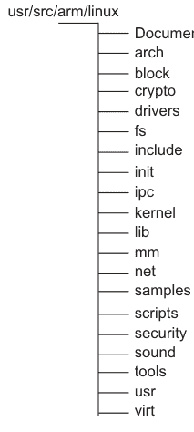

图 11.1

内核源码树。

- arch（架构）——所有依赖架构的代码都包含在 `arch` 的子目录下。内核支持的每个架构在 `arch` 下都有一个目录，具有其自己的子架构结构。可执行的内核镜像最终将位于 `<architecture>/boot`。`makefile` 中的一个环境变量 `ARCH` 指向相应的架构目录。`arch/` 是内核中两个最大的子目录之一，包含了几乎 12,400 个文件。
- block（块设备）——块设备层。这些是用于优化与块存储设备进行转换的代码。
- crypto（加密）——处理系统安全中加密方面的代码。
- drivers（驱动程序）——设备驱动程序代码。在 `drivers` 下，有许多子目录，对应各种设备和设备类。这是另一个主要的内核子树，拥有接近 9,600 个文件。
- fs（文件系统）——文件系统。在 `fs` 下，为 Linux 支持的种类型文件系统有一组目录。
- include（包含）——头文件。`include/` 中最重要的子目录是 `linux/`，它包含了内核 API 的头文件。
- init（初始化）——基础初始化代码。
- ipc（进程间通信）——支持 Unix System 5 进程间通信机制的代码，如信号量、消息传递和共享内存。
- kernel（内核）——这是核心。大多数不属于任何其他类别的基础体系无关内核代码都在这里。这包括调度器和基础中断处理程序等。
- mm（内存管理）——收集成库的若干实用函数。
- net（网络）——网络支持。`net` 下的子目录包含支持各种网络协议的代码。
- samples（示例）——另一个较新的添加，包含了显示如何管理内核某些内部数据结构的示例代码。
- scripts（脚本）——支持配置和构建过程的文本文件和 shell 脚本。
- security（安全）——声卡和高级 Linux 音频架构 (ALSA) 提供替代的安全模型。
- tools（工具）——内核的性能监控器。
- usr（用户）——大部分是为 RAM 磁盘设置链接段的汇编代码。
- virt（虚拟）——内核的虚拟环境。

# 配置和编译内核 173

`usr/src/arm/linux` 包含一个标准的 make 文件，`Makefile`，带有大量的 make 目标（targets）。默认情况下，内核是为运行 makefile 的架构构建的，在绝大多数情况下，这是 x86 的某种变体。在我们案例中，我们想要为 ARM 目标板交叉编译内核。

如上所述，有一个环境变量 `ARCH`，可以通过设置它来选择要构建的架构。可以在调用 `make` 的命令行中这样设置：

```
make ARCH = arm
```

或者，我更倾向于的方法是编辑 makefile 来永久设置 `ARCH` 的值。用你喜爱的编辑器打开 `/usr/src/arm/linux` 中的 makefile，并到第 195 行，该行初始内容为：

```
ARCH ?= $(SUBARCH)
```

将其修改为：

```
ARCH ?= arm
```

下一行定义了变量 `CROSS_COMPILE`。它通过指定要添加到工具名称前的前缀来标识交叉工具链。我们的 ARM 交叉工具链由前缀 `arm-linux-` 标识。你可以在这里输入，或者可选地在配置过程中指定它。保存文件并退出编辑器。

现在执行 `make help`。你将看到几个类别中非常长的 make 目标列表。我们目前特别感兴趣的是内核特定特定目标 (arm)。在它下面，有许多以 `_defconfig` 结尾的目标。这些 make 文件为各种 ARM 开发板创建了默认配置。在构建新内核时，从一个已知的配置开始总是很好的做法。在我们案例中，它就是 `mini2440_defconfig`。因此执行：

```
make mini2440_defconfig
```

在 `/usr/src/arm/linux-` 下产生了一个新文件 `.config`。

> 1 在 Eclipse 中配置和编译内核没有太大意义。我们不会编辑任何源码文件，而且内核有自己的图形化配置工具。

# 174 第 11 章

## 补丁内核

在我们实际配置和编译内核之前，在我们的特殊情况下，还有一个坎需要过。这给了我们一个机会来观察开源源码树“补丁”（patching）的概念。

事实证明，用于目标板 NAND 闪存的文件系统 YAFFS 并没有被并入主线内核源码。这显然是一个许可问题。尽管 YAFFS 是在 GPL 下发布的，但其版权所有者——一家英国公司 Aleph One 保留了在某些情况下收取许可的权利。这足以让 YAFFS 无法进入真正自由的内核。

Aleph One 为 YAFFS 提供了一个压缩的 tar 包，包含一个在内核源码树中安装它的脚本。但由于我的目标是引入补丁机制，我选择针对 `kernel.org` 上的“原生”（未修改的） 3.1.5 内核源码执行其脚本，然后创建一个补丁。

有序地更改发布版源码的机制是 `patch` 工具。`patch` 的输入是由 `diff` 工具创建的文本文件，该工具比较两个文件并报告差异。如果一个开源管理器想要升级源码，他或她在修改后的代码和原始代码之间进行操作。在这种情况下，从 `linux-3.1.5.tar.bz` 创建了两个内核源码树，并将第一个命名为 `linux-3.1.5-orig/`，我在另一个树上执行了 Aleph One 的脚本，然后从 `/usr/src/arm` 执行：

```
diff -upr-3.1.5 linux>yaffs.patch
```

创建一个适当的补丁文件 `yaffs.patch`。注意 `patch` 通常从标准输入获取数据，所以我们必须将输入重定向到文件。`-p1` 告诉 `patch` 从要补丁的文件名中移除第一个冲突及其之前的内容。将该文件从 `factory_images/` 移动到 `/usr/src/arm` 并执行：这考虑了通常的情况，即创建补丁的根目录与应用补丁的目录不同。移除路径之前的路径使得目录变为相对路径。

支持 YAFFS 的所有内容现在已添加到内核源码树中。

此补丁还安装了 `mini2440_*` 驱动程序、Posix 和层 示例以及一个修订的 `.config` 文件。默认配置留下了许多你并不需要的项，它实际上是目标闪存中内核的配置。


# 配置和编译内核

关闭的。构建内核的过程从调用三个执行配置过程的 `make` 目标之一开始。`make config` 启动一个基于文本的脚本，逐步引导每一个配置选项。对于每个选项，你有三个或四个选择。这三个选择是：“y”、“n”和“?”。默认选择用大写字母表示。某些选项有第四种选择，“m”，这意味着该功能是一个可加载内核模块，而不是构建到内核镜像中。内核模块是动态扩展内核的一种，对于设备驱动程序等内容特别有用。下一章将详细介绍模块。

图 11.2 显示了 `make config` 对话框的一个示例。

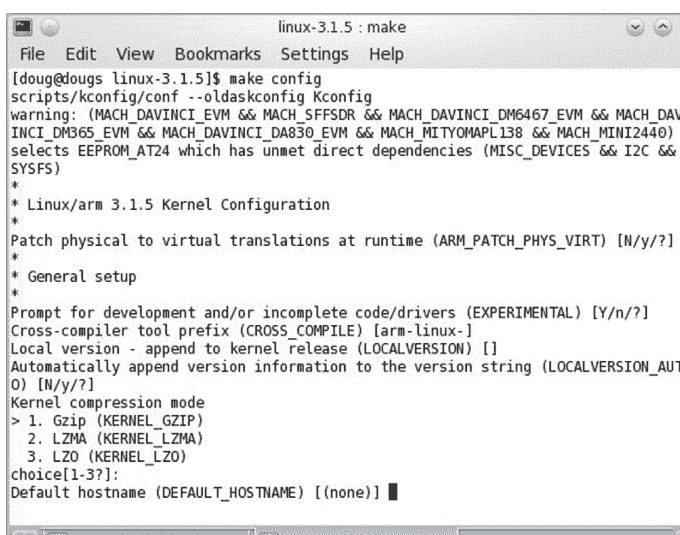

图 11.2

`make config` 对话框。

## 第11章

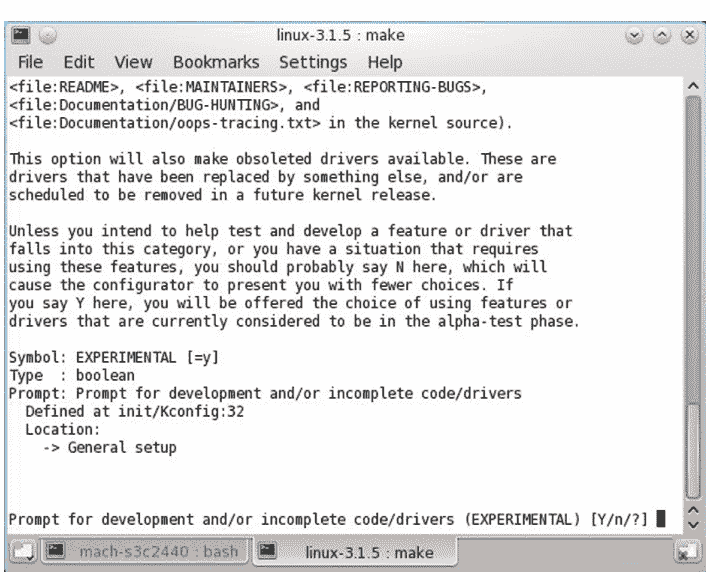

图 11.3

配置帮助文本。

大多数选项都包含了真正“有帮助”的帮助文本（图 11.3）。

`make config` 的问题在于它极其乏味。通常情况下，你只会更改几个选项，而让其余保持默认状态。但 `make config` 强制你逐一检查每一个选项，而现代内核拥有超过 2000 个选项。我个人从未用过 `make config`，老实说，我很奇怪为什么它还在内核包中。

`menuconfig` 基于 `ncurses` 库，会弹出图 11.4 所示的伪图形界面。在这里，配置选项被分为不同的类别，你只需要访问需要更改的选项类别即可。界面解释得很清楚且相当直观。但由于它不是真正的图形化程序，所以鼠标不起作用。`make config` 也提供相同的帮助文本。当你退出主菜单时，会提供保存新配置的选项。

虽然大多数黑客似乎更偏于 `menuconfig`，但我认为整体易用性的选择是 `make xconfig`。它会弹出一个图 11.5 所示的基于 X Windows 的菜单。现在

# 配置与编译内核

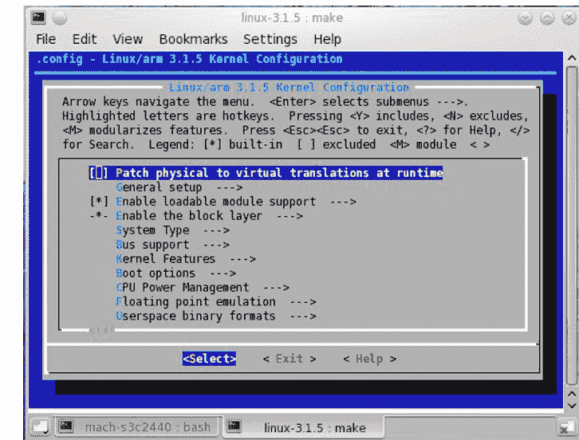

图 11.4

`make menuconfig`

你可以一次性看到所有的选项类别并使用鼠标导航。当然，你必须运行 X Windows 才能使用此选项，并且必须安装了 `g++`、Qt 图形库以及 Qt 开发工具包。

`g++` 和开发工具通常默认不安装。如果没有，请以 root 用户身份执行：

```bash
yum install gcc-g++
yum install qt3-devel
```

与往常一样，Debian/Ubuntu 用户应该将 `yum` 替换为 `apt-get`。

在默认显示模式下，`xconfig` 在左上角显示配置类别的树状。选择其中一个会在右下窗口中显示该类别的系列选项。图 11.5 从通用设置菜单开始。大多数选项以复选框的形式呈现。点击可以在选中（勾选）和未选中（未勾选）之间切换。这些被称为二进制选项。可以被编译为

# 第11章

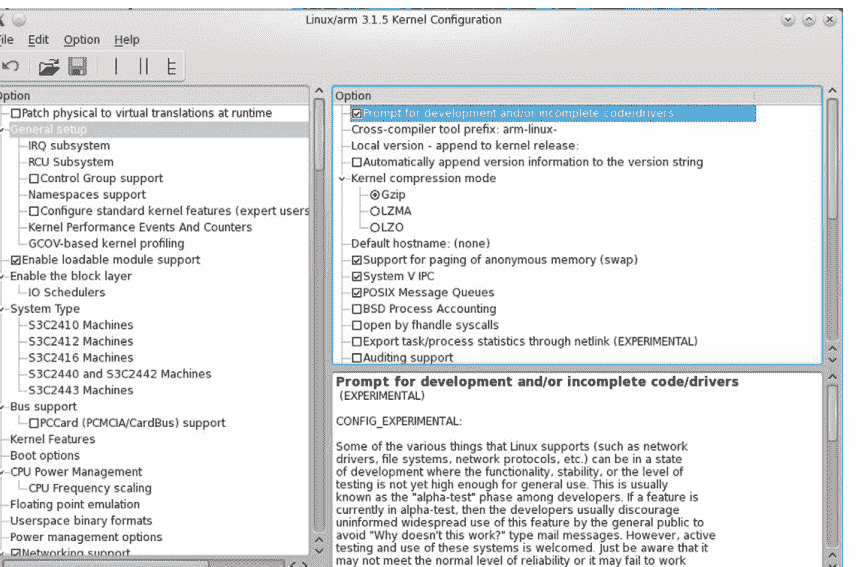

内核模块的选项有第三种值，用点表示该功能将被编译为模块。这些是三态选项。例如“总线支持”（Bus support）。点击 PCCard (PCMCIA/CardBus) 支持旁边的框，它会变成一个点。再次点击它会变成一个勾选标记。点击它可以取消勾选框。

某些选项有一组允许的值，通过单选按钮表示是或否。内核功能的几个示例：内存分拆（Memory split）和抢占模型（Preemption Model）。某些选项接受数值。一个数值选项的例子是通用设置下的内核日志缓冲区大小（kernel log buffer size）。目前并不一眼看出如何更改数值。双击该选项会在右侧窗口之间打开一个对话框。

由于某些其他选项未选中而不可用的选项根本不会显示。再次以 PC Card 选项作为一个示例。当框未勾选时，右上侧窗口是空的。点击勾选框，相应的选项就会出现在右上角。

## 尝试一下

熟悉内核配置选项的最好方法是启动 `xconfig` 并看看那里有什么。那么……

```bash
cd /usr/src/arm/linux
make xconfig
```

在经过一些程序和文件构建后，将图 11.5 所示的菜单。只需浏览子菜单及其各种子子菜单，以感受 Linux 内核的灵活性和丰富功能。阅读描述。

所有关键配置选项都应在 `.config` 文件中正确设置，但为了额外练习，请检查它们。在“通用设置”下有一个“交叉编译器工具前缀”（Cross-compiler tool prefix）。这是一个字符串选项，必须设置为 `"arm-linux-"`。进入“文件系统”下的“杂项文件系统”，选中 yaffs2 文件系统支持。将其编译进内核，而不是作为模块。你可以取消勾选日志闪系统支持（journaling Flash System support）。确保在“网络文件系统”下选择了 NFS 客户端支持和 NFS 根文件系统。

默认配置启用了许多你并不需要的选项，至少最初如此。Mini240 没有内置无线支持，所以蓝牙和任何名为“无线”（Wireless）的内容都可以安全地删除。原生语言支持是移除许多不必要模块的另一个地方。

如果你做了更改，请确保在“通用设置”下添加“本地版本字符串”（Local version string）。

暂时留过配置菜单，直到到达下一节。

`xconfig` 在保存配置方面提供了额外的灵活性。你不需要总是将其保存到标准的 `.config` 文件，可以使用 `File->Save As` 选项将其保存到你指定的命名文件中，以后使用 `File->Load` 使用该文件进行进一步修改或将其作为新的默认配置。

## xconfig 选项

`xconfig` 菜单在 `Option` 菜单中有几个实用的选项。`Show Name` 为右上面板添加一列，显示每个配置变量的名称。`Show Range` 显示二进制和三态选项的范围和当前值。在我看来，这对于是很有用的。另一个有用的选项是 `Show Data`。对于二进制和三态选项，`Show Range` 显而易见。对于数值选项，`Show Range` 很有用。`Show All Options` 显而易见。它显示由于某些条件不满足而无法选中的选项。假设某个选项存在，可以通过 `Edit -> Find` 搜索名称。现在转到 `Debug Info` 查看该选项的定义。当你完成时，关闭 `xconfig` 菜单。系统会询问你是保存还是放弃更改。

## .config 文件

值得注意的是，真正的内核黑客倾向于使用 `menuconfig` 而不是 `xconfig`。无论选择哪一个，结果都是名为 `.config` 的文件。首先注意到开头是：

```
## Automatically generated by NOT EDIT
```

# 配置与编译内核

此部分信息对于构建内核并非必不可，但当你开发驱动程序或其他内核增强（可能是内核本身）时，你需要修改文件。配置菜单中的所有信息由一组名为 `Kconfig` 的文件提供，这些文件散落在源码树中。这些是用配置语言编写的脚本文件，看起来像 Shell 语言但并不是。主 Kconfig 文件位于 `linux/arch/$(ARCH)`，其中 `ARCH` 是识别基础的变量。

进入 `linux/arch/` 并打开 `Kconfig`。找到第 22 行附近的 `menu "System Type"`。比较从 `System Type` 开始的文件结构，模式应该非常清晰。每个配置选项都由 `config` 关键字后跟选项名称标识，例如 `config MMU`。这些每一个都被转换为一个 Makefile 或宏，例如 `CONFIG_MMU`。Makefile 然后使用这些变量来确定内核包含哪些组件，并在源码中使用 `#define` 符号。

选项类型由以下单词之一标识：

- `bool`：选项有两个值，“y" 或 "n"
- `tristate`：选项有三个值，“y"、"n" 和 "m"
- `choice`：选项具有列表中的值之一
- `int`：选项接受整数值

类型字通常包含一个提示（prompt），即该文本在配置菜单中显示。或者，`prompt` 关键字指定了提示。还存在“隐藏”选项。在 Kconfig 顶部有一组由于未指定提示而不在菜单中显示的选项。在配置菜单中，点击 `Options->Show All Options`。现在所有选项都显示了，包括没有提示的未选中的选项。

其他配置条目中的关键字包括 `help`（用于指定文本）和 `depends`（意味着只有当它所依赖的其他选项被选中时，该选项才有效或可见）。还有 `select`，表示如果选了此选项，某些其他选项也必须开启。

# 第 11 章

在菜单“System Type”行正上方有这一行：

```
source init/Kconfig
```


`source`关键字用于扩展配置菜单，以包含额外的模块化功能。它实际上等同于 C 语言中的`#include`。你会在主 Kconfig 文件中发现许多`source`行。

配置语言（Config Language）实际上比这个简单示例所暗示的要得多。要了解更多细节，请查看`linux/Documentation/kbuild/config-language.txt`。

## 编译内核

编译内核的实际过程根据编译目的而略有不同。我的主要目标是为目标板构建内核，因此我首先描述这一点。然后，我将描述为工作站构建新内核的替代过程。

前三个步骤可以以普通用户身份执行：

- `make clean`。删除之前构建创建的所有中间文件。这确保所有内容都使用当前的配置选项进行构建。严格来说，如果你是第一次构建，则没有中间文件需要清理，因此不需要运行`make clean`。

- `make`。这是核心。它会构建可执行的内核镜像和所有内核模块。令人惊讶的是，这需要一些时间。生成的压缩内核镜像位于`arch/$(ARCH)/boot/bzImage`。

- `make image`。目标板上的启动加载程序在其处理的任何文件之前都需要一个 64 字节的头部。`uimage make`目标会将该头部放在`bzimage`之前，在`arch/$(ARCH)/boot/boot`处创建文件`uimage`。

这 64 字节的头部告诉了`uimage`关于文件数据的性质。头部传达了属性属性，包括：

- 目标 OS

- 目标 CPU 架构

- 镜像-内核、文件系统、独立程序的类型

- 压缩类型

- 加载地址

- 入口点

- 镜像名称

- 镜像时间

之前在第 4 章中，我们将一个名为`mkimage`的可执行文件复制到了 ARM 交叉工具链的`bin/`目录。这是构建头部的工具。它由`uimage`调用。

### 配置与编译内核

`Makefile`目标`mkimage`实际上是 U-boot 分发的一部分，我们将在第 14 章中介绍它。

以下步骤需要 root 权限：

```
make modules_install
INSTALL_MOD_PATH=/home/<user_name>/root_qopia. 将模块复制到
($INSTALL_MOD_PATH)/lib/modules/<kernel_version> 其中 <kernel_version> 是标识你正在构建的内核的字符串。注意，在为目标板构建时，必须显式指定根文件系统。否则，模块将进入你工作站文件系统的 `/lib/modules/`。严格来说，在这种情况下此步骤并不是必要的，因为启动内核不需要任何模块。
```

事实并非如此。顺便说，构建过程是递归的。内核源码树中的每个子目录都有其自己的处理该目录内源文件的`Makefile`。顶层`Makefile`递归地调用所有子`Makefile`。

为工作站构建内核的过程在细节上有所不同。我们不使用`make image`步骤。执行不带`INSTALL_MOD_PATH`参数的`make modules_install`并执行此步骤：

```
make install. 这执行了多件事。它将可执行内核（称为 `vmlinuz`，x86 构建）复制到 `/boot`，连同链接映射文件 `System.map`。它在 `/boot/grub/grub.conf` 中添加新条目，以便 GRUB 能够将新内核作为启动选项。最后，它在 `/boot` 中创建一个初始内存磁盘 `initrd`。
```

#### 工作站插记

在我们继续加载和测试新内核之前，最后提到的两项内容值得一个简要的解释。大多数工作站安装使用启动加载程序来选择特定的内核或备用操作系统。能够启动多个内核镜像有一个非常充分的理由。假设你构建了一个新内核但它无法正常启动。你始终可以返回并启动一个已知的镜像，然后尝试找出新内核中哪里出了问题。如果你感兴趣，请查看你工作站上的`/boot/grub/grub.conf`。

大多数内核被设置为使用`initrd`，它用于初始内存磁盘。初始内存磁盘是一个非常小的 Linux 文件系统，由启动加载程序加载到 RAM 中并在内核启动时挂载，在主根文件系统挂载之前加载。使用`initrd`的通常原因是某些内核模块在挂载根分区之前需要加载。通常，这些模块需要用于支持根分区使用的文件系统（例如`ext3`），或者可能是连接硬盘的控制器（如 SCSI 或 RAID）。

# 184 第 11 章

## 启动新内核

现在我们有了新内核，如何测试它呢？我们当然可以将新镜像加载到闪存中，可以是现有内核镜像的补充，也可以是替换。

另一种方案是使用 TFTP 通过网络启动新镜像。这在开发环境中特别有利，因为我们可以快速测试新内核镜像，而无需经过耗时的闪存写入过程。

将`arch/boot/image`移动到`/var/lib/tftboot`或你选择的任何 tftp 目录。启动目标板进入 U-boot 并执行以下命令：

```
tftboot 320000000u
boot 320000000
```

`tftboot`将`uimage`下载到 RAM 中的位置`320000000`。`boot`解析头部`320000000`在必要时解压缩并将控制权交给它。内核启动后，执行`uname -a`。恭喜！你现在是一个 Linux 黑客了。

在下一章中，我们将深入内核空间并查看资源。

### 资源

有关配置和构建内核过程的更多细节，请查看`Documentation/kbuild`。此外，tldp.org 上的以下 HOWTO 可能感兴趣：

- Config-HOWTO：主要涉及系统构建后如何配置系统。

- Kernel-HOWTO：提供本章涵盖主题的附加信息。

- www.linuxfromscratch.org：这是一个提供完全从源码构建自己的 Linux 系统的步骤说明的项目。有一个项目处理为嵌入式环境构建 Linux。

- www.yaffis.net：YAFFS 的首页。

# 内核模块与设备驱动程序

> 如果你认为我是糟糕的驱动程序，你应该看看我。

我们在本章的目标是介绍 Linux 驱动的基础知识。我们将从可安装内核模块的概念开始。然后我们将通过 Mini2440 的简单 GPIO 驱动来看基本的设备驱动 API。我们还将查看处理中断。最后，我们将查看如何将新的设备驱动集成到内核源码树中。

由于需要，这是一个非常复杂的主题的概述。资源部分提供了额外的阅读材料。

## 内核模块

可安装内核模块为扩展基础 Linux 内核的功能提供了一种非常有用的方法，而无需重新构建内核。一个关键特性是模块可以在需要时动态加载，并在不再需要时卸载。你可能认为模块是内核等的用户态进程。模块对于设备驱动程序和文件系统等内容特别有用。

考虑到 Linux 支持的硬件范围和多样性，构建包含所有可能的设备驱动程序的内核镜像是不现实的。相反，内核包含了启动设备和其他常见硬件的驱动程序。所有设备都作为可加载模块支持，但只有系统需要的模块才会被实际加载。

在生产嵌入式环境中，通常没有使用可加载模块的技术原因，因为我们确切知道系统必须支持硬件，因此我们直接将这些支持构建到内核镜像中。然而，稍后我们将看到使用模块的“业务”理由。在测试新驱动程序时，模块仍然有用。

请记住，模块在内核空间权限级别 0 中执行，能够导致整个系统崩溃。

# 186 第 12 章

## 模块示例

在`home/src/hello/`目录下创建一个新的 Eclipse 项目。打开`hello.c`文件。注意，首先是内核模块所需的包含文件。这是一个可加载内核模块的简单示例。它包含了两个简单的函数：`hello_init()`和`hello_exit()`。这两行：

```
module_init(hello_init);
module_exit(hello_exit);
```

这两行代码向模块加载器和卸载器工具标识了这些函数。每个模块必须包含一个初始化函数和一个退出宏，在本例中，`hello_init()`由`insmod`命令（安装模块的 shell 命令）调用。指定给`module_exit()`的函数`hello_exit()`由`rmmod`命令（移除模块的命令）调用。

你可能已经注意到 Eclipse 报告了大量的语义和语法错误以及代码分析问题。这些都是虚假的，因为你会发现该项目实际上可以正常构建。Eclipse CDT 的人员承认静态代码分析“远非完美”，并且确实会产生虚假错误。如果你觉得这些信息很烦，可以通过打开项目属性对话框并转到 C/C++ > General > Code Analysis 来关闭分析。选择项目设置并取消勾选 Potential Problems（潜在编程问题）和 Semantic Errors（语义错误）。当然，你需要添加相应的包含路径，即`<absolute_path_to_kernel_source>/include`。


在此示例中，两个函数都使用 `printk` 在控制台上打印消息，`printk` 是内核中等价于 `printf()` 的函数。`printf()` 等 C 库函数旨在用户空间运行可以使用重定向等 OS 功能。这些功能在内核代码中不可用。`printk()` 不是直接写入控制台，而是写入循环缓冲区并唤醒 `klogd` 守护进程，将消息写入系统日志并可能将其打印在控制台上。

注意 `printk()` 格式字符串开头的 `KERN_ALERT`。这是 `loglevel`（日志级别）的符号表示，决定了消息是否出现在控制台上。级别从 0 到 7，数字越小优先级越高。如果日志级别数值上小于内核整数 `console_loglevel`，则消息将显示在控制台上。无论日志级别如何，`printk` 消息始终显示在 `/var/log/messages` 文件中。

`hello` 示例还展示了如何指定模块参数，即可以在加载模块的命令行中输入值的局部变量。这是通过 `module_param()` 宏实现的。`module_param()` 的第一个参数是变量名，第二个是变量类型，第三个是控制对 sysfs 中模块参数表示访问权限的“权限标志”。

## 内核模块与设备驱动程序 187

`sysfs` 是 2.6 内核的一个新功能，它比 `/proc` 文件系统提供了更整洁的驱动程序内部访问方式。目前一个安全的值是 `S_IRUGO`，意味着该值是只读的。变量类型可以是指向字符字符串的字符指针，或者是 `int`、`short` 和 `long`——即各种尺寸的整数或其带有“u”前缀的无符号对应。

构建项目并尝试运行。尽管项目位于目标系统的根文件系统中，但它的目的是运行在工作站上。在 shell 窗口中，以 root 用户身份进入 `module/` 目录，输入命令

```
insmod hello.my_string="name" my_int=47
```

如果你最初用普通用户名登录并使用 `su` 变成 root，你将必须面对 `/sbin` 下的所有模块命令，因为 `/sbin` 通常不是普通用户路径的一部分。无论日志级别如何，`printk` 消息都不会出现在运行在 X 窗口下的 shell 窗口中。这是因为 X 窗口正在运行“虚拟”终端。你可以通过以下命令查看 `printk` 的结果：

```
tail /var/log/messages
```

再次以 root 用户身份执行。这会打印日志文件的最后几行。一个实用的变体是：

```
tail -f /var/log/messages
```

“f”表示“跟踪”（follow）。此版本会持续运行并输出发送到 messages 的新文本。该命令也可以写为 tail。我通常保持一个 shell 窗口打开以监控消息。

模块是特定内核版本的。这意味着 `insmod` 只会加载为当前内核版本编译的模块。这是因为内核 API 随时间可能会并且确实发生变化。例如，为 3.1.5 版本编译的模块如果加载到 3.4.4 版本，很可能会崩溃，因为内核函数的参数列表发生了变化。`insmod` 提供了一个选项来强制加载为其他版本编译的模块 `-f`，在许多情况下它是有效的。

尝试 `insmod` 命令。这会按加载的反序列出当前加载的模块。`hello` 应该是第一个条目。`insmod` 还为每个模块提供“使用计数”，并显示哪些模块依赖于其他模块。相同的信息可以在 `/proc/modules` 文件中找到。

现在执行命令 `rmmod hello`。你应该看到 `hello_exit()` 打印的消息。最后执行 `lsmod` 看到 `hello` 不再列出。顺便注意，`rmmod`

## 188 第 12 章

不需要“.ko”扩展名。一旦加载，模块仅通过其基本名称进行标识。

模块可能且通常包含对外部符号（如 `printk`）的引用。这些外部引用是如何解析的？`insmod` 根据内核符号表对其进行解析，该符号表作为内核引导过程的一部分加载到内存中。此外，模块中定义的任何导出符号都会添加到内核符号表，并供随后加载的模块使用。模块可以引用的唯一外部符号是构建在内核镜像或之前加载的模块中的符号。内核符号表位于 `/proc/ksyms` 中。

### “污染”内核

当你安装 `hello` 时，在 `hello_init()` 消息之前，你应该看到了另一个消息：

```
hello: module license 'specified' taints kernel
```

```
MODULE_LICENSE (<approved_string>)
```

其中是在 `linux/include/linux/module.h` 中找到的 ASCII 文本字符串之一。不出意外，其中包括“GPL”。如果你按照开源许可证（如 GPL）的条款分发你的模块，你被允许在代码中包含相应的 `MODULE_LICENSE()` 调用，加载你的模块也不会产生任何投诉。

如果你安装了一个产生警告的模块且系统随后崩溃，崩溃文档（核心转储）将揭示加载了非开源模块的事实。你的内核已被无人可以访问的代码“污染”了。如果你将崩溃文档提交给内核维护者，它将被无视。> ¹ 我不清楚的是这种污染规定是如何强制执行的。一个不实的供应商可以很容易在内核构建中包含 `MODULE_LICENSE()` 条目，但不提供源码。如果该模块导致内核故障会怎样？还有什么？

## 180 内核模块与设备驱动程序 189

在 `hello.c` 中，两个 `module_param()` 语句下方添加以下行：

```
MODULE_LICENSE("GPL");
```

重新制作 `hello` 并验证安装新版本不再产生警告。尽管如此，你的内核仍然是被污染的。污染标记在重启之前一直有效。标记可以通过 `/proc/sys/kernel/tainted` 查看。它实际上是一个掩码，显示了内核状态的许多信息。这些信息在 `linux/sysctl/kernel.txt` 中记录。

### 构建内核模块

内核模块的构建过程比我们以前遇到的 Makefile 要稍微复杂一些。复杂性的产生是因为模块必须在

## 190 第 12 章

内核本身的上下文，特别是你打算运行该模块的内核。

结果是，如果你像我们现在这样在内核树之外构建模块，那么 makefile 必须切换到内核源码树的顶层目录并调用该 makefile。实际构建发生在内核源码树的顶层，结果会被放回存放我们模块的目录。

发生的情况是 `hello/` 目录下的 makefile 再次切换到内核源码树根目录，并将 `hello.c` 的位置作为参数传递。查看 `hello` 的 makefile。注意这一行：

```
obj-m := hello.o
```

在不详述细节的情况下，这告诉内核构建系统从 `hello.o` 创建模块。接下来，我们根据需要指定一些调试标志。

真正有趣的内容发生在第 20 行，我们在 modules 目标上调用了 make。

这段短语：

```
-C /lib/modules/$(shell uname -r)/build
```

是 `make` 切换内核源码目录的方法。执行 shell 命令 `uname -r`，你将得到一个表示内核版本的数字字符串。对于 `/lib/modules`，你会找到一个同名的子目录。那里有一个名为 `build` 的符号链接，它实际上链接到正在执行的内核的源码树。你一定猜 `-C` 意味着切换目录。最后，短语 `M=$(shell pwd)` 将当前目录作为环境变量 `M` 传递。

内核源码树不需要完整的内核源码。具体来说，不需要 `*.c` 文件。需要的是头文件、配置和 make 文件。这是流行的桌面发行版的标准格式。查看你内核的源码树，看看里面有什么。

最终结果是将 `hello.c` 编译为 `hello.o`，然后编译为可加载模块 `hello.ko`。你会注意到在此过程中，它创建了许多临时文件和一个目录。因此有了 `clean` 目标。如果模块是从两个或多个源文件构建的，makefile 的第一行将扩展为：

```
obj-m := module.o
obj-objs := file1.o file2.o
```

在为任何项目创建模块时（无论是内核模块还是用户空间应用程序），从示例模型开始通常是一个好主意。这里描述的 makefile 是其他内核模块项目的良好起点。

最后，在为 `hello` 创建 Eclipse 项目时，我们略带过了一点：包含路径。内核模块从内核源码树获取头文件，具体来说，

`<linux>/include <linux>` 是内核源码的绝对路径。使用项目属性（Project Properties）正确设置包含路径。如果你忘记了如何这样做，请参考第 7 章。

### 模块的作用

作为内核的扩展，模块的作用是应用程序提供某些服务或一组服务。与应用程序不同，模块不会独立执行。相反，它会耐心地等待直到应用程序调用它的服务。

但应用程序如何访问模块的服务呢？这就是 `module_init()` 函数的作用。通过调用一个或多个内核函数，`module_init()` 向内核“注册”模块的“能力”。实际上，模块在说：“我在这里，这是我能做的事实。”


图 12.1 说明了这一注册过程是如何运作的。`init_module()` 函数调用 `register_capability()` 函数，并传递一个包含模块内函数指针的结构体参数。`register_capability()` 将指针参数放入内部的“能力”数据结构中。系统随后定义了一个协议，规定应用程序如何通过系统调用访问能力数据结构中的信息。

注册能力的特定示例是 `cdev_add()`，它注册了“字符”设备驱动程序的能力。随后，应用程序通过 `open()` 系统调用访问字符设备驱动程序的服务。稍后将详细描述。

如果模块不再需要并使用 `rmmod` 命令移除，则 `module_exit()` 函数应该“取消注册”模块的能力，释放能力数据结构中的条目。

## 到底什么是设备驱动程序？

设备驱动程序的定义可能和编写它们的程序员数量一样多。从根本上说，设备驱动程序是一种“抽象出外围硬件细节”的方法，以便应用程序程序员不必担心它们。

在简单系统中，驱动程序可能仅仅是链接到应用程序的函数库。在通用操作系统中，设备驱动通常是独立加载的程序，通过某些特定于系统的协议与应用程序通信。在 Linux 这样的多任务系统中，驱动程序应该能够建立从不同应用程序进程到设备的多个“通道”。尽管如此，在所有情况下驱动程序都是通过 API 描述的，API 定义了驱动程序预期支持的服务。

| 模块 | 核心内核 | 函数调用 |
| --- | --- | --- |
| insmod | module_init() | register_capability() |
| | capabilities[] | 函数指针 ----> |
| | Module functions | 内核函数 | 数据指针 ----> |
| rmmod | module_exit() | unregister_capability() |

图 12.1

将模块与内核链接。²

设备范式在 Linux 这样的保护模式环境中具有额外的意义。原因有两个：第一，用户空间代码通常不允许执行执行 I/O 指令。这只能在特权级别为 0 的内核空间中完成。一组直接链接到应用程序的设备驱动程序函数将根本不起作用。驱动程序必须在内核空间中执行。实际上，你可以通过一些复杂的步骤来允许从用户空间进行 I/O 访问，但最好避免它们。

第二个问题是用户空间是可交换的。这意味着当 I/O 操作正在进行时，数据缓冲区可能会被交换到磁盘。当页面被换回时，它很可能位于不同的物理地址。因此，从外围设备传输的数据必须位于内核空间，而内核空间是不可交换的。驱动程序随后必须负责在内核空间和用户空间之间传输这些数据。

## Linux 设备驱动

第 9 章简要讨论了设备驱动程序。让我们回顾一下。Unix，扩展到 Linux，将外围设备世界分为四类：

- 字符
- 块
- 管道
- 网络

> ² Rubini, Alessandro, Jonathan Corbet, and Greg Kroah-Hartman, Linux Device Drivers, third Ed., O’Reilly, 2005, p. 19.

# 内核模块与设备驱动程序 193

字符和块设备的主要区别在于后者（如磁盘）是可以随机访问的，也就是说可以在字符流中来回移动。而字符设备的流通常只单向移动。块设备必须关联文件系统，而字符设备没有。

管道是建立进程间单向链接的伪设备。一个进程向一端写入，另一个进程从另一端读取。

网络设备的不同之处在于它们处理多个客户端的数据“包”，而不是单个客户端的数据“流”。此外，数据异步到达网络设备。这些差异使得内核与设备驱动程序之间需要不同的接口。

## /dev 目录

其他操作系统将设备视为文件（某种程度上），Linux 更进一步，实际上为设备创建了目录。这通常是 `/dev`。在 shell 窗口中，执行 `/dev` 并 `ls -l`。你会得到许多有趣的条目。注意标志字段中的第一个字符。“B”代表“块”设备，“c”代表“字符”设备。记得第 3 章，“I”代表链接，“d”是目录。

在块设备和字符设备目的组字段和日期戳（通常显示文件大小）之间，有一对逗号分隔的数字。它们分别被称为“主设备号”和“次设备号”。主设备号识别设备驱动程序。次设备号仅供驱动程序本身区分它可以处理的不同类型的设备。

在 2.6 之前，主、次设备号各 8 位，主号与设备驱动程序之间有一一对应的关系。现在设备号是一个 32 位整数，定义为 `dev_t`，其中高 12 位为主号，剩余位为次号。注册机制现在允许多个驱动程序挂载到同一个主号，只要它们使用次号范围。

`/dev` 中的条目使用 `mknod` 命令创建，例如：

```
mknod /dev/ttyS1 c 4 65
```

# 194 第12 章

它创建了一个 `/dev/tty1`。这是一个主设备号为 4、次设备号为 65 的字符设备。这里没有引用设备驱动。我们通过 `mknod` 所做的只是在文件系统中创建一个条目，以便应用程序“打开”该设备。但在在此之前，我们必须“注册”一个主数为 4、次数为 65 的字符设备驱动程序，以建立连接。

## 低层用户空间 I/O API

我们在第 9 章中已经很好地涵盖了访问设备驱动程序功能的低层用户空间 API。如有必要，请复习。

## 内部驱动结构

了解设备驱动结构最简单的方法是查看它的代码。在 `root_qtopia/home/simple_hw` 中有几个简单的示例。

在 `simple_hw/` 目录下创建一个 Eclipse Makefile 项目。你需要添加适当的路径，该路径位于 Linux 内核源码树中。详情请参见 `Makefile`。你需要创建一个新目标：`modules`。

在 Eclipse 编辑器中打开 `simple_hw.c`。基本上，一个驱动程序由一组函数组成，这些函数镜像了低层用户空间 API 中的函数。然而，驱动程序的函数是由内核在内核空间调用的，用于响应应用程序调用低层 I/O 函数。

## 驱动数据结构

在检查设备驱动程序中的函数之前，我们应该查看驱动程序组成的一些重要数据结构。通过 `struct cdev`，这里描述的所有结构都可以在 `include/linux/fs.h` 中找到。

**`struct file_operations`**: `file_operations` 结构是一组指向所有构成驱动 API 的可能函数的指针的集合。这满足了图 12 中描述的、用于与内核的其他部分通信其能力的要求。这里有许多函数，但驱动程序只会调用它实际实现的那些。未使用的条目被设置为 `NULL`，允许在它们被调用时执行某些默认操作或返回错误。

`simple_hw` 的 `file_operations` 结构位于第 180 行。它使用标记字段格式来初始化结构。仅通过名称指定我们使用的字段。所有所有字段都被设置为 0 或 `NULL`。`owner` 字段几乎总是设置为 `THIS_MODULE`。

## 内核模块与设备驱动程序 195

**`struct file`**: 此结构代表一个已打开的文件，并传递给 `file_operations` 表中的大多数函数。它在用户空间进程调用 `open()` 之后、驱动程序的 `open()` 函数被调用之前创建。对于驱动程序编写者来说，唯一感兴趣的字段是 `void private_data`。这允许你根据“每个连接”分配一个数据结构，并将其传递给所有驱动函数。

**`struct inode`**: 此结构代表文件系统中的一个条目。对于硬件设备驱动程序，它通常代表 `/dev` 中与驱动程序关联的节点。它被传递给 `open()` 和 `release()` 等函数，但根据我的经验，你很少需要 `inode` 结构中的任何内容。

**`struct cdev`**: 此结构定义在 `include/linux/dev.h` 中，用于向内核注册驱动程序。驱动编写者感兴趣的字段是 `ops`，它用 `file_operations` 结构初始化，且 `owner` 被设置为 `THIS_MODULE`。

## init() 和 exit()

从第 36 行开始是一组四个模块，用于主设备号、传输大小（1、2 或 4 字节）、4 字节寄存器内的偏移量以及基地址。虽然这是一个能够读写任何 GPIO 端口的通用驱动程序，但默认参数值暴露了 LED 位。

现在我们来看第 207 行的 `hw_init` 函数。首先要做的是对 `offset` 参数进行合理性检查，确保它对于所选尺寸是合理的。然后通过调用 `request_mem_region()` 获取相关 I/O 内存空间的独占访问权限，如果成功，它返回一个非空值。`request_mem_region()` 的参数是基物理地址、分配的端口数以及设备名称。`NR_PORTS` 通过 `Makefile` 传递并设置为默认。设备名称用于在 `/proc` 文件中标识驱动程序。记住，内核处理的是虚拟地址。因此在访问 GPIO 端口之前，我们必须将其映射到虚拟地址空间。这是通过 `ioremap()` 函数完成的。


接下来我们需要分配范围次设备号来表示我们的 GPIO 端口。这些端口属于一个主设备号，该主设备号作为与我们驱动程序的链接。有两种方法实现：`register_chdev_region()` 接受一个带有特定主/次起始点的 `dev_t`、次设备数量和设备名称。如果指定范围不可用，它返回一个负错误码。或者，`alloc_chdev_region()` 会根据给定的起始次、次设备数量和设备名称动态分配一个主号。

## 第12章

宏 `MKDEV(int, int)` 创建一个 `dev_out`（此处应为 `dev_t`）。由于内核处理的是虚拟地址，所以在我们可以访问 GPIO 端口之前，我们必须将其映射到虚拟地址空间。这是通过 `ioremap()` 函数完成的。设备名称用于在 `/proc` 文件中标识驱动程序。

### 用户空间与内核空间

`NN = write(files, buffer, count);`

数据缓冲区

用户空间（可交换）

内核空间（不可交换）

`syscall` 表

文件描述符

主设备号 (`major`)

`fops`

`dev_write(copy_from_user());`

字符设备

字符设备驱动程序

图 12.2 处理写调用。

## 编译与运行驱动程序

在 `simple_hw/` 目录下执行 `make` 来编译模块。我们正在使用动态分配的主设备号机制，因此问题是：我们如何知道分配了哪个主设备号，以便在 `/dev` 中创建相应的节点？请查看 `hw_load` 脚本。它首先安装模块。然后列出文件 `/proc/devices`，该文件充当主设备号与驱动程序之间连接的管道。输出随后传递给模式扫描程序 `awk`，该程序查找我们的模块名称并返回关联的主设备号。

然后脚本会创建八个设备节点，这些节点与 S3C2440 数据手册中的寄存器名称匹配。

在你的目标板上执行以下操作：

1. `cd /home/src/simple_hw`
2. `cat /proc/iom` 验证范围 `0x56000010` 到 `0x5600002f` 未被列出。这意味着该范围可供我们。
3. `./hw_load`
4. `cat /proc/iomem` `0x56000010` 到 `0x5600002f` 已挂载到 `simple_hw`。
5. `cat /proc/devices` 显示分配给 `simple_hw` 的主设备号。
6. `ls -l /dev/pio*` 显示由 `hw_load` 创建的设备节点。
7. `lsmod` 显示 `simple_hw` 已加载。
8. `echo -n ""/dev/pio/GPDBAT` 应该有一个 LED 灯亮起。

`echo` 通常会在每个输出的字符串末尾添加一个换行符（`0x10`）。但在 LED 上你使用的只是字符串中的最后一个字符。“`-n`” 选项不会添加换行符，因此你可以看到字符串中的实际字符。尝试更多几个模式。完成后，执行 `./hw_unload` 移除内核和设备节点。当然，你也可以直接重启。

“没什么大不了的，”你可能会说，“我们在第 7 章就闪烁过 LED 了。”确实如此，但这个练习表明，通过标准驱动程序机制使你的设备变得可访问，我们就可以通过标准的 Linux 工具来访问它。我们可以通过脚本访问它。事实上，我挑战你写一个脚本，来复制第 7 章中 LED 程序的行为。

## 调试内核代码

内核空间在调试方面存在一些问题。首先，Eclipse 和 `GDB` 依赖于内核服务。如果我们停止了内核（例如在断点处停止），这些服务将是不可用的。因此，其他某些方法对于内核和模块代码往往更有用。

```
printk
```

个人而言，我从来不是 `printf()` 调试策略的忠实。偶尔它被证明是有用的，但更多时候只是语句的位置不对。你必须移动它，重新编译代码并再次尝试。我发现使用高质量的源级调试器对代码和数据进行探测要容易得多。

尽管如此，许多 Unix/Linux 程序员似乎严重依赖 `printf()` 及其内核对应物 `printk()`。在内核级别这是合理的。请记住 `printk()` 的执行会产生性能开销。

`printk()` 语句在开发期间非常有用，但在发布生产环境代码之前可能应该被移除。当然，一旦你移除了它们，就会有人发现一个 bug，或者你会添加一个新功能，然后你又需要它们了。管理这个问题的一个简单方法是将 `printk()` 封装在一个宏中，如代码列表 12.1 所示。

当你进行调试时，在编译器行上定义 `DEBUG` 宏。在编译生产环境代码时，未定义 `DEBUG`，`printk()` 语句会被编译掉。

## `/proc` 文件

我们在第 3 章首次遇到 `/proc` 文件。`/proc` 文件系统就像是通往内核及其设备驱动程序的窗口。`/proc` 文件可以提供有用的运行时信息，也可以作为非常有用的调试工具。事实上，许多 Linux 工具（例如 `lsmod`）都是从 `/proc` 文件中获取信息的。某些设备通过 `/proc` 文件导出内部信息，你的设备也可以这样做。

据说 `/proc` 文件的实现比 `printk()` 困难，但优势是只有当你请求时才会获取信息。一旦创建了 `/proc` 文件，在实际请求它之前就不会有开销。`/proc` 文件可以用代码列表 12.2 实现：

```c
#ifdef DEBUG
#define DEBUG(fmt, args_) printk (<l> fmt, ## args)
#else
#define PDEBUG(fmt, args_)                  // nothing
#endif
```

### 代码列表 12.1

在宏中封装 `printk()`。

```c
#include <linux/proc_fs.h>
struct proc_dir_entry *create_proc_read_entry(char *name,
mode_t mode, struct proc_dir_entry *base,
read_proc_t *read_proc, void *data);

int read_proc(char *page, char *start, off_t offset,
int count, int *eof, void *data);
```

### 代码列表 12.2

`/proc` 文件函数。

## 内核模块与设备驱动程序

### 中断

中断处理程序按其性质与其他代码并发运行。因此，它们不可避免地引发并发和数据竞争问题。在处理中断处理程序时，所有处理竞态条件和并发访问的工具和技术都会介入。

尽管我们为止遇到的驱动代码运行在调用它的进程环境中，但中断处理程序是在被称为“中断上下文”的任何进程之外运行的。因此，它们能做的操作相当有限。以下是中断处理程序不允许的操作：

- 访问用户空间。由于中断处理程序相对于进程是异步执行的，我们不知道在调用处理程序运行时是哪个进程。
- 睡眠。只有进程可以睡眠。
- 执行长时间。处理器中断了某些操作。我们希望尽快回到原来的状态。如果中断处理程序确实需要耗时操作，它应该调用下部（bottom half）。

通常，I/O 操作需要很长时间才能完成。在这种情况下，我们希望信号计算机操作已完成。这被称为中断。中断可以被认为是用户空间的信号。它们是驱动程序注册处理的异步事件。当中断发生时，处理程序被调用。

```c
添加到 simple_hw.c
#include <linux/proc_fs.h>
int read_count, write_count; // 每次调用 read/write 函数时这些递增。
int hw_read_proc(char *page, char **page, off_t offset, int count, int *eof, void *data)
{
    return sprintf(page, "simple_hw. Read calls: %d, Write calls: %d\n",
                   read_count, write_count);
}
hw_init() {
    create_proc_read_entry("simple_hw", 0, NULL, hw_read_proc, NULL);
}
```

### 代码列表 12.3

向模块添加 `/proc` 文件。

驱动程序的写函数会为发送的每个字节翻转输出位。因此，每隔第二个字节就会触发一次中断。中断处理程序获取微秒级精度的当前时间并将时间戳字符串写入循环缓冲区。读取函数会“睡眠”，直到中断处理程序唤醒。然后，它将循环缓冲区的内容传递给用户空间（User Space）。结果是一系列时间戳，显示了系统生成中断的速度。这一操作在图 12.4 中以图形形式所示。

## 注册中断处理程序


与任何设备资源一样，中断处理程序在使用之前必须在内核中注册。使用编辑器打开 `simple_int.c`。从模块函数的第 436 行开始，有一组四个 `request_irq` 调用，代表不同的运行模式。我们稍后会回到 tasklet 和 wq 模式。现在我们注册名为 `my_interrupt` 的中断处理程序。`request_irq()` 的参数如下：

- 你正在注册的中断号。
- 指向处理函数的指针，该函数接收两个参数，稍后会描述。
- 标志掩码 `flags`。
- 设备名称。这用于 `/proc/interrupts` 用来识别持有中断的设备。
- 用于共享中断线的指针。通常，这会指向驱动程序的私有数据区域，用以标识哪个设备引起了中断。如果中断不是共享的，此处可以为 `NULL`。

与往常，如果函数成功则返回 0，如果失败则返回负错误代码。最可能的错误是 `-EBUSY`，意味着另一个设备已经注册了此非共享中断。

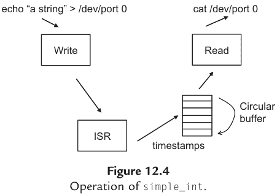

# 第 12 章

## 204

`flags` 包含几个位，包括以下三个：

- `IRQ_DISABLED`——设置时表示这是一个“快速（fast）”处理程序。快速处理程序在中断被禁用的情况下执行。除非绝对必要，否则不应设置此位。
- `IRQ_SHARED`——设置时，表示该中断线是共享的。多次注册同一个共享中断将执行成功。
- `IRQ_SAMPLE_RANDOM`——表示生成的中断可以为 `/dev/random` 和 `/dev/urandom` 使用的“熵池”贡献数据。

最后一个标志提供了更详细的解释。`/dev/random` 和 `/dev/urandom` 生成真正的随机数来为加密生成密钥。这些随机数基于向“熵池”贡献的随机事件。如果你的设备以真正的随机间隔产生中断（例如键盘），你应该设置此位。

然而，以固定间隔产生中断的设备（如滴答或垂直闪烁）不应设置此位。有趣的是，网络驱动程序不会设置此位，因为它们容易受到来自黑客通过规律且可预测的数据包定时所进行的黑攻击。`drivers/char/random.c` 文件中对此有一些相关的注释。

当内核响应中断并调用中断函数时，它会传递两个参数：

- 被激活的中断号。
- 传递给 `request_irq()` 的私有数据参数。

处理程序的返回值表示是否实际处理了该中断。如果处理程序处理了中断，它应该返回 `IRQ_HANDLED`。否则，它应该返回 `IRQ_NONE`。这有助于内核处理共享中断并检测虚假中断（spurious）。

### 探测中断

查看第 381 行的 `int_init()`。遵循标准的设备注册流程，下一个关注的问题是我们如何确定请求的中断号。有两个加载时参数控制这一过程——`irq` 和初始化为 `-1` 的 `probe`，意味着我们尚未确定要使用的中断。`probe` 有三个可能的值：

- `0`——使用基于默认输出（位 0）的默认值。
- `1`——从内核处寻求帮助以找到正确的 IRQ。
- `2`——驱动程序将自行进行探测。

内核提供了一对函数可以帮助确定设备连接的中断线。这些函数在第 276 行开始的 `kernel_probe()` 函数中所示。

`probe_irq_on()` 返回当前未分配中断的位掩码。该函数保留返回值并对其进行安排，以便设备生成中断。它调用 `probe_irq_off()` 并传递由 `probe_irq_on()` 返回的掩码值，`probe_irq_off()` 返回一个表示在调用 `probe_irq_on()` 后生成的的中数字。如果没有发生中断，则返回 0。如果发生多个中断（一种歧义情况），它返回一个负数。

最后的选项被称为“自探测（probing during probing）”。这在第 322 行开始的 `self_probe()` 中所示。它实际上是上述内核辅助方法的某种变体。在这种情况下，我们知道在输出位和可以跳转的输入中断的不同组合上可能会产生中断，因此我们将探测中断处理程序附加到任何一个空闲的中上。我们安排生成中断并观察会发生什么。

### 尝试一下

如图 12.4 所示安装跳线插。`simple_int.ko` 应该已经存在，是由构建 `simple_hw.ko` 的相同命令构建的。以 root 用户身份在目录下执行以下命令：

- `simple_hw` 当前已加载，执行 `./hw_unload`。
- `./int_load`。
- `echo "some string of text">/dev/port0`。
- `cat /dev/port0`。
- `rmmod simple_int`。
- `insmod simple_int.ko tasklet=1`。
- `insmod simple_int.ko probe=2`。
- `rmmod simple_int`。

## 延迟处理——“下半部”

几乎所有用的操作系统都将中断处理分为两个部分。第一部分是 ISR 本身直接响应中断。ISR 至少需要清除中断标志并可能读取某些数据。这是它应该做的所有。如果有更多工作要做（例如处理数据包），应该推迟到以后某个时候。在 Linux 中，这两个部分被称为“上半部”和“下半部”。下半部机制多年来经历了大量的修订和升级，事实上，原始的下半部机制已经过。`tasklet` 是一个接收长参数的简单函数，被调度在未来的某个时间运行。它在“软中断”上下执行，这意味着中断是开启的，它必须严格遵守 ISR 的规则。

下半部函数 `do_bottom_half()` 第 200 行首先读取并重置中断计数。它将计数格式化并写入文本缓冲区。接下来，将二进制时间戳缓冲区中的任何内容格式化，并写入文本缓冲区。最后，它唤醒读取函数。图 12.5 以图形形式描绘了这一过程。

中断服务程序（ISR）应该快速执行，以便中断可以重新开启。此外，我们希望尽快回到进程上下文，这对系统来说更“方便”。

# 内核模块与设备驱动程序

## 205

```
echo "a string " >/dev/port 0
cat /dev/port 0
```

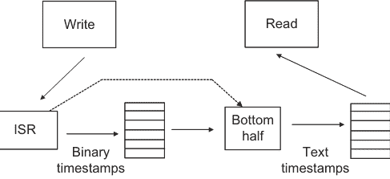

图 12.5 带有底半（Bottom Half）的 `simple_int`。

- `insmod simple_int.ko wo=1`
- `echo "a very long string of text" >/dev/port0`
- `cat /dev/port00`

你注意到了什么？`tasklet` 执行得相当快。而受调度器控制的 `workqueue` 执行时间要长得多。

### 将你的驱动编译进内核

在生产级嵌入式环境中，除非有专利方面的考虑，否则没有理由使用可加载内核模块。因此，当你的新驱动运行良好后，你可能希望将其编译进内核可执行文件中。这意味着将你的驱动集成到内核源码树中。这并没有你想象的那么困难。

首先，你需要将驱动源文件拷贝到内核源码树中。让我们用 `simple_hw.c` 来操作。在缺乏关于此问题的明确文档或建议的情况下，我建议将驱动源放在 `usr/src/linux/drivers/char`。

源文件需要一些细小的修改。在模块初始化函数的声明中，在 `hw_init` 之前添加 `__init`，使其看起来像这样：

```
__init hw_init(void)
```

`__init` 会导致函数被编译到初始化函数的特殊段中，这些函数会在启动过程的一部分被调用。一旦启动完成，该段就可以丢弃并重用内存。

当模块被编译进内核时，由 `module_init()` 标识的函数会被添加到启动时调用的初始化函数表中。结果是，你不需要在每次添加新驱动时都修改 `main.c` 来添加新的初始化函数。它是自动完成的。

此外，我们不再需要 `hw_cleanup()`，因为设备永远不会被移除。你可以用以下代码包裹该函数和 `exit_module()` 宏：

```
#ifndef MODULE
#endif
```

接下来，你需要编辑 `usr/src/linux/drivers/char` 下的 `Makefile`。注意，`Makefile` 主要由类似 `obj-*.o` 的行组成：

```
obj-$(CONFIG_yyyy) += yyyy.
```

其中 `CONFIG_yyyy` 代表由 `makeconfig` 过程设置的环境变量，`yyyy.o` 是一个对象文件。记得上一章提到的，所有的环境变量都以以下两种之一结尾：

- `"y"`：是。将此功能编译进内核。
- `"m"`：模块。将此功能编译为内核可加载模块，或者它被注释掉。

当顶层 `Makefile` 完成对内核源码树的遍历时，环境变量 `obj-y` 包含了所有应该链接到内核镜像的对象文件列表，而 `obj-m` 是应该被编译为内核可加载模块的对象文件列表。

在 `Makefile` 中添加以下行，或许可以放在最后：

```
obj-$(CONFIG_SIMPLE) += simple_hw.o
```


你还需要在配置菜单中添加一个项目。打开 `/usr/src/linux/drivers/char` 下的 `Kconfig` 文件。参考 mini2440 设备驱动的条目，为 `CONFIG_SIMPLE` 创建一个条目。

回到 `/usr/src/arm/linux` 并运行 `makeconfig`。滚动到字符设备部分，注意你的新条目出现了，并在提示符后带有 `(NEW)`。`xconfig` 注意到菜单中有一个配置变量尚未在 `.config` 文件中。

到此，我们在内核空间的编程旋涡就结束了。在下一章中，我们将研究 BusyBox 和系统初始化。

## 资源

Rubini, Alessandro, Jonathan Corbet, and Greg Kroah-Hartman, *Linux Device Drivers*, third Ed., O'Reilly, 2005。一方面，这是对内核级编程的一种非常易读且详尽的论述。另一方面，它相当过时了，因为它描述的是内核版本 2.6.10。因此，许多细节是不准确的。

模块和设备驱动编程的主题比我们在这里能涵盖的要广泛得多。希望这段介绍激发了你的兴趣，并让你想要进一步研究该主题：Venkateswaran, Sreeakrishnan, *Essential Linux Device Drivers*, Prentice-Hall, 2008。这一本涉及内核版本 2.6.23/24。

# BusyBox 与 Linux 初始化

Linux：GNU 世代的选择

ksh@cix.ufl.edu 在 1993 年将此印在 T 恤上

在嵌入式环境中，最大的问题往往是资源缺乏，特别是内存和存储空间。正如你无疑观察到的，无论是在阅读这本书的过程中，还是通过其他经验，Linux 太大了！内核本身通常在 2–3 MB 之间，然后是根文件系统及其包含的实用程序和配置文件。在本章中，我们将研究一种强大的工具，可以大幅减少 Linux 的整体“占用空间”，使其适应资源有限的设备。

我们在本章中将处理的另一个主题是用户空间初始化，特别是如何让我们的温度控器应用程序在启动时运行。我们还将为温度控器添加一个简单的显示。

## 介绍 BusyBox

即使你的嵌入式设备是“无头”的（即它在通常意义上没有屏幕和/或键盘），你仍然需要一些基础工具来进行用户交互。BusyBox 的理念非常精妙。与其为每个工具都创建一个独立的程序，为什么不直接写一个实现所有功能的程序呢？

Box 是高度模块化且可配置的。虽然它能够实现 300 多个命令，这意味着你需要在系统中拥有所有它们。配置过程让你精确选择哪些命令将包含在你的系统中。

BusyBox 支持 `xconfig` 和 `menuconfig` 菜单进行配置，就像内核一样。也像内核的 `make help` 目标显示了其他目标。奇怪的是，`xconfig` 没有出现在列表中。

没有 `_defconfig` 目标用于默认配置，因此我们的初始配置将来自其他地方。这就是 `fa.config` 文件的用途。将其拷贝到 `.config`，然后执行 `make xconfig` 或 `make menuconfig`。在构建选项，你可以选择使用静态链接库或共享库构建 BusyBox。虽然 xconfig 导航面板显示了许多选项类别，但实际上只有两个选项：(1) 配置、编译和安装 BusyBox；(2) 选择所需的应用程序（applets）。静态链接的 BusyBox 可执行文件大得多，但这样你就不需要共享库了。作为一个例子，我带有共享库的 BusyBox 是 634,368 字节。静态链接版本是 1,701,544 字节。

## BusyBox 的配置与安装

光盘有一个版本的 BusyBox。虽然它有点旧，但我建议它是很好的起点，因为那是板板上运行的。以后你可以从网站获取较新版本。将 `linux/busybox-1.13.tgz` 从光盘拷贝到主目录并解压。你会发现一个新的子目录 `busybox-1.13.3/`。

BusyBox 自称为嵌入式 Linux 的“瑞士军刀”，因为就像军刀一样，它是一个多功能工具。技术上，开发者称其为“多调用二进制文件”，这意味着该程序可以通过多种方式调用。这是通过对各种工具创建符号链接实现的。

214 第 13 章

# BusyBox 与 Linux 初始化 215

## 表 13.1: BusyBox 命令

| | dirname | hwclock | md5sum | resize | tac |
| :--- | :--- | :--- | :--- | :--- | :--- |
| | dmesg | id | mdev | rm | tail |
| acpid | dnsd | ifconfig | mesg | rmdir | tar |
| addgroup | dnsdomain | | | | tskset |
| adduser | dos2unix | ifensave | mkdir | route | tcpsvd |
| adjime | dpgk | ifplugd | mkdosfs | rpm | tee |
| ar | | ifup | mkfifo | p2 | telnet |
| arping | dumpmap | inetd | mkfs.minis | rtcwave | telneted |
| ash | unleites | echo | mkfs.vat | run-parts | tft |
| awk | ed | notifyd | mkpassword | runsv | tfpd |
| basename | egrep | install | mktemp | windsdir | time |
| beep | eject | | mkswap | rx | top |
| blkid | env | | ip | | | script | touch |
| brctl | envidr | | ipcalc | mount | tr | |
| bunzip2 | | | | | | point | sendmail | traceroute |
| bczat | | | | | | | |
| bzip2 | expr | | itcs | search | TRUE |
| cat | fakedented | | plink | nameseif | setconsole | ttysize |
| cav | fbsplash | | iprc | | setfont | udhcp |
| chat | dflush | | iptunnel | netstat | setkeycodes | udhcp |
| chattr | dformat | kb_mode | | setlogons | udhcp |
| chgrp | fisk | | kill | mset | unset | umame |
| chmod | grep | kill5 | nohup | setuidgid | uncompress |
| chpassword | findfs | | nloop | nslook | unexpand |
| chroot | flash_lock | klogd | od | sha1sum | unqiux |
| chrt | flash_unclock | length | openvent | sha256sum | unix2dos |
| clrt | free | linux32 | patch | pgrep | slattatch | zlma |
| cksum | freerandisk | linux64 | pidelf | softlimit | unzip |
| clear | fsink | | linux6 | ping | uptime | usleep |
| cmp | fminck | loadfeat | pipe_processor | prims | split |
| cp | ftppd | | pivot_root | | start-stop-daemon | uencode |
| crio | | get | | logger | popmaildir | strings | uconfig |
| crontab | ftput | login | | | vi | lock |
| cryptwp | fuser | logname | printenv | su | volume |
| date | get | logread | ps | sulogin | watch |
| grep | gunzip | ipd | lpw | scan | sv | watchdog |
| dd | zid | | lpr | raidautoutor | wc | wget |
| devallclt | | | rdate | swappoff | which |


| delgroup | hdparm | isattr | | swapon | who |
| deluser | head | lmod | readlink | switch_root | whoami |
| depmod | hexdump | itmac | reldate | | xargs |
| devm | hostid | | izop | realpath | sysctl | yes |
| df | hostname | | izcopcat | reforme | syslog | zcat |
| dhcprelay | httpd | | makemime | rence | | zcip |
| * | hush | | set | | | |

# 第 13 章

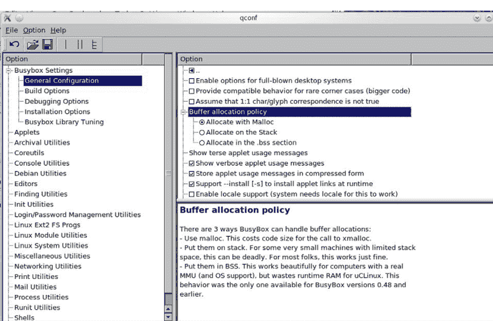

其中共享库存放的位置总共占了 14 MB。那么问题是，你是否在其他地方需要这些共享库？

编译选项（Build Options）也是你可以选择交叉编译器前缀的地方，请注意它已经为你设置好了。

在安装选项（Installation Options）下，你可以选择符号链接创建的方式。它们可以是软链接、硬链接或脚本“封装器（wrappers）”。由于指向相同数据的硬链接共享同一个节点，对于节点数量有限的系统，这是一个非常有用的选项。软链接是默认选项，也是最好的选择。

安装前缀（Installation Prefix）是错误的。它标识了你安装 BusyBox 的文件系统根目录。在案例中，你可以在这里指定，也可以在 `make install` 步骤通过添加 `CONFIG_PREFIX=/home/target_fs` 来指定。有趣的是，在 BusyBox 的早期版本中，如果不指定位置，它会默认到 BusyBox 树内的一个目录。现在已经不起作用了。

# BusyBox 与 Linux 初始化

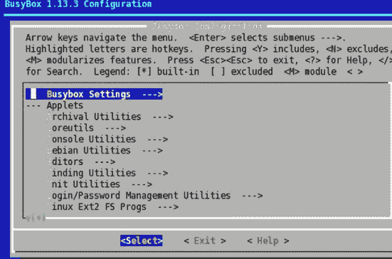

图 1.2

BusyBox menuconfig 顶部菜单。

## 应用程序 (Applets)

300 多个 BusyBox 应用程序分为几个类别。这些类别与 BusyBox 的目录树紧密对应。在许多情况下，BusyBox 版本省略了一些晦涩的选项。你可以将这些视为“精简版（lite）”。尽管如此，这些选项对于你的嵌入式系统已经足够了。在某些情况下，你可以选择你需要的命令。例如，Coreutils 类别并滚动到 `ls`。这样做的原因是为了减小代码体积。如果每个选项都能节省一些空间将会很好。浏览类别以了解情况。你会发现有很多不需要的东西，比如 `vi` 编辑器。你真的需要 `tar` 吗？查看 Shell 类别。默认 shell 是 `ash`，它声称是 BusyBox 发行版中最完整且正确的 shell。两个 shell `hush` 和 `msh` 功能较少，以换更小的内存。

## 编译与安装

BusyBox 使用标准的 `make` 和 `make install` 命令来编译和安装包。

# 第 13 章

标识你正在安装 BusyBox 的文件系统。在我们的案例中，你可以在这里指定，也可以在 `make install` 步骤通过添加 `CONFIG_PREFIX=/home/target_fs` 来指定。有趣的是，在早期 BusyBox 版本中，如果不指定位置，它会默认到 BusyBox 树内。现在不再有效。

### 硬链接 vs 软链接

在第 3 章，我们简要讨论了链接的概念。这个练习的目的是：硬链接是相同数据的替代名称或别名，它们指向磁盘上的相同数据块。在引用计数变为零之前，该数据不会被删除。相比之下，软链接或符号链接指向的数据，而是一个*名称*，而该名称可能不存在。

现在执行此操作：

```bash
ln ls lslink
ls -l
```

```bash
ln -s ls ls
ls -l
```

```bash
stat ls
stat ls
```

```bash
rm -f ls
ls -l
```

```bash
rm -f lslink
ls -l
```

你注意到了什么？特别是，`ls` 和 `lslink` 共享同一个索引（inode）。但 `ls` 具有不同的索引。

```bash
stat ls
stat lslink
```

```bash
rm -f ls
ls -l
```

```bash
rm -f lslink
ls -l
```

```bash
stat ls
stat lslink
```

```bash
rm -f ls
ls -l
```

当你从 BusyBox 执行 `ls` 时，结果如下。

`ls` 项被高亮，显示它指向的文件不存在。`ls` 的引用计数现在为 1。最后，将 `ls` 重命名为 `ls`：

```bash
mv ls ls
ls -l
```

```bash
stat ls
stat ls
```

```bash
rm -f ls
ls -l
```

```bash
rm -f lslink
ls -l
```

```bash
stat ls
stat lslink
```

```bash
rm -f ls
ls -l
```

`ls` 项被高亮，显示它指向的文件不存在。`ls` 的引用计数现在为 1。最后，将 `ls` 重命名为 `ls`：

```bash
mv ls ls
ls -l
```

```bash
stat ls
stat ls
```

```bash
rm -f ls
ls -l
```

```bash
rm -f lslink
ls -l
```

```bash
stat ls
stat lslink
```

```bash
rm -f ls
ls -l
```

`ls` 项被高亮，显示它指向的文件不存在。`ls` 的引用计数现在为 1。最后，将 `ls` 重命名为 `ls`：

```bash
mv ls ls
ls -l
```

# BusyBox 与 Linux 初始化

我们的恒温器现在是一个相当实用的网络设备，但它没有本地显示。如果你的 Mini2440 有 LCD，我们现在可以解决这个问题。首先是简单的历史。

多年前，Unix 以及随后的 Linux 系统典型的“控制台（console）”设备是通过串口连接到计算机的哑终端。这是一个经典的字符设备。当像数字设备公司（DEC）的 VT100 这样的视频终端变得“智能”时，提供了移动光标、更改颜色和选择性删除屏幕部分的方法。随后，PC 将位图“帧缓冲区（framebuffer）”设备的概念引入了计算机本身。

这些发展避免地在 Linux 驱动模型中引入了额外的复杂性。在串口视频终端时代，每个制造商最初都发明了自己的协议来处理光标控制等问题。因此，为了可移植性，这些互不兼容的协议必须被“抽象”成统一的形式。

# 第13章

“控制台设备驱动程序”的作用正是这样做——为那些需要不仅仅是输出字符流的应用程序提供一个统一的接口。

VT100 协议已成为终端控制的事实标准，这就是典型的控制台驱动程序向其暴露的 API。

同样，帧缓冲区（framebuffer）设备具有各种形状和大小，具有多种颜色深度，以及将位和字节映射到屏幕像素的各种方法。帧缓冲区的作用是暴露统一的 API，允许应用程序（实际上还有像控制台这样的驱动程序）以一致的方式管理这些差异。

LCD 面板的驱动是一个帧缓冲区驱动程序。主号为 29 的帧缓冲区设备。遗憾的是，帧缓冲区 API 的文档并不是非常详尽。不过没关系，因为我们反正不会直接使用它。

相反，我们将使用一个连接到设备号 40 的控制台驱动程序。该驱动程序正确地附加到 S3C2410 LCD 帧缓冲区驱动程序，任何写入它的内容最终都会显示在屏幕上。

### ANSI 终端转义序列

事实上，有一种用于控制控制台设备的标准协议。它基于 DEC 最初为其 VT100 系列视频终端开发的协议。该标准有许多常用名称，其中大多数包含 ANSI（美国国家标准协会）的缩写。

终端控制命令以转义字符 27 或 0x1b 开始，通常缩写为 `<ESC>`。通常后面紧跟着一个 "[" 字符以及一个或多个定义控制动作的字符。字符串 `<ESC>[` 被称为控制序列起始符（CSI）。

用于终端控制的完整 ANSI 标准非常详尽，我必须找到一个真正具有可读性的版本。作为参考，由欧洲计算机制造商协会（ECMA）编写的版本包含在光盘 `ECMA-048.pdf` 中。要查找其他版本，可以在 Google 上搜索“ansi terminal escape.” 之类的内容。

幸运的是，对于我们的目的，转义序列需要我们做的并不多。我们想要做的主要事情是移动光标，为我们的恒温器创建一个用户友好的显示界面。设置光标的方法是：

```
<ESC><row>:<col>H
```


其中 `<row>` 和 `<col>` 代表所需的光标位置。第 1 行第 1 列是屏幕的左上角。因此，为了将光标设置在第 2 行第 12 列，我们会在 C 中创建以下字符串：

```
\x1b[2;12H"
```

# 恒温器显示

有了这些背景，让我们为恒温器添加一个类似于图 13.3 的显示器。在 `home/src/lcd` 目录下创建一个名为 "lcd" 的 Eclipse 项目。打开 `lcdutils.c`。该文件包含以下函数：

- `lcd_erase(int what)`—根据 `what` 的值擦除当前行或整个屏幕。在 `lcdutils.h` 中定义了一对常量。可以向此函数添加其他选项。
- `lcd_init(void)`—打开控制台设备的文件并返回文件描述符。访问 I/O 端口 C 以控制背光。如果任何操作失败，则返回 `-1`。注意，文件描述符不是标准化的，但在必要时可以使用。
- `lcd_cursor(int row, int col)`—将光标移动到指定位置。
- `lcd_write_string(int row, int col, char *string)`—在指定位置写入字符串。
- `lcd_write_number(int row, int col, int value, int width)`—在指定位置以指定的宽度写入十进制值。
- `lcd_backlight(int on)`—如果为零，则关闭背光；否则开启。
- `lcd_close(void)`—关闭到控制台的文件并取消 I/O 映射。

这里有一个简单的程序 `lcdtest.c`，用于测试这些函数。查看 `lcdtest.c`。然后编译并尝试运行。

这些功能足够创建图 13.3 所示的屏幕了。使用新版本的恒温器尝试一下。然后，当网络更改任何参数时，你将看到显示器上的相应更新。为 `netthermo_t` 创建一个 Eclipse make 目标 `target`。

当然，根据需要向 `lcdutils` 中添加新功能。

| 温度 | 设定值 |
|---|---|
| 52 | 50 |
| 限制 | 死区 |
| 56 | 1 |

图 13.3

恒温器 LCD 屏幕。

# 222 第13章

## ncurses 库

对于这个问题，实际上我们在第 6 章讨论模拟时曾简要遇到过一个更高层次的解决方案。`devices` 程序利用 `ncurses` 库在窗口中移动光标。`ncurses` 可以完成很多事情，如更改颜色和设置字体。

这里没有使用 `ncurses` 有几个原因。虽然它几乎是每个 x86 Linux 发行版的一部分，但它并不是我们正在使用的 ARM 工具链的一部分。这是一个非常有用的工具，我鼓励你去查看，但尽管如此，理解底层 API 仍然很有用。

`ncurses` 是 GNU 库的一部分。请查看 Resources 中的网络位置。

## 用户空间初始化

我们现在有一个实用的恒温器应用程序。接下来我们需要做的是安排系统启动时运行该程序。此外，我们可能不需要控制台 shell。

让我们检查一下从通电到内核启动用户空间的初始化过程。基本上有四个步骤。

### 阶段 1 加载程序

当通电并释放复位引有时，内核启动第一个进程。在这种情况下，`sysinit` 动作是执行 `rc` 脚本。这段代码执行低级初始化。

### U-Boot

`U-boot` 加载程序继续初始化过程。如果自动启动序列没有中断，它会将内核从 Flash 拷贝到 RAM。

### Linux 内核

如果内核是一个压缩镜像，它会将自己解压到 RAM 中适当的位置。然后它初始化所有外设设备。在初始化过程中，内核会输出大量描述其正在操作的消息。接下来，它挂载根文件系统。到为止，内核一直在内核空间运行。最后，它启动 `init` 进程，完成向用户空间的过渡。

### init 进程

`init` 总是内核启动的第一个进程，它的工作是让一切正常运行。`init` 可执行文件通常是 `/sbin/init`，尽管内核会搜索其他几个替代位置。在我们目标板的情况下，`/sbin/init` 与几乎所有其他可执行文件一样，指向 BusyBox 的链接。

`init` 从 `/etc/init` 文件获取指令。查看 `target_fs/etc/init`。顶部的注释很好地说明了情况。每个条目都有由冒号分隔的四个字段：

```
<runlevel>:<action>:process
```

| id | 连接到进程的 tty。如果进程未使用控制台则为 NULL。 |
| runlevel | BusyBox 忽略。 |
| action | init 处理进程的方式。 |
| process | 要运行的程序以及任何参数。 |

允许的动作有：

- `once` | 执行一次进程。
- `wait` | 执行一次进程。Init 等待进程终止。
- `askfirst` | 询问用户是否应该运行此进程。
- `sysinit` | 这些进程在执行其他内容之前执行。
- `respawn` | 每当进程终止时重新启动。
- `restart` | 类似于 `respawn`。
- `shutdown` | 在系统关机时执行这些进程。
- `ctrlltdel` | 当 init 接收到 `SIGINT` 信号（意味着操作员按下 CTRL-ALT-DEL）时执行此操作。

# 224 第 13 章

启动应用程序最简单的方法可能是从 `inittab` 内部。在 `ttyn` 条目之后添加以下条目：

```
ttySA0::respawn:/home/src/lcd/netthermo_t
```

我们不需要控制台终端，因此注释掉以 `ttySA0` 开头的现有行。保存 `inittab`。

重置目标板并让它启动 Linux。你应该看到温度计开始启动。

顺便提一下，启动程序的另一种方法是直接替换 `sbin/init`。将其变为指向应用程序可执行文件的符号链接。这对于简单的应用程序可能是可以的，但 `inittab` 中有很多功能在最终产品中可能有用。

在第 14 章中，我们将更仔细地查看 U-boot 并为我们的“产品”出货做好准备。

## 资源

从通电到 Bash 提示符（From Power Up to Bash Prompt）——这份来自 Linux 文档项目的 HOW-TO 简要描述了从开启电源到登录并获得 bash 提示符期间发生的情况。

`www.busybox.net`—这是 BusyBox 的官方网站。

- Linux Documentation/ 目录下的一对文件提供了关于控制台和帧缓冲器的额外信息：
  - `serial_console.txt`
  - `framebuffer.txt`

`www.gnu.org/software/ncurses/ncurses.html`—自由软件基金会 `ncurses` 项目的主页。

# U-Boot 引导加载程序与准备工作

盒子上写着“需要 Windows 95 或更高版本”。于是，我安装了 Linux。

# U-Boot

正如我们在上一章中看到的，引导加载程序是一个执行某些初始化操作的程序，为加载和运行操作系统及其支持基础设施做准备。在某种意义上，引导加载程序类似于桌面 PC 或服务器中的 BIOS。主要的区别在于，引导加载程序在系统启动时执行一次就会消失，而 BIOS 则驻留以提供低级 I/O 服务。

# 背景

桌面 Linux 系统除了 BIOS 之外还有一个引导加载程序。现在它通常是 GRUB。因为 BIOS 完成了硬件初始化的大部分工作，GRUB 本身所做的不仅仅是加载并启动操作系统。如果你基于传统的 x86 PC 构建嵌入式系统，GRUB 可能是你的选择。

我们的目标基础使用了一个非常流行、功能强大的开源跨平台引导加载程序来启动程序。我们在第 5 章启动目标板时曾简要见过 U-Boot 的功能。

U-Boot 起于由 Magnus Damm 编写的名为 `8xxROM` 的 PowerPC 引导加载程序。随后，Wolfgang Denk 将项目移动到 Source Forge 并重命名为 PPCBoot。源代码曾被 Sysgo GmbH 分支出一个名为 ARMBoot 的产品。当 ARMBoot 合并到 PPCBoot 树时，名称改为 U-Boot。今天，U-Boot 支持约十种架构和 400 多块板卡。

U-Boot 的开发与 Linux 紧密相关，因为它共享一些头文件。部分源代码源自内核源码。

U-Boot 支持广泛的命令集，不仅便于引导，还能管理内存、通过网络下载文件等。附录 A 详细说明了

# 226 第 14 章

该命令集还通过环境变量和脚本语言进行了增强。

# 安装和配置 U-Boot

请参阅“资源”部分以获取 U-Boot 源码 tar 包的位置。有许多版本供选择，我恰好选定了 1.3.2 版本。在主目录中解压 tar 包。你会找到一个名为 `uboot-<version_number>` 的新子目录。根目录下有一个非常详细的 README 文件。`doc/` 目录下还有额外的 README 文件，主要描述板卡的功能。

U-Boot 支持 `makeconfig` 甚至 `menuconfig`，至少目前还没有。配置通过手动编辑头文件完成。`cd include/configs/` 并打开 `mini2440.h`。配置变量标识如下：


- 配置选项以 `CONFIG_` 开头命名。

- 硬件特定的配置设置以 `CFG_` 开头命名。

`README` 文件警告说，“如果你不知道自己在做什么，就不要动这些内容”。

- 包含的 shell 命令以 `CONFIG_CMD_` 开头命名。

像 `BusyBox` 一样，你可以选择 150 多个 shell 命令中的任何一个包含在 `U-Boot` 中。从 111 行开始是初始命令列表，从一组默认设置开始。在第 299 行定义了 `NAND` 分区，随后是初始设置的环境变量。

当你完成安装并可能已经编辑了 `mini2440.h` 后，返回 `uboot-<version_number>`，执行：

```
make mini2440_config
```

`U-Boot` 的 `Makefile` 非常有趣。用编辑器打开它。从第 470 行开始，`include/configs/` 目录下的每个头文件都有一个 "config" 目标。大多数条目都类似于第 2480 行的 `Mini240` 条目。`make unconfig` 会删除由之前调用 `mkconfig` 脚本创建的几个文件。接下来，带有描述 `board` 中问题的参数调用 `mkconfig` 脚本。

要构建 `U-Boot`，直接调用 `make` 即可，就像我们处理内核和 `BusyBox` 时所做。顺便注意，没有必要指定交叉工具链前缀 `arm-linux-`。它会被自动处理。

# U-Boot 引导加载程序与准备工作

`make` 步骤生成了几个文件：

- `U-Boot.map`—输出映射文件
- `U-Boot.bin`—二进制镜像，适用于写入
- `U-Boot.nand2k`—增加 2k 大小的二进制可执行文件
- `U-Boot.nand16k`—增加 16k 大小的二进制可执行文件
- `U-Boot.srec`—`Motorola S record` 格式的可执行文件

`make` 步骤还在 `tools/` 中使用 `mkimage` 构建了几个工具。

## 测试新的 U-Boot

我们快要完成了。我们配置了内核和引导加载程序以满足我们的需求。我们设置了 `init` 进程，使其直接进入温度计应用程序。最后一步是创建一个 `YAFFS` 文件系统镜像，我们可以将其烧入 `NAND` 闪存中。

我们之前看到 `NAND` 闪存是以各种大小的分区任意定义的。具体来说，我们的闪存有 `mini2440.h` 中定义的四个分区，在此列出供参考：

| 名称 | 大小 | |
| :--- | :--- | :--- |
| u-boot | 0×00040000 | 0×00000000 |
| env | 0×00020000 | 0×00040000 |
| kernel | 0×00050000 | 0×00060000 |
| root fs | 0×07aa0000 | 0×05600000 |

根文件系统位于根分区，对应 `mtdblock3`。为了从 `NAND` 闪存挂载根文件系统，我们在命令行向内核传递参数，以挂载 `/dev/mtdblock3`。

## 第 14 章 “JTAG” NOR

好了，假设你的 `NOR` 闪存损坏了。你该怎么办？嗯，`NOR` 闪存可以通过板卡的 `JTAG` 端口重新编程。

`Mini240` 套件的一部分是一个被称为 `JTAG` “wigler”的设备，它插入 `PC` 的并行口，并连接到板卡上的 10 针扁平 `JTAG` 端口。注意，`USB` 转并行口的转换器无效；必须是原生并行口。套件中的 `H-JTAG/` 目录包含一个控制“wigler”的 `Windows` 应用程序。那里还有一个名为 `JTAG the NOR` 的 `PDF` 文档说明了如何操作。

## 创建闪存文件系统

我们快要完成了。我们配置了内核和引导加载程序以满足我们的需求。我们设置了 `init` 进程，使其直接进入温度计应用程序。最后一步是创建一个 `YAFFS` 文件系统镜像，我们可以将其烧入 `NAND` 闪存中。

我们之前看到：

```
head/dev/mtd1
```

这应该会显示 `U-Boot` 环境的第一部分。

从 `U-Boot` 提示符执行以下命令：

```
printenv set_bootargs_nand
```

## U-Boot 引导加载程序与出准备

```bash
run set_bootargs_nand
printenv bootargs
```

在第 16 节的最后，我们获得了一个可以直接启动进入我们的显示恒温器应用程序的文件系统。最后一步是将文件系统加载到目标板卡的 `NAND flash` 闪存中，这样当板卡上电时，恒温器就会启动。

我们需要创建一个 `YAFFS` 文件系统镜像，这是一种特定格式的文件，其中包含了文件系统中的所有内容。`YAFFS` 项目提供了一个恰好可以实现此工作的工具。在工作站的终端窗口中切换到 `root` 用户。挂载 `FriendlyARM` 的 `DVD`，进入 `DVD` 上的 `linux/` 目录，并将 `mkaffs2image.tgz` 复制到根目录 `/`，执行 `cd`。随后 `/usr/sbin` 下将出现两个新的可执行文件：`mkaffs2image` 和 `mkaffs2image-128M`。确保这两个文件对所有人都有执行权限。

退出 `root` 终端并回到你的家目录。执行：

```bash
mkaffs2image-128M /var/lib/tftpboot/root_qopia.yaff root_qopia
```

这在 `/var/lib/tftpboot` 中创建了文件 `root_qopia.yaff`，它是 `root_qopia/` 的 `YAFFS` 文件系统。我在我在执行此操作时遇到过几次问题。尽管闪存有 128 MB（更多），但整个文件必须放入 64 MB 的 `RAM` 中。

如果你已经使用 `NFS` 挂载的目标文件系统工作了一段时间，你可能积累了一些垃圾文件。清理 `/home/src` 下的所有目录。那里有 2 MB 的管道垃圾，你不需要那些。在 `/lib/modules` 下可能有内核模块。事实证明它们是非必要的，内核永远不会加载它们。你可以删掉它们。

当你将 `root_qopia.yaffs` 精简到 64 MB 以下时，按照以下步骤操作，这些步骤与我们处理引导加载程序的操作类似：

1. 启动目标板进入 `U-Boot` 提示符
2. `tftpboot 30080000 root_qopia.yaffs`
3. `erase root`
4. `nandwrite.yaffs 30080000 root $(filesize)`
5. `run set_bootargs_nand`
6. `boot`

恒温器应用程序应该开始运行了。

最后，你可能想加载在第 11 节中创建的内核。过程与加载文件系统基本相同。只需将内核文件 `uImage` 复制到 `/var/lib/`，在上述第 2 步中将“root_qopia.yaff”替换为该名称，并在第 3 和 4 步中将“root”替换为“kernel”。

### 关于闪存分区的更多思考

在运行的 `Linux` 中，执行 `cat /proc/mtd`。你应该看到以下内容：

```
mtd0: 0004000000200000 "supervivi"
mtd1: 0002000000200000 "param"
mtd2: 0050000000200000 "Kernel"
mtd3: 07aa000000200000 "root"
mtd4: 0800000000200000 "nand"
```

与我们在 `U-Boot` 中通过 `mtdparts` 命令获取的分区列表进行比较。很奇怪，名称不同。内核对闪存分区有自己的视图。`U-Boot` 在 `include/configs/mini2440.h` 中声明分区。内核则在 `arch/arm-mach2440/mach-mini2440.c` 中声明它们。幸运的是，大小与上面的分区列表一致。`00020000` 是分区的擦除块大小。

这里显然存在混淆的潜在风险，甚至更糟。显然，在一个地方声明分区会更好。但只有几种方法可以实现这一点。分区可以通过内核命令行传递。其格式如下为：

```
mtdparts = <mtddef>[,<mtddef>
<mtddef> = <mtd_id>:<partdef>[,<partdef>
where mtd_id 是一个名称。
<partdef> = <size>@[offset][<name>][ro]
<size> = (' NAME ')
```

这本质上是为了开启默认未开启的特定配置变量而使用的声明格式。那就是使用 `CONFIG_MTD_CMDLINE_PARTS`，它可以在内核的 `xconfig` 菜单的 `Device Drivers -> Memory Technology Devices (MTD) Support -> Command line partition table parsing` 下找到。

### 平坦设备树 (Flat Device Tree)

另一种一致性硬件定义方法，它超越了我们刚刚描述的内容，并向引导加载程序和内核定义系统所有的硬件。它被称为平坦设备树（`FDT`）。


事实上，问题不仅仅是闪存分区。有大量的硬件信息在引导加载程序和内核之间共享：

- `RAM`——大小和位置

- 外设：

    - 以太网

    - 控制台

`FDT`，也称为 Device Tree Blob、设备树二进制文件或直接称为设备树，提供了一种向引导加载程序和内核通信这些信息的机制。`FDT`源自 IBM 的 Open Firmware 规范，是表示硬件的数据库。硬件表示是以 `.dts` 扩展的文件创建。一个特殊的编译器 `dtc` 将树转换为二进制表示，即“blob”，它与内核一起加载到内存。设备树由表示设备的节点组成。每个节点包含关于设备的属性键值对。值是任意字符串，对于某些属性，它们包含表格或其他信息。我们在这里不详细介绍语法。请参考资源。

`FDT`概念演变自内核的 PowerPC 分支。事实上，所有 PowerPC 平台要求在启动时向内核传递设备树。`.dts`文件通常位于源码树的 `arm/boot/`。设备树支持必须编译到内核和 U-Boot 中。U-Boot 有两个变量 `CONFIG_OF_FDT` 和 `CONFIG_OF_SETUP` 来启用设备树支持。这些都不是可选。当 U-Boot 启用设备树支持时，启动过程会有不同。必须将内核镜像和编译后的设备树加载到 RAM。语法变为：

```
kernel..fdt
```

`fdt`通常在控制权交给内核时通过处理器寄存器传递。好了，恒温器应用程序已烧入闪存并准备好出厂。在下一节中，我们将注意力转向源代码。

### Resources

- `www.denx.de`——这是 U-Boot 主要开发者 Wolfgang Denk 的网站，当然，源代码位于：`http://denx.de/pub/u-boot/`——这里提供了追溯到 2002 年的 U-Boot 版本。

- `www.yaffs.net/`——YAFFS 文件系统的官方网站。

- `www.denx.de/wiki/U-Boot/UBootInfo`——除了其他内容外，该页面包含平坦设备树的良好参考文献。

- `http://fedaproject.org/Reprints-2008/likely-reprint.pdf`——《A Symphony of Flavours: Using the Device Tree to Describe Embedded Hardware》，这是 Grant Likely 和 Josh Boyer 在 2008 年的 Linux 演讲稿。

# 献辞

在个人层面，这本书献给我生命中最重要的两个人：

**致 Susan**，我最好的朋友，我的灵魂伴侣。感谢你与我共同度过生活的旅程。

**致 Brian**，初露的灯光设计师、演员、音乐家、未来的飞行员，以及一个全能的优秀孩子。感谢你让我保持童心。

> 永远不要怀疑，一群坚定的公民可以改变世界。事实上，这是唯一曾经做过此的事情。

玛格丽特·米德（Margaret Mead）

在专业层面，这本书献给那些让这一切成为可能的人：各地的开源程序员，特别是那群小小的开源先驱，他们为了社区的利益、仅仅是出于兴趣，而提出的自由软件激进理念，确实改变了世界。

# 前言

就在二十年前的今天

士陆大椒士教了乐队如何演奏

约翰·列侬，士陆大椒士的孤独心俱乐部

来自发件人：`torvvalds@klaava.Helsinki.FI` (Linus Benedict Torvalds)

新闻组：`comp.minix`

主题：你最希望在 minix 中看到什么？

摘要：对于我的新操作系统来说很小

消息ID：`<1991Aug25.205708.951@klaava.Helsinki.FI>`

日期：1991年8月25日 20:57:08 GMT

机构：赫尔辛基大学

minix 的各位，大家好——

我正在做一个（免费的）操作系统（只是个爱好，不会像 gnu 那样庞大和专业）

(486) AT 兼容机。这从4月就开始酝酿了，我想准备一下。我想听听大家是否喜欢或不喜欢 minix 的反馈，因为我的操作系统与它有很多相似之处（例如出于实际考虑，文件系统的物理布局是相同的）。

我目前发布了 `bash(1.0)` 和 `gcc(1.4)`，它们似乎运行良好。这意味着我将在几个月内产出一些实用的东西，我想知道大多数人最想要哪些功能。欢迎任何建议，但我不保证一定会实现它们:-

Linus (`torvalds@kruuna.helinki.fi`)

备注。是的——它不包含任何北欧代码，并且拥有多线程文件系统。

它不是可移植的（使用了 386 任务切换等），而且可能永远无法在 AT 硬盘以外的任何设备上运行，因为我只有这种设备：

通过当时尚处于萌芽阶段的纯文本互联网，芬兰的大学生林纳斯·托瓦尔斯（Linus Torvalds）开启了一场革命。当我于2011年底写下这些文字时，Linus 已经庆祝了他的 20 周年。我怀疑 Linus 是否知道他的“爱好”项目很快就会变成一个强大的、32位的、此后是64位的操作系统，并足以与雷德蒙的“博星军”抗衡。

# 前言

不用说，Linux 在 20 年里走了很远的路。原始版本 0.01 于 1991年9月17日发布，由 88 个文件组成，总计 278 KB。现代的 Linux 版本接近 40,000 个文件，占用空间超过 400 多 MB。从字面上说，全球成千上万程序员正以各种方式参与 Linux 开发。

自从自本书第二版于 2006 年出版以来，Linux 世界发生了许多变化，这自然也是编写新版的动力。内核持续进化和改进，最近为了纪念 20 周年，已更新到 3.0 版本。Google 在 2007 年底引入了 Android 变体。2011 年 8 月，估计 Android 占了智能手机市场 48% 的份额，每天有超过 50 万台设备激活！

我在第一版的前言开头曾承认，我从未喜欢过 Unix，认为它刻意晦涩且难以使用。起初，Linux 并没有怎么改变我的这种印象，我对它仍然抱有某种爱与恨交织的情绪。

但是，尽管 Linux 在桌面计算领域仍在缓慢准备进入主流舞台，但它在我工作的嵌入式领域以及网络服务器世界已取得了显著成功。2007 年，LinuxDevices.com 报告说 Linux 应用于 50% 的嵌入式项目/或产品，预计到 2012 年将达到 70%。甚至微软承认，Linux 运行着世界上 60% 的 Web 服务器，而 Windows 服务器占 40%。

Linux 确实很复杂，除非你已经是 Unix 大师，否则学习曲线非常陡峭。网络上有很多相关信息，但通常更容易找到可读性材料。市面上可能有数百本关于 Linux 的书籍，涵盖了从初学者指南到讨论内核内部机制的各个方面。但现在甚至有很多书籍讨论嵌入式和实时领域的 Linux。

我决定攀爬 Linux 学习曲线，部分是因为我被开源开发模型所吸引。全世界的程序员为了兴趣而为一个极其复杂的系统的开发做出贡献，这种想法简直令人不可思议。拥有完整的源代码不仅让你能随心所欲地修改它，还能让你（至少在原则上）理解代码是如何工作的。

开源有潜力引发我们社会经营模式的重大范式转变，因为它证明了在开发问题解决方案时，合作可以像竞争一样有用。虽然我怀疑是否有人通过 Linux 变得巨富，但许多公司已经证明了可以围绕它建立可靠的商业模式。

# 读者群与先决条件

我写这本书的动力部分我对开源开发模型感兴趣。当我开始接触 Linux 时就有这种想法。基于此，本书针对两类不同的读者：

- 1. 主要读者群是需要了解嵌入式领域 Linux 的嵌入式程序员。这是我的来源以及我进入 Linux 的途径；因此这样安排书籍是合理的。

- 2. 另一类读者是需要嵌入式和实时编程概念的 Linux 程序员。

因此，每组读者都可能看到一些熟悉的材料，但会以新的视角呈现。

本书并不打算作为新手指南。我假设你已经成功安装了 Linux 系统并至少尝试过它。你知道如何登录，使用过命令工具，并可能运行过 GUI 桌面。尽管如此，第 2 章将带你完成安装过程，第 3 章是对某些功能的简要介绍。

本书大致分为三个部分。第一部分是介绍性的，并为第二部分（讨论应用程序）做准备。第三部分介绍嵌入式 Linux 程序员工具箱中的各种组件和工具。

除了 OpenEmbedded 之外。最后，我们将通过探索 Linux 的实时增强来结束。。

好了，让我们开始吧。加入我的行列，在激动人的嵌入式 Linux 世界中来一场惊险刺激、有时颠簸，但最终充满趣味且收获满满的过山车之旅。

# 构建工具

目标代码（Object code）的伟大之处在于，它可以让简单简单的问题看起来非常巨大且复杂。

一个嵌入式 Linux 系统有几个主要组件，它们都源自免费获取的源代码，并且都可能需要不同程度的定制。这些组件包括：

- 引导加载程序 (Boot loader)

- Linux 内核 (Linux kernel)

- 根文件系统 (Root file system)

- 交叉工具链 (Cross-tool chain)

在书中，我们将这些视为独立的元素，没有过多关注它们来自哪里、如何构建或它们之间是如何相互作用的。

这些元素共同构成了一个嵌入式 Linux 发行版。许多嵌入式发行版已经演变，以解决构建和整合这些元素的问题。我们将在本章查看其中一些。

# Buildroot


Buildroot 源于开发 uClib 和 Busybox 的同一个项目。uClib 是 glibc 的轻量级版本，专门为嵌入式 Linux 应用开发。它最初是为了支持适用于 Linux 非内存管理单元（MMU）处理器的变体 uClux 的。与大多数现代开源库一样，uClib 在通用库通用公公共许可证（LGPL）下发布。

Buildroot 是一组 Makefile、脚本和补丁，旨在简化构建交叉编译工具、根文件系统和 Linux 内核镜像的过程。对于在非 x86 处理器上工作的嵌入式开发者来说，这是一个特别重要的问题。

Buildroot 以及其他类似系统（如 OpenEmbedded，OE）的一个有趣方面是，所有内容都是从互联网上的源码构建的。这种初始构建的一个结果可能是需要很长时间，通常是几个小时。另一个特性是 Buildroot 专门设计为作为普通用户运行。你不需要成为 root 用户。

首先，从 buildroot.uclibc.org 下载 tar 包。在编写本文时，最稳定的发布版本是 `buildroot-2012.05`。将其解压到合适的位置，可能是你的家目录。执行 `make help` 查看所有可用内容。注意，有一组类似于我们在内核中看到的 *defconfig* 目标，包括 `mini2440_defconfig`。通过 `make xconfig` 执行 `make mini2440_defconfig`。

图 16.1 是 xconfig 菜单的截图。广而言之，配置选项分为以下几类：

- 目标架构和变体
- 构建 Buildroot 的选项
- 工具链选项
- 系统配置
- 目标包选择
- 引导加载程序
- 内核

帮助信息通常比我们在内核配置中看到的要没用。你可能想要更改几个地方。在工具链（Toolchain）下，启用宽字符（WCHAR），这似乎是许多其他功能的要求。

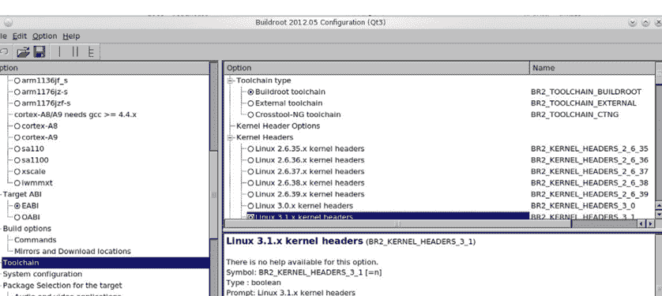

图 16.1

Buildroot xconfig。

3.1.x 头文件，因为我们使用的是 3.1.5 版本。为目标启用 `gdbserver` 并为主机构建 `gdb`。在网络应用下，你可能可能想为 Eclipse Remote System Explorer 选择 `openssh`。在文件系统下，选择 `ext2` 根文件系统，我们用于 NFS 挂载。退出并保存更改。

执行 `make`。几小时后，你应该会发现 `output/` 子目录被填充了这些内容：

- `build/`—除交叉工具链外的所有组件都在这里。
- `images/`—引导加载程序、内核和根文件系统的最终镜像。
- `host/`—为 BuildRoot 需要的主机编译工具，包括交叉工具链。
- `staging/`—指向 `output/host/usr/sysroot` 的链接。它的目的并不明确。
- `target/`—一个几乎完整的目标文件系统。它缺少 `dev/` 目录，该目录必须以 root 用户身份创建。请使用 `images/` 中的文件系统。
- `toolchain/`—交叉工具链组件的构建目录。

# OpenEmbedded

OE 项目将自己描述为创建 Linux 发行版的软件框架，主要但不限于嵌入式应用。它源于用于 Sharp Zaurus 个人数字助理（PDA）的 OpenZaurus 项目。OpenZaurus 开发者认为他们已经推 own Buildroot 的极限。

很快，其他参与 OE 开发的开发者加入了，多年来嵌入式发行版一直基于 OE 的代码库。OE 在 2011 年 3 月与 Yocto 项目合并，形成 OE-Core 项目。

从根本上说，OE 包含两个元素：称为 BitBake 的构建引擎以及告诉 BitBake 要做什么的元数据（metadata）。BitBake 用 Python 编写。援引用户手册，“不像简单的项目工具，[BitBake] 不基于单个 makefile 或一组封闭的相互依赖的 makefiles，它收集并管理一组很大程度上独立的构建描述（包配方/recipes）并按正确的顺序构建它们。”

BitBake 的操作可以用图形化表示，如图 16.2 所示。它解释（或者如果你愿意的话）配方和配置文件，以确定需要构建什么以及如何构建。然后它通过网络获取必要的源代码。输出是一组包和文件系统。

元数据分为四类，每类都履行特定的角色：

- 配方 (*.bb)——这些是最常见的元数据形式。配方为 BitBake 构建包提供了指令。配方描述了包、其依赖关系以及构建它所需的特殊操作。构建它。


图 16.2

BitBake 操作。

- 类 (*.bb)——它们的作用类似于面向对象编程语言中的类。它们封装了跨包的通用功能。在我的经验中，这并不复杂（注：此处原文可能有断句）。
- 任务 (Tasks)——用于将包分组。
- 配置 (*.conf)——定义 BitBake 的整体行为。

## 入门

Bill Sargent 的博客关于如何开始有很好的教程。在我的经验中，它是简单的。许多工具可能安装在你的系统上。我们把 OE 直接安装在你的家目录下。通过此获取仓库：

```bash
git clone git://repo.cz/openembedded/mini440.git
```

下载后你将拥有一个包含 1000 多个文件的目录。查看几个典型的配方文件：`recipes/bash_3.0.bb` 和 `recipes/helloworld_1.0.bb`。bash 配方非常简单。关键字相当于 C 语言中的 #include。`PR` 是修订版本或版本号，`SRCURI` 出现在每个配方中。

```bash
mkdir build
mkdir sources
mkdir build/conf
cp mini440_local.conf build/conf/local.conf
```

`DL_DIR`—源码的绝对路径

`BBFILES`—配方的绝对路径

`MACHINE` 变量

`ASSUME_PROVIDED += gcc-native`

删除写有 "# REMOVE THIS LINE" 的行

最后一行是确保你阅读了整个文件。

```bash
export BPATH=/path/to/openembedded:/path/to/build
echo 0>/proc/sys/mmap_min_addr
bitbake-v task-base
```

去吃饭看电影吧。这将为你提供镜像或单个包所需的基本编译器、库和工具。尝试构建 console-image 方：

```bash
bitbake-v console-image
```

这将产生内核镜像、uimage 和可以写入闪存的根文件系统 `console-image.jff2`。

如往常，我们只是触及了这个非常广泛工具的表面。如果你感兴趣，可以深入学习。

# 252 第 16 章

我在 BuildRoot 上取得了一些（但并不多）成功。至少 BuildRoot 更加“易于上手”，因为它是基于脚本和 Makefile 等熟悉的概念构建的。

# Android

到目前为止，任何对消费级技术有一点点了解的人都知道，Android 是 Google 为移动设备实现的 Linux 系统。你可能不知道的是，Android 是全球领先的智能手机平台，在 2012 年第一季度占了 59% 的市场份额。每天都有一百万台 Android 设备被激活！

当然，Android 不仅仅是 Linux；它是一个完整的开发框架，如图 16.3 所示。虽然大多数 Android 应用是用 Java 编写的，但该平台中没有 Java 虚拟机，且不执行 Java 代码。Java 类被编译成 Dalvik 可执行文件，并运行在 Dalvik 上。Dalvik 是一种专门为 Android 设计的专用虚拟机，并针对内存和 CPU 有限的电池供电移动设备进行了优化。

本文写作时 Android 的最新版本是 4.1 Jelly Bean，它于 2012 年 7 月发布。有趣的是，自 2009 年 4 月发布的 1.5 Cupcake 版本以来，所有版本都按字母顺序以甜点命名命名。

Android 开发分为两个不同的层次：应用开发和平台开发。应用开发可以在 Windows、Linux 或 Mac OS (Intel) 上进行。平台开发仅限于 Linux 和 Mac OS。

## 应用开发

首先从 `developer.android.com/sdk/` 下载 Linux 版 Android 软件开发包（SDK）压缩包。在合适的位置解压这个约 80 多兆的文件。这只是个开始。你需要 Android SDK Platform Tools 以及一个实际的可执行工具 `tools/android` 来弹出图 16.4 所示的对话框。选择 Android SDK tools 和 Android 4.1 (API 16)，然后点击 Install 7 packages（安装 7 个软件包）。你需要接受许可。最简单的方法是 Accept All（接受全部）。


下载完成后，最有用的操作是进入 `docs/about` 并用网络浏览器打开 `index.html`。这将引导你进入一个非常详尽且深入的开发者指南。Eclipse 是 Android 首选开发环境，因此你需要下载 Eclipse 的 Android 插件。在完成所有安装和配置后，最好的办法可能是进入“构建你的第一个应用”（Building Your First App）。

# 应用

| 主页 | 联系人 | 电话 | 浏览器 | ... |
| --- | --- | --- | --- | --- |

# 应用框架

| Activity 管理 | 窗口管理器 | 内容提供者 | 视图系统 | 通知管理器 |
| 包管理器 | 电话管理器 | 资源管理器 | 位置管理器 | XMPP 服务 |

# 库

# Android 运行时

| 表面层管理器 | 媒体框架 | SQLite | 核心库 |
| OpenGL ES | Free | WebKit | Dalvik 虚拟机 |
| SGL | SSL | libc | |

# Linux 内核

| 显示驱动 | 摄像头驱动 | 蓝牙驱动 | 闪存内存驱动 | Binder (IPC) 驱动 |
| USB 驱动 | 键键驱动 | WiFi 驱动 | 音频驱动 | 电源管理器 |

> 图 16.3
> Android 框架。

一旦你构建了第一个“Hello World”应用，可以通过 USB 连接到真实的 Android 设备上运行，也可以在 器器上运行。这两种方法都可以从 Eclipse 访问。

# 254 第 16 章

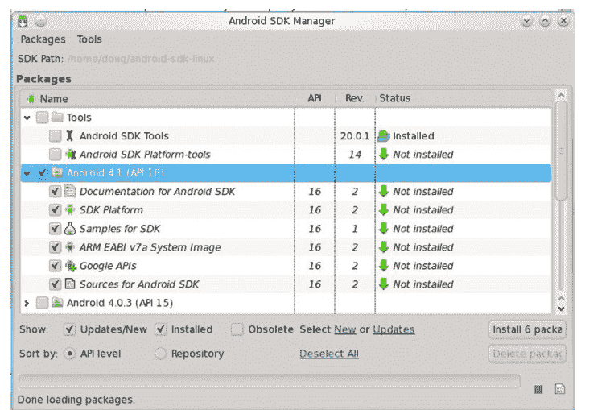

图 16.4
Android SDK Manager。

# 平台开发

平台开发完全完全另一个问题。硬件要求相当“高”。Gingerbread (2.3.x) 及更高版本需要 64 位环境。源码下载约为 8.5 GB，单次构建需要超过 30 GB 的磁盘空间。

Google 经常在最新版本的 Ubuntu 上测试 Android 构建，但建议其他 Linux 发行版也应该可行。目前推荐使用 Ubuntu 10.04，再次强调，必须是 64 位的 Ubuntu。其他需要的软件包括：

- Python 2.5–2.7
- 构建 Gingerbread 或更高版本需要 JDK 6
- 构建 Froyo 或更早版本需要 JDK 5
- Git 1.7 或更高版本

再次，`source.android.com` 网站有关于如何进行平台开发的详尽文档。Bill Sargent 的论坛（见 Resources）有关于如何开始使用 Android 的详细教程，包含了所需的软件完整列表。

## 总结

在嵌入式 Linux 世界的之旅中，我们涵盖了很多内容。简要回顾，我们涵盖了：

- 嵌入式空间 Linux 的通用概览，包括 GPL 的影响
- 安装 Linux 及基本功能回顾
- 设置开发环境和目标硬件
- Eclipse IDE
- 交叉开发环境下的应用编程
- 配置和构建 Linux 内核及设备驱动
- 各种工具，如 u-boot、BusyBox 和 git 控制
- 嵌入式 Linux 发行版和构建工具

我不自称这是完整的。我们触及了一些主题，如果你真的想彻底理解它们，这些主题需要大量的学习。再次，记得订阅资源。

## 资源

- `uibc.org`—Buildroot 首页。
- `buildforums.ti.net/viewtopic.php?f=3&t=4`—在 Mini240 上开始使用 OpenEmbedded 的教程。
- `buildforums.ti.net/viewtopic.php?f=7&t=13`—在 Mini240 上开始使用 Android 的教程。
- `git://repo.org/cz/openembedded/mini240.git`—OpenEmbedded mini240 仓库。
- `openembedded.org`—OpenEmbedded 首页。
- `source.android.com`—Android 源码。

# 附录 A：UBoot 命令

UBoot 将闪存内存划分为区和库。库定义为由一个或多个连接到芯片选择信号的内存芯片组成的区域。有些（并不多）成功。至少 BuildRoot 更加“易于上手”，因为它是基于脚本和 Makefile 等熟悉的概念构建的。

# NOR Flash 内存命令

UBoot 将闪存内存划分为区和库。库定义为由一个或多个连接到芯片选择信号的内存芯片组成的区域。库被细分为区，区是最小的可以

## 内存命令

- `base [<offset>]`—获取或设置作为其他内存命令偏移量的基地址。无参数时显示当前基，默认为 0。数字参数成为新基地址。这对于访问特定区域非常有用。
- `命令 命令 (di)`——显示关于内存的详细信息。
- `coninfo (con)`—显示关于控制 的信息。
- `flinfo [<bank#>]`—显示 flash 信息。无参数时列出所有 flash。带有数字参数 n 时。
- `bdinfo (di)`—显示板信息。
- `iminfo (imi)`—显示关于镜像的信息。
- `help [<command name>]`—自解释。无参数时列出所有命令。带有命令参数时提供更详细的帮助。

## 显示命令

默认情况下，内存命令操作 32 位整数。

- `mm <start addr>`—带自增修改内存。显示地址和项目的内容并提示用户输入。十六进制值替换当前值并显示下一个。只要你输入有效值，它就会持续。输入非十六进制值即可终止命令。
- `md <addr> [<count>]`—内存显示。以十六进制和 ASCII 显示内存范围。可选 `count` 参数默认为 64 个项目。`md` 会记录最近的 `addr` 和 `count`，因此如果不输入地址，它将从上次的地方继续。
- `mw <addr>value [<count>]`—向从 `addr` 开始的内存范围写入值。可选 `count` 参数默认为 1。
- `nm <addr>`—在常量地址修改内存（无自增）。交互式地向地址写入有效的十六进制数据。这对于访问 I/O 设备寄存器非常有用。
- `mtest <start addr><end addr>[pattern]`—简单的 RAM 读写测试。此测试会修改内存，如果触碰了 UBoot 使用的区域（如栈或堆），可能会导致崩溃。
- `loop <addr><count>`—在紧凑循环中读取内存。这对于范围可能很有用。命令永远不会终止！唯一的办法是重置板子。
- `crc32 <start addr><length>[store addr>]`—从 `start addr` 开始的 `length` 字节计算并显示 32 位校验和。可选的第三个参数指定存储校验和的位置。
- `cmp <addr1><addr2><count>`—比较两个内存区域。`count` 是数据项的数量，取决于指定的、字节或字。
- `cp <source><dest><count>`—将内存范围拷贝到另一个位置。`count` 是拷贝的项目数。

# U-Boot 命令 259

在单次操作中写入或擦除。分区编号从 1 开始而扇区编号从 0 开始。

`cp <source><count>`- `Cp` 命令是“感知闪存的”（flash aware）。如果 `<dest>` 位于闪存中，它将调用相应的编程算法。请注意，如果目标区域未擦除或包含任何保护扇区，拷贝可能会失败。

`erase <start><end>(era)`—从 `<start>` 擦除到 `<end>`。`<start>` 必须是扇区的起始地址，且 `<end>` 必须是后续扇区的结束地址。该命令不会立即执行。如果范围包含任何保护扇区，则会显示警告。要擦除的范围也可以用分区和扇区来表示。

`erase bank#:<start sector>[<end sector>]`—在闪存分区 `<bank #>` 中从 `<start sector>` 擦除到 `<end sector>`。如果 `<sector>` 不存在，则只擦除 `<start sector>`。

`all`—擦除保护扇区外的所有闪存内存。

`on|off <start><end>`—为指定范围开启或关闭写保护。`<start>` 必须是扇区的起始地址，且 `<end>` 必须是后续扇区的结束地址。`protect` 命令可以用分区和扇区来表示。

`on|off bank#:<start sector>[<end sector>]`—在闪存分区 `<bank #>` 中从 `<start sector>` 到 `<end sector>` 开启或关闭写保护。如果 `<sector>` 不存在，则仅影响 `<start sector>`。

`protect bank<#> `—为指定分区中的所有扇区开启或关闭写保护。

`all`—为闪存系统中的闪存开启或关闭写保护。

请注意，保护机制仅是软件层，用于防止 U-Boot 的写入。额外的硬件保护取决于闪存芯片和闪存设备驱动程序。

# NAND 闪存命令

NAND 闪存组织成任意大小的分区。所有 NAND 命令都以关键字 `nand` 前缀。

`and info`—显示可用的 NAND 设备。


mtdparts—列出 NAND 分区。

`and erase [clean] [<offset><<size>]`—从 `<offset>` 开始擦除 `<size>` 字节。如果未指定 `<offset>`，则擦除整个芯片。

# 260 附录 A

`nand scrub`—真正擦除整个芯片，包括坏块。被认为是“危险”。

`nand createbbt`—创建坏块表。

`nand bad`—列出坏块。

`nand read.<jfs2|yaffs><offset>|<partition><size>`—从数值 `<offset>` 或 `<partition>` 名称从闪存读取 `<size>` 字节到 RAM 中的 `<addr>`。`jfs2` 和 `.yaffs` 修饰符表示文件系统镜像。

`nand write.<e|.jfs2|yaffs><offset>|<partition><size>`—将 RAM 中 `<addr>` 的 `<size>` 字节写入数值 `<offset>` 或 `<partition>` 名称所在的闪存。`.e` 写入错误检查码。`.jfs2` 和 `.yaffs` 修饰符标识系统镜像。

# 执行控制命令

`autoscr <addr>`—执行 U-Boot 命令的“脚本”。脚本被写入文本文件，然后使用 `mkimage` 工具传输到 U-Boot 镜像中。`<addr>` 是镜像头的起始位置。

`boot<addr> [<param> ...]`—从内存启动镜像（如操作系统）。从 `<addr>` 开始的镜像头包含关于操作系统类型、压缩（如果有）必要信息。`<param>` 是传递给操作系统的一个或多个可选参数。操作系统镜像被复制到 RAM 中并在必要时解压缩。然后控制转移到入口点地址。对于 Linux，识别一个可选参数，即 initrd RAM 磁盘镜像地址。

顺便注意，镜像可以从 RAM 启动，例如通过 TFTP 下载。在这种情况下，请注意压缩后的镜像不要与解压后镜像使用的内存区域重叠。

`go<addr> [<param> ...]`—将控制转移给从 `<addr>` 开始的“独立”应用程序，并传递可选参数。这些程序不需要操作系统的复杂环境。

# 下载命令

有三个命令可用于 TFTP 通过网络启动镜像。其中两个命令在执行文件下载之前还会先获取 IP 地址。

`bootp<load_addr><filename>`—使用 bootp 协议获取 IP 地址，然后将 `<filename>` 下载到 `<load_addr>`。

# U-Boot 命令 261

`arpboot<load_addr><filename>(rarp)`—使用 RARP 协议获取 IP 地址，然后将 `<filename>` 下载到 `<load_addr>`。

`tftpboot<load_addr><filename>(tftp)`—仅下载文件。假设客户端已拥有 IP 地址（无论是静态分配还是通过 DHCP 获取）。

`dhcp`—使用 DHCP 获取 IP 地址。

也可以使用串口下载文件。推荐用于串口镜像下载的终端仿真器是 kermit，因为某些用户报告了使用 minicom 下载镜像时遇到的问题。

`loadb<offset>`—接受二进制镜像，通过串口口下载到 `<offset>`。在 U-Boot 中启动此命令，然后在主机端发起传输。

`loads<offset>`—通过串口口接收 S-record 文件下载到地址 `<offset>`。

# 环境变量命令

`printenv [<name>]`—打印一个或多个环境变量的值。如果不带任何参数，`printenv` 列出所有环境变量。否则，它将列出指定变量的值。

`setenv <name> [<value>]`—`setenv` 从 U-Boot 环境中删除指定的变量并重-（此处原文似乎不完整）

`saveenv`—将环境写入持久性存储器。

`run<name><...>`—将环境变量 `<name>` 的值视为一个或多个命令并执行它们。如果指定了多个变量，将按顺序执行。

`boot(boot)`—执行默认启动的 boot 的别名。

# 环境变量

U-Boot 环境保存在持久性存储中并在 U-Boot 启动时复制到 RAM。它存储了配置系统的环境变量。环境

# 262 附录 A

由 CRC32 校验保护。本节列出了 U-Boot 识别的一些环境变量。

此处显示的变量在 U-Boot 中有特定用途，大部分情况下不会显式使用。需要时会显式使用

`autoload`—如果设置为 "no" 或任何以 "n" 开头的字符串，rarp 和 boot 命令将仅获取信息而不尝试下载镜像。

`autostart`—如果设置为 "yes"，自动启动通过 rarp 加载的镜像。

`baudrate`—指定串口波特率的数字。执行 `setenv baudrate` 后，U-Boot 预期在新速率下接收换行符后正式提交速率。如果失败，板必须重置并恢复到旧波特率。

`bootargs`—此变量的值作为启动参数传递给 Linux 内核，即“命令行”。

`bootcmd`—定义一个在初始倒计时未被中断时自动执行的命令字符串，但仅当 `bootdelay` 也定义了非负值时有效。

`bootdelay`—在执行 `bootcmd` 内容之前等待若干秒。在 `bootcmd` 序列开始前可以使用任何键中断延迟。警告：设置 `bootdelay 0` 将立即执行 `bootcmd` 并禁用与 U-Boot 的交互。相反，将此变量设置为 -I 将禁用启动。

`bootfile`—`tftpboot` 命令加载的镜像名称。

`ethaddr`—板上第一个或唯一以太网接口的 MAC 地址，Linux 称为 eth0。MAC 地址是 48 位，用点分隔的六对十六进制数字表示。

`eth2addr`—存在时第二个和第三个以太网接口的 MAC 地址。

`ipaddr`—设置目标板上的 IP 地址用于 TFTP 加载。

`loadaddr`—`tftpboot`、`loads` 和 `bootm` 命令中的默认缓冲区地址。

# U-Boot 命令 263

`serverip`—`tftpboot` 命令所使用的 TFTP 服务器的 IP 地址。

`serial`—包含硬件标识的字符串，例如类型和序列号。此变量只能设置一次，通常在电路板制造期间设置。一旦设置了此变量，U-Boot 将拒绝删除或覆盖它。

`verify`—如果设置为“n”或“no”，则禁用启动命令中对整个镜像的校验和计算，以牺牲启动过程中的安全性来换取速度。头部校验和仍会进行。

以下环境变量可以由网络启动命令（boot、dhcp 或 tftp）根据你的启动服务器所提供的信息进行自动更新：

- `boot`—见上文，
- `dnsip`—你的域名服务器的 IP 地址
- `gateway`—网关（路由器）的 IP 地址，
- `hostname`—目标主机名，
- `ipaddr`—见上文，
- `netmask`—子网掩码，
- `rootpath`—nfs 服务器上根文件系统的路径，
- `serverip`—见上文，
- `filesize`—使用上次 boot、dhcp 或 tftp 命令下载的文件的大小，以十六进制字符串表示。

## 附录 B：为什么软件不应该拥有所有者

数字技术通过让复制和修改信息变得更容易为世界做出了贡献。计算机承诺让我们我们所有人都能因此变得更容易。

并不是每个人都希望变得更容易。版权制度赋予了软件程序“所有者”，其中大多数人希望将软件的潜在收益从公众手中隐瞒起来。他们希望自己是唯一可以复制和修改我们使用的软件的人。

版权制度是随着印刷术成长的——这是一种大规模生产复制的技术。版权与此契合得很好，因为只限制了副本的大规模生产者。它并没有剥夺书籍读者的自由。一个没有拥有印刷机的普通读者，只需要用笔和墨水就可以复制书籍，而很少有读者能擅长做这种工作。

数字技术比印刷机更灵活：当信息以数字形式存在时，你可以轻松地复制它并与他人分享。这种灵活性使得与版权这样的系统格格不入。这就是为什么我们在强制执行软件版权时，需要采取日益恶劣且严酷的措施。考虑一下软件出版者协会（SPA）的以下四种做法：

- 大规模宣传，称为了帮助朋友而违背所有者的意是错误的。
- 招募被偷的猪来举报他们的同事和伙伴。
- （同警察）对办公室和学校进行突击，在现场人们被告知必须证明自己没有非法复制。
- （由美国政府，应 SPA 的要求）起诉诸如 MIT 的 David LaMacchia 这样的人，不是因为复制软件（他并未被指控复制任何软件），而仅仅是因为让复制设施无人看管并审查了其使用。

这四种做法与以前苏联的做法非常相似，在那里，每台复印机都有守卫防止禁止禁止的复制，个人必须秘密地复制信息并像“萨米主义”（samizdat）一样手手传。当然，区别在于：苏联控制信息的动机是政治性的；但影响我们的是行为，而不是动机。任何阻止信息共享的尝试，无论出于什么，都会导致相同的方法和同样的严酷手段。

## 附录 B

所有者为赋予他们控制我们如何使用信息的权力提供了几种种的论据：

- 贴标签。

所有者抹黑诸如“盗版”和“偷窃”之类的词汇，以及如“知识产权”和“损害”之类的专业术语，以在程序与物理物体之间的简单类比中暗示某种思维方式。

我们对物质物体属性的想法和直觉是关于从别人那里拿走一个物品是否正确。这并不直接适用于复制某物。但所有者仍然要求我们应用这些观点。

- 夸大。


所有者说，当用户自己使用程序时，他们遭受了“损害”或“经济损失”。复制对所有者没有直接影响，而且确实没有影响。只有当制作副本的人本该从所有者那里购买时，所有者才会遭受损失。

事实证明，大多数人并不会购买副本。然而，所有者计算他们的“损失”时，仿佛每一个人都会购买副本一样。这那是夸大——从好听的话来说。

### 法律

所有者经常描述法律的现状，以及他们威胁对我们的严厉惩罚。这种方法隐含的暗示是，今天的法律反映了不容质疑的道德观——但同时，我们又被敦促将这些惩罚视为自然的事实，不能归咎于任何人。

这种说服方式并非为了抵御批判性思维而设计的；它的目的是强化一种习惯性的心理路径。

法律不决定对错是显而易见的。每个美国人应该知道，多年前在许多州，黑人坐在公交车前部是违法的；但只有种族主义者才会说坐在那里是错误的。

### 自然权利

作者声称他们与所编写的程序之间存在特殊的联系，并断言，结果他们与程序相关的欲望和利益远超过了任何人的利益——甚至超过世界上其他人的利益。（通常是公司而不是作者持有软件的版权，但我们被要求忽略这种差异）。

对于那些将此作为伦理公理的人——作者比你更重要——我可以说，作为一名著名的软件作者，我称之为胡说八道。

但人们通常只由于两个原因对自然权利主张产生同情。

## 为什么软件不应该拥有所有者 267

一个原因是牵强的类比。一个原因是与物质物体过度扩张的类比。当你吃它时，它对你的影响就像对我的影响一样。区别不仅仅是钱的问题。

第二个原因是，人们被告知自然权利是我们社会的公认传统。从历史角度来看，恰恰相反。当美国宪法起草时，作者自然权利的想法被提出并被果断地拒绝了。这就是为什么宪法允许版权制度而不要求建立制度；宪法还规定，版权的目的是促进进步——而不是奖励作者。

### 经济学

为拥有软件所有者提出的最后一个论据是，这导致更多软件的生产。与其他相比，这一论据是对该主题的合法处理方法。它基于一个有效的目标——满足软件的用户。而且从经验上来说，如果人们能得到丰厚的回报，他们就会生产更多东西。但经济学论据有一个缺陷：它基于这样一个假设，即区别在于我们支付多少钱。它假设“软件的生产”是我们想要的，无论软件是否有所有者。

## 附录 B

软件所有者制度鼓励软件所有者生产某些东西——但并不是社会真正需要的。它造成了无形的伦理污染，影响着我们所有人。

社会需要什么？它需要其公民能够真正获取的信息——例如，人们可以阅读、修复、适应和改进的程序，而不仅仅是运行程序。但软件所有者通常交付的是一个我们无法研究或更改的黑盒。

社会还需要自由。当一个程序拥有所有者时，用户就失去了控制自己生活一部分的自由。

最重要的是，社会需要鼓励公民的自愿合作精神。当软件所有者告诉我们，以自然的方式帮助邻居是“盗版”时，他们污染了社会的公民精神。

这就是为什么自由软件是一个关于自由的问题，而不是价格的问题。

关于免费的经济论点是错误的，但经济问题是真实的。有些人编写有用软件是为了编写的乐趣，或者是为了欣赏和喜爱；但如果我们想要比这些人写的更多的软件，我们需要筹集资金。

十年来，自由软件开发者尝试了各种寻找资金的方法，并取得了一些成功。不需要让任何人富有；中位数家庭收入（约3.5万美元）证明，对于许多不如编程那么有趣的工作来说，这种激励已经足够。

多年来，直到一项奖学金使其变得不再必要，我一直通过对我拥有的自由软件进行定制增强来维持生活。每个增强都被添加到发布的标准版本中，并最终对公众开放。客户付钱给我，是为了让我对他们想要的增强进行工作，而不是那些我本会认为高优先级的。

自由软件基金会（FSF）是一家为自由软件开发提供免税慈善机构，它通过销售GNU CD-ROM、T恤、手册和豪华发行版（所有这些用户都可以自由复制和更改）以及捐赠来筹集资金。它现在有一个由五个程序员组成的团队，外加三个处理邮购的员工。

一些自由开发者通过出售支持服务赚钱。Cygnus Support在[本文撰写时]大约50名员工，估计其员工活动约有15%是自由软件开发——对于一家软件公司来说，这是一个体面的比例。

包括英特尔、摩托罗拉、德州仪器和模拟器件在内的公司联合资助了C语言GNU编译器的持续开发。同时，用于Ada语言的GNU编译器正由美国空军资助，他们认为这是获得高质量编译的最成本效益的方法。[空军的资助已在以前结束；GNU Ada编译器已投入使用，其维护由商业资金资助。]

所有这些例子都是小的；自由软件运动仍然很小，而且很年轻。但这个国家[美国]听众支持的电台的例子表明，在不强制每个用户付费的情况下支持一项大型活动是可能的。作为今天的计算机用户，你可能会发现自己在使用一种专有程序。如果你的朋友要求复制一份，拒绝将是不对。合作比版权更重要。但地下活动不能带来一个良好的社会。一个人应该追求以自豪的心态过正直的生活，这意味着对专有软件说“不”。你有权与其他使用软件的人进行开放、自由的合作。你有权学习软件如何工作，并用它教你的学生。你有权雇佣你喜欢的程序员在程序出现故障时修复它。你值得拥有自由软件。版权所有 1994 Richard Stallman

在保留此声明的情况下，允许在任何媒介上逐字复制和分发本文全文。

最后更新日期：2001/09/15

作者：Linus Torvalds

## 背景

源码控制（SCC），也称为版本控制，指的是将项目的源代码文件和其他产物（如文档）存储在公共仓库中的做法，以便多个开发者可以同时进行项目而不而不不干扰。SCC维护更改记录并同时支持项目的多个版本，已得到广泛使用。大多数系统遵循集中式客户端/服务器模型，如图15.1所示，仓库位于中央服务器上。开发者“检出”（checkout）单个项目文件，对其进行处理，然后“提交”（check back）。大多数SCC允许多个开发者同时编辑同一个文件。第一个向中央仓库提交更改的开发者总是成功的。许多系统提供了自动合并更改的功能，只要它们不冲突。一些较著名的SCM系统包括：

- 并发版本控制系统 (CVS)
- BitKeeper
- Mercurial
- Perforce
- Subversion
- Visual Source

直到2002年，内核开发社区还没有使用版本控制系统（VCS）。2002年，社区开始使用BitKeeper，这是一种专有的分布式VCS。随后，内核开发者与BitKeeper人员之间的摩擦导致了他们失去了对该包的使用。这促使Linux社区根据在使用BitKeeper时学到的教训开发了自己的工具。由此产生的系统具有简单的设计，运行速度极快，同时满足了这些目标：

- 速度
- 简单设计
- 全分布
- 支持“非线性”开发
- 潜在的数千个并行分支
- 高效处理内核等大型项目

那么，“git”这个名字是从哪里来的呢？Git是英国俚语，指愚蠢或令人讨厌的人。正如Linux所解释的：“我是一个自大的混蛋，我用我的名字命名我所有的项目。先是‘Linux’，现在是‘git’。”

## 介绍Git

Git是一个分布式VCS，客户端不仅检出文件的快照，还完整镜像中央仓库。如图15.2所示。每次检出都是完整的备份。如果中央服务器宕机，可以从任何客户端恢复，几乎没有或没有任何损失。Git每次检出都是完整的备份。每次检出都是完整的备份。如图15.2所示。作为如今的计算机用户，你可能会发现自己在使用一种专有程序。如果你的朋友要求复制一份，拒绝将是不对的。合作比版权更重要。但地下活动不能带来一个良好的社会。一个人应该追求以自豪的心态过正直的生活，这意味着对专有软件说“不”。你有权与其他使用软件的人进行开放、自由的合作。你有权学习软件如何工作，并用它教你的学生。你有权雇佣你喜欢的程序员在程序出现故障时修复它。你值得拥有自由软件。版权所有 1994 Richard Stallman

在保留此声明的情况下，允许在任何媒介上逐字复制和分发本文全文。

最后更新日期：2001/09/15

作者：Linus Torvalds

（注：由于原文文本中存在部分重复，翻译时已按要求进行去重处理，以下为“背景”及部分的译文）

## 背景

源码控制（SCC），也称为版本控制，指的是将项目的源代码文件和其他产物（如文档）存储在公共仓库中的做法，以便多个开发者可以同时进行项目而不相互干扰。SCC维护更改记录并同时支持项目的多个版本，已得到广泛使用。大多数系统遵循集中式客户端/服务器模型，如图15.1所示，仓库位于中央服务器上。开发者“检出”单个项目文件，对其进行处理，然后将其提交。大多数SCC允许多个开发者同时编辑同一个文件。第一个向中央仓库提交更改的开发者总是成功的。许多系统提供了自动合并更改的功能，只要它们不冲突。一些较著名的SCM系统包括：

- 并发版本控制系统 (CVS)
- BitKeeper
- Mercurial
- Perforce
- Subversion
- Visual Source

直到2002年，内核开发社区还没有使用版本控制系统（VCS）。2002年，社区开始使用BitKeeper，这是一种专有的分布式VCS。随后，内核开发者与BitKeeper人员之间的摩擦导致他们失去了对该包的使用。这促使Linux社区根据在使用BitKeeper时学到的教训开发了自己的工具。由此产生的系统具有简单的设计，运行速度极快，同时满足了这些目标：

- 速度
- 简单设计
- 全分布
- 支持“非线性”开发
- 潜在的数千个并行分支


- 高效处理内核等大型项目

那么，“git”这个名字是从哪里来的呢？Git是英国俚语，指愚蠢或令人讨厌的人。正如Linux所解释的：“我是一个自大的混蛋，我用我的名字命名我所有的项目。先是‘Linux’，现在是‘git’。”

## 介绍Git

Git是一个分布式VCS，客户端不仅检出文件的快照，还完整镜像中央仓库。如图15.2所示。每次检出都是完整的备份。如果中央服务器宕机，可以从任何客户端恢复，几乎没有或没有任何损失。

（注：原文中从Figure15.2之后开始存在大量文本重复，根据指令“不要重复输出原文”的原则，译文已针对核心内容整合。）

```
[doug@ldouges hello-world]$ git status
# On branch master
# Changes to be committed:
# (use 'git reset HEAD <file>...' to unstage)
#
#   modified: c.c
#
# Untracked files:
#   (use 'git add <file>...' to include in what will be committed)
#
# README
```

### 列表 15.1

Git Status。

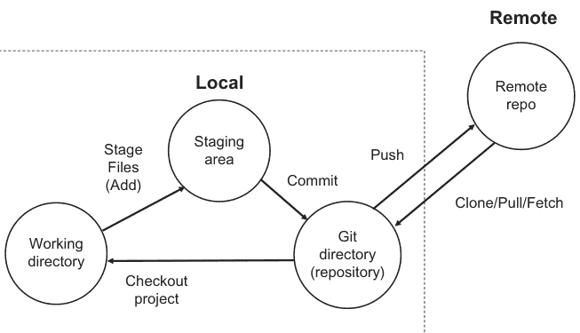

图 15.5

Git 状态视图。

我们已经看到过 `git clone` 和 `git fetch` 可以从远程仓库检索更新。`git pull` 则执行 `fetch` 紧接着执行 `merge`，以将更新整合到当前分支。

## 分支与合并

也许，git 最突出的特性是它的分支模型。其他版本控制系统（VCS）也支持分支，但 git 以一种特别优雅的方式实现了。事实上，有些用户将分支模型称为 git 的“杀手级功能”。

要理解分支是如何工作的，我们需要后退一步，仔细观察 git 是如何存储提交（commit）的。图 15.6 显示了单个提交的内容。它由一个提交元数据对象组成，包含作者、提交者和提交注释等，以及指向一个树对象（tree object）的指针，该树对象又指向 blob 对象，这些 blob 代表了在此提交中更改的单个对象。树和 blob 构成了该提交所代表的快照。

图 15.7 显示了两次提交后的情况。每个随后的提交对象都指向它的父提交（即创建它的那个提交）。这就是我们重现项目完整历史的方式。图中还有另外两个对象。Master 是 master 分支的名字，也就是你当前正在工作的分支。每个项目都从 master 分支开始。`HEAD` 指向当前活跃的分支。`HEAD` 是 `.git/` 中的一个文件。

好了，让我们创建一个新分支。也许你想测试一些想法，但在彻底测试之前，不想干扰生产代码。尝试在 `hello-world` 项目上操作。执行 `git branch testing` 然后执行 `checkout testing`。`branch` 命令创建了一个名为 `testing` 的新分支，而 `checkout` 命令导致 `HEAD` 指向指定的分支，如图 15.8 所示。

现在对其中一个文件进行修改，然后执行 `git add` 和 `git commit`。切换到 `master` 分支并在那里进行修改。结果如图 15.9 所示。分支已经分叉了。记住，每当你 `checkout` 一个不同的分支时，git 都会将工作目录的状态恢复到该分支当前指向的快照。

最终，你会达到想要将 `testing` 分支合并回 `master` 生产分支的节点。在处于 `master` 分支的情况下，执行 `git merge testing`。

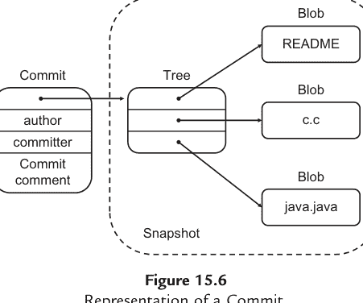

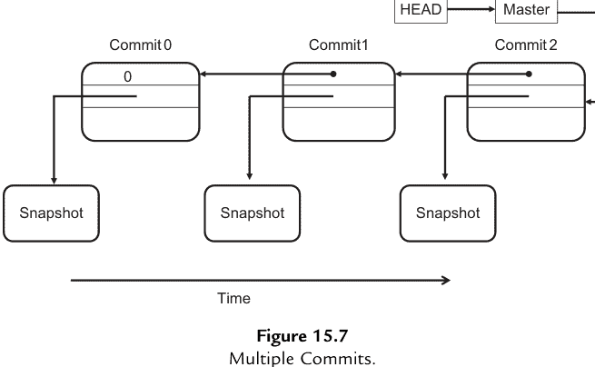


Git 在两个分叉的分支和一个共同祖先之间进行三路合并，创建一个新的提交对象。参见图 15.10。

此时，你可能已经不再需要 `testing` 分支了。你可以通过 `git branch -d testing` 将其删除。

## 配置 Git

当你进行第一次提交时，你可能注意到 git 建议了一个从你的系统信息中提取的名称和电子邮件地址。用户名和信息是非常重要的数据，其他开发者可能需要这些信息来就你对项目的提交与你联系。因此，用基本信息配置你的 git 包是非常重要的。


Git 将配置存储在三个地方：

1. `/etc/gitconfig`——适用于所有用户的系统级参数。使用 `git config --system` 读取或写入这些值。
2. `~/.gitconfig`——每个用户特定的参数。使用 `git config --global` 访问这些。
3. `.gitconfig`——在你当前正在工作的仓库中的项目特定参数。

每一层都会覆盖前一层的值，例如，`.git/config` 中的值优先级高于 `/etc/gitconfig` 中的值。这些文件是纯 ASCII 文本，因此你可以通过手动编辑文件并插入正确的语法来设置值，但通常运行 `git config` 命令更简单。

开始开始，请设置你的用户信息：

```
git config --global user.name "Homer Simpson"
git config --global user.email homer@thesimpsons.com
```

这些命令暗示了配置文件的基本结构。所有的配置变量都以 `section.variable`（节.变量）的形式指定。在配置文件中，节名被包括在方括号中。方括号中还可以包含一个包含在引号中的子节名。该语法就变成了 `section.variable.subsection`。

为了更好地感受这些内容是如何结合在一起的，请执行 `git config --list`，它会列出所有当前定义的配置变量。然后用编辑器打开 `hello-world/.config` 来查看这些值是从哪里来的。

Git 提供了一个 `help` 命令，执行 `git config` 会列出所有当前定义的配置变量。执行 `git help <command>` 将获得该命令的帮助页面。

## 图形化 Git

你可能会惊讶地发现 Eclipse 支持图形化。启动 Eclipse 并切换到 Git 视图。Project Explorer 被 Git 视图取代了。对于 `hello-world` 仓库的 Repository 视图中的右键菜单与你预期的基本一致。为了将 `hello-world` 仓库添加到 Eclipse，我们需要选择 Git 仓库。点击 `Add` 按钮会弹出一个对话框，如图 15.11 所示。视图的工具栏具有以下图标：

- 添加本地仓库
- 克隆仓库
- 创建新仓库

由于我们已经有了 `hello-world` 的仓库，展开 Repository 视图中的分支以显示，如图 15.12 所示。当前检出的分支由复选标记标识。右键点击分支可以创建一个新分支。为了管理 `hello-world`，我们需要将其变成 Eclipse 项目。右键点击工作目录并选择复制到剪板。因此我们选择 File > New > Project。点击 Next 并给项目命名。“Hello World”。


图 15.11

将仓库添加到 Eclipse。

取消勾选默认，在位置框中右键并粘贴。然后点击 Finish。

对一个或多个文件进行修改。双击工作目录下的文件项会在编辑器打开它们。右键点击更改的条目并添加到暂存区。现在右键点击 `hello-world` 条目并选择 Commit。这弹出了如图 15.13 所示。作者和提交者字段已为你填写，并打开了编辑器输入提交信息。

修改的文件列在作者和提交者项下方。状态中的复选标记表示文件已暂存。工具栏上有一个复选标记图标可以选择所有文件。注意，由于我们创建了 Eclipse 项目，工作目录现在有一个 `.project` 文件。点击 Finish，提交已保存。


## 创建新仓库

最终，这一切的目的是将你的项目纳入 git 控制。作为一个例子，让我们从书中早些时候过的 Eclipse 项目创建一个新仓库。`network` 项目如何？


要将现有的 Eclipse 项目引入 git 仓库，选择 Project Explorer 中的项目项，右键点击并选择 Team > Share Project。这弹出一个对话框，让你选择要使用的 VCS。选择 git 并点击 next 以弹出如图 15.14 所示的对话框。

此时你可能想要创建一个仓库。问题是，在哪里？通过勾选 Use，可以将仓库放在项目文件夹中。

# 244 第 15 章


图 15.13

提交对话框。

位于项目的父文件夹。或者你可能希望将其放在项目目录的父级，这样你就可以在一个 git 仓库中轻松管理所有项目。当你点击“Create”（创建）时，会弹出一个对话框要求输入路径和名称。名称将成为路径下的一个目录，该目录必须为空或不存在。这就是 `.git/` 目录存储的地方。当你点击“Finish”（完成）时，你的项目将被移动到仓库目录中。

回到项目资源管理器视图，网络项现在显示“[my-projects NO-HEAD]”。这表示该项目现在由 my-projects 仓库管理，但还没有进行初始提交。如果你右键点击并选择“Team”（团队），选项之一是“Commit”（提交），这将弹出图 15.13 中看到的提交对话框。选择所有文件，输入提交信息，并点击“Commit”。

你仍然可以从 C/C++ 的角度完成大部分工作。Git 对开发过程的干预并不多。当你需要“git 式”的操作时（例如管理分支），你需要切换到“Git Repository Exploring”（Git 仓库探索）视图。


图 15.14

配置 Git 仓库对话框。

这就是我们对 SCC 使用的探索。在下一章也是最后一章，我们将查看从源码构建完整嵌入式 Linux 系统的工具。

## 资源

- http://git-scm.com—git 官网。
- http://git-scm.com/book—Scott Chacon 写的《Pro Git》。这是一本关于 git 的非常易读且完整的介绍。
整本书可以在 git 网站上以 HTML 格式查看，也可以下载为 PDF 版本。
- http://en.wikipedia.org/wiki/Comparison_of_revision_control_software—包括 git 在内的约 30 个版本控制系统的非常好的对比。
- https://github.com—git 托管服务，声称托管了来自近 200 万人的 300 万多个仓库。公共项目免费。私有仓库需要支付月订阅费用。
- https://nai.salesforce.com/help/doc/en/salesforce_git_developer_cheatsheet.pdf—这是一个使用 git 的紧凑“快速备查表”。你可以通过访问 http://git-scm.com/docs 直接获取。
- gitures.org—另一个 git 托管服务。这个服务似乎比 github 更有社区氛围。

# 索引

注意：页码后面跟着“f”和“t”分别指图和表。

- 0-9
- `/bin`, 41
- `/boot`, 41
- `/dev`, 193–194
- `/etc`, 43–44
- `/home`, 104
- `/media`, 42
- `/mnt`, 42
- `/opt`, 42
- `/proc` 文件系统, 39–40, 39f
- `/190`, 201, 200f
- `/root`, 42
- `/sbin`, 42
- `/sgml`, 41
- `/usr`, 42
- `/hierarchy`, 42, 43f
- `/var`, 42
- `/x1`, 41
- memory, 101–102, 102f
- publications, 102–103, 103f
- ARM 单板机计算机, (BSD) 许可证, 9/94–95
- 65–66
- 自动导引车, 8
- Beagle Board, 67
- BeagleBoard-XM, 67
- Berkeley 软件发行
- `bind()`, 150, 153
- Bitbake, 249, 250f
- BitKeep, 233–234
- block, 172
- 块设备, 145, 193
- boa Web 服务器, 162–163
- 开发板准备, 72–78
- 嵌入式编程, 77–78
- factory_items, 73
- 最终规格, 76–77
- 过程, 75–76, 75f
- 示例代码, 73
- 脚本文件, 74
- 将源码添加到项目, 88–89
- 自动关闭, 89
- 构建项目, 91–92
- 代码模板, 89
- 创建辅助, 87–88, 88f
- 调试, 92–97
- 断断点视图, 95–96
- 调试视图, 94–95, 95f
- 完成, 97
- 内存视图, 96–97, 96f
- 变量视图, 与程序, 90–91
- 载级 Linux (CCL), 8
- 字符设备, 145–193, 219
- A
- `Accept()`, 150–151, 153
- 从 I/O Linux 访问, 103–106
- Android, 250–254
- 应用开发, 252–253
- 框架, 253
- 平台开发, 254
- ANSI 终端序列, 220
- 客户端, 153–154
- 客户端进程, 151, 151f
- 代码段, 300
- 提交, 236
- 通信变量, 130–139, 139f
- 条件变量, 180–181, 180f
- `.config` 文件
- 配置内核, 175–181
- 读写策略, 34
- 客户端, 9
- `CreateServer()`, 154
- `CreateThread()`, 144
- 启动, 78–79
- 构建内核, 182–183
- Drout, 247
- BusyBox, 248
- applets, 217
- 构建和安装, 217–219
- config, 215
- 配置, 214
- menconfig 菜单, 217
- 设置, 214–216
- xconfig 菜单, 216
- C, 51
- C++, 51
- 开发环境 (CDT), 87–89
- 数据获取, 108–112
- 数据段, 30
- Debian GNU/Linux, 14
- 调试器 (DSF), 124–130
- 调试多程序, 147–148
- 调试软件, 113
- arch, 172
- 架构, 保护模式, 29–33
- ARM, 7, 51
- ARM I/O 架构, 101–103
- LEDs, 102–103, 103f
- 调试软件 (继续)
- host 作为环境, 119–124
- 内核, 199–201
- 远程, 113–137
- 设备驱动程序, 191–192
- 设备无关 I/O, 29
- devmem, c., 107
- 磁盘文档, 22, 22
- 下载命令, 260–261
- 驱动结构, 194–195
- 驱动, 172
- dore, 127–128
- 双向, 17–56
- 动态配置协议 (DHCP), 59
- 动态 Web 内容, 159–160
- Eclipse, 81–85; 83
- CDT, 87–89
- 安装, 85–86
- 视图, 44–85
- 插件, 83
- 使用, 86
- 工作台, 82, 44
- 工作空间, 86
- Eclipse Platform for Eclipse
- 嵌入式, 3–4
- 计算, 65, 26
- 邮件, 163–166
- 硬件, 65
- 网络, 149
- 编程, 3–4
- Web 服务器, 157–161
- 环境变量, 261
- 环境变量, 261–263
- errno, 133, 146
- 执行命令, 260
- `execve()`, 函数, 35–36
- factory_images, 72–73
- 磁盘, 18, 19/
- 特性, 27–29
- Fedora, 14–15
- 文件管理器, 25–26
- 文件权限, 37–38
- 文件系统, Linux, 36–43
- 文件系统层次结构标准 (FHS), 40–42
- 可共享与非可共享, 40
- 静态与可变量, 41
- 固件, 172
- Flash 系统创建, 228–232
- Flash 内存, 70–71
- 和文件系统, 71–72
- 坦分区, 220
- 坦驱动树 (DFT), 230–232
- Flat 模型寻址, 31
- FlightX, 8
- forksection, 34–35, 131, 132
- 表单和 Post 方法, 160–160


# 索引

- 自由软件开发 (FSF), 5, 268

- `fs`, 172

- 硬件, 嵌入式, 65

- Helios, 8

- 分层文件系统, 29

- `history` 命令, 46, 47

- `host/`, 作为环境, 119–124

- 高级特性, 120–124, 124f

- 断点属性, 122, 123

- `host` 环境, 51

- HTML, 3, 85–160

- HTTP, 157–158f

- `config`, 213

- `include/`, 172

- Indigo, 81

- Info pages, 49

- Information commands, 257

- `init`, 172

- `init` and `exit()`, 195–196

- `init` 进程, 223–224

- `initIO()`, 110

- `module()`, 函数, 191

- 集成开发环境 (IDE), 81

- Intel x86 处理器, 7

- 内部驱动结构, 194

- 异步, 201–202

- 上下文, 202

- 定义进程, 205

- 处理器, 263

- 探测, 204–205

- Inversion, 137

- `ipc`, 172

- NAND flash, 70–71

- 内存命令, 258–259

- `partitions`, 71

- 驱动, 172

- `net`, 172

- 网络 对话, 59–64

- 网络, 嵌入式, 149

- `interfaces`, 61–000

- `interfaces` and revised

- `eth0`, 100

- O

- Object Technology International (OTI), 81

- Objective, C, 51

- Open and `release()`, 196

- Open Source, 5–6

- Initiative, 9

- legal issues, 10–11

- license, 8–11

- software, 5–6

- Open Source software, 5–6

- OpenEmbedded, 249–252

- P

- Package manager, 13

- Package selection, 23–24, 23f

- Page Directory, 32

- Paging, 32–33, 32

- Parallels, 21

- Patch, 174–175

- perrori, 146

- Paps, 44–93

- Plugins-in, 84

- POPS, 163–166

- Popular Operating System

- Interface (POSIX), 131

- Posix threads and are Threads

- Power C, 7, 52

- `printf()` 调试策略, 199

- `printk()`, 186–199,200

- Priority editing, 137

- Priority inheritance, 137, 139

- Priority inversion, 137–139, 138/

- Privilege levels, 29

- Process model, 33–36

- Processes vs. threads, 34f

- Processors linked to, 7

- Protected address, 30–31,

- 31/

- M-I

- `config`, 213

- `include/`, 172

- Indigo, 81

- Info pages, 49

- Information commands, 257

- `init`, 172

- `init` and `exit()`, 195–196

- `init` process, 223–224

- `initIO()`, 110

- `module()`, 函数, 191

- 集成开发环境 (IDE), 81

- Intel x86 处理器, 7

- 内部驱动结构, 194

- 异步, 201–202

- 上下文, 202

- 定义进程, 205

- 处理器, 263

- 探测, 204–205

- Inversion, 137

- `ipc`, 172

- NAND flash, 70–71

- 内存命令, 258–259

- `partitions`, 71

- 驱动, 172

- `net`, 172

- 网络 对话, 59–64

- 网络, 嵌入式, 149

- `interfaces`, 61–000

- `interfaces` and revised

- `eth0`, 100

- O

- Object Technology International (OTI), 81

- Objective, C, 51

- Open and `release()`, 196

- Open Source, 5–6

- Initiative, 9

- legal issues, 10–11

- license, 8–11

- software, 5–6

- Open Source software, 5–6

- OpenEmbedded, 249–252

- P

- Package manager, 13

- Package selection, 23–24, 23f

- Page Directory, 32

- Paging, 32–33, 32

- Parallels, 21

- Patch, 174–175

- perrori, 146

- Paps, 44–93

- Plugins-in, 84

- POPS, 163–166

- Popular Operating System

- Interface (POSIX), 131

- Posix threads and are Threads

- Power C, 7, 52

- `printf()` 调试策略, 199

- `printk()`, 186–199,200

- Priority editing, 137

- Priority inheritance, 137, 139

- Priority inversion, 137–139, 138/

- Privilege levels, 29

- Process model, 33–36

- Processes vs. threads, 34f

- Processors linked to, 7

- Protected address, 30–31,

- 31/

## 274 索引

受保护内存, 28

保护模式架构, 29–33

`pthread_create_popup`, 142

`pthread_create_push`, 141–142

`pthread_create`, 133

`pthread_exit`, 133–140

`pthread_mutex_lock`, 135–136

API, 132

实现, 124–144

R

树莓派 (Raspberry Pi), 68–69

`read()` 和 `write()`, 197, 198

`read_file()`, 91

`README.txt`, 125

真实地址 (Real_address), 29, 30

真实源 (Real_source), 4

计算, 5

计算, 定义, 4–5

编程, 5

`record_sort`, 72

记录 (records), 89, 90

红帽 Linux (RHEL), 15

`regedit`, 44

注册表 (Registry), 44

远程候选者, 110

远程调试, 113–117

连接选项卡, 117

调试器标签, 16

启动配置, 114–117

远程系统管理器 (RSE), 124

配置, 126–127

调试, 129–130

远程存储器 (Remote remor), 154

救援磁盘 (Rescue disk), 213

`return()`, 91

版本控制, 源码控制 (SCC)

根目录, 36

根用户, 38–39

62

S

示例, 172

脚本, 172

安全外壳 (SSH), 124

安全, 172

段描述符, 30

服务器, 152–153

服务器进程, 150, 151

`set-mini_boot`, 74

`setDlg()`, 110

`'sh`, 74

共享内存, 119

Linux Shell, 44–48

Shell 窗口, 26, 27

简单网络管理协议 (SNMP), 167

`smtp_c`, 202

SMTP, 163, 164, 164

套接字 (Socket), 142–149

属性, 151–152

软件安装, 53–56

`scount`, `paint`, 54–55

DVD, 53

根文件系统, 55–56

声音, 172

`sort_utils.c`, 90–91

源码控制 (SCC), 223

SPARC, 7, 5


## SSH 安装, 124–126

## 第一阶段装加载程序, 222

## Stallman, 6, 10

## 标准小部件工具包 (SWT), 84

## `stderr`, 45

## `stdin`, 45

## `stdout`, 45

## `struct_devc`, 195

## `struct_file`, 195

## `struct_file_operations`, 194

## `struct_inode`, 195

## SUSE, 15–16

## SUSE Linux, 15–16

## `sync`, 62

## 同步, 134–139

# T

## 污染 (Tainting), 188–189

## 任务, 206

## `tcsh`, 58

## 终端模拟器, 56–58

## 用户组对话框, 58

## 用户管理器对话框, 58

## `terminateHandle()`, 144

## 恒温器 (Thermostat), 117–119, 120

## 显示, 219–222, 221

## 远程, 184–187

## 版本目标, 155

## 升级, 144–147

## 支持 Web 的, 159, 162f

## `thermostat.c`, 119, 144

## `thermostat_s`, 120

## 线程 (Thread), 33, 132–134

### 属性, 133–134

### 取消, 140–142, 141f

### 清理处理程序, 141–142

### 终止, 140–142

## 工具, 172

## Torvalds, Linux, 10

## 简易文件传输协议 (FTTP), 63–64

# U

## U-boot, 222, 225–228

### 命令, 257

### 配置, 226–227

### 测试, 227

## Ubuntu, 16

## Uclinux, 247

## 用户空间, 222–224

# V

## 版本控制系统 (VCS), 233

## `virt`, 172

## 虚拟机 (VMMs), 20

## VirtualBox, 20

## 虚拟化, 20–21

## VMware, 20

# W

## 支持 Web 的恒温器, 159, 162

## 已启用 Web 服务器, 157–161

## `webserver.c`, 159, 162

## Windows 7 磁盘管理器, 18, 19

## 无线, 66

# T

## 工作台 (Workbench), 84–85

## 工作队列 (Workqueues), 206

## 工作空间 (Workspace), 86

## `workspace/`, 86

## `workspace/record_sort_`, 87–88

## Worksolution, 59

## `writeDidEnter()`, 110

## `write_sorted()`, 91

# X

## `xconfig`, 176–180, 178

# Y

## YAFFES, 72

## 文件系统镜像, 229

# Z

## Shell (`zsh`), 48
