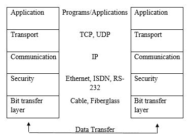

# 黑客 Linux Linux：3本合1 - 从入门到精通的第一号黑客课程。快速高效掌握 (2025)


# 目录

LINUX：学习 Linux 的终极入门指南
无需基础经验，快速上手命令行

## [引言]
- [计算机的影响]
- [Linux 及其历史]
- [为什么要写这本书？]

## 第 1 章：[Linux 简介]
- [什么是 Linux?]
- [Linux 的特性]
- [Linux 及其能力]
- [Linux 发行版]
- [Linux 内核版本体系]
- [Linux 带来的机会]

## 第 2 章：[Linux 安装]
- [作为新系统安装 Linux]
- [双系统分区]
- [从 Linux Live USB 启动]
- [在虚拟机中安装 Linux]
- [Linux 安装]
- [安装新软件]
- [在 Linux 系统上安装时的故障排除]

## 第 3 章：[Linux 系统管理]
- [系统管理任务]
- [Linux 启动过程]
- [系统管理命令]
- [在 Linux 中创建用户]
- [用户管理命令]
- [用户密码]
- [基础系统管理员命令]
- [高级系统管理员命令]

## 第 4 章：[Linux 安全]
- [为什么会有被黑的可能性？]
- [密码安全]
- [Linux 中的 VPN、代理和 TOR]
- [Linux 中的网络监控]

## 第 5 章：[Linux 基础主题]
- [Shell 接口可以做什么？]
- [Linux 目录]
- [Linux 文件权限]
- [文本文件处理操作]

## 第 6 章：[Linux 编程]
- [什么是编程?]
- [计算机编程工具]
- [使用 GNU C 编译器]
- [GNU Make]
- [GDB 调试器]
- [Shell 脚本]
- [理解 Shell 提示符]
- [Shell 脚本中的数组]
- [Shell 语言中的运算符]
- [高级 Shell 编程命令]

## 第 7 章：[使用 Linux 进行云计算]
- [什么是云计算?]
- [不同类型的云]
- [Linux 云计算的必备软件]

## [总结]
## [参考文献]

---

LINUS：面向初者的第 1 Linux 操作系统速成课程，无需基础

## [引言]

## 第 1 章：[系统安装与设置]
- [选择 Linux 发行版]
- [硬件检查清单]
- [准备安装]
- [设置系统]
- [命令行界面]
- [更新系统]
- [章节总结]
- [练习题]

## 第 2 章：[桌面环境]
- [桌面环境类型]
- [桌面环境实现]
- [窗口系统]
- [X 架构]
- [客户端/服务器关系]
- [配置 X 系统]
- [硬件与 X]
- [X 资源]
- [资源命名顺序]
- [工具包语法]
- [紧绑定与松绑定]
- [类与实例]
- [规范的优先级规则]
- [章节总结]
- [练习题]

## 第 3 章：[Shell 及其实用程序]
- [Shell]
- [环境变量]
- [路径]
- [权限与访问模式]
- [修改所有者和组]
- [用户 ID 与组 ID]
- [管道与重定向]
- [过滤器]
- `grep` 命令
- `sort` 命令
- [章节总结]
- [练习题]

## 第 4 章：[系统管理]
- [系统启动与关机]
- [用户账户管理]
- [创建账户]
- [更改密码]
- [修改账户]
- [删除账户]
- [组账户]
- [进程管理]
- [进程周期]
- [使用不同信号控制进程]
- [SUID 和 SGID]
- [系统性能监控]
- [性能工具]
- [系统日志]
- [章节总结]
- [练习题]

## 第 5 章：[安全]
- [为什么安全很重要？]
- [使用 GnuPG 对文件加密和签名]
- [数字签名]
- [使用 GPG]
- [生成密钥对]
- [交换密钥]
- [文件签名]
- [加密与解密文件]
- [网络安全]
- [监控系统安全]
- [保护互联网服务]


## 关闭独立服务
## 互联网超级服务器配置
## 配置 TCP Wrapper 安全
## 计算机安全工具
### 章节总结

## 第 6 章：与 Linux 进行网络连接
### 网络协议
### TCP/IP
### TCP/IP 层
### TCP/IP 版本 6
### IP 址
### 网络配置
### `ip` 命令
### 使用 `netstat`
### 网络应用
### 服务器类型
### 章节总结

## 第 7 章：Linux 与云计算
### 为什么云计算至关重要？
### 云计算计算模式
### 公有云
### 私有云
### 混合云
### 社区云
### 软件服务 (SaaS)
### 平台服务 (PaaS)
### 基础设施服务 (IaaS)
### 云计算的剖析
### 虚拟化与云计算
### 云安全
### 章节总结
### 练习

## 结语
黑客 Linux：使用 Kali Linux 解锁高级黑客技术

## 引言：为什么黑客需要 Linux？
### 为什么选择 Linux 进行黑客攻击？
### 什么是道德黑客攻击？
### 本书有何不同？
### 如何充分利用此书

## 第 1 章：用于道德黑客的 Kali Linux 简介
### Kali Linux 的演变
### 理解 Linux 内核
### 为渗透测试定制的 Kali Linux 核心特性

## 第 2 章：渗透测试人员的中级网络概念
### 网络安全的重要性
### 子网划分与网络分：渗透测试人员的核心概念
### 网络数据包分析
### OSI 层分析工具
### 跨层通信及其影响
### OSI 模型在渗透测试中的实际应用
### 网络嗅探器与协议分析器

## 第 3 章：高级漏洞评估技术
### `Nmap` 脚本引擎
### 利用 HTTP 漏洞
### 使用 Metasploit 框架
### 使用 GNU Privacy Guard 加固系统

## 第 4 章：漏洞开发与自定义载荷
### 编写缓冲区溢出利用程序
### 构造 Shellcode
### 规避杀毒软件检测
### 系统加固

## 第 5 章：Web 应用渗透测试
### 结构化查询语言（SQL）注入攻击
### 跨站点脚本 (XSS)
### 自动化工具
### 结合自动化与手动测试

## 第 6 章：逆向工程与恶意软件分析
### 静态分析
### 动态分析
### 混合分析
### 社会工程
### 恶意代码去混

## 第 7 章：高级持续性威胁 (APT)
### 防御 APT 的指南
### 数据外泄策略

## 第 8 章：无线网络渗透
### 破解 WPA/WPA2 协议
### 恶意访问点
### 蓝牙与 IoT 设备目标

## 第 9 章：后渗透策略
### 权限提升技术
### 维持隐蔽持久化
### 数据挖掘策略

## 第 10 章：现实渗透测试场景
### 编写全面的渗透测试报告
### 透明的重要性
### 执行完整的渗透周期
### 评估安全态

## 结论
### 核心要点
### 迈向未来

## 参考文献


通过阅读本文档，读者同意在任何情况下，作者均对因使用本文档所包含的信息而导致的任何直接或间接损失不负责，包括但不限于错误、遗漏或不准确之处。

# 引言

`Linux` 是一个由全球成千上万开发者开发和维护的开源操作系统。`Linux` 操作系统是 `Windows` 和 `Mac OS X` 等商业化操作系统的替代方案。尽管 `Windows` 和 `Mac` 为其用户群体提供了优秀的设计和第三方应用程序，但它们仍然控制着用户可以做什么。例如，`Microsoft` 决定了作为用户应该使用何种防火墙，而 `Apple` 尽管为其用户提供了高标准的硬件，仍然限制他们使用虚拟化软件、模拟器和图形应用程序等第三方应用。另一方面，`Linux` 以其包含超过百万行代码的海量代码库，为用户提供了完全的自由。`Linux` 代码库是开源软件开发最重要的贡献之一。

`Linux` 是一个雄心勃勃的项目，拥有庞大的计算机热爱好者用户群。虽然大多数 `Linux` 用户是技术爱好者和直接从事计算机科学领域的人员，但它对于普通用户、企业、科学家和游戏玩家来说，也可以是一个极其出色的日常操作系统。对于每天专门使用 `Linux` 的初学者和经验丰富的系统管理员，本书以简单、易于懂的方式提供了关于 `Linux` 及其组件的信息。

## 计算机的影响

我们通过计算机改变了世界，因为它们为我们提供了便利、力量和简单。在计算机创新的早期，我们使用打孔卡和微处理器等复杂的电子设备与计算机通信。然而，随着时间的推移，程序员们找到了让终端用户更容易自定义计算机以满足其愿望和需求的方法。经过数十年的科技科学进步，在 2021 年，我们现在可以从智能手表到环绕地球的电信卫星与计算机进行通信。

操作系统使人类能够与计算机通信，使我们的技术知识得以快速进步。操作系统为终端用户提供图形用户界面，使他们通过键盘、鼠标或用于触摸设备的设备等输出设备与计算机处理器通信。操作系统几乎会将我们的指令翻译成机器语言，以便计算机理解并返回结果。`Linux` 是这些操作系统之一，在 IT 行业有巨大的需求，并用于运行超过 90% 的服务器和具有复杂网络架构的高级超级计算机。

目前，`Windows` 和 `Mac OS` 是全球最受欢迎的桌面操作系统之一，占据了惊人的 90% 市场。`Linux` 仅占市场 10%，但技术爱好者和程序员对它的快速采纳使其成为计算机世界中一个有影响力的平台。除了是公共云中最流行的操作系统之一，`Linux` 几乎是希望在科技行业发展职业的人士的最佳操作系统。`Apple`、`Netflix`、`Amazon` 和 `Facebook` 等跨国公司使用 `Linux` 来保护和维护他们的基础设施。

本书旨在提供简洁、清晰的 `Linux` 信息，帮助初学者和经验丰富的程序员学习 `Linux` 并有效地使用它。

## Linux 及其历史

`Linux` 起于其创建者 `Linus Torvalds` 在 1991 年的一个业余项目。现在，它已成为世界上最重要的开源项目之一。`Linus Torvalds` 曾是赫尔辛基大学的一学生，他对系统编程着迷。起初，他尝试了几种编程语言。后来，他开始编写 `Linux Kernel`，这成为了由各种开源社区创建的数百个 `Linux` 发行版的基础。除了桌面操作系统外，`Linux` 还兼容嵌入式系统，如 `Arduino`、路由器、电视以及 `Tesla` 等汽车。`Linux` 也是如今最流行的移动操作系统 `Android` 的基础。

`Linux` 发行版如 `Debian`、`Arch` 和 `Red Hat` 是使用 `Linux` 内开发开发操作系统的流行 `Linux` 包。`Linux` 代码和软件都是开源的，因此初学者可以通过访问它们的在线仓库快速学习它们是如何被编写和维护的。人们使用 `Linux` 及其仓库制作商业软件并没有限制。然而，作为对社区的一种姿态，为爱好者提供 Linux 发行版的免费版本是重要的。例如，你可以轻松地将 `Red Hat Linux` 下载到本地系统，但如果你想将其安装在专用服务器上，那么拥有一个有效的许可是至关重要的。

## 为什么要写这本书？

要解解 `Linux` 及其高级功能，你必须具备足够的网络、编程和系统工程知识。市场上的许多书籍假设你精通这三个领域，这让没有经验的初学者很难掌握 `Linux`。本书与所有传统书籍不同，它侧重于传递所需的信息，以便初学者能够理解。书中提供了几个真实的案例和场景，并配有通俗易懂的解释，帮助读者有效地吸收数据。

遵循以下三条规则将帮助你理解书中提供的大部分信息：

1. **创建思维图或短片段**：每当你学习一个新概念时，画一张思维图。你可以使用思维图以引人胜的方式学习新想法。
2. **使用主动回忆法**：每当你完成一个章节时，应该用自己的话来记住该部分的核心概念。通过主动回忆，你可以对基础有更深入的。此外，建议将这些概念教给不熟悉该主题的人。向不熟悉的人解释概念可以加强你的基础。著名科学家 `Richard Feynman` 曾多次提到过毫不费力地掌握任何话题。
3. **亲手代码**：要学习任何学科或新技能，你必须亲自动做。可能通过看 YouTube 上的视频来学习吉他吗？简而言之，不能。编程或任何与计算机相关的事情也是如此。在理解之前，最好亲手操作。根据书中提供的输入，在你的桌面或笔记本电脑上开始玩玩 `Linux`。没有其他方法可以更有效地学习 `Linux`。

在进入 `Linux` 的世界之前，请在笔记本上或使用文本编辑器回答这些问题。仅在读完书后再看它们。这些问题可以作为对你从书中学习内容的反思：

* 你最喜欢的操作系统是什么？为什么？
* 为什么你着迷于 `Linux`？
* 你曾经尝试过任何 `Linux` 发行版吗？
* 你希望在读完这本书后实现什么？
* 你了解基础网络概念吗？
* 你是否有过操作终端（terminals）的经验？
* Web 端 vs 桌面端编程？你会从中选择哪一个？
* 为什么你认为 `Linux` 可以非常适合你的需求？
* 你能够完全适应日常使用 `Linux` 生态系统吗？
* 为什么你觉得 `Linux` 是比 `Windows` 和 `Mac OS` 更好的操作系统？


如果你正在学习 Linux，不必担心这些问题。读完这本书后，你就会掌握它的。在开启你的 Linux 新旅程之前，我想告诉你，作为一名拥有十年以上经验的程序员，编程并非易事，而且有时会让人感到非常沮丧。大多数时候，你都在清理由简单错误引起的故障。然而，一旦你看到自己的最终成果，所有的挫败感和失望都会消失无踪。要成为一名优秀的 Linux 系统管理员或程序员，你需要对后台发生的事情保持好奇，并找到处理任何问题的方法。你需要寻找线索，所以现在就开始吧！

# 第 1 章：Linux 简介

通过开源软件和技术的普及，Linux 为计算机世界做出了重要贡献。Linux 从 1991 年作为一个“业余项目”诞生，从那以后已扩展到计算的几乎每一个领域。从跨国公司到创建趣味 Arduino 项目的高中生，每个人都在使用 Linux。在当今世界，Linux 已经成为互联网及其许多应用程序的关键组件。

尽管 Linux 在技术领域非常流行，但对于初学者来说，快速掌握其基础仍然困难。Windows 和 macOS 是全球另外最流行的两个操作系统，作为默认操作系统占据了超过 90% 的计算机。它之所以没有被作为日常系统，主要由于人们无法理解 Linux 的能力。随着过去几年中如 `Manjaro`、`Linux Mint` 和 `SUSE Linux` 等用户友好操作系统的引入，Linux 正在迅速获得用户。

对于新手和经验丰富的程序员来说，学习 Linux 的哲学以及它是如何维护的都是一次开眼界的经历。

## 什么是 Linux？

Linux 是一个开源操作系统，为用户提供高效卓越的体验。与 Windows 或 macOS 不同，它让用户轻松与计算机硬件以及嵌入式系统（如数据库和服务器）通信。Linux 有一个名为 `kernel` 的特殊组件用于处理所有指令。Linux 生态系统依赖于围绕 `kernel` 构建的软件，因此它已成为至关重要的组件。

虽然 Linux 为系统管理员和技术爱好者提供了许多额外优势，但了解它与 Windows 和 macOS 哪些相似的功能也很重要。

## Linux 的特性

### 1. 它可以检测任何硬件

Linux 的设计使其在启动之前就能理解它被要求运行在什么硬件上。Linux 系统内核会分析不同的硬件组件，如 `RAM`、`GPU`、声卡、触控板、键盘、处理器和主板，以提供最好的用户体验。维护 Linux 仓库的开源开发者已经编写并将继续编写支持不同处理器的代码。所有硬件设备的驱动程序检测和安装过程几乎瞬间完成，让用户可以轻松在本地安装 Linux，而无需花费大量时间排除故障。服务器和数据库也可以通过硬件检测进行。

### 2. 高效的进程管理系统

操作系统需要检查正在运行的进程，并找到维护它们而不导致计算机崩溃的方法。有效的进程管理是任何操作系统的基础。Linux 程序员根据程序的重要性和消耗的处理能力对程序进行排序。许多 Linux 发行版使用第三方库来自动结束后台进程，而不影响用户。作为用户，你可以调整设置，为资源密集型图形软件释放处理能力。

### 3. 高效的内存管理

高效管理你的内存资源需要能够利用 Linux 提供的 `RAM` 力量。你可以使用 Linux 充分发挥硬件的性能。许多 Windows 和 macOS 版本限制了硬件能力以延长计算机的使用寿命。另一方面，Linux 在不降低效率的情况下充分利用了它们的性能。作为一名 Linux 程序员，你的软件需要能够高效管理内存。

### 4. 接口

Linux 包含了多种接口，使其与其组件的交互变得简单。如今，图形化用户界面是操作系统的不可或缺的。Linux 提供了广泛的桌面接口，如 `KDE` 和 `XFCE`，以增强用户在使用操作系统时的体验。终端是所有接口中最重要的，因为它允许用户通过 shell 介质与 Linux `kernel` 进行有效交互。

### 5. 用户身份验证

Linux 系统为创建用户账户和组提供了复杂的验证程序。当你开始使用 Linux 时，创建具有各种限制和权限的用户组就像点击按钮一样简单。Linux 管理员可以轻松地提供和撤销访问，与 Windows 和 Mac 系统不同，后者需要更改许多设置。正因如此，托管提供商和数据库管理服务使用 Linux 作为日常系统来为客户服务。对密码和哈希文件等敏感文件的访问受到用户验证的限制。

### 6. 开发工具

Linux 是一个完整的开发环境，提供了访问各种编程语言独立库的能力。由于 Linux 二进制文件是开源的且文档直观，程序员为 Linux 设计比为 Windows 或 macOS 更。此外，还有许多如 IDE 等开源工具用于创建 Linux 应用。在 Linux 上工作是非常自由的，特别是对程序员来说。

Windows 和 Mac 都要求开发者使用由其自身团队开发的 IDE。创建 Mac 应用只能使用 Apple 设计的软件 `Xcode`。`Xcode` 确实有自己的优点，但也包含许多繁琐的程序并浪费了开发者大量的生产时间。因为 Apple 禁止使用其他 IDE，你被迫使用 `Xcode`。Linux 不支持这种哲学。任何开发工具，无论它们使用什么二进制文件，只要经过编译并向 Linux `kernel` 传递指令，就可以部署到 Linux 系统。

## Linux 及其能力

除了这些基本特性外，Linux 还为其用户提供了高级功能。由于 Linux 主要是一个专业系统，在学习它之前必须完全理解它的能力。

### 1. 系统虚拟化

虚拟化是计算领域最大的创新。通过虚拟化，你可以在一个操作系统内部运行任何操作系统，而无需担心额外的资源。由于 Linux 是为数据库等远程和隔离环境设计的操作系统，它可以与任何虚拟化平台配合使用。Linux 系统提供了优秀的虚拟化能力，被许多服务器利用。在过去的十年里，`Docker` 等软件扩展了 Linux 虚拟化的能力。通过虚拟化，你可以运行不同版本的 Linux，而不必担心数据丢失或损坏。

### 2. 集群

通过使用集群，计算机科学家和管理员可以将多个系统作为一个单一系统运行。每个系统可以被称为 `node` 并在 Linux 中进行配置。此外，集群节点可以配置为提供不同的服务。集群是一项复杂的操作，需要硬件优化，这只有通过 Linux `kernel` 才能实现。

### 3. 优化的计算


为了进行实验并根据实验做出决策，超级计算机和科学计算机需要优化的计算。`Linux` 操作系统及其优先级排序能力可以帮助计算机科学家实现优化的计算标准。

### 4. 云计算

云是管理和利用数据的最新工业标准。只有少数 `Linux` 发行版被专门设计用于以惊人的速度与云计算架构协同工作。`Linux` 的虚拟化能力也可用于与云计算硬件进行高效的交互。凭借其软件能力，`Linux` 程序能够控制宿主机和客机网络。

### 5. 存储

与任何格式的网络存储系统协同工作是 `Linux` 的高级功能之一。`Linux` 可以与 `Fibre Channel` 和 `Info Band` 等高级存储系统链接，以便高效存储数据和应用程序。

### 6. 取证设备

如 `Bodhi Linux` 等 `Linux` 发行版可以作为现场软件使用，并在不需要身份验证的情况下与系统资源交互。取证专家主要依靠 `Linux` 系统在发生网络攻击时寻找任何备份或文件。

## Linux 与开源

尽管上述列出的所有功能可以在 `Windows` 和 `macOS` 系统通过自定义和软件安装来实现，但专业人士因其开源特性继续依赖 `Linux`。`Microsoft Windows` 和 `Apple MacOS` 是为计算机公司创建产品并产生收入而开发的私有操作系统。这些私有操作系统都限制了开发者可用的资源，使得想要成为开发者的人难以使用其内置库构建应用程序。相比之下，`Open Source` 系统使其库公开可用，并接受来自世界各地对这些库的更改建议。

这些系统的开源特性也让安全爱好者更容易发现并修复漏洞。私有操作系统存在的问题在于它们难以分析，因此需要更长的时间来修复可能导致毁灭性后果的漏洞。2016 年，利用 `Windows` 漏洞的勒索病毒破坏了数千家企业及其数据。由于 `Linux` 及其支持的操作系统定期进行补丁和更新，这些问题可以得到限制。

如果公司利用开源软件，未来将能够少地担心许可文件工作。对 `Windows` 和 `macOS` 操作系统中的私有软件进行持续监控会将你的日志信息提供给他们。相比之下，`Linux` 操作系统能够有效地防止个人访问敏感信息。

通过开源操作系统和软件，世界可以从创新中受益。尽管 `Windows` 和 `MacOS` 在金融行业占据绝对主导地位，但 `Linux` 仍然是它们成功的驱动力。当我们使用开源操作系统时，我们努力让其他操作系统变得负责。`Linux` 资源和文档通常在互联网上可用，这使得新开发者能够轻松尝试各种嵌入式系统。人工智能（如机器人）正在开源 `Linux` 软件和内核诊断工具的支持下发展。

## Linux 发行版

由于 `Linux` 发行版，`Linux` 已成为计算机科学领域的全球现象。`Linux` 发行版通常包含 `Linux` 内核和一组与发行版的哲学、目的和目标受众相关的应用程序。通过单个安装文件，这些组件都可以安装在本地。每个 `Linux` 发行版都是为特定目的而设计的。例如，`Linux` 发行版专为实验人工智能和机器学习等技术的计算机科学家开发。`NASA` 和其他私立机构使用 `Linux` 核心知识创建符合其需求的发行版。任何人都可以在短时间内创建 `Linux` 发行版。然而，维护改进 `Linux` 用户体验的复杂功能具有挑战性。因此，`Linux` 领域来自不同供应商和小组的激烈竞争。

通过从官方网站安装所有应用程序或使用包管理器，`Linux` 发行版旨在减少你可能需要执行的自动化工作。在使用包管理器安装应用程序时，可能会由于依赖关系产生冲突。许多用户依靠 `Linux` 发行版来简化这一过程。理解不同类型 `Linux` 发行版的目的需要大量努力。

`Ubuntu Linux` 是最流行的 `Linux` 发行版。由于它的流行，它被预装在 `HP`、`Dell` 和 `Lenovo` 等公司制造的若干笔记本电脑和桌面电脑上。虽然 `Ubuntu Linux` 是普通用户最流行的替代替代品，但许多其他 `Linux` 发行版受到许多领域计算机爱好者和程序员青青。通过理解这些发行版不同的核心哲学，我们可以更好地理解 `Linux` 生态系统。

### 1. Debian

在过去的三十年里经历了各种障碍，`Debian` 是最流行且最古老的 `Linux` 发行版。它是世界上支持最广泛的 `Linux` 发行版。`Debian` 系统是 `Ubuntu` 和 `Knoppix` 等发行版的基础。`Debian` 系统之所以受欢迎，是因为它的包安装器 `apt-get`，它能为用户无缝地安装依赖项和软件。尽管如此，`Debian` 因无法运行在旧系统和硬件性能差的计算机上而受到批评。`Debian` 用户还抱怨界面存在 Bug 且显卡集成性差。

### 2. Arch Linux

对于有兴趣学习 `Linux` 如何工作的程序员来说，`Arch Linux` 被视为圣经。基于 `Arch` 架构的 `Linux` 系统使用 `Pacman` 作为包管理器，允许用户保持软件依赖不冲突。`Arch Linux` 被 `Manjaro` 和 `Endeavour` 等 `Linux` 发行版使用。同样重要的是，`Arch Linux` 在旧硬件上或连接到 `Arduino` 等嵌入式设备时也可以良好运行。

### 3. Red Hat Linux

商业企业广泛使用 `Red Hat Linux` 进行服务器和数据库管理。`Fedora` 发版是 `Red Hat Linux` 的子软件。`Red Hat Linux` 只有在购买许可证后才能安装，但 `Fedora` 可以安装在任何计算机上。`Fedora` 带有 `Red Hat` 包管理器。`Red Hat Linux` 提供了许多工具，可以帮助系统和数据库管理员更高效地工作。对于拥有产品操作系统许可的公司，`Red Hat Linux` 还提供付费支持。

### 4. Knoppix

`Knoppix` 是一个基于 `Debian` 的操作系统，它可以运行在 `USB` 或 `CD` 上，但不能作为传统的操作系统运行。`Knoppix` 设计初衷主要是作为现场漏洞和渗透测试的现场 CD。`Knoppix` 也广泛用于恢复意外崩溃的系统。一旦你的现场版本结束，你下载或安装的所有文件将被删除。然而，许多程序员为 `Knoppix` 创建了持久化 `USBs`，将数据保存在 `USB` 上而不是计算机硬盘上。

### 5. Ubuntu


Ubuntu 是桌面、服务器和核心版中是最受欢迎的 Linux 发行版。尽管每个版本都有其特定的用途，但 Ubuntu 工程师开发了核心版本以更好地服务于他们。机器人学和物联网等未来技术正在广泛使用它。然而，Ubuntu 也因预装了许多臃肿软件而受到批评。尽管这些软件安装方便，但我们建议下载精量版以获得最佳效果。

### 6. Linspire

Ubuntu 是 Debian 的免费版本，而 Linspire 则是商业版本。Linspire 预装了根据你的需求定制的应用程序。它具有出色的优化功能，可以与任何硬件配合。Linspire Live 是 Linspire 的现场版本，也深受取证爱好者的欢迎。由于 Linspire 是一款商业产品，其所有源代码都受到保护和加密，无法访问。Linspire 的工程遭到了 Linux 爱好者的批评，认为它违反了开源软件提供的自由精神。

### 7. Gentoo

Gentoo 的独特之处在于它赋予了用户对 Linux 内核的完全控制权。代码在本地编译，因此你将根据自己的硬件配置获得最佳性能。Gentoo 也被称为一个为终端用户提供强大定制能力的操作系统。使用 Gentoo 也意味着你需要自己处理安装过程。该界面会要求你根据自己的喜好选择一切。

在安装 Gentoo Linux 过程中，一些程序员会根据自己的喜好定制 Linux 内核。Gentoo 提供了其他发行版无法提供的配置，但由于其选项极其广泛，被认为社区支持较少。Gentoo Linux 是一个严肃的平台，因此请确保你有足够的耐心来修复在与它交互时可能出现的任何错误。

### 8. Slackware

它是最老的 Linux 遗留发行版之一，仍由其优秀的开发者社区维护。与其他 Linux 发行版不同，Slackware 强调简单性和稳定性。它也是唯一关注 Linux 的 Unix 根的 Linux 发行版。考虑到它是遗留发行版，无法找到显卡或处理器的依赖解决方案。Slackware Linux 的许多功能基于 shell 脚本和文本。

## Linux 内核编号系统

每个 Linux 发行版都提供版本号，以提供更高的透明度和高效的预封装发行。根据你在下载时选择的预封装发行，版本号可能会有所不同。

为了避免开发者的困惑，所有的 Linux 发行版都使用 Linux 内核编号系统。

它遵循如下所示结构：

1. `x. y`

这里，`1` 是 Linux 发行的直接版本，`x` 表示它是稳定版还是测试版（beta），`y` 表示补丁级别。通常，如果 `x` 是奇数，则它是测试版；如果 `x` 是偶数，则它是稳定版。

例如，如果版本号为 `6.3.2`，它是该 Linux 发行的第 6 个更新版本，并且带有第二个补丁的测试版本。测试版本是专门供开发者测试操作系统并在稳定发布前报告任何 bug 的软件发布版本。测试版本是软件开发中不可或缺的一部分。

## Linux 发行版组件

几乎所有的 Linux 发行版都预装了包、库和应用程序，以增强 Linux 系统的性能。在深入研究 Linux 生态之前，了解一些随 Linux 发行版预装的热门软件是重要的。

我们现在讨论每个 Linux 发行版日常使用和故障排除所需的必备软件。不同的发行版使用不同的方法和用例来安装软件。

### GNU

由于 GNU，开源软件在行业中变得越来越流行。GNU 项目在 1984 年开发基于 UNIX 的操作系统方面发挥了关键作用。在数千开发者的帮助下，GNU 项目成功创建了数十种应用程序。除了 Linux 内核外，GNU 项目为 Linux 生态系统的几乎所有领域开发了工具。除了开源之外，GNU 软件提供了通用公共许可证（GPL），以便在不同的 Linux 发行版之间共享。

为了使用 GNU 项目的软件，你需要理解不同的命令行原理。几乎所有的软件都设计为仅在终端运行，而不是标准的 GUI 界面。多年来，Linux 被 GNU 软件塑造，并对生态系统产生了重大影响。任何新 Linux 软件的开发都大致基于一个或多个 GNU 软件项目。因为源代码全可用，因此通过这些软件学习 Linux 编程非常容易。

了解一些流行的 GNU 软件可以帮助你更好地理解 Linux 的功能：

### 1. Autoconf

作为为 Linux 系统开发软件的一部分，这个 GNU 软件软件包用于配置不同的包。Autoconf 支持一个百多个供应商和数千件额外的硬件设备。Autoconf 软件主要由数百个 `bash` 脚本组成，可以自动配置这些硬件设备的过程。Linux 开发者必须将他们的支持扩展到不同的设备和嵌入式系统。

### 2. Bash

大多数 Linux 发行版都带有命令行解释器 `Bash`。在 Linux 系统中自动化不同任务的能力很大程度上取决于 `bash` 脚本。通过 `bash`，程序员可以向硬件和软件提供指令。`bash` 命令行界面是一个 shell 程序，因此继承了 shell 程序的所有特质。

### 3. Binutils

Linux 包含二进制文件和库，程序员必须显式使用它们来与 Linux 内核交互。否则，软件运行将非常缓慢，甚至无响应。Binutils 是旨在处理所有类型二进制文件的 GNU 软件。

### 4. Diff

它是一个用于查找两个相似格式文件之间差异的专属 GNU 工具。如果你愿意，可以在读取它们时用行来标记差异，并通过软件删除或修改它们。

### 5. ed

`ed` 是一个由 GNU 项目开发的流行基础文本编辑器。像 Red Hat Linux 和 Gentoo 等 Linux 发行版带有 `ed` 作为默认文本编辑器发行。

### 6. GCC

编译器是 GNU 软件团队最受欢迎的 Linux 软件。尽管 GNU 项目已为许多编程语言创建了编译器，但 C 和 C++ 编译器在 Linux 用户中最为著名。GNU C 和 C++ 编译器易于理解，并且由于其优化能力，即使对于复杂应用也能缩短运行时间。它与 `GDB` 调试器一起发布，用于调试已经写好的应用程序。

### 7. GIMP

GIMP 是一种图形处理软件，是 Linux 系统上著名的 Adobe Photoshop 的替代品。通过 GIMP，你可以轻松地执行各种类型的图像处理技术。

### 8. GNOME

GNOME 是许多 Linux 发行版自带的流行的桌面图形界面包之一。它最初是作为 GNU 软件团队的免费软件开发的。从那以后，它发展成为一个独立项目，数百名热心的开发者试图让变得更好。今天，GNOME 是所有 Linux 系统最流行的 GUI 界面。尽管它没有 XFCE 那么流畅，但它提供了许多定制能力。

#### 9. Gnumeric & LibreOffice


Linux 用户抱怨没有优秀的办公软件可用。然而，事实并非如此。有很多像 Gnumeriuc 和 LibreOffice 这样的办公产品，它们可以创建文本文档、表格和幻灯片，并提供许多自定义选项。

### 10. Gzip

Gzip 是一种压缩软件，可以帮助用户创建或解压缩 zip 文件。Linux 用户经常使用 `.tar` 等格式来压缩文件。即使是 Linux 基础命令行工具也提供了压缩 tar 文件的简单方法，但并不适用于 zip 文件。`Fzip` 轻松地解决了这个问题。它类似于 `WinRAR`，但使用了更快的算法来处理数据。

## Linux 带来的机会

如果你计划成为计算机专业人士，Linux 是最值得尝试的操作系统。几乎所有的公司和组织都使用 Linux 来维护其资源，因此为初学者和专业人士提供了数以千计的工作机会。Linux 不仅是未来，更是现在。由于 Linux 软件是开源的，许多财富五强公司都向其客户推荐它。无论处于哪个领域，任何人都可以利用 Linux 的强大功能来建立成功的职业。你只需要理解 Linux 的基础知识、必要的软件以及 Linux 的哲学即可。

以下是一些职业机会：

### 1. 系统管理员
凭借 Linux 系统的基础，你可以申请系统管理员工作，你的工作将是监控系统中的用户并在发生任何问题时解决问题。系统管理员还根据组织的需求决定何时开关系统。

### 2. 渗透测试员
所有组织都需要增加安全性，以避免数据库和服务器遭受致命攻击。公司会聘用具有 Linux 知识的渗透测试员来帮助他们保护系统。渗透测试员主要需要理解 Linux 网络和字典攻击工具以确保安全。

### 3. Linux 程序员
聘用 Linux 程序员是为了创建可以与 Linux 内核直接交互的软件。Linux 程序员需要对不同的发行版、依赖项、软件包和许可细节了如指掌，以便创建新软件。商业上，你通常需要为 `Ubuntu` 和 `Debian` 系统编写软件，因为它们在技术行业中更受欢迎。

### 4. 取证专家
如果你精通 Linux 基础，那么被聘为取证专家也有很大的前景。要精通取证，你需要了解 Linux 启动 USB 功能以及如何使用这些实时启动软件来恢复被删除或被攻击者访问的文件。`Kali Linux` 可能是取证专家最好的 Linux 发行版。然而，你可以使用任何其他发行版（如 `Bodhi Linux`）从所有操作系统恢复文件。

### 5. 数据库管理员
几乎所有数据库都使用关系查询语言（如 `SQL`）来有效地存储数据。虽然可以使用 Windows 系统访问这些数据库，但许多托管提供商依赖 Linux 来有效管理这些数据库。作为数据库管理员，你需要依靠文件管理和操作命令来对你的数据库数据实现更多功能。

### 6. 服务器维护
所有跨国公司和组织都依靠高端服务器来管理其网站并处理终端用户提供的请求。所有这些服务器都需要加密并定期更新，以防落入开放漏洞。为了在该领域获得更好的职业机会，所有的服务器维护人员都需要精通 `Red Hat Linux`。

### 7. 数据科学家
所有数据科学家都依赖 `Python` 和 `Scipy` 等工具来编写数据科学模型。然而，所有这些软件都可以轻松地部署在 Linux 系统中，希望在数据科学领域发展的的工程师需要充分了解书中描述的所有 Linux 基础主题。

### 8. 云计算专家
随着如今组织处理的数据量不断，使用云系统是一个更便携、更智能的决定。大多数云计算工具完全依赖 Linux 系统，因此云计算专家需要对 Linux 基础有深入了解。

除了这些职业机会，Linux 还是那些喜欢自定义数据库和使用无臃肿软件操作系统的用户的绝佳日常工具。

在对 Linux 有了足够的介绍后，你现在准备好在你的系统上安装 Linux 了。

## 第 2 章：Linux 安装

市场上的大多数计算机都预装了 Windows，预装 `Mac OS` 的苹果电脑除外。只有不到 5% 的制造公司在向用户发货时会预装 `Ubuntu` 发行版。要在你的计算机上安装 Linux，无论你选择哪种 Linux 发行版都需要遵循相同的步骤。你还可以让 Linux 系统与 Windows 或 `macOS` 实现双启动，最新的苹果硅芯片除外（苹果限制用户只能使用 `macOS` 作为唯一的主操作系统）。在本章中，用户将学习如何安装 Linux、如何将其作为双启动系统安装，以及如何作为虚拟机安装以增加安全性，并供使用最新苹果芯片的用户。

 作为全新系统安装 Linux

请记住，每当你进行全新安装时，你在 Windows 或 macOS 系统中预装或保存的所有文件都将被擦除。为了以后不后悔，请对系统进行完整备份，或将所有文件传输到外部硬盘：

#### 1. 了解你的计算机硬件
Linux 爱好者首先应该了解的是其计算机的硬件特征。使用 `terminal` 或 Windows 控制面板列出你的处理器、`RAM`、你正在使用 `HDD` 还是 `SSD`、`GPU` 以及类似的细节。将它们全部写在纸上更好，这有助于在安装 Linux 遇到错误时快速检查网络。所有 Linux 发行版都有特定的硬件要求，需要满足这些要求才能在你的计算机上安装。例如，基于 Arch 的著名 Linux 发行版 `Manjaro` 需要至少 4GB `Ram` 才能作为日常驱动保持更好的一致性。

#### 2. 下载 ISO 文件
一旦你记录了系统硬件详情，现在是时候下载著名的 Linux 发行版了。每个 Linux 发行版都有自己的网站。在 Google 上搜索找到官方网站，或者你可以使用 `distrowatch.com` 等网站下载所有流行 Linux 发行版的 `iso` 文件。然而，为了安全，强烈建议从官方网站下载。你还可以使用官方 Linux 发行版网站上提供的 `md5` 哈希文件来验证文件的真实性。

Linux 发行版通常带有不同的桌面环境，如 `XFCE`、`GNOME` 和 `KDE`。所有流行的 Linux 发行版都在其官方网站上提供了这些桌面环境的链接。请选择其中一个并将其下载到你的本地 `HDD` 或 `SSD` 中。

### 3. 制作启动 USB
一旦你下载了 ISO 文件，现在应该从它制作一个启动 USB。你可以使用 `Rufus` 等软件从 `ISO` 文件制作启动 USB。

**需要遵循的步骤：**

1. 将 USB 插入你的计算机后，运行 `Rufus` 软件。确保 USB 是 3.0 而不是 2.0，以获得更快的结果。
2. `Rufus` 界面提供了一个从你的本地系统中选择 `ISO` 文件的选项。你可以从下载文件夹中选择，也可以将文件拖入 `Rufus` 界面进行插入。


### 3. 选择你的系统是 UEFI 还是 legacy 式 BIOS。

要检查你的电脑支持什么 BIOS，请访问制造商网站或查看你购买电脑时收到的手册。通常，要进入 BIOS 菜单，你需要在启动时反复按下 ESC 键。进入 BIOS 菜单后，将列出你的电脑制造商使用的是 UEFI 还是 Legacy BIOS。

就是这样。在 Rufus 中点击“开始”按钮，软件将为你完成其余所有工作。从 ISO 文件创建启动 USB 盘通常至少需要十分钟。因此，如果进度条移动非常缓慢，请不要慌张或关闭窗口。

如果你想专门使用 Linux 系统来创建 Linux 启动 USB，可以使用所有 Linux 发行版都支持的 `dd` 命令。为了轻松地使用 `dd` 命令，你首先需要复制 ISO 文件的位置。

## 使用 dd 命令制作 Linux 启动 USB

使用 `lsblk` 命令找到你将用于安装 Linux 发行版的 USB 设备名称。

Linux 命令：

```bash
$ lsblk
```

上述命令将向你展示类似下所示的结果。

输出：

```
sdb 7:45 1 63.4G 0 disk
```

现在可以进一步观察到该 USB 被划分为两个分区。所有的 Linux 系统数据将发送到第一个分区，第二个分区作为你的启动 USB 盘的引导加载程序，用于检测 BIOS 系统。

在用 `dd` 命令安装操作系统之前，你需要卸载操作系统数据分区。

Linux 命令：

```bash
sudo dd bs=4M if={enter the path} of=path of the usb conv=fdatasync status=progress
```

示例：

```bash
sudo dd bs=4M if=/ Downloads/arch.iso of=/dev/sda1 conv=fdatasync status=progress
```

输出：

```
making live usb ….. 15%
```

一旦你点击终端中的回车键，Linux iso 文件将安装到 USB 盘中，使其用于安装或现场取证目的即可启动。

在学习如何启动进入 Linux USB 盘之前，了解如何创建一个双系统系统以便与 Windows 或 Mac 一起使用 Linux 系统非常重要。虽然有很多论点认为与另一个操作系统双启动 Linux 会减慢速度，但这一点已经被多次反驳，双系统启动不会降低软件或硬件资源的效率。唯一的例外是启动时间会受到影响，因为你将获得一个选择你想要启动的位置的。

然而，在决定为你的系统双启动之前，请遵循以下三个基本规则：

1. 对你的 Windows 文件进行完整备份。数据有被删除或损坏的。
2. 准备一个备用的 Windows Live USB，以修复因双系统系统可能发生的任何损坏。
3. 确保你有一个 Windows 恢复盘，以便立即无忧地重新安装。

一旦你明确了这些术语，就可以使用 Rufus 等工具或默认的 `dd` 命令创建一个启动 USB 盘。

### 双系统的分区

分区是一种计算机技术，可帮助用户将内部硬盘划分为多个区域并用于不同的用途。要将 Linux 作为双系统运行，你需要在现有分区的基础上创建一个新分区。

在 Windows 中的步骤：
1. 转到控制面板中的磁盘管理实用程序，并选择你将用于安装 Linux 的磁盘。
2. 在执行此实用程序技巧之前，确保你已经缩小了 Linux 所需的卷。确保你已为 Linux 驱动器选择了 `exFAT` 分区。
3. 一旦创建了分区，重启电脑以确保硬盘已识别。

### Mac 中的步骤：
1. 转到应用程序中的磁盘工具，并选择你想要创建分区的磁盘。使用 GUI 界面进行划分，并选择 `exfast` 作为磁盘的默认格式。
2. 一旦完成，确保你进入恢复模式并清理已分区的磁盘。由于 Mac 系统通常需要全新的驱动器，在恢复模式下清理它们是一个极佳的主意。

## 启动进入 Linux Live USB

已经准备好了适用于全新安装或双系统等各种用例的启动 USB 盘，现在是时候启动该 USB 盘并在你的系统中安装 Linux 了。

### 需要遵循的步骤：
1. 将 USB 盘插入端口并开启电源。当你的制造商标志出现时，根据你制造商的规则反复进入 `ESC` 或 `f12`。如果你使用的是 Mac，在 Apple 标志出现后反复按下 `option` 键以进入设备启动管理器。
2. 一旦进入启动菜单，你就可以选择 USB 盘并点击回车进入 Linux 发行版的现场环境。你可以在此阶段尝试你将安装的 Linux 发行版。你还可以通过连接以太网端口上网。但是，请记住，作为非持久性设备，你无法保存任何文件。

许多 Linux 爱好者还喜欢将带有持久存储的 Live USB 作为他们的硬盘。为了让你的 Live USB 具有持久性，你需要在使用 Rufus 制作 USB 盘期间为磁盘添加持久性值。要检查你的 USB 是否已变为持久性，添加一个测试文件夹并重启。重启后，如果文件夹仍然存在，则持久性已激活。

## 在虚拟机中安装 Linux

除了直接安装到本地机器外，你还可以在 Windows 或 macOS 系统的虚拟机中体验 Linux。如 `Parallels`、`Virtualbox`、`VMware` 和 `VMware fusion` 等软件使得这一切成为，只需遵循几个步骤：

首先，下载单独的虚拟机或 `VMware` 镜像。


2. 在接下来的界面中，你需要选择客主机操作系统。在本例中，为了获得所需的结果，你需要选择 `Linux` 作为选项，并根据你的 Linux 发行版选择任何版本。例如，如果你正在安装 Manjaro Linux 发行版，你可以选择 `Arch` 版本。请在完成研究后，确保选择了你所在发行版的正确版本。

3. 在下一步中，你需要提供你愿意使用的存储空间。通常情况下，为 Linux 发行版创建一个 `100 GB` 的磁盘存储较好。你还需要为你的虚拟机选择 `RAM`。请确保访问虚拟机的内存不要超过你当前 `RAM` 的 60%，以获得更快的访问速度。你还可以根据你的硬件选择处理器、3D 图形等其他设置。

4. 完成自定义后，点击“完成”（Finish），虚拟机将自动在库（Library）的左侧创建。

现在开启电源，你将进入标准的 Linux 安装实时启动界面，这是所有安装方法都通用的界面。

# Linux 安装

现在，无论你是在本地机器还是虚拟机上安装，只要你进入 Linux 安装程序，通常会被要求设置几个默认设置来安装任何 Linux 发行版。虽然不同的发行版使用的设置不同，但下述步骤是用户需要注意的常规设置。

一旦你进入实时启动或开启虚拟机，你将看到桌面界面的欢迎，其中会有一个名为“ Try {你的发行版名称}”的文件。点击它即可启动安装过程：

1. 在第一个界面，你将被要求输入 Linux 系统的名称和密码。
2. 下一个界面要求你对硬盘进行分区。如果你是双系统启动，请选择已分区的驱动器并选择擦除整个磁盘的选项。
3. 分区完成后，你将被要求选择细节，如时间、日期、网络和键盘设置。
4. 点击“完成”（finish）按钮，Linux 操作系统将开始安装。

在你的系统中完全安装 Linux 通常需要几个小时。因此，请耐心等待。在安装过程中，你的电脑可能会重启几次。

# 安装新软件

在学习许多基础 Linux 概念之前，Linux 爱好者必须了解如何从命令行界面安装或更新新软件。

大多数流行的 Linux 软件提供 `.deb` 和 `.rpm` 格式的离线安装程序，用于在 Linux 上安装应用程序。你可以双击安装文件来启动软件安装。尽管这很直观，但验证文件的真实性至关重要，因为木马可以很容易被植入这些安装文件中以获取系统访问。

### 在线方式

在线方式可能是下载或更新软件最流行的方法，因为所有的包管理器都会从它们自己的服务器提取下载文件，而不是依赖第三方源和镜像服务器。不同的 Linux 发行版使用不同的包管理器，因此在各种 Linux 发行版中安装新软件的方法也不同：

### 1. Debian 和 Ubuntu

Debian 和 Ubuntu 平台都预装了名为 `apt-get` 的高级包管理器。Apt 依赖互联网及其社区管理的公共仓库来下载和安装软件。

命令：
```
apt-get install package_name
```
始终将包名替换为你所需的软件名称或仓库名称。请研究你正在下载的软件，以了解确切的包名。

示例：
```
apt-get VMware
```
# 这将从 apt d=repository 下载 VMware 软件

你也可以使用下面的命令通过 `apt` 管理器进行搜索。

命令：
```
apt-cache search google_chrome
```
# 这将从 apt 管理器搜索 google chrome 软件

如果你不习惯命令行版本的 `apt` 包管理器，可以使用 `synaptic` 包管理器，它是 `apt-get` 的图形界面版本。

### 2. Fedora

Fedora 是一个为用户提供简洁性的 Linux 发行版。在 Fedora 系统中需要安装的所有软件都将封装为 `.rpm` 格式，这是一种独特的格式，旨在高效解密包而不损坏数据。

首先，在你的 Fedora 系统中，进入找到“添加/删除软件”（Add/Remove software）的部分。当你点击它时，它会首先扫描当前系统中存在的所有包，并在左侧列提供它们的状态。当初始检查完成后，你将通过系统弹出的提示了解为不同包提供的特权权限。

你也可以重新上传或安装已被系统删除的包，因为 Fedora 将这些详细信息存储在缓存内存中。

要安装新软件，你需要使用“更新”（update）按钮，那里有一个文本框可以输入你选择的包名。一旦点击“应用”（apply）按钮，所有新包都将同步到 Fedora 本地系统并在几分钟内完成安装。

### 3. Arch 系统

与 Fedora 类似，Arch 系统使用 `Pac-Man` 软件包管理器将新软件安装到你的本地系统中。

`Pac-Man` 同时提供 GUI 和 CLI 界面。只有像 Manjaro 这样的发行版在他们的系统使用了 GUI，而像 endeavor 等其他发行版主要依赖 CLI 来安装新软件。

命令：
```
Sudo Pacman -S packagename
```
记住，你始终需要以 root 用户运行 `Pac-Man` 才能成功安装各种软件。

### 4. Xandros

Xandros 预装了名为 `Xandros networks` 的软件，可用于安装或删除软件。由于 Xandros 主要用于服务器和数据库，因此定期更新或更改软件以修复漏洞并确保数据安全至关重要。

进入 `Xandros network` 并点击屏幕左侧的加号。Xandros 提供了一个在线界面供你选择所需的包。

请记住，到目前为止没有办法将第三方包安装到 `Xandros network`，因为它处理的是安装在服务器上的敏感数据。所以如果你尝试安装自定义包，你就运气了。

### 5. SUSE

SUSE Linux 发行版包含一个名为 `Yast` 的工具，用于在其根目录下安装新应用程序。它可以无缝地用于安装、更新或删除应用程序。

进入系统控制中心并搜索 `Yast`。点击它，你将能够访问本地 Linux 系统中安装的每个软件的文件和包信息。

请选择你需要的包并接受条件，以便同时在 Linux 网络中连接的各个系统中安装它。

`Yast` 也非常擅长检查依赖项。如果它发现任何空依赖项，它会在数据库中搜索并用类似的仓库替换它们，这样你的安装时间就不会增加。

# 在 Linux 系统上安装时的故障排除

虽然安装 Linux 和使用它非常简单，但几乎所有用户都会在需要对其进行故障排除以解决他们面临的问题。无论你正在进行什么故障排除，不要忘记对你的系统数据进行三次备份。为了帮助你通过这一部分，我们为 Linux 用户在初期可能面临的五个常见错误提供了解决方案：

1. Linux 安装失败


没有什么比 Linux 安装错误更让人沮丧的了，尤其是当你是一个长期使用 Windows 用户并尝试迁移到 Linux 时。在这些情况下，大多数时候安装错误问题主要是由于安装介质本身引起的。确保你正在使用的 USB 或 CD 是可写的且运行正常的。你可以使用另一个运行 Windows 或 Linux 的系统来轻松验证它。

## 2. Linux 系统死机

与任何其他操作系统一样，Linux 有时可能会因为高资源消耗的应用程序运行而挂起或冻结。大多数情况下，Linux 在启动时会由于无法读取所有应用程序日志或突然断电导致硬盘损坏而挂起。Linux 管理员总是需要通过使用相同发行版的 Live CD（现场版光盘）来寻找系统性能缓慢的原因。

要在启动进入 Linux 系统时解决此问题，请按下 `Ctrl + alt + del` 键。这将带你进入虚拟控制台，你可以在那里开始读取日志文件并清除它们，然后像平时一样重启系统。有时，系统死机也会由于硬件问题引起，例如 `RAM` 和 `GPU` 问题。

## 3. 性能低下的

Linux 管理员经常必须排查系统性能缓慢的原因。你可以与附近的其他系统进行性能比较。如果你确定你的 Linux 系统性能不佳，则需要进行全面的系统健康检查。所有 Linux 发行版都提供了基于 GUI 的应用程序，用于快速启动这些系统级健康检查。

要排查此问题，首先你需要分析所有已安装应用程序，并删除某些占用缓存最大或运行大量后台进程的程序，这些程序会影响系统的整体性能。重新安装资源密集型系统或升级你的硬件是解决此类问题可能的解决方案。

要找到消耗更多资源的进程，可以使用 `top` 命令。

命令：

```
sample@linux: top
```

这将列出所有进程，并让你了解哪些进程占用了更多内存、导致 CPU 过载并严重影响系统性能。可以通过删除它们或重新安装来解决此问题，并使用 `top` 命令重新检查。

## 4. GRUB 错误

GRUB 是 Linux 及其内核启动第一个 Linux 系统进程的引导加载程序。当你尝试启动系统时，GRUB 引导加载程序经常会出现并通知你阻止你进入系统的错误。这些错误主要发生在你的 GRUB 未更新、损坏或被其他系统进程和恶意软件意外删除时。

要解决大多数基于 GRUB 的错误，你需要意识到 Live USB 的功能。以活动用户登录并下载新的 GRUB 或从你的持久性 USB 替换它。使用 `Gparted` 管理器或点击修复按钮（如果你连接了互联网）将帮助你自动修复此问题。

## 5. 系统安全性薄弱

尽管 Linux 是目前最安全的操作系统，但它有时会因为粗放粗管理而受到漏洞的影响。当有人访问存在漏洞的系统时，他们只需少量攻击就能快速获取 `Apache`、`MySQL` 和 `OpenSSL` 等过时程序的密码。

为了消除此类攻击，系统管理员需要不断更新系统。

# 第 3 章：Linux 系统管理

系统管理是一项挑战性任务，因为 Linux 系统的许多组件需要不断且持续地验证。自动化脚本、清理垃圾文件或检测恶意软件也可以帮助 Linux 管理员有效地维护计算机系统。系统管理员要在行业内建立职业生涯需要奉献精神。要成为一名系统管理员，你需要了解不同的 Linux 核心概念，并应该在 `Python` 和 `shell` 等语言上具备足够的编程技能。

无论经验如何，任何 Linux 管理员都必须承担相同的责任并严格遵守组织的指南。不同的组织使用不同的指南来安全和维护其 Linux 系统以实现最高效率。了解系统管理所需的各种工具以及可以帮助更改系统性能的各种配置文件，对于成为一名系统管理员职业至关重要。

### 系统管理任务

所有 Linux 爱好者都需要了解系统管理员的特征以及他们为了维护系统而需要执行的行政流程：

### 1. 管理用户账户

系统管理员的主要任务是管理网络中不同类型的用户和用户组。他们经常由于各种原因添加或删除用户。如果是管理型网络，这些账户的所有加密密码也需要由系统管理员安全地迁移到安全存储中。通常，系统管理员需要找回忘记的密码，或者删除在网络中不再发挥作用的账户，而不会干扰其他用户的数据。

### 2. 安装和配置系统

所有管理员都负责从网络中安装、配置、自定义和删除工具。他们经常安装如 `docker` 等工具来在网络上初始化虚拟化服务。系统管理员的日常任务之一是定期（自动或手动）更新他们正在使用的任何 Linux 发行版，以便尽快修复漏洞。许多管理员还依赖 `Python` 自动化脚本来自动更新系统。

### 3. 打印机管理

管理员还负责管理网络中所有的打印服务。尽管这看起来可能不那么技术，但打印机通常是供多个用户连接的设备，因此为用户提供一个优先级队列至关重要，使他们能够有效使用服务。每当打印作业失败或被忽略时，系统管理员必须关注队列监控。

### 4. 安装新硬件

管理员并不完全依赖软件本身。硬件能够最大化软件性能，在计算机领域仍然是先驱。作为系统管理员，你需要进行持续检查以确保安装的硬件没有问题。所有这些检查应在完全关闭系统后进行。硬件设备的任何问题都需要通过更换新设备来尽快解决。更换硬件后安装驱动程序对于发挥这些设备的性能也至关重要。

### 5. 软件安装

管理员需要尝试不同的应用程序和服务，以判断它们是否适用于该环境。你必须学习使用 Linux 命令行进行归档以安装软件，软件通常封装为 `.tar` 或 `.rar` 格式。软件安装始终是一个学习过程，因为不同的软件提供了不同的说明。


系统管理员在将软件安装到网络之前，应该先透彻阅读软件开发人员提供的手册。这也是开发诸如 `VMware` 等虚拟化软件的唯一原因。你可以先创建一个试用操作系统，并在其中对软件进行实验。一旦你完全掌握了操作流程，将它们安装到实际系统中就会变得简单。在安装任何新软件之前，务必对你的敏感文件进行备份，因为始终存在恶意软件攻击的可能性。

## 6. 备份的重要性

组织依赖备份来保护自己免受复杂且不可靠的情况的影响。备份包含了与你的硬件相关的所有数据，可以轻松恢复到之前的设置。作为系统管理员，你必须花一些时间来监控并创建新的自动化备份。目前，大多数系统管理员都在云网络上工作，因此实验永久数据丢失是至关重要的。

### 7. 自动化

自动化是系统管理员最迫切的任务，因为会有大量的任务需要处理。自动化任务可以使用 `Python` 和 `shell` 等脚本语言完成。理解 Linux 核心二进制文件、内核和库对于在 Linux 中创建自动化任务至关重要。备份、更新、哈希文件检查、安全验证都是可能需要自动化的许多任务之一。

## 8. 系统性能监控

当运行很多进程时，系统变慢是一个常见现象。作为系统管理员，你必须不断运行参数来帮助判断哪些进程在系统中消耗了更多的内存和能量。一旦你知道了这些进程并确定它们并不重要，那么关闭它们或清除它们的缓存被认为是首选方案。系统性能也可以通过不断进行检查并删除任何可能进入系统的恶意软件来分析。黑客总是试图通过发送木马或使用欺骗技术来破坏系统以获取利益。因此，请确保所有运行的进程都经过加密，并且不会泄露任何敏感信息。

## 9. 关闭系统

虽然启动 Linux 系统通常很简单，但关闭系统并不是一项简单任务，因为你需要确保自己没有中断任何需要运行的进程。请始终使用 Linux 提供的 `shutdown` 命令，而不是使用 GUI 关机按钮来关闭电脑。

### 10. 网络监控

系统管理员应该熟练掌握如路由表、数据包注入和网络欺骗等复杂的网络概念，以确保网络数据的安全。强烈建议使用 `Wireshark` 等工具分析网络流量。

始终确保你网络中的所有系统都连接到网络。网络问题可能是由于糟糕的局域网电缆或适配器驱动程序问题引起的。当网络出现问题时，必须遵循故障排除程序确定是软件问题还是硬件问题。由于公司无法承担服务的停机，你必须确保连接始终处于激活状态。

### 11. 安全

虽然系统管理员可能通过渗透测试技术发现系统或网络中存在的漏洞，但他应该确保文件不会由于远程或物理服务器攻击而损坏。使用日志文件定期监控系统以防止攻击者可能的滥用，并拦截他们的 IP 地址。

在了解了系统管理员需要执行的大量任务后，这可能看起来令人压力很大，但这仍然是一个充满潜力的领域。这些工作非常有竞争性，因为系统管理员对于依赖网络流量的组织至关重要。为了帮助你更好地理解系统管理员要做，我们现在将通过命令行示例讨论启动等过程。

## Linux 启动过程

Linux 及其所有的发行都需要先启动，其服务才能在 Web 服务器或关系数据库上运行。作为系统管理员，你首先要做的就是按下电源按钮。一旦点击，启动程序就会开始，安装在硬盘上的发行版将在几秒钟内处理。有时，当有更新或检查时，启动 Linux 系统可能需要几分钟。当 Linux 进入系统时，内核加载的第一个文件称为 `init` 文件。它充当后续所有进程的源头进程。

如果你想在启动后立即检查系统运行情况，请在终端中输入以下命令。

命令：
```
ps ax | more
```

输出：
```
PID TTY STAT TIME COMMAND
1 ? S 0:45 init
```

在上述结果中，`PID 1` 显示它是系统中启动的第一个进程。理解 `init` 如何工作对于系统管理员来说至关重要。每当 Linux 拒绝启动或立即崩溃时，你可以分析 `init` 进程日志来排除系统故障。

此外，`init` 文件决定了在启动 Linux 系统后需要立即启动哪些进程。使用一种单独算法来决定哪些进程应该立即启动。影响此算法的因素如下所示。

## 系统管理命令

Linux 管理员应该始终意识到网络中的用户。Linux 提供了几个默认命令来高效地跟踪用户及其运行的进程。尽管由于隐私原因，其他用户看不到系统中的其他用户，但 `root` 用户始终可以观察所有的进程和用户信息。然而，请记住，实际数据始终是加密的，系统管理员无法读取。作为 Linux 用户，如果你的网络数据未加密，你应该担心，因为这会让 `Wireshark` 这样的网络监控工具更容易观察你的数据：

### 1. `whoami`

你可以通过此命令找到你的系统用户名。

命令：
```
example@sample: whoami
```

输出：
```
example
```
输出中的 example 是系统的名称。

### 2. `who`

`who` 命令将显示所有登录系统的用户列表以及登录时间。

命令：
```
example@sample: who
```

输出：
```
example 12:23
Tom 08:34
```

### 3. `w`

使用此 Linux 命令显示系统中所有用户及其运行的进程。

命令：
```
example@sample: w
```

输出：
```
example 12:23:12 w
Tom 08:34 gnome-session
Sam 07:34 firefox-browser
```
使用此系统命令，Linux 管理员可以随时跟踪所有的用户。

### 4. `id`

使用此 Linux 命令查找你的 `userid`、`groupid` 以及你所属的所有组。

命令：
```
example@sample: id
```

输出：
```
uid = 23321 gid = 64722 groups = 100 (Linux admin) 300 = (sysadmin)
```

## 在 Linux 中创建用户

作为 Linux 系统管理员，你经常需要从系统中添加或删除用户。只有 `root` 用户能够执行所有这些任务。然而，`root` 用户可以将这些权限扩展给系统管理员账户。Linux 提供了命令行和 GUI 方法来添加用户。

### GUI 用户管理器

所有 Linux 发行版都提供了从设置选项向系统添加用户的简单方法。一旦你进入设置选项，查找详细部分并点击 `关于`。当你输入系统密码后，你就可以通过 `用户` 界面向系统添加新用户。

你需要输入用户名、密码和账户类型（标准或管理员）来完成此过程。标准账户没有特殊权限，而管理员可以执行任何命令。点击“应用”按钮后，将根据输入的名称创建一个新用户。


作为系统管理员，你可以在 shell 环境中通过以下命令执行相同的操作：

语法：
`user add options nameoftheuser`

命令：
```bash
sudo user add dude
```
# 这将创建一个名为 `dude` 的新用户。

命令：
```bash
sudo passwd dude
```
# 你可以为新用户设置密码。

命令：
```bash
sudo useradd -m Home
```
# 创建带有家目录的新用户

通过指定 `-d`，你可以将家目录写入新目录而不是默认目录。

命令：
```bash
sudo useradd -d Home .
```

### `su`

`su` 是一个 Linux 命令，在提供密码的情况下，它可以帮助当前用户以另一个身份运行命令。

命令：
```bash
su user1
```
密码：
输出：
```bash
user1@
```
# 登录为用户 1

命令：
```bash
su root
```
密码：
输出：
```bash
root@
```
### 登录为 root

如果你是 root 用户，则无需输入密码即可切换到现有用户。

命令：
```bash
root@ su user2
```
```bash
user2@
```
# 无需任何验证直接登录为 user2

某些 Linux 系统最初不会为 root 用户提供密码。要为 root 用户添加密码，你需要访问 `/etc/` 文件夹下的 `sudoers` 文件并添加你选择的密码。

## 用户管理命令

### 1. `userdel`

通过此命令，Linux 系统管理员可以快速从系统中删除一个用户。

格式：
`userdel -r <Name The User>`

命令：
```bash
root@sample: userdel -r user1
```

### 2. 用户修改 (User mod)

`usermod` 是一个 Linux 命令，用于修改现有用户的属性。例如，你可以使用以下命令修改已存在用户的用户名。

语法：
`usermod -c <用户的新用户名> <旧用户名>`

示例：
```bash
usermod -c ‘ user2 ’ user1
```

## 用户密码

密码对于任何用户访问系统文件都至关重要。Linux 提供了一种简单的方法，可以使用 `passwd` 命令在本地系统中访问所有密码或创建新密码。

### 1. `passwd`

当你在 shell 中输入此命令时，shell 会要求你输入两次当前密码和两次新设密码。

命令：
```bash
passwd
```
输入当前密码：
输入新的 Linux 密码：
再次输入新的 Linux 密码：

请记住，在所有 Linux 系统上，你无法在屏幕上看到密码。你甚至无法像 Web 表单那样看到星号。

然而，root 用户无需输入当前密码，即可立即更改系统中任何用户的密码。

命令：
```bash
root@system: passwd
```
输入新的 Linux 密码：
再次输入新的 Linux 密码：
密码修改成功

### 2. `openssl`

当你使用普通的 `passwd` 命令时，它将以未加密的形式保存在影子文件（shadow file）中。如果你想以加密的形式保存密码，需要使用 `OpenSSL` 命令。

命令：
```bash
root@system: OpenSSL passwd samplepsswd
```
输出：
```bash
3hwehhe843he
```

你可以配合 `open SSL` 使用 `-salt` 选项来为同一个密码生成更不同的哈希值。

命令：
```bash
root@system: OpenSSL passwd -salt 24 samplepsswd
```
输出：
```bash
24r23hdhdhdsqas4
```
观察结果，可以看到生成了具有初始值 `24` 的不同哈希值。

## Linux 组

组对于组织至关重要。Linux 系统管理员需要根据用户所属的组设置权限。虽然有图形化界面可以解决这个问题，但我们建议使用 `vi` 或 `vigr` 等终端命令来有效地管理组。

### `groupadd`

通过此命令，你可以立即将用户添加到不同的组。

以下是命令：
`groupadd <组名>`

示例：
```bash
groupadd sample group
```
如果你是系统管理员，可以使用 `/etc/group` 文件夹检查所有的组以及组内的用户。

如果你是普通用户，通过使用 `groups` 命令可以找到你所属的所有组。

命令：
```bash
sample@first: groups
```
密码：
# 这将显示 first 所属的所有组
输出：
```bash
first sysadmin Linux system bash group
```

### `groupmod`

`groupmod` 是一个 Linux 命令，用于修改已创建组的详情。例如，你可以更改组的名称或管理员。

命令：
```bash
groupmod -n <旧组名> <新组名>
```

示例：
```bash
groupmod -n windows Linux
```
要确认组名是否已更改，你需要打开 `/etc/group` 文件。

### `groupdel`

`groupdel` 是一个 Linux 系统命令，可以从系统中永久删除某个特定的组。

命令：
```bash
groupdel <组名>
```

示例：
```bash
groupdel Linux
```

### `gpasswd`

通过 `gpasswd`，你可以轻松将组的控制权从一个用户转移到另一个用户。

命令：
```bash
gpasswd -A <用户名> <组名>
```

示例：
```bash
gpasswd -A user1 sample group
```
上述命令使 `user1` 成为 `sample` 组的系统管理员。重要的是，组管理员不需要是该组的成员。因此，如果你是你组织的系统管理员，你可以在不实际加入组的情况下维护这些组。

文件 `/etc/gshadow` 保存了所有组管理员的。

## 基础系统管理员命令

系统管理员负责管理不同用户的配置、维护，并为 Linux 系统的安全和性能执行可靠的操作。系统管理员还处理服务器并需要管理它们，记住需要分配多少资源。

### 1. `uptime`

作为系统管理员，你经常需要知道某个系统运行了多久。

命令：
```bash
uptime
```
输出：
```bash
12:34: up 2 days, 1 user,  load average: 0.00, 0.01, 0.05
```

### 2. `service`

`service` 是一个 Linux 命令，用于通过脚本文件启动或停止守护进程。脚本存储在 `/etc/init.d` 目录下。

启动服务需要使用以下命令：
```bash
service name_of_script start
```
停止服务需要使用以下命令：
```bash
service name_of_script stop
```
重启服务需要使用以下命令：
```bash
service name_of_script restart
```
查看服务的状态需要使用以下命令：
```bash
service name_of_script status
```

### 3. `nohup`

通常，当我们退出进程时，它会自动结束。然而，许多进程不会结束并弹出终止提示。`nohup` 命令尝试在不担心弹出的情况下完成这些进程。

命令：
```bash
nohup PID 3243 3534
```
这将自动结束带弹出的进程。

### 4. `pmap`

`pmap` 是一个系统命令，用于报告一个或多个所选进程的内存映射。然而，检查内存映射需要进程的 `PID`。

语法：
`pmap PID`

示例：
```bash
pmap 3242
```
输出：
```bash
3242: su
3242: firefox
3242: download-manager
```
你可以使用以下命令获取多个进程的内存映射。

命令：
```bash
pmap pid1 pid2 pid3
```
示例：
```bash
pmap 4324 5432 4564
```
输出：
```bash
4324: su
5432: firefox
5432: download-manager
5432: su
4564: chrome
4564: vlc
```
了解不同进程的内存映射可以帮助你结束消耗更多内存且没有作用的子进程。

要显示内存映射的额外信息，需要使用以下命令：
```bash
pmap -x 3232
```
要显示设备和内存映射的额外信息，需要使用以下命令：
```bash
pmap -d 3232
```

### 5. `wget`


Wget 代表 web get（网络获取）。它通常将网页下载到你的本地系统中。它是 Linux 中最流行的非交互式网络下载软件。即使用户已将其发送到后台，Wget 也可以下载网页，因此消耗的内存更少。Wget 可以按照原始网站的结构下载 HTTP、HTTPS 和 FTP 协议网站。

要使用 `wget`，你首先需要使用以下命令在本地系统上安装它。

命令：
```bash
sudo apt-get install wget
pacman -S wget
```

你也可以从他们的官网下载 `.rpm` 文件或 `.deb` 文件。

要从网络下载下载一个特定的 URL，请使用以下命令。

命令：
```bash
wget <URL 名称>
```

示例：
```bash
wget www. wikipedia.org/worldwar2
```

输出：
```
download completing ……. 100%
Total bytes downloaded …. 343k
download speed ….. 54k/s
saved to /home/downloads
```

如果你想用不同的名称保存下载的网页，请使用以下命令。

命令：
```bash
wget -O <文件名> <文件 URL>
```

示例：
```bash
wget -O sample www.wikipedia.or/cryptocurrencymining
```
上述 URL 将使用提供的名称保存，而不是默认名称。

你可以使用以下命令下载软件下载文件的限制。

命令：
```bash
wget —limit-rate=<限制数值><输入 URL>
```

示例：
```bash
wget —limit-rate=200 www.wikipedia.org/cryptocurrencymining
```
这将使得文件下载限制不超过 200k/s。

有时，用户决定下载庞大文件。然而，在不关闭电脑的情况下，是不可能一直下载文件的。为了解决这个问题，我们可以使用以下命令进行部分下载。

命令：
```bash
wget -c <在此处输入 URL>
```

示例：
```bash
wget -c www.google.com/doodles/all
```
这是一个 4.5GB 的网页，因此一次性下载所有数据是不可能的。所以，每当你输入上述命令时，`wget` 软件将从上次的进度继续下载过程。

要下载多个文件，你需要将所有文件输入到一个文本文件中，并使用以下命令调用它。

命令：
```bash
wget -i <文本文件名>
```

sample.txt：
```
[www.google.com/mail](http://www.google.com/mail)
[www.wikipedia.org/cryptocurrencymining](http://www.wikipedia.org/cryptocurrencymining)
[www.wikipedia.org/sat](http://www.wikipedia.org/sat)
[www.amazon.com/prime](http://www.amazon.com/prime)
```

语法：
```bash
wget -i sample.txt
```
现在，命令将按照文本文件的顺序下载所有四个网页。

你也可以尝试使用以下命令下载整个网站。

命令：
```bash
wget —mirror -p —convert-links -P ./home/sample www.wikipedia.org
```
然而，请记住，将整个网站下载到你的本地系统需要大量的内存。例如，我们使用的“Wikipedia”示例网站超过 100TB 的内存。

### 6. ftp

作为系统管理员，你必须轻松理解不同的文件传输协议，以便在两个其他服务器之间交换文件。

FTP（文件传输协议）是最流行的传输协议，甚至可以在无线网络或局域网上交换目录。SFTP 是 FTP 的高级版本，组织用于在传输数据时对其进行加密。

要使用所有 FTP 命令，你首先需要在 shell 终端中打开它。

命令：
```bash
FTP open
```

要使用主机名或 IP 地址连接到 FTP 服务器，你需要使用以下命令。

命令：
```bash
ftp ipaddress/ HostName
```

示例：
```bash
ftp open 45.23.12.1
```

要从 FTP 服务器下载文件到本地机器，输入以下命令。

命令：
```bash
FTP get <文件名>
```

你可以使用以下命令将文件上传到 FTP 服务器。

命令：
```bash
FTP put <文件名>
```

在文本文件中输入所有文件名并在 shell 终端中调用它后，你可以上传多个文件。

命令：
```bash
ftp mput *.txt*
```

一旦完成了所有操作，你需要关闭 FTP 服务器。

命令：
```bash
ftp close
```

### 7. Free

`free` 命令有助于提供有关 RAM 和现有交换内存（swap memory）中未使用内存使用的信息。

语法：
```bash
free
```

输出：
```
Mem total used free cached
1922\. 1876 323 1121\. 212
```

你也可以更改内存格式以显示为 kb、MB 或 Gb。

通过以下命令，你可以知道在特定间隔内消耗了内存。

命令：
```bash
free -s <特定时间间隔>
```

### 8. Last

如果你想找到特定用户或网络中所有用户的最后登录时间，你可以使用以下命令。

语法：
```bash
last
```

输出：
```
user1 Sun Aug 12 21:34 logged in
```
从上述输出，我们可以了解到 user1 在 8 月 12 日 21:34 登录了 Linux 系统。如果用户已注销，输出将显示最后登录时间以及他在系统中停留了多久。

### 9. Shutdown

Shutdown 是一个特殊的 Linux 系统管理员命令，以安全的方式关闭系统。如果系统管理员输入了该命令，网络中的所有用户将收到系统关机通知，并获得时间结束他们所有的进程。

命令：
```bash
shutdown <关机时间>
```

示例：
```bash
shutdown 3
```
系统管理员可以为所有用户输入消息，以免他们对为什么要关机感到困惑。

输出：
```
Broadcast message from Admin …….
The system is going to shut down in 3 minutes for maintenance.
```

但如果你想立即关闭系统，请输入以下命令。

语法：
```bash
shutdown now
```

通过以下命令，你可以关闭系统并在特定时间后重启。

语法：
```bash
shutdown -r <重启时间>
```

在关闭系统时打印消息，你可以使用以下命令。

语法：
```bash
shutdown <time> < “ message ” >
```

示例：
```bash
shutdown 5 “ This is the maintenance mode for the system “
```

如果你想停止关机过程，请输入以下命令。

命令：
```bash
shutdown -c
```

### 10. Info

并不是所有的 Linux shell 软件都有 man pages，这通常用于为用户提供有用信息。某些软件使用未文档的文件作为文档显示信息。要查看此类文件，你需要使用 `info` 命令。

语法：
```bash
info
```

输出：
```
… Display information…
Help file
```

### 11. Env

`env` 是一个独特的系统管理员命令，用于为你的系统操作或添加新的环境变量。在 Linux 系统中运行软件需要环境变量。虽然所有软件在安装时都会创建自己的环境变量，但需要更改它们。

语法：
```bash
env <地址> <软件名>
```

### 12. Du

`du` 是一个用于描述磁盘使用的 Linux 命令。它会立即检查系统中所有文件和目录的信息。

语法：
```bash
du
```

### 13. shred

通常在 Linux 中，当我们使用 `del` 命令或标准 GUI 界面删除文件时，可以使用 Disk Drill 等恢复软件恢复它们。然而，有时系统管理员需要以无法恢复的方式删除文件。

为了破坏恢复过程，`shred` 工具会将数据进行多次粉碎，并通过覆盖写数据来破坏它。

语法：
```bash
shred <文件名>
```

如果你想在终端上查看粉碎进度，可以输入以下命令。

命令：
```bash
shred -u -v <文件名>
```

你可以使用以下命令对整个驱动器应用粉碎功能。

命令：
```bash
shred <设备名>
```

示例：
```bash
shred /dev/sda2
```

### 14. Mount

`Mount` 是一个用于将外部设备连接到本地 Linux 系统的命令。为了安全，Linux 不允许外部设备直接连接到本地系统。当你挂载设备时，外部文件系统中的所有文件和目录对用户可用。

外部设备如 U 盘、USB、无线适配器和硬盘都需要使用 `mount` 选项使它们在 Linux 中工作。

语法：


`mount -t type <设备名称> <目录名称>`

挂载的文件将立即被添加到 `/etc/fstab` 文件中。

要列出 Linux 系统中所有当前已挂载的文件系统，请输入以下命令。

命令：
```bash
mount
```

你也可以使用 `umount` 命令来卸载已挂载到设备的外部文件系统。

命令：
```bash
umount -t type <设备名称> <目录名称>
```

当你选择卸载（unmount）选项时，该文件将从 `/etc/fstab` 文件中删除。

### 15. Route（路由）

`route` 是一个 Linux 系统管理员命令，用于显示系统可用的 路由表。

如果你有一个路由器，你需要使用此命令来了解你的网络数据包是如何传输的以及它们的终地在哪里。无线爱好者主要使用 `route` 来寻找系统中的任何漏洞。相反，无线黑客也会使用 `route` 来追踪管理员访问系统时使用的任何数据包。

语法：
```bash
route
```

输出：
```
Kernel IP routing table
Destination Gateway Flags
122.23.2.1 10.22.1.1\. UG
```

你可以添加默认网关以确保所有网络数据包都通过它。

命令：
```bash
route add default gw <在此输入 IP 地址>
```

要查看与 Linux 系统相关的路由缓存信息，请使用以下命令。

命令：
```bash
route -Cn
```

### 16. Man（手册）

`man` 是一个用于查看 Linux 中安装软件的参考页的简临时命令。所有的软件开发者都使用 `man` 命令为用户提供所需的信息。用户需要选择许多参数中的一个，以了解与软件相关的不同部分的细节。

语法：
```bash
man [ 选择选项 [ 选择关键字 ]
```

例如：
```bash
man ls
```

输出：
```
Name
ls. - 列出目录内容
Description
此命令将列出特定目录中的所有文件。
```

当你输入系统 Linux 命令时，它会显示关于使用 `man` 命令的所有细节。如果信息超过了 shell 界面，你需要输入 `ctrl f` 进入全屏模式，以便根据喜意移动文本详情。

通常，`man` 页面分为三个部分。第一部分是命令名称，第二部分提供了可以使用此命令的参数详情，第三部分是描述，包含了关于该命令可以实现的功能信息。

要显示特定软件或工具的所有 `man` 主题，请输入以下命令。

命令：
```bash
man -a ifconfig
```

如果你想在许多可用关键字中搜索关键字，请输入以下命令。

命令：
```bash
man -k config
```

## 高级系统管理员命令

现在我们将讨论一些默认 Linux 命令，这些命令可以帮助 Linux 系统管理员在工作中精益求精并大幅提高他们的效率。

### 1. Find（查找）

`find` 命令帮助 Linux 用户根据不同的参数（如大小、所有者和权限）查找特定的文件或目录。

要按名称查找文件，你需要使用以下命令。

命令：
```bash
find -name “输入文件名或格式.”
```

例如：
```bash
find -name “ .txt.”
```
这将显示你的 shell 终端中所有目录下的所有 .txt 文本文件。

要查找除挂载文件以外的新文件，你需要使用以下命令。

命令：
```bash
find -newer sample1.txt
```
所有比 `sample1.txt` 更新的相同格式的文件将显示在 shell 终端上。

要查找文件并立即删除它，可以使用以下命令。

```bash
find -name sample.txt -delete
```
一旦找到文件，它将被自动删除。在执行此终端命令之前请务必小心，因为数据将永远消失。

如果你想从你的文件系统中查找目录，你需要使用以下命令。

命令：
```bash
find type -depth -name Downloads
```
这需要一些时间，因为 shell 命令需要遍历许多目录和子目录才能找到它。如果这是一个隐藏文件夹，你需要输入打开该目录及关联文件的密码。

你可以使用以下命令查找与特定权限关联的文件。

命令：
```bash
find <输入目录名称> -perm 777
```

### 2. Locate（定位）

`locate` 是 `find` 命令的数据库版本。作为 Linux 管理员，你经常需要在命令行本身搜索数据库并定位易于使用的关系型数据库模式。

语法：
```bash
locate [ 输入选项 输入模式 ]
```

### 3. Cal（日历）

`cal` 是一个特殊的 Linux 命令，用于在 shell 终端上显示日历并高亮当前日期。

语法：
```bash
cal
```

你可以使用以下命令查看过去或未来年份任何月的日历。

命令：
```bash
cal <月份> <年份>
```

### 4. Sleep（睡眠）

`sleep` 是所有操作系统中非常普通的功能。它让所有函数暂停几分钟或几小时，直到你决定再次开始。你可以使用以下命令将这些睡眠功能应用于 shell 终端。

语法：
```
sleep 时间
sleep [ 关于分钟、秒或小时的详情 ]
```

命令：
```bash
sleep 34
sleep m
```
在这里 m 代表分钟。输入小时 s 代表秒。

退出睡眠模式只需输入 `ctrl+c`。

### 5. Time（时间）

`time` 是一个显示命令，为用户提供进程运行的估计时间。如果你尝试运行的软件没有提供详细模式，该命令将显示进程运行了多久。

语法：
```bash
time ls
```
此命令将显示目录中运行的所有进程的时间。

### 6. zcat（查看压缩文件内容）

`zcat` 是内置的 Linux 命令，可以帮助用户访问压缩文件中的内容。如果文件经过加密，你可能需要输入压缩文件的密码。

语法：
```bash
zcat <文件名>
```

例如：
```bash
zcat sample
```

输出：
```
打开压缩文件内容
sample.img. /343k
sample.mp3 /3232k
sample.mp4 /3422k
```

### 7. df（磁盘空间）

Linux `df` 命令是一个特殊的命令，提供文件系统磁盘空间的详情。当该文件系统挂载时，它会给出用户使用的块数和可用的块数。

语法：
```bash
df <文件名>
```

例如：
```bash
df -a sda1
```
这将以字节提供外部设备的磁盘空间。

### 8. date（日期）

此命令提供了一种显示 Linux 系统当前日期和时间的简单方法。

命令：
```bash
[sam @ testsystem ] $ date
```

示例：
```bash
[sam @ testsystem ] $ 12232021 111234
```


由于大多数组织都依赖 Linux 来维护其服务器和数据库，攻击者极有可能尝试监控你的网络流量，并寻找敏感信息以帮助他们以系统管理员的身份获取权限。攻击者经常利用系统访问权限来滥用服务，或者在大多数情况下用于窃取信用卡号和账户凭据等信息。即使是像 Google 和 Facebook 这样具有高水平安全的公司近年来也面临过黑客的问题。黑客攻击为攻击者提供了不必要的权限，并可能影响你组织的声誉，因为大多数人都会担心自己在互联网上的隐私。

# 密码安全

Linux 和 Unix 系统的所有密码都存储在系统中一个名为 `passwd` 的特定文件中。系统中的任何人都可以立即访问你的 `passwd` 文件，但由于它经过了高强度加密，从中推测你的密码几乎是不可能的。每当用户登录系统时，启动程序都会用你输入的密码对你的加密文件进行比对，只有在匹配时才会允许你进入系统。

所有专门设计用于利用 Linux 系统的密码破解软件都使用相同的方法获取目标系统的访问权限。为了破解系统，黑客使用包含常用单词的字典，这些词可以作为密码。某些黑客还会根据目标用户创建自定义字典，以获得更快的结果。

为了实现这种攻击，黑客必须首先获取 Linux 系统的访问权限。这可以通过利用网络服务中可能漏洞来实现，例如处理邮件的 `FTP` 或 `SMTP`。一旦他们获得了系统访问，就会将其复制到自己的服务器上，并根据他们潜在的字典攻击匹配密码加密。`Hydra` 和 `John the ripper` 等工具是使用这种策略获取受损 Linux 系统访问权限的流行工具。

在 21 世纪初，由于其密码安全措施薄弱，Linux 系统被大量利用。由于人们可能使用相同的密码，通过密码文件维护用户组也变得复杂，这使得攻击者很容易访问系统。随着黑客也开始使用高处理能力的硬件破解密码哈希值，使用 `passwd` 文件访问系统权限的做法在 Linux 社区中成了一个争议。然而，为了应对这些问题，Linux 系统更新了影子密码（shadow passwords）功能，以提供更安全的身份验证支持。

## 影子密码

影子密码是一个唯一的系统文件，用于存储 Linux 文件，且仅供 root 用户使用，以限制网络用户利用系统。所有用户密码都将以加密的形式存储在 `/etc/shadow` 路径下。

影子密码通过使用复杂的哈希算法为加密密码增加更多随机性，从而为系统提供更高的安全性。当黑客获得影子文件的访问权限时，他需要破解哈希、哈希算法以及网络中所有用户的密码，以获取 Linux 系统的访问。哈希算法使用密钥或盐（salt）配合编码密码表示，该密码与系统的 root 密码匹配。

影子文件还有特定的格式，以确保所有内容都精确匹配，即使有人由于偶然伪造了系统网络流量。

### 影子文件格式：

1. `Username` - 根系统的名称
2. `Password` - 这是由哈希算法生成的加密密码
3. `root 用户最后更改密码的时间`
4. `密码过期日期`
5. `更改密码的最小时间`
6. `密码过期的最大时间`
7. `用户为额外的身份验证措施设置的自定义字段`

同样重要的是，记住，当你在 Linux 系统中使用影子文件来保存身份验证详情时，拥有 `passwd` 文件访问权限的人仍然可以从中查看网络中的所有用户。唯一的变化是加密密码将不再出现在 `passwd` 文件中。

为了让用户定期更改密码，影子文件允许使用 `-M` 在时间过期启动密码更改。

命令：
```
change -M 30 root
```

在这里，`30` 是发生过期的天数。

# Linux 中的 VPN、代理和 TOR

许多人推荐使用 Linux，是因为它提供了其他操作系统无法提供的安全性。然而，一个残酷的事实是，许多黑客也依赖 Linux 机器来利用漏洞，因此了解 Linux 系统的某些功能对于有效保护你的系统至关重要。

### 1. 使用代理

代理将你的系统 IP 地址和端口替换为另一个，以帮助你访问受限内容并在不被追踪的情况下传输信息。代理充当中间者，使得互联网上的任何人都难以追踪你的活动。我们建议使用 `Socks5` 代理为你的 linux 系统提供更好的安全性。

要在 Linux 机器上运行代理链，输入以下命令。

命令：
```
root@server: proxychains
```

一旦打开 proxychains 接口，在 shell 终端中输入以下命令。

语法：
```
proxychains IP/PORT
```

示例：
```
proxychains 192.32.23.22/8080
```

### 2. 使用 VPN

VPN 是一种为用户提供更方便访问数千代理服务器的软件。虚拟专用网络可以帮助行业仅在用户使用特定服务器登录时对其服务器进行身份验证。`TOR` 是一种流行的 VPN 软件，可以帮助你提高匿名性访问互联网。`TOR` 服务还可以让你通过 `.Onion` 链接访问暗网网站。当你使用 VPN 时，你的 ISP 服务商没有机会为你的活动创建日志。

要在 linux 系统中安装 `TOR`，输入以下命令：

命令：
```
sudo apt-get TOR
```

一旦安装了 `TOR`，使用以下命令启动 `TOR` 服务并将所有流量通过他们的服务器之一进行路由。

命令：
```
sudo start service TOR
```

### 3. 使用加密邮件

确保你只使用加密邮件服务器在互联网上访问或发送信息是非常重要的。如果你是系统管理员，请使用 `proton mail` 等服务而不是 `Gmail`。

# Linux 中的网络监控

即使在采取了严格的措施保护 root 和用户密码后，黑客仍然可以通过嗅探你的用户网络流量，或使用社会工程技术使系统管理员完全或部分地泄露密码来访问它们。为了对抗这些潜在威胁，不断监控你的 Linux 系统文件和与 root 用户相关的敏感文件夹至关重要。

所有计算机以互联网的形式连接到网络。在组织中，所有计算机都通过私有网络连接以交换信息。作为系统管理员，你必须学习 Linux 中提供的网络命令行工具，以便在发生紧急情况时轻松监控网络流量。大多数情况下，你将处于排除各种默认错误。

### 1. ifconfig

`ifconfig` 是 `interface configurator`（接口配置器）的全称。系统管理员可以使用 `ifconfig` 执行特定任务，如初始化接口或分配 IP 地址。

最初，输入 `ifconfig` 命令显示所有与系统连接的网络相关的输出。

命令：
```
ifconfig
```

输出：
`etho` — 关于它的信息
`WLAN` - 关于它的信息

你可以选择一个特定的接口来获取更多详细信息，如下方的命令所示。

命令：
```
ifconfig wlan
```

要给接口分配 IP 地址和网关，你可以使用以下命令。

命令：
```
ifconfig wlan0 < 输入 ip 地址 > netmask < 输入网关地址>
```


你可以作为系统管理员使用下面的 `ifconfig` 选项来启用无线或有线网络。

命令：
```bash
ifup wlan0
```

同样，你可以作为系统管理员使用下面的 `ifconfig` 选项来禁用无线或有线网络。

```bash
ifdown wlan0
```

### 2. Telnet

Telnet 是一个 Linux 命令，用于通过 TCP/IP 协议从 Linux 系统创建远程连接，为用户提供更好的事务限制。然而，请记住，所有数据都是未加密的，并且很容易使用 `Wireshark` 等应用程序进行伪造。

对于系统管理员来说，安装 `telnetd` 包以创建 TCP/IP 连接也是至关重要的。

命令：
```bash
sudo apt install telnetd /Downloads
```

软件安装完成后，就可以使用 `Ip` 地址或主机名来启动连接。

语法：
```
telnet 主机名/IP 地址
```

示例：
```bash
telnet testuser
```

当你输入以下命令时，系统将自动与 `testuser` 建立 TCP/IP 连接。

要测试是否已建立 TCP/IP 连接，你可以使用下面的命令。

命令：
```bash
systemctl status telnetd
```

你也可以通过使用下面的命令打开一个新的 telnet shell 终端来完成所有任务。

命令：
```bash
telnet >
```

一旦输入了所有命令，你只需要退出 telnet 终端以结束远程连接。

语法：
```
> logout
```

### 3. SSH

SSH 是 Linux 系统使用的一种安全协议，用于连接到远程服务器以执行简单和高级任务，而不会让你的 IP 地址被追踪。所有数据都使用 `SSH256` 算法加密，使得在 Linux 服务器上运行隧道、转发等复杂命令变得轻而容易。

要使用 SSH，你需要在本地系统中安装 `OpenSSH` 等客户端。

命令：
```bash
sudo apt install OpenSSH-client
```

要连接到基于 ssh 的系统，请使用下面的语法。

命令：
```bash
ssh 用户名@主机 [ 可以是主机名也可以 IP 地址 ]
```

示例：
```bash
ssh testuser@192.23.2.1
```

在上述命令中，`ssh` 告诉 shell 终端创建一个加密的安全连接，用户名是我们的地址，而主机是我们正尝试连接的计算机。通过 SSH，我们可以轻松地与私有网络和远程网络通信。

要检查是否建立了安全连接，请使用下面的命令。

命令：
```bash
sudo service ssh status
```

这将提供关于网络服务器详情的所有信息。

所有加密连接都需要用户生成的安全密钥来登录并快速访问数据。

这里是该命令：
```bash
ssh-keygen
```

这将为用户生成私钥和公钥文件。请务必保存私钥文件并上传公钥文件，以便立即访问加密连接。

SSH 使用的一些加密技术包括：

### 哈希（Hashing）
哈希是一种计算机算法，用于根据发送的数据生成加密密钥。如果部分数据被篡改，连接将不会被接受，因为其指纹与生成的不符。哈希使得任何人在没有正确哈希算法的情况下都难以读取他人的数据。

### 对称加密（Symmetrical encryption）
对称加密是一种特殊的加密算法，加密和解密均仅使用单一密钥。尽管许多人说它是不安全的，但它仍然被许多本地 Linux 系统用于方便地进行数据通信。建议在私有网络之间交换数据时使用。

### 非对称加密（Asymmetric encryption）
非对称加密是一种高级加密算法，使用私钥和公钥来建立安全连接。SSH 在多数情况下使用非对称加密来建立连接。

### 1. Mail

Linux 提供了一种通过 `mail` 命令使用 `SMTP` 和 `telnet` 等安全协议发送电子邮件的简单方法。

要使用 `mail` 命令，你需要将下面的包下载到 Linux 系统。

命令：
```bash
sudo apt install mailutils
```

当你尝试安装 `mailutils` 时，shell 终端会弹出一个窗口，因为它是一个修改系统扩展的包。通过按下“yes”按钮表示你接受这些更改，以完全安装该包。

包安装完成后，输入下面的命令使用 `mailutils` 命令行界面选择邮件。

命令：
```bash
mail -s “ 在此处输入主题 ” < 在此处输入收件人地址>
< 在此处输入邮件内容>
```

你还可以使用下面的命令添加附件。

```bash
mail -s “ 在此处输入主题 ” < 在此处输入收件人地址>
< 在此处输入邮件内容>
a /path/downloads/1.img
```

如果你想获取你地址的邮件，需要输入下面的 `mail` 命令。

语法：
```
mail
```

输出：
```
你有 23 条新消息
```

### 2. Traceroute

Traceroute 是一种网络故障排除工具，提供关于到达特定目标所传输的跳数和数据包的信息。例如，为了加载网页，你需要知道发送了多少数据包。`traceroute` 命令让 Linux 系统管理员能够快速诊断网络问题。

以下是语法：
```
traceroute 主机名
```

示例：
```bashtroute www.google.com
```

这将显示网关以及所有数据包。你可以使用下面的语法使用 `IPV6` 协议来显示结果。

示例：
```
traceroute6 www.google.com
```

### 3. Tracepath

`tracepath` 类似于 `traceroute` 命令，但不需要 root 权限。这是管理员在使用 `tracepath` 而不是 `traceroute` 的唯一原因。

语法：
```
tracepath
```

### 4. Ping

Linux 管理员使用 `ping` 命令来检查连接是否可用。它将向服务器发送数据包以检查主机是否活跃。在排除网络问题时，`ping` 是你需要的第一个工具。

语法：
```
ping <目标名称>
```

示例：
```bash
ping www.google.com
```

输出：
```
正在发送数据包…1 2 3
google.com 已连接
```

你可以使用下面的命令限制想要发送的数据包数量。

命令：
```bash
ping - c 25 www.facebook.com
```

你可以使用下面的命令检查主机是 `IPV4` 还是 `IPV6`。

命令：
```
ping 4 twitter.com
```
# 4 代表 IPv4

命令：
```
ping 6 wikipedia.org
```
# 6 代表 IPv6

## 5. Netstat

`Netstat` 是一个网络工具命令，用于描述连接到 Linux 系统的有线和无线网络的各种统计信息。该命令可以为用户提供路由表、打开的套接字以及端口类型（TCP 和 UDP）。

要使用此命令，你首先需要使用下面的命令在系统中安装它。

命令：
```bash
sudo apt install net-tools
```

要在终端中显示 `netstat` 工具的介绍并启动它，请使用下面的语法。

语法：
```
netstat
```

要显示所有现有连接及其详情，输入下面的命令。

命令：
```bash
netstat -a
```

输入下面的命令仅显示 TCP 连接，不显示 Linux 网络中的 UDP 连接。

命令：
```
netstat -at
```

输入下面的命令仅显示 UDP 连接，不显示 Linux 网络中的 TCP 连接。

命令：
```
netsat -au
```

要显示当前监听端口的连接，请使用下面的命令。

命令：
```bash
netstat -tnl
```

在执行网络检查时，检查特定用户或进程的网络统计是有逻辑的。`Netstat` 提供了实现可能的命令。

命令：
```bash
sudo netstat -nlpt
```

现在，一个新界面将打开，输入 UID 或 PID 以提供结果。

要显示 Linux 系统所有的网络统计信息，输入下面的命令。


### 命令
```bash
netstat -s
```

## 6. ss
`ss` 是一个额外的 Linux 工具，提供由 `netstat` 命令不提供的高级网络监控统计数据。它主要因其为系统中每个网络接口提供的内核用户空间细节而闻名。

### 语法
```bash
ss
```
要使用 TCP 端口，请使用以下命令。

### 命令
```bash
ss -lt
```
要使用 UDP 端口，请使用以下命令。

### 命令
```bash
ss -lu
```

## 7. Dig
DNS 服务器对于任何网站的运行都是至关重要的。它们充当 IP 地址的电话簿，将它们替换为域名。例如，要记住 `192.32.32.12`（Google 的官方 IP 地址）并输入所有内容是很困难，但记住 `www.google.com` 并加入地址录就容易得多。

当输入网页地址时，会首先进行 DNS 查找。Linux 提供了一个名为 `dig` 的命令来快速获取域名信息。

要安装 `dig` 命令，你首先需要使用以下语法下载包。

### 命令
```bash
sudo apt-get install dnsutils
```
一旦安装完成，使用以下命令格式检查你任何常用网站的 DNS 查找。

### 语法
```bash
dig < 输入域名 >
```
### 示例
```bash
dig www.youtube.com
```
### 输出
```
youtube.com 8080 US A 193.23.23.12
Query time: 1.1s
```
你也可以使用以下命令追踪 DNS 路径。

### 命令
```bash
dig www.youtube.com +trace
```
如果你想对多个域名进行批量查询，你需要先使用 `cat` 命令将所有域名输入到一个文本文件中，如下所示。

### Shell 命令
```bash
cat > sample.txt
google.com
youtube.com
wikipedia.org
facebook.com
twitter.com
```
现在，你可以使用以下命令查询该文本文件。

### 命令
```bash
dig -f sample.txt +short
```
使用 `short` 将只显示域名的 DNS 地址，如下所示。

### 命令
```
193.23.12.11
197.23.12.11
187.23.12.45
121.21.23.11
186.32.34.12
```

## 8. nslookup
要查找 DNS 相关查询，你也可以使用另一个名为 `nslookup` 的 Linux 命令。

### 语法
```bash
nslookup www.twitter.com
```

### 9. Route
所有的 Linux 系统都有路由表来将数据包路由到目的地。要查看 Linux 系统的路由表，请输入以下命令。

### 语法
```bash
route
```
你可以使用以下命令显示路由表中存在的所有 IP 地址。

### 语法
```bash
route -n
```
你可以使用以下命令将默认网关地址更改为 Linux 系统。

### 命令
```bash
route add default gw <在此输入 IP 地址>
```

### 10. Host
要显示域名的 IP 地址，你需要在 shell 终端中使用 `host` 命令。记住，有时 IP 地址和 DNS 查找可能是相同的。但大多数情况下，它们是不同的。

### 语法
```bash
host www.twitter.com
```
你只能使用以下命令获取 IPV4 地址。

### 命令
```bash
host -4 www.twitter.com
```
你只能使用以下命令获取 IPV6 地址。

### 命令
```bash
host -6 www.twitter.com
```
你还可以使用以下命令显示域名的 cname 记录。

### 命令
```bash
host -t cname www.twitter.com
```
你可以使用以下命令显示任何域名的 TTL（生存时间）信息。

### 命令
```bash
host -v -t a www.twitter.com
```

### 11. Arp
所有的 Linux 系统都有一个 ARP 表来处理网络紧急情况。可以使用以下语法调用 `arp` 命令。

### 语法
```bash
arp
```

### 12. Whois
`whois` 是一个特殊的 Linux 命令，用于向用户显示与网站相关的有效的 记录信息。有时你还可以获得有关网站所有者的完整细节。然而，现在许多托管服务都为网站所有者提供匿名功能。

### 语法
```bash
whois www.twitter.com
```
### 输出
```
Domain Name: www. twitter.com
Registrar: Twitter INC
whois server: whois.publicdomainregistry.com
Name server: NS1.Twitter.com
Status: Secure SSL clienttransferprohibited
Updated Date: 21-oct-2021
Creation Date: 12-08-2007
Expiration Date: 30-01-2099
```

# 第 5 章：Linux 基础主题

Linux 是从智能手机到复杂服务器环境使用的唯一操作系统。它可以安装在任何地方，从你旧的本地计算机到空间站的孤立环境。Linux 是一个支持现代环境的操作系统。学习 Linux 基础可以帮助你在完美掌握 Linux 系统的道路上走得更快。

一旦你在系统上安装了 Linux，你的系统将重启，系统将用登录界面欢迎你。输入密码进入无限可能的世界。Linux 是一个根据用户意愿进行调整的操作系统。虽然终端用户可以根据自己的需求更改其用户界面、软件安装和整体体验，但处理用户对系统硬件指令的核心内核对于所有 Linux 发行版来说都是相同的。理解本章中提到的基础知识是任何 Linux 爱好者的必要前提条件。

为了帮助读者快速获取信息，我们将 Linux 关重要的核心主题分为四个部分。

## 第一部分：Linux Shell 环境
图形用户界面（GUI）的发明时间不超过五十年前。在图形界面出现之前，计算机用户始终依赖终端输入命令。现代 Linux 发行版带有一个 shell，许多程序员对它的依赖超过了图形界面。例如，Unix 系统的核心功能主要由 shell 驱动以拦截来自用户的指令。我们建议在本章中使用 `Linux Mint`，因为它使用的是基础版本的 Linux。

### Shell 界面可以做什么？
使用 shell 界面，你可以控制任何 Linux 发行版，即使是从远程位置。只需通过 shell 界面执行几个命令，就可以轻松登录到你的服务器、数据库甚至家庭网络。如果你不在电脑旁，还可以使用手机上的 Android 或 iOS 应用通过 `ssh` 接口控制你的服务器。由于图形需求较低，与 GUI 界面相比，shell 界面也可以更快。例如，假设你尝试使用 GUI 软件进行字典攻击。在这种情况下，通常需要几个小时，而如果你从终端中执行相同的字典攻击，则可以在二十分钟内完成。一旦习惯了 shell 命令，它们是非常容易记忆的。

`Bash` 是 Bourne Again shell 的缩写。还有许多其他版本的 `bash` 版本，但 `Ubuntu` 发行版使用的版本可能是最流行的。作为初学者，与其依赖不同的 shell 版本，我们建议你完全依赖 `bash`，并在与系统资源或软件交互时将其视为标准。


许多人对 Linux Shell 环境感到无从从，因为一个 Linux 管理员为了完善自己以应对任何故障排除问题，可能需要掌握成千上万条命令。认为你需要记住所有这些命令才能精通 Linux 编程或管理，这仅仅是一个误区。编程或 Linux 管理要求你在遇到问题时寻找逻辑，而不是记住解决所有问题的方案。通过收集和链接 Linux 系统的命令，你可以高效地执行复杂的操作。许多程序员通过 Shell 接口将条件判断、循环和高级编程结构与 Linux 系统结合。

Shell 程序具有无限的用例。你可以在 Shell 终端中使用 `bash` 通过几条命令进行备份、执行调度任务或持续更新你选择的软件。Shell 本质上是一个命令行解释器，将指令从终端用户发送到 Linux 内核。在 Microsoft Windows 中，`DOS` 了 Shell 接口的替代品。然而，`Dos` 的功能非常有限。相比之下，Shell 接口多才且强大。

# Shell 提示符 (Shell Prompt)

`Arch Linux` 是一种流行的 Linux 发行版，被许多 Linux 爱好者认为具有挑战性，因为它不带图形用户界面。因此，当你第一次尝试使用可启动 USB 引导 `Arch Linux` 系统时，迎接你的是一个 Shell 提示符。通常，每个 Linux 发行版都会启动到 Shell 提示符，但所有 Linux 发行版都预装了图形界面，只是它会被覆盖并在后台运行。

一旦你开始遵循 `Arch Linux` 命令行界面提供的指令，你会被要求创建一个账户和密码。用户账户一创建完成，终端上就会出现一个 `$` 符号。这通常意味着系统已接受你作为普通用户，并为你提供你自己的自己的系统文件和主目录。

Shell 接口也可以用于以 root 用户而非普通用户登录以获取特殊权限。在输入密码并确认后，当你以 root 用户身份登录时，Shell 接口的 `$` 符号将被替换为 `#` 符号。当你在 Shell 接口作为 root 用户时，你可以执行任何操作，甚至是可以永久破坏你所有系统文件并让你永远被锁定在系统之外的操作。因此，建议只有在你知道自己在做什么时才以 root 用户身份登录。

在 Shell 接口中，除了用户名，还会显示系统名称。

## 示例：

```
[sam @ testsystem ] $
```

从上面的示例可以看出，`sam` 正在测试系统环境中以普通用户的身份访问 Shell 接口。

## 示例：

```
[sam @ testsystem ] #
```

从第二个示例可以理解，`sam` 正在以 root 用户身份在测试系统中访问 Shell 接口。

我们提供的提示符可以根据我们的方便进行自定义。程序员开发许多软件作为爱好项目来美化在 Shell 接口中输入的语法。`Beautiful` 是一个适用于基于 Debian 系统的优秀开源工具，可以无缝地完成同样的工作。

起初，在 Shell 接口中输入可能很奇怪，因为你经常出错并最终理解了这些错误。有时，几个错误可能会让你头疼几个小时，直到你学会如何清除它们。Shell 接口和 `bash` 脚本都只能通过实践来学习。一旦你在界面中按下回车键，进程将立即启动并执行。因此，你需要完全掌握 `bash` 编程，以便在这些系统上创建可行的软件。

# 执行命令 (Running Commands)

作为一名 Linux 爱好者，你必须理解本章中现在将提到的一些基础命令。在你的 Linux 发行版中打开终端，并输入我们在后续章节中提供的命令。观察结果并明确理解命令在做什么，以便更好地记忆。书中提供的所有命令都是基础命令，如果你打算认真地从事 Linux 行业，这些命令是需要烂记于心的。

## 模块 2：文件管理 (File Management)

Linux 文件管理是系统管理员高效管理 Linux 所需的话题之一。在 Linux 中，一切要么是文件要么是进程；我们需要确保所有的文件操作都是已知的。

文件在 Linux 中也是区分大小大小的。例如，`dope.txt` 和 `Dope.txt` 是两个不同的文件。所有普通文件（如程序和可执行文件）在 Linux 系统中显示标准白色，而目录文件将为蓝色。

### 1. file

首先，为了知道你正在处理的文件类型，请输入以下命令。

命令：

```bash
file doc.txt
```

结果将提供有关文本文件格式的详细信息以及它的用途。每个第三方应用程序都会创建一个新的文件类型，帮助其用户快速开发与应用程序相关的文件。

### 2. Touch

`touch` 是一个特殊的文件命令，用于创建任何类型的新空文件。如果用户指定了类，将为该特定格式创建一个新的空文件。

语法：

```bash
touch < 输入文件名>
```

示例：

```bash
touch sample1
```

你可以使用以下命令同时创建两个空文件。

命令：

```bash
touch sample1 sample2
```

### 3. rm

`rm` 是一个 Linux 文件管理命令，用于删除文件或目录。使用 `rm` 命令将导致文件被永久删除。与具有回收站选项可以恢复文件的 GUI 不同，`rm` 不提供该选项。许多 Linux 发行版使用复杂的算法使被删除的文件不可恢复。

语法：

```bash
rm < 文件名>
```

示例：

```bash
rm sample1.txt
```

### 4. cp

`cp` 是一个 Linux 命令，用于将文件或目录复制到另一个目录中。

语法：

```bash
cp < 旧文件名> <新文件名>
```

示例：

```bash
cp sample1 sample2
```

如果你使用上述命令，文件将被复制到相同的目的地。

如果你想将文件复制到不同的目的地，请使用以下命令结构。

命令：

```bash
cp sample1 /home/Downloads
```

### 5. mv

`mv` 是一个 Linux 命令，可以将一个文件或目录从一个位置移动到另一个位置。

命令：

```bash
mv sample1 /home/downloads
```

如果你不指定位置，此命令将不起。

### 6. 重命名 (Rename)

尽管你可以使用 `mv` 命令来重命名文件，但并不推荐作为系统管理员的良好实践。Linux 爱好者应该使用 `rename` 命令来重命名文件和目录，而不是流行的 `mv` 命令。

语法：

```bash
rename ' s/nameofoldfile/nameofnewfile/ ' *.docx
```

你必须在命令末尾提到文件类型，因为如果存在同名的两种文件类型，有机会找到文件。

### 7. install

`install` 是一个特殊的 Linux 文件系统命令，用于从一个目录复制特定的文件到另一个目录。当使用 `cp` 命令到另一个目录时，某些帮助页无法复制。为了解决这个问题，Linux 管理员应该使用 `install` 命令。

命令：

```bash
sudo install example.txt sample.txt downloads
```

你文件夹中的所有帮助页文件或 Makefile 将被复制到 `/Downloads` 文件夹。

# 文件操作命令 (File Manipulation Commands)

虽然上面的命令帮助我们更改文件的目的地，但我们现在讨论的命令将帮助我们操作文件内容。

### 1. open (打开)

要操作任何文件，你首先需要打开它。虽然有很多方法，Linux 用户最流行的方法是使用 `cat` 命令。

命令：

```bash
cat <文件名>
```

这将把文件中所有的详细信息打印到 Shell 终端上。


如果文件内容超过一页，可以一次性查看。为了实现这些目的，当你需要确定文件的组成部分时，使用较少的命令（且每次只显示一页内容）会更符合逻辑。

命令：
`less sample.txt`

如果文件内容很大，该命令将根据提供的高度和宽度调整终端窗口。

命令：
`more text.txt`

如果你想使用行号查看文件中的内容，应该使用 `nl` 命令。

命令：
`nl sample.txt`

### 2. Head (头部)

`head` 是一个特殊的 Linux 命令，用于仅显示前十行。不过，你可以将默认值从 10 更改为所需的任何数字。

syntax：
`head < 文件名>`

你也可以使用下面的命令打开两个文件，每个文件显示默认的十行。

命令：
`head sample1.pdf sample2.pdf`

你可以使用下面的命令直接指定想要显示的行数。

命令：
`head -20 sample1.txt`

### 3. Tail (尾部)

系统管理员主要使用 `tail` 命令来读取文件中发生的错误。通过 `tail` 命令，系统管理员默认可以查看文件的最后十行。`head` 和 `tail` 命令经常用于比较两个文件。

syntax：
`tail < 文件名>`

示例：
`tail sample.txt`

输出：
```
1
2
3
4
5
6
7
8
9
10
```

你可以使用下面的命令指定 `tail` 命令显示的行数。

命令：
`tail -n <输入数字> < 输入文件名>`

示例：
`tail -n 20 sample1.txt`

你可以使用下面的命令同时显示多个文件。

命令：
`tail sample1.txt sample2.txt`

### 4. Cat (连接)

`cat` 是 Linux 中功能多强大的命令之一，可用于不同的用途。大多数 Linux 用户使用 `cat` 命令来显示文件中的存在内容。

示例：
`cat sample1.txt`

它支持超过 40 种可以在 shell 终端上显示的文件类型。如有必要，它将打开软件来显示或运行所选文件。

使用 `cat` 命令创建文件时可以使用 `>` 符号。

命令：
`cat > <文件名>`

例如：
`cat sample.txt`

当你按下回车时，你将进入一个空 shell 来输入代码或文本。完成后，你需要输入 `ctrl+d` 来保存文件。

你也可以使用 `cat` 命令向已存在的文件添加细节。这可以通过 `>>` 命令实现。

syntax：
`cat >> ( 文件名 )`

示例：
`cat >> sample1.txt`

文件打开后，添加你的代码或文本并使用 `ctrl + d` 键保存。文件保存后，输入的新数据将追加到 `sample1.txt`。

我们还可以使用下面的命令通过 `cat` 命令将内容从一个文件复制到另一个文件。

命令：
`cat ( 旧文件名) > ( 新文件名)`

示例：
`cat sample1.txt > sample2.txt`

还可以使用 `cat` 命令轻松将两个文件的内容合并到一个新文件中。这里有一个示例：
`cat sample1 sample2 sample3 > sum`

三个文件 `sample1`、`sample2` 和 `sample3` 中的所有内容都将移动到 `sum`。

如果你想使用 `cat` 命令为任何文件显示行号，可以遵循下面的操作。

命令：
`cat -n < 文件名>`

## 5. Tac (反向连接)

这是一个特殊的 Linux 命令，执行与 `cat` 相同的操作，但按相反顺序执行。

syntax：
`tac < 文件名>`

你也可以使用 `tac` 命令使用前缀字符串或符号分隔内容。

syntax：
`tac < 文件名> —separator “ 你想使用的字符串 ”`

## Linux Directories (Linux 目录)

每个 Linux 用户都有自己的主目录，所有的个人文件和系统文件都保存在那里。主目录是用户登录系统时处理的第一个目录。`/home` 目录也是根目录的标准子目录。记住，所有的目录表示法将使用正斜杠 (`/`) 来表示目录路径。

Linux 用户通常使用基于 GUI 的文件管理器快速查看 Linux 系统的主目录。要使用命令行打开主目录，请使用下面的命令。

命令：
`cd /home`

### 1. cd (切换目录)

`cd` 是一个常用的 Linux 系统命令，用于更改当前工作目录。

syntax：
`cd < 目录名>`

作为 Linux 管理员工作时，你经常需要更改工作目录。通过 `cd`，你可以从任何地方快速移动到目录。

切换到主目录的命令：
`cd ~`
上面的命令将直接带你进入主目录。

切换到根目录的命令：
`cd /`
上面的命令将带你进入根目录。如果你是 root 用户，这将直达 Linux 的绝对路径。用户也可以输入绝对路径以无缝移动到他们想要的位置。

命令：
`cd /home/download`
这将进入下载目录。

`cd ..`
该命令可以帮助你到达父目录。

### 2. ls (列出)

`ls` 是一个 Linux 系统命令，用于列出目录中的所有文件。

syntax：
`ls`

如果你想列出隐藏文件，可以使用下面的命令。

命令：
`ls -a`

如果你想列出带有权限格式的文件，需要使用下面的命令。

命令：
`ls -l --block-size = [ 单位 ]`

通常，`M` 表示兆字节。如果你想在主目录中列出所有文件，可以使用该命令。

命令：
`ls ~`

### 3. Mkdir (创建目录)

作为 Linux 用户，你经常需要创建目录。虽然可以使用 GUI 界面创建文件夹或目录，但 Linux 管理员更倾向于使用 `mkdir`。

命令：
`mkdir <文件名>`
`mkdir sample`

你可以使用 `ls` 命令验证目录是否已创建。

命令：
`ls`

你还可以使用下面的命令同时创建多个目录。

命令：
`mkdir dir1 dir2 dir3`

### 4. Rmdir (删除目录)

这是一个用于删除目录的 Linux 系统命令。但请记住，`rmdir` 无法删除子目录。该目录不需要包含任何子目录即可工作。

命令：
`rmdir <目录名>`

要删除目录中的所有子目录及其相关数据，你需要使用下面的 Linux 系统命令。

命令：
`rmdir -p home/downloads`

### 5. Rename (重命名)

rename 不是系统命令，因此首先需要下载才能使用。

命令：
`sudo apt install rename`

软件安装后，你可以使用下面的命令重命名目录。

命令：
`rename <表达式> rename`

在此命令中，表达式可以根据提供的条件重命名一个或多个目录。例如，你可以将所有小写目录名改为大写目录名。


`chown <新所有者的用户名> <文件名>`

示例：

```
chown testuser1 map.img
```

你也可以为整个组提供访问权限，如下所示。

命令：

```
chown testgroup1 map.img
```

现在，`testgroup1` 中的所有用户将根据自己的意愿访问并修改该文件。请记住，原始用户有时只能提供可读权限，而不赋予编辑权限。要理解这些类型的命令，你需要对文件权限有良好的了解。

Linux 系统中的所有文件通常有三种类型的权限。

1. 读取 (`r`) - 这种文件权限允许用户读取文件，但不能修改或删除它。
2. 写入 (`w`) - 这种文件权限允许用户编辑、修改或删除文件。但是，请记住，你还需要该特定目录的权限才能对其进行重命名或删除。否则，你只能编辑内容。
3. 执行 (`x`) - 这种文件权限除了写入、修改、删除和重命名之外，还为你提供了一种运行程序的方法。有了执行权限，你可以控制文件的运行方式。

## chmod

为了方便地设置文件权限，Linux 提供了一个名为 `chmod` 的命令。你可以使用 `chmod` 命令选择读取、写入和执行这所有权限。权限是通过使用与每个文件相关的标志位设置的。

语法：

```
chmod 选项权限 <文件名>
```

示例：

```
chmod 777 sample
```

`777` 是为文件提供执行权限的数字。

### 第 3 块：进程管理

进程管理是 Linux 用户的一项基本任务，以便在计算机内存中运行尽可能多的关键程序。所有进程都有典型的生命周期，它们会自动终止，有时也会在用户手动结束时终止。系统管理员经常需要调度进程或完成进程，以应对系统处理的需求，或者为更消耗资源的图形化应用程序提供内存资源。

在这些情况下，手动杀死这些进程是关重要的。了解 `PID` 和信号等细节可以让这个过程变得简单。

### 1. Top

这是一个 Linux 系统命令，用于列出当前系统正在运行的所有进程。它为所有进程提供了不同的详细信息，如 `PID`、时间和 CPU 占用率。

语法：

```
top
```

输出：

```
Tasks: 43 total, 2 running, 40 sleeping, 0 stopped, 1 zombie
PID. User. %CPU. % Mem Time. Command
```

我们可以使用终端中的向上和向下方向键来浏览列出的所有进程。你也可以轻松地通过 CPU 和内存使用率过滤所有这些进程。

除了 `top` 命令外，你还可以使用 `ps` 命令来显示特定用户的进程信息。当你是系统管理员时，可以使用 `ps` 命令只查看某个用户的运行进程，而不是所有用户的进程。

命令：

```
ps aux | grep user1
```

上述命令将只显示与 `user1` 相关的进程。

### 2. Kill

杀死进程可以通过提供的各种命令来完成。然而，你需要记住，如果你是普通用户，你只能杀死属于你的进程，而不能杀死其他用户的进程。相反，如果你是 root 用户，你只需要一个 `PID` 就可以杀死所有用户的所有进程或某个用户的某个特定进程。

Linux 系统在杀死进程时会使用信号。`SIGTERM` 是一个信号，它在自动优雅地保存所有程序后结束进程。然而，`SIGKILL` 是另一个旨在强制杀死进程的信号。`SKILL` 非常有用，特别是当你处理影响系统的可疑恶意软件时。

要在 shell 终端中使用 `kill` 命令，你只需要进程的 `PID`。要找到所需进程的 `PID`，请使用 `top` 或 `ps` 命令。

命令：

```
kill 5473
```

该命令将无论运行进程是后台还是前台，都会结束它。

如果进程由于某些原因没有结束，请使用下面的命令。

命令：

```
kill -SIGKILL 5473
```

你也可以使用 `top` 命令来杀死进程，因为它是一个交互式 shell 界面。

首先，输入命令 `top` 列出所有进程。现在当 shell 正在运行时，输入 `k` 激活杀死界面。一旦激活，你必须从进程中找到 `PID` 并输入它来杀死进程。

杀死进程也可以通过名为系统监器（system monitor）的 GUI 界面完成。找到你的进程并左键点击，找到杀死进程的选项。完成后，关闭窗口即可。

### 3. killall

`killall` 是一种特殊的 Linux 命令，可以通过输入进程名称来杀死该进程及其所有子进程。

命令：

```
killall chrome
```

如果你想强制结束所有进程，可以使用该命令。

命令：

```
killall -SIGKILL chrome
```

如果你是系统管理员并需要结束另一个用户的进程，那么你需要如下所示使用 `sudo`。

命令：

```
sudo killall chrome
```

### 4. pkill

我们并不总是能够通过名称来结束一个进程。在某些情况下，你可能无法找到并杀死某个进程，因为许多其他进程以相同的名称运行。对于这类类型的进程，请使用 `pkill` 命令。

命令：

```
pkill chrome
```

它将关闭所有名称为 `chrome` 或与 `chrome` 字符串匹配的进程。

### 5. xkill

`xkill` 是一种特殊的 Linux 系统命令，用于杀死 X 客户端客户端程序。

命令：

```
xkill { 服务器的名称 }
```

你也可以输入 X 服务器的 `PID`。

命令：

```
xkill PID
```

## 第 4 块：日志系统

日志文件（Log Files）提供了一种简单的方法，来了解系统在一段时间内发生了什么事情。Windows 和 macOS 等专有操作系统除非你是系统管理员，否则不提供访问系统日志文件的权限。Linux 在此是一个例外，因为它为网络中的所有用户提供了读取日志文件的简单方法。如果你是 root 用户，你就可以根据需要编辑或替换日志文件。

日志文件可以帮助系统管理员不断跟踪系统中存在的不同进程、用户和组。在排错错误时，所有 Linux 管理员都会首先查找与问题相关的硬件或软件日志文件。Linux 中的所有日志通常根据守护进程 `syslogd` 给出的规则保存。

`syslogd` 确保一旦用户登录系统，就会根据用户的活动创建日志文件。你也可以使用自己的哈希算法集创建加密日志文件。但是，请务必记住你 `syslogd` 文件的密码，以便在没有任何加密的情况下恢复所有日志文件。

日志的文件格式：

规则

在此处输入规则

日志文件结束

你可以使用 Linux 系统中存在的 `rsyslog` 文件来指定日志文件创建的位置和方式。


GUI 界面也有许多令人头疼的限制，尤其是在排错任何错误时。手动文本文件配置（如 `XML` 和 `HTML`）已成为充分利用 Linux 环境的先驱性媒介。在很多情况下，没有 GUI，特别是在服务器环境中，这使得系统管理员必须通过配置配置文件来实现任何系统更改。

尽管这种与 Linux 核心交互的交互可能很慢，但你可以通过学习快捷键或默认命令来加速这一过程，从而为你节省大量时间。

## 如何编辑文本文件？

要编辑文本文件，你需要安装一个文本编辑器。许多第三方文本编辑器是专门为 Linux 系统开发的。谈到文本编辑器时，请理解我们所指的不是基于 GUI 的文本编辑器，例如随基于 GNOME 的系统自带的 `gedit`。我们现在提到的文本编辑器是专门在命令行终端使用的。虽然有很多基于终端的文本编辑器软件，但最流行的是 `vi` 和 `emacs`。

### 使用 VI 进行文本编辑

`vi` 编辑器是大小写敏感的，因此在打开或创建任何文件时，你需要确保你使用的是正确的区分大小写的字母。

使用 `vi` 编辑器创建文件非常简单。输入以下语法并指定你所需的名称。

命令：
```
vi < 输入文件名 >
```

例如：
```
vi sample
```

你也可以使用路径在特定目录下创建文件，如下所示。

命令：
```
vi /Home/Downloads/Example/first.txt
```

一旦创建文件，你将进入命令模式以输入内容。然而，请记住，你不能在命令模式下输入任何文本。要添加文本，你需要按 `i` 进入插入模式。在插入模式下输入你想要的内容，完成后，按 `ESC` 键返回命令模式。

要保存并退出你编写的文本文件，你需要在命令模式下使用：`:wq` 命令。

## 第 6 章：Linux 编程

编程是具有趣味性、复杂且直观的。除了期待 Linux 管理和服务器开发职业生涯的系统管理员外，任何想要创建或维护软件的人都需要能够向计算机下达指令，而编程是实现这一点的唯一途径。Linux 是一个强大的操作系统，旨在帮助程序员创建可以帮助全球成千万人的新软件。通过 Linux，你可以为任何其他操作系统、服务器、数据库，甚至是高性能卫星开发应用程序。在编程世界中，对于你能想到的每种编程语言都有相应的 Linux 工具。尽管某些操作系统（如 `Ubuntu`）包含了预装的流行编程语言的编译器和调试器，但通常仍需要手动安装。

大多数流行的 Linux 发行版都带有 GNU 软件开发工具包。GNU 软件开发工具包由可以编译 `C` 和 `C++` 代码的工具组成。所有工具都提供了一种易于调试代码的方法，而不需要额外的 IDE。本章的后续章节将向你介绍 Linux 编程的基础以及其 Shell 脚本能力。

### 什么是编程？

编程本质上是编写计算机程序的任务。计算机程序由逐步的指令（也称为算法）组成，用于解决特定问题。例如，像 `Adobe Photoshop` 这样的图像处理程序解决了设计师编辑照片的问题，而像 `Final Cut Pro` 这样的软件解决了编辑视频的问题。每个软件都有其注定的用途。为了解决这个问题，需要向计算机提供它们能够理解的输入，并使用这些输入在现实世界中解决问题。

程序将所有指令发送到中央处理器（CPU），该处理器由一个微处理器组成，它可以解释机器语言并按顺序执行你的指令，从而返回结果。计算机运行这些指令的速度取决于它们的处理能力。计算机进行的所有执行通常存储在随机访问内存（`RAM`）中，并直接负责程序的运行时执行。

这是一个名为 `VLC` 的真实程序示例，它是一个媒体播放器。

1. **安装**
首先，你需要安装由一组程序编写并编译的软件。不同的软件有不同的要求。例如，软件 `VLC` 需要 `Java` 运行。因此，我们首先在机器上安装了 `Java`。如果没有安装 `Java`，软件将无法启动。

2. **程序执行**
`VLC` 的重点是播放不同格式的媒体文件。因此，每当你运行程序支持的文件格式时，程序就会在 `RAM` 中执行。程序打开软件、分析文件、同步音频与视频，并播放给你。

3. **程序终止**
一旦你终止程序，程序将从 `RAM` 中移除，程序运行的所有后台服务也将结束。在程序终止之前，程序保存的所有信息通常会保留在硬盘中。

上面的示例应该为你提供了一个关于程序如何工作的良好概述。要编写这类复杂的程序，你需要学习不同的编程语言。每种编程语言都有特定的用途。例如，`C` 是一种设计用于与硬件内核通信的编程语言。相比之下，`Java` 是一种旨在让企业轻松处理大型代码库的编程语言。

### 操作系统何时介入？

虽然程序被组合成软件，但操作系统设计用于运行这些程序。并不是所有软件都能在所有操作系统上运行。`Final Cut Pro` 是一个很好的独占软件，只在 `Mac` 系统上运行。最终，由程序员决定是否在不同平台可用，因为为不同的操作系统和环境开发程序需要大量时间。

操作系统作为软件和硬件之间的中间节点。操作系统让开发者创建软件变得容易。它们提供了特定的库，程序员可以使用这些库来调用不同的功能，如网络、优化和输入输出控制。

在 Linux 中，Shell 是程序员需要学习创建 Linux 程序的命令行处理器。Shell 通常可以通过终端启动，有时甚至由其他进程在后台启动。Linux 用户运行 GUI 应用程序的桌面环境（如 `GNOME`、`XFCE` 或 `KDE`）通常是一个具有更复杂功能的 Shell 界面。


当程序员使用逻辑编写好程序后，他们需要将程序放入包中，以便高效地分发到不同的 Linux 发行版。软件构建通常是一个复杂的过程，需要集成许多库以确保每个组件都能正常运行。Linux 提供了各种 GNU 工具来解决这个问题。

### 4. 调试

调试是软件开发的重要部分。尽管程序员创建了软件，但一旦软件完全编写完成，不可避免会遇到 bug。所有的 bug 都需要被发现并重写，以便终端用户不再面对这些问题。随 Linux 一带的 GNU 调试器对于软件开发至关重要。

### 5. 版本控制

作为一名程序员，人们会使用几十个库来为软件添加不同的组件。版本控制帮助程序员自动更新软件中使用的库，并对代码进行修改，以防应用程序意外崩溃。Linux 默认带有修订和并发版本控制系统，以便在需要时高效地重写你的软件。

## 使用 GNU C 编译器

GNU C 编译器是最受欢迎的 Linux 工具之一，因为它可以帮助开发者为三种语言——C、C++ 和 Objective-C——创建软件。要编译这些语言的任何程序，你需要在命令行解释器中输入 `GCC`。

GNU C 编译器为用 ANSI C 编写的程序移植到 Linux 提供了一种简单的方法。通常，需要大量的自定义和代码重写才能与 Linux 兼容。尽管如此，由于其独特的自动检测功能，GNU C 编译器可以在几分钟内完成工作。通过 `GCC`，也可以轻松地将文件与执行文件连接在一起。

要使用 GNU C 编译器开始编译 C 文件，你需要使用以下命令。

命令：
```
GCC name_of_the_program
```

## GNU Make

当你创建新软件时，你需要编写规则来理解它可以使用哪些库和组件来逐步构建软件。GNU make 通常是 GNU 项目为此目的而创建的一种构建构建软件。它工作高效，并帮助程序员编写自己的编译脚本，而不需要过度依赖自动化软件来为他们完成。然而，GNU Make 受许多其他开发者的讨厌，因为它让他们的工作变得具有挑战性且适得其反。无论你属于哪个群体，GNU Make 都是你需要了解的重要 GNU 软件。

所有程序员首先在源文件中编写代码，并使用 `Makefile` 编写规则。你可以自定义 make 文件来自动删除可执行文件、对象文件或重命名它们。

一个 makefile 通常由下面格式的规则组成：

```
Target …: {此处为 Target 变量或要求}
requirements …: {在此处编写文件的特定需求}

Rules
…
{在此处编写需要遵循的特定规则}
…
```

## GDB 调试器

GDB 调试器是一个可移植调试器，运行在几乎所有的 Linux 发行版中，并支持 C、C++、ADA 和 GO 语言。GDB 提供了一种改变程序执行的简单方法，通过提供更改内部变量和快速调用函数。这些功能帮助程序员用不同的值检查软件，并找到软件在各种实例下崩溃的原因。

GDB 还为嵌入式系统提供了远程调试。GDB 主要是一个基于命令行的软件，但许多第三方开发者为 GDB 调试器开发了前端 GUI 软件。Lazarus、Eclipse 和 Xcode 是一些可以将 GDB 轻松链接到工作流的 IDE。

调试程序的命令：
```
GDB program
```

## Shell 脚本

我们在之前的章节中已经详细讨论过名为 `bash` 的特定类型 shell 脚本工具。作为一名 Linux 程序员，你还需要确保对其他 shell 脚本有充分的理解，例如 C shell、Korn shell 和 GNU shell。Shell 脚本帮助 Linux 管理员和系统工程师有效地控制发送 Linux 内核的处理器指令。Shell 接收用户的输入，对其进行翻译，并确保内核理解这种语言。它根据编写的顺序遵循执行顺序。


然而，请记住解释器的来源会根据你正在使用的 shell 类型而改变。

例如，C-shell 的 shebang 为：

```csh
#!/bin/csh
```

### Echo 和 Read

对于任何编程语言，从用户处获取输入并向用户显示输出都是至关重要的。例如，假设你正在智能手机上使用一个计算器应用，你输入的数字就是输入。执行数学计算后，计算器应用给给你的结果就是输出。Shell 脚本使用 `echo` 和 `read` 来实现这些功能。

示例：

```csh
#!/bin/csh

# Author: Learning Linux easily

# 这是一个解释 shell 中输入和输出的脚本

echo "What is your name?"

read NAME

echo "Hello, How are you doing $NAME ? "
```

1. 当你执行上述示例时，shell 中会发生以下系列链反应。
2. shell 会首先检查计算机解释器来源，如果检查无误，它将移动到下一行。
3. 由于接下来的行中带有以 `#` 开头的注释，解释器将忽略这些行，直到到达第 4 行。
4. 在第 4 行，shell 解释器将找到用于 Shell 语言输出的内置函数 `echo`。它会将引号之间的任何内容打印到计算机屏幕上。

在此例如：
What is your name?

命令将到达下一行，遇到 `read` 命令，该命令用于从用户处获取输入并存储在名为 `NAME` 的变量中。只有当用户提供输入时，命令才会继续移动。

例如：
Obama

一旦用户向 shell 界面输入名为 `Obama` 的内容，解释器将移动到下一行，在那里再次看到一个 `echo` 语句，引号中调用了变量值。它会将用户提供的输入传递给该 `echo` 语句，并成功结束程序执行。

例如：
Hello, How are you doing, Obama?

### 理解变量

在上述示例中，用户输入存储在一个变量中，并由 `echo` 语句调用。如果你对 shell 程序是如何做到此点的感到困，那是因为一种被称为变量的编程特性。

变量无非是指向你所表示的实际数据的指针。

例如：

```bash
read NAME
```

在该命令中，无论用户提供的输入是什么，都会存储在 `NAME` 变量中。它提供了一个位置，并在你调用它时打印出其中存储的任何值。你可以根据程序目的创建静态和动态变量。你可以分配和删除由其他数据类型（如文本、数字和布尔值）的不同值组成的变量。

shell 编程中的变量通常有三 类型：

1. **局部变量 (Local Variables)**：存在于 shell 当前实例中的变量被称为局部变量。例如，如果你的 shell 启动了一个新程序，则无法访问局部变量，因为它们只能对创建它的瞬时 shell 终端可用。局部变量通常用于需要加密条件的程序，例如 Linux 系统中的网络监控数据库和服务器。
2. **环境变量 (Environment Variables)**：可以由 shell 启动的所有子进程使用的变量被称为环境变量。例如，假设有一个服务器软件称为反病毒毒软件。在这种情况下，如果服务器中的变量是环境变量，那么反病毒毒软件就可以检查服务器所使用的所有变量。许多软件之所以能够运行，仅仅是因为有了环境变量，因为它们通常需要与不同的编程组件或子进程进行交互以确保功能正常工作。
3. **Shell 变量 (Shell Variables)**：shell 变量是一种特殊的变量，可以根据不同的预设条件使变量既充当局部变量又充当环境变量。shell 变量更具逻辑性，需要更多代码才能在实际应用中使其生效。

### 如何定义变量？

定义任何变量都需要特定的格式，如下所示。

格式：
`variable_name=variable_value`

记住你不需要使用分号，在 `=` 符号前后不应有空格。在某些高级编程语言（如 `Java` 或 `Python`）中，你可以空格来提高可读性。这有助于我们理解 Shell 编程语言更关注效率而非程序的可读性。这对于初学者来说可能看起来很困难，但一旦你习惯了这些杂乱的代码，你就能以更快的速度执行和编写进一步的指令，特别是在你处理正则表达式时。

示例：

```bash
#!/bin/sh

NAME = “ Name of the Employee “

echo $NAME
```

当你赋予其执行权限并执行它时，输出将显示出来。

输出：
Name of the Employee

### 只读变量 (Read-Only Variables)

所有变量通常都可以被另一个指令修改。然而，一直替换变量是不符合逻辑的，特别是当你正在处理敏感问题时。shell 编程提供了一个 `readonly` 命令，当程序员不想让变量被替换时可以使用它来解决此问题。

示例：

```bash
#!/bin/sh

NAME = “ Name of the Employee “

readonly NAME

NAME = “ Sam”

echo $NAME
```

当你赋予其执行权限并执行时。

输出：
Error: NAME is a read only variable

### 取消变量 (Unsetting Variables)

取消变量是一种 shell 技术，当变量被使用时，变量中已有的值将被删除。程序员通常在程序执行完成其角色后使用取消变量来清除内存空间。然而，请记住，只有在处理需要复杂程序时才建议取消变量。

示例：

```bash
#!/bin/sh

NAME = “ Name of the Employee “

unset NAME

echo $NAME
```

当你赋予其执行权限并执行时。

输出：
----
显示为空，表示变量值已被删除，现在是一个空变量。

### 特殊变量 (Special Variables)

shell 脚本中的特殊变量预留给特定函数。所有这些变量帮助程序员有效地与参数进行交互。

记住所有的特殊变量后面都跟着符号 `$`。

第一个特殊变量在调用时是 `$`，它给出当前 shell 的 PID。

例如：

```bash
$echo $$
```

输出：
46727

上述 `$` 显示了 46727 作为 PID。

1. **`$0`**：这种特殊变量在你执行文件时提供该文件的文件名。首先，让我们创建一个名为 experiment 的 shell。

命令：
```bash
$ vi experiment.sh
```

示例：
```bash
#!/bin/sh

# 创建了一个名为 experiment.sh 的文件

echo “ File Name: $0”
```

运行：
```bash
$ ./experiment.sh
```

输出：
File Name: ./experiment.sh

2. **`$n`**：这种特殊变量根据其在脚本中的编写方式或用户输入调用参数。这里 `n` 是参数的位置。

示例：
```bash
#!/bin/sh

# 创建了一个名为 experiment.sh 的文件

echo “ First parameter: $1”

echo “ Second parameter: $2”
```

运行：
```bash
$ ./experiment.sh USA UK
```

输出：
First parameter: USA
Second parameter: UK

3. **`$#`**：这种特殊参数提供传递 shell 脚本的参数数量。

示例：
```bash
#!/bin/sh

# 创建了一个名为 experiment.sh 的文件

echo “ All parameters number: $#”
```

运行：
```bash
$ ./experiment.sh USA UK USSR
```

输出：
All parameters number: 3

由于提供的参数是三个，即 USA、UK 和 USSR，因此它作为输出给出。

4. **`$!`**：这种特殊变量提供在 shell 中执行的最后一个后台命令的进程 ID (PID)。

例如：


```
$echo $!
```
输出:
47738

上面的 `$` 显示 47738 为后台进程 ID（PID）。

## 5. `$?`

`$?` 是一个特殊变量，用于输出在 shell 中执行的上一个命令的退出状态。如果上一个命令执行失败，该特殊变量将输出 `0`。相反，如果上一个命令没有正常执行，它将输出 `1`。

示例：
```bash
$ ./experiment.sh Sam Tom

所有参数数量: 2

$echo $?

0
```
`$`
由于上一个命令执行成功，因此退出状态被打印为 `0`。

## Shell 脚本中的数组

变量存储单个数据元素，因此对于大多数实际应用来说，单个数据元素的效率并不高。要使用带有多组数据的元素，可以使用 `Arrays`（数组）。你可以使用索引数组和关联数组来高效地存储和操作它们。

### 如何声明数组？

在程序中实际使用数组之前，你必须声明数组。

声明索引数组的命令：
`array_name_ index = value`

例如，`City 0` 创建了 `city` 数组中的第一个元素，而 `City 2` 创建了 `city` 数组中的第三个元素。

要访问数组值，程序员需要使用 `${ array_name_ index format. }`。

在这里，索引是元素在数组中的位置。记住索引始终从 `0` 开始而不是从 `1` 开始

示例程序：
```bash
#!/bin/sh
数组的示例程序
City [0 ]
City [1 ]
City[ 2]
City [3]
City [4]

Echo “ 第一城市: $ {City [0] }
Echo “ 第二城市: $ {City [0] }
Echo “ 第三城市: $ {City [0] }
Echo “ 第四城市: $ {City [0] }
Echo “ 第五个城市: $ {City [0] }
```（注：原文示例代码中存在多处逻辑错误，翻译时保留了原文）
运行它：
```bash
$ ./city.sh
```
输出：
第一个城市: New York
第二个城市: London
第三个城市: Istanbul
第四城市: Paris
第五: Delhi

如果你想访问数组中的所有元素，需要使用 `*` 或 `@`。

命令：
`${array_name_ *}`

示例：
```bash
$city[]
```

## Shell 语言中的运算符

在任何编程语言中，用于组合语句形成表达式的运算符可以分为三类。

### 算术运算符

可以执行加减法等数学运算的运算符称为算术运算符。

1. `+`
   该运算符用于 shell 脚本中两个操作数的加。
   例如：`variable1+variable2`

2. `-`
   该运算符用于 shell 脚本中减两个操作数。
   例如：`variable1-variable2`

3. `*`
   该运算符用于 shell 脚本中乘以两个操作数。
   例如：`variable1*variable2`

4. `/`
   该运算符用于 shell 脚本中除以两个操作数。
   例如：`variable1/variable2`

5. `%`
   该运算符用于 shell 脚本中两个操作数的模。
   例如：`variable1%variable2`

6. `++`
   该运算符将操作数的值加 1。
   例如：`variable1++variable2`

7. `--`
   该运算符将操作数的值减 2。
   例如：`variable1--variable2`

### 关系运算符

用于定义两个操作数之间关系的运算符称为关系运算符。关系运算符将为特定关系提供真或假值。

1. `==`
   该运算符用于检查两个操作数是否相等。

2. `!=`
   该运算符用于检查两个操作数是否不等。

3. `<`
   该运算符用于检查第一个操作数是否小于第二个操作数。

4. `>`
   该运算符用于检查第一个操作数是否大于第二个操作数。

示例程序：
```bash
#!/bin/bash
# 从用户读取数据
read -p '输入第一个数字: ' first
read -p '输入第二个数字: ' second

if [ $first == $second ]
then
  # 如果相等则打印此信息
  echo "first 等于 second"
else
  # 否则打印此信息
  echo "first 不等于 second"
fi

if [ $first!=$second ]
then
  echo "first 不等于 second"
else
  echo "first 等于 second"
fi

if [ $first<$second ]
then
  echo "first 小于 second"
else
  echo "first 不小于 second"
fi

if [ $first<=$second ]
then
  echo "first 小于等于 second"
else
  echo "first 不小于或等于 second"fifi

if [ $first>$second ]
then
  echo "first 大于 second"
else
  echo "first 不大于 second"
fi

if [ $first>=$second ]
then
  echo "first 大于等于 second"
else
  echo "first 不大于等于 second"
fi
```

### 逻辑运算符

这些运算符也称为布尔运算符，因为它们取决于逻辑运算。

1. `&&`
   逻辑与运算符用于确定两个操作数是否为真。如果两个语句都为真，则输出为真。如果其中一个或两个为假，则输出为假。

2. `||`
   逻辑或是一个二进制运算符，只有当两者都为假时才返回假。如果其中一个为真，它将打印真。

3. `!`
   这是一个特殊的一元运算符，结果与语句关系相反。例如，如果语句为真，它将返回假。

程序代码：
```bash
#!/bin/bash
# 从用户读取数据
read -p '输入第一个: ' first
read -p '输入第二个: ' second

if(($first == "true" \&\& $second == "true" ))
then
  echo "两者都是真的。"
else
  echo "两者都不是真的。"
fi

if(($first == "true" ||\| $second == "true" ))
then
  echo "至少有一个是真的。"
else
  echo "它们一个都不真。"
fi

if(( ! $first == "true" ))
then
  echo "first 初始是假的。"
else
  echo "first 初始是真的。"
fi
```

### 条件语句

在使用如 shell 等编程语言时，你需要编写编程语句来帮助人们做决定。当用户做出决定时，只有该部分会被执行。这些被称为条件语句，有助于程序员只运行必要的代码。

语法：
```bash
if ( expression)
then
  执行语句 1
else
  执行语句 2
fi
# 条件语句结束
```

示例程序：
```bash
## 初始化两个变量
first=20
seco d=20

if [ $first == $second ]
then
  # 如果它们相等则打印此
  echo "first 等于 second"
else
  # 否则打印此
  echo "first 不等于 second"
fi
```

### Switch 语句

switch 语句是条件语句的高级形式，可以在被选中时执行块的所有内容。

程序代码：
```bash
BIKE ="harley davidson"
# 传递变量字符串
case "$BIKE" in
  # 情况 1 “Hero”
  echo "总部位于 纽约, 美国" ;;
  # 情况 2 “Duke”
  echo "总部位于 巴格达, 伊拉克" ;;
  # 情况 3 “Vintage”
  echo "总部位于 巴黎, 法国";
```


## Linux

Linux 使用两种正则表达式引擎，称为基本正则表达式引擎（BRE）和扩展正则表达式引擎（ERE）。大多数基础应用程序都能理解 `BRE` 规则，而复杂的应用程序需要借助 Linux 提供的 `ERE` 引擎来编写。

## 特殊字符

正则表达式使用开发者无法在脚本文件中使用的特殊字符。

`.`、`*`、`$`、`{`、`}`、`+`、`?`` 是 Linux shell 脚本中的一些特殊字符。如果你想在 Linux 脚本中使用这些特殊字符，可以使用反斜杠 `\` 让编译器对该字符进行转义。

### 锚点字符

1. `<`
这用于定位任何文件中文本的开头。

2. `$`
另一方面，`$` 用于检查行末尾。

3. `.`
你可以使用点字符来检查换行符以外的所有内容。

4. `*`
星号用于描述一个表达式是否存在 0 次或多次。

5. `?`
只有当匹配模式在它之前出现一次或零次时，才能使用问号。

6. `()`
这意味着该文本在此之前应至少存在一次。

7. `{}`
花括号使用模式来确定该模式在文本中出现多少次。

## Shell 函数

函数是解决问题的逻辑方法的可重用代码。如果函数是可用的，就可以带参数用于程序的任何地方。你可以有效地使用 shell 命令调用这些函数。

程序代码：

```sh
#!/bin/sh

hello() {
  echo -n “ Hello, “
  echo $1 $2
}
```

脚本的输出如下所示：

Hello, John Smith

## 高级 Shell 编程命令

Bash shell 使用 50 多个特殊命令来帮助程序员创建更高效的脚本。

1. `filename(arguments)`
此特殊命令允许你用文件名替换 shell 名称，并使用参数执行正则表达式语句。这也可以作为提供特定 shell 文件详细信息的源文件。

命令：
`experiment @ shell: source`

2. `declare`
此特殊命令用于声明变量。当你使用此特殊命令时，变量的值无法被任何本地 shell 进程更改。

命令：
`experiment@ shell: declare var1=32`

3. `local`
此特定命令帮助创建本地变量，用户仅供该 shell 进程可以使用。一旦进程结束，本地变量将被自动销毁。

命令：
`experiment@shell: local var1=32`

4. `return`
这是一个用于带返回值退出 shell 的特殊命令。程序员可以根据自己的需求调整返回值。

## 第 7 章
## 基于 Linux 的云计算

可靠且丰富的数据是任何想要开发其愿景、产品和服务的的基础基石。直到几十年前，数据存储完全依赖于有线连接，这需要大量的设施和安全措施来维护。随着云计算的出现，组织已经能够将所有现有数据迁移到更安全、更容易优化的云技术中。随着云技术的普及，初创公司开始开发更健壮的应用程序来迁移、备份和……

### 什么是云计算？

云计算环境允许资源池化。与硬接线相比，云计算更加灵活。大约 80% 的 IT 将将依赖于云。

### 不同类型的云

1. `Public Cloud`
公云是客户端可以通过互联网访问的云。公云更便宜，但安全性是一个考虑因素。

2. `Private Cloud`
私有云是数据专用的云基础设施。例如，社交网络就使用它。私有云可以根据你的需求进行定制。

3. `Hybrid Cloud`
混合云是一种同时利用公云和私有云的云计算架构。通过混合云，组织将受益。

### 了解基础云技术

云系统仅需计算机即可建立。它使用的是云技术而非标准硬件。

1. `Virtual Machine Monitors`
虚拟机监控器也称为管理程序（visor），可以帮助管理员运行操作系统。为了最大限度地发挥云技术的能力，可以在单个管理程序上安装 Linux 操作系统。用于云计算的著名发行版有 `Redhat Linux` 和 `Fedora`。

2. `Cloud Storage`
云存储流行的原因是由于对硬件生产的需求。每个网站、应用程序、服务或移动应用都需要数据来改进其服务。云中的管理程序可以存储数据。

3. `Cloud Configuration`
在使用云计算系统时，必须记住所有配置都应该是预安装的。否则，对于系统管理员来说将变得困难。

### 云新兴技术

1. `KVM`
内核虚拟模块是一种特殊的 Linux 驱动程序，它提供了云系统与操作系统交互的能力。

2. `Virtual Machine Manager`
为了有效管理你的云，你需要一个可以处理所有虚拟机的工具。虚拟机管理器提供了轻松配置它们的功能。

3. `QEMU Processor Emulator`


`QEMU` 是一种虚拟化软件，它通过欺骗操作系统使其认为正在运行在硬件上而非云端。每当运行 `QEMU` 时，它都会启动一个 shell。

## 4. 虚拟查看器

虚拟查看器是一个命令行控制台，帮助程序员轻松调试在运行虚拟机时可能出现的任何错误。`libvirt` 守护进程也允许我们管理虚拟机。

## Linux 云计算的必备软件

云计算由开源软件主导。对于私有企业而言，为计算机网络中不同类型的服务器创建软件是非常具有挑战性的。所有的云计算服务，如 `SaaS`（软件即服务）、`PaaS`（平台即服务）和 `IaaS`（基础设施即服务）都依赖虚拟化软件来实现物理机。

为了提高你组织的云端效率，除了开源软件外，你还需要专门的服务。

### 1. OwnCloud

`Owncloud` 是 Linux 用户的 Dropbox 替代方案。它为二十多个知名的 Linux 发行版提供实时同步功能，并为您的组织提供专用的同步和共享服务器。`Owncloud`提供了运行在 `MySQL`、`Orale` 和 `MariaDB` 上的数据库的远程服务器访问。

它提供了高级功能，可以帮助运行依赖加密、音乐流媒体和在线文档查看应用程序。`Owncloud` 还为所有用户提供了自动垃圾箱功能。

### 2. NextCloud

`NextCloud` 也是 Dropbox 的替代方案，但适用于具有大文件上传需求的企业。高达几个 TB 的文件可以在强大的安全和同步功能下上传。

### 3. Cozy

`Cozy` 是一种可用于云服务的同步工具。它提供了许多功能和高效的应用程序引擎，帮助从事云计算任务的 Linux 系统管理员。`Cozy` 还为所有用户提供了方便的 `GIT` 协作。

### 4. XigmaNAS

`XigmaNAS` 是一种开源软件，为计算机网络中的所有数据提供自定义的存储选项。它使用软件 RAID 控制数据的共享方式。它提供如 `FTP`、`NFS` 和 `RSYNC` 等不同功能。它还可以用于管理 `SSL` 证书。

## 结语

首先祝喜你完成了本书的主要章节。Linux 学习很困难，但在我们结合各种命令行代码的详细解释下，我们希望你已经轻而易力地学习了复杂的 Linux 主题。作为一名程序员，提高某些特质并遵循成功程序员建议的技巧是非常重要的。这些特质可以帮助你更积极地对待编程和 Linux 系统管理。

### 1. 使用 Github

`Github` 是一个在线仓库，可以帮助你远程存储代码，以便与团队成员轻松协作或将你的代码作为开源软件分享。由于大多数 Linux 软件都是通过 `Github` 分享给世界的，因此了解如何使用它非常重要。学习基础知识以便更容易进行版本控制、提交和下载依赖。`Github` 为所有用户提供免费版和专业版。使用免费版，你所有的代码都将公开；而在专业版中，所有的代码仅对你的团队私有。

### 2. 使用问答社区

要创建有意义的软件，你需要解决许多错误。错误令人沮丧，有时即使你很努力也难以清除。编程社区是奇妙的，你可以与其他程序员讨论你面临的问题，并找到解决办法。像 `stackoverflow` 这样的网站是所有程序员的极佳资源。成为这些社区的一员并尝试帮助其他程序员，有时当你真的需要帮助时，你会得到他人的帮助。

### 3. 提高生产力并保持一致

为了编写更好的程序，你需要在系统设计和编程技能方面都足够强大。所有程序员都需要关注自己的生产力以编写更多代码。使用如 `pomodoro time` 等工具进行专注工作，而不是沦为拖延症。持续的学习对于提高你的编程和算法水平也同样重要。

### 4. 清除错误

对于程序员来说，没有比清除错误更好的事情了。清除错误并理解它们产生的原因。这种方法可以帮助你在错误发生之前排除它们。使用 `exceptions` 等高级编程结构可以帮助你创建高效的代码。

### 5. 学习自动化

对于任何程序员来说，创建一个自动化环境是非常重要的，在这个环境中，大多数任务可以在不需要实际操作的情况下完成。大多数系统管理员应该找到自动化提醒完成工作的方法以避免延迟。提高你的 `Python` 技能，因为它是系统管理员最推荐的脚本语言。

### 6. 永停止学习

编程是一个无止尽的知识领域。要在这个领域精通，你需要相信持续学习。关注与 Linux 相关的论坛、新闻邮件和杂志，以了解行业动态。对新兴技术保持好奇心并学习它们。在 `Twitter` 上关注 Linux 影响人物也是获取最新技术的极佳方式。

### 7. 尝试不同的发行版

作为 Linux 用户，你面前有很多选择，决定需要运行哪种发行版。虽然只使用一个熟悉的发行版也可以，但我们仍然建议你尝试不同的 Linux 发行版以理解不同的环境。例如，通过 `Arch Linux`，你可以理解依赖管理的复杂性。另一方面，通过 `debian` 变体，你将能够更多关于嵌入式系统的编程。每个 Linux 发行版都有不同的故事要对你说。所以，不要错过。

### 8. 学习基础数学

我们无法强调数学在解决编程逻辑问题时有多重要。由于 Linux 编程涉及大量与 Linux 内核的交互，因此在`线性代数`、`微积分`和`矩阵`等数学主题上拥有坚实的基础对于编写更好的程序非常重要。`计算思维`对于编写复杂的软件始终是。

Linux 是一个优秀的操作系统，将改变你的生活并增加职业机会。我们很高兴有机会在书中为你讨论 Linux 及其功能。永不停止学习。祝一切顺利！

## 参考文献

An introduction to Linux basics. (n.d.). DigitalOcean. [`www.digitalocean.com/community/tutorials/an-introduction-to-linux-basics`](https://www.digitalocean.com/community/tutorials/an-introduction-to-linux-basics)

Blum, R., & Dee-Ann Leblanc. (2009). Linux for dummies. Wiley.

Barrett, D. J., Silverman, R. E., & Byrnes, R. G. (2003). Linux security cookbook . O ’ Reilly.

Introducing Linux distros: Choose the right Linux distribution for your needs. (2016). Apress, New York, New York.

Dalheimer, M. K., & Welsh, M. (2006). Running Linux. O ’ Reilly.

The Linux command line for beginners. (n.d.). Ubuntu. [`ubuntu.com/tutorials/command-line-for-beginners#1-overview`](https://ubuntu.com/tutorials/command-line-for-beginners#1-overview)


严禁以电子手段或打印格式复制、复制或传输本文档的任何部分。严禁录制本出版物，除非获得出版者的书面许可，否则不对本文档进行任何存储，但书评中使用简短引用的除外。

# 引言

你可能在某处听到过 `Linux`。然而，你可能并没有对它进行过思考，因为大多数人认为它太复杂了，只供计算机大师或想要进一步探索自己机器的爱好者使用。然而，事实远并非如此。`Linux` 是一个简单的系统，它对操作系统应该的工作方式采取了不同的方法。

假设你拥有一辆车；你不需要完全了解内燃机就能理解它是如何驱动汽车移动，也不需要知道液压原理就能理解当踩刹车板车辆没有减速时发生了什么。就像内燃机一样，操作系统处理你计算机的内部运作，并确保一切顺利运行。有时会出问题；在很多情况下，当问题出现时，你可以拨打热线电话，他们会处理。如果你的车坏了，你可以打任何救援服务电话寻求帮助。计算机也是如此。

尽管如此，即使得到了帮助并解决了问题（例如汽车故障或计算机崩溃），许多人仍然不理解问题产生原因的解释。如果他们能理解这些信息，当问题再次发生时，将有助于他们处理这个问题。

拥有关于操作系统原理及其工作方式的基础知识将使你处于优势，并让你在问题出现时处于更好的理解和处理位置。此外，如果你了解某事或某人，你往往会对他们有更好的态度和处理关系。就像汽车一样，如果你每次踩刹车都听到奇怪的声音，你就知道需要检查刹车片看看它们是否需要更换。对于计算机来说，这就是 `Linux` 所做的。它让你获得进入计算机和其他系统内部运作的全方位访问权限，以便你对自己的设备有更好的了解。随着硬件设计和性能的许多进步，现在的计算机可以处理更多数据。通过 `Linux`，你可以充分利用这种计算能力。

`Linux` 是一项了的技术，也是我们今天使用的许多系统的基础。它已经从一个人的爱好成长为全球性的风靡。凭借其广泛的应用，多了解 `Linux` 是值得的，甚至你也可以成为这方面的专家。

本书适用于任何想要学习更多 `Linux` 的人，或作为高级用户的参考指南。它包含了示例和练习，帮助你更好地理解 `Linux` 系统并尝试自己操作。它的结构旨在全面教你 `Linux`，即使你是一个初学者，并为你提供所需的技能套件，以利用该系统的多功能性。考虑到这些，让我们来看看你将在本书中学习到的内容。

在第一章中，我们将介绍安装和设置你的操作系统。你将学习 `Linux OS` 的各种发行版以及如何为你选择最合适的一个。你还将学习准备计算机、安装软件、设置系统、升级等。在本章结束时，你将拥有足够的知识来决定安装和设置哪种系统。在第二章中，我们将研究桌面环境并深入研究设置过程。第三章关于系统交互。我们将讨论 `Linux` 系统如何与各种文件、硬件甚至其他系统组件进行交互。第四章将介绍系统管理及其包含的所有内容。第五章关于安全。它解释了由于 `Linux` 是开源的，你如何保护你的系统，有哪些威胁以及如何处理它们。我们还将深入网络安全，你将学习如何设置防火墙以及如何保护自己受黑客攻击。第六章涵盖了 `Linux` 中的网络及其所有内容。最后一部分关于云计算以及 `Linux` 如何影响这一领域。在每一章的末尾，都会有一些你可以做的练习，帮助你内化所教理论概念。

# 第 1 章：安装和设置你的系统

在进入 `Linux` 是什么之前，你必须理解什么是操作系统。发现某些用户不知道什么是操作系统，或者不知道他们正在使用什么操作系统是很常见的现象。当你打开计算机时，你会看到一个屏幕，可以在上面写作、画画、浏览网页、播放音乐、看视频等。你是否问过自己，是什么让计算机硬件（如鼠标、屏幕或键盘）像那样工作？你的计算机处理器是如何知道你想播放视频文件的？

操作系统负责你的计算机如何工作，并充当你与计算机之间的接口。这些系统基本上是负责管理计算机系统资源的管理器。这些资源包括 `RAM`、`ROM`、显示器、硬盘或任何连接的设备。操作系统具有管理功能，决定谁可以访问硬盘中的数据、当你选择文件时屏幕上接下来显示什么，或者一个程序获得多少内存。

目前有很多操作系统可用，如 `Windows`、`Mac OS`、`iOS` 和 `Linux`。这些系统中的一些是专有的（如 `Windows`），而另一些像 `Linux` 则是开源的。这意味着通过开源工具，你可以检查和分析源代码并进行任何你想要的修改。这种高程度的定制使得 `Linux` 与其他操作系统脱颖而出，因为你对想让计算机做什么有完全的控制权。

最初，`Linux` 开发者更多地关注系统的网络和服务方面。这使得它成为爱好者的喜爱，但阻止了它渗透桌面市场。许多人仍然认为 `Linux` 很复杂，因为一切都是在文本模式下完成的。然而，`Linux` 社区努力将该系统变成一个可以在工作站以及中端和高端服务器上使用的系统。

今天，`Linux` 可以在线或从当地零售商处轻松获得。用户现在甚至可以购买预装 `Linux` 发行版的计算机。在早期，你必须是专家或具有深计算机背景才能使用 `Linux`，但 `RedHat`、`Mandriva` 和 `SuSE` 等公司的出现提供了可供大众使用的 `Linux` 版本。它们整合了许多组件，例如由 `Linux` 社区开发的图形用户界面 (`GUIs`)，以简化程序和服务的管理。随着这些用户友好型界面以及与 `MS Office` 兼容的程序（如文字处理器）的加入，`Linux` 正快速成为日常家庭或办公使用的可行选择。它的应用范围远超仅仅的工作站或服务器操作系统。它还运行在手机、平板电脑甚至智能手表等设备上。这使得 `Linux` 成为唯一与如此广泛硬件交互的操作系统。

在本节中，我们将看看如何选择并将 `Linux` 安装到你的计算机上。我们还将涉及如何设置系统、故障排除，甚至更新或升级到新的 `Linux` 版本。

### 选择 Linux 发行版


如上所述，最初使用 Linux 相当困难。许多人选择不学习它，因为虽然系统的各个方面都有文档，但这些解释对新手来说太技术化了，难以理解，从而挫败了他们学习该系统的兴趣。这种认识促使 Linux 社区对系统的易用性进行改进，使其对更多非技术人员更具吸引力。

这为 Linux 发行版的发展铺平了道路，这些发行版不需要你对 Linux 有深入的了解在使用，也不需要系统完全遵循你的命令。现在，你可以登录并启动所有你需要的应用程序，而无需输入任何命令，同时在需要时仍然具有访问系统内核的能力。这种系统允许新用户熟悉系统，而不是被迫通过这种硬核的方法来学习。

### 什么是 Linux 发行版？

Linux 发行版是由各种程序员、组织或公司创建的许多操作系统，根据其特定需求进行了个性化定制。它们结合了 Linux 内核和其他软件，例如 GNU 核心实用程序、图形服务器、桌面环境、程序等。每个发行版都有这些元素的不同组合，因为它们是为了满足特定目的并满足目标用户的需求而构建的。

现在有越来越多的 Linux 发行版是为桌面用户制作的，这些用户通常被认为最可能不知道系统是如何工作的。开发者们正致力于创建精美的桌面，或者至少让它们看起来像你以前的 Windows 或 Mac 工作站以及兼容程序。有很多网站提供了截图，可以向你展示安装 Linux 后你的电脑将变成什么样。大多数发行版都可以免费下载，并刻录到 CD 或 USB 盘上，或者安装在任何你想要的机器上。以下是一些流行的 Linux 发行版：

*   Linux Mint
*   Manjaro
*   Debian
*   Ubuntu
*   RedHat Enterprise
*   Fedora
*   CentOS
*   Opensuse

有很多 Linux 发行版可用，这意味着你能找到适合你需求的版本，不需要成为专家就能获得合适的版本。然而，这也使得选择 Linux 发行版变成了一项巨大的任务。那么，你该如何选择呢？

你将使用的发行版取决于你对以下问题的回答：你的计算机技能有多好？你更倾向于现代还是传统的桌面界面？你是将 Linux 用于服务器还是桌面？对于具有相当基础计算机技能的人，你可能倾向于更对新手友好的发行版，如 Linux Mint、`Ubuntu` 等。然而，如果你的技能超出这一平均范围，你可以尝试 `Fedora` 或 `Debian` 等发行版。如果你已经精通计算机和系统管理，你可以选择 Gentoo，或者接受挑战从头构建你自己的 Linux 发行版。

对于仅用于服务器的发行版，你必须选择是需要桌面界面，还是只想使用命令行。仅限命令的服务器发行版没有图形界面的负担，但你需要对 Linux 命令行有良好的理解。你也可以通过命令行在服务器发行版中安装图形用户界面包；例如，你可以通过输入 `sudo apt-get install ubuntu-desktop` 来获取 `ubuntu-desktop`。此外，在选择服务器发行版时，你是想要一个在下载时就提供你所需一切的版本，还是想通过调整桌面发行版来满足你的需求？

在选择 Linux 发行版时，考虑你的硬件至关重要。由于所有发行版都基于 Linux 内核拥有相似的基础包，你应该关注的是你想要的发行版是否能运行在你的硬件上。例如，`LinuxPPC` 是为了在 Apple 和其他 PowerPC 上运行而设计的，不支持基于 x86 的设备。可以在较新的 Mac 上运行，但你不能在旧机器上使用它，因为该技术已经过时了。

### 硬件清单

你可以在任何电脑上安装 Linux；然而，取决于取决于安装安装哪种 Linux 发行版以及你计划如何使用该电脑。以下是运行 Linux 发行版机器的基本要求。

### 1. CPU
这是电脑的大脑，定义了你的操作系统运行的速度。由于 Linux 最初设计为在 Intel 386 上运行，因此它几乎可以在任何 CPU 上运行。你还可以在 Mac 甚至基于 ARM 的机器（如树莓派）上运行 Linux。然而，Linux 发行版在 `x64`（64 位）Intel 或 AMD PPC (G3-G5) 以及 AMD 处理器上非常流行，今天它们正活跃地针对这些设备进行开发。CPU 的最低要求是双处理器的 `2GHz Intel Pentium 4` 或 `AMD K6`。这将运行操作系统，但桌面体验将有限。如果可以，请获取一台规格更好或更高的电脑。

### 2. RAM（内存）
大多数发行版需要约 2 GB 的内存才能运行任何图形界面。然而，如果你想将其用于非图形用途（如网页托管），你甚至可以在少于 10 MB 的内存下运行 Linux。为了获得更好的性能，最低内存应在 512 MB 以上。

### 3. 硬盘
与 Linux 中的所有事物一样，即使在最小的配置中也是可能的。某些发行版（如 `Puppy Linux`）可以在几百兆范围内运行。然而，对于标准的桌面安装，你需要在硬盘上有约 20–40 GB 的空空间。这些空间足够让你更多地探索操作系统。如果你计划将整个系统转换为 Linux，那么空间越大越好。新的 Linux 发行版现在原生支持 `RAID` 和 `SATA` 等新驱动器技术，Linux 服务器发行版还支持企业级光纤阵列。

通常，Windows 占据了电脑 100% 的空间，因此要安装 Linux，你必须重新划分硬盘并腾出空间。新的发行版通过利用 `HDD` 上的空闲空间使分区变得更容易。如果你正在调整分区大小，尝试给 Linux 更多的空间。不要忘记为 `SWAP`（交换空间）分配一些空间。`SWAP` 是一个区域，当你的机器内存满时，它将使用此磁盘空间。这对于内存有限的情况非常有用，但在高内存配置上，你可能不需要它。如果你有单独硬盘，也可以将 Linux 操作系统设置在单独硬盘上。这样在你调整分区大时，就不会弄乱系统文件。

#### 4. 显卡或图形适配器
只要你的电脑支持，任何图形适配器都能与 Linux 工作。最低规格是拥有一个支持 `1024 x 768` 分辨率的标准显。理想情况下，带有约 256 MB 显存的 3D 加速显卡效果良好。

### 准备安装

一旦选择了想要安装的发行版，你可以从各自的网站免费下载 `.iso` 文件以及该发行版的推荐系统要求列表。尽管许多人认为，安装 Linux 非常简单，因为大多数版本都有所谓的“现场发行”（live distribution）。这意味着操作系统将从 CD/DVD、USB 或外部驱动器运行，而不会对你的硬盘进行任何更改。这允许你在不投入安装的情况下获得完整功能。一旦你习惯了它，就可以通过双击安装按钮并按照向导提示来决定是否安装。

你有多种方法可以安装你的 Linux 操作系统：

1. 使用 USB 闪盘


您可以通过启动型 USB 盘在您的计算机上安装所需的 Linux 发行版。在将操作系统文件下载到电脑后，下载一个通用的 USB 安装程序使您的 USB 盘变为可启动状态。然后按照提示将 Linux 安装到 USB 驱动器上。安装并配置操作系统后，会出现一个小窗口通知您的 USB 盘现在已准备就绪。

## 2. 使用光驱器

与 USB 驱动器一样，下载 `.iso` 文件并将其刻录到光盘上，然后使用它在 Linux 中启动计算机。

### 3. 使用虚拟机

这是一种安装 Linux 的流行方法。虚拟机安装允许您在具有现有操作系统的机器上运行 Linux 操作系统。例如，您可以在同一台机器上同时运行 Windows 和 Linux。使用 `Oracle VM` 等虚拟机软件可以通过以下简单步骤来安装 Linux 发行版。首先，下载并安装适用于您机器的虚拟盒子。一旦安装完成，下载操作系统文件并创建一个虚拟机来安装操作系统。按照提示设置 Linux 操作系统将运行的虚拟机。完成后，您可以选择安装操作系统，也可以在不安装的情况下运行它。安装过程中还有额外的步骤，例如设置用户账户，我们将在稍后进行探讨。

## 设置系统

在安装过程中，您配置了一些基础设置，例如选择您喜好的语言、键盘布局和时区。下一步提示您创建用户名和密码，并提供其他登录信息（如您的姓名和计算机名称）以启用 Linux 发行版的安装。这是您登录账户并执行任何管理任务所需的密码。在此弹出框中，您还可以选择让系统自动登录，还是每次登录都要求输入密码。如果您计划共享计算机，这一步至关重要。它提供了一个额外的保护层，防止任何用户进行未经授权的更改。

安装完成后，您的计算机将重启并显示其桌面环境。此时，在系统重启后您必须进行硬件检查。大多数硬件在安装了任何 Linux 发行版后都应该开箱即用，尽管您可能需要下载额外的驱动程序才能所有功能正常运行。这是因为某些硬件（如显卡）需要专有驱动程序才能工作。有一个开源驱动程序可以此显卡，但为了发挥其最大作用，您必须从制造商获取驱动程序。

## 命令行界面

Linux 命令行是一个允许与计算机通信的文本界面，它完全基于文本输入和输出。命令是给计算机的指令，告诉它应该做什么。通常通过在命令行中输入并按回车键来给出。全文本显示模式也称为命令行界面，可以由控制台和一个显示命令提示符的终端窗口组成。命令提示符或 shell 提示符是出现在命令行开头的短自动生成的文本消息。它向用户显示系统已准备好接收下一个命令、数据元素或其他输入，并帮助用户规划和执行后续操作。

在 Linux 的默认 shell `bash` 中，命令提示符包含用户名、计算机主机名和当前目录名称。例如，如果一个名为 `X` 的用户在名为 `home` 的计算机上的名为 `research` 的目录中工作，shell 提示符看起来像这样：`[ X@home research] $`

命令行、shell 提示符和命令提示符这些术语互换使用，特别是在提供发布命令的指令时。例如，指令可能会说：“在命令行输入以下内容”、“在 shell 提示符输入以下内容”或“在命令提示符输入以下内容”。

使用 GUI 时有两种获取 shell 提示符的方法。点击终端窗口图标或菜单项打开终端窗口，或者在不关闭任何已打开程序的情况下从图形用户界面切换到控制台，或者同时按下 `CTRL`、`ALT` 和 `F1` 键，shell 提示符就会出现。完成后，您可以按下 `ALT` 和 `F7` 键恢复 GUI。

## 更新系统

尽管 Linux 已经变得更加用户友好，但它的系统在根本上仍与 Windows 或 Mac 有不同，为了用好这些系统，最好能够了解它们。在 Linux 中，有两种方法可以更新系统：使用命令行或使用更新管理器。您必须理解，在更新 Linux 时，每个发行版处理此过程的方式不同。这是因为某些发行版在用于包管理的文件类型上就有明显区别。例如，`Ubuntu` 和 `Debian` 使用 `.deb`，`Fedora` 和 `SuSE` 使用 `.rpm` 等。另一个区别是发行版在安装时是从源码还是从预编译的 `.bin` 或 `.package` 文件安装的。

以 `Ubuntu` 为例，说明如何更新您的 Linux 系统。`Ubuntu` 发行版使用两个不同的工具来更新系统：`apt-get` 命令行工具和 GUI 工具更新管理器。

### 1. 使用更新管理器

更新管理器是一个几乎完全自动的工具，省去了您不断监控系统以查看是否有新更新的麻烦。如果有可用更新，更新管理器将根据更新的紧急程度弹出。安全更新设置为每天显示一次，非安全更新每周显示一次。您也可以通过点击系统菜单上的“管理”子菜单并选择更新管理器来手动检查更新。一旦打开管理器，点击“检查”按钮查看是否有新的可用更新。

要更新系统，请检查选中的更新是否是您想要安装的。默认情况下，所有更新都会被选中。接下来，点击“更新”按钮，输入超级用户（sudo）密码并点击确定。系统将在后台自动更新，允许您继续工作。更新完成后，更新管理器将在屏幕上提示您的系统是最新的。

### 2. 使用命令行工具 Apt-Get

`Ubuntu` 的包管理器名为 `apt`。它是一个强大的工具，通过命令行管理您的系统包。使用它更新系统有一个缺点：您必须不断检查更新。要使用此方法，打开终端窗口并输入 `sudo apt-get upgrade`。系统会要求您输入密码。接下来将显示可用更新列表，您可以查看它们。要接受所有更新，点击 `Y` 键并按回车。这将安装更新。

### 本章总结

在本章中，我们学习了：

*   什么是 Linux，以及基于 Linux 内核或 shell 的操作系统被称为发行版或 distro
*   有许多发行版可用，某些设计用于实现单一目的，如运行服务器或充当网络交换机
*   Linux 可以通过 USB 盘、光驱或虚拟机安装安装在您的计算机系统上
*   Linux 命令行是什么以及如何使用它与操作系统交互
*   如何更新您的 Linux 操作系统

### 练习

以下是给初学者的实践练习。

练习 1：选择一个 Linux 发行版并将其安装在您的 PC 上


重要提示：请确保彻底阅读提供的信息，以防止出现任何错误。请仔细阅读每条安装信息，以确保成功安装操作系统。如果需要帮助，请参考本章的注意事项。

## 练习 2：使用 apt 工具安装操作系统包

- 使用 `apt` 命令行工具安装 `clustalw` 多重比对工具和 `clustalx` 图形用户界面
- 注意满足每个工具的要求需要额外安装多少个包
- 使用 `clustalx` 工具对 `Align_Data/reference_sequences.txt` 中的 rRNA 序列进行对齐
- 你可以使用 `apt-file` 程序查看特定软件包安装了哪些文件。使用它查看 `clustalw` 包安装了什么
- 使用 `apt install apt-file`（以 root 用户）安装 `apt-file`
- 使用 `apt-file update` 构建文件缓存
- 使用 `apt-file list clustalw` 列出 `clustalw` 的文件
- 查看文件安装的目录

## 练习 3：在虚拟机中安装 Linux

- 选择一个现场 Linux 发行版进行安装，例如 Ubuntu live，并下载其 `.iso` 镜像文件
- 接下来设置一个新的虚拟机并为其分配一些内存（2GB）和磁盘空间（20GB）
- 将 ISO 添加到虚拟 DVD 驱动器，并启动分步安装过程，直到成功安装 Linux 发行版

# 第 2 章：桌面环境

Linux 最具特点的特征之一是其高度的可定制性。你可以根据自己的特定需求对操作系统的任何方面进行调整，这使其优于 Windows 或 MacOS 等其他操作系统。例如，假设你想安装 Ubuntu，这是一个既安全又用户友好的选择。然而，Ubuntu 有大约八种不同的官方变体，它们的行为和外观不相同，这在很大程度上取决于每种变体使用的桌面环境类型。

在完全准确理解什么是桌面环境之前，让我们对操作系统进行进一步阐述。所有的操作系统如 Windows、Linux 或 MacOS 都有一个 `kernel`（内核）或 `shell`（外壳），它们直接控制你的计算机硬件，并将软件提供的任何命令翻译成设备可以理解的内容。通过这种方式，它在执行命令时知道该做什么。`kernel` 还会管理你的硬件资源（例如内存管理），智能地服务你将使用的各种软件。

简而言之，`kernel` 是系统的大脑或引擎，充当软件和硬件之间的中介。然而，这并不是初学者应该过度担心的事情，因为与计算机系统的多数交互将通过图形用户界面进行。这通常就是桌面环境。

桌面环境结合了图标、菜单、工具栏和桌面小部件等各种组件，提供了一个通用的 GUI。它们还包含一套集成的计算机应用程序和工具，但最重要的是，它们有自己的窗口管理器，尽管该管理器可以用另一个兼容的管理器来替换。计算机用户可以随心所欲地配置图形用户界面，而桌面环境提供了一种完成此任务的简单方法。

用户还可以自由地混合多个环境中的应用程序。例如，如果 `GNOME` 用户更倾向于使用 `GNOME` 的 `Epiphany` 浏览器，他们可以运行 `KDE` 应用程序，如 `Konqueror` 网页浏览器。然而，使用这种混合方法的一个主要缺点是，许多应用程序通常严重依赖它们各自桌面环境（DE）的底层库。这意味着为了安装这些程序，你必须安装大量的依赖，这可能会占用大量的磁盘空间。为了避免这种情况，用户可以坚持使用一种桌面环境，或者选择依赖外部库较少的替代方案。

在原生环境中使用 DE 提供的应用程序的一个优势是它们往往运行得更好。混合使用可能会导致视觉差异，例如界面使用的图标或小部件与已安装的不同，或者导入的元素无法按预期方式工作，这可能会导致困惑并引起系统出现异常行为。

需要注意的是，每个环境在性质和用途上都是独的。决定使用哪种 DE 取决于需求。此外，在安装桌面环境之前，你需要安装一个功能性的 `X server`，因为大多数环境都支持它。虽然其他环境也支持 `Wayland` 作为 `X` 的替代方案，但许多 DE 仍处于实验阶段。我们稍后将深入研究 `X window system`，你也可以访问 `X.org` 获取更多信息。

## 桌面环境的类型

以下是 Linux 用户可用的一些官方支持桌面环境示例。

### 1. GNOME

这是 Linux 用户中非常流行的桌面环境。它是免费、开源、简单而强大且易于使用的。它是如此受欢迎，以至于从它开发出了其他被称为“分支（forks）”的桌面环境。这些包括 `Cinnamon`、`Unity` 等。它的设计是高度定制的，从而为 Linux 桌面用户提供了愉快的计算体验。`GNOME` 的主要特性包括显示所有活动概览的仪表板、系统级搜索工具、强大的内置应用程序、主题、扩展支持和窗口贴靠。

其最新版本 `GNOME 3` 展示了现代、具有吸引力的用户界面，并还旨在为触摸输入设备提供更好的支持。此外，它现在使用 `Metacity` 作为默认窗口管理器，并且 `Nautilus` 作为默认文件管理器并集成了 Google Drive。它支持使用方便的调度系统进行桌面通知，你可以根据需要开启或关闭它。

使用此 DE 的一些优势包括其现代且对触摸友好的用户界面。你还可以通过使用 `GNOME shell extensions` 来扩展其功能，而且它是高度可定制的。一些缺点包括与其他替代方案相比，它对计算机资源（如内存）的占用较大（因为图形界面），而且某些扩展管理不尽如意。此外，要自定义此 DE，你需要 `gnome-tweaking tool`。使用 `GNOME` 的主要发行版包括 Ubuntu、`OpenSuSE`、`Debian` 和 `Fedora`。

### 2. KDE

这是另一个流行的桌面环境——它是最可定制的——因为它的设计是为了让 Linux 用户对桌面拥有完全控制。`KDE` 不仅仅是一个桌面环境。它是一系列包含 DE 的应用程序集合。其他环境需要安装调优工具，而在 `KDE` 中，一切都在系统设置中。这允许你在无需使用第三方工具的情况下个性化你的桌面，甚至可以在不使用浏览器的情况下下载小部件、壁纸和主题。

它提供了一系列你可以使用的基础应用程序，即使这些应用程序不是使用 `KDE Development Platform` 开发的，它们也同样兼容。这些内置应用程序包含了许多基本功能，而这些功能在替代方案中通常是缺失的。无论你需要一个开箱即用的桌面环境，还是一个可以根据需求完全定制的环境，`KDE` 都是一个极佳的选择。

它的某些优点包括它是最先进、强大且功能丰富的 DE，具有精美的用户界面。它还通过广泛的应用程序和软件兼容性为用户提供了高度可定制和灵活的体验。然而，它确实存在一些资源占用略重的问题，而且某些组件看起来过于复杂。


其最新版本被称为 Plasma，提供两个变体：Plasma Desktop 和 Plasma Netbook。Plasma 5 版本包含了 `Dolphin` 文件管理器和 `Kwin` 窗口管理器等功能。它拥有一个更新了图形栈的收敛壳，以实现更流畅的图形性能。桌面通知区域、现代启动器也还进行了工作流改进，并对高密度显示（高 DPI）以及更多微功能提供了更好的支持。一些使用 KDE 作为默认桌面环境的发行版包括 openSuSE 和 Kubuntu。

### 3. Xfce

Xfce 桌面环境真正体现了传统的 UNIX 模块化和可重用哲学。它包含多个组件，可以在提供人们对现代桌面环境（DE）预期全部功能的同时，保持相对轻量化。这些组件是分包的，你可以从可用软件包中进行选择，以创建最佳的工作环境。

它非常轻量，易于适应旧硬件。它具有现代且视觉吸引力的外观，并且具有高度的可定制性。它安装时带有 `Xfwm` 文件管理器和 `Thunar` 文件管理器。用户会话管理器处理登录、电源管理等，你可以通过桌面管理器设置背景图像、图标、小部件等。然而，它对触摸并不友好，因此对于具有触控输入的设备来说并不理想。Manjaro Linux 和 Xubuntu 使用 Xfce 作为默认桌面环境。

### 4. Cinnamon

Cinnamon 最初被开发为 Linux Mint 的默认桌面环境。它是多个项目的组合，例如 Cinnamon（GNOME shell 的一个分支）、Cinnamon 屏幕保护程序、Cinnamon 桌面、Cinnamon 菜单、Cinnamon 设置守护进程等。Cinnamon 拥有各种可定制元素，如面板、主题和扩展。由于它基于 GNOME，因此它带了几个来自 GNOME 的基础应用程序。此桌面环境还具有 `MDM` 显示管理器、`Nemo` 文件管理器、`Muffin` 窗口管理器、Cinnamon 会话管理器、Cinnamon 翻译、`Blueberry` —— 一个蓝牙配置工具等。

Cinnamon 的优点包括其光洁光滑的外观、熟悉的界面和定制能力。它的小图标对触摸并不友好，这导致它在触摸设备上难以使用。

## 桌面环境实现

一个提供 DE、窗口管理器以及使用组件工具包编写的应用程序的系统，负责用户看到的大部分内容。窗口管理器支持用户与 DE 的交互，而工具包则为开发者提供了一个库，使应用程序的外观和行为保持相似。如 `X` 或 `Wayland` 等窗口系统直接与操作系统和库交互，并为图形硬件和键盘等输入设备提供必要的支持。

窗口管理器运行在此窗口系统之上，虽然后者提供了窗口管理功能，但它仍被视为窗口管理器的一部分。针对特定管理器设计的应用程序是使用窗口工具包制作的，该工具包由操作系统或窗口管理器提供。此工具包允许应用程序访问能够让用户与应用交互的小部件。

某些因素会影响用户对 DE 的选择；这些包括：

*   桌面环境的外观和感受。某些用户对他们熟悉的某种外观或感受感到舒适。这对于新手或从 Windows 或 Mac 过渡到 Linux 的用户来说尤其是如此。他们可能会选择与之前的操作系统布局相似的 DE。
*   灵活性和可配置性。经验丰富的用户可能会选择更具可配置或可定制性的 DE，以便他们对其进行调整以按照自己的方式运行。对于初学者，许多人倾向于一个易用且他们可以快速适应的环境。
*   个人软件偏好。每个 DE 都带有默认软件应用程序和默认的操作方式。新用户或偶尔使用的用户可能想要图形丰富的界面，而更有经验的用户可能会选择更直接的界面，甚至是用户命令行界面工具。

## X Window 系统

X 窗口系统通常被称为分布式图形工作方法。它是一个开源、跨平台、客户端/服务器的计算机软件程序，在分布式环境中提供图形用户界面（GUI）。它是分布式的，因为即使应用程序运行在其他地方的计算机上，你也可以在一个位置的显示器上运行显示。图形方面是通过显示在你屏幕上的图像和其他图形引入的。尽管它在 UNIX 用户中非常流行，但它并不是 UNIX 产品。它于 1994 年由马诸塞理工学院（MIT）和斯坦福大学开发，并运行在各种机器上，甚至包括基于 MS Windows 的版本。`X.Org` 基金是一个管理 `X` 开发和标准化的开放小组。

X 窗口系统也被简单地称为 `X` 或 `X11`，为 GUI 环境提供了基本的框架。在基础层面，`X` 使用用户屏幕上的 GUI 元素，并构建将用户交互发送回软件的方法。通过使用应用程序 GUI 开发工具包，应用程序开发者可以创建应用程序界面。由于 `X` 从一开始就被设计为使用客户端/服务器模型，它也非常适合远程应用程序使用，让你直接从你的计算机操作运行在另一台计算机上的应用程序。`X` 还是硬件独立的，这意味着你可以在 UNIX 工作站上运行 MS 应用程序。它的功能包括网络透明性、可定制的图形能力以及连接不同网络的能力。

## X 架构

我们已经知道 `X` 是使用客户端/服务器架构、`X.Org` 服务器和 `X`终端设计的。这里应用程序本身就是客户端，因为它们与服务器通信、发布请求并从其他服务器接收信息。然而，`X` 服务器保留了对显示和来自客户端的服务请求的独占控制。应用程序只需要知道与服务器通信，而无需关心实际的显示设备。利用这种模型的优点显而易见。在基础层面，应用程序（客户端）可以告诉服务器执行特定指令，例如“画一个圆”。

这与使用图形库编写应用程序没有区别；然而，`X` 又进了一步。它并不要求应用程序与服务器位于同一台计算机上。这是因为用于客户端和服务器之间通信的协议可以在网络上运行，甚至可以在任何提供可靠字节流的进程间通信机制上运行。实现此点的优选方法是使用 `TCP/IP` 协议。这里有一个例子可以更好地说明 `X` 系统有多强大：你可以在你的 Dell 计算机上运行一个计算密集型应用程序，在 Solaris 服务器上运行数据库监器，同时在小型 BSD 邮件服务器上使用电子邮件应用程序，并在另一台服务器上使用可视化程序在你的 Linux 工作站上显示所有信息。

显而易见，`X` 服务器处理图形显示。由于它运行在用户使用的实际计算机或设备上，因此与用户交互是服务器的责任。这意味着读取输入设备并将这些信息传递给客户端，以便做出相应的反应。`X` 还有一个名为 `Xlib` 的库，处理所有底层的客户端/服务器通信。客户端必须使用库包含的函数来完成任务。

## 客户端/服务器关系


X 基于客户端-服务器架构，并作为服务器和客户端程序的组合被激活。在这里，“客户端”和“服务器”术语用于指代本地和远程设备。以下是更多客户端-服务器术语。

* `X server` – 指运行在本地主机上的程序，该主机连接到用户的显示器和输入设备。
* `X client` – 指运行在远程主机上的程序，它在与 `X server` 通信的同时处理数据。
* `Application server` – 同样运行在远程主机上的程序，用于处理数据并与应用程序客户端通信。
* `Application client` – 运行在本地主机上的程序，该主机连接到用户的显示器和输入设备。

现代 X 具有具有 `MIT` 共享内存扩展，并可以使用本地共享内存与其本地客户端通信。这消除了对网络透明的 `Xlib` 进程间通信的需求，并使系统能够渲染更大的图像。

`X` 窗口系统的工作原理类似于所有的客户端-服务器模型，`X server` 包含了若干提供给客户端的资源。如前所述，服务器和客户端程序不必位于同一台机器上，因为 `X` 被包含在 `TCP/IP` 协议中。由于 `X` 更多是一个协议而非程序，即使计算机的架构不同，它们仍然可以通信。例如，一个数字 `OSF/I` 服务器可以为 `Linux` 和 `AIX` 客户端提供服务，也可以为向 `OSF/I` 服务器提供客户端系统提供服务。与其他网络应用程序类似，单台机器可以作为客户端或服务器。

服务器充当应用程序和硬件之间的接口，因此当你通过输入设备输入数据时，它负责将这些数据中继到应用程序。这被称为“事件”。当用户按下按键时，它会触发一个应用程序必须做出响应的事件。例如，如果你点击特定的菜单项，该事件会被中继到客户端应用程序，程序通过请求服务器显示下拉菜单来响应。服务器随后将此信息传递给硬件，硬件在屏幕上显示菜单。这种功能分离产生的结果是一个客户端可以在多个服务器上显示信息。

要启动任何进程，`X server` 必须在客户端所在的同一台机器或网络上的某个地方运行。某些系统具有图形登录界面，会在启动桌面环境时自动启动。或者，系统可以通过 `start x` 壳脚本启动。该命令读取主目录下的 `.xinitrc` 和 `.xserverrc` 文件，其处理方式类似于 shell 管理 `.bashrc` 和 `.kshrc` 文件。终端窗口和窗口管理器等应用程序在此处启动。

## 配置 X 窗口系统

在 `X windowing system` 早期，配置显示器意味着你必须对显示器的能力有深入了解，并能够表达有关分辨率、位置、色深、字体等的数据。随着视频电子标准协会（`VESA`）和显示数据通道（`DDC`）协议的出现（允许显示器将这些能力通信给显卡并传输到计算机），配置变得更加自动化。配置你的硬件设备也变得简单得多；你只需将它们插入并开始使用即可。

然而，与 `Linux` 中的一切事物一样，有一个你可以使用的底层配置。事实上，`X.org` 的 `X` 实现从多个源获取这些信息，主要来源是 `xorg.conf` 文件。它还包含了 `/etc/X11` 下 `xorg.conf.d` 目录中的文件。你可以通过命令行、桌面环境环境变量、自动检测或恢复默认值来添加额外的配置。不过，你不需要过度担心，因为大多数发行版都带有一个配置工具来为你配置 `X`，或者至少以一种不复杂的方式呈现它。

此外，`Xorg` 设置命令可以自动检测设备，因此消除了对高级编辑的需求。如果你的硬件或设备没有出现，你可能需要编辑该目录。请务必小心，因为在服务器中进行任何更改都可能导致你的机器无法加载甚至损坏显示器。编辑任何系统文件都存在永久性损坏计算机的可能性。

## 硬件与 X

我们知道 `X server` 控制输入输出设备，由于每天都有新硬件开发，我们无法对硬件兼容性给出非常具体的说明。为了帮助，这里是一些通性原则。

* 根据经验，如果设备使用如 `PS/1` 或 `PS/2` 等常用协议，它应该得到很好的支持。然而，如果它是新技术，很有可能不受支持。
* 对于显示器 – 只要你的显卡与显示器匹配工作，它就应该能工作。
* 对于显卡 – X 服务器由芯片组决定，自然，某些芯片具有某些功能。然而，修订版本可能不支持。可以在网上找到支持的显卡完整列表。还要注意开源驱动的开发有所不同。
* `Keyboards` – 任何键盘都应该工作。
* `Mice and other pointing devices` – 大多数此类设备都受支持，包括 `PS/2`、`bus`、`serial`、`USB`、`optical` 和红外。支持多键滚轮鼠标。

你可以检查发行版网站上的硬件兼容性列表，查看哪些设备与你的版本兼容。

## X Resources

几乎所有的 `X clients` 都是自定义的。你可以设置客户端的外观、尺寸、位置、背景和边框颜色或图案、窗口是否有滚动条等。某些应用程序甚至允许重新定义控制程序的按键或指针操作。大多数传统的 `UNIX` 程序依赖命令行选项让用户更改其工作方式。虽然 `X` 应用程序支持命令行选项，但并不适用于它们的所有功能。一个程序中的自定义功能太多，无法通过命令行设置所有功能。`X` 提供了一种替代方案，用于通过命令行自定义应用程序。`X server` 可以为应用程序存储多个配置值，以便在需要时随时可用。如果应用程序支持，每当程序运行时都会使用这些默认值。这些被称为资源（resources），它们定义了用户对每个应用程序的颜色、位置和其他属性的偏好。这使得应用程序的自定义变得更加简单。

程序组件按层次命名，每个元素都由类名和实例名标识。最顶层显示应用程序本身的类名和实例名。应用程序的类名通常与程序名相同；但第一个字母是大大写的，例如 `Emacs`。对于以 `X` 开头的程序，第二个字母也是大写的，例如 `XTerm`。每个定义都指定了一个带有相应资源和值的实例。在层次结构的此级之下，是构成应用程序可定义方面的许多属性。


这些资源变量可以是 `Boolean` 类型，例如 `scrollBar: False`，也可以具有数值或字符串值，例如 `borderwidth: 4` 或 `foreground: green`。在使用 `X toolkit` 或其他对象系统编写的应用程序中，资源可以与程序中的元素或控件（widgets）关联。有一种语法允许对类元素和元素的单个实例进行独立控制。例如，对于一个名为 `xclient` 的假设程序：

```
xclient*Buttons.foreground: yellow
xclient*help.foreground: green
```

第一条资源规范将应用程序中所有按钮（属于 `Buttons` 类）的前景色颜色更改为黄色。第二条将帮助按钮（`Buttons` 类的一个实例）的前景色颜色更改为绿色

资源值可以通过多种方式设置为程序默认值，例如在主目录中包含资源文件，或者通过 X 资源数据库 (`xrdb`) 程序。`xrdb` 将资源直接存储在服务器中，使得无论客户端运行在哪种机器上，所有客户端都可以使用。将资源放在文件中让您同时自定义多个资源，而不会遇到使用命令行时所的限制。除了在主目录中有一个命名为 `.Xdefaults` 或 `.Xresources` 的主资源文件来设置应用程序默认值外，您还可以创建系统级资源文件来设置程序默认值。此外，您还可以创建资源文件来设置本地工作站、网络机器或一个或多个专用机器的资源

资源管理器设置了按特定顺序读取和处理资源文件的例。资源规范的安排以及资源管理器处理它们的优先级规则，旨在让您通过最少的文本输入获得最灵活的资源设置。您可以指定影响单个应用程序单个功能的资源（例如前面示例中的绿色帮助按钮），或者用一行代码定义控制许多程序中多个元素功能的资源变量。请注意，命令行选项通常优先级高于其他资源设置。因此，您可以设置文件来控制应用程序的正常运行，并使用命令行来指定您对应用程序实例所需的更改

## 资源命名顺序

资源文件的基本语法非常简单。每个客户端都识别特定的资源变量，这些变量可以赋值的值记录在它的参考页中。大多数客户端被设计为利用 `X toolkit`，它提供了一套标准的元素或控件，如菜单、对话框、命令按钮等。某些资源的命名语法与 X toolkit 程序中内置的元素层次结构相对应。在资源定义文件中，您拥的最基础行由客户端名称组成，后面跟着星号（*）或点（.）以及变量名。冒号和空格将客户端名、变量名与资源变量的实际值隔开

例如：`xterm*scrollBar: True`

如果缺少客户端名称，该变量将适用于客户端的所有实例。如果它被指定为全局变量和客户端特定变量，则后者对该客户端具有优先级。然而，您应该注意，如果省略了客户端名称，该行应该以星号开头

例如：
```
*scrollTtyOutput: False
*scrollKey: True
```

此外，注意不要漏掉资源规范末尾的冒号，因为资源管理器不提供错误信息。如果规范中存在错误（例如语法错误或拼写错误），它将被忽略，您设置的值将不会生效。您可以在行首使用感叹号（`!`）在文件中包含注释，或对其中某条规范进行注释。如果最后一个字符是反斜杠（`\`），则假设该定义持续到下一行。

例如：
```
xterm*VT100.translations: #override \
<Key>BackSpace: string(0x7F) \
<Key>Insert: string(0x1b) string("[2~") \
<Key>Delete: string(0x1b) string("[3~") \
<Key>Home: string(0x1b) string("[1~") \
<Key>End: string(0x1b) string("[4~") \
<Key>Page_Up: string(0x1b) string("[5~") \
<Key>Page_Down: string(0x1b) string("[6~") \
<KeyPress>Prior : scroll-back(1,page)\ \
<KeyPress>Next : scroll-forw(1,page)
```

## Toolkit 客户端资源语法

如前所述，X toolkit 应用由控件组成，控件内部可以包含控件；例如，对话框中的下拉菜单。这些工具包应用的资源规范语法与控件层次结构的级别相匹配。您应该认为资源规范具有以下格式：

`object.subobject[.subobject...].attribute: value`

其中，object 指客户端程序或其特定实例。subobject 指控件层次结构的层级，attribute 是最后一个子对象的特性，而 value 是资源的实际设置。资源的值可以通过资源名称或参考页中变量的描述清晰看出。例如，`background` 等资源接受颜色规范，`geometry` 接受几何字符串，`font` 接受字体名称等。像 `scrollBar` 的逻辑值可以指定为 `yes` 或 `no`、`on` 或 `off`，或 `True` 或 `False`

## 紧绑定与松绑定

资源规范组件如何链接被称为绑定（binding），可以通过两种方式实现。第一是紧绑定（tight binding），用点（`.`）表示；第二是松绑定（loose binding），用星号（`*`）表示。紧绑定意味着两侧的元素在层次结构中必须相邻。另一方面，松绑定——由通配符星号 `*` 表示——表示两个元素之间存在多个层级。您必须非常熟悉控件层次结构才能指定紧绑定，且误用它们并不罕见。

例如，此资源规范请求：

```
xterm.scrollBar: True
```

此规范忽略了 `xterm` 的控件层次结构，其中 `VT102` 窗口、Tektronix 窗口和菜单都是控件。正确的语法是：

```
xterm.vt100.scrollBar: True
```

一种更简单的替代方案是使用星号代替解析控件层次结构：

```
xterm*scrollBar: True
```

如果程序支持多个控件层级，可以使用混合的星号和点。然而，仍然建议使用星号，因为它允许开发者在发布程序新版本时自由地在层次结构中添加或删除层级。

## 类与实例

每个资源规范组件都与一个类（class）相关，不同的控件属性也可能属于同一个类。例如，在 `xterm` 中，文本（`Foreground`）、文本光标和指针颜色都被定义为 `Foreground` 类的实例。因此，您可以通过单个命令设置这三个个体的值，如下所示：

```
xterm*foreground: limegreen
xterm*cursorColor: limegreen
xterm*pointerColor: limegreen
```

或者

```
xterm*Foreground: limegreen
```

首字母大写区分了类名和实例名。类总是以大写字母开头，实例以小写字母开头。然而，如果实例名是如 `pointerColor` 这样的复合词，则后部分大写。


在像 `xter` 这样的应用程序中，无法感受到类和实例命名的影响，因为它们具有简单的组件层级结构。在用 X Toolkit 制作的其他复杂应用程序中，这种命名允许你进行更多自定义。只需记住，实例名称规范始终会覆盖该实例的类名。因此，类名允许为特定元素的所有实例设置默认值。它也可以配合松绑定（loose binding）一起用于为所有客户端指定资源。实例名称则是类名规范的例外。

## 资源指定的优先级规则

资源指定即使在如 `.Xresources` 的单个资源文件中也可能冲突。例如，你还记得之前的那个例子吗？

```
xclient*Buttons.foreground: yellow
xclient*help.foreground: green
```

第一个规范将 `Buttons` 类中所有按钮的前景色颜色设置为黄色。第二个规范在单个实例中覆盖了第一个规范，将 `Help` 按钮的前景色颜色设置为绿色。在规范冲突的情况下，有几条规则帮助资源管理器决定哪个规范生效。这些规则包括：

*   实例名的优先级高于类名
*   紧绑定（Tight binding）优先级高于松绑定

从这两条规则可以清楚看出，资源定义越具体，其排名越高，因此优先级也越高。然而，如果你想在系统中非常仔细地进行设置，你应该了解程序是如何解释资源指定的。对于每个资源变量，程序都有一个完整的、完全指定的、紧绑定的实例和类名。在分析歧义的规范时，程序将其与完整的实例和类名进行比较。如果匹配，则被接受。但是，如果名称中的多个部分都匹配，则除了上述提到的规则外，还会适用以下规则：

*   用户指定的层级结构必须符合程序的预期，否则将被忽略。例如，如果程序期望：

    ```
    xterm.vt100.scrollBar: value instance name
    XTerm.VT100.ScrollBar: value class name
    ```
    规范 `xterm.scrollBar: True` 将不起作用，因为紧绑定是不正确的。`xterm` 和 `scrollBar` 层级结构中的元素不是相邻的。如果是松绑定，则可以工作。
*   显式提到的类名或实例名优先级高于省略的名称。例如，`xterm*scrollBar` 比 `*scrollBar` 更具体。
*   正如上例所示，左侧元素权重比右侧元素大。

### 章节总结

在本章中，我们介绍了什么是桌面环境（DE）、不同类型的 DE 及其实现。我们还深入研究了 X 窗口系统、其组成和配置。重要的是，桌面环境之所以受欢迎，是因为与使用命令行相比，它们让配置系统变得简单得多。

我们还了解到 X 是一个客户端-服务器多用户系统，而不仅仅是一个图形用户界面。它没有集成到操作系统中，而是像其他服务器运行在操作系统之上。它还是运行在许多平台上的开放标准。你在屏幕上看到的是许多组件工作的组合：操作系统、X、窗口管理器以及如果你安装了 DE。它们是即插即用的元素，允许你在不干扰其他部分的情况下交换想要的内容。由于它们都有自己的配置，这使得系统非常健壮且灵活，尽管使其变得相当复杂。

### 练习

1. 探索你桌面环境中的菜单。发生了什么？
2. 自定义你的终端窗口。你成功了吗？
3. 配置你的窗口管理器并尝试不同的工作区（虚拟屏幕）。
4. 应用不同的主题。你成功了吗？
5. 切换到不同的窗口管理器。发生了什么？
6. 注销并选择不同的会话类型，如果你之前使用的是 Gnome，请选择 Cinnamon。重复之前的步骤。

# 第 3 章
## Shell 及其工具

到目前，作为一名 Linux 用户，你已经了解 Linux 系统的基本组成。它由内核（kernel）、`Shell`、命令和实用程序、文件和目录组成。内核是操作系统的核心。它与计算机硬件以及内存管理、文件管理和任务调度等其他核心功能交互。`Shell` 是一个处理你请求的实用程序。当用户在终端中输入命令时，`Shell` 会解析命令并启动你想要的程序以帮助你生成你想要的结果。它对所有命令都使用标准顺序。Linux 发行版有多种 Shell 可用，如 `C shell`、`Bash`、`Korn Shell` 等等。

命令和服务程序包含了上述命令以及用户使用的其他实用程序。这些包括 `mkdir`、`sudo`、`cp`、`cal` 等。有 250 多个标准命令，外许多通过第三方软件提供的丰富命令。Linux 系统中的所有数据都安排在文件中。这些文件被安排在目录中。这种组织结构将目录组织成一种受树启发的结构，被称为文件系统。

在本章及后续章节中，我们将更深入地研究这些各种组件，查看它们在 Linux 系统上如何工作，以及你如何利用它们。你将面对第一个是 `Shell` 及其工具。

## Shell

复习一下，`Shell` 本质上是操作系统和用户之间的接口。它是一个命令行解释器，通过你可以向系统发出各种指令。`Shell` 解析这些指令，并告诉系统采取什么行动。因此，命令行提示符是你输入这些指令或命令的地方。在 GUI 开发之前，输入命令的唯一方法是通过 `Shell` 提示符。所有这些 Shell 类似的输入属性。你必须发出命令让设备执行任何任务。

某些命令不需要输入即可工作，例如 `date` 命令；然而，其他命令需要参数（argument）或选项（option）才能工作。命令行命令后的任何内容都是参数。选项会影响这种行为，而参数被命令按原样处理。注意的是，某些参数是可选的，而另一些选项是需要的。例如，`date` 命令并不总是需要参数，而 `tar` 命令需要一个选项。

所有 Unix 系统的基本 Shell 是 Bourne shell，简写为 `(sh)`。其他 Shell 如 `bash`、`csh`、`ksh` 等都是从这里演变而来的。每个 `Shell` 都有特定的顺序来执行变量、输入输出设备重定向等内部函数。学习如何使用 `Shell` 及其函数有很多优势。让我们看看下面它的一些组件。

## 环境变量

Shell 环境包含了它在运行时所需的所有内容。这些组件被称为环境变量，包括搜索路径（search path）、用户名以及你正在使用的终端类型。当用户登录时，许多这些变量已经由 shell 机制设置好了。

环境变量是一个带有名称和值的变量。这个值可以是从默认编辑器、系统区域设置到目录的任何内容。`PATH` 就是这种变量的示例。新的 Linux 用户发现管理这些设置有些困难。然而，环境变量提供了一种更简单的方法在许多程序和进程之间共享配置设置。以下是你应该知道的一些重要变量，以及如何设置和访问它们。

1. `DISPLAY` – 具有 X11 应用程序使用的显示标识符


2. `HOME` – 显示当前用户的家目录，它是内置命令 `cd` 的默认参数。
3. `IFS` – 显示解析器在扩展展开后用于单词分割的内部字段分隔符（Internal Field Separator）。
4. `LD_LIBRARY_PATH` – 包含动态链接器的 Linux 系统包含一个由冒号分隔的目录列表，动态链接器在 `exec` 之后构建进程镜像时，会在查找其他目录之前，先在这些列表中查找共享对象。
5. `PATH` – 显示命令的搜索路径。
6. `PWD` – 显示由 `cd` 命令设置当前工作目录。
7. `RANDOM` – 每次引用时都会生成一个 0 到 32,767 之间的任意整数。
8. `SHLVL` – 每当初始化一个 bash 实例时加 1；它非常适合监控内置 `exit` 命令是否结束了当前会话。
9. `TERM` – 表示显示类型。
10. `TZ` – 表示时区，例如 CAT、GMT 等。
11. `UID` – 展开为当前用户的数字用户 ID，在 shell 启动时初始化。

考虑到这些，让我们深入研究 `PATH` 环境变量。

## 路径 (Paths)

`PATH` 是 Linux 中使用的一种环境变量，用于指示 Shell 在响应用户发出的命令时，在哪些目录中查找可执行文件。它增强了类 Unix 操作系统的易用性和安全性，因此被认为非常有价值。

例如，如果你知道系统中有一个特定的应用程序，但当你尝试初始化它时，系统返回了“文件未找到”（file not found）的消息。你可能将其归咎于你不记得正确的名称或拼写。但实际上，背后的原因是该应用程序不在搜索路径中。用户的搜索路径是一个预定义的目录集，你在命令行输入命令或由另一个命令启动时，系统会在该处搜索应用程序。搜索路径为系统节省了大量时间，因为它不需要遍历所有目录来寻找你需要的内容。通过在特定区域进行搜索，你可以获得更快的结果。然而，当程序不在任何指定的目录中时，就会出现问题。为了指示 Shell 在何处查找你的文件，你必须发出显式命令，这要求你指定相对于当前位置的文件路径或完整的命令路径。

用大写字母表示的 `PATH` 不应与 `path` 混淆，后者是指文件或目录在文件系统的位置。相对路径是相对于用户当前工作目录的路径。绝对路径（也称为全路径）是相对于根目录的路径。根目录是文件系统最顶层的目录，包含了所有其他目录和文件。

因此，用户的 `PATH` 由一系列由冒号分隔的绝对路径组成，这些路径存储在纯文本文件中。每当用户在命令行（CL）输入不是 Shell 内置的或未包含其绝对路径的命令并按回车时，Shell 会遍历构成用户搜索路径的各个目录，直到找到具有同名的可执行文件。通过将大多数可执行文件集中在几个目录中并使用 `PATH` 查找它们，消除了用户需要记住自己处于哪个目录并输入绝对路径的麻烦。这意味着任何应用程序都可以通过输入其名称来运行，例如输入 `ls` 而不是 `/bin/ls`。这种执行无论用户当前是否在文件系统上操作。它还减少了意外运行与标准命令同名的脚本而对数据或系统造成的概率。

通过运行 `env` 命令，用户可以看到所有当前环境变量的列表、它们对于当前用户的值以及 `PATH` 变量中的所有目录。此命令可以不带任何选项或参数运行。由于这可能包含大量信息，你可以更改命令使其只显示 `PATH` 变量及其值。你可以通过用竖线字符表示的管道（pipe）将 `env` 的输出切换到 `grep` 过滤器，同时将 `PATH` 作为 `grep` 的参数，即 `env|grep PATH`。

你也可以使用 `echo` 命令查看 `PATH`，即 `echo $PATH`。

`echo` 会复制命令行上跟随其后的任何内容。`PATH` 前的 `$` 符号指示 `echo` 重复 `PATH` 变量的值而不是名称。

每个用户可以拥有不同的 `PATH` 变量。安装操作系统时会创建一个名为 root 账户的默认 `PATH` 变量。还会建立另一个默认值，作为后续添加其他普通用户账户时的模板。root `PATH` 变量比用户的 `PATH` 变量包含更多目录。这是因为它包含了如 `/usr/sbin` 和 `/usr/bin` 等目录，这些目录包含了特定用户使用的应用程序。

`PATH` 变量可以很容易地修改。你可以针对特定的登录会话进行修改，也可以进行永久更改。你可以使用 `PATH="directory:$PATH"` 命令将目录包含在用户的 `PATH` 变量以及搜索路径中。例如，你可以将 `/usr/sbin` 添加到 `PATH` 变量中。命令如下：

```bash
PATH="/usr/sbin:$PATH"
```

你也可以使用 `export` 命令添加目录，即 `export PATH=$PATH:/usr/sbin`。

可以通过将 `PATH` 变量包含在用户的 `.bashprofile` 文件中使其永久化。`.bashprofile` 文件是用户家目录下的一个隐藏文件，解释了该特定用户的环境变量和启动程序。请注意，每个绝对路径前应有一个冒号。例如 `PATH=$PATH:$HOME/bin`

你可能想要运行安装在另一个用户家目录或搜索路径之外位置的应用程序或脚本。你可以通过输入其绝对路径或在命令名前加上点斜杠（./）来运行它。点表示当前目录，斜杠用于区分文件和目录。

## 权限与访问模式 (Permissions and Access Modes)

在 Linux 中，你必须拥有正确的权限才能访问文件。这很重要，因为它允许你定位、编辑和执行命令。例如，如果你想读取一个文件，必须具有读取权限；如果要写入或编辑文件，必须具有写入权限；如果要执行或运行文件，必须具有执行权限。这些授权或访问模式通过 `chmod` 命令在创建文件时设置。你可以通过 `l` 或 `ls -l` 命令查看文件的权限。

在 Linux 中，文件权限是非常关重要的，因为它们提供了安全的留存储方法。每个 Unix 文件都有以下属性：所有者（owner）、组（group）和其他（other/world）。所有者权限定义了文件所有者可以做什么。组权限显示了所属所有组的用户可以执行的操作。最后，其他权限显示了其他用户对文件可以的操作。

如所述，可以通过 `ls -l` 命令查看文件的权限。为了更好地理解这些权限的含义，让我们看看以下示例。

```bash
$ls -l /home/fiona
-rwxrw-r-- 1 fiona users 1024 Jan 2 00:20 myfile
drwxr-xr-- 1 fiona users 1024 Jan 2 00:20 mydir
$
```

每行开头有十个字符，可以是横杠或字母。让我们相应地分解每个位置。


第一个位置显示文件类型。它可以是 `d`（目录）、`r`（普通文件）、`c`（字符设备等。其余九个位置分为三组，每组有三个位置用于表示授予该组的权限。这些权限的顺序为 `r` 表示读取、`w` 表示写入、`x` 表示执行。第一组三个位置显示所有者的权限，第二组显示组权限，最后一组显示所有其他用户（公共用户）的权限。如果没有授予某些权限，则该处将显示一个连字符（`-`）。

按照我们上方的示例：

- `d` – 这表示文件类型，在这种情况下是一个目录文件。
- `rwx` – 这表示所有者拥有读取、写入和执行的所有三个权限。
- `r-x` – 这表示组只能读取和执行文件。
- `r--` – 这表示所有其他用户只能读取此文件。

对于目录，如果你没有读取权限，就无法查看目录的内容。如果你缺乏写入权限，就无法向该目录写入内容。这意味着你无法在该目录中创建新文件。执行权限意味着你可以搜索该目录并列出其内容；例如，如果你没有设置执行权限，你可以查看目录文件，但仍然无法执行它们或进入该目录。此外，如果你有执行权限但没有读取权限，用户可以执行文件和切换目录，但无法查看文件。

写入权限对目录的影响也不同，因为用户必须拥有这些授权才能创建新文件或删除现有文件。即使没有特定文件的写入权限，如果你有目录写入权限，也可以删除这些文件。

### 修改所有者和组

当你在 Linux 中创建账户时，系统会为你分配一个所有者和一个组 ID（组 ID）。这些 ID 会影响你作为用户所获得的权限类型。有两个命令可以更改文件的所有者和组，分别是 `chown` 和 `chgrp`。第一个命令 `chown` 意味着更改所有（change owner），用于更改文件的所有权。`chgrp` 代表更改组（change group），更改文件的组。

这是使用 `chown` 的基本语法：
```
$ chown user filelist
```

user 的值可以是用户名或用户 ID。因此，上面的命令看起来如下：

```
$ chown fiona test
```

这会将文件所有权更改为名为 `Fiona` 的用户。需要注意的是，超级用户或 root 用户具有更改文件所有权的无限制，而普通用户只能更改他们所拥的文件。

`chgrp` 的语法为：
```
$ chgrp group filelist
```

与上一个命令一样，值可以是组名或组 ID。对于上述示例，`chgrp` 命令将是：

```
$ chgrp minor test
```

这会将该文件的组更改为 `minor` 组。

### 设置用户 ID 和设置组 ID

当命令执行时，它可以以特殊权限运行以完成任务。例如，当你使用 `passwd` 命令更改密码时，新密码会存储在 `/etc/shadow` 文件中。作为普通用户，出于安全考虑，你缺乏对这些文件的读取写入权限。然而，为了更改密码，你需要这些权限。这意味着 `passwd` 命令必须授予你向 `/etc/shadow` 文件写入内容的授权。这种额外的权限通过通过被称为设置用户 ID（SUID）和设置组 ID（SGID）的机制授予此类程序。

当程序启用了 SUID 或 SGID 时，你将分别获得所有者和组的权限。如果没有设置，程序将使用授予启动该程序的用户的权限。如果权限可用，则用字母 `s` 表示这些程序。`s` 会出现在所有者执行命令的槽位。让我们来看下面的示例：

```
$ ls -l /usr/bin/passwd
-rwsr-xr-x  1  root  bin  69531 May 7 15:49  /usr/bin/passwd
```

你可以看到，SUID 位已设置，且该命令是 root 命令。用大写的 `S` 代替小写将表示未设置。

### 管道和重定向

`|` 字符——或者更常见的说法是管道符号——在命令中非常普遍。管道允许你将一个命令的输出传递给另一个命令。

### 过滤器

当应用程序从另一个程序获取输入，对输入进行处理并将结果显示在输出上，它被称为过滤器。让我们来看这些命令。

### grep 命令

该命令搜索文件或多个文件中显示指定模式的行。其语法如下：
```
grep pattern file(s)
```

`grep` 一词源于 `g/re/p`，意思是“全局搜索正则表达式并打印所有包含该内容的行”。正则表达式由纯文本和/或用于匹配模式的特殊字符组成。`grep` 最基本的用法是搜索包含单个单词的模式。它可以添加到管道中，以便仅输出包含特定字符串的输入文件。如果没有要读取的文件名，`grep` 将读取其标准输入。

你还可以使用 `grep` 的多个选项：
- `-v`: 显示不匹配模式的所有行
- `-n`: 显示匹配的行及其行号
- `-l`: （字母“l”）仅显示包含匹配行的文件名
- `-c`: 显示匹配行的计数
- `-i`: 匹配大写或小写

### sort 命令

该命令按字母顺序或数字顺序组织文本行。例如：
```
sort cars
```
Alpha Romeo
Chevy
Ford
Isuzu
Mercedes

然而，有几个选项可以控制这种排序。它们包括：
- `-n`: 按数字排序行并忽略空格和制表符
- `-r`: 反转排序顺序
- `-f`: 将大写和小写行合并排序
- `+x`: 排序时忽略前 x 个字段

你可以将多个命令链接到管道中，例如：`ls -l | grep pattern file | sort +4n`

### 本章总结

在本章中，我们查看了几个内容：

- Linux Shell 以及我们已经熟悉的知识，例如它的各种组成部分，并深入探讨了这些元素。
- 环境变量包含了 shell 运行所需的一切。环境变量的一个示例是 `PATH`。
- 我们还查看了搜索路径、绝对路径和相对路径。


*   Linux 系统中的三种访问模式：读、写和执行。这些模式也代表了用户允许对文件或目录执行的操作权限。
*   书中还有各种命令，对应于本章讨论的所有操作，以及它们的使用示例。

### 练习题

### 练习 1
a) 运行 `echo $SHELL` 来查找你正在使用哪种 Shell。
b) 你的 shell 使用哪些 `ini` 文件？它们是在什么时候被使用的？
c) 尝试这些命令并注意它们的区别：
    *   `ls`
    *   `ls –l`
    *   `ls *`
    *   `ls –l *`
d) 列出名称中包含“4”的目录内容。

### 练习 2
a) 使用 `echo` 命令显示你当前 `PATH` 中的内容（记住在使用时需要命名为 `$PATH`）。在执行命令时，哪些目录正在被搜索？
b) 输入以下命令并观察发生了什么：
    *   `cd blah`
    *   `cd ..` 记住“cd” 和 “..” 之间有空格！
    *   `pwd`
c) 使用 `ls` 命令详细列出目录内容。你看到了什么，你认为这些可能是什么？使用 `pwd` 命令检查。
d) 输入 `cd` 命令并重复该步骤两次，同时观察发生了什么。
e) 尝试 `cd root` 并观察发生了什么。检查你对哪些目录有访问权限？
f) 重复输入 `cd` 命令，还有其他方法可以进入你的目录吗？
g) 阅读 `man intro`、`man ls` 和 `info passwd`。
h) 输入相关的 `pwd` 命令。
i) 针对 `cd` 尝试 `man info`。哪一个显示了更多关于 `cd` 的信息？

## 第 4 章：系统管理

系统管理涵盖了许多领域，因此很难精确地定义它是什么，正因为计算机的各个方面都属于系统管理的范畴。这包括软件、硬件、网络，甚至是编程等。

系统管理允许用户更好地理解系统，从而更好地利用它，从启动系统、创建和管理账户、安装软件、配置硬件、设备管理、系统自动化、备份等。你可以看到，系统管理员身兼着多重角色。你就是自己系统的管理员，这些责任都落在了你身上。

在本章中，我们将检查其中的一些系统管理任务。我们不会深入研究细节，但将涵盖基础知识——即系统管理的功能领域——以便你能够使用你手头的程序和工具。

### 系统启动与关机

启动 Linux 系统非常简单，它涉及按下电源按钮并观察系统启动。几乎所有的用户和许多系统管理员都不知道系统启动时发生了什么。从开启电源到进入登录提示符，必须发生很多事情。了解启动过程中发生了什么会很有用，因为如果系统没有按预期启动，你可以很容易判断出哪里出了问题。启动系统可以像打开电源并让它启动一样简单。然而，你可以通过更改启动过程来改变这种行为。我们不会深入研究启动过程，但在关闭系统时，有一些重要的事情需要记住。

Linux 与其他操作系统不同，尽管做了许多努力让它在表面上相似，但它们仍然存在差异，特别是在关机时。在其他系统中，你总是知道正在发生什么，并且对一切拥有完全的控制权。你可以在完成工作后关闭电脑。然而，由于 Linux 是多用户系统，有其他用户正在工作或使用其资源，因此不建议直接关闭机器。除了干扰其他用户外，取决于你关闭时正在运行的程序，你可能会损坏系统。

在多用户系统中，有很多事情在用户毫无察觉的情况下发生。例如，系统可能在缓冲区中仍有数据在等待机会写入硬盘。如果你切断电源，这些数据将会丢失，硬盘上留下的数据将是不一致的。为了防止这种情况，你需要正确地关闭系统。正确的关机包含哪些取决于条件。尽管如此，Linux 确实拥有帮助关机的工具；切断电源不被认为是正确的关机。

### 用户账户管理

当许多人使用如工作站之类的设备时，区分用户至关重要。例如，这有助于保持他们个人文件的私密性，无论是被多个用户同时使用，还是仅由一个用户使用（如微型计算机）。每个用户都被分配一个唯一的标识符，即用户名，他们使用它登录。

在 Linux 等类 Unix 系统中，有三种类型的账户：root、系统账户和用户账户。root 账户（也称为超级用户）在安装 Linux 操作系统时自动创建，对系统拥有完全、不受限制的控制。换句话说，它对所有操作系统服务拥有管理员权限。root 可以运行任何命令，该账户通常被称为系统管理员。sshd 的运行需要系统账户。例如，游戏、邮件和打印等服务具有单独的系统账户，允许它们与你的计算机交互。最后，用户账户为用户或组提供了系统的交互式访问。这些账户拥有执行标准任务的必要权限，如运行程序、在文件中存储数据等。然而，这些账户没有管理员权限，因此它们不会意外错误地删除核心系统配置文件。普通用户通常被分配这些账户。

Unix 还支持组账户的概念，将多个账户在逻辑上分组，使其成为组账户的一部分。这种组账户在文件权限和进程管理中起着重要作用。用户可以是多个组的成员。例如，在 Red Hat 发行版中，当添加用户时，会创建一个私用户组。这意味着了一个以用户命名的用户组，且新用户是其唯一的成员。

### 创建账户

Linux 系统将用户视为数字，每个用户被分配一个唯一的标识整数，即用户 ID 或 `UID`。这是因为对于计算机来说，与文本名称相比，数字更容易处理且更快。内核之外有一个数据库，为每个用户 ID 提供文本名称（用户名）。每个 `UID` 至少被分配到一个组，并指定其中一个作为其登录组。

所有组都有一个组 ID 或 `GID`，有助于识别用户的登录组。这两组标识符有助于跟踪用户并定义他们可以访问的文件。与用户交互的应用程序和命令通过用户名或组名报告用户数据。然而，操作系统使用 `UID` 和 `GID` 处理大多数识别需求。这些是主要的管理文件：

1. `/etc/passwd` – 存储用户账户和密码数据；该文件包含有关系统账户的最信息
2. `/etc/shadow` – 包含对应账户的加密密码；注意并非所有系统都支持此文件
3. `/etc/group` – 此文件包含每个账户的组数据
4. `/etc/gshadow` – 此文件包含安全的组账户数据


如上所述，`/etc/passwd` 和 `/etc/group` 文件分别定义了用户账户和组账户，并且所有人都可以访问它们。要创建一个用户，需要将用户信息添加到用户数据库中，并为他们创建一个主目录 `/home/<username>`，这也是他们登录系统后的默认目录。需要注意的是，父目录可能会有所不同。你可能需要教教用户一些事情，并为他们配置好环境。大多数发行版都提供了几种用于创建用户账户的应用程序。不过，你也可以使用命令行通过 `adduser` 和 `useradd` 命令来创建它们。让我们来看看如何操作。

创建新账户的基本语法为 `useradd [options] username`。展开后它看起来像这样：`useradd -d homedir -g groupname -m -s shell -u userid account_name`

- `-d homedir` – 定义该账户的主目录
- `-g groupname` – 定义该账户所属的组
- `-m` – 如果主目录不存在，则创建它
- `-s shell` – 定义该账户使用的默认 shell
- `-u userid` – 在此处为账户定义用户 ID (user id)
- `account_name` – 在此处输入你想要创建的账户名称

要使用此命令，你必须拥有 `sudo` 权限或登录 root 账户。`useradd` 命令根据命令行列出的详细选项以及 `/etc/default/useradd` 文件中的默认值创建一个新用户账户。这些值在每个发行版中都是不同的；因此运行 `useradd` 命令在不同发行版上可能会显示不同的结果。该命令还会读取 `/etc/login.defs` 文件，因为它包含了 shadow 密码套的配置。这些包括创建账户时使用的 ID 范围、密码过期策略等。

输入 `$ sudo useradd username` 并按回车。该命令将读取默认文件并在 `/etc/passwd`、`/etc/shadow`、`/etc/group` 和 `/etc/gshadow` 文件创建条目。例如，要为 Fiona 创建一个新的（普通）用户账户，输入 `$ sudo useradd fiona` 或 `$ useradd -d /home/fiona -g minor -s /bin/ksh fiona`

在执行此命令之前，别忘记创建 minor 组。

### 修改密码

要使用新账户登录，必须使用 `passwd` 命令设置密码。语法如下：`$ sudo passwd username`

运行此命令后，系统将要求输入并确认密码。确保你设置了一个强密码以保护你的账户。这里是基本语法和示例。

更改用户 `username` 的密码
```
New password:
Retype new password:
passwd: all authentication tokens updated successfully
```

这里是示例：
`$ passwd Fiona`
```
Changing password for user fiona
New password:
Retype new password:
passwd: all authentication tokens updated successfully
```

### 修改账户

你可以通过命令行提示符使用 `usermod` 命令对现有账户进行修改。它采用 `useradd` 和 `-l` 命令相同的参数，允许你更改账户名。要将账户名 `fiona` 更改为 `fiona23` 并同时更改主目录，你需要输入：`$ usermod -d /home/fiona23 -m -l fiona fiona23`

### 删除账户

你也可以使用 `userdel` 命令删除休眠、未使用的或存在的账户。请注意，这是一个危险的命令，应谨慎使用。它只使用一个参数或选项 `-r` 来删除账户的邮件文件和主目录。

例如：`$ userdel -r fiona23`

如果你想保留主目录以便备份，可以省略 `-r` 选项。

### 组账户

系统中所有现有的组都位于 `/etc/group` 文件。然而，默认情况下，它们是系统账户特定的，不建议用于普通账户。要创建一个新组，你将使用以下语法的 `groupadd` 命令：`groupadd [-g gid [-o]] [-r] [-f] groupname`

- `-g gid` – 代表组 ID 的数值值
- `-o` – 选项允许用户添加具有非唯一 GID 的组
- `-r` – 标志位指示 `groupadd` 命令添加系统账户
- `-f` – 此选项如果定义的组已存在，则以成功提示退出。在配合 `-g` 时，如果定义的 GID 已存在，则选择其他（唯一的）GID。
- `groupname` – 这是要创建的实际组名

要修改组，请使用以下语法的 `groupmod` 命令：`$ groupmod -n new_modified_group_name old_group_name`

例如：`$ groupmod -n minor minor_2`

要删除组，你需要 `groupdel` 命令和组名，即 `$ groupdel group_name`。这只会删除组而不会删除文件。

### 进程管理

进程是在其所在位置运行的可执行应用程序。它与作业（job）或命令不同，因为它们可能由多个协作工作的进程组成以完成单一任务。单个进程执行如 `ls` 等简单命令。例如，包含管道符号的命令是复合命令，需要执行多个进程。通过控制进程，你可以管理 CPU 资源。

通过控制进程，你可以管理 CPU 资源。不要忘记 Linux 是多用户系统，因此你可以同时在系统中运行多个命令。这可能会带来挑战，需要采取措施来管理这些进程并恢复中断的进程。在某些情况下，进程在用户注销后仍会继续运行。

为了更好地理解其工作原理，让我们检查进程结构。

### 进程类型

存在多种类型的进程；在这里我们将查看交互式进程、守护进程和自动进程。

### 交互式进程

这些通过终端会话启动并控制。这意味着用户必须连接到系统才能启动它们，因为它们不是自动启动的。它们可以在前台或后台运行。在前台运行的进程附加到终端。例如，一个正在等待输出的命令意味着它是前台进程。当前台进程运行时它可以从终端获取输入。

这意味着如果你对大文件运行命令，在命令结束之前你无法运行另一个命令，除非使用 `CTRL-C` 杀死它。或者，你可以将其作为后台进程运行。这样，当另一个程序运行时，用户仍然可以使用终端。这样系统就不会保持空闲或产生错误消息。

Shell 有一个名为作业控制的功能，便于处理多个进程。该功能可以在前台和后台之间切换进程。你也可以在后台启动应用程序。在后台运行进程在不需要用户输入时才有用。后台进程可以与其启动终端分离并执行。以下是大多数 shell 中作业控制功能的某些用法。

- `regular_command` – 在前台运行命令
- `&` - 在普通命令后添加此符号告诉 shell 在后台运行命令。（例如 `$ long_cmd &`）
- `jobs` - 显示后台进程列表
- `CTRL+Z` – 挂起，意味着临时停止但不退出运行的前台进程
- `CTRL+C` – 中断，意味着终止并退出前台进程
- `% n` – 为后台运行的每个进程分配一个数字；通过使用 `%` 表达式可以使用数字引用作业，例如 `$ kill %4`
- `bg` – 重新激活一个被挂起的后台进程


*   `f g` – 将进程恢复到前台
*   `%? st r` – 用于引用包含指定字符的后台作业命令
*   `kil` – 结束进程

### 批量或自动进程

这些进程独立于终端，但它们可以在溢打印器（spooler）区域排队，按照先来服务（FIFO）的基础上等待执行。这些进程可以通过以下两个标准之一运行：在指定的日期和时间执行这些任务，或者使用 `at` 命令进行执行。

任务还可以在系统负载低到允许运行额外作业时执行。这是通过使用 `batch` 命令完成的。默认情况下，当系统负载低于低于 `0.8` 时，这些进程会排队并等待执行。在较大的系统中，当有大量数据需要处理，或者任务负载对当前系统的要求过高时，可以使用批量处理。它也可以被使用。

### 守护进程 (Daemons)

这些是持续运行的服务器进程。它们在启动时初始化，并在后台等待，直到被需要。例如，网络守护进程在被客户端应用程序需要之前会一直处于休眠状态。有许多 Unix 守护进程，如 `syslog d`、`sendmai l`、`lp d`、`rlpdaemo n`、`cron d`、`sync d`、`pagedaemo n` 等。

### 进程属性

Linux 进程具有若干项可以使用 `ps` 命令看到的特征。这些包括：

*   进程 ID 或 `PID` – 用于引用进程的唯一标识符
*   父进程 ID 或 `PPID` – 启动当前进程的进程的 `PID`
*   `Nice` 数 – 表示当前进程对其他进程的友好程度。它不应与进程优先级混淆，优先级是根据 `nice` 数和进程的 CPU 使用率计算的。
*   终端或 `TTY` – 表示进程链接的终端
*   实际用户 ID 和有效用户 ID (`RUID`, `EUID`) – 进程的 `RUID` 是所有者或启动它的用户的的用户 ID。其 `EUID` 是用于定义进程对系统资源访问权限的用户 ID。它们通常是相同的，并授予进程与所有者相同的访问权限，除非设置了 `setuid` 访问模式。
*   实际组所有者和有效组所有者 (`RGID`, `EGID`) – 实际组所有者是进程所有者的主组。决定访问的有效组所有者通常是相同的，除非应用了 `setgid` (`SGID`) 访问模式。

### 进程的生命周期

当现有进程（其父进程）在一个名为“分叉”（forking）的过程中创建自身的精确副本时，一个新的进程就会被创建。这个新进程被称为子进程，它与父进程共享相同的环境，但 `PID` 不同。分叉之后，子进程的位置通过 `exec` 系统调用用新进程数据覆盖，因此有了流行的短语 `fork-and-exec`（分叉并执行）。一个新程序完全替换了父进程的副本，尽管父进程仍然保留了它的环境变量、标准输入、输出和错误分配，以及它的执行优先级。

让我们用一个例子来帮助更好地理解这个概念。当用户运行如 `gre p` 的命令时，用户的 shell 进程会分叉，创建一个新进程来执行该命令。这个新的 shell 进程 `execs grep` 开始执行该命令，因为它用 `gre p` 的可执行映像覆盖了内存中 shell 的可执行映像。一旦 `grep` 命令完成，进程就会死亡。

这基本上是所有 Unix 进程创建的方式。总进程祖先 `PID 1`（`init`）在引导过程中被创建。它通过 `fork-and-exec` 创建其他进程，其中包含执行 `getty` 命令的进程。它们被分配到不同的串口并显示登录提示，等待某人对其做出响应。当用户登录时，`getty` 进程 `execs` 登录程序，然后由该程序验证登录凭据等活动。一旦验证完成，`login execs` 用户的 shell。

你并不总是需要通过分叉来运行新程序，如上面的登录程序所示。在登录系统后，用户的 shell 进程与监控空闲串口的 `getty` 是同一个进程。该进程通过 `execing` 一个新的可执行文件切换了两次程序，并且它将继续创建新进程来运行用户输入的命令。当一个进程退出时，它会发送一个信号通知父进程它已经完成工作。当用户注销时，登录 shell 在关闭时会向其父进程 `init` 发送信号，通知 `init` 它应该为该终端创建一个新的 `getty` 进程。然后 `init` 再次分叉并初始化 `getty`，整个循环重复。

### 使用不同的信号控制进程

如前所述，进程使用信号来终止。然而，有很多信号可以用来控制进程的行为。例如，你可以使用 `kill` 命令向进程发送信号。大多数信号由系统内部使用或由程序员在编写代码时使用。以下是一些示例。

*   `SIGTERM` – 信号数 15 – 信号让进程以有序的方式终止
*   `SIGINT` – 信号数 2 – 中断进程；进程可以选择忽略此信号
*   `SIGKILL` – 信号数 9 – 中断进程；此信号无法被忽略
*   `SIGHUP` – 信号数 1 – 用于守护进程；它指示它们重新读取配置文件

你可以通过输入 `kill – l` 获取信号完整列表。

### SUID 和 SGID

`setuid` 和 `setgid` 访问模式允许普通用户执行他们不具备权限和访问权限的任务。例如，在许多系统中，`write` 命令属于 `tty` 组。该组拥有所有终端和伪终端文件。因此，`write` 命令具有 `setgid` 权限，允许用户向另一个终端写入消息，而他们通常没有这种权限。当用户写入时，他们的 `EUID` 被设置为命令 `/usr/bin/writ e` 所属组。

`SUID` 和 `SGID` 也被打印子系统、邮件发送程序和其他设施利用，但它们容易引发安全风险。`setuid` 几乎总是将用户 ID 设置为 `root`；你可以看到这给系统带来的危险。程序和用户可以找到执行额外未经授权操作的方法，而 `setuid` 在进程结束后仍会保留这种访问权限。应该避免使用 `setuid`，因为它比 `setgid` 具有更大的安全风险。你可以配合精心设计的组使用 `setgid` 执行任何任务。

### 系统性能监控

系统管理员的另一个重要职责是监控和管理系统性能。Linux 提供了工具来帮助这些，这些工具还提供了诊断和修复系统性能错误的指南。存在需要监控和管理的主要的资源。这些包括 CPU、内存、硬盘、通信线路、I/O 时间、网络时间和以及应用程序。

性能组件被用于衡量系统运行情况。以下是组成系统时间的五个主要组件。

### 用户状态 CPU

这指示 CPU 在用户状态下运行用户应用程序的实际时间。它包含了执行用户启动的进程（如库调用）所花费的时间，但不包括代表进程在内核中执行时花费的时间。除内核以外的任何 CPU 时间都被标记为用户时间，即使它不是由用户启动的。例如，如果一个用户进程需要访问某些硬件，它必须通过内核提交请求，这意味着这将计入系统状态时间而不是用户时间。

2. 系统状态 CPU


这显示了内核占用的 CPU 时间。内核处理所有低级任务，例如内存分配、操作系统进程之间的通信、运行设备驱动程序、管理文件系统以及与硬件交互。这意味着所有的 I/O 程都需要内核服务。程序员可以通过在会话期间阻塞任何 I/O 传输来更改此值。

### 3. I/O 时间和网络时间
这表示传输数据和处理来自各种进程的 I/O 请求所需的时间。`iowait` 是 I/O 时间的一个子类，显示了等待 I/O 操作（如对磁盘的读取或写入）的时间。当处理器等待文件打开时，花费的时间标记为 `iowait`。高 `iowait` 时间可能表明系统存在处理器无法控制之外的问题。

### 4. 虚拟内存性能
这包括用于上下文切换和交换所花费的时间。

### 5. 应用程序
这是运行其他应用程序所花费的时间。也就是说系统当前没有处理此应用程序，因为有另一个应用程序正在使用 CPU。

### 性能工具
还记得之前提到的帮助用户测量、监控、微调和管理系统性能的工具吗？它们包括：

* `nice/renice` – 以修改后的调度优先级运行进程
* `netstat` – 打印网络连接、路由表、接口统计、掩码连接和组播成员
* `time` – 帮助用户为简单命令计时或衡量资源使用
* `uptime` – 显示系统负载平均值
* `ps` – 报告当前进程的快照
* `vmstat` – 报告虚拟内存统计信息
* `gprof` – 显示用户的调用图分析数据
* `prof` – 促进用户进程分析
* `top` – 显示所有系统任务

你可以使用 Manpage（帮助页）来获取这些以及更多 Linux 命令的语法。

### 系统日志
Linux 有一个极其灵活且强大的日志系统，允许用户记录或记录几乎任何内容，并操作这些记录以获取他们所需的信息。这是通过 `syslog` 实现的。需要记录数据的程序会将此类信息发送到 `syslog` 设施。`syslog` 是一个主机可配置统一系统日志设施，它使用一个集中的系统日志进程，该进程运行 `/etc/syslog` 或 `/etc/syslog` 程序文件。

其工作原理是程序将日志条目发送到 `syslogd`，然后它创建 `/etc/syslogd.conf` 或 `/etc/syslog` 配置文件。当找到匹配项时，会将日志数据写入目标文档。以下是你应该了解的一些基础 `syslog` 术语。

第一个是 `facility`（设施）。它是用于定义提供日志消息程序或进程的标识符。可以是 `kernel`、`mail`、`FTP` 等。接下来是 `priority`（优先级），它是日志消息重要性的指示。`syslog` 内的优先级级别被定义为调试或错误报告等事件的指南。“selector”（选择器）一词指的是一个或多个设施和级别的组合。最后一个术语是 `action`（动作）。这指的是当输入消息匹配选择器时发生的情况。它们可以是写入日志文件、向控制台回日志消息、将日志消息发送到另一个 `syslog` 服务器等。

`syslog` 设施是用于选择器的程序，例如 `auth`，它显示与请求用户名和密码相关的任何活动，如 `getty`、`login` 等。`Console` 捕获指向系统控制台的消息。`Cron` 显示来自 `cron` 系统调度器的消息。`FTP` 显示针对 `FTP` 守护进程的消息。有很多设施，并不是所有的设施在所有 Linux 发行版中都存在。

`syslog` 优先级显示传入日志消息的重要性。它们包括：

* `emerg` – 用于紧急情况，例如所有用户都会的系统崩溃
* `alert` – 表示消息情况需要立即处理
* `crit` – 显示消息情况至关重要，例如硬件错误
* `err` – 显示正常的错误消息
* `warning` – 显示警告消息
* `notice` – 显示尽管该情况不是错误，也应该进行特殊处理
* `info` – 用于信息消息
* `debug` – 用于调试消息
* `none` – 用于不需要记录的伪级别消息。

这些设施及其优先级帮助用户辨别系统日志，并知道在哪里找到他们所需的信息。系统日志记录器根据选择器的优先级级别决定保留或丢弃什么内容。

### 章节总结
* 你学习了什么是系统管理以及它包含的内容。
* 系统管理员要做很多工作，因此也应该见多识广。系统管理员需要知道事物是如何运作的，特别是在今天，系统被推崇为更易用且不需要或几乎不需要系统管理。每天都在创建易用的工具，试图让系统管理即使对于新手来说变得简单。
* 然而，如果有人必须理解事物真实运行的细微差别和细节，那应该是你。
* 在采取任何行动之前，确保提前做好计划。
* 记住让过程可逆，并进行备份。各种工具可以帮助你做到这一点。
* 逐渐实施任何更改，并在发布或实施之前，彻底测试你想要添加的任何工具。

### 练习题

**练习 1：**
使用 `cat` 命令检查以下所有文件。

* `etc/passwd`
* `/etc/shadow`
* `/etc/group`
* `/etc/gshadow`

**练习 2：**
* 连接和断开系统。
* 弄清楚你的系统是文本模式还是图形模式。
* 找到登录提示，并使用你在安装期间创建的用户名和密码登录。
* 注销并尝试使用虚假的用户名再次登录。

**练习 3**
* 再次使用你的用户名和密码登录，并将密码更改为 `K5js3!`，按回车并观察发生了什么。
* 再次尝试，但这次将密码设置为像 `0000` 这样简单的密码，看看发生了什么。
* 第三次更改密码，但不输入任何内容，观察发生了什么。
* 尝试使用 `passwd` 命令而不是 `passwd` 并观察发生了什么。
* 记住在本次练习后将你的密码改回 `K5js3!`。某些系统可能不允许你循环使用密码，即在特定时间范围内或一定次数密码更改后恢复原始密码，或者两者兼有。


在当今的世界，几乎所有的设备都连接到了网络。无论是在孤立网络还是公共网络，你都必须保护系统免受其他用户的侵害，并保护用户之间相互伤害。你不希望他们无意或蓄意地修改或删除系统文件，或者损坏他们的系统。你的 Linux 系统连接到互联网的概率非常大。你想保护它免受网络上存在的危险。这些入侵者可以伪装用户身份并访问系统，以窃取、破坏或拒绝你的访问。这被称为拒绝服务（`DoS`）攻击。

互联网连接使你的系统对互联网上的其他系统开放。虽然这对于许多服务非常有益，但它也让你面临风险。只要系统连接到网络，你就无法拥有一个真正安全的系统，但你可以努力让系统更安全、更健壮，以威慑攻击。

有许多理由说明你应该保护你的系统，在采取任何措施之前，了解你为什么要这样做是重要的。在你考虑保护系统时，问问自己安全意味着什么、涉及哪些风险、它对用户产生什么影响，以及其中是否有数据。通过考虑这些因素，你就会知道自己是否达到了安全系统的目标。

我们一直在谈论安全和系统安全，但为了获得这种安全，应该实施哪些安全方面？这些方面包括：

*   对用户、程序等具有必要权限或访问权限的授权
*   真实性：验证用户、程序等确实如其所声称的那样
*   隐私性：确保个人数据不被篡改或泄露
*   完整性：维护数据的隐私并确保没有发生损坏
*   不可否认性：确保数据是可靠的
*   系统的可用性：能够执行其职责和功能

现在你已经知道了安全系统应该具备的各个方面，让我们来看看系统加固。本章将介绍如何加固系统使其更加安全。在我们开始之前，让我们定义一些术语。它们体现了系统安全的密钥概念。

### 系统审计

审计是对系统进行检查或评估。因此，安全审计可以定义为对系统安全能力的检查和评估。没有测试的系统可以被认为是安全的。这就是安全审计发挥作用的地方。你可以评估系统所面临的潜在风险。

### 系统合规

合规性可以定义为满足特定标准的能力。应用于计算机安全时，系统合规指的是为了确保系统符合要求而采取的措施。例如，你的基线要求每个系统都应该有一个防火墙。合规检查将涉及测试防火墙的存在。

### 系统加固

如名所示，系统加固涉及加强系统的防御以更好地保护它。这类似于堡垒化，你添加新的防御并改进现有的防御。这种加固还可能涉及移除某些组件以保持系统安全。例如，如果你有一个保护家免受小偷侵害的安全系统，你可以通过添加其他安全功能来加固它。这些功能可以包括运动传感器、红外摄像头等，以增强你的防御。

第一步是建立一套指南，解释系统上的用户（即使是互联网访问者）被允许做什么。你设置的安全级别取决于你如何使用系统以及它面临的风险。


4. 如果你的系统具有强制访问控制的能力，请将其启用。自内核 `2.6` 版本发布以来，内核通过集成安全增强型 Linux (SELinux) 支持了这一功能。你可以将其想象为包裹在系统周围的一层防护，从而增加了安全性。

5. 使用 GNU 隐私守护 (GnuPG) 对带有敏感数据的文件进行加密或解密，并对下载的文件进行身份验证。GnuPG 随大多数 Linux 发行版一起提供，你可以使用 `gpg` 命令进行加密、解密甚至创建数字签名。

6. 利用文件完整性工具监控关键系统文件和目录的任何更改。

7. 定期检查各种日志文件，查看是否有任何篡改、入侵或尝试入侵的迹象。这些文件可以在你系统的 `/var/log` 目录下找到。一旦发布了稳定的安全更新，就可以立即安装。这些更新针对系统漏洞并对其进行修复。在更新系统和机器之前，请确保先测试这些更新。

8. 你可能会花费大量时间加固系统，却忽略了物理层面的安全。如果有人闯入并偷走了你的系统，最终拥有一个安全的系统有什么意义呢？你可以将系统设置在可以控制访问的安全机房内。

## 使用 GnuPG 加密和签名文件

Linux 配了 GNU 隐私守护 (GnuPG 或 GPG) 加密和身份验证实用。它允许你创建私钥和公钥，然后使用密钥对文件进行加密，并发送数字身份验证以证明该消息来自你。拥有你公钥的人可以验证这一点。使用公钥的基本思想是拥有两个相关但无法通过其中一个推算出另一个的密钥。使用任何密钥加密的任何内容只能用相应的密钥进行解密。你将公钥分给其他人，但将私钥留给自己。

让我们用一个例子来帮助说明加密密钥的使用。Jane 想给 Joe 发送一条安全消息。每个用户都会生成一对公钥和私钥，并交换他们的公钥。如果 Jane 想给 Joe 发送消息，她会用 Joe 的公钥对数据进行加密并将消息发送给他。由于消息经过了加密，它是防窃听的，因为只有 Joe 的密钥可以解密它，而且只有 Joe 拥有该密钥。一旦 Joe 收到消息，他就会使用自己的密钥解密并读取消息。此时，你可能已经注意到某些漏洞。这些包括：Joe 如何确定消息确实来自 Jane？如果其他人拥有 Joe 的密钥并伪装成 Jane 发送消息怎么办？这就是数字签名大显用场。

## 数字签名

电子签名的目的是帮助识别你的身份。与纸笔签名不同，数字签名依赖于你发送的消息。你首先对消息应用数学函数，然后将其还原为固定大小的消息摘要，称为哈希（hash）或指纹。无论你的消息大小如何，摘要的大小都是 128 位或 160 位，取决于你使用的哈希函数。接下来，你通过用私钥加密消息摘要来应用你的公钥，从而获得数字签名。它通常被添加到电子签名消息的末尾。

数字签名让任何想要验证你是否签名消息的人可以使用公钥进行解密，以查看消息摘要或加密的哈希。他们可以在消息上运行相同的哈希函数，并将计算出的值与解密值进行匹配。由于你的公钥被用于验证和解密消息，它一定是发给你的。

## 使用 GPG

GNU 隐私守护 (GnuPG) 包含了你使用公钥加密和数字签名所需的工具。第一步是解密，随着你的逐渐进步，你可以掌握使用 GPG 的方法。通过 GPG，你可以生成加密密钥、交换密钥、签名文件、加密和解密文档。让我们来看这些每一个功能。

### 生成密钥对

输入 `gpg --gen-key` 命令。如果这是你第一次使用 GPG，它将在你的主目录下创建一个 `.gnupg` 目录，并在该目录下创建一个名为 `.gpg.conf` 的文件。然后它会询问你想要什么种密钥。可以选择 `DSA` 和 `ElGamal`（默认值）、`DSA`（仅签名）或 `RSA`（仅签名）。

选择密钥类型后，按回车。你也可以按回车选择默认选项。系统会提示你输入位长度的密钥大小，例如 `128`、`160`、`256` 等。按回车接受你的选择，或者留空后按回车使用默认值 `2048`。如果你想使用默认设置，继续按回车。

当询问你是否真的不想让密钥过期时，按 `Y` 确认，然后你会被要求输入姓名、电子邮件地址和注释，以便将密钥与你关联。按回车。当询问更改或确认此数据时，检查一遍后按回车。系统会要求输入一个用于保护私钥的口密码。口密码应包含大写字母、小写字母、数字甚至标点符号。越长越好，然后按回车。设置口密码时要小心，因为你需要容易记住它。

### 交换密钥

为了进行安全通信，你必须把公钥给其他人并获取他们的公钥。GPG 将你的密钥存储在密钥环中，这是一个包含这些密钥的文件。要列出密钥环中的密钥，输入 `gpg --list-keys .`。要发送你的公钥，你必须先将其导出到文件。最好的记录方法是使用如下的 ASCII  { 格式：

```bash
gpg --armor --export spadelanny@boomee.com > spadelanny.asc
```

此命令将公钥以 ASCII  { 格式保存到 `spadelanny.asc` 文件中。该密钥现在已准备好发送。你也可以接收密钥文件，并使用 `gpg --import filename` 命令将其导入。`gpg --list-keys` 命令用于验证密钥环中存在的密钥。接下来，你可能想使用以下命令检查密钥的指纹：`gpg --fingerprint filename`。这将显示消息的指纹。然后你可以验证并校验该指纹。这告诉系统该密钥是有效的，你信任该密钥，但在验证密钥时要非常小心，因为它们会让你的系统变得脆弱。你可以使用 `gpg --sign-key filename` 命令对密钥进行签名。

### 签名文件

签名文件可以作为一种确保文件接收者你已验证过信息、无人篡改过信息且你确实发送了文件的方法。例如，你可以使用以下命令压缩并签名名为“urgent”的文件：`gpg -o urgent.sig -s urgent`。使用 `gpg --verify urgent.sig` 验证签名。有时你仍然想对消息进行签名以显示它来自你，即使它不是秘密。你可以使用以下命令生成并包含明文签名：`gpg -o urgent.asc --clearsign urgent`

### 加密和解密文件

要加密消息，在 GPG 命令中使用 `--encrypt` 或 `-e`，即 `gpg -o urgent.gpg -e -r spadelanny@boomee.com message`

这条名为 `urgent` 的消息现在使用 `spadelanny` 的公钥进行了加密。不过它还没有签名。你可以使用 `-s` 命令添加签名。要解密同一个文件，例如，接收者必须拥有私钥，以便执行此命令：`gpg -o message --decrypt urgent.gpg`

## 网络安全

这涉及与网络连接上的威胁或攻击相关的问题。当你将系统连接到网络时，网络安全就变得相关，例如连接到公司的内部网络，即使你处理的是一台连接到互联网的单机。尽管后这种情况不需要你过度担心，但将内网系统暴露在世界上会让你非常头疼。


你可能认为，通过仅将外部服务器（如 Web 或 FTP 服务器）连接到互联网，就可以避免内网面临风险。这种简单化的处理方法并不被推荐。这就像是一个因为担心可能发生事故而拒绝开车的人。

不将系统连接到互联网会带来以下缺点。首先，你无法使用文件传输协议（或 `FTP`）将公司文件从你的系统传输到网页浏览器。用户无法访问连接到网络的其他远程服务器。内网用户无法访问互联网上的 Web 服务器。这导致你和你的用户无法访问 Web 资源等内容。

一种实用的解决方案是使用防火墙，并将 Web 服务器放置在防火墙外部一个非常安全的主机上。你也可以在系统上开启所需的互联网服务，并避开未配置的服务。利用 `Secure Shell` 进行远程访问，不要使用如 `rlog` 或 `rsh` 等 `r` 类命令。对你想要在系统上运行的互联网服务进行安全加固和强化处理。

你可以应用 `TCP wrapper` 访问控制文件 `/etc/hosts.allow` 和 `/etc/hosts.deny` 来保护这些某些互联网服务。快速修复你选择运行的互联网服务的任何已知漏洞。你可以从相应发行版的在线更新网站下载并安装当前的安全更新。

# 监控系统安全

即使是安全的系统，也需要定期对日志文件进行监控以发现入侵迹象。你可以使用出色的检测工具（如 `Tripwire`）检测系统文件中的任何更改，并监控关键系统文件和目录的完整性。你的 Linux 系统可能没有配备检测工具；你可能需要下载或购买它们。一旦安装，你就可以配置工具来监控任何日志更改。

偶尔检查 `/var/log` 目录及其子目录下的日志文件是非常关重要的。许多 Linux 程序（如某些服务器）通过 `syslogd` 或 `rsyslogd` 的日志功能写入日志数据。`syslogd` 和 `rsyslogd` 编写的日志文档在大多数 Unix 系统中位于 `/var/log` 目录，因此请确保只有 `root` 用户可以读写这些文件。

# 保护互联网服务

对于连接到互联网的 Linux 系统，甚至是一个处于未连接到互联网的 `TCP/IP` 局域网（LAN），一个巨大的威胁是用户可以使用许多互联网服务之一获取你系统的访问权限。这些服务（如 `mail`、`web` 和 `FTP`）需要运行一个服务器程序，以响应通过 `TCP/IP` 网络到达的客户端请求。某些服务存在漏洞，入侵者可以利用这些漏洞登录你的系统，甚至可能获得 `root` 权限。幸运的是，Linux 具备了一些可以帮助你保护互联网服务的机制。

## 关闭独立服务

为了提供互联网服务（如 Web、`email` 和 `FTP`），你的 Linux 系统必须运行监控入站 `TCP/IP` 网络请求的服务器程序。某些服务器在你的系统启动时启动，并且一直在后台运行。这些服务器被称为独立服务器（stand-alone servers），示例包括 Web 服务器和邮件服务器。

另一个服务器 `xinetd` 会启动其他旨在在 `xinetd` 下运行的服务器。某些系统利用 `inetd` 服务器代替 `xinetd` 来启动其他服务器。某些服务器可以设计为独立运行，也可以在如 `xinetd` 这样的超级服务器（super server）下运行。例如，`vsftd` FTP 服务器可以设置为作为独立服务器运行或在 `xinetd` 的控制下运行。

在 Debian 和 Ubuntu 等某些发行版中，你可以使用 `update-rc.d` 命令关闭独立服务器，并使用 `invoke-rc.d` 命令交互式地启动或终止服务器。要了解更多可用服务信息，请输入命令：`ls /etc/init.d`，查看所有用于开启或关闭服务的脚本文件。每你想开启或关闭服务时，必须应用这些文件名。例如，要关闭 `Samba` 服务，输入 `update-rc.d -f samba remove`。如果进程已经在运行，输入 `invoke-rc.d samba stop` 来终止该服务。你同样可以利用 `invoke-rc.d` 命令来终止进程或服务。

在 Fedora 和 SUSE 中，可以使用 `systemctl` 命令开启或关闭独立服务器。输入 `ls /etc/init.d` 获取服务脚本，然后通过输入 `sudo systemctl stop smb` 或 `xinetd` 命令的正确语法来关闭服务（如 `xinetd` 或 `Samba`）。如果服务已经在运行，使用 `/etc/init.d/smb stop` 停止 Samba 服务。你可以运行 `/etc/init.d` 目录下的脚本并带有 `halt` 参数，以类似的方式停止任何服务。

## 互联网超级服务器配置

除了 Web 和邮件服务器等独立服务器外，`inetd` 和 `xinetd` 服务器必须单独进行配置。这些服务器是互联网超级服务器，因为它们可以根据需要启动其他服务器。你可以输入 `ps ax | grep inetd` 查看你的系统运行的是哪个互联网超级服务器（`inetd` 或 `xinetd`）。Debian 和 Ubuntu 使用 `inetd`，而 Fedora 和 SUSE 使用 `xinetd`。

`inetd` 服务器通过 `/etc/inetd.conf` 文件进行设置。要禁用某项服务，找到相应的行并在该行首添加井号（`#`）将其注释掉。保存配置文件后，输入 `/etc/init.d/inetd restart` 重新启动 `inetd` 服务器。

设置 `xinetd` 服务器稍微困难一点。该服务器在系统初始化时会读取名为 `/etc/xinetd.conf` 的配置文件。该文件反过来引用保存在 `/etc/xinetd.d` 目录中的配置文件。`/etc/xinetd.d` 中的文件显示了 `xinetd` 命令要监听哪些端口以及为每个端口启动哪个服务器。输入 `ls /etc/xinetd.d` 查看你 Linux 系统 `/etc/xinetd.d` 目录下的文件列表。每个文件代表一个 `xinetd` 可以启动的服务。要关闭其中任何一个，请用文本编辑器编辑文件并添加 `disable = yes` 行。

在修改 `xinetd` 配置后，需要重启 `xinetd` 服务器使更改生效。要重启服务器，在命令行输入 `/etc/init.d/xinetd restart`。这将终止并重启 `xinetd` 服务器。当 `xinetd` 重启时，它会读取配置并应用更改。

## 配置 TCP Wrapper 安全

`inetd` 和 `xinetd` 的一项重要安全功能是利用 `TCP wrapper` 来启动各种服务。`TCP wrapper` 是一个代码块，通过充当信息的保护层为互联网服务提供访问控制功能。封装可以启动其他服务，如 `FTP` 和 `Telnet`。然而，在启动服务之前，它会与 `/etc/hosts.allow` 文件确认，判断请求服务的主机是否有权使用该服务。如果 `/etc/hosts.allow` 文件中没有关于该主机的信息，封装将检查 `/etc/hosts.deny` 文件以判断是否拒绝该服务。如果两个文件都为空，`TCP wrapper` 将允许访问请求的服务。

以下是收紧对 `inetd` 或 `xinetd` 设置为启动的服务访问权限的步骤：

1. 使用 `vi` 等文本编辑器编辑 `/etc/hosts.deny` 文件，包含以下行：`ALL:ALL` —— 此设置将拒绝所有主机访问你系统的任何互联网服务。
2. 编辑 `/etc/hosts.allow` 文件，并在其中包含允许访问你系统服务的主机名。


### 配置

3. 若仅允许来自 `192.168.1.0` 网络和本地主机（IP 地址 `127.0.0.1`）获取你系统上的服务，请将 `/etc/hosts.allow` 文件放入以下行：`ALL: 192.168.1.0/255.255.255.0 127.0.0.1`

4. 如果你想授权特定的远程主机访问特定的互联网服务，请在 `/etc/hosts.allow` 中使用以下格式的行：`server_program_name: host s` —— 此处`server_program_name` 是服务器程序的名称，`host s` 是具有服务访问权限的主机逗分隔列表。你也可以将 `host s` 输入为网络地址或整个域名，例如 `.myplace.com`。

## 计算机安全工具

以下是你加固系统时可以使用的一些常用工具：

1. `change` – 修改强制更改密码的时间间隔。你可以设置最小和最大天数，以及在更改前给出的警告天数和过期日期。
2. `find` – 该系统中最强大的全能工具之一。只要语法正确，`command` 就能让你找到机器上的几乎任何内容。在许多选项中，你可以找到由特定用户、特定用户组或在特定日期创建的、具有特定权限的文件。
3. `lsof` – 列打开文件实用程序的缩写。根据所应用的参数，你可以选择查看由进程或用户打开的文件。
4. `netstat` – 让你查看网络状态、网络连接、路由表以及每个接口的统计数据等。有一个类似的命令 `ss`，旨在取代此处的大部分功能。
5. `nmap` – 扫描网络并创建该网络上可用资源的地图。这种能力使其成为端口扫描和安全审计的理想工具。
6. `passwd` – 允许用户在命令行中更改其密码。它不应与同名的包含用户账户信息的文件混淆。许多用户并不知道它的存在，并选择通过图形界面工具更改密码。
7. `su` – 授予另一个用户临时 root 权限，并可以在当前用户的会话中使用。它会创建一个 shell；当用户退出这个第二个 shell 时，用户将返回原始会话。只要你有密码，此实用程序即可用于变为 root 用户或任何其他用户。
8. `sudo` 与其启动新会话（如 `su` 所需要的）来执行具有特殊权限的任务，`sudo` 允许用户直接以提升权限运行该任务。
9. `ulimit` – 设置 shell 的资源限制，防止单个用户过度占用所有系统资源。
10. `usermod` – 可以被视为 `change` 的增强版本。它可以设置或更改密码过期参数，并用于指定默认 shell、锁定或解锁用户账户等。

### 章节总结

让我们回顾一下：

* 我们确定了什么是底层安全，以及为什么加固你的系统至关重要。
* 我们查看了风险分析以及你的系统可能面临的一些威胁。
* 我们研究了如何通过为用户分配适当的所有权和权限来保护你的文件和整个系统。
* 我们讨论了一些主机安全问题，如访问控制，以及如何使用 `GPG` 加密你的文件。
* 我们讨论了如何处理网络相关的安全问题以及你可以使用的一些安全工具。

### 练习

1. 执行系统安全审计。你是否在系统中发现了任何潜在的威胁或漏洞？
2. 检查并确认你的系统是否符合安全标准。你是否有任何方法可以增强你的安全性？
3. 下载并安装 GNU 隐私卫 (`GPG`) 工具。尝试生成加密密钥对。你成功了吗？
4. 现在尝试加密和解密一个文件。你成功了吗？

## 第 6 章：与 Linux 联网

Linux 和网络是密不可分的。Linux 不仅是首选操作系统，它还有一系列工具、功能和应用程序，允许集成到所有类型的网络结构中。Linux 受到青睐是因为它即使在重负载下也能保持健壮性，这得益于多年的调试和测试。

网络是一个广泛的主题，我们无法在一个章节中涵盖所有内容。然而，在本章中，我们将查看 Linux 网络包含哪些内容。我们将探索网络的一些工具和基本机制。我们还将查看如何配置你的网络。

### 网络协议

机器之间交换数据的需求产生了网络，为了能够传输数据，计算机必须能够相互通信。然而，由于有许多不同的硬件和软件且每种都使用不同的语言，让它们相互通信似乎很复杂。它们相互作用是以一种预定的方式进行的，被称为“协议”。基本上，协议是一组通信规则。这些协议定义了每个设备如何行为以及如何反应。基于 Unix 的系统中常见的协议是 `TCP/IP`，全称为传输控制协议/互联网协议。

### TCP/IP

`TCP/IP` 是一个协议族，包含了为了允许不同品牌设备之间通信而开发的各种协议。`TCP/IP` 协议族基于分层模型，重点在于提供互连性，而不是遵循功能层。这就是为什么 `TCP/IP` 成为默认标准，而不是开放系统互连参考模型 (`OSI`) 的原因。

例如你的电子邮件程序。它可以通过某些协议与操作系统通信，但不能与硬件通信。这需要一个特殊的程序来实现。因此，如果将所有此类通信归类为层，那么只有相邻层可以相互通信。这就是 `OSI` 模型的工作方式。尽管 `TCP/IP` 的结构与此相似，但如所述，它允许跨层通信。正如示例所示，网络连接硬件可以与发送邮件的应用通信。

以下是 `TCP/IP` 族中协议的一些示例：

* 传输控制协议 (`TCP`) – 一种面向连接的安全协议。程序首先将要传输的信息作为数据流发送，然后由操作系统转换为正确的格式。数据以最初发送时的原始数据流格式到达目的地。`TCP` 确保了没有数据丢失或任何种混乱。该协议实现了任何数据顺序重要的地方。
* 用户数据报协议 (`UDP`) – 一种无连接的、不安全的协议。要传输的数据以应用程序产生的数据包形式发送。信息到达接收者的顺序无法保证，并且存在数据丢失的可能性。`UDP` 协议适用于面向记录的应用，并且其延迟比 `TCP` 更短。例如，使用 `UDP` 的服务（如网络文件系统 `NFS`）必须提供自己的机制来确保数据包交付及其正确排序。由于它可以广播或组播，`UDP` 还提供了一对多多的服务。
* 互联网控制消息协议 (`ICMP`) – 这不是面向最终用户的协议，而是一种特殊的控制协议，用于发布错误报告并控制参与 `TCP/IP` 数据传输机器的行为。此外，`ICMP` 提供了一种特殊的回显模式，可以使用 `ping` 程序查看。
* 互联网组管理协议 (`IGMP`) – 管理计算机在实现 IP 多播时的行为。


大多数硬件协议都是面向数据包的。在硬盘之间传输的数据以被称为数据包的数据块形式进行传输。根据你所使用的应用程序，数据包的大小可能会不同；然而，它们足够小，可以快速跨越网络传输，而不会因为大小产生任何延迟。此外，由于传输速度非常快，你可能不会注意到你的数据被拆分了。

### TCP/IP 层

如果我们从抽象的角度来看网络通信过程，每一个部分都支持并被其他部分支持。这些部分也称为“层”，按照下面的顺序堆叠在一起。



最底层负责机器之间的物理连接。它被称为物理层，处理电缆类型、信号形式、编码等。紧邻其的是安全层或数据链路层。这些层处理访问程序，例如哪些主机可以发送数据、错误纠正等。第三层是网络层，负责处理远程数据传输，并确保数据可以被送达并到达目的地。从更技术性的角度来说，这一层确保数据包要么留在网络上，要么传输到正确的网络，同时确保它们去正确的网络地址。

传输层确保数据按正确的顺序到达且不发生数据丢失。需要注意的是，数据链路层确保数据到达正确的目的地，而传输层则确保不发生数据丢失。最后一层是应用程序生成和处理数据的地方。这是用户看到的层，例如电子邮件程序。

每一层都与其在另一台机器上的对应层进行通信。这意味着匹配层之间的通信是概念性的。实际通信发生在每台机器的不同层之间，而不是发生在不同机器的匹配层之间。关于每一层的额外数据被添加到数据包中，以帮助每层执行其工作。这些信息可以在数据包头中找到，每一层都会在每个生成的数据包上附带一个小的数据块，被称为协议头。

当应用层有信息要发送时，它会附带一个包含必要信息的应用头，以便将数据发送到接收应用程序的正确位置。然后程序调用 `TCP` 来发送数据。`TCP` 将信息封装成带有 `TCP` 头的 `TCP` 数据包，并将其传递给 `IP`。这被称为封装。与之前的层一样，`IP` 也会封装数据包并添加 `IP` 头部，创建一个 `IP` 报文（datagram）。随后，`IP` 数据包被交给硬件驱动程序（如 `Ethernet`），它还会添加一个头部和一个尾部。这被称为 `Ethernet` 帧。

网络通过 `TCP` 有一种方法跟踪哪些数据属于哪个进程。`TCP` 确保数据包按正确的顺序送达且内容完整。它还负责错误检测。这是通过比较每个数据包的校验和来实现的。如果校验和与数据包内容不匹配或数据包未到达，则由 `TCP` 确保重发数据包。接收机上的 `TCP` 必须确认收到数据包；否则，主机 `TCP` 将重新发送数据包。由于校验和和重发数据包的机制，`TCP` 被认为是一种可靠的连接。

### TCP/IP 版本 6

`IPv6`（更常见的称呼）是 `IPv4` 协议的升级。这一升级解决了其前身版本的几个问题，例如 `IP` 地址不足、网络层安全问题、`IPv4` 缺乏管理时间敏感流量的机制等。

### IP 地址

网络环境利用多样化的设备来帮助统一它们，`TCP/IP` 确定了一个通过接口访问硬件的抽象接口。接口提供了一组对于所有硬件类型都相似的操作，并基本上处理数据包的发送和接收。每个外围网络设备在内核中都有一个对应的接口。例如，`Linux` 中的 `Linux` 以太网接口名为 `eth0` 和 `eth1`，`PPP` 接口名为 `ppp0` 和 `ppp1`，`FDDI` 接口名为 `fddi0` 和 `fddi1`。这些名称用于在你在配置命令中指定特定物理设备时的配置用途，在此用途之外它们没有意义。

在用于 `TCP/IP` 网络之前，必须为接口分配一个 `IP` 地址。它作为该接口与其他组件通信时的标识符。该地址与之前提到的接口命名不同。可以这样想：如果你把接口比作扇门，那么地址就像钉在门上的门牌。

`IP` 网络协议将地址识别为 32 位数字，每台机器都被分配一个在网络环境中唯一的数字（主要是 `IPv4`）。这些地址通常以如下格式出现。

IP 地址（二进制）：`11000000 10101000 00000000 00010100`

IP 地址（十进制）：`192.168.0.20`

`IP` 地址写为 4 个每个 8 位的十进制数，用点分隔。例如，一个 IP 地址为 `0x954C0C04` 的机器将写为 `149.76.12.4`。这种格式也被称为点十进制表示法或点四表示法。它越来越多地用于 `IPv4`，因为 `IPv6` 提供了更灵活的地址以及其他现代功能。该表示法被分为网络号（位于前几个字节中）和主机号（位于表示法的其余部分）。当你向 `NIC` 申请 `IP` 地址时，系统并不会为你计划使用的每个主机分配一个地址。相反，你会被分配一个网络号，并允许你将此范围内的所有有效 IP 分配给你的主机。

主机部分取决于网络大小，为了适应各种需求，定义了几个显示不同 IP 地址划分位置的类类。以下是这些类网络：

*   A 类 – 由从 `1.0.0.0` 到 `127.0.0.0` 的网络组成，网络号包含在第一个字节节中。该类具有 24 位的主机部分，允许每个网络大约有 160 万个主机。
*   B 类 – 包含从 `128.0.0.0` 到 `191.255.0.0` 的网络，网络号在前两个字节节中。该类提供了 16,320 个网络，每个网络有 65,024 个主机。
*   C 类 – 其网络范围从 `192.0.0.0` 到 `223.255.255.0`，网络号包含在前三个字节节中。该类允许近 200 万个网络，每个网络最多有 254 个主机。
*   D、E 和 F 类 – 这些类中的 IP 地址范围从 `224.0.0.0` 到 `254.0.0.0`，要么是实验性的，要么保留用于特殊用途且不规定任何网络。IP 组播（Multicast）是一种允许同时将数据传输到网络上多个点的服务，它已从该范围内分配了地址。

你可能已经发现，在列表中列表中主机部分的每个字节并不是所有可能的值都是允许的。这是因为字节 0 和 255 被留作特殊用途。主机部分位全为 0 的地址指代网络，而所有位均为 1 的地址被称为广播地址。它同时指向某个特定网络上的所有主机。例如，`148.79.255.255` 不是一个有效的主机地址，而是指向 `148.79.0.0` 网络上的所有主机。


还有其他保留用于特定用途的网络地址，例如 `0.0.0.0` 和 `127.0.0.0`。前者被称为默认路由，后者被称为回环地址（loopback address）。回环地址保留用于主机本地的 IP 流量。`127.0.0.1` 地址将分配给你主机上的一个特殊接口，称为回环接口，它充当一个闭路。任何来自 TCP 或 UDP 的数据包都将返回，就像它们是从另一个网络到达的一样。

### 网络配置

大多数 Linux 发行版都带有各种图形化工具，允许用户轻松地设置局域网中的计算机设置、将其连接到互联网提供商（ISP）或设置无线访问。这些工具可以从菜单或命令行启动。例如，RedHat Linux 拥有 `redhat-config-network`，它既有图形界面也有文本模式界面。请检查你发行版的文档，以获取有关可用工具及其用法的更多信息。

上述工具通过多个命令来编辑特定的网络配置文件。这些文件的具体名称和位置取决于你的发行版；然而，所有系统中都有一些常见的网络配置文件。

### /etc/hosts

`/etc/hosts` 文件包含用于进程间通信的本地 IP 地址。**不要删除此行！** 该文件有时包含额外主机的地址，可以在不使用域名服务器（DNS）等命名服务的情况下与之联系。你可以在 man 页面中阅读更多关于主机文件的信息，即 `man hosts`。

这里是主机文件的示例：

```
# 不要删除以下行，否则需要网络功能的程序
# 将失败。

127.0.0.1     localhost.localdomain   localhost
223.168.53.10 pin.mylan.com           pin
223.168.53.11 winxp.mylan.com       winxp
```

### /etc/resolve.conf

此文件设置对 DNS 服务器的访问，包含你的域名和要联系的服务器名称。你可以在 `man resolve.conf` 页面获取更多信息。

## /etc/nsswitch.conf

此文件定义了不同不同服务的顺序。如果你计划连接到互联网，DNS 必须出现在主机的行中。你可以在其 man 页面获取更多信息。

## ip 命令

此 `ip` 命令用于为接口分配 IP 地址、设置到互联网在内的网络路由、显示 TCP/IP 配置等。需要注意的是，对于两个网络接口，即使在只有一个网络网卡的系统上，`lo` 是本地回环（local loop），用于内部网络通信；`eth0` 是真实接口的常用名称。永远不要更改本地回环配置，因为它会导致功能异常。

无线接口通常定义为 `wlan0`，调制解调器接口定义为 `ppp0`，但可能还有其他名称。对于标记为 `inet` 的 IP 地址，本地回环始终是 `127.0.0.1`，而物理接口可以是任何其他序列。你的硬件接口地址（可能作为连接网络时身份验证方法的一部分）被标记为 `ether`。本地回环包含 6 组全零，物理回环包含 6 组十六进制字符，其中前 3 组由发行特定。

## 使用 netstat

此 `netstat` 命令是 `ip` 的替代方案，用于检查主机网络配置。它有许多选项，并且在任何 Unix 系统中都很有用。你可以通过 `netstat` 命令的 `-n r` 选项显示路由信息。

你可以使用的其他命令包括：

* `/bin/hostname` – 显示当前主机名。
* `/bin/ping` – 向网络主机发送 ICMP ECHO_REQUEST 数据包。
* `/etc/ftpasswords` – FTP 访问配置文件
* `/etc/ftphosts` – FTP 个人主机访问文件
* `/etc/ftpusers` – 列出被自动拒绝 FTP 访问的用户
* `/etc/gate` – 网关路由守护进程。
* `/etc/hosts` – 列出网络上的主机。
* `/etc/hosts.equiv` – 列出主机。
* `/etc/http/conf` – 显示 HTTP 配置。
* `/etc/inetd.conf` – 显示 inetd 配置。
* `/etc/named.boot` – 显示 named 服务器。
* `/usr/bin/rlogin` – 显示远程登录。
* `/usr/bin/route` – 显示路由。
* `/usr/bin/who` – 显示谁登录了。
* `/usr/sbin/rsh` – 显示远程 shell。
* `/usr/sbin/telnet` – 显示 telnet。
* `/usr/sbin/tftp` – 显示 TFTP。
* `/usr/sbin/finger` – 显示 finger。
* `/usr/sbin/traceroute` – 追踪路由。

### 网络应用

Linux 是网络服务的极佳平台，这里是许多服务中的一些。

### 服务器类型

你可以通过两种方式向用户提供服务：让服务运行在独立模式下，或者让它依赖于其他服务。

独立模式主要用于那些频繁且持续使用的网络服务。它们是系统启动时启动的独立程序，并在它们配置的特定点或端口上等待请求。当请求通过时，将对其进行处理，程序继续监听下一个请求。一个很好的例子是 Web 服务器。它应该一直可用，如果请求过多，它可以创建更多实例。

程序-服务激活模式用于那些没有在后台运行服务器进程的服务。互联网守护进程（`inetd`）会替它们进行监听，并在需要时调用它们，因为在会话中启动你需要的所有进程将浪费资源和时间。这些服务包括 FTP、Samba、Telnet、安全拷贝或 finger 服务等。超级服务器——互联网守护进程在系统启动时初始化，并通过两种方式实现：`inetd` 和 `xinetd`。后者被称为扩展互联网守护进程，其中一个始终在系统中运行。

由 `inetd` 守护进程负责的服务列在它的配置文件 `/etc/inetd.conf` 和 `/etc/xinetd.conf` 中。当接收到连接请求时，中央服务器启动所需服务器的实例。因此，当用户启动 FTP 会话时，一个 FTP 守护进程将在整个会话期间运行。这也适用于远程服务器上的任何打开连接；要么由守护进程直接回答，要么由远程的 `(x)inetd` 在需要时启动服务并在你退出时杀死它。

其他应用包括电子邮件程序、Web 服务器和浏览器、FTP 服务、终端仿真（Telnet）、用于聊天和会议的群组软件、新闻服务等。

### 章节总结

我们查看了：

* TCP/IP 网络协议和应用。
* IP 划分以及如何配置你的网络。
* 网络在 Linux 中的应用。

### 练习题

* 显示你工作站的网络信息，包括 IP 地址、路由、名称服务器。
* 你如何显示系统的 `/etc/hosts`？
* 你的 `/etc/hosts` 包含什么？
* 你如何看到谁连接到了你的系统？

## 第 7 章

Linux 与云计算计算


云可以被定义为抽象的、池化的、并在网络范围内共享可扩展资源的信息技术环境。它们的创建是为了实现云计算。云计算可以被定义为在互联网上按需获取这些计算资源的用性，例如存储、服务器、数据库、分析、网络、处理能力等。云计算提供了灵活的资源，并促进了更快的创新和规模经济。该术语被用于描述通过互联网向许多用户提供服务的数据中心。在此处，云计算是一种基于应用程序的软件基础架构，它将数据存储在通过互联网访问的远程服务器上。

### 为什么云计算至关重要？

云计算的应用非常广泛，以至于你可能正在使用它，但甚至没有察觉。如果你使用任何在线服务来发送邮件、处理文档、流媒体、玩游戏或存储文件，这一切都归功于云计算。尽管这项技术仍然相对较新，但你可以看到它的应用是多么广泛。云计算代表了人们对 IT 资源传统观念的重大转变。以下是其中的一些原因。

### 1. 成本
云计算消除了购买计算机基础设施以及建立和运行本地数据中心的资本支出。这些支出包括无尽的服务器机架、昂贵的软件购买费用、为这些巨型机器供电和冷却的 24 小时电力，以及监控和管理基础设施所需的 IT 专家。这些计算结果增长非常快。有了云，你只需要在需要时为应用程序付费，而且许多服务是免费的。

这些服务的使用可以根据你的需求进行调整。这种按需付费的模型消除了额外成本，例如内部维护。在某些模型下，你不需要在桌面上安装软件，从而消除了购买昂贵软件的需求。

### 2. 可扩展性、敏捷性和灵活性
与其他计算方法相比，云计算提供了更多样化、灵活性敏捷性。它允许你在任何时间从任何地点获取文件。这对于组织有很多优势，因为员工可以从任何地方访问文件。你还可以根据需要扩展使用量。例如，如果你有一家只有五个员工的小公司，你就为这五个员工使用的服务付费。如果你想增加人数，只需根据需要购买更多的计算能力。这在过去可能需要长时间，但有了云，这只需点击按钮一样简单。

### 3. 速度
许多云计算服务是自服务和按需提供的。这意味着大量的计算资源可以在几分钟内完成配置，通常只需点击鼠标。这为公司和组织提供了很大的灵活性，并减轻了容量规划的压力。

### 4. 生产力
本地数据中心需要大量工作，从安装硬件、打软件补丁到配置服务器等其他 IT 管理杂务。云计算消除了这些任务的需求。对于公司来说，这非常棒，因为它让 IT 团队能够花更多时间花在更有价值的项目上。

### 5. 性能
最重要的云计算服务运行在全球范围的安全数据中心网络上，这些数据中心定期升级到最新版本的快速高效计算硬件。与企业私有数据中心相比，这提供了多项优势，包括降低应用程序的网络延迟和更显著的规模经济。

### 6. 安全性
许多云提供提供系列广泛的策略、技术和控制措施，可以增强你的整体安全态势，帮助保护你的数据、应用和基础设施。

### 7. 可靠性
云计算使得数据备份和灾难连续变得更容易管理。

### 8. 有利环保
云计算在不同平台之间虚拟化和共享资源的能力使得服务器利用率更高。这减少了碳足迹。

# 云计算模型

云计算可以从两个角度来看：作为一种服务提供，或者基于部署模型。根据所使用的部署方法，云可以分为 `公有`、`私有`、`混合` 和 `社区`。根据所提供的服务，分类将是 `软件即服务 (SaaS)`、`平台即服务 (PaaS)` 和 `基础设施即服务 (IaaS)`。

### 公有云
这意味着计算基础设施由政府、学术机构或商业组织定位、拥有和运行，客户对计算基础设施没有物理控制权。这种云用于企业对消费者 (B2C) 的交互，并在性能方面表现出色。由于其公共性质，它们很容易受到攻击。

公共云服务提供者的示例包括 `Amazon Web Services`、`Google`、`Microsoft` 等。其中一些公司还提供 `direct connect` 服务，要求客户购买或租赁到对等点的私有连接。

### 私有云
这种云基础设施专门为单个个人或组织运行。它可以由内部管理，也可以由具有内部或外部托管环境的第三方管理。它们具有与公有云相同的优点，但使用的是私有硬件。硬件不向公众共享，但服务器位于远程。有本地服务器的选择，但这些通常更贵，尽管它们赋予了用户对物理基础设施的控制权。这种云的安全性最高，但如果公司使用本地云基础设施，成本降低的效果微乎其微。私有云供用户专用。

### 混合云
正如名称所示，这种云根据用途合并了私有和公有云基础设施。例如，公有云可以与消费者交互，同时将其数据安全地存储在私有云服务器中。公有云在处理需求变化方面具有扩展性和活性。然而，特定的数据密集型或高可用性负载会导致性能问题。混合云可用于企业对企业 (B2B) 的交互。

### 社区云
这指的是为共享数据和数据管理的社区或组织提供的计算资源。例如，社区云可以属于一个政府或一家公司。计算基础设施可以同时位于场内和场外。

软件即服务


顾如其名，`SaaS` 是通过互联网作为服务访问软件的能力。应用服务供应商（`ASP`）是 `SaaS` 的前身。`ASPs` 提供托管或通过网络交付的软件订阅服务。软件本身以及收取的费用根据使用情况而定。通过这种方式，用户不需要购买软件，而是根据需要租赁它。你也可以将 `SaaS` 视为通过网络使用并在远程执行的软件。软件可以以服务的形式存在，供本地程序使用（如 Web 服务器），或通过网络浏览器访问的远程应用程序。这些云服务对于终端用户来说是理想的。

远程应用程序服务的示例包括 `Google Apps`，它通过标准网络浏览器提供各种企业级应用，如文字处理器。应用程序的远程执行依赖于应用程序服务器提供所需的服务。使用应用程序编程接口（`API`）提供软件服务（如数据库访问或事务管理）的软件框架被称为应用程序服务器。示例包括 `IBM WebSphere` 服务器、`Apache Geronimo` 等。

## 平台即服务

这种服务 `PaaS` 可以被描述为整个平台的虚拟化，其中一个或多个服务器被虚拟化到物理服务器、操作系统以及特定的程序（如 `Apache`、`MySQL`）之上，供网络使用。在某些情况下，这些平台是可以预定义并选择的。但在其他情况下，用户可以提供包含所有所需用户特定程序的虚拟机镜像。换句话说，它允许用户在云基础设施上运行应用程序。基础设施完全由服务提供商控制，用户不需要担心其管理或运行其的基础设施。用户可能不知道底层平台运行在 `Linux`、`Windows`、混合系统还是完全不同的其他系统上。他们只需要知道接口以及如何在虚拟化平台上运行作业。这些云服务对于软件和应用程序开发人员来说是理想的。

一个很好的例子是 `Google’s App Engine`。该服务允许用户在 `Google’s` 架构上部署 Web 应用程序。它为用户的 `Python` 应用程序提供了一个可以在网络上引用的沙箱。它提供了使用 `Google Query Language` 进行数据存储和维护的 `Python APIs`，此外支持用户身份验证、图像处理和电子邮件发送。沙箱限制了对底层操作系统的访问。即使用户的应用程序可用功能有限，App Engine 也能支持构建实用的 Web 服务。

## 基础设施即服务

`IaaS` 是一种云计算，它通过网络向部署可以根据需要扩展或缩小工作负载的组织或用户提供按需扩展的服务。它是将计算机基础设施作为服务进行分配。这允许用户在计算服务之上运行操作系统或其他基础设施。用户不需要管理或控制基础设施运行的底层硬件或平台。他们只需要定义他们所需的服务级别并在其运行他们的基础设施。这些云服务对于系统管理员来说是理想的。

`IaaS` 与 `PaaS` 的区别在于，虚拟硬件不带软件栈。用户随后提供一个在一个或多个虚拟化服务器上调用的虚拟机镜像。这使其成为除物理访问基础设施之外，最原始的计算即服务形式。一个典型的例子是 `Amazon’s Elastic Compute Cloud (EC2)`。在这种 `IaaS` 中，用户可以指定特定的 `VM` 并部署他们的应用程序，或提供他们的 `VM image` 在其他服务器上执行。用户仅需为使用的计算时间、存储和网络带宽付费。

另一个例子是 `Elastic Utility Computing Architecture for Linking Your Programs To Useful Systems`，或简称为“Eucalyptus 项目”。它是 `Amazon’s EC2` 的开源实现，与商业服务接口兼容。就像 `EC2` 一样，它依赖于使用 `Xen` 的 `Linux` 来虚拟化操作系统，它是为了云计算研究而开发的。

其他形式的云计算服务包括 `security-as-a-service`、`data-as-a-service`、`test environment-as-a-service`、`data-storage-as-a-service`、`desktop-as-a-service` 和 `API-as-a-service`。

## 云计算体系

云是由不同层分组的服务集合，包括应用、平台、基础设施、虚拟化、服务器和存储。它由两个主要部分组成：前端和后端。前端由云计算系统的客户端或用户部分组成。它包括接口、应用程序以及访问云计算平台的所有内容。后端包含了云本身。它由云计算服务所需的资源组成，如虚拟机、服务器、存储以及流量控制和协议等安全机制。端由云计算服务提供商控制。它将文件系统分布在多个硬盘和机器上。这意味着数据永远不会存储在单一位置，当某个单元故障时，另一个单元会自动接管。在分布式文件系统中，分配了资源分配和用户磁盘空间的算法。由于云计算是一个分布式环境，它高度依赖于稳健的算法。

### 虚拟化与云计算

云计算的杀手锏是虚拟化；它是其主要的赋能技术。虚拟化可以定义为将单个物理服务器划分成多个逻辑服务器。一旦分区完成，每个逻辑服务器的行为都像物理服务器一样，并可以执行与真实物理服务器相同的职责。其中一些职责包括独立地运行操作系统和其他程序。许多公司提供虚拟化服务，他们让你使用他们的服务器，而不是对你的 PC 进行分区以用于存储和计算。这是理想理想的，因为它们速度快、耗时少且具有成本效益。

对于软件开发人员和测试人员，虚拟化允许他们在多个环境中编写和运行代码。这在测试代码时也非常方便。

在云计算中，虚拟化主要用于三个原因：网络、存储和服务器虚拟化。

*   `Network Virtualization` 是通过将可用带宽拆分为多个通道来将网络中的可用资源结合在一起的方法，每个通道都彼此独立，并可以实时分配给特定的服务器或设备。
*   `Storage Virtualization` 将来自许多网络存储设备的物理存储汇集到一个看起来像从中央控制台运行的单一存储设备。存储虚拟化通常用于存储区域网络（`SAN`）。
*   `Server Virtualization` 向服务器用户隐藏处理器、内存、操作系统等服务器资源。它的意图是增加资源共享能力，并减少用户的计算负担和复杂性。

虚拟化是解锁云系统的关键，它是至关重要的，因为它将硬件与软件分离开。例如，计算机可以使用虚拟内存从硬盘借用额外的内存。通常，硬盘空间比内存大得多。虚拟磁盘比真实内存慢，但如果管理得当，这种替换就能完美工作。

### 云安全


尽管云计算提供了巨大的机遇，但它并非没有挑战。许多领域面临着被破解的风险，并需要加固。以下是一些风险考量，它们代表了潜在的攻击领域或故障源头。让我们检查云所面临的一些安全威胁和漏洞。

## 1. 组织安全风险
组织风险定义为可能影响组织结构的风险。如果云服务提供商破产或被另一公司收购，可能会对其云服务产生不利影响。

## 2. 物理安全风险
服务提供商必须确保云数据中心的物理位置安全，以防止未经授权的人实地访问云服务客户的数据。防火墙和加密无法防止数据的物理盗窃。保护数据中心是服务提供商的责任。他们应该采取适当措施，例如控制授权人员、确保物理位置的安全以及部署网络防火墙。服务提供商不仅负责存储和处理数据，还要遵守隐私法规。

## 3. 技术安全风险
这些是由云服务提供商提供的硬件、技术和服务引起的故障。这包括资源共享隔离问题以及与更换服务提供商相关的风险——即可移植性。建议服务提供商对基础设施进行定期维护和审计。

## 4. 合规与审计风险
这些风险与法律有关，包括信息管辖权缺失、管辖权变更、非法合同条款以及正在进行的法律诉讼。例如，在某些地区，如果法院或政府要求，法律规定云服务提供商必须提交敏感信息。

## 5. 数据安全风险
云计算涉及许多数据安全风险，但数据完整性、机密性和可用性是主要的。这是最容易被破解的领域，大部分安全工作都集中在这里。

所有计算的核心是将原始数据处理成有意义的信息。当这些对这些数据的处理外包给第三方拥有并维护的计算基础设施时，可能会导致有关数据安全的若干问题。在数据安全方面，这四个属性必须得到控制：

*   **隐私** – 确保云用户的个人信息和身份不会泄露给未经授权人员，特别是在处理敏感数据时。这是云安全领域最突出的问题。
*   **机密性** – 与隐私密切相关。它是服务提供商对云用户数据将保持匿名和安全的保证。在许多用户可以访问同一个系统的系统中，这可能特别难以实现。
*   **完整性** – 指云用户的一种信心，即他们的数据在检索时不会被未经授权的人以任何方式损坏或更改。
*   **可用性** – 确保云客户可以访问其数据，并且由于对云的恶意攻击而被拒绝服务。一个例子就是拒绝服务（`DoS`）攻击。

云数据在任何给定时间可能处于三个阶段。第一个是`data-in-transit`（传输中数据），数据处于传输过程中。这可能意味着用户正在将数据上传到云端或下载到他们的计算设备。这是数据最容易被拦截的地方。通常使用加密来防止任何数据丢失或损坏。下一个阶段是`data-at-rest`（静态数据），指数据存储在云存储中。这里最大的风险是用户失去对数据的控制。这可能意味着数据损坏到文件被盗的任何情况。确保用户数据安全并保持所有四个属性完整是服务提供商的责任。最后一个阶段是`data-in-use`（使用中），指原始数据正在被处理成有用信息。这里的风险可能是处理过程中的数据损坏。服务提供商保护其云计算系统的一些方法如下：

*   服务提供商可以在授予用户访问数据之前，采用数据加密和身份验证方法（如双重身份验证）。
*   他们可以确保云数据中心免受损坏和入侵者的侵害。拥有强有威慑力的措施如武装警卫，或限制访问并使用钥匙卡或生物识别扫描，有助于保护服务器并确保数据安全。
*   为了防止想要非法使用客户数据的恶意内部人员，云服务提供商在聘用员工之前应进行全面的背景检查，并采取处理违规行为或数据泄露的稳健措施。
*   云服务提供商需要理解他们所承担的法律责任和法规，并确保其服务条款反映了这些内容。

##章节总结
在本章中，我们学习了很多内容，包括：

*   定义什么是云计算、其结构以及各种模型
*   `Linux` 如何奠定云计算成为可能的基础
*   云计算如何作为公有云、私有云、社区云或混合云进行部署
*   虚拟化作为云计算的命脉，以及云计算中使用的三种虚拟化，即网络、存储和服务器虚拟化
*   云面临的各种安全风险，例如恶意个人、恶意代码导致`DoS`攻击的机器人攻击、数据损坏、盗窃和破坏
*   减轻这些风险并增加安全性的一些方法

### 练习题
1.  构建一个云 `Linux` 实例
2.  为你创建一个 `Amazon AWS` 登录账号。
3.  熟悉创建和连接到 `EC2 Linux` 实例的过程
4.  创建一个密钥对并下载其 `.pem` 文件
5.  现在创建一个 `EC2` 实例并启动它
6.  使用密钥文件连接到你的实例
7.  尝试一些之前的练习，例如运行一些命令以查看它们在环境中环境中是否有效

## 结语
在本书中，我们深入地研究了`Linux`，到目前，你已经对这个神奇且多功能的操作系统有了一少或更深入的了解。它是从技术领域到教育的几乎所有行业重大软件开发的基础。开源软件的广泛应用催生了无数的新技术。这些包括由 Google 在 `Linux` 内核基础上开发的 `Android OS`，更不用说 `Ubuntu`、`RedHat` 和 `Debian` 等所有发行版了。

虽然我们在这书中没有讨论物联网，但这是 `Linux` 帮助迈向未来的另一个领域。总而言之，物联网（`IoT`）是通过互联网发现的计算设备之间的互连，使它们能够相互发送和接收数据。例如，恒温器或空调单元等智能设备。你现在可以使用手机控制这些及更多设备。你可能奇怪这一切是如何与 `Linux` 联系的。这是因为恒温器与手机通信的结构是基于 `Linux` 及其各种应用程序（如云计算）的。


还有几种新兴技术正从开源软件中涌现，例如 `Blockchain`（区块链），它因比特币和其他加密货币占据了各大媒体头条。你可以看到开源软件，特别是 `Linux`，是如何驱动创新的。学习 `Linux` 的益处不仅仅能够跟上新兴技术。你将学习服务器等硬件系统的工作原理，因为它们大部分使用 `Linux`。精通 `Linux` 甚至可以让你找到工作，或者至少增加你的就职机会。它的应用有助于公司降低运营成本，使其在攻击面前更具可靠性和韧性，并由于 `Linux` 跨平台运行，它促进了不同设备的集成。

这个列表是无穷无尽的，海量的 `Linux` 发行版也证明了这个系统实际上是多么无限制。这里有适合任何口味的发行版，如果你找不到，就自己构建一个并与世界分享。对于你可能想了解的关于 `Linux` 以及各种发行版的一切内容，有非常多的文档。这包括阅读 `man` 页面以及在线提供的各种 `HOWTOs`。

本书适用于任何对 `Linux` 感兴趣的人，无论你是对它一无所知，还是只想精进某些技能。书中的示例和练习旨在帮助你内化每章中教授的概念。虽然在被称为 `Linux` 大师之前可能需要一些时间，但阅读这本书是朝着正确方向迈的一步。

# 黑客之 LINUX
## 解锁高级技巧
### 使用 Kali Linux 进行黑客攻击

Mark Reed & CyberEdge Press

© Copyright 2024 - 版权所有。

未经作者或出版者的直接书面许可，本书所包含的内容不得复制、复制或传输。

在任何情况下，对于因书中包含的信息直接或间接导致的任何损害、赔偿或金损失，出版者或作者不承担任何责任或法律责任。

### 法律声明：
本书受版权保护。它仅供个人使用。未经作者或出版者的同意，你不能修改、分发、销售、使用、引用或转述本书的任何部分或书中内容。

### 免责声明：
请注意，本文档中包含的信息仅供教育和娱乐目的。我们已尽一切努力呈现准确、更新、可靠、完整的信息。不声明或暗示任何形式的保证。读者承认，作者并不从事提供法律、财务、医疗或专业建议。书中的内容源自各种渠道。在尝试书中概述的任何技术之前，请咨询执业的专业人士。

通过阅读本文，读者同意在任何情况下，作者对因使用本文包含的信息而导致的任何直接或间接损失均不承担责任，包括但不限于错误、遗漏或不准确。

# 引言

## 为什么黑客要用 Linux？
在当今快速演变的数字世界中，保护系统和数据免受网络威胁比以往任何时候都关键。预计到 2025 年，网络犯罪每年给全球带来 10.5 万亿美元（Morgan, 2022），忽视网络安全不再是一个选项——而是必需品。防御这些威胁的最有效方法之一是通过伦理黑客，这有助于在恶意攻击者利用之前发现并修复漏洞。

但是，为什么你作为一个黑客要转向 `Linux`？

## 为什么选择 Linux 进行黑客？
伦理黑客和安全专业人员依赖 `Linux` 的核心原因之一它是开源的。这意味着任何人查看、修改和共享代码。对于伦理黑客来说，这种透明性是无价的——它让我们理解系统的核心工作原理，并轻松发现漏洞。

以下是为什么 `Linux` 是黑客攻击首选平台的其他引人入目的理由：

- **丰富的安全工具**：`Linux` 发行版，特别是专为黑客攻击设计的（如 `Kali Linux`），预装了大量的安全和渗透测试工具。这让黑客能够立即开始，而无需大量的设置。
- **无与伦比的定制性**：`Linux` 以灵活性闻名。发行版可以根据特定需求进行定制，允许黑客创建轻量级、定制的环境，专门专注于他们的安全任务。
- **设计上的更高安全性**：与其它操作系统不同，`Linux` 具有更健壮的安全框架，包括高级的用户权限结构和内置的安全工具，能够更好地防御威胁。
- **活跃的社区支持**：`Linux` 社区庞大、活跃且充满热情。对于伦理黑客来说，这个社区提供了丰富的资源、文档、论坛和学习工具，可以帮助你解决故障、学习新技术，并关注网络安全领域的最新动态。

## 什么是伦理黑客？
伦理黑客（有时被称为“白帽黑客”）是以合法合规的方式对系统和网络进行漏洞测试的实践。通过理解恶意黑客使用的方法，伦理黑客可以防御攻击并保护系统不被破坏。

以下是为什么伦理黑客是一项关键技能：

- **像攻击者一样思考**：为了有效防御系统，你需要像攻击者一样思考。伦理黑客让你能够预测网络犯罪分子使用的策略，并此此更强的防御措施。
- **对安全漏洞的快速响应**：当你知道如何识别和利用漏洞时，你可以更快地对破解做出。。这种有助于保护关键系统，特别是在需要采取快速行动防止进一步损害的紧急情况下。
- **防御社会工程学**：许多网络攻击并非技术性的——它们利用的是人性的弱点。通过学习伦理黑客，你也将意识到社会工程学策略，并学会如何在高压力情下防御操纵。

### 本书有何不同？
本书脱颖而出是因为它被设计成自成一体的。无论你是资深 Linux 用户还是刚接触该系统，每一章的结构都是独立的。虽然我鼓励读者阅读我之前的书籍以获取基础知识，但本书将引导你进入更高级的话，重点关注 `Kali Linux` 和伦理黑客世界。

每一章都旨在提供深入的知识。目标不仅仅流于表面，而是深入挖掘最关键的想法、概念和技术。在每章结束时，你将获得可以立即应用于现实场景的行动性见解。

## 如何充分利用本书
在阅读本书的过程中，最好的学习方法是采取行动。当你遇到新想法和技术时，将它们拆解为可操作的步骤。将这些记录下来并创建一个清晰的路线图有助于你将理论转化为实践。你通过实际操作接触的内容越多，就越能内化学到的知识。

- **坚持是关键**：并不是每次攻击或系统分析都能按计划进行，但学习过程的一部分。当你遇到挑战时，不要气馁。花时间分析哪里出了问题，调整你的方法并继续前进。每一次失败都是通往精通的垫石。


-   **实诸实践**：虽然本书提供了丰富的理论和指导，但真正的学习发生在你应用这些知识时。不要陷入“认为仅仅通过阅读就能让你成为更优秀的黑客”的陷阱。实践你所学的内容、对真实系统进行实验以及完成实操实验室，对于真正理解这些材料至关重要。

# 旅程现在开始

如果你已经准备好提升你的黑客技能，并深耕 Linux 和网络安全的世界，让我们开始吧！这段旅程不仅会教你所需的各种技能，还将培养你坚持、适应和在现实世界应用的心态。

翻页，让我们开启对黑客版 Linux 世界的探索。

# 第一章：面向道德黑客的 Kali Linux 简介

在深入学习道德黑客的高级概念之前，对 Kali Linux 建立良好的理解至关重要，它是本课程的核心发行版。Kali Linux 不仅仅是另一个 Linux 发行版；它是一个专门为赋予道德黑客和安全专业人员能力设计的平台。本章将涵盖 Kali Linux 的起源、Linux 内核的作用、进程管理、系统架构，以及高级 Bash 脚本的简介。

在本章结束时，你将对使 Kali Linux 在网络安全领域成为强大工具的核心元素有更深的理解。随着网络威胁变得日益复杂，对先进防御技术的需求也日益迫切。理解这些基础知识将使你准备好面对这些挑战，并将技能提升到新的水平。

### Kali Linux 的演变

Kali Linux 专为道德黑客攻击和渗透测试构建，其起源于一个名为 `BackTrack` 的突破性项目。`BackTrack` 由安全专家 Mati Aharoni 和 Max Moser 于 2006 年发布，它将一套广泛的安全工具组合成一个方便的软件包。它迅速成为安全专业人士的首选之平台。

2013 年，`BackTrack` 重生为 Kali Linux，随之带来了更强大的功能、更频繁的更新和改进的硬件兼容性。Kali Linux 的开发者设计它的目标是兼顾网络安全领域的初学者和高级用户，确保操作系统始终配备最新的工具和安全特性。今天，它被广泛认为是最全面的渗透测试和道德黑客攻击的 Linux 发行版。

### 理解 Linux 内核

包括 Kali 在内的每个 Linux 发行版的核心都是 Linux 内核——它是管理硬件与软件之间交互的核心。内核由 Linus Torvalds 于 1991 年创建，最初是一个简单的单体系统，但在几十年里发生了巨大的演变。到 2020 年，随着 `Linux 5.0` 的发布，内核带来了大量的性能改进并增强了对现代硬件的支持。

内核是操作系统的骨柱。它在系统硬件和运行在其上的应用程序之间充当中间人，处理内存管理、CPU 调度和输入输出操作等关键任务。没有内核，应用程序将无法运行——它们依赖内核来安全、高效地访问系统资源。

以下是内核实践中如何工作的详细观察：

-   **内存管理**：当你启动一个程序时，内核会为其分配运行运行所需的内存。它确保每个应用程序都能获得所需的内存，而不会与其他运行的进程重叠，从而维持系统的稳定性。
-   **CPU 调度**：内核还管理哪些进程在何时可以访问 CPU。这对于多任务处理至关重要，允许你的计算机同时处理多个应用程序而不会卡顿或崩溃。把它想象成一个空中交通管制员，引导进程进入 CPU 并确保一切按条理运行。

例如，如果你在运行网络浏览器的同时运行 `Wireshark` 等安全工具，内核会确保两个应用程序都能获得足够的处理能力，而不会让其中一个占用所有资源。这种多任务能力是 Linux（以及扩展出的 Kali）如此适合渗透测试的原因之一。

### 实操：探索内核

现在你已经理解了内核的作用，让我们在你的 Kali Linux 环境中直接探索它。

1.  **查看内核信息**：
    打开终端并运行以下命令来查看当前的 Linux 内核版本：
    ```bash
    uname -r
    ```
    此命令将显示运行在你系统上的内核版本。作为一名道德黑客，了解内核版本是非常重要的，因为某些漏洞和利用程序与特定的内核版本相关。

2.  **检查内核模块**：
    你可以使用以下命令列出内核当前已加载的所有模块：
    ```bash
    lsmod
    ```
    此命令将显示内核模块，这些是可以根据需要加载和卸载到内核中的代码段。它们通常用于支持硬件或增强系统功能。

### 进程管理

进程管理是 Linux 内核的一个关键组件，负责进程的创建、管理和终止。简单来说，进程是正在执行中的程序。每当你打开一个应用程序（无论是浏览器还是文本编辑器），操作系统（OS）都会为之创建一个进程。操作系统确保每个进程都能正确且高效地运行。

当进程被创建时，它会进入几种可能的状态之一，例如 `ready`、`running` 或 `waiting`。进程从 `ready`（就绪）状态开始，意味着它已准备好执行但在等待 CPU 可。一旦 CPU 开始处理它，进程就会移动到 `running`（运行）状态。如果进程需要用户或其他资源的输入，它将切换到 `waiting`（等待）状态。在整个生命周期，内核持续监控并管理所有进程的状态。

内核使用调度算法来决定哪个进程获得 CPU 时间。这对于多任务处理至关重要，因为它确保了多个进程可以并行运行。两种常见的调度算法是：

-   **先来先服务 (FCFS)**：按照进程到达的顺序执行。
-   **轮询 (Round Robin)**：每个进程获得很小的时间片来运行，然后移动到下一个，确保所有进程公平使用 CPU 时间。

高效的进程管理对于确保任何应用程序都不会消耗过多资源（导致系统变慢或崩溃）至关重要。

### 进程管理中的关键概念

-   **进程状态**：进程可以处于多种状态，包括：
    -   `Running`：正在 CPU 上活跃执行。
    -   `Ready`：等待 CPU 可用。
    -   `Blocked`：等待事件（如用户输入或 I/O 操作）完成。
-   **进程调度**：内核使用调度算法决定哪个进程获得 CPU 时间。现代 Linux 系统使用的完全公平调度器 (CFS) 确保每个进程都能获得公平的 CPU 时间。
-   **进程控制块 (PCB)**：每个进程都有一个名为 `PCB` 的数据结构，存储了进程状态、优先级和资源使用等重要信息。
-   **派生与执行 (Fork and Exec)**：通过调用 `fork()` 系统调用创建新进程。这会复制当前进程，而 `exec()` 函数用于新程序替换当前进程的内存空间。
-   **进程间通信 (IPC)**：进程由于各种原因需要相互通信。Linux 提供了诸如 `pipes`（管道）、`message 队列`和共享内存等机制，供进程交换信息。


- 进程终止：当进程执行完毕时，它会调用 `exit()` 系统调用，内核会清理进程正在使用的任何资源。

## 动手操作：进程管理实践

让我们通过一些进程管理的实操经验来巩固你的理解。Kali Linux 提供了多种工具，用于实时交互和管理进程。

1. **查看进程**：

打开终端并使用 `top` 命令查看运行进程的实时列表：

```
top
```

此命令显示系统进程的实时、动态视图，包括 CPU 和内存使用情况、进程 ID（PID）以及其他重要信息。

2. **查看详细进程信息**：

使用 `ps` 命令查看所有运行进程的详细信息：

```
ps -aux
```

此命令列出了每个运行中的进程，以及详细的统计数据，例如运行进程的用户、其占 CPU 和内存的百分比以及进程 ID (PID)。

3. **杀死进程**：

有时，需要终止进程（因为它们挂起或消耗了过多的资源）。你可以使用 `kill` 命令配合其 PID 来停止进程：

```
kill <PID>
```

使用 `ps -au x` 或 `top` 来找到你想杀死进程的 PID。

4. **更改进程优先级**：

你还可以使用 `nice` 命令调整运行进程的优先级。较低的 "nice" 值意味着进程将获得更多的 CPU 时间，而较高的值则会让进程以较低的优先级运行：

```
nice -n 10 <command>
```

对于正在运行的进程，使用 `renice` 命令更改优先级：

```
renice <priority> <PID>
```

## 系统调用

系统调用是程序与操作系统内核之间的关键接口。它们在允许程序执行需要硬件访问的任务方面起着关键作用，例如从硬盘读取或写入数据、分配内存或创建进程。由于安全原因，应用程序无法直接与硬件交互，因此它们依赖内核通过系统调用来处理此类操作。

让我们通过一个例子来分析系统调用是如何工作的。

### 理解系统调用

考虑一个简单的情况：你正在使用 Microsoft Word 等文档编辑软件。当你编辑文档并将其保存到硬盘时，Microsoft Word 并没有直接访问硬件的权限。相反，它向内核发出一个系统调用，请求内核将数据写入硬盘。管理与硬件交互的内核会处理此请求，确保数据安全、高效地写入。

这一过程允许开发者创建应用程序，而无需管理硬件细节。系统调用接口在应用程序和硬件之间提供了一个抽象层，确保只有内核具有直接访问敏感系统组件的权限。

 用于安全的控制接口

系统调用的主要功能是为应用程序与系统硬件之间提供受控且安全的交互。如果应用程序可以自由访问硬件，可能会导致不稳定或安全漏洞，例如恶意软件修改敏感文件或硬件行为。

系统调用充当网关的角色，内核会检查并控制每一个请求。例如，当程序发出系统调用时，必须提供特定的参数，如文件位置和要写入的数据。内核随后对请求进行验证，确保其在执行之前符合安全和系统完整性标准。

### 系统调用的优势

系统调用提供了多优势：

* **抽象**：开发者不需要担心硬件细节。他们可以专注于应用程序功能，依赖内核来管理复杂的硬件交互。
* **安全**：通过对硬件访问进行调节，内核防止了未经授权或恶意软件直接与系统交互，从而维护了整个系统的完整性。

## 系统调用类型

不同类型的系统调用有不同的用途。以下是一些最常见的类别：

* **文件操作**：这些系统调用处理文件操作，如创建、打开、读取、写入和关闭文件。例如，`open()`、`read()` 和 `write()`。
* **内存管理**：这些系统调用用于分配和释放内存。例如，`malloc()` 为程序动态分配内存，而 `free()` 在不再需要时释放内存。
* **进程控制**：这些调用管理进程。像 `fork()` 和 `exec()` 这样的函数分别帮助创建新进程和用新程序替换进程的内存空间。
* **进程间通信 (IPC)**：这些系统调用允许不同进程之间的通信，例如消息传递和共享内存。

## 系统调用如何工作：执行过程

当应用程序发出系统调用时，通常会发生以下事件序列：

1. **用户态切换到内核态**：应用程序从用户态切换到内核态，允许其执行特权指令。
2. **内核验证**：内核对系统调用进行验证。例如，如果应用程序请求打开文件，内核会检查文件权限，以确保应用程序拥有访问该文件的必要权限。
3. **执行系统调用**：如果一切无误，内核将执行请求的操作，并根据需要与硬件交互。读取或写入数据、分配内存或创建进程都会在此完成。
4. **返回用户态**：完成系统调用后，进程切换回用户态，并将操作结果返回给应用程序。

## 为渗透测试定制的 Kali Linux 特性

Kali Linux 专为道德黑客和渗透测试人员设计，提供了一系列专门为安全评估定制的专业工具和功能。其强大的框架允许安全专业人员进行各种类型的渗透测试、漏洞评估和数字取证。让我们探索 Kali Linux 的独特之处。

### 1. 综合工具集

Kali Linux 预装了大量用于渗透测试和安全审计的工具。从网络分析到 Web 应用测试，Kali 的武器库涵盖了网络安全评估的所有方面。这些工具使安全专业人员能够进行深度评估、利用漏洞并强化系统防御。

以下是让 Kali Linux 变得不可或缺的关键工具：

#### SecOps 解决方案

作为 Kali Linux 中的一项重要工具，SecOps 解决方案简化并自动化了安全操作。它通过自动化工作流、改进事件响应以及简化多个安全工具的编排来协助渗透测试人员和安全分析师。这确保了更快速地识别和缓解漏洞。

#### Wireshark

Wireshark 是最强大的网络协议分析器之一。它可以捕获并检查在网络中传输的数据包，使其成为检测异常、排排除网络问题和执行网络入侵检测的重要工具。凭借其深度数据包检测能力，Wireshark 使测试人员能够详细审查网络通信。

#### Metasploit

作为一个领先的漏洞利用框架，Metasploit 对道德黑客来说至关重要。它允许渗透测试人员对网络和应用程序安全模拟真实世界的攻击。Metasploit 包含了大量的漏洞利用模块、载荷和辅助脚本，为测试和增强针对各种威胁的防御提供了灵活性。这使其成为受控环境中识别和利用漏洞的宝贵资源。

#### Burp Suite


Burp Suite 是一个全面的 Web 应用安全测试平台。它提供了诸如流量拦截、漏洞扫描以及对 Web 应用程序进行详细安全评估等功能。通过自动化和手动测试能力，Burp Suite 帮助测试人员识别并利用 Web 应用程序中的漏洞，使其成为 Web 安全专业人士不可少的工具。

## 取证工具
Kali Linux 还包含系列广泛的数字取证工具，这些工具对于调查和分析安全事件至关重要。这些工具帮助安全专业人员对入侵、数据泄露或疑活动进行彻底调查。取证工具协助收集证据、维护数据完整性并理解安全事件的范围。

## 2. 可定制性
Kali Linux 的特点之一是高度可定制。用户可以定制操作系统及其工具以适应其特定的测试需求，提高效率和有效性。

### 创建自定义发行版
Kali Linux 允许用户通过预装常用的工具和配置来创建个性化的发行版。例如，如果安全专业人员依赖特定的工具或工作流，他们可以构建包含这些配置的自定义 Kali 版本。这简化了工作流，并确保系统针对用户的特定任务进行了优化。

### 集成额外工具
Kali Linux 促进了额外工具的无缝集成，无论它们是开源的还是专有的。这意味着用户可以根据独特需求安装第三方渗透测试工具、脚本或库。这种灵活性确保了无论测试环境如何演，Kali Linux 都能保持适应性和全面性。

### 模块化环境
Kali Linux 是模块化的，允许用户调整核心组件，如 `kernel`、服务和已安装的包。这种模块化在测试系统的特定方面（如 Web 应用安全或网络渗透测试）时特别有益。测试人员可以微调操作系统以确保峰性能和安全性，仅关注与任务相关的部分。

### 个性化与配置
Kali Linux 还提供了深层次的个性化选项，从桌面环境到工具配置。安全专业人员可以通过配置工具、键盘快捷键和终端设置来优化工作空间以适应个人喜，使测试过程更加高效且友好。

## 3. Live 启动能力
Kali Linux 的 Live 启动功能对于需要灵活性和便携性的渗透测试人员特别有用。此功能允许 Kali 直接从 USB 盘或 CD/DVD 运行，而无需安装在主机系统上，使其在安全评估中具有便携性和一次性特征。

### 便携性
通过 Kali Linux，测试人员可以在 USB 驱动器上携带功能完整的安全评估工具包，允许他们在不修改主机操作系统的范围内评估多个系统。这种便携性在不允许或不方便在主机上安装软件的环境中特别有用。

### 一次性
Kali 的 Live 会话确保一旦测试完成，主机上就不会留下任何会话的痕迹。重启系统后，在会话期间所作的任何更改（例如创建的文件或安装的工具）都会被丢弃，从而保护敏感数据并维护主机操作系统的完整性。

### 易用性
Live 启动功能简化了开始渗透测试的过程。用户无需经过复杂的安装程序；只需启动进入 Kali 并开始运行评估即可。这种低门槛使其对于初学者和需要快速、全功能测试环境的专业人士来说都是理想的。

### 测试安全措施
使用 Live 环境允许测试人员绕过主机操作系统上的某些安全措施。这使得在测试目标系统应对未经授权访问或入侵的韧性时特别有用，且完全不会影响底层操作系统。

### 隔离
在 Live 会话中运行 Kali 确保了与主机系统的隔离。这意味着你进行的工具和评估不会干扰或修改主机上运行的任何应用程序或配置。它确保测试是在受控且封闭的环境中进行的。

## 多平台支持
Kali Linux 的核心优势之一是它跨各种硬件架构和平台的兼容性。无论你是在高性能服务器、基于 ARM 的设备、虚拟机还是云端运行它，Kali Linux 都能适应各种环境。这种灵活性允许渗透测试人员和安全专业人士将 Kali 集成到他们的工作流中，无论工作环境的具体需求如何。

让我们深入探讨为什么这种广泛的平台支持让 Kali Linux 成为安全专业人士强大的工具：

### 多功能硬件兼容性
Kali Linux 支持令人印象深刻的硬件架构，使其能够运行从资源密集型服务器到轻量级笔记本电脑的各种设备。无论你是在高性能机器上进行密集的安全评估，还是在便携设备上进行快速漏洞检查，Kali Linux 都能无缝适应你的硬件。

这种兼容性确保渗透测试人员可以在最符合其操作需求的系统上部署 Kali Linux，从而最大限度地提高安全评估的效率和范围。这种通用性在测试人员需要使用任何可用硬件进行现场评估的情况下特别有用。

### ARM 设备支持
Kali Linux 对 ARM 架构的支持特别值得关注，因为基于 ARM 的设备在移动计算、嵌入式系统和物联网（IoT）中的 way 日益多。ARM 设备因其能效、紧凑尺寸和性价比而受到青睐。

Kali Linux 与 ARM 平台的兼容性使其成为对移动或嵌入式设备进行安全评估的首选，这些设备正日益成为网络攻击的目标。在 ARM 设备上运行 Kali 的能力允许测试人员扩大渗透测试范围，确保能够保护从智能手机到物联网环境中智能设备的所有设备。

### 云环境集成
Kali Linux 也高度适应现代云计算环境，支持 `AWS`、`Microsoft Azure` 和 `Google Cloud` 等平台。在云端运行 Kali Linux 提供了巨大的灵活性和扩展性，允许渗透测试人员利用强大的云资源来处理需要大量计算能力的任务，例如大规模安全评估或广泛的漏洞扫描。

在云环境中部署 Kali Linux 允许测试人员模拟对云基础架构的大规模攻击，测试云应用安全，并评估虚拟环境中的漏洞。云集成增强了渗透测试的敏捷性和效率，允许用户根据需要扩展资源，而不受物理硬件限制限制。

## 伦理黑客生态系统
Kali Linux 是伦理黑客生态系统中的核心工具，提供了一个支持初学者和经验丰富的黑客的平台。伦理黑客——在获得许可的情况下发现并修复系统和网络中的漏洞——需要强大的工具和灵活的环境。Kali Linux 提供了这两者。

### 面初学者的工具


Kali Linux 提供了大量的内置工具，旨在服务刚进入网络安全领域的学者。每种工具的设计都是为了解决特定的安全挑战，为新手提供手操学习体验，同时让他们接触到现实世界中的实际场景。

某些工具可以帮助学者练习基础任务，如网络扫描、漏洞识别和数据包嗅探，而另一些工具则会向他们介绍渗透测试中更高级的概念。学者可以利用 Kali 的资源（包括在线教程、论坛和引导性练习）来磨练技能并加深对伦理黑客的理解。设定小而可实现的目标（例如运行基础网络扫描或捕获网络流量），可以帮助新用户保持动力，并在学习旅程中不断进步。

## 资深黑客的学习路径

对于经验丰富的安全专业人员，Kali Linux 提供了一个丰富先进工具的环境，可以挑战他们的技能极限。专家可以利用 Kali Linux 应对复杂的安全挑战、执行深度渗透测试，并分析各种系统的漏洞。其全面的工具包——从无线网络分析到 Web 应用程序安全测试——为熟练的黑客提供了进行复杂安全评估所需的资源。

高级用户通常会根据特定需求对 Kali Linux 进行定制，添加额外的工具、调整配置并自动化重复性任务。这种灵活性允许他们根据自己的工作流微调 Kali，以确保在安全评估期间实现效率化。

## 第二章

## 渗透测试员的中级网络概念

### 网络安全的重要性

为了理解网络安全的重要性，让我们回顾过去十年最臭名昭著的数据泄露事件之一：2015 年的 Ashley Madison 泄露事件。

Ashley Madison 是一个面向寻求婚外情人士的约会网站。当自称为“影响团队”（The Impact Team）的黑客入侵其网络时，它面临了毁灭性的数据泄露。泄露暴露了数百万用户的敏感信息，包括姓名、电子邮件和支付详情。这次事件之所以特别具有灾难性，不仅是因为被盗数据的性质，还因为 Ashley Madison 未实施基本的网络安全措施，如适当的加密和安全编码实践。

攻击者利用了公司 Web 应用程序及其网络基础设施中的漏洞。这些漏洞源于糟糕的网络防御策略、缺乏安全编码实践以及对基础网络原理的总体理解不足。结果是攻击者能够遍历网络、收集敏感数据，并利用这些信息索要赎金，最终在要求未果时将数据公之于众。

这次泄露为薄弱的网络安全实践的潜在后果提供了严正警告。在本章中，我们将探索每个渗透测试员必须理解的中级网络原理，以便有效识别网络基础设施中的漏洞。通过掌握这些原理，你将能够计划并执行针对网络弱点的渗透测试，增强你防御导致 Ashley Madison 泄露的类安全故障的能力。

### 子网划分与网络分段：渗透测试员的核心概念

在执行渗透测试时，了解目标网络的结构和划分方式至关重要。网络通常会被分段并划分子网，以限制潜在安全泄露的影响并提高性能。对于渗透测试员来说，这些概念对于揭示攻击面和进行高效的安全评估至关重要。

#### 子网划分：为了效率和安全划分网络

子网划分是将较大的网络分解成更小的、更易管理的子网络（或子网）的过程。每个子网在更广泛的网络中独立运行，并分配自己的 IP 地址范围，由子网掩码控制。这种方法通过控制网络内部流量和限制系统的暴露，有助于提高网络组织、性能和安全性。

##### 为什么子网划分在渗透测试中很重要

对于渗透测试员来说，子网划分不仅仅是管理 IP 地址的一种方式；它是在确定网络攻击面方面起着重要作用的技术。通过理解网络如何被划分为子网，你可以在评估期间关注网络的特定部分，允许你孤立地识别漏洞，而不是一次处理整个网络。

例如，在扁平网络（无子网划分）中，单点破解可能允许攻击者在网络中横向移动，访问多个系统。然而，通过适当的子网划分，可以限制横向移动，减少潜在泄露造成的损害。理解子网的结构将帮助你识别关键入口点并更有效地针对特定漏洞。

##### 实操示例：分析子网

为了查看子网划分的实际运作，让我们探索真实场景中子网是如何结构的。

1. 检查子网掩码：在 Linux 环境中使用 `ifconfig` 或 `ip addr` 命令显示给定网络接口的 IP 地址和子网掩码。

```
ifconfig
```

2. 计算子网：使用默认的 C 类子网掩码（`255.255.255.0`），网络可以容纳多达 254 个主机。然而，如果你将子网掩码修改为 `255.255.255.192`，网络将被划分为更小的子网，每个子网支持更少的设备（62 个主机）。理解这种划分有助于渗透测试员绘制网络地图并识别哪些段可能包含更关键的数据或漏洞。

3. 测试中的实际应用：在渗透测试期间，你可以一次关注一个子网，扫描该子网特定的开放端口和漏洞。`nmap` 等工具可以帮助你扫描子网内的活动主机和开放端口：

```
nmap -sn 192.168.1.0/24
```

此命令扫描指定子网内的所有设备，识别活动主机并提供关于网络布局的关键性信息。

##### 子网划分的益处

- **提高网络性能**：通过减少子网内的广播流量，减少了整体网络拥塞，从而实现更快、更高效的通信。
- **增强安全性**：子网划分限制了对网络不同部分的访问，使得攻击者即使攻破了一个部分，也难以遍历整个网络。
- **高效的 IP 管理**：适当的子网划分确保了 IP 地址被有效使用，最大限度地减少了地址冲突的风险，并更容易监控网络流量。

### 网络分段：为了安全隔离网络段

子网划分处理的是划分 IP 划分，而网络分段侧重于将网络划分为隔离的部分，通常使用防火墙、路由器或虚拟局域网（VLAN）。分段通过防止网络各部分之间的直接通信来增强安全性，确保如果一个段被攻破，网络的其他部分仍然保持安全。

#### 网络分段如何工作

想象一个拥有多个部门的组织——每个部门代表一个网络段。通过将每个部门放在不同的段，IT 团队可以隔离网络流量，控制段与段之间的访问，并防止攻击者在攻破一个段后在网络中横向移动。

- 销售部：销售团队可能有自己的网络段，与组织的其余部分隔离。


- 营销：营销团队可以在独立的分段中运行，确保其基于 Web 的服务不会干扰公司的内部服务。
- 人力资源与财务：人力资源和财务处理的敏感数据可以进一步隔离，确保只有授权人员才能访问这一关键分段。

在发生泄露时，网络分段充当了遏制策略，限制了受攻击分段的损害并防止进一步的侵入。

### 实操示例：使用防火墙实现网络分段

在 Kali Linux 环境中，你可以使用 `iptables` 练习设置分段：

1. 查看当前规则：使用以下命令列出机器上当前的防火墙规则：

```bash
iptables -L
```

2. 创建分段规则：使用 `iptables` 阻止特定 IP 范围（分段）之间的流量。例如，要阻止从 `192.168.1.0/24` 子网到另一个子网的所有流量，你可以使用：

```bash
iptables -A INPUT -s 192.168.1.0/24 -j DROP
```

该命令阻止了来自指定子网的入站流量，创建了一个流量无法在分段之间传输的隔离环境。通过防火墙规则强制分段，你可以防止网络不同部分之间的非法访问。

### 网络分段的优势

- 限制损害：如果攻击者攻入一个分段，分段可以防止他们访问整个网络。
- 提高安全性：分段隔离了脆弱或过时的系统，保护了关键资源。
- 增强网络性能：通过减少跨分段流量，分段可以提高关键应用程序和系统的性能。

### 分段技术

网络分段是网络安全中的一个基础概念，理解其技术对于渗透测试人员至关重要。分段有两种主要方法：物理分段和逻辑分段。每种方法都有自己的优势和适用场景，对于维护稳健的安全态势都很重要。

让我们详细探讨这两种技术。

#### 1. 逻辑分段

逻辑分段是一种基于软件的方法，依赖虚拟局域网（VLAN）和网络地址方案等技术创建独立的网络分段。与物理分段不同，这种方法不需要新的硬件或重大的物理变化，随着组织网络基础设施的增长，它具有更具扩展性和灵活性。

- VLAN：虚拟局域网允许网络管理员根据软件定义的策略而非物理边界，将网络逻辑地划分为隔离的分段。VLAN 可以基于部门、功能甚至安全级别等因素，使它们成为创建灵活且适应性强的网络分段的理想解决方案。
- 子网划分：逻辑分段的另一个示例，子网划分使用 IP 地址方案将网络划分为更小的子网。每个子网在较大的基础设施中作为独立的网络运行。这允许根据逻辑标准而非物理硬件划分对流量进行适当的管理和路由。

###### 为什么逻辑分段很重要

逻辑分段提供了一种增强网络安全性的高成本效益的方法。由于它不依赖于新硬件，因此可以在现有基础设施中轻松实施。逻辑分段允许管理员快速适应新的安全需求，而无需在物理上重新布线或重建网络。

对于渗透测试人员来说，识别配置不当的 VLAN 或不恰子网划分可以提供绕过安全控制的机会。例如，如果允许流量在应该隔离的 VLAN 之间自由流动，攻击者可以在网络的不同部分之间横向移动。识别这些配置错误是网络渗透测试期间的关键任务。

#### 2. 物理分段

与逻辑分段相反，物理分段依赖硬件将网络划分为隔离的分段。这可以通过使用独立的路由器、交换机、防火墙，甚至为每个分段使用物理上不同的网络基础设施来实现。每个分段都有自己的专用硬件，确保分段之间完全隔离。

- 路由器和交换机：通过将网络的不同部分放在单独硬件上（如独立的路由器或交换机），网络管理员可以在分段之间实施严格的边界。
- 防火墙：物理防火墙通常置于分段之间以控制流量并防止未经访问。这些防火墙可以过滤、监控和限制分段之间的流量，进一步增强网络的安全性。

###### 为什么物理分段很重要

物理分段被认为更安全，因为每个分段都有专用硬件，使得攻击者难以在分段之间移动。然而，与逻辑分段相比，这种方法更消耗资源且成本更高，因为它需要额外的硬件和基础设施。

对于渗透测试人员来说，物理分段的网络可能面临更巨大的挑战。突破物理分段的网络通常涉及寻找物理漏洞，例如安全性不高的硬件、配置不当的防火墙或不安全的网线。物理分段创建的隔离使得横向移动变得困难，迫使攻击者依赖不同的策略，例如逐个获取每个分段的访问。

### 对安全态势的影响

子网划分和分段都显著增强了组织的整体安全态势。通过将网络划分为较小的隔离分段，管理员可以更有效地减少攻击面并遏制潜在威胁。

当网络被正确分段时，即使攻击者成功攻入网络的一个部分，他们横向移动（即从一个分段到另一个分段）的能力也会受到极大限制。这防止了攻击者访问其他分段中的敏感系统或数据，因为这些分段之间的流量受到防火墙或其他安全措施的严格控制。

渗透测试人员经常利用糟糕的分段或弱的子网划分规则在网络内部横向移动，从而扩大他们的脚点。另一方面，实施良好的分段迫使攻击者寻找绕过控制的新方法，从而成为强大的防御机制。

### 渗透测试人员的实际应用

在真实的渗透测试任务中，有效利用子网划分和分段可能会开启利用的大门，也可能构成重大障碍。以下是它们在实践中的运作方式：

- 网络映射：在渗透测试的侦察阶段，测试人员从映射网络并识别关键子网和分段开始。可以使用 `nmap` 等工具扫描活动主机并理解网络结构。这有助于测试人员精确定关键资产和高价值目标，同时识别潜在的攻击向量。
- 利用薄弱分段：一旦了解了网络布局，渗透测试人员就可以利用分段配置错误在网络中横向移动。例如，配置不当的 VLAN 可能会在应该隔离的分段之间允许流量，允许攻击者绕过安全控制并访问敏感系统。


## 强分段测试

另一方面，强分段实践会给渗透测试人员带来巨大挑战。如果分段执行得当，测试人员可能会遇到分段之间严格的隔离，迫使他们调整方法。他们可能需要寻找创新的方法突破分段边界，例如利用物理漏洞、配置不当的防火墙规则，或基于用户的弱点（如共享凭据）。

通过彻底测试网络分段，渗透测试人员可以提供宝贵的反馈，帮助组织改进安全态势并加固防御。

## 网络包分析

网络分段和子网划分在数据通过网络传输的方式方面也起着至关重要的作用。作为测试的一部分，渗透测试人员经常分析网络包，以发现网络流量中的漏洞和异常。

### 什么是网络包分析？

网络包分析的核心涉及检查穿越网络的小型数据单元——称为“数据包”。每个数据包都包含关键信息，包括：

- 源和目的 IP 地址（数据包来自哪里以及去哪里）。
- 报头信息，有助于识别数据包类型并确保数据被正确交付。
- 负载（Payload），即正在传输的实际数据。

通过检查这些数据包，渗透测试人员可以理解网络上的不同系统之间如何通信，并检测潜在的安全风险，如未经授权的数据传输或试图外泄敏感信息的尝试。

### 为什么要使用工具进行包分析？

由于实时传输的数据量巨大，手动监控网络流量几乎是不可能的。先进的包分析工具实现了过程自动化，帮助测试人员更快地识别异常或恶意活动。

以下是使用工具的更多原因：

- **效率和速度**：自动化工具每秒可以分析数千个包，及时识别网络变慢等潜在问题。
- **全面的洞察**：工具可以通过图表和报告实现数据可视化，展示手动难以察觉的流量模式。
- **一致的准确性**：包分析工具使用预定义的标准准确标记异常，减少了手动检查中人为错误的风险。

一些常用的工具包括：

- **Ettercap**：以支持对实时网络流量进行主动和被动解剖而闻名，`Ettercap` 在执行中间人攻击（MITM）和分析加密通信时特别有用。
- **Tcpdump**：一种强大的命令行工具，`Tcpdump` 允许用户捕获并显示在网络上传输的 TCP/IP 数据包。它是多用途的，可以编写脚本来自动化包分析的许多方面，使其成为在无头环境中工作的渗透测试人员的理想选择。
- **Tshark**：本质上是 Wireshark 的命令行版本，`Tshark` 提供了类似的功能，但专为无法使用图形用户界的环境设计。

使用这些工具允许渗透测试人员对网络流量进行深度分析，发现漏洞，并在潜在的安全漏洞造成重大损害之前做出响应。

## 开放系统互连（OSI）模型深度

开放系统互连（OSI）模型是一个概念框架，它规范了不同网络组件跨不同系统进行通信的标准。它将复杂的数据传输过程分解为七个层，每层都有特定的职责，使得理解、故障排除和保护网络通信变得更加容易。

理解 OSI 模型对于渗透测试人员至关重要，因为漏洞可能出现在不同的层，而利用这些弱点可以获取敏感信息的访问或对网络进行未经授权的控制。让我们深入研究每一层并探索其安全影响。

### 第 1 层：物理层

物理层处理在物理介质（如铜线、光纤或无线电波）上数据比特的原始传输。它负责设备之间的物理连接，并确保代表数据的电信号被正确传输。

从安全的角度来看，物理层经常被忽视，但仍然极其重要。例如，确保网络硬件的物理访问安全对于防止篡改或基于硬件的攻击至关重要。如果攻击者可以直接访问路由器或交换机等网络设备，他们就可以轻松绕过高层安全措施。诸如屏蔽电缆、保护访问点和实施硬件加密等技术有助于保护物理层免受威胁。

### 第 2 层：数据链路层

数据链路层确保跨物理网络的可靠数据传输。它处理错误检测、帧创建和流量控制。其关键功能之一是管理 `MAC` 地址，这些地址用于识别本地网络上的设备。

该层的安全考量包括实施 `MAC` 地址过滤，以将网络访问限制在授权设备上。该层还容易受到中间人攻击（MITM）和 `MAC` 地址欺骗的影响，攻击者通过伪造 `MAC` 地址获取未经授权的访问。渗透测试人员经常通过测试 ARP 欺骗防御并验证是否部署 `MAC` 地址过滤，评估网络对此类威胁的防护能力。

### 第 3 层：网络层

网络层负责逻辑地址以及在网络之间路由数据包，这是通过 `IP` 地址和路由器实现的。它确定了数据传输的最佳路径，并根据目的 `IP` 地址处理数据包转发。

渗透测试人员需要警惕 `IP` 欺骗等安全风险，攻击者用合法的 `IP` 地址伪装恶意数据包以绕过安全机制。保护网络层通常涉及配置防火墙、`IPsec`（IP 安全协议）和路由协议，以防止未经授权的访问并确保数据包的安全传输。

### 第 4 层：传输层

传输层通过管理连接、将数据拆分为段并在目的地重组，确保数据跨网络的可靠交付。它还处理错误纠正和流量控制。

该层的重点是加密和认证，这对于维护传输期间的数据完整性和机密性至关重要。常用的加密协议包括安全套接层 (`SSL`) 和传输层安全 (`TLS`)，它们保护传输中的数据。对于渗透测试人员来说，分析传输层协议的缺陷（例如不当的 `SSL/TLS` 配置）可以发现中间人攻击（MITM）和会话劫持等漏洞。

### 第 5 层：会话层

会话层管理设备之间的通信会话，包括建立、维护和终止连接。它确保会话的同步和组织，这对于管理多个通信流至关重要。

渗透测试人员必须评估会话管理以防止会话劫持，攻击者通过窃取会话令牌或 Cookie 接管活动会话。安全的会话协议和实施稳健的认证方法可以降低这些风险。可以使用 Burp Suite 等工具测试会话管理漏洞，并确保会话得到妥保护。

### 第 6 层：表示层


表示层负责在应用层与下层之间进行数据转换。它处理数据加密、压缩和格式化等任务，以确保一个应用程序发送的数据能被另一个应用程序正确解释。

此层面的安全问题通常涉及数据编码和格式化方面的漏洞。攻击者可能会利用这些漏洞注入恶意代码或破坏数据，导致严重后果。渗透测试人员侧重于验证和清理输入数据，确保其格式正确且不包含缓冲区溢出或编码攻击等漏洞。

# 第 7 层：应用层

应用层直接与终端用户应用程序接接，并提供如电子邮件、文件传输和网页浏览等服务。如 `HTTP`、`FTP` 和 `SMTP` 等协议在这一层运行。

由于应用层非常接近用户，它是遭受 `SQL 注入`、`跨站脚本 (XSS)` 和`缓冲区溢出利用`等攻击的首要目标。渗透测试人员通常使用 `OWASP ZAP` 和 `Acunetix` 等工具对 Web 应用进行此类漏洞的评估，这些工具可以自动化漏洞扫描并突出缺乏安全编码实践的区域。

### OSI 层分析工具

渗透测试人员需要多种工具来评估 OSI 模型的每一层。以下是用于评估各层漏洞的一些基本工具：

## 物理层分析工具

* `Oscilloscopes`：测量物理介质中的信号质量和强度。
* `Cable testers`：识别并解决物理连接中的问题，例如损坏或接错电缆。

## 数据链路层工具

* `Wireshark`：一种强大的包分析工具，允许测试人员捕获和分析实时网络流量，识别如 `ARP 欺骗` 等问题。
* `ARP 欺骗检测工具`：如 `XArp` 等工具可以实时检测 `ARP 欺骗`攻击。

## 网络层工具

* `Nmap`：一种广泛使用的网络扫描工具，有助于映射网络拓扑、识别活动主机并评估开放端口。
* `Traceroute`：跟踪数据包跨越网络时的路径，帮助渗透测试人员理解网络路由。

## 传输层工具

* `Netcat`：一种多功能工具，允许测试人员建立连接、发送数据并测试端口漏洞。
* `Hping`：模拟各种类型的网络流量以测试防火墙配置和网络响应。

## 会话层工具

* `Cain & Abel`：用于会话劫持和破解加密密码。它帮助渗透测试人员分析会话管理协议。

## 表示层工具

* `Hex editors`：如 `HxD` 等工具允许测试人员检查并修改原始数据，以发现潜在的数据编码漏洞。

## 应用层工具

* `OWASP ZAP`：用于扫描 Web 应用常见漏洞（如 `SQL 注入` 和 `XSS`）。
* `Acunetix`：一种旨在检测应用层的的全面 漏洞扫描器。

### 跨层通信及其影响

OSI 模型的各层并非孤立运行——它们持续交互以促进系统之间的完整通信。每一层都依赖其直接下层提供的服务，同时为上层提供服务。渗透测试人员必须理解这些相互依赖如何引入漏洞。

例如，利用应用层（第 7 层）漏洞的渗透测试人员可能会破坏网络层（第 3 层）的功能（如路由或地址解析），这证明了层层之间的关联性。操纵某一层通常会导致整个通信栈产生级联反应。

识别跨层漏洞至关重要，因为它们可以为攻击者提供多个切入点，或允许他们同时跨越多个层进行链路攻击。

### OSI 模型在渗透测试中的实际应用

渗透测试人员经常在模拟攻击和发现漏洞时应用 OSI 模型。以下是扩展案例研究，展示了测试人员如何利用不同 OSI 层的漏洞来识别安全缺陷。

## 案例研究 1：中间人攻击（数据链路层）

中间人攻击（MITM）发生在攻击者截获并可能篡改双方之间的通信时。在数据链路层，攻击者通过操纵 `ARP` 表或重定向流量，利用设备在本地网络上通信方式的漏洞。

在这种场景下，渗透测试人员使用 `Ettercap` 或 `BetterCAP` 等工具对目标网络模拟中间人攻击。这些工具允许测试人员通过欺骗设备认为攻击者的机器是合法网关（`ARP 毒`），来拦截和操纵在设备间的流量。

* **步骤**：测试人员首先使用 `nmap` 扫描网络以识别活动主机。一旦确定主机，攻击者使用 `Ettercap` 毒目标设备和网关的 `ARP` 缓存，有效地让自己处于两者之间。
* **结果**：渗透测试人员现在可以监听通信，可能捕获登录凭据等敏感信息，甚至更改传输中的数据。这凸显了组织需要解决加密或流量过滤方面的弱点。

这种攻击强调了在数据链路层建立健壮加密和网络隔离以防止未经授权访问的需求。

## 案例研究 2：分布式拒绝服务（DDoS）攻击模拟（网络层与传输层）

分布式拒绝服务（DDoS）攻击旨在通过海量流量淹没目标网络或服务，有效使其离线或干扰其正常运行。这些攻击运行在网络层和传输层，即数据路由和连接管理的地方。

在该案例中，渗透测试人员使用 `LOIC`（低轨道离子炮）或 `hping` 等工具模拟 DDoS 攻击，向目标系统大量请求。这些工具允许测试人员模拟不同类型的流量，并观察目标如何处理大量的恶意数据。

* **步骤**：测试人员首先通过运行 `nmap` 网络扫描来检测开放的端口和服务，从而评估目标的防御。然后，他们使用 `hping` 向目标网络产生大量的 `SYN` 请求或 `UDP` 数据包。
* **结果**：如果系统缺乏适当的速率限制或流量过滤，目标可能会过载，导致变慢或中断。这有助于组织理解其对 DDoS 攻击的脆弱性，并采取如实施速率限制、负载均衡和防火墙规则等措施来降低风险。

此场景证明了在网络层和传输层建立健壮防御以防止大规模流量激增是多么重要。

## 案例研究 3：跨层攻击模拟

跨层攻击模拟侧重于利用跨多个 OSI 层的漏洞，展示了一个漏洞如何影响整个通信栈。这些攻击特别危险，因为它们利用了层之间的依赖关系，使其更难检测和缓解。

在该案例中，渗透测试人员通过利用应用层（第 7 层）和传输层（第 4 层）的漏洞来针对 Web 应用。测试人员首先使用 `SQLMap` 等工具在应用层执行 `SQL 注入`攻击，然后通过操纵会话令牌来扩大攻击，从而在传输层劫持用户的会话。


1. 测试人员使用 `OWASP ZAP` 在目标网站上识别出一个漏洞输入字段。在确认漏洞后，他们运行 `SQLMap` 执行 SQL 注入攻击，获取了后端数据库的访问权限。
2. 一旦获得数据库访问权限，测试人员通过利用弱的会话管理实践捕获用于用户身份验证的会话令牌。他们随后使用 `Burp Suite` 等工具操纵或重放会话令牌，成功劫持用户会话。

**结果**：攻击暴露了 Web 应用程序输入验证（应用层）和会话管理（传输层）的缺陷，证明了这些层之间的相互依赖关系。组织需要执行更强的会话管理控制并实施输入验证以防止此类攻击。

该案例研究展示了不同层级的漏洞如何链联在一起，从而创建更复杂且更有影响力的攻击。

### 网络嗅探器与协议分析器

理解并利用网络嗅探器和协议分析器是旨在提升网络安全专业知识的渗透测试人员所需的基本技能。这些工具能够对网络流量进行深度监控和分析，帮助测试人员识别漏洞、理解流量行为，并获得网络底层架构的关键洞察。掌握这些工具可以显著增强渗透测试的效率，并发现隐藏的安全风险。

## 什么是网络嗅探器？

网络嗅探器（或称 `packet sniffers`）是设计用于捕获、监控和分析通过网络的数据包的专用工具。通过实时拦截这些数据包，嗅探器为渗透测试人员提供了网络操作的微观视角，包括设备之间的通信、使用的网络协议以及数据交换。

网络嗅探器对于检测潜在的安全问题价值巨大，例如未经授权的访问尝试、未加密的敏感信息以及异常的流量模式。通过检查这些数据包，测试人员可以更好地理解数据如何在网络中流动，并识别安全性可能缺失的区域。

**实践示例**：在企业环境中，IT 部门使用如 `Wireshark` 等嗅探器来监控内部网络流量。例如，如果员工的设备向一个陌生的外部 IP 地址发送大量数据，IT 团队可以使用 `Wireshark` 详细调查此活动。他们随后可以采取纠正措施以防止潜在的数据泄露或恶意活动，例如停止数据外泄或阻止未经授权的访问。

##get 协议分析器

虽然嗅探器侧重于捕获网络数据包，但协议分析器会解释并分析这些数据包的内容，以理解特定协议的行为。最著名的协议分析器之一是 `Wireshark`，它为各种协议提供了全面的流量分析。

其他广泛使用的工具包括：

- `Fiddler`：强大的 Web 调试工具，可捕获 `HTTP/HTTPS` 流量，允许测试人员检查、修改和操控 Web 请求。
- `Tcpdump`：命令行数据包分析器，可捕获并显示网络数据包，是低级数据包分析和网络故障排除的理想选择。
- `Tshark`：`Wireshark` 的命令行版本，在图形界面不方便的环境提供类似的功能。

这些工具各具独特优势，使其成为渗透测试不同阶段的宝贵资产。

## 高效嗅探策略

充分利用网络嗅探器的能力需要策略性的部署和配置。为了优化数据收集和流量分析，渗透测试人员和网络管理员可以使用以下策略：

1. **将嗅探器放置关键服务器附近**：将嗅探器放置在高价值目标（例如 Web 服务器或数据库）附近，以捕获关键流量并实时检测异常。
2. **为特定协议设置过滤器**：为 `HTTP`、`DNS` 或 `SSL/TLS` 等协议配置过滤器，允许你关注与测试目标相关的流量，同时减少无关数据包的噪声。
3. **设置自动告警**：实施在嗅探器检测到疑流量模式（如大量传出数据传输或未经授权的登录尝试）时触发告警的系统。
4. **利用基于 AI 的异常检测**：使用 AI 工具分析随时间变化的流量模式，学习“正常”行为并标记可能指示恶意活动的偏差。
5. **利用端口镜像**：配置交换机将流量从一个端口镜像到嗅探器，确保通过关键网络网段的所有数据包都被捕获进行分析。
6. **采用下一代防火墙**：使用具有深度包检测 (`DPI`) 功能的防火墙在潜在恶意包与关键系统交互之前对其拦截或标记。
7. **监控无线网络流量**：使用无线嗅探器分析 `Wi-Fi` 流量，检测非法接入点，并识别无线协议特定的漏洞（例如 `WPA2` 破解）。
8. **执行定期数据包分析**：安排例行的数据包捕获，以识别趋势、监控网络性能并随时间推移发现漏洞。
9. **使用专用管理接口**：将网络管理流量与用户流量分离，确保敏感的管理数据不会暴露在潜在的嗅探尝试中。
10. **对员工进行持续培训**：定期对网络人员进行最新嗅探技术和缓解策略的培训，确保他们跟上新威胁。这意味着这些策略有助于确保全面的网络流量分析，同时降低数据泄露的风险并提高整体网络安全性。

## 在渗透测试中的应用

网络嗅探器和协议分析器在从侦察到后渗透的渗透各个阶段都起着关键作用。

### 侦察阶段

在初始侦察阶段，网络嗅探器通过捕获设备间的流量、识别活动主机和检测开放端口，提供了有关网络布局的宝贵信息。通过分析捕获的数据，渗透测试人员可以绘制地图并识别进一步探索的关键目标。

- **示例**：渗透测试人员可以使用 `Tcpdump` 捕获设备之间的流量，并收集有关网络 IP 范围、服务和开放端口的信息。这些信息有助于测试人员理解网络结构并评估哪些区域最容易受到攻击。

### 扫描阶段

在扫描阶段，嗅探器帮助测试人员监控其活动是如何被检测到的。通过在扫描期间捕获流量，测试人员可以确定入侵检测系统 (`IDS`) 是否根据其活动触发了告警。

- **示例**：测试人员可以在网络上运行 `Nmap` 扫描，，同时使用 `Wireshark` 分析流量，寻找扫描是否触发了 `IDS` 规则的迹象。这允许测试人员调整其扫描技术以避免被发现。

### 利用阶段

在利用阶段，协议分析器帮助渗透测试人员验证其攻击是否成功。无论是进行中间人攻击 (`MITM`) 还是注入恶意载荷，这些工具都允许测试人员观察载荷是否按预期交付，以及攻击是否实现了预期结果。

- **示例**：在使用 `Metasploit` 注入恶意载荷后，测试人员使用 `Wireshark` 监控被受害主机与攻击者机器之间的通信，确认载荷是否已成功执行。

### 后渗透阶段


在后渗透阶段，嗅探器对于监控数据外泄方法至关重要。渗透测试人员可以捕获传出的流量，以确保敏感数据在未被察觉的情况下外泄，模拟攻击者在不触发告警的情况下窃取机密数据的真实攻击。

* 示例：获得敏感数据库访问权限测试员可以使用 `Fiddler` 或 `Wireshark` 捕获并分析传出的数据传输，确保外泄过程保持隐蔽性。这有助于组织改进针对数据泄露的防御能力。

通过在整个渗透测试过程中策略性地使用嗅探器和分析器，测试人员可以更深入地了解网络行为，并确定需要加强安全控制的区域。

接下来，在第 3 章中，我们将探索高级漏洞评估技术，这将使你的渗透测试技能提升一个水平。

# 第 3 章

## 高级漏洞评估技术

马里兰大学机械工程教授在 2023 年的一项研究显示，全球众多系统平均每 39 秒就会发生一次网络攻击（Cukier, n.d.）。这一令人震惊的统计强调了进行彻底且先进的漏洞评估的紧迫性，以保护网络和系统免受持续的网络威胁。

在当今的数字格局中，即使是微小的疏忽也可能导致毁灭性的安全漏洞。组织必须采用高级漏洞评估技术，在威胁演变成大规模攻击之前识别并缓解。通过掌握这些技术，你可以显著降低风险，保护关键资产并巩固组织的安全态势。

在本章中，我们将探索 Nmap 脚本引擎 (NSE)、`NSE` 脚本的工作原理、如何自定义扫描以识别特定漏洞，以及编写你自己的脚本以适应独特场景。在章节结束时，你将为进行彻底的漏洞评估做好准备，并理解自动化扫描和自定义漏洞检测背后的机制。

## Nmap 脚本引擎

Nmap 脚本引擎 (NSE) 是一个强大的工具，将 Nmap 的功能扩展到基础端口扫描之外。它允许用户运行脚本来自动化各种任务，从网络侦察到检测特定的安全漏洞。NSE 增强了 Nmap 的灵活性，使其成为渗透测试人员和安全专业人员不可或缺的工具。

### NSE 简介

Nmap 的突出功能之一是能够使用和自定义用 `Lua` 编程语言编写的 `NSE` 脚本，以实现漏洞检测和利用的自动化。这些脚本可以执行广泛的功能，例如扫描配置错误、识别过时的软件版本以及检测常见漏洞。

每个脚本包含一个定义良好的结构，由：

1. `Comments`（注释）：解释脚本的功能以便于可读性。
2. `Code instructions`（代码指令）：执行特定任务。
3. `Output formatting`（输出格式）：提供清晰且用户友的结果。

这种功能为渗透测试人员提供了无与伦比的自定义选项，允许他们根据特定需求定制 `Nmap` 扫描并自动化任务以进行更快速、更彻底的评估。

例如，单个脚本可能会检查 SSL/TLS 漏洞，而另一个脚本则检测 Web 应用程序中的 SQL 注入点。这种级别的自定义使得 NSE 对于动态环境中工作的渗透测试人员特别有价值，因为快速适应不同的网络和系统至关重要。

### 针对特定漏洞自定义扫描

NSE 最强大的功能之一是能够自定义扫描，以专注于检测特定的漏洞或配置错误。这种能力允许渗透测试人员和网络管理员根据与其目标相关的已知漏洞定制他们的评估，显著提高扫描的效率和准确性。

通过利用 `NSE` 的自动化功能，漏洞检测和配置错误检查等重复性任务可以简化，允许安全专业人员将精力放在分析结果和开发有效的缓解策略上。

#### 示例：检测特定的 CVE

例如，假设你的任务是识别受特定 `CVE`（常见漏洞和披露）影响的系统。`NSE` 脚本如 `vulscan` 和 `nmap-vulners` 允许你高效地在整个网络中扫描这些漏洞。

* `vulscan` 查询本地和远程 `CVE` 数据库，提供与已知漏洞相关的潜在问题的详细报告。
* `nmap-vulners` 从在线漏洞数据库获取实时数据，确保在扫描期间考虑了最新的 `CVE` 信息。

这种程度的自定义确保了你的扫描既彻底又具有针对性，减少了遗漏关键安全缺口的风险。

#### 示例：检测配置错误

NSE 在识别可能导致安全风险的配置错误方面同样出色。例如，`smb-vuln-cve-2017-7494` 脚本检查服务器消息块 (SMB) 协议中的漏洞，这是 Windows 环境中经常被利用的服务。使用此类脚本的自动化扫描可以确保网络配置遵循最佳安全实践，减少攻击面并防止潜在的利用。

通过将 `NSE` 集成到常规安全检查中，组织可以实现这些评估自动化，释放安全团队专注于更高优先的任务，同时持续监控其网络中的新漏洞。

## 常用于检测 CVE 和配置错误的 NSE 脚本

NSE 库包含许多专门设计用于检测 `CVE` 漏洞和网络配置错误的脚本。将这些脚本整合到你的渗透测试工作流中可以显著提高扫描的深度和精度。

#### Vulscan

`vulscan` 是漏洞检测流行的 `NSE` 脚本之一。它与本地 `CVE` 数据库（如 `scipvuldb.csv` 和 `cve.csv`）集成，以识别 `Nmap` 扫描期间检测的服务漏洞。

要使用 `vulscan`，你首先需要从 GitHub 克隆其仓库并将其链接到本地 `Nmap` 脚本目录：

```bash
git clone https://github.com/scipag/vulscan scipag_vulscan
ln -s `pwd`/scipag_vulscan /usr/share/nmap/scripts/vulscan
```

安装完成后，你可以通过在 `Nmap` 命令中指定脚本来运行 `vulscan` 漏洞扫描：

```bash
nmap -sV --script=vulscan/vulscan.nse www.example.com
```

此命令启动版本扫描以识别运行的服务，然后查询本地 `CVE` 数据库，提供与这些服务相关的已知漏洞的详细信息（Borges, 2020）。

#### Nmap-Vulners

另一个非常有用的漏洞检测脚本是 `nmap-vulners`。该脚本连接到在线 `CVE` 数据库，允许你检索与扫描期间检测的服务相关的漏洞数据。

要安装 `nmap-vulners`，请克隆其仓库并链接到 `Nmap` 目录：

```bash
git clone https://github.com/vulnersCom/nmap-vulners.git /usr/share/nmap/scripts/vulners
```

安装完成后，你可以在扫描中使用该脚本：

```bash
nmap -sV --script vulners <target>
```

`nmap-vulners` 脚本输出与其检测的服务版本相关的漏洞列表，允许你快速识别并优先考虑必要的补丁和安全更新（Kime, 2022）。该脚本在对暴露服务的相关风险进行网络范围审计时特别有用。

### 编写自定义 Nmap 脚本


对于高级用户来说，编写自定义 `Nmap` 脚本可以在渗透测试过程中获得更大的控制力和灵活性，使得扫描过程针对现有脚本未涵盖的特定需求进行定制。`Nmap` 的脚本引擎 (`NSE`) 利用 `Lua` 编程语言进行脚本编写，该语言轻量、高效且易于学习。

创建自定义 `NSE` 脚本需要理解 `Lua` 语法以及 `Nmap` 的内部脚本接口。自定义脚本可以自动化网络侦察、漏洞检测甚至漏洞利用等任务，这对于需要特殊功能的渗透测试人员来说具有不可价值的价值。

以下是一个基础模板，用于说明简单 `NSE` 脚本的结构：

```lua
description = [[

一个演示自定义 Nmap 脚本的示例脚本。

]]

-- 导入必要的库

local nmap = require "nmap"

local shortport = require "shortport"

-- 定义动作函数

action = function(host, port)
    local result = "Host: " .. host.ip .. " Port: " .. port.number .. "\n"
    return result
end

-- 在 Nmap 中注册脚本
portrule = shortport.port_or_service(80, "http")
```

这个简单的脚本捕捉并打印 `HTTP` 服务（端口 `80`）的 IP 地址和端口号。你可以扩展它来执行更复杂的任务，例如检查特定漏洞、处理错误以及格式化输出以便于理解。

# 展示 Nmap 脚本应用的真实场景

## 真实场景中的自定义脚本应用

自定义 `NSE` 脚本在真实的渗透测试场景中非常有用。它们允许测试人员自动化流程、进行高度针对性的漏洞扫描，并针对网络中的精确弱点。

### 场景 1：审核外部服务器

考虑一家公司正在准备重大产品发布。为了确保其面向外的服务器的安全，渗透测试人员可以使用自定义的 `NSE` 脚本来识别托管在这些服务器上的 Web 漏洞。

通过使用 `http-sherlock` 和 `http-csrf` 等脚本，测试人员可以快速检查常见的 Web 漏洞，如跨站请求伪造 (`CSRF`) 和 `shellshock` 漏洞。

示例命令：

```
nmap -sV --script http-sherlock,www.example.com
nmap -sV --script http-csrf,www.example.com
```

这些命令将识别 Web 应用程序中的潜在弱点，允许公司在产品发布之前修复漏洞。使用自定义脚本自动化这些扫描可以确保没有任何关键的安全缺陷被忽略，并可以高效地应用修复措施。

### 利用 HTTP 漏洞

`HTTP` 漏洞构成了广泛的安全风险，从未经授权的访问到整个系统的破解。渗透测试人员必须熟悉常见的 `HTTP` 弱点以及如何利用这些漏洞来评估 Web 应用程序的安全态势。

### 常见的 HTTP 漏洞

1. **目录遍历**：攻击者操纵文件路径以访问许可范围之外的敏感目录和文件。这通常涉及插入 `.. /` 等模式来向上移动目录树。
    * 示例：如果 Web 应用程序允许通过 URL（如 `http://example.com/view?file=report.pdf`）访问文件，攻击者可以修改请求，将 URL 更改为 `http://example.com/view?file=../../etc/passwd` 以尝试访问敏感文件。

2. **不安全的 Cookie**：未配置 `HttpOnly` 和 `Secure` 等安全属性的 Cookie 可能会暴露会话数据，导致跨站脚本攻击 (`XSS`) 或会话劫持。
    * `HttpOnly` 防止客户端脚本访问 Cookie，从而缓解了 `XSS` 风险。
    * `Secure` 确保 Cookie 仅通过加密的 `HTTPS` 连接传输。

3. **输入验证不当**：未能对用户输入进行验证和清洗的 Web 应用程序容易受到注入攻击，例如 `SQL 注入` 或命令注入。攻击者通过在输入字段中注入恶意代码来利用这些缺陷，导致未经授权的数据库访问或命令执行。
    * SQL 注入示例：在存在漏洞的登录表单中注入如 `' OR '1'='1 '` 的代码可能会绕过身份验证并泄露数据库中的敏感数据。

# 分步骤漏洞利用与实操练习

实操练习对于获取利用特定漏洞的实践经验以及评估 Web 应用程序的安全至关重要。

### 利用目录遍历

1. **识别输入字段**：使用 `Burp Suite` 等工具拦截 `HTTP` 请求并定位接受文件路径的字段。
2. **修改文件路径**：在路径参数中插入遍历模式 (`.. /`) 以尝试访问授权的文件。

示例请求：

```http
GET /view?file=../../../../../etc/passwd HTTP/1.1
Host: example.com
```

3. **分析响应**：如果成功，Web 服务器将返回如 `/etc/passwd` 等敏感文件，表明存在目录遍历漏洞。

### 操控不安全的 Cookie

1. **捕捉 Cookie**：使用 `OWASP ZAP` 或 `EditThisCookie` 等浏览器扩展从 Web 应用程序捕捉会话 Cookie。
2. **修改 Cookie 值**：更改 Cookie 的值以查看服务器是否正确验证会话数据。

示例：
    * 拦截会话 Cookie 并修改其值以冒充另一个用户。
    * 如果服务器没有正确验证 Cookie，你可能会未经授权访问另一个用户的账户。

### 执行 SQL 注入

1. **识别存在漏洞的输入字段**：在表单字段中输入 `' or - -` 等字符并观察服务器的响应。
2. **注入 SQL 命令**：使用 `Burp Suite` 拦截请求，然后修改输入以包含恶意的 `SQL` 查询。

示例输入：
`input: ' OR '1'='1' --`

3. **分析响应**：如果成功，应用程序可能会返回敏感数据或允许你绕过身份验证。

### 跨站脚本

1. **注入 JavaScript 代码**：使用 `Burp Suite` 通过注入 JavaScript 代码修改输入字段。

示例：
```html
<input type="text" name="username" value="<script>alert('XSS')</script>">
```

2. **观察执行**：如果注入的脚本在浏览器中执行，则该 Web 应用程序易受到 `XSS` 攻击。

# 分析现实漏洞利用场景

通过案例研究理解真实的漏洞为网络安全专业人员提供了宝贵的教训。这些示例说明了漏洞是如何被利用的以及应用了哪些修复策略。

### 案例研究 1：Equifax 数据泄露 (2017)

Equifax 泄露事件由于 `Apache Struts` 中一个未修复的漏洞 (`CVE-2017-5638`)，该漏洞允许攻击者执行任意代码。此事件强调了补丁管理和 Web 应用及时更新的重要性，特别是在处理已知漏洞时。

### 案例研究 2：雅安全泄露 (2013–2014)

攻击者利用弱的会话管理和处理不当的 Cookie，伪造身份验证令牌以未经授权访问雅内部系统。这次泄露凸显了安全 Cookie 属性（例如 `HttpOnly`, `Secure`）以及稳健会话管理实践对于防止会话劫持的必要性。

### 案例研究 3：NASA 服务器路径遍历 (2018)

若干 NASA 服务器的路径遍历漏洞允许攻击者访问敏感内部文档和应用程序。适当的输入验证和定期的安全评估可以防止此类漏洞被利用。

### 使用 Metasploit 框架


Metasploit 是一款强大且多功能的工具，旨在识别和利用计算机系统中的漏洞。对于安全专业人员和渗透测试人员来说，它是不可或缺的，简化了复杂的网络安全任务，如漏洞评估、利用和后利用过程。Metasploit 框架 (MSF) 帮助安全专家模拟真实世界的攻击场景，在恶意攻击者利用漏洞之前，对系统缺陷和安全威胁提供关键见解（Kennedy et al., 2011）。

由于其拥有全面的功能 set，Metasploit 被广泛认为是伦理黑客工具箱中最有效的工具之一，这些功能包含了海量的预构建漏洞利用（exploits）、负载（payloads）、编码器（encoders）和辅助模块（auxiliary modules）。这些使得渗透测试人员能够系统地评估系统、模拟攻击，并确保漏洞得到及时识别和修复。

## 开始使用 Metasploit

要充分利用 Metasploit 的作用，理解其核心组件至关重要：框架（Framework）和控制台（Console）。Metasploit 框架是该工具的引擎，包含了许多为渗透测试不同阶段设计的预构建模块，包括 `exploits`、`payloads`、`scanners` 和 `auxiliary functions`。这些模块可以进行组合和定制，以适应特定的测试场景。

Metasploit 控制台是用户与框架交互的主要接口。它提供了一个命令行界面 (CLI)，简化了复杂任务，例如搜索漏洞利用、配置负载和启动攻击。控制台非常直观，使得初学者和经验丰富的用户都能轻松上手。

## 启动评估

要使用 Metasploit 启动漏洞评估，请遵循以下步骤：

1. **下载并安装框架**：首先在你的系统上下载并安装 Metasploit。安装过程非常简单，该框架支持大多数平台，包括 Linux、macOS 和 Windows。

2. **启动控制台**：安装完成后，在终端中运行以下命令启动 Metasploit 控制台：
   ```
   msfconsole
   ```

3. **搜索漏洞利用**：Metasploit 极其丰富的漏洞利用库是其主要优势之一。要搜索与特定平台或漏洞相关的利用程序，你可以使用 `search` 命令。例如，要查找 Windows 的漏洞利用程序，你需要运行：
   ```
   search type:exploit platform:windows
   ```

4. **选择并配置漏洞利用**：识别出合适的漏洞利用后，使用 `use` 命令将其加载到控制台：
   ```
   use exploit/windows/smb/ms17_010_eternalblue
   ```

5. **配置参数**：你需要通过设置参数来配置漏洞利用，例如目标 IP 地址和任何特定的负载偏好，可以使用 `set RHOST` 设置目标主机，使用 `set PAYLOAD` 设置攻击向量。

6. **执行利用**：一旦配置好漏洞利用和负载，可以使用 `run` 或 `exploit` 命令启动攻击。利用成功后，负载将交付到目标，赋予攻击者对系统的控制权。

## 配置的需求

一旦识别出合适的漏洞利用，通过 Metasploit 启动它需要配置各种设置，包括目标的 IP 地址和特定的负载偏好。`use`、`set RHOST` 和 `run` 等命令促进了这些利用程序的无缝执行。

利用成功后会交付负载，从而获得对受损系统的控制权。负载的种类很多，从简单的 shell 访问到提供高级功能的复杂 Meterpreter 会话。

除了预构建的漏洞利用外，Metasploit 还允许用户创建针对特定情况的自定义辅助模块。辅助模块通过提供扫描、侦察或拒绝服务 (DoS) 攻击等额外功能来增强评估，而不直接利用漏洞。

编写自定义辅助模块涉及在 Ruby 中定义它，并利用 Metasploit 的 API 与框架无缝集成。例如，可以设计一个自定义模块执行快速端口扫描，识别传统扫描器可能会漏的开放端口。

## 理解漏洞利用、负载和辅助模块

Metasploit 将其功能分为几个组件，每个组件在渗透测试工作流中起着独特的作用：

*   **漏洞利用 (Exploits)**：这些是利用系统中特定漏洞的脚本。漏洞利用程序是获取目标未授权访问的主要工具。
*   **负载 (Payloads)**：负载是在成功利用后执行的操作。它们的范围从打开一个 shell 到运行复杂的脚本（如 Meterpreter 会话），后者允许高级的后利用功能，如文件系统操作和特权提升。
*   **辅助模块 (Auxiliary Modules)**：辅助模块用于执行利用以外的任务，如扫描、侦察或拒绝服务 (DoS) 攻击。例如，可以使用辅助模块对网络进行端口扫描或暴力破解登录尝试。

Metasploit 的可扩展性允许用户自定义这些组件，甚至用 Ruby 编写新模块，以使工具适应特定的需求。

## 创建和自定义辅助模块

虽然 Metasploit 预装了大量的辅助模块，但用户可能需要创建自定义模块来执行特定任务。编写自定义辅助模块涉及在 Ruby 中定义模块并使用 Metasploit 的 API 将其集成到框架中。

例如，可以编写一个自定义辅助模块对网络进行快速端口扫描。该模块将允许你识别传统扫描器可能漏掉的开放端口，让你对目标的攻击面有更深入的了解。编写自定义模块使测试人员能够扩展 Metasploit 的功能，以满足独特的测试环境和挑战。

## 将 Metasploit 与其他工具结合

虽然 Metasploit 本身是一个强大的工具，但它在与其他网络安全工具集成时会大放异彩。将 Metasploit 与 Nmap 和 Burp Suite 等工具结合，通过提供扩展的扫描能力和全面的利用增强了漏洞评估的有效性。

*   **Nmap**：Nmap 是网络发现和安全审计的理想选择。你可以直接将 Nmap 结果导入 Metasploit，简化了将识别出的漏洞与可用利用程序关联的过程。例如，用 Nmap 扫描网络后，你可以使用 `db_import` 命令将 XML 数据导入 Metasploit：
   ```
   db_import /path/to/nmap_results.xml
   ```
   *   这允许你快速将发现的服务映射到 Metasploit 内的漏洞利用程序。
*   **Burp Suite**：对于 Web 应用测试，Burp Suite 与 Metasploit 配合良好，可以对 Web 界面提供全面的安全分析。在使用 Burp Suite 发现 SQL 注入或跨站脚本 (XSS) 等漏洞后，可以使用 Metasploit 构建并交付负载，深入探测目标系统。

通过结合这些工具的优势，渗透测试人员可以进行更彻底的评估，对整个网络中的漏洞获得更好的洞察。

## 设置测试环境

要掌握 Metasploit 框架，实践经验是关键。建立带有故意漏洞机器的实验室环境是在受控、无风险环境中练习 Metasploit 能力的极佳方法。VulnHub、Hack The Box 和 TryHackMe 等平台提供了模拟具有已知漏洞的真实系统的虚拟机，允许你模拟攻击场景。


-   **VulnHub**: 提供可下载的虚拟机，这些虚拟机被设计为存在特定的漏洞。你可以使用 `Metasploit` 来攻击这些机器并提升你的技能。
-   **Hack The Box**: 一个流行的平台，允许用户参加夺旗赛 (CTF) 挑战，在真实场景中测试他们的技能。
-   **TryHackMe**: 提供了一种游戏化的渗透测试方法，为所有技能水平的用户提供教程和挑战。

在实验室环境中模拟这些攻击场景可以建立熟练度和信心，确保你已经为实战操作做好了充分准备。

## 保持更新并与社区互动

网络安全格局在不断演变，`Metasploit` 也是如此。开发者和安全社区不断向框架（Framework）添加新的漏洞利用和模块。跟进这些发展对于保持尖端的技能储备至关重要。

-   **社区贡献**: `Metasploit` 的开源特性意味着全球社区定期贡献新功能和模块。参与论坛、博客和官方文档有助于用户获取最新的漏洞、利用程序和最佳实践信息。
-   **持续开发**: `Metasploit` 开发团队频繁发布更新，确保工具能够应对新兴威胁。定期更新你的 `Metasploit` 安装可以确保获取最新的功能和安全补丁。

## 克服学习曲线

虽然 `Metasploit` 具有巨大的价值，但它的深度和通用性可能会让初学者感到无所从。然而，丰富的资源（包括教程、视频指南和全面的文档）可以缓解学习过程。

-   **教程**: 逐步性指南引导用户完成常见任务，例如启动漏洞利用、配置载荷（payloads）和执行侦察。
-   **视频指南**: 许多平台提供基于视频的演示，展示如何在真实场景中使用 `Metasploit`。
-   **文档**: `Metasploit` 的官方文档为所有命令、模块和功能提供了全面的参考，使其成为掌握该工具的无价资源。

通过从基础命令开始并逐渐过渡到更复杂的操作，用户可以稳步建立自己的知识和信心。

## 使用 GNU Privacy Guard 安全系统

在当今数字格局中，数据泄露和未经授权的访问是不断的威胁，GNU Privacy Guard (`GPG`) 在确保敏感信息的机密性和完整性方面起着至关重要的作用。`GPG` 是一款强大的开源加密工具，它通过将数据转换为不可读的格式来帮助数据免受未经授权的访问，是任何想要保护通信安全的人的基础资产。

### 为什么数据保护很重要

随着我们继续在网上存储和传输个人、财务和专业数据，遭受网络攻击的风险显著增加。如果没有适当的加密，未经授权的人可能会拦截并利用电子邮件、合同或个人身份识别等敏感信息。`GPG` 通过提供强有力的加密解决了这一担忧，确保只有授权的接收者才能访问数据，使其成为增强数字隐私的信赖解决方案。

### 什么是加密？

为了充分理解 `GPG` 如何保护你的数据，理解加密的概念至关重要。

加密是将可读数据（或明文）转换为不可读格式（即密文）的过程。这种转换确保明文变为密文。这种转换确保了只有拥有正确解密密钥的人才能将密文转换回明文。加密是现代网络安全的基础性技术，它在保护从个人电子邮件到财务交易的所有内容方面起着关键作用。

例如，如果你发送了一条内容为“下午 3 点在公园见”的消息，加密会将其扰乱成一串随机字符，如“7f8g9d5k2h3l”。如果没有正确的解密密钥，消息对于任何拦截它的人来说仍然是无法破解的。

### GPG 如何工作

`GPG` 加密系统的核心是公钥加密模型，涉及两种密钥：公钥和私钥。这被称为非对称加密，因为加密和解密过程使用不同的密钥。

-   **公钥**: 此密钥可以与任何人共享，用于加密数据。
-   **私钥**: 此密钥由所有者保密，用于解密用相应公钥加密的数据。

以下是 `GPG` 在实践中的工作方式：

1. 如果有人想向你发送安全消息，他们将使用你的公钥来加密消息。
2. 一旦加密，消息对于相应私钥的持有者以外的任何人来说都是不可读的。
3. 你作为私钥持有者，可以使用你的私钥来解密并读取消息。

该系统确保了只有拥有私钥的预期接收者才能解锁消息，即使消息在传输过程中被拦截。例如，如果你想发送一封加密电子邮件，你首先需要获取接收者的公钥，用该密钥加密消息，然后安全地发送。

## 设置 GPG

设置 `GPG` 是一个简单的过程，涉及以下步骤：

1. **安装 GPG**: 大多数现代操作系统（Linux、macOS 和 Windows）都提供 `GPG` 作为可下载的程序。你可以通过包管理器（例如 Ubuntu 的 `apt`，macOS 的 `brew`）或从 `GPG` 网站下载安装。

Linux:
```
sudo apt-get install gnupg
```

macOS:
```
brew install gnupg
```

Windows: 从官方 GnuPG 网站下载 `GPG`。

2. **生成你的密钥对**: 安装后，下一步是生成你的密钥对——这包括你的公钥和私钥。系统将提示你提供基本信息，例如你的姓名和电子邮件地址。

要生成密钥对，运行以下命令：
```bash
gpg --gen-key
```

按照提示创建安全的密钥对。`GPG` 将生成一个你可以与他人共享的公钥和一个你必须妥善保存的私钥。

3. **分发你的公钥**: 一旦创建了密钥对，你就可以与任何你想安全通信的人共享你的公钥。你也可以将其上传到公共公钥服务器，以便任何需要的人都能轻松访问。

要导出并共享你的公钥，请使用：
```bash
gpg --export -a "Your Name" > publickey.asc
```

通过电子邮件发送此文件或将其上传到密钥服务器供公开访问。

4. **妥善保存私钥**: 你的私钥对于解密消息至关重要，绝不能共享。使用强密码保护它并安全地存储。如果有人获得了你私钥的访问权限，他们就可以解密发送给你的任何消息。

### 为什么要使用 GPG？

使用 `GPG` 进行加密有几个主要优势：

1. **数据隐私与安全**: `GPG` 确保你的敏感通信保持机密。即使有人拦截了加密的电子邮件、文件或消息，如果没有相应的私钥，他们也无法读取。这使得 `GPG` 成为保护电子邮件、财务文档和个人数据的极工具。
2. **身份验证与完整性**: 除了加密，`GPG` 还允许你对消息进行数字签名。这验证了消息确实来自你，并且在传输过程中没有被篡改。接收者可以使用你的公钥来验证你的签名并确保消息的真实性。

要签名消息，请使用：
```bash
gpg --sign message.txt
```

这添加了数字签名，证明了消息的来源和完整性。


### 3. 端到端加密
GPG 确保端到端加密，这意味着信息从发送的那刻起直到接收者解密，都一直保持加密状态。这对于数据安全至关重要的行业（如金融、医疗和政府）尤为重要。

#### 实际示例：发送加密邮件

让我们考虑使用 GPG 发送加密邮件的实际示例：

1. **获取接收者的公钥**：在发送加密邮件之前，你需要接收者的公钥。你可以直接从接收者获取，或者从公钥服务器下载。
2. **加密邮件**：获取公钥后，使用 GPG 对邮件进行加密。例如，如果你想加密一个名为 `email.txt` 的文件，可以运行：
```bash
gpg --encrypt --recipient recipient@example.com email.txt
```
3. **发送加密邮件**：加密完成后，将加密后的文件发送给接收者。只有他们才能使用自己的私钥进行解密。

#### 解密邮件
当接收者收到加密邮件时，他们可以使用自己的私钥进行解密：
```bash
gpg --decrypt email.txt.gpg
```
此过程确保了邮件在从发送者到接收者的整个传输过程中保持安全。

## 第 4 章：漏洞开发与自定义载荷

在网络安全领域，理解如何开发漏洞和创建自定义载荷（payload）是一项关键技能。本章将介绍构建缓冲区溢出漏洞、编写机器码（shellcode）以及针对现实场景进行定制的基础技术。掌握这些技能对于攻击性安全（渗透测试）和防御策略都至关重要，因为它有助于在恶意攻击者利用之前识别并缓解漏洞。

## 为什么漏洞开发很重要
漏洞开发对于在系统被利用之前发现其缺陷至关重要。通过学习漏洞是如何发现的以及恶意载荷是如何构造的，安全专业人员不仅防御攻击，还能创建更安全的软件。

例如，数据库中毒攻击发生在攻击者获得未经授权的数据库访问时，这通常是因为 Web 应用程序存在漏洞或入口保护不当。一旦进入内部，攻击者就可以损坏数据或注入恶意输入，从而破坏系统的完整性。

##### 案例研究：2016 Panastar 攻击
2016 年，在线零售商 Zalando 成为攻击者的目标，攻击者利用了公司评论提交系统中的漏洞。攻击者注入了虚假评论，误导了消费者并操纵了产品评分。这是一个数据库中毒攻击的经典案例，证明了安全编码实践和漏洞评估的重要性。

## 编写缓冲区溢出利用
缓冲区溢出是软件开发中最常见且最严重的漏洞之一。当程序试图在缓冲区（固定大小的存储位置）中存储超过其容量容量的数据时，就会导致相邻内存的损坏。这种溢出可能允许攻击者执行任意代码，导致整个系统被攻陷。

### 缓冲区溢出的工作原理
当输入数据超过缓冲区的存储容量时，就会发生缓冲区溢出，导致数据溢到相邻内存空间。如果攻击者能够操纵这种溢出，就能控制程序的执行流，通常会导致代码执行漏洞。

- **现实案例**：臭名昭著的莫里斯蠕虫（最早的大规模互联网蠕虫之一）利用缓冲区溢出漏洞在网络中传播，造成了巨大的损害。

### 编写缓冲区溢出利用的步骤
1. **识别漏洞**：构造缓冲区溢出利用的第一步是找到漏洞代码。在 C 和 C++ 语言中，`strcpy`、`scanf` 和 `gets` 等函数是常见的罪魁祸首，因为它们未能对输入数据进行边界检查。当用户输入未经过验证时，往往会产生溢出漏洞。
2. **分析代码**：典型的漏洞代码可能如下：
```c
void vulnerable_function(char *user_input) {
    char buffer[50];
    strcpy(buffer, user_input); // 漏洞：无边界检查
}
```
如果 `user_input` 超过 50 个字符，它将溢出到相邻内存，可能导致任意代码的执行。
3. **缓冲区溢出利用工具**：为了利用此类漏洞，安全测试人员经常使用 GNU 调试器 (`GDB`) 等工具。`GDB` 允许测试人员检查程序执行、设置断点并在测试期间观察内存行为。
例如，使用 `GDB`，你可以追踪溢出如何影响程序的控制流：
```bash
gdb ./vulnerable_program
run $(python -c 'print("A"*60)')
```
4. **测试时禁用保护**：现代系统通常具有栈金丝（stack canaries）和地址空间布局随机化（ASLR）等安全保护，这使得利用溢出变得更加困难。出于测试和开发目的，可以禁用这些保护以模拟可能不存在保护的现实情况：
- 禁用栈保护：`-fno-stack-protector`
- 禁用 ASLR：`echo 0 > /proc/sys/kernel/randomize_va_space`
5. **构造利用代码**：一旦识别出漏洞，下一步是构造一个触发缓冲区溢出的输入。这涉及创建字符模式以分析内存是如何被覆盖的，然后精调输入以控制程序执行。
示例：使用类似 `pattern_create`（Metasploit 框架的一部分）的工具生成唯一字符串，有助于确定溢出的精确偏移（offset）：
```bash
/usr/share/metasploit-framework/tools/exploit/pattern_create.rb -l 100
```
6. **调试与精调**：触发缓冲区溢出后，使用 `GDB` 等工具检查内存布局、CPU 寄存器和栈行为，以完善你的利用代码。`info registers`（检查 CPU 寄存器内容）和 `x/x $esp`（检查栈指针）等命令为调试提供了宝贵的见解。

## 编写机器码 (Shellcode)
机器码（Shellcode）是在利用漏洞后执行的机器指令序列。该名称源于其最初目的是在目标系统上打开命令壳（shell）。编写有效的机器码是渗透测试人员的必备技能，因为它是许多利用的载荷。

### 什么是机器码？
机器码是用特定目标架构（例如 x86, x86-64, ARM）的低级汇编语言编写的。它的设计目标是短小、自包含且可执行，通常需要符合被溢出缓冲区所施的严格内存限制。
当漏洞被利用（如缓冲区溢出）时，机器码被注入程序内存并被执行，允许攻击者控制系统或执行特定操作（例如打开 shell、创建后门）。

### 如何编写简单的机器码
1. **理解汇编**：在编写机器码之前，你需要熟悉汇编语言，汇编语言直接与处理器通信。例如，在 x86 架构上，你将处理 `mov`、`xor`、`jmp` 和 `call` 等指令，操作 CPU 寄存器和内存。

**示例：编写产生 Shell 的机器码** 这里有一个产生 shell 的简单机器码：
```assembly
xor eax, eax      ; 清空 EAX
push eax          ; 字符串空终止符
push 0x68732f2f  ; push //sh
push 0x6e69622f  ; push /bin
mov ebx, esp      ; 将 EBX 设置为字符串地址
push eax          ; argv 空终止符
push ebx          ; 推向 "/bin//sh" 的指针
mov ecx, esp      ; 将 ECX 设置为 argv
```


```assembly
xor edx, edx       ; set EDX to 0 (no envp)
mov al, 0xb        ; syscall number for execve
int 0x80           ; trigger interrupt to make syscall
```

这段 shellcode 直接调用 `execve` 系统调用来启动 `/bin/sh` shell，从而为攻击者提供对目标系统的命令行访问权限。

### 3. 设置你的开发环境

使用 `NASM` 或 `yasm` 等汇编器来编写和编译 shellcode。例如，在 Linux 上，你可以安装 `NASM` 并使用以下命令编译 shellcode：

```bash
nasm -f elf32 shellcode.asm
ld -m elf_i386 -o shellcode shellcode.o
```

### 4. 测试 Shellcode

在安全环境中测试 shellcode 至关重要的。虚拟机或受控的实验室环境是测试的理想选择，可以避免及真实系统的风险。

#### 测试与调试漏洞

测试你的漏洞利用涉及大量的调试，以确保其行为符合预期。`GDB` 或 `Immunity Debugger`（Windows 上）等工具对于监控漏洞的执行、微调负载以及观察系统行为非常有价值。

* 使用 `GDB` 命令（如 `break main`）设置断点，并使用 `run` 在受控条件下执行程序。随着漏洞利用的进行，你可以使用 `info registers` 检查 CPU 寄存器值，帮助你根据需要调整 shellcode。

#### 编写 Shellcode

从创建一个简单的汇编文件开始编写 shellcode。一旦你写好了 shellcode，就需要对其进行编译。

编译后，在受控环境（最好是虚拟机）中运行 shellcode，以避免损坏你的主系统。该环境允许你安全地测试代码。你可以通过观察是否打开了新的 shell 来检查执行是否成功。

#### 编码 Shellcode

常见的编码方法包括 `XOR` 编码、`Base64` 编码以及使用多态引擎来创建相同 shellcode 的多种变体。

| 编码方法 | 概述 | 示例 |
| :--- | :--- | :--- |
| `XOR` 编码 | 使用 `XOR` 操作，这种简单的加密方法涉及将每个数据字节与密钥中的一个字节结合。这可以隐藏数据，但相对容易破解。 | 原文："Hello"密钥："key"编码后:`\x1b\x0e\x01\x01\x0b`（生成的字节序列） |
| `Base64` 编码 | 一种二进制到文本的编码方案，使用 64 个不同的字符将二进制数据编码为 ASCII 字符串格式。这通常用于数据传输和存储。 | 原文："Hello"编码后:`"SGVsbG8="` |
| 多态性 | 一种允许程序或负载在每次执行时改变其形式和外观的技术，使其更难检测和分析。 | 恶意软件在每次运行时使用不同的算法加密其负载，导致每次生成一个唯一的二进制文件，同时保持相同的功能。 |

#### 让你的 Shellcode 变更小

最终，编写 shellcode 需要实践、耐心和持续学习。随着你越来越熟悉编写和部署 shellcode，你将发现许多可以加深理解的资源。尝试通过实践项目来扩展你的知识，并探索 `x86` 之外的多种汇编语言。

在这里，我们概述了一种分步方法，强调了执行上下文的重要性以及推荐的工具。

1.  **识别漏洞点**：确定在目标应用程序中注入 shellcode 的位置。这可能涉及利用缓冲区溢或使用返回面向编程（ROP）技术。
2.  **创建漏洞利用负载**：构建包含无操作（`NOP`）指令、shellcode 以及用于重定向程序执行流的必要指针负载。`NOP` 滑块增加了执行命中 shellcode 的概率，无论地址是否存在细微差异。
3.  **使用工具**：诸如 `Metasploit`、`Pwntools` 和 `Immunity Debugger` 等工具非常有价值。它们可以帮助自动化创建和部署负载、调试以及分析目标应用程序的响应。

### 规避杀毒软件检测

为了开发出能够绕过安全措施的有效漏洞，理解杀毒软件检测的机制至关重要。杀毒软件通常依赖两种主要方法来识别恶意代码：基于特征的扫描和启发式分析。每种方法都有其优缺点，现代恶意软件通常结合多种技术来规避这一种或两种方法的检测。

#### 基于特征的扫描

基于特征的扫描通过将文件与已知恶意特征数据库进行对比来工作。如果杀毒软件发现匹配项，该文件将被标记为恶意。虽然这种方法对已知威胁有效，但它也有其局限性：

* 限于已知威胁：可以被多态恶意软件规避。

#### 启发式方法

另一方面，启发式方法通过分析文件的行为和结构来检测疑活动。这些方法使用预定义的规则和算法来标记文件。

#### 基于特征还是启发式？

启发式分析比基于特征的更灵活，但高级恶意软件可以绕过它。下表展示了它们的独特特征：

| 基于特征的检测 | 启发式检测 |
| :--- | :--- |
| 依赖于大量的已知恶意特征数据库；能够快速检测已知威胁。 | 更适应新或未知威胁；增加了规避的难度。 |
| 示例：通过识别代码特征识别特定的勒索软件。 | 示例：由于修改了文件，即使未识别也会标记新的执行文件文件。 |

#### 使用规避技术

对于渗透测试人员，掌握规避技术对于增强负载的有效性和绕过杀毒软件检测至关重要。常见且简单的方法是编码，将负载转换为替代格式以避免检测。然而，更高级的技术，如多态性（`polymorphism`）和变态（`metamorphism`），提供了更深层的规避方法。

#### 多态性与变态

多态和变态代码技术是规避杀毒软件检测的复杂方法。

* 多态代码通过在每次执行时更改加密方式来改变其外观，同时保持相同的功能。这每次都会产生唯一的特征，使得基于特征的检测更难捕获。
* 变态代码更进一步一步，它在每次运行时完全重写自己，确保即使是先进的检测系统也难以在不同的执行之间识别该恶意软件。

#### 实际实现

动手实践对于有效开发规避负载至关重要。从使用 `msfvenom` 等工具生成基础负载开始。一旦准备好初始的未修改负载，就可以使用 `VirusTotal` 等杀毒软件扫描器对其测试，以评估其初始检测率。

从这里开始，系统地修改负载以降低其可检测性。这包括：

*   更改代码结构
*   应用多态技术在每次运行时更改负载的加密方式
*   集成变态引擎，在每次执行时重写负载


每次修改都应该针对多个杀毒引擎进行测试，以衡量其有效性。例如，一项实际练习可能涉及修改 Metasploit 载荷的大小并对其重新编译，从而引入降低检测率的细微变化。

## 规避策略测试

测试你的规避技术与创建它们同样重要。使用运行各种操作系统和杀毒软件的虚拟机（VMs）搭建一个受控的实验室环境。将这些虚拟机与生产网络隔离，可以确保你可以安全地进行测试而不会面临意外泄露的风险。

跟踪每次更改的结果，以分析它们如何影响载荷的性能和检测性。通过为可接受的检测率设定目标，你可以完善方法，不断调整，直到载荷达到预期的隐性水平。

### 系统加固

系统加固是网络安全中的一项至关重要的实践。主要目标是通过增加攻击者发现系统漏洞的难度，来减少并消除安全风险。企业和个人可以通过努力加固系统，保护其数据和资产免受潜在威胁。

### 为什么系统加固非常重要？

系统加固是网络安全的另一个关键方面，旨在减少漏洞并提高系统对攻击的韧性。其目标通过解决攻击者可以利用的弱点，最大限尽可能地减少潜在攻击面。

### 为什么系统加固必不可少

在当今互联的世界中，每个连接到互联网的设备和系统都面临风险。这些风险包括恶意软件感染、未经授权的访问尝试以及数据的意外暴露。对于组织而言，安全泄露的后果——如财务损失、声誉损害或法律影响——可能是严重的。因此，系统加固不仅是一种最佳实践，更是一种必要性。

### 加固你的系统的步骤

1. **了解你的系统**：加固系统的第一步是充分理解其架构和组件。这包括了解在使用哪些硬件、软件、操作系统和网络设备。识别漏洞区域（例如过时的软件或弱的配置）有助于优先考虑需要先加固的内容。
2. **应用安全补丁**：系统加固最简单但最有效的方法之一是应用安全补丁。软件供应商经常发布更新以修复漏洞，因此保持系统处于最新状态至关重要。例如，及时为广泛使用的 Web 应用程序应用补丁可以显著降低攻击风险。
3. **最小化软件安装**：安装的软件越多，攻击面就越大。限制软件仅保留必需部分。例如，如果一个程序只在年的特定时间使用，则在不需要时卸载它以减少潜在的漏洞。
4. **配置安全设置**：大多数系统自带的默认安全设置并不总是优的。检查并配置这些设置以增强安全性。例如，将默认密码更改为强且唯一的密码并启用配置适当的防火墙是简单但有效的步骤。

在下一章中，我们将深入研究 Web 应用程序渗透测试，安全和测试系统的概念将在此结合，识别在线环境中的漏洞。

# 第 5 章：Web 应用程序渗透测试

Web 应用程序渗透测试是一个关键过程，涉及各种技术来识别和利用 Web 应用程序中的漏洞。道德黑客和网络安全专业人员使用这些方法来评估应用程序的安全态，帮助发现恶意者可能利用的缺陷。通过进行彻底的渗透测试，组织可以确保其 Web 应用程序对终端用户是安全的并保护敏感数据。

## 理解 Web 应用程序安全

Web 安全中的一种常用技术是使用令牌生成。例如，当用户登录 Web 应用程序时，会生成一个唯一的跨站请求伪造（`CSRF`）令牌并将其存储在用户的会话或安全 Cookie 中。该令牌应该是不可预测的，以防止攻击者猜到并执行未经授权的操作。

实施令牌验证中间件可以增强应用程序的防御，确保所有执行敏感操作（如更改密码或进行付款）的请求都是合法的。通过验证 `CSRF` 令牌，服务器可以确认请求源自经过验证的用户，防止攻击者通过 `CSRF` 攻击利用这些操作。

在本章中，我们将探索 `CSRF` 以及其他 Web 应用程序漏洞（如 `SQL injection`），以及识别和缓解它们的方法，以增强你的 Web 应用程序的安全性。

## SQL 注入攻击

`SQL injection` 是针对数据库驱动的 Web 应用程序最常见的攻击向量之一。这种技术利用不安全的数据库查询中的漏洞，允许攻击者从后端数据库中操纵或检索敏感数据。`SQL injection` 可能导致未经授权的访问、用户凭据、财务记录和其他机密暴露。

### 如何识别 SQL 攻击

一种常见的方法是观察 Web 应用程序生成的错误信息。这些错误可能会无意中揭示有关底层数据库结构和潜在注入点的线索。

例如，如果你在表单字段中输入单引号（`'`）并导致数据库报错，则该输入被视为 SQL 命令的一部分。测试应用程序的另一种方法是观察它对不同输入的反应。通过尝试不同的特殊字符和组合，测试人员可以查看应用程序如何处理和过滤输入，并发现任何弱点。

考虑一种更高级的 `SQL injection` 技术：它涉及从数据库中检索特定数据。攻击者可以使用基于 `UNION` 的注入来合并多个查询的结果。

例如，考虑一个查询用户详情的应用程序：

```
SELECT name, email FROM users WHERE id = 1;
```

攻击者可以修改 `id` 参数以执行额外的查询：

```
id= 1 UNION SELECT credit_card_number, expiration_date FROM credit_cards;
```

此联合查询在获取原始查询结果的同时，从 `credit_cards` 表中抓取并显示数据。因此，攻击者可以通过精心构建的注入访问大量的机密信息。

缓解 `SQL injection` 漏洞需要健壮的防御措施。有效技术之一是使用预处理语句（参数化查询）。预处理语句将 SQL 代码与数据输入分离，确保用户输入无法更改查询的结构。这里有一个在 PHP 中使用预处理语句的示例：

```php
$stmt = $pdo->prepare('SELECT * FROM users WHERE username = :username AND password = :password');
$stmt->execute(['username' => $username, 'password' => $password]);
```

在这种方法中，使用了占位符（`:username`, `:password`），并在执行之前将实际数据绑定到这些占位符。这防止了输入修改查询语法，有效地抵消了 `SQL injection` 威胁。

### 输入验证

输入验证是另一个关键防御策略。应用程序应该严格验证所有用户输入，遵守严格的长度、类型、格式和内容限制。通过过滤掉潜在有害字符和序列，开发者可以显著降低注入攻击的风险。

实施白名单（仅接受定义的预期输入）而不是黑名单（阻止已知的坏输入）可以确保更全面的保护。


想象有一个登录表单的网络应用程序，用户在其中输入用户名和密码。当提交表单时，应用程序会构建一个 SQL 查询来检查凭据是否有效，如下：

```
SELECT * FROM users WHERE username = 'input_username' AND password = 'input_password';
```

如果恶意用户在用户名处输入以下内容：

`' OR '1'='1`

在密码处也输入：

`' OR '1'='1`

生成的 SQL 查询将变为：

```sql
SELECT * FROM users WHERE username = " OR '1'='1' AND password = " OR '1'='1';
```

由于条件 `'1'='1'` 始终成立，此查询将返回所有用户，可能允许攻击者绕过登录并获得未经的访问。

## 错误处理

错误处理在安全方面也起着至关重要的作用。开发者应确保绝不将详细的错误信息暴露给用户。相反，应该显示通用的错误信息，同时内部维护详细日志以供调试。这种方法可以最大限地减少向潜在攻击者泄露有用信息的风险。

涉及错误处理的 SQL 注入攻击的一个常见示例是 Web 应用程序向用户显示特定的数据库错误消息。

例如，考虑一个包含搜索功能的 Web 应用程序。当用户提交搜索查询时，应用程序构建如下 SQL 查询：

```sql
SELECT * FROM products WHERE product_id = 'input_product_id';
```

如果恶意用户在产品 ID 处输入以下内容：

`1' AND 1=CONVERT(int, (SELECT @@version)) --`

生成的查询可能如下：

```sql
SELECT * FROM products WHERE product_id = '1' AND 1=CONVERT(int, (SELECT @@version)) --';
```

如果应用程序设计不当，并使用了提供详细 SQL 错误信息的错误处理，它可能会暴露数据库版本，例如：

`Incorrect syntax near '1'.`

这些信息使攻击者能够洞察数据库系统，从而可用于进一步的攻击。为了缓解此类漏洞，实施不向用户泄露特定数据库错误信息的错误处理是至关重要的。

### 跨站点脚本 (XSS)

跨站点脚本 (XSS) 是一种常见且危险的网络安全漏洞，它允许攻击者向毫无防备的用户查看的网页中注入恶意脚本。XSS 利用 Web 应用程序输入验证过程中的缺陷，导致恶意代码在受害者的浏览器中执行。理解 XSS 是至关重要的，因为它不仅涉及了解它的各种类型，还要识别它对用户和 Web 应用程序产生的影响。

### 不同类型 XSS 漏洞的概述

XSS 漏洞主要分为三类：存储型、反射型和基于文档对象模型 (DOM) 的 XSS。

| 类别 | 概述 | 示例 |
| :--- | :--- | :--- |
| 存储型 XSS | 恶意脚本被永久存储在服务器上（例如数据库中），并在用户访问受影响的页面时提供给用户。 | 包含恶意 JavaScript 负载的论坛帖子，当其他用户查看该帖子时会执行。 |
| 反射型 XSS | 恶意脚本从 Web 服务器反射，通常通过 URL 参数实现。脚本会立即执行，通常在用户点击链接时发生。 | 搜索结果页面包含用户输入的的结果；如果输入是恶意脚本，它将在未经过过滤的情况下执行。 |
| 基于 DOM 的 XSS | 漏洞存在于修改 DOM 的客户端代码（JavaScript）中。它不需要服务器响应即可执行恶意脚本。 | 单页应用程序从 URL 获取用户输入并直接插入 HTML 中，允许在未验证的情况下执行来自 URL 的脚本。 |

### 识别 Web 应用程序中 XSS 的工具和技术

识别跨站点脚本 (XSS) 漏洞需要手动和自动化方法相结合。Web 开发人员和渗透测试人员可以使用浏览器开发者实时检查并操作文档对象模型 (DOM)，向输入字段注入恶意脚本以观察 Web 应用程序如何处理它们。

为了进行更彻底的分析，`Kali Linux` 等渗透测试发行版提供的自动化工具具有检测 XSS 漏洞的强大功能。这些工具可以爬整个 Web 应用程序，识别注入点并报告潜在的安全风险。广泛使用的工具 `Burp Suite` 提供了主动扫描功能，可自动探测 XSS 漏洞，标出可能插入和执行恶意脚本的区域。

除了传统的扫描器，像 `XSStrike` 等高级工具采用了专为 XSS 检测设计的的智能模糊技术。`XSStrike` 测试各种有效负载并分析响应以识别可利用的缺陷，允许渗透测试人员高效地验证 XSS 向量并评估其影响。

### 通过 XSS 操纵用户话和数据

XSS 漏洞构成了严重威胁，因为它们允许攻击者操纵用户会话和数据。破坏性结果之一是会话劫持，攻击者使用恶意脚本窃取会话 Cookie——这是保持用户登录账户的小型数据。

例如，攻击者可能会注入脚本，从用户的 Cookie 中捕获会话 ID 并将其发送到攻击者的服务器。攻击者可以使用此会话 ID 冒充用户并获得其账户的授权访问，从而有效控制受害者的会话。

XSS 的另一个严重后果能够向毫无防备的用户查看的网页中注入恶意脚本。攻击者可以编写脚本执行有害操作，例如：

- 将用户重定向到钓鱼网站。
- 加载键盘记录器以窃登录凭据等敏感数据。
- 修改网页内容以欺骗用户或诱导他们采取无意的操作。

在更严重的情况下，注入的脚本甚至可以应用程序内的安全机制，导致进一步的漏洞。

## 开发者防止 XSS 漏洞的最佳实践

为了保护 Web 应用程序免受 XSS 攻击，开发者在整个开发周期内必须遵循若干最佳实践。实施这些措施可以确保 Web 应用程序的完整性和安全性，并保护用户免受利用。

### 1. 输出编码

防止 XSS 最有效的策略之一是输出编码。在浏览器中渲染用户生成的内容或任何不可信的数据之前，对这些数据进行正确编码是关重要的。这涉及将特殊字符（如 `<` 和 `>`）转换为相应的 HTML 实体（例如 `&lt;` 和 `&gt;`）。通过这样做，即使攻击者注入了恶意脚本，它们也将以纯文本形式显示而不是作为代码执行。

开发者可以利用自动处理输出编码的库或框架。现代框架如 `React` 和 `Angular` 提供了内置方法来确保安全处理动态内容，从而大大降低 XSS 漏洞的风险。

### 2. 内容安全策略 (CSP)

实施内容安全策略 (CSP) 是防御 XSS 攻击的另一种健健机制。CSP 定义了哪些内容源（例如脚本、样式表）被认为是信任的，并阻止所有其他内容。例如，CSP 可以限制 JavaScript 执行仅从特定域名加载的脚本，从而减少恶意脚本被执行的概率。

要实施 CSP，开发者可以在 Web 服务器上配置 HTTP 标头，指示浏览器如何处理来自不同源的内容。定期检查和更新 CSP 设置至关重要，以确保它们在不破坏合法应用程序功能的情况下提供足够的保护。

### 3. 避免内联 JavaScript


使用内联 JavaScript——直接在 HTML 标记中编写 JavaScript——会引入不必要的风险，因为它增加了 XSS 漏洞的概率。更安全的方法是将 JavaScript 分离到外部文件中，然后将其链接到 HTML 页面。这种做法增强了代码组织结构，并有助于如 `CSP` 等安全措施，这些措施默认可以阻止内联脚本。

通过避免内联 JavaScript 并使用外部脚本，开发者可以更好地管理代码库，并降低执行不受信或恶意代码的风险，从而构建更清洁、更安全的 Web 应用程序。

### 自动化工具

自动化工具对于简化 Web 渗透测试流程至关重要，使其更加高效和全面。`Kali Linux` 中提供的多种强大工具可以快速准确地识别漏洞，在节省时间的同时确保评估的彻底性。最广泛使用的工具包括 `Burp Suite` 和 `OWASP ZAP`，它们各具独特优势，适用于不同的测试需求。为特定任务选择合适的工具对于最大化效率和结果至关重要。

## 1. Burp Suite

`Burp Suite` 以其针对漏洞评估和渗透测试定制的广泛功能而备受推誉。它提供了强大的能力，包括拦截 HTTP 请求和响应、扫描漏洞以及支持手动测试。

`Burp Suite` 的突出功能之一是其检测令牌熵和随机性的能力，这对于加密分析和评估会话 Cookie 的安全性至关重要（Joseph, 2023）。此外，`Burp Suite` 允许用户在 HTTP 请求和服务器响应中执行文本或正则搜索，为深度分析提供了灵活的选项。

`Burp` 的主动扫描能力可以发现从 SQL 注入到跨站点脚本 (`XSS`) 的各种漏洞，使其成为渗透测试人员的通用多功能工具。其集成的手动测试功能（如 `Repeater` 和 `Intruder`）允许测试人员对自动扫描发现的漏洞进行精细调整和利用。

## 2. OWASP ZAP

相比之下，`OWASP ZAP` 是一个在 API 集成和自动化方面表现出开源工具，使其成为 `DevOps` 和 `DevSecOps` 环境的理想选择。`ZAP` 强大的 `API` 支持使其能够无缝集成到持续集成和持续开发 (`CI/CD`) 流水线中，对于需要将安全检查纳入开发工作流的开发者来说，相比 `Burp Suite` 具有显著优势。

虽然 `ZAP` 可能缺乏 `Burp Suite` 中的某些原生功能，例如令牌熵检测和高级请求搜索（Joseph, 2023），但它通过各种扩展提供了广泛的功能。`ZAP` 的易用性和社区驱动的开发使其成为初学者和资深专业人士的强有力选择。

此外，`ZAP` 的爬虫功能通过爬取可访问的端点高效地映射 Web 应用程序，其主动扫描能力可以识别常见漏洞，如不安全的配置和缺失的安全头。

# 有效使用 Burp Suite 和 OWASP ZAP

为了充分利用这些工具的潜力，适当的配置是关键。

- 对于 `Burp Suite`，从设置代理开始，拦截浏览器与 Web 应用程序之间的流量。此配置允许你实时检查、修改和分析 HTTP 请求和响应。确保启用了 `SSL/TLS` 拦截以处理加密流量，让你对应用程序的行为具有完全可见。一旦配置完成，可以对 `Burp` 的被动和主动扫描器进行精细调整，以关注特定的漏洞，提供对潜在威胁的详细分析。
- 对于 `OWASP ZAP`，从设置本地代理开始，并确保在浏览器中正确安装 `SSL` 证书以捕捉所有流量。使用 `ZAP` 的爬虫功能探索整个 Web 应用程序，识别所有端点。开启主动和被动扫描以发现弱点，并调整扫描设置以符合你的测试目标。`ZAP` 的 `API` 集成允许将其集成到 `CI/CD` 流水线中，确保随着应用程序演进进行持续监控并快速检测新漏洞。

# 自动化与手动测试的结合

虽然 `Burp Suite` 和 `OWASP ZAP` 等自动化工具非常适合快速识别常见漏洞，但它们真正的威力在于其补充手动测试的能力。自动扫描可以高效地检测如 SQL 注入点或缺失的安全头等潜在问题，但通常需要手动验证和利用来确认并充分理解这些漏洞。

例如，自动扫描可能会标记一个易受 SQL 注入的漏洞输入字段。渗透测试人员随后可以手动构建定制的有效负载来测试是否可以提取敏感数据，从而验证漏洞并评估其真实影响。在 `Burp Suite` 中，`Repeater` 和 `Intruder` 等功能允许手动测试，而在 `OWASP ZAP` 中，测试人员可以利用自定义脚本并精调攻击以探索更复杂的漏洞。

手动测试对于识别自动化工具可能忽略的漏洞特别关键，例如业务逻辑缺陷或与独特应用程序行为相关的问题。这些缺陷通常需要人类的直觉和经验来检测和利用，因为它们可能不符合自动扫描器设计用于识别的模式。

# 平衡自动化与手动测试

虽然自动化工具显著加快了常见安全问题的识别速度，但它们也可能产生假误报——标记并不存在的漏洞。相反，它们可能会错过一些需要人类洞察的微妙、复杂的问题。因此，仅依赖自动化工具对于彻底的渗透测试是不够的。将自动扫描的效率与手动测试的深度相结合，可以确保对应用程序安全性进行全面评估。

通过整合这两种方法，渗透测试人员可以提供详细准确的评估，发现自动化工具可能错的关键漏洞并确认潜在威胁的真实影响。

在下一章中，我们将深入探讨逆向工程和恶意软件分析等高级主题，为如何分析和防御复杂威胁提供更深入的理解。

## 第 6 章：逆向工程与恶意软件分析

2017 年 10 月，`Reaper botnet`（被称为“IoT Reaper”）因其能够利用物联网 (`IoT`) 设备中的多个漏洞而臭名在外。其去中心化的结构和先进的能力使其成为重大的网络安全威胁。幸运的是，思科 Talos 情报小组和其他独立研究人员的共同努力消除了这一威胁。他们的方法是？逆向工程恶意软件以理解其内部运作并从内部瓦解。

本章将深入研究逆向工程和恶意软件分析的核心技术——这是网络安全人员的关键技能。通过分解恶意软件，专家可以发现它是如何运行的、造成什么损害以及如何防御它。让我们探索静态和动态分析方法，帮助你保护系统免受高级威胁。

# 静态分析技术

静态分析是指在不执行的情况下检查恶意软件，对其结构和功能进行深入理解。以下是静态分析中使用的一些技术：

## 1. 文件类型识别

恶意软件分析的第一步是识别文件类型。了解文件类型有助于确定哪些工具和方法适用于分析。


例如：

- 如果恶意软件是可执行文件（例如，`.exe`），可以使用 `CFF Explorer` 或 `PE Studio` 等工具分析该文件的内部结构。
- 对于基于脚本或文档的恶意软件（例如嵌入在 Word 文档或 PDF 中的文件），`OfficeMalScanner` 等工具更为合适。

正确识别文件类型可以确保分析人员使用最有效的工具，并避免误导性的假设。

## 2. 头部检查

静态分析的另一个关键部分是检查端口可执行文件（`PE`）头部，它包含了有关文件的元数据，例如代码段、库和所需的资源。

例如：

- `PEview` 或 `Dependency Walker` 可以提供 `PE` 结构的详细概述，揭示关键入侵指标 (`IOCs`)。
- 异常的时间戳、可疑的导入项或修改过的入口点可能表明该文件已被篡改或正在进行恶意活动。

通过仔细研究这些细节，分析人员可以发现恶意软件的意图和潜在的攻击向量（Baker，2023）。

## 3. 字符串提取

字符串提取是另一种强大的技术。它涉及从恶意软件的二进制文件中提取可读字符，这可以为其功能提供宝贵的线索。

这些字符串可能包括：

- 与恶意软件命令与控制 (`C2`) 服务器相关的 URL 或 IP 地址。
- 指向其目标系统的注册表键、文件路径或函数名。

Sysinternals 的 `Strings` 或 `BinText` 等工具可以帮助提取和分析这些字符串，提供对恶意软件目的的了解。例如，如果你发现引用某些系统文件或网络地址的字符串，就可以对恶意软件的运行方式形成假设。

## 4. 控制流图 (CFG)

控制流图 (`CFGs`) 绘制了恶意软件的执行流，显示了程序的不同部分是如何链接的。可视化执行期间采取的路径有助于分析人员在不运行的情况下预测恶意软件的行为。

`CFGs` 可以揭示：

- 用于隐藏恶意软件真实意图的混淆代码段。
- 用于混淆或延迟分析的冗余路径，允许攻击者逃避检测。

`IDA Pro` 等工具可以帮助生成 `CFGs`，提供更清晰的恶意软件执行逻辑。

# 动态分析方法

动态分析涉及在受控环境中运行恶意软件，以实时观察其行为。这种方法对于理解恶意软件如何与系统交互以及可能造成的破坏至关重要。

以下是关键的动态分析技术：

## 1. 系统监控

监控系统活动（如文件系统更改、注册表修改和网络通信）为恶意软件如何与其主机系统交互提供了宝贵的见解。

- 文件系统监控跟踪任何创建、删除或修改文件的尝试，这可能指示数据泄露或恶意活动。
- 注册表监控通过跟踪 Windows 系统中注册表键的变化帮助识别持久性恶意软件。恶意程序通常修改注册表以维持持久性或更改系统设置。
- 网络监控揭示了被感染机器如何与外部服务器通信，通常会暴露它是如何发送被盗数据或从其 `C2` 服务器接收命令的。

可以使用 `Process Monitor` 和 `Wireshark` 等工具实时捕获并分析这些活动。

## 2. 调试

调试是深度分析恶意软件代码的关键技术。通过使用调试器，安全专业人员可以逐行执行恶意软件，发现隐藏的函数、条件行为和负载。

- `OllyDbg` 或 `WinDbg` 是流行的调试器，提供了对执行流的粒度控制。
- 通过在特定的代码位置设置断点，分析人员可以暂停恶意软件的执行，以检查内存、寄存器和变量。

这种方法有助于揭示恶意软件作者经常用于防止分析的混淆程序或反调试技术。

# 结合静态与动态分析

在实践中，静态和动态分析技术是互补的。例如：

- 静态分析提供了对恶意软件结构和能力的高级理解，且没有执行的风险。
- 动态分析通过观察其如何与环境交互，确认怀疑并揭示恶意软件的真实行为。

这些方法共同提供了恶意软件运行方式的全面视图，允许分析人员制定防御方案或构建补丁以防止未来的利用。

# 沙箱

沙箱是恶意软件分析中的一项基础技术，提供了一个受控且隔离的环境，用于安全地执行和观察恶意代码，而对主机或网络造成危害。通过在模拟正常操作系统的虚拟化或容器化设置中运行恶意软件，分析人员可以密切监控其行为，同时确保任何破坏性操作都限制在沙箱内。

正如 Firdiyanto (2023) 所解释的，沙箱有助于全面的行为分析，使安全专业人员能够观察各种系统交互，包括网络通信、文件修改和注册表更改。即使恶意软件试图传播或执行有害活动，沙箱也会限制这些操作，从而保护分析人员的主系统和网络。

## 逃避技术与检测

某些复杂的恶意软件设计用于检测其是否运行在沙箱环境中，并可能改变行为以逃避检测。例如，恶意软件可能会检查虚拟机 (`VM`) 标记，例如特定的硬件配置或监控工具的存在。如果被发现，恶意软件可能会进入休眠状态、延迟执行或表现得正常。

理解并缓解这些逃避技术对于有效的沙箱化至关重要。通过配置沙箱紧密模拟真实环境（包括安装常用应用程序和模拟典型用户活动），分析人员可以诱恶意软件暴露其真实行为。精炼沙箱配置并调整系统资源和网络活动等参数有助于提高检测能力。

## 沙箱中的动态分析

沙箱中的动态分析通过允许分析人员观察恶意软件与系统的实时交互，补充了静态分析。静态分析在不执行代码的情况下检查恶意软件，而动态分析则揭示了恶意软件在运行时如何表现，对其提供了更深入的见解。

沙箱的一个关键优势是在恶意软件执行期间捕获网络流量的能力。这有助于识别与命令与控制 (`C2`) 服务器的通信、数据外泄尝试或网络内部的横移动。监控入站流量可以揭示恶意活动，例如向远程服务器发送敏感信息（如击键记录、截图）。这些信息对于应急响应团队开发有效的应对措施至关重要。

## 监控系统活动的工具

为了在沙箱内彻底分析恶意软件，分析人员使用系列工具实时监控系统活动：

- `Process Monitor` (`ProcMon`)：来自 Sysinternals 的强力文件监控工具，`ProcMon` 允许分析人员跟踪正在发生的文件系统更改、注册表修改和进程创建。它还提供了可自定义的过滤器以关注特定事件，从而更容易定位与恶意软件相关的活动。


- `Regshot`: 一个注册表监控工具，可以在恶意软件执行前后各对注册表进行快照，允许分析人员检测恶意软件更改了哪些注册表项。这有助于识别恶意软件用于保持活跃的持久化机制或系统配置更改。
- `Wireshark`: 一个网络协议分析器，可以捕获并检查网络流量，提供受感染系统与外部服务器之间通信的洞察。该工具有助于识别潜在的 C2 通或恶意数据传输。

## 设置用于沙箱的虚拟机

虚拟机（VMs）为创建隔离环境提供了理想平台，可以在该环境中分析恶意软件，而不会有损坏主机系统的风险。适当的配置对于确保虚拟机类似于标准用户环境至关重要，让恶意软件认为自己运行在真实系统中。

- 安装常用的应用程序和定期的系统更新，以创建一个真实的环境。
- 保持典型的用户权限以模拟日常用户行为，因为这可以诱发出更真实的恶意软件行为。
- 快照和回滚对于高效测试至关重要。快照允许分析人员在特定时间点捕捉虚拟机的状态，如果恶意软件造成了重大破坏，可以轻松恢复到清洁状态。这节省了时间，并允许在相同条件下进行重复测试以比较结果。

## 混合分析：结合静态和动态技术

混合分析结合了静态分析和动态分析的优点，对恶意软件行为提供了更全面的理解。这种方法允许分析人员检测出仅使用一种方法时可能会遗漏的漏洞和行为。

- 静态分析提供了对恶意软件结构的深度理解，而动态分析则揭示了其实时行为。
- 在动态分析观察可疑活动后，可以使用静态工具分析内存导出或其他系统伪迹，帮助发现额外的失陷指标（IOCs）。

这种结合的方法确保了更稳健、更彻底的恶意软件分析，提供了增强检测和缓解策略的洞察（Baker, 2023）。

## 混合分析的优势

混合分析对于发现采用复杂规避策略或隐藏关键负载的恶意软件特别有用。例如，在动态分析显示异常行为或通信模式后，静态分析可以更详细地解析这些交互，允许分析人员识别隐藏代码、后门或加密程序。

通过利用这两种方法的优势，混合分析提供了恶意软件行为更完整的图景，最终导致对未来攻击采取更有效的防御。

## 社会工程攻击

你听过“诱敌深入守”（Bait and Switch）攻击吗？它是一种网络攻击，而且是非常高级的攻击。

在这种场景下，攻击者伪装成快递员，使用看起来合法的公司制服和身份证进入了办公室。

攻击者预先与内部人员串好，交付一个看起来是目标公司正在等待的某种新办公设备。

进入建筑后，攻击者利用这一借口，与员工进行闲聊并建立关系。在执行“递送”任务时，他们巧妙地环顾四周，收集有关办公室布局和安全措施的信息。

这里是更多社会工程攻击：

| 攻击类型 | 简要概述 | 示例 |
| :--- | :--- | :--- |
| 钓鱼攻击 (Phishing) | 攻击者发送看似来自可信源的电子邮件，欺骗用户提供敏感信息。 | 请求账户验证的假银行警报。 |
| 社交工程 (Pretexting) | 攻击者创建一个虚构的场景来窃取个人信息或获取访问。 | 伪装成技术支持以获取公司网络的权限。 |
| 尾随 (Tailgating) | 攻击者跟随授权人员进入限制区域。 | 躲在员工身后溜入安全建筑。 |
| 鱼叉式钓鱼 (Spear phishing) | 针对特定个人或组织的定向钓鱼，旨在窃取敏感数据。 | 包含接收者信息的个性化电子邮件。 |
| 语音钓鱼 (Vishing) | 语音钓鱼，攻击者利用电话欺骗受害者透露个人信息。 | 拨打者假装成银行询问账户详情。 |
| 询问 (Quizzing) | 攻击者使用看似无害的问题收集个人信息。 | 询问某人最喜欢的宠物以获取密码提示。 |
| 水坑攻击 (Watering hole attack) | 攻击者感染目标经常访问的网站，允许恶意软件在不知情的情况下传播。 | 破坏特定组织员工经常访问的网站。 |
| 冒充 (Impersonation) | 攻击者伪装成他人（通常是权威人士）以操纵目标。 | 有人冒充公司高管索敏感信息。 |

## 恶意代码解混

恶意软件作者经常采用各种混淆技术来隐藏代码的真实目的，使分析人员难以理解和缓解由恶意软件构成的威胁。这些技术的目的是阻碍安全研究人员的分析并规避自动扫描工具的检测。

### 识别常见的混淆技术

混淆技术旨在隐藏代码的恶意意图并使逆向工程更具挑战性。最常见的方法包括 XOR 编码和字符串加密。理解这些技术对于解混和揭示底层的恶意功能至关重要。

### XOR 编码

XOR 编码是一种简单但非常有效的技术，通常用于数据编码和加密。XOR 代表“异或”，是一种比较两个二进制位的逻辑操作。如果位不同则结果为 1（真），如果相同则为 0（假）。

在恶意软件中，XOR 编码被用于扰乱数据，使其在解码之前看起来是不可的。以下是一个简化的解释：

1. XOR 运算：其核心是比较两个位：
   - `1 \text{ XOR } 0 = 1`
   - `0 XOR 1 = 1`
   - `1 XOR 1 = 0`
   - `0 XOR 0 = 0`
2. 数据与密钥：该过程从原始数据（例如一段恶意软件或敏感信息）和一个密钥（位序列）开始。在数据和密钥之间应用 XOR 运算，产生编码后的输出。
3. 可逆性：XOR 编码是可逆的——通过再次使用相同的密钥应用相同的 XOR 运算，你可以将数据解码回原始形式。

例如，如果你的原始数据是 `"malicious "`，使用密钥应用 XOR 编码会扰乱数据，使其不可读。要逆转该过程并恢复原始字符串，请再次用相同的密钥对扰乱的数据进行 XOR。

尽管 XOR 编码相对简单，但它在隐藏数据方面仍然有效，特别是当与其他技术或足够复杂的密钥结合时。然而，它也是一种常见技术，自动化工具通常可以检测并解码 XOR 编码的恶意软件。

### 字符串加密

字符串加密是另一种混淆方法，它在程序内部隐藏可读文本（如 API 调用、文件路径或域名）。这使得杀病毒程序和静态分析工具难以识别代码中的可疑字符串。

一种广泛使用的字符串加密算法是 `RC4`，这是一种流密码，通过将数据与由变长度密钥生成的密钥流相结合来加密数据。这导致加密输出在不知道解密密钥的情况下，几乎无法理解。

- RC4 加密过程：
  - RC4 根据加密密钥生成密钥流。


-   明文（原始字符串）与密钥流进行 XOR 运算，从而产生字符串的加密版本。
-   结果是一串看起来随机的字符，它们掩盖了原始数据。

例如，“malware”一词可能被转换为一系列如 `Kj28!zX1 #` 的不可读字符，这使得在不先对字符串进行解密的情况下几乎无法识别它。

这种技术允许恶意软件隐藏其意图，包括 `API` 调用或函数名，而这些都是安全工具的关键指标。如果没有适当的解密，分析人员和安全工具将难以理解恶意软件功能的完整范围。

## 反混淆工具

反混淆恶意代码通常需要特殊的工具来逆转混淆过程，允许分析人员查看并解释被隐藏的功能。

以下是反混淆过程中使用的关键工具：

- **反汇编译器 (Decompiler)**：反汇编译器将二进制执行文件转换回高级源代码，为恶意软件的逻辑和行为提供更易理解的视图。虽然反汇编译器并不总是能生成完美的源代码，但它们可以就代码试图实现的目标提供有价值的见解。
  - *示例*：`Ghidra` 是一种广泛使用的开源反汇编译器，它通过从执行文件中生成人类可读的代码，帮助安全分析人员逆向恶意二进制文件。

- **反汇编器 (Disassembler)**：反汇编器将二进制机器码转换为低级汇编指令。虽然这个过程没有恢复原始的高级编程代码，但它仍然可以揭示软件如何在硬件层面与系统交互，显示 CPU 正在执行的实际操作。
  - *示例*：`IDA Pro` 是可用的最强大的反汇编器之一，通过将其二进制指令转换为汇编代码进行更仔细的检查，提供恶意软件的深度见。

使用这些工具，分析人员可以重构恶意软件的原始行为并发现隐藏的指令。这对于开发有效的防御措施和增强整体网络安全防护至关重要。

以下是你应该考虑使用的工具：

| 反汇编译器 | 反汇编器 |
| :--- | :--- |
| Ghidra | IDA Pro |
| Uncompyle6 | Radare2 |
| JEB Decompiler | Binary Ninja |
| RetDec | Hopper |
| Dedaub | OllyDbg |

## 定制化恶意软件分析工具

在处理复杂的恶意软件时，像 Mandiant 的 `FLOSS` 和 `CAPA` 等专用工具在反混淆中起着至关重要的作用。这些工具设计用于模拟反混淆程序，揭示隐藏的字符串、嵌入的功能以及原本隐藏的恶意软件行为。

有效利用这些工具可以显著简化逆向工程过程，使分析人员更容易解析恶意代码。然而，选择正确的工具取决于恶意软件的复杂性以及使用的特定混淆技术。结合多种工具通常会增强分析的准确性和深度，确保不遗漏任何细节。

## 手动与自动化反混淆

反混淆可以通过手动方法或自动化工具来实现，每种都有独特的优势和局限性：

### 手动反混淆

手动反混淆严重依赖分析人员的专业知识。它涉及通过分析模式、理解加密算法和编写自定义脚本来手动解码混淆代码，以进行逆向。

- **精确性**：这种方法对反混淆过程具有更大的控制力，对于高度复杂或深度混淆的恶意软件特别有用。
- **耗时**：缺点是耗费人力且耗时，特别是在处理使用复杂混淆技术的先进恶意软件时。

例如，当面对 `XOR` 加密或多层字符串混淆时，经验丰富的分析人员可以编写脚本逐步逆转这些技术，提供对恶意软件结构更深层的见解。

### 自动化反混淆

自动化工具不需要大量的人工干预即可快速解码混淆代码。像 `UNPACME` 这样的工具可以自动解包并反混淆加密恶意软件样本，显著加快分析过程。

- **效率**：自动化反混淆适用于简单或复杂性一般的恶意软件，允许分析人员快速评估恶意代码并对其行为进行概括理解。
- **局限性**：然而，这些工具可能难以处理更复杂或新颖的混淆技术，导致细节丢失或混淆不完全。

例如，采用独特或自定义混淆方法的恶意软件可能会绕过自动检测或包，需要人工干预才能完全逆向代码。

## 结合手动与自动化反混淆

手动与自动化反混淆的有效性通常取决于分析人员对混淆方法的熟悉程度以及恶意软件的复杂度。在很多情况下，结合两种方法会产生最佳结果。

- 手动方法允许对恶意软件进行精确控制和更深层的理解，特别是在处理自定义或高级的混淆时。
- 自动化工具可以处理反混淆中常规的部分，快速识别常见的混淆模式，并显著减少分析的时间。

通过利用这两种方法的优势，分析人员可以最大化其进行反混淆工作的效率和准确性。

## 通过专注分析提取功能

在恶意软件分析中，关注混淆代码中的特定模块或函数可以进行更具针对性且有效的检查。这种策略涉及隔离恶意软件的关键组件，例如与系统 `APIs` 交互或执行可疑活动的部分，这些部分通常包含最重要的功能。

### 针对性分析的技巧：

1. **函数识别**：识别并隔离与系统级 `APIs` 交互或执行潜在恶意任务的函数，允许分析人员集中在恶意软件最重要的部分。像 `IDA Pro` 这样的工具有助于映射函数调用、交互和行为，从而更容易跟踪恶意软件的逻辑并理解其目标。
2. **代码段评估**：将大型复杂的恶意软件拆分为较小的片段并单独分析这些部分，可以简化反混淆过程。这种模块化方法对于理解使用多层混淆或复杂控制流的恶意软件特别有用，因为它允许进行增量分析。

在下一章中，我们将深入探讨高级持续性威胁（APT）使用的策略，探索它们如何渗透并维持对目标网络的长期访问。

## 第 7 章：高级持续性威胁策略

`Cozy Bear` 也称为 `APT29`，是一个复杂的俄罗斯网络间谍组织，与俄罗斯对外情报局 (`SVR`) 有关。他们的活动凸显了国家支持的网络间谍日益增长的威胁，针对政府、关键基础设施和大型公司。`Cozy Bear` 等小组的操作证明了网络战争中使用的先进策略，引发了对国家安全和全球网络防御完整性的严重关注。

在本章中，我们将深入研究 `Cozy Bear` 等小组采用的策略和方法论，重点理解它们的攻击策略、生命周期以及缓解此类威胁所需的防御。通过获得对这些策略的见解，你可以更好地准备网络防御，以应对国家级攻击者和其他先进对手。


高级持续性威胁（APT）攻击是最具挑战性且复杂的网络攻击形式之一。与快速的、机会机主义的攻击不同，APT 是经过精心策划的长期行动，旨在渗透目标网络、保持不被发现的状态，并提取有价值的信息或造成重大破坏。这些攻击通常持续数月甚至数年，使攻击者能够持续对受损系统进行持续访问。

理解 APT 的生命周期对于识别攻击阶段以及在每个阶段部署防御措施至关重要。

## APT 攻击的阶段

APT 的生命周期通常通过以下阶段展开：

1. **侦察 (Reconnaissance)**：在此阶段，攻击者侧重于收集有关目标的信息。通过使用开源情报（`OSINT`）和社会工程学等技术，他们了解组织的架构、关键人员和潜在漏洞。攻击者还可能使用扫描工具绘制目标网络地图并识别弱点。

2. **渗透 (Infiltration)**：凭借侦察阶段获得的情报，攻击者利用漏洞获取访问。常见技术包括包含恶意附件或链接的鱼叉式钓鱼邮件、利用未补丁的软件，以及利用窃取或破解的凭据。

3. **建立脚点 (Establishing a Foothold)**：一旦进入网络，攻击者会安装后门或恶意软件，以便即使初始漏洞被修补，他们也能保持访问。他们使用自定义恶意软件和远程管理工具（`RATs`）来巩固其存在并确保持久性。

4. **横向移动 (Lateral Movement)**：攻击者通过横向移动扩大对网络的控制，通常使用凭据收集并利用系统之间的信任关系。这允许他们提升权限、访问敏感数据并加强对环境的控制力。

5. **数据外泄与持久化 (Data Exfiltration and Persistence)**：APT 的最终目标通常是提取有价值的数据——无论是知识产权、机密信息还是个人数据。攻击者使用加密通道或隐藏技术来避免检测。他们还可能采用多种持久化机制，确保即使攻击的某些部分被发现，也能持续访问受损系统。

## 常见攻击向量

APT 依赖几种关键攻击向量来获取访问并实现目标。理解这些路径对于构建稳健的防御至关重要。

### 利用软件漏洞

攻击者经常针对未补丁或过时的软件以获取访问。软件漏洞（无论是操作系统、应用程序还是中间件中的）都为黑客利用以渗透系统提供了机会。及时安装安全补丁对于缓解这种风险至关重要。例如 `WannaCry` 勒索软件攻击中使用的 `EternalBlue` 漏洞就证明了未补丁系统有多危险。

### 供应链攻击

在供应链攻击中，黑客渗透安全性较低的第三方供应商或服务提供商，以获取最终目标的访问权限。通过破坏安全协议较弱的供应商或分包商，攻击者可以渗透上游更大更安全的组织。`SolarWinds` 攻击中，攻击者破解广泛使用的 IT 管理软件，攻破了大型公司和政府机构，说明了供应链漏洞的深远影响。

## 失陷指标 (IOCs)

失陷指标（`IOCs`）是指示潜在安全泄露的取证标记。快速识别 IOCs 可以帮助组织在攻击升级之前做出响应。关键 IOC 包括：

* **异常网络流量**：出站流量的突然激增可能表明数据外泄。监控网络流量的异常对于发现破解的早期迹象至关重要。
* **未知进程**：系统上运行的未知进程可能与恶意软件有关。对系统进程进行定期审计有助于检测恶意软件。
* **被修改的文件或协议**：文件的意外变化可能表明未经授权的访问。
* **登录尝试失败**：失败登录尝试的激增可能表明暴力破解攻击。

## APT 攻击的现实案例研究

现实案例说明了 APT 是展开的：

* **SolarWinds 攻击 (2020)**：这次臭名昭著的供应链攻击由 `Cozy Bear`（`APT29`）策划。通过在 SolarWinds Orion 软件中嵌入恶意代码，攻击者访问了美国政府机构和 500 强公司。
* **Hafnium 攻击 (2021)**：一个受中国支持的团体利用 Microsoft Exchange 的漏洞，使其能够访问敏感电子邮件。
* **APT41**：一个多才的中国团体，以针对从医疗到金融的行业而闻名。2020 年，美国司法部起诉了 APT41 的几个成员，凸显了他们的国际影响力。

## 防御 APT 指南

防御 APT 需要多层防御策略，通常被称为深度防御。这种方法采用多层安全措施，使攻击者难以渗透和破坏系统。

1. **及时补丁管理**：定期应用安全补丁以修复已知漏洞。这种做法有助于缓解针对过时软件的利用尝试。
2. **网络分**：通过网络分隔离关键系统，减少横向移动，使攻击者更难访问敏感区域。
3. **行为监控与威胁检测**：实施分析用户和系统行为的行为监控工具。这些工具可以检测可能指示 APT 正在进行的异常情况。
4. **零信任架构**：采用零信任方法，每个访问请求都经过身份验证和确认，从而降低受损风险。
5. **定期渗透测试**：频繁的渗透测试模拟 APT 战术，允许组织在真实攻击者利用之前识别漏洞。

## 获取并维持持久性

APT 攻击的关键阶段之一是凭据转储（credential dumping），攻击者从受损系统中内核提取登录凭据。通过获取用户名和密码，攻击者可以加深对整个网络的访问深度。通常使用 `Mimikatz` 等工具直接从内存中收集凭据，捕获明文用户名和密码。


攻击者针对各种操作系统的组件，包括 Windows 系统上的安全帐户管理器 (SAM) 数据库以及 Linux 上的 `/etc/passwd` 和 `/etc/shadow` 文件。他们还利用缓存的域凭据，并挖掘本地安全权威子系统 (LSASS) 内存以获取宝贵的登录数据。

一旦获取了凭据，攻击者就会将其重用并在网络中进行横向移动，伪装成合法用户以规避检测。这种技术允许攻击者提升权限并破坏其他连接的系统或网络，进一步扩大其影响范围。

为了防御凭据窃取，组织应该：

- 实施多因素身份验证 (MFA) 以最大限度地减少对静态密码的依赖。
- 限制管理员权限，并为标准任务和高权限任务使用独立的账户。
- 定期监控并刷新凭据，并缩短缓存凭据的寿命。

# 命令与控制 (C2) 

建立命令与控制 (C2) Infrastructure 对于 APT 攻击者在网络内维持其至关重要。C2 通道允许攻击者发送命令、检索数据并协调进一步的攻击——同时保持低调。

APT 攻击者经常利用合法的外部服务（如社交媒体平台或云服务）作为其 C2 通道的一部分，使流量看起来是正常的。更隐蔽的是，攻击者使用 DNS 隧道或基于 HTTPS 的 C2 通信等技术将其流量与正常网络活动混合，使检测变得困难。

为了对抗 C2 设置，组织应该：

- 使用网络流量分析工具识别异常的通信模式。
- 实施严格的防火墙规则以控制出站流量。
- 部署沙箱技术以隔离可疑进程并在受控环境中对其进行分析。
- 定期进行威胁狩猎活动，在攻击者采取行动之前识别 C2 流量指标。

# 规避检测机制

APT 攻击者在规避策略方面拥有高水平技巧，利用多种方法在执行目标时保持不被发现。这些技术旨在绕过安全工具并隐藏其在网络中的存在性。

## 禁用安全工具

APT 攻击者采取的第一步之一是禁用防火墙、反防病毒软件和入侵检测系统 (IDS) 等安全工具。通过这种方式，攻击者中和了本会向安全团队报警其存在的防御措施。例如，如果攻击者禁用了目标系统上的反病毒软件，他们就可以自由地引入恶意软件而不会触发报警。

为了防御此类，组织应该：

- 定期检查安全工具运行状态。
- 确保安全软件的自动更新和维护。
- 实施应用程序白名单以防止对关键系统进行未经更改。

## 修改日志

攻击者经常操纵或删除系统日志以掩盖踪迹。日志对于取证分析至关重要，它们提供了系统活动的记录。通过更改或擦除这些日志，攻击者使安全团队难以重建其活动并追踪泄露源。

为了保护日志不被篡改：

- 实施创建定期备份的日志记录规范。
- 使用存储在安全、防篡改环境中的不可变日志。
- 部署在出现异常日志修改或删除时生成告警的工具。

## 使用加密隐藏恶意流量

APT 攻击者经常使用加密来隐藏其恶意活动。通过对受损系统与外部 C2 服务器之间的通信进行加密，攻击者使安全工具更难分析内容并检测可疑行为。加密经常被 APT 攻击者用来隐藏其恶意活动。通过对受损系统与外部 C2 服务器之间的通信进行加密，攻击者使安全工具更难分析内容并检测可疑行为。加密经常被 APT 攻击者用来隐藏其恶意活动。

加密经常被 APT 攻击者用来隐藏其恶意活动。通过对受损系统与外部 C2 服务器之间的通信进行加密，攻击者使安全工具更难分析内容并检测可疑行为。加密经常被 APT 攻击者用来隐藏其恶意活动。通过对受损系统与外部 C2 服务器之间的通信进行加密，攻击者使安全工具更难分析内容并检测可疑行为。组织应该：

- 实施网络监控检测异常。
- 部署 TLS 检查检测潜在威胁。

## 定义恶意软件

APT 攻击者经常开发专门用于规避检测的自定义恶意软件。与现成的恶意软件相比，自定义恶意软件在每次执行时都会更改代码，使安全解决方案难以检测。

### 数据外泄策略

APT 攻击者的主要目标之一是从网络中外泄数据。为了实现这一点，他们采用了各种加密技术。

## 常见外泄技术

- **直接传输**：攻击者可能使用 `FTP` 或 `SCP` 等标准协议将数据直接传输到外部服务器。这种方法虽然直接，但如果进行监控可能会被检测。
- **隧道与封装**：攻击者经常将被盗数据封装在正常的流量中，使用 `SSH`、`VPN` 或 `DNS 隧道`。
- **云服务**：使用 `Dropbox`、`Google Drive` 或 `AWS S3` 等云存储服务，攻击者在云活动中上传数据。由于许多组织依赖云服务，这种方法可以轻易规避检测。
- **移动介质**：在某些情况下，攻击者可能使用 U 盘或其他移动介质外泄数据，特别是在网络监控很强但物理安全松散的环境下。
- **邮件附件**：攻击者可能将被盗数据作为加密附件发送到外部地址，绕过传统的数据泄露系统。

## 隐蔽数据外泄方法

- **加密与压缩**：攻击者在外泄前通常对数据进行压缩和加密，加速传输并隐藏内容。常用的工具包括用于压缩的 `LZ77` 和用于加密的 `AES`。
- **隐写术**：通过将数据嵌入图像或音频文件等无害文件中，攻击者可以使用 `LSB-Steganography` 来隐藏被盗数据。
- **离地攻击 (Living off the Land)**：攻击者经常使用系统内置工具（如 `PowerShell` 或原生 Linux 命令）以避免引入新的、可检测的元素。这种方法允许他们在不引起引起的情况下执行恶意活动。

# 外泄目标选择

高级持续威胁 (APT) 非常耐心且有条理，会仔细计划其行动以最大化其操作的影响。APT 攻击的一个最关键的环节是外泄目标数据的选择。APT 攻击者不会匆忙，而是细致地分析网络，确定哪些数据最有价值并符合其目标。理解这一过程可以让我们对 APT 如何运作以及它们为何选择特定数据产生洞察。

## 数据对 APT 的价值

APT 首先评估受损网络中的数据，以识别有价值的信息，例如`贸易秘密`、`客户详情`或`敏感财务记录`。数据的价值通常与其`金钱潜力`、`战略杠杆`或对未来攻击的用性相关联。


除了数据价值外，APT（高级持续性威胁）还关注与其特定目标的相关性。每次 APT 行动都有明确的目标，无论是间谍活动、财务窃取还是对关键服务的破坏。所选提取的数据直接支持这些目标。

例如，如果目标是企业间谍活动，攻击者可能会针对敏感的知识产权或高管通信。如果目标是破坏，则可能会优先提取运营文档或能够允许未经授权访问关键系统的细节。通过将数据选择与其目标对齐，APT 能够确保其行动产生最大的影响。

## 影响优先级排序的因素

几个关键因素影响了 APT 确定数据外泄优先顺序的方式。这些因素展示了 APT 变得如此危险的周密性和战略性远光。

- **访问易用性**：更容易获取的数据（例如未加密的文件或保护不当的数据库）通常是首要目标。APT 利用网络防御中的漏洞，寻找可以快速且隐蔽地访问高价值数据的弱点。
- **高影响结果**：具有造成巨大损害潜力或可用于未来攻击的数据会被优先考虑。例如，窃取政府合同细节可能使 APT 能够破坏国家安全或干扰公共服务。
- **数据持久性**：APT 偏好寿命较长的数据——随时间推移而保持价值的信息。历史财务数据或之前的合同可能提供几个月或几年的价值见解，而不是迅速失效的数据。

## 观察数据使用模式

APT 并不是随机提取数据；它们会严密观察数据使用和访问权限的模式。通过监控数据在组织内部的使用情况，它们可以识别高价值目标，例如高管频繁访问的文档或与战略规划相关的文件。

例如，如果某个特定文档被高级高管反复访问，它可能包含有关公司长期战略的关键信息。APT 将优先提取此文档，而不是访问频率较低的文件。此外，任何异常行为（例如员工突然访问敏感文件）都可能表明凭据已被破解，APT 将利用这些凭据进行进一步的数据提取。

## 数据提取的时机

数据外泄的时机是 APT 攻击中的一项战略性决策。APT 通常选择在防御最弱的时候提取数据，例如周末、假期或系统维护窗口，此时活跃监控系统的人员较少。

它们还可能进行分层提取，最初提取不太重要的数据以便在网络中建立立足点并在与系统建立信任，然后转向高价值的敏感数据。这种耐心和计算过的时机是 APT 方法的标志，反映了它们适应和最小化检测的能力。

## 利用技术进行数据选择

现代 APT 越来越多地使用先进技术来增强其数据选择过程。利用机器学习（ML）和自动化工具有助于 APT 快速分析海量数据，并根据访问模式和历史行为识别高价值目标。

通过采用 ML 算法，APT 可以检测数据访问趋势，定位有价值信息，并根据过去的使用情况和安全配置优先提取。例如，如果 ML 工具显示某些文件在关键会议之前被访问，那么这些文件可能包含重要的运营细节或策略，使其成为首要目标。

## 数据丢失的预防措施

了解 APT 如何选择和外泄数据允许组织更好地保护自己。组织面临的主要威胁之一是数据外泄，即敏感信息在未经许可的情况下从网络传输。实施预防措施对于缓解 APT 带来的风险至关重要。

### 1. 建立全面的安全策略

健全的安全策略是有效数据保护的基础。组织必须概述访问控制、数据分类程序和事件响应计划，以保护敏感信息。定期审计和员工培训可确保合规性并提高对潜在威胁的意识。

### 2. 使用数据丢失防护（DLP）工具

DLP 工具对于监控和防止未经授权的数据传输至关重要。这些工具可以检测、阻止并报告疑活动，确保敏感信息即使在远程访问时也能受到保护。例如，DLP 解决方案可以防止敏感文档上传到外部网站或发送给未经授权的收件者。

### 3. 采用加密技术

加密通过使未经授权的用户无法读取来保护数据。组织应对对静态和传输中的数据进行加密，确保即使攻击者获得了访问权限，如果没有解密密钥，信息仍然是无用的。

### 4. 限制 USB 和外部设备的使用

限制或禁用 USB 闪存和其他外部存储设备的使用可以减少通过物理手段外泄数据的风险。组织可以实施阻止使用未经授权设备的策略，确保敏感数据不会轻易从网络中移除。

### 5. 快速响应事件

组织必须拥有定义良好的事件响应计划以快速处理任何漏洞。早期检测和快速遏制是减少数据外泄所造成损害的关键。定期测试和更新事件响应计划可确保其在危机期间仍然有效。

# 第 8 章

## 无线网络渗透测试

无线网络渗透测试是网络安全专业人员不可缺的技能，因为无线网络仍然是具有恶意攻击者的主要目标。如果不掌握这项技能，组织和个人都容易受到各种形式的无线网络攻击。

一个臭名昭著的例子是“邪节点”攻击。在这种情况下，攻击者设置一个模仿合法接入点的伪造无线接入点。毫无防备的用户可能会无意中连接到这个恶意网络，认为这是一个安全连接。一旦连接，他们的敏感信息（如密码、电子邮件和信用卡详细信息）可能会被攻击者拦截，导致身份盗用或未经授权的财务交易。

此类攻击凸显了无线网络中固有的漏洞，并强调了采取稳健无线安全措施的必要性。在本章中，我将引导你了解无线网络渗透测试的核心内容，让你具备在这些漏洞被利用之前发现并缓解它们的知识。

## 破解 WPA/WPA2 安全协议

理解 `WPA`（Wi-Fi 保护）和 `WPA2` 加密协议的内部原理是进行有效无线网络渗透测试的基础。这些安全标准是为了保护无线通信而开发的，但它们并非无懈可击。`WPA` 和 `WPA2` 都有缺陷，如果利用得当，就可以授予对网络的未经授权的访问。

### 什么是 WPA/WPA2？

`WPA` 和 `WPA2` 是为了保护无线网络开发的安全协议，其中 `WPA` 的引入是解决其前身有线等效加密（`WEP`）严重缺陷的临时措施。`WPA` 使用临时密钥完整性协议（`TKIP`）来增强加密，但 `WPA2` 最终用高级加密标准（`AES`）取代了它，以提供更强、更安全的加密。


然而，尽管 `WPA` 和 `WPA2` 被广泛采用，但它们仍然存在可以被利用的漏洞。例如，`WPA2` 网络中的一个常见弱点是使用了弱口令，这些密码容易受到暴力破解攻击。在这些攻击中，攻击者会系统地尝试不同的密码组合，直到找到正确的密码为止。

另一个重大的漏洞是密钥重装攻击（`KRACK`）。这种利用手段针对 `WPA2` 四次握手过程，允许网络范围内的攻击者操纵加密握手消息。通过利用这一漏洞，攻击者可以重用加密密钥、解密流量，甚至向受害者的通信流中注入恶意数据包。

作为一名渗透测试员，了解这些漏洞的运作以及以及如何被利用，对于对无线网络安全进行全面评估至关重要。

# WPA 握手捕捉技术

捕捉四次握手是破解 `WPA/WPA2` 密码的关键步骤。握手发生在客户端设备尝试连接到 Wi-Fi 网络，且客户端和访问点都验证它们拥有正确的凭据时。通过拦截此握手，攻击者可以尝试使用暴力破解或字典攻击来破解 `WPA` 或 `WPA2` 口令。

`Aircrack-ng` 和 `Wireshark` 等流行工具通常用于捕捉这些握手。然而，需要强调的是，渗透测试员应在获得明确许可进行测试的环境中尝试此类操作。

时机是另一个关键因素。要捕捉握手，客户端必须正在重新连接到网络，这意味着你需要等待客户端自然重连，或者通过取消认证攻击（deauthentication attacks）等技术强制触发重连。

以下是捕捉 `WPA/WPA2` 握手的步骤：

| 步骤 | 描述 | 目的 |
| :--- | :--- | :--- |
| 选择目标网络 | 识别你想要测试的受 `WPA-/WPA2-` 保护的网络。 | 此步骤确保你正在针对正确的网络进行测试。 |
| 监听模式 | 使用支持监听模式的网适配器监听所有无线数据包。 | 启用无线流量嗅探，这对捕捉数据至关重要。 |
| 取消认证攻击 | 使用 `Aireplay-ng` 等工具执行取消认证攻击，强制客户端和访问点之间进行重新握手。 | 此步骤中断连接，促使客户端重连并允许捕捉握手。 |
| 捕捉握手 | 一旦客户端重连，使用 `Airodump-ng` 捕捉握手。 | 握手是破解 `WPA/WPA2` 密码的关键。 |

# 破解 WPA/WPA2 握手

在成功捕捉 `WPA/WPA2` 握手后，下一个挑战是破解它以获得对网络的未经访问。通常采用几种技术来破解握手，每种技术的有效性根据网络密码复杂性和可用资源而异。

## 暴力破解攻击

暴力破解是破解密码最简单的方法之一。这种方法涉及系统地尝试所有可能的字符组合，直到找到正确的密码。过程从简单的组合开始，逐渐包含涉及数字、符号以及大小写字母的更复杂的组合。

虽然暴力破解在提供足够的时间和资源的情况下是可靠且能保证成功的，但它们可能非常耗时，特别是当目标密码长且复杂时。破解密码所需的时间随其长度和复杂度指数级增长。

例如，破解一个简单的六位密码可能需要几分钟，而一个包含大小写字母、数字和符号的八位密码可能需要几天或更久。这种方法虽然是详尽的，但凸显了强力密码作为主要防御机制的重要性。

## 字典攻击

与暴力破解不同，字典攻击通过利用预编译的常用或已知密码列表来关注效率。其思想是尝试列表中的每个密码对捕捉到的握手进行匹配，希望目标使用了字典中的其中一个密码。

字典攻击利用了人类选择简单、易记密码的倾向性，例如“password123”或“qwerty”。这些攻击比暴力破解方法快得多，因为它们消除了测试所有可能的字符组合的需求，转而关注常用密码。

然而，字典的有效性取决于目标密码的强度。如果密码不在字典中或足够复杂，攻击将失败。这进一步强化了使用唯一、随机且复杂的密码来缓解此类攻击的重要性。

## 彩虹表

彩虹表是预计算的表，将密码哈希值映射到其原始明文密码。当密码被输入系统时，在存储之前通常会进行哈希（转换为固定长度的字符字符串）。彩虹表通过反转这一过程来工作，允许攻击者从哈希值中快速检索原始密码，而无需实时计算。

例如，如果攻击者从 `WPA/WPA2` 握手中捕捉到一个哈希后的密码，他们可以查询彩虹表找到与该哈希对应的原始密码。这种方法比暴力破解或字典攻击更快，因为它依赖于预计算的数据。

然而，彩虹表有局限性。对于加盐哈希（salted hashes）效果较差，这种安全措施在哈希之前向密码添加随机数据，使得预计算表失效。此外，彩虹表会占用大量的存储空间，因为它们需要包含许多可能的哈希到密码映射。

| 攻击类型 | 方法 | 优缺点 |
| :--- | :--- | :--- |
| 暴力破解攻击 | 尝试所有可能的字符组合 | 保证最终能找到密码，但对于长复杂的密码来说非常慢。 |
| 彩虹表 | 使用预计算的表 | 这种方法可以快速检索密码，但对加盐哈希效果不佳，且表占用空间大。 |
| 字典攻击 | 尝试预定义列表中的密码 | 破解弱密码很快，对常用密码比暴力破解更高效，但局限于已知单词，且对强密码无效。 |

# 缓解策略

虽然了解如何破解 `WPA/WPA2` 网络对于渗透测试员来说很重要，但识别并实施减少此类攻击有效性的缓解策略同样重要。通过解决网络安全中的漏洞，组织和个人可以更好地保护其无线网络免受未经授权的访问。

| 安全措施 | 描述 | 示例 |
| :--- | :--- | :--- |
| 密码 | 使用包含大小写字母、数字和符号的长复杂密码。这使得暴力破解和字典攻击变得不可行。 | 示例：G7$kLp9#qW2! |
| 固件更新 | 保持路由器和其他网络设备更新，以修复已知漏洞。 | 定期更新路由器固件。 |
| 额外的安全层 | 使用虚拟专用网络（VPN）或其他加密工具增加保护层，即使 `WPA/WPA2` 协议被破解。 | VPN 服务如 `NordVPN` 或 `ExpressVPN` |
| 网络分 | 将网络分成较小的段（例如访客网络和主网络），以便在一个分段被破解时限制攻击范围。 | 创建独立的访客网络。 |


| 使用 IDS | 实现入侵检测系统 (IDS) 以监控无线网络流量并在发现可疑活动时提醒管理员。 | 如 Snort 或 Cisco IDS 等 IDS 工具 |

# 非法接入点攻击 (Rogue Access Points Attacks)

非法接入点（rogue AP）是在网络管理员不知或未授权的情况下添加到组织网络的无线接入点。这些未经授权的设备可能是由员工无意中引入，也可能是攻击者恶意引入，旨在拦截或操纵网络流量。

对于网络安全专业人员来说，理解非法 AP 至关重要。这些设备模拟合法的接入点，但缺乏授权网络组件的适当安全配置，使它们容易被利用并构成严重风险。攻击者通常在公共场所或目标组织附近设置非法 AP，试图诱导毫无防备的用户进行连接。一旦连接成功，攻击者就可以截获敏感数据、发起钓鱼攻击或分发恶意软件。

例如，员工可能会将个人路由器连接到公司网络，无意中创建了恶意攻击者可以利用的弱点。一旦非法 AP 部署，攻击者就可以轻松操纵或窃取敏感数据。

## 如何设置非法 AP

使用如 `AirBase-ng`（`Aircrack-ng` 套件的一部分）等工具设置非法 AP 是一个相对的过程。以下是创建非法 AP 的步骤：

1. 安装必要的工具：确保你已安装 `Kali Linux` 和 `Aircrack-ng` 套件。始终保持仓库更新以获取最新版本。
2. 识别你的无线接口：运行命令 `airmon-ng g` 列出可用无线接口。使用 `airmon-ng start wlan 0`（将 `wlan 0` 替换为你的接口名称）启动监控模式。
3. 启动非法 AP：设置一个开放网络，例如模拟 SSID 如“Free Wi-Fi”。
4. 配置路由和 IP 转发：使用命令 `echo 1 > /proc/sys/net/ipv4/ip_forward` 启用 IP 转发，允许非法 AP 流量。
5. 提供 DHCP 服务：使用 `dnsmasq` 为连接到非法 AP 的设备分配 IP 地址，确保它们可以使用互联网或内部网络。

## 常见配置错误

在设置非法 AP 时可能会发生一些常见错误，例如：

- 不安全的后端连接：未能对非法 AP 后方的网络链接进行安全处理，使安全工具很容易检测到它。
- 不当的网络隔离：未将非法网络与合法网络隔离，可能会暴露敏感数据或创建通往主网络的后门。

必须始终优先考虑道德考量，确保非法 AP 的设置仅用于授权的渗透测试，绝不用于恶意目的。

## 通过流量嗅探利用数据

一旦设置了非法 AP，它就会成为强大的流量嗅探工具。通过捕获和分析通过非法 AP 流的数据，渗透测试人员或攻击者可以拦截敏感信息，例如登录凭据或邮件内容。如 `Wireshark` 等工具允许你捕获数据包并实时分析网络流量。

例如，通过 `HTTP` 传输的密码可以被被明文捕获，而 `HTTPS` 对流量进行加密，除非攻击者执行额外的步骤（如 `SSL stripping`）来降低连接级别，否则更加安全。

数据利用的后果各异，从未经授权的账户访问到完全的身份盗用。评估被拦截数据的影响有助于确定漏洞的严重性以及必要的预防措施。

## 防止非法 AP 攻击

缓解非法 AP 的威胁涉及若干策略性行动：

- 网络分段：使用 `VLANs` 将网络划分为较小的段，确保对一个段的未经授权访问不会损害整个网络。
- 日志与审计：实施高级日志机制以跟踪与非法 AP 相关的可疑活动。如果检测到非法 AP，保留详细日志可以辅助取证分析。

# 蓝牙和 IoT 设备目标

蓝牙和 IoT（物联网）设备的安全性日益日益关注的问题，因为它们在现代生活中已无处不在。虽然这些技术提供了极大的便利，但也引入了特定的安全风险，需要仔细的评估和缓解。

## 蓝牙漏洞概述

蓝牙技术常用于手机、笔记本电脑和 IoT 设备，具有攻击者可以利用的多个漏洞。

主要问题之一是不安全的配对过程。当设备配对时，它们交换密钥，如果没有妥善保护，密钥可能会被拦截。此外，旧版本的蓝牙容易受到遗留协议攻击，使其更容易被利用。

以下是两种常见的蓝牙攻击：

| 特性 | 蓝牙劫持 (Bluejacking) | 蓝牙盗取 (Bluesnarfing) |
| :--- | :--- | :--- |
| 定义 | 通过蓝牙向附近的设备发送未经请求的消息。 | 未经授权访问蓝牙蓝牙设备上的数据。 |
| 目的 | 主要用于恶作剧或发送匿名消息。 | 用于窃取联系人、日历和消息等数据。 |
| 安全 | 通常无害但具有侵入性。 | 被视为恶意的严重安全威胁。 |
| 目标 | 附近的支持蓝牙的设备。 | 与蓝牙劫持相同，但意在访问数据。 |
| 同意 | 不需要接收者的同意。 | 不需要同意；秘密进行 |

## 利用 IoT 漏洞

IoT 设备的快速扩张为网络犯罪分子创造了新机会。IoT 设备通常安全实践不一致，使其成为吸引人的目标。

- 弱密码：许多 IoT 设备带有默认用户名和密码，例如“admin”和“password123”，用户经常忘记更改。攻击者可以利用自动化工具扫描漏洞设备，轻松利用这些弱凭据。
- 未修补的固件：制造商经常发布固件更新以修复安全漏洞。然而，许多用户忽略更新设备，导致其受到已知漏洞的威胁。

例如，未能对安全漏洞应用可用补丁可能导致网络犯罪分子在用户发现问题存在之前就未经授权访问 IoT 设备。

## 蓝牙和 IoT 渗透测试方法

针对蓝牙和 IoT 设备的渗透测试需要结构化的方法。以下步骤概述了典型渗透测试中使用的方法：

1. 信息收集：收集目标设备的数据，包括品牌、型号和固件版本，以识别已知漏洞。
2. 风险评估：评估每种利用的潜在影响，并根据严重程度对漏洞进行优先级排序。
3. 社会工程：利用人为因素，例如欺骗用户配对设备或暴露敏感信息。

对 IoT 设备（如智能恒温器）进行渗透测试可以揭示其通信协议中的缺陷，而对医疗 IoT 设备的测试可能会发现威胁患者安全的漏洞。

在渗透测试期间记录所有发现对于制定有效的缓解策略至关重要。

## 保护蓝牙和 IoT 设备

保护蓝牙和 IoT 设备需要方法多管齐下，包括定期更新软件和强身份验证机制。以下是一些有效的策略：

| 属性 | 多因素认证 (MFA) | 行为身份验证 | 公钥基础设施 (PKI) |
| :--- | :--- | :--- | :--- |
| 描述 | 访问时需要多个验证因子。 | 监控用户行为模式进行验证。 | 使用数字证书进行身份验证。 |


| 优点 | 通过需要多项检查来增加安全性。 | 适应用户行为，增强安全性。 | 提供高水平的信任和安全性。 |
| 缺点 | 对用户而言可能不方便。 | 可能会产生误报。 | 实现复杂。 |

鼓励制造商实施这些实践，并教育用户更新设备以及使用强且唯一的密码，可以极大增强蓝牙和物联网（IoT）的安全性。

在下一章中，我们将探索后渗透策略，重点关注在获取系统访问后后采取哪些步骤。

## 第 9 章：后渗透策略

平均而言，组织需要大约 272 天才能识别并包含数据泄露（Kosinski, 2024）。这种延误的时间强调了应对泄露事件的挑战，并凸显了稳健后渗透策略的关键重要性。

一个著名的案例是 2023 年的 23andMe 数据泄露事件，黑客访问并泄露了敏感的遗传数据、电子邮件以及与用户遗传亲属相关的个人信息。这次泄露与许多其他事件一样，是针对客户数据进行身份盗用、欺诈或更复杂攻击的大趋势的一部分。该事件强调了制定全面数据泄露响应计划的重要性，特别是对于处理个人数据的组织而言。

在本章中，我们将探索各种后渗透技术，用于维持访问、提升权限、在受损环境中持久化、提取有价值的数据以及消除未经授权活动的痕迹。这些技能对于寻求增强其知识和有效管理后泄露场景的技术能力的渗透测试人员和伦理黑客至关重要。

### 权限提升技术

后渗透的核心目标之一是在受损系统中获得更高层级的访问权限。权限提升对于增强对目标网络的控制以及解锁更高级的利用机会至关重要。

第一步涉及识别内部的弱点，例如错误配置或过时的软件。常见的漏洞从错误的文件权限到未修补的安全漏洞不等，为攻击者提供了利用的途径。

### 利用 SUID 和 SGID 二进制文件

权限提升的一种常用方法是通过设置用户 ID（SUID）和设置组 ID（SGID）二进制文件。这些二进制文件允许程序以文件所有者或组的权限运行，无论执行用户的权限级别如何。

| 特性 | SUID (设置用户 ID) | SGID (设置组 ID) |
| :--- | :--- | :--- |
| 定义 | 允许可执行文件以文件所有者的权限运行。 | 允许可执行文件以文件组的权限运行。 |
| 常见用途 | 通常用于需要特权权限执行某些任务的程序（例如更改密码）。 | 通常用于共享目录，以便在创建文件时维持组权限。 |
| 可利用性 | 如果程序包含漏洞（例如缓冲区溢出、输入验证不当），可以被利用以获得未经授权的提升权限。 | 如果程序管理权限不当或包含漏洞，可能允许获得未经授权的提升权限。 |
| 风险示例 | 如果 SUID 程序对用户可写，他们可以修改它来创建一个后门，从而为自己授予 root 权限。 | 如果 SGID 程序管理权限不当，可能会允许未经授权的用户执行敏感操作。 |
| 缓解措施 | 定期审计 SUID 文件，限制其使用，并确保不可信用户无法执行。 | 实施类似的审计，限制权限并利用安全工具识别漏洞。 |

当配置不当时，这些二进制文件可能会赋予攻击者意料之外的提升权限。例如，如果一个可写的 SUID 二进制文件由 root 所有，攻击者可以修改它来创建一个后门，在执行时授予自己 root 权限。定期审计并将 SUID/SGID 文件的执行限制为受信用户有助于缓解这些风险。

### 操纵环境变量

另一种高级权限提升技术涉及操纵环境变量。环境变量被系统进程使用，可以被利用来更改特权程序的行为。

例如，通过更改 `PATH` 环境变量，攻击者可以欺骗系统执行伪装成合法程序的恶意脚本。假设攻击者创建了一个常用命令（例如 `ls` 或 `cp`）的伪版本，并将其放在他们控制的目录中。通过修改 `PATH` 变量使该目录具有高优先级，特权程序对这些命令的任何调用都将执行攻击者的版本。

使用自动化脚本操纵环境变量并注入恶意命令进一步增强了这种方法的效率。

### 内核漏洞利用

内核利用是攻击者工具库中最强大的工具之一。这些利用针对 OS 内核内部的漏洞，赋予攻击者对受损系统的完全控制权。此类漏洞可能源于内核中的缓冲区溢出、竞态条件或逻辑缺陷。

以下是三个著名的真实世界内核漏洞利用：

| 内核漏洞名称 | 发生年份 | 发生了什么 |
| :--- | :--- | :--- |
| Dirty (Copy-on-Write) COW | 2016 | Linux 内核中的这一权限提升漏洞允许攻击者获得只读内存的写访问，导致未经授权的权限提升并可能获得系统的完全控制。 |
| Blue Pill | 2006 | 此漏洞允许攻击者创建一个虚拟机，该虚拟机可以在主机 OS 下不被察觉地运行，实现对系统的完全控制并规避安全软件的检测。 |
| Meltdown | 2018 | 现代处理器中的这一关键漏洞允许未经授权访问内存中的敏感数据，使许多系统暴露在潜在的数据泄露风险中，并需要硬件和软件更新来缓解风险。 |

内核利用特别危险，因为它们针对操作系统的核心。一旦成功，它们将提供无限制的访问，允许攻击者绕过安全机制、修改系统设置并窃取敏感数据。缓解内核利用需要定期应用补丁和更新，并使用内核级保护等技术。

## 维持不可检测的持久化

对目标系统维持持久且不可检测的访问是后渗透策略的关键组成部分。这涉及使用先进的远程访问工具和技术，这些技术融入正常网络流量中以避免触发报警。成功的后渗透取决于适当工具的选择以及对后门的精细管理，以确保持续控制。

### 解决方案

为了维持隐蔽访问，使用专为隐身和规避检测设计的远程访问解决方案至关重要。以下是一些提供离散远程访问的常用工具：

- **Cobalt Strike 的 Beacon**: `Beacon` 是 Cobalt Strike 渗透测试工具包的一部分。它通过模拟正常的网络流量模式来远程控制受损系统，使其难以检测。`Beacon` 支持广泛后渗透任务，包括命令执行、文件传输和数据外泄，同时在网络中静默运行。
- **Meterpreter**: `Meterpreter` 是 Metasploit 框架中的有效负载，它提供了交互式 shell 并允许对系统进行深度控制，包括权限提升、文件系统操纵和网络扫描。它的隐身特性（如在内存中运行而不创建磁盘痕迹）有助于攻击者保持低调并规避检测工具。


- **NanoCore**: 一种功能丰富的远程访问木马（RAT），设计用于隐蔽的系统控制。`NanoCore` 能够实现键记录、截屏和远程命令执行，同时能够规避许多杀毒软件的检测。其极低的资源占用率和规避能力使其能够有效地维持长期访问。
- **QuasarRAT**: 一种开源 RAT，可为受攻击的系统提供隐蔽的远程访问。`QuasarRAT` 以其轻量级设计而闻，提供文件管理、键记录和远程命令执行等功能，通过融入常规网络流量来最小化被检测的风险。
- **Empire**: 一个开源后利用框架，利用 `PowerShell` 和 `Python` 代理进行隐蔽操作。`Empire` 能够在传统安全防御的监测之外实现远程访问、数据外泄和进一步的利用任务。其模块化设计允许脚本化和自动化，增强了其灵性和隐蔽性。

# 创建持久化后门

后门是一种用于绕过常规身份验证过程并获取未经授权访问隐藏方法。攻击者或渗透测试人员在后利用阶段创建后门，以确保在系统重启或修复安全补丁后仍能重新访问。

可以通过多种方式创建后门：

- 修改启动脚本，以便每次系统启动时都重新执行恶意载荷。
- 将后门嵌入合法服务中，使其被管理员忽略。
- 创建具有隐藏权限的新用户账户，以便将来在不引起怀疑的情况下登录。
- 修改现有的系统二进制文件或添加新的计划任务，以在指定的间隔执行后门程序。

以下是一些后门创建技术和分步指南：

| 技术 | 描述 | 分步指南 |
| :--- | :--- | :--- |
| 恶意软件 | 恶意软件是创建后门的恶意程序。 | 第 1 步：在目标系统上安装恶意软件。第 2 步：可以隐藏在合法软件中以避免检测。 |
| 漏洞利用 | 漏洞利用系统漏洞。 | 第 1 步：识别软件中的缺陷。第 2 步：使用利用工具获取系统访问。 |
| 远程访问 | 远程访问涉及使用隐藏工具。 | 第 1 步：在目标系统上安装远程访问工具。第 2 步：使用该工具从另一个位置访问系统。 |
| 硬编码密码 | 应用程序中包含硬编码密码。 | 第 1 步：分析软件以寻找硬编码凭据。第 2 步：使用这些凭据访问系统。 |
| Rootkits | Rootkits 是隐藏其他软件存在性的工具。 | 第 1 步：安装 rootkit 以掩盖恶意活动。第 2 步：在不被发现的情况下维持对系统的控制。 |

# 定时运行任务

通过计划任务维持持久性是另一种有效策略。计划任务可以在预定义的间隔自动执行，确保即使在重启后你依然存在于系统中。

例如，系统管理员设置了一个计划任务，每天晚上凌晨 2 点运行安全脚本。该脚本可确保对系统进行的任何未经授权的更改都能被检测并记录，从而维持安全环境。

# 正确命名任务

理解命名规范。当我们谈论命名规范时，我们实际上是在看我们系统化命名事物的方式。命名规范在从编程到网络安全的各个领域都至关重要。它们帮助人们仅通过查看名称就能理解文件或进程的。

例如，将任务命名为 `WindowsUpdateCheck` 等可以轻松融入常规维护活动。配置该任务在系统监控最少的时段运行，例如深夜或清晨。

以下是你可以遵循的命名规范：

| 命名规范 | 解释 | 示例 |
| :--- | :--- | :--- |
| CamelCase (驼峰命名) | 单词之间不加空格，每个单词的首字母大写（第一个单词除外）。 | `myVariableName` |
| PascalCase (帕斯卡命名) | 与 `CamelCase` ，但每个单词（包括第一个）的首字母大写。 | `MyVariableName` |
| Snake_case (蛇形命名) | 单词用下划线分隔，所有字母小写。 | `my_variable_name` |
| Kebab-case (烤肉串命名) | 单词用连字符分隔，所有字母小写。 | `my-variable-name` |
| UPPERCASE (全大写) | 所有字母均大写，通常用于常量或宏。 | `MY_CONSTANT` |

# 操作日志

日志操作对于隐藏未经授权的访问非常重要。安全分析人员调查可疑活动时，日志通常是他们查看的地方。因此，学习操作日志可以帮助模糊你的踪迹。

以下是你可以使用的不同日志操作技术：

| 技术 | 描述 | 特定工具 | 意义 |
| :--- | :--- | :--- | :--- |
| 日志清理器 | 自动删除或更改日志条目的软件。 | `CCleaner`, `LogCleaner` | 帮助攻击者从监控系统中隐藏活动。 |
| 日志伪造 | 创建虚假日志以误导调查人员。 | `πLogger`, `LogSpoof` | 干扰取证分析并延迟事件响应。 |
| 日志重定向 | 将日志发送到远程服务器或存储位置。 | `Syslog-ng`, `Fluentd` | 使防御者难以追踪活动。 |
| 脚本化操作 | 使用脚本自动修改日志。 | `Bash`, `PowerShell` 脚本 | 允许同时更改多个日志，提高规避效率。 |
| 匿名化工具 | 修改日志以保护用户身份的工具。 | `LogMasher`, `AnonLog` | 可被攻击者滥用，在进行恶意活动时隐藏其身份。 |

### 数据挖掘策略

从受攻击系统中高效提取数据对于理解攻击方法、识别漏洞以及改进未来的防御至关重要。遵循精简且结构化的流程可确保对安全事件做出快速彻底的响应。以下是破解后数据提取处理的详细指南：

### 1. 评估状况

首先通过对日志和告警的仔细监控确认突破。确定受影响的范围——识别哪些系统和数据受到影响、切入点以及潜在的持续威胁。这一初步评估为专注且有效的响应奠定了基础。

### 2. 建立响应团队

组建跨部门响应团队，包括 IT、法律、合规和公关（PR）的代表。明确定义每个团队成员的角色和职责，确保在危机期间的高效通信和任务委派。团队应准备好处理技术遏制和外部通信。

### 3. 控制突破

一旦确认突破，优先考虑遏制以限制进一步损害。将受影响的系统从网络隔离，禁用受攻击账户，并立即更改密码和凭据。确保修复或缓解任何额外的漏洞以防止攻击者的横向移动。

### 4. 实施数字取证

部署数字取证工具从受影响系统中收集并保存证据。分析系统日志、配置文件、内存快照和网络流量，以理解突破的范围。这一步对于追踪攻击者的行为以及为未来的法律或监管行动收集证据至关重要。

### 5. 提取相关数据


专注于收集关键数据，例如用户活动日志、被破解的数据库和系统配置。优先考虑能够揭示攻击者手段和所造成损害的数据。在处理和存储提取的数据时，确保符合相关的法律和法规要求，特别是在涉及个人身份识别信息（PII）时。

## 6. 记录所有操作

对响应期间采取的每一个行动保持详尽记录。这应该包括时间戳、参与人员、访问的系统和提取的数据。记录这些操作对于透明度、法律合规性和违露后审查至关重要。

## 7. 分析提取的数据

彻底分析数据以揭示攻击者的方法、漏洞和潜在的攻击向量。利用数据挖掘和异常检测技术来识别模式、趋势或可疑活动。此分析将指导修复工作和未来的防御策略。

## 8. 通报发现

向利益相关者清晰、透明地沟通泄露发现，包括管理层、受影响的客户和监管机构。提供受损情况的清晰概述、泄露的影响以及为降低风险所采取的步骤。通过诚实、及时的更新解决客户疑虑，并对他们应该采取的任何行动提供指导。

## 9. 审查并加强安全

进行泄露后安全审查以确定泄露的根本原因。根据此审查，实施更强的安全协议，修补漏洞并更新整个组织的软件。定期进行安全审计和渗透测试，以主动识别潜在弱点。还应加强员工培训，以防止社会工程攻击并提高整体安全意识。

## 10. 监控未来威胁

泄露后的监控对于确保攻击者不会尝试重新访问至关重要。建立增强的系统监控，对任何可疑活动进行实时警报。持续更新安全策略和事件响应计划，以应对新出现的威胁。

## 安全数据外泄

为了确保外泄过程中敏感数据的安全性，首先必须评估传输数据的性质和重要性。这种评估涉及根据敏感性对数据进行分类——取决于它是客户信息、财务记录、知识产权还是专有业务数据。理解数据的类型和背景有助于组织实施最合适的安全措施进行保护。一旦确定了数据的敏感关键程度，就可以采用不同的策略在整个外泄过程中对其保护。

### 用于安全外泄的加密

加密是确保传输过程中数据安全的基本技术。它通过将数据转换为不可读的格式，只有具有适当解密密钥的人员才能解密。为了实现最佳加密，组织应采用强健的加密算法，如 `AES`（高级加密标准）或 `RSA`（Rivest-Shamir-Adleman）。这些广泛认可的加密方法为敏感数据外泄期间防止未经授权访问提供了强大的防御。

对于安全数据处理，加密数据应仅允许信任的人员访问。解密密钥必须安全存储并有选择地共享。即使加密数据被拦截，如果没有相应的解密密钥，它仍然无法使用。此外，组织应定期更换密钥并密切监控其使用情况，以防止未经授权的访问或破解。

### 自定义加密算法

对于高度敏感或任务关键的数据，标准的加密方法可能并不总是，特别是在独特的运行环境中。在这种情况下，可以设计自定义加密算法来提供定制的安全解决方案。这些自定义算法通常涉及创建特定的密钥生成方法和数据处理技术，以符合组织的特定安全需求。

#### 开发自定义加密算法的步骤：

1. **定义安全需求**：识别需要保护的特定数据及其面临的威胁。例如，金融机构可能需要自定义加密，以更好地保护客户交易免受高度针对性的攻击。
2. **选择加密类型**：
    - **对称加密**：使用单一密钥进行加密和解密。这种方法对于大型数据传输速度更快、更高效。
    - **非对称加密**：使用两个密钥——公钥和私钥——简化了安全密钥分发并降低了密钥暴露的风险。
3. **设计算法**：为加密和解密创建唯一的逻辑，这可能涉及高级数学函数或直接的二进制操作以增强安全性。
4. **实现算法**：使用 `Python`、`Java` 或 `C++` 等编程语言编写代码，确保算法高效且安全。
5. **测试与验证**：在各种场景下对算法进行严格测试，以确保其按预期运行，提供稳健的安全，并对已知攻击具有韧性。

### 用于规避检测的网络模式分析

在伦理渗透测试和网络攻击中，网络模式分析在数据外泄期间避免检测方面起着关键作用。通过分析网络流量模式（例如高峰时段和典型流量大小），攻击者可以调整数据传输时间使其与正常网络活动同步，从而难以被检测。在防御端，网络管理员可以使用流量分析来检测指示潜在外泄尝试的异常情况。

#### 高级数据外泄技术：

1. **DNS 隧道**：该技术通过在 DNS 请求内部编码信息将数据隐藏在 DNS 查询和响应中，通常使用端口 `53`。由于 DNS 流量通常被信任，这种方法可以绕过传统的防御。
    - *示例*：攻击者使用 `DNS tunneling` 通过将数据嵌入看似正常的 DNS 数据包从公司网络外泄敏感数据。
2. **HTTPS 流量伪装**：攻击者可以使用加密通道将恶意流量伪装成合法的 HTTPS 流量，使防火墙或入侵检测系统 (`IDS`) 难以区分合法与恶意活动。
    - *示例*：网络犯罪通过 `HTTPS` 向受损系统发送恶意命令，将恶意流量与常规网络流量混合以规避检测。
3. **流量分析**：监控网络流量和流记录有助于安全团队检测可能指示数据外泄的异常或异常模式。这种方法关注观察异常流量行为，例如出站数据的激增。
    - *示例*：网络管理员注意到出站数据传输异常激增，这可能表明敏感数据正被攻击者外泄。
4. **入侵检测系统 (IDS)**：`IDS` 解决方案监控网络流量是否存在可疑行为或违反安全策略的情况。通过对异常活动（如异常登录尝试或意外的数据传输）设置警报，`IDS` 可以帮助检测并防止潜在的外泄。
    - *示例*：`IDS` 标记了安全服务器上反复失败的登录尝试，表明可能存在暴力破解攻击，旨在获取凭据以供未来的外泄。

### 安全外泄的预防措施

为了防止数据泄露并确保安全外泄，组织应该采用结合加密、监控和严格访问控制的分层防御策略。


1. **实施强加密**：在传输敏感数据之前务必对其进行加密。使用如 `AES-256` 等强大的加密标准，并确保密钥得到良好保护且定期更换。
2. **利用数据泄露防护 (DLP) 工具**：`DLP` 工具监控并限制未经授权的数据传输。这些系统可以根据预定义的策略阻止或标记可疑的数据外泄尝试，提供实时保护。
3. **持续监控网络流量**：建立实时监控和异常检测系统，标记异常流量模式。这有助于尽早识别潜在的数据泄露或外泄尝试。
4. **限制外部设备的使用**：限制或禁用如 `USB` 驱动器等外部存储设备的使用，可以最大限度地减少通过物理手段外泄数据的风险。
5. **使用多因素身份认证 (MFA)**：在访问敏感系统和网络时实施 `MFA`，降低凭据泄露导致数据外泄的概率。

## 为数据提取创建自定义脚本

编写用于数据提取的脚本允许安全专业人员定制工具以适应特定的操作需求。这些脚本可以适用于广泛的任务，使其在各种渗透测试和数据管理场景中不可或缺。`Python`、`PowerShell` 和 `Bash` 等流行的脚本语言被广泛用于编写这些脚本，因为它们具有灵活性，丰富的库简化了复杂的编程任务。

### 编写自定义脚本的关键考虑因素

在开发自定义脚本时，考虑操作系统环境和可能出现的任何挑战至关重要。例如，在 Windows 上编写脚本通常需要利用 `PowerShell`，这是一个用于自动化内置系统命令和工作流的强大工具。相比之下，在 Linux 上编写脚本可能涉及 `Bash`，它可以执行 shell 命令并简化管理任务。编写良好的自定义脚本可以自动化关键流程，如密码收集、敏感文件搜索和网络配置检查。

然而，自定义脚本并非没有局限性。系统权限和管理规则可能会限制脚本的执行，或限制对特定文件或资源的访问。为了降低这些风险，在将其部署到实时网络之前，必须在控制环境（如虚拟机或沙箱）中对自定义脚本进行严格测试。这确保了脚本运行正确且安全，不会引起意外之外的后果。

### 自定义脚本的现实应用

现实中的示例证明了定制脚本在网络安全领域的价值。例如，一名安全测试人员曾开发了一个 `Python` 脚本，扫描公司文件系统中的包含敏感关键词的文档。该脚本不仅识别了包含机密信息的文件，还对它们进行了加密，显著降低了数据泄露的风险。这种方法确保了仅共享必要的文档，在简化数据处理流程的同时增强了安全性。

通过编写自定义脚本，测试人员可以自动化重复性任务、加速数据收集并提高评估的准确性。这种方法还允许可扩展性——脚本可以轻松修改以适应新的需求或环境，成为任何渗透测试人员工具箱中的多功能工具。

在 `第 10 章` 中，我们将探索这些技术得以实现的现实世界渗透测试场景。在理论上讨论策略是一回事，但在实际设置中应用这些策略才是真正兴奋的开始。

# 第 10 章：现实世界的渗透测试场景

在最后一个章节中，我们将深入研究渗透测试技术在现实世界环境中的实际应用。在真实的场景中应用网络安全的理论知识，是渗透测试人员真正磨练技能并对其有效性获得有意义的见解的地方。

现实世界的渗透测试对于从概念学习转变为网络安全中的实际防御和进攻策略至关重要。这些场景模拟了真实的网络威胁，使伦理黑客和渗透测试人员能够在类似于真实攻击的条件下对进行测试。

### 案例研究：HackerOne 与漏洞赏计划

一个连接理论与实践的著名平台是 `HackerOne`，这是一家网络安全公司，为组织提供结构化平台用于现实渗透测试、漏洞赏计划和漏洞披露。

`HackerOne` 的漏洞赏计划特别有效。它允许伦理黑客和安全研究人员代表组织识别并报告漏洞。参与者根据他们发现的漏洞的严重性和潜在影响获得资金奖励。例如，如 `SQL injection` 或跨站脚本 (`XSS`) 等严重漏洞可能会导致从数百到数千美元的报酬。

这种协作式的网络安全方法鼓励了组织防御的持续改进。像 `HackerOne` 这样的漏洞赏平台为发现、报告和解决安全问题提供了结构化的环境。这些计划不仅奖励了伦理黑客，还帮助公司加强了其网络安全框架，证明了渗透测试的现实价值。

## 构建全面的渗透测试报告

良好的渗透测试报告是任何安全评估的关键交付物。报告概述了发现的漏洞、其潜在影响以及修复的实际步骤。一份全面且清晰的报告将技术发现转化为可操作的见解，弥合了网络安全专业人员与决策者之间的差距。

### 为什么报告很重要

渗透测试报告有两个主要目的：

1. **风险沟通**：向利益相关者传达潜在威胁。
2. **指导**：提供修复路线图，帮助组织优先考虑安全措施。

以下是创建有效的渗透测试报告的逐步指南：

### 步骤 1：明确目标

在深入细节之前，概述测试目标至关重要。报告应清晰地传达评估范围和目标。这确保了结果具有上下文性，并与组织的优先级保持一致。

例如，如果测试的目标是评估组织防火墙防御外部攻击的强度，则这一目标应在开头说明。

### 步骤 2：构建报告结构

结构良好的报告更容易导航，特别是对于非技术利益相关者而言。典型的报告结构包括：

1. **执行摘要**：高层概述，将关键发现浓缩为一或两页的摘要。这部分应该易于理解，突出关键漏洞及其对组织的潜在影响。例如，如果测试发现了严重的身份验证缺陷，执行摘要应强调它如何损害安全性以及解决它的必要步骤。
2. **详细分析**：在执行摘要之后，报告应深入更具体的特定发现。此部分应对每个漏洞提供更深入的分析，解释它是如何发现的、如何被利用以及其整体风险水平。

### 步骤 3：识别并优先排序漏洞


清晰地记录每个漏洞，包括其类型、影响以及受影响的系统或数据。根据漏洞造成损害的潜力和被利用的可能性，为每个漏洞分配风险级别（例如：低、中、高）。对漏洞排序有助于引导组织优先处理最关键的问题。

例如，面向网络的 Web 中的 SQL 注入漏洞由于其暴露敏感用户数据的风险，通常被评为高风险。

### 第 4 步：提供修复建议

对于每个识别出的缺陷，提供有关修复或缓解该问题的详细建议。提供可操作的解决方案对于确保组织能够有效解决安全漏洞至关重要。修复策略可以包括应用软件补丁、更新配置或增强访问控制机制。

### 第 5 步：利用报告工具

自动化工具在增强报告生成方面起着重要作用。这些工具可以分析大量数据，突出漏洞并建议初始的修复步骤。如 `Nessus`、`OpenVAS` 或 `Burp Suite` 等工具可以提供关于每个问题严重性的宝贵见解，让测试人员关注关键漏洞。

将自动化报告与手动验证相结合可以确保准确性和完整性，因为自动化工具可能会漏掉某些漏洞或夸估其影响。

以下是你可以使用的工具选择：

| Serpico | Dradis | MagicTree |
| :--- | :--- | :--- |
| 为渗透测试人员提供的开源报告工具。 | 用于管理和共享发现的协作与报告工具。 | 侧重于发现文档化和展示的报告工具。 |
| 可自定义模板，用于创建和修改报告模板以适应特定需求。 | 集中信息共享，在一个平台中收集、存储和共享发现。 | 用户友好的界面，简化了测试人员的文档编制过程。 |
| 支持 Markdown，便于格式化和组织化的展示。 | 与与其他工具集成以自动导入发现。 | 发现组织，以结构化的方式分类和组织发现。 |
| 自动化发现，可从各种安全工具导入数据以节省时间。 | 使用可自定义模板生成定制化报告。 | 可自定义模板，用于创建符合组织或客户偏好的报告。 |
| 支持多用户协作贡献报告。 | 团队协作允许实时工作和输入。 | 具有集成功能，可从多个安全工具导入发现。 |
| 输出格式支持生成 PDF 和 HTML 格式的报告。 | 提供导出选项，可将报告保存为 PDF 和 HTML。 | 专业输出，可生成清晰且专业的报告。 |

这些工具通过自动收集和分析数据节省了时间。反之，这让渗透测试能够专注于更复杂的发现。

但是，检查并确认自动化报告以确保其准确性和相关性是非常重要的，因为这些工具有时会显示误报或漏掉重要细节。

### 第 6 步：选择有效的模板

为渗透测试报告选择正确的模板对于保持清晰性、专业性和一致性至关重要。标准模板可以确保包含所有关键信息，帮助报告逻辑通畅，并使利益者更容易解释发现。

结构良好的模板还能促进报告之间的统一性，增强可读性和理解力。标准章节（如摘要、方法论、详细发现和修复建议）确保了没有重要内容被遗漏。

#### 选择有效模板的提示：

- **包含标准章节**：确保模板包含基本章节，如执行摘要、详细发现、风险级别、修复建议和附录。这种全面的结构有助于以组织的方式呈现关键信息。
- **自定义选项**：选择允许灵活调整报告以适应特定任务的模板。这包括添加范围、方法论、发现章节以及任何客户特定的品牌元素。
- **清晰度与可读性**：选择优先考虑清晰标题、组织良好的章节和信息逻辑流的模板。避免过于复杂的设计，以免分散对报告主要内容的注意力。简单性能增强可读性。
- **结合视觉元素**：寻找允许包含图表、图形和表格等视觉辅助的模板。视觉效果可以有效传递复杂的数据和趋势，帮助利益者快速掌握重要发现。
- **针对观众的设计**：考虑谁将阅读报告——技术人员、管理层还是客户。选择与观众技术水平匹配的模板，确保内容易于理解并符合他们的需求。

### 第 7 步：制定后续建议

在识别漏洞后，提供清晰且可操作的后续建议至关重要。有效的修复指南可确保安全缺陷得到高效处理，帮助组织降低潜在风险。你的建议应符合组织的独特背景和可用资源。

例如，如果过时的软件导致了漏洞，你的可以是更新到最新版本并实施补丁管理系统以防止未来出现问题。

#### 制定后续建议的最佳实践：

- **优先处理发现**：根据严重程度和对组织的影响对漏洞进行排序。这种优先级排序有助于将修复工作集中在最关键的问题上，确保资源被有效用于优先缓解高风险漏洞。
- **提供具体的修复步骤**：避免模糊的建议。提供具体的、可操作的步骤，清晰地概述需要做什么。这减少了歧义，使技术团队更容易实施修复。
- **建立现实的时间表**：根据漏洞的风险级别建议修复时间。分配截止日期可以营造紧迫感并确保问责，帮助组织按计划进行安全改进。
- **提供额外资源**：包含协助修复的工具、指南或最佳实践链接。提供这些资源可以赋能组织超越即时修复，培养主动的安全处理方法。
- **推广安全意识培训**：建议对员工进行持续的安全培训和意识计划。建立具有安全意识的文化有助于减少人为错误，并赋予员工识别和应对潜在威胁的知识。

#### 透明性的重要性

交付渗透测试报告后进行有效的后续工作至关重要。通过透明的沟通与客户互动可以营造协作环境，允许澄清疑问、解决疑虑并提供进一步指导。定期沟通可以建立信任，并确保修复工作与客户的安全目标一致。

缺乏透明度会导致严重后果，正如 2013–2014 年 Yahoo 数据泄露事件所示。尽管数十亿用户账户遭到泄露，但 Yahoo 直到 2016 年才披露泄露事件，导致了严重的批评和信任丧失。及时且公开的沟通对于减轻安全事件的影响和维护紧固客户关系至关重要。

### 执行完整的渗透测试周期


掌握整个渗透测试流程——从规划、执行到分析和报告——对于伦理黑客来说至关重要。这一过程涉及详尽的准备、执行严谨的评估、分析发现，并向客户提供可操作的反馈。

## 规划与准备

渗透测试的初始阶段涉及周全的规划和准备。明确定义测试范围可以确保目标与客户的预期保持一致，并涵盖所有必要区域，同时不超出授权边界。此阶段通常包括与利益相关者进行详细讨论，以了解他们关注的问题、安全策略以及过去发生的事件。

规划不足的一个著名案例是 2014 年的索尼影视公司的网络攻击，该事件导致了大规模数据泄露和重大的声誉损害。这次攻击凸显了渗透测试中详尽规划的重要性。适当的规划不仅有助于识别漏洞，还能确保测试以受控、高效的方式进行。

## 测试执行

一旦规划完成，就会进入执行阶段。在这个阶段，将应用各种自动化和手动测试技术来发现漏洞。虽然自动化工具有助于快速识别常见问题，但手动测试对于发现自动化扫描可能会错过的更复杂或细微的漏洞至关重要。

**伦理黑客在此阶段需要具备适应能力**。现实情况通常与初始计划不同，需要调整战术。漏洞利用的一个关键方面是保持隐性——尽可能减少被目标安全系统的检测，以确保测试结果是真实的并反映实际风险。

为了避免被检测，伦理黑客可能会使用 `VPNs`、代理和混淆技术来改变他们的数字足迹。在测试执行期间，灵活性是关键，因为新发现通常需要对方法进行实时调整。

## 分析与审查

在完成渗透测试后，下一个关键步骤是对结果进行详尽的分析和审查。此阶段对于评估识别出的风险、完善方法论以及制定持续改进策略至关重要。通过对收集的数据进行仔细评估，可以让你衡量测试期间发现的每个漏洞的严重程度和潜在影响。

分析结果涉及根据风险水平对漏洞进行分类，并映射潜在的利用路径。详细说明每个漏洞如何被识别和利用的全面文档至关重要。这既可以概念证明，也可以作为其他测试人员或开发者的参考，确保他们理解系统的弱点以及如何解决它们。

### 分析期间重点关注的关键领域：

- **身份验证机制**：测试身份验证方法的强度，例如密码策略、多因素身份认证 (`MFA`）和账户锁定机制，以确保稳健的用户验证流程。
- **用户权限**：评估用户角色和权限，验证是否执行了最小权限原则，并没有向任何账户授予过度权限。
- **物理安全**：评估保护关键基础设施的物理访问控制、监控系统和环境安全措施，以确保全面的防御。

测试后分析的一个重要方面是持续精炼的实践。测试后审查有助于识别哪些工作效果良好，并指出需要改进的领域。通过对所用方法及其有效性反思，测试人员可以为未来的评估调整并开发更强的方法，提升他们的整体技能树。

## 反馈循环的重要性

建立反馈回路是渗透测试过程中至关重要的部分。在测试期间和之后与所有利益相关者的定期沟通有助于澄清结果，并确保每个人都理解发现的含义。

### 从哪些实体收集反馈：

| 实体 | 反馈示例 |
| :--- | :--- |
| 内部安全团队 | 此报告提供了对现有漏洞和安全缺口的见解、改进安全策略的建议，以及从之前的渗透测试中汲取的教训。 |
| 用户 | 有报告提到异常行为、对可用性与安全措施之间平衡的担忧，以及提高用户对潜在威胁意识和培训的建议。 |

纳入反馈不仅能增强未来的渗透测试，还有助于加强组织的整体安全态势。定期的总结会议和结构化的更新确保了持续协作并维持透明度，营造了持续改进的环境。

## 评估安全态势

评估组织的安全态势对于识别弱点、确保合规性和改进风险管理至关重要。这一过程有助于建立信任和适应不断出现的威胁。评估安全措施可以深入了解系统保护公司资产、声誉和客户信任的程度。

### 评估安全态势的方法：

- **红队对抗 (Red Teaming)**：模拟真实世界的网络攻击以测试组织的防御。例如，Google 的 `Red Team` 经常测试对网络威胁的响应，从而完善其安全措施。
- **漏洞赏金计划 (Bug Bounty Programs)**：外部安全研究人员报告漏洞以换取奖励。Facebook 的漏洞赏金计划在识别和修复众多安全缺陷方面发挥了作用。
- **夺旗赛 (CTF Competitions)**：这些教育性竞赛通过模拟挑战增强参与者的网络安全技能。`DEF CON CTF` 竞赛是最具声誉的之一，促进了网络安全社区的技能培养。

## 红队对抗

红队对抗涉及模拟模仿真实威胁的高级攻击。团队由丰富的安全专业人员组成，他们使用复杂的技巧挑战组织的安全系统。红队演习通常会发现隐藏的漏洞，有助于针对未来的攻击加强防御。

| 团队组成 | 频率 | 输出 |
| :--- | :--- | :--- |
| 丰富的安全专业人员 | 定期（例如季度） | 突出漏洞和改进建议的详细报告。 |

## 漏洞赏金计划

漏洞赏金计划邀请外部研究人员识别并报告漏洞，以换资金奖励。这些计划利用了多元化的人才，使组织能够发现内部团队可能忽略的漏洞。

| 参与者组成 | 频率 | 输出 |
| :--- | :--- | :--- |
| 安全爱好者和专家 | 持续 | 漏洞报告，根据发现的严重程度支付报。 |

## 夺旗赛

CTF 竞赛为个人磨练网络安全技能提供了一个迷人的平台。这些活动模拟真实场景，使参与者能够在竞争环境中解决与安全相关的挑战。

| 参与者组成 | 频率 | 输出 |
| :--- | :--- | :--- |
| 从网络安全初学者到专家 | 由组织定期举办 | 基于数的排名和建立技能的机会。 |

## 结语

我希望本章能让你对真实世界的渗透测试场景和方法有一个全面的理解。凭借你通过本指南学到的知识，你已经完全准备好有效地应用这些技术了。

在我们结束之前，我在下一章中为你准备了一份总结信息，以强调核心要点并强化你的学习。

## 结论


你是否知道，聘用道德黑客的公司在网络安全竞争中处于领先地位？与未聘用黑客的公司相比，这些组织通常拥有更安全的系统，展示了道德黑客在当今世界中不可估量的价值。

当我们结束这段 `Linux for Hackers` 之旅时，我希望你已经学到了丰富的知识和实践技能，以增强你的道德黑客能力。书中的每一章都旨在为你提供应对现代网络安全复杂挑战所需的见解。

### 核心要点

理解道德黑客是保护系统免受网络威胁的关键一步。通过学习如何成为一名熟练的道德黑客，你不仅加强了自己的专业知识，还成为了任何组织的宝贵资产，并在网络安全领域拥有日益增长的机会。

## 为什么道德黑客至关重要

道德黑客采取主动的安全防护方法。通过在恶意攻击者利用漏洞之前识别并解决漏洞，组织可以保护其网络、数据和声誉。例如，进行模拟真实攻击的渗透测试可以让你发现其他可能被忽视的弱点，从而防止昂贵的安全泄露事件。

## 开始学习道德黑客

如果你只是刚刚起步，书中讨论的所有概念和技术都将成为坚实的基础。从精通网络、系统和运行环境的基础开始。探索额外的资源，例如在线课程、交互式实验室以及如 `CompTIA Security+` 或 `Certified Ethical Hacker (CEH)` 等认证，这些都是雇主认可的结构化学习。

## 道德黑客的必备工具

正如书中介绍的，`Wireshark`、`Metasploit` 和 `Nmap` 等工具对于道德黑客来说是不可缺的。学习如何有效使用这些工具将简化你的流程，并增强你检测、分析和利用漏洞的能力。熟悉这些工具是成为精通道德黑客的最实用的步骤之一。

## 通过实践建立技能

实践经验是精通道德黑客的关键。使用虚拟机（`VMs`）搭建家庭实验室可以让你模拟网络和环境，在其中你可以安全地练习和精炼你的技术。`Hack The Box` 和 `TryHackMe` 等平台提供了应用技能的真实挑战，而参与漏洞赏金计划和夺旗赛（`CTF`）比赛则可以在竞争性的、实性的环境中进一步增强你的专业知识。

## 跟进趋势

网络安全在不断演变，新威胁定期涌现。了解这些变化对于保持作为道德黑客的有效性至关重要。参与网络安全博客、参加网络研讨会并参与在线论坛以保持最新动态。

## 参加研讨会和会议

参加研讨会和会议是深入理解网络安全趋势的绝佳方法。这些活动通常会有行业专家分享对近期泄露事件和新兴攻击技术的见解。现在的虚拟参与选项让参与这些讨论变得更容易，让你从世界任何地方获取宝贵的知识。

### 迈向未来

投资高级道德黑客技术为广泛的职业机会开启了大门。从金融到医疗保健，各行业都需要熟练的网络安全专业人员。对道德黑客的需求持续增长，通过投入时间学习、练习和建立人脉，你将自己定位为网络安全领域的关键人物。

## 技能的现实应用

在现实环境中应用你的技能可以巩固你的理解。考虑为非营利组织或小企业提供志愿者协助解决网络安全需求。这不仅提供了实践经验，还扩展了你的作品集，让你成为就业市场上更有竞争力的候选人。

## 认证与课程

如 `CompTIA Security+`、`Certified Ethical Hacker (CEH)` 和 `Certified Information Systems Security Professional (CISSP)` 等认证提供了增强你专业知识的结构化路径。这些程序涵盖了从网络安全基础到高级黑客技术的广泛主题，并受到雇主的良好评价。完成这些认证证明了你对该领域的投入，并让你在竞争激烈的就业市场中脱颖而出。

## 结语

感谢你开启这段探索高级道德黑客技术的之旅。你对扩展网络安全知识的投入是值得赞赞的，我相信从书中获得的技能和见解将在你未来的事业中大有益处。

保持警惕，保持道德，最重要的是，保持好奇心——网络安全世界是广阔，正等待着你的贡献。

## 参考文献

- Advanced persistent threat: Attack stages, examples & mitigation . (n.d.). HackerOne. https://www.hackerone.com/knowledge-center/advanced-persistent-threats-attack-stages-examples-and-mitigation
- `alphaSeclab`. (2024). All resource collection projects . GitHub. https://github.com/alphaSeclab/obfuscation-stuff/blob/master/Readme_en.md


# 破解三路握手：利用 WPA2 中的漏洞。(2024，2 月 22 日)。Blue Goat Cyber . https://bluegoatcyber.com/blog/hacking-the-3-way-handshake-exploiting-vulnerabilities-in-wpa2/

# 网络罪分子如何尝试对抗并绕过反病毒保护。(2021，1 月 13 日)。卡巴斯基. https://usa.kaspersky.com/resource-center/threats/combating-antivirus

# 如何防止 Wi-Fi 上的非法热点。(无日期)。Byos . https://www.byos.io/blog/how-to-protect-against-rogue-access-points-on-wi-fi

# IoT 渗透测试详解。(2024，2 月)。Blue Goat Cyber. https://bluegoatcyber.com/blog/iot-penetration-testing-explained/

# Joseph, E. (2023，7 月 12 日)。Burp Suite 对比 OWASP ZAP：比较系列。Medium. https://medium.com/@Ekenejoseph/burp-suite-vs-owasp-zap-a-comparison-series-8e34162c42e6

# Kali Linux 元包。(无日期)。Kali Linux. https://www.kali.org/docs/general-use/metapackages/

# Kennedy, D., O’Gorman, J., Kearns, D., & Aharoni, M. (2011，7 月 15 日)。Metasploit：渗透测试者的指南。No Starch Press。

# Kime, C. (2022，2 月 8 日)。让 Nmap 漏洞扫描变得简单：教程。ESSecurityPlanet. https://www.esecurityplanet.com/networks/nmap-vulnerability-scanning-made-easy/

# Kosinski, M. (2024)。什么是数据泄露？IBM. https://www.ibm.com/topics/data-breach

# Lee, C. (2023，3 月 15 日)。2023 年用于 Kali Linux 的 25 顶级渗透测试工具。StationX. https://www.stationx.net/penetration-testing-tools-for-kali-linux/

# More, T. (2023，10 月 31 日)。恶意软件取证。Medium. https://medium.com/@tanmaymore06/malware-forensics-d55bd6d08aad

# Morgan, S. (2022，10 月 17 日)。2023 年网络犯罪每年将给全球造成 8 万亿美元损失。Cybercrime Magazine . https://cybersecurityventures.com/cybercrime-to-cost-the-world-8-trillion-annually-in-2023/

# 多个国家级威胁者利用 CVE-2022-47966 和 CVE-2022-42475。(2023，9 月 7 日)。CISA. https://www.cisa.gov/news-events/cybersecurity-advisories/aa23-250a

# Nagaraj, K. (2023，6 月 18 日)。网络安全的 OSI 模型：网络通信安全的全面指南。Medium. https://cyberw1ng.medium.com/the-osi-model-for-cyber-security-a-comprehensive-guide-to-securing-network-communications-b8b0170675dd

# 网络分段及其如何防止勒索软件。(2022，5 月 19 日)。威胁情报 . https://www.threatintelligence.com/blog/network-segmentation

# Nur, Jamil, N., Yulisa Yusoff, & Laiha, M. (2024，1 月 1 日)。关于高级持续性威胁行为及其检测策略的系统性文献综述。《网络安全期刊》。https://doi.org/10.1093/cybsec/tyad023

# OS 凭证转储。(无日期)。MITRE ATT&CK. https://attack.mitre.org/techniques/T1003/

# OSI 模型：是什么？(2024，8 月 8 日)。SentinelOne. https://www.sentinelone.com/cybersecurity-101/what-is-the-osi-model/

# 我们史上最先进的渗透测试发行版。(2018，12 月 4 日)。Kali. https://www.kali.org/

# Pastore, F. (2022，10 月 9 日)。基础 Shellcode 利用。Medium. https://2h3ph3rd.medium.com/basic-shellcode-exploitation-1e9ff274a194

# 非法热点。(无日期)。Zimperium. https://www.zimperium.com/glossary/rogue-access-point/

# Semaphore。(2023，6 月 23 日)。动态应用安全测试 (DAST) 工具是识别运行应用程序中的漏洞的工具。它们通过测量应用程序的运行时输入输出工作；通过发送一系列输入（包括恶意输入、SQL 注入攻击和跨站脚本攻击）测试应用程序的性能。通过这种方式，它们可以识别出静态分析或代码审查期间可能发现的漏洞。Medium. https://semaphoreci.medium.com/dynamic-application-security-testing-dast-tools-are-tools-used-to-identify-vulnerabilities-in-affe2fd9e3c1

# 栈 Shellcode。(2018)。Hacktricks. https://book.hacktricks.xyz/binary-exploitation/stack-overflow/stack-shellcode

# 测试目录遍历文件包含。(无日期)。OWASP. https://owasp.org/www-project-web-security-testing-guide/v42/4-Web_Application_Security_Testing/05-Authorization_Testing/01-Testing_Directory_Traversal_File_Include

# 测试 Cookie 属性。(无日期)。OWASP. https://owasp.org/www-project-web-security-testing-guide/latest/4-Web_Application_Security_Testing/06-Session_Management_Testing/02-Testing_for_Cookies_Attributes

# 前 19 渗透测试工具。(2024)。Check Point Software. https://www.checkpoint.com/cyber-hub/cyber-security/what-is-penetration-testing/top-19-penetration-testing-tools/

# 什么是行为生物识别？用例、类型和优势。(2023，2 月 28 日)。ASEE. https://cybersecurity.asee.io/blog/what-is-behavioral-biometrics-authentication/

# 什么是跨站脚本 (XSS) 以及如何防止它？(无日期)。Portswigger. https://portswigger.net/web-security/cross-site-scripting

# 什么是 GPG？(2021，2 月 23 日)。Go Anywhere. https://www.goanywhere.com/blog/what-is-gpg

# 什么是网络分段？(无日期)。Palo Alto Networks. https://www.paloaltonetworks.com/cyberpedia/what-is-network-segmentation

# yasm 模块汇编项目。(2024)。Yasm. https://yasm.tortall.net/
