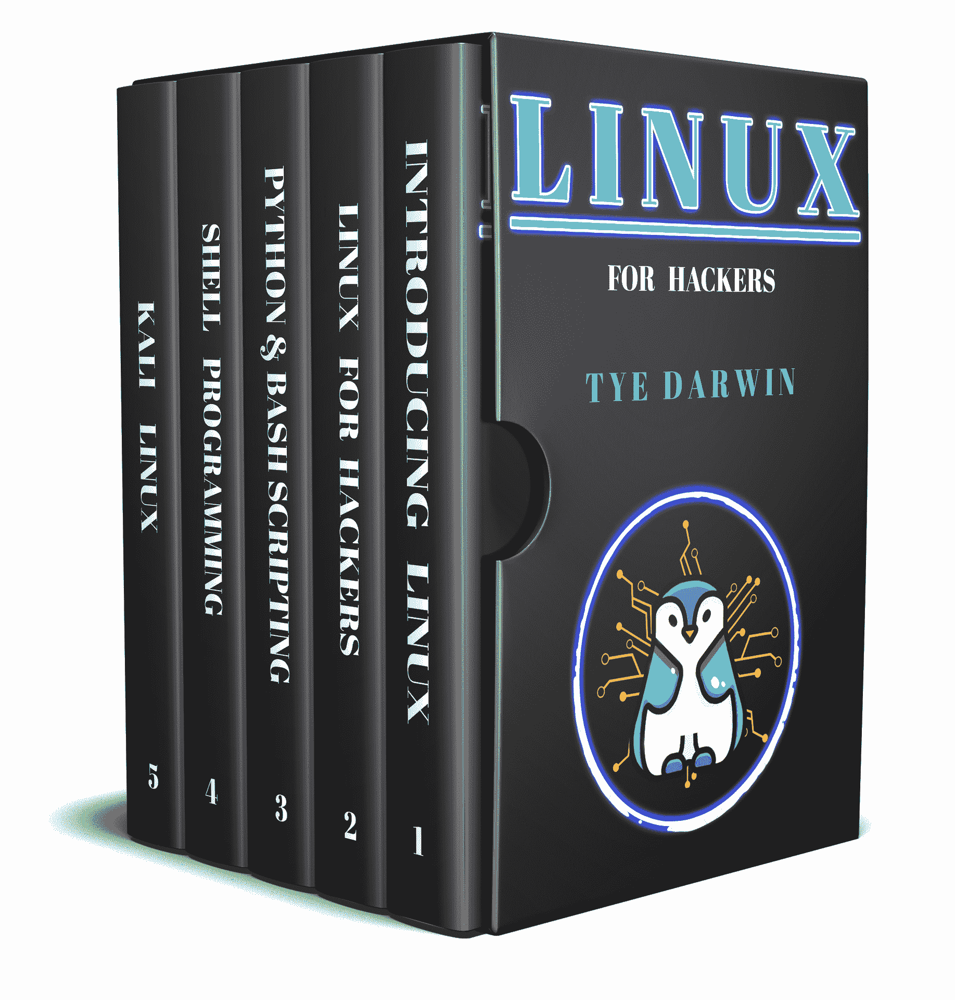

# 黑客 Linux Linux：使用 Kali Linux 工具，通过 Shell、Python 和 Bash 编程学习网络安全原理。初学者指南





这是长期以来出的最重要的黑客书籍之一。对于所有渴望将网络安全作为职业道路的初学者来说，这是必读之。—— *Steve，高级渗透测试*

“《黑客精英系列》是我一生读过的最喜欢的系列黑客书籍之一。” —— *匿名黑客评测*

“TYE DARWIN 让我尝试了 `Kali Linux`，并以前所未有的方式激发了我对 Shell 编程的兴趣。” —— *亚马逊评论*

“面向黑客的 Linux：学习 Linux 基础以及 `bash`、shell、`Python` 脚本编写，用于使用 `Kali Linux` 进行黑客攻击。” —— *TYE DARWIN*


致所有通过破坏改变世界的黑客，以及所有以更高的安全性重新构建一切的程序员。

要成为一名黑客，你首先需要成为一名程序员。成为一名程序员你不需要成为黑客，但开发黑客技能可以成倍地你的你的。 —— *匿名引用*


## 了解 Linux 并安装你喜欢的 Linux 发行版

### 引言
如果你是一个初学者，可能在想 Linux 是什么？让我来帮你介绍基础知识。Linux 就像 `windows` 和 `MacOS` 一样的操作系统，但具有更高的安全性、稳定性和定制性。你你知道吗？它是完全免费且开源的（这意味着源代码没有被隐藏或加密）。

听起来很棒对吧？但你可能会想为什么 Linux 在普通用户中不流行。Linux 是一个专为专业人士为专业人士开发的操作系统。与 `Windows` 和 `macOS` 相比，它提供的创意性软件少得多。你找不到 Linux 版的 `photoshop`，因为 `Adobe` 认为 Linux 并不是开发者创建产品的平台。

那么，你可能会想谁在日常工作中使用 Linux？Linux 或可能不是一个创意型操作系统，但绝对是开发者、程序员、伦理黑客、数据库系统管理员和系统管理员的首选。Linux 是复杂的，而且确实有学习曲线。Linux 爱好者应该熟悉命令，特别是要深入理解 Shell 编程，以实现他们的目标。

你被 Linux 的可能性所淹倒了吗？不要担心，因为我们在这里通过简单的解释和说明帮助你介绍 Linux。欢迎来到本书的第一模块，你将获得对 Linux 生态系统的简单介绍和详细的分步骤说明。让我们开始吧！

# 第一章 Linux 简介
本章主要描述了学习 Linux 系统的一些方法和经验，包括如何选择适合你的 Linux 发行版，以及每个 Linux 发行版的关系和适用环境。然后总结了学习 Linux 的通用路线图。它还将提供关于构建自己的 Linux 环境的信息，最后将介绍一些学习 Linux 的资源。通过本章的学习，初学者在学习 Linux 的过程中不再感到困惑。

### Linux 在各个领域的现状与趋势
许多新手感到困惑：“我听过 Linux，但在学习了 Linux 系统后，在上面能做什么？或者 Linux 系统具体能做什么？”带着这个问题，本书从 Linux 概述及其与开源软件的关系开始介绍。我们还将讨论 Linux 的应用领域和未来发展趋势。

### Linux 与开源软件
Linux 是一个由专业人士为专业人士开发的类 UNIX 免费开源操作系统。该操作系统的内核由 `Linus Torvalds` 于 1991 年首次发布。此后，随着用户空间应用程序的增加，它变成了操作系统。严格来说，Linux 只是内核。“Linux”这一术语通常指的是基于 Linux 内核的完整操作系统，包含 GUI 组件和其他工具。

GNU 通用公共许可证（通常被称为 `GNU GPL` 或 `GPL`）是一种广泛使用的自由软件协议。最初由 Richard Stallman 编写的 GNU 项目提供了自由软件的定义。只要遵循 GPL，任何个人和组织都可以自由地使用、修改和分发 Linux 代码。随着操作系统的快速发展，各种开源软件和 Linux 工具得到了应用和普及。因此，Linux 也成为开源软件的代名词。Red Hat Linux 是商业化的著名 Linux 系统之一。

### Linux 在服务器领域的发展
随着开源软件影响力的增加，Linux 服务器占据了越来越多的市场份额。服务器市场形成了大规模应用并保持快速增长，特别是在政府、金融、农业、电信等关键领域。此外，考虑到 Linux 在不同国家的快速增长和支持，服务器产品影响了市场。根据权威部门的统计，Linux 目前在服务器领域占有 75% 的份额。同时，Linux 在服务器市场的迅速崛起引起了全球 IT 行业的关注，并成为服务器领域的骨干。

### Linux 在桌面领域的发展
近年来，特别是在技术市场，Linux 桌面系统的发展趋势非常迅速。Red Linux、`Debian Linux` 等本地厂商推出的桌面系统已广泛应用于政府和其他领域。此外，`SUSE` 和 `Ubuntu` 也推出了基于 Linux 的桌面系统，特别是 `Ubuntu`，积累了大量用户。然而，从整体功能和性能来看，Linux 桌面系统与 Windows 系列之间存在差距，主要体现在易用性、系统管理、软硬件兼容性和软件丰富性。`macOS` 在设计师、创意人士和写作者中也流行。Linux 有良好的用途。作为一名黑客，理解 Linux 的重要性是强制性的，因为它可以破解任何系统。在下一节中，我们将讨论 Linux 在各个领域的示例。

### Linux 在移动嵌入领域的发展
Linux 的低成本、强大的定制功能和良好的便携性使其广泛用于嵌入式系统。目前，Linux 广泛用于手机、平板电脑、路由器、电视和电子游戏机。广泛用于移动设备的操作系统 Android 是在 Linux 内核之上的。目前，Android 已成为超越 `iOS` 世界最流行的手机操作系统。根据权威部门 2015 年的最新统计，Android 操作系统的全球市场份额已达到 84.6%。此外，`Cisco` 在网络防火墙和路由器使用了定制的 Linux，`AWS Cloud` 也开发了适用于手机、平板和互联网电视的 Linux 操作系统。常见的数字录像机和灯光控制系统逐渐采用定制版本的 Linux，这一切都归于 Linux 的力量和开源。Linux 远未灭绝。它将在世界的每个角落传播。

### Linux 在云计算/大数据领域的发展
互联网行业的快速发展促进了云计算和大数据行业的形成和快速发展。作为一个基于开源软件的平台，Linux 占据了云计算大数据的核心优势。根据 Linux 基金会的研究，86% 的企业使用 Linux 操作系统构建云计算和大数据平台。目前，Linux 开始取代 `unix` 成为最流行的云计算和大数据平台操作系统。在下一章中，我们将提供不同 Linux 发行版的详情，帮助读者选择他们喜欢的操作系统。选择 Linux 发行版总是一项巨大的挑战。为了知道什么最适合你，我们建议尝试不同的发行版以找到你真正喜欢的。Linux 发行版之多，无人能给出准确数字，但有一点是肯定的：Linux 变得越来越流行。面对这么多 Linux 发行版，计划从其他系统切换到 Linux 系统的初学者可能会感到困惑。即使是忠实的 Linux 用户也没有时间和精力一个一个去尝试。因此，在初学者学习 Linux 之前，他们需要一个明确的方向。选择一个适合他们的 Linux 系统非常重要。接下来的章节是对 Linux 发行版的分类介绍。

# 第二章 选择 Linux 发行版
上一章很好地介绍了 Linux 作为操作系统的重要性和哲学思想。目前有许多 Linux 发行版，选择一个完美的发行版可能是一项艰巨的任务。即使是专业人士也难以持续维护或使用某一个发行版。正如我们所说的，使用一个完美支持你偏好的 Linux 发行版是最好的方法。可能有流行的版本，但在你知道自己想要什么之前，它们不会让你满意。这里是一些常见的 Linux 发行版：


## Red Hat Linux (红帽 Linux)

Red Hat Linux 是红帽发布的最早个人版 Linux。其 1.0 版本于 1994 年 11 月 3 日发布。尽管它的历史没有其他著名的 Linux 发行版那么长，但比许多新的 Linux 发行版要长得多。自从 Red Hat 9.0 发布以来，红帽不再开发桌面级 Linux 发行版。Red Hat Linux 已停止开发，并将所有精力集中在服务器版本的开发上，即红帽企业 Linux（Red Hat Enterprise Linux）。2004 年 4 月 30 日，红帽正式停止了对 Red Hat 9.0 版本的支持，标志着桌面版 Red Hat Linux 的正式结束。原始桌面版 Red Hat Linux 发行版与开源社区的 Fedora 合并成为了 Fedora Core 发行版。

红帽目前分为两个系列：由红帽提供付费技术支持和更新的 Red Hat Enterprise Linux，以及由社区开发的免费 Fedora Core。

我们建议向谁推荐它？对于所有需要服务器管理的企业来说，没有比 Red Hat Linux 更好的发行版了。

## Fedora Core

Fedora Core (FC) 被红帽定位为新技术的测试平台，许多新技术将在 FC 中进行测试。如果这些新技术变得稳定，红帽将考虑将这些软件加入 Red Hat Enterprise Linux。Fedora Core 1 于 2003 年后期发布，FC 定位面向桌面用户。FC 提供了最新的软件包，其版本更新周期也非常短，仅为 6 个月。由于版本更新频繁，性能和稳定性无法保证，因此通常不建议在服务器上使用 Fedora Core。

对于用户来说，Fedora 是一个功能齐全且更新快速的免费操作系统。因此，对于个人应用（如开发和体验新功能），你可以选择这个发行版本。

## Kali Linux

作为一名黑客，你需要了解一个专为黑客存在的完美 Linux 发行版。以前，它被称为 Blacktrack，由许多志愿者维护。Kali Linux 的卓越之处在于在同一个操作系统中为黑客和取证专家提供了必不可少的工具。虽然现在 Kali 面临着 Parrot Linux（另一个著名的 Linux 发行版）的竞争，我们仍然建议初使用 Kali Linux 开启黑客生涯。Kali Linux 免费下载，并完全支持所有开源政策。如果你想认真对待黑客技术，那么利用 Kali 作为你的主操作系统显然是明智的。

## CentOS

CentOS 的全称是“社区企业操作系统”（Community Enterprise Operating System）。它根据开源规范从 RHEL 发布的源代码编译而来。由于 RHEL 是一款商业产品，所有的红帽标志必须更改为自己的 CentOS 标志，这便产生了 CentOS 操作系统。

两者的区别在于 CentOS 不包含闭源软件。因此，CentOS 不仅可以免费使用，还能享受 CentOS 提供的长期免费升级和更新服务。这是 CentOS 的一大优势。CentOS 是从 RHEL 的源码包构建的。它的版本号由两部分组成：主版本和次版本。主版本和次版本号分别对应 RHEL 的主包和更新包。例如，CentOS 6.5 是基于 RHEL 6.0 的第 5 次更新构建的。

然而，从 RHEL 7.0 版本开始，CentOS 的版本命名格式发生了微变化。主版本仍然对应 RHEL 的主版本，而次版本取决于 RHEL 更新包的发布日期。2014 年，CentOS 宣布了与红帽的合作，但 CentOS 将继续在新的委员会下运行，不会受 RHEL 的影响。这一策略表明，CentOS 的后续开发将获得红帽的有力支持。

## Su Linux

SUSE 是德国最著名的 Linux 发行版，享有盛誉，但它现在的命运却相当坎折。2003 年 11 月 4 日，Novell 宣布收购 SUSE。2004 年 1 月，收购顺利完成，Novell 还正式将 SUSE 命名为 SUSE Linux。Novell 对 SUSE 的收购加速了 SUSE Linux 的开发，并将免费的 SUSE Linux 变成了 openSUSE 社区项目。

但在 2010 年，Attachmate 收购了 Novell。收购后，SUSE Linux 的开发受到了阻。仅仅 3 年后，SUSE 再次易主。2014 年 9 月，Attachmate 被上市公司 Micro Focus 收购。坦率地说，SUSE 正式宣布开源是 SUSE 开发的基础，并将继续对开源做出贡献。SUSE 将继续全力支持 openSUSE。尽管 SUSE 更改了多次所有者，但不影响它的专业性。根据不完全统计，SUSE Linux 现在占据了欧洲 Linux 市场近 80% 的份额，大多数关键应用程序都是在 SUSE Linux 下构建的。

## Ubuntu Linux


Ubuntu 是一种基于桌面应用的 Linux 操作系统。基于 `Debian GNU/Linux`，Ubuntu 旨在为普通用户提供一个由自由软件构建的、最新且稳定的操作系统。Ubuntu 拥有巨大的社区力量，用户可以轻松从社区获得帮助。使用 `Ubuntu`，`Linux mint` 也是基于此开发的，我们将在书中大部分使用它来讨论各种概念。

上述章节主要介绍了最常见的 Linux 发行版。事实上，有很多 Linux 发行版。更常见的有 `Debian GNU/Linux`、`Mandriva`、`Gentoo`、`Slackware`、`Knoppix`、`MEPIS` 和 `Xandros`，以及红旗 Linux、深度系统 Linux 和麒麟 Linux 等，这里不再不再介绍。事实上，观察各种 Linux 发行版，Linux 发行版无非是这两个方面的发展：一个是服务器市场，另一个是桌面市场。

最后，根据用途，我们的建议是什么？以 `Ubuntu Linux` 代表的 Linux 发行版采取的是桌面市场路线。尽管它们给用户带来了许多惊喜并且更新迅速，但 Linux 桌面市场的发展并不乐观，因为桌面市场有 Windows 这样强力的竞争对手。目前，`Ubuntu Linux` 也开始在企业服务器市场展现其实力。

以 `Red Hat` 系列代表的 Linux 发行版现在主要面向企业级 Linux 服务器市场，专注于企业版 Linux 的开发，而其他发行版则专注于 Linux 服务器市场。这两个主要的 Linux 发行版厂商现在都采取了 Linux 服务器市场的路线，这表明 Linux 作为企业服务器具有巨大的开发前景。根据权威部门的统计，Linux 在服务器市场的份额逐年上升。

事实上，Linux 的许多应用程序都是针对 Linux 服务器的，本书的描述主要针对服务器下的各种 Linux 应用。作为一名黑客，你需要理解企业如何使用 Linux 使其场景运行。即使是从像 `Kali Linux` 这样的桌面系统破解目标，你需要完全意识到构建和维护服务器的 Linux 服务器的功能。我们都知道，所有敏感信息和我们绝对的信息都存储在服务器中。

### 初学者的首选是什么？ - LinuxMint 系列

在学习了几个主要的 Linux 发行版后，我们发现了为什么选择 `Linux Mint` 作为初学者的入门学习。`Linux Mint` 现在拥有庞大的用户网络，80% 的网络 Linux 资源是基于 `Ubuntu` 发行版的。如果你在学习过程中遇到任何问题，可以轻松在互联网上搜索解决方案。

`Linux Mint` 系列版本很容易获得。你可以从 `Linux Mint` 官方网站或 163 开源、SOHU 开源、云源等站点下载各种版本的 `Mint` 安装介质。如果这是你第一次接触 Linux，建议先安装 `Fedora Core`。`Fedora Core` 易安装，具有良好的硬件支持，并且界面精美。你还可以体验 Linux 的最新功能。如果你对 Linux 有了一了解并需要深入研究，建议使用 `CentOS` 发行版系统。

`Linux Mint` 拥有广泛的应用，并且具有典型性和代表性。现在基本上所有互联网公司的后端服务器都使用 `Linux Mint` 作为操作系统。可以说，学习了 `Linux Mint` 后，不仅可以快速融入企业工作环境，还可以类此类推，快速掌握其他类似的 Linux 发行版。同时，周围学习 Linux 的用户通常也基于 `Mint`，这样交流很方便，学习中的问题也更容易解决。

在通过 `Linux mint` 熟练掌握 Linux 后，作为黑客，你可以通过安装 `Kali Linux` 来扩展你的专业知识，并使用其中提供的大量工具来攻击系统。

### 桌面平台首选是什么？ -Ubuntu Linux

提到 Linux 桌面市场，`Ubuntu Linux` 占据了桌面 Linux 的近一半。`Ubuntu Linux` 是最流行的 Linux 桌面，拥有漂亮、简单且精美的界面。如果你想在 Linux 下进行娱乐和休闲，`Ubuntu Linux` 绝对是首选。

`Ubuntu` 的安装非常用户友好，只需按照提示逐步操作。`Ubuntu` 被认为是硬件支持最好、最全面的 Linux 发行版之一。许多在其他发行版或默认配置下无法使用的硬件在 `Ubuntu` 上可以轻松安装和使用。因此，用户可以像安装 Windows 一样轻松地安装 `Ubuntu`，享受 `Ubuntu Linux` 的乐趣。

### 企业应用的首选是什么?-RHEL/CentOS 系列

企业级应用追求可靠稳定，要求构建企业级应用的系统平台具有高可靠性和高稳定性。企业级 Linux 发行版可以解决这个问题。

`RHEL` 和 `Centos` 这两个 Linux 发行版没有太大。区别在于 `RHEL` 是一个商业 Linux 发行版。如果你想使用 `RHEL` 版本，需要购买商业授权和咨询服务。`Red Hat` 提供系统技术支持并提供免费的系统升级。

目前，`Red Hat` 官方网站不再提供免费下载的 CD 介质。如果你需要尝试，可以通过官方网站下载带有时间限制的 Linux 评估版。而 `CentOS` 是非商业版本。你可以从网上免费下载每个版本 `CentOS` 的安装介质，但 `CentOS` 不提供商业支持。当然，，用户不需要承担任何商业责任。

那么，我应该选择 `CentOS` 还是 `RHEL`？这取决于你的公司是否有相应的实力。如果是纯企业，建议购买 `RHEL` 发行版以获得相应的服务支持；相反，如果技术实力较强且有多年 Linux 经验，那么 `CentOS` 发行版是最佳选择。

### 黑客的首选是什么？ - Kali Linux

`Kali Linux` 是黑客的首选，它是一个包含各种工具的可靠发行版，可以使用其中提供的大量工具来攻击系统。`Kali Linux` 也提供了比其他软件更好的匿名保护。你也可以尝试 `parrot Linux`，但它比 `Kali Linux` 占用更多内存资源。

### 接下来是什么？

在通过 `Linux mint` 熟练掌握 Linux 后，作为黑客，你可以通过安装 `Kali Linux` 来扩展你的专业知识。到此，我们完成了对各种 Linux 发行版的简单介绍，并提供了大量示例。下一章节将介绍一些帮助你成为 Linux 专家的技巧。

# 第三章：掌握 Linux 的策略

在前章节中我们讨论了各种 Linux 发行版。在进入安装步骤之前，我们需要提供一些技巧，让你掌握 Linux。然而，请记住，这并不是严格的路线图，你可以通过实验来发现策略。长期来看，这对于获取技术技能需要实际案例。

## 如何养成良好的 Linux 习惯？

学习 Linux 后，请不要用 Windows 的思维思考问题，因为它们之间确实有很大差异。例如，内存管理和进程操作机制非常不同。因此，对于初学者来说，抛弃 Windows 的思维并尝试挖掘 Linux 的独特潜力和新概念是非常重要的。这些相似点和差异将在后续章节中描述。

### 确保习惯命令行模式

Linux 是由命令行组成的操作系统。系统的核心在命令行中。无论图形界面如何发展，命令行模式永远不会改变。Linux 命令有很多功能：从简单的磁盘操作、文件访问到复杂的多媒体图像和流媒体文件，离不开命令行。虽然 Linux 也有桌面系统，但 `Window` 只是运行在命令行中的应用程序。因此，可以说命令行是学习 Linux 的基础。很大程度上，学习 Linux 意味着学习命令。许多 Linux 大师实际上都是命令行大师。

### 理论实践结合

许多初学者会遇到这样的问题：他们熟悉系统的每个命令，但系统故障时无从从，甚至不知道使用什么命令来检查系统。这对许多 Linux 新手来说是无助的。最后，学习的理论知识没有与实际操作相结合。很多 Linux 知识，例如每个命令的含义，书中书中清晰，看起来很容易理解，但一旦结合使用就不容易。没有多次实践，技能是不可能掌握的。

人脑不像计算机硬盘。除非硬盘损坏或格式化，否则存储的数据始终存储在硬盘中并随时调用。在人类记忆曲线中，必须不断练习才能牢记一件事。学习 Linux 也是如此。如果你不能坚持学习，就会学后忘前。也有 Linux 初学者学习了大量 Linux 知识，但因为长时间没有使用，知识在短期内被遗忘。随着时间的推移，他们失去了对学习的信心。可以看出，要培养自己的战斗技能，只需要勤奋并愿意练习。

### 学习使用 Linux 在线帮助

每个 Linux 发行版的维护支持时间较短，这对于初学者来说通常是不够的。事实上，安装完整的 Linux 系统后，它已经包含了强大的帮助，但可能你还没有找到它，或者还没有掌握使用它的技能。例如，如果你不熟悉 `tar` 的用法，只需在命令行输入 `man tar` 就会得到关于 `tar` 用用的详细描述。主流 Linux 发行版带有针对不同水平的详细帮助文档，包括说明和 FAQ。在仔细阅读文档后，60% 的问题可以得到解决。

### 学习独立思考和解决问题

遇到问题时，首先想到的是如何自己解决。有很多方法。例如，通过这些方法，可以通过阅读书籍、搜索信息、浏览在线论坛解决 90% 的问题。独立思考和解决问题不仅锻炼了自己的解决问题能力，还能提高技术。如果你无法通过上述方法解决问题，可以教别人，思考为什么这样做，然后记录记录解决过程。

### 学习专业英语

如果你想深入学习 Linux，必须尝试查看英文文档。因为最好、最全面的文档都是英文的，即使是非英语国家的人也有技术文档被翻译成英文。在安装新软件时，首先阅读 `Readme` 文档，然后是 `Install` 文档，最后是 `FAQ` 文档。如果你来自其他语言国家，有必要学习一点英语。

### Linux 学习路线

Linux 操作或管理人才是企业急需的。根据多年的工作经验，作者总结了一套学习 Linux 的策略。读者可以以此为基础掌握关键点，相信这将让你事半功倍。策略分为三个阶段：初级、中级和高级。初级阶段主要是 Linux 的基础知识和基础应用。如果你是 Linux 新手，这很难开始，所以重点学习基础命令。中级阶段专注于常用配置，涉及应用配置、网络配置和系统安全。这一阶段的难度在于构建服务器需要全面的知识。高级阶段是语言和集群架构。要成为系统架构师，必须精通语言、集群架构和分布式架构，这也是高级操作和维护工程师的要求。

接下来是什么？到此，我们提供了学习 Linux 的简单介绍和策略。在这些必要前提下，通过下一章节了解安装程序。

# 第四章：Linux 安装准备

在前章节中介绍了 Linux 并提供了专业人士使用的真实场景。如果你仍然对选择 Linux 作为操作系统，建议访问 `distrowatch.com` 查看著名的 Linux 发行版及其出色功能。如果继续进行，你选择了 `Manjaro` 吗？`Linux Mint`？还是基于 Debian 的 Linux？或者你是精通技术的选择了 `Arch Linux`？无论你愿意使用什么 Linux 系统，本书将帮助你掌握 Linux 的基本哲学。这里不讨论最小硬件配置，只解释某些特殊应用和特殊安装。这是由于我们不知道你要安装的发行版。

## 安装 Linux

在学习各种 Linux 操作之前，你必须先安装 Linux 系统。与 Windows 系统相比，Linux 安装有很多点需要注意，例如选择合适的安装方法和确定命名方案。本章将以 `Linux Mint` 最新版本为例详细解释安装过程并帮助解决安装过程中遇到的问题。警告：在进行安装程序之前，务确保你已备份。首先，U 盘廉价且可以用多种方式使用。其次，所有服务器基本上都配备了 USB 接口。最后，U 盘安装速度非常快，可以节省大量时间。目前的趋势。本模块的后续章节将介绍使用 `Rufus` 和 `USB writer` 的 U 盘安装方法。

### 安装要求

通常，每个 Linux 发行版都会列出最低要求和系统推荐配置。不同的安装选项（如图形界面或字符界面）有不同的要求。当你从 Linux 发行版官网下载安装镜像时，维护者通常会显示最低要求。如果没有，请查看论坛或快速 Google 搜索详情。

Linux 硬件要求很低。大多数运行 Windows 的机器都可以安装 Linux，运行速度会比 Windows 快得多。这里不讨论安装 Linux 的最小硬件配置，只解释某些特殊应用和特殊安装。这是由于我们不知道你要安装的发行版。对于特定的 `Linux Mint` 版本，最低 RAM 要求 1GB。

如果你想安装图形界面（Linux 中的 `X-Window`），或运行 `OpenOffice` 等办公软件，对显卡和内存的要求更高。最好有独立显，否则显示效果将不理想。Linux 不是特别著名的游戏操作系统。近年来由于 Linux 变得热门，许多硬件制造商变为积极协助开发者但仍然保持保守。Linux 安装无法及时更新驱动。如果硬件配置是新的，你需要检查 Linux 安装版本是否包含所有驱动。常见的查看列出支持硬件的所有操作系统和版本的官方网站。在下一章节我们将提供使用光驱安装 Linux Mint 的说明。

# 第五章：Linux 安装步骤

Linux 系统安装多样灵活，可以根据不同的环境选择不同的方法。常用方法包括硬盘安装、U 盘安装、网络安装和光驱安装。

### 硬盘安装方法

硬盘安装方法通常基于 Windows 系统。例如，如果你想安装 Windows 和 Linux 共存的双系统，或者系统没有光驱，可以使用硬盘方法。
注意：由于 Windows 的文件系统格式与 Linux 完全不同，无法在同一个分区同时安装 Windows 和 Linux。即使你这样做，Linux 也无法识别硬盘分区。通常不建议普通用户这样做。如果低端系统需要高内存，建议使用硬盘安装。

### U 盘安装方法

如今的服务器通常没有配备光驱，光驱安装速度慢，批量安装系统时浪费大量时间。此时你可以通过闪存盘安装系统，快速又便宜。首先，U 盘便宜且可以用多种方式使用。其次，所有服务器基本上配备了 USB 接口。最后，U 盘安装速度非常快，可以节省大量时间。目前的趋势。本模块的后续章节将介绍使用 `Rufus` 和 `USB writer` 的 U 盘安装方法。

### 网络安装方法

在安装单台服务器或少量服务器（于 10 台）时，U 盘或光驱也可以用。但如果你想安装成百上千台服务器，这种方法显然是不现实的。对于大量需求，网络安装通常是自动化过程。常用的批量安装工具是 `Kickstart`。通过 `Kickstart`，管理员可以创建 `ks.cfg` 文件自动完成安装。其原理是安装程序只读取 `ks.cfg` 文件并根据设置自动完成安装。网络安装需要服务，对于初学者来说困难，在这里描述。

### 使用光驱安装

通过光驱安装 Linux 系统是最常用的方法，简单易懂。本章重点关注拥有光驱的读者。从网上下载 `Linux Mint` 版本的 ISO 格式。下载后，通过 `UltraISO`、`Recorder` 和 `Nero` 等刻录软件刻录，然后使用 BIOS 设置启动顺序为 DVD。设置完成后，插入 DVD 将自动启动安装程序。

# 第六章：Linux 中的分区

分区是执行安装时的基础步骤。即使你安装 Windows 系统，也需要分区。Windows 不提供图形界面如 `GParted`。按照本章节详细了解分区。

### 分区命名方案

在开始安装之前，我们需要了解关于分区的常识。在 Linux 下，硬盘分区由字母和数字识别。Linux 命名方案比 Windows 更灵活，含义更清晰。通常：`/dev/hda2` 代表第一个 IDE 硬盘的第二个主分区，`/dev/sdb3` 代表第二个 SCSI 硬盘的第三个分区。`/dev/`：文件存储目录。`hd` 和 `sd`：设备类型。`hd` 代表 IDE 硬盘，`sd` 代表 SCSI 硬盘。例如：`/dev/hda` 代表第一个 IDE 硬盘，`sdb` 代表第二个 SCSI 硬盘，`sdd` 代表第四个硬盘。`2`：数字代表分区。前 4 个分区（主或扩展）从 5 开始。例如：`/dev/hda2` 代表第一个 IDE 硬盘的第二个主或扩展分区，`/sdb3` 代表第二个 SCSI 硬盘的第三个主或扩展分区，`/sdc6` 代表第三个硬盘的第二个逻辑分区。

### Windows + Linux 双系统分区

许多从 Windows 转到 Linux 的初学者会在电脑上安装双系统。这在术语中称为双启动。这种方法对初学者来说更危险并可能导致数据丢失。因此，有必要讨论如何安全地安装双系统。首先，理解 Linux 和 Windows 是两个完全不同的系统，所以文件系统是不兼容的。为了清空数据，在 Windows 下完全删除磁盘。例如：如果我想把 D 盘空间给 Linux，需要在 Windows 磁盘管理中删除 D。大小取决于安装包。通常 10GB 可以满足要求。整理好所需空间后，下一步是重启系统，设置 BIOS 从光驱启动，放入 Linux CD 光驱，进入安装界面。
注意：在双系统中，最好先安装 Windows 再安装 Linux，因为每次安装 Windows 都会修改系统文件。如果你按照反顺序安装，Linux 可能启动，你可能需要修复系统文件。在安装过程中，`GRUB` 引导加载器将被替换。未来，如果由于原因你删除了 Linux，Grub 将损坏导致无法进入 Windows 系统。这是初学者遇到的最著名的问题之一。引导加载器问题请查看论坛。

# 第七章：开始安装程序

在前章节的详细说明后，我们准备充分。现在使用具体步骤安装 Linux 系统。

### 如何让系统启动？

1) 在主板 BIOS 中设置从 DVD-ROM 启动，放入 CD 光驱，出现选择选项的界面。安装程序成功从 CD 启动后，将出现启动菜单。如果安装程序在 60 秒内没有启动，将出现默认选项。使用方向键选择选项。按回键选择选项。程序启动后，将出现语言选择屏幕。如果你来自英语国家，选择 English。由于文档是英文的，有必要知道语言。如果你来自其他语言国家，有必要学习一点英语。

选择语言后，将出现安装界面。选择键盘布局和其他输入选项。点击“下一步”。下一个屏幕询问更新。建议安装期间不要更新以节省时间。点击“下一步”。下一个屏幕询问安装类型。选择“自动”或“手动”。选择“自动”进行简单安装，想自己分区选择“手动”。点击“下一步”。

下一个屏幕询问安装位置。选择你想安装 Linux 的磁盘。点击“下一步”。如果是手动，它会询问磁盘分区。选择“删除磁盘并安装 Linux”是推荐方法。点击“下一步”。下一个屏幕询问时区。在地图上选择你的位置并点击“下一步”。下一个屏幕询问用户信息。输入你的姓名、计算机名称、用户名和密码。点击“下一步”。下一个屏幕显示摘要设置。保持原样或更改。点击“下一步”。下一个屏幕显示安装摘要。点击“下一步”。一个屏幕请求确认。点击“继续”。安装将开始。进度条将显示状态。完成后，将出现摘要屏幕。点击“重启”。


- `/boot`: 存储系统启动信息和内核信息。
- `/usr`: 存储系统应用程序软件安装信息。
- `/var`: 存储系统日志信息。


# Linux 分区指南

关于每个分区的含义，请参阅下一章节获取更多详细信息。根分区（root）包含 Linux 系统的所有目录。如果在安装系统时仅分配了根分区，则 `/boot`、`/usr` 和 `/var` 都将包含在根分区中。如果你单独划分 `/boot`、`/usr` 等，这些分区将不再占用根分区的空间。

## 磁盘分区流程

### 1. 选择磁盘
在界面中，首先选择 `100GB sda` 磁盘。左下角有两个分区选项：
- **自动配置分区**：自动分区。
- **我将手动配置分区**：手动分区。

如果你不熟悉分区，可以默认选择自动分区。但是，出于学习的考虑，建议选择手动分区。选择手动分区后，点击左上角的 `Done`（完成）按钮。

### 2. 选择分区方案
选择手动分区后，从下拉菜单中选择一种方案：
- **标准分区 (Standard Partition)**：用于各种文件系统或 `swap`。
- **Btrfs**：一种由 Oracle、Red Hat、Intel 和 Suse 使用的下一代 Linux 文件系统。
- **LVM**：逻辑卷管理。它允许灵活的磁盘使用并提高性能。
- **LVM Thin Provisioning (精简置备)**：`LVM` 的升级版本，用于动态创建和分配存储池。
- **RAID**：当存在两个或多个磁盘时出现。它提供用于高端存储和冗余的软件 RAID。

选择 **标准分区 (Standard Partition)** 方案。

### 3. 创建挂载点
点击左下角的 `+` 按钮创建挂载点。

#### 根分区 (`/`)
将根分区空间尽可能大，以防止系统不稳定。如果分离了 `/boot` 和 `/usr`，`20GB` 通常足够。
- **挂载点**：`/`
- **所需容量**：例如 `20G`
- 点击 `Add mount point`（添加挂载点）。

#### Boot 分区 (`/boot`)
点击 `+` 创建 `/boot` 分区。
- **挂载点**：`/boot`
- **所需容量**：`500M`
- 点击 `Add mount point`（添加挂载点）。

#### Swap 分区
点击 `+` 创建交换区域。
- **挂载点**：`swap`
- **所需容量**：例如 `4096M`（注意：类型是 `swap`，而不是 `/swap`）。

#### /usr 和 /var 部分
分别创建这些分区。`/var` 分区应该大一些，因为它随着时间的推移存储日志。

#### 自定义数据分区 (`/mydata`)
要使用所有剩余磁盘空间：
- **挂载点**：`/mydata`
- **所需容量**：留空。

### 4. 分区配置详情
一旦创建挂载点，点击左侧面板中的它进行修改：
- **文件系统**：选项包括 `xfs`（默认）、`swap`、`vfat`、`BIOS boot`、`ext2`、`ext3`、`ext4`。
- **标签**：用于识别的自定义标签。
- **设备 ID**：一旦建立即固定（例如 `/dev/sda1`）。

点击 `Update Settings`（更新设置）完成。

---

# 网络配置

## 配置网络
在网络接口中，你可以配置连接方法：
- **DHCP**：自动分配。
- **手动**：手动配置。对于手动设置，请提供：
- **IP 地址**：例如 `192.168.1.10`
- **子网掩码**：例如 `255.255.255.0`
- **网关**：例如 `192.168.1.1`
- **DNS 服务器**：例如 `8.8.8.8`

## 有用命令
- `netstat`：查看网络统计数据。
- `ip addr`：查看接口地址。
- `ifconfig`：配置网络接口。

---

# Linux 安装

## 完成安装
1. 点击 **Begin Installation**（开始安装）。
2. **ROOT 密码**：为 `root` 账户设置安全的密码以防止字典攻击。
3. **用户创建**：创建一个普通用户以保证安全。
4. **重新启动**：完成后，点击 `Reboot`。

## 启动系统
1. 如果提示，请移除安装介质。
2. 按 `Enter` 进入启动过程。
3. 使用你创建的用户名和密码登录。

---

# Python 和 Bash 脚本

## Python 基础
Python 语法简单，对初学者来说很容易。
- **变量**：定义时 `=` 号周围不留空格。
```python
test = 567
```
- **数据类型**：整数、字符串、浮点数、布尔。
- **执行**：使用 `python script.py` 运行脚本。

## Bash 脚本
Bash 用于 Shell 脚本编写。
- **Shebang**：始终以 shebang 行开始脚本。
```bash
#!/bin/bash
echo "Hello World"
```
- **权限**：使用 `chmod` 使脚本具有可执行性。
```bash
chmod +x script.sh
./script.sh
```

---

# Linux 进程管理

## 监控进程
- `ps`：查看当前进程。
- `ps aux`：查看带有详细信息的的所有进程。
- `top`：实时进程监控。
- `htop`：交互式进程查看器（如果已安装）。

## 管理进程
- `kill`：通过 PID 终止进程。
- `kill -9`：强制终止进程。
- `renice`：更改运行进程的优先级。

## 使用 `nice` 设置优先级
使用 `nice` 为新进程设置优先级。优先级范围从 `-20`（最高）到 `19`（最低）。
```bash
nice -n 10 ./my_script
```

---

# 文件管理

## 权限
Linux 使用三种主要的权限类型：
- **读取 (`r`)**：读取文件内容。
- **写入 (`w`)**：修改文件内容。
- **执行 (`x`)**：将文件作为程序运行。

使用 `chmod` 更改权限：
```bash
chmod 755 filename
```

## 文件操作
- `ls -l`：列出文件。
- `cp`：复制文件。
- `mv`：移动或重命名文件。
- `rm`：删除文件。
- `touch`：创建空文件。

---

# 高级工具

## Nmap
`nmap` 用于网络发现和安全审计。
```bash
nmap -p 80,443 192.168.1.1
```

## Tcpdump
`tcpdump` 是一个包分析器。
```bash
sudo tcpdump -i eth0
```

## Lsof
`lsof`（列打开的文件）显示打开的文件和套接字。
```bash
lsof -i@192.168.1.1:22
```

## Netcat (nc)
`nc` 是网络连接的“瑞士军刀”。
```bash
nc -zv 192.168.1.1 80
```

## Strace
`strace` 跟踪系统调用和信号。
```bash
strace cat /dev/null
```

## Burp Suite
Burp Suite 是 Web 应用程序安全测试平台。
- **Intruder**：用于暴力攻击。
- **Proxy**：拦截并修改浏览器与服务器之间的流量。
```bash
# Intruder 中暴力攻击逻辑的示例
# 使用密码字典文件。
```

