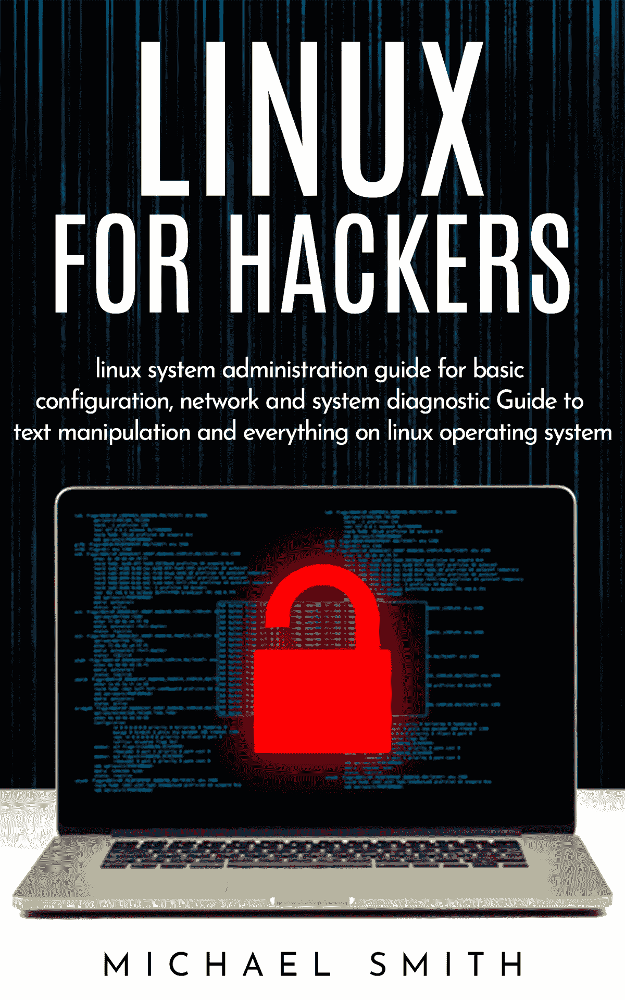

# 黑客 Linux：Linux 系统管理基础配置、网络与系统诊断、文本处理及 Linux 操作系统全指南





## 法律与免责声明
本书包含的信息及其内容并非取代或替代任何形式的医疗或专业建议；也不旨在取代可能需要的独立医疗、财务、法律或其他专业建议或服务的必要。书中的内容和信息仅供教育和娱乐之用。书中的内容和信息汇自被认为可靠的来源，根据作者所知、信息和信念，这些内容是准确的。然而，作者无法保证其准确性和有效性，并不对任何错误和/或遗漏负责。此外，根据需要会定期会对定期进行更改。在适当和/或必要的情况下，在使用书书中任何建议的措施、技术或信息之前，您必须咨询专业人士（包括但不限于您的医生、律师、财务顾问或其他此类专业顾问）。在使用本书包含的内容和信息时，您同意使作者免受任何损害、成本和费用，包括因应用书中提供的任何信息可能导致的任何法律费用。本免责声明适用于由于直接或间接使用和应用任何建议或信息而导致的任何损失、损害或伤害，无论是由于违约、侵权、过失、人身伤害、刑事故意或其他任何诉讼理由。您同意接受使用书中所陈信息的所有风险。您同意通过继续阅读本书，在适当和/或必要的情况下，在使用书书中任何建议的措施、技术或信息之前，您将咨询专业人士（包括但不限于您的医生、律师或财务顾问或其他所需的顾问）。


## 简介
在最基本的定义中，黑客（hacking）可以描述为利用计算机系统及其网络弱点和缺陷的行为。在利用这些弱点的过程中，非法行为可能包括窃取私人信息、访问并更改网络配置、破坏计算机操作系统的结构视图等。

黑客行为在几乎所有国家都存在。然而，它在发达国家占据主流。过去二十年来信息技术的进步表明，大多数黑客位于南亚和东南亚等发展中国家。

“黑客”一词今天引起了许多争议，并让许多人感到困惑。有些人将“黑客”视为可以随意操控计算机的人。在另一种语境下，黑客被视为计算机安全专家，其主要工作是发现并修复系统漏洞。这些漏洞发现者有时被称为破解者（crackers）。黑客世界的这些模糊性使得很难识别黑客的身份，这使得检测那些可能玩弄你系统的黑客活动变得异常困难。黑客背后的原因有很多。有些人黑客仅仅是为了赚钱。他们可以窃取你的密码、侵入你的私人信息，甚至将你的正确信息改为错误信息，以获取金钱。其他黑客进入游戏仅仅是为了挑战或竞争。此外，一些黑客是计算机世界的社会恶分子，其目的是访问网络或系统。在访问后，这些黑客会使网络失效，导致用户无法正常使用。例如，如果一个社区正在对某事进行抗议，它可以尝试入侵系统作为对当局的抗议信号。它可以选择这样做，而不是违反它认为重要的其他法律。您同意接受使用书中所陈信息的所有风险。您同意通过继续阅读本书，在适当和/或必要的情况下，在使用书书中任何建议的措施、技术或信息之前，您将咨询专业人士（包括但不限于您的医生、律师或财务顾问或其他所需的顾问）。

### 1. 白帽黑客
他们是好人，因为他们没有恶意。他们之所以被命名“白帽”黑客，也许是因为白色象征着纯洁。他们入侵系统是为了消除漏洞，或者作为为专注于计算机安全的公司或学校进行研究的一种。他们也被称为道德黑客（ethical hackers）。他们执行渗透测试并评估计算机系统的漏洞。

### 2. 黑帽黑客


黑帽黑客的黑客带有恶意意图，旨在打破书中所有的规则。他们进行黑客是为了个人利益以及金钱目的。他们被认为来自非法社区，完全符合计算机罪犯的刻板印象。黑帽黑客利用网络的弱点使系统变得失效。如果有机会的话，这些黑客还会破坏你的数据和信息。当这些黑客进入你的系统时，他们会威胁要将你的隐私信息向公开，目的是迫使你做他们想要的任何事情。不用说，黑帽黑客不会修复你计算机系统或网络中的漏洞，而是会利用它们来对付你。

### 3. 灰帽黑客

这些黑会在互联网上搜索计算机系统或网络的弱点并入侵。他们这样做可能是为了向网络管理员展示网络中的漏洞，并就特定的价格建议修复这些漏洞的方法。

### 4. 蓝帽黑客

据说蓝色代表执法部门的成员，尽管这只是一种惯例。这些黑客是将黑客技术作为服务的自由职业者。计算机安全公司聘请黑客专家来测试它们的网络，以便在发布给公众之前检查弱点、漏洞和缺陷。蓝帽黑客是“好人”，与意图难以预测的灰帽黑客不同。

### 5. 精英黑客

这些是社区中的专家黑客。在大多数情况下，他们可以攻破不可逾的防御，并编写复杂的黑客程序。精英黑客的一个例子是加里·麦金农（Gary McKinnon）。麦金农小时候曾入侵过 NASA 的频道，安装了病毒并删除了文件。精英身份主要由该人员所属的黑客社区或团体授予的。

### 6. 脚本小子 (SKIDDIE)

这些黑客并非完全的新手。“Skiddie”一词是“Script Kiddie”（脚本小子）的缩写。他们通过其他专家黑客创建的工具入侵计算机系统或网络。在大多数情况下，他们对程序的背景和创建了解甚少。他们只是为了使用这些程序。

### 7. 新手 (NEWBIE)

根据百科全书，“newbie”一词的意思是“新用户或对某活动极其陌生且缺乏经验的参与者”。新手黑客是黑客世界的初学者。他们没有先前的知识或经验。他们徘徊在社区边缘，目标是从同伴那里学习门道。

### 8. 黑客行动 (HACKTIVISM)

这种版本的黑客行为是一个社区或个人利用黑客技术通过被入侵的系统向公众推送信息的过程。黑客行动分为两类：

1. **网络恐怖主义**：这被称为恐怖主义，因为黑客的目的是完全破坏或损坏该系统或网络。
2. **信息权**：这些人入侵系统或网络从公共和私人来源收集机密数据，让任何人都能获取这些信息。

### 9. 情报机构

任何国家都可能被入侵。为了确保国家免受入侵，情报机构联合反网络恐怖主义机构从事他们形式的黑客活动。他们这样做是为了保护国家免受外国攻击和威胁。从通常意义上说，我们不能认为这是入侵，因为这些机构作为蓝帽黑客采取了防御策略。

### 10. 有组织犯罪

在许多犯罪电影中，反派有一个他们效力的老大。组织犯罪黑客为老板工作。他们与黑帽黑客有关，因为他们犯罪并违反法律以协助其所属的老大或帮派犯罪目标。

在黑客入侵系统之前，他或她必须完成某些过程。其中一些是：

#### 1. 侦察 (RECONNAISSANCE)

为了避免被入侵，你应该保持你的隐私信息非常安全。在此背景下，“侦察”是黑客尝试收集有关你（目标）以及你系统中任何弱点的所有手段。黑客利用这一步骤获取尽可能多的目标信息。

#### 2. 扫描与枚举 (SCANNING AND ENUMERATION)

扫描涉及使用智能系统端口扫描来检查系统的开放端口和脆弱点。攻击者可以使用许多自动化工具检查并测试你系统的漏洞。

#### 3. 获取访问 (GAINING ACCESS)

如果黑客能够完成上述两个阶段，他的下一步阶段就是获取你系统的访问。这个阶段是黑客乐趣开始的地方。他或她将利用在侦察和扫描系统期间发现的弱点突破你的连接。黑客可以利用你的局域网、你的互联网（在线或离线）或对 PC 的本地访问。从现实意义上说，黑客入侵你的系统或网络的瞬间，黑客就被视为该系统的所有者。安全漏洞指的是黑客可以使用恶意技术破坏你系统的阶段。

#### 4. 维持访问 (MAINTAINING ACCESS)

在前面的阶段中，我们说一旦黑帽黑客入侵了你的系统，它就不再属于你了。在这一阶段，在黑客破解你的安全访问并完全入侵你的系统后，他或她可以通过创建后门获得未来对你计算机的访问。因此，即使你再次访问该计算机系统或网络，你仍然无法确定处于完全控制。黑客可以安装一些脚本，即使在你认为威胁已经消失时也能允许访问你的系统。

#### 5. 清除踪迹 (CLEARING TRACKS)


黑客入侵了你的系统，并同时保持对该系统的访问权限。你认为黑客接下来会做什么？黑客随后会清除所有的足迹，以避免被安全人员或机构的检测，以便他们能够继续使用该系统。在其他情况下，黑客这样做可能仅仅是为了防止法律对其采取行动。今天，许多安全违规事件未被发现。已经出现了即使在进行警惕日志检查的情况下，防火墙仍被绕过的情况。

到此时，你应该对黑客的本质有了了了解。现在，我们将概述基本的安全准则，保护你、你的系统和信息免受外部威胁。我们提供的所有信息都基于已成功使用的实用方法论。这些方法将帮助计算机系统免受恶意用户的攻击和破坏。

## 更新你的 OS（操作系统）
操作系统容易受到各种类型的攻击。每天都有新病毒发布；仅此就应该让你保持警惕，因为你的操作系统可能受到一组新威胁的影响。这就是为什么这些操作系统的厂商会定期发布新更新，以便领先于新威胁。这将帮助你提高安全性，并降低系统成为病毒宿主机的风险。

## 更新你的软件
在上一节中，我们讨论了更新的重要性。更新后的软件具有更高的效率和便利性，甚至拥有更好的内置安全功能。因此，频繁更新你的应用程序、浏览器和其他程序是至关重要的。

## 杀毒软件
根据我们的研究，我们看到某些操作系统很容易受到许多攻击，尤其是 `Microsoft` 或 `Windows` 平台。通过杀毒程序保护你的系统免受病毒侵害的一种方法。杀毒程序可以在许多方面帮助你。有很多杀毒程序（免费或付费）可以安装在你的系统上，以防范威胁。恶意黑客可以通过互联网在你的系统中植入病毒，但通过良好的杀毒扫描，你可以发现并消除威胁。与任何其他软件或程序一样，你的杀毒软件需要频繁更新以保持 100% 的效力。

## 反间谍软件
该程序同样重要，因为你不想让系统里有木马程序。你可以在互联网上获得许多反间谍软件；只需确保你选择一个评价良好的即可。

## 选择 Macintosh
Windows 操作系统非常流行，因此许多黑客和破解者都针对它。你可能读过一些文章和博客，说 Macintosh 操作系统的安全性较低；然而，Macintosh 对许多影响 Windows 的威胁具有免疫力。因此，我们敦促你尝试 平台平台。然而正如我们在其他章节中解释过的，世界上没有任何系统是完全防黑的，所以不要掉以轻备。

## 避免阴暗网站
当你浏览 Facebook 时，可能会遇到发送带链接消息的陌生人，其中一些是点击诱饵的形式。避免点击此类链接。此外，你必须避免色情网站，或那些承诺你好得不可置信之物的网站。其中一些网站承诺在你点击链接时提供免费音乐，而另一些则提供免费现金或电影。这些网站由恶意黑客运营，他们正在寻找通过恶意软件链接损害你计算机的方法。请注意，在某些恶意网站上，你甚至不需要点击任何东西被破解。良好的浏览器会在带你进入坏网站之前始终通知你该网站。请务必听从浏览器的警告，并在必要时返回安全区域。

## 防火墙
如果你是在组织中工作的计算机专家，你可能会遇到多个计算机系统的操作系统处于同一个网络的情况。在这种情况下，你必须安装提供安全防火墙的软件。Windows 操作系统内置了防火墙，你可以直接激活并使用。此防火墙功能出现在不同版本的 Windows 中，包括 `Windows XP`、`Windows Professional`、`Windows 10` 以及其他版本。

## 垃圾邮件
你可能因为垃圾邮件被破解。电子邮件提供商已根据一组参数对邮件进行分类。某些邮件将直接发送到收件箱，另一些将发送到垃圾邮件文件夹。为了安全，请避免打开看起来可疑的邮件。其中一些邮件带有你不应该打开的附件。无论邮件提供商采取什么安全措施，某些垃圾邮件仍然会绕过它们的过滤器直接进入你的收件箱。避免打开此类邮件，不要下载随附附的附件。

## 备份选项
无论你是经营自己的业务还是作为伦理黑客为组织工作，备份你的工作都是至关重要的。某些文件包含机密信息，例如个人文件、财务数据和你无法承受损失的相关文档。你应该注册 `Google Drive`、`One drive` 以及其他云盘公司，以便你可以上传文件作为备份形式。你还可以购买一个外部硬盘并将所有重要文件传输到其中。采取所有这些安全措施，因为单一的恶意软件无论你安装了什么杀毒软件都可以扰乱你的数据。一旦执行了某些操作，你就无法撤销，所以始终保持备份。

## 密码
这是安全最重要的方面。强密码的重要性无论如何强调都不为过。从你的电子邮件、文档甚至安全的服务器，一个好的密码都是防御外部威胁的第一道也是最后一道防线。密码分为两类：弱密码和强密码。弱密码是用你的手机号码、姓名、家庭成员姓名或容易被猜到的内容组成的。避免使用这种密码，因为即使是业余黑客也能猜到。

有些人使用日期，如生日或特殊的纪念日；然而，这仍然不安全。创建密码时，请花时间做一些基础数学计算，因为你的密码必须同时包含字母和数字。你甚至可以将其与特殊字符。例如，如果你的初始密码是“jack”，你可以将其变为“J@ck007”。这样的密码即使简单，也几乎不可能被猜到。此外，避免写下你的密码。你的密码不是需要备份的文件；它必须是你私人的。确保你使用一个简单但非常强大的密码。然而，请记住，强密码并不能让你完全安全。

到此时，你应该对黑客的本质有了深入的理解，并掌握了一些确保计算机系统或网络安全的指南。以下是为避免成为黑客受害者应遵循的通用建议：

*   当你登录电子邮件时，应避免打开来自未知来源的邮件。最重要的是，不要下载此类邮件附带的任何附件。
*   不要访问不安全的网站。始终访问安全的网站，例如带有“https”的网站。尝试只进行安全浏览。
*   在安装新程序之前，确保对程序进行扫描以确保其没有病毒。然后，你需要删除任何旧的安装文件，因为你现在有了新的安装文件。如果黑客利用那些旧文件作为后门，这可以为你节省麻烦。
*   定期扫描你的文件。同时确保系统上的所有应用程序都频繁更新到最新版本。
*   如果你在家里工作，确保你与安全专业人员或公司保持联系，他们可以帮助检查网络漏洞并尽快纠正它们。


- 始终备份你的文件。你可以使用安全的云端硬盘，例如 Google Drive 或 Dropbox。你也可以购买外部硬盘，以确保你的重要文件安全且完好。

- 你是否在使用社交网络？请避免点击陌生人发送的链接。此类极具诱惑性的信息可能是进入私密聊天室的邀请，也可能是点击链接后获得金钱的承诺。请远离这些信息，确保安全。

- 随着技术的不断进步，软件开发者也在不断进步。请务必确保你使用良好的浏览器进行上网。例如，某些浏览器内置了病毒或危险检测机器人，当你尝试访问不安全的网页时，它们会向你发出警告。当你想要下载浏览器时，请选择具有内置安全功能的浏览器。推荐以下浏览器：
  - Google Chrome
  - Mozilla Firefox
  - Safari

- 当通过浏览器连接互联网时，请使用对你重要的功能。例如，如果你在连接时并不使用 `Java` 或 `Active X`，请在浏览器中禁用它们。一直保持这些连接状态是不安全的。

- 研究表明，安全的操作系统是 `Linux` 和 `Macintosh`。如果这两个系统能满足你的需求，建议你切换到它们。它们更加安全，因为与流行的 `Windows` 系统相比，它们遭受攻击的次数较少。

- 当你睡觉时，如果你的计算机系统处于开启且空闲或睡眠模式，仍然可能受到攻击。为了防止这种情况，请确保在不使用电脑时完全关闭。关闭状态的系统是不可能被黑客入侵的。


# 第 1 章：Linux 基础

当你想起操作系统时，最先出现在脑海中的两个是 Windows 和 Mac OS。这些恰好是 2 个 of the most significant widespread and they have been around for some time with many different versions. They are popular primarily because of the computer systems they come with, and people usually use them simply because they come pre-installed. Whereas these two are the most popular, there is another operating system that is starting to gain some traction in the computer world; the Linux operating system. For the most part, Linux is found on mobile devices, smartphones, and tablets, but because it is open sourced and free, there are now more people with computers and laptops that are beginning to use Linux as their personal operating system. Since it is able to work with embedded systems, Linux is useful on mobile devices, computers, smart watches, routers, gaming consoles, controls, and even televisions.

Linux is made with a straightforward design that a lot of programmers like. It is straightforward and has a lot of the power that other operating systems possess, but it is even easier to use. A lot of programmers because it is open source, meaning they are able to use it or make changes if they would like, and has all the features that they could possibly want for computers, mobile devices, and more. Most people are familiar with working on Windows or on the Mac OS, and they feel that Linux might not be as safe as some of the other options - but this is just simply not the case. In reality, Linux is one of the best operating systems out there. It is just newer than and not as well-known as some of the other operating systems, but since it is so easy to use and can also be used on mobile devices, it is quickly growing in popularity.

## Linux 如何诞生

Linux was first released during 1991. Initially, it was developed with the idea that it should be a free operating system for Intel x9 based personal computers. However, it was soon changed to become a more collaborative project, meaning that the source code was free to use. Under the license terms for the operating system, it is able to be modified and used for both non-commercial and commercial distribution. Since it is compliant with `POSIX` or the Portable Operating System Interface’, it is a very reliable operating system.

The best fact about Linux is that it is open sourced and free to use, which may be why a lot of people are switching over to this operating system. Mac OSX and Windows all cost something for the user to get and they will either have to purchase the software on their own or have it put on a computer for them. This can get costly when you factor in the number of updates required for these operating systems. Since Linux is free, you are able to update at any time without additional costs.

The open sourcing is helpful for both the programmers as well as everyday users with Linux. Programmers are able to use the various codes that are in the library in order to create some of their own new code and release it for others to use. Those who are on Linux get the benefits of better updates, newer features, and more, all thanks to the ability of many programmers being able to work on the system at the same time. All of this makes Linux an easy choice, especially going forward as it is compatible with both smartphones and tablets also.

## Linux 组件

There are seven main components of Linux that you will encounter. They are as follows:

### 可用性
Linux has thousands of applications that are available for the user to install right away. In fact, as soon as you install the Linux system, you will be able to install as many of the applications as you choose. Think of the applications in Linux as similar to what you will find with the App Store and the Windows Store, where you are able to pick out the applications that you want to work with. Once you have done some searching and found the apps that you want, you can directly download and install them to the Linux system.

### 守护进程 (Daemons)
The Daemons are basically the components in Linux that are going to serve as the background services. This would be things like scheduling, printing, and sound. These are going to be launched at one of two times; either during the boot or after you perform the desktop login.

### 桌面环境
The environments for the desktop refer to the different components that work with user interaction. Some of the examples of these desktop environments include Enlightenment, Cinnamon, Unity, and GNOME. Each of these is going to come with their own set of web browsers, calculators, file managers, configuration tools, and some other features that have been built into the environment.

### 图形服务器
This is basically going to be the subsystem inside of Linux. The main function that you are going to see within this is that the graphical server it will show the different graphics that are on your screen. Sometimes you will hear it being called the ‘X server’ or simply as ‘X.’

### 引导程序
As you keep using Linux, it comes a moment when you want to make sure that the system is going to boot up. The boot loader is going to take over the boot process inside of the Linux management. It is often going to be seen in the form of a splash screen. Once you see this splash screen show up, it is going to proceed over to the booting process slowly.

### 内核 (Kernel)
The next main component that you will see within the Linux system is known as the kernel. This is essentially the core inside of Linux. It is going to be in charge of managing the CPU, peripheral devices, and the memory inside the Linux operating system.

### Shell
We are going to talk about the shell in more detail later on because it is vital when working with Linux, so for now, we will keep things simple. The shell is basically going to be the command line inside Linux. It is going to permit various controls based on the commands that the user types into the interface interface. This is where you are going to type in the codes and the commands that you want.

## 下载 Linux

Downloading this system is pretty easy. You merely need to visit `www.ubuntu.com/downloads/desktop` in order to get this onto your computer. Once it had time to get up, you should also take some time to add some applications that you like. Some people like to have it on the system, and others would rather just have it on certain times when trying to do hacking. Both of these methods work fine; only depends on what you want to do with Linux. If you just want to use Linux on the side as additional part of your system, it is best to download it so that you can have on the computer. It can take up a lot of space when you have operating systems all the time.

## 学习 Linux 命令

There are a lot of commands that you will need to learn in order to get Linux to work well for your needs. Here we will cover some of the main ones that you may find useful, and later we will get into some the different things you are able to do. Some basic commands that you should know how to perform with Linux include:

- `mkdir`: 用于创建目录。
- `rm`: 删除文件，无需确认。
- `w`: 显示关于当前用户的信息。
- `uptime`: 显示系统运行时间、用户数以及平均负载。
- `ls`: 以格式显示文件列表，也可以显示自上次修改以来创建的新文件。
- `who`: 显示日期、主机信息。
- `less`: 允许快速查看文件，用于向上向下翻页。
- `more`: 更容易地查看文件，也可以显示百分比。
- `top`: 实时显示任务和处理器活动，显示处理器和内存的使用情况。
- `last`: 显示关于用户活动的一些信息，包括内核版本、终端、启动时间和。

As you can see, Linux is a programming system that is going to make it easier than ever to get tasks done, whether you are working online, on the phone, on tablet, or through another method. It is free to install, but it is still stable and will often work as well as other systems that are available.

# 第 2 章：命令行指南

This is the end of the chapter dedicated to Linux commands. We started with the general commands and then introduced those related to networking as well as the main functions of system. Now you are ready for the exercises I will present to you in the following chapters. But first, let me explain how networks work and what are the services most hackers use. The more essential but basic Linux commands that you need to know so fire up Linux and play along. There will be exercises to test your knowledge along the way, although I won’t be providing answers to all of them because you should be able to work it out from the section you just read:

## 列出目录和文件
### ls
When your login, you will always be in your home directory. This will have the same name as your username and it is where all your personal files and subdirectories will be saved. To find out the contents of your home directory, type in:
```
ls
```
Using the `ls` command, you will only see the contents whose name does not start with a dot. The files that start with the dot are hidden files and will normally have some important information in them. The reason they are hidden is because you should not be touching them.

To see all the files, including those with the dot, in your home directory, type in: own```
ls -a
```
You will now see all files including those that are hidden. `ls` is one of those commands that is able to take options, and the above one, `-a`, is just one of those options. These will change how the command works.

### 创建目录
### mkdir
To make a subdirectory of the home directory, to hold the files you create, for the purposes of this, we will call it `linuxstuff`, type in:
```
mkdir linuxstuff
```
To see that directory, type in:
```
ls
```

### 切换到另一个目录
### cd
`cd` means change directory from the current one to. to change to the directory you created, you would type in:
```
cd linuxstuff
```
To see the content, of which shouldn’t be any right now, type:
```
ls
```

### . 和 .. 目录
Staying in the `linuxstuff` directory, type this in:
```
ls -a
```
You will see, and this is all directories called `.` and `..`. In Linux, a single dot (`.`) signifies the current directory so if you were to type in (making sure to leave a space between `cd` and the single dot):
```
cd .
```
you would stay exactly where you are in the `linuxstuff` directory. While this might not seem to have much use at first, you will soon find that typing `..` signifies the parent directory, which is the directory you are already in so if you were to type:
```
cd ..
```
you would go back one directory, to your home directory.

### 路径名
### pwd
`pwd` stands for print working directory and using a pathname lets you work out exactly where you are in the file system. Absolute pathname that goes with your home directory, you would type in cd then type in:
```
pwd
```
You should see something like `/home/its/ug1/`. This means you are in a subdirectory called `its`.

## 章节总结
| 命令 | 含义 |
| :--- | :--- |
| `ls` | 列出文件 |
| `ls -a` | 列出所有目录和文件，包括隐藏文件 |
| `mkdir` | 创建新目录 |
| `cd` | 切换到指定的目录 |
| `cd ~` | 回到主目录 |
| `cd ..` | 切换到父目录 |
| `pwd` | 显示当前工作目录路径 |

## 复制文件
### cp
If you wanted to copy `file1` in the working directory and name it `file2`, you would type in:
```
cp file1 file2
```
First, go to [this website](http://www.surrey.ac.uk/Teaching/science.txt) and copy the text into a file. Name it `science.txt` and save it to your `linuxstuff` directory. So, now we are going to copy a file that is found in open part of the file system to `linuxstuff` directory. First, you would get back by typing:
```
cd ~/stuff
```
Then you would type the following at the prompt:
```
cp science.txt .
```
Note – do not forget to add the dot at the end. The command is saying that we are going to copy the file called `science.txt`. 

## 移动文件
### mv
`mv file1 file2` will move or rename `file1` to `file2`. When you use the `mv` command, you will move the file and not copy it, ensuring that you still have just one file and not two. We can also use it to give a file a new name we do this by moving it to the same directory it is already in but with a different name. Go back to `linuxstuff` directory and type in the following:
```
mv science.bak backups/
```
Now type in `ls backups` and see what has happened.

## 删除文件或目录
### rm
### rmd
To delete a file, or remove it, we use the `rm` command. Let’s make a copy of `science.txt` and then we will delete it. From your `linuxstuff` directory, type in:
```
cp science.txt tempfile.txt
ls
rm tempfile.txt
ls
```
If you want to remove an entire directory, first make sure there are no files in it and then use `rmdir` command. Have a go at removing the directory called `Backups` – Linux won’t allow it because it has something in it. Exercise: Use `mkdir` to create a new directory named `tempstuff` and then use the `rmdir` command.

## 在屏幕上显示文件
### clear
Before we move on, lets clear our window of all the commands already typed in that we can better understand the output of next commands. To do this, type:
```
clear
```
### cat
`cat` is used to concatenate and display a file’s content on your screen. Type in:
```
cat science.txt
```
You will see that the file is bigger than the window so it will scroll, making the contents hard to read.

### less
This command will write the file contents to the screen one page at a time. Press on space bar if you need to see the next page and, if you have read enough, type `q`.
```
less science.txt
```
### head
This command will write the first ten lines of the specified file to your screen. Clear your screen and type in:
```
head science.txt
```
Now type:
```
head -5 science.txt
```
Look at what you go and decide adding `-5` to the command.

### tail
As opposed to the `head` command, the `tail` command will write the last ten lines of the specified file to your screen. Clear your screen and type in:
```
tail science.txt
```

## 浏览文件内容
Using the `less` command, you can search for a keyword pattern in a text file. For example, if you wanted to find all instances of `science` in the `science.txt` file, you would type in:
```
less science.txt
```
And then, staying in `less`, type a forward slash and the work you want to search:
```
/science
```
All the instances of the word are highlighted

### grep
`grep` is one the standard utilities on Linux and is used to search for specific patterns or words. Clear your screen and type in:
```
grep science.txt
```
`grep` is case sensitive and will distinguish between `science` and `Science`. If you want to ignore this case sensitivity, use `-i`. For example, to search for `spinning top`, you would type in:
```
grep -i 'spinning top' science.txt
```
Other options with the `grep` command are:
- `-v`: will display the lines that don’t match the specified text.
- `-n`: will precede each of the matching lines with the correct line number.
- `-c`: will only print out the total number of matched lines.
Have a go at these and see what the results are. You can use more than one of these in command, like:
```
grep -ivc science.txt
```

### wc
`wc` is a neat utility and is short for word count. If you wanted to do total word count on `science.txt` file, you would type:
```
wc -w science.txt
```
If you want to know how many lines are in the file, type:
```
wc -l science.txt
```

## 章节总结
| 命令 | 含义 |
| :--- | :--- |
| `cp file1 file2` | copies `file1` and names it `file2` |
| `mv file1 file2` | moves or renames `file1` to `file2` |
| `rm file` | removes a file |
| `rmdir` | removes a directory |
| `cat file` | displays a file |
| `less files` | shows one page of a file at a time |
| `head file` | displays the first 10 lines of a file |
| `tail file` | displays the last 10 lines of a file |
| `grep "keyword" file` | searches for a specific keyword in a file |
| `wc "keyword" file` | counts how many characters or words in a file |

## 重定向
Most of the processes initiated by Linux commands will write to the terminal screen, which is the standard output. Many of them also take their input from the keyboard. As well as that, there are those that write error messages to the terminal screen. Already, we have used the `cat` command to write a file’s contents to the terminal so now type the following, without specifying any file:
```
cat
```
Type a few words using the keyboard, anything will do, and then press return. First, go to [this website](http://www.surrey.ac.uk/Teaching/science.txt) and copy the text into a file. Name it `science.txt` and save it to your `linuxstuff` directory. So, now we are going to copy a file that is found in open part of the file system to `linuxstuff` directory. First, you would get back by typing:
```
cd ~/stuff
```
Then you would type the following at the prompt:
```
cp science.txt .
```
Note – do not forget to add the dot at the end. The command is saying that we are going to copy the file called `science.txt`.

### 重定向输出
The `>` symbol is used to redirect command output. For example, if we wanted to create a file with a name of list1, that had a list of fruits in it, we would type:
```
cat > list1
```
Then type the names of a few fruits and, each one, press return. For example:
apple
pear
banana
then press `ctrl+d`
The `cat` command will read what was input from the keyboard and `>` will redirect it to the output, screen, in a file named list1. If you wanted to read what the file had in it, you would type:
```
cat list1
```
Exercise: Now, using the same method, create a file named `list2`, with these fruits in it – plum, orange, mango. Now read the file contents.

### 追加文件
`>>` will append the standard output to a file so, if we wanted to add some more items to `list1`, we would type:
```
cat >> list1
```
And then the names of more fruits:
grape
peach
orange
then press `CTRL+d` to stop. To read the file contents, type:
```
cat list1
```
You should, by now, have two files, one containing six fruits and one containing four. Now we will join the two lists using the `cat` command into one file named biglist:
```
cat list1 list2 > biglist
```
This will read the contents of both lists, in turn, and then output the text from each into a new file. To read the contents of biglist, type in:
```
cat biglist
```

### 重定向输入
To redirect command input we use `<` symbol. This will sort a list in numerical or alphabetical order. Type in:
```
sort
```
Now type some animal names and press return after each of them:
ape
cat
dog
then press `CTRL+d` to stop. The output would be:
```
cat < biglist
```
When you use `<` you can redirect input from a file instead of the keyboard. For example, if you wanted a list of fruits sorted, you would type in:
```
sort < biglist
```
The list will be sorted and output to the screen. If you wanted the sorted list to be output to a file, you would type:
```
sort < biglist > slist
```
The `cat` command is used for reading the contents.

### 管道
If you want to know who is on the same system as you, you would type in:
```
who | sort
```
This is a rather slow method and you would need to remember that temporary file has to be removed when you are done. Really, you are looking to do is connect the output from `who` command straight to the input of `sort`. This is what pipes are and the symbol for the pipe is a vertical bar (`|`). For example, if you typed in:
```
who | sort
```
You would get the same result but much quicker. If you wanted to find out many other users have logged in, type in:
```
who | wc -l
```
Exercise: Use pipes to show all of the lines in list1 and list2 that have the letter `p` in them and then sort the results. Answer: As is a little complex, I have opted to show you:
```
cat list1 | grep p | sort
```

## 通配符
`*` is a wildcard character and will match with none or more characters in a directory or file name. For example, go to `linuxstuff` directory and type in:
```
ls *
```
This shows you all the files that are in the current directory, beginning with `list`. Now type in:
```
ls *
```
`?` is another wildcard character and is used to match one character. So, for example, if you were to type `ouse`, it would match with files like `mouse` or `house`. See what happens.

## 文件名规范
It is worth noting that directories are special file types so the naming conventions for files will also apply to a directory. When you name a file you cannot use special characters, such as `*`, `/`, and `&`. You also cannot use spaces so, when you name a use numbers and letters, along with the underscore and the dot. Good names: `project.txt`, `my_big_program`. Bad names: `project`, `my program`, `bob_billy`. File names begin with lowercase letters and end with a dot and file extension that indicates the file contents. For example, if you have files that have `.c` ending such as `prog1.c`, all you need to type at the command prompt is
```
ls *.c
```

## 帮助
There are plenty of online manuals providing information about commands. The pages will tell you what a command can do, options it can take and how of those options will modify the command. If you wanted to read the page for a command you would type in `man`. For example, if you wanted to know more about the `wc` command, you would type in:
```
man wc
```
Or you could type:
```
whatis wc
```
This one would provide a short description of the command but won’t give you other information about options, or anything else.

## Apropos
When you do not know the name of the command exactly, you would type in:
```
apropos keyword
```
This will provide you all the commands with the word keyword in the page header in the help manual. Try typing:
```
apropos copy
```

## 章节总结
| 命令 | 含义 |
| :--- | :--- |
| `*` | matches any amount of characters |
| `?` | matches just one character |
| `man` | will read the page in the online manual for a specific command |
| `whatis` | gives a short description of a specified command |
| `apropos` | will match a command with a keyword in the man page |

## 网络命令
Working as ethical hacker requires have a strong knowledge of the most common commands. In the rest of the book, I will show you some of the important ones. Try them out and you might end up creating combinations.
Command to execute: `ifconfig`
Explanation: utility to configure network interfaces. It will be very useful to view the IP address assigned to a machine.
Command to execute: `traceroute`
Explanation: this allows you trace the path of a IP packet. It is very useful for performing activities such as, for example, where a packet stops or lost.
Command to execute: `dig`
Explanation: this is another utility needed to query DNS. In our exercises, we will often use this command.
Command to execute: `ssh`
Explanation: this command allows us the connection to remote hosts via an SSH protocol. The latter, unlike the TELNET one, carries out data encryption. For this reason, in the event of traffic interception, it will not be possible to clearly see any data.
Command to execute: `telnet`
Explanation: this command allows us the connection to remote hosts via TELNET. This protocol does not perform data encryption, so you need to pay attention when using it.
Command to execute: `nslookup`
Explanation: this is another utility to interrogate DNS.
Command to execute: `netstat`
Explanation: this to view network connections.
Command to execute: `ifup`
Explanation: this command to enable or disable network cards. It will be very useful when.
Command to execute: `ping`
Explanation: this is used to check whether a host is active by sending ICMP packets to it and waiting for a response.
Command to execute: `arp -a`
Explanation: this provides us with a table of the links between a MAC address and an IP address.

## 系统管理命令
- `uptime`: 显示系统运行了多久。
- `users`: 显示连接到系统的用户名。
- `who / whoami`: 显示连接到系统的用户数以及当前用户的一些信息。
- `crontab -l`: 显示当前用户的计划任务。
- `less / more`: 允许快速查看文件。
- `service start / stop`: 允许启动或停止某个服务。
- `free -h`: 显示空闲和已用内存。
- `top`: 检查系统中的活跃进程。
- `ps`: 查看系统中的活跃和运行中的进程。
- `kill`: 用于终止特定的进程。


1. 探索你自己。


在互联网上搜索申请人已成为雇主在招聘之前的一项惯做法。所有这些信息都由 `Google` 等搜索引擎提供，任何搜索你的人都能看到。如果你在网络上搜索自己，可能会发现你注册过账户的所有网站。你还应该搜索图片。了解你的数字足迹是控制它的第一步。

### 2. 停用你过旧的社交媒体账户并检查隐私设置
`Facebook`、`Google+`、`LinkedIn`、`Twitter`、`MySpace` 等都是可以挖掘个人信息的社交媒体网站。如果你的隐私设置不够严密，查看者就可以看到你的照片、状态更新以及涉及你个人生活的帖子。你应该始终记住，开放式网络会忘记上下文，你的帖子可能会被误解。多年前发生的事件可能会阻碍你的前景。尽管你的个人生活与职业生活是分开的，但你的个人资料可能不会那些试图雇你的人感兴趣。你应该始终检查你活跃账户的隐私设置。例如，如果是你的 `Facebook` 账户，你可以进入页面右上角的帐户设置，并从列表中选择隐私选项。在这里，你可以决定谁可以访问你的信息，谁可以使用你的手机号或电子邮件地址搜索你等。

在 `Twitter` 的情况下，你可以点击个人资料右上角的头像来进入设置。这为你提供了一系列帐户选项，你还可以将个人资料设为私密。不添加姓氏或使用不同的姓氏可以完全隐藏你的账户。

### 3. 隐藏其他信息或添加虚假信息
如果你希望保持低调，那么在处理社交媒体网站的账户时，诚实并不是最佳策略。某些社交媒体网站只允许你停用账户，而不能完全删除它。在这种情况下，你应该尽可能地更改你的信息。在停用账户之前，应该更改个人资料名称、电子邮件地址和头像等信息。这样，如果有人尝试搜索你，他们只能看到你最近更新的信息。

### 4. 联系网站管理员
你可以通过联系网站管理员来删除你的信息，这是可用最佳方案之一。你可以向他们发送数据包（ping）或邮件，详细说明你的情况，如果他们认为你的理由合理，他们可能会帮助你删除信息。你必须通过从注册电话号码给他们打电话，或从注册的电子邮件地址发送邮件来确认该账户归属。

### 5. 取消邮件列表订阅
始终记住，邮件列表会留下可以追溯到你的线索。通过取消此类邮件列表订阅，你可以中断这些连接。这样做也有助于清理主收件箱。

### 6. 拥有一个备用电子邮件账户
如今大多数服务在注册网站之前都需要你提供电子邮件地址。在此类网站上注册时，创建一个备用电子邮件账户而不是提供主邮箱地址是明智的。他们有时会坚持向你发送推销邮件和营销活动邮件。通过使用备用电子邮件地址，你可以保持你的数字足迹的整洁。

### 7. 考虑“被遗忘权”。
欧洲国家最近实施了“被遗忘权”政策。通过这项政策，你可以从公开显示你信息的搜索引擎中删除信息。`Google` 删除了许多此类链接。

### 8. 检查电子商务和零售账户
当你不再使用 `eBay` 或 `Amazon` 等零售账户，或者当你创建了新账户并停止使用旧账户时，考虑删除这些账户以及存储在其中的财务数据。针对大型零售商及其服务的网络攻击已变得十分常见。如果你不再使用这些账户，就没有必要在公司服务器上保留你的敏感数据。删除它们是明智的。

### 9. 掩盖踪迹
大型 IT 公司如 `Apple` 和 `Google` 最近声称他们正在增强基础加密服务。借此，有许多方法可以让你变得难以被追踪。尽管有 NSA 的指控，对于正常使用，使用 `Internet Explorer` 的无痕模式、`Google Chrome` 和 `Firefox` 的隐私窗口将有助于限制 `cookies` 等追踪数据。

### 10. 重新开始
这可以被视为一种极端行动，即删除上述服务的所有收件箱邮件。为了清除数字足迹，这是最好的方法。虽然只删除一点可能会被遗忘，但在你使用的社交媒体账户中设置更严格的设置、清除收件箱邮件，将有助于你的。……（注：原文此处段落存在多处单词重复和逻辑错乱，译文已根据语意进行了平顺化处理）

---

# 三大协议 - 必读
在本章中，我将概述 `ICMP`、`TCP` 和 `UDP` 这三个最重要的协议。随后，我将展示如何使用 `Tunnel` 和 `Kali` 创建隐藏通道。

### ICMP – 互联网控制消息协议
`ICMP` 用于 `路由器` 等设备报告错误并生成消息。`ICMP` 会创建消息并发送它们，指示 `IP` 数据包的停止。任何网络设备都可以发送这些消息、接收并处理它们。`ICMP` 被归类为从系统到另一个系统的传输协议。`ICMP` 经常被网络管理员用于排查互联网连接。因为它是主要协议之一，`ICMP` 经常被`主机`或`路由器`用于告知其他设备任何错误或更新。`IPv4` 和 `IPv6` 使用类似的版本称为 `ICMPv4` 和 `ICMPv6`。

`ICMP` 消息以数据报（datagrams）的形式发送，并带有 `IP` 头部。`ICMP` 数据包位于 `IP` 数据部分。`ICMP` 消息还有原始消息的 `IP` 头部，以便接收者始终哪些包失败了。`IP Protocol 1` 是复杂的，具有三个字段：
- 类型（type）：用于识别 `ICMP` 消息
- 代码（code）：包含更多关于 `type` 字段的信息
- 校验和（checksum）：用于发现消息传输过程中引入的错误

在这些字段之后是 `ICMP` 数据和 `IP` 头部，显示哪些包失败了。`ICMP` 也被用作执行 `DoS` 攻击的方法，发送比 `IP` 允许的最大字节数更大的 `IP` 包。

### TCP – 传输控制协议
`TCP` 是建立和维护应用程序交换数据的的标准。`TCP` 与 `IP` 协同工作，这定义了计算机相互发送数据包的方式。`IP` 和 `TCP` 共同定义了互联网的规则。`TCP` 是一种面向连接的协议，这意味着连接一旦建立就会持续到两端完成消息交换。`TCP` 将决定如何将应用程序数据拆分成网络可以交付的包。它还将数据包发送到网络层并从该层接收，管理控制流，因为它设计用于提供无错误的数据传输，它将处理损坏或丢失的包的重传，并确认所有到达的包。

`TCP` 负责覆盖 `OSI`（开放系统互连）通信模型的传输层（第 4 层）和会话层（第 5 层）的部分。例如，网络服务器使用 `HTTP` 协议将 HTML 文件发送给客户端。`HTTP` 层请求连接并发送文件。`TCP` 栈随后会将该文件划分为数据包，给每个包分配编号，并逐一个发送到 `IP` 层以便交付。客户端等待所有数据包，然后将它们全部组合成一个文件。

### UDP – 用户数据报协议
`UDP` 是 `TCP` 的替代方案，主要用于建立容错丢失和低延迟的连接。`TCP` 和 `UDP` 均运行在互联网协议之上，通常被称为 `TCP/IP` 或 `UDP/IP`。两种协议都发送数据报，即短数据包。`UDP` 提供了 `IP` 不具备的服务：端口号（有助于区分不同的请求）和校验和（Checksum，具有检查数据是否完备到达的能力）。`TCP` 是大多数互联网连接的主导协议，这是因为它可以将大内存拆分为单个数据包，检查丢失的包并重新发送，最后按正确顺序重组。相比之下，`UDP` 只发送包，意味着它占用的带宽较少且延迟较低。然而，数据可能会丢失或按错误顺序接收。`UDP` 适用于对延迟极其敏感的网络应用，如视频和语音通信，其中即使数据丢失也不会太影响质量。`UDP` 也用于需要数据无损传输的场景，通过错误纠正技术提供更好的质量。`UDP` 的传输率高于 `TCP`。

### 如何使用 Tunnelshell 创建几乎不可检测的隐藏通道
通常情况下，黑客正在寻找网络或系统中受保护的信息，这可能是银行卡号、个人身份识别信息或知识产权、蓝图等。虽然你可能进入系统，但问题是，你在那里做什么？黑客需要一种无法被安全服务或管理员检测的方法。他们使用一种名为 `tunnels` 的工具。

### Tunnelshell 如何工作
`tunnels` 是一个巧妙的程序，仅运行在被攻破的服务器上。许多企业服务器运行于 `Linux`、`Solaris`、`HP UX`、`AIX` 等发行版。`tunnels` 支持多种协议，包括 `UDP`、`TCP` 和 `ICMP`，它可以拆分包以绕过入侵检测系统和防火墙。在 `UDP` 和 `TCP` 模式下，`tunnels` 不需要绑定端口，所以如果运行 `netsat`，它不会显示任何开放端口——因为 `IP` 地址已经执行了三次握手。在 `ICMP` 模式下，`tunnels` 将使用 `ICMP` 请求/应答来传输数据，因为这将被显示为系统间的持续 `ping`。许多防火墙和路由器会阻止进入的 `ICMP`，但很少阻止传出的 `ICMP` 和用户。

### 如何使用 Tunnel shell 用于隐藏通道
你需要下载 `Kali` 来进行此操作，并且 `Tunnel shell` 是可能的。在正常情况下，我们会使用 `apt-get` 命令。最简单的方法是下载扩展名为 `.tgz` 的压缩文件，这意味着在使用之前必须进行解压和解 tar。必须将其下载到目标系统。将其放在你任何目录中，记住并在那里运行命令：

```bash
tar xvfz tunnelshell.tgz
```

### 解 tar 和解压
在提示符输入以下命令来解包 `tunnelshell`：
```bash
make
```

### 在目标上激活 Tunnelshell
现在 `tunnelshell` 已在目标上编译，你只需要在提示符输入：
```bash
./tunneld
```
这将在目标上开启服务器。当激活 `Tunnel` 时没有使用开关，它将使用默认配置的包分。这种方法的巧妙之处在于包被拆分为碎片并在到达目的地时重组，这是绕过几乎所有 IDS 和防火墙的最佳方法之一。

### 连接到 Tunnel
只需输入：
```bash
./tunnel -t frag 192.168.89.191
```
- `-t` 是隧道类型之前的开关
- `frag` 定义类型
- `192.168.89.191` 是此情况下目标的 IP 地址

此时 `tunnelshell` 将连接，但你不会得到命令提示符；而是得到空行。现在你可以输入任何 Linux 命令，输出将像你在 Linux 提示符下工作一样。例如，输入 `pwd` 查看工作目录，返回将是隧道在目标上运行的目录。如果你现在输入 `ls -l`，将获得目录列表，现在你可以输入任何 Linux 命令。

### 尝试在目标上检测 Tunnelshell
现在你有了隧道，是时候看看目标能够检测到它了。去目标系统，作为系统管理员查看是否能找到隧道。用 `netsat` 尝试——这显示了计算机上所有的连接，但不应该能看到 `tunnelshell`。


* 漏洞扫描器
* 端口扫描器
* Web 应用扫描器
* 密码破解工具
* 数据包嗅探器

# 漏洞扫描器
漏洞被定义为非意的软件缺陷，黑客可以利用这些缺陷作为突破口，发送特木马、病毒、蠕虫等恶意软件。漏洞扫描器是一种用于检查网络或计算机系统弱点的非常高效的工具。它基本上是一个计算机程序。该扫描器的唯一目的是访问网络、应用程序和计算机系统以寻找漏洞。黑帽客和计算机安全管理员（通常是白帽客或蓝帽客）都会使用它。黑帽客利用它来寻找漏洞并从这些点获取未经授权的访问。白帽客也会检查漏洞，但他们是为了保护计算机系统而不是为了进入。数据通过端口传输。漏洞扫描器用于检查已开放或对计算机系统具有访问权限的端口。这用于快速检查网络中具有已知漏洞的计算机。通过限制端口，防火墙可以防御计算机，尽管它仍然存在漏洞。

## 漏洞扫描器的益处
* 尽早发现问题
* 可以轻松识别安全漏洞
* 由于它显示了漏洞，因此进行处理

## 漏洞扫描器的类型

### 端口扫描器
端口扫描器是一种专门设计用于搜索主机或服务器上开放端口的计算机应用程序。意图使用此工具的人应该具备 `TCP/IP` 的基础知识。攻击者利用它来识别运行在服务器或主机上的服务，意图破坏它。另一方面，管理员利用它来验证其网络安全策略。端口扫描是一个向选定端口范围发送请求的过程，目标是寻找活动端口。这只能发现漏洞，而不能用于攻击或防护。这种扫描的大部分用途是探测而非攻击。可以使用端口扫描器扫描多个主机，以寻找特定的监听端口。这个过程被称为端口扫描（port sweep）。这些特别用于用于特定类型的服务。其中之一是基于 SQL 的计算机蠕虫。它可能被用于端口扫描在 `TCP` 上监听的端口。

### 端口扫描的类型：

##### TCP 扫描
当无法进行 `SYN` 扫描时，这些简单的端口扫描器会使用操作系统的网络功能。这是在我们通过 `Nmap`（在后面的章节中讨论）进行扫描时发生的情况。计算机操作系统将完成三次 `TCP` 握手，然后立即关闭连接以避免 `DoS` 攻击。否则将返回错误代码。这种扫描模式的优点是用户不需要任何特殊权限。然而，这种扫描并不常见，因为操作系统的网络功能阻止了低级控制。此外，在使用端口扫描时，这种扫描被认为是“有噪声的”。因此，这种扫描不是首选方法，因为入侵检测系统可以记录发送者的 IP 地址。

##### SYN 扫描
这也是 `TCP` 扫描的一种。在这里，端口扫描器将自行生成原始 IP 包并监控响应，而不是使用操作系统的网络功能。`SYN` 扫描也称为“半开放扫描”。之所以这样命名是因为永远不会建立完整的 `TCP` 连接。`SYN` 包将由扫描器生成。当发现开放端口时，扫描器将发送 `SYN-ACK` 包。主机将在完成握手之前通过响应 `RST` 包关闭连接。当我们使用原始网络时有几个优势，它们是：
1. 扫描器对发送的数据包有完全控制权。
2. 连接不会被单个服务接收。
3. 扫描器对响应时间有完全控制权。这种扫描优于 `TCP` 扫描。

##### UDP 扫描
`UDP` 扫描是一种无连接协议。虽然这种扫描是可能的，但存在技术挑战。关闭的端口会发送一个 `UDP` 回传，端口将响应 `ICMP` 响应，表示端口不可达。扫描器寻找 `ICMP` 响应。如果主机没有响应，则端口是开放的。然而，如果主机受到防火墙保护，扫描器将收到一个表示端口开放的响应，但这是错误的。`ICMP` 速率限制也会影响这种方法。如果消息被拦截，所有端口似乎都是开放的。对于这一点，我们可以发送一些特定特定的 `UDP` 包作为替代，并希望生成应用层响应。

##### 窗口扫描
这种方法已经过时，很少使用。但窗口扫描相当可靠，可以确定端口是关闭还是开放、被过滤的还是未被过滤的。如果主机系统上有防火墙，可以使用这种方法。

### 网络漏洞扫描器
这种类型的扫描器识别连接到网络的计算机系统的安全漏洞，以判断特定系统是否可以被利用或威胁。它是一个拥有已知缺陷数据库的软件。它通过测试系统来触发这些已知缺陷，从而扫描计算机系统以寻找这些已知漏洞。然后它将对该单个计算机系统或给定企业生成关于所有这些发现结果的报告。

### Web 应用扫描器
有很多方法可以检查架构缺陷和安全回退。其中一种方法是 Web 应用安全扫描器，它充当用户和应用程序之间的通信器并识别这些问题。
最常用的测试是黑盒测试。这意味着用户将不知道结果背后的逻辑是什么，但将获得关于结果的清晰信息，提供所需的完整信息。大多数扫描器通过抛出可能在现实场景中发生的随机测试用例进行分析并给出结果。这些 Web 应用深受用户欢迎，因为它们充当与系统通信的简单平台，因此这些 Web 应用的用户界面对于应用程序的成功起着至关作用。
用户可以使用这些应用程序执行多种操作，其中包括创建账户、通过提供标准查询数据库、添加大量所需内容以及进行不同类型的交易。当存储大量信息时，用户倾向于在这些应用程序中存储一些个人信息。
这看起来像是一个简单方便的选项，但数据安全受到破坏的事实是大多数用户往往会忽略的。这也是内部泄露和黑客可以可利用的事实。因此，用户不仅要考虑便利性，还需要确保控制自己在这些 Web 应用上共享信息的程度。
Web 应用扫描器有很多各种优点，这里是其中几个：
* 它们对于最后的匆忙检查缺陷非常有用。
* 它们可以检查在相同场景下给定不同输入时可能获得各种结果，然后可以识别异常情况。


用于 Web 应用程序测试的工具（如扫描器）独立于所使用的编程语言。因此，无论 Web 应用程序使用什么语言编写，该工具都能以自己的方式运行，动态地更改不同语言的输入。这使得用户能够完全自由地测试他们所有的应用程序。有优势的地方也有劣势。以下是其中的一些缺点：

* 这些工具的主要缺点之一是黑客也使用相同的工具。因此，如果用户能够发现系统漏洞，黑客也能轻易地发现它们。这对社区构成了重大威胁。
* 用于设计 Web 应用程序的语言正在不断更新，而大多数用户使用的是免费可用工具。这些免费工具通常只构建到基础水平，因此无法提供新的修改和更新。因此，为了发现异常而向系统投放的随机输入将缺乏更新后的输入。这意味着由于这些缺失的输入，可能会产生许多潜在威胁。
* 前几个工具结果为零的可能性很高；这会导致用户产生高度焦虑，并最终导致他们使用新工具。这将导致新工具的诞生和旧工具的消亡。
* 过度使用这些工具也可能是一个问题，因为它可以帮助攻击者在理论上检查他们的测试用例。这使得他们更容易发送机器人网络。会在 Web 应用程序中产生垃圾信息，可能导致信息泄露。
* 攻击者使用的恶意软件可以使用这些机器人网络进行更新。这种更新后的恶意软件非常难以删除。
* 如前，用于 Web 应用程序设计的软件正在不断更新，而所使用的工具根据 Web 应用程序所使用的语言进行动态编程。没有人能 100% 保证获得的结果属于整个源代码。为了获得 Web 应用程序的完全覆盖，有被称为渗透测试员的测试员，他们会仔细严密地分析结果，以验证 Web 应用程序的整个源代码已被覆盖。
* 用户必须意识到，这些工具无法检测源代码中的逻辑缺陷，例如信息泄露和数据低级加密。
* 这些工具在检测任何技术缺陷方面也面临困难。这并不意味着它们无法做到，但 Web 应用程序必须提供正确的线索，以便这些工具能够识别技术缺陷。

## 密码破解工具
恢复密码的过程被称为密码破解（password cracking）。它是对传输和存储在计算机系统中的密码进行的。通过这种方式，可以通过获取用户的密码来访问计算机系统。破解密码所需完全取决于所用密码的强度。大多数方法通常需要计算机系统生成许多密码，然后对它们进行逐一检查。

有许多破解密码的方法。暴力破解（Brute force）就是其中之一。这是一个耗时的过程，使用所有可能的字母和单词组合直到成功。在词汇列表替换等方法中，在使用暴力破解之前会先进行字典攻击。密码破解工具使这一过程变得非常简单。

## 数据包嗅探器
数据包嗅探器（Packet sniffers）也称为协议分析器、数据包分析器或网络分析器。它们是用于拦截和记录通过网络的数字流量的硬件或软件。数据包嗅探器用于捕获并在必要时解码数据包的原始数据。它随后使用捕获的数据进行分析以获取信息。某些数据包嗅探器通过生成自己的流量作为参考设备。协议分析器不仅限于软件端，还有基于硬件的协议分析器。数据包嗅探器的优点如下：

* 你可以分析网络问题。
* 嗅探器有助于检测外部或内部用户对网络进行滥用。
* 可以检测网络入侵尝试。
* 可以调试网络协议的实现。
* 可以监控传输中的数据。
* 可以隔离被受攻击的系统。
* 可以收集并报告网络统计数据。
* 可以在网络上对使用的私有协议进行反向工程。
* 嗅探器可以用于监视同一网络上的用户。可以收集用户 cookie 或登录详情等敏感信息。
* 可以调试客户端-服务器的通信。
* 可以过滤来自网络流量的可疑内容。
* 可以验证移动、添加和更改。
* 可以验证防火墙、垃圾邮件过滤器、Web 过滤器等内部控制系统的有效性。

## 流行黑客工具
以下是一些著名的黑客工具（软件），它们让枯燥的黑客过程变得简单得多。

### Cain and Abel
这是一个流行的黑客工具，有助于从运行在 `Windows OS` 下的系统中恢复密码。该软件通过密码分析分析嗅探网络来恢复密码。该工具还依赖暴力破解法来实现所需的结果。可以使用此黑客工具对 `VoIP`（IP 语音）通话进行破解和记录。该工具可以执行的一些任务包括：

* 它可以解码加密形式的密码。
* 它可以计算字符串的哈希值（一组字符/一个单词）。哈希是使用数学函数对字符串生成的代码。密码在存储到数据库之前通常会进行哈希处理。
* 它可以破解大多数广泛使用的哈希。

### John the Ripper
这个著名的工具通过将字符串与锁定系统的正确密码匹配来帮助破解密码。通常情况下，密码不会以原始形式存储在数据库中。如果密码以明文存储，黑客很容易窃取它们并入侵系统，因此密码会被加密后存储在数据库中。加密是一项使用算法或数学公式将数据转换为无法理解的形式的技术。实际操作是黑客为工具提供一个他们认为可能是系统密码的字符串。该工具使用存储实际密码的相同加密算法对该字符串进行加密。然后它将加密字符串与数据库中的实际密码进行匹配。该工具还可以读取字典单词作为输入。

### Wireshark
该工具通过捕获和分析网络/数据流量工作，流量可能包含用户名/密码或机文件。它嗅探网络中的所需数据包，捕获它们并作为输出发送给攻击者。此类工具被称为数据包嗅探器。此外，网络管理员可以使用该工具调试网络来寻找漏洞。

### Nessus
Nessus 是一种扫描系统漏洞的工具。黑客为工具提供想要攻击的系统的 `IP 地址`。然后工具扫描系统，识别漏洞并交付给黑客。在分析漏洞后，黑客可以使用其他适当的黑客工具攻击系统。`Windows OS` 和 `Linux OS` 都支持 Nessus。

### Nmap
Nmap 是一种扫描网络主机（构成网络的计算机）的工具。Nmap 可以执行的一些任务如下：


- 它通过向网络发送某些特殊的 IP 数据包并检查它们的响应来识别网络上存在的主机。
- 它提供特定主机上开放的端口列表。
- 它可以确定运行在网络设备上的应用程序名称及其版本号。
- 它可以确定网络中设备运行的操作系统。

# 硬件破解

你还以为只有软件能为你完成工作吗？硬件破解是一个计算机网络，这些计算机将共同工作以帮助破解你的密码。这些网络可以付费租用，并以闪电速度寻找你的密码。它们更广为人知的僵尸网络（botnets），仅用于破解密码的目的。

同样，图形处理器单元（`GPUs`）的设计目的是为了帮助破解密码，并且比你常用的 `CPUs` 强大得多。`GPUs` 利用显卡以极快的速度寻找你的密码。

除了这些，还有一些专门为破解账户密码而制造的小型设备。它们看起来很小，但运行速度比几百个 `CPUs` 加起来还要快。这些将是很棒的小装置，但你必须愿意花费 2000 美元以上购买一台。

# Kali Linux 中的工具

在本节中，我们将介绍 `Kali Linux` 中可用于安全和渗透测试的各种工具。`Kali` 中有很多工具根据其用途任务进行分类。它们如下：

- 漏洞利用工具
- 取证分析工具
- 信息收集工具
- 逆向工程工具
- 无线攻击工具
- 报告工具
- 压力测试工具
- 维持访问工具
- 嗅探与欺骗工具
- 密码攻击工具


我们将逐一介绍 Kali Linux 中适用于所有类别的工具，并理解每个工具的作用以及它们将如何在安全领域为我们提供帮助。

# 攻击工具 (Exploitation Tools)

在计算机网络中（通常是在互联网上），会有多个 Web 应用程序，由于代码编写不当或服务器上公开可访问的开放端口，会导致系统变得脆弱。利用工具可以帮助你针对系统并利用该系统中的漏洞，从而帮助你修补漏洞。让我们一个一个来看 Kali Linux 中可用的所有利用工具。

## Armitage
`Armitage` 由 Raphael Mudge 开发，用作 `Metasploit` 框架的 GUI 前端。`Armitage` 是一个可以推荐漏洞利用的工具，作为一种以图形化形式提供的网络攻击管理工具，它的用法非常简单。它是一个开源且免费的安全工具，主要以其在共享会话（sessions）上提供的数据以及通过单个 `Metasploit` 实例提供的通信而闻名。`Armitage` 帮助用户启动漏洞利用和扫描，获取利用建议，并探索 `Metasploit` 框架中提供的高级功能。

## 后门工厂 (The Backdoor Factory - BDF)
`Backdoor Factory` 是研究人员和安全专业人员常用的工具。该工具允许用户将其所需的代码包含在系统或应用程序的可执行二进制文件中，并在正常状态下继续执行二进制文件，就像没有添加额外代码一样。你可以在终端中使用以下命令在你的 Kali Linux 系统上安装此工具。

```bash
apt-get update
apt-get install backdoor-factory
```

## 浏览器利用框架 (The Browser Exploitation Framework - BeEF)
`Browser Exploitation Framework` 是一个为测试 Web 浏览器漏洞而构建的渗透测试工具。观察发现，Web 浏览器正利用客户端漏洞成为攻击目标。`BeEF` 帮助用户分析这些客户端攻击向量。与其他工具不同，`BeEF` 侧重于评估作为大门的 Web 浏览器，它会越过网络层和客户端系统。

## Commix
`Commix` 为渗透测试人员、Web 开发人员和研究人员提供用例（`COMMand Injection eXploiter` 的缩写），在简单的环境中测试 Web 应用程序。它基本上允许用户发现 Web 应用程序中命令注入相关的错误、漏洞 或漏洞。该工具可以让你轻松识别并利用命令注入漏洞。`Commix` 工具是用 `Python` 语言开发的。

## Crackle
Kali Linux 中的 `Crackle` 工具是一个用于破解和拦截蓝牙设备之间流量的暴力破解程序。大多数蓝牙设备都有 4-6 位的配对代码，该代码是加密格式的。使用 `Crackle`，如果两个设备之间的配对过程被拦截，这些代码就可以被解密，从而让你监听两个设备之间发生的所有通信。

## jboss-autopwn
`JBoss Autopwn` 是一种用于 `JBoss` 应用程序的渗透测试工具。`JBoss Autopwn` 的 Github 版本已经过时，最后更新是 2011 年。它是一个历史性工具，现在不再常用。

## Linux 漏洞建议器 (Linux Exploit Suggester)
`Linux Exploit Suggester` 工具提供了一个脚本，用于跟踪漏洞并显示所有可能的利用方法，帮助用户在渗透测试期间获取 root 权限。该脚本使用 `uname -r` 命令查找 Linux 操作系统的内核版本。此外，它还会提供 `-k` 参数，用户可以通过它手动输入 Linux 操作系统的内核版本。

## Maltego Teeth
`Maltego` 是一种用于数据挖掘的交互式工具。它提供了一个交互式界面，输出图表以帮助进行链路分析。由于它允许链路分析，`Maltego` 用于互联网调查，以发现分散在互联网各个网页上的上的信息之间的关系。`Maltego Teeth` 是后期开发的，增加了一个功能，让渗透测试人员能够使用图形化界面进行密码破解、SQL 注入和漏洞检测。

## sqlmap
`sqlmap` 是一个开源的 Kali 工具，用于渗透测试。它允许自动检测 SQL 注入漏洞并利用该漏洞来接管数据库服务器。它配备了非常强大的检测引擎、一系列可以帮助极高水平的渗透测试人员的工具，以及可以帮助获取信息的开关，例如数据库指纹识别、从数据库中检索数据、访问操作系统的文件系统以及在操作系统上执行命令。

## Yersinia
`Yersinia` 是一个检测网络协议弱点并利用这些弱点的工具。它是一个用于测试和分析网络及系统部署的坚实框架。它包含二层（layer-2）攻击，利用给定网络中各种二层协议的弱点，从而允许渗透测试人员检测二层网络缺陷。`Yersinia` 在渗透测试期间用于对 DHCP 服务器、交换机等使用生成树协议（spanning tree protocol）的网络设备发起攻击。

## Cisco-global-exploiter
`Cisco Global Exploiter` (`CGE`) 工具是一个安全测试利用引擎/工具，简单、快速且先进。思科（Cisco）交换机和路由器有 14 个漏洞可以使用 `Cisco Global Exploiter` 工具进行利用。`Cisco Global Exploiter` 基本上是一个 perl 脚本，通过命令行驱动，并带有一个简单易用的前端。

## Cisco-torch
`Cisco Torch` 是一种利用工具，它与普通扫描器的不同之处在于，它可以在特定时间启动多次同时扫描，从而使任务完成得更快、更高效。除了网络层外，它还帮助对 OSI 模型应用层中的系统进行指纹识别。这是即使是如 `NMAP` 这样的工具无法提供的功能。

# 取证工具 (Forensics Tools)

我们现在列出并学习 Kali Linux 中用于取证领域的工具。

## Binwalk
`Binwalk` 工具在处理二进制镜像时非常有用。让我们扫描镜像文件以寻找可能嵌入在镜像文件中的可执行代码。对于知道自己在做什么的用户来说，这是一个非常强大的工具，因为它可以揭示隐藏在图像中的漏洞或黑攻击。`Binwalk` 工具是用 `python` 开发的，并利用了 python 的 `libmagic` 库，使其成为处理 Unix 系统特征的合适工具。

## Bulk-extractor
`bulk-extractor` 工具是调查人员常用的一种有趣工具，用于从数字文件中提取特定数据。它可以帮助检索 URL、电子邮件地址、借记卡号等。这些工具可以扫描文件甚至是磁盘镜像。最棒的部分是，即使数据部分损坏或处于压缩格式，该工具仍然能够找到数据。如果反复发现数据（如电子邮件地址、URL），该工具可以帮助提取数据并最终创建一个直方图。

## Chkrootkit (chkrootkit)
`chkrootkit` 工具通常用于现场启动（live boot）场景，用于在本地检查主机是否安装了任何 rootkits。该工具有助于加固系统，确保系统未被破坏。`chkrootkit` 工具还可以扫描系统文件以检查任何修改、临时删除和日志删除。

## Pof (pof)
`pof` 工具可以帮助用户通过拦截主机的传输包来检测其操作系统，无论目标是否在防火墙后面。考虑到这些功能，`pof` 还可以帮助检测防火墙、NAT 设备以及负载均衡器的存在。

## Pdf-parser (pdf-parser)
`pdf-parser` 工具用于解析 PDF 文件以分类元素。由于该工具的输出是 PDF 文件，人们可能不会推荐将其用于教科书案例，但它有助于完成工作。`pdf-parser` 也用于解析可能在 PDF 文件中嵌入的脚本。

## Dumpzilla (Dumpzilla)
`Dumpzilla` 工具是用 `python` 开发的。该工具的目的是从感兴趣的 Web 浏览器（如 Seamonkey 和 Iceweasel）中提取信息。

## Drescue
`ddrescue` 工具是一个救援工具，有助于将数据从一个设备（如硬盘或 CD-ROM）复制到另一个设备。它是一个救星，因为它首先复制部分以避免源端的任何错误。`ddrescue` 工具的基本操作是完全自动的，这意味着一旦启动它，就不需要任何提示。通过该工具的 `mapfile` 特性，数据将高效地恢复，并且你可以随时停止并在以后重新启动。

# 第 5 章：攻击过程以及攻击者如何掩盖踪迹

计算机作为独立的硬件，并不是智能机器。是为计算机编写的程序决定了它能做什么做什么。本章将教你一些编程的基本原理以及如何选择编程语言。

## 为什么你需要学习编程语言来黑客
计算机使用一系列开关运行。这些电子开关以不同的组合开启/关闭。这创建了计算机的功能。为了让计算机开启或关闭开关，程序使用二进制代码发送消息。二进制代码是 0 和 1 的序列，其中 0 表示开启，1 表示关闭。二进制代码的问题在于它极其复杂。即使是高级程序员也要花费长时间来解释代码，更不用说修改它来实现想要的功能。这就是编程语言的用场。编程编译器将编程语言中的预定义命令翻译成计算机读取的二进制代码。

## 关于编程语言的若干考虑（和术语）
要选择最适合学习的程序，你应该考虑想用你的黑客/计算机知识做什么。在学习不同语言时，你可能会遇到一些常见术语：

### 语言代 (Language Generation)
通常来说，随着技术的进步，计算机语言也在不断发展。目前有五代：
- 第一代 (`1GL`) 是最原始的。它们很难编写，因为它们是用二进制代码（0 和 1）编写的。
- 第二代 (`2GL`) 通常被称为汇编语言。这是第一步，允许程序员对命令使用符号名称，而不仅仅是二进制代码。
- 第三代 (`3GL`) 是另一项进步，开发了如 `Javascript`、`Java`、`C` 和 `C++` 等高级语言。
- 第四代 (`4GL`) 是一种语言，用于数据库访问，最常见的是 `SQL`。
- 第五代 (`5GL`) 是目前最先进的语言，用于神经网络。神经网络模仿人类思维。

### 面向过程 vs 面向对象编程 (Procedure vs. Object-Oriented Programming)
面向过程的使用结构化方法。问题（例如你的黑客目标）被分成各个部分，每个部分被称为过程。面向对象的编程允许在不同的数据类型之间建立关系，称为类。这使得编程更容易。最常见的面向对象语言包括 `Java`、`C++` 和 `PHP`。

### Volatility (Volatility)
当涉及到内存取证时，`Volatility` 是一个非常流行的工具。它用 `python` 语言开发，便于从易失性内存（如 `RAM`）中提取数据。它兼容几乎所有 Windows 变体、32 位和 64 位架构，以及 Linux 和 Android 版本。该工具接受各种格式的内存储，如崩溃储、休眠文件、虚拟快照等。主机的运行状态是独立于主机调查的。因此，通过运行期间解密的密码，`Volatility` 对于调查位于硬盘上的可能被加密的文件来说是一个救星。

### Autopsy (Autopsy)
`Sleuth Kit` 是一个开源数字取证工具包，可以用于各种文件系统，如 `FAT`、`EXT2`、`EXT3` 和镜像。`Autopsy` 是为 `Sleuth Kit` 开发的图形界面，提供了哈希过滤、时间线分析和关键词搜索等功能。它也非常多功能，允许你在启动 `Autopsy` 时向现有集合添加其他模块。

### Xplico (Xplico)
`Xplico` 是一个开源取证工具，用于网络取证。如果你想从使用网络协议或互联网的应用程序中提取数据，`Xplico` 支持所有流行的网络协议，如 `HTTPS`、`SMTP`、`IMAP`、`SIP`、`UDP` 等。它支持 `IPv4` 和用于存储工具输出数据的 `SQLite` 数据库。

# 真实世界示例：使用 Python 编写代码和程序的指南

## 第一步：下载并安装 Python 和其他基本元素
你可以访问 Python 网站安装 `Python`。你应该为你的操作系统选择最新的解释器。`Python` 兼容 `Windows`、`OS X` 和 `Linux`。你应该注意，如果你运行 `OS X` 或 `Linux` 系统，它们可能已经安装了 `Python`。即使如此，如果你的电脑设置已有几年，你可能想从 Python 网站下载更新的程序。

一旦有了 `Python` 程序，你还没有准备好。你还需要下载 `Python 解释器`。解释器会在文本编辑器和计算机之间翻译（以及发送）信息。最后，你需要一个文本编辑器。虽然预装的程序如 `TextEdit` 或 `Notepad` 可以用，但使用特定的文本编辑器如 `JEdit`、`TextWrangler` 或 `Notepad++` 编写代码更容易。

## 第二步：学习基础知识并编写你的第一个程序
有了解释器后，你会发现像 `Python` 这样的高层语言是非常容易用的。尽管如此，通过了解程序的的基础知识，可以让编程（以及后的黑客）变得更容易。学习这些基础知识最简单的方法是开始编程，启动 `Python` 并打开 `Python 解释器`。本节的代码属于 https://www.stavros.io/tutorials/python/。

### 属性 (Properties)
`Python` 是一种类型语言，这意味着类型将被强制。它是隐式和动态类型，这意味着变量不需要声明。它是区分大小敏感的，所以 `name` 和 `NAME` 是两个含义不同的独立变量。`Python` 也是面向对象的，这意味着它内部的一切都是对象。

### 获取帮助 (Getting Help)
你可以随时从解释器在 `Python` 中获取帮助。例如，如果你想知道特定对象是如何工作的，可以在解释器中输入 `help(<name of object>)`。其他有用命令是 `dir()`，它将显示指定对象的方法，以及 `<name of object>.Doc`，它显示指定对象的文档字符串。

### 语法 (Syntax)
在 `Python` 中，语句没有强制的终止符，代码块必须缩进。任何需要缩进的语句都应该以冒号 (`:`) 结尾，所有注释都以 `#` 开头。注释基本上是你写给自己或他人的关于代码作用的笔记。我们使用 `=` 赋值，使用 `==` 进行等性测试。要减少或增加值，我们在右侧使用 `+` 或 `-` 运算符。

### 数据类型 (Data Type)
`Python` 允许创建数据类型，这使得编程更容易。
