# Linux 新手指南：成为开源计算机英雄


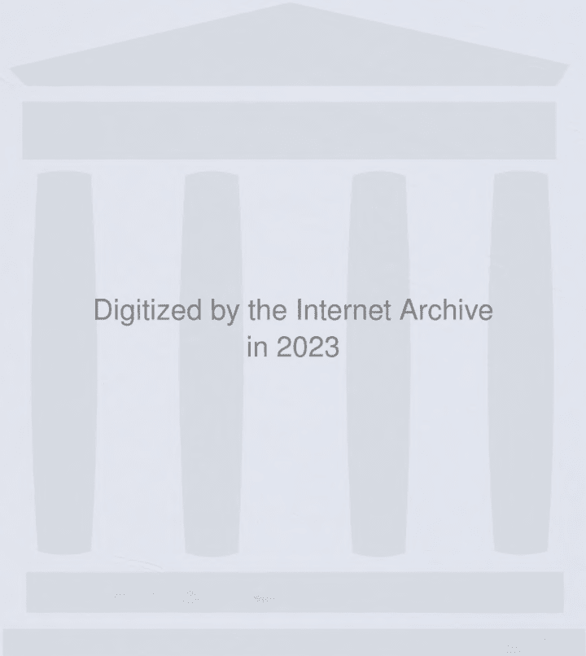

赠予

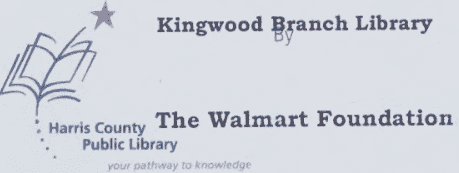

www.marekmulararczyk.co.uk

献给我亲爱的女儿 Julia

她在我开始写这本书时过世

以及献给我亲爱的妻子 Monika

她一直对我充满信任。

## 6 使用 Linux 提高效率 95

## 7 使用 Linux 处理图形

## 8 多媒体 165

- 刻录 CD 和 DVD 172

## 9 进阶基础

# 引言

欢迎来到 Linux 的世界，本书将带你了解 Linux。

首先，让我们看看什么是 Linux。Linux 是一个开源的操作系统，它由 Linus Torvalds 在 1991 年创建。开源意味着任何人都可以查看、修改和分发其代码。

在 Linux 世界中，你会遇到许多不同的版本，它们被称为“发行版”（Distributions，简称“distros”）。最流行的发行版包括 Ubuntu、Fedora 和 Debian 等。

本书旨在为初学者提供指南，从基础教你如何安装、配置和使用 Linux。让我们开始这段 Linux 之旅吧。

# Linux 新手教程

不再需要在大互联网上搜索如何安装 Skype、MPlayer 或 Firefox 等软件。

在 Windows 上你是这么做的，但在 Linux 上我们不是这样做的！你绝对会喜欢它的！

此外，如果你从未用过 Linux，你以前使用过的许多应用程序在 Linux 上也能运行。

仅举几例：

- Firefox
- Thunderbird,
- Skype,
- Libre Office 或 Open Office,
- Adobe Reader 等。

如果你在 Windows 或 Mac 上使用的应用程序在 Linux 上无法运行，那么很有可能 Linux 上有一个替代应用程序，例如 Libre Office 或 Open Office 就是 Microsoft Office 的绝佳替代品。

本书将为你提供快速上手 Linux 所需的所有知识，让它能够快速运行起来。请记住，由于 Linux 是开源的，你可以根据自己的意愿制作任意数量的 Linux 发行版副本。没有人会起诉你。

要安装 Kubuntu，你需要下载它并将其刻录到 CD 中。

你可以通过下面的链接下载 Kubuntu 11.04：

Kubuntu 11.04 (Intel x86) 下载 – 适用于大多数 PC。

Kubuntu 11.04 (AMD64) 下载 – 64 位机器。

如果你不确定应该下载哪一个，请下载第一个。它运行于所有 Intel 机器（包括 Mac 系统）和所有 Windows 机器上。

# 1 为什么选择 Linux 以及 Linux 的简史

欢迎来到 Linux – 这是一个极其优秀的免费开源操作系统，拥有许多免费应用程序。

让我们从历史开始，为你提供关于 Linux 的背景知识以及它是如何开始的。

Linux 的历史可以追溯到 1991 年，当时是赫尔辛基大学的学生林纳斯·托瓦尔斯（Linus Torvalds）想出了一个新操作系统的想法，这个系统比 Windows 更适合他。他想创建一个基于 UNIX 的新操作系统。Unix 是一个在 20 世纪 70 年代开发的强大操作系统，但它有一个缺点——它非常昂贵（现在不仅是 Linux 基于 Unix，Mac OS 也是如此）。于是，林纳斯决定基于 Unix 创建他自己的操作系统，Linux 就就此诞生了！


你在这里右侧看到的 Linux 标志是一只企鹅 Tux —— 由 Alan Cox 创建并由林纳斯·托瓦尔斯完善。

Linux 的第一个官方版本出现于 1994 年（Linux 1.0）。Linux 当时（以及现在）最惊人的特性之一是，它可以在性能较低的计算机上流畅地运行，它不像其他操作系统那样对运行有如此高的要求（目前仍然如此）。它可以轻松运行在内存小于 2MB 的 386 处理器上。

# Linux 新手教程

Linux 做出的一个明智决定之一是将 Linux 作为一个免费操作系统发布，这样任何人都可以免费安装、分发它，甚至是修改它。随着时间的推移，出现了许多不同的 Linux 发行版。如今有数百种不同的 Linux 发行版。Linux 从一开始就明确了 Linux 必须是免费的，而不是专有的。他将其开源。这是 Linux 令人神奇的地方。每个人都可以修改它，创建自己的 Linux 发行版并分发。

由于 Linux 变成了开源软件而非专利软件，这引发了一场无声的革命。人们开始为 Linux 贡献，这导致了改进和创新。Linux 就是这样变得流行的。

让我给你举一个 Linux 改进的例子，以及我最喜欢的特性之一。使用 Linux 时，你可以使用多个虚拟桌面，因此你就可以区分你的工作——你可以在一个桌面上使用浏览器，在另一个桌面上使用 Libre Office，以此此类推。基本上，你可以在许多桌面上工作，而不会像在 Windows 或 Mac OS 等其他操作系统那样杂乱。更有趣的是，Linux 已经拥有这项功能多年了！我还没有在 Windows 上见过任何类似它的东西。

由于 Linux 是开源的，它是对变化和改进开放的，不像 Windows 或 Mac OS 这样的专有操作系统。在专有操作系统中，只有一少数人了解系统内部，并且只有他们可以进行任何更改或改进。专有系统就像一个封闭、密封的盒子。

在 Linux 诞生时，有两个主要的操作系统，两个主要的竞争对手——Windows 和 Mac。在 PC 上实际上只有 Windows，因为 Mac 非常昂贵（现在依然如此）。那时，消费者买不起 Mac，所以 Windows 悄渗透到了世界的每一个角落。但这种情况在 90 年代初随着 Linux 的发布开始缓慢发生变化。

1991 年 8 月，林纳斯发布了一个关于 Linux 出生的著名帖子，这个帖子在互联网上广为人知。这里只是其中一部分，也许是最著名的一段：

# Linux 新手教程

我正在做一个（免费的）操作系统（只是个爱好，不会像 gnu 那样大而专业），用于 386(486) AT 兼容机。

林纳斯当时并没有意识到，他将永远改变计算世界。在发布了数百个版本后，随后是欢迎来到 Linux – 这是一个极其优秀的免费开源操作系统，拥有许多免费应用程序。让我们从历史开始，为你提供关于 Linux 的背景知识以及它是如何开始的。

Linux 的历史可以追溯到 1991 年，当时是赫尔辛基大学的学生林纳斯·托瓦尔斯（Linus Torvalds）想出了一个新操作系统的想法，这个系统比 Windows 更适合他。他想创建一个基于 UNIX 的新操作系统。Unix 是一个在 20 世纪 70 年代开发的强大操作系统，但它有一个缺点——它非常昂贵（现在不仅是 Linux 基于 Unix，Mac OS 也是如此）。于是，林纳斯决定基于 Unix 创建他自己的操作系统，Linux 就就此诞生了！

在此页面你可以找到一张包含从开始到现在的主要 Linux 版本（内核版本）图表（来源：Wikipedia）：

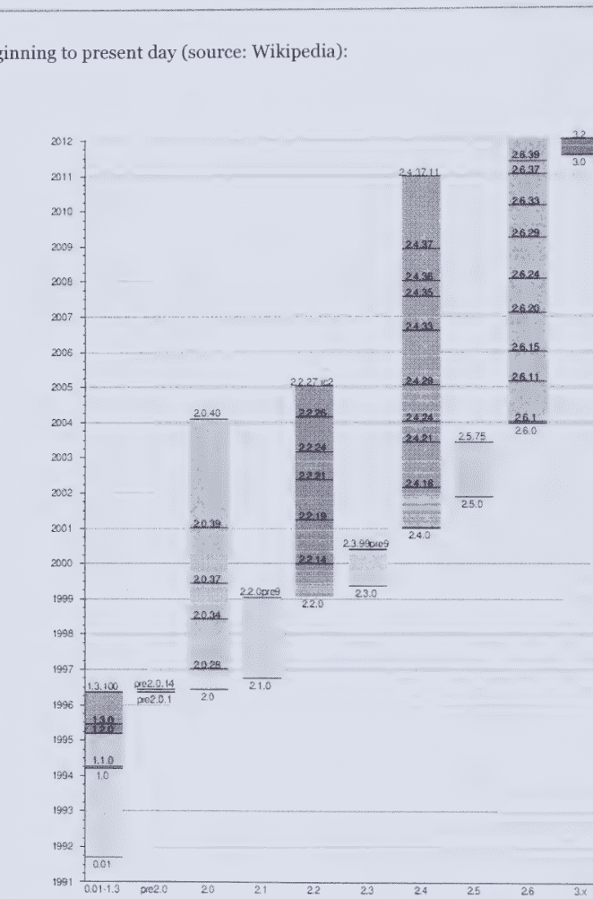

# Linux 新手教程

Linux 的伟大之处在于它运行在许多平台上。它不仅运行在 PC 上，还运行在 Mac 和移动设备上（移动设备上最流行的 Linux 是谷歌的 Android）。

与比尔·盖斯不同，林纳斯并不是亿万富翁，尽管 Linux 运行在数百万台计算机上，但根据 Rever 的研究，他是地球上最著名的计算机程序员。

安装 Linux 的过程在这一世纪初变得简单得多，现在每个人都可以轻松安装它，而不需要任何计算机知识，你很快就会发现。现在的大多数 Linux 发行版都采用 Live CD 格式，你可以直接从 CD 运行它而无需安装，也不会对你的系统进行任何更改。这是 Windows 和 Mac 都不提供的特性。

Linux 也是超级计算机上流行的操作系统。截至 2011 年，超过 90% 的超级计算机正在运行 Linux。

# 2 安装 Linux 之前的准备

在大多数情况下，当你购买新电脑时，它已经安装了 Microsoft Windows（如果是 Mac 则安装了 Mac OS X）。大多数制造商提供的电脑都预装了操作系统。有些厂家甚至在他们的机器上安装了 Linux 发行版，但仍然非常罕见（至少在欧洲是这样）。因此在本章中，我们将准备安装 Linux。

如果你像大多数用户一样，拥有一台运行 Windows 或 Mac OS 的电脑。现在有两个选择：

- 你可以将 Linux 安装在整个磁盘上并删除现有的操作系统
- 你可以将 Linux 与另一个操作系统一起安装并让两者运行


如果你决定将 Linux 与另一个操作系统一起安装，你可以一个一个登录。如果你决定登录 Linux 而你正处于 Windows 中，你需要重启机器（这通常不会花费多久）。这是大多数人的做法，他们想保留另一个操作系统以备万一，或者是因为在该操作系统上运行某些专有软件。

# 新手 Linux 入门

如果你目前在电脑上运行其他操作系统（我假设是 Windows），你将为 Linux 创建一个分区。一个分区给 Windows，另一个留给 Linux。分区只是磁盘的一个部分，就像蛋糕上的切片一样。在开始安装任何操作系统之前，请确保你已经做好了准备。Kubuntu 可以运行在多种硬件上，但值得检查一下它在你的电脑上的运行情况。这就是为什么我激动地通知你，你可以在安装之前先试用 Linux！你只需要从光盘中运行它即可。就简单！如果一切运行正常且你对看到的内容感到满意，就可以开始安装了！我们稍后会介绍这一点。

回到分区，你需要为 Linux 创建一个分区。如果你目前运行的是 Windows 7，这非常简单。所以我们在这里创建的是一种通常被称为“双启动”的配置。当你启动电脑时，将可以选择你想要运行的操作系统。让我们开始工作吧！

## 在 Windows 上为 Linux 创建分区

我将只向你展示如何在 Windows 7 上创建一个新分区。对于任何其他操作系统，请在网上搜索一下，你就会找到如何做了。这非常简单。

- 1 首先，你需要缩小空闲空间分区以在磁盘上创建一个新的未分配空间，以便用于创建新分区。你将使用“磁盘管理”。
- 2 转到“开始”菜单 > 控制面板。
- 3 在控制面板中，点击“查看”下拉菜单并将其设置为“大图标”（在右侧），然后选择“管理工具”和“计算机管理”。

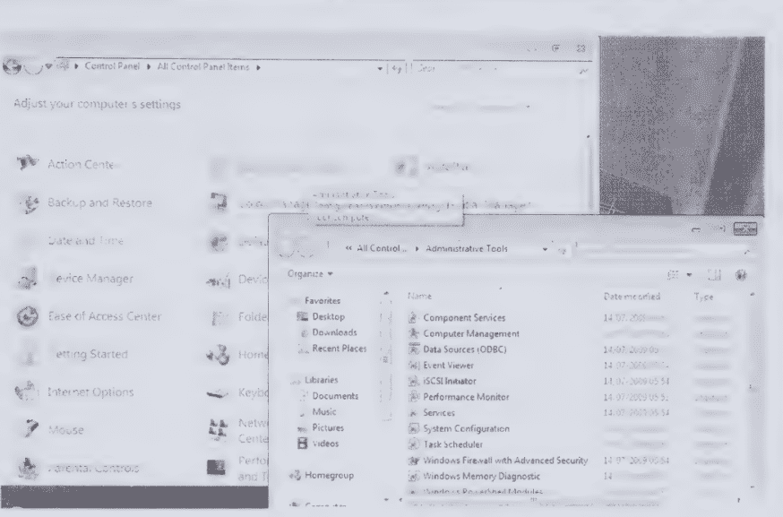

上页的截图显示了 Windows 7 中的管理工具。
- 4 在“计算机管理”对话框中，点击“存储”下的“磁盘管理”。
- 5 在中间右侧右键点击空白的未分配空间，选择“新建简单卷”。
- 6 将打开“新建简单卷向导”来引导你完成各个步骤。
- 7 在“指定卷大小”步骤中，你需要指定想为该未分配分区使用多少空间。只需思考你想为现有的 Windows 安装留出多少空间，并将剩余分配给 Linux，或者你可能想将硬盘一分为二。

（注意：Windows 将显示你可以分配给新分区的最大磁盘空间)。
- 8 在下一步中，为分区分配一个可用的驱动器号，最后输入你想使用的卷标名称（我把我的命名 Linux），然后点击“完成”！
- 9 新分区现在已创建完成，你可以关闭“计算机管理”窗口退出了。

现在你已经为 Linux 创建了新分区，准备就绪！你现在将重启电脑并进行安装。

# 使用 Kubuntu 11.04 进行 Linux 安装

在安装过程中，Kubuntu 会在你的硬盘硬盘上安装一个名为 `GRUB` 的加载程序，这样你就可以在启动电脑时选择你想要启动的操作系统（如果你已经安装了一个操作系统并想保留它的话）。但首先，你将从光盘启动电脑。

大多数电脑都可以从光盘启动。你可以通过将 BIOS 设置为从光盘启动来实现，但大多数电脑在电脑启动时会提供一个快速访问启动菜单的选项（当你启动电脑时通常会看到电脑制造商的标志，屏幕上应该有一个键盘快捷键，例如，在戴尔笔记本电脑上，它在屏幕角，使用 `F12` 键盘快捷键访问启动菜单）。

下一页的截图显示了我笔记本电脑上的示例：

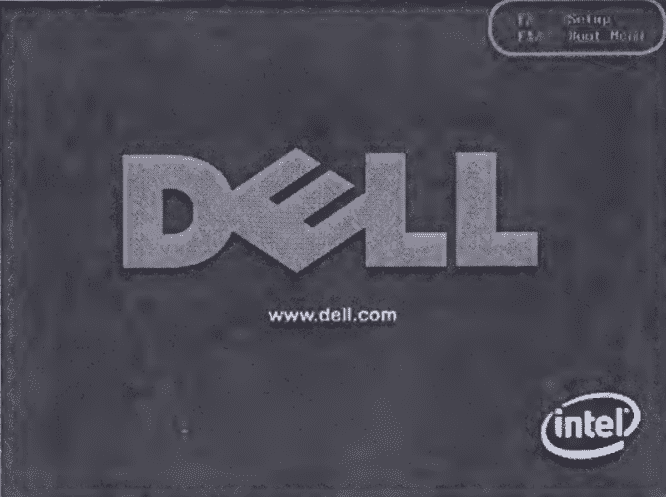

一旦你进入启动菜单，选择光盘/DVD 并按回车。

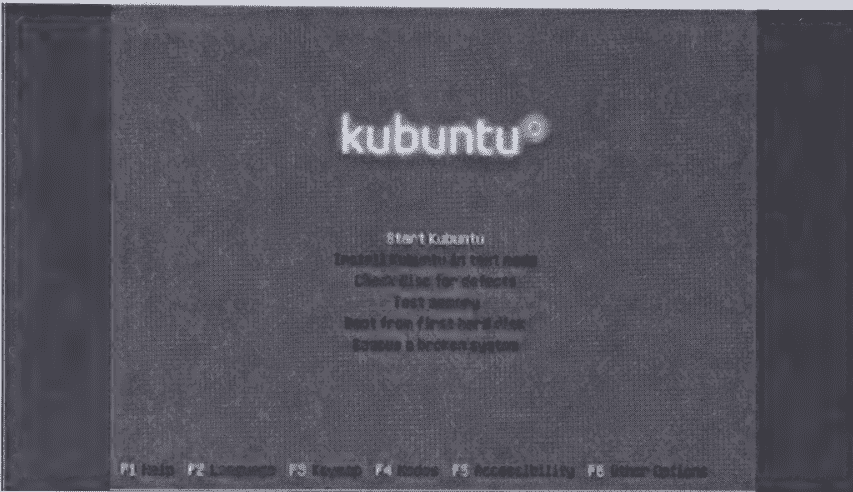

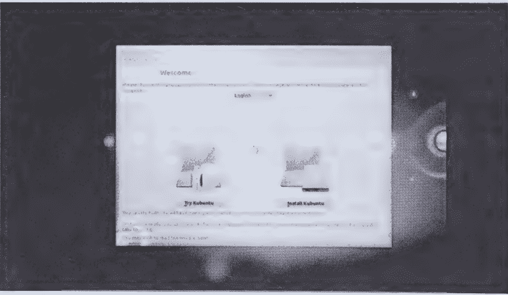

如下所示，这是 Kubuntu 的一些有趣的选项：

- `Start Kubuntu`（启动 Kubuntu）
- `Install Kubuntu in text mode`（以文本模式安装 Kubuntu）
- `Check for defects`（检查缺陷）
- `Install third-party software`（安装第三方软件）
- `Download updates while installing`（在安装时下载更新）
- `Test memory`（测试内存，如果内存遇到问题的话）
- `Boot from disk`（从磁盘启动，如果你已经安装了 Linux 的）

如下所示，这是 Kubuntu 的界面：


## Linux 新手教程

这将是时区屏幕，你可以在这里选择你居住的时区：

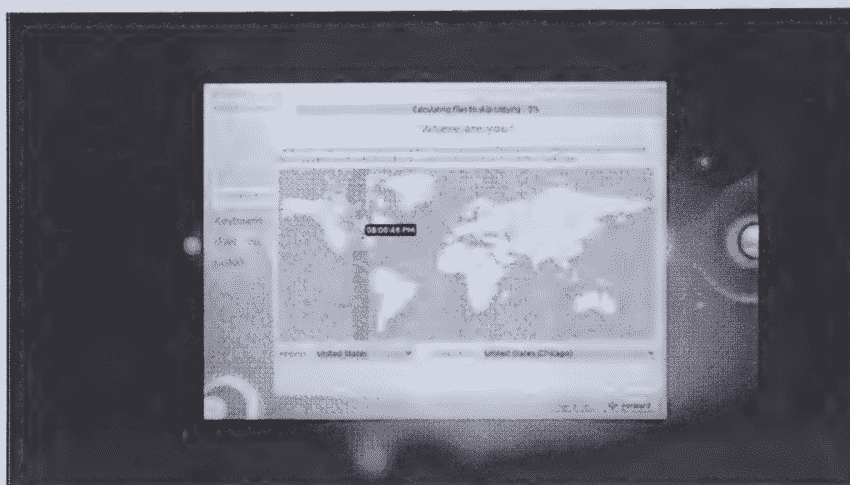

选择你的位置并再次点击“继续”（`Forward`）进入下一个屏幕——键盘（Linux 会在你浏览这些屏幕的过程中持续进行安装）。

当你选择位置时，Linux 会自动设置你的键盘以匹配你的位置，例如，我选择了英国（United Kingdom）作为我的位置，键盘屏幕上出现的键盘就会自动设置为英语（英国）。

下一个屏幕是用户信息（User Info），如下所示：

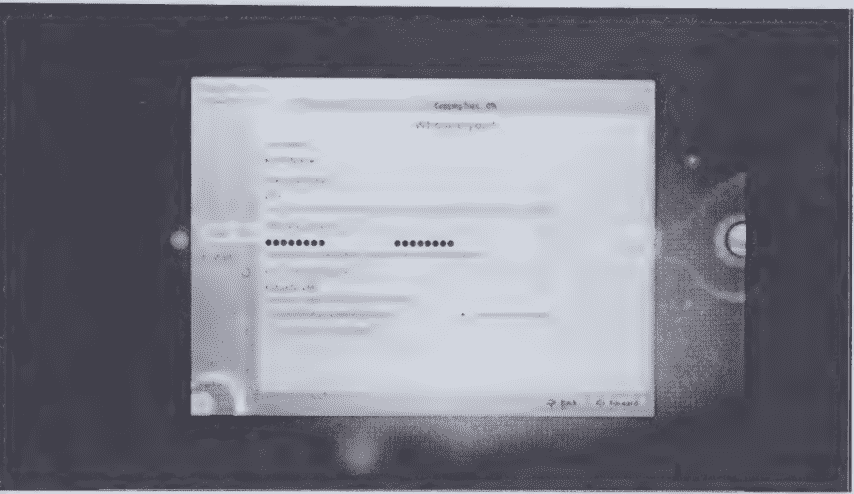

在这个屏幕上，你将添加以下信息：

- `你的姓名（Your name）` – 这可以是任何你想要的内容，我通常在这里输入 marer13（这是我使用的网络昵称，如果你想在网上任何地方找到我，无论是 flickr 还是 google+，通过这个名字就能找到我）
- `选择用户名（Pick a username）` – 这将是你的用户名，显然登录系统时需要它，它是 Linux 必须的
- `选择密码（Choose password）` – 自 Linux 诞生以来，登录就需要密码（这是 Windows 最近才引入的功能）
- `你计算机的名称（Your computer's name）` – 这个名称会在你使用蓝牙时显示，这是设备识别它的的方式，或者在网络上时也是如此，这同样可以是任何内容，我通常保留 Linux 建议的名称
- `登录时需要我的密码（Require my password to log in）` – 如果你不想自动登录（旁边的选项），你需要输入密码来访问系统。

我建议即使你是唯一使用这台电脑的人，也勾选此框。保护好你的 Linux 安全。
- `加密我的主目录（Encrypt my home folder）` – 你可以加密你的主目录，这样如果有人访问你的电脑，获取它的就会变得更加困难。我通常不使用它，所以除非你非常偏执，否则不要使用它。

好了，这里已经完成了，你可以点击“继续”（`Forward`）。

这将进入另一个屏幕——安装（Install）。现在你不需要做任何事情，只需观察 Linux 的安装，你可以像下方截图所示阅读更多关于 Linux 和其他开源软件：

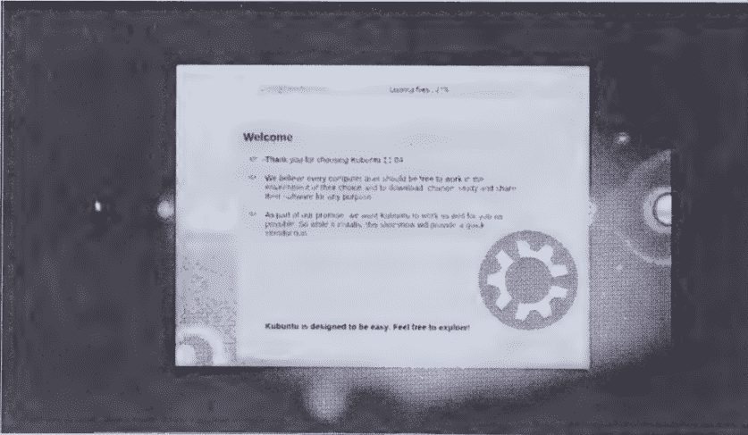

安装过程不会花费很长时间。从我的截图中可以看到，它已经在复制一些文件了（显示“正在复制文件... 21%”）。

完成后，你将看到一个最终屏幕，通知你安装成功，如下所示：

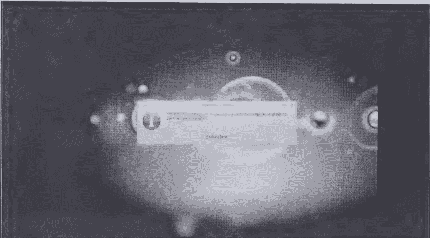

现在，是安装的最后一步——重启你的计算机。你已经成功完成了 Linux 安装！干得好！你值得一个奖励！

点击“立即重启”（`Restart Now`）重启你的电脑并启动进入你全新的 Linux。

注意：当你的电脑启动时，如果你在同一台电脑上安装了其他操作系统，你将看到一个列出所有操作系统的屏幕。Linux 将是顶部的第一个选项，你可以按回车键（`Enter`），或者如果你什么都不做，Linux 将在 5 秒后自动加载。

片刻后你将看到登录屏幕（如果你勾选了“登录时需要我的密码”），输入你的用户名和密码，几秒钟后你会看到 KDE 如何加载你的桌面：

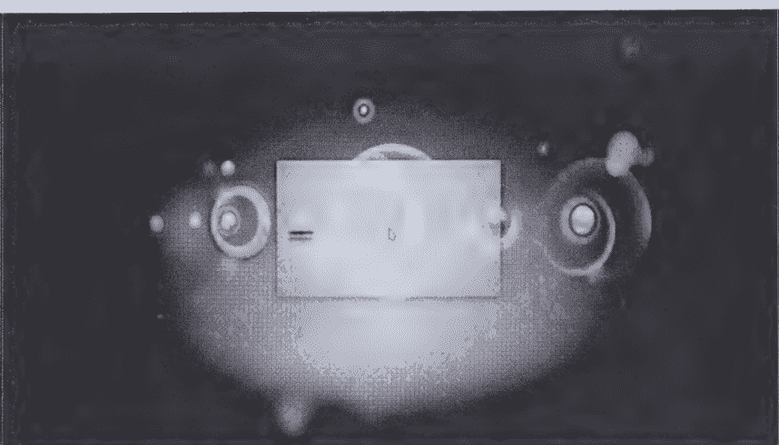

你的桌面（在这种情况下是 KDE）加载了所有需要的组件。

这只需要几秒钟，片刻后你就会看到下一页所示的全新 Linux 桌面！

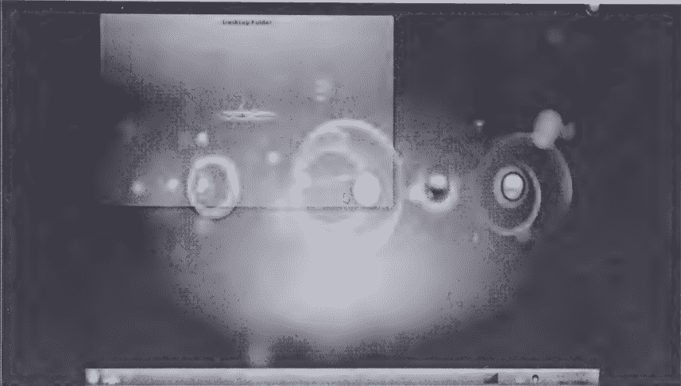

欢迎来到你的 Linux 桌面！你做到了！

现在，准备好进入下一章开始探索你的 Linux 桌面了。

# 探索你的 Linux 桌面

既然成功安装了 Linux，现在是进行安装后配置并熟悉 Linux 桌面环境了。如果你是从 Windows 或 Mac OS 转到 Linux，许多用户面临的挑战之一是在 Linux 上找到相应的软件，因此我将在书末的一个章节中给出 Windows 应用程序的 Linux 对应品。


# Linux 任务栏和开始菜单

观察你新的桌面环境，注意屏幕底部带有开始菜单的熟悉的任务栏。

在本章中，你将自定义你的新操作系统，以便在本章结束时你感到熟悉。

任务栏（taskbar）在 Linux 中通常被称为面板（panel），它显示在屏幕底部，你可以轻松地移动它。

任务章中，你将注意自定义新操作系统。开始章，你将自定义你的你的。。。。，你在屏幕。，，你你你的你的，，，，，章结束结束时你就能在 Linux 中熟悉：


在开始按钮旁边有：

- 快速启动（Quick Launch）
- 虚拟桌面（Virtual Desktops）

默认情况下，安装 Kubuntu 时，你会得到两个虚拟桌面，由开始按钮旁的两个按钮表示。要添加更多虚拟桌面，右键点击一个虚拟桌面并选择“添加虚拟桌面”，如下所示：

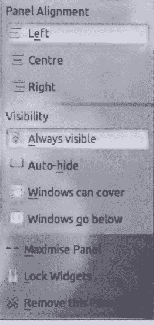

如果你操作两次，你会有四个桌面，就像我这里一样。活动桌面会被突出显示（在我的屏幕上是桌面 4）。点击桌面图标将切换到另一个桌面。

默认情况下，桌面之间没有过渡，你只是看到另一个桌面的内容。让我展示你如何激活立方体动画，非常酷的效果！

右键点击任意桌面并选择“分页器设置”（Pager Settings）。这将打开分页器设置对话框，如下所示：

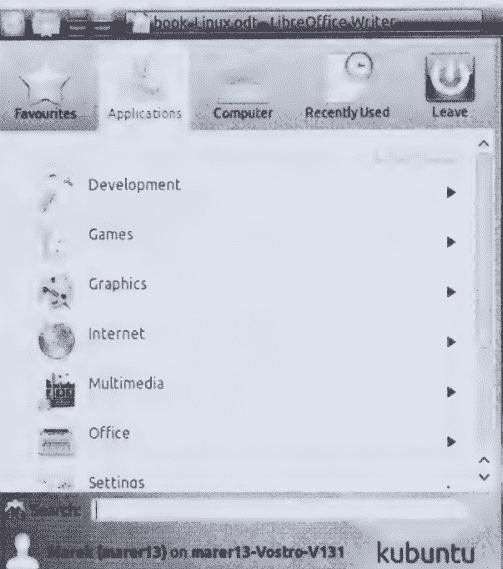

点击左侧的“虚拟桌面”类别查看下一页截图所示的选项。

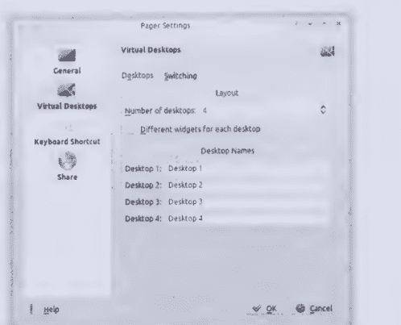

在这里，你可以决定想要多少个虚拟桌面（添加新虚拟桌面的另一种方法），如果你需要，还可以给它们命名。

切换到顶部的“切换”（Switching）标签卡来更改在虚拟桌面之间移动的方法：

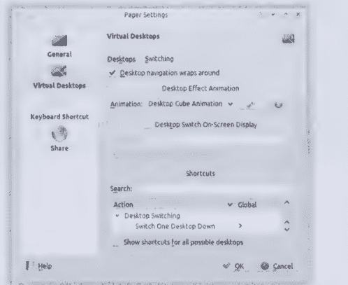

将动画（Animation）更改为“桌面立方体动画”。先不要点击确定。我将向你展示可以在虚拟桌面之间移动的键盘快捷键。

在对话框的底部有一个**快捷键（Shortcuts）**区域。

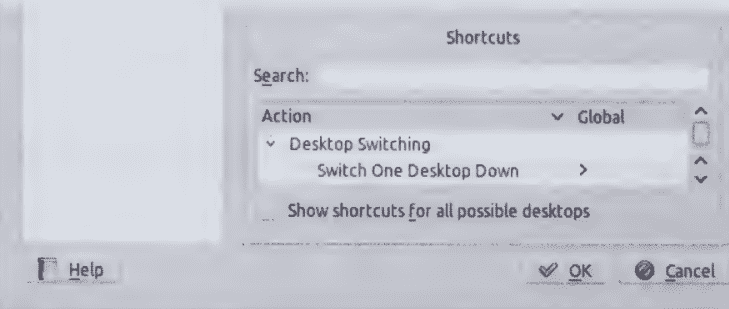

在“操作桌面切换（Action Desktop Switching） > 切换到桌面 1（Switch to Desktop 1)”等下方。

注意这些键盘快捷键。从现在起，你就可以享受使用快捷键了！现在点击确定并尝试一下！玩得开心，这真的很有趣！

注意：（当我向他们展示这个功能时，他们通常会印象非常深刻，并希望在 Windows 中也能这样做）。

## 桌面背景

在这一部分，你将熟悉你的桌面背景。你不会相信自定义桌面背景有多简单。

只需在桌面的任何地方点击右键，并选择“桌面设置”（Desktop Settings）（我告诉过你很容易……）。

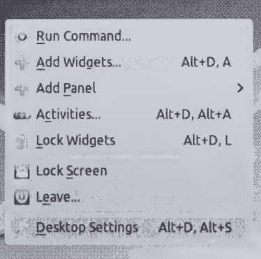

在打开的对话框中，点击“打开”并导航到你想使用的文件，可以是 JPEG、PNG、SVG 或 BMP。

## Linux 新入门

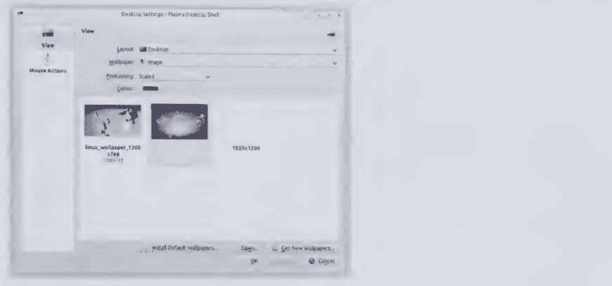

然后点击确定（或点击“应用”来预览更改），就完成了！

你已成功更改了桌面背景。恭喜你！

## 屏幕分辨率

当你启动 Linux 时，它会自动检测适合你屏幕的最佳分辨率。然而，有时你可能想更改屏幕分辨率，稍微调低一点，所以你可能想知道如何操作。这就是本章 own部分。

## Linux 新入门

要更改屏幕分辨率，你需要访问“显示设置”（Display Settings）。

点击开始按钮并选择：应用程序（Applications） > 系统（System） > 屏幕缩放与旋转（Screen Resize & Rotate (KrandRTray)）。

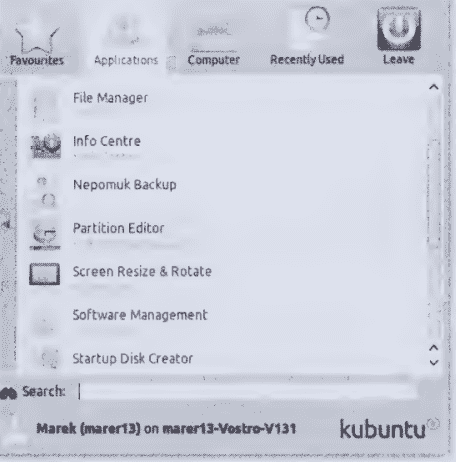

几秒钟后，你应该能在任务栏上看到显示器图标：


## Linux 新入门

点击它，它将打开下面所示的“显示设置”对话框：

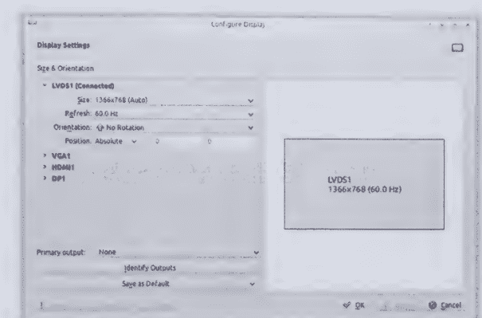

在“显示设置”对话框中，你可以设置屏幕的分辨率以及刷新率。

注意：如果你将电脑连接到外部显示器或投影仪，“显示设置”对话框会自动出现，这样你可以为两个显示器设置选项。

下面的章节用于这些：

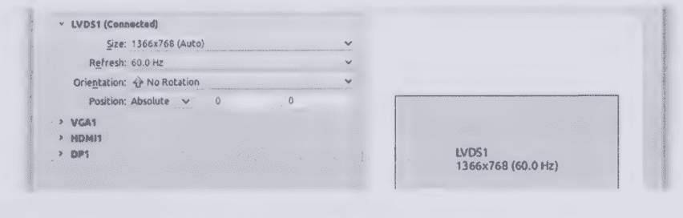

53

## 更改你的屏幕保护程序和电源选项

注意：笔记本电脑电源选项

现在你已经设置了屏幕分辨率，是时候更改屏幕保护程序并设置电源选项了。

要更改屏幕保护程序，你需要访问系统设置：开始（Start） > 应用程序（Applications） > 系统（System） > 系统设置（System Settings）。

在“系统设置”对话框中，点击硬件（Hardware）下的“显示与显示器”（Display and Monitor）：

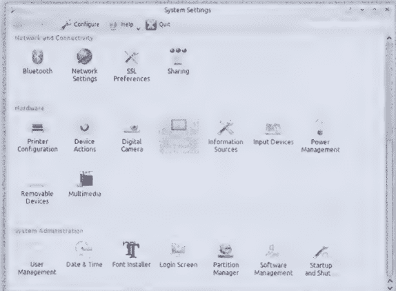

## Linux 新入门

在“显示与显示器”对话框中，左侧有三个类别，其中之一是“屏幕保护程序”（Screen Saver）。

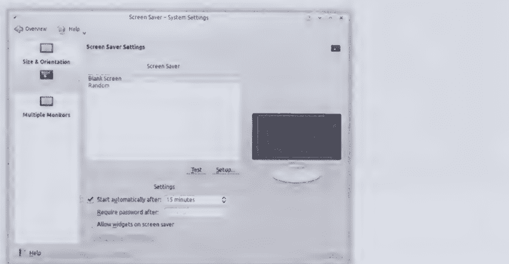

选择你想使用的屏幕保护程序，并通过设置“启动后”（Start after:）旁边的选项来决定何时启动它。点击“应用”并关闭对话框。现在是“电源设置”了，你可以在那里决定 Linux 何时进入节能模式（Powersave）等。

55

点击任务栏上的电池图标，你将看到如下的对话框：

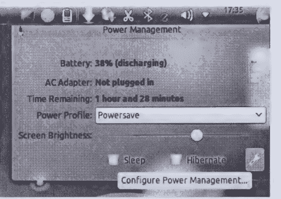

在右下角你会看到“配置电源管理”（Configure Power Management）（看起来像一个扳手 - 如上方所示）。

点击它打开“电源管理”对话框：

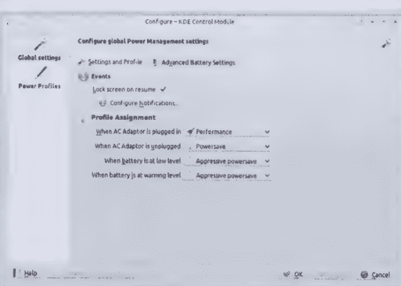

## Linux 新入门

在“设置与配置”（Settings and Profile）标签卡中，将选项设置为与截图相同（你以后可以更改它们）。基本上，你在这里想做的是：

- 当使用市电运行时，使用电脑的最大功率（Performance – When Adaptor is plugged in），
- 当使用电池运行时节省电量，以便你运行得更久（Powersave – When Adaptor is unplugged）。

当电池达到低电量水平和警报水平时，你将使用“激进节能”（Aggressive powersave）来尽可能长时间地使用电池运行笔记本电脑。进入“高级电池设置”（Advanced Battery Settings）标签卡：

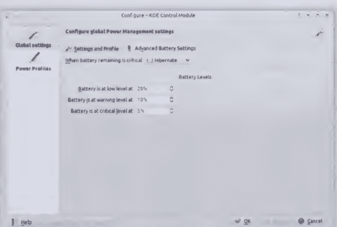

在这里，你可以设置电池何时开始使用“激进节能模式”（当电池处于低电量和警报水平时（如果你在“设置与配置”标签卡中将低电量设置为启动节能模式而非激进节能模式，那么“电池处于低电量”和“电池处于警报水平”这两项会有区别））。完成后，只需点击确定保存并退出。

## 更新你的软件

在成功安装操作系统后，你应该做的事情之一是安装更新。它们通常是安全更新和错误补补。如果有新更新，更新管理器将出现在你的任务栏。你可以从菜单访问它。

进入开始菜单，然后选择：应用程序（Applications） > 系统（System） > 软件管理（Software Management (PackageKit)):

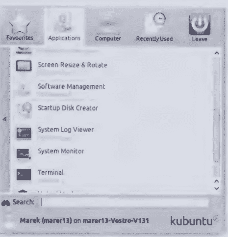

几秒钟后你在左侧看到三个类别：

## Linux 新入门

让我们从“设置”开始。

点击“设置”，你将看到下面的对话框：

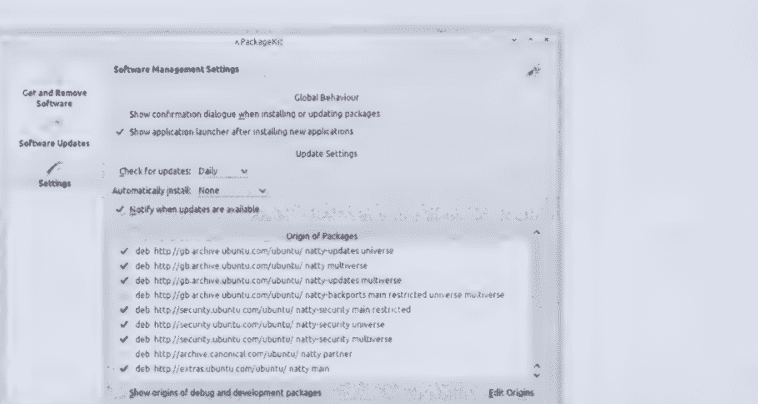

在那里你可以检查软件包的来源（你只想从 Ubuntu 批准来源获取更新还是从其他来源）。这里重要的选项是**有可用更新时通知**（Notify when updates are available）。确保它是勾选的（默认情况下如此）。你还可以决定多久检查一次更新（我留的是每天）以及是否自动安装更新。


现在让我们进入“软件更新”类别：

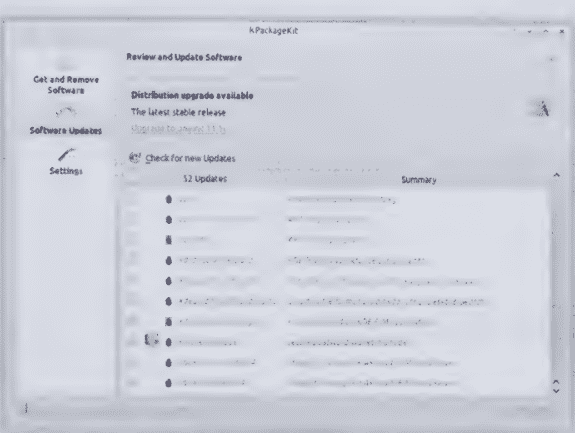

`软件更新`类别是 `PackageKit` 中的一个部分，你可以在那里找到所有可用更新。

如果你想安装任何更新，只需点击旁边的框然后点击“应用”。在安装任何内容之前会提示密码，所以记住你的密码。

## 获取你的无线连接

是时候连接无线路由器了。当 Kubuntu 安装时，它会为你电脑的无线卡安装驱动程序（大多数卡都能正常工作，我从未在无线方面遇到过问题）。所以现在只需要连接无线路由器。

在任务栏中找到无线连接图标并点击它。

点击“更多...”(`Show More...`)按钮查看区域内所有的无线网络：

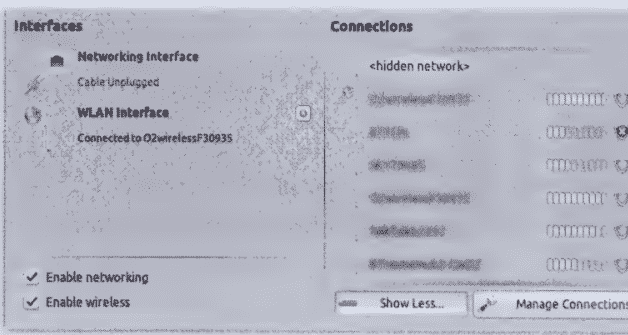

## Linux 新入门

当你找到你的网络时，点击其名称进行连接。“添加网络连接”(`Add Network Connection`)对话框将出现，你需要输入密码。此外，如果你经常使用该网络（比如家里或工作网络），勾选“自动连接”(`Connect Automatically`)。下次你进入范围时，Linux 将自动连接到网络。

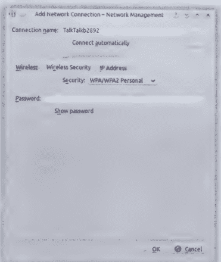

完成后只需按确定。

# 5 快速上手 Linux

### 从 Web 浏览器开始 - Firefox

如今每个人都连接着互联网，而网络浏览器是最常用的应用程序之一。市面上有很多网络浏览器，其中最受欢迎的之一是 Mozilla Firefox。Kubuntu 安装时自带了 Firefox，因此你可以直接开始使用。


对于 Windows 用户来说，Firefox 是 Internet Explorer 的极佳替代方案。自从 2004 年诞生以来，它占据了非常大的市场份额（本文写作时—— 2011 年 12 月——它是全球第二受欢迎的网络浏览器，市场占有率约 42%）。Firefox 如此受欢迎的众多原因之一是其丰富的扩展和插件，以及许多多媒体解码器。

要访问 Firefox，请前往`开始菜单 > 应用程序 > 互联网 > Firefox`。当你第一次启动它时，系统会提示你完成快速启动设置，很快你就可以开始享受上网了。

## Linux 新手教程

以下是 Firefox 在 Linux 上的外观（与你在 Windows 或 Mac OS 上看到的非常相似）：

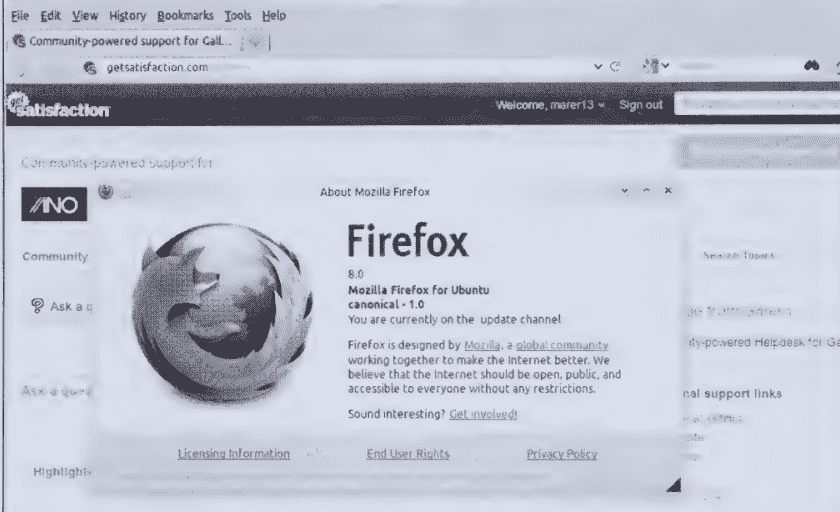

### 从邮件客户端开始 – Thunderbird

市面上有很多邮件客户端，你过去可能用过基于 Windows 的邮件客户端。其中一些是跨平台的，因此它们可以同时运行在 Windows 和 Linux（甚至是 Mac OS）上，其中之一就是 Mozilla Thunderbird —— 它是由开发 Firefox 的同一个组织 Mozilla 基金开发的邮件客户端。

Kubuntu 默认没有安装 Thunderbird，因此如果需要，你需要手动安装，不过这个过程非常简单。

要安装 Thunderbird，请前往`开始 > 应用程序 > 系统 > 软件管理`。当 `KPackageKit` 打开时，在顶部的搜索框中输入 Thunderbird 并按回车：

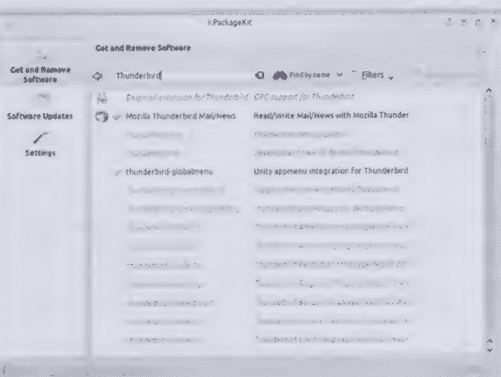

选中 Thunderbird，点击其右侧的“安装”。

接下来点击屏幕底部的“应用”。

安装时，系统会提示你输入密码，只需在键盘上输入并按回车即可。

安装过程不会很长（取决于你的网络连接，因为软件包需要先下载后安装），你会看到一个对话框，可以从中启动 Thunderbird。

你可以关闭 KpackageKit。

一旦安装好 Thunderbird，就启动它。当 Thunderbird 启动时，你就可以设置你的邮箱了。

你应该看到以下对话框：

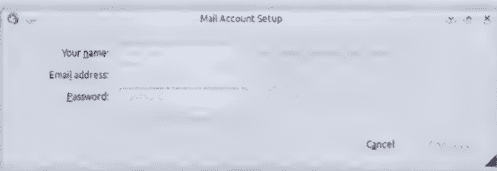

注意：你可以在任何时候通过点击 Thunderbird 主窗口中的“创建新账户”来调用此对话框，或者选择“文件 > 新建 > 邮件账户...”，如下一页的截图所示：

## Linux 新手教程

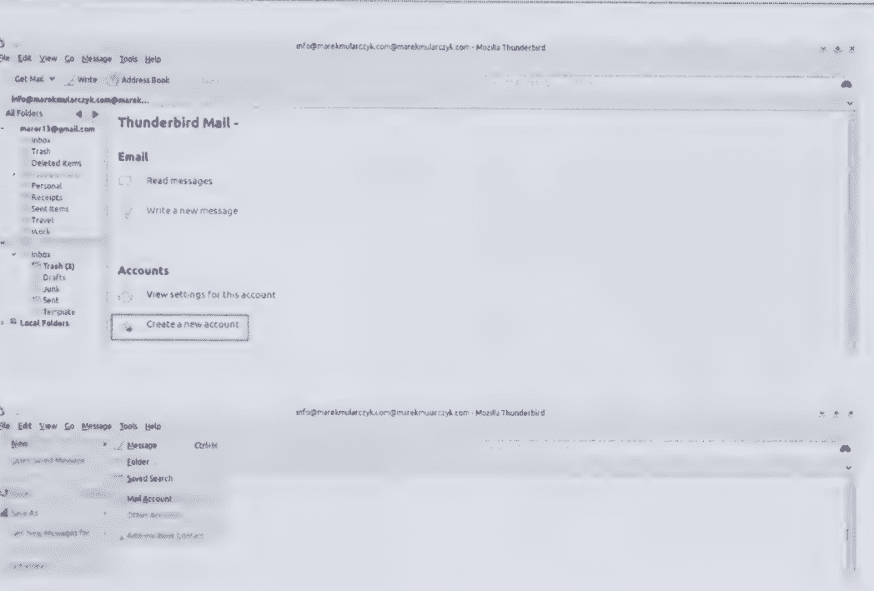

接下来，只需按照说明操作。如果你有像 Google 这样知名提供商的邮箱账户，设置邮箱将非常快速简单，Thunderbird 将为你完成所需的所有设置。如果你使用的是不那么知名的邮件提供商，请咨询他们，他们可能会为你提供一个脚本来在 Thunderbird 中快速设置邮箱。

## Linux 新手教程

以下是 Gmail 的工作方式：

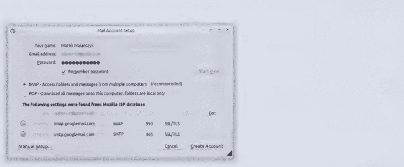

当你输入 Gmail 账号和密码时，Thunderbird 会自动完成设置。

注意：你可以在任何时候通过点击 Thunderbird 主窗口中的“创建新账户”来调用此对话框，或者选择“文件 > 新建 > 邮件账户...”，如下一页的截图所示：

## Linux 新手教程

如果你使用的是邮件提供商，请咨询他们，他们可能会提供一个脚本来在 Thunderbird 中快速设置邮箱。

### Linux Linux Linux Linux Linux Linux Linux Linux Linux Linux Linux Linux Linux Linux Linux Linux

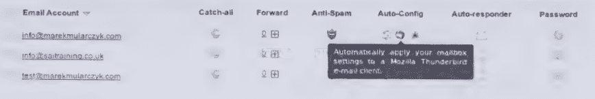

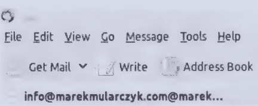


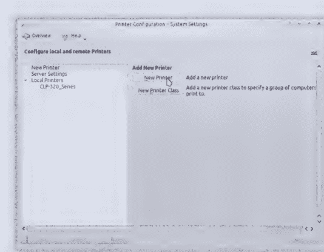

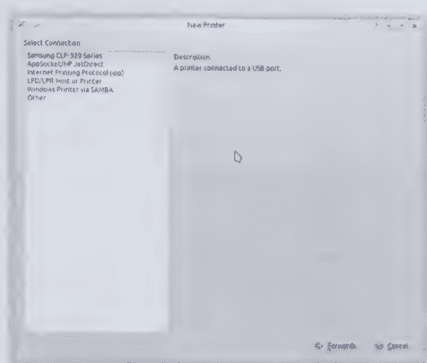

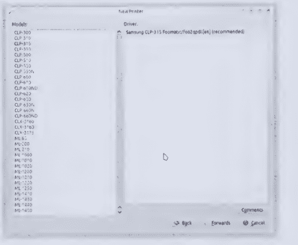

## Linux 新手教程

以下是如何在 Linux 上连接打印机：

- 1 打开打印机并连接到电脑。
- 2 打开`开始菜单 > 设置 > 系统设置`
- 3 在系统设置对话框中点击硬件下的“打印机”。
- 4 当你连接了打印机后，Linux 现在将尝试检测它：

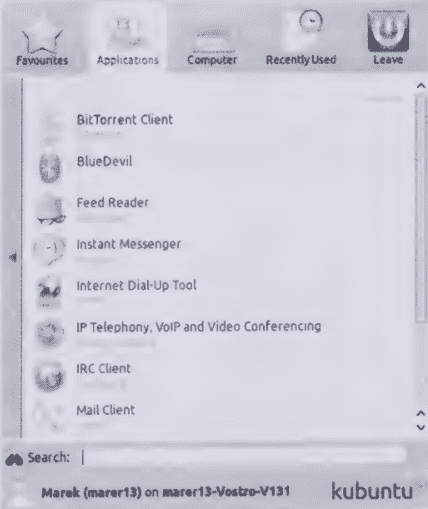

由于你连接了三星打印机，你会看到它（如下所示）：

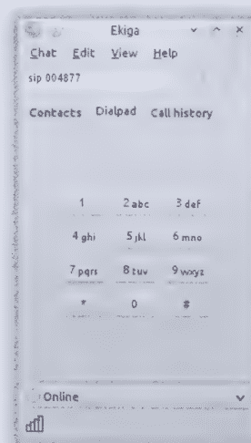

- 5 如果检测正常，只需点击“下一步”，在下一个屏幕上选择打印机品牌：

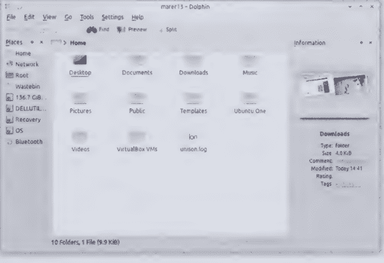

## Linux 新手教程

- 6 点击“下一步”，在下一个屏幕上选择型号（如果你的型号没有出现，请选择同一系列的相似型号，例如在此我选择了 CLP-315 而不是 CLP-325）：

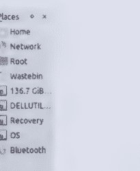

- 7 点击“下一步”，并为打印机命名（一个将出现在打印对话框中的名称），如果需要也可以输入描述。完成后，点击“确定”。

你完成了！恭喜！你现在可以关闭打印对话框并开始打印了。

从现在起，当你选择打印内容时，打印机将出现在打印对话框的下拉列表中。

### 使用 Ekiga 通话

Ekiga 是一款互联网视频会议应用程序，你可以使用互联网连接进行通话。它提供语音和图像传输，你可以通过摄像头与朋友聊天，也可以拨打电话（固定电话和手机）。

要安装 Ekiga，请前往`开始 > 应用程序 > 系统 > 软件管理`。当 `KPackageKit` 打开时，在顶部的搜索框中输入 Ekiga 并按照之前的章节相同的步骤安装。

一旦安装了 Ekiga，你将在此处找到：

`开始 > 应用程序 > 互联网 > IP 电话、VoIP 和视频会议`：

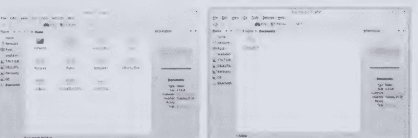

## Linux 新手教程

当你第一次启动时，将运行配置向导来引导你完成设置。只需按照步骤操作，几分钟内即可开始使用 Ekiga！

如果你想用 Ekiga 通过互联网拨打电话（我用它给家人打电话），请执行以下操作：

- 1 在其中一个 VoIP 供应商处进行注册。
- 2 启动 Ekiga 并进入“编辑 (Edit) > 账户 (Accounts)”。


- 3 点击“账户 (Accounts) > 添加 SIP 账户 (Add a SIP Account)”。
- 4 填写对话框中的所有字段（设置取决于你的供应商，如有需要请联系他们）并点击确定 (OK)。
- 5 完成后，你就可以免费拨打许多固电话。只需输入号码并点击绿色图标：


## 了解文件管理器

`Dolphin` 是 Kubuntu 的默认文件管理器也是大多数 KDE 发行版的默认文件管理器。

`Dolphin` 提供了许多功能，而且运行快速、轻量。它的外观如下：


让我们看一下界面（在下一页）：

- 左侧 – 通往“主目录 (Home)”和连接到电脑的任何 USB 设备的快捷方式。你可以将文件拖到文件管理器的这部分


- 顶部 – 后退和前进按钮、视图模式、查找 (Find)、预览 (Preview) 和分屏 (Split)

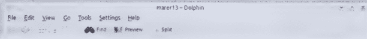

- 中间 – 主工作区，所有文件夹和文件都显示在这里

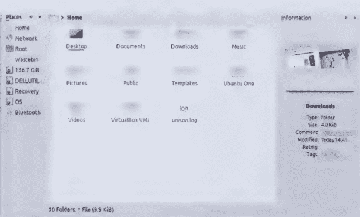

# Linux 新手教程

注意：单击即可打开文件夹和文件（不像 Windows 那样需要双击），如果你想突出显示文件夹或文件，请按住 Ctrl 并点击。

## 主目录 (Home Directory)

如果你以前没有用过 Linux，主目录对你来说将是一个新概念。

主目录用于存储个人数据。Linux 中的每个用户都有自己的主目录，你可以在这里存储文档、音乐、图片、视频等内容。它就像 Windows 中的“我的文档”目录。

## 创建新文件夹

现在，让我向你展示如何创建一个新文件夹。点击“文档 (Documents)”文件夹打开它，如下：


当文档文件夹打开时，选择“文件 (File) > 新建 (Create New) > 文件夹 (Folder)...”。

当“新文件夹”对话框打开时，给你的新文件夹命名并按确定 (OK)：


或者，你也可以在文件夹内的空白处右键点击，选择“新建 (Create New) > 文件夹 (Folder)...”。

现在，你将连接一个 USB 闪存盘并拷贝文件。

## 复制文件和使用 USB 闪存盘

你将从连接（挂载）USB 闪存盘到电脑开始。

- 插入它，片刻后你会在任务栏的下拉菜单中看到它：


点击 USB 设备的名称查看可用选项：


点击“用文件管理器打开 (Open with File Manager)”，文件管理器将打开 USB 设备的内容：


- 4 如果你错过了下拉菜单（它只会出现几秒钟），点击任务栏上的 USB 图标来访问你的 USB 设备：


注意：Linux 有一个非常有趣的功能——当你悬停在 USB 设备的名称上时，你会看到它上剩余多少空间！


- 5 在打开的文件管理器中，按住 Ctrl 键点击你想复制的文件（或多个文件）。
- 6 然后释放 Ctrl 键，右键点击其中一个文件并选择“复制 (Copy)”：


- 7 在左侧的快捷方式中点击“主目录 (Home)”和“文档 (Documents)”。
- 8 当文档文件夹打开时，右键点击并选择“粘贴 (Paste)”或使用“编辑 > 粘贴”来粘贴文件。如果你不再使用该 USB 驱动器，你需要弹出它（你可以手动从端口拔掉，但为了确保不丢失数据，在 Linux 中弹出是个好习惯）。
- 9 点击任务栏上的 USB 图标，将光标悬停在设备上并点击“弹出 (Eject)”。


或者，你也可以在文件管理器中右键点击 USB 设备并选择“安全移除 (Safely Remove)...”。


## Linux 目录指南

是从 Windows 转到 Linux 的新用户需要了解操作系统之间的一些差异。以下需要注意的地方：

- Linux 是区分大小大小的操作系统，Windows 不是，例如 Linux 会将 "`image.txt`" 和 "`IMAGE.txt`" 视为不同的文件。
- Linux 不像 Windows 那样使用驱动器字母，例如在 Windows 上主硬盘是 `C:`，CD/DVD 驱动器是 `D:` 或 `E:`。
- Linux 之初是多用户网络操作系统，而 Windows 从 DOS 演变为单用户操作系统。
- Linux 用户无法更改系统设置，只有超级用户 (`root`) 可以，更改系统设置时会提示输入密码。Windows 用户可以轻松更改系统设置。
- Linux 使用与 Windows 不同的文件系统：Linux 使用 `ext3`，Windows 使用 `FAT32` 或 `NTFS`。

注意：文件系统的差异并不意味着你可以在 Windows 和 Linux 之间拷贝文件（以 USB 闪存盘为例）。Linux 可以识别 `FAT32` 和 `NTFS` 格式的 USB 设备。

Linux（以及 macOS）缺少驱动器字母是 Windows 与 Linux/macOS 巨大差异之一。Linux 存在层级结构——树形目录——从斜杠 (`/`) 表示的根目录开始。

这是文件管理器中的目录树：


以下是目录的快速概述：

- `bin` – 该目录包含可执行程序。它包含了系统运行所需的重要程序。
- `boot` – 该目录包含 Linux 操作系统的核心——Linux 内核。Linux 内核通常被称为 '`vmlinuz`'。
- `etc` – 该目录包含系统配置文件，例如用户密码、屏幕分辨率设置等。
- `lib` – 该目录包含可执行程序使用的库文件，`lib` 等同于 Windows 的 DLL 库。
- `home` – 该目录包含每个用户的一个子目录，用于个人数据文件，例如 `/home/marer` 或 `/home/jon`。其他用户无法在此处保存文件。
- `mnt` – 用于临时挂载设备的目录，例如 cd/dvd 驱动器或某些双启动系统中的 Windows 分区。
- `usr` – 存储程序的目录，它等同于 Windows 的“程序文件 (Program Files)”目录。

## 压缩和解压文件

在 Linux 中压缩和解压文件非常简单。好消息是，与其他操作系统不同，压缩文件多年一直是 Linux 的一部分。你不需要安装任何软件即可压缩文件或文件夹！

有三种主要的压缩格式：`zip`、`rar` 和 `tar`。

`tar` 在 Linux 中非常流行，通常用于传输文件。压缩文件/文件夹非常简单。

- 1 选择你想压缩的文件或文件夹并右键点击它。
- 2 在出现的下拉菜单中选择“压缩 (Compress) >”并选择一种格式。就是这样！看下面的截图：


片刻后，你将获得一个新的压缩文件，如下方的截图所示：


原始 PDF 文件大小为 260kB，压缩版本为 215kB。当然，你也可以压缩整个文件夹，例如一个包含图片的文件夹，以便你可以轻松地通过电子邮件发送它们等。有时我们压缩文件不仅是为了减小体积（从文件大小来说），而且为了更容易通过电子邮件发送（一个文件比发送十或二十个文件容易得多）。


# Linux 新手教程

要解压缩文件或文件夹，你可以右键点击它并选择“提取压缩包到...”(Extract Archive To...)”或“在此处提取”(Extract Archive Here)。


如果你想在解压之前查看压缩包的内容，或者只想提取其中的一个文件，只需点击它，压缩包就会 Ark 中打开，如页所示：


## 6 使用 Linux 提高效率

### 带有 Docky 的 Dock

#### 安装

Docky 是一个非常棒的 Linux Dock 应用程序。它被广泛认为是 Linux 上最友好用户的 Dock 应用程序。它可以让你快速访问计算机上最常用的应用程序。这里是它在桌面上的样子：


这是它的特写视图：


它非常简单易用，而且非常轻量。

首先，你需要安装它，请前往 KpackageKit 搜索框中输入 Docky。接受它，安装它，并在几分钟内开始使用。一旦安装完成，启动它，它应该就会出现在屏幕的底部。

#### 定制 Dock

要自定义 Docky，点击 Dock 左侧边缘的 Docky 图标：


这将打开 Docky 设置对话框：


在这里你可以自定义 Dock。从选择你喜欢的 Dock 主题开始。

以下是几个主题的示例：

经典版 (Classic):


空气版 (Air):


HUD 版：


透明版 (Transparent):


从下拉菜单中选择主题（选择适合你的一个）。

接下来，在同一个对话框中你有“Dock 配置”(Dock Configuration)部分。

你可以在那里配置隐藏行为，例如你可以设置 Dock 自动隐藏，并在光标移动靠近边缘时重新出现。

这里是下拉菜单：


以下是各个选项的功能：

- `None` – Dock 将始终可见。
- `Autohide` – 除非你将光标移动到 Dock 所在的区域（屏幕底部），否则 Dock 将始终隐藏。
- `Intellihide` – 当打开应用程序且 Dock 遮挡应用程序时，它会隐藏。当关闭或调整应用程序大小时，Dock 将重新出现。
- `Window Dodge` – 如果 Dock 遮挡了任何窗口，它将隐藏。

我喜欢 Intellihide，这是我使用的设置。如果你希望 Dock 始终出现，请将隐藏 (Hiding) 设置为 `None`。

在隐藏下拉菜单下方的部分，你可以设置缩放（当你将光标悬停在图标上时，你希望图标变多大），你可能还想勾选“3D 背景”（这是一个非常棒的功能，视觉看起来非常震撼）。

完成后，点击 `Close`。

#### 将应用程序添加到 Dock

以下是如何将应用程序添加到 Dock 的。

在 Dock 运行时，前往 `开始` 菜单找到你想要添加的应用程序。

找到后，点击它并按住鼠标键将其拖到 Dock 上。

当你将光标移动到 Dock 上时，Dock 上的图标会移动为新图标留位置，光标旁边会出现一个加号（见下方截图，加号出现在屏幕边缘）：


当你对图标的位置满意时，松开鼠标放置：


#### 移除图标

要从 Dock 移除应用程序，只需将其从 Dock 拖到桌面任何地方。图标将会消失。

#### 为 Dock 添加 Docklet（天气预报）

1. 点击 Dock 左边缘的 Docky 图标开始：


2. 当 Docky 设置打开时，点击 Docklets：


3. 向下滚动 docklets 列表直到找到 Weather docklet：


4. 点击加号 `+` 将添加到 Dock。

5. 点击 `Close`。

Weather docklet 图标现在出现在 Dock 的右侧。

6. 现在你要对它进行自定义。右键点击图标并选择 `Settings`。

7. 在天气配置对话框中输入你的城市名称并点击右侧的 `Search`。当你的城市出现在下方时，点击它。

8. 如果你想使用公制单位（摄氏度而非华氏度），勾选对话框底部的 `Metric Units`。你还可以选择更新天气信息的频率，默认的 30 分钟就可以了——见下一页：


9. 完成后，点击 `Close`。

查看 Dock，你现在应该看到 docklet 待在那里并显示今天的温度：


将光标悬停在图标上查看描述：


右键点击图标查看未来三天的快速天气预报：


现在要查找详细天气预报，点击 Weather docklet。

Dock 将被未来三天的详细天气预报取代：


现在你可以看到温度（最低和最高）以及天气是晴天还是下雨。

在最右侧你会看到一个箭头图标。点击它可以查看更多选项：


现在你可以看到未来三天温度如何变化（最低为蓝色，最高为红色）。

点击最右侧的箭头进入下一个屏幕：


现在你可以看到今天的详细信息：

- 从左侧开始：温度、湿度、风速和风向、日出和日落。

Weather 就到这里！有很多实用的信息。

要隐藏详细天气信息并带回 Dock，点击 Dock 以外的地方。

这只是你可以添加到 Dock 的 docklets 示例之一。尽管探索额外的 docklets 并进行自己的自定义，正如你已经看到的，它们很容易自定义。

最后，有关关于 Docky 的更多信息，请访问其网站：

Docky 网站 – go-docky.com。

#### 创建文本文件

在进入办公套件之前，我们将创建一个文本文档。有时你不需要使用办公套件来创建文本文档并快速保存。

在 KDE 中创建文本文件，我们将使用 Kate。


Kate 是 KDE 的一个文档编辑器（Kate 代表 KDE 高级文本编辑器），它随 Kubuntu（以及任何其他基于 KDE 的 Linux 发行版）一起发布。

通过选择 `开始 > 应用程序 > 实用 > Kate` 来启动 Kate：


注意：如果你难以找到任何应用程序，在开始菜单（如上所示）在菜单底部的搜索框中输入应用程序名称，然后点击顶部出现的应用程序名称。

回到我们的文本编辑器，当它打开时你可以直接开始打字（就像在任何其他文本编辑器中一样）。


完成后，选择“文件 > 另存为...”：


给文件命名。同时，选择你想保存文件的位置。点击“保存”：


要在 Kate 中打开文件，使用常用的“文件 > 打开”。

“文件 > 打开最近”将显示你最近处理过的文件。

“编辑”菜单包含常用的“复制”、“剪切”和“粘贴”命令，在“工具”下找到“拼写检查”。

## 开始使用 LibreOffice 套件


# Linux 新手教程

世界上有很多办公套件，许多企业（以及个人用户）都受益于许多开源办公套件的发展。许多企业在放弃 Microsoft Office 并开始使用 OpenOffice 或 LibreOffice 时，由于无需为办公套件支付许可费用而受益。Linux 上有许多办公套件，我们将重点关注 LibreOffice，因为它在 Ubuntu 以及许多其他 Linux 发行版自带的。

我想让你了解关于 LibreOffice 和 OpenOffice 的一点是，它们并不是 100% 兼容 Microsoft Office，这是因为 Microsoft Office 套件使用了专有文件格式。然而，LibreOffice 和 OpenOffice 与 Microsoft Office 文档高度兼容，可以轻松打开并保存 `.doc` 和 `.xls` 文件。

以下是 LibreOffice 支持的一些文件格式：

- `.doc`, `.docx`, `.ppt`, `.pptx`, `.xls`, `.xlsx`, `.rtf`,
- 以及导出为 PDF 和 SWF (Adobe Flash)。

你可能想知道“办公套件”这个词是什么意思，让我解释一下。当我们处理一组两个或多个用于创建文档、文本文档、电子表格、演示文稿、数据库等的应用程序时，我们称之为“办公套件”。某些办公套件可能还包含一个电子邮件客户端。

对于大多数用户来说，LibreOffice 将满足你的大部分需求。你可以像在 Microsoft Office 中一样，轻松地创建文档和电子表格，并将它们保存为 `.doc` 和 `.xls` 文件。当你尝试导入和/或打开用 Microsoft Office 创建的文件时，可能会遇到障碍（到目前为止我还没有遇到任何问题）。

LibreOffice 的用户界面与 Microsoft Office 非常相似，因此你会发现切换到 LibreOffice 非常容易。这种相似性有助于用户进行切换，他们会很快适应新的办公套件。

当然，我们在这里谈论 LibreOffice 的原因并不是它与 Microsoft Office 相似。切换到 LibreOffice 的益处是：

- 它是`免费`的，
- 它支持大量的格式格式，
- 它可以导出为许多不同的文件格式。

LibreOffice 由许多生产力应用程序组成，用于创建文档、电子表格、数据库和演示文稿如下所示：


以下是 LibreOffice 套件的组件：


### 文字处理器

`LibreOffice Writer` – 用于创建和格式化文本文档的文字处理程序（相当于 Microsoft Word）。


### 电子表格

`LibreOffice Calc` – 用于创建和格式化电子表格的电子表格程序（相当于 Microsoft Excel）。


### 演示文稿

`LibreOffice Impress` – 用于创建和自定义幻灯片的演示文稿程序（相当于 Microsoft PowerPoint）。


### 公式编辑器

`LibreOffice Math` – 用于编写数学公式的数学公式编辑器，包含了文字处理器中不易包含的符号和数学字体。

`LibreOffice Base` – 用于创建数据库的数据库程序（相当于 Microsoft Access）。

`LibreOffice Draw` – 用于创建图形的图形程序，可用于 LibreOffice 创建的文档。

你可以通过选择“开始 > 应用程序 > Office”来访问 LibreOffice 套件，如下：


让我简要介绍一下 LibreOffice 的历史：

LibreOffice 是由 Document Foundation 在 2010 年创建的，是开源 OpenOffice 项目的分。该项目的产生源于人们的担心，即 Oracle 收购 Sun 将限制社区解构 OpenOffice 并对其独立开发的能力。由于这些担心，社区领导的组织成立了 Document Foundation 来接管该项目的开发，然后将其重命名为 LibreOffice。自诞生以来，LibreOffice 变得非常受欢迎，现在是世界上最常用的开源办公套件之一。

## GIMP

### 安装 GIMP

安装 Kubuntu 时可能没有预装 `Gimp`，当你安装它时，如果你在`图形（Graphics）`应用程序中没有找到它：


那么你就需要手动安装它。只需按照通常步骤通过包管理器安装即可。

安装好 Gimp 后，启动它。

注意：如果你计划经常使用它，请将 Gimp 启动图标添加到停靠栏。

Gimp（与其他开源软件一样）更新非常频繁（比大多数闭源软件更新得频繁），所以当你读到这里时，可能正在使用带有某些新功能的更高版本 Gimp。

注意：在编写时，我使用的是 Gimp 的不稳定版本 - Gimp 2.7.3。当你读到这里时，Gimp 2.7.3 的最终稳定版可能已经发布。如果没有发布，而你想使用相同版本的 Gimp，可以从 Gimp 官网下载。


Gimp 2.7.3 是第一个支持单窗口模式（类似于大多数图形编辑器）的 Gimp 版本。这意味着什么？让我给你们演示。

这是带有浮动面板的旧版 Gimp 模式：


而这是新的 Gimp 单窗口模式：


你可以看到，Gimp 的新单窗口模式提供了更清晰的工作界面。所有面板都在应用程序框架内，而不是散布在整个桌面上。

Gimp 的单窗口模式默认未开启。要激活它，请选择：

窗口（Windows） > 单窗口模式（Single-Window Mode）。

## 图像编辑基础

首先，Gimp 看起来与其他图像编辑器有些不同，一些用户觉得很难找到哪些菜单对应什么功能。这就是我要在这里向你们解释的。我将使用单窗口模式演示，因为这是我每天都在使用的模式。

此外，Gimp 可以打开许多不同的文件格式，包括 JPEG、PNG、GIF、PSD 等等。

在应用程序框架的顶部，你会发现像其他应用程序那样的菜单。让我们从打开一张图像开始。从菜单中选择文件（File） > 打开（Open），如下所示：


当“打开图像”对话框出现时，导航到你想打开的文件（注意窗口顶部的按钮，你可以用它们导航到电脑上的文件夹）并点击“打开：


右侧的“工具选项（Tool Options）”面板将显示文档的像素尺寸，这样你就不用去找它们了（我的图像是 2592px x 1944px）—— 截图在下一页：


注意：如果你没有看到“工具选项”面板，请选择：

窗口（Windows） > 可停靠对话框（Dockable Dialogues） > 工具选项（Tool Options），如下所示：


### 调整图像的亮度和对比


# GIMP 新手教程

## 调整图像的亮度和对比度

调整图像的亮度和对比度有几种选择。你可以使用这些调整：

- 亮度-对比度（Brightness-Contrast）
- 色阶（Levels）或
- 曲线（Curves）。

让我们来看看最简单的“亮度-对比度”。

你可以在同一个菜单下、在“颜色（Colours）”选项下找到所有这些调整。因此，在打开图像后，选择 `颜色 > 亮度-对比度`。这会打开此对话框：


现在，你只需拖动滑块来调整图像。

从 `亮度（Brightness）` 滑块开始，让图像变亮或变暗。

然后移动 `对比度（Contrast）` 滑块，让图像对比度更高或更低。

对结果满意后，点击确定。

注意：如果你在移动滑块时没有看到变化，请确保左下角的 `预览（Preview）` 复选框已勾选。你也可以反复点击 `预览` 来查看修改后的效果。

## 调整颜色

假设你想调整图像中的颜色。也许你想让颜色的饱和度更高或更低。调整颜色的完美方案是：

- 色平衡（Colour Balance）
- 色相-饱和度（Hue-Saturation）

我们将介绍这两种。

让我们从“色平衡”开始，来调整图像中的颜色。打开一张图像并选择 `颜色 > 色平衡`：


移动滑块进行调整，例如，如果图像微偏绿色，向左移动滑块以消除绿色调。

现在，使用“色相-饱和度”来调整图像的颜色。

打开图像并选择 `颜色 > 色相-饱和度`：


向右移动滑块以增加饱和度：

向左移动滑块以降低饱和度：

## 保存文件

当你准备保存图像时，Gimp 需要将其导出为 JPEG、PNG 或 GIF。选择 `文件 > 导出（Export）`：


在导出对话框中，为文件命名，如页所示：


点击底部的 `按扩展名选择（By Extension）` 显示文件格式。如果你不更改任何设置，Gimp 将以原始格式保存。由于 JPEG 是一种高压缩格式，你使用质量滑块来定义。以 JPEG 导出：


如果你不担心文件大小，将质量设置在 90 到 100 之间。点击导出。完成。

## 将图像转换为黑白

现在让我们将图像转换为黑白。Gimp 中没有“黑白”调整，如果你已经查看过“颜色”菜单的话。你要使用的调整是 `颜色 > 去饱和（Desaturate）`。

打开图像并选择 `颜色 > 去饱和`。这会打开如下对话框：


我建议尝试点击“选择灰色”下的选项，看看哪种效果最你。它们都创造了不同的黑白效果。尽管尝试吧！

完成后，点击确定。你的图像现在是黑白的。很好！

使用 `文件 > 导出` 保存。

## 在 GIMP 中使用层

Gimp 和其他图形编辑器一样支持层。如果你以前没用过，它们就像叠在一起的透明片。不同的图像或元素可以放在不同的层上，这更容易编辑。Gimp 对层数没有限制，唯一的限制是内存，因为每个层都会消耗内存。

让我们先看看你要创建的效果：


注意 Gimp 界面右下角的图面板中有六层：


这里是设计和层结构的说明：

- 底层是图像
- 上方的两层是文字背后的矩形（图层）和矩形的投影阴影（阴影层）
- 再上方是带有文字的层（北阿尔巴斯山脉层）
- 最后，最上方有两层：版权层和下方的阴影层（版权符号的阴影）

那么，让我们开始工作吧。

首先，打开你想要使用的图片。这就是你的图层（Layers）面板应该显示的样子，目前只有一个图：


接下来，你将添加一个显示在主文本后面的矩形。

点击“新建图层”（New Layer）图标（左下角的图标），在图层面板中创建一个新层：


给它重命名，例如称为“Rectangle”（矩形），并将图层填充类型（Layer Fill Type）设置为：“Transparency”（透明）。点击确定。


你已经创建了一个新的空白层。

现在进入工具箱（Tools）面板并选择“矩形选择工具”（Rectangle Select Tool）：


选中矩形选择工具后，在图像上点击并拖动创建一个矩形。

接下来，选择 `编辑 > 使用背景颜色填充（Fill with BG Colour）`：


注意：BG代表Background（背景）。你的背景颜色应该是白色。

如果不是，点击工具箱面板底部的颜色块（背景对应的那个块——那就是你的背景颜色）。

当你点击它时，会打开“更改背景颜色”（Change Background Colour）对话框，在其中你可以通过点击框内左侧白色区域然后点击确定来更改背景颜色。

一旦你选择了“使用背景颜色填充”，矩形应该像下面一样变成白色的：


现在是添加阴影了。在 Gimp 中添加投影投影时，你不需要创建新层，Gimp 会为你创建。

只需选择 `滤 > 光和阴影 > 投影（Drop Shadow...）`：


在投影对话框中接受所有默认设置并直接点击确定。

恭喜你！你拥有了一个带投影背景的白色矩形！做得好！

现在，你要让矩形变为半透明，这样它就能显示出背景。你将通过降低图层的不透明度（Opacity）来实现。图层的不透明度定义了层是不透明还是透明的。

不透明度滑块出现在图层面板顶部：


选中矩形图层后，在不透明度区域点击并拖动，将不透明度降低到 `50%` 左右，使矩形变为半透明，你可以看到背后的背景。

点击顶部的图层（`Drop Shadow layer`）选中它。你现在要添加一些文本。

添加文本时，Gimp 会为你创建一个新层，所以你不需要手动创建。

选中顶部图层后，在工具面板中选择文本工具（Text Tool）：


接下来，在 `工具选项（Tool Options）` 面板中设置你的文本选项：

- 字体族（Font Family）、字体大小（Font Size）、颜色（Colour）等。

完成后，点击图像上的矩形内部开始打字：


如果你需要更改文本的颜色或大小，高亮它，选项框就会像这里所示出现在它旁边：


进行更改，为了查看文本如何更新，点击移动工具（Move Tool）来取消文本选中。

如果你已经选择了移动工具，现在可以将文本移动到矩形中心。在点击并拖动移动文本之前，检查工具选项面板。它应该设置为：移动活动图层（Move the active layer）：


现在你可以点击并拖动移动文本了。下一步是如果你要将图片上传到网上，添加一个水印来保护图片。


首先，在任何地方找到一个水印并将其复制到剪贴板。你可以使用任何带有水印的文档。然后在 Gimp 中选择文本工具并点击一次。接下来，通过选择 `编辑（Edit）` > `粘贴（Paste）` 或按 `Ctrl+V` 粘贴水印。将其放大并设为白色：


现在只需根据图像将图层的不透明度降低到 25-35% 左右。


注意：如果你想删除图层，选中它并将其拖到图层面板右下角的垃圾图标。恭喜你！你创建了一个多层文档。记住，如果你想通过电子邮件发送给别人，请使用 `文件（File）` > `导出（Export）` 将其导出为 `JPG` 或 `PNG`。

## 选择

创建选择是为了处理图像的某些区域。通常我们创建选择是为了将图像的一部分移动到新层，或者从图像中移除或对其进行模糊处理。在 Gimp 中访问选择工具有两种方法：

从菜单进入：


或在工具面板中：


以下是这些工具工作原理的快速概述：

- `矩形选择工具（Rectangle Select Tool）`：选择矩形区域。`矩形选择工具`——选择活动图层的矩形区域。这是一个非常基础的工具，但常用。
- `椭圆选择工具（Ellipse Select Tool）`：选择椭圆形区域。`椭圆选择工具`——选择活动图层的椭圆形和圆形区域。也是基础且常用的工具。
- `自由选择工具（Free Select Tool）`：选择带有自由和多边形段的手绘区域。`自由选择工具`——套索工具——它可以创建手绘选择。当你松开鼠标按钮时，选中区域就会关闭。如果你手很稳，这是一个很好的工具，它让你对选择有控制力。


`模糊选择工具（Fuzzy Select Tool）`——魔术棒——选择相似颜色的区域。当你用 `模糊选择工具` 点击图像时，它会采样光标下的颜色，并选择图像中所有具有相似颜色的像素。

注意：`模糊选择工具` 只选择相邻的区域（连续区域），与下一个工具不同。


`颜色选择工具（Select by Colour Tool）`——与 `模糊选择工具` 类似，但它选择所有相似颜色的区域，即使它们不相邻（无论位于何处）。

# Linux 新手教程


`剪刀选择工具（Scissors Select Tool）`：使用智能边缘贴合选择形状。`剪刀选择工具`——与 Photoshop 中的魔术棒工具非常相似——它在你点击时创建锚点，并尝试检测对比度高的边缘。


`前景选择工具（Foreground Select Tool）`：选择包含前景对象的区域。`前景选择工具`——让你从图层中提取前景。

最后是：


`路径工具（Paths Tool）`：使用贝塞尔曲线创建复杂的选择。使用 `路径工具` 创建的锚点可以编辑。使用此工具创建的曲线可以保存甚至导出。

以上。Gimp 选择工具的概述。

## 使用 Digikam 管理照片

`Digikam` 是 KDE 平台上的图像管理器和编辑器。它支持所有主要的图像格式。

在其许多优秀功能中，这里只有几个：

- 添加说明和评分
- 搜索图像并保存搜索
- GPS定位
- 人脸检测
- 导出到 Flickr、Facebook、Google Earth KML 文件、SmugMug 等
- 刻录到 CD
- 创建 Web 图库
- 从相机/内存卡下载图像


在编写期间（2011年12月），Digikam 的最新版本是 `Digikam 1.9.0`：


`Digikam` 没有预装在 Kubuntu 中，所以你需要安装它。

1 打开 `KpackageKit` 并搜索 `Digikam`：


# Linux 新手指南

2 点击“安装”（Install）按钮并“应用”（Apply）。`Digikam` 安装完成后，启动它。

3 当你第一次启动 `Digikam` 时，你需要对它进行配置（就像大多数其他应用程序一样）。只需点击“下一步”（Next）：


4 在下一个对话框中，你需要将 `Digikam` 指向你想存储图像的文件夹（默认情况下，它将使用你的“图片”（Pictures）文件夹，这也是我使用的）：


你还会收到通知，`Digikam` 将所有关于图像的信息和元数据存储在一个数据库文件中，该文件默认也会存储在你的“图片”文件夹中，但如果你需要，你也可以更改它。

注意：我建议将图像和 `Digikam` 数据库文件放在同一个文件夹中，这样更容易查找。

### 5 接下来，决定你想要如何打开原始图像（如果你拍摄的是 raw 格式）：


注意：`Raw` 是一种原始文件格式，等同于数字底片。许多相机可以以 `raw` 格式保存文件 - 所有单反相机和少数紧凑相机、其他相机和移动设备以 `JPEG` 格式保存文件，`JPEG` 是一种有损文件格式。`Raw` 是无损的，这意味着如果你拍摄 `raw` 格式，你就不会丢失图像的任何数据或质量。

在决定好如何处理 `raw` 图像后，点击“下一步”。

### 6 现在，你需要决定是否将将文件信息存储在文件的元数据中：

- 如果你将在其他照片管理应用程序中使用图像，请点击“向文件添加信息”（Add information to files）；
- 否则，如果你只想用 `Digikam` 进行所有的照片管理，请点击“都不做”（Do nothing）：


点击“下一步”。

7 现在，决定你想在预览模式下显示缩减版本的图像还是完整版本的图像（如果你的电脑慢 – 选择“加载缩减版图像”（Load reduced version of image），如果电脑快 – 选择“加载图像”（Load image））：


点击“下一步”。

在下一步中，选择你希望在右键点击图像时发生什么。你可以保持默认设置：


点击“下一步”进入关于“上下文工具提示”（Contextual Tooltips）的下一个屏幕。选择你是否想看到上下文工具提示并点击“下一步”。

最后点击“完成”（Finish）。你大完成了！现在 `Digikam` 将打开并开始扫描包含你图像的文件夹，如下所示：


### 11 扫描完成后，`Digikam` 将打开你的库。这里是 `Digikam` 的概览：


应用程序顶部的菜单：


左侧的照片册：


右侧相册内的图像：


`Digikam` 允许从数字相机下载图像。要这样做，选择 `导入（Import）` > `相机（Cameras）`。如果 `Digikam` 识别了你的相机（就像这里它识别出了我的佳能相机），选择列表中出现的名称：


这将打开 `导入（Import）` 对话框，你可以在导入图像之前预览它们：


如果你查看导入对话框的底部，你会发现关于 Digikam 的惊人之处 – 它显示了内存卡上的可用空间(!) 以及你库中的可用空间(!)。

通过点击图像选择你想下载的图像，并点击“已选择”（Selected）。

将“选择相册”（Select Album）对话框。选择你想下载图像的地方并点击“确定”（OK）。

下载将开始，你将在框的底部看到进度条，完成后，右下角将显示“就绪”（Ready）。

现在当你导航到 Digikam 时，你将看到新图像！就是这么！

! 你已经从相机下载了图像。干得好。

### 从 Digikam 导出图像

你想将图像从 Digikam 导出到 Facebook、iPod 等吗？这很简单。以下是操作方法：

在 Digikam 中，选择你想导出的图像。进入菜单并选择“导出”（Export）：

| 相册 (Album) | 标签 (Tag) | 图像 (Image) | 视图 (View) | 工具 (Tools) | 导入 (Import) | 设置 (Settings) | 帮助 (Help) |
| :--- | :--- | :--- | :--- | :--- | :--- | :--- | :--- |
| | | | | 导出到 iPod... (Export to iPod...) | | | |
| | | | | 导出到 Flickr... (Export to Flickr...) | | | |
| | | | | 导出到 2... (Export to 2...) | | | |
| | | | | 导出到缩放... (Export to Zoom...) | | | |
| | | | | 导出到 RAW... (Export to RAW...) | | | |
| | | | | 导出到 KDE... (Export to KDE...) | | | |
| | | | | 导出到 Smug... (Export to Smug...) | | | |
| | | | | 导出到电脑... (Export to computer...) | | | |
| | | | | 导出到 L... (Export to L...) | | | |
| | | | | 导出到 Debian... (Export to Debian...) | | | |
| | | | | 导出到 P... (Export to P...) | | | |
| | | | | 导出到 Picasa... (Export to Picasa...) | | | |
| | | | | 导出到 HTML... (Export to HTML...) | | | |
| | | | | 导出到画廊... (Export to Gallery...) | | | |
| | | | | 导出到 Facebook... (Export to Facebook...) | | | |
| | | | | 瞬时消息... (Instant Messaging...) | | | |

注意这里有大量的选项！你可以将图像导出到任何在线服务。

### 使用 Snapshot 截图

在 Linux 中有多种方法截图。我们使用快的方法来截图。如果你是 Windows 用户，你可能使用 Print Screen 键然后使用图像编辑器粘贴。在 Linux 中我们使用应用程序来截图。

因为我们使用 Snapshot – 它是 KDE 的一部分，它非常好用。

通过启动 Snapshot，你可以在“开始”（Start）> “应用程序”（Applications）找到它：


当 Snapshot 打开时，你在捕捉模式（Capture Mode）下拉菜单下有很多选项：


- 全屏 (Full Screen)
- 光标下 (Under Cursor)
- 矩形区域 (Rectangular Region)
- 手画 (Freehand Region)
- 窗口部分 (Section of Window)

你还可以包含鼠标指针和窗口装饰（窗口框），也可以延迟几秒截图（我经常用于窗口下截图）。

截图完成后，你可以使用窗口右下角的“另存为...”（Save As...）按钮进行保存。

注意：截图可以保存为许多格式，PNG 是保存截图的最佳格式。

Snapshot 的另一个有趣功能是使用窗口底部的“发送到...”（Send To...）将截图发送到外部应用程序或在线服务：


包含即时消息联系... 其他应用程序...

# 8 多媒体

二十一世纪，越来越多的人拥抱新技术。随着越来越多的人听音乐和看视频，你可能收集了数百兆的音乐和视频。你会高兴听到，Linux 对多媒体的支持正在不断改进。

Kubuntu/Ubuntu 支持许多声卡，所以你的声卡应该被支持，并在安装期间可能已经过正确检测（我过去的笔记本电脑声卡从未出现过问题）。

给你一个简单的概述，市场上有两种主要的声卡驱动模型：

**OSS – 开源声音系统** -带有免费和商业驱动程序；

**ALSA – 高级 Linux 架构** - 完全开源。

Kubuntu 使用 ALSA，且 ALSA 支持许多声卡。如果你的声卡不受支持，它可能在商业 OSS 版本中受支持。

Linux 拥有多种用于音频和视频的多媒体播放器。我们将关注最流行且最易用的播放器。

## 音量

要调整音量，Linux 在任务栏中提供了一个实用的音量滑块：


要更改音量，只需点击扬器图标并向上或向下滑动：


注意：在某些笔记本电脑上，你还可以使用键盘上的音量键，在我目前用过的所有 Dell 笔记本上都可以。

## 播放音乐

Linux 有多种音乐播放器，但默认的是 Amarok。Amarok 是一个强大的音乐播放器和音乐管理应用程序。它让音乐播放比其他播放器愉快得多……而且在你听喜爱的曲目时还可以查看歌词！（需要连接网络）。

你可以使用 Amarok 和下载音乐、播客，还可以收听网络电台和来自 USB 设备的音乐。

当你第一次启动 Amarok 时（可以在“开始 > 应用程序 > 多媒体”下找到它），它会扫描你的主目录查找任何支持的音乐文件，并在片刻启动。

这是 Amarok 的界面：


在 Amarok 中播放音乐：

- 选择 Amarok > 播放媒体... 或
- 使用文件管理器找到你想要播放的文件，然后选择它们，右键点击并选择 操作 > Amarok > 附加并播放：


操作如此简单。连接互联网后，Amarok 将显示你正在听的曲目信息，还会显示 CD 封面以及来自 Wikipedia 的作者/专辑信息。非常令人印象深刻。

如果你是一个拥有 CD 收藏的“老派”音乐爱好者（现在大多数人在线购买音乐），那么你需要安装 RhythmBox —— 一个与音频 CD 配合良好的应用程序。你可以直接从 KPackageKit 安装它。

## 观看视频

Linux 识别许多视频格式。你可能听过编码器 – 视频的编码器和解码器。它们大部分是专有的的，但也有一些免费的编码器。

最流行的视频格式有：

- `.avi` – 微软格式
- `.wmv` – 另一个微软格式
- `.mov` – QuickTime 格式（苹果）
- `.mpeg` – MPEG 格式

以及最近一种非常流行的：

- `.mkv` – Matroska，一种开源、开放标准的多媒体容器，由于支持高清视频，它正变得非常流行

由于许可限制，Linux 不原生支持任何专有视频编码器。然而，如果你在安装 Linux 期间安装了第三方软件，你将播放许多视频格式。此外，当你安装其中一个视频播放器（如 Mplayer）时，你可以轻松播放许多视频文件格式。

## MPlayer 是我使用多年的一个非常有趣的视频播放器。

它支持广泛的文件格式。

以下是来自 MPlayer 网站的信息：


它支持播放大多数 MPEG/VOB, AVI, Ogg/OGM, VIVO, ASF/ASF, WMV, QT/MOV/MP4, RealMedia, Matroska, NUT, NuppelVideo, FLI, YUV4MPEG, FILM, RoQ, PVA 文件，由许多原生、XAnim 和 Win32 DLL 解码器支持。你可以观看 VideoCD, SVCD, DVD, 3ivx, DivX 3/4/5, WMV 甚至 H.264 电影。

因此 `MPlayer` 可以轻松播放各种视频文件。

这是 `MPlayer` 播放来自数码相机 `.mov` 视频的截图：


## Linux Linux

要安装 `MPlayer` 使用 `KPackageKit`，输入 `mplayer` 并按照步骤操作：


如果你对 `MPlayer` 不满意或想尝试另一个播放器，Linux 上另一个非常流行的视频播放器是 `VLC`。

## 刻录 CD 和 DVD (蓝光)

很快你就会发现在 Linux 上刻录 CD/DVD/蓝光有多简单！我发现在 Linux 上比在其他操作系统上容易得多。

如果你看过关于 Linux 的书，可能会发现很多书都在谈论使用命令行刻录。通常使用图形化程序刻录光盘要简单，这也是我要关注的。大多数计算机用户不想接触命令行（大多数人甚至不知道什么是命令行……）。我会在书末简单谈一下命令行。现在让我们关注图形化应用程序。我最喜欢的、随 KDE 自带的程序是 `K3b`。我已经使用 `K3b` 很多了，它的功能仍然令我惊讶。如果你是 Windows 用户，通常需要花费 50-60 英镑购买实现 `K3b` 功能的软件，而它是免费的！


以下是 `K3b` 功能的概述：

- 创建音频 CD
- 创建数据 CD
- 创建视频 CD (VCD, SVCD)
- CD 复制
- CD/DVD 抓取
- DVD/蓝光刻录
以及更多

1. 向你的 CD/DVD 驱动器插入空白光盘。会出现以下对话框：


2. 点击光盘打开 `K3b`（你也可以从开始 > 应用程序 > 多媒体 > 光刻刻录启动 `K3b`）。这是打开后的 `K3b` 界面：


3. 在应用程序顶部你可以浏览文件系统找到要刻录的文件。

4. 可以通过拖入应用程序窗口底部或双击文件来添加文件：


在应用程序底部你可以看到文件将占用光盘空间（我在这里刻录 DVD，文件已经占用了 2.0GB）。

5. 要刻录光盘，点击应用程序左下角的 `刻录`：


6. 这将打开刻录对话框，你可以选择要刻录的副本数量等。通常保持默认并点击刻录：


7. 另外，如果你想给光盘命名，点击文件系统标签页并为光盘输入名称：


8. 准备好刻录光盘后，点击刻录。

9. 这将打开写入数据项目框，你可以跟踪进度：


注意：注意 `K3b` 在刻录项目时会在屏幕左上角显示进度条。非常酷的功能！


`K3b` 完成光盘刻录后，磁盘会自动弹出，你会看到像下一页截图一样的成功消息：


只需点击 `关闭` 退出。

## 如果你想刻录不同的项目怎么办？

关闭左下角的项目标签页（我的命名为 `Data0` 和 `Data 1`），就会出现不同选项的屏幕：


更多操作按钮可以提供更多选项：


这就是如何使用 `K3b` 刻录光盘。

我鼓励你探索 `K3b` 提供的功能。

# 9 基础之外

## 下载和安装应用程序

在 Kubuntu 中安装软件变得简单，许多应用程序在你安装 Kubuntu 时已经安装在计算机中了（这现在适用于许多其他 Linux 发行版）。

然而，有时你可能想要安装无法从 Kubuntu（或其他 Linux 发行版）内部安装的应用程序。

在这种情况下，你会在网上搜索（就像你寻找 Windows 应用程序那样），然后下载并安装。

根据应用程序的不同，作者可能只为最流行的 Linux 发行版提供下载（通常是 Ubuntu/Kubuntu、openSuSe、SuSSe、Fedora、Mandriva）。


# Linux 新手教程

这里来自 VirtualBox 网站的一个示例：

## 下载适用于 Linux 宿机的 VirtualBox

Linux 版 VirtualBox 4.1.8

注意：包架构必须与 Linux 内核架构匹配，也就是说，如果你使用的是 Intel 或 AMD 的 CPU。不支持将合适的 AMD64 包与 32 位包混合使用。无论如何要安装 VirtualBox，你都需要参阅：

请为您的 Linux 发行版选择合适的包：

| 发行版 | 架构 1 | 架构 2 |
| :--- | :--- | :--- |
| Ubuntu 11.10 ("Oneric Ocelot") | i386 | AMD64 |
| Ubuntu 11.04 ("Natty Nawal") | i386 | AMD64 |
| Ubuntu 10.10 ("Maverick Meerkat") | i386 | AMD64 |
| Ubuntu 10.04 LTS ("Tuxedo") | i386 | AMD64 |
| Debian 6.0 ("Squeegee") | i386 | AMD64 |
| Debian 5.0 ("Lenny") | i386 | AMD64 |
| openSUSE 8.4 LTS | i386 | AMD64 |
| OPENSUSE 11.3 / 12.1 | i386 | AMD64 |
| SUSE Enterprise Server 11 (SLES11) | i386 | AMD64 |
| SUSE Linux Enterprise Server 10 (SLES10) | i386 |  |
| Fedora 16 ("Verme") | i386 | AMD64 |
| Fedora 17 ("Laughing") | i386 | AMD64 |
| Mandriva 2011.0 | i386 | AMD64 |
| Mandriva 2010.0 / 2010.1 | i386 | AMD64 |
| Red Hat Enterprise Linux 6 ("RHEL6") / Oracle Linux 6 ("OL6") | i386 | AMD64 |
| Red Hat Enterprise Linux 5 ("RHEL5") / Oracle Linux 5 ("OL5") / CentOS 5 | i386 | AMD64 |
| Red Hat Enterprise Linux 4 ("RHEL4") / Oracle Linux 4 ("OL4") / CentOS 4 | i386 |  |

那么，对于你正在使用的发行版，你应该选择哪一个（32 位系统选择 `i386`，64 位系统选择 `AMD64`）。

注意：现代电脑都是 64 位机器。如果你下载了错误的版本，它将无法安装，因此你需要下载另一个版本。

在这种情况下，我正在下载适用于我系统的版本——64 位 Ubuntu 11.04：

## 下载适用于 Linux 宿机的 VirtualBox

Linux 版 VirtualBox 4.1.8

请为您的 Linux 发行版选择合适的包：

在弹出的对话框中，保持为“使用 `Gdebi` 包安装打开”并点击确定：


按照说明进行安装。


# Linux 新手教程

## 如果你不想已安装的应用程序并想删除它怎么办？

这其实和安装应用程序一样简单。

如果你想删除该应用程序：
1. 打开 `KpackageKit` 并找到你想删除的应用程序。

现在，我可能会听到你们说：“我如何找到我已安装的应用程序呢？”

方法如下：

打开 `KpackageKit` 并点击“已安装软件”（Installed Software）：


这将为你提供已安装软件的列表。

找到你想删除的应用程序，点击右侧的“删除”（Remove）。

注意，当你突出显示应用程序时，底部会出现描述，包括该程序在开始菜单中的位置：


所以，一旦你选择了要删除的应用程序，点击“删除”并“应用”。

就这么简单！

按照说明操作（输入你的密码），该应用程序就会被删除。

完成后，关闭 `KPackageKit`。

注意：与 Windows 不同，在 Linux 中安装或卸载应用程序后不需要重启电脑。

## 使用终端 (Konsole)

如果你和“Linux 士”混得足够久，你可能听过他们谈论“命令行”和“终端”，这听起来有点像黑魔法。你可能会想：“我为什么需要使用命令行？在我们生活的 21 世纪，图形界面已经为我们做了一切，命令行不是太过时了吗？”并不是如此。命令行是 Linux 中最强大的工具之一。


告诉你们关于 Linux 的事情。Linux 操作系统的核心是“内核”（kernel）——简单来说，它是一个与计算机组件通信的程序。“shell 程序”（shell programme）是一个允许 Linux 用户与内核通信的设施。

各种 Linux 发行版包含几个 shell 程序。你将要用的是 `Konsole`。

你可以从开始菜单打开它：开始 > 应用程序 > 系统 > 终端。

注意：如果找不到应用程序（即 `Konsole`），去开始菜单并在搜索框中输入 `konsole`：


当应用程序出现时，点击名称打开。

当终端打开时，你会看到你的用户名和一个闪烁的光标：


终端现在准备好接收命令了。让我们直接执行任务。

### 终端导航

打开终端时，默认位于主目录。让我们检查一下。这是检查当前位置的方法：

```
pwd
```


`pwd` 命令显示你的当前位置（在例子中是 `/home/user`）。

2. 使用 `ls` 列出文件夹内的内容：


3. 使用 `cd` 移动到目录，例如 `cd Pictures`，然后用 `ls` 显示内容：


4. 使用 `cd ..` 向上移动目录级：


5. 现在我回到了主目录。我将向你们展示如何进入 `Pictures` 文件夹并显示文件信息：这里是命令：


以下是我做的操作：
- `ls` 列出文件夹内容
- `cd Pictures` 进入 `Pictures` 文件夹
- `ls` 列出文件夹内容
- `cd 2011` 进入 `2011` 子目录
- 最后，使用 `ls -alt` 显示文件夹内内容的详细信息

内容列表按修改时间排序，最新的在前，这源于 `ls -alt` 命令中的 `t`。以下是 `ls -alt` 的作用：
- `a` - 显示所有目录内容，包括隐藏文件
- `l` - 显示详细列表，包括用户和组所有权（在我的例子中是 `user`）
- `t` - 按文件修改时间排序内容

## 内存检查

在本节中，我将向你们展示如何使用终端 (`Konsole`) 对系统进行内存检查。

### 检查磁盘和可用内存：

你的整个 Linux 系统可能运行在多个硬盘和许多磁盘分区上。当你安装 Linux 时，它会自动为你创建一些分区。每个分区由 `/dev` 文件夹中的一个文件表示，例如你可以拥有：
- `/dev/hda1`
- `/dev/sda1`
- 等

要检查 Linux 系统中的所有分区，使用 `df` 命令：


我有一个主硬盘分区—— `/dev/sda6`，挂载为 `/` (root)，约有 141GB 内存，已用约 67GB (51%)。信息的呈现方式可能会让你反感，我理解。让我们让变得更“用户友好”：

```
df -h
```


`-h` 选项让输出更易理解，注意内存现在以 GB（Gig字节）而不是字节（byte）显示。

现在你可以看到分区的实际大小是 135GB，而不是我根据字节值认为的 141（你可能知道 1MB 实际上不是 1000KB 而是 1024KB，这就是差异所在）。

如果你想知道不同分区使用了什么文件系统，可以这样添加 `T` 选项：

```
df -hT
```


现在你可以看到主分区格式化为 `ext4`。

> “如果我在同一台机器上运行着 Windows 或任何其他操作系统，我也想在这里看到它怎么办？”

这里是你可以做的：
1. 你需要成为超级用户（类似于管理员）来查看这些信息，输入 `sudo` 命令后接 `fdisk -l`。
2. 系统会提示你输入超级用户密码，只需输入密码（字符不会显示出来）并按回车键。这是你将看到的界面：


以下是关于我的硬盘的一些信息：

320GB 硬盘，挂载为 `/dev/sda`，

Windows 分区，采用 NTFS 文件系统 - `/dev/sda1`, `/dev/sda2`, `/dev/sda3`。

另外请注意，我刚刚连接的外部硬盘也显示在这里：

500GB 硬盘，挂载为 `/dev/sdc1`，格式化为 NTFS。

> “如果我想知道我的硬盘是什么品牌以及关于硬盘的所有其他细节该怎么办？”

你可以尝试以下操作：
- 1. 输入 `sudo smartctl -I /dev/sda`（或硬盘 `/dev/sdc1` 等其他位置）：


我的硬盘是三星硬盘 – Samsung HM320JI，容量为 320GB。

“我该如何查看我的电脑有多少内存（RAM），以及正在使用了多少内存？”

在终端终端中，输入 `free -m`：


`-m` 选项以 MB 显示内存，在这里我有 8GB 内存 (7908MB)，大约有 3GB 空闲内存 (2912MB)。

“我该如何像 Windows 上的任务管理器一样查看任何时刻运行的进程？”

你可以尝试以下操作：

输入 `ps -e`：


第一行显示唯一的进程 ID (PID)，如果进程或应用程序没有响应，你可以使用 `kill` 命令加上空格和 PID 编号来关闭它，例如 `kill -38`。

## 10 个 Windows 软件的 Linux 替代品

许多 Windows 用户在迁移到 Linux 时面临的挑战之一，是寻找与 Windows 上使用的应用程序对应的 Linux 替代品。

当你移动到另一个操作系统并想要找到想使用的程序，但某些程序在另一个系统中并不存在时，我非常理解这种挫败感。

幸运的是，许多应用程序（主要是开源应用程序）运行在许多操作系统上，因此你会在“两边”——两个操作系统（或者在很多情况下包括 Windows、Linux 和 Mac OS）中找到某些应用程序的名称。

这就是为什么这一章专门用于——为你提供 Windows 应用程序的 Linux 替代品：


### 应用程序类型 | Windows | Linux |


## 网络

|  |  |  |
| :--- | :--- | :--- |
| **网络** |  |  |
| 浏览器 | Mozilla Firefox, Google Chrome, Opera, Apple Safari, Internet Explorer | Mozilla Firefox, Google Chrome, Opera, Konqueror, SeaMonkey |
| 邮件客户端 | Mozilla Thunderbird, Outlook Express | Mozilla Thunderbird, Evolution, KMail |
| FTP 客户端 | FileZilla | Konqueror, Gftp, Kget |
| 即时消息客户端 | MSN, Yahoo, AIM | Kmessenger, aMSN, Yahoo for UNIX, Pidgin, Pidgin, Kopete |
| 点对点 (P2P) 客户端 | Bittorent, eMule | KTorrent, eDonkey, azureus |
| VoIP 电话 | Skype | Skype, Buddyphone, Kphone, Linphone, Ekiga |

## 文件操作

处理压缩文件：7-Zip, WinZIP, LinZip, TkZip, WinRAR, Ark。

## 桌面软件

文本编辑器：Notepad, Gedit (Gnome), WordPad, Kedit (KDE), TextPad, Kate (KDE), KWrite (KDE), Vim。

PDF 阅读器：Adobe Reader, Kpdf, Okular, Xpdf, GhostView, KghostView。

音乐播放器：Windows Media Player, Winamp, Amarok, Xine, SMPlayer, MPlayer。

音频编辑器：Audacity, Audacity。

CD/DVD 刻录：Nero, Roxio, Easy Creator, K3b, XCDRoast, Gnome Toaster。

视频播放器：Windows Media Player, SMPlayer, MPlayer, RealPlayer, VLC, Xine, Dragon Player。

| 视频编辑 | Adobe Premiere Pro |
| :--- | :--- |
|  | Cinelerra |
|  | CinePaint |
|  | Kino |
| 位图图形编辑器 | Adobe Photoshop |
|  | Adobe Fireworks |
| Gimp | Gimp |
| Corel Photo Paint | Corel Photo Paint |
| 矢量图形编辑器 | Adobe Illustrator |
|  | Corel Draw | Corel Draw |
|  | Inkscape |
| LibreOffice Draw | LibreOffice Draw |
| OpenOffice Draw | OpenOffice Draw |

## 3D 图形

- Maya
- 3D Studio Max
- Blender
- K3Studio
- K3D
- Moonlight

## 办公套件

- MS Word: LibreOffice Writer
- MS Excel: LibreOffice Calc
- MS PowerPoint: LibreOffice Impress
- MS Access: LibreOffice Base

## 索引

- A: 添加网络连接, Adobe Flash Player, 高级电池设置, ALSA, Amarok, Android
- B: 亮度和对比, 图像刻录, 刻录 DVD
- C: 联网, 颜色, 命令行, 压缩格式, 复制文件, 创建分区
- D: 桌面背景, 桌面动画, 桌面设置, Digikam, 磁盘设置, 显示器, 显示设置
- E: Ekiga, 邮件客户端, 导出图像, 安装时更新
- F: 文件管理器, Firefox
- G: Gimp, 图形
- H: 硬件, 主目录
- I: 图像编辑, 安装打印机, 安装 GIMP, 安装 Linux, 安装第三方软件
- K: K3b, Kate, Konsole, KSnapshot, Ubuntu
- L: Gimp 层, LibreOffice Writer, Linus Torvalds, Linux 目录, Linux 安装
- M: 管理照片, 内存,可用内存, Mozilla Thunderbird, MPPlayer
- O: 办公套件, OpenOffice, 开源软件, Open SUSE, OSS
- Q: 快速启动
- R: 内存, 移除应用程序
- S: 屏幕分辨率, 屏幕保护, 截图, 选择, 设置邮箱, 快捷方式, 软件管理, 音视频解码器, 音量, 开始按钮, 系统设置
- T: 任务栏, 任务管理器, 终端, 文本文档, Thunderbird, Tux
- P: 面板选项, 面板设置, 分区, PID, 播放音乐, 电源管理, 电源选项, 节能, 打印机, 进程 ID
- U: Ubuntu, Ubuntu 论坛, 解压文件或文件夹, 更新软件, USB, USB 内存, 用户名
- V: 虚拟桌面
- W: 看视频, 天气插件, 浏览器, 无线连接
