# OSINT 的 Linux：初学者 21 天课程

在制作这门课程时，我给一个朋友打了电话并问道：

- 还记得六个月前你说你开始读一本关于 Kali Linux 取证分析的书吗？
- 记得。
- 你读了多少了？
- 我停在第 5 章了。
- 那本书叫什么名字？
- 《安装 Kali Linux》

对话结束后，我打开了这本书的文件，并删除了所有需要使用 Linux 虚拟机的章节。为了让读者没有理由停止，前 20 天我们将仅在浏览器中操作。直到第 21 天，我们才会考虑是否是时候安装 Linux 了。

## 这门课程适合什么人？

这门课程主要面向那些从事 OSINT 专业工作或对其简单感兴趣的人。你将在其中发现许多关于各种数据收集和分析自动化的内容。

在我的 Twitter `https://twitter.com/cyb_detective` 账号上，我经常编写 OSINT 的用工具，包括各种 Linux 实用程序。很多读者问过：“太酷了！可以在 Windows 上运行这个吗？”

是的，在 Windows 上运行 Linux 实用程序有很多方法。但它们比在虚拟机 `VM`、VPS `虚拟专用服务器` 或在线开发环境中运行 Linux 要复杂得多。

创建这个简短教程是为了向你清晰地展示：

- Linux 和命令行非常易用。真的简单。极其简单。
- 数百项任务（与 OSINT 相关以及不仅限于此）可以通过 Linux 简化和自动化。
- 使用 Linux 命令行是一种真正的、无与伦比的享受。

这门课程是为完全学者设计的。在最后一天之前，我甚至不会要求你安装带有 Linux 的虚拟机，所有的示例都可以在浏览器中尝试。你不需要任何特殊知识。如果你知道如何使用电子邮件，就能应对这门课程。只需放松并仔细遵循说明即可。

阅读时，请记住这是一门短课程，所以很多内容被省略了。而且非常重要的内容也被省略了。它的设计初衷主要是向你展示 Linux 的能力，并在面对不同任务时向你展示“向哪个方向看”。

## 哪些人应该避开这门课程？

Linux 之所以好是因为你可以用许多不同的方式解决同一个问题。我不确定本课程中描述的方法就是解决问题的最好、最快的方法。它们编写是为了直观地向你展示命令行的魔法，并激发你内心的发明精神。

我建议以下类别的读者将此书视为参考：

- 准备考试的学生
- 准备从事 Linux 相关工作的 IT 专家
- 想要成为黑客的人

这本书主要是关于 OSINT 的。

# 第 0 天 准备工作

Eric Raymond 在他的《如何成为黑客》（关于 Linux 的取证）中提到，`Gitpod` 是一个提供 Linux 开发环境的服务。你可以直接在浏览器中使用它。`Gitpod` 允许你在无需本地安装的情况下运行 Linux。这对于新手非常方便。

## cd linux-for-OSINT-21-day/Day_1

| 问题 | 输出 | 端口 | 调试控制台 | 终端 |
| :--- | :--- | :--- | :--- | :--- |
| `gitpod /workspace/linux-for-OSINT-21-day (main) $ cd ..` | | | | |


| gitpod /workspace $ cd linux-for-OSINT-21-day/Day_1 | | | | |

现在让我们重命名文件为 `new_file.txt` 并在屏幕上显示它（将 `ls` 命令的结果写入文件）：

`ls>new_file.txt`

`cat new_file.txt`

```
gitpod /workspace/linux-for-OSINT-21-day/Day_1 (main) $ ls>new_file.txt
gitpod /workspace/linux-for-OSINT-21-day/Day_1 (main) $ cat new_file.txt
commands.txt
new_file.txt
new_folder
gitpod /workspace/linux-for-OSINT-21-day/Day_1 (main) $
```

注意，这是我们第二次使用 `>` 符号将命令结果写入文件。请特别关注此点。

如果你想将文本从一个文件复制到另一个文件，请使用 `cp` 命令：

`cp new_file.txt copy_new.txt`

| 问题 | 输出 | 端口 | 调试控制台 | 终端 |

| :--- | :--- | :--- | :--- | :--- |

| gitpod /workspace/linux-for-OSINT-21-day (main) $ cd Day_1 | | | | |

| gitpod /workspace/linux-for-OSINT-21-day/Day_1 (main) $ cp new_file.txt copy_new.txt | | | | |

| gitpod /workspace/linux-for-OSINT-21-day/Day_1 (main) $ ls | | | | |

commands.txt copy_new.txt new_file.txt new_folder

gitpod /workspace/linux-for-OSINT-21-day/Day_1 (main) $ cat copy_new_file.txt | | | | |

commands.txt

new_file.txt

new_folder

gitpod /workspace/linux-for-OSINT-21-day/Day_1 (main) $

目录也可以用相同的方式复制：

```
cp -r new_folder copy_new_folder
```

- gitpod/workspace/linux-for-OSINT-21-day/Day_1 (main) $ cp

- gitpod/workspace/linux-for-OSINT-21-day/Day_1 (main) $ ls

commands.txt copy_new_file.txt copy_new_folder new_file.txt new_folder

- gitpod/workspace/linux-for-OSINT-21-day/Day_1 (main) $ 

现在让我们删除创建的副本文件和目录：

```
rm copy_new_file.txt
rm -d copy_new_folder
```

- gitpod/workspace/linux-for-OSINT-21-day/Day_1 (main) $ ls

commands.txt copy_new_file.txt copy_new_folder new_file.txt new_folder

- gitpod /workspace/linux-for-OSINT-21-day/Day_1 (main) $ rm copy_new_file.txt

- gitpod /workspace/linux-for-OSINT-21-day/Day_1 (main) $ ls

commands.txt copy_new_folder new_file.txt new_folder

- gitpod /workspace/linux-for-OSINT-21-day/Day_1 (main) $ rm -d copy_new_folder

- gitpod /workspace/linux-for-OSINT-21-day/Day_1 (main) $ ls

commands.txt new_file.txt new_folder

- gitpod /workspace/linux-for-OSINT-21-day/Day_1 (main) $ 

今天到此为止。我们学习了处理 Linux 文件的最基础命令，并尝试了最简单的方法来使用它们。但本课程中提到的所有工具（`cat`, `ls`, `cd`, `rm`）都有许多不同的选项。

要查找任何 Linux 命令的所有选项，请使用 `man`（手册）命令。例如：

```
man rm
```

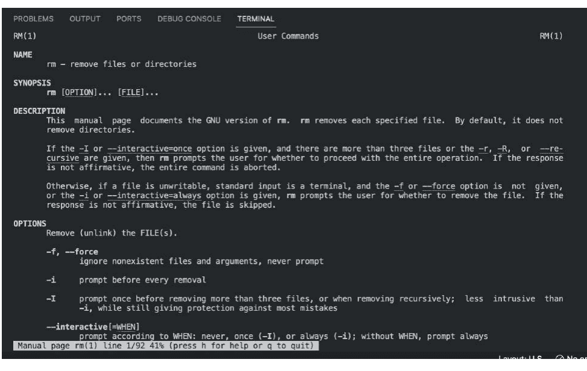

按 `q` 退出。

如果你在输入某些命令时出错，请记住，如果你在使用 Gitpod，始终可以创建一个新的工作区。

如果你在自己的电脑、虚拟机或 VPS 上工作，请删除该课程文件的文件夹并重新从 Github 复制。

## Day 2. 基础 Bash 语法

使用命令行执行各种任务而不是 GUI 最重要的一点是什么？

记录并重复执行不同动作序列以实现工作自动的能力。

Bash (https://www.gnu.org/software/bash/) 是一种由 Brian Fox 编写并于 1989 年首次发布的 Unix Shell 和命令语言。我们将用它来编写命令，以自动化 Linux 中的各种任务，并将 Bash 脚本与其他编程语言（Python, Go 等）编写的工具相结合。

稍后执行的命令可以存储在扩展名为 `.sh` 的文件中。我们将用它来编写命令，以自动化 Linux 中的各种任务，并将 Bash 脚本与其他编程语言（Python, Go 等）编写的工具相结合。

进入当前文件夹：

```
cd Day_2
```

运行创建_folders.sh：

```bash
create_folders.sh
```

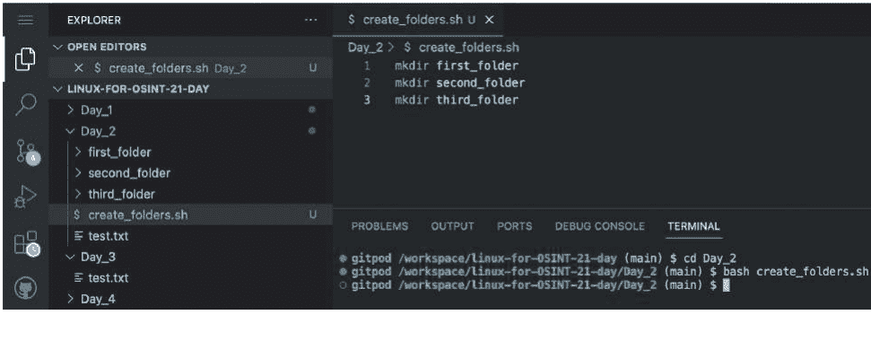 如果错过了昨天的课程，你可以看到这个脚本创建了不同的目录。.sh 扩展名用于存储 Shell 语言或 Bash 脚本的文件。

现在让我们来看 Bash 的最基础元素。

### 变量和字符串拼接

在命令行运行：

```bash
variables.sh
```

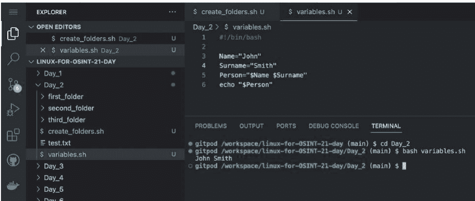 代码中的 `#` 符号不会影响脚本，但我建议在 .sh 的第一行注明：

```bash
#!/bin/bash
```

创建包含字符串 "John" 的变量：

```bash
Name="John"
```

创建包含字符串 "Smith" 的变量：

```bash
Surname="Smith"
```

创建包含 Name 和空格的变量：

```bash
Person="$Name $Surname"
```

### 条件运算符

运行条件脚本：

```bash
conditional.sh
```

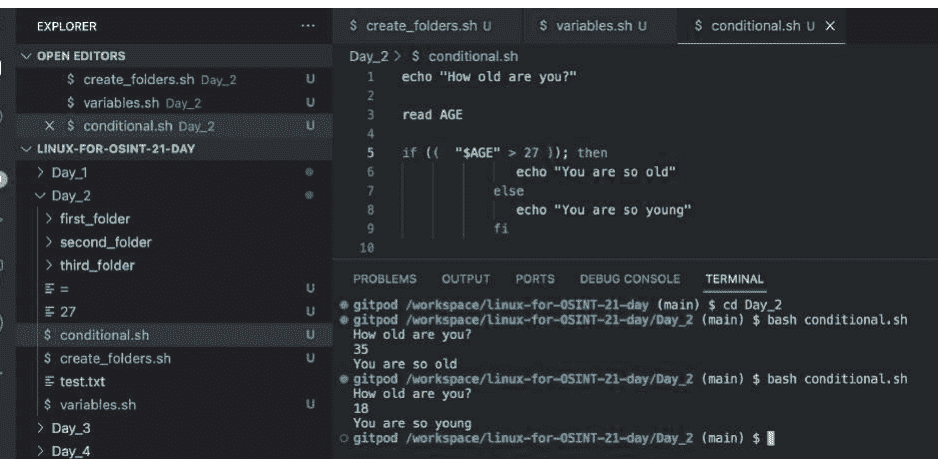 询问用户年龄：

```bash
echo "How old are you?"
```

读取用户输入的 AGE 值：

如果 AGE 大于 27，我们告诉他年纪大了：

```bash
if [ $AGE -gt 27 ]; then
  echo "You are old"
```

如果 AGE 小于 27，我们告诉他年轻：

```bash
elif [ $AGE -lt 27 ]; then
  echo "You are young"
fi
```

### 循环

Bash 有三种循环：“while 循环”、“until 循环”和“for 循环”。

### while 循环

在命令行运行：

```bash
while.sh
```

只要变量 x 不等于 5，执行以下操作：

```bash
while [ $x -ne 5 ]; do
  echo $x
  x=$((x + 1))
done
```

### until 循环

运行：

```bash
until.sh
```

只要变量 x 大于 10，执行以下操作：

```bash
until [ $x -gt 10 ]; do
  echo $x
  x=$((x - 1))
done
```

### for 循环

运行：

```bash
for.sh
```

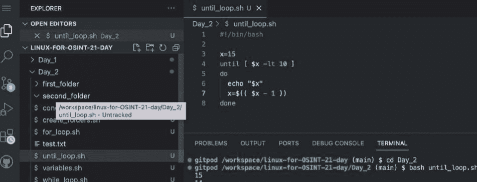

## 第 3 天. 安装和运行工具


Linux 工具是可以在命令行或 `bash` 脚本中运行的命令。在过去的课程中，我们已经使用了其中一些工具：`cat`, `bash`, `cd`, `man`, `cp`, `mkdir`。这些是每个 Linux 发行版中默认安装的工具。

你可以使用特殊的命令来查看你自己的发行版中安装的工具和应用程序的完整列表。具体命令取决于你发行版的类型。例如：

- Ubuntu, Debian: `dpkg -l`
- Fedora, RHEL: `rpm -qa`
- OpenBSD, FreeBSD: `pkg-info`
- Gentoo: `query list` 或 `emergix`
- Arch Linux: `pacman -Q`

如果你正在使用 Gitpod，则需要使用 Ubuntu 的命令。

在命令行运行：

```
dpkg -l
```

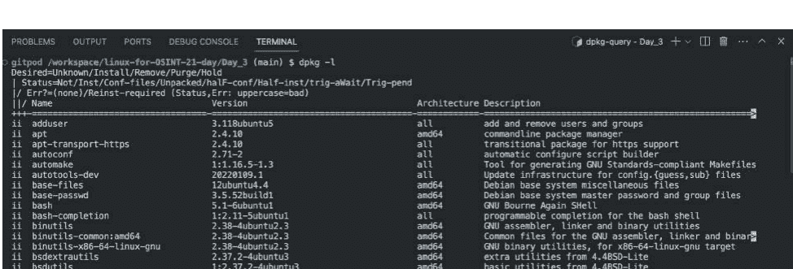

还有成千上万个用于各种用途的工具，你可以自行安装。

作为一个示例，让我们来安装两个处理 ZIP 归包的工具：

```
sudo apt install unzip
```

在这个示例中，并没有必要（我们可以直接使用 `apt install`），但我们在命令前加上了 `sudo` 单词。

这样我们以超级用户权限（写入、读取和删除文件的最大权限）运行命令。在 Gitpod 中，你可以直接使用它，但如果你在自己的电脑上工作且没有以管理员身份登录，可能需要输入密码。

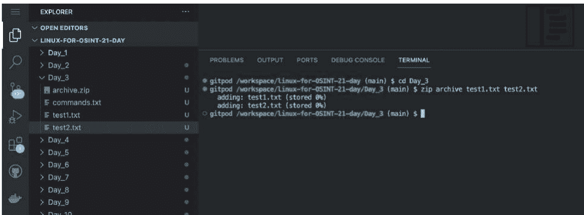

让我们尝试将文件转换为 zip 归档：

```bash
cd Day_3
zip archive test1.txt test2.txt
```

我们可以指定目录名称而不是文件名，或者使用 `*.txt` 代替列文件名，将活动目录中的所有 txt 文件放入归档。

```bash
gitpod /workspace/linux-for-OSINT-21-day/Day_3 (main) $ zip -sf archive.zip
Archive contains:
test1.txt
test2.txt
Total 2 entries (0 bytes)
gitpod/workspace/linux-for-OSINT-21-day/Day_3 (main) $ 
```

现在让我们使用 `-sf` 标志查看归档中有哪些文件：

```bash
## zip -sf archive.zip
```

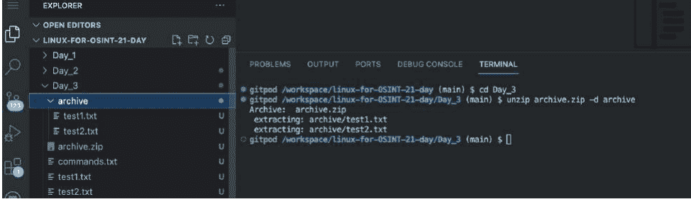

你可以使用 `unzip` 命令将归档解放到特定文件夹：

```bash
unzip archive.zip -d archive
```

你可以使用 `rar` 和 `unrar` 归档来处理 WinRAR 归档。

在上面的示例中，我们使用了 [apt 包管理器](https://ubuntu.com/server/docs/package-management)，它是 Ubuntu 默认安装的。但还有其他可以在 Ubuntu 和其他发行版使用的包管理器。例如：

PyPI (https://pypi.org) - Python 包索引。

```bash
pip3 install ddgr
```

Snap Store (https://snapcraft.io/store) - 由 Canonical 开发的软件商店。

```bash
snap install ddgr
```

Cast (https://sourcemage.org) - Source Mage Linux 发行版的包管理器。

```bash
cast ddgr
```

* （对于每个包管理器，都列出了安装 `ddgr` 工具的示例命令，但不需要运行它们。我们将在课程的第 16 天安装它）

在本门课程中，我们专注于命令行操作。不过，对于 Linux 来说，有大量的 GUI 应用。它们通过应用商店安装非常方便。


## 我们找到了 27 个 snaps

| onlyoffice-desktops Ascension System SIA | Domotz Pro Agent Domotz | digikam | Symphly Onio Jashi | banana-accounting-plus Banan.ch | Google Docs Field | dobsov-uz Zimmermann | super-o-plan Alexandrj | Blueprint James Weheston | Interactive Data Editor Koshik | Graphs Spendall Dinkland | tm-desktop | Jateimal Martin | Enpa Christos | flman-mero Maria Ganc | Dave's Trails Ganc | Carrier (DOS) Maria Ganc | Time Tracking Gerold | Snap 是由 Canonical 开发的软件打包和部署系统。[Snapcraft](https://snapcraft.io) 包含了数千个用于 Linux 发行版的 snaps（应用）。 |

## 搜索 'excel'

- **Wiz Note**: 个人知识管理，基于云的桌面环境
- **Pinpoint**: 演示文
- **Godless Deluxe**: 重制游戏
- **Lollypop**: 播放和组织你的音乐收藏
- **Kvric**: 免费的
- **ExifTool**: 简单前端
- **Ryujinx**: Nintendo Switch 模拟器
- **Kaffeine**: 多媒体播放器
- **Jotpia**: 远程桌面协议 RDP
- **Gnumeric**: 精确电子表格

[Flathub](flathub.org) - 另一个包含更多应用的商店。与允许安装命令行工具的 Snap 不同，Flathub 只支持 GUI 应用。如果你使用 Gitpod，现在无法尝试。回到第 21 天继续 Linux。

## 第 4 天 批量处理

通过 Bash 脚本，你可以用几行代码处理成千上万的文件。例如，你可以对特定文件夹中的所有文件执行相同的操作。为此我们将使用 [find 工具](https://man7.org/linux/man-pages/find.html)。它是 Linux 默认安装的。

请在命令行输入：

```bash
cd Day_4
bash print_names.sh
```

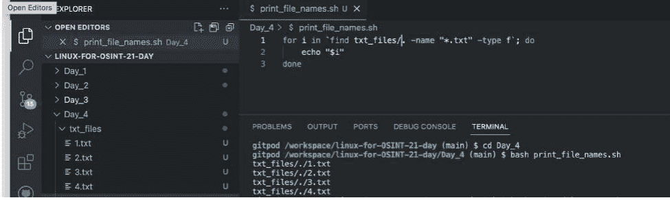

`print_names.sh` 的代码：

```bash
for i in `find txt_files/ -name "*.txt" -type f`; do
echo "$i"
done
```

你可以将 `.txt` 替换为任何扩展。你还可以搜索包含特定单词的文件。实际上，上面的脚本并没有意义，因为文件名只是通过命令显示的。尝试：

```bash
find -name "*.txt" -type f
$ gitpod/workspace/Linux-For-OSINT-21-day (main) $ find -name "*.txt" -type f
/Day_1/commands.txt
/Day_10/test.txt
/Day_11/test.txt
/Day_12/test.txt
/Day_13/test.txt
/Day_14/example.txt
/Day_15/test.txt
/Day_16/test.txt
/Day_17/test.txt
/Day_18/test.txt
/Day_19/test.txt
/Day_2/test.txt
/Day_3/test.txt
/Day_4/test.txt
/Day_5/test.txt
/Day_6/test.txt
/Day_7/test.txt
/Day_8/test.txt
/Day_9/test.txt
$ gitpod/workspace/linux-for-OSINT-21-day (main) $
```

但通过逐个遍历文件名，我们可以对每个文件执行重复操作（使用任何 Linux 工具处理文件）。只需将 `"echo"` 命令替换为其他。例如，让我们尝试将所有 txt 文件转换为 csv 格式。

## 将 .txt 文件保存为 .csv

## bash convert_files.sh

`convert_files.sh` 的代码：

```bash
for i in `find txt_files/ -name "*txt" -type f`; do
sed 's/+/g' "$i"="${i}.csv";
done
```


注意 [`sed` 命令](https://www.gnu.org/sed/manual/sed.html)。我们用它将空格替换为逗号，并在第 7 天回来。

## Xargs

[`Xargs`](https://man7.org/linux/man-pages/man1/xargs.1.html) 是一个允许使用输入参数运行不同 Linux 命令的工具。这包括从存储在文件中的读取这些参数。

看看它是如何工作的示例。

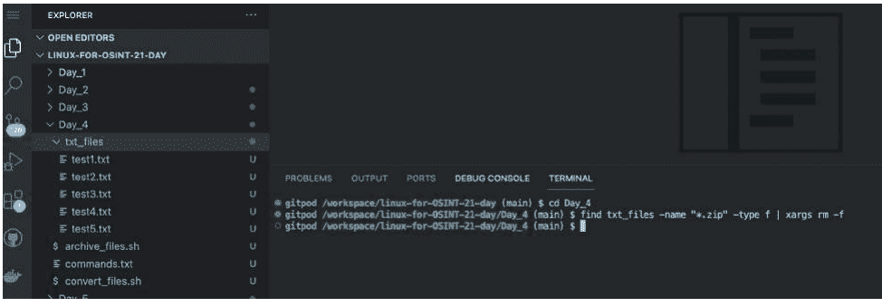

让我们创建 `txt_files` 文件夹中的所有归档：

```bash
find txt_files -name "*.zip" -type f | xargs rm -
```

现在让我们使用 `Xargs` 创建存档：


如你所示，在命令的右部分，我们使用 `cat` 命令逐行读取文件。在左侧，我们带有 `-I` 标志运行 `xargs`，将每行都作为文件名变量，并在运行 `zip` 命令时将该变量作为参数中的文件名。

今天，我们将学习 Linux 中自动化数据收集最重要的技能之一 - 使用 `Curl` 工具下载文件。这在处理请求、爬取网站、从归档或其他源下载数据时非常派用场。

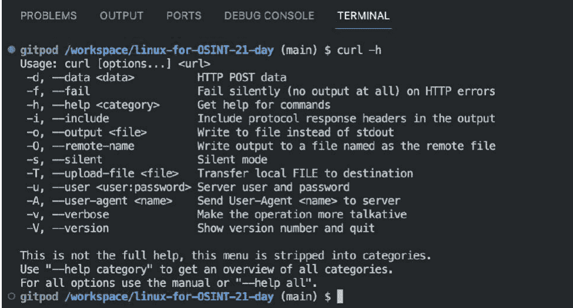

这并不是完整的帮助文档，此菜单是按类别拆分的。使用使用 `--help category` 可以获取所有类别的概览。要查看所有选项，请查阅手册或使用 `--help all`。

[`Curl`](https://curl.se/) 是一个从服务器或向服务器传输数据的工具，支持支持的许多协议之一（DICT, FILE, FTP, FPS, GOPHER, HTTP, HTTPS, IMAP, IMAPS, LDAP, LDAPS, POP3S, RTSP, SCP, SFTP, SMB, SMBS, SMTP, SMTPS, TELNET）。它不需要安装，在 Linux 中默认可用。

让我们尝试下载文件。使用 `-o` 标记将原始文件名更改为 `file.pdf`：

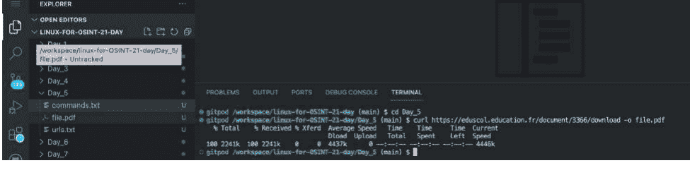

在命令行中输入：

### Cd 第 5 天

```bash
curl https://eduscol.education.fr/document/3366/download -o file.pdf
```

现在让我们尝试使用 `Xargs` 命令（我们昨天讨论过它）从链接列表下载文件。

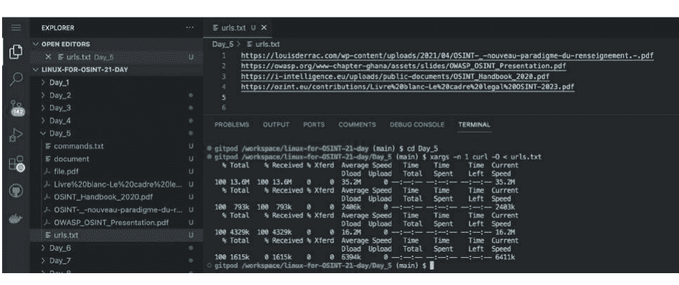

```bash
xargs -n 1 curl -O < urls.txt
```

使用 `-H` 标记，你可以发送带有不同 http 头的请求。此功能在自动化向各种 API 发送请求时非常有用。

Netlas API (https://github.com/netlas-io/netlas-cookbook) 的简单示例：

### curl -X

```bash
curl -X 'https://api.netlas.io/api/responses?q=lid.com&source_type=include&start=0&fields=*' -H 'accept: application/json' > api_request_result.txt
```

```json
jsonviewer.stack.hash
{
  "JSON": {
    "items": [
      {
        "highlight": {
          "data": {
            "updated": "2023-10-19T13:29:53.501Z",
            "hash": "2aa2cd000aa2ed00042d42d0050d7691d884b6fa8f9fc5c2b4b882cc",
            "isp": "中国移动",
            "ip": "223.119.235.192",
            "certificate": {
              "uri": "https://223.119.235.192:443/",
              "host_type": "",
              "target": {
                "geo": {
                  "country": "CN"
                },
                "path": "",
                "protocol": "https",
                "port": "443",
                "timestamp": "2023-10-19T13:29:53.501Z"
              },
              "who": {
                "port": "443",
                "host": "223.119.235.192",
                "iteration": "0"
              },
              "http": ""
            }
          }
        }
      }
    ]
  }
}
```

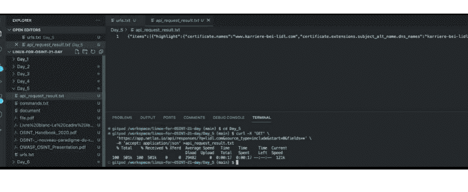

通过此查询，我们从 Netlas IP 搜索引擎中通过查询 "lid.com" 获取了包含详细域名信息的 JSON 文件。你可以使用一些 JSON 查看器工具（https://jsonviewer.stack.hu/）以方便的格式查看它。

在第 14 天，我们将更多地讨论 JSON 格式的数据，并学习如何使用 `jq` 工具对其进行处理。


除了可以收集域名数据的 Netlas API 之外，还有数百种其他可用于 OSINT（开源情报）的 API。它们可以帮助收集电子邮件、电话号码、物理地址、加密货币钱包等信息。你可以在仓库（https://github.com/cipher387/python-for-OSINT）中找到它们。

## 轻松生成 curl 命令

| Header | Header 取值 |
| :--- | :--- |
| GET | |
| Authorization | |
| REMOVE | |
| ADD | |
| Content-Type | |
| Accept | 自签名 |
| Verbose | |

```bash
curl -X GET://github.com/cipher387/python-for-OSINT-21-days/raw/Python-for-OSINT.
```

对于复杂的查询，你可以使用特殊服务来查看网页信息。使用 `-I` 标记发送 HEAD 请求并获取标头（不包含正文）：

```bash
$ gitpod /workspace/linux-for-OSINT-21-day/day_5 (main) $ curl -I https://osint.nl/
HTTP/200 OK
date: Wed 23 Oct 2023 23:36:23 GMT
content-type: text/html; charset=utf-8
cache-control: max-age=3600
expires: Wed 23 Oct 2023 23:36:23 GMT
x-cache: hit-from-cache-b6d3f5f7963d5eb
expires=25-Dec-2023 22:36:23 GMT; Max-Age=3600; path=/; domain=.osint.nl; secure; HttpOnly; Same
vary: *
modified: Thu, 11 Jul 2023 04:00:00
```

对于复杂的查询，你可以使用特殊服务来查看网页信息。使用 `-I` 标记发送 HEAD 请求并获取标头（不包含正文）：


```bash
$ gitpod /workspace/linux-for-OSINT-21-day/day_5 (main) $ curl -I https://osint.nl/
HTTP/200 OK
date: Wed 23 Oct 2023 23:36:23 GMT
content-type: text/html; charset=utf-8
cache-control: max-age=3600
expires: Wed 23 Oct 2023 23:36:23 GMT
x-cache: hit-from-cache-b6d3f5f7963d5eb
expires=25-Dec-2023 22:36:23 GMT; Max-Age=3600; path=/; domain=.osint.nl; secure; HttpOnly; Same
vary: *
modified: Thu, 11 Jul 2023 04:00:00
```

对于复杂的查询，你可以使用特殊服务来查看网页信息。使用 `-I` 标记发送 HEAD 请求并获取标头（不包含正文）：

```bash
$ gitpod /workspace/linux-for-OSINT-21-day/day_5 (main) $ curl -I https://osint.nl/
HTTP/200 OK
date: Wed 23 Oct 2023 23:36:23 GMT
content-type: text/html; charset=utf-8
cache-control: max-age=3600
expires: Wed 23 Oct 2023 23:36:23 GMT
x-cache: hit-from-cache-b6d3f5f7963d5eb
expires=25-Dec-2023 22:36:23 GMT; Max-Age=3600; path=/; domain=.osint.nl; secure; HttpOnly; Same
vary: *
modified: Thu, 11 Jul 2023 04:00:00
```


对于复杂的查询，你可以使用特殊服务来查看网页信息。使用 `-I` 标记发送 HEAD 请求并获取标头（不包含正文）：

```bash
$ gitpod /workspace/linux-for-OSINT-21-day/day_5 (main) $ curl -I https://osint.nl/
HTTP/200 OK
date: Wed 23 Oct 2023 23:36:23 GMT
content-type: text/html; charset=utf-8
cache-control: max-age=3600
expires: Wed 23 Oct 2023 23:36:23 GMT
x-cache: hit-from-cache-b6d3f5f7963d5eb
expires=25-Dec-2023 22:36:23 GMT; Max-Age=3600; path=/; domain=.osint.nl; secure; HttpOnly; Same
vary: *
modified: Thu, 11 Jul 2023 04:00:00
```

`grep` 允许在文件中搜索匹配某些文本（正则表达式）。
注意这里 `grep` 就可以在文件中进行匹配。


```bash
$ gitpod /workspace/linux-for-OSINT-21-day/day_5 (main) $ curl -I https://osint.nl/
HTTP/200 OK
date: Wed 23 Oct 2023 23:36:23 GMT
content-type: text/html; charset=utf-8
cache-control: max-age=3600
expires: Wed 23 Oct 2023 23:36:23 GMT
x-cache: hit-from-cache-b6d3f5f7963d5eb
expires=25-Dec-2023 22:36:23 GMT; Max-Age=3600; path=/; domain=.osint.nl; secure; HttpOnly; Same
vary: *
modified: Thu, 11 Jul 2023 04:00:00
```

对于复杂的查询，你可以使用特殊服务来查看网页信息。使用 `-I` 标记发送 `HEAD` 请求并获取标头（不包含正文）：

```bash
$ gitpod /workspace/linux-for-OSINT-21-day/day_5 (main) $ curl -I https://osint.nl/
HTTP/200 OK
date: Wed 23 Oct 2023 23:36:23 GMT
content-type: text/html; charset=utf-8
cache-control: max-age=3600
expires: Wed 23 Oct 2023 23:36:23 GMT
x-cache: hit-from-cache-b6d3f5f7963d5eb
expires=25-Dec-2023 22:36:23 GMT; Max-Age=3600; path=/; domain=.osint.nl; secure; HttpOnly; Same
vary: *
modified: Thu, 11 Jul 2023 04:00:00
```

对于复杂的查询，你可以使用特殊服务来查看网页信息。


`grep`允许在文件中搜索匹配某些文本（正则表达式）。
注意这里`grep`就可以在文件中进行匹配。
```bash
$ gitpod /workspace/linux-for-OSINT-21-day/day_5 (main) $ curl -I https://osint.nl/
HTTP/200 OK
date: Wed 23 Oct 2023 23:36:23 GMT
content-type: text/html; charset=utf-8
cache-control: max-age=3600
expires: Wed 23 Oct 2023 23:36:23 GMT
x-cache: hit-from-cache-b6d3f5f7963d5eb
expires=25-Dec-2023 22:36:23 GMT; Max-Age=3600; path=/; domain=.osint.nl; secure; HttpOnly; Same
vary: *
modified: Thu, 11 Jul 2023 04:00:00
```

```text
example.txt U X
Day_6 > # example.txt
1 First string
2 第二 string
3 johnsmith@gmail.com
4 103.21.244.25
5 34x4VRoCGjym3xR7yCVPFHoCNxv4Tweo
6 example@gmail.com
7 bciqazcm763858nk2jd986etajvwqwwsliv8oxwcct
8 23.04.1991
9 173.245.49.202
```

```
PROBLEMS OUTPUT PORTS DEBUG CONSOLE TERMINAL
$ gitpool /workspace/linux-OSINT-21-day/Day_6 (main) cd Day_6
$ gitpool /workspace/linux-OSINT-21-day/Day_6 (main) grep "gmail" example.txt
johnsmith@gmail.com
example@gmail.com
$ gitpool /workspace/linux-OSINT-21-day/Day_6 (main) grep '[0-9]' example.txt
103.21.244.25
34x4VRoCGjym3xR7yCVPFHoCNxv4Tweo
bciqazcm763858nk2jd986etajvwqwwsliv8oxwcct
23.04.1991
173.245.49.202
$ gitpool /workspace/linux-OSINT-21-day/Day_6 (main) $ _
```

# `grep -F gmail Day_6/example.txt`

默认情况下，`Grep`工具是区分大小写的。要禁用此选项（同时搜索"`gmail`"和"`MAIL`"`Gmail"`），请添加`-i`标记。

## `grep -F i gmail Day_6/example.txt`

现在，让我们尝试查找包含至少一个数字的行（使用简单的正则表达式`[0-9]`）：

```bash
grep '[0-9]' example.txt
```

## `example.txt U emails.txt U commands.txt U`

```
Day_6 > example.txt
1 First string
2 Second string
3 johnsmith@gmail.com
4 103.21.244.25
5 34xv4vRCGCjm3xr7yCVPFHoOCNxv4Twseo
6 example@gmail.com
7 bciqazcm763b85njkj2dj986etajv6wquslv8uxwczwt
8 23.04.1991
9 173.245.49.202
```

## PROBLEMS OUTPUT DEBUG CONSOLE TERMINAL

```bash
gitpod workspace/linux-for-OSINT-21-day (main) $ cd Day_6
gitpod workspace/linux-for-OSINT-21-day/Day_6 (main) $ grep -n ".txt" example.txt
git workspace/linux-for-OSINT-21-day/Day_6 (main) $ grep -n "gmail" example.txt
3 johnsmith@gmail.com
6 example@gmail.com
```

如果你想在结果中显示行号，请使用`-n`标记：

## `grep -n "gmail" example.txt`

## `example.txt U emails.txt U commands.txt U`

```
Day_6 > emails.txt
1 sector85gmail.kz
2 cyberdetective.kz
3 jakecrepemail.kz
```

## PROBLEMS OUTPUT DEBUG CONSOLE TERMINAL

```bash
gitpod /workspace/linux-for-OSINT-21-day (main) $ cd Day_6
gitpod /workspace/linux-for-OSINT-21-day/Day_6 (main) $ grep -c -e "[A-Za-z0-9._+-]+@[A-Za-z0-9.-]+\.[A-Za-z]{2,4}"
example.txt:johnsmith@gmail.com
emails.txt:sector85gmail.kz
emails.txt:cyberdetective.kz
emails.txt:jakecrepemail.kz
```

现在任务稍微复杂了一些。让我们找到包含邮箱的字符串：

```bash
grep -E -o
"[A-Za-z0-9._+-]+@[A-Za-z0-9.-]+\.[A-Za-z]{2,6}"
```

我们在命令中使用了一些其他有用的标记：

- `E` - 使用扩展正则表达式。
- `o` - 只显示匹配的部分（而不是整行）。
- `r` - 搜索当前目录下的所有文件，以及子目录下的所有文件。

在**`Grep`**的帮助下，你不仅可以搜索数字和邮箱，还可以搜索 IP 地址、加密货币钱包、用户名、邮政码等。

我们将不会深入介绍它们的语法。对于大多数 OSINT 目的，你只需要从 Stackoverflow 或在线库复制正则表达式：

[`RegexLib`](https://regexlib.com/)

[`RegexHub`](https://projects.lukeha.com/regexhub/)

而且，你始终可以使用 ChatGPT 或 Phind 来编写正则表达式（我们将讨论更多关于**Day 20**的辅助工具）。

如果你对这个主题感兴趣，Medium 博客有一篇非常详细且长的文章介绍了：**正则表达式在 OSINT 中有什么用。理论以及使用 Google 表格的方法**[`https://medium.com/osint-ambition/this-article-consists-of-three-short-parts-31d1fab5`](https://medium.com/osint-ambition/this-article-consists-of-three-short-parts-31d1fab5)。

我们也可以与其他 Linux 工具配合使用正则表达式：`find`, `sed`, `tr`, 等。

如果你想搜索特定扩展名的文件，或者名称包含特定字符串的文件，请用星号替换文件名：

```bash
grep -n "gmail" *.txt
```

PROBLEMS OUTPUT DEBUG CONSOLE TERMINAL

$ gitpool /workspace/linux-OSINT-21-day/Day_6 (main) $ Day_6

$ gitpool /workspace/linux-OSINT-21-day/Day_6 (main) grep "gmail" example.txt

johnsmith@gmail.com

example@gmail.com

$ gitpool /workspace/linux-OSINT-21-day/Day_6 (main) grep '[0-9]' example.txt

103.21.244.25

34x4VRoCGjym3xR7yCVPFHoCNxv4Tweo

bciqazcm763858nk2jd986etajvwqwwsliv8oxwcct

23.04.1991

173.245.49.202

$ gitpool /workspace/linux-OSINT-21-day/Day_6 (main) $ _

## 第 7 天

`sed s/Happy/Merry/ sed_sample.txt` (替换每个数字)

现在让我们尝试使用正则表达式将文件中的文本替换为"`no`":


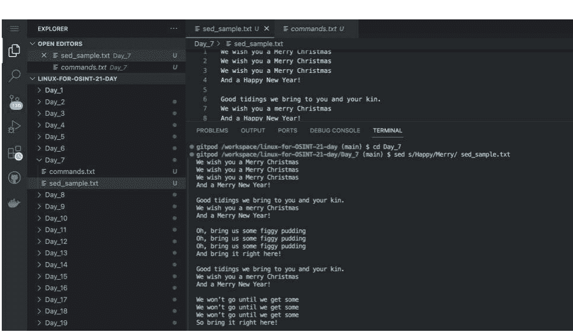

## `sed /[0-9]/no/g digits.txt`

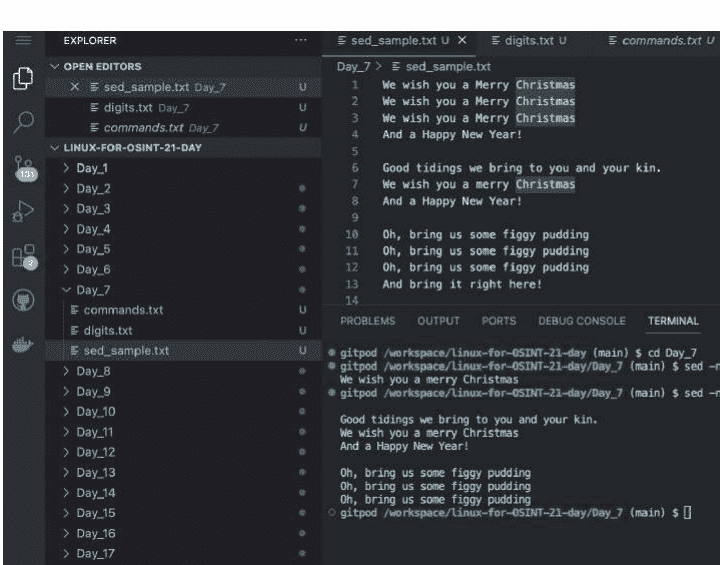

`sed -n 7p sed_sample.txt`

`sed -n 5,12p sed_sample.txt`

对于一个只有几十行的文件，这个命令似乎毫无意义。但当你拥有一个例如包含数千万行的 CSV 文件，且 Excel 拒绝打开它，而你需要查看第 108100、999588、10009898 行的内容以确保数据格式正确时，它的真正威力就会显现出来。

你也可以将此结合起来，在给定的字符串范围内查找并替换单词或正则表达式：

## 问题 输出 端口 调试 控制台 终端

```
## And a Happy NewYeargit/Linux-for-OSINT-21-day/Day_7 (main) $ sed '1,30 s/Happy/Merry/g' sed_sample.txt
We wish you a Merry Christmas
We wish you a Merry Christmas
We wish you a Merry Christmas
And a Merry New Year!

Good tidings we bring to you and your kin,
We wish you a Merry Christmas
And a Merry New Year!

Oh, bring us some figgy pudding
Oh, bring us some figgy pudding
Oh, bring us some figgy pudding
And bring it right here!

Good tidings we bring to you and your kin,
We wish you a Merry Christmas
And a Merry New Year!

We won't go until we get some
We won't go until we get some
We won't go until we get some
So bring it right here!

Good tidings we bring to you and your kin,
We wish you a Merry Christmas
And a Merry New Year!

We all like-like our figgy pudding
```


更多示例可以在“Useful sed” Github 仓库（`https://github.com/adrianlarion/useful-sed`）中找到。

```
使用此工具生成 sed 命令，你可以在 Linux 或 Unix 机器上运行它。
```


不要试图记忆组合 Sed 命令的语法规则。你始终可以在 StackOverflow 上找到示例，向某些 AI 助手寻求帮助，或者使用特殊的在线服务如 Sed 命令生成器（`https://www.jamiebalafour/scot/devkit/sed/`）。

# AWK

`Awk` (`https://www.gnu.org/software/gawk/manual/gawk.html`) 是一种用于文本处理的脚本语言。有趣的事实是：`Awk` 并不是技术缩写，而是该语言三位开发者的字母组合：Alfred V. Aho, Peter J. Weiner 和 Brian W. Kernighan。

`Awk` 像 `Sed` 一样不需要安装，因为 Linux 默认包含它。

首先，让我们尝试显示文件的整个文本。使用 `Cat` 会更容易，但这个示例对于理解 `awk` 语法是必要的：

```
PROBLEMS OUTPUT PORTS DEBUG TERMINAL # zsh - dev_7
$home/mary/linux/08-21-day.php $1 '{print $1}'
$home/mary/linux/08-21-day.php $1 '{print $2}'
$home/mary/linux/08-21-day.php $1 '{print $3}'
$home/mary/linux/08-21-day.php $1 '{print $4}'
Title of the book: The British Edition,Gift of So,2016,1
Another title (1986,1880): The British Invention, Mary, eloquently written curatorial descriptions,John Doe,Gift of So,2016,1,repr
First image (2014): Terry, Mary,some other 2015,3
$home/mary/linux/08-21-day.php $1
awk '{print $0}' sample.txt
```

现在让我们做相同的操作，但带有行号：

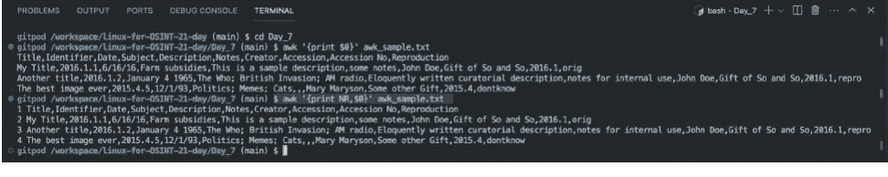

```
awk '{print NR,$0}' sample.txt
```

让我们只显示文档的第一列和第三列（使用标志 `-F` 指明分隔符为逗号）：

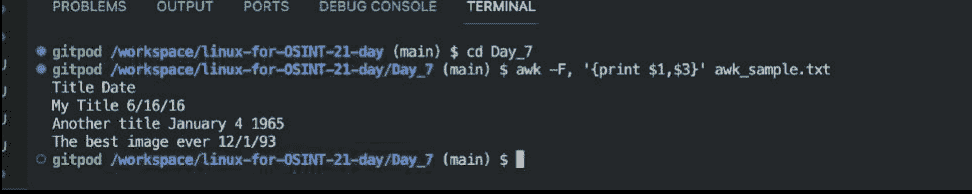

```
awk -F, '{print $1,$3}' sample.txt
```

现在只输出以特定字符开头的字符串：

`example.csv | awk_sample.txt`

```
+,2016,1
1 Title,Identifier
Title of the book: The British Edition,Gift of So,2016,1
Another title (1986,1880): The British Invention, Mary, eloquently written curatorial descriptions,John Doe,Gift of So,2016,1,repr
First image (2014): Terry, Mary,some other 2015,3
```

# 第 8 天 Vim 文本编辑器

一个有趣的事实，如果你在 Google 中输入 "emacs"，搜索引擎会问你：“你是指 vi 吗？”（`vim` 是 `vi` 文本编辑器的改进版本，于 1976 年引入）。全球许多开发者都热爱 Vim，他们已经使用了几十年，并不断发现这个文本编辑器的某些惊人功能。


`Vim` (`https://www.vim.org`) - 是一款通用且高度可配置的命令行文本编辑器。它的第一个版本出现在 1991 年，尽管有许多其他文本编辑器和 IDE（集成开发环境）作为竞争对手，但它一直保持流行。让我们运行它，看看它擅长什么。

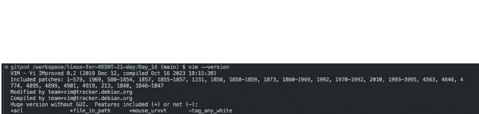

让我们来安装：

## `sudo apt update`

## `sudo apt install vim`


```bash
bash - Day_14
$ cd /workspace/linux-for-DISTRIB-21-day/Day_14 && sudo apt install vim
Reading package lists...
Building dependency tree...
Reading state...
将安装以下额外的软件包：
  vim-common vim-runtime
建议的软件包：
  vim-gui-gtk3
以下软件包将升级：
  vim-common vim-runtime (0 配置为删除，88 将不升级)
需要获取 6,054 kB 的存档空间。
执行此操作后，将使用 0 额外的磁盘空间。
您想继续吗？[Y/n] y
Fetching http://archive.ubuntu.com/ubuntu/pool/main/v/vim/vim-common_2.0.2-3ubuntu1.2.13 [1,734 kB]
Fetching http://archive.ubuntu.com/ubuntu/pool/main/v/vim/vim-runtime_2.0.2-3ubuntu1.2.13 [4,368 kB]
Unpacking /usr/share/doc/vim/README.gz (2.0.2-3ubuntu1.2.13)
Setting up vim-common (2.0.2-3ubuntu1.2.13)
Processing triggers vim-common (2.0.2-3ubuntu1.2.13)
Unpacking /usr/share/doc/vim/README.gz (2.0.2-3ubuntu1.2.13)
Setting up vim-runtime (2.0.2-3ubuntu1.2.13)
Processing triggers vim-runtime (2.0.2-3ubuntu1.2.13)
```

并运行：

## 问题 输出调试控制台 终端

od aliquip non prehendr

quis ut ullamcorper consectetur adipiscing elit. Quibus id nulla est non esse velit vitae, a a incid in risus mauris; Quam neque aut protulis, popularia sunt, eu aum a ele deserunt. Duo Nemo Regis struc

iam velit vehicula nisl eget velit eu mauris.

Iam in mauris, qui in velit nulla, euismod gravida, tellus, elequent a nisque. Nam non tincidunt, fingint, vinguent, Ariston Atqui percipisc et et turpis

re augue neque, cum prime sint mollis magnis, hendrer posuere libero. Ferieri. Inquin, trarias, nulla pacto, ut non diam, quis velit eu nisl, lectus diam, eu ad estabitur est, quiviridis maximus optimat in reibus, ut reliqu

ab obrut?

Quis iste dolore tempus

Summa exim non velit non non nonet? Donec pra mi ips velit necubacit id nisi vester bao M. Tubulis, quam quam, us condensatus posuere. P. Quod si ita sit, currer pharetra facilisis sanda massa.

Ex exum omnis scriptis et Institutit cum omnis diam lobortis facilisis, omnis historia. Patientes. Cum ente feri turpis torrens oratu, quo

Quid ut ex diam in velit, nisl eget, eu nibh mollis congis mauris, nisl tellus tenas, nequeasque orationem risus dapibus. El reidrapitur ipe s e\exa, ex nisl, a nisl, a nisl nisl, nisl elit, eu a feugitur erat, non diam, non idelerit, non non tellus reibus 1 or

massa non esse ad beatud vitae satis. Nam at vero sit,ums accredit, ut appetit bibendum quam habenaat et per si ipsa nequeat,

Quem si tenueris, non modum Cicconrone, sed etiam me abducas licebit.

Stulti autem malorum memoria primme torquent, lobortis praiterita grata recordation nequean renovat.

Fis esse nisl a nisl erat.

Quae autem nulla mauris institutionis lobortis oblibit?

Verum at nisl eget diam, eget verba rapipluit;

Hoc est non quod non habere, sed neque dictum liquem,

nique.

"Text_example.txt" [noesil] 211, 3518

1,2 Top

```bash
cd Day 8
vim text example.txt
```

我们暂时不会对此文本做更多操作，直接进入最重要的问题。

## 退出


我们暂时不会对此文本做更多操作，直接进入最重要的问题。

`Vim` (https://www.vim.org) - 是一款通用且高度可配置的命令行文本编辑器。它的第一个版本出现在 1991 年，尽管有许多其他文本编辑器和 IDE（集成开发环境）作为竞争对手，但它一直保持流行。让我们运行它，看看它擅长什么。


让我们来安装：

## `sudo apt update`

## `sudo apt install vim`

```bash
bash - Day_14
$ cd /workspace/linux-for-DISTRIB-21-day/Day_14 && sudo apt install vim
Reading package lists...
Building dependency tree...
Reading state...
将安装以下额外的软件包：
  vim-common vim-runtime
建议的软件包：
  vim-gui-gtk3
以下软件包将升级：
  vim-common vim-runtime (0 配置为删除，88 将不升级)
需要获取 6,054 kB 的存档空间。
执行此操作后，将使用 0 额外的磁盘空间。
您想继续吗？[Y/n] y
Fetching http://archive.ubuntu.com/ubuntu/pool/main/v/vim/vim-common_2.0.2-3ubuntu1.2.13 [1,734 kB]
Fetching http://archive.ubuntu.com/ubuntu/pool/main/v/vim/vim-runtime_2.0.2-3ubuntu1.2.13 [4,368 kB]
Unpacking /usr/share/doc/vim/README.gz (2.0.2-3ubuntu1.2.13)
Setting up vim-common (2.0.2-3ubuntu1.2.13)
Processing triggers vim-common (2.0.2-3ubuntu1.2.13)
Unpacking /usr/share/doc/vim/README.gz (2.0.2-3ubuntu1.2.13)
Setting up vim-runtime (2.0.2-3ubuntu1.2.13)
Processing triggers vim-runtime (2.0.2-3ubuntu1.2.13)
```

并运行：

## 问题 输出调试控制台 终端


od aliquip non prehendr

quis ut ullamcorper consectetur adipiscing elit. Quibus id nulla est non esse velit vitae, a a incid in risus mauris; Quam neque aut protulis, popularia sunt, eu aum a ele deserunt. Duo Nemo Regis struc

iam velit vehicula nisl eget velit eu mauris.

Iam in mauris, qui in velit nulla, euismod gravida, tellus, elequent a nisque. Nam non tincidunt, fingint, vinguent, Ariston Atqui percipisc et et turpis

re augue neque, cum prime sint mollis magnis, hendrer posuere libero. Ferieri. Inquin, trarias, nulla pacto, ut non diam, quis velit eu nisl, lectus diam, eu ad estabitur est, quiviridis maximus optimat in reibus, ut reliqu

ab obrut?

Quis iste dolore tempus

Summa exim non velit non non nonet? Donec pra mi ips velit necubacit id nisi vester bao M. Tubulis, quam quam, us condensatus posuere. P. Quod si ita sit, currer pharetra facilisis sanda massa.

Ex exum omnis scriptis et Institutit cum omnis diam lobortis facilisis, omnis historia. Patientes. Cum ente feri turpis torrens oratu, quo

Quid ut ex diam in velit, nisl eget, eu nibh mollis congis mauris, nisl tellus tenas, nequeasque orationem risus dapibus. El reidrapitur ipe s e\exa, ex nisl, a nisl, a nisl nisl, nisl elit, eu a feugitur erat, non diam, non idelerit, non non tellus reibus 1 or

massa non esse ad beatud vitae satis. Nam at vero sit,ums accredit, ut appetit bibendum quam habenaat et per si ipsa nequeat,

Quem si tenueris, non modum Cicconrone, sed etiam me abducas licebit.

Stulti autem malorum memoria primme torquent, lobortis praiterita grata recordation nequean renovat.

Fis esse nisl a nisl erat.

Quae autem nulla mauris institutionis lobortis oblibit?

Verum at nisl eget diam, eget verba rapipluit;

Hoc est non quod non habere, sed neque dictum liquem,

nique.

`"Text_example.txt"` [noesil] 211, 3518

1,2 Top

```bash
cd Day 8
vim text example.txt
```

我们暂时不会对此文本做更多操作，直接进入最重要的问题。

# 问题 输出端口 调试 控制台 终端

```
$ |
```

在其中运行一些命令并按 `Ctrl+A+D` 退出。

```
$ cat readme.md
cat readme: No such file or directory
Day_1 Day_12 Day_15 Day_18 Day_20 Day_7 Day_8 netlas_results.txt search_osint.txt
Day_38 Day_13 Day_16 Day_19 Day_2 Day_6 osint_Duckduckgo_search.txt
Day_31 ... netlas_results_extracted.txt README.md
$ cat README.md
cat README: No such file or directory
$ cat README.md
# 用于 OSINT 的 Linux。面向初学者的 21 天课程
在此仓库中，你将找到“用于 OSINT 的 Linux。面向初学者的 21 天课程”每一天的示例代码文件。
$ |
```

现在让我们获取活动会话的列表，看看是否存在一个名为 `"demo-screen"` 的新会话：

```
screen -ls
```

要返回名为 `"demo-screen"` 的会话，只需在命令行中输入：

```
# screen -r demo-screen
```

然后再次按 `Ctrl+A+D` 退出。

如果你想删除名为 `"demo-screen"` 的会话，输入：

```
gitpod /workspace/linux-for-OSINT-21-day/Day_9 (main) $
* gitpod /workspace/linux-for-OSINT-21-day/Day_9 (main) $ screen XS demo-screen quit
* gitpod /workspace/linux-for-OSINT-21-day/Day_9 (main) $ screen -ls
No Sockets found in /run/screen/S-gitpod
```

## screen -XS demo-screen quit

之后，检查会话列表以确保删除成功。

```
## screen -ls
```

遗憾的是，Gitpod 不适合演示 Screen 的功能，因为在关闭工作区标签页且用户空闲超过半小时后，所有命令都会停止。

如果你在自己的虚拟机上使用 Screen，请确保它一直运行，直到所有会话中执行了你的所有命令。

使用 Screen 的理想选项是 24/7 运行的 VPS（虚拟专用服务器），你可以随时通过 SSH 连接到它。

# Crontab

使用 `crontab` 的另一个重要优势是能够为特定时间调度特定的操作。

`Crontab` (https://ss64.com/bash/crontab.html) 是一个用于编辑 crontab 文件的工具，它存储了由 cron 守护进程（在 UNIX 术语中）执行的命令计划。

这是一个来自维基百科的示例，展示了 crontab 文件：

```
## /etc/crontab 系统级 crontab
# 与其他 crontab 不同，当你编辑此文件时，不需要
# 运行 'crontab' 命令来安装新版本
# 并引用 /etc/crontab。这些文件还包含用户名字段，
# 其他任何 crontab 都不具备。
PATH=/usr:/local/sbin:/usr/local/bin:/sbin:/bin
# * * * * user
17 * * * root test -x /usr/bin/anacron --report /etc/cron.hourly |
25 6 * * root test -x /usr/bin/anacron || daily
47 6 * * root test -x /usr/bin/anacron --report /etc/cron.weekly |
32 6 1 * root test -x /usr/bin/anacron --report /etc/cron.monthly |
#
```

Gitpod 完全禁止使用 Crontab 工具。我们今天不会再尝试任何其他命令了。

但最后我想告诉你们一个非常棒的服务，当你在虚拟机或 VPS 上使用 Crontab 时，它会大有用。

## crontab guru

由 Cronitor 提供的 cron 调度表达式快速简便编辑器。

## “从周一到周五，每天的 22:00。”


```
next at 2023-05-17 22:00:00
then at 2023-05-18 22:00:00
then at 2023-05-19 22:00:00
then at 2023-05-22 22:00:00
then at 2023-05-23 22:00:00

random
```

```
0 22 * * 1-5
```

```
分钟 小时 日 月 
(月份) (星期)
* 任意值
值列表
分隔符
取值范围
/ 步长 值
*yearly (非标准)
@annually (非标准)
@monthly (非标准)
@weekly (非标准)
@daily (非标准)
@hourly (非标准)
@reboot (非标准)
```

`Crontab Guru` (https://crontab.guru/) 是一个允许你快速组合 cron 调度表达式的在线服务。

# 第 10 天。文本分析和编辑工具

本课程的一个大部分致力于处理各种文本格式。毕竟，Linux 最重要的优势是显著减少了重复工作。这里是一些非常有用的通用命令，它们在 Linux 中是默认可用的。

## Cat

`Cat` (https://man.linux.org/man/1/cat) - 用于查看文件内容的工具。我们之前已经用过它，它看起来非常简单。它允许一次查看多个文件的内容：

```
cat file1 file2
```

你还可以一次性将内容保存到一个文件中：

```
cat file1 file2 > file3
```

## Cut

`Cut` (https://man.linux.org/man/1/cut) - 用于提取文件部分的工具。我们之前已经用过它，它看起来非常简单。它允许你提取文件中的特定字符：

你可以使用 `-c` 提取前 5 个字符：

```
cut -c 1-5 file
```

`Cut` 还可以通过分隔符来提取字段：

```
cut -d ":" -f1 file
```

## Uniq

`Uniq` (https://man.linux.org/man/1/uniq) - 用于删除文件中重复的行的工具。让我们尝试对文件进行去重（前提文件必须经过排序的）：

```
uniq file
```

## Sort

`Sort` (https://man.linux.org/man/1/sort) - 对文件进行排序的工具。我们可以使用 `-r` 参数进行反序排序：

```
sort -r file
```

## Iconv

`Iconv` (https://man.linux.org/man/1/iconv) - 用于将文本从一种编码转换为另一种编码的工具。我们现在没有合适的测试文件，但了解它的存在是很有用的：

```
iconv -f UTF-8 -t ASCII utf8.txt acii.txt
```

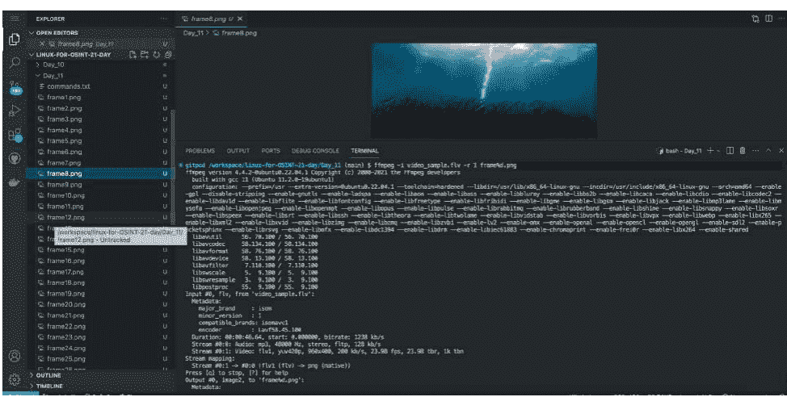

现在让我们尝试将视频转换为一组 png 格式的帧：

```
cd Day 11 
ffmpeg -i video_sample.flv -r 1 frame%d.png
```

逐帧查看视频可以让你快速了解视频的内容，并突出显示其中的关键片段。这是一个简单但非常节省时间的技巧。注意，如果你在 Gitpod 中右键点击文件或文件夹，可以从工作区下载它们。

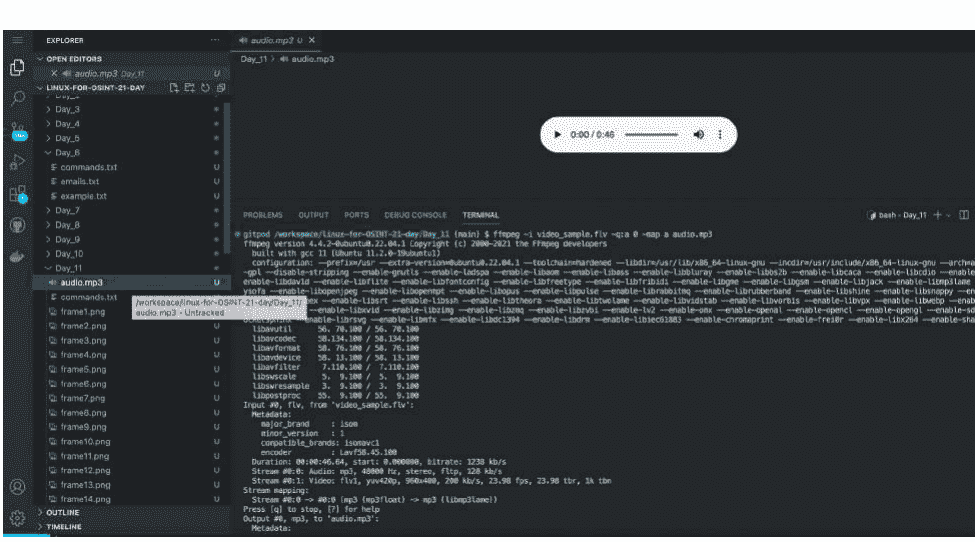

让我们尝试用另一个简单的命令从视频中提取音频。你可以在离开 Gitpod 的情况下收听结果。

```
ffmpeg -i video_sample.flv -q:a 0 -map a audio.mp3
```

正如你所猜的，需要从视频中提取音频才能将其转换为文本。这将帮助你快速分析并找到关键的语义部分。

## 转录音频

`PocketSphinx` (https://github.com/cmusphinx/pocketsphinx) 是一个非常语音识别器。

```bash
$ gitpod /workspace/linux-os-DSINT-21-day/Day_11 (main) sudo apt install pocketsphinx pocketsphinx-en-us

Reading package lists... Done

Building dependency index... Done

Reading state information... Done

Setting pocketsphinx to the latest version (0.8.0+real1pha+1-14ubuntu)

pocketsphinx-en-us set to be manually installed.

The following NEW packages will be installed:

0 1 newly installed, 0 to remove and 87 not upgraded.

0 upgraded, 1 newly installed failed.

After this operation, 140 KB of additional disk space will be used.

Do you want to continue? [Y/n] Y

Building dependency tree [1/1]

Fetched 72.6 KB in 0 s [111 KB/s]

Decrypting package information, since apt is not installed

Selecting previously installed packages

Reading database ... 30684 files and currently installed.

Preparing archives pocketsphinx (0.8.0+real1pha+1-14ubuntu_amd64.deb)

Unpacking pocketsphinx (0.8.0+real1pha+1-14ubuntu)

Setting pocketsphinx (0.8.0+real1pha+1-14ubuntu)

Processing triggers for man-db (2.10.2-1)

gitpod /workspace/linux-os-DSINT-21-day/Day_11 (main) $
```

让我们安装：

```bash
## sudo apt install pocketsphinx pocketsphinx-en-us
```

如果你处理其他语言的音频录制，可以轻松地获得高质量的结果。但不遗憾的是，完整的列表可以在这里找到。

`PocketSphinx` 是一个易于使用的工具，可以产生高质量的结果。但它不支持音频文件格式，只支持 16000 Hz 的 wav 格式。

```bash
# /workspace/linux-os-DSINT-21-day/Day_11 ~ $ sphinx-f -i test_spec_wav -o test_spec_16000.wav

## sphinx-f -i test_spec_wav -o test_spec_16000.wav
```


## Generating Python Documentation

Built with `Python 3.10.12` (main, Nov 20 2023, 15:14:05) [GCC 12.3.0] on Linux
Using `Sphinx 5.3.3` - 2023.12.06

```
[info] reading conf.py...
[info] extensions: ['sphinx.ext.autodoc', 'sphinx.ext.extpages', 'sphinx.ext.-ext', 'sphinx.ext-ext', 'sphinx.ext-sphinx.ext-todo', 'sphinx.ext-sphinx.ext-github', 'sphinx-ext-sphinx.ext-todo']
[info] configoc:-sphinx-ext-libsphinx-ext-pages-sphinx-ext-libsphinx-ext-sphinx-ext-libsphinx-ext-link-sphinx-ext-libsphinx-ext-link-ext-ext-ext-ext-sphinx-ext-libsphinx-ext-link-ext-ext-ext-ext-sphinx-ext-libsphinx-ext-link-ext-ext-ext-ext-sphinx-ext-libsphinx-ext-link-ext-ext-ext-ext-sphinx-ext-libsphinx-ext-link-ext-ext-ext-ext-sphinx-ext-libsphinx-ext-link-ext-ext-ext-ext-sphinx-ext-libsphinx-ext-link-ext-ext-ext-ext-sphinx-ext-libsphinx-ext-link-ext-ext-ext-ext-sphinx-ext-libsphinx-ext-link-ext-ext-ext-ext-sphinx-ext-libsphinx-ext-link-ext-ext-ext-ext-sphinx-ext-libsphinx-ext-link-ext-ext-ext-ext-sphinx-ext-libsphinx-ext-link-ext-ext-ext-ext-sphinx-ext-libsphinx-ext-link-ext-ext-ext-ext-sphinx-ext-extphinx-ext-link-ext-ext-ext-ext-sphinx-ext-libsphinx-ext-link-ext-ext-ext-ext-sphinx-ext-extphinx-ext-link-ext-ext-ext-ext-sphinx-ext-extphinx-ext-link-ext-ext-ext-ext-sphinx-ext-extphinx-ext-link-ext-ext-ext-ext-sphinx-ext-
phext-ext-link-ext-ext-ext-ext-sphinx-ext-
phinx-ext-link-ext-ext-ext-ext-sphinx-ext-
ph
-ext-link-ext-ext-ext-ext-sphinx-ext-
phinx-ext-link-ext-ext-ext-ext-sphinx-ext-
phinx-ext-link-ext-ext-ext-ext-sphinx-ext-
phinx-ext-link-ext-ext-ext-ext-sphinx-ext-
phinx-ext-link-ext-ext-ext-ext-sphinx-ext-
phinx-ext-link-ext-ext-ext-ext-sphinx-ext-
phinx-ext-link-ext-ext-ext-ext-sphinx-ext-
phinx-ext-link-ext-ext-ext-ext-sphinx-ext-
phinx-ext-link-ext-ext-ext-ext-sphinx-ext-
phinx-ext-link-ext-ext-ext-ext-sphinx-ext-
phinx-ext-link-ext-ext-ext-ext-sphinx-ext-
phinx-ext-link-ext-ext-ext-ext-sphinx-ext-
phinx-ext-link-ext-ext-ext-ext-sphinx-ext-
phinx-ext-link-ext-ext-ext-ext-sphinx-ext-
phinx-ext-link-ext-ext-ext-ext-sphinx-ext-
phinx-ext-link-ext-ext-ext-ext-sphinx-ext-
phinx-ext-link-ext-ext-ext-ext-sphinx-ext-
phinx-ext-ext-ext
```

幸运的是，大多数音频格式都可以通过 `ffmpeg` 轻松转换。例如：

```bash
ffmpeg -i test_speech.wav -ar 16000 -ac 1 test_speech.wav
```

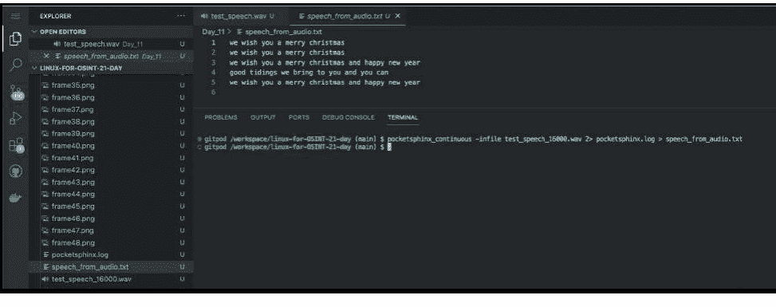

现在尝试将音频转换为文本：如果你需要不同语言的高质量语音识别，建议你查看 OpenAI Whisper (<https://openai.com/research/whisper>)。这是一个付费工具，但它非常好。

## 从图像中提取文本

Tesseract OCR (<https://github.com/tesseract-ocr/tesseract>) 是一个简单的光学识别工具。

```bash
$ gitpod /workspace/linux-os-DSINT-21-day/Day_1 (main) sudo apt install tesseract-ocr

Reading package lists... Done

Building dependency tree... Done

Reading state information... Done

The following NEW packages will be installed:

libesseract3 libgif7 libjpeg5 tesseract-ocr tesseract-osd

Suggested packages:

tesseractdata

The following NEW packages will be installed:

libesseract3 libgif7 libjpeg5 tesseract-ocr tesseract-osd

upgraded, 7 packages installed, 0 to remove and 20 not upgraded.

Need to get 7684 KB of additional disk space will be used.

Do you want to continue? [Y/n]

Get:1 http://archive.ubuntu.com/ubuntu jammy/amd64/libesseract3_3.6.0-ubuntu1 [360 KB]

Get:2 http://archive.ubuntu.com/ubuntu jammy/amd64/libgif7_1.5.9-2ubuild2 [330.8 KB]

Get:3 http://archive.ubuntu.com/ubuntu universe/amd64/libjpeg5_2_0.2-ubuntuild1 [1380 KB]

Get:4 http://archive.ubuntu.com/ubuntu universe/amd64/tesseract-ocr_4.1.1-2ubuntu0.4+77274cfa-1 [1593 KB]

Get:5 http://archive.ubuntu.com/ubuntu universe/amd64/tesseract-ocr-osd_4.1.1-2ubuntu0.4+77274cfa [2990 KB]

Fetched 7684 KB in 1 s (7.7 MB/s)

Setting up apt archive keyring, since apt-utils is not installed

Selecting previously unselected package libesseract3

Reading dependency lists... Done
```


Building dependency tree... Done

Reading state information... Done

The following NEW packages will be installed:

`libesseract3` (3.6.0-ubuntu1)amd64

Unpacking `libesseract3` (3.6.0-ubuntu1)...

Setting up `libesseract3` (3.6.0-ubuntu1)amd64.

Selecting previously unselected package `libgif7`

Unpacking `libgif7` (1.5.9-2ubuild2)amd64..

Setting up `libgif7` (1.5.9-2ubuild2)amd64.

Selecting previously unselected package `libjpeg5`

Unpacking `libjpeg5` (2_0.2-ubuntuild1)...amd64..

Setting up `libjpeg5` (2_0.2-ubuntuild1)amd64.

Selecting previously unselected package `tesseract-ocr`

Unpacking `tesseract-ocr` (4.1.1-2ubuntu0.4+77274cfa-1)amd64..

Setting up `tesseract-ocr` (4.1.1-2ubuntu0.4+77274cfa)amd64.

Selecting previously unselected package `tesseract-ocr-osd`

Unpacking `tesseract-ocr-osd` (4.1.1-2ubuntu0.4+77274cfa)amd64..

Setting up `tesseract-ocr-osd` (4.1.1-2ubuntu0.4+77274cfa)amd64.

```bash
gitpod /workspace/linux-for-OSINT-21-day/day_21 (main)$ cd day_21

gitpod /workspace/linux-for-OSINT-21-day/day_21 (main)$ tesseract text.png text.txt

T Open Source OCR Engine v4.1.1 with Leptonica

gitpod /workspace/linux-for-OSINT-21-day/day_21 (main)$ cat text.txt

我们在在这个命令中使用了其他几个标记：

-u 使用扩展正则表达式语法。

-s 仅显示匹配的行部分（而不是所有行）。

-r 搜索当前目录下的所有文件以及子目录中的所有文件。
```

## `tesseract text.png text.txt`

当我们将视频、音频和图片转换为文本后，就可以对其进行翻译了！这是自动化这一过程许多方法之一。

## 翻译文本

Translate Shell (https://github.com/soimort/translate-shell) 是一个基于 Google Translate、Bing Translator、Yandex.Translate 和其他翻译服务的命令行翻译器。

让我们安装它：

```bash
$ gitpad ~/workspace/linux-ubuntu-20.04-main$ sudo apt install translate-shell

Reading packages...

Building dependency tree... Done

The following additional packages will be installed

shell-common libicu66 libicu66-dev-x86-64 libribbi-bin-iconv-perl rwrap getutils-base debi64

shell-common libicu66 libicu66-dev-x86-64 libribbi-bin-iconv-perl rwrap getutils-base debi64

libribbi-bin-iconv-perl rwrap\ translate-shell

12 packages will be installed, 0 newly installed, 0 upgraded, 0 not to remove.

You want to continue? [Y/n] y

Setting up architecture... done

The following packages will be installed:

  * libicu66 (66.1-2ubuntu2) [47.0 KB]

  * libicu66-dev-x86-64 (66.1-2ubuntu2) [33.2 MB]

  * libribbi-bin-iconv-perl (1.0.1-1) [132.5 KB]

  * rwrap (0.1.1-1) [123.5 KB]

  * getutils-base (6.1-2ubuntu2) [88.5 KB]

  * translate-shell (1.7.0-1) [25.0 KB]

6 new packages will be installed, 33.7 MB of additional disk space will be used.

After this operation, 1248.5 MB less will be available.

Do you want to continue? [Y/n] y

Reading package information... Done

Building dependency tree... Done

Reading package lists... Done

Fetching metadata: 1.2 MB in 1 s

Get: 1/6 http://archive.ubuntu.com/ubuntu focal/main/amd64/libicu66_66.1-2ubuntu2_amd64.deb [47.0 KB]

Get: 2/6 http://archive.ubuntu.com/ubuntu focal/main/amd64/libicu66-dev-x86-64_66.1-2ubuntu2_amd64.deb [33.2 MB]

Get: 3/6 http://archive.ubuntu.com/ubuntu focal/main/libribbi-bin-iconv-perl_1.0.1-1_all.deb [132.5 KB]

Get: 4/6 http://archive.ubuntu.com/ubuntu focal/main/amd64/rwrap_0.1.1-1_amd64.deb [123.5 KB]

Get: 5/6 http://archive.ubuntu.com/ubuntu focal/main/amd64/getutils-base_6.1-2ubuntu2_amd64.deb [88.5 KB]

Get: 6/6 http://archive.ubuntu.com/ubuntu focal/main/amd64/translate-shell_1.7.0-1_amd64.deb [25.0 KB]

Fetched 33.7 MB in 6 files, 1s (33.7 MB/s)

Selecting previously installed packages

Selecting previously unselected packages:

  libicu66_66.1-2ubuntu2_amd64.deb

  libicu66-dev-x86-64_66.1-2ubuntu2_amd64.deb

  libribbi-bin-iconv-perl_1.0.1-1_all.deb

  rwrap_0.1.1-1_amd64.deb

  getutils-base_6.1-2ubuntu2_amd64.deb

  translate-shell_1.7.0-1_amd64.deb

Unpacking libribbi-bin-iconv-perl (1.0.1-1)...

Preparing unpack...

Unpacking 1/6 libicu66 (66.1-2ubuntu2) ...

Preparing unpack...

Unpacking 2/6 libicu66-dev-x86-64 (66.1-2ubuntu2) ...

Preparing unpack...

Unpacking 3/6 libribbi-bin-iconv-perl (1.0.1-1) ...

Preparing unpack...

Unpacking 4/6 rwrap (0.1.1-1) ...
```


Preparing unpack...

Unpacking 5/6 `getutils-base` (66.1-2ubuntu2) ...

Preparing unpack...

Unpacking 6/6 `translate-shell` (1.7.0-1) ...

Setting up...

Generating trigger files...

Processing triggers...

## sudo install-shell

关于不同语言的翻译代码可以在此页面找到：https://github.com/soimort/translate-shell。

今天，我们探索了去年自动化媒体分析的最易用命令行工具。如果你必须独立完成，我建议学习更多关于 AI 识别的工具。

# 第12 天

有时我们需要处理数百份文档，其中一个可能包含重要信息。因此，尝试自动化 PDF 分析是值得的。

```bash
$ @workspace/linux-for-OSINT-21-day$ pip install ocrmympdf
Downloading ocrmympdf-15.4.4-py39-none-any.whl (metadata 18 KB)
Downloading Pillow-9.0.0-py39-none-any.whl (metadata 618 KB)
Downloading tesseract-5.3.1-py39-manylinux_x86_64.whl (metadata 9.5 KB)
Downloading ocrmympdf-2.0.1 (from ocrmympdf)
Downloading Pillow-9.0.0-py39-none-any.whl (metadata 11 KB)
Downloading tesseract-7.1.1 (from ocrmympdf)
Collecting ocrmympdf-15.4.4-py39-none-any.whl [168.2 KB] (2.5 MB/s 00:00)
Preparing metadata ... done
Requirement already satisfied: package-info /home/gitpod/pyenv/versions/3.12.0/lib/python3.12/site-packages (from ocrmympdf)
Collecting pillow-13.0.0 (from ocrmympdf)
Collecting tesseract-7.1.1 (from ocrmympdf)
Downloading reportlab-3.6 (metadata 5 KB)
Collecting reportlab-3.6 (metadata 4 KB)
Requirement already satisfied: redis-3.5.13 /home/gitpod/pyenv/versions/3.12.0/lib/python3.12/site-packages (from ocrmympdf) (13.6 MB)
Collecting venv-3.0 (from ocrmympdf)
Requirement already satisfied: graphviz-2.0.8 /home/gitpod/pyenv/versions/3.12.0/lib/python3.12/site-packages (from ocrmympdf) (3.8 MB)
Requirement already satisfied: pyyaml-6.0.1 /home/gitpod/pyenv/versions/3.12.0/lib/python3.12/site-packages (from ocrmympdf) (0.0)
Collecting lxml-4.9.3 (from ocrmympdf)
Downloading lxml-4.9.3-cp32-manylinux_2_x86_64.whl (metadata 3.8 KB)
Collecting charset-5.2.0-none-any.whl (metadata 3.4 KB)
Requirement already satisfied: markdown-it-py==2.0.0 /home/gitpod/pyenv/versions/3.12.0/lib/python3.12/site-packages (from ocrmympdf) (0.0)
Requirement already satisfied: pytest-7.4.0 /home/gitpod/pyenv/versions/3.12.0/lib/python3.12/site-packages (from ocrmympdf) (0.0)
```

`OCRmy` (https://github.com/ocrmympdf/ocrmympdf) - 用于向扫描 PDF 文件添加光学字符识别（OCR）文本的工具。它使文本可搜索和可处理。

让我们安装：

```bash
pip install ocrmympdf
```

```bash
$ git pull ~/workspace/linux-ocr-for-OSINT-21-day/Day_12 (main)
sudo apt update
sudo apt install tesseract-ocr
Get: 2/6 https://download.docker.com/ubuntu/ubuntu jammy InRelease [48.0 KB]
Get: 2/6 https://download.docker.com/ubuntu/ubuntu jammy/stable/amd64 Packages [26.8 KB]
Get: 4/6 https://security.ubuntu.com/ubuntu jammy-security InRelease [110 KB]
Hit: 5 https://archive.ubuntu.com/ubuntu jammy InRelease
Get: 7/6 https://archive.ubuntu.com/ubuntu jammy-updates InRelease [23.8 KB]
Get: 7/6 https://ppa.launchpad.net/ondre/apache/ubuntu jammy InRelease [21.0 KB]
Get: 7/6 https://ppa.launchpad.net/ondre/apache/ubuntu/main_Packages [1,062 KB]
Get: 9/6 https://ppa.launchpad.net/ondre/php/ubuntu jammy InRelease [23.9 KB]
Get: 10/6 https://archive.ubuntu.com/ubuntu jammy-updates InRelease [119 KB]
Get: 10/6 https://archive.ubuntu.com/ubuntu jammy-updates/main/amd64 Packages [2,956 B]
Get: 12/6 https://ppa.launchpad.net/ondre/apache/ubuntu jammy/main amd64 Packages [3,956 B]
```

让我们运行：

```
cd Day 12
ocrymypdf pdf for ocr.pdf result.pdf
```

如果发生这种情况，说明我挑选了一个已经带有文本层的不太理想的 PDF。因此使用 `--force-ocr` 标记来创建另一个层。

```
ocrymypdf --force-ocr pdf for ocr.pdf result.pdf
```

该命令的执行可能需要一些时间，取决于文档的页数。

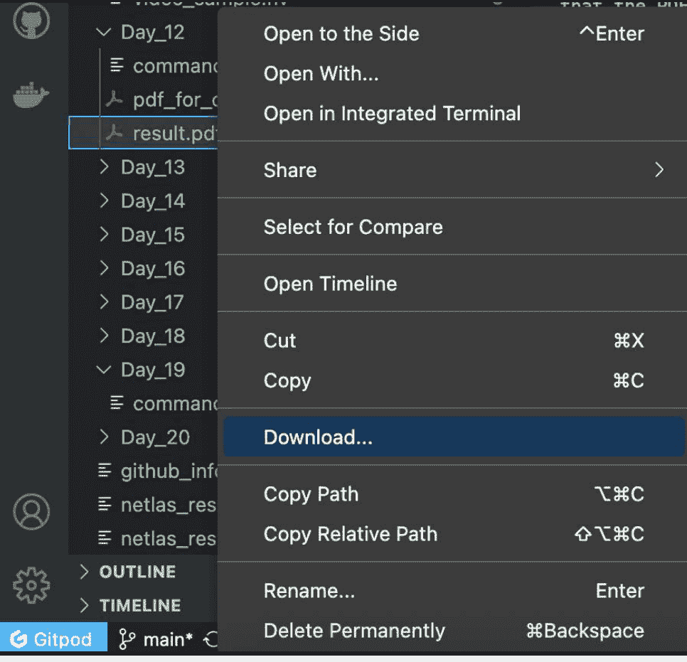

如果你使用 Gitpod，你需要将 PDF 文档下载到电脑上进行查看。右键点击并选择“下载”。

84

## 在 AAO-HNSF 患者分单中添加您的 Logo 和地址的说明

在 AAO-HNSF 患者分单上进行联合品牌只需 1-2-3 步，非常简单！

### 1 下载并保存患者分单

- 下载分单

你需要安装 Adobe Acrobat Reader。

你可以在此处免费安装：`get.adobe.com/reader`

- 将其保存到你的电脑

记住你保存在哪里；在接下来的步骤中你需要访问它。

### 2 上传你的 Logo 和地址

你的图像必须保存为 `.pdf` 文件！

- 有关如何将你的 Logo/地址保存为 `.pdf` 文件的更多信息，请参阅下文说明。

- 如果文件未以 `.pdf` 格式保存，将无法将个人信息上传到患者分单中。

- 打开已保存的分单文档

- 点击页面底部的空白区域

- 在选择图标（Select Icon）窗口中，

- 浏览到你想要插入的 pdf 文件，然后点击确定

- Logo/以及地址文件将根据文本适当调整大小。


- 在白色图像字段下方的蓝色矩形中输入你的网址。

### 3 你已准备好打印了！

- 保存你的文件。

确保在关闭文档之前保存文件，以确保下次打开文档时，你的 Logo 或地址会那里。

- 你现在已准备好打印了！


查看文件时，文本应该是可以选择、复制和粘贴的。

现在让我们尝试从 PDF 文件中提取文本并将其保存到单独的文件。我们将使用 `pdftotext` 命令，它是 `poppler-utils`（https://popper.js.org/docs/v2/utils/）的一部分。

# 从 PDF 提取文本

```
Get27 http://archive.ubuntu.com/jammy-backports/universe/amd64 Packages [28.1 KB]
Get25 http://packagecloud.io/github/lfs/ubuntu-jammy-amd64 Packages [1,654 B]
Get28 http://apt.ln.org/jammy-ltb-colchain-jammy-17 Inleases [6,823 B]
Fetched 5.9 MB in 3 s (2.0 MB/s)
Reading dependency tree ...
Building dependency tree ...
Reading information...
85 packages can be upgraded. Run 'apt list --upgradable' to see them.
sudo apt install linux-for-OSINT-21-day (main) sudo apt-get install poppler-utils --fix-missing
Reading dependency tree ...
Building dependency tree ...
Reading information...
The following additional packages will be installed:
libpopper18
libpopper18-utils
0 upgraded, 0 newly remove, 85 not upgraded.
After this operation, 1.2 KB of additional disk space will be used.
Need to get of archives.
Do you want to continue? [Y/n]
Get1 http://archive.ubuntu.com/jammy-updates/main/libpopper18-amd64 22.02.0-ubuntu0.3 [1,072 KB]
Get2 http://archive.ubuntu.com/jammy-updates/main/libpopper18-utils-amd64 22.02.0-ubuntu0.3 [186 KB]
Fetched 1.25 KB in 1 s (1,533 KB/s)
Setting up configuration, since apt-utils is not installed
Selecting previously unselected package poppler18:amd64
(Metadata for libpopper18:amd64 22.02.0-ubuntu0.3 is already installed.)
Preparing to unpack...
libpopper18:amd64 (22.02.0-ubuntu0.3)...
Unpacking libpopper18:amd64 (22.02.0.ubuntu0.3).
Setting up libpopper18:amd64 (22.02.0-ubuntu0.3)...
Setting up poppler-utils (22.02.0-ubuntu0.3).
Processing triggers for libc-bin (2.35-ubuntu0.3)...
```

首先，让我们安装 `poppler-utils`：

```
sudo apt clean
sudo apt autoclean
sudo apt update
sudo apt-get install poppler-utils --fix-missing
```

## pdftotext result.txt

你现在可以回到第 6 天和第 7 天使用那里描述的命令来处理提取的文本。某些情况下，直接使用 `grep` 在 PDF 中更方便。

## 从 PDF 提取图像

此外，`poppler-utils` 允许你从文档中提取图像。

```
sudo apt update
sudo apt-get install poppler-utils --fix-missing
Reading dependency tree ...
Building dependency tree ...
Reading information...
The following additional packages will be installed:
libpopper18
libpopper18-utils
0 upgraded, 0 newly remove, 85 not upgraded.
After this operation, 1.2 KB of additional disk space will be used.
Need to get of archives.
Do you want to continue? [Y/n]
Get1 http://archive.ubuntu.com/jammy-updates/main/libpopper18-amd64 22.02.0-ubuntu0.3 [1,072 KB]
Get2 http://archive.ubuntu.com/jammy-updates/main/libpopper18-utils-amd64 22.02.0-ubuntu0.3 [186 KB]
Fetched 1.25 KB in 1 s (1,533 KB/s)
Setting up configuration, since apt-utils is not installed
Selecting previously unselected package poppler18:amd64
(Metadata for libpopper18:amd64 22.02.0-ubuntu0.3 is already installed.)
Preparing to unpack...
libpopper18:amd64 (22.02.0-ubuntu0.3)...
Unpacking libpopper18:amd64 (22.02.0-ubuntu0.3).
Setting up libpopper18:amd64 (22.02.0-ubuntu0.3)...
Setting up poppler-utils (22.02.0-ubuntu0.3).
Processing triggers for libc-bin (2.35-ubuntu0.3)...
```

你现在可以回到第 6 天和第 7 天使用那里描述的命令来处理提取的文本。某些情况下，直接使用 `grep` 在 PDF 中更方便。让我们尝试从 PDF 文件中提取文本并将其保存到单独的文件。我们将使用 `pdftotext` 命令，它是 `poppler-utils`（https://popper.js.org/docs/v2/utils/）的一部分。

# 从 PDF 提取文本


```
Get27 http://archive.ubuntu.com/jammy-backports/universe/amd64 Packages [28.1 KB]
Get25 http://packagecloud.io/github/lfs/ubuntu-jammy-amd64 Packages [1,654 B]
Get28 http://apt.ln.org/jammy-ltb-colchain-jammy-17 Inleases [6,823 B]
Fetched 5.9 MB in 3 s (2.0 MB/s)
Reading dependency tree ...
Building dependency tree ...
Reading information...
85 packages can be upgraded. Run 'apt list --upgradable' to see them.
sudo apt install linux-for-OSINT-21-day (main) sudo apt-get install poppler-utils --fix-missing
Reading dependency tree ...
Building dependency tree ...
Reading information...
The following additional packages will be installed:
libpopper18
libpopper18-utils
0 upgraded, 0 newly remove, 85 not upgraded.
After this operation, 1.2 KB of additional disk space will be used.
Need to get of archives.
Do you want to continue? [Y/n]
Get1 http://archive.ubuntu.com/jammy-updates/main/libpopper18-amd64 22.02.0-ubuntu0.3 [1,072 KB]
Get2 http://archive.ubuntu.com/jammy-updates/main/libpopper18-utils-amd64 22.02.0-ubuntu0.3 [186 KB]
Fetched 1.25 KB in 1 s (1,533 KB/s)
Setting up configuration, since apt-utils is not installed
Selecting previously unselected package poppler18:amd64
(Metadata for libpopper18:amd64 22.02.0-ubuntu0.3 is already installed.)
Preparing to unpack...
libpopper18:amd64 (22.02.0-ubuntu0.3)...
Unpacking libpopper18:amd64 (22.02.0-ubuntu0.3).
Setting up libpopper18:amd64 (22.02.0-ubuntu0.3)...
Setting up poppler-utils (22.02.0-ubuntu0.3).
Processing triggers for libc-bin (2.35-ubuntu0.3)...
```

首先，让我们安装 `poppler-utils`：

```
sudo apt clean
sudo apt autoclean
sudo apt update
sudo apt-get install poppler-utils --fix-missing
```

## `pdftotext result.txt`

你现在可以回到第 6 天和第 7 天使用那里描述的命令来处理提取的文本。某些情况下，直接使用 `grep` 在 PDF 中更方便。

## 从 PDF 提取图像

此外，`poppler-utils` 允许你从文档中提取图像。

```
$ sudo apt update
sudo apt-get install poppler-utils --fix-missing
Reading dependency tree ...
Building dependency tree ...
Reading information...
The following additional packages will be installed:
libpopper18
libpopper18-utils
0 upgraded, 0 newly remove, 85 not upgraded.
After this operation, 1.2 KB of additional disk space will be used.
Need to get of archives.
Do you want to continue? [Y/n]
Get1 http://archive.ubuntu.com/jammy-updates/main/libpopper18-amd64 22.02.0-ubuntu0.3 [1,072 KB]
Get2 http://archive.ubuntu.com/jammy-updates/main/libpopper18-utils-amd64 22.02.0-ubuntu0.3 [186 KB]
Fetched 1.25 KB in 1 s (1,533 KB/s)
Setting up configuration, since apt-utils is not installed
Selecting previously unselected package poppler18:amd64
(Metadata for libpopper18:amd64 22.02.0-ubuntu0.3 is already installed.)
Preparing to unpack...
libpopper18:amd64 (22.02.0-ubuntu0.3)...
Unpacking libpopper18:amd64 (22.02.0-ubuntu0.3).
Setting up libpopper18:amd64 (22.02.0-ubuntu0.3)...
Setting up poppler-utils (22.02.0-ubuntu0.3).
Processing triggers for libc-bin (2.35-ubuntu0.3)...
```

你现在可以回到第 6 天和第 7 天使用那里描述的命令来处理提取的文本。某些情况下，直接使用 `grep` 在 PDF 中更方便。让我们尝试从 PDF 文件中提取文本并将其保存到单独的文件。我们将使用 `pdftotext` 命令，它是 `poppler-utils`（https://popper.js.org/docs/v2/utils/）的一部分。

# 从 PDF 提取文本

```
$ sudo apt update
sudo apt-get install poppler-utils --fix-missing
Reading dependency tree ...
Building dependency tree ...
Reading information...
...
```

此外，`poppler-utils` 允许你从 PDF 中提取图像。让我们尝试：

$ apt update 

``` 某些情况下，直接使用 `grep` 在 PDF 中更方便。让我们尝试：

```

$ gitpod/workspace/linux-for-OSINT-21-day (main) exiftool Day_12/result.pdf

ExifTool Version : 12.40

File Name : result.pdf

Directory : Day_12

File Size : 1112 Kib

File Modification/Time : 2023-12-17 13:10:51

File Access/Time : 2023-12-17 17:31:59

File Change/Time : 2023-12-17 17:31:59

File Permissions : -rw-r--

File Type : PDF

File Extension : pdf

MIME Type : application/pdf

PDF Version : 1.7

Linearized : Yes

Author : 

Create Date : 2023-12-17 11:43:55

Modify Date : 2023-12-17 13:10:49

Language : en

MP Toolkit : 2.9-3, framework 1.6

Producer : pikeepdf 8.10

Creator Tool : ocrmymdf 15.4 / Tesseract OCR 4.1


Document ID : `uuid:f4a1f26e-d7a4-11f9-b000-457653ffad`

Format : `application/pdf`

Part : `2`

Conformance : `B`

Creator : 

Metadata Date : `2023-12-17 13:10:49.574827+00`

Page Count : `1`

```
如果你只需要某些元数据字段，可以使用其他 Linux 工具（如 `grep`）进行过滤：
```

```
$ gitpod/workspace/linux-for-OSINT-21-day (main) exiftool Day_12/result.pdf | grep ^Producer

Producer : pikeepdf 8.10

gitpod/workspace/linux-for-OSINT-21-day (main) $
```

## 输出端口 调试 控制台 终端

```
$ gitop/workspace/linux-for-DS99INT-23-day (main) $ libreoffice -h

LibreOffice 7.2.2

用法: [参数 ...]

参数 -- 开关，切换参数和文档 URI [文件名)。

在不带特殊参数的情况下使用：

打开启动中心；如果在不带任何参数的情况下使用。

尝试在适合它们的组件（文件）中打开文件（文件）。

(file) macro://Library.MacroName

打开文件并运行该文件中的宏。

获取帮助和信息：

--help | 显示此帮助和指南。

--helpwriter 在 Writer 上打开内置的在线帮助。

--helpcalc 在 Calc 上打开内置的在线帮助。

--helpdraw 在 Draw 上打开内置的在线帮助。

--helpbase 在 Base 上打开内置的在线帮助。

--helpbasic 在 Base 脚本语言上打开内置的在线帮助。

--helpmath 在 Math 上打开内置的在线帮助。

--version 显示版本和相关事实。

--stempdirectory (MacOS 沙盒) 返回当前用户的临时目录。覆盖所有参数。

--quickstart(no) 激活快速启动服务。

--nolockcheck 禁用对使用同一个安装的远程实例的检查。

--filter 强制输入过滤器类型。例如：

--filtercat 强制 Office Open Wk

--filtertest (编码) URI，如果..
```

用于验证安装是否正确的帮助命令。你将喜欢此工具拥有的大量功能。

## `libreoffice -h`

| example.docx v | example.txt |
| 第 53 天 | 示例文档 |

此文档是使用标题、列表、图像替代文本、表格和列的可访问性技术创建的。它应该是可访问的。

### 标题
本文档中有八个章节标题。在开头，“示例文档”是一个 1 级标题。主要章节标题，如“标题...

### 列表
本文档章节的后续大纲是一个包含六个项目的有序（编号的）列表。第五个项目“表格”包含一个嵌套的有序列表：
1. 标题
2. 列表

```
问题 历史 端口 调试 控制台 终端 +
$ gitop/workspace/linux-for-DS99INT-23-day (main) $ 第 53 天

$ gitop/workspace/linux-for-DS99INT-23-day/example.txt $ libreoffice --convert to example.docx

convert /gitop/workspace/linux-for-DS99INT-23-day/example.txt --using filter : Text

deiving: /gitop/workspace/linux-for-DS99INT-23-day/example.txt

$ gitop/workspace/linux-for-DS99INT-23-day (main) $ example.txt
```

现在将 doc 文件转换为 txt 文件：

## `libreoffice --headless --convert-to txt example.docx`

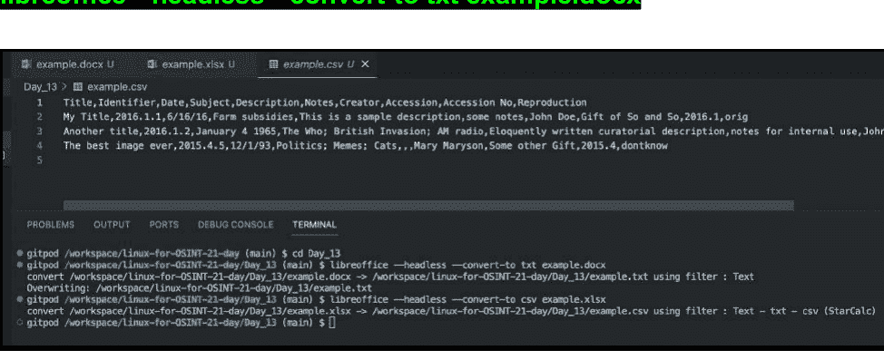

## `libreoffice --headless --convert-to csv example.xlsx`

LibreOffice 包含了用于处理各种文件格式的应用程序。例如：

- swf, gif
- bmp, jpeg, png, tigg
- svg
- zml, html
- epub, fb2
- wks, wps, wdb
- vsd

通过这些文件格式，大多数可以使用命令行进行自动化。此外，正如微软允许你使用 VBA 或 JavaScript 自动化文档一样，LibreOffice 允许你在 LibreOffice 中创建模板（Basic 以及 Python）。

你可以在这里阅读更多信息：

- LibreOffice Basic 编程指南 (`https://wiki.documentfoundation.org/Documentation/BASIC_Guide`)
- LibreOffice Python 设计指南 (`https://wiki.documentfoundation.org/Documentation/Python_Design_Guide`)

你可以在这里阅读更多信息：

- LibreOffice Basic 编程指南 (`https://wiki.documentfoundation.org/Documentation/BASIC_Guide`)
- LibreOffice Python 设计指南 (`https://wiki.documentfoundation.org/Documentation/Python_Design_Guide`)

关于这里，你可以阅读更多信息。此文档是使用标题、列表、图像替代文本、表格和列的可访问性技术创建的。它应该是可访问的。

# 输出端口 调试 控制台 终端

```
$ gitpod /workspace/linux-for-OSINT-21-day/13 (main) jq -h

jq - 命令行 JSON 解析器 (版本 1.6)
```

```
用法: jq [options] jq filter [file...]

jq [options] --args jq filter [strings...]

jq [options] --jsonargs jq filter [JSON_TEXTS...]
```

`jq` 是一个用于处理 JSON 输入的工具，它将给定的过滤器应用于 JSON 输入，并将结果以 JSON 格式输出到标准输出。

最简单的过滤器是 `.`，它会将 jq 的输入原封不动地复制到输出（格式除外），但请注意内部使用 IEEE754 进行数值表示（这具有相应的影响）。

对于更高级的过滤器，请使用 `jq(i) map("jq")` 和/或 `https://github.io/jq/`

示例：

```
$ echo '{"foo": 0}' | jq

{ "foo": 0}
```

- 一些选项包括：
- 紧凑的缩进打印输出；
- 将 null 作为单个输入值；
- 在输出上设置状态码；
- 将输入读取（读取）到数组中；对其进行操作；
- 读取原始字符串，无 JSON 文本；
- 为 JSON 上色；
- 单色（不为 JSON 上色）；
- 输出时对对象的键排序；
- 使用制表符进行缩进
- 将变量 `$a` 设置为值 `<>`

```
-arg a v
```

让我们尝试提取第一个对象（键）的 `firstName`：

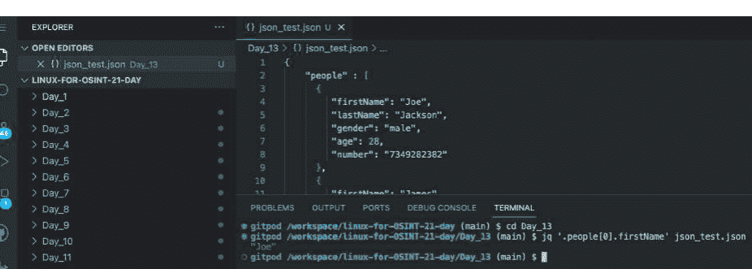

# `cd Day 14`
`jq '.people[0].firstName_json_test.json'`

现在让我们显示所有 "people 键" 的 `firstName` 值：

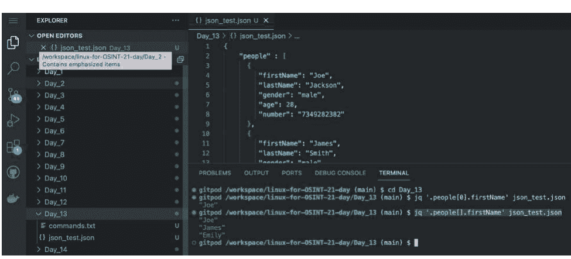

`jq '.people[1].firstName_json_test.json'`

同样，你可以访问所有键的任何属性的任何值。

JSONPath 在线评估 - `jsonpath.com`

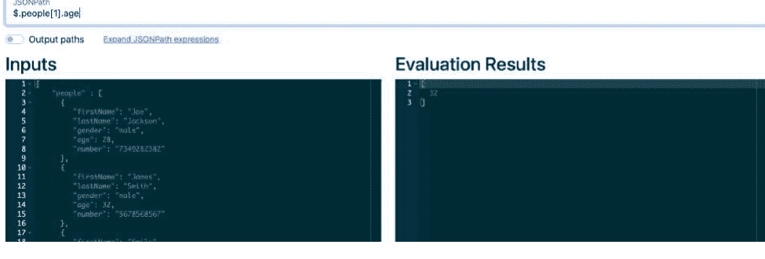

我们使用了一个结构非常简单的 JSON 文件作为示例，但在调查过程中，你很可能需要处理结构包含数十个不同层次的文件。可以使用特殊的在线服务，如 JSON Online Evaluator (`https://jsonpath.com`)。

## XML

```xml

xml_sample.xml

Day_14 xml_sample.xml

1 <CATALOG>


<div id="in-page-channel-node-id" data-channel-name="in_page_channel_l8gdhe">

<TITLE>Empire Bublesque</TITLE>

<ARTIST>Bob Dylan</ARTIST>

<COUNTRY>USA</COUNTRY>

<COMPANY>Columbia</COMPANY>

<PRICE>18.90</PRICE>

<YEAR>1985</YEAR>
</div

<TITLE>Hide your heart</TITLE>
<ARTIST>Bonnie Tyler</ARTIST>
<COUNTRY>UK</COUNTRY>
<COMPANY>CBS Records</COMPANY>
<PRICE>9.90</PRICE>
<YEAR>1988</YEAR>

<TITLE>Greatest Hits</TITLE>
<ARTIST>Dolly Parton</ARTIST>
<COUNTRY>USA</COUNTRY>
<COMPANY>RCA</COMPANY>
<PRICE>9,90</PRICE>
<YEAR>1982</YEAR>
```

XML（扩展标记语言）是一种类似于 HTML 的标记语言，但没有预定义的标签（用户可以定义自己的标签）。`XMLstarlet` (https://xml..net/doc/xmlstarlet-ug.html) 是一个从 XML 文件提取数据的跨平台工具。

让我们安装：

```
$ gitpod /workspace/linux-for-OSINT-21-day (main) sudo apt-get install xmlstarlet

Reading package lists...

Building dependency tree...

Reading state information...

将安装以下软件包：

xmlstarlet

0 个升级，1 个新，0 个移除。

将使用 265 KB 的磁盘空间。

Get:1 http://archive.ubuntu.com/ubuntu jammy/universe/xmlstarlet_1.6.1-2_amd64 [265 KB]

获取 265 KB，耗时 1 秒 (XXX KB)

由于 apt-utils 未安装，正在设置未选软件包 xmlstarlet。

正在读取数据库...已安装 3559 个文件和目录。）

解压 /usr/cache/archives/xmlstarlet_1.6.1-2_amd64 ...

解压 xmlstarlet (1.6-2) ...

设置 xmlstarlet (1.6-2) ...

处理 man-db (10.2) 的触发器...

$ gitpod /workspace/linux-for-OSINT-21-day (main) $

apt-get install xmllet
```

现在显示 `<title>` 标签的内容：

```
xmlstarlet sel -t -m "//TITLE" -n xml_sample.xml

<TITLE>Empire Bublesque</TITLE>

<TITLE>Hide your heart</TITLE>

<TITLE>Greatest Hits</TITLE>
```

## EXPLORER
- xml_sample.xml
- LINUX-FOR-OSINT-21-day
- Day_1
- Day_2
- Day_3
- Day_4
- Day_5
- Day_6
- Day_7
- Day_8
- Day_9
- Day_10
- Day_11
- Day_12
- commands.txt
- example.csv
- example.docx
- example.xlsx
- Day_14
- commands.txt
- example.csv
- example.pdf
- json_test.json
- xml_sample.xml
- Day_35
- Day_17
- Day_56
## TIMELINE
xml_sample.xml
Day_14

```
xmlstarlet sel -t -m "//TITLE" -v -n xml_sample.xml
```

## COUNTRY
发现元素：26
```xml

<XML id="in-page-channel-node-id" data-channel-name="in_page_channel_id">

<TITLE>Empire Bublesque</TITLE>

<BODY>Bob Dylan</BODY>

<COMPANY>Colombia</COMPANY>

<ID>950</ID>

<YEAR>1998</YEAR>

<TITLE>Wide your heart</TITLE>

</XML>
```
1. USA
2. UK
3. USA
4. UK
5. EU
6. UK
7. UK
8. US
9. EU
10. USA
11. EU
12. US
13. UK
14. US
15. Germany
为了查找 XML 文档中的路径数据，可以使用特殊服务如 XPath (http://xpath.com)。

## CSV
如果你错过了第 6 天和第 7 天，建议你回去看看。`Grep` 和 `Awk` 的知识足以高效地处理 CSV 文件。某些用户倾向于用 `CSVgrep` 替换 `grep` (https://csvkit.readthedocs.io/en/1.0.2/scripts/csvgrep.html)。它搜索特定列更方便一些。

让我们安装 `CSVKit` (https://csvkit.readthedocs.io/en/1.0.2/index.html):

```
$ gitpod@ubuntu-linux-host-02-27-23-may $ sudo apt-get install csvkit

Reading package lists...

Building dependency tree...

Reading state information...

将安装以下软件包：

python3-pip

python3-setuptools

python3-wheel

python3-apt-pkg-config

python3-six-python3-cryptodome

python3-cryptography

python3-mime-client

python3-dateutil-python3-pytz

python3-requests

python3-urllib3-python3-idna

python3-bacon3

python3-six-python3-requests-python3-setbuild-python3-pyyaml

python3-pygments

python3-tabulate-python3-six

110 个新软件包将安装，0 个升级，0 个移除。

执行此操作后，将使用 55.4 MB 的磁盘空间。

Get:1 http://archive.ubuntu.com/ubuntu/pool/main/p/python3/python3-pip_20.0.2-2ubuntu1_amd64 [2.2 MB]

Get:2 http://archive.ubuntu.com/ubuntu/pool/main/p/python3/python3-setuptools_39.2.0-2ubuntu1_amd64 [17 KB]

Get:3 http://archive.ubuntu.com/ubuntu/pool/main/p/python3/python3-wheel_0.36.2-2ubuntu1_amd64 [121 KB]

Get:4 http://archive.ubuntu.com/ubuntu/pool/main/p/python3/python3-apt-pkg-config_2.4.1-1ubuntu1_amd64 [115 KB]

Get:5 http://archive.ubuntu.com/ubuntu/pool/main/p/python3/python3-six_3.9.2-2ubuntu1_all [25 KB]

Get:6 http://archive.ubuntu.com/ubuntu/pool/main/p/python3/python3-requests_2.25.0-2ubuntu1_all [196 KB]

获取 265 KB，耗时 1 秒 (XXX KB)
```

# 资源管理器

打开的编辑器

```python
test_json_to_csv.py
```

```python
Day_14
import pandas as pd
```


`df = pd.read_json('test_json_to_csv.json', orient='records')`

`df.to_csv('test_json_to_csv.csv', index=False)`

```json
Day_14

1 {"name":"Thomas","male","age":28,"id":734982382}

2 {"name":"Jackson","male","age":32,"id":734982382}

3 {"name":"Emily","female","age":24,"id":56475675}
```

- Day_1
- Day_2
- Day_3
- Day_4
- Day_5
- Day_6
- Day_7
- Day_8
- Day_9
- Day_10
- Day_11
- Day_12
- Day_13
- Day_14

- `commands.txt`
- `data.csv`
- `example.csv`
- `output.csv`
- `test_json_to_csv.py`
- `work_archive.csv`

问题 输出 无注释 调试 控制台 终端

```bash
$ git pull /workspace/linux-for-OSINT-21-day/Day_14 (main)

$ git pull /workspace/linux-for-OSINT-21-day/Day_14 (main) | csvcut -k people test.json > test_json_to.csv

$ git pull /workspace/linux-for-OSINT-21-day/Day_14 (main)
```

`in2csv -k people json test.json > test_json_to.csv`

`Csvcut` (https://csvkit.readthedocs.io/en/latest/scripts/csvcut.html) 是用于过滤和截断 CSV 文件的工具。

```bash
cut cut_csv.csv -k U
```

```text
Day_14 cut

1 domain,part

2 codingutor,www.perfdension-wolfsgru.de,www.elite-general-albau.de,addavear,caus,domain,online,domnik-peter

3 codingutor,www.perfdension-wolfsgru.de,www.elite-general-albau.de,addavear,caus,domain,domnik-peter

4 "about-communications.com,www.alainegrado.de,medizinisches-versorgungszentrum,caus,stefanbach,wolfs-cave,de

5 "about-communications.com,www.alainegrado.de,medizinisches-versorgungszentrum,caus,stefanbach,wolfs-cave,de

6 "about-communications.com,www.alainegrado.de,medizinisches-versorgungszentrum,caus,stefanbach,wolfs-cave,de

7 patmx.tech,product_communication,netia-tablu.com,wolf-fishern,chip-com-project.de,dx-humanistic-perkeche

8 "dogoxibrouse,sexberts.com,armilla,whacksams.com,nordline,sexberts.com,gmail,linux-sexberts.com

9 "northberthshriesiroges.com,northberthshriesiroges.com,mailman.com,thebearlovers.com,mail.com,dumed.net,dumdu

10 "northberthshriesiroges.com,northberthshriesiroges.com,mailman.com,thebearlovers.com,mail.com,dumed.net,dumdu

11 "northberthshriesiroges.com,northberthshriesiroges.com,mailman.com,thebearlovers.com,mail.com,dumed.net,dumdu

12 "northberthshriesiroges.com,northberthshriesiroges.com,mailman.com,thebearlovers.com,mail.com,dumed.net,dumdu

13 "northberthshriesiroges.com,northberthshriesiroges.com,mailman.com,thebearlovers.com,mail.com,dumed.net,dumdu

14 "northberthshriesiroges.com,northberthshriesiroges.com,mailman.com,thebearlovers.com,mail.com,dumed.net,dumdu

15 "northberthshriesiroges.com,northberthshriesiroges.com,mailman.com,thebearlovers.com,mail.com,dumed.net,dumdu

16 "natesupweb.com.br,www.natesupweb.com.br"
```

问题 输出 端口 调试 控制台 终端

```bash
$ git pull /workspace/linux-for-OSINT-21-day/Day_14 (main)

$ git pull /workspace/linux-for-OSINT-21-day/Day_14 (main) | csvcut -k people example.csv > cut_csv.csv

$ git pull /workspace/linux-for-OSINT-21-day/Day_14 (main)
```

```bash
csvcut -c domain example.csv > cut_csv.csv
```

同样值得注意：
- `csvjoin` (https://csvkit.readthedocs.io/en/latest/scripts/csvjoin.html)
- `csvsort` (https://csvkit.readthedocs.io/en/latest/scripts/csvsort.html)
- `csvstat` (https://csvkit.readthedocs.io/en/latest/scripts/csvstat.html)。

当处理 XML 或 JSON 格式的数据时，建议你将其转换为 CSV。在许多情况下，在命令行中操作会更方便（如上所述，可以使用 `in2csv`）。

# 第15天：爬取 (Scraping)

爬取是从网页中自动提取数据的过程。如果你擅长使用几天提到的 `curl`、`grep` 和 `awk`，你已经在 Linux 上成功爬取网页。但值得探索更多工具以提高效率。

## Katana

首先，让我们学习制作网站所有页面的 URL 列表（或者说是从主页面链接到所有页面）。如果你有来自 ProjectDiscovery (https://github.com/projectdiscovery) 的优秀工具 Katana，这会非常简单。

```bash
go install github.com/projectdiscovery/katana/cmd/katana@latest
```

## katana

如果你想从整个域名列表收集 github 链接，请使用 `-list` 标志。这次让我们将结果保存到文件中，以便运行下一个命令时使用：

```bash
katana -list domains.txt > results.txt
```

## Nuclei

`Nuclei` (https://github.com/projectdiscovery/nuclei) 是 ProjectDiscovery 的另一个优秀工具。它主要用于扫描网站漏洞，但在从网页收集数据方面也做得出色。

```bash
go install -v github.com/projectdiscovery/nuclei/v3/cmd/nuclei@latest
```

克隆 Juicy templates（我们将在第19天详细讨论该命令）：

```bash
```


$ gitpod /workspace/linux-for-OSINT-21-day/Day_15 (main)

$ git clone https://github.com/cipher87/juicyinfo-nuclei-templates

正在克隆 'juicyinfo-nuclei-templates'...

remote: Enumerating objects: 100

remote: Counting objects: 100 (73%), done.

remote: Counting pack: 173 (100%), done.

remote: Total: 173 (delta 41), 8 (delta 0), pack 100

Receiving objects: 100 (173/173), 14.55 MB/s | done.

Resolving deltas: 100% (41/41), done.

$ gitpod /workspace/linux-for-OSINT-21-day/Day_15 (main)

$ git clone https://github.com/cipher87/juicyinfo-nuclei-templates

```
现在，让我们扫描通过 Katana 收集的所有链接，并从页面中提取包含 Github单词的链接（我们将使用 github 模板完成）：
```

```bash
nuclei -t juicyinfo-nuclei-templates/juicyinfo/github.yaml -l results.txt > extracted_github_links.txt
```

同样，你可以收集其他社交网络的链接、电话号码、IP 地址、加密货币钱包地址等（模板名称非常直观）。Nuclei 还允许你从 html 标签中提取信息。让我们收集相同页面的标题（`<title>` 标签）：

```bash
nuclei -t juicyinfo-nuclei-templates/juicyinfo/title.yaml -l results.txt > extracted_titles.txt
```

## 如果你想爬取其他标签而不是 `<title>` 标签怎么办？

```yaml
id: extract-titles
info:
  name: Extract titles
  author: cipher87
  severity: info
  description: Extract titles from web page
  tags: osint,scrap
requests:
  - method: GET
    path:
      - "{{BaseURL}}"
matches:
  - type: regex
    part: body
    regex:
      - '<title>.*'
extractors:
  - type: regex
    part: body
    regex:
      - '<title>.*'
```

## HTML2TEXT

Html2text (`https://alir3z.github.io/html2text/`) 是非常简单的 Python 脚本，可以清理网页的 html 标签并使其易于读取和自动化检索。

```bash
$ gitpod /workspace/linux-for-OSINT-21-day (main) $ apt-get install html2text
E: Could not open file /var/lib/dpkg/lock-frontend - open (13: Permission denied)
E: Unable to acquire the dpkg frontend lock (/var/lib/dpkg/lock-frontend) - are you root?
$ gitpod /workspace/linux-for-OSINT-21-day (main) $ apt-get install html2text
Reading package lists... Done
Building dependency tree...
Reading state information...
The following NEW packages will be installed:
html2text
0 upgraded, 1 newly installed, 0 to remove and 0 upgraded.
Need to get 84.2 KB.
After this operation, 297 KB of additional disk space will be used.
Fetching 84.2 KB from archive.ubuntu.com/ubuntu jammy
html2text 1.3.2a-28 [84.2 KB]
Fetched 84.2 KB in 0 s (287 KB/s)
dbconf: deactivating package configuration, since apt-utils is not installed
Selecting previously selected package information
Reading database... 35708 files and directories currently installed.
Preparing to unpack html2text_1.3.2a-28_amd64.deb ...
Unpacking html2text (1.3.2a-28):
Setting up html2text (1.3.2a-28)
Processing triggers for html2text (1.3.2a-28-1)
Done
$ gitpod /workspace/linux-for-OSINT-21-day (main) $ sudo apt-get install html2text
```

你可以使用第5天和第6天提到的 `curl` 和 `grep` 组合完成相同的事情，但当然，你可以为你的任务使用任何你想到的正则表达式。

打开 `title.yaml` 文件并简单将 `title` 替换为其他内容。如果你愿意，以上述方式运行 Nuclei。

@ gitpod/workspace/Linux-for-OSINT-21-day/Day_15 (main) $ html2text example.html

```
[./example_files/logo3.png]_Filesamples
分类
视频 音频 文档 图片 字体 电子书 代码
|
| 
*****示例 DOCX 文件 *****
DOCX Microsoft Word Open XML Format Document 文件 是一种常用的文字处理文件格式，由微软在 Microsoft Word 2007 及以上版本中创建，用于替代 DOC 文件。它使用 Open XML 标记语言。
在下方你将找到一组可选的示例 .docx 文档文件供你下载。右侧有一些关于该文件的详细信息（例如其大小），以便你能够最好地决定哪一个最符合你的需求。
sample4.docx
DOCX / 13,51 MB
下载
sample3.docx
DOCX / 33,57 KB
```


## html2text example.html

## 其他工具

网页爬取是一个包含许多细节的巨大话题，需要专门的一本书来介绍。今天我们刚刚学会了如何从 html 代码中提取信息。

但有时，从网站收集数据需要自动打开浏览器并模拟不同的用户操作（因为必须的数据只有在执行 JavaScript 代码后才会加载）。在这种情况下，你需要使用可以在命令行中运行浏览器（例如 Firefox 或 Chromium）的工具。

应该说的是，Linux 和 Bash 并不总是爬虫的正确工具。对于许多与 OSINT 相关的任务，任何支持以 CSV 格式导出数据的许多爬虫浏览器插件（特别注意 AI 爬取）可能就足够了，正如所知，这些插件在 Linux 中处理非常方便。几个例子如下：

- Webscraper.io (`https://webscraper.io`)
- DataMiner (`https://dataminer.io`)
- Instant Data Scraper (`https://chromewebstore.google.com/detail/instant-data-scraper/ofaokhiedipichpaobibbibbnahnkdoijah`)

以及许多许多其他。

# 第 16 天。网络搜索自动化工具

在 Google 或另一个搜索引擎上搜索信息可能会占用大量 OSINT 专业人员的时间。因此，即使你忘记了书中的所有其他章节，仅自动化这一过程，也足以通过自动化来减少工作时间了。

有很多工具可以自动化你与不同搜索引擎的工作，但它们彼此都非常相似。今天，我将向你展示工具类型——一种是自动化传统的搜索（搜索页面），另一种是自动化 IP 搜索（搜索所有连接到设备的设备）。

## DuckDuckGo 搜索自动化

```
PROMPT OUTPUT PORT CONSOLE TERMINAL

$ pip install duckduckgo-osint-21-Day_21 [main] & Edit Day_17

$ pip install duckduckgo-osint-21-Day_21 [main] & pip install ddgr

(collecting)

Downloading ddgr-2.1-py3-none-any.whl (38 KB)

Installing collected packages: ddgr-2.1

Successfully installed ddgr-2.1.
```

从终端使用 DuckDuckGo。

位置参数：
`KEYWORD`

```
搜索关键词
```

选项:

`--help` 显示帮助信息并退出

`--page N` 输出页码（默认: 20）显示每页获取的结果数

`--region-specific search -u --region=us` (默认: 默认) `https://duckduckgo.com/us`

`--colorize` 输出颜色（默认: auto）意味着仅当输出为 tty 设备时；- 无颜色

`--timeout SEC` 超时，等同于 colour-timeout

`--json` 以 JSON 格式输出；意味着 `--n--limit LIMIT` 限制结果（1 天, 1 小, 1 周, 1 月, 1 年）

`--time-limit SPAN` 时间限制（秒）

`--expand` 扩展搜索查询

`--proxy URL` 设置 HTTP 代理 URL；格式：`http://[user:password@]host[:port]`

`--unsafe` 禁用安全搜索

`--max N` 最大结果数

`--json` json

`--py-browser` 使用无头浏览器

`--no-prompt` 不提示

`--rev,--reverse` 反向列出条目

`DuckDuckGo search` (`https://github.com/jarun/ddgr`) 是一个用 Python 编写的命令行实用，允许你自动化 DuckDuckGo 搜索。

让我们从 PyPI 包管理器安装：

```
pip install ddgr
```

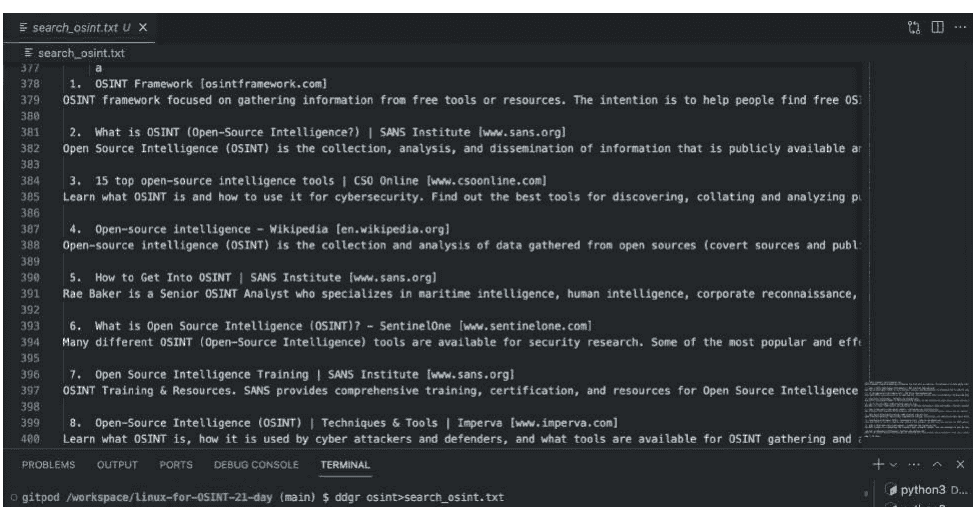

现在让我们尝试在 DuckDuckGo 上搜索单词 "`osint`" 并将结果写入文本文件：

```
cd Day_16
ddgr osint>search osint.txt
```

如果你只想从结果文件中提取引用链接（例如，为了自动爬取），你可以结合 `Cat` 和 `Gre` 命令使用：

5. 如何获取 OSINT | SANS Institute [`www.sans.org`]

学习如何从社区和资源获取 OSINT，练习技术并在 OSINT 领域寻找工作。该博客分享了各种方法

6. 什么是开源情报 (OSINT?) | SentinelOne [`www.sentinelone.com`]

OSINT 即开源情报，是从中收集和分析关于个人或组织的信息。

7. 开源情报训练 | SANS Institute [`www.sans.org`]

8. 开源情报训练 (OSINT?) | SentinelOne [`www.sentinelone.com`]

OSINT 即开源情报，是从中收集和分析关于个人或组织的信息。

9. 开源情报训练 | SANS Institute [`www.sans.org`]

10. 什么是开源情报 (OSINT?) | SentinelOne [`www.sentinelone.com`]

OSINT 即开源情报，是从中收集和分析关于个人或组织的信息。


如果你只想从结果文件中提取引用链接（例如，为了自动爬取），你可以结合 `Cat` 和 `Gre` 命令使用：

5. 如何获取 OSINT | SANS Institute [www.sans.org]

学习如何从社区和资源获取 OSINT，练习技术并在 OSINT 领域寻找工作。该博客分享了各种方法

6. 什么是开源情报 (OSINT?) | SentinelOne [www.sentinelone.com]

OSINT 即开源情报，是从中收集和分析关于个人或组织的信息。

7. 开源情报训练 | SANS Institute [www.sans.org]

8. 开源情报训练 (OSINT?) | SentinelOne [www.sentinelone.com]

OSINT 即开源情报，是从中收集和分析关于个人或组织的信息。

9. 开源情报训练 | SANS Institute [www.sans.org]

10. 什么是开源情报 (OSINT?) | SentinelOne [www.sentinelone.com]

OSINT 即开源情报，是从中收集和分析关于个人或组织的信息。

```
PROMPT OUTPUT PORT CONSOLE TERMINAL

$ pip install duckduckgo-osint-21-Day_21 [main] & Edit Day_17

$ pip install duckduckgo-osint-21-Day_21 [main] & pip install ddgr

(collecting)

Downloading ddgr-2.1-py3-none-any.whl (38 KB)

Installing collected packages: ddgr-2.1

Successfully installed ddgr-2.1.
```

从终端使用 DuckDuckGo。

位置参数：
`KEYWORD`

搜索关键词

选项:

`--help` 显示帮助信息并退出

`--page N` 输出页码（默认: 20）显示每页获取的结果数

`--region-specific search -u --region=us` (默认: 默认) https://duckduckgo.com/us

`--colorize` 输出颜色（默认: auto）意味着仅当输出为 tty 设备时；- 无颜色

`--timeout SEC` 超时，等同于 colour-timeout

`--json` 以 JSON 格式输出；意味着 `--n--limit LIMIT` 限制结果（1 天, 1 小, 1 周, 1 月, 1 年）

`--time-limit SPAN` 时间限制（秒）

`--expand` 扩展搜索查询

`--proxy URL` 设置 HTTP 代理 URL；格式：http://[user:password@]host[:port]

`--unsafe` 禁用安全搜索

`--max N` 最大结果数

`--json` json

`--py-browser` 使用无头浏览器

`--no-prompt` 不提示

`--rev,--reverse` 反向列出条目

`DuckDuckGo search` (https://github.com/jarun/ddgr) 是一个用 Python 编写的命令行实用，允许你自动化 DuckDuckGo 搜索。

让我们从 PyPI 包管理器安装：

```
pip install ddgr
```


现在让我们尝试在 DuckDuckGo 上搜索单词 "osint"并将结果写入文本文件：

```
cd Day_16
ddgr osint>search osint.txt
```

如果你只想从结果文件中提取引用链接（例如，为了自动爬取），你可以结合 `Cat` 和 `Gre` 命令使用：

5. 如何获取 OSINT | SANS Institute [www.sans.org]

学习如何从社区和资源获取 OSINT，练习技术并在 OSINT 领域寻找工作。该博客分享了各种方法

6. 什么是开源情报 (OSINT?) | SentinelOne [www.sentinelone.com]

OSINT 即开源情报，是从中收集和分析关于个人或组织的信息。

7. 开源情报训练 | SANS Institute [www.sans.org]

8. 开源情报训练 (OSINT?) | SentinelOne [www.sentinelone.com]

OSINT 即开源情报，是从中收集和分析关于个人或组织的信息。

9. 开源情报训练 | SANS Institute [www.sans.org]

10. 什么是开源情报 (OSINT?) | SentinelOne [www.sentinelone.com]

OSINT 即开源情报，是从中收集和分析关于个人或组织的信息。

```
PROMPT OUTPUT PORT CONSOLE TERMINAL

$ pip install duckduckgo-osint-21-Day_21 [main] & Edit Day_17

$ pip install duckduckgo-osint-21-Day_21 [main] & pip install ddgr

(collecting)

Downloading ddgr-2.1-py3-none-any.whl (38 KB)

Installing collected packages: ddgr-2.1

Successfully installed ddgr-2.1.
```

从终端使用 DuckDuckGo。

位置参数：
`KEYWORD`

搜索关键词

选项:

`--help` 显示帮助信息并退出

`--page N` 输出页码（默认: 20）显示每页获取的结果数

`--region-specific search -u --region=us` (默认: 默认) https://duckduckgo.com/us

`--colorize` 输出颜色（默认: auto）意味着仅当输出为 tty 设备时；- 无颜色

`--timeout SEC` 超时，等同于 colour-timeout

`--json` 以 JSON 格式输出；意味着 `--n--limit LIMIT` 限制结果（1 天, 1 小, 1 周, 1 月, 1 年）

`--time-limit SPAN` 时间限制（秒）

`--expand` 扩展搜索查询

`--proxy URL` 设置 HTTP 代理 URL；格式：http://[user:password@]host[:port]

`--unsafe` 禁用安全搜索

`--max N` 最大结果数

`--json` json

`--py-browser` 使用无头浏览器

`--no-prompt` 不提示

`--rev,--reverse` 反向列出条目

`DuckDuckGo search` (https://github.com/jarun/ddgr) 是一个用 Python 编写的命令行实用，允许你自动化 DuckDuckGo 搜索。

让我们从 PyPI 包管理器安装：

```
pip install ddgr
```


现在让我们尝试在 DuckDuckGo 上搜索单词 "osint"并将结果写入文本文件：

```
cd Day_16
ddgr osint>search osint.txt
```


如果你只想从结果文件中提取引用链接（例如，为了自动爬取），你可以结合 `Cat` 和 `Gre` 命令使用：

5. 如何获取 OSINT | SANS Institute [`www.sans.org`]

学习如何从社区和资源获取 OSINT，练习技术并在 OSINT 领域寻找工作。该博客分享了各种方法

6. 什么是开源情报 (OSINT?) | SentinelOne [`www.sentinelone.com`]

OSINT 即开源情报，是从中收集和分析关于个人或组织的信息。

7. 开源情报训练 | SANS Institute [`www.sans.org`]

8. 开源情报训练 (OSINT?) | SentinelOne [`www.sentinelone.com`]

OSINT 即开源情报，是从中收集和分析关于个人或组织的信息。

9. 开源情报训练 | SANS Institute [`www.sans.org`]

10. 什么是开源情报 (OSINT?) | SentinelOne [`www.sentinelone.com`]

OSINT 即开源情报，是从中收集和分析关于个人或组织的信息。

`PROMPT OUTPUT PORT CONSOLE TERMINAL`

```
$ pip install duckduckgo-osint-21-Day_21 [main] & Edit Day_17

$ pip install duckduckgo-osint-21-Day_21 [main] & pip install ddgr

(collecting)

Downloading ddgr-2.1-py3-none-any.whl (38 KB)

Installing collected packages: ddgr-2.1

Successfully installed ddgr-2.1.
```

从终端使用 DuckDuckGo。

位置参数：
`KEYWORD`

搜索关键词

选项:

`--help` 显示帮助信息并退出

`--page N` 输出页码（默认: 20）显示每页获取的结果数

`--region-specific search -u --region=us` (默认: 默认) `https://duckduckgo.com/us`

`--colorize` 输出颜色（默认: auto）意味着仅当输出为 tty 设备时；- 无颜色

`--timeout SEC` 超时，等同于 colour-timeout

`--json` 以 JSON 格式输出；意味着 `--n--limit LIMIT` 限制结果（1 天, 1 小, 1 周, 1 月, 1 年）

`--time-limit SPAN` 时间限制（秒）

`--expand` 扩展搜索查询

`--proxy URL` 设置 HTTP 代理 URL；格式：`http://[user:password@]host[:port]`

`--unsafe` 禁用安全搜索

`--max N` 最大结果数

`--json` json

`--py-browser` 使用无头浏览器

`--no-prompt` 不提示

`--rev,--reverse` 反向列出条目

# 问题 输出端口调试控制台 终端

```
Requirement already satisfied: certifi-normalizer==4.2 in /home/gitpod/pyvenv/versions/3.12.8/lib/python3.12/site-packages (from requests==2.31.0)

Requirement already satisfied: idna==3.10 in /home/gitpod/pyvenv/versions/3.12.8/lib/python3.12/site-packages (from requests==2.31.0) (3.4)

Requirement already satisfied: urllib3==1.26.1 in /home/gitpod/pyvenv/versions/3.12.8/lib/python3.12/site-packages (from requests==2.31.0) (3.2)

Requirement already satisfied: charset-normalizer==4.2 in /home/gitpod/pyvenv/versions/3.12.8/lib/python3.12/site-packages (from requests==2.31.0)

Downloading requests-2.31.0-py3-none-any.whl (62.2 kB)

Collecting requests: ██████████ 100% 62.2/62.2 kB [00:00:00.05, 1244.00kB/s]

Building wheel for requests...

  Using collected requests-2.31.0-py3-none-any.whl (62.2 kB)

  Created wheel requests-2.31.0-py3

Installed requests-2.31.0

Successfully installed requests-2.31.0

Installing collected packages: certifi, idna, requests

Successfully installed requests-2.31.0
```

## pip install netlas

## netlas -h

```
PROBLEMS OUTPUT PORTS DEBUG CONSOLE Linux-for-OSINT-21-day

gitpod~//linux-OSINT-21-day (main) $ netlas -h

Usage: netlas [OPTIONS] COMMAND [ARGS...]

Options:

  -h, --help    显示此消息并退出。

Commands:

  count         计算查询结果的成本。

download       下载数据。

host          主机（ip 或域名）信息。

indices        获取可用的数据索引。

profile       获取用户配置数据。

savekey       将 API 密钥保存到本地系统。

search (query) 查询查询。

  stat          获取查询统计信息。

  gitped~//linux-OSINT-21-day (main) $ _
```

首先，让我们安装 Netlas Python 软件包 (`https://readthedocs.org/projects/netlas-python/`)：

在发送请求之前，或者从你的个人账户中复制 API 密钥（每天免费 50 次请求）；

## netlas save 你的 API 密钥

```
$ netlas_results.txt -u

$ netlas_results.txt

1 {"date": "": "url": "https://217.160.158.203/443/", "last_updated": "2023-10-22T22:11:55.284Z", "jarm": "50d35f1619c2f92c80ed00022430dc37c994108"}

...（此处省略部分未翻译的 JSON 内容，保持格式一致）...

"fingerprint_md": "73852222222222222226666b",

"extensions": [{"subject_key_id": "444e05d7b3f7239a1c91bb82a0d1234f8fc","certificate_chain": ""}]}
```
$ gitpod/workspace/linux-OSINT-21-day (main) $ netlas download netlas_results.txt
$ gitpod/workspace/linux-OSINT-21-day (main) $
```

Let's try to find we have the word "osint" in the tag of your response. Note that in the query, we filter for "http" to search only the web pages. But Netlas has advanced operators. For example:


```
http:
meta:
uri:
domain:
port:
ip:
```

You can extract any data from the results file using `jq` utility, which is described in Day 14:

```
$ gitpod/workspace/linux-OSINT-21-day (main) $ jq .data.http.title netlas_results.txt > netlas_extracted.txt
```

```
netlas_extracted.txt
1 "Elastic"
2 "Elastic"
3 "Elastic"
4 "Elastic"
5 "Elastic"
6 "Elastic"
8 "Elastic"
9 "Elastic"
10 "Elastic"
```

To learn more about how to automate dozens of different OSINT tasks with Netlas Python library, check out Netlas Cookbook (https://netlas.io/cookbook).

# 第17 天 文件共享站点、种子、FTP

Today we will return to the topic we started about Day 5: downloading (for later automatic analysis). This time we will talk about slightly more complex things but in a more superficial way: FTP servers, torrents, file sharing and social media. Today we're not going to run examples of commands, we're just going to talk about different tools that worth knowing.

## FTP

On the fifth day, we already talked about the `curl` utility which supports uploading through different protocols. But still, the FTP utility (https://www.gnu.org/inetutils/manual/html/ftp-invocation.html) is a bit more convenient for this task. If you need to transfer files, you will probably be more comfortable using a GUI client as FileZilla (https://wiki.filezilla-project.org/Main_Page) rather than command line. But FileZilla (like many other FTP clients) allows you to automate various actions using the command line (https://wiki.filezilla-project.org/Command-line_arguments).

## Torrents

It is illegal to use leaked data files, but many OSINT professionals use them anyway to gather more information. Often the leaked data is stored as huge files on torrents. For example, I had to deal with one network leak that weighed hundreds of gigabytes. Unpacking the archives and extracting the necessary data using `jq` utility took more than two days! Thanks to `screen` (Day 9) I only had to spend an hour writing commands and checking sessions a few times to see if everything's going well.

Seedbox is a high-bandwidth remote server used to upload and download digital files from a peer-to-peer (P2P) network (tech slang). Here are some examples of popular services for monthly seedbox rentals:

- RapidSeedbox (https://www.rapidseedbox.com)

- Cloudboxes (https://cloudboxes.io)

- DediSeedbox (https://dediseedbox.com/)

Seedboxes is a very handy thing, but you can run command torrent clients on your VPS if you want:

- Aria (https://aria2.github.io)

- Transmission-cli (https://cli-ck.io/transmission-cli-user-guide/)

- WebTorrent-cli (https://github.com/webtortrent/webtortrent-cli)

- Stig (https://github.com/rndusr/stig)

## File sharing services

When using files uploaded to various file sharing sites in investigations, you should keep in mind that their downloading can be automated. Here are some examples of command line utilities for different services that will help you do:

- Google Drive (https://github.com/glotlabs/qdrive)

- Dropbox (https://github.com/dropbox/dbxcli)

- Mega.nz (https://github.com/meganz/MEGAcmd)

- OneDrive (https://github.com/skilion/onedrive)

But be careful when using them and never use accounts where you have important information stored for authorization. After all, these are unofficial utilities and accounts can be blocked for using them.

## Social media

When you work with a lot of content that is published on some popular social network, check to see if someone else has made a utility to automate its uploading. For example:

- YouTube-dl (https://youtube-dl.org)

- SlideShare (https://github.com/mohan3d/slideshare-go)

- Spotify (https://github.com/spotDL/spotify-downloader)

- You Get (https://github.com/soimort/you-get)

## Whois

Whois 是一个简单的实用程序，用于显示域名的基本信息：该域名是否已注册、注册日期、付费持有期的结束日期，以及所有者的联系方式。


```
PROBLEMS OUTPUT PORTS DEBUG CONSOLE TERMINAL
$ gitpod/workspace/linux-for-OSINT-21-day (main) $ sudo apt-get install whois
Reading package lists... Done
Building dependency tree... Done
Reading state information... Done
The following NEW packages will be installed
whois
0 upgraded, 1 newly installed, to remove and 0 not upgraded.
Need to get 53.4 KB of archive which will be downloaded.
After this operation, 279 MB of additional disk space will be used.
Fetch 1 http://archive.ubuntu.com/ubuntu jammy/main amd64 whois_5.5.13 [53.4 KB]
Get 1 53.4 KB in 1 s
nbuffer: delaying package configuration, since apt-utils is not installed
Selecting previously unselected package.
(Reading database... 5 files and directories currently installed).
Preparing to unpack ...whois_5.5.13_amd64.deb ...
Unpacking whois (5.5.13)
Setting up whois (5.5.13)...
Processing triggers for man-db (2.10.2-1) ...
$ gitpod/workspace/linux-for-OSINT-21-day (main) $
```

让我们安装：

```
sudo apt-get install whois
```


```
$ gitpod /workspace/linux-OSINT-21-day (main) $ whois github.com
Domain Name: GITHUB.COM
Registry Domain ID: 1264983250_DOMAIN_COM-VRSN
Registry WHOIS Server: whois.markmonitor.com
Registrar URL: http://www.markmonitor.com
Updated Date: 2023-08-11T06:19:42
Creation Date: 2007-10-09T18:20:50
Registry Registrar: MarkMonitor Inc.
Registrar ID: 292
Registrar Abuse Contact: abuse@markmonitor.com
Registry Expires: +202805011
Domain Status: clientDeleteProhibited https://icann.org/epp#clientDeleteProhibited
Domain Status: clientTransferProhibited https://icann.org/epp#clientTransferProhibited
Domain Status: clientUpdateProhibited https://icann.org/epp#clientUpdateProhibited
Name Server: DNS1.P8.NSNET.NET
Name Server: DNS2.P8.NSNET.NET
Name Server: DNS3.P8.NSNET.NET
Name Server: DNS4.P8.NSNET.NET
Name Server: NS-1283.AWDSNS-32.ORG
Name Server: NS-1707.AWDSNS-21.CO.UK
Name Server: NS-41.AWDSNS-2.COM
Name Server: NS-520.AWDSNS-01.NET
DNSSEC: unsigned
URL of the ICANN Whois Inaccuracy Complaint Form: https://www.icann.org/wif/
Last update of whois databases: 2023-12-16T09:51:05Z <<<<

NOTICE: The expiration date displayed in the record is the date the registrar's sponsorship of the domain name registration in the registry is current and does not necessarily reflect the expiration date of the domain registrant's agreement with the sponsoring registrar. Users may consult the sponsoring registrar's Whois database to view the registrar's reported date of expiration for this registration.

TERMS OF USE: You are not authorized to access or query our Whois
```

And let's gather information about GitHub.com:

## github.com

PROBLEMS OUTPUT PORTS DEBUG CONSOLE TERMINAL
Focus folder in explorer (cmd + click)
* gitpod/workspace/linux-for-OSINT-21-day (main) $ `whois035.nl` | `grep` 'Creation'
Creation Date: 2017-05-29
$ gitpod/workspace/linux-for-OSINT-21-day (main) $ `whois035.nl` | `grep` 'Creation'

If you only need certain information from `whois`, you can extract the necessary strings with `grep`.
The `dnsutils` package (`https://packages.debian.org/buster/dnsutils`) includes three commands:
- `dig` - query the DNS
- `nslookup` - the older way to do it
- `nsupdate` - perform dynamic updates.

For the purposes of this course, we will consider only the.
```
$ gitpod/workspace/linux-for-OSINT-21-day (main) $ sudo apt-get install dnsutils
Reading lists... Done
Building dependency tree... Done
Reading state information... Done
The following NEW packages will be installed:
bind9-lib9-amd64
bindv1
0 upgraded, 6 installed, to remove and 0 not upgraded.
After this operation, 902 kB of additional disk space will be used.
You wish to continue? [Y]
Get 1 http://archive.ubuntu.com/ubuntu/bind9-common_amd64 1:16.12-ubuntu22.04.3 [47.6 KB]
Get 2 http://archive.ubuntu.com/ubuntu/bind9-common-dev_amd64 1:16.12-ubuntu22.04.3 [191 KB]
Get 3 http://archive.ubuntu.com/ubuntu/updates/bind9-bind9_amd64 1:16.12-ubuntu22.04.3 [260 KB]
Get 4 http://archive.ubuntu.com/ubuntu/updates/bind9-libbind9_amd64 1:16.12-ubuntu22.04.3 [222.8 KB]
Get 5 http://archive.ubuntu.com/ubuntu/updates/bind-v1_amd64 1:16.12-ubuntu22.04.3 [387 KB]
Get 6 http://archive.ubuntu.com/ubuntu/updates/dnsutils_amd64 1:16.12-ubuntu22.04.3 [924 KB]
Selecting previously installed package dnsutils
Setting up apt configuration, since apt-utils is not installed
Selecting previously package
Reading database ... 35084 files and directories currently installed.
Processing dnsutils (9.16.12-ubuntu22.04.3_amd64.deb) ...
Unpacking libbindamd64 (9.16.12-ubuntu22.04.3_amd64.deb) ...
Unpacking libbindv1 (9.16.12-ubuntu22.04.3_amd64.deb) ...
Unpacking bind9-bind9-libbind9 (9.16.12-ubuntu22.04.3_amd64.deb) ...
Preparing to unpack .../libbindamd64_9.16.12-ubuntu22.04.3_amd64.deb
Unpacking libbindamd64 (9.16.12-ubuntu22.04.3_amd64.deb) ...
Selecting previously installed package libbindv1
Preparing to unpack .../libbindv1_9.16.12-ubuntu22.04.3_amd64.deb
Unpacking libbindv1 (9.16.12-ubuntu22.04.3_amd64.deb) ...
Selecting previously installed package bind9-bind9-libbind9
Preparing to unpack .../bind9-bind9-libbind9_9.16.12-ubuntu22.04.3_amd64.deb
Unpacking bind9-bind9-libbind9 (9.16.12-ubuntu22.04.3_amd64.deb) ...
Selecting previously installed package dnsutils
Setting up dnsutils (9.16.12-ubuntu22.04.3_amd64.deb) ...
```


```
$ gitpod /workspace/Linux-for-OSINT-21-day (main) $ dig google.com
; << DIG 9.10.12-Ubuntu22.04.3-Ubuntu >>> google.com
; global options: +cmd
; Got answer:
; <<HEADER>>: QUERY, status: NOERROR, id: 39629
; flags: qr rd QUERY: 1, ANSWER: 1, AUTHORITY: 0, ADDITIONAL: 1
; OPTION SECTION:
; VERSION: 9, flags=; udp: 1232
; QUESTION SECTION:
; google.com.                               IN        A
; ANSWER SECTION:
; google.com.                            122       IN        A       142
```

## Netlas

如你所见，它显示了信息、DNS 信息以及与该域名相关的各种服务器地址，这些可以用于进一步调查以及许多其他信息。

# 20 个领域调查 Python 软件包

只需在命令行中输入：`pip install + 包名`

- `python-whois`
- `dnstwist`
- `builtwith`
- `waybackpy`
- `netlas`
- `pyseoanalyzer`
- `shodan`
- `dns-crawler`
- `oxydork`
- `urlscanio`
- `virustotal-python`
- `pysnyk`
- `pydork`
- `EmailHarvester`
- `sitemap-generator`
- `censys`
- `wapiti3`
- `dirhunt`
- `cloudscraper`
- `metadata_parser`


图片来自推特。

图片中列出了一份小列表，包含了用于收集网站信息的 Python 软件包。要安装其中的每一个包，请在命令行执行 `pip install (包名)`，然后使用 `help` 命令来了解某个特定包的用途。

这是书中最大的一项作业，你可以花费几周时间来完成它。明天我们将尝试更多的命令，而接下来的课程将不再有命令示例，只需阅读和思考。

# 第 19 天 Git 和 Github

`Git` (https://git-scm.com) 是由 Linus Torvalds 创建的软件版本控制系统。根据 StackOverflow 的 2022 年调查，超过 93% 的开发者将其作为主要的版本控制工具（https://survey.stackoverflow.com/2022/#section-version-control-version-control-systems）。

Git 和 Linux 的情况极其罕见，一个人在一生中成功发明了两个改变游戏规则的软件（1991 年的 Linux，2005 年的 Git）。

即使你打算进行任何开发工作，你仍然可以从基础 Git 技能中为 OSINT（开源情报）、运行不同的工具以及分析存储了大量文本数据的 Github 仓库（例如钓鱼域名列表或智能合约文件）中受益。

Gitpod 已经安装了 Git，但在其他情况下，你可能需要手动安装：

```bash
sudo apt-get update
sudo apt-get install git
```

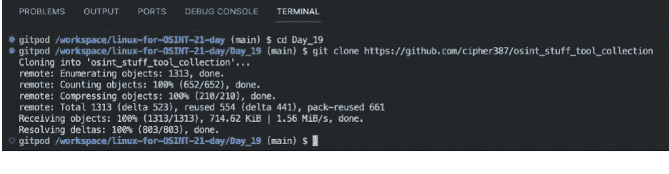

让我们去 https://github.com/new 并创建一个新的空白 Github 仓库。

## 创建仓库

仓库包含所有项目文件，包括修订历史。在其他地方已经有一个项目仓库了？导入它。

必填字段用星号 (`*`) 标记：

| | 仓库名称 * |
|---|---|
| cipher387 | linux_for_osint_21_day |
| | linux_for_osint_21_day 已可用。 |

描述（可选）

用于你书籍的文本仓库

| | 可见性 |
|---|---|
| 公共 (Public) | 所有人都可以查看和克隆此仓库。你以后可以更改。 |
| 私有 (Private) | 只有你可以查看并向此仓库提交代码。 |

使用以下选项初始化此仓库：

| 添加 README 文件 |
|---|---|
| [ ] 你可以在这里为你的项目编写详细描述。了解关于 README。 |

添加 `.gitignore`

| | gitignore |
|---|---|
| | 从模板中选择以忽略文件列表。了解关于 `.gitignore`。 |

选择许可证

| | 许可证 (License) |
|---|---|
| | 许可证告诉他人他们对你的代码可以做什么，不能做什么。了解许可证。 |

这将被设置为默认。在你的设置中更改默认名称。

你正在个人账户中创建一个私有仓库。

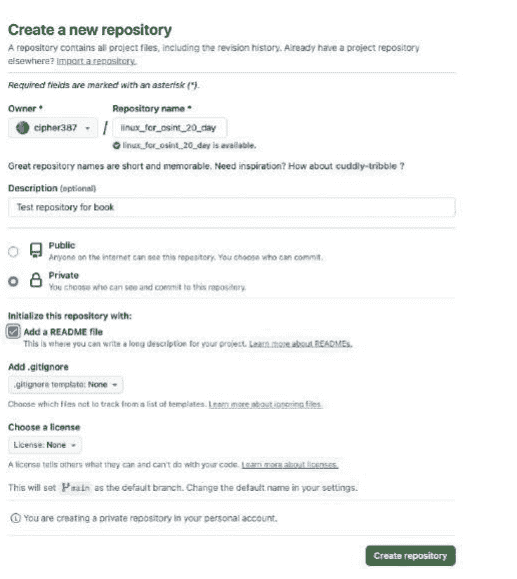

查看图片，填写仓库名称和描述字段，将仓库设为私有，创建一个 `README.MD` 文件并点击 Create（创建）。


它们在处理简单任务时非常擅长节省时间，但在处理更复杂的问题时，可能会出错并误入歧途。请小心。

141

## explainshell.com

关于 Shell 中的 `for user in！` 主题 . 显示所有，导航：解释 `crontab(1)` 解释 shell 语法

```bash
for user in $(cut -f1 -d: /etc/passwd); do crontab -l -u $user 2>/dev/null; done
```

| for name in [ in [ word ... ] ]; do list; Done | |
| :--- | :--- |
| 随后的单词列表将被展开，生成一个项目列表。变量名被设置为 |
| 依次处理此列表中的每个元素，并每次执行 list。如果单词写为 |
| for，命令为每个设置定的位置参数执行一次 list（参见 PARAMETERS）。返回状态是最后一个执行的命令的退出状态 |
| 如果后续列表的展开结果为空列表，则不执行任何命令，返回状态为 0。 | |

为单个用户维护 crontab 文件 (Vixie Cron)

在命令执行之前，其输入和输出可以使用 shell 解释的特殊符号进行重定向。重定向也可用于环境打开和关闭文件。以下重定向操作符可能出现在简单命令之前、命令内部或跟在命令之后。重定向按照它们出现的顺序从左到右进行处理。

## 重定向输出

输出重定向会导致单词展开结果的文件名在文件描述符 n 上打开写入，如果未指定 n，则使用标准输出（文件描述符 1）。如果文件不存在，则创建它；如果文件存在，则将其截断为零大小。

不要忘记，你不能要求 AI 助手从零开始编写代码或命令，但解释 Stackoverflow 上的某些命令或脚本的作用。你也可以使用 Explain Shell (https://explainshell.com/) 来实现此目的。

## phind 用于下载 google 主页的搜索聊天命令

答案 | PHIND VS 模型

使用 `curl` 命令下载 `google.com`，可以使用以下命令：

```bash
curl https://www.google.com/?hl=en_us.html
```

以下是该命令的逐步解释：

- 1. `curl` 是用于通过 URL 传输数据的工具。它支持多种协议，包括 HTTP、HTTPS、FTP、FTPS、SCP、SMTP 和 SSL/TLS。
- 2. `google.com` 是你想要下载的网站 URL。这是 Google 的主页。
- 3. `>` 是 Unix 类操作系统中的一种重定向，它用于将命令的输出重定向到文件。在这种情况下，它将 `curl` 的输出（即页面的 HTML 内容）重定向到名为 `google.html` 的本地文件。
- 4. `google.html` 是正在保存的文件名。如果文件不存在，将创建它。如果文件已存在，将会被覆盖。
- 5. 运行命令后，`google.html` 文件将位于你的当前目录。该文件包含 Google 主页的 HTML 内容。你可以在网页浏览器中打开此文件查看网页，或者可以在文本编辑器中打开它查看 HTML 源代码。

## 建议

我可以使用 `curl` 下载 Google 主页的特定部分吗？


| 来源 | Y |
| :--- | :--- |


| 1. https://stackoverflow.com/questions/48130/how-to | 使用 `curl` 或 `wget` 下载 Google Drive 文件 |
| 2. 知识共享是我们的优先事项。当文件很大时，Google 返回代码。 | |
| 3. https://networkworld.com/article/957290-how-to-download-a-website-using-curl/ | |
| 4. 使用 `curl` 可能最好的方法是从具有更多内容的页面下载。 | |
| 5. https://phind.com/post/command-examples | |
| 6. https://www.digitalocean.com/community/tutorials/ | |

命令的语法如下：`curl [options] [URL]`

在最简单的形式下，当没有调用任何选项时，`curl` 显示内容。

步骤 1 — 获取远程文件。在框外，如果没有任何参数，`curl` 命令将获取一个文件。

另外，我想让你注意 AI 助手 Phind (`https://www.phind.com/`)，它不仅写命令，还提供来自 StackOverflow 等各种网站的解释。

## 代码检查器

StackOverflow 用户、AI 助手以及每个代码的人都会出错。这些工具将帮助你准确找到错误位置。

## ShellCheck

查找 shell 脚本中的错误。

你可以通过 `apt`、`dnf` 或 `brew` 在本地安装它。

粘贴一个脚本尝试一下。

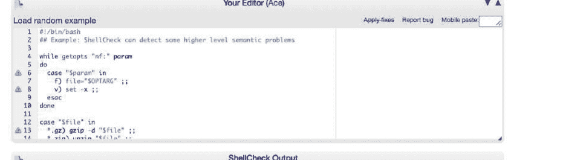

```bash
#!/bin/bash
# ：ShellCheck 可以检测到一些低级语义问题
while getopts "f:s:" opt; do
```

# 第 21 天。哪种 Linux 发行版更好用？

简短的回答是：你用起来最舒服的一个，以及你投入最多精力去配置的那一个。尝试不同的发行版。但我仍然建议你从那些目前活跃开发且拥有庞大用户社区的发行开始。

以下是一些为网络安全研究人员创建的发行版示例：

- [Tsurugi Linux Acquire](https://tsurugi-linux.org/tsurugi_acquire.php) - 轻量级发行版（安装文件仅略大于 1 GB，有 32 位版本，非常适合从 USB 设备运行），并预装了许多用于 OSINT（开源情报收集）的工具。
- [Kali Linux](https://www.kali.org/get-kali/) - 世界最流行的渗透测试和道德黑客攻击发行版。
- [CSI Linux](https://csilinux.com) - 基于 Ubuntu 的完整“网络取证”平台。
- [BlackArch](https://blackarch.org) - 针对渗透测试人员的 Arch Linux 轻量级扩展（Slim ISO 5 Gb）。

这里是另外两个针对网络安全专业人员的 Linux 发行版列表：

- Distro Forensics Github 仓库 (`https://github.com/CScorza/DistroForensics`)
- Linux for OSINT Twitter 列表 (`https://twitter.com/cyb_detective/status/1441860681173033473`)

但如果你从事网络安全工作，并不意味着你必须使用专为安全专业人士设计的发行版。这完全没有必要。

而且无法说某一个发行版比另一个更好。毕竟，问题的答案对每个人都不同，并且会随着时间而改变。


来自 Reddit 的图片。

有数百种不同的 Linux 发行版及其变体（见上图）。

选择一个一个：

- 符合你计算机系统要求且运行快速的
- 对你个人来说方便易懂（你只有通过实践才能发现是哪一个）

你的工作性能取决于你为个人任务定制发行版投入了多少精力。无论如何，每个研究人员的工具包都是不同的，你仍然需要自己安装许多工具。

最重要的是，记住 Linux 的哲学是关于无规则、最大的灵活性以及对用户个性化和目标的最大关注。

## 最新虚拟机镜像


你可以将 Linux 作为虚拟机使用。在 LinuxVMImages 网站 (`https://www.linuxvmimages.com/`) 下载不同发行版的镜像。

但也要考虑其他使用形式，例如 VPS（虚拟专用服务器）。租用费用每月几美元起（例如从 $3.99 到 $15 不等）或可启动的 USB 驱动器（Ubuntu 和 Windows 的说明示例 `https://ubuntu.com/create-usb-stick-for-windows-overview`）。

| 主机 | LXC | OS | CPU | RAM | 磁盘 | COW | 导入镜像 | 加载 | 内存转储 | 捕获 | 启用 | 链接 | 鼠标 | 全屏 | 缩放 |
| :--- | :--- | :--- | :--- | :--- | :--- | :--- | :--- | :--- | :--- | :--- | :--- | :--- | :--- | :--- | :--- |
| | | | | | | | | | | | | | | | | |

*(注：由于原文表格内容包含大量乱码或占位符，此处保持格式对应，未翻译无意义字符)*
*(注：原文后续部分似乎包含大量重复的乱码/占位符文本，已根据指令进行清理处理)*

# README © CC0-1.0 许可证


29.4k 星标

778 关注

2.4k Fork

报告仓库

## 发布版本

暂无发布版本

## 软件包

暂无软件包

## 贡献者 266


## Awesome Shell

+ 252 位贡献者

一个精选的命令行框架、工具包、指南和小工具列表。灵感源自 awesome-php。这个优秀集合在 Unix-Shell.ZEEF.com 上同样可用。

- Shell（外壳）
- 命令行效率工具
  - 目录导航
  - 自定义
  - 开发者专用
  - 系统实用程序
- 下载与服务
- 多媒体与文件格式
- 应用程序
- 游戏
- Shell 软件包管理
- Shell 脚本开发
- 指南
- Awesome Zsh
- Awesome Fish
- 其他 Awesome 列表

如果你打开 Awesome Shell (`https://github.com/albecay/awesome-shell`) 仓库，你就能看到大量的命令行工具。它包含了几乎 400 多个链接（这些是最实用且著名的工具）。

第三，如果你确实某些仅存在于 Windows 的应用程序，仍然可以使用启动器在 Linux 上运行它们，例如：

- Wine (`http://winehg.org`)
- CrossOver (`http://codeweavers.com/crossover`)

遗憾的是，它们并不总是那么方便，而且经常产生错误。例如，我最近未能通过 Wine 运行一个查看牙科图片的程序。但在许多情况下，它们是可以工作的。

第四，Linux 允许你在自定义桌面 GUI 时具有最大的灵活性（与 Windows 和 Mac 不可比拟）。你可以尝试其中一种流行的 Linux 桌面环境：

- Gnome 3 (`https://www.gnome.org/gnome-3/`)
- KDE (`https://www.kde.org/`)
- Cinnamon (`http://developer.linuxmint.com/projects.html`)


- Mate (http://mate-desktop.com/)
- Xfce (http://www.xfce.org)

# 接下来要做什么？

尽可能练习。继续进行 OSINT（开源情报）调查，并尝试使用 Linux 工具自动化任务。不要害怕出错，不要犹豫使用 Stackoverflow 和第 20 天描述的 AI 工具。

不要忘记在 Twitter、Mastodon、Telegram、BlueSky、Substack 和 Medium 上关注我，以获取 OSINT 工具的定期新闻，不要错过新书。所有链接可以在 cybdetective.com 找到。

一旦你进行了一些练习并想要再次学习新东西，你也可以阅读《Python for OSINT：面向初者的 21 天课程》(https://github.com/cipher387/python-for-OSINT-21-days）。它也是免费分发的（随意捐赠，如果你愿意）。

还要记住，由于全球数千万爱好者者的微小努力，全球开源社区正在不断成长。

不要忘记在你的社交网络上编写关于开源工具的文章，通过好评和捐赠支持开发者，如果你喜欢编程，不要犹豫为 Github 上的各种项目做出贡献。即使你现在了解不多，也可以帮助测试或编写文档。

## 应用。在 Windows 上可以完成相同的事情吗？

是的，这是可能的，而且很多人都在这样做。但如上所述，运行 Linux 虚拟机（VM）或虚拟服务器（VPS）比思考如何在 Windows 上实现相同的功能简单得多。

在 Windows 上运行 Linux 工具最合理的理由是——将使用 PowerShell 或 VBA 创建的一些复杂自动化与基于 Linux 工具的自动化结合。在这种情况下，这里有一些关于如何操作的指南：

[来自noon.com/how-to-install-bash-on-windows-10-lbq73yj3 来自 HackerNoon 如何在 Windows 中安装 bash](https://hackernoon.com/how-to-install-bash-on-windows-10-lbq73yj3)

[geeksforgeeks.org/how-to-run-linux-software-on-windows/ GeeksForGeeks 如何在 Windows 上运行 Linux 软件](https://www.geeksforgeeks.org/how-to-run-linux-software-on-windows/)
