# 普通人的 Linux：初学者需要的 Linux 问答指南


``` 
005.4469 MAR 2005 RAI Farmers Branch Manske Library 13613 Webb Chapel Farmers Branch, TX 75234-3756 
```
## 关于作者
马克·雷斯1995年获得技术写作硕士学位时就已经开始接触Linux。在此期间，他编写了Unix用户手册*《OSF核心指南》*，担任*《计算机现实》*杂志主编，同时还是一名Linux计算机顾问。此后马克继续推广并使用Linux，在时代华纳担任高级技术经理期间，他牵头负责了企业级系统与数据库向Linux的迁移工作，主持高带宽迁移委员会的工作，并编写了入门书籍*《大众Linux指南》*。如今，马克通过白皮书、新闻文章与书籍持续在全球范围内推广Linux的使用。除了对Linux的热爱，马克喜欢陪伴妻子与三个孩子共度时光。马克向我们保证，他的每个孩子将来也会成为Linux爱好者……只要他们大到可以打字就行。
## 致谢
没有支持便无法完成一本书的撰写。这本更新的第二版离不开我妻子的鼓励，还有我三个年幼孩子的无数拥抱，我爱他们。我还要向当今世界少数几位独特的领导者致谢，他们选择走使用Linux的道路，并发现Linux不仅是一款实用的工具，更是对人类的重大利好。这些领导者拥有远见与勇气，激励着我们所有人不断前行。
## 为何没有附赠光盘？
很多计算机书籍都会随书附赠CD-ROM。我为何特意决定不为这本最新修订版附赠包含特定Linux发行版的光盘呢？读者可以自行选择。就这么简单。这正是本书的核心要义，也是Linux的核心要义。如果我随书附赠Linux光盘，它在你插入光驱前就已经过时，更重要的是，这会为一本入门指南增加成本，而相关内容本可以在全世界免费获取。我在整本书中还投入了大量精力，让技巧与方案保持足够的灵活性，以便大多数Linux新用户都能获得适用于自身所选发行版的实用启发。如果你尚未决定使用哪款Linux发行版，那尽管往下读就好，本书第一部分会帮助你顺利做出选择。
> 注：本页为模糊图片，无法准确提取文本内容。


## 引言
又一本Linux书？究竟为什么会有人自愿费时费力再写一本Linux相关的书籍？难道是纯粹疯了？难道是被显示器辐射坏了脑子？不，其实都不是。
我之所以选择编写本书的第一版，是为了解决很多人在初学Linux时遇到的一个长期困扰：我们都需要一个能获取基础解答和小技巧的地方，不用再翻那些厚重又昂贵的上千页手册。往往我们最需要的基础信息却很难找到。我刚开始接触Linux的时候，曾耗费无数个小时翻遍一本本巨著、一个个网页，过程十分挫败，还经常一无所获。我只想要**一本**能帮大家轻松踏入Linux世界的书。我基于自己入门时的个人经验、所有初学者都必备的核心技巧，以及很多刚入门的同事经常问到的问题，编撰了这本书。
Linux一直在快速迭代升级，因此本书亟需推出第二版。在本版中，我补充了部分最新版本、你应该了解的全新特性与功能，还新增了包括互联网使用、Linux商用场景在内的相关主题内容。
本书不会刻意回答所有Linux相关问题，也不会涵盖所有Linux发行版的安装步骤。相反，本书聚焦于解决初学者入门Linux时最常遇到的问题、提供最关键的信息。我不会只聚焦某一种发行版。本书包含了我使用Debian、Fedora、Mandrake、Slackware和SuSe的个人经验，这些内容也适用于其他发行版。书中的技巧与步骤都来自实际使用经验，希望能帮助你顺利上手使用Linux。

### 请先阅读本章
为了能更好地使用本书，你可以先了解各章通篇使用的基础规范与设计元素。在使用本书提供的信息时，请牢记以下几点：
1.  Tips 
    当你看到这个可爱的小企鹅标识时，就意味着这里是你从实际经验中总结出的实用技巧。小企鹅希望帮你少走弯路，所以不妨花点时间读一读它的建议。
2.  Commands
    当你看到用`courier`字体标注的内容时，这就是需要你输入的具体命令，或是会在电脑屏幕上显示的内容。按下回车键即可执行任意命令。
3.  The Prompt or Terminal
    本书中的很多步骤会提到使用**命令行终端**、**xterm**或者**konsole**。你可以通过主菜单选择*系统（或系统工具）*，再选择terminal、xterm或konsole，就能打开这类终端。你使用的发行版也可能在桌面底部提供了这类功能的菜单图标。
4.  Flavors
    我已经尽量让本书中的大部分命令和步骤足够灵活，能适配各类Linux发行版。不过，若有需要特别说明的地方，我会指出特定发行版的专属细节。
5.  Troubleshooting
    我会在相关章节中嵌入**故障排除**的*提示内容*，同时附录中还收录了涉及更广泛主题的常见问题解答。

## 第1部分
### 基础知识入门


## 第1章：选择哪种发行版？
如果你已经选定了要用的Linux发行版，可以直接跳到第2章阅读。但如果你还在纠结该选哪款Linux，或者完全搞不懂我提到的“发行版（flavor）”是什么意思，那就请继续往下读。
Linux是一款独特的操作系统。少数高水平的软件工程师负责维护核心代码，也就是我们常说的内核。不过，Linux的其他组成部分，比如用于操作内核的界面、告诉内核你的电脑配备了哪些硬件的驱动程序等，则是由来自不同组织的众多程序员共同开发的。
部分公司或程序员团队会开发自己的Linux版本（也就是发行版），实现某些特定核心功能。有些发行版专门面向商用场景，满足高性能服务器的使用需求；还有些发行版体积很小，仅需一张软盘就能载入运行；另一些则致力于让Windows用户也能轻松上手Linux。
目前市面上共有超过40款Linux发行版，但只有少数几款占据了全球90%的用户份额。最受欢迎的发行版包括：
- Debian：基于它衍生出了诸多版本，比如Xandros
- Fedora：源自红帽（Red Hat）的代码库
- Mandrake：主打易用的操作界面
- Slackware：历史最悠久、运营时间最长的发行版之一
- SuSe：同时面向初学者和程序员提供功能
我上面的简单介绍其实没法完全展现这些发行版的优势，但其中任意一款基本都能满足绝大多数人的核心Linux使用需求。最终选择权完全在你手中，你可以选择最受欢迎的那些，也可以选择其他足够优秀靠谱的发行版。选型过程中最重要的是选定一款贴合**你**特定需求的发行版。
在我看来，你应该选择一款既注重初学者友好型安装流程，又提供更多高级工具的发行版。当你对比各个选项时，自然会找到最适合你的平衡点。

开始调研的好去处之一是Linux.org官网（www.linux.org），上面有非常详尽的几乎所有发行版的列表；别被长长的清单吓到就好！关键是要选定一款后直接用起来。相信我，我非常喜爱选择的权利，目前我的服务器上就跑着四款不同的发行版。不过你还是先选定一款，给自己足够的时间适应。熟悉一款发行版并用得得心应手、高效产出，比不断换发行版寻找所谓的“Linux圣杯”要靠谱得多。
最后，你获取发行版的方式取决于它的发行方。如果是商业衍生版本，你需要支付一定费用，作为回报你会得到一套封装好的光盘、手册以及技术支持权限。如果你想要最省钱的方式，可以直接从互联网免费下载对应的发行版。不过请务必仔细阅读它的安装说明。这种方式的缺点是没有预装部分商业软件和驱动程序，比如部分调制解调器驱动。你可以之后从类似www.linmodems.org这样的站点获取这些组件。当然，这个选项对有些人来说可能不现实，毕竟通过互联网下载几百兆的文件，根据你的网速不同，最多可能要花20个小时！
还有一个替代方案：你可以上网找旧版本发行版的折扣，也可以从类似Edmunds Enterprises（www.edmunds-enterprises.com）这类公司购买你喜欢的免费版本的现成光盘，这只是众多选择中的一个。
当你拿到Linux安装光盘后，就可以开始安装啦！
> **作者的私心推荐**
> 我经常被初学者问及我自己使用和偏爱哪款发行版。这是个很难回答的问题，因为我不清楚他们打算用Linux做什么、技术能力如何、又偏好哪种操作界面。如果你拿不定主意、完全不知道选什么，或者就想让别人直接告诉你该买哪个，那我推荐你选择上一页我介绍的几款热门发行版中的任意一款。我都用过这些发行版，发现大多数情况下它们都能完全满足我的需求……相信我，我非常喜欢压榨我的Linux系统的性能！

## 第2章：Linux安装基础
本章会基于我个人的使用经验，详细介绍安装Linux的最佳方式。我会分享具体的技巧，帮助你顺利完成Linux的实际安装。书中的截图可能和你的屏幕显示不完全一致，但操作步骤适配所有主流发行版。我建议你在开始安装前先通读一遍本章。

### 安装位置怎么选？
如果你还没最终确定要把Linux安装到哪个位置、要搭配哪些操作系统使用，不妨花点时间考虑以下方面。安装Linux有多种可选方式，最常见的安装选项如下：
1.  将Linux安装到同时装有Windows的同一块硬盘上
2.  将Linux单独安装到第二块硬盘上，和Windows或其他操作系统组成双系统
3.  将Linux单独安装到一块硬盘上，不安装其他操作系统

如果你想和其他系统组成双系统，我推荐选项2。虽然这个方案需要你再加一块硬盘（整套硬件大概花费90美元），但用起来要稳定得多。从我这个生怕丢文件的人的视角来看，选项1是最不安全的。不过部分Linux发行版特意优化了和现有Windows硬盘的集成，几乎可以实现无缝适配。如果你用的发行版支持自动调整Windows分区大小，那安装过程会很顺利。如果不行的话，你可以考虑其他选项，或者在安装前先去对应发行版的官网获取建议。
**不管选哪种方式，你都必须先备份数据！** 为什么我没法就这个初始话题说更多？因为变量太多了，光是把所有细节讲清楚就得写整整一本书。举个例子，影响Linux安装方式的一个因素是你正在运行的Windows版本。较老的Windows版本使用一种名为VFAT的文件系统，而

包含一种名为NTFS的完全不同文件类型的较新Windows版本。这会影响Linux能否安装到同一块硬盘上。即使支持自动调整分区大小，多个发行版仍强烈建议你暂停安装，返回Windows系统先运行磁盘扫描（scandisk）和碎片整理（defrag）。因此，我强烈建议所有准备安装Linux的用户提前熟悉你所用发行版的安装选项。接下来几页我将介绍基于我个人成功使用各类Linux发行版的经验与偏好总结出的细节，**跨不同发行版适用**。

### 开始安装
如果你还没感到兴奋，当你把Linux光盘插入光驱、启动安装程序时很快就会有的！将Linux光盘插入光驱并重启系统，就会自动启动安装程序。计算机会从Linux光盘启动，安装程序随即开始。你可能需要在初始菜单中选择“安装”选项。现在你可以参考后续页面的步骤操作了。

#### 安装启动问题！
- **安装程序无法启动：** 有时安装会卡住，只需要重启即可。或者你的电脑可能未设置为从光驱启动。修改系统BIOS设置，将光驱设为第一启动设备。系统启动时通常按下*Delete*键或*F2*键即可进入BIOS。进入系统BIOS后，选择*启动项*或类似菜单选项，将光盘设为硬盘之前的第一个启动设备，光盘可能被命名为类似*ATAPI CD-ROM*的名称。确认将其设为第一启动设备后，保存并退出BIOS设置。
- **安装程序启动后长时间卡顿，随后加载了Linux桌面而非安装流程：** 这种情况可能是你的硬盘未正确安装，更可能是你使用的光盘无法引导，直接跳转到了从光盘加载Linux系统。最有可能的原因是启动镜像（即Linux加载启动项的文件）损坏或不匹配你的硬件。你需要更换要加载的启动镜像。部分发行版的第二张光盘包含*备用启动镜像*，请查阅你所用发行版的安装文档，获取具体的*启动镜像文件*相关信息。

### 安装前准备
- Български
- Čeština
- Dansk
- Deutsch
- English (UK)
- English (US)
- Español
- Français
- Ελληνικά
所有较新的Linux发行版都会先进入基础安装设置环节，需要你选择语言、键盘和鼠标设置。这部分仅用于配置安装环境，完成安装前设置大约需要1分钟。请耐心阅读屏幕上的各类提示信息，其中包含能帮你快速、顺利完成发行版安装的重要技巧。

#### 选择*自定义*安装（仅部分发行版支持）
在安装前设置环节，部分发行版会让你选择Linux的安装方式，最常见的选项包括：
- **自定义**安装能让你对安装流程拥有最高的灵活度和控制权，但需要花费更多时间和精力考量。
- **工作站**安装可能会省略FTP、Web服务器、Telnet功能，以及你需要的其他程序。
- **服务器**安装旨在提供高性能的Linux服务器，换句话说，选择*服务器*安装意味着系统不会预装其他多余组件。
我一直都选择*自定义*安装，因为它能给我最大的控制权和灵活性。如果你想参考接下来几页关于*自定义分区*的技巧和信息，请选择自定义安装。部分发行版（如Mandrake）会直接跳转到下一页的*分区*环节。

#### 硬件识别
如今绝大多数Linux发行版的硬件识别能力都非常出色。虽然这看起来是不言而喻的基础需求，但请记住，如今部分Linux发行版的硬件识别能力远胜于其他*操作系统*！使用最新版的发行版时，整个安装流程会更加简单。你所用的Linux发行版应该能轻松识别所有核心硬件组件，并告知你它的安装**位置**和方式。下一页的示例展示了双硬盘的场景。

下方示例中，安装程序计划使用/dev/hdb。听起来像极客术语？但这其实非常重要。在本示例中，*hdb*代表第二块硬盘，如果是*hda*则是第一块硬盘，通常会安装Windows系统。如果是单硬盘场景，希望同时安装Linux和Windows，需要确认hda后面的编号不是1（即*hda1*），该分区通常被Windows占用。如果你打算搭建纯Linux系统，则无需考虑这个问题。此外，部分发行版（如Mandrake）还包含选择*安全配置*的步骤。

#### 分区
##### 分区是什么？
用于修改磁盘分区的界面多种多样，在介绍细节前需要稍作说明。所有情况下的核心逻辑都是相通的：你即将把硬盘划分为多个区域用于特定用途。这样做的好处是，Linux不会将所有核心文件存放在硬盘的同一区域，从而避免大量潜在问题，同时提升安全性。如果你采纳我的建议选择自定义分区，你实际上会在硬盘上创建4个供Linux使用的核心区域：
- **/boot**：存放启动信息和内核文件的区域
- **/**：所有主应用程序的安装位置
- **/swap**：模拟额外内存的特殊硬盘区域
- **/usr**：存放用户文件和用户专属配置的区域
分区可以使用多种文件系统类型，文件系统类型决定了单个文件在磁盘上的存储方式。较新的文件系统类型具备更优的磁盘空间利用率和更高的存储安全性。

#### 自动分区与自定义分区
你会注意到Linux安装程序默认会提供自动分区选项。分区本质上是划分硬盘以支持Linux正常安装的方式。如果你不打算对系统做特殊配置，请直接使用发行版自带的**自动分区**功能，会自动对你的硬盘进行简单的Linux分区。这种分区方式适合日常基础使用或新手用户。如果你安装的发行版支持自动调整现有Windows分区大小，我也推荐使用自动分区。但我个人更倾向于**手动配置分区**，这样可以最大程度地灵活调整分区，拥有最高的控制权。如果你希望完全掌控配置、想更深入了解你的Linux系统，请选择修改分区（有时也叫*手动分区*或*Disk Druid*）并进入下一页。

#### 自动分区时选择硬盘
如果你要使用**自动**分区，就需要选择要格式化和分区的硬盘。可以参考前一页的技巧，避免误删你需要保留的数据！你很可能会看到一条醒目的提示，说明安装即将开始，数据将会丢失。你可以选择“安装”或者返回（中止）上一步操作。
**CAUTION:** 在点击确定或安装前，请务必确认选中的要安装的硬盘和分区**仅包含**你希望运行Linux的磁盘！否则你将丢失所有磁盘中的数据！如果你不确定，请返回上一步修改磁盘和分区，至少重新核对一遍。现在中止流程重新核对是个不错的选择！
- **TIP:** 要查看或修改分区，可以尝试以下**任意一种**方式：
  - 点击标有*修改*的按钮，选择分区选项
  - 选中*自定义磁盘分区*选项
  


## 自定义磁盘分区
我更喜欢自定义分区，而不想让Linux发行版替我自动配置。如果你不打算了解相关内容，或者没有耐心折腾，请使用自动分区。
首先选择**自定义**或**修改**分区的选项。

### 删除或调整现有分区大小
某些情况下，你的硬盘上可能已经存在分区。这些分区可能是Windows（通常是hda1或hdb1）或其他操作系统正在使用的，也可能是已经不再需要的老旧分区。
你可以选择调整现有分区的大小，为Linux腾出新的安装空间，也可以直接删除现有分区。
如果你不再需要现有分区，直接按下*Delete*（部分情况下是*Clear all*）即可删除它们。
如果你想要调整分区大小，更推荐使用自动调整功能，这个选项更易操作，在安装流程的上一步就能找到。
*遗憾的是，部分发行版不提供自动调整或手动调整分区的选项。*
> **调整大小警告：** 双系统Windows用户，在同一硬盘上安装Linux之前，必须运行*scandisk*和*defrag*工具。

> **调整分区大小：**
> 等等！除非你已经备份了硬盘数据，否则不要进行此操作。
> 左侧示例中，硬盘1（hda）容量为30GB，其上已经存在其他文件系统。
> 选择调整大小选项后，现有分区会被缩小，为Linux安装腾出空余区域。
> 如果出现卡死，需要重启系统，尝试其他选项。

### 创建挂载点
完成分区选择、为Linux腾出安装空间后，接下来需要指定Linux系统及其他文件（即挂载点）的具体位置。

请务必确认你用来创建分区的硬盘是你计划使用的！

### 文件系统类型
正如我之前提到的，存在多种文件系统类型，本质上指的是在磁盘上存储数据的方式。目前Linux最常用的类型是Ext3，尽管部分较新的发行版现在已经默认使用Reiser。
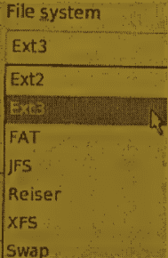
我更倾向于使用经过验证、在不同Linux使用场景下都表现良好的类型，因此总是选择Ext3。你最好也选择Ext3或Reiser。
*FAT*是旧版本Windows使用的文件系统类型。*Swap*专门用于Linux的交换文件，不应用于其他挂载点。

#### A. 创建挂载点：/boot
创建**/boot**挂载点，该区域用于存储Linux内核和启动信息。我通常会为其分配最多几百MB的容量，/boot的合理容量约为184MB。部分Linux发行版**不会**自动提供/boot选项。我倾向于这样拆分分区，有助于保持系统整洁，提升安全性与稳定性。
> *务必**格外小心**，不要给错误的硬盘创建分区！*

在大多数发行版中，你需要先选中空余的分区容器或未分配空间，才能点击*Create*（也叫*New*）选项。

#### B. 创建挂载点：/
创建根挂载点/，该区域用于存储根目录文件和大多数程序。我强烈建议为最新的Linux发行版分配至少4GB的容量给该区域。
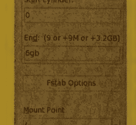
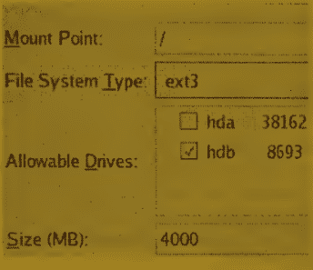
上面是两个创建挂载点的示例。请确保/的文件系统类型选择为Ext3或Reiser，且类型与/boot使用的类型一致。部分发行版要求你手动修改每个新建挂载点的文件系统类型。

#### C. 创建挂载点：<Linux Swap>
进入分区类型（也叫文件系统）选项，选择Swap即可创建Swap挂载点。向下滚动直到看到Swap选项并选中它，选中后挂载点字段会自动填充。


> 我通常会将交换文件容量设置为小于系统总内存，否则系统会更多地使用交换空间而非内存存储数据！例如，我的服务器安装了512MB内存，我选择创建256MB的交换文件。不建议为较新的发行版创建小于128MB的交换文件。如果你使用的系统内存不足128MB，建议认真考虑安装旧版本（参见《安装旧版本》部分）。

#### D. 创建挂载点：/usr
创建**/usr**挂载点，该区域用于存放用户相关的程序和文件。请务必用尽所有剩余的可用空间。部分发行版提供了*Fill to maximum allowable size*（填充至最大允许容量）选项，选择后会自动调整挂载点大小，将硬盘剩余空间全部分配给/usr。
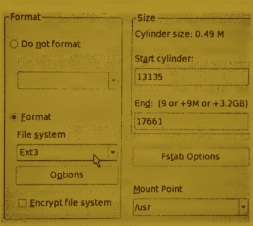
如果没有该选项，你需要手动将剩余磁盘空间分配给这个挂载点——因为它是最后一个创建的挂载点，任何未分配的空间都会被浪费。建议为/usr分配至少2GB的磁盘空间。另外，我知道我反复强调了很多次，但这一点非常重要：一定要选对正确的文件系统类型，确认挂载点设置无误。至此，分区和挂载点创建步骤就完成了！

### 流程差异…
到了这个阶段，我发现不同主流发行版（比如Debian、Fedora、Mandrake和SuSe）接下来的操作流程差异很大。下面提到的所有步骤都会在你的Linux安装过程中出现，只是顺序可能不同。

### 格式化分区
大多数最新版本的Linux**默认**会自动格式化你创建的每个新分区。分区过程中，你会看到已创建挂载点的**列表**及其完整路径，还有它们所在的硬盘标识。这个列表非常重要，它会告诉你哪些分区会被格式化。**格式化会导致数据丢失。** 请记住，**hda**是你系统的主硬盘，除非你想把Linux安装在这块硬盘上，否则不要允许格式化该硬盘。

### 引导加载程序配置
引导加载程序就是Linux用来启动系统的工具。当你的系统上安装了其他操作系统时，它的作用尤为重要，可以让你选择启动哪个操作系统。
**GRUB通常是默认的引导加载程序。** 直接选择它继续安装完全没问题。不过如果你更喜欢另一个非常优秀的引导加载程序LiLo，可以通过选择**更改引导加载程序**来选中它。我过去十年一直使用LiLo，没出过任何问题，所以我更倾向于继续用LiLo。不过无论如何，一定要选择一个引导加载程序！我唯一不需要引导加载程序的情况，是运行第二个Linux版本的时候。引导加载程序必须安装在你的第一块主硬盘上才能正常工作（**通常是hda**）。
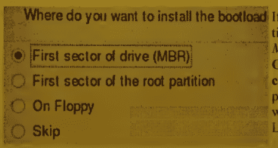
如果系统让你选择将引导加载程序安装在**MBR**（主引导记录）**或第一扇区，请选择MBR**，除非你计划同时使用Windows NT和Linux双系统。

### **网络设置**
本节内容仅适用于打算通过网络或宽带连接将Linux系统接入其他设备的用户。
大多数情况下，你可以让另一台服务器自动分配你的IP地址，这种机制被称为DHCP（动态主机配置协议）。DHCP允许其他系统决定你将使用的IP地址，这对大多数用户来说完全够用。
不过，如果你计划将系统作为**服务器**使用，那么你**不需要DHCP**，需要手动设置IP地址和主机名。如果你要把这个系统用作服务器，或者想要深入学习Linux，我强烈建议你手动填写IP信息。
主机名必须是真实有效的主机名，比如：`myserver.com`
现在大多数发行版也提供了互联网连接设置，你可以选择填写或跳过这些网络设置步骤，因为之后你可以随时按照下一章介绍的方法，通过配置控制面板修改这些设置。
**手动填写**系统的IP地址。在Fedora中，这个选项隐藏在*Edit*（编辑）按钮下。通常该选项默认设置为DHCP，所以一定要取消勾选DHCP选项！

> **提示：** 例如，我的服务器部署在防火墙后，只需要将服务器的主机名设置为`myserver.com`，IP地址设置为`10.2.1.1`。我目前和一台使用`10.2.1.2`IP的Windows PC共用同一个局域网，我们都直接将自己的IP地址同时作为DNS服务器使用。网关字段留空即可。如果你的Linux自动为你填写了子网掩码，请确认你确实应该使用默认设置`255.0.0.0`！如果你打算和网络中的Windows PC共享文件，必须确保两台机器的子网掩码**相同**。不需要填写的字段是DNS服务器IP，你可以从局域网内的其他设备上获取这些信息，也可以暂时忽略它们。有些情况下，当我自行管理局域网和Linux服务器时，一个简单的解决方案是将IP地址*同时*作为DNS服务器地址。


## 防火墙设置
并非所有发行版都提供防火墙设置选项。如果你不知道怎么做，就不要改动防火墙设置！所有新Linux发行版的默认设置都足以保证系统安全。最重要的一点是，Linux过去是、现在依然是可用的最安全的操作系统之一，因为它从一开始就内置了互联网和网络安全功能。所有Linux发行版也都进行了重大改进，避免了其他操作系统常出现的安全漏洞灾难性事件。关键的是，这些功能大多和发行版无关，是Linux核心代码的一部分。如果你打算将Linux系统用作服务器，还可以参考*互联网连接*部分中关于为服务器配置防火墙的相关细节。

## 选择语言
直接选一种语言然后继续就好！

> **提示：** 不要乱改语言设置。选好之后直接进入下一步就行！我之前有个同事觉得给他的Linux服务器装一种新奇独特的语言会很有趣，他选了一种之后，服务器上的内容对他来说完全看不懂，最后不得不重装系统。我想想啊，笑话最后落在他头上了吧！

## 创建root用户与新用户
root是系统管理员的登录名。**任何Linux服务器的完全访问权限登录默认都是*root*。**这一点很重要，原因有两个：要用到本书中的很多技巧，你**需要**拥有完全访问权限的登录账号；但这类登录也可能带来潜在问题，所以明智的做法是只在必要步骤中使用root，另外创建一个日常使用Linux的登录账号。我特别强调要把root密码设成既好记又*难以破解*的。很多时候我都不想数了，有好多朋友大半夜打电话给我，问能不能帮他们记起安装时设的root密码！请花点时间为你的服务器添加额外的登录账号，大多数发行版上你可以点击*添加*按钮或者*新用户*选项来操作，我通常会给自己再创建一个账号，然后继续安装流程。

## 密码保护
如果你的发行版提供了选择密码存储方式的选项，花点时间选一个就行。我一直用**MD5**密码，因为它提供了不错的加密安全等级，同时还能在密码文件损坏时提供修复途径。好奇的人可以知道，MD5比DES安全一点。
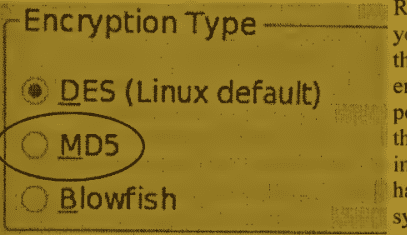
不管你选哪种，都可以放心，你的密码都是加密存储的。如果你有以下情况，这一点尤其重要：
- 用该系统通过宽带连接互联网，或
- 该系统有多个用户，比如在小企业场景中使用。
``` if (condVar > someVal) {console.log("xxx")} ```

## 软件包安装
现在到了选择要安装哪些Linux应用程序的时候了，选项多到数不清！很多时候直接全装就完全没问题！如果你有时间、有磁盘空间就这么做就行！具体怎么选看你个人，但要记住，**全装**并不会让生活更轻松，但**装太少**绝对会让生活更麻烦！我强烈建议你安装**KDE**和**GNOME**两个桌面环境，它们都自带专属的应用程序，是两款流行的桌面界面。如果有这个选项的话，两个都装非常值得，因为各自都附带很多额外的应用程序和实用工具。选择权在你手上，我建议你花时间浏览一遍基础列表。如果你打算全装，务必确保预留至少4GB的空间。如果去掉一些你不需要的开发者工具，比如*内核开发*工具，还有一些你用不上的*服务器*组件，比如DHCP和新闻服务器，安装所需空间大约是3GB。另外，因为很多人对此有困惑，你要安装*Windows文件服务器*，这样才能和其他Windows电脑共享文件。该服务器会加载Samba和其他实用工具，实现网络文件共享。请注意，本书中提到的一些工具**只有**你选中对应软件包或者全装的时候才会被安装。

## 创建紧急启动盘
现在大多数发行版已经不再显示这个选项了。原因是在几乎所有情况下，如果出现问题，你都可以直接用Linux光盘启动到救援模式。不过如果你还是想制作紧急启动盘，大多数发行版都允许你在安装末尾操作，你只要多找找就能找到对应选项！比如在Mandrake中，这个选项在最末尾的安装界面里的高级按钮下。我还在书的后面专门写了一章，教想在安装Linux之后制作紧急启动盘的人怎么做。

## 搞定！
你已经完成了大部分安装步骤！要了解如何进一步配置你的Linux系统，请继续阅读**安装后配置**部分。

### **一些启动故障排查技巧**
第一次启动Linux服务器时，你应该能立刻看到图形界面和桌面加载完成。但如果遇到问题，我列出了下面一些建议：
- 如果启动系统时在初始加载阶段**无限卡住**，可能需要重启你的电脑。如果重启没用，你可能得试试用救援启动（通常在Linux光盘的安装选项里就能找到）。有时候无限卡住是安装出错导致的严重错误。
- 如果启动后长时间卡住，或者Eth0或Sendmail旁边出现*失败*字样，你大概率需要修正网络设置的问题，比如IP地址或者主机名。等卡住的情况结束后，打开网络配置工具，修正IP地址、主机名和DNS设置。
- Eth0长时间卡住可能只是因为你没把网线插到电脑的网卡上！确保所有线缆，比如网线和调制解调器线，都在启动时插好了。
- 黑屏上只显示GRUB，其他内容都加载不出来。这是引导加载器的严重问题，基本上意味着你的引导加载器和其他引导加载器冲突，或者无法运行。这种情况也可能发生在安装两个Linux版本，且两个引导加载器都放在同一个磁盘上的时候。重启Linux的一种方法是使用大多数Linux光盘自带的救援启动功能。部分发行版进入救援模式后，会提供*重装引导加载器*的选项。另一种不用重装整个Linux系统的方法是，启动新的安装流程，选择“升级”，然后确保正确配置引导加载器。
- 非常糟糕的安装的典型表现包括硬盘错误提示，要求你用`fsck`修复。不幸的是，这几乎总是意味着Linux安装文件损坏，需要重装。这种情况偶尔会发生，比如你的Linux光盘数据损坏了（比如刻坏了的光盘）。

## 第3章 安装后配置
这一章内容简短，目的是给那些担心硬件问题、需要基本了解如何找到发行版配置工具的人一些鼓励。大多数书都默认安装后一切正常，你不需要再配置任何东西！我写这一章是因为实际情况往往不是这样。不过我得先承认，现在大多数发行版安装流程都非常顺畅。
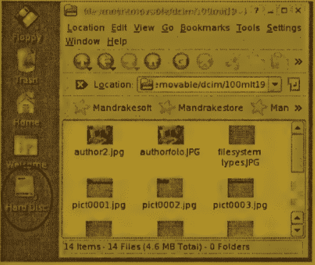
事实上，你可能会发现，甚至安装时没列出的组件也能直接用，不出任何问题。比如我的数码相机，只要把USB线插到Linux系统上就能用，相机直接出现在桌面上，通过文件管理器就能立刻访问里面的图片。我分享这个例子是想给你打气。大概率只要做个简单的配置改动就能解决你的问题。只有极少数情况是硬件厂商故意声明不支持Linux用户，这显然会引发非常麻烦的配置问题。确实有时候组件没装好，需要手动干预。本章的目的是引导你找到对应发行版的工具，让你需要做配置改动的时候有能力自己操作。


### 网络配置工具
如今市面上有大量工具和选项，能让配置工作更简单，且适配不同发行版。下文将以 Fedora、Mandrake 和 SuSe 为例展开介绍。希望这些示例能帮你找到所需的配置工具。请注意，本节不涉及网络连接运行的详细内容，相关内容已在*互联网连接*部分深入讲解。
#### Fedora 网络配置
如果你使用的是 Fedora，只需打开主菜单找到*系统设置*即可。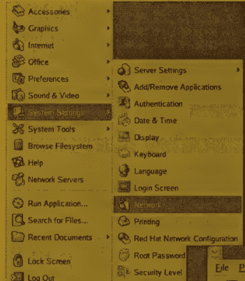 在该菜单项下选择*网络*，即可启动网络配置工具。另一种启动该工具的方式是在终端窗口中输入以下命令：
``` system-config-network ```
在该工具中，你可以修改网卡设置、新增网络硬件，或调整主机信息。点击 DNS 和主机选项卡，即可修改主机名和 IP 地址相关信息。右侧的图片展示了一台配置正确且正常运行中的 Linux 服务器示例。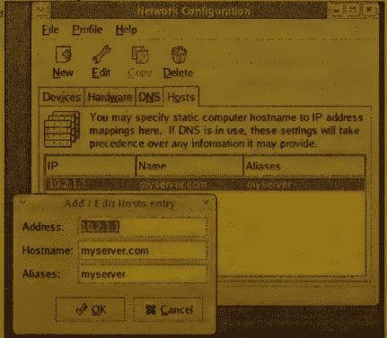
#### Mandrake 网络配置
Mandrake 用户同样可以在主菜单的*系统*图标下找到硬件配置工具。依次选择*系统*、*配置*、*配置你的计算机*即可。（参见下图示例）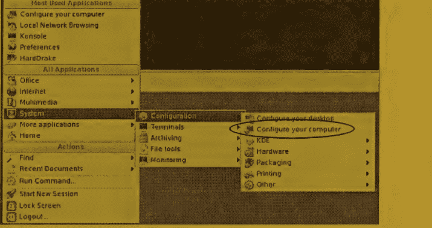
接下来你会看到 Mandrake 控制中心的主界面。由于它提供了几乎所有你需要的核心配置工具，建议你熟悉这里的所有功能。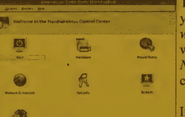
要修改网络配置，需要选择*网络与互联网*选项。在该菜单下找到并选择*新建连接*选项，即可创建任意类型的新网络。如果选择局域网（LAN），就可以设置是使用 DHCP 自动获取 IP 还是手动输入 IP 地址。关于选择和配置 IP、DNS 信息的帮助，请阅读上一章的*网络设置*部分。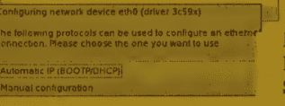
> **提示：** 有时候通过菜单操作某项功能，可能不如直接在 konsole 中输入命令来得快。要快速打开控制中心，输入以下命令即可：`drakconf`
#### SuSe 网络配置
值得高兴的是，SuSe 下所有的网络、硬件和软件配置都可以通过名为 YaST 的工具完成。你可以在主菜单中轻松找到它：依次选择*系统*、*配置*、*YaST*即可。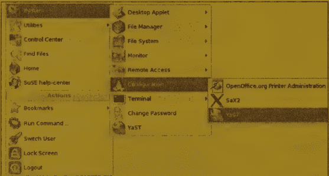
在 YaST 工具中，需要选择*网络设备*，再点击*网卡*。这会打开一个配置模块，允许你配置 Linux 系统的网络 IP 和主机信息。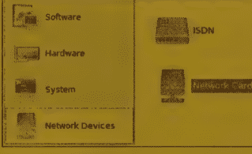
请注意，如果你已经配置过网卡，需要点击*更改*按钮，而不是*配置*按钮。如果你要修改网卡配置（这是常见情况），则应该点击*编辑*按钮。大多数情况下，你的网卡已经被 SuSe 检测到并列出。在*网络地址设置*下，你可以选择静态 IP 地址选项，确保子网掩码与你的网络匹配，还能修改主机名和 DNS 服务器详细信息。下图展示了一台配置正确的 Linux 服务器示例。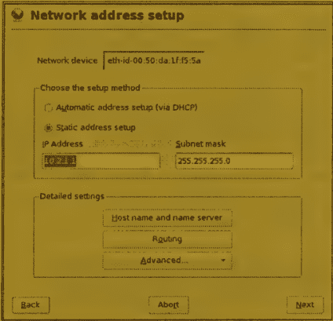
点击*主机名和域名服务器*按钮。现在你可以填写网络路由的相关信息。请务必使用完全限定的主机名和域名（参见下图示例）。另外请注意，我也将我的 Linux 服务器的 IP 和域名输入到了 DNS 字段中（图中用椭圆标注）。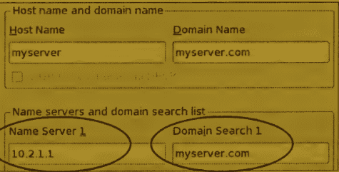
大多数情况下，你需要从网络管理员处获取正确的 DNS IP 和域名。在我的示例中，以及我在家庭网络中使用 Linux 时，我可以直接使用这些值。点击*完成*按钮即可完成并保存新的网络设置。
### 硬件配置
#### Fedora 硬件配置
使用大多数 Fedora 配置工具时，你需要以 root 用户登录，或拥有完全访问权限。不同硬件的独立配置工具大多位于主菜单的*系统设置*下。例如，选择**显示器**即可启动显示配置工具。部分工具还提供了实用的配置向导，会引导你一步步完成配置，比如**打印**工具；而另一些工具仅用于展示信息，比如**声卡**工具。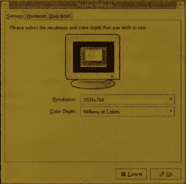
如果你更喜欢使用快捷命令而非通过菜单和图标选择配置项，以下是简短的配置工具列表。要使用其中任意工具，只需在终端中输入对应命令即可：
- system-config-display
- system-config-keyboard
- system-config-printer
- system-config-users
如果硬件未被正确检测，尝试重启系统即可。最新的 Fedora 核心版包含许多在启动时加载的更新版驱动程序。
#### Mandrake 硬件配置
大多数其他硬件的配置也可以通过 Mandrake 控制中心的 *drakconf* 工具完成（参见第 39 页）。如果需要更精细或更基础的 Mandrake 硬件配置，还可以使用名为 *harddrake2* 的工具。你可以在主菜单的*系统*图标下找到 *harddrake2* 硬件配置选项：依次找到*配置*选项，然后选择*硬件*和*Hard Drake*；也可以选择*配置你的计算机*，再连续两次选择*硬件*。请注意，如果你尚未以 root 用户登录，需要输入 root 密码才能操作，这些配置更改仅 root 用户有权限访问。接下来你会看到大部分硬件的列表，从列表中选择你感兴趣的想要配置的项即可。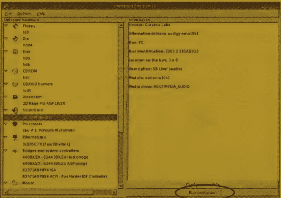
现在你会看到窗口底部出现一两个按钮，选择*运行配置工具*按钮即可。该功能几乎适用于所有硬件组件。之后你需要选择对应的驱动程序，指定硬件的详细信息，或者运行可用的故障排查工具。在某些情况下，尤其是调制解调器，安装程序无法完成配置，因为需要专有驱动程序。这种情况下列表会显示错误信息以及获取更多帮助的途径。
#### SuSe 硬件配置
如前所述，SuSe 将所有配置模块都整合到了名为 YaST 的单一工具中，让配置工作变得非常简单。启动 YaST 配置工具并修改硬件设置的最快方式，是在 konsole 或终端提示符中输入以下命令：`kdesu /sbin/yast2` 另一种访问 YaST 工具并修改硬件设置的方式是：打开主菜单，依次选择系统、配置，再选择 YaST，即可看到所有可用配置模块的完整列表。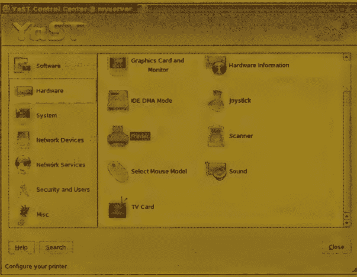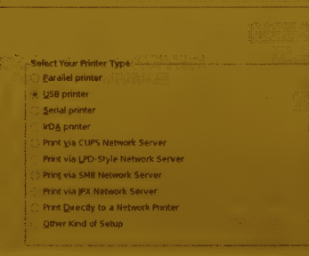
选择*硬件*后，你会看到可选择的模块列表。其中大部分模块都支持直接修改配置设置。例如，点击*打印机*图标就会弹出配置工具，允许你向系统中添加打印机。可配置的选项数量非常之多！SuSe 的 YaST 还自带许多其他独特且非常实用的功能，在解决配置问题时可能会用得到。修复硬件问题的一个非常快捷的方式是使用 SuSe Plugger 模块，该模块几乎总是在桌面菜单中就能找到。
你也可以通过以下命令打开该模块：`suseplugger` 这是检查现有硬件、修复驱动或配置相关问题的极其简单快捷的方式。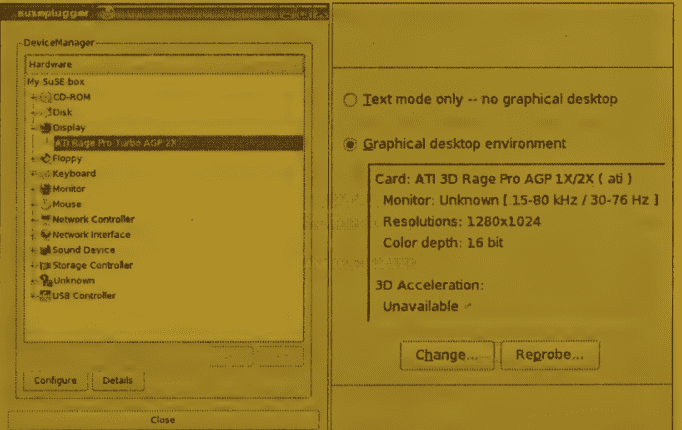
另一个独特且实用的功能是 YaST 中允许你安装硬件厂商提供的驱动程序的模块。在 YaST 主菜单中找到“杂项”（Misc）选项并选择，你就会看到“从光盘加载厂商驱动”的选项。随着硬件厂商在随产品附赠的光盘中加入 Linux 驱动数据库，这个功能会越来越实用。希望这篇简短的介绍能帮你了解可用的配置工具，以及如何在你需要时最便捷地访问它们。


## 第4章：安装旧版本
我并不会假定全世界都在使用最新版本的Linux。相反，我编写本章是为了给使用旧版本的用户做基础概述。本节中的技巧和建议几乎对所有使用旧版（2.6.x内核之前版本）Linux的用户都有帮助。

### 开始之前
- 如果你只是想制作**Linux启动盘**，请跳转至*制作启动盘*。
- 如果你只需要**配置服务器**的相关建议，请继续阅读*配置Linux服务器*。
- 如果你尚未确定要在哪里安装Linux，或者要在系统中安装哪些操作系统，请花点时间阅读前面两页的*双系统启动*建议。否则，请继续阅读更详细的安装技巧。
后续章节包含旧版Linux安装过程中会出现的常规步骤：

### 开始安装
如果你现在还没感到兴奋，当你把**Linux光盘**放进驱动器、启动安装程序时，你很快就会兴奋起来的！把**Linux CD**插入驱动器并重启系统，应该就能自动启动安装程序。
*如果无法自动启动，你可能需要修改系统的BIOS设置，将**CD-ROM驱动器**设为首个启动设备。通常是在系统启动时按Delete键或F2键完成设置。*
*有些情况下，你可能需要制作启动盘来开始安装。如果需要制作启动盘，请参阅第31页。*
一旦系统从**Linux CD**启动且安装程序开始运行，你就可以开始使用后续页面的步骤了。

### 基础安装设置
Linux首先会进行非常基础的安装设置，允许你选择语言、键盘和鼠标配置。该设置仅用于安装过程，不会影响你最终的系统配置。

### 选择自定义安装
请记住所有版本的Linux都有细微差别，但核心步骤是相同的。几乎所有情况下，你都需要首先从工作站、服务器或自定义安装中选择一项。Red Hat 8和9还包含*个人桌面版*，该版本功能非常基础，省略了许多实用工具。
- **自定义安装**允许你在安装过程中随时进行调整，灵活度最高。
- **工作站**安装会直接省略许多你可能需要的组件，例如ftp、Web服务器、telnet功能等。
- **服务器**安装是核心型安装，专为提供高性能Linux服务器设计。换句话说，使用服务器安装选项意味着系统中除核心文件外，几乎没有其他多余组件。
我总是选择*自定义*安装，不管为谁安装、安装目的是什么，因为它能给我最大的控制权和灵活度。

### 磁盘分区
包括Mandrake、Red Hat和Slackware在内的大多数Linux版本，都提供自动分区选项，也允许你自定义分区：
- 自动分区
- 使用Disk Druid手动分区
- 使用fdisk手动分区
如果你不打算对服务器进行特殊配置，请选择自动分区（通常称为**基础**）。使用较新版本的Linux时，自动分区会将硬盘简单分为三个区，适合基础使用或新手使用。不过，我更倾向于使用**Disk Druid工具**（通常称为**专家模式**）来优化分区，获得更高的灵活度。（见第10页）我很少使用fdisk，尽管某些版本中这是唯一可选的分区工具。我使用fdisk时，也只用于需要复杂分区的情况。
如果你选择**自动（*基础*）分区**，你可能会看到：
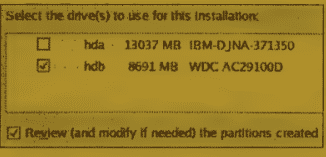
绝对**关键**的是，你**只能**选择你希望运行Linux的硬盘！否则，你将丢失所有驱动器上的全部数据！在本例中，我已**取消选中**我的Windows硬盘（*hda*）。选定要自动分区的驱动器后，请跳转至第12页。不过如果你更倾向于选择**Disk Druid工具**（有时称为*专家模式*），请翻至*下一页*查看分区详情。

### 旧版本双系统启动
#### 如何在同一块装有Windows或其他操作系统的硬盘上添加分区？
简短答案是这*可以*实现，但必须谨慎操作！详细且有记录的解答，最好在你所用Linux版本的官方网站上查找。新版本Linux已经让这一操作变得简单得多。哪怕只写一部分双启动机器的配置变体，都会超出这本基础书籍的涵盖范围！我必须坦诚告诉你，我无法推荐在多个操作系统之间共用同一块硬盘，尤其是现在新硬盘非常便宜。你还会发现有些操作系统很难与Linux实现双启动。不过，旧版本Linux与其他操作系统共用硬盘仍有一些可选方案：
1. 在其他操作系统（如Windows）下运行Linux。完全不推荐此方案，因为你会失去Linux的许多优势。
2. 擦除所有现有分区，创建新分区以支持两个操作系统。例如你可以为Windows创建ntfs分区，为Linux创建多个ext3分区。这非常耗时，且需要完全重装系统，但能实现用*一块*硬盘运行多个操作系统。
3. 购买第二块硬盘，将其安装到系统中作为Linux专用硬盘。你仍然可以选择启动哪个操作系统，但两个系统分别位于不同的硬盘上，拥有独立的分区方案，更加安全。
> **注意**：部分版本的Windows安装在第二块硬盘上时会出现问题，你可能需要将Windows安装在主硬盘上。

### 使用Disk Druid添加分区
要添加分区（即挂载点），请务必确认选中的硬盘确实是你希望建立Linux分区的那个！所选分区上的所有数据都将被删除。（如果你是在**非双启动机器**上安装Linux，这就不是问题。）
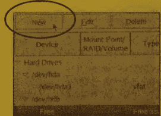
在本例中，我按下**新建**键（部分版本中为*添加*）开始使用Disk Druid创建新的挂载点/分区。如果你是用Linux替换现有操作系统，可能需要先*删除*硬盘上的现有分区。按下**新建**或**添加**键开始创建挂载点后，会弹出另一个窗口，通常标注为*添加分区*。现在你可以开始为服务器添加所需分区了。

> **提示：**对于有多块硬盘的*双启动*系统，请务必确认接下来几个步骤中选中的***可用驱动器***，**仅**是你希望用于删除和创建Linux分区的那个！每次添加新的分区挂载点时都必须重复此操作！
- [ ] hd
- [✓] hdb

#### A. 创建挂载点：**/boot**
创建**/boot**挂载点，该区域用于存放Linux内核和启动信息。我通常会为它分配最多几百MB的空间，本次安装我分配了133MB。
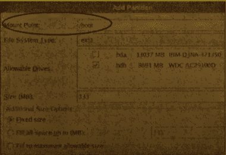

#### B. 创建挂载点：/
创建/挂载点，该区域用于存放根目录文件和大多数程序。对于旧版本，我建议分配2GB空间。

#### C. 创建挂载点：<Linux Swap>
进入*分区类型*（也称为*文件系统类型*），选择Swap，即可创建<Linux Swap>挂载点。向下滚动直到找到Swap并选中它。在大多数版本中，挂载点字段会自动填充。交换分区用于存放临时系统数据。我通常将交换分区设置得比系统总内存*小*，否则系统会更多地使用交换空间而非内存存储！例如我的服务器有512MB内存，我创建的交换分区为256MB。如果你这样做，在部分较新的Red Hat和Mandrake版本中，你会收到一条奇怪的错误提示，称交换分区太小。只要你将交换分区设置为*大于*100MB，就可以忽略这条提示。

#### D. 创建挂载点：/usr
创建*/usr*挂载点，该区域用于存放用户相关的程序和文件。务必选择*使用剩余空间*选项，部分版本中该选项称为*填充至最大允许大小*。这会修正实际大小，将硬盘的剩余空间全部分配给/usr。你要从Linux光盘安装所有内容，总磁盘空间至少要有4GB！有关软件包大小的更多信息，请参阅第15页的*软件包安装*。

> **提示：**你还可以添加**/home**挂载点，为单个用户提供独立的挂载目录。如果你预计该服务器会有大量用户，且计划未来为他们添加额外的磁盘空间，这一配置会非常实用。


### **选择要格式化的分区**
部分较旧的Linux版本需要手动执行此步骤。在部分Linux版本中，你会看到刚创建的*挂载点*及其精确路径名称的列表，其中还会说明这些挂载点会被放置在哪块硬盘上。请注意，*hda*是你系统中的主硬盘。除非你确认要将Linux安装在这块硬盘上，否则不要允许格式化该驱动器。除非你怀疑硬盘存在错误，否则无需勾选“检查坏块”（这是一个可选选项）。另外，如果你使用的旧版本包含此步骤，你可能需要暂时跳转到第31页的*创建启动盘*部分。

### **引导加载程序配置**
请将LiLo或GRUB设为默认引导加载程序。如果你的Linux发行版未将LiLo设为默认选项，你可以通过选择*更改引导加载程序*来选中它。部分情况下，默认引导加载程序为GRUB。这完全是个人选择。我更喜欢继续使用LiLo，因为我已经多年无故障使用它。不过也有人更青睐GRUB。你只需要确保选好了引导加载程序即可！
引导加载程序必须安装在你的第一块主硬盘（*hda*）上才能正常工作。如果系统提供将LiLo安装在*MBR*（主引导记录）或*第一扇区*的选项，请选择*MBR*，除非你计划搭建与Windows NT双启动的服务器。

### **网络设置**
取消勾选DHCP选项，并确保手动设置主机名。我通常搭建独立运行的Linux服务器，例如公司内部网站服务器。因此我几乎从不使用DHCP（动态主机配置协议）。如果你希望由另一台服务器来分配这台系统的网络IP，当然也可以使用DHCP，但说实话我觉得这有点多此一举。主机名通常是一个简单的名称，例如：`myserver`
部分Linux版本（通常是精简版）的安装程序没有包含设置网络主机和IP的详细步骤。无论如何，我都建议你手动添加这些信息。之后你随时可以在Linux命令行输入`netconfig`来添加或修改网络配置：
- 手动输入系统的IP地址和主机名。部分Linux发行版支持通过点击网络设备名称旁的*编辑*按钮完成此操作。
然后取消勾选DHCP选项。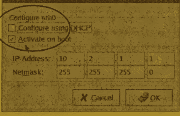

我就以自己服务器的IP设置为例。我的服务器部署在防火墙后，只需要将这台服务器的主机名设为myserver，IP设为10.2.1.1即可。只需在对应字段中输入你机器的IP和子网掩码即可。部分Mandrake、Red Hat和Slackware发行版在你指定IP后，会自动填充子网掩码、网关等字段。如果你的Linux系统自动填充了子网掩码，请确认你是否真的应该使用默认的255.0.0.0设置！大多数网络需要使用255.255.255.0。DNS服务器IP的字段不会被自动填充。你需要从本地网络中的其他设备获取这些IP，如果暂时没有域名服务器，也可以先留空。

> **提示：** 在很多企业场景下，搞清楚这些参数该怎么填的最简单方法就是查看附近的一台电脑。你可以尝试以下方法获取你所处网络的IP信息：
> - 如果你的局域网中已有其他Linux服务器，可以使用以下命令：`netstat`
> - 如果你的局域网中有较旧的Windows电脑，可以使用以下命令：`winipcfg`

### **防火墙设置**
如果你不知道该怎么设置，直接把防火墙设为中等级别即可！对于运行简单的Linux内网网站服务器这类场景来说，这个设置足够了。同时你也需要结合自身系统的安全需求考虑。如果你的系统要直接连接互联网，安全风险会大幅提升。

**提示：**我目前在企业防火墙内搭建服务器，虽然安全始终很重要，但通过以下操作自定义中等级别安全防火墙，可以省去不少麻烦：
- 将ETH0（我的服务器网卡）设为受信任设备
- 勾选TCP、FTP、SSH和Telnet选项，允许来自这些连接及对应端口的入站访问
如果你的服务器要连接到互联网，这么做**绝非**明智之举！

### **选择语言和时区**
直接选一种语言然后继续下一步即可！

**提示：**将语言设置保持为*默认*，然后继续下一步即可！我之前有个同事，觉得给Linux服务器换个新奇独特的语言挺好玩的。他选了一种语言，结果服务器界面他完全看不懂，最后只能重装整个系统。我只能说他是自食其果了！

**时区：**选择正确的时区非常重要，否则会影响到你的用户。如果用户的文件、所有程序的日期时间戳都差了几个小时，他们可不会觉得这有什么好笑的！同时正确设置服务器时间也很重要，因为有很多CRON或其他对时间敏感的任务需要精确的时间设置！

### **创建root用户和新用户**
我无论如何都要强调：root密码要设置得容易记忆，但又要足够难破解。我数不清有多少次接到朋友深夜打来的电话，问我能不能帮他们回忆起安装时设置的root密码了！任何Linux服务器的默认完全权限登录账号都是*root*。此外，记得花时间给你的服务器添加一个额外的登录账号。你可以通过点击*添加*按钮或选择*新建用户*选项来完成这一步。记得为自己创建一个额外的用户账号。我的服务器始终都有一个备用登录账号，因为使用root权限执行部分操作非常危险！我通常会额外创建一个账号给自己，然后继续安装流程。

### **密码保护**
我总是使用MD5密码和Shadow密码（阴影密码）。我很少启用NIS、LDAP或Kerberos。在最新的Red Hat和Mandrake发行版中，SMB也是一个可选选项。部分企业场景中如果Kerberos ID是标准配置，我就必须启用该选项。不过对于简单的Linux服务器来说，这些都没有必要启用。

### **软件包安装**
现在到了选择要安装的Linux应用程序的步骤，可供选择的选项非常多！大多数情况下，直接安装所有软件包完全没问题！如果你有时间和足够的磁盘空间，就可以这么做！具体怎么选完全是个人选择，但需要考虑到：安装**所有**软件并不会让后续使用更轻松，而安装**过少**的软件则肯定会让后续使用更麻烦！

我强烈建议你安装**两款**桌面环境*KDE*和*GNOME*，它们都附带各自独有的应用程序。这两款是非常流行的桌面环境。如果有条件，非常建议两款都装，因为它们各自都附带大量额外的应用程序和实用工具。具体选择权在你手上，我也建议你花时间浏览一遍基础的软件包列表。如果你计划安装所有软件包，请确保预留至少4GB的磁盘空间。如果跳过部分我用不到的开发工具（比如*内核开发*工具）和一些*服务器*组件（比如DHCP服务器、新闻服务器），安装所需空间约为2GB。另外，很多人对此有误解：不需要安装*Windows文件服务器*就能实现同一台电脑上Linux和Windows之间的基础文件共享。这个服务器组件实际是用来加载Samba及其他专门用于网络文件共享的工具的。请注意，本书中提到的一些工具，只有在你选中对应的软件包或者安装所有软件时才会被安装。

### **创建紧急启动盘**
部分较旧的Linux版本会在*选择要格式化的分区*步骤之后直接包含这一步。另一些版本则只会在安装流程的最后包含这一步。

**那么，对于旧版Linux来说，这么做是明智之选吗？**
答案是肯定的！事实上，不创建启动盘直接跳过该选项，就像往马蜂窝里扔石头一样愚蠢。你可能一段时间内不会遇到问题，但最终肯定会吃亏！你也可以在安装**完成后再**创建启动盘，但操作会麻烦很多。如果你已经安装了Linux但需要启动盘，可以参考*创建启动盘*一章。否则就继续下一步，让安装程序帮你创建启动盘即可。

### **大功告成！**
至此你已经完成了所有安装步骤！

### **启动故障排查小贴士**
第一次启动Linux服务器时，你会看到大量详细配置信息在屏幕上滚动。这些信息旁边应该都带有绿色对勾或者显示“OK”字样。
- 如果启动时出现长时间卡顿，或者Eth0、Sendmail旁边显示*失败*字样，你只需要给系统的网卡插上网线，或者修改网络配置即可。当你终于绕过卡顿进入Linux服务器后，在xterm终端中输入：`netconfig`
- 如果启动系统时在初始加载阶段出现**无限期**卡顿，你可能需要重启电脑。如果重启没有解决问题，你可能需要尝试使用紧急启动盘。这种情况有时是由安装错误导致的严重故障引起的。
- 安装错误的其他症状还包括**硬盘**错误，系统会提示你使用`fsck`命令修复。很不幸，这通常意味着你的硬盘存在坏道，或者Linux安装文件已损坏，需要重新安装。


## 第2节：桌面界面
## 第5章：初识桌面
我们如今熟知的这类界面，带有工作过程中会开合的小图标和屏幕，最早只是最原始的文件管理器。微软Windows最初是DOS之上的图形化界面，旨在帮助用户管理日益增多的计算机文件。如今毫无疑问，这些直观的图形化界面能帮助我们更高效地工作、更快速地学习。20世纪80年代苹果发布Macintosh系列产品时，为这一概念的发展提供了强有力的推动。在此之前，大多数计算机的操作完全依赖用户输入文字指令。颇具讽刺意味的是，即便到了今天，这些精密的图形化界面本质上仍由文字指令驱动，只是这些指令如今大多被隐藏了起来，不会直接展示给用户。
这段简史揭示出桌面界面的两个非常重要的特点：第一，无论是微软的Windows、苹果的OSX、Linux的Gnome、Linux的KDE，还是太阳公司的Solaris，桌面界面本质上都只是图形化呈现，向用户隐藏了一串指令；第二，这些底层指令本身所执行的任务类型也大同小异。这就导致如今大多数操作系统的界面功能都非常相似。用直观且实用的方式图形化展示目录内的文件列表，可选择的方式本就不多。切换不同界面时，大部分核心功能都完全一致：打开屏幕是为了展示新信息或应用程序，关闭屏幕需要点击菜单选项，保存内容需要另一个菜单选项，切换屏幕也需要视觉提示来帮你判断当前哪个屏幕处于激活状态。
本以为切换到Linux会很困难，但你会发现一个非常明确的事实：所有这些独立的界面其实都非常相似。有人曾跟我建议，这些界面相似度已经很高，新手入门指南只需要提供功能概要即可。但我并不认同。那既然如此，我为何还要花时间写好几章来介绍界面呢？毋庸讳言，我的朋友们和同事们真正需要的是从一种界面切换到另一种界面的入门起点。在接下来篇幅不算长的几章里，我会为Linux新手提供顺利切换所需的核心信息，帮助大家快速上手。读完这几章，你会对桌面界面有较为全面但未必完整的认知。剩下的学习内容就交给新手们自行探索了，我希望大家很快就能发现，实践经验远比书本上的文字要生动丰富得多。
为了简化内容、达成这个目标，我会重点围绕两个核心需求展开：
1. 我会用非常基础的一章内容，为仍在使用**微软Windows**的读者介绍如何顺利切换到Linux；
2. 我会详细介绍Linux上使用最广泛、支持最完善的桌面界面——**KDE桌面**。
对于Linux资深爱好者来说，我知道我遗漏了其他不错的替代方案。这一点属实，我公开承认。但对于至关重要的新手用户而言，我会在清晰传递核心信息的前提下，为未来的可选方案留足空间。我希望大家读完本节内容后，能收获足够的新信息，实现相对平缓的Linux切换，不会感到信息过载。和之前一样，我非常期待收到更多新手用户关于本节内容的反馈！感谢所有为本章节提出建议的朋友们，**谢谢你们**提供的想法；希望我没有辜负大家的期待。所有写作都是集体协作的成果，我尤其感谢那些不吝抽出时间，在留言板上针对本节内容许下的心愿清单，发布认真且有益建议的Linux新手们。

## 第6章：从Windows到Linux
### 平缓切换小贴士
*本章旨在帮助新手用户熟悉环境控制选项，按需进行修改或新增设置。本章会将Windows环境与两种最常用的桌面界面——Gnome和KDE进行对比。*
如果你有过任何图形用户界面（GUI）的使用经验，切换到Linux会相对简单。实际上，唯一较大的挑战就是*找到*你需要的核心工具和应用程序。希望本章节能为你提供不少思路，帮你了解如何获取Linux的关键工具，以及它们和Windows工具的对应关系。

### 入门起点
在Windows里，我通常从微软开始菜单选择应用程序，这个操作非常直观，很容易上手。同理，不论我用的是Gnome还是KDE桌面，第一步都是找到主菜单按钮。大多数情况下，这个按钮位于屏幕左下角，通常只会显示你所用发行版的标识。例如：Fedora版Gnome主菜单、Gnome默认版主菜单、KDE默认版主菜单、SUSE版KDE主菜单。几乎所有情况下，只要你正确安装了对应的Linux发行版（具体安装建议可查阅安装章节的相关推荐），主菜单下都会列出大量程序。本书后续内容中，我会频繁提及主菜单中可用的程序，并说明它们对应的菜单位置。需要注意的是，如果你没有按照我的建议完成安装，后续提到的部分菜单项可能不会出现在你的主菜单中。

### 至关重要的文件管理器
我们先来了解一款和Windows相关的重要工具。如果你在Windows环境中使用过一段时间，应该会熟悉名为*Windows资源管理器*的文件管理工具。通常，*Windows资源管理器*藏在微软主菜单*开始*菜单下的*附件*子菜单里。那么，我们该如何打开Linux中同样至关重要的文件管理器呢？它的名称随发行版不同而不同，但始终可以从主菜单找到。在Fedora发行版中，它就是一个名为*浏览文件系统*的图标。
> 📁 浏览文件系统
这与**Gnome**界面的设定一致。为什么呢？Gnome是Fedora等*部分*Linux发行版的默认桌面环境。你甚至可以选择切换到KDE等其他环境，这是Windows不具备的功能。我稍后会详细介绍这一点。
另一种打开**Gnome文件管理器**（名为**Nautilus**）的方法是使用“终端命令行”（详见第16页），输入以下指令：
```bash
nautilus --browser
```
其他很多Linux发行版使用的是**KDE**桌面界面。在KDE中，文件管理器位于主菜单下，名称就是*Home*（主目录）。
```bash
# You can also access the KDE file manager (named *Konqueror*) any time by typing the following command into a Konsole prompt:
Konqueror --profile filemanagement
```
下图是KDE的Konqueror文件管理器的使用示例。
Gnome的Nautilus文件管理器和KDE的Konqueror文件管理器都支持完成常规且必要的操作。例如，你可以通过拖拽或手动操作的方式用这些工具复制文件，还可以重命名文件、查看文件大小、修改文件权限。要执行上述大部分操作，首先选中需要修改的文件或文件夹，然后将指针移到目标对象上，点击**鼠标右键**，就能看到一系列用于修改文件/文件夹的专属选项了。
> **小贴士：** 为什么Nautilus会崩溃？Nautilus出现故障的原因有时是你对文件执行请求的修改操作时出现了错误（请不要因此埋怨你的Linux发行版，这通常是Gnome Nautilus本身的问题）。我曾遇到过这类情况，根源往往是文件或应用的权限问题。


### 更改文件权限
更改文件权限是使用Linux过程中的重要环节。在Windows系统中，这个问题很少出现，因为大多数文件默认不会被意外删除保护。但在Linux中，你会发现很多文件需要修改权限才能进行编辑。这一预防措施帮我避免了很多麻烦。通过教你如何修改文件权限，我希望让你相信，绝大多数你在Windows资源管理器中能完成的操作，都可以用Linux文件管理器以类似的方式完成。
选择要设置权限的文件。点击鼠标右键，选择*属性*选项。接着点击*权限*选项卡。你会看到一个易于操作的界面，可以在其中修改文件的相关权限和特权。
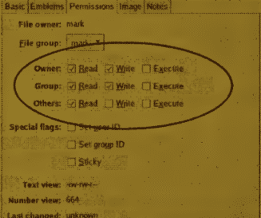
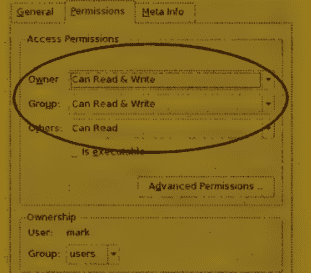
Gnome权限设置界面。KDE权限设置界面，点击*高级*按钮可查看更多选项。
注意，在本例中，该文件允许所有人读取，但仅允许我和我所在组的成员写入。另外，由于这是一个图形文件，它不是可执行程序或脚本。
后续当你管理Linux个人电脑，或是开始执行运行Linux系统作为服务器这类更复杂的操作时，设置权限会变得非常重要。本次简要回顾也展示了Linux文件管理器的功能及其使用方法。

### 通过控制面板配置电脑
微软Windows为用户提供了便利，将绝大多数配置相关工具都集中在一个名为*控制面板*的位置。
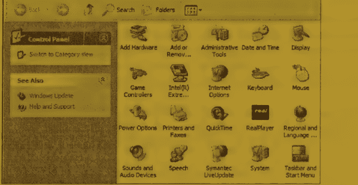
在这里你可以进行硬件和软件相关的配置。这些工具提供了丰富的选项，可用于添加新硬件设备、修改硬件设置，也有其他工具支持你更改桌面背景或颜色。
在Linux中，硬件和软件相关工具通常是分开的，但都很容易找到。针对Linux**硬件**相关的更改，请回顾前文的*安装后配置*部分。针对**软件**相关的配置，比如更改桌面背景，Gnome和KDE都在主菜单中提供了对应工具。例如，在KDE中，你可以找到*控制中心（又称：配置桌面）*来进行桌面相关更改。
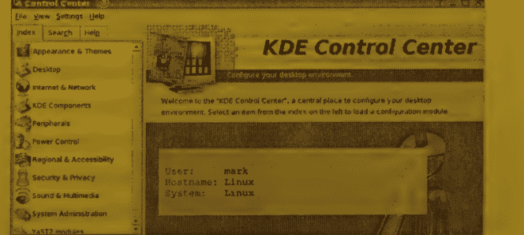

### **查找系统中的程序**
Linux文件系统中的工具和程序都存放在哪里？如果你曾经浏览过文件层级结构，就会发现它和Windows的文件结构完全不同。这种设计既有优势也有劣势。
从优势来看，Linux文件层级的创建顺序和方法确保了核心系统文件与个人用户文件永远不会混杂，同时也保障了系统安全性更高——因为层级结构是围绕用户需求和权限定义的。
但对习惯使用Windows的用户来说，这也意味着在Linux中查找程序会非常折腾。
我给你举一个文件层级差异的直观例子。在Windows中安装MS-Word这类新应用时，实际程序会被放在*Program Files*目录下。看下面的例子，你会发现Windows版MS-Word和Linux Fedora版OpenOffice的位置有明显差异：
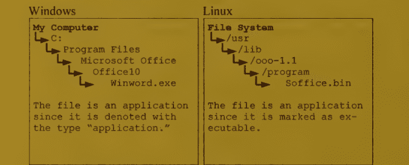
文件层级结构可能是Linux最让人头疼的部分，而不同发行版之间的差异更是加剧了这一问题。例如在SuSe系统中，Soffice.bin应用就存放在/opt目录下。因此，如果你需要某个特定程序，又不知道相关技巧，可能要花无限长的时间在无数目录里翻找。很多年前我刚接触最早的Linux图形界面时，有时为了找应用的位置花太长时间，等我找到需要的程序时，胡子都长出来了！
为了避免你遇到同样的麻烦，我给你几个建议，帮你快速找到需要的应用。

#### **Gnome搜索示例**
启动*Gnome搜索工具*（上文提到过）。打开后一定要修改搜索目录：点击*浏览*按钮，选择*文件系统*，这样搜索范围就会覆盖整个硬盘，而不是单个目录。接着点击*打开*。
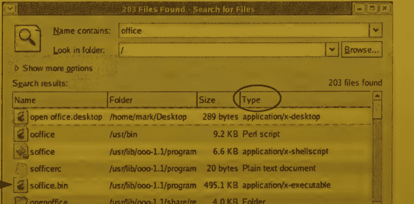

#### ***Gnome搜索示例（续）***
在**Gnome搜索**窗口中，在输入框里输入你要搜索的关键词。比如你要找OpenOffice办公套件，就可以输入关键词`office`。点击**查找**按钮，就会显示所有和Office相关的文件的位置列表。
看上一张图里的*类型*列标题，它可以告诉你文件是程序还是图形文件这类其他类型的文件。要启动OpenOffice程序，你需要找到**应用程序**或**可执行文件**（上一张图里用箭头标注了这类文件）。
这和MS-Windows的搜索功能非常相似，唯一的区别是，你**无法**从Gnome的搜索结果列表里直接启动程序。你需要先把可执行文件添加到桌面，才能启动程序。稍后我会教你具体操作方法。

#### **KDE搜索示例**
和Gnome类似，KDE的查找工具也能帮你完成大部分繁琐的搜索工作，相对容易地定位程序的位置。启动**Kfind**工具，在*名称:*输入框中输入搜索关键词。之后你需要修改*查找范围:*设置，使其覆盖整个文件系统。点击**浏览**按钮选择根目录/。
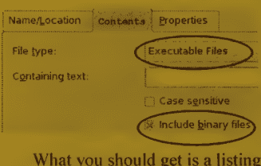
现在切换到*内容*选项卡，勾选**两个**非常重要的选项：在*文件类型:*下拉菜单中选择*可执行文件*，同时启用*包含二进制文件*选项。然后点击查找按钮。
此时你会看到主要的OpenOffice文件及其位置列表。你可能会惊讶地发现，实际的soffice.bin文件**没有**出现在结果里！
别急，解决方法很简单。它没有出现是因为你的搜索条件设置得过于严格。换一种方式，在Kfind中搜索程序时，可以尝试在关键词两端加上*通配符。

这个方法确实很简单，但也有需要注意的地方。有时可执行程序无法直接在所属目录中运行。因此，查找可执行文件或shell脚本（用于运行远程可执行文件的脚本）的首要位置是你自己的用户目录！用Konqueror文件管理器打开你的用户目录看看，你很快就会发现OpenOffice的shell脚本实际上存放在`/username/OpenOffice.org1.1`目录下，文件名为`soffice`。


### **将程序添加到桌面**
当你找到可执行文件或其shell脚本的位置后，就可以轻松将它添加到桌面。接下来我们将介绍如何添加可执行程序：在Gnome中这个程序叫`soffice.bin`，在KDE中则是`soffice`这个shell脚本。
在微软Windows系统中，添加程序到桌面的操作是：使用文件资源管理器找到对应程序，复制后粘贴为快捷方式。
在Gnome中，你需要右键点击桌面（注意指针不要放在打开的窗口上），弹出菜单后只需选择*创建启动器*选项。接着点击*浏览*按钮，你就可以浏览目录列表找到OpenOffice程序了。本例中我们依次选择文件系统、`/usr`、`/lib`、`/ooo-1.1`、`/program`，最后双击`soffice.bin`即可。
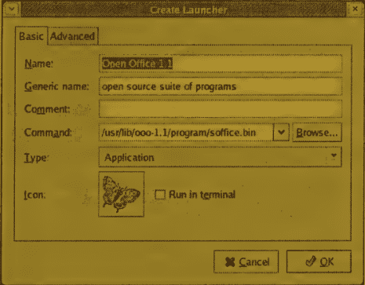
找到`soffice.bin`并填好上述其他信息后，你就可以在桌面上创建快捷方式了！点击*确定*，桌面上就会出现对应的图标。现在双击桌面上的图标就能看到效果，它会自动打开OpenOffice程序。如果你想写一封信并保存，在主菜单中选择*文件*，然后选择*新建*，最后选择*文本文档*即可。现在你就可以使用OpenOffice文字处理器了！如果你之前没使用过OpenOffice，你会发现它可以保存为多种格式（包括Microsoft Word格式），你一定会感到惊喜。
在KDE中，你也可以通过右键点击桌面（注意指针不要放在打开的窗口上）快速添加程序到桌面。举个例子，既然我知道`soffice`这个shell脚本存放在我的主目录下，就可以通过以下基础步骤把它添加到桌面：
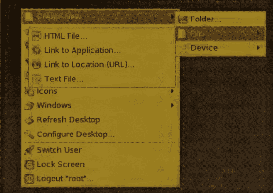
- 首先，在桌面上点击鼠标右键，这会弹出包含**新建**选项的菜单。选择**新建**，再选择**文件**。
- 接下来，你需要确定要放到桌面的文件类型。OpenOffice是应用程序，所以选择**应用程序链接**。此时会弹出“应用程序链接”窗口。
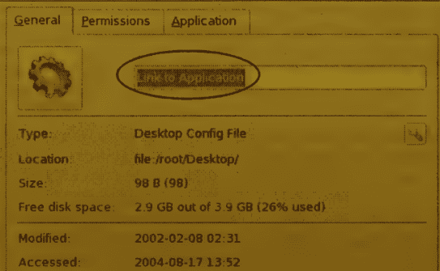
在“应用程序链接”窗口中，填写应用程序的名称，然后点击“应用程序”选项卡。
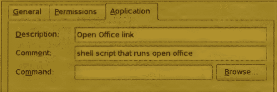
你需要填写的核心信息只有“描述”和“命令”两项。点击*浏览*按钮找到对应的可执行文件或shell脚本，然后浏览文件和目录层级直到找到目标文件。对于KDE版的OpenOffice来说，这个文件很容易在OpenOffice.org 1.1文件夹下找到。不过如果你想找的文件不在你的用户目录下，只需点击向上箭头就能回到上一级目录层级。
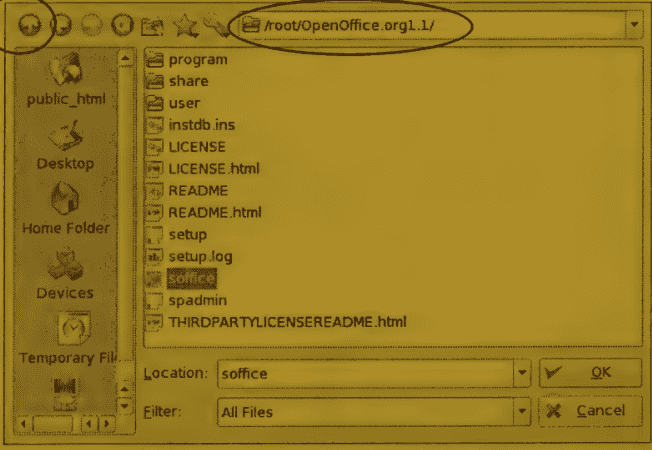
确定要添加到桌面的可执行文件或shell脚本后，选中它并点击*确定*按钮。接下来就可以回到“常规”选项卡，点击一次*常规*选项卡就能返回主菜单。

点击图标即可更改选中的图标样式，选择一个适合对应应用程序的图标后点击*确定*按钮。再次点击*确定*就会保存更改，将新应用程序（本例中为shell脚本链接）添加到桌面。现在单击新创建的桌面图标试试效果吧！OpenOffice会在几秒内加载完成。如果你想写文档或信件，在主菜单中选择*文件*，然后选择*新建*，再选择*文本文档*即可。现在你就可以使用OpenOffice文字处理器了。你还会惊喜地发现，OpenOffice可以保存为多种格式，包括最新版的Microsoft Word格式。
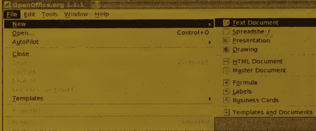
### **操作成功！**
#### 将程序添加到底部面板或菜单
Linux桌面底部悬浮的菜单栏在Gnome和KDE中都叫做面板菜单。要把项目添加到面板，你只需把它从桌面拖到面板上即可。比如我们刚才在桌面创建的OpenOffice链接，就可以直接拖到面板上，松开鼠标后就会在面板上生成一份快捷方式副本。或者在Gnome中，你也可以右键点击面板，然后选择*添加到面板*，再选择*启动器*，填写*启动器*的相关信息就能在面板上创建快捷方式了。道理很简单，只要你知道了应用程序的**所在位置**，添加应用程序的过程就非常容易，而找到应用位置是最关键的一步！所以熟悉文件结构、文件管理器和文件搜索功能是至关重要的前置步骤。
#### Gnome主菜单的烦恼
如果你卡在不知道往主菜单添加程序这一步，很可能是以下两个关键问题导致的：第一，Gnome虚拟文件系统的配置肯定出了什么问题；第二，多个版本的Fedora系统的*开始*菜单项被**禁用**了写权限。原本的操作流程非常简单：你可以用Nautilus浏览器进入*桌面*，选择*开始*，然后找到你想添加应用程序的对应菜单，右键点击，按照我之前写的*启动器*步骤添加程序即可。
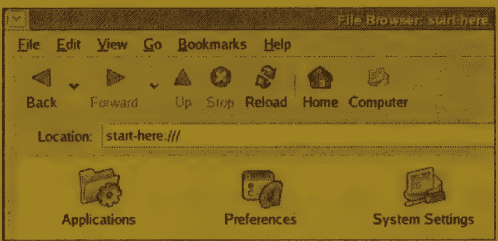
但实际情况是，这个方法在很多时候都行不通。我读了很多用户的痛苦留言，他们都表示这个问题非常让人挫败。当然，要绕过这两个烦人的问题也不是没有办法，但解决方案需要用文本编辑器编辑配置文件，我一般不推荐初学者这么做。对于刚接触Linux的初学者来说，需要修改配置文件才能让*桌面*正常工作的思路完全称不上友好，也没有任何价值。如果你有勇气尝试用Gnome菜单配置文件手动添加菜单项，那祝你顺利！Gnome相关网站上有大量技巧和提示可供参考。出于个人原则，我不会把这种方法放到这本入门书里，这可能更适合放在Linux桌面专著中，而不是入门指南。不过别急，如果你偏爱Gnome，还请继续往下看，我会在下一页给出一些可能有用的建议。
### 给Gnome用户的一些小贴士
虽然我个人推荐将KDE设为默认桌面，但我并不打算强迫任何人接受我的选择。如果你坚持要使用Gnome，希望这些小贴士能帮到你。
- 在Gnome中，如果出现问题，你可以尝试使用Gnome帮助来了解问题所在以及可能的解决方案。你可以在终端提示符中输入以下命令打开帮助：`gnome-help`
- 更新Gnome或Nautilus这类组件可能会解决问题，你可以从Gnome官网下载更新包。比如要下载Nautilus的更新，可以访问这个网站：`http://www.gnome.org/projects/nautilus`
- 如果你使用的是Fedora Core 2或更高版本，下载rpm文件可能比tar包更合适。这种情况下，我推荐你去rpm资源网站查找你需要的具体包，比如Nautilus。两个比较靠谱的起点是：`www.rpm.find.net`
`www.rpm.pbone.net`
- 最后，如果你非常喜欢Gnome，想要添加新主题，可以访问这个网站：`http://art.gnome.org/themes`


### 将程序添加到主菜单（续）
**KDE用户**，将新项目添加到主菜单的过程简单直接。KDE菜单编辑器工具可以让你轻松地在现有主菜单中添加新项目。
- 将鼠标指针移至KDE主菜单图标上方，按下鼠标右键打开*菜单编辑器*。

- 你将看到主菜单文件夹列表，选择与你要添加的新程序最匹配的文件夹。如下方的SuSE示例中，选中了*应用程序*文件夹。
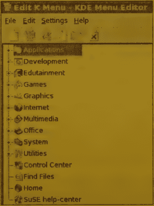
> **注意**，不要随意修改菜单项，尤其不要删除项目！
- 应用程序文件夹默认通常为空
- 开发文件夹包含文档
- 教育娱乐文件夹默认通常为空
- 游戏文件夹包含KMahjongg等丰富游戏
- 图形文件夹包含非常实用的GIMP软件
- 互联网文件夹包含Konqueror浏览器
- 多媒体文件夹包含K3b光盘刻录工具
- 办公文件夹包含Kwrite或OpenOffice Writer办公软件
- 系统文件夹包含配置工具
- 工具文件夹包含计算器等基础工具
- 控制中心用于修改桌面图形界面
其他文件夹通常由特定发行版添加……你会发现不同发行版的文件夹列表可能有所不同，但添加新应用程序的方法是完全相同的。
- 从*文件*菜单中选择*新建项目……*来添加菜单项。
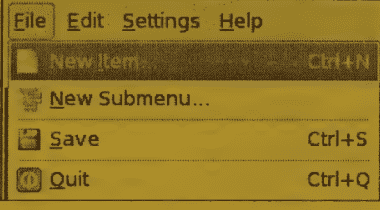
- 在*项目名称*输入框中为你的主菜单项输入直观的名称，确保你自己能看懂！按下*确定*继续。
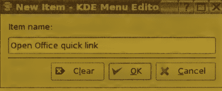
- 在*菜单编辑器*主窗口中，在*注释*输入框中补充信息有助于进一步说明这个新项目的作用。
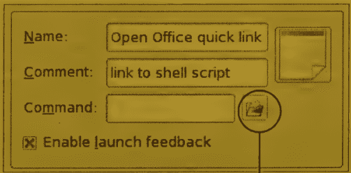
- 点击文件夹图标找到你要添加到菜单的特定应用程序。
- 在新窗口中，如果需要可以在目录层级中使用**向上箭头**导航，然后从列表中选择一个应用程序，按下**确定**按钮。
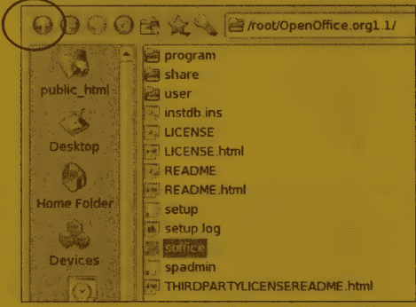
- 现在你可以在**菜单编辑器**主窗口中点击**图标**图像，为这个项目选择特定的**图标**。你也可以添加快捷方式，无需打开菜单即可启动这个应用程序。
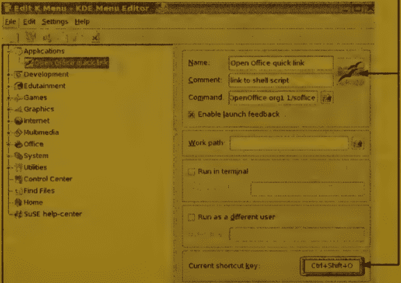
- 现在从菜单中选择*文件*，*保存*你新建的菜单项。几秒钟后新菜单项就可以使用了！


## **第7章 KDE桌面介绍与配置**
*本章是入门章节，通过配置提示以及在KDE环境中使用真实应用的教程，概述KDE界面的使用方法。*
当你读完这本非常简短的章节时，我希望你可以：
1. 快速找到并使用KDE Konqueror作为浏览器和文件管理器
2. 使用KDE控制中心
3. 根据自己的偏好自定义KDE桌面环境
4. 亲手体验Ximian Evolution电子邮件程序

### 欢迎来到KDE和Konqueror
如果你之前有机会快速翻阅上一章，应该已经对Konqueror及其多样的功能有所了解。我自己也经常使用Konqueror，用它浏览网站、处理文件管理任务、遍历目录查找配置文件，它已经成为了我不可或缺的工具。
在开始阅读本节前，我要告诉你：KDE开发团队在文档编写方面做得非常出色，在他们力所不及的地方，SuSE等各个发行版会补全并跟进相关内容。也就是说，你可以找到大量优质的Konqueror使用文档。
在大多数发行版中，安装所有KDE应用程序后，Konqueror会自带四个主要配置文件。这一点非常有用，因为网页浏览和文件浏览本质上是不同的，每个配置文件细微却实用的差异能让使用更便捷。
你的菜单中的图标已经针对不同需求设置了对应的专属配置文件。例如，*Home*（主目录）按钮会启动用于文件管理的Konqueror配置文件，而*Web*（网页）按钮则会启动用于网页浏览的Konqueror配置文件。


### 文件管理
启动后会进入你的用户目录并显示文件列表，包含带有快速访问选项的菜单栏，其中还有网络按钮。

### 网页浏览
会打开标准的浏览器窗口，带有快捷选项和已保存功能，比如可以链接到你常用网站的收藏按钮。

### 文件预览
是非常实用的文件系统视图，第三个面板可以预览任意选中文件的内容。它不会显示可执行文件的内容，但允许你选择并打开程序。你无需用编辑器打开单个文件再关闭，就能快速查看文件内容，非常方便。

### 午夜指挥官（Midnightcommander）
如果你想了解你执行的每个操作在后台运行的各种命令，或者需要查找特定文件和目录的路径，又或者只是想学习Linux文件系统的层级结构，这个视图正适合你。
如何切换Konqueror的视图？你可以参照前几页创建能执行相同命令的菜单项：将以下命令输入到运行命令菜单选项、菜单编辑器的命令输入框中，或者直接在Kconsole或终端中输入即可：
```
konqueror --profile filemanagement
konqueror --profile webbrowsing
konqueror --profile filepreview
konqueror --profile midnightcommander
konqueror --profiles (shows the available profiles)
konqueror --help (offers help on using the command)
```

### KDE控制中心
要打开KDE*控制中心*，你可以从主菜单中选择它，也可以在Konsole提示符中输入命令：`kcontrol`
这句话可能看起来显而易见，但你可以用这个工具修改桌面的几乎所有图形和设计方面。它可配置的选项也远比你需要的多。不过无论如何，我一开始不建议你改得太激进。请不要随意修改核心工具，也不要过度发挥个人创意。
我的一位同事曾尝试使用新后现代主义风格，由于颜色过于鲜艳，加上不断闪烁的橙绿色屏保，他暂时失明，无法工作。
尝试新外观当然很有趣，但我更喜欢*控制中心*的实用功能。例如，在*外观*和*主题*菜单项下，修改桌面背景颜色的选项就非常实用。


**你可以为每个使用的桌面设置独特的背景。**
如果你计划在Linux系统中以root用户执行大量工作，且你的发行版特意设置了醒目的背景来提醒你使用root存在风险，这个功能就格外实用。
你可以通过这个界面控制许多你之前想都没想到的功能。例如，**启动反馈**功能可以修改系统等待光标的外观和功能。
你可以在*桌面*菜单下的*多桌面*选项中添加更多桌面。我使用的是17英寸的大显示器，即便如此，为不同任务单独设置桌面也有帮助，我可以在不同桌面打开应用程序，不会和已经打开的其他工作混在一起。我通常会开4个桌面。

四个桌面各自运行不同的应用程序，面板会显示所有跨桌面运行的程序。我的电脑上同时运行了很多程序，但界面依然整洁。


使用面板菜单中那个漂亮的小桌面按钮（来自上一页），多桌面功能可以让你快速在不同工作区之间切换，几乎就像创建了三个可用的虚拟屏幕。唯一的缺点是系统需要足够的内存来支撑每一个新打开的桌面。我通常建议每打开一个桌面，至少要预留64MB的RAM。

我通过拖动滑块将桌面数量扩展到了4个。虽然这个界面不算最直观的，但功能完全够用。在主控制中心菜单里，你能找到大量可以修改的工具和配置项。我也推荐你查看「安全与隐私」菜单，在这里你可以修改密码文件的加密类型、KDEWallet程序存储网页相关密码及发送给电商网站的其他信息的方式，还能调整系统自动进程的相关设置，防范信息泄露。举个例子，在隐私设置下，我强烈建议你勾选启用所有选项。
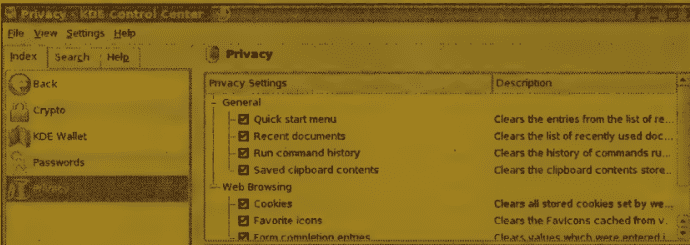
如果你还不知道这个技巧，就会错过很多其他配置功能：只要选中「搜索」选项卡，再输入特定的关键词，搜索结果下就会出现许多新的可选设置。

### 从「安装」到「运行」KDE应用程序
本教程将以**Ximian Evolution**（一款功能非常丰富的邮件和日历程序，与微软Outlook类似）为例。目的是帮你了解在KDE环境下配置和使用程序的基础知识，旨在帮你掌握相关原理，因此暂时不需要完全理解或记牢所有内容。等你读到本书第五章时，这里的知识不仅会变得清晰，还会非常实用。请注意，Linux上还有其他可用的邮件程序，比如KDE自带的Kmail。我之所以选择Ximian Evolution，是因为很多新用户一直在询问它。
#### 新程序安装
第一次尝试读取邮件，或者从菜单中选择Ximian Evolution程序时，就会出现安装界面。以后如果你想快速打开Ximian，还可以在终端或Konsole提示符中输入以下命令（前提是已经安装了该程序）：
`evolution`
初始界面会欢迎你进入Evolution安装向导。点击*下一步*按钮开始安装，你需要在「身份」界面输入一些详细信息。
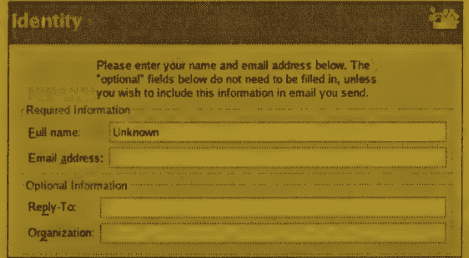
接下来你会看到「接收邮件/入站邮件配置」界面，这里设置的是你的系统从哪里收取收件箱邮件。这个界面和下一个界面的数据需要从你的互联网服务提供商（ISP）处获取，如果你不确定某个设置，可以咨询他们的技术支持。大多数情况下，入站邮件都通过POP服务器接收。
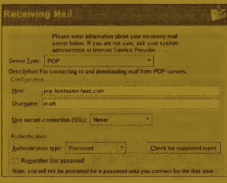
我知道你会觉得我要讲点技术术语了？POP的全称是Point of Presence（服务接入点），对我们来说没太多实际意义，唯一需要注意的是从这个服务器获取的信息应该是安全的。填完这个界面的所有内容后，点击下一步。接下来你会看到另一个「接收邮件」界面，我勾选了「保留服务器上的邮件」选项，这意味着就算我把邮件收取到我的Linux系统里，邮件还是会继续存储在ISP的服务器上。缺点是没多久我的ISP邮箱就会满，可能最终丢失邮件；优点是我第一次用Evolution的时候如果出了什么问题，不会丢失所有新邮件。

这点设置很简单，尤其是如果你读这篇文章只是为了学习安装和配置的基础知识，或者想尽快摆脱MS-Outlook的话。接下来你会看到「发送邮件」界面，这里需要修改服务器类型，确保和你的ISP告知的配置一致。根据我的经验，大多数情况下出站/发送邮件服务器都是SMTP服务器，有时你还需要进行身份验证设置。
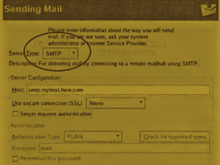
再次点击下一步会进入账户信息界面，这个界面可以让你按类型（比如家庭和工作）分类邮件，如果你有很多邮件的话这个功能很实用。点击下一步按钮选择你的时区，这一步非常重要，因为它会设置日历和邮件中的日期/时间。再点击一次下一步，就完成了安装配置。

点击「应用」按钮会保存所有参数和配置信息，并启动Evolution工作区。

> **提示：** 对于配置Ximian用于ISP接入的用户，**在**点击*应用*按钮之前，建议你确认已经将宽带连接接入Linux系统，且调制解调器或宽带连接设置正常工作。你可以从「*互联网连接*」章节获取如何设置网络连接的详细信息。
Evolution启动后，你可能会惊喜地发现它的核心功能和MS-Outlook非常相似。事实上，二者有很多共通之处，毕竟邮件和日历工具的使用场景就那么多。对Windows用户来说，这种相似性的好处显而易见。我见过有人用不到1小时就能从MS-Outlook切换到Ximian Evolution。
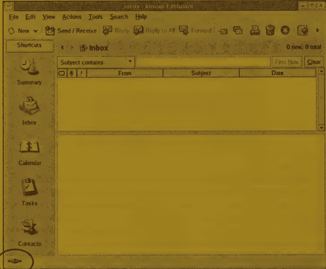
这表示互联网连接已经建立。

从「文件」菜单中选择「导入」功能，就可以导入你的Outlook Express文件。你也可以用我后面会讲的一些技巧导入其他文件。现在选择这个选项会启动*Evolution导入向导*。通常导入收件箱的邮件时，选择*导入单个文件*即可。点击下一步按钮一步步完成导入操作，你会发现Evolution有自动识别你要导入的数据类型的选项，点击下拉菜单就能看到其他可用的导入选项。

之后你可以选择导入文件的存放位置。下面的示例会将文件直接放到收件箱，这不推荐。更合适的做法是把导入的邮件放到「已发送」或「旧邮件」邮箱中。


> **提示：** 那如果是导入Outlook这类文件怎么办？你可以将Outlook收件箱的邮件保存为.pst文件，这个文件可以被Netscape或Mozilla这类浏览器读取，之后再导入.pst文件，再将其导出为Ximian Evolution导入工具可读取的文件格式即可。
Ximian Evolution还有很多其他核心功能，首先它提供了强大的日历支持、邮件管理功能，甚至还能连接Palm掌上电脑。这些工具都可以通过简洁的图标界面使用。

希望你在完成这个功能强大的桌面日历和邮件工具的配置之外，也对KDE桌面下各组件的工作原理有了更深入的了解。Ximian Evolution只是KDE桌面海量可用程序中的一个，在接下来的章节里，我会为你介绍更多程序及其功能。下一步我们将帮你全面了解Linux互联网和网络连接的可用选项，让我们继续吧！


## 第3节 互联网连接
## 第8章
### 开始之前
在我开始详细介绍如何从Linux访问互联网和局域网（LAN）之前，我得先说一件很少有人愿意承认或提及的事：我用Linux服务器设置并使用DSL调制解调器花了不到一分钟。整个过程简单高效，因为我很清楚配置工具的位置，也知道该输入什么内容。而相比之下，我安装、配置并测试另一台拨号用调制解调器却花了一个小时左右。对后者来说，我的大部分时间都花在了——或者说从我的角度看是浪费在了——折腾硬件兼容性问题上。
因此，为了帮到你，我给出Linux互联网和网络设置成功的两个最关键的要点：
> **要点#1：** 你需要清楚配置工具**位于何处**，以及如何访问它们。如果你需要和Windows系统交互，这也包括Windows端的工具。如果你直接跳转到本章、已经准备好开始操作，请你先花点时间回顾一下*安装后配置*章节。你必须了解并掌握如何访问和使用Linux配置工具，才能成功完成Linux的互联网使用配置。
> **要点#2：** 你的**硬件**必须兼容且可正常运行。我见过不少人试图用Linux建立互联网连接，结果沮丧到把Linux光盘扔到墙上！他们很快就意识到，自己的硬件根本没有被正确配置或连接！世界上没有哪个操作系统能抬起你的手、推动你的手指，让你去检查以太网线是否插好、调制解调器是否开机这类基础操作。你办理DSL套餐时，电话公司提供的DSL调制解调器是非常简单的设备，因此哪怕是最微小的错误都会让它乱作一团。哪怕是像我这样有多年测试和安装经验的资深Linux用户，也时不时会遇到硬件问题。有个傍晚我坐着挠头，怎么都想不通为什么我的Linux服务器识别不了我的DSL调制解调器。很快我就反应过来，因为太急躁，我忘了把连着测试用Windows XP机器的DSL调制解调器的以太网线拔下来，插上来自Linux主机的正确以太网线。就是这么简单，这么傻！你可能也会有类似的情况：焦头烂额、行色匆匆，只想赶紧成功完成手头的正事。请相信我，现在花时间确保你的硬件连接正确、能正常运行、已经开机，所有这些基础操作都非常重要——哪怕是对我这样的老Linux用户来说也不例外。我写这些是为了让你明白，在你欢呼雀跃庆祝第一次连上Linux互联网之前，你需要确保硬件已经正确设置好，这件事无论是这本书、你使用的Linux发行版，还是我，都无法替你完成。

当然，还有另一个原因会让硬件成为所有Linux互联网连接和安装中的问题：部分硬件厂商销售的产品不支持Linux。为了应对这个问题，很多Linux程序员编写了通用的设备驱动程序，可以适配不同硬件组件之间形形色色的特殊特性。但偶尔这种情况也无法实现，你的特定硬件可能不被Linux支持。有些硬件需要Windows驱动才能运行。依靠软件驱动的内置PCI调制解调器（也就是没有配备处理核心拨号功能的电路和芯片）无法在Linux上使用。**Win调制解调器**就是很典型的例子。不过别担心，在Linux生态中，肯定有人正在研究解决方案。如果是使用专门为Windows设计的芯片组的调制解调器，你可以参考下面两个有用且信息丰富的网站：www.linmodems.org、www.start.at/modem（由Rob Clark维护）。现在你应该已经了解了硬件相关注意事项，可以开始成功安装你的Linux互联网或局域网连接了！

## 第9章
### 使用拨号调制解调器
本章简要总结了我使用拨号互联网连接和调制解调器从Linux访问互联网的经验。尽管对很多人来说这可能是常识，但你需要有已开通的互联网服务提供商（ISP）账户才能进行拨号。另外提醒一下，由于部分厂商的调制解调器硬件依赖Windows运行，你内置的调制解调器可能无法使用。我提供的操作步骤对外置Hayes兼容调制解调器完全适用。

#### 步骤1 连接调制解调器
只要你正确连接了调制解调器并确认它已经开机，重启你的Linux系统即可。很大概率上，你的调制解调器会被Linux硬件检测工具识别，并自动完成安装。

#### 步骤2 获取你的ISP的相关信息
成功加载桌面后，你需要配置调制解调器，这需要你提供来自ISP的一些信息。大部分ISP都会配合你、清晰回答你的问题，毕竟你是付费用户！不过，部分ISP要求你使用专有软件来拨号登录他们的服务。这可能会阻碍你使用通用的Linux工具，需要你借助某种模拟器在Linux下运行该ISP的软件。如果你遇到这类ISP，你可以考虑换一家完全支持Linux的备选免费ISP。之后我会提供一些相关技巧。大多数情况下，你只需要知道拨打你ISP的本地拨号号码即可。如果你需要获取这些信息，现在可以花点时间联系他们。你可以沟通以下内容：
- 说明你计划通过Linux个人电脑拨号登录你的账户
- 索要一到两个本地拨号号码
- 获取他们的域名服务器IP地址
> **提示：** 如果ISP的技术人员说该ISP“不支持Linux”，你可以表示你理解这一点，然后重复你的问题——因为你并不是要他们为你提供Linux的技术支持，你只是询问他们如何允许你访问他们的网络供你使用。根据我的经验，你很快就会发现：不同ISP在这件事上的配合度差别很大！有的非常愿意协助你，有的则不然。

#### 步骤3 配置调制解调器和ISP信息
拿到你的ISP信息后，你就可以快速配置调制解调器，输入访问ISP账户的详细信息。你还需要**准备好你的账户ID和密码**，所以开始操作前请先将这些信息备妥。和其他配置示例一样，我会用两大主流发行版（Fedora和SuSE）的实际操作步骤作为示例。我在安装其他热门发行版时也成功用过这些信息，因此它们适用于大多数较新的发行版。这些工具通常由你使用的桌面环境决定，因此Fedora（使用Gnome桌面）和SuSE（使用KDE桌面）的示例能很好地覆盖大多数发行版的调制解调器设置方法。

#### Fedora拨号示例
你可以打开菜单找到对应工具：
- 系统设置
- 配置编辑器
- 磁盘管理
- 软盘格式化工具
- 硬件浏览器
- 互联网配置向导（网络设备控制）
- 运行应用程序...
- 打印通知图标
- 搜索文件...
- 打印管理器
- 最近使用的文档
- Red Hat Network
- 锁定屏幕
- Red Hat Network提醒图标
- 注销
- 系统日志
- 系统监视器
- 终端

在Fedora中，你可以在*系统工具*下找到一个名为*互联网连接向导*的便捷菜单项。它实际上是互联网德鲁伊配置工具，会简化识别调制解调器和ISP信息的流程。现在就可以打开这个工具。你也可以之后通过在终端提示符中输入以下命令打开该工具：
```internet-druid```
请注意，进入工具后，你可以选择添加多个新设备。现在先单击一次*调制解调器连接*，然后按下*下一步*按钮。


你将看到*选择调制解调器*页面。在此你需要从顶部下拉菜单中选择适合你的调制解调器的对应设备。不同设备可能有所差异，但根据我的经验，大多数情况下，连接在PC后部串口的外部调制解调器的设备标识为`/ttyS0`。我还建议你调整音量，确保能听到调制解调器的运行提示音，将音量调至中档后按*下一步*按钮。
接下来你会看到一个可输入ISP和账户相关信息的页面，左侧菜单会列出预置的ISP列表。如果你居住在列有对应ISP的国家下，即可在对应国旗下从菜单中选择相关配置项；如果你居住在美国、加拿大这类未列出的国家，则需要手动输入相关配置。
请确保你输入的*电话号码*符合你所在地区的拨号规则。大多数情况下，你无需在*前缀*或*区号*栏中输入任何内容。和Debian、Mandrake等部分其他系统的配置类似，*提供商名称*字段并非必要项，仅作为你自己的参考。
请务必输入正确的登录账号和密码！填写完所有信息后，再次点击*下一步*按钮。下一个页面是DNS设置页，**大多数情况下，你应确保此处设置为自动获取IP地址。** 同时，务必勾选自动获取DNS信息的选项！
现在你会看到*网络配置*工具界面。之后你可以通过以下两种方式再次打开该工具：前往主菜单选择“系统设置”，再点击网络图标；或者在终端窗口中输入以下命令：
`system_config_network`
以下是我拍摄的网络配置工具界面截图：
选中你要配置的调制解调器，再点击*编辑*图标，即可修改配置参数。大多数情况下，调制解调器的配置已经完成且正确，点击每个标签页（路由器、提供商等）逐一核对即可。如果所有信息都和你的输入一致，就切换到*高级*标签页，勾选*让PPP处理所有身份验证*选项。该选项允许PPP（点对点协议）将你的登录账号和账户数据传递给ISP，这也是大多数场景下的默认设置。
点击“确定”返回*网络配置*主窗口。你可以关闭配置窗口，此时会弹出保存更改的提示，点击“确定”即可保存你修改的内容。**现在，请重启你的Linux系统。** 重启通常能解决硬件配置相关的问题，因此我强烈建议你在安装新调制解调器或完成网络配置后执行重启操作。
Linux系统重启完成后，你就可以拨号连接ISP上网了！前往主菜单，选择**系统设置**，再点击**网络**，即可再次打开*网络配置*工具。选中你的调制解调器设备，点击*激活*按钮。
```
Activating network device... please wait.
```
当这个窗口消失后，你就可以上网了。打开你的Linux网络浏览器，尽情冲浪吧！
要结束拨号会话，返回*网络配置*工具，选中调制解调器，再点击*停用*按钮。
> *注意：部分故障排查技巧收录在本章末尾。*

### **寻找Linux ISP**
遗憾的是，部分ISP并不愿意提供通过Linux接入其服务所需的必要信息。因此我强烈建议你进行网络搜索（使用你偏好的搜索引擎，我个人更常用谷歌），搜索以下关键词：
```
free linux ISP
```
根据你所处的地理位置，你可能会惊讶地发现，大多数主要城市都有完全支持Linux用户、且向Linux用户**免费**提供服务的ISP。我曾用过本地的一家免费ISP完成所有拨号调制解调器的测试，效果非常好。
诚然，免费ISP的网速不会特别快，也无法提供付费ISP那样丰富的服务选择。但二者的核心区别在于，你可以**今天**就用Linux拨号上网，不用久等客服电话、费尽口舌让当前的ISP提供Linux登录的相关信息——事实上，部分ISP根本不允许Linux用户接入！

### 步骤3 调制解调器与ISP配置（续）
#### SuSe系统拨号示例
如果你使用SuSe系统或其他搭载最新KDE桌面的Linux发行版，这些提示可以帮助你通过拨号调制解调器上网。注意，尽管界面可能和你实际使用的系统不完全一致（各发行版界面均有差异），但我提供的提示和信息（例如自动设置DNS）适用于所有发行版。
首先启动YaST工具，或你所用发行版的硬件配置工具（例如名为`drakconf`的*曼德拉草控制中心*工具）。如果你不确定我指的是什么，请回顾*安装后配置*一章获取指引。
要从主菜单启动SuSe的YaST工具，选择*系统*，再点击*YaST*。如果主菜单中没有该选项，就选择*系统*，再点击*配置*，随后打开*YaST*图标。在YaST主菜单中选择*网络设备*，再点击*调制解调器*图标。
调制解调器配置窗口会打开，你可以选择配置已有的调制解调器，或者添加新的调制解调器。大多数情况下，SuSe的硬件检测功能已经识别并配置好了你的调制解调器，你会在“可用设备”列表中看到它：
不过如果你没有在列表中看到调制解调器，或者列出的设备和实际安装的不一致，我在下面提供了添加调制解调器的详细步骤。
要添加调制解调器，点击*更改*按钮，不要点*配置*按钮。你会看到一个窗口，提供添加新调制解调器和添加ISP相关信息的选项。首先点击上方的*添加*按钮，即可开始配置你的拨号调制解调器。点击*添加*后，你会看到*调制解调器参数*窗口。
设备名称非常重要，有时系统会预置为类似/dev/modem的名称：
```
/dev/ttyS0
```
大多数情况下这个名称是**错误**的，无法正常使用。你需要点击下拉菜单，选择`ttyS0`，这通常是通过串口线连接在Linux PC后部的调制解调器的正确设备名称。
在调制解调器参数窗口中，你还需要确保已勾选“启用扬声器”选项，并在“拨号前缀”栏中输入你拨号需要的前缀（例如外线需要拨的9）。点击*下一步*按钮，打开选择ISP窗口。
这里会列出大量可用的ISP选项，非常全面。如果列表中有你要用的ISP，直接选中它再点击下一步即可。不过如果你没有找到自己对应的ISP，有个非常简单的方法：点击*新建*按钮手动配置即可，别担心，这个过程很快。你会看到提供商参数设置页面。
正如我之前提到的，我用过的几乎所有发行版都有“提供商名称”字段，该字段仅作为你自己的参考，对登录流程没有影响。但电话号码栏必须填写正确！填写完当前页面的所有信息后，再次点击下一步即可。


在**连接参数**界面中，你会找到一个重要设置！**连接时修改DNS**选项实际上会允许你的互联网服务提供商（ISP）设置你的Linux DNS，几乎在所有情况下**你都必须勾选此项**。
请确保下方示例中的选项也在你的配置界面中完成设置。我已经圈出了这些选项，方便你对照参考。


勾选**防火墙**是另一个重要选项，它基本可以屏蔽所有入站连接请求。你几乎总是需要开启防火墙。只有在我将Linux系统作为服务器使用时，防火墙偶尔才会阻碍合法的入站请求。

点击**下一步**，你将回到*服务商参数*界面，此时所有字段都应当已经填写完毕。只要你点击**下一步**再点击**完成**按钮，就可以启动你的首次Linux拨号上网会话了！

如果看到“**现在配置邮件？**”选项，请选择**否**。大概率你会更倾向于使用Ximian Evolution来处理邮件，相关操作细节可以在*桌面界面*部分找到。

现在，**请重启你的Linux系统**。正如我之前提到的，重启可以避免很多硬件配置带来的烦心问题。我强烈建议在完成任何新调制解调器或网络配置后都进行一次重启。

Linux系统重启完成后，在KDE菜单的右下角找到*KDE网络工具*，它的图标如下所示：
 （注：原文此处图片链接已保留，未作修改）
你可以在这个图标上点击**鼠标右键**，查看该工具的所有选项，或是手动拨号。否则你只需要单击该图标即可开始拨号。

调制解调器开始拨号后，你会看到如下界面：

如果已经成功建立互联网连接，你会看到如下内容：


现在你可以上网冲浪了！打开你的Linux网页浏览器尽情使用吧！

要结束拨号连接，只需要再次单击小小的*KDE网络工具*图标即可。

### 拨号连接故障排除
请记住，硬件通常是拨号连接失败的原因。以下是一些常见问题的解决方法：
- 完成配置更改并保存后，你需要**重启**你的Linux系统。
- 如果你使用的是外置调制解调器，你的拨号音选项可能会比调制解调器初始化拨号音的速度更快。这种情况发生在Linux拨号程序发送电话号码时，你的调制解调器还没有获取到拨号音。通常你可以听到这种异常：在听到拨号音之前，调制解调器已经拨出了部分号码。
- 一个简单但烦人的解决方法是**禁用**拨号音选项。
- 你能听到调制解调器拨号，但随后连接失败。这可能是因为你的ISP不允许来自Linux的直接拨号连接，或是ISP配置不正确。请再次核对你输入的用户ID和密码是否正确，以及IP和DNS地址是否设置为**自动**获取。你有时需要清空之前填写过IP地址的字段，确保主机名和DNS信息字段均为空白！
- 你能听到调制解调器连接的声音，看到指示灯闪烁，但除此之外没有任何反应。大多数情况下，如果调制解调器的OH和CD指示灯亮起，说明你**已经**成功连接。打开网页浏览器尝试访问网站即可！

## **第10章 DSL与有线调制解调器使用基础**
*本章介绍配置宽带DSL或有线调制解调器的基本步骤，这些步骤适用于大多数标准（非高端）DSL或有线调制解调器服务。*

虽然我很想把本章扩展为完整的Linux宽带连接指南，但这会偏离本章的核心目标。我的主要目的是帮助你无需复杂操作即可完成网络连接配置。因此，我会以Fedora（使用Gnome桌面）和SuSe（使用KDE桌面）作为具体实例进行说明，同时使用基础款DSL调制解调器作为示例硬件。ISDN调制解调器的配置流程差异较大，但DSL和有线调制解调器都具备直接互联网连接特性，因此配置方式非常相似。后续内容将为你全面介绍适用于大多数新版Linux发行版的必要设置和配置项。旧版Linux发行版通常需要你先安装PPPoE驱动才能进行配置，这些驱动可以在你所用的Linux发行版官网找到。

你会发现，几乎所有Linux发行版连接宽带服务都依赖两个核心要素：
- 你购买的服务类型
- 正确设置IP和DNS配置

“服务提供商”和“互联网邮件服务商”指的是不同概念。大多数情况下，你的电话或有线电视公司提供宽带服务，其他公司提供用于处理邮件、新闻等功能的Windows软件。对于Linux系统而言，只有你的宽带服务提供商是关键。本章不会过多涉及静态IP地址的使用，静态IP通常仅适用于高端宽带服务。

### Fedora配置
要开始配置宽带调制解调器，请打开Fedora主菜单，选择*系统设置*，再进入*网络*选项。你也可以直接在终端中输入以下命令：
``` system-config-network ```
这将启动*网络配置*工具，你需要在此确认以下配置项：
1. 你的以太网设备已正确配置，支持自动获取IP地址；
2. 若需要，请确保已填写你的服务商信息，包括账户ID和密码。


在*网络配置*界面中，选择你的*以太网*设备（eth0），然后点击*编辑*按钮，此时你将看到以太网设备设置界面。


请确保你已经清空了*静态设置IP地址*字段下的所有内容，然后选中标注为*通过DHCP自动获取IP地址设置*的单选按钮，以及自动获取DNS的复选框。现在点击*确定*返回*网络配置*窗口。

接下来需要激活你的以太网设备：从列表中选择该设备，然后点击*激活*按钮。


完成该操作后，设备将自动获取DSL或有线服务提供商的IP地址，用于你的网络连接。随后你会看到一个类似如下的信息提示窗口：


*system-config-network*窗口消失后，你就已经连接到互联网，可以正常浏览网页了。不过我始终建议此时**重启你的Linux电脑**，这样可以确保所有配置更改生效。Linux系统重启完成、你可以正常使用桌面后，就可以享受宽带互联网连接了，打开你的Mozilla浏览器试试吧。

#### 如果列表中没有显示以太网设备怎么办？
这可能是你的以太网卡安装存在严重问题，也可能只是意味着你需要手动安装以太网设备或DSL连接设备。有时Fedora不会自动识别可用于互联网连接的以太网卡。如果你已经反复确认以太网卡安装正确，但列表中仍未显示该设备，属于极少见情况，此时可以尝试以下步骤来让有线调制解调器或DSL调制解调器正常工作。以下有两种可选方案，请都阅读一遍，选择最适合你当前情况的方案。

### Fedora方案1：如果你使用的是标准服务*（即会为你动态分配IP地址的服务）*
请按照以下步骤在列表中添加新的宽带调制解调器设备：


在*网络配置*窗口中，点击**新建**按钮。通常你只需要创建一个以太网设备配置，就可以激活有线或DSL调制解调器的配置。


选择设备类型为**以太网连接**。*点击下一步*继续，不要选择xDSL或其他选项。接下来会让你核对要配置的物理以太网卡，确保选中正确的项目，再次点击**下一步**。


在“配置网络设置”窗口中，确保已选中**自动获取IP地址…**按钮，同时勾选*自动获取DNS…*复选框，如下图所示。


现在你可以点击*下一步*，核对更改摘要后点击**应用**按钮，随后会看到*网络配置*窗口。在此处选择新建的以太网设备，点击**激活**按钮，会有一个小窗口弹出后自动消失。该窗口消失后，你就已经连接到互联网服务提供商，可以开始使用网页浏览器了。


## **Fedora 选项2：适用于付费DSL服务用户** *（即付费以获得一组指定IP地址的服务）*
在“网络配置”窗口中，选择*新建*，然后选中xDSL [xDSL连接]选项，再点击*下一步*。

当需要自行分配IP地址时，该选项通常**才有用**。

在“配置DSL连接”窗口中，请确认你的以太网卡已被正确识别为对应设备名，随后填写三个空白输入栏。你的账户ID和密码必须准确无误才能成功联网！现在点击*下一步*。
核对你所做的修改，然后点击*应用*按钮保存更改。

你将返回“网络配置”窗口，会看到新增的ppp0或DSL设备。选中该设备，然后按下*编辑*按钮。
如果你从服务提供商处获得了对应信息，接下来需要配置专属IP地址、DNS信息和网关信息。按下*确定*按钮保存更改。

#### **现在，请重启你的系统。**
返回桌面后，回到“网络配置”界面激活新的ppp设备。选中ppp设备后按下*激活*按钮，设备即可正常启用。你会看到*system-config-network*窗口弹出后自动关闭，窗口消失后即可上网冲浪。打开浏览器试试吧。

### SuSe系统配置
本文默认你已掌握如何启动SuSe或其他发行版的配置工具。如果忘记操作方式，请查阅*安装后配置*章节。
不同采用KDE的发行版界面略有差异。例如Mandrake使用*drakconftool*，调制解调器连接项位于*网络与互联网*图标下，再进入*新建连接*图标。
本文示例以SuSe的配置工具YaST为准。你会看到菜单项*网络设备*，选中后会显示DSL调制解调器配置模块。
Cable Modem用户可以直接通过网卡配置完成相关设置，只要正确配置以下网卡参数，Cable Modem即可正常工作。
无论你安装的是哪种设备，在点击*DSL调制解调器*模块或*网卡*模块前，请确保Cable或DSL调制解调器已正常连接，因为模块会先检测硬件。
选中DSL调制解调器选项后，你会看到如下界面：

你会发现大多数情况下DSL调制解调器都尚未被识别。点击*更改*按钮开始配置。
弹出的下一个窗口是配置概览列表。完成配置后，上方栏会显示你的调制解调器专属信息，下方栏会显示服务提供商的详细信息。以下是DSL配置概览窗口的示例：

点击顶部的*添加*按钮添加你的DSL调制解调器。现在会弹出配置窗口，虽然看起来较为复杂，但实际需要操作的内容很少。

请确保从上方下拉菜单中选择了正确的PPP模式。根据我的使用经验，所有宽带调制解调器都需要启用*以太网上的PPP*模式。开始这一步前请确认网卡已正确配置，如果网卡已正常安装，会显示在以太网卡选项中。有时以太网卡并未正确配置，比如在上方示例中你会注意到，尽管显示不够明显，但已经记录了IP地址！如果你首次安装新的DSL设备，这可能意味着你的网卡未针对宽带连接完成正确配置。
为确保所有预置IP地址被删除，请点击**配置网卡**按钮。此时会弹出名为*网卡配置*的窗口，如果你要配置的是Cable Modem，一开始就会进入这个窗口，你可以在此编辑网卡的详细信息。

请按下*更改*按钮，再按下*编辑*按钮，此时会看到*网络地址设置*界面。


#### **应选择DHCP或自动地址设置选项。**
注意在我的示例中，虽然我在IP地址和子网掩码栏下选择了*自动地址设置（通过DHCP）*，但仍有部分数据残留，这是我之前将Linux主机设为服务器、手动配置IP时留下的。实际上，为了提供练习机会，我在*安装*章节中推荐过手动配置的操作。但使用标准宽带连接时，你需要确保清空这些栏中的所有数据。首先，点击*静态地址设置*按钮，然后删除所有栏中的IP和子网掩码信息，再选择*自动地址设置*。

#### 主机名与域名服务器
你可能还需要清空*主机名与DNS*设置下的输入栏。点击*主机名与域名服务器*按钮，如果出现*修改*选项则选中，即可删除栏中的主机名、域名及其他所有数据。
删除信息后，请务必确认你已勾选以下两个选项：
- 通过DHCP更改主机名
- 更新域名服务器……
这两个选项对于从你的互联网服务提供商（ISP）获取DSL连接的正确数据至关重要（参见下方示例界面）

成功删除栏中所有信息并勾选两个选项后，你就可以放心点击*确定*按钮，返回*网络地址设置*窗口。
在“网络地址设置”窗口中，点击*下一步*按钮。你的调制解调器配置即将完成，稍作等待！最后，在*网卡配置概览*界面点击*完成*按钮。
这些步骤看似繁琐，某些情况下也确实并非必需，但这些额外操作能确保所有数据被正确配置。我的目标是帮你清理并准备好系统以使用互联网宽带，根据我的经验，这是最稳妥的保证你成功的方式。
现在，在*DSL配置*界面，按下*下一步*按钮开始配置你的ISP。*（注意：如果仍看到IP地址信息，不会影响任何操作，因为所需的配置步骤你都已完成）* 大多数DSL服务提供商都未在列表中收录，因此你需要手动配置DSL提供商的相关信息。点击*新建*按钮。

输入提供商名称，然后输入你的DSL账户名和密码。所有DSL服务提供商在用户开通服务时，都会提供账户ID、密码，以及收发邮件服务器的相关信息。如果你没有收到或遗失了这些信息，请联系对应互联网服务提供商（ISP）的技术支持。
点击*下一步*进入*DSL连接参数*窗口。## DSL连接参数窗口的关键部分如下图所示：

请确保勾选图中用圆圈标注的三个选项。再次点击*下一步*即可查看你所有修改的最终摘要。信不信由你，现在你已经完成了调制解调器和提供商信息的配置！按下*完成*按钮即可保存所有信息。
你可能会看到配置邮件的选项，暂时直接按下*否*即可。之后可以在“桌面界面”部分使用Ximian Evolution软件配置邮件。

#### **现在，请重启你的Linux系统。**
如前所述，重启可以避免许多硬件配置带来的麻烦。我强烈建议在安装任何新调制解调器或完成网络配置后重启系统。Linux系统重启并登录后，打开浏览器访问任意网站试试吧！

*（下一页有一些故障排除技巧……）*


### DSL和有线调制解调器故障排除
部分情况下，正如本章前文提到的，旧版本的Linux发行版没有内置最新的PPPoE驱动，或能连接你所在网络服务提供商（ISP）的合适PPP软件。最佳解决方案是联系你所用Linux发行版的技术支持，咨询相关驱动的适配情况。这听起来或许有些无奈，但这就是较新硬件搭配旧版本软件使用导致的结果。如果你已经按照上一页的步骤操作，却依然无法联网，你可能需要检查有线调制解调器或DSL调制解调器的指示灯，确认具体故障原因。
例如，如果*以太网*指示灯未亮，说明你的Linux电脑网卡没有正确配置或连接。如果*互联网*指示灯未亮，你需要关闭调制解调器再重新打开。只要开关间隔约15秒，就不会对调制解调器造成任何问题。调制解调器重启后，你的网络服务商会重新发送正确的IP及其他网络信息，完成调制解调器的重置。
## 第11章
### 与Windows联网
针对那些向我询问如何让Windows和Linux电脑实现基础互通问题的读者，这里提供一些参考建议。
Windows系统和Linux系统能否和谐互通？听起来这个问题很傻，但只要你考虑过这是新手用户最常问的问题之一，就不会这么认为了。毕竟，我们所有人的Windows电脑里都存有大量工作和个人数据，都不想丢失！答案是肯定的，只要需要，我们完全可以实现，也应该实现两者互通。不仅完全可以实现，多年来许多优秀软件开发者的协同努力，还催生了名为Samba的文件共享协议及工具集。这个听起来颇具异域感的名字，其实是源自最初的UNIX系统SMB文件共享协议。但Samba早已不只是一个协议。在如今各类Linux发行版中，Samba包含*服务器*组件（用于连接其他Windows或Linux电脑），还支持工作组共享和打印机共享。其他Linux电脑可以通过*客户端*连接Samba*服务器*。因此，如果你的Linux发行版内置了Samba工具，就可以相对轻松地实现Windows基础文件共享。当然，良好的通信需要双方配合，Windows电脑也需要做一些简单设置！
- 确认Samba工具已安装且可用
- 配置电脑网卡及网络参数
- 配置Windows电脑以允许工作组共享
- 配置Samba工具以识别Windows电脑

不过，在我用过的所有主流Linux发行版中，上述步骤的具体操作方式都有区别。部分发行版要求在安装流程最开始就选择安装Samba工具。还有部分发行版会直接将完整的Samba工具集打包进系统，开箱即可使用。发行版之间的差异实在太大，如果不额外写五十页相关内容，我没办法给出具体的操作指引。不过，我可以以Fedora发行版为例，分享Samba的部署步骤，作为你的操作教程或参考。这些步骤适用于将Windows XP家庭版的基础共享配置给Linux系统访问。默认你在开始操作前，已经熟悉了《安装后配置》章节的内容，且两台电脑已经通过集线器和网线正确连接。
#### 1. 确认Samba工具已安装且可用
对大多数用户来说，这些工具会在较新版本的Fedora Core 2及以上Linux发行版中预装。但偶尔也会出现工具未成功安装的情况。要检查Samba工具是否已安装，在终端窗口中输入以下命令：
``` locate samba ```
你也可以检查/etc目录下是否存在Samba配置文件，在终端窗口中输入以下命令即可：
``` ls -alt /etc/samba/smb.conf ```
该命令会显示至关重要的Samba配置文件，后续你可能需要使用文本编辑器查看和编辑它。如果上述命令返回了Samba存在的提示信息，你就可以进入下一步。但如果locate命令没有任何返回，你就需要从网络上下载并安装Samba工具。有一个建议是：你可以到你所用发行版的官网查找最新的Samba工具，或者访问：www.samba.org
#### 2. 配置电脑网卡及网络参数
接下来的操作是确认你的Windows XP系统是否已准备好与Linux电脑通信：网络连接是否正常，两台设备是否处于同一网域？在Linux电脑上检查这些信息非常简单。如果你没有使用Fedora，请查阅《安装后配置》章节，学习如何找到网络配置工具。以*Fedora*为例，从主菜单依次选择*系统设置*、*网络*，也可以在终端中直接输入以下命令：
``` system-config-network ```
之后会启动*网络配置*工具。在该工具中，你应该能看到一个可正常使用的*eth0*网卡设备。

现在，点击*编辑*按钮，查看*eth0*网卡的配置，确保其设置正确。以下是我个人网络的配置样例，你可以选择不同的网络参数，也可以直接使用我提供的参数。关键要记住：Linux和Windows XP的IP地址、子网掩码信息必须一致，否则两者无法通信。
| 常规 | 路由 | 设备 |
|---------|-------|--------|
| 别名： | | |
| ☐ 计算机启动时激活设备 | | |
| 允许所有人启用/禁用设备 | | |
| 为此接口启用IPv6配置 | | |
| 自动获取IP地址设置方式：[dhcp ▼] | | |
| ☑ 自动从运营商获取DNS信息 | | |
| 静态设置IP地址： | | |
| 手动IP跨设置 | | |
| 地址：10.2.2.2 | | |
| 子网掩码：255.255.255.0 | | |
| 默认网关地址： | | |
确认你正在使用**静态**IP地址，且该静态IP和子网掩码与你计划在Windows XP上使用的参数匹配后（稍后你会看到我的Windows电脑配置方式），点击**确定**。注意：**办公**电脑可能有独立的IP命名规则，子网掩码和网关信息也可能和示例不同！现在选中*eth0*设备，点击**激活**按钮。此时系统会提示你保存更改，会弹出一个窗口然后自动关闭。窗口关闭后，建议你重启Linux电脑，确保更改生效。
#### Windows XP系统端操作
在*开始*菜单中选择*控制面板*，再选择*网络连接*。你应该能看到一个*本地连接*图标。

我在这里放了一张截图样例，展示配置完成后的界面样式。这是Windows通过你的网卡建立的网络连接，我用的是一张瑞昱（Realtek）的网卡。如果*网络连接*下没有任何局域网连接图标，你需要运行新建连接向导。
> 🖥️ **创建新连接**
正如我的截图所示，这是左上角的菜单项。在Windows向导中，选择*设置家庭或小型办公网络*选项。按照向导步骤操作，就能正确配置Windows XP使用网卡，完成后你应该会看到*本地连接*图标。右键单击该图标，选择*属性*。在弹出的窗口中，你需要选择“Internet 协议 (TCP/IP)”选项，选中后点击*属性*按钮。同样，我这张简单的截图可以为你提供各项参数配置的通用参考。

首先你需要选择*使用下面的IP地址*选项。DNS服务器IP不一定要设置，我测试的时候，用*这套*参数就已经能让两台电脑正常通信了。可以看到，这套最基础的网络配置中，Linux电脑的IP设为10.2.2.2，Windows电脑的IP设为10.2.2.1。现在点击*确定*退出并保存IP配置。回到*本地连接属性*窗口后，选择标有*高级*的第三个选项卡。在这个选项卡下你可以看到防火墙设置。如果你完成了所有步骤，但Linux电脑依然无法连接，你可能需要**禁用**防火墙。


后续会一直为你保留这份内容，因为将来你很可能需要知道防火墙设置选项的位置。

#### 3. 配置 Windows 电脑以允许工作组共享
是时候打开*Windows 资源管理器*了（通常位于*开始*菜单下的*附件*中）。在*Windows 资源管理器*中，你需要选中*Windows XP*系统对应的磁盘驱动器。

选中后，点击鼠标右键，在弹出的菜单中选择*属性*。

新窗口顶部会显示四个选项卡，点击*共享*选项卡。这会打开你选中的特定磁盘驱动器的*Windows XP*共享属性设置。你需要勾选以下两个选项：
- 在网络上共享此驱动器
- 允许网络用户修改我的文件*（如果需要的话）*
点击*确定*按钮退出磁盘属性窗口。至此，你的*Windows XP*磁盘驱动器就可供 Linux 电脑访问了。

#### 4. 配置 Samba 工具以识别 Windows 电脑
现在需要回到 Linux 电脑端进行连接操作，好在 Linux 端的操作会简单一些。在 Fedora 主菜单中选择「网络服务器」。如果一切正常，你会看到一个 Windows 网络的图标。在网络窗口中，选择「文件」，再选择「打开位置」（或者同时按下 Ctrl+L 键）。此时你就可以输入特定的 Windows XP 共享驱动器路径了。所有可通过 Samba 访问的共享驱动器路径都以 `smb://` 开头。

在我的设置中，我给共享磁盘驱动器命名为 winxp（参见前一页圈出的项目）。按下「打开」后，会出现一个带有 Windows 驱动器图标的新窗口。双击该共享驱动器图标后，我现在就可以从 Linux 端查看 Windows XP 磁盘驱动器里的文件夹了！

如果一切顺利，你现在只需几次简单的鼠标点击，就能在 Linux 电脑和 Windows 电脑之间传输文件了。要将文件从 Windows XP 电脑复制到你的 Linux 电脑，可以参考以下步骤。请注意，这只是众多方法中的一种。在 Fedora 主菜单中，选择桌面上的「主目录」图标。这会打开你的 Linux 目录和文件视图。通过菜单中的「文件」-「打开位置」选项，打开 Windows XP 磁盘驱动器。如上所述，你需要输入正确的 Samba 路径。现在只需把 winxp 共享磁盘窗口和 Linux 文件系统窗口并排摆放，通过拖放图标的方式即可复制文件。


#### 5. 非 Fedora 用户的故障排查
先别急！也许你正坐在这里阅读这本详细的 Samba 配置章节，同时拼命想让 SuSe、Mandrake 或者其他使用 KDE 的 Linux 发行版能够正常与 Windows 网络协同工作。面对这么多不同发行版的用户，我能给出什么解决方案呢？我可不想让那些满怀热情的用户失望。我多希望能手把手地教每一位用户如何使用他们所用的发行版访问 Windows 磁盘驱动器啊。但是，我没法在这本书里塞下那么多示例和页面（我写到这里的时候，编辑还在删减页面来压缩书籍篇幅呢！）不过对于那些迫切想让自己的 Linux 发行版顺利使用 Samba 的用户，我在这里提供几个小技巧：
- **第一：** 你必须安装所有 Samba 组件和程序。很多时候你的 Linux 发行版无法识别 Windows 网络，是因为它没有包含 `samba-winbind` 这类关键文件。你所用的发行版的官网上会有关于这类文件以及其他必要文件的更多信息。
- **第二：** 你必须正确定义 Samba 路径。因此，如果你之前按照我的示例进行操作，可能需要把 `winxp` 替换成你自己给 Windows 共享驱动器命名的名称。
- **第三：** 确保你选择的 Samba 工作组名称和你的 Windows 网络工作组名称完全一致。
- **第四：** 你需要打开 Konqueror 浏览器窗口，在地址栏中输入类似 `smb://winxp/` 的路径。


## **第12章**
### 基础防火墙配置
当林纳斯·托瓦兹和其他一群才华横溢、热情满满的软件工程师开始编写如今被称为「Linux」的操作系统内核时，他们就清楚地认识到网络安全对网络系统的重要性。Linux 本质上就是为网络使用而设计的操作系统，因此它内置的安全功能远比大多数人所了解的、或愿意提及的要丰富、有效得多。这也解释了为什么如今有大量企业选择用 Linux 作为其基础设施服务器。作为 Linux 用户，你也可以松一口气：很多安全功能已经内置其中，而且在大多数情况下，你的 Linux 电脑已经默认运行这些功能了！
几乎在所有较新的 Linux 发行版中，防火墙和网络安全功能都会安装 Linux 后直接集成并启用。不过，总会有需要你调整防火墙设置的时候。大多数情况下，只有当你选择把 Linux 电脑用作**服务器**，允许其他联网电脑访问时，才需要进行这类调整。
**人们修改现有防火墙设置的首要原因，是允许其他计算机通过 httpd（Web 服务）连接，从而查看你 Linux 服务器上的网页。**
本章将简短介绍如何修改 Fedora、Mandrake 和 SuSe 的防火墙设置，以允许其他联网系统通过 httpd 连接。显然，这些步骤和方法也可以用来后续开放 FTP（文件传输协议）、telnet 和 SSH 的服务器访问权限。不建议在不会用作服务器的 Linux 电脑上进行这类修改。如果你只是用 Linux 做桌面办公，除非有非常充分的理由，否则**不要**修改防火墙安全设置！
*注意：本书给出的示例默认你搭建的是简单的内网服务器。如果你的 Linux 服务器需要同时处理内网和外网请求，请参阅下一章。*

#### Fedora 基础防火墙配置
毫无疑问，使用 Fedora 的安全工具来完成这个操作非常简单。在 Fedora 主菜单中选择*系统设置*，再选择*安全级别*。或者你也可以直接在终端中输入以下命令：
``` system-config-securitylevel ```
注意，默认情况下你的服务器不允许 WWW（HTTP）访问。选择你希望服务器开放的服务，然后点击确定。下方的截图展示了内网或内部服务器的常规设置，这类场景下不存在严重的安全威胁。

如果你的服务器还连接了互联网，那么开放直接的 telnet 和 FTP 请求可能不是明智的选择。这种情况下，仅开放 WWW 和 SSH 服务就足够且安全了。保存更改后，重启服务器，以确保新设置完全生效。

#### **Mandrake 基础防火墙配置**
首先打开 Mandrake 控制中心。在主菜单中选择*系统*，然后选择*配置*，再选择*配置你的电脑*。如果你更习惯用命令行，也可以在 Konsole 终端中输入以下命令打开控制中心：`drakconf f`。在*控制中心*菜单中选择*安全*图标，接下来选择*防火墙*图标，这会启动防火墙工具。在大多数 Mandrake 系统中，防火墙默认处于关闭状态。下方的示例展示了内网*服务器*通常会开放的服务。如果是连接互联网的服务器，通常**仅需要开放 Web 和 SSH 服务**。要修改防火墙设置，首先确保取消勾选名为*全部*的选项。

接下来你可以选择需要防火墙保护的网络设备，比如你的 DSL 调制解调器连接（ppp+）或者网卡（eth0）。最后，如果你初始安装时没有包含*shorewall* 软件包，系统可能会提示你从 CD 安装该软件包。点击**确定**开始安装。现在我建议你重启系统，以确保所有更改都生效。


#### 基础SuSE防火墙配置
和几乎所有配置操作一样，实用的YaST工具也提供了非常简单的向导来更新你的防火墙设置。从主菜单依次选择*系统*、*配置*、*YaST*。只要你以root身份登录，还可以通过输入以下命令快速打开它：
`yast`
从YaST主菜单选择*安全*，再选择*用户*，你会在右侧看到标注为*防火墙*的选项。选择*防火墙*后，点击*重新配置*。

接下来你会看到一条奇怪且相当复杂的提示信息。这条信息没有参考价值，因为修改*个人*防火墙只有一个合理的原因，那就是将其重新配置为适用范围更广的服务器防火墙，这也是我们想要做的！因此，直接点击*继续*，再点击*下一步*按钮，直到进入可以选择允许访问服务器的具体服务的界面。在此处请务必勾选服务器运行所需的相关服务，多数内部网络Linux服务器必备的常用服务已经用圆圈标注。

现在点击*下一步*，然后务必取消勾选*保护免受内部网络攻击*选项。这一步非常重要！这样才能让局域网（LAN）内的其他PC能够访问这台Linux服务器，将其作为内部网络服务器使用。连续点击两次*下一步*按钮，再点击*继续*按钮，基础的Linux防火墙配置就完成了！

## 第13章 企业防火墙服务器
本章将简要介绍小型企业防火墙服务器的搭建与配置方法，不会涉及各Linux发行版操作方式存在差异的具体步骤，也不会提供针对性指导。为了保持适合初学者的难度，本书仅提供适用于任何小型企业部署场景的核心原则和基础流程。假设你阅读本章是因为需要了解小型企业Linux防火墙的运行原理，你需要从以下必备组件开始：

### 硬件组件
- 独立的Linux PC（**不能**安装双系统，且**仅**用于作为防火墙）
- PC中安装的两块10/100M网卡
- DSL或有线调制解调器，以及已开通的ISP账户和网络连接
- 基础多端口工作组集线器（又称网络交换机）

### 软件组件
- 你选择的任意Linux发行版，除基础防火墙和网络工具外，尽可能少运行其他应用

### 核心原则
- 你至少需要理解下方的示意图，才能配置对应发行版的防火墙和硬件设置：


### Fedora企业防火墙概述
在开始实施方案前，最重要的一点是记住：**两块**网卡需要独立配置。请使用*激活*按钮确保两块网卡都配置正确并处于启用状态。以我的设备为例，*eth1* 设置为处理DHCP，另一块设备*eth0* 设置为静态IP地址。这样你就能搭建出正确的硬件环境，满足工作防火墙路由器的两项核心要求：数据包转发和IP地址伪装。
我是个务实且缺乏耐心的Linux用户，因此我会告诉你手动配置Fedora防火墙路由所需的步骤，但在存在其他更合理的解决方案时，我不推荐这种方式。对于感兴趣的用户，手动配置的难点在于需要修改名为`/etc/sysctl.conf`的文件，该文件用于在服务器启动时手动配置内核参数。对于Linux新手来说，是否有必要进行这种级别的配置有待商榷。
接下来你需要用一条非常长的命令设置IP地址伪装，这条命令的篇幅大到我的书籍编辑都无法找到足够小的字体来排版！你还需要为两块网卡启用`/sbin/iptables`工具。这不是我推荐的操作流程，因此也未被纳入本企业防火墙配置基础概览章节中。如果你仍然希望手动配置IPTables，我建议你查阅互联网上David Ranch编写的*Linux IP地址伪装HOWTO*文档，该文档对相关概念的解释非常详尽。这份文档针对2.4.x内核编写，但其中大部分内容仍然适用，如今最新的Fedora内核可以通过现有的IPTables配置实现这一功能。你也可以查阅Fedora社区的相关论坛讨论。
那么对于需要可靠实用的防火墙配置工具的Fedora用户，我推荐什么方案呢？我个人偏好使用Tomas Junnonen开发、Paul Drain等人参与维护的*Firestarter*工具，你可以访问http://firestarter.sourceforge.net/ 查看详情。这是互联网上众多优秀的防火墙配置工具之一，最终你可以根据预算、时间以及对IPTables文件和配置的感兴趣程度，自行选择适合的工具。

### SuSe企业防火墙概述
参照前一章的内容，你需要确保两块网卡都已正确配置。如果需要配置网卡的帮助，请回顾*安装后配置*章节。所幸SuSe提供了简便的操作界面。在SuSe的YaST工具的*防火墙*设置模块中，当出现选择设备的选项时，请务必**选择两块**对应的独立设备，不要只选一块。

部分情况下，根据你的调制解调器配置不同，你需要选择对应网卡的ID。防火墙能够保障*入站*连接安全的核心原理是：隐藏内部IP地址，同时接受ISP通过调制解调器连接分配给你的DHCP地址。要配置内部网络，你需要为Eth1设备分配静态IP，同时为Eth0（ppp）设备启用DHCP，以此管控内部网络的TCP地址。配置过程中请务必勾选*转发流量并执行地址伪装*选项，取消勾选*允许路由跟踪*选项。保存防火墙设置后，回到主界面终止所有不必要的进程，基础的企业防火墙就配置完成了。
我一直建议，在实际将内部PC连接到防火墙服务器之前，先花时间查阅可用的Linux安全更新和网络上的相关信息。你所用发行版的官网，以及*linux.com*、*linuxtoday.com*等其他优质新闻资讯网站，都会发布对应发行版的最新安全信息。请**不要**在花时间查阅你所用发行版的安全信息前，将企业网络连接到互联网。这是优秀系统管理员的必备素养，我强烈建议你这样做。

### 定期检查系统日志
系统安全与防火墙配置的另一项关键要点，是定期检查系统日志。日志能够帮助你识别异常的入站进程请求、黑客攻击尝试以及其他潜在威胁。如果你想成为合格的企业服务器管理员，就需要非常熟悉日志的相关内容。Fedora和SuSe的系统日志通常存储在以下位置：
- /var/log/messages
- /var/log/secure
你可以通过shell直接使用如下命令快速查看日志：
``` tail /var/log/messages ```
该命令会输出你服务器最新的10条日志记录。请注意，这只是系统日志，你还有其他日志，例如HTTP守护进程生成的所有Web服务响应日志。尽管日志查看比较繁琐，但在诊断安全漏洞和问题时非常有帮助。


## 第4节：使用 Linux 命令

### 第14章：为什么要学习命令？
本节的目的是向你介绍在 Linux 中使用命令而非图形界面完成任务的多种方式。对于较新的 Linux 发行版，你会发现大部分此类命令都以图标或界面工具的形式存在。对于较老的发行版来说，这些命令往往是使用某些工具的唯一方式。
但为什么还要提供这些信息呢？如我之前所写，要求初学者切换到命令界面并通过命令修改配置简直是在自找麻烦。不过，希望你在阅读本书的过程中已经注意到，我一直在提供通过输入而非使用界面来调用诸多命令的技巧。我认为你在 Linux 中处理事务时没必要*非得*一直用命令，不过当真到了需要的时候，你应该知道*如何*自主操作。如此一来，当问题出现时（只要你使用电脑，问题就必然会找上门），你就可以自行解决。要想精通任何操作系统并做到自主解决问题，唯一的途径就是了解图形界面所隐藏的一些基础命令，除此之外别无他法。你甚至会发觉，输入命令本身可能比寻找那些藏在深处的图标更快。最后，如果你使用的是较老的 Linux 发行版，你可能会发现其中一些命令是你使用对应工具的唯一途径。
**本节包含介绍 Linux 工作必备基础命令的章节，以及提供旧版本系统访问工具所需关键命令的章节。**
使用任何 Linux 命令的第一步，都要求你知道如何进入命令提示符（也就是命令行）来调用命令。在所有主流 Linux 发行版中，访问命令行都是通过一个通常被称为*终端*、*控制台*的窗口实现的，如果你使用 KDE 桌面环境，这个窗口也叫*Konsole*。你必须知道如何快速便捷地访问这个命令行。在*Gnome*桌面环境中，你可以通过主菜单里的*运行应用程序*选项轻松访问命令行。选择该选项后，你就可以直接在空白输入框中输入任意你想执行的命令。不过，真正的控制台或终端提示符能为你提供更多选项和更强大的功能。所以，当你打开*运行应用程序*后，输入以下命令即可启动 Gnome 终端窗口：
`gnome-terminal`

在其他一些发行版中，主菜单里的对应选项也可能被称为*运行命令*。在 KDE 中，你可以通过主菜单或者底部面板上的对应图标轻松访问命令行：

启动 KDE 控制台（也称为 konsole）的命令是：
`konsole`

> **提示：** 你也可以在提示符后输入应用名称来直接启动应用。例如，在提示符后输入`gimp`，GIMP 图形程序就会立即启动。当你以普通用户身份登录，但需要调用需要超级用户权限的命令时，这个方法非常有用。如果遇到这种情况，你可以先输入`su`，再输入`密码`，然后输入你要执行的命令。现在你可以打开终端或控制台窗口，开始使用接下来几章中介绍的各种实用命令了。

### 第15章：基础 Linux 命令
*我把这些命令称为“基础命令”，因为它们是 Linux 初学者的必备核心命令。*
你在其他地方能找到类似的列表吗？当然可以。不过，我编写这份列表的目的是剔除我从未用过的上百条命令，只列出最相关的内容方便你复习。所有这些命令都可以在命令提示符下执行。你需要在每条命令后按下`enter`键来执行。标注“EX:”代表示例，不属于命令本身。另外，请注意 Linux 中的所有命令都*区分大小写*！你可以按住`Ctrl`键再按`c`键，来终止正在执行的命令。
| Command | Description |
| | --- | --- | --- |
| 使用`cd`切换目录 | 输入`cd`再加上目录名，即可移动到该目录所在位置。<br>示例：`cd games`<br>如果`games`目录不在当前目录的下一级层级中，则需要写出完整路径。<br>示例：`cd /usr/games`<br>要返回上一级目录，可使用快捷命令。<br>示例：`cd ..` |
| | 使用`finger`查看当前在线用户 | 输入`finger`可以查看系统上的其他在线用户，或者获取拥有系统访问权限的用户的详细信息。<br>输入`finger`再加上用户账号名，即可查看该用户的相关信息；也可以直接输入`finger`并按回车，查看当前所有在线用户及其正在进行的操作。<br>示例：`finger johndoe` |
| | 使用`logout`退出系统 | 没错，正如你想的那样，输入`logout`就会将你的账号从系统中注销。<br>在提示符后输入`logout`，即可断开与 Linux 机器的连接，或将特定用户会话从系统中注销。请记住，虽然这个操作很简单，但让重要账号保持登录状态可能会带来安全隐患。我建议你在使用完 root 账号后执行注销操作！<br>示例：`logout` |

#### 基础 Linux 命令（续）
使用`ls`列出文件和目录。同时配合`| more`实现滚动浏览。输入`ls`即可查看当前目录下的所有文件和目录列表。如果你处于名为`games`的目录下，输入`ls`后会显示该目录下的所有文件以及子目录。
示例：
``` ls
ls Mail
ls /usr/bin
```
输入`ls -alt`可以查看当前目录下的所有文件（包括`.rc`文件）和所有目录的列表。该列表会包含详细的、通常很有用的信息。
示例：
``` ls -alt
ls -alt /usr/bin
```
如果屏幕滚动太快，你来不及查看所有文件，可以在命令末尾加上`| more`来分页显示（另见`more`命令）：
``` ls -alt | more
```
如果你觉得`-alt`显示的细节过多，可以尝试使用仅列出所有文件、不显示详细信息的命令：
``` ls -a
```
使用`man`查看命令的相关信息
输入`man`再加上命令名，即可查看该命令的详细使用说明。
示例：
``` man ls
```
输入`man -k`再加上一个关键词，即可列出所有包含该关键词的命令及其描述。
示例：
``` man -k finger
```
使用`more`读取文件内容
输入`more`再加上文本文件名，即可读取该文件的内容。
我为什么强调要对“文本”文件使用这个命令？因为绝大多数其他类型的文件显示出来都会是一堆乱码！
示例：
``` more testfile.txt
```
如果你要查看的信息太多、滚动太快来不及看，可以使用以下命令：
``` more -p testfile.txt
```
你也可以将数据传递给`more`命令，从而更轻松地查看其他命令的执行结果。例如，如果你使用`ls`命令，输入：
``` ls -alt | more
```
这样会每次只显示一屏的详细目录和文件列表。
| Command | Description |
| | --- | --- | --- |
| 使用`passwd`修改当前密码 | 输入`passwd`并按回车，你会看到提示信息*正在为用户名修改密码*。在*旧密码：*提示符后输入你当前的密码，接着在*输入新密码：*提示符后输入你的新密码，系统会二次校验你的新密码。在*确认：*提示符旁再次输入新密码并回车即可。请设置由单词片段和数字组合而成的安全密码，比如你的狗叫Rufus，出生于1979年，那么就可以设置成同时包含名字和出生日期片段的密码，例如'79rufu。 |
| | 使用`pwd`查看当前目录名称 | 输入`pwd`并按回车，你就能看到当前所在目录的**完整**名称。这就是你的目录路径，非常实用。当你忘记自己切换到了哪个目录、正尝试运行其他命令时，这个命令尤其方便。 |

> > **提示：** 如今很少有人使用的一个小命令，但在我大量使用终端处理工作时，它总能帮到我。使用**clear**命令可以直接清空屏幕，是个清除屏幕杂乱内容、继续使用命令工作的不错方式。


## **第16章**
### 文件操作
本章旨在帮助新手快速掌握核心文件处理命令，包括文件权限设置。本节包含复制、删除、移动和重命名文件所需的命令。文件权限相关内容也将在下方的chmod命令部分进行讲解。若要查看与*目录*相关而非文件的命令，请跳转至下一章。
**需要更多帮助？**
你可以在开始操作前输入`ls -alt`命令列出当前所有文件和目录，方便查看现有目录与文件，可能会对你有所帮助。
**chmod**命令可用于修改文件和目录的访问权限。所有文件和目录都设有安全权限，可赋予用户、特定用户组或其他所有用户访问权限。要查看文件的权限设置，请在shell提示符后输入：
`ls -alt`
你会看到部分文件/目录前方有类似如下内容（示例如下）：
```total 4
drwxr-sr-x 7 reallyli reallyli 1024 Apr 6 14:30 .
drwxr-sr-x 22 reallyli reallyli 1024 Mar 30 18:20 ..
d-wx-wx-wx 3 reallyli reallyli 1024 Apr 6 14:30 content
drwxr-xr-x 2 reallyli reallyli 1024 Mar 25 20:43 files
```
文件/目录前的字母分别代表什么含义？
- **r** 代表可读（用户可以查看文件内容）
- **w** 代表可写（用户可以编辑文件内容）
- **x** 代表可执行（若文件为可执行文件，用户可运行它）
- **-** 代表未分配任何操作权限

列出文件时，首个字符可表明当前查看的是文件还是目录。接下来三个字符代表**你的**访问限制，再接下来三个代表**你所在用户组的**权限，最后三个代表**其他用户的**权限。
使用**chmod**命令时，需在命令后跟上你要修改的权限，格式为：
`chmod 755 文件名`
以上示例会赋予你全部权限，用户组拥有读写权限，其他所有用户拥有执行该文件的权限。

| 序号 | 权限 |
| --- | --- |
| 7 | 全部权限 |
| 6 | 读写权限 |
| 5 | 读执行权限 |
| 4 | 只读权限 |
| 3 | 写执行权限 |
| 2 | 只写权限 |
| 1 | 只执行权限 |
| 0 | 无权限 |

还是不太明白？可使用上表为三类“用户”设置权限。该命令中，第一个数字代表**你的**权限，第二个代表**用户组**的权限，第三个代表**普通用户**的权限。输入命令：
`chmod 751 文件名`
会赋予**你**全部权限，**用户组**读和执行权限，**所有其他用户**仅执行权限。

#### cp
用于复制文件。输入**cp**命令，后接已有文件名和新文件名即可。
示例：`cp newfile newerfile`

要将文件复制到其他目录（不修改原文件名），只需输入目录名代替新文件名即可。
示例：`cp newfile testdir`

若要将文件复制到其他目录并创建新文件名，需要指定`目录/新文件名`格式。
示例：
```
cp newfile testdir/newerfile
cp newfile ../newerfile
```
其中`..`代表目录层级中的上一级目录。

#### find（另一种搜索方式）
用于在Linux系统中搜索文件或应用程序。该命令会在你指定的系统路径下**全局**搜索特定文本，功能与locate命令类似。
示例：`find /etc 文件名`

搜索应用程序时，可使用find命令全面扫描其可能存在的位置。
示例：`find . gimp -type d`
该命令会搜索整个Linux硬盘，查找包含gimp应用程序或其相关文件的目录。

#### mv
用于重命名文件，或将文件从一个目录移动到另一个目录。输入**mv**命令，后接文件当前名称和新名称即可。
示例：`mv oldfile newfile`

输入**mv**命令，后接文件名和目标目录名称，即可将文件移动到指定目录。
示例：`mv newfile testdir`
该命令可将名为`newfile`的文件移动到已存在的名为`testdir`的目录中。注意要确认你输入的是目录名称，否则`mv`命令会*改为*重命名文件，而非移动文件。

#### rm
用于移除或删除文件。输入**rm**命令后接要删除的文件名，即可删除该文件。
示例：`rm newfile`

可使用通配符一次性删除多个文件。
示例：`rm n*`
该命令会删除所有以`n`开头的文件。

如果你希望在文件实际删除前收到提示，可输入`rm -i`后接文件名。
示例：`rm -i newfile`
`rm -i n*`

使用该参数后，你会收到每个文件的删除确认提示。使用通配符`*`批量删除文件时，`-i`参数非常实用。

## **第17章 目录命令**
本章旨在帮助新手轻松掌握Linux核心目录命令。如果你是初学者，可以在尝试*每个*命令后输入`ls -alt`查看文件和目录列表，确认命令运行正常。如果你已有目录和文件操作经验，可直接跳转至后续内容。

| 命令 | 说明 |
| --- | --- |
| **cd** | 使用**cd**命令切换目录。输入`cd`后接目录名称即可进入该目录。注意你始终处于某个目录中，可层级式地导航到上级或下级目录。示例：`cd games` 如果`games`目录不在当前目录的层级下方，则需要输入完整路径。示例：`cd /usr/games` 如需返回上一级目录，可使用快捷命令。示例：`cd ..`（即字母c和d后加空格再加两个点） |
| **cp** | 使用**cp -r**可复制目录及其所有内容。输入`cp -r`后接已有目录名称和新目录名称即可。示例：`cp -r testing newdir` 必须加上`-r`参数，否则会看到如下报错信息：`cp: testing is a directory and -r not specified`。如果需要复制包含大量文件的目录镜像，该命令可以帮你节省时间。 |
| **mkdir** | 使用**mkdir**命令创建全新目录。输入`mkdir`后接目录名称即可。示例：`mkdir testdir` |

### 目录命令（续）

| 命令 | 说明 |
| --- | --- |
| `mv` | 使用`mv`命令可重命名目录。输入`mv`后接目录当前名称和新名称即可。示例：`mv testdir newnamedir` |
| `pwd` | 不确定自己在Linux服务器中的当前位置？搞不清自己处于哪个目录中？**pwd**（打印工作目录）命令会显示你当前所在目录的完整路径。该命令非常实用，尤其是在执行本页其他命令时！ |
| `rmdir` | 使用`rmdir`命令可删除已有目录（需确保你拥有允许删除的权限）。输入`rmdir`后接目录名称即可删除该目录。示例：`rmdir testdir` 无法删除包含文件的目录，该命令仅用于删除*空*目录。删除非空目录前，你需要先删除或移动其中的文件。相关操作可参考**mv**命令，以及上一章《*文件操作*》的内容。 |

## **第18章**
### 进阶新手常用命令
不少朋友一直要求我整理一份最常用的Linux命令清单。为了维护友谊，再加上这个想法确实有益，我把这些命令汇总成了列表，供准备进阶使用Linux的用户参考。现在终于，大家都有了常用命令的统一查阅入口，这些命令提供的进阶功能也是我们经常需要参考的。

| 命令 | 说明 |
| --- | --- |
| **du** | `du`命令会打印你存储在已挂载磁盘的目录中的信息摘要。<br>语法：`du [选项] 路径`<br>示例：`du -a /News`<br>可选参数：<br>- `-s` 打印目录中所有字节的总和<br>- `-a` 为目录中的每个文件打印一行 |
| **grep** | `grep`命令会在文本文件中搜索特定的*单词*或*字符串*。在大量文件中查找特定内容（比如大型日志文件中的某一行）时非常实用。<br>语法：`grep 搜索文本 文件名`<br>示例：`grep century history.txt` |
| **Head & Tail** | **head**：打印文本文件的开头内容<br>**tail**：打印文本文件的结尾内容<br>这两个命令可用于查看文本文件的部分内容。<br>示例：`tail -5 textfile.txt`<br>上述示例会打印textfile.txt文件的最后5行内容。 |
| **Locate** *与which类似* | 不确定某个文件在Linux服务器中的存储位置？你可以尝试使用*which*或`locate`命令查找文件的精确路径！<br>输入：`locate 文件名`后按回车即可。将`文件名`替换为你要查找的文件名即可。这个命令在你开始操作Linux服务器时能节省大量时间！<br>如果locate命令无法使用，可以尝试使用基础命令：`which`<br>另外，第一次使用locate命令时，需要先输入：`updatedb` |


#### 命令续
| 命令/主题 | 说明 |
| --- | --- |
| Nice 和 Nohup | **Nice**：以较低的系统优先级运行程序/命令。**Nohup**：让你登出系统后，用nice启动的程序仍能运行。同时使用*这两个命令*的话，即使你登出系统，大型进程也能继续运行。例如：`nice nohup cc program.c -o program`，这个命令会允许C编译器在你登出系统后编译program.c。 |
| ps（与“已停止任务”相关） | ps命令显示所有现有进程，与已停止的进程（也称作“已停止任务”）的问题直接相关。也可用于终止出错的命令。偶尔你可能会看到*有已停止任务*的提示。如果登出系统时没有正确停止任务，部分任务/进程可能留在内存中，占用系统资源，消耗不必要的处理带宽。输入`ps`并回车就能列出所有当前运行或已停止的进程；PID列下的数字是进程识别号。要终止已停止的进程，输入：`kill pid`，把*进程ID*替换成准确的进程编号。进程列表示例：<br>``` PID TT STAT TIME COMMAND<br>23036 pl S 0:00 -csh<br>23070 pl R 0:00 vi ```<br>例如：在Vi中编辑时，你不小心按错了键，Vi的操作会停止，你会回到命令提示符。要终止已停止的Vi进程，输入：`kill 23070`。这些命令看起来过时了，但熟悉之后用起来非常简单。 |
| 命令 | 说明 |
| --- | --- |
| stty | stty命令可以查看当前终端选项的列表，也可用于重映射键盘按键来满足你的使用需求。例如：输入`stty`并回车就能列出终端设置。例如：`stty erase^h`会把你的擦除键（退格键）重映射为Ctrl+h组合键，现在按住Ctrl再按h就会触发退格功能。你可能会好奇这有什么用；用久了你会发现stty支持很多其他实用的设置，最明显的好处就是能创建快捷键，优化你的键盘配置。 |
| talk | 要联系登录系统的用户，在提示符处输入`talk 账户名`，把*账户名*替换成对方的完整账户名。如果不想让别人通过talk命令打扰你，在提示符处输入`mesg n`，这样别人就无法通过talk联系到你。 |
| tar（也与gzip相关） | 你难免会遇到**已gzip压缩并打包为tar**的文件。这类文件是用于将目录和文件压缩、打包为单个文件的方法。大多数从网上下载的新Linux程序名称类似`coolnew-tool.4-4-05.gz`，这类文件通常是经过gzip压缩的tar压缩包。处理这类文件很简单，但你必须把文件放在合适的目录下（不要放在根目录或/bin目录，除非文件本来就属于这些目录）。你可以通过输入`tar -xvzf *.gz`，一步完成所有文件的解压和解包，恢复为原始格式（通常是多个子目录下的多个文件）。这个命令会自动先解压gzip文件，再解包当前目录下的所有文件，保留子目录和其他结构。注意你运行这个命令的位置和方式！ |
| 命令 | 说明 |
| --- | --- |
| w | w命令可以列出Linux服务器上所有用户及其当前正在运行的进程，对系统管理非常有用。输入`w`查看所有用户的进程，或输入`w jsmith`查看属于用户jsmith的进程。我从系统管理的角度经常用这个命令，也会用它来确认我可以和哪些用户使用`talk`命令联系。知道谁登录了你的系统是个好习惯！哪怕你使用的是没有其他用户的独立Linux设备，也建议运行这个命令确认一下。;) |
| !! | 别在提示符处浪费时间和精力重新输入命令，用`!`选项即可。要自动显示你上次输入的命令，输入`!!`并按回车，再按回车就能执行该命令。你也可以输入`!`加上命令的前几个字母，来显示更早输入的命令。例如：如果你之前依次输入过`clear`、`pico`和`ftp`命令，输入`!cl`并按回车就能调出clear命令。要显示你上次输入的命令，直接输入`!!`就行。试试看！输入长命令尤其是tar这类复杂命令时，这个功能能省很多时间。你还可以用配套的`history`命令，它会列出当前会话中你用过的所有命令，你能选择其中一条复用，不用重新输入。试试输入`history`后再输入`!32`，执行历史列表中的第32条命令。 |
## 第19章
### 制作引导软盘
*本章内容较短，旨在帮助**已经安装好Linux**、但还未制作应急引导盘的用户。本章主要适用于需要软盘进行应急启动的老版本Linux发行版，同时也是学习如何使用命令行的不错教程！*
如果你**尚未安装**Linux，且出于某些原因希望手动制作引导盘而非让安装程序自动生成，请使用Linux光盘中自带的**rawrite**程序。
### 制作应急引导盘
1. 信不信由你，做这个你需要一张*软盘*，所以请准备好一张软盘！
2. 启动Linux，确保你已登录为**root**用户，或拥有足够的权限执行系统命令。  

3. 在命令行输入以下内容检查你正在使用的内核版本：
```bash
ls /lib/modules
```
这个命令会返回和你内核版本完全匹配的目录项，例如：`2.4.2-2`
4. 现在把软盘插入A盘或软驱。在Linux中，a:盘也被称为fd0（注意这里是数字**零**，不是字母'o'）
5. 在提示符处输入：`mkbootdisk --device /dev/fd0 x.x.x-x`（把x.x.x-x替换成你在上一步获得的内核版本信息）
6. 应急引导盘大概1分钟就能制作完成，软盘上的所有原有数据都会被擦除。
7. 现在你可以在*紧急*情况用这张软盘启动了！
给好奇的用户做个补充说明：使用这张Linux引导盘会覆盖硬盘上现有的LiLo引导加载程序。这意味着你将只能从软盘启动，不会加载其他引导选项。不过，你*可以*在引导提示符处输入分区路径，来修改这张引导盘加载的分区，例如：`/dev/hdb5`

**提示：** 别对这张软盘期望太高！这张应急引导盘上几乎没有可用的数据。它的主要作用是让你能够访问Linux分区来恢复数据。它不支持双系统机器（即同时安装了Windows的机器）。你只能访问Linux分区进行紧急修复。此外，大多数*较新的*Linux发行版不需要引导软盘，因为你可以用光盘引导进入紧急模式。
### 软盘故障排查帮助
如果`mkbootdisk`工具在你的Linux版本中不可用，你可以在Linux提示符处输入以下命令制作引导盘：
```bash
$ dd if=/mnt/cdrom/images/cdrom.img of=/dev/fd0
```
请确保Linux光盘已插入光驱，软盘已插入软驱，并且**两个**设备都已正确挂载（*见第55页*），然后运行该命令！
## 第20章
### 文本编辑器
*文本编辑器类似于文字处理软件，提供了编辑文件和编写文档的各类功能。不过它也是从命令行修改文件最重要的工具之一！*
*大多数Linux发行版都自带多种文本编辑器，本章将介绍三种最常用的编辑器的用法。KDE用户可以输入`kwrite`命令，使用另一款名为Kwrite的编辑器。*
#### 本章概要
##### Vi
Vi通常是你在Linux服务器上准备写邮件或发布新闻消息时弹出的默认编辑器。Vi一开始常被认为复杂难学。不过由于它是大多数Unix和Linux系统的默认编辑器，学会如何使用它对你非常有益。
##### Pico
Pico是一款相当简单的文本编辑器，提供直观的选项和易于使用的命令。大多数Linux发行版已不再默认预装Pico，但对于使用老系统的用户来说，它可能是更好上手的编辑器。如果你使用Pico，注意它在处理.cgi文件等特定类型文件时存在问题。
##### Emacs
Emacs的定位介于直观的Pico和更复杂的Vi之间。和Vi不同，你不需要切换模式就能执行基本的文本编辑操作。Emacs几乎在所有的Linux系统上都可用。可惜它拥有的大量强大命令很难记忆，其中很多功能在日常编辑中也很少被使用。


### Vi 编辑器
*如果您只需要查看Vi的命令列表，可直接跳过下方的简介部分。*
#### 简介
启动Vi编辑器的方式是打开`xterm`窗口（在X Windows环境下），或者直接在命令提示符后输入`vi`。输入`vi`后跟文件名，系统会自动为该文件命名，后续无需你额外设置。当你在新闻组发帖或发送邮件时，系统可能会默认使用Vi编辑器。
如何判断自己是否处于Vi编辑模式，以及何时可以使用Vi命令呢？当系统发出蜂鸣提示，且你看到如下界面时，就说明你已经进入Vi编辑器了：


#### Vi有两种编辑模式
- 命令模式：可执行各类编辑、保存、退出命令
- 文本模式：可输入和编辑文本内容
按`Esc`键即可在这两种模式间切换。

> **提示：** 如果你在错误模式下尝试执行操作，系统会持续发出蜂鸣警告，直到你停止按键或者大喊（你喊得越大声，能减弱的蜂鸣声就越多）。

#### Vi使用示例
1. Vi启动后默认处于命令模式，按下`i`即可切换到文本模式
2. 输入文本内容。如需修改文本、定位内容位置或保存文件，按下`Esc`键切换回命令模式即可
3. 在命令模式下可执行编辑、保存、退出操作（具体操作选项可参考下一页的命令模式说明）
4. 再次按下`i`即可切换回文本模式
熟练掌握模式切换需要一定时间，请耐心练习。

##### Vi文本输入模式
Vi编辑器启动后默认处于命令模式，按下**i**键即可切换到文本模式并开始输入。如果按了`i`后听到蜂鸣声且无法输入，再按一次`i`即可进入文本模式。

##### Vi命令模式
按下**Esc**键即可从文本模式切换至命令模式。

##### 命令模式下的光标移动
| 移动方向 | 按键 | 或按 |
| --- | --- | --- |
| 向左移动1个字符 | **h** | 左方向键 |
| 向右移动1个字符 | **l** | 右方向键 |
| 向上移动1行 | **k** | 上方向键 |
| 向下移动1行 | **j** | 右方向键 |
| 向后翻1屏 | **Ctrl**+**b** | PgUp键 |
| 向前翻1屏 | **Ctrl**+**f** | PgDn键 |

在命令模式下还可以执行保存、退出、编辑文档等重要操作，相关选项将在下两个表格中列出。

##### 命令模式下的保存与退出
| 操作 | 输入内容 |
| --- | --- |
| 不保存任何内容直接退出Vi（使用该命令会导致你本次编辑的所有修改丢失） | **q!** |
| 保存当前正在编辑的文件但不退出编辑器 | **w**后跟*文件名* |
| 一步完成保存文件并退出Vi的操作 | **wq** |

##### 编辑操作（文本模式）
| 操作 | 按住Ctrl键的同时按 | 替代按键 |
| --- | --- | --- |
| 删除1个字符 | Backspace | Backspace |
| 向上移动1行 | p | 上方向键 |
| 向下移动1行 | n | 下方向键 |
| 向左移动1格 | b | 左方向键 |
| 向右移动1格 | f | 右方向键 |
| 移动到行尾 | e | End键 |

| 操作 | 输入内容 |
| --- | --- |
| 删除光标正上方的1个字符 | **x** |
| 删除光标正上方的整行内容 | **dd** |
| 将最近剪切的内容粘贴到光标下方的一行 | **p** |
| 将最近剪切的内容粘贴到光标上方的一行 | **P** |
| 向前搜索文档中你指定的特定文本，如果Vi找不到该文本，将显示「Pattern not found」提示，示例：/text string | **/** |
| 再次搜索相同文本（无需重新输入搜索内容） | **n** |
| 向后搜索文档中你指定的特定文本，如果Vi找不到该文本，将显示「Pattern not found」提示，示例：?text string | **?** |

#### Vi故障排查快速指南
##### 命令模式问题
- 如果你尝试使用移动、保存或编辑类命令但没有生效，可尝试按下Esc键。
- 如果退格键无法使用，可按住Ctrl键的同时按下退格键。

##### Vi保存操作相关问题
- 如果系统提示「未指定文件名」，说明你尚未设置文件名，此时在命令模式下输入`:w`后跟文件名即可，该提示仅在未指定文件名时会出现。
- 如果系统提示「目标为目录」，说明你可能尝试将内容写入目录而非文件，请更换其他文件名即可。

### Pico 编辑器
*如果你只需要查看下一页的「Commands」和「Pico选项大全」中的命令列表，可跳过本部分简介。*
#### 简介
在命令提示符后输入`pico`即可启动Pico编辑器。注意部分较新的Linux发行版**不会**默认预装Pico编辑器。输入`pico`后跟文件名，系统会自动为该文件命名，后续无需你额外设置。示例：`pico newfile.txt`
Pico的使用方法非常简单，直接输入或编辑文本内容即可。完成文本输入后，或随时准备使用Pico命令时，可查看屏幕底部的Pico菜单选项。

> **提示：** Pico会自动为行尾添加字符！编辑CGI这类服务器文件时请格外小心，建议复杂编辑工作使用*其他编辑器*完成。
使用任意Pico菜单选项时，按住**Ctrl**键的同时按下对应选项的字母即可，菜单中的`^`符号代表Ctrl键。Pico的可用选项始终显示在底部两行，且会根据你当前的操作动态变化。

#### 文本编辑
你可以通过键盘的方向键和退格键编辑文档，操作非常简单。虽然它并非真正的图形界面，但比其他编辑器简单得多。下一页列出了大量命令和选项供你参考。

#### 命令
根据Linux系统设置的不同，方向键或退格键可能无法正常使用，希望你不会遇到这种情况。如果你在Pico中遇到此类问题，需要使用快捷方案，可使用下一页列出的命令完成相同操作，这些命令也适合作为快捷键使用。

#### Pico选项大全
##### **^C 取消**
可随时终止正在进行的操作，如果选错了选项，按住**Ctrl**键的同时按下**c**键即可取消操作。
##### **^G 获取帮助**
当遇到意外情况或需要了解某个命令的更多信息时，可通过Pico帮助文档获得清晰简明的指导。
##### **^X 退出**
可随时退出Pico。如果你修改了已有文件或编辑了新文件但尚未保存，会看到如下提示：*是否保存修改后的缓冲区？回答「否」将丢失所有修改 (y/n)?*
选择「否」（按下**n**键）会关闭Pico，不保存文件并直接返回命令提示符；选择「是」（按下**y**键）则会保存你当前编辑的文件（具体操作可参考下方的「写入文件」部分）。
##### **^O 写入文件**
无需额外操作即可保存文件，在*要写入的文件名：*提示后输入文件名即可，如果文件已有名称，直接按下回车键即可。
##### **^T 浏览文件**
该选项可将你的文本内容覆盖写入到当前目录下的已有文件中，选择后Pico会打开目录浏览器。

#### 浏览器操作选项
要修改文件或目录，首先使用方向键或上文提到的可选*移动*键选中目标名称，也可以按下**w**键快速查找并选中目标文件或目录。选中目标文件或目录后，可使用以下任意选项：
- 输入**e**退出浏览器
- 输入**r**重命名目录或文件
- 输入**d**删除文件
- 输入**m**创建文件的副本
- 输入**g**跳转至文件所在的目录
- 输入**s**或按下回车键，将Pico中编辑的文本内容覆盖写入当前选中的文件


##### ^R 读取文件
将其他文件中的文本插入到当前文本文件中。该选项允许您浏览目录，查找想要添加到文本中的文件。如果您已保存了一份文档，希望将其内容添加到正在编辑的新文件中，该选项会非常方便。所选文件中的文本会被粘贴到光标所在行的正上方。在*插入文件：*提示符下，您既可以输入文件名，也可以使用*浏览器*选项。您可以使用上文^T下列出的相同选项。

##### ^Y 上一页
快速跳转到上一页。虽然您也可以多次按上箭头键实现这一操作，但该命令可让光标快速上移一页。

##### ^V 下一页
快速跳转到下一页。虽然您也可以多次按下箭头键实现这一操作，但该命令可让光标快速下移一页。

##### ^K 剪切文本
该选项允许您剪切一整行文本。使用*撤销剪切*命令和箭头键，即可将剪切的内容粘贴到文档的其他位置。
若要剪切单行文本或多行文本：
- 将光标移动到要选中的文本的开头
- 按住Ctrl键并按下^键
- 使用右箭头键，或按住Ctrl键并按下**f**键来高亮文本
- 选中所需文本后，按住Ctrl键并按下**k**键进行剪切。
- 使用「撤销剪切文本」功能，即可将剪切的内容粘贴到文档中的任意位置。

##### ^U 撤销剪切
粘贴之前剪切的内容。您可以使用该选项撤销误操作的文本剪切，或把剪切的内容放置到文档的其他位置。剪切的内容会被粘贴到光标所在行的正上方。

#### Pico 命令（续）...

##### ^C 光标位置
显示光标在整个文档中的当前位置。如果您想确认自己在文档中的具体位置，该选项非常有用。状态栏会显示以下信息：
```
[ line 8 of 18 (44%), character 109 of 254 (42%) ]
```

##### ^J 两端对齐
对文本行进行两端对齐。如果在单词之间不小心输入了多余空格，或在到达行尾前按下了*回车*键，该命令会非常有用。该选项会自动使文本行的长度保持一致。

##### ^U 撤销两端对齐
撤销文本行的两端对齐。如果您喜欢参差不齐的文本行外观，可以随时选择「撤销两端对齐」选项。

##### ^W 查找位置
快速查找特定文本串。该选项允许您在文本中进行单词搜索。对于较长的文档，该选项非常实用。如果在*搜索：*提示符下输入的目标单词被找到，光标会自动定位到该单词旁。

##### ^T 拼写检查
检查拼写错误。如果拼写检查工具发现拼写错误的单词或无法识别的单词（别担心，这种情况很少见），会提醒您修正该单词。在*编辑替换内容：*提示符下输入单词的正确拼写即可。如果您不想做任何修改，只需按下回车键。文档中所有已修正过的重复出现单词都可以被自动替换。在*是否将a替换为b？[y]*提示符下，按下**y**可替换所有拼写错误的单词，按下**n**则忽略。

### Emacs 编辑器
如果您只是想查看下一页「命令」下列出的命令列表，可跳过本节。

#### 简介
输入`emacs`加上您计划编辑的文件名，即可启动Emacs文本编辑器。您也可以输入想要编辑的已有文件的名称。

**提示：** Emacs不像Vi那样要求您在不同模式间切换。不过，使用Emacs时需要注意以下几点：
- 有时您可能需要在下划线到达行尾前按下回车键
- 所有命令都需要您按住**Ctrl**键后再按对应字母
- 界面出现的提示信息通常包含大量专业术语，如果不理解这些内容，忽略即可。

#### Emacs 使用简单示例：
- 在提示符下输入：`emacs`，屏幕上可能会出现一段冗长的提示信息。
- 开始输入您的文档内容。要保存文件，请按住**Ctrl**键并按x键，然后再次按住Ctrl键并按w键。
- 在标记为`Write file: ~/`的提示符旁输入您的文件名，然后按下回车键。示例：`Write file: ~/testfile.txt`
- 要退出Emacs，请按住Ctrl键并按x键，然后再次按住Ctrl键并按c键。

请翻页查看为您列出的三张基础常用Emacs命令表。

##### 移动
| 移动方向 | 按住Ctrl键并按 |
|:---|:---|
| 后退一个字符 | b |
| 前进一个字符 | f |
| 上移一行（到上一行） | p |
| 下移一行（到下一行） | n |
| 行尾 | e |
| 行首 | a |
| 下移至下一屏幕 | v |
| 移动方向 | 按住Esc键并按 |
|:---|:---|
| 上移至上一屏幕 | v |
| 文件开头 | , |
| 文件末尾 | . |

##### 编辑
使用移动键将光标定位到需要编辑的位置。除了使用Delete键删除单个字符外，您还可以使用键盘上的箭头键以及以下命令：
| 操作 | 按住Ctrl键并按 |
|:---|:---|
| 删除光标左侧的字符 | 退格键 |
| 剪切光标右侧的整行文本 | k |
| 粘贴最后一次剪切的内容 | y |
| 向前搜索文本串 | s |
| 向后搜索文本串 | r |
| 若其他搜索命令无法使用，可在文件中搜索特定文本 | 先按>键，然后按住Ctrl键并按r键 |

###### 保存与退出
| 操作 | 按住Ctrl键并 |
|:--|:--|
| 保存文件 | 按下**x**键，然后按住Ctrl键并按**w**键，在*Write file: ~/*提示符旁输入文件名，然后按下回车键。 |
| 退出Emacs | 确保已保存所有修改，按下**x**键，然后按住Ctrl键并按**c**键。 |

#### Emacs 故障排查基础
##### 启动Emacs
```
;; This buffer is for notes you don't want to save...
```
Emacs要求指定文件名。如果正在编辑新文件，必须先命名才能开始编辑，这个问题很容易解决。此时请按以下步骤操作：
- 按住Ctrl键并按**x**键
- 然后按住Ctrl键并按**f**键
- 此时提示符下会显示`Find file:~/`，在该提示符下输入您要创建的新文件的*名称*，然后按下回车键。

##### 搜索故障
- 如果找不到与您搜索的文本串匹配的内容，会显示以下提示信息：`Failing I-search backward:`
- 重新开始搜索或停止搜索。

##### 保存故障
- 如果尝试保存与目录同名的文件，会显示以下提示信息：File `/home/mark/test` is a directory.
- 您需要为文件更换其他名称。

## 第21章 X-Windows 使用技巧
本章主要适用于使用*旧版本*的用户。不过，我曾为了在各类个人电脑上顺畅运行X-Windows，熬了不少个挠头苦思的深夜，所以希望加入这些技巧，帮助所有X-Windows用户避免潜在的困扰。部分命令也适用于最新版的KDE和Gnome桌面环境。为便于阅读，本章分为三个小节：
- 安装技巧与陷阱
- X-Windows 使用技巧
- 配置建议

### 安装技巧与陷阱
#### 了解您的系统
我想这个小节的标题其实应该是「安装前先了解你的显示器和显卡！」」实话实说，要顺利安装并使用X-Windows，您至少需要了解显示器和显卡的基本规格，否则可能会浪费大量时间。趁现在可能还装有着Windows系统，或者能方便地拿到硬件说明书，快去确认显卡和显示器的具体参数吧。别等啦！别给自己找麻烦！请暂停阅读，现在就去做！

#### BIOS 设置或有帮助
好的，如果您没法查看显示器和显卡的精确规格，且安装X-Windows时仍遇到问题，可以尝试修改BIOS设置。一个可能有帮助的重要操作是：重新启动电脑，在重装前调整BIOS设置。在大多数系统中，您可以按下*删除*键或F2键进入BIOS设置界面。不同电脑的操作可能略有差异，您需要参考制造商的官方文档确认。进入BIOS设置后，查找标记为*即插即用*、*PNP*或*Plug'n'Play*的选项。

该设置通常提供两个选项，要么是*软件*，要么是*硬件*。部分计算机上这两个选项可能被命名为*操作系统*和*系统*。现在请将即插即用BIOS选项设置为允许*系统*而非操作系统来配置该设置，这样在安装或配置X-Windows时能获得更好的效果。
### 避免视频问题
避免视频问题的一个合理方法是选择较为通用的选项，例如将视频分辨率设为800x600像素，垂直和水平刷新率设置在31至50左右的区间。你也可以选择SVGA作为最通用的显示器类型。
**仅当**安装程序未正确识别你的显卡或显示器设置，且你无法在列表中**手动**找到你的硬件时，此方法才有用。
### X-Windows使用技巧
#### 如何启动X-Windows？
启动X-Windows最简单的方法是在命令提示符中输入：`startx`
如果你使用的是**较新的发行版**，突然卡在非图形界面屏幕，这个命令也能派上用场！
#### 如何退出？！
关于X-Windows，人们最常问我的一个问题就是：出问题的时候到底怎么退出啊！
要退出X-Windows，请同时按下以下3个按键：`Ctrl Alt Backspace`
*部分*情况下你可能需要按两次这些按键！
#### 如何更换桌面图形界面？
大多数Linux版本都自带多个可在X-Windows中运行的桌面图形界面。GNOME和KDE是最受欢迎的两个桌面环境，但如果你使用的是X接口，实际上可能安装了更多桌面版本。每个都有自己的优缺点，可以都试试。
在老版本Linux中，更换桌面的功能可以在登录提示符（即输入用户名和密码的图形登录界面）中找到，也可以作为当前桌面主菜单下的一个菜单项找到。
不过，下面我举几个特定发行版的示例：
- **曼德拉克** 支持通过**启动配置**工具更换桌面，该工具通常以标准图标的形式存在于你的桌面上。
- **红帽** 版本也支持一种非常简单的切换桌面方式：在xterm命令提示符中输入 `switchdesk`
如果你使用的是新版本的红帽系统，还可以尝试输入命令 `kpersonalizer`
- **斯莱克韦尔** 提供了标准的*X窗口管理器*工具，进入X-Windows后，在提示符中输入 `xwmconfig` 即可使用该工具。
这些方法甚至适用于较新的发行版。
### 配置建议
#### 求助——X-Windows仍然无法正常运行！
有时候，第一次使用X-Windows的感觉就像用机关枪剪指甲——疼得要死，还得流点血！
使用搭载未知显卡驱动和显示器的非常老旧或最新款的电脑时，常常会出现这种情况。
如果在X-Windows安装过程中找不到你对应硬件的配置档案，最好的选择是联系你所用发行版的技术支持，询问所需驱动的下载位置，或是访问其官方网站。
无论你用的是哪个版本，以下技巧或许能帮你找到解决方案。
#### 几项顶级故障排查技巧：
- 再次提醒，要退出X-Windows，请同时按下以下3个按键：**Ctrl Alt Backspace**
- 记住，在Linux中你可以使用`locate`命令查找需要的文件，这个命令对于定位系统内特定文件或目录的位置**非常有用**。
- 以下是一些你可能需要了解、可用于辅助配置的X-Windows工具：
  `Xconfigurator` = 使用该命令手动配置X
  `/usr/X11R6/bin/XF86Setup` = 另一款X配置工具
  `SuperProbe` = 显卡时钟探测工具
  `redhat-config-xfree86` = 用于**红帽**版本系统的X配置工具
### 低得离谱的分辨率
好吧，你运行了`startx`，结果得到的屏幕分辨率低得离谱，比如320x200像素！图标和你的显示器一样大，不管怎么试都改不了分辨率！！！啊啊啊！没错，我遇到过这种情况，我懂你的痛苦！
对于许多发行版来说，最好先尝试使用前面提到的Xconfigurator工具。如果这个方法没用，就去你所用发行版的官网，搜索类似*“X-Windows视频配置”*的内容。
> **提示：** 最受欢迎的Linux发行版会定期更新修复视频设置错误的相关文件，并将其放置在官方FTP站点上，你可以去你所用发行版的FTP站点查找。
### FTP站点使用示例
#### 修复旧版本红帽系统的视频问题
要修复部分视频设置问题，你可以参考以下技巧：
- 1. 通过FTP连接到Red Hat的镜像站点：`sunsite.ualberta.ca /pub/Mirror/Linux/redhat`
- 2. 进入Updates下的`X`目录（将*X*替换为你正在使用的版本），下载以下文件：
| 包名 |
|------|
| XFree86 |
| XFree86-100dpi-fonts |
| XFree86-75dpi-fonts |
| XFree86-cyrillic-fonts |
| XFree86-SVGA |
| XFree86-VGA16 |
| XFree86-libs |
| XFree86-xfsrpm |
这些文件的扩展名都是.rpm（红帽包管理器格式），文件名中*还会包含*你所使用的系统版本号！（将*filename*替换为具体的.rpm文件名即可）
说句实话，如果我们用的是知名品牌的硬件或者最新版本的红帽系统，这些步骤就没必要了！我想我得升级了！
## 第22章 从Linux访问Windows文件
> *本章适用于同时安装了Linux和Windows的双系统用户。*
按照本章的步骤操作后，你的Linux服务器将获得更高的灵活性和易用性，你可以轻松与Windows分区或驱动器交换文件。
### 使用前请先挂载
在已经安装了微软Windows等操作系统的设备上安装Linux时，可以很轻松地将这些Windows的文件和目录在Linux中开放访问。通常较新版本的Linux甚至会为你自动完成挂载。
不过，Windows磁盘/分区通常不会被自动挂载以供使用。
要访问你的Windows驱动器/分区，请按照以下简单步骤操作：
- 1）在Linux下创建一个用于关联Windows驱动器/分区的目录，在提示符中输入：`mkdir /mnt/win`
- 2）然后在提示符中准确输入以下命令，挂载你的Windows驱动器并将其关联到刚创建的Linux目录下：`mount -t ntfs /dev/hda1 /mnt/win`
> **注意：** 上述内容适用于挂载Windows NT、2000或XP系统，如果是Windows 98或Me系统，请使用以下命令：`mount -t vfat /dev/hda1 /mnt/win`
- 3）现在你可以在提示符中输入 `cd /mnt/win` 切换到Windows驱动器/分区目录，再输入 `ls -all` 查看内容。
请注意，本例中的实际磁盘/分区信息为/dev/hda1，如果你是在已经安装了Windows的系统上安装的Linux，通常情况都是如此。*hda1* 指的是主（第一块）硬盘的第一个分区。
不过在某些情况下，你的Linux系统安装在*hda1*分区，而Windows驱动器实际上是其他分区，你需要根据Windows驱动器的实际情况调整命令。
如果出现错误，你可以输入 `mount` 命令查看已经挂载了哪些驱动器和分区。
### 使用方法：浏览目录
成功挂载Windows分区或驱动器，让Linux可以读取后，你就可以保存和读取文件了。
你可以使用自己喜欢的Linux文件管理器，也可以直接通过任意Linux程序浏览需要的Windows文件。
任意Linux程序都可以通过使用*另存为*功能，然后导航到以下Linux目录，将文件保存到Windows分区或驱动器中：
- 1. 进入Linux的`/mnt/win`目录（所有驱动器都在`/mnt`目录下）
- 2. 进入该目录后就会看到你的Windows目录列表
- 3. 将文件保存到Windows驱动器中你想要的任意位置
### 快速挂载方法
如果你打算经常使用上一页提到的挂载命令，可以用一个适用于几乎所有Linux版本和发行版的小技巧简化操作。
- 1. 使用Vi、Pico或Emacs等文本编辑器（见第7章）将挂载命令保存到文件中，创建一个名为`winmount`的文件即可。
- 2. 在这个文件中只需添加一行挂载命令：`mount -t vfat /dev/hda1 /mnt/win`
- 3. 保存该文件，请确保你已经*已经*创建了对应的目录！
- 4. 现在，每当你需要运行挂载命令时，只需在命令提示符中输入 `bash winmount` 即可。


## 第23章 在Linux中挂载软盘、Zip驱动器或CD-ROM驱动器
我在前一章简要提到过*挂载*命令。有时即使是新版Linux发行版也可能无法正常挂载驱动器，因此这里介绍一些关于挂载和卸载的细节，以备你在需要用到相关命令的那些但愿不会频繁出现的时刻使用。大多数情况下，你的Linux发行版都会自动完成挂载，不会出现任何问题。事实上，较新的KDE桌面环境有时会附带上方便的小图标，可自动为你挂载磁盘驱动器，只要点击这些图标即可！不过，有时你可能需要或想要自己手动控制。

### 如何挂载CD-ROM这类驱动器（挂载操作）
你安装的Linux服务器可能已经自动配置好了使用CD-ROM、Zip驱动器、**DVD**，甚至软盘驱动器所需的挂载项，也可能没有。以下是将CD-ROM驱动器挂载的示例步骤，同样的步骤适用于大多数需要挂载的驱动器：
- 打开xterm会话
- 输入以下命令查看已经挂载的内容：`mount |more`
- 挂载CD-ROM，输入命令：`mount /dev/cdrom`（如果要挂载软盘，则输入：`mount /dev/floppy`）
- 系统会挂载该驱动器并返回响应
- 现在你可以切换到驱动器目录（通常是以下路径）来开始使用CD-ROM：`cd /mnt/cdrom`
- 输入`ls -alt`查看是否成功挂载CD-ROM

### 遇到问题？
**如果出现错误：**“未找到介质”，你需要将CD放入CD-ROM驱动器中，否则无法完成挂载。软盘和Zip驱动器也是如此！
如果出现“没有那个文件或目录”的错误怎么办？这大概率是你为驱动器指定名称或路径时出了问题。例如，软盘通常被称为*fd0*，而非*floppy*。如果这样还是无法解决问题，可以尝试查看fstab文件的内容：
- 输入`locate fstab`
- 如果找不到fstab的位置，尝试输入`cd /etc`
- 输入`more fstab`，或者用你喜欢的编辑器查看fstab文件的内容（不要编辑它！）
- 这样就能看到驱动器的准确名称和路径，例如：`cd-rom /mnt/cdrom`
- 现在你可以回到之前的挂载步骤，使用这个路径和驱动器进行操作

### 关闭服务器（卸载操作）
当你安装了包含NFS、Apache等各类强大工具和程序的Linux后，你其实是在启动一台非常复杂、功能强大的服务器。这套系统兼具安全防护、文件处理、网页服务乃至远程拨号功能，你的Linux设备性能堪比NASA在20世纪80年代用来发射航天飞机的计算机！这就是硬实力！不过，能力越强，责任越大，你需要谨慎使用。
在关闭服务器前，为避免文件系统出现问题，针对*旧版Linux发行版*，你可以使用以下步骤：
- 打开xterm会话或在命令行中输入命令：`umount -a`
- 系统会卸载所有符合条件的磁盘，并给你提示
- 接着输入命令：`shutdown now`
- 系统会提示你正在切换到*单用户*模式
- 进入*单用户*模式后，你就可以关闭服务器的电源了
值得庆幸的是，在*部分*最新版本的Linux中，你按下重置按钮时，系统会自动完成以上所有步骤。如果遇到问题，可能是因为某个设备正忙，无法卸载。例如，CD-ROM驱动器可能还处于挂载状态。你需要确保自己没有在使用这个驱动器（比如没有打开指向cdrom目录的xterm会话等）！你也可以在命令行输入`mount`，查看当前实际挂载并正在使用的设备。

## 第24章 WINE模拟器
### 在Linux中运行Windows程序
*针对使用双启动系统的用户，我编写了本节内容，为你提供一种在Linux中运行基础Windows程序的方法。这些信息适用于所有新旧版本的Linux发行版。*
我需要坦诚地告诉你，WINE项目尚未完成其实现完整Windows仿真的目标。不过，我已经成功让部分Windows 98、Windows 2000和Windows XP的程序在WINE模拟器上正常运行。

### 名为WINE的免费模拟器
你可以从项目官网http://www.wine.org/免费下载WINE。大多数Linux发行版的光盘也会预装WINE。要正常运行WINE，你需要三个核心文件：`winerpm`、更新后的`wine.conf`以及`user.dat`。大多数新版Linux都自带这三个文件，你也可以从互联网下载。关键在于拥有*更新后的*wine.conf文件，我会在下一页介绍这个文件的相关内容。经过大量的工作和无数小时的投入，WINE终于取得了成果，Linux用户现在可以下载安装这款免费模拟器，在Linux系统中无压力运行众多程序。但这**并不**意味着你就能在Linux上运行所有软件，也不代表你不需要安装Windows 98或其他Windows系统！你需要在安装WINE的同一台机器上安装Windows系统，否则根本无法“安装”Windows软件来运行它们。好吧，这可能让你觉得使用WINE没有必要，但我希望在你开始之前就跟你说明白。另外，WINE目前不支持DOS程序。有一款名为*dosemu*的旧版Linux模拟器曾在这方面取得了一定成果。WINE的核心是针对Windows 98程序优化的。

### 使用WINE运行Windows程序示例
如果你已经按照之前提到的第一步操作，在Linux机器上下载并安装了WINE，那么现在就可以尝试运行你的Windows程序了！
1. 输入命令`locate wine`检查WINE程序是否真的安装成功，你应该会看到一系列文件名中包含WINE的结果。
2. 确保你已经正确挂载了Windows驱动器，如果不知道如何操作，可以阅读第51页了解详情。
3. 编辑`/etc/wine.conf`文件，将包含`[Drive C]`文本的行修改为：`Path=/mnt/win`
4. 保存修改后的wine.conf文件，同时确保将user.dat文件**复制**到你的Windows目录，通常是：`c:/windows/profiles/`
5. 如果你打算运行游戏或其他使用midi的程序，那么需要安装Linux的midi音序器。
6. 现在输入以下命令，注意区分大小写等：`cd "/mnt/win/Program Files/Accessories"`，然后输入：**wine ./calc.exe**
7. 这样就能在你的Linux上运行Windows计算器了！你可以使用*类似的命令*运行其他程序，根据目录名和文件名进行*调整*即可。

### 故障排除与技巧
首先，忽略运行WINE时可能显示的所有详细错误信息。这些错误信息只有在少数情况下才会帮你排查程序无法在WINE下运行的原因。其次，除非你的Linux已经配置好音频和图形功能，否则许多程序都无法在WINE下正常运行。相关细节非常多，这里无法一一简要说明。你可以参考你所用的Linux版本的官网，了解配置音频和midi的详细步骤。最后，记得要完全按照显示的内容输入命令，例如使用长目录名时，需要加上开头和结尾的引号（""）。尝试运行程序时，还需要在可执行文件名前加上前导的./。

### WINE无法运行你需要的程序
*一如既往，一分钱一分货！*
就WINE而言，你可以免费获得一款非常优秀、简洁的模拟器。**但很遗憾，它无法运行最新版的Microsoft Office X！** 如果想要兼容性媲美Windows Office的程序，可以熟悉并使用优秀的OpenOffice办公套件，大多数新版本的Linux发行版都会自带这个套件。你也可以直接访问他们的官网www.openoffice.org下载。如果你想找商业软件，在Linux下运行大多数Windows程序，我强烈推荐你访问两个网站：VMware官网http://www.vmware.com，以及名为Win4Lin的程序官网http://www.win4lin.com。这两家公司为那些愿意花钱、希望在同一台机器上同时获得Linux和Windows全部灵活性的用户，做出了很多成果。


## 第5节 服务器基础
### 第25章 检查服务器进程，像真正的系统管理员那样行事
学习使用Linux服务器的绝佳方式之一，就是查看服务器在后台的运行状态。你可以通过大多数发行版自带的图形化工具来查看，但同时也应该熟悉命令行工具。
你的Linux计算机后台到底在运行什么？服务器会一直运行着无数个进程，其中一些是前台可见进程，另一些则是启动时就开始运行的后台进程。想要了解服务器上实际发生的运行情况，你需要一种方法来查看活跃进程。
ps（进程）命令能很好地完成这项重要任务。我担任服务器管理员时，大部分时候都会使用这个命令。在*使用命令*章节中，你已经学过适用于单用户的进程命令，现在你将看到它如何帮助管理员识别现有进程。
在终端或控制台提示符后输入以下命令：`ps -A l |more`（依次输入字母ps、减号、大写字母A、空格、小写字母L、空格、管道符，最后输入单词more）
下方的截图是结果的简要示例，你会看到许多不同且独特的进程：

你可能会注意到有些条目看起来是重复的。ps列表中的每一行都对应一个独立进程，但像*mingetty*和*kdeinit*这类进程需要多次运行。我建议你不要试图理解服务器上运行的数十种可能的进程，而是通过使用手册页或帮助页来了解每个进程的定义。比如要了解*mingetty*的更多信息，可以尝试输入这条命令：`man mingetty`
KDE的*初始化*进程（*kdeinit*）没有帮助条目。另一种查看进程的好方法是用名为*Gnome系统监视器*的Gnome工具，只要你确认安装了Gnome，大多数发行版都可以使用这个工具！在终端或konsole中输入：`gnome-system-monitor`

下方是该工具显示进程的示例，经过优化后更便于理解各进程的功能。
### 第26章 学习基础知识
虽然我在前面几个章节中提到了文件和权限应用于核心服务器管理任务的相关内容，但并未给出更完整的解释。如果你打算开始学习更多服务器使用和管理相关的知识，那么学习*shell*是一个非常好的起点。现在又要学习一个新术语了，实际上那些有趣的Linux工程师甚至给*shell*起了*bash*这类十分亲切的名字！
*shell*是允许用户输入命令的环境，基本就这么简单。你的*终端*提示符、*konsole*提示符和shell提示符实际上没有本质区别。“shell”这个术语对于初学者而言，在查找信息时最有用。比如，想要了解如何自动运行多条命令，你就需要理解“shell脚本”。如果你上网或者在图书馆里搜索*konsole脚本*或者*终端命令*，很难找到你需要的信息。这在计算机术语精通者之间是共识，但我认为有必要告诉新手用户。
更重要的是，当你开始更多使用命令行而非图形界面工具时，自动运行多条命令的能力会非常有用。在你开始学习如何运维Linux服务器时，至少应该对如何轻松存储一组命令供后续自动调用有基本的了解。我给你举一个简短但实用的例子。
如果你将Linux和Windows设置为双系统，很可能会用到mount命令。如前所述，这条命令可以让Windows文件在Linux中可用，实际命令可能如下所示：
```
mount -t ntfs /dev/hda1 /mnt/win
```
Windows硬盘可用后，你大概率会切换目录来使用Windows相关文件，比如：`cd "/mnt/win/My Documents/book.doc"`
为了避免未来重复输入这些命令、简化你经常重复的操作，你可以创建一个包含这两条命令的shell脚本文件。在文本编辑器中输入包含这两条命令的两行内容，在你的文本文件中：
```
mount -t ntfs /dev/hda1 /mnt/win
cd "/mnt/win/My Documents/book.doc"
```
你可以把这个文件保存为mwin，作为快速挂载Windows硬盘的方法。但这两行文件本身没有用，只有将它作为可执行脚本在shell中运行时，才会逐条执行其中的命令。你可以很轻松地通过将命令直接传递给shell来实现，比如输入这条命令：`bash mwin`
现在只需按10次键，就能调用两条本身很难记忆和输入的复杂命令。这个基础示例应该能说明熟悉并使用Linux shell的重要性。一旦掌握了这些基础知识，你就可以创建大量脚本，完成诸如定期自动备份系统日志这类重要任务。接下来我也可以分享一些你可能会用到的服务器配置示例，下一章将介绍许多与shell相关的命令和功能。
### 第27章 **基础Linux服务器：**配置Httpd、Telnet等
本章将简要介绍如何配置Linux以运行Web服务器和Telnet等基础服务。**请注意**，使用最新发行版时可能不需要这些命令，因为它们自带配置工具，可以通过配置工具轻松启动和停止这些进程。更多关于最新发行版的信息，请阅读《安装后配置》和《网络连接》章节。

**提示：**如果你没有以**root**用户登录，最终会收到很多奇怪的错误，比如“文件不可读！”。为了避免这个问题，请先以**root**用户登录你的Linux服务器：
#### 本章小结：
| 要启动的服务： | 可尝试按以下步骤操作，例如： |
|------------------|------------------------------------------|
| **httpd** | `cd /etc/rc.d/init.d/`<br>then type:<br>`./httpd start` |
| **mysql** | `cd /etc/rc.d/init.d/`<br>then type:<br>`./mysqld start` |
| **telnet** | 编辑文件`/etc/xinetd.d/telnetd`<br>将其中两行修改为：<br>`# default: on`<br>`disabled = no`<br>然后运行命令<br>`/etc/rc.d/init.d/xinetd restart` |
| **ftp** | 编辑文件`/etc/xinetd.d/wu-ftpd`<br>将其中两行修改为：<br>`# default: on`<br>`disabled = no`<br>然后运行命令<br>`/etc/rc.d/init.d/xinetd restart` |
#### 配置你的Linux服务器
需要说明的是，本指南最好在使用时放在你的Linux主机旁，同时打开终端。这些命令适用于大多数Linux发行版，不过根据你使用的系统不同，部分选项可能并不存在！希望你在学习完本章内容并使用这些步骤后，能享受到拥有功能完整的Web、FTP和数据库服务器的乐趣！

> **提示1**：当你需要查找特定文件或目录时，可以使用`locate`命令定位它们的准确路径。比如，尝试输入命令：`locate httpd`
> **提示2**：如果你还不知道的话，许多热门Linux版本的Web服务器文件都存放在：`/var/www` 目录下
好了，让我们开始配置服务器吧！第一步是了解系统当前的状态和配置。
#### 步骤1. 哪些进程正在运行？
如果你不知道服务器上已经有哪些活跃进程，就需要尽快查清楚！在提示符后输入这条命令：`/sbin/chkconfig --list`
输出结果会类似这样：
```
httpd 0:off 1:off 2:off 3:off 4:off 5:off 6:off
telnet :off
```
上面的命令会输出一长串进程列表，每个进程旁边会有off或on的状态标识。默认情况下，旁边标注off的进程可以认为是启动时被禁用的。你需要关注服务器运行所需的进程，比如：httpd、telnet、wu-ftp、mysqld，这些进程默认都应该是开启状态。


#### 第二步：启动进程
只要按照下面的步骤操作，启动你的Web服务器（httpd）、MySQL（mysqld）、sendmail等都非常简单。你的**Web服务器**和**MySQL**可以立即启用投入使用。
- 第一，切换到初始化（简称init）目录：
``` cd /etc/rc.d/init.d/ ```
这个目录里的内容（列出的话）会显示所有可以启动的进程，包括httpd和mysqld。这些进程也被称为守护进程（对那些好奇的人说一句，发音是day-mon，不是dee-mon），本质上就是运行在你服务器上的后台进程。现在，我们用以下命令启动Web服务器：
``` ./httpd start ```
接下来你应该会看到：
Starting httpd: [ OK ]
现在将你的Web服务器（httpd）设置为**所有未来启动时都自动运行！**
- 第二，编辑"rc"目录下的配置文件。请记住，不同运行级别激活的rc文件位于不同的rc.d目录中。当你的Linux机器启动时，通常会在运行级别5下加载。因此，所有位于rc5.d目录下的资源都会被激活。在编辑这个配置文件之前，你需要先切换到这个目录：
``` cd /etc/rc.d/rc5.d ```
记住，rc5.d是运行级别5的资源目录（位于/etc目录下）。运行级别4对应的就是rc4.d，以此类推。你编辑这些目录里的文件，可以控制不同运行级别下发生的事件。文件名以**K**开头的文件**不会**在启动时运行。文件名以**S**开头的文件会在启动时自动运行。举两个目录里可能存在的文件名例子：`K15httpd` `S56xinetd` 上面的例子里，httpd不会在启动时运行，而xinetd会在启动时运行。你随时可以使用命令`/sbin/chkconfig --add httpd`把Web服务器添加到未来启动项里。不过我更倾向于像下面这样手动修改，这样我可以随时控制操作。
- **第三**，使用以下命令手动强制Web服务器启动：`mv K15httpd S15httpd` 就搞定啦！现在你的Web服务器进程（`httpd`）不仅可以直接使用，未来启动时也会自动加载！对`mysql`的操作也一样，只要把命令里的`httpd`换成`mysqld`就可以启动MySQL了。

#### 第三步：Telnet和FTP怎么办？
好的，你应该已经发现，按照上面的步骤操作**无法**启动Telnet或FTP。这是因为它们不属于`init.d`进程，而是属于`xinetd`进程。xinetd进程负责处理所有网络相关协议等的启动操作。
- **第一**，首先启动Telnet，切换到xinetd目录：
``` cd /etc/xinetd.d/ ```
现在你可以输入`ls`来列出所有可以配置的进程。你会看到比如`telnet`这样的文件。
- **第二**，编辑telnet文件，修改两行配置：这两行在文件里并不相邻，但通常是配置文件的第一行和最后一行（在这个例子里就是*telnet*文件）。你需要**编辑所有你想要启动的服务对应的配置文件**。很多进程默认是关闭的，配置项为`disabled = yes`。你可以编辑telnet、wu-ftp这类文件。
- **第三**，强制自动重启 你编辑并保存文件，把默认的配置行改成`on`，把disabled那行改成`no`之后，就可以强制重启`xinetd`进程加载新配置，无需重启系统：
``` /sbin/rc.d/init.d/xinetd restart ```
最后你应该会看到：
``` Stopping xinetd: [ OK ] Starting xinetd: [ OK ] ```
就搞定啦！信不信由你，按照以上所有步骤操作之后，你的Linux机器现在应该已经运行了Web服务器（httpd）和Telnet了！
> **提示：** 现在你可以使用以下命令查看正在运行的进程：
``` /sbin/chkconfig --list ```
或者直接用长进程（ps）命令：
``` ps -e | grep http ```

#### 那MySQL和Wu-FTP呢？
假设你的服务器上已经安装了这些服务，你可以用上面**相同的步骤**让MySQL和FTP在你的Linux机器上运行。只要把`httpd`换成`mysqld`，或者把`telnet`换成`wu-ftpd`即可。永远要记住，init.d和xinetd下的配置文件和启动文件是有**区别**的，你只需要编辑配置文件即可！如果你启动FTP的时候遇到问题，可以查看附录里名为*FTP无法使用*的部分，里面有额外的故障排查提示和帮助。另外，如果你的系统里没有这些服务，它们可能只是被你的服务器隐藏了。可以参考*桌面界面*部分里的应用搜索技巧来查找。

## 第28章 Web服务器入门
*本章假设你使用的是完整安装的**LINUX**系统，带有必要的配置工具和Web服务器文件。请注意，文中的示例可能和你的实际情况不完全匹配。**一如既往，操作前先思考！***
我整理了很多基础提示和避坑方法，帮你顺利运行专属的Web服务器。等你读完本章，就能确认你的服务器、文件系统和网络都是健康的，可以投入正式使用了！

### 检查Web服务器健康状态
好的，在我们继续往下走之前，先确认你的Web服务器是不是正常运行总是个好主意！怎么检查*httpd*（Web服务器进程）是不是已经安装了呢？
- 1. 在命令行输入：`locate httpd |more` 或者直接通过网页浏览器访问你服务器的IP地址发起HTTP请求，比如：`http://10.2.1.1/`
- 2. 希望上面的步骤已经确认了你的Web服务器是正常运行的（也就是已经安装了）。现在别忘了验证你的Web服务器确实在运行！一个简单的方法是检查httpd进程。在命令行输入：`ps -e | grep httpd` 这个命令会立刻告诉你有没有httpd进程。如果你没有这个进程（也就是列表里没有显示），你就需要**返回上一节**！否则，如果你看到了httpd进程的条目，恭喜你，状态没问题，你的Web服务器也运行正常！
好了，接下来呢？通常下一步是看看你的服务器上正在运行哪些网页。你可以用Linux自带的任意网页浏览器查看当前的Web服务器页面。大多数Linux系统上都支持Netscape浏览器。如果你用的是KDE桌面，也可以打开名为Konqueror的网页浏览器。不管你用哪个浏览器，打开之后就可以浏览你的Web服务器目录了……通常路径类似：`/var/www/html` 如果你不确定这个目录是不是适用于你的Linux版本，可以试试用`locate`命令。一些较新的Linux发行版不会在Web服务器目录里放默认的测试用index.html页面。

### 检查网络健康状态
好了，别忘了，如果你的Web服务器要正常运行，哪怕你想实现网页服务，首先都必须完成网络配置！我不会在这里讲个人网络的配置，因为这已经超出了这份简短入门指南的范围。不过作为有用的参考和提醒，你可以回顾一下*安装后配置*里的网络配置信息。另外这里还有一些基础知识你可以参考：
- 使用网络配置工具（在X界面下通常在*管理*菜单里）来分配所需的IP地址，命令是：`netconfig`
- 使用LinuxConf（在X界面下通常在*系统*菜单里）给你的账户分配合适的权限，以便设置服务器等。
- 输入以下命令检查你的主机名是否已经正确分配：`hostname`
我们就先假设你的网络已经配置好了，继续往下走！

### 检查文件系统健康状态
需要提醒你的是，你会频繁用到的目录（可能根据你的Linux发行版略有不同）是：`/var/www/` /var/www目录下还有很多其他的子目录，用来存放网页、图片和其他资源。事实上，你会发现大部分时间你都会在/var/www目录下
你可以开始创建自己的网站了。不妨现在就打开几个xterm会话，查看这些目录。
其中多数步骤最好使用root账户登录。不过也要记住，日后进行Web服务器和网站维护时，应使用你授予权限的*不同*登录名。而且FTP这类工具用root账户本地连接根本没法使用！
谨慎操作包括在编辑文件前花时间制作备份副本。例如：`cp filename.ext filename.ext.old`（将filename替换为你实际要复制的具体文件名）
为了方便大家操作，也因为我需要一份速查表提醒自己各个Web服务器目录的位置，我整理了下面这个表格：
| 目录 | Web服务器用途 |
| --- | --- |
| /var/www/html | 存放index.html这类网页文件 |
| /var/www/cgi-bin | 存放所有CGI相关文件，比如perl脚本 |
| /var/www/icons | 通用Web服务器图标的存放位置 |
| /etc/httpd/logs | Web服务器日志的存放位置 |
以上就是全部内容！掌握这些信息并确认系统运行正常后，你就可以开始在自有Web服务器上搭建网站了。如果你已经走到这一步，我凭借个人经验可以确信，你已经距离精通Web技术不远了！

### **基础信息资源**
获取网站管理相关的帮助（尤其是如果你是新手）需要一定练习，也需要优质的求助资源。最有帮助的莫过于有具备实操经验的朋友。不过网络上也有大量优质文档可供查阅。
但在你上网搜索之前，绝大多数Linux发行版上最好的入门渠道是你自己Web服务器上的测试index.html页面。这个测试索引页会提供相关链接和更多配置细节的信息。另外，对于入门网站管理员来说，有一个名字奇特但访问量很高的网站非常有用：www.bignosebird.com。这大概是最适合开始了解网站管理技巧的地方之一。
现在，如果你想了解创建CGI的技巧，请翻到对应页面查看。

## 第29章 CGI使用的Web服务器技巧
我经常听到Linux新服务器用户提出的需求之一，就是想让CGI正常运行。毕竟，一旦我们把Web服务器运行顺畅，下一步合理的操作就是搭建功能丰富的网站，这类网站通常都会用到CGI、动态页面等技术。我撰写本章的目的，就是希望帮你快速解决问题，让CGI在你的新Linux Web服务器上正常运行。

### 面向CGI新手的7个技巧
或许你刚下载了一个很酷的CGI程序，正尝试在Linux Web服务器上运行它，又或者你自行编写的CGI程序遇到了问题。以下是我多年观察总结的经验，几乎解决了我遇到的所有Linux服务器CGI相关问题。
- 1. 如果有Readme文件，一定要仔细读！
仔细、认真地阅读CGI程序附带的README文档。要知道，如果我们没有耐心读完这份文档，根本不可能在网站上配置好大多数CGI程序！这类文档里通常藏着一些对程序运行至关重要的关键信息。
- 2. 仔细编辑CGI文件
仔细编辑.cgi文件，一定记得按照README中的说明执行chmod命令。如果忘了chmod的参数设置，可以回头查看命令使用相关章节。如果使用PICO编辑器编辑，一定要格外小心，因为它无法正确处理长行，经常会截断行内容导致报错！我曾工作到深夜，花了整整一晚排查一份写得非常规范的perl脚本为何一直报错，最后才发现就是这个问题导致的。如果要做大篇幅修改，我推荐换用其他文本编辑器。另外，除非你清楚这么做的原因，否则绝对不要修改第一行`#!/usr/bin/perl`！这行代码对CGI的运行至关重要！
- 3. 修复CGI文件中的Bug
我不止一次见过网上下载的CGI文件自带各种Bug。其中非常常见的一个Bug就是某处少了右括号。只要记得有左(就一定要有右)，就没问题！
- 4. 通过运行以下命令测试CGI的perl脚本：
```perl search.cgi ```
- 5. 了解Web目录位置
很多时候CGI文档里提到的Web根目录或www目录，实际上指的是被视为Web根目录的`/home/httpd/`目录。你可以随时用`locate httpd`命令查找你当前Web服务器上这个目录的位置。在你个人的Linux服务器上，这个目录通常是`/var/www/html/`
- 6. 使用tar压缩包？
如果你恰好使用tar压缩包，要注意这类压缩包有时会很坑，解压时会报错。通常tar包解压后*应该*会在你的`/cgi-bin`目录下创建一个指定目录，但不知为何就是没生成。这时候你可以自己手动创建正确的目录，不然就要注意修改对应的.cgi文件和`form.txt`里的目录路径，补上正确的目录名。如果这条技巧你看不懂也没关系，如果你没处理tar压缩包，直接忽略即可！关于`tar`命令的使用帮助，可以查看索引。
- 7. 务必查看错误日志
如果.cgi文件运行不正常，Web服务器错误日志里会有大量相关信息。你的Web服务器日志文件通常放在`/etc`目录下，所以你可以运行`locate logs`命令，看看能不能找到类似`/etc/httpd/logs`的路径。
- 8. 问题很可能出在简单又蠢的小细节上！
从网上下载的CGI程序安装起来通常都很简单，如果你真的遇到问题，停下来排查一些非常基础的问题就好。
> *（这条技巧是我凭个人经验免费附送的！）*

### **现在你可以开始使用CGI了！**
把对应的文件放到正确的目录后，你就可以把form.txt（或其他使用perl/CGI的文件）直接插入到.html页面里，看看效果如何了！如果一切顺利，你的服务器会立刻在你的眼前呈现第一个动态CGI页面！只有Linux能让我们足不出户（在办公室或家里）就能如此快速轻松地实现这些功能。我在这里有点滔滔不绝了，毕竟凭借这种一夜之间就能搭建出Web服务器和动态网站的神奇能力，我结交了很多朋友。希望你也多次获得这样的成功！


## 第6部分
### 面向小型企业的Linux
## 第30章 Linux商业入门
毫无疑问，Linux能够满足小型企业的多种需求。但你该从何入手呢？是要先把自己的小企业定义为“开源”，还是要求所有人都穿Linux文化衫？本章简要介绍了将Linux引入任何企业所需的一系列关键步骤。
这些内容更偏向基础理论而非实操，因为我不敢说能了解或解决无穷无尽的不同企业需求。相反，在接下来的几页里，我希望向所有小型企业管理者介绍让Linux为企业赋能所需的核心要素。你读到的所有内容都直接来自我从小型到中型企业环境中的实操经验。我尽可能远离纯理论概念，给你提供可直接应用于真实商业场景的细节。
显然，如果你只读这部分内容，是没有任何用处的。必须结合整本书的内容来阅读，才能理解Linux的用法、落实关键步骤，并快速完成安装和使用。即使你完全不想用Linux运营小型企业，这几章里的很多步骤也能指导你进行真实的Linux实操。
- 迁移到Linux：初始障碍与解决方案
- 从防火墙和服务器起步
- 将Linux部署到桌面
- 切换的最佳时机
每一章都会介绍帮助小型企业管理者顺畅、快速完成Linux迁移的核心思路。其中大部分技术实施细节在全书中都有涉及。


## 第31章
### 迁移至Linux
#### 初始障碍与解决方案
一场彻底的变革正为开源软件的使用带来越来越强劲的势头。最重要的是，这一利好的变革不仅在美国，在全球范围内都呈现大规模发生的态势。
#### 原因？
究其根本，**成本节约**是关键因素之一。另一大核心因素则是摆脱任何非开源环境中存在的许可垄断带来的**自由度**。Linux正助力全球各类大小企业相对轻松地砍掉一项最重大的运营成本。尽管微软®赞助的一项研究声称Linux尚不成熟，无法实现真正的成本节约，但现实并不支持这一结论。如今，企业从其他操作系统迁移至Linux的数量比历史上任何时期都多。无论某些统计数据想传达什么，极少有人会被“Linux成本更高”这种奇怪的说法说服。
综上，本文是我亲身参与过的多轮对话与迁移项目的简要总结，旨在为正在评估是否为小企业引入Linux的读者提供参考。
#### 第一步：优先处理核心事项
任何企业或项目在考虑将现有操作系统更换为Linux之前，都必须先明确核心聚焦方向。Linux在商业场景中的应用主要分为三大类，这三类需要分别独立评估，而非一概而论，因为任何全盘向Linux的迁移在初期都注定会失败。
所有商业场景中计算机的使用通常都涵盖以下三类明确分工：**服务器**（如邮件服务器）；**工作站**（包括图形处理类PC或高性能计算设备）；以及**台式机**（用于查收邮件、撰写文档等基础PC操作）。
任何向Linux的迁移都应先从明确哪些系统属于哪一类别开始，再对该类别本身进行底线成本核算。多数情况下，成本最高的类别是*服务器*。不过，我曾为多家企业和非营利组织提供咨询，其中升级成本、许可费用和新增人员成本导致*台式机*成为成本最高的类别。

> 企业若在向Linux迁移时试图同时覆盖三类场景，必将既无法实现成本削减，也无法完成流程精简。
向Linux迁移的根本前提是必须明确当前哪一类别的成本最高，再将所有精力聚焦于该类别的迁移。企业若在向Linux迁移时试图同时覆盖三类场景，必将既无法实现成本削减，也无法完成流程精简。贪多嚼不烂已成为企业经营中的常见误区，究其原因，不过是管理层始终拒绝承认：缓慢、细致的变革往往比仓促、大规模的变革更容易取得成功。当然，所有人都厌恶变革，尤其是受变革直接影响的员工。因此，管理者绝不应通过突然推全盘Linux迁移往这场“怒火”上浇油。毫无疑问，Linux只有在被纳入聚焦、具体的规划中时才能成功，而非作为某位高管的突发奇想，最终给企业造成巨大压力。
#### 第二步：厘清术语
我经常碰到人说“迁移”到Linux。事实上，甚至有几位编辑希望我在章节标题里用这个词，以符合大多数人的普遍认知。但这个词充其量是个误称。在我们进一步滥用或误用“迁移”一词前，我想指出：几乎所有情况下，多数中小企业想要做的是接入Linux，而非向Linux进行*迁移*。
真正的迁移都涉及数据传输，多数情况下指的是数据库中的数据结构或特定存储结构的数据。因此，更换为Linux操作系统与将数据从一个数据库迁移到另一个数据库之间没有直接关联。从严格意义上来讲，由于两者之间涉及的是数据库或特定结构的解释层，迁移工作通常比操作系统更换更复杂。
基于这一点，若企业当前使用NT服务器搭配Oracle 8i数据库，更换为运行Oracle 8i的Linux系统会相对轻松，部分情况下几乎不需要做任何迁移工作。只要最初数据库设计是标准化的，数据传输就可以相对顺利地完成。
而另一种极端情况是，若数据存储在多个微软® Access™数据库中，需要迁移到运行在Linux上的Oracle®8i数据库，就会发生真正严重且痛苦的迁移。尽管出于显而易见的原因，这类变革会带来显著收益，但这也必须被视作真正的迁移，而非简单的操作系统更换。
我一生中参与过不少数据迁移项目。其中一个项目要转换650个TB级的数据库，工作量之大连拔指甲、电击之类的酷刑都显得更轻松。我的团队花了将近一年的时间，才确保现有的数据结构对我们来说逻辑通顺。我还参与过一个电子商务数据迁移项目（涉及约10万条记录），尽管出错的风险依然很高（我们处理的是大型企业的业务记录），但记录数量和实际数据库变更都非常基础。

> 若迁移被脱离语境理解，往往会成为使用Linux的入门阻碍。
核心要点是，上述所有内容**几乎都**与Linux无关。重要的是要明白：尽管操作系统差异不可避免地会产生一定影响，但迁移工作本身与Linux并无关联。如前所述，为了避免我们严重误用“迁移”一词，我想再次强调：几乎所有情况下，企业想要做的都是接入Linux，而非向Linux迁移。
为什么这一点很重要？因为数据与数据库层面的迁移重要性高得多，需要跳出操作系统变更的范畴单独评估。若脱离语境理解，迁移往往会成为使用Linux的入门障碍。因此，请勿将**接入**Linux与**迁移**至新数据库混为一谈。二者可能是整体规划中的先后步骤，但并无直接关联。实际上，向Linux的初步接入是为未来优化奠定基础的预备性步骤。
#### 第三步：保持聚焦
我曾接触过一位企业管理者，一份简单的成本节约评估结果让他对将公司切换至Linux兴奋不已。他**热情到近乎疯狂**，希望所有员工都接受再培训，所有基础设施服务器全盘迁移至Linux，甚至要求“公司里所有设备，包括咖啡机，都要运行Linux”。

> **我说服这位管理者将他的Linux规划拆分落地，先在成本最高或需求最迫切的领域实施Linux。**
我并不怀疑Linux完全能够胜任这些工作，事实上，这家企业的所有合理的计算机应用与功能，无论是性能还是成本节约方面，都能从使用Linux中获益。但认为所有变革都应在一夜之间完成并立刻产生收益的想法，充其量是愚昧的。我说服这位管理者将他宏大的Linux规划拆分合理，先在成本最高或需求最迫切的领域落地。大约一周后，他们就完成了所有台式机、包括打印服务器在内的多台内部服务器的Linux迁移（详情可参阅*将Linux带到台式机*一章）。培训投入极少，还得到了他们选用的StarOffice程序的拥有者太阳微系统公司（SUN Microsystems）提供的优异培训与支持福利的助力。


如今他们所有个人电脑运行的都是可免费获取、可自由修改、可免费升级的操作系统，同时搭配的办公生产力软件成本也更低，未来升级价格更是便宜不少。
这一切还让他们内网服务器、邮件服务器和打印服务器的性能表现更出色。
#### 现实检验时间
那这背后有什么隐晦的缺点吗？真有这么完美吗？如果确实如此，为什么还有那么多小企业没有转向Linux呢？
这个问题的答案是**恐惧**与**跟风**共同作用的结果。
**恐惧**不仅指对变革的情绪顾虑——我说的是任何一种企业层面的变革。哪怕只是更换冲泡的咖啡种类，都必然会引起部分人对变革的负面反应。恐惧还包含对未知的惧怕，进而引发消极抵触。你的公司或机构需要为这种恐惧付出多少经济成本呢？
很多时候我们会发现，人们出于个人对变革的恐惧，不愿意更换软件或操作系统，而这种犹豫最终会让公司付出数千美元的代价……我这里说的是小公司，不是中型企业。
**跟风**指的是其他公司给我们设下的“钩子”：他们把应用程序深度嵌入我们的生活，让我们脱离他们的产品时，至少会感到不适和痛苦。
让我举两个亲身经历的例子，帮你理解这个概念：
微软® Exchange™ 服务器是非常复杂的系统……如果你曾经经历过系统崩溃、尝试从磁带或其他备份中恢复数据，那你一定很清楚我在说什么。这套系统非常复杂，维护成本有时也很高。
但仍有大量企业都在使用Exchange™服务器。有些是有合理原因的，有些则不然。那些因为“一直用着”而继续使用的人，是因为它成了“嵌入式应用”——没错，这和嵌甲简直一模一样。
另一个例子是广受欢迎的Outlook™，它对运行的环境和配套工具有着苛刻的要求。
过去几个月里，不少企业因为邮件处理问题联系我寻求“紧急帮助”。我通常会先帮忙解决问题，再问他们为什么要用这套系统？得到的回答几乎都是“因为我们一直用这个啊”。
这个理由*足够*充分吗？它能解释数千美元的升级成本、维护成本，以及最终造成的日常效率低下吗？
我不知多少次尝试帮人解决特洛伊木马或垃圾邮件黑客攻击的问题——这些攻击都是把这款热门软件当突破口。
真叫人惊讶，有些人宁愿忍受各种麻烦和成本，也不愿做出改变。
然而，很多小企业IT部门每天忙于救火，根本无暇做规划，这也是人们偏要守着一款产品线、不愿换新的奇怪原因。这主要不是IT人员能力的问题，而是领导层决策失误导致的。
我亲眼见过一位IT总监和他的团队，一周有好几天都从早到晚穿梭在各个服务器、各个机房之间，就为了让设备正常运行。我和他们在同一间办公室办公，身旁的Linux服务器运行稳定，服务的用户数量和他们差不多，正常运行时间已经超过120天。我敢保证我不用每日做维护，不用忧心故障，也不用像他们那样到处奔波。
有些人工作起来像无头苍蝇一样四处乱撞，背后的原因到底是什么？是为了保住工作？不太可能。这和他们没法抽出身来重新评估基础设施、公司政策，乃至长期IT规划有关。
#### 规划的前提是稳定
如果他们真的有机会，几乎所有人都会选择做出重大改变，而Linux必然会出现在最优选项清单里。
如今距离Linux革命开始已经过去了十多年，不少小型机构已经大幅转向Linux解决方案，而且收益颇丰。
对于还没有转向的机构而言，无论是**恐惧**还是**跟风**，都不是抱着固有观念不放、不愿制定切实可行的Linux落地计划的合理借口。
无论人们是否怀有根深蒂固的恐惧，最终一定会选择好用的方案。Linux就是好用的。
我坚信不到十年，运行Linux的计算机数量会超过世界上任何其他操作系统。
我们可以选择拥抱这个趋势，也可以固守自己的恐惧和跟风心态。现在转向Linux是重要的商业决策，无论短期还是长期来看都是如此。
接下来的几章会为你提供背景参考，告诉你该从哪里开始在你的业务场景中应用Linux。
## 第32章 从防火墙与服务器起步
一位小企业主双臂抱胸、翘着二郎腿，直截了当地问我：“那打造优质基础设施，最关键的因素是什么？”
我正等着他问这个问题，于是站起来在他的白板上写下了这三个词。
### Linux防火墙与服务器
这三个词和小企业打造稳定、可运行、高性价比的计算机基础设施有什么关系呢？
Linux涵盖了许多核心优势，比如免除授权费用、基础设施可随业务扩张而拓展，还有价格合理的高稳定性。Linux是大幅降低成本、减少维护工作的催化剂，同时还能实现基础设施的显著升级。
我说的不止是用免费且和全球主流格式完全兼容的软件（比如Sun的OpenOffice）处理文档的能力。我说的还包括很多小办公室一开始不会考虑的基础设施范畴，比如打印服务器、网络防火墙、互联网接入服务器、文件服务器，最终还包括IP电话（VoIP）服务器。
一两台运行Linux的个人电脑就能完成诸多任务，如果把这些任务拆成独立的基础设施组件，成本会高得多。
Linux是打造稳定、几乎免维护、高性价比的办公计算机基础设施规划的第一步关键。只要拿出1200美元，你就能买到两台非常可靠的Linux服务器，满足上述所有需求。
任何小企业最根本需要的两类服务器是：
- 防火墙/路由器
- 办公服务器
### 办公防火墙/路由器
防火墙和路由器就是一台简简单单、不搞多余功能的Linux电脑，**仅**运行最基础的防火墙和网络连接软件，配备两块网卡。这是精简版的高安全Linux系统，不会运行FTP、Telnet等多余工具。它通过线缆调制解调器或数字用户线路（DSL）连接你的互联网服务提供商，既充当办公防火墙，也扮演网络路由器的角色。
听起来很复杂，但其实几乎任何最新版本的Linux发行版都自带了所有需要的组件，开箱即可用。你可以大致看看*接入互联网*章节，了解更多细节。
这套Linux系统只需要极少的投入和成本，就能为你提供高度安全、稳定的办公网络和互联网环境。
### 办公服务器
你的小企业部署的第二台Linux服务器会运行办公所需的所有核心服务，包括打印管理、邮件服务器、内网网站主机、对外官网的预发布服务器等等。换句话说，这台运行Linux的电脑能为你的办公室提供一台非常平价的服务器，用于运行应用程序、搭建后续基础设施。

> **Linux办公服务器是**
> **灵活多用的工具，可满足**
> **你企业成长过程中的各项业务需求。**
它最典型的用途是作为内网服务器，用来存储所有办公文件、数据，还能安全备份。根据你的业务需求，这台服务器可以承载大型Oracle数据库，或是多个简单的MySQL数据库，用于满足基础设施需求。它还可以为其他办公电脑提供邮件服务，帮忙管理打印、电话需求等等。这就是那款灵活多用的Linux工具，安放在你的办公防火墙内，可随时响应出现的各类需求。


Linux服务器还有一个突出优势，尤其是配置得当的情况下，其在配置较低的PC上的运行表现，远胜于其他操作系统。哪怕把最新版的红帽Linux安装到配置稍低的机型上，甚至在配置更高、速度快得多的新系统中，它的运行表现也能轻松超过Windows® XP。如此一来，用PC充当服务器、再配备单独的办公台式机处理日常业务的总成本会更低。最后，要把所有运行Linux的PC连接起来，你只需要一套合理的网络基础设施，如今这类方案可以非常简单，随便哪个知名品牌的SOHO网络套装都行，最低只要100美元。套装里包含网线、网卡、驱动程序、集线器和使用说明。其他办公PC无需安装Linux系统，只需通过无线或有线网络连接到运行Linux的办公服务器即可。随着业务扩张，Linux服务器可以轻松支持更多用户，还能通过升级、扩容满足需求，无需额外支付授权费用。我一直建议小企业主购入价廉但实用的计算机工具。Linux显然是其中之一，花点小钱配备备用电池也是不错的选择。但还有一个常被人忽略的实用工具，就是为Linux服务器的硬盘配备**可插拔硬盘架**。

有了它，你可以直接购买现成的PC，同时还能实现热插拔，直接更换已经预装配置好、处于运行状态的新硬盘。一旦防火墙或办公服务器出现故障，你完全可以快速拔出故障硬盘，几秒内就能插入新的预配置硬盘。唯一需要的是前期多花一点时间，在两块硬盘上安装好Linux，再确保业务数据自动备份到独立硬盘、CD-R或其他类型的物理存储设备中。在Linux系统中，实现这一自动备份流程可以非常简单，只需要一个非常基础的Shell脚本即可（参见*Shell脚本基础入门*章节）。按照这些基础建议，你的办公室可以部署在配置简单、维护成本低的Linux防火墙之后安全运行，几乎不会遇到感染其他操作系统的网络蠕虫和黑客攻击问题。你还能获得一台功能高度灵活的Linux办公服务器，它可以作为邮件服务器、打印服务器、应用管理器，也可以仅作为为你的业务提供稳定的数据库宿主。它的功能远比你想的要多。这一切都只需要在两台基础设备上安装Linux，将它们分别作为小型企业的**防火墙/路由器**和**服务器**即可。总成本：不足1200美元。总部署时间：1到2天。

> **提示：** 企业防火墙搭建的基础原理的更多细节可参见*网络连接*章节。
## 第33章 将Linux部署到桌面端
只要牢记两个核心因素，组织就能顺利、成功完成向**桌面Linux**的转型。运用这两个因素背后的基础原则，哪怕是抵触技术、长期依赖专有软件的小公司，也能轻松完成向桌面Linux的迁移。其一是**人为因素**，它涵盖了任何类型变革相关的心理问题，以及个体偏见带来的挑战，无论这些偏见是支持还是反对Linux转型。其二，实现高效、平稳的Linux转型，还离不开**硬件因素**。这一点看似显而易见，但再怎么强调都不为过：硬件及相关规划对保障Linux转型的平稳推进起着至关重要的作用。结合你的小型企业情况，同时解决**人为**和**硬件**两方面的问题，就能大幅降低Linux转型的难度，提升转型效率。本文总结了如何将这两个核心因素落地应用的原则与实例。
### 人为因素排在首位
在我咨询过的一些小企业管理者眼中，人为因素要么是需要摒弃的概念，要么是可以忽略的问题。毕竟在小规模运营中，员工只需要“随大流”，通常直接按照企业负责人的指令行事就行。员工不足十人的微型企业负责人常常误以为人际问题和技术决策完全互不相关。但人为因素很可能是最重要的影响因素之一，它不仅关系到Linux实际转型的推进是否顺畅，还决定了转型落地的效果，以及对你的组织能产生多少实际收益。
想要说服甚至是最抗拒的员工接受Linux，一个非常有效的方法就是遵循以下四步流程：
- 步骤1：初步引入概念
- 步骤2：展示产品
- 步骤3：展示首批落地成果
- 步骤4：制定个人专属迁移计划
1. **初步引入概念**的步骤非常简单，只需要给员工做一次简短的科普：什么是Linux操作系统（无需讲技术术语）、它目前能给其他组织带来哪些好处（如今网上有大量相关案例）、以及你计划探索使用Linux的方案即可。根据组织的情况，步骤1和步骤2之间的间隔可以只有几天，也可以长达几周。如果间隔太久，你就需要重新走一遍步骤1！
> “真正的鼓励来自人们亲眼看到Linux桌面界面……”

2. **展示产品**环节需要安排简单的Linux演示，具体是给员工做简短教程，还是安排更深入的实操体验，取决于你的预算和时间。当人们亲眼看到Linux桌面界面，以及各类应用和他们已经在用的桌面、使用习惯高度相似时，才能真正起到鼓励作用。就日常使用的核心操作而言，比如打开和使用文件，无论用Windows还是Linux，基础功能都是完全一致的。那些只听过Linux但从未接触过的人，需要了解这个事实。效果往往不好的做法有两种：一种是给员工发免费的Linux光盘，让他们“回家自己试试”；另一种是发放好看的Linux主题T恤。后者会让不太了解Linux的员工觉得你是在搞推销，说大话没用。而前者那套“回家自己试试”的说辞，必然会让本就抵触技术的人陷入严重麻烦——比如之前有个绝望的人来找我，他安装Linux之后，电脑里的所有文件和程序都没了，不解地问我“我装完Linux之后它们都跑到哪去了？”我实在太频繁地遇到这类问题，最后干脆出版了**《普通人的Linux指南》**第一版，免得其他人再经历同样的焦虑和痛苦。Linux转型本可以是有收益、有意思的事，完全不需要令人挫败。
### 3. 展示首批落地成果
展示首批落地成果可能是对员工和你自己都最具激励作用的步骤之一。这一步能清晰有力地证明，Linux是真正可行的选择，能帮你降本或者提升性能。首批成果来自你迈出进入Linux世界的第一步。哪怕Linux转型最开始只是搭建一个简单的网络服务器，也能帮助员工意识到Linux是可行且有价值的。
### 4. 制定个人专属迁移计划
制定个人专属迁移计划，本质就是为每一位员工制定将其电脑切换到Linux的方案。如果你已经完成了前面三个步骤，那么第四步的方案不仅需要让每一位员工知晓、理解，还要获得他们的认可。在派IT技术员到员工电脑上安装Linux系统之前，你需要先解决员工的消极抵触、恐惧心理，甚至是“我现有的文件会怎么样”这类非常实际的顾虑。为每一位员工制定电脑切换到Linux的过渡方案并进行沟通十分必要，而且显然需要和你的硬件规划协同配合。
### 硬件因素
你已经竭尽所能解决了把办公电脑切换到Linux相关的心理恐惧和顾虑。但可能仍有未消除的恐惧和抵触心理，这些情绪可能让本该平稳的Linux转型变成一场大爆发。
> “*人为*和*硬件*两方面因素必须并行处理，纳入同一份统一的规划中。”
你觉得我是在夸张吗？曾有这样一家企业，一名员工站在自己的电脑前，双手抱着显示器，对着IT技术员大喊：“你休想把我电脑换成Linux。”


大多数情况下，这种奇怪且往往严重的抵触情绪并不会出现。相反，针对你的Linux迁移计划的隐性、零星的否定言论会逐渐滋生。在复印室，或是公司茶水间，人们开始议论这个计划“不好”。如果你已经完成了上述所有人因要素的步骤，为什么还会出现这种情况？只有当人员沟通计划与硬件计划不匹配时，才会出现这种情况。人因和硬件要素必须作为同一计划的一部分并行推进、同步落地。只有将这两个要素相结合，才能确保桌面端Linux迁移工作顺利且高效。

#### **单操作系统方案**
当然，将Windows设备转换为桌面端Linux有*不少*合理方法。不得不说，最简单的方式之一就是完全备份每台电脑的数据，再将Linux作为**独立操作系统**安装到硬盘中。只要满足以下条件，这个方法的效果其实相当不错：
- 彻底备份数据；
- 安装同类或兼容应用程序；
- 以规整、系统化的方式恢复用户数据和文件；
- 对员工进行基础培训，让他们能熟练使用新系统并快速投入工作。

但我发现，在适用范围更广的场景中，如果涉及十多名员工，且允许有限的停机时间，这种方法就会留下太多漏洞和问题。比如，要是桌面迁移出现严重问题，回退方案要怎么办？往往即便做了数据备份、预留了充足时间，某台特定电脑也会给安装软件造成很大麻烦，耗费的时间远超预期。曾经有一次安装工作中，一位IT技术人员平均每45分钟就能完成一台电脑的迁移，直到他遇到了一台配置非常特殊的设备：该设备搭载无法识别的SCSI硬盘、显卡、调制解调器等硬件。这位技术人员花了4个多小时才解决这台电脑的独特问题。这些问题大多和Linux无关，而是因为硬件太过老旧、无人提供支持。另外还有这种情况：Linux本身并不包含你的硬件所需的某些核心功能或设备驱动程序。以上这两种情况都会让安装和迁移流程耗时久得多。如果在安装规划阶段就对潜在硬件问题进行充分梳理，且在所有安装工作开始前完成这项工作，就能避免或至少绕开延迟点。应对潜在硬件风险的更优方案，是花些时间、在迁移预算中追加少量资金，确保冗余设计和回退方案被纳入规划。这带来的回报远不止如此，包括将单台电脑迁移到Linux的时间控制在大多数情况下每台不到1小时。很多人问我这是怎么做到的，最后他们自己发现，其实只需要每台电脑多花一点钱，再加上额外的提前规划就够了。

#### **双启动方案**
缩短单台设备迁移时间、消除相关人员可能存在的顾虑和恐惧的方法之一，就是为电脑加装第二块硬盘，将Linux安装在这块硬盘上。引导加载程序会安装在第一块硬盘（即安装Windows的主硬盘）上，从而实现双启动。当然你也可以把Linux安装在Windows®驱动器的空闲磁盘空间中，但这不是最佳方法。保留原有操作系统和原有硬盘不动，仅加装第二块硬盘，就能以较低成本减少停机时间、迁移问题和潜在风险。我知道这听起来会让Linux纯粹主义者难以接受，但这也让犹豫不决的企业看到了将Linux部署到桌面的可行方案。这类硬件安装方案的好处包括：
- 由于是真正的双启动系统，不会丢失任何原有数据，因此桌面迁移的心理门槛大幅降低；
- 实施和安装速度更快，当然无论哪种方案都必须要做数据备份；
- 由于两种操作系统可以共存，兼容性和可用应用方面的问题都能得到解决。

当然这个方案也存在缺点：
- 单台电脑的Linux迁移成本会增加一块硬盘的费用；
- 员工可以自主选择使用任一操作系统，这无助于推动思维转变，也无法解决长期的授权成本问题；
- 引导加载程序信息会存储在Windows®硬盘上，可能导致两个操作系统都出现问题。

好消息是，这种双启动的渐进式迁移方案，能够合理解决上述所有问题。比如，从长期来看，为每台电脑加装一块优质新硬盘的成本可以得到补偿：新硬盘容量更大，搭配Linux使用时性能也更好。只要为每台电脑准备紧急启动盘，引导加载程序的问题就可以解决——即便主硬盘的引导加载程序失效，也能恢复Linux系统。


> “在双启动场景下，只要让员工不再固守原有桌面、而是适应新桌面，只需要一份*迁移方案*即可。”

双启动场景下，员工不愿放弃原有操作系统、转而使用Linux的人因问题同样可以得到解决。只要让员工明确知道，在迁移初期有几周时间（时长由你在方案中自行规定）系统会处于完全可用的双启动状态，所有小问题都会在这段时间内得到解决，他们也能在迁移过程中保持正常工作不受影响即可。这几周结束后，最初进行迁移的同一名IT人员会把Windows硬盘中的大部分数据和程序要么删除、要么转移到Linux硬盘中。这种务实的方式会迫使员工在规定且合理的时限内学习和使用Linux，而不是在日常工作中重新启动旧操作系统。同时这种方式也能降低员工对迁移到Linux桌面的焦虑，因为你相当于在一段时间内完整保留了原有系统作为安全保障：那些尚未为Linux开发完成、或尚未解决兼容性问题的程序，仍然可以留在原有硬盘中，只要需要就可以继续使用。这一点对于那些还没有对应Linux版本的关键应用来说尤为重要。这种方法也解决了强制迁移、截止日期紧张的问题：员工在还能使用原有操作系统和旧数据的情况下，熟悉并适应新的Linux桌面，这会让负责处理硬件问题和安装工作的IT技术人员省心太多。

#### **总结**
顺利、高效且有益的迁移成果，来源于你的Linux桌面方案中同时兼顾了基础的**人因要素**和**硬件要素**。这类方案还能解决众多中小企业在桌面部署Linux时的顾虑和担忧。这些顾虑都可以通过系统化的方式轻松解决，从而获得授权成本、维护成本降低这些实实在在的收益。通过平稳迁移将Linux部署到桌面，还有望解决不少性能问题。正如如今越来越多的中小企业所意识到的那样，Linux不仅应该存在于服务器机房，也应该出现在办公桌面，既能降低开支，也能摆脱未来授权费用和专有软件的束缚。而最重要的是，将桌面系统迁移到Linux是一个合理且可以实现的目标。

## **第34章：切换到Linux的最佳时机**
随着微软推进Windows NT的退役、Linux应用快速成熟，当下是一个独特的窗口期。更换操作系统从未有过比现在更合适的时机。这篇短文会为想要从Microsoft® NT迁移到Linux的用户，展示目前可用的海量应用。
令人毛骨悚然的讽刺是，就在2001年惨烈的“9·11”恐怖袭击事件发生后不久，微软首次正式宣布了退役Windows NT的决定。到当年7月1日，Windows NT标准版将不再通过系统构建者渠道提供，支持服务也会在2005年7月到期（参见参考内容：微软常见问题解答）。这场影响全球大小企业的重大退役进程进行到一半时，Linux领域也发生着另一波浪潮：正当微软推动用户接受并迁移到其新Windows服务器产品线时，一系列**重大**应用成果正在冲击Linux生态。基于稳定Linux内核的各类Linux服务器发行版，在性能和安全性方面都取得了长足进步。其中许多版本还经过了深度优化，我个人见过某些Linux服务器的表现远超价格更高、数量更多的其他操作系统服务器。然而，尽管操作系统本身已经取得了巨大进步，应用的数量和可用性仍然是部分企业犹豫迁移的原因。他们倾向于推迟从微软向Linux的迁移，迟迟不愿推进，生怕影响业务关键应用的运行，同时也想更好地评估投资回报率。但现在，是认真考虑迁移的时候了，因为许多Linux核心应用已经非常成熟。核心应用早已不止于实现基础兼容，而是在商业主流领域产生了实实在在的影响。


### 办公邮件服务
在一篇出色的 *Newsforge* 文章中，Robin "roblimo" Miller 指出了用 Communicate Pro 替代 Exchange Server 的优势。将其称为“微软 Exchange Server 的企业级邮件/群组软件替代方案”既合理又准确，尽管它不是开源的。同样，Bynari 公司也提供了一款名为 InsightServer 的服务器。与此同时，SuSe 一直在推广其发布的 OpenExchange Server，该产品不仅价格更低，而且被认为比 MS Exchange Server 更易于管理。关于 OpenExchange Server 的简要总结和链接位于此处。考虑到一两年前 Microsoft Exchange 服务器及其市场份额的情况，这**三种替代方案**正深刻地影响着企业的观点。而对于精通 Linux 的人士，我不应忽略这样一个事实：sendmail 工具在许多企业服务器上依然在发挥着作用。

### 办公代理与防火墙
到目前为止，Linux 的这两个方面已经得到了充分证明。防火墙的设置与配置以及办公 Web 代理的建立是 Linux 服务器的著名特性，大多数版本不仅提供了像 **squid**（见 SQUID 参考）这样的工具，还提供了 GUI 界面，使自定义配置更改变得简单快捷。而且，Linux 从诞生之初就是作为网络操作系统编写的，长期以来在这个领域取得了成功。

### Microsoft Outlook、IE 和 Office 套件
不可否认，Ximian 的 Evolution 邮件和效率应用已经在那些努力解决 Microsoft Outlook 许可问题和市场主导地位的公司中取得了进展。Evolution 提供了与 Outlook 几乎镜像的功能和特性，且价格大幅降低，许可条款也温和得多。作为 Linux 应用领域的领军者，Evolution 并不是唯一能与 Outlook 竞争的工具。还有其他一些值得一提的工具，以让人们清楚 Linux 真正拥有多少选择。在我个人知道的众多选项中，还有另外两个：phpgroupware 和 billworkgroup。
为了应对 Internet Explorer 的功能和用途，我们还发现了一些性能和兼容性显著的 Linux 浏览器。在几个选择中，所有都能提供卓越浏览体验的包括 Netscape 的 Mozilla、KDE Konqueror、Gnome Galeon 和 Opera。作为一个额外的体验优势，这些不同的浏览器在同一个 Linux 系统上能够良好地协同运行，这在 Linux 中较为独特，对于必须使用多种浏览器的人来说是一个真正的益处。


> “OpenOffice 与 Microsoft® Office™ 完全兼容，并提供了一个功能丰富且类似于 Office™ Professional 的环境，且成本更低。”

当然，在目前适用于 Linux 的通用商业软件类别中，SUN 的 StarOffice Suite 依然脱颖而出，以及其全球广泛使用的开源版本 OpenOffice。该套件与 Microsoft 及许多其他应用程序完全兼容，提供了类似于 Microsoft Office Professional 体验的功能丰富环境，并受益于其在 Linux 环境中的稳定性和性能，以及远低于其的价格。这可能是 Linux 应用程序提供“以更少的钱获得更多功能”这一趋势的进一步验证。

### **自定义和专有应用程序**
在存在历史遗留应用程序的业务环境中，Linux 为企业 IT 和软件开发团队提供了获得长期利益的工具。针对开发者的海量 GNU 工具应该能缓解任何紧张的技术经理对应用程序的顾虑。然而，同样真实的是，在某些业务场景中，应用程序是自行开发的，并针对其 NT 环境进行了大量的自定义功能和代码修改。在这种情况下，问题依然存在：是为 Windows 环境重写自定义应用程序更有利，还是开始向开源转型？在许多情况下，中长期的收益如此明显，以至于转向开源不仅是理性的，而且是显而易见的。我交谈过的许多 IT 领导者更倾向于现在就开始转型，而不是重写两次——一次是为了 NT 的退役，第二次是为了开源的长期利益。
为了帮助促进向开源的迁移，目前有许多成熟的 Linux 移植工具。此外，对于考虑短期影响的人，有一些有用的工具可以通过让你在 Linux 原生环境下运行 Windows 程序来减轻转型痛苦，包括 Wine，它是一个适用于 Linux 的开源 Windows API 模拟器。对于由于许可条款而必须在一段时间内绑定 Microsoft 应用程序的人，始终可以使用价格合理的商业替代方案在 Linux 下运行其软件，例如：CrossOver Office，这是一个公司拥有的产品，允许在 Linux 下运行 Office 产品；以及 Win4Lin，同样是一款允许在 Linux 下运行 Windows 软件的公司产品。

### **等待可能没有回报**
现在是评估从许可自由和使用 Linux 的优势中可以获得什么的绝佳时机。如果一家公司已经开始将 NT 迁移到其他系统的计划，那么从财务和战略角度来看，评估 Linux 的优势是最有利的。不可否认，随着 Linux 应用程序的不断改进和主流化，以及 NT 服务器支持的持续终止，现在是切换操作系统的最佳时机。

### **进一步帮助**


本章包含：
- 包含更多互联网细节的参考资料
- 适用于 Linux 的其他应用程序简表
- 自由软件概念概述

### 本章参考资料
| 条目 | 链接 |
| --- | --- |
| Microsoft FAQ | www.microsoft.com/ntserver/ProductInfo/Availability/FAQ.asp#7 |
| Linux Kernel | www.linuxhq.com |
| Miller 的 Newsforge 文章 (OSDN 2003年4月10日，星期四) | www.newsforge.com/newsforge/03/04/01/1750203.shtml?tid=3 |
| Insight Server | www.bynari.net/index.php?id=1169 |
| Sendmail | www.sendmail.org |
| SuSe’s OpenExchange Server | www.suse.com/us/business/products/openexchange/ |
| SQUID 代理软件 | www.squid-cache.org |
| Linux Journal 关于 SQUID 的文章 | www.linuxjournal.com/article.php?sid=4408 |
| Ximian’s Evolution | www.novell.com/products/evolution/ |
| Phpgroupware | www.phpgroupware.org |
| Billworkgroup | www.billworkgroup.org/billworkgroup/home |
| Mozilla 浏览器 | www.mozilla.org/releases/ |
| KDE Konqueror | www.kde.org/download/ |
| Gnome Galeon | www.galeon.sourceforge.net/download/ |
| Opera | www.opera.com/products/desktop/index.dml?platform=linux |
| SUN StarOffice for Linux | www.sun.com/software/star/staroffice/ |
| OpenOffice | www.download.openoffice.org/index.html |
| Wine Project | www.winehq.com |
| CrossOverOffice | www.codeweavers.com/products/office/index.php |
| Win4Lin | www.netraverse.com/products/ |

### 几个额外的流行应用程序
- **Asterisk** (www.digium.com): 将 Linux 服务器转换为小型企业电话 PBX
- **Bluefish** (bluefish.openoffice.nl/): 具有许多动态网站功能的网页编辑器
- **Gimp** (www.gimp.org): 具有类似 Photoshop 功能的图像创建和设计工具
- **GNUCash** (www.gnucash.org): 适用于 Linux 的资金管理软件
- **MailArmor** (http://www.centralcommand.com): 由 Vexira 提供的 Linux 桌面病毒防护（请查找 Linux 工作站版本）
- **RealPlayer** (http://www.real.com/): 适用于 Linux 的 Real Audio 播放器（请查找免费的 Linux/Unix 版本）
- **SpamAssassin** (www.au.spamassassin.org/index.html): 用于防止邮件服务器垃圾邮件的工具
- **X-CD-Roast** (www.xcdroast.org): CD 刻录工具

请注意，这个简短的链接列表仅是为了帮助您开始了解 Linux 上极其丰富的（且大多免费的）软件范围。此列表提供了一些本章前面未提及的更受欢迎的应用程序。您会发现，在几乎所有情况下，您经常使用的应用程序都已经存在开源的替代方案。


### 免费软件？有什么陷阱吗？
#### 初学者简要概述

对于某些人来说，从互联网上下载所需的软件应用程序并使用它，就像喝咖啡一样平常。然而，很多人从未接触过免费软件的领域。对于那些不仅不了解其益处，而且不了解其概念的新手，我尝试提供一个非常简短的概述。

有些整个组织都致力于这样一个原则：软件应该是免费且可获取的。一个例子就是自由软件基金会及其 GNU GPL，这是一个相当长的缩写，代表一个非常合理的概念：“通用公共许可证”（General Public License）。几乎所有最初为 Linux 开发的软件以及 Linux 本身都运行在此许可证之下。

获取软件许可主要有两种方式：GPL 和 专有许可（Proprietary）。对于小企业来说，运行通用公共许可证带来的好处是惊人的。您的公司可以在初始购买、维护和升级以及整体支持成本方面节省资金。您还可以获得灵活性方面的优势。我将在下面尝试解释这一点。

软件许可证确保了即使您为软件付费，您或您的企业实际上并不拥有它，您只拥有使用它的权利。您在商店购买的许多零售包装软件都有严格的许可条款，我将其称之为**专有许可**。例如，某些许可证规定您不得将许可证转移给任何其他方。您购买了软件，将其安装在电脑上。一年后，您想把软件给您的同事，因为他业务上需要使用。您恭敬地从电脑中删除了软件并将软件交给同事。某些许可证不允许这种转移，并将其视为非法。许可证中的另一个限制是“单机使用许可证”。您在公司中一次只能在单台计算机上物理使用该软件。显而易见的后果是，即使采用“捆绑许可”，您为软件支付的费用也高得多。虽然许可证允许您在另一台计算机上制作一个备份副本（例如一台笔记本电脑和一台 PC），但您永远无法实际同时使用两者。许可证控制了一个人实际运行软件的总次数。这听起来很合理，因为我们生活在这种概念中太久了。但如果我的助手恰好在我的办公室里用台式机工作，而我在会议室里想要展示我的演示文稿，我就违反了许可条款，并因此可能陷入严重的法律麻烦。没有小企业愿意遭受这种痛苦。

虽然您可能在商店里为某些东西**支付**了费用，但那并不是软件。您实际支付的是什么？如今大多数软件许可证背后的原则是：您**支付的是许可证费用**，而**您没有支付软件费用**，软件仍然由该公司所有。为什么这一点很重要？在极端情况下，如果公司有合理的理由相信软件被误用，这允许公司调用执法部门，获得搜查令并进入您的办公室以移除“他们的”软件。这种情况发生的频率比您想象的要高，包括对小企业甚至公立学校的突击检查！如果这仅仅是为了保护明显的版权侵权（例如某个决定复制并出售数千份软件的傻瓜），那么这还算合理。然而，在许多情况下，它根本不是用于此目的。相反，专有软件许可证被用作一种手段，旨在：为软件收取更多费用，控制软件的更新和升级，识别软件购买者和所有者及其位置以及他们对软件的使用情况。如今，如果不通过互联网自动“注册”使用，您无法在公司电脑上安装某些软件。一旦“注册”，软件的持续使用将通过互联网被跟踪。

GNU 通用公共许可证试图通过简单地识别并认可软件作者，同时向用户提供最大灵活性，来解决这种日益严苛的软件使用原则。作者获得了保护，免受那些窃取其辛勤成果的骗子和窃贼的侵害，同时为您的企业提供了一个非常合理的前提，即您可以使用该软件而无需被跟踪，无需被控制加载位置，也无需在员工如何使用软件方面受到限制。

#### 这如何运作？

人们需要赚钱，不是吗？当然需要，作为前技术经理，我完全支持通过高薪雇佣人员来编写软件。一旦他们写好了，我也完全支持给他们署名，在许多情况下，我甚至不遗余力地确保我的工程师们能因其血汗而获得应有的认可。然而，正如许多软件公司今天所发现的那样，为了赚钱，没有必要严格限制流行软件的使用。人们会购买有效且有用的产品。在使用 GPL 许可的软件中，可以通过多种方面赚钱，包括包装和呈现、软件支持，或者使用该软件的硬件。Linux 就是这一前提的完美示例。我可以免费下载 Linux 并自行安装。然而，GPL 还提供了一个我们在正直守法的公民之间长期存在的概念：社区概念。

如果我的邻居弄坏了他的耙子并过来寻求帮助，我可以有以下几种回应方式：
- a. 我可以告诉他去最近的五金店，建议他买哪种耙子，并详细解释那些店员是如何需要赚钱的
- b. 我可以把我的耙子借给他，并附上一份关于他应如何使用以避免损坏的规则清单，并为此收取时间费
- c. 我可以把耙子借给他，如果他承诺以后在类似的时间段内把他的耙子借给我
- d. 我可以将我的耙子借给他
- e. 我可以将我的耙子借给他，并出去帮他

软件使用的光谱几乎一样宽。大多数专有软件许可的条款都落在光谱的一个极端。GPL 试图将这个许可门槛向另一侧移动几个档次。巨大的好处是，全世界的整个社区都在帮助贡献所需的软件。其他人帮助检查软件是否可行且有益，还有其他人测试软件。当我坐下来使用 Linux 或任何免费应用程序并遇到问题时，我可以获得来自全世界的帮助。想到关注代码的人编写了运行我业务服务器的软件，我也能睡得更安稳。希望这能让您简要地了解免费软件如何在不牺牲稳定性、支持或增长的情况下满足企业的需求。


## 第 7 节
### 为了乐趣与激情而使用 Linux

## 第 35 章 介绍轻松的一面

每当我教完一个人，通常在经过几个小时的高强度课程之后，坐下来反思成就并享受一些傻气是非常重要的。有时，这表现为一场食物盛宴，我会带上我最喜欢的健康不佳的零食并分享。或者我们只是花点时间开开关于生活的玩笑，因为人们确实需要更多地大笑——而不是相反。由于我无法在您身边宣布您的成就，并在您的学习超出本书范围时为您加油，因此我加入了这个简短的章节。我希望这些故事能为 Linux 带来鼓励和热情。许多人对我第一版的故事发表了评论。有些人认为这些简短的幽默片段是多余的。然而，其他人不断给我发送电子邮件或亲自告诉我，在他们尝试学习 Linux 时，这些故事为他们提供了独特的小憩时光。几位非常热情的读者甚至建议我停止编写如何使用 Linux，而出版一本完整的技术幽默集。最重要的是，人们想知道这些故事是否真实。在大多数情况下，故事来自实际事件，并为了保护隐私进行了部分编辑。第一个故事比我想承认的要真实得多。“奶奶”的剧集是基于一位真实的祖母，她比大多数获得计算机科学学位的大学生更精通技术！“奶奶”也是向一些伟大的软件工程师致敬和认可的一种绝佳方式。至于其他的，嗯……它们是我从新闻和现实生活中收集的信息片段，由一个为了配置 Linux 服务器而熬了太多夜晚的大脑将其转化为幽默。


## 第 36 章 ## Linux 能让你变得很酷
*本节包含了一些真实世界和幻想中的故事，讲述了 Linux 为像你我这样的人带来的惊人力量。*

也许我应该在本书开头就提醒你，接触 Linux、搭建 Web 服务器以及钻研配置，不仅能满足我们每个人内心深处对创造和成就的渴望，还能让你变得很酷。我不是在开玩笑。Linux 经验带来的必然结果之一就是*酷*。

大约四年前，在我的技术职业生涯中期，我遇到了一位先生，我给他起绰号叫 Earl，他以解决大型企业难题而闻名。很多人认识他，即便不认识他的人也听说过他。我这不是在帮他吹牛，因为我们当时所在的公司规模绝不小。现在这家公司被称为 AOL Time Warner。

他会和我一起走进会议室，倾听所有人的担忧和顾虑，然后面带微笑地走出房间。“我可以在周四下午之前为他们解决这个问题，”当我们走回办公室时，Earl 会对我这样说。

如果我没见过他，或者在某个时间点没有机会担任他的技术经理，我绝对不会相信。我会把 Earl 当成一个爱吹牛的傻瓜而付之一笑。但 Earl 不同。Earl 很酷。

他会在晚上躲进办公室，第二天早上给我发一条即时消息，问我是否有时间看看他最新的解决方案。当时我们要解决的具体问题是：使用一个无需新资源、一夜之间就能学会、且能在*“前天”*就可用的单一发布工具，在 AOL 的所有多个品牌中交付网站内容。当时甚至没人认为有解决方案。

任何解决方案都必须是现成的，并且能够运行在我们已有的设备上。而作为一名不可避免地会收到愤怒高管语音留言的技术经理，我知道它必须具备可扩展性。

Earl 将他的经验和*秘密配方*融入到计划中，在一周内就开发出了一个能将页面交付到暂存服务器的工具。当我们向重要人物演示该工具时，其中一人站起来宣布：“这才叫酷！”他们不敢相信，在主管们还没来得及发火之前，他就已经交付了解决方案。

终于，“秘密”揭晓了：Linux 服务器。很少有人意识到，Earl 之所以能如此快速地完成这么多工作，是因为他的*办公室里*就有 Linux 服务器，使他生成、测试和交付代码的速度比某些工程师启动工作站的速度还要快。然而，仅凭你在街角电脑店就能买到的设备，Earl 就在几周内（而非几个月或几年）解决了重大企业基础设施问题。

他以及我团队中的其他几个人一次又一次地做到了这一点。在极短的时间框架内，我们为编辑团队交付了全新的内容工具，构建了拥有数百万页面浏览量的大型新网站，以及用于管理内容和工作流的基础设施工具。这一切都得益于他们的天赋、卓越的工作伦理以及 Linux 服务器提供的灵活能力。当然，亲眼目睹这一切的高管们称这个团队“简直太酷了”。

现场还有无数关于 Linux 如何让人们完成非开源环境下根本无法完成之事的案例和轶事。像 Earl、你和我这样的人，并不是在浪费时间钻研 Linux，因为我们有证据证明这会让我们变得很酷！当然，所有这些知识也会让你更具竞争力，更有能力承担新工作，并接触到更广泛的机会。但目前，我只是享受 Linux 知识让人们变得很酷这一事实。

## 第 37 章 ## 连奶奶都有 Linux


> 这些技巧和信件是基于一位真实的奶奶，她不仅热爱 Linux，而且对其了如指掌。为了纪念这位奶奶，也因为她是 Linux 的忠实粉丝，我在这里收录了几封“信件”。
>
> 你好，亲爱的。我很感谢你能来了解一下我最喜欢的 Linux 程序，并品尝我新鲜的苹果派！在派子冷却的时候，让我为你介绍两个我一直很喜欢使用的 Linux 程序。这两个程序简直让我惊喜得掉下牙了！

### 想要一款优秀的图形应用？用 Gimp 吧！

GNU 的图像操作程序（Image Manipulation Program）提供了许多通常在专业桌面应用中才能见到的功能，而其在 Linux 上的惯例价格是 0 美元。大多数 Linux 版本都预装了 Gimp。在安装过程中，如果出现选项，只需安装这个图形包即可。GIMP 可以在 X-Windows 菜单的*Graphics*（图形）项下找到。或者直接在 X-Windows 中打开命令行提示符，输入：`/usr/bin/gimp`

我不是艺术家，但 GIMP 让我能在几秒钟内完成一些非常巧妙的艺术作品。在右侧你可以看到，我仅通过两次鼠标点击和神奇的 Gimp 就创建了一个漂亮的球体！


其中包含专门的过滤器，可以自定义任何你想要的图形。我使用了 *flare*（光晕）过滤器，只需一次鼠标点击就增添了一抹亮色。

我还仅用三次简单的鼠标点击就制作出了令人惊叹的标志和印花！这个标志是使用 Gimp 特有的 Script-Fu 工具在四秒钟内完成的：


Script-Fu 的诸多功能让我能在不到一分钟的时间里创建专业水准的图形，因为所有复杂的亮度和阴影计算都通过点击一个按钮自动完成了。现在我可以享受创作的乐趣，而不需要花费我宝贵的时间在汗流浃背的学习中。我非常感谢那些帮助 GIMP 诞生的优秀人士。感谢 Spencer Kimball、Peter Mattis 以及 Gimp.org 的其他优秀团队。如果你现在在我的客厅里，我会伸出双手拥抱你们所有人！


为了让你看到 GIMP 的威力，由 Larry Ewing 创建的著名的 TUX 图像（即 Linux 吉祥物）就是用 GIMP 设计的！你可以访问他的网页，了解 Larry 如何在 Gimp 中完成此操作，他那里还提供了一些可下载的示例。他关于如何使用 Gimp 设计并进一步增强图像的详细解释非常有趣且富有启发。请前往查看：www.isc.tamu.edu/~lewing/linux/

### Linux 截屏？KSnapshot

这款非常方便的截屏工具由为我们带来 KDE 接口的同一团队开发，让从视频显示器捕获图像变得太简单了！是的，即使是一个老奶奶，也能用这个工具让高质量的图像出现在网站上！

如果你安装了 Linux，通常可以在 KDE Tools 或 KDE Graphics 菜单下找到它。或者直接在 X-Windows 中打开命令行提示符，输入：`/usr/bin/ksnapshot`


由 Richard Moore 编写的 KSnapshot 确保即使是初学者也能在 Linux 中毫无障碍地获取高质量的屏幕截图。我在个人网页图形和这些信件中使用的所有屏幕截图都是用 Ksnapshot 工具制作的。同时使用 KSnapshot 和 GIMP，即使是一位老奶奶也能从 Linux 中获得真正的力量并将其展示出来！这太有趣了！希望你喜欢这次对我所有时间最喜欢的几个 Linux 独有程序的回顾，而价格依旧是 Linux 惯例的 0 美元。上帝保佑你！祝你有美好的一天，别忘了穿件毛衣以免感冒！爱你的，奶奶

### P.S. 别忘了多媒体！

很抱歉我一直在唠叨，但我实在无法抑制我的兴奋。就在今天，我开始使用我美妙的 Linux X Multi Media System (XMMS)。大多数 Linux 版本都带有这个工具，所以只需在 X-Windows 中打开命令行提示符并输入：`/usr/bin/xmms`

这个工具让我可以向后靠在椅子上，抿一口茶，在电脑上享受听我最喜欢的曲子。XMMS 的界面美观且易于使用。4front Technologies 的那些亲切的人，比如 Peter Alan 等人，用音乐点亮了我的每一天！


如果你尝试这个工具，记得更改桌面的 *theme*（主题），以获得最美观的界面版本！XMMS 拥有许多功能和选项，让我能花数小时享受听我最喜欢的曲子，无论是来自 CD 还是我孙辈通过电子邮件发给我的 wav 文件。Linux 预装了这么多免费工具，真是太神奇了。当我瞥一眼我的菜单时，发现至少有 70 个免费程序，从计算器、个人信息管理器到 PDA 工具，当然还有 XMMS！在其他哪里能免费得到这么多东西？我觉得就像在过圣诞节一样！噢亲爱的，抱歉留你这么久……我得走了。该和我的 Linux 系统下几盘棋了！


## 第 39 章 极致的 Linux
### 一个人、一台机器与一场偏头痛的内部故事

我蜷缩在电脑前，这台电脑是我的朋友鲍勃慷慨地免费送给我的。他鼓励我尝试搭建家庭网络，我非常感激他的大方。我的第一个任务是将我之前没用过的旧版 Windows 操作系统许可安装到这台 PC 上。是的，我承认，我想尽量避免为这台免费 PC 再花钱买个新系统。我启动了系统，开始安装。一条错误消息出现了……一些关于网络连接配置错误之类的傻话。拥有额外一台机器的全部目的就是为了获得更好的性能，并能学习更多关于家庭网络的知识。

四个小时后，我依然在这里，试图让 Windows 网络驱动程序正常工作。我痛苦地尖叫一声，深呼吸，然后拨通了哥们鲍博的电话。“你想安装个简单的网络？没什么大不了的，升级到下一个 Windows 版本就解决了，”鲍勃说完就挂了电话。于是，我赶到最近的商店，拍下信用卡，购买了一个 Windows 升级版，据说它包含了我需要的所有网络驱动程序和相关组件。当时大约是晚上 9 点。我为了这个所谓的“简单事情”折腾了六个小时，开始感到严重的头痛和颈部僵硬。我按压着酸痛的太阳穴，敲击键盘，看着 Windows 缓慢地安装。我不想抱怨，但从 Logo 界面到进入可操作界面竟然花了五分钟。从那时起，我所做的每件事都变得更慢。我的左眼开始抽搐，当我再次给鲍勃打电话时，我能感觉到太阳穴上的血管在剧烈跳动。

“哦，明白了。没错，你真正需要的是 Windows 98，它在你那种老机器上运行得更好。我很久以前为另一台不用的 PC 买了一盘，你欢迎尝试。”于是，大约晚上 10:15，我开车去鲍勃家拿了他没用过的 Windows 光盘。安装过程差不多，但正如鲍勃承诺的，加载速度快了一些。现在，我终于可以让网络运行起来，让两台机器互相通信了。那台旧机器自带的也是 Windows 98 许可，于是我摆弄了两台机器的配置和驱动。我尝试了所有我知道的技巧来让它们通信。我试过 ping，分配新的 IP 地址，甚至在 IPX 和 TCP 协议之间来回切换……但毫无效果！我的左眼停止了抽搐，眼皮变得有些下垂，当我抱住头时，一簇头发掉在了手里。我感到恶心，可能是因为头痛，于是我抓了几颗止痛药像吃糖一样嚼了下去。我盯着显示器。操作系统很“贴心”地在右下角显示了时钟。现在是晚上 11:45。经历了近九个小时的安装、重新安装、摆弄这个 Windows 设置和那个 Windows 设置，结果依然是零！“这简直疯了！”我竭尽全力地大喊，将 Windows 手册扔向房间另一侧的一堆 CD 盒！！！到目前为止，你可能认为我在 PC 方面是个文盲。我不认为自己是专家，但网络基础和系统安装我能行……或者说曾经能行。现在怎么办？给鲍勃打电话？快半夜了。好吧——正是鲍勃用他那个愚蠢的建议开启了这场混乱！于是我拿起电话，你猜怎么着，他接了！“没用？也许是因为你在用旧 PC 跑旧 Windows。你试过升级两个系统吗？”鲍勃说。请不要误会，我喜欢鲍勃，但在经历了九个小时和剧烈偏头痛之后，在晚上 11:50 听到这句“升级”评论，足以让任何男人崩溃。

“升级个屁！”我对着电话大喊！鲍勃是个相当有耐心的人，只是回答道：“抱歉伙计，我唯一能建议的是升级另一台 PC，或者升级你的硬件以提高兼容性。”我感谢他提供的信息以及允许我这么晚打电话。确实太晚了，这一天被浪费掉了。我难以置信地捂着头，看向地板上散落的一堆 CD。在余光中，我看到一个被我扔出手册时撞开的 CD 盒。那是一张我借来但一直拖延没还的 Linux 光盘。我决定把它塞进 PC，用尽最后的力气运行安装程序。随后，我进入了提示符，X Windows 加载了。我关闭了几个窗口，将鼠标移到 xterm 图标上。我的心开始加速，头也不再跳动。我非常谨慎地输入 `ping 10.1.1.2`（另一台 PC 的 IP）。*数据包确认*！我跳到旧 PC 前，运行了一个古老的 telnet 版本。瞬间，我看到了服务器登录提示符！我进去了！现在是凌晨 12:55，我拥有了一个完全运行的网络、一个 Web 服务器，而且速度极快！在这台免费的 PC 上，我同时运行着多个登录会话，玩着 worm 游戏，并写这篇文章！我的 X Windows 会话在不到十秒内启动，我一边打字一边轻快地吹着曲子。这花费了十多个小时，经历了巨大的痛苦，可能还破坏了很多友谊——鲍勃现在不怎么跟我说话了，我的室友在怀疑我是否想找个更好的住处——但我吸取了教训。凌晨 1 点，坐在黑暗房间中显示器的荧光下，我终于理解了 Linux 的极致之处……**免费、灵活、快速。**


## 总索引
为了清晰起见，所有错误和命令均采用小写。
- /boot 27
- /usr 29
- ! 148
- .gz 147
- .tar 147
- commands 命令 133, 135
- commands, retyping 命令，重新输入 148
- configuration 配置 37
- configuration, internet 互联网配置 91
- configuring email 电子邮件配置 84
- console 控制台 133
- Control Center 控制中心 65, 81
- Control Panel 控制面板 65
- copy file 复制文件 140
- cp 140, 143
- custom install 自定义安装 23
### A
- adding programs 添加程序 73
- ADSL 103
- applications 应用程序 221
- ATAPI 22
### B
- bash 179
- basic commands 基础命令 135
- beard 胡须 66
- BIOS settings BIOS 设置 22, 47, 163
- boot loader 引导加载程序 30
- boot-disk 启动盘 149
- boot-up problems 启动问题 35
- broadband 宽带 103
- broadband, business 宽带，商业 127
- browse file system 浏览文件系统 62
### C
- Cable modem 电缆调制解调器 103
- Cable modem problems 电缆调制解调器问题 114
- calendar 日历 88
- cd 135, 143
- CD-ROM 22
- cd-rom 169
- CGI 191
- change directory 更改目录 143
- change password 更改密码 137
- change permissions 更改权限 139
- chmod 139
- clear 137
- command prompt 命令提示符 133
### D
- databases 数据库 201
- Debian 15
- delete file 删除文件 141
- delete partitions 删除分区 26
- des 33
- desktop 桌面 59, 79, 209
- Desktop, adding icons 桌面，添加图标 69
- DHCP 31, 110
- dial-up 拨号 93
- dial-up problems 拨号问题 102
- directories 目录 66
- directory commands 目录命令 143
- directory, current 当前目录 137
- disk druid 50
- DNS 31
- DNS, dial-up DNS，拨号 96
- drakconf 39, 43
- DSL 103
- DSL problems DSL 问题 114
- du 145
- dual boot 双启动 21, 213
### E
- edit files 编辑文件 151
- Emacs 159
- email 电子邮件 84
- email server 电子邮件服务器 217
- emergency disk 应急盘 34
- emergency disk 应急盘 149
- emulator 模拟器 171
- encryption 加密 33
- eternity 永恒 66
- eth0 104
- ethernet 以太网 104, 106
- Evolution 83
- Explorer 资源管理器 62
- ext3 49
### F
- fdisk 48
- Fedora 15
- Fedora broadband Fedora 宽带 104
- Fedora configuration Fedora 配置 42
- Fedora dial-up Fedora 拨号 94
- Fedora firewall Fedora 防火墙 124
- Fedora networking Fedora 网络 38
- file commands 文件命令 139
- file manager 文件管理器 61
- file permissions 文件权限 64, 139
- file system 文件系统 66
- find 141
- finger 135
- Firestarter 128
- firewall 防火墙 32, 123
- firewall settings 防火墙设置 32
- firewall, business 防火墙，商业 127
- first sector 第一扇区 30
- flavor 版本/发行版 15
- format partitions 格式化分区 30
- frame mounts 框架挂载 207
- free software 自由软件 222
- fsck 35
- fstab 170
- FTP 181
- FTP, firewall FTP，防火墙 123
### G
- Gimp 134, 233
- Gnome 33
- Gnome main menu Gnome 主菜单 74
- Gnome search Gnome 搜索 67
- GNU 222
- Granny 奶奶 233
- graphics program 图形程序 233
- grep 145
- Grub 30, 52
- Grub problems Grub 问题 35
- GUI 图形用户界面 61
- gzip 147
### H
- hard disk 硬盘 21
- hard disk mounts 硬盘挂载 207
- hardware configuration 硬件配置 42
- hierarchy, directory 目录层级 66
- httpd 181, 187
- httpd, firewall httpd，防火墙 123
### I
- init.d 183
- insanity 疯狂 202
- installation 安装 21
- installation problems 安装问题 22
- internet problems 互联网问题 91
- Internet Service Provider 互联网服务提供商 (ISP) 93
- IP address IP 地址 31, 93, 104
- IP address, Windows IP 地址，Windows 118
- IP masquerading IP 伪装 128
- IPTables 128
- ISP 93, 100
- ISP, finding one 寻找 ISP 97
### K
- KDE 33, 79
- KDE Control Center KDE 控制中心 65, 81
- KDE main menu KDE 主菜单 76
- KDE search KDE 搜索 68
- kfind 67, 68
- Konqueror 63, 79
- Konqueror, network Konqueror，网络 121
- Konsole 133
- Ksnapshot 235


### L
- 局域网 (LAN): 31, 117
- LiLo: 30, 52
- Linus Torvalds: 123
- linux 交换分区 (swap): 28
- locate: 145
- 注销 (logout): 135
- 系统日志 (logs, system): 130
- ls: 136

### M
- 主菜单 (main menu): 73
- man: 136
- Mandrake: 15
- Mandrake 配置: 433
- Mandrake 防火墙: 125
- Mandrake 网络: 39
- MBR: 30
- md5: 33
- 菜单 (menu): 73
- 菜单编辑器 (menu editor): 76
- Microsoft Outlook: 84, 217
- Microsoft Windows: 61, 115, 167
- 迁移 (migration): 200
- mkdir: 143
- 调制解调器 (modem): 98
- 调制解调器问题: 92
- more: 136
- 挂载 (mount): 167, 169
- 挂载点 (mount points): 24, 27
- Mozilla: 87, 105
- 多桌面 (multiple desktops): 81
- mv: 141, 144

### N
- Nautilus: 62
- netconfig: 56
- 子网掩码 (netmask): 31
- Netscape: 87
- 网络配置: 38
- 网络安装: 31
- 网络问题: 121
- nice: 146
- NTFS: 21, 167

### O
- 旧版本: 47
- Open Office: 66, 69
- 开源 (Open Source): 199, 222
- OSX: 59
- Outlook: 84, 217

### P
- 软件包 (packages): 33
- 面板 (Panel): 73
- 分区 (partitioning): 24
- passwd: 137
- PCI 调制解调器: 92
- 权限 (permissions): 139
- 文件权限: 64
- Pico: 155
- 管道 (pipe): 136
- 即插即用 (plug-and-play): 164
- POP 服务器: 84
- ppp: 103, 109
- PPPoE: 103
- 进程 (processes): 146, 177
- 程序 (programs): 221
- 提示符 (prompt): 16, 133
- 防止内网访问: 126
- 代理 (proxy): 217
- ps: 146, 177
- pwd: 137, 144

### R
- 重命名文件: 141
- 调整分区大小: 26
- rm: 141
- rmdir: 144
- root: 32
- rpm 搜索: 75
- 运行应用程序: 134

### S
- Samba: 115, 116
- 屏幕截图: 235
- 脚本编写 (scripting): 179
- 搜索: 67, 141
- 服务器: 181
- 商业服务器: 207
- shell: 179
- shell 脚本: 179
- 琐碎内容 (silliness): 229
- Slackware: 15
- SMB: 115, 120
- SMTP 服务器: 85
- SQUID: 217
- SSH，防火墙: 123
- Star Office: 202
- 开始菜单: 61
- startx: 164
- 静态 IP: 31, 107, 117, 118
- 停止的任务: 146
- 停止程序: 146
- stty: 147
- 超级用户 (super user): 134
- SuSe: 15
- SuSe 宽带: 108
- SuSe 拨号: 98
- SuSe 防火墙: 126
- SuSe 网络: 40
- SuSe 网络: 44
- suseblugin: 45
- 系统日志: 130

### T
- tail: 130, 145
- talk: 147
- tar: 147
- telnet: 181
- 终端 (terminal): 133
- 文本编辑器: 151
- tty: 95
- twm: 66

### U
- umount: 170
- 解包 (untar): 147
- unzip: 147
- 用户检查: 148

### V
- VFAT: 21, 167
- Vi: 152

### W
- w: 148
- 网页: 188
- Web 服务器: 181, 187
- Web 服务器启动: 183
- which: 145
- who: 148
- winbind: 121
- Windows: 61
- Windows 模拟器: 171
- Windows 资源管理器: 62
- Windows 文件: 167
- Windows 网络: 115
- Windows 局域网问题: 121
- Windows，迁移: 216
- Wine: 171
- Winmodem: 92
- 工作组共享: 119

### X
- xDSL: 103, 107
- Ximian Evolution: 83
- xinetd: 184
- xmms: 236
- X-Windows: 163

### Y
- YaST: 44

美国印刷
24973LVS00004BA/208-216
9 780972 679046

## 全新更新第二版
## Linux
## 计算机/操作系统
## *面向普通用户*
## *作者：Mark Rais*

终于有一本书只包含核心事实和一手经验，让 Linux 变得简单且高效。在这次第二版中，新增了关于以下内容的章节：最新版本的安装、桌面界面以及访问互联网。此外还包含了启动 Web 服务器、X-Windows、Emacs 和 Vi 等文本编辑器以及确保 Linux 平稳运行的必要命令的逐步指导。其他技巧还包括如何从 Linux 访问其他操作系统，以及配置网络、防火墙、ftp 和 Telnet。本书中的所有内容都源自真实的实践经验，这也使得第一版成为了广受欢迎的初学者指南。

## 部分第一版评论：
> “《面向普通用户的 Linux》告诉了你那些即便是在向新手推销 Linux 的人也经常忘记提及的事情。” —— Konstantin Klein 在 Linux.com 上的评论
> “《面向普通用户的 Linux》是 Linux 初学者的绝佳选择。它也拥有足够扎实的基础信息，可以作为经验丰富的 Linux 用户的复习参考。” —— Alvin Chang 在 Slashdot.org 上的评论
> “为初学者提供了很好的内容选择。任何好奇的 Windows 用户或 Linux 新手绝对都可以使用这本书。” —— Fairfax LUG 负责人 Vijayant Dhankhar 的评论

封面设计：Soheila Mello
## Eagle Nest Press
www.eaglenestpress.com
**19.95 美元**
